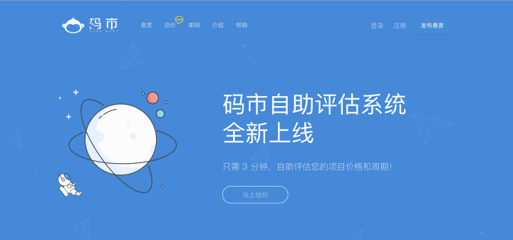
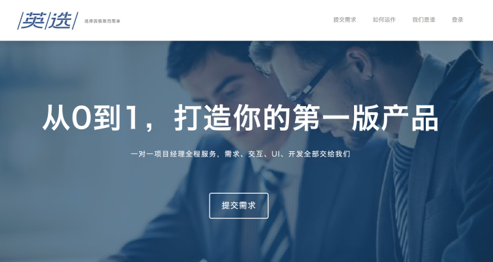
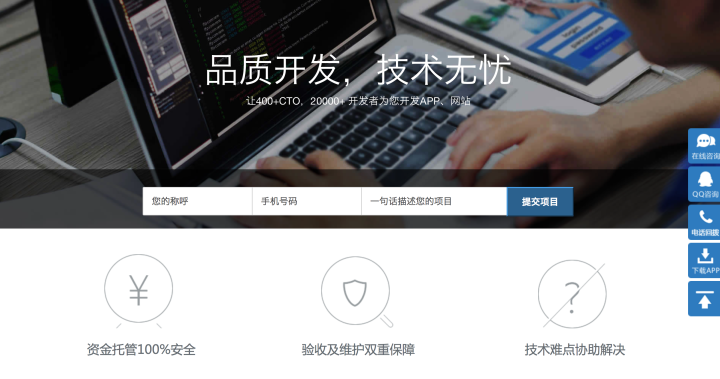
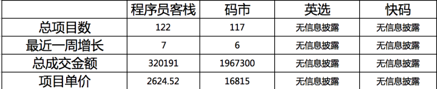
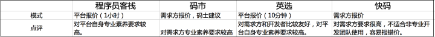
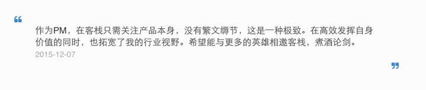
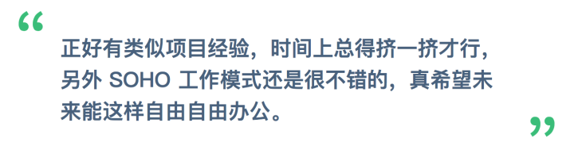
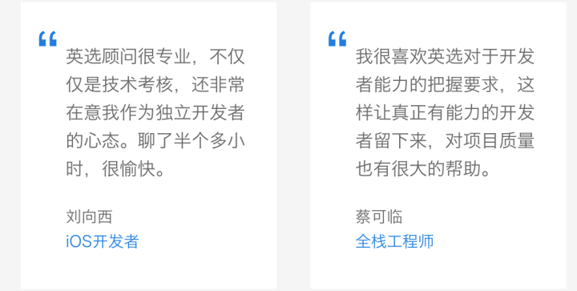

# 文档说明

本文档由**公众号懒人找资源**根据网络公开信息爬取，并整理成册，仅在*懒人专属群*内分享。

一共近一千帖，为避免臃肿，本系列共分为*上中下*三份，此份为*上*，78W 余字。

版权归属原作者，所有帖子都附有原文链接，群友可以点击跳转原文。

为节省空间，文档为纯文字版，部分帖子含图片可以到原帖查看。

将整理为 pdf 和 epub 版本，方便大家多平台阅读。

(另外，知乎帖引流和推广很多，难免有夸大的嫌疑。大家保持自我判断，不要轻信别人，当作看故事就好~)

## 目录

文档说明  
 目录  
 (赞同 990)开超市真的能保本赚钱嘛？  
 (赞同 986)如何兼职赚钱？  
 (赞同 978)为什么大部分年轻人买房要父母帮忙，而不是完全靠自己赚钱买?  
 (赞同 97)如何使用支付宝赚钱？  
 (赞同 963)身无分文还没毕业的家里断绝经济我要怎么办，还有怎么最简单的创业？  
 (赞同 951)为什么不能以爱好为工作？  
 (赞同 938)2019 年看到很多互联公司都在裁人，互联网行业要开始走下坡路了吗？  
 (赞同 932)大学生想赚钱，该怎么做？  
 (赞同 932)如何在一个月内赚得三万？  
 (赞同 927)如何一天内赚到 1000 块钱？  
 (赞同 9.7K)理财小白如何理财？  
 (赞同 9.7K)大学生，为什么学校里面有些人可以开宾利或者法拉利？  
 (赞同 9.5K)你的第一桶金是如何赚到的？  
 (赞同 9.4K)网络兼职打字员真的假的？  
 (赞同 9.4K)一个人白手起家成千万富翁的难度有多大？  
 (赞同 9.4K)大学生生活费一般多少？  
 (赞同 9.3K)月薪 4 万是一种什么样的感受？  
 (赞同 8K)网络兼职打字员真的假的？  
 (赞同 893)大学生想赚钱，该怎么做？  
 (赞同 883)2019 做自媒体这个行业怎么赚钱？  
 (赞同 875)从股指期货投资中一年能稳定获得 100 万收益，还有必要工作吗？  
 (赞同 866)共享经济还剩哪些可以做？  
 (赞同 85K)你有哪些内行人才知道的省钱诀窍？  
 (赞同 858)普通大学生寒假如何能赚到 6K RMB？  
 (赞同 855)工资 3000 的人是如何发展副业的？  
 (赞同 850)大学生想创业搞餐饮，想来听听有经验的前辈们的建议？  
 (赞同 847)微信公众号如何盈利?  
 (赞同 843)你是如何在不依靠工资收入的情况下赚到一万元的？  
 (赞同 843)摆地摊如何吸引顾客？  
 (赞同 834)在生活中如何发现切入点，自己创业呢？  
 (赞同 832)为什么程序员不自己单干？  
 (赞同 813)穷人思维和富人思维的差别到底在哪里？  
 (赞同 811)二十出头的辍学生怎么在短时间内赚到 20 万？  
 (赞同 810)当下怎么利用“信息不对称”来赚钱，有哪些细小的案例可以分享分析下？  
 (赞同 807)在中国想要投资比特币 (bitcoin) 该如何开始？  
 (赞同 803)30 岁年薪 20 万算不算很失败？  
 (赞同 802)如何评价台湾知名唱作男歌手谢和弦发微博称不来中国大陆赚钱？  
 (赞同 8.9K)2 万元准备创业，有什么好推荐项目？  
 (赞同 8.8K)商业史上有哪些降维打击的经典案例？  
 (赞同 8.5K)月薪 4 万是一种什么样的感受？  
 (赞同 8.1K)如何足不出户，利用一台电脑比较稳定地日赚 50 块以上？  
 (赞同 797)学生党怎么避开营销广告赚钱？  
 (赞同 781)如何把一块钱变成两块钱？  
 (赞同 778)哪些靠谱的方法能在十年内赚 3000 万？  
 (赞同 773)每天能赚 1000 元或更多的生意、投资或者渠道有哪些？  
 (赞同 766)女朋友说努力有上进心一定能赚大钱我该怎么反驳？  
 (赞同 758)怎样边旅行边赚钱？  
 (赞同 74K)如何在大学赚到一万元？  
 (赞同 745)2019 年有什么新的赚钱方式？  
 (赞同 745)如何通过文字赚钱？  
 (赞同 745)业余时间充足的 学生党 和 工作新人，怎么增加额外收入？  
 (赞同 741)一个年入 500 万的企业高管和同样收入的企业老板会有什么不一样的感觉？  
 (赞同 738)增加被动收入都有哪些方法？  
 (赞同 736)怎样努力才能赚 1 个亿？  
 (赞同 731)26 岁，毕业近四年，底薪两千，负债八万，没有一技之长，该怎么才能有未来？  
 (赞同 7.8K)怎么快速合法地挣到一百万？  
 (赞同 7.8K)怎么看待知乎上很多回答都不看好创业？  
 (赞同 7.6K)商业史上有哪些降维打击的经典案例？  
 (赞同 7.6K)如何利用双休日，每月稳定增加额外 1500 元收入？  
 (赞同 7.6K)你有什么网上赚钱的项目或生意愿意分享？  
 (赞同 7.3K)去电子厂打暑假工是什么感觉？  
 (赞同 7.2K)2019 年有什么新的创业机会？  
 (赞同 7.1K)大学生生活费一般多少？  
 (赞同 7.1K)你是如何靠知乎赚钱的？  
 (赞同 679)为什么世界上会有不喜欢赚钱的人？  
 (赞同 676)25 岁前靠自己，年收入破百万，是怎样一种体验？  
 (赞同 676)现在有哪些适合学生并且安全可靠的兼职翻译软件？  
 (赞同 675)在大学如何通过自学，练就能赚钱的一技之长？  
 (赞同 673)有哪些常人不知道的赚钱方法？  
 (赞同 662)在一线城市，仅有一台电脑没有工作，能够养活自己吗？  
 (赞同 660)如何用 40w 挣更多？80w？  
 (赞同 655)一个理财白痴，手里握着一百万，希望风险小的投资，求指点？  
 (赞同 64K)你有哪些内行人才知道的省钱诀窍？  
 (赞同 645)男人的三十岁是个多么大的分水岭？  
 (赞同 643)大学生找兼职有哪些合适的去处？  
 (赞同 642)从股指期货投资中一年能稳定获得 100 万收益，还有必要工作吗？  
 (赞同 633)在家要怎么赚钱呢？  
 (赞同 626)有哪些可操作性强的暴利项目？  
 (赞同 625)赚钱能力跟学历有很大关系吗？  
 (赞同 625)医生赚钱容不容易？  
 (赞同 624)如何评价成龙接拍传奇页游广告？  
 (赞同 618)为什么别人赚钱这么容易？  
 (赞同 618)作为学生，负责本年级的购书，想赚中间差价，会不会不道德？  
 (赞同 615)你们知道拼多多有砍价军团吗，那种链接随便一发进群不到一会就被砍到零的吗？  
 (赞同 614)你遇见的劣质客户有哪些共同特点？  
 (赞同 613)有哪些低成本的创业项目？  
 (赞同 605)是什么刺痛了你的神经，让你醒悟要努力赚钱？  
 (赞同 604)如何在三十岁之前做到年薪百万？  
 (赞同 602)为什么不能以爱好为工作？  
 (赞同 6.9K)为什么越想赚钱却越得不到钱？  
 (赞同 6.8K)在校大学生能干点什么靠谱的事情挣外快？  
 (赞同 6.8K)有哪些时候你发现赚钱如此容易，过后你还会那么觉得么？  
 (赞同 6.8K)你的第一桶金是如何赚到的？  
 (赞同 6.6K)问个很现实的问题吧，普通人怎么样才能快速的赚到钱？  
 (赞同 6.5K)你曾经利用过哪些信息不对称而获利？  
 (赞同 6.2K)你听过哪些赚钱的歪点子？  
 (赞同 6.2K)工作两年现在月收 5000+很迷茫，如何能在一年内改变达到月收过万？  
 (赞同 6.1K)如何发现下一个大趋势？  
 (赞同 5K)有没有人按照知乎上赚钱的方法赚到了人生第一桶金？  
 (赞同 5K)个人理财有哪些基本原理和方法？  
 (赞同 596)程序员该学习什么，能在上学期间挣钱？  
 (赞同 593)以前靠信息不对称赚钱，现在靠什么赚钱？  
 (赞同 584)学习经济学有助于赚钱吗？  
 (赞同 568)目前网上有许多实时指导网民炒股的群，群主这么做的原因是？  
 (赞同 564)陌生人真的会传授你赚钱的技能吗？  
 (赞同 564)C++后端程序员如何赚外快？外包项目全无 C++相关的？  
 (赞同 563)高中生如何在两个月之内赚到三千元？  
 (赞同 562)赚钱可以有多辛苦？  
 (赞同 558)在写字楼上班可以发展什么副业？  
 (赞同 552)高考完后如何找兼职或暑假工？  
 (赞同 550)如何利用一个网页来挣钱？  
 (赞同 549)没有钱真的可以创业吗？  
 (赞同 541)缺乏资源的人怎么创业？  
 (赞同 538)如何避免在「浪费时间」和「无价值」的小事上投入太多精力？  
 (赞同 535)写文章能赚钱吗？写好了文章想投稿应该投哪里？  
 (赞同 530)家里有不争气的父母是种什么体验？  
 (赞同 529)以前靠信息不对称赚钱，现在靠什么赚钱？  
 (赞同 524)学习经济学有助于赚钱吗？  
 (赞同 524)如何快速挣到买房钱？  
 (赞同 522)今年二十三岁，如何在二十六岁挣到一百万？  
 (赞同 522)程序员一般通过什么途径接私活？  
 (赞同 520)大学生找兼职有哪些合适的去处？  
 (赞同 517)自己明明很缺钱，但就是对赚钱不感冒怎么办？  
 (赞同 515)高利贷是如何赚钱的？  
 (赞同 502)买完房房价就暴跌是怎样一种体验？求解？  
 (赞同 5.8K)你是如何变得很会赚钱的？可以分享下吗?  
 (赞同 5.8K)2019 年有什么新的创业机会？  
 (赞同 5.8K)工作之余，如何挣钱？  
 (赞同 5.8K)给你一千万，但是 1 年内不玩任何电子产品，你同意吗？  
 (赞同 5.8K)一个公司只有两三个人，每年利润会有 100 万以上，这些公司都是做什么的？什么模式？  
 (赞同 5.6K)如何做微商？  
 (赞同 5.3K)给你一千万，但是 1 年内不玩任何电子产品，你同意吗？  
 (赞同 5.2K)如何在三个月内用 1 万块赚到 5 万块？成功率有多高？  
 (赞同 5.2K)如何看待「钱不是省出来的」这句话？  
 (赞同 5.1K)个人理财有哪些基本原理和方法？  
 (赞同 493)增加被动收入都有哪些方法？  
 (赞同 488)自媒体有哪些盈利模式？  
 (赞同 485)高利贷是如何赚钱的？  
 (赞同 485)如何在一个月内赚 5000？  
 (赞同 483)月薪过万该具备怎样的能力？  
 (赞同 479)一个无学历、无经验、无人脉、无资本的普通工人，如何创业做生意？  
 (赞同 479)陌生人真的会传授你赚钱的技能吗？  
 (赞同 478)第一次做兼职是什么感受？  
 (赞同 474)你们有哪些可以赚钱的冷门方法嘛？  
 (赞同 467)程序员在哪能接到私单？  
 (赞同 463)程序员一般通过什么途径接私活？  
 (赞同 461)有个七八万，可以做些什么项目。？  
 (赞同 460)老妈对我误会一直很深，怎么解释都不通，怎么办？  
 (赞同 45K)什么是「富人思维」？  
 (赞同 457)哪些营销手段，利用了人的哪些心理特点？  
 (赞同 454)暑假兼职能做什么？  
 (赞同 452)大家副业都在做什么？  
 (赞同 446)哪些公众号的征稿是真实的？求推荐？  
 (赞同 444)创业适合从摆地摊开始吗？  
 (赞同 441)你身边有哪些「全靠脑子灵」赚到大钱的例子？  
 (赞同 438)工作之余想要做副业的话，什么行业比较合适？  
 (赞同 432)怎样才能发财致富？  
 (赞同 430)每月有新增存款 1000 如何在一年内赚 10 万存款(不包括日常开销且看问题描述)?  
 (赞同 428)一个年入 500 万的企业高管和同样收入的企业老板会有什么不一样的感觉？  
 (赞同 427)怎样理解“会花钱的人才会赚钱”？  
 (赞同 426)大学生如何做兼职?  
 (赞同 424)如何做有钱的科学家？  
 (赞同 422)春节前夕，针对大家的消费，可以做哪些短期的创业项目小赚一笔？  
 (赞同 415)我一个大专生应该做什么？求解惑？  
 (赞同 413)没有钱的我们怎么创业呢？  
 (赞同 412)为什么 80%的人在 30 岁前赚不到钱？  
 (赞同 40K)年轻人该不该存钱？  
 (赞同 408)新手小白怎么学抖音运营？  
 (赞同 407)做为公务员，哪一刻让你觉得自己挣的太少了？  
 (赞同 406)在读高中期间怎么赚生活费？  
 (赞同 403)刷宝短视频真的能赚钱吗？  
 (赞同 402)一个大学生，怎么在大学两年里筹够十万元？  
 (赞同 4.8K)一个公司只有两三个人，每年利润会有 100 万以上，这些公司都是做什么的？什么模式？  
 (赞同 4.7K)如何理解「节约者不会富，懂赚钱者会花钱」的言论?  
 (赞同 4.7K)你知道网上的哪些偏门小众但暴利的生意？  
 (赞同 4.6K)如何一年内赚到 120 万？  
 (赞同 4.5K)有没有人按照知乎上赚钱的方法赚到了人生第一桶金？  
 (赞同 4.5K)如何实现在家中电脑前，月赚几万？  
 (赞同 4.4K)你有什么挣钱的「方法」愿意分享？  
 (赞同 4.4K)你是如何变得很会赚钱的？可以分享下吗?  
 (赞同 4.4K)你的赚钱方法是什么？  
 (赞同 4.4K)如何发现下一个大趋势？  
 (赞同 4.3K)在校大学生如何赚钱？  
 (赞同 4.3K)大学四年，如何高质量地度过？  
 (赞同 4.1K)如何足不出户，利用一台电脑比较稳定地日赚 50 块以上？  
 (赞同 4.1K)新人写手如何投稿拿稿费？  
 (赞同 4.1K)2019 年过后，未来近十年最赚钱的项目行业都有哪些？  
 (赞同 4.1K)现在大学生可以做哪些事情来赚零花钱？  
 (赞同 4.1K)念了半辈子书的博士如果比不上工作好的大专生赚得多，生活幸福感如何？  
 (赞同 3K)中国未来的赚钱行业有哪些？  
 (赞同 3K)大专毕业，看不到出路怎么办？  
 (赞同 3K)如何评价成龙接拍传奇页游广告？  
 (赞同 3K)怎么样才能月入万元？  
 (赞同 3K)有朋友利用朋友圈卖东西月流水 7 万，有哪些经验分享？  
 (赞同 39K)实现月入十万难吗？  
 (赞同 391)2019 淘宝卖什么最赚钱？  
 (赞同 391)不会写文但是需要通过写文来赚钱，怎样在短时间内提高写文的技巧？  
 (赞同 38K)你最意想不到的一笔收入是怎么来的？  
 (赞同 387)大家一般找网络兼职都是到哪里找的？  
 (赞同 384)大学阶段现在手里有五千元资金，你们会用什么方法来利用这笔钱来不断赚钱？  
 (赞同 380)p2p 从业者为啥这么赚钱，以后发展如何？  
 (赞同 37K)你最意想不到的一笔收入是怎么来的？  
 (赞同 37K)年轻人该不该存钱？  
 (赞同 377)高三暑假如何利用一台电脑赚到 1000 块？  
 (赞同 375)没有钱的我们怎么创业呢？  
 (赞同 36K)有哪些业余赚钱的途径？  
 (赞同 369)你会因为什么而退出知乎呢？  
 (赞同 366)为什么世界上会有不喜欢赚钱的人？  
 (赞同 366)做什么行业赚钱？  
 (赞同 358)有哪些理财高招？  
 (赞同 357)什么兼职工作赚钱比较多？  
 (赞同 356)你有什么赚钱的副业呢？  
 (赞同 355)摆地摊如何吸引顾客？  
 (赞同 352)普通大学生寒假如何能赚到 6K RMB？  
 (赞同 351)大学生怎么网上兼职赚钱？  
 (赞同 34K)什么是「富人思维」？  
 (赞同 349)目前月收入 6k，如何一年内快速突破 3 万这道坎？  
 (赞同 348)上班族如何增加被动收入，实现财务自由？  
 (赞同 990)开超市真的能保本赚钱嘛？  
 (赞同 986)如何兼职赚钱？  
 (赞同 978)为什么大部分年轻人买房要父母帮忙，而不是完全靠自己赚钱买?  
 (赞同 97)如何使用支付宝赚钱？  
 (赞同 963)身无分文还没毕业的家里断绝经济我要怎么办，还有怎么最简单的创业？  
 (赞同 951)为什么不能以爱好为工作？  
 (赞同 938)2019 年看到很多互联公司都在裁人，互联网行业要开始走下坡路了吗？  
 (赞同 932)大学生想赚钱，该怎么做？  
 (赞同 932)如何在一个月内赚得三万？  
 (赞同 927)如何一天内赚到 1000 块钱？  
 (赞同 9.7K)理财小白如何理财？  
 (赞同 9.7K)大学生，为什么学校里面有些人可以开宾利或者法拉利？  
 (赞同 9.5K)你的第一桶金是如何赚到的？  
 (赞同 9.4K)网络兼职打字员真的假的？  
 (赞同 9.4K)一个人白手起家成千万富翁的难度有多大？  
 (赞同 9.4K)大学生生活费一般多少？  
 (赞同 9.3K)月薪 4 万是一种什么样的感受？  
 (赞同 8K)网络兼职打字员真的假的？  
 (赞同 893)大学生想赚钱，该怎么做？  
 (赞同 883)2019 做自媒体这个行业怎么赚钱？  
 (赞同 875)从股指期货投资中一年能稳定获得 100 万收益，还有必要工作吗？  
 (赞同 866)共享经济还剩哪些可以做？  
 (赞同 85K)你有哪些内行人才知道的省钱诀窍？  
 (赞同 858)普通大学生寒假如何能赚到 6K RMB？  
 (赞同 855)工资 3000 的人是如何发展副业的？  
 (赞同 850)大学生想创业搞餐饮，想来听听有经验的前辈们的建议？  
 (赞同 847)微信公众号如何盈利?  
 (赞同 843)你是如何在不依靠工资收入的情况下赚到一万元的？  
 (赞同 843)摆地摊如何吸引顾客？  
 (赞同 834)在生活中如何发现切入点，自己创业呢？  
 (赞同 832)为什么程序员不自己单干？  
 (赞同 813)穷人思维和富人思维的差别到底在哪里？  
 (赞同 811)二十出头的辍学生怎么在短时间内赚到 20 万？  
 (赞同 810)当下怎么利用“信息不对称”来赚钱，有哪些细小的案例可以分享分析下？  
 (赞同 807)在中国想要投资比特币 (bitcoin) 该如何开始？  
 (赞同 803)30 岁年薪 20 万算不算很失败？  
 (赞同 802)如何评价台湾知名唱作男歌手谢和弦发微博称不来中国大陆赚钱？  
 (赞同 8.9K)2 万元准备创业，有什么好推荐项目？  
 (赞同 8.8K)商业史上有哪些降维打击的经典案例？  
 (赞同 8.5K)月薪 4 万是一种什么样的感受？  
 (赞同 8.1K)如何足不出户，利用一台电脑比较稳定地日赚 50 块以上？  
 (赞同 797)学生党怎么避开营销广告赚钱？  
 (赞同 781)如何把一块钱变成两块钱？  
 (赞同 778)哪些靠谱的方法能在十年内赚 3000 万？  
 (赞同 773)每天能赚 1000 元或更多的生意、投资或者渠道有哪些？  
 (赞同 766)女朋友说努力有上进心一定能赚大钱我该怎么反驳？  
 (赞同 758)怎样边旅行边赚钱？  
 (赞同 74K)如何在大学赚到一万元？  
 (赞同 745)2019 年有什么新的赚钱方式？  
 (赞同 745)如何通过文字赚钱？  
 (赞同 745)业余时间充足的 学生党 和 工作新人，怎么增加额外收入？  
 (赞同 741)一个年入 500 万的企业高管和同样收入的企业老板会有什么不一样的感觉？  
 (赞同 738)增加被动收入都有哪些方法？  
 (赞同 736)怎样努力才能赚 1 个亿？  
 (赞同 731)26 岁，毕业近四年，底薪两千，负债八万，没有一技之长，该怎么才能有未来？  
 (赞同 7.8K)怎么快速合法地挣到一百万？  
 (赞同 7.8K)怎么看待知乎上很多回答都不看好创业？  
 (赞同 7.6K)商业史上有哪些降维打击的经典案例？  
 (赞同 7.6K)如何利用双休日，每月稳定增加额外 1500 元收入？  
 (赞同 7.6K)你有什么网上赚钱的项目或生意愿意分享？  
 (赞同 7.3K)去电子厂打暑假工是什么感觉？  
 (赞同 7.2K)2019 年有什么新的创业机会？  
 (赞同 7.1K)大学生生活费一般多少？  
 (赞同 7.1K)你是如何靠知乎赚钱的？  
 (赞同 679)为什么世界上会有不喜欢赚钱的人？  
 (赞同 676)25 岁前靠自己，年收入破百万，是怎样一种体验？  
 (赞同 676)现在有哪些适合学生并且安全可靠的兼职翻译软件？  
 (赞同 675)在大学如何通过自学，练就能赚钱的一技之长？  
 (赞同 673)有哪些常人不知道的赚钱方法？  
 (赞同 662)在一线城市，仅有一台电脑没有工作，能够养活自己吗？  
 (赞同 660)如何用 40w 挣更多？80w？  
 (赞同 655)一个理财白痴，手里握着一百万，希望风险小的投资，求指点？  
 (赞同 64K)你有哪些内行人才知道的省钱诀窍？  
 (赞同 645)男人的三十岁是个多么大的分水岭？  
 (赞同 643)大学生找兼职有哪些合适的去处？  
 (赞同 642)从股指期货投资中一年能稳定获得 100 万收益，还有必要工作吗？  
 (赞同 633)在家要怎么赚钱呢？  
 (赞同 626)有哪些可操作性强的暴利项目？  
 (赞同 625)赚钱能力跟学历有很大关系吗？  
 (赞同 625)医生赚钱容不容易？  
 (赞同 624)如何评价成龙接拍传奇页游广告？  
 (赞同 618)为什么别人赚钱这么容易？  
 (赞同 618)作为学生，负责本年级的购书，想赚中间差价，会不会不道德？  
 (赞同 615)你们知道拼多多有砍价军团吗，那种链接随便一发进群不到一会就被砍到零的吗？  
 (赞同 614)你遇见的劣质客户有哪些共同特点？  
 (赞同 613)有哪些低成本的创业项目？  
 (赞同 605)是什么刺痛了你的神经，让你醒悟要努力赚钱？  
 (赞同 604)如何在三十岁之前做到年薪百万？  
 (赞同 602)为什么不能以爱好为工作？  
 (赞同 6.9K)为什么越想赚钱却越得不到钱？  
 (赞同 6.8K)在校大学生能干点什么靠谱的事情挣外快？  
 (赞同 6.8K)有哪些时候你发现赚钱如此容易，过后你还会那么觉得么？  
 (赞同 6.8K)你的第一桶金是如何赚到的？  
 (赞同 6.6K)问个很现实的问题吧，普通人怎么样才能快速的赚到钱？  
 (赞同 6.5K)你曾经利用过哪些信息不对称而获利？  
 (赞同 6.2K)你听过哪些赚钱的歪点子？  
 (赞同 6.2K)工作两年现在月收 5000+很迷茫，如何能在一年内改变达到月收过万？  
 (赞同 6.1K)如何发现下一个大趋势？  
 (赞同 5K)有没有人按照知乎上赚钱的方法赚到了人生第一桶金？  
 (赞同 5K)个人理财有哪些基本原理和方法？  
 (赞同 596)程序员该学习什么，能在上学期间挣钱？  
 (赞同 593)以前靠信息不对称赚钱，现在靠什么赚钱？  
 (赞同 584)学习经济学有助于赚钱吗？  
 (赞同 568)目前网上有许多实时指导网民炒股的群，群主这么做的原因是？  
 (赞同 564)陌生人真的会传授你赚钱的技能吗？  
 (赞同 564)C++后端程序员如何赚外快？外包项目全无 C++相关的？  
 (赞同 563)高中生如何在两个月之内赚到三千元？  
 (赞同 562)赚钱可以有多辛苦？  
 (赞同 558)在写字楼上班可以发展什么副业？  
 (赞同 552)高考完后如何找兼职或暑假工？  
 (赞同 550)如何利用一个网页来挣钱？  
 (赞同 549)没有钱真的可以创业吗？  
 (赞同 541)缺乏资源的人怎么创业？  
 (赞同 538)如何避免在「浪费时间」和「无价值」的小事上投入太多精力？  
 (赞同 535)写文章能赚钱吗？写好了文章想投稿应该投哪里？  
 (赞同 530)家里有不争气的父母是种什么体验？  
 (赞同 529)以前靠信息不对称赚钱，现在靠什么赚钱？  
 (赞同 524)学习经济学有助于赚钱吗？  
 (赞同 524)如何快速挣到买房钱？  
 (赞同 522)今年二十三岁，如何在二十六岁挣到一百万？  
 (赞同 522)程序员一般通过什么途径接私活？  
 (赞同 520)大学生找兼职有哪些合适的去处？  
 (赞同 517)自己明明很缺钱，但就是对赚钱不感冒怎么办？  
 (赞同 515)高利贷是如何赚钱的？  
 (赞同 502)买完房房价就暴跌是怎样一种体验？求解？  
 (赞同 5.8K)你是如何变得很会赚钱的？可以分享下吗?  
 (赞同 5.8K)2019 年有什么新的创业机会？  
 (赞同 5.8K)工作之余，如何挣钱？  
 (赞同 5.8K)给你一千万，但是 1 年内不玩任何电子产品，你同意吗？  
 (赞同 5.8K)一个公司只有两三个人，每年利润会有 100 万以上，这些公司都是做什么的？什么模式？  
 (赞同 5.6K)如何做微商？  
 (赞同 5.3K)给你一千万，但是 1 年内不玩任何电子产品，你同意吗？  
 (赞同 5.2K)如何在三个月内用 1 万块赚到 5 万块？成功率有多高？  
 (赞同 5.2K)如何看待「钱不是省出来的」这句话？  
 (赞同 5.1K)个人理财有哪些基本原理和方法？  
 (赞同 493)增加被动收入都有哪些方法？  
 (赞同 488)自媒体有哪些盈利模式？  
 (赞同 485)高利贷是如何赚钱的？  
 (赞同 485)如何在一个月内赚 5000？  
 (赞同 483)月薪过万该具备怎样的能力？  
 (赞同 479)一个无学历、无经验、无人脉、无资本的普通工人，如何创业做生意？  
 (赞同 479)陌生人真的会传授你赚钱的技能吗？  
 (赞同 478)第一次做兼职是什么感受？  
 (赞同 474)你们有哪些可以赚钱的冷门方法嘛？  
 (赞同 467)程序员在哪能接到私单？  
 (赞同 463)程序员一般通过什么途径接私活？  
 (赞同 461)有个七八万，可以做些什么项目。？  
 (赞同 460)老妈对我误会一直很深，怎么解释都不通，怎么办？  
 (赞同 45K)什么是「富人思维」？  
 (赞同 457)哪些营销手段，利用了人的哪些心理特点？  
 (赞同 454)暑假兼职能做什么？  
 (赞同 452)大家副业都在做什么？  
 (赞同 446)哪些公众号的征稿是真实的？求推荐？  
 (赞同 444)创业适合从摆地摊开始吗？  
 (赞同 441)你身边有哪些「全靠脑子灵」赚到大钱的例子？  
 (赞同 438)工作之余想要做副业的话，什么行业比较合适？  
 (赞同 432)怎样才能发财致富？  
 (赞同 430)每月有新增存款 1000 如何在一年内赚 10 万存款(不包括日常开销且看问题描述)?  
 (赞同 428)一个年入 500 万的企业高管和同样收入的企业老板会有什么不一样的感觉？  
 (赞同 427)怎样理解“会花钱的人才会赚钱”？  
 (赞同 426)大学生如何做兼职?  
 (赞同 424)如何做有钱的科学家？  
 (赞同 422)春节前夕，针对大家的消费，可以做哪些短期的创业项目小赚一笔？  
 (赞同 415)我一个大专生应该做什么？求解惑？  
 (赞同 413)没有钱的我们怎么创业呢？  
 (赞同 412)为什么 80%的人在 30 岁前赚不到钱？  
 (赞同 40K)年轻人该不该存钱？  
 (赞同 408)新手小白怎么学抖音运营？  
 (赞同 407)做为公务员，哪一刻让你觉得自己挣的太少了？  
 (赞同 406)在读高中期间怎么赚生活费？  
 (赞同 403)刷宝短视频真的能赚钱吗？  
 (赞同 402)一个大学生，怎么在大学两年里筹够十万元？  
 (赞同 4.8K)一个公司只有两三个人，每年利润会有 100 万以上，这些公司都是做什么的？什么模式？  
 (赞同 4.7K)如何理解「节约者不会富，懂赚钱者会花钱」的言论?  
 (赞同 4.7K)你知道网上的哪些偏门小众但暴利的生意？  
 (赞同 4.6K)如何一年内赚到 120 万？  
 (赞同 4.5K)有没有人按照知乎上赚钱的方法赚到了人生第一桶金？  
 (赞同 4.5K)如何实现在家中电脑前，月赚几万？  
 (赞同 4.4K)你有什么挣钱的「方法」愿意分享？  
 (赞同 4.4K)你是如何变得很会赚钱的？可以分享下吗?  
 (赞同 4.4K)你的赚钱方法是什么？  
 (赞同 4.4K)如何发现下一个大趋势？  
 (赞同 4.3K)在校大学生如何赚钱？  
 (赞同 4.3K)大学四年，如何高质量地度过？  
 (赞同 4.1K)如何足不出户，利用一台电脑比较稳定地日赚 50 块以上？  
 (赞同 4.1K)新人写手如何投稿拿稿费？  
 (赞同 4.1K)2019 年过后，未来近十年最赚钱的项目行业都有哪些？  
 (赞同 4.1K)现在大学生可以做哪些事情来赚零花钱？  
 (赞同 4.1K)念了半辈子书的博士如果比不上工作好的大专生赚得多，生活幸福感如何？  
 (赞同 3K)中国未来的赚钱行业有哪些？  
 (赞同 3K)大专毕业，看不到出路怎么办？  
 (赞同 3K)如何评价成龙接拍传奇页游广告？  
 (赞同 3K)怎么样才能月入万元？  
 (赞同 3K)有朋友利用朋友圈卖东西月流水 7 万，有哪些经验分享？  
 (赞同 39K)实现月入十万难吗？  
 (赞同 391)2019 淘宝卖什么最赚钱？  
 (赞同 391)不会写文但是需要通过写文来赚钱，怎样在短时间内提高写文的技巧？  
 (赞同 38K)你最意想不到的一笔收入是怎么来的？  
 (赞同 387)大家一般找网络兼职都是到哪里找的？  
 (赞同 384)大学阶段现在手里有五千元资金，你们会用什么方法来利用这笔钱来不断赚钱？  
 (赞同 380)p2p 从业者为啥这么赚钱，以后发展如何？  
 (赞同 37K)你最意想不到的一笔收入是怎么来的？  
 (赞同 37K)年轻人该不该存钱？  
 (赞同 377)高三暑假如何利用一台电脑赚到 1000 块？  
 (赞同 375)没有钱的我们怎么创业呢？  
 (赞同 36K)有哪些业余赚钱的途径？  
 (赞同 369)你会因为什么而退出知乎呢？  
 (赞同 366)为什么世界上会有不喜欢赚钱的人？  
 (赞同 366)做什么行业赚钱？  
 (赞同 358)有哪些理财高招？  
 (赞同 357)什么兼职工作赚钱比较多？  
 (赞同 356)你有什么赚钱的副业呢？  
 (赞同 355)摆地摊如何吸引顾客？  
 (赞同 352)普通大学生寒假如何能赚到 6K RMB？  
 (赞同 351)大学生怎么网上兼职赚钱？  
 (赞同 34K)什么是「富人思维」？  
 (赞同 349)目前月收入 6k，如何一年内快速突破 3 万这道坎？  
 (赞同 348)上班族如何增加被动收入，实现财务自由？  
 (赞同 338)司机开顺风车怎么赚钱？  
 (赞同 337)1 万元本金，怎样通过金融手段在 12 月前挣 5500 元买新 iPhone？  
 (赞同 336)低学历者如何才能获得财富？  
 (赞同 335)大学生怎么存钱去整容？  
 (赞同 333)你怎么处理你大学赚的钱？  
 (赞同 333)中国的烟草行业有多暴利？  
 (赞同 331)作为学生，负责本年级的购书，想赚中间差价，会不会不道德？  
 (赞同 330)除了共享单车，充电宝，雨伞，还有哪些东西可以共享？  
 (赞同 330)谁有炒房攻略！想学着炒房？  
 (赞同 32K)如何在大学赚到一万元？  
 (赞同 324)在媒体工作，一周有四、五天空闲，是不是要自己再找点可以赚钱的事情做？有哪些赚钱的渠道值得推荐？  
 (赞同 324)手机行业利润很大吗，为什么这么多人进入这个行业？  
 (赞同 322)在一线城市，仅有一台电脑没有工作，能够养活自己吗？  
 (赞同 322)有什么通过手机赚钱的途径能赚点小钱？  
 (赞同 321)如何通过文字赚钱？  
 (赞同 320)除了正常工作的工资外，你还有哪些副业或者其他收入？  
 (赞同 31K)有哪些道理是你毕业多年后才明白的？  
 (赞同 317)三十岁前赚到 100 万再花掉 100 万是种怎么样的体验？  
 (赞同 316)四五万想创业 做什么生意好？  
 (赞同 316)有什么好赚钱的副业可以做吗？  
 (赞同 310)三十岁前赚到 100 万再花掉 100 万是种怎么样的体验？  
 (赞同 309)怎么在家里，賺钱快？  
 (赞同 307)做什么行业赚钱？  
 (赞同 306)如何当个网赚达人?  
 (赞同 306)月薪 5000，五年内如何在在广州买房？  
 (赞同 304)在股市怎么去赚钱?  
 (赞同 302)有没有什么赚钱的好项目，求推荐？  
 (赞同 301)大学生如何做兼职?  
 (赞同 300)工作清闲怎么做兼职挣外快？  
 (赞同 3.9K)如何一年内赚到 120 万？  
 (赞同 3.9K)你在淘宝做过哪些月入上万的虚拟小买卖？  
 (赞同 3.8K)创业失败的你现在在做些什么？  
 (赞同 3.7K)擅长做生意需要什么特质？是先天的还是后天的？  
 (赞同 3.6K)有什么不起眼却赚钱的行业？  
 (赞同 3.6K)哪些不起眼，却很赚钱的创业项目？  
 (赞同 3.4K)写作有前途吗？  
 (赞同 3.4K)如何写小说，怎么靠写小说赚钱？  
 (赞同 3.4K)2020 年的创业风口是什么？  
 (赞同 3.4K)有哪些投资、理财方面的知识越早接触越好？  
 (赞同 3.3K)如何理解「节约者不会富，懂赚钱者会花钱」的言论?  
 (赞同 3.3K)如何向微信公众号投稿？  
 (赞同 3.2K)老实人可以成为富人吗？  
 (赞同 3.1K)女朋友和前途哪个重要？  
 (赞同 3.1K)如何实现在家中电脑前，月赚几万？  
 (赞同 3.1K)为什么大部分年轻人买房要父母帮忙，而不是完全靠自己赚钱买?  
 (赞同 2K)工作之余想要做副业的话，什么行业比较合适？  
 (赞同 2K)写文章能赚钱吗？写好了文章想投稿应该投哪里？  
 (赞同 2K)个人公众号如何赚钱？  
 (赞同 2K)年薪百万是种怎样的生活状态？  
 (赞同 2K)赚钱可以有多辛苦？  
 (赞同 2K)老妈对我误会一直很深，怎么解释都不通，怎么办？  
 (赞同 2K)正常人怎么在一年内挣够 20 万？  
 (赞同 2K)不坑不骗不偷不抢怎么赚大钱？  
 (赞同 298)怎么用 1000 块钱赚更多的钱？  
 (赞同 298)怎样才能发财致富？  
 (赞同 294)你们平时靠什么副业赚钱？  
 (赞同 293)目前月收入 6k，如何一年内快速突破 3 万这道坎？  
 (赞同 293)作为一个普通人如何通过努力赚钱买一辆兰博基尼?

* * *

## (赞同 990)开超市真的能保本赚钱嘛？

原文链接 : [`www.zhihu.com/question/290440828/answer/548566956`](https://www.zhihu.com/question/290440828/answer/548566956)

家里 99 年开始开超市，一直至今，坐标小县城，对于经营超市真的是颇有心得，当然这里的超市指的是那种小型的，规模不大，一至俩人经营就行！

1.能否赚钱

赚钱=营收-成本 开这种规模的超市最大投入应该就是房租了，我家用的一直是自己的房子，就节省了很大的成本，如果你要去租房的话，那就一定要慎重了，因为目前普通超市的利润率真的不高，部分烟酒小吃饮料可能稍高点，剩下的比如什么方便面，正规品牌牛奶一类的产品利润低的要死，综合下来超市的利润率没有之前高了，现在最多也就是 15%左右了，也就是你卖出 100 元的货，挣 15 元左右吧。所以说当你要去开超市的时候，就要核算一下了，看看到底挣不挣钱！

2.怎么赚钱

这么多年的经验总结几点吧

a.货全！日常需要到的东西尽量都要有，即使有的东西需求量很少，你也要上货，因为人们买东西都有一种惯性，你这要是什么都有，顾客买东西时候第一想到的就是你这，如果顾客来了几次买的东西没有，那么他下意识里以后就不想来你这买东西，即使这个东西你肯定有！

b.平价！所谓平价就是你的货物定价是要符合市场行情的，薄利多销这个词就是给开超市准备的，普通小超市赚钱的关键就是走量，想走量的话就不能贵，不需要贵多少，市场一包 2.5 元的方便面你卖 3 元，大部分人绝对会宁愿多走 1 里路去别家买也不会去你这里的！

c.地理位置！我家的超市开在小区门口第一家，历史证明，别说更远的，即使是小区门口第二家也明显干不过我们，来来去去换了多少人了，都坚持不下去，如果有的选，就选人流量最的地方！

d.经营方法！小超市小卖店有什么经营方法，说没有其实也是有点门道的。一.你的环境卫生要过关，勤打扫，包括及时整理乱了的货物，把一些坏了的蔬菜水果挑出去，二.不要斤斤计较。其实小超市挣得就是斤斤计较的钱，一毛俩毛的积攒，那么怎么又能做到不斤斤计较呢？拿我家举例子，我家的蔬菜几乎都是不挣钱的，赶上买卖不好的时候有坏的一部分就会赔钱，但是还是要坚持这样做，还有，香菜，从来不收钱，都是送给顾客的、即使在冬天香菜十来元一斤的时候也会像平时一样送，为什么？因为这个东西大家一般用的少，就是调个菜，煮个面时候用一点，你收他钱不值当，不如送给她，赢得好感，维护一个老顾客，人嘛，一来有爱占小便宜的本性，二来受了你的东西，也会记你的好，下次买东西肯定光顾你家了！再就是买卖蔬菜这个东西一般都会有零头，比如 3.2 元，那么你就主动告诉顾客，那 2 毛钱不要了，下次再说吧，当然下次再说的意思就是不要了，每次都是这样，就会给顾客很好的感觉，道理和上面那个是一样的，而且好多顾客后来就会很不好意思，也会在买东西时候再还给你，比如 4.7 元，他给你 5 元就说不用找了，平时一直占你家便宜～

久而久之，你就会维护到一堆老顾客，而一般小超市也正是靠一个个老顾客来养活的。总的来说这些小技巧也很是重要的！

先就说这么多吧，还有一些感受，有时间，有有需要的人再说吧～

本文档由【公众号懒人找资源】爬取分享，版权归属原作者所有

## (赞同 986)如何兼职赚钱？

原文链接 : [`www.zhihu.com/question/24033918/answer/775714888`](https://www.zhihu.com/question/24033918/answer/775714888)

评论里一堆钓鱼的，别信，大学生还是要靠实力、脑子赚钱！

比如说我最近接的小兼职：

[`zhuanlan.zhihu.com/p/84157892`](https://zhuanlan.zhihu.com/p/84157892)

以上这是我在大学里考的证啊！！！有用的叻，别想着投机取巧赚快钱，多学点没毛病的叻！（9.30 更新）

唉，自从回答了这个问题，总是有评论或者私信让带赚钱……而我作为一个在读的计算机研究生，能给到的建议真的只有“大学四年多学点技能”、“先投资自己，再想别的”……

沉下心来上一下 MOOC⬇️：

怎么看「中国大学 MOOC」平台？

又或者康康最近大火的知识付费平台——小鹅通⬇️：

小鹅通上有哪些值得推荐的课？

多读点书咯！总会有用的叻！

14 年-19 年 6 月，湖工大大学四年+武汉大学研一，我最有钱的时候：

然后上个月自己交了早大一个学期的学费之后（我爸给我的钱都冻结在银行里了，我先自己垫上的，没找家里要更多钱周转）：

最后拿着这 1w+买了一台定制版的 MacBook Pro！（找小姐妹香港教育优惠代购的）

从小到大，我就对钱非常敏感，超级喜欢量化的数字，数学一直很好。我的妈妈也有点厉害的，深谙她女儿美食驱动（小时候）和金钱驱动（长大后）的本质，从来都对症下药，我也皮实耐受。

在 7 月总结里，我有提到我大学四年存了 5w+，有兴趣点移步微信公众号【仓鼠静的瓜子展览馆】，月末总结都是公众号独发内容。在这篇文章里，我毫无保留地把之前我的赚钱经历写了出来，但除了赚钱，我还很能攒钱，因为我想要更多的自由。

我是从大学开始，被妈老板突然“放弃”的，高考的滑铁卢，详情请看以下两篇回答：

然后另谋他就开始了我的兼职之旅。

可见，我妈对我高考成绩是多么的失望，以至于我之前高中的待遇都没有了笑:)，每个月 1000 块生活费，挂一科每个月扣 200（大学四年每年挂一科令人窒息了）。

这种情况下，我开始动各种脑筋赚钱。18 岁刚成年，都有个从孩子思维到成年人思维转换的过程，这个时候包括我妈在内的所有人都告诉我“你不是孩子了，你要的东西自己去赚！”

Ojbk，自己来就自己来，少年汉尼拔，任何不能打死我的都将被我打败。

截止到目前我做过的兼职包括但不限于：

以上是我最近投一个 IT 运营岗实习整理的社会实践经历，但我实际上做过的兼职比这还要多（花式赚钱爱折腾）。我把我做过的兼职分为三个类型：“做了一次绝对没有下次”类型/无法长期从事类型/真正对职业有帮助类型，再加上一个我将要尝试的类型：兴趣发现（技能养成）类。

这个类型应该属于比较绝望的类型，比如发传单。我没发过传单，但是我看过有男同学发过，高级一点的还有穿玩偶衣服比如 cos 布朗熊，听穿过的人说，一天 150-200（比传统发传单一天 60-80 好），面料不透气很是热，还有小朋友捣蛋……

想想就让人窒息了，这种兼职体验一下就行了，对于大学生而言，发家致富靠劳力不靠脑力真是太 silly 了。

我没写出来的有一个兼职，寒假超市收银员。大一寒假，我做满了两个月，分为两个班，早上 8 点到 11 点&下午 5 点半到晚上 9 点半，以及上午 11 点到下午 5 点。工作时间都是站着的，我映像很深刻大年初一晚饭时间我在上班，错过了部分压岁钱……

期间还发生了不愉快的事，因为寒假工是不会按照工作量提成的，所以做多做少工资没差，还可能因为收多了钱错账自己赔。有个和我一起兼职的大我一届的学姐（初中一个学校的），每当和她一起上班，她总会抢客少的那个工位，总是因为自己的事调班，或者最后半个小时就跟我讲“没人了，我先走了啊！”，每次都是我留下来和保安叔叔一起打扫卫生……久了我不愿意跟她调班，也会有意识地去抢那个人少的工位，然后也会在她要溜的时候跟她讲要拖地。

我从来都不是包子性格，但那是我第一次受到这样大的恶意，我发现并不是接受了高等教育的人就一定会有高素质。她会在负责人来的时候，尖酸刻薄地挑事。也会当着我的面，和其他工作人员说：“你还想找她调班？”

我都能想象，我不在的时候，她的话会说得有多难听。

我老老实实上到了年后，而对方一点契约精神都没有地在年前就不干了，以至于打乱了我们后续的排班，这是我长这么大，第一次因为“老实”被欺负得彻底。

这里省去了很多奇葩的经历比如：结账的时候很多婆婆阿姨要我省略几毛钱的尾数，我一个“知识分子”实在拉不下脸跟她们策（湖南话的“扯皮”），后来第一个月月底我盘账发现自己少了 80 多块钱（一个月工资统共也才 2000 块还要错账），然后第二个月说啥都不肯抹掉尾数了去踏马的知识分子的清高一分钱都是钱好吗！！还有某工作人员阿姨（跟我完全不熟），下班拿了一大袋散装称的零食给我结账，我一看价格两块多钱，就假装看不懂说“阿姨，这个价格好像打错了，你拿回去检查一下吧！”

逗我呢，一大包奥利奥威化饼干两块三毛五还有零有整，这是对我智商的侮辱还是人格的侮辱？？？

结束了这个兼职，我非常严肃地跟我妈说，我再也不会做这种相关的工作了。

原因如下：

1.  高度重复的工作内容，是对生命的浪费；
    
2.  毫无筛选地接触形形色色的人，脑子全用来勾心斗角了；
    
3.  没有动力的固定工资让有些人四处钻空子，老实人活该被欺负。
    

但大静静我会吃亏？

Naive 也是。超市有个会员卡积分机制，然后积分可以换东西。因为是寒假年货期，很多人买了很多东西没带会员卡也记不得会员卡号或者干脆没有会员卡的，他们的积分全进了我家/我外婆家/我姨妈家的卡里。我总共薅了 4 瓶食用油和一堆抽纸，现在我家的卡里还有 1200 多积分。

别欺负老实人，尤其还高知。我记数字的能力，恐怕我爹妈都搞不太清楚。

还有大年初一上班开门红，负责人给我发了一张面值 50 块的购物卡（发现踏实做事的我的可爱了），我再自掏腰包了 50 块给我爹买了一包和天下（虽然他拿到之后吐槽不如买仨蓝盒芙蓉王）。

真的，去外面转了一圈，一分钱都难赚。还是爸妈好，从来不在孩子身上省钱，赚了钱多孝敬爸妈。

第一个阶段过了之后，我开始对教育感兴趣，不知道你们有没有这种感觉，某段时间特别“好为人师”，很想得到认同感（虽然现在也一样）。

我在某个家教群里接了一个初中地理的上门家教。一开始是一小时 30 块，然后是 50 块，最后是一小时 60 块。我拿着我初中的地理笔记，让对方的地理成绩从模考的 F 到会考的 A。

然后我开始动脑筋在“空手套白狼”上，因为背靠 HUT 大把的大学生人力，成立一个家教中心就是建立一个 QQ 群完全零成本，接下来只要进行资源整合就可以了。去五八同城发布家教中心信息，然后在群里把对方需求整理发出来就行了，收取中介费 80-120 一人。

我和当时的两个室友，合伙做了这件事，断断续续赚了点小钱。

图特是我当时灵光一闪取的名字，取自“tutor（家庭助教）”英译，听上去就很专业有木有！

所以财源广进得有道理啊，家长们都爱专业的:)逃！

后来我打完“外研社”杯大学生英语演讲比赛，就去 CCtalk 开直播当口语老师了，又是寒假，哪也不去就在家备课顺便自己学习，赚了不少。

我自己也是在不断交/收智商税的过程中，慢慢长成有实力的大人，教学相长，感谢遇见。

但不管是家教中心，还是线上直播课堂，我都没有继续做下去，因为我是个喜新厌旧的小姑娘，比起教会别人得到的成就感，我更享受满足老板/老师各种奇怪需求获得的成就感（暂时是这样）。

再后来我去网吧卖游戏，去做礼仪小姐，我都觉得很快乐，钱不是最重要的（被自己感动哭惹），重要的是这个经历，和我个人在这个过程中的成长（体验式人生太太太快活！）。

我在第二颗瓜子里描述了 18 年 8 月我在上海的一家潜水用品电商初创公司的实习经历，感兴趣请戳：

彼时我做网站 bug 测试，做小程序功能测试，做会议记录，做商品图美工，做仓库统计，做产品参数上传……每天被不知名力量驱使，加班加得神仙快乐，我真的超喜欢从 0 到 1 这个过程。

后来依依不舍告别老板告别上海到了 WHU，研一第一个学期被任命班长，和辅导员老师交流比较多，然后顺理成章做了助管。这一定程度上，加速了我融入武大计算机。

虽然日常的工作就是做做表格/写写文档/跑跑腿，但是这个过程还是让我对体制的东西（比如办事流程之类的）开始熟悉起来。

打个栗子：之前我帮澳大利亚麦考瑞大学教授、现武汉大学珞珈客聘教授吴佳老师，发布了一篇博士招生的文案（有兴趣请戳：CS 方向 PhD 拟入学）。我觉得我的粉丝大概率并不是老师的目标学生（要求硕士毕业，雅思 6.5，申请 CS 博士），所以我找到了武大计院的院号，以及相关的负责老师，让官方发布了相关的文案信息，所耗时间不到一小时。

研一第二学期开始，我就辞去了助管的工作，专注自己。我的小公众号不为赚钱，从开始做就有个初心和情怀在。是，金钱是可以驱动我，谁又不爱钱呢？但是这不妨碍我开辟自己的地方散发自己的可爱和迷人啊~

慢慢对自己的职业路径有了清晰的认知，IT 项目管理/产品经理，是我目前不懈努力的目标。很多宝宝和我一样都还在上学，但是一台计算机就能联系全世界，让你局限的只是你自己。

想了解 PMP 考试的宝宝请戳：

9 月我就要出发去日本留学啦，接下来我想去体验一下留学生干得比较多的刷盘子/星巴克店员/餐馆服务员……

想 get 更多生活技能以及练练日语吧。

我一直是被惯着长大的，十指不沾阳春水，衣来伸手饭来张口。但随着我慢慢离开家，必要的生活技能从 0 开始 get，我发现我真的很开心自己逐渐独立的生活状态。

现在我妈催更我公众号的心理，更多的是期待看到我更多的生活动态，因为我已经不是那个搞不定了打电话找妈妈的宝宝静了。

还有就是，代购事业发展一下？日本留学咨询发展一下？

后面的故事我们慢慢说吧，我的内容慢慢慢慢不会只局限于学习（本人也不是个传统意义上的学霸），记得韩寒说过“班级又不是狗，还分前腿儿后腿儿的！”，从小到大，我最好的兄弟是同坐“扫把堆”里来的革命情谊，一起 QQ 三国/音速/炫舞/飞车来的“我坑你不嫌”情比金坚感情，还有“你不会的作业我全包”感动人心系列。

我喜欢我的老朋友们，虽然彼此不常联系，但大家都在不同的地方各自精彩着。

写这篇回答的初衷在于，记录自己之前的人生轨迹、简单勾勒一下自己未来的生活轮廓。以及希望给看到这篇回答的人带来一点正能量，生活很苦，但我们可以很甜。

有些道理讲出来大家都懂，但轮到自己，该走的弯路不能少，该撞的南墙也不能少，只希望你们在面对和我差不多的困境时，能尽量争取自己的利益最大化/损失最小化，就像我不可避免被欺负的同时合情合理合法地薅了 4 瓶油（叉腰）。

PS. 记得赚到钱之后，把一部分存下来：

你们都是怎么存钱的？

你什么时候突然意识到自己该存钱了？

好啦，这篇回答到这里就结束啦，如果对你有帮助或者启发，还请花 1 秒钟点个赞。谢谢你。:)

我是 @仙人球仙女，武汉大学与日本早稻田大学计算机双硕士，陪你走个人成长的花路！可以去公众号【仙人球仙女】拿走我的学习资源喔！

本文档由【公众号懒人找资源】爬取分享，版权归属原作者所有

## (赞同 978)为什么大部分年轻人买房要父母帮忙，而不是完全靠自己赚钱买?

原文链接 : [`www.zhihu.com/question/293471845/answer/544453578`](https://www.zhihu.com/question/293471845/answer/544453578)

\---------------12.21 更新--------------

看见评论区大家认同最多的是这条：

再配合这样的新闻

可以理解，大部分人都会产生“早生十八年老子也是一条好汉”的惋惜感。

包括我自己也是如此，经常幻想要是倒回去 xx 年，在那个节点上催着爸妈带着亲朋好友把哪里哪里的房子买了，现在也是人生赢家。

但是，我的家境也不富裕，我不会忘记当时爸妈买手上这套房子时，节衣缩食凑钱还要四处借的窘境，更不会忘记某某叔辈就借个几千块还要再三询问的怀疑态度。

在当年那种环境下，就算我是从现在穿越回去的，跟家里人说：“你们别看出城十公里现在是鸟不拉屎的田地，我跟你们说最迟 15 年，这里的房价会翻 10 倍不止！”

恐怕根本不会有人相信。

所以，现在享受到房产红利的家庭，应该感谢老一辈们的勇气、眼光和智慧。

而没能赶上大房产时代的你，也不必心生怨念和沮丧，属于你的机会也许还没到来，你更应该睁大眼睛，耐心寻觅，耐心学习。

之所以在今天写下这样的更新，是因为这样的一条消息：

封冻了半年之久的游戏版号审批突然有了一丝回春的迹象。就这么一点点的风吹草动，国内国外一众沾了手游概念的股票马上就打了鸡血。

而其中的鸡头腾讯，你有关心过他的感受吗？在他被质疑没有梦想，股价颓丧不起的这么几个月，你有思考过这也许就是一个投资机会吗？

生活不缺机会，缺的只是发现机会的眼睛。

\---------------原文分割线-------------

先说结论，对于大部分人来说，房子本来就不该是你一个人负担得起的东西。

我有一牛逼姐们儿朋友，某头牌金融院校本科出来奔去了宝洁，几年时间混到了高级区域经理的级别，成天操心百万级别的生意。

后来觉得一睁眼就被 KPI 拿刀架脖子上的日子没法过，琢磨着跳个创业公司或者干脆自己搞事。

这时候差不多是 13 年，她回了趟家找爸妈商量，被爸妈啥也没说掏出存款摁着头买了套房。西南某大城市，二环内，100 平出头 80 来万。

至于商量？她爸淡定地说你翅膀硬了自己折腾吧，别忘了每月还贷就成。

当时我们半开玩笑痛斥她丢掉了梦想，她自己也觉得每个月白还几千真是不自在，还把爸妈的钱也坑了进去。

注意那时候还是两成首付，均价每平 8-9k 的时代。

后来的事情不出大家所料，16 年该市房价玩了把撑杆跳，直奔均价 1W5 而去，限购限贷什么的自不用说。

回头一问这姐们儿，她说贷款提前还完了。

还完了。

然后还加了句，这房子现在也就值个 200 来万吧，还成不亏，老爹英明。

一群专心奋斗耽搁了买房的兄弟，看看自己的购房资格和月薪，啥也不说了，出城二十公里看盘去了。

等看得差不多了，跟父母说好了，给我打个电话：兄弟我看了个房，爸妈支援了 XX 万但还有点缺口，求兄弟拉我一把，这钱……

站在现在这个时间点，再给大家算一笔理性的小账。

2018 年 8 月 28 日召开了第十届中国房地产科学发展论坛，当日中国房地产协会和如是金融研究院一起发布《2018 美好居住生活白皮书》报告。

这份报告别的不用看，最主要的就是一个数据：咱们中国人首次买房平均年龄仅为 27 岁，全球最低。

很好，现在随便找个二线城市买套 90 平的刚需两居，价格就算温馨亲民的 2.5 万一平，总价 225 万。

首付和贷款利率还是按温柔的算，30%首付和 4.9%利率，贷款年限 30 年。

随便找个房贷计算器算一下就可以看到，首付要掏 67.5 万，今后每个月还 8K+。

好了接下来就简单了，只需要 5 年之内存 67 万，也就是平均一年仅需 13 万。

忘了提醒一句，这是建立在房价不变的基础上，或者倒推回五年前就得有这个战斗力。

五年前就可以月存 1W+？

所以为什么买个房要全家上阵的原因很简单，靠你一个人赚钱的力量，大概率是买不起的。

但就此止步显然不是我们想要的结果，我们应该问的是：房价为什么会这么贵？我应该怎么办？

如果你也在思索，不妨一起往下看看。

啥叫杠杆？一句话通俗解释就是只交或者先交一部分钱买下一件东西。

比如一手股票 100 万，你只要给 10 万就划到你名下，在规则范围中可以自由决定买卖或者其它处理，这是只交一部分钱的适合。

再比如这套房子要 100 万，你先给 30 万就是你的了，剩下的钱慢慢还，给点利息就是，这是先交一部分钱的例子。

它的意义是什么？在你手上资金不够的时候也可以完成交易，就像用一根杆子找个支点就能撬起重物一样的道理。

嗯我们的世界如今确实是被金融杠杆撬在空中摇摇晃晃的。

在买房概念还没有被普遍接受的时候，甚至前两三年，许多对金融和财务没有概念的老百姓朴素地认为贷款买房就是欠了银行的钱。什么“一睁眼就要还银行的钱”，什么“房奴”之类的说法非常流行。

天地良心。

你看看房贷的利率，再打听下银行给企业放贷的难度，以及民间借贷是个什么水位再思考一下，究竟是什么原因让某行长说出银行是弱势群体这样的话来？

不说多了，只提一点，居民房贷业务对银行来说，真的不赚钱（当然，他们也不是奔赚钱去的）。

但不管怎么样，神州大工地是轰轰烈烈地推到了 2018 年。愿意也好不愿意也罢，大家总也是各显神通地把水泥森林买下来了。

就拿 2018 年这一年来说，买了多少？

以国家统计局和第三方机构给出的数据综合来看，差不多 9.8 万亿，而且大部分能完成其年度目标。

那么相应地，咱们又借了多少钱？

这种数据一般不会直接给最终结果，而且也不会很及时地更新，我们只能尽量收集公开信息手动算一下。

直接放个不太精确的结果，到 18 年 11 月差不多是 6.3 万亿。倒是基本符合三成首付七成贷的规律。

再看存量方面，也就有已经积累下来的贷款又如何？

2008 年时，我国房贷余额仅为 3 万亿，而到了 2017 年底，这个数字膨胀到 21.9 万亿，房贷占所有住户部门债务余额的 54%。其中 2012~2017 年我国居民部门负债率水平年均增幅高达 3.7 个百分点，在全球主要国家中居于首位。

加上咱们刚才算的年度数据，那么到 2018 年末，全国人民光买房就差不多借了 28 万亿。

在一些有意无意的指挥棒之下，我们勤劳勇敢的人民充当了经济增长的发动机角色，用自己的钱包带动了钢筋水泥的大发展。

这样跃进式的发展会造成什么结果？

这里不谈什么高深的经济理论，只说一个显而易见的逻辑：当一个行业大家都知道好赚钱的时候，必然会吸引大量资金进入，从而推高资产价格，惟其如此才能持续获益。

这个逻辑本身就隐含了破灭的种子，明眼人自然看得出。我们等下来谈。

因此用房子租售比、房价收入比之类的指标论证房价是否合理的言论，非蠢既坏。

原因很简单，房子的资产价值和收益的根本来源从来就不是租金和销售额，而是涨价预期，也就是我们耳熟能详的炒房。这些用租售比什么的论证房价高不高的说法，除了混淆视听以外没有任何意义。

这里的炒房既指个人和团体买卖，也指开发商以项目为抵押做融资的行为。大家切不要随随便便开 XX 炒房团的地图炮哦。

炒房的人多了，自然会挤占正常购房需求。年轻人买房掏空六个钱包的现状，也就正是中国房地产二十年大发展的缩影：不论你本意如何，来了就要付高价。

是的，这不公平。但工作过粗过快是我们的一贯特色，事已至此，大家一个都跑不掉。

正如这部分小标题说的这样，买房是之前几十年积累和之后几十年消费的总透支。买个房，不仅要拿出父母辈的积蓄起杠杆，还要靠子女辈今后勤恳工作来收拾这个杠杆。

那么问题自然就来了，房价不会涨到天上去，要是后来的资金赚不到钱，能买房的人也都买了，最后谁来接盘？

带杠杆的债务积累多了会出事，出大事。

首先是利息支出会吞掉收益以及收益的增长，大家今后辛苦赚钱那就真是在纯还债了。28 万亿的房贷每年产生利息是多少，占 GDP 多少，大家不妨自己动手算一下。

还得上那还算比较好的，更严重的可能是连利息都不够付。这个时候要么资产被折价抵押，要么就是直接跑路，也就是坏账了。

坏账多了银行要背锅，折价多了引起资产价格下跌扭转投资预期，那事情更是不妙。

一旦资产价格下跌超过一定程度，拉断太多资金链搞出太多黑洞，那就是 08 年的美国和 12 年的欧洲那样的危机。

糟糕的是，如果任由大家这么买房下去，这个结局似乎……很有可能。

于是从前年开始，轰轰烈烈的举国去杠杆，要解决的就是这个雷。

这些举措和舆论归根结底的指向就一个，给老百姓喊话：你们买房可以，但是别 TM 瞎买，拉爆了大家都得死。

在这个时候还考虑玩抵押搭桥之类的把戏炒房的，无异于刀头舔血。

而对于已经有的上亿套住宅，也已经开始有各种各样的金融工具去处理盘活了。这里面有新的机会，也有新的陷阱，有（点）机（赞）会（多）的话可以跟大家仔细聊聊。

所以对于年轻人买房靠父母出钱是不是没用这个问题，我们现在可以得出最后的结论了：

首先，高房价是你身处这个时代和这个国家所选择的发展路径带来的结果，我们每个人都必然承受。而受不起也并不是因为你做错了什么。

其次，前几年没想明白这其中的逻辑没赶上车，这不是你没用，也不是你父母没用，而是大部分人的金融知识就这么局限。知识改变命运并不只是说说而已。

最后，现在你知道了这个道理，然后我们该考虑的是怎么买到合适自己的上车房也好改善房也罢，总之就是过好这一生，而不是再去琢磨房事了。

错过了买房的机会没什么，但千万不要把命搭进去。

FYI

我是拖天，赚钱和理财都是我的菜，衷心希望你也能喜欢。

感觉还行就点个赞再撤呗~

操心赚钱的话，附上我之前的一个回答送给奋斗的你：

本文档由【公众号懒人找资源】爬取分享，版权归属原作者所有

## (赞同 97)如何使用支付宝赚钱？

原文链接 : [`www.zhihu.com/question/63060871/answer/284476717`](https://www.zhihu.com/question/63060871/answer/284476717)

5 秒后自动跳转至知乎首页

本文档由【公众号懒人找资源】爬取分享，版权归属原作者所有

## (赞同 963)身无分文还没毕业的家里断绝经济我要怎么办，还有怎么最简单的创业？

原文链接 : [`www.zhihu.com/question/267177599/answer/349117118`](https://www.zhihu.com/question/267177599/answer/349117118)

每一个评论我都认真看了，

16 岁一个人来到北京读一个专业学校，从事游戏行业的培训机构，不到半年家里出意外，妈妈去世，爸爸赌博输掉所有。。

17 岁离开北京去成都工作，手里还有 120 块，本来想去网吧度过一夜，没有找到，就在成都公园的长椅上睡了一晚，第二天找以前的同学东拼西借，借了 2000，租的地下室还是两人合租，加上生活费，而在公司里由于未成年，工资由说好的两千变成了一千，说我未成年，也没有五险什么的。由于之前突然的变故导致我无心学习。所以出来后什么都不会，被这家公司识破了，我压根就不会这东西，一个月后被开除，没有合同，没有东西，公司未发工资，因为我没带来价值。被开除后手上还剩 100 多，房子租的都不用押一付一。很明显，该滚蛋了，没车票。最后一晚被房东赶走。背着电脑行李，不知道何去何从。再次翻了下电话，看了下联系人，从头到尾能借钱的已经借遍。我爸赌博输了一百多万，包括我妈的赔偿款，在外面躲债，联系不上。那天很绝望，去网吧开了个通宵，拼命在查各种赚钱方法，没什么结果，无家可归，没地方走也没钱动，最后投了一晚上的简历。第二天从网吧出来。浑浑噩噩，我想找个车撞撞我，赔点钱也好。中午十一点接到电话，竟然有人愿意要我，可惜不是成都是武汉，在说明原因后，那个人愿意借我 1000 去他们那里。钱到账了，当时想的是：如果可以的话我想在这公司呆一辈子，世上为什么会有如此好心的人真的很谢谢他。到了以后跟我安排了跟同事住一起，三室一厅这位领导特意把主卧给了我。让别人搬到了别的屋子，房子装修很好，很干净有家的感觉。把我安排好以后，又借了我 2000，如果不够再找他借，之后再上班途中耐心的指导我，我不会的东西他帮我查资料，让我多动脑子。生活好像步入了稳定。工资给我开的 3500，包住不包吃。18 岁，这个贵人离职了，他说他要去更大的地方，这里容不下他，我也是这么觉得的，他真的很厉害，对待每一个同事都很好，(目前他有着自己的公司，资产未知。)我在这里待着也没了意义，手里存款 2 万，看在项目没有任何的进展后，选择了离职。回到奶奶家，我堂弟找我借钱说结婚用。一点点存款全借了，然后被他一拖再拖，拖了整一个月，催款未果，还说这点钱至于么，然后非要让我陪他去广州，说心情不好，让我去广州了还我，说已经跟我也找好工作了，去就行了。然而并没有，去了一个月，花费也不少了，我知道钱也要不回来了。最后我倒找他借了五百，回家。(之后发生很多事，被他污蔑，倒找我还两万。)再一次身无分文，家中打开电脑，接外包做，一个月才收入了 300 多，继续投简历，作品被一个老板看中，石家庄。让我立马过去，一阵欣慰。立马动身，买的长途汽车，手上的钱只能坐这个了，只有到北京的，所以那位老板让我在石家庄那块的高速路那儿下车，他会来接我，凌晨一点打电话给他，他说我立刻动身。凌晨一点半，到了目标地。让司机放我下来，当天雨夹雪，下车后打电话，以关机。一个人在雨加雪的晚上度过了一晚，所有能拿出来的东西全盖上了。坚持着一晚没睡，不敢睡。第二天早上他来了，能感觉到他的抱歉，还愿意给我 2000 块补偿，没要，当然，也没想去他公司了，让他把我送到车站，我要去最初的起点了，北京！在北京以后，身上已经没有吃饭的钱了，发着烧，喉咙滚烫，想吐，肚子也很饿，翻遍通讯录电话一个个打，qq 一个个发，微信一个个发。借了 1000。再次去到网吧，投简历。。日子一天天过去，睡觉的地方只能在网吧椅子上趴着。度过一天又一天，钱也被消耗的所剩无几。还好有上天眷顾，我又迎来了希望。被人邀请面试。老规矩，说情况，借钱租房。千熬万熬。终于我还是挺过来了。发生了太多太多事，经历了太多太多绝望，看过太多的冷眼嘲笑。我挺过来了。还有七天，满 23。想想，我应该也是大学毕业的年纪了。感谢游戏圈那些可爱的人。对待人的真诚。不歧视我的学历，不怀疑我的能力。现在一切都好了，事情都过去了。我也在一层层的阴影中走了出来。一切事情，咬咬牙关就过来了，我碰到过太多无助的事情，但是我从来没有问任何一个人，我应该怎么去做！你心中有答案的，谢谢你能看完！文笔粗俗，没有过多的情绪渲染，但是作为一个马上要 23 的人来说。从我妈去世后，其他那些经历，我都再也没流过泪，只是在今年元宵，一个人在电脑面前吃泡面，没有电话响起。除了群发微信 q 也是没有任何消息。看着朋友圈每个人的动态，我第一次忍不住哭了。最后，我现在也很好了，税后 25k，五险一金齐全。与那些研究生，博士生共处，也没有被人歧视之类，反之，都是一些很可爱的人。虽然工作这么多年，依然还是公司里最小的，哈哈，我们公司现在可是在做吃鸡游戏，革命性的创新，我也负责创新这块的设计内容，对目前吃鸡游戏来看，他还有哪些改进空间，可以有哪些玩法，有好的建议，或者是好想法，可以私信我交流一下。今年的中国游戏之星，非我们公司莫属！嗯，再强调一遍自己，我是最棒的！有人说我是在编故事，但是事实真不是如此，可以简单的说，现实比想象的还要残酷，我初中学习成绩不行，我爸就不让我读书了，因为我家里是在小县城开糕点店的，我不想一直被困住，我真的长那么大连一次火车都没坐过，从小就在这个蛋糕店长大的，我恐惧，害怕一辈子都是在这里面，跟坐牢没有区别，所以当初来到北京学特效的初衷是因为不想待在家，出来其实也没认真学，感觉挺亏欠我妈的，在家里跟我爸天天吵架，蛋糕店也没开，都在赌气，我爸最后还是妥协了，还有，我现在还是有很多情况要处理的，看下面截图！这个截图是我跟我堂姐的对话：

这是我爸现在找我拿的贷款！

这是我每月还款金额！

这是我平时工作内容：

没有什么可以编的，我要是说的更详细一点，会更戏剧化。现实永远都是残酷的，但是仍然要面对他，除了你自己，还有谁能帮到你？还是不信的话，就当我编的故事好啦！初中学历，跟没有一样！

事情总会好起来的，要做到相信自己，我出来连软件都不会装，我还继续坚持是因为当初我妈对我的期望，她连我要学的是什么东西都不知道，就支持我，我现在还能记得她半夜趴在烤箱上哭的样子，而我更是冷漠的走过去没有一丝安慰，心很痛。

最后说回来，先增强自己的本事，自己有多大的能耐自己最明白，什么样的本事做什么样的事，别妄想一步登天。慢慢来，时间见证一切。

补更一下，没有想过有这么多赞，其实我挺惭愧的，自从现在安稳之后，我就贪图安逸了，没有再去深入研究自己的专业技能，每天就上上班混日子的心态，我也发现了，人一旦安逸下来，真很容易变懒。我现在竟然最讨厌的就是学习。谢谢大家的鼓励，真的很感动，我从未有这种感觉过，因为什么事一直都是憋在心里的，但是这世上真的是暖心的人多，永远没有我们想的那么糟糕，我不知道其他圈怎样，在游戏圈里的人我感觉都非常温柔，像我周围的领导同事都待我像弟弟一样，经常让我去他们家里吃饭啊，有什么都叫上我，就在去年，我们公司美术部，就我一个人拿到了团队之星，得到了最高年终奖。我经常迟到，也不加班，因为回家还要做外包赚外快。他们也表示理解，一直以来，都承蒙照顾了，谢谢他们，也谢谢你们的安慰，从未像今天这么开心过。还有，说工资的，我把行情截图在下面了。

本文档由【公众号懒人找资源】爬取分享，版权归属原作者所有

## (赞同 951)为什么不能以爱好为工作？

原文链接 : [`www.zhihu.com/question/26154165/answer/44490190`](https://www.zhihu.com/question/26154165/answer/44490190)

昨天上课时说，世界上最可怕的，莫过于两件事：最钟情的爱好成了工作，最心爱的女人成了妻子。

然后很多人就惊愕了，很多人就激动了，很多人就义愤了，很多人就不怀好意了，很多人在惊愕、激动、义愤、不怀好意之后结合自身实际体会作了一些平心静气的思考，很多人在思考之后忽然发现原来这句话是有道理的，很多人为了这种发现陷入了深深的忧伤。

我知道这种逻辑对于人类是残忍的，但必须承认藏匿在这句话间的悖论，恰好是生命演进的本原：不断地产生厌倦，然后不断地产生期待。

唯其能厌倦，方才能焕发新生的期待；唯其能期待，方才能忍受已有的厌倦。厌倦和期待彼此玩弄，相互牵制着构成张力，然后永恒地二律背反。

这已经不再是一个高唱“工作着是美丽的”的时代和一个笃信“执子之手与子偕老”的时代，事业与爱情似乎只能龟缩在理想的形式内部才呈现出一定程度的可信与可靠，工作和妻子都是接近于被妖魔化的概念，都是厌倦的代名词。所以，当这世上最不该和不能被厌倦的物事正在遭受厌倦的时候，我们就陷在了一个无比尴尬的局面里，厌倦和期待的渐进线被强行设置了终点，生命的价值就跟着凌乱了。

爱好是什么呢？是吟风弄月吧，是赏性怡情吧，是调素琴阅金经吧，是无案牍之劳形吧，那么当爱好意味着朝九晚五的时候，意味着三险五金的时候，意味着岗位培训业绩评估年终总结的时候，意味着变幻莫测的上司脸色和办公室政治的时候，爱好还是爱好本身么？爱人是什么呢？是山盟海誓吧，是莺歌燕舞吧，是良辰美景奈何天吧，是执手相看泪眼不思量自难忘吧，那么当爱人也会在清早睡眼惺忪地与你争抢洗手间的时候，在中午没好气地打电话催促你去幼儿园接孩子的时候，在黄昏鸡零狗碎地跟你抱怨菜价的时候，在晚上与你就看什么电视节目或周末去谁父母家蹭饭发生冲突的时候，在夜里与你例行公事地迅速进行一次完成任务的性生活的时候，爱人还是爱人本身么？

或者可以说，平淡不过是幸福最高级的形态，繁华落尽，大爱无言，生活本来就不是诗歌与童话。但问题在于，正因为诗歌与童话不是生活，它们才能在生活以外建构起足以退避的精神家园建构起灵魂的避风港，才能以超然的姿势赋予希望并且调和与拯救生活，当诗歌与童话成为生活内在的时候，就只能与生活一起失去价值与魅力。而爱好与爱人，恰恰就是我们的诗歌和童话。

谁都不该厌倦工作和妻子，但至少在表象上看，几乎谁都正在厌倦。否则，又何来那么多的空名应役混日子，那么多的出工不出力，那么多的作一天和尚撞一天钟？否则，又何来那么多的七年之痒审美疲劳，那么多的激情消退青春泯灭，那么多的婚姻是爱情的坟墓？

假如被厌倦的，仅仅是一份名叫工作的行为，我们还不算活得极端苍白与平庸，至少能用周末与假期去投身与享受自己的爱好。假如被厌倦的，仅仅是一位名叫妻子的女性，我们还不至于彻底焦虑与绝望，至少能在幻想与梦中去思恋或编造那个真正的爱人。但如果那份名叫工作的行为就是爱好，那个名叫妻子的女性就是爱人，而我们连她们也厌倦了，我们又拿什么拯救自己？

最钟情的爱好成了工作，最心爱的女人成了妻子。这是一个恶作剧般的语境，是用高于尘世的角度打量世界的虚无和生命的欠然，这句话中讲述的困境，是对人生失败的超验领悟。在西方宗教里，我们是来赎罪的蚁民；在东方宗教里，我们是堕于轮回中偏执而不可解脱的盲众。无论哪一种，我们都可怜无比。

凯鲁亚克在铁路扛活、胡安鲁尔福卖保险、海明威当记者、纳博科夫有大学教职、聂鲁达是个外交官、艾略特一介银行职员、村上春树乃酒吧老板、陶渊明早年当官后期当农民、欧阳修的主业是当宰相、李煜的主业是当皇上，他们都爱了文学一辈子也为了文学燃烧了一辈子，可他们如果有一张履历表的话，职业那一栏都不会填上“作家”。

《红楼梦》不曾蜕变为《醒世姻缘传》的原因是林妹妹死了，小李和温丝莱特多年后的再合作让人们认定如果巨轮没有沉没那《铁达尼号》的续篇就是《革命之路》，如果没有法海你不懂爱，白素贞总有一天会在红尘烟火的摧折里感知到这个小男人的无用与世俗，假如不曾举身赴清池自挂东南枝，刘兰芝总有一天会明白焦仲卿不过是一个妈宝和巨婴症患者，嫁作人妇的唐晓芙也会变成孙柔嘉，陆游和唐婉两个诗人其实根本没法在一起生活，刚刚苏醒的白雪公主有没有想过有朝一日他的王子完全可能在路边对着另外一个昏迷的美女说出一句“好漂亮的姑娘，我要她做我的新娘”，谁都能看出《神雕侠侣》里的黄蓉真的一点也不可爱了，所有的童话与神话都只敢终结于“她们从此幸福地生活在一起”，而晚间调解节目里那些为了房产分割而怒目圆睁恶语相向的离婚夫妇，至少在曾经的某一个夜晚，他们也是有过相看两不厌的缠绵的。

当然，其实没必要过分伤感的。在内心深处默认了虚空默认了非真实，也并不影响一场戏剧的观众在落幕前好好享受剧情，并不影响一部网游的玩家在下线前好好打怪练级。真正的超脱的智慧，未必就是站出来点明什么都是假的，而是看破了是假的，依旧能欢天喜地享受下去。

无论如何，能每天从事自家的爱好，能与最爱的女人相伴此生，都还是一种让自己欣慰和让别人羡慕的事。又或者，即便所有的故事总要达向空旷与疏落的结尾，至少这样的故事，还拥有一个喜剧的开端。那么该怎样选择，不言而喻。

更何况，我说这句话的终极目的，其实恰恰是在强调那种非功利的热忱与无目的性的执着，既然爱人成了妻子是一件谈不到幸福的事，那当我爱上一个女孩的时候，原本就不需要因为“我和她之间是不可能有未来的”而隐忍不发；既然爱好成了工作是一件并不愉快的事，那当我爱上一个领域和一份技能的时候，原本就不需要因为“我靠着它可能养活不了自己”而止步不前。不是所有的一切都必须要用一个结果来证明其价值与意义。说到底，工作、妻子，都是人类后天建构出的概念，都是马克思笔下的“阶级社会产物”，都是佛陀口中的“分别心”，但是爱，以及由爱而生的付出与追逐本身，却是宇宙中唯一的永恒。

你爱它，跟赚不赚钱没关系。你爱她，跟结不结婚没关系。

你的爱不需要“后话”、“后续”和“后果”，它需要的，是“不后悔”和“不后退”。

作者信息：

微信公众号：邵邵的私人书斋

新浪微博：@聆雨子

豆瓣&知乎&简书 id：聆雨子

本文档由【公众号懒人找资源】爬取分享，版权归属原作者所有

## (赞同 938)2019 年看到很多互联公司都在裁人，互联网行业要开始走下坡路了吗？

原文链接 : [`www.zhihu.com/question/311975901/answer/607653673`](https://www.zhihu.com/question/311975901/answer/607653673)

计算机是一定要学的。

无论下一次生产力爆发发生在哪个环节上，都离不开计算机。

你这代人不学计算机，

就相当于我们这代人没有文凭，

相当于上一代人不学工业机械，

相当于再上一代人不会工作，

以此类推。

这年头就连上你家装修房子做测量的手里都要拿个单片机，你为什么会对学计算机有任何的犹豫？

一定要等'计算机入门'变成九年制义务教育里的一门课的时候，你才能认识到它的重要性吗？

计算机革命更类似于工业革命。

你看工业革命以后，不用机器的手工作坊除了一些艺术品和打着‘大师’标签的奢侈品以外，有不用机器的行业吗？计算机同理，生产力大 up 的工具，所有行业都需要。这种巨额的需求放在哪里，而且门槛并不是特别低的，简直可以说就业无忧啊。

然后，有些话题不好讲太细，几句话带一下吧。

互联网行业走下坡路是个很严重的事情。

首先你要明白一点，互联网其实不是一个行业。

它更像是一个‘工具’地位的行当。

做啥都要互联网，房产证要互联网，医疗保险要互联网，你指纹人脸也要互联网，都是互联网。

这突然就厉害了，因为你自己把‘互联网行业’开始走下坡路这句话翻译一下看看。

把互联网当成一个行业，什么互联网行业之前过热了，现在不行了，都是扯淡。

你全都翻译一下看看才知道我说的是什么。

最近一年，金融和互联网的从业人员很容易丧。

一方面是寄生在信息时代巨大生产力红利上的全球范围的巨额债务开始憋不住了，

另一方面，是在这个节骨眼上，全球第二大经济体出现了一些，嗯 mmm，巨大的争端。

或者，从绝对中立的角度来看这个情况的话，大概就是：

利益分配方式出现了极度剧烈的变化。

蛋糕不够+分配方式巨变，雪上加霜，霜杀。

作为最接近钱，最接近债务，最接近资本的两个产业链顶端，

金融和互联网从业人员只要稍微关心一下天下事，

很容易就可能因为被霜杀，对未来失去信心了……

不过，对于有些人来说，无论成功还是失败，这就是个注定被记载于史册的时代。

如何在这个会被后世大书特书的时代里混一口饭吃，乃至混一大锅饭吃，甚至青史留名，

才是题主这代人需要走上社会，慢慢寻找回答的问题。

本文档由【公众号懒人找资源】爬取分享，版权归属原作者所有

## (赞同 932)大学生想赚钱，该怎么做？

原文链接 : [`www.zhihu.com/question/27346314/answer/145471016`](https://www.zhihu.com/question/27346314/answer/145471016)

题主想法很好，但是思路有问题。

我曾经在高中三年赚了 10w+，大学开学三个星期赚了 10w。题主觉得不能像身边混学生会社团的人一样浪费时间，但是在我看来大学生最方便的赚钱的方法就是学生会社团一类的平台。而且这些地方是获得学校支持最多的地方，很多时候在学校你没有校方的支持你是寸步难行的。而你所说的创业伙伴问题，也可以在这些地方解决。

提供一个之前做社团的时候的思路，抛砖引玉吧。

首先明确一点，想赚钱无论以什么样的方法，总需要有一个付费者。无论你做什么，只要有付费者就能成功对吧？社团学生会等组织，将成为你最方便的流量来源。

经营一个创业项目想要成功，最重要的就是从最熟悉的市场下手。学生最熟悉的市场是什么？自然是学生。

明确了这一点我们就去找需求，学生的需求也就是你自己的需求，去想想自己的需求自己身边看到的需求是什么。最常见的无非四个，衣食住行。在大学的情景下，我们把这几样细分一下。

衣：班级制服（班服） 演出服装 潮流服装 低价服装（不是指价格低，是比其他地方地低） 袜子内裤等 洗衣服

食：早餐 手作甜品、奶茶 外卖 寝室便利店送货 节日食品（平安果、星空棒棒糖）

住：酒店公寓 寝室用品（很多寝室神器都算）

行：承包大巴车 ofo 什么的都算

衣食就不用解释太多了吧，知乎身边都很多例子。本质就是杂货铺，阿里巴巴淘宝用起来问题不大， 等等再说具体的一些思路。

住其实也很简单，寝室用品本质还是杂货铺不多讲。学校附近如果能找到廉价的出租屋，做日租，可以分白天和晚上两种情况来设置租金。而且你的收入也不仅仅是租金，你往里面丢点杂货铺的水和零售，丢几个不可描述，不就增加产值了吗！！什么？担心房子白天租不出去？你往出租屋里摆点桌游几张折叠桌，这不就是个桌游吧了吗！开的好连租都不租了只做桌游吧！！ 关键是除了出租之外有个房子能给你提供巨大的便利性！！货物多了寝室装不下丢出租屋，这不就是个仓库了吗！唯一要注意的是必须提前商量好常规的安全问题，那种不熟看起来就有问题的人就别让他们进了。不过都是大学生，嘱咐好了水电各种之后一般没事的。

行的话比刚刚说的相对难很多，一夜爆发的 ofo 类我就不用多说了。说一下大巴车吧，我大学里就有人这样做，我们大学每个星期五到高铁站的人极多，打车拼车一个人是 10 块钱，一车载 4 个，后座三个人是很不舒服的，而且有时候四个人的行李出租车还很不好放。有个学生组织的小哥就直接去用学校的名义，和公交公司谈了几辆车，每个星期预售车票发车过来，按不同下课时间派车。

我刚刚进大学的时候，基于我学校的实际情况，直接去申请了两个社团，其中一个叫野草创业社，理由有三个。

1、我在高中阶段已经参加过学生组织，谈过赞助办过活动和老师打过交道也管理过部员，能力方面应该足够，再参加学生组织意义不大。

2、申请一个社团可以更好的以官方的名义去做事，也不用像学生组织一样需要花很多时间去忙校务，权益有一定，自由度也较高。

3、一个叫创业社的社团能吸引大部分和你有同样想法的人，也能吸引学校的注意力，现在的学校对创业方面支持力度都很大。

建立了一个框架以后，剩下的就是吆喝了，利用招新大会、比其他社团出色的宣传视频等，我的两个社团一个获得接近 400 份报名表，一个挤爆 2 个群。

出于一些管理上、社团福利上的考虑，我决定通过面试筛选让创业社只留下 20 余个人。但是剩下的人也不放跑，设置一个外围小组，把人都放里面，还省了交给学校的社费。（我们社团社费全部都是我交的）而且事实证明，这种设计确实给社团少了很多麻烦。类似于公司经营，然后发布项目，在外围组员里找参与者这样。

借助申请的活动和校内转发校方的推广，我们首先立了三大项。

1、野草杂货铺

计划以上面所说的食部分开始发展，一个是进货的零食店，因为我已经通过社团获得了足够的人手，覆盖每栋寝室 1 个人，通过微信直接送货上门，让同学在平时不想下楼和晚上外面大门锁了的时候也能买到便利店的商品。

慢慢延伸就是外送服务。什么？你说现在外卖软件很发达？那外卖软件的外送费还不是得 3 快 5 快，我们 1 快就给送不行？还有，学校食堂给你外送了？但是我们可以啊，就算食堂不提供外送餐具，自己买餐具成本也是很低的啊！除了吃的难到不能有快递之类的？延伸下去其实还有很多东西。

2、野草洗衣房

我承认这个项目有私心，私心在于我不喜欢洗衣服。而且又一定的不可复制性，现在很多大学都有洗衣房，或者自助洗衣机。但是不代表不能做对吧？洗衣房给你送衣服吗？不给吧。自助洗衣机有的没有烘干功能吧。学校洗衣房多半是不带干洗情况的对吧？所以很多地方还是有市场。

还是一样的，做一个微信号就好了，个人不建议做微信公众号，普通账号就好，我们就在这上面吃过亏。有衣服就组织人去收，明天定时两次，没什么难度。

买一台洗衣机，也就几百千把块，再省一点拿二手的。而且这东西吧，你买了不做了也没关系，你还可以转出去啊！！什么？转出去亏太大？谁让你转洗衣机了！把整个项目打包转啊！！

什么？洗衣机放哪？你忘记我刚刚说的酒店公寓了吗！！

我们项目因为实际情况没有在酒店公寓里做，因为最后找的地方在别人的房顶，房租只要 500，嗯，是 500 半年。而且住家人很好，经常来帮我们晾凉衣服。当时听到这房租的时候我也傻了，不找你根本想不到会有这种地方。

3、野草股论

听名字就知道干嘛的了嘛，但是这个不具有可复制性，我就不在这里说了。

其实前两个项目我根本不指望赚多少钱，那你可能要问了，不赚钱你做他们干嘛？

互联网思维是什么！！先免费再收费啊！！

你在做这些的同时，其实做了很多事：

1、锻炼创业能力、创业思维

2、积累人脉

3、让一批人从中受益得到你的帮助

4、向学校证明你们有做事的能力

5、积累潜在客户

尤其是第五点最直接，你难道就没有发现，不管杂货铺还是洗衣房，都是很好的流量入口吗！！

而且定位超级准确，近乎 100%是你的潜在客户！！一旦大家形成了在你们这里买东西的习惯，以后要怎么赚钱还不容易吗！

英语 4 级要考吧？要资料吧？圣诞节情人节要过吧？要买礼物吧？

这是我们社团在圣诞节前两个星期在水果市场采购的一批滞销苹果，再加上淘宝的盒子包装，找各班团支书按班级预定

能做的事情太多，我就不一一细说了吧，你自己翻翻别的类似问题，只要你拥有了这样的渠道，他们能做的事情，你都能做得比他们好！

希望有帮助的话能给点个赞。

* * *

看到评论说忽悠的我本来是不想回复的，知乎是答题的，编辑功能也是精化完善答案的工具，又不是吵架的，一个回答而已。还有让贴收入的，这个问题是该怎么做，又不是大学生你有多少钱。我 10w 是通过很多东西一起来的，不代表我只做了学校的这些。10w 多不多我不知道，反正我现在和别人做的东西也大过这个数字很多很多了。再说我也只是个个例，不代表什么大学教育就悲哀了吧，没必要戾气太重的，很多事情不是你不知道就不存在的，你们怎么想都 ok 呀，我觉得你们说的都很有道理，但是我只是单纯把当时的思路想法和经历分享出来而已，明眼人也明白这些东西 yy 是完全想不出来的吧。

有意义的评论我回答一下，对问题没有帮助的就算了吧。

先谢谢威尼斯笨熊的评论吧，给我个方向继续完善下答案，之前没有介绍背景确实很不严谨。

他说了 2 个问题：1、社团申请为什么这么水。2、周围娱乐设施是多差几张桌子就能开桌游吧。

首先我必须承认我们学校社团申请很水。是基于一个原因，我们学校大一全部在分校一年，大二才回总部。大一所有人都是新生，学校为了扩展社团方面这方面就放得很开。这个分校也确实偏，周边娱乐设施特别差，一切都很不完善，有个玩的真的生意就特别好。（知道是什么学校的就别说了，评论几个人说的我都删了 不对问题构成帮助）

那你可能要说了，那我大学的情况你说的都完备，是不是我就没有机会了？

当然不是啊宝贝们，一切事情都是具体问题具体分析的！！！在我的这种情况下，既然市场有这个缺口，我为什么不去想呢？既然社团这么好申请，我为什么不申请呢？你们的市场或许完善一些，但是不代表一点方法都找不到吧？具体问题具体分析，明白这点以后再去谈别的。我虽然省略了很多过程，但是你们应该能想得到背后执行意味什么的吧？现在说起来是轻描淡写，不代表当时做的时候也是呀。

而且看完答案你们难道还没有发现我在做事情的核心根本不是那些具体方案吗？我是在攒流量啊！！我给你们说是顺序，但是我建立设计社团的时候是倒推的啊！！我就是冲着流量去的啊，为什么招人最后只留了 20 个，但是剩下的人也没有放？为什么知道不赚钱的项目还要去做？

在我看来那些赚钱的方法真的不太值钱，因为现在真的太多了，切哪个点进去你不是变现？要决定规模和效益，思路和执行才是问题的关键。

还有熊不吐槽的评论，为什么不做公众号？感觉很正规啊

我们当时也这样考虑，但是不好是因为成本问题。不划算，单独做个微信号你需要去运营，而且别人很难点进去，找半天。其实就单独一个微信好，有需求就直接私你，广告发出来朋友圈也就看到了，曝光度高多了。

最后，我能力确实有限，也知道知乎比我厉害的人当然很多，所以只是提供一个自己瞎想的思路吧，就像开头说的，抛砖引玉，抛砖引玉。

* * *

300 赞了，有些脱离预期了，蛮难过的，牢骚一下吧，没干货的看不看都一样。

我就是个知乎小透明，不是三零用户但是也就偶尔回答有一两个赞的情况，平时没事就刷着玩玩，平时仰望着大牛们，偶尔也看看不可描述跟着轮带逛发现更大的世界，确实在知乎学到很多东西。在我看来，知乎是个思想交流碰撞产生火花的地方，也是个休闲娱乐供闲时一笑的地方，看到能够回答的问题就会认真答一答，有有趣的事情也愿意分享分享，所以就构成了我不多的几个答案，调酒、酒吧、旅行、健身、赚钱。

这个答案答了有半个月了，没想到今天一下子爆发了，我当然很开心，自己的努力被认可的感觉吧。但是我也并没有觉得自己在做什么厉害的事情，身边比我强的同龄人真的很多，我只是一个小透明。抛砖引玉说了三次，正是如此。

我从知乎得到了很多东西，所以也很想做些力所能及的微小工作回报一下这个平台。这是个问答网站，在我看来的知乎精神，就是认真去对待你的每一个答案。

所以这个答案，我很认真的思考，很认真的回忆了过去的经历，去找了几张图片，去拟了一份提纲，去看了其他人的答案。我没有像别的答主一样把更新放在最上面再吸引一波点击，也没有把上面一些可能有争议的东西删掉，也没有关闭评论区。

我希望的是答其所问，现在知乎很多问题答非所问非常严重，大家只专注于自己的回答而不是问题。我希望的是能够和大家一起有思维的碰撞，想保留这个问题的发展，看看有没有人能对我的方法提出一些补充，提供一些完善的思路，并且把这些思路完好地留给后面看到的人，再给大家更多的碰撞。我觉得这才是一个好答案的样子，所以我也这样去维护着。

我为什么会回答这个问题呢？首先，我觉得这个问题我能答，确实我做的事情和题主很相似。如果单纯为了骗赞我自然可以选择关注者更多的同类问题，而不是这一个。然后我看了类似问题下的答案，发现我的思路好像并没有人说出来，我希望能给大家提供一种不一样的思路，让大家一起换一个角度来看问题。

所以我很难过，倒不是难过你们对我真实性的质疑，那些质疑我真的不太 care，他们并不能完善这个答案，没有和我说不对在哪里，也没有从中得到任何，只是网络戾气罢了。他们说不出我做的事情逻辑有什么问题，只是按自己的常识觉得不可能。我都说了不止这些事情在做他们还不是一味反驳？就像我前面就说了的，我是回答怎么做，不是回答我有多少钱。这些人信与不信都好，与我何干呢？质疑一下也不能让我少赚多少啊。晒个账号就能证明？他们还有说这是我家里给的呢。建立一点什么很难，但是推翻永远是很容易的。

我真正难过的是两件事。

第一，我答案下面，没有一个人对我的答案进行补充。要么质疑冷嘲热讽，要么单纯的说做的不错。并没有我预期中的正经在讨论事情，这个东西好在哪不好在哪，哪里能够改进的气氛。

第二，很多人真的看完没有明白我在说什么。我认为我的思路和其他不太一样的地方在于我是用搭建流量平台的方法去经营项目，这是思路，有的东西看起来一样，实质也根本不一样好吗。而很多人跑过来说，“哎呀，我们这里什么都有，你这种方法做不了。”或者是“我们这里 XX 也是这样做的，失败了或者比你强”。

我真的想说，没有任何东西是可以照搬复制的，每个人的资源、情况、能力、环境都不一样。我能说的只是提供一个暂时我没发现有人提到的思路，看看能不能给大家一点新的想法，不是让你完全照搬。具体情况，真的需要具体分析。

以上。

* * *

补充点别的思路（慢慢更新）

服装创业类[`www.zhihu.com/question/56160527/answer/148171596`](https://www.zhihu.com/question/56160527/answer/148171596)

本文档由【公众号懒人找资源】爬取分享，版权归属原作者所有

## (赞同 932)如何在一个月内赚得三万？

原文链接 : [`www.zhihu.com/question/59842359/answer/171976543`](https://www.zhihu.com/question/59842359/answer/171976543)

年轻人，你吃得了苦吗？

如果能吃苦，我来指引你一条路

特别是在一线城市，不管是谁，如果能吃苦，月入 3 万还是很有可能的

老朽来给你指条明路，这个可是要你努力去做的事情

卖屁股，每天接 7 到 8 个客人（经知友提醒，一线城市市场价格会更高，所以可以降低为 3-4 个）

祝你好运

读书读这么多，最后自己该干嘛都不知道不好好反省，来知乎，我以为你会问“我适合怎样的工作？”，“xx 行业有前景吗？”，结果你问这么不切实际的问题(O\_O)？？？这么简单就能获取这么高收入的方法，你当其他认真努力奋斗的人都是傻逼吗？

* * *

本来就是不切实际不可能在知乎上得到答案的问题，但评论区总有没牵绳的疯狗无缘无故人身攻击，是练功发自真心点进来找月入三万秘诀看完觉得自己被骗了吗？

为此感到抱歉，我发了毒鸡汤，只说了观点没说解决问题的方法

那么真正想学习月入三万真功夫的同学请好好认真看了

具体思路以及方法：

题主目前暂时没有精湛技能，没有优渥家庭背景，没有足够的创业资本，又不想花太多心思了解各行各业情况的普通人，但是需要赚快钱，我想说只能游离在灰色产业附近，这个没什么异见吧？（觉得不在理的就不要往下看了）只要不被别人来找茬，其实月入三万真的也不是那么那么难，关键还是得能吃苦

在一线城市老城区的闹市区租一门面

店铺名称我都帮你想好了：

绅士の保健♂-kingsman（谢谢知友提示的英文店名）

经营之前提到的生意

恭喜发财。

* * *

出门在外开车就最怕遇到一脸认真的，心累

* * *

有些人怎么就这么喜欢当精神交警？我当然知道肯定有月入三万的工作啊，前提是一定的资源或者积累，可能是技能/人脉/资金/信息，或者是其他的特定条件，题主的条件与需求写在题目里，这样能立马月入三万，这不是把大家当傻子么？

没有任何优势的普通人轻易月入三万的方法就算真的一定有，你真的确定会来知乎说？？？

我想就以知道这个方法的人的智慧和见识，他一定明白中国博大精深的古典文化中这句话

苟…不对……闷

我去有点事

本文档由【公众号懒人找资源】爬取分享，版权归属原作者所有

## (赞同 927)如何一天内赚到 1000 块钱？

原文链接 : [`www.zhihu.com/question/25525967/answer/31518851`](https://www.zhihu.com/question/25525967/answer/31518851)

这个问题，我要来答一下。先简单介绍本人，23 岁，某非知名 211 硕士 2 年级，于某中原城市就读，对了，读的还是历史。一天 1000 元，放在一年前，我都不敢想，作为一名学历史的！学历史的！学历史的！1000 块相当于大多数我这个专业的童鞋小半个月的工资了啊！所以在我本科的时候，我的梦想就是，安安稳稳的做个公务员，饿不死就可以了。但是现在，我一天 1000+。硕士一年的补助 5000 左右，我几天就能挣回来。是的，当我在写这句话的时候，我的表情是（哈哈哈）的。那么我是做什么工作的呢。培训。说的详细一点，就是公职类的培训。很多硕士研究生都在兼职这个事情，比如说公务员的结构化面试啊，但是大多数人对于这样一件事抱着的心态是挣个零花钱就够了，所以他们在历经千辛万苦终于能够登台上课拿到第一份 400 一天的工资以后，要么再也没课上，要么一直是 400 一天。我呢，也是从 30 个人的面试培训中杀出来的，拿到了自己的一个 400 一天。如果我在此时就已经满足了的话，那就没有接下来要说的事情了。简单点来说，我是从公务员结构化面试开始做的，但是当我真正接触到这个行业的时候，我发现——我入行太晚了！不是指我的年龄，而是指这个行业的热度。当你作为一个菜鸡讲师，而前面还有无数个二十七八岁正当年的老江湖的时候，你就应该意识到，如果继续做结构化面试，那么即便脱掉鞋也是赶不上人家的。于是我发挥了从小就具备的学习天赋，用了一个月的时间，背了八本教师招聘的书，编了无数个段子，转攻教师招聘的笔试，面试。并且在这样的基础上，继续研究结构化面试。每天，我的睡眠时间只有 5 个小时。这个过程，我觉得还是说详细一点比较好。同样的，按照我的尿性，先说结果。我现在能够上的课包括结构化面试、教师招聘的笔试、教师招聘的面试（说课、试讲）以及公共基础知识。我觉得，各位有时候需要承认，有些人在做有些事情的时候是具备天赋的。比如说我之于讲台。（1）结构化面试，我接受的培训仅仅 6 天（严格来说，由于自己学校的事情，我只参加了 4 天左右），在这几天的培训里，我起码知道了结构化面试是什么，知道该怎样上课去取悦学生，知道了这些仅仅是入门而已（相信我，大多数人根本不知道商业性授课的精髓在哪里，因此他们永远也做不到取悦学生）。由于我自己的演讲天赋（这个说起来就 balabalala 了），以及与老板的对脾气，通过培训后很快我就得到了一次上课的机会，并且很幸运地，我抓住了这次机会。第一次授课，22 人，通过 17 人，我的大多数学生的面试成绩是考场前 2 名。这次上课，一共 6 天，这 6 天里，我自己为学生示范回答了大概 300 道题（这一点也是大多数结构化面试老师做不到的，因为做学生比做老师难——答题比讲思路难）。自此以后，学生答一道，我为学生示范一道成为了我的拿手好戏，这也是许多学生冲着我来的重要原因。（2）教师招聘笔试。这个我就纯粹是自学了，原因上面已经说过。我的自学方法是看书，看视频，写逐字稿，编段子，冥想。大概一个月以后，我东拼西凑加上自己的理解，搞了本 40W 字的讲义（现在这本讲义是我即将出版的五本书之一）。我开始跃跃欲试，尝试着讲了第一堂招教的笔试课程。效果是这样的：公开课来了 40 人，有 32 人当场报名。恩恩，当时我的日薪是 400，隔壁是一位日薪 2000 的老教师，他的班没开起来，因为人都来我这里了。（3）教师招聘面试。这个是我在接触了结构化面试后半年，由于老板提了一句：“公司现在缺招教面试的老师呀。”后开始准备的。我装成考生去听其他老师的公开课，听完回来想了想，觉得我能讲得更好，因为我更逗比。于是写了一本 15W 字的面试讲义，开始向老板毛遂自荐。又一次，我抓住了机会，在某地，我班上 18 个人，过了 15 个，其中 11 人考场前三。现在，在我能教授的所有课程中，招教面试的课费是最高的。（4）公共基础知识。理同招教笔试。在我入行一年以后的今天，我已经每天 1000+了。自然，不是 365 天每天都有课。不过平均下来，从 3 月份到现在，每个月我都有两周左右的课程。7 月份和 8 月份，我只休息了一天。其余的时间要么在上课，要么在上课的路上。所以说，要挣到 1000 一天，并不是很难。最重要的是两个字：学习！以及一句话：机会在社会上，不在学校里。————————————————我是分割线，不要戳我—————————————————再啰嗦几句吧，毕竟对于这段正在进行时的经历，我是很有感慨的。我家里没什么钱，又阴差阳错谈了个白富美女朋友，正是这种压力让我想去挣钱。所以挣钱这种事，动力很重要。也就是想。但是光想是没有用的，你得着手去做。做什么是每一个在校学生都很难抉择的问题。就我来说，我实习过高中教师，去光明网做过实习记者，教过演讲，搞过感恩教育，最后选择了做一名培训师。你们可以发现，我做的所有事情的大方向基本是一致的，那就是教育培训行业。可能是我本人比较喜欢站在台上的感觉，再加上从小的积累，我就沿着这条路走下去了。中间当然发生了很多不愉快的事情，但是还是坚持做了下来。所谓不愉快的事情，比如说我是一个老师，但是我同时发过传单，打过电话，做过市场、咨询。许多这一行的老师把自己的架子端得很高，好像自己是一个老师就不应该做其他的事情一样，本事却不大。这样的结果就是，人家用了你一次，不会想 2 次。我不同的是，出去上课，住宿不挑，7 个人挤过一间房，吃饭不挑，帮市场说好话，帮市场干脏活等等。可能正是由于这一点，我的课在一开始就比别人多一点。扯逼扯得过分了，当然我没有什么资格传授经验，我只是把自己的历程描述了一下。最后再来一句话吧，不知道在哪里看到的，与诸位共勉：想要别人拉你一把，首先你要把手伸出去。————————————————————再割一下———————————————————没想到我这个扯逼的答案得到了这么多赞，真不好意思，早知道就好好组织下语言了。针对评论里的一些问题我集中回答下：1、重点呢？答：本文没有重点，而且“本文”都不能叫“文”，也就是随手敲的一些碎碎念而已。如果非要说一个重点，那么我最想表达的话已经都用黑体标出来了。总结一下就是：（1）结构化面试，当别人都只是想挣点零花钱的时候，我自己自主写了 20W 字的逐字稿讲义；（2）招教笔试，当别人都在运用学校学习的教育学理论去上课的时候，我已经写了一份 40W 字的讲义了；（3）招教面试，当公司其他老师没有在意老板的那句话的时候，我已经悄咪咪地写了 15W 字的讲义了。我说这些是不是在吹逼！当然是！但是我吹这个逼还真吹得理直气壮！

2 、这种形式的培训坑人吗？答：这个问题我记得知乎以前有个回答解释过。教企业管理的老师自己一定要是企业管理者么？搞房地产建模的老师一定要是地产大亨么？这个问题忽略了一点——知识是可以被保存和传递的，考试需要的经验更多的是间接经验，也就是书本知识，相反，直接经验也就是实践经验反而没那么重要。

3、有些老师没考过，学生考过了。答：确实有这种情况。但是我斗胆说一句，不是每一个站在讲台上的培训师都有资格被叫做老师的。我说过了，这个行业大多数的组成者是和我一样的在校研究生，大多数人只是为了赚点外快而做的，我觉得与其称他们为老师，不如成为学生兼职更好一些。至少我所认识的在这一行待了一年以上（之所以要提一年以上，是因为能在这一行做到一年以上的，授课天数累积 100 以上的，不到 10%）的教师，在转行的时候都是高分通过的。另外，存在这种情况的原因还可能是大多数培训师只会教一种课，能应付考试需要的通课的比较少。比如公共基础知识，如果能够从头到尾讲下来，在我这边的市场价至少 2000 一天起，公司里一个 86 年的大神就是。

\-----------------------------最后一次分割————————————————————2015 年 5 月 7 日，我收到了行业内顶薪报价，1500 到 1900 一天，保底 20 万一年。我终于也成为了“大神”。但是我拒绝了这份合同。我是“王业成”，2013 年 9 月入行，现在研二。————————————那再分一次吧————————————————好久不上知乎了。没想到这破答案还有人赞。本来年初想换行了，但是一行干久了还真换不掉。向各位报告一下今年毕业后的收入。目前月均 3 万出头，手上有两本书的写作工作，over。

————————————最后分一次————————————————

现在是 2020 年 12 月，我，29 岁。我已经准备从这个行业半退休了。主要是由于家庭原因（毕竟结婚了）。在过去的一年，我平均日薪在 4000 以上（一天六小时计)（了解这个行业就知道这基本上是第一或第二梯队的课酬。其实就我了解已经是第一梯队，为防止话说太满，我加了个或），培训了数百名年轻老师。一年中有几个月平均收入十个以上。这个答案本来作为初出茅庐的我随意写的一篇，现在既然准备半退休了，就把它当做职业生涯的流水账吧。如果确定“退休”了，我会回来经营知乎的，毕竟真正课约不断的老师，哪有时间打理破乎。

本文档由【公众号懒人找资源】爬取分享，版权归属原作者所有

## (赞同 9.7K)理财小白如何理财？

原文链接 : [`www.zhihu.com/question/21781920/answer/61214708`](https://www.zhihu.com/question/21781920/answer/61214708)

作为一篇理财小白文，本回答只介绍最简单、最粗浅的科普性知识，辅以我自身的小经验，文末推荐的书籍、帖子和论坛，才是你开始实践理财方法时，必不可少的学习资料。

开始噜~

金牛女的理财观

虽然我已经坚持记账两年多了，但也是今年才开始去全面地了解理财。理财并不仅仅只是储蓄，它还涉及到投资（股票、基金、不动产、P2P、保险等等），教我们如何更合理地进行资产配置。

理财≠储蓄，储蓄≠抠门省钱

钱少钱多都要理财，钱少时侧重于储蓄，钱多时侧重于投资

投资收益与风险并存，要根据自己的承受能力，选择合适的组合投资方法

第一步：设立梦想计划（理财目标）

我们为什么理财？是一种工具，它的用途是实现我们的人生梦想，包括能够悠闲的“矫情”。我们先仔细想想，自己希望通过理财，实现哪些梦想：

长期梦想(5-10 年)：

我们那时三四十岁，能不能负担孩子的教育费用、父母的养老与医疗费用？能不能全家一起环球旅行？如果是丁克家庭，有没有考虑好自己的养老问题？

中期梦想(1-5 年)：

如果准备买房买车，如何首付？每月能还多少贷？如果租房，每年能承受多少的房租及上升比例？打算每年一次出国旅游，需要多少费用？

短期梦想（1 年内）

想换 iphone6s 和 Macbook Pro？想送给男票一件生日礼物？想听一场健健的演唱会？想每天给猫猫吃罐头？

这些都需要钱钱钱。

挑出每个阶段最重要的三个梦想，估算需要的费用和时间，就能大概知道你每个月需要为这些梦想的实现，攒下多少钱，进行多少收益率的投资。

举个栗子：

【梦想计划表】：你可以做一张类似的表格，规划一个最简单的攒钱计划。当发现愿望有些难以实现时，就要思考是调整期待，还是增加收入 or 储蓄。

第二步：坚持记账与总结

我有一个“小气”的姆妈，她每天都会在小本子上记账，这些年来密密麻麻写了好多本。我对她的做法嗤之以鼻，经常反驳她说“钱是挣出来的，不是省出来的”。

结果现在我也成为了一个记账的“小气鬼”。但和姆妈的记账有一个很不同的地方：记账之后，一定要总结每月支出。

举个栗子：

【每月支出表】：我将自己的支出分为 9 个大类，每月设定预算金额（稍后会讲），月底按照实际支出进行对比。

记账的作用就在此处：

你能清楚地知道钱一共花了多少，花到哪里去了

和预算对比，就能看出哪些是不合理花销（欲望：怪我咯？），哪些是意外花销（计划表：怪我咯？）

推荐 APP：

随手记：已经用了两年，简单好用。pc 端的数据统计与分析功能很强大，每月总结时都靠它~

插个题外话：也许你会觉得记账很麻烦，但它对于控制不必要花销特别管用。譬如男票，虽然他苦兮兮地说记账以来自己都变小气了，但却无意间戒掉了每天一瓶碳酸饮料、没事喝两口奶茶的坏习惯，这些拿铁因子看起来小，但积累起来却不容小觑（而且还催肥哼！）。

第三步：先储蓄，后支出

当你坚持记账一段时间后，就能掌握每月的必要开销大致是多少，为自己设定一个相对合理的支出预算。再结合每月的总收入，确定一个储蓄标准。

健康的储蓄率应该要超过你每月家庭收入的 30%，最佳为 40%。如果之前从来没有储蓄习惯，可以从这个月以 10%的标准开始，慢慢提高。

所以，收到工资后，不要欢天喜地去还信用卡/逛商场/剁淘宝，先抽出你的储蓄金存起来，再花剩下的钱。

剩下的钱也不是乱花，要按照你为自己量身定制的预算进行支出。预算不仅仅是省着花钱，更重要是合理地花钱。当手里只有一丢丢钱时，购物车里很多东西就自动丧失吸引力了，因为我想把钱花在更有用的地方。

第四步：组合投资，资产配置

资产配置是理财中最核心、最关键的部分。当你通过前三步，积累了一定的储蓄，就可以进行理财规划。

这里主要介绍理财产品的类型，以及大致的资金分配比例。

1.  紧急备用金
    

你需要准备 3-6 个月的月支出总额，作为发生意外时可以及时挪用的应急款。

这笔紧急备用金最好以“活期存款+货币基金”的形式存储，存取便捷。

推荐 APP：

余额宝、理财通：我觉得余额宝更方便一些，转账和取现的速度都非常快。

1.  基金+P2P+银行理财产品
    

货币基金虽然安全，但收益率很低。如果打算长期投资，并且以稳健为基础，按“30%+50%+20%”的比例对“基金+P2P+银行理财产品”进行组合投资。用于投资的钱一定要是闲置资金，即使亏损也不能对生活造成太大的影响。

那些投入全部家产到股市里，结果赔得倾家荡产跑去微博上直播跳楼的人，我只能说你们脑子有坑。

基金

基金分为股票基金、指数基金、混合基金、债券基金和货币基金。收益率和风险性从前往后依次递减。

非常建议大家从基金着手来了解股市。玩股票会占用大量的时间和心思，整天盯着 K 线图看，累得慌。但基金就相对轻松，如果选择定投的话，基本可以不用管了。

不要同时买太多鸡，新手 4 个以内为佳。

投资一个风险性大的股票型基金时，可以辅以一个风险性小的债券型基金。

投资基金时要设定一个“止盈点”和“止亏点”。我设定的是 30%的收益和 20%的亏损。

推荐书籍：

萧碧燕《买基金为自己加薪》：五星级推荐，手把手教你如何挑选、如何投资基金，看完这本书基本就能勇敢实践了。

简七读财《极简投资》：如果你想轻松简单地对基金进行傻瓜式投资，这本书值得一读~

推荐 APP：

好买基金、数米基金：购买基金的第三方平台，手续费 4 折

蚂蚁聚宝：支付宝的兄弟，刚上线，活动期间手续费全免，推荐

P2P

P2P 就是个人对个人之间的小额借贷交易，主要靠互联网上的第三方平台建立交易关系。所以挑选一个高收益又靠谱的 P2P 平台，是非常重要且关键的。

从 P2P 的出身来看，有国有资本或金融机构入股的开鑫贷、陆金所都非常的靠谱，不会跑路，风控也有优势，就是收益低了点。而纯民营资本建立的 P2P 平台就情况比较复杂，水平参差不齐，在投资之前一定先做好调查，不要一味追求高收益。

推荐 P2P：

这是我经过筛选后进行了投资的 P2P 平台。每个平台里不要同时投入太多，要分散风险。单笔投资时间也不要过长，一年内为佳。

另，推荐支付宝 APP 里的招财宝，收益一般但比较有保障（毕竟是马云爸爸的呢~）

推荐资料：

简七读财的网易云课程：《简七教你找高收益又靠谱的 P2P 平台》

银行理财产品

我目前还没有投资过银行理财产品，因为它的起步投资金额基本上是 5 万...虽然收益是三个中最低的，但胜在非常有保障，适合推荐给保守风格的父母们。

当存款逐渐上升时，也可以把闲散资金投向理财产品，起到更好地分散风险的作用。尤其是现在牛市已去、熊市逐来的"Winter is Coming"时期。推荐四大行以外的“小”银行，它们提供的收益率会稍稍高一些。

1.  保险
    

Flora 在帖子《#Flora 漫谈之实战篇#保险，我来了》里有段话说得特别好：

由上段观念中可以提炼出来的方法论就是：

1）购买消费险才是王道，带红利的返还险并没有多大意义

2）经济条件有限时，优先投保主要收入来源的家庭成员，未成年儿童没啥投保必要

3）推荐购买保险的顺序是意外险>寿险（30 岁以下建议购买定期寿险）>重疾险

4）保额的“双十原则”：用年收入的 10%做足年收入 10 倍的保额。（其实控制在年收入 5%以下就比较合适了）

推荐资料：

简七读财论坛：《#Flora 漫谈之干货篇#保险，我来了》《#Flora 漫谈之实战篇#保险，我来了》《奥斯卡星理财（1）---保险取经之路》

知乎：《如何用保险保障自己的一生》葛巾的回答

以上就是一个理财小白在学习与实践时获得的一点点经验。在理财的过程中，你会慢慢理清自己的资产，能够盘点家庭资产负债表和每月的收入支出表；对于自己财富的安全指标、成长指标和财富自由度有更清晰的认识；不再局限于几年内的目标，开始着眼更长远的未来，而梦想也不再那么遥不可及。

说不定哪天就实现了理财的终极目标——财富自由了呢。

当然，最后我还是要重申一下观点，理财是人生必不可少的一部分，也是使自己变得更好、生活变得更好的重要步骤，但绝不是全部，不是你要耗费大量精力、时间甚至金钱的投机性投资。尤其是事业上升期时，在工作上的投入获取的稳定回报率，远远高于股市上起伏不定的曲线。

涨工资才能实现我们资产阶级的原始积累呢哼~

成为大富婆的终极推荐：

书籍：《小狗钱钱》（同步阅读水湄物语的《跟钱钱学理财》）

论坛：简七读财、她理财

电子书：简七读财的全部免费电子书期刊（可在 kindle/多看阅读/豆瓣阅读中下载）

————————————————

版权归本人所有，严禁以任何形式进行转载

欢迎关注我们的微信公众号：胸平脑不平（ID: flat\_chest233）

两个平胸少女，有趣的日常唠嗑。

福利是：我们的后宫里全是美少女~

本文档由【公众号懒人找资源】爬取分享，版权归属原作者所有

## (赞同 9.7K)大学生，为什么学校里面有些人可以开宾利或者法拉利？

原文链接 : [`www.zhihu.com/question/300487133/answer/540129691`](https://www.zhihu.com/question/300487133/answer/540129691)

上海某高校，和我玩的很好的一个女生，有次吃薯片看她眼巴巴的看着，就分给她了一半。后来有次校门口等公交，看着一辆 911 开出来，就多看两眼，确认过眼神，是那个我分一半薯片的人，完全不是我认识的那个她！太霸气了，完全想不到……

后来和朋友说起这件事，他说妹子去年开的是卡宴，嫌大了（她比较矮）就换了个这个，方便…

从此，我再也不给她分薯片了…

本文档由【公众号懒人找资源】爬取分享，版权归属原作者所有

## (赞同 9.5K)你的第一桶金是如何赚到的？

原文链接 : [`www.zhihu.com/question/19597380/answer/15390098`](https://www.zhihu.com/question/19597380/answer/15390098)

在大一的时候给 1 万新生免费赠送学校地图（自己设计、印刷、销售） 。营收与成本比例超 2000%。

一.市场需求：1. 新生对地图的刚性需求旺盛。学校面积很大，学生很多，新生对陌生环境不熟悉，对学校的地图的需求特别强烈，比如，理发去哪儿，买生活用品去哪儿，吃饭去哪儿，娱乐 KTV 去哪儿等等。2. 学校周边商街的店铺和商家急需向新生推广自己，抓住新生这个消费群体就等于抓住了四年大学生涯的持续消费的老客户。

二.盈利模式：1.地图的正面，是学校地图+学校周边的街道，关键是在周边的街道上按商家的竞价排名标注商家的位置，一条街道商家只标注 8 家左右，每家店 1000 元以上标注价，东南西共进驻 26 家，包括品牌手机店（新生基本都会买手机、换手机，量很大）、品牌眼镜店、自行车店、理发店、书店、火锅店、卖被褥生活用品店、网吧（这个大家应该了解，评论中有人也提到了）等，北街没有商铺。2.地图的背面，全是全市大型商家的广告（每个商家的收费标准按占用版面大小和位置收费，和报纸广告差不多，这部分输入是总体收入的一半，商家包括，新生配台式机电脑买笔记本电脑的地方，连锁 KTV、手机商城等等）。

三.关键点：1.给这个地图加上官方的色彩，比如，和学校团委和学生会授权，并做上标识。2. 和商家的谈判技巧，一定要以学生会和学校拉赞助的名义谈判，尽量往高的定价。他们绝对愿意掏钱。3. 给商家承诺，送到每个学生的手中，寝室中，甚至是放在新生手册里面。4.商家选择，优先挑选新开张的；挑选有相互竞争关系的店种，如：几家高端理发店，给商家说，一条街上我只做一家同类型的，你不做，你隔壁的的理发店（竞争对手）就会做，因为新生数量是局限的，新生资源太珍贵，我大学就是只在一家理发店理了四年···5.设计出一个好的地图 demo，谈判、和商家签定商务签合同的的时候用。6.大城市的大学，或者大学城的效果比较好，中小城市不推荐。7.这个商业模式可以复制，商业模式简单、快速、暴利、轻便、对商家和学生的帮助都很大。

四.话题延伸上面这个小例子，重要的是与大伙分享如何结合用户场景需求，思考、想象、执行出很好的产品和模式，正是由于多年前在大学、高中的这样、那样的生意、技术、产品、应用的小尝试，才让我在如今的移动互联网大背景下，对于自己的界限，有更多的突破。我们其实应该多思考，譬如，移动互联网场景下，如何解决用户、商家、企业的痛点，做产品，是不是非得找很牛的人，很大的投资，很多的钱，才能成功，其实不然！移动互联网下，流量、用户数、活跃度等不是核心，砸钱、打广告、搞免费促销、聚粉丝，既影响不了用户也粘不住用户。核心在于：让处于某个场景下的需求双方进行自由的直接连接，只解决一个核心需求、用户痛点，并快速执行！

悟在最后：对新事物、细节的细腻的思考，加上想象力、创造力，执行力，我们就会获取这个时代恩赐的红利。

（借鉴评论中的一段话：完全复制上述计划本身没有太大意义，但是这种寻找商机的思维方式真的很值得借鉴。）

......更新，来个硬广告。

现在，我是这款 App（DNAer 叮了）的创始人、开发者，大家可以在 App 里面关注并加我为好友。我的 DNAer ID 是：000000。

本文档由【公众号懒人找资源】爬取分享，版权归属原作者所有

## (赞同 9.4K)网络兼职打字员真的假的？

原文链接 : [`www.zhihu.com/question/39708948/answer/317264840`](https://www.zhihu.com/question/39708948/answer/317264840)

感谢大家的赞，真的是没想到，大家可以随意转载，希望更多人能够看到，因为被骗的新人都是一茬接一茬的。你们这三千人看到了，就少了三千人被骗（当然，你们也不一定。）

（即将九千，十分感谢大家。）

我每次在群里看到别人发小广告，就会说一遍这些话，讲讲流程，挺辛苦的。评论里有人说长截图了，看到有人发小广告，就把这个给他看，我非常支持这个做法，感谢。

—————————————————————————

我再补充这些细节吧。1.我为什么会信，因为这是室友告诉我的，如果我平时看到的话，估计也就一笑置之。当时的情况是这样。室友：x 哥，我这里有一个人发的兼职广告，收打字员，要不然你去试试呗？我说：谁发的呀？室友：是我一个朋友。因为这个我才信了，然后被坑了。

2.第二层平台的时候，他们会有套路的窃窃私语。女声：唉，隔壁是骗子平台，跟他们说了还不信，又被骗了几个人。男声：诶，也是没辙。（大概就是这种话，没有直接和你说，就是给你一种心理暗示。）

3.当时那个平台是在 QT 语音上的，叫金领，百度这个，你能发现什么是血泪史。现在不知道还有没有。但是还有各种各样的骗术，大同小异，主要就是为了你的钱。无论是打字员，还是淘宝刷单，还是别的什么。（去百度看骗子们的截图实锤吧……）

4.当时我被骗惨了，那个告诉我消息的室友才回来。他也是在某群看到有个朋友发，才告诉我的。他一定要承担我一半的损失，给了我 100，其实是我的智商税，可是为了生存，只能接下来……唉。室友仗义吧！唉。（此处可以理解到穷到需要人接济了，万恶的骗子……）

5.我 2016 年又看到这个消息（58 同城各种私聊刷），就玩心大起，加 qq 聊了几句，她刚让我下软件，我就说：这个还交 99 吗？ 她立刻回复编好的：诶呀，388 是免除的会费，这个 99 是押金！等等一大串话。我一看就乐了。

6.其实骗局还有很多，比如说招聘分期培训，比如说 169 中华联合基金会，比如说传销型的网络兼职……没辙的，只需要记住，真正的兼职都辛苦，需要手艺，需要坚持，但是不需要钱。

（大连沙河口区西安路罗斯福大厦那一带，一栋楼都是骗学生血汗钱的兼职骗局，相信很多城市都有这样的地方吧……）

7.当年叫我打字的那段视频，国学大师叫翟鸿燊……嗯……

暂且就想到这么多，以上。

——————————原答案分割线————————

他会这么安排你，给你一个某语音平台的入口，叫你进去，开始忽悠你。

第一步，你先设置自己为不可添加好友状态，理由是：有其他骗子平台的人潜伏在这里忽悠你。第二步，会有一个接待员来陪你谈心办手续。（你问他，咱这个是真的吗？他说：不赚钱我会在这里做事吗？）

（这个时候，有警戒心的你会搜那个语音平台的号码，发现并没有什么骗子的信息。）

他高谈阔论，作为中介，得对那些提供任务的金主负责呀，如果你不靠谱，耽误了人家的任务怎么办呢，所以说你必须得交 99 押金。这个押金他怎么会要呢？必要的时候一定会退给你的啦～而且你能赚的比 99 多好多哟，到时候你都不稀罕 99 呢。没错，人家宣传不要会费，那 388 绝对不要，但是这个押金 99 得要！

然后就进了第三层平台，这个是培训平台。你在这里要呆满十五天，进行各项业务的培训，这也是对人家金主负责呀。在这十五天，你得好好学习哟！

什么？你不想培训？

可以可以，但是只有高级会员可以的……你再交 99 就可以免去培训参加工作咯！！

然后这 198 交了，你就进了第四层平台，一个接任务的平台，想获得这里的马甲，你就得帮人家出去宣传十个 2000 人群，当然也不难，你不帮人家宣传，198 白交了？

这个时候，你成为了一名工作人员，你开始寻找自己的初衷，打字任务。

这个时候，你发现……打字任务，分三个等级。

初级打字、中级打字、高级打字。

初级大家都可以做，就是打验证码，一个几分钱吧（更正，大约是十几个能给一分钱）？就是给你那些打码网站的网址。你肯定不去干，你可是打字员呀！

中级打字是打视频或音频的稿子。高级打字就是你梦寐以求的打小说。

这不就是你的目标吗？但是，这也有门槛啊，你先接受考核吧！而且不能越级，只能先考中级啊。

你加了中级打字考核官的好友。他给你一段 45 分钟的视频网址，大约是国学大师的心灵鸡汤讲座。3 个小时之内，打出来，要求高质量。

看起来很简单呢，你可是打字员呢。

国学大师用极快的语速说着话，你为了质量退回去确认，继续看视频，打字。

三个小时，6000 字，视频过去了二十三分钟。

你开始慌了。6000 字才一半进度？

也就是整段视频，你要凑出来 12000 字。

当然，题主号称自己半小时 3000，要不你去试试呗？

当然你放心，就算你过了他也会鸡蛋挑骨头的，半小时 3000 的人，找不到错别字？？？

中级考核考官高冷的拿走了你的 6000 字高质量文稿，然后宣告考核失败。你想为自己抗辩，争取一下，你很认真的做了三个小时啊！这是 6000 啊！完美无瑕啊！

他只会鄙夷的说：你的字数够不够你心里有数。

你察觉自己被骗了，他随你怎么说。想再考核，一个星期后再来。

你开始迷茫。

第一步，你先设置自己为不可添加好友状态，理由是：有其他骗子平台的人潜伏在这里忽悠你。第二步，会有一个接待员来陪你谈心办手续。（你问他，咱这个是真的吗？他说：不赚钱我会在这里做事吗？）

这是你的起点，你去和第二步的接待员抱怨。

接待员说：你可以找和你一同参加考核的人呀！一段视频，你来前面，他来后面，不就可以了吗？

（三年后更新：此处又有大坑，我当时的理解是他让我找一个同样参加平台考核的人，以至于不可能加好友。但他当时的意思其实是让我再帮他找一个受骗的朋友一起去受骗。）

这真是个好主意。

可是……你特么忘记第一步了吗？

那里的每一个人，都是不可被添加好友的！你怎么可能找到战友？

这个平台总是吵吵嚷嚷，有谁赚到钱了呢？

你开始失落愤怒，你回到第二层的平台，想告诉那些还没被忽悠交钱的人真相，可是你一进去就没法说话。你想加好友，可是他们的好友，你一个都没加上。

他们在第一层就已经被忽悠的不能加好友了。

你不能找到一起考核的战友，同时，你也无法帮助其他人！最开始，你们就已经输了！

（这个时候，有警戒心的你会搜那个语音平台的号码，发现并没有什么骗子的信息。）还记得这一句最初的话吗？

对的，这个时候，你把第四层的总平台号码输入了百度搜索框，你发现了不止你一个人被这么套路，人家都是这么被骗的。

原来，人家有无数个第一层，可是当你经历了押金和培训两次忽悠，到了知道第四层号码时，你钱都付了！还能咋地？

而你这一下午，除了 198 块钱，还有半天的时间，还有为骗子精心提供的打字稿子，你还特么反复听了二十三分钟国学大师吹牛逼。

并且你还要在三年后，在知乎上打这么一大篇，来告诫其他人……

疼吗？疼！别白日做梦了！

本文档由【公众号懒人找资源】爬取分享，版权归属原作者所有

## (赞同 9.4K)一个人白手起家成千万富翁的难度有多大？

原文链接 : [`www.zhihu.com/question/26965172/answer/462193365`](https://www.zhihu.com/question/26965172/answer/462193365)

5 秒后自动跳转至回答所在的问题页

本文档由【公众号懒人找资源】爬取分享，版权归属原作者所有

## (赞同 9.4K)大学生生活费一般多少？

原文链接 : [`www.zhihu.com/question/29756010/answer/214076917`](https://www.zhihu.com/question/29756010/answer/214076917)

天哪噜～第一次这么多赞(*ˉ︶ˉ*)

简直开心的不要不要的～

因为这个问题下面的答案生活费从 0---好几千块钱不等呀～

所以答主还简单总结了一下自己 2000 块钱生活费的生活状态(///▽///)给大家做个参考～

谢谢能有这么多人喜欢（泪目泪目...）

由于考研原因，平时不怎么玩手机，无法一一回复评论(˶‾᷄ ⁻̫ ‾᷅˵)所以关闭了评论请大家理解～

希望每个点进来的人都能一直做自己最喜欢的事情～

爱你呦～～～笔芯笔芯~(≧▽≦)/~

——————我是分界线———————正文在下面：

准大四老学姐怒答一波哈哈哈(｡ì \_ í｡)

难道你们都是每个月定时给生活费的吗(´･\_･\`)

我妈每次一千一千的给我进行资金发放

我大概统计了一下.......一个月也就两千左右

但是在长沙这种二线城市（其实我也不知道长沙几线哈哈哈）我觉得已经可以把小日子活得有滋有味啦嘻嘻(*ˉ︶ˉ*)

而且我一般一个月两千块钱是花不完的....

自己还偷偷攒点私房钱什么的(◐‿◑)这样攒够了可以去旅游或者买点自己喜欢的东西 hiahiahia

大一的时候～

好像钱都用来每个星期去跟闺蜜吃吃好吃的看看电影逛逛街啥的( ･᷄ὢ･᷅ )蹭蹭蹭就没了……感觉也没啥记账的习惯～

看到几个热门答主平时那么会理财真是自愧不如(＞\_＜)

然后自从入了美妆大坑之后......

我的日子就没消停过......

但是又不好意思跟老妈要钱.....

只能省吃俭用......

然后就有了：

自从有了剁手的习惯

每个月吃饭大概只需要五百块左右

去超市买酸奶水果五百块左右……

剩下的钱都用来偶尔的聚会和剁手……

然而

没钱了又想买东西怎么办！

不好意思问家里人要怎么办！

不要像条咸鱼一样赖在宿舍了！

咱们一起动起来啊！！！

偶尔赚点小零花钱犒劳犒劳自己，

毕竟你是一只小仙女呀 o(≧v≦)o

于是～～～～

你可以像我一样为了自己小小的烘焙爱好开一家甜品店！

其实我也就很冲动的就因为喜欢就开了这家甜品店

平时也做点好吃的送给同学朋友什么的(///▽///)结果意外的挣到了人生第一桶金 hhhh，还因此交到了很多好朋友，她们会坐很久很久的公交来学校找我玩(^-^)我会教她们做蛋糕啊请她们吃新品呀哈哈哈～

后来因为比较影响学习～两个月之后就没有继续了～

但是从中学到的东西遇到的人都是非常值得珍惜的(^-^)这两个月我很固执的就是没要生活费并且自己买了来回机票回家过年～还给自己买了很多喜欢的东西作为奖励呀～晒一晒不到一个月的同城快递单：（一般近的地方我们还是会自己送的）

除此之外我还会再有空的时候在外面兼职主持主持活动：

比如这样

......

或者或者

参加学校的一些大赛获得立项

也可以赚点钱.....⊂((・⊥・))⊃这个就不详说了 huohuohuo～

或者去旅游写游记也可以挣点小小零花钱

（*ˉ︶ˉ*)亲测有效

于是答主大学也没闲着

特别喜欢旅游啊嗷嗷嗷～

去武汉看樱花

去桂林看山水

去西安吃小吃

去甘南草原骑马

和闺蜜去迪士尼

去天空之镜--茶卡盐湖

去敦煌看壁画

去泰国作义工

去上海看五月天

去重庆吃兔兔

去鼓浪屿吹风

去三亚看海

然而(￣◇￣;)

最最最省钱的攻略来了：（敲黑板！！！）

答主现在放弃了一切兼职

每个月也只要 1500 左右生活费

却达到了大学四年里攒钱数目巅峰！！！

与此同时，颜值达到了四年最低谷(˶‾᷄ ⁻̫ ‾᷅˵)

为啥！

这是为啥！！！

（答案即将揭晓）

往

下

拉

呀

答案是：答主变成了一只考研狗

没有假期

没有约会

没有商场

没有电影

没有口红

没有旅游

......

我就是一只咸鱼

淘宝都没时间逛还来刷知乎的咸鱼！！！

天天泡图书馆

就算每天吃五斤大米生活费都用不完好嘛

┻━┻︵╰(‵□′)╯︵┻━┻

看都看完了～不点个赞在走吗

本文档由【公众号懒人找资源】爬取分享，版权归属原作者所有

## (赞同 9.3K)月薪 4 万是一种什么样的感受？

原文链接 : [`www.zhihu.com/question/36996031/answer/811123830`](https://www.zhihu.com/question/36996031/answer/811123830)

35 岁中年男，安徽合肥，目前年收入 40-50w 左右，职业“tony 老师”。

01 年高中毕业去上海打工。

美发店学徒，月薪 2-300，早餐喜欢吃的肉包都不敢多买，当时心想赶紧学好洗头、护发技术，工资加提成就能达到 800-1k，就舒服啦。

几个月后理想如愿实现，拿着好几张百元大钞叠在一起的月薪，心里有点美滋滋的，打车去七浦路给自己添置了一套上百元的时尚衣裳……

好景不长，很快发现这点钱似乎也不够用，小卖部买点啤酒，大排档吃点烧烤，网吧耍几回，好像兜里就见底了……

嗯，努力学习技术吧！升到烫染技师的话，一个月可以挣到 2-3k，就舒服啦！

通过自己的努力奋斗，工资顺利达到了 3k 左右，随之而来的消费也跟着升级了，开始和小伙伴们下馆子、唱 k 了，在上海也呆了快 2 年了，上海话都快会说了，这些地方都还没去过，太丢人了……除此之外，还要攒点钱寄回老家，那个时候，农村出来打工的孩子不寄钱回家，是不争气且不道德的行为。

“如果可以月入 5k 就好了，那样可以自己租一间小屋，买一台电脑，看自己喜欢的电影，听自己喜欢的歌，如果遇到喜欢的女孩，也可以带她回自己的小屋了…”

我继续畅想着未来并且为之奋斗，利用每周一天的休息时间，我带着剪刀、染发剂等工具，坐 2 个小时左右的公交车，从浦西到浦东的服装厂以及建筑工地，那里有老家的亲戚朋友，我去给他们免费剪头发或烫染头发，以此练习技艺。

一段时间之后，我辞去了美发助理的工作，以发型师的身份开始寻找新的工作。

每天提着工具箱，走街串巷的找工作，那个时候是广东师傅的天下，很多店家看我是安徽人，并且年纪轻轻，就直接拒绝了。好不容易找到一两家愿意留我试用的店，却因为自己手艺生疏，年轻稚嫩，又腼腆内向不善于和顾客沟通，没过几天就又炒了我。

现实当然不会一帆风顺，虽然我相信努力一定会成功，但是眼前的困境还是让我感到非常窘迫。

从原先的宿舍搬出来之后，我在城中村租了一间月租 200 元左右的民房，由于连续几个月没有稳定的工作，每天吃饭交通都要花钱，本身自己也没什么存款，很快我就面临要饿肚子的窘境。

04 年上海的冬天异常寒冷，破天荒的下起了大雪，很多情侣兴奋的走到街头欣赏雪景，我却躲在阴暗潮湿的出租屋，夜里实在冷得睡不着，我把吹风机打开，对着被窝一直吹，以此取暖……

迫于生计，我又重新找了家发廊，继续做起了美发助理的工作，至少有工作餐可以吃了。在新工作发工资的前半个月，银行卡里只有九十几块钱，ATM 取不出来，又不好意思去柜台取，我去超市刷卡买了一箱方便面，作为晚上的夜宵，连吃了半个月的泡面，以至于很长一段时间我都非常讨厌泡面的味道……

那期间还找以前一个的同事借过 500 块钱，很久我都没有能力还她，她也没有找我要，第二年我去了北京，准备还钱给她的时候，却发现她手机停机了，她是一个非常善良的女孩，也是我的安徽老乡，欠她的钱至今也没办法还，这件事至今令我感到非常羞愧。

05 年夏天，在一个朋友的介绍下，我到了北京，在南三环外一个小的理发店做发型师，虽然我的剪发技艺一般，但是烫发染发以及吹风造型技术比较出色，加上是朋友介绍，老板同意让我留下工作。

因为是很小的店，收费也很便宜，所以工资还是 2-3k 左右这样，不过对于新手发型师的我来说，有店家可以要我，就已经很满足了。

在附近租了一间地下室，200/月，虽然只能放下一张床，终日漆黑，但是有暖气，冬天不再寒冷了。很怀念楼上旁边的驴肉火烧店，经常晚上下班后，点一瓶燕京，2 个火烧，比起泡面真是美味多了！

经过一年多的积累沉淀，加上攒了一万多块钱去上海沙宣学习深造，我换到了一家知名的连锁店工作，月收入达到了 5k 左右。

从月租 200 多的南三环地下二层搬到了北二环半地下、带窗户的出租屋，月租 600。去中关村攒了一台电脑，实现了 3 年前的目标。

因为是知名高档发廊的发型师，我不能再像以前那样总去动物园批发市场淘衣服，开始和其他同事一样去逛商场专柜，耐克三叶草、李维斯 g-star 是当时的基本标配，社交娱乐的场所也从大排档升级到时尚餐吧，所以月薪 5k 的生活也并没有想象中那么惬意。

再后来随着经验的积累和技艺的成长，我升级到了店里的发型总监，月收入达到了一万左右，感觉也就那样，一杯三十多块的星巴克对我来说还是有点舍不得。

与此同时，随着年龄的增长，开始考虑成家立业的问题，看着当时北京动辄数万一平的房价，开始意识到这个城市并不属于我，对于一无所有的外来务工人员，在这个城市扎根生活实在是艰难。

09 年底，我揣着几万元的存款，回到家乡的省会城市合肥，准备自己创业。

从初期的赔钱到后来慢慢有了一点盈利，再后来又投资开分店，由于管理不善、店面选址不佳、修路影响等原因，最终折腾了好几年没挣到钱还赔了一些钱，期间因为操劳过度还得了一次急性胸膜炎，夜里疼的要死不活，撕心裂肺的疼，当时心想我什么都不要了，让我别疼了就行！在健康面前，钱真的没有用！

2014 年，我结婚了，东拼西凑买了房子，欠了十几万外债，我知道生活不能这样继续下去。拿着婚礼剩下的一万多份子钱（农村老家办的婚礼，仪式简陋，所以办完婚礼还剩点钱），加上刷信用卡套了几万块钱，租了一间小小的公寓，一个人开起了工作室。

因为房租便宜，加上老顾客们的支持，很快我的月收入达到了一万以上。慢慢还清了外债，买了辆代步车，摸爬滚打了十几年，生活才渐渐有了一点起色。

一路走到现在，工作室开了 5 年多，目前每个月收入差不多在 4 万左右，前两年换了离工作室稍微近点的新房，装修花了 30 多万，换了辆 20 多万的车，所以基本上没有存款。

去年年底又有了一个可爱的女儿，现在每个月房贷加车位贷款 7k，一家三口的商业保险差不多 3k/月，宝宝的奶粉尿不湿和大人的日常生活等开支，平均一个月要 2 万左右的固定支出，加上我每年大概需要 5 万左右的外出学习深造费用以及家庭出游等支出，以我目前的收入，每年差不多只能余个十来万吧。

曾经心想在合肥这个三线城市，月入能达到 2 万应该就很舒服了吧？现在想想真是呵呵……

面对即将年迈的双方父母（都是农村人，没有退休工资），嗷嗷待哺的宝宝，月薪 4 万的我和当初月薪 3k 时一样，感觉自己依然是个穷人。

保持努力，也许等年薪百万了，就舒服了吧……

本文档由【公众号懒人找资源】爬取分享，版权归属原作者所有

## (赞同 8K)网络兼职打字员真的假的？

原文链接 : [`www.zhihu.com/question/39708948/answer/399962550`](https://www.zhihu.com/question/39708948/answer/399962550)

我大一的时候特别想做兼职赚钱，加了很多兼职 QQ 群。

刚好遇到了一个招打字员的信息，和题主的很类似，算了一下账，这可比什么发传单轻松多了，果断报名了。

接着就有一个人联系我，说让我填写一下资料，中午下课回宿舍，我赶紧打开电脑把文档打开填了一下。

资料很详细，连身份证号和银行卡号都填了，我当时很单纯啊，没觉得有什么毛病。

接着又把资料发到了对方的邮箱。

炎炎夏日，中午还有一个社团会议要开，我赶紧出门，到宿舍楼下手机收到一条验证码，手机还不会自动调节光线，我没仔细看是什么验证码。接着那个人 QQ 我把验证码发过去，这是打字员身份验证，我忙着赶路，想也没想就把验证码发过去了。

接着，手机收到一条短信，消费 99 元。

一脸懵逼

一分钟后，再次消费 99 元

二脸懵逼

我赶紧发 QQ 问那人怎么回事，结果是红色感叹号，我被拉黑了。

又过了一分钟，是的，再次消费 99 元......

立马意识到自己受骗了，去你的社团会议，我要拯救我的生活费！

马上打电话给工行，火急火燎的心情，此刻时间就是金钱。

哪知道银行万恶的智能语音根本不理解我，我转人工等了两分钟，对我来说就是这两分钟太贵了。

结果挂失，需要银行卡号，我背不出来啊，接着又用身份证号码加电话号码的方式，总算是挂失了，电话挂断之后整个后背都湿透了，看了一下短信，扣了六百多。

做兼职本来就是缺钱，现在想想这些骗子真够低级的，就会欺负一些单纯不懂事的孩子，就是我！

又气愤又难过，差不多是半个月的生活费了，这种事情还不能跟别人说，因为真的很丢脸啊。

后来我去查消费，银行卡绑定了支付宝，是支付宝的方式消费的，然后我才知道自己支付宝都被盗了，找到支付宝的客服说了事情的大致经过，强调钱并不是我消费的，最后，支付宝在调查一周左右，竟然返还给我全部费用，也就是说我不用挨饿了。

感谢当初的支付宝拯救我受伤的心灵，本来都不抱希望只是想发泄一下的。当然后果就是我的那个支付宝账户因为被盗过要用得申诉，我懒就没弄，两年都是没有支付宝的人，被当做怪胎。

总结：信他们才有鬼咧！

本文档由【公众号懒人找资源】爬取分享，版权归属原作者所有

## (赞同 893)大学生想赚钱，该怎么做？

原文链接 : [`www.zhihu.com/question/27346314/answer/139800310`](https://www.zhihu.com/question/27346314/answer/139800310)

看到题主的自我哦描述，其实还是比较迷茫的，先给推送一篇之前看到的文章吧，李尚龙的《以赚钱为目的的兼职，是最愚蠢的投资》

想写这个话题已经很久了，因为一直在忙自己的新电影没有时间，现在终于安静下来动笔了。想写下来，送给还在读大学的各位。

2010 年末，那是我刚当老师的第一年，认识了一个好朋友——人大经济系读大一的学生。我一直觉得，人大经济系是超级牛的专业，因为很难考，加上我很渴望知道一些经济学的知识，就一直巴结着她，好让她给我讲一些东西。我们总是在咖啡厅约着喝两杯咖啡，因为我已经开始工作，所以大多数都是我出钱。直到有一天……

她跟我说，龙哥，你能不能在什么英语培训机构介绍一个兼职给我？

我说，为什么。

她说，因为我最近很缺钱，老让你请我也挺过意不去的。

我说，那你考过什么四六级、雅思托福的吗？

她说，我才大一啊，必然都没考啊。

我说，是啊，你才大一，着什么急赚钱啊。

她停留五秒钟说，你丫简直不是好朋友。

后来在她软磨硬泡中，我把它介绍到了一个专门教小孩儿的机构教少儿英语。她的学生，几乎都是四年级左右。她上课，跟她们讲着字母表，说着 father, mother，然后玩儿着老鹰捉小鸡。

第一个月，她赚了四千多块，十分开心的请我们吃了一顿饭。

接着她这样的生活持续了整个大一下学期。她存了一些钱，所有人都为她叫好。认为她真励志。

可是，我发现一些东西不对。因为如果你从一个公司拿走四千块，你至少应该给他赚到两万。而你给它赚到两万，你至少应该每天搭进去八个小时。而这些时间，才值四千块？

后来我才知道，她每天备课上课的时间高达十个小时，除去吃饭睡觉的八个小时，她只剩下六个小时。就算这六个小时全部拿去学习，都已经不再是学生，而是一个兼职学生，她的输出大于输入，在最该学习的时候选择输出，你有想过大学四年的意义吗？

那天我和她深聊了一次，她感谢了我，说，龙哥你说的对，我写辞职吧。

接着，意想不到的事情发生了。主管跟她谈话，因为她表现优异，她的工资提升了一倍。诱惑摆在面前，于是她继续干了一年。

那一年，我不忍心打扰她，只是跟她吃饭的时候发现她跟我聊的经济知识越来越少，而英语培训方面的越来越多。我弱弱的问她，你以后是想成为英语老师吗？

她说，不啊，我学经济的，以后当然会成为经济学家，像郎咸平那样。

我愣在那里，说，可是你做的所有事情，都不会让你成为经济学家，你以后只会成为一个英语老师。因为你现在做的一切，和经济无关啊。你虽然没有感觉，但是这些东西就隐隐约约的决定着你的未来。

她说，不可能，我赚完这笔钱就停下来。比较物质基础很重要嘛。

我再次沉默了，只是希望自己说的是错的。

大二那年暑假，很多银行来他们专业提供实习机会，她几乎所有的同学都得到了 offer，而她，因为忙于工作，竟然连四级也没过，更别说跟经济学有关的证书了，连文化课都挂了两科。而她获得的唯一两项技能，就是怎么逗孩子开心和如果同家长交流。

这个故事的结果还好，因为这个孩子今年毕业已经去米国深造了。但是每次聊到这个话题，她都会告诉我，那段时间她赚着一份不错的工资，但是感觉像温水煮青蛙。一不留神就死去了，而且还以为自己很努力，其实是努力的走向一个深渊，却什么也没学到。

大学四年，是吸收知识最密集的四年，时间如此宝贵，为什么要去赚钱呢？以后有的是时间去赚钱，却再也没有时间精力去学习了。学生期间，穷很正常，它更能给你保存志气和战斗力去做一些自己喜欢并且有挑战的事情，而有些兼职是纯粹的浪费时间，浪费生命，剥夺着你这些斗志。

我的大学期间，去当过家教，当时特别开心，觉得有钱啦。后来发现除了每个小时赚 100 块钱之外，其余的的就是拉低智商。浪费了大量的时间。后来干了两周很快辞职了。

还有一些职业比如说服务员、送快递、发传单……这些东西是个人都能干，你为什么要浪费你宝贵的读书学习时间，去做这些事情呢。其实，如果你不读研究生，这四年是你最后密集学习的四年，这四年，你要做的事情很多：你可以在不上课，但是你不能不读书；你可以不拿学位证，但是你不能不学习；你可以不合群，但是你不能不交朋友。

你以为大学除了上课剩下的时间全可以浪费，心想，我不就兼职一下吗，我比在宿舍玩游戏睡觉好多了。我告诉你，你的认为的这些鸡肋时间渡过的同时，有无数的学子正在努力的背单词准备出国，也有无数的学生在图书馆读着自己喜欢的书，他们毕业后，会把这些知识和一技之长全部变成工作的高度，赚到更多的钱。

直到今天，我依旧感谢自己没有被赚钱冲昏头脑，我认为年轻就不能以赚钱为目的活着，而要更多的去学习，去了解这个世界。几年前，我决定用空余时间学习电影制作：剪辑、分镜头、摄像、特效，于是拍了几部影片后，终于和优酷合作的《断梦人》很快也将会和大家见面。我也很感动，年轻的时候，没有因为不停工作赚钱耽误了自己的学习，而丧失了这么多可能性。

最后，想认真的跟大家说。那些有工作有钱人的生活，不要羡慕，因为随着你年龄增长，迟早会有。但是，那些你有而他们没有的东西：时间、青春，其实格外重要。所以不要因为干一些无意义的兼职而浪费了大好青春，要知道，这是不值得的。

\---------------------------------------------------分割线-------------------------------------------------------

如果看到这里还是想做一些兼职，因为种种原因等等，那推送篇文章，里面是比较初级的网赚，可以提供些思路，不需要初始资金什么的，防止被骗，毕竟大学生涉世未深，自己也是从那个时代过来的，然后谨记，任何兼职工作什么的需要先交钱保证金什么的，大部分是骗子

分享几个网上赚钱的方法*飞檐走壁*新浪博客

然后想说一句：以后赚钱的机会很多，现在还是把眼光放长远一点比较好。。。

如果觉得有帮助，来点赞吧

本文档由【公众号懒人找资源】爬取分享，版权归属原作者所有

## (赞同 883)2019 做自媒体这个行业怎么赚钱？

原文链接 : [`www.zhihu.com/question/321504084/answer/672017405`](https://www.zhihu.com/question/321504084/answer/672017405)

入坑自媒体一年，收入翻了 5 倍，现在是微博头条认证作者，青云计划得奖者，富书，樊登读书等知名大号原创作者，谈谈我的看法。

1.文章打赏

有个人公众号的小伙伴都可以开通文章赞赏，让喜欢你，认可你的粉丝给你赞赏。

虽然赞赏的金额不大，在 1~200 元之间，万一遇到土豪呢？

有个朋友在医院当主治医生，下班就写点文章玩玩，没想到他转发到朋友圈后，他治疗过的一些人及其家属给他好多赞赏，有时候单笔赞赏都是三位数的。

文章赞赏可以赚点零花钱，一个一万粉丝的号，一个月的文章打赏也能挣一千块左右，这是保守估计。

具体还是看你的文章质量和人气，赚点零花钱也是可以的。

2.广点通

当粉丝数达到五千的时候，文章底部是可以带广告的。

点击一次大概是 5~8 毛钱左右，如果一篇文章有 1 万的阅读量，这个数字就可能是好几百了。

这也是那么多人挤破脑袋做公众号的原因。

因为做大了，做好了，公众号就是一个赚钱神器，每天只要发发文章，钱就哗啦啦地流进账户。

3.接头条广告

一个号阅读量达到两千以上之后，就开始有各种广告商找上你，想要在你的公众号投放软文或者征稿信息之类的。

然后根据阅读量和粉丝数报价，目前一个粉丝的价格是 1~5 块钱。

假如你的头条阅读量是两千，那么起步价就是两千块。不过价格是死的，人是活的，市场价只是一个参考，你可以根据实际情况调整价位。

这种对接最好有第三方平台担保，或者先全额收款，不然遇到骗子别找我哭。

4.公众号投稿

这应该是很多朋友知道的一种赚钱途径。

公众号目前已经有几千万账号了，超过一半的账号都有对外征稿的需求。

低档一般是 50 元/篇，中档一般是 400 元/篇，高档是 1000 元/篇，而且价格会随着阅读量的刷新上调浮动，所以这是一个靠才华吃饭的事情。

5.拆书稿

很多文化类大号都有征收拆书稿的需求，而且稿费也不低。

一本书的拆书稿稿费是 3000~10000 之间的幅度。

不过要求比较高，难度相对大，适合功底过硬（文章上过大号那种水平）且有耐心的朋友。

因为一本书可能要写十篇左右，一些细节编辑可能会找你不断修改打磨。没有耐心的朋友还是别轻易尝试。

6.签约作者

公众号都在培养自己的写作者。

一个月内在一个平台上稿 3~5 篇文章，就可以申请签约作者。

据数据显示，签约作者的稿费大约是普通作者的 1.5 倍或者 2 倍多。

也就是说，如果这家公众号的基础稿费是 200 元/篇，签约之后你的稿费就是 300 元或者 400 元/篇。

签约作者都是给固定工资。

每个月要给公众号写 3~5 篇稿子，对于签约作者来说，一般月入 3000~5000 元不是问题。

如果你能够同时签下两到三个平台，月收过万更不在话下。

7.简书付费文章

简书的准入门槛很低，但是变现不是它的主打功能，投稿专题是没有稿费的，不过曝光率很好，引流效果也很显著。

积攒了一定的粉丝后，可以考虑开通会员做付费文章。

我有不少朋友做简书付费文章一个月也能挣个一千多块。

一千块可能对你来说没什么，但是积少成多，集腋成裘，一年下来也有个把万了。

而且随着粉丝的增长，后面的阅读量和购买量一定是越来越多的。

简书的用户都是 80/90 后，群体相对年轻，更多是学生和刚刚毕业不久的新人，有提升自我的内在需求，所以写干货类文章非常受欢迎。

8.今日头条

今日头条是可以赚取广告收益的，文章主打短平快。

主题倾向于婚姻家庭，娱乐热点，社会事件，建议把方向确定在这几个板块。

今日头条的推荐机制是智能的，也就是给你的文章打上标签，然后推荐给浏览过相关话题的读者。

如果推荐给 1000 人，有一半的读者阅读了，它就会加大推荐量，如果 1000 人只有不到 10% 的人阅读，它就会判断这篇文章不太受欢迎，也就不会给你推荐了。

今日头条很注重发布频率，要过新手期才能赚钱，这期间就必须日更，如果精力不够，可以跟多人合作轮流更新。

9.悟空问答

悟空问答是今日头条的一个平台，目前推出了很多新项目。

比如青云计划，千人百万粉，年底瓜分十个亿等等，吸引了很多原创作者入驻。

悟空问答欢迎养猪人，也欢迎黑格尔。

这句话的意思是，既欢迎接地气的答主分享跟生活息息相关的优质答案，也欢迎资深的专家贡献学术研究，这个平台包容而开放。

只要你肚里有货，一定会有你的一席之地。

当然，要挣钱也不是你想的，只要有人邀请你开通权益就能拿红包了，必须有优质回答，平台才会分钱给你，否则开通了你也依然挣不到钱。

所谓优质回答，遵循以下几个特点：原创，切题，500 字以上，跟内容相关的清晰图片，答案垂直，条理清晰。

10.百家号、企鹅号、大鱼号

这三个平台是比较挣钱的，内容要有垂直度，保持固定更新，内容原创，想过新手期不难。

这几个平台跟头条一样，喜欢热点，娱乐，婚姻，情感这一类文章。

平台规则也是头条那一套，采用智能推荐算法，如果第一波推荐反响很好，接下来就会增大推荐。

如果第一次推荐反响很一般，就会停止推荐。

13.出书

出书这一块，写励志文的朋友机会很多。

之前有不少出版社找我，都是指定要写励志文，当然，其他类型的文章不代表就没有机会了。

只要你持续输出，而且内容垂直，一定会有编辑发现你，想要出书的朋友可以多去简书冒冒泡，这个平台潜伏了很多资深编辑。

如果真的有编辑找你，价格是可以谈的。

前提是你的作品足够好，对于名气还不是很响亮，而且是第一次出书的作者来说，市场价是税后 1 万/10 万字这个价格。

14.讲课

对于时间充裕，写作经验丰富，写作认知成体系的朋友来说，讲课是一个不错的选择，都说知识付费是下一个风口，提前占位也是很重要的。

不过不建议贸然讲课，因为这一块跟营销是挂钩的，如果你没有一定的粉丝量，没有推广能力，课程再好也很难卖出去，当然，如果你是土豪，有钱砸广告，就当我没说吧！

15.分销文案

目前做课程的人非常多，随便打开一个讲课平台，五花八门的课程应有尽有。

教你搜索信息的，教你养颜美容的，教你提升个人魅力的，教你升职加薪的，教你医学养生的，教你写作变现的。

很多聪明的小伙伴就嗅到了商机，专门给人写课程文案，介绍课程的卖点和效果，吸引更多人来购买，这样你就是分销商了，赚到的钱你都是有份的。

比如我有一个写作课，你在自己的公众号写文章帮我推广，放上课程二维码。

如果有人通过你分享的二维码付费，这些收入你都可以得到一半。

假设这个课程是 299，有人在你这扫码付费了，你就可以得到 150 左右的收入，如果每天有十几人付费呢，几百人付费呢？

甚至如果你的朋友圈好友多，你只要发个朋友圈，放个图片，配上几句话介绍一下，有人付费你就躺赚了，而且这种收入是不封顶的。

16.做社群

社群就是微信群，定期点评文章，邀请大咖讲课的那种，需要付费才能进入。

或者做一些付费平台，比如写作饭团，一年收费几十块或者几百块都可以，价格自己定，专门分享写作干货和变现方式。

前期可以先免费试用，先培养粉丝黏性，后期让粉丝自愿续费。

延伸阅读：

3000 多字干货，点个赞吧~祝你心情愉快~

本文档由【公众号懒人找资源】爬取分享，版权归属原作者所有

## (赞同 875)从股指期货投资中一年能稳定获得 100 万收益，还有必要工作吗？

原文链接 : [`www.zhihu.com/question/22683998/answer/22756610`](https://www.zhihu.com/question/22683998/answer/22756610)

从股市赚的钱分两种，运气钱和实力钱。

去年美股大牛市，中概股更是超级牛市，再加上雪球上几位大神（例如国老，Teslafan）推荐了很多牛股（如奇虎特斯拉 yy 蓝汛等等），让很多新入市的朋友只要按照大神的推荐买肯定翻番，（奇虎从 15 到 100，特斯拉从 30 到 200，yy 从 17 到 68），如果用点杠杆和期权翻几十倍更不在话下，翻 100 倍也不是不可能。去年雪球上很多人真是躺着抢钱，以至于造成一种错觉，让很多人把靠运气从股市赚的钱归结为自己的实力。

话说回来这世界上就有一类人，叫职业投资者。他们就靠投资为生，比如我上面提到国老和 teslafan 应该都算，他们就可以不工作靠投资赚钱。

我的股市的领路人，也是职业炒 A 股的，10 几万起家，做到近亿，即便是在 2008 年 a 股哀鸿遍野的时候他也依然赚钱且将近翻倍。

这些人都有常年的投资经验，从长期来看他们能稳定赚钱，所以对这些人来说，他们没必要工作可以专职投资。因为他们从股市里赚的是实力钱。

反观楼主，楼主不像是能从股市稳定盈利的。貌似楼主就大概一年左右投资经验，恰好赶上牛市了把 20 万翻了 5 倍赚了 100 万，楼主这是赚的运气钱，这都是股市暂时借给你了，没实力到时候它要加倍拿回去。06,07 年的时候我周围出现好多股神，拿个几十万赚几百万，几百万赚几千万的，最后基本都吐回去了。

或许楼主有一天可能会成为职业投资者不需要工作，不过这也是很多年以后的事了。其实当你能稳定从股市投资获利了，你也不会来知乎问这个问题了。来这问这问题，说到底还是信心不足。

本文档由【公众号懒人找资源】爬取分享，版权归属原作者所有

## (赞同 866)共享经济还剩哪些可以做？

原文链接 : [`www.zhihu.com/question/32046316/answer/219142709`](https://www.zhihu.com/question/32046316/answer/219142709)

我跟你们说，我有一个共享的创意，现在就差一个程序员了。

大家都知道，这是一个共享经济的时代。从共享自行车、共享汽车、共享充电宝到共享雨伞、共享板凳，甚至还有共享篮球、共享健身房。现在看来，这个世界上已经没有什么不能共享的了。

我跟你们讲，什么自行车，充电宝，利润都太低了。现在这个世道，什么东西赚钱？殡葬赚钱。你看福寿园，2016 年收入 12 亿，净利润 3 亿多，多赚钱啊。现在城市里寸土寸金，一个墓地动辄几十上百万，逼得一些上海人都在崇明买别墅放骨灰盒了——别墅能住人能升值，比墓地也贵不到哪里去。

（图片仅为示意图，来自网络）

而且，和什么充电宝之类的相比，墓地绝对是刚需，扫墓绝对是准刚需。现代社会大家都很忙，扫墓要跑上百公里，碰上节日还要堵车，这种扫墓的用户体验太差。一旦共享化，墓地的价格就可以降低，在市中心附近拥有一块墓地，将不会是梦想。

具体操作也很简单。硬件上，只需要修建一个类似立体车库的地下骨灰盒存放机构，配合 LED 大屏幕制成的墓碑；软件上，一个 APP 就可以全部搞定。

届时，逝者的骨灰盒存放在骨灰库里，扫墓之前家人通过 APP 预约时间，到达墓地之后，在手机上一键调取，就可以把骨灰盒运送到墓碑下面；同时，五面 LED 屏幕包裹的墓碑可以呈现出逝者的音容笑貌，便于家人扫墓、寄托哀思。扫墓完毕之后，骨灰盒自动回库，墓地可以供给另外一户进行扫墓。

这种墓葬方式占地小，便宜，而且可以做到文明扫墓，环保扫墓，相信会得到政府的支持，说不定还有补贴。

进一步运营，我们还能发现其中的大量盈利点。

比如，如果腾讯投资，那可以售卖墓碑皮肤，还可以建立会员系统，黄钻会员预约扫墓时可以优先；

再比如，如果快手投资，那么原先烧的什么纸人纸马 iphone 别墅现在都可以电子化，先人在屏幕里吼一波“老铁 666”，大家在手机上刷游艇火箭；

还比如，百度要是投资，可以每天签到换积分刷成就，如果给够推广的钱的话还可以让先人的照片出现在全国各地同名同姓逝者的墓碑上（仅限莆田籍）；

又比如，大众点评要是投资，每次扫墓都会显示出符合先人口味的附近餐馆，让大家扫完墓之后一边品尝美食一边怀念亲人……

未来，还可以和各个品牌合作，什么专为死宅（literally 死宅）准备的 lovelive 专属动态皮肤啦，什么 SNH48 的小姐姐们环绕唱歌啦，卖得贵一点也不要紧，人家死都死了，你连这点心愿都不帮人满足吗？

（图片来自网络）

到时候再找几个小鲜肉做做广告，口号我都想好了：“死活都要在一起！”前途一片光明。

现在我们还缺一个能做 APP 的程序员，欢迎报名。

——2019.6.23 更新——

比不过日本人。

本文档由【公众号懒人找资源】爬取分享，版权归属原作者所有

## (赞同 85K)你有哪些内行人才知道的省钱诀窍？

原文链接 : [`www.zhihu.com/question/41854964/answer/124670645`](https://www.zhihu.com/question/41854964/answer/124670645)

发现好多人不知道，淘宝购物，其实是有办法，规避掉一部分价钱的。

准备到双十一了，写下这篇，老少通用的通用秘方。你用它来节源也行，开流亦可。特别适合那些妹子，喜欢逛淘宝的妹子。

来，你们小板凳准备好，要开始了。从前有个东西，名叫“阿里妈妈，赢在时效”，其为淘宝下的一个站。

它是淘宝为了更好的帮助卖家推广店铺，弄出来的一个东西。注册了这后台的人类，业内统称其为淘宝客

淘宝客的定义：淘宝客是一种按成交计费的推广模式，也指通过推广赚取收益的一类人。

淘宝客只要从淘宝客推广专区获取商品代码，任何买家（包括您自己）经过您的推广（链接、个人网站，博客或者社区发的帖子）

进入淘宝卖家店铺完成购买后，就可得到由卖家支付的佣金；简单说，淘宝客就是指帮助卖家推广商品并获取佣金的人。

任何人都能成为淘宝客，或者说，淘宝客也是一种业余的职业了

以下是具体的地方，诺，就是它了

把鼠标放到箭头那里，然后，点击进入后台

点击进去之后，是这样的

一般后台界面，这里可以看你的三个收入：昨日收入，本月预估收入，上个月预估收入。

这个跟你的淘宝账号相关联，得到收入后，提现只能提上个月的钱，提现时间为每个月的 20 号。

这个东西，可以在你淘宝购物的时候，省下一笔可观的钱，有些商品（爆款的那种，比如衣服，还有丰胸的那种），规避掉 50%的价格，并不是什么神奇的事情。

下面，我重点给你们说说怎么用。（假设你已经免费注册了，没注册的用淘宝账号登录）

有那么一天，你觉得你要买件衣服，随便打开淘宝，或者天猫的的一家店铺，拿到它的地址栏链接，这里我用衣服举个例子（利益无关)

拿到链接，上图，左上那个箭头的链接地址，粘贴到搜索框，如图：

然后点搜索，就来到了这个页面

看，佣金是是 60 大洋，店面上卖 120 大洋。你从店面里买，就得付 120 个大洋，妥妥地没商量。但是你点击立即推广，就有了如下页面

然后，根据你的需要，一般有短连接，长连接，二维码，淘宝口令等给你选择，看你心情，任选一个

拿到链接后，从这个链接点进去买，等你下单了以后，从淘宝联盟的后台，就可以看见这个订单的状态了。这是我前几天给家里买熏香机的时候下的单。

等下单的的人，也就是从你的那个链接进入的人，确认收货的时候，淘宝联盟后台，会自动打钱到你的后台。

所以说，在办公室，在宿舍，帮亲戚，亦或者帮朋友下单的时候，自己用自己的推广链接买。就可以挣到一笔可观的收入。

120 大洋的东西，60 的佣金到手。半价购物，不花额外的冤枉钱。

淘宝联盟的佣金比例，一般是 0 到 50%，50%以上的也有，只是比较少，佣金比例，多以 20%到 50%为主。

平常帮同事同学代购，自己买东西，这就是一种开源节流的方法。看到这里，是不是挺后悔，以前在淘宝白白花了这么多不该花的钱。

双十一到了，各位年轻人，是时候发挥这个方法了。

特别提下，以前写的有篇文章，叫阿里巴巴（1688），那个是淘宝的批发用的，这个是阿里妈妈，开源节流用的。一个是阿里巴巴，一个是阿里妈妈。都是淘宝旗下的，不是同个东西。

扯个题外话，有人就是专门做这个淘宝客的。毕竟只要别人点了自己的链接，下单，确认收货，就有收入。收入多少看个人能力。这是以前的官网收入排行榜，多数是大站长的收入

现在官网改版，排行榜不知道在哪了。别问我好不好做。我只说这个方法节流是一个很不错的方式。

其他的东西，看个人能力，多少收入，因人而异。先做好自己手上的东西，副业发展，等有了精力再说，对吧。

今晚只是感叹这么多人，居然不知这个开源节流的方法。以上都是用心写的文章。

淘宝双十一，特别适合败家的女生使用，它的手机 app 叫 "淘宝联盟"

文章摘自 微信公众号：少寨主的手抄报 ID：lucat369

只写有意思，有用的东西

* * *

2016-11-12 update

发现好多人给我私信问怎么进去后，显示没有店铺，无法推广，问的人太多，就不一一解答了。

写了篇《开源节流篇：那些不为人知的各种联盟》，作为这篇的补充，放在公众号上，过段时间有空再放上知乎

实在是最近见问的人太多了，受不了，补上的文章，搜索公众号“少寨主的手抄报”，查看历史记录就可以看到

不用关注，自己点开公众号历史记录就有。不保证文章经常更新，但是保证每次的文章，都是用心写的，恩，就先这样。

未经授权，禁止转载

点下赞又不会怀孕

本文档由【公众号懒人找资源】爬取分享，版权归属原作者所有

## (赞同 858)普通大学生寒假如何能赚到 6K RMB？

原文链接 : [`www.zhihu.com/question/27645767/answer/306273630`](https://www.zhihu.com/question/27645767/answer/306273630)

羊毛党又来，这次的分享只针对寒假，平时无效，而且对中小城市学生兼职有奇效！！！

首先，在这里我们感谢一下我们的都认识的一个朋友，Jack Ma

为么子要感谢他来

感谢他让我们有了花呗这个动力神奇，每月的还款提醒，是不是像炸弹一样哦，逼得我不得不在零下十几度的的天离开被窝，去挣钱。

但是，让你点，点，点，付款，付款，付款的时候，有咩有瞄一眼，花呗下面有个蚂蚁威客哦

老马今年发布了一个任务，推广 15 个线下商家用老马家的付款码，就可以获得 880 的红包

如果你寒假回家，这个真的是个机会，小城市支付宝的普及率远不及大城市，随便找 15 个店铺，特别是那些城乡结合部的小卖铺，餐饮店，估计应该是很容易的。15 个店铺，拿下 880，同时还能拿到 15 个店铺的推广提成，一共算下来，千把块是有的！

这个先做完，让后去超市做兼职，只要做一样卖烟酒，注意申请的时候，别弄错了，搞去卖日用百货，就没效果了。

烟酒这个东西，尤其是逢年过节，消费量是大大的有，而且都是成箱成箱的买，特别是北方，人均酒水消费成百上千的。这个时候，你去那些大小超市，弄个酒水促销，即便是你笨嘴拙舌，一句话也不说，一天也能拿个三五十块的提出（其实，过年的时候这种兼职很好找，大多数学生回家都忙着聚会呢。自己多跑几个超市，看到这样的促销员招募你就申请）

这个酒水促销，一般能做到年后初五六，一共 20 来天，赚个三四千块，辛苦一下，也能完成。

这两个任务都完成，离目标还有 2000 块的差距，怎么办呢！

寒假不是还有大半个月吗，用这段时间，去网上做一些简单的任务，比如调查问卷

当然，这些任务，赚的是不多，关键靠走量，国内的也就一块钱一个，遇到好的，也有 10 块的。

国外的贵一些，1---2 美金，但是通过率不如国内。

这一类的网站典型的有 clixsense，收奖网

当然，如果你有一技之长，也可以去做一些技能任务，比如 Freelance Jobs and Projects，自由人-自由职业者协作平台

这些都做完了，如果还没到 6000

还有一项神技，去拜年，见人就拜年。钱没赚够，红包来凑！

本文档由【公众号懒人找资源】爬取分享，版权归属原作者所有

## (赞同 855)工资 3000 的人是如何发展副业的？

原文链接 : [`www.zhihu.com/question/335460710/answer/807377922`](https://www.zhihu.com/question/335460710/answer/807377922)

【详细的真实事例，图文并茂，没有鸡汤和大道理】【一边打工赚 3K，一边副业创业挣 3W，整个脑子和半条命换来的。

下午我在我的微信群里面发了关于这个问题的截图，有群友说：低于 30 万的投入不叫创业。诚然这么定义是不对的。我说了句：很多人说我在创业的时候，我都立刻马上赶紧纠正“我可不是在创业，因为创业 99.9%的人都死掉了……”。别人就哈哈大笑。因为我 7 年前吧有过一次算是失败的创业经历，所以现在特别忌讳“创业”这两个字。有个女群友回复说：“我也觉得，我说我不上班了，人家说创业？哪有啊就混口饭吃，无业”。我开玩笑说：嗯嗯就是赚点钱可以买菜买酒撩姑娘....可别说创业，对，我们都是副业。

开始正文，还是那句话，不讲大道理，不分析各种利弊，因为这个问题本来就没有一个固定答案，每个人都有属于自己的情况、条件、意愿、背景。我只分享我的的经历和经验，剩下的仁者见仁智者见智了。我只是个小人物。

此时的我没有二选一，而是工作和创业同时进行中，而且坦白讲我自己的网店小生意比我的工作要赚的多，而且两者收入差距甚至能有十倍之多。庆幸的是，这两者之间都是同一个行业，互通互利。

我是一个某全球知名洗护用品公司的山东省代理商下某市的普通业务员销售员，工作就是负责市区乡镇等区域内的超市商场美妆店母婴店批发商的销售等工作。做这个工作有四年多了。

同时，自从前年 2017 年 9 月份开始，机缘巧合我做起了自己的淘宝店、闲鱼店铺，不到两年时间，就做的有声有色，忙的不可开交。2018 年，淘宝店铺不刷单、不管不问，靠自然销售了不到 20 万交易额吧，闲鱼店 40 万元交易额。利润.....只能说很多人想不到吧。因为 2018 年淘宝店十几个单品，溢价率超高，说暴利都不为过，闲鱼店铺的商品对顾客来说非常实惠保证正品的同时自己也能保有让我满意的利润。

我的打工：2015 刚进公司时候，我是负责市区小食杂店的销售，其实这些十多平米的夫妻店、食杂便利店，覆盖的并不好，几乎所有店不要我们的货。那时候我还没有汽车，就每天骑着电动车穿行在市区大大小小的食杂店，硬着头皮进去跟老板们推我们的货。主要强调我们是正规的 PG 代理商，都是正品真货，常卖的货价格也并不贵。除了产品手册，我打印了两张表格，一份是正常商品的价格明细，一份是促销品的价格明细，这样老板可以还没拒绝我之前，就递上去，老板们都会接过来看的，这样也不用还没开口就被拒绝了。就这样，慢慢有了订单了，公司送货的厢货车很忙的给大超市送，轮不到送我几十几百的订单，我只好骑着我的电动车去送货。有时候被老板看到我骑着电动车送货，一脸惊诧，这是真货吗骑着车来送.....第二个月我就靠着几十几百的订单，卖了 1 万块钱赚了七八百块钱外快。

我的打工工作，2016 年。因为公司职务调动，我往上一步调整了区域，也换了领导 L，负责全市一半乡镇的区域工作。在开始的三个月，因为我慢热加上不熟悉新的区域，还有合作客户很少，我一度业绩很差，甚至厌恶上班，每天上班路上就抵触心理泛滥，差点就不做这份工作了。不服输嘛，也因为天时地利人和，我一次次去找那家不合作的连锁超市，然后就搞定了，签合同合作了，一下子就转运了。五六家超市，挨个重新铺货。业绩一度不愁了。新领导 L 的严谨态度和严格工作作风，也确实让我学到了很多东西。后来公司执行“完美商店”的一项任务，我那两个月，把我所有超市都做成了合格的“完美商店”，基本货架占比都在 40%以上，有一家小超市甚至做到了货架占比 70%。那年，PG 公司开全国会议，我是我们代理商公司唯一一个普通业务员身份去参加的。

2016 年，我还没没有做自己的小生意小事业。

上个月我了发了一个朋友圈说，这三年我每一步都踩对了点，每一个节点都顺利转折，财运都还可以。到了 2017 年，也就是前年。因为我刚负责乡镇区域铺的那些货，很多卖的不好，临近过期了，因为我们公司是不负责超市退换货的，“不退不换不调”是我们的政策。但是作为一线人员，不可能不管不问的，为了下一步工作顺利展开，只能以个人名义给超市处理那些临期过期的货。

机缘巧合吧，有一次我退回来 3000 多元的临期过期的货。一下子把我搞懵了搞头大了，这可怎么办呢？我一个月工资也不过 3000 元左右。我想到了手机上下载的闲鱼 app，就把这些货以极低的价格发布到闲鱼上【闲鱼用户名：柏柏牛】，因为有一些货是停产的，很多网友都在找这些紧俏稀缺的洗发露、沐浴露、姨妈巾，所以我那批货很快就处理的差不多了。

我有一个能力就是善于总结、勤于总结。因为处理那批 3000 多元的货，我总结了很多东西。因为宝洁旗下的产品是比较受欢迎的，产品停产后，一些忠实顾客特别是女顾客还是会到处寻找这些产品。

我知道用闲鱼的人还是少，于是我就把一些货发到了我早已经开通好几年的淘宝店铺里面。我初中学政治印象最深的一个知识点就是：商品买卖要讲究人无我有、人有我优、人优我转。这句话影响我很深。

2018 年我的淘宝店基本不刷单、也不管不问，就靠自然销售成交了 20 万元，但是我的纯利润有多少呢，大概 10 万！就靠着十几二十几种工厂停产市场紧缺的洗发露、沐浴露、免洗护发素，把原售价都涨了几倍出售。比如现在已经完全找不到的飘柔免洗护发素，原售价 19.9 元，我从各个分公司找到了 80 瓶左右，卖到了 79.9 元，这批免洗就赚了 4000 块钱。还有很多箱主打香水香氛的 Kxx 沐浴露，原售价 400ml 19.9 元，我卖到了 60-80 元，1000ml 原售价 39.9 元，我卖到了 159 元，而且卖的非常好.......

2018 年我的闲鱼 1 店【柏柏牛】，闲鱼 2 店【柏柏牛牛】基本全部慢慢换成了全新的折扣很低的商品了，临期货占比很小了。这一年，我每天的事情就是从我们公司仓库或者产品手册上几千种商品中，搜索、琢磨哪些是可以卖的好的，毕竟你能想到的产品淘宝上完全都有大卖家在卖，价格低到你怀疑人生。但机会总是会有的，走差异化竞争，从茫茫大海里面找那颗小珍珠来卖。

只要是赚钱的，没有什么正职和副业是容易的，要么动脑要么下力气，要么动脑又下力。

首先得有对金钱的渴望吧，我都觉得我看见个蚂蚁都得想想怎么能把这只蚂蚁换成钱。所有人都在想多赚点钱，但想和想不同，三分钟热度跟行动起来不同。我殚精竭虑的钻研我的副业我的店铺，无时不刻不在想怎么更多的卖出去东西，看到支付宝余额的上升是有一种满足感的。

时间对每个人是平等的，但每个人的时间利用不是平等的。玩一局王者或者吃鸡，20 分钟，但是玩完了能对副歌、主业带来什么益处呢，这 20 分钟可以修几张图片、可以看看库存表囤点利润高的货，可以想想自己的副业怎么能再销售多一点。每天早上都会边开车边计划好这一天的事情，我也很累，因为我每一天要工作上班的同时还要去进货、拍照、修图、上传、客服、打包、送快递.......每一天都好多事，24 小时远远不够用的，没有太多闲暇时刻。我是彻底的感受到付出就有回报这个道理了。

小总结：不管是工作打工还是做自己的小事业小生意，都要尽心尽力，尽职尽责。

【看完给我点赞啊，点个赞，留个言啊】

【关注我知乎啊，我每一篇回答都是很认真很多高赞文章的】

还没写完，先占个空。

本文档由【公众号懒人找资源】爬取分享，版权归属原作者所有

## (赞同 850)大学生想创业搞餐饮，想来听听有经验的前辈们的建议？

原文链接 : [`www.zhihu.com/question/31493701/answer/303393730`](https://www.zhihu.com/question/31493701/answer/303393730)

郑重声明，餐饮业门槛不低，利润不高，不要听别人说几句餐饮好赚钱就想来趟这趟浑水。但你舍得死我就舍得埋，如果你一定要来，我接下来要写的东西不一定能帮得到你，但多看几遍，绝对没坏处。

我身边所有的餐饮老板，99%都关过店陪过钱，我们一起闲聊，酒酣耳热后说的最多的一句话就是当初真是把餐饮想简单了。我之前写过一篇文章《“我就想开个小店，怎么就这么难”》，就是一个工作多年，有一些积蓄的白领，误入餐饮行，结果还没开始就结束了的故事。

那么入餐饮行之前，究竟该做些什么呢？下面听我瞎说一下吧

【定位】

开店不是做生意的起点而是终点，开店只是水到渠成的最后一步，在开店之前做的事决定了店的成败，等店开起来了，发现生意不好再想修改，不能说回天乏术，但肯定要伤筋动骨。

这个回答里我强调过这个观点，不过看点赞数量，大家还是更喜欢那些能够“生死人，肉白骨”的绝招。

而开店前所有的准备工作之中，明确的定位战略无疑是重中之重。

比如我的健身餐开店之前，我和合伙人在我民宿的阳台上聊这个问题，当时我们明确摆出了我们的定位，我们绝不是“专业健身餐”，整个成都有多少专业健身人士，就算全都吃我们的东西也是一个极端小众的市场，何况那些家伙的要求，凭我们的水平恐怕没机会入场。我们应该是“带着健身光环，减脂作用的高级营养餐”，果不其然，两年后，和我们合作团餐最多的不是健身房，而是外企，银行这些收入较高的非健身人群。健身餐首先是餐饮业，无油的白开水煮鸡胸是优秀的健身食谱，但不适合出现在我的健身餐菜单里。

当然，这只是定位的一小部分，更多的是顾客的阶层，还拿健身餐举例，有部分同行选择在大学附近开店，恕我直言，恐怕非长久之计。学生消费能力毋庸置疑，但你我都从大学时代过来的，带妹子开房一晚上花一千多的我见过不少，天天坚持去健身房的，你们学校能超过百分之一吗？当然，不健身也可以吃健身餐，那么你的竞争对手是谁？是 9.9 的烤肉饭和 11.9 的卤肉饭或者是 8 块钱的蛋炒饭。当然，还有便宜到逆天的大学食堂。我一餐食材成本平均在 15 元左右，再均摊房租，人工，水电，研发，市场，配送等成本，卖 25 血亏，卖 30 不见利，卖 35 只能说薄利多销。可学生能接受一顿饭 35 的恐怕毕竟是少数，当然，你也可以做简单一点，卖便宜一点，但卖得便宜就会有一个必然心理，花这点钱你还想吃啥！！！那么品质必然无法保证，还谈什么服务呢。合理的利润支撑起了这一切。穷文富武，健身餐定位就适合在中高端。

定位的内容太多，一两句说不清，只有完成了品牌定位，品牌的 VI，UI，口味，档次，服务，选址才能一一与之匹配。

推荐一本书——《定位》

【选址】

选址是结合定位的重中之重，星巴克这么牛逼的品牌开在城中村小学门口，分分钟亏到爆。

我曾经写过一篇回答简单谈了下选址的事。

你的定位客户群最爱去的地方以及逗留时间，用餐需求，人流走向等等都要综合考虑。当然，我也遇到一些朋友是先选好了店铺后找项目，这样也未尝不可，但局限性会大大增加。

【装修】

除非你是接手了上家转让，否则清水装修是一个极为考验人的事，我第一次见到五星酒店厨房设计的 CAD 直接吓尿。 我个人的态度是，轻易不接同行转让，他要赚钱凭啥转给你，就算接手了转让也要大动干戈，从头再来。

装修分两大部分，前厅和后厨，前厅是给人看的，客人愿不愿意进门装修至少占了一半，后厨是自己用的，鞋舒不舒服只有脚知道。

我家附近有一个卖串串的大姐，摆地摊 20 多年，每天门庭若市，生意极好。唯一的问题是有时会被城管干扰，当然，占道经营，确实也是不应该，城管做得对。大姐反正已经赚到了不少钱，一怒之下，在成都西安路拿了个铺面，西安路也是著名美食街了，竞争很激烈，大姐决定投重金装修，然后也不知道哪找的野鸡装修公司，再加上大姐自己审美能力也确实一般（这个就事论事，没别的意思），最后装修出来一家各种水晶灯，类似十年前豪装理发店的那种感觉，浮夸又显得廉价。刚开始，出于对那二十年地摊的情怀，大家还是愿意去捧捧场，生意依然不错，可不出半年，终于烧尽了情怀，惨淡收场。照理来说，摆地摊大家都能接受，有了店面，怎么装修应该也比地摊强吧，可事实证明，大姐错了，装修得太浮夸，懂行的人觉得品味差，不懂的人觉得会不会很贵，这是很要命的。

至于厨房装修，这个太专业，我也是初窥门径，刚刚装修了个厨房，学费也没少交，以后有机会再说

【产品】

定位是开店的核心，产品则是灵魂。互联网公司有一个专门的职位叫产品经理，而实现产品经理对产品设计的职位叫工程师或程序员。放在我们小微餐饮企业，虽然很少有这个详细的分工，但道理差不多，接触客户反馈，了解市场动态最多的人就要充当产品经理的角色，而最终实现产品的是厨师。

产品的开发必须紧紧结合定位，做快餐的不能卖佛跳墙这种耗功夫的，做健身餐的不能考虑东坡肘子。比如我的健身餐推出过一款菜品是卤肉饭，传统卤肉饭原材料是五花肉，油葱酥，金兰酱油，我们把五花肉用去皮的鸡腿肉代替，金兰酱油用低钠酱油代替，油葱酥不变，再搭配多种蔬菜补足维生素和膳食纤维，口味香浓指数会大打折扣，但无论热量还是钠含量都比较理想，口感也不错，是非常畅销的一款产品。类似这种老菜新作，是我们健身餐的一个主要菜品系列，大体的开发过程就是我们结合客户反馈，挑选各种好吃的传统名菜，营养师评估传统做法中不利于减脂健身的点，我作为老板，评估改良成本，比如五花肉换鸡腿再添加蔬菜成本几乎不变，你要豆腐干换鲍鱼就给老子玩去。最后就是厨师根据要求出品，试味，调整，再试味，再调整，摆盘，员工内测，调整，老客户公测，再调整。ok，上线销售。

这个过程说简单也简单，说复杂也复杂。但环环紧扣，多元参与。如果说最重要的环节，厨师只能排第二，排第一的是产品经理。

【定价】是结合成本和品牌溢价得到的最终结果。传统餐饮企业，食材成本一般控制在百分之 25 到 35 之间，我们因为追求新鲜，当天卖不完必须报废，损耗会大一点。

也就是说十块钱东西要卖到 25 到 40 之间才合理。当然，也可以反推，先有定价，再有成本分析。比如有人找我谈合作，要 14 一份的健身餐。我算了下，只能给四块钱的东西，我没利润不说，还会拉低品牌形象。当然一口回绝，连讨价还价都没兴趣

定价要让目标客户不心疼，比如我选址喜欢抱大腿，目标客户性质接近的大品牌的选址顾问不用白不用，我新店开在星巴克楼上，星巴克开店前早调查好这里的人口基数，消费能力，发展前景了，喝一杯星巴克多少钱，我的中端菜品价位就多少钱，他们吃我的餐一点都不觉得贵，这个思路错不了。

【培训】是品质保障，改天单独开一篇写。

【采购】是餐饮命脉，改天单独开一篇写。

【管理】【运营】【营销】有空再写，去健身房了

我是康健，深耕于餐饮和民宿行业的连续创业者

下边是我们餐饮知识社群「餐饮创业新兵连」的部分资料

社群链接，点击加入：[`t.zsxq.com/AQVJmIA`](https://t.zsxq.com/AQVJmIA)

更多民宿/餐饮创业信息可以关注公众号：小生意人康健

工作微信：kangjian3369

本文档由【公众号懒人找资源】爬取分享，版权归属原作者所有

## (赞同 847)微信公众号如何盈利?

原文链接 : [`www.zhihu.com/question/34119890/answer/186831056`](https://www.zhihu.com/question/34119890/answer/186831056)

无论是运营企业公众号或是个人自媒体号也好，有一个坎始终绕不开，那就是：商业变现。

做号嘛，总是要出来卖的，不懂卖卖卖的号走不了太远。

那么今天就聊聊公众号赚钱的方法，大概分成以下 4 类：

第一，广告变现；

第二，电商变现；

第三，知识付费；

第四，其他小众方式。

一、广告变现

广告变现是公众号变现方式中最最最为常用并且有效的方式，没有之一。

而广告变现又细分为下面以下 4 种：

流量主；

一次性广告；

长期广告（贴片）；

大型广告策划。

1、流量主

流量主是微信官方的变现形式，根据你的公众号进行相关的广告匹配。

一般而言，如果你看到微信文章末尾有广告的标志，则证明这个公众号已经开通了广告主，如

（优秀网页设计公众号的底部）

（霍老爷公众号的底部）

那什么样的账号才能开通广告主呢？

基本上适合所有的账号，只需要满足 5000 个粉丝即可，门槛低。

但是有些对品牌十分在意的公众号会选择不开通，如

槽边往事

小道消息

新媒体大学

.....

另外，粉丝少的账号也不太愿意参与，因为点击价格在下降，想接到点击单价高的广告需要提高自身的流量和“排位”。

多一句嘴，影响排位的因素很多，最重要的是内容的优秀程度。阅读数、留言数、引导关注都会影响“排位”。暂时没发现通过刷数据提高排位的方法，可能微信爸爸还有一套玄学判断系统吧......

（官方后台示例图）

2.一次性广告

公众号最主要的变现形式，有软广跟硬广之分，也有高级跟低级之分。

软广做得出神入化的公众号，要数王左中右了，甚至有些粉丝专门为了看广告而打开文章的。

（王左中右：海澜之家）

而硬广的号就更多了，你所熟悉的电商品牌，它们的公众号基本上是赤裸裸的卖货的，如

（网易严选）

（唯品会）

低级的广告一般是风水、微商、一般的产品，属于赤裸裸的硬广。

（低级：硬广，一般产品）

而一般大品牌、优质的产品都会选择软广的投放形式，如前段时间局部气候调查组的”百雀羚广告“

（高级:百雀羚品牌广告）

那么一次性广告是如何收费的呢？

一般而言，1 万粉丝从 200 元~1000 元不等，当然像王左中右、咪蒙、胡辛束、黎贝卡的异想世界等头部大号的报价不适用这个价格范围。谁让人家粉丝多呢，人家自己说了算。

怎么才能接广告呢？

简单列举几个方式：

1）在微博易等广告发布平台接广告；

2）加入 Wemeida/碉堡等新媒体联盟；

3）社群接广告；

一次性广告适合有一定体量的公众号（起码有个小几万粉丝吧），内容越优质越容易接到好广告，但是内容质量差的营销号就比较难发展了。

毕竟天天看《女人看了流泪，男人看了沉默》这类内容的粉丝质量是不高的，广告主越来越精明的趋势下营销号能接到好广告的概率也小。

3、长期广告

公众号的长期广告，主要是一些贴片广告。长期被某些品牌包养，适合有长期合作关系的公众号、垂直领域里的 KOL 账号，如

（咪蒙:ViVo 手机）

（小马宋:兔博士）

长期广告的钱，数额不多，但是够稳定。

一般而言，这种方式比较小众，行业领袖和头部大号偶尔会见到。从整个行业看，这个类型的广告偏少。

4、大型广告策划

大型广告策划，一般适用于广告人做的号，因为要深度参与到品牌方的广告策划中，如

（新世相:4 小时逃离北上广）

这群人把自己的公众号团队练成了一个广告策划公司，常出这种大型广告策划的还有咪蒙、胡辛束、黎贝卡的异想世界等。

虽然这种变现方式钱很多，影响力非常大，但是一般人做不了。

广告狗不是人......（）

二、电商变现

电商变现，虽然也是卖东西，但是跟淘宝、京东一点都不像。

它也可细分为下面 3 种：

内容电商；

服务电商；

分销型电商

1、内容电商

顾名思义，通过内容引来流量，从而形成电商闭环的一种模式。

它是最符合微信的电商模式，典型的案例如

（物道）

（玩物志）

内容电商，内容和电商都是关键的要素。你不仅要有好的商品，还要在故事和精神层面上进行包装。

这种玩法适用于有明确品牌和内容调性的公众号，

物道：中国精致生活

公路商店：小众而有趣的商品大汇集；

玩物志：寻找称心的玩物

虽然这是大粉丝账号变现利器，但一般需要组建自己的电商部门或者买手部门，人力投入较大。

内容电商是现如今最”健康“的变现模式，很多头部大号们都在放弃单一的广告模式而冲进内容电商领域。

毕竟谁都不愿意在一棵树上吊死，现金流结构和估值也不好看。

2、服务电商

这是一种很少见的电商模式，但利润丰厚，流水惊人，如

（Xbed：短租服务）

（一起学堂：社群转播机器人）

服务型电商的公众号更像是用开发 APP 的力气来开发服务号，所以团队里有一定开发人员配置的。

这类账号将原来有相关服务产品，移植到微信公众号上，然后再做大规模的推广。

为什么要这么折腾？主要是因为便宜。

移动 APP 的开发成本越来越大，没个几百万你起步都不行。

而服务号的开发成本相对来说就低很多。随着小程序的大步发展，这是一种几乎完美地替代 APP 的解决方案，越来越多的移动互联网创业公司采用这种方式降低创业成本。

3、分销型电商

分销型电商是通过成为某个产品或公众号的分销渠道，通过销售分成的模式进行盈利的，如

（聊爸）

（智黑）

这种变现模式很轻，不需要考虑销售系统售后服务之类等非常”重成本“的事情；只需要精心挑选匹配的爆款产品就可以。

这对粉丝不多，人手不足，但内容和用户质量还不错的小号非常适用。许多内容电商一开始也可以通过先分销别人的商品来试水，测试一下自己粉丝的购买情况。

分销电商是一种短平快的变现方式，也是相当健康的。不仅可以卖货，也能卖课程、卖服务，各种商品十分灵活。

三、知识变现

知识付费、知识变现是 2017 年的大风口，适合有文化有知识有技能的公众号运营者。

知识变现也可细分为下面 5 种方式

打赏；

小密圈；

专栏；

付费课程；

会员服务。

1、打赏

最直接、最舒服的知识变现方式，但需要获得原创和赞赏邀请，如

（槽边往事）

因为苹果和微信两个神仙打架，打赏成为越来越不流行的知识变现方式，传闻付费阅读也因此搁浅，所以在此也就不多说了。

2、小密圈

小密圈，贩卖一个有价值的朋友圈，（最近还有个类似的叫“饭团”），不少公众号大咖开通了小密圈，如

[`wx.xiaomiquan.com/mweb/views/joingroup/join\_group.html?group\_id=728151117&secret=56ipgdwr39q94572gxaf3khlcc208rdc&extra=488fc61f3913e4530a252c9bb11c09b70ee93f176ce80fd8aa1ef45753cb71d4`](https://wx.xiaomiquan.com/mweb/views/joingroup/join_group.html?group_id=728151117&secret=56ipgdwr39q94572gxaf3khlcc208rdc&extra=488fc61f3913e4530a252c9bb11c09b70ee93f176ce80fd8aa1ef45753cb71d4) (二维码自动识别)

（冯大辉：小道消息）

它适用于可以建立精准的小圈子的公众号。个人申请即可，不需要公众号认证，垂直领域的小伙伴可以尝试一下。

特别是手残不太能按时更新公众号文章但是朋友圈或者微博很精彩的人，你应该试试。

3、专栏

专栏这种模式早在新媒体还没出现的时候就出现了，而把这东西卖出好价钱的是罗胖和他的得到。

他有一定的门槛要求，适合有行业/技能/兴趣爱好研究，并且有深度写作能力的人，如

（青音约）

这对公众号粉丝要求不高，常常出现一两万粉丝能卖几十万课的情况，今年知识变现的大风口。目前已经出现一批优质的专栏写手。

4、付费课程

得益于去年微课的普及，付费课程成为了今年另外一个知识变现的风口，像新媒体大学也顺势推出了小明的《零基础学做公众号》的课程。

（零基础学做公众号）

什么样的人可以开付费课程呢？

其实能解决用户具体问题的，都能成为一门课程。如果你在某个领域里有经验/培训经验，或者你有高粘性用户的公众号都可以尝试一下。

付费课程跟专栏最大的区别在于时间。

前者的周期没有专栏那么长，付费课程可以是 7 天、14 天的短期训练营，21 天的中期训练营。

也可以像新媒体大学那样极高性价比（脑袋进水）的 3 个月，整整 60 节课的长期训练营。

目前市场上付费课程数量比专栏多得多，但是质量良莠不齐，行业在发展也在洗牌。

小鹅通、荔枝微课、千聊等平台，都可以提供这种开设课程的服务，如果你特别想开课，可以先了解一下这几个平台上面的课程。

5、会员服务

会员服务是一种比较原始，但好用的收费模式，为粉丝提供一些优质的服务。

它适用于可以提供有需求、有差异化服务的公众号，如

（K 线之外：期货趋势交易实战营）

和 K 线之外这个号主聊过之后发现，这个训练营走的是社群服务的模式，单价较高（千元级别），所以虽然只收了几十个会员，但收益很可观。

如果你使用这种方法变现，甚至连第三方工具都可以不用，一个收费二维码加一个微信群就可以搭建起来。只要你提供的会员服务能符合你用户的刚需。

唉，搞得我都想做个“公众号诊断会员服务”了。

四、一些小众变现方式

这些简单介绍一些小众但有人做，难度大但可以尝试的方法。

1、卖群/卖朋友圈

通过疯狂加好友/加群，卖广告的方式做变现，如

（微博易：高级朋友圈）

这种方式要求个人号要多，好友多，群多。业内做得好的案例一般好友好几万，群也有好几万，一个月也能赚个小几万。

2、卖版权、卖 IP

塑造全网优质的 IP 或者内容，做版权生意，目前这种变现方式做得最好的要数”同道大叔“了。

（同道大叔）

不过，这种方式对内容建设要求极高，难度大，甚至对运气也有很高的要求。建议一般人不要尝试。（你不一般的就别理我这句话了）

总结

四大类 14 种变现方法已经全部介绍完毕，最后说分享一些关于新媒体变现的小发现和小心得：

1、新媒体变现的前提是自身有价值，没有价值的才会变现难，有价值的都在赚钱了；

2、提高价值从两个方面入手：简历真价值的内容、吸引信任你的粉丝（流量）；

3、想学习变现，最好的方法是找到对标公众号，然后非常不要脸地联系对方，死缠烂打，向对方取经。

以上。

本文档由【公众号懒人找资源】爬取分享，版权归属原作者所有

## (赞同 843)你是如何在不依靠工资收入的情况下赚到一万元的？

原文链接 : [`www.zhihu.com/question/26598620/answer/33361344`](https://www.zhihu.com/question/26598620/answer/33361344)

春有百花秋有月，夏有凉风冬有雪，若无闲事挂心头，便是人间好时节。

12 月 4 日，南航已卖，贴补家用。

本文档由【公众号懒人找资源】爬取分享，版权归属原作者所有

## (赞同 843)摆地摊如何吸引顾客？

原文链接 : [`www.zhihu.com/question/21263162/answer/26403802`](https://www.zhihu.com/question/21263162/answer/26403802)

以下内容不是本人所写，均转载自天涯-经济论坛--我来聊一下摆地摊--作者：自古英雄多滥情。

转载过来给大家分享一下（以下是鄙人整理过的脱水版）

在下在天涯应该属于赤贫阶级吧，因为大家动不动收入就是以百万计，实在令我汗颜。还有大家谈论的话题都过于宏大，比如整个宇宙的经济走势如何，中美如何博弈........以在下的水平，能听懂就不错了，除了膜拜就是崇拜。

赤贫阶级有赤贫阶级的活法，比如叔本华有钱，大可一辈子啥也不用做，专门研究

。而卢梭也是

家，连自己都很难养活，只好把 5 个孩子全部送人。《一个都不能少》的反面---《一个都不能留》。本文就着重说说摆地摊，因为这个生意（在高端人士眼中算的话）不需要任何门槛。

先说分类：想到哪里说到哪里，不全的大家补充一下。

1 水果类，优点是利润大。 缺点是东西重，有损耗，需要专职，并且需要有车。

2 电子类配件；优点是利润可以，干净舒适，无损耗。缺点是需要压货，基本不能指望回头客。

3：食品类，卖个臭豆腐之类的，优点是利润奇高，回头客多。缺点是基本需要专职，累，且需要一定的手艺。

4：小玩意，比如女性饰品，十字绣手表之类。优点是干净舒适，缺点是营业额很难上去，杀价比较狠，尾货很难处理。

5：服装类，优点是再差都有销量，较稳定。缺点是同行太多，尾货难处理。

6：江湖术士类，比如支个象棋残局，卖大力丸。优点是无本万利。缺点是经常空手而归，并且需要团伙作案。严格说这类不能归到地摊类，实质上属于诈骗了。

7：游击队类，卖高仿货。团伙操作，分工具体，比如卖运动名牌的，拉了很多货，弄个高音喇叭喊道‘正品安踏乔丹 361.........处理，假一赔 300 块’。假不假？百分百假的，问题是没法验证啊，人都爱贪小便宜，所以利润还是可以的。缺点是团伙作案，需要的人多，一个地方轰炸 10 来天基本上就要走了。

再说摆地摊的优点：1 本钱小，甚至是零（参考前面第 6 条）。2 时间灵活，今天不上班，那就去摆一下，又不累，还可以看到很多白花花的大腿。3 提高应付人的能力，摆摊难免会遇到各色人等，适当的锻炼一下。

缺点：不说大家也知道是城管的原因了。在此我先引用《反经》里面的一个故事,大家都希望长命百岁，无灾无病。这个无可厚非，可就有人不同意了，还希望天天多死人，谁啊？卖棺材的，因为大家都不死，他就要饿死。

城管也是人，大部分不会那么蛮横不讲理的，人家吃的是那碗饭，检查的时候让你暂时收一下有错吗？等他走了你继续还不行吗？至少我这一年多，没有见过一次城管蛮横的，当然了，如果你没事找事，那就别论了。

1 种类不能过多。一种就足够了，让走过路过的人一下子就知道你卖什么，开成杂货铺就不好了，我也见过卖 1-2 元东西的，那么多的种类，分别装在筐子里，搬下来搬上去很是麻烦，还要一辆车才行，每天也卖不了多少。

2 单个价格不能太贵，但也不能太便宜。咱们追求的是总收益，而总收益=营业额*利润。利润这块我就不多说了，没有对半利润估计大家都不会出去干的。关键是营业额，营业额=单个产品的价格*卖出去的产品数量。卖便宜的话，数量你能卖多说呢？太贵的话也不行，贵的话人家宁可再贵点去实体店或者网店，好歹质量有保障啊。个人认为价格在 10--15 之间最合适。

3 《孙子兵法》第一章：始计第一。我想只要懂得这四个字，一般干啥都不会差到哪去。必须计划好，我实地考察多久，人流量怎么样，周一到周五有多少人，周末有多少，下雨天有多少，管的是否严格，打算做哪个品种，是兼职还是专职，同行每天的利润多少，我最多投入多少本钱，投入多少时间，进货渠道怎么弄，万一卖不动怎么办，什么情况下退出.................把这些想好了再干，大小也是个生意嘛，请您不要不拿孔乙己当读书人。

4 坦然面对 很多朋友总感觉放不开，羞羞答答的，按理说羞羞答答的事情是‘那个第一次’，可在天涯大家都是很自然的谈论，摆地摊没有什么不好意思的。掏大粪的时传祥还是全国劳模，人大代表呢。不要未出师就先泄气，依我看，最好扯开嗓子吆喝几声，能做到----演讲台上口若悬河，摆地摊滔滔不绝 才算真性情。

5 注意形象。发现很多摆地摊的有个很大的不足之处---破罐子破摔的心理。反正我就摆个地摊，坐在椅子上抠脚，玩手机，吐痰.......... 红军军装虽烂，但也不能不洗啊！！！

6 进货渠道 通过网络发货有以下几个好处：

1：节约成本，小本生意必须精打细算，要不一趟进货把好久的利润都开销掉了。

2：价格透明，那么多卖家对比一下，立即一目了然。

3：可以大量浏览各个商家的样式（在实体店别人会不耐烦的）。弊端就是：实体店可以把卖不了的货物换成其它的，而网络不行。

7 规模问题 不要只拿一点点货出来，比如一个晚上卖 20 个，就不能只拿 30 个出来，货越少给人的印象就越差，越不好卖。我的建议是不要多少库存，出来就全带着，别人问的时候就说：家里面还有很多很多。反正现在网购基本上不讲价，不压那么多钱。

8 战术问题 说白了摆地摊就是游击队，既然是游击队，就要学会游击战术。伟大领袖毛主席在多年前就告诉了我们：敌进我退，敌退我进。城管是正规军，不能硬拼。只要不无理取闹，他们一般是不会为难的。

9 经营策略问题 不要固定非要多少利润才卖，遇到小白你多要点无可厚非，谁让他是小白呢？遇到贼精的，比如看帖的各位，你就自认倒霉了，少赚点。我这个人有个最大的缺点，就是遇到女生发嗲就慌张，尤其是穿低胸短裙的，甚至还亏本卖过。哎........谁让我心软呢？好歹人家的笑迷人嘛。

10 进军路线的问题 在一个地方不能太久了，东西南北花插着来。在城南你连续卖一个礼拜，那就到城北区驻扎一个星期嘛，好歹也实现了‘南征北战’的人生理想了嘛。

11 相煎何太急 的问题。 我敢说，起码百分之 90 以上的摆地摊朋友都不上论坛，所以你就不能指望人家都是真性情，比如你生意好的话，旁边围了一大圈子人在买，隔壁摊友就有意见了，说你能不能跟我稍微有点距离啊，你这边的人都把我的摊位挨住了，别人还怎么看啊？ 所以最好跟隔壁的保持点距离。

12 开天辟地 无论做什么事情，都要有股狠劲。一般热闹的地方，大多数都有人摆了，你去了自然没地方可摆了，怎么办？两个办法：1 见缝插针，实现中央突破。地方是公用的，谁敢说是他的？ 2 开辟新战场。 发现很多便宜天生胆小，遇到挫折就退缩，没地方摆？那就去没人敢摆的地方去摆，比如各大超市门口，那人流量.......我曾经在一个超市门口，摆了十分钟，卖了 400 块，被物业赶走那是必须的，难道物业就不打盹吗？

13 真假李逵

在黄昏接近傍晚的时候

人们的灯具还没有开启

你在心里默默的念着

赶快开张吧

这个时候

一位阿姨带着笑脸奔了过来

你感叹道

心诚则灵啊

那就要的狠点吧

惊奇的是

阿姨没有跟你讨价还价

哎，天涯的网友都在胡说

中年阿姨真厚道

一股血液冲昏了头脑

开门红啊

目送阿姨远去

把灯打开

啊！！！！

刚刚收的红色毛爷爷怎么掉色啊。

14 老天爷的脸。 在北方，冬天大家都老婆孩子热炕头，你再有恒心，产品再好，没人也白搭，除非你能烤红薯。

15 装备问题。时时刻刻记住，咱是游击队，不要弄成正规军。当然了，想要装备弄好点也无可厚非，前提是已经赚到前的情况下，把利润换成装备。

下面说说我的情况：刚开始摆，啥经验都没有，除了力气。就拉着一个密码箱带着货物去摆，占地 0.4 平方米，随便挤出一个位置就行了。慢慢的本钱回来了，总感觉这样不雅观，就买了张竹子折叠床 200 元，一个 4 轮推车（钢管的，非铁片）280.恰巧赶上 5.1，白天太阳大，又买了一张大伞 200 块。

16 讲价的问题 是该要高点还是低点？高的话把人吓跑了，低的话没钱赚。个人经验是稍微要高点（当然了，有些东西没办法要高），即使你要的再低，别人还是会还价的，要的低等于把自己的路堵死了。人都有贪小便宜的缺点，比如商场只打算卖 50 块的东西，打出牌子说原价 200，现在 2.5 折就卖，消费者心里就会舒服很多，这个道理大家都懂，就不多说了。

16 再说态度。人是很奇怪的动物。在人际交流中，往往是谁先开口谁被动，不信？你死缠烂打你女朋友多年，人家才勉强同意跟你相处，你有什么底气对人家大呼小叫的？生意同样如此，无论大小。所以卖东西不要过于热情，我们不是卖奢侈品的，不要刻意给顾客制造一种高高在上的感觉。要表现出这样一种情景：你爱买不买，反正我的东西性价比很高，你要买的话，我当然高兴，你要挑三拣四的，对不起，爷不伺候你了。

17，关于选择产品，个人不建议毛线尝试新产品，原因如下：1 一个新产品，在刚开始的时候，进货价肯定低不了。2 咱中国人有勤俭的传统，不是必需品，很多人是绝对不会买的。

刚刚过去的国庆节，鄙人白天在摆摊，没办法，都想趁着国庆节人多捞两块钱，

10.1 楼主是中午 1 点种到的，旁边坐着一个小伙子，个子高，戴着眼镜。估计是在校大学生，旁边摆着一张桌子，自己坐在凳子上，桌子上摆着几十个不锈钢玩意，我具体来描述一下他的东西，我实在叫不上名字。 这种不锈钢的东西，类似夹子，夹碗和盘子。有时候盘子碗比较烫，这个东西轻轻的往上面一套，立即提起来了，很是方便。小伙子在桌子上不停的给路人演示，路过的人一下子就能看明白。偶尔也有几个人去看，但是，没有一个人买，一直到天黑。 10.2 我 11 点种去，小伙子已经在演示了，很遗憾，依旧没有开张。10.3 我打算给自己放松一下，就只摆了一个小时，本来想过去跟小伙子交流一下，但是想想不大合适，因为小伙子几天都没有开张，我这样过去显得不大礼貌。旁边一位给手机贴膜的大叔去问了，小伙子说，这么方便好用的东西，为什么人们都不买呢？只要十几块钱啊！！！

很遗憾，小伙子还是年轻，不懂得不同年龄段国人的思维。小年轻只顾着玩，即使路过看到了也根本不去理会，因为这是父母的事情，年轻人在家只负责吃，又不是做饭的。而年龄大一点的，也就是操持家务的，又不大舍得花钱买这个，不就是有点烫吗，这么多年了不也过来了嘛，也没有哪次把手给烫着了。

18 专职还是兼职 无论专职还是兼职，以赚到钱为目的，千万别八字还一撇就辞职，到时候弄个鸡飞蛋打。纵然你我对现在的工作多么的不满意，最好彻底找到了出路再放弃，对不？就如打光棍多年，好不容易找了个女朋友，结果对方稍微不满就拿分手要挟，而咱又不想独守空房，怎么办？忍。当你时来运转之后，巴不得对方提分手呢，结果对方温柔的一塌糊涂。所以说，脾气跟实力绝对成正比。 先实验一段时间，最少一个月，等统计报表拿出来，确实可行的话，再辞职不晚。

19 财务报表 说起报表，很多人也许会说，不就摆个破地摊嘛，还要狗屁报表。这你就大错特错了，蚂蚁虽小但五脏俱全啊。比如你今天出摊了，口袋里有多少钱也不知道，稀里糊涂的卖了点，又是吃饭又是买烟........等到月底发现怎么没钱又没货啊。

还是记账吧，现在的电子表格那么好用，回来填个数字就行了，到了月底拿着数据分析，也是种享受啊。至少知道自己是哪方面处问题了。

20 投入兵力多少 为什么很多人选择地摊呢？门槛低唄。生意不要豆腐搅成肉价格。个人的经验是：1 家里尽量少压货，但是要保障摆出去的货看上去成规模。现在物流这么方便，发货速度极快的。2 对于收费的摊位，尽量先不用。收费的摊位不一定就好。3 最好是一个人干，现在的工价这么高，两个人的话，没有很高的收入不划算啊。

21 算账方式 发现很多朋友在计算收入的时候很可笑，比如有的人年薪 30 万，有的 6 万，幼儿园的朋友都知道前一个是后一个的 5 倍。可是我们很多成年人也是这样算的。

假如你现在的工资是每月 5000，休息 8 天。按照每个月平均 30 天算的话，那你每天的工资是 5000/22=227 块。假如你摆地摊平均周一到周五每天收入是 150，周六周日是 240（本来想用 250）的话。那么在不算特殊情况下，你专职摆地摊的收入是 150*22+240*8=5220.而你兼职的话是 5000+1920=6920.明白了吧？更何况还有遇到下雨天摆不成，而你又是专职的情况发生。每个月能出勤 24 天，算是好的了，照这样算，你就知道专职的压力油多大了。

22 高潮低谷 人生都难免有高潮低谷，更别说地摊了。先说大的吧，每年过完春节那一两个月算是大低谷了，难道你还指望能卖多少？在北方天寒地冻的，你能指望晚上有多大人流量？每个礼拜的周一到周五，明显的人少很多。哪个月不下几天雨？哪个月不严格检查两天？这些因素都要考虑进去。

23 收费型地摊 地摊分为两种：要钱的与免费的。先说要钱的吧，又分为两种：一 月交。而月交又分两种：1 街道型的，此种多为一些发达乡镇，每个月几百块，给你划个区域，并且标好编码。可以转让，反正村委会人员每个月初过来收钱就行了。遇到下雨这些意外因素，不予补偿。2 商场型。多在一些大超市门口，收费在 5000--10000 不等。也是划个区域。

租户：晚上不想把货拿回去。

商场：没关系，再交 300.

租户：能不能给个小仓库放货？

商场：没问题，一个小地下室，再交 500.

租户：这下交完了。

商场：你想的美，还有押金，交 5000 吧。

租户：这下总完了吧？

商场：夏天你就在太阳下面晒？

租户：那我从外面买张大伞吧。

商场：咱们是规模化经营，必须用统一的。

租户：多少钱？

商场：400.（外面 200）

收费型地摊 下面说日租型：1 乡镇型，除了那些月租出去的，专门留有日租的，就如宾馆总不会把房全部开出去，留几间做钟点房，利益最大化。月租型的 300 块，那么日租的必须要 20 块，这个道理大家都懂，就不多说了。2 商场型： 一般只会在周末出租，月租在 5000 的商场门口，一个周末可以要 800--1000.

24 免费型地摊 也分为两类：一 乡镇型 。没有摊位怎么办？1 几乎每个晚上都会有收费摊主有事摆不了，你就去摆一个晚上吧。这需要运气。2 自己开发 乡镇的管理人员不会把所有的街道都规划成地摊，那你就走出一条路给大家看看，有人流我就摆，收费人员一般在傍晚收过日租型的就不会再来了。

二 商场型 一般人不要尝试。商场门口寸土寸金，你想蹭一会不是那么容易的，只能趁物业不注意去摆一会，过不了几分钟就会被赶，这个时候你要学会打擦边球，就说不知道，然后往外面摆一点，商场的地盘总不能到路边吧？等物业走了再稍微往里面挪一点。鄙人也只有过一次这样干，实在拉不下脸啊。

25 搞好团结 在下尊重每一个人，摆摊的时候，旁边的摊友问楼主问题，楼主是如实回答，即使问进货渠道还有价格也知无不言。感觉没有隐瞒的必要，别人卖同样的东西，能赚是人家的本事。楼主是个爱热闹之人，每次总跟旁边的摊友聊得热火朝天，现在美女摆摊的也多，有美女摊友提问，我就更猖狂的不得了。大家都在摆摊，难免上个厕所喝口水啥的，摊位总要有人照顾，大家就互相照看一下，说个卖价委托摊友，出去溜达一圈也没问题的。

降温篇章： 话说楼主是个不吸烟不喝酒不赌博没脾气.....的男人，这点是身边朋友公认的，缺点就是对美女没有半点免疫力，倒也不是图什么，反正就是对美女生不起气，即使对方再过分。这种性格造成了鄙人跟周围女人相处的都不错，有的即使相差十几岁。我卖的东西几乎给身边的女人都送遍了，没办法，总不能厚此薄彼啊。话说就有这么一个女孩，跟我聊天之后问了我进货价格，地方，卖价，在哪里卖........说者无意听者用心，谁知道她休息的时候就去我说的地方进了一大堆饰品就开卖了，并且刚开始几天生意还不错。其实我已经预料到后面她所要遇到的挫折了，但是已经晚了。果然没几天，就实在卖不动了，再过几天，就泄气了。有时候跟我一起出去摆，和我坐邻居，一个晚上不开张。原因出在哪里？就是因为进的货太杂了，耳环 10 对，手镯 5 对.......而总共加起来又不能成规模。现在那些货还在家里扔着呢。

我对她说，不要心思那么重，你既然打算做这个就跟我说明白，我经验虽然不多，但是会知无不言，这下好了。

再举一个例子，话说那天下午，我去的比较早，有个脸色白里透红的小姑娘，很是漂亮。忍不住就多看了几眼。她提着个袋子，站在路边，看得出很是犹豫，最后还是摆了，我知道她摆的那个位置是有人的，待会那个人来了会赶走她的，到时候我会让她到我这边来摆的。谁知道她摆了又低着头，估计内心在做激烈的斗争，没有摆 10 分钟，她自己就收拾摊子走了。所以说啊，走出第一步，也不容易啊。

很多人搞这些事情拉不下脸，总感觉低人一等。要让我说这是典型的内心不强大的表现，内心强大了才不会在乎别人怎么看自己呢。话说我刚开始摆摊的时候，请了 20 天假去进行实验。也就没有告诉周围上班的姑娘们干啥去了，经过 20 天风吹日晒，变得黑不溜秋，刚上班姑娘们就围了上来，问干啥去了，都变样子了。我很坦然的告诉他们：摆地摊去了，别看黑了，但是壮了。说者撩起上衣，露出这段时间磨练出的腹肌。其中一个用手戳了戳，微笑着说道：改天我尝试一下。

再次感谢朋友们的支持，有打算摆摊的麻烦再看一看前面所说的，千万不要专职啊，至少现在不要专职。下面说一下楼主本人的情况吧。1 上着一份普通的再不能普通的班。

2 利用放假时间去摆摊，说实话，摆摊对我来说完全就是在玩，有劲的时候扯开嗓子喊几句脱口秀，但是绝不庸俗。没劲的时候广告布上面写着价格，路人也看得见。夏天多看几眼美女走光。累了就回去。差的时候赚 100 多，好的时候 300-400.每个月就出来不超 7 次。

3 有份其它的收入，这个就不说了，我连我亲弟弟都不让参与，对人要求不是一般的高。

26 安全篇章 1 假如真遇到城管强横的话，怎么办？这种事情换了楼主本人好说。因为现在出去都是提个密码箱，真要查来了，从容不迫的收拾东西也就 5 秒钟的事情。如果真的被抓了个现行，我是绝对不争吵不逃跑的，为什么？你总不能刚刚还和旁边的美女摊友羽扇纶巾谈笑风生，马上就不顾形象的.........要拿随便拿去，也值不了几块钱。

2 个别人民群众遇到人多的时候，趁摊主分散注意力的时候，偷偷的楷走几个。这个就需要多注意了，人多的时候，就不要喊你的脱口秀了，还是收钱看货要紧。

推荐本书《练摊帝》

原帖地址

\]

本文档由【公众号懒人找资源】爬取分享，版权归属原作者所有

## (赞同 834)在生活中如何发现切入点，自己创业呢？

原文链接 : [`www.zhihu.com/question/27996454/answer/422441033`](https://www.zhihu.com/question/27996454/answer/422441033)

这两句话复杂，

创业的切入点却简单：

就是对手、受众、自己交集：

只有你同时拥抱，

对手、受众、自己……

创业切入才快准狠到，

时代的焦虑都追不上你：

无论打工创业，

注定遇到对手。

1、为啥拥抱对手？

2、怎么拥抱对手？用本文来说，

一、先找到对手

那么问题就来了，

如果对手做得好，

不仅反映在渠道，

而且反映在媒体——

1、从渠道找对手

1、

就再开淘宝排行榜，[`top.taobao.com`](https://top.taobao.com)先看销售与品牌的热门榜，就能找到行业最强的对手，能上热门，必有过人之处；

2、

再看销售与品牌的上升榜：就能找到行业新兴的对手，近期上升，必有过人之处。

3、

再打开 IT 橘子融资新闻，[`www.itjuzi.com/dailynews`](https://www.itjuzi.com/dailynews)看品类那些品牌配拿融资：

这年头拿融资必有过人之处。

2、从媒体找对手

1、

新榜搜索“tag+品类名”（tag 前缀表示按标签搜索）例如精油：[`www.newrank.cn/public/info/search.html?value=tag%3A%u7CBE%u6CB9`](https://www.newrank.cn/public/info/search.html?value=tag%3A%u7CBE%u6CB9)指数前几的都值得挨个拆解：

2、

微博-找人-标签搜品类名例如精油：[`s.weibo.com/user/&tag=%25E7%25B2%25BE%25E6%25B2%25B9`](http://s.weibo.com/user/&tag=%25E7%25B2%25BE%25E6%25B2%25B9)排行前几的也都值得挨个拆解：

二、后拆解对手

找到了对手，

还要拆解他，

才算是拥抱：

1、从事物拆对手

用盈利公式，

拆解从上文，

选出的对手：

A、拆解商品为啥好

产品有三种价值：使用价值、体验价值、传播价值；

看对手的热销单品是否有价值亮点，没有就有机会。

参考我之前文章：

《让产品卖得掉，传得开》

逐一拆解产品使用、体验、传播价值。

B、拆解用户从哪来

1、从品牌来用 5118 需求图谱，搜对手的品牌名：[`www.5118.com/naotu`](http://www.5118.com/naotu)看词频放射图。比如搜“阿芙”：

看出流量入口：从实体店与专柜引流；从几款精油产品的口碑引流、从精油作用、功效、使用方法引流。

2、从渠道来[`www.moojing.com/home`](http://www.moojing.com/home)搜对手品牌名，然后对比各块曝光数，以及总体销售额，看对手强在哪，你哪可提升？

3、从媒体来 A、用梅花网广告监测，看对手投过哪些广告：[`adm.meihua.info`](http://adm.meihua.info)

B、用爱站网外链查询，搜对手官网的外链。[`link.aizhan.com`](https://link.aizhan.com)

C、用 Bluemc 的微信舆情，（[`www.bluemc.cn`](http://www.bluemc.cn)），找 30 天内提及对手品牌名公众号：

D、再用微博微舆情搜对方品牌名（每月 30 元），（[`wyq.sina.com/keyword`](http://wyq.sina.com/keyword)）

看哪些资源最近为对方造势了，再用百度指数、微信指数查，当天是否有大的指数提升，如果当天提升幅度大，说明资源效果好。

4、从事件来 A、[`index.baidu.com`](http://index.baidu.com)搜对手品牌，看波峰出现在哪一天，

B、然后再翻官微，看当天发生啥：

C、再翻百度新闻，（[`news.baidu.com`](http://news.baidu.com)）看前后做了啥：

也就是说河狸家近两年，最大事件是 16 年七夕，略有些不思进取了……

2、从人物拆解对手

人是项目的灵魂，

所以看完了事物，

还得看对手人物：

3、总之

拥抱了对手，

然后就可以：

三、再为他挖坑

1、最好

不相争，如此便可不生恨……

参考「创富，凭差异化」，

当你：

——你的世界与对手无关。

2、其次

为对手挖坑不如占了他的坑——

鸠占鹊巢不仅是为了抢个坑，

而为生蛋让鹊养帮自己孩子……

不仅要让对手养活你，把顾客喂给你；

更要对手养你孩子，持续喂客户给你：

3、总之

就是你坑对手的最好、与其次的方式。

四、但是从对手切入创业：

看清创业切入点易，

但切入创业还难，

阅读还得继续：

瞅你那张肥宅快乐脸，

受众凭啥让你拥抱？

你想咋抱就咋抱，

想咋坑就咋坑——

一、先拦截需求

人类一思考，

还产生需求；

所以通过搜索引擎，就能拦截到受众的需求：

1、当受众需求与“懒“相关，

2、当受众需求与“贪“相关，

3、当受众需求与“装“相关，

从人性懒、贪、装相关需求，

都能筛出你的创富项目；

但我知道以上不够，

还得接着给几套，

满足受众需求，

创业切入点——

二、再满足需求

所以，

满足受众懒、贪、装的需求，

得给百度给不了的解决方案——

1、当受众需求与“懒“相关，

上百度搜索「防……」时，

他其实还是有点焦虑的，

你就得放大他的焦虑，

参考「创富，凭专一化」：

2、当受众需求与“贪“相关，

上百度搜索「……赚钱吗」时，

他仍然是有点焦虑的，

赚钱没门路……

你还得放大他的焦虑：

3、当受众需求与“装“相关，

上百度搜索「……哪里有卖」时，

他焦虑倒是不焦虑，

只是想找性价比更高的渠道罢了……

要不早从淘宝买了。

那你就给他性价比：

四、但是从受众切入创业，

看清创业切入点易，

但切入创业还难，

阅读还得继续：

挖不动的坑就别挖，

毕竟你是一个人，

否则耗尽力气，

挖出个粪坑，

感动自己，

笑死人。

就算无力，

但坑还得挖：

如果一己之力不够用，

那就得借他人之力了——

想创富赚钱，

就攒资源——

一、创业攒资源

配称创业资源的，无非分为这两类：

如果你创业，

还没有资源……

（别笑，多数创业的，其实都没啥资源……）

最快的攒法，

无非分两种：

1、赚钱自媒体

所谓利令智昏，

说的是谁嫌钱多啊？

哪怕你出的内容再拙劣，

总有关注或付费的……

所以做自媒体，

做教赚钱的，

万无一失：

2、校内自渠道

没谁比大学生单纯，

没哪比大学店成本低，

没渠道那就做大学渠道：

不仅是为了创业，

其他复杂创业项目，

也能用得到到实习生。

3、以上的资源

就给了你连续创业的勇气：

有媒体与渠道就自带流量，

自带流量容易搞早期融资。

二、打工攒资源

打工不可能打工，

除非为了攒资源；

打工可攒的资源，

无非分为这三类：

1、打工攒顾客

A、如果干市场，

打工要努力进管理层，

升管理层后「两个带走」：

一带走老顾客，二带走大客户——

B、如果干销售，

就干成顶尖销售——

1、让同事闭嘴，让老板重视；2、有可能速升，销售管理层。3、积累大客户，跳槽或创业；

销售干法参考，

NLP 攻心销售 2、打工攒受众

除了老顾客和大客户，

在你离职创业之前，

得攒些意向代理——

从微商与网商。

3、打工攒粉丝

「策划逆袭，拼构面」说：

4、总之

以上资源，

打工攒受众、顾客、粉丝，

就给了你辞职创业的勇气：

三、但是从自己切入创业，

看清创业切入点易，

但切入创业还难，

阅读还得循环：

这两句话复杂，

创业的切入点却简单：

就是对手、受众、自己交集：

只有你同时拥抱，

对手、受众、自己……

创业切入才快准狠到，

时代的焦虑都追不上你——

毕竟，

而你集中注意力，

在创业到创富，

赚第一桶金。

本文档由【公众号懒人找资源】爬取分享，版权归属原作者所有

## (赞同 832)为什么程序员不自己单干？

原文链接 : [`www.zhihu.com/question/277094266/answer/393129300`](https://www.zhihu.com/question/277094266/answer/393129300)

比如：

KV300 这是江民老总王江民在三四十岁的时候自主开发的；

WPS 第一版是金山老总求伯君把自己关在酒店里两个月写了几十万行代码独立开发的。

但是，这些「单干」成功的人，和楼主说的「程序员」在能力上是有着本质区别的，他们的「单干」方式也不是楼主说的「写个代码然后卖掉」....

不建议「程序员」去单干的原因可以有无数条，但是我觉得与其讨论为什么不能，还不如来思考一下如何才能？这些「单干」成功的人到底有什么与众不同之处？我们该如何学习？

这样我觉得才会更加有意义。也能对于那些目前还是程序员，有朝一日也想出来「单干」的伙伴，会更有启发和帮助。

因此，我更想把问题转化一下：

很多技术出身的伙伴，容易以自己的想法和技术为出发点，我的想法很超前，我的技术很牛 X，所以我做的东西大家一定喜欢，什么问题我都能解决！

然后闷头开发 3 个月，拿出来用户不买账，这就是技术思维，纯种码农...

你想要开发的任何一款产品，都应该是以用户为出发点的，做真正解决用户痛点的产品，或者是让用户爽的产品，这是产品思维。

什么是用户痛点？

很多初级产品经理会觉得是用的需求，其实不是，是用户的害怕，是恐惧，是担心。用户害怕什么，恐惧什么，焦虑什么？（比如这两年的知识付费领域，就是针对了用户的认知焦虑）如果你的产品能够解决用户的对某件事情的「怕」那是很有机会的。

什么是用户爽点？

用户想要某件事情，或某个情感，马上就能获得，有需求马上就能被满足，这就是爽，比如游戏，每一个动作都有经验；比如百度，想要找得到；比如淘宝，想买买得到；

一个产品既不解决痛点，又不提供爽点，不痛不痒的产品是走不远的。

另外，产品不是做完就了事的，你还得运营。

大多数互联网产品都是「运营型产品」，开发完成才是刚刚开始。产品及服务，你该如何运营你的产品？你该如何根据用户的真实反馈迭代你的产品？你该如何持续的提供确定性的服务？如何推广？这些你都需要考虑。

如果你没有这些最最最最基本的产品思维..

只是个会写代码的程序员，只是能把提出的需求用技术的方式去实现，那么你就是个在 IT 行业里的「翻译」，把人话翻译成代码，出来「单干」顶多能够做个「外包」的活儿...

而且还会因为不懂得如何推广自己的业务，而导致过上了有了上顿没下顿的苦日子；

还因为没有类似美工的伙伴的协助，做出来的产品丑的不忍直视...

那你还不如回去好好上班，进入社会分工，拿一份稳定的工资....

出来创业做产品的程序员，最常见的情况就是有一天被一个惊天动地的 idea 砸中了脑袋，自己又掌握了开发技术，以为终于有机会可以改变世界了！所以就辞职回家，开始憋大招！

好不容易三个月产品上线了，往市场上一放，呀！怎么没人来？

做产品前，没有做过任何的市场分析，顶多和几个朋友碰撞了一下大脑，产品上线前完全不知道用户在哪？也不知道是在为哪群用户提供服务？他们有什么样的特点？

比如经典的用户画像（大明、笨笨、小闲）

你是对哪一类的用户提供服务？不同类型的用户需要的服务需求是完全不同的。

你的这些用户，遇到了这个问题，他们目前正在使用的哪款产品？你比他们好在哪里？有没有独特优势？用户替换成本高不高？这是市场竞争的问题。

这个市场空间有多大，是不是大多数人的需求，还是小众的需求？

这个市场是正在上升中的市场，比如如今的知识付费产品，还是正在下降中的市场，比如纸媒，这些你也需要考虑和分析。

就是你打算用产品怎么赚钱？这是你产品商业模式的问题。

这个得开始就想好，我见过很多创业者，都几十万用户了，还在想未来这个产品该怎么变现...天天说我们日活多少、月活多少，你先说说你怎么活？

蒂姆·帕特森开发了 DOS，被称为 DOS 之父，他开发的是一个改变了整个世界，让微软成为世界级伟大公司的产品，结果 5 万美金卖了… 这就是缺乏商业思考，不理解自己的产品是什么，能做什么，怎么赚钱...

大多数技术人员都是发现一个需求，或者客户提出了一个需求，然后自己用技术的方式把他实现出来，看不到其中的商业价值。

当初 qq 也是因为缺钱，差点以 60 万的价格被卖掉，当时用户注册量已经到了 500 万，买方竟然还嫌贵…现在腾讯市值将近 5000 亿美金！

可见，仅仅开发出一个产品本身，价值是很小的。

所以，如果你只有技术，顶多可以接一些软件外包的工作，赚取的收入也非常有限，产品能被开发出来并不是关键，关键是如何发挥商业价值。

单干不是指你一个人干，一个人的力量毕竟是有限的，你就算做外包，还需要有个美工来帮你优化前端页面吧？

所以，我这里说的「单干」更愿意是指你以技术为原点开始「创业」。

我们看到的任何一款产品，都不是表面看上去那一点点功能，为了能让你产品上那些功能获得更好的「产品体验」，比如 ATM 里的软件，有个功能叫「取钞」，你点一下必须得马上钱出来吧，但是要实现这么一个简单的功能，你背后得有强大的运营能力的支撑。你得有人负责运钞吧？哪个网点钱少了得补钱吧？哪个网点人流量少了该取消吧？哪个网点人多了得加机器吧？机器出故障了得有人去修吧？客户打电话得有客服 24 小时在线吧？每天的数据得有人清算吧….

提供这些运营能力的，背后就得有团队的支持，就需要你有领导能力和管理能力...为了实现那么多人提供那么优质的服务，背后你就得有充足这资金支持….

所以，如果你只有一个人，能实现的产品功能和服务能力一定是有限的。想做大生意，你得懂商业，懂管理，懂运营，能拿到钱...

我画了个图，你产品的开发成本，其实只是占你整个产品很小一部分。你一个人做，能力再强，顶多可以把这部分开发成本算在你自己一个人身上。所以，如果你只想做好产品就卖掉，卖的也就是你这部分开发成本的溢价，是非常少的一部分。

真正要做一个好产品，拥有商业的价值和优秀的服务能力，你就需要理解市场，理解用户，依赖团队，有资金支持...

做到了以上 4 点，你就能从一名普通的「程序员」蜕变成一名有潜力的「创业者」啦，也许你就能因此开创出一份自己的事业，赚取更高的收入，然后雇佣很多其他的程序员为你打工...

最后，回到楼主的问题：为什么程序员不出来单干？而要去公司上班领死工资？

答：因为他只是个程序员...

如果你觉得这篇内容对你挺有启发，我想邀请你帮我三个忙：

整个专栏是一个完整的知识体系，若你没有看过之前的几期文章，建议从专栏第一篇文章开始阅读。全网已有超过 8000 万的小伙伴学习过了，一起来吧！我们专栏见~

谢谢你的支持！

本文档由【公众号懒人找资源】爬取分享，版权归属原作者所有

## (赞同 813)穷人思维和富人思维的差别到底在哪里？

原文链接 : [`www.zhihu.com/question/26455807/answer/263985913`](https://www.zhihu.com/question/26455807/answer/263985913)

1 为钱工作 vs 不为钱工作？

小明和小罗同一期，进入单位，

小明工作态度差，经常发脾气，由于做事不认真，

写材料错别字多，管理单据又经常丢失，

有此还说女朋友病了，需要照领导请假，结果在家打了一天游戏。

渐渐的，领导分配给小明的工作越来越少。

小罗工作认真，经常加班，保证完成任务，很快的得到了领导的“重用”。

慢慢的，小罗有了写不完的材料。

小明越来越闲，小罗越来越忙。

小明开始在上班时间看书复习，

而小罗忙着写材料，长期的加班让小罗经常感冒，江湖人称“做到咳”。

一年后，小明考上了公务员，

而小罗还在原来的岗位上奋斗终身（小罗无编制）。

穷人思维，工作是为了生活，所以我们要干好他。

富人思维，工作只是生活的一部分，知道自己想要什么，要做什么，怎么去实现。

2 敌动 vs 我动

女朋友表姐，是个有钱人，在老家有多家连锁餐饮店，

因为老公忙生意，独自去大城市求医，

但是怕一个人住，硬拉着我女票过去陪她，

期间女票多次要求我抢单，要我大方点，我不为所动（就是这样不要脸）

后来我明白了女票动机，原来是表姐暗示我抠。

我心中并没有波澜，甚至还想笑。

按照资产算，在她面前我就一个穷逼，凭啥富人要道德约束穷人，

我大老远跑来，还要要我请你？仿佛我很想来似的。

穷人不出钱就是抠？那富人不出钱算什么？（资本家思想融入到生活每一刻）

纵观我身边富有的亲戚，我发现一个特点，都很抠，

最有钱的姨妈邀请我们去他家别墅过年，然而吃饭还要 aa。

结果就呵呵了，我们都不是容易被白布的主啊，aa 为啥大老远去别墅？

结果以后过年，都在市区吃。

穷人，就是容易被道德绑架了。

公众号流行的是，你穷你有理了？！！

很多都在说穷人的蛮不讲理。

而我看到更多的是你有钱你有理了？！！

富人之所以成为富人，按照资本家那套理论就是榨取劳动人民的剩余价值。

所以，富人的精粹就是孙子兵法的核心，千方百计调动敌人。

富人思维，整合资源，调动资源，四两拨千斤，榨取别人的劳动力。

穷人思维，受道德约束，顶不住压力，容易被调动，为他人所用。

3 朋友 vs 人脉

小强，是个有身份的人，

他眼里没有永远的朋友，没有永远的敌人，

晚上组要的活动，就是应酬，

前一刻可以剑拔弩张，后一刻可以称兄道弟，这可以理解成情商高

他从来不告诉别人有多少朋友，相比朋友这个形容词，

他们的之间的联系有个更好的称呼“人脉“，

这是他与其他人谈生意的砝码，是他的底牌，

每次揭开，都是为了赢取更大的筹码。

小方，是一个一般职员，

他有几个好友，下班经常一起玩游戏，

偶尔一起喝喝酒，吹吹牛，也是一种乐趣。

富人思维，人即是资源，资源可以积累，成为自己的财富。

穷人思维，酒逢知己少，你开心就好，干。

注：

知乎反人脉积累的回答，在人脉类帖子里得到了疯狂的赞，

里面有个观点我很认同的，不是你拓展了人脉，

而是你有多大价值，自然有人脉，反向认识你。

就像在故事 2 里，当埋单侠，是没有反向价值的。

那么你不是行业大牛，不是土豪，不是权力人事就不能成就自己的圈子么？

世界万物皆有套路，互联网思维告诉我们，

做平台，内容都由用户来提供。

知乎是一个大平台，知乎自己并没有产出，

却有无数大牛在这里疯狂输出，所以知乎价值很高。

因此作为一个普通人，我们可以通过筑平台法，实现自己的圈子拓展，以及价值提升。

具体怎么做？择个吉日再讲。

4 借钱 vs 融资

5 小心思 vs 大局观

6 机遇 vs 设局

7 懒散 vs 自律

评论区好激烈哦

要成为 20%的人，注定要走 80%的人不走的路。

不解释了，看得懂的人，谢谢你们的支持。

先写那么多，未完，待续。。。

相关回答：

如何脱贫？ 话技：有哪些看似很傻，实则聪明的行为？

有钱人真的可以为所欲为 话技：哪些瞬间让你发现贫穷限制了你的想象力？

本文档由【公众号懒人找资源】爬取分享，版权归属原作者所有

## (赞同 811)二十出头的辍学生怎么在短时间内赚到 20 万？

原文链接 : [`www.zhihu.com/question/30813317/answer/49547889`](https://www.zhihu.com/question/30813317/answer/49547889)

没想到居然有这么多人点赞…

最初写这个答案的意思是你获得的与你的付出一般会成正比（排除不正当手段）。如果你不用太多付出就可以得到超额的回报，那么对那些勤勤恳恳工作的人来说显然是不公平的（等于是无形的占有了他人的劳动成果；当然这个世界的不公平太多了，）。在你没有资源、资本、好的创意想法的时候，要在短时间内赚取大量的金钱对于大多数资质平庸的人来说显然是比较困难的。

所以对于大多数人，努力工作，少一点不切实际的想法，是比较现实的。抱着娱乐的心态答题可能是说的有点过了，但求不要拍砖用力过猛…

我！从！未！见！过！如！此！无！耻！的！问！题！

我！从！未！见！过！如！此！无！耻！的！问！题！

我！从！未！见！过！如！此！无！耻！的！问！题！

大家都努力学习、工作，却只能苟活，你居然问我如何能短时间赚 20W.

抢银行、天上下钱...找不到更合法的办法了…

本文档由【公众号懒人找资源】爬取分享，版权归属原作者所有

## (赞同 810)当下怎么利用“信息不对称”来赚钱，有哪些细小的案例可以分享分析下？

原文链接 : [`www.zhihu.com/question/56145324/answer/153544861`](https://www.zhihu.com/question/56145324/answer/153544861)

信息不对称，其实任何时代都存在。只是你不是内行人，又不善于挖掘深层信息之间的转化的话，你会永远理解不了信息不对称这个词的原理，只会在大家把一条信息或一个机会做烂、做废了再爆出来，你们才会发现原来可以这么赚钱，可惜为时已晚，要么机会已过，要么信息很多人知晓了，参与的人多了狼多肉少，某些不满收益退出的才会爆出操作手法，所以你感觉还会赚钱吗？

阳光之下并无新事，什么意思呢，就是社会所有的人，所有的事，只要人性没有发生质的变化，就都是人的那点事，只是随着条件的变化以什么形态呈现而已，已有的日后必有，已行的日后必行，所以关注信息不对称就是关注它的原理，看到本质，把原理吃透，结合自己行业或经历套入原理，学会看问题看本质。多知道点，大惊小怪就少点，心态就平和点，不会再有原来还可以这么赚钱。若再看到听到某人利用信息不对称赚钱，因为你不在那个圈子，不在那条利益链，毕竟人的精力是有限的，人不能同时跨入两条河，但你至少不会再惊讶原来可以这么赚钱，而是嗯，赚钱就是要这么赚嘛，因为你懂他。

不对称信息是特殊性的，公共信息是普遍性的 。

这句话非常正确，形象一点说就是，不对称信息是武学中的秘笈，公共信息是流行品种。流行品种因为易学易懂易用更容易被人接受，从音乐角度看流行歌曲就是因为易学易懂易用，而古典音乐的精华之大却不被大众欣赏，因为欣赏古典音乐是需要基础的。从武学角度秘笈是看问题看本质，一切以时间地点条件为转移，有心法，有套路，流行品种就是擒敌拳，擒拿术了。

拿二手车这事说说

1、看到有市场才会去做下一步，先谈谈这个市场。事情是瓜子优信的广告轰炸时关注的，不然不会参与这个行业,会开车但不懂专业知识是硬伤。

有不止一家企业在为这个行业烧钱抢占市场，这就说明了前景很大，因为他们有专业的调研团队，省去了我自己调研某行业有无市场的精力与开支了，和二手车行业一朋友吃饭请教后发现市场也确实如此。

2、有市场，想分一杯羹。这就要进入这条利益链。根据以往经验，传统二手车商的模式已经过时

一是因为 C2C 的兴起，二是大量人员涌入这个行业，必定瓜分太多份额。所以要巧妙的进入利益链。瓜子优信之所以短时间兴起，说明平台的模式是符合时代发展趋势的。所以确定了打进这条利益链的方式，就是平台。不能和 C2C 网站正面对抗，选择了一条迂回战术，就是平台专做二手车商和客户的对接，B2C。不收广告费，只吃交易佣金，这个是学的 C2C 那两家，但是对客户而言我就是车商。

3、确定用平台之后，选择什么平台，根据多方面考虑定下了用公众号作为平台。让公司一电脑技术不错的用公司资质认证了一个公众号，内容也是他负责。

4、公众号推送了几天后，就是要引流流量了。这年代各种 APP,公众号遍地都是，广告已经失去多大意义了，并且费用不小。前期我让一挺外向的办公室小姑娘去地推，但这是 N 线小城市没有地铁，所以我选择了精准地推，她每天引流 100—200 的精准粉丝（买车客户）。

5、用了十五天，引流了 2000 左右粉丝，我亲自挑选了一家规模还可以，位置不在二手车市场的车商，为什么要亲自去，一是要实地考察规模与位置（规模决定车源的稳定，位置决定客户不会转而去别家）。二是考察负责人的人品性格还有工作人员的服务（人品性格决定我的佣金是否能到手，服务决定成交比例）。三是支付宝账号是留我的嘛（这个就不用解释了）。

6、确定合作伙伴后，让负责公众号的小伙加他的工作人员某信。每天把车辆图片与简单信息录入公众号，便达到了商品与客户的对接。

7、停止办公室小妹的地推，转而用其他方法每天增加一到二百的本地精准客户。小妹做客服，负责看到中意车型的客户与销售人员（车商）的对接（网上加电话对接）。

就这样，几乎没什么投入就进入了利益链条，所以要看某行业有无市场，利润是否能吸引自己，找对方法进入行业利益链，赚钱就是顺理成章的了。

[`pic4.zhimg.com/v2-53e2f9c07fcd53201c9af01796635cbb\_b.jpg`](https://pic4.zhimg.com/v2-53e2f9c07fcd53201c9af01796635cbb_b.jpg)

这里关于信息不对称有四点，一是看问题看本质找对市场找对方法，二是车商通过平台才会和大量本地客户对接，三是客户通过平台才会有大量车源信息推送到眼前，而不是每家去看看，四是客户不知道我是中间商，知道我是车商。

所以，年轻人，要学习的东西还有很多，千万别整天电影、游戏、看直播了，除非他们能给你带来不只是娱乐还有收益。

本文档由【公众号懒人找资源】爬取分享，版权归属原作者所有

## (赞同 807)在中国想要投资比特币 (bitcoin) 该如何开始？

原文链接 : [`www.zhihu.com/question/21794742/answer/19783924`](https://www.zhihu.com/question/21794742/answer/19783924)

5 秒后自动跳转至回答所在的问题页

本文档由【公众号懒人找资源】爬取分享，版权归属原作者所有

## (赞同 803)30 岁年薪 20 万算不算很失败？

原文链接 : [`www.zhihu.com/question/24098569/answer/26728389`](https://www.zhihu.com/question/24098569/answer/26728389)

刷了一整遍楼，只有这句话让帖子有些暖意

“题主想必是来求安慰、求鼓励的”

其余的回答“我大学每年 20W 毕业时候给自己买了套房，但是这不重要”，“我同事工作 2、3 年就有这个水平，但是无所谓，反而你问了这种问题才失败，我男朋友问这种问题我就要跟他分手”，“我 25 岁年薪 50W，但是我也觉得自己很失败”，说得冠冕堂皇，说得气势磅礴，说得每条回答最后都有一句“别人怎么看不重要，你自己应该 balabala”以及各种打击吐槽，根本不是在回答题主的问题，根本不是在对这个收入、这个年龄的人感同身受，这些人在解惑还是在干什么，我们心里都清楚。

尽管不能代表所有，收入水平的确是衡量男性社会地位、成功与否的重要标杆。如果题主愿意，不妨试试选择继续怀着这样的疑问生活下去，只要像你说的可以做到不纠结、不痛苦，继续发展自己的职业就好。也许你在 40 岁的时候回过头来会发现（衷心祝福不是这样的^\_^），“我的确不是个优秀的人，我努力的结果就只是这样的生活”，但你、但我们平静地接受，继续坚持自己的人生，我们坦然地承认，在这个层级分明、优胜劣汰的世界上，总有年薪 1 亿，100W，20W，5W 的人，我们一边承受着对自己的质疑、对他人的羡慕，一边继续打拼，这种持续不断的矛盾这才是正确、健康的人生。

本文档由【公众号懒人找资源】爬取分享，版权归属原作者所有

## (赞同 802)如何评价台湾知名唱作男歌手谢和弦发微博称不来中国大陆赚钱？

原文链接 : [`www.zhihu.com/question/60426018/answer/176237199`](https://www.zhihu.com/question/60426018/answer/176237199)

我拒绝和高圆圆上床。

——不知道这样说我能不能火。

本文档由【公众号懒人找资源】爬取分享，版权归属原作者所有

## (赞同 8.9K)2 万元准备创业，有什么好推荐项目？

原文链接 : [`www.zhihu.com/question/306293965/answer/611561597`](https://www.zhihu.com/question/306293965/answer/611561597)

目前在做的两个行业，投资都不超过两万，分享一下家电清洗，这个项目被很多人忽视，也不是很高大上的，投资只要 5000 元，但只要你肯努力付出一年赚 20 多万没有压力，人人也可做，愿给大家一点帮助。

一、发现项目

一开始接触到这一行业是从朋友圈里看到的，我一个除甲醛同行在发一些员工拿着机器清洗空调的图片，我就很惊讶原来空调可以这样洗，后来看他朋友圈发现每天都发了好些家，感觉生意还不错，于是便有了兴趣。

于是就在百度搜索家电清洗的内容，先做些了解。一了解才发现原来家电清洗现在已经发展到这么专业便捷的程度了。

首先基本上在网上看到的清洗图片都是员工穿着统一的服装，带着专业的清洗设备，而且清洗各种机器还有相应的防污罩，防止污水滴落在客户家里。给我的感觉就是很专业正规。一扫之前街头大叔的那种清洗油烟机的印象。顿时兴趣度大增，又陆陆续续看了网上的一些关于家电清洗这个项目的前景和操作方法还有盈利模式，说实话确实动心了。

二、我是怎么考虑的呢？

第一:这个市场确实是很巨大的的，现在几乎每家每户都有各种家用电器，空调 、洗衣机、油烟机，大多数人面对这些家电并不知道怎么清洗，在感受到脏的时候都会叫个人上门清洗。

第二:现在大多数的清洗都还是"散兵浪人"的那种，并没有真正形成规模，也没有什么售后服务和一个保障，很多人还是担心会把家电洗坏，没有信任感。

第三:这些传统清洗家电的，都是在线下流动，并没有结合线上，没能做到客户有需要就能找到他们。

第四:投资确实相对很多项目低了不要太多啊，一台机器，一套正规衣服，清洗试剂。办公场地都不需要在家里都可以接单。

真的是很兴奋，几天晚上都没好好睡觉，一直在想这个可行性，最后决定在怎么想也没用，还是要去做。于是在网上打了几个加盟电话了解了一下费用，都是坑，打着名号说不收加盟费，其实是卖机器挣钱，买完一套全部的家电清洗设备需要两万左右。

三、去江西学艺

当时就和加盟店说拜拜了，没办法就想起之前的同行老哥了。跟他套了几天近乎，聊了聊这个家电清洗的具体流程，说想跟他后面学习学习家电清洗。

老哥也是爽快人，也是和我聊的投缘就答应了，于是我立马订车票跑去了江西学习。

老哥也是实在人，去了以后他那边也很忙，就让我跟着施工组后面学习，真的是开了眼界，只要是家里的电器都可以清洗，空调 冰箱 洗衣机 热水器 油烟机 都有人洗，而且利润确实不低，一台挂式空调收费在一百元左右，清洗大概只需要十分钟左右。

只有一个试剂费用，试剂一瓶成本在 15 元左右，一瓶又可以洗很多家。柜式空调在一百五左右，清洗在半小时这样。

而且最大的一个好处是老哥他施工组用的机器全部都是多功能型机器，家电用一个机器都能洗。不是加盟商为了卖机器挣钱卖的那种洗空调就得用专门空调清洗器的那种，大大提高了方便程度。跟着施工组后面干了几天，把该学的全部学会了，就告别了老哥，雄赳赳气昂昂的回乡了。

四、开始自己干

回来之后就开始做准备工作了，先把家里所有的空调和办公室的空调都给拆下来洗了一遍，又把周围朋友家里的油烟机都清洗了一遍，然后注册公司。订做工作服，当时想着先做试试看，所以工作服就用的自己之前环保公司工作服。

机器和试剂到了以后，我就在 58 重新开了一个家电清洗的精准贴，为了业务，百度和 58 都是会员。

开的第一天就接到了一单乒乓球馆的空调清洗业务，客户是说感觉空调制冷效果不太好，是不是里面太脏了，想要清洗一下。总共是一台挂式空调，两台柜式空调。是晚上过去清洗的，用了两个小时左右把空调清洗干净，热的满头大汗。但还好圆满完成清洗任务。总共是收了四百元整，当时的心情确实比较开心，第一个我的眼光没有错，确实有这个客户需求，第二个靠这个确实也能挣到钱。

之后的话 58 上精准广告就一直开着，一天 50 元的精准消费平均能接到三四单这样。当时洗油烟机的居多。

一台收费是 148 元。一个小时能洗好一台。一天的纯利润在 5、600 这样。后来到了夏天，订单猛然上涨，最多的一次一天接了十八个订单，洗空调的，洗洗衣机的，确实忙不过来了，累的也够惨。这个是那时候记的单子，地址和电话有打码。

正好一个兄弟大学毕业，就让他过来帮忙。才算是把夏天的清洗空调的季节给过去。夏季每个月基本都是 3 万多的利润。累并快乐着。晒得黝黑黝黑的。

天气转凉，洗空调的渐渐少了，58 的订单也降到一天一两个订单，两个人都比较着急。于是在网上印了一些名片和优惠单页

一开始也是瞎发广告，找了兼职在小区门口散单页，去小区查楼，贴名片。但是效果甚微，而且还冒着被小区物业抓的风险。着实心里着急。

后来看有人在小区里做活动，卖一些土特产之类的，于是我们也决定试一试这种方法，找了物业谈摆摊，一天两百元管理费就能摆，比我们想象中的顺利。本着小成本试错的道理谈拢后就在转转上买了二手帐篷，定了横幅，在网上买了摆摊小桌子，不要说我们扣，做生意的该节省的一定要节省，挣钱不容易嘛。因为第一次摆摊没经验，心里也没底，做的优惠就特别大。清洗家电十元这样的嘘头也放上去了。

哈哈，活动很成功，当天就签下了将近 50 个订单，很多阿姨在看到摊子后都会上来询问如何清洗，价格又低于市场价，所以都催着早点上门清洗，足足忙了一个星期，纯利润大概在八千元左右。真的是累的腰疼，不过心里还是开心的，因为找到了新的推广渠道，不用全靠线上的推广了，这是第一次摆摊的成果，给大家看看

再给大家看看清洗的图片

清洗对比图

到此我完整的给大家分享了这个项目。但愿能给想创业的朋友们一些帮助和启发。

做生意感慨其实就是不能小看任何一个项目，可能他就是你第一桶金的所在，祝想创业的朋友都能顺利找到合适自己的项目，当然大家有好的创业想法可以和我分享，我也愿意认识有想法的你。

本文档由【公众号懒人找资源】爬取分享，版权归属原作者所有

## (赞同 8.8K)商业史上有哪些降维打击的经典案例？

原文链接 : [`www.zhihu.com/question/62241319/answer/298441320`](https://www.zhihu.com/question/62241319/answer/298441320)

讲一个法律行业的吧。

王宝强案大家都知道，具体案情就不说了。但当宝强找律师的时候，大家关心的也不外乎于，离婚了夫妻共同财产怎么处理啦，子女的抚养权啦，都是围绕婚姻家事法律的。

但宝强请的律师，却很奇怪，好像比较擅长航空法和刑法嘛~ 这打离婚官司能行吗？善良的宝强哥哥莫不是被人坑了？

TOO YOUNG TOO NAIVE。

直到，那天，警方贴出了这张公告。

6666 啊，人家根本不跟你扯什么共同财产、是否有无过错之类的，婚姻法上占的理再多那也是民事领域的，最多也就是女方少分点钱，搞不好共同财产早就被转移光了。于是先把奸夫用职务侵占罪给收拾了，如果这个成功了，那么无论是财产保护，还是孩子抚养权，都迎刃而解了。

顺便再附上职务侵占罪的法条，啧啧啧，100 万应该不算难吧？毕竟一套房都不止了，至少五年铁牢坐穿。

我国《刑法》第二百七十一条规定：“公司、企业或者其他单位的人员，利用职务上的便利，将本单位财物非法占为己有，数额较大的，处五年以下有期徒刑或者拘役；数额巨大的，处五年以上有期徒刑，可以并处没收财产。”根据最新司法解释，职务侵占数额达到 6 万元以上，将构成刑事犯罪，追究刑事责任。职务侵占 100 万元以上，属于数额巨大，可以处五年以上有期徒刑。

有兴趣的还可以自己再去百度下这个律师，代理过另一起有名的案件。所以说，律师这一行，真正赚钱的，还是做诉讼啊。【扶额叹息】

——————————2018 年 10 月 18 日更新——————————

朝阳法院的一审判决出来了，被告人宋喆于 2014 年至 2016 年在王宝强（上海）影视文化工作室任职期间，利用担任总经理及王宝强经纪人的职务便利，单独或伙同被告人修雨乐，采用虚报演出、广告代言费的手段，侵占王宝强工作室演出、广告代言等业务款共计人民币 232.5 万元。其中，修雨乐参与侵占 167.5 万元。

这个数额符合上文“职务侵占 100 万元以上，属于数额巨大，可以处五年以上有期徒刑”的加重情节，判了有期徒刑 6 年。由于宋喆退回了全部款项，这个还是从轻处罚的了。据小道消息说：宋喆在监狱中首次承认和马蓉恋爱是真，并表示非常后悔。

po 一张微博上看到的图，张起淮律师和王宝强的合影，背景词汇是：乐！开！花！

本文档由【公众号懒人找资源】爬取分享，版权归属原作者所有

## (赞同 8.5K)月薪 4 万是一种什么样的感受？

原文链接 : [`www.zhihu.com/question/36996031/answer/814183917`](https://www.zhihu.com/question/36996031/answer/814183917)

原本当日回答这个问题只是想吐槽一下而已，没想到莫名获得人生中发文的最热烈回响，最初的一些评论我看了，坦白说有些看完是不太舒服的，一开始还很弱的回怼了两句。后来就不再看了，无奈每天打开知乎，消息里总有关于这个答案的评论更新，今天忍不住又看了一些，心态已比之前好了许多，看到有些评论内心里还挺感激的。

关于花 10 分钟省 25 块钱这事。本来有三五个人说我我还不服，但三五十人都说我，我也就知道自己做的不妥了。感谢各位的提醒。

我为我自己的省钱心态稍微解释一下下。平常生活里，当我觉得对方比较强的时候我基本上就是可省则省，对比较弱势的时候就会尽量大方一点。当然所谓的强和弱都是相对于我自己而言。想起另一件我老公笑话我的事情，去年买京东 plus，我跟他说，等到特价的时候再买还可以省 100 块呢，他就说你这个小抠，可是春节前我给了京东快递小哥一个 100 块的红包。于我而言，这 100 块这样花我会觉得更合适。

说实话我不算是很爱钱的人。当年，我资助第一个贫困学生的时候我才 23 岁，那时我也很穷。现在我依然会不时的给我信任的慈善机构捐钱。但这些事我基本上也不会告诉我老公，也不会跟身边的其他朋友说，善欲人知，不是真善，显摆自己做的善事和显摆自己的奢侈品，在我看来一样的令人难以启齿。

Anyway，还是谢谢大家对于我消费习惯的提醒，好吧，不可以省钱省得没风度，知道啦。

前些天，婆婆过来看我们，她基本上每年只来一两次，每次都不超过 10 天，本来应该是母子相见欢吧，不知怎么我老公就开始批评我婆婆只看手机不读书，我婆婆也是很逗，说自己不读书是因为想多运动，多运动是为了身体好给儿女减轻负担，我老公听我婆婆这样虎扯就更加语气严厉，最后以婆婆大哭收场。我心想你妈妈已经 60 多岁的人了，你当着媳妇儿的面这样批评自己的妈妈好吗？而且婆婆不仅是现在不读书，恐怕一直也不爱看书，如今的中国六七十岁老年人，又有多少人是爱读书的呢？你明知道你改变不了你妈妈，还这样指责她，既没必要，又过于残忍。

有时候我觉得我老公很想摆脱生于乡土中国的烙印，可是又不自觉的乡土。他无法质疑自己，只好审视和批判别人。

很多评论里一再的用到嫌弃、不同步这样的词来描述为我的处境。不同步我承认，嫌不嫌弃我不知道，倘若他真的有嫌弃我之处也算正常，毕竟我也常常嫌弃他。

我想说的是，夫妻一定要同步吗？全职主妇一定是每天只会穿衣打扮接送孩子的无脑妇女吗？我就不能去看毕加索吗？我就不能半夜看欧冠吗？我就不能读尼采吗？好吧，我承认我现在确实半夜不看欧冠了。因为孩子的出生会渐渐改变家庭的天平。有了孩子以后，我不得不花费更多的时间在平淡无味的生活琐事上，如果说我之前发的文字都是非常个人化的无聊抱怨，现在我说的唯一有意义的话，就是，生孩子一定要谨慎。生娃之前，我和我老公几乎没什么矛盾，彼此给对方很大的空间，我只留意到他这个人，不太留意到他与周围世界的关系。有了孩子以后，把我们俩之间弄得更紧密了，这很讨厌，前些天看新裤子的采访说家庭生活是文艺的死敌，真的是这样。

我和我老公都是很喜欢安静的人，可现实是，有了孩子以后每天必然要花不少时间和其他小孩以及他们的家长相处，如果对方家长在那儿跟你聊他们家水费多少燃气费多少，我就算再不想聊，也不会说这点钱谁在乎，咱们换个话题聊聊文艺复兴吧。可我老公就会冷冷的嗯嗯两声，让对方尴尬的自我了断。我呢，就会假装惊讶的说，你家水费这么多啊。然后轻微放空等别人唠叨完。

评论里有问他是做什么工作怎么拿到这个薪水的。我就轻微表扬他几句好了，我老公有一个优点，就是他还挺正直的。之前在别的单位时，薪水虽然不高，但权力很大，可是他特别的清廉，对人也很客气，而且他承诺的事情不兑现他会不安，即使是对他的手下也是如此。

也许就是因为这样，他常常接到猎头电话，说是谁谁谁推荐的。我老公还有一点就是几乎不参加应酬，按说这不是职场好习惯，可是莫名其妙的就给他建立了一个独特的清高的好形象，其实他只是懒而已。

* * *

我还记得 2014 年夏天，我老公准备跳槽去一个公司，面试都已经差不多了，某个晚上，他的未来老板打电话来谈薪水，对方开出了税后 60 万，我老公假装镇定的说考虑一下。他放下电话，我们俩拉着手在我们的小房子里转圈圈。我老公平常是一个特别冷静沉闷的人，那晚居然跟我拉手转圈圈耶，这真是奇迹！金钱的奇迹！

我们生活在北京，都是外地人，且都是三线小城市的。在 2014 之前的几年，他的年薪一直都在 20-30 万之间，还要养我这个无业游民，在北京，这样的收入虽然不能算是多辛苦，只能说平庸吧。

得到工作后，趁着入职前的几个月，我们象征性的环游了世界，当然用的都是之前的积蓄。 我还记得那次旅行我们花了 20 多万，当然不是真的环游世界，只是去了欧洲的几十个城市而已。每每玩的开心时，我心中都会冒一个念头，会不会回北京后我老公的新工作就没啦？！

所幸并没有那么戏剧化，旅行结束后我老公就正式去新公司上班了。从 2014 年到 2019 年，他现在税前差不多已经 160 万左右了。

在亲戚看来，不知道我是积了几辈子的德找到这么好的老公。可我却越来越不喜欢他现在的样子。比如我跟他在餐厅吃饭，结账的时候我想用大众点评买单省几十块钱，可是餐厅信号不好，弄了十分钟才好，然后他就会很认真的问我你到底省了多少钱呀，我说 25，他就会说，你觉得浪费这么长时间省 25 块钱值得吗？

如果我们在国外旅行，遇到比较吵闹的中国人，他都会流露出一种看不上的表情，好像这些人给他丢脸了似的。

又比如我们平常带孩子跟其他家长接触， 他跟其他家长也会表现得很冷漠，说自己没话跟他们说，嫌弃人家没素质只会说家长里短。看在他眼里的人，得是爱读书的，有见识的，穿衣干净且有品味的，不能是整天聊柴米油盐的。

我有时候看着他那自以为是的样子就在想，你也是来源于一个普通的小城市家庭啊。你的父母也不是你所欣赏的那种人啊。你想成为更优秀的人没有错，但你不能鄙夷其他人。更何况一个不懂得尊重和理解的人，还算是什么真正优秀的人呢？

他这个狗吃屎的德行我是改不了了，但愿我的女儿既有物质上的富养，同时也是一个懂得人间疾苦、有同情心包容心的善良小孩。

本文档由【公众号懒人找资源】爬取分享，版权归属原作者所有

## (赞同 8.1K)如何足不出户，利用一台电脑比较稳定地日赚 50 块以上？

原文链接 : [`www.zhihu.com/question/28826689/answer/67284895`](https://www.zhihu.com/question/28826689/answer/67284895)

2016 年 6 月 19 日修改想不到我写的受骗经历居然被这么多人点赞了，我相信那些愿意把这个回答点上去的都是有正义感的人。评论很多，有分享自己被骗经历的，这些印证了我的经历。还有说自己刷过单的，骂我的也有。我想说每个人都有自己的立场和观点，我没有否认刷单这个行业的存在，正是因为相信有这个存在，我才去找，才被骗不是吗？我写这个的初衷是不想让大家被相同的套路所骗。而那些真正的刷单的，有句话说闷声发大财，如果你真的在做这样的生意，并且运营了一个平台，收入良好，那么人只会越来越多，因为里面的人会介绍自己认识的朋友来。你何必在意我写的什么而来骂我呢？除非我写这个直接触及了某些人的利益。我也不想打嘴仗了。另外，还有骂我愚蠢的，我想说我确实是挺笨的，好奇心比较重，对不了解得东西都想去了解一下。所以容易被骗咯。但是为什么我相信互联网上确实能赚钱，并且在网上找项目，原因是 15 年我通过网上找的一个跟网游相关的项目赚了几十万吧。不过只是短期的，现在已经不能做了，（我不是打广告的，也不用问我是什么了，已经没在做了。）所以我才开始重新寻找机会。还是那句话，闷声发大财，在我闷声赚钱的时候，我才不会去管人家写的我做的这个东西到底是真是假，能不能赚钱，也不会去骂人。自己赚钱还来不及呢。

另外我想对题主说，只要你有心，你的这个要求是可以实现的，多动动脑筋吧。比如你学一个 ps 技术帮人修图，设计图标什么的也可以赚钱啊。一切皆有可能，当然被骗也是一种可能咯。

以下是正文————————————————————————————————————

我是来防止大家被骗的！！！真的想不到知乎也成了诈骗团伙的根据地，真的让人唏嘘。

【谢谢大家的点赞支持，真是受宠若惊了。非常感谢大家！第一次在知乎上点赞过百的回答居然是因为自己被骗的经历……想想真是…哈哈。大家有空的可以看看 没空的人 和 李嫑嫑的回答。 他们都是明白人啊。如果我之前先看了他们的回答，也许也会更理智一点了。不过现在也好，大家看到我这个真实的教训！也许就会有更理智的思考了。再次谢谢支持点赞的每一位。你们都是有正义感的人。^\_^】

冒着暴露自己智商的风险不顾，而强行怒答。因为我刚刚被骗了！我不想骗子能继续行骗。所以楼主一定要看完我的回答！！！最好置顶让更多人看到！！！

这里有一个无尘居士的置顶回答，相信很多人都看到了，并且深以为然。一开始我也是这样想的，还点赞了。

他推荐了几个方法。1 是淘宝刷单，并且贴出了 98 元的支付截图。我也就是被骗了 98！等会上图。

2.是撸羊毛。因为我最近正在撸羊毛，所以看到他回答的时候也是不明觉厉。还加了他的 qq 群。

我想说现在的骗子也是与时俱进，都会写软文了。

1.先说第一个刷单！相信有不少人和我一样，想做个兼职赚点小钱。尤其是很多在校学生或在家的宝妈，那么大家看了这个文章之后，肯定会去百度淘宝刷单。或者 qq 群找刷单的。

我第一次在 qq 群找了刷单之后都是叫下载 yy 软件，然后让你填一个暴露你信息的表格，或者给一个假链接让你拍，或者让你交入会费的。这些简单粗暴的骗术相信大家都会直接拒绝了。

但是在看过了无尘居士的这个回答之后，大家心里都默认了，原来刷单入会是要交钱的，心理都认可了，觉得有道理。人家给你提供平台呢不是。而且他也提前撇清了关系，你会遇到骗子的哦，遇到了是你自己倒霉哦，谁叫你没有找到正规的平台呢！！被骗了就是你自己智商不足！

跑题了，大家感兴趣的应该还是我这个智商着急的人被骗的经过。

话说在经过了无尘居士的洗脑之后，我又去寻找淘宝刷单了，我百度啊。百度贴吧里就有刷单群，你加了 qq 之后就让你下载 qt。大家注意他们的 qq 都是小号，等级很低的那种，被举报之后估计马上就换了吧。而且这些 QQ 的空间里都是没有任何朋友评论互动的。他也不敢开放评论阿，不然等着人来骂了。

这个贴吧，上面一些信息是骗子的。什么 24 团，xx 团，带你 xx 带你飞！

然后我就下载了 QT 用 qq 号码进入了他们的平台，因为很多人对 qt 都不怎么熟悉的，进入平台之后就像傻子一样，等着被骗呢不是。这应该是一个诈骗团伙，分工明确，或者已经是

一个巨大的类似传销组织，分工明确。进去之后会有人接待你，给你介绍让你交钱。因为这个平台看起来真的很多人，于是智商捉急的我在犹豫了之后就交了，因为我想找个兼职，他有两种，58 元和 98 元的。98 元那种应该是人傻钱多型。我交了 98 的。

交了小钱之后还有大钱呢，交钱之后，平台接待会告诉你，会给你培训，首先要信息审核，然后发给你一个表格，要你填上面的一些信息，都是你个人的隐私。包括 qq 号，手机号，

财付通截图，支付宝截图，我一看这个表格心里凉了半截，知道可能大概似乎应该肯定是被骗了！5555

但是我想看一看他怎么继续行骗，为什么这个平台真有这么多的人？这诈骗团伙也忒大了吧！

这是他们的平台

你得支付宝，财付通都是绑定银行的，提供了身份证支付宝这些信息是非常危险的。但是不提供的话，没人来鸟你了，就是交钱之后就白白了。每次你再进入这个平台，都会有一个接待热情洋溢的问你，是第一次来吗？谁介绍的。大概有分成吧。

为了看看怎么骗的，我就弄了一个空的账户，解绑银行卡，提供了信息，唉，浪费了自己的一个支付宝账号。

提供信息之后，骗子又开始行骗了，说开始信息审核了，进去审核的房间，乖乖人好多，原来也有这么多一样和我被骗的人。而且这个平台里面大家是不能互相私下交流的。只有管理员可以。管理员装模作样的给你审核，要你提供更详细的信息，没有支付宝或者财付通的要你再去注册一个，因为要绑卡啊！卡里有钱啊！在掌握了你得全部信息之后，就让你打开支付宝和财付通的页面让他远程控制。我的亲娘啊，如果远程控制了分分钟把你得卡里的钱全部转走了。

所以大家一定要小心小心再小心！！！！

在被骗之后我也想报 jing，但是 jc 也不会为了几十块钱来帮你查吧。骗子也是利用大家的这个心理了，几十块钱就当喂狗了。但是看看每天被骗的人数，也是不小的数目。而且他们肯定是团伙作案，构成诈骗团伙了。涉案数目不会小的！

我想我能做的就是把骗子的行为写下来，让大家不要再受骗。

可能大家没我这么愚蠢，不会被骗，那是最好不过了。

至于这个居士是不是给骗子写软文的，我并不知道，也不想冤枉他，可是他怎么就会有 98 元的截图？也许他的刷单是正规的吧。大家还是自己分辨。别人说的都是别人的经验看法，独立思考也是知乎提倡的吧。哈哈。

真正的淘宝刷单有吗？那肯定是有的吧。只不过我并不了解，也不乱说了。评论里有很多被骗的同仁，同时也有很多人说这个平台是真的啦，巴拉巴拉。这个神秘的产业还真是亦真亦幻，神龙见首不见尾阿。不管是真是假，在 QT 刷单平台这个灰色产业里被骗的概率真是太大了！我劝大家还是慎重考虑。

而骗子最喜欢利用的就是大家这种将信将疑的心理。你看骗子是有的，但我们是真的阿！你是信还是不信呢？交还是不交呢？交了！什么？你被骗啦？那是你自己笨，不识人啊！2.第二点关于撸羊毛，我自己最近也撸过，也加过他的群，我相信网络可以赚钱，但是现在的撸羊毛是怎么回事呢？如果你自己没有那么多套银行卡，只有家人的 1.2 个账户，也就赚个几十，一百来块钱，你兴冲冲的加入人家的群，想去撸一把，结果发现自己变成羊。身上的毛被人撸了。为什么呢？因为撸羊毛就是用注册各大金融 app 可以送几块钱，然后推荐朋友又有钱。例如借贷宝，注册送 20.这是目前最多的了，其他的就 8.9 块钱。当你自己的账户注册完了几个 app，把该拿的都拿来之后，只有邀请别人才能拿到钱，所以你需要建群。推广，介绍别人填你得邀请码给你赚钱，就是这么简单粗暴！如果断了某些人的财路，在这里说一声抱歉了。

另外还有一种是投资一千或者一万的钱，去撸几十或者一百块。冒着这么大的风险，你愿意吗？可能前期撸羊毛的头领们还是能赚钱的，对于未知的事情我都持保留态度。

写了这么多，是出于对骗子的一种反抗吧，希望更多的人看到我的文章，更少的人被骗。也不枉我打这么多字这么累了。最后因为他们有我的支付宝信息，暂时还是匿名吧。如果大家有什么要问的应该可以留言。

本文档由【公众号懒人找资源】爬取分享，版权归属原作者所有

## (赞同 797)学生党怎么避开营销广告赚钱？

原文链接 : [`www.zhihu.com/question/27821995/answer/139942049`](https://www.zhihu.com/question/27821995/answer/139942049)

5 秒后自动跳转至知乎首页

本文档由【公众号懒人找资源】爬取分享，版权归属原作者所有

## (赞同 781)如何把一块钱变成两块钱？

原文链接 : [`www.zhihu.com/question/59240513/answer/172893498`](https://www.zhihu.com/question/59240513/answer/172893498)

“小吴，来我办公室一趟”！

“什么事？局长”。

“我这里有件事，让你去办一下，帮我把手里这一块钱，变成 2 块。要快，最好在本月底完成……”

“放心局长，保证完成任务”

……

“小刘，来我办公室一趟”！

“什么事？处长”。

“我这里有件事，让你去办一下，帮我把手里这一块钱，变成 4 块。要快，最好在本月底完成……”

“放心处长，保证完成任务”

……

“小王，来我办公室一趟”！

“什么事？科长”。

“我这里有件事，让你去办一下，帮我把手里这一块钱，变成 8 块。要快，最好在本月底完成……”

“放心科长，保证完成任务”

……

“张老板，有空来我办公室一坐坐呀”

“好勒，王秘书只要一声令下，天大的事，我都放一边，马上到”！

“我有件事，需要你协助呀，把我手里这一块钱，变成 16 块。任务紧迫呀，不知道月底能不能……”

“放心吧王秘书，保证完成任务”

……

15 天后，局长收到吴处长交上来的钱，妥妥的 20 万……

本文档由【公众号懒人找资源】爬取分享，版权归属原作者所有

## (赞同 778)哪些靠谱的方法能在十年内赚 3000 万？

原文链接 : [`www.zhihu.com/question/19789024/answer/16287023`](https://www.zhihu.com/question/19789024/answer/16287023)

5 秒后自动跳转至回答所在的问题页

本文档由【公众号懒人找资源】爬取分享，版权归属原作者所有

## (赞同 773)每天能赚 1000 元或更多的生意、投资或者渠道有哪些？

原文链接 : [`www.zhihu.com/question/22798057/answer/25557396`](https://www.zhihu.com/question/22798057/answer/25557396)

自己经历的几个小故事，给你分享下。先说结论吧，钱是这个世界上最没有价值的东西，只要你想，有很多种赚钱的方式，区别在于有的人去做了，有的人没去。有的人坚持了，有的人没有。难点在于，保持生计和赚大钱。说说而已的东西，真的是张口就来，但你让我说怎么做李嘉诚第二赚个几百亿，我还真不知道。说几个小故事。大学的时候，07 年到北京上大学，因为要参加新生夏令营，所以比正常新生早到学校 1 个多月报道。然后陆陆续续的看到新生来报道。有经历过的同学一定都知道，大一刚开始到大学校园，对钱没概念，需要花钱的地方也多，不管是电子设备还是吃喝玩乐。很快兜里的钱就不够下个月的馒头钱了，于是开始琢磨怎么搞点第二产业。当时有列了一个简单的单子，新生到校报到，必须要在短时间内的需求业务，说白了就是刚性需求。具体的内容忘记了，但是大概有这么几项：北京本地的手机卡、生活用品、床上用品四件套、漂亮的师姐。类似这类的需求。生活用品和床上用品四件套这类的东西，我们不能保证需求量，因为有的学生会在离家的时候就准备好，或者父母陪同的话会一起去购买这些东西。漂亮的师姐没办法进货。所以当时瞄准的目标是：北京地区本地的手机卡。外地学生到校求学，不论是否有父母陪同，不论是当天还是一周以内，都会需要办理手机卡。定下需求目标以后，跑到动感地带营业厅，花了一下午时间找了一个业务经理，最后以学生会服务学生的品质以 8 元每张拿到了 100 张动感地带的校园卡，并且还是开通后首月返还话费 20 的。（不用怀疑这个价格，后来了解到实际出货价比这个还要低的多。）回到学校以后开始算，这 100 张卡按什么价位出售。考虑了几种方案，最后参考社会心理学。我将 100 张卡做了这样的处理方法。1.每张卡内自己充值 30 元，零售价 99.等于卖一张卡赚 62 元。成本 38 元。2.连号卡绑定，做情侣卡出售，自己充值 30 元，绑定两张卡 300 元出售。3.特殊号段的卡特殊处理，例如意外的拿到一张 AAAB 结尾的卡，最后是 400 元卖掉的。其他的类似于 ABBA 等等特殊的，或者好记的卡基本都是以 150、200 左右的价位卖掉的。

然后，我到了新生注册中心，新生到校后需要在这里办一系列的流程，买了 20 听可乐把注册流程上的师哥师姐搞定后，在流程最末尾，我搬了一张课桌，出售电话卡。具体的过程不说了，第一天卖掉了 70 多张，每张至少利润在 100 元左右。后来电话卡的业务持续了将近 1 个月，后来拉了哥们儿一起来分红，总共出售了进 600 张电话卡。注意，我们没有做任何宣传，任何营销投入，新生搬进宿舍以后，会和室友说到哪里办电话卡方便，他们会自己来找我们。毕竟对他们而言，100 元的新卡，里面 50 元话费，很划算。至于一个月以后没有继续做了，是因为新生正式开学，动感地带官方进校园办业务了，打不过他们。

当时的这个经历是我比较得意的，毕竟也远远高出了题主每天 1000 元的要求。

总结一下吧，赚钱就是赚钱，是很庸俗的一件事，冠以投资，理财等等的字眼也不能装饰他。打工的，哪怕你是在世界五百强，也比不过一个街头卖煎饼的月收入，这是真的。唯一的区别也就在于赚钱的方式。如果真的把钱当做活着的目标，生活会少了很多东西。其实我现在毕业快 3 年，老老实实的上班白领，月薪还不如当时当学生来钱来的痛快，但是这是沉淀而不是退步。

被赞的多了，我再讲其他的故事吧。

本文档由【公众号懒人找资源】爬取分享，版权归属原作者所有

## (赞同 766)女朋友说努力有上进心一定能赚大钱我该怎么反驳？

原文链接 : [`www.zhihu.com/question/60441725/answer/176121856`](https://www.zhihu.com/question/60441725/answer/176121856)

啥？不想被劝分？  
毕业一工作，她立马就甩你，找个事业稳健大你几岁的男人去了。  
你信不信？

你现在在她眼里就是个饭票，你还不自知。  
劝你趁现在还在学校，不如去找个真心在乎你这个人本身且小你几岁的妹子，以后还有可能在一起奋斗生活。出了学校就很难再有机会找到合适的好妹子了。

三观不同，要闹要分是早晚的事儿，最后还要把不上进的锅扣你头上。  
凭什么她自己抖着脚坐那儿大言不惭地叫你奋斗？一副男人就该奋斗养女人的“姨太太女权”，她哪来的优越感？对自己那张脸她又哪来的自信心？  
这种人就算你娶回家也过不成日子，典型的“夫妻月入各八千，但合计月入还负两千”，永远不要想留积蓄。

劝你趁早放手，及时止损 。  
不听？等她毕业一工作，你就会后悔当初早没这么做了。  
男生毕业头三年，压力最大收入最低。  
到这期间，她也刚进入这花花社会，各种消费都要你来填补。不但会把你攒的那点小钱花干净，还要一边数落你本事不如甲，一边数落你家境不如乙。最后傍上个物质条件比你好又大几岁的男人把你踹了，还要摆出一副义正言辞的面孔来嘲讽你就是不上进。

呵呵，毕竟我也是过来人嘛。

本文档由【公众号懒人找资源】爬取分享，版权归属原作者所有

## (赞同 758)怎样边旅行边赚钱？

原文链接 : [`www.zhihu.com/question/22056169/answer/26324331`](https://www.zhihu.com/question/22056169/answer/26324331)

本来是发在日报的评论里的，说是超过一千个字了，又已经写完，不吐不快，找到这里来发。

其实旅行有经验以后真的要不了多少钱。对于背帐篷的我来说，交通反而是最大开销。景点什么的我才不告诉你怎么省钱呢，只要不懒，多走路，早点起床。当然会有人说出门老是计算怎样省钱岂不是很累，其实当经验变成习惯，不用计算什么的，比如搭累了帐篷要到城市里住青旅或者客栈，去哪携程百度什么的不是最低价，日租房和青年求职房才是最低价，反正可以洗澡充电就行了，更好的是还可以做饭。春秋航空有很多低价机票，最低 9，还有 99-199-299 什么的，比如上回从石家庄到重庆，99 加机建那些共 300 左右，我觉得还是很划算的。关于骑行，这个真的不适合旅行者，适合极限运动者，适合时间多者，而且极其不省钱，累，吃的又多，每天才 100 多公里，景点很多又看不全，看到最后想吐。海南环岛遇上的骑友全程环岛高速上跑(免喷，海南高速免费，自行车可以偷进)，我觉得那样走一圈也没意思啊，中途果断自己逃掉。一路北上沿海到南京，觉的东部沿海真是很美，但景致雷同，到浙江以后一天 N 多古镇，甪直千灯同里周庄乌镇还有很多本地各种古镇看到吐。太湖流域往上海的路真的很美，苏锡常很好，可惜都已经肌无力，最后在南京被冻成狗，车子卖掉，开始火车，觉得好爽！兴致也渐渐回来，最后落脚新疆，想起来这一路，最可惜的是闽浙沪江这一段骑行，虽然慢，反而看的很累，最舒服的是四川宁夏甘肃新疆，吃的也顺了，火车也便宜。还有工作与旅行的关系，当你有了旅行为主的价值观后，你会有办法的…比如我在丽江客栈里做义工，去新疆做西部计划志愿者，去兰州学拉面，学会了又到广州华师大里做了三个月大师傅，还有做机械助工的朋友说，公司里很喜欢短期工作的有专业技能的旅行者，一般合同商定好几个月或者半年，旅行者因为是暂时工作，很尽力有活力，不怕得罪人，有很多好的新的想法，也见过卖自己拍的风景照明信片的，其实大家担心的是可持续性旅行怎么办，你工作一半走了，几年后你的资历不如人怎么办，其实我也有担心，可是你既然选择了旅行为住的价值观，还非要奢求必须在工作高度上比人家全职的好，你让人怎么活？其实打了这么多乱七八糟的，想说的是如果我们没有包容各种价值观的心胸，那还谈什么旅行改变自己啊，旅行只能改变你的钱包。如果以后我有钱了当然要去尝试自驾，去架船环游，去飞来飞去。如果继续没钱的话，我只想说就算是屌丝，就算用脚步去丈量，我也能知道这世界很大，我不会因碌碌无为而悔恨，因虚度年华而羞耻…

———————————————

那些是第一条回答，然后争论还挺大的，所以来说一下关于穷游，旅行和责任的问题吧。

不会具体解释，我就说说自己的故事。

从开始在学校抽时间旅行之后，我就发现所谓责任问题。给父母养老，怕生病，担心家里出一丁点事，还要给他们生养孙子女。

可是我也一直在反抗自己，为什么这些是重点，我自己的人生在哪里？这些是我绕不出的怪圈。

直到后来渐渐想通，不赖体制，不赖命运，是你的责任你就得扛起来。

我们家不是偏远山区，在某地级市的郊区，三环以内。可是父母收入极其一般，全部用来还债。20 年前自家盖的房子，8 万块的债。以及供我和妹妹上学。我 09 年毕业，妹妹 12 年毕业。

这用了他们 20 年的时间。肯定会有人无法想象，并且来算我父母收入多少，我们开销多少，怎么会 20 年只做了这两件事。

我妈做了 15 年代课教师，到她 2003 年离职的时候，涨到每月 200 块。

我爸车床工人，因为是给亲戚做，一般是看着给，不超过 2 万。现在仍然是……

其实还有你们无法想象的，09 年在洛阳上学，一个 40 岁左右的老师说我们那时候上学一个月才 200 生活费，你们现在这么好，还不知道珍惜好生活。只是他不知道，当时我的生活费是一个学期 1000，平均一个月还不到 200。很穷，但是每个假期我都要去旅行，05 在郑州，06 寒假在永和豆浆打工，07 暑假去北京做群演，07 寒假去郑州工地，08 暑假去丽江做客栈义工，09 寒假去佛山卖保险，09 毕业去新疆。大学期间有尝试赚钱，卖书，被子，火车票，电话卡，只是没有生意基因，又懒又贪玩，赚不到钱。上学期间也没有打很多工，主要生活来源就是给某饮料做长期促销，周末每天 50，过夜看货 80，两天有 180。于我，是巨款。丽江归来后又帮客栈继续做网络推广，其实就是写软文，编故事，讲艳遇，一个月 300，一天 10 条。

毕业前，在洛阳一个城中村租的房子 60 块一个月，我学电子商务的，但是在附近旅行社上班，一个月 500，只是因为我喜欢旅行。毕业同时，我报了西部计划志愿者，去了新疆。毕业一年，我们家才还完旧债，毕业两年，我才还完助学贷款，拿到毕业证。

平衡点在哪？一边是生活费不够我还到处旅行；一边是家庭旧债没有毕业证不先工作还去做志愿者？

我得承认，一直到今天我仍然不是一个很会赚钱的人，优柔寡断，浪漫主义情怀过多，我们家庭经不起任何变故，所幸，没有什么变故。

太罗嗦了啊…快一点…

志愿者收入是国家每月 680，自治区给 300，单位给 200，做了一年半，在新疆那种深圳般的消费情况下，每月 1180 的收入，我存了 8800 多块钱。然后进了某国企，去湖北培训一年，又一年后回新疆，在戈壁滩里干了 3 个月，包下企业一个餐饮档口做拉面(所有人不看好，没人干，所以我只花了 2 万多块钱包括设备就开起来了)，生意还可以，戈壁滩招不到人，表妹，亲妹，师妹还有爱旅行的同学朋友来帮忙，最多的时候我收留了 12 个人，不是白帮，亲戚 3000 每月，朋友同学 2500。赚了点小钱，开始实现自己现在和儿时各种梦想，买了单排溜冰鞋，吉他，甚至一个篮球和小霸王学习机，最大件是 iphone 和笔记本电脑。这么多唾手可得的东西，即使不玩，我看着会超级开心的笑。

在家的附近又买了一套房子，俨然成了家里的“成功人士”

一年后店被别人黑掉…我又流离失所了…

顺势休整去了西藏，青海，甘肃，陕西。因为做拉面的师傅前后跑了三个，游玩过后就去兰州学拉面。

然后跟兰州老板到广西开分店，三个月只给了 3000，去安徽帮朋友半年，6 个月给了 1000。我不停被骗，也很无奈，好处是我学会了拉面，还把广西湖南安徽玩了遍。再去广州大学里做大师傅，三个月，每月 4000。然后得知在新疆又拿下一个店。

回疆前开始骑行。香港玩了七天六夜，贝澳营地搭帐篷。我不买奢侈品，只看我感兴趣的，博物馆很赞，大学很赞。这一趟花了 1000 港币，合 800 人民币。

然后就是我上一条答案那样，不停变换旅行方式，骑行，飞机，火车，还有徒步与搭车，从广州三个月回到新疆。

中途曾经有心尝试挣钱方式，短工，摆摊，卖唱，但都不了了之，感觉还是挣到钱再玩比较实在。

因为中途丢了回电话，再加上过年孝敬家里的，这一趟正好把我离开新疆之后这一年的收入花掉。

目前正在筹备新店，用的是之前开店的积蓄(有买基金，小赚)。爸爸，妈妈，妹妹妹夫都来帮忙，我没结婚。

总结一下，走了 8 年，还差 5 个省才能走遍中国。这次开店，不知道什么时候才能去完成剩下的五个省了。

关于旅行，其中有几条宗旨，

第一是不浪费路费，去哪上班工作，就把哪里玩遍。

第二不浪费去程回程，去某地回某地的路上，可以一路玩。

第三不要为了旅行而旅行，工作而工作。这些是相辅相成的。

在广州，三个月，上六休一，就靠着每周那一天，我走遍了广州这个民国城，超喜欢。就算是很累的时候，坐上地铁一路去南沙或者佛山，看着地铁穿出地下变成轻轨，两旁风景呼啸而过都很解乏。

在广西，没有休息日，就晚上下班以后去看夜景，去天桥看摆摊的小伙和来往的美女砍价，累了就坐在航洋广场的台阶上听一个流浪歌手唱歌，讨教吉他窍门。

在安徽，因为是乡下没有丰富的都市生活。每天中午过后去鱼塘里游泳，去树林里听蝉定位抓来玩，被蚊子咬，跟小孩拌树叶茎。过了晚上 9 点镇上都没人，爬到平房顶上乘凉，看斗转星移，看银河怎样一点点横起来竖起来，还看了 2013 最著名的那场流星雨。偶尔暴雨，漫天闪电飞舞，炸雷千余次，感叹大自然神奇。

……

第四不要被责任束缚手脚，只要心里有惦记着，照着目标去做，会有机会。实在没有…你的青春年少期，父母至少没有年纪很大吧，还可以自理吧，不能用他们是责任来当成你不敢走不敢闯的借口，对旅行对生活对工作都是。

当然凡事有例外，天灾人祸，具体情况不要认死理，该照顾，就要扛起来。

关于以后，我觉得，养儿防老这观念，到我为止，我的父母我来管，但我的孩子从小要独立，要有自己的生活，我尽量把自己的后半辈子弄好，不成为他的负担，但是他别想在啃老，别想拿我当成不能去放开手脚的理由。

他得去做他自己。

本文档由【公众号懒人找资源】爬取分享，版权归属原作者所有

## (赞同 74K)如何在大学赚到一万元？

原文链接 : [`www.zhihu.com/question/34011097/answer/243129056`](https://www.zhihu.com/question/34011097/answer/243129056)

为什么只赚一万块？！

只赚一万块，学费生活费是有了，那谈恋爱的花销你考虑没有？

还有，学生时代的时间最是充沛，那么漫长的寒暑假，你不去远行，看看诗和远方吗？

旅游花销你也不要了？

年轻人要有雄心壮志啊！

再怎么说，也要先赚个两万块才安心嘛~（手动滑稽脸~）

我从近三个月的银行卡明细里随手截了一张图过来。

第一笔 411.43 的收入是我的微信公众号 6 月份的流量主收入，你能看到交易摘要里写着“微信广告 20170630TO”。

第二笔 21596.16 的收入是我的一本新书的版税，你能看到交易摘要里写着“版税”，对方姓名是某图书有限公司。

这不，两万不就有了，对吗？

说到这里，你要骂我了对不对？

你想说，你以为谁都能出书吗？我还只是一个大学生啊！

对啊，你是大学生，大学生怎么了？我认识的作者朋友里，很多都是大学生，他们不仅出了书，还不止一本哦~

他们可以做到的，你当然……不太容易做到。

因为出书毕竟是一个需要积累的事情，如果你没有持续写作一段较长的时间的话，真的很难有出书的机会。

那有没有比出书容易一点的赚钱方式，也能赚到两万块呢？

有！

出一本书很难，写一篇文章容易很多了吧？

（请自动忽略我为了保护对方隐私使用得其丑无比的涂鸦笔）

（不要问我为什么对方连发三个红包，单个微信红包上限 200 块你不知道吗！也别问我他为什么不选择转账，我特么怎么知道！）

我截图的这两次收入来自我写的两篇文章，稿费分别是 500 块和 600 块。

你可别嫌五六百块钱少，写一篇文章也就一两个小时，你每天抽出空闲时间写一篇，一个月就是三十篇，就算这三十篇拿去投稿只被采用了十篇，那也是五六千的收入。

就算你新入行，达不到五六百一篇的稿费标准，两三百一篇的入门级稿费还是比较容易拿的。

那就十篇赚个两三千好了。

你又要说了，你特么说得那么好，我也知道了写作投稿能赚钱，那我到底该怎么做？

哎，这个问题问得好。

讲清楚了能赚的事，我们再来好好说说怎么在空闲时间写稿赚钱。

给纸媒投稿还不行，纸媒稿费大多很低，而且结算周期太长，动辄就三个月半年才给稿费。

还是给公众号投稿来得直接，给钱更多，也更爽快！

我从去年 3 月从零开始写作，到今年 3 月开始月入稳定过万，只花了一年时间，还是业余时间。

从新手小白到自媒体人，我可以，那么，你也可以的。

你会说写文章我不会，我写不来文章。

那我问你，高中毕业了没，高中生作文的水平有了没？

只要你有高中以上学历，高中生作文的水平有了，那就不存在写不了的问题，只有你不愿意去尝试和努力的问题。

以下全程高能，都是干货，建议先关注下答主，点赞+喜欢，顺便收藏。（认真脸）

一、怎么写出能赚稿费的稿子？

1、学习并掌握新媒体文章的基本写法框架。

新媒体文章的基本写法框架其实并不难，主要有 2 种，我称之为平行式和递进式。

（1）平行式就是 3 个分论点之间是平行关系，算是不同角度去阐释主论点。

（2）而递进式就是 3 个分论点之间是递进关系，算是不同层次去阐释主论点，后面的论点是在前面论点的基础上更加深入。

比如，开篇引入是“提出现象”，3 个分论点分别是“分析现象（问题）背后的原因-分析现象（问题）会导致的影响-给出解决建议”，这样的结构其实就是递进式了。

2、通过拆解大号文章来快速掌握写作框架并积累素材。

观千剑而后识器，操千曲而后晓声。

想学会怎样写能赚稿费的新媒体文章，你首先就得多看新媒体文章。

赚稿费以投稿公众号为主，那么，如果你平时并不怎么去看公众号文章，你写起来就很吃力，因为你根本就不知道别人在发什么样的文章，别人需要的是怎样的稿子。

所以，我们要去拆解学习大号的文章。

有些朋友说，哎，哪些大号值得我学习？

问的好！这份可学习的大号名单的伸手党福利请收好。

（1）文化类：有书、十点读书、洞见、灼见、读者。（2）情感类：视觉志、夜听、她刊、卡娃微卡、遇见张小娴。

（3）职场类：LinkedIn、智联招聘、猎聘、MBA 智库。

（4）亲子类：凯叔讲故事、VIPKID 亲子阅读、新东方家庭教育、女儿派、有养、亲宝宝育儿。

（5）故事类：真实故事计划、全民故事计划、人间 theLivings。

3、如何拆解文章，快速学习提高？

怎么拆解别人的文章，才能快速汲取到写作技巧精华呢？

（1）先看标题，分析标题采用了哪些技巧来吸引人，如适度夸张、设置悬念、名人背书、挑战常识等技巧。

（2）再拆解文章各个部分的素材和论述，素材包括了事例素材（生活事例、明星名人事例、热点事例、影视剧综艺事例等）和理论素材（名人名言、专业理论、学术实验、调查报告等）。

（3）把文章各个部分的素材和论述用一句话概括了写下来。

（4）摘抄并仿写金句（朗朗上口、精炼概括的好句子）。

最终输出的拆解结果，会分为标题拆解、大纲拆解、逻辑拆解和金句拆解。

我给大家示范下大纲拆解的大致格式：

开篇引入：（主观点）

素材：

分论点 1：

素材 1：

素材 2：

分论点 2：

素材 1：

素材 2：

分论点 3：

素材 1：

素材 2：

总结收尾：

4、直接拿走答主精心总结的投稿文章框架格式，并记得关注+点赞+喜欢三连！

看到这里，有些朋友说，看起来好像有点难，老师，我不想努力了，怎么办？

好办！

先关注+点赞+喜欢素质三连一下，然后把我的干货直接拿走，记得是我送你的就好。

【投稿文章常用框架结构】

开篇事例引入+论述主题

分论点 1：素材 1+论述+（素材 2+论述）+分论点综述

分论点 2：素材 1+论述+（素材 2+论述）分论点综述

分论点 3：素材 1+论述+（素材 2+论述）+分论点综述

【情感文、鸡汤文一般不用给行动建议，第三部分也是写分论点。此种“分论点 3”适合于情感文、鸡汤文、亲子鸡汤文和职场鸡汤文。】

（或分论点 3：行动建议（1）（2）（3）【职场文、亲子文第三部分给行动建议更多，此种“分论点 3”适合于职场干货文、亲子干货文】）

收尾总结（2-4 段）

PS：01、02、03 最好起 1 个总结概括分论点的小标题，可以考虑上下句的 2 段式

二、怎样提高文章投稿的过稿率？

1、邮件排版简洁、直接。

邮件主题注明“原创首发”，正文直接贴上文章，附件里再附上 Word 文档。

当然，不同公众号有不同的投稿格式要求，具体可以好好看下对方的约稿函。

记得排版不要花里胡哨！

2、文章选题和风格符合对方公众号调性。

请你投稿前一定关注对方公众号，看一看别人之前发的文章。

最好是多拆解研究一下别人最近一个月的 5 篇以上原创文章，这样才好把握对方的用稿需求和调性风格。

有的同学，真的是不讲究，人家明明是个亲子号，你却拿鸡汤文去投稿，这是几个意思？

追女生，你都知道要刷刷她的朋友圈，做下背景调查，投稿你就觉得不用投其所好了？

真就觉得稿费就在地上，你可以随便捡，一点功夫和心思你都不肯花？

朋友，现实一点，醒醒！

3、标题吸引人，文章主题有新意不俗套。

《我的奶奶》《搭车有感》这种标题只应该出现在小学生作文里。

请站在编辑角度换位思考下，你的标题编辑是否有打开的欲望。

编辑看到一个邮件，邮件主题叫“投稿”，编辑大概率不想点开，所以，邮件主题一般我们可以写“原创投稿+标题名”，这就要求你标题名有点吸引力了。

一个很简单的例子，《努力才是成功最短的捷径》和《毕业 3 年赚到百万后，他说他只做了这 3 件事》，你摸着良心说说，2 个标题哪个更吸引你。

另外文章的主题最好有点亮点，有点新意，别太烂大街了。我们一定要努力要奋斗这种老生常谈的烂鸡汤你还是留着自己喝吧。

4、结构清晰，层次分明。

多分段，太长读者不看。

重点记得加粗，方便读者一眼就能看到，就如同我现在这个回答所做的这样。

内容多，记得加个 1.2.3.4 分隔开，就如同我现在这个回答所做的这样。

5、直接拿走答主精心总结的投稿文章排版格式，并记得关注+点赞+喜欢三连！

对于那些擅长关注+点赞+喜欢 3 连的朋友，我一般不叫他们伸手党，我只会对他们缓缓打出 4 个大字：

“兄弟，拿着！”

关注我这个萌哒哒的答主了没？关注了就拿走下面的干货！

【投稿文章格式规范】

1、字体应该用宋体，不要用微软雅黑等其他字体；段落格式请设置 1.5 倍行距，不要设置单倍行距。

2、段和段之间空行，空行要手动 enter 去分行，而不要用设置行间距等奇怪的方式来空行。

3、文章标题用三号字，居中加粗；正文用小四号字，不要用五号字，五号字太小了。

4、各个部分的分论点标题加粗，居中，分论点下方（比如方法论部分的 3 个建议）更小的标题 1、2、3 加粗，左对齐。

5、文章段首不要空格，全文对齐方式为左对齐或者两段对齐。

6、文章要强调的地方，加粗即可，不要用红色、绿色、黄色等奇怪颜色。

加粗不要太频繁，也不要一段只加粗其中一两个短句。

一般来说，加粗小标题和各部分的核心观点句即可。

7、段落不要太长。

可以在手机微信里打开 word 看下，在手机上超过四行的段落就要考虑拆分了。

三、怎样赚更多的稿费？

1、前期先放弃那些稿费超高的号和大号。

原因是稿费高的号和大号对文章质量的要求比较高，如果你刚入行，屡次投稿失败容易挫伤积极性，也浪费时间。

2、专挑那些两三百块一篇稿费的公众号下手。

你别嫌弃一篇文章两三百块太少，两三百稿费的号对文章质量的要求相对较低，你更容易过稿，而过稿有个一两次，就可以加编辑微信，以后稳定供稿。

不仅过稿容易，两三百块的稿子写得快，一两个小时就可以写好一篇，也就是你看一集综艺的时间，钱就赚到了。

每天两三百，一个月 30 天，你自己去算，兼职收入达到多少了。

3、新手建议从几十块稿费的低稿费小号先尝试投稿起来。

（原始回答写于 2017 年，现在回过头再看，我上面写的第 2 条有点“何不食肉糜”了，我觉得两三百稿费的公众号难度不大，但对新手来说还是不容易的。）

那就先从 35-50 元/篇这种低稿费账号开始尝试投稿吧。

一般来说，能好好掌握我上面给的文章框架的同学，过稿这类型的小号还是不困难的。

4、多掌握一些投稿资源。

有很多朋友，其实文笔很不错，但就是苦于没有引路人，入不了行，写了文章也不知道可以投稿到哪里。

如果你手里有一些投稿资源，那就不一样了，空闲时间坐在家里，打开电脑写了文章，就能拿去投稿赚取稿费，多好的事啊！

但如果你手里的投稿资源再多一些，那就更好了。

为什么？

因为你投稿不可能过稿率 100%，一般来说能达到 3 篇过 2 篇就已经是很不错的水平了，那没过稿那篇文章怎么办呢？

难道就不值钱了吗？

笨啊！这家不要，你投给下一家呗！

只要手里的投稿资源足够多，多投几家，一般都能卖掉的。

四、写了文章去哪里投稿？

1、有对外收稿的公众号，它的底部菜单栏一般都有征稿启事，你可以去点开看。

怎么知道这个公众号在对外征稿呢？

如果你看到这个公众号发了标注不同作者的原创文章，那么大概率它就是在对外征稿的。

你就可以看看这个公众号的底部菜单栏，一般都有征稿启事。

征稿启事里会有很详尽的征稿要求，比如文章的题材方向，字数多少，还有你最关心的稿费，都会提及。

有的公众号没有在底部菜单栏设置征稿启事，但是你给它发送关键词“投稿”“征稿”，就可能会跳出征稿启事。（比如，你可以给公众号【顾一宸】发“投稿”试试。）

熟读征稿要求，能少走很多弯路，多赚很多稿费，你知道吗？

2、直接获取别人整理好的投稿资源。

很多不太懂行的朋友不知道去哪里找投稿资源，其实像公众号【全网投稿平台】这样的投稿号就经常会收集整理约稿函来发布，大家可以去看看有没有合适自己投稿的目标公众号。

很多时候，决定一个人的未来的，不是他的能力，而是他的选择。

方法都教你了，选择放弃还是选择努力，就看你自己的了。

祝你好运，也希望你能过上自己想要的生活！

最后再加一条。

五、看完回答记得关注下答主，点个赞再走才是好孩子。

我的其他高赞回答（点标题即可阅读）：

现在的男生为什么不追求女生？

为什么一些人只使用 QQ 而不使用微信？

你有什么道理后悔没有早点知道？

有什么是你追了很多女生都失败后才知道的？

为什么现在越来越多的男人不想结婚了？

为什么之前跪舔追自己的男生追一半就不追了？

哪一瞬间让你觉得情商高真的很重要？

现在的男性为什么不愿意追求女性？

本文档由【公众号懒人找资源】爬取分享，版权归属原作者所有

## (赞同 745)2019 年有什么新的赚钱方式？

原文链接 : [`www.zhihu.com/question/310734372/answer/595958323`](https://www.zhihu.com/question/310734372/answer/595958323)

你们好，我是老九，一个只会赚钱的互联网从业者。

随着 5G 时代的到来，2019 年将是短视频大爆发的一年，如果你抓住时机，一定能狠捞一笔。

下面是我写的关于抖音赚钱的方式，请浏览。

抖音推出了短视频社交的产品——多闪，引起了业内注意。说到社交，最早的就是 QQ、微博，然后到现在的微信，这几个大的社交平台也早就成为了互联网创业者获取流量的流量池。通过本文你将了解多闪应该怎么玩，它有哪些功能，如何引流变现。

一、说在前面的话

因为直到多闪的出现，才算是打通了抖音内容社交生态链的整个通道，不过今天要讲的是，如何快速在多闪上屯一批自己的流量鱼塘，我把我们在其中总结的一些经验和技巧，分享给大家。

二、关于多闪

在多闪的官方介绍里，多闪不仅拥有短视频平台的基础功能，在这些功能上还有所改进，还增加了视频纟工包，视频限定等功能。那多闪具体都有哪些功能？

1、视频限定可见。用户发布的视频里，有一个 72 小时限定可见功能，也就是说，你发布视频三天后，别人就不能看到这个视频，只能你一个人可以看见。

2、视频纟工包。多闪不仅可以和抖音一样发布短视频，还可以发布视频纟工包，用视频表达祝福或者活动都可以。

3、陌生社交。在多闪视频下面没有评论和点赞，只有会话内容，陌生人也可以不用加好友就能开始聊天，不用担心好友列表太多只聊一两句就沉下去的陌生好友。

多闪还有很多功能，这里就不一一说明了，我主要还是分享怎么引流变现。

三、多闪如何做个人流量

1.互关。

如果你的抖音号，发了视频之后，别人关注你了，你进行回关，你们就可以成为多闪好友，保留在多闪好友列表里，经测试，每天回关量以 100 到 150 为宜，再多会提示频繁操作，这也就意味着，如果你在抖音如果有一定量的粉丝，就可以每天新增 100 到 150 人的个人流量，可以直接推送消息，或者自己的话术。

2.通讯录。主动添加“可能认识的人”或者“通讯录好友”。

你的好友验证申请，会直接出现在对方抖音的“消息列表里”，很醒目。经测试，每天的主动添加好友申请量上限是 200 次，再多就会提示频繁。

微信现在通讯录加好友每天只能 15 个的样子，而多闪目前的限制为 200，如果把一些行业的用户手机号码导入通讯录，这种方式可以快速获得很多精准流量。

我单号操作 3 天，现在有 1000 左右的个人多闪好友。

3.群流量。

通过前两种方式获取在多闪的基础用户流量以后，开始自建多闪群，然后通过自建群去做群 lie 变，这个多闪群的玩法，就基本和之前微信的群玩法大致一样，然后就是换群，话术引导用户被动添加，很容易就能轻松获取流量。

4.制作多闪账号。

目前为止，多闪号的成本是很低的，账号成本并不算太高，但是所获得的流量效益非常大，而且在多闪界面，很方便用话术引导流量往其他平台导流加粉。

四、变现

目前多少的视频发布还不需要审核，发布就直接通过了，我们可以在视频中插入自己的产品或者接广告，直接引流到成交系统或者微信或 QQ 的进行变现。

多闪有一个机制，就是视频纟工包，每个纟工包不用太多，想要领取纟工包的用户需要添加我们，我们不用过话术就能增加粉丝数量。

之所以写出来这篇文章，最主要的原因是，目前快闪的引流和营销境况相对很宽松，在平台规则不够完善的情况下，很适合快速入场，加紧吃一波流量红利。

当然，其实根本不需要自己手动去做这些，一个脚本就能做到，可以免费送给大家。

多闪自动加人脚本，完全解放双手，需要请私信我，完全免费。谢谢。

这篇文章文末有彩蛋，直接看文末就可以。（这不是传统的自媒体方法，而是一种简单易操作的自媒体做法）

本文档由【公众号懒人找资源】爬取分享，版权归属原作者所有

## (赞同 745)如何通过文字赚钱？

原文链接 : [`www.zhihu.com/question/22452446/answer/21408885`](https://www.zhihu.com/question/22452446/answer/21408885)

写小说，给杂志投稿这些相对来说要求都比较高，正如上面各位答案里说的写作是一个积累的过程，以楼主的描述来看目前想通过这些方式月入五千比较难。

那么如果你有一点点写作能力，每个月只想挣个五千块钱难道就真的没有办法吗？

互联网是个神奇的地方，没有什么不可能，所以答案显然是否定的。

方法很简单就是写软文，我来具体展开讲一下怎么靠写软文达到月入五千的水平。

初级篇：

想靠写软文挣钱首先你得先融入到这个圈子里，互联网上软文写作已经形成了一条成熟的产业链。

淘宝或 QQ 群搜索“软文代写”，你可以看到淘宝上靠这个单项业务月入几万的人一大把，这一行并没有很高的门槛，几乎是人人可做，只要你能接到业务，所以你是想自己开个店或是跟那些大店主谈就看你自己咯。

假如淘宝这条路你搞不定，那么就把所有你能搜到的有关软文代写的 QQ 群加一遍吧，通过 QQ 群你基本就可以了解透这个产业链是一个怎样的流程。

QQ 群的第二个作用是买方和卖方都会在群里发广告，谈业务。

花一两天的时间完成上面两项工作，基本上你就算进到这个圈子里了。

再来说下收益：

淘宝是个神奇的地方，所以价格也比较神奇，低的会到 10 元一篇，但一般来讲正常是 20--300 元一篇。咱们以低水平来算，平均一篇 20 元，一天接十篇，月入六千妥妥的~~

20 元一篇这个级别的软文基本毫无创作可言，但是市场需求巨大。。不要觉的一天接 10 篇很难，只要你够勤奋，这个数真的是太入门级的了。

如果你一天写不出 10 篇 20 元级别的软文那只能说明你还没掌握流水线生产此类软文的技能。

对于写作有追求的人可能会排斥这个工作吧，但如果你只是想挣钱那么这是一条不错的路子。市场空间也很大，多平台发展挣的钱不会少。

除此以外各种威客兼职网上面也会有很多这类文字需求的任务，这一块不熟，个人感觉那上面的钱不是那么好挣，但可做为一个拓展客户的渠道。

高级篇：

这里只稍微提一下，不是我不想说，只是要把这个事情说明白以我的文字表达水平就太难了。

初级篇走的是给别人打工的路线，高级篇其实就是给自己写软文。

这要求你具备解读广告和一定的商业思维能力。

初级篇里讲到软文市场的需求量巨大，而每一篇软文背后都有一套赚钱的商业模式。所以去研究一下你的客户吧。如果你具备解读广告的能力你就会发现互联网的每个角落都有人在赚钱，并且有很多门槛不高可复制性非常强的项目。

（有点乱了，讲不明白。。这一块就说到这吧。。懂的人会懂。）

以上不管是初级篇还是高级篇其实都要求具备一定的商业思维，说白了对写创能力要求不高，这其实是一门生意。。。

如果你是一个只懂的码字的商业白痴，那么我的建议是务实点，找份工作，晚上兼职、周末兼职、把你所有的时间都用来挣钱，半年三万应该不难。

人就怕对自己不够狠。

最后吐糟一句：所有以赚钱为目的工作都是枯燥无味的。

赚钱才是真正的人生苦旅，神马徙步、骑行、户外、穷游都弱爆了。

本文档由【公众号懒人找资源】爬取分享，版权归属原作者所有

## (赞同 745)业余时间充足的 学生党 和 工作新人，怎么增加额外收入？

原文链接 : [`www.zhihu.com/question/23950227/answer/26180334`](https://www.zhihu.com/question/23950227/answer/26180334)

作为一个走在财务自由路上的社会底层人民，在非工资收入≥总支出之后，已经有几年没做兼职了。因为有同学提问，为了不使

的回答无限延长，到这个问题下另起一楼。

在达到非工资收入≥总支出之后，主要精力会花在资本运作方面，就是用钱生钱（具体方法看上贴）。但在实现之前，因为存款不够，本金太少，即使有利率较高的投资工具，一样不会有好的收益。所以在财务自知、财务生存、财务保障阶段（名词解释看上贴......好啦，不做广告了，我真无耻(>^ω^<)喵）的同志们，主要任务就是存款+开源赚钱（兼职）。尽早达到财务自足阶段，进入投资时代，向财务自由前进。

这里贡献出我大学时自创的财法——写轮眼，让你快速发现赚钱之道。

一、写轮眼的能力是什么？（我知道：月读、天照、神威、须佐能乎......(╯‵□′)╯︵┻━┻你妹啊，少看点漫画啦！我读大学的时候，岸本都还没出这些能力好吧。）

血轮眼的能力是：复制别人的能力，但是有血继限界的能力复制不了。（这个怎么说......比如你同学他老爸是大款，每月给他生活费 1 万元，这个你学不了，就别学了）

二、向谁复制？身边的人！

必须是身边的人！向网上的大神，书上的成功人士学，因为天、地、人三者环境的不同，都是非常不靠谱的想法！

比如我在

里提到的几个房产项目，和我们县的工程融资，因为时间不同，地点不同，人脉不同。你看了，也就只能呵呵一笑，继续撸啊撸去了，完全没有借鉴意义。有些项目，时过境迁，我本人也已经用不了了。

但是身边的人就不同了，环境一致，条件相当，是绝好的学习对象。

三、不谈理论，直接上心法实例：

心法：观察周边亲朋好友、同事、同学，了解他们的额外收入来源，择其可学者、最优者，复制之。

实例

1、我的大学末期

突然一天开窍（一天和一堆舍友在宿舍里窝着看 A......B、C...F、G、 HUO 影动画，突然就开窍了，没有原因）。发现身边有不少同学，好富有啊，居然可以不住宿舍，到校外租房子住......（不是这个原因啦，他一个人租有什么好的，我一点都不羡慕(┬＿┬)......）我怎么不行？？？？

想了一个月，终于发现原因：——没钱！（我是白痴吗，这要想一个月！！！ Σ( ° △ °|||)）

然后，开始去了解同学们的钱是哪来的（写轮眼开眼）

（1）全系 58 名同学首轮扫描

22 名同学不熟，（尼玛，我当时是有多宅！！！隔壁班的就上大课接触过，基本不认识！看不到，PASS）

12 名同学情况和我相当，没有兼职，没有而外收入（不具学习性，PASS）

8 名同学大一就买电脑了，每月零用钱过千（将近十年前啊，同志们），收入全来自父母（这就属于血继限界了，PASS）

3 名同学在做家教（锁定）

6 名同学在周边小店打零工（锁定）

2 名在打传奇，卖装备兼代练（锁定）

1 名在校内做桶装纯进水代售（锁定）

1 名在做个人电脑中介（锁定）

2 名在校内摆地摊兼上门推销（锁定）

1 名在搞网店（呵呵，那个年头，算是开网店的老前辈了...锁定）

（2）第二轮深入分析

3 名同学在做家教：1 名高中英语（血继限界......高考要不是英语我就...）、1 名初中全专业（凑活留着）、一名小提琴（...血继限界...什么人才都有）

6 名同学在周边小店打零工：跑堂、跑腿、柜台、促销、宣传.......（体力活都可以考虑）

2 名在打传奇，卖装备兼代练（要熬夜，要自备电脑，要前期上手，真是为我量身定做...锁定啦）

1 名在校内做桶装纯进水代售（校内市场已经饱和，他已经成功挤掉校内另一个代售点，不过正在招送水工，要考虑下吗？）

1 名在做个人电脑中介（熟人市场，做同学生意，本身每月就没几个单子，饱和溢出，而且不要人送电脑，PASS）

2 名在校内摆地摊兼上门推销（另起一家不现实，这哥俩倒是在招人，可以考虑入伙）

1 名在搞网店（哇~~~好高大上的感觉~~~因为对象是全体网民，不存在饱和一说，但开店流程、进货渠道、门面装修......全部不懂啊~~~~头好痛）

（3）淘汰选择，开始复制

经过一番比较分析，各位会选择哪个？人的精力有限，不可能什么都做，自然要权衡自身条件，选择最适合自己，收益最好，且尽量不打乱原先生活的兼职。

其实我们要相信一点：群众的智慧，一定高于我们个人智慧。我们身边挣钱的路子，我们能想到的，别人一定已经想到了，甚至已经开始在做了。没有必要，去绞尽脑汁另辟蹊径。

在当下群体里，我们只要去学习复制最好的方案，我们就是这个群体里最好的（没有最好也有第二好）。

如果有人发现更好的路子，怎么办？继续复制呗！宁作榜眼，不做状元！

先机被人抢占和垄断，没我们份了，怎么办？靠！大哥！找个兼职而已，不要搞的那么悲催......

经过，比较分析，除了开网店不明其门道，其他诸如家教、小店打工、网游代练、送水、摆摊推销，都是可以立马就干，没有门槛的兼职。特别是网游卖装备代练，边玩边赚钱，太符合我爱玩的心性了，呵呵呵呵 O(∩\_∩)O~。

所以，几乎没有考虑地，毅然决然地，我开起了网店！

（4）复制升级

(╯▔＾▔)╯︵ ┻━┻不是要代练吗？┬─┬ ノ(▔ - ▔ノ) 拜托，我大二开始就熬不了夜了，好吧，我年纪都这么大了，照顾一下老人家的身体！

(╯▔＾▔)╯︵ ┻━┻不是说开网店，一大堆东西不清楚，头痛吗？┬─┬ ノ(▔ - ▔ノ) 所以说，要找身边的人复制啊！不清楚就问啊！！请他吃个饭、帮他点个名、考试借他抄，不行再出卖一下色相，就什么都招了好吧。

所以，我们不容易学那些大神，那些 BOSS，是因为：碰到不懂的地方，还要坐火车去他家问，车票好贵的好吧！！！

开网店的细节，很快就了然了（其实基本是那哥们帮我搞定了，我还是没了然），然后想想要卖啥？哥们说：跟我混算了，学我卖点小首饰、手办啥的，挺好。我说：滚！你虽然得到了我的**，但是你得不到我的**。

复制，不是照搬，可以根据自己情况作出调整。我后来开始卖书！呵呵，甚至不考虑屯货、快递、假货、退货之类的杂事。全部事情一台电脑搞定！反正很久没做了，说了也无妨：基本就是，做了卓越和当当的中转。（怎么想到这招的？忘了，好像也是从哪复制来的）

大体操作方法：先是成了卓越当当的会员。有买家下单，就按网上原价卖，然后自己以会员价去当当、卓越下单，收货地址写买家地址（快递就这么省了），自己赚会员价差价。（就这么简单）

开始还挺嘚瑟，生怕买家知道我不过是皮包店（其实人家一看收货包装就知道了）。后来为增加销量，还刻意把价格调的比原价低 1 分钱（有用吗？好像效果不大）。再后来烦了，也不打理门面了，直接在页面上贴：我就是赚会员差价的，你们去当当卓越上看货，来我这买，会优惠你一些，谢谢各位惠顾。同学们照顾生意，有买书，我都代劳了。（后来，出了个返利网，又多了返利的收入，那个时候当当和卓越都能返现金，没几年就没有了。）

我刚开店的时候，我复制的那哥们已经比我早干一段时间了，熟门熟路，加上他比较勤奋，经常旷课经营，所以他店的月收入是我的好几十倍。但是，这东西上手很快，加上我也不傻，而且没有屯货和寄货的负担，省了不少心思。所以到快毕业时，他店的收入还是我的好几十倍啊！！！！！（从那时起，我就知道我的性格不适合创业......好啦，我就是懒啦 ┐(—\_\_—)┌ ）不过一年赚的至少不止 1000（数据来源...看贴...）。

当然，我不是要你学我开网店，我只是给你参考的例子，还是建议你学学身边人的路子，至少有个近距离可以学习和请教的人。

这个时代只要肯干，总是有钱可以赚的，其实我的所有同学都知道有各种兼职可以干，总是有非富二代同学不去干，得过且过。我现在觉得，这是非常好的想法，人生嘛，享受当下，那么累干嘛，所以现在我也没干什么兼职的活了╮(╯3╰)╭

2、工作之后，瞳术升级

工作之后，身边的人不再是学生党，面宽了，基本上可以有一个复制一个（去了解身边人，除工资之外的额外收入来源）。

工作的同事，年龄跨度大，社会积累丰富，只要你稍微留心，那真是卧虎藏龙......（*@ο@*） 哇～

只谈我第一个单位，所在几个部门一些同事的例子（也有只拿工资回家睡觉的，这就跳过）：

老 L：在别的单位兼职当技术顾问，一周一、两天班，日薪 500。（这要经验积累，PASS）

小 H：考了某证，挂在某单位，一月挂靠费 200。（copy，花两年时间，我也搞到证了，妹的，证到手就不好挂了ψ(╰\_╯)σ）

老 X：开了个书店。（算了，估计撑不了多久......后来果然撑不了多久，我个乌鸦嘴(＞﹏＜) ）

小 W：开了个摄影工作室。（美女的血继限界...PASS）

老雾：单位采购（职位限界...你懂的，PASS）

死 L：单位额外半私单，一些没人爱整理的老材料，平时没用，上面检查又不能没有。一份 2 元，一个月也能赚几百。（copy 呗，他一个人又吃不完，还能用上班时间做）

小 C：网吧。（呵呵，不 copy，直接入股，还参与管理）后来跳槽时，本已经回，还赚了一点，也不让他退股了，小 C 给我摆了一桌散伙酒。我真好说话ヾ(●´∀｀●)，应该让他摆两桌的~~~

......

大体如此......

3、现在

......情况多在原帖

里说了，多是做些不用亲自参与管理，只用投钱的项目。

若你还想兼职，机会也不是没有，比如我看隔壁部门的小 F，会抢购苹果新机子，去倒卖。现在他好像每周二都在抢小米，听说月赚 1000。

呵呵，年轻人真有干劲，像我以前一样勤劳啊，你有兴趣，可以去了解一下。

细节请百度。

小结：

1、你能接触到的赚钱之路，你身边的人都已经发现了，你只要去复制就好。

2、你还没发现的，就说明这条路子不存在。

3、如果有人发现新的路子，说明原来不存在的，现在存在了，继续复制就好。

4、不要信那些“要细心观察身边每件小事，路边所有风景，无不孕藏在财富之路。”这些鬼话。我到底是要留心地上捡钱，还是要留心天上掉饼？我就因为走道太想发现沿途的财路，撞了好几次电线杆子好吗(╬▔＾▔)凸。其实我们只要把自己身边几个小伙伴，了解清楚就足够了。

5、理就是这么个理，说出来，很简单，大家都懂。现在叫你去路边摆个烧烤摊，其实大家都做的到，而且保证收入不低。为什么不做呢？因为我们有更高的精神追求——八点半的黄金档，不能追一半不追不是？做人要有始有终不是。

6、不要当宅男。也不要担心小伙伴们保密不告诉你，反正我从未有过方面的问题，人其实有分享的需求。只要人品中上即可，小伙伴们都会说。

本文档由【公众号懒人找资源】爬取分享，版权归属原作者所有

## (赞同 741)一个年入 500 万的企业高管和同样收入的企业老板会有什么不一样的感觉？

原文链接 : [`www.zhihu.com/question/30045083/answer/144510797`](https://www.zhihu.com/question/30045083/answer/144510797)

我做过 500 强企业总部的小管理，现在自己开了几家公司收入远不只 50 万。两个角色都有些体会。从赚钱方面讲，一个基本能稳住 50 再往上加，几乎不可能掉下很多，一个是今年 50 万，明年做好就 500 万甚至更高，做不好亏光老本出局。从舒适性讲，两个各有不同，当经理按部就班，做好属于自己的一方面，很辛苦，但心里踏实。当老板则自由度非常高，什么方面全部要顾及，哪点没注意到可能未来就会带来很大的损失，风险极大，去年我还一年带同事出国旅游五次玩得很舒服，今年则因为自己的一个政策风险没当回事结果预收毛利润 140 万-180 万的已签合同做不了了，所以这个辛苦一词已经不能表达我的感受，焦虑，担忧，愁闷等等，我两年内前额头发几乎都掉光了，曾连续十多天没正常睡上一觉，做经理和这相比，简直是奢侈的有些浪费的在享受。两者的感觉对比就像去游乐园，做经理是开卡丁车，当老板就是蹦极+死亡翻转过山车+跳楼机+加垂直滑水道，并且安全带坏了，换做是你更愿意玩哪一个。

补充：我看到有人说 50 万年薪的经理，眼光，赚钱能力比老板要高很多，我觉得不全对。第一，经理要做的关键事，老板可能略懂但很可能做不好，但老板可以聘请请做得好的人做。反过来，老板要做的关键事，经理可能不懂也不知怎么做，并且也无法去要求一个以前能做好这方面的老板来帮他做这块事情。第二：没必要拿煤老板土老板来当成老板的代表来说事，毕竟大家未来不太可能有这样的机会，更多的还是从开间小公司慢慢打拼发展的这种，而且题目说的是 50 万年薪的老板，基本就定位在小公司勤勤恳恳的小老板了。现在赚钱比较难，大部分老板过得也很不容易。第三，所谓的眼光能力，我觉得这些人说偏了，经理人的眼光能力更多体现在职业人的领域，老板的眼光能力更多体现在公司的领域。一个 50 万年薪的技术经理和一个年赚 50 万的老板，非要从职业人的领域去说谁更厉害，那肯定是那个技术经理更厉害。在我看来他们的长处不一样，都不在同一个地方，这样去比是不合适的。

补充：原题说的是五十万。

本文档由【公众号懒人找资源】爬取分享，版权归属原作者所有

## (赞同 738)增加被动收入都有哪些方法？

原文链接 : [`www.zhihu.com/question/21754730/answer/549309468`](https://www.zhihu.com/question/21754730/answer/549309468)

不得不承认，这个时代拼的就是“睡后收入”！

巴菲特曾经说过：“如果你没找到一个当你睡觉时还能挣钱的方法，你将工作到死。”

肯定有人会说：“什么？睡觉时还能赚钱？”

那当然了。

睡觉赚钱，无非是被动收入，也叫作睡后收入，它区别于主动收入。

主动收入其实就是我们平时上班时赚的钱。

被动收入指的是不需要花费多少时间和精力，也不需要照看，就可以自动获得的收入。

现在，人们都有一个梦想，那就是财务自由，这是一种无需为生活开销而努力为钱工作的状态。不过，很多人觉得，财务自由就是钱多的花不完。

这是错误的理解。

当你的睡后收入是可以覆盖住日常支出时，你就是财务自由的状态。

达到这个目标，并不难，每个人都有机会呢！

当你实现这样的状态时，平时的上班工作将不再是被迫无奈之举，纯粹是为了享受生活，充实自己而已。

说了这么多，那么，我们应该如何获得睡后收入呢？

time 创作的这份睡后收入指南，送给你！

有多余房产的，可以租出去，赚租金。

有多余资金的，可以放到银行，吃利息。

不过，在这两方面占优势的人，往往并不多。

更多的还是普通老百姓，房子是刚需房，钱呢月月光，这个时候就需要靠智慧和双手，白手起家了。

虽然多数人没有房产和资金上的优势，但每个人其实都有很多可利用的资源。

举个例子。

一说起群众演员，大家肯定会想到，横店影视城里面，一群一群跑龙套的，没有什么台词，连个正面镜头都少有，工资也很低。

他们往往有一个明星梦，但能够真正熬出来的，少之又少。

这样，我们就会本能的觉得，他们能有什么优势和资源呢？要钱没钱，学历演技也不行。

他们当然有，比如，他们的工作环境在横店，这就是优势和资源。

很多人感兴趣的，想要知道的，却是他们习以为常的工作和生活场景。

他们完全可以利用这个来打造自己的副业，获得被动收入。

如，拍短视频，写文章来分享。

你看，做这方面分享的很多。短视频的原创收益单价往往是 10-20 元，比如，这个短视频，不到两分钟，但是最起码能给作者赚到一百多块钱。

他有很多视频，上传后就不用他管了，播放量一直在提高，他在上班时，下班时，吃饭时，睡觉时，都能帮他赚钱。

这就是普通人利用自己优势和资源打造副业，获得被动收入的典型例子。

优势和资源，不在于你非要学历有多高，存款有多少，认识什么大牛。

而是要整合自己和身边有哪些可以利用的，可以分享的。

这个世界上不存在毫无优势和资源的人，只是他们不会加以利用而已。

要想让自己赚“睡后收入”，对于普通人，有一个捷径，那就是将产品打造成可以重复销售的。

所谓的重复性销售产品，就是同一份产品既能同时卖给不同的人，也不会因为重复性销售而降低产品品质。

举个例子。

我写一篇付费文章，设定好价格，平时没事简单的推广一下，这样，就会有越来越多的人购买我的文章。

我不用在销售时待在电脑旁，我可以自由地做别的事情。这样我就利用这一篇文章获得了一些睡后收入。

比如，这一篇付费文章，我的定价为 7.99 元，销售出 1681 份，平台分走两成，

我赚八成。

钱是不多，但这的确给我带来了一些睡后收入。

出书也是打造睡后收入，实现财务自由的好方法。

虽然很多朋友会认为，现在出书赚不了多少钱，谁会看正版书呢？

time 要告诉大家，即便出书赚不了多少钱，如果有机会，也要出。

从大环境上来说，国内的版权市场一直在发展，以后环境会越来越好，现在人们都意识到终身学习的重要性，越来越多去选择读书。

从盈利效果上讲，也许现在出书赚到的版税并不多，但一本本积攒，到了以后，也会是一笔不错的睡后收入。而且，现在出书，往往是为了“占位”，一是一本本出书“攒机会”，其次是为了更好的做自媒体，线下培训等，这部分是收入的大头。

普通人如何出书呢？不花一分钱的那种。

普通人出书并不难，现在网络平台有很多出版社，图书公司的编辑“蹲点”，寻找原创写手。即便你是草根也没有关系，只要你会写，你就可以。

出版社编辑最喜欢什么样的写手呢？

请看 time 做的这一张图，上面的内容很重要哦！

大家看了后会发现，其实上面的要求并不苛刻。甚至说很可爱，达到这样的要求并不难。

我们一个个说。

a.写作内容原创

对于写手来说，原创可以说是最为基本的要求了。就直接略过不谈了。

b.内容垂直

这个也很重要。大家可以去网上查一查，但凡是草根出书的，要么是特别会讲故事，也就是写心灵鸡汤，要么就是写的内容是垂直细分的。从来还没有看见过一个人是今天写写娱乐八卦，明天写写美容护肤然后就有出版社编辑约稿的。

内容垂直为什么这么重要？

其实并不难理解。

你选择了垂直的内容主题，然后专注的写该方面的内容。这样读者通过你的文章就可以了解你擅长哪个方面。说白了，垂直的内容可以更好的体现你的知识特征与优势所在。

举个例子。

一个人是写娱乐八卦的。

另一个人是专注于写时间管理方面的文章。

你觉得哪个人的写作优势和特征更明显？

肯定是第二个。

因此，千万别将 time 的话当成耳旁风，左耳朵进右耳朵出。

专注于垂直内容的分享，也许一开始你会觉得束手束脚，其实不然。专注于垂直内容的分享，前途才会更好，更宽广。

d.有该领域的原创文章/作品

这个很重要。

这就好比是你去相亲，别人首先是通过外貌来给你“打分”的。

你长得丑，又不好好的打扮自己，那么，又有什么资格让人们透过你丑陋的外表来认识你美丽的心呢？

同样，写作亦是如此。

一方面，你写作的内容要垂直，要专注。其次，一定要在该领域有自己的代表作。

代表作不是说你必须要出过书。

而是说，你起码要在某平台有自己关于该领域的系列原创文章。

编辑会通过你之前写的文章来判断你是否适合。

因此，千万别抱怨自己怎么总是吸引不到出版社编辑向你约稿。

要先看看自己的代表作质量是否扎实。

time 经常会收到出版社，图书公司的出书邀约，只要你懂得技巧，坚持做原创，用心做内容，你也可以，这个真的不难。

比如，time 曾经写过一篇关于花钱的文章，虽然只有一篇，但是第二天就有一个出版社的编辑向 time 约稿，邀请 time 写一本关于财经方面的书籍。你看，当你的写作内容垂直，质量又有保证的时候，根本不用愁伯乐和机会！

e.写作内容有一定的质量

写作是有技巧的。

而且，不同的写作目的，要使用的写作技巧和衡量标准也是不同的。

就拿头条号来说，头条文章的风格就和图书出版的不太一样。

因为，头条文章在风格上“口水”性较强，也就是很像我们平时聊天。而严肃理性的文章在今日头条等自媒体平台上并不很受欢迎。

但是，简书，知乎，豆瓣等平台的文章风格则相对更理性严肃一些，干货性更强。

如果没有弄懂平台风格就盲目乱投稿，很容易造成文章“水土不服”，浪费了好文章。

因此，千万注意，写作技巧是多变的，尤其是应用于不同的写作平台和目的。

给自己定位好，选择合适的平台，去写对这个平台“胃口”的文章。

内容创业指的是靠创作内容来赚钱。

最常见的形式就是通过在自媒体等平台当中去写文章，发短视频来赚钱。这类平台（如，头条号，百家号，大鱼号，企鹅号，B 站等等）会根据内容的曝光量来给作者广告分成和补贴。

收益单价上，一般来说，开通原创之后，文章的收益单价（每万次的阅读量）均在 5-25 元不等。

短视频的收益也在这个区间，但一般来说要比文章的高。

比如，前几天我没事干，在头条上写了一篇小文章，阅读量 11 万多，头条给了八十多块钱。

当然，这要是短视频，那钱就更多了。

下班后没事干写写小文章，拍拍短视频，收入积少成多，苍蝇再小也是肉。

time 之所以说，做内容创业是获得睡后收入的捷径，是因为两点。

一是做内容创业是靠作品赚钱，而作品是不断被收录的，能“保值”。

就拿写文章来说， 你写的文章是被搜索引擎收录的，别人一搜索到关键词，文章就自动展示出来了。

我好几年前写的文章，现在依旧有人给我打赏，依旧通过联系方式找到我，成为我的粉丝。

你生产的原创内容可以保值，增值，你养的账号也可以保值，增值，只要你账号中的原创文章是垂直细分的，只要你的粉丝是精准的，这个账号也很值钱。

这些都能为你带来不错的被动收入。 内容创业的好处就是在于你生产出来的内容可以一直给你增收，增加粉丝，吸引机会。

二是因为创作内容可以打造个人内容品牌，帮助你持续吸金。

个人品牌不是让你去注册商标，而是选择注册网络平台，通过垂直度高的作品将个人 ID 形成个人 IP。

个人品牌能赚哪些钱？

个人品牌是由内容作品来支撑的，作品越多，质量越好，个人品牌越有价值。

可以这样说，个人品牌是入驻到各种网络平台的通行证。即便某个平台不火了，又出了新的平台，也不会影响你，你拿作品就能直接入驻到新的平台，获得新平台的力捧。

总之，躺着赚钱，并不是去白日做梦，想着不劳而获。

而是思考如何将自己的资源和优势进行集中，然后利用它们进行重复变现。要想达到这个目的，前期必须要投入精力和时间，水到渠成之时，自然能够让自己抽离出来，获得被动收入！

好了，希望 time 今天的分享能够对你有所帮助，欢迎关注，评论和分享，听说关注我的，能力和收入都嗖嗖涨呢！

本文作者：time；公众号：time 内容创业；

知乎专栏：time 内容创业

作者简介：time，专栏作家，职业撰稿人。一枚用大白话讲干货的萌萌哒，time 专注分享两件事：一是自我提升，二是内容创业。

本文为作者原创，未经允许，不得转载，违者必究！

本文档由【公众号懒人找资源】爬取分享，版权归属原作者所有

## (赞同 736)怎样努力才能赚 1 个亿？

原文链接 : [`www.zhihu.com/question/33555781/answer/119462275`](https://www.zhihu.com/question/33555781/answer/119462275)

谢邀。

只要有一个小的目标就可以了。

本文档由【公众号懒人找资源】爬取分享，版权归属原作者所有

## (赞同 731)26 岁，毕业近四年，底薪两千，负债八万，没有一技之长，该怎么才能有未来？

原文链接 : [`www.zhihu.com/question/27261793/answer/35899784`](https://www.zhihu.com/question/27261793/answer/35899784)

没有家底的懒人是没有未来的

本文档由【公众号懒人找资源】爬取分享，版权归属原作者所有

## (赞同 7.8K)怎么快速合法地挣到一百万？

原文链接 : [`www.zhihu.com/question/20058902/answer/847292350`](https://www.zhihu.com/question/20058902/answer/847292350)

今年刚满 30，资产远超这个数了，年净入也过这个数了，没有靠任何家庭，感觉自己悟性还可以。

总结了下个人经验，主要是靠 合理的使用杠杆 + 数据分析的能力。杠杆分为两种，一种是比较简单的金钱的杠杆，一种是人的杠杆。

1、先说下金钱的杠杆，这个很好解释，几年前很多人利用城市红利买房，在大城市实现了资产的快速增值，其实之前的这一波套利者，大部分是没有一个细微的逻辑推理，基本是靠感觉去买房，但是由于运气好加上胆子大，所以碰到了这一波。

我具体说下 2015 年-2016 年这一波，当时 2015 年上半年我记得还是市场在去库存，大部分房子其实是卖不出去的状态，国家政策也在大力推动去库存，很多准一线城市基本不限购，而且房贷的利息还能打折，地产商给的折扣也很大。

自己之前对数据特别感兴趣，由于工作原因经常会做千万级的数据运算，数据分析这个东西在 2015 年还没有人工智能兴起的时候，大部分企业其实是用来做营销结果的论证，主要是对以往操作的一个总结，对未来的预测其实很少有人研究。可能当时还是比较年轻的原因吧，工作很有激情，时间也比较多，利用下班时间和同事做了一个楼市的预测模型，最后选取了 成都天府软件园片区和 武汉光谷软件园片区，这两个地方我们认为未来是最有潜力的。然后约上几个小伙伴，周五下班了就去看房，当时因为在深圳工作，被深圳的高消费已经虐习惯了，所以认为成都和武汉真心便宜，每个人都入了 1-2 套，还有家里底子比较充足的同事，个人和父母都分别买了。

时间过的真快，转眼 2016 年下半年就到了，武汉光谷片区 2016 上半年的涨幅是全国的第一。剩下的就不说了，我们几个同事都很开心。在 2016-2017 这两年，买了房子就感觉你雇了一个人给你打工，他们的资产增值速度，其实算下来和我自己一年也赚的一样。所以 1 年赚到 100 万不难，因为有 2-3 个人在帮你免费打工。

再比较近的一波就是 2019 年上半年的股票，周围很多人都赚了 2 倍以上，我因为时间投入有限，但个人的收益也到了 42%，基本也是量化+人力结合的方法。

2、再说下人的杠杆，这是比较高阶的玩法。

之前我在鹅厂公司工作，就一直思考一个问题，就是程序猿和产品汪到了 30 岁怎么办？危机意识特别强，思考来思考去，发现最后只有两条路，一个是创业，再就是投资，其实这两条路都是利用人的杠杆，创业是发挥你团队的作用，投资是发挥创始人的作用。

创业这个事情我是从大学就开始，做过几家公司，但是一路踩坑，都是赚个小钱，可能是某些能力还不够，自己暂时没有能力做好 CEO。

那就先做投资吧。之前我选择公司和老板一直很挑剔，如果不是真心服你，老板很难管理，从鹅厂出来前调研了很多投资机构。后来因为机缘巧合，认识了现在的老板，老板之前是某地的理科高考状元，读的清华计算机本科，是个名副其实的学霸。和老板聊完后，视野很有高度，又个全能型老板，思想品德也很高，真的很符合清华的校训“自强不息、厚德载物”，是投资界的一股清流。

到现做天使投资 3 年了，做早期天使投资和后面的 VC、PE 都不一样，A 轮以后很多公司都有成型的数据了，看看数据评估就行了，但早期天使的公司，财报根本没法看，基本都是亏的，很多产品都没做出来，60%以上要看团队看技术，就是识人并投资人。我们的成功一定是建立在创始人成功基础之上的，创始人成功了，这里面的收益是远大于买几个房子或者玩一下股票的。

更新了一篇关于房市的个人看法，供大家参考：

未来五年（2019 年 ~ 2023 年）房价何去何从？

这个房市分析只写分析方法，欢迎大家多拍砖。

第三更，很多人问我第一桶金怎么赚到的，我又写了一篇，欢迎拍砖！

你的第一桶金是如何赚到的？

第四更，这篇的核心思维是杠杠+数据思维，大家不要偏题。我主业目前还是做天使投资的，再写了几篇关于创业的文章，这是我比较在行的。

2020 年的创业风口是什么？

区块链如何发挥国家战略层面的核心技术作用？创业新机会？

创业前需要准备什么？

天使投资、VC 以及 PE 的区别是什么？

年轻的创业者，怎样才能比较容易地拿到风险投资和天使投资？

几个朋友合伙创业，如何分配股权？

年轻的创业者，怎样才能比较容易地拿到风险投资和天使投资？

创业公司如何招人？

初创公司怎么估值？

第五更，很多人要求我写写关于职场就业的建议，我写了几篇，供参考：

初入社会，应该去大公司还是小公司？

在腾讯工作是一种什么体验?

认知、逻辑、思维、系统思考能力如何提升？

找工作时单位普遍要求 35 岁以下，那 35 岁以上的人都干嘛去了？

大家都建议学计算机，几年后市场不会饱和么？

29 岁留英读硕，31 岁转投行，还来得及吗？

本文档由【公众号懒人找资源】爬取分享，版权归属原作者所有

## (赞同 7.8K)怎么看待知乎上很多回答都不看好创业？

原文链接 : [`www.zhihu.com/question/37559307/answer/540800349`](https://www.zhihu.com/question/37559307/answer/540800349)

我还算是创业者吧。创业前帮老板赚了 1000 多万。目前不愁吃喝，衣食无忧。

创业这事得看人！知乎里的高教育群体，普遍是做技术，研发一类的，大多不是业务出身。不太建议个人创业，最好是融资融个几千万的去创业。再好的产品卖不掉，创业也是死。

而且你看里面说创业赚了多少的基本都是偏业务性的。

说说我遇到的几乎所有的死去的创业者。很多都是朋友。也曾劝诫过，若能听进去一言半句他们日子也许日子会好过点。

一个合适的创业者，除了自带资源和关系的，像我这种一分没有，三无人员创业。该如何创业。

最好自己是做销售的，带过销售团队。然后知道如何获取精准客户，懂网络营销和网络推广，三大块，搜索端，信息流，粉丝。有了推广就有了精准客户，然后把这些精准客户资源交到优秀的销售手里转化成钱。这是我给所有的创业的朋友建议的三板斧。

我刚工作的时候，也是穷的吃饭早晚两包子。但是我用下个月的底薪做抵押，跟四个人借了 4000 块钱去做推广。如果还不上，四个债主下个月发工资的时候来拿仅有的底薪。其实我的底薪只有 2000 块。 。

然后当月业绩就 10 万，三个月就带几个人的团队，半年以后就带几十个人的团队。2 年不到做了 2000 多万业绩，帮老板赚了上千万，个人提成拿了一百万。如果我有本金自己做，当然我也早是千万身价了，不过这个只能是意淫了。

史玉柱当年也是穷的没钱吃饭，办公室不租，也要欠钱打广告。一炮走红。

健力宝，dvd，小霸王，小罐茶，贝贝佳，步步高，农夫山泉，自然堂等等，还有一些酒，名字记不清了。具体在大败局这本书里有。

后来的脑白金，征途，广告玩的贼溜。固然是产品选择的好，其实主要还是广告。

有一本书，吴晓波的大败局，里面很多白手起家的人都是靠广告起来的。

一个创业者知道在什么平台找到属于自己的精准客户就成功一半了。

再有一个优秀的销售团队基本就可以赚钱了，一年几千万可能太夸张，几十上百万还是可以的。

而我看到的很多创业者都非常在乎技术，服务，这种后端。而不侧重前端，有钱进账才是创业。没钱，那只是傻逼。

技术并不是越复杂越好，功能也不是越多越好，而是够用，稳定最好。够用，客户觉得简单容易上手，稳定，客户才觉得牛逼。你开发一个东西，让一个外行，吭哧吭哧学一个星期，中间再来点小毛病。这个即使在技术人员看来是前沿优秀的产品，在客户看来也是垃圾的产品。

产品大多是卖给外行人在用！好的产品应该把简单留给客户，把复杂留给自己。这样别人才觉得顺手好用易学

知道钱在哪里，怎么拿到手里，这个人去创业，十有八九赔不掉。反正我创业，即使没大赚，除了被自己人骗的，没赔过。被骗这是当年社会经验和内部管理的问题。

我不反对创业，但是你要知道创业的目的是什么，然后通过一定的策略性手段，达到自己的目的。打斗地主还要讲究一个策略。牌就像人创业。非常好和非常差的牌都少见，多数时候都是差不多的牌，这个就是策略发挥的余地。只要本钱还没输光，就可以在牌桌上。

创业最好不要拿自己的钱创业，尽可能拉到合伙人一起创业。如果赚钱，就自己再出钱开一家，如果不赚钱，关掉再试错。

同样的十万块，如果你一次性投下去自己做，你只有一次机会。

相对好的策略就是分成十次二十次跟人合伙一起做，如果一个项目赚钱，并且合伙人没矛盾，那就扩大。如果合伙人不适合继续，那就自己借钱独立再开一家。风险永远是做生意第一要考量的因素。

如果一个项目没人愿意跟你合伙，那就是你的忽悠能力还差了点，如果合伙人你都说服不了，如果去说服客户交钱呢。

但是一个太把钱看重的销售型的老板也有一个弊端，太浮躁，喜欢赚快钱，忽悠人，见利忘义，没格局。对技术投入不够。往往不持续，做不大，做不久。自己赚了一笔快钱，然后分赃不均，兄弟各奔东西。然后止步于此。

再举一个反对创业的例子。一个同学。我把销售小团队组建好，给他来带。他就是一个想做事而不会做事的人。譬如他为了 5 快钱，可以跟一个人讨价半天。你个人的生活习惯是美德，在公司，还做主管的时候，就是一个非常低效率的习惯。你一个月收入 2 万，请你的每天都价值上千块。结果你为了 5 块钱浪费掉 500 块在那里讨价还价。还总是得意！总有种想抽他的冲动。

蒋介石要当国家领袖还去看股票的涨跌，一个道理。

离开之后，自己去做房产了。前两年房产好的时候，我让他想办法筹一点钱，再给他出余下的钱合伙开一个房产中介。他不知道是怕风险还是因为舍不得眼前万把块钱的收入。就是不开。结果后来各地房产中介关门，没工作了。过来找我，说想开个中介！我捶死他的心都有。

没想到还真找了一个傻子跟他合伙开了！

现在已经 2 个月了，就进了 800 块钱租房佣金。

然后给他介绍了 58 同镇，这样就可以做一个信息中介了。比如有的人要转租店铺，那你就跟他谈，收 500 定金，转租出去，比如 10 万，我收百分之八，8000。我之前闲得无聊，自己做过一个月，一个月 3/5 万还是有的，傻一点的人，万把块钱还有的。当然我之前带过一个员工，更白痴。同一个客户我收了 3 万，他帮别人发布信息，收了 10 块。吐了一地血！！！

其实什么中介在我看来都只是信息中介。能有什么专业性的服务，就是利用信息不对等赚钱。

而他，人约好了，他说忙，没去。事情谈下来了，他说不想浪费时间，要专心做房产中介。整天在家看视频如何提高服务，如何跟客户更好的沟通，还研究 VR 看房。想法也是真多！就是忽略一个核心，客户都没有，研究这些东西有毛用！

估计在过几个月，他那房产中介就要关门了。

几个月过去了，这哥们的房产没有关门。但是绝不会赚到钱，当时给他介绍了一个朋友买房，这个朋友在城市混的还可以，身边有很多员工和朋友客户都可以买房。

前些天，这朋友在他这里第一个买了房子，也是目前唯一的一单，好像。这哥们既没有对这个朋友的帮忙表示感谢，更没有一点友情优惠。最后就是基本不可能给他介绍客户。还有我这个倒霉催的，没请我吃顿饭，还忽悠我千把块钱。

这是个想赚钱的人，但是最多只是个小生意人。一个业务员。

本文档由【公众号懒人找资源】爬取分享，版权归属原作者所有

## (赞同 7.6K)商业史上有哪些降维打击的经典案例？

原文链接 : [`www.zhihu.com/question/62241319/answer/280895613`](https://www.zhihu.com/question/62241319/answer/280895613)

旧城区改造项目，有一个城中村，漫天要价。村里都是一个姓一个祠堂出来的…政府几次都没成功。结果领导班子很生气，给那个村子申请了个文物古建筑保护单位…现在那村子一圈的高楼，他们自己的房子想简单装修都要打申请去批准…万一损坏了还要坐牢。估计现在他们肠子都悔青了吧

ps：那些房子是两层的木质楼房…以现在的居住标准已经完全不适应居住了，而且村中的路还是石子路，一下雨都是水坑…毕竟路也是文物，不能翻修啊

有人说本来就是文物，只是重新定性了下，百度了下照片…这种房子，古老的传统街区保护…

本文档由【公众号懒人找资源】爬取分享，版权归属原作者所有

## (赞同 7.6K)如何利用双休日，每月稳定增加额外 1500 元收入？

原文链接 : [`www.zhihu.com/question/25360984/answer/417182820`](https://www.zhihu.com/question/25360984/answer/417182820)

这个可能是最全的兼职赚钱渠道盘点：

首先当然是我们自己 自由人-自由职业者协作平台，你可以在我们这儿找到很多远程工作，如果技能不过关，还可以习得一门适合兼职的技能。

关注我们的公众号【自由人协作平台】，按要求回复 XX 技能，可以免费获得文案，ps，视频剪辑，office，程序设计，建筑设计等技能培训包。

下面是其他的平台盘点：

第一大类：问卷调查：

一些最容易做的问卷调查类工作（做问卷要由着发布人的性子来，不要太实在，你们懂得）

e 调查 日本的问卷调查网站，累计到 10 块钱就可以提现，通过率应该是问卷调查类网站里面最高的了，但是任务数量较少，更新的频率太慢

Clixsense 美国的问卷调查网站，问卷数量多，单一价格比较高，熟悉英文的朋友可以试试，但是要有 Visa 或者 paypal 账号，通过率也比较低

收奖网 国内有代表性的问卷调查平台，最大的优点是提现实时到账，这是其他网站没有的，一般至少要等两三天吧。缺点：还是问卷审核时间长，积分到账慢

爱调查 这个网站也是国内比较好的问卷调查文啊，做问卷赢得积分，可以兑换实物，也可以兑换现金或者话费充值卡，最主要的是它的问卷有和其他问卷平台重复性很高的问卷。

Surveymoney 国外的很有代表性的问卷调查平台，很多留学生在做这个，国外的这一类平台最不好的一点就是提现困难，但是回报高。

技巧：

做问卷调查，一定不要胡乱填写，人家要求在校大学生问卷调查，你就不能把自己年龄写到 30 岁。

不要填写的过快，问卷调查平台后台会监测时间，过快填完的基本上都过不了。

答题之前注意通过它的标题，文字内容第一时间判定这道题针对的年龄，人群，问卷想要达到什么目的，回答的时候按照人家的思路回答，成功的机会才高，比如人家是问关于网上购物的问卷，年龄你当然要填 18--30 这个喜欢网上购物的年龄段。

第二大类 翻译类

首先，国外的两个比较大，也是世界上比较知名的跨境翻译平台

1，Proz，这个翻译平台很老了，很多人还是中学生的时候，他就已经做得很知名了，许多国内大牌的翻译都是这个平台的早期用户，很多人还参与过它的国内页面翻译。

2，Gengo，这个平台跟 Proz 比较起来，优势在于单一价格比较高，每个翻译任务预算都很有吸引力，有很多中国人在上面抢着做任务，以至于有一点时间中英翻译直接关闭了。现在很少有中国人能抢到任务了，但是还是推荐一试。

国内的，怎么说呢，如果能做国外的，尽量做国外的吧！

1，有道人工翻译，差不多 0.11 元每个字，翻译任务不是那么充足，多数被有道的那个智能翻译抢了，但是做过的都反馈还是挺靠谱的，翻译的回报可以赚京东豆。

2，语翼翻译，语种比较丰富，各个小语种都会有相应的任务，通常简历翻译比较多，支付方面做的也还可以。

3，做到网，被阿里巴巴收入麾下了，可以直接用淘宝账号登陆，可以根据自己的兴趣和能力选择相应的项目随时开始工作，并获得相应的收入。做到! 的工作内容集中在翻译领域，涉及到中英、英中、日中、法中、俄中、西中、葡中的互译。

翻译类没有什么技巧，主要看基本功，翻译能力越扎实，受欢迎程度越高。

第三大类 摄影类

Istockphoto

目前比较好的照片销售网站，采用会员制订购销售，允许用户在～定期限内下载使用一定数量的高质量图片摄影师可以从每张图片的销售中得到 0.25 美元的提成。审核和图片要求一般，优势是见效快，上的片子一般很快就有下载

Fotolia

初级摄影师每张图售价 1 美元，当你有了足够数量的照片销售出去后，就可以自己定价了，根据照片的素材和质量可以选择几美金的价格。

Shutterstoct

以订阅的方式，销售图片，用户可以在一定的时间内下载一定数量的照片，摄影师可以获得每张图 0.25 美元的提成

Dreamstime

在国内知名度比较高的照片销售网站，可以选择免费和收费两种模式，对照片的审核要求一般，图片库的数量比较可观

国内的

全景网，上传了好多照片至今没有收到任何卖出的消息

第四大类 设计类

1，Dribbble，知名度相当高了吧，很多篮球迷可能更熟悉一些。不能算是一个简单的设计师找活的平台，应该是一个设计师交流平台，可以找创意，找灵感，当然也可以找活，只要作品能吸引眼球，就不怕没有人找你。

2, 99design，这个是纯纯的设计师兼职的平台，基本上涵盖了所有创意设计的门类，logo，网站，图片，画册，插画等等，跟创意相关的设计师，可以试试。

3，Behance，Adobe 旗下的设计师交流平台，上面可以直接找工作，好处就是有中文网站，但是如果用的不是正版 Adobe，发作品还是小心一点。

国内的，英文稍微差点的，国内的设计师平台也还不错，毕竟国内对版权的重视程度越来越高了

1，站酷，小编觉得是国内最好的设计师灵感创意平台，很多高手汇集在这个上面，而且以前可以直接把自己的联系方式也公开，让有需求的人可以很快的找到你。找创意，找灵感是个不错的选择。

2，小筑，这个可能大家都没听过，是一个建筑设计师接活的平台，因为有一段时间民宿设计需求很大，所以应运而生了这个地方，现在也还有跟建筑设计相关的任务。

第五大类，数据标注，测评

1，百度众测，上面的任务相对比较简单，类型也很多，不只是数据标注，还是很多文章分类，图片分类等等简单，操作性强的任务。

2，新浪众测，新产品第一时间测评网站，又很多新奇有意思的数码产品，等着你去测评，当然能不能做，主要看运气。除了测评还有试用，上面也有很多生活用品可以选择。申请了之后，按照要求撰写报告，就可以拿到积分。

3，数据堂标注，把未处理的初级数据，音频，视频，文字，图片等转换为机器可识别的样式，比较简单，但是繁琐。

4，爱标客，跟上面的数据堂一个类型，不多介绍。

第六大类，文案类

文案这个基本上不用介绍，到公众号直接投稿是最有效的途径。（截取我们公众号福利，投稿资源包的一部分，获取更多可以关注我们【自由人协作平台】）

还有很多大家耳熟能详的平台，就不列举了，竞争比较大。后面还会有很多新的推荐，等我慢慢更新吧，收藏的也记得点个赞。。。。。。

本文档由【公众号懒人找资源】爬取分享，版权归属原作者所有

## (赞同 7.6K)你有什么网上赚钱的项目或生意愿意分享？

原文链接 : [`www.zhihu.com/question/54399502/answer/157716081`](https://www.zhihu.com/question/54399502/answer/157716081)

\----4/25 更新，更新在文末---

自从前天分享完和灰色稍微擦边的项目后，收到了好多私信，都在求很多项目。刚好碰到这个问题，正好一并回答了

这篇文字值多少钱，需要看你的执行能力，或许 100 万，或许 10 万....

在互联网，从来不缺项目，缺的是发现项目的眼睛

项目一

表情包

表情包火起来后，一直活跃在微信上，起到了一图胜千言的秒用，撩妹的时候，一个表情包就能透露出约不约的意思，避免了尴尬

很多撩妹高手都在用？

例如这张，适当的时候发这张图片，避免了尴尬，又传递了意味深长的意思，是不是就很有乐趣了？（老司机一脸崇拜）

因此，表情包的需求从此产生了。

看到这，很多人会不屑，不就表情包吗？我百度一下就有了啊？但是这仅仅是你啊，你不能代表所有人，不能代表大家。每个人的认知都是有偏差的，每个人的能力都是有差距的，因此社会上产生了各种各样的需求，有需求就以为着有交易。

学美术的学生认为画画是很容易的事

学 IT 的学生认为编程是 so easy 的事

学 SEO 的人认为排名是非常自然的事

自媒体大咖认为标题党是随手而来的事

讲那么多呢，就是想说，信息差/能力差 是赚钱的基础。

一般人不会 PS，意味着他们只能被动接受表情，通过微博，通过微信，通过 QQ，通过百度...

讲到这，答案呼之欲出了

微博的流量月活三个亿，里面有很多有关表情的博主，例如刘文静表情包

一般的套路是：

发微博--要的私信--私信后微信成交---一般 10 元/套

经过我的实测一天成交 10 个左右，上下班之余可以弄，完全不影响上班，10*10*30=3000 元，相当于重新上了半个班

项目二

赚歪果仁的钱--无人机

上面提到了，在网站赚钱就是要赚信息差，赚能力差。想想，淘宝不就是这样吗？

目前最火的东西有几个，AI VR 无人机。

AI VR 的技术门槛都太高了，而且还没成熟，直接变现的能力相对较弱。

为什么不试试无人机呢？

大疆很多人都知道，无人机领域的领头羊，80%的收入来自海外。 但大疆无人机的推广联盟知道的人就少了，[`u.dji.com`](https://u.dji.com)。 大疆提供 8%左右的佣金给推广者，官网的一款 Inspire 2，售价 19999 元，推广一台成功佣金 1600 元。 官网上列出的上个月排名第一的推广者佣金收入 190,604.98 美元， 排名第二的推广者 107,270.85 美元。折合人民币就是 100 万+！ 这里面就有很大的通过信息不对称赚钱的机会。 大疆虽然主要市场在国外， 但很多关于大疆的信息和内容是在国内生产出来的。 大疆的官网、众多公众号写的评测文章、知乎的问答，无数的关于大疆的独家的高质量的文章、视频、图片，想办法获取到这些内容的授权并且弄到国外去呢？

Facebook YouTube 推特 等地方~

（官网展示图片）

这个终极大招都放出来，还觉得我不够真诚吗？

大 Boss 叫我搬砖了，先更新到这，如果点赞数过百，明天再分享一个案例，再次扩展你的网赚思维~~

* * *

更新！

在更新之前我竟然意外的挖出了一个新兴的小项目，目前竞争对手非常少！兴奋的手舞足蹈！和小伙伴分享了下，准备开搞！恕我现在还不能写出来，当然有心人还是能查找到一些蛛丝马迹的，不在本篇文章，而是在全网。

推荐使用工具：百度指数，阿里指数

* * *

再更新！

关于自媒体的。

最近看到一个全媒体运营训练营安利给大家！这个是由「知乎研职在线」出品的，虽然时间不长，从全媒体内容定位，到变现方法+实操都会讲清楚，对于新手特别友好。主讲老师也很厉害，懂得什么样的文案才是观众爱看的，如何才能又快又好的写出爆款文案来～

以上是外话。

现在回归正题，上面承诺点赞数过百，就再分享新案例，是时候履行诺言了~

今天更新的主题是巧借国内平台赚歪果仁的钱

核心点还是 利用信息不对称

浏览 Facebook 的时候，发现了一个马来西亚的账号

这个图中的钱包，竟然看到了最亲最爱的毛爷爷，说明什么？

说明这个账号博主太 TM 懒了！

说好的细节是魔鬼呢？

你这货卖给谁呢？

连图都不带换的。

由毛爷爷可以判断出这货肯定来源于国内，而国内做的最好的 B2B 就是阿里巴巴。

查了下 RM 是马来西亚的货币，简称马币~

马币和人民币的兑换比例约为 1:1.56

这款王者荣耀钱包售价 RM35，外加运费 RM15，共 RM50，折合成人民币 78.26 元。

王者荣耀钱包成本多少钱呢？

去万能的阿里爸爸看看

价位在 8-16 之间，大部分在 13 元，就按均价 13 元算。

理论利润：78.26-13=65.25 元。

因为是马来西亚，所以这算是跨境电商，得考虑物流。

单个钱包的物流费用约是 21 元。

实际利润：65.28-21=44.28 元。

这是按单个钱包来算的，实际上快递成本会更低的，也就是实际利润会更好，约在 50 元左右~

这就是靠信息差，利用不同平台来赚钱的思路~

\---------更新-----

近来，发现一个神奇的网站 Udemy Online Courses - Learn Anything, On Your Schedule

这个网站上有很多在线视频教程，而且还挺贵。

除了在上面学习课程之外，还可以根据自己的特长来录制视频并出售。

SEO 课程在大陆几乎已经成为标配了，各大在线视频公开课都有，而且是免费。

但是湾湾，港港的同胞不一样啊，他们没我们那么好的环境，因此中文版的 SEO 课程依然吃香。

他们愿意为知识付费，50 美刀一个课程，还是划得来的。

再转换一个试试。

这个讲的是 Facebook 广告的投放技巧，做外 SNS 推广的人应该多少都懂点，再看它的课程目录：

这些说明啥？

说明还有不少的机会。

找出你的特长，录制视频，赚些湾湾的钱。

如果看了上面那么多，还没头绪的话，可以先从写作做起，学完了，去做自媒体，去写，去先赚第 1 块钱再说。

这里我推荐知乎官方推出的《零基础写作直播课》，希望资深内容编辑的分享能带来更多启发：

码字不易，先点个赞再走呗~

本文档由【公众号懒人找资源】爬取分享，版权归属原作者所有

## (赞同 7.3K)去电子厂打暑假工是什么感觉？

原文链接 : [`www.zhihu.com/question/281419098/answer/757676524`](https://www.zhihu.com/question/281419098/answer/757676524)

我个人的感觉是:

假如你是大学生，请务必在开学前去电子厂打工。

人家说大学是一个小社会，社会个屁，大学跟工厂比起来毛都算不上。电子厂里面什么人都有，有从小山村里跑出来打工的青年，有本地富二代的混子领班，有早育求生活的妇女。这些形形色色的人有个共同点，文化程度不高！

每天七点起床，七点五十开早会，八点换衣服进入无尘车间，中午十二点吃饭，一点继续，下午五点本该到了下班的时间，但是你得加班。(在电子厂没有你想加班就加班，不想加班就不加班之说，整条生产线都要加班，缺你不行。而且美其名曰加班工资高)。到了九点终于下班，穿过厚厚的人群，终于在九点半前回到宿舍，洗澡洗衣服上床，已经十点了。第二天醒来又是重复同样的事情。

在工作中，你会因为一遍又一遍重复的工作而忘掉自己。忘掉自己为什么来到这里，忘掉自己为什么做在这里，座位前的台式灯亮的你的眼前一片空白。在前一个人的半成品还没到你手里是，你就这么发呆着。

在电子厂没有员工培训，也就没有所谓的安全训练，（所有的工作内容都是“全才”过来教你的，他做两遍，然后你跟着做）所以有一次我在操作时被隔开了左手食指的前一截。到现在我的手指都能明显感觉到跟其他手指不一样。但是领班也只是带你去医务室免费包扎。第二天照样要上班。(因为缺不了任何一个人)

在电子厂最恐怖的还有虚假的狂欢，你偶尔有一天能回到宿舍比较早，但是你又饿了，很幸运，周边有很多好吃的，5 元一笼的包子，5 毛一串的关东煮，10 元一个的鸡架(我也不知道实际是什么)，还有很多便宜的小炒。你可以在这边花 50 元享受一场盛宴，喝着啤酒跟冰柜前的小姐姐聊骚。但虚假的狂欢下，是垃圾食品对健康的消耗，还有虚假的情话对爱情的作践。

再小的厂也具有明确的等级跟划水制度，在工厂，最小的就是一线工人，想从工人提高一个等级必须会做整条线的活儿，然后你就成了“全才”，负责顶替去上厕所或者临时有事不在的人。再上一个等级就是物料，物料没有必要进入无尘车间，不用换粘稠的手套，每天只需要游走在工厂的各个角落，用液压铲车提货领物料。再上一层就是领班，要么是富二代的混子，要么是三流大学出来的混子学生。天天写写报表，调戏调戏女领班。

就是这样，你一个月也拿不到 4000 元(2014 年，每月大概 3500 左右，现在多少不知道。)，领班稍微多一点，大概 5000，但是他们拿的这点薪水如何养家糊口。当时的工资是每小时 8 元，晚上七点起开始算加班，加班每小时 12 元（也就是 1.5 倍），双休日每小时 16 元（2 倍）。

因为拿到的工资并不高，所以可怕的是我们甚至害怕不上班的日子（每年 6 月中旬要年中盘点，盘点物料，休息一星期），因为上班的日子，吃饭都在工厂，除非你自己要出去买东西吃，不然没有其他的花费。但是不上班的日子，吃饭都得你花钱，而且，不上班的日子，你在宿舍干嘛呢？看书？别说笑了。玩手机？当时智能机才刚刚普及（iPhone5s 的时代），没发工资，我还没买。所以不上班更无聊。说来可笑，当时年中盘点的时候，大概要放 5~6 天的假期，为了省钱，我跟我朋友白天睡觉，晚上去网吧包夜，当时的网吧包夜还只有 10 元。晚上通宵打游戏，吃点泡面，包子。一晚上费用不超过 20。又省钱，有不无聊了。

说了这么多只为了形容工厂的绝望，时间过得太慢，每天都过得没有意义，每天的自己都是一成不变的自己，没有提高，没有灵魂，只为了吃饭而活着。

所以很多人都干不了太长时间，都是三四个月就走了，因为干着干着，人就傻了。

但是，这群没有文化的人又能如何改变命运呢？他们不能！他们一辈子只能在这种浑浑噩噩下度过。

因为实际的状态是这样子的:

然后 1234 重复这个循环。

所以，建议每个上大学的学生最好都去体验一下，这样你就不会在大学里面混时间了。因为从工厂出来之后，大学生活，假如一段时间不努力，就会觉得自己会变得跟他们一样，感觉稍不留神，就会坠入循环的地狱。害怕没文化没技术，毕业之后只能做那种没有技术含量的工作。

更新:

\================================================

注明:全文所有的体验均建立在一线流水工人的生活之上，关于工厂“全才”，“物流”，“领班”的生活状态也仅仅从流水线工人的角度上看待的，其真实状态可能会有出入，仅供参考。

有评论中表明工厂也有高学历人才，对的，工厂内也具有更高级别的工种，例如研发的工程师，设计师。这是我后来正式参加工作之后才知道的(本人就是工程师)。但是这些技术人员跟流水工人并不在一起，流水工人根本接触不到技术人员。所以站在暑假工的角度来说上文中的“文化水平都不高”是成立的。

更新：

\================================================

这个回答发出去之后很多朋友都很关注，周末在家查找了一下当时的照片，不多，给大家看一下，更多的了解一下电子厂

宿舍环境：

厂房外面（苏州佳世达）

由于关注人数较多，本人工作原因无法一一回复，所以即日起关闭评论入口。

本文不涉及保密信息，如果需要，请自由转载，无需联系我。

九月随后一次更新，还是有很多人联系我是否可以转载。

书写本文的目的就是让大家了解厂工的生活，并由衷的希望大学生能够体会不努力学习会变得多么可怕。希望大学生能够珍惜校园生活，不谈日子过得多有意义，但求毕业时不要后悔虚度了大学四年的时光。

所以这篇文章越多大学生看到越好。请随意转载。无需联系我。也请转载的朋友同时也允许其他人二次转载。谢谢。

本文档由【公众号懒人找资源】爬取分享，版权归属原作者所有

## (赞同 7.2K)2019 年有什么新的创业机会？

原文链接 : [`www.zhihu.com/question/312702679/answer/648228648`](https://www.zhihu.com/question/312702679/answer/648228648)

先送上三把刀，刀刀扎心：看懂了的人少走十年弯路，看不懂的人万劫不复。

再送三个方法，拨云见日。如果你善于去观察，就能发现你身边的创业机会。

给创业者的三把刀：

1、当你问这个问题的时候，说明不适合去创业。你不知道喜欢什么样的女孩，还想通过结婚幸福？

2、能赚钱的行业都有一定门槛，没门槛的行业都是一片火海。

3、不要轻信别人推荐的行业，要考虑自己和产品是不是匹配。

说到底，求人不如求己。与其在这里问别人有什么项目，倒不如开拓自己的思维去发现机会。如果有人告诉你一个项目没有什么门槛还能赚大钱（付出劳动赚点小钱有些还是可信的），大多数都不靠谱。

所以，接下来分享发现创业机会的 3 个方法，分分钟让你顿悟！也是我自己用的方法。

那些创业成功的人，是如何用 3 个方法发现创业机会的？

很多人想创业，但绞尽脑汁还是找不到一个机会。

实际上，创业机会是可以有思路有规律去发现的，我曾经赚到过第一桶金，也曾亏得一败涂地，再到现在的创业成功，算有点经验。这篇文章，我就来讲讲如何发现身边的创业机会（文末有创业系列篇分享，看完不要只收藏不点赞哈）。

在讲之前，请认真思考文章开场的三句话。

如果你身边有很多人叫你去干的机会，基本上会血本无归，因为被很多人发现的机会不叫机会，而是一片火海，俗称“红海”。

按照供需平衡关系分析，如果你贸然进入这片火海，无疑是往“供”的一方加重了砝码，而“需”的一方没有变化，相当于给本来就身处水深火热之中的商家加了一把火，自己也陷入困境。

如果按照这个逻辑，市场上 90%以上的行业几乎都属于红海，是不是就没有创业机会了？

当然不是。你可以举起成本之刀，用成本上的优势抢占一席之地；也可以举起创新之刀，用产品上的优势攻城略地；你还可以在火海之外寻找一片净土，引入五湖四海的小流水，建立自己的创业洼地。

具体怎么做呢？我给大家提供三个方向：

1、抓住小众需求

世间万物皆在变换，而规律始终循环——你缺少的并不是创业机会，缺少的是一双发现机会的慧眼。

如果你在一个成熟的行业创业，发现产品同质化太严重，你该怎么办？放弃让人眼红的大众市场，抓住毫不起眼的小众市场。

比如说如果你想在朋友圈或者淘宝卖东西，你不知道卖什么，卖水果卖零食都发现很多人在卖，如果你也选择卖水果卖零食，很有可能你就会变成像大多数保险业务员一样（只做熟人生意），后面就再也无人问津。

你不如抓住小众需求的市场（比如说卖地瓜），然后你跟朋友说你在朋友圈卖地瓜，如果他很惊讶，那就大胆去做吧。

因为这样的小众产品也许平时很少人需要，但是移动互联网的到来打破了地域限制，小需求已经可以被迅速的收集起来，一个个小需求最终都会累积成大需求。

比如说你爱好设计，可能在同一个城市爱好设计的人并不多，但是通过互联网把全国，甚至全世界爱好设计的人聚集起来建一个社群，然后开始走上内容创业之路。这就是为什么我们现在随处可见一些健身打卡群、阅读打卡群。

再比如说现在的大多数人都喜欢流行时尚的穿衣风格，但是，有那么一部分群体喜欢个性化定制，所以就有了私人定制的衣服，比如说旗袍，所以淘宝上有一家个性化定制的旗袍店轻松赚个几百万。

我有个客户在广州做服装十几年了，前几年开始转型，他做的不是普通人穿的衣服，反而是专门为胖子定制的衣服，价格比普通衣服贵好几倍，一年的毛利也有近千万。

这些都是抓住了小众需求的案例。与其贸然的跳入火海，不如尝试寻找另一片海洋，去赚别人不在意的小钱，最后很有可能会堆积成金山。

2、未被满足的需求

如果一个市场只是满足了其中一部分人的需求（比如说高价），但无法满足另一部分人的需求（比如说低价），说明这个市场存在需求。

乌鸦就一定是黑色的吗？

如果在没有发现白乌鸦之时，所有人都认为乌鸦只有黑色的，直到几年前在国外惊奇的发现一只白色乌鸦。

所以，每个行业都需要有人去创新。

比如说养生馆给人的感觉一般是上了年纪的大叔才会去的地方（你可以观察一下身边的足浴店、按摩店），现在的年轻人和女性怎么好意思去呢，多少会有些不自在。

后来，四川的一家叫“常乐”的足疗店就开始尝试，做了一个转型店，从传统的街边店做成了商场店，设计的风格也非常简单，没有了大电视大沙发，给人的印象基本上只有一张干干净净的按摩床。

足疗店开在商场中有悖常理，因为足疗店一般营业时间要到凌晨，而商场一般晚上 10 点就关门了。所以，常乐采用了另一种思路经营足疗店。

但是，这样做的好处在于：他们满足了年轻人的需求，所以商场店年轻人消费群体增加了很多，因为逛商场的大多数都是年轻人。

也就是说，对于传统养生馆来说，之前服务的客户基本上是上了一定年龄的大叔，而年轻人是未被满足消费需求的一个群体，所以常乐抓住了机会。

类似的创业例子还有哪些呢？

我的发型比较短也比较简单，缺点是经常需要剪发，大概半个月左右就需要剪一次。但是，如果你在大城市就会发型剪发并不便宜（像我这样的发型非常简单，剪一次需要 50~70 元）。

因为我经常出差，所以基本不会固定在一家店剪发。但有时候遇到一些服务一般，技术也一般的理发店我会很无奈，因为发型简单服务也不怎么样，他照样收了我那么多钱（同样的价钱，他服务别人的时间要比我的长）。

那么，像理发这样的行业有没有创业的机会呢？

我相信，有一些小孩或者老人，或者跟我一样经常需要理发的年轻人同样存在我的问题：发型很简单，对于那些长头发的人群来说，浪费近百元去剪发很不划算。

我在万达的一些超市入口，发现了有一种叫“快剪”的理发店，他们就非常简单的模式，只需要 15 元，不用洗头也没有其它服务，几分钟就搞定一个客户，而且很多时候还需要排队。

我自己也去体验过一次，但是因为没有洗头服务我就再也没去光顾过，毕竟经常见客户还是需要注重个人形象。

再比如说花就一定是别人才能送吗？就一定是男人送给女人吗？有没有一种未被满足的消费需求呢？

花点时间重新定义了人们对于花的需求，自己给自己也可以送花，每周一次只需要 99 元起，结果大获成功。

实际上，市场上未被满足需求的消费者并不少见，你只需要思考以下两个方面就能发现身边的创业机会：

类似的例子还有很多，比如说我有时候回家在附近散步的时候就发现：有两位年轻的按摩技师只提供一张凳子，旁边放了一块简单的按摩 10 元招牌，但是按摩的人数也不少。

有些人可能突然觉得哪里累了，去按摩店觉得麻烦或者觉得浪费，所以就直接在路边按个二十分钟缓解一下疲劳。

如果你听到身边有抱怨，不妨尝试着去发现创业机会。

3、别人去挖矿，你应该卖水

如果以上的创业机会你发现不了，或者说你身边没有合适的机会，那你完全可以考虑为某些行业提供服务，从而抓住身边的创业机遇。

我们中国人有一个共同点，凡事都喜欢跟着别人干。

比如说有人开了一个加油站，如果你也在这个地段想做点生意，你应该怎么做呢？当然是开一家便利店，而不是继续开一家加油站。

然而，现实总是让人大跌眼镜：后者是大多数人的选择。

类似的例子屡见不鲜。比如说很多人只看到了现在的年轻妈妈疼爱孩子，愿意为宝宝花钱，所以接二连三的都去开一个母婴店。

聪明的做法是：你应该在母婴店旁边开一家小儿推拿中心，而不是继续开母婴店，与竞争对手进行困兽之斗，把自己逼入了绝境。

因为想开母婴店的人只看到了年轻的父母对孩子的疼爱，并没有考虑到母婴行业已经趋近成熟，更没有意识到中国近些年婴儿出生率一直在下降。

那么，这个思路还有哪些现象可以运用？

就拿我之前举的一个案例，我之前有一个同事是做建材行业的，后来他觉得做建材实在是累，天天都是搞活动，月月都是清库存，他就干脆不干了，直接在建材市场开了一家广告店。

其实就是一家物料制作店，因为商家经常搞活动，所以基本上每个商家都需要大量的物料，比如说单页、地贴、吊旗等等。一个月下来，比他做建材的时候收入还高。

再比如说还是家居行业，有很多的小工厂都在模仿大企业，但其实大企业的家具市场同样也遇到了瓶颈，而且国内品牌其实在产品差异化上也没有什么太大区别，所以现在模仿他们并不是一件好的事情。

如果你想在家居行业创业，不应该再去模仿千篇一律的国内产品，其实在宜家和国内品牌之间，那种小而美且简单的产品存在着比较大的市场。

别人都去挖矿的时候，你就不应该再去挖矿，毕竟真正能挖到矿的人只有少数人；别人都去选择做一个项目的时候，你就应该考虑有没有相关的行业，或者直接为他们提供服务。

同样的道理，用在高考选专业也同样适用。比如说你的同学都在学经济管理专业，他们都说这个行业发展好，你就不应该随波逐流。可以想想。我能不能去学法律专业？

因为学经济管理的同学，他们将来不是自己创业，基本上也是在一个公司任职高管，他们肯定有法务方面的需求，说不定将来你可以与他们产生合作呢？

实际上，绝大多数时候你所看到的“好”只不过是当下的现象，并不意味着未来也会好，而且，这种好很有可能稍纵即逝。

创业说明：

1、并不是每个人都适合创业。就像很多人觉得奶茶的利润很高，然后就去开了一家奶茶店，但美团去年数据显示：开了 18 万家奶茶店，关闭了 18 万家。

2、别人去挖矿的时候，不一定都不应该去挖，比如说你知道哪里有矿或者你知道怎么能够挖到矿，那你当然应该果断的选择挖矿；反应到创业之中就是，如果你的产品或者营销比别人做的更好，同样也可以进入。

3、创业机会不局限以上思路。也有很多创业成功的案例在以上分享的创业思路之外，但以上三个创业方法论，几乎是最符合普通人创业发现机会的思路。

以下是创业系列篇，提升你的商业能力和创业成功的几率。

如果你想知道怎么样提高创业的成功率，你可以阅读：有好的创业点子，最后如何实现创业? - 余味的回答 - 知乎

如果你想知道怎么样可以提升商业能力，推荐你阅读：商业分析能力是怎样炼成的？ - 余味的回答 - 知乎

如果你想知道怎么样提升营销策划能力，你可以阅读：无营销基础，要如何学习营销？ - 余味的回答 - 知乎

以上都是我的实操分享，并且我现在创业也是按照这个思路，希望你有启发。我的知乎主页还有更多创业和营销知识，对创业和营销感兴趣可以立即点击关注我，每周刷新一次营销思维（对创业和营销感兴趣的读者，也可以围观我的私人朋友圈，私人微信：5630337，每天分享观点）。

如果你看完之后有启发，点个赞是对我继续分享干货最好的支持。

本文档由【公众号懒人找资源】爬取分享，版权归属原作者所有

## (赞同 7.1K)大学生生活费一般多少？

原文链接 : [`www.zhihu.com/question/29756010/answer/212587870`](https://www.zhihu.com/question/29756010/answer/212587870)

如果正常花销一个月 1500 左右就够，但是现在大学生除了吃饭 还有很多其他的地方需要花钱，比如学东西，旅行。

我大学这几年去了很多地方，旅行的费用从来没有找父母要过，因为已经成年了。包括我课外学舞蹈，架子鼓之类的也需要自己赚钱去承担这部分消费。

我在户外拓展公司做过助教，去过咖啡店兼职，在桌游店教桌游，还有做家教老师等等，为自己赚了不少零花钱。

在资金不足的时候想出去浪，会选择去做旅行义工。在厦门一家青旅待过一个多月，来来往往认识了很多人，学到了很多东西，最重要的一点就是在社会上立足，必须靠真本领。

后来一个人也去了很多地方，我喜欢一个人旅行，喜欢把自己扔在一个陌生的环境里，去用自己的方式了解这个地方的生活。

回来以后就在准备考研，学习永远不能丢下。此后想去南禅寺，再去西藏。

我距离优秀二字太远太远。但我自己知道的是，我做的事情都是内心想做的。

当我的室友因为家庭条件较好，去各国旅行，买各种化妆品的时候，我连买一只口红都要犹豫，但是这不影响我跟她之间的友谊，我只是觉得我需要更努力，才能看起来更轻易地拥有世界。

自己去年在厦门的义工旅行，和去色达一些见闻，还有平时看电影，读书的想法都有写在自己的公众号里。

公众号 苏时一

这个回答是半年前写的，现在考研已经结束，在准备复试。另外，一个人也去了西藏，这样看来，多多少少有一点进步，希望 2018 年能有好运。加油！

本文档由【公众号懒人找资源】爬取分享，版权归属原作者所有

## (赞同 7.1K)你是如何靠知乎赚钱的？

原文链接 : [`www.zhihu.com/question/23557302/answer/24949604`](https://www.zhihu.com/question/23557302/answer/24949604)

两年前，写了一个答案，介绍自己怎么赚第一桶金的，得了 1800 多票，那个答案大概被浏览了超过 10 万次吧。

这个 10 万次浏览量还不算什么，这个答案被其他网站转载了，小有名气，总的浏览量无法统计，但绝对不是小数目。

结果，收到很多邀请合作的私信，有 APP 推广的，有天猫运营的，有媒体的，有地面项目的，还有一个天猫化妆品领军品牌的邀请（他们很有诚意，价格让我定），也有妹纸勾搭，哈哈哈。

我都统统拒绝了（除了妹纸），如果挑一个，我至少能够有 10 万+的收入，不过我这两年没有接什么项目，我只是想踢踢球，休养休养身子。

去年开始写知乎专栏，留了打赏的支付宝链接，也有人给我打赏。有 5 毛的，有几十元的，最多的一个是 500 元。

我还写过一个答案，新浪科技的编辑找我授权转载，打算给我 200 元稿费，我婉拒了，没有要稿费，让他免费转载了，这个答案，在网络转载量很多，保守估计浏览量超过了 100 万，新浪，派代，创业邦、虎嗅等网站都转了。

虽然有点装逼，但我可以告诉你一个事实，你分享干货，就会有人看，有人赞，然后默默地就被引爆了。然后会有人找到你，也许是跟你合作，也许是给你提供不错的工作机会，也许是交个朋友，这些都是财富，总有一天，你会获得很好的回报。

所以……抱着一个好的发心，传播知识，你一点都不会吃亏。你每分享一次，等于帮你巩固一次，就像肌肉，会变得越来越强壮。如果你藏着掖着，你不会发光发热，没有人欣赏你，自己的能力和知识也得不到巩固。

本文档由【公众号懒人找资源】爬取分享，版权归属原作者所有

## (赞同 679)为什么世界上会有不喜欢赚钱的人？

原文链接 : [`www.zhihu.com/question/291813138/answer/477633021`](https://www.zhihu.com/question/291813138/answer/477633021)

感谢邀请。

和大部分人的认知不同，这个世界上真正喜欢赚钱的人是极为稀有的。因为人们喜欢的往往并不是钱，而是钱能带来所有其他东西——消费、享乐、名望、便利、安全、性。

然而喜欢「赚钱」本身的人远远纯粹得多，巴菲特就是很好的例子。对于他来说，「赚钱」和钱带来的其他东西关系不大，而更像是「keeping score」——也就是这么多年来，他所做的所有决策到底正确与否的一个量化的体现。所以巴菲特现在仍然住在他几十年前花 31500 美元在奥马哈买的房子里，也是非常自然的一件事了。

对于所有人来说，准确地识别自己「喜欢赚钱」背后的那个核心驱动力才是最重要的。只有清楚地了解自己的欲望来源，才能避免大多数人常常本末倒置般地「把手段当成目的」带来的悲剧。而理解自己与金钱的关系，也是人生中一个无法回避的重要命题。

本文档由【公众号懒人找资源】爬取分享，版权归属原作者所有

## (赞同 676)25 岁前靠自己，年收入破百万，是怎样一种体验？

原文链接 : [`www.zhihu.com/question/31123516/answer/51186322`](https://www.zhihu.com/question/31123516/answer/51186322)

对不起，我编不出来(^o^)/

本文档由【公众号懒人找资源】爬取分享，版权归属原作者所有

## (赞同 676)现在有哪些适合学生并且安全可靠的兼职翻译软件？

原文链接 : [`www.zhihu.com/question/308558931/answer/574979161`](https://www.zhihu.com/question/308558931/answer/574979161)

雪瑶

1、做到！

官方网站：

阿里巴巴旗下网站，可以注册帐号进入，也可以直接用淘宝帐号进去，碎片化翻译，经验和准确率越高，级数就越高，能做的任务和报酬水平也越多。

2、有道人工翻译：

有道就不用多做介绍了，和其他平台一样，先提交简历再进行翻译能力测试，计件翻译，可信度还是比较高的。

3、译言古堡计划：

译言创办于 2006 年，是中国最大的译者社区和众包翻译平台，这是一个关于“电子出版”的计划，网罗除英语外的其他主要语种（包括德、日、法、西等）和个别小语种著作，这是一个长期的、多语种的、开放的协作翻译项目，可以选择正在招募的图书，然后报名译者或者负责人。

4、语富：

现代化的自由口译笔译员注册平台，客户通过网站下单，系统自动识别分配通过手机短信和邮件的形式把订单发给目标译员，译员根据接单意愿自行接单。

5、gengo：

免费创建一个帐户即可开始，Gengo 的测试题目由资深译员撰写并审核，成功通过测试的译员可即刻开始工作，测试分三个级别，standard/pro/proofread，对应的价格分别是 30/80/40 美金/千单词。

6、Trycan：

新一代众包翻译平台，是郑州中业科技股份有限公司旗下独立品牌。平台提供 7 种语言在线互译，翻译信息源自 180 多个国家真实的交互语言，还有邀请注册奖励。

7、译客网：

按语言对、行业、内容类型等条件搜索筛选译客，发布公开试译稿，供几千名专业译客试译，将最优秀的译客加入专用译客库，按第三方质量评估结果结算翻译费用。

8、中国外语人才网：

中国创办最早、规模最大、最具权威性的外语、外贸、外语教育、涉外翻译人力资源网站。信息安全还是有所保障的，有具体的职位描述与任职要求。

写到这里，我们发现了一个问题，几乎所有的翻译平台都是要先进行测试，然后过了测试审核才能接任务，此外还有成长等级，就是能力越强、水平越高的，收到的机会也越多，对应的报酬也越高，所以说到底，还是和个人能力有关。

以上

拓展阅读

本文档由【公众号懒人找资源】爬取分享，版权归属原作者所有

## (赞同 675)在大学如何通过自学，练就能赚钱的一技之长？

原文链接 : [`www.zhihu.com/question/327979409/answer/706177353`](https://www.zhihu.com/question/327979409/answer/706177353)

本人大三，专科计算机网络技术就读。目前通过自己的努力，通过广东专插本成功考上本科广东理工学院的商务英语专业。同时在这暗无天日的专科环境，我大二自学一年，练就了英语口语这个技能，也帮我赚取到了人生的第一桶金！

（PS：急需干货，不想看我大学经历的，可直接跳转到“自学分界线”）

因为一场考试，我来到了专科，专业是父母建议的，那时候感觉挺有道理，计算机是互联网时代的刚需就选了这个专业。

来到后，苦苦学了一段时间，发现自己根本不适合这个这个专业，可能是脑子不好使，然后也觉得不太喜欢。

但课总得上吧？然后自从大一下学期开始，我就天天背着个书包，里面装着书，充电宝，数据线，笔记本和笔。

刚开始我是选择看课外书的，那时候突然有一天读到了李尚龙作者的《你只是看起来很努力》，被作者军校自学英语的经历打动，也深切地体会到一技之长的重要性！

现在这个竞争激烈的社会，互联网时代，人工智能的兴起和普及。对我们未来的就业带来了严峻的挑战，再也不是有个大学文凭就能找到一份稳定的工作。

所有的稳定都是源于你个人的实力，这个不稳定的社会，往往就是最稳定的地方。

然后那时候我就暗暗下决心，自己在大学一定也得自学一个一技之长。因为本就是专科生，已经很不堪了，如果再没点特长，估计出社会得饿死……

那么问题来了，我应该学什么技能呢？

我首先考虑到了自己的兴趣爱好，因为从小学五六年级就开始喜欢上漫威，所以经常会接触欧美电影，后来初中又慢慢恋上了美剧。所以就对英语口语有一种天然的狂热喜爱。

对了，跟你强调一点，学技能，必须选择自己热爱的，不然很容易一遇到一点挫折就中途放弃！

自学分界线

①发现爱好｜ 通过兴趣爱好筛选出最适合自己自学的一技之长。可以通过童年的回忆进行追本溯源，寻根问底。

也可以通过去尝试不同的东西，从而发现自己喜欢或者不喜欢什么，也可以通过多读书，找到属于自己的灵魂归属。

②找差距｜找到自己目前的水平，跟目标技能，能够赚钱的水平之间的差距。

比如说我自己，我的技能目标是能够说一口流利的英语，能够跟老外无障碍进行日常交流。但我目前的水平是哑巴英语＋聋子英语，简称“聋哑人”然后词汇少，语法基础差

③找方法｜既然差距已经知道，那么下一步就是找缩小差距的方法了，这些方法一定要落地，一定是要切实可行的，不能是那种吹牛逼的。

对于学习英语口语的的方法，全网满天飞，到处都是，什么 b 站，百度，到处都是

今天我只想跟你说说我的

［1］每天坚持开口和听的输入，口语口语，肯定是得用口说的语言，不然我们以应试教育的方式学了十几二十年，不也是这个只会做题的样子吗？

［2］输入的材料，相信我，学习的资料不需要多，一两张足以，你去那些网络到处搜索，一大堆，你疯狂点击收藏，到头来还是一头雾水地拖延着放弃。就每天坚持精听一个十几分钟的“TED 演讲足矣”既能够学习英语口语，又能够接触到最新咨询，新思想，更新自己个人的认知。

何为精听？

1.盲听一遍:不看中英文字幕，只是带上耳机闭眼听一遍。刚开始时一句也听不懂很正常。（盲听是为了检验你英语的实际水平，刚开始这一步意义不大因为你可能什么都听不懂，但是越往后，这一步意义越大，因为盲听才能检测出来你的英语是否真的进步了）

2.看字幕听一遍:只一遍哦，看看自己眼镜浏览的速度能不能跟上新闻的播放速度。（这一步是为了大概看一下究竟是哪些单词或语法或句型阻碍了你听懂这一篇，之所以仅听一遍就可以，是因为这样听多了是浪费时间，我们的目的是精听。）

3.逐段精听:一段一暂停，看字幕，把所有自己不认识的单词，短语，语法，背景知识查清楚，整理在准备好的笔记本上。全部背过。然后朗读或默读原文，读熟读顺，再听一遍这一段，看看是否已经能听懂了。这样做一段的，再进行下一段的。循环往复做这个工作，直到听完全部段落。

4.全篇精听:把整篇新闻全部重新听 3-5 遍，看看是不是已经全部可以听懂了。如果可以，再去听写，这个时候的听写才是有效的，千万不要一上来就练听写，那样没有用，纯粹浪费时间，一定要做完精听以后再听写。

5.背诵全文：精听、听写完了以后，就是要背过全文，不要怕累，虽然完成前面四步你可能已经花了好长时间，但是没有这第 5 步，前面的基本就无效了。这一步有两个意义，其一是巩固听力，其二是练习口语。背诵是输入，口语是输出，没有输入就没有输出。你平时觉得自己口语差，没东西可说，都是因为你没有输入，即没有坚持每天背东西。

6.复习: 每天没事的时候，在“知道精品课”上找到你今天做精听的那一篇新闻，课间或吃饭的时候，坐车的时候，循环用耳机听。

精听，是解决一切听力、口语问题的关键

你可能参加过很多课程，购买过很多线上产品，有每天让你阅读十分钟打卡学习的，也有让你不背单词就可以掌握数万单词量的。但是小刘学长要告诉你，所有，所有声称不需要背诵就可以让你学好英语的课程，都是无效的。在学习领域，没有捷径，最笨的方法就是最好的方法。小刘学长要教给大家的，就是精听+背诵。

［3］找个同校的或者外校的人作为你的口语伙伴，最好每天抽出 30+分钟就行话题对话，可以提前一晚找好第二天的对话话题

我大二那会是每天早上 7 点早起，用微信语音通话跟外校的一个女生聊英语。然后傍晚 5 点多会跟本校英语角认识的商务英语专业的一个师妹聊。每天开口真的超大帮助的。

［4］如果很扎心，你找不到跟你学习口语的小伙伴，你可以用我自创的“人格分裂症自言自语法”。就每天生活中，所视即所说，看到什么就用英文去表达当下的感受之类的，自己跟自己对话，这个真的炒鸡有趣的，又很管用。但值得注意的一点就是，不要再人多的时候这样，最好在一个人独处的时候，不然别人会以为你是神经的！

［5］如果你在一线城市，你还可以去那些著名景点寻找外国头人，自愿当他们的导游。不用担心的这个，他们都挺友善的。

④持之以恒，那么详尽的方法都给到你了，你不坚持去做，就是你的个人问题了。

如果你用这套方法，坚持个一年，不能正常交流，做不了陪同翻译，你来找我好吗？可以使劲骂我

反正我就是用这个办法，去五天赚到了 2K＋的，一天工资 400+（第 123 届中国 进出口商品交易会，简称广交会，那时候我是担任展会的翻译）

李尚龙作家说过“一个人用一年去专注做一件事，那么他就很有可能成为这个领域的牛人”

最后我想给个练习，一技之长，如果你真的就只有一个技能，那么你得学得很尖，才有可能成为这个领域的佼佼者，金字塔顶端的人，具有超强核心竞争力和无可替代性的人，也就是“擎天柱”一根柱子足以支撑起你的人生。

但如果你学的只是中等水平，那么我建议你，再多去学一两个技能，因为三角凳子总是很牢固的。

就像我自己，目前在保持英语的学习不被影响外，我还额外再辅修“新媒体”。

有点小激动，前几天我刚收到了本科的 58 取通知书(／≧ω＼)

写在最后

谢谢你看完，我叫小刘学长

最近我在做一件事：我希望通过自己的努力去帮到更多需要帮助的大学生，因为据我了解和身边的师弟师妹，同届的，同校的，外校的，甚至是一些师兄师姐，他们在大学也会感到迷茫

所以我就想出自己的一份力去帮到更多需要帮助的人

总之你们需要我，就来我公号“小刘学长”找我吧，点击里面的联系我菜单按钮，向我说说你的烦恼，或者你的故事。

如果你们需要我也可以去帮你们修改简历，毕竟我每次去应聘面试翻译都是，从 100 多个人里面的，活出来的。

给你看看我的简历照，就可以想象到我的简历颜值外观内容也不差了

我的公号也整理了“120 套”高颜值简历模板

总之，你需要帮助就来找“小刘学长”吧

我的能力不大，但我只想帮到更多的人

本文档由【公众号懒人找资源】爬取分享，版权归属原作者所有

## (赞同 673)有哪些常人不知道的赚钱方法？

原文链接 : [`www.zhihu.com/question/27213665/answer/35873960`](https://www.zhihu.com/question/27213665/answer/35873960)

突然想到昨天看到的

本文档由【公众号懒人找资源】爬取分享，版权归属原作者所有

## (赞同 662)在一线城市，仅有一台电脑没有工作，能够养活自己吗？

原文链接 : [`www.zhihu.com/question/60146551/answer/173121373`](https://www.zhihu.com/question/60146551/answer/173121373)

关了知乎，把这台电脑卖掉，拿了钱去请工头吃饭，工头会教你贴木地板。免费帮他干小工，每天都有饭吃，饭里还有肉。学成归来日赚三百。但是我估计你还是不会干，因为你有父母啃，还不够穷

一线城市生存的方法有很多，比如把身上所有的钱都吃光，然后饿死。

开玩笑的。蛋都扯完了，我来说说如果是我我会怎么做吧。

这个方法是因为很久之前的女友是做 hr 的工作的。就是人力资源管理公司。说白了，就是人贩子公司，但她很讨厌我叫她人贩子。

他们那公司主要招聘低价的劳动力，然后把这些人卖到工厂做工人，从第一个月的工资里扣人头费，体检费，这费那费。也有心黑的两头吃，还收个人的。但起码是两三百一个人。

有次她周末去乡下办招聘活动，组团的有三个人，叫我跟她一起。

你没见到一个乡镇的招聘会那阵势，人都挤不过来。

他们来的目的就是收集人员名单和电话号码，回去打电话通知别人来面试体检办社保然后去上班。只要人来了卖给工厂，钱就到手了。

所以初筛的个人信息对他们来说几乎就是钱。

带头的是一个老师傅，给我们嘱咐，说怎么怎么收集信息，怎么要号码，还给我一个本子，叫我记号码。

招聘会开始，一流够基本都是人贩子公司，也有工厂，很少。

他们三个收集信息都不理想，共收集了一百多，我一个人收集了 400 多条个人信息，电话。

我是怎么做的呢？

因为我一开始就问了老师傅，来的目的是不是就是收集信息，他说是。我问那只要电话号码名字就够了么，他说是。我问只要想当工人的就行？他说是。

好的，我没做过 hr，但知道这些就够了。他们一个个去问人求人等人来给电话。

我不着急的等着，等招聘会开了一小时，老师傅看我懒中途还翻白眼。

等时间差不多了

我假扮成求职者，去没个工厂招聘，hr 公司招聘的摊位前假装求职。左手拿着传单，右手开好相机。

我身子凑进点，再凑进点，假装后面人挤我的样子。拿传单盖住手机一家一家的拍照。他们因为要随时填写，登记的列表都是放在面前的。

面前还有传单，我就假装伸头看传单，拍他的名单。就这样半小时不要，招聘会的每家我拍了个遍。

等结束时对名单，他们一个几十，一个几十，老师傅说也没看你干活弄了几个，又翻白眼。

我把手机相册给他一看，高兴的硬要请我们吃饭。吃饭还对着女友夸我。还硬要给我 200 块钱。但我没要。

就这样我哄到了本来不怎么确定关系的女友，回去的路上她主动亲我脸。

去她公司我把照片都给她，让她用图片软件打开翻转。因为照片都是倒的。400 个名单放大，清清楚楚。他们抄了一下午，我不知那些名单和人能换多少钱，我猜起码是翻三倍的。不然老师傅也不会那么开心的想给我二百。

这就是我的一个经历，招聘会常有。也可以化骨为用为一个贩卖人才市场名单的独立的空手投机。

每个女友我都会记得一首她喜欢的歌，我最喜欢那个女友了，我记得她最喜欢听的歌是

当冬夜渐暖，当夏夜的树上不再有蝉.......

好了，回归商人本质，我睡了明天来聊聊，怎么把 hr 这个模式放大 20 倍。晚安。

好了我来补跟，这个是我听朋友说的。他认识一个人就是做 hr 空手起家的，最开始在老家做，把人卖到上海的工地，后来再上海开公司主做低端，把全国各地的工人卖到国外......赚到了千万身家。

你们就当故事听听就算了，因为这事有点缺德。HR 低端的的叫劳务公司，高端的叫猎头公司。高端低端的上海都有很多人做，而且这个市场很大，连绵不绝。

其实都是人贩子。

我先说他怎么做低端的白手起家的，那时候小额贷款刚刚开始，管控还不是很严格，甚至关系熟的一张身份证就可以拿到钱。他在老家开了个公司，大量的招聘大学生。人家来了就录取，找个理由让人家留身份证等个人信息办社保。其实他拿了人家的身份证去办小额贷款了，一个人几千到一万左右套的不等。就这样套到了十几万，所以年轻人不要轻易泄露个人信息。一部分钱用于公司流动资金，一部分用来给自己置办行头，租了一辆宝马车，然后回了老家。他老家是农村的，那时候人贩子还不多，农村里还有许多的闲散劳动力。他回乡就像个暴富的有钱人，见到老人孩子就给发百元的红包。迅速在村里积攒起了名气。很多年轻人问他在外面做什么生意。临走时他开个个小型招聘会把十里八乡的闲散劳动力集合起来。说给他们在上海找个好工作。车票钱他还出。然后，就没有然后了。这百来人基本都被卖到了上海最苦的工地或工厂。他的利润都是从别人的工资里扣除。我就不说多少了，但都是五百一个往上跑。

就这样他用这个模式安徽，河南，陕西，一个个偏远乡镇的跑。一群一群人卖。迅速积攒了原始资本。

这些人为什么不跑呢？因为跑不了，被收了身份证还有人“管理”。加上村里人出来见过了“市面”很多人就不愿意再回去了，没赚钱怕回去丢人，做工人也确实赚的比种地多。就是苦累。

后来低端的劳务市场已经满足不了他的胃口，他就开始把笼络的人往国外卖，说带人家去国外赚大钱。其实呢，都卖到非洲，菲律宾这些地方修铁路，做建筑工人。虽然工人赚钱多了，可心里苦啊。想回来也 tm 回不来了。但这对他来说是暴利，一个人就是五百以上翻倍的利润了。

终于有一天他良心过不去了，其实主要是名声臭了，再去招人没那么好找了。劳务公司也多了起来。

他就开始转行做高端的人贩子，就是猎头公司。但本性难改，也是很缺德。

他在上海租了一层的办公室，豪华装修。然后在另一个地方租了一半大的地方做公司，超豪华装修。

他公司的每个业务员开的都是宝马，奔驰，悍马等名车，当然有租的有买的。每天干什么呢?

在网上发帖或寻找钓那些有价值的员工，也可能有高级程序员什么的。见面约谈就在第一个办公室，跟人家聊眼下最流行的创业项目或者是说这是自己的公司。他们公司几十号人全是托，我以程序员举例，当业务员带你进他的第一个办公室看到豪华的装修，看到所有所有身穿名牌的员工齐刷刷的叫业务员 x 总的时候。你就上套了，业务员会带你进很大的“老板”办公室，给你泡最好的功夫茶，跟你聊项目或者叫你来他公司干，让你技术入股。明晃晃的你听他一通忽悠，你的第一个念头就是辞职跟他下海。也有那理智的要去网上搜一搜，没关系，人家做好了全套的互联网营销，公司首页还有某些领导和明星来参观的照片。基本上一套打完你已经回去写辞职信了。

等你辞职完，离开原来月薪过万的岗位来投奔他月薪十几万的岗位。业务员他就会挑剔你各种的毛病，说公司已经招满人了，说你太慢了。然后开着他的悍马绝尘而去。

然后你就失业了，你又要找工作了。原公司有自己的工作章程你辞职了，是不会再要你的。

基本你就绝望了。短时间内你不容易找到工作。

大概晾你个一天半天。主角登场了。第二个公司的业务员就会打电话来说我是某某高级猎头公司的业务员，获知您刚刚失业，给您介绍一个月薪八千的工作您干不干？

你 tm 当然会干了，下个月还要还房贷呢。

然后你就去应聘了，这次你真的会中，但是被从月薪过万以七八千的低价卖给了你原来公司的同行企业。同行低价拿了人才，猎头公司赚了你亏得两千里的一千还有介绍费。当然介绍费也是从你工资里扣得。吃亏的只有应聘者。当然有的聪明的应聘者也发现不对味，但那已经没用了，沉没成本太大。只有躺着被干了。

基本骗个一年回本，他会再转战地址，再租两个办公室去装修。

所以他赚到了千万身家，而被骗的应聘者还在苦哈哈，所以轻易跳槽不见得是好事。

现实的商场里有很多这样的故事，我也早就说过，多少人靠着像发财，多少人掉进着像里。

有些人根本就是不懂装懂。我开篇就讲了，这是许多年前的事情。你非要拿现在遍地开花的劳务公司比也没关系。你可以去大型招聘会，一家家拍信息试试，你看你收集的真实信息卖给劳务公司要不要。

还有去市面上看看是不是还有这种忽悠人失业再去给人介绍工作的骗子公司。

还有那些在大型招聘会收集传单的废品收购者。其实如果可以把别人丢弃且未损坏的传单一个个归类，过百张的时候再一家家卖回去。低于印刷成本只卖十块钱你看人家要不要。这样空手也能换顿今天的饭钱。但这都是人家玩剩下的了，我早都说了，人穷不只是穷钱，还穷思维。

最后你们要搞清楚，我讲的是防骗案例，既不是 HR 行业，也不是对某类求职人群。

只代表我个人观点。

我讲这是我的经历和见闻，你要讲我讲的是假的就是假的，随你的便。看看就行。

有理说理，牵扯你利益的我也不会反驳你，但还是那句话，意见不同就人身攻击的是 low 比。

本文档由【公众号懒人找资源】爬取分享，版权归属原作者所有

## (赞同 660)如何用 40w 挣更多？80w？

原文链接 : [`www.zhihu.com/question/264163936/answer/277436226`](https://www.zhihu.com/question/264163936/answer/277436226)

谢邀。

首先，你要知道并且相信一件事，那就是：

亏钱绝对比赚钱容易。

积累这 40 万，你可能要经过几年的起早熬夜，省吃俭用，绞尽脑汁。而赔掉它，或许大脑几秒钟之内做出的一个幼稚的决定就够了。

杜月笙中年以后曾经跟他朋友说过这么一段话：“看我们今朝的排场，像煞鲤鱼跳过了龙门，化鱼为龙，身价百倍了，但是你要晓得，我跳龙门比你难得多。你好比是条鲤鱼，修满五百年道行就可以跳，我是河滨里的一条泥鳅，先要修了一千年才能化身为鲤，再修五百年才有跳龙门的资格。因此之故，我无论做任何事体，都是只可成功，不许失败的，譬如说我们两个同时垮下来，你不过还你的鲤鱼之身，我呢，我又要变回一条泥鳅！”

钱，赚不完，但是会亏完。

所以，无论何时，你必须牢记一个东西，那就是：控制风险。

所谓，高利润有高风险，无利润难度就没风险？

手上有点余钱，亲戚借，朋友借，同事借，上司借……，不借伤感情，借了伤钱伤感情。亲友借钱，你好意思让写借条？亲友借钱，你好意思要抵押物？亲友借钱，你好意思收利息？

当初说好 3 天还，3 年过去毛未见。借钱如山倒，还钱如抽丝，还没说那些借了就没打算还的主，凭本事借的钱，为什么要还！老祖先说的好：借钱的是孙子，欠钱的是爷。不听老人言，吃亏在眼前！

投资有风险，不投资难道就没风险？

通货膨胀率，公布的是四五点，实则十二三，支付宝收益才是三四点，闲钱留在手，通胀也是险。

高利润有高风险，无利润同样有高风险，投资有风险，跑不赢通胀看着手里钱贬值也是大风险。

到底应该怎么办？

屠龙奶爸曰：咱们不仅要投资，而且还得是高利润低风险。

这样的事儿有吗？

有。

正常投资，风险低的理财，年化 5%已经是很不错的了，别扯什么 10%-20%，巴菲特那么牛逼，年收益也不过 20％左右。30 以上%收益的投资也经常有，但是，你贪人家的息，人就贪你的本儿。

正常的生意，一年能达到 30%的回报就算是好项目了。但是，从营销到管理，从产品到服务，上至有关部门的层层刁难，下到屌丝顾客的无理取闹，除了得有金刚不坏之身，还得练就百折不挠之心。打工的一下班就解放，一放假就自由，而老板，年头到年尾，没有上下班，没有节假日，生意好了累的半死，生意冷清了愁个半死，创业做生意，不是人干的活儿。

所以，咱们除了要低风险高利润，而且还得省心省力，轻轻松松去赚钱，快快乐乐去生活。

这样的事儿有吗？

的确有。

过去几十年，最赚钱的行业是什么呢？

房地产。

辛苦打工几十年，买套房子生活就回到解放前。

辛苦创业三五年，未必比倒套房子更赚钱。

表弟去年首付 15 选套房，今年 8 月就翻一番。（首付 15 万＋月供 3000x24＝22.2 万，现价 110 万左右，卖房收入 110 万-买房供房支出 22.2 万＋房租收益 2000×24＝毛利润＝？自己算。）

未来会怎样？

好房产，价钱有生之年几乎不会跌。

房子是房子，房产是房产，本就是俩品类，切莫混淆谈。

房子是用来住的，房产是用来赚钱的，房产未必宜居，宜居的未必是房产。千万别把房产当房子，把房子当房产。高价买房自住的是接锅侠，能者才把房产玩。

什么是好房产？

好城市＋好地段。

什么是好城市？

最基本的一个衡量标准就是，未来人口流入数大于流出数。

比如说西安，均价不算高，丝路之起点，高校上百家，名企往进蹿，成立自贸区，目标进一线……

什么是好地段？

一得交通好，二得配套全，三得人流大，最好在名校边……

买房一把付出几十上百万，其中的门道岂是三言两语能道完？

篇幅有限，不再赘言。

买了房产还不算完。买的目的是为了卖掉来赚钱。假如房市一直低迷三四五六年，卖不出去得一直从腰包掏钱往进填，还谈什么高利润低风险？

如何破？

很简单。

不让要赞俺就不要吧，亮出杀手锏，鼠目寸光之徒即使看了也白看。

这世上只有两种人，要么是孙子，要么是大爷，所谓借钱是孙子，欠钱是大爷。

手里 40 万，再借 10 万也不难。人有多大胆，地有多大产。

买两处房产，选房是关键。接锅 or 赚钱只在一念间。

剩下 10 万元，用作装修和周转。

从此翻身当大爷，没有八姑九舅来借钱。

想从银行贷点款，屌丝百姓难又难。只有买房时好贷，一把选定 30 年。为啥？月供少啊！利息高怕个啥，纸币越来越不值钱，更何况，俺们也没打算把房子持有数十年。

拿啥还贷款？

租房赚的钱。

租给一般人，一月不过几千元，那该怎么办？

做家庭旅馆。

说旅馆，其实也不是真旅馆，俗称，家庭式青旅。搞的好，一季能顶普通房客租一年。虽说发不了啥大财，赚个房租还贷也不难。

不惧楼市低迷时间久，好东西始终都值钱，最差还有营业收入做底垫。待到房价翻一番，转手一卖钱包满。

此事儿有前提，首先得有保险，不怕意外不怕病，赚钱之前先护钱。其次稳定现金流，保证日常生活转。

问题又来了，每天接客打扫和推广……，哪有时间去上班？

评论区的怼人者，似乎个个有慧眼，亮亮你的真知和灼见？

智者从来不止话风凉，更会去想怎么办。

本文档由【公众号懒人找资源】爬取分享，版权归属原作者所有

## (赞同 655)一个理财白痴，手里握着一百万，希望风险小的投资，求指点？

原文链接 : [`www.zhihu.com/question/36802242/answer/70804613`](https://www.zhihu.com/question/36802242/answer/70804613)

5 秒后自动跳转至回答所在的问题页

本文档由【公众号懒人找资源】爬取分享，版权归属原作者所有

## (赞同 64K)你有哪些内行人才知道的省钱诀窍？

原文链接 : [`www.zhihu.com/question/41854964/answer/208167224`](https://www.zhihu.com/question/41854964/answer/208167224)

航空类互联网产品工作相关，了解一些买特价机票的的方法。

（2019 年 3 月 27 日更新部分航空公司促销日期）

想买特价机票？

首先，要了解机票促销日期和具体时间，设好闹钟，按时间去抢票；

其次，你需要了解你想要的航线大概在哪个航空公司能买到；

第三，你需要了解每家航空公司抢票渠道，有的在官网，有的只能在 APP，有的是微信；

最后，谋事在人，成事在天，抢不抢得到，要拼手速、拼网速和拼运气啦！

但是如果连什么时候抢，抢什么票都不知道，那就是“人”的问题了。

鉴于评论区很多同学表示信息量太多，我总结成表格形式，是按照日期时间来排序的。

国内航空公司促销时间，共分 2 类：每周促销/每月促销。

\*促销表格于中的国航写的每月 8 号有误，国航特惠日促销谜一样存在，同月同日促销，比如 2 月 2 月、3 月 3 日、6 月 6 日、8 月 8 日……不是每个月都有，也不止一季度一次，也不是双月一次。

境外的航空公司促销有规律：

有这个表格之后，就可以根据靠近哪个日期，就去哪个航空公司抢票了。

好了，一起看看具体每家促销是怎么样的。

1、每周促销的航空公司有这些：

（1）瑞丽航空 “6 元秒杀” 每周二 下午 6 点

主打大连、济南、呼和浩特、青岛等站点的线路，促销只在瑞丽航空官网，促销开始后网站容易崩溃，耐心多等几次

（2）西部航空 “零花钱促销” 每周三 上午 10 点

主打郑州、重庆、合肥、桂林等航线；机票价格 8 元起，大多数票在 38 元、88 元，加上燃油费 50 元，一张机票也就是 100+块钱。只能在官方 APP“飞行加”上购买，

\*记住提前下载好 APP，提前注册好会员，实名认证，登记好乘机人信息。

评论区有很多同学怀疑促销只是航空公司的噱头，根本买不到。促销都过了 15 分钟了，还是有票的。

\*感谢评论区补充，西部航空是廉价航空公司，每个人可免费携带一件重量在 5 公斤以内，不包含免费的行李托运服务，需要另外购买。记住一定要提前买，别到了机场临时买。

（3）祥鹏航空 “橙色星期四”促销，每周四下午 3 点

18 年 3 月 29 日起，祥鹏航空的促销上下午的两场合并成 1 场，3 点开始，国内 8 元/88 元促销，可以在祥鹏的官方 APP“祥鹏惠”/官方网站上购买。同样，需要提前注册好会员；

国内航线，主要是昆明、丽江、贵阳、西双版纳，都是 8 元/88 元机票啊！热门航线抢票难度略大，大部分航线难度还好，只是祥鹏航空网站容易崩，多耐心等一会还是买得到的。

\*祥鹏航空促销限定一个账号买一张特价机票，每周都有这个活动，可以一周买去程，下周买返程，问题不大。每周促销的航班日期一般都是往后顺延一周。

国际航线主要是昆明出发去东南亚的航线，含税价 350+起（单程），也一样覆盖暑假。

感觉是西南学生党穷游的很好选择，祥鹏国际线含 20kg 行李托运额度，而且时间点比亚航好很多，性价比非常高。

（4）中国联合航空 每周二/五促销 中午 12 点（经过实测，促销价还是有的，只是中联航放出的促销票很少很少，非常不好抢）

也是 8 元起（比较少），大多 58 元、88 元，主打北京（南苑机场：中联航的基地）、内蒙、南京、长沙的航线；这是某次促销活动的航线（基本就是这些航线促销，变动不大，抢票可以在中联航的官网、微信和 APP 上。

2、每月促销的航空公司有这些（按照日期的先后顺序排列）：

（1）山东航 每月每日促销（比如 4 月 4 日、5 月 5 日、7 月 7 日、9 月 9 日）

主要航线当然是济南、青岛站点的促销居多；有时候是部分航线特价促销，有时候是全线航班直减 30%，比如 4 月会员日就是直减类的

（2）海航 会员日促销 每月 8 日 10 点开抢

国内所有海航的自有航班，机票折上 8 折优惠，这个搞法还是很有诚意的，比较实在，毕竟海航的航线也是很丰富的。

国际航线往返促销，个人觉得亮点不够，价格虽然不是很吸人眼球，但会员日当天可以在这个价格基础上再 9 折。

有时候 机票+酒店打包产品促销，比如 17 年 8 月 8 日的宜昌三亚这个价格还很给力的！

海航的价格很多时候很不讲理的便宜，(⊙o⊙)…

（3）厦航 会员日促销 每月 9 日

厦航的国内线促销虽然也有 100 多条特价，但是价格都有点偏高

但是会员日的国际线有几条线路还是不错的，比如去香港、澳门、台北、高雄、以及去日本的，有很多时候放出节假日的，比如今年 4 月会员日，放出国庆的福州往返高雄

（4）深航 会员日促销 每月 12 日

一般在深航公众号 10 号左右会预告 12 号会员日活动。

连续几个月的套路都是这样：送机票优惠券（直接抵扣）、会员价（要在深航的官方 APP 注册会员后才能享受这个价格，比第三方平的价格便宜 20-50 元不等）、特促航线。

这是深航 17 年 7 月 12 日会员日促销的情况。

深航基地在深圳，所以航线当然主要是覆盖深圳的了。

（5）东航 会员日促销 每月 8 日（2019 年 1 月起，由原来的每月 18 日调整为每月 8 日会员日）

在 2017 年的时候，东航每个月 18 日都有促销，从 7 月开始搞每周闪购持续到 8 月，在 8 月，做成了 818 年度大促。但是 17 年 8 月之后到现在，半年时间里，除了年底闪购了一次之后，没有太给力的活动了，会员日也有点“名存实亡“了。直到 2019 年 1 月恢复会员日，活动力度已经大不如前了！

Base 在上海，除了上海，其它航线，比如青岛、南京、杭州其实也很丰富。

（6）春秋航空 会员日促销/季度促销日

春航是国内比较具有代表性的廉航了，航线在廉航里面也是算是特别丰富的。比上面的祥鹏、西部航线多很多很多。国际票去热门旅行城市也特别多。

\-周年庆：每年 7 月份

\-季度促销：每年 3 月、5 月、8 月、11 月的 9 日做促销

↑88 张 1 元机票（不含税）↑

\-27 日#春航会员日#促销（从 17 年 7 月份才开始有的会员日）

春航国际线含 10kg 行李总额，国内线仅含 7kg 手提行李额度。

（7）南航 会员日促销 每月 28 日 0:00 开抢

南航虽然基地在广州，但是是国内航线数最丰富的航空公司了，每次促销航线 800~1100 条左右，覆盖范围之广，在一众航司里算是走心的了。

需要注意的是，在 28 日之前提前注册好会员，28 日 0 点开始促销放票，不是一次性放完的。到时间了，直接搜索购票就行（没有什么特别的专门入口）。

如果没有看到特价，可以隔一段时间刷一刷，如果晚上熬不住，也可以白天继续刷，看看还会不断放出特价票。

\*促销票只能给会员本人购买，数量不限；一次可以买多张促销票，也就是可以把去程的和返程的票都买好

国内航线的促销，划分区域来展现，可见航线的丰富程度了。

国外航线在月度会员日也有促销，但是更推荐等南航每个季度一次的旅游节大促，国际线的价格都非常值得入手，同样是出发地覆盖全国多地，非常值得期待！

同样，每次会员日前几天都可以先领个优惠券（数量有限的，趁早领好），相当于是折上折了。

（8）国航 看不懂的 国航特惠日促销

主要亮点在于国际航线，目的地比较丰富，出发城市主要集中在北京/上海/天津，比如北京、上海往返夏威夷的线路，还是挺给力。

国际票最好提前半年买，至少提前 3 个月，这样才能买到价格不错的票。

（9）川航 一个季度一次的会员日，99 元超热门航线，最后出场压轴！

川航最近 3 次季度促销反响非常的大，因为总是放出一大波北上广深杭往返川渝的 99 元单程价格。

要知道，这些线路平日价格最低也会要 500+的价格，就算南航促销价也是要 320 元的价格，所以 99 元这个价格，真的真的非常的给力了！

另外国际线价格也很给力，去日本、东南亚、澳洲、北美的价格都非常不错，对了，还有去尼泊尔的好价。

四川航空一年总共 6 次促销，分别是：3 月 19 日、6 月 19 日、9 月 19 日、12 月 19 日 4 个季度会员日，517 周年和双 11 大促。

要买国外的航空公司的便宜促销机票，首选当然是主流的廉价航空啊，然后要知道有哪些廉航以及它们航线的分布。

1、东南亚：

亚洲航空 Air Aisa

说到廉航，相信很多同学第一反应就是亚航！亚航几乎是所有人在东南亚旅行中最常用的航空公司。可以从北上广深、成都、重庆、长沙、南宁等 15 个国内城市，连接马来西亚（16 个大城市，包括吉隆坡和沙巴 KK）、泰国（11 个大城市，包括曼谷、普吉和清迈）、印尼（14 大城市，包括雅加达和巴厘岛）、越南（胡志明和河内）、柬埔寨（金边和吴哥）、缅甸（仰光）、老挝（万象）、菲律宾（马尼拉）、文莱等大部分东南亚地区。

\*促销规律：每年有 4 次大促销，每周一基本都会有小促销（有时候小促销的价格也不错的），航线非常丰富。一般都是提前半年订票为宜。这周（8 月 21 日），开始促销明年 8 月前的机票了。暑假价格不错！

2 月-3 月：促销今年 9 月-明年春节前机票

5 月：促销今年 11 月-明年春节（含春节）机票

7 月-9 月：促销明年 2 月底-5 月或 2 月底-9 月前的机票

11 月-12 月：促销明年 6 月-12 月（含十一）的机票

宿雾太平洋 Cebu Pacific

主要覆盖菲律宾。去菲律宾的不二选择，促销价大多比亚航还便宜，航班更多。

从上海、广州、厦门、香港、澳门等地，都可以直飞马尼拉。

从马尼拉转机，可以到菲律宾国内的宿务等大部分地区，以及印尼（雅加达）、马来西亚（沙巴 KK 和吉隆坡）、泰国（曼谷）、新加坡、越南（胡志明和河内）等地方。

\*促销规律：基本每两周就有一次促销，大多数是促销北京、上海、广州、厦门飞马尼拉的机票，一般在 300-350 元含税价，价格也还不错。

捷星航空 Jetstar

有杭州、海口、汕头以及港澳直飞新加坡。

虽然国内航点不多，但一旦中转到新加坡，就可以去太多地方了（超过 60 个目的地），是从新加坡中转去澳洲和新西兰的主要廉航，也是上海、香港出发去日本的廉航之一

每月第一周的周五会有 Super Star Sale

酷航 Scoot

以东南亚和澳大利亚为主要目的地，中国航线包括天津、沈阳、青岛、杭州到新加坡。最近和虎航合并了，每个月第一周的周二“闪人大促”，比较适合东北地区同学去东南亚的，单程含税 700+的价格，当然是不含行李托运费用的价格。

2、日韩

香草航空 Vanilla Air

主要航线覆盖东京、冲绳、札幌、高雄、台北、香港等城市。

乐桃航空 Peach Aviation

主要覆盖日本的大阪、札幌、福冈、长崎、鹿儿岛，

国内出发貌似只有上海（羡慕上海的同学们，去哪都便宜）

珠三角同学可以选择从香港出发，香港促销航线必须要在官网选择香港繁体之后，才能看到。价格也很不错的。去日本的话，价格最优的应该就是乐桃和香港快运两家了。

釜山航空 Air Busan

覆盖韩国境内釜山 - 首尔、釜山 - 济州。

国际线： 香港-釜山； 釜山 - 台北、釜山 - 大阪、釜山 - 福冈、釜山 - 东京(成田)、釜山 - 宿务。

3、欧洲航线

瑞安航空 Ryanair

欧洲老牌廉航，如同亚航之于东南亚一般。

航线多到遍布欧洲 17 个国家，94 个目的地，不管是伦敦、都柏林、法兰克福，还是偏远旅行目的地。

易捷航空 Easyjet

飞航点也是遍及全欧洲，在欧洲范围内有很多直飞航线，十分方便。

柏林航空 Airberlin

看名字就知道这家是德国重要的廉价航空，主要是覆盖欧洲腹地和地中海沿岸，偶尔有飞往南非和加勒比海。

4、北美航线

越洋航空 Air Transat

加拿大的北美的独立廉航，航线覆盖 15 个加拿大城市，可以飞往阿姆斯特丹、曼彻斯特、巴黎、法兰克福、伦敦。不过大多数航线的航班不多，低于每日 1 班。

5、大洋洲航线

维珍澳洲航空 Virgin Australia

维珍是澳洲第二大的航空公司，在澳洲境内有 33 个站点，当然，覆盖主要大城市的航班比较多，尤其是从澳洲往返新西兰以及南太平洋群岛的班次很丰富，值得一提的还有飞往英国，美国的航班。

* * *

说完这些航空公司和主要航线之后，说说怎么买它们的特价票。

1、首先确定好目的地；

2、根据目的地选择对应的航空公司，比如去马来西亚，肯定是刷亚航官网，每周一早上去刷它们的官网，看促销公告；或者等南航季度大促，可以关注南航公众号；

3、关注这些航空公司它们的官方公众号或微博等，及时了解促销资讯；

\*给自己插播一个广告：公众号「Stan 淘票指南」会分享最新的促销机票，并且会对每家航空公司的促销进行实测，欢迎关注呀！

4、安装好你所需要的航空公司的 APP，并且把会员都全部提前注册好！把乘机人信息都提前填写好。

5、提前熟悉购票流程，买张票（最后环节不支付的那种）走一遍操作流程（尤其是国外航空公司 APP 操作习惯和我们国内主流 APP 不一样）

说了一堆会员日活动，可是咱自己想要的航线会有哪些促销？各个航空公司促销都什么价格？可以试试关注这个：

有用就收藏，顺便点个赞吧。

鉴于这个回答内容太长，近期整理了一个精简版本内容：

干货 | 各大航空公司促销日大汇总！买机票前先看这 3 张表

我的其它相关回答：

1、促销机票专栏：Stan 淘机票

2、超低价飞重庆玩：到成都和重庆旅游（吃喝），攻略可以是什么样的？

3、3000 元能去哪旅行：Stan He：3000 块钱能去哪些地方穷游？

4、提前多久订票最省钱？Stan He：有什么相见恨晚的知识？

5、找低价机票的几个骚操作：日常生活中有哪些十分钟就能学会并可以终生受用的技能？

本文档由【公众号懒人找资源】爬取分享，版权归属原作者所有

## (赞同 645)男人的三十岁是个多么大的分水岭？

原文链接 : [`www.zhihu.com/question/34354435/answer/597726123`](https://www.zhihu.com/question/34354435/answer/597726123)

其实男人的性格变化到稳定，发生在 30-32 岁，你会发现有些男人过了这个年龄之后，会有让你想像不到的变化，甚至就像换了一个人。

你应该听过“士别三日，当刮目相待”，这句话摘自《三国志·吴志·吕蒙传》，故事的主角也就是他——吕蒙吕子明。

吕蒙的生卒是公元 178 年-公元 220 年，享年 42 岁。年轻的时候吕蒙跟着姐夫邓当在外打仗，是一个十分冲的性格，杀敌无比勇猛，简直是玩了命的，也是屡立战功。后来姐夫邓当战死，就有人在后面嚼舌头，说吕蒙没什么能力，还当面羞辱他，结果吕蒙当场就把人给劈了。幸好孙策十分赏识吕蒙，再加元老张昭也非常喜欢这孩子大庭广众下还推荐他，所以他被轻罚之后还委以重任了。这些故事发生在 220 年之前，193 年之后，因为吕蒙首战是在 15、6 岁的时候，而孙策是公元 200 年挂的。可见，15-22 岁之间，吕蒙是一个不要命的家伙，肯拼但十分冲动，有才却没什么气度。

孙策挂了以后孙权上位，想把部队做一次合并，让发挥不了作用的小部队合并到一起，吕蒙觉得如果自己和别人合并，就很难出头了，所以就想办法给自己的小弟们做了整齐的军装，加紧了操练。后来孙权阅兵的时候，发现吕蒙的部队“陈列赫然，兵人练习”，认为他治军有方，不仅没把他合并，还给他增了兵。之后的几次重要战役里，吕蒙都立了不小的功绩，而吕蒙的风格是身先士卒，不仅喜欢冲杀在前，还是用武力评定一切。直到公元 208 年有一天，孙权召见吕蒙，说“你除了写自己的名字，还写不利索，其他字都不会写，如何委以重任？”孙权要求吕蒙读书，这不是没道理的，因为吕蒙一直是一个哇哇叫的将军，很多文官其实并不喜欢吕蒙，觉得这人不好相处。而吕蒙当时也的确被人叫做“吴下阿蒙”，这个词在今天就是用来嘲笑那些读书少、缺少文化还有点脾气不好的人的。公元 208 年，吕蒙差不多 30 岁，但可见这时候他还没有开始改变，只是官做大了点，功劳高了点，性格、学识依然很不好。

公元 210 年，鲁肃接任都督，路过陆口，按道理他应该去见一见守将吕蒙。但是鲁肃当时心里是有想法的，首先吕蒙是穷小子出身，书读得不多；而鲁肃不仅家境好，读书也多，认为跟吕蒙聊不到一起，一个读书人和一个哇哇叫的将军能聊什么呢？而且鲁肃和其他文官一样，其实是有点瞧不起吕蒙的，只是不会说出来而已。但是手下人强力推荐，说吕蒙现在和他认识的已经不是一个人了，所以应该去看看。吕蒙一想手下都这么强力推荐了，那就去见见吧。让鲁肃没想到的是，他见到的吕蒙，不仅不像其他武将一样粗犷，还彬彬有礼，行礼、让出上座、心平气和的跟自己谈论见解、韬略，还能跟自己分析形势的利弊，以及当下面对强敌关羽的策略，鲁肃听完之后大惊——这根本不是一个哇哇叫的将军啊，这分明是我家都督周瑜又活过来了。“士别三日，当刮目相待”——这就是鲁肃那时候对吕蒙的评价，之后鲁肃病故，临死前强力推荐孙权把都督之位传给了吕蒙。鲁肃见到吕蒙，并提出“士别三日，当刮目相待”的时候，吕蒙 32 岁，这时候的吕蒙也读过不少兵书战册了，性格也发生了骤变。

吕蒙的性格转变，放到今天来看，其实也很正常。几乎每个人身边都会有这么几个，小男生的年龄里，是有稍微突出一点的地方，比如篮球打得好，某个学科成绩好，傲的不要不要，容不得别人说自己一点不好。

工作以后呢，能力突出，业务能力强（也往往是因为机缘巧合给了他舞台），且对事物有自己独到的见解（或者说是一些歪理），但是性格里少不了傲气和冲劲，这个冲劲不是向前冲的冲，而是冲人的冲劲，就是你说点啥，但凡不和他心意，他就要跟你抬杠，要喷你，知道自己觉得爽，不管道理对不对，他先喷得自己爽了最重要。所以，为什么真正的杠精，和喜欢轻易给意见不同的人挂上“杠精”牌子的人都是青年阶段的男生呢？这也跟雄性荷尔蒙有些关系。

但是到了一个年龄之后（通常范围是 28 岁-32 岁），离开一段时间，突然有一天再相遇，你发现这个人不是这个人了，他还是他，但是面前的他，性格什么的都跟之前完全不同了，从一个高傲的人，变成了一个谦逊的人了；开口说话也不是强词夺理、用嗓门代替道理了，而是语气恭敬地跟你讨论学识了。整个感觉是从跟一个随时爆炸的炸弹吵架，变成了和一个学者探讨哲理了。

但是，并不是每一个男人到这个时候都会变化的，如果变了，那就变了；如果没变，他就再也不会变了。虽说我也觉得，需要经历点事情才会变化，但是经历事情只是一个辅助，性格的成熟才是关键。

本文档由【公众号懒人找资源】爬取分享，版权归属原作者所有

## (赞同 643)大学生找兼职有哪些合适的去处？

原文链接 : [`www.zhihu.com/question/27113387/answer/207815337`](https://www.zhihu.com/question/27113387/answer/207815337)

作为一个刚刚完成一年大学学业的大学

生，从大一下学期开始经济独立，每个月吃穿

住行都自行支付，答主坐标上海，不追求高端

名牌，也从不省吃俭用，每个月支出 2500 左

右。我经历的兼职不算多不算少，不过现在有

自己做兼职的一套标准，分享给大家

1.无技术可言的兼职

这个主要就是指类似发传单，肯德基服务员，

森马导购一类的体力活，个人不推荐，虽然在

工作过程中，可以了解到一些社会法则，不过

对于大学生而言，是拿自己最宝贵的时间换低

价的金钱，所学有限，而且身心皆疲，遇到蛮

横不讲理的顾客，绝对一天的好心情都没有了

我以前做过森马的导购，虽然心不累，可是身

为小公主，站上一天，谁的腿还不会酸一下的

吗？

2.家教

在一线城市，家教工资是比较高的，这也是我

正在做的兼职，对于的二三线城市，相对于一

线城市可能会低一点，不过相对于当地物价，

绝对包君满意啊

A.推荐的是去教育机构应聘，与

教育机构达成合作关系，成为机构的兼职老师

绝对比自己在各种家教平台上接私单要好，而

且不必考虑太多，天塌了有机构顶着呢

B.渠道二：一般来说，学校会有

家教部，相当于学校官方的家教平台，所以大

家不妨在自己学校打听一下，有的话就去咨

询，没有的话爱莫能助 ，好处在于安全

C.校外家教平台，家教网

这个大家主要是要找到靠谱的，鉴于每个人的

地理坐标都不一样，就不提供了

3.奖学金，竞赛奖金

大学都会有各种奖学金，最普遍的就是学习优

秀奖学金，这个凭个人绩点了，除此之外，价

格高的，还有国奖这些都很不错，最高有

8000 呢，只要你厉害，nothing is impossible

各种竞赛也是一样的，看个人能力了，英语，

数学，物理，建模啥的多的是，还是一句话，

各凭本事

4.倒卖货品

举个最简单的例子，每年开学季，倒腾新

生用品的必定数不胜数啊，从单个物品来看，

利润空间还是很高的，不过这个首先需要本

金，其次就是要有做生意的头脑（预计批发多

少东西，又要请多少人人手，开多少工资，货

品仓库设在哪里等等都需要考虑周全）而最核

心的——在于宣传

我看过最多的就是，买好了货品最后大部分没

有卖出去，东西也不差，甚至可以说优秀了，

问题就在于许许多多的同学根本不知道这个东

西好吗

不过，如果这个是随便打一枪的干法的话，其

实赚不了什么钱，各种支出会比你想象得多，

当然，如果你在经商这方面确实优秀的话，可

以去倒卖东西，做小生意

5.斜杠小青年

大学最轻松的来钱方法，我觉得莫过于有一技

之长并加以利用，外表好的小伙子小姑娘可以

兼职模特；文笔好的小同学可以在各大网站写

小说，也可以给微信公众号或者各大杂志投

稿；会一门厉害的外语，可以去做翻译；会各

种软件，例如 office ，photoshop，CAD 等，

可以接些私活，给人做些作品赚钱

6.实习

之所以提这个，不是因为这个作为兼职工资

高，而是想提出来让大家不要走入一个误区，

实习的目的肯定是想得到锻炼，但是工资很

高，不存在的, 500 强顶多也就开到 150 一天，

普通公司也就 100-120 一天，比苦力一般的兼

职都差远了

但是我希望大家清楚，要实习就好好实习，要

兼职就好好兼职，既想赚到钱又能锻炼到自己

的不是没有，往上翻，第 2,3,4,5 都可以，不过

这个时候你会发现，这几个好像没那么容易，

比如家教需要口才，做生意需要头脑，奖学金

竞赛需要努力学习且成绩优异，斜杠更是得有

一技之长

如果你觉得这些对你都是挑战的话，那么你可

以安心想想该怎么学习了，大学生兼职只是副

业，最重要的还是学习，我们做兼职所为赚的

钱只是解决一时所需，一辈子可不能就这样

了，所以学习才是可持续发展啊

有这么大的毅力打了这么多字，可把我自己给

牛逼坏了，走过路过的各位大佬们，点个赞再

走呗

我可以再送一张表情包

来配各位的身份

本文档由【公众号懒人找资源】爬取分享，版权归属原作者所有

## (赞同 642)从股指期货投资中一年能稳定获得 100 万收益，还有必要工作吗？

原文链接 : [`www.zhihu.com/question/22683998/answer/22699248`](https://www.zhihu.com/question/22683998/answer/22699248)

5 秒后自动跳转至回答所在的问题页

本文档由【公众号懒人找资源】爬取分享，版权归属原作者所有

## (赞同 633)在家要怎么赚钱呢？

原文链接 : [`www.zhihu.com/question/24544139/answer/580898202`](https://www.zhihu.com/question/24544139/answer/580898202)

高赞答案说的蛮扎心的，给人的的感觉就是，在家在电脑面前，或者用手机完全没有机会入行赚钱。我实名反对高票答案，他对这方面的了解只是浅显的成与败，对这个行业完全没有一个大局观的掌控，浮于表面。他所说的有一部分确实是对的，这个不可否认，但确实个人臆测大于实践，简单来说就是自己没做过或者入门几天没赚钱就出来瞎 bb，还有一部分人说的就是收割人头引流你关注他公众号的答主了，那都没意思。

这里说的不是所谓的浅显的自媒体（没说自媒体不赚钱，赚钱的叫矩阵），什么刷单，什么用体力换取几毛钱的东西，那些东西和体力劳动没有区别。这里是脑力，用脑子思考。愿意被骗的请出门右转。

作为一个半吊子行家，个人收入现在平均下来可能一天有七八百块钱，比不过那些团队做事，手里有大把资源的人。但是，这篇文章不留公众号，不会收割人头，不为吸粉，没有个人收入截图，可放心食用。只是想给想入行或者刚入行的朋友们指条路和分享一点我入行这半年的经验和踩的坑。

现在开始，我尽量通俗易懂地带你们分析一个项目实例，让你见识一下你看不到的里面有什么内容。

一.不要认为那些日赚千元是假的，也不要认为日赚千元很容易

口红机风口已过，赚钱难，谨慎入行

口红机不知道大家知不知道。简单介绍一下，口红机分线上线下两种，你在一个多月之前微信小程序搜一搜“口红机”，就有成千上百个小程序，名字不同但是内容基本相同。现在基本封光了。玩法基本一样：根据不同品牌的口红，用户可以花 6-12 元钱购买一次游戏机会，闯过三关就可以获得一个品牌口红。

大多数人第一眼看到嗤之以鼻，觉得这是骗钱的。但是我告诉你，你三关赢了之后，口红真的会发货。而且发货的是口红真品。因为是正品，所以一两个月前口红机火爆的时候甚至还带动了一批刷口红倒卖的黄牛。这些黄牛高手平均两到三次就能拿到一只口红，光是靠倒卖口红都能月入两到三万。 这个新闻都是有的，大家可以百度搜一搜那些黄牛的收入。至于他们吸粉引流成交的路数，那深究起来不比这个项目简单，就不一一带着大家看了。

那你可能要问了，一个品牌口红便宜的一二百，贵的五六百甚至上千，他不亏吗？这就是其中的精明之处了。他没办法像线下实体机一样在旁边观摩别人玩，用户决策成本高，也就是说人家玩家决定玩还是不玩的成本高了，但是他提供一个试玩的机会-体验模式。所谓体验模式就是让你先试玩一两轮然后再进行付费游戏，但是他付费游戏的套路就是，第一第二关很简单，第三关难度陡然加大，基本百分之九十九的人都死在第三关。那百分之一赢了口红的，在这百分之九十九失败的人面前数量就显得微乎其微。

这类小程序实际比拼的是两类人：

1.是模板开发者，他们每周都要更新模板 3-4 此，有的甚至一天更新多次。新增功能，代码优化，甚至要拼过很多公司的技术人员。需要什么功能招呼一声，一两个版本之后就有了。

2.是高返佣下的分销用户，很多分销用户的日收入都在五位数。

别以为这是假的，你觉得日入千元是骗人的。我就是要告诉你，这个风口你抓住了，日入几万。不现实不？你想想，你拼死拼活工作干活，老老实实做办公室也好，从商也好，你踩到风口，说飞就飞。我说过不放收入截图，因为这些截图都可以随便做，随便 P，放上来也没有说服力。当然，不信的返回键您其他答案去被收割去吧。

这是个什么组合呢？

说到底这是一个这样的组合：

轻量、普及度高的游戏玩法+模块化设计+海量复制+派单和高返佣+多方引流

这里的每一个元素都是需要大量积累试错才能达到的，这不是说你简简单单人人都能做到的。说到这里你懂了为什么有些人觉得这些都是骗子，有些人就是赚的盆满钵满？这个就是一个知识的积累和运用的问题了。

举个例子，看第一个游戏玩法，迭代了多少个版本。

第一波：早起打卡

第二波：头脑王者

第三波：裂变红包+小程序名片

第四波：带支付礼物的投票系统

第五波：小程序口红机

快速迭代和海量试错，就是这些草根团队运用最好的场景。

这五波内容，前四波每一种在每一个时段有人做，他们对项目的理解是十分深刻的，他们手里的工具、资源也是你没法想象的。他们都在赚钱，只不过他们懂得闷声发大财的道理。也不愿意跟你浪费时间带徒弟，他们带你给你回答问题的时间可能几百几千块钱就没了。

还有一些细节比如，为了更好地激发你充值先送你两到三元红包，再设定一个两到三元就能玩的品类，先让用户玩起来等等我就不多说了。

那么之后，就是批量复制，因为这个东西会封号，封掉你的小程序。那么就是你能掌握多少个小程序的问题了。据几个圈内人介绍，每个小程序平摊下来成本不足 500，但是获利少则 1000，多则上万。再加上有的人手里同时掌握几十甚至上百个口红机，那利润我就不给你算了。

那你问我，你哪来那么多账号去做小程序？用你七大姑八大姨的？这个就涉及到什么接码啊等等了，这个其他内容不多谈。

我给几个问题，能想通的呢，说明你有天分能入门了，你就继续往下看，想不通请您返回去回答列表看那些吹牛逼的收割你人头的答主去那里看随便躺着赚几百块的没用的东西。

问题一：怎么让别人愿意玩你的口红机？

问题二：怎么让你的口红机排名靠前？

问题三：除了口红机你还有没有别的玩法？

问题四：能不能规避开小程序用别的方法开始做？

我相信，有的看懂了的朋友，已经开始做了并且不久之后就能有收入了！虽然不及爆发式增长和这么好的平台，但是收入你说一天赚个小二三百块钱还是有的。再说一句，我为什么要告诉你这个东西，因为现在这个项目已经快不行了，我准备退出，所以告诉你让给你最后一口汤喝。我已经给你汤了！比起那些喂你毒药的答主，我已经算好的了。

这些问题由浅入深已经能帮你开始规避开封禁开始你的赚钱之路了！别不信，等你能看懂这几个问题你就一定能赚钱。

好了，现在让你看到了确确实实有人在赚钱，而且你知道了日赚千元不是难事，只要你有大局观，有足够的资源和知识储备，之后的东西都是手到擒来。

二、首先看清楚你的方向

很多没入行和入行一天赚个几块钱的朋友都是一样的，你们都属于在这个大湖的浅层次扑腾，觉得自己能抓到几条小鱼不错了。但是河底的宝藏你们是没有门路去拿。或者没有更好的方法去批量抓河面上的小鱼。那么如何找到你的第一条船？造船的第一块木板？木板上的第一根钉子？

在互联网上淘金是需要工具的，而且是刚需，我总结了一下，大概是那么五把铲子。

项目

教程（培训）

软件

圈子

资源

从入行到现在，这五把铲子我基本都买过，以我的经验，这五把铲子由上到下就是你升级的过程。先说买项目，一般刚入行，小白最容易买的就是项目。实际上，最不值得花钱买的也就是项目。买项目跟买彩票一样，买的不仅仅是项目，买的还是希望。你想啊，什么引流啊、变现，那些技术多复杂。我买个项目投资个几千，然后就可以赚回来。所以很容易付费。

但项目这东西，很多别人可以操作的，你不一定操作的来，而且又有很多骗子，几年前我曾认识一哥们通过百度竞价卖项目，文案做的超级棒，别人付费，他直接拉黑，这个就属于无良商人，虽然看着，但是我们也不能干扰别人的生意。

我刚开始做这个号的时候，在一个网赚论坛投广告引流，用的诱饵是小程序搭建教程，结果一天也没引多少流量，然后就换成了日入过万的项目，结果效果很好，可见，大部分人对项目的渴望程度有多高。

买教程，能一开始就知道去买教程的人，我觉得至少还是理性的，因为他们不会寄希望于一个项目，所以相对还是靠谱的，但是我并不是说所有的教程都靠谱。

像 seo 教程、电商运营、竞价等有很多机构还是很靠谱的，并不会让你马上赚钱，但是确实可以少走弯路。

但像那种讲大道理的知识付费，或者直接教你马上就可以赚到钱的反而不靠谱。

买软件，比如源码，小程序，app，以及像淘宝中的数据分析软件，以及一些论坛、qq 营销软件，再或者抖音群控等这类人已经很有想法了，知道自己要做什么，马云当年做淘宝也是买的国外的源码嘛。

买圈子，圈子是唯一一个没有付费的，感觉上是一群人吹牛逼给一群小白听，我不喜欢吹牛逼，但我会看一些圈子的介绍，知道他们在吹什么牛逼，不至于信息闭塞落伍即可。

买资源，比如买广告位，派单，买流量，投竞价，投信息流，这些人我觉得已经是大神了，懂得投产比，一般也做的比较大。

阿里曾经招聘一个高管，进入阿里分析后说：今年的广告预算要 1500 万，马云说：我只有 50 万。

在当时，马云觉得 50 万就可以做很多事情。

我想很多小白把钱都花在了以上这五种铲子上，当然钱是越少越好。

三、现在，我就给你一个动动手年入二十万的项目，并且教你怎么做

首先这个项目是要做暴利产品，我们要选择好的产品，受众可以不广，但是单笔利润要高。

那你可能会问了，那到底怎样的产品才算是暴利呢，所以今天我们就来分享一个暴利项目产品——沉香。就是文玩里面的一种。

这个产品一定有很多人之前接触过，它的种类也是十分宽泛的，比如说骨头类的、木头类的、金属类的、石头类的、瓷器类的等等。这些产品很有实用性，而且还有更高层次的赏玩性，深得大家的喜爱。此外，像鼻烟壶、鸟笼子、纸扇、烟斗、鸣虫葫芦、文房用品之类的也算是文玩。比如说纸扇，可能大家只知道它是用来扇风纳凉的，但是如果上升到一个高度，这种普通的纸扇子也就成了文玩了。

而今天介绍的，是另一种比较常见的文玩——沉香手串和沉香熏香。

沉香可以说是十分珍贵了，它算得上植物界的钻石，香气清新淡雅，并且无需其他香料浸泡，自带香味，这种可以通窍的香气，始终是无法通过人工合成来得到的。现在的社会生活节奏很快，人们工作、生活的压力都很大，佩戴沉香手串，有助于保养身心健康。因为沉香手串的独特的香气，可以缓解人们的压力，放松心情和神经，也就是“人养串三年，串养人一生”。

因为有着无可取代的药用价值，沉香手串成了市场上的精品，也是养生保健的很好的产品。如果去网站上搜索“沉香”，就会看到很多的竞价广告，广告多的这个现象也是可以从侧面看得出来它是有利可赚的。

搜索“沉香”满屏的竞价广告，可见广告主赚的钱是不少的，不然怎么会这么烧钱来投放了，而且还有几个还是 V2 级的。

而且细心的网友一定可以发现，不同的平台，手串的价格会差很多，从十几到几百的差值真是让人惊讶。而且实际上，二者的质量其实是差不多的。

一个手串的利润居然能达到 300 多块钱，甚至更多，这难道还不是暴利产品吗？知道了不同平台的差值，就要注意一下该如何卖出去了。或许你一定好奇，这怎么可能那么容易就卖出去？实际上，这是一个营销策略。

其实要想更容易地卖出去，光是一个产品是无法吸引人的，重要的是得赋予更高的更吸引人的价值。

打个比方，一个减肥药，卖得越贵，才越显得有效果，来买的人自然就多。如果太便宜，怕是那些说的好厉害的功效也难以让人相信吧？因此这东西，要贵，要给他贵的理由，给他包装好。

这就是所谓的产品包装，就是要赋予它更高的价值。

所以对于暴利产品而言，它是有很大的市场的。

那些名酒、名烟，之所以要比普通的烟酒贵那么多，更大的原因是它的一个价值，或者说是品牌效应。

产品的价值决定它的价格，所以暴利产品要想卖出去，它的价值的包装就显得尤为重要了。

明白这个道理之后，就要付出行动了。关注业内消息，接触同一界的朋友，多了解多宣传你的产品，甚至可以把同行的经验都学一学，看看他们是如何在业内成为大牛的，做流量做宣传，学会了这些技巧，你也就离成功不太远了。

除了产品本身的包装，还要学会引流，也就是我们开头提到的人脉。头条、贴吧、朋友圈等等，这些都是可以用来积累你的人脉的。多接触同一圈子里的人，对你很有帮助呦。记住，这种暴利的产品，并不是以量取胜的，一串七八百的利润，每个月出上几串就够了。

除了关注手串，也可以把方向放到熏香上来。沉香可以帮助改善身体，具有安神的效果，所以可以缓解压力和助眠的沉香香熏，就变得十分受欢迎了。很多年轻时尚的白领都很喜欢沉香熏香。可以说熏香的市场是很有前景的。

在某宝上，熏香的单价也相对较高，而且销量也很高，有的人甚至可以靠着它能够月收入达到上百万！而且我们也比较建议去操作熏香，主要的原因就是市场需求大，很容易就能做成功的！

想成功首先就要做好流量，包广告位就是比较立竿见影的了，当然这件事也可以用免费的手法去做，比如网站、博客、百度、视频营销、软文等各种平台都是可以的。不论采取什么引流的方法，只要记住，要想赚钱，就得更多的人知道你的产品。

四、你需要信息来源和你的项目知识匹配起来

现在，你发现了其实能日赚百元千元万元的项目其实遍地都是。关键在于你能不能发现挖掘项目，进而研究这个项目的整体利益链，然后再进行模仿。

同样的项目，不一样的人听了，效果不太一样。有的人听了之后立刻就去实践，效果立竿见影。但是也有的人听了之后，反而吐槽觉得这是假的，这什么东西。

举个例子，最近大家都熟悉的余额宝的给体验金收益给你。你看了之后兴致勃勃，自己去试了一下，玩了几次发现加起来不过几万块钱体验金。收益两三天算了算就几块钱。没意思就丢掉了。

你知道高手眼里看到的是什么吗？一个活脱脱的项目啊。你算算如果一个号薅了一亿的体验金那三天之后的收益有多少。是上万块钱！三天！有人做到吗？有！圈内大佬三天时间薅了一亿多，最后怎么样了呢，封号了。

这时候就需要你手中掌握资源的多少了，工作室进行大量账号试错。封掉一个又一个三天价值几万的账号，最后大概钱在一千万左右可以正常留存到第三天。那你要说了，他们有资源，我没有啊。那这个就依赖于自己的信息来源渠道。

这个一千万就是最最重要的信息，第一手得到这个信息的大佬赚的盆满钵满撤掉了，最后我们只能喝口汤意思意思。

因此，你就需要找到你的固定信息来源。

我暂时不带你们看项目，看了项目还有好多人私信问我一步一步怎么做。这就是懒，自己不琢磨怎么做跑来问我，我只是分享我的经验，并没有义务去教你。你想学，可以啊，自己出去交学费。说到自己掏钱又不愿意了，说这个人骗人的。

我大可告诉你，我这几个月里为了得道信息来源渠道花了接近万把块钱。真实不?太真实了。也就是那些有用的付费社群，付费课程。为了节省我自己试错的时间，花了九百多块钱加了一个课程群。

这些东西我说出来了你们大可不信，但事实就是这样。信息壁垒越来越高，获得有用的第一手信息的成本越来越高。你们网上看到的自媒体信息推送，公众号推送都是我们看过了玩过了再推给你们的。

不然费心费力教你是为了什么，为了培养个竞争对手?

前几天一个做粉的哥们改了微信的个人签名

都说的什么呢，来了，问 你这个真的假的啊，是不是骗子啊，能不能免费刷一点粉啊。

现在人家都懒得骗你，让你相信的时间人家做几单都赚好多钱了。

以我看来，这个和前段时间新东方老板说的几句话，大致相同。具体内容大家可以百度搜一下。

其实我觉得我们都是普通人，普通人的想法是以个人利益为中心。毕竟大多数人每年都为生计在奔波。每年都在攒钱过日子，一件人生大事就可能耗尽几年的积蓄。可能我们目光短浅，只能看到眼前的利益，看的不太长远。毕竟眼界不同，阶层不同，接触的环境不同，自然境界也就不同

但是，人生长的过程，就是不断成长的过程，就是不断在挣扎的过程，一般的普通人都能够理解。大多数人的人生轨迹，无论是付出体力劳动，还是脑力劳动，都一直在为自己的小梦想所奋斗，可能这个小梦想在有钱人眼里不算什么，但是每年都琢磨增长积累，还是一件很幸福的事情。

毕竟现在社会想要解决温饱问题，是非常简单的，只要你肯付出劳动力，就能获得相应的回报。但是，想要过更好的生活，想要享受更不错的物质体验，就需要不断的折腾，不断的尝试，不断的前进，不断的思考。一年比一年的状况要好。

我看到大佬说的话，虽然我的境界不算太高，但是我能够理解到的意思是：他指的是那些不求上进，只懂得吃喝玩乐，得过且过的一群人，这样的人大有人在。每天都想着如何占别人的便宜，如何盯着蝇头小利，如何混工资。这群人其实是愚蠢的，他们不懂的是，说到底最值钱的还是你脑袋里面的东西。只要你脑袋里面掌握的东西越多，你就越值钱，就越有人花更高的价钱来雇佣你，或者你自己创业也有了资本。

把这个顺序搞反了，反而收入很难增长。说到底，是不懂的资源积累的重要性。

赚钱是广为人知的事情，进入渠道无非是三种情况：第一、听了别人的致富神话所进来的，第二、是因为身边人在这里赚到一些钱进来的，第三、是通过各种兼职信息进来的。

进来的渠道不一样，到最后的结果不一样。

其实论聪明来讲，谁也不笨。但是有些人就是因为相信眼前看到的东西，过于的偏执，导致自己一事无成。

比如，看到致富神话进来的，他只能看到月入几万几十万几百万的话题。却不知道，这些收入，其实都是一单几十，甚至几百累积出来的。总想一步登天，达到这种状态。

还有就是身边的人赚了钱，然后进来的，这类人比较务实，而且有身边的人带着，每一步都走的比较扎实，只要能坚持下去赚钱不难，但是难赚大钱。

剩下的靠兼职信息进来的这群人，基本上有成就的凤毛麟角，因为他所接触的信息更加窄，只能每天赚取少数的佣金。

虽然渠道不同，目的相同，都想赚钱。

赚钱这个事情是需要思考的，也是需要积累的。很多人总觉得我赚钱轻松，随便推个项目，就能够赚几十万甚至上百万。

但是，我赚这些钱的时候，你看到了。但是我积累这些粉丝资源，试错的时候，你没看到。我经过了这么长时间的时间耗费了很多金钱，才积累出如此资源，你看到的只是表象而已。

在互联网上赚钱的必胜绝招，就是不断的展现，或者展示的过程。

无论是个人，还是产品。找出自己的优点来，给大家看，给大家分享，自然有人能够欣赏到你的美。就像孔雀开屏一样，很平庸的一只鸟，展开羽毛，获得众人惊叹。

很多人觉得，自己没什么可以展现的，那么就多看多学，很多人觉得这是句废话，其实了解的多，未必是件坏事。当你懂得多了，自然能够展现给别人一些东西。

如果实在懒得学习，那么就学鸡一样，不断的刨食，寻找食物，到最后也能下一颗蛋，下蛋之后高声告诉别人，这是自己的劳动成果，成果很美味，自然很多人也感兴趣。

写的不算太复杂，看两遍基本能够看明白，看明白这个内容，一天赚个几百还是很轻松的。

这边说到信息的重要性了，总结一下，你要勤奋，多动手。下次更一下信息来源渠道，和拿到信息之后怎么开始你的第一次动手。

为什么那么多人看和收藏但是没人点赞呢，不点赞都不想写项目分析了。

本文档由【公众号懒人找资源】爬取分享，版权归属原作者所有

## (赞同 626)有哪些可操作性强的暴利项目？

原文链接 : [`www.zhihu.com/question/59098585/answer/585485304`](https://www.zhihu.com/question/59098585/answer/585485304)

毕业于上海某 985 大学，计算机相关的专业，上班以后发现自己的专业没有用武之地而且收入实在是低，每个月连吃饭都不够，加上天天被无知的老板责骂，辞职自己做。现在主要从事自媒体方面的创作。自己在网络上摸爬滚打了五年多，被骗了不少，也有不少收获，下面是个人的一些经验。

都是实实在在的资料，没有鸡汤，文笔差。

在讲具体的暴利项目前，先讲一下做这些项目的必备素质。坚持和执行力，我相信已经有很多不错的暴利项目了，但是为什么只有很少的人赚到了钱呢？很简单，不够坚持，没有执行力。有些人做一个项目，今天做一下，明天做一下，遇到问题就放弃了。世上所有所有的项目都要你付出努力，不劳而获是不可能的。我一直深信不疑的就是，有多少付出就有多少收获，所以只要你甘愿付出努力，一定会有收获的。

下面写几个可以操作的暴利项目，只要你有足够高的执行力，日收入过几千不是问题。

在一个流量为王的时代，要知道没有流量是做不成任何事情的。有产品的朋友可以引流之后卖产品，女装男装小玩具母婴用品等等。如果你没有产品怎么办？你可以把粉丝卖给有需要的人。粉丝的价格在 5 块钱左右，有些人说只有 1 块钱，那是那种质量很差的粉丝，一般没人需要这种。高质量的粉丝转化率高，市场上供不应求。为了保证真实性，下面上图。杠精请远离，不懂就不要说。

那么如何引流呢？

引流的方法有很多，看你需要哪种粉丝了。拿交友粉为例。现在各种交友软件数不胜数了，你去注册几个账号，随便聊聊，就能吸引不少粉丝。有人说，你去跟别人聊天需要花很多时间，你长得跟迪丽热巴一样好看的话还愁没人找你聊天？

各类自媒体平台最近发展的十分迅速，自媒体人也有不少收益。

诸如百家号、企鹅号类的自媒体平台正在发展，开通了流量主之后就可以有不错的收益。一般来说单价在 10 元左右，可以把一篇文章在多个平台分发。我第一个月就已经有 2000 左右的收入了，收入还不错，能补贴补贴家用。

我有迅速开通企鹅号流量主的方法，有兴趣的同学可以找我，free。

有人问我不会写文章怎么办？那你借鉴呀！类似小时候的抄作业。有人问我不知道抄哪些怎么办？当然是抄得分高的同学的作业啦！现在已经有文章采集网站，能帮你采集得分高的作业。

自媒体平台的操作方法如下：

我敢说这是最暴利的项目了，拥有十万粉丝的月收入超过 3 万一点都不成问题，里面的内容在市面上值 2000，如果感兴趣可以了解一下。

近两年来短视频平台发展的是如火如荼阿，而且随着 5G 时代的到来，视频绝对比文字更重要，如果你抓住了这个趋势，一定能顺势而为大捞一笔。想赚钱的朋友可以尝试从事短视频平台。

有人可能会问，我没才华没颜值，也不愿露脸，跳舞唱歌 j 讲笑话都不会怎么办？别慌，也是可以的。而且，一天只要一个小时就靠一部手机就能做到收入不菲。我一个人以及操作了六个账号了，一下午的时间就足够。（有人说，一个手机号只能注册一个账号，请自行百度接码平台了解这个东西，谢谢）

这是真正的躺赚项目，赚的不多，但是绝对是躺赚。

小吃教学

现在越来越多人知道小吃赚钱了，越来越多人学习小吃，这也就催生了一个行业，小吃教学。你可以在某宝卖一份然后无限次倒卖出去，也是躺赚。

聪明的人懂得在短视频平台拍点或者搬运一些做饭视频，留个联系方式，完全可以卖 99 一份，价格更高，收入也更高。

这些都是利用信息不对称赚钱的，赚的不多，但都是躺赚。

还有很多没写的，如果觉得我写的有用，点个赞吧，我会继续更新的，谢谢。

五、适合大学生做的兼职小项目

六、多闪（躺赚项目）

本文档由【公众号懒人找资源】爬取分享，版权归属原作者所有

## (赞同 625)赚钱能力跟学历有很大关系吗？

原文链接 : [`www.zhihu.com/question/57175011/answer/291875576`](https://www.zhihu.com/question/57175011/answer/291875576)

你是清华博士的可能性基本等于零。

因为能读到清华博士的人，我相信没有脑子不好使的。

能读到清华的博士（包含考到清华的博士），我不否认没有书呆子，但是，题主，你看看你的遣词造句，也太……

咳，不文明的话说不出口啊。

就算你是真的。

看看数据。你说你年薪三十万。一个月收入两万五。

在北京，上班拿工资的，百分之 95 的人都不如你。

请问，你是怎么混到没地方住只能窝囊的租房住？

钱到哪里去了？

这张表格，你睁大你的“清华博士”的眼睛的看看。住的是稍微远了一点，但是北京发达的交通网络和地铁线路。你只会比开车回家的人早，绝对不会让你堵在路上。

看看，单间多少钱一个月。你如果是个单身汉，单间也足够了。

我一直认为，只要每月的租房费用不超过自身收入的三分之一，就都是可以承受的。你的三分之一是多少？

八千三！！！

每个月花八千块的房租，虽然不能让你住的大富大贵，但是一家三口住个普通套房，一小时上班时间圈绰绰有余。

何况，你要是有女朋友，双方一起奋斗，人家也不可能一分钱不赚吧。

结果现在，你和我说，你连住的地方都没有？

要么，你撒谎，你没三十万月薪。要么，你吸毒了。

一个自称的清华博士，连人生不是百米跑，人生是场接力跑都不知道。

要么，你撒谎，你根本不是清华博士。要么，你消遣我们。

就算你说的都是真的，你就是清华最拎不清的博士。你本来很有希望做富二代的爸爸，可你现在却羡慕人家的儿子。

出息，真 TM 出息。

如果你不是清华博士，你没有三十万的年薪，你就好好的上班，好好是攒钱。在网络世界满嘴喷粪，diss 王健林，diss 马云，不会让你的兜里多一毛钱。

还不如把这些胡思乱想的时间省下来送送外卖，干个兼职。争取在两小时工作圈内能弄一个六十平米房子的首付。

给自己扯一个这么大的标题。

【赚钱能力跟学历有很大关系？】

最后，挂羊头卖狗肉，就只会意淫和发牢骚。

吹个牛逼都漏洞百出，

你没地方住，只能看着人家买房，难道不是你真实能力的体现吗？

本文档由【公众号懒人找资源】爬取分享，版权归属原作者所有

## (赞同 625)医生赚钱容不容易？

原文链接 : [`www.zhihu.com/question/60465810/answer/176641638`](https://www.zhihu.com/question/60465810/answer/176641638)

我完全同意这位患者，医生赚钱太特娘的容易了！以后千万别去医院，有病就百度！拔刺谁不会，不就跟拔鼻毛差不多么！打针谁不会，先戳后推！开刀什么的和杀猪差不多，身体好时就买个猪来练练手，以后自己阑尾炎了，也好有个准备。不能信医院，医生心都黑，还是外国好，看病容易又免费。

不说了，我买猪去了。

¯\_(ツ)\_/¯喜闻乐见评论区变成智商测试～

另：本人多次买猪索性开了猪场，欢迎各位前来选购大猪小猪胖猪瘦猪高猪矮猪，

，质量保证，量大从优，具体请联系微信公众号（虚位以待，欢迎猪场号投放广告）

本文档由【公众号懒人找资源】爬取分享，版权归属原作者所有

## (赞同 624)如何评价成龙接拍传奇页游广告？

原文链接 : [`www.zhihu.com/question/307346146/answer/571572024`](https://www.zhihu.com/question/307346146/answer/571572024)

图片来源于煎蛋网大吐槽

本文档由【公众号懒人找资源】爬取分享，版权归属原作者所有

## (赞同 618)为什么别人赚钱这么容易？

原文链接 : [`www.zhihu.com/question/29010439/answer/43648958`](https://www.zhihu.com/question/29010439/answer/43648958)

我弟在工厂打工，有一天忽然 Q 上问我，他有个同事在开淘宝店，每月挣钱差就一两千，多就三四千，几乎跟打工收入差不多了，而进货就是在当地的地摊进的，不到 10 块钱一件（地域：广东，你懂的），我弟听了很羡慕，问我这事可行不。

打开此人店铺一分析，就知道是假的，虽然确实有点销量，但是几乎每件商品都是卖出去了一两件，明显是刷的，又看买家，总有几个相同 ID 经常出现，这几乎立即就能断定，是坑爹的。

我告诉我弟，做人不要人云亦云，别人说什么就是什么，别人说挣钱了，挣了多少，话是人家说，说多少都可以，而且人家做的好干啥还会跟你说。。只用仔细分析下，到底人家是挣了还是赔了也不难清楚。

最后，人最难的是保持本色，每个人起跑线不一样，一起跑的时候，不要东张西望生怕别人超过你，或者打听别人的进度，那会分散你的注意力让你反而跑不快，你要做的就是埋头照着计划跑，老是着眼于别人，那你就真跑不赢了。

本文档由【公众号懒人找资源】爬取分享，版权归属原作者所有

## (赞同 618)作为学生，负责本年级的购书，想赚中间差价，会不会不道德？

原文链接 : [`www.zhihu.com/question/39329585/answer/81234130`](https://www.zhihu.com/question/39329585/answer/81234130)

看到题主补充的问题了，我也补充两句。

为什么集体买书的事情会落到你头上，是你承担这个责任呢？

如果你是一名普通同学，主动要求负责购书。和老师同学们提前说清楚，如果能谈到某个价位，自己会拿一定差价，把商人的身份交代清楚，在商言商，这是完全没有问题的。同学们应该也可以理解。

如果因为你是学生干部，有了这次去谈判的机会，谈着谈着发现自己可以从中赚取差价，就这样做了，我认为是不妥当的。

月亮你有了，六便士就算了吧。

分割线下为原答案

* * *

看到很多人在说 别被发现

你如果是老师，负责年级购书，赚了中间差价，是不是不道德？

你如果是校长，负责学校购书，赚了中间差价，是不是不道德？

你如果是教育系统的公务员，负责为辖区的学校统一购书，赚了中间差价，是不是不道德？

偶尔有了一次权力，就有这样的想法。

幸亏你还是学生。

本文档由【公众号懒人找资源】爬取分享，版权归属原作者所有

## (赞同 615)你们知道拼多多有砍价军团吗，那种链接随便一发进群不到一会就被砍到零的吗？

原文链接 : [`www.zhihu.com/question/297463641/answer/828618479`](https://www.zhihu.com/question/297463641/answer/828618479)

5 秒后自动跳转至回答所在的问题页

本文档由【公众号懒人找资源】爬取分享，版权归属原作者所有

## (赞同 614)你遇见的劣质客户有哪些共同特点？

原文链接 : [`www.zhihu.com/question/37266632/answer/71524072`](https://www.zhihu.com/question/37266632/answer/71524072)

曾经伺候过三个合开公司的土豪大爷们，他们不会发邮件，每次拷贝东西都是从一个地方拷完开车给我送过来。给他们 pdf 文件永远喊打不开无法修改。签约前要这要那，要一大堆天马行空的东西，好（bi）言（mian）相（ma）劝（fan）给他们出了一套新方案，并极力称赞方案能带来的效益和他们那些想法的落伍，对方考虑过后终于答应。

一直觉得他们带着浓厚的老年人气息——身上的味道，Polo 衫，脸上的褶子，手腕上缠的一圈圈的珠子——一点品味都没有的一群大叔。

可是是我伺候的对象，从产品设计到开发到上线，到合同签订，前前后后一个月的时间，他们隔三岔五的跑道我们公司来找我，谈他们的项目规划，听取我的经（hu）验（you）。我不止一次在工位上哀叹：求上天赐我一个帅帅的客户吧！

当时他们做生鲜，每次来不打电话不敲门，直接往我工位上走，把一盒水果啊坚果啊糖啊笔记本之类的东西放在我桌上的时候——真的活活快被吓死！！！

其他的产品经理简直不能太羡慕，相同的岗位，从来不见他们的客户任何表示，只会虐乙方。我一边分碧根果，一边不屑地说，嗨，如果我家客户能像你家那位老板着装那么有品味，我送吃的给他我都愿意！每次都是一办公室的笑声。

他们的要求也挺严格，就是不能出一点错。可怜当时我们所有商家后台用一套系统，有时候为照顾特别商户，会做一些修改，由于我司技术人员有个特别不负责任的一比，每次搞的我们其他几家的东西超级容易出现各种 bug。就好比运行好好的商城，突然购买商品无法支付了。

这天，某大爷在酒席上吹捧自己的 o2o 商城，号召亲朋好友网上下单，结果显示无法购买。立刻给我打电话：喂！周儿！咋买不了了？！

当时我还在下班回家的公交车上，立马下车打车回公司，查了半天找到 bug（某某你怎么不去死阿！）

改好后打电话回去说改好了，并表示抱歉，那边貌似喝嗨了，说，没事儿！都自己人！咱别让其他用户觉得咱这么多问题啊，辛苦你了哈小周！

以为这事儿翻篇了，第二天带着水果上门，一是问清楚到底是什么原因能否解决，二是昨晚态度不好小周别生气。

端午回家送了我一个大箱子，上午十点的飞机大早上七点给我送到出租房，并问我是否要送去机场，表示感谢后离开。回到湖北打开箱子一看：虾.蟹.鲍鱼.牡蛎，一大堆，用冰好好的包着，大概是前一天市场上买的，给我冰了一夜。

后来我离开了这家公司。

这位客户在继续和前公司合作两个月后，带了一篮水果，和老板终止了合同。

很多次他们说，小周，晚上请你吃饭？

当然每次都拒绝了。

还有一次周天邀请我去参加他们公司内部会议，留在员工餐厅吃了一顿。大大爷很诚恳的对我说：周儿，我们不是土豪，我们没有很多钱，创业到现在还算是亏本，但创业前期有困难我们都很明白，希望你能和我们一起去面对，共同前进。

现在想想，他们，虽然没有衣冠楚楚，文质彬彬，威武霸气，能干精明，屌丝气息恐怕浓郁到可以下一冬的雨，可是他们用他们的真诚和人情味，却也撑开了一片天和地。

大概是送我太多好吃的了～～～

再也没遇见这么好的客户哇咔咔～～～

—————————————————————

有人说，这不是屌丝劣质客户吧？

相信我，在相处的前一个月中，每次只要他们来，我都会头皮发麻，一切能用电话沟通就绝壁不谈见面碰碰，能微信演示功能决不说当面的话。无奈 o2o 太火，所有人都想趁机赚一把，他们就是这样走进了我的生活～～～

关于劣质问题，我觉得题主想表达的其实是人品问题？但是作为开公司做老总的人，这三位大哥不管是在开公司上还是运营管理上还是对互联网+前景上，都是摸石头过河，一点经验都没有。这是我想表达的劣质——他们曾把一堆产品资料扔给我让我给商品定价（天啊撸我是乙方产品经理耶！）而且生鲜市场一天一个价，我怎么给你定价啊，赔了算谁的？——这是我眼中的劣质——什么事情该自己做什么事情该甩手别人做，大哥你好像有点拎不清还是太把我当自己人？但是后来还是参加了他们的定价讨论，然后拿出比较妥帖的方案。我可能更想表达他们的屌丝成分，因为，他们的真的，太屌丝了——实在找不到形容词

说实话这三个老总，山东人的憨厚实在特别具备，但接了这样的客户，也就要做好村儿里村儿气，和闪闪发光的屌丝气息。

评论里面有兄台指出买海鲜应该是大清早去给我买的，不是前一天，唉……我又想到那天早晨栋哥一边给我把那个封的好好的白色泡沫箱搬下车，一边说，我直接送你去机场得了？麻烦个啥呀！

那张满是褶子的笑脸。

—————————————————————

谢谢大家的赞

上一张土豪大爷的皂片 hiahia～～

本文档由【公众号懒人找资源】爬取分享，版权归属原作者所有

## (赞同 613)有哪些低成本的创业项目？

原文链接 : [`www.zhihu.com/question/313572634/answer/651196280`](https://www.zhihu.com/question/313572634/answer/651196280)

[`www.zhihu.com/question/21135073/answer/675539717`](https://www.zhihu.com/question/21135073/answer/675539717)

最新商业模式，点上面链接。

诸位大神，创业这事情跟悟性还是有点关系，本来把一个项目分析的那么简单，我觉得已经够了。

看得懂的人自然就懂了，看不懂的人本来就不是这块料，除了把钱直接打到他卡上，其他过程对于他来说好像理解很困难一样。

这么简单都还看不懂，你就当小说看呗……

评论区说：什么几年前的思路，我能理解，能力有限只能这样了，如果你有更好的现代思路，我非常愿意学习，这里不带任何讽刺。真心求教!

还有伙伴的评论好像这辈子没有和团队合作过一样，说的是：本地现场看见了，干嘛还要付运费。

我都给出照片了呀，你现场看见的是一个广告牌内容。“本地”这个词是是你在当地线下的举牌，看见的都是当地的人。难道你还要让举牌那人旁边放一个包吗？是让他扫码后在公众号里面领呀。

但有些说：“违法”都来了。你什么时候才愿意塌出社会看看外面的世界……

你去寄一次快递多少钱心里不就有数了么？

因为还要考虑公众号长期使用的关系，我都建议只收取正常快递费用，十多元钱。

你在这上面挣的钱，说白了。不就是快递公司“让”出来的钱吗？这怎么就“违法”了？祖宗。

以上回复有些词语过激，属于气话，我是愿意和人交流的人，不收费的，相互学习。

你如果加我的时候，希望你先把背景说一下，我越了解你，我才能更加能进入你的角色。站在你的角度思考问题，不然给出的答案可能在天上……

越详细越好，你以为不重要的，怎么知道在我这没用呢，创业初期把所有资源都用上，成功率更高，不是吗？

如果你的项目解决问题后非常有上升空间，我不介意投点钱和你一起玩的，但是我这人非常懒，累死累活的事情是你去做，我只能扮演项目的“舅舅”买它件衣服，给点建议而已。

很多同胞认为赚钱太难了……

其实这个问题需要换个角度来看……

你现在一个月工资假设是五千……

除去开销一年存 2-3 万……

十年 20-30 万……

四十到五十年能存到一百万……

那时候你应该也 60 多岁了吧……

没有算上遇见的意外，比如大病或者被其他让你必须破财的情况……

你工资也会有所增长……

我就当抵消了……

我们也不算通货膨胀，现金贬值……

毕竟这帐算的就太细腻了……

我今天给大家提供一个思路……

在互联网时代如何挣一百万……

起步最少要是一个市，市的人口才能支撑……

最好是你自己身份证上面的市……

我不想花太多时间在介绍“地点”上……

所以不多说了……

去市里面人流量最大的街上举一个牌子……

如图：

自己做一个广告牌……

也可以找别人做……

几十元钱……

如果你闲麻烦可以雇佣他人……

找图片里面年龄的人，这种人比较多……

去当地劳务市场随便抓就是一大把……

他们的工资一般是按小时算……

一个小时 10 元钱……

内容写上：扫码免费领取手表……

（手表只是一个比喻，上面的东西根据你到时候找到的商品来写）

扫码可以是微信也可以是微信公众号……

我建议是微信公众号……

微信只能有五千人，并且不能集中管理…并且微信会限制你以后的上升空间……

当然你如果太急着变现也可以用微信……

到时候就做一个微商……

一年应该也能赚个几万十几万吧……

又说回公众号……

公众号上主要功能要满足这几个条件：

1：用户扫码进来有一个地方叫免费领取“手表”

2：用户点击进入后有一个填写地址和联系电话的地方……

这功能不难，稍微上网学点这方面知识自己也可以做……

你如果要做甩手掌柜自己花几百元找人提你弄就行了……

好的，现在重点来了……

去阿里巴巴上面找五元左右的手表……

也可以是其他商品

标题上面的一百元就使用在这上面

循环滚动……

如图：

选好你要的商品以后……

在去找一个快递公司谈……

代收业务……

有一些商家的商品和快递公司本来就有合作……

可以直接使用他们的……

对用户：我免费送你手表……

你自己付运费这不算离谱吧……

你把运费控制在 14 元左右……

除去成本，你自己的利润应该算的出来了……

我先打个比喻……

假设你的利润在五元到十元之间……

你如果让一万个人免费领取……

利润就在五万到十万之间……

你以为这就完了？

你把义晶哥哥教给你的商业模式学会了？

没有……

才开始呢……

每一个领取你手表的人，他们的操作流程可是要关注你公众号的……

一个公众号的粉丝，真实的粉丝……

能卖十元一个左右……

这不是重点……

重点是你的粉丝都是本地人……

假如你发一篇文章的阅读量能上万……

你帮当地餐馆这类的商家第一个首位的广告价格大概在五千到一万……

第二排在二千到五千……

依次往下减……

记住是可以循环使用的……

这只是你种的这棵树其中一根枝的操作手法……

主干怎么玩呢？

你是免费送东西起家的……

每隔一段时间你就做活动……

免费领取一些商品……

然后在有一元购……

五元购……

十元购……

模式和上面一样……

这样你的公众号上面的粉丝越来越多……

你如果一个月做到十万人……

那么我标题上面的一百万就已经到手了……

\[用户：看见你的二维码免费领取商品……

扫码根据提示申请领取……

在家等待快递送货……

货到以后给快递费\]

几乎重点说完了……

另外我可能遗漏了很多细节……

我想起来的时候随时来修正一下……

现在聊一点题外话……

我有一次去上海……

看见一个小姑娘在地铁上拿着手机……

让大家给她扫码……

在我那车厢……我看见都是被拒绝的

感觉那个小姑娘很可怜……

也很招人烦……

我并不认为创业就是要去吃苦……

要去低人一等……

记住你是创业者……

是用脑子来做事情的……

不是去吃苦的……

你如果觉得苦了……

那就是你没有使用脑子……

你如果因为这篇文章改变了命运……

你答应我一个事情……

以后成名以后……

不要在电视上说你当年创业有多苦……

我很烦……

搞的现在全中国的人都以为没有赚到钱是因为吃的苦不够……

那乔布斯，比尔盖茨，巴菲特这类国际大佬是怎么来的……

最后祝各位早日百万富翁……

本文档由【公众号懒人找资源】爬取分享，版权归属原作者所有

## (赞同 605)是什么刺痛了你的神经，让你醒悟要努力赚钱？

原文链接 : [`www.zhihu.com/question/279480953/answer/406996533`](https://www.zhihu.com/question/279480953/answer/406996533)

当朋友们讨论着这个牌子的护肤品和那个牌子的包包 我默默不说话的时候

当别人周末出去逛街拔草 我却为了省钱在家里做饭的时候

当我看到喜欢的想吃的想要的 却习惯性的放弃的时候

当想回趟家看看父母 却还要算计哪个月请假会少扣点工资的时候

当翻了半个小时订餐软件 却仍不舍得定 20 块钱以上的外卖的时候

当别人请吃饭喝下午茶 我却仍只选低价位的菜品的时候

当看到别人在旅行独家 却发现自己从未把旅行列入过计划里的时候

当 50 岁的父亲为了能给你多挣点嫁妆 而去流水线日夜倒班杀鸡的时候

我要努力的挣钱 我要学习考证

我要让自己变得有价值能创造价值

我要让我的父母不再为钱而操劳

我要提升自己的眼界和格局

我要快速成长 我不年轻了 却也不晚 不是吗

本文档由【公众号懒人找资源】爬取分享，版权归属原作者所有

## (赞同 604)如何在三十岁之前做到年薪百万？

原文链接 : [`www.zhihu.com/question/34949916/answer/407723178`](https://www.zhihu.com/question/34949916/answer/407723178)

年薪百万是绝大多数人一生的梦想，也是成功人士的标志性门槛，但是实际上，达到年薪百万是非常困难的，从上市公司的财报中可以观察到，在中国，百万年薪只有大公司高管才有可能达到，这些人不仅需要具备强大的管理能力，而且至少有 3 亿元以上的销售业绩才行，同时，只有年收入数十亿的上市公司，才会给高管开出百万年薪。

但是对于普通人来说，成为上市公司高管是不太可能的事情，那么对于从事普通工作的人来说，有没有可能百万年薪呢？有可能！曾有人把赚钱分为几个档次，卖体力的，卖知识的，卖注意力的，卖信息的，其实这些都不完全对，因为真正能发财的，其实是卖天赋的。

所谓三百六十行，行行出状元，只要你在某一个领域达到了登峰造极的地步，你就能够获得百万年薪，而如果你没有天赋，例如你选择比较高端的卖注意力，大明星能成功，你未必能发财。对于普通人从事的普通工作，如果你能做到极致，一样能发财，我们看下面几个例子。

化妆师，是一个普通的工作，一般的年薪就 10~20 万吧，但是下面这位化妆大师，年薪能达到 100-300 万级别，因为她几乎做到了化妆的巅峰，下面是她火爆网络的视频剪辑其中之一个妆容。

（视频省略。。。网络搜索哟）

化腐朽为神奇，手艺达到这个地步，这已经不是在化妆了，这是在变魔术，古代易容术也不过如此了，化妆在她手上已经成为了一门艺术，让人赏心悦目，叹为观止，她能获得高收入，一点不奇怪。

下面这里还有一个百万年薪的调音师，这种水准也是能够化腐朽为神奇的，堪称业内精英。

（视频省略。。。网络搜索哟）

化妆师和调音师，都是一份普通的工作，但是普通水平，和顶尖水平，那一定是差距巨大的，顶尖选手的其薪水并不亚于上市公司高管。这就告诉我们，但凡是含有技术差别的行业，其收入都是差距巨大的，如果你能做到常人所不能做到的极致，那么你就能获得梦寐以求的高薪水。

所以，我的观点就是，你究竟是卖知识还是卖注意力还是卖信息，这都不重要，只要你的天赋在这上面，能充分发挥你的天赋潜力，你就能年薪百万，所以我称之为卖天赋。

我再举几个例子，刘翔是跑步天才，跑出了年薪千万，按照刘翔的身体素质，去打篮球也是毫无问题的，至少可以碾压普通大学生。但是刘翔的天赋在跑步上，他能把跑步给跑到了极致，所以他才能年薪千万，如果他去打篮球，还会有这么高的收入吗？不可能。同理，姚明去 NBA 打篮球，年入数千万美金，按姚明的体格，扔铅球也是碾压 99%的普通人的，但是姚明会选择去扔铅球吗？如果他去扔铅球，估计年入几万美金就不错了。

而与此同时，所谓的高薪行业，比如金融圈、软件工程师，是不是说谁进去都能年薪百万呢，当然不是，低阶收入的也是一大堆，如果你没有这行的天赋，那么进去也是金融民工和程序猿。而对于一将功成万骨枯的演艺圈，甚至游戏直播圈，普通人进去九死一生的行业，如果你有天赋，那你获得的收入是远远超过其他所有行业的。

所以片面去追求做什么赚钱，卖什么赚钱，这种思维是错误的，而是先问问，你适合做什么，让自己在最擅长的领域，把能力锻炼到极致，然后等风来。我个人认为，选择什么行业并不是你赚钱的主要因素，因为百万年薪的人群永远只占 1%，只有最精英的那批人能拿到。所以选对你天赋所在，才是你赚钱的关键。男怕入错行并不是说你选的行当没前途，而是你压根就没有所选行业的天赋。找到自己天赋所在的行业，然后全力投入进去，发挥你最大能力，成为这行业的精英人士，才是拿到百万年薪的奥妙所在。

除此之外，还有一些不能用钱来衡量的成功人士，他们从事的也是很普通的工作，但是其价值，远远不是年薪百万能来衡量的，他们做到了国宝级。比如读书读成钱学森、制药制成屠呦呦、种地种成袁隆平。

上天是公平的，给你关上一扇门，就会给你打开一扇门，每个人都一定有自己独特的天赋，那么怎么知道自己天赋在哪呢，很简单，你有哪方面异于常人，对于某一个行业或工作做的特别快特别好特别专注，而且发自内心的喜欢他，那么这个行业就是最适合你的行业，深度耕耘，用十年时间把自己的能力锻炼出来，成为这个行业的翘楚，你就必定年薪百万。

每个人都有自己独特的天赋，找到它，发挥它，普通人也能做到百万年薪。

本文档由【公众号懒人找资源】爬取分享，版权归属原作者所有

## (赞同 602)为什么不能以爱好为工作？

原文链接 : [`www.zhihu.com/question/26154165/answer/45038033`](https://www.zhihu.com/question/26154165/answer/45038033)

谢邀。

B 站有个大触，ID 是 Animenz 俗称 A 大。以拿施坦威弹奏动画歌曲出名。

（

）

在他的几乎每一个视频里，都会看到百分之二十的弹幕在说：

“妈妈我要学钢琴。”、“教练我想学钢琴”、“好想去学琴”这样的字样。

这可以看作是表达仰慕的另外一种形式，只不过看多了也忍不住想冷笑。

这些人真的是因为看了 A 大的演奏而喜欢上“弹钢琴”吗？

可能并不是，他们喜欢的，只是这种演奏带来的被追捧的虚荣——他们想得到的，其实是类似于自己现在的这种追捧。他们喜欢的不是“弹钢琴”这个行为本身，而是“弹钢琴”所带来的结果。

就像上个月我写了个跟猫有关的答案。

评论里有不少人留言说看了我的答案也想去养只猫。

我挨个回复他们：决定要养的话就要养一辈子养到它死为止，不要只是一时兴起就弄来只猫养。

万一养了半天发现它其实并没有如同我锤一般的治愈效果时大概就不可避免地嫌弃它——毕竟我锤这种每天都接人回家的在猫里面实属异类。

这些人是真喜欢猫吗？

未必。

可能如果我跟他们形容一下猫屎有多臭，就有一半的人望而却步了。

从没跟猫一起生活过的人，很难断言自己真正喜欢猫。

如果那个答案里我事无巨细地写出锤锤每天晚上都要来找我腻半个小时，求抚摸求搔痒，一直顺毛摸他直到摸爽了为止，这半个小时里我什么都不能干，看番看剧他会趴键盘上或者索性直接合上我笔记本，打游戏会拨我鼠标，看书会在台灯前面晃（如下图示）：

他每天早上四点准时起床，开始叫早服务。同样不被摸爽不算完。

这还没提哪天晚上这位爷来精神了在屋子里上蹿下跳地跑酷，拿皮质凳子练爪子，起来上厕所翻猫砂的事儿呢。

那些说也想养只猫的人，很多并不是真的想养猫，只是希望自己每天被这么一只贴心宠物陪着而已。

说了这么多没用的，想表达的其实只是：

比起探讨爱好究竟适不适合作为职业，深究那到底是不是真的算是爱好是更首当其冲的事。

搞清楚自己到底是喜欢做这件事本身，还是仅仅喜欢从事它所带来的结果——更不用说爱好分为很多种，有的适合浅尝辄止，有的则需殚精竭虑。

在搞清楚这件事的前提下，再去探讨爱好与工作的关系。

光鲜亮丽的背后总有不为人知的苦楚。

你只看到有的人把爱好当成了职业，觉得能够边享受边赚钱，却没想过他能做到仅仅是“被你所知”这一步就付出了大量的努力。

真正的“爱好”诚然是那些单是从事它就会觉得舒爽的东西，可一直一直从事呢？要被人要求着压榨着逼迫着从事呢？

就像有句话说的“别把创作热情当成了创作能力。”

你能忍受自己的爱好被人干涉甚至非议吗？

工作是输出，是创值，只有优于别人才能卖得出价钱。说实话把爱好做到这一步挺难的。

诚然有的人会愿意为了爱好付出大量精力，可如果为此消耗了对“爱好”的爱，总想去妥协规避，免不了会有得不偿失的感觉。

人生无聊，其实能有个真心爱好跟找个真心喜欢的人一样，都挺不容易的。

前两天跟

吃饭，他说：你看你这工作多好，又不忙，闲下来的时候可以干点自己喜欢的事儿。要我的话就天天晚上回来画漫画了。

我刚要接话表示敬佩，他就说：操，如果真是这样大概就天天打游戏了也他妈不会画漫画。

爱好就是爱好，尽量别让它成为负担的好。

而且题目中“为什么不能以爱好为工作？”的问法也太过绝对，说到底这就是个个人选择倾向问题而已，有人就愿意（比如宁财神老师）有人就排斥。没这么多计较道道。

以上。

本文档由【公众号懒人找资源】爬取分享，版权归属原作者所有

## (赞同 6.9K)为什么越想赚钱却越得不到钱？

原文链接 : [`www.zhihu.com/question/33789527/answer/134549509`](https://www.zhihu.com/question/33789527/answer/134549509)

谢邀。前两天参加东北某市在深圳的招商会，举办方非常重视，非常有诚意，抛出很多优惠政策，力度极大，但下面却反应寥寥，为何会如此？

非常有幸在此次招商会结实了几位优秀的民营企业家，向他们请教了这个问题，他们从生产者角度给出了独到见解：深圳曾有一家比较有名的灯具制造民企，2012 年在享受一系列优惠政策后入驻 H 市，但没想到刚享受完鲜花和掌声，一系列的问题接踵而至！机床某个部件坏了，找遍 H 市没有找到零配件，只能停工从深圳邮寄！某个生产原料短缺，不能就近采购，还是只能停工从深圳邮寄！某个工序费时耗力利润低，想就近找小厂外包，但居然找不到可承接的小作坊！。。。该企业入驻后不久就有好几个合同违约，很是赔了一笔钱，之后生意就一落千丈，目前 H 市的工厂基本停产，仅靠深圳工厂勉强维持。

该企业的遭遇让很多摩拳擦掌准备迁厂东北的企业惊出一身冷汗，也越发明白一个道理：虽然政策很诱人，但完整的产业链才是这些制造企业的命脉！

珠三角制造业的成功，不仅仅是几个大企业或者某几个优惠政策的功劳，而是千千万万个小微企业、无数无证作坊的默默付出！

你可能要问，难道东北就没有这些小微企业吗？肯定有，但肯定不够，甚至是远远不够！以共和国的长子长春一汽为例，该企业 1956 年成立至今已 60 余年，但讽刺的是，一汽的很多原料及代加工仍需要南方企业完成，一汽年产值几千亿，但除了直接带动十余万就业，并没有在其周围带动大规模的二次创业、就业，所以一汽只是长春的大企业，而没能够将长春打造成汽车城！

以长春一汽的体量，60 余年的努力却没能建立完整的产业链，这背后折射出很多东西，尤其验证一点：东北的政策和商业环境，无法催生大量的小微辅助企业！仅仅这一点就能让无数民企对东北望而却步！

回归主题，东北的招商引资其实是对题主问题的最好阐述，东北招商引资何以不成功？盖因官方过于迫切的直奔招商引资目标，却不去营造适合小微企业乃至小作坊生存发展的商业氛围，没有这棵梧桐树，当然引不来金凤凰！

赚钱其实非常类似产业链，就好比一座冰山，行业、风口、机会、努力、优惠政策是冰山的可见一角，而经验、阅历、积累、抗挫心态、能力等才是冰山下的庞然大物，但我们经常本末倒置，紧盯水面上的一角，却对深埋水面下的庞然大物不见、不闻、不问！

以我高中同学 Y 为例，辞职后在合肥百脑汇租了一间店铺卖电脑零配件，去年亏损关门，后来跟他聊天才知道，他是眼红身边的人在百脑汇赚了钱，以为找到一条致富门路，但等开店后才逐渐搞清楚他究竟有多傻多天真，绝大多数商家都是在这一行摸爬滚打多年，门面类似于洽谈窗口而非主要盈利，主要业务是承接网吧、企业乃至事业单位的单子，冰山之下才是核心竞争力啊！

珠三角的无数小微企业和小作坊撑起了南方的经济繁荣，就好像马云，中国有且只能有一个，它的成功是无数小卖家堆出来的，有了这棵梧桐树才吸引来无数大企业入驻。So，为何你越想赚钱却得不到钱？朱元璋几百年前面临同样的难题，谋士朱升仅九字谏言：

高筑墙，广积粮，缓称王！

本文档由【公众号懒人找资源】爬取分享，版权归属原作者所有

## (赞同 6.8K)在校大学生能干点什么靠谱的事情挣外快？

原文链接 : [`www.zhihu.com/question/20371885/answer/17517815`](https://www.zhihu.com/question/20371885/answer/17517815)

所有体力劳动都不靠谱，所有打工都是扯蛋。

这个问题最近突然受到关注，做做补充。

你有编程基础，你热爱移动互联网，就去做你的本份事情。不要觉得一个月赚个几千块钱外快就满足了。大三大四，你有两年时间学习，可以做一两个哪怕是时钟这种简单的 app。带着作品去求职，你很有可能一年就赚回这两年打工的钱。

去麦当劳炸薯条？去猪八戒接单？你就这么愿意当廉价劳动力？打工是一种锻炼？给家里减轻负担？不想花父母的钱？那都是道德卫道士们的说辞罢了。教育就是一种投资，你学成了才是真正的锻炼，减轻负担，自立。你跑去花着昂贵的学费去干别的，赚了点小钱沾沾自喜忘记了本份，这才是背叛父母的期望。

我在国内和日本花了不少时间用以观察身边的在校大学生如何“实践”，在国内包括摆地摊，国内麦当劳，猪八戒等等；在日本包括便利店，居酒屋，送披萨，开餐馆，做陪酒小姐，做工厂工人等等，一晃 8 年过去了，他们在“实践”之中所得到的，除了多劳多得和感叹钱难赚以外，没有任何高明的看法从“实践”中产生。尽管他们之中有人可以创下光靠打体力活一个月赚 42 万日元（2.5 万人民币）的纪录。  
那些把学习之余的时间也用来完善自己的，则多有不错的前途。起码成功就职，同样的收入，付出的更少。

所以我建议在打着”实践“的旗号去任由企业剥削之前，先问问自己，自己的英语足够应付将来工作上的需求了吗，自己对社会的规矩理解到位了吗，自己对将来工作上的流程熟悉了吗，现在自己这个样子，真的就足够了吗？  
对于拥有澎湃上进心的人来说，”实践“实在是一个非常浪费人生的事。

本文档由【公众号懒人找资源】爬取分享，版权归属原作者所有

## (赞同 6.8K)有哪些时候你发现赚钱如此容易，过后你还会那么觉得么？

原文链接 : [`www.zhihu.com/question/30758136/answer/49651702`](https://www.zhihu.com/question/30758136/answer/49651702)

刷知乎的时候

本文档由【公众号懒人找资源】爬取分享，版权归属原作者所有

## (赞同 6.8K)你的第一桶金是如何赚到的？

原文链接 : [`www.zhihu.com/question/19597380/answer/499877390`](https://www.zhihu.com/question/19597380/answer/499877390)

5 秒后自动跳转至回答所在的问题页

本文档由【公众号懒人找资源】爬取分享，版权归属原作者所有

## (赞同 6.6K)问个很现实的问题吧，普通人怎么样才能快速的赚到钱？

原文链接 : [`www.zhihu.com/question/282755399/answer/427747147`](https://www.zhihu.com/question/282755399/answer/427747147)

看刑法，或者学学这位老哥哥

本文档由【公众号懒人找资源】爬取分享，版权归属原作者所有

## (赞同 6.5K)你曾经利用过哪些信息不对称而获利？

原文链接 : [`www.zhihu.com/question/24535348/answer/508239483`](https://www.zhihu.com/question/24535348/answer/508239483)

认识个日本妹子是 ins 网红，有一天妹子扭扭捏捏找到我，跟我打听中国新媒体。日式暧昧乱七八糟问了一大堆，最后才说到她的真正目的——让我找人帮她刷粉、刷赞。

这类网红妹子的亏我是吃过的，让你帮她干活全凭撒娇卖萌，别说报酬了饭都不会请你吃一顿的。

为了防止成为她的免费刷赞小助理，我随口说了一个几倍于市价的价格，100 个赞 100 日元（6 人民币，成本 1 人民币）、100 个好友 1000 日元（60 人民币，成本 4 人民币），想让她知难而退，继续找日本人刷。

万万没想到，这个价格还是比日本的市场便宜，于是乎，我还是沦为的她的刷赞小助理，只不过不是免费的。

一开始帮她刷我也没觉得挣到多少钱，后来她刷的效果挺好就把她的网红姐妹们也推给我，数量一大我就开始慌了，这可是 600%～1500%回报率的生意啊…

后来，随着网易、新浪、阿里这些真正的中华大猪蹄子陆续攻占日本，信息不对称也就逐渐被打破了，我也就失去了日本网红爸爸们的宠爱。

看着前几年置办的的戴森电吹风、macbook、iPhoneX，都有意无意间提醒着我，不久前那段信息不对称带来的美好时光……

本文档由【公众号懒人找资源】爬取分享，版权归属原作者所有

## (赞同 6.2K)你听过哪些赚钱的歪点子？

原文链接 : [`www.zhihu.com/question/40155967/answer/85303407`](https://www.zhihu.com/question/40155967/answer/85303407)

答案已删，留了一个常见的。

第六个：分类信息卖 iPhoneiPhone 手机在中国的普及率不用我说了，有人买一手，也有人买二手，买二手最多的，是来自各种分类网站的~

标题是国产正品，介绍是换手机，急转。

看起来卖家很想卖，很诱惑对不对？

你打了电话，接通了手机，约了见面的时间。

见面的时候，你看了手机，很新，谈着价格，看能不能再便宜点。

这时，对方来电话了。

“喂？对对对，正在卖，好，他不要我就给你留着，别着急！”

对方接了电话后，一脸暧昧看着你，你不要有的是人要，别逼逼了快掏钱吧。

然后你掏钱了。

回家一查，是 5 改的 5s，市场价 1300（好像是）。

而那个电话，自然也是他的同行打来的，扰乱你心智的。

据统计，行情好的时候，登一个广告，每周大约能收到几十个咨询，其中一半是小白（要求查手机标识码的就算内行，不见面！），一半的一半会要求见面，一半的一半的一半会购买。

………………

本文档由【公众号懒人找资源】爬取分享，版权归属原作者所有

## (赞同 6.2K)工作两年现在月收 5000+很迷茫，如何能在一年内改变达到月收过万？

原文链接 : [`www.zhihu.com/question/269548469/answer/380454207`](https://www.zhihu.com/question/269548469/answer/380454207)

我觉得我最有资格回答这个问题了。

14 年三本设计学院毕业，15 年入行电商，从当初 3500 到现在基本工资 15K 加其他稳定在 25K 左右。

刚毕业，就会个 PS 抠图，啥都不会。跑去做销售 3500+提成，因为工资不稳定，工作性质又要经常交际，基本上存不到钱，还爆了信用卡花呗。

后面觉得还是稳定点好，去面试设计类，没方向随便投，根本就没人要。身边同学基本上在电商设计圈，索性就闭关自学三个月，苦练 PS，AI。15 年 10 月，第一份电商工作 4.5K，感谢 boss 给的机会，工作中也是不断在学习成长。慢慢能应对工作了，16 年开年工资也到 7K。但是欠的信用卡和花呗让我月月清洁溜溜。后面想想不破不立，16 年 4 月继续学习，每天学习到深夜 2 点。刚好发现电商三维薪资高，就自学了犀牛和 keyshot。三个月勉强能做东西了，因为类目不同就离职去 3C 类，在这感谢 boss 和同事的帮助，感恩。

16 年 6 月第二份工作 6K（试用期），继续保持学习，没放松。在 10 月份加薪至税后 10K，中间学习特别痛苦，会容易，精通很难。

17 年开年加薪至 12K 一直没涨过了，但是学习没放松，自学 C4D 和 OC，AE，也开始靠特效类方向走。薪资年低调过一次 15K 加上一些业余时间的私单一个月在 25K 左右。

18 年开年离开了老公司，现在在一家非常轻松的小公司，薪资 8K。主要是有时间思考一下未来的路，到我这个状态薪资也很难向上走了，也整装休息一下。学习我也没放弃，继续中。

总结就是，每个阶段明白自己想要什么，完成它，在定下个阶段的目标。然后保持学习状态。一定要勤奋，不要拖延，喊和想是没用的。我那个时候也天天去搜月工资多少想入多少多少怎么办？当初一起结盟自学的 100 人现在还活跃的不到 10 人，跟上学习进度的只有我一个（也有可能人家跑我前面去了，没告诉我）。保持赤子之心，不忘初心，不用管其他人，你对手只有你自己。今天比昨天进步就好！

有人看在更。

——————5-9 更新

哇，突然就涌出这么多小伙伴啊，诚惶诚恐。评论区不好意思就不一一回复了，私信也是人太多了，抱歉。

我这把主要问题简单的回复一下，谢谢各位的支持和鼓励。

我只是个普通的设计师，刚刚触摸设计的边界。不是什么大神，应该学习地方还有很多。我这不是什么培训机构，没有公众号，之前学习的群已经闭群了。

我已经把总结写出来了，我的经历你们复制不了，只能借鉴参考。

1/如何入门，如何自学，哪里看的教程。

现在自学网特别多，有很多安排流程学习规划。另外告诉大家一个小技巧去某宝搜你想学的软件+教程，你会回来感谢我的。

2/现在很迷茫，不知道怎么办。

迷茫其实是对现状不满又无力改变现状的无奈而已。我也一直在迷茫中前行，迷茫的时候最怕脑子想的太多，做的太少。所以当迷茫的时候，不要想太多，学习新的东西，或者温习旧的知识。做的一定要比想的多，慢慢你就发现还有更多的迷茫等着你。人生就是这样无奈，哈哈。

3/质疑经历的小伙伴。

16 年第二份工作转正是 7 月份 8K，当时技术还是欠缺。电商是非常看效果的，我觉得我的效果已经达到这个档次了，所以 10 月我才和 boss 提加薪的事。17 年 4 月公司发展需求扩大，又加薪了。一直干到年低薪资没变过，只能说明薪资确实很难上升了。15K 我也没拿几个月，只是因为我觉得没意思了，单纯想换个环境和心态。才寻找了一家事情比较少的公司放松一下。

4/怎么接私单。

多和同行交流，设计论坛发作品，设计群多去帮助别人。还是那句话，能力到了，自然有人会注意到你，找到你合作。一个月才接 10K 的私单已经是非常低的工作量了，我还要保持学习的时间，自己独处的时间。

5/电商设计的未来。

很多小伙伴都不知道电商的未来，其实我也不知道。这个世界变化太快，唯一能做的就是拼命学习，不能被甩在沙滩上死掉。14-15 年的时候，会个 PS 和 AI 还要 DW 就能混的很好，现在只会这几个已经很难找到工作了。很多人安于现状，等反应过来的时候已经晚了。所以，当你一年二年薪资还是止步不前，自己想想是哪方面出了问题。

目前为止，我已经会 拍摄/精修/排版设计/字体设计/logo 设计/VI 设计/视频拍摄/剪辑/特效动画/建模/渲染/店铺 PC/无线装修/和运营吵架···最精通的是建模渲染还有特效，其他都能满足工作需求。我之所以列举这么多，不是炫耀会这么多。只是告诉你们，单一的技能已经满足不了市场，想要高薪就得往全能型走。这个回答中学习看起来很轻松，逆袭高薪很让人兴奋自信。甚至很多同学觉得如果按这个来，也是可以到这一步的。那不好意思，我可能要泼冷水了。这其中不仅仅付出巨大的努力和毅力，也有很多运气成分。如果当时不是因为穷没有社交圈没有女朋友只能猫在小小的出租房，网络又不好，破电脑只能看看视频学习东西，我一定走不到今天。如果我没有冲破孤独，享受孤独。我可能就破罐子破摔，自暴自弃。

这个社会诱惑太多了，一个抖音一个吃鸡就能杀掉所有学习时间！希望有心在设计行业的同学坚持住，学会和孤独共处，付出全力，戒骄戒躁，踏实一点。不用去彷徨迷茫，担忧。随着中国经济的崛起，房地产基建必定回归普通状态，实体产业也该重新焕发活力。国人已经从基础的物质需求走向精神需求，这是个非常棒的时代，中国设计虽然还年轻，苍白。但也已经起腾飞之势。把握好机会，中华儿女，未来不一定只有房车票，也可以有不一样的梦想。

加油，中国设计。

——————启封 2018-07-30

这个回答，本打算结束不写新内容了。

但看到这么多私信和评论的同学。确实也是精力有限，无法一一回复解答，不好意思。这做最后一次解答。

1/设计上和我请教讨论的同学，我建议去站酷/Behance 这些设计网站多看多交流。只能通过大量的观看临摹分析，才能进步成长，闭门造车可不好。个人觉得，做设计一定要眼高手低，（这里的眼高指的是审美）如果你眼低手高就完了。

2/新人不知道怎么开始同学。如果是软件技术上的，我前面已经给出了，现在自学的网站有很多学习的规划路径，你按照那个路径去学。建议开个网站 VIP，但是网站打广告的培训班就不要去了，浪费钱。另外个人建议：

1）如果你是时间来不及，比如年纪或者单纯不想浪费摸索时间，可以修养几个月去了解线下培训班（别问我什么培训班，别问，别问。另外抬杠的朋友，我脾气好不代表我没脾气。）注意一定是正规的培训机构。这种学习方式省摸索时间效果快。缺点就是学费贵，还有学习期间零收入。

2）自学的话，真的比较磨一个人的毅力和耐心。其中的痛苦，经历过的都明白。优点是前期很辛苦，累。但是一旦理解核心知识点了，你会发现很多软件思路都是相通的。再学其他软件事半功倍，学习能力和理解能力会明显提升，和打怪升级差不多。缺点就是前期太辛苦，效果不明显。很容易想放弃，我最近拖延症懒癌也常犯，所以重新开了学习群。日常打卡督促自己学习。

在考虑转行或者其他方面的同学，我只能说抱歉。每个人的条件环境心态性格等都不同。选择没有对错，只有带来的结果不同，不后悔就成。大家都是普通人，不用太执着果。

3/抬杠质疑的朋友，本不想做太多的解释。不过今天心情不错，刚好上午有一位之前带的同事和我聊天，我就随手截个聊天记录。他是我 17 年底准备离开公司带的，有点基础，人也比较吃苦有学习精神。当时薪资是 7K，今年 4 月份我推荐去一家公司（薪资他们谈的，今天之前我不清楚），薪资给的是 11K。

现在他自己天天接单，已经排到下个月了。他单价格还是偏低的，所以！你们觉得一个月只做 10K 的私单很难吗？自己技术不好，得不到客户认同就不要去质疑人家的私单资源。多把自己的技术提升上去，你的作品能得到商业认同了，客户会排队找你。到那个时候就不是客户挑你，是你挑客户。

另外我脾气好，不代表我没脾气，说我编，双簧爱抬杠的杠精们。你们可以质疑我，但别随口乱讲。我回吧，还要组织语言浪费时间。不回吧，看着有点恶心。

所以，杠精退散。

——————————

本文档由【公众号懒人找资源】爬取分享，版权归属原作者所有

## (赞同 6.1K)如何发现下一个大趋势？

原文链接 : [`www.zhihu.com/question/303051017/answer/535879637`](https://www.zhihu.com/question/303051017/answer/535879637)

请问，如果确定有一个趋势汹涌而来，他是全新的，我们从来未曾见过的吗？

一定不是！他只不过是乔装打扮一番，用另一种形式呈现给我们看：

比如，拼多多就是抓住了人们亘古不变的，希望用更便宜价格买到更实惠产品的需求；商家希望用更低甚至同样的成本覆盖到同样甚至更多的消费者的需求。

当年的淘宝就是在一定程度上解决了这个问题，依托淘宝而生的物流，也是在解决人们一直都有的“懒”、“渴望更快收到货”等等需求。

你说这些需求是因为淘宝、拼多多、物流才出现的吗？

他们从未创造，只是在顺应我们内心从未改变的需求。

农用无人机已经在新疆这个被我们忽视的地区大展拳脚，第一批使用农用无人机的农民可以承包上千亩地，资产千万，这是已经发生的事了！

这难道不就是农民渴望更高效、更低成本喷洒农药的需求被解决了吗，十多年前我们看到有收割机，播种机，翻土机，除草机。这些东西几千年前可没有，但是我们为了提高生产效率，我们的祖先制作出了他们那个时代的工具，战国时期就开始了铁犁牛耕，西汉开始使用耧车，唐朝时开始使用曲辕犁。

渴望更高效、更低成本的需求，亘古不变。

如果你想找到趋势，你第一件事情其实恰恰是寻找到永远不会发生改变的东西，我称之为——主线。

去寻找到那根主线，那根一直存在、一直没有改变的主线。它的形式可能经历了很多的变化，但内核却一直没有发生改变。

而围绕着各个主线不断改变的形式，我称之为变量。而技术作为推动人类上万年的变量，其实它是一个慢变量。

什么是慢变量呢？这是一种让你能够看穿历史的雾霾，让你能够在 10 层楼的高度俯视街道发生的一切的上帝视角。

如果你实在找不到，不妨去看看心理学家是怎么给人的需求分类的。人的需求從下到上分别是生理、安全、归属感、自我尊重、自我实现五种，越底层，越是强烈。

人们对于水和食物的需求应该是最根本的，甚至超过安全。如果一个人渴极了，饮鸩止渴的事情都干得出来——这就是永恒不变的主线。

但是如何给人提供水，这可就是个不断改变、因地制宜的变量了。古代来源普遍是井水、河水、湖水，获取方法多是用水桶打水；现在的来源也差不多，因为有了自来水厂，家家户户都有自来水用；后来又诞生了桶装矿泉水、现在净水器已经悄然进入了很多家庭。

主线就是不变的底层需求，变量就是解决需求的方式。

技术作为推动人类上万年的变量，其实它是一个慢变量。

什么是慢变量呢？这是一种让你能够看穿历史的雾霾，让你能够在 10 层楼的高度俯视街道发生的一切的上帝视角。

这就是技术这个慢变量的威力，越是重大的技术进步，影响历史的进程反而越是缓慢，因为它将带来的是包括软件、硬件在内的所有系统的重建。

汽车就是个极好的例子，在美国汽车行业 20 世纪 20 年代初开始发展，最早的汽车非常简陋，哪有什么仪表盘、车灯，连挡风玻璃都没有更别提雨刷了。结果到了 20 世纪 30 年代，在美国经济大萧条的时候，汽车这个行业却在蓬勃发展，技术和产品都在日益精进。

成为一个趋势观察家要学会在慢变量中寻找小趋势。

——何帆

这段的最后告诉你一件更有意思的事情，当慢变量发威的时候，有个人跳出来了，他就是美国总统罗斯福。在他的新政中，有一条政策支持工人组织工会，这对企业来说造成了工资提高、生产成本上升。于是，我们刚刚学到的主线也跳出来了，人想省钱这可是刻在骨子里的主线，于是企业家转而加速了对机械设备的投资，技术的进步速度也随之加快。

2018 年 10 月 29 日，我定下了一个目标，在 2019 年 10 月 29 日之前更新 120 篇文章，平均每 3 天一篇。

为什么我要这么做呢，其实原因很简单——我要用文字记录这一年的成长与改变。

时间总是在过后显得飞快，在 12 月 31 日晚上，我回顾 2018 年的经历，我能够列举出来做的还不错的事情没超过 20 个。可事实上 2018 年足足有 365 天，我所参与和主导的事项肯定不止 20 个，可是短时间内我却没办法想起来。

除了文字，我想不到有什么更好的办法来记录自己。

不过我们今天要讨论的是如何发现趋势，这和记录有什么关系呢？

心理学家做过这样一个实验，将一群猴子关在笼子里，笼子内部有一个香蕉样子的开关，如果有一只猴子按了这个开关，所有的猴子都会被电击。在经历过多次尝试后，所有的猴子达成了共识，都不再去碰这个开关，这时候科学家将其中一只猴子放了出来，换了一只新的猴子进去。

结果你肯定猜到了，这只猴子迫不及待的去拿香蕉，结果还没拿到，就被其他猴子暴打一顿，几次下来这只新猴子也知道了不能去拿“香蕉”，因为只要它去拿“香蕉”就会被打，但它不知道的是，之所以这群老猴子会打它是因为拿香蕉会被电击。

当这只新猴子也开始遵守规则时，科学家陆续将老猴子换出来，换新猴子进去。每一只新猴子都会再次经历上面的过程，同样的，他们也不知道为什么会被揍，只知道不能去碰香蕉，否则就要挨揍，而且他们也会跟随去揍别的想去碰香蕉的猴子。

这就是社会规范的起源，这也是人们生活习惯、工作习惯的起源。

太多时候我们也像极这了这些猴子，我们忘记了太多的起源，我们忘记了去探寻本质。

这也就是很多人看不见趋势的原因，如果你的生活中充满了理所当然、你对几乎所有的正在发生的事情都总是习以为常、麻木不仁，你怎么可能看得到趋势。

现在请仔细思考你所有认同的信念、观点、价值观，你究竟是因为了解其来龙去脉并仔细分析，最终认同它；还是因为你凭借感觉，凭借过去几十年别人告诉你的故事、规范而随大流，最终麻木不仁了。

如果你想把握趋势，从现在起，你就要和我一起开始记录。只有用记录的方法才能帮助你看到变化，记录每一个当下，面对不同的事物，你是怎么想的。几个月后再来看，如果你觉得对于这件事情有新的看法，有补充，甚至是有颠覆性的变化，你应该给自己鼓掌。

因为，你看到自己的进步了！

比如，我在 2017 年的 12 月 23 日写了一个小文章你认为，中国房价会涨吗？，几个月前我遇到了更多的数据可以支持我的观点；我发现了另外一个变量可能会影响房价——人口年龄的结构；从廊坊的房价下跌、粤港澳大湾区走进我的视野，我发现我对于城市化的认识更近了一步。

这就是记录的力量，如果我未曾记录过去我的想法，那么我既不能了解到自己的进步与不足，也无法更加清晰的认识到趋势。

那么我们就开始使用这个方法来发现趋势：

请记住：

行业是企业的根基——企业不好做了，一定是行业出问题了

产业是行业的根基——行业不好做了，一定是产业出问题了

生活习惯是产业的根基——产业不好做了，一定是人们的生活习惯发生了转变

文化是生活习惯的根基——消费者行为转变了，一定是文化有所转变

如果你希望能够发现及掌握趋势，你一定要做的事情，从现在起，拿起你身边纸笔，写下来上面的 5 点，然后仔细思考当下他们是什么情况，然后记录下来。建议使用有道云等在线保存，可以随时搜索到的软件记录，既是你和别人的谈资，也是自己的成长记录，更是大浪淘沙发现趋势的秘密武器。

举个简单的例子：

当然了，干奶茶店也不是那么容易的事情，绝不是拍拍脑袋就可以搞定的，这也是很多网红奶茶店后来干下去的原因。

结合本段再回顾上面讲到的主线与变量，文化、生活习惯、产业、行业、企业都是诞生变量的领域，如果你想成为一个趋势观察家，请务必仔细寻找这 5 大领域的慢变量。

慢变量最大的特征在于，一旦开始就不会停止；

慢变量不是一成不变的，他们也在变化之中

在罗振宇的 2018-2019 跨年演讲上，多次提及这个词。

那什么是小趋势呢？

这个词最初是由美国未来学家马克 · 佩恩提出来的，指的是占美国人口 1%的群体出现的变化

这群人的数量不多，但是他们爆发出来的影响力却异常的强大。因为中国的人口基数庞大，在中国其实远远用不到 1%，哪怕只有千分之一，也至少 140 万人口。在外人看来，这只是一个很小很另类的一个群体。在群体内部这可至少有 140 万，这简直是一片海！

而且因为这部分人聚集的方式大多是共同的爱好，相似的价值观，所以他们也更为团结，更容易形成一个线下线上的网络。这群人的力量，也会通过这个网络被成倍的放大。

小趋势的特点是足够小，所以才能展露锋芒；但又必须大，才能够彰显力量。

2018 年最有影响力的小趋势群体当属那一群曾经被家长禁止打游戏，现在按照传统体育竞技刻苦训练程度要求自己，并且在国际大赛中夺冠的电竞选手。以及站在他们身后，有类似经历，一路打游戏长大的年轻人，现在成了电竞赛事的忠实观众。这两拨人，共同推动电竞行业从边缘走向主流，这些人就是小趋势。

多年前我曾听说过无人机，后来就没怎么在意。万万没想到的是，有这么一群想把农业变成一件很苦的事情的年轻人，开发无人机的程序员，操纵无人机的飞行员，还有一群敢于尝试新科技的新“棉农”、“新果农”、“新菜农”。他们真的做到了，他们都是小趋势。

小趋势都是在大趋势之中诞生。

当互联网刚开始的时候，做个网站都没多少人会；随着技术的发展，有了微博、微信、公众号，不懂编程也能发微信，发微博。互联网就是大趋势，自媒体就是小趋势。

如果你只能找到一个小趋势，并且服务好这个小趋势群体，你想不成功都难。

比如卖有个叫桥哥的小伙子，卖过红糖、樱桃都失败了，结果卖榴莲之后竟然两年就开了 100 多家连锁店。因为喜欢榴莲的人常常是被区别对待的，他们之间会形成彼此的认同感，借助互联网这个工具，就可以把这类有独特爱好的人聚集在一起。

如何找到小趋势

在上面我们已经学到了，你要学会把握慢变量，找到主线，这样就可以拥有上帝视角，同时你也要时常的参与其中，并且做好记录，这样才能发现小趋势。

慢变量让你有上帝视角，主线让你不迷失方向，小趋势让你不错过细节

做一个有上帝视角的趋势观察者

未来十年，无论你是老板，还是创业，或者就业，都必须认识到的五大趋势：

3 个月之前，拼多多挂牌上市，创始人黄峥个人身价直奔 600 亿；一年之前，抖音的日活超越快手，目前日活 7000 万人；2016 年微商的规模达到 3287.7 亿元，预计 2019 年会达到一万亿……

为什么这些新兴的事物发展如此之迅速？因为他们做的都是巨大流量的生意！

过去，流量大多被锁定在线下商场，线上的巨头电商平台如淘宝，京东，天猫等。那时候中国聚集最大流量的地方还没有被开发出来——微信，2015 年之后越来越多人开始意识到这个机会。

流量对于商业来说，就像是血液对于人体一样重要，拼多多通过社交裂变，将流量从微信中解放出来；抖音通过短视频，把流量从视频网站和微信中解放出来；随处可见的无人售卖机，把流量从线下商店、卖场中解放出来。

未来：

时代赋予我们的第二个模式机遇是：技术如刀，解放人类时间。

搜狗的自动翻译，正在解放同声传译的人类时间；

谷歌智能助手，正在解放呼叫中心的人类时间；

旷世科技的人脸识别，正在解放安保的人类时间；

COIN 的智能合同审核，正在解放律师的人类时间。

什么叫解放了人类的时间？就是我们未来不需要这种职业了，把它交给人工智能更加划算。

就像挖掘机发明之后，

人类时间将从原来的工作，迁移到新的工作上，是巨大的模式机遇。

时代赋予我们的第三个模式机遇是：人口如山，步入老龄社会。中国正在快速进入老龄化，和少子化。越来越少的年轻人，必须抚养越来越多的老人。这里有巨大的挑战，更有伟大的机遇。依靠人力成本低建立的产品优势，必然越来越危险；但反过来说，这意味着一直努力建立“了解、信任、偏好”品牌附加值的公司迎来春天。

年轻人越来越少，各大城市拼命抢人；但反过来说，这意味着帮助老年人再就业，成为一片蓝海。

随着科技与医学的发展，10 年后的 70 岁老人的身体状况，可能就和今天的 65 老人一样。而 10 年后中国的人口结构可能由现在的 9 亿青年人，5 亿老年人，逐渐转变为 9 亿老年人，5 亿青年人。

可以想象到，如果只依赖年轻人的劳动，想要支撑这么庞大的老年人群体是几乎不可能的，再加上人类身体的健康程度逐渐提升，未来帮助老年人再就业的市场，会成为不下于老年人健康的市场。

而放眼全世界的话，就会发现，如今的东盟国家如柬埔寨正处于 40 年前的中国，这些国家正处于人口红利，政策红利，机会无数的时候。

所有的商业行为，最终一定会朝着更加高效的方式去演变。

定倍率

假设一件衣服 100 元，那它的生产成本是多少呢？大概是 10-20 元，普通衣服的定倍率大概在 5-10 倍。化妆品的定倍率大概在 20-50 倍，也就是说你买了一个 2000 块的化妆品，其生产成本可能只有 40 块钱。矿泉水，一瓶 550ml 的矿泉水售卖价是 1.5 元，而它的成本只有 1 分钱，瓶子要比水值钱。这个定倍率高达 150 倍，贩毒也不过如此。

既然定倍率这么高，是不是你也想赶快进点产品，开始卖货赚钱了？

并没有你想象的这么美好，咋一看定倍率高，似乎是有利可图，实际上这一意味着另外一件事——销售成本高

也就是说，这其中绝大部分的利润在销售的环节中被一层一层的代理商，批发商分掉了。最终能够获取较多利润的只是最高级的代理商，还有厂家，下层的零售商只不过有点蝇头小利。一般定倍率越高的商品越是能够有更广阔的市场，因为厂家可以为代理提供更多的利润空间。（奢侈品除外）

定倍率高究竟是好还是坏？答案当然还是看情况。

前些年国内手机销售榜前两名是 oppo 和 vivo，这两家就属于典型的渠道做的特别好，好到什么地步？在 18 线的小乡镇里随处可见他们的代理商！

你说他们凭什么这么厉害，关键就在于厂家原意让代理商赚到更多的钱。

过去，为了有更多的人买你产品，你就需要铺设更广，更深的销售渠道，所以很多企业不得不设置更高的定倍率，也就是在成本不变的情况下提升售价。

如果有一种方法，可以让更多的人知道，了解，甚至来买产品，而且这种方法又不需要像过去那样经过层层代理，你觉得商品的价格会如何？

事实上也有不少企业在做这件事，比如小米，大家都知道小米是以性价比著称。凭什么你小米敢这么自夸？就是因为小米没有代理商，所有的销售与宣传都在网络上进行，这就意味着小米不用给代理商分成。我们前面讲到了，绝大部分的利润都是在销售的环节中被消耗掉的，而互联网的兴起使得销售环节变得极为高效。

近年来兴起的拼多多之所以便宜，本质上也是一种，众多消费者团购一种商品从而直接和厂家对接，砍掉代理的一种方式。

如果你能砍低定倍率，你就创造了价值，直接从制造商到消费者，去掉代理，去掉库存，去掉物流，分销，零售等一切可以短路掉的中间加价环节，可以让用户用超低价格购买到高品质的商品。

我把这称之为新零售与新制造的结合，因为作为中间的经销商肯定是不愿意放弃手中这块蛋糕，所以这不是属于传统零售、批发商的机会。而过去制造商不得不仰赖经销商，现在，作为制造商一定要学会把握这个机会。

实体店、线下批发商纷纷倒闭就是因为有人在利用互联网，短路掉了批发商的中间环节。

启发：

未来产品的趋势是，我比你便宜，我质量还比你好。——因为我定倍率低

第五个趋势是用户体验。

什么是用户体验？

举个栗子，电饭煲应该都见过，我们过去使用电饭煲都是先把米啊等等需要的食材放进去，然后开始煮。后来有了可以定时的电饭煲，然后就出现了很奇怪的一件事，这上面的按钮都是设定：1.什么时候开始煮；2.煮多久等等

这很没道理啊，假设我白天上班，晚上想回到家后刚好能吃上热腾腾的米饭。我还得想一下，我大概得几点到家，然后只煮我一个人吃的需要多久，好。然后我早上出发之前设定好，比如我 7 点到家，煮好需要 30 分钟，我就设定 6：30 开始煮。

我就很想问一句为什么呀？我的需求只是 7 点到家之后能吃上一碗热腾的米饭。我为什么要帮你电饭煲计算几点开始煮，我还要算煮多久？？你可是电饭煲啊，你不应该比我擅长这件事吗，为什么需要我来算？

过去我们是技术水平达不到，但现在我们的技术早就可以做到了，为什么还是有这么多的厂家会继续制造这种很傻，很没有用户体验的产品呢？

过去，我们常常被成为山寨大国，我们在不断向西方取经，我们不断尝试欧洲，美国等发达国家的道路。

现在，我们已经逐渐成为创新大国。

于是开始有国家开始抄袭我们了，我们走过的路，他们会再走一遍！

去到东南亚，去到朝鲜，你就会发现遍地的机会。

那里就相当于改革开放初期的中国。

你只需要把在中国实验成功的项目，在当地本土化你就是一方地头蛇，甚至未来可能被阿里、腾讯、谷歌等近期也开始关注这些地区的大公司收购。

甚至，你很懒，不想自己干。

那就去圈地，看这几十年来中国房价和地价的飙升你就知道值不值，或者去投资当地的创业者。

在中国大陆，100 万砸到创业市场，连点水花都没有。

在东南亚，1 万块钱可以投资 100 家创业公司，每家投 100 块，占他个 5%的股份。

但是，如果你没有当地的资源，还是别干。

因为你会发现，跟你接洽的全 TM 中国人，都是来坑国人的钱的。

我怎么知道的？

我们集团在东盟十国部署了 30 多个创业孵化基地。。。。

先教育当地的创业者如何创业，然后给他们投资。

不久前阿里已经开始加入我们的项目。

真的很感叹，这群同样是 90 后的东南亚创业者，他们已经受到了马云的接见，而我现在还在码字。。。。。

包括谷歌，腾讯，阿里在内的很多公司都开始重视东南亚

根据谷歌的分析报告，截止到 2025 年，东南亚地区德互联网经济市场规模有望突破 2400 亿美元

这个数字在 2017 年是 500 亿美元，2015 年只有 191 亿美元，预计今年会突破 720 亿美元。

这是我们投资的一家做自有品牌的低价开源笔记本电脑的柬埔寨创业者，最初一年一共只有 5 个人的团队，刚刚开完发布会，猜猜我们投了多少钱？

一分都没有，我们用自己建设的孵化基地提供的场地和创业教育，占 25%的股份。

2010 年，全球最有钱的 388 人，他们拥有的财富，相当于全球最贫困的一半人口拥有的财富总和；2014 年，这个数字是 85，2015 年，只有 62 人。2017 年，只有 8 个人。也就是说，一辆商务车就能装下全球一半人口的财富。2018 年底了，这个数字又会是多少？商业认知的严重不对称，正在带来财富机会的极度不平等，我们必须不断提升自己的商业认知。

作为一个使用知乎 50 天的人，感觉即使是在这样一个平台，仍然太多人对于商业，对于人和钱的关系有太多误解

最可悲的是，嘴上羞于谈钱，却仇富，内心比谁都想暴富的扭曲状态。

Money&You，缺一不可！

同时向所有看到这篇文章的童鞋征稿，我们一起做一件值得的事情

看完三件事：

如果你觉得这篇文章对你挺有启发，我想邀请你帮我三个忙：

谢谢你的支持！

本文档由【公众号懒人找资源】爬取分享，版权归属原作者所有

## (赞同 5K)有没有人按照知乎上赚钱的方法赚到了人生第一桶金？

原文链接 : [`www.zhihu.com/question/60031957/answer/605376899`](https://www.zhihu.com/question/60031957/answer/605376899)

我真的是要被你们气死了，还业余兼职赚钱，尤其是网赚，你可拉倒吧，能这么容易的赚到钱就真的有鬼了，你知不知道这里面有多难，水有多深呢，看看这下面这么多的回答，把赚钱描绘得这么简单，这要是有这么简单才怪了，普通大学生根本赚不到这个钱。

下面是全网最全的网赚花招大总结，猫酱吐血总结

这些回答下的高赞同答案都忽略了一个问题，就是他们刻意地去隐瞒了赚钱的难度，没有把这些赚钱的坑都讲解出来，而且把赚钱描绘得那么美好，但是却不讲实操步骤，最后想更一步了解就开始要求关注和引流，你们好意思么？你们什么目的怕是自己心里清楚吧。

一、在淘宝或者 QQ 群找写手兼职

首先谈一个写手的问题，为什么如此多的人推荐当写手，怕目的不是这么单纯而是想割韭菜吧，写手现在效益已经差得不行了，自媒体现在早就垮得不行了，为什么还有人会觉得现在是自媒体发财的时机呢？

我们来看一下这些人他们是怎么刻画写作赚钱的，第一个就是当写手，去淘宝或者 QQ 上找写作的工作，我告诉大家千万不要做，价值巨低，让人非常难以接受，而且命运完全没有掌握在自己的手上。

一般情况下这是一个什么样的套路呢，例如我们搜索淘宝，在淘宝上搜索写作

的确在这里面联系客服说要当写手，他们会让你添加一个 QQ，加完 QQ 之后会让你添加一个 QQ 群，在之后就傻眼了：

这样的群让人完全没有那种写作的快乐感，反而压抑感十足，价格也十分低，1000 字只有 5 元左右，这样做起来有什么意义，真的是体力劳动，而且在考试的时候这帮人会百般刁难你，让你一直考试，于是乎你就做了免费的劳动力。

怎么我说这么多你不相信？这个简单啊，直接在 QQ 群搜索写作，你入群之后你就知道了。

二、给公众号投稿

你可千万不要走这条道露，的确有许多大的公众号是有收稿途径的，但是那个邮箱已经爆炸了好嘛，完全没有投递的价值了，几千个稿件你投递的只会没有任何消息，而且很多公众号完全是虚假报价，给你一个很高的数字，其实背后根本没有那么多的钱，都会去打水分和折扣的，试想一下，几百块钱一篇稿子为什么不去自己写，怎么可能留给你，你想得也太好了吧，要是你你会留给投稿的人么，这就很像现在的一些校园招聘，其实完全不招几个人，到最后只是宣传而已，为的是给公众号涨粉以及后续开写作课程收割用，你可别真的认真了。

三、写手之家等写作网站投稿

这个和公众号投稿是一样的坑爹，完全赚不到钱不说，白白浪费精力，你能赚到钱算是我输可以吧，我是完全不相信能赚钱的。

写手之家这网站在我看来就是整合了公众号投稿和写作群投稿的一个网站，基本都是坑，你完全赚不到钱的。

四、自媒体赚钱

这里指的就是头条号、企鹅号、大鱼号等自媒体网站，这里我还是要说真的别做了，没法做了，成不了的，单价和推荐这么低，完全赚不到钱啊，这里是我总结的单价：

真的别做了，下面是我自己企鹅号和头条号的收益，做了一年：

18 年真的是自媒体写作阴暗的一年，写的人比看的人还多这还怎么玩。

五、百度知道合伙人、悟空问答、芝麻问答、How 问答

百度知道合伙人：工作室巨多，你能回答的问题都是偏门到查都查不出来的问题（例如问题：倩女幽魂的法师 30 级出装怎么办 ？）

悟空问答：我做过，现在悟空问答基本上不开收益了，那我为什么不用知乎呢

芝麻问答：回答一个问题 0.2 元，一个月开原创后 2 元，原创需要 300 字加图片

How 问答：回答一个问题 0.5 元，回答需要审核，通过率很低，审核速度巨慢

六、专业杂志投稿

你看，这里我就把这些杂志的投稿邮箱给你，看你还能不能过稿！

七、豆瓣稿费银行

这个豆瓣小组我看到也有人推荐，的确刚进入版面的时候发现的确看起来不错，有非常多的帖子：

但是当你去加微信的时候，你会发现十个里面九个骗子，这又是何必呢，完全不推荐豆瓣，时间成本太高

写作这个部分就总结到这里，基本上都不靠谱，说实话可能你们心中是崩溃的，我自己心中也是奔溃的。

八、调查问卷

千万别！单价低到令人发指，完全不要去做，一个 10 分钟的问卷调查只能有 5 分钱，这你敢相信么，这也太不尊重人的劳动了，不仅如此，这里面还有两个超级大坑

真的是买的没有卖的精啊，做问卷赚钱这件事大家趁早别做了，真的没戏，别想了！

以第一调查网为案例，我说的就是这个网站，放弃吧，大家别做了

九、下载 APP 赚钱

什么众人帮啊、赚钱了等等 APP，本质就是你下载 APP 赚钱，可是你可知道下载一个只有 0.05-0.2 元，不仅如此还需要注册体验 3 分钟才行，这钱真的有赚的价值和必要？？不仅如此，提取现金还需要门槛，门槛很高，也是 30 元才能提取现金，是真难做。

十、总结

我说的话真的有点打击人，网赚没有靠谱的，真的算了吧。

好好学习

国奖：8000

励志奖学金：5000

一等奖学金：1500

三好与优干：1000

好好学习吧，少年！

本文档由【公众号懒人找资源】爬取分享，版权归属原作者所有

## (赞同 5K)个人理财有哪些基本原理和方法？

原文链接 : [`www.zhihu.com/question/19575803/answer/12264445`](https://www.zhihu.com/question/19575803/answer/12264445)

一家之言～

现金为王：不超额消费，不使用信用卡，不负债（房贷除外）

信贷消费已经成为主流的今天，强调使用现金似乎与时代格格不入。而对于信贷消费的依赖，常常来自于下面几个看起来十分有力的观点：

1．信贷消费可以积累个人信用

2．手上的现钱可以用来投资，比当下就花掉要合算

3．消费积分可以换礼物

但是实际上，以上观点都并非那么站的住脚：

1．信贷消费可以积累个人信用

我们不妨进一步来问，积累个人信用为了什么？为了可以提高信贷额度，为了更容易的申请住房贷款。总结起来就是我们现在负债，是为了以后可以负更多的债。除非人们能从负债中得到快感，否则无论如何这也不是一个合理的理由。

在当下银行滥发住房贷款，甚至需要连环政策加以遏止的情况下，对于能否申请到住房贷款的担忧缺乏根据。即使长远来看，具有购房能力的家庭或个人，所面对的问题也不是能否申请到贷款，而是能够申请到多少的问题。一个好的信用记录可以帮助你申请到更多的贷款，但是否因此你也背上更多的债务，住上超出家庭财务承受能力的房子，把自己的收入完全暴露在房产价格下跌的风险当中？

2．手上的现钱可以用来投资，比当下就花掉要合算

且不说这样的想法只是把现金流出向后推迟了最多一到两个月，就投资本身来讲，收益和损失的机会从来都是相等的。当我们想着用信用消费空出的现钱投资时，往往只看到了收益的可能性，却忽略投资的下行风险。一到两个月的投资（更确切地说是投机）收益，能否抵消所承受的这种风险？是一个很大的问号。

3．消费积分可以换礼物，换里程

一个被许多实验证明，也符合我们常识理解的事实是，在消费积分的刺激下，人们倾向于花更多的钱，而其中很多的消费是原本不必要的。结果是，为了换来很多我们并不十分需要的礼物或机票，我们在不知不觉中心甘情愿的花了很多冤枉钱。这种心态，实际上跟网络游戏里的打怪积分升级一脉相承，是不折不扣的落入了设计者一套系统的商家的陷阱。

(稍加补充的版本在这里：[`bit.ly/NLdE6a`](http://bit.ly/NLdE6a))

制定月度预算：保证每一分钱都有妥当安排，每月收支平衡

紧急资金：在活期储蓄账户中长期储备相当于 3-6 个月生活费用的紧急资金，以应对短期内不确定风险

房子：房贷期限不超过 15 年，利率选择固定利率，月供不超过家庭税后收入的四分之一

车子：买车只购买车况有保证的二手车，规避新车短期内的大幅贬值

投资：以 5-10 年内表现良好的基金为投资对象，采用基金定投的方式长期投资。

人寿保险：人寿保险的三个原则是：1. 要定期人寿不要终生人寿 2. 保额至少是个人年收入的 10 倍 3. 定期人寿期限应为 15-20 年

1.

要定期人寿不要终身人寿:

终身人寿的保费比定期要高，虽说保险公司声称会偿还本金并附加一定类似储蓄的利息，但年均收益率大致都在 5%一下。而且隐藏成本比较多，一旦退保，之前保

费会被保险公司吃掉很多甚至全部。选择消费型的定期人寿，自己对省下来的保费进行投资。受益要远远高于保险公司的储蓄率。

1.  保额至少是个人年收入的 10 倍：这是一个经验值，用于保障受益人 10-20 年的基本生活。
    
2.  定期人寿期限应为 15-20 年：合理投资 15-20 年后，个人净资产的水平已经可以为家人提供天然的财务保障，人寿保险自然失去意义，因此不再需要额外的保障。
    

养老金：降低对政府养老金的期望，建立自己的养老金计划

尽早为自己设立一个定期投资计划以替代并无 100%保障的社会保险制度。具体操作方式为：

１．预计退休后每年生活费用（以当下币值表示），假设每月 5,000 元，即每年 60,000 元

２．这笔生活费用将由投资基金获得，因而退休时的基金本金金额应为 60,000 元 / 8% = 750,000 元，这里的 8%按照预期基金年均收益率 12%减去预期通胀率 4%。基金年均收益率要放在 10-20 年的水平上去计算，只看近一两年的表现不是基金投资应有的态度。

３．预计自己的退休年龄，以确定投资期限，从 25 岁开始每月投资至 60 岁退休，投资期限为 35 年，420 个月。

４．利用年金现值公式计算，仍取 8%为年平均投资收益率，得到每月投资额 327 元；计算过程为：750,000 x (8%/12) / ((1+8%/12)⁴²⁰ - 1)。

其他：尽量不与亲友发生财务关系，不向亲友借钱，也不借钱给亲友；夫妻使用同一银行账户；尽早设立遗嘱

最后还想补充一点，个人理财当中 80%是行为，只有 20%是各种知识和算计。上面的内容，百分比也好，复利计算也好，都不是绝对的，也并不高深。理财当中最难的不是掌握这些算法，而是付诸行动并能长期坚持简单、正确的原则。

积累财富跟保持体型在很多情况下很相像：所有人都知道健康饮食加合理运动可以减掉赘肉，但为何不是每个人都能有个好身材，不是道理大家不懂，而是能够认真实践的少。解决这种人所共有的惰性，有两个方面可以考虑：

第一是制订计划的时候不要太激进，慢慢来，不要让身心在潜意识里产生抵抗感。决定减肥的时候，多少人是上来就跑 1 万米，最初几天斗志满满坚信自己能够坚持，虽然嘴上这么说，但其实心里已经意识到身体受到了“伤害”而无法承受，退堂鼓随时会敲起来。这是因为人的生活习惯被打破后，本能的会产生抗拒心理，最终导致放弃。

这种时候，倒不如循序渐进，就理财来说，一开始每月的存款或定投都不必太多，不影响已有的生活方式，慢慢养成新的储蓄、投资习惯后,再根据自己的情况增加份额。

第二是计划中要有目的让自己不时感到有成就感。比如上面提到的不用信用卡这一条，如果你现在正在用信用卡，而且还好几张，但是决定说好我不用了，把这些卡换清就销户。那我建议你把卡按照欠款多少从少到多排序，从最少的那张开始还，省出不必要的花销来集中火力还清，还完一张再还下一张。这样的好处是，不用多久你就能感觉的少一张卡，少一份累赘的愉悦感，这对你实行计划就会有激励的效果，从而更加活力全开的清除剩余的债务。

总之，人不是完全理性的动物，所以在个人理财上我们不应该苛求自己一定按照理性思维来，非要求一套怎样的公式规矩自己。把个人的生活习惯，脾气秉性考虑到自己的计划中，行动起来，才是个人理财的真谛，毕竟，“个人”是排在“理财”前面的。

本文档由【公众号懒人找资源】爬取分享，版权归属原作者所有

## (赞同 596)程序员该学习什么，能在上学期间挣钱？

原文链接 : [`www.zhihu.com/question/48102197/answer/109765849`](https://www.zhihu.com/question/48102197/answer/109765849)

大一的时候成立了一个游戏工作室，和一群人花一年时间用我的游戏引擎做了中国第一款 3D FPS ＆ 第一款支持 D3D8 的商业游戏，卖给一个发行商。由于音乐是外包的，最后没纯利，收支平衡。

这游戏当年曾经一度上了卓越的游戏前五，现在居然还在卖

我都是高中自学的，游戏引擎、图形学、D3D。

本文档由【公众号懒人找资源】爬取分享，版权归属原作者所有

## (赞同 593)以前靠信息不对称赚钱，现在靠什么赚钱？

原文链接 : [`www.zhihu.com/question/268481226/answer/439241547`](https://www.zhihu.com/question/268481226/answer/439241547)

过去靠信息不对称

现在靠认知不对称

信息不对称说的是我知道你不知道

认知不对称说的是你我都知道，但我比你更懂！

先说靠信息不对称赚钱

不管什么时候信息不对称都能可以赚到钱。

每个人生活的圈子不同，信息永远不对称。

1.

很多人不知道“内部优惠券”咋来的，

于是就有了淘客发优惠券来赚取佣金。

月入上万美滋滋啊

2.

很多人不知道 VIP 电影电视如何免费看，

于是就有人建 VIP 网站卖会员赚广告费赚钱。

躺着赚钱真舒服啊。

3.

很多人不知道网上虚拟资料如何免费获取，

于是就有人收集大量免费资料开始付费卖。

空手套白狼也是很爽啊。

靠信息不对称赚钱的例子数不胜数

俗话说各行如隔山，特别在互联网时代！

信息不对称在互联网环境下越发的明显。

靠信息不对称赚钱几乎永远不会过时。

但是！

要靠信息不对称轻松赚钱，必须是在蓝海期。

当一个信息知道的人少的时候才能轻松赚钱。

当一个信息全网泛滥，

进入红海期轻松赚钱就难了，

这个时候就要拼认知不对称！

1.

都知道做淘客发优惠券能赚钱，

但是仅仅知道这个信息现在已经不够了。

于是对淘客有新认知的人才能赚钱，

要么打造自己 IP 来用心运营自己的客户，

要么将自己的客户发展成代理无限裂变。

至少这个时候你要认识到

简单拉个群挂个发单软件难赚钱了，

这个时候就是拼的对淘客的认知有多高。

2.

都知道做个影视网站就能赚钱，

但是仅仅知道这个信息现在已经不够了。

于是对影视网站有新认知的人才能赚钱。

要么将影视网站做成免费的引流品

再推其他利润品变现。

要么将影视网站做成能赚钱的项目

推给小白让他做代理。

至少这个时候你要认识到

简单做个 VIP 影视网站难赚钱了。

这时拼的是对影视网站作用有多大的认知。

3.

都知道网上卖虚拟资料能赚钱，

但是仅仅知道这个信息现在已经不够了。

于是对虚拟资料有新认知的人才能赚钱。

要么将虚拟资料免费送先获取信任

再把网上的各平台付费课程低价出售。

要么将虚拟资料合集包装成资料库，

资料库每日更新，但要买会员才能领取。

至少这个时候你要认识到

简单卖虚拟资料难赚钱了。

这时拼的是对虚拟资料作用有多大的认知。

还有的一种靠认知不对称赚钱

很像那些大佬爱说的“降维打击”

你对一件事件的认知比别人高一个维度

那自然是你能赚钱。

都知道淘客发优惠券赚钱吧！

但是大佬知道现在淘客赚钱难，

但是对于那些新人不知道啊，

于是大佬就“降维打击”，

教新人做淘客来做培训赚钱。

这就叫靠认知不对称赚钱！

但每个人认知的提升，

都是基于一个原有的认知，

所以想靠认知不对称赚钱，

先有信息再有认知再提高认知！

以上

看完点个赞吧！感谢！

关注 @陈猎 ，提高认知！分享赚钱干货

更多干货答案

陈猎：赚钱的逻辑是什么？什么规律或观念使人与人赚的钱产生了巨大差别？

市场上有哪些空手套白狼的商业模式？

在公众号【陈猎营销】

回复【笔记】，领取 356 篇赚钱笔记

回复【手册】，领取万字赚钱手册

公众号每日更新一篇互联网赚钱术！

本文档由【公众号懒人找资源】爬取分享，版权归属原作者所有

## (赞同 584)学习经济学有助于赚钱吗？

原文链接 : [`www.zhihu.com/question/21178235/answer/35737343`](https://www.zhihu.com/question/21178235/answer/35737343)

学完经济学给我最大的好处是学习到了几种思考问题的角度，

也许帮我避免了经济损失：

1、没有竞争的市场只存在于想象的世界中。

所以我面对竞争对手的时候都是比较心平气和的，心静才有取胜的机会嘛。但是很多人不是这么想，总想着要是没人和我争就好了。我要是遇上没人争的东西才不敢随便要呢。

2、如果想要占据资源，那么就要不惜一切代价造成垄断。

垄断绝对值得你追求，无论是垄断技能，垄断信息也好，最终都能带来一些好的东西。

3、沉没成本是人性的弱点，可能是最大的一个。

对，无论是谁，都逃不开放不下沉没成本的怪圈。

他可以解释很多很多生活中的情境，比如为什么渣男能够收获持续付出？比如说为什么会叫的孩子有奶吃？

但是用好的话，你能用它收获很多很多的同盟。

4、自私的人是可以预测的，怕就怕无私的人出现。

一个雷锋能把西方经济学的理论都给毁啦，所以，表现出无私的人很难用钱搞定，可能他想要比钱还要珍贵的东西~ 小心把。

以上就是我忘掉所有的东西之后还能记起来的，学酥跪了。

本文档由【公众号懒人找资源】爬取分享，版权归属原作者所有

## (赞同 568)目前网上有许多实时指导网民炒股的群，群主这么做的原因是？

原文链接 : [`www.zhihu.com/question/60115465/answer/172532350`](https://www.zhihu.com/question/60115465/answer/172532350)

2019.5.25 更新，现在微信和微博上也有这种群了，要注意防范。

————————————————————————————

这事必须匿名，别听哪些个群主吹，这种群主我做过。

某沿海二线城市，2015 年大学毕业，自己什么也不懂就去找工作了。在 58 同城上找的网络销售，去应聘的时候公司原来是炒股的，我以为是什么高大上的职位，然后就去了。

进去以后同事几乎都是青年，还有好些个漂亮妹子。进入公司第一件事就是拿自己的 qq 号建立一个群，然后把自己的小组长作为群内管理员，那个时候微信还不那么好用。然后拿自己的 qq 号不停的加群，对就是不停的加群。由于发的广告较多，我的账号都被封了一次。。。。

加过群之后就是在群里发广告，一般都是汽车群，小区业主群，文玩群，茶叶群等等。打完广告就立刻退出防止被管理员 T。广告一般会有验证码，那其实是代表小组成员的身份，发什么验证码，就代表是谁的人，有业绩的。然后小组长在群里发什么牛股，什么什么线，其实都是骗人的，全部都是小组组长随便选的。不只是在群里发，还给群里每一个成员发广告，用一个软件，可以给每一个群里的成员发广告。每天打广告，每天发。发的股票各种涨停，其实那就是马后炮，只是营造一种假象，为的就是洗脑，让你掏钱。

公司是卖牛股，一只股票 1000 块钱，10 个股票是一个套餐，一次就是一万，还有其他的套餐，我都忘了。群员买一只股票提成是 200，10 只股票就是 2000。月内卖的越多，提成越高，最高百分之 50，我小组组长一个月可以拿 3 4 万。这个公司从来不拖欠工资，准时 5 号发工资。工资是用黑色行李箱拖过来，放到桌子上打开行李箱，满满的全是毛爷爷，为的就是刺激脑细胞。你想想当着这么多人面发工资直接给员工几万现金，很多人看了都眼红。（我当时刚毕业对金钱没有这么大的概念）

这样的公司就是坑别人钱，然后自己拿钱，吃人血馒头，吃人肉的，不只坑股票还坑手续费。和我一小组一个女的，以前是搞贵金属的，说和搞股票一个性质，都是刷群，加群，拉客户。

千万别信，钱交了，如果给你的股票不赔还好，赔了你打电话直接拉黑。对，就是直接拉黑，我那个小组组长初中毕业，29 了，没结婚，靠这个工作半年挣的有 20 万左右了。

我在那里呆了有一个星期就走了，第一因为并不那么迫切工作处于观望态度，所以也刷不来客户。第二我就一个 qq 号，上面还有很多同学和朋友，我不想被封号，然后垫底直接走人不干了。

当时我也没想到报警，时隔有两三个月再去那个地方，公司已经搬走了。

再次提醒，所有群里让你买本公司推荐的牛股，然后收取手续费的，都是坑比，一个字都不要信，就是骗子。

以上。

本文档由【公众号懒人找资源】爬取分享，版权归属原作者所有

## (赞同 564)陌生人真的会传授你赚钱的技能吗？

原文链接 : [`www.zhihu.com/question/276002747/answer/402643695`](https://www.zhihu.com/question/276002747/answer/402643695)

说到这个问题，我有点小感慨。

说到陌生人教赚钱，先说说别人教我的。

早在几年前的时候，因为我的表哥给我说最近“一元云购”这类的网站很赚钱，我就开始在网上找建站的课程，然后看了一位大佬的视频，一步一步的开始学习怎么建站，怎么做网站的 SEO，开始了解流量的来源和流量变现方面的问题。

在看了他的视频之后，我开始做了自己的第一个网站，在三个月后，我才开始加他微信问他一些问题，问的都是经验方面的问题，比如说：“我这个站的流量走势正确吗？”，“我有什么地方做的不够好吗”，“为什么神马来的流量比百度高”这一类问题。

大佬很用心的回答我，他说他出视频半年了，第一次有人把像样的东西拿给他看。可能我给他留下的印象比较不错，后续我问他什么，他都比较愿意告诉我，而我的水平也开始慢慢的高一点了，不再去问那些经验方面的问题了。改为我和他探讨（其实是指导）互联网赚钱的本质。最后认识挺久之后，今年我去他公司那面基了，现实中这位大佬更加的随和一些，给我讲了更多的东西，待了三天，感觉真的受益匪浅。

最后我问了他一个问题，我说，老大，你为什么肯教我这么多。

大佬的话让我感觉到了差距，原话记不清了，大概意思是

“我已经到了收入的门槛了，想要更上一层楼，只能通过“模式”（老大给我说过，最低级的赚钱是通过体力，次级的赚钱是通过脑力，再高级一点是通过模式去盈利。）去赚钱了，我也有了自己想要做的项目。这时候就要开始分享自己的信息，当有人在你的帮助之下赚到了钱，产生了信任值的时候，再带过来做你现在要做的项目，会轻松一些。”

我总结了一下，其实他想说的就是“假如我带出十个月入几万的小伙伴，那我的收入肯定能高个几万一个月。”可能这并不是他的本意，但是我只能理解到这里了。

说完陌生人帮我的，说说我帮陌生人的。

之前心血来潮在知乎写了点东西，有时间就回回私信，也认识了几个小伙伴。

一个叫辉子的在我的带领下，也算是做起来了一个网站吧，一年多的时间日 IP 也有 3-4W 了，月收入与多少我不知道，但是站长行业有一句话叫日 ip 等于月收入

另一位是做公众号的，非常努力，在我告诉了他几个案例之后，他的电影图解的公众号已经 20W 粉丝了，我觉得我真的没有帮太多的东西，是他悟性高和非常勤快，两年断更次数比我手指还少。

还有很多很多人我是不回的，我有点点小偏执，我最讨厌别人问我在不在，我觉得私信沟通效率那么低，你问我在不在，我说在啊，这样沟通不觉得效率太低了吗，有什么事直说啊，我乐意回的会回。

所以私信里面我都是回复那些问的比较详细，字数多的，我有一个习惯，就是初次和人交流的时候，别人给我打了多少字，我回复的字数肯定不会少太多。一般不走心的问我，有什么项目吗，或者怎么赚钱，我一般都会说，我也不知道。。

说陌生人教你技能的，我觉得，别人教不教你，很大的可能性是别人对你的最初印象怎么样，如果你和大爷一样：

问怎么赚钱或者求带这类的，我想多数人都不会回你吧？

可能因为我有过一段谨小慎微去套别人项目或者技术的经历，会比较愿意和聪明点的入门者交流吧，在自己无助的时候，有个人提点一句，那个感觉真的很好。

赚钱的技能太多太多了，在网上不管是自媒体，PS，淘宝客，亦或者是做个 PPT，都是可以赚钱的，而相关的知识，百度上百分百有免费的，也就是百分百会有人教你，只不过你学习的方式不一样，可能是和作者交流，或者是看他的作品（视频，书籍）。并不局限于他手把手的教你！

所以我觉得，传授赚钱技能这个东西，并不是在于陌生人传授给你，而是在于你怎么吸收别人的知识并加以利用。

二更：

这个回答是在车上写的，比较凌乱，再补充一点点

评论区有个人说

“当你超越某个阶段或者阶层的时候，在不涉及自己核心优势的时候，你会比较乐意帮助那些态度好的求助者”

确实是的，不涉及自己核心利益的情况下，乐于助人还是很有好处的。

三更：

最近抖音总是看到记者对张卫健的一次访谈中，提到刘德华帮助了他。

张卫健问刘德华为什么愿意帮我，刘德华说：

“学到的就要教人，赚到的就要给人”

深有感触

感谢你一字一句看完，如果觉得对你有帮助请：

再次感谢

本文档由【公众号懒人找资源】爬取分享，版权归属原作者所有

## (赞同 564)C++后端程序员如何赚外快？外包项目全无 C++相关的？

原文链接 : [`www.zhihu.com/question/48148959/answer/109894688`](https://www.zhihu.com/question/48148959/answer/109894688)

2019.11 编辑：

可用来写商城接外单的 开源项目 大器（da4qi4) c++web server 快速开发框架 的 使用说明，包括快速构建方法已经加上。

github ：

或国内的码云：

另，我录了点演示视频（暂时仅限于非常入门基础的上手操作）

2019.5 补充两点：

1，回答中提到的 C++ WEB 开发平台，在 github 中开源了。暂时还没去搭理它，因此未还没有说明文档。后续会补上（已经补上），并加上 C++如何对接阿里短信云，腾讯公众号，腾讯支付，阿里支付，微信扫一扫登录的 C++SDK 包。

2，回答中有关联的《白话 C++》上册一书已出版。特点是讲得生动些，结合企业的多一些，厚（900 多页），但适合初学者。可在各主要平台上购买。如果要学本答案中提到的 C++WEB 开发，网络，数据库。。。请等十月下册。。。。

以下是原回答

今年春节用 C+＋七天谈下，三十天完成，结果小赚了 30 万的小项目。我还真有用 C++赚外快的“恶习”。

先回答问题：建议可以（试试）用 C++写 WEB 项目。

插个寻找兴趣团：看此问题的应该主要是 C++程序员吧！ 有兴趣玩转 C++搭高性能 WEB 应用的同学，请关注微信公众号 程知网 。一起学一起玩吧。

～7/14 补充：评论中许多人还停留在 C++写东西，特别是 WEB 后端，需要大量重新发明轮子的思维。。。确实，当初 WEB 程序最早就是 CGI 行式，就是用 C 或 C＋＋，然后漂亮的轮子出来了，比如 PHP。但现在是什么情况呢？补一段让大家可以轻松理解：

前端 ：html5 ，css ，js(jquery) ，ajax，前端模板技术。

后端框架：nginx（web 接入和负载均衡） ， redis （全局缓存，跨主机 session 管理） ，MySQL 和 MySQL 官方 C++SDK。 CPPCMS（只用了它作为高性能的 jsonRPC 服务端，有许多代替品，restful 风格 API，封装了所有线程，异步，html 请求响应的参数自动绑定……）。

无聊而喷喷不平的 C++程序员： 妈的，不让我处理并发，不让我处理异步，不让我写内存池，不让我写数据库连接池，不让我自个儿写网络连接池，不让我接触 linux 下的 socket 网络函数，甚至不让我写 json 报文的解析（信不信我就是有志气和能力分分钟写一个干死 fastjson 的新库？？)，啊，连个带终端彩色输出日志库也不让我写？我还是个 C+＋程序员吗？我倒要看看谁敢拦着我从零开始，以 C 为主，杂夹一点汇编，写一个 MQ？！啊，这位是 zeroMQ，您好，你请坐。老板，快 TM 过来告诉你卖这个干果要放在哪个虚拟货架上，要不要支持多地仓库出货？要不要做拆单？购物车要不支持黄金奢华版和东南亚草裙版皮肤自动切换？老板：别急，这里有个很复杂的设计，你要满足我一键将所有菲律宾水果全部换成广西的功能！你用这什么 C 草草开发行吗？不行还是换我有听说过的那两门语言吧？

一个月以后……系统上线，关键几个性能提升了 30 倍，肉眼可识别。老板痛快给钱，C++程序员在羞辱中接过现金，数钱数到手抽筋（实事，这老板就是给我现金）。一边数一边哭泣：一个轮子都不让我发明……我以后在 C++朋友圈里还要不要做人啊……

\-～～～以下正文～～～～

某传统销售企业高举互联网旗帜转型。要在节后一些城市搞现场活动。系统是去年 8 月找不靠谱小公司做的，PHP，报价 15 万（约）。

功能很乱，例：不同商城买东西要用不同购物车。

性能有问题，服务器就一台（因为也没做负载分摊的考虑），开发商自己也没信心能支撑五千人大会。吱吱唔唔。

有安全问题，严重逻辑漏洞，被（猜测，内部出去的人）攻击过，客户说一下午和一晚上损失了快二十万，急关停。

七拐八拐关系，找到我救急。大会日期临近了。

但我是个 1997 年入行的传统程序员。硬没写过像样的 WEB/BS 应用。

工作上写过工控程序，写过类 office 这么传统的桌面软件，也搞过 C 和 j2me 嵌入式开发，用 C#写过 wince 程序。

外快方面用 delphi 写第一个程序就直接用来赚外快，医药标准多媒体宣传光盘，在 2000 那年，七天赚了 5000 元，大概是 04 年还用 C++ builder 写过擦边球软件一个月赚了 20K。

WEB 网站？后台 java 或 PHP 程序，确实没正经写过什么。这二十年。

没敢答应，先同意帮走读下 PHP 代码找找有什么问题可指导。看了七天。这一看肯定就犯了程序员的臭毛病，想重写它。

第一步应对大会，在当前 PHP 代码上改掉或绕过坏事的一些问题。成功后，第二步双方开始谈如何全部重写。我报价一百万。我想找个朋友一起，花一个月重写这商城。与客户公司的其他股东当面聊了聊。我拿出报价明细表。客户说另有一家十来人开发团队报价才十二万云云，又从美国请来一技术总监说重写的关键是什么什么的。。。

谈判很快结束。开始正式谈如何推倒……重来。对方本不懂 IT 的负责人，这小半年来“久病成医”，很专业地说：重写可以，但不能再用 PHP，必须用 JAVA。

严肃地指正了他对 PHP 的误解，告诉他世上有许多著名的大型网站都是用这门语言建设了迪拜城。他说，这个比喻应该是罗马城啊。一个这么聪明的老板在文学修辞也还是不够与时俱进，所以许多 C++客坚守 C++不能写 WEB 后端的观点也不算离奇。

我会 HTML5 和 JS(主要是 Jquery）。我会 C++。我虽然没动手过但我一直对用 C++也可以（轻松）写很棒的 web 应用有着不可置信的盲目乐观。

因为我根本就没打算用 C++写出一行用于吐出 HTML 的代码。我比较不舒服带某特定含义的字母 P 结束的 WEB 编程语言背后的软件架构和思路，比如 PHP ASP JSP ，就像身为 C++ 程序员，我从 MFC 第一个版本就开始倒胃口它的结构和设计思路而坚持宁可用原生的 WIN SDK 开发 OFFICE 套件。（不是微软那个，但微软那个也没有用 MFC 嘛）。我比较爱在品味方面以丢失工作的代价装装逼。

这次是赚外快，我应该有自己做决定的权利嘛。所以在起草合同时写上了：“系统后台主要程序，应采用 JAVA 等非解释型编程语言进行开发”。这个等字很重要。

上开源中国（oschina），安装一个估计已经没人维护的 CPPCMS 框架。这框架的名字是骗人的，和 CMS 没有什么关系。有不少问题，但拿它作为 json-rpc 的服务端，简单，结实，高效（开发及运行），虽然它不支持 JSON-RPC 的 2.0 标准，但一个远程调用的需要可以满足就好。

安装 ngnix 。把所有原来的 PHP 网页，全部改造为静态网页。纯 html5 加 js 发起 ajax 从 c++ （cppcms)写的后台拉数据（json 格式），然后用 jquery-templates 组织数据基于模板的展现。（这个模板采用 html 的 “data-”属性，所以没有破坏纯 HTML 这个特点）。

静态页面，JS 脚本文件，CSS 文件，图片，这些都交给俄罗斯人的 ngnix，我从大致知道系统功能及系统用户不到二十万的背景起，就相信一个 20 兆带宽 ngnix 可以挡住一切。这个判断在后来实际运行时，被打脸了，因为可爱的美工做商品图片都很高保真。一边催她们把图压一下，一边让老板花点小钱买了七牛云服务。 @许式伟 。七牛很好。因为你欠费好久，服务也继续可用，他们也不太爱催你交钱，另一种判断是小钱容易忘了催 。反正我觉得许老板应该还是很技术型的，像我，不太爱搭理钱。

唯一不爽的是，腾讯的微信 SDK 包（用于获得用户信息，支付等等功能）好像，反正我没找到 C++版本。我看了一眼 PHP 版本，原来是用 libcurl ，莞尔一乐：小样你不是纯 C 的吗？别以为套上世界上最好的马甲，我就认不出你来 。于是花了一下午搞了个微信 SDK 的 C++版本。

web 商城技术结构：

一，纯 HTML + JS（jquery) + CSS 负责页面布局 。 使用 ajax 请求数据，用 jquery-templates 动态展现数据。二，网站后台 部署一个 nginx，一负责吐出所有静态文件，图片数据套了层七牛缓存，二负责以反向代理的方式 ，向 C++写的 REST 服务 要数据。三，C++写的 REST 服务。独立进程，可在多台服务器上部署多个。让 nginx 负责负载均衡。四，上 redis 作为大量数据的缓存。和小伙伴花了两个小时，挑出一个比较爽的 c++封装。忘了叫什么了----好的工具就是这样，让我们只是用它，忘记它的存在。五，MySQL 。用官方（Oracle）的 C++ 客户端 SDK，mysqlpp。六，PHP 没全丢。但把它当 Python 使用（php client) ，写个可以独立运行的程序，在后台读数据做一些非实时任务处理。（比如计算一下这位今天一口气买了不少东西的顾客，系统该送多少个积分给他。。）

后记：程序上线一运行就到五月底，哇，居然挂掉了。商城热线电话接不停，客服很生气。我也不急。于是：七，用 linux shell 写个守护程序，20 秒检查一下，一看进程消失就重启它。周末我走读了下代码。循环比较 std::map 的每个元素，然后通达 iterator 删除（erase)时，好像搞错。。。。NND ，好像是 C++涉及迭代器的很经典的面试题吧？你能猜到了吧！

用着 STL，用着第三方库接收 http 请求，再用官方的库读读写写数据库，再处理下吐出 json 数据，（转换 json 数据也是第③方的库）。对了，我们也用了不少 C++11 舒服的特性。没有手工分配和维护的内存，这门传说中恐怖之致的语言其实乖巧得像一头奶牛依靠在 ngnix 之后的草地上吃的是草吐的是奶。除了结构上加了 redis 作缓存，完全没去想什么特别的优化，但实测性能（处理并发能力）比原来的版本飚出快三十倍。

老板表示很开心。当初合同在一百万杀价后，有六十多万。但因为双方合作太开心。老板说成立一家新公司负责 IT。我和一起开发的小伙伴变成股东，合同上未付的 30 多万折成股本金-——我们很开心了一阵呀，但也就一阵。很快发现：没外快赚了 ：（。

补个开发环境：ubuntu ，QtCreator(CMake)

看此问题的应该主要是 C++程序员吧！ 有兴趣玩转 C++搭高性能 WEB 应用的同学，请私信我并留下微信号或直接关注微信公众号 程知网 。一起玩（我说的是外快）吧。

本文档由【公众号懒人找资源】爬取分享，版权归属原作者所有

## (赞同 563)高中生如何在两个月之内赚到三千元？

原文链接 : [`www.zhihu.com/question/28448584/answer/40859104`](https://www.zhihu.com/question/28448584/answer/40859104)

本来这是个无人问津的问题，等了几天也没人答。

所以我只是想抖个机灵，告诉题主要好好学习。没想到陆陆续续有人赞了，有些惶恐。

考虑到知乎上有不少高中生和未成年的孩子，我必须要做补充。

方案一，我的本意是当成笑话来讲的，那个四毛钱的耳机也是我刻意在低价区找的。

希望你们把它当个段子笑笑就好了，高中生请不要当真，务必以学业为重。

在你们这个年龄里，身处校园，没有独立的经济能力；也许会认为自己赚几千块钱是一种能力的表现。

但我得忠告你们几句，这其实是非常肤浅的想法，非常的目光短浅。

你的父母，不计成本，供你们读十年书，这种长久的蛰伏，图的是什么?

你必须足够的耐心，把眼光放在未来。几千块钱，几万块钱，在日后也许只是你一个手办的价格，一副耳机的价格，一个包包的价格。

而现在，你却只能出卖自己的体力，去大街上发传单，去麦当劳坐兼职，或者为了锱铢之利，讨价还价。

你是真缺钱吗？

还是想证明自己?

证明自己能吃苦，证明自己不怕丢脸，可是这毫无用处，除了陷入形式主义的自我感动外，你真的有所收获吗?

人，千万不要自我同情，自我感动，更不要陷入形式主义的满足。

《闻香识女人》里，有句经典台词，想必大家很熟了，但我还要重复一遍:

人生的十字路口，我知道哪条路正确，但我从来不走，因为太苦了。

你知道哪条路是正确的吗？你知道的，

认真听课，积极完成功课，做对每一条题目，

用成绩打败你身边的每一个对手。

可是你不愿意，因为太苦了。因为没有一点捷径好走，又枯燥无味，下死功夫。

也许是不够聪明，也许是不够勤奋，总之你会找十八条借口避开这条路。

然后找些偷懒的方法证明自己。

去发传单，去作兼职，你想让大家知道，你够辛苦了。

去作代购，去作微商，你想让大家知道，你够忙碌了。

因此而影响学业，也觉得心安理得起来。

别骗自己了。

这世界永远不缺聪明人，如果真的有轻而易举的捷径，那也会因为太多人走过而堵死。

人的差距是怎么拉开的?

是因为会有人选择正确的路，只是少了些。

毕竟成功和真理属于少数人。

原文不删，这就是个钓鱼贴。

社会是个好医生，专治各种不服。

\====================================================

少年，我来帮你捋一捋思路。

其实你面临的最大问题根本不是，两个月之内赚到 3000 元。而是如何让你的父母知道你的诚意，你这次是认真的了。

看看你说的情况：

打算本科出国学习平面设计，因为前两次成绩十分一般而被父母要求自己赚钱报名下次考试，同时零花钱也被削减许多不够吃午饭，因此需要在两个月之内赚足三千。

① 打算出国，说明你的家境并不差；之所以要赚钱，是因为你前两次成绩十分一般。（另外，零花钱被削减到不够吃饭。）

所以，我觉得，你前两次的成绩并不是像你所说的十分一般，而是十分糟糕，你的父母生气了。

② 被父母要求自己赚钱报名下次考试。这句话透露了这样一个信息，你父母的意愿是让你参加下次考试，自己赚钱是对你的警告，潜台词是：不给你吃点苦头，你就不能好好学习？就不能体谅体谅父母？

两个月之内赚三千，说明距离考试报名还有两个月，说明时间足够长，足够你安心复习， 在考试之前还有机会提升。

所以，我认为，不管你能不能赚到三千，你的父母都会让你参加考试。

那么问题就解决了吗？不不不，还没有，你必须要让你的父母看到你的诚意，你有一颗进取的心。不要把它当成考试，要把它当成一场战斗。输赢是另一回事，还没开始打，就吊儿郎当的随便起来，那怎么可以呢！！

所以，看完我的答案，就乖乖放下手机，平板，做一个深呼吸，安抚一下浮躁的心，拿出你的书本，文具，资料。别给自己成绩不好找借口了，那只是因为你不够勇敢。

你的主要任务是，好好学习，备战考试，虽然这话说起来既啰嗦又老套。但我要问你：能像个爷们一样去面对嘛？

你的次要任务是，尽量赚钱。虽然我觉得这已经是可有可无的了，但是样子还是要做的。不然你的母上大人又要跺脚道：这个熊孩子怎么一点都不急呢？真是气死我了....

关于赚钱，（反正你又不是为了生计），我有两个方案。我个人推荐后一种。

第一种，打开阿里巴巴网，你会发现...

搜索耳机：

五件起批，定制 logo

不过，我并不推荐你干这个。

因为这个比较分散精力，而且你在高中卖不了几个不说，还得豁得出去脸。不值当。再说，你可是要出国求学并立志做个大设计师的人，怎么可以跟我们这些摆地摊的抢活干！！

当当当当，我郑重向你推荐第二种方案：借钱。问你爷爷奶奶叔伯姑姨借，借足三千就好了。

鉴于你的隐形担保人是你的父母，所以他们肯定会借给你。

即便你的父母得知，大声喝道：不要借给这混小子钱，我们是不会替他还的！！

不要担心，只要你摆出一张真诚如陈佩斯一样的脸，他们还是会借给你的。

当然你要是不还的话，他们还是会问你父母要的，哈哈哈哈哈~

我真是太机智。

本文档由【公众号懒人找资源】爬取分享，版权归属原作者所有

## (赞同 562)赚钱可以有多辛苦？

原文链接 : [`www.zhihu.com/question/34812184/answer/104607287`](https://www.zhihu.com/question/34812184/answer/104607287)

我见过起早贪黑摆烧烤摊赚钱的小哥，也见过年薪百万意气风发的职场精英。

无论是月薪几千的应届毕业生，还是手握千万资产的中年富豪，赚钱，对绝大多数人而言，都是辛苦的事情，再绝对一点，对所有人而言，都很辛苦。

因为工作性质，我接触了很多不同阶层的人群，听他们的故事时，我时常沉默——

金钱，为何会让那么多人如此辛苦活着？

我在上海工作，某日去看一部电影的首映。归途中，想随便散散步再打车回去，走着走着，在路边看见了这个烧烤摊。

凌晨两点半，上海徐汇区。我望着马路旁的摊子，想象他的生活。

很多人以为的上海就像郭小四所写所拍的《小时代》，寸土寸金，每个角落都弥漫着奢华之气，只有纸醉金迷的生活，哪有生活窘迫。

寸土寸金不假，但上海在太多角落里有这样一群人，为生活艰辛活着，为赚钱卑微活着。

我总是能看见这些人。

我买了很多烧烤，打包好，继续往前走。

忽然，我的裤脚被人抓住了，我大受惊吓，跳开，见一名老人坐在路边，摇着手中的破碗，沙哑着声音，说：“我无家可归了，又饿又渴，给我点钱吧。”

我有些害怕，打量四周，真怕有一群壮汉冲出来把我捆了捉到传销组织。

我叹气，走到他身旁，问：“你饿？”

他点点头。

我把打包好的烧烤递给他，说：“我不能给你钱。在距离你一百米的地方，你看，就是那，有人这么晚还在辛苦赚钱，你明白我的意思。”

他接过，打开，狼吞虎咽起来。那一刻，我有些失神——

我对他如此设防，他为何对我没有一丝防备？陌生人递过来的东西，当真敢吃？

但我还是不能给他钱，一块钱都不可以。我转身，走掉，沿着路边，沉默向前。

我想起一个画面。高中毕业时，我与哥们去广场玩，累了，坐在广场旁的座椅上，有个衣衫褴褛的民工走过来，看样子很累，想坐在我们旁边，却羞于开口。

哥们说：“坐吧。您等等，我给擦擦。”

“不用不用，我们也不是什么多干净的人。”他坐下了，一脸满足。

我问：“您来打工？家人呢？”

“我打了一辈子光棍，哪有老婆孩子。也就是赚些钱糊糊口，可惜腿伤了，只能回家了。”

五六年过去了，我依然记得他。

忽然，有人抓住我胳膊，呛鼻的香水味传入我鼻中，我无奈：今晚抓住我的人怎么这么多？

我扭头，看见浓妆艳抹的女人站在我面前，对我说：“进来玩呗，晚上一个人在街上逛，肯定是想找乐子。”

我大悟，看她身后，是闪着粉红光芒的小屋，里面同样坐了好几个衣衫暴露的女人。我退了几步，问：“多少钱？”

她报了个价，我拦车，她突然紧张了，问：“你是记者？”

我摇头，只是觉得累，说：“不是，随便问问。我不玩，也不是记者，抱歉。”

车拦到了，我在她诧异的眼神里上出租车走掉。

真可怕的时代，或者说，每个时代都是如此，性已经明码标价，有人在高级场所卖出高价，有人在街边小店廉价出售，来换取金钱，也换取一些男人消耗不掉的精力。

我叹息：赚钱是有多辛苦？

出租车司机是个大叔，他暧昧笑着：“大晚上的出来玩啊？”

我百般厌恶，自始至终最讨厌大腹便便、油光满面的猥琐中年男人，我皱眉，没说话。他却自顾自地说起来，在上海很少见如此能说的司机。

他说他开出租车的赚钱历程，他抱怨现在有了叫车软件，因为他根本不太会玩手机软件，抢单抢不过年轻同行，更抱怨有了各式各样的专车服务，钱更难赚了。

他谈起没叫车软件没专车服务时他一晚上能赚多少钱，又聊起现在有多难赚，他爆了个粗口：上海他妈的是什么破地方！

噢，上海，噢，赚钱。

我到住的地方了，下车，用支付宝付车费，他又喋喋不休抱怨了好久：为什么现在年轻人都不爱用现金。

我总是想起他们，我所遇见的每一个穷苦的人。

火车站旁打着地铺的母子，孩子也许才三四岁。

因赶不上春运火车，握着无法改签的火车票而默默流泪的务工中年男人。

还有……上份工作做采访时，有位维修师傅对我说：“太累了，可不可以给我们放天假？”

我忘不掉那些面孔，令我无奈的是，我帮不了他们。

后来，我采访了很多成功人士，他们有艺术家，有建筑师，有高管，有创业者，他们的状态和收入让我羡慕，我也总期待成为他们那样的人。

我望着眼前的大佬，西装革履，意气风发，“融资”、“C 轮”、“上市”等字眼不断跳出来，我笑着，站起身，递杯水给他，问：“您赚了那么多钱，我想问……赚钱辛苦吗？”

“怎么不辛苦。这年头，谁赚钱不辛苦？”

是啊，谁赚钱不辛苦。我扭头，透过落地窗看这座钢铁森林，玻璃幕墙投射着金钱的光芒，上海这座城市真繁荣精致，会让人沉迷于物欲之中无法自拔。我看呆了，站在高楼俯视这座城市，只看得见奢华，看不见细小尘埃。

我闭眼，想起了那晚遇上的烧烤小哥、乞丐、妓女和出租车司机，又回头看那些胸怀大志的职场精英们。

赚钱，对谁都那么辛苦啊。

恍若一场梦。

文章首发公众号 简族，欢迎搜索关注。

在公众号回复【粉丝】可加入粉丝群，我会在群里定期分享写作和成长心得。

本文档由【公众号懒人找资源】爬取分享，版权归属原作者所有

## (赞同 558)在写字楼上班可以发展什么副业？

原文链接 : [`www.zhihu.com/question/282837934/answer/430494046`](https://www.zhihu.com/question/282837934/answer/430494046)

换一家不闲的，能让你成长得快一点的公司上班。

本文档由【公众号懒人找资源】爬取分享，版权归属原作者所有

## (赞同 552)高考完后如何找兼职或暑假工？

原文链接 : [`www.zhihu.com/question/328786078/answer/717258355`](https://www.zhihu.com/question/328786078/answer/717258355)

我说一下我个人的看法吧...

①如果你觉得自己能上个 985/211 的话，推荐去辅导机构教一些学生..这样钱也挺多，也不是很辛苦。不要做一些无意义的体力工作...这些工作美其名曰锻炼自己，其实就是没事找罪受，大夏天在太阳底下发传单是很无聊的事情。除了晒，累，钱也不多。

②你成绩不是很好的话，推荐考驾照或者在家学点有用的东西。不要看别的同学在外面赚了一些钱。你就也兴冲冲的去兼职。你还小，几百块钱在你眼里可能是挺多的钱，但是其实并不多，没必要为了这些钱让自己这么累，有这些时间你还不如在家学点有用的知识。为未来的大学生活做准备。

另外提一句，上大学就不要有想做兼职的这些念头了，大学好好学习，成绩搞好一些，学校发的奖学金、助学金比你在肯德基工作很久赚的钱都多，而且成绩好对你一生都有帮助。

我上铺就是学习很好，奖助学金大学四年赚了六七万...最后保研去了北大

祝好

另外可以关注一下学长 @无限大 ...目前处于清华拟录取状态...大学期间学习上有什么问题可以私信我...

本文档由【公众号懒人找资源】爬取分享，版权归属原作者所有

## (赞同 550)如何利用一个网页来挣钱？

原文链接 : [`www.zhihu.com/question/39103024/answer/79788097`](https://www.zhihu.com/question/39103024/answer/79788097)

一群活在山村里的人更倾向于认为村里的那个姑娘是全世界最漂亮的，外人告诉他们外面有很多漂亮姑娘它们都不信。站长界的王通、知乎大 V 梁边妖这些人我都不认识，我没必要给他们做广告，美国萧条时代我还没出生呢，我只是看到好的案例分享出来，仅此而已。

上次公布各类骗术的回答大概 8000 多赞，被不少人误解为骗子，这次分享的案例被人误认为卖假药的。我虽然谈不上是多好的人，但光明磊落，正因为有良知所以才把很多东西写出来。

其次说内容没有可行性同学，抨击高票就能拔高自己身价吗? 有其事必有其理，这些都是客观存在的，就和一句话说的，怀才好比怀孕 时间长了总会被发现的，你说的那些怀才不遇，换句话说 不正是实力不行的证明吗。

一如既往，直接送上干货，以实操为主。

一个网页年入百万

一篇文章年入百万

一个销售信月入百万

我不是开玩笑，而是客观存在的，我见过的听过的好多这样的例子，而自己也在践行，我相信随着持续的学习我们每个人都可以掌握这些诀窍，我会写的尽量简单，因为很多事情本就不复杂，只是人心复杂罢了。

下面我会讲几个类似的案例，包括我自己的

part1：1000 美金变成 2000 万美金的实战案例

这是个挺有名的案例， 在美国经济大萧条时代，很多人没钱看病，有一个哥们非常想帮助这些孩子，但这货也是个穷逼，他打算捐 1000 美元的积蓄给一个医院，可是，他觉得 1000 美元实在太少了，于是，他想了一个办法，他把 1000 美元全部换成一元的美元纸币，并给 1000 个人写了一封信，每个人的信中都夹寄了一美元，结果你猜怎么样？短短几个月时间，他收到了这些人的回复，很多人给他寄回了 10 美元，100 美元，1000 美元甚至一万美元，他通过这种方式总共筹集了 2000 万美元（相当于今天 2 亿美元）。

很多孩子因为他的有一封信而得救了。这封信就是历史上著名的“一美元慈善信”，仅仅 397 个字。大家肯定想知道这封信是怎么回事，文后我会给大家分享。

part2：3 个月时间 50 个回答赚 84 万

如果上面的美金案例大家感觉比较玄乎，那么知乎大 V 梁边妖的回答应该比较熟悉吧，这是知乎一个妹纸推荐我关注的，其实我感觉写的也就中上水平，谁能告诉我为什么那么多人关注？

好吧不扯淡了

的写的内容还是很有趣的，他其中一个回答有提到，50 个答案赚了超过 84 万人民币，我简单梳理一下过程。

因为分享的东西比较有趣，身为编剧自然就吸引了一些业内人关注，于是便有了 84 万多的订单收入，而我相信在未来的时间里这个钱数会继续增加。

这其中主要是大数据，理论上 100 万人看到你的东西，自然有数十万是感兴趣的，而和你职业发生交叉的也有几千人，最终成交自然是顺理成章的，而我最近写的一篇文章，仅仅 200 多人看到，却给我带来 1 万多的利润，这个本文后我也会给大家分享。

复杂的人没好人，复杂的事没好事，真正赚钱的事都很简单！

part3. 王通用几篇 SEO 文章赚得百万

现在网上还有王通以前的文章，之前我就听很多人说他，尤其是 SEO 领域，但业内口碑褒贬不一，在一次他的自媒体培训课程里他提到过之前的故事... ...

个人站长兴起的时候随着搜索引擎的使用普及，SEO(搜索排名优化)也就成了所有站长关注的重点，他开始是收费给企业做 SEO，做的效果还不错，早期的 SEO 还是很好做的，而且竞争也小，后来他就将一些 SEO 技巧写出来，其实都是一些简单的东西，但是碍于当时的资料不多，所以他写的东西便很热门，在业内口碑也起来了。

就这样先后入职几家大公司，给一些企业做网络顾问赚得百万人民币。今天的王通早已不是当年的王通，一切赚钱的手法都更成熟了，圈里面也是很有名气了，而这就是他之前的几篇文章，包括自己不断造势做到的效果。

part4. 一个网页 一个域名 赚钱的案例

这个必须提到竞价排名，之前百度管控不严的时候，各种各样做竞价排名的，就连癌症你在百度竞价排名都能找到治疗方法，我就呵呵了。而正是这些人打各种擦边球，一个简单的网页，通过攻心的文案不断的对用户进行催眠，很多病正规医院说没办法，病人抱着试试的想法，最后把钱都花在这上面了，耽搁了病情而且花费了大量的钱财。

这之后又出现很多产品，他们的统一共性就是足够暴利，而且切中用户痛点。这些产品我归纳出来的几：低成本、高价值、大后端、蓝海，而其中的高价值能负载起高价格，因此用户买了也不算吃亏。

说点题外话：再次声明，这是案例、这是案例、这是案例 案例 例 .... .... 评论区已被喷子占领，不过被我又都删了^\_^

part5： 你所不知道的自媒体赚钱

懂懂、卢松松、月光博客、华省省博客【就不写我自己了】每个人都知名度都相当不错，赚钱不少，类似的还能举不少例子。

人总是习惯为自己的无能找借口，例如将那些厉害的人解释为“幸存者偏差” ，当看到真正厉害的人和事总是习惯性的否定，正如本条答案被那么多人踩是一样的，不愿接受真相并不等于真相不存在。

自媒体融资的案例数不胜数，甚至衍生出来自明星概念，广义上来说微信公众号、微博、独立博客都属于自媒体，甚至你的 QQ 空间也可以作自媒体。自媒体在各自的领域都有很多的粉丝，其中有人做美食微博、有人做中医博客、还有人做冷笑话，上年新三板就有一家发冷笑话的公司上市新三板了。

说说大致的操盘手法

在垂直细分领域定位，进行价值包装，并不断产生高质量内容，沉淀粉丝。也可以和其他自媒体大号进行互推从而快速涨粉，粉丝的质量、活跃度、数量决定着自媒体的价值。懂懂 3 万铁杆粉丝，每年轻松几百万。

本文档由【公众号懒人找资源】爬取分享，版权归属原作者所有

## (赞同 549)没有钱真的可以创业吗？

原文链接 : [`www.zhihu.com/question/339834932/answer/832807291`](https://www.zhihu.com/question/339834932/answer/832807291)

没钱当然可以创业，这里分享个低成本的创业方法：从开一个皮包公司开始。

皮包公司并非是诈骗，只是一个没有固定资产，没有自己的办公室和正式员工，提着一个皮包出去赚钱的老板开的公司。

皮包公司是一种高级的轻创业模式，以客户为导向而进行的空手套白狼式的创业。

会这么玩的老板，都很聪明。

首先在创业初期，不要固定资产和办公室，能有效减少一切不必要的开支。

但凡创业，肯定会有风险，很多人喜欢先去注册个公司，然后投入几十上百万的投入到工厂中去。

再招募一批工人去进行生产，辛辛苦苦把产品生产出来后，再去销售的时候才发现，卖不出去。

产品在市场上没人要，就成了垃圾，最后只能倒闭掉，轻则损失一大笔钱，重则欠下一屁股债。

作为创业者，初期开公司风险极大，有钱你可以随意挥霍，就当花几百万买教训。

可惜大多数创业者没钱，创业的目的是为了赚钱。

因此在初创期间，必须要尽一切办法进行降低创业风险，缩减开支，先赚钱后投钱。

我一直都在 倡导，初期的创业者，不要一来就重资产投入，你所卖的产品，市场上都有，现在生产过剩，那些沿海的工厂都在面临着倒闭。

找他们工厂合作，价格低，作为甲方完全可以谈判到不压货，甚至先拿货半年后再给钱。

你没有产品，别人有就好，你缺乏资源，寻找有资源的人进行合作，最关键的是客户，谁有客户谁就能轻松赚钱，其他的都是次要的。

当你准备创业之后，没有产品都没关系，先去根据自己的兴趣爱好去圈客户，有了海量的客户之后，然后根据客户的需求去进行相应的销售产品，赚起钱来，毫无压力。

即使是大买卖，也能这么玩，就是我之前认识的一个朋友吧，他是在房产中介公司先干了两年，后来自己准备创业，就咨询我该怎么做。

当时他就花 2000 块钱，注册个公司就可以开干了，先去开个公号，专门每天分享如何买房、攒首付方面的干货在微信朋友圈里。

然后通过安居、房天下和本地的一些房屋买卖的线上平台，去发布大量的低于市场价 8 折的卖房信息来引流，把客户吸引过来后就说房子已经有人定了。

不到一个月手机微信就加满了几百个想买房的富人，第二个月开始找二手房，然后跟房东签订三个月内的包销协议，定金是三个月的房租。

因为手机上本来就有不少准备买房的本地有钱人，他把那套房子接手后，先花半个月时间装修了下，大概花了 3 万块钱，然后把房子价格太高 30%，这跟房东之前说好了。

然后他一边在微信里面卖房子，一边利用之前做房产中介攒下来的同行关系，发动中介帮忙卖起来。

不到一个月的时间就卖出去了，净赚十几万。

后来继续这么玩，一边去各大渠道圈精准客户进来，一边找优质的房源，找房东谈好销售方式，一年下来就挣了一百多万。

他这开的也是皮包公司，借行业里的人脉资源进行合作，通过先有客户再卖产品的模式，轻资产创业赚钱。

后来有了第一桶金之后，才去弄个办公室，招俩员工开始有模有样的正式经营起来。

今年行情不怎么好，房价不怎么涨还微跌，所以他生意也不怎么样。

好在他公众号已经积累了 2 万多的精准客户了，主要都是想买房的人，上次问我怎么办。

我说既然你有了客户的话，别光想着卖房啊，在后端还有很多的变现方式。

这段时间我看他学得挺快，卖房已经不是主营业务了，而是开始玩房产这块的社群、卖起课程起来了，而且今年国内虽然炒房氛围不景气，现在还做起泰国房产中介了。

这钱赚的，比他之前自己卖房都轻松多了，也深深体会到了用户思维创业的强大。

不管做什么生意，前期最好是直接从皮包公司出发，没赚到钱之前，不要大量的投入。

保存好元气，手中有粮，心中不慌，这个项目实在不行的话，大不了换一个，反正也不会损失多大。

我当初在大学刚创业的时候，做的是劳务派遣，当时我们连公司都没有。

就花 40 块钱印了份名片，号称全宁波最大的学生兼职团队，就跨个电脑包去找房产公司谈业务。

那时候房产公司很不景气，几乎每个公司都在招聘学生兼职发传单，我们去找房产公司谈的时候，如果一天就几十个人的小业务，一般不签订合同，日结或周结。

到了每天几百个人的大订单的时候，需要签订合同，我们就借一个学长的公司拿去盖了个章。

因为学生兼职是刚需，小批量我们自己招人，大批量的话，我们会招募大的学生兼职中介帮我们招募。

我们合伙创业的几个人，虽然才都是上大一，但每天手上的流水都是几万地走，这也是第一次创业，空手套白狼的赚钱经历。

直到现在，我都认为最好的创业方式，就是走轻资产模式，通过空手套的思维，来让自己立于不败之地。

孙子兵法有云：是故胜兵先胜而后战，创业之前先做好通盘考虑，将风险降到最低，让自己立于不败之地，才能无往不胜。

最后再送你四句话：一定要看完：

1.狼行千里吃肉，狗行千里吃屎，做狼做狗自己选。

2.多和有成果的人学习，少听失败者埋怨。

3.老板之所以是老板，正因为他有强烈的企图心。

4.赠人一赞，手留余香，谢谢你的鼓励，我会持续分享成长干货。

本人知乎百万爆文推荐：

销售最厉害的招数都有哪些？

为什么很多公司学习狼文化自己倒闭了？

有哪些典型的资本家思维？

第一次创业，可以做哪些小本生意？

你认识的有钱人都是做哪行致富的？

1.点赞，让更多的人也能看到这篇文章（收藏不点赞，都是耍流氓）

2.关注我和专栏，让我们成为长期关系

3.关注公众号“boss 修炼社”，每天分享创业、营销、个人成长等干货。

谢谢你的支持！

本文档由【公众号懒人找资源】爬取分享，版权归属原作者所有

## (赞同 541)缺乏资源的人怎么创业？

原文链接 : [`www.zhihu.com/question/29438060/answer/427956947`](https://www.zhihu.com/question/29438060/answer/427956947)

在很多人看来，出身是可以决定命运的。比如商家出商人，军家出将士，农家出农民。

的确有些人生来富贵，集万千宠爱于一身，享受奢华的生活，不用终日为钱奔波。但事实告诉我们，出身决定的可能只是儿时的成长，并不能决定真正的未来，尤其是对于一些出身低微的人来说。

题主说自己本身从事厨师相关工作，那么我们从厨师的相关行业来了解下。

我高中时候的同桌死党小吴同学，家里的经济条件并不好，年迈的奶奶常年患病，小吴的爸爸是开快餐店的，第一笔启动资金东拼西凑凑来的。

吴叔虽然有着精湛的厨艺，但是在他们那个农贸市场，类似这样的餐馆有好几家，竞争大。 为了吸引客流增加营业收入，吴叔当时就大胆采用了一个商业策略：“周末儿童免费吃”。

餐馆每周末都会为 12 岁及以下的孩子提供免费用餐，吴叔为了更好的迎合这些小孩的口味，去专门的机构培训儿童餐的厨艺。 ”花样面食，蝴蝶馒头，菠菜饼，肠仔煎蛋，四味猪扒“想想都流口水，这些都是专门为儿童增加的特色菜品。

消息一出，一传十，十传百，口口相传，周边社区的人都知道了，好多家长周末都带着自家小孩过来吃饭。吴叔叔为人又特别热情，态度非常好，很受这些家长喜欢，加上菜品的口味好，小孩吃过以后，天天都吵着要过来吃。天天客流爆满，生意好的不得了，后来就扩大了经营，请了好几个服务员。

吴叔叔把特色的儿童菜品通过周末免费赠送或者低价销售的形式，吸引客源，目标顾客冲着这份免费的特色菜，就进店消费，而一般小孩的食量并不大，（成本不高)大人肯定还会有其他消费，这种引流形式不会赔钱，而菜品正好符合这些儿童的口味，家长们就长期过来消费。

其实最初的这个“免费” 就相当于诱饵一样，是引人入局的最好载体，当你入局以后，让客户认定价值（就是小孩对这些菜品喜欢并产生依赖）诱饵的第一个妙用就是让顾客养成依赖的习惯，而免费使用诱饵的，到后期怎么样？后期就是收你的钱。（周末儿童免费，平时就餐要掏钱），而培养这种依赖感的最好方式就是前期免费！

最早以前卖香烟的贩子是怎么怎么打开市场的呢？他们到工地上免费给工人发香烟抽，今天发，明天发，...直到他们产生依赖后不再免费提供，想要抽香烟？掏钱！

很多做生意的朋友花几千上万的打广告，采用打折低价等方式宣传，并没有意识到，将自己产品的特色经过塑造，对接精准客户渠道免费赠送，将瞬间引爆客流，在顾客进店消费后锁定客户，给予好处，很容易引发后续重复消费。

生意嘛，心上之意，生生不息！创业的本初乃是分享，把好的东西分享给有需或者有缘之人再盈取合理的服务费用。

每个人一生都在追求属于自己的幸福，成功，快乐，也在不断的挑战自己，突破自己，而行动是通向成功的唯一途径。题主你才 24 岁，“海到尽头天做岸，山登绝顶我为峰”屌不屌丝的又如何呢？

一字一句键盘敲出来的（很辛苦），给个赞喽~~~~~~喜欢我的文章可以关注公众号:媚狸谈创业

本文档由【公众号懒人找资源】爬取分享，版权归属原作者所有

## (赞同 538)如何避免在「浪费时间」和「无价值」的小事上投入太多精力？

原文链接 : [`www.zhihu.com/question/38477831/answer/123017325`](https://www.zhihu.com/question/38477831/answer/123017325)

出自：

微信号：read01(warfalcon)

这个问题值得一答，可以用反向思维来考虑这个问题：

聚焦你的目标

地球上每个人的时间都是 24 小时，同时是 24 小时每个人的利用率却不一样，你可以观察你的同学、同事，哪怕在刚开始的时候大家的条件、环境、能力都类似，但做出的选择和判断却完全不一样，最终收获的结果也不同。

有段时间对名人的传记非常有兴趣，看过不少名家的传记，发现一个非常简单的道理，成功人士的所有行为和精力都紧紧围绕着他们的目标，一定要聚焦你的目标才能成功。

聚焦就意味要专注于最重要的事情，可做可不做的事情尽量放弃。最好把事情分成轻重缓急，优先完成重要事项。

不需要把事情做的完美无缺，也不需要把时间利用的一点不差，只需要减少你的目标，把时间和精力聚焦到一点，专注到一处。

在日常工作中认清最重要的事情

在使用时间管理来安排每天任务时，基本也是采用这种策略，一定要优先把大块时间全部放到在最重要的事情上，要是反过来让各种零散的任务和事情把一天的中时间分解成时间碎片，这一天的效率就会非常底。

就象你在提问中谈到几件事：

1.与淘宝商家讨价还价

2.为了便宜几百元而反复比价几天

3.因为一件跟你无关的热点事件而讨论很长时间。

对于大多数人来说，我们都处于自动模式下，很多行为和决策，都是按照无意识的常规方式和习惯而做出的，有些行为每天重复，几乎不需要有意识地监控他们，而不会有意识去考虑或反思这么做到底有没有道理。一旦开始了一项常规活动，就会电脑程序一样一直运行下去，直到任务完成或是被打断。

在每一个任务完成或中断一个任务的时间都是匆忙略过，做一些感觉很高效或让自己舒服的事情，然后就进入一种自动模式中，完全感觉不到时间的浪费。

大脑在很多情况处于“认知上的懒惰者”。在其它条件完全相同的情况下，会倾向于选择思维层面阻力最小的那条路。就会下意识的选择最舒适或不费力的事情，就象上面列的几件事，忘掉本来打算做却忘记做的事情，等自己意识到时间在流逝而自己却毫无进展，就会感觉到焦虑或愧疚

想要避免无用事情来占据你的时间，做好几点：

你会发现，不管你怎么做，干扰都是无处不在，关键在于你是否能下定决心，维护好你的大块时间，把重要事项安排到这个时间段时。

每完成一件事情之后，都不要立刻开始下件事情，要给自己留出几分钟时间考虑一下，这件事情是否值得去做。

特别是做完一件重要或费力的时候，可以站起来喝口水，活动一下，然后问问自己：做哪项事情会对我更重要，应该如何开始做。

当你已经有了一个当天的计划之后，就会比较容易去判断，但要不停的询问自己：每天要做的最重要一件是什么？完成这件事之后，其它事情会不会变得简单或没有必要。

可以在屏幕上放个便签来提醒自己，永远都不要不加考虑的就下意识的进行下一项任务，不管是什么事情。

通过反思日记来定期总结

可以在印象笔记中建立一个反思日记，记录你所有遇到的问题和犯过的错误。出错或浪费时间都很正常，每个人都是普通人，但总犯同一个错误就是愚蠢了。

尽量客观的描述和分析你所遇到的错误，分析错误发生的原因，以及如何避免，写出下次遇到相同情况的对策。

可以用如果--就的方式来总结：

如果(再遇到什么情况、环境)--- 就（行为：如何去做）

例：

1.与淘宝商家讨价还价，为了 15 元的邮费是否包邮，争论了一个小时。如果（下次在到在淘宝上买东西）就（限制在 5 分钟之内选择一个，直接付费）2.看好了一个的手机后，为了得到更低的价格，在所有的淘宝经销商中挑来选去。犹豫了好几天，还承受着假冒的风险，就为了再便宜几百元钱。

如果（下次买手机、电子产品为了减少犹豫和风险）就（在官网、京东上购买）3.因为一件社会上一个舆论事件，结论模棱两可的问题，跟同事吵得很凶，不欢而散。

如果（下次再有热点新闻）就（不再参与讨论）

本文档由【公众号懒人找资源】爬取分享，版权归属原作者所有

## (赞同 535)写文章能赚钱吗？写好了文章想投稿应该投哪里？

原文链接 : [`www.zhihu.com/question/25906401/answer/130188944`](https://www.zhihu.com/question/25906401/answer/130188944)

当你学会写文章之后可以这样赚钱！

过去有一个句话很流行，叫做：“学好数理化，走遍全天下”。

不过，自从新媒体时代来临，这句话的“公信力”不知怎么的就变弱了。文科生终于迎来了自己的春天，要知道现在可是“写手好文章，走遍全天下”的时代了。

很多自媒体都出台了很诱人的政策，为的就是鼓励更多的内容创作者生产出更多更好的原创文章来。

你通过生产优质的原创内容而获得丰厚的报酬和更多的机会，还能够打造个人品牌，拥有自己的粉丝，为自己日后的持续盈利奠定基础。

同样，自媒体平台也可以借助这些优质的原创内容“笼络”和“吸引”更多的流量，为其创造更多的财富。

这完全是互利互惠的。

所以，千万别以为做个读书人只能受穷，更不要认为写文章没有出路，因为当你学会写文章后，借助互联网的力量，你能拥有很多赚钱的机会呢！

一，通过文章直接变现

互联网环境下，有传统的社区平台，也有新兴的自媒体平台。这些平台都能够支持你直接变现。

1.入驻自媒体平台，签约，拿稿酬

自媒体平台的鼓励政策越来越多，如，今日头条的“千人万元计划”和“百群万元计划”等等。就拿今日头条的“千人万元计划”来说，申请通过的头条号每月可以获得保底 10000 元的稿费收入。

对于这个，大家不要把它想得太难。因为它的申请条件并不苛刻。

只要你的头条号内容定位垂直，文章原创度高，有一定的质量保证，你还有公众号，知乎专栏等其他专栏，一般多申请几次就可以通过。除了这两条以外，还有一个很重要，那就是有规律的更新，你三天打鱼，两天晒网的更新行为，很难让平台对你产生信任。

秘诀：大家在学会写文章后，只需要做到 2 天一篇原创文章，坚持发表，多投稿到其他平台，在原创文章的护航下，你可以轻松的入驻到其他的自媒体平台当中，有了这些关系网就很容易成为头条的签约作者了。

自媒体平台的福利都很“诱人”，不过，太贪心也不好，毕竟人的精力都是有限的，重点的入驻几个平台即可。比如，简书，今日头条，百度百家。

2.通过写书评来赚钱

简书这个平台，不仅写作体验好，干净无广告，而且机会也很多。有很多出版社编辑，策划人等都“猫”在一个个小角落里找“千里马”。所以，只要你学会写文章，坚持写下去，根本不用担心伯乐寻不见你。

入驻到简书这个平台后，定期写好原创文章，投稿到官方专题，文章上了首页后，你就会吸引到一些出版社和图书公司的策划人，他们会邀请你加入书评群。

这时，你就可以通过写书评来赚钱了。

当然，钱并不是最重要的，关键是这些策划人都是很好的人脉，通过这些人脉你完全可以获得更好的发展机会，比如出书！

3.收获出版社的出书邀约

在简书这个平台坚持一段时间后，你就会收到出版社的出书邀约。注意，是出版社免费帮你出书哦，而不是自费出书！

我刚刚入驻到简书不到三个月，就收到了三家出版社的出书邀约。足矣证明，当你学会写文章之后，真的不愁没有机会！

这是其中一家：

出书之后，你可以收到版税，成为职业作家。

当然，你会拥有更多的机会。如，以书籍作者的身份来获得博客，微博认证，入驻到更多的自媒体平台，FM 平台，在线教育平台等获得更好的曝光，还可以通过微课，线下演讲等形式赚钱。

4.获得读者的打赏，收获广告分成

当你学会写文章，通过更新文章的形式，还可以收获读者的打赏以及平台的广告非常。

如，简书，天涯都可以收获打赏。

又如，今日头条也可以获得打赏和广告分成。

你的公众号获得原创标后，同样可以开通打赏功能。

当然这些钱相比前三个，都是一些小钱了。

二，通过文章间接变现

学会写文章之后，不仅可以直接赚钱，还能够通过原创文章打造自己的个人品牌，拥有自己的粉丝，在自己的个人平台上（如 QQ，微博，微信，公众号等）实现间接盈利。

比如，新浪博客首页。

在自媒体红火之前，新浪博客首页的流量十分大，只要上了首页，可以轻松拿下 10w+的浏览量。不过，随着自媒体平台的崛起，新浪博客首页的流量被抢走了不少，虽然有点江河日下的味道，但是新浪博客首页的流量还是不错的，而且相比之前的审核严格来讲，如今上首页要容易的多！

通过新浪博客首页引流来进行间接变现的有很多，比如，这个博客：

它的做法就是通过写负能量满满的情感故事投稿到新浪博客的首页，然后引流到微信进行收费咨询。

当然，通过写文章进行间接变现的方法还有很多，限于篇幅，我在这里就不举例了。

总而言之，互联网的普及，给我们带来了方便和机会。

面对这些机会，很多人都想要跃跃欲试。可是，心动不如行动，你需要做到的是，赶紧认真学习，认真练习，然后才能够实实在在的把握住机会，否则你也就只是看看热闹，过过眼瘾而已。等到你后悔之时，黄瓜菜也凉了！

说句真心话，这个时代真心不缺机会，只缺把握机会的人！

今天就跟大家分享到这里。记得给 time 关注，点赞，如果有打赏，那就更好啦！

我是 time，公众号：time 内容创业；

time 专注研究内容营销十年，不求文章数量有优势，但求文章质量无愧于心。我为干货代言！

本文均为 time 原创，欢迎转载，转载务必注明作者以及作者联系方式，违者必究！

本文档由【公众号懒人找资源】爬取分享，版权归属原作者所有

## (赞同 530)家里有不争气的父母是种什么体验？

原文链接 : [`www.zhihu.com/question/65898874/answer/403784576`](https://www.zhihu.com/question/65898874/answer/403784576)

父母不争气就是不争气。18 年的抚养？呵呵。小时候就记得交不起学费，我妈去别人家借钱买饭，然后无休止的抱怨我拖累了他们。因为上小学的我只会花钱。并且我早产，因为父母不把怀孕当回事，所以出生只有 3 斤，医生让放弃治疗，我姥爷坚持借钱抢救我，才活下来。于是又是一笔外债，不小心摔烂一个碗都要挨揍，就是单纯的拿我出气，在怨我不健康。可是他们自己呢？父亲不上班，觉得自己非常了不起，一定要创业，创业几次失败几次，然后就在家打牌打麻将看黄色小说。还因为打牌进过看守所。母亲就是拿我出气，一有机会就辱骂我，我挣钱之后她就开始想方设法从我这里拿钱。他们做子女的时候就不争气，难道做父母了就会争气了？只能怨自己命不好。努力离开他们。赡养？以后每个月给点钱就好了。不是每个人都配做父母。不接受反驳。 小时候(可能不到一岁吧，他们说起来就是一直感冒，但是没在意)感冒父母不管，现在有鼻炎，心脏总是早搏。可能是因为早产身体一直不好吧，冬天总是咳嗽，高一那年检查出来哮喘。高考那年检查出来丙肝，说是刚出生的时候输血，8 几年的时候血液里查不出来丙肝。后来我自己查的说是印度有药可以治愈丙肝，但是我爸就说了，没什么可治的，又不死人。所以，没什么感谢的，这样的人生，非常的不喜欢。现在他们说腿疼头疼感冒发烧什么的，我真的一点感觉都没有。---------------------------------------------------------------------------------------------分割线。。。赞有点多，妈呀。鼻炎习惯就好了，心情平稳心脏一般不会出现问题，哮喘我在贴那种冬病夏治的药，又在打太极拳，相信会好的。我准备先攒钱买房子，然后再自己治丙肝，也没什么，是可以治好的。不争气的父母会给我们带来很多麻烦和不开心，但是，来都来了，总不能死掉。不论如何，这都是自己的人生，父母不会因为我们的不快乐我们的痛苦而醒悟啊懊悔啊什么的，所以要努力地生活，没有快乐的童年但是我们可以有快乐的中年快乐的晚年啊！对于别人来说，可能人生一开始是一张白纸，但是对于我们这些人来说，一开始可能就是千疮百孔吧，我们要自己一点一点得把这些破洞补起来，想一想也是很了不起的。小时候寄养在老家，被村里的老头猥亵。后来告诉父母，父母说，都是亲戚而且帮过我们很多忙，人要知道感恩。非常恶心。奶奶腰间盘突出做手术，父亲让我签字，因为他不敢，医生不同意。而且他们算着我大学放寒假，然后做手术。手术结束都是我在照顾，我爸连饭都懒得送。奶奶对我挺好的，照顾她也是我很乐意，但是父亲这种对比在旁边，让我非常讨厌。所以我自己一定要努力，我自己的孩子一定要有一个好一点的童年。～～～～～～～～～～～～～～～～～～～～～～～～～我是分割线～～～～～～～～～～～～～～～没有想到这么多赞。一开始这下这个回答，是因为母亲打电话来跟我吐槽父亲又打了一天的牌，当时心情非常不好，第一次的回答就是在单纯的吐槽。而且看到很多人说，天下无不是的父母。我自己的父母就认为长辈对子女，只有爱护没有伤害，即使他们有的时候做的不是很恰当那也是出于对子女的爱护。我觉得在这样的舆论氛围下，子女的声音被过分的压制。生日的中心是母亲，你在生日的时候要痛哭流涕感谢母亲才是正确的。婚礼的中心也是父母，你要泪流满面地扣谢父母养育之恩才是正确的。但是世界上有各种各样的家庭，有各种各样的父母。我写下答案，一开始，也是想要反驳这样的观点。但是后来再追加，是想，我们这些，在不怎么正常的家庭里成长的人，要坚强努力得活下去，不要让家庭影响一辈子。村里有一家，他们家四个兄弟都是无赖，40 多岁的无赖，只有老大结婚了，有一个儿子。偏偏，那个男孩儿是个好人，考大学工作，不是非常好但是算平顺。前几年男孩儿自杀了。可能有更不好的父母，但是人生是自己的，出生无法选择，但是，当我们长大了，不要再生活在痛苦里，要向前看，看我们没有走过的路，看我们不知道的新鲜的未来。不论是 20 岁 30 岁还是 40 岁，活下去，就有希望。好久之前读过一句话，不念过往，不畏将来。共勉。

本文档由【公众号懒人找资源】爬取分享，版权归属原作者所有

## (赞同 529)以前靠信息不对称赚钱，现在靠什么赚钱？

原文链接 : [`www.zhihu.com/question/268481226/answer/415309271`](https://www.zhihu.com/question/268481226/answer/415309271)

一、挣钱无非是要解决两个问题：

1、为什么别人选择你？

2、怎么让别人知道你？

1、为什么别人选择你？

现在不管你做什么，稍微苗头一起来，市场上马上出现一大批复制你产品的企业，迅速的跟你抢市场抢资源。就拿市值 10 亿美金的鲍师傅甜点来说，我打开饿了么，发现我家附近有两个鲍师傅甜点店，两家我都买过，第一家的包装是塑料袋的，第二家的包装是纸盒子的比较精美，视觉上我其实更喜欢第二家，为什么？

因为第二家给她的产品增加了附加值，精美的包装让我吃甜点吃出了一种很精致的感觉，身在上海这个大环境里，不由自主的开始有些小资情怀，精美的包装让我更多的融入这种小资情怀的体验当中。

但事实上，第二家的口味比第一家要差的远，对于我这样每周必须要吃一两次甜食的人来说，第一家的口味实在满足了我对甜食的所有想象，就像初恋的感觉一样，吃完之后每次都会很回味。

其实我不知道这两家哪一家是真的，哪一家是假的，但是很明显两家产品的主打策略差别还是很明显的，第一家回归食物的本质，不断的提升口味，第二家则给自己的产品增加附加值，让人感官上比较喜欢。

这就涉及到我刚刚提到的问题了，别人为什么选择你？

既然是做饮食，那么很简单，当我同时面对两个选择的时候，显然我会选择口感更好的，如果你的口感不够好的话，你用精美的包装也可以吸引到我，但是有了对比之后我很难再去买第二次。

所以挣钱第一个要解决的问题，为什么别人选择你？

一定是你的产品相对于竞争对手是有优势的，这种优势落在不同的产品上，可能是口感更好，性价比更高，满足了人们小资情怀的精神需求。

当你的产品有了第一个基本的卖点之后，你需要考虑的就是如何增加你产品的附加值，就好好那个甜点，如果口感更好的那家也在包装上面下了功夫，是不是对顾客的吸引力就更强了呢？

2、怎么让别人知道你？

我刚刚列举的例子其实是我之前对这个网红产品已经有了一定的品牌认知，已经知道了在甜点中她的地位，因此我在饿了么点单时会精准的选择她。

但当我选择点小龙虾，点烧烤的时候，我就陷入了选择困难症了，我在 app 上刷出了一个又一个的商家，但是我不知道该选哪个，当然作为一个资深吃货，我可以一个一个的尝试，但是我肯定有优先选择的哪个，或者说在诸多想点烧烤小龙虾的用户中，肯定有自己的习惯，看着顺眼先点一个尝试。

这就是我们要解决的第二个问题，怎么让别人知道你？让他看着顺眼，第一时间选择你。

饿了么上面的用户会积累大量的数据记录，而这些数据进行一定的分析加工就能直接转化为点击率以及购买率，因此饿了么可以依靠这个跟入驻的商家合作，为他们提供服务，精准的营销。

当然有懂数据分析的可以自己进行数据采集和分析也是可以的，只是可能花费的成本和时间更高。

我仅以这个 app 点餐为例，放在其他地方逻辑是相通的。

为什么很多人花钱做 SEO 搜索优化，做 SEM 排名，就是为了让潜在的客户第一时间知道自己的品牌，从而有效转化为自己的用户。

很多人可能没有那么多的预算，只能进行非常传统的推广，线下简单粗暴的发传单，进行微信社群运营，在小区打广告，等等，这些都是扩大自己“品牌”的方式，说白了，就是为了让别人知道自己，有相关需求可以第一时间找到自己。

这里只讲逻辑，细节不展开，不然讲不完。

二、挣钱的基本策略是什么？

1、优先赚有钱人的钱；

2、持续稳定的扩大自己的用户资源。

为什么要优先赚有钱人的钱？

道理很简单，有钱人的消费能力强，他们会更容易为你产品本身价值之外的东西买单。

比如网上说的什么贩卖焦虑之类的，讲过一个案例，说是砧板，一个优秀的软文通过焦虑戳中了很多中产们对于品质生活中健康隐患的危机，从而为那个能够防霉菌的砧板买单，即使它比普通的砧板贵上好几倍。

这个故事在张泉灵的演讲《时代抛弃你时，连一声再见也不会跟你说》当中提过，有兴趣的可以看看。

总而言之，有钱的人会做产品购买的决策时会更愿意倾听你的品牌内涵和品牌故事，会更加在意产品本身基础特性之外的一些价值点。

当然很多人说，互联网时代不都是得屌丝者得天下嘛，你看那个拼多多现在多火爆啊！不正是抓准了经济下行消费不振新常态下很多人追求极致性价比的心理嘛。

拼多多这个平台挣不挣钱我不知道，毕竟现在疯狂烧风投的钱，但是那些大商家们，哪一个不是在超负荷的饱和市场下惨烈厮杀死硬顶着打价格战呐！

你一般人进去能跟他们拼价格战麽？而除了价格战之外，你知道他们在压缩到极致的供应链以及出货你能办得到麽？

得屌丝者得天下的段位不是我们这些刚出新手村想挣点钱的初创者能够办到的，我们都很羡慕淘宝 9 块 9 包邮的爆款，但爆款真的不是我们一般人能够驾驭的，背后牵动的资源线一般人无法复制。

如何持续稳定的扩大自己的用户资源？

其实这是所有做买卖创业的人都会面临的问题，就拿拼多多来说吧，我关注到这个品牌的时候，是因为我经常看的江苏卫视《非诚勿扰》相亲节目已经得到了拼多多的独家赞助了，每次开场前那首很魔性的拼多多的歌曲都会牵动我的神经，让我不由自主的跟着音乐节奏哼出来。

大公司不断的通过砸钱做广告精准营销来实现品牌影响力的不断增加。

我们一般人没有那么多的资金预算，恨不能一块钱掰成两块钱用，自然是希望最经济实惠的方式来实现自己客户资源的不断提升。

其实在最开始启动创业的时候，就已经考虑这个问题了。打个比方，你开店总要选个人流量高的地段吧，当然人流量高还不行，还得有效人流，就我上班的真北路地铁站附近，每天的人流量超大啊，但是周边几个商场，有的生意不错，有的惨不忍睹，说到底，人流虽多，但是无法转化也是白搭。

所以最开始就得做好筛选，一般来说想不费力气的找个现成的人流多转化好的堪比刮彩票中奖，更多的是需要考验我们的眼光，这一块说起来又没玩没了，建议看我之前写的回答。

然后就是转化培育用户，这个真的太多了，没法细讲，大家可以看看之前写的这个，算是比较详细了。

关注 @牛顿师兄 ，商业分析可咨询答疑！

本文档由【公众号懒人找资源】爬取分享，版权归属原作者所有

## (赞同 524)学习经济学有助于赚钱吗？

原文链接 : [`www.zhihu.com/question/21178235/answer/35839872`](https://www.zhihu.com/question/21178235/answer/35839872)

小明的故事。

早上七点，和往常一样，小明在网吧和朋友打了一夜 lol，起身准备回寝室。

有点饿了，小明和小刘说到，去买点吃的吧。

好，小刘接过了话茬，就在寝室楼下买碗粉打包就行。

在寝室吃完一碗价值 7 元的热气腾腾的牛肉粉后，小明抱着成为最强王者的梦想，进入了自己的梦乡。

对了，趁着小明睡觉的时候介绍一下：小明是一位大学生，今年大三。他的家境普通，成绩一般，相貌平平，大学三年似乎一事无成。据他说他一事无成的原因是因为能成的事太多了，所以他也不知道自己成哪一个比较好。他说自己不出手不要紧，一出手至少就是几亿的项目。不能抢了别人的饭碗，要给别人留余地，给别人留余地就是给自己留活路。

当然，他也有出过手的事情。和所有的大学生一样，他也有一颗成为职业电竞选手的梦。

可惜……他……缺了一点运气？

怎么说呢，这个游戏他从大一开始，积累了三千把的游戏经验。

传说他精通上中下野送五路，能够在仅有十点血不到的情况下反杀三狼 F4，所到之处连母狗都不放过。

传说他总能在对方英雄残血的时候一个技能推开对方防止队友被反杀、带领队员顺风变逆风，逆风变 20……

三千把过后，他仍然只有白银。

下午三点多，小明好像睡醒了。他迷糊着睁开双眼，在床上思考了一下昨夜的胜与负。一边埋怨着小刘太坑了实在带不动，一边拿开手机打开新闻看一看今天又发生了什么事情。

如果说 lol 是小明的特长，那么看新闻就是小明的爱好。

小明最喜欢的新闻类型就是财经和体育，用他的话说，财经和和体育一个象征着人类的智慧，一个象征着人类的力量，而自己是人类智慧与力量最完美的结合，自然有必要了解一下其他凡人最近又造出了什么破事。

当然，完美的结合体也是不吝惜在新闻后的评论栏与普通人交流一二的。他说，新闻评论是二十一世纪最伟大的发明，在这里人与人之间是平等的、狗与狗之间是平等的、甚至人与狗之间也是平等的。他说，上一次众生平等是上帝把万物造出来的时候，这一次众生平等则是新闻评论。

“从天堂到地狱 油价跌破 60 美元之后仍将杀跌”

草，国际油价都跌了这么多，我们国家的油价居然只跌了这么一点点。看到这条新闻标题后小明骂骂咧咧的说到。虽然小明至今不知道石油、柴油和汽油的区别，但这并不妨碍他在评论栏打出了自己一眼看透本质的观点：呵呵，发改委，老子什么也不说了。666。

真是烦人。小明顺势点了一根烟。

“科比打铁交响曲爆贝多芬 警告 76 人别再赢”

小明是科比的粉丝，铁杆的那种。虽然小明从来没有打过篮球，但这并不妨碍他对科比的喜欢。他说他七舅姥爷有一个远房表亲是科比的三叔，每当别人质疑起这一点的时候，他都会拿出一双据他说是科比穿过的袜子用以证明，小明为了保持袜子纯正的味道所以从来没洗过。

袜子都拿出来了，有本事你就站在他面前和他对质。

打铁也是全明星，你行你上啊！小明愤怒着打出了这一行字。

……

没意思，小明把烟头往窗外一扔，起了床。

反正也没事情，不如就去网吧吧。小明心想。

今天特别不顺，小明第一把就输了，而且是在前期将对面杀成狗的情况下。小明刚想骂娘，忽然发现周围的气氛变的很诡异。网吧里空无一人，连网管都没有，可奇怪的是周围的电脑还开着。可能是电流不稳定，电脑和灯光都一闪一闪的。空调似乎也没什么效果，冷空气让身体的毛孔都紧紧的闭了嘴。小明望了望窗外，明明现在才下午四五点多中，可是天空都是灰的。他刚想掏出一个香烟压压惊，忽然桌面上弹出一个窗口：

想明白生命的意义吗？想真正的……活着吗？

小明心中一片迷茫。

谁不想真正的活着？

吗的，念小学的时候班里有个同学，我们几个兄弟喝包两毛钱一包的冰袋都要凑钱买，可是他每天都能喝可口可乐。

中学的时候喜欢过一个姑娘，自己每天都写情书给她。不仅如此，还省吃俭用买了好多零食首饰送给她，她收下还算了，每次表白的时候却又拒绝我。她说她不想这么早就谈恋爱，可是据说她早就和华天酒店老板的儿子开了房，照片都有人看过。

后来想好好做一些事情，可是他妈的自己什么都没有，什么都不懂，做的了什么事情？加入学生会被坑，做生意被骗，成绩又烂，游个泳还差点淹死。只能没事对着女神的照片做一做几亿的项目，然后把纸一扔，关灯睡觉。

……

这样活着与死又有什么区别？想到这里，小明情不自禁的把手伸向了“是”这个选项。

一阵眩晕过后，小明逐渐恢复了意识。

他发现自己坐在学校的图书馆，面前放着一本书：《经济学》 。他正疑惑这是什么情况，发现一件更加不可思议的事情：周围的一切居然静止了！

所有人都一动不动，有的姑娘看书的时候眼睛瞪的大大的都不眨一下。有同学桌前为了提神而泡的咖啡的烟雾都停在了那里。玻璃外正在飞行的鸟这样看过去就像一张照片。

惊讶了几分钟之后，小明终于回过神来。一定和这本书有什么关系。小明心想。想到这里他迫不及待地打开了书，只见书的第一页写着：

早日将这本书读透，时间变能复原，你便能理解生命的意义。

哇塞，这种好事居然落到了我的头上。小明惊呼。自己一定要好好的理解清楚这本书。小明表了表决心。不过在看之前，还是得先做一个事情。

小明刚刚在环视周围的时候就看到自己的女神也恰好在这一件自习室。于是他径直走到了女神身边，拿出了手纸，解开了衣袋，用手拿着话筒来回切歌，然后在女神面前完成了一个大项目。完事之后小明长叹一口气，说，早就想对着你的背影撸一次，今天这么好的机会不把握，那我就就亏大了，范亦菲，你可别怪我。

完事之后，小明开始认真看起了《经济学》。

早上六点，小明早早的起床。

其实晚上 10 点睡觉是最合适的时间，因为晚上 11 点的时候，人的身体的各项器官就会开始准备休息，所以要提前一点睡觉。可是有多少人不明白这个道理，他们只图短时间的快感，却透支了未来自己身体的健康。小明边穿衣服边喃喃自语。还有一些可怜的人啊，每天都要太阳照屁股了才起床，殊不知人类每天仅需要八小时的睡眠，睡八小时与睡九小时的对身体的效用几乎一模一样，也就是说，每天只睡八小时的话，每天都能多出一个小时的时间！

洗漱完毕之后，小明走了十分钟，来到了一个老的居民楼下的一家早餐店，吃了一碗牛肉粉。

小明现在已经习惯来这家粉店吃粉了，我曾问过他原因，他说，同样的价格下，这家粉的牛肉会更多一点。见我不解的样子他继续补充到：比如一碗粉，，他的价格构成有房租、水电、设备、人力、原材料、税、利润等等方面。寝室楼下的粉店因为人流量大，所以门面的租金自然会高，再加上大量的需求抬高了价格，所以其实你花了同样多的钱，真正花在原材料上的钱这家店自然会多一些。所以你能看到的东西就是这里的牛肉会多一些。

对了。当时见我没插话他又继续说了下去。前一段时间不是说星巴克成本只要几块钱、苹果手机成本只要 1200 元，都是那些脑残鸡者意淫出来的。你看下星巴克的店铺都开在哪，看看那些地方的租金，你再看下哪些店铺的装修。你想想研发出一个苹果手机大概要多少钱，还有营销花了多少钱，还有关税 balabala 的，用屁股想都能想出来他们的成本怎么可能只有那么一点。

他又叹了一口气说到，不过也不能全怪记者，要怪就怪他等屁民没素质，净容易被忽悠，而且又喜欢看这些瞎扯的东西，一点辨别能力都没有。没办法，哪里有需求，哪里就有市场嘛。

小明吃完早饭后去了公司做兼职。

小明在经过经济学的洗礼之后找了一份兼职。因为他发现好像每天把时间计划一下，那么留在停顿无所事事的时间会更少一些，能省就是赚吧。赚出来的时间恰好也可以用来做一做兼职赚点小钱。

他兼职了一份打字员，还有一个活动督导。

兼职打字员是一个巧合。他有一天在街上瞎溜达的时候恰好看到路边的小店在招，然后他就随便进去问了下。老板说任务就是会偶尔给一些作者的书稿把他打出来，每个月有 1000 元的工资，工资是行价。工作地点随意，但是要把按时事情办完。小明一听就觉得这个工作很适合自己，虽然自己别的优点没有，但是多年 lol 和队友对喷也算是把自己打字的功力训练出来了吧。我的打字效率能够击败大多数人，所以在做这件事情上，我的收益算下来会比大多数人更高吧。小明心里想了下，于是爽快的答应了。

活动督导则是为了以后考虑了。学了经济学之后明白自己不能无所事事，还是要为以后精打细算把。小明觉着做督导又不要啥书本上的知识，就偶尔拿跟皮鞭抽打一下，感觉一定很爽。于是就去面试了，钱到不是最重要的东西，时间也没浪费，而且是能学会一些社会上的东西说不定以后能用到，早晚都能用来赚钱嘛。小明做着做着也慢慢喜欢上了这个兼职。

当然有课的时候还是会去上课的，也不能每天都做兼职。去不去是一回事，听不听的懂又是另一回事。当然每次去的时候小明都会尽可能的回答老师的提问加深老师的印象。大学考试嘛，有句话说的好：自己凭本事考过的以后能当科研精英，靠作弊考过的以后能当优秀商人，和老师关系好通过的以后能成为大政治家。

小明说他自己这辈子估计成不了科研精英，正在成为政治家的路上。

管理学不是有一个叫做啥权变理论的嘛，他告诉了我们一个道理：过程不重要，结果才重要。小明补充道。

小明的特长还是没有丢掉，兼职完之后要是有时间的话会玩一玩 lol。

寝室的哥们都听小明说过他的传奇遭遇，不过都对他嗤之以鼻：你都是学过经济学的人了，还玩什么 lol？小明说心理快感也是效用的一部分，怎么就不能玩了。小刘也一副嘲弄的语气：哟哟哟，我还以为经济学的东西只是教你怎么骗钱，没想到还有这个作用。小明气愤道：赚钱不能算骗……赚钱！……经济人的事，能算骗么？接连便是难懂的话，什么“君子固穷”，什么“者乎”之类，引得众人都哄笑起来：寝室内外充满了快活的空气。

玩笑归玩笑，不过小刘还是发现小明后来变的越来越厉害。但是他也发现小明再不像从前那样五路都玩了，现在专门改玩上路，而且只玩那么几个人物。他也私底下问过小明为啥，小明也不计前嫌，告诉他：英雄联盟 100 多个英雄，怎么可能都能玩的好。你能把一个两个英雄玩到所有人的前百分之十，你的段位自然就上去了。排位又不是看你玩所有英雄的平均实力，而是看你玩的最好的那个人物的实力。

对了，小明玩 lol 的时候忽然想起个事情。之前好像在新闻里看过说国际油价又跌了，现在去买几只中石油的股票吧，成本低了的话算是一个利好消息。于是他打完手中的那一盘之后给朋友打了个电话，问了一下炒股开户的事情。信息的流动果然能增加办事的效率，朋友花一两分钟就讲清楚了小明如果自己弄至少要一个多小时才能弄明白的事情。

户开好之后，小明用上个月兼职的赚的钱全买了中石油。边买边想：把钱存银行里简直就是浪费，余额宝里可能还划算一点。

小明点了买入之后心里暗暗道：有点小紧张，不过还是希望自己能够大赚一笔。

Over。

本文档由【公众号懒人找资源】爬取分享，版权归属原作者所有

## (赞同 524)如何快速挣到买房钱？

原文链接 : [`www.zhihu.com/question/26482333/answer/33062983`](https://www.zhihu.com/question/26482333/answer/33062983)

我能说下我的第一套房子是怎么来的么？

活活的女屌丝，毕业五年，基本上赚的钱全部都给了父母了，剩下来都被自己买买买了，自己算了，大概给了父母 10 多万吧，自己的存款不超过 4 万，毕业第五年的时候碰到一个很适合的机会，有一个小 LOFT，总价 43 万，于是我套了所有信用卡，首付了 22 万，买了房子，月供 2500，每月还 7000，跳槽后到手 11000，压力大不大，大，但是买了这套房子我才明白了不少道理

1、负债未尝不是一种理财的好选择，跟银行借 20 万，10 年后只要 30 万，民间高利贷都没有这么便宜，而对于我，只需要辛苦 2 年多就能还清首付，贷款月供则无压力

2、生活品质提升：钱少了却治好了我的随意买买买的毛病，以前一月 2000 也不够我随便买买买的，到手 4000 的收入我照样可以平衡得很好，一部分钱吃饭，每个月只买几件东西，但是确保每件都是可以用很久的，生活品质有很大提升

3、试着安静下来关注身体：办了健身卡，买新鲜的鱼虾周末给自己做饭，吃得越来越健康，愿意看书，愿意冷静生活，让自己远离无聊的应酬，其实很多饭局你都不需要参加的，偶尔约朋友喝咖啡，也花不了太多钱

后续补充吧

1、位置：好多人问，哪个大城市首付二十多万，我的回答是魔都，嘉定，靠近十一号线，很多上海本地人觉得偏远的地方，一套五十年的 loft，已经是我可以承受的极限，上班在静安，每天一个多小时单程，我已经很满意了，当然生活品质肯定不如住在市区的人，但是家隔壁就是公园，旁边就是环境超级美的图书馆，对于我这个经历父母生意失败的长期都没有卧室的屌丝女来说，的确很美好了。

2、未来：之前跟大学师兄聊天，他说自己买了两套房子，每月还贷一万多，一套在嘉定自住，一套在市区出租，而他同期的朋友，手里拿着五十万的首付，坚信房价会跌，已经五年了，虽然收入长得快，但是却赶不上房租和房价的上涨，现在面临着啃老还是不啃老的两难问题，他已经三十四岁了。这个问题让我意识到，很多事赶早不赶晚，早些把这些事情完成总好过三十多岁了还在为房贷发愁，首付借钱发愁。

3、房价前瞻：至于房价，亲们，嘉定的房子哎，一万多哎，可住二十年，算下来总价只要五十五万，每年三万块不到，我爹算了下觉得就当租房吧，我们家关于房子的心态，很好吧，因为不指望升值，觉得住够本就不错啦！所以我的案例关于房价部分，只供参考

4、生活水准：我是妥妥的穷二代，父母生意失败后，家里一直很困难，对于我这样的人，不吃苦肯定不能过得好，当然如果父母可帮衬，最好了，不能的话怎么办？只能靠自己，两年的辛苦真的不算啥，相信我

5、开源：目前的收入的确不多，我也在开源，我的行业是 it 圈市场，现在互联网大热，我也经常会帮朋友做东西，钱不多，但是接触不同的行业，真的很有意思啊

6、银行借钱：说来惭愧，以前一直买买买，所以信用卡额度积累很高，很多银行都有所谓的现金预借业务，按照分期还款，我也用了一部分这个业务，加上卡内额度，就够了，欠朋友的钱不如欠银行的钱，多么朴素的借钱观啊

——————————更新的分割线——————————————————————

2 年多了没想到还有人在关注这个回复，表示有点开心，房子住进去这么些年，家隔壁的大型商场开业，各种配套越来越齐全，觉得当时孤注一掷的做法是对的！

但是在今天，从我个人的角度真的不建议大家用这个办法了，当时买房也是一把激情，也赶上了行业发展比较好，薪资收入水平也不错,但是今年整体经济形势不好，连我自己都没有勇气再次复制一把了，毕竟我自己都不能保证未来收入水平会越来越高...果真是年纪大了...

最近上海对商住房的网签限制，意味着未来商住房可能会越来越少了

有时候还是有点小窃喜的

本文档由【公众号懒人找资源】爬取分享，版权归属原作者所有

## (赞同 522)今年二十三岁，如何在二十六岁挣到一百万？

原文链接 : [`www.zhihu.com/question/315970035/answer/664141372`](https://www.zhihu.com/question/315970035/answer/664141372)

金狮会成员 C（简称），97 年，年收入 1000W 以上。公司年销售额 1.3 亿，团队 120 人。

他的成绩听起来是不是很热血沸腾，但事实上不是任何人都能做到的。在他这个年纪做到如此成就的实数少数（我只见过他一人），而且他的经验我认为是不可复制的。

具体讲一下 C 的经历：

我刚认识 C 时，他才 16 岁，还在工厂上班。

但他当时的目标特别清楚，就想淘宝创业，为此还借钱学了电商课程。我个人是不鼓励别人借钱学课的，所以觉得他太偏执了，关键是还这么小。

后来就没有联系了。

再次联系上时，C 已经在电商这块做的很不错了，并且给我讲了他之后的经历。

原来，之后他还是选择从工厂离职，做电商创业，虽然没有资源，但他紧抓了一点：积累人脉。

当时他拜访了很多淘宝成功的卖家，大多数人都不理他，但是他死皮赖脸一个一个去拜访，最终认识了一群非常好的朋友。

其中有一位卖家 Huang，当时电商已经比较成功，看这个小弟弟人不错，借了他 40 万起步（包括还债），后来通过这些朋友的关系，互相帮助，他们一群人都成功了。

后来他因为一个项目失败亏损 100 多万导致资金紧张时，还是 Huang 帮助了他。

（我并不提倡类似他这种借钱创业的做法，风险太高。）

接着他做了一个乐器项目，通过了解这个项目，认识了当时快手上才艺网红第一名。

他思考到，如果直接以粉丝身份去追，那么就矮了一头，对方肯定看不上。

所以他说明自己是乐器某品类大卖家，看看有什么合作机会。

他看准小姑娘当时考虑如何电商变现，所以愿意见面。

见面后，又分享自己创业故事，和对电商理解，小姑娘很快被他吸引。

后来就在一起了。具体过程涉及隐私按下不表。

期间我有去过他们公司拜访，他的公司租在一套别墅里面，员工吃住全部在一起，包括吃，日用品公司全包，那时他们已经有 20 多个员工了。

刚好前几天，在和张宾聊天的时候，他又提到了这个小伙子，说在去 C 公司参观学习时候，发现他又成长了很多，已经不像 2 年前一样只关注技术层面的东西了，开始重视管理模式合伙。

在公司管理上也更有想法，他把客服直接放在大学的附近，大量招人，再淘汰，一般留下的大多是学历高的客服，且学习能力也强，这样，员工在后期的爆发力会更强更有效率。

他的经历暂时就讲到这了。

总结一下他做成功的三个因素：坚持、人脉、洞察力。

而这三点大多数人是做不到的，所以很难复制，尤其对于刚刚踏入社会的新人更难，我认为新人还是要多积累、多锻炼。

至于后期能否做到三年赚一百万，说实话还是看个人。

我是蒋晖，创业十三年。如果你对电商有兴趣，可以看一下我写的书《如何做好淘宝》，里面还有我十多年的个人创业经历。

联系微信：75320263，备注：电子书，发你，有任何电商问题都可以咨询。

本文档由【公众号懒人找资源】爬取分享，版权归属原作者所有

## (赞同 522)程序员一般通过什么途径接私活？

原文链接 : [`www.zhihu.com/question/19716589/answer/112297422`](https://www.zhihu.com/question/19716589/answer/112297422)

除了以上各位说的各种众包平台之外，我想说的是如何通过自己的力量而不通过这些平台去接私活。（以下的所有内容都是自己的亲身经历）

1、因为这是在知乎，第一个途径会说说如何在知乎这个平台接私活，当然不是让你打广告。第一是用心回答，第二是写专业性文章。（无论是答案还是文章都是要先展现你的专业技能，不然甲方如何放心的找你）。很多需求方都在知乎逛着呢，你有技术不要藏着，善于分享，善于回答，也许你的甲方就是下一个题主。

关于答题方面，提两点建议：多展示自己的成果、作品（这样需求方回自己判断你是不是符合自己需求的人）

多回答一些专业问题，而不是一些拉家常式问题（尤其是要回答一些你认为脑残的问题）

2、找一个你认为不错的地方写博客（流量高一点的比较好，推荐博客园、开源中国之类的网站），分享你的学习经验以及展示你得成果，如果可以留下自己的微信或者联系方式。这个是最直接的方式，你博客写的好技术不错，会有一些私人培训找到你的。当然你得博客写的好，有人想转载，可以收取一定稿费。再者就是你分享的一些功能性代码，通过搜索引擎被一些有需求的需求方发现，有一部分需求放也会想去联系你（基于大部分需求方的需求都是及时性需求，而博客我们可能几天不关注，因此强烈建议在博客比较显眼的地方留下你得联系方式）

3、如有可能以及空闲，加一些 qq 群以及微信群，这种实时沟通的平台。比如你对 python 爬虫特别感兴趣以及有一身技能。那我可以加一些这类的群。有很多甲方会通过 qq 群微信群去寻找技术人才的。但是不可能是你加群了，别人就会找到你。像以上两者一样。

如果群里有人问题，你有空可以点拨一二，这样一来，如果群里很多人问题都被你解决过得到的好处是

（1）、当有需求方来群里，大家都会推荐你（2）、群里朋友也会帮你推荐一些其他朋友的项目（一个好的需求链）

再者可以在群内展示你得成果，也会给你带来不错的效果的。

4、朋友圈分享你得成果，这种就不用说了，有时候朋友会帮你推荐一些不错的项目的。

5、通过以上四条路径我都接过私活，如果你有兴趣可以尝试尝试看看，可能不会立即见效，但是机会总是留给有准备的人。

有人看觉得有帮助的话我就再更新一些。

本文档由【公众号懒人找资源】爬取分享，版权归属原作者所有

## (赞同 520)大学生找兼职有哪些合适的去处？

原文链接 : [`www.zhihu.com/question/27113387/answer/94689739`](https://www.zhihu.com/question/27113387/answer/94689739)

一、有选择地兼职

最初有兼职的想法，还是大二的时候，我和舍友像个没头苍蝇一样到处乱撞。我们的第一份工作就是：发传单。感觉这样的工作还是很好找的，需求量大，但没什么技术含量，很辛苦，工资低，两次之后我们就没有再去过。

我不是很建议大家去发传单，累是肯定的，工资低也确实，但是原因还不止于此。最重要的是，我觉得发传单很耗时间，但是这样的时间成本投进去了，收获却不大，所以很不划算。

我看到有些文章中说我们需要抓住一切赚钱的机会，不要看不起任何兼职，其实不然。这与职业的高低贵贱无关，但和我们的个人发展有关。我们兼职的目的是什么？我觉得基本是两点，第一是赚钱，第二是为长远发展。

首先谈赚钱。我们一天只有 24 小时，除了吃饭睡觉和正常的上班或上课之外，剩余的时间其实没那么多，既然如此，就有必要好好地进行规划，争取让有限的时间发挥出它最大的价值。那么一小时 10 元的工作和一小时 50 元的工作，你选择哪个？发传单，明显属于前者。

然后我们谈长远发展，我认为这又分两种，一种是兼职与今后自己从事的工作有关，第二种是这份兼职虽然不会变成你的全职，但是其本身有一定的发展空间并且可以让你从事很多年。而发传单除了辛苦之外，也确实可以将脸皮练得稍微厚，但却不能真正像想象中的一样提高你与人交往沟通的能力。以我的经验看，发传单的多数实际情况就是没人看的时候偷偷懒，有人看着的时候就发一发——随意地往路人手里一塞，并不会跟别人有太多交流，更不用说职业发展空间了。

如果真的要提高自己外事能力，我觉得去做销售就挺好。去咖啡店、奶茶店等也是不错的选择，虽然工资不高，但是既可以锻炼能力，还可以增长一些知识，甚至熟悉别人店里的各种事物流程，也是为自己以后开店积累宝贵的经验。我有一些朋友选择在学校的联通、移动营业厅兼职，努力干也发展地很好。当然还有朋友开淘宝店，代购的（要有稳定货源）感觉同样地风生水起，因为我这方面不是很有经验，就不展开讲了。至于刷单之类，不联系做，理由参见发传单。

总的来说，兼职还是要结合自己的爱好和特长，比如说，喜欢摄影的可以接片，英语好的可以翻译，会美术的可以帮人做设计等等，而我最后选择的，是家教和写作。

二、将兼职当成事业

后来，我开始做家教。刚开始的想法比较简单，因为我是理科生，但是从小作文写的还不错，虽然以前英语不是很好，但因为大学念的中外合办的嘛，所以英语尤其是英语口语有了不小的提高。我就想去做份家教，辅导个全科什么的，既轻松，时薪也不少。

第一份家教是一个初中生，教了一学期，学生成绩进步还挺大，家长也觉得我讲得很好（嘚瑟一下，可能本身就比较擅长语言表达吧），后来到了暑假，我期末考试之后有些犯懒，打电话给家长想辞了不干了（我家和所上的大学在一个城市），并承诺会替他重新找一个大学生，但是家长挽留了半天，我一心软，最后决定继续去教，隔一天去两个小时。后来想想反正都要晒着出门工作了，不如干脆就再找两份家教，把时间排满。

我找的另外两份家教一个是小学生，另一个是高中生。时薪是小学生最低，初中生其次，高中生最高。可是慢慢地我发现教高中生虽然挣得多，但是有些吃力，尤其是数学物理，江苏高考本来就很难，有些题目我自己都要费好大功夫才能做出来，更不要说再给人家讲清楚了。当然这也很正常，我要是都能轻轻松松做出来，当初就不会只考上个普通一本了。而小学的内容很简单，似乎又有些过于简单，我没有相关经验反而不知道该怎么给学生讲加减乘除。很多东西我觉得理所当然的，可是一个八岁的孩子却未必觉得，教了一段时间吧，似乎孩子学得不怎么样，我教得也很是无聊，工资也较低。

联想到教不同年级的孩子最后的不同结果，我决定以后只接初中生的家教，做自己擅长的事情。（当然每个人还是要根据自己的实际情况进行选择），这样做还有一个好处，就是我对初中内容越来越熟悉，也讲得越来越好，现在同样的年级，我的时薪已经比最开始要高了。我想以后就算毕业了，去补习班兼职也可以为我带来一定的收入。

下面是一个大家都很关心的问题：如何找到这些家教资源的。最直接的方法就是自己制作一些传单在学校和市新华书店门口派发，或者是举牌子，牌子上写“家教”二字。脸皮薄的可以选择找中介，当然如果自己去找家教的话本身也是一种锻炼，还可以省掉中介费。我是选的后者，加了几个家教 qq 群，直接搜本地家教信息群等关键字即可。群里的中介也都是学生，较为可信。建议进群之前先待一段时间，选择那些经常发布信息的中介，因为如果他们有问题的话，肯定早就被举报了，不可能待这么长时间，这样也可以防止被骗。

总的来说就是，认真对待自己的兼职，不仅仅当成是赚钱而已，花点心思在上面，好好研究怎么才能做得更好，你一定会得到相应的回报的。

三、关于杂志投稿的二三事

这是让你的文字变现的方法之一，刚开始给杂志投稿的时候，我是在“中国写手之家”找到了约稿函（后来知道了还有“天使论坛”的浮云版块上面也有），然后添加了编辑的 qq。对于给杂志投稿，有两点值得我们注意，一是防止被骗稿，二是怎么才能过稿。

关于怎么防止被骗稿，这也是我为什么要提“中国写手之家”和“天使论坛”的原因，因为觉得上面经过审核的信息还是比较可靠的。但是也不要掉以轻心，加了编辑 qq 后可以先去空间看看，多数情况下是真的杂志编辑还是骗稿的便能够看出些端倪。有作者群的话尽量加一下，一是安全，这么多人总不可能都是骗子吧，二是大家正好可以讨论一下过稿心得之类的。

然后就是怎么才能过稿，我的运气还算不错，尽管开始写杂志稿没多少时间，也没写过几篇，但几乎没怎么被退过稿。对于过稿秘籍，我觉得：一定要看样文，一定要看样文，一定要看样文，重要的话说三遍。

样文可以给你提供一个基本的写作思路和杂志风格参考，有很多人一直过不了稿，其实不是写得不好，只是风格不合适。因此，研究约稿函，找到自己想写的栏目，下一步就是看样文了，至少看三篇以上，研究熟悉了再动笔写。万一被退稿了也不要怕，更不要有“那篇文章那么烂，明明还不如我，怎么会上刊”的想法，编辑既然选择了就一定有原因，请相信他们的专业性。姿态放低一点，认真对比过稿文章，思考一下自己的不足，学而不思则罔，边学边练，总会越写越好的。必要时多与编辑沟通，他们的指点可以让你少走许多弯路。如果觉得自己确实写得很好但就是没过，请把这段话前半部分再读一遍。

当然，还要注意约稿函中对稿子的字体排版有没有要求，尽量选择发邮件而不要在线发送，除非编辑有这样的要求，否则稿件很容易丢失。在投递的时候，一定要记得写通联。并且为了保险起见最好是既附件发送也同时粘贴到正文。

杂志的周期很长，审核有几天就能出结果的也有要等几个月。并且因为杂志都是提前几个月收稿的，也就意味着就算过稿了，也得等好久才能上刊，一般上刊当月发稿费和样刊，这个等待的时间两个月到半年不等，三个月居多（但只要过稿就一定会上刊的。这个大家可以放心）。不过文章被杂志录用，本身也是对个人的一种肯定，收获的成就感自然不仅仅是稿费而已。因此如果急需用钱的话投稿肯定远水解不了近渴，但是平时试着多写写，不要抱着一定得过稿的心态写，允许自己有失败，慢慢会越写越好的。

写作，不仅仅是挣钱，也是对自己能力的一种投资。

四、尾声

当然，我所提供的方法，并不是让你一夜暴富，或许刚开始一个月也就多赚个一两千块钱，但是只要踏踏实实地做下去，未来总是有无限可能的，或许某一天你就会发现，自己的兼职收入已经比本职工作还高了呢。

碎碎念了那么多，最后，大家上学的还是要好好学习，拿个奖学金什么的，上班的兼职的同时也要将本职工作做好，升职加薪走上人生巅峰，祝福所有人。

这是我在简书写的一篇文章，希望能有所帮助~

本文档由【公众号懒人找资源】爬取分享，版权归属原作者所有

## (赞同 517)自己明明很缺钱，但就是对赚钱不感冒怎么办？

原文链接 : [`www.zhihu.com/question/24637263/answer/28524341`](https://www.zhihu.com/question/24637263/answer/28524341)

如果你真的窘迫又有这样的想法，说明你的大脑潜意识里在为你无力赚钱这件事实想理由开脱。我不是无能，我是不在乎。

本文档由【公众号懒人找资源】爬取分享，版权归属原作者所有

## (赞同 515)高利贷是如何赚钱的？

原文链接 : [`www.zhihu.com/question/34908012/answer/156864812`](https://www.zhihu.com/question/34908012/answer/156864812)

敬天法祖

勤政爱民

本文档由【公众号懒人找资源】爬取分享，版权归属原作者所有

## (赞同 502)买完房房价就暴跌是怎样一种体验？求解？

原文链接 : [`www.zhihu.com/question/51330911/answer/206306413`](https://www.zhihu.com/question/51330911/answer/206306413)

转一篇我的一个跑步的香港朋友写的文章，已翻译成简体。

我当时看完觉得很有感触，中国还没经历过阵痛，日本和香港都经历过，一个亚洲金融危机让多少人破产倒闭。不过最近几年香港的房价也增长得很快，很多年轻人一直对买房看不到希望，社会上不少年轻人也是怨声载路。但我想说的是，房价步步高升的海市蜃楼也许能继续维持，也许明天就倒塌。切记，需要买则买，买不起就买不起，不要灰心，调整心态继续前行，不要高杠杆去强求，更不要浮躁，也不要自暴自弃，且行且珍惜。

\-----------------------------------------以下原文-----------------------------------------------

长文慎入。

想写这篇短文很久了。我的目标读者是一众情绪病患者及康复者，与及身处这个价格长期是天价的楼市中，看不到希望的年轻人。

简单的自我介绍,我 1966 年在香港出生,来自草根家庭,在公屋屋村的学校读小学,侥幸地能够考入名校拔萃男书院,完成了五年的中学教育。预科返回屋村的圣公会基孝中学就读。大学考不上,只能在理工学院(当时仍未升格成为大学)吃力地完成了一个专业文凭课程。

毕业后,我的工作尚算顺利。自知工作能力一般,野心欠奉。工作上的升迁·职位及薪酬,一直远远落后于同期毕业的同学。

出来工作后不久,便搬离屋村,与二姐及姐夫同住于私人楼宇的单位。 90 至 96 年,省吃俭用总算储蓄了四十多万。当时楼价也不便宜,利息更达九厘之高。在高租金的压力下,毅然以 210 万,买下牛头角得宝花园,一个约 500 平方尺的两房单位。

不久之后,找到一份自以为稳定及薪酬不错的工作。于 97 年圣诞节假期,没有计划之下去了将军澳睇楼,并冲动地以 350 万买下新都城一期一个同样是 500 平方尺的两房单位。原意是换楼的,可惜,事与愿违。当我想卖掉牛头角的单位时,便遇上香港楼市的最梦幻最不可思议的跌市,不足三个月,楼价便下滑约百分之 50。

再者,50%这个跌幅只是数字上的假象,你就算愿意割价求售,也找不到愿意接货的买家。

如此这般,硬着头皮做了两个单位的业主,一个单位自住,一个单位出租。 1997 至 2005 年,情况是每况愈下。出租收到的租金由最高的 7800,拾级下跌至最低时的 4200。我的工资也由最高时的 26000,反覆地下跌至最坏时的 8500。

有工资原来已经不错啦,2005 年我失业了九个月。房贷迫不得已停了供款 6 个月,银行自然不会客气,通过法庭申请取回业权,并追收差价的欠款。

到底什么是差价呢？这一代的年轻人一定不知道。我买的新都城单位售价是 350 万,在银行做按揭,借款是 240 万。到 2005 年的时候,楼价已经下跌至 150 万,当时欠银行的差价是 80 多万。

终于入正题了。我其实曾经是情绪病患者,有三次发病的经历。病发时都遇上棘手难题,感受强大压力的时候。

在收到银行发出的收楼法庭文件时,我便病发了。生平从未遇到这么大的一个难题,真的不懂如何去面对或解决问题。

最大的心理关口其实是自责,两个单位不是我个人持有的。文件上,我是与二姐 50/50 共同拥有的,实际上我出资三分之二。我是罪魁祸首,是我建议换楼的,是我保唔住高工资的工作,工资一直下跌,甚至失业超过 9 个月。

想不通时,曾经想过自杀,以保险赔偿来还债的。

最终,理智战胜了冲动,我决定自行安排破产。 2006 年破产,2010 年法庭发出了解除破产令。

2009 年,我终于重新返回轨道,找到了政府的一份助理文书主任的长工。

现在,一切都像重新开始了。

四年前,我开始参与长跑运动,由 10 公里开始，进阶至半马拉松，再而进阶至全程马拉松。

最近,我想到了以跑马拉松来比喻我的人生。

如果以平均寿命 80 岁作为马拉松的终点,我跑到一半左右,我便无奈地被 DQ 取消资格了。 (破产时,身上已无分文。统计下来,一共亏损了约 350 万。)我被迫返回起步点,重新作赛。

对于一般人来说,这个遭遇是痛苦万分的,我也没有例外。

起初,我是完全欠缺动力的,明知怎样努力也追不回之前损失的。

你试想想,跑一个马拉松,跑到一半给大会取消资格。我相信大部分人早就放弃了,不会再跑下去。

幸运地,我接触到长跑这项运动。我开始寻回动力,亦相信只要一直跑下去,一定会跑到终点,顺利地完成比赛的。那怕别人花 3 小时一次过完成比赛,我中途被大会取消资格了,要重新起步了,花 8 小时甚至 10 小时完赛,我也会无怨无悔的,我只集中注意力,如何跑自己的比赛。

好了,要鼓励一下所有现时仍在与情绪病搏斗中的患者,你们要面对或解决的问题,你们今日未必有能力解决到。不过,希望在明天,你们有可能变得强大了,问题本身有可能自动消失的。只要不放弃,人生仍是有希望的。

对于那些望楼轻叹,老是埋怨上不到车的年轻人,我的故事希望可以启发到你们:有时候买不起才是运气好呢！

共勉之。

本文档由【公众号懒人找资源】爬取分享，版权归属原作者所有

## (赞同 5.8K)你是如何变得很会赚钱的？可以分享下吗?

原文链接 : [`www.zhihu.com/question/49037321/answer/589822110`](https://www.zhihu.com/question/49037321/answer/589822110)

我经常给同事兄弟们讲，赚钱其实蛮容易的。其实讲来讲去，也就是那一套东西。老是讲老是讲，就被嫌弃了。

再后来，新员工越来越多。管理层就说了，你不能再讲这些话了，这叫抬高员工期望值，容易扰乱人心。又再次被嫌弃了。

但你看，想法这东西就象女人怀孕一样，有了就必须生出来。所以在知乎上找个地方倾计一下也好。说不定也能帮助到其他兄弟。

其实我们也没赚多少钱，一年千把万。2018 年干的最好的员工，浙江区域负责人，年收入是 80 多万。但我们干的是实业，有品牌，有工厂，有团队，有供应链，有研发，是个比较长期稳定的事业。

说直白点，兄弟我凭的是实力，不是运气。所以，我们这几年走过的道路还是应该有些参考价值的。

话还得几年前说起，那时候我也没想着怎么赚钱，开个小公司，夫妻老婆店几十万一年也够花，在上海也算有房有车，日子过的可以了。总想着做些更有意义的事情。

但再后来发现，世人真是狗眼看人低，能够得到别人认可的方法，其实只有一个，你他妈的得有钱，越有钱越好。这才是唯一可以衡量的标准。马云发达前，也不是到处被人嫌弃么。

才华、情怀，那算什么东西。最多算是你的内裤，自己穿着舒服就行，人家才不关心。

想明白这件事之后，34 岁开始算是二次创业，开始用心赚钱了。

这五六年过去了，回头望去，国内已经没有什么象样的竞争对手，细分行业国内第一。还是蛮有成就感的。再回想一下过去的经历，的确发现，这个过程其实真的蛮“容易”的。

赚钱真不难。

我经常和员工同事讲，其实不是我们干的好，而是别人做的真是烂。

这个世界，真是烂人居多，不靠谱的人居多，不努力的人居多。

你只要做事情稍认真一点，稍努力一点，稍靠谱一点，机会就是你的，钱就是你的。

你得干实事！！！！！！！！！！！！！！！！！！！！！！！！！！！！！！！！！！！！！

你是否在干实事，这是评价的唯一标准。

解释一下什么叫实事。

你兢兢业业上班，每天准时完成上级交待的工作。老板看到你就很放心，这不叫干实事。

你努力工作，把产品生产好，把服务做好，同事都叫你老黄牛，这不叫干实事。

你勤劳善良，与人为善。愿意帮忙别人，帮助同事，同事都叫你勤劳的小蜜蜂，这也不叫干实事。

判断实事的标准是，这事情你能干，张三能不能干，李四能不能干。如果别人都能干，干的还比你好，说明你这事没有太多价值。这就不叫实事。或者说光做到这些，还不够。

说的再难听点，在将来，这些工作都是 AI，机器人都能干的事情。那这都不叫实事。

所谓实事，是创造，是创新，不是断的改进。

它可以是工作创新，如何想着把手上的工作如何更高效，更高质量的完成。

它可以是产品创新，如何想着改进手上的产品质量，生产效率。

它可以是组织创新，如何协调组织关系，如何减少协作摩擦，如何帮助别人提升能力。

在做好最基础的工作同时，唯有不断的革新，对公司、对行业、对社会有正向的推动改变作用。才是实事，才能带来价值，才能带来财富，才能赚到更多的钱。

接下来讨论怎么做到创新，做到有价值的创新。

简单点，分三步。

1、你先做到这个行业最专业。

在这个资讯时代，方法有很多种，书、图书錧，网络公开知识、行业大咖。只是看你是否有这个心去收集整理学习罢了。

注意，你必须是最专业的。了解方方面面。

什么叫最专业，简单的评价标准是，当你碰到本专业的大学教授，你能很好的平等交流。你还能教会他一些东西，因为他们不懂实践。

2、发现问题。

当你用肉眼去看一个瓷器，你会觉的很漂亮呀，没有任何问题。

当你用放大镜去看一个瓷器时，你会发现，还是有很多的瘕疵，好多细节都可以完善。

当你用扫描电镜去观察一个瓷器的内部分子结构，当你用光谱分析仪研究釉面的化学成份时，你会发现有无数可以改进的点。

前提是，你的专业知识够。你眼光够细致入微时，你就自然会发现无数的问题。

3、改善并解决问题。

通过组织资源，去改变原有的问题。

资源有很多种，包括钱、包括人。但核心资源只有一个，就是你，你才是所有问题的核心。

是不是很简单。

但其实不然，至少我在和员工讲这些道理时，绝大多数人能接受，但应用的并不好。就是那句老话，道理大家都懂，但就是过不好这一生。

问题一、怎么做到掌握全行业知识。

你跟本做到不，因为你脑子里已经装满了东西。

这些东西叫，美女、或者更直白点说，叫色情、叫性。

安全感，你特别希望被人关爱，被人照顾。

地位，你特别在乎别人对你的看法评价，你要不断的装 B。

欲望，就是怎么让自己爽。方法有很多呀，美食，游戏，喝酒。

家庭，还有很多人为家庭、老人、孩子所累。

这些事情，都占用了大量的精力时间，你其实跟本没有办法静下心来观察学习。这才是问题的本质。

问题一的解决方法，怎么才能成为真正的，不可替代的行业专家，一些大道理。

为什么你明明知识积累知识很重要，但就是学不进去新东西。天天在刷手机浪费时间。

1 、别意淫，去行动。想泡妞，想找白富美的，制订出计划去行动，别怂。

2、渴望爱情的，制订计划，将欲望转化为动力，把自己变的更优秀更好。

3、大量的做一些心理学书籍，看知乎的调查类问题，看生物类遗传类历史类书籍、甚至是一些宗教书籍、和优秀的人交流，了解所谓的安全感、欲望、美食、游戏本质上的虚枉。

4、做个自私的人。（别片面理解）

5、规律的生活、自律。

只有当你把精力时间空出来，你才有可能装进去新的东西。

问题二的解决方法，怎么去发现问题，一些大道理。

如果你问题一已经解决，你已经够专业了。但发现问题的总是别人，你还是浑浑噩噩的过日子。

因为你离的太近了，站在太低了。

因为你天天在地上爬呀。

多看一些历史类的书吧，看一些科幻类的书吧，看一些名人传记。

就象我儿子说的那样，自从看了三体，看了罗马帝国兴衰史，看了阿西莫夫的基地系列，忽然觉的学校里学不到什么东西。要知道他的学校是上海最好的学校之一。

原因在于，你的眼界不一样的，更开阔了。自然就能看到无数的问题所在。

有机会去世界各地看看，没有机会没有钱的话，国内很多地方也很好。

旅行的意义，不是去拍照，发朋友圈装 B。不是放松，更不是逃避。

而是开阔视野，调整心态。

我们一会全家出发去泉州，去广州，去看海上丝绸之路。

如果有一个更高远的理想，那更好，会一直指引你站在更高的角度看问题。

问题三的解决方法，怎么去解决问题，一些大道理。

你以为改变很容易么，不是，首先你要的是舍弃的过往的自己。

绝大多数人，都不会认错。

绝大多数人，都永远认为是对的。

你既然认为自己都是对的，你会想着改变么。

不想改变自己的人，其实是缺乏自信，缺乏勇气，缺乏自知罢了。

要想解决外界问题，其实首先要解决的是自己的问题。

要想改变自己，首先要做的是自我进化。

刚才，年初一早上，刚跑了十公里。这即是装 B，更是让自己保持不断的自我革新的勇气。

总结：

进化，不断的自我修炼。

与人性的反面做抗争，

与自私，与懒惰，与享受，与欲望，与短视，与懦弱作抗争，

说抗争，其实不确切，这些其实也是动力。应该说是平衡。

然后，你会发现，当你真比身边人更优秀，更能看清很多东西时，更好控制自己时，赚点小钱，那还不是轻而易举的事情。

* * *

2022 年 4 月 26 日，我已经放弃了赚钱，后半辈子专心于学习，思考，公司交给员工经营。

活的更有价值，更有意义些。

本文档由【公众号懒人找资源】爬取分享，版权归属原作者所有

## (赞同 5.8K)2019 年有什么新的创业机会？

原文链接 : [`www.zhihu.com/question/312702679/answer/639261508`](https://www.zhihu.com/question/312702679/answer/639261508)

我从一穷二白的农村三本毕业生，混到现在年收稳定百万，以自己近十年的打拼经验，说几个我认为对普通人来说参与门槛低、友好度比较高的赚钱项目吧。

先来排个雷。仔细看下中国 2019 年乃至未来十年经济发展趋势，政府和企业都确实在一定程度上遇到困难，号称要过紧日子。多数企业裁员缩减成本、致力提升自主研发能力。低层次工作量少、竞争人数多；高层次高质量工作岗位增多，但人才又很稀缺，很矛盾吧？

大多数人都能看出来的几个赚钱行业，集中在医疗、VR、人工智能、健康、教育、娱乐服务等。医疗、人工智能、大数据云计算之类的技术领域，有一定准入门槛，要么有钱投资，要么有技术做大，如果没有这两把刷子，就算勉强进入也只是在外围挣点跑腿小钱，对普通人来说并不划算。

对于没有大量金钱、稀缺资源，也没有黑科技加持的普通人，不要老想着站风口、跟热点，大佬们的烧钱游戏我们玩不起，罗振宇 2018 跨年演讲不是说了么，小趋势里藏着我们这代人的未来。如果说风口是飞机高铁，小趋势就像公交车，一会儿来一趟，普通人只要能抓住一两次小趋势，就可以成为人生赢家了。

怎么抓住小趋势？罗胖讲得很长很抽象，有兴趣自己看。我这里只讲我的经验和总结出的三步策略。按照这三步走，不说闷声发大财，至少也是小富即安的水平。

一、回到真实世界、观察找出小趋势

概括来讲，就是不要主观臆想，好好去观察调研下你周围的人、你所在的城市地区缺什么，人们的真正需求是什么，选择做成小而美的产品。以下是我的观察心得，可直接实践、拿走不谢。

1、互联网+共享经济

本质就是弱化“拥有权”，强调“使用权”，人人为我，我为人人。

滴滴快车、共享单车的崛起就是这样。小黄车快要凉凉了，不过这是公司经营策略、行业规范不完善等造成的，赶上这波的人钱都赚够了。

想玩大点，可以琢磨下共享充电宝、共享手机、共享图书、共享房屋（Airb）、共享宠物（撸猫屋）、共享玩具......只要是生活必需品，都可以共享，只要短时间内能吸引大量资金融资，留够风险保证金剩下的钱都可以二次投资，还不算广告收入等周边利润。风险控制好了，赚钱只是时间问题。

0 门槛的操作方式也有，1）利用咸鱼、转转二手平台低买高卖热销品。随便下个淘客系软件，在上面领优惠券，然后在二手平台上发布产品信息和价格， 定价低点，只赚个佣金就好，有人拍下的话就赶紧在淘宝拍下，填好买家地址，让淘宝直邮过去。2）在各类网上平台付费分享纸质书电子版、论文、PPT、文章、表格等乱七八糟的东西，一个定价 1 元，只需要收集资料放上去、定期更新就好。原来在 X 鱼上淘二手书，最后 1 元买了个 PDF 扫描版，阅读效果很好，这种电子书卖家有成百上千个，他有七八个这样的号，你说他能赚多少？

不要小看这些小生意小项目，初始成本、运营成本几乎为 0，规模做大了利润很可观

2、互联网+教育

教育现在几乎成了个 0 门槛的行业了。是个人就可以在网上开社群、卖课，写作、赚钱、暴富、养花、画画、做饭、化妆、教说搞笑段子、教撩妹......反正只要你能生产出来有趣实用的内容，就有人买单。录成视频、音频就能反复使用、售卖。高价不好卖，你标个 9.9 元、4.9 元，总能吸引一堆人吧？

线下教育能做得也很多。连月嫂、通乳师、育儿师都要持证上岗了，你说培训的需求大不大？而开办一家培训机构的门槛很低，只要一间空房+桌椅，几个培训师就行。线下培训完了在线上继续卖课，双收。还有儿童产业，幼儿寄存班、游泳课、早教课的需求爆发式增长，客单价惊人地高，好好琢磨下目标人群和价位段，绝对有利可图。

要做大教育，最好先建立起个人品牌，自身影响力够大、自带流量和资源，做这行才事半功倍。这个第二步细讲。

3、电商

这几年电商钱不如前几年好赚，但只要找对路子，还是非常赚钱的。关键是门槛足够低、只要动脑子肯吃苦，就能分到一杯羹。我靠 1 家 C 店现在每年赚 100W 我会说？抖音、直播做到最后，还不是要靠引流到电商卖产品赚钱？

说几个做电商的关键点：

1）选品要好、利润要高。细分目标市场、最好能卡在竞争还不充分的领域里，随便举个例子，袜

子，下面分男袜、女袜，棉袜、丝袜，比较常规。如果再细分卡到五指袜这个产品，那竞争者就会少很多。再说利润吧，反正我是不会做袜子，客单价太低，卖一百双也只能挣个千百块钱。如果运营精力有限，最好做客单价高的，客单价越高、利润越高，1000 元的产品利润按 10%算，一件也能挣 100。做一单相当于别人做 10 单。

2）不求多而求精准覆盖。产品种类不需太多，但 SKU 一定要多。比如阿胶这个东西，一定要分出高、中、低档价位段，礼盒装、普通装、试用装。一是能占据更多的搜索流量，二是在客户进店后能留住他，加大成交转化率。产品需求要做到互补和全覆盖，比如卖电扇的店一定也会卖点吹风机、空调什么的，最好选个需求覆盖人群高的产品，确保一年四季都有客户、老人、女人、小孩都能用得到。

3）做好客户维系和评价管理。刚起步和成长期时，这两项是店铺运营重中之重！起步期怎么找客户？最快捷靠谱的方法是在微信朋友圈先把产品和店打出去，做一些免费试吃、买五送一、优惠券之类活动，把微信里的人转化成客户，服务热情点、求个好评，后期他们会帮你给其他亲朋好友宣传的，只要稳定保持每天 3、5 单的销量，店铺曝光率、流量基本就稳了。

4、其他

老生常谈下，房地产和理财保险，依然是普通人可以切入的领域。

房地产，未来十年，保质不降，不鼓励加大杠杆买，但可以小杠杆入手少量租住投资。具体操作要根据所在城市而定，不展开说了

理财保险在中国是被低估的，尤其是保险。仔细研究下，根据自身财力和情况配置理财、保险产品，可以让资产少量增值、抵御风险。另外这个市场目前是两头大、中间小，低端、高端市场做得多，针对中产、白领的市场开拓不够，定制化理财、保险咨询、理财培训、理财师培训等需求广阔，但门槛不像技术领域那么高，努力一下是可以进入的。

二、一定要建立个人品牌！

真正适合普通人的赛道是自我产出内容的能力、做出个人品牌的影响力。未来雇佣制会慢慢解体，个人商业才是趋势。

不管你是干销售的、还是做管理、做技术的，不管你是创业还是打工，都需要及早建立起个人 IP，一是要能形成自己的内容和产品，能输出内容；二是能吸引流量、产生网络影响力。知道你的人多了，你做什么都有人围观捧场，对卖课、带货、做事业等加成作用太大了！

有个“信用飞轮”的说法，意思是首先让自己成为一个值得信赖和托付的人，然后用这张信用网络，将周边的资源联系在一起，形成一个信用体系，让人和资源在自己身边运转起来。

到最后你发现，个人就是最大的商业体，这个商业体起来了，做什么都容易赚钱、容易成功。

建 IP 的路子和平台很多，微博、公众号、头条、抖音、直播等等太多了，而且现在都还在红利期。按照自身特点选个合适的平台，报几个课加几个群互暖下，很容易就能起来。这个时代，连搬砖民工、广场舞大妈、摘橙子的大爷、做面食的奶奶都有十万以上粉丝呢，可想而知这个用户群体有多庞大。

三、坚持！

关于赚钱这件事，不能看短期要看长期。无论是理财、建立个人品牌，还是赚钱致富，都是在一两年甚至三五年才能慢慢看到成效，最忌讳的就是短时间内不停换项目，积累不起根基。

当一个普通人长期、持续地去坚持某个小趋势，在一个行业持续深耕，在一件事情上持续死磕，就能在时间累计中获得复利，收获奇迹！

所以，对赚钱这件事，这辈子都不要放弃哦。

如果觉得有启发，请点个赞鼓励：）

本文档由【公众号懒人找资源】爬取分享，版权归属原作者所有

## (赞同 5.8K)工作之余，如何挣钱？

原文链接 : [`www.zhihu.com/question/20226519/answer/86476230`](https://www.zhihu.com/question/20226519/answer/86476230)

赚钱这个事，思路真的很重要。践行更重要。

项目涉及过很多，每个点基本都理解过。国外网赚也接触过，也赚过美金，钱是多，但是生物钟颠倒，对身体不好，现在不做国外了，也不知道国外的市场怎么样。

这是第一次的美金收入，一直保留到现在。

随便举个操作过的项目来说吧，反正这个项目已经接近尾声了，说出来也不怕。

以前你肯定在朋友圈里面见过，一个叫锁屏惠的东西，一般是邀请一个朋友得三元，解锁滑屏一次得 5 分钱。你所见到的平常网赚教程，基本都是告诉你这个项目能赚钱。然后你就屁颠屁颠的去贴吧，或者朋友圈，空间，微博等地方发你的邀请码。结果就是见效慢，基本没得收入。然后你就觉得网赚好难做，项目不可操作。

不是项目不行，是人不行。

在刚开始我就说了，思路很重要。我具体说说在知道这个项目后，是怎么操作的。

首先你要明白几点

在知道这个项目后，立马到威客网发布一个任务，任务内容就是，下载锁屏惠，安装到手机，填写邀请码**\*\***（我的邀请码）给 1 元，当时准备了 2000 元作为启动资金，全部投到威客网。不懂威客网的自行百度。（威客网是剩多少钱退多少，也就是说，要是没人接我任务，2000 元原封不动的退回来，基本是没有任何风险），这个任务是个计件任务，一共需要两千人。邀请一个人，官网给 3 元，我用一元来叫人帮填我的邀请码，实际我得的是两元。

你猜猜，到最后有多少人填了我的邀请码？

反思下这个项目，基本可以说是空手套白狼，没有任何的风险。在这个项目中，我充分利用了这两点

后面好多威客的人知道后，也是跟风一起发布任务，这样就造成了利润的下降。

随便截张图，可以说明这个项目的状态。

看，是不是赚钱没有你想像地这么难。

再随便说说最近的一个项目。

集五福项目

过年的时候，集五福活动还记得吧。正常情况是加够 10 个好友，可得三张福。敬业福是最难得的。所操纵的项目，就是基于敬业福比较少这个一点。

上面这个五福项目，给了比较好的思路。真正去操作的时候，你就会发现好多问题了。

比如以 QQ 群为例：

这里面的水很深，有人单单以贴吧的推广就形成了一个行业链，此处略过不想多说。

买基金，军工类

直接上图，一般买基金都喜欢做记录

15 年的时候，这个赶上了好时候，最高涨到 15000，后面 7 月份暴跌到 12000 就收手了。总的还是赚了几千。

该项目存在的合理性：

一般公司推行新的产品，都会事先做一个产品的市场调查，最常见的就是填写调查问卷，只不过有些事纸质，有些事电子问卷。因而就产生了这个调查行业。调查行业做出规模后，就形成了调查公司。

该项目的经营模式：

个人注册成为调查公司会员，调查公司根派发问卷给相应的会员填写，通过则能得到相应的收入，记得 08 年到 12 年是，每份问卷单价 10 多元，20-30 一份问卷也有，现在做的人多，调查问卷单价降了，一般是 2 元到 5 元，偶尔也有 10 元的。

会员一般做完后得到相应的积分，积分到一定后，申请提现，兑换支付宝或者话费。问卷一般以邮件的形式发到你邮箱。比如：

这里举的调查公司：全球调查大本营为例。积分是 1 元：100 积分，我在它的账户里还有 34.80 大洋。

随便点开一封邮件：

完成后这份问卷后，相当于得到 8 大洋的奖励。

点开问卷后是这样的：

基本就开始查户口了，这个时候就开始筛选了。你所填的基本情况会和你注册的进行匹配，要是填写的不符合，有些调查公司会扣你的积分，视情况而定。调查问卷有通过率，也就是所谓的有效问卷。上面所展示的只是其中的一家调查问卷公司。

国内常见的公司有：

淘宝自己的调查机构叫：观点签到 ，上图未列出来。

根据会员的通过率以及身份，基本是一个星期两到三封邮件，多则一天一封。收到足够数量的问卷为止。

好多大公司都委托过这类公司帮忙调查，如百度。

如准备到国庆节的时候，会有调查图标的问卷，问卷中会给出你几个图标，如上图，问你哪个好看，你只要选一个就行了。最后到国庆节的时候，百度真正展示出来的图标，就是受欢迎较高的图标。

上面说了这么多，下面我具体说说操作的步骤。

至于收入，这个不好说，有些人一个月连一百元都没有，有些人几千上万的也有（较少），大部分人处于月赚 1500。国外的单价高点，一般是 2 美元到 5 美元。不过要【翻墙。

这是 14 年我操作时的记录：做  
这些调查的，网赚行业里，叫他们“查客”。这些做调查的，有专门的调查群，因为问卷是一样的，总有人在你之前做过，群里讨论，可以让你避开一些问卷中的陷  
阱，增大你的通过率。最调查问卷，最重要的就是通过率。而一些注册时的资料填写，也是有技巧的，如全职的比兼职的能拿到的问卷多。高收入者比低收入者能拿  
的问卷多。调查公司派发问卷，倾斜对社会价值更高的人。这些技巧单独拿来说，可以说一天。

每个行业都有每个行业的经验。

那  
些收入过万的，要么就是去推广，推广有相应的佣金。要么就是作弊，如问卷没通过失败后，通过一些不为人知的办法，重新激活问卷，再重填写，直到通过为止，  
也就是一问卷不断的试错，总能填写成符合问卷所要调查的人，从而成功通过。这些人基本都是万元级别的”查客“，靠技术吃饭。

后来在 15 年的时候，我就不做这个问卷调查的项目了，主要是累，对自己日后的成长没有什么提高。有时做得不顺，两三天没通过一个问卷是很正常的事。该项目纯属于用时间换金钱。随着眼界增加，一些小的作弊手段我也稍微知道了一些，但是这种东西本身就不适合公布，在此略过。

写这篇文章的本意，主要是讲思路，也无心揭秘太多东西。最后请不要在我评论区打广告，见一个我删一个。

有空再继续更几个项目，以思路为主，细节的看情况。

* * *

2016 年 3 月 14 日以上，调查的不要做了，问过还在做的朋友，不赚钱。性价比低。我上面说的，是以 14 年的行情为基准。不管你做什么，都是基于你比别人有特长，或者说卖信息差。自己手中握有的资源，决定你能做的事情多少。什么都不会的，做好手中的工作，慢慢积累资源。阅历有限，不喜勿喷。

* * *

2016 年 9 月 6 日

锁屏惠的别用这种方法做了，就这样。

原因是行情变化太快

网上的只是辅助，做好自己的本职才是最主要的，只是我一直以来，不变的观点

放一个其他的回答，应该对你有用

哎，可惜知乎没有像简书那样的打赏，码字这么累，快赞我，赞下又不会怀孕。

未经允许，禁止转载。

本文档由【公众号懒人找资源】爬取分享，版权归属原作者所有

## (赞同 5.8K)给你一千万，但是 1 年内不玩任何电子产品，你同意吗？

原文链接 : [`www.zhihu.com/question/342336001/answer/803931654`](https://www.zhihu.com/question/342336001/answer/803931654)

1000 万的代价居然只是 1 年内不玩任何电子产品？那我假设就是不碰任何电脑、游戏机、电子书、音响、摄影等等这些东西吧？有 1000 万做啥不行啊，有钱大把传统娱乐项目可以给你玩啊，更何况这代价这么小，是个人都愿意………………对了知乎很多这类问题好像没搞懂 1000 万的现金流是什么概念，你有 1000 万的现金流，银行都能待你如上宾了好吧…………

本文档由【公众号懒人找资源】爬取分享，版权归属原作者所有

## (赞同 5.8K)一个公司只有两三个人，每年利润会有 100 万以上，这些公司都是做什么的？什么模式？

原文链接 : [`www.zhihu.com/question/38173127/answer/790147088`](https://www.zhihu.com/question/38173127/answer/790147088)

我公司在两个人的时候，利润就做到接近 100 万，我和我老婆，办公就在家里。

我从事的行业：气球派对策划

我们有两大业务：

1.气球派对策划布置：给各种生日宴，宝宝宴，开业，幼儿园毕业，夜店，酒吧，4S 店等等做活动布置。（很多人不知道这个行业，这个我后面再详细说）

2.气球派对培训 ：培训想创业的，想从事气球派对的人。

2014 年底，我们刚从上海回到成都，在这之前我们已经在这个行业做了 7 年了，积累了很多经验和学生，一到成都就成立了工作室，最开始做线上课程，当时淘宝刚出教育板块，就上去做了，因为这是我当时能想到的成本最低，而且我最擅长的方向，并且没有任何竞争对手，当时全国几乎只有我们一家。

成本：就是租房子，相机，买灯光什么的。课程设计，拍摄，剪辑，销售全是我俩。

利润：除了第一次拍摄用的东西，后续卖的全是利润。

这个课当时出来后，盗版就满天飞了，当时在这个小行业里，从业者几乎人手一份，大家戏称“气球派对工作手册”

市场在变化，现在这个课也不太适合现在的市场了，所以后来这个淘宝店就没有重点运营了，2018 年在没有任何运营的情况下，一年还有 14 万的利润。

我们的学员学习了课程后，要自己开始接单，所以要用到气球等材料，因为我的前老板是进口气球中国唯一代理商，所以我和他合作经销气球，供应我的学员，当时上线第一个月销量约 5 万，第二个月 10 万，一年下来 300 万左右。

除了气球培训和批发气球，我也顺便在做派对布置，做的不多，一年下来也才十几万。

所以我的盈利模式是：做气球布置--培训创业学员--原材料供应

从一个点延伸，慢慢的形成一个链条，每个环节都能互相辅助：比如我给客户做策划布置，这样我可以紧跟市场动态，更新很多技术和销售经验，然后总结成课用在我的教学里，因为我有供应链优势，我的培训和派对布置业务都会相应降低成本，相辅相成。

2016 年真正达到年利润 100 万

16 年我租了商铺，有了独立的工作室，教室，不再是在家工作了，线下培训也开始和线上培训同步走，派对策划布置也开始正儿八经好好做了，气球批发店也更稳定了，同时那一年做了比较大规模的气球行业交流会，应邀出去讲课等等，收入不知不觉就到百万了，这个时候依然是我们俩，偶尔找兼职外包做。

总结一下，我怎样做到两人利润百万

1.靠一技之长+年轻+体力。刚到成都的时候，每天工作 10 小时打底，做大活动 24 小时不睡觉常有的事，热爱，死磕。

2.行业选的好，没有竞争，一般小众行业，新兴行业竞争都不大，努力做到顶尖，服务业内人士，找到业内刚需，逐渐整合供应链。

3.不断学习，提升自己，多看知乎（哈哈，我在知乎学到不少）参考其他行业的好模式，不要被专业框死，向比自己厉害的人学习。

4.家庭和睦，我和我老婆基本不吵架，目标一致（别杠，夫妻哪有不吵架的，我们就不吵）做不到的话就先立业再成家。

5.人缘好，大多数人对我的评价是--靠谱，有承诺必兑现（我的 100 多节课，在我有钱后，买了新设备，重新花一个月时间，几乎每天通宵，翻新重录，而且重录后也没有经营，只是为了弥补当年质量的不足）

6.做一个靠谱的人对做生意帮助最大。

其他的暂时想不到了。。。。。。

现在我们公司远远不止百万了，当你做到足够好的时候，所有的资源都会向你靠拢

题主这个状态我很理解，我也有过很长一段时间是迷茫的，不知道该干什么，希望我的回答能有帮助。

如果现在让我换一个行业，我还能不能用同样的模式做的好？我觉得行！

现在说气球派对策划是干什么的？

一句话解释一下，所有值得庆祝的场合，都有我们：宝宝宴，寿宴，生日宴，家庭聚会，婚房，求婚，店铺开业，商场节庆，发布会，年会，公司团建，促销会。。。。。

我们做的最多的就是宝宝宴，生日宴，婚房等个人客户

我们针对的主力客单价 3500～5000，利润 50%以上，小行业正在崛起，目前依然觉得没有竞争

下面都是我们做过的案例，应该一看就明白了

这些案例每张图片都是正常的部分区域，正常应该两三张能拍完，别以为几颗气球就能卖几千上万。上面这个视频是完整一场，带着学员做的，正常的话两三人搞定。

其实我们卖的是服务，客人不愿操心的全都我们来。客人买的是面子，仪式感。

以上案例图片都是我们自己做的不许盗图

我们不是婚庆，不是婚庆，不是婚庆

——————歪个楼，更新一下——————

有些评论打字说不清，我录个视频算是回复吧

下面这个视频比较长，有 20 分钟

视频内容是：1.回复一些评论

2.如何做一场市场价 1000 元左右的迷你派对布置，不是系统教学但是够用。

关于干活，有些人好像没理解，我再详细说一下，肯定是可以参考的。

我有个朋友，也是我们这个行业的，在五六年前，没有大投资，不会专业技巧，依然顺利的进入行业，而且现在也做的不错。

1.找到一个专业群体，发现需求

他当时是看到气球这个行业，加入一些群，在里面跟大家聊天，或者看大家聊天，就发现很多作品图片发出来，大家都觉得很好看，但是不会做，成天抱怨。

2.解决这个需求，提供服务

他自己是不会做的，没有技术，没有专业知识，他就去网上找，这种东西都是国外来的，所以他去油管找到很多免费教学视频，下载搬运。

3.找到需求的对应产品，增强服务

搬运来的视频，以会员年费的形式卖给群里的人，不停更新，像朋友一样相处，到这一步，他收到了多少钱具体我没问，但是目测推算少说也有 20 万的。

4.深耕

他那波视频卖了大概一两年，慢慢的没人需要了，他就没有继续在卖视频，开始卖相关的材料，气球，工具至今，因为在他卖视频的时候，积累的全都是这种精准客户。

他到现在自己也不会做气球，从一开始就没有大的投资，他销售也不厉害，就是找到了对的产品，展示给需要的人，价格足够低。

这模式比我高级多了，我有很多地方跟他类似，但是都是亲力亲为，我最开始，都是自己做，自己练习，然后上传优酷，大家学会，然后找我买气球，每个环节我都亲自做，如果让我再选一次我一定用他的模式，用别人的资源。

可不可以在其他行业用这种模式？

那必须可以啊。

说我有点了解的群体，找花艺师群，甜品群，婚庆群。。。。。。一样的方法发现需求，去油管找，去 INS 找，有没有他们需要的东西，我保证一定有。

所有的事情需要过程，需要时间，包括气球派对，没有一夜暴富的事，我认知里，你做任何一个项目，或行业，初期至少准备三个月的时间，了解摸索。

评论回复

关于评论说我收智商税，割韭菜的。

可以说我身材不好，可以说我脸大，但你不能仅凭自己毫无逻辑的理解，否定我在专业领域的努力，也不能侮辱我的学员和客户智商又问题，对吧。

以下是我受邀在全世界收“智商税”的证据，哥伦比亚，泰国，新加坡，西班牙，等等地方的部分海报

[`line.me/ti/p/%40zjn9027o`](http://line.me/ti/p/%40zjn9027o) (二维码自动识别)

[`goo.gl/forms/oI2NRry1fxzRO0y22`](https://goo.gl/forms/oI2NRry1fxzRO0y22) (二维码自动识别)

国内就更多了，这些东西我不教你就是不会，智商低也不见得能学好。

关于我是海参哥的学员，我就不是好人？

这么多年学习一直是我的习惯，不学习我会慌，什么是学习？

看书，看知乎，樊登读书，知乎 LIVE，网络上看视频，找比我优秀的人聊天，去参加学习培训班，这是我一直以来的学习习惯。

就说参加培训班，我参加过很多很多，只要我愿意，我可以在每个培训课上成为你们所谓的“大弟子”

我近两年上过的付费线下课：

【重庆 “艾米妮亚”盈利为王课程】重庆一家咨询公司，针对婚庆行业的课程，这是我一个学员推荐给我的

【抖音 运营课程】成都上的，抖音官方举办的课程

【微博营销课程】成都上的，微博运营机构办的课程

【社群营销】南京上的，听了 2 天其实是安利课程，没上完走了，也是我学员拉我去的

【美美婚礼学院】成都上的，我上完了全套课，去年底，美美举办了婚礼人峰会-卓越盛典，邀请我去做演讲嘉宾，为婚礼人分享气球派对。

我在这也成为了你们所谓的，具有嘲讽意味的“大弟子” 吧。

我还上了 【投资课程】张桓办的蜂蜜学院，在广州上的课。

【家装行业销售课】成都

我去年年底和我公司另一位同事去上了【海参哥的电商课】在烟台

。。。。。。。。。

我对上面的任何一个课不做评价，我只能说我在每个课上都得到了应有的收获

任何课程，任何老师，不可能让每个人都满意。

任何课程，任何老师，都有值得学习的地方。

你不能因为不认可这个课，不认可这个老师，就去指责去学习他的学员，甚至上升到人身攻击了。。。。。。

你创业过程中遇到的问题怎么解决？学习啊。

在你所在行业，已经不能满足你学习需求的时候，跨行业学啊。

歪楼太严重，不更了，友善评论会回复

本文档由【公众号懒人找资源】爬取分享，版权归属原作者所有

## (赞同 5.6K)如何做微商？

原文链接 : [`www.zhihu.com/question/24661381/answer/101521983`](https://www.zhihu.com/question/24661381/answer/101521983)

尾随黄黄。做微商是早年的说法，意为计算微分与微分的比值，现在一般叫求导数。

导数与微分的定义教科书里到处都是，这里就不再罗列。但通过定义求导一般都比较笨拙，遇到复杂的函数效率就更低，所以一般都要总结出现成的公式来用。基本初等函数的导数如下：

\\frac{d}{dx}x^a=ax^{a-1}；\\frac{d}{dx}a^x=a^x\\cdot\\ln a；\\frac{d}{dx}\\log\_ax=\\frac{1}{x\\cdot\\ln a}；\\frac{d}{dx}\\sin x=\\cos x,\\frac{d}{dx}\\cos x=-\\sin x；\\frac{d}{dx}\\arcsin x=\\frac{1}{\\sqrt{1-x²} }。

对于函数的基本四则运算和复合的求导规则包括：

\\frac{d}{dx}(f(x)\\pm g(x))=\\frac{df(x)}{dx}\\pm\\frac{dg(x)}{dx}；\\frac{d}{dx}(f(x)\\cdot g(x))=f(x)\\frac{d}{dx}g(x)+g(x)\\frac{d}{dx}f(x)；

\\frac{d}{dx}f(g(x))=\\frac{df(g(x))}{dg(x)}\\cdot\\frac{dg(x)}{dx}。

反函数的求导方法：对于 y=f^{-1}(x)，有

\\frac{d}{dx}f^{-1}(x)=\\left(\\frac{df(y)}{dy}\\right)^{-1}。

利用这些基本公式与复合方法，就可以求出初等函数（基本初等函数的有限次四则运算或复合）的导数了。但是遇到更复杂地定义的函数，这些方法将不够用。

(^ω^)

本文档由【公众号懒人找资源】爬取分享，版权归属原作者所有

## (赞同 5.3K)给你一千万，但是 1 年内不玩任何电子产品，你同意吗？

原文链接 : [`www.zhihu.com/question/342336001/answer/821246847`](https://www.zhihu.com/question/342336001/answer/821246847)

让我坐一年牢都可以！

一千万啥概念？一年定期存款利率 1.5%。也就是光存银行你一年的利息有 15 万。

15 万啥概念？2018 年人均可支配收入 28228 元，北京，上海等一线城市是 6 万左右。

等于你在家啥也不干，每年固定的收入是全国平均的 5 倍，一线城市的 2 倍。

本文档由【公众号懒人找资源】爬取分享，版权归属原作者所有

## (赞同 5.2K)如何在三个月内用 1 万块赚到 5 万块？成功率有多高？

原文链接 : [`www.zhihu.com/question/19680325/answer/21984539`](https://www.zhihu.com/question/19680325/answer/21984539)

我来试一试。看看就好，别太当真（回答仅供参考，因本人见识有限，经历尚浅，所以细节不足，关键内容缺失，如有不爽，请海涵~当然，如果有经验丰富的朋友能赏脸做补充和改进，我是会向您表示真心的谢意的~鞠躬。。。一拜天地，二拜高堂，三。。。对不住，跑偏了~）

具体方法应该很多，只是看能不能遇到，能不能做到。因为每个人的见识都是有限的，有些东西，真的是在没有亲眼见到之前，无论如何也想不到的。

集思广益，很有意思~

言归正传：前几天刚刚认识一个收药材的 26 岁小伙子，做药材收购。收的是国槐树上面结的果实，看起来像大个的葡萄干，（据说这东西可以提炼出磺胺素，可以治疗癌症什么的，总之是不明觉厉啊）。就在秋冬季节可以从马路两边的国槐树上摇下来，一般没什么人管，可以说是白捡的，只需要人工成本，太完美了。。。一公斤高点可以卖 30，低一点可以卖 20，就以 20 算（据说年后还会继续涨价）。一棵树上，平均大概十公斤不是什么问题，一晚上（晚上办事方便些，你懂的），就算 5 个人操作，摇树，拿竿子捅，用笤帚扫起来装袋就 ok 了，摇十几棵树，可以弄到 3000~5000 元的，就以 3000 算。3 个月，算 90 天，27 万。。。？我去，这么多。。。去除人工成本，200 每人每天，5 个人，每天一共一千，90 天，共 9 万。剩下 18 万，再除去雇车成本，运费，打点关系什么的，轻轻松松搞定啦，落个十来万没问题~主要的问题就是要有成熟的供销关系，这是最大的问题，如果这个问题解决不好，会大大降低收益率和资金周转率。。。其他的，相对容易点，想想办法都能差不多搞定。当然你问我一万的启动资金怎么搞，我只能说，一天其实只要一千多而已啊。。。并且，工人的工资不一定要日结对不对。。。当然，这是满打满算的算法，其实正常不可能每天都开工，所以，总的算下来，多多少少十万应该是没有问题的。如果想天天忙的话，就需要你天天去踩盘子，就是看哪里的国槐果实长得又大又好，晚上带好家伙行动就行了。

这只是一种，要是收蝎子什么的。。。一天净赚几万都是平平常常的啊（这是原话）。。。。

还有一种，最近快过年了，卖炮去吧。找到合适的关系，先押一些钱，直接拿来卖，卖多少是多少，完了再给老板结成本。说句实话，干好了，几天挣个万八千那很容易，问题是冷，累。。。

还有卖对联的，如果书法不错，能自己写，成本很低，那过年前几周也能赚几万。

其实，办法是挺多，只是看有没有去执行。。。要机遇，要能力，要吃苦，要关系，要。。。。

话说，楼上楼下说的什么股票期货彩票等等的，我就笑了。。。我就这行业的，学个金融，出来以后干证券搞期货不亦乐乎，以为轻轻松松就能发大财，结果呢？现在穿着西装要饭呢。哈哈，其实还没这么惨，没车没房找不到对象是真的。。。5 万赔成 1 万这太常见了，想一万赚到五万，我只能说，巴菲特这种猛人平均年收益率才是 23%，史上最牛的基金经理，十年以上长期稳定的平均年收益率也就 30%，当然中国的几位股神除外~

或者，举办一个小型的抽奖活动，买个时下最火的苹果 5S ，买个微波炉，冰箱，洗衣机，洗衣粉，毛巾什么的，做一批彩票，一张彩票卖个五块十块的，做上一两万张，试一试吧~（成本下来也就万八千，当然，不能在有城管的地方搞，找三不管地带。要注意安全哦~）ps：（这个方法貌似不太靠谱，操作起来风险略大，关键是这些 bug 都被国家更新补丁了啊。。。）

各种修改，各种添加：又想到一个，有次看到职来职往还是哪个招聘节目上，有个小伙子大学刚毕业，但是已经赚了很多万，在节目中提到好多赚钱的招数可以借鉴。我觉着最适合本题目的一个案例是卖袜子，他在 9 月左右仓库大清仓时去大量批发袜子，因为这样下来，批发价会比平时更低（因为发价更低所以可以用更低的零售价完全占领市场，普普通通的大学生其实还是蛮在乎那几毛钱一两块的），然后从学校每栋宿舍楼找一个代理，日付工资并且加买袜子的提成奖励，每天下来能净收入千元左右。我想，如果持续两三个月，可能能够达到题主的要求。当然具体操作要具体分析，我只是提出一个想法而已，并且，不一定这几个月都要用同一个办法来赚钱的嘛。

我又想起来一个：我记得几年前，大概２０１０年的时候，曾经问过一个卖黄瓜的小贩，他每天清早去批一三轮车的黄瓜，到下午就卖完了，大概可以赚５００左右，三个月下来也很有希望的，因为那个三轮车真心很小，大概一平米吧。如果稍微多批发一点，每天可以多赚一点，当然也辛苦一点，但是可以达到５万的目标了啊。

继续爆发：还有卖关东煮的，卖烧烤的，卖凉皮的，烤面筋的，卖早餐菜夹饼的，差不多都是一种模式，投入少，可复制，回报高。三个月５万都不是不能达到的梦想。 就举一个例子，在一个炎炎夏日的中午，我曾经问过十字街头最火爆的那个卖烤面筋的，一天能挣多少钱，他说：今天天气不太好，太热了，吃的人少，才卖了５００多。我是含着眼泪离开的，因为当时我一个月才能拿到１０００多，还是扣除保险之前。。。。虽然我大学毕业，穿着西装，打着领带好像很屌，人家也许没上过学，戴个小帽，系个围裙烟熏火燎，但是也许人家一天能赚我将近一个月的薪水，我的人生观价值观受到强烈的冲击。（再想想这几天正是过年的好时候，看到那回民哥们的摊子天天爆满，一天赚几千都不在话下啊。。。）但是我擦擦眼角，继续走自己的路，因为在我的心中，有个梦，在别人的眼里是笑话，是狗屎，是扯蛋，但是，我有了这个梦，才可以活得更像一个纯粹的人。如果一个人，一辈子，连梦都不曾有，都不敢坚持不能坚持，那他的人生，未免太可悲了~（现在看来，有梦不如没有梦吧，毕竟梦只是梦，要是那么容易实现，就不是梦了。。。）

还问过卖凉皮的路边小摊，一碗 5 元，少的时候每天卖 100 多碗，多的时候，每天卖 200 碗。。。由于我不清楚具体成本，所以不做确切估计，但是营业额大概是多少各位自己也可以算出来了。。。一个人，一个三轮车上面装着全部装备，一天下来好的时候也能上千。。。

（2014.2.14 更新）（手机贴膜有木有（一天千八百不是难事），收售二手手机（一年几十万也不是不可能）有木有。。。这都是可以达到目标值的办法啊。）

（2.19 更新）（前段时间看到新闻，最近几年人参价格狂涨，有投机商人在药材交易市场里面乘机牟利。具体方法：倒买倒卖，大清早从市场这头挑物美价廉的新鲜人参大批买入，大概一斤百来元左右，搬到市场另一头提价卖出，如此来回操作，风险小，收益高，一天挣个几千也不开玩笑~）

（2014.2.26 更新）（我们这里还有一种小吃很受欢迎，是土豆片，豆腐皮，和海带，炸年糕等等，有点像麻辣烫，穿成串，烫熟（也有用调料炒熟的），盛入盘中，浇上调好的汤料，香辣可口，物美价廉。成本很低，收益挺高。没有细问过经营情况，但是就本人观察，收入应当很可观。）

（2014.3.30 更新）最近，听说有两个朋友，周末没事去省城玩，看见花鸟市场有卖家中养的插在花瓶里的那种富贵竹，觉得不错，就一时兴起批发了些回去卖，结果，一个周末就能赚三四千，好厉害~哈哈，最有意思的是，因为开始的时候投资比例不同，最后分利润的时候，因为意见不同闹翻了。。。这种事其实很常见啊，感情和金钱的较量，不知道有多少情遍体鳞伤败下阵来 ~

(2014.8.22 更新)昨天下了一天雨，下午下班，回到楼下顺路买菜，菜贩子念叨说这一天因为下雨少卖了一、两千，确实，往常两块钱一斤的茄子昨天卖一块钱。我问他平常一天卖多少，他说四、五千。。。待我问他一天能赚多少的时候，却被旁边一个陌生的中年妇女叫去帮忙搬东西，只好暂罢。

（2014.10.13 更新）前两天吃一家烤羊肉串，露天一个烤肉炉子，摆三四个凳子，一个人烤肉，一个人收钱，还有一个小弟负责打杂。吃的人挺多，味道不错，价格也不贵，一串才 1.5 元，（这是在省会城市市中心的价格了）。因为我在人家找钱的时候把多找给我的钱退了回去，所以多搭了几句话，不例外就是看你这摊子生意这么好，平常能每天卖多少，最多一天买多少之类的。回答是：平常一天卖六、七千，最多的时候一万多。。。人家可是只是晚上卖那几个小时啊，当然剩下的时间各种事卖肉切肉串肉买调料摊位费等等也要去忙，但是我还是觉得好值得。。。（后来没过一两年，这家烤肉搬进了店面，十来个桌子，几乎永远爆满，不知道营业额能翻多少倍，虽然成本增加了不少，但是赚的肯定是更多了。）

（2015 年 2.2 更新）这是个马后炮：在沪港通的消息刚出来的时候，挑一只证券股，平均翻 3 倍。保险股，平均翻两倍。银行股，平均翻一倍。我有个同事，十一月份辞职了，我还为他领不到年底的奖金感到可惜来着，结果，人家在私下的送别宴上说，就这波牛市，资产从大概二十万赚到百万，所以直接跳槽去了上海的私募有木有。我的人生理想被别人在面前实现了，不知道说什么好了。不过风险也够大的，因为融资融券加了杠杆，所以中间一度差点爆仓，想想也是蛮拼的。（后来，果然折戟沉沙，成也杠杆败也杠杆，现在也是怂怂的重新找工作老老实实上班中，貌似信用卡刷爆了。）我这种风格还是稳稳的来吧，没有资本不敢太拼。问题是，稳稳的我碰上了坑爹的黑天鹅，前半年的收益直接腰斩，这是什么概率什么运气。。。终于按捺不住拼一次的时候又在 28.592 的价格买入了坑爹的华泰证券一天亏损 17 个点，三天亏损了 30%，这又是多么痛的领悟，好好的牛市，简直不能愉快的赚钱了。。。投资风险大，入市要谨慎。（后来，牛市赚的钱全赔回去，然后本金又亏损一半以上，深度套牢中。。。目前咬牙潜伏，择机补仓，耐心等待下一波机会。）

最后，成功率嘛。。。只有做完才能下定论。不同的人，不同时间，不同地方，会出现不同结局。。。只希望诸位都能有好的结局。

PS：2 月 24 更新要补充一下，以上答案大部分都是一个简单的想法，提到的收益也是看到的做得比较好的个体，不代表行业统一水平。具体执行过程，我确定，肯定要比说的繁冗复杂艰难坎坷很多，我回答这个问题的意义在于抛砖引玉，只是想提醒各位：只要善于观察，勤于思考，肯吃苦，多学习，想要挣钱是有很多方法的，当然，最重要的是做出行动的决心和恒心。。。

怎么有种灌鸡汤的赶脚了~orz。。。。

其实，做股票或者期货、外汇这些风险投资，我个人也不认为一定就不会成功，只是确实是成功率较低，要对特定的人和特定的行情来说才能达到甚至远远超过问题中的目标收益，不适合普通大众，所以仅仅总结了记忆中一些较简单，可操作的方法，见笑了。

其实还有各种赚钱的法子啊，可参考相关问题下的各种精彩答案，例如：

唉，有时候就是为了赚钱而赚钱才能更快的赚到更多的钱。

倘若为了梦想而赚钱，也许在实现梦想的时候你会赚到很多钱，也会很开心很有成就感，但是就这条漫长的荆棘之路，不知道几人能矢志不渝的坚持下去。

PS：（ps：现在看看这些话自己都有些脸红，我能悄悄删了它们吗？）多说两句，可能不太中听。逛知乎一段时间了，但是很少回答，常常只是在欣赏的回答下面悄悄赞一个。不回答是因为觉得自己的回答自己恐怕都很难满意，更别说瞎扯几句爆几句粗口来个低俗的段子吸引注意来骗几个赞那样降低自己的下线。

可笑的是，认真的回答往往不被关注，这是怎么回事？看看很多问题下面靠前的那些哗众取宠，胡扯八道的回答，我有一个建议，如果不想认真回答，就请不要回答。人家问你吃了没，你说今天天气不错，如果不赞，好像见识就很浅薄不懂幽默？恕我直言，这样下去，大家都会误入歧途。。。长此以往，知乎不知~

2014 年 10 月 13 日再次 PS：上面这段话是刚开始回答的时候写的，当时有好几个答案赞比较多，遗憾的是，这些前排的答案要么是抖机灵的，要么是劝题主吃药的，偏偏没有认真回答的。我一时气不过，就写了这么一段。不过，没有多久，那些早先靠抖机灵占在前排的答案，要么消失了，要么被挤下去了，很高兴，后来的前排高赞答案都是认真答题的人。

是的，知乎没让我失望，也没让大家失望，时间和事实证明：认真，你就赢了。

开始的时候，我是留言必回，后来，实在是回不动了，因为总是要把差不多意思的那么几段话来回重复，很头疼。留言的朋友，如果我没有回复您，就请您根据自己的留言从之前的评论中搜索一个适合自己的答案吧，请原谅我的偷懒。

本文档由【公众号懒人找资源】爬取分享，版权归属原作者所有

## (赞同 5.2K)如何看待「钱不是省出来的」这句话？

原文链接 : [`www.zhihu.com/question/25258679/answer/30947218`](https://www.zhihu.com/question/25258679/answer/30947218)

首先，非常同意@Sven 的答案，钱其实是一种机会成本。

钱，是一种机会成本，也是一种能量。

根据能量守恒定律，付出了一些东西，必然会换取到另外的一些东西，就像太阳付出热会换来光、人爬楼梯会换来热量、早点睡觉会换来精力充沛、主动多和人聊天会换来口才和见识一样，这是自然界的规律，能量会不停转换，但绝不会凭空消失。

有一句我最喜欢的话：“年轻人创业是稳赚不赔的：赢了，会获得财富；输了，会获得经验值。”就是这个道理。

先从消费说起，在不被欺诈瞒骗的前提下，花更多的钱可以买到更好的东西，这一点相信大家都有共识吧。“一分钱一分货，十分钱两分货”，我们为了获得两分货就不得不付出那十分钱，虽然不划算，但不可否认两分货肯定要比一分货好使，如果一分货是刀，两分货是枪，那么在决斗现场拥有两分货的人就几乎稳操胜券了。买刀的人省了九分钱，这九分钱是用命去换的。

为了更加直观，举的例子比较极端。现实生活中，在力所能及的前提下花多点钱买好东西，其实是一笔划算帐。我的第一部车，过了免费的保养期以后需要自己去买机油来换，我都喜欢买最贵的那种全合成的，价格是同品牌普通机油的两倍，但是普通机油是 5000 公里使用寿命，最贵的机油是 10000 公里，所以算下来使用成本是完全一样的，汽车的发动机在同样使用成本的情况下还能得到更好的润滑，何乐而不为呢？但是不是每个人都能算明白这笔账。

在 iphone4 出来不久，我需要更换手机，想来想去没舍得花那么多钱，就买了一个看上去也不错的 2500 块的诺基亚，结果用了不到三个月就因为操作系统的各种卡顿和软件的极度匮乏还是去买了 iphone，那个诺基亚一直闲置在家，那个 iphone4 一直用到现在。早知道有这个冤枉钱，买个 64G 的 iphone 再加上一个好耳机都够了。从此，我在消费时会尽量选择我能买得起的最好的，我觉得这样除了得到更好更高效的体验，其实还省钱了。

再说说生意场上的例子吧。我很早就在南京开了个服装店，当时租下的门面比周围的服装店都大，装修也是完全参考南京最好的商场里面顶级品牌的专柜设计，装修费用也远远超过其他服装店，以致几乎天天都有来偷拍偷师的同行，这是后话。后来我很快体会到多投入的好处，店铺刚装修完毕还在整理货品时就陆续有客人要冲进来购买，；开张后几乎没有什么惨淡的新店认知期，第一个月就盈利；如果和其他店有重款并且我们售价更高，客人也是义无反顾到我这购买，因为觉得我们是大店，肯定卖的是正品，其他小店可能是看上去差不多的仿货。。。这个经验让我十分受用，后来我闯荡广州开店开公司都是追求大面积豪装修，因为上面投入的每一分钱都能得到加倍的回报。而那些没有大投入的门面不大，装修一般的服装店铺，基本上就是天天看到一个销售的坐在里面玩手机，两三个月后店铺就易主这样子，投入是少了，但是生意却亏了。

我认识一个朋友，大约三四年以前来广州创业，开过服装店有点点经验，带了三四十万过来。作为一个新人，他投入的手笔让我瞠目结舌：租的办公场地大到用不掉；还没有太多客户就设置了独立版房，高薪请了一万一月的打版老师傅回来养着；去采购辅料样板时根本不加筛选，一次就把一家辅料店里所有的辅料样板都采购回来放着。。。在我们看来都是完完全全的浪费，简直是一场豪赌，而且他根本没有太雄厚的本钱。。。可是现在，他和老婆已经一人开上一部保时捷，新买了两百多方的恒大豪宅，公司搬到了一千多方的更大场地。。。他火箭般的成功速度也在业界传为奇谈。。。大投入才有大产出，舍不得孩子套不着狼在他身上得到最好的体现，我也常常用他的事例来鞭策自己。

再说我自己，我曾经请过一个销售总监，接触了以后感觉年轻上进，也有自己的想法，尤其薪资要求非常合理，感觉请到就是赚到了。我们在一起配合了大半年，他也确实是个够努力的人才，不过后期因为经验不足，造成我们的销量直线下跌他也无能为力束手无策，每晚在公司加班到深夜仍然不见起色。后来我忍痛更换了他，顶着广州行情价格的上限，三顾茅庐才请来一个新的销售总监，他的起薪就是上一个的三倍。结果也让我很意外，在他的带领下我们一个月就扭转了颓势，杀回了原来的业绩，后面每个月都在稳步上升。他的大局观，经验值，领导力，人脉圈都是前任无法企及的，我现在每天和他喝茶聊天半小时就能完成总结，规划等各种沟通，非常轻松。这一次换血也让我深深体会到了“一分钱一分货”的道理，昂贵的人才，薪资再高也是从创造的价值中进行的分配；而便宜的人才，薪资再低创造不出价值也没用，工资都是老板自掏腰包支付给他的。

做生意久了，肯定会有一个人脉圈。其实人脉不是刻意经营出来的而是自然形成的，生意场上的人多精呀，带有目的性的交往不出两分钟绝对被一眼看穿，日积月累不带功利色彩的真诚交往才能建立起稳定的人脉圈，其实我觉得叫朋友圈更准确。现在回想一下，我在朋友圈得到的有意无意的帮助下，帮我规避的损失，以及帮我挣到的财富，加在一起有多少呢？完全不可估量，简直每一分钱都离不开我的朋友圈。而如何拥有一个出色的，忠诚的，真心愿意和你交朋友，在需要时会毫不犹豫帮助你的朋友圈？如何做一个受朋友欢迎的人？除了开朗活泼乐于分享这些，重要的还有大方，无条件的大方，可以毫不犹豫的次次买单，见面都会有各种礼物，外地朋友来就必定给他开好酒店这样的大方，这基本上是圈子里每一个人的基本素质，不管平时自己多节省，对朋友就不能省着，否则会慢慢被边缘化直至淘汰。朋友圈越牛逼，消耗的社会资源就越多，他们吃要吃好饭店住要住好酒店，你寒碜了穷酸了是无法融入他们的，但是他们的能量也越大，每个人都有更好的个人修养更多的信息量更精准的分析能力和更丰富的经验值，在这种圈子里，个人的能力提升也是非常快的，与君一席话胜读十年书，说的就是这个。所以，一个好的圈子，能帮助你获得更多资源更大成功的圈子，其实也就是不经意间用钱维护起来的，使用了钱这种机会成本，就能换来更多更好的机会，为成功打开更多的大门。

生意场上，钱不能当钱，钱是兵。要想打胜仗，兵多将广才是王道。历史上以少胜多偷袭成功的案例也不是没有，少！不然也不会总是只有那几个经典案例了，你我都不是那块料，那是闹偏门的小概率事件。要老老实实追求打仗的胜率，就不能省兵将；要追求生意的胜率，就不能省钱！省钱，省掉的不仅仅是钱，还有取胜的机会。。。赔钱也别怕，打仗哪有不损兵折将的？局部战斗的失利不算什么，只要获得整个战役的胜利就是成功！

先写这么多，有时间有了新的想法再写，要是想不出来也就不写了，大家能耐心看完也不容易，谢谢！

本文档由【公众号懒人找资源】爬取分享，版权归属原作者所有

## (赞同 5.1K)个人理财有哪些基本原理和方法？

原文链接 : [`www.zhihu.com/question/19575803/answer/58109172`](https://www.zhihu.com/question/19575803/answer/58109172)

关于这个问题，我觉得自己还是比较有发言权的。毕竟本人算是最最普通的理财了，非金融专业、也没有太多投资思维，只是因为眼红别人的收益就匆匆入场，然后把大部分的坑都踩了一遍。

因为收益实在是惨不忍睹，也发现了自己在投资认知上存在很多不足之处。庆幸的是后来找到了一些方法，慢慢一步步转亏为盈，且最终做到了毕业后 3 年在省城贷款买了一套小公寓，6 年后买了一辆小车，和 7 年后贷款买了第二套房。

接下来就详细说说个人理财的一些小方法。

交代一下背景：08 年毕业开始工作，工作开始，就开始记账。

第一步：学会记账。

当年还没有手机 app 这么发达的时候，我用电脑记账软件记账，每个月进行备份，后来就用随手记，后来随手记推出了 app，就一直用了。它们家有个好处，就是电脑和手机可以同步。

有些人可能觉得奇怪，不是讲理财吗？怎么又扯到记账上去了呢？

事实上，理财不是跟投资划等号的。理财理财，也就是打理金钱，管理钱的收入与支出，所以记账应该是开启理财之路的第一步。只有通过记账，你才能知道自己的钱到底花在了哪里！

同时，记账有助于了解自己的消费习惯，快速梳理出必要消费和无用消费，找到自己的消费盲区。

所以，连记账都做不到的人来说，你很难知道你每个月的钱花在哪里。如果你不给自己做每个月的预算，你就无法存下钱。我会给每个月做预算，下个月的时候会看下上个月的开销，然后预算下个月的常规开销。这个仅仅只是预算，实际开销需要自己控制。

6 月买了车，开销特别大。。。泪。。。后面每个月都是油钱。。烧油啊。。

如果我有特别大的项目，就会单独列一个一级分类下来，并且会有数据统计这一项花了多少钱。

这是我家 6-7 月份 2 个月的开支。其中买房和装修是一笔大的开销，属于一次性的，所以我建了一级类目来进行区分。而 6 月份汽车上年度保险，也是属于年度消费，纪录到二级分类就好了，这样可以点开查看，就知道详细了。

请注意：食品酒水和日常开支！！！这仅仅只是我自己的！！我一般预算会做家庭的，但是我不管我老公的钱和工资卡的，他的财务是自由的，都是他平时拿钱给我用，我不够了，就自己掏点纪录上，因为，我还有个家庭账本，是用来记录大概的开销是否跟预算能大概对上。家庭里一般都是花一个人的工资，存一个人的工资，这样比较算的清楚。（好吧，扯远了，回来，这里谈的是个人理财，不是家庭理财）

因为买房不是一个常规支出，会在某一月进行支出，而装修会跨月份，所以，都需要建立 2 个一级账户。

那么，说到这里，你第一步要做到的是：

1.  选择一个合适你的 app，开始记账（我用随手记，是因为随手记很方便，也用了很多年，我用的专业版，所以可以电脑手机同步，6 块钱买的）
    
2.  第一月的时候大概预估一下你的开销，然后做一个简单的预算，下一个月再进行调整。
    
3.  对分类进行调整，如果记账软件里面的分类不能够很好的满足你，就自己建立一级类目，下面建立二级类目。
    
4.  要对自己的财务状况了解，多少张银行卡，信用卡，投资账户，把相应的数额输进去。然后你记账的进出，相互倒帐纪录了，就会自动变动了。
    

1.  坚持～记账，一定要坚持坚持再坚持好嘛！6. 1 个月小结一下，大概这个月花了多少钱，钱都花在哪里了。你大可不必纠结几块钱，几毛钱的事。有时候十几块对不上也没关系，如果有几百块的差别了，你完全可以去拉银行的流水（现在手机银行网上银行很方便，还可以导出账单好吗），或者信用卡流水，或者支付宝微信的交易记录。
    

总之，记账是第一步，你连你自己多少钱都不知道，钱花到哪里都不知道，你怎么会开始你的理财第一步呢？

第二步：固定存款这个非常非常重要。这个没有一个说你必须要存多少钱，因为聚少成多，聚沙成塔，你每个月存一点点，也许那天就要一起取了用，但是每个月固定存的这点钱，一点都不会影响你的生活。我 08 年毕业，当时 2000 一个月，除掉房租 600，吃饭一般中饭公司解决，晚上自己回家做，大概也就在 600，然后坐车买点日化品啥的，我会存 500.

这个钱不是说我这个月花了，剩下多少就是多少，而是你一发工资就必须要存起来的。我的习惯是取到另外一张卡里面，就当那张卡不存在了，不到非必要动钱的时刻，我不会拿出那张卡。

2000 块钱的时候存 500，5000 块钱的时候存 1000，慢慢你就发现，你有点积蓄了，这时候你应该怎么办呢？

第三步：合理用你的信用卡我最开始的信用卡是招商银行的，3000 块，我不会提前消费，信用卡就是用来超市买一些东西，严格控制我的花销。因为信用卡这个东西用好了，你就好，用不好，你总觉得自己有好多钱，反正存了钱，还的上！NO，千万不要这样，在你没有那么大能力的时候，不要提前去消费。

合理利用信用卡，是合理利用它的账单期，有的信用卡如果你刷的好，那么会有 50 多天的账单，我一般用来干嘛呢，每个月有预算，但是如果真的有自己喜欢而且金额也不是很大，那么我就用来刷，自然在下个月的预算里算上这笔钱。

现在，我成家庭了，我家里一共有 4 张信用卡，由于我们刚买房，要装修，我也是合理利用信用卡来进行装修，装修买建材和家电能用信用卡就用信用卡，因为有 50 天左右的账单期，而装修的流动资金如果没有到还信用卡的时候，可以放在那些＊＊宝里面来赚利息，5w 块按照年收益 4%来算，（感谢评论的妹纸指正）一天是 5 块多。我对这个…算不清反正余额宝会显示。嘻嘻！

第四步：开始你的投资之旅吧投资，这个东西说大很大，说小也非常非常小。大的人一出手就是成千上亿的，小的，其实你几百块也能理财，就看你怎么玩了。

我都是低风险型的，推荐一点小白教程吧

1.  基金。基金是很稳定的东西，09 年，我手头上大概有了 1w 的积蓄了吧，我开始研究基金，基金这个东西真的是太多了。基金公司也一抓一把的，怎么办呢？
    

首先我就先选名气比较大的，也比较靠谱的，而且收益还可以的公司。我就选出了华夏基金。

然后开始研究基金的种类，交易方式，选择一个适合自己的。

你要知道股票型基金是干嘛的，混合基金又是干嘛的，指数型是干嘛的，你要是这个也不想花时间去搞明白，那就没有理财的心了。

欲望是最重要的，它会驱使着我们去做到很多一开始根本不敢想象的事情。所以在投资理财这一块，你首先要坚信自己能够通过它赚到钱，然后，你得思考怎么做，需要采取哪些行动，在“学习-实操-反思-学习-实操”的闭环之中，一步步强化自己。

最后，搞清楚基金的分类，就肯定要知道自己用什么方式咯，一般有一次性申购，和定投这 2 种最常见的类型了。根据自己的财务状况选择合适的方式。

09 年，我开始选择基金，基金的方式主要就是做定投，因为我一次性拿不出那么多固定存款，而基金定投一个月只要投 300，或者 500 就可以了，风险小。

基金效应好的话，也是会分红的。比如我 09 年买的，10 年就分红了。

后来，我因为买了第一套小公寓，就把基金的钱取出来了。后面也没再买过，因为发现了更好的投资方式。

1.  XX 宝们。我在买过房子之后，也是一笔固定投资了，把之前的存款都拿出来了。插一句，我买房的时候精确的计算过，我每个月还多少钱的房贷完全不会影响到我的生活质量，并且达到投资或者自住的效果，我才买的。
    

买好房子之后，又从零开始存钱咯。还是之前的方法，比较傻瓜，但是很合适我。

等到了又一定的存款的时候，大概 5w 吧，13 年 6 月的时候，余额宝横空出世了。我是一个很乐于尝新的人，之前有 2w 块在银行存着定期，大概半年的利息就 300 块钱吧，我记得很清楚！！！因为我从来就只存半年。到了又继续自动转成定期的。

当时当大家都对这个东西的风险，还有可靠性都在怀疑，我就放了 1000 在余额宝里，当我发现真的像它所说，打通了支付宝，而且存取当日就到账时，我没想太多，等定期存款一到期就全放进去了余额宝。从此，我的银行卡里，不再有钱，身上保证一点现金，要用钱我就提前一天转账，也许大家不会忘记，靠近 13 年关的时候，余额宝曾经的收益达到过 7％！

当然，后面各类宝宝们都相继出来了，而我也没有买过，因为余额宝很方便，还记得 14 年，微信推出的理财，很不方便，我就不吐槽了。

1.  陆金所
    

14 年，余额宝在各个银行的打压下，收益率直线下降，我就把目光放在了平安集团的陆金所。那时候 P2P 理财刚刚兴起，陆金所不管从安全性还是后台背景都深的我心（这里大家需要花功夫去研究），虽然收益率没有其它的 P2P 高，但是胜在安全。

陆金所有好几种方式，不管你是几十万的资金，还是几千块钱，都可以找到合适自己的方式，不过投资之前，一定要谨慎研究规则，这个很重要！

陆金所一般来说，能给我达到 6%的收益，投资时间短的花，一般来说我不喜欢投资时间长的，因为我不知道万一那天我要用这笔钱。

4.P2P 平台这个风险就比较大了，在我看来仅次于股市。有很多平台，我也尝试过，但是后来就放弃了，实在觉得有点风险，万一哪天老板跑路了怎么办，虽然钱不多，但是好歹也是自己的血汗钱。我尝试的是：火球网。玩过火球的人应该知道，它们家最开始的收益率达到 14%的，而且是灵活可以取的，最开始，甚至可以用信用卡充值进去。于是。14 年 10 月，我开始尝试在火球玩 P2P，5w 的火球计划额度，大概几乎都是信用卡套现的（注意，这个是理财，不是消费），大概可以套信用卡 50 天，后来火球计划就不能信用卡套现了，我大概也就玩了 3 个月吧。撤出来了。

1.  股票我算起来是个老股民了吧，记得很清楚 10 年，3000 点的时候，我揣着 5000 块钱入市，嗯，跌倒 1800，后来涨回一些的时候，正好碰上我 11 年底要买房，于是，我就出来了，我没亏钱。也没赚，就几百块吧。
    

别问我怎么炒股，中国股市就是个奇葩的存在，我不是大神，我也是韭菜，我当时完全是为了学习股票知识的。。。抱着玩玩的心态，赚了就跑，也不贪心。

15 年 1 月，看着市场涨那么好，我又揣着 5000 块钱进去了，买了一只股票，结果一买的第三天就开始停牌，一停牌就停牌了 3 个月。（别问我买什么股票，我也不会说）然后，复牌就给了我十个涨停，嗯，5000 块钱，我大概赚了 1w？1w 多，反正我不记得了。反正那点钱就放着哪里，而且让我体会了一把股市的疯狂。

5 月，因为要在上海买房，股市的钱我也撤出来了，去买了房。然后，你们就知道了。。。

股票这个东西，我多说 2 句，真的要学，就一定要形成自己的交易系统，非常重要，技术指标是有效的。但是风险太大了，不太适合我这种人，玩玩还行。

不过我还在学习一些知识，我觉得港股和美股，真的比 A 股要正常太多了。

理财不知不觉就写了这么多，总结一下吧：1. 这是我自己摸索出来的方式，没有看什么理财的书之类的，我觉得适合自己的方式是最好的，7 年都如此了，习惯了。2. 任何事情，一定要坚持，坚持就会成习惯，习惯就是你一个星期不去对账自己的账本，或者 1 个月不做预算，你就会觉得你一定有事情没有完成。3. 组合投资比较合适，一样都尝试一点，就知道那个才最适合自己嘛。4. 理财知识一定要学习，但是！！！！投资有风险！！！！没有百分之百的保本投资！！

个人理财反正我是说不出什么原理，但是方法就是以上的回答了。是的，我靠着学习理财收获了这么多！毕业后 3 年，商业贷款买了自己的小公寓，然后交房后，自己一天也没有住，租出去，租金正好抵扣现在的贷款。

毕业后 6 年，买了辆 10w 的车，问家里拿了 2w，车这个东西是个消费品，但有了你就知道它好了（车的好在最下面的回答有链接哦）

毕业后 7 年，魔都买了一个小房子，180w，公积金我跟我老公贷款了 110w，剩下 70w，20w 里 10w 时老公原来的积蓄，还有 10w 是我俩攒了近 1 年，50w 问亲戚朋友借的。家里亲戚多，老公要好的兄弟和我的闺蜜也多，一个人借 5w 也就还好了。分散投资和分散债务一样重要。

我计算过，省城的房子因为现在以租养贷，我当时商业贷款了 20 年，目前租金完全抵扣贷款，那么 20 年后，我能收回成本。还能收获一套固定资产。

赚钱是王道，要不断的学习，提升自己的能力，因为有开源，你才有更多的积蓄可以用来理哦！

看完不点赞，你就是耍流氓，嘤嘤嘤～(u\_u)

－－－－－－－－－－－－－

P.S:买了辆 10w 的车，生活有什么改变呢？拥有汽车的生活和没有汽车有什么差别？ - 丢丢的回答

本文档由【公众号懒人找资源】爬取分享，版权归属原作者所有

## (赞同 493)增加被动收入都有哪些方法？

原文链接 : [`www.zhihu.com/question/21754730/answer/19220275`](https://www.zhihu.com/question/21754730/answer/19220275)

作为已经在金融财务领域奋斗两年的人来说，对这个有一定的心得，分享一下：

1.你需要有一定的积蓄。被动收入就是指你所拥有的资产每个月或者每年都会给你产生收入，哪怕你不再工作，所以要取得被动收入的前提条件就是你需要有一定的积蓄，有积蓄之后才能进行投资，从而获得收益。有积蓄除了记账（随手记）之外，分享一个很有用的方法：每个月发工资的第一天，把工资的 10%~30%存在另一张卡上，没有必要的情况下，不要动用，这样你就有自己的第一笔资金。

2.多尝试，找到自己获得第一桶金的方式。首先声明一点：刚毕业的同学就不要考虑什么创业、赚外快之类的方式，建议在头五年好好工作，找到自己喜欢的领域和爱好，努力学好专业技能和知识。因为你每一年把工作做好获得的加薪、职位提升永远比你所谓的理财、做外快的收入要多。（假设每年加薪 10%，你的收益率就已经达到 10%，比什么定投基金、理财产品要高多了，注：基金、理财产品预期收益大致在 5%左右，而且还有亏损的风险哦）

有余力的情况下，可以考虑以下方式获得被动收入：

1.购买货币基金，让自己的金钱获得 3%的增值。我一般会通过网银或者充值余额宝方式进行，就简单获得一定收益，时刻提醒自己需要不断去让钱生钱，抵抗通胀。

2.可以尝试一下购买股票、国债、纸黄金等投资产品，不要多，先玩 1、2 手，了解自己的风险承受能力，把所有投资渠道都跑一遍，这样你就会发现里面的奥秘，等真正有机会的时候才不会错失机会。目前购买了中信银行，亏了 10%，我恨啊！不过也知道自己的风险承受能力在哪个点了。

3.赚外快。没错，这是除了工作之外最好的方式。上述两种方式都是别人帮你获取被动收入，而外快就真的是自己动手了。身边有朋友在淘宝买牛肉丸（如

），有人做香港代购，有人做水客，有人做海淘代购（什么值得买上的一堆海淘客），一样能赚钱，而且收入颇丰，也能了解到做生意的过程，对工作也有所帮助，我非常鼓励大家 在有时间的情况下，去尝试一下，也是发掘自己的优势，能全面了解自己的好方式。

继续补充：文中提及的买牛肉丸的朋友，已经把淘宝店创建成“双林记”品牌（

），主打产品肯定是肉丸类，但已经在尝试做新品，自制牛油曲奇。附上她的店铺史：

当你老了，回顾一生，就会发觉：什么时候出国读书、什么时候决定做第一份职业、何时选定了对象而恋爱、什么时候结婚，其实都是命运的巨变。只是当时站在三岔路口，眼见风云千樯，你作出抉择的那一日，在日记上，相当沉闷和平凡，当时还以为是生命中普通的一天。—— 《杀鹌鹑的少女》

一切的开始总是那么地冲动，五一回了家，看到父母一辈长久未见倏尔苍老的容颜，于是开始有一丝愧疚在心底蔓延；

自从忤逆父母意愿做了目前的这份工作，父母对我的骄傲和期盼也是越来越低。不是只有我一个人在怀念我飞扬的青春。

于是在 5 月 5 号进了第一批牛肉丸，本来是帮同事带货，后来发展到已经成了可观的批量。陆陆续续，在不到一个月的时间，走淘宝的没走淘宝的，卖了也有一百来斤。

期间都是我一个人在深夜等待托运着牛丸梦想的客车，一次扛着 20 来斤爬上七楼；

也曾遇到没有下行的地铁，摔了几次终于扛到地铁月台，却听到了“停止运行”的广播声。于是在深夜无人的深圳街头，拖着几十斤牛丸，慢慢走回住所。

然而这一切都一页一页这样翻过去了。

相信大部分人跟我，跟她一样，都是一个普通人，也许大家读着普通的学校，考上重点大学，但毕业后遇到不理想的工作，在一二线城市承受着高物价的压力。有些人选择得过且过，有些人选择去改变。人生有无数种可能性，如果你不去尝试，你将永远困在那个圈子里，无法摆脱。

本文档由【公众号懒人找资源】爬取分享，版权归属原作者所有

## (赞同 488)自媒体有哪些盈利模式？

原文链接 : [`www.zhihu.com/question/20988207/answer/429719112`](https://www.zhihu.com/question/20988207/answer/429719112)

————11.25 更新————

过了 1 年，来更新一波

不是有人来聊我，催我更新，我都差点忘了这事~

————正文如下————

虽然我自己不是大 V，但是认识的自媒体大佬还是有几个的。

其中有每个月写 4 篇稿子，就能拿到 3 万稿费的小姐姐；有做自媒体最后开了公司，给其它公司做代运营的 96 年男孩；有通过自媒体积攒粉丝，最后做知识付费的房地产咨询……

卖广告位是最省力气的变现方式，至于其它的变现方式我慢慢写出来，长期更新别催更，发现新的就更新。

最近认识了一个从自媒体起家，靠业余做付费社群就 1 年多赚了 50 万的大佬。我那个羡慕啊，可以一边上着班，一边玩好社群就能多拿一份收入。

比单单卖广告位复杂一点点，将广告位卖给金主爸爸后，参与分销提成，卖得越多提成越高，需要有足够的粉丝粘性。

既然是赚红利，就会有红利消退。在多个平台注册，可以采用微小宝，西瓜助手这种可以一键分发的工具，让你的内容可利用价值最大化。很多平台如大鱼号、百家号、头条号，阅读量与广告收益正相关，越多人看收益越高。而且今日头条有头条电商，可以做内容电商。如果专于一个平台，只要内容优质，还可以得到平台扶持。

知识付费领域，需要一定的粉丝量，而且自己必须有能教给别人的知识储备。粉丝量与知识储备两者缺一不可，目前可以入驻的知名平台有：荔枝微课、千聊、小鹅通、网易云课堂、腾讯课堂……

将自己某项技能打磨得足够好，而且要达到能通过你的一对一教学，将需要提升这项技能的小伙伴教懂能进步。通过教给别人技能获得学费的小姐姐，我所认识的就有两个。

目前很多课程都开设了分销，分销比例从 20%到 50%都有，一门 49 元的课程，只要发朋友圈，朋友通过扫你的码购买，你就能获得 9.8 元以上的分销奖金，这是一般人就能赚到的钱。那么自媒体可以怎么玩呢？

自媒体可以让自己的粉丝成为自己的好友，带着他们一起冲分销榜（榜首的奖金都是 5000/1W 起），接着再把奖金分给分销团队的小伙伴，那这些自媒体人，他们其实还有一点隐藏收入：二级分销。也就是说，团队内其他小伙伴卖出的课程，他还能再拿一次分销提成，通俗点说就是，A 卖给 B，B 就是团队成员，B 再卖给 C，A 也能从 C 赚到分销的钱，这就是法律允许的二级分销。现在很多课程榜首卖课的团队都是一下子卖几百份的，其中收益大家可以估算一下。

自媒体人做付费社群好处很多，特别是在订阅号改版后，阅读量大量下降的趋势下，能躺在自己好友列表里的用户对自己都是极其感兴趣的，这些人都是付费社群搭建起来后的第一波种子用户。同时因为订阅号中与读者互动不方便，通过社群的形式与读者进行互动，用户的粘性就大了很多。

而好的付费社群，又带着付费的筛选机制，经过筛选的用户，既能让自媒体人获得变现，同时也真正成为了自媒体的朋友，有了合作的进一步可能，很多付费社群都会有一个旗号：我们一起做一件牛*的事情，让社群里的每一个人都变成牛*的人，通过绑定利益让一个付费社群成为了一个利益共同体，一个人的势能有限，一群人一起做一件事，通常都能在圈子里形成一个话题。

如果你要问我，一个做的一般的付费社群能赚多少呢？就按照 99 元 1 年来算，仅仅是兼职来做，我认识的一个自媒体人能做到，每个月招募 4 次就 1 万多到手，他的公众号粉丝规模在 1 万 5 左右。

但是这个模式，我不太建议所有自媒体人去做，很多人一股脑去做，结果一般是 1 个月就凉凉了，根本没法继续运营，这样去做，我们也叫：割韭菜。所以我就请那个大佬吃了一次海门鱼仔，捞到了一份社群设计框架体系文档，值了！

这个属于偏灰的东西，知乎里大家应该都看过一些这样的内容：兼职、做副业，兼职副业收入比工资多多了，然后这些副业都有一个特点，你需要先买个创业礼包，当然这个礼包不是虚拟的，是真的有实物的。为啥肯定有实物？因为如果是没有实物，同时为了能得到这个做副业的资格，需要付钱，那就是刑法里考试内容了。

2019 年，捕获独角兽公司最多的：红杉、阿里、腾讯、警方……

那么为什么说自媒体人会做这个呢，原因很简单，只要自己有粉丝，在内容里植入自己通过这些社交电商平台的收益图，那么很多人都会选择花几百块去尝试一下。

所有东西都一样有正反两面，有人利用社交电商模式去伤害人脉，通过收益去让别人购买创业礼包，有人是真的想跟着平台一起去发展，获得更多的收益。

我更多看到的是，很多自媒体从业者，在不知道如何变现后，选择了这样的玩法去带着自己曾经的粉丝去加入里面。

下载这两个 APP 后，只需要搜索【包更新】，就能看到一些虚拟的交易玩法

不多说，因为跟一个老大哥聊过这事，他是这个行业里做得最早的一批人，靠这个得到第一桶金，开了小公司 30 多人，现在问他还敢做吗，他都是一边抽烟一边摇头不了不了

劝各位还在做，或者想做的，别为了短期利益而去挑战一些底线。

你们不点赞、不评论、不聊我，我都快忘了说新的……

本文档由【公众号懒人找资源】爬取分享，版权归属原作者所有

## (赞同 485)高利贷是如何赚钱的？

原文链接 : [`www.zhihu.com/question/34908012/answer/154163940`](https://www.zhihu.com/question/34908012/answer/154163940)

有一个回答说到了点子上面，高利贷赚的不是利息，而是违约金，利滚利。

上海去年公安破了一个案子，10 万翻成了 384 万加一套房子。

你借 10 万，让你写 20 万的借条，流水给你 20 万打到卡里面，现金拿回 10 万，再扣 2.5 万手续费。

协议规定上极高的违约金，而你真要还款的时候，对方以在外地等各种理由，让你还不上。

后面就是 20 万本金为基础的利息和违约金了。

借给你的时候，就没打算按照合同收点利息完事，而是准备制造你的违约，用来利滚利

上海热线 HOT 新闻--借 7.5 万还 384 万和一套房！沪警方破获 30 余个“套路贷”团伙

然后，你还不上了，找到另外一家贷款公司如法炮制，这回譬如你连本带利要还 30 万，写 60 万的借条，才给你平账，银行流水显示打到你卡里面 60 万，实际你一分没得到，只是还了上家的帐。

到期在来一次，几次倒手，就是 384 万加一套房子了。

期间，会有各种暴力胁迫，限制人身自由，而警方如果有保护伞或者警方不按照刑事案件侦查，只是按照惯例不参与经济纠纷的做法，你是没法跑的。

通过法律途径，对方掌握大量证据，包括给你钱的银行流水。利率有上限，违约金没有上限啊！本金是多少，人家有银行流水为证，你什么都没有啊。

只要你借了钱，欠了第一份借条，基本就跑不掉了。

这个事情，上海警方理解为一种利用法律漏洞的涉黑犯罪行为是恰当的，但是其他地区恐怕还是按照民间借贷处理的。

不得不说，中国对于民间借贷的法律规定和执法完全是幼儿园水平。

我们看看大清律

1 凡私放钱债及典当财物每月取利并不得过三分年月虽多不过一本一利违者笞四十以余利计赃重\[于笞四十\]者坐赃论罪杖一百

年利率 36%和现在差不多，但是年月虽多不过一本一利，规定了上限。现在法律没有。

2 若监临官吏于所部内举放钱债典当财物者\[不必多取余利有犯即\]杖八十违禁取利以余利计赃重\[于杖八十\]者依不枉法论\[各主者通算折半科罪有禄人三十两无禄人四十两并杖九十每十两加一等罪止杖一百流三千里\]并追余利给主\[兼庶民官吏言\]其负欠私债违约不还者五两以上违三月笞一十每一月加一等罪止笞四十五十两以上违三月笞二十每一月加一等罪止笞五十百两以上违三月笞三十每一月加一等罪止杖六十并追本利给主

明确规定公务员不得参与放高利贷。

3 若豪势之人\[于违约负债者\]不告官司以私债强夺去人孳畜产业者杖八十\[无多取余利听赎不追\]若估\[所夺畜产之\]价过本利者计多余之物\[罪有重于杖八十者\]坐赃论\[罪止杖一百徒三年\]依\[多余之\]数追还\[主\]

明确规定，不经过起诉，不能剥夺借贷者的财产。

4 若准折人妻妾子女者杖一百\[奸占加一等论\]强夺者加二等\[杖七十徒一年半\]因\[强夺\]而奸占妇女者绞监候人口给亲私债免追

条例

149.01

听选官吏监生人等借债与债主及保人同赴任所取偿至五十两以上借者革职债主及保人各枷号一个月发落债追入官

149.02

凡负欠私债在京不赴五城及步军统领衙门而赴部院在外不赴军卫有司而越赴巡抚司道官处告理及辄具本状奏诉者俱问罪\[依越诉论\]立案不行私债不追

149.03

放债之徒用短票扣折违例巧取重利者严拿治罪其银照例入官受害之人许其自首免罪并免追息

这条，对虚拟本金的做法做了严格规定。

149.04

佐领骁骑校领催等有在本佐领或弟兄佐领下指扣兵丁钱粮放印子银者系佐领骁骑校照流三千里之例枷号六十日系领催照近边充军例枷号七十五日俱鞭一百伙同放印子银者照为从杖一百徒三年例枷号四十日鞭一百如非在本佐领下举放重债勒取兵丁钱粮及民人违禁向八旗兵丁放转子印子长短钱扣取钱粮者照诈欺官私取财律计所得余利准窃盗论利银堩勒追入官佐领骁骑校领催等代属下兵丁指扣钱粮保借者佐领骁骑校革职领催鞭一百其指米借债之人照违制律鞭一百自行首出者免其治罪所欠债目并免着追失察之该管文武各官俱交部分别议处八旗佐领每月仍将有无放债之人出具印结呈报该参领按季加结呈报都统查核

149.05

监临官吏于所部内举放钱债典当财物者即非禁外多取余利亦按其所得月息照将自己货物散与部民多取价利计赃准不枉法论强者准枉法论不枉法各主者折半科罪律减一等问罪所得利银照追入官至违禁取利以所得月息全数科算准不枉法论强者准枉法论并将所得科银追出余利给主其余入官

149.06

内地民人概不许与土司等交往借债如有违犯将放债之民人照偷越番境例加等问拟其借债之土苗即与同罪

149.07

内地汉奸潜入粤东黎境放债盘剥者无论多寡即照私通土苗例除实犯死罪外俱问发边远充军所放之债不必追偿

本文档由【公众号懒人找资源】爬取分享，版权归属原作者所有

## (赞同 485)如何在一个月内赚 5000？

原文链接 : [`www.zhihu.com/question/52277401/answer/129819790`](https://www.zhihu.com/question/52277401/answer/129819790)

13 年夏天，我十九岁，为了 5000 块钱，在珠海一个建筑工地搬砖了一个月（是真搬砖，另外还灌混凝土，焊架子，切钢筋），每天是 150 的工资，除去刮台风不能在室外工作得时间，一共干了三十多天，拿到差不多 5000 块钱，然后买了一双我喜欢的限量版球鞋。

所以题主，如果你真的需要这五千块的话，你愿意为这五千块付出什么呢？

ps:评论里大家传授的年轻时候的人生经验，都还是比较精彩

本文档由【公众号懒人找资源】爬取分享，版权归属原作者所有

## (赞同 483)月薪过万该具备怎样的能力？

原文链接 : [`www.zhihu.com/question/28226939/answer/40185197`](https://www.zhihu.com/question/28226939/answer/40185197)

我今年 20 岁，进去职场 2 年，做纺织行业的业务员

在最初进去这个行业的大半年内都没有接到单，每个月都只能拿一千元的底薪，不过在这半个月内跟着前辈走南创北学习到了很多。

在去年下半个月里，开始自己去接触新客户，

开始接到了几个长期的订单，提成每个月都拿了一万多。

逐渐信心也有了，可以自己背着包包在珠三角到处行走，

那时候去见一个客户转好几次车

好心酸

后来一个偶然的机会，

接到了外贸的订单，第一次是来自巴基斯坦的客人，刚开始用着不熟练的英语和翻译软件交流着。（高中水平的英语）后来订单谈成了，提成拿了 8 万多。

尝到了甜头后开始特意去恶补了英语

之后有接到来自世界各地的订单。

我今年每个月平均月薪是 17000，我在刚开始半年里一直被客户拒绝，我开始都绝望了，平均见 10 个客户，谈成功的不超过 2 个，打 50 个电话，推销成功的不超过 5 个，重要是是耐心，和口才。

想要拿高工资那就去做业务吧！

入一行， 先别惦记着能赚钱， 先学着让自己值钱。 没有哪个行业的钱是好赚的。 赚不到钱，赚知识； 赚不到知识，赚经历； 赚不到经历，赚阅历； 以上都赚到了 就不可能赚不到钱。让人迷茫的原因只有一个，那就是本该拼搏的年纪，却想得太多，做得太少 ——褚时健

本文档由【公众号懒人找资源】爬取分享，版权归属原作者所有

## (赞同 479)一个无学历、无经验、无人脉、无资本的普通工人，如何创业做生意？

原文链接 : [`www.zhihu.com/question/28388643/answer/53454397`](https://www.zhihu.com/question/28388643/answer/53454397)

其它人的回答，劝你先学习，并没有错，但他们说的都是正确的废话，所以，你最好无视之。

以下我说的话，如果你能照着做，我担保你 5 年内可以创业成功：

1、确定自身优势：找一张纸，写下你所有的优缺点（或优势、劣势）、兴趣爱好、厌误点。

2、选择行业

a、买一辆自行车，骑遍你所在城市每一个角落，看别人在做什么事业，他们的上下游行业分别是什么。

b、找一张纸，写下你所有的亲戚朋友，他们经营什么行业，他们在什么企业上班，他们的上下游行业分别是什么行业。

c、利用百度搜索各大企业，各种行业。利用淘宝、寻找各种产品。

然后，利用上面你罗列出来的各种行业据产品，结合你第一条里罗列出悄来的优劣势及爱好。逐条分析你进入该行业/销售该产品/提供该服务/进入该行业上游或下游的可能性，并终找出一最适合你的行业。

3、初步验证

在你的周边，找到一个该行业的实践机会（比如你在 2 中找出你最适合的行业是开饭店，那么就找一家饭店打工），工作卖命、结交人脉，向师兄师姐们讨教，请他们吃饭，让他们给你建议（建议听听就好，大部分打工仔能给你的建议就是放弃，你不需要听从他们的建议，但是对他们建议中提出的难点，要重点分析，你是否有能力克服，以及你现在要开始培养哪部分的能力才能克服）。

如果发现该行业需要克服的难点，以及所需要的竞争力，与你自身条件并不匹配，则果断退出，再回来第 1 部和第 2 倍，重新规划，这时你会发现你对自己以及行业有了更深刻的理解。

4、深入了解

多次验证，最终选对行业以后，你要对该行业运作中的各个环节，要重点研究，争取 2 年内成为该行业的专家（为了缩短这个时间，如果正常上班时间是 8 小时，你最好做 12 小时），并且处心积虑为老板谋划考虑，以便你能做到高层岗位。（比如你选定的是饭店业，你就要保证你会做每一道菜，并且你知道各种菜品在菜市场的采购成本，以及进货渠道，你了解到服务员平时如何和客户沟通，怎么吸引客户点名贵的菜品，如何促使客户多喝酒，你了解到翻桌率到多少才能盈利）

5、开始创业

第一创业的失败率很高，我只能告诉你两点：1、不要借钱创业以便下次有翻身机会 2、全力以赴

如果败了，重新审视 1，你会发现，你所理解的自己，和真实的自己，可能并不一样。

重新审视 2，你会发现，你所理解的该行业，和你之前所设想的该行业，可能并不一样。

你将获得更宽阔的视野，要么继续留在该行业，重复第 4 步，要么退出该行业，重复 1、2、3、4 然后筹备下一次创业。经过之前的实践，你下一次重复 1、2、3、4 步聚的时间将会大大缩短。而你第二次创业的成功率将会极大提升。

（以上打字打的很仓促，如果有错别字或语句不顺请谅解）

本文档由【公众号懒人找资源】爬取分享，版权归属原作者所有

## (赞同 479)陌生人真的会传授你赚钱的技能吗？

原文链接 : [`www.zhihu.com/question/276002747/answer/398950751`](https://www.zhihu.com/question/276002747/answer/398950751)

写错，不是"微博"，是"博客"。

——

我见到过一个例子，一个陌生人在微博上不定期发表文章教别人他的赚钱技术，一年多后他得癌症去世了，留下一部半成品的作品。

这半成品在相关业内毁誉参半。

一部分人认为这是半部《九阴真经》，学好大有可为，学不好乱用也有梅超风的成就，有相关机构招聘员工以学好这些内容为标准；

一部分人对其嗤之以鼻，认为他是故弄玄虚，甚至有阴谋论认为是利益相关方一起找的枪手，真假内容参合在一起，引人误入歧途，提高行业门槛的；

一部分人则把博文装订成册，附上一些心得，摆入书店行业书架上收点智商税。

这个人在微博上的 ID 叫缠中说禅，写的文章标题是《教你炒股票》，因为最终只写了 108 课，所以也叫《教你炒股票 108 课》。博文断更 10 年，依旧有访客访问。相关信息考证，其人现实名字叫李彪，事迹可以参考这篇文章。

本文档由【公众号懒人找资源】爬取分享，版权归属原作者所有

## (赞同 478)第一次做兼职是什么感受？

原文链接 : [`www.zhihu.com/question/47053723/answer/104306703`](https://www.zhihu.com/question/47053723/answer/104306703)

印象最深的，大概是去帮一个庆典敲鼓，结果去了以后人家庆典不开了，白拿了十五块钱，感觉很羞涩。

还有一次是去一家餐厅当跑堂的，虽然只是上菜生，但老板还是对我们进行了严格的培训。工作时间是下午五点到晚上九点，一天给二十块钱。舍友是位猛男，属于经常拿手机占座的有识之士，人跑了，手机还在，因此丢了好几回手机。我们一起打工最后一天，他又把工装搞丢了，最终商议决定，饭店不让他赔钱了，工资也别要了。

大一时有个勤工俭学的项目，是打扫宿舍楼楼道，大约要花费一节课的时间，每天给两块钱。楼道里尽是堆在宿舍门外的垃圾袋，还有两个宿舍之间连通的网线。这活儿事儿还很多，动不动就让翻工。后来舍友们劝我别干了，我也就没再干。这个活几天赚的才够一顿饭钱，算是我干过的最差劲的兼职。我不干了还真没贫困生接任，宿管老大爷只好自己来，他工资一月 700，后来他过来找我，像求我，说打扫楼层这个活是勤工俭学的活，他本来不能干，但又想赚这个钱，因此求我帮他去领。那天领了 100，我干了十五天，老头干了一个月多。我拿 30，他拿了 70。现在想起来，真是令人难过呀。

本文档由【公众号懒人找资源】爬取分享，版权归属原作者所有

## (赞同 474)你们有哪些可以赚钱的冷门方法嘛？

原文链接 : [`www.zhihu.com/question/320112469/answer/838798484`](https://www.zhihu.com/question/320112469/answer/838798484)

5 秒后自动跳转至回答所在的问题页

本文档由【公众号懒人找资源】爬取分享，版权归属原作者所有

## (赞同 467)程序员在哪能接到私单？

原文链接 : [`www.zhihu.com/question/28196848/answer/76252513`](https://www.zhihu.com/question/28196848/answer/76252513)

国内程序员接活的平台其实很多，我们收集了一个列表，附在文后。

最终挑选了 程序员客栈，码市，英选，快码来做对比分析。

先说明，利益相关，程序员客栈是我们团队的产品，我在分析中尽量客观，最终过的判断还是要你自己做出。

参考：[`www.zhihu.com/question/42777944?from=profile\_question\_card`](https://www.zhihu.com/question/42777944?from=profile_question_card)

* * *

1、先看脸

1-程序员客栈

2-码市

3-英选

4-快码

颜值如何大家自己判断:P,但起码都看起来挺顺眼：）

2、看总数据（截止 1211）

数据是最关键的，这代表各个平台的实际运营情况。然而比较遗憾的是，我们只能在程序员客栈和码市的网站看到数据的实时更新，其余两个网站的数据并没有披露。

从数据可以看出，程序员客栈目前接的项目普遍较小，从网站上看，交付周期也较短（一般为 2 周-1 个月）；码士接的项目较大，开发周期也较长。

3、承接范围

程序员客栈 ： 原型，设计，web 端/iOS/Android 端开发，专家驻场。码士：互联网/移动互联网开发所有范围，专家驻场英选：所有的移动平台（ iOS、 Android 和微信公众号）、web 平台和后端开发。快码：互联网/移动互联网开发所有范围

4、接活关键流程拆解

1). 开发者审核

这是非常关键的一步，根据我们现在 100 多个项目的经验，靠谱优质的开发者是项目成功的根本。

程序员客栈审核的关键是：相关工作经验 2 年，3 个已上线的完备作品，作品质量优秀（作品使用体验流畅，代码易读整洁）。通过这样比较严苛要求的开发者，一般都是较为成熟且有丰富项目合作经验的开发者，他们的经验对于远程项目的成功，至关重要。

然而长久来看，码市和快码的评级式审核方式效率更高（虽然初期正确率可能较低），更能匹配未来大量级程序员申请的需求。

英选的一对一面试（大部分是远程）方式比较不看好，不可量化的成分太多导致质量风险偏大。

2).项目对接

程序员客栈采取的，是平台根据内部算法直接匹配最合适的签约开发者，然后派单的模式。需求方和开发者相对都比较轻松，而平台的匹配正确度很重要。

码市采取的，是开发者报名然后等待甄选的模式。这需要需求方付出等待时间，开发者付出抢单和等待的时间以及精力成本，并且也就意味着，对接的速度不可能太快。我们从码市上项目状态的来看，大概是 1-2 周。

快码采取的是更直接的抢单模式，谁手快抢到了就是谁的，平台本身对撮合效率不负责。可能很快，也可能很久都没人抢单。

英选采取的是推荐候选人，给需求方最终选择的模式。对需求方的要求比较高，需求方要具备甄别人选的能力，而这时大部分外行所缺失的；对开发者而言，则比较轻松，被选中后才会收到通知，之前不需要其他操作。

最后，不论是哪种模式，优秀程序员的数量都是对接成功的关键因素。

我们客栈最近的一个例子，由于接近年底，大部分程序员们都开始有了自己的安排，我们为一个项目在一天之内对接了 13 名程序员，最终敲定。期间，需求方的等待时间不超过 24 小时，程序员则只用在收到派单后判断是否接受即可。

3).报价

程序员客栈，英选都是采取的平台报价的模式。这样的好处是，开发者和需求方不用陷入因为不信任导致的讨价还价中去。相对而言也更客观，这种做法对平台要求很高，要足够专业和细致来拆分需求，给出合适报价。

快码采取的是需求方自己报价的模式，好处是需求方自由度大，问题是如果需求方并非专业人士（很多时候的确如此），则有可能因为价格报得太低导致无人接单，或者报得太高导致无谓的损失。

码士采取的折中的办法，分析完需求之后给出建议，最后的报价还是由需求方来定。

4). 开发流程管理：项目不烂尾的关键

项目不烂尾的关键，在于双方对于需求，时间，价格达成一致。尽量避免需求变化，如果有变化，根据变化重新定时间，价格。

所有这些，都必须要在客观第三方的监督下进行，才能确保合作过程不要变成双方的纠纷。

码士，英选选择了全职项目经理管理项目的方式，好处是，需求方只用面对项目经理一人，可以掌握整体项目进度。潜在的问题是：多一层沟通机制多一层沟通复杂度。项目经理需要协调多方开发者，工作任务比较重。未来平台处理项目量级受到项目经理数量和能力限制。

程序员客栈目前采取的是系统里程碑管理流程+项目监理督促的方式，初期要求需求方花更多精力来拆分需求，要求较高；长期而言，双方沟通效率更高，烂尾几率较低。平台服务大量项目的能力和水准不受人力限制。

5).验收付款

程序员客栈，快码采取的是一次性验收，验收后付款的方式。客栈这边的实际操作一般是需求方验收后 24 小时内完成付款。这类操作适合开发周期在一个月以内的项目，如果是大型长期项目，下面码士的做法也许更可取。

码士采取的是阶段性验收，阶段性打款的模式，适合开发周期较长的项目。

5、用户反馈

程序员客栈

码士

码士

英选

总结

4 个平台，各有千秋。找到最合适自己的来签约，当然，也可以每个都试试，最后找到适合自己的那个。

附录：我们收集的程序员接活平台：

[`proginn.com`](http://proginn.com) 程序员客栈[`www.findcto.com`](http://www.findcto.com) findcto[`www.kuaima.co/`](http://www.kuaima.co/) 快码众包[`mart.coding.net`](https://mart.coding.net) coding 码市[`apk00.com/`](http://apk00.com/) 猿团 [`linktion.cn`](http://linktion.cn) 英选[`zb.oschina.net/`](https://zb.oschina.net/) oschina 众包 [`light.starwall.org/`](http://light.starwall.org/) LIGHT 平台[`geekmayi.com/`](http://geekmayi.com/) 码易众包平台 [`www.xyuanzhuo.com/`](http://www.xyuanzhuo.com/) 小圆桌[`www.sxsoft.com/http://rrkf.com/`](http://www.sxsoft.com/http://rrkf.com/) 人人开发[`www.looip.cn/`](http://www.looip.cn/) 极客邦 SOHO [`www.kaifabang.com/`](http://www.kaifabang.com/) 开发邦

如果你满足以下条件，欢迎加入我的星球【产品经理修炼场】：

1）想要做产品经理，但是身边没有可以指导的人

2）学了很多知识，但信息太零碎，没有形成自己的体系

3）花了很多钱上课，却依然不明白产品的元知识是什么，如何建立自己的产品哲学，产品的信息架构是什么

4）原型图画得倍儿溜，却依然做不出一款让自己骄傲的产品

在修炼场里，我会和你分享：

1）产品助理从 0 开始的 2 个月入门计划

2）产品助理 - 产品经理的 2 个月提升计划

3）产品经理的知识架构体系

4）我的，以及各类大厂特邀嘉宾的实践经验

5）各产品经理岗位需求

你要做到：

1）根据学习计划每日打卡

2）主动参与问题讨论，主动锻炼自己的想法思维

3）如果升职了/找到更好的工作了，向大家报个喜

本文档由【公众号懒人找资源】爬取分享，版权归属原作者所有

## (赞同 463)程序员一般通过什么途径接私活？

原文链接 : [`www.zhihu.com/question/19716589/answer/155478271`](https://www.zhihu.com/question/19716589/answer/155478271)

这个适合我回答。离职“被”自由职业接私活一年半了。

之所以是被自由职业，是因为起初离职是因为创业，偶然跟公司一个同事认识，他是做市场的，合计做了一个线上服装平台（防止广告平台名字删除），但是隔行如隔山，因为渠道的原因运营很不理想，最后散伙。

公司散伙之后有老乡给我介绍了一个项目，是做 P2P 金融的，第一次接私活没有经验，WebApp 加网站加微信端加管理后台给 30 万（全是泪），还得给老乡 6 万的回扣，做了半年多才搞定，算是自己第一笔收入，途径就是老乡会熟人介绍。所以如果参加什么活动或者聚会，不要吝啬给别人微信，说不定什么时候机会就到你头上了，而且这种机会因为有一定的信任基础，所以成功的概率要很高。

普通人如果想快速找兼职，那就得上平台上去找，要不然干等是等不出来的。对于平台许多人都已经回答很多了，但我觉得太多反而看花眼了，无从下口，我只举我用过的平台，并做出比较详细的说明。

国内的：

一、猿急送 ： BAT 工程师兼职共享平台

来源：这个是朋友介绍的。PC 端：猿急送 微信公众号：猿急送

优点：入驻平台快，可以等企业预约你，也开放项目列表让你主动投递职位，比较垂直于程序员、UI、产品这一块，专业性比较强。他们公众号会推送职位，上下班之后顺便接活比较方便，一般简历写得好会有订单，当然技术实力也得强。

其他（个人观点）：平台人员派单给你如果简历写的太简单（其实就是简历十个字党），会先让你完善简历。

二、大鲲：按需雇佣平台

来源：公众号八姐的文章，后来发现是大坤做的推广。PC 端：大鲲 App 端：大鲲

补充：大坤是拉钩旗下的，所谓背靠大树好乘凉。大坤也可以主动投递职位，各种流程比较顺畅，延续拉钩全职的风格。

其他（个人观点）：审核时间比较长，这么看竞争比较激烈，毕竟拉钩有全职招聘库这个简历池，所以估计他们不缺工程师，所以有种千军万马过独木桥的赶脚。

三、极牛 ： 技术问题找极牛

来源：貌似是偶然百度搜出来的。PC 端：极牛 App：极牛

优点：极牛严格意义上来说是一个问答平台，他的价格挺高的，按照一小时收费，原因是他是线上下单，线下沟通。也就是你如果是某一个领域的专家，可以跟预约方“聊聊”，通过聊天咨询的方式来完成订单，适合 T6 或者 P8 这种大牛入驻。

其他（个人观点）：如果你在某一个领域没有很强的专业性，可能离接单有一定的距离，如果你是专家级别的，或者擅长技术架构，那么收入还是比较客观。

其他还有云沃客、自如客、程序员客栈、快马众包、实现网等等，也都不错，有用过有注册过，不再一一举例。

国外的：

可能大家会有一种观点，国外的平台客单价会比国内高。

这个如果你用一下国外的平台就知道，除了英文水平（我 6 级，读写可以，chat 的话有困难）要求高，可以锻炼你英文，价格真没多高。而且国外竞争比较激烈。

国外平台知名的：

一、Upwork： the world&amp;#x27;s largest online workplace

二、Freelancer ： Hire &amp;amp; Find Jobs

以前还有印度的一个平台，注册过，但是没有接到单。

这哪是就是这些。

PS：补充一点，如果你刚刚参加工作（半年以内），还是提高自己是最重要的。有工作经验才能接到私活。

以上纯手打，如果对您有用，求点赞~

本文档由【公众号懒人找资源】爬取分享，版权归属原作者所有

## (赞同 461)有个七八万，可以做些什么项目。？

原文链接 : [`www.zhihu.com/question/41860870/answer/147370436`](https://www.zhihu.com/question/41860870/answer/147370436)

我要是你这样的上班族肯定不搞以上这种小打小敲。

七八万的闲钱完全可以做获利两倍以上的全自动项目。

但值不值当告诉你，你们先买票吧，我看有多少人看。

我在知乎已经看惯了伸手党和喷子，真赚钱的项目是没谁会教你的，如果有那就在我以往的答案里了，也足以守诺。佛说渡有缘人。至于更多的，是利益相关了，我最近比较忙，也许以后操作完了会来公布。

Ps

算了，这么多人赞不好让各位失望，失眠我来填坑。

我在做的不会说，但试过得可以说。

其实很多赚小钱的项目都不需要很多的资金就可以操作。利润也可以达到 100%以上。

之前的回答我已经说过很多这种项目。

我今天说一个没说过的。

七八万钱不算多，培育一个项目可能少了。最适合做周转。

找 10 家当地最著名的装修公司，借辆好车去，说你手里有客源，每周都有一单以上，要做他们的兼职业务员，吹牛逼，把提成谈到最高。

一般都是三五千往上跑。

再找 40 家房地产中介，说你是装修公司的业务员，想在他们这放广告。

好处就是他们家以后的名片全你出钱来印制，只需要多加一句话。

在背面加

~全城 10 家著名装修公司大酬宾，装修送大红包。

不满意最高可赔偿 7 万元。

最后还有你的微信群二维码。

类似这个意思广告词可以随意编。

或者你再每次去的时候带写水果礼物什么的甜甜中介老板的嘴。许诺名片免费外每个月给几百块钱，只需要放一组你的 x 展架。

搞定了装修公司和中介。

中介每天出去发名片都是发给你的潜在客户。买二手房的也有三成以上的装修机会。

而且他们很有可能本来就是十家装修的潜在客户。

被你截了胡。

不要找那种特大的中介，人家会统一印。

万事具备你只需要经营中介引流来的精准客户微信群。

再找些瓷砖，卫浴什么的商家要点优惠。定期发。

等有客户在你手里成交你拿到提成，给客户返点，再各方甜甜嘴。

如果被发现，装修公司和中介可以间歇性替换。

经营的好可以长期维持。

全部投资在万元以内，操作周期不算维护在两周内，一单利润看城市，四线在 3000 元左右。

把自己变成伪保险公司，给客户安全感，不要怕赔钱，赔额可以自己改。而且装修公司比你更怕收不款。

点到为止，剩下的自己捉摸。

本文档由【公众号懒人找资源】爬取分享，版权归属原作者所有

## (赞同 460)老妈对我误会一直很深，怎么解释都不通，怎么办？

原文链接 : [`www.zhihu.com/question/40300417/answer/86038217`](https://www.zhihu.com/question/40300417/answer/86038217)

我去，你妈都要和你断绝母女关系了，这是老太太要放你自由放你飞啊，马上有多远走多远，千万不要因为你爹唱红脸就心软了呀。

本文档由【公众号懒人找资源】爬取分享，版权归属原作者所有

## (赞同 45K)什么是「富人思维」？

原文链接 : [`www.zhihu.com/question/26980854/answer/439772592`](https://www.zhihu.com/question/26980854/answer/439772592)

前女友吧，出身比较贫寒那种，后面还是没合在一起，我就说几点我特别理解不来的吧

第一，面对问题的态度

遇到问题，我想的都是如何尽快解决它，是不是能有什么办法

她不会想这些，她就跟那丧，甚至就各种自怨自艾，这个坑，那个办事时候怎么就没注意，怎么就能出这样的问题，反正就好像天塌了一样的丧。

这个我非常难以理解，也因此吵过很多架，我也没少吼她你到底丧个 XXX 这种话。。能解决解决，解决不了你丧有什么用

第二，自己做错事情以后的态度

我错了我就说我错了，没什么大不了的，道歉什么的我都会去做

她非常有意思，她根本就认识不到自己有错。你觉得她有问题，哪怕是有理有据的指出来，她都只会觉得你在针对她。

比如她和别人开玩笑下手重了，对方不高兴，她宁愿把 N 年前的对方黑料都来一遍，赌咒发誓再也不和对方交往也不愿意承认自己有错

其实就是你下手重了嘛

第三，有了资源的以后的变化

感觉这种家境不大好的孩子，一旦面对好的资源的时候，他们展现出来的那一面真的是有点...奇葩

我之前给她安排在我亲戚公司上班，其实就是闲着那种，一个月给万八千的。

结果没用一个星期，她能把上下都得罪了个遍。大概就是那种，无论谁干什么事她都想去插一手，插手没毛病，但还总喜欢鄙视别人一下就是问题了。

帮完人喜洋洋说人傻这种傻缺行为我是最不能理解的，你说你是出力出钱的最后就因为嘴欠，搞得人家还得骂你，嘴上的虚荣真的这么重要？吃饱了说人不会挑饭店的行为一样的沙币，真的。

这个也不是个例，我读书时候同学中了彩票头奖

原本就是一个农村来的小伙子，和我们关系都还好，后来他中奖以后就和我们疏远了，鼻孔朝天那种。。。

至于我怎么知道，可能是人觉得我单纯，中奖以后他不确定，就来问我这个是不是诈骗。。。其实何必呢，那点钱能干什么的

我家里教育我的正好相反：出去什么的大方点，不要盛气凌人。朋友之类的有困难你能帮就帮，毕竟指不定哪天你出去遇到车祸之类的了，假设他就是酒肉朋友，他但凡看到了也能帮你通知一下家属啥的

而且这些人发迹之后真的会很贪，当时给我烦的要死，前女友真的是每天都在购物，一个月买 30 天东西，很多包啊鞋拿去扔时候，连吊牌都没拆。

但是她意识不到，她依然觉得她就是穷，说我说她。我倒是不说她花钱怎么着，我是觉得别买什么东西都得问我，天天问好麻烦。

第四，没有团队意识，什么都想自己搞定

以前接触过一些创业者

穷人思维的人，字典里就没有团队这个概念，真就是那种什么事情都想自己来做。可能觉得有求于人是种很可耻的行为？可能是潜意识觉得只有懒惰者、无能者才喜欢找人？

我就很难理解

就跟以前女友骂我懒，打扫屋子都是家政阿姨来似的。

我真的是一头雾水，我为什么要在这种事情上耗时间？一个小时我宁愿躺着好好做个梦

真的，该你干的事你干，不该你干的就别干了呗，眉毛胡子一把抓多累。

包括知乎上创业多苦的话题也经常见这种的，什么各种杂事都是自己顶着，睡觉都每天只睡几小时什么的

何必呢？你说你又不是为了感动自己？

你觉得你累，就少给自己安排点活，想办法拉一个其他人来帮忙多好。你说你人格魅力不行，拉不到，那大不了给他一个月几千块钱呗，难道你认为自己时间的值钱程度连招一个人的开的那点工资都不如？

合着你还想靠省这点钱省个别墅出来啊？

补点吧~这条看重的人可能有点多

说个我自己的事儿吧

我读书时候，可能是脑子抽了想创业，当时想做手游，那时候还是 MTK，J2ME 的时候

学的也是程序，想试试

我当时这么做的~

我从开始就很明白，美术程序策划商务不可能我都做得了，虽然有玩的好的说他要自学一波，我说算了，别浪费这时间，没必要。

于是，我从同学里找玩的好的程序，我说咱都有电脑，天天玩还不如做点什么赚赚钱，闲着也是闲着，一起干，签约，咱弄好了分钱。

于是，加群，论坛，贴吧找有兴趣的美术，策划，过来一起边学边干。就是聊，聊多了，兄弟，你看我这想做个什么，咱来试试，签约，咱弄好了分钱。

剩下我自己，我就想办法研究商务，研究怎么去想办法找钱让弟兄们好过。毕竟多少还是得给人发点。

我大概加了 60 个群，聊了几百上千人，将近半年时间，水贴还水成了某吧的吧务，粉丝一大堆

然而，最后才凑够了：4 个美术，2 个策划，当然还有一大票义务帮我测试的弟兄。

大部分的人都是拒绝了，一听赚了才给钱，呵呵走开。

我倒不是说拒绝我的人怎么着……我只是炫耀一下自己的勇气……当初我都被拒绝习惯了

后边找投资，海找，到处发邮件，当然大多聊聊都拒绝了……

最后是两个玩游戏认识的妹纸从家里拿了一堆钱……

有人可能会说很假，但他可能没理解一个问题：就是我哪怕是玩游戏，都会各种和队友聊我想做项目这事儿……当时想着，哪怕他能给提一个有意思的玩儿法也可以，总之不亏

结果，他们有人喷，有人赞，有人觉得有意思，总之就传啊传

最后，有钱还觉得有意思的就来了

这是我自己的一个创业史，也是我唯一一次家里不给钱创业的经历

看了看评论，大概说的都是身边没人啊，没钱啊，不放心之类的，所以事情只能自己来做。

其实，说白了还是心态问题

最真实的原因，其实就是你做不到放低姿态找别人帮忙，你瞻前顾后，你什么都怕

你怕被拒绝了不仅丢人，还伤感情

你还怕人真帮你了以后，你欠下了人情不好还

你从来就没什么有价值的社交，这也导致了你没可信任的人，同时也没信任你的人……

你可能会觉得我这有钱，站着说话不腰疼

当然你可以找一万个理由反驳

但是我想说，如果你不培养资源...那么你永远都不会有资源

你可以假设一下，有天你真暴发了，你中大奖了，天上掉钱真就砸你了

那时候你想开个公司，你想做点自己的事儿

你思考一下，那时候，你的身边有没有帮你掌舵的靠谱弟兄？他们能胜任什么职位？

想完以后，你是不是要安慰自己，砸钱社招也挺好，再不行，爹当法人妈财务，舅舅监事姑经理？

第五，没有上进心，没什么追求

穷人思维尤其重要的一点就是这个，这种思维的人，更喜欢找各种神奇的理由说服自己，让自己妥协。而不愿意去奋进一波

比如，穷也挺好啊，有钱人生活也不一定开心，钱买不来快乐

比如，孩子进不去好学校又怎么样，那谁谁都没读过书

而且还喜欢拿这种思想来说服别人

比如，吃那么好干什么，明儿上厕所不一样没了？

比如，买那么贵的衣服干什么，你要准备穿几年啊？

第六，太过于敏感，习惯性的敌视那些比自己混的好的人

这种现象很普遍，通俗地说，只要你比他混的好，那么你俩聊天时候，除了你跟他哭穷哀叹回忆学生时光，否则你说什么他都会觉得你是在炫…你在歧视他，哪怕你是想帮他。然后聊天风格就会变成的很诡异

比如这样：

你：我觉得你可以试试 xx，这样可能更好吧

：试那有什么用，能变成马爸爸？还是你运气好…

第七，对钱的认知有不同

我做点什么，总是反对，借钱背点债务，她就开始丧，每天负能量弥漫

三天两头就忧心忡忡的跟我说她愁的睡不着，跟我说你反正有钱，就还了吧……

我懒得跟她纠结，就打马虎

然后她就在那儿叨逼叨什么利息多我败家啥的

创业时候没少因为这事儿跟她吵架……

这个纯粹的理念问题，对我来说，我如果只掏个利息费，就能把别人的钱拿来用一年，那我为啥不用，为啥非得从兜里拿自己的？

她就不行，她就觉得宁可自己苦，也不能欠着别人的

其他的随便说说……

非黑即白这种思维其实很害人，你不是一个小学生，这世界也不是一数学题。没有标准可言的

还有，有人说为什么我不讲讲理财思维什么的

我觉得这种的非常没用……起码在你有足够的财可理之前

还有帮忙解释的，说我不懂穷人的环境之类的，为什么穷就不能认错之类的……还有说什么我不懂女人的……这哪跟哪啊

……先谢……我知道你们是善意的

但是我想说：很多时候，别人不是不懂，而是不想也没义务接受。你有千般苦万般难那是你的事。

其实别看篇幅虽然写了这么长，总结反而很简单的……

前两条的意思是：敢作敢当

后两条的意思是：宠辱不惊

第五条想告诉你们的是：众人拾柴火焰高……

第六条想说：人嘛，不卑不亢平常心就好

不要管中窥豹……也要记得：己所不欲勿施于人……

古人还是精炼……至于关注我前女友的……等到时候我在情感相关话题下回答时，欢迎捧场哈～

————————补一段——————

至于很多人关注我有多少钱，嗯……我算是富二代，现在算到我名下的资产，两个亿左右了……想了解的可以自行去翻我其他回答……

————————补一段——————

一晃都 4 千多评论了……大概无聊翻了一下

感觉有这么几种评论蛮有意思的

有说一大堆，大意我不了解穷人怎么着怎么着的。可能你说的对，但是我觉得其实你关注这个问题～主要还是想看看怎么变富或者怎么改善一下的，而不是为了过来证明你穷的有理有据对吧？

还有的说什么我优越感强啊，应该谦虚怎么着啊之类的。我觉得这其实就属于没话找话，想想，我为什么要跟你谦虚跟你平易近人？因为你得了总裁的病却没有总裁的命？……你说你见过什么平易近人，谦虚的大老板……你不觉得人家那种表现只是因为视你为蝼蚁嘛？

还有开口就是教我什么经验啊什么道理的……莫不是得了失心疯，来一句话送给这类人：自己过的像鬼火，就先别想着照亮别人……

还有什么说绝对不找我这种人的姑娘，我建议您先衡量一下自己，肤白貌美大长腿，颜值几分？毕竟我又不是白菜，不会因为你是一女的我就上赶着非你不行了对吧~

还有人在回……

翻了会儿评论……

补一条～

感觉还有好多人的思维是那种，你有义务、应该去改变对方……

这种的怎么说，妥妥的小学生思维……也不对

应该去那种传说中的穷亲戚的带点乞讨性质的思维……

我每次看完这种言论就想起苏乞儿那奉旨乞讨的梗来了

不过～

还是祝有这样思路的各位，能找的到愿意教你、愿意改变你、愿意带飞你的大腿～

居然还有人在回……

再补一点吧～

感觉好多人的思维……都特别局限

缺乏一个举一反三的能力……哎

本文档由【公众号懒人找资源】爬取分享，版权归属原作者所有

## (赞同 457)哪些营销手段，利用了人的哪些心理特点？

原文链接 : [`www.zhihu.com/question/20349306/answer/26616652`](https://www.zhihu.com/question/20349306/answer/26616652)

本文档由【公众号懒人找资源】爬取分享，版权归属原作者所有

## (赞同 454)暑假兼职能做什么？

原文链接 : [`www.zhihu.com/question/324780111/answer/735831768`](https://www.zhihu.com/question/324780111/answer/735831768)

5 秒后自动跳转至回答所在的问题页

本文档由【公众号懒人找资源】爬取分享，版权归属原作者所有

## (赞同 452)大家副业都在做什么？

原文链接 : [`www.zhihu.com/question/353382557/answer/876474924`](https://www.zhihu.com/question/353382557/answer/876474924)

5 秒后自动跳转至知乎首页

本文档由【公众号懒人找资源】爬取分享，版权归属原作者所有

## (赞同 446)哪些公众号的征稿是真实的？求推荐？

原文链接 : [`www.zhihu.com/question/276926388/answer/586288085`](https://www.zhihu.com/question/276926388/answer/586288085)

5 秒后自动跳转至回答所在的问题页

本文档由【公众号懒人找资源】爬取分享，版权归属原作者所有

## (赞同 444)创业适合从摆地摊开始吗？

原文链接 : [`www.zhihu.com/question/20106586/answer/17818304`](https://www.zhihu.com/question/20106586/answer/17818304)

怒答

创业？地摊？看了一些答案太扯了。包括评点最高的那个。同样扯淡。作为一个资深三代地摊屌。来告诉你们叫地摊。我外婆独自一人摆摊赶集那年代养活了三个娃。不为什么。就为了吃饱饭养活三个娃（外公早逝）。我老妈下岗后独自一人摆摊养活我（早年离异，父亲赌博不靠谱。所以资助不了我们）我从打懂事以来一直在摊边长大。吃饭作业玩耍。我家从地摊一直干到批发买房买车。知道什么是最重要的吗？心态。你 TMD 带着创业的心来摆地摊。从这个心态去理解.也就是说。你很了不起.但就是没钱.所以被迫从最低级的事做起，而且你看不上这最低级的地摊，只是没办法。.我们摆地摊.为的东西很简单.就是吃饭.为了活下去.没想过更多.你带着创业的心，来做这破事。你确定你能做得长？你能坚持？我就只问一个问题，一辈子做地摊，你愿意吗？但看这样一个问题的时候还不怎么觉得什么，大家可能会认为，只要有钱赚有什么不愿意的。可如果说头一年或者头两年，没赚到什么钱，未来的未知。有个人也许有一个听上去还不错的项目，叫你一起。你是否会放弃掉你现在的地摊？

好了 。。。。。。说到这里。。。。。。其实可以总结了。。。不管是做什么事。。。地摊也好。开店也罢，公司什么的。其实无非就是希望通过努力比现在过得更好。。。

做自己该做得事。。。不要去浪费那无谓的时间。。。有些事不属于你去做 。。。。有些事不适合你去做。。。

只有适合你的事。。。才能做好或者说做大。。。

创业二字。。。无比的沉重。。。他代表着艰辛耐力智慧等等。。。抱负太大期望太大。。。压力就太大。。。没有一个人能心平气和的把事做了。。。

我曾经看过一个谈话节目。主持人问几个企业家，你们创业的初期想法是什么，为了什么才去创业。几个企业家说了。当时没想过做那么大，就是想明天比今天的碗里多一块肉。明天能吃上饭。什么企业。压根从没想过。

看看。。。多朴实的回答。。。但有些人心态不好的人会认为这样的回答是。。。这些人当然这么说了。。。他们做起来了。。。随便他们这么说。。。装 B 谁不会。。。这些企业家是在显示自己多聪明吗？

大家说。。。这样的心态能把事做好？多么的浮躁。。。

全文再次总结：摆地摊和创业，是 TMD 的完全扯不上任何联系的。。。重点是心。。。所谓。知足常乐。心态好了。。。什么都来了。。。你们能做到吗？

本文档由【公众号懒人找资源】爬取分享，版权归属原作者所有

## (赞同 441)你身边有哪些「全靠脑子灵」赚到大钱的例子？

原文链接 : [`www.zhihu.com/question/264886909/answer/287412333`](https://www.zhihu.com/question/264886909/answer/287412333)

多少钱算大钱？

徐三胖听说麦当劳改名金拱门，立即入手金拱门的拼音域名“jingongmen.com”，当晚以 25000 的价格卖出，1 小时内赚了 15000 元。

亦仁的一篇公众号文章被曹政转载，三天内涨粉过万，随后开通小密圈做付费社群，现在小密圈已经改名知识星球，60 天收入 90 万元。

两年前，一个网友通过 QQ 好友克隆的功能，将 QQ 好友克隆到自己的几个小号，然后每个小号都在发布微商产品招代理的信息，打造出产品很有市场的假象，一年收代理费一百多万元。

去年也就是 2017 年，群里一个网友做付费社群，年费 1580 元，提供各类可操作的网赚项目，项目都是买的其他社群付费项目，撑死花了两三万元，一年招收 100 多名会员（接近 200 名），年收入大约二十多万元。

更多的例子不想说......太多！

但你能说全靠脑子灵吗？脑子灵是必须的，但全靠脑子恐怕还不够：买域名当时立马投入 1 万元，你需要有闲钱有胆量，毕竟入手了不保证能卖出；公众号文章没有一定的知识积累很难获得曹政转载，即使涨粉过万，没有前期对社群运营的熟悉，也很难将粉丝变现成 90 万元；QQ 好友克隆功能都知道，但用来做招代理，不仅需要有可操作的产品包装成项目，还需要有对心理学的知识积累；付费社群不是设置了年费，提供了付费项目就能赚到，还需要会包装会推广......

平时多学多看多思，机会来临时才有灵光一闪的瞬间，再去利用前期的积累操作执行，才可能赚到大钱。当真以为别人赚大钱，全靠脑子灵，恐怕自己永远赚不到钱。

本文档由【公众号懒人找资源】爬取分享，版权归属原作者所有

## (赞同 438)工作之余想要做副业的话，什么行业比较合适？

原文链接 : [`www.zhihu.com/question/45998257/answer/103655223`](https://www.zhihu.com/question/45998257/answer/103655223)

回答的都是些什么乱七八糟的

其实总结就两点，要么技术副业要么资本副业

技术副业就是劳动力资本转化钱，挤占你的休闲时间，休闲时间就是你的机会成本，衡量你的技术外快收入值不值自己的业余时间，有没有稳定客源，值不值得去开拓（需要花费更多时间，精力）

资本副业就是投资，小到淘宝大到实体店，花一笔钱能不能得到收益，收益能不能大于这笔钱的无风险收益或者你的预期收益率所产生的机会成本。

就是这么简单，什么都要结合具体情况看，做什么副业还要别人推荐情况也不说清楚，别人举的是个例，为了高票为了赞，失败的例子会和你说，看的人会想赞吗，这不就是逆向选择，不是什么好你就适合的，橘生淮北则为枳，这个道理不懂，这问题毫无价值。

本文档由【公众号懒人找资源】爬取分享，版权归属原作者所有

## (赞同 432)怎样才能发财致富？

原文链接 : [`www.zhihu.com/question/19613095/answer/320640621`](https://www.zhihu.com/question/19613095/answer/320640621)

1 注册陌陌账号，开通直播。为同城的人做风水算命，给小孩起名。算命结果来源于免费的算命网站或者和线下算命师傅合作，打赏就给算，不准不要钱。

2 卖二手家电，看季节了，夏天卖空调，冬天卖洗衣机。找一个二手店合作，记得找年纪大的合作不会拖欠款，能长久。一台佣金在 200 元左右。信息发到本地的信息港，赶集网，闲鱼等分类信息平台。qq 群发器发到你本地的 qq 社区群。你问能卖掉多少？我最多一天能卖三十台。

3 蛋糕配送，还是找个合作的，还是别找年轻的合作。一个蛋糕的佣金在 20-40 元左右，主要做生日蛋糕，qq 有星座搜索好友功能？建星座群，从 1 月到 12 月。用小礼品拉进群养着。到生日的时候同城蛋糕免费送。给客户微信付款二维码，让他发到朋友圈看有多少朋友关心他，帮他支付。属于长期生意，最适合蛋糕店做。

4 我是做广告的你本地也有，家门口有店铺要装修？问一嘴要不要做店铺门头，说你是业务员。成了，再随便打給一家广告公司。一般会给你 500 到 1000 的佣金。装修公司也是同理，一般佣金在 1000 到 5000 不等了。记得要他先给你一部分。转换一下思维，如果是你家人装修，这样去搞你是不是省钱？当然别被人看穿了。

5 微信，陌陌上有没有美女喊你去私人驾校练车？等你报名了，她人不再了。和上面同理。佣金在 500-800 左右。

6 房屋出租，利用信息不对称，把个人租户的房子放在网上，跟租户说好你别说话我帮你谈高，成了溢价对半分。即使不成，如果是夏天你还可以卖二手家电空调什么的。放心，旺季你房源一挂保证电话打爆，一单利润在 500 元以上。

高校周边的房子，有本钱的还可以租下来做托管，加上投影仪和幕布做成高校电影院情侣房。给想亲密却不好意思的情侣一个看电影的借口和私密空间。

7 小区收寄快递件，多联系几家快递公司。说自己是电商，谈好低价，在 4—5 元。而一般散件是十元一件，寄件人不好意思还价。只接小区周边散户，因为互相信任。可以开个小门店也可以自己操作，一个小区一天寄件在一二百，单件差价五元，每个找你寄件的人，买两块钱彩票送给人家，讨个彩头。

8 网吧送盒饭，这玩意都被人做烂了吧？但敌有我优。送饭的都是抠脚大汉，换个好看点的妹子，制服诱惑，完成最后十米的递送。最后说句先生你好能加个微信嘛，我们这里五杀半价哦？再配送鸭脖等网吧没有的小吃。不只是一锤子买卖。

9 人力资源经理，有人的地方就有钱，听过一个笑话说有人去全国人才市场捡传单再两折卖给发传单的企业也能赚钱，即使不能卖废品也不错。但我要说的不是这个，人力资源公司 HR 也就是人贩子公司。给工厂工地招工的，用工高峰期按小时给返佣，一个人二千左右。在人才市场，你去假装应聘者用手机拍下其他 HR 公司已经登记好的求职名单，这也可以卖钱。

10 农村乡镇布点抓烟机。重点是城乡结合部的小店门口，因为农村没有什么娱乐又好玩。放一部分中华九五等好烟，抓中几率调成 20%，抓到烟可以折价到小店兑换成钱也可以自己抽。生意好的一天单机在八百到一千五。

11 卖红酒的和婚礼租车合作，谁家办喜事，出一部分赠品，一部分是什么概念呢？十桌送三桌，规定喜宴用。剩下的还得找你买。喜宴不会用杂色酒。

12 驾校卖车，买车报销驾校学费，全城品牌车团购。拉一个客户能有 3000-4000 的利润，驾校学费 3000 以内。一家家 4s 店去谈。找个美女然后常住驾校吧。三十岁以上的来学车的基本都是要买车的。我做之前驾校没有广告牌。后来每个休息区都树了起来。

13 驾校附近还有很多生意，学车的等候时间长。可以布点抓烟机和抓娃娃机。对中老年人放收费的那种共享按摩椅。驾校没无线网？流量好贵啊。没事，我有，发个红包一元红包，笔记本无线分给你，一机一码。电脑里还有驾考秘籍视频，五元就可以拷贝给你。

14 首先你要在一个威客平台上找到一个高价的任务，比如 3000 做一个品牌 logo 一类的。先接活，不会？再去 qq 群找到本地设计师，承诺 500 的成本去发。先给一部分。因为都是兼职活，手艺好的不会超过一千。收到众多好投稿后，你必须有几个威客网的号，多个投稿，价格比别人低。只要有中稿就会把钱打给你。网站收取百分 20 的手续费。中稿的如约给钱，其余的给点尾款。

这样兼职设计师的模式同样适用于广告装修和店铺装潢。装修公司和广告公司实际上是服务中介，赚取工头们干活的差价，提供设计稿。你一手搭上设计师，一个设计稿只卖八百。给他们提供工头，工头也在本地装修或广告群里。在人才市场找招聘的老板，告诉他们你不赚差价只赚设计费，提供几波工人号码。质量一样。比外面便宜两千以上，讲明原理很多人会找你，出低端设计，走量。

15 以前有人问我快倒闭的网咖如何救活。我回复，单身美女留下联系方式免费上网，办卡可以介绍对象。弄一排美女坐一起，就一个空位子就等着你呢。想打招呼没道具？旁边正好有个卖花童。二十一支太贵？方圆百里都没花店。买吧。事后才知道他们是一伙的。便宜的才是最贵的

16 卖教辅导材料，国考秘籍一类的。去书店国考书专柜，在每本书里加广告名片，资源淘宝就有。

17 家教中介，一手拖两家。在高校群招兼职，组建师资群。在某某学校家长群群发。赚家教差价。同样的为学生组织本地兼职团队，拉人头去发传单，为商家做活动赚取差价。

18 租借二手宝马，豪车去卖地摊货。产品淘宝。

19 宝妈多买点玩具在家，在小区楼道贴广告。帮出门办事的家长零时看孩子，十元一小时，玩具共享。游戏区装摄像头，方便孩子家长查看。宝宝寄存可大可小，可以一个个小区布点，谁家长还没点事呢。

20 按小时计费的健身房，参考网吧的运营模式。

21 电视购物什么火，就在本地二手低价卖什么。货源淘宝。

22 雇些女生大学生勤工俭学，去路边和饭店给穿皮鞋的人免费擦皮鞋，然后卖鞋油。怎么赚钱？擦的油比卖的好，蹲下来给你服务完，不好意思不买。

23 摄影的可以去民政局门口拉登记的免费拍一些照片。要底片。可以啊。买个框 50。后期拍摄打七折，照片相框免费送。选一个吧？对情侣行，对孩子不也行嘛。只是付费的是父母，相框变成了儿童生日纪念挂历

24 据说纹身上瘾，酒吧里受众多，怎么合作可以自己考虑。

我有个老表在酒吧楼上开了个纹身工作室，现在开的是牧马人。

说到这里简单的说就是拉客赚钱，你有你小区附近所有的商家优惠，你有受众，别人给你 8 折，你给别人 9 折。赚一折的差价。但积少成多。类似个人团购品牌，无论承接体是微信，还是网站都可以。让别人吃喝晚第一个想到你。比如聚会开酒吧卡座之类的，女生免费，男生一人三百。

25 小区里的私人厨师，亲民价格服务。比外面吃干净体面。蔬菜水果零食百货送货上门。片区管理，一个点一个负责人。针对上班族，家庭宴请。

26 小区门口的化妆品抽奖，绝对中的。五折还有利润的尾货。

27 本地快递外包装，商超手推车广告位，鸡蛋蛋体广告，水果果体广告。任意分媒一种三线城市两年前公司运作年利润在 15-20 万级。

28 买爱奇艺，优酷等视频 vip 会员。建立一个付费 qq 群，五元入群，拉人来两元入群。

29 用淘宝客模式给新装修的房子买建材，赚取佣金。网店价格本就便宜。可以说自己是某品牌瓷砖木地板的业务员跟装修公司合作。

30 联系好几大快递公司，要到电商送快递的低价。在五元左右。在小区楼道贴广告，为散件发件人拿快递，单价在十元左右。再发件给快递公司，赚五元的差价。因为散件不还价。一天能赚百元左右。

31 二手车中介，还是属于借的模式，赚信息差利。网上发布消息，价格要低到不可思议。说是公司拍卖车或者典当车一类，给别人一个占便宜的理由。有人打电话来问就说那个价格的已经出手还有高一点但性价比好的要不要，一半会说要，你再把他介绍到懂车有二手车源的中年朋友那里，反复强调不要跟小年轻做生意。一半的一半会成交。你不用开口别人都会给你酬劳，千元左右周期在一周左右。莫贪心。

32 工程设备出租，塔吊，运输车，挖掘机。还是信息差，动辄百万的机器，闲的多活少。为什么给你干？因为你懂互联网啊。58，工程 q 群，赶集。同城。小广告。你问我利润多少？本地有个老板在市中心有三家店铺，我问他是做什么发家的，他偷偷告诉我工程设备出租，没一台是他买的。

33 婚庆摄像婚庆摄像机构，每次 500 元。大城市轻松月过万，老板都是撒兼职大学生去扛机器干活，一次给一百五。自己只负责剪辑婚礼视频。

34 租房卖麻将机，一楼房屋出租适合做棋牌室，电话打来问清是否要做棋牌室。是，拉进群。介绍给预先网上找好房型的房东。亲，知道钓鱼执法，听过钓鱼挖浅嘛？以后怎么卖麻将机，自己想，没货源？淘宝阿

35 和高档英语培训机构合作，组织出国名校冬夏令营。服务中产以上家庭，一人三万，参观剑桥哈佛等名校，一路口语培训。

36 男士形象馆。女少男多。男色时代。区别于普通美发中心清一色的为女士服务，男士形象馆为男士塑形。谢绝女客，一对一的形象包装，从美发到服装搭配，到各种打折合作。亲民的会员价。让屌丝变身高富帅。

37 亲戚朋友一人出三千，找百十个股东众筹一家饭店，你来经营。股东给折扣的同时，日常会给你带客。

38 借小钱，快钱不需要小额贷款，去手机店分期手机，按月还款。手机不要，给老板二百块钱，让他给你钱就可以。

39 组建艺术生的寒暑假婚礼乐队，在逢年过节的婚礼上为新人表演。

40 整合本地的兼职女性服务资源，和一个罩得住的大哥合作，微信群营销，一年三百万的灰黑产，或只卖名单。

41 淘宝店群，多开淘宝店，上淘宝客产品

最后私下里讲点生意人合理合法的野路子。

一单赚 600-1000，发不了大财。

一个月赚个万把千的比较简单。

一天用时一小时以内。

免费带你，可以赚了再给钱。

免费只收八个人。微信自己找，也可关注公众号。

我最近忙着打牌走亲戚，没办法一一回。

年龄小于 22 的，特别笨的就不要加我了。野路子不适合你，

本文档由【公众号懒人找资源】爬取分享，版权归属原作者所有

## (赞同 430)每月有新增存款 1000 如何在一年内赚 10 万存款(不包括日常开销且看问题描述)?

原文链接 : [`www.zhihu.com/question/35557622/answer/63625273`](https://www.zhihu.com/question/35557622/answer/63625273)

100 倍的收益，有野心很好，穷人和富人的最大区别就是野心，所以很多人只能批判你。

拆分成每月赚 1 万，楼主可以考虑：

1.开高杠杆进入金融交易市场，不过绝世武功基本都要练十几二十年，如果你出生有点这个天赋点除外【本质在于财富重新分配】；

2.去城中村晃悠，二手价格收购烤地瓜、炒板栗、煎饼果子、关东煮等三轮车及原料，去软件园区域卖早餐，中午、傍晚、晚上去高校宿舍附近，月赚 1 万还是妥妥的，会做生意的话甚至更多【本质在于不对称交易】；

3.卖尊严。在公交站、地铁站、BRT 站、大型商场门口跪着，在纸板上面写上感人肺腑的故事，在沿海城市可以轻松月赚 1 万及以上【本质在于博取同情】；

4.卖人性。这也是利润最高难度最大，赌博、性交、吸毒、纵欲等，核心不过是大脑释放多巴胺让人觉得某事符合【爽】，然后一直重复去做。只要抓住这个核心，恶魔之门将为你打开。

本文档由【公众号懒人找资源】爬取分享，版权归属原作者所有

## (赞同 428)一个年入 500 万的企业高管和同样收入的企业老板会有什么不一样的感觉？

原文链接 : [`www.zhihu.com/question/30045083/answer/232236130`](https://www.zhihu.com/question/30045083/answer/232236130)

更新:

知乎陷入一个怪圈，就是任何人回答任何问题，评论里就一堆质疑编的吧谎话精。

我最近才开始没事儿刷知乎，不太懂，骗赞有稿费？

有些人就有趣了，自己过的苦逼，所以你不苦逼你就是编的。好吧，生活在自己幻想中的人也是幸福的。

晒个图片自证清白吧

银行 app 不能截图，所以是用我老公的手机拍了再传给我的。

我一年赚不到 100w，储蓄卡不会是黑金卡吧。你们不会再要求我提供存款证明房产证明吧？

当然咯，你们可以说我是 p 图，也可以说我是拍的别人的卡。

统一回答一下质疑:

我是正经经营正当行业的，狗屁传销啊

我以前在金融公司是销售副总，我为什么要懂财务，当然财务报账规则我太懂了

我的公司只有 5 个人就挣不到 100 万了？呵呵，我又不是搞种地的，人多力量大？

关于创业:我不赞成没有足够经验的人创业，同行业我之所以比人家挣太多，是因为没有经验的人就摆个摊卖烧饼，我如果去卖烧饼，市场调查销售策略公司架构我在第一个烧饼做出来前我就全部做好了。我在做第一家店的时候，我搭建的架构就是可以支撑 100 家店的架构。

好吧，说到店，没有做加盟，所以没必要这里骗加盟费。

另外至于我做什么项目的，真的不重要。真的你给我个烧饼摊我照样可以挣很多钱。

以下正文。

————————————————————————

我我我啊，我做过金融公司高管，年薪 100w 左右；现在是自己创业做小公司老板（真的很小，公司不加我只有 5 名员工），现在一年也正好是赚 100w 左右。

区别:

1、地位。差多了哈哈，因为以前是外资金融公司高管，谈事都是直接找银行行长、区长，吃饭、出差直接五星级酒店，我妈说起我自豪多了；现在我就是开两家小店店，比如以前公司被工商部门卡住了，直接打电话给区长让他去协调解决，现在就一个工商的办事小毛孩都能为难我好么。还有现在我出差我都住如家之类好么，住五星级酒店我嫌贵哈哈。

2、时间。自由太多了。以前我的时间是被老板买断的，早上必须按时到，晚上经常加班，年休假常常休不了，一年也旅游不了一次；现在呢，去年我旅游了 4 次，我的公司是 2015 年创办的，到了去年基本的规范和流程已经形成，所以我可以远程监督。

3、眼光。以前很在乎工资、奖金、补贴，今年挣 100 万，明年的目标是稳住 100 万，很多年以后都是；现在呢，我创业当年收入 30 万，第二年 70 万，第三年（今年）100 多万。其实我不怎么在意年收入，我更在意的是 10 年、20 年以后公司的状况。

4、收入。刚刚第三点已经说了。上班的时候我撑死一年 200 万吧，现在我觉得我的发展空间太大了。

5、操心。上班的时候只管自己销售那一坨，其余一概不管。现在在自学财务，在销售、财务、法律、人事、公司管理方面都在不断积累。对了，我上班时候对保险的概念就是我没有交几百元，开公司后我的概念是每个员工每个月的保险开支居然达到 1350 元（以基本工资 3000 元计算）。

6、格局。上周一朋友跟我说打算带老婆去美国生孩子。我问意义？他说他们俩英语都好，在美国请朋友联系医院，花不了多少钱，主要是以后孩子高考要少很多分，考名校容易。然后问我为啥当初不去美国生孩子。

呃，我说，一直是以以后要开公司为最终目的来培养宝宝的，学历学校那些都是给老板看的敲门砖，不重要，他能学到我脑袋里赚钱的思维才重要。

本文档由【公众号懒人找资源】爬取分享，版权归属原作者所有

## (赞同 427)怎样理解“会花钱的人才会赚钱”？

原文链接 : [`www.zhihu.com/question/31536854/answer/115971229`](https://www.zhihu.com/question/31536854/answer/115971229)

花钱和赚钱两件事情都是练习，通过这样的练习和探索，让我们通过花钱和赚钱的行为，看清楚自己的价值取向，看见自己的思考方式，也理解金钱的工具价值、资本价值和欲望价值的不同层面价值，从而能够更好地运用金钱和资本，来创造价值。

“会花钱的人才会赚钱”这句话本身只是一句用来安慰购物狂的话，有很多人买了一辈子，还是不懂得如何挣钱。也有很多人买买买就能当成买手，买成时尚博主，意见领袖。其差别何在？根本差别永远不在花的多还是花的少，而是你是否有“生产性/投资性消费”的思维模式。

同样是买一支口红，你是买来自拍完就丢到一边（纯欲望性消费），还是拍个试色，发个公众号，还拿它来搞个活动吸粉转化（生产性/建设性消费）？

同样是买一本书，你是看完就丢到一边，甚至没看完（冲动型消费），还是看完之后，写个书评，认识作者，跟同样的阅读者交个朋友持续深入的探讨（生产性/建设性消费）？

同样是上一门课，可能是你自己花大价钱上的课程，或是网络上的 MOOC，你是上完就开开心心地走掉（消磨时间型消费），还是上完之后认真做笔记在网络上分享，结交到志同道合的朋友，甚至促进大家一起做点事情完成一些项目（生产性/建设性消费）？

所以，越会在生产性/建设性项目上花钱的人，自然也是越能赚钱的。但相信聪明的你也发现了，之所以愿意投资在生产性/建设性项目上的人如此之少，就是因为“投资”比买买买难多了，它需要你付出更多的精力，更多的思考，和更多的努力，它绝对不能带来“买买买”给予的一时爽快。

无论你现在挣多少钱，尽可能地多留出一些给生产性/建设性消费投资的比例，随着你在这部分花钱能力的增强，你将会更容易理解钱的价值，也会让你整个人变得更有价值，自然，你一定会赚得更多。

本文档由【公众号懒人找资源】爬取分享，版权归属原作者所有

## (赞同 426)大学生如何做兼职?

原文链接 : [`www.zhihu.com/question/22299359/answer/51275475`](https://www.zhihu.com/question/22299359/answer/51275475)

虽然这篇答案赞数不多，但是感谢也不多呀！233333，不过谢谢大家的点赞和感谢！也有很多同学加了我的微信咨询兼职相关，谢谢你们的关注！

说到兼职，我来侃一侃我的兼职经验吧。

———————我是分割线—————————（流水账一样的兼职经验）———————

前言：经常有人问我为什么这么拼，一个女孩子家。其实，没有人规定说女孩子该不该拼，每个人都有自己的梦想，我也是，我是希望自己来实现。梦想实没实现并不是最重要的，重要的是追求梦想的这个过程中你所获得的。

从朋友那里看到过一句话，印象深刻，是我们学校一位老教授说的：“ 除非极端情况，不要去做什么兼职，你们的学业没有那么廉价。”

从高中开始，家里基本上没有给我买过衣服之类的，特别少，至少目前我没什么太多印象了。(说到我的兼职经历，刚接触我的朋友都认为，你是不是家庭条件很困难啊？我一巴掌上去，这特么叫自立！自立！好啦，我虽然不是有多优越的家庭条件，但是至少是小康家庭，在家被父母捧在手上的小公举)

接触到社会，就会多多少少触碰到阴暗面。不要以为兼职，或者社会上的基层岗位就没有尔虞我诈的行为，到处都有！不比某些高大上的职场少，答主兼职途中受到的欺负和委屈不要太多。

我的第一份兼职是在我初中二年级暑假做的，只做了一个月，因为前一个月出了小车祸脚和腿骨折，石膏从脚打到大腿，在家修养了一个月，不堪回首的一段记忆。可能是在家一动不动太久，我第二个月和父母死缠烂打，要出去打工，跑一跑。

当时年龄小呀，未满 16 岁，没有地方要我一个小毛孩子，一般只有工厂要童工，我就找我们家那边在服装厂工作的大人带着我，去了隔壁城市的服装厂打工。服装厂这种地方，真的是廉价劳动力！像我们这种暑假童工就更廉价了！服装厂里可以上缝纫机的人都属于技术人员了（不要以为都是机器自动化操作，衣服都是人工用现代化一点的缝纫机踩出来的），她们平均一个月的工资 2000 出点头，08 年那个时候 2000 的工资已经不错了，但这种地方的工资和劳动时间成正比的，一天工作 13～14 小时（她们计件，多劳多得，但没到下班时间也不给下班）。

我稍微少一点，一天工作 13 小时的样子，剥削啊！

因为我就是打杂的，到了下班时间就可以走。我平时的工作就是把衣服裤子按码分好，或者叠衣服放进包装袋，剪衣服线头，一天要剪几百上千件，一件衣服的线头太多！又或者师傅熨衣服的时候我帮他牵好衣服，整理平整，这个讲究速度，要又平整又快，有时候师傅没注意到，你运气不好会被熨斗烫到，当然这种情况少。只要不是上缝纫机，其他事情我都要做，哪里缺人我去哪里，满眼都是堆成山一样的衣服，那时候我觉得我把这辈子的衣服都看完了，而我的工资是 30 一天。后来初三的寒假暑假都在那里，早上班车来我的城市，接我们到另一个城市上班，工厂在俩城市相交的地方，40 分钟路程吧。

我初二到初三豆在这个服装工厂，服装利润简直要让老板走上人生巅峰"...，...！这段经历也为我后来大学时期做服装批发打了基础。

后来高中了呀，稍微大一点了，不想再去工厂了，那里太封闭，接触的人也是固定的，待够了，暑假就去了 XX 豆浆做服务员，还是因为太小，怕人家不要我，骗店长说我读大一，在外地，回家打暑期工，然后就要我了。暑期工的工资特别低，印象特别深！一个月 600，妥妥的廉价劳动力！这才是真正的剥削！早上七点上到晚上七点，十二小时工作制，只有中午吃饭时间能休息一下（不超过二十分钟，因为你吃饭的时候有人顶你的岗，你得赶紧吃完让别人去吃，就和抢一样一样的…）总之这是我经历过最辛苦的一份工作。

当时只是想积攒一点工作经验，多接触一些新鲜事物，就想着工资低就低吧，可是后来发现工资低不是最重要的，因为劳累程度不是自己当初想象的那样，全天除了吃饭可以坐，有监控，店长和经理都会看着，店长也是在大厅里做和我们一样的工作，只不过权利大点而已（后来也做过服务员，都没有这家服务员累…）。有一天中午吃饭，感觉脚板疼（每天都脚板疼），就脱下鞋子，鞋子里全都是血水，血泡磨破了，那天穿的是红色绣花老北京布鞋（不要追究我为啥穿的这么“出众”，因为布鞋平底，图舒服而已）。

好了，前方高能，biu~

—————我要开始吐槽餐饮内幕了!—————

做过餐饮的一定是在饭店吃不下去的！吃不下去的！吃不下去的！

你知道你们吃的牛肉是我们放在仓库角落用来参观蟑螂的吗？你知道你们吃的大排是我们可爱又流着鼻涕浑身油腻腻的厨师小哥上完厕所不洗手随手捞起一块肉打出来的吗？你知道...不行了，让我吐一会儿......

话说我们店隔壁是苏宁电器，里面有个帅小伙儿每天早上来我们店点一碗热豆浆和一根油条。一天他点好之后，我站在旁边欣赏他帅气的小脸蛋儿，突然大姐在窗口喊我，让我过去递油条，蓝后！我还未接到盘子，大姐手一抖，油条滑掉了，掉在下水道的过道上啊喂！过道上，就是那个油腻腻又有污水的过道知道伐？摇摇头我捡起来准备扔垃圾桶，大姐说话了，

“你干嘛？放上去！”

我：“可是这个掉了哎，掉下水道铁片上了…”

"没事！放上去！"

蓝后我就放上去了（大姐是店长老婆，我也不好去反驳，反驳也没有什么用那时候）…端给帅小伙儿，我现在旁边看他吃完，心中万头草泥马奔腾而过～实在不忍啊…这是“无意的伤害”，还有“有意中的无意”，平时给客人做牛肉面的牛肉，呵呵，上面刚说了，就拿一个盆子放在仓库角落，那个仓库有蟑螂等各种爬虫，平时吃饭偶尔有打杂的人员和面粉师傅、厨师等人去随手捻一块吃，“随手”就是不管干了啥不洗手哟～也有“有意的伤害”，如果哪个客人对服务员态度不太好，或者装逼，会有服务员看不过去的，正所谓“那啥人自有服务员收～”，传菜过程中给你吐口口水放碗里你不也是照样吃下去了，呵呵。（不过答主没有做过这种事情哟～答主还劝说过呐～）

做了一个月，晚上下班去公园玩被蜈蚣还算什么毒虫咬了脚，瞬间整条腿无力，站不起来，被人背到医院去，休息了几天，店里忙不过来重新招了人，我就不干了，接着去了照明工厂，做半成品的时候就是拧灯丝，测试灯亮不亮，那时候虽然带着墨镜工作，但是眼依然要瞎了…后来流水线组长看我是学生，就把我调到流水线上做成品包装之类的了，做了一个月，学到很多东西，依然感觉看完了这辈子的灯！工资不提也罢。

以上这些对我来说，完全是打酱油的打工经历，说说对我来说比较重要的兼职经历吧，就是高二下学期的时候，白天上课，傍晚放学出去摆地摊，高中住校，那时候为了摆地摊方便，高二跑出去租房子住了，和我的一个初中同学，她在比较好的高中，刚好她的学校不提供住宿，虽然和我学校不在一起，但是我们那个城市小，无所谓，就在市里租了一个房间。她读她的书，我晚上摆我的地摊（卖衣服）。

我那个时候经验少，也傻，不知道去阿里巴巴进货，就到隔壁城市的批发市场进货，还有南京夫子庙的环北市场进货，周六上午坐近四个小时的火车到南京，选好货，晚上坐四个多小时的火车回家，到家已经半夜了，一个人拖着特别特别大袋子的衣服上六楼，除了害怕黑暗，也委屈，拖不动，从南京到家一路都是走几步挪一下，到家那个袋子底部已经完全不成形了，衣服都会漏出来。庆幸的是摆地摊还算比较赚（相对于那种廉价劳动力拿来说），一袋子衣服一个星期就卖完了，后来我也不是每天都去。每天最痛苦的就是要一个人一手要拖着大袋子衣服，一手要拿着捆绑起来的晾衣架还有衣架栏杆（地摊上挂衣服的那种，铁的很重），完了到那地方还要抢摊位，去晚了就没有了，所以每天下课第一时间冲出教室往车站跑，坐公交回出租房里。那个时候赚了可以把自己养得不错的零花钱，后来就不向家里要生活费了，直到现在，要得都很少。吃的穿的用的，基本靠自己，偶尔还会给家人买礼物。

再后来，还是高二暑假，去了一家门户网站做业务员，销售，销售广告和网站的卡，业绩一直第一，秒了他们那里的正规业务员，我是临时的，后来的寒假还是去了那家网站，业绩也是没下过前二，工资有弹性了，底薪加工资基本是其他业务员的两倍，现在一到放假那家网站老总就会联系我问我去不去他们公司，我当然不去，因为这个工作经验也够够的了。

高三高考完放假早呀，暑假就跑到南京打工，那时候志愿还没有填，在南京待了一段时间发现南京还不错，就决定填南京吧（放弃了想去三年的地方，其中也有其他因素，不管怎样，我属于敢想敢做的那种人）嘿嘿，所以现在我在南京读书啦～

高中读书期间零零碎碎地还做过其他一些兼职，饭店服务员，发传单，促销这之类的就不说了。

大一，无聊时摆地摊卖小饰品，学聪明啦，去阿里巴巴进一些小饰品和墨镜卖，收摊时拿布一包就可以全部带走，轻便。

然后就暑假啦，大学了，就不会再去做那种学不到东西还费力气的事情啦，主要是不会奔着赚零花钱去了，奔着工作经验和提升能力 、学习知识去了，就去了南京国际金融中心的投资机构实习，没赚到什么钱，但够日常开销，学习了不少东西，拓展了人际关系。

打工经历相对于来说比较多了，所以大二暑假当然是学习啦，报了一个英语班，每天整个白天上课，白天留下的任务晚上完成，基本每天学习到凌晨一点～两点，很开心在那里认识了很多优秀的朋友。

大二期间在做一些红酒生意，和酒庄朋友合作弄的，可以养自己。大二做红酒之前还做过一段时间的手机生意，专门做水货，就是美行和港行代购，小打小闹，生意好的时候也能一个月 15 台机子到 20 台的样子，相对来说，收入可观。后来没做的原因就是我的上线不做了（哭笑不得），上线跑去云南当摄影师了（那货之前是拿年薪的那种，不喜欢那种生活，辞职了半年家人才知道，勇气可嘉），之前拍照拿我练手的，现在有些名气了，拍照价格也水涨船高。

还做过画室，线上的，招聘了几个画师，做手绘，客户的单全部我自己来接，也发现了大学同学做代理，生意蛮好的，大多数单都是我自己来接，因为生意好，画师不够，画不过来，并且个别画师拖稿严重，只好让其他画师加班，这东西不能求快，比较手绘质量要过关，不能求数量，后来手绘市场慢慢风靡起来，市场一张图的价格高得离谱，我是学生，价格定位比市场少三分之一都不止，并且画师都是精挑细选，把价格谈到最低并且保证质量。这里要说一点，你一旦接触什么行业，你就会去关注这个行业，你就会发现原来这么多人都在做，就和孕妇一样，如果你成为了孕妇，你就会对孕妇更敏感，会关注她们的状态，会聊相关的东西。

现在大三了，暑假申请了香港的实习，已经拿到 Offer。（红酒依然在做，我要不要在这里打一下广告？哈哈）

(此段是实习回来后的补充。香港实习一切都好，认识了很多学霸，我也拿了各种小奖项，也算得益于兼职中的一些积累)

(此段是我大四毕业季的补充，香港认识的学霸们都已经被波士顿，哥伦比亚，伦敦政经录取，太羡慕)

我有总结过，从初二开始，我做过的工种超过十个。在这里想告诉大家一些我真实的想法，我觉得有些廉价的劳动就不要去做了，体验一下就差不多了，如果你不是特别缺钱的话，还是要把精力放在学习上面，特别是大学，我已经在遗憾之前没有好好学习，现在堆积了很多想做却做不了的事情。

可能有人会觉得我很跳跃，行业跨度大，这没关系，我是学生，我多接触一些东西，多了解一些东西，总不是坏的，我的未来没有定向，我需要找到适合自己的，自己擅长的，我忠于自己的内心，知道自己的那份坚定。

大家不要学我，不是每个人都适合这么跳跃，也不是每个人都能做得来。还是那位教授的话：除非极端情况，不要去做什么兼职，你们的学业没有那么廉价。

如果你真的有精力，好好学习吧，你会收获很多的东西，未来的你会感谢努力学习的你。我也要沉淀下来好好学习了。

以上。

话说到这里，谢谢你们看完了我的这条兼职流水线答案！

手机码字，排版比较乱，大家随意看看。

谢谢你们！鞠躬！

本文档由【公众号懒人找资源】爬取分享，版权归属原作者所有

## (赞同 424)如何做有钱的科学家？

原文链接 : [`www.zhihu.com/question/35083517/answer/69570190`](https://www.zhihu.com/question/35083517/answer/69570190)

我说一句实话，乃们不要生气。

熬出头以后，科学家一般不会穷，但也很难跨过中高阶中产阶级。

不是做一个有钱的科学家，而是想做科学家，最好是你家有钱。

为什么江浙地区院士多呢，并不见得是江浙一带的人聪明，而是江浙一带经济基础较好，读得起书的人口比例高，相对于其他地区，更能供得起读书人这样的非劳动人口。

如果是在贫困地区，就算有孩子天资聪慧，你让他/她从小提篮小卖拾煤渣挑水劈柴也靠他里里外外一把手穷人孩子早当家，铁定是读不进去书了。

在古代，读书是一种，超脱了生存枷锁后的进阶行为，江浙两地状元多也是和经济条件分不开的，土地肥沃，没有太多自然灾害，相对富裕的生活状态可以在较长时间内传递下来，富余的劳动力可以去读书，整体求学氛围也被传承和发酵。

现在社会发展较快，读书已经成为了必需品，然而搞科研这种进阶的事情，会对家庭条件提出了更高的要求。

因为搞科研在中短期内是看不见回报的，而人的生命周期以及婚姻-生育年限，是时不我待的。没有良好的家庭基础，对一个科研人员的身心健康是有严重负面影响的。包括信心。

比如 A 和 B，智商都是 145，高考进入行业内顶尖高校 X。

A 家老爸是行业内一家著名民营企业的董事长。

B 家是普通农民的孩子。

X 高校在我国某一线城市，该地区该行业发展欣欣向荣。

A 和 B 都选择了保送 X 高校的硕博连读。但是 A 家里给在该城市买了房子，因为从小家庭条件不错，保养得好，人也好看，感情生活也不错。父亲在行业内的人脉早早对其的研究方向做出了一定的规划。A 明确知道，就算延期，自己的生活条件也是很不错的，而且毕业后无论是继续科研还是回家接手老爸的事业，都没有问题。经常请同学们吃饭玩乐，实验室关系也非常融洽，大家都客客气气，有事招呼一声就好了。

B 父母显然是不会给 B 买得起房子的，B 住在一个多人间宿舍，冬夏两季为气候烦恼，春秋两季为学费担忧，为了争取不多的奖学金干了很多实际没意义的事情。延期的话父母很烦躁，同乡的小伙伴初中毕业打工都开上小别克了，自己却没给家里寄过一分钱，父母经常抱怨，让本来就不顺心的实验心情更为糟糕。有时候要兼顾打工，为了补贴一些生活费。不好意思参加老同学的聚会，人更为孤僻了。家里没有人在行业，导师安排的都是体力活，科研水平也没有人指点。

当然，B 中绝对会有人中龙凤超然世外，但是同等条件下显然 A 能前进到的地步，B 远远无法企及。

A 和 B 是两个极端，中间有着很多的过渡，但是数轴基本就这样建立了。

很多大科学家，都有着令人惊艳的家庭背景，比如钱学森、杨振宁。所谓院士世家，除了遗传，整个社会人际关系网对家族内成员的熏陶和提点，也是普通子弟望尘莫及的。中科院的研究员里，不少人家里有着正厅级甚至正部级的背景，而大多数的苦逼博士有的只是背影。

所以，没钱真心别搞科研，绝大多数情况是你被科研搞。

你别跟我说你是例外啊~

本文档由【公众号懒人找资源】爬取分享，版权归属原作者所有

## (赞同 422)春节前夕，针对大家的消费，可以做哪些短期的创业项目小赚一笔？

原文链接 : [`www.zhihu.com/question/26754760/answer/34162424`](https://www.zhihu.com/question/26754760/answer/34162424)

更新:没想到回答之后，这么受大家的喜爱与支持，也有小伙伴一直在评论区或者私信问我货源的事情，由于种种原因没能及时更新和回复实在抱歉，今日统一回复:

1、关于春联批发，我目前没有做了，随着随着市场的规范化，大学生很难长久经营，长久经营的都是有稳定货源的老卖家。

2、关于货源:如果当地有批发市场可以现在去看看批发，要是想从网上拿货建议直接去阿里巴巴看看。还是建议主要从实体批发市场拿货，网上补充。而且第一年卖的话，基本能回本，主要是剩的货都是赚的。

不请自来，先下结论——卖春联！绝对是暴利行业，低风险高收益！截止到去年我已经在卖春联这条不归路上狂奔五年，不清楚楼主城市的情况，我就介绍一下自己情况给你参考吧！ 我是在中部一个县城，但人口有 200W+， 买祭灶糖，贴春联是家家户户过春节标准流程，因此市场还是很大的。那年我还是一个羞射的小男生（大一），寒假无聊，于是做起了春联生意，经过五年的锻炼我总结出以下经验：1、卖春联绝对是暴利行业 不仅卖春联是暴利行业，我感觉春节前用品都是暴利行业！就拿春联来说，一般的成本≤1 元，利润≥400%！精品春联成本稍高≥3 元，利润≥300%,某些产品，利润更高，例如 5 分钱进货，1 块钱出手！2、采购规则及保存 这个真的很重要，有木有！首先去采购春联时，与当年生肖有关的一定控制好采购量，宁可少，不能多！因为一旦春节前没卖出去，就只能扔了，明年又是新的生肖了！而且春联是一个剩货率很高的行业，一定要保存好。我第一年钱没赚多少，主要是成本收回还剩很多货，保存得当，明年可就是真金白银了！3、差异化经营 第一年我和别的摊位卖的春联高度雷同，ND 就是在同一条批发街拿的货啊！从经济学的角度来说这是很理想的-完全竞争市场 的模型！因此我决定要开展差异化经营，第二年，部分当地货，部分网上拿。而且走多元化路线，开始采购窗花，中国结，红包袋，生肖吉祥物，毛绒玩具等。而且把他们全都挂起来，迎风招展，效果也是立竿见影的！不用担心竞争对手的模仿，为什么？～因为我研究过卖春联的这个群体（我家乡），主要由两部分人构成：一种是想趁过年赚点外块的中年妇女，文化程度有限，不构成威胁！另外一种就是我这种大学狗了！这种人也不足为惧，因为大学只有四年！很多都想趁寒假锻炼一下，赚点小钱就行，没心思分析市场！也很难构成威胁，等他意识到，也快毕业了！我为什这么认真——因为我就喜欢做生意！我难道就不毕业么？问得好，下个问题展开讨论！4、论持久战 承上启下，我肯定是要毕业，无法继续亲临一线战斗，但这么一个这么好的行业我怎么能放弃！还好我还有一个弟弟！我毕业那年他负责看摊，我从网上挑选货源寄回去！那么问题来了，我弟弟也要毕业了！我们都在外地工作。这可肿么办？——好办！从去年就开始发名片——批发春联，新年公仔，中国结等！发到我的友商的摊位！没错我开始干批发了，我父母在家负责收货与接待，我们家是做服装生意的，所以很方便！我负责选货，我们县城的批发街我去看过，所以才敢动手！主要还是看准了这帮大学生啊！至于效果怎么样，因为他们还没放寒假，有动静我会更新！——第一次回答，好紧张啊 ！！

本文档由【公众号懒人找资源】爬取分享，版权归属原作者所有

## (赞同 415)我一个大专生应该做什么？求解惑？

原文链接 : [`www.zhihu.com/question/51008024/answer/125168681`](https://www.zhihu.com/question/51008024/answer/125168681)

先分享文章（大一写的，内容可能有些漏洞，选择性认同）。觉得烦的直接拉到下面分割线处，看干货！

在三流大学过了一学年的我想告诉你这些

这么差劲的大学，这么薄弱的师资，这么恶劣的氛围，我凭什么成功？——三个字“凭自己”。

还记得去年高考分数出来的时候我有着一丝失落和九分庆幸。一丝失落是我没有超常发挥，九分庆幸是我考的分数还可以。应该是可以上大学了。

没错我就是学渣，但是是那种在班里努力到让同班人提前明白了“不是所有事只要努力了就能得到相对应的回报的。”我三年一直都是全班前十个到班里的，走的时候绝对算是最后十个。我为了一心读书选择了放弃其他，高中我朋友几乎没有，我全部时间几乎都砸在了读书上了。这么努力才有机会进入的大学的机会，我在大学如果不继续努力那都对不起我自己的曾经！

选志愿的时候我把全国我能够有机会上的三流大学都写在本子上。（其实也没几个，毕竟分数低。）分数是我辛辛苦苦挣来的，我凭什么不认真利用？选大学，选专业选的好就等于又比别人高出好多分啊。最后我选了半个月，期间我一有空就去网上找相关学校信息。（贴吧、招生电话、问懂这些事情的老师、去学校官网查阅……）最后我选择了出省，因为那边的学校分数低而且质量还可以，专业我也可以接受。我的第一志愿选的有些风险，事实证明最后那个学校最低入取分就是我的分数。也就是如果有一个比我高 0.5 的人选了这个学校我就没机会去这个学校了。而我后面的志愿全是保本的。

就这样，有些宅的我为了求学，第一次出省，到一个完全陌生的地方去生活。之后的一切的一切全部需要靠我了。

之后我自己建立了本省的同乡会的时候很多同乡都在吐槽这边学校的差劲，住宿的差劲，生活的煎熬。我能理解他们，因为从沿海城市到了中部城市肯定会有落差。但是我却觉得这边挺好的。我是万分感谢在大学度过的这段时间，让我成长的无数。送给大家一句我用来调节心态的话“决定你是否快乐的关键是你的心境，而不是你的遭遇。”希望这句话也能帮你度过遇到难过经历的时间段。

如果选择了努力，那么从进入校门的那瞬间就开始努力！

开学后知道了要军训 15 天。从军训的时候其实人就已经开始分化了。有些人用各种理由开始请假，有些人开始广结好友，有些人开始在班里努力展示自己。

我在的团队因为有一个学生是部队里出来的，所以他很自然的成为了代理班长，日后也很自然的成为了我们班的班长。在军训的时候我一直努力把所有动作要求做的最好，在惩罚的时候各种动作我也做到标准，班级有事我也会去主动做。日后在我和班里人闲聊的时候知道了军训的时候班里很多女生都觉得我做事认真严谨，所以在选班委的时候投了我票。最后我也得利于此成为了学习委员。多了很多给老师做事的机会，其收获的自然也远远多于一般同学。

之前写过一篇文《那些坑你的“学生思维”》中就提高过，不要在付出的时候觉得这个亏了，或是觉得这件事做了没有什么明显的利益收获就不去做。付出不一定能得到你所需要的回报，但是回报定是有的，在你一无所有的时候不要吝啬付出。等你强大后倒是可以傲娇的选择对什么付出，对什么无视。没有资源的时候让自己有被利用的价值，有资源和能力的时候在说那些牛逼轰轰的话。

在军训完成之后我立刻去参与了院团委的纳新。那时候我之前就自己写了几份自我介绍的稿件，之后顺利通过一试，之后我又去网上查网上笔试的题目，我之后写了几份后总结归纳要如何写的规律，之后我通过了二试。二试之后为了参加一个团委的志愿者活动我直接和辅导员请假不去班里的一次开学讲座。那之后我通过三试，因为那个面试老师就是带我们志愿者活动的负责老师，那次去过志愿者活动的一半多人都留了下来。

之后一学年没什么好说的。无非就是我多次熬夜到凌晨两三点去完善团队作业，之后被专业老师拿到同专业其他班但优秀作业展示。无非就是我不过多忙在接到团委部长任务后立刻帮他在最短时间内完成，之后他提出修改要求，我继续改好上交。无非就是我在团委有活动要到晚上十一点多才能回寝室的时候我依旧答应给老师整理她手下十几个班上交的作业。无非是在做团队作业的时候我偶尔会一个人接下几个人的活，因为我觉得这样一个人做几个人的事可以锻炼到自己，而且这样做出来的作业我个人满意度也更加高。无非是我参与了几乎我知道的所有我能参加的比赛。

一学年后我带着七八张奖状回家。我知道这些奖真的没什么含金量。我知道有些人依旧会觉得我忙碌了一年是空忙，没意义。确实没实际意义啊，但是我一学年能力提高了多少不用我自己来说，别人有事会来找我帮忙做。而我也能做到很多同龄人做不到的事情。

在团委和帮老师忙碌了一年，真的学到了很多，成长了很多很多。

能成功的少数，所以做事起码不要和大部分人一样。

大学里有那么几类人吧。毕竟是三流大学，大部分是在寝室和课堂，网吧来回走攒动的人。剩下的是不着么管学习成绩，把重心放在自己在校外的兼职或者事业的人。还有就是整日在图书馆复习考证的学霸人物。还有就是在班里一般认真，在校内组织努力奋斗的人。

说个我观察到的现象吧。因为接触人较多，我认识了学校里一些在学生组织干的不错的人，在校外奋斗的成就挺高的人，还有几个学霸级人物。他们有一个特点就是一个人在各地之间快速走着。而一般人都是几个一群在一起走动着的。这这就选择不同。因为你选择做一些能锻炼到自己的事情，你在选择了奋斗后就注定不可能在那么“合群”和大部分平庸的人待在一起了。

孤单是一种不错的选择，着这种选择暂时看着很苦，但是最后他会成就未来光芒万丈的你。

而且在这里我可以说一个事实，就是在你个人能力和资源提高后你接触到的人的层次和等级会高一大截。之后你会遇到一个和你之前不一样的层级。而后你就真的和庸碌的人不一样了。

在大学最重要的或许就是：学会独自选择。

什么是选择？什么是独自选择？有人说大学不要进入学生组织，没用的。不要加社团，社团没用的。不要去认真听课，听课没用的。这些你全听吧？这样一年后别人用自己得到的资源拿走了你都不知道存在过的各种奖励，别人拿走了各种奖学金，你却觉得这些特么都是黑幕，别人在组织大型活动的时候你却被强迫看别人组织的活动！

之后你拿着砍刀去质问那个让你不要做这些的人却被他公司保安拦下。你被强迫跪在他面前，他说“傻小子，我当初不做这些是因为我在校外有项目，我有能力！而你呢？如果我和你一样傻乎乎的没能力的话我一定认真读书，认真去学生组织学习能力，去社团做事认识牛人。我没教错啊，只是你不适合我的方式。”

每个人都有最适合自己的方式，大学其实就是在让你独自选择的地方。你选择了学生组织就要放弃看剧打游戏的时间，你能收获的是一群一起努力朋友和在工作中学会的能力。你选择了社团，就意味着要放弃一些和班级同学相处的时间，得到的是认识了学校里各个专业的其他朋友，和他们因为有同样的兴趣爱好而在一起了。你选择了校外兼职，那你就要放弃在学生组织工作的时间，和在社团认识人的时间。你选择了有空就去旅游就意味着要放弃一些提高自己能力的机会了。

大学是必定有遗憾的！因为大学的时间有限，你时间管理在牛也不可能完成所有的心愿。你不可能旅游后去社团，之后回家复习，去帮老师做事，最后还考出很多证件，获得了校外的很多资源和经济收入。还有恋人相伴。这是现实，是要取舍选择你最需要的，放弃你做不在意的。大学就是取舍而已。

PS:希望以上内容对你有所帮助。我的选择就是一直努力，努力外省只去玩过两次，但是做人做事的能力提高了不少。大学做没什么对错，有的只是选择，希望你能找到最适合你的生活方式！

\-------------------------------------------------------------------分割线---------------------------------------------------------------

许久前写在简书写的一篇文（本人简书 ID“怒风爱语风”）

下面卖干货！！！（敲黑板！！！）

核心点，要继续努力。最好向着有兴趣的方向努力

我大一能力不够，去到学生组织锻炼。之后我能力够了，我就去和朋友弄项目了。（自媒体+整合学校周边资源。可复制性很高！但是需要学生组织资源。）不管你选不选学生组织，不管你是不是喜欢专业。都请向着自己喜欢的方向前进。别自暴自弃的停下。

要清楚自己要做什么选择，不是别人推荐的就适合你的

我加入学生组织是为了锻炼能力。因为我是在 zj 省长大的。我们那边小学到高中全部是应试教育。而我这样不适应应试教育的人在那边很尴尬。既没有实践能力，成绩又不好。所以我在学生组织中锻炼自己能力。我去外向的去谈合作，去和老师沟通策划，去弄志愿者服务。因为我需要这些锻炼自己。

不要别人说学生组织没用，社团没用，读书没用，兼职没用你就不去，考证没有你有不去，提高学历没有你又不去。都没用，那么难道要等死啊？事实上这些都体验过的人，真的会比那些在寝室打游戏的人强上很多很多！

办法比问题多

记得对于已经很牛很成熟的公司，他们选人看的是学历！

知道为什么吗？这样的大公司各种系统已经很完备了。他们只要要各个“零部件”进入公司运行的这个大系统就可以了。而选取什么样的零部件？自然是质量上层的零部件啊！重点大学就好比高质量加工厂，进入好原料，输出好材料。其良品率极高！而野鸡学校确实也有高质量的人才，但是良品率极低，这不是很成熟的公司需要的。

记得对于初创公司，和小公司需要的是什么！他们需要的是能力强大的人！

小公司和初创公司当然也希望得到北大清华浙大的学子啊。但是他们大部分招不到，或者对于他们目前而言这样的人性价比不高。他们需要的是在价格低廉的野鸡学校。找到那些良品率极低的低价格优质零部件。对于专科生而言，这些初创公司，和小公司就成了发展的最优先平台了。

如果你理解了上面，那么就可以制定规划了。初创公司和小公司需要什么？营销，技术，运营……什么都需要。所以你要成为多面手，什么都能应付，这样公司得到你就等于得到很多人，公司才会有限用你啊。

多能的同时你要有自己的某一专长。在公司什么都会，有不具有“稀缺性！”的。只有具备了稀缺性，你才有不可替代性。在日后发展中才能更加好的留在公司发展。也就是你要需要专长！

如上，你需要一专，多长。（一样专业，多样擅长）

只有能力是自己的

朋友，学校资源，关系这些都带不走。你唯一能依靠的就是实力。和你曾经做过的业绩。比如你手上有实习得到的客户资源。或者你有一大把相关行业人的关系在。

最后和你说个好消息。大部分进入二三流本科院校的人也有满心忧虑的。他们很多人也是浑浑噩噩。荒废三年。只要你在专科努力三年，超过大部分二三流本科院校真的没问题！！！

他们无非是赢了一次高考，人生是长跑，之后如何还是看自己。

\--------------------------------------------------------------分割线--------------------------------------------------------------------

PS：在下怒风爱语风，小透明一个。希望有赞和关注。这些就是我继续答题的动力！

本文档由【公众号懒人找资源】爬取分享，版权归属原作者所有

## (赞同 413)没有钱的我们怎么创业呢？

原文链接 : [`www.zhihu.com/question/308816207/answer/598179207`](https://www.zhihu.com/question/308816207/answer/598179207)

反对说创业贷款和政府补贴的那个答案。你知道薅政府的羊毛对一个刚刚准备起步只有想法没有钱的人是多么麻烦的事情么，你咋不说弄项目申报捏？

半年前我回答了一个用 5 千块钱开外卖店的问题。有 5 万元钱想开一家店，在长沙，求推荐……餐饮 20 平左右什么的都行？

不过几个月之后评论回复说不好使了，没办法，互联网时代，啥都快。那么接下来我更新一下个人的一些想法，续写一下没钱如何创业的大话题。

先回到之前那个问题，5000 块钱开餐饮店的模式为啥不好使了呢？——世风日下人心不古，挖金子的不如卖铲子的——为什么呢，我们先说说三个问题。

1）行业的 10 年周期问题。80 年代，开出租车可以成为万元户，个体经营处在黄金期；90 年代，因为下海的人太多，技术人才严重不足，知识分子迎来了高薪的春天；00 年代，知识分子又过剩了，公务员成了最好的去处，体制内工作成了香饽饽；10 年代，大家应该都有印象了，金融和 IT 行业是高薪战斗机。我们这个国家最近几十年发展太快了，才两代人的时间却经历了农业时代--工业时代--信息时代的转型，导致于很多的“印象中的”适合起步的行业已经不赚钱了例如餐饮。

2）大众创业和小众创业问题。第一点我们可以发现一个规律，行业先出现黄金期，再进入白银期然后衰退。那么善于捕捉黄金期进入行业的人往往能更轻松的赚到钱。现在提问：现在是一个创业的好时代吗？——不是，不然政府是不会鼓励你创业的（延伸阅读：为什么大家都要上大学找工作，而不太喜欢开出租车、开小店、开饭馆、摆街边早餐小吃摊等「短平快」项目？）所以生意难做，日子难过，但大家还是怀揣着梦想加入淘金大军，所以你要不要加入呢？我的答案是，婊~而是给他们卖铲子，卖牛仔裤，卖盒饭。因为金子能不能挖到不一定，但是挖金子是一定需要买铲子的！

3）项目选择的非线性思维问题。为什么在这个回答里我会建议花 5000 块钱开家店呢（有 5 万元钱想开一家店，在长沙，求推荐……餐饮 20 平左右什么的都行？），没办法啊因为大家都有一个开店梦啊。最理智的做法是什么，是不花钱开店，或者压根不开店。

线性思维是什么，线性思维就是花了 50 万开了一个西餐厅，雇了 10 个人，辛苦做了一年，赚了一点钱，于是想着开分店，噼噼啪啪 5 年过去了，开了 10 家店，你问他，辛苦了 5 年，赚了多少钱？他说，“没赚钱。”“钱呢？”“开分店了”，那这五年岂不是白干了？他会说，我有了 10 家店啊！但是我们想一想，5 年过去了，店子装修是不是又要翻新？员工工资是不是要涨？然而长辈是不是会说“做生意就是这样啊”？

我们看看非线性思维的模式是什么，正新鸡排和海澜之家。正新鸡排是这样的，开放加盟，包赚不赔，赔钱加盟费包退，店子收回。加盟费多少呢，20 万。其中 5 万属于门店装修设计费（不退，但是也能接受对吧）。这看上去是个加盟创业的好项目，但实际上那些小年轻哪里有正新聪明：5 万块设计费送给正新，15 万押金垫付给正新，原材料买正新的，店铺的租赁和装修还有人工都是自己掏钱。赚钱皆大欢喜，赔了的话，正新把店子收回直营。那么靠这套空手套白狼的模式，正新鸡排现在在全国有多少家店了呢？10000 家！我们算一下，除开原材料包装的盈利，光是加盟费 5 万块就有 5 亿，押金 15 亿。相当于啥，相当于正新不但让你帮他开店，而且还拿了你的钱去做生意。你说 6 不 6。海澜之家也差不多，也是亏钱就收回直营的模式，所以现在人家一个卖衣服的竟然上线了美团外卖（因为店多啊）。

在以上三点理论基础上，我们想下，9102 年了，该选择啥项目来创业捏。

1）黄金期

2）低（零）投入

我先举一个最开始说的那个薅政府羊毛的例子来说一下。政府补贴。

世风日下人心不古（我只会这一句），政府给中小企业很多实际的福利，给出越来越多的现金支持。比如很多制造业企业可以通过招标申报项目，动辄百万的政府补贴，尤其是新能源等行业。这是经济萧条期出现的黄金期行业，但是这不满足第二条“低投入”啊对不对。所以现在有两类公司盯上了创业补贴，1）创业补贴的代理公司，比如你是毕业 5 年内的本科大学生，懂套路的公司就能帮你申请各种创业补贴，他们每天研究这个；2）创业项目直接就是薅各种羊毛，注册一个高新科技项目，参加各种比赛，拿各种奖金的同时申请各种政府补贴，与其说他们更懂项目，不如说他们更懂政策。

没有投入对不对？各种薅对不对？这是属于白色产业，下面我们说一个灰色产业。

美团刚创立那会儿，千团大战是不是，市面上最多的就是钱，长沙有一个烘焙面包品牌店（我曾经的客户），薅美团团购的羊毛薅了 400 多万，他是怎么做的呢，大致是这样的，美团下单补贴 8 元，顾客到店验证一下，店长返现 2 元。一进一出，面包没动，顾客赚 2 元，店里赚 6 元，美团数据无限好，投资人少担心，多方共赢。

为什么说这个呢，因为这个已经过时了，不在黄金期了，而且好多类似模式也已经上新闻了。但是鲁迅常说，铁打的薅羊毛，流水的方法，现在依然大量的网赚灰产项目大行其道，只是要过两年才上新闻而已。这里顺便稍微科普一下黑产和灰产的区别，黑产违法，灰产违规。例如你如果写一个程序，把 58 同城上正在招聘的公司（公开）电话号码全部爬出来，自己再给他们一个一个发短信推销业务，这个属于灰产，但是你如果把这个号码放到网上卖钱，就属于黑产了。

当然大家都在想，有没有又赚钱，又能不进局子的项目可以做。肯定有哒，但是碰见还是需要运气的，下面以小弟弟我的项目举个例子。

小弟弟我最近几年一直在思考赚钱的项目，边救边打，以战养战。比如我 15 年的时候开了个沙拉店，结果每个月月底看报表的时候发现最赚钱的竟然是外卖？

于是我又开了两个店专门做外卖，

然后我又看了半年的月底报表，发现我们其实可以跟同业商户合作经营，他们做我们卖，

然后跟我们合作的商户越来越多，有快餐盒饭，西餐汉堡，湘餐麻辣烫啥的。干脆专门成立个公司给他们干吧。

后来发现合作还不够，我们还变成了救世主。让我感动有成就感的一个案例是一对夫妻，在我头几次拜访的时候，老板天天骂他老婆“你个傻逼”“你个蠢婆娘啥事都干不好”，结果后来我们把外卖盘活了帮他赚到钱了，老板娘天天幸福洋溢地嗑瓜子，见到我就是“哎呀小谭呀，吃饭了没有呀，留下来一起吃饭吧^\_^”——那个时候我哗一下子就觉得自己干的事儿值了，原来有钱真的可以买来幸福的。

那么在这个项目的商业模式我们如何切中两个关键要素的呢。

1）黄金期。我们捕捉到了全国一千万餐饮商户的一个痛点，一个存在了几千年的行业在遭遇互联网冲击的大逃杀，外卖潮流是不会逆转的，但是互联网它只是网又不会做饭，厨子肯定还是老的好，那么谁来帮助占据餐饮业 90%以上的这些小商户转型呢，显然他们太老，自己是学不会的，那么肯定要有人来干这个事儿，那大家都不愿意干，我就来干吧。

2）零投入。虽然定位是一个互联网模式，但是行业其实类似于咨询行业。咨询行业最大的资产是啥，人。没有设备投入，没有原材料损耗。并且除了零投入之外，我们还有一个新的优势，那就是降维打击。

3）降维打击。为什么我们做这个事可以说是降维打击呢，这个时候可以引入一个比较优势理论。我们是餐饮圈里最具备懂互联网的，在互联网行业又是最懂餐饮行业的。你想想，餐饮行业的人动辄二三十年的餐饮从业经验，别说运营了，微信都还玩不转呢。而另外一帮互联网行业和咨询行业的年轻人呢，薪水高高的，衬衫白白的，又看不上这些餐饮商户。于是我们的在两个领域都是扛把子。很多人觉得我们做这个事情找的点很好很牛逼，其实并不是这样的，对于很多知乎不离手微信 666 的人来说，你干你也行，你跺你也麻。

所以没有钱的朋友们，想创业，不妨尝试一下类似的项目，从 2B 的服务行业起步，以战养战，边救边打，你也可以成为行业的扛把子。慢慢也会摸索出独特的商业模式，建立起属于自己的竞争壁垒。

当然如果觉得我们这个坑不错想入的话，我在长沙等你哟。

本文档由【公众号懒人找资源】爬取分享，版权归属原作者所有

## (赞同 412)为什么 80%的人在 30 岁前赚不到钱？

原文链接 : [`www.zhihu.com/question/265630565/answer/306761910`](https://www.zhihu.com/question/265630565/answer/306761910)

谢邀。

我大学刚毕业，起薪是 4k，作为互联网行业一员，我的起薪非常不够看，而且这个薪资水平将近持续了一年半。

那时候是真没钱，4k 的工资，我有 1.7k 要用来还贷款，剩下的钱才是吃饭和租房子的。

这样的日子，我还能存下几千块应急。

后面工资翻了好几番，在我大学实习的时候（21 岁），我就告诉自己，25 岁之前不以存钱为目的。

因为我有很多的事情要做，我需要还 1w7 的贷款，想要买 mac， 需要换手机（大学毕业一年，我还在用着步步高手机，恩，国产、非智能），还需要护肤，抓紧时间培养自己的穿衣品味，还要给家里添置东西（老家的空调、洗衣机、冰箱、电视都是我买的，还不包括我回家之后买东西的花销），还想着在上海吃吃喝喝，根本就没有办法存到钱。

所以我基本没怎么存，但是每个月总有那么些节约，等到我 25 岁的时候，竟然断断续续存了 2w，25 岁生日一过，我就告诉自己： 该玩的，该浪费的，该试错的都已经结束了，现在是时候为自己的将来做些打算了。

然后开始了苦逼的存钱生涯，刚开始攒钱的时候，特别痛苦，因为之前大手大脚，现在根本就刹不住。

我想题主应该也是这种感觉。

所以呢，我开始有计划的做出一些改变。

工资日当天，我会对我所有的资产进行结算—— 包括但不限于：花呗、信用卡还款、其他账单，当月需要购买的护肤品及大概价格，需要购买的衣物及其预算，每周的生活费开销等等，这些结算清楚之后，当月需要花的钱就会有个大概的数额，除这个数额以外的部分，全部都存定期！！！

划重点，存定期，不然也要保证至少钱没办法随取随用。

当然，很多人说，有信用卡和花呗，这么结算也没用。

恩，所以当时我停了信用卡，取消了花呗，实打实付钱。

这样苦逼了小半年，不好的花费习惯就让我拧巴回来了。

所以题主，虽然你的工资翻倍了，但是，你的思想并没有，还是处于：有多少花多少的阶段。

改变一下自己的思路，看点理财方面的书，在花销上做到断舍离。

我觉得问题应该要改一下，不是 80%的人在 30 岁之前赚不到钱，而是 80%的人在 30 岁之前存不到钱。

补充说明：

评论区可能有部分人觉得： 开源才是硬道理，节流没什么卵用。

也有人觉得： 现在还年轻，或者是刚毕业没有资格。

1、关于开源节流

扩展 money 的来源，肯定是最重要的。

一般来说，这是相对较长的时间，可能好几年时间维持相对稳定的工资，然后才会有增长，或者是开发副业获得收益。

但是，money 多了，很多人的欲望就会水涨船高，刚开始我叫外卖都是 20 块钱的，现在有钱，我就想吃 50 块的了；同理，在买衣服、护肤品、大件商品上，都会想要更好的。

欲望是不断增长的，即便再开源，也不会满足得了。

所以说，节流是必须的。只有懂得节流了，你才能有机会存到钱。

没办法做好节流，开源得到的 money，最终也会被买买买花掉。

参见题主。

2、年纪还小，没毕业，没有存钱的资格。

错，大错特错。

不管是上班族还是学生党，都应该有意识的去管理自己的资金流向。

学生党，现在还是依靠父母的，但是一旦工作，你真的还可以厚着脸皮问父母要么？

手里有 200，就按照 200 的计划存，10 块钱、20 块也是存，积少成多。

手里有 2000，就按 2000 的存，200 也是钱。

手里有 20000，就按 10000 的存。

不管你多穷，只要你想，总会有钱能存下来的。

就看你想“今朝有酒今朝醉” 还是“为一些未知的事情做准备”了。

本文档由【公众号懒人找资源】爬取分享，版权归属原作者所有

## (赞同 40K)年轻人该不该存钱？

原文链接 : [`www.zhihu.com/question/47628653/answer/645377392`](https://www.zhihu.com/question/47628653/answer/645377392)

原答案：我 95 年妹子现有存款 17 万，房子一套，奉劝那些月光的男生女生，我们还不是全面进入社会主义，这个社会最庞大的人群还是穷人，看病贵和看病难依然是社会问题，社会保障体系也不完善，贫富阶级越来越大，996 上班还没有被重视，掏空 6 个口袋来买个房子的悲哀每天都在上演。就这样的一-个社会环境，竟然有人问“年轻人该不该存钱”"，难道你以为你父母给你拿出来的几十万是他上个月的工资吗，是几十年省吃俭用出来从牙缝里挤出来的啊。

不过能提问这个问题我觉得题主应该是被消费主义诱导以后内心挣扎了一下还是想存钱的，而且还是应该明白我国国情的。

必须存钱，存钱会上瘾而且会越存越多，存的多你以后生活应急的时候会好很多，比“光鲜亮丽的月光族”体面多了

我敢打包票，现在大多数年轻人，大多数都是家庭仅超过温饱线甚至不到小康,真的那种一-生不愁的，没几个，还有很多是吸血鬼。

都是一群扁丝穷逼挣扎着活在这个世界上，穿的光鲜亮丽其实是真的败家,赞了几个月买双鞋的男孩子不在少数，透支信用卡刷了一一个包的女孩子数量也是庞大，问我怎么看待，不怎么看待，看不起呗懒得看

我都已经屏蔽了一切有没有推荐的口红，香水，化妆品女孩子要买啥玩意这类的消费问题,诱导我花钱的都被我屏蔽了，小红书也被我卸载了，并不是我看不得别人所谓的精致的生活，看起来美好的物质消耗品，是我觉得没用，都是虚头巴脑的玩意，好好读书多学习吧

别杠我，别说我是吃不到葡萄说葡萄酸，是我以前的生活，化妆刷我就买了近 8 千的，这还是仅仅一个月买的，现在想想没啥用竟是虚头巴脑的，这些当初买来特爽的化妆品现在想想有啥用，海蓝之谜我都是用来当护手霜涂的，现在想想真是十分痛心。

生活是取舍,选择光鲜亮丽是消费,选择攒钱意味着节俭，当然你是富二代家财万贯当我没说，两个女孩子现在我面前，女生 A 光鲜亮丽包包口红香奈儿，旅游地方能打卡一堆，女生 b 朴素简单,没出过国但是有 15 万的存款，我对第一类女生没什么好感，我也知道自己赚钱自己花没什么错，但是我还是会对第二类由衷的敬佩。

别总是听信消费主义的谎言，不要总是盯那点物质包包口红化妆品了，别总是追求精致的生活了，知乎上所谓的如何精致生活高赞的回答统一一下无外乎就是"花了最少的钱装点了一下租来的房子，热爱小动物养了个猫当个祖宗- -样伺候它，学习烘焙整了个烤箱然后一堆大盘子摆拍”我现在看这些觉得就是有啥用?赶紧屏蔽吧，

房东让你滚蛋你还是要三天打包行李滚蛋,攒几年钱省着点花攒五六年凑个房子首付搬进自己的窝不好吗。

宠物医院治只猫几千，你好心疼你的猫这么痛苦，爹妈头疼脑热上医院-一分钱拿不出来的也是这群人，你爹妈难受你都没有这么伺候过。

会烘焙挺好的，但是会做饭的定义不是大盘子几个饼干，是在油盐酱醋中照顾好自己的胃，《都挺好》里二哥苏明成一家也给苏大强做饭了但是那能定义成”会做饭"吗?

听我的，不要听京东淘宝网络主播的,不要听微博抖音小红书的，没什么是"人生必买的产品”，没有什么物质是能代替“爱”和“梦想”这样的人生巨大憧憬。

年轻人吃点苦没啥的，满足消费欲的月光族是傻逼，资本主义最喜欢这样的傻子了，消费容易积累难,我们扁丝节俭点没什么不好的，现在你还年轻，况且日子是给自己过的，攒钱以后你的内心底气会大很多，而且也是一种理财的体现，还有就是不要透支着生活，不要碰网贷,不要欠信用卡，都不是好的事情，你这个月还没有过完就开始想着还下个月的债务，越活越累。

我们都是普通人，都是屁民，都要自身难保了，还要几个大傻逼竟然相信着资本主义的谎言“年轻不买不穿不打扮不享受，老了就可惜了",还把这句话看做真理。

到老了不可惜年轻不好好读书，不去后悔没有珍惜爱的人，不好好工作，不好好对待父母，子欲养而亲不在，仅仅因为没有买买买而遗憾,麻烦这种傻逼赶紧被社会淘汰。

别和我杠来杠去的，我赚钱的路和我父母真是半点没关系，甚至他们觉得我天天扯犊子，其实都已经过了三万字教他人做人的心态了，但是实在是看不下去了，现在的姑娘年轻人被消费主义骗得太惨了。

还有钱不是一天挣的，是积累的，我挣钱基本是野路子，现在怎么靠什么赚钱怎么赚钱我懒得写了,你们也复制不了我的路

本文档由【公众号懒人找资源】爬取分享，版权归属原作者所有

## (赞同 408)新手小白怎么学抖音运营？

原文链接 : [`www.zhihu.com/question/345194851/answer/821387544`](https://www.zhihu.com/question/345194851/answer/821387544)

很高兴回答你的问题，分享一下抖音小白到抖音大 v 都做了哪些事情，其中有包含（抖音怎么养高权重的号，抖音怎么提高权重，怎么发视频容易火等几个方面进行讲解）

抖音短视频，一个直在帮助大众用户表达自我，记录美好生活的短视频分享平台。

截止目前，抖音月活 5 亿+，人人都是自媒体的时代已经到来。这是一个中小企业和草根创业者的机会，但很多人不知道怎么去运营抖音。做抖音两年来的一些经验，在此分享给大家。

上传视频之后，由机器小范围的推荐给可能会对你视频标签感兴趣的人群，即一个小流量池。差不多是 20-250 人数之间(这些人包含通讯录好友、账号粉丝、使用的音乐的账号的粉丝或点赞的、关注这个话题的粉丝、同城、系统随机的分配量)

计算在单位时间之内观众的评论、点赞和分享数

具体公式是：热度=A×评论数+B×点赞数+C×分享数，系数 A，B，C 会根据整体的算法实时微调，大致上：C>A>B。 这一步我们

暂且称为第一次推荐。这就是我们平时为什么会看到推荐里面出现的内容，有些互动率几乎是 0。就是因为你是这个视频的第一波观众。

如果经过第一次推荐，你的视频没有在目标用户中得到比较好的反馈，那么很遗憾你就只能指望下次再拍出更好的视频了。这就是为什么你抖音中的视频浏览数大部分都是在 50-250 之间的原因。

另一方面，如果你的视频经过第一次推荐得到了比较好的观众反馈，那么这时你的视频将会被推荐给更多的潜在观众，即一个大的流量池，我们可以叫扩大推荐。机制跟第一次推荐一样，这次触达的观众人数大概可能是 1000-5000 人。以此类推，像把一颗石头丢进平静的湖面一样，一圈一圈的辐射到更大的面积。

那种视频点赞数达到 100w 以上的视频，就证明它在目标观众心中唤起了深深的共鸣。一般来说，短视频的点赞、评论越多，播放时间越长，用户没看完就关闭的比例越低，能获得的推荐量就会越大。达到了上面的几个条件，系统就会认为你是一个优质的视频，来给予大量推荐。

说到这里，有的人可能会感觉很委屈：我感觉我的视频是非常优质的了，纯原创的，为什么播放量这么差? 辛辛苦苦原创的内容，花费了好几个小时，结果阅读量只有几十个，很伤心。

大家不要认为是自己原创的内容，就一定可以得到大的推荐和播放量，你的视频质量、趣味性、创意性、发布时间等都是影响因素，当然这里面运气也占了一部分原因。

抖音小助手的作用，抖音应该有一个内容运营团队，专门负责跟用户互动和发现特别有意思的视频，直接设定为热门视频。所以发视频的时候可以尝试 @抖音小助手，增加你的视频被抖音小编看到的概率，说不定就可以上热门，毕竟双保险，机会更大。

了解完热门机制之后，应该明白了那些点赞几十万上百万的视频是哪里来的吧，都是经过一层层考验而来的。如果你的视频点赞率没有那么高，那么绝大部分是因为你的内容不够优质，也就是说不够吸引人，价值不大。运气成分不是主要，主要的还是内容的质量问题。

很多抖音玩家都普遍，存在这样一个疑问：我的视频内容和别人热门的内容形式差不多、拍的也差不多，为什么我的账号播放量却不过千、点赞个位数？ 而别人的播放量几百万点赞几千上万?

如果咱们的作品内容本身没有问题，账号却没有流量，那么问题的原因就是在源头----养号！

1，养号的核心目的--提升账号权限

抖音更希望把流量给那些正常的、能创作高质量、垂直内容的账号。抖音的初期，存在大量的通过搬运、伪原创内容来批量做的营销号。以达到曝光、引流、卖货、卖号等目的。

随着平台的不断成熟，抖音开始打击封禁营销号，并提升批量制作营销账号的门槛。这个门槛我们一样需要迈，养号的质量决定了账号的初级权重。

2，如何养号

（1）用实名手机号注册登陆， 其次是第三方账号，比如微博，今日头条。

（2）根据你想发的内容在抖音里搜索这类型的内容的视频，点赞、评论、转发。

（3）养号周期 3-7 天，每天刷一个小时左右。

（4）第一条视频播放量在 500 以上养号算基本完成。

3，养号与不养号的区别

（1）养号

作品审核时间短，发布成功几率大，定位清晰，粉丝精准，视频播放量高

（2）不养号

作品审核时间久，发布容易失败，定位不清晰，粉丝不精准，视频播放量低

你想要做什么样的抖音淘宝客就将你这个帐号打造成什么类目账号。只有找好自己的方向，有了定位，系统才会给你更多流量。举个例子，如果你一直关注美食的视频，点赞美食视频，那么系统就会自动为你多推荐美食的作品。 那你的标签就是：喜欢美食的人。只要能产生优质的内容，就会有人持续的关注。

4，养号过程中应注意什么

注意：养号期间不要发任何视频！

1，优质视频的五个维度

（1）受众面：是考量一个作品能不能火最重要的维度。受众面越广，热门的几率越高。

（2）共鸣点：作品是价值观的体现，也是价值观的输出载体。

（3）时效性：作品具有时效性，观众才会有马上点开观看的冲动迫切心理。

（4）实用性：作品对观众来说是不是实用的：可以的生活方面的，也可以是心理方面的。

（5）趣味性：比如脑洞大开、剧情反转、颠覆认知等内容比较受欢迎。

2，作品上热门的四个点

（1）点赞

就像交易，想一想你给了什么，才会让人家给你点赞。比如你的内容有搞笑、知识输出、颜值、槽点、新颖、泪点、感动、传播正能量、令人哭笑不得，让人家忍不住想给你点个赞。

（2）评论

自己给自己留评论、留槽点、留搞笑评论。用小号给自己留槽点、留搞笑的评论。建立评论素材库：多去看看比如同行的神评。

（3）转发

内容让用户觉得你的视频有用，想转发留着自己用内容让用户觉得你的视频对他的朋友、家人、恋人有用，想分享给别人用

（4）关注

有持续的内容输出，让用户看完你的作品，觉有足够的价值，用户才会关注。比如：搞笑、知识输出、颜值、槽点、新颖、泪点、感动、传播正能量等。

3，划重点：完播率

要想尽办法让人家把你的视频看完，甚至多看几遍。一个作品完播率很高，能够增加作品的权重。

可以通过设置悬念提高完播率，比如可以留言说视频里面有设置彩蛋，不知道你们发现了吗？里面有个笑场却成了经典，不知道你们发现了没？作品里有瑕疵 ，有谁看出来的

发作品之前“标题”也决定了用户会不会看完你的视频的关键所在。标题格式： 槽点、 疑问 、 反问、 互动建立标题库：数据反馈，日积月累最快火的是根据抖音官方的 “话题”去发布作品。

发布作品之前一定要加话题，打开抖音，进入搜索界面，找到“发现精彩”里面是最新最热的话题。

4，总结一下上热门的三大前提

（1）账号在一个合理的环境下操作

（2）前期和日常的有正常的养号流程

（3）优质的视频展现形式和内容输出

最后记得给四哥点个赞，由于抖音运营是现在运营行业的分口，我给大家总结了一份抖音运营资料，大家认真学习，即使你是其他渠道运营，现在学会抖音运营，应聘运营相关工作都会是加分项。下面还有资料，往下滑

如果你是新手转行新媒体运营，四哥也给大家总结了新媒体运营总资料包（内容运营，活动运营，产品运营，社群运营等）切记领取了资料，要记得学习掌握。

本文档由【公众号懒人找资源】爬取分享，版权归属原作者所有

## (赞同 407)做为公务员，哪一刻让你觉得自己挣的太少了？

原文链接 : [`www.zhihu.com/question/64454420/answer/222695345`](https://www.zhihu.com/question/64454420/answer/222695345)

我跟题主一样也是公务员，二线城市，年入 10 万余，在一般人眼里还不错。

很多国家机关都需要招聘合同制员工帮忙完成日常工作，这些人俗称文员、临时工，我们单位也招了几十个，多为当地的年轻土著居民。

他们多为专科毕业，月薪 3 千左右，年终津贴、车补、住房公积金他们都没有；

但他们基本上已经有房，大多数人开车上下班其中不乏开保时捷、奥迪 A7、奔驰 E 系等豪车的；

他们的日常是上班时间打理自己的网店，与供应商、客户联系生意往来，5 点半准时下班后邀三俩好友去西餐厅享受饕餮大餐，饭后去健身房、游泳池、网球场或夜店。

每到周末与节假日，他们的朋友圈都是各种吃喝玩乐。

而我们入职不久的在编公务员，多数没买房几乎没人有车；

我们的日常是工作时间各种开会、提讯、开庭、讨论案件，业余时间加班写文书赶材料；

我们的周末要么加班要么忙里偷闲睡个懒觉整理卫生最多还能看个电影。

每当看到单位的临时工能靠着父母打理好的家业轻松月入 3、5 万，而自己每年月薪只涨几十元的时候；

每当看到他们在群里抱怨单位给的工资还不够养车，而我正在挤公交的时候；

每当看到他们公然在办公室用单位电脑和网络登陆淘宝卖家、用单位电话和客户谈业务，而自己被禁止兼业的时候；

每当节假日他们在朋友圈里晒和家人朋友度假的照片，而我还在和爸妈第 N 次商量如何挤出买房首付款的时候，

我都觉得自己挣的太少。

本文档由【公众号懒人找资源】爬取分享，版权归属原作者所有

## (赞同 406)在读高中期间怎么赚生活费？

原文链接 : [`www.zhihu.com/question/34097926/answer/60479637`](https://www.zhihu.com/question/34097926/answer/60479637)

我赚的第一桶金是用了自己高考前 5 天到高考后 7 天一共 12 天时间完成的。

读过高中的同学就知道，高三毕业留下的书有一大堆，多的有七八十斤，少的也有五六十斤，课本、套题、试卷、字典等。

那会我做的，就是把这些高中毕业生的所有资料买下来，然后挑选出有价值的资料，比如“五年高考三年模拟”“新华字典”“牛津字典”等，转卖给高一高二的同学，剩下的就卖给废品站赚差价。

在即将高考的前 5 天，二叔打电话问我，有没有硬实一点的纸？太阳太猛，用来给冬瓜挡太阳。

当时我正盯着黑板上的几个大字“离高考还剩 5 天”发呆，突然灵光一闪，为什么不把整个高三的书都收起来卖到废品站赚钱？想到这里整个人都沸腾起来，“高考”被我抛之脑后。

那么首先的问题是，怎么让所有人的书都卖给我？后来我想出了一个办法：亲自游说每个班级。第二天晚自习的时候，我逐个站在高三班的讲台上：大家好，我是高三（2）班的 XXX，我叔叔是种冬瓜的，为了防止瓜被晒伤，需要你们的课本拿来遮挡太阳，希望你们高考结束后能把课本卖给我，到时候你们只要把书拿到 4 楼的楼梯转角处称重就可以了（高三的全部课室都集中在同一栋的 4、5 楼），不用大家带到楼下那么麻烦，至于收购价格就跟别人的一样，拜托大家了！

6 个班算下来至少有上万斤书，那么第二问题来了，谁来把这些书从四楼搬下来，装上车？想来想去，我想到了废品站，能不能让老板提供人搬运？反正我帮他赚钱。后去问废品站的老板，他说可安排四个人来帮忙，0.6 元/斤收购，要求全部书都要给他，我说没问题！

问题三，资金、称哪里来？我问二叔，弄 4.5 千块零钱给我啊，到时要用到！他给我的都是 5 毛啊，一块啊，5 块啊，10 块 20 的，我说你不给我准备些 1 毛两毛的？他说到时候你用不上的！有 5 毛的就可以了！不过我还是偷偷准备了些 1 毛两毛的小钞（后来发现真的用不上，忙不过来，都是四舍五入的，做过才知道啊）。

至于称哪里来，我想过了用 10 块去外面租一个回来，后来二叔说邻居有，不用花钱（等赚了钱我还是拿了 20 块给我答谢人家，毕竟要懂得感恩，不能贪图小便宜）。

问题四，教学楼离校门口有一段距离，如何让货车进来教学楼楼下？高考前 2 天，我去找了校长，一个慈祥的女士，等我说明缘由，她问这是干嘛，马上就要高考了！我说，家穷，这样也可以赚点钱，她没说话，后来主任找到我，说，“等学生都走了再开车进来”。

就这样，5 毛钱一斤的书，我收了一万多斤，等我忙完，天都已经黑了，同学们都已经回宿舍洗完澡，准备出去放飞自我了，而看着楼梯转角堆积如山的书，好有成就感。

第二天 8 点多吧，在 4 楼又遇到了主任，他说尽快吧，记得要把卫生搞好。我说没问题！然后开始挑选资料，对于一个刚高考完的人来讲，要选出好资料简直太容易，可面对山一样的书，我是崩溃的！毕竟昨天帮忙称书的同学都回家了，我只好怀着兴奋又苦 B 的心情开始挑资料，有趣的是，我在一本书的夹层里发现了 10 块钱！而且还有一个没有开封的桶面，记得是红烧牛肉面。为了赶时间，当天中午去办公室拿热水煮泡面吃，开心！太好吃了！

直到下午夕阳西下，终于把好资料和叔叔要的硬纸分出来了，那时货车也来了，同时还有 4 个身强力壮的小伙，我们把书装成袋，一包一包往一楼扛，真是太男人了！扛了不知道多少包，直到天都暗下来了才装车完毕。

后来货车到我叔仓库卸了挑选的资料和硬纸，然后整车过磅称重，后来才想起挑选出来的书没有称重！先前在四楼称重记录没用了！老板拍着我的肩膀说，要不不再称了，卸车也麻烦，估算好了，我想了想也是，毕竟也晚了。我故意说，之前都没有称过啊！其实我心里是有个底的，我挑选的资料和硬纸至少有 2000 斤，总数减去 2000 就是现在车上的重量了。老板说了一个重量，果然厉害，跟我预估的八九不离十了，最后我让他加了 50 块，然后骑单车回去了。回去第一件事是吃饭，都快 9 点了，饿死了。吃完我就去数钱，除去叔给我的，大概卖给废品站就赚了 7、8 百块吧，数了一次又一次，数钱真好玩啊。

所谓知识就是是财富，挑选出来这些书也是一笔不错的财富。第二天中午我就用单车拉了一麻包袋资料去校门口卖了，记得当天带了很多本“五三”，很多都是 9 成新的，10 块 8 块这样卖，也有一些其他的套题，5 块、6 块的卖，中午卖了一个半小时，下午放学买了 2 个小时，当天卖了 400 多块，那种心情，真的不知道用什么词语形容啊，这样的资料我还有六七麻袋啊!

就这样卖了一个星期，后期一些没那么好卖的就打折 3 块 2 块卖掉了，这就是我高中赚钱的故事，现在读佛大专科毕业一年的我，没有为在自己高考期间做做这样一件事而后悔，我相信一切都是最好的安排，谁说我现在得到的又比谁少呢？

不知道你是否喜欢后续的故事，后来我尝试过把收书的规模扩大至 50 倍，虽然没有成功，可过程足以让我受益终生，如果你想听，那就给我点赞吧，够 50 个就开始写。

本文档由【公众号懒人找资源】爬取分享，版权归属原作者所有

## (赞同 403)刷宝短视频真的能赚钱吗？

原文链接 : [`www.zhihu.com/question/319893855/answer/669227019`](https://www.zhihu.com/question/319893855/answer/669227019)

谢谢大家哈，这是本人第一篇百赞回答。想必到知乎搜索的诸位是在一些广告里看到它，好奇它吹的是不是真的吧。现在我为大家节省时间体验一下。

以下为原文。这是 2019 年写的了，但是今年我看应用市场里关于该 app 的使用评价，高赞的跟我这个基本说的一样，所以其套路可以说是基本没变，放心康吧诸位（欢迎补充）：

之前有人安利我这个可以赚钱的 APP，因为闲得无聊，于是下载下来试试水，先说体验，视频收益跟趣头条，字节跳动旗下的 app 很像，都是为了吸引注册用户。至于能不能像它宣传的给得那么多，我想这不言自喻。

刷宝大约一万元宝（金币）一元。每赚够一圈，系统随机给出奖励，新用户刚下载是随便一圈上百上千。

第一天，我一口气刷到 3 万出头，实在刷不动了，以为是无上限，之后几天再刷，就变上限 1 万了......

刷到一万多，显示今日刷宝任务已完成。上限也就一万二左右了。所以，继续长时间刷日入一元是常态，除非用物理外 gua ，否则时间投入有点浪费。劝各位省省电费，省省时间，不如补补觉吧，退散吧各位(-\_-) zzz（不缺电费不缺时间不缺流量的请忽略我）。

我还有一个号，那个日刷上限还不到一万......╮（╯＿╰）╭

至今未提现，提现分档大概有 1/5/10/20/50，但不知那时候还会出现啥骚操作啊？(゜ロ゜)

修改补充：2019/8/2

骚操作来了：

现在普通提现只有 100 元档和 200 元档。

什么？听说宁想提现 10 元？对不起，请连续登录 20 天；提现完毕后重新计数；

什么？听说宁想直接提？可以，一次五毛，一天 2 次，但是只允许定向到某 APP 使用。

8/23 再次更新

劝退吧，强烈劝退。

之前劳资慢慢攒到几块吧没提，觉得一次性的好。这几天一直在签到等提现，寻思少归少，提出来就卸载了吧，结果几日不见，科科，这 U•ェ•\*U☀️的提现规则很那啥。

下面是我满心欢喜准备提出 10 元的时候看到的。

wtf？？？？？破事这么多？？？直接给可以吗，既然选择了拿那点微薄的奖励吸引用户，请不要扣扣索索的好吗？

我懵了，咋还银行卡身份证预留手机号都用上了？？？想干什么？？？（某些事情或许只差一个验证码）我寻思着 tx,dy 这些 app 提现起来咋没这些 P 事呢（虽然都是浪费时间）。

最后提醒大家，应用市场里面鱼龙混杂，当你打开之后，那些从 QQ 兼职群，豆瓣兼职群来的五六毛一条的恰烂钱的评论不会少的，但是说自己被盗刷银行卡的（不知道是真是假的）我也见过，只能说大家要保持警惕!!!!!!如果真的想刷啥视频，最好大平台，还算得上有点保障。

最后的最后再一次劝退吧，有这时间不如学习啥的。不过话说回来，我自己其实也是蠢。也算长了见识了。这就算是我为自己和大家亲自体验了吧。希望后面的人知道我这个前车之鉴，把时间用在正点上。

永久卸载该 APP。

本文档由【公众号懒人找资源】爬取分享，版权归属原作者所有

## (赞同 402)一个大学生，怎么在大学两年里筹够十万元？

原文链接 : [`www.zhihu.com/question/24180949/answer/26951579`](https://www.zhihu.com/question/24180949/answer/26951579)

《如何在淘宝卖雅思机经，2 年赚够 10 万元（实际最多一年）》

其实特别不想教大学生或是事业单位的朋友怎么做淘宝，

因为之前给身边不下 5 人详细讲过这个过程，最后都不了了之，主要原因是这个看起来太简单，做起来和看起来太不一样。没流量的时候你要坚持，客户刁蛮的时候你要一直忍，宝贝被删时你要振作，总之还是很磨练人的。

我想了下，一步一步的写教程，不但会降低你对这个小生意的兴趣，而且同行估计要疯了。

所以我这主要回答问题吧，只说具体的问题。

(1)货源: 雅思机经都是电子版，所以货源很简单，就是别的店铺，去找有一手资料的淘宝店铺，销量 300+的都可以，用你自己的账号买下来（开店建议用小号，需要给小号实名，起一个有助于你生意的名字)

(2)等你问咯~

人生第一个长回答，只因触动了老衲的尘凡，掀起一阵的回忆.....

大学里 2 年 10 万不难。按照这个比例，一年 5 万，一月 4000，给你算点零花钱，算 5000 吧。

我这四年一直在零零散散赚钱，原因没你这么励志啦，就是老想花，老想高消费，又不能老管家里要吧，就自己出去挣。可以说常规的大学生赚钱方式我都经历了一遍：屌丝的服务员，营业员，地摊，发广告。非常规的也有：倒票，淘宝，"拉皮条"，等等等等。。。

这里给你几个切实可行，我自己或是身边人用过的方法。越往下面的可行度越高。

【第四条严重推荐】

1、贴膜。

当时大三的时候去坐 survey，北京五道口一带贴膜的月均 1w，其中兼职 6-8k，全职 2w 左右。大大超过你的标准。当时我们和一个地大的学长聊，那兄弟媳妇在北语，自己是地大屌丝研究生，为了讨好妹子没事就来五道口这边贴膜，因为智商高，活细，肯吃苦，平均每天贴 3 小时，每月 8k。 这个过程值得研究的很多，所以说智商高也很重要。

弊端是贴膜的大多是男的，女的也都是大妈，毕竟风吹日晒。鉴于你是个小姑娘，具体的暂时不展开了，如果考虑此方法再说。

2、留学英语老师。

如果做兼职教课，最好就是这个。

基本条件都满足：钱，时间，投入产出比，合法。

且你对雅思有了解，教课其实就是扯淡，真说英语水平，7.0-7.5 就够了，学生很天真的。

唯一的困难是入行，需要再去加固英语，应聘，简单，培训，试讲，来钱来的不直接，会比较辛苦。而且只能进小机构教 1 对 1，新东方那种都不收的。一小时分给你 100-200 不等，大多接近 120。

3、摆地摊卖东西。

推荐三种可行方案。

（1）在夜生活核心区域卖娃娃。11 点以后，一直能到 2 点吧。这个看似离谱，但是真心可行。

一个篮球大小的娃娃 100 块钱，就有人买，我就不知道为什么了。。一天卖个几百玩似的，本人不常夜里出去...真心不知道这帮人什么心理。

（2）（限北京）、国安主场卖 T 血衫，卖报纸，衣服进价 20，40 出妥妥的，报纸是旧报纸，成本 0，垫屁股用的。

一晚上净弄好了净赚 1000+不是问题。

（3）衣服袜子，在上下班核心区，每晚工作 4 小时左右。基本保障一天 100-200 的收入。也挺辛苦的，得自己进衣服搬过去卖，一般都开车去卖，你这个手拎可能更累一点了。

4、淘宝。

淘宝是最适合大学生赚钱的地方，不用出门，时间灵活（现在手机千牛非常方便，就像买家的手机淘宝一样方便）。

一说淘宝肯定好多人破冷水，什么非职业不淘宝啊，根本没流量啊，没货源啊一堆 blabla 的，其实只要你想，就可以找到自己能卖钱的东西。

今天先推荐一个，

【雅思机经】这东西我卖过，考试多一月 1w+，考试少保证 6000+。现在雅思机经多以视频形式售卖，就是 yy 上那些视频课。这个谁都可以干，尤其适合在校大学生。留着明天展开吧，我自己的经历~

\------------------插入一下------------------------

千万不要做的：

（1）服务员（各种场所）。kfc，麦当劳这种实在有辱智商，每小时 13 吧现在是，远远不够。夜店推酒倒是赚的多，不过我估计你是没去过夜店那种，这不适合良家妹子，而且严重影响生活节奏。

（2）发小广告，贴传单。北京这边每小时 50-100，有些有提成，这倒是够，但是对于妹子，不推荐。而且此方法持续性不强，适合纯屌丝。

（3）ls 提到的那些额，和 lol 网游等有关的，那个太消耗精力，要做得好需要全天候扑在那。不适合你这种正常发展路线的大学生。

最好别做的：

（4）普通家教，挂靠在机构，有课就去教，基本能保证收入，但是很累很累。教高中以下目前的行情是 50-100，大多数还是 50 一小时，算是来回路上的时间，不太值。而且我身边很多情况是家长知道你是大学生就"欺负"你，比如放鸽子，拖时间，拖钱等等。。

本文档由【公众号懒人找资源】爬取分享，版权归属原作者所有

## (赞同 4.8K)一个公司只有两三个人，每年利润会有 100 万以上，这些公司都是做什么的？什么模式？

原文链接 : [`www.zhihu.com/question/38173127/answer/785284135`](https://www.zhihu.com/question/38173127/answer/785284135)

我司两个人，一个我，一个全栈。去年营收大约 290 万。利润 170 万。

解释一下什么叫全栈，根据百度百科“全栈工程师是指掌握多种技能，并能利用多种技能独立完成产品的人。”

说白了，万金油

我的这个工程师会 PHP\\PYTHON\\VUE\\NODE.JS 等一堆前端后端的本事，还会服务器运维。

我已经十年没写代码了，在两人组充当产品经理、销售、运营岗。

利润分成 55.

我们的工作，如果你看过什么我的前半生之类的电视剧，你大概就知道我们是干什么的了。严格来说，我们就是咨询公司的数据组。

比如，某无人机公司即将上市一款新的无人机产品。为了找到同类竞争对手在市场的反应、用户的反馈，并完成上市前的舆情作战工作，就需要大量的数据支撑。但因为有时需要避免人多眼杂，并且市场上的数据咨询公司不知是敌是友，所以这些公司有时候不会找大的数据公司、公关公司做这个，反而会通过一些人脉，找到我们这样的暗场诸葛来做。

我们首先会采集各大电商、专业论坛对于竞品无人机的话题、评论，并且根据一些接口监控电商的交易变化，推断出大概的交易数量级。

接着对采集来的评论、论坛内容进行 NLP（自然语言处理）分析，然后大概推断出有多少正向意见，有多少反向意见，正向意见主要有哪些关键词，反向有哪些关键词。

然后再对交易变化进行分析，判断出哪些交易变化和哪些事件具有关联关系，有多大的关联关系。

最终推倒一个妹子……不对，推导一份方案出来，把所有的分析结果汇报给无人机公司，让他们的公关部门在实际的公关内容中，做出正确的决策和反应。

给报告之前，会说：我，报告，打钱。

所以你明白，大部分人少利润高的公司，卖的其实是信息差而已。

——————————

二更

额·····说到人手···现在真的不缺啊····

三更

你们真的是可爱的老妖精呀，嘤嘤嘤，真的需要我招个人亲亲抱抱举高高转圈圈吗？嘤嘤嘤。

哈哈哈哈哈哈嗝

四更

第一次到了三百多赞……我受宠若疯马

大家都好有爱呀，好感动……但是我们真的还没买院子，所以保安室主管真的没办法安排，对，司机也没有 233333

有好多盆宇说缺财务管理，这是真的，我也的确得好好琢磨一下了。谢谢大家

PS：知乎的社区氛围真的好好鸭……我都感动了……几无杠精

本文档由【公众号懒人找资源】爬取分享，版权归属原作者所有

## (赞同 4.7K)如何理解「节约者不会富，懂赚钱者会花钱」的言论?

原文链接 : [`www.zhihu.com/question/38607179/answer/131849534`](https://www.zhihu.com/question/38607179/answer/131849534)

在我看来，当下多数互联网营销的实质总结起来就是两句话——

一群月薪一万的人教一群月薪五千的人如何过月薪五万的生活；

一群智商情商一百的人教一群智商情商九十的人如何过智商情商一百八的生活；

在生活中，如果有人说“因为多数学霸都戴眼镜，所以你只要一样戴上眼镜，马上就能变学霸”，你肯定会觉得他是制杖。但在互联网平台上，不过是按照相同的逻辑生拼硬凑出所谓的“套路”，反倒被很多人奉为真理。

听说乔布斯单是设计页面的字体就改了几十遍，听说他还经常骂员工的工作是狗屎，听说这种企业文化才能最大地激发员工的能力，于是一些小老板有样学样，最后成功逼走了一批骨干员工；

听说美女自带烧钱属性，听说会花钱的人才能接触更多富人，才能进入上流社会，才能被人看得起，听说年轻的时候不享受生活，等到老了就该后悔了。于是一些本不富裕的学生通过各种贷款平台借钱去买苹果，买名包，出入高消费场所，最后无力偿还债务，裸照被公布，父母拿出多年积蓄替子女还债，在其他人眼里，丫就是一撒币；

港真，存钱或花钱，与将来能不能有钱没什么联系。想发财最好的方法是投个好胎，其次是拥有超乎常人的智商、颜值或运气，如果都没有，那就只能好好读书，努力工作，坚持学习，不是说这样一定能变成富人，只不过当哪天机会来临时，你能有实力去把握住。

至于那些整天逛知乎，只看到满屏的“精英主义”、“精致的利己主义”和“享乐主义”，却忽视了那些大 V 大牛在成功前所付出的艰辛和汗水，到最后，我们也不过是沦为一个市侩、现实而又刻薄的小市民罢了～

本文档由【公众号懒人找资源】爬取分享，版权归属原作者所有

## (赞同 4.7K)你知道网上的哪些偏门小众但暴利的生意？

原文链接 : [`www.zhihu.com/question/34202085/answer/903641572`](https://www.zhihu.com/question/34202085/answer/903641572)

我能多说几个吗？有“白”的，也有“灰”的。

有点悟性的知友，可以尝试拿去研究，特别是“信息差”类，简单易行。举例并非提倡照搬去做，只是想说世界从不缺乏美，缺的是发现美的眼睛。

PS 一句啊：评论区的某些人快把我笑尿了，注意审题，题目要求是“你知道哪些 XXX 生意”，而不是“有哪些可以让老子直接无脑照搬就能赚钱的 XXX 生意”，大家都把知道的事情说出来讨论，增长见识开拓思路不好吗？有的人可能是穷怕了，看什么回答，都恨不能马上找到一套“立刻就能傻瓜操作发财致富的方案”。否则，回答者就是骗子...

居然还有一边说我是骗子，一边偷偷收藏回答，并关注我的，您这是想时时刻刻警醒自己别受骗吗？您直接举报拉黑屏蔽不好吗？

还有人喜欢自称“业内人士”，他们的逻辑是这样的：因为“我做过 XX 项目，但我没做成”，所以“这项目就是假的，是骗人的”...都快把我愁死了，您是失败者就代表您的同行们都是？同行永远不同利，没有不赚钱的项目，只有不赚钱的人，不能用简单粗暴的二分法，来定义所谓“真项目”和“假项目”。

另外有一类人喜欢质疑真实性，绝对属于“阅读理解负分选手”，文中大部分项目，我既没说是某朋友，也没说是某亲戚等无从考证的当事人，我特么就差直接指名道姓了，您有这功夫来杠，稍微去调查一下不就完了，基本内容都没整明白，却还在这儿自诩严谨理性有质疑精神，纯粹瞎起哄...

至于质疑当事人收入的，还真是人穷志短。不然您以为街上那些频繁迭代的豪车、豪华商品房，都是卖给谁的？这些人的钱是哪儿来的？难道靠“花呗”？

先讲几个逻辑简单的：

以上例子，还都算是“正儿八经”的呢，另外还有的人啊，手里啥资源也没有，人脉、技术、名气、关键信息、眼光...统统都没有，照样也能纵横捭阖，白手起家。怎么玩的？靠三样东西：要么靠“套路”，要么靠“自媒体”，要么靠“信息差”。

凡是此类模式玩家，通常会展现出以下关键词的气质：“偏门”、“暴利”、“歪点子”、“野路子”、“草莽”、“擦边球”，一般来讲其经营模式往往为“正人君子”所不耻，却也依靠其“风雷手段”和“百无禁忌”而混的风生水起。说起来容易其实一点也不简单，一般人没那个“心眼子”。

案例 1.

有的人，在 1688 随便 OEM 一款几块钱的“进口红酒”，在超市收银台出口支个桌子，凭购物小票就可 39 元拿走两瓶礼盒装。类似的还有凭购物小票在珠宝柜台抽奖，中奖率 100%，但只能抵扣 XXX 元，差价另付，或可以一折购买价值几千元的“珠宝”，其实所谓“珠宝”，1688 进价十几块钱。具体收入不祥，这项目行情好的时候，干几年够你在二线城市全款买房了。

点评：利用了营销心理学中的“沉没成本”概念，即“失之痛大于得之乐”，潜意识告诉你，你不买的话，就浪费了，就吃亏了。别小看这种心理效应，我奶奶宁可去受骗，也不相信她的亲孙子。目前这项目，一二线城市已经被玩滥了，但在低线城市仍然适用。

案例 2.

2017 年左右，很多“从业者”都在做一个项目：

很多人照葫芦画瓢，但却始终收效甚微。

为啥？因为野鸡命理师没有背书不权威，且粉丝池内屌丝居多价值低。怎么“破局”？

于是某君开始这么玩，抛弃屌丝受众，转而面向企业人群：

1.网络上找个厉害的“大师”，为其开设一个公众号，发布风水理论、顾客案例等。

2.通过各企业名录网站：

联系各地的初创企业，自称 XX 中华风水协会，并称在举办活动：2888 元可以请大师视频远程办公室堪舆，送大师手制风水摆件（1688 网 200 元批发）。

3.对方若无意向，就推大师公众号，关注免费领：堪舆秘籍电子书一本。对方关注公众号后，自动回复客服微信，说加大师徒弟领取……电子书里夹带堪舆介绍以及 500 元代金卡，限领取后一周内使用。每月群发升级版电子书，并跟进堪舆意向。

4.在 58 同城上联系各地的工商注册/税务服务公司，建立合作：只要推我们可拿走 50%销售额。而作为初创企业这样的“大韭菜”，

于是，一套流程一个员工，首月流水就达 23W，除去大师提成 8W、员工工资 2W，纯利 13W 到手。

至于现在还有没有在做，咱也不知道，咱也不敢问...

点评：创造性地将一个本是 ToC 的业务，拔高为一种 ToB 的业务形式，且从中巧妙利用人性：对财富和成功的渴望，使“对的产品”在“对的时间”遇到“对的人”。正所谓：人性，是暴富的最优解。

案例 3.

我所知道的一个最为诡异，最匪夷所思的项目，是一个做文玩的“小团伙”。

文玩这东西暴利不假，但前提是找到有缘人，

所以关键是怎么才能够找到投缘的客户卖出去。

他们是这么玩的：

1.找来一批学生或闲散人员，收买他们用身份证注册淘宝店，因为 C 店注册是有数量限制的，于是手上有了上百家 C 店；

2.分类上架各种文玩产品，如玉器、手串、奇石等，拍摄精美的文案照片；

3.接下来才是最骚的操作：每件产品都标该类产品的全网最高价。我没写错，你也没看错，不是最低价，是最高价。详情页面里留微信，或加在图片水印上，类似于：“了解更多好货加 XXX 看视频展示”。

4.于是就引来一些客流，以微信方式接待了。为啥这样也能引来客流？这也是该套路最高明之处，也是最精华、最“破局”之处：真正痴迷于文玩的人，其兴趣绝不仅限于购买，更痴迷于欣赏、长见识。所以发烧友们会因为好奇，而通过按价格排序的功能，找到品类中最牛的那一款，去看看到底长啥样开开眼。假如你是小叶紫檀手串粉，你不好奇最贵的货长啥样？于是自然就看到了该信息。此种方法吸引来的顾客，无非三类：

绝对保证顾客质量和高净值，那又怎么能保证顾客数量呢？别忘了，人家有一百多家店呢，各类产品，各种型号，每天加过来的看客源源不断...

5.你以为这就完了，就可以在朋友圈卖货了？no no no，人家才不卖，都是每天晚上准时拉群，拉群干啥？当然是：拍卖。于是乎，每天都有一群发烧友聚集在群里，摩拳擦掌翘首以待，等商家公布宝贝视频，全方位展示成色、质地、品相，配上唯美的说明文案，要眼福有眼福，要氛围有氛围，纷纷出价竞标，水到渠成罢了。何况商家还特意在群里安排几个“托儿”，价格不如意时，适当哄抬一下，等到了火候儿，大概是进价 N 倍时，适可而止落袋为安。顾客带着自豪感兴高采烈收货，商家揣着满足感关起门来数钱，你情我愿皆大欢喜一片和谐。拿到货的对商家更加信任，遗憾拍不到的也扼腕叹息，发狠决定下次绝不再犹豫，因为视频拍卖会每天都有...

唉，比不了比不了，大千世界无奇不有，就这么个项目，除去产品成本以及员工工资，月赚百万信手拈来。

至于现在还有没有在做，咱也不知道，咱也不敢问...

点评：大家都在标榜自家“便宜”，我偏要“贵”，逆向思维说来简单，谁能落地运用？世俗之逻辑，从来都是愚昧守旧的填鸭式灌输，除了束缚人的思想，百无一用。很多时候，一定要学会：不走寻常路。

案例 1.

某视频平台上有一档节目，是几个东北小伙搞的，专门寻访直播各种灵异事件，真的也好假的也罢，确实粉丝量巨大，一期节目下来，收入对于上班族来说，那是天文数字；

案例 2.

话说有一哥们啊，就在抖音上卖围巾，怎么卖呢？度娘上搜罗各类围巾系法，并练熟，找个上镜的女性友人拍抖音，各种系法、各式围巾、各类搭配、各种场景...他的模特颜值气质都不错，但不愿露脸，于是带个超大号墨镜，反而更显逼格。注册淘宝 C 店，下挂在抖音号，1688 进货，白菜价，暴利。女性是感性动物+视觉动物，情绪被视频效果调动起来，哪有理智可言，一句话：老娘我今天就得照着你那种款式买！人说：一万个李佳琦也说不动一个直男，但就算你不是李佳琦，也完全能说动一万个爱美的女人。够不够简单粗暴？还 TM 正规，关键是，这种自媒体账号，不但是一种“赚钱系统”，还是一份具有积累性和增长性的“虚拟资产”，随着越做越大，不但赚钱越来越容易，而且越来越值钱，价值不可估量无上限，再不济再不济，光靠接广告也能赚不少呢。还是那句话，不是让直接照搬啊，围巾只是例子，头脑风暴，发散思维，粉丝经济，何处没有商机？

点评：自媒体不一定是让你去当文字工作者或者写公众号，门槛太高竞争太大，但音频类和视频类自媒体，都算自媒体。抖音、快手等 APP，最划时代的价值是什么？它成功的把出内容的能力门槛，降为零。从此，全民都有了出内容的能力，谁都能来上一段，别说人，狗都能。有多少低年龄、低学历的小年轻，在快手、抖音上白手起家逆袭人生？

信息差这东西，是个人都知道，但往往容易忽视它的威力。因为总有一种声音在告诉你：“如今是信息社会，任何信息都趋向透明化，早已没有那么多空子可钻。”大众往往认为：“信息化程度高意味着：获取信息越来越容易，我知道的事情应该越来越多才对。”

但事实上并非如此，虽然人们知道的事情的确是越来越多了，但相对于整个世界而言，人们手中掌握信息的比例越来越小了，因为信息大爆炸，信息太 TM 多了！

举例：

点评：信息差思维，是最容易掌握、最初级入门的一种商业思维。一定要明白一件事：对你来说再理所当然的事情（信息/道理/套路等），依然有很多人不知道，不要以为自己就是全世界。因为：如今是信息社会，但只是相对于旧时代而言，实际上我们还是一个个相互分离的信息孤岛，而有价值的信息资源，大多数蕴含在孤岛上。

我试着来总结一下，到底有哪些东西，有信息差的文章可做？

我想了想，大概有这么几个方向，说不全，但涵盖大部分：

一、灰产类：

以上文说的“倒卖小 V 点赞”为代表，这个好理解，灰产本就不会在明面上运作，价格怎么可能透明？

二、虚拟服务类：

以上文说的“倒卖稿件”为代表，这玩意本来就没个标准价，写手水平不同，风格不同，时间成本的价值不同，所以，价格那都是随意定的，市场经济，你买我卖，都不觉得吃亏就成交。而且谁敢说这东西，200 元的写手就一定比 100 元的写手出稿质量高？于是自然就有了信息差的生存空间。

三、小众产品类：

以上文说的“生日报”为代表，属于稀罕玩意，尚未进入大众认知，于是可比价的地方少，只要能引发兴趣，就大概率成交。

四、高客单价产品类：

以上文说的“贩卖房产信息”为代表，100 元的东西你卖 110，没人会买，1000 元的东西你卖 1010，莫得区别，一万元呢？十万元呢？一百万呢？

五、非标产品类：

以上文说的“倒卖二手电子产品”为代表，电子产品网上有卖，随便一搜索就有，京东还不够选吗？但那都是新的，要是旧的呢？就没有标准价了，看文案水平、看拍摄水平、看机缘呗。既然是非标产品，每一件都不一样，价格自然没有可比性，可不就有了信息差？

六、以“高净值人群”为目标受众的产品类：

上文“倒卖手机靓号”、“贩卖房产信息”都是代表，富人们肯定不傻，但他们不差钱，看心情成交的几率很大，要的就是体验，买的就是高兴，所以肯定有文章可做。

综上：

一切由于各种原因而导致“价格极度不透明”的东西。

其实此类不为人知的赚钱模式多的是，一般人不知道罢了，而且往往有一个很有意思的“规律”：

既然内行也不说，外行也不信，倒也落得个清净，各自两便。作为一个成年人，慢慢你会发现：真正赚钱的人都不是靠干苦力，甚至，其“商业模式”听起来很傻 X。真正能赚钱的事情，都不辛苦，或者说，不是一直辛苦。

行文至此，必定会有很多“正人君子”跳出来，指责该类“项目”的不道德，都是些鸡鸣狗盗的“歪点子”，不够“伟光正”，我也无意反驳，那就再讲几个真实的例子，注意不要双标哦。

第一个例子：

话说某超级人口大国啊，在 90 年代末那会儿，有个 XX 公司推出了一种“聊天软件”叫 XX，但刚问世的时候用户很少，这把火很难烧的起来。所以想发展壮大，首先需要活跃人气，但没有知名度就不可能有人气，没有人气哪来的知名度？这类似于：没有蛋就孵不出鸡，没有鸡哪来的蛋？所以该公司就想了个办法，雇水军“陪聊”，来提高活跃度。这种概念叫做“虚拟运营”，很多平台都会采取类似办法。最终这个 XX 聊天软件，终于靠这样的非常规策略，积累起第一批种子用户，燃起第一把火，渐成燎原之势，红遍大江南北。后来就更牛逼了，又出了一款手机端的，好像叫 X 信。这算“歪点子”不？

第二个例子：

又是这个超级人口大国啊，在某段时间里国内互联网掀起了各大“网盘”之间的激烈竞争。话说有家品牌叫“X 度网盘”的，看形式不太好，这样下去不是办法，于是就在自家网盘服务器上，上传了大量 XXOO 小电影片源，以此来吸引用户下载注册并广为传播。结果也很好啊，最终把别的网盘品牌都挤垮了，基本就剩他一家存活并垄断。那几年，真真是线上看片最爽的几年啊。当然，后来确立地位了，片子也都删了，不但删了，还不允许别人上传，一上传就变成“教育片”。人家可是大公司大品牌，想什么呢！这算“歪点子”不？

第三个例子：

还是这个超级人口大国啊，出现了大量的剩男剩女，于是就有很多拉皮条...哦不，婚恋网站，竞争也很大呀。其中有一个好像叫 X 爱网的，是什么名堂呢？只要新用户一注册，个人照片还没挂全呢，就立马给你扔几个“高质量异性”的“联系请求”过去，男的就给扔美女，女的就给扔王老五。男屌丝女屌丝们一看乐坏了啊，平时都是当舔狗都当不明白的 loser，这一注册马上就有识货的降临了，激动之余却发现，想联系就得充值高额 VIP 会员费。该充也得充啊，比起人生大事来，那点钱算个屁？充值以后兴高采烈地设法联系，却发现对方早就没影了，基本从此以后，就一直处于“百年孤独”的高冷境界了。就靠这个，该网站一直保持老鸨...哦不，红娘网站行业内龙头位置。这算“歪点子”不？好吧这个吃相确实有点难看了...

所以？

或许这些并没有人们观念中的创业那么炫酷“高大上”，看起来都是投机取巧投机倒把的歪门邪道奇技淫巧雕虫小技，但恰恰是这些，才是真正的初创企业的常态。在商言商，就算那些伟光正的大企业，照样有关起门来干的事，只是那些操作不为人知罢了，别只看到 A 面看不到 B 面。

社会发展至今，旧时代早已被历史的车轮碾得粉碎，同时也给我们的人生带来了种种“可能”和“不确定性”，正如：

千万不能再用那双旧眸子

去寻找逻辑，观想世界。

兄弟我只能帮到这儿了，

剩下的大伙儿自由发挥，

以后想到什么再更新...

另外，除了做一条健身狗，

我还在公众号【创收方法论】

用轻创业话题，讲个人成长&商业思维，

直说了吧，研究怎么“白手起家”的，

方法不多，只有 62 种。

本文档由【公众号懒人找资源】爬取分享，版权归属原作者所有

## (赞同 4.6K)如何一年内赚到 120 万？

原文链接 : [`www.zhihu.com/question/319844565/answer/845738973`](https://www.zhihu.com/question/319844565/answer/845738973)

想要年入 120 万的方式有两种：

1.打工，坐上中型以上公司的一把手位置，也就是人们常说的：担任 CEO，迎娶白富美，走上人生巅峰。

2.创业，要么拥有一个高收入技能，通过自由职业贩卖自己的时间，来获取高收益，要么开公司打造一个系统为自己赚钱，要么投资，用钱来给自己赚钱。

对于普通人来说，通过打工来一步步升级打怪，从而担任 CEO，迎娶白富美，走上人生巅峰。

难！比千军万马过独木桥还难，因为首先你的能力要特别出众，第二你的行业经验丰富，第三你要在一个公司呆的时间够长，一般没个 5 年以上，想都不要想，第四老板高度的认可你、信任你。

这里面随便一条，都是普通打工者难以完成的。

更何况即使你当上总经理，在很多公司里面，总经理的位置都是轮流坐，不超过两年就要下岗，这里面的职场政治我就不多解释了吧。

一个总经理下岗后，可能再去同行公司也就再混个中层的岗位，如果年纪太大的话，可能工作都不好找，毕竟高不成低不就了。

也没那么好创业，因为之前靠的是公司的平台，靠的是系统的运营，现在一个人去干的话，完全是两码事。

因此要想年入百万的话，对于普通人来说最快最容易的方式还是创业。

创业里面有通过自由职业来赚钱的，有打造公司系统来赚钱的，也有投资来赚钱的。

首先投资是不可能年入一百万的了，因为按照市场保守的 8 个点的投资回报率，想要年入一百万的话，你至少也要有一千多万资金拿去投资，普通人哪里拿的出来。

即使有的话，也不敢全投入进去，毕竟投资的风险和收益总是成正比的。

如果是打造一个公司的话，然后让系统为自己带来源源不断的收益。

假如做的是传统行业，想要年入一百万，传统行业的纯利润能有 10 个点就不错了，那么你的销售额至少是一千万，公司里面月流水至少要一百万以上。

并且不能有合伙人，否则合伙人会分走你一小半甚至是一大半。

你一个人经营公司的话，首先要请员工，然后还有房租、水电、还得应付工商税务，能赚钱的公司 100 家里面不超过 10 家，更何况还把业务做到年过千万。

你除了懂市场、懂销售，还要懂管理，懂打理好关系，这前提还得是你选择了一个好项目，否则公司一开始就举步维艰。

因此，对于普通人来说，实现年入一百万的最简单、安全的方式，莫过于掌握一项高收入技能，通过自由职业来实现年收入百万。

在我们互联网圈子里，有很多年收入过百万的 90 后，他们的共同点就是拥有一项高收入的技能，然后通过互联网把这项技能无限的放大。

因为当你有了一项高收入技能的话，你帮助一个人假如收费是 3000，那么要想年入百万，即一年服务好 333 个人即可。

而出卖自己的技能，实际上是贩卖自己的时间，在单位时间内，你同时贩卖的人越多，那么你单位时间产生的价值越大。

我们再网上会看到很多网红主播，年收入过百万的，可能平均一个粉丝只给他带来 10 块钱的价值，但是 10 万粉丝的话，年收入就是百万，而他们的成本不过是浪费一点电费罢了。

互联网的到来，将个人价值开始无限放大。每个人都可以借助互联网，通过自己的高收入技能，贩卖个人时间，从而获得丰厚的回报。

拥有一项高收入的技能，你可以是很懂营销，很懂运营，很懂培训，很懂钢琴，很懂瑜伽，很懂写作等，根据自己的兴趣和优势，发展出一个自己的核心技能，那么通过互联网将你的个人价值无限放大，从而实现年入百万。

我最擅长的是营销和文案，当初从 IT 行业销售转战互联网，正是看到互联网行业巨大的红利。

做自由职业，首先意味着你时间自由、地点自由，毕竟所有事都自己说了算。

然后发挥你的个人优势，在细分领域中成为行业的佼佼者，那么在你的个人价值经过互联网无限放大后，你的收入也会如抛物线一般蹭蹭上涨。

因此普通人年入百万，最快的方式莫过于练就一个高收入技能，然后结合互联网去不断放大自己的价值。

当你有了第一桶金之后，建议最好是走投资的路线，因为投资不需要浪费太多时间。

开公司的话，成本高，风险大。

做一个自由职业者，你就有了时间和地点自由，然后再实现财富自由，那么以后想去哪就去哪，潇洒的到处游山玩水。

有了自己的高收入技能，还不用担心哪天自己一无所有，因为即使你有一天倾家荡产，也没关系，因为你的高收入技能，会帮助你随时东山再起，迅速通过自己的技能获得一笔宝贵的财富。

1.点赞，让更多的人也能看到这篇文章（收藏不点赞，都是耍流氓）

2.关注我和专栏，让我们成为长期关系

3.关注公众号“boss 修炼社”，每天分享创业、营销、个人成长等干货。

谢谢你的支持！

本文档由【公众号懒人找资源】爬取分享，版权归属原作者所有

## (赞同 4.5K)有没有人按照知乎上赚钱的方法赚到了人生第一桶金？

原文链接 : [`www.zhihu.com/question/60031957/answer/186687224`](https://www.zhihu.com/question/60031957/answer/186687224)

手机答题，简单回答一下。对于知乎网赚话题下的回答，我一直是不听不看不想。你去刷个 ofo 红包就算网赚了？你去卖个电子书就算网赚了？你去淘宝打个假就算网赚了？恕我直言，这 tm 不是网赚，是苦力。你辛辛苦苦，吭哧吭哧干好几个小时，赚的钱也就是叫个外卖的程度。你的时间成本远大于你的收入，典型的赔本买卖。

网赚的确是暴利的，我就是依靠网赚攒的第一桶金，我出国读研的学费，生活费，买车养车钱都是网赚搞来的。

我做的很杂乱，cpa，cps，英文 niche 站，spam email，啥都有，基本国外 lead 都玩遍了。每个星期干两个小时的活（其他时间都 TM 在写 essay 和准备 presentation），收入一个月三千刀到四千刀左右吧，处于圈子的底层水平。大概两年前，我在知乎回答了一些网赚的知识，之后就有很多人发私信，问我的问题基本都是一个套路：有什么窍门？能不能带个路，收个徒？对不起，无可奉告。我凭什么要告诉你？我为啥要给我自己培养一个竞争对手出来？我的思路，我的技术，我的战略都是我自己不停实践，死磕才得来的，我和你非亲非故，为啥我要给你说？也有人说要给钱的，我一下就笑了：我带你，付出一大把心力劳力，赚的你那点钱不如我自己干两个小时赚的多，你当我不会算账吗？毕竟，我的时间非常值钱（张靓颖脸）更加关键的是，绝大部分人并没有做网赚的意志力与自我学习的能力。比如说，做 niche 站 你需要以下的基本能力：1.html5+css（至少要能改个 wp 的模板吧）2.seo（想尽办法从谷歌那里搞到流量）3.英语（你不会写英语文章没关系，你至少要能鉴别外包文章的水平吧）4.ps(美图秀秀也能凑合着用）5.基本的 linux 能力（在 vps 上搭建 web 环境，安装线路优化软件，防 hack）这还只是收入贼低的 niche 站罢了，你要是想搞暴利点的领域，比如 mobi 之类的，要学的更多。你说，要把一个一窍不通的小白带出来，要花多少时间？全日制授课，我估计也要至少半年的时间。

所以说，这个圈子里，基本上稍微有点本事的人，都不愿意带人，完完全全的亏本生意。那为啥知乎还有这么多“网赚大神”开班授课传道解惑？少年，你听说过智商税吗？当一个所谓的大神决定靠收徒赚钱，就说明他手上的项目或资源所能赚到的钱，还不如开培训班赚得多。跟这样的二把刀，能学到啥呢？

顺带一说，其实知乎里搞网赚的大神真的不少，比如卖 s5 的瑞林老板，朱龙泉（惰惰）。但是遗憾的是全部都是潜水党。你指望他们来输出干货是不现实的，毕竟能混成日入千刀万刀的大牛，脑子都不会有洞。整天嘤嘤狂吠的，不是来收割智商税的，就是我这种来装逼的。

顺便黑一把今天被封的 xxx 狗（本名我就不打了），这货明明是个网赚菜鸡，居然能一天写一万字，天天乐不可支的误人子弟，我也是很佩服他的垃圾制造能力和自娱自乐能力 23333

嘿嘿，看来不少人点了反对呢，我的回答都被压在下面了。你们就这么畏惧吗？

真要想了解点网赚知识，看我这篇文章：[`zhuanlan.zhihu.com/p/33434285`](https://zhuanlan.zhihu.com/p/33434285)

本文档由【公众号懒人找资源】爬取分享，版权归属原作者所有

## (赞同 4.5K)如何实现在家中电脑前，月赚几万？

原文链接 : [`www.zhihu.com/question/59380891/answer/165047842`](https://www.zhihu.com/question/59380891/answer/165047842)

5 秒后自动跳转至知乎首页

本文档由【公众号懒人找资源】爬取分享，版权归属原作者所有

## (赞同 4.4K)你有什么挣钱的「方法」愿意分享？

原文链接 : [`www.zhihu.com/question/29481019/answer/45324416`](https://www.zhihu.com/question/29481019/answer/45324416)

希望这个答案让大家看清一些手段，博个乐，明白就行了，不要较真。。。。

另外似乎收藏比赞多啊。。。

——————————————————————————————————————————

给你们链点其他干货

———————————————一个昏割线——————————————————————

作者@Eric 转载要求：不要发在公众号之类公众媒体。请注明原文@Eric

———————————————又一个昏割线—————————————————————

原地址====》

原答案本来删掉了，现在重新回归，稍有改动，基本差不多，看哪个随你。

———————————————下面是正文的昏割线——————————————————

有一天，我拖了个家产数十亿的富二代朋友出来聊天，要跟他聊聊我的创业项目。

我喝了口咖啡。

「为什么朋友圈那么多人在卖面膜？来，我给你讲讲他们是怎么做的」

第一步，注册公司。

要想骗到钱，噢不，赚到钱，就一定要个响亮的名字，最好是 xxx 国际集团。可工商局不给注册这样的名字怎么办？naive，你以为我会放弃吗？跟你说了，我们是在用互联网思维做生意。

打开淘宝，你看。

多么简单方便，XX 国际集团这样的名字，在香港没有限制。一千多块钱的事，敲敲键盘分分钟搞定。

第二步，生产产品。

公司注册好了，得生产产品啊。什么，你说要去建工厂，请工人，买原料，装机器？说你 naive 还不信，做事呢要动脑子，要有互联网思维。

我们再来打开淘宝。

看到了吧，凝聚人类顶尖科技的蚕丝面膜只要一元钱一片，其实一元钱的水分已经很大了，我问过，量大的话我们能把每片成本压缩到两毛左右。朋友圈面膜卖 198 一盒，想想就开心，我们等着被钱砸死吧。

第三步，包装产品。

为了把两毛钱一片的面膜卖到 200 块，包装当然要高大上。

来，我们又一次打开淘宝。

50 块的包装设计，也可以很好看。

第四步，宣传推广。

产品做出来了，没人知道可不行。找人做广告太贵怎么办？naive，我们有万能的淘宝啊。

花个三四百块，可以把软文发十来个网站，然后就可以截图去骗少女们啦。你看，这是 XX 网报道我们的面膜的文章，这下相信我们是一家全球知名蕴含顶级科技的公司了吧。赶紧加入我们一起卖面膜，一起走向人生巅峰吧。

第五步，晒。

一大群无知少女们代理了我们的产品，但相信我，她们卖不出去的，因为脑子聪明的人不会陪我们玩儿。所以我们要教她们怎么卖。

1.准备两个手机。

“我们的面膜怎么样？”“超赞的哦，用了皮肤水灵水灵的。”“那是的哈~我们的面膜是来自韩国的高科技产品呢。”“再给我来十盒。”

截图，发朋友圈。

2.使用前后效果对比。把满是青春痘的脸贴出来，再对比上花了几天 PS 出来的图片。看，效果就是这么好。过了不久 PS 功力出神入化，到时候面膜卖不出去了还能找个美工的活儿。哎呦，不错哦。

3.网上 down 一大堆名牌包包、手表、豪车。这妹子靠卖面膜赚了不少钱呢。

第六步，终极大招。

如何让代理们更全身心的投入到我们的事业中呢？

我们可以设定这样的规则，购买一盒市场价值 198 元面膜的同时，用户将成为我们的代理商，我们给予凡是通过你购买的客户（假设 A），属于你的一级用户，直接享有产品 23%的返利；通过 A 购买的客户（假设 B），属于你的二级用户，直接享有产品 15%的返利；通过 B 购买的客户（假设 C），属于你的三级用户，直接享有产品 12%的返利。

嗯，像这样。

「我觉得你被命运选中了，我们一起开始我们的伟大事业吧。」

你一定会成功的！

本文档由【公众号懒人找资源】爬取分享，版权归属原作者所有

## (赞同 4.4K)你是如何变得很会赚钱的？可以分享下吗?

原文链接 : [`www.zhihu.com/question/49037321/answer/651336119`](https://www.zhihu.com/question/49037321/answer/651336119)

5 秒后自动跳转至知乎首页

本文档由【公众号懒人找资源】爬取分享，版权归属原作者所有

## (赞同 4.4K)你的赚钱方法是什么？

原文链接 : [`www.zhihu.com/question/47681610/answer/223485822`](https://www.zhihu.com/question/47681610/answer/223485822)

09 年毕业出来。

热爱做菜，学了一年厨师，屁都没学会，因为师傅就只让我杀鱼，切葱花和生姜。

2010 年，和女友借了 2 万块钱，出来摆摊做大排档，做菜难吃。好在工地人不挑剔，赚了 3 万块钱。

2011 年，借钱去开门面店，180 平，因为经验不足，水平低，厨师垃圾工资高。亏了 18 万，家里给我结婚的钱也没了。

2011 年底，开鸡排店，大学门口，把欠债 5 万给还了，遇到了拆迁，被迫关门。

2012 年，开奶茶店，不亏不赚，赚不到钱，和女友吵架，差点分手，痛苦中，我决定再去学厨，好好开店。

2013 年，上半年没出门，在家研究做菜，学习，常常买菜回来练习，钱来自于女友打工赚钱，那时候所有人都说我不是男人，只有女友不离不弃。

2014 年，大学门口开了个小饭店，生意火爆，一年赚了 22 万，买了房子。

2015 年，买了车，结了婚

去年，又开了一家店，至今，又买了一套小房子，仍然能想起被所有人不理解的日子，又感恩那个愿意坚持的自己，当然。最感恩的是没抛弃自己的她。

不论做什么行业，请你像傻逼一样坚持，我没任何天赋，我只是一直做自己的事。

本文档由【公众号懒人找资源】爬取分享，版权归属原作者所有

## (赞同 4.4K)如何发现下一个大趋势？

原文链接 : [`www.zhihu.com/question/303051017/answer/536213430`](https://www.zhihu.com/question/303051017/answer/536213430)

5 秒后自动跳转至回答所在的问题页

本文档由【公众号懒人找资源】爬取分享，版权归属原作者所有

## (赞同 4.3K)在校大学生如何赚钱？

原文链接 : [`www.zhihu.com/question/19603240/answer/837419960`](https://www.zhihu.com/question/19603240/answer/837419960)

看到这个问题，在校大学生如何赚钱？就想起了我的大学生活，缺钱呀！

我当年读的是传媒专业的，学的影视，身边都是 PLMM，还记得刚进大一，我们早上有晨练，晨练的时间是 7 点 50，而且毕竟那个时候，还想交个男朋友，大家早上将近 7 点就起来化妆洗漱，拼啊。（PS 大二就遭不住了，实在是懒，周一至周五就没起来那么早化妆了哈哈哈）但是，大一那个时候，用钱真的快呀，化妆品真的是大头，真的恨不得马上就赚钱，而且是很多很多的那种。

但是大一的课还是比较满，所以不敢去找那种全天候兼职的，我在网上搜了搜， 有推荐写文赚钱的，加入那种写手群，抱着赚钱的心思，加了几个写手群试试，一开始，还有考试，真的是醉了，而且禁言，就只能接任务。写了，拿钱，有的时候，还会被退回，说的是写的不合格，要求还比较多，重点是钱也少啊，真的是写几篇都不够我买一只红，所以写了三四个，就没做了。

那个时候，出了很多软件赚钱的，每天负责点赞广告，一个广告可以有 0.3 元左右，我拿着手机点！点！点！第一天点了 50 元，还是挺高兴的，还有一些下载注册 app，也可以赚钱的，我都试了试，但是后面有的软件就被淘汰，不行了，做的也没劲，草草结束了这个。

千万，别做这种利润贼小，又浪费时间的赚钱工作了！！！大把大把的青春，就浪费在这个上面，不值。

还有发传单这种，女孩纸本来就爱美，你要是不想晒的（四川话黢黑！！）建议你不要做这个，而且算下来一天 80 左右，除去饭钱，喝杯水，emmm~~~好了，也没做的必要，说实话。

还算是大二找到了不错的“兼职” 赚钱。

因为我有近视，有时候上课戴框架不方便，要戴隐形，但是又觉得那些有颜色的美瞳还挺好看的，于是入了美瞳的坑，这个真的是消耗品，我大一，当时我在卖美瞳的小姐那用了将近 1000 多在这个上面。

那个小姐姐时不时晒晒单，时不时的又说招到了代理，我就好奇问了问，怎么做的，哈哈哈

真的没想到，这个利润这么大！

开始还是非常担心流量，觉得自己的产品再好，没人知道，也没用卖不出去的，所以我先从身边的朋友推广，我 jio 得我身边挺多人买这个的，我经常安利给他们，需求量还是多，本来打算做这个是自用省钱的，结果问问朋友，他们挺支持我弄这个。发圈从朋友圈做起，就有很多小伙伴来问我，帮我推广一波，第一天就回本，收钱收到手软。但是毕竟是消费自己的朋友，所以过了几天，就没有多少人了，我还是比较心急的，所以到处找如何引流，什么转发就送东西，但是效果比较小，那个时候，我也玩微博和小红书，所以每天都发一篇推广，刚开始的效果微乎其微，基本上都没有人问，但是慢慢的，分享多了，还是有很多人关注，问我的渠道，我也就累积了很多资源，我原来是从低级的普通代理开始，现在做了三四年了，还是很不错的。混到一手资源了。

赚钱是真的很爽啊，我一开始只能赚口红钱，慢慢的衣服啥的都没有问题。特别是买这些东西完全都没有压力，又不用花爸妈的钱。低调低调。哈哈哈哈

本文档由【公众号懒人找资源】爬取分享，版权归属原作者所有

## (赞同 4.3K)大学四年，如何高质量地度过？

原文链接 : [`www.zhihu.com/question/331077570/answer/733525545`](https://www.zhihu.com/question/331077570/answer/733525545)

谢邀

作为一个毕业的学长来说，这个问题有太多的经验要分享，不讲道理只讲实际。

一直以来，我很坚定一个观点，就是当你想知道一件事如何去做的时候，首先应该解决的问题就是找到这件事的本质，并加以理解和思考。

在知乎上，我曾看到这样一个问题：

所以，在文章开头我们先聊聊什么是大学的本质

这件事：

说实话，这也是我在大三以后才逐渐明白的道理，而实际情况是大部分的大学生在毕业找工作的时候才会幡然醒悟。

那时候，已经晚了。前车之鉴，后车之师，我希望我这的这篇文章给正在上大学的你或者即将上大学的你一些启示。

只要我写的这些文字能够帮助到你，比你关注我或者在文末给我点赞更让我高兴。

我很喜欢这幅图，因为这让我想起那天在夕阳下的奔跑，那是我逝去的青春和追忆的大学。

好了，言归正传，接下来就让我们具体说一说在大学时我们应该怎么度过。

秉承着不说屁话，不谈空话的原则，我想和你说一说实实在在的东西。

本文分为四个部分来谈这件事：

1、学习篇

2、生活篇

3、恋爱篇

4、职业生涯拓展篇

正如我上图所写的，几乎所有大学生都会陷入到这种迷茫中：道路千万条，我却找不到一条适合自己的路。

每天听着学校和同学们吹逼，这也在无形之中更是加大了自己的这种迷茫焦虑。

刚过题海战术的你是很那做出有效的判断的，不是因为你不够优秀，而是你缺乏社会实践经验。当你不知道如何选择的时候，努力也成了一件很困难的事。

这个星期决定了要背 300 个英语单词，下个星期又想去学一下素描画画。过度分散的精力，导致最后自己好像什么都会一点，又好像什么都不会。

所以一定要正视自己，明确自己的目标。

为此小天在这里给你准备了以下的建议：

1.建立自己的信息系统

迷茫在很大程度上就是自身信息的匮乏。所以，在大学里你要主动从各种渠道获得信息和知识，这就是你在大学中储备的资源。

教授。大学教育的核心部分就是与经验丰富的教授一同学习。

你的教授可以回答你的很多问题，给你指点迷津。教授也了解和掌握很多的工作机会，在未来和有可能成为你的求职推荐人。因此和教授保持友善关系非常重要。

同学。同学情谊虽说比不上战友情，但也是比一般的朋友情深多了。

三人行必有我师，在喝同学相处的过程中你会学到很多为人处世的方法，同在也会获得很多书本上学不到的知识。

在思考后的思维碰撞中，学会找到与你不同的人，和他们一起合作，实现既得利益的共赢。

互联网。信息时代的好处就是你可以在网络中可以找到任何你想了解的资料，不仅如此，网络还可以帮助你实现更好的学习。

这里我推荐几个比较好用的学习网站：

图书馆。图书馆是与网络相辅相成的好工具，一定记得花点时间，学习如何从图书馆获得你想要的信息。

2、学会时间管理

时间管理是个老生常谈的问题了，与之相悖最典型的一个词就是拖延症，对于时间管理你也可以理解为效率的高低和自律的强弱。

写下一周的目标。确认你的目标可以实际达成，配上奖励的措施。

列出待办清单。第一次想到就记下来，利用清单会比单靠脑子更牢固。

准备日程表。写下你一天每小时的计划，你会惊讶自己有很多时间可以念书。

两分钟法则。一件事两分钟之内就可以搞定那就马上去做，绝不拖延。

前一晚为第二天做准备。保证每天都能从容开始。

准备一周与一个月的行事计划日历。将活动与工作安排填上月历，平衡自己的学习和娱乐。

预留一些空间。不要等到最后一天才开始写报告，不要等到最后准备考试。

每天都要给自己安排学习时间和休闲时间。学会平衡自己的生活。

3、学会学习

准时上课，尽可能坐在前排，避免分心。

仔细聆听，记得与教授进行眼神接触。

勤做笔记。将笔记本分成两栏，一栏记下重要观念，一栏记下案例或详细注解。学会使用缩写和符号记笔记。养成课下阅读和整理笔记的习惯。

使用学习卡片。卡片能帮助你更好地记忆关键概念。

重视互联网资源。好好利用校园网的教学资料和互联网上的公开课（上文提到的学习网站很好用）。

找到适合自己的学习风格。如果你是听觉学习者，你可以朗诵笔记，利用碎片时间听录音。如果你是视觉学习者，多多利用图片、图表和颜色。如果你是行动学习者，可以通过操作、接触和体验提升学习效率。

关于学习篇的一个结论：

大学四年，如果你不断达成目标，最终取得大学学位，这段经历可以增加你的自信，是你可以持续的为新目标努力。

这些最大的好处就是能让你在日后剧烈的世界变化中保持竞争力。

在大学里，你可以选择一个感兴趣的社团加入，可以利用课余时间去做兼职，可以去不断地挖掘自己的兴趣爱好。

这样，你的接触面会更广，遇到的人也随之变杂。其实，这就是大学里人人都会谈及的“人脉”这两个字。在我看来，大学生没有必要太多在意“人脉”。

关系搞反了，则会做多很多无用功，没有必要在人脉上花费太多心思，但可以利用几个小技巧，轻松提高对方对你的好感：

人际关系是一方面，吃喝拉撒也是大学生活中的重要一环。

以我自己的体验，很多男生不把寝室卫生当一回事，在寝室里抽烟的、在床上吃外卖的比比皆是。还没进到他们的寝室，就能闻到一股令人作呕的恶臭。

别小看一张干净整洁的书桌，对你学习的帮助，它可以使你每次进入学习前，减少意志力的消耗；一张柔软舒适的床铺，能给你提供一个好的睡眠，服务第二天的学习。

千万不要小看了这些细节，一个人能不能成大事，往往从他生活最小的方面就能看出。

但我也不赞成把寝室装扮得太好，毕竟我们是没有收入的一族，过度精致的生活暂时还不属于我们。

和室友商量好，轮流打扫寝室的公共卫生；适量买一些收纳盒，储存零散的物件；吃完外卖的餐盒及时清理。

在有限的条件下，我们仍可以让自己活得更舒适。

大学里，没有教导主任抓在操场牵手散步的情侣，十八年的艰苦等待，终于可以光明正大的大干一场。

想谈恋爱我理解，但是非常不建议为了打炮而去谈恋爱。

我见过那些连对方名字还没记熟，就去开房的情侣，最终收获一个草草分手的结局；也见过不把感情当一回事，一年换 7、8 任对象的渣男渣女。

爱，不是拍几张合照发朋友圈，告诉大家我是你男友，你是我女友；不是牵手接吻上床。

这世上虽然还没有一个完美的恋爱观，但我觉得好的爱情应该是：随时做好离开你自己过的打算，也随时做好一辈子跟你过的打算。

随时做好离开你，是因为无论和你在一起之前还是之后，我都是独立的个体，除了你以外，我有自己的生活，有自己的理想。

我们分享快乐，分担痛苦，却不依赖依附对方。

随时做好一辈子跟你过，是因为我爱的人是你，把你放入到我人生的计划中，并真切地为我们将来努力。

我希望当我说出要和你一辈子的时候，你也能用同样的心回应我。

这是我在 google 上找的一张简单自我分析表，我觉得很好，和你一起分享一下。

准备简历。从走进大学第一天，开始准备自己的简历。你应该建立一个文档，记录所有你完成的项目和你在其中承担的任务。作为你未来的资料库。

你要以吸引人的方式强调个人特质，记得说明你的工作内容、参与过的项目和负责的内容。

不要只是提到兴趣，还要描述投入程度。

准备面试的 4 个阶段

写到这里，我突然想起来五月天有一句歌词：「青春是人生的实验课」

大学其实也是人生的一场实验课，你会不断尝试，不断探索，找到找到最适合自己的方法，找到自己最喜欢的专业，找到自己最感兴趣的职业。

就像我，一开始从机械行业转到建筑行业，在到现在的新媒体行业，每一步的抉择都很艰难，身边的自媒体人越来越多，或主业或副业，每个人都很卷。记得去年，几个朋友还通过百词斩的学习关注夜曲编程，通过后台免费教程里的一些内容，学习了点 Python 爬虫，写点小代码，偶尔也能赚点麻辣烫钱。算是一种意外收获吧，在职业的选择上，光靠想是很痛苦的，需要的是行动，不断的尝试，不断的探索。没有谁的人生是固定的，相信自己，你就是光。

虽然我已经把大学四年完整的体会全都告诉你了。

但如何过好这 4 年，仍是你自己的事情。

千万不要陷入明白很多道理，却过不好自己的一生的困境。

希望你能砥砺前行，不辜负你的青春。

对了，大学里还有一个很重要的点，那就是看完文章要反馈。

可关注，可点赞亦可感谢，

最好是有素质三连。

关注 @袁小天 后续给你带来更多的大学生成长干货。

本文档由【公众号懒人找资源】爬取分享，版权归属原作者所有

## (赞同 4.1K)如何足不出户，利用一台电脑比较稳定地日赚 50 块以上？

原文链接 : [`www.zhihu.com/question/28826689/answer/65088529`](https://www.zhihu.com/question/28826689/answer/65088529)

只需要做一件事情就够了——

打几下自己的脸，醒一醒。

——————————————为什么我要这么说？建议各位好好看看@李嫑嫑的答案：[`www.zhihu.com/question/28826689/answer/65066229`](http://www.zhihu.com/question/28826689/answer/65066229)。

先说说刷单。你们好好想想，为什么有刷单这个行当？就像传统商店里雇佣的托一样，让外人觉得这家店生意很火爆一样。到了网店，就成了一条条好评和交易记录。那些商家可以注册 N 个小号，自己给自己刷，来实现这种“繁荣”。但是，现在的购物账号都是实名的，即使没有，你的支付账号，以及收货地址之类的，肯定会存在你的名字。就算这些商家有精力搞那么多小号和那么多的身份证，数量也是有限的。况且，现在有大数据这项技术，无论你有多少个小号，只要官方愿意，提供一个数据，就可以把一个人使用的小号找出来。为了避嫌，现在的刷单可以使用更简单的办法，简单地说就是人肉小号。这些号码不是这些刷单的组织注册的，而是你们自己平时使用的账号。这些组织就是通过借用你的账号来达到他们的目的。你们可能会说，把账号借给他们用，好像没什么大不了的吧。你们也有可能说，身边确实有人靠这个赚了很多钱。我暂且不说里面有没有水分，也不想讨论这其中的道德问题。你授权把账号通过远程控制交给他们，就意味着可能需要承担隐私泄漏、账号资金安全的风险。为了几块钱，造成了更大的损失，反而是得不偿失。你们以为刷单是个好行当，觉得每天坐在电脑前，靠着挂机就可以轻松赚钱。殊不知，你们接触的是黑色产业。

说到黑色产业，容我补充一下。以前的“肉鸡”（或者是“肉机”），靠的是病毒。现在的“肉机”队伍里面，有人工操作的团队。比如人肉验证码。很多网站为了反垃圾，需要验证登录网站的是普通用户还是机器人，会在账户注册或登录的时候搞一个验证码（有兴趣的话，可以百度一下“图灵测试”）。由于 OCR 技术的识别能力有限，电脑无法准确地识别非常复杂的验证码。组织者招募愿意做这种事情的人，每个人会在线分发到一些识别验证码的任务，只需要把验证码填上去就可以了。知道这些验证码可以用来干什么吗？批量在网上注册垃圾账号，甚至是暴力破解账号，等等。我以前去做过一些兼职，中介介绍的那种。中介那边就有人给我推荐过借用身份证一天，给酬金十块钱的事情。你们可要知道，身份证是不能随便借出去的，否则一旦出事，麻烦就要算在你的头上。一张身份证复印件，可以在一些监管不严格的通讯营业厅里办理一张手机卡，可以在一些银行办理一张银行卡，可以在支付宝上面申请一个个人账户。这一套装备，可以被不法分子拿来用于诈骗。一张捡来的二代身份证，在黑市上最低可以卖到 30 块钱，高一点的可以卖到 300 块钱，跟银行卡一起卖就是 500 块了。（数据来源：老梁观世界 20150126 看住你的身份证）

再说说领取商家补贴。这是道德问题，也是原则问题。这种三观不正的事情，你们想都不会想一下？满 20 返 5，为了赚取（其实是骗取）50 块钱，你需要投入 200 块钱，还不一定能及时返回。想想其中的风险，值得你这么“投资”一下么？

接下来是发传单这类流动性强，报酬很少的劳动。知道为什么商家愿意找学生做这些事情么？就是利用学生缺乏社会经验的特点，以及急切地想赚点零花钱的心理。我说句难听的话，任何学校里不缺不会思考的学生，而商家最喜欢的就是这些不会算账的学生。发传单这种事情我做过，每天累成狗，工资拿得少，还要被老板压榨。事后想想收益，根本就不值得。除了吃亏这种收获之外，没什么好事。而且你们要知道，你今天不干，明天就会有人来顶替你。有句话说得好，越是容易被替代的工作，价值越低。

最后我想说说那些挂在 58 同城、赶集网等网站上的兼职工作是什么东西。地区以杭州为例。

可以这么说，各类本地分类信息网站的兼职栏目是重灾区。

先看看 58 同城。

先来看看一个正常的兼职工作介绍是什么样的。

在工作介绍的文字当中，需要多少人、工作时间都是很明确的，工作地点精确到几楼，甚至是几号，对人员的要求分点列出。总之一句话，真正的兼职，介绍信息往往是明确、详细的。

接下来看看下面这条。

招聘人数 800 人？你们是什么公司？BAT 旗下的子公司？办公室里能容下这么多人？

薪资水平、兼职时间我就不说什么了。

工作区域是杭州的各个区，详细地址却是在北京的某栋写字楼里？

看看介绍那一块，这是工作要求么？要求你们注册一个网站账号？这分明就是广告好么。

再来看看赶集网。

在这一个页面里，正经工作和不正经工作混在一起。

我不想吐槽为什么沈阳的兼职信息会跑到杭州的信息里面。看看预览信息，高薪，心动了吗？

打开网页，右下角就弹出了聊天信息，八成是靠挂机实现的。看看介绍，要你加 QQ 报名。用电话沟通一下就不行吗？“因业务繁忙，无时间接听电话”。这个公司比总理还忙？忙到没有时间接电话？我看根本就没有电话吧。确实，找遍了整个网页，我看不到任何一个跟这家公司有关的电话号码，只有一个 QQ 号。一个小时 300 块钱？而且还是在家里用用电脑就可以轻松赚到？想得真美。就算是真的有活干，只要对方把你的 QQ 拉黑，一切联系都断了，哭瞎了都没有用。这就是你们要的网络兼职？我需要说明的是，这些网站的兼职栏目鱼龙混杂，新手很难辨别其中的垃圾消息。混在里面的信息，除了有正常的兼职工作和那些所谓的网络兼职之外，还有职介以招人的名义发布消息。我就是因为看到一条详情非常模糊的信息，给他们打电话，到了约定地点才发现那就是职介。另外，学生兼职板块最不能轻信的就是公司的营业执照和网站认证之类的东西，因为可以造假，也可以挂名。

另外还有两种网赚的方向，我只用一句话来分析：网上开店这类想法，如果没有启动资金，没有稳定的进货渠道，就不要想了。像猪八戒这类在网上给项目就可以做的工作，如果没有相关技术，也不要想了。

为什么我叫你们醒醒？有句话叫做“闷声发大财”，知道这句话是什么意思么？真正赚钱的项目，轮得到你们这些没有技术，能力有限，甚至是没有能力，只会幻想的学生么？你们只会被拿来利用，而且还是被不法分子利用。题主说，他没有一技之长。你们知道没有一技之长意味着什么吗？你没法做技术活，只能做苦力活。而那些苦力活，是最容易被别人，甚至是被机器替代的。希望你们把眼光放得高一点，学一点有用的东西，做一点正经的工作。哪怕是在饭店里当服务员，总比在网上做所谓的兼职被骗要好。

在这里我想说说题主的问题。为什么要辍学？为什么要瞒着父母？既然有这个胆子，为什么没胆子出门凭着自己有限的能力做一些全职工作，却想待在房子里靠网络轻松来点钱？隐隐约约地觉得，这个问题的根源，不是找一个能赚钱的事情那么简单。

在这个题目下面，我闻到了一点成功学的味道，显得非常浮躁。知乎上面甚至有提问“几百块钱如何创业？”“如何在大学里赚到一万元？”“如何白手起家赚到一百万？”等等类似的问题。那些问题下面的答主里面，确实有成功者，分享着自己的经验。我想说的是，他们的经验，你们能完全复制吗？你们有他们那样的条件和能力吗？没有？那就别做梦了。他们的故事只能代表他们自己，不具有普遍性。还有，为什么提问者要问这类问题？如果提问的目的只是为了看看他们的故事，或者是为自己的创业想想新点子，我很欣赏。反之，如果连脑筋都不愿意动一下，只想照搬照抄，走他们的路……我奉劝这类人，别浪费自己的时间和金钱了。

在这里贴上我的专栏文章地址，是我在高考之后那一年的兼职经历，供各位参考：学生有没有必要做兼职？

告诫知乎上的学生党：1、知乎不等于现实世界，社会很复杂。2、钱不好赚。3、技术含量低，工资高的美差是不存在的。4、有钱赚这种好事，干嘛要告诉你？

——————————————20150928 更新。

谢谢各位。原本这个答案只有最上面的两行。收到了两条评论之后，觉得最初那么说是不会有人看明白我在说什么的，于是做了一次大更新。上面那一大段，大改动做了三次，错别字和标点改了很多次。原本每次习惯更新内容的时候，分段，写上日期。但为了保持行文连贯，并没有这么做。不出意外的话，之后应该不会有大改动了。写下这个答案，再看看评论区，真的让我有很大的感触。相信我说的，要么是有过类似的经历，要么是看明白了。不相信我说的，除了质疑我写的东西的真实性之外，反而还要说我没有回答题主的问题，觉得这个答案没有帮助。看看我现在写的签名：知乎是一座象牙塔。知乎这个地方，就我关注的范围来看，不外乎两大类人：1、搞 IT 的或者是对 IT 感兴趣；2、在读学生。第一类人，对当下国内流行的免费软件相当不屑，并拿自己不用国产软件的说法提升自己的优越感，经常出现为了黑而黑的情况。在知乎上，我称之为奉行“知乎政治正确”。我非常反感这种到大圈子里不分情况地秀优越感，以及不完全了解软件的情况下不负责任地乱说的情况。如果是事实，我不会否定。第二类人，包括中学生和广大高校的大学生，处于三观形成的时期。容易学好，但也容易学坏。这个阶段，有梦想，有热血，但缺乏能力，也没有钱。随着时间的推移，我渐渐地觉得，所谓的热血，不过就是一种不会冷静思考的冲动。这可能也是我对当下的多数热血动画没有兴趣的原因吧，觉得热血动画里面的角色动不动会大喊大叫，非常不淡定；热血动画里面的东西完全不是现实，不过是为想逃避现实的观众提供了一个平台。我为什么说知乎是一座象牙塔？知乎好比一座大学，只要你愿意，知乎上面的任何一片领域，经过指点，外加自己亲手利用互联网百度一下、Google 一下、好搜一下、必应一下……你可以学到很多东西。但是，这些东西多数是理论性的东西，没有亲身实践，无法深刻领会。教科书只会告诉你该怎么做，却不会告诉你中途有意外情况该怎么处理；知乎上面，甚至是整个互联网上面，有很多美好的故事，但你们绝对不会想到这个美好的故事是要靠很多的努力和汗水换来的。在知乎之外，你终将会看到这个社会较为黑暗的一面。知乎上一些关于政治敏感的真话，终将会被管理员删掉。而新闻里的社会阴暗面，仅仅只是一部分而已。现在，我告诉你在 Windows 系统下用键盘的“Win+R”组合键打开“运行”菜单，在输入框里输入“regedit”之后按一下回车，打开的是注册表编辑器。如果你之前不知道这个，照着我说的方法亲自尝试一遍，你大概会知道怎么打开注册表。如果“regedit”这几个字母不是靠你复制粘贴输入，而是手工输入，并且能够记下来怎么写的话，你就会记住怎么打开注册表了。之前的那一段文字也是如此。可能你不相信我说的东西，可能你不会有这种感受。如果你愿意花钱吃一次亏，一定会深深地记住一句话——那就是一个坑。知乎看多了，容易陷入一种很极端的误区，觉得这个世界就应该像知乎用户说的那样运行。但是，这个社会是多样化的，就应该包容不同的声音，而不是极力赞成或反对。

说起来可能会比较讽刺吧。我家开过中介，却依然会跳进中介的坑。不过呢，那个中介确实给我介绍过一份靠谱的兼职，我也因此有机会能去地铁站的施工现场看一看。同时，这次跳坑让我更深层次地理解那些前辈所说的话。我也是后来才知道，从小到大，我家开中介的原则就是——绝对不做职介和婚介，只做房产中介。让我自己来总结一下就是——职介坑人一阵子，婚介坑人一辈子。职介可以互相串通，收了中介费，介绍别人去一家公司，公司那边可以有各种理由拒绝他，或者是让他做几个月，然后开始各种坑。婚介就更不要说了，你们只需要看网上征婚的骗局就行了。房产中介给我的感觉就是，除非你遇到的是二房东，再怎么骗人，跑得了和尚，跑不了庙。

我只能帮到这里了。有些话，还是需要你们自己去领悟的。世界那么大，希望你们多看看。

在这里，我推荐一些东西吧，权当扩展阅读了。可能跟本题主题无关，不过看了之后可以令你大开眼界。浏览或阅读以下链接内容非常需要时间，建议收藏后慢慢看。1、《毛骗》两季全集，外加终结篇，由《麻辣隔壁》制作团队出演。以骗子的身份为视角，告诉你们骗子是如何骗人的，小白是如何上当的。尽管有点夸张，但不影响我们可以从中反思一些东西。《毛骗 第一季》20 集全《毛骗 第二季》14 集全《毛骗 终结篇》（20151027 补充，当前更新到第六集。）2、网文《寒门再难出贵子》。这篇长文是一位银行的 HR 写的，讲述的是几个在银行实习工作的大学生的表现，非常客观与真实，甚至是残酷。原帖地址：这个时代“寒门在难处贵子”，也许不服，不干。。想改变好比石头砸天。。如果嫌原帖太水，请自行百度。网上有这个帖子的整理版。3、标题：一位伪大神的告诫，记国庆中关村半日游这个帖子是我在知乎看笔记本电脑相关内容的时候看到的，来自百度笔记本吧。作者从事金融相关行业，以逛电脑市场的经历为原点，扩展地写了一些心理博弈等等内容。为了方便阅读，我已经将 URL 的参数设置为只看楼主。4、【个人专题】揭秘 58 赶集二手造假——直播修改老笔记本的硬件信息这个帖子是我在找上面的帖子的时候看到的。虽然说的是电脑，但这个帖子的意义就是告诉你骗子是如何欺骗小白的。我同样在 URL 里设置了只看楼主的参数，你们可以先看一下，不需要太多的时间。

我个人建议，三部网络剧可以慢慢看，两篇长贴认真看，最后一个帖子可以先看一下。

这篇答案越写越长，快要离题万里，是时候该终结了。该说的我都说了，剩下的就是各位的领悟能力了。除了改错别字之外，我不会再在这里添加新的内容。如果有机会，我想把值得补充的内容写到我的知乎专栏上，在这里仅仅需要贴一个链接就可以了。

感谢阅读。

最后再重复一遍：有钱赚这种好事，干嘛要告诉你？

——————————————20150929 更新。

针对质疑，我想说两句。1、我写下这个答案，目的是希望各位看清一些兼职工作的本质。2、关于兼职和创业，我既不反对，也不鼓励。我不反对给学生提供实践的机会，但我不希望不加以分析，仅仅凭着热血就想着干活和冒险。现在的媒体太喜欢炒一些成功案例，弄得现在有个正面的例子，一群学生跪舔。这种浮躁的现象，我实在是看不下去了。

————————————————20151022 更新。

答主兑现当时的承诺，在自己的专栏里陆陆续续地写了一些补充，现在一次性地全贴上来吧。1、学生有没有必要做兼职？这是上面贴过的链接，文章写于今年暑假。把我自己做兼职的经历写下来，供各位参考。2、真是……万万没想到啊写在获得一千赞的时候所说的话。除了说感想之外，还针对这个题目想了一些东西。3、“剪”羊毛？自从我写下这个答案，自动关注这个问题开始，总能收到一些广告，真真假假分不清。希望各位有自己的判断力，看看这些广告到底是什么。顺便说一句，在这个问题里面，已经有答主被骗了。4、创业热需要浇冷水这篇文章是由这个问题引出来的。当下媒体热炒创业成功者，甚至全社会都掀起了创业热潮。但是，不是所有人都适合创业。媒体种下的有毒种子，果实吃下去容易，解毒难。

关于互联网的黑色产业，有必要补充一个知乎上的提问：中国互联网有哪些黑色产业链？ - 信息技术（IT）内容很长很丰富，慢慢看。

至此，我对这个答案的补充已经完成，基本上不会有什么大的更新或改动了。

最后，我想说几句话，作为结尾。

1、作为劝说者，我们不忍心打破任何一个人的美好梦想。但是，我们更不忍心的，是看着任何一个人的梦想被现实打破。

2、只要站在风口，猪也能飞起来。但是，风停了，猪会摔得很惨。

————————————————

20200603 更新。

根据知乎管理员的要求，修改了一句话。

这是我 N 年以前写的旧文，别的也不想改了。

以上文章中的部分内容，可能会随着现在的社会环境、法律法规、技术手段的变化而变化。已经过时或失效的内容，就这么放着给大家参考吧。

本文档由【公众号懒人找资源】爬取分享，版权归属原作者所有

## (赞同 4.1K)新人写手如何投稿拿稿费？

原文链接 : [`www.zhihu.com/question/37173488/answer/335186931`](https://www.zhihu.com/question/37173488/answer/335186931)

说实话，现在做自媒体没有之前那么容易了，像投稿之类的，除了已经签订长期合作的写手，新入门的已经很难再赚到钱了。

现在做写手的门槛很低了，高中生，大学生，有点时间的上班族都涌了进来，凡是会写作文的，都认为自己可以成为一个写手。当然，会有一部分真正能创造内容的作者崭露头角，但是大部分还是会折戟沉沙，投过一两篇稿子，石沉大海后，就销声匿迹了。

做写手，有一个很显而易见的底层逻辑，就是你写的东西能给你的雇主带来流量。

先发个收藏的福利，感谢那个不知名的好人。

一般的杂志征稿，一篇选定的文章在 300---1000 左右，公众号大多数都在 100---300，要是能带来大的流量，稿费也会成几何级数增长。

而且，现在做新媒体的，一般都会有新媒体运营方面的兼职，要求的不仅是写稿，包括排版，发布，用户留言回复等等的都要做，这样的工作会比投稿稳定一些，一般会有合同，一个月能有两三千的额外收入。，你可以在自由人-自由职业者协作平台，或者其他兼职平台找到这样的工作。

最好一点，建议想做写手的，还是应该稍微花点钱，去听一下新媒体方面的老师傅的课程，有些时候赚不赚钱，真的就是一层窗户纸的事情。

您老伸手，伸手，伸伸手，点个赞再走！

申请远程任务，跨境工作，可以关注一下 自由人协作平台 公众号

本文档由【公众号懒人找资源】爬取分享，版权归属原作者所有

## (赞同 4.1K)2019 年过后，未来近十年最赚钱的项目行业都有哪些？

原文链接 : [`www.zhihu.com/question/39652291/answer/410709158`](https://www.zhihu.com/question/39652291/answer/410709158)

你一直在错过的暴利行业，其实就在你的身边，用小学数学的水平计算，就可以赚到钱。

其实包括我在内的很多人都过多专注于工作的收入，总是穷尽心思的去创业、工作赚钱，岂不知方向决定成就，过多的专注总会忽略周边的机会。

看一个行业是否值得进入，一个非常简单的评判标准就是这个行业的产品有没有人主动去询问、购买，有主动的客户就意味着产品有利可图，有大的利润空间。

而普通商业一旦进入行业疲软期，那么顾客购买的主动性就会直线下降。

过去数年我一直以创业为导向，不断钻研营销、运营的术，终于感觉有点点小小的成就，岂不知错过了最大的暴利行业。

时间是最贵的，从机会成本的角度而言，你花费时间在一个生意上，就必定的错过另一个项目的利润。

什么行业最暴利？

从合法合规，对于普罗大众最便捷的角度而言，最暴利的行业其实是房地产，完美的符合上述的赚钱标准。

只要选择得当，你不需要操心，资产就可以自行升值涨价。

去年，当我辛苦创业、工作赚到一百万的时候，我发现我之前通过朋友关系购买的房子，居然不声不响的就超过了这个数字，这种反差感让我开始反思。

其实算上持有成本（另外一个城市首套购买四成首付）：首付+当年支出的利息，那个房子投资不过三十多万。

但是以房产上涨回报的 100 万利润计算回报率，其利润率却是 300%！

大家总是会惯性的算错账，比如 100 万的房产，买了一年才涨 30 万，就认为回报率才 30%，但是这是基于全款购房情况。

如果这套房是以贷款的形式购买，比如首付 30 万，投资 30 万赚回 30 万，这个时候回报率就是 100%。

如果你以信用卡套现的形式出资 30 万购买，假设一年为 8%的利息，你的年利息就是 2.4 万，贷款 5 年，每年本金还款 6 万，这个时候用持有成本计算，回报率就是 1200%（12 倍），

而如果以纯利息的付出（因为本金终究是你的）计算，回报率就是 4160%（41.6 倍）。

而如果这个房产出租出去，租金能抵消利息，那么你就可以空手套白狼赚取 100 万！

一二线城市由于国家紧控政策收缩进入成本极高，而不少优质的三四线城市正处于疯狂生长的时机，上述的这种机会正在全国各地到处上演，这才是真正的暴利行业？

你可以想象这种反差感，自己创业累得半死不活的，还时时刻刻担惊受怕，结果居然还没有一个无心购买的房产增值那么快。

我总是居于守正的意识，觉得应该实实在在的做点事情才是正道，只可惜守正有余，出奇不足。

我常想如果当年花更多的时间去研究房产，或许现在的成就会高的更多。

由于从前建筑师职业的关系，虽然只是地产行业运营的一个环节，但是源于多年的职业素养，让我对于房地产的各种环节一点就通，我当年从一个楼盘的整体方案设计（规划、户型、造型），到施工图设计，整个设计环节都主导过。

OK，不说了，来聊点干货吧，房地产貌似高大上，进入成本极高，但其实你只需要花一点点时间思考，只需要小学水平的数学去计算，就可以以极低的成本去撬动一个高回报的投资。

本质上讲，所有生意获利的根本就是赚取差价，地产行业也无出其右，不过它赚取差价的方式相对比较特殊，它的利润差价来源于预期的未来，未来与现状的差距越大，这个差价的利润也就越高。

比如，大城市的卫星城市发展带来差价。

到一定阶段，当市区没有发展空间的时候，就会向外扩张，形成一个中心城市，多个卫星城市环绕的格局（卫星城市源于 19 世纪的花园城市理论，其目的是疏散人口及城市部分功能）。

比如你在广州工作，去佛山居住。在上海上班，昆山买房一个道理。

造成卫星城市的根本原因是由于城市的中心集权化，比如最好的资源都在一环内，环数越多资源越少。而城市中心集权化带来的问题，就是容易产生人口饱和，一旦某个区域饱和以后，就不得不向外疏散人口。

卫星城市的设立，即是用来疏散大城市饱和的人口和功能，比如雄安新区。随着大城市的人口涌入，会带来卫星城市的溢价空间。

其次，大城市的各种新区规划带来的差价。

新区也就是当年我们俗称的“鬼城”，不过和很多当年唱空的专家论调相反，这些“鬼城”经历了短暂人口迁移空挡期以后，大部分都以极高的发展速度和与之匹配的房价发展速度快步上升。

为什么很多专家没有预测到这些新区的发展，因为当时专家们谈论经济的时候，忽略了一个问题：中国的户籍制度。

鬼城再空，它都可以给你带来这个城市的户口！户口意味着你能享受这个城市的资源，以及身份标志。

而政府一旦未来实现了当初给予新区的承诺，将各种基础设施：学校、医院、商业等等按照城市规划图付诸实践，新城区最后的价值将和老城区别无二致，甚至要优于老区，那么你当初购买的房子也将会随之涨价。

买房和预估公司一样，实质上购买的是它的未来，而非现在。

赚钱的差价其实就来源于这个城市发展的上位规划和目前现状的差距，比如炒房客最喜欢概念炒，粤港澳大湾区建设，京津冀大片区，雄安新区等等。

一旦国家政策发布，那些原本属于价值洼地的区域，由于相应的配套设施还没有建设，房价依然处于低位，而如果未来基础设施建设跟上城市扩张规划的话，新区就极容易产生暴涨。

当然除了大区域、大城市的概念发展外，每年非常多的中小城市都有自己的城市扩张进程，这也是一个购买点。

去年一个边陲县城由于老城区发展不足，准备举城迁移到新城区，新城的房价从 3000，一年的时间内一路飙升到 6000，我投资 20 万，赚回 40 万。

谈房价只能具体问题具体分析，不谈城市只谈房价的都没有意义，北上广深和新一线城市不同，新一线城市和二线城市的发展又不一样，三四线城市的扩张又是另外一种模式。

我们觉得房价高，是因为媒体天天报道北上广深，你每天盯着五六万、上十万一平方米的房价，当然觉得高，但是事实上有很多处于价值洼地的城市，房价低的惊人，成长空间巨大。

全国有数百个城市，非常多的非一线城市都还有发展潜力。

比如，很多三四线城市，我推算过楼面土地价格，基本上很多楼盘拿地价每个平方 1000 元都不到，加上开发建安成本，也就是说它的房价成本每平米 3000 左右，如果它的售价是 3000 到 4000 之间，也就是售价越贴近成本价的话，那么这个房价必涨。

就这么一个简单的逻辑让很多土老板还有温州人赚得盆满钵盈，去年某落后省四线城市房价 3000 时代的时候，一个浙江人用八万的首付，买了七八套小户型，今年房价涨到 5000，就这么轻松赚到一百万，他花的成本其实也就比很多在商场租商铺的租金高一点而已。

这是一个务实亏本，炒房兴邦的时代，这两年三四线城市暴涨的幕后推手，有人说归咎于碧桂园，其高周转、弱线城市外围拿地的开发模式，卷走了地方百姓一批又一批的资产。

但是，我个人觉得房价上涨是必然，房地产公司和炒房客不过是这个过程的加速剂，即使没有他们，房价也会涨，只是速度变慢而已，这些公司和个人把原本可能 5 年的上涨空间压缩到 1 年，本质上是购房的需求和空间是存在的。

这些需求怎么来的？很大一部分是政策导向，比如中国的城镇化建设。

通常伴随着政策发展，随着国家城镇化的普及，越来越多的农村户口正向城市户口转移，这是趋势也是政绩！

农村往县城、县城往市区、市区往省城、省城往一线城市，人口跟随着虹吸效应不停的流动升级。所以未来，城市发达是必然，农村空心化也是必然。

其实很多事情的意义除了经济效益以外，更多是看政绩，中央给了指标和任务，地方就要跟上。政策和城市发展导致的人口的流入，就意味着房子的价值！

嗯，不要妄谈国事，回到我们普通人的投资策略。

你需要做的是，首先查看城市的净流入人口，人口增长的城市=有价值，比如长三角、珠三角等区域，人口减少的城市=无价值，比如东北的没落。

选定城市以后，其次，查看该城市的控规图，研究未来城市的发展，旧城区因为成熟的配套设施，也就意味着其增值空间的饱和，也就是你的持有成本会很高，而溢价空间会比较有限。

买房买的不是房子，而是这个房产带来的附属价值，比如学位、商业、景观、户籍等等。

而新城区由于基础设施的尚未建设，其未来就有溢价的空间，最有价值的基础设施就是学校（学位）、医院（预防危险）、交通（地铁、公交）、商业（品牌商运营）、公共绿化（公园、广场），有这些设施的新区域就必定增值。

而此类房产，你的持有成本会相对较低，而溢价空间则很大。

再次，评估房价，计算周边房子的楼面地价，二手房价，新房价，测算你的购房价格与房子的实际成本价的偏离度有多少。

最后，如果你决定购买，需要做的就是拿出计算器，坐下来好好计算以哪种方式购房，你的风险最低，成本最少，还能控制住现金流，我从没说过要杠杆买房，实际上你需要做的是仔细的计算购房资金比例。

别来问我到底如何买房，我也不会推荐，聪明人早已自行动手，而赚不了钱的人永远都在等待无价值的二手信息。

没想到这么多人在看，另外，安利下自己的个人公众号：Ysensen 不定期更新自己的商业理解，专业讲解创业营销的那些事，关注回复：书籍，就有惊喜。

评论更精彩，我如此辛苦的写回答，收藏的同时别忘了点赞，点赞就是自己人啊！

本文档由【公众号懒人找资源】爬取分享，版权归属原作者所有

## (赞同 4.1K)现在大学生可以做哪些事情来赚零花钱？

原文链接 : [`www.zhihu.com/question/19773598/answer/171919261`](https://www.zhihu.com/question/19773598/answer/171919261)

前前后后翻了下这个问题，很有趣，大学生该怎么赚零花钱？

我都看到了什么，塞小广告? 代刷淘宝好评? 卖热水壶? 给厂家拉单子做衣服?

不好意思，你们真的配被叫做大学生吗？

大学生为什么是天之骄子? 因为他们身具人类最一流的知识。而有些不学无术的败类却把精力拿去做这种随便一个文盲都能做的事，还为此津津乐道。

可耻可笑

我用 1 个小时给网站写了个算化学式量的插件，报酬是这样的

花时间买些零件装个中型多轴机器人

网上随便一个轻型多轴卖的是这个价

身边一个朋友用辉光管加 arduino 板子做的时钟 @猪智赫

网上卖这个价

你说你不会做？不好意思，别想着挣钱了，快去专心学知识吧。

每个专业都有自己发挥的领域，

因为我自己是眼界所限，只能提到这些，但真正的世界是无可限量的。

厚积薄发，与君共勉

本文档由【公众号懒人找资源】爬取分享，版权归属原作者所有

## (赞同 4.1K)念了半辈子书的博士如果比不上工作好的大专生赚得多，生活幸福感如何？

原文链接 : [`www.zhihu.com/question/34324904/answer/58392691`](https://www.zhihu.com/question/34324904/answer/58392691)

每当看到议论博士幸福感的话题，我都想奉上这些图来打脸。

图 1：收入与教育水平

图 2：学历与幸福感得分

所以你们呐，不要见得风就是雨，看到一个混得惨的博士，一拍脑袋就想搞个大新闻！你们呐，你们有一点好，全世界传谣言数你们传的最快！你们好歹都是成年人了，遇到问题怎么就学不会独立思考呢？！当然了，如果你要问：学历高难道就没一点坏处吗？我可以坦率的告诉你们：有的。高学历的坏处主要是，

图 3：女性生育时间推迟

图 4：男性推迟更为严重

总体来说，读书的作用是显而易见的，那些一味抨击博士无能力的人，要么身边根本没几个博士，要么居心叵测其心可诛。当然，我一向认为，学历不止看高低，最重要是看质量。国内 TOP2 的本科毕业生，在我心中能力远高于我这个“某 985 本科+中科院硕博”。

资料来自：复旦大学社会科学数据研究中心 “80 后的世界——复旦大学长三角社会变迁调查”。图片来自：复旦大学教师胡安宁、胡湛、陈斌斌、沈可所作报告。

\------------------------------------------回复评论的分割线-----------------------------------------------

楼下有匿名用户来战，主要意思是如果就遇到例外情况，博士挣得就是比中专生低怎么办呢？就像生病，小概率事件就是遇上了，怎么办呢？我回应一下：

第一，生病跟收入较低是不可比较的，收入低可以通过自己努力去提高的，而生病必须求助于医生，配合治疗。我反对的不是生病了看医生，是反对管中窥豹的思维方式，以及随之而来的自怨自艾(我一个博士毕业，居然没有某些中专生挣得多！╭(╯ε╰)╮)。

第二，博士的低收入和中专生的低收入是两码事。我身边全是博士，太知道其中的心酸了。博士的低收入，是跟我们国家长期以来对科研人员“艰苦朴素不求回报”的畸形提倡有关，4000～6000 每月就可以招个名校博士后&助研&讲师，令人寒心，这也造成了科研界大量精英人才的流失(去了美国，或转行)。但博士的低收入，好处在于绝大多数成长性比较好，几年之后，随着能独立申请项目，尤其是横向项目合作，收入就迅速提高了(账面上还是很低)。但中专生的低收入，那可真是纯低收入，而且大多数不能像博士的低收入一样，有正规的五险一金，落实户口等等许多隐性的好处。总之，表面上都是低收入，其中是很不同的。

* * *

针对

的提问”相比较这些较真的，我的考虑在国家为什么要宣传“艰苦朴素不求回报”?现在的相关环境比起当时来如何?如果国家真的能够“给科研工作者尊严”的话，国家的科技发展情况是否能够迈上一个新的台阶?求解答!“，回答如下：

如果国家能革除科研管理的种种弊端，科技行业当然会迎来蓬勃发展。

简单说，1，大幅度提高科技精英人才的待遇（参照民国时鲁迅的工资与当时物价水平），否则留不住真正优秀的人才。2，彻底推进高校和研究所的去行政化，培养知识分子应有的尊严和骨气。3，改革目前的唯论文的科研评价体系。基础学科和应用学科分开，按真正贡献来“论功行赏”，否则大量的科研经费和资源换来的是越来越多的学术垃圾，对经济发展没有强劲推动力。4，破除“山头林立派系纷争”的局面，简单说就是废除院士终身制，推进领域重合的院所合并或资源共享，减小资源分散和斗争内耗。

其实 2，3，4 都已经在做，并且 4 已经出来文件了。就第一条，至关重要，可惜牵涉面广，未能轻动。又因为我们国家大而全的管理思路，要改革科技人员的待遇，必然要改革全社会的分配体系。太难做了。

本文档由【公众号懒人找资源】爬取分享，版权归属原作者所有

## (赞同 3K)中国未来的赚钱行业有哪些？

原文链接 : [`www.zhihu.com/question/23560166/answer/24951095`](https://www.zhihu.com/question/23560166/answer/24951095)

未来赚钱的行业很难猜么？

一点都不难猜，但是几乎毫无用处。

举个栗子，我有个舅舅之前一直从事煤炭行业，在黄金十年里挣了不少钱。煤炭行业落寞之后靠着没事放点贷款（我会说是高利贷么），挣点零花钱。过年的时候，去他们家拜年，说最近投了个项目。我对这事很敏感啊，心想煤炭的好时机没赶上这次会有点机会参与下了吧。舅舅抽了根烟，说：今年要在原来洗煤厂的地方上，搞一个天然气加气站。洗煤厂所处的位置刚好位于两省之间的关键位置，交通要塞啊，用天然气能源的货车节省超过 30%以上的运输费用。而且能源行业这种饭碗肯定掉不了啊。我心一动，试着问了问，这项目大概要投多少啊？ 哦，大概“1500w 吧” 。

心虽然凉了，但是这数字确实还没到不敢想象的地步。“其实，钱是小事，最难弄的还是各种证件，审批基本都是省级以上的单位批复的。” 我去，还需要这么多的关系，这个有点难搞啊。“上面需要应付审批，地方上嘛需要打点各级衙门，村里的地方毕竟是，也不能亏待了这边” 哦。那这个其他方面还好吧？ “如果你打算从最近的炼油气厂进，那利润就小太多了，需要从内蒙有气源资源才能有便宜。和我合作的老板，在内蒙这边和咱们这块超过 20 家气站了，气源上也有相当的关系。”

以上所说的项目大概两年的时间可以收回成本。能源行业，你说赚不赚钱？有没有前途？

可是真的可以说毫无意义。如果宏观的行业趋势可以分析出来，并且具体企业的措施也可以被我们轻松操作，一切都还能运行的很完美，计划经济早就成功了。

你以为你把握了宏观趋势就能赚到钱？见效最快的永远是细节的信息，而这些，永远是不对称的。

真正值得珍惜的是，在我们身边琐碎市场中的那些机会，那些有些灰头土脸但是让你实现从零到 100w、1000w 的东西。到了那个阶段，相信你不会再问这样的问题。

我知道几个，但是，为什么要告诉你？

PS：有一天如果评论区的一些知友们能想明白“别人为什么要把能挣钱的信息白给你”的时候，这些知友离成功就不远了。不懂得基本的价值交换，还是不要想挣钱这么遥远的事情了吧。

更新一些

1 上述的天然气站，受到这两年油价和煤炭业的影响，年年亏损，压力山大。

2 放贷业务去年出现了约 500w 贷款难以追回。

3 即便是这样，依然不至于伤筋动骨。很多时候生意就是押宝和赌博，但是只靠押宝和赌博，注定不会持续发展。

4 越发的感觉，在宏观经济不好的情况下，活下去比什么都重要，下一波行情来的时候，那些活着的就可以飞。

本文档由【公众号懒人找资源】爬取分享，版权归属原作者所有

## (赞同 3K)大专毕业，看不到出路怎么办？

原文链接 : [`www.zhihu.com/question/33626003/answer/58183928`](https://www.zhihu.com/question/33626003/answer/58183928)

学历受过歧视的人来怒答一发。

90 年出生，高中没学习，成为三本狗，13 年毕业。母校即将降级为民专，所以学历比大专强不了多少。计算机专业，考研没考上，被迫进入社会。

建议 1：去一个有希望的城市。我的老家吉林省吉林市，是一个没落多年的东北老牌工业城市。毕业后，回家打印了一堆简历，把市里仅有的十几幢写字楼跑一遍，情况是：工资最高的 3000，售楼员，没有休息，连周日都不放假，而且还要应酬（至今想不通为毛售楼员还要去陪酒，难道老家要买房的富婆很多？）；最低的给 900，某外语培训机构的前台；有 1000 块的办公室小文员；还有责任底薪 1400 的房产中介，完不成业绩底薪一分钱都不给。

让我无法忍受又无可奈何的是，一些公司认为三本不是根红苗正的本科，所以工资待遇要比一本二本的同届生低一个档位。而一些爱嚼舌头的爸妈同事，也在有意无意的唱衰我的前途，来衬托他们自己的，或亲戚同学的名牌大学毕业的孩子。无论东北经济是否真的衰退到网上所说那般严重的地步，还是没有关系难以找到好工作的现实非常赤裸裸，还是部分用人单位依旧存在重视学历轻视能力的现象，总之那一年，我长大的地方，带给我极度的失望。

失望之余，去亲戚的装修公司做电工，每天穿着迷彩服，骑着自行车去毛坯房里掰胶管，穿电线，灰头土脸，喝水要先漱三次口。干了三天，感受不到任何人生的希望，于是不干了。我爸看我整天无所事事，说我去求 XXX（副市长，早先是我爸同学，两人地位拉开后已经不再来往）花钱把你弄进 XX（某国企）吧。我想已经年过五十的老爹，因为我的不争气去跟人家弯腰低头，还要耗光自己养老的积蓄，仅仅是为了让我能混口饭吃，我还有脸活吗？

《艋舺》里有句台词是，风往哪个方向吹，草就要往哪个方向倒。年轻的时候我也曾经以为自己是风，可是最后遍体鳞伤，我才知道我们原来都只是草。如果不是无奈，相信没有多少人愿意付出青春去建设别人的家乡。可是大环境已然如此，走进大人世界并且一去不回的我们，无力改变就只能自求生存。2013 年 7 月 16 日，随着 T272 铁皮车厢的摇晃，我离开了家乡，奔向北京，奔向希望。

建议 2：进一个有前景的行业，选一个有钱景的岗位。因为喜欢互联网，而且大学也是学计算机的，所以从业以来一直在这个行业呆着。为什么我要混这一行还有另一个原因：这几年互联网行业发展迅速，资本雄厚，换句话说就是钱多。当我得知北京的程序员普遍都是月薪一万起，做到技术主管或者总监都是动辄几十万上百万年薪时，后悔没在实习结束后接着做程序员已经晚了；做人事吧，男孩子不合适；行政吧，没啥前途。于是只能做销售，卖的是定制化网站，三万块左右一个。干了半年，业绩很惨淡。恰好这时候，在聚会上认识了一个学长的室友，他当时月薪是 13k，他的岗位叫产品经理，不用自己写代码，但也要懂技术。我留心回去查了查，决心向此努力。

这段经历回忆起来很像是《当幸福来敲门》的威尔史密斯，问了一个开跑车的男人 What do you do? And how do you do it? 得到答案并确认不需要大学学历之后，从一个推销员开始干起了股票经纪人实习生最终被录用的故事。诚然产品经理的薪资没有美帝股票经纪人那么高，但至少有一个可行性很强的目标，能够让一个挣扎在大城市温饱线上的年轻人，看到一丝生活的希望。

我花了半年时间准备转行产品，可以熟练的用 Axure 做交互，用脑图梳理逻辑，看了很多相关的书籍视频，特别是各大公司的产品经理面试题目。接下来，辞职，找工作，海投了上百份简历。转型之路并不轻松，有的公司甚至要我去做产品管培生，待遇也和应届生一样；更有很多公司觉得我没有产品经验，所以拒之门外；我还接到过一些培训公司的电话，让我先培训后就业再交钱之类，当然这类电话往往是打给应届生的。

幸运的是，努力之下终于遇到机会，我跟着一个腾讯 3-1 离职的产品老大混，在产品助理这个岗位上熬了 1 年，最后终于升级为产品经理，工资也从 6k 涨到了 13k，并且是 13 薪。虽然在知乎这样的薪资水平分分钟被爆出翔，但毕竟不用再为了炒面比米线便宜一块钱而纠结了，不用再为还信用卡而拆东墙补西墙了，不用担心过年回家的机票涨到全价了，不用担心朋友来找我玩招待以后要啃方便面了。

而北上广深的魅力就在于，这里有着相对的公平，他们不看你的学历，不会鄙视你家庭条件，只看你是否努力，并且提供了大量机会让人去尝试，也有很多的资源让人可以学习和使用。在互联网这个行业里，月薪过万是件稀松平常的事情，只要用心努力踏实肯钻研，年薪 30 万对于普通人来说真的不是梦。

建议 3：没有吃不了的苦，才没有享不到的福。我一直笃信选择大于努力，选择城市、行业、岗位固然重要，但要想人前显贵，必然人后受罪。我永远忘不了在外包公司当产品助理的那段日子，在大年初一的夜里，为电视台的春晚项目写数据分析报告到凌晨，在无数个周六周日加班到深夜 12 点出去买夜宵，在一天之内完成方案然后出差竞标；也忘不了在苏州街人大西门附近，和 17 个人挤在一套 80 平公寓每天抓蟑螂，忘不了没钱的时候，去中关村家乐福买 5 块钱的大面包，晚上就着凉水吃一半，第二天早上再吃另一半，忘不了初到上海时为了省钱，坐了 36 小时绿皮火车的硬座。回忆了这么多，突然很想感谢自己，毕业两年来，无论多难都从未放弃过。

与此同时，留在家乡的同学，有条件的去了国企，或者考上公务员，薪资从三千到五六千不等；没背景的跑业务，做会计，卖保险，底薪虽然低，但毕竟吃住在自己家里可以节省很多，所以日子过得也不错。但是除了吃喝玩乐回忆当年以外，能跟他们聊的话题越来越少了，因为大多数人听不懂行业趋势，不愿聊也聊不出面对未来的思路，更没法谈技术谈产品。对大部分留在老家的同学来说，未来即是现在，对去了北上广深打拼的同学而言，未来意味着希望。可能我们没有办法留在这里，终归还是要回去，或者在这里当一辈子房奴，但是我相信在大城市混过的年轻人，都不会后悔自己当初把最后的青春留在这里。

现在，换了个新的工作环境，做着公司自己的产品，不必身兼五六个项目没日没夜的加班了，但我依旧没有萎靡不振，苟且度日，而是在想着怎样学，怎样练，才能提升自己的价值，然后跳到更大的平台上去发挥，同时为自己赢得更好的物质生活。自我价值和个人收入一定是成正比的。

从刚毕业工作没着落，到现在可以至少过上了点菜不必过于介意价格的日子，我知道我年轻，未来的路还很长，但只要肯付出，一切就都有希望。其实，在这个社会上，生存根本没那么难。

\--------------------------------两年半以后的分割线--------------------------------

两年半以来，偶尔会在评论区或者私信里收到一些提问。统一作答如下，以后不要再问我了：

1、怎样成为一名产品经理：

这是个很懒的问题，明明产品经理的能力要求在招聘网站里到处都是，可以百度出来的东西非要挨个问我，恕我真的没时间一一科普，以后也不会回答这类概念模糊的问题，我愿意帮助别人，但只帮忙，不帮闲。

2、二本/三本/大专/中专毕业很迷茫怎么办：

同样是一个很懒的问题。时过境迁，如今的 IT/互联网风头已过，不再是不看学历遍地招人的年代。没有什么迷茫是提升学历解决不了的，我自己也在准备考在职研究生。

3、非计算机行业怎么转行 IT：

依旧是一个很懒的问题，这个行业的岗位都有哪些要求，需要掌握什么技能，明明都是可以百度出来的答案。

祝大家一切都好。具体问题欢迎私信，我会尽我最大能力好好回答。

本文档由【公众号懒人找资源】爬取分享，版权归属原作者所有

## (赞同 3K)如何评价成龙接拍传奇页游广告？

原文链接 : [`www.zhihu.com/question/307346146/answer/564565871`](https://www.zhihu.com/question/307346146/answer/564565871)

众所周知，成龙早就不拍戏了。

经纪人三年前就推掉了所有拍摄计划，专门腾出时间，就是为了让大哥带领成家班攻沙。只要攻陷沙城，服务器就会奖励成家班 8888 个元宝，挂到淘宝，能卖 888 块人民币。这游戏每天滚新区，成家班就白晚两班倒，年入 30 万。

不仅如此，更重要的是，这个游戏爆率超高，要不是拍戏耽误时间，成家班平均每天能打出 10 个麻痹戒指，每个戒指卖 100 块，10 个就是 1000 块。

虽然打游戏来钱快，但毕竟英皇是一家影视公司，戏还是要拍的。

好在这个游戏可以离线挂机，只要每天坚持上线，就送 VIP。要知道 VIP 对成龙意味着什么，那可是 5%的攻击加成。

成家班攻沙更稳了！

视频中成龙戴上了眼镜，那是因为常年沉迷电子游戏导致的青少年假性近视。不过大哥对此无怨无悔，就像他在视频里说的“这个游戏，热血，蛮好玩!”

本文档由【公众号懒人找资源】爬取分享，版权归属原作者所有

## (赞同 3K)怎么样才能月入万元？

原文链接 : [`www.zhihu.com/question/337197984/answer/794888770`](https://www.zhihu.com/question/337197984/answer/794888770)

看是什么层次的了，

1.最最普通的厂妹等，电子厂流水线基本工作，工资 1800-2500 元，剩下靠加班（天 10-12 个小时），每天都并且满勤一个月估计有 5000-5500 元。已经很累了，再怎么努力也达不到 1 万。基本都是青春饭，上个几年要么跳槽换个厂重新再来，要么回老家结婚等等，很难晋升到一个小领导岗位。在流动性大的流水线工厂，没人讲人情和前途，连画大饼的人都少。有点也是画小饼的，为了多坑你点工资或者体检费，服装费，中介费等等。

2.不在工厂的，普通底层大众如:保安，外卖员，快递员，超市理货员，服务员等，入门门槛低的，都比较难达到月薪过万。保安现在也不好干，小区保安目前只要 50 岁以下的，工资 4500 左右。超市、饭店服务员更不用说了。剩下来的快递员，外卖员有机会月薪过万，都都是拿身体和时间拼出来的辛苦钱。

3.基层自由职业者如:菜场小摊贩，卖鱼的，卖水果店的，收废品的，流动赶集摆地摊的等，这些基本上都月薪过万，他们不算月薪按年薪一年十几万到二十万都正常。但基本上都是拖家带口的，来一个城市打拼多年才有的这点资源。他们没有节假日没社保没养老金……，平均下来勉强月薪过万。

4.有一技之长的普通大众，如:电工，焊工，修理工，油漆工等这些人只有技术过硬肯吃苦，月薪过万不难，最起码比外卖员要稍微容易点。

5.高不成低不就的普通小蓝领，小白领，如普通大中专、本科毕业生，工作 5 年目前工资税前估计在 4500 到 8000 左右。做个小领导或者有提成的除外，就是普通座办公室的。基本上一个月休息 4-8 天，有五险一金。大部分工作环境夏天有空调冬天有暖气，循规蹈矩的，按部就班养家糊口。有时有点想法，看看银行余额，看看孩子，就又熄灭了，不敢乱动，不敢乱闯。

6.其他的人要么太贫困，要么早已经月薪过万，比如不起眼的小电商，个体户，高层次的技术人才，工程师，会计师等等。他们不关心这个问题

7.以上只针对普通社会底层，和普通生活城市。北上广，我不清楚。因为我也是普通底层，以一个普通的底层角度，仰望这个社会层级，所看到的东西。

8.本人层次有限，眼界有限，请喷的委婉的，毕竟第一次回答问题。平常我把知乎当故事会看，很少说话。

—————————————————

好玩的经历有几个:

1.大一卖鞋

2.地摊卖春联

3.卖手机卡

4.卖二手自行车

以上几个都是大学期间闹着玩的，但比较有趣，第 3 项已经回复，有兴趣可以问。

——————————————

好多学生朋友私信问手机卡的事，那是好多年前了，我把回答复制过来:

卖手机卡是在大二，当年移动当道，老师也推荐移动，说群发消息要用飞迅。车站迎新站设置联通网点，还有人说他是我们学校老师，恐吓我问我那个专业的，要拍我学生证，拍我照片，我说那我也拍你……

当年联通校园代理，第一次进我们学校，他们没人，就招兼职卖卡的，一张卡里有 50 元话费:卖 50 元另送懒人桌或者雨伞等礼品。卖的人一张提成 30 元，超过 10 张提成改为 35 元一张。在门店里有好几波人去注册代理，最后说摊位有限，只给最大的 2 个队伍代理摊位，给摊位帐篷，复印机等办公设施。我当时就 1 个人，我宿舍的兄弟不敢兴趣没人帮我\[捂脸\]，但我当时就对在场的一些小队伍的头头说，我有 20 个人，你们加入我的队伍，我负责给你们复印办卡等后勤，提成 30 元我一分不要，如果超过 10 张 35 元一张的提成我也都给你，业绩算我的就行。就这样整合了几个小队伍，自己也找了一些人，就真的有 20～30 人\[飙泪笑\]，我成为当时第二大队伍，有个摊位。我一个人就在摊位上守着，其他就去接新，给学弟学妹拿行李顺道推销联通卡，他们接我这就不用关了。

新生报道高峰期就 3 天左右的时间，竞争一天比一天激烈，第一天下午，联通公司就通知我们几个大头子，提成涨价，50 元的卡一张提成涨到 35，超 10 张提成 40 元一张。但我手下的小头目不知道啊，我的盈利就来了，我还是按 30-35 元给的提成。

第二天，下午接近尾声了，联通公司提成再次涨价，一张卡提成 45 元。这时，我自己亲自出动了，到大二宿舍楼给自己同学，白菜大甩卖，10 元一张卡还送桌子等物品（不卖给大一的，怕他们心里不平衡，哈哈哈），那家伙一会功夫卖完了。对外说只是冲业绩不挣钱，其实一张还挣 5 元\[捂脸\]。但也累，2 天只吃了 3 顿饭，一个人忙。

本文档由【公众号懒人找资源】爬取分享，版权归属原作者所有

## (赞同 3K)有朋友利用朋友圈卖东西月流水 7 万，有哪些经验分享？

原文链接 : [`www.zhihu.com/question/24199869/answer/27006674`](https://www.zhihu.com/question/24199869/answer/27006674)

对，我身边就有这样一个姑娘，在微信上卖代购，一个月赚 20 多 W。

我给你分享一下她的秘诀：

1、收集 100000 个高消费人群的电话号码，再统一导入微信并加为好友。（目前腾讯封杀了无限好友，所以你要注册 N 个微信号）

2、找一些受众广、品质高、卖相好、有意思的产品做代理。（一定要独家代理，最起码也要做到淘宝上搜不到的）

3、每天发一些与你产品相关的有意思内容，中间穿插微量的广告。（切记，一定不能直发广告不发高质量内容。要么你会很快被拉黑的）

4、找一个富二代男朋友，并加为微信好友。然后让你男朋友每月在微信上给你转账 20W。

以上です。

\===========================我是卖萌的更新线============================

感谢诸位知友，意外收获这么多赞。多谢好心知友提醒抖机灵可耻，干货光荣~为师也只好再抖一些干货出来了。

其实通过微信赚到钱的确实也不少，当然最赚钱的还是第一批讲微信营销成功学的“大师”们。

还是给大家举例子吧（人格担保，不抖机灵了！）

有个朋友，在天津港做美规车贸易，每月稳定能从微信走 5 台车左右。每辆车单价 80W 左右，月流水能够稳定到 400W。他的方法也很简单，把手头的全国经销商采购经理的联系方式导入到微信中，然后把每天的特价信息推送出去。（其实玩微信的方法参见方法 1~方法 3 就足以。当然，如果完成方法 4，请无视前三条！）

但是，大家不要单纯的羡慕嫉妒恨。天津这哥们儿以前是通过 qq、手机短信群发信息，一个月也是 400W 左右流水，现在只不过是将信息传播渠道转移到了微信上。仅此而已，即使没有微信，人家一个月照样卖这么多。

微信的本质也就是仅仅是一个沟通的工具而已。如果你有资源，不用微信照样可以赚钱。即使不做微信，也并不会损失太多。总言之，微信可以锦上添花，却难能无中生有！

忍不住再吐槽几句：买卖的本质无非就是买方用货币换取卖方的货物。如果你有优质的货物，就去找买方；如果你有优质的买方，就去找货物，微信仅在中间做一个沟通工具，无他。

最后，其实大家可以认真思考一下方法 1~方法 3，相信会对你有所启发。

本文档由【公众号懒人找资源】爬取分享，版权归属原作者所有

## (赞同 39K)实现月入十万难吗？

原文链接 : [`www.zhihu.com/question/37050422/answer/72953601`](https://www.zhihu.com/question/37050422/answer/72953601)

知乎并不能给我们带来任何实质性的东西。

你长的丑，不会因为上了知乎就好看了；

你收入低，不会因为上了知乎就赚钱了；

你没女朋友，不会因为上了知乎就左拥右抱了；

年轻人，你太把网络当回事儿了。

分享几个健身微博就觉得你已经有腹肌了？

知乎上见几个年入百万就觉得自己也混富人圈了？

上个知乎你还上出优越感了？

漂亮的姑娘不上知乎也漂亮；

富人不上知乎也依旧有钱；

炮神不上知乎也依旧炮约不断；

他们的生活和知乎没有半毛钱关系。

你们钓鱼骗照看完大胸看腿，看完腿看脸，看完脸看屁股，热心的女知友贴图给你们看，那是她们有分享的好品德。

你们撸完图，进入贤者模式后，开始呼吁“赚钱路子也分享一下呗”。

分享？怎么给你分享？

天生的聪明，你怎么分享？

天生好家世，你怎么分享？

天生好容貌，你怎么分享？

真正能分享的那些勤奋、大胆、野心、进取心，你们一个都没有。

你们哪是要分享发财的路子，你们只是想上帝打出一张均富卡，你撸完女知友的大胸以后，就想天上掉下富人知友的钞票。

在读书的，好好读书；

在工作的，好好工作；

在撸的，好好撸完别只撸一半；

机遇、天分、努力，你先看看你有什么。

不过，连发财道路都要来上网问的，估计你什么都没有。

先别月入十万了，做好你现在的工作，先入一万再说，入了一万再去想两万三万，人生很漫长，保持向上的动力。

或许你的人生高考中，复读十年也考不上清华，但是复读十年，至少也能上个 211。

少年，莫急躁。

附注：本回答又深深刺痛了一些人的心，但是随你怎么举报，因为我的回答里没有一句脏话，全都是陈述事实。评论我不会关闭，但是绝不会回复，遇到脏话我直接拉黑举报。

以上。

本文档由【公众号懒人找资源】爬取分享，版权归属原作者所有

## (赞同 391)2019 淘宝卖什么最赚钱？

原文链接 : [`www.zhihu.com/question/309637936/answer/677566384`](https://www.zhihu.com/question/309637936/answer/677566384)

给新手卖家算笔账：

比如你想要开一家男装店，年销售 100w，客单价 100 元。

我们来算下成本：

（库存还没有算...）

也就是说，除去杂七杂八的经营成本，你还有 9 元的利润。也就是年收入 9w，在全年无休的情况下。

但即使这样，为什么人家还能挣钱呢？

因为人家做的大，量大一切好说，包括供应链、快递等等。除此之外，团队管理和成本控制的好，所以经营成本可能不到你的一半。你怎么打得过？

所以对于小卖家来说，卖高利润的产品才是唯一切入点。

而高利润产品又可以从两点出发：

这类产品也就是我一直提倡的，细分或者冷门。细分或者冷门方向的产品，做的人少，而且规模普遍都不大，所以高手大概率不会进来，因为市场小，他们看不上。

如果你的对手是一群小学生在卖货，你的智力和阅历肯定是碾压他们的。

那么如何具体如何去做呢？提供些思路：

1、细分

细分市场就是在大类目下找更细分的客户需求。

比如夏天马上要到了，你想做化妆品类目，搜索人气较高的防晒产品：

膏状的最为大众化，首先避开。可以选择防晒喷雾，但是防晒喷雾还是很大，就再在防晒喷雾下面选一些有特定细分类的，比如说男士专用。光这样啊，可能还是竞争大，还要再细分你到底是卖给职场精英，还是军训大学生？

比如你想卖“洗衣液”，打开卖家中心的生意参谋-市场-搜索分析，输入“洗衣液”，

主要看三个数据：搜索人气、在线商品数、商城点击占比

搜索人气代表着这款产品在市场的搜索量；在线商品数不难理解，就是目前淘宝上宝贝数量；商城点击占比代表品类竞争的难易程度，占比多的代表天猫店多，天猫多，市场大。

我们用关键词倍数来代表一个市场的竞争度，即：

关键词倍数=日搜索人气/在线商品数

给个参考值，关键词倍数＜0.5 的市场，就不建议新手卖家再进入了，竞争难度非常非常大。

这里的洗衣液竞争度=39445/165611=0.24

这里可以看到洗衣液竞争还是相对比较大的。那我们再往下翻：

还是不难发现，更加细分的产品。比如“好爸爸洗衣液”“洗衣液小瓶 便携”，甚至 “蓝月亮洗衣液 3kg 包邮”。（洗衣液品牌门槛不高，所以也可以作为中小卖家选择细分的一个方向。其他类目要灵活筛选关键词）

2、冷门

冷门市场小，行业人数多，出现高手的概率较低，短期也形成不了品牌。所以更容易垄断市场，获胜概率更大。当然也有很多人不理解现在还有什么冷门产品？就是你可能看到之后就觉得，“卧槽，还有这种产品”， 比如，逛街的时候看到这个，然后我到淘宝上搜索了一下，竟然销量那么高。

3、热门周边

电商从业者就这么一类人，就盯着平台红利这个点，比如说现在某个广告非常便宜，比如说怎么刷不会被抓，比如说现在哪个平台又刚刚火了。卖什么并不重要，这个机会适合什么产品就卖什么。现在最典型的就是抖音吧，催生了一系列产品，在淘宝平台也相应成了爆款。这种例子比比皆是。

不过最近刷抖音刷到这个产品倒是很有趣，目前淘宝上还没有同款，如果能迅速找到货源，倒是一个机会。

讲个案例方便理解，

我在早期认识一个卖鞋子的卖家，很有干劲的一个小伙子。一开始他的转化率非常低，但他的产品质量非常好，成本就需要 180 元。但是就是没什么流量。

我对好的产品非常感兴趣。于是就想办法帮他策划，可以卖贵。

卖贵要有卖贵的理由。

原来他的网页介绍就是鞋的各种特点。但是消费者不买账。

不买账的原因是什么呢？因为所有的普通鞋也都差不多这个卖点，所有的卖家都会说自己的鞋的质量非常好（你见过说自己产品质量不好的卖家吗？），所以他的产品变得非常没有特色。

怎么办呢？

我给他出的主意，就抓住他对于鞋品质的追求，这个特点。打造匠人精神。我让他把他们的师傅亮出来，配上一句文案：我就想做一双好鞋，我就想客户只穿我的鞋。

以下是我的创意，和我写的文案，做成的图片。

同时产品也定价近 400 元，上架后，一旦没有刷。仅仅是通过策划，主图，页面的优化，使得其成为一款让人感觉非常高端产品，从而上架 3 天后，一天卖 5 双，10 天后一天卖 10 双。要知道这款鞋，一双的利润都在 200 元以上。

我是蒋晖，创业十四年。如果你对电商有兴趣，可以看一下我写的书《如何做好淘宝》，里面不仅有电商干货，还有我十多年的个人创业经历。

联系微信：64433838，备注：电子书，发你，有任何电商问题都可以咨询。

本文档由【公众号懒人找资源】爬取分享，版权归属原作者所有

## (赞同 391)不会写文但是需要通过写文来赚钱，怎样在短时间内提高写文的技巧？

原文链接 : [`www.zhihu.com/question/31615356/answer/90408519`](https://www.zhihu.com/question/31615356/answer/90408519)

你们居然还鼓励题主，还真的给他方案。还嫌傻逼写的网文不够多是吗。不会写文就别写，这个道理不是很简单嘛。想赚钱他可以去搬砖啊，何必非要不会写文还想通过写文赚钱。

经常有学弟学妹高考前零三个月来问我，学姐啊怎么写好作文。我说，你高一啊，我给你点书单，再给你点方案，你平时多写，记得收集属于自己的素材啊。学弟学妹说不是啊，我说那你高二啊，那你比较忙，书少看点，我多给你讲讲策略。

结果，他们绝大多数都会告诉我，他们高三了。呵呵，高考前三个月还问素材怎么办字数不够怎么办，这种人是真心想考好？是真的没虚度光阴？真的需要帮助？

题主就像这种人，从没自己努力过却试图得到别人努力了都得不到的成绩，对这种人，我不仅不想告诉他怎么写，还想告诉他滚一边去，别妄想不劳而获好吗。

* * *

说明：我不会鄙视网文作者，相反我最爱的作者里也有一个是写网文的。但我鄙视试图不劳而获的人。就算很多人鄙视网文我也相信认真的人能写出自己的尊严和水准，谢谢。

* * *

回答评论区两个问题：

书单和素材在我的两个答案里，我手机不好编辑需要的学弟学妹自己找一下可以不。应该一个是关于高中作文的，一个是推荐了一些书。

我最喜欢的网文作者叫香小陌。

* * *

有人和我说天才有人和我说扼杀了萌芽期的莫言，这都是笑话。

任何一个天才没有基本功就和普通人无异。就算你是天才，你也不可能毫无文学功底就能做到倚马千言，还有人说高中作文和写小说不一样，那我就笑了，高中作文这种给你套路的东西都写不好你觉得小说就能写好了？

别怪我戾气重，要怪就怪我睁眼瞎说大实话咯。

没有哪个天才生来就知道指着天空说落霞与孤鹜齐飞，没有天才生来就知道什么云蒸霞蔚、云霞靉叇，什么是天才？天才不是生来就知道这些，而是别人还没感受到云的游走、阳光的温暖、世界的变化、人性的区别，而天才去感受到了——之后，成为文豪的并不是所有能自然而然感知到的敏锐者，而是经过了大量积累和锻炼的持之以恒者。

所以说，一个毛都没有的人来问怎么织毛衣被我骂了，这不叫扼杀天才，谢谢。

也不要说“网文又不是真正的文学，写了赚钱哪里需要你说的文学素养”，你也知道某些用来赚钱的狗屁不如的文字不是文学，那还说什么。任何写作形式都不应该被这样看待，只要认真对待网文也能出佳作。所以我不想教别人如何制造翔，再谢。

本文档由【公众号懒人找资源】爬取分享，版权归属原作者所有

## (赞同 38K)你最意想不到的一笔收入是怎么来的？

原文链接 : [`www.zhihu.com/question/41956302/answer/102533943`](https://www.zhihu.com/question/41956302/answer/102533943)

有个病人，点头之交，从事文化产业，大款。手术前一晚到办公室找我聊天，走前给我留下一个报纸包：我新写的书，有空读读给我指正一下。我说没问题，明天手术别紧张。那天特别忙，随手把那包书扔到柜子里面。第二天给她动手术，恶性，分期很早，经过半年多综合治疗，算是告一段落。听说她生意挫折，家庭离乱，很少联系了。一年多后，有天突然觉得柜子太乱，找了两个研究生打扫。一人发现了这个报纸包，问我怎么处理。我想了半天才记起送书的事，告诉学生一个作家大款朋友去年送我的书，一直未拆开看看，你俩看看什么书，喜欢就送给你们好了。少顷，一学生面色古怪的找我，老师，你看看去。报纸包撕开了，里面是码的整整齐齐的百元大钞，一共 10 叠。当晚我给她打电话，约出来坐坐。她来，闲聊几句，我把报纸包递给她，说，你的书我看完了，写的一般，还给你吧。她呆了呆，手捂住脸，哭了。

本文档由【公众号懒人找资源】爬取分享，版权归属原作者所有

## (赞同 387)大家一般找网络兼职都是到哪里找的？

原文链接 : [`www.zhihu.com/question/322956451/answer/682595452`](https://www.zhihu.com/question/322956451/answer/682595452)

讲真我不知道为什么我发的这种稳稳当当靠网络也靠能力赚钱的回答，没人理。那种很多交钱做代理的评论咨询那么多是为什么；。

现在在我自己被骗了一次我知道了（被个卖电影票骗），因为人家会扯犊子啊，告诉轻轻松松一个月五六千谁不心动，反正我是心动了。

我很认真的想要给大家推个兼职，不收钱不收钱不收钱！没有月入四五千没有月入四五千没有月入四五千！好了如果你还想要做的可以继续看！

就是给别人做 PPT/excel/word 排版，好了很多人觉得为什么这个能赚钱？？

为什么？？因为现在大小公司学生都要用到这些啊！！

他们为什么自己不做？？有钱没时间懒不会做要求高的自己做不了啊！

所以就诞生我们这可爱的兼职者哈哈哈！

我主要是读书时候做，一星期做四五单个小单子赚几百，多劳多得，一般这 PPT 是按页数算的，一般一页 5-20 不等，寒暑假我也做这个，不过淡季单子少！就懒的出去兼职在家做做，我是比较懒的，一天最多接两单差不多赚钱一百多左右~其他一些勇猛的大哥大姐疯狂接单一个月他们也有拿上万！！

这个是我做过最靠谱的网络兼职了，自己弄电影票被骗过，身边朋友被刷单，打字骗过,哎网络水深还是自己小心点

送大嘎一个萌萌的图，然后给我一个赞

本文档由【公众号懒人找资源】爬取分享，版权归属原作者所有

## (赞同 384)大学阶段现在手里有五千元资金，你们会用什么方法来利用这笔钱来不断赚钱？

原文链接 : [`www.zhihu.com/question/61012290/answer/184593295`](https://www.zhihu.com/question/61012290/answer/184593295)

就几千块的事才邀请我吗？

真看不起我这个外包核电供水管道工程亏了十多万的人？

5000 块钱创业？

丢水塘里我都未必能看到它翻起的水花来~

5000 块理财？

你信不信没理到半年就因为其它的事情取出来花掉？

直接拿去花？

享受过月花销 5000+之后，你忍得住回到之前的日子，而不是找借口从父母那里骗钱花？

乖~

听大叔的！

这 5000 拿去学车，考驾照~

最有闲的生涯不考个驾照就真的不会规划人生了！

相信大叔，拿去考驾照的性价比是最高的！

比起创业经验来讲，提升自己能力更重要，或许就因为老板想找个兼职司机的员工而收你的简历呢？

题主居然又双叕改题了？

唉~

在知乎想混个大 V,掏点干货抖抖机灵还真难！

好吧~

为了不跑题，咱还是跟进一下！

第一！

转入支付宝吃那点利息，每天收益 5 毛钱左右！

PS:这 5000 块极可能连本带利在马云爸爸的淘宝上消失掉~

PS2:是不是工资 3000+有点少？

这是我每月可结余的部分，觉得少的自己问那些工作了的前辈~

2，拿去汽车租赁那里做押金，申请周末或晚上做包车司机、代驾~

3，照着我之前讲的：大学期间这么有空，不学个驾照就真的不会规划人生！

跟附近的驾校拉皮条，用这句话去劝服同学们，介绍一个同学就收一笔回扣！

驾校远一点就更好了，你开车包接送，收获更多~

4，自行组织、策划一次自驾游项目！

你负责租车、驾驶、线路、住宿、景点安排等各种事情，里面有的是油水~

PS:现在的创业公司就是死命的在夹缝里挤利润，你要玩得转并且能赚钱，这东西可以写简历上吹一辈子！

下面内容与赚钱无关！

答主心里话~

我觉得赚钱并不能改变中国人，一味的读书与赚钱只会让这个社会越来越急躁，越来越为了钱而不择手段！

如果你真的用以上方法赚到了钱，暑假去贫困山区支教吧，掏钱给那些孩子补上课本不教的东西，防止那些贫困地区的学生因贫困而跟社会脱节。

响应党的号召：做一个乐观、正直、善良、向上的优秀青年，如果没有收到这个社会的善意，那就让善意从我们的手中传播出去！

无论是义工、支教、献血，在自己能力范围之内还是可以做的！

你能在这些事情中找到同道中人，那些从内心深处热爱这个社会的人，无论他们的身份是老总还是清洁工！

能感恩这个社会并愿意为此付出的人，跟他们做朋友比学会赚钱有意义多了~

本文档由【公众号懒人找资源】爬取分享，版权归属原作者所有

## (赞同 380)p2p 从业者为啥这么赚钱，以后发展如何？

原文链接 : [`www.zhihu.com/question/28632608/answer/41963357`](https://www.zhihu.com/question/28632608/answer/41963357)

我觉得道听途说没用，咱来算笔小账：

一、业务员角度算的账

理财端：行业一般通行的标准，客户投资额*0.2％*投资月数。 底薪 2k-6k 不等。 月薪八万倒着推一下，需要不低于 600 万的单子且期限大于 6 个月。 每月保持这个水准的业务员不是没见过，但是很少。

信贷端提成标准基本相同，可同理推算。

当然还有风控大约能拿到 0.1%。

94 年的女同学大专毕业刚入职，连着三个月拿 8 万的收入，不管是理财还是信贷，都需要完成大约 1800 万的业务，你觉得可能性有多大？不但是亮瞎你的眼，我的眼也被你亮瞎了！

同时我们看到，每发生一笔业务，该公司需要支付的浮动成本也就是提成至少是：0.5%。这个在下一条里会有用到。

二、借贷机构角度

理财客户理财收益年化 18%月化 1.5%，贷款利率年化 48%月化 4%，这算不算暴利？是不是看起来很美？

呶，我们举个梨子，某二线城市某机构：

办公面积 500 平米，员工人数 60，月放贷 3000 万，然后我们来看看这个公司的盈利状况如何。

二线城市繁华商务区办公室 500 平米，租金+物业费+水电费，约 15 万元/月。

装修、办公家具、设备、公务车等一次性投入 150 万，分 2 年摊销，每月 6 万。

管理人员及员工固定薪酬平均 3000/人/月\*60=18 万。

办公费、招待费、营销费用、车旅费、员工福利等运营费用，10 万/月。

固定成本合计：约 50 万/月。

客户资金直接成本 1.5/月，理财端+信贷端提成 0.4+风控端 0.1，合计浮动成本 2 分/月。当月放贷 3000 万，毛利润 60 万。每月账面利润 10 万。

这个 10 万能算净利润吗？不算！因为还有：逾期、坏账、代偿、本息保障。

我们暂且相信这些民间机构的风险控制比四大商业银行做得好，坏账率比四大还要低。按照他们公开宣称的 1％，3000 万\*0.01=30 万。

假设逾期率为 5％，且代偿资金来自资金池，3000 万*0.05=150 万*0.015/月=2.25 万。

以上合计，该机构当月净利润=10 万-30 万-2.25 万=-22.25 万，即：净亏损约 22 万。

补充：当月完成 3000 万放贷任务，需要完成的实际上是理财 3000 万+，以及放贷 3000 万。假设理财端、信贷端、支持岗位员工各占 1/3，支持岗位无营销任务，则营销岗位需每人完成任务为 150 万。实际运营中，此类机构 60%的营销人员实际上能够完成 50 万左右已经很不错了：收入=底薪 2500+50 万*0.002*6=8500 元。那么也就是说，即便在不考虑坏账和逾期的情况下，实现盈亏平衡对大部分民间借贷机构已经相当困难。

三、理财客户角度

这么多公司都在做，说明这里边肯定是利润大大的！

他们老板有实力，有别墅！有 n 套房子！开奔驰宝马保时捷！

我放进去 1.5，他们放出去 4，说他们不赚钱谁信啊！

他们公司有实力，到公司一看就很有档次！

他们老板有背景有关系，身边领导一大堆，银行行长围着转！

他们公司利息高，万一他们倒了我肯定能提前逃脱！

没想到的是：

豪车豪宅都是理财资金买的，能抵押的都给银行了！

全世界骗钱的地方装修都豪华，如银行、交易所等。

你看上他的高息之前，他已经惦记你的本金很久了！

任何一个行业和产品，成本≠原材料成本！

以上。

欢迎拍砖！

\============================

刚刚看到有人点赞，有进来看了一下发现，简直是文不对题啊。因为我说的是线下机构，不是 P2P 网贷。

四、P2P 网贷平台赚不赚钱？

你试着在以上运营成本的基础上再加上 IT 成本，自然就能知道 P2P 平台赚不赚钱。

五、P2P 从业者赚不赚钱？

我的答案是，赚！而且是大部分都赚。

从第二个例子分析可以知道，其实大多数的 P2P 平台并不赚钱，那么既然不赚钱，股东为什么要投资，为什么还要下血本去做推广，为什么还要出高薪去招人？这些 P2P 平台的老板们，是雷锋还是傻子？

答案简单到不能再简单，那就是大部分的老板们并不以盈利为目的，有人为了圈钱自用，有人为了一时富贵舍身涉险，有人为了搞所谓资本运作，还有一些是不信邪——总以为自己是客观规律之外的世外高人。总结起来其实都是因为他们认为在未来可以获得超级的巨额收益，当下的成本或者亏损与之相比完全是九牛一毛。不知道这算不算是赌？

有着超级巨额收益为大饼，自然舍得为了短期目标不惜血本，所以业内经常听见的话就是：不怕你赚钱多，就怕你没业绩！所以，P2P 从业者的收入，确实有着令人艳羡的高，就如同民间借贷到处都是高息高收益一样。

一个简单的逻辑就是：收入越是高的离谱，背后就越是隐藏着更大的骗局或者陷阱！

PS：楼下有个匿名答主说某银行客户经理年入 400 万的，我简单参照下几个股份制银行的对公信贷经理薪酬，这个人一年放贷规模大约在 40 亿上下，绝对不是一般人，巨牛！

本文档由【公众号懒人找资源】爬取分享，版权归属原作者所有

## (赞同 37K)你最意想不到的一笔收入是怎么来的？

原文链接 : [`www.zhihu.com/question/41956302/answer/117139550`](https://www.zhihu.com/question/41956302/answer/117139550)

不请自来。

上大学的时候不愿总是跟父母要钱，经常出去做兼职。

因为个人的一些特长，签了个小婚庆公司做司仪。

那时候太稚嫩，什么都不懂，新人给公司 1000，我们只能拿 300，还经常跑到很远的郊区，平谷、延庆没去过，昌平房山是常事儿。

故事发生在北京郊区的一座薰衣草庄园里。

周五下午翘课去彩排，室外踩完晚上回屋里继续对细节，结束时已经将近凌晨了。

作为一个小司仪，总觉得结婚是人家一辈子的大事，从不敷衍了事。

第二天一早五点起床，马上赶到现场准备。这对新人人非常好，给我很多吃的，还一个劲地感谢。

那天天气特别好，初夏的 6 月，那两年北京难得没有雾霾的日子，薰衣草开得美极了，每个人都看起来很幸福。

婚礼也很顺利，一项一项按照预计的流程在走，直到这个环节：

扔捧花。

其实我个人对扔捧花并不感冒，“还不如给 200 块钱呢”，每次我都在心里这么说。

“好，接下来这个环节，新郎和我都要让开这个舞台，把它留给我们全场最美丽的人——新娘，因为她要把祝福传递下去，没错，我们就要扔捧花啦！”

当时大概是这么说的。新郎往后退了一步，我则走下了舞台，来到远处的音响边，转身正对着舞台，一上午穿着皮鞋没有坐下，已经让我感到双腿疲惫。

扶着音响，开始调动大家的积极性。嘉宾们小小地躁动了起来，现场未婚的女士都伸起手来，喊着新娘的名字，有不少男士则一起起哄。

我看气氛差不多了，就准备发令。

“好，看样子新娘已经准备好了，绅士们，请把手放下，我们把机会留给现场的女嘉宾好不好？”

男士们不为所动，并不出乎我的意料。

“我数 3.2.1，就会看到新娘手中的捧花高高地被抛起，而那个被捧花砸中的人，将会带着这份祝福继续寻找自己的幸福！”

不知是不是受到这句“高高抛起”的影响，新娘双手抓着捧花下放，这个动作让我想起了 NBA 球星里克·巴里的“端尿盆”罚球。

“好，我们一起倒数——三，二，一，扔！”

在这个我不感冒的环节，我下意识地看了一眼手表，盘算着几点才能到家吃晚饭。

突然，我眼前影子一晃，被不知什么东西重重砸中，眼前一片金星。眼镜“啪”地一声掉在地上，耳边什么声音都有，惊奇的、惋惜的、尖叫的、欢乐的，甚至愤怒的。

“妈的，什么情况？”

我赶紧捡起眼镜，心想这回算是现眼了。

定睛一看，我居然被捧花砸中了。

一捧漂亮的玫瑰花，下面裹着彩纱，很神秘。

之前真没遇上过这种情况，我自己也蒙了，赶快示意新人怎么办，没想到他们脸上满是祝福，那意思，就是没关系。我赶快把捧花放在一边，继续主持。

直到婚礼结束，都没再出什么岔子。

流程全部走完，我不打算留下来吃饭，当我准备离开的时候，这对新人走了过来。新娘听我说不留下来吃饭，指着放在一边的捧花，说

“你一定要好好把它拿回家，能养多久养多久。”

新郎也微笑看着我，说了很多感谢的话。

我听了心里是很感激的，本来我不喜欢花，但还是不嫌费事地带上了。

结了钱，回家。

坐了两个小时地铁，父母还没到家，我找出一个花瓶洗干净，准备拆开彩纱。

只听得“啪嗒”一声，什么东西落在地上，接着“啪嗒”连声，假如我当时知道那东西是什么，我一定觉得这是世界上最动听的声音。

低头一看，一卷卷的人民币，卷得整整齐齐，有红色的，蓝色的，绿色的。

捧花中间除了它们，还夹杂了一张明信片

“无论你是谁，祝你幸福。谢谢你来参加我们的婚礼。”

那天深夜，我一个人躲在房间里数了 10 遍

8888

谢谢，祝你们幸福。

也为自己感到高兴，下个学年的学费，我可以自己交。

后来他们的孩子满月，我也去了，带了算不上重的礼物。

相逢一笑，无需赘叙。默契得很。

以上。

本文档由【公众号懒人找资源】爬取分享，版权归属原作者所有

## (赞同 37K)年轻人该不该存钱？

原文链接 : [`www.zhihu.com/question/47628653/answer/557320269`](https://www.zhihu.com/question/47628653/answer/557320269)

这让我想到了玩遍女明星的香港富商刘銮雄的专访。他说：“今天，香港最有钱的前十几二十人，如果是自己创业的，每个人的财富，起初都是节省下来的，挨回来（熬过来的），不是说有钱就去旅行，有钱就去碌卡（刷卡购物）。 我在 26、27 岁时，银行存折有一亿多现金（30 多年前的一亿港币现金），我看到一件外套，是很需要买的，冬天的长外套，4000 元，看了三次，最后都不舍得买，你要知慳识俭（懂得节俭），你怎知明年是什么环境。人无百日好，花无百日香。”他还说：“那些年轻人，今天只会怨天尤人，你打开电视最多的广告是什么，旅行社的广告和财务公司的广告，就是鼓励你去借钱，碌卡，去旅行，谁不知道享受是好的，但你是否要背负债务，你是否想像希腊那样，今天欠钱，准备耍赖不还。。。省略号。。。他们都是享受了再说。所以有时候年轻人，唉（长叹一口气），有新手机要换，其他又要换，完全和我们的想法不一样。”

存钱的第一步是省钱，这不 618 买东西之前先领取几个红包再下单，同样的东西，不同的价格，省的钱就是自己的钱哦。

所谓手中有粮，心中不慌。

你可以把收入，一部分用来消费和享受，一部分用来投资自己或者投资理财，一部分用来做应急资金。月光的话，当有一个很好的投资机会在你面前，需要资金，但是你没有钱，机会就溜走了。月光的话，手停口停，如果你这个月不上班，你就没饭吃，没钱交租。月光的话，当你或者你至亲突然大病，你没有钱，可能生命就走了。你还年轻，经历的事情多了，慢慢就懂了。

2020 年 2 月 12 日的补充：

（这个答案主要写于 2018 年 12 月 24 日-2019 年 1 月 10 左右期间，那时候谁都不会想到 2020 年的春节前后会发生如此严重又紧急的疫情，口罩竟然成了最需要却又最难买到的年货。

1.月光的话，当有一个很好的投资机会在你面前，需要资金，但是你没有钱，机会就溜走了。

2.月光的话，手停口停，如果你这个月不上班，你就没饭吃，没钱交租。

3.月光的话，当你或者你至亲突然大病，你没有钱，可能生命就走了。

上面这三句话，没想到短短一年多的时间内都应验了。

第一句：上证从 2019 年的 1 月 4 日的 2440.91 低点，到 2019 年 4 月 8 日的 3288.45 相对高点，到今天 2020 年 2 月 12 日的 2926.90 点。其中抓住机会的人也不少，但是如果月光没钱，你能咋办，就算知道是机会，又如何！

第二句：以前大家都希望不用上班，放假能越放越长，希望躺着也能有贡献，现在这三个愿望同时实现了，而且是强制大家不上班，放长假，在家呆着。但是呢，饭还是得吃，房租还是得交，贷款还是得还。除了部分国企有减免租金啥的，大部分私人房东，人家也要生活，也要还贷款的，想免你租金，但是银行也不给免贷款啊。如果月光的话，怎么办？

第三句：很多人身边例子不少了，不详细说吧。真有急症大病，什么借钱或者网络筹款啥的，就算能借到筹到，往往也是来不及的。而且，如果你朋友圈天天各地旅游，或者明显高于本人收入水平的高消费，等你真有困难了，却为了几万块到处借钱或者网络筹款，大概率是会被人鄙视的。有心想借给你钱的人，一想到你的消费习惯，就觉得这钱得猴年马月才能还啊。

祝看到此文的朋友，平安喜乐，万事如意。）

2020 年 2 月 12 日的补充完毕。

高尔夫的故事离我们太远，再说一个有对比的真实例子，这个对比的例子我在其他回答也写过。

有两个好朋友，A、B，两人工资收入差不多，家境差不多，都是农村人，仅仅几年时间，A 和 B 的因为各自的消费理财观念的不同，慢慢走向了不同的人生。

时间回到 8 年前的一个雨夜，A、B 和我，三人在广州某个茶楼喝茶打屁吃点心，小声的讨论高尔夫的故事到底是不是真的。哄笑一场后，A 突然问我，你不是经常看财经之类的吗，你觉得像我们这样的贫苦出身农二代该如何理财啊？我沉吟了一些，喝了一口反复冲了 5 遍的劣质普洱茶，整理了下思绪，准备开始我的长篇大论。

B 抢先开口了说，“就我们屌丝的这点收入，理啥财，几千块钱的收入，买不了房，买不了车，不如及时行乐，趁年轻。。。”

反正就是大家想的一样，年轻就应该需尽欢那种。我清了下嗓子说，“你不理财，财不理你。我们现在虽然收入低，但是也要养成理财的意识，为将来做更好的准备。不然以后收入高了，也还是不会理财。理财也并不是说要有多抠门，只是需要学会规划自己的财务。我们这种人，靠不了天靠不了地靠不了政府靠不了父母，只能靠自己。我们理财需要本金，理财的第一步，就是存钱。。。”

“存钱，我们这个收入一年能存多少钱，中华都抽不起，能做到不月光都不错了”B 把换了袋新的铁观音变洗边说。

A 也随声附和，“就是，这点钱开房都心疼，还这么存钱。”

“话是这样说，但是理不是这个理，我们现在可以从小钱存起，养成个好习惯，不是说好的开始就是成功的一半吗。比如我们现在的收入，一个月存 500 不难吧？一年下来也有 6000。以后每个月按收入的比例存点，对生活的影响其实也不会太大，看到有好理财机会的时候就下手。不然，每个月月光，没有任何积蓄，机会在你眼前，你也没能力抓住。再不济，存的这个钱还可以当作应急备用金，比如失业疾病等”我看着玻璃茶壶中翻腾的铁观音说。

我们又友好的分享了些各自的想法，讨论的话题很快又转移到了女人身上。

此后几年，A 经常主动和我交流理财和买房买车的话题，他也从那次喝茶后开始实行相应的理财规划。B 呢，继续月光，月入几千时月光，月入过万后也继续月光。 A 开始存钱后，生活也并没有一团糟，只不过是多了些规划和节制，比如 B 一年三次旅行，A 就两次或者一次;B 非苹果不用，出新必换；A 也用苹果，只不过更换没那么多；类似的例子很多。

现在的 A，再也不会心疼开房贵了，广佛各一套房，一代步车，存款若干，年底要结婚了。

现在的 B，每天都可以中华烟不离手了，依然月光，相处 5 年的女友跑了，说看不到未来。

现在我们三相聚，再也不谈月存 500 了，也不再争论高尔夫的故事到底是真是假了。

我们开始讨论什么样的枸杞才是好枸杞，好像国产保温杯的质量也不错。

时间悄悄的过去了，我们失去了什么，又得到了什么。

2019 年就要来了，新的机会已经在眼前了，你准备好了吗？

没想到这个答案变成了我最高赞的答案，谢谢各位的点赞。

再次更新有两个内容，一是针对评论区有些朋友的疑问的解答；二个是写一个本人亲身实例来说明存款到底有多重要，重要到关键时刻可以救命！！！

一是答疑：

1.关于高尔夫.刘所说的话：本文例子中刘先生所说的话，是不是真的？当然是真的。我是在答题的那天特意在网上找回以前看过他专访的视频，对着视频的字幕一字一字手打出来的。

他有一亿现金在卡的时候，还再三舍不得买那件 4000 块的外套，我相信当时他的心态也是真的。我觉得虽然他当时 26.27 就有一亿了，他当时对于自己的资产还是没有足够的安全感，即使视频中他说，他原本最大梦想就只是有一套 100 多平米的房和 100 万的存款。

2.关于高尔夫的故事到底是不是真的？老司机都知道答案。为啥 4000 块不舍得？高尔夫就 1000 万一个都这么舍得呢。因为彼时他的身家和能力对比 26.27 时，已经完全是另一个境界了。

3.很多人纠结例子中 A 的可能性，现实例子就这样，我相信有些人身边也肯定有 A 的例子，也会有 B 的例子。

有经验的都知道，2015 年新政是 3 月开始，深圳房价马上起飞，广州是最后才轮到的，2015 年 6 月之前广佛大把单价几千块的房子，甚至 2016 年上半年，也还很多单价不上万的房子，那时我每周至少能接到 3 个不同房产中介的电话。

还有，后来房价翻倍之后被大肆打压的零首付或者低首付，其实早就存在了，懂的人都赚了几波了，大众永远是最后知道的。A 是 14 年年中先在佛山买了一套小户型，15 年 5 月把股票全抛，赶在广州房价起飞前抢了一套。

4.一些人揪着月存 500 不放，这明显的没有理解我的本意，虽然 A 刚开始存钱的时候确实是从每月 500 开始，但是不意味着连续几年也才 500。比如你月入 5000 时每个月能存 500，月入 10000 时你还存 500？就算此时稍微上升消费水平，一个月也能存 3000 多吧？月入 1.5 万时能月存 6000 吧？随着存款的增加，就算只放余额宝，这个收益也是看得见的。

如果把自己的储蓄比喻成水库的话，平时就是不断的给你的水库充水，等待合适的机会或者有需要的时候可以动用。

5.有些人在评论中说，现在房价涨了这么多，存钱也买不起房。其实这要看你想买哪里的房买多大的房，到现在，你准备好了多少钱？你得知道有多少钱时候可以办多少事。不存钱，不理财，永远也没机会。

今天，就算是今天，如果你手里有 20 万现金，随时可以在深圳全款买个单间。又有多少人知道这个信息呢？知道的人又有多少人敢下手呢？

你看看过去十五年来的有关房价的新闻报道，哪一天不说房价贵？房价调控了 10 多年了，还是越来越贵。

如果你是刚需，你等不起。即使跌了，你也不一定敢买，你还想再跌百分之十再下手。想要赢，又怕输！这心态大部分人都有。但是如果你经常关注持续楼市的状况，多了解国内外经济发展的规律和趋势，你心里就会有个底！

其他城市我不敢说，广深两地的话，现在就是房价的入手相对比较好的时机，不说你会买在绝对低点，但是是个相对好的时机，如果你手中有粮的话。

6.理财有风险，投资需谨慎。很多人说没钱投资，投资是有钱人的游戏，总以为得有百万才能理财投资。难道有钱人的钱全部都是凭空出现的？他们很多人也是一开始慢慢存钱，慢慢理财，才会有后面的相对大额的资金。评论区有些人看起来就是 8 年前时的 B 的心态。心态很重要。

还有人说找不到投资的机会，其实现在就机会就在眼前了，你看到没有？

现在 A 股在低位，如果你现在你手中有粮，这粮此时就不是一般的粮了，此时它变成了种子，现在是你播种的时候了。

最简单的方法就是：

现在开始分批买沪深 300 指数基金，越跌越买，买了就放着等着。

等若干时间后（这时间神仙也不知道多久），等周围的百分之八十的人都在谈论股市的时候，等收废纸的阿姨都忙着研究股市的时候，等傻子都能在股市赚钱的时候，就全部卖掉！

或许一两年三五年六七年后，这批种子结出的果实或许就是你的第一桶金或者你房子的首付。但是如果你以前没有做准备，现在此刻你就失去了一次好机会。比如，同样都是翻倍，500 块，1000 块，10000 块，100000 块，翻倍后的结果能一样吗？

二是存款在关键时刻真是可以用来救命的：

这两天一直在纠结，要不要把这个事情写出来，毕竟这是私事。想来想去还是写出来吧，不知道过去几天已经看过上面文字的人还能不能看到接下来的内容，希望那些看过上面文字的朋友能看到下面的文字。毕竟上面的文字只是关系到理财买房等，虽然也很重要，但是远远不及生命重要吧。

前年，本人亲属重病，大手术之后，转到普通病房呆了三天后，突然情况非常危急，直接住进了 ICU（重症医学科）病房，跟你电视电影上看到的差不多，住进了 ICU 就说明可能随时没了。

战场老兵会说，没经历过战争，你永远不知道战争有多残酷。虽然你可能在电视电影上看过无数次 ICU 的镜头，你没经历过，你永远也不会真正感同身受。当你站在或者坐在紧闭的 ICU 科室的大门口，里面躺着的是你的亲人时，那种感觉你不会想再次经历。

但是别无选择，此时此刻，在 ICU 门口，你们觉得最需要的是什么？最需要的是信心！家属要有信心！医生要有信心！病人要有信心！我当时就是这样想的。

（被敏感关了两个多小时小黑屋，说真话也会被敏感吗？）

继续更：

大家都知道，进了 ICU，就是跟死神搏斗，跟死神抢时间。为什么我当时觉得信心最重要呢？首先，家属要有信心，不要遇到大事就崩了，要积极面对，做好尽最大的努力的打算，因为里面的人是你的亲人。

其次，为什么说医生要有信心，医生一般情况也会尽心尽力，ICU 的医务人员都是天天在刀尖跳舞，跟死神搏斗的专业人士。但是家属也要给医生信心：一定要全力配合医生，相信医生，让医生不要有后顾之忧。我当时跟医生说：“医生，我们家属都百分百相信你们科室的医务人员的技术水平，你们不要有任何顾虑，不用考虑医疗费用问题，尽你们所能，无论最后结果如何，我们都感激不尽！”对医生来说，患者和家属的信任与配合，比红包更好用！千万不要拿可笑的百度知识去指导医生的决策。

最后，病人要有信心，病人的求生意志有时候非常重要的，病人都没信心，医生也回天乏力。

那么，当时我能有这么强大信心最大的底气是什么？是钱！是手中有粮，心中不慌！！！这粮就是从最初的每个月存 500 块开始的。

我心里知道我身上的钱大概能撑多久，即使亲人在 ICU，短时间内也不用求人。这就是家属信心的表现之一。

人都在 ICU 躺着了，你还在愁今天这一万八千从哪里借？此时还有时间求爷爷告奶奶到处求人借钱？

现在大家手上都没多少现金流，借过钱或者被借过钱的都知道。人家知道你每个月月光，借你之前会不会考虑你还款能力？会不会考虑以你的收入和消费水平，这钱啥时候才能还？毕竟人家的钱也不是大风刮过来的。

且不说你能在短时间内能借到多少钱，你短时间内的犹豫不决有可能会影响医生（这里只是说可能而已）。

医生知道你可能费用有困难，医生在用药的时候要不要或者会不会考虑节省一些可有可无的费用（其实医生这么做也是为你好），比如选用国产药还是贵几倍的进口药（两种可能效果差不多）？医生在治疗过程中会不会担心你一旦人财两空后，不但欠费，还再来个医闹？这样医生可能就有了顾虑。

说回到病人的信心，如果躺在 ICU 里面的亲人还有意识，本来就知道你几乎都是月光，知道你手上没多少钱，你觉得他信心能有多少，他躺在里面还要担心你去找谁筹钱，能筹多少钱，他会不会心疼你人财两空，心情和心态也很影响病情的。

大家都知道，进了 ICU，对普通人家来说，你会感觉到钱就不是钱，钱就是废纸，钱就是命！

大家每个月都会收到工资条吧，收到工资条都是很开心的。我不知道其它城市怎么样，在深圳住院的话，病人或者家属每天上午都会收到像工资条那样的住院费用单，费用单上会列出昨天的费用明细金额等。

进 ICU 之后，连续半个多月，每天发到我手上的费用单上的金额就没有低于一万的，多的时候每天两万多。正所谓一分钱难倒英雄汉，如果此时你没钱，哭都找不到地方，哭都哭不出来。

如果你已经出来工作五六年七八年，先不要说有没有买房买车的钱，先不要说有没有 ICU 的费用，一旦当你亲人有重大疾病危及生命需要你的付出时，如果连几万块的手术费你短时间内都拿不出来时，你就会发现，你过去几年一直引以为傲的月光族的消费方式和生活态度，你过去几年所谓的的诗酒趁年华，所谓的趁年轻的说走就走，所谓的潇洒自由、诗和远方，所谓的钱财乃身外之物，就是个笑话！人在医院，没钱治疗了，要么就上网控诉医院见死不救，要么就寄希望于网络众筹。

说实话，那些朋友圈天天到处旅游，天天买买买的，有了困难就网络众筹的，我只会视而不见。

经常看到有些普通家庭或者困难家庭出来的孩子，自己赚钱能力一般，一边怨恨父母没赚到大钱让自己过上优渥的生活，一边自己大花大撒，开口闭口钱是赚出来的，不是省出来的，嫌弃父母老古董不懂的消费。其实花钱谁不会啊，父母不敢大花，主要是因为他们没有安全感。王宝强妈妈说，王宝强成名前一家人一个月花 100，成名后一天买菜就花 100。你的赚钱能力能够让你父母安心花钱，他们可能花的比你还溜。

如果是富一代富二代，或者家里有矿，或者家里有权有势的。看上面的文字真的有点浪费时间。您应该研究怎么花钱！

我也知道，即使说得如此直白，大部分人还是只会一笑而过而已，然后，酒照喝，包照买，舞照跳，继续说走就走。

第三次分割线更新：

实在是没有想到，这个答案我会写了这么多，更新了这么多，实在没想到会有这么多的点赞和收藏。再次感谢大家！预祝大家元旦快乐。

这次更新主要也是两个内容，一是我自己有一些疑问想要了解；二是继续答疑一些评论。

在写这两个内容之前，我觉得非常有必要郑重提示下：鉴于某些朋友对高尔夫球有极大的兴趣，请慎重尝试，最好不要尝试，这是有高风险的。正如那句话，理财有风险，投资需谨慎！

一是我自己的疑问：

1.想问下知乎的朋友，更新后的内容是能直接看到吗？是不是要收藏后才能看到？是不要一直往下翻才能看到更新内容？

我担心的是，前面的一批朋友看了理财两个字，就盲目进行高风险理财，怕耽误了人家。所以想给他们提醒下。

2.有好些人私信问我微信，或者叫我开公众号或者开专栏，或者叫我写专门文章介绍指数基金之类的。 其实我也只是摸着石头过河，很多不懂的，怕耽误人家。我目前还没有公众号，大家觉得有必要吗？

二是继续答疑：

1.有评论说上面的所有例子都是编的，你觉得有必要吗？且不说 A 和 B 的例子，就拿大病的例子来说，我拿自己亲人开玩笑吗？亲人生病让我主动或者被动了解了很多医疗知识，医保知识等。然后我写过一个关于“深圳重大疾病补充医疗保险”的答案。

这个保险是深圳市政府统一委托设计的，不以盈利为目的补充保险，我称这个为“宇宙性价比最高”的保险。在深圳或者想来深圳的，看了你绝对不会后悔。详情在倒数第一的链接：

2.好多人在评论区或者私信问我“全款 20 万在深圳买单间”的事情，因为最近比较忙，我没有一一回复，在此说声抱歉。这个不是一两句能说清楚的，如果有需要的请先关注我一下，并私信我一下。我过段时间会给您解答。

3.想了解上文所说的沪深 300 的,请关注我并私信我。我有空的时候可能会写一些关于这个方面的。

4.未完待续。。。

后续补充：

现在是 2020 年 1 月 9 日，据我写这个答案，时间刚好一年左右。

据我所知，过去的一年，深圳的实际房价涨了，而且近几个月很多楼盘是日光的。

股市呢，从一年前的 2500 点左右，现在是 3094.88 点.

记录一下自己写的东西也挺好的。

有心人可以点赞收藏这个答案，三五年后再来看（如果知乎还在），再看自己得到了什么，又失去了什么？

本人会不定期写一些有关投资理财，也会写一些有关深圳、珠三角、粤港澳湾区的东西，想来深圳和广东发展朋友，或者在这边发展的朋友也可以关注我哦。

写的太长了，看得太累了，领个红包先。

我以前还写了有关深圳的答案

想到深圳发展朋友的可以看看，如果你是本科（包含本科）以上学历，这个答案价值现金 15000 块以上，直接打到你银行卡里的。如果你是更高级的人才，最高补助可达 1000 万。详情如下：

下面这个答案，在深圳或者想来深圳的，看了你绝对不会后悔。

29 元保一年，保险公司都哭了

重疾报销无上限，没有等待期，可以带病连续投保

本文档由【公众号懒人找资源】爬取分享，版权归属原作者所有

## (赞同 377)高三暑假如何利用一台电脑赚到 1000 块？

原文链接 : [`www.zhihu.com/question/32127270/answer/56242898`](https://www.zhihu.com/question/32127270/answer/56242898)

把电脑卖了……

太过分了，抖个机灵就这么多赞，认真答题没人看 Q\_Q

另，今天上了第一个答案说的威客平台，不仅没挣还绑定了手机和银行卡又掏了一块钱……结果雇主自己完成了自己的任务……被坑了……

黄鹤你还我血汗钱(ಥ\_ಥ)

黄羽同学在评论里面解释了，可能是我方法搞错了吧 Q\_Q 不过我确实没拿到钱还亏了一块……也许方法正确还是可以小赚一下的？大家可以试试，记得多加小心……

本文档由【公众号懒人找资源】爬取分享，版权归属原作者所有

## (赞同 375)没有钱的我们怎么创业呢？

原文链接 : [`www.zhihu.com/question/308816207/answer/573461804`](https://www.zhihu.com/question/308816207/answer/573461804)

这个问题，我在之前详细回答过：2 万元准备创业，有什么好推荐项目？

首先我们来分析下，有哪些行业创业不需要成本？

1.做中介，卖信息。

2.做行业专家，卖知识和经验。

3.代理别人的产品，卖时间。

我最开始踏入创业这块，就是从中介做起的。

说白了就是利用信息的不对称，比如 15 年股市非常火，很多证券公司对下面的分部都有开户量的要求，可是哪有这么多人去开户，可是上面有硬性指标啊。

所以全国很多的证券公司，都在虚假开户，为的就是冲量。

因此我们赚钱的方式很简单粗暴，就是找证券公司合作，从上面拿到的价格，有 50，有 70，甚至有的难度高点的达到 200 一户。

谈好价格和结算方式之后，接下来就是找下家。当时有个黑龙江的小伙子，姓卢，这个人之前干过淘宝刷单，手上资源特别丰富。

我们基本上留下百分之三十的利润，然后把价格下放给他。比如 50 块钱接过来，那么下放给他就是 35 块钱，他每天能给我们开户的量都是几百个，相当厉害。

我们一般不自己做终端，虽然利润高一些，但毕竟一方面终端资源少，另一方面难以做大，所以我们只干一件事，那就是找证券公司合作。

项目找好了，对接好上下游，接下来就是躺赚了。

前两年房地产火爆，我有些朋友去干房产中介，也赚了不少钱，这里面道道很多，不少买房买车的。不管在什么时代，人与人之间的认知差都很严重。贩卖信息这个行业，永远不会倒闭。

你要知道懒人和傻子永远在人群中，是占大多数的。

第二个就是做行业的专家了，通过贩卖知识和经验来赚钱。

这里全国做的较大较知名的有樊登读书会、吴晓波商业财经、罗振宇的逻辑思维等。

可能你要说了，我还真没有在哪个行业有丰富的知识和经验。现在这都什么时代了，你想了解什么知识，了解不到？

经验难道是自己做过的，才是经验吗？想想你对什么领域最感兴趣，那就好好去研究那个领域，最好的学习方式就是找同行学习，跨界找大师学习，因为知识是相通的。

同行里面的顶级高手，是你学习的最好的榜样，如果有钱的话，交钱付费进他们社群，或者报名他们线下班学习，花钱买时间，进去系统学习，当然是最好的了。

没钱的话，某宝上几块钱，就可以买到他们的全部精品课程，接下来就是反复学习、消化，然后通过互联网上各渠道去传播，打造自己的 IP。

而且通过掌握大量的知识和经验，那么再用它来变现的方式太多了。

具体如何打造 IP，我在之前文章中就详细说过。对自己也是一个最快的成长方式，因为人与人之间的根本区别就是：富人受得了学习的苦，吃不了生活的苦；穷人吃得了生活的苦，受不了学习的苦。

因为学习的苦，你要主动去吃，而生活的苦，你躺着它就来了。

在互联网时代，如果你没钱，又想长久赚钱的话，那么打造自己的 IP，是最快最好的方式。

第三个代理别人的产品，通过贩卖自己的时间来赚钱。

这个应该很好理解，简单来说，你只要看好一个产品，接下来就是跟老板谈，先拿货后给钱。

现在很多工厂产品都卖不出去，去谈的时候穿帅一点，把自己包装成有钱人，很多小工厂老板都愿意和你合作的。你可以跟他谈三个月、半年、甚至一年一结。

需要签订合同的话，花一块钱去注册个公司就好了，甚至找朋友公司去盖个章。这个事情，我以前都干过。

我一个大学朋友，他们家在慈溪做水管的小工厂，他自己都说了，来他们家大批量拿货的，都是直接过来拿，合同都不签订的，因为你要签订合同，说不定客户就去别家拿货了。

那些小工厂老板，就是被动到这个地步了。这导致他们家，有 400 多万的烂账收不回来，可惜没办法，这是江浙很多小工厂的惨状。

当你手上有货了，接下来就是拼命的去卖。最好是找下一级的渠道，通过批发的方式来，这样可以快速回笼资金。

什么？你不会销售？不会谈判？口才不好？不会去学啊！

问这种问题的，离傻×都不远了。哪有天生就会的，还不都是一步步摸爬滚打过来的。

这世上没什么困难，克服不了的。唯一原因就是你还没有穷够！

重申下：再穷，创业也不要找爸妈要钱！再苦，也不要让爸妈知道！

重新对排版了下，因为之前有女孩子嫌我太长了（不要想歪）

看完三件事：

1.点赞，让更多的人也能看到这篇文章（收藏不点赞，都是耍流氓）

2.关注我和专栏，让我们成为长期关系

3.关注公众号“boss 修炼社”，每天分享创业、营销、个人成长等干货。关注后回复：666，即可免费领取《22 个互联网创业项目》

谢谢你的支持！

本文档由【公众号懒人找资源】爬取分享，版权归属原作者所有

## (赞同 36K)有哪些业余赚钱的途径？

原文链接 : [`www.zhihu.com/question/27182640/answer/514020246`](https://www.zhihu.com/question/27182640/answer/514020246)

13 个业余赚钱的途径，每个都能赚了钱，认真看有干货！！！

我分享的方法一定可以赚钱，但是前提是如果你要在一个平台赚钱，首先要把平台规则搞清楚，好好阅读以下官方说明，至于网上的那些收费培训是没有必要参加的，自己用心比什么都强。

1、做百度知道合伙人

打开百度搜索“百度知道合伙人”，然后入驻

这个工作也就是回答百度知道的问题，回答一篇给你 3 元钱，熟练之后，基本 10 分钟就可以做一个回答。所以一个月赚个 1000-2000 还是可能的，

如果你想赚的更多一点，你可以入驻的时候选择团队，然后推广别人加入你的团队，这样你的队员回答问题，你也会有收益。

注：很多人找不到百度知道合伙人，打开电脑，浏览器搜索百度知道合伙人，手机是不行的！

2、做自媒体

自媒体的平台很多，赚的比价多的是百度百家，头条号也可以，还有大鱼号、企鹅号、一点咨询、搜狐自媒体、网易自媒体等等

每天可以写一篇文章，然后发表到各个自媒体平台，这样就都会有收益。

用简媒这个工具，可以一键同步。

还是强调一点，没必要去参加那些自媒体培训，既然他们说自媒体那么赚钱，为什么还要来培训呢？答案只有一个就是做自媒体没有培训你收学费赚的多。

而你只需要用心即可，比如你写体育类的文章，那你就阅读 200 篇体育类的爆文，归纳一下标题、字数、文章结构，一定会有收获。

3、知识付费

同样是写文章，但是侧重点是不一样的，比如知乎、简书、豆瓣，这几个平台写文章不是安装阅读给你算钱的，但是你的文章干货多，写的好就有人给你付费。

我看到过一个 8 万粉丝的简书作者，每篇文章的打赏都在 2000 以上。

知乎一万粉丝以上的大 V，给别人点个赞是 200 起，你说这钱赚的容易不，紧紧需要点个赞。

4、做淘宝

很多人以为现在做淘宝不赚钱了，其实都错，淘宝最重要的是选品，要选择一个冷门类目，竞争很小、利润很大的产品比如鸵鸟苗 活体

正规淘宝也就几十个卖家，而市场需求又大，所以很容易赚钱，兼职就可以。关于淘宝的文章我有详细写，看完一定让你脑洞打开。

5、上传文档就可以赚钱

比如百度文库、豆丁网、360c 图书馆。那上传什么呢？

上传教案，高中、初中、小学教案、说课稿、课件，这部分需求非常的大，如果你有认识的老师，能搞到课件最好，也可以自己修改一下网上的。

比如上面的一个说课稿，收费就是 5 元，而且有上千人下载。

6、如果你会摄影，会拍照片，你可以去卖照片赚钱。

可以推荐一些卖照片的网站：锐景创意、全景图片、视觉中国、美好景象、东方 IC、中国图库、汇图、壹图、picpas、fotor、海洛创意。

7、如果你会绘画、设计，你也可以在网上赚钱。

可以在微信表情开放平台申请成为表情制作者，这个是非常赚钱的，有的会绘画的一年可以赚 50 多万，而且还是兼职。

也可以在昵图网、千图网等网上做一些设计赚钱，这些都是非常正规的，也是非常靠谱的。

8、如果你会编程，你也可以赚钱

在程序员客栈、云沃客、解放号接任务赚钱，这些都是程序员远程工作平台，价格非常的高！

比如上面这个每天的价格 800，而且还是远程工作哦。

9、如果你会翻译，也可以赚钱

可以在有道翻译、快译等网站做翻译赚钱。

10、视频赚钱

现在最火的就是抖音，快手也可以，但是别忘记还有优酷、腾讯视频、youtube（国外的视频网站）

抖音粉丝起来后，就会有广告商来找你投广告，也可以连接到淘宝店卖货。

还可以出售，一般一个 10 万粉丝的抖音号可以卖 1 万多。

另外现在还有很多人做 YouTube，我们知道去年很多人是把 YouTube 的视频下载了上传到优酷赚钱，但是现在很多人把国内的视频下载了上传到 YouTube 也可以赚钱，而且赚的是美元。

11、做威客

就是在猪八戒、时间财富、小白赚钱等平台去接任务赚钱，其中的小白赚钱是你啥技能也不需要，有手机就行，但是也比较累，比如转发个朋友圈可以赚一块，关注个公众号可以赚 2 毛这样子。

12、问答

做悟空问答、芝麻问答也可以赚钱，还有知乎问答。

13.短视频剪辑

如果你会剪辑，你可以剪辑一些影视片段发布在抖音上，抖音个人介绍那里留微信，引流到微信做淘宝客，或者教别人剪辑，现在很多做的都是收一个学员 980。这种也很简单，就是用 edius 剪辑出来的，看一些教程就会了。

如果你不会剪辑，给大家推荐一个短视频拍摄剪辑实操课，内容包括脚本创作，不同类型的短视频拍摄技巧，剪辑思路以及剪辑实操，以及如何用手机拍出电影感，课程由前央视纪录片导演，有 6 年视频创作经验马承美马老师手把手教学，感兴趣的可以点击下方链接免费试学！

14、做闲鱼卖货

找一些竞争小的产品，用生意参谋或者 5118 关键词挖掘工具（百度搜），找一些小众的竞争比较小的产品，然后在阿里巴巴找到货源，和供货商谈代发，然后发布闲鱼。不需要参加什么培训。

看完文章点个赞，也可以关注我 @酷酷 ，关于赚钱只分享干货！

本文档由【公众号懒人找资源】爬取分享，版权归属原作者所有

## (赞同 369)你会因为什么而退出知乎呢？

原文链接 : [`www.zhihu.com/question/60475134/answer/176523748`](https://www.zhihu.com/question/60475134/answer/176523748)

2017 年 5 月 30 日 21:28 本号停更，保持不作恶其实很难...

再见。

请问各位大神，如何才能清空专栏文章，我现在编辑不了....

之前被封的专栏：无极领域 - 知乎专栏

\------- 下面是一些废话------

应该是两个月前，有人威胁我要封号。

一群跳梁小丑，我本就不在乎，然后我就被知乎封了。在这之前无极领域专栏早就被封了，而封号经过出奇的相似，又被封了。

几乎是几分钟之内，大半回答全部被删。

这是我之前专栏被封，给知乎发的邮件，发过几次，没收到过一次回复。

截至今天，我依旧敢说，可以取证所有关注过我的人....

有人问我名字是什么，我说王晨曦。别人都奇怪，怎么还用真名。

我不坑不骗，行不更名，坐不改姓，怎么就不能用真名？

第一次在知乎回答的时候，那些原本我以为很普通的东西，居然有很多人不知道，因为信息差的原因，所以被很多人推崇，不知不觉就写了一年了...

内容有点反主流，但都是事实。

黑客、网赚、骗术、营销、商业 大概就这几方面吧。

写骗术的时候，有人说我是骗子，要不然怎么这么清楚内幕。

这种神逻辑我懒得反驳...

写做网站的时候，我举例一个企业网站的成本只要 200 块，又被专业人士喷了。

其实.com 域名 50 块，阿里旗下的虚拟主机 200 块 1 年，源码用开源的 CMS 就可以搞定。

写淘宝卖教程可以赚钱，被举报删帖了，说是传播盗版资源。

其实没传播，只有把我举报了，文章被封才能保证部分人的饭碗。

前几天在百度云分享两本电子书，发在知乎，被举报侵权，被删帖。

这个我承认。

写社会工程学的一篇文章被删了，说是有文章有危害性。

有搜集网络上分享的视频 VIP 账号的软件，自动验证是否能用的软件，在知乎分享，又被封号了。其实这个没侵权，账号是网友分享的，软件是代替手工验证账号是否能用...

原因我都懂，因为我时常揭穿一些骗子，经常分享他们正在培训的项目，不止一次被人提醒过...

被针对了！

以至于后期一些文章刚发上去，就被秒删了。

大部分知乎用户其实不懂，喜欢起哄。

如今，做网络项目赚钱很难，尤其网上到处充斥着日赚几千的项目，十之八九都是骗子，只有卖项目是稳赚的。

部分有良心的会提供一些指导，全网最少有一半都是收钱拉黑。

更甚者是做局坑人，这些局我都公开过，但都被大量举报，然后被知乎删了。

一般的骗子在知乎大量发赚钱创业相关的内容，然后引流到个人微信号。

朋友圈内容如下。

收钱后是这样的

上面是一个读者被骗的经过，是目前最主流的骗术，这样的骗局我揭露过不下 5 次，这种骗术是比较轻的。

设局骗人一次能骗上万。包装收费项目，教人利用倍投的原理教人投注时时彩，一次骗几万块很正常。其实倍投赚钱并不符合概率，久赌必输，这些我曾经都写过...

曾经的部分防骗文章：

《100+次陌生人转账，被骗 0 次！永远不被坑的秘密》

《阴谋局中局 布局收割一气呵成 骗子的伎俩》【很多大师，都曾卖过文中的吸粉秘籍...】

《有哪些拙劣但是成功了的骗局？ - 知乎》

.

《骗局揭秘 资金盘 话费充值病毒裂变营销》

.

《小骗术解密：黑客查通话记录》

.

《【解密网络骗局】半年收入 20W，就靠它了》

...

《解密灰色约炮项目》

《被骗者和骗子一起创造的骗局，引人深思的人性秘密》

.....

在知乎也收获了一批朋友，这算是不幸中的万幸。

一些优秀的朋友都开始慢慢淡出知乎了。曾经一起写原创的，现在主要靠复制粘贴引流。奇怪的是，粉丝量反而上升的很快，赚的更多。

知乎账号，一毛钱 就能买到。

至于我，大概以后会玩 1 毛钱的知乎小号，本号只用做浏览，不发布任何文章。

\------今天端午节 ，大家都过节了，低调退出。

本文档由【公众号懒人找资源】爬取分享，版权归属原作者所有

## (赞同 366)为什么世界上会有不喜欢赚钱的人？

原文链接 : [`www.zhihu.com/question/291813138/answer/478483434`](https://www.zhihu.com/question/291813138/answer/478483434)

因为我不喜欢。

本文档由【公众号懒人找资源】爬取分享，版权归属原作者所有

## (赞同 366)做什么行业赚钱？

原文链接 : [`www.zhihu.com/question/300817654/answer/647054597`](https://www.zhihu.com/question/300817654/answer/647054597)

几个不起眼却非常赚钱的小项目，当然很适合兼职去做，赚点零花钱应该没问题。第一：拍违规车辆赚举报奖励本地的新闻网上面看到的，拍违规车辆赚举报有奖励，听说是举报一辆车 30 块吧！

第二：做名片生意

把网上的东西卖到现实中去这个生意现在还不算过时，主要是利用客户对网络的不了解赚钱。一般开店的老板如果想印名片和宣传单都是找谁印？我想，一般都是找那些打印店印，可是一般的打印店开出的价格都不会太便宜。那么，机会就来了，现在淘宝是万能的，以名片为例，现实中一盒覆亚膜名片要十五到二十元，淘宝上只要 3 元，我们可以到现实中去联系客户，到淘宝上去寻找低价的店铺打印。中间赚差价，每天只需要马不停蹄的去开发一个又一个客户，就自然而然的赚钱了。思路延伸开去，我们还可以印菜单，印海报，印包装盒，印标牌。第三：卖二手家具租赁一场地，卖各类二手家具。所有的二手家具都是客户免费提供的，我们这儿打出的广告是你有不用的、闲置的家具可免费扔在我们这儿卖，卖出去了利润均分，3 个月卖不出去，你必须搬走，或是以极低的价格卖给我们，一般客户 3 个月卖不掉，就不要了。此项目利润空间一般，最大的成本就是场地租赁费，适合那些手头没太多钱，又不懂网络的人做，大钱赚不了，小钱还是能不断的。第四：撤展

撤展，刚跟他们砍价，108 平方的要 1800 块，不包括供应商自己的东西。包括，1、把我们的产品装车卸车拉回公司，距离 5 公里内，和 30 个 28 英寸的行李箱轻工业品；2，清理撤展后剩下的东西，卖了钱归他们。这让我想起几年前公司搬家，我收尾时的情况。第一个来的要我们给 200 块打扫清洁，没搬走的东西归他。最后我先卖东西再找人，东西卖了四五千块，打扫地面是免费的，剩下卖不掉的归他。第五：成人用品无人售货店

现在，你在街上可能随处都能看到那种 24 小时成人用品无人售货店，店内看起来没有什么人气，店铺也不是很显眼，一般在一个小角落里，其实这种店的人流量不集中，而且一般是半夜至凌晨的时候才是高峰期，加上是隐私产品，一般店铺不会在主街，小角落最适合，避孕碰到熟人尴尬。也正因为是隐私产品，所以进来的都是精准客户，10 个人进店，8 个人都会购买。现在国内男女比例失调，再加现在的社会，百分之七八十的夫妻都是分居状态，所以需要这类产品的人群很多，这种产品的利润又高，一般利润都在 200%-500%之间，每天只要有 7.8 个人进店，就有几百的利润了。第六：游戏陪玩

第七：倒卖合法高利润产品赚钱夏天快到了，又到了吹空调的季节。卖二手空调。这个项目贼省心，是我做过的空手套白狼中比较好的。 我现在都觉得那种日结五百不操心的日子比一天累死赚一千都爽。信息不对称永远都存在。 这个天你们就可以在本地门户搜索二手空调词条了。一般浏览量都不会少于一百，一天更热的时候会超过五百。且成交率较高，因为都是目的性很强的搜索。 主要针对的都是租房客，房东，办公用的空调。 货源就是找你身边的二手电器修理店，一般都在小巷里。他们夏天都会收空调卖，而且在那些店里买二手空调都是会负责安装和运输的，一般还会保修一年，这也是优势。你跟老板聊好，你说你是干房屋出租的认识很多要租房的，希望给他销售空调。不要工资，拿提成就行。他多一个免费业务员不会不答应。 合作方式有两种，一种是他给你低价，你去抬高价卖，卖出的多余利润对半。一般 1.5p 他 900 左右就可以出。你对外卖 1400，还价到 1300-1200 包安装运输，你有 300 左右的利润和他对半，你起码能分到一台 150 以上。一般都在两百左右。第二种就是稳稳的谈好提成，一台给你多少，我们这是四线城市，一台也不会少于 150 元。大城市会更多。 多找两家货源，因为天热会不够卖。 货源找好了，你就去同城网站发帖，效果最好的是 58 一类的，现在都是 app 了。可以买置顶，也可以每天顶贴。本地门户的成本不会很多，最多一天几十，一台就回本。但一般置顶的空调流量都破几千。是销售文案的撰写 要知道客户要的不是便宜，客户要的是感觉占便宜了。所以我的文案是这样的。

标题:低价出售拆迁格力空调 xx 工地拆迁，低价出售 9 台八成新空调，平均便宜 300 元，品牌有 xxxxxxx，售完为止，免费保修，送货上门安装，非诚勿扰。然后你就看天气有多热，我们这的气候其实夏天也不太热，但盛夏基本电话被打爆。一天 10-20 个电话。成交率很高。一天最少的卖一两台，最多的能卖 5-6 台上不封顶。 那段时间我基本是接电话数钱的。 我还带了两个哥们干，新手每个人也都能卖个一两台，很稳定，一天三百没问题 。怎么结账呢？不要跟年轻人合作，因为不规矩。最好找 40 岁以上的。 我认识的做二手空调出售的师傅一个夏天的收入都不会低于 50000，还是很保守的估计。但他那个是辛苦钱，你帮他卖，靠着市场刚需赚小利，完全可以不操心。接打电话就可以。你卖的不止是空调还有服务，主要是会说和价格有优势和可靠的售后，售后也是别人的。此项目是一个现实可行的项目和操作项目的思路，也横向适用于其他可以倒卖的产品，例如二手手机，电动车，奢侈品。还有耳机，机械键盘，psp 游戏机，工程设备出租，挖掘机，塔吊，运输车，说到这一段项目已经不止五万。第八：钢琴调律

这项目为啥不起眼呢？因为少有人知道钢琴需要调，买了钢琴的十户人家有一户知道就差不多了。而且不准的琴弹多了影响孩子的乐音唱名的辨识，视唱练耳不过关，艺考的路多了一道坎。为啥利润高呢？因为在北京上海一台琴 400+近 500，二线城市 300，三线 200+，根据琴的优劣与该环境是否安静相关，平均 2 小时一台，有过业界达人一天八台，速度真的是快。一天就有 2400 了。

不起眼却巨额利润？其实各行各业都有，还有很多，比如批发，我知道的，南方荔枝今年大丰收，收购价才 1.2 元一斤，对接得好，马上装车发货到北边，一斤可以卖 9 元或者更多，一个月的荔枝季，有一个批发了差不多三十卡车，月纯利润一百四十多万。又比如药品和医疗器械，还有母婴用品，老人保健品……哪哪都有很赚的，就看懂行不懂行了。

本文档由【公众号懒人找资源】爬取分享，版权归属原作者所有

## (赞同 358)有哪些理财高招？

原文链接 : [`www.zhihu.com/question/20492000/answer/19563182`](https://www.zhihu.com/question/20492000/answer/19563182)

理财高招？既然关注这个问题，说明你是有理财意识的，但是有理财意识和理财有天然之别，有许多人说理财，但是想了两年了可能也没动手做，所以首先第一重要的是要开始实践——不管是 50 元买一手场内基金还是 1000 元买点国债。

第一招：实践出真知，迈出第一步。再忙也要先抽空去开立银行的借记卡和基金账户，如果时间再多点，再开通一个证券账户（俗称股票账户，实际上可以买许多非股票的品种）。这样基本上各种理财工具你都可以想买就买了。

第二招：相信组织。 投资理财知识虽然不是特别难以掌握，但是却也不是特别容易掌握，更大的问题是投资实践和你掌握知识完全是两回事，知识学得再好可能一到投资实践也不行。 所以，多数人买许多书想把自己培养成专家的努力最终不会实现。玩股票的每个人入场时都觉得自己比别人聪明，实际是 70%的人都是亏死的，20%的不亏不赚。 但是，不靠自己靠谁？在中国这样一个诚信体系破坏非常严重的国家，许多陌生的人、事和机构都会给我们带来不安全感，而且现实的情况确实也是不少金融从业者不讲职业操守，为了销售产品，不少人以夸大收益、回避风险、误导、欺诈、隐瞒等方式推销产品。然而，无论怎样，金融市场作为几乎被监管最为严格的行业，实际上他的课信赖性并没有那么低。在我们中国老百姓的眼里，金融机构似乎就分两类：银行和非银行金融机构。 银行是靠谱的，非银行就感觉不托底，担心被骗。所以，保险、基金、信托、证券等其他金融机构要想卖出自己的产品，往往是找银行合作，让银行代销自己的产品，没了银行的推荐，他们拓展市场的规模可能连现在的一半都不会到，尤其是像基金、集合资产管理计划这样的证券投资类产品，没有银行作为信任载体几乎是不可能销售出去。 但是，客观的说，银行、保险、信托、基金、证券、第三方理财机构本应该是在金融市场上有着平等的地位，不应该被歧视——不信任就是最大的歧视。 这些机构也都接受着严格的金融监管，在许多环节都是有保障的。比如假如某个基金公司黄了，你买的基金也不会血本无归，你亏多少只和你持有的这只基金的运转情况、投资相关，而不和这个基金公司盈亏情况有必然的关系。 你去数米基金网买基金，也基本不可能出现数米基金网携款潜逃的情形。像类似数米、和讯、好买等获得中国证监会独立基金销售资格的公司，也是经过证监会各方面严格审核的，不是你、我、或者其他某个土豪有个 5000 万就可以成立一个公司拿到一个销售牌照的。假设真出现和讯或数米跑路的情形，那么证监会将承担监管上不可推卸的责任——你要相信证监会不是傻逼组织，他几乎不可能让这种情况出现。 所以，我们理财还是要把眼界放宽点：能帮助我们理财的金融机构是很丰富的，银行、保险、基金、证券和信托、独立的基金销售机构等都可以为我们提供服务，不要一开始就有色眼镜。我们需要做的是对他们提供的产品进行筛选。 当然，金融服务非常重要的是专业性和售后服务。就销售终端来说，非银行机构在费率上有优势，但是就人才和专业性来说，银行的储备更足一些，可以提供更好的产品购买咨询服务。

第三招：投资组合的思维模式。 如果你不是一个投资高手，建议还是分散投资。 余额宝、非货币基金、人人贷、陆金所、百度新推的那个什么产品、黄金、债券等，其实都可以考虑成为自己投资组合的一部分，但是每一大类的品质选择也是需要慎重的，并非为了分散而分散。投资组合的理念除了在空间上分散组合外，其实还有很重要的一点就是时间上的组合，也就是分批投资，最典型的例子就是基金定投。通过时空两重分散，风险可以降低较低的程度。

第四招：理财规划。 其实任何的投资理财都是为生活梦想服务的。投资和理财无非是为了实现购房、子女教育、养老金、旅游和休闲等目标。如果只埋头投资而不提前做规划，最终可能也无法顺利实现不同阶段的理财目标。因此提前规划、有的放矢非常重要。

第五招：强制储蓄。 今天看到一个知友说他买货币基金赎回一秒钟就到账，所以导致自己经常赎回货币基金用于消费。所以，灵活性是一把双刃剑。未来储蓄，建议大家还是把想储蓄的钱买那种赎回不那么方便的货币基金，或者发完工资就被基金定投自动扣款走吧。

微信公号：价值发现者（jzfx01），发现投资价值，分享投资机会。

本文档由【公众号懒人找资源】爬取分享，版权归属原作者所有

## (赞同 357)什么兼职工作赚钱比较多？

原文链接 : [`www.zhihu.com/question/314811602/answer/617064639`](https://www.zhihu.com/question/314811602/answer/617064639)

来跟我一起送外卖吧不做专送只跑众包时间自由想赚就赚

本文档由【公众号懒人找资源】爬取分享，版权归属原作者所有

## (赞同 356)你有什么赚钱的副业呢？

原文链接 : [`www.zhihu.com/question/299003377/answer/569045450`](https://www.zhihu.com/question/299003377/answer/569045450)

5 秒后自动跳转至知乎首页

本文档由【公众号懒人找资源】爬取分享，版权归属原作者所有

## (赞同 355)摆地摊如何吸引顾客？

原文链接 : [`www.zhihu.com/question/21263162/answer/27188595`](https://www.zhihu.com/question/21263162/answer/27188595)

摆地摊随处可见，但貌似太过低端，而大家都比较喜欢高大上的东西，所以都懒得思考地摊该怎么摆。本人没有摆过地摊，但做任何生意其实都是相通的，要养成一种营销思维。懒人是做不好事情的，头脑懒惰的人连个地摊都摆不好。下面，摆地摊妈妈课堂开课了，地摊摆得老不好，怎么办？让我通过图片直观地说一说地摊该怎么摆，纸上谈兵，仅提供思路上的借鉴。

1、卖什么商品

这个其实是最让人头疼的额问题，市场上的商品玲琅满目，只有你想不到的，没有你买不到的，选对了商品对于摆地摊来说就成功了一半。

地摊面对的消费者其实不是专程来购买你这种东西的，大多数时候对你的商品没有刚性需求，所以，你的顾客都是冲动型的消费者，图新鲜，图好玩。鉴于此，你所选的商品一定要足够有吸引力，能在顾客扫一眼的过程中就抓住对方。简单选两张图。

这东西我觉得还蛮有意思的 o(╯□╰)o

手绘 T 恤，看上去很卡哇伊的样子。

2、根据商品特性定位消费群体，根据消费群体选择地摊地段

这一点不必多数，大家也都不傻，没人找人迹罕至的地方摆地摊。

3、给地摊取个好玩的名字

大多数人不会想着给地摊起名字，但事实上起个名字会产生很不错的宣传效果，对吸引眼球很有帮助，也会让顾客感受到你的用心。

丸丸而已，想起了小丸子。。。

拜金小姐，对于爱慕虚荣的女孩还是有吸引力的。

熊猫帝国，卖杯子的？

炸遍集团，很高大上的样子。

表表决心。

4、有趣的宣传语可以吸引顾客眼球调动顾客情绪

宣传语最常见的就是文字型的，此外还有吆喝型的，最经典的案例就是两元店和卖皮包的了。知乎上先前在哪看到过，在冬天卖冰激就吆喝“刚出炉的热气腾腾的冰淇淋了”。

“好甜，骗你是小狗”，好有爱呢有木有。

“甜得不得了，像初恋一样甜”，“不得了”三个字土得掉渣又是那么得高大上，“像初恋一样甜”很符合大学生的口味。

“除了学妹，，想带走的顺丰帮你搞定”。这句宣传语让顺丰今年很火爆的说。

“只卖才华不卖身”，好吧，我承认我会停下来看看怎么回事。

“人可以没有钞票，但不能没有短裙”，这两句真的有逻辑关系吗？但这貌似不重要。

“世界上最坑爹的事，你还是全球通，我已随意打”，人艰不拆。

5.对商品和摊位进行必要的文字注释和文字导购。

好的文字注释和导购会让顾客迅速找到自己需要的东西，并且不会因为浏览商品产生枯燥感。

牛气哄哄吊炸天。。。

主要是这个猫咪可爱。

小熊 and 小兔子?

我是单身，买我。

拒绝还价也要萌萌哒。

6、采取一些营销手段。

真实清仓的赶脚。

高档商品，只欢迎识货的看。我当然识货了。

好吧老板，算你马屁拍得好，赏了。据说这家的板栗真的卖得很火。

这个真的会有人买么。。。

烤地瓜也可以做得这么专业

我靠，“最难吃的东西，不怕死的就来”，臣妾不相信啊。

女朋友跑了？不管你信不信，我反正信了。

七、借助一些噱头进行营销。

城管可是全民公敌了，深切同情之。

大学生村官这是创的什么业？

好吧，身为济南人还是要支持一下下的。

“老虎苍蝇一起打，改革进入深水区”，政治觉悟很高啊。

回到了读毛主席语录的时代了么，要吃饭，先读几句语录吧。

知乎上的人会不会反感抵制日本人？但是还是很多人喜闻乐见的，钓鱼岛事件闹得火热的时候我们大学门口的一个煎饼摊前铺一面日本国旗很火爆的。

8、促销手段。

上边

提到的在孙燕姿演唱会现场“荧光棒，两根 15 块。唱孙燕姿歌，立减 5 块”就不错。此外还可以办一些顾客可以亲身参与的活动，这会使得摊前人员聚集，而消费者都是习惯扎推消费的。下边是可口可乐在大学校园举办的一个迎接新生的活动，蛮不错的，不一定适合地摊，但思路可以借鉴。

9、总结

摆个地摊不容易，好的地摊主还要是一个好的文案+好的策划。以上只是提供一下思路上的参考，请根据自身情况为自己量身定制营销方案。

本文档由【公众号懒人找资源】爬取分享，版权归属原作者所有

## (赞同 352)普通大学生寒假如何能赚到 6K RMB？

原文链接 : [`www.zhihu.com/question/27645767/answer/305039695`](https://www.zhihu.com/question/27645767/answer/305039695)

题主已经大四毕业，目前当编制老师了。

有好多人想了解渠道，我可以提供一些，但是我没办法教你如何写稿子，这个得自己摸索。

如果你不介意我好长时间不回复的话，可以加我微信，我要有时间就回复了。

见谅，介意就不要加啦，因为我每天要解决好多家长学校问题。哈哈。

题主目前已经不做商城微信了。

————————————————————

以下是原文：

我来装逼一波吧。大三，二本，石家庄，没特殊技能。

是这样的，让我们来换算一下，从寒假开始到开学我们一共是 47 天，以五十天算，不足两个月的时间。

那就是 6000÷50＝120 元按照 8 小时工作制是 120÷8＝15 元

也就是每天 8 个小时，每个小时你要保证可以得到 15 元

可以说只有家教差不多一天可以达到这个水平，但是快过年了，哪家孩子会大过年的除夕夜还家教，不太可能。

———————————分割线——————————

如果身兼数职的话，6000 块是有可能达到的，虽然我还没有达到，但是我可以给你算一下。

多说无益，上图：

这是给奥莱（商城）做微信，每天 2 小时，一个月 2000 块工资。

扣除 10 天的节假日，50-10＝4066.7×40＝2668 元

这是写时尚稿件的，看一下上面的价位：一篇 300。

看一下我沟通到完成的时间，一个小时。这个是自己可以接的，什么时候都有活，但是不是别人给题目了，是自己找，然后写概况，发过去以后审核通过可以根据大纲往里填内容，也就是说一篇大概 1200-1500 字左右，每篇 300。

如果说一个月产出 6 篇，大概也就能接这么多，毕竟人家也不是你天天写，人家天天需要，我一般都是找我我才写，没有主动写提纲去审核过。

那么现在的工资是：300×6＝18001800÷30×50=3000

（这里就不计算人家放年假这些天了，因为毕竟接活可以弹性，你趁着人家放假之前多接一两篇啥的）

还是这家，为什么 300 元的文案找我做，因为我给这家写问答的稿子，每篇 15 元，一个月能赚 1000 多，这里按 1000 算。

1000÷30×50=1667

所以我们来计算一下，这样下来我们每天花费的时间和所赚的钱。

2500+3000+1667＝7167 元

（卧槽，我也是现算出来的我去吓我一跳，原来我可以赚这么多）

靠，没说所用时间，都不算数，来来来，我们来计算一下时间：

2-3 小时（做微信）+1 小时（15 元稿子，大概 2-3 篇每天）+1 小时（300 元稿子）+1 小时内（300 元稿子打回来改的时间）＝6 小时

还不足 8 小时工作制呦→\_→

—————————— 分割线 ——————————

说实话，再怎么瞎叭叭，也只是我计算出来的，并不是我自己所赚到的，那么看看我这个月赚了多少吧！

这可是真的我赚到的！！！！！！！！！！

上图

可怜：

50 篇×15＝750 元

这个月接稿子接了 1 篇-300 元

微信 2000 元

750+300+2000＝3050 元

这是我从 1 月 1 号到 1 月 30 号的收入，当然还没有到 30 号，但是我也不打算继续接别的活了。

我们 3 月 4 号开学：还有 34 天

大概人家年假都得有 10-20 天吧。算 20 天，我还有 14 天。 3050÷30×14＝1423

到开学还能赚 1400 元，这样加起来 3050+1423＝4473 元。

没有到 6000

如果题主问暑假是否能赚 6000，老子妥妥给你破纪录哈哈哈。

———————————分割线——————————

知乎小白，特别害怕被喷(ಥ\_ಥ)，我说的都是实话，如果不信就当笑话好了。

如果有什么疑问，可以评论里问，但是要温柔点(ಥ\_ಥ)

还有，并不要害怕写稿子多么难，说点不好听的，是个大学生都会写，就写腾讯新闻里那些文字的，啥也不用措辞，没什么难得。

——————————更新————————————

统一回答一下吧，在哪找的工作，我下载了，智联，赶集，58，boss，猪八戒多个软件，自己一个一个搜的，我也搜了几百家才找到的，不是上来就找到，望想快速找工作赚钱的三思，可能你们下载了也得找一个月找到个合适的。

私信我的人很多，问我怎么找到的兼职这里不推荐任何 APP 平台，只是告诉你我的兼职在 boss 直聘上找到的，我有同学在 58 赶集智联也有找到的，每个人按自己口味来吧。

至于如何找，就在上面搜就可以啦，搜索兼职文案，或者想找公众号排版的，就搜兼职新媒体，兼职微信运营。

强调一下，因为我也是花了好长时间才找到的，所以慢慢来，自己一家一家问，不要太心急。

建议先完善自己的简历，如果可以，在 WPS 上自己做一个吧，反正毕业也会做简历，早学学也行。

因为私信的人太多就不一一回复啦，因为大家问的问题都差不多啦，就酱(ฅ>ω<\*ฅ)

本文档由【公众号懒人找资源】爬取分享，版权归属原作者所有

## (赞同 351)大学生怎么网上兼职赚钱？

原文链接 : [`www.zhihu.com/question/309645319/answer/583678637`](https://www.zhihu.com/question/309645319/answer/583678637)

5 秒后自动跳转至回答所在的问题页

本文档由【公众号懒人找资源】爬取分享，版权归属原作者所有

## (赞同 34K)什么是「富人思维」？

原文链接 : [`www.zhihu.com/question/26980854/answer/536087613`](https://www.zhihu.com/question/26980854/answer/536087613)

5 秒后自动跳转至回答所在的问题页

本文档由【公众号懒人找资源】爬取分享，版权归属原作者所有

## (赞同 349)目前月收入 6k，如何一年内快速突破 3 万这道坎？

原文链接 : [`www.zhihu.com/question/33575457/answer/60837893`](https://www.zhihu.com/question/33575457/answer/60837893)

刚毕业我只有 3000，

但我立志三年后要月入 3 万

是在一家广告公司，每天跑业务

我每天都很勤恳地和前辈学习，

连修理打印机都自学成才了

老板看我很努力，多有嘉许

毕业半年后转正，薪水 3300

经理找我谈，

说如我愿接受夜班，可再加 500

我没动心

因为晚上是自我提升的宝贵时间

我泡图书馆，借了财务的书来看

自己必须有一技之长才有立足之地

我开始准备 CPA 和 CFA

广告业务也慢慢上了正轨

拿到了单，为公司创造了效益

年底公司发了 2000 的年终奖

工作满一年，我向老板提出加薪

老板没同意，只说年轻人要多学

我非常认同，便更加努力

下班后我还发挥大学的长处

为小朋友补习功课

每周补习 10 小时，每月 40 小时

每小时我收费 40 元

相当于薪水又多了 1600 元

我去考了 CFA 一级

可惜没过，但我并不气馁

我需要更加努力

到了第二年年底，加了 300 薪水

每月 3600，加上奖金有时能到 4000

家教做的也不错，现在 50 元每小时了

东家帮我介绍了别家客户

每月补 50 小时

家教收入也达到了 2500

通过两年的努力，我有了一些积蓄

差不多一万

我开了一个淘宝店，先是帮人充话费

后来卖点卡

无人问津，有时朋友帮衬一下

有朋友说必须得刷出来好评才有人买

然后我想了想，自己小号买给好评

然后被发现了，店被封了

申述未果

虽然没赚什么钱，不过也没亏

年中又考了一次 CFA 一级，这次过了

对未来又有了更多期望

交了女朋友，她月薪 2000

我抱着她，憧憬未来

我向她保证，毕业 3 年一定年薪 30 万

她不信，说已经两年半了还看不到希望

我就拿出我攒的一万块钱，进入了股市

开始运气好，很快一万变成了两万

我信心愈发强了

这样慢慢经营下去，又过了 3 个月

股市跳水，只剩下了 500

后来女朋友跑了，但我并不气馁

不过，眼看着快到毕业三年的时间

我还只是一个月 6000 上下的收入

于是我放大招了，使出了最后的一搏

我把我的薪水换算成了越南盾

共计月入约 1.97 亿元

是的，我超额实现毕业时的理想了。。

本文档由【公众号懒人找资源】爬取分享，版权归属原作者所有

## (赞同 348)上班族如何增加被动收入，实现财务自由？

原文链接 : [`www.zhihu.com/question/27252251/answer/35936418`](https://www.zhihu.com/question/27252251/answer/35936418)

谢邀

最近犯懒，静不下心来写长答案，稍微提几点：

1、增加主动收入+存钱

“被动收入”和“财务自由”，归根结底就是你不用干额外的工作，就已经有足够钱可以帮你生钱。因此，没有原始积累的积蓄本金，“被动收入”和“财务自由”都是空话。

你说你现在没有存款，就是还没有帮你生钱的钱，现在就谈增加被动收入是不现实的。所以你现在的首要任务是增加主动收入，然后存下今后带来被动收入的本金。

2、向身边的人找主动收入赚钱门路

关于怎么增加主动收入写过一篇学生党的回答，关于上班族其实也大同小异，有兴趣可以找找我的那个答案。学生党的优势是时间多，精力足；上班族的优势是路子广，有积蓄。像我以前给学生建议找兼职，就不太适合上班族，本身工作就已经很耗时间精力（不过你是夜班，白天时间其实可以很好利用），发挥优势，避重就轻。

关键点是：赚钱的门路在身边。要向身边有路子的兄弟、朋友学习请教，向我们这些网友学习基本是不靠谱的，比如我目前入股朋友的一项一年半的单子，偶尔出点技术和本金，每月额外收入是我本职工作工资的一倍多。告诉你这个，你一点用都没有，因为你不可能过来参一股。但你身边的人就不一样，他们的路子就在你旁边，你可以马上加入或参考。

真正的关键点：人品好、兄弟肯带你玩、不会宅，认识的人够多。

3、想赚钱总是有办法的，很多人不肯行动的唯一原因——不够穷！

有人会说，没门路、没技术、身边的人也没什么好学的......真的吗？摆个地摊总可以吧？去跑腿公司、快递公司兼个职总不会不要你吧？去学校门口卖些小吃总做的到吧？

这些最原始的办法，很多人容易忽视，因为 1 累；2 没面子。这都是因为不够穷！因为大家的生活已经富裕到没必要去做这些事了。（不做也饿不死，你内心想更有钱的欲望战胜不了你当下舒适的富裕生活状态。）

呵呵，其实，这些小老板的收入不低，他们一周的收入都抵我一个月工资了，和另一个摆摊的朋（liu）友（mang）一起出去玩，都不让我买单，还嘲笑我：“你看，你天天朝九晚五，工资才那么点，我工作多自由，钱也不比你少。要不在我旁边也给你支个摊？”我说：“再说、再说，那个，再点一盘涮羊肉、一盘炸豆腐皮、火锅菜一份。油条不要，你怎么会喜欢把油条弄湿了吃？多恶心，油条就要干吃，有脆劲才好吃。你看你，老抢单，还能不能做兄弟了？老板，涮羊肉来两份吧！”

不说自己了，因为我也是这种人，差不多就不太拼了，比较喜欢慵懒的生活。

4、赚钱总是起步难，之后就会越来越容易

第一步迈出后，后面就会越来越顺：

一是脸皮抹开了，不害羞了；

二是经验增加了，可以参与的项目更多了（没有第一次的经验和人品考核，很多事人家是不会放心带你玩的）；

三是认识的人多了（你去摆地摊一个月，应该会比你在家宅一个月多认识 3 个人，我猜啊，可能没那么多，我这个人好考张，3 这个数字太巨大了，我都有点不信，说 2 就好了......），你的隔壁摊位小妹就会告诉你什么比较好卖（她不说？怕你抢生意？这么险恶？那你就偷偷看吧，千万别让她发现，告你一个偷窥商业机密就不好了），或是新认识的朋友告诉你其他路子。

5、有钱之后，现在可以谈怎么增加被动收入了

现在开始谈增加收入就是一件很开心的事了，比如你现在存了 10 万了，放余额宝，一年就有 4000 到 5000 的被动收入了。

我们现在谈谈怎么让这 4000 到 5000 变多一点吧？放银行吃利息会不会更合算呢？应该会吧，你要去查一下，这方面我比较没经验。

让这给你带来被动收入的 10 万元，放哪？是你要考虑的问题，现在不用在去卖体力、卖技术、跑关系了，只要考虑把钱放哪？ 储蓄 0.35%（活期）~4.75%（五年定）、国债 2%-5% 、货币基金（比如余额宝）4%-6%、保险 3%-6% 、银行理财 3%-7%（接近 7 的一般也是浮动收益）、债券型基金 6%（浮动）、固定收益信托 8%~12% 、混合型基金 -8.5%~-8.5% 、股票型基金 -10%~10% 、浮动收益信托 -15%~15% 、民间借贷 15%~30% （对方跑路了就是-100%）、股票、专户理财、私募股权投资、股权产品投资、艺术品投资、权证、黄金、期货、外汇.......

这些你都可以开始了解和学习，前提是你有这 10 万（有 1 万就行，别给自己太大压力）。

就写这些吧，最近真的很懒，写不了太长，写这几个字就好了。

我是不敢再用表情了，被骂死了。

本文档由【公众号懒人找资源】爬取分享，版权归属原作者所有

## (赞同 990)开超市真的能保本赚钱嘛？

原文链接 : [`www.zhihu.com/question/290440828/answer/548566956`](https://www.zhihu.com/question/290440828/answer/548566956)

家里 99 年开始开超市，一直至今，坐标小县城，对于经营超市真的是颇有心得，当然这里的超市指的是那种小型的，规模不大，一至俩人经营就行！

1.能否赚钱

赚钱=营收-成本 开这种规模的超市最大投入应该就是房租了，我家用的一直是自己的房子，就节省了很大的成本，如果你要去租房的话，那就一定要慎重了，因为目前普通超市的利润率真的不高，部分烟酒小吃饮料可能稍高点，剩下的比如什么方便面，正规品牌牛奶一类的产品利润低的要死，综合下来超市的利润率没有之前高了，现在最多也就是 15%左右了，也就是你卖出 100 元的货，挣 15 元左右吧。所以说当你要去开超市的时候，就要核算一下了，看看到底挣不挣钱！

2.怎么赚钱

这么多年的经验总结几点吧

a.货全！日常需要到的东西尽量都要有，即使有的东西需求量很少，你也要上货，因为人们买东西都有一种惯性，你这要是什么都有，顾客买东西时候第一想到的就是你这，如果顾客来了几次买的东西没有，那么他下意识里以后就不想来你这买东西，即使这个东西你肯定有！

b.平价！所谓平价就是你的货物定价是要符合市场行情的，薄利多销这个词就是给开超市准备的，普通小超市赚钱的关键就是走量，想走量的话就不能贵，不需要贵多少，市场一包 2.5 元的方便面你卖 3 元，大部分人绝对会宁愿多走 1 里路去别家买也不会去你这里的！

c.地理位置！我家的超市开在小区门口第一家，历史证明，别说更远的，即使是小区门口第二家也明显干不过我们，来来去去换了多少人了，都坚持不下去，如果有的选，就选人流量最的地方！

d.经营方法！小超市小卖店有什么经营方法，说没有其实也是有点门道的。一.你的环境卫生要过关，勤打扫，包括及时整理乱了的货物，把一些坏了的蔬菜水果挑出去，二.不要斤斤计较。其实小超市挣得就是斤斤计较的钱，一毛俩毛的积攒，那么怎么又能做到不斤斤计较呢？拿我家举例子，我家的蔬菜几乎都是不挣钱的，赶上买卖不好的时候有坏的一部分就会赔钱，但是还是要坚持这样做，还有，香菜，从来不收钱，都是送给顾客的、即使在冬天香菜十来元一斤的时候也会像平时一样送，为什么？因为这个东西大家一般用的少，就是调个菜，煮个面时候用一点，你收他钱不值当，不如送给她，赢得好感，维护一个老顾客，人嘛，一来有爱占小便宜的本性，二来受了你的东西，也会记你的好，下次买东西肯定光顾你家了！再就是买卖蔬菜这个东西一般都会有零头，比如 3.2 元，那么你就主动告诉顾客，那 2 毛钱不要了，下次再说吧，当然下次再说的意思就是不要了，每次都是这样，就会给顾客很好的感觉，道理和上面那个是一样的，而且好多顾客后来就会很不好意思，也会在买东西时候再还给你，比如 4.7 元，他给你 5 元就说不用找了，平时一直占你家便宜～

久而久之，你就会维护到一堆老顾客，而一般小超市也正是靠一个个老顾客来养活的。总的来说这些小技巧也很是重要的！

先就说这么多吧，还有一些感受，有时间，有有需要的人再说吧～

本文档由【公众号懒人找资源】爬取分享，版权归属原作者所有

## (赞同 986)如何兼职赚钱？

原文链接 : [`www.zhihu.com/question/24033918/answer/775714888`](https://www.zhihu.com/question/24033918/answer/775714888)

评论里一堆钓鱼的，别信，大学生还是要靠实力、脑子赚钱！

比如说我最近接的小兼职：

[`zhuanlan.zhihu.com/p/84157892`](https://zhuanlan.zhihu.com/p/84157892)

以上这是我在大学里考的证啊！！！有用的叻，别想着投机取巧赚快钱，多学点没毛病的叻！（9.30 更新）

唉，自从回答了这个问题，总是有评论或者私信让带赚钱……而我作为一个在读的计算机研究生，能给到的建议真的只有“大学四年多学点技能”、“先投资自己，再想别的”……

沉下心来上一下 MOOC⬇️：

怎么看「中国大学 MOOC」平台？

又或者康康最近大火的知识付费平台——小鹅通⬇️：

小鹅通上有哪些值得推荐的课？

多读点书咯！总会有用的叻！

14 年-19 年 6 月，湖工大大学四年+武汉大学研一，我最有钱的时候：

然后上个月自己交了早大一个学期的学费之后（我爸给我的钱都冻结在银行里了，我先自己垫上的，没找家里要更多钱周转）：

最后拿着这 1w+买了一台定制版的 MacBook Pro！（找小姐妹香港教育优惠代购的）

从小到大，我就对钱非常敏感，超级喜欢量化的数字，数学一直很好。我的妈妈也有点厉害的，深谙她女儿美食驱动（小时候）和金钱驱动（长大后）的本质，从来都对症下药，我也皮实耐受。

在 7 月总结里，我有提到我大学四年存了 5w+，有兴趣点移步微信公众号【仓鼠静的瓜子展览馆】，月末总结都是公众号独发内容。在这篇文章里，我毫无保留地把之前我的赚钱经历写了出来，但除了赚钱，我还很能攒钱，因为我想要更多的自由。

我是从大学开始，被妈老板突然“放弃”的，高考的滑铁卢，详情请看以下两篇回答：

然后另谋他就开始了我的兼职之旅。

可见，我妈对我高考成绩是多么的失望，以至于我之前高中的待遇都没有了笑:)，每个月 1000 块生活费，挂一科每个月扣 200（大学四年每年挂一科令人窒息了）。

这种情况下，我开始动各种脑筋赚钱。18 岁刚成年，都有个从孩子思维到成年人思维转换的过程，这个时候包括我妈在内的所有人都告诉我“你不是孩子了，你要的东西自己去赚！”

Ojbk，自己来就自己来，少年汉尼拔，任何不能打死我的都将被我打败。

截止到目前我做过的兼职包括但不限于：

以上是我最近投一个 IT 运营岗实习整理的社会实践经历，但我实际上做过的兼职比这还要多（花式赚钱爱折腾）。我把我做过的兼职分为三个类型：“做了一次绝对没有下次”类型/无法长期从事类型/真正对职业有帮助类型，再加上一个我将要尝试的类型：兴趣发现（技能养成）类。

这个类型应该属于比较绝望的类型，比如发传单。我没发过传单，但是我看过有男同学发过，高级一点的还有穿玩偶衣服比如 cos 布朗熊，听穿过的人说，一天 150-200（比传统发传单一天 60-80 好），面料不透气很是热，还有小朋友捣蛋……

想想就让人窒息了，这种兼职体验一下就行了，对于大学生而言，发家致富靠劳力不靠脑力真是太 silly 了。

我没写出来的有一个兼职，寒假超市收银员。大一寒假，我做满了两个月，分为两个班，早上 8 点到 11 点&下午 5 点半到晚上 9 点半，以及上午 11 点到下午 5 点。工作时间都是站着的，我映像很深刻大年初一晚饭时间我在上班，错过了部分压岁钱……

期间还发生了不愉快的事，因为寒假工是不会按照工作量提成的，所以做多做少工资没差，还可能因为收多了钱错账自己赔。有个和我一起兼职的大我一届的学姐（初中一个学校的），每当和她一起上班，她总会抢客少的那个工位，总是因为自己的事调班，或者最后半个小时就跟我讲“没人了，我先走了啊！”，每次都是我留下来和保安叔叔一起打扫卫生……久了我不愿意跟她调班，也会有意识地去抢那个人少的工位，然后也会在她要溜的时候跟她讲要拖地。

我从来都不是包子性格，但那是我第一次受到这样大的恶意，我发现并不是接受了高等教育的人就一定会有高素质。她会在负责人来的时候，尖酸刻薄地挑事。也会当着我的面，和其他工作人员说：“你还想找她调班？”

我都能想象，我不在的时候，她的话会说得有多难听。

我老老实实上到了年后，而对方一点契约精神都没有地在年前就不干了，以至于打乱了我们后续的排班，这是我长这么大，第一次因为“老实”被欺负得彻底。

这里省去了很多奇葩的经历比如：结账的时候很多婆婆阿姨要我省略几毛钱的尾数，我一个“知识分子”实在拉不下脸跟她们策（湖南话的“扯皮”），后来第一个月月底我盘账发现自己少了 80 多块钱（一个月工资统共也才 2000 块还要错账），然后第二个月说啥都不肯抹掉尾数了去踏马的知识分子的清高一分钱都是钱好吗！！还有某工作人员阿姨（跟我完全不熟），下班拿了一大袋散装称的零食给我结账，我一看价格两块多钱，就假装看不懂说“阿姨，这个价格好像打错了，你拿回去检查一下吧！”

逗我呢，一大包奥利奥威化饼干两块三毛五还有零有整，这是对我智商的侮辱还是人格的侮辱？？？

结束了这个兼职，我非常严肃地跟我妈说，我再也不会做这种相关的工作了。

原因如下：

1.  高度重复的工作内容，是对生命的浪费；
    
2.  毫无筛选地接触形形色色的人，脑子全用来勾心斗角了；
    
3.  没有动力的固定工资让有些人四处钻空子，老实人活该被欺负。
    

但大静静我会吃亏？

Naive 也是。超市有个会员卡积分机制，然后积分可以换东西。因为是寒假年货期，很多人买了很多东西没带会员卡也记不得会员卡号或者干脆没有会员卡的，他们的积分全进了我家/我外婆家/我姨妈家的卡里。我总共薅了 4 瓶食用油和一堆抽纸，现在我家的卡里还有 1200 多积分。

别欺负老实人，尤其还高知。我记数字的能力，恐怕我爹妈都搞不太清楚。

还有大年初一上班开门红，负责人给我发了一张面值 50 块的购物卡（发现踏实做事的我的可爱了），我再自掏腰包了 50 块给我爹买了一包和天下（虽然他拿到之后吐槽不如买仨蓝盒芙蓉王）。

真的，去外面转了一圈，一分钱都难赚。还是爸妈好，从来不在孩子身上省钱，赚了钱多孝敬爸妈。

第一个阶段过了之后，我开始对教育感兴趣，不知道你们有没有这种感觉，某段时间特别“好为人师”，很想得到认同感（虽然现在也一样）。

我在某个家教群里接了一个初中地理的上门家教。一开始是一小时 30 块，然后是 50 块，最后是一小时 60 块。我拿着我初中的地理笔记，让对方的地理成绩从模考的 F 到会考的 A。

然后我开始动脑筋在“空手套白狼”上，因为背靠 HUT 大把的大学生人力，成立一个家教中心就是建立一个 QQ 群完全零成本，接下来只要进行资源整合就可以了。去五八同城发布家教中心信息，然后在群里把对方需求整理发出来就行了，收取中介费 80-120 一人。

我和当时的两个室友，合伙做了这件事，断断续续赚了点小钱。

图特是我当时灵光一闪取的名字，取自“tutor（家庭助教）”英译，听上去就很专业有木有！

所以财源广进得有道理啊，家长们都爱专业的:)逃！

后来我打完“外研社”杯大学生英语演讲比赛，就去 CCtalk 开直播当口语老师了，又是寒假，哪也不去就在家备课顺便自己学习，赚了不少。

我自己也是在不断交/收智商税的过程中，慢慢长成有实力的大人，教学相长，感谢遇见。

但不管是家教中心，还是线上直播课堂，我都没有继续做下去，因为我是个喜新厌旧的小姑娘，比起教会别人得到的成就感，我更享受满足老板/老师各种奇怪需求获得的成就感（暂时是这样）。

再后来我去网吧卖游戏，去做礼仪小姐，我都觉得很快乐，钱不是最重要的（被自己感动哭惹），重要的是这个经历，和我个人在这个过程中的成长（体验式人生太太太快活！）。

我在第二颗瓜子里描述了 18 年 8 月我在上海的一家潜水用品电商初创公司的实习经历，感兴趣请戳：

彼时我做网站 bug 测试，做小程序功能测试，做会议记录，做商品图美工，做仓库统计，做产品参数上传……每天被不知名力量驱使，加班加得神仙快乐，我真的超喜欢从 0 到 1 这个过程。

后来依依不舍告别老板告别上海到了 WHU，研一第一个学期被任命班长，和辅导员老师交流比较多，然后顺理成章做了助管。这一定程度上，加速了我融入武大计算机。

虽然日常的工作就是做做表格/写写文档/跑跑腿，但是这个过程还是让我对体制的东西（比如办事流程之类的）开始熟悉起来。

打个栗子：之前我帮澳大利亚麦考瑞大学教授、现武汉大学珞珈客聘教授吴佳老师，发布了一篇博士招生的文案（有兴趣请戳：CS 方向 PhD 拟入学）。我觉得我的粉丝大概率并不是老师的目标学生（要求硕士毕业，雅思 6.5，申请 CS 博士），所以我找到了武大计院的院号，以及相关的负责老师，让官方发布了相关的文案信息，所耗时间不到一小时。

研一第二学期开始，我就辞去了助管的工作，专注自己。我的小公众号不为赚钱，从开始做就有个初心和情怀在。是，金钱是可以驱动我，谁又不爱钱呢？但是这不妨碍我开辟自己的地方散发自己的可爱和迷人啊~

慢慢对自己的职业路径有了清晰的认知，IT 项目管理/产品经理，是我目前不懈努力的目标。很多宝宝和我一样都还在上学，但是一台计算机就能联系全世界，让你局限的只是你自己。

想了解 PMP 考试的宝宝请戳：

9 月我就要出发去日本留学啦，接下来我想去体验一下留学生干得比较多的刷盘子/星巴克店员/餐馆服务员……

想 get 更多生活技能以及练练日语吧。

我一直是被惯着长大的，十指不沾阳春水，衣来伸手饭来张口。但随着我慢慢离开家，必要的生活技能从 0 开始 get，我发现我真的很开心自己逐渐独立的生活状态。

现在我妈催更我公众号的心理，更多的是期待看到我更多的生活动态，因为我已经不是那个搞不定了打电话找妈妈的宝宝静了。

还有就是，代购事业发展一下？日本留学咨询发展一下？

后面的故事我们慢慢说吧，我的内容慢慢慢慢不会只局限于学习（本人也不是个传统意义上的学霸），记得韩寒说过“班级又不是狗，还分前腿儿后腿儿的！”，从小到大，我最好的兄弟是同坐“扫把堆”里来的革命情谊，一起 QQ 三国/音速/炫舞/飞车来的“我坑你不嫌”情比金坚感情，还有“你不会的作业我全包”感动人心系列。

我喜欢我的老朋友们，虽然彼此不常联系，但大家都在不同的地方各自精彩着。

写这篇回答的初衷在于，记录自己之前的人生轨迹、简单勾勒一下自己未来的生活轮廓。以及希望给看到这篇回答的人带来一点正能量，生活很苦，但我们可以很甜。

有些道理讲出来大家都懂，但轮到自己，该走的弯路不能少，该撞的南墙也不能少，只希望你们在面对和我差不多的困境时，能尽量争取自己的利益最大化/损失最小化，就像我不可避免被欺负的同时合情合理合法地薅了 4 瓶油（叉腰）。

PS. 记得赚到钱之后，把一部分存下来：

你们都是怎么存钱的？

你什么时候突然意识到自己该存钱了？

好啦，这篇回答到这里就结束啦，如果对你有帮助或者启发，还请花 1 秒钟点个赞。谢谢你。:)

我是 @仙人球仙女，武汉大学与日本早稻田大学计算机双硕士，陪你走个人成长的花路！可以去公众号【仙人球仙女】拿走我的学习资源喔！

本文档由【公众号懒人找资源】爬取分享，版权归属原作者所有

## (赞同 978)为什么大部分年轻人买房要父母帮忙，而不是完全靠自己赚钱买?

原文链接 : [`www.zhihu.com/question/293471845/answer/544453578`](https://www.zhihu.com/question/293471845/answer/544453578)

\---------------12.21 更新--------------

看见评论区大家认同最多的是这条：

再配合这样的新闻

可以理解，大部分人都会产生“早生十八年老子也是一条好汉”的惋惜感。

包括我自己也是如此，经常幻想要是倒回去 xx 年，在那个节点上催着爸妈带着亲朋好友把哪里哪里的房子买了，现在也是人生赢家。

但是，我的家境也不富裕，我不会忘记当时爸妈买手上这套房子时，节衣缩食凑钱还要四处借的窘境，更不会忘记某某叔辈就借个几千块还要再三询问的怀疑态度。

在当年那种环境下，就算我是从现在穿越回去的，跟家里人说：“你们别看出城十公里现在是鸟不拉屎的田地，我跟你们说最迟 15 年，这里的房价会翻 10 倍不止！”

恐怕根本不会有人相信。

所以，现在享受到房产红利的家庭，应该感谢老一辈们的勇气、眼光和智慧。

而没能赶上大房产时代的你，也不必心生怨念和沮丧，属于你的机会也许还没到来，你更应该睁大眼睛，耐心寻觅，耐心学习。

之所以在今天写下这样的更新，是因为这样的一条消息：

封冻了半年之久的游戏版号审批突然有了一丝回春的迹象。就这么一点点的风吹草动，国内国外一众沾了手游概念的股票马上就打了鸡血。

而其中的鸡头腾讯，你有关心过他的感受吗？在他被质疑没有梦想，股价颓丧不起的这么几个月，你有思考过这也许就是一个投资机会吗？

生活不缺机会，缺的只是发现机会的眼睛。

\---------------原文分割线-------------

先说结论，对于大部分人来说，房子本来就不该是你一个人负担得起的东西。

我有一牛逼姐们儿朋友，某头牌金融院校本科出来奔去了宝洁，几年时间混到了高级区域经理的级别，成天操心百万级别的生意。

后来觉得一睁眼就被 KPI 拿刀架脖子上的日子没法过，琢磨着跳个创业公司或者干脆自己搞事。

这时候差不多是 13 年，她回了趟家找爸妈商量，被爸妈啥也没说掏出存款摁着头买了套房。西南某大城市，二环内，100 平出头 80 来万。

至于商量？她爸淡定地说你翅膀硬了自己折腾吧，别忘了每月还贷就成。

当时我们半开玩笑痛斥她丢掉了梦想，她自己也觉得每个月白还几千真是不自在，还把爸妈的钱也坑了进去。

注意那时候还是两成首付，均价每平 8-9k 的时代。

后来的事情不出大家所料，16 年该市房价玩了把撑杆跳，直奔均价 1W5 而去，限购限贷什么的自不用说。

回头一问这姐们儿，她说贷款提前还完了。

还完了。

然后还加了句，这房子现在也就值个 200 来万吧，还成不亏，老爹英明。

一群专心奋斗耽搁了买房的兄弟，看看自己的购房资格和月薪，啥也不说了，出城二十公里看盘去了。

等看得差不多了，跟父母说好了，给我打个电话：兄弟我看了个房，爸妈支援了 XX 万但还有点缺口，求兄弟拉我一把，这钱……

站在现在这个时间点，再给大家算一笔理性的小账。

2018 年 8 月 28 日召开了第十届中国房地产科学发展论坛，当日中国房地产协会和如是金融研究院一起发布《2018 美好居住生活白皮书》报告。

这份报告别的不用看，最主要的就是一个数据：咱们中国人首次买房平均年龄仅为 27 岁，全球最低。

很好，现在随便找个二线城市买套 90 平的刚需两居，价格就算温馨亲民的 2.5 万一平，总价 225 万。

首付和贷款利率还是按温柔的算，30%首付和 4.9%利率，贷款年限 30 年。

随便找个房贷计算器算一下就可以看到，首付要掏 67.5 万，今后每个月还 8K+。

好了接下来就简单了，只需要 5 年之内存 67 万，也就是平均一年仅需 13 万。

忘了提醒一句，这是建立在房价不变的基础上，或者倒推回五年前就得有这个战斗力。

五年前就可以月存 1W+？

所以为什么买个房要全家上阵的原因很简单，靠你一个人赚钱的力量，大概率是买不起的。

但就此止步显然不是我们想要的结果，我们应该问的是：房价为什么会这么贵？我应该怎么办？

如果你也在思索，不妨一起往下看看。

啥叫杠杆？一句话通俗解释就是只交或者先交一部分钱买下一件东西。

比如一手股票 100 万，你只要给 10 万就划到你名下，在规则范围中可以自由决定买卖或者其它处理，这是只交一部分钱的适合。

再比如这套房子要 100 万，你先给 30 万就是你的了，剩下的钱慢慢还，给点利息就是，这是先交一部分钱的例子。

它的意义是什么？在你手上资金不够的时候也可以完成交易，就像用一根杆子找个支点就能撬起重物一样的道理。

嗯我们的世界如今确实是被金融杠杆撬在空中摇摇晃晃的。

在买房概念还没有被普遍接受的时候，甚至前两三年，许多对金融和财务没有概念的老百姓朴素地认为贷款买房就是欠了银行的钱。什么“一睁眼就要还银行的钱”，什么“房奴”之类的说法非常流行。

天地良心。

你看看房贷的利率，再打听下银行给企业放贷的难度，以及民间借贷是个什么水位再思考一下，究竟是什么原因让某行长说出银行是弱势群体这样的话来？

不说多了，只提一点，居民房贷业务对银行来说，真的不赚钱（当然，他们也不是奔赚钱去的）。

但不管怎么样，神州大工地是轰轰烈烈地推到了 2018 年。愿意也好不愿意也罢，大家总也是各显神通地把水泥森林买下来了。

就拿 2018 年这一年来说，买了多少？

以国家统计局和第三方机构给出的数据综合来看，差不多 9.8 万亿，而且大部分能完成其年度目标。

那么相应地，咱们又借了多少钱？

这种数据一般不会直接给最终结果，而且也不会很及时地更新，我们只能尽量收集公开信息手动算一下。

直接放个不太精确的结果，到 18 年 11 月差不多是 6.3 万亿。倒是基本符合三成首付七成贷的规律。

再看存量方面，也就有已经积累下来的贷款又如何？

2008 年时，我国房贷余额仅为 3 万亿，而到了 2017 年底，这个数字膨胀到 21.9 万亿，房贷占所有住户部门债务余额的 54%。其中 2012~2017 年我国居民部门负债率水平年均增幅高达 3.7 个百分点，在全球主要国家中居于首位。

加上咱们刚才算的年度数据，那么到 2018 年末，全国人民光买房就差不多借了 28 万亿。

在一些有意无意的指挥棒之下，我们勤劳勇敢的人民充当了经济增长的发动机角色，用自己的钱包带动了钢筋水泥的大发展。

这样跃进式的发展会造成什么结果？

这里不谈什么高深的经济理论，只说一个显而易见的逻辑：当一个行业大家都知道好赚钱的时候，必然会吸引大量资金进入，从而推高资产价格，惟其如此才能持续获益。

这个逻辑本身就隐含了破灭的种子，明眼人自然看得出。我们等下来谈。

因此用房子租售比、房价收入比之类的指标论证房价是否合理的言论，非蠢既坏。

原因很简单，房子的资产价值和收益的根本来源从来就不是租金和销售额，而是涨价预期，也就是我们耳熟能详的炒房。这些用租售比什么的论证房价高不高的说法，除了混淆视听以外没有任何意义。

这里的炒房既指个人和团体买卖，也指开发商以项目为抵押做融资的行为。大家切不要随随便便开 XX 炒房团的地图炮哦。

炒房的人多了，自然会挤占正常购房需求。年轻人买房掏空六个钱包的现状，也就正是中国房地产二十年大发展的缩影：不论你本意如何，来了就要付高价。

是的，这不公平。但工作过粗过快是我们的一贯特色，事已至此，大家一个都跑不掉。

正如这部分小标题说的这样，买房是之前几十年积累和之后几十年消费的总透支。买个房，不仅要拿出父母辈的积蓄起杠杆，还要靠子女辈今后勤恳工作来收拾这个杠杆。

那么问题自然就来了，房价不会涨到天上去，要是后来的资金赚不到钱，能买房的人也都买了，最后谁来接盘？

带杠杆的债务积累多了会出事，出大事。

首先是利息支出会吞掉收益以及收益的增长，大家今后辛苦赚钱那就真是在纯还债了。28 万亿的房贷每年产生利息是多少，占 GDP 多少，大家不妨自己动手算一下。

还得上那还算比较好的，更严重的可能是连利息都不够付。这个时候要么资产被折价抵押，要么就是直接跑路，也就是坏账了。

坏账多了银行要背锅，折价多了引起资产价格下跌扭转投资预期，那事情更是不妙。

一旦资产价格下跌超过一定程度，拉断太多资金链搞出太多黑洞，那就是 08 年的美国和 12 年的欧洲那样的危机。

糟糕的是，如果任由大家这么买房下去，这个结局似乎……很有可能。

于是从前年开始，轰轰烈烈的举国去杠杆，要解决的就是这个雷。

这些举措和舆论归根结底的指向就一个，给老百姓喊话：你们买房可以，但是别 TM 瞎买，拉爆了大家都得死。

在这个时候还考虑玩抵押搭桥之类的把戏炒房的，无异于刀头舔血。

而对于已经有的上亿套住宅，也已经开始有各种各样的金融工具去处理盘活了。这里面有新的机会，也有新的陷阱，有（点）机（赞）会（多）的话可以跟大家仔细聊聊。

所以对于年轻人买房靠父母出钱是不是没用这个问题，我们现在可以得出最后的结论了：

首先，高房价是你身处这个时代和这个国家所选择的发展路径带来的结果，我们每个人都必然承受。而受不起也并不是因为你做错了什么。

其次，前几年没想明白这其中的逻辑没赶上车，这不是你没用，也不是你父母没用，而是大部分人的金融知识就这么局限。知识改变命运并不只是说说而已。

最后，现在你知道了这个道理，然后我们该考虑的是怎么买到合适自己的上车房也好改善房也罢，总之就是过好这一生，而不是再去琢磨房事了。

错过了买房的机会没什么，但千万不要把命搭进去。

FYI

我是拖天，赚钱和理财都是我的菜，衷心希望你也能喜欢。

感觉还行就点个赞再撤呗~

操心赚钱的话，附上我之前的一个回答送给奋斗的你：

本文档由【公众号懒人找资源】爬取分享，版权归属原作者所有

## (赞同 97)如何使用支付宝赚钱？

原文链接 : [`www.zhihu.com/question/63060871/answer/284476717`](https://www.zhihu.com/question/63060871/answer/284476717)

5 秒后自动跳转至回答所在的问题页

本文档由【公众号懒人找资源】爬取分享，版权归属原作者所有

## (赞同 963)身无分文还没毕业的家里断绝经济我要怎么办，还有怎么最简单的创业？

原文链接 : [`www.zhihu.com/question/267177599/answer/349117118`](https://www.zhihu.com/question/267177599/answer/349117118)

每一个评论我都认真看了，

16 岁一个人来到北京读一个专业学校，从事游戏行业的培训机构，不到半年家里出意外，妈妈去世，爸爸赌博输掉所有。。

17 岁离开北京去成都工作，手里还有 120 块，本来想去网吧度过一夜，没有找到，就在成都公园的长椅上睡了一晚，第二天找以前的同学东拼西借，借了 2000，租的地下室还是两人合租，加上生活费，而在公司里由于未成年，工资由说好的两千变成了一千，说我未成年，也没有五险什么的。由于之前突然的变故导致我无心学习。所以出来后什么都不会，被这家公司识破了，我压根就不会这东西，一个月后被开除，没有合同，没有东西，公司未发工资，因为我没带来价值。被开除后手上还剩 100 多，房子租的都不用押一付一。很明显，该滚蛋了，没车票。最后一晚被房东赶走。背着电脑行李，不知道何去何从。再次翻了下电话，看了下联系人，从头到尾能借钱的已经借遍。我爸赌博输了一百多万，包括我妈的赔偿款，在外面躲债，联系不上。那天很绝望，去网吧开了个通宵，拼命在查各种赚钱方法，没什么结果，无家可归，没地方走也没钱动，最后投了一晚上的简历。第二天从网吧出来。浑浑噩噩，我想找个车撞撞我，赔点钱也好。中午十一点接到电话，竟然有人愿意要我，可惜不是成都是武汉，在说明原因后，那个人愿意借我 1000 去他们那里。钱到账了，当时想的是：如果可以的话我想在这公司呆一辈子，世上为什么会有如此好心的人真的很谢谢他。到了以后跟我安排了跟同事住一起，三室一厅这位领导特意把主卧给了我。让别人搬到了别的屋子，房子装修很好，很干净有家的感觉。把我安排好以后，又借了我 2000，如果不够再找他借，之后再上班途中耐心的指导我，我不会的东西他帮我查资料，让我多动脑子。生活好像步入了稳定。工资给我开的 3500，包住不包吃。18 岁，这个贵人离职了，他说他要去更大的地方，这里容不下他，我也是这么觉得的，他真的很厉害，对待每一个同事都很好，(目前他有着自己的公司，资产未知。)我在这里待着也没了意义，手里存款 2 万，看在项目没有任何的进展后，选择了离职。回到奶奶家，我堂弟找我借钱说结婚用。一点点存款全借了，然后被他一拖再拖，拖了整一个月，催款未果，还说这点钱至于么，然后非要让我陪他去广州，说心情不好，让我去广州了还我，说已经跟我也找好工作了，去就行了。然而并没有，去了一个月，花费也不少了，我知道钱也要不回来了。最后我倒找他借了五百，回家。(之后发生很多事，被他污蔑，倒找我还两万。)再一次身无分文，家中打开电脑，接外包做，一个月才收入了 300 多，继续投简历，作品被一个老板看中，石家庄。让我立马过去，一阵欣慰。立马动身，买的长途汽车，手上的钱只能坐这个了，只有到北京的，所以那位老板让我在石家庄那块的高速路那儿下车，他会来接我，凌晨一点打电话给他，他说我立刻动身。凌晨一点半，到了目标地。让司机放我下来，当天雨夹雪，下车后打电话，以关机。一个人在雨加雪的晚上度过了一晚，所有能拿出来的东西全盖上了。坚持着一晚没睡，不敢睡。第二天早上他来了，能感觉到他的抱歉，还愿意给我 2000 块补偿，没要，当然，也没想去他公司了，让他把我送到车站，我要去最初的起点了，北京！在北京以后，身上已经没有吃饭的钱了，发着烧，喉咙滚烫，想吐，肚子也很饿，翻遍通讯录电话一个个打，qq 一个个发，微信一个个发。借了 1000。再次去到网吧，投简历。。日子一天天过去，睡觉的地方只能在网吧椅子上趴着。度过一天又一天，钱也被消耗的所剩无几。还好有上天眷顾，我又迎来了希望。被人邀请面试。老规矩，说情况，借钱租房。千熬万熬。终于我还是挺过来了。发生了太多太多事，经历了太多太多绝望，看过太多的冷眼嘲笑。我挺过来了。还有七天，满 23。想想，我应该也是大学毕业的年纪了。感谢游戏圈那些可爱的人。对待人的真诚。不歧视我的学历，不怀疑我的能力。现在一切都好了，事情都过去了。我也在一层层的阴影中走了出来。一切事情，咬咬牙关就过来了，我碰到过太多无助的事情，但是我从来没有问任何一个人，我应该怎么去做！你心中有答案的，谢谢你能看完！文笔粗俗，没有过多的情绪渲染，但是作为一个马上要 23 的人来说。从我妈去世后，其他那些经历，我都再也没流过泪，只是在今年元宵，一个人在电脑面前吃泡面，没有电话响起。除了群发微信 q 也是没有任何消息。看着朋友圈每个人的动态，我第一次忍不住哭了。最后，我现在也很好了，税后 25k，五险一金齐全。与那些研究生，博士生共处，也没有被人歧视之类，反之，都是一些很可爱的人。虽然工作这么多年，依然还是公司里最小的，哈哈，我们公司现在可是在做吃鸡游戏，革命性的创新，我也负责创新这块的设计内容，对目前吃鸡游戏来看，他还有哪些改进空间，可以有哪些玩法，有好的建议，或者是好想法，可以私信我交流一下。今年的中国游戏之星，非我们公司莫属！嗯，再强调一遍自己，我是最棒的！有人说我是在编故事，但是事实真不是如此，可以简单的说，现实比想象的还要残酷，我初中学习成绩不行，我爸就不让我读书了，因为我家里是在小县城开糕点店的，我不想一直被困住，我真的长那么大连一次火车都没坐过，从小就在这个蛋糕店长大的，我恐惧，害怕一辈子都是在这里面，跟坐牢没有区别，所以当初来到北京学特效的初衷是因为不想待在家，出来其实也没认真学，感觉挺亏欠我妈的，在家里跟我爸天天吵架，蛋糕店也没开，都在赌气，我爸最后还是妥协了，还有，我现在还是有很多情况要处理的，看下面截图！这个截图是我跟我堂姐的对话：

这是我爸现在找我拿的贷款！

这是我每月还款金额！

这是我平时工作内容：

没有什么可以编的，我要是说的更详细一点，会更戏剧化。现实永远都是残酷的，但是仍然要面对他，除了你自己，还有谁能帮到你？还是不信的话，就当我编的故事好啦！初中学历，跟没有一样！

事情总会好起来的，要做到相信自己，我出来连软件都不会装，我还继续坚持是因为当初我妈对我的期望，她连我要学的是什么东西都不知道，就支持我，我现在还能记得她半夜趴在烤箱上哭的样子，而我更是冷漠的走过去没有一丝安慰，心很痛。

最后说回来，先增强自己的本事，自己有多大的能耐自己最明白，什么样的本事做什么样的事，别妄想一步登天。慢慢来，时间见证一切。

补更一下，没有想过有这么多赞，其实我挺惭愧的，自从现在安稳之后，我就贪图安逸了，没有再去深入研究自己的专业技能，每天就上上班混日子的心态，我也发现了，人一旦安逸下来，真很容易变懒。我现在竟然最讨厌的就是学习。谢谢大家的鼓励，真的很感动，我从未有这种感觉过，因为什么事一直都是憋在心里的，但是这世上真的是暖心的人多，永远没有我们想的那么糟糕，我不知道其他圈怎样，在游戏圈里的人我感觉都非常温柔，像我周围的领导同事都待我像弟弟一样，经常让我去他们家里吃饭啊，有什么都叫上我，就在去年，我们公司美术部，就我一个人拿到了团队之星，得到了最高年终奖。我经常迟到，也不加班，因为回家还要做外包赚外快。他们也表示理解，一直以来，都承蒙照顾了，谢谢他们，也谢谢你们的安慰，从未像今天这么开心过。还有，说工资的，我把行情截图在下面了。

本文档由【公众号懒人找资源】爬取分享，版权归属原作者所有

## (赞同 951)为什么不能以爱好为工作？

原文链接 : [`www.zhihu.com/question/26154165/answer/44490190`](https://www.zhihu.com/question/26154165/answer/44490190)

昨天上课时说，世界上最可怕的，莫过于两件事：最钟情的爱好成了工作，最心爱的女人成了妻子。

然后很多人就惊愕了，很多人就激动了，很多人就义愤了，很多人就不怀好意了，很多人在惊愕、激动、义愤、不怀好意之后结合自身实际体会作了一些平心静气的思考，很多人在思考之后忽然发现原来这句话是有道理的，很多人为了这种发现陷入了深深的忧伤。

我知道这种逻辑对于人类是残忍的，但必须承认藏匿在这句话间的悖论，恰好是生命演进的本原：不断地产生厌倦，然后不断地产生期待。

唯其能厌倦，方才能焕发新生的期待；唯其能期待，方才能忍受已有的厌倦。厌倦和期待彼此玩弄，相互牵制着构成张力，然后永恒地二律背反。

这已经不再是一个高唱“工作着是美丽的”的时代和一个笃信“执子之手与子偕老”的时代，事业与爱情似乎只能龟缩在理想的形式内部才呈现出一定程度的可信与可靠，工作和妻子都是接近于被妖魔化的概念，都是厌倦的代名词。所以，当这世上最不该和不能被厌倦的物事正在遭受厌倦的时候，我们就陷在了一个无比尴尬的局面里，厌倦和期待的渐进线被强行设置了终点，生命的价值就跟着凌乱了。

爱好是什么呢？是吟风弄月吧，是赏性怡情吧，是调素琴阅金经吧，是无案牍之劳形吧，那么当爱好意味着朝九晚五的时候，意味着三险五金的时候，意味着岗位培训业绩评估年终总结的时候，意味着变幻莫测的上司脸色和办公室政治的时候，爱好还是爱好本身么？爱人是什么呢？是山盟海誓吧，是莺歌燕舞吧，是良辰美景奈何天吧，是执手相看泪眼不思量自难忘吧，那么当爱人也会在清早睡眼惺忪地与你争抢洗手间的时候，在中午没好气地打电话催促你去幼儿园接孩子的时候，在黄昏鸡零狗碎地跟你抱怨菜价的时候，在晚上与你就看什么电视节目或周末去谁父母家蹭饭发生冲突的时候，在夜里与你例行公事地迅速进行一次完成任务的性生活的时候，爱人还是爱人本身么？

或者可以说，平淡不过是幸福最高级的形态，繁华落尽，大爱无言，生活本来就不是诗歌与童话。但问题在于，正因为诗歌与童话不是生活，它们才能在生活以外建构起足以退避的精神家园建构起灵魂的避风港，才能以超然的姿势赋予希望并且调和与拯救生活，当诗歌与童话成为生活内在的时候，就只能与生活一起失去价值与魅力。而爱好与爱人，恰恰就是我们的诗歌和童话。

谁都不该厌倦工作和妻子，但至少在表象上看，几乎谁都正在厌倦。否则，又何来那么多的空名应役混日子，那么多的出工不出力，那么多的作一天和尚撞一天钟？否则，又何来那么多的七年之痒审美疲劳，那么多的激情消退青春泯灭，那么多的婚姻是爱情的坟墓？

假如被厌倦的，仅仅是一份名叫工作的行为，我们还不算活得极端苍白与平庸，至少能用周末与假期去投身与享受自己的爱好。假如被厌倦的，仅仅是一位名叫妻子的女性，我们还不至于彻底焦虑与绝望，至少能在幻想与梦中去思恋或编造那个真正的爱人。但如果那份名叫工作的行为就是爱好，那个名叫妻子的女性就是爱人，而我们连她们也厌倦了，我们又拿什么拯救自己？

最钟情的爱好成了工作，最心爱的女人成了妻子。这是一个恶作剧般的语境，是用高于尘世的角度打量世界的虚无和生命的欠然，这句话中讲述的困境，是对人生失败的超验领悟。在西方宗教里，我们是来赎罪的蚁民；在东方宗教里，我们是堕于轮回中偏执而不可解脱的盲众。无论哪一种，我们都可怜无比。

凯鲁亚克在铁路扛活、胡安鲁尔福卖保险、海明威当记者、纳博科夫有大学教职、聂鲁达是个外交官、艾略特一介银行职员、村上春树乃酒吧老板、陶渊明早年当官后期当农民、欧阳修的主业是当宰相、李煜的主业是当皇上，他们都爱了文学一辈子也为了文学燃烧了一辈子，可他们如果有一张履历表的话，职业那一栏都不会填上“作家”。

《红楼梦》不曾蜕变为《醒世姻缘传》的原因是林妹妹死了，小李和温丝莱特多年后的再合作让人们认定如果巨轮没有沉没那《铁达尼号》的续篇就是《革命之路》，如果没有法海你不懂爱，白素贞总有一天会在红尘烟火的摧折里感知到这个小男人的无用与世俗，假如不曾举身赴清池自挂东南枝，刘兰芝总有一天会明白焦仲卿不过是一个妈宝和巨婴症患者，嫁作人妇的唐晓芙也会变成孙柔嘉，陆游和唐婉两个诗人其实根本没法在一起生活，刚刚苏醒的白雪公主有没有想过有朝一日他的王子完全可能在路边对着另外一个昏迷的美女说出一句“好漂亮的姑娘，我要她做我的新娘”，谁都能看出《神雕侠侣》里的黄蓉真的一点也不可爱了，所有的童话与神话都只敢终结于“她们从此幸福地生活在一起”，而晚间调解节目里那些为了房产分割而怒目圆睁恶语相向的离婚夫妇，至少在曾经的某一个夜晚，他们也是有过相看两不厌的缠绵的。

当然，其实没必要过分伤感的。在内心深处默认了虚空默认了非真实，也并不影响一场戏剧的观众在落幕前好好享受剧情，并不影响一部网游的玩家在下线前好好打怪练级。真正的超脱的智慧，未必就是站出来点明什么都是假的，而是看破了是假的，依旧能欢天喜地享受下去。

无论如何，能每天从事自家的爱好，能与最爱的女人相伴此生，都还是一种让自己欣慰和让别人羡慕的事。又或者，即便所有的故事总要达向空旷与疏落的结尾，至少这样的故事，还拥有一个喜剧的开端。那么该怎样选择，不言而喻。

更何况，我说这句话的终极目的，其实恰恰是在强调那种非功利的热忱与无目的性的执着，既然爱人成了妻子是一件谈不到幸福的事，那当我爱上一个女孩的时候，原本就不需要因为“我和她之间是不可能有未来的”而隐忍不发；既然爱好成了工作是一件并不愉快的事，那当我爱上一个领域和一份技能的时候，原本就不需要因为“我靠着它可能养活不了自己”而止步不前。不是所有的一切都必须要用一个结果来证明其价值与意义。说到底，工作、妻子，都是人类后天建构出的概念，都是马克思笔下的“阶级社会产物”，都是佛陀口中的“分别心”，但是爱，以及由爱而生的付出与追逐本身，却是宇宙中唯一的永恒。

你爱它，跟赚不赚钱没关系。你爱她，跟结不结婚没关系。

你的爱不需要“后话”、“后续”和“后果”，它需要的，是“不后悔”和“不后退”。

作者信息：

微信公众号：邵邵的私人书斋

新浪微博：@聆雨子

豆瓣&知乎&简书 id：聆雨子

本文档由【公众号懒人找资源】爬取分享，版权归属原作者所有

## (赞同 938)2019 年看到很多互联公司都在裁人，互联网行业要开始走下坡路了吗？

原文链接 : [`www.zhihu.com/question/311975901/answer/607653673`](https://www.zhihu.com/question/311975901/answer/607653673)

计算机是一定要学的。

无论下一次生产力爆发发生在哪个环节上，都离不开计算机。

你这代人不学计算机，

就相当于我们这代人没有文凭，

相当于上一代人不学工业机械，

相当于再上一代人不会工作，

以此类推。

这年头就连上你家装修房子做测量的手里都要拿个单片机，你为什么会对学计算机有任何的犹豫？

一定要等'计算机入门'变成九年制义务教育里的一门课的时候，你才能认识到它的重要性吗？

计算机革命更类似于工业革命。

你看工业革命以后，不用机器的手工作坊除了一些艺术品和打着‘大师’标签的奢侈品以外，有不用机器的行业吗？计算机同理，生产力大 up 的工具，所有行业都需要。这种巨额的需求放在哪里，而且门槛并不是特别低的，简直可以说就业无忧啊。

然后，有些话题不好讲太细，几句话带一下吧。

互联网行业走下坡路是个很严重的事情。

首先你要明白一点，互联网其实不是一个行业。

它更像是一个‘工具’地位的行当。

做啥都要互联网，房产证要互联网，医疗保险要互联网，你指纹人脸也要互联网，都是互联网。

这突然就厉害了，因为你自己把‘互联网行业’开始走下坡路这句话翻译一下看看。

把互联网当成一个行业，什么互联网行业之前过热了，现在不行了，都是扯淡。

你全都翻译一下看看才知道我说的是什么。

最近一年，金融和互联网的从业人员很容易丧。

一方面是寄生在信息时代巨大生产力红利上的全球范围的巨额债务开始憋不住了，

另一方面，是在这个节骨眼上，全球第二大经济体出现了一些，嗯 mmm，巨大的争端。

或者，从绝对中立的角度来看这个情况的话，大概就是：

利益分配方式出现了极度剧烈的变化。

蛋糕不够+分配方式巨变，雪上加霜，霜杀。

作为最接近钱，最接近债务，最接近资本的两个产业链顶端，

金融和互联网从业人员只要稍微关心一下天下事，

很容易就可能因为被霜杀，对未来失去信心了……

不过，对于有些人来说，无论成功还是失败，这就是个注定被记载于史册的时代。

如何在这个会被后世大书特书的时代里混一口饭吃，乃至混一大锅饭吃，甚至青史留名，

才是题主这代人需要走上社会，慢慢寻找回答的问题。

本文档由【公众号懒人找资源】爬取分享，版权归属原作者所有

## (赞同 932)大学生想赚钱，该怎么做？

原文链接 : [`www.zhihu.com/question/27346314/answer/145471016`](https://www.zhihu.com/question/27346314/answer/145471016)

题主想法很好，但是思路有问题。

我曾经在高中三年赚了 10w+，大学开学三个星期赚了 10w。题主觉得不能像身边混学生会社团的人一样浪费时间，但是在我看来大学生最方便的赚钱的方法就是学生会社团一类的平台。而且这些地方是获得学校支持最多的地方，很多时候在学校你没有校方的支持你是寸步难行的。而你所说的创业伙伴问题，也可以在这些地方解决。

提供一个之前做社团的时候的思路，抛砖引玉吧。

首先明确一点，想赚钱无论以什么样的方法，总需要有一个付费者。无论你做什么，只要有付费者就能成功对吧？社团学生会等组织，将成为你最方便的流量来源。

经营一个创业项目想要成功，最重要的就是从最熟悉的市场下手。学生最熟悉的市场是什么？自然是学生。

明确了这一点我们就去找需求，学生的需求也就是你自己的需求，去想想自己的需求自己身边看到的需求是什么。最常见的无非四个，衣食住行。在大学的情景下，我们把这几样细分一下。

衣：班级制服（班服） 演出服装 潮流服装 低价服装（不是指价格低，是比其他地方地低） 袜子内裤等 洗衣服

食：早餐 手作甜品、奶茶 外卖 寝室便利店送货 节日食品（平安果、星空棒棒糖）

住：酒店公寓 寝室用品（很多寝室神器都算）

行：承包大巴车 ofo 什么的都算

衣食就不用解释太多了吧，知乎身边都很多例子。本质就是杂货铺，阿里巴巴淘宝用起来问题不大， 等等再说具体的一些思路。

住其实也很简单，寝室用品本质还是杂货铺不多讲。学校附近如果能找到廉价的出租屋，做日租，可以分白天和晚上两种情况来设置租金。而且你的收入也不仅仅是租金，你往里面丢点杂货铺的水和零售，丢几个不可描述，不就增加产值了吗！！什么？担心房子白天租不出去？你往出租屋里摆点桌游几张折叠桌，这不就是个桌游吧了吗！开的好连租都不租了只做桌游吧！！ 关键是除了出租之外有个房子能给你提供巨大的便利性！！货物多了寝室装不下丢出租屋，这不就是个仓库了吗！唯一要注意的是必须提前商量好常规的安全问题，那种不熟看起来就有问题的人就别让他们进了。不过都是大学生，嘱咐好了水电各种之后一般没事的。

行的话比刚刚说的相对难很多，一夜爆发的 ofo 类我就不用多说了。说一下大巴车吧，我大学里就有人这样做，我们大学每个星期五到高铁站的人极多，打车拼车一个人是 10 块钱，一车载 4 个，后座三个人是很不舒服的，而且有时候四个人的行李出租车还很不好放。有个学生组织的小哥就直接去用学校的名义，和公交公司谈了几辆车，每个星期预售车票发车过来，按不同下课时间派车。

我刚刚进大学的时候，基于我学校的实际情况，直接去申请了两个社团，其中一个叫野草创业社，理由有三个。

1、我在高中阶段已经参加过学生组织，谈过赞助办过活动和老师打过交道也管理过部员，能力方面应该足够，再参加学生组织意义不大。

2、申请一个社团可以更好的以官方的名义去做事，也不用像学生组织一样需要花很多时间去忙校务，权益有一定，自由度也较高。

3、一个叫创业社的社团能吸引大部分和你有同样想法的人，也能吸引学校的注意力，现在的学校对创业方面支持力度都很大。

建立了一个框架以后，剩下的就是吆喝了，利用招新大会、比其他社团出色的宣传视频等，我的两个社团一个获得接近 400 份报名表，一个挤爆 2 个群。

出于一些管理上、社团福利上的考虑，我决定通过面试筛选让创业社只留下 20 余个人。但是剩下的人也不放跑，设置一个外围小组，把人都放里面，还省了交给学校的社费。（我们社团社费全部都是我交的）而且事实证明，这种设计确实给社团少了很多麻烦。类似于公司经营，然后发布项目，在外围组员里找参与者这样。

借助申请的活动和校内转发校方的推广，我们首先立了三大项。

1、野草杂货铺

计划以上面所说的食部分开始发展，一个是进货的零食店，因为我已经通过社团获得了足够的人手，覆盖每栋寝室 1 个人，通过微信直接送货上门，让同学在平时不想下楼和晚上外面大门锁了的时候也能买到便利店的商品。

慢慢延伸就是外送服务。什么？你说现在外卖软件很发达？那外卖软件的外送费还不是得 3 快 5 快，我们 1 快就给送不行？还有，学校食堂给你外送了？但是我们可以啊，就算食堂不提供外送餐具，自己买餐具成本也是很低的啊！除了吃的难到不能有快递之类的？延伸下去其实还有很多东西。

2、野草洗衣房

我承认这个项目有私心，私心在于我不喜欢洗衣服。而且又一定的不可复制性，现在很多大学都有洗衣房，或者自助洗衣机。但是不代表不能做对吧？洗衣房给你送衣服吗？不给吧。自助洗衣机有的没有烘干功能吧。学校洗衣房多半是不带干洗情况的对吧？所以很多地方还是有市场。

还是一样的，做一个微信号就好了，个人不建议做微信公众号，普通账号就好，我们就在这上面吃过亏。有衣服就组织人去收，明天定时两次，没什么难度。

买一台洗衣机，也就几百千把块，再省一点拿二手的。而且这东西吧，你买了不做了也没关系，你还可以转出去啊！！什么？转出去亏太大？谁让你转洗衣机了！把整个项目打包转啊！！

什么？洗衣机放哪？你忘记我刚刚说的酒店公寓了吗！！

我们项目因为实际情况没有在酒店公寓里做，因为最后找的地方在别人的房顶，房租只要 500，嗯，是 500 半年。而且住家人很好，经常来帮我们晾凉衣服。当时听到这房租的时候我也傻了，不找你根本想不到会有这种地方。

3、野草股论

听名字就知道干嘛的了嘛，但是这个不具有可复制性，我就不在这里说了。

其实前两个项目我根本不指望赚多少钱，那你可能要问了，不赚钱你做他们干嘛？

互联网思维是什么！！先免费再收费啊！！

你在做这些的同时，其实做了很多事：

1、锻炼创业能力、创业思维

2、积累人脉

3、让一批人从中受益得到你的帮助

4、向学校证明你们有做事的能力

5、积累潜在客户

尤其是第五点最直接，你难道就没有发现，不管杂货铺还是洗衣房，都是很好的流量入口吗！！

而且定位超级准确，近乎 100%是你的潜在客户！！一旦大家形成了在你们这里买东西的习惯，以后要怎么赚钱还不容易吗！

英语 4 级要考吧？要资料吧？圣诞节情人节要过吧？要买礼物吧？

这是我们社团在圣诞节前两个星期在水果市场采购的一批滞销苹果，再加上淘宝的盒子包装，找各班团支书按班级预定

能做的事情太多，我就不一一细说了吧，你自己翻翻别的类似问题，只要你拥有了这样的渠道，他们能做的事情，你都能做得比他们好！

希望有帮助的话能给点个赞。

* * *

看到评论说忽悠的我本来是不想回复的，知乎是答题的，编辑功能也是精化完善答案的工具，又不是吵架的，一个回答而已。还有让贴收入的，这个问题是该怎么做，又不是大学生你有多少钱。我 10w 是通过很多东西一起来的，不代表我只做了学校的这些。10w 多不多我不知道，反正我现在和别人做的东西也大过这个数字很多很多了。再说我也只是个个例，不代表什么大学教育就悲哀了吧，没必要戾气太重的，很多事情不是你不知道就不存在的，你们怎么想都 ok 呀，我觉得你们说的都很有道理，但是我只是单纯把当时的思路想法和经历分享出来而已，明眼人也明白这些东西 yy 是完全想不出来的吧。

有意义的评论我回答一下，对问题没有帮助的就算了吧。

先谢谢威尼斯笨熊的评论吧，给我个方向继续完善下答案，之前没有介绍背景确实很不严谨。

他说了 2 个问题：1、社团申请为什么这么水。2、周围娱乐设施是多差几张桌子就能开桌游吧。

首先我必须承认我们学校社团申请很水。是基于一个原因，我们学校大一全部在分校一年，大二才回总部。大一所有人都是新生，学校为了扩展社团方面这方面就放得很开。这个分校也确实偏，周边娱乐设施特别差，一切都很不完善，有个玩的真的生意就特别好。（知道是什么学校的就别说了，评论几个人说的我都删了 不对问题构成帮助）

那你可能要说了，那我大学的情况你说的都完备，是不是我就没有机会了？

当然不是啊宝贝们，一切事情都是具体问题具体分析的！！！在我的这种情况下，既然市场有这个缺口，我为什么不去想呢？既然社团这么好申请，我为什么不申请呢？你们的市场或许完善一些，但是不代表一点方法都找不到吧？具体问题具体分析，明白这点以后再去谈别的。我虽然省略了很多过程，但是你们应该能想得到背后执行意味什么的吧？现在说起来是轻描淡写，不代表当时做的时候也是呀。

而且看完答案你们难道还没有发现我在做事情的核心根本不是那些具体方案吗？我是在攒流量啊！！我给你们说是顺序，但是我建立设计社团的时候是倒推的啊！！我就是冲着流量去的啊，为什么招人最后只留了 20 个，但是剩下的人也没有放？为什么知道不赚钱的项目还要去做？

在我看来那些赚钱的方法真的不太值钱，因为现在真的太多了，切哪个点进去你不是变现？要决定规模和效益，思路和执行才是问题的关键。

还有熊不吐槽的评论，为什么不做公众号？感觉很正规啊

我们当时也这样考虑，但是不好是因为成本问题。不划算，单独做个微信号你需要去运营，而且别人很难点进去，找半天。其实就单独一个微信好，有需求就直接私你，广告发出来朋友圈也就看到了，曝光度高多了。

最后，我能力确实有限，也知道知乎比我厉害的人当然很多，所以只是提供一个自己瞎想的思路吧，就像开头说的，抛砖引玉，抛砖引玉。

* * *

300 赞了，有些脱离预期了，蛮难过的，牢骚一下吧，没干货的看不看都一样。

我就是个知乎小透明，不是三零用户但是也就偶尔回答有一两个赞的情况，平时没事就刷着玩玩，平时仰望着大牛们，偶尔也看看不可描述跟着轮带逛发现更大的世界，确实在知乎学到很多东西。在我看来，知乎是个思想交流碰撞产生火花的地方，也是个休闲娱乐供闲时一笑的地方，看到能够回答的问题就会认真答一答，有有趣的事情也愿意分享分享，所以就构成了我不多的几个答案，调酒、酒吧、旅行、健身、赚钱。

这个答案答了有半个月了，没想到今天一下子爆发了，我当然很开心，自己的努力被认可的感觉吧。但是我也并没有觉得自己在做什么厉害的事情，身边比我强的同龄人真的很多，我只是一个小透明。抛砖引玉说了三次，正是如此。

我从知乎得到了很多东西，所以也很想做些力所能及的微小工作回报一下这个平台。这是个问答网站，在我看来的知乎精神，就是认真去对待你的每一个答案。

所以这个答案，我很认真的思考，很认真的回忆了过去的经历，去找了几张图片，去拟了一份提纲，去看了其他人的答案。我没有像别的答主一样把更新放在最上面再吸引一波点击，也没有把上面一些可能有争议的东西删掉，也没有关闭评论区。

我希望的是答其所问，现在知乎很多问题答非所问非常严重，大家只专注于自己的回答而不是问题。我希望的是能够和大家一起有思维的碰撞，想保留这个问题的发展，看看有没有人能对我的方法提出一些补充，提供一些完善的思路，并且把这些思路完好地留给后面看到的人，再给大家更多的碰撞。我觉得这才是一个好答案的样子，所以我也这样去维护着。

我为什么会回答这个问题呢？首先，我觉得这个问题我能答，确实我做的事情和题主很相似。如果单纯为了骗赞我自然可以选择关注者更多的同类问题，而不是这一个。然后我看了类似问题下的答案，发现我的思路好像并没有人说出来，我希望能给大家提供一种不一样的思路，让大家一起换一个角度来看问题。

所以我很难过，倒不是难过你们对我真实性的质疑，那些质疑我真的不太 care，他们并不能完善这个答案，没有和我说不对在哪里，也没有从中得到任何，只是网络戾气罢了。他们说不出我做的事情逻辑有什么问题，只是按自己的常识觉得不可能。我都说了不止这些事情在做他们还不是一味反驳？就像我前面就说了的，我是回答怎么做，不是回答我有多少钱。这些人信与不信都好，与我何干呢？质疑一下也不能让我少赚多少啊。晒个账号就能证明？他们还有说这是我家里给的呢。建立一点什么很难，但是推翻永远是很容易的。

我真正难过的是两件事。

第一，我答案下面，没有一个人对我的答案进行补充。要么质疑冷嘲热讽，要么单纯的说做的不错。并没有我预期中的正经在讨论事情，这个东西好在哪不好在哪，哪里能够改进的气氛。

第二，很多人真的看完没有明白我在说什么。我认为我的思路和其他不太一样的地方在于我是用搭建流量平台的方法去经营项目，这是思路，有的东西看起来一样，实质也根本不一样好吗。而很多人跑过来说，“哎呀，我们这里什么都有，你这种方法做不了。”或者是“我们这里 XX 也是这样做的，失败了或者比你强”。

我真的想说，没有任何东西是可以照搬复制的，每个人的资源、情况、能力、环境都不一样。我能说的只是提供一个暂时我没发现有人提到的思路，看看能不能给大家一点新的想法，不是让你完全照搬。具体情况，真的需要具体分析。

以上。

* * *

补充点别的思路（慢慢更新）

服装创业类[`www.zhihu.com/question/56160527/answer/148171596`](https://www.zhihu.com/question/56160527/answer/148171596)

本文档由【公众号懒人找资源】爬取分享，版权归属原作者所有

## (赞同 932)如何在一个月内赚得三万？

原文链接 : [`www.zhihu.com/question/59842359/answer/171976543`](https://www.zhihu.com/question/59842359/answer/171976543)

年轻人，你吃得了苦吗？

如果能吃苦，我来指引你一条路

特别是在一线城市，不管是谁，如果能吃苦，月入 3 万还是很有可能的

老朽来给你指条明路，这个可是要你努力去做的事情

卖屁股，每天接 7 到 8 个客人（经知友提醒，一线城市市场价格会更高，所以可以降低为 3-4 个）

祝你好运

读书读这么多，最后自己该干嘛都不知道不好好反省，来知乎，我以为你会问“我适合怎样的工作？”，“xx 行业有前景吗？”，结果你问这么不切实际的问题(O\_O)？？？这么简单就能获取这么高收入的方法，你当其他认真努力奋斗的人都是傻逼吗？

* * *

本来就是不切实际不可能在知乎上得到答案的问题，但评论区总有没牵绳的疯狗无缘无故人身攻击，是练功发自真心点进来找月入三万秘诀看完觉得自己被骗了吗？

为此感到抱歉，我发了毒鸡汤，只说了观点没说解决问题的方法

那么真正想学习月入三万真功夫的同学请好好认真看了

具体思路以及方法：

题主目前暂时没有精湛技能，没有优渥家庭背景，没有足够的创业资本，又不想花太多心思了解各行各业情况的普通人，但是需要赚快钱，我想说只能游离在灰色产业附近，这个没什么异见吧？（觉得不在理的就不要往下看了）只要不被别人来找茬，其实月入三万真的也不是那么那么难，关键还是得能吃苦

在一线城市老城区的闹市区租一门面

店铺名称我都帮你想好了：

绅士の保健♂-kingsman（谢谢知友提示的英文店名）

经营之前提到的生意

恭喜发财。

* * *

出门在外开车就最怕遇到一脸认真的，心累

* * *

有些人怎么就这么喜欢当精神交警？我当然知道肯定有月入三万的工作啊，前提是一定的资源或者积累，可能是技能/人脉/资金/信息，或者是其他的特定条件，题主的条件与需求写在题目里，这样能立马月入三万，这不是把大家当傻子么？

没有任何优势的普通人轻易月入三万的方法就算真的一定有，你真的确定会来知乎说？？？

我想就以知道这个方法的人的智慧和见识，他一定明白中国博大精深的古典文化中这句话

苟…不对……闷

我去有点事

本文档由【公众号懒人找资源】爬取分享，版权归属原作者所有

## (赞同 927)如何一天内赚到 1000 块钱？

原文链接 : [`www.zhihu.com/question/25525967/answer/31518851`](https://www.zhihu.com/question/25525967/answer/31518851)

这个问题，我要来答一下。先简单介绍本人，23 岁，某非知名 211 硕士 2 年级，于某中原城市就读，对了，读的还是历史。一天 1000 元，放在一年前，我都不敢想，作为一名学历史的！学历史的！学历史的！1000 块相当于大多数我这个专业的童鞋小半个月的工资了啊！所以在我本科的时候，我的梦想就是，安安稳稳的做个公务员，饿不死就可以了。但是现在，我一天 1000+。硕士一年的补助 5000 左右，我几天就能挣回来。是的，当我在写这句话的时候，我的表情是（哈哈哈）的。那么我是做什么工作的呢。培训。说的详细一点，就是公职类的培训。很多硕士研究生都在兼职这个事情，比如说公务员的结构化面试啊，但是大多数人对于这样一件事抱着的心态是挣个零花钱就够了，所以他们在历经千辛万苦终于能够登台上课拿到第一份 400 一天的工资以后，要么再也没课上，要么一直是 400 一天。我呢，也是从 30 个人的面试培训中杀出来的，拿到了自己的一个 400 一天。如果我在此时就已经满足了的话，那就没有接下来要说的事情了。简单点来说，我是从公务员结构化面试开始做的，但是当我真正接触到这个行业的时候，我发现——我入行太晚了！不是指我的年龄，而是指这个行业的热度。当你作为一个菜鸡讲师，而前面还有无数个二十七八岁正当年的老江湖的时候，你就应该意识到，如果继续做结构化面试，那么即便脱掉鞋也是赶不上人家的。于是我发挥了从小就具备的学习天赋，用了一个月的时间，背了八本教师招聘的书，编了无数个段子，转攻教师招聘的笔试，面试。并且在这样的基础上，继续研究结构化面试。每天，我的睡眠时间只有 5 个小时。这个过程，我觉得还是说详细一点比较好。同样的，按照我的尿性，先说结果。我现在能够上的课包括结构化面试、教师招聘的笔试、教师招聘的面试（说课、试讲）以及公共基础知识。我觉得，各位有时候需要承认，有些人在做有些事情的时候是具备天赋的。比如说我之于讲台。（1）结构化面试，我接受的培训仅仅 6 天（严格来说，由于自己学校的事情，我只参加了 4 天左右），在这几天的培训里，我起码知道了结构化面试是什么，知道该怎样上课去取悦学生，知道了这些仅仅是入门而已（相信我，大多数人根本不知道商业性授课的精髓在哪里，因此他们永远也做不到取悦学生）。由于我自己的演讲天赋（这个说起来就 balabalala 了），以及与老板的对脾气，通过培训后很快我就得到了一次上课的机会，并且很幸运地，我抓住了这次机会。第一次授课，22 人，通过 17 人，我的大多数学生的面试成绩是考场前 2 名。这次上课，一共 6 天，这 6 天里，我自己为学生示范回答了大概 300 道题（这一点也是大多数结构化面试老师做不到的，因为做学生比做老师难——答题比讲思路难）。自此以后，学生答一道，我为学生示范一道成为了我的拿手好戏，这也是许多学生冲着我来的重要原因。（2）教师招聘笔试。这个我就纯粹是自学了，原因上面已经说过。我的自学方法是看书，看视频，写逐字稿，编段子，冥想。大概一个月以后，我东拼西凑加上自己的理解，搞了本 40W 字的讲义（现在这本讲义是我即将出版的五本书之一）。我开始跃跃欲试，尝试着讲了第一堂招教的笔试课程。效果是这样的：公开课来了 40 人，有 32 人当场报名。恩恩，当时我的日薪是 400，隔壁是一位日薪 2000 的老教师，他的班没开起来，因为人都来我这里了。（3）教师招聘面试。这个是我在接触了结构化面试后半年，由于老板提了一句：“公司现在缺招教面试的老师呀。”后开始准备的。我装成考生去听其他老师的公开课，听完回来想了想，觉得我能讲得更好，因为我更逗比。于是写了一本 15W 字的面试讲义，开始向老板毛遂自荐。又一次，我抓住了机会，在某地，我班上 18 个人，过了 15 个，其中 11 人考场前三。现在，在我能教授的所有课程中，招教面试的课费是最高的。（4）公共基础知识。理同招教笔试。在我入行一年以后的今天，我已经每天 1000+了。自然，不是 365 天每天都有课。不过平均下来，从 3 月份到现在，每个月我都有两周左右的课程。7 月份和 8 月份，我只休息了一天。其余的时间要么在上课，要么在上课的路上。所以说，要挣到 1000 一天，并不是很难。最重要的是两个字：学习！以及一句话：机会在社会上，不在学校里。————————————————我是分割线，不要戳我—————————————————再啰嗦几句吧，毕竟对于这段正在进行时的经历，我是很有感慨的。我家里没什么钱，又阴差阳错谈了个白富美女朋友，正是这种压力让我想去挣钱。所以挣钱这种事，动力很重要。也就是想。但是光想是没有用的，你得着手去做。做什么是每一个在校学生都很难抉择的问题。就我来说，我实习过高中教师，去光明网做过实习记者，教过演讲，搞过感恩教育，最后选择了做一名培训师。你们可以发现，我做的所有事情的大方向基本是一致的，那就是教育培训行业。可能是我本人比较喜欢站在台上的感觉，再加上从小的积累，我就沿着这条路走下去了。中间当然发生了很多不愉快的事情，但是还是坚持做了下来。所谓不愉快的事情，比如说我是一个老师，但是我同时发过传单，打过电话，做过市场、咨询。许多这一行的老师把自己的架子端得很高，好像自己是一个老师就不应该做其他的事情一样，本事却不大。这样的结果就是，人家用了你一次，不会想 2 次。我不同的是，出去上课，住宿不挑，7 个人挤过一间房，吃饭不挑，帮市场说好话，帮市场干脏活等等。可能正是由于这一点，我的课在一开始就比别人多一点。扯逼扯得过分了，当然我没有什么资格传授经验，我只是把自己的历程描述了一下。最后再来一句话吧，不知道在哪里看到的，与诸位共勉：想要别人拉你一把，首先你要把手伸出去。————————————————————再割一下———————————————————没想到我这个扯逼的答案得到了这么多赞，真不好意思，早知道就好好组织下语言了。针对评论里的一些问题我集中回答下：1、重点呢？答：本文没有重点，而且“本文”都不能叫“文”，也就是随手敲的一些碎碎念而已。如果非要说一个重点，那么我最想表达的话已经都用黑体标出来了。总结一下就是：（1）结构化面试，当别人都只是想挣点零花钱的时候，我自己自主写了 20W 字的逐字稿讲义；（2）招教笔试，当别人都在运用学校学习的教育学理论去上课的时候，我已经写了一份 40W 字的讲义了；（3）招教面试，当公司其他老师没有在意老板的那句话的时候，我已经悄咪咪地写了 15W 字的讲义了。我说这些是不是在吹逼！当然是！但是我吹这个逼还真吹得理直气壮！

2 、这种形式的培训坑人吗？答：这个问题我记得知乎以前有个回答解释过。教企业管理的老师自己一定要是企业管理者么？搞房地产建模的老师一定要是地产大亨么？这个问题忽略了一点——知识是可以被保存和传递的，考试需要的经验更多的是间接经验，也就是书本知识，相反，直接经验也就是实践经验反而没那么重要。

3、有些老师没考过，学生考过了。答：确实有这种情况。但是我斗胆说一句，不是每一个站在讲台上的培训师都有资格被叫做老师的。我说过了，这个行业大多数的组成者是和我一样的在校研究生，大多数人只是为了赚点外快而做的，我觉得与其称他们为老师，不如成为学生兼职更好一些。至少我所认识的在这一行待了一年以上（之所以要提一年以上，是因为能在这一行做到一年以上的，授课天数累积 100 以上的，不到 10%）的教师，在转行的时候都是高分通过的。另外，存在这种情况的原因还可能是大多数培训师只会教一种课，能应付考试需要的通课的比较少。比如公共基础知识，如果能够从头到尾讲下来，在我这边的市场价至少 2000 一天起，公司里一个 86 年的大神就是。

\-----------------------------最后一次分割————————————————————2015 年 5 月 7 日，我收到了行业内顶薪报价，1500 到 1900 一天，保底 20 万一年。我终于也成为了“大神”。但是我拒绝了这份合同。我是“王业成”，2013 年 9 月入行，现在研二。————————————那再分一次吧————————————————好久不上知乎了。没想到这破答案还有人赞。本来年初想换行了，但是一行干久了还真换不掉。向各位报告一下今年毕业后的收入。目前月均 3 万出头，手上有两本书的写作工作，over。

————————————最后分一次————————————————

现在是 2020 年 12 月，我，29 岁。我已经准备从这个行业半退休了。主要是由于家庭原因（毕竟结婚了）。在过去的一年，我平均日薪在 4000 以上（一天六小时计)（了解这个行业就知道这基本上是第一或第二梯队的课酬。其实就我了解已经是第一梯队，为防止话说太满，我加了个或），培训了数百名年轻老师。一年中有几个月平均收入十个以上。这个答案本来作为初出茅庐的我随意写的一篇，现在既然准备半退休了，就把它当做职业生涯的流水账吧。如果确定“退休”了，我会回来经营知乎的，毕竟真正课约不断的老师，哪有时间打理破乎。

本文档由【公众号懒人找资源】爬取分享，版权归属原作者所有

## (赞同 9.7K)理财小白如何理财？

原文链接 : [`www.zhihu.com/question/21781920/answer/61214708`](https://www.zhihu.com/question/21781920/answer/61214708)

作为一篇理财小白文，本回答只介绍最简单、最粗浅的科普性知识，辅以我自身的小经验，文末推荐的书籍、帖子和论坛，才是你开始实践理财方法时，必不可少的学习资料。

开始噜~

金牛女的理财观

虽然我已经坚持记账两年多了，但也是今年才开始去全面地了解理财。理财并不仅仅只是储蓄，它还涉及到投资（股票、基金、不动产、P2P、保险等等），教我们如何更合理地进行资产配置。

理财≠储蓄，储蓄≠抠门省钱

钱少钱多都要理财，钱少时侧重于储蓄，钱多时侧重于投资

投资收益与风险并存，要根据自己的承受能力，选择合适的组合投资方法

第一步：设立梦想计划（理财目标）

我们为什么理财？是一种工具，它的用途是实现我们的人生梦想，包括能够悠闲的“矫情”。我们先仔细想想，自己希望通过理财，实现哪些梦想：

长期梦想(5-10 年)：

我们那时三四十岁，能不能负担孩子的教育费用、父母的养老与医疗费用？能不能全家一起环球旅行？如果是丁克家庭，有没有考虑好自己的养老问题？

中期梦想(1-5 年)：

如果准备买房买车，如何首付？每月能还多少贷？如果租房，每年能承受多少的房租及上升比例？打算每年一次出国旅游，需要多少费用？

短期梦想（1 年内）

想换 iphone6s 和 Macbook Pro？想送给男票一件生日礼物？想听一场健健的演唱会？想每天给猫猫吃罐头？

这些都需要钱钱钱。

挑出每个阶段最重要的三个梦想，估算需要的费用和时间，就能大概知道你每个月需要为这些梦想的实现，攒下多少钱，进行多少收益率的投资。

举个栗子：

【梦想计划表】：你可以做一张类似的表格，规划一个最简单的攒钱计划。当发现愿望有些难以实现时，就要思考是调整期待，还是增加收入 or 储蓄。

第二步：坚持记账与总结

我有一个“小气”的姆妈，她每天都会在小本子上记账，这些年来密密麻麻写了好多本。我对她的做法嗤之以鼻，经常反驳她说“钱是挣出来的，不是省出来的”。

结果现在我也成为了一个记账的“小气鬼”。但和姆妈的记账有一个很不同的地方：记账之后，一定要总结每月支出。

举个栗子：

【每月支出表】：我将自己的支出分为 9 个大类，每月设定预算金额（稍后会讲），月底按照实际支出进行对比。

记账的作用就在此处：

你能清楚地知道钱一共花了多少，花到哪里去了

和预算对比，就能看出哪些是不合理花销（欲望：怪我咯？），哪些是意外花销（计划表：怪我咯？）

推荐 APP：

随手记：已经用了两年，简单好用。pc 端的数据统计与分析功能很强大，每月总结时都靠它~

插个题外话：也许你会觉得记账很麻烦，但它对于控制不必要花销特别管用。譬如男票，虽然他苦兮兮地说记账以来自己都变小气了，但却无意间戒掉了每天一瓶碳酸饮料、没事喝两口奶茶的坏习惯，这些拿铁因子看起来小，但积累起来却不容小觑（而且还催肥哼！）。

第三步：先储蓄，后支出

当你坚持记账一段时间后，就能掌握每月的必要开销大致是多少，为自己设定一个相对合理的支出预算。再结合每月的总收入，确定一个储蓄标准。

健康的储蓄率应该要超过你每月家庭收入的 30%，最佳为 40%。如果之前从来没有储蓄习惯，可以从这个月以 10%的标准开始，慢慢提高。

所以，收到工资后，不要欢天喜地去还信用卡/逛商场/剁淘宝，先抽出你的储蓄金存起来，再花剩下的钱。

剩下的钱也不是乱花，要按照你为自己量身定制的预算进行支出。预算不仅仅是省着花钱，更重要是合理地花钱。当手里只有一丢丢钱时，购物车里很多东西就自动丧失吸引力了，因为我想把钱花在更有用的地方。

第四步：组合投资，资产配置

资产配置是理财中最核心、最关键的部分。当你通过前三步，积累了一定的储蓄，就可以进行理财规划。

这里主要介绍理财产品的类型，以及大致的资金分配比例。

1.  紧急备用金
    

你需要准备 3-6 个月的月支出总额，作为发生意外时可以及时挪用的应急款。

这笔紧急备用金最好以“活期存款+货币基金”的形式存储，存取便捷。

推荐 APP：

余额宝、理财通：我觉得余额宝更方便一些，转账和取现的速度都非常快。

1.  基金+P2P+银行理财产品
    

货币基金虽然安全，但收益率很低。如果打算长期投资，并且以稳健为基础，按“30%+50%+20%”的比例对“基金+P2P+银行理财产品”进行组合投资。用于投资的钱一定要是闲置资金，即使亏损也不能对生活造成太大的影响。

那些投入全部家产到股市里，结果赔得倾家荡产跑去微博上直播跳楼的人，我只能说你们脑子有坑。

基金

基金分为股票基金、指数基金、混合基金、债券基金和货币基金。收益率和风险性从前往后依次递减。

非常建议大家从基金着手来了解股市。玩股票会占用大量的时间和心思，整天盯着 K 线图看，累得慌。但基金就相对轻松，如果选择定投的话，基本可以不用管了。

不要同时买太多鸡，新手 4 个以内为佳。

投资一个风险性大的股票型基金时，可以辅以一个风险性小的债券型基金。

投资基金时要设定一个“止盈点”和“止亏点”。我设定的是 30%的收益和 20%的亏损。

推荐书籍：

萧碧燕《买基金为自己加薪》：五星级推荐，手把手教你如何挑选、如何投资基金，看完这本书基本就能勇敢实践了。

简七读财《极简投资》：如果你想轻松简单地对基金进行傻瓜式投资，这本书值得一读~

推荐 APP：

好买基金、数米基金：购买基金的第三方平台，手续费 4 折

蚂蚁聚宝：支付宝的兄弟，刚上线，活动期间手续费全免，推荐

P2P

P2P 就是个人对个人之间的小额借贷交易，主要靠互联网上的第三方平台建立交易关系。所以挑选一个高收益又靠谱的 P2P 平台，是非常重要且关键的。

从 P2P 的出身来看，有国有资本或金融机构入股的开鑫贷、陆金所都非常的靠谱，不会跑路，风控也有优势，就是收益低了点。而纯民营资本建立的 P2P 平台就情况比较复杂，水平参差不齐，在投资之前一定先做好调查，不要一味追求高收益。

推荐 P2P：

这是我经过筛选后进行了投资的 P2P 平台。每个平台里不要同时投入太多，要分散风险。单笔投资时间也不要过长，一年内为佳。

另，推荐支付宝 APP 里的招财宝，收益一般但比较有保障（毕竟是马云爸爸的呢~）

推荐资料：

简七读财的网易云课程：《简七教你找高收益又靠谱的 P2P 平台》

银行理财产品

我目前还没有投资过银行理财产品，因为它的起步投资金额基本上是 5 万...虽然收益是三个中最低的，但胜在非常有保障，适合推荐给保守风格的父母们。

当存款逐渐上升时，也可以把闲散资金投向理财产品，起到更好地分散风险的作用。尤其是现在牛市已去、熊市逐来的"Winter is Coming"时期。推荐四大行以外的“小”银行，它们提供的收益率会稍稍高一些。

1.  保险
    

Flora 在帖子《#Flora 漫谈之实战篇#保险，我来了》里有段话说得特别好：

由上段观念中可以提炼出来的方法论就是：

1）购买消费险才是王道，带红利的返还险并没有多大意义

2）经济条件有限时，优先投保主要收入来源的家庭成员，未成年儿童没啥投保必要

3）推荐购买保险的顺序是意外险>寿险（30 岁以下建议购买定期寿险）>重疾险

4）保额的“双十原则”：用年收入的 10%做足年收入 10 倍的保额。（其实控制在年收入 5%以下就比较合适了）

推荐资料：

简七读财论坛：《#Flora 漫谈之干货篇#保险，我来了》《#Flora 漫谈之实战篇#保险，我来了》《奥斯卡星理财（1）---保险取经之路》

知乎：《如何用保险保障自己的一生》葛巾的回答

以上就是一个理财小白在学习与实践时获得的一点点经验。在理财的过程中，你会慢慢理清自己的资产，能够盘点家庭资产负债表和每月的收入支出表；对于自己财富的安全指标、成长指标和财富自由度有更清晰的认识；不再局限于几年内的目标，开始着眼更长远的未来，而梦想也不再那么遥不可及。

说不定哪天就实现了理财的终极目标——财富自由了呢。

当然，最后我还是要重申一下观点，理财是人生必不可少的一部分，也是使自己变得更好、生活变得更好的重要步骤，但绝不是全部，不是你要耗费大量精力、时间甚至金钱的投机性投资。尤其是事业上升期时，在工作上的投入获取的稳定回报率，远远高于股市上起伏不定的曲线。

涨工资才能实现我们资产阶级的原始积累呢哼~

成为大富婆的终极推荐：

书籍：《小狗钱钱》（同步阅读水湄物语的《跟钱钱学理财》）

论坛：简七读财、她理财

电子书：简七读财的全部免费电子书期刊（可在 kindle/多看阅读/豆瓣阅读中下载）

————————————————

版权归本人所有，严禁以任何形式进行转载

欢迎关注我们的微信公众号：胸平脑不平（ID: flat\_chest233）

两个平胸少女，有趣的日常唠嗑。

福利是：我们的后宫里全是美少女~

本文档由【公众号懒人找资源】爬取分享，版权归属原作者所有

## (赞同 9.7K)大学生，为什么学校里面有些人可以开宾利或者法拉利？

原文链接 : [`www.zhihu.com/question/300487133/answer/540129691`](https://www.zhihu.com/question/300487133/answer/540129691)

上海某高校，和我玩的很好的一个女生，有次吃薯片看她眼巴巴的看着，就分给她了一半。后来有次校门口等公交，看着一辆 911 开出来，就多看两眼，确认过眼神，是那个我分一半薯片的人，完全不是我认识的那个她！太霸气了，完全想不到……

后来和朋友说起这件事，他说妹子去年开的是卡宴，嫌大了（她比较矮）就换了个这个，方便…

从此，我再也不给她分薯片了…

本文档由【公众号懒人找资源】爬取分享，版权归属原作者所有

## (赞同 9.5K)你的第一桶金是如何赚到的？

原文链接 : [`www.zhihu.com/question/19597380/answer/15390098`](https://www.zhihu.com/question/19597380/answer/15390098)

在大一的时候给 1 万新生免费赠送学校地图（自己设计、印刷、销售） 。营收与成本比例超 2000%。

一.市场需求：1. 新生对地图的刚性需求旺盛。学校面积很大，学生很多，新生对陌生环境不熟悉，对学校的地图的需求特别强烈，比如，理发去哪儿，买生活用品去哪儿，吃饭去哪儿，娱乐 KTV 去哪儿等等。2. 学校周边商街的店铺和商家急需向新生推广自己，抓住新生这个消费群体就等于抓住了四年大学生涯的持续消费的老客户。

二.盈利模式：1.地图的正面，是学校地图+学校周边的街道，关键是在周边的街道上按商家的竞价排名标注商家的位置，一条街道商家只标注 8 家左右，每家店 1000 元以上标注价，东南西共进驻 26 家，包括品牌手机店（新生基本都会买手机、换手机，量很大）、品牌眼镜店、自行车店、理发店、书店、火锅店、卖被褥生活用品店、网吧（这个大家应该了解，评论中有人也提到了）等，北街没有商铺。2.地图的背面，全是全市大型商家的广告（每个商家的收费标准按占用版面大小和位置收费，和报纸广告差不多，这部分输入是总体收入的一半，商家包括，新生配台式机电脑买笔记本电脑的地方，连锁 KTV、手机商城等等）。

三.关键点：1.给这个地图加上官方的色彩，比如，和学校团委和学生会授权，并做上标识。2. 和商家的谈判技巧，一定要以学生会和学校拉赞助的名义谈判，尽量往高的定价。他们绝对愿意掏钱。3. 给商家承诺，送到每个学生的手中，寝室中，甚至是放在新生手册里面。4.商家选择，优先挑选新开张的；挑选有相互竞争关系的店种，如：几家高端理发店，给商家说，一条街上我只做一家同类型的，你不做，你隔壁的的理发店（竞争对手）就会做，因为新生数量是局限的，新生资源太珍贵，我大学就是只在一家理发店理了四年···5.设计出一个好的地图 demo，谈判、和商家签定商务签合同的的时候用。6.大城市的大学，或者大学城的效果比较好，中小城市不推荐。7.这个商业模式可以复制，商业模式简单、快速、暴利、轻便、对商家和学生的帮助都很大。

四.话题延伸上面这个小例子，重要的是与大伙分享如何结合用户场景需求，思考、想象、执行出很好的产品和模式，正是由于多年前在大学、高中的这样、那样的生意、技术、产品、应用的小尝试，才让我在如今的移动互联网大背景下，对于自己的界限，有更多的突破。我们其实应该多思考，譬如，移动互联网场景下，如何解决用户、商家、企业的痛点，做产品，是不是非得找很牛的人，很大的投资，很多的钱，才能成功，其实不然！移动互联网下，流量、用户数、活跃度等不是核心，砸钱、打广告、搞免费促销、聚粉丝，既影响不了用户也粘不住用户。核心在于：让处于某个场景下的需求双方进行自由的直接连接，只解决一个核心需求、用户痛点，并快速执行！

悟在最后：对新事物、细节的细腻的思考，加上想象力、创造力，执行力，我们就会获取这个时代恩赐的红利。

（借鉴评论中的一段话：完全复制上述计划本身没有太大意义，但是这种寻找商机的思维方式真的很值得借鉴。）

......更新，来个硬广告。

现在，我是这款 App（DNAer 叮了）的创始人、开发者，大家可以在 App 里面关注并加我为好友。我的 DNAer ID 是：000000。

本文档由【公众号懒人找资源】爬取分享，版权归属原作者所有

## (赞同 9.4K)网络兼职打字员真的假的？

原文链接 : [`www.zhihu.com/question/39708948/answer/317264840`](https://www.zhihu.com/question/39708948/answer/317264840)

感谢大家的赞，真的是没想到，大家可以随意转载，希望更多人能够看到，因为被骗的新人都是一茬接一茬的。你们这三千人看到了，就少了三千人被骗（当然，你们也不一定。）

（即将九千，十分感谢大家。）

我每次在群里看到别人发小广告，就会说一遍这些话，讲讲流程，挺辛苦的。评论里有人说长截图了，看到有人发小广告，就把这个给他看，我非常支持这个做法，感谢。

—————————————————————————

我再补充这些细节吧。1.我为什么会信，因为这是室友告诉我的，如果我平时看到的话，估计也就一笑置之。当时的情况是这样。室友：x 哥，我这里有一个人发的兼职广告，收打字员，要不然你去试试呗？我说：谁发的呀？室友：是我一个朋友。因为这个我才信了，然后被坑了。

2.第二层平台的时候，他们会有套路的窃窃私语。女声：唉，隔壁是骗子平台，跟他们说了还不信，又被骗了几个人。男声：诶，也是没辙。（大概就是这种话，没有直接和你说，就是给你一种心理暗示。）

3.当时那个平台是在 QT 语音上的，叫金领，百度这个，你能发现什么是血泪史。现在不知道还有没有。但是还有各种各样的骗术，大同小异，主要就是为了你的钱。无论是打字员，还是淘宝刷单，还是别的什么。（去百度看骗子们的截图实锤吧……）

4.当时我被骗惨了，那个告诉我消息的室友才回来。他也是在某群看到有个朋友发，才告诉我的。他一定要承担我一半的损失，给了我 100，其实是我的智商税，可是为了生存，只能接下来……唉。室友仗义吧！唉。（此处可以理解到穷到需要人接济了，万恶的骗子……）

5.我 2016 年又看到这个消息（58 同城各种私聊刷），就玩心大起，加 qq 聊了几句，她刚让我下软件，我就说：这个还交 99 吗？ 她立刻回复编好的：诶呀，388 是免除的会费，这个 99 是押金！等等一大串话。我一看就乐了。

6.其实骗局还有很多，比如说招聘分期培训，比如说 169 中华联合基金会，比如说传销型的网络兼职……没辙的，只需要记住，真正的兼职都辛苦，需要手艺，需要坚持，但是不需要钱。

（大连沙河口区西安路罗斯福大厦那一带，一栋楼都是骗学生血汗钱的兼职骗局，相信很多城市都有这样的地方吧……）

7.当年叫我打字的那段视频，国学大师叫翟鸿燊……嗯……

暂且就想到这么多，以上。

——————————原答案分割线————————

他会这么安排你，给你一个某语音平台的入口，叫你进去，开始忽悠你。

第一步，你先设置自己为不可添加好友状态，理由是：有其他骗子平台的人潜伏在这里忽悠你。第二步，会有一个接待员来陪你谈心办手续。（你问他，咱这个是真的吗？他说：不赚钱我会在这里做事吗？）

（这个时候，有警戒心的你会搜那个语音平台的号码，发现并没有什么骗子的信息。）

他高谈阔论，作为中介，得对那些提供任务的金主负责呀，如果你不靠谱，耽误了人家的任务怎么办呢，所以说你必须得交 99 押金。这个押金他怎么会要呢？必要的时候一定会退给你的啦～而且你能赚的比 99 多好多哟，到时候你都不稀罕 99 呢。没错，人家宣传不要会费，那 388 绝对不要，但是这个押金 99 得要！

然后就进了第三层平台，这个是培训平台。你在这里要呆满十五天，进行各项业务的培训，这也是对人家金主负责呀。在这十五天，你得好好学习哟！

什么？你不想培训？

可以可以，但是只有高级会员可以的……你再交 99 就可以免去培训参加工作咯！！

然后这 198 交了，你就进了第四层平台，一个接任务的平台，想获得这里的马甲，你就得帮人家出去宣传十个 2000 人群，当然也不难，你不帮人家宣传，198 白交了？

这个时候，你成为了一名工作人员，你开始寻找自己的初衷，打字任务。

这个时候，你发现……打字任务，分三个等级。

初级打字、中级打字、高级打字。

初级大家都可以做，就是打验证码，一个几分钱吧（更正，大约是十几个能给一分钱）？就是给你那些打码网站的网址。你肯定不去干，你可是打字员呀！

中级打字是打视频或音频的稿子。高级打字就是你梦寐以求的打小说。

这不就是你的目标吗？但是，这也有门槛啊，你先接受考核吧！而且不能越级，只能先考中级啊。

你加了中级打字考核官的好友。他给你一段 45 分钟的视频网址，大约是国学大师的心灵鸡汤讲座。3 个小时之内，打出来，要求高质量。

看起来很简单呢，你可是打字员呢。

国学大师用极快的语速说着话，你为了质量退回去确认，继续看视频，打字。

三个小时，6000 字，视频过去了二十三分钟。

你开始慌了。6000 字才一半进度？

也就是整段视频，你要凑出来 12000 字。

当然，题主号称自己半小时 3000，要不你去试试呗？

当然你放心，就算你过了他也会鸡蛋挑骨头的，半小时 3000 的人，找不到错别字？？？

中级考核考官高冷的拿走了你的 6000 字高质量文稿，然后宣告考核失败。你想为自己抗辩，争取一下，你很认真的做了三个小时啊！这是 6000 啊！完美无瑕啊！

他只会鄙夷的说：你的字数够不够你心里有数。

你察觉自己被骗了，他随你怎么说。想再考核，一个星期后再来。

你开始迷茫。

第一步，你先设置自己为不可添加好友状态，理由是：有其他骗子平台的人潜伏在这里忽悠你。第二步，会有一个接待员来陪你谈心办手续。（你问他，咱这个是真的吗？他说：不赚钱我会在这里做事吗？）

这是你的起点，你去和第二步的接待员抱怨。

接待员说：你可以找和你一同参加考核的人呀！一段视频，你来前面，他来后面，不就可以了吗？

（三年后更新：此处又有大坑，我当时的理解是他让我找一个同样参加平台考核的人，以至于不可能加好友。但他当时的意思其实是让我再帮他找一个受骗的朋友一起去受骗。）

这真是个好主意。

可是……你特么忘记第一步了吗？

那里的每一个人，都是不可被添加好友的！你怎么可能找到战友？

这个平台总是吵吵嚷嚷，有谁赚到钱了呢？

你开始失落愤怒，你回到第二层的平台，想告诉那些还没被忽悠交钱的人真相，可是你一进去就没法说话。你想加好友，可是他们的好友，你一个都没加上。

他们在第一层就已经被忽悠的不能加好友了。

你不能找到一起考核的战友，同时，你也无法帮助其他人！最开始，你们就已经输了！

（这个时候，有警戒心的你会搜那个语音平台的号码，发现并没有什么骗子的信息。）还记得这一句最初的话吗？

对的，这个时候，你把第四层的总平台号码输入了百度搜索框，你发现了不止你一个人被这么套路，人家都是这么被骗的。

原来，人家有无数个第一层，可是当你经历了押金和培训两次忽悠，到了知道第四层号码时，你钱都付了！还能咋地？

而你这一下午，除了 198 块钱，还有半天的时间，还有为骗子精心提供的打字稿子，你还特么反复听了二十三分钟国学大师吹牛逼。

并且你还要在三年后，在知乎上打这么一大篇，来告诫其他人……

疼吗？疼！别白日做梦了！

本文档由【公众号懒人找资源】爬取分享，版权归属原作者所有

## (赞同 9.4K)一个人白手起家成千万富翁的难度有多大？

原文链接 : [`www.zhihu.com/question/26965172/answer/462193365`](https://www.zhihu.com/question/26965172/answer/462193365)

5 秒后自动跳转至回答所在的问题页

本文档由【公众号懒人找资源】爬取分享，版权归属原作者所有

## (赞同 9.4K)大学生生活费一般多少？

原文链接 : [`www.zhihu.com/question/29756010/answer/214076917`](https://www.zhihu.com/question/29756010/answer/214076917)

天哪噜～第一次这么多赞(*ˉ︶ˉ*)

简直开心的不要不要的～

因为这个问题下面的答案生活费从 0---好几千块钱不等呀～

所以答主还简单总结了一下自己 2000 块钱生活费的生活状态(///▽///)给大家做个参考～

谢谢能有这么多人喜欢（泪目泪目...）

由于考研原因，平时不怎么玩手机，无法一一回复评论(˶‾᷄ ⁻̫ ‾᷅˵)所以关闭了评论请大家理解～

希望每个点进来的人都能一直做自己最喜欢的事情～

爱你呦～～～笔芯笔芯~(≧▽≦)/~

——————我是分界线———————正文在下面：

准大四老学姐怒答一波哈哈哈(｡ì \_ í｡)

难道你们都是每个月定时给生活费的吗(´･\_･\`)

我妈每次一千一千的给我进行资金发放

我大概统计了一下.......一个月也就两千左右

但是在长沙这种二线城市（其实我也不知道长沙几线哈哈哈）我觉得已经可以把小日子活得有滋有味啦嘻嘻(*ˉ︶ˉ*)

而且我一般一个月两千块钱是花不完的....

自己还偷偷攒点私房钱什么的(◐‿◑)这样攒够了可以去旅游或者买点自己喜欢的东西 hiahiahia

大一的时候～

好像钱都用来每个星期去跟闺蜜吃吃好吃的看看电影逛逛街啥的( ･᷄ὢ･᷅ )蹭蹭蹭就没了……感觉也没啥记账的习惯～

看到几个热门答主平时那么会理财真是自愧不如(＞\_＜)

然后自从入了美妆大坑之后......

我的日子就没消停过......

但是又不好意思跟老妈要钱.....

只能省吃俭用......

然后就有了：

自从有了剁手的习惯

每个月吃饭大概只需要五百块左右

去超市买酸奶水果五百块左右……

剩下的钱都用来偶尔的聚会和剁手……

然而

没钱了又想买东西怎么办！

不好意思问家里人要怎么办！

不要像条咸鱼一样赖在宿舍了！

咱们一起动起来啊！！！

偶尔赚点小零花钱犒劳犒劳自己，

毕竟你是一只小仙女呀 o(≧v≦)o

于是～～～～

你可以像我一样为了自己小小的烘焙爱好开一家甜品店！

其实我也就很冲动的就因为喜欢就开了这家甜品店

平时也做点好吃的送给同学朋友什么的(///▽///)结果意外的挣到了人生第一桶金 hhhh，还因此交到了很多好朋友，她们会坐很久很久的公交来学校找我玩(^-^)我会教她们做蛋糕啊请她们吃新品呀哈哈哈～

后来因为比较影响学习～两个月之后就没有继续了～

但是从中学到的东西遇到的人都是非常值得珍惜的(^-^)这两个月我很固执的就是没要生活费并且自己买了来回机票回家过年～还给自己买了很多喜欢的东西作为奖励呀～晒一晒不到一个月的同城快递单：（一般近的地方我们还是会自己送的）

除此之外我还会再有空的时候在外面兼职主持主持活动：

比如这样

......

或者或者

参加学校的一些大赛获得立项

也可以赚点钱.....⊂((・⊥・))⊃这个就不详说了 huohuohuo～

或者去旅游写游记也可以挣点小小零花钱

（*ˉ︶ˉ*)亲测有效

于是答主大学也没闲着

特别喜欢旅游啊嗷嗷嗷～

去武汉看樱花

去桂林看山水

去西安吃小吃

去甘南草原骑马

和闺蜜去迪士尼

去天空之镜--茶卡盐湖

去敦煌看壁画

去泰国作义工

去上海看五月天

去重庆吃兔兔

去鼓浪屿吹风

去三亚看海

然而(￣◇￣;)

最最最省钱的攻略来了：（敲黑板！！！）

答主现在放弃了一切兼职

每个月也只要 1500 左右生活费

却达到了大学四年里攒钱数目巅峰！！！

与此同时，颜值达到了四年最低谷(˶‾᷄ ⁻̫ ‾᷅˵)

为啥！

这是为啥！！！

（答案即将揭晓）

往

下

拉

呀

答案是：答主变成了一只考研狗

没有假期

没有约会

没有商场

没有电影

没有口红

没有旅游

......

我就是一只咸鱼

淘宝都没时间逛还来刷知乎的咸鱼！！！

天天泡图书馆

就算每天吃五斤大米生活费都用不完好嘛

┻━┻︵╰(‵□′)╯︵┻━┻

看都看完了～不点个赞在走吗

本文档由【公众号懒人找资源】爬取分享，版权归属原作者所有

## (赞同 9.3K)月薪 4 万是一种什么样的感受？

原文链接 : [`www.zhihu.com/question/36996031/answer/811123830`](https://www.zhihu.com/question/36996031/answer/811123830)

35 岁中年男，安徽合肥，目前年收入 40-50w 左右，职业“tony 老师”。

01 年高中毕业去上海打工。

美发店学徒，月薪 2-300，早餐喜欢吃的肉包都不敢多买，当时心想赶紧学好洗头、护发技术，工资加提成就能达到 800-1k，就舒服啦。

几个月后理想如愿实现，拿着好几张百元大钞叠在一起的月薪，心里有点美滋滋的，打车去七浦路给自己添置了一套上百元的时尚衣裳……

好景不长，很快发现这点钱似乎也不够用，小卖部买点啤酒，大排档吃点烧烤，网吧耍几回，好像兜里就见底了……

嗯，努力学习技术吧！升到烫染技师的话，一个月可以挣到 2-3k，就舒服啦！

通过自己的努力奋斗，工资顺利达到了 3k 左右，随之而来的消费也跟着升级了，开始和小伙伴们下馆子、唱 k 了，在上海也呆了快 2 年了，上海话都快会说了，这些地方都还没去过，太丢人了……除此之外，还要攒点钱寄回老家，那个时候，农村出来打工的孩子不寄钱回家，是不争气且不道德的行为。

“如果可以月入 5k 就好了，那样可以自己租一间小屋，买一台电脑，看自己喜欢的电影，听自己喜欢的歌，如果遇到喜欢的女孩，也可以带她回自己的小屋了…”

我继续畅想着未来并且为之奋斗，利用每周一天的休息时间，我带着剪刀、染发剂等工具，坐 2 个小时左右的公交车，从浦西到浦东的服装厂以及建筑工地，那里有老家的亲戚朋友，我去给他们免费剪头发或烫染头发，以此练习技艺。

一段时间之后，我辞去了美发助理的工作，以发型师的身份开始寻找新的工作。

每天提着工具箱，走街串巷的找工作，那个时候是广东师傅的天下，很多店家看我是安徽人，并且年纪轻轻，就直接拒绝了。好不容易找到一两家愿意留我试用的店，却因为自己手艺生疏，年轻稚嫩，又腼腆内向不善于和顾客沟通，没过几天就又炒了我。

现实当然不会一帆风顺，虽然我相信努力一定会成功，但是眼前的困境还是让我感到非常窘迫。

从原先的宿舍搬出来之后，我在城中村租了一间月租 200 元左右的民房，由于连续几个月没有稳定的工作，每天吃饭交通都要花钱，本身自己也没什么存款，很快我就面临要饿肚子的窘境。

04 年上海的冬天异常寒冷，破天荒的下起了大雪，很多情侣兴奋的走到街头欣赏雪景，我却躲在阴暗潮湿的出租屋，夜里实在冷得睡不着，我把吹风机打开，对着被窝一直吹，以此取暖……

迫于生计，我又重新找了家发廊，继续做起了美发助理的工作，至少有工作餐可以吃了。在新工作发工资的前半个月，银行卡里只有九十几块钱，ATM 取不出来，又不好意思去柜台取，我去超市刷卡买了一箱方便面，作为晚上的夜宵，连吃了半个月的泡面，以至于很长一段时间我都非常讨厌泡面的味道……

那期间还找以前一个的同事借过 500 块钱，很久我都没有能力还她，她也没有找我要，第二年我去了北京，准备还钱给她的时候，却发现她手机停机了，她是一个非常善良的女孩，也是我的安徽老乡，欠她的钱至今也没办法还，这件事至今令我感到非常羞愧。

05 年夏天，在一个朋友的介绍下，我到了北京，在南三环外一个小的理发店做发型师，虽然我的剪发技艺一般，但是烫发染发以及吹风造型技术比较出色，加上是朋友介绍，老板同意让我留下工作。

因为是很小的店，收费也很便宜，所以工资还是 2-3k 左右这样，不过对于新手发型师的我来说，有店家可以要我，就已经很满足了。

在附近租了一间地下室，200/月，虽然只能放下一张床，终日漆黑，但是有暖气，冬天不再寒冷了。很怀念楼上旁边的驴肉火烧店，经常晚上下班后，点一瓶燕京，2 个火烧，比起泡面真是美味多了！

经过一年多的积累沉淀，加上攒了一万多块钱去上海沙宣学习深造，我换到了一家知名的连锁店工作，月收入达到了 5k 左右。

从月租 200 多的南三环地下二层搬到了北二环半地下、带窗户的出租屋，月租 600。去中关村攒了一台电脑，实现了 3 年前的目标。

因为是知名高档发廊的发型师，我不能再像以前那样总去动物园批发市场淘衣服，开始和其他同事一样去逛商场专柜，耐克三叶草、李维斯 g-star 是当时的基本标配，社交娱乐的场所也从大排档升级到时尚餐吧，所以月薪 5k 的生活也并没有想象中那么惬意。

再后来随着经验的积累和技艺的成长，我升级到了店里的发型总监，月收入达到了一万左右，感觉也就那样，一杯三十多块的星巴克对我来说还是有点舍不得。

与此同时，随着年龄的增长，开始考虑成家立业的问题，看着当时北京动辄数万一平的房价，开始意识到这个城市并不属于我，对于一无所有的外来务工人员，在这个城市扎根生活实在是艰难。

09 年底，我揣着几万元的存款，回到家乡的省会城市合肥，准备自己创业。

从初期的赔钱到后来慢慢有了一点盈利，再后来又投资开分店，由于管理不善、店面选址不佳、修路影响等原因，最终折腾了好几年没挣到钱还赔了一些钱，期间因为操劳过度还得了一次急性胸膜炎，夜里疼的要死不活，撕心裂肺的疼，当时心想我什么都不要了，让我别疼了就行！在健康面前，钱真的没有用！

2014 年，我结婚了，东拼西凑买了房子，欠了十几万外债，我知道生活不能这样继续下去。拿着婚礼剩下的一万多份子钱（农村老家办的婚礼，仪式简陋，所以办完婚礼还剩点钱），加上刷信用卡套了几万块钱，租了一间小小的公寓，一个人开起了工作室。

因为房租便宜，加上老顾客们的支持，很快我的月收入达到了一万以上。慢慢还清了外债，买了辆代步车，摸爬滚打了十几年，生活才渐渐有了一点起色。

一路走到现在，工作室开了 5 年多，目前每个月收入差不多在 4 万左右，前两年换了离工作室稍微近点的新房，装修花了 30 多万，换了辆 20 多万的车，所以基本上没有存款。

去年年底又有了一个可爱的女儿，现在每个月房贷加车位贷款 7k，一家三口的商业保险差不多 3k/月，宝宝的奶粉尿不湿和大人的日常生活等开支，平均一个月要 2 万左右的固定支出，加上我每年大概需要 5 万左右的外出学习深造费用以及家庭出游等支出，以我目前的收入，每年差不多只能余个十来万吧。

曾经心想在合肥这个三线城市，月入能达到 2 万应该就很舒服了吧？现在想想真是呵呵……

面对即将年迈的双方父母（都是农村人，没有退休工资），嗷嗷待哺的宝宝，月薪 4 万的我和当初月薪 3k 时一样，感觉自己依然是个穷人。

保持努力，也许等年薪百万了，就舒服了吧……

本文档由【公众号懒人找资源】爬取分享，版权归属原作者所有

## (赞同 8K)网络兼职打字员真的假的？

原文链接 : [`www.zhihu.com/question/39708948/answer/399962550`](https://www.zhihu.com/question/39708948/answer/399962550)

我大一的时候特别想做兼职赚钱，加了很多兼职 QQ 群。

刚好遇到了一个招打字员的信息，和题主的很类似，算了一下账，这可比什么发传单轻松多了，果断报名了。

接着就有一个人联系我，说让我填写一下资料，中午下课回宿舍，我赶紧打开电脑把文档打开填了一下。

资料很详细，连身份证号和银行卡号都填了，我当时很单纯啊，没觉得有什么毛病。

接着又把资料发到了对方的邮箱。

炎炎夏日，中午还有一个社团会议要开，我赶紧出门，到宿舍楼下手机收到一条验证码，手机还不会自动调节光线，我没仔细看是什么验证码。接着那个人 QQ 我把验证码发过去，这是打字员身份验证，我忙着赶路，想也没想就把验证码发过去了。

接着，手机收到一条短信，消费 99 元。

一脸懵逼

一分钟后，再次消费 99 元

二脸懵逼

我赶紧发 QQ 问那人怎么回事，结果是红色感叹号，我被拉黑了。

又过了一分钟，是的，再次消费 99 元......

立马意识到自己受骗了，去你的社团会议，我要拯救我的生活费！

马上打电话给工行，火急火燎的心情，此刻时间就是金钱。

哪知道银行万恶的智能语音根本不理解我，我转人工等了两分钟，对我来说就是这两分钟太贵了。

结果挂失，需要银行卡号，我背不出来啊，接着又用身份证号码加电话号码的方式，总算是挂失了，电话挂断之后整个后背都湿透了，看了一下短信，扣了六百多。

做兼职本来就是缺钱，现在想想这些骗子真够低级的，就会欺负一些单纯不懂事的孩子，就是我！

又气愤又难过，差不多是半个月的生活费了，这种事情还不能跟别人说，因为真的很丢脸啊。

后来我去查消费，银行卡绑定了支付宝，是支付宝的方式消费的，然后我才知道自己支付宝都被盗了，找到支付宝的客服说了事情的大致经过，强调钱并不是我消费的，最后，支付宝在调查一周左右，竟然返还给我全部费用，也就是说我不用挨饿了。

感谢当初的支付宝拯救我受伤的心灵，本来都不抱希望只是想发泄一下的。当然后果就是我的那个支付宝账户因为被盗过要用得申诉，我懒就没弄，两年都是没有支付宝的人，被当做怪胎。

总结：信他们才有鬼咧！

本文档由【公众号懒人找资源】爬取分享，版权归属原作者所有

## (赞同 893)大学生想赚钱，该怎么做？

原文链接 : [`www.zhihu.com/question/27346314/answer/139800310`](https://www.zhihu.com/question/27346314/answer/139800310)

看到题主的自我哦描述，其实还是比较迷茫的，先给推送一篇之前看到的文章吧，李尚龙的《以赚钱为目的的兼职，是最愚蠢的投资》

想写这个话题已经很久了，因为一直在忙自己的新电影没有时间，现在终于安静下来动笔了。想写下来，送给还在读大学的各位。

2010 年末，那是我刚当老师的第一年，认识了一个好朋友——人大经济系读大一的学生。我一直觉得，人大经济系是超级牛的专业，因为很难考，加上我很渴望知道一些经济学的知识，就一直巴结着她，好让她给我讲一些东西。我们总是在咖啡厅约着喝两杯咖啡，因为我已经开始工作，所以大多数都是我出钱。直到有一天……

她跟我说，龙哥，你能不能在什么英语培训机构介绍一个兼职给我？

我说，为什么。

她说，因为我最近很缺钱，老让你请我也挺过意不去的。

我说，那你考过什么四六级、雅思托福的吗？

她说，我才大一啊，必然都没考啊。

我说，是啊，你才大一，着什么急赚钱啊。

她停留五秒钟说，你丫简直不是好朋友。

后来在她软磨硬泡中，我把它介绍到了一个专门教小孩儿的机构教少儿英语。她的学生，几乎都是四年级左右。她上课，跟她们讲着字母表，说着 father, mother，然后玩儿着老鹰捉小鸡。

第一个月，她赚了四千多块，十分开心的请我们吃了一顿饭。

接着她这样的生活持续了整个大一下学期。她存了一些钱，所有人都为她叫好。认为她真励志。

可是，我发现一些东西不对。因为如果你从一个公司拿走四千块，你至少应该给他赚到两万。而你给它赚到两万，你至少应该每天搭进去八个小时。而这些时间，才值四千块？

后来我才知道，她每天备课上课的时间高达十个小时，除去吃饭睡觉的八个小时，她只剩下六个小时。就算这六个小时全部拿去学习，都已经不再是学生，而是一个兼职学生，她的输出大于输入，在最该学习的时候选择输出，你有想过大学四年的意义吗？

那天我和她深聊了一次，她感谢了我，说，龙哥你说的对，我写辞职吧。

接着，意想不到的事情发生了。主管跟她谈话，因为她表现优异，她的工资提升了一倍。诱惑摆在面前，于是她继续干了一年。

那一年，我不忍心打扰她，只是跟她吃饭的时候发现她跟我聊的经济知识越来越少，而英语培训方面的越来越多。我弱弱的问她，你以后是想成为英语老师吗？

她说，不啊，我学经济的，以后当然会成为经济学家，像郎咸平那样。

我愣在那里，说，可是你做的所有事情，都不会让你成为经济学家，你以后只会成为一个英语老师。因为你现在做的一切，和经济无关啊。你虽然没有感觉，但是这些东西就隐隐约约的决定着你的未来。

她说，不可能，我赚完这笔钱就停下来。比较物质基础很重要嘛。

我再次沉默了，只是希望自己说的是错的。

大二那年暑假，很多银行来他们专业提供实习机会，她几乎所有的同学都得到了 offer，而她，因为忙于工作，竟然连四级也没过，更别说跟经济学有关的证书了，连文化课都挂了两科。而她获得的唯一两项技能，就是怎么逗孩子开心和如果同家长交流。

这个故事的结果还好，因为这个孩子今年毕业已经去米国深造了。但是每次聊到这个话题，她都会告诉我，那段时间她赚着一份不错的工资，但是感觉像温水煮青蛙。一不留神就死去了，而且还以为自己很努力，其实是努力的走向一个深渊，却什么也没学到。

大学四年，是吸收知识最密集的四年，时间如此宝贵，为什么要去赚钱呢？以后有的是时间去赚钱，却再也没有时间精力去学习了。学生期间，穷很正常，它更能给你保存志气和战斗力去做一些自己喜欢并且有挑战的事情，而有些兼职是纯粹的浪费时间，浪费生命，剥夺着你这些斗志。

我的大学期间，去当过家教，当时特别开心，觉得有钱啦。后来发现除了每个小时赚 100 块钱之外，其余的的就是拉低智商。浪费了大量的时间。后来干了两周很快辞职了。

还有一些职业比如说服务员、送快递、发传单……这些东西是个人都能干，你为什么要浪费你宝贵的读书学习时间，去做这些事情呢。其实，如果你不读研究生，这四年是你最后密集学习的四年，这四年，你要做的事情很多：你可以在不上课，但是你不能不读书；你可以不拿学位证，但是你不能不学习；你可以不合群，但是你不能不交朋友。

你以为大学除了上课剩下的时间全可以浪费，心想，我不就兼职一下吗，我比在宿舍玩游戏睡觉好多了。我告诉你，你的认为的这些鸡肋时间渡过的同时，有无数的学子正在努力的背单词准备出国，也有无数的学生在图书馆读着自己喜欢的书，他们毕业后，会把这些知识和一技之长全部变成工作的高度，赚到更多的钱。

直到今天，我依旧感谢自己没有被赚钱冲昏头脑，我认为年轻就不能以赚钱为目的活着，而要更多的去学习，去了解这个世界。几年前，我决定用空余时间学习电影制作：剪辑、分镜头、摄像、特效，于是拍了几部影片后，终于和优酷合作的《断梦人》很快也将会和大家见面。我也很感动，年轻的时候，没有因为不停工作赚钱耽误了自己的学习，而丧失了这么多可能性。

最后，想认真的跟大家说。那些有工作有钱人的生活，不要羡慕，因为随着你年龄增长，迟早会有。但是，那些你有而他们没有的东西：时间、青春，其实格外重要。所以不要因为干一些无意义的兼职而浪费了大好青春，要知道，这是不值得的。

\---------------------------------------------------分割线-------------------------------------------------------

如果看到这里还是想做一些兼职，因为种种原因等等，那推送篇文章，里面是比较初级的网赚，可以提供些思路，不需要初始资金什么的，防止被骗，毕竟大学生涉世未深，自己也是从那个时代过来的，然后谨记，任何兼职工作什么的需要先交钱保证金什么的，大部分是骗子

分享几个网上赚钱的方法*飞檐走壁*新浪博客

然后想说一句：以后赚钱的机会很多，现在还是把眼光放长远一点比较好。。。

如果觉得有帮助，来点赞吧

本文档由【公众号懒人找资源】爬取分享，版权归属原作者所有

## (赞同 883)2019 做自媒体这个行业怎么赚钱？

原文链接 : [`www.zhihu.com/question/321504084/answer/672017405`](https://www.zhihu.com/question/321504084/answer/672017405)

入坑自媒体一年，收入翻了 5 倍，现在是微博头条认证作者，青云计划得奖者，富书，樊登读书等知名大号原创作者，谈谈我的看法。

1.文章打赏

有个人公众号的小伙伴都可以开通文章赞赏，让喜欢你，认可你的粉丝给你赞赏。

虽然赞赏的金额不大，在 1~200 元之间，万一遇到土豪呢？

有个朋友在医院当主治医生，下班就写点文章玩玩，没想到他转发到朋友圈后，他治疗过的一些人及其家属给他好多赞赏，有时候单笔赞赏都是三位数的。

文章赞赏可以赚点零花钱，一个一万粉丝的号，一个月的文章打赏也能挣一千块左右，这是保守估计。

具体还是看你的文章质量和人气，赚点零花钱也是可以的。

2.广点通

当粉丝数达到五千的时候，文章底部是可以带广告的。

点击一次大概是 5~8 毛钱左右，如果一篇文章有 1 万的阅读量，这个数字就可能是好几百了。

这也是那么多人挤破脑袋做公众号的原因。

因为做大了，做好了，公众号就是一个赚钱神器，每天只要发发文章，钱就哗啦啦地流进账户。

3.接头条广告

一个号阅读量达到两千以上之后，就开始有各种广告商找上你，想要在你的公众号投放软文或者征稿信息之类的。

然后根据阅读量和粉丝数报价，目前一个粉丝的价格是 1~5 块钱。

假如你的头条阅读量是两千，那么起步价就是两千块。不过价格是死的，人是活的，市场价只是一个参考，你可以根据实际情况调整价位。

这种对接最好有第三方平台担保，或者先全额收款，不然遇到骗子别找我哭。

4.公众号投稿

这应该是很多朋友知道的一种赚钱途径。

公众号目前已经有几千万账号了，超过一半的账号都有对外征稿的需求。

低档一般是 50 元/篇，中档一般是 400 元/篇，高档是 1000 元/篇，而且价格会随着阅读量的刷新上调浮动，所以这是一个靠才华吃饭的事情。

5.拆书稿

很多文化类大号都有征收拆书稿的需求，而且稿费也不低。

一本书的拆书稿稿费是 3000~10000 之间的幅度。

不过要求比较高，难度相对大，适合功底过硬（文章上过大号那种水平）且有耐心的朋友。

因为一本书可能要写十篇左右，一些细节编辑可能会找你不断修改打磨。没有耐心的朋友还是别轻易尝试。

6.签约作者

公众号都在培养自己的写作者。

一个月内在一个平台上稿 3~5 篇文章，就可以申请签约作者。

据数据显示，签约作者的稿费大约是普通作者的 1.5 倍或者 2 倍多。

也就是说，如果这家公众号的基础稿费是 200 元/篇，签约之后你的稿费就是 300 元或者 400 元/篇。

签约作者都是给固定工资。

每个月要给公众号写 3~5 篇稿子，对于签约作者来说，一般月入 3000~5000 元不是问题。

如果你能够同时签下两到三个平台，月收过万更不在话下。

7.简书付费文章

简书的准入门槛很低，但是变现不是它的主打功能，投稿专题是没有稿费的，不过曝光率很好，引流效果也很显著。

积攒了一定的粉丝后，可以考虑开通会员做付费文章。

我有不少朋友做简书付费文章一个月也能挣个一千多块。

一千块可能对你来说没什么，但是积少成多，集腋成裘，一年下来也有个把万了。

而且随着粉丝的增长，后面的阅读量和购买量一定是越来越多的。

简书的用户都是 80/90 后，群体相对年轻，更多是学生和刚刚毕业不久的新人，有提升自我的内在需求，所以写干货类文章非常受欢迎。

8.今日头条

今日头条是可以赚取广告收益的，文章主打短平快。

主题倾向于婚姻家庭，娱乐热点，社会事件，建议把方向确定在这几个板块。

今日头条的推荐机制是智能的，也就是给你的文章打上标签，然后推荐给浏览过相关话题的读者。

如果推荐给 1000 人，有一半的读者阅读了，它就会加大推荐量，如果 1000 人只有不到 10% 的人阅读，它就会判断这篇文章不太受欢迎，也就不会给你推荐了。

今日头条很注重发布频率，要过新手期才能赚钱，这期间就必须日更，如果精力不够，可以跟多人合作轮流更新。

9.悟空问答

悟空问答是今日头条的一个平台，目前推出了很多新项目。

比如青云计划，千人百万粉，年底瓜分十个亿等等，吸引了很多原创作者入驻。

悟空问答欢迎养猪人，也欢迎黑格尔。

这句话的意思是，既欢迎接地气的答主分享跟生活息息相关的优质答案，也欢迎资深的专家贡献学术研究，这个平台包容而开放。

只要你肚里有货，一定会有你的一席之地。

当然，要挣钱也不是你想的，只要有人邀请你开通权益就能拿红包了，必须有优质回答，平台才会分钱给你，否则开通了你也依然挣不到钱。

所谓优质回答，遵循以下几个特点：原创，切题，500 字以上，跟内容相关的清晰图片，答案垂直，条理清晰。

10.百家号、企鹅号、大鱼号

这三个平台是比较挣钱的，内容要有垂直度，保持固定更新，内容原创，想过新手期不难。

这几个平台跟头条一样，喜欢热点，娱乐，婚姻，情感这一类文章。

平台规则也是头条那一套，采用智能推荐算法，如果第一波推荐反响很好，接下来就会增大推荐。

如果第一次推荐反响很一般，就会停止推荐。

13.出书

出书这一块，写励志文的朋友机会很多。

之前有不少出版社找我，都是指定要写励志文，当然，其他类型的文章不代表就没有机会了。

只要你持续输出，而且内容垂直，一定会有编辑发现你，想要出书的朋友可以多去简书冒冒泡，这个平台潜伏了很多资深编辑。

如果真的有编辑找你，价格是可以谈的。

前提是你的作品足够好，对于名气还不是很响亮，而且是第一次出书的作者来说，市场价是税后 1 万/10 万字这个价格。

14.讲课

对于时间充裕，写作经验丰富，写作认知成体系的朋友来说，讲课是一个不错的选择，都说知识付费是下一个风口，提前占位也是很重要的。

不过不建议贸然讲课，因为这一块跟营销是挂钩的，如果你没有一定的粉丝量，没有推广能力，课程再好也很难卖出去，当然，如果你是土豪，有钱砸广告，就当我没说吧！

15.分销文案

目前做课程的人非常多，随便打开一个讲课平台，五花八门的课程应有尽有。

教你搜索信息的，教你养颜美容的，教你提升个人魅力的，教你升职加薪的，教你医学养生的，教你写作变现的。

很多聪明的小伙伴就嗅到了商机，专门给人写课程文案，介绍课程的卖点和效果，吸引更多人来购买，这样你就是分销商了，赚到的钱你都是有份的。

比如我有一个写作课，你在自己的公众号写文章帮我推广，放上课程二维码。

如果有人通过你分享的二维码付费，这些收入你都可以得到一半。

假设这个课程是 299，有人在你这扫码付费了，你就可以得到 150 左右的收入，如果每天有十几人付费呢，几百人付费呢？

甚至如果你的朋友圈好友多，你只要发个朋友圈，放个图片，配上几句话介绍一下，有人付费你就躺赚了，而且这种收入是不封顶的。

16.做社群

社群就是微信群，定期点评文章，邀请大咖讲课的那种，需要付费才能进入。

或者做一些付费平台，比如写作饭团，一年收费几十块或者几百块都可以，价格自己定，专门分享写作干货和变现方式。

前期可以先免费试用，先培养粉丝黏性，后期让粉丝自愿续费。

延伸阅读：

3000 多字干货，点个赞吧~祝你心情愉快~

本文档由【公众号懒人找资源】爬取分享，版权归属原作者所有

## (赞同 875)从股指期货投资中一年能稳定获得 100 万收益，还有必要工作吗？

原文链接 : [`www.zhihu.com/question/22683998/answer/22756610`](https://www.zhihu.com/question/22683998/answer/22756610)

从股市赚的钱分两种，运气钱和实力钱。

去年美股大牛市，中概股更是超级牛市，再加上雪球上几位大神（例如国老，Teslafan）推荐了很多牛股（如奇虎特斯拉 yy 蓝汛等等），让很多新入市的朋友只要按照大神的推荐买肯定翻番，（奇虎从 15 到 100，特斯拉从 30 到 200，yy 从 17 到 68），如果用点杠杆和期权翻几十倍更不在话下，翻 100 倍也不是不可能。去年雪球上很多人真是躺着抢钱，以至于造成一种错觉，让很多人把靠运气从股市赚的钱归结为自己的实力。

话说回来这世界上就有一类人，叫职业投资者。他们就靠投资为生，比如我上面提到国老和 teslafan 应该都算，他们就可以不工作靠投资赚钱。

我的股市的领路人，也是职业炒 A 股的，10 几万起家，做到近亿，即便是在 2008 年 a 股哀鸿遍野的时候他也依然赚钱且将近翻倍。

这些人都有常年的投资经验，从长期来看他们能稳定赚钱，所以对这些人来说，他们没必要工作可以专职投资。因为他们从股市里赚的是实力钱。

反观楼主，楼主不像是能从股市稳定盈利的。貌似楼主就大概一年左右投资经验，恰好赶上牛市了把 20 万翻了 5 倍赚了 100 万，楼主这是赚的运气钱，这都是股市暂时借给你了，没实力到时候它要加倍拿回去。06,07 年的时候我周围出现好多股神，拿个几十万赚几百万，几百万赚几千万的，最后基本都吐回去了。

或许楼主有一天可能会成为职业投资者不需要工作，不过这也是很多年以后的事了。其实当你能稳定从股市投资获利了，你也不会来知乎问这个问题了。来这问这问题，说到底还是信心不足。

本文档由【公众号懒人找资源】爬取分享，版权归属原作者所有

## (赞同 866)共享经济还剩哪些可以做？

原文链接 : [`www.zhihu.com/question/32046316/answer/219142709`](https://www.zhihu.com/question/32046316/answer/219142709)

我跟你们说，我有一个共享的创意，现在就差一个程序员了。

大家都知道，这是一个共享经济的时代。从共享自行车、共享汽车、共享充电宝到共享雨伞、共享板凳，甚至还有共享篮球、共享健身房。现在看来，这个世界上已经没有什么不能共享的了。

我跟你们讲，什么自行车，充电宝，利润都太低了。现在这个世道，什么东西赚钱？殡葬赚钱。你看福寿园，2016 年收入 12 亿，净利润 3 亿多，多赚钱啊。现在城市里寸土寸金，一个墓地动辄几十上百万，逼得一些上海人都在崇明买别墅放骨灰盒了——别墅能住人能升值，比墓地也贵不到哪里去。

（图片仅为示意图，来自网络）

而且，和什么充电宝之类的相比，墓地绝对是刚需，扫墓绝对是准刚需。现代社会大家都很忙，扫墓要跑上百公里，碰上节日还要堵车，这种扫墓的用户体验太差。一旦共享化，墓地的价格就可以降低，在市中心附近拥有一块墓地，将不会是梦想。

具体操作也很简单。硬件上，只需要修建一个类似立体车库的地下骨灰盒存放机构，配合 LED 大屏幕制成的墓碑；软件上，一个 APP 就可以全部搞定。

届时，逝者的骨灰盒存放在骨灰库里，扫墓之前家人通过 APP 预约时间，到达墓地之后，在手机上一键调取，就可以把骨灰盒运送到墓碑下面；同时，五面 LED 屏幕包裹的墓碑可以呈现出逝者的音容笑貌，便于家人扫墓、寄托哀思。扫墓完毕之后，骨灰盒自动回库，墓地可以供给另外一户进行扫墓。

这种墓葬方式占地小，便宜，而且可以做到文明扫墓，环保扫墓，相信会得到政府的支持，说不定还有补贴。

进一步运营，我们还能发现其中的大量盈利点。

比如，如果腾讯投资，那可以售卖墓碑皮肤，还可以建立会员系统，黄钻会员预约扫墓时可以优先；

再比如，如果快手投资，那么原先烧的什么纸人纸马 iphone 别墅现在都可以电子化，先人在屏幕里吼一波“老铁 666”，大家在手机上刷游艇火箭；

还比如，百度要是投资，可以每天签到换积分刷成就，如果给够推广的钱的话还可以让先人的照片出现在全国各地同名同姓逝者的墓碑上（仅限莆田籍）；

又比如，大众点评要是投资，每次扫墓都会显示出符合先人口味的附近餐馆，让大家扫完墓之后一边品尝美食一边怀念亲人……

未来，还可以和各个品牌合作，什么专为死宅（literally 死宅）准备的 lovelive 专属动态皮肤啦，什么 SNH48 的小姐姐们环绕唱歌啦，卖得贵一点也不要紧，人家死都死了，你连这点心愿都不帮人满足吗？

（图片来自网络）

到时候再找几个小鲜肉做做广告，口号我都想好了：“死活都要在一起！”前途一片光明。

现在我们还缺一个能做 APP 的程序员，欢迎报名。

——2019.6.23 更新——

比不过日本人。

本文档由【公众号懒人找资源】爬取分享，版权归属原作者所有

## (赞同 85K)你有哪些内行人才知道的省钱诀窍？

原文链接 : [`www.zhihu.com/question/41854964/answer/124670645`](https://www.zhihu.com/question/41854964/answer/124670645)

发现好多人不知道，淘宝购物，其实是有办法，规避掉一部分价钱的。

准备到双十一了，写下这篇，老少通用的通用秘方。你用它来节源也行，开流亦可。特别适合那些妹子，喜欢逛淘宝的妹子。

来，你们小板凳准备好，要开始了。从前有个东西，名叫“阿里妈妈，赢在时效”，其为淘宝下的一个站。

它是淘宝为了更好的帮助卖家推广店铺，弄出来的一个东西。注册了这后台的人类，业内统称其为淘宝客

淘宝客的定义：淘宝客是一种按成交计费的推广模式，也指通过推广赚取收益的一类人。

淘宝客只要从淘宝客推广专区获取商品代码，任何买家（包括您自己）经过您的推广（链接、个人网站，博客或者社区发的帖子）

进入淘宝卖家店铺完成购买后，就可得到由卖家支付的佣金；简单说，淘宝客就是指帮助卖家推广商品并获取佣金的人。

任何人都能成为淘宝客，或者说，淘宝客也是一种业余的职业了

以下是具体的地方，诺，就是它了

把鼠标放到箭头那里，然后，点击进入后台

点击进去之后，是这样的

一般后台界面，这里可以看你的三个收入：昨日收入，本月预估收入，上个月预估收入。

这个跟你的淘宝账号相关联，得到收入后，提现只能提上个月的钱，提现时间为每个月的 20 号。

这个东西，可以在你淘宝购物的时候，省下一笔可观的钱，有些商品（爆款的那种，比如衣服，还有丰胸的那种），规避掉 50%的价格，并不是什么神奇的事情。

下面，我重点给你们说说怎么用。（假设你已经免费注册了，没注册的用淘宝账号登录）

有那么一天，你觉得你要买件衣服，随便打开淘宝，或者天猫的的一家店铺，拿到它的地址栏链接，这里我用衣服举个例子（利益无关)

拿到链接，上图，左上那个箭头的链接地址，粘贴到搜索框，如图：

然后点搜索，就来到了这个页面

看，佣金是是 60 大洋，店面上卖 120 大洋。你从店面里买，就得付 120 个大洋，妥妥地没商量。但是你点击立即推广，就有了如下页面

然后，根据你的需要，一般有短连接，长连接，二维码，淘宝口令等给你选择，看你心情，任选一个

拿到链接后，从这个链接点进去买，等你下单了以后，从淘宝联盟的后台，就可以看见这个订单的状态了。这是我前几天给家里买熏香机的时候下的单。

等下单的的人，也就是从你的那个链接进入的人，确认收货的时候，淘宝联盟后台，会自动打钱到你的后台。

所以说，在办公室，在宿舍，帮亲戚，亦或者帮朋友下单的时候，自己用自己的推广链接买。就可以挣到一笔可观的收入。

120 大洋的东西，60 的佣金到手。半价购物，不花额外的冤枉钱。

淘宝联盟的佣金比例，一般是 0 到 50%，50%以上的也有，只是比较少，佣金比例，多以 20%到 50%为主。

平常帮同事同学代购，自己买东西，这就是一种开源节流的方法。看到这里，是不是挺后悔，以前在淘宝白白花了这么多不该花的钱。

双十一到了，各位年轻人，是时候发挥这个方法了。

特别提下，以前写的有篇文章，叫阿里巴巴（1688），那个是淘宝的批发用的，这个是阿里妈妈，开源节流用的。一个是阿里巴巴，一个是阿里妈妈。都是淘宝旗下的，不是同个东西。

扯个题外话，有人就是专门做这个淘宝客的。毕竟只要别人点了自己的链接，下单，确认收货，就有收入。收入多少看个人能力。这是以前的官网收入排行榜，多数是大站长的收入

现在官网改版，排行榜不知道在哪了。别问我好不好做。我只说这个方法节流是一个很不错的方式。

其他的东西，看个人能力，多少收入，因人而异。先做好自己手上的东西，副业发展，等有了精力再说，对吧。

今晚只是感叹这么多人，居然不知这个开源节流的方法。以上都是用心写的文章。

淘宝双十一，特别适合败家的女生使用，它的手机 app 叫 "淘宝联盟"

文章摘自 微信公众号：少寨主的手抄报 ID：lucat369

只写有意思，有用的东西

* * *

2016-11-12 update

发现好多人给我私信问怎么进去后，显示没有店铺，无法推广，问的人太多，就不一一解答了。

写了篇《开源节流篇：那些不为人知的各种联盟》，作为这篇的补充，放在公众号上，过段时间有空再放上知乎

实在是最近见问的人太多了，受不了，补上的文章，搜索公众号“少寨主的手抄报”，查看历史记录就可以看到

不用关注，自己点开公众号历史记录就有。不保证文章经常更新，但是保证每次的文章，都是用心写的，恩，就先这样。

未经授权，禁止转载

点下赞又不会怀孕

本文档由【公众号懒人找资源】爬取分享，版权归属原作者所有

## (赞同 858)普通大学生寒假如何能赚到 6K RMB？

原文链接 : [`www.zhihu.com/question/27645767/answer/306273630`](https://www.zhihu.com/question/27645767/answer/306273630)

羊毛党又来，这次的分享只针对寒假，平时无效，而且对中小城市学生兼职有奇效！！！

首先，在这里我们感谢一下我们的都认识的一个朋友，Jack Ma

为么子要感谢他来

感谢他让我们有了花呗这个动力神奇，每月的还款提醒，是不是像炸弹一样哦，逼得我不得不在零下十几度的的天离开被窝，去挣钱。

但是，让你点，点，点，付款，付款，付款的时候，有咩有瞄一眼，花呗下面有个蚂蚁威客哦

老马今年发布了一个任务，推广 15 个线下商家用老马家的付款码，就可以获得 880 的红包

如果你寒假回家，这个真的是个机会，小城市支付宝的普及率远不及大城市，随便找 15 个店铺，特别是那些城乡结合部的小卖铺，餐饮店，估计应该是很容易的。15 个店铺，拿下 880，同时还能拿到 15 个店铺的推广提成，一共算下来，千把块是有的！

这个先做完，让后去超市做兼职，只要做一样卖烟酒，注意申请的时候，别弄错了，搞去卖日用百货，就没效果了。

烟酒这个东西，尤其是逢年过节，消费量是大大的有，而且都是成箱成箱的买，特别是北方，人均酒水消费成百上千的。这个时候，你去那些大小超市，弄个酒水促销，即便是你笨嘴拙舌，一句话也不说，一天也能拿个三五十块的提出（其实，过年的时候这种兼职很好找，大多数学生回家都忙着聚会呢。自己多跑几个超市，看到这样的促销员招募你就申请）

这个酒水促销，一般能做到年后初五六，一共 20 来天，赚个三四千块，辛苦一下，也能完成。

这两个任务都完成，离目标还有 2000 块的差距，怎么办呢！

寒假不是还有大半个月吗，用这段时间，去网上做一些简单的任务，比如调查问卷

当然，这些任务，赚的是不多，关键靠走量，国内的也就一块钱一个，遇到好的，也有 10 块的。

国外的贵一些，1---2 美金，但是通过率不如国内。

这一类的网站典型的有 clixsense，收奖网

当然，如果你有一技之长，也可以去做一些技能任务，比如 Freelance Jobs and Projects，自由人-自由职业者协作平台

这些都做完了，如果还没到 6000

还有一项神技，去拜年，见人就拜年。钱没赚够，红包来凑！

本文档由【公众号懒人找资源】爬取分享，版权归属原作者所有

## (赞同 855)工资 3000 的人是如何发展副业的？

原文链接 : [`www.zhihu.com/question/335460710/answer/807377922`](https://www.zhihu.com/question/335460710/answer/807377922)

【详细的真实事例，图文并茂，没有鸡汤和大道理】【一边打工赚 3K，一边副业创业挣 3W，整个脑子和半条命换来的。

下午我在我的微信群里面发了关于这个问题的截图，有群友说：低于 30 万的投入不叫创业。诚然这么定义是不对的。我说了句：很多人说我在创业的时候，我都立刻马上赶紧纠正“我可不是在创业，因为创业 99.9%的人都死掉了……”。别人就哈哈大笑。因为我 7 年前吧有过一次算是失败的创业经历，所以现在特别忌讳“创业”这两个字。有个女群友回复说：“我也觉得，我说我不上班了，人家说创业？哪有啊就混口饭吃，无业”。我开玩笑说：嗯嗯就是赚点钱可以买菜买酒撩姑娘....可别说创业，对，我们都是副业。

开始正文，还是那句话，不讲大道理，不分析各种利弊，因为这个问题本来就没有一个固定答案，每个人都有属于自己的情况、条件、意愿、背景。我只分享我的的经历和经验，剩下的仁者见仁智者见智了。我只是个小人物。

此时的我没有二选一，而是工作和创业同时进行中，而且坦白讲我自己的网店小生意比我的工作要赚的多，而且两者收入差距甚至能有十倍之多。庆幸的是，这两者之间都是同一个行业，互通互利。

我是一个某全球知名洗护用品公司的山东省代理商下某市的普通业务员销售员，工作就是负责市区乡镇等区域内的超市商场美妆店母婴店批发商的销售等工作。做这个工作有四年多了。

同时，自从前年 2017 年 9 月份开始，机缘巧合我做起了自己的淘宝店、闲鱼店铺，不到两年时间，就做的有声有色，忙的不可开交。2018 年，淘宝店铺不刷单、不管不问，靠自然销售了不到 20 万交易额吧，闲鱼店 40 万元交易额。利润.....只能说很多人想不到吧。因为 2018 年淘宝店十几个单品，溢价率超高，说暴利都不为过，闲鱼店铺的商品对顾客来说非常实惠保证正品的同时自己也能保有让我满意的利润。

我的打工：2015 刚进公司时候，我是负责市区小食杂店的销售，其实这些十多平米的夫妻店、食杂便利店，覆盖的并不好，几乎所有店不要我们的货。那时候我还没有汽车，就每天骑着电动车穿行在市区大大小小的食杂店，硬着头皮进去跟老板们推我们的货。主要强调我们是正规的 PG 代理商，都是正品真货，常卖的货价格也并不贵。除了产品手册，我打印了两张表格，一份是正常商品的价格明细，一份是促销品的价格明细，这样老板可以还没拒绝我之前，就递上去，老板们都会接过来看的，这样也不用还没开口就被拒绝了。就这样，慢慢有了订单了，公司送货的厢货车很忙的给大超市送，轮不到送我几十几百的订单，我只好骑着我的电动车去送货。有时候被老板看到我骑着电动车送货，一脸惊诧，这是真货吗骑着车来送.....第二个月我就靠着几十几百的订单，卖了 1 万块钱赚了七八百块钱外快。

我的打工工作，2016 年。因为公司职务调动，我往上一步调整了区域，也换了领导 L，负责全市一半乡镇的区域工作。在开始的三个月，因为我慢热加上不熟悉新的区域，还有合作客户很少，我一度业绩很差，甚至厌恶上班，每天上班路上就抵触心理泛滥，差点就不做这份工作了。不服输嘛，也因为天时地利人和，我一次次去找那家不合作的连锁超市，然后就搞定了，签合同合作了，一下子就转运了。五六家超市，挨个重新铺货。业绩一度不愁了。新领导 L 的严谨态度和严格工作作风，也确实让我学到了很多东西。后来公司执行“完美商店”的一项任务，我那两个月，把我所有超市都做成了合格的“完美商店”，基本货架占比都在 40%以上，有一家小超市甚至做到了货架占比 70%。那年，PG 公司开全国会议，我是我们代理商公司唯一一个普通业务员身份去参加的。

2016 年，我还没没有做自己的小生意小事业。

上个月我了发了一个朋友圈说，这三年我每一步都踩对了点，每一个节点都顺利转折，财运都还可以。到了 2017 年，也就是前年。因为我刚负责乡镇区域铺的那些货，很多卖的不好，临近过期了，因为我们公司是不负责超市退换货的，“不退不换不调”是我们的政策。但是作为一线人员，不可能不管不问的，为了下一步工作顺利展开，只能以个人名义给超市处理那些临期过期的货。

机缘巧合吧，有一次我退回来 3000 多元的临期过期的货。一下子把我搞懵了搞头大了，这可怎么办呢？我一个月工资也不过 3000 元左右。我想到了手机上下载的闲鱼 app，就把这些货以极低的价格发布到闲鱼上【闲鱼用户名：柏柏牛】，因为有一些货是停产的，很多网友都在找这些紧俏稀缺的洗发露、沐浴露、姨妈巾，所以我那批货很快就处理的差不多了。

我有一个能力就是善于总结、勤于总结。因为处理那批 3000 多元的货，我总结了很多东西。因为宝洁旗下的产品是比较受欢迎的，产品停产后，一些忠实顾客特别是女顾客还是会到处寻找这些产品。

我知道用闲鱼的人还是少，于是我就把一些货发到了我早已经开通好几年的淘宝店铺里面。我初中学政治印象最深的一个知识点就是：商品买卖要讲究人无我有、人有我优、人优我转。这句话影响我很深。

2018 年我的淘宝店基本不刷单、也不管不问，就靠自然销售成交了 20 万元，但是我的纯利润有多少呢，大概 10 万！就靠着十几二十几种工厂停产市场紧缺的洗发露、沐浴露、免洗护发素，把原售价都涨了几倍出售。比如现在已经完全找不到的飘柔免洗护发素，原售价 19.9 元，我从各个分公司找到了 80 瓶左右，卖到了 79.9 元，这批免洗就赚了 4000 块钱。还有很多箱主打香水香氛的 Kxx 沐浴露，原售价 400ml 19.9 元，我卖到了 60-80 元，1000ml 原售价 39.9 元，我卖到了 159 元，而且卖的非常好.......

2018 年我的闲鱼 1 店【柏柏牛】，闲鱼 2 店【柏柏牛牛】基本全部慢慢换成了全新的折扣很低的商品了，临期货占比很小了。这一年，我每天的事情就是从我们公司仓库或者产品手册上几千种商品中，搜索、琢磨哪些是可以卖的好的，毕竟你能想到的产品淘宝上完全都有大卖家在卖，价格低到你怀疑人生。但机会总是会有的，走差异化竞争，从茫茫大海里面找那颗小珍珠来卖。

只要是赚钱的，没有什么正职和副业是容易的，要么动脑要么下力气，要么动脑又下力。

首先得有对金钱的渴望吧，我都觉得我看见个蚂蚁都得想想怎么能把这只蚂蚁换成钱。所有人都在想多赚点钱，但想和想不同，三分钟热度跟行动起来不同。我殚精竭虑的钻研我的副业我的店铺，无时不刻不在想怎么更多的卖出去东西，看到支付宝余额的上升是有一种满足感的。

时间对每个人是平等的，但每个人的时间利用不是平等的。玩一局王者或者吃鸡，20 分钟，但是玩完了能对副歌、主业带来什么益处呢，这 20 分钟可以修几张图片、可以看看库存表囤点利润高的货，可以想想自己的副业怎么能再销售多一点。每天早上都会边开车边计划好这一天的事情，我也很累，因为我每一天要工作上班的同时还要去进货、拍照、修图、上传、客服、打包、送快递.......每一天都好多事，24 小时远远不够用的，没有太多闲暇时刻。我是彻底的感受到付出就有回报这个道理了。

小总结：不管是工作打工还是做自己的小事业小生意，都要尽心尽力，尽职尽责。

【看完给我点赞啊，点个赞，留个言啊】

【关注我知乎啊，我每一篇回答都是很认真很多高赞文章的】

还没写完，先占个空。

本文档由【公众号懒人找资源】爬取分享，版权归属原作者所有

## (赞同 850)大学生想创业搞餐饮，想来听听有经验的前辈们的建议？

原文链接 : [`www.zhihu.com/question/31493701/answer/303393730`](https://www.zhihu.com/question/31493701/answer/303393730)

郑重声明，餐饮业门槛不低，利润不高，不要听别人说几句餐饮好赚钱就想来趟这趟浑水。但你舍得死我就舍得埋，如果你一定要来，我接下来要写的东西不一定能帮得到你，但多看几遍，绝对没坏处。

我身边所有的餐饮老板，99%都关过店陪过钱，我们一起闲聊，酒酣耳热后说的最多的一句话就是当初真是把餐饮想简单了。我之前写过一篇文章《“我就想开个小店，怎么就这么难”》，就是一个工作多年，有一些积蓄的白领，误入餐饮行，结果还没开始就结束了的故事。

那么入餐饮行之前，究竟该做些什么呢？下面听我瞎说一下吧

【定位】

开店不是做生意的起点而是终点，开店只是水到渠成的最后一步，在开店之前做的事决定了店的成败，等店开起来了，发现生意不好再想修改，不能说回天乏术，但肯定要伤筋动骨。

这个回答里我强调过这个观点，不过看点赞数量，大家还是更喜欢那些能够“生死人，肉白骨”的绝招。

而开店前所有的准备工作之中，明确的定位战略无疑是重中之重。

比如我的健身餐开店之前，我和合伙人在我民宿的阳台上聊这个问题，当时我们明确摆出了我们的定位，我们绝不是“专业健身餐”，整个成都有多少专业健身人士，就算全都吃我们的东西也是一个极端小众的市场，何况那些家伙的要求，凭我们的水平恐怕没机会入场。我们应该是“带着健身光环，减脂作用的高级营养餐”，果不其然，两年后，和我们合作团餐最多的不是健身房，而是外企，银行这些收入较高的非健身人群。健身餐首先是餐饮业，无油的白开水煮鸡胸是优秀的健身食谱，但不适合出现在我的健身餐菜单里。

当然，这只是定位的一小部分，更多的是顾客的阶层，还拿健身餐举例，有部分同行选择在大学附近开店，恕我直言，恐怕非长久之计。学生消费能力毋庸置疑，但你我都从大学时代过来的，带妹子开房一晚上花一千多的我见过不少，天天坚持去健身房的，你们学校能超过百分之一吗？当然，不健身也可以吃健身餐，那么你的竞争对手是谁？是 9.9 的烤肉饭和 11.9 的卤肉饭或者是 8 块钱的蛋炒饭。当然，还有便宜到逆天的大学食堂。我一餐食材成本平均在 15 元左右，再均摊房租，人工，水电，研发，市场，配送等成本，卖 25 血亏，卖 30 不见利，卖 35 只能说薄利多销。可学生能接受一顿饭 35 的恐怕毕竟是少数，当然，你也可以做简单一点，卖便宜一点，但卖得便宜就会有一个必然心理，花这点钱你还想吃啥！！！那么品质必然无法保证，还谈什么服务呢。合理的利润支撑起了这一切。穷文富武，健身餐定位就适合在中高端。

定位的内容太多，一两句说不清，只有完成了品牌定位，品牌的 VI，UI，口味，档次，服务，选址才能一一与之匹配。

推荐一本书——《定位》

【选址】

选址是结合定位的重中之重，星巴克这么牛逼的品牌开在城中村小学门口，分分钟亏到爆。

我曾经写过一篇回答简单谈了下选址的事。

你的定位客户群最爱去的地方以及逗留时间，用餐需求，人流走向等等都要综合考虑。当然，我也遇到一些朋友是先选好了店铺后找项目，这样也未尝不可，但局限性会大大增加。

【装修】

除非你是接手了上家转让，否则清水装修是一个极为考验人的事，我第一次见到五星酒店厨房设计的 CAD 直接吓尿。 我个人的态度是，轻易不接同行转让，他要赚钱凭啥转给你，就算接手了转让也要大动干戈，从头再来。

装修分两大部分，前厅和后厨，前厅是给人看的，客人愿不愿意进门装修至少占了一半，后厨是自己用的，鞋舒不舒服只有脚知道。

我家附近有一个卖串串的大姐，摆地摊 20 多年，每天门庭若市，生意极好。唯一的问题是有时会被城管干扰，当然，占道经营，确实也是不应该，城管做得对。大姐反正已经赚到了不少钱，一怒之下，在成都西安路拿了个铺面，西安路也是著名美食街了，竞争很激烈，大姐决定投重金装修，然后也不知道哪找的野鸡装修公司，再加上大姐自己审美能力也确实一般（这个就事论事，没别的意思），最后装修出来一家各种水晶灯，类似十年前豪装理发店的那种感觉，浮夸又显得廉价。刚开始，出于对那二十年地摊的情怀，大家还是愿意去捧捧场，生意依然不错，可不出半年，终于烧尽了情怀，惨淡收场。照理来说，摆地摊大家都能接受，有了店面，怎么装修应该也比地摊强吧，可事实证明，大姐错了，装修得太浮夸，懂行的人觉得品味差，不懂的人觉得会不会很贵，这是很要命的。

至于厨房装修，这个太专业，我也是初窥门径，刚刚装修了个厨房，学费也没少交，以后有机会再说

【产品】

定位是开店的核心，产品则是灵魂。互联网公司有一个专门的职位叫产品经理，而实现产品经理对产品设计的职位叫工程师或程序员。放在我们小微餐饮企业，虽然很少有这个详细的分工，但道理差不多，接触客户反馈，了解市场动态最多的人就要充当产品经理的角色，而最终实现产品的是厨师。

产品的开发必须紧紧结合定位，做快餐的不能卖佛跳墙这种耗功夫的，做健身餐的不能考虑东坡肘子。比如我的健身餐推出过一款菜品是卤肉饭，传统卤肉饭原材料是五花肉，油葱酥，金兰酱油，我们把五花肉用去皮的鸡腿肉代替，金兰酱油用低钠酱油代替，油葱酥不变，再搭配多种蔬菜补足维生素和膳食纤维，口味香浓指数会大打折扣，但无论热量还是钠含量都比较理想，口感也不错，是非常畅销的一款产品。类似这种老菜新作，是我们健身餐的一个主要菜品系列，大体的开发过程就是我们结合客户反馈，挑选各种好吃的传统名菜，营养师评估传统做法中不利于减脂健身的点，我作为老板，评估改良成本，比如五花肉换鸡腿再添加蔬菜成本几乎不变，你要豆腐干换鲍鱼就给老子玩去。最后就是厨师根据要求出品，试味，调整，再试味，再调整，摆盘，员工内测，调整，老客户公测，再调整。ok，上线销售。

这个过程说简单也简单，说复杂也复杂。但环环紧扣，多元参与。如果说最重要的环节，厨师只能排第二，排第一的是产品经理。

【定价】是结合成本和品牌溢价得到的最终结果。传统餐饮企业，食材成本一般控制在百分之 25 到 35 之间，我们因为追求新鲜，当天卖不完必须报废，损耗会大一点。

也就是说十块钱东西要卖到 25 到 40 之间才合理。当然，也可以反推，先有定价，再有成本分析。比如有人找我谈合作，要 14 一份的健身餐。我算了下，只能给四块钱的东西，我没利润不说，还会拉低品牌形象。当然一口回绝，连讨价还价都没兴趣

定价要让目标客户不心疼，比如我选址喜欢抱大腿，目标客户性质接近的大品牌的选址顾问不用白不用，我新店开在星巴克楼上，星巴克开店前早调查好这里的人口基数，消费能力，发展前景了，喝一杯星巴克多少钱，我的中端菜品价位就多少钱，他们吃我的餐一点都不觉得贵，这个思路错不了。

【培训】是品质保障，改天单独开一篇写。

【采购】是餐饮命脉，改天单独开一篇写。

【管理】【运营】【营销】有空再写，去健身房了

我是康健，深耕于餐饮和民宿行业的连续创业者

下边是我们餐饮知识社群「餐饮创业新兵连」的部分资料

社群链接，点击加入：[`t.zsxq.com/AQVJmIA`](https://t.zsxq.com/AQVJmIA)

更多民宿/餐饮创业信息可以关注公众号：小生意人康健

工作微信：kangjian3369

本文档由【公众号懒人找资源】爬取分享，版权归属原作者所有

## (赞同 847)微信公众号如何盈利?

原文链接 : [`www.zhihu.com/question/34119890/answer/186831056`](https://www.zhihu.com/question/34119890/answer/186831056)

无论是运营企业公众号或是个人自媒体号也好，有一个坎始终绕不开，那就是：商业变现。

做号嘛，总是要出来卖的，不懂卖卖卖的号走不了太远。

那么今天就聊聊公众号赚钱的方法，大概分成以下 4 类：

第一，广告变现；

第二，电商变现；

第三，知识付费；

第四，其他小众方式。

一、广告变现

广告变现是公众号变现方式中最最最为常用并且有效的方式，没有之一。

而广告变现又细分为下面以下 4 种：

流量主；

一次性广告；

长期广告（贴片）；

大型广告策划。

1、流量主

流量主是微信官方的变现形式，根据你的公众号进行相关的广告匹配。

一般而言，如果你看到微信文章末尾有广告的标志，则证明这个公众号已经开通了广告主，如

（优秀网页设计公众号的底部）

（霍老爷公众号的底部）

那什么样的账号才能开通广告主呢？

基本上适合所有的账号，只需要满足 5000 个粉丝即可，门槛低。

但是有些对品牌十分在意的公众号会选择不开通，如

槽边往事

小道消息

新媒体大学

.....

另外，粉丝少的账号也不太愿意参与，因为点击价格在下降，想接到点击单价高的广告需要提高自身的流量和“排位”。

多一句嘴，影响排位的因素很多，最重要的是内容的优秀程度。阅读数、留言数、引导关注都会影响“排位”。暂时没发现通过刷数据提高排位的方法，可能微信爸爸还有一套玄学判断系统吧......

（官方后台示例图）

2.一次性广告

公众号最主要的变现形式，有软广跟硬广之分，也有高级跟低级之分。

软广做得出神入化的公众号，要数王左中右了，甚至有些粉丝专门为了看广告而打开文章的。

（王左中右：海澜之家）

而硬广的号就更多了，你所熟悉的电商品牌，它们的公众号基本上是赤裸裸的卖货的，如

（网易严选）

（唯品会）

低级的广告一般是风水、微商、一般的产品，属于赤裸裸的硬广。

（低级：硬广，一般产品）

而一般大品牌、优质的产品都会选择软广的投放形式，如前段时间局部气候调查组的”百雀羚广告“

（高级:百雀羚品牌广告）

那么一次性广告是如何收费的呢？

一般而言，1 万粉丝从 200 元~1000 元不等，当然像王左中右、咪蒙、胡辛束、黎贝卡的异想世界等头部大号的报价不适用这个价格范围。谁让人家粉丝多呢，人家自己说了算。

怎么才能接广告呢？

简单列举几个方式：

1）在微博易等广告发布平台接广告；

2）加入 Wemeida/碉堡等新媒体联盟；

3）社群接广告；

一次性广告适合有一定体量的公众号（起码有个小几万粉丝吧），内容越优质越容易接到好广告，但是内容质量差的营销号就比较难发展了。

毕竟天天看《女人看了流泪，男人看了沉默》这类内容的粉丝质量是不高的，广告主越来越精明的趋势下营销号能接到好广告的概率也小。

3、长期广告

公众号的长期广告，主要是一些贴片广告。长期被某些品牌包养，适合有长期合作关系的公众号、垂直领域里的 KOL 账号，如

（咪蒙:ViVo 手机）

（小马宋:兔博士）

长期广告的钱，数额不多，但是够稳定。

一般而言，这种方式比较小众，行业领袖和头部大号偶尔会见到。从整个行业看，这个类型的广告偏少。

4、大型广告策划

大型广告策划，一般适用于广告人做的号，因为要深度参与到品牌方的广告策划中，如

（新世相:4 小时逃离北上广）

这群人把自己的公众号团队练成了一个广告策划公司，常出这种大型广告策划的还有咪蒙、胡辛束、黎贝卡的异想世界等。

虽然这种变现方式钱很多，影响力非常大，但是一般人做不了。

广告狗不是人......（）

二、电商变现

电商变现，虽然也是卖东西，但是跟淘宝、京东一点都不像。

它也可细分为下面 3 种：

内容电商；

服务电商；

分销型电商

1、内容电商

顾名思义，通过内容引来流量，从而形成电商闭环的一种模式。

它是最符合微信的电商模式，典型的案例如

（物道）

（玩物志）

内容电商，内容和电商都是关键的要素。你不仅要有好的商品，还要在故事和精神层面上进行包装。

这种玩法适用于有明确品牌和内容调性的公众号，

物道：中国精致生活

公路商店：小众而有趣的商品大汇集；

玩物志：寻找称心的玩物

虽然这是大粉丝账号变现利器，但一般需要组建自己的电商部门或者买手部门，人力投入较大。

内容电商是现如今最”健康“的变现模式，很多头部大号们都在放弃单一的广告模式而冲进内容电商领域。

毕竟谁都不愿意在一棵树上吊死，现金流结构和估值也不好看。

2、服务电商

这是一种很少见的电商模式，但利润丰厚，流水惊人，如

（Xbed：短租服务）

（一起学堂：社群转播机器人）

服务型电商的公众号更像是用开发 APP 的力气来开发服务号，所以团队里有一定开发人员配置的。

这类账号将原来有相关服务产品，移植到微信公众号上，然后再做大规模的推广。

为什么要这么折腾？主要是因为便宜。

移动 APP 的开发成本越来越大，没个几百万你起步都不行。

而服务号的开发成本相对来说就低很多。随着小程序的大步发展，这是一种几乎完美地替代 APP 的解决方案，越来越多的移动互联网创业公司采用这种方式降低创业成本。

3、分销型电商

分销型电商是通过成为某个产品或公众号的分销渠道，通过销售分成的模式进行盈利的，如

（聊爸）

（智黑）

这种变现模式很轻，不需要考虑销售系统售后服务之类等非常”重成本“的事情；只需要精心挑选匹配的爆款产品就可以。

这对粉丝不多，人手不足，但内容和用户质量还不错的小号非常适用。许多内容电商一开始也可以通过先分销别人的商品来试水，测试一下自己粉丝的购买情况。

分销电商是一种短平快的变现方式，也是相当健康的。不仅可以卖货，也能卖课程、卖服务，各种商品十分灵活。

三、知识变现

知识付费、知识变现是 2017 年的大风口，适合有文化有知识有技能的公众号运营者。

知识变现也可细分为下面 5 种方式

打赏；

小密圈；

专栏；

付费课程；

会员服务。

1、打赏

最直接、最舒服的知识变现方式，但需要获得原创和赞赏邀请，如

（槽边往事）

因为苹果和微信两个神仙打架，打赏成为越来越不流行的知识变现方式，传闻付费阅读也因此搁浅，所以在此也就不多说了。

2、小密圈

小密圈，贩卖一个有价值的朋友圈，（最近还有个类似的叫“饭团”），不少公众号大咖开通了小密圈，如

[`wx.xiaomiquan.com/mweb/views/joingroup/join\_group.html?group\_id=728151117&secret=56ipgdwr39q94572gxaf3khlcc208rdc&extra=488fc61f3913e4530a252c9bb11c09b70ee93f176ce80fd8aa1ef45753cb71d4`](https://wx.xiaomiquan.com/mweb/views/joingroup/join_group.html?group_id=728151117&secret=56ipgdwr39q94572gxaf3khlcc208rdc&extra=488fc61f3913e4530a252c9bb11c09b70ee93f176ce80fd8aa1ef45753cb71d4) (二维码自动识别)

（冯大辉：小道消息）

它适用于可以建立精准的小圈子的公众号。个人申请即可，不需要公众号认证，垂直领域的小伙伴可以尝试一下。

特别是手残不太能按时更新公众号文章但是朋友圈或者微博很精彩的人，你应该试试。

3、专栏

专栏这种模式早在新媒体还没出现的时候就出现了，而把这东西卖出好价钱的是罗胖和他的得到。

他有一定的门槛要求，适合有行业/技能/兴趣爱好研究，并且有深度写作能力的人，如

（青音约）

这对公众号粉丝要求不高，常常出现一两万粉丝能卖几十万课的情况，今年知识变现的大风口。目前已经出现一批优质的专栏写手。

4、付费课程

得益于去年微课的普及，付费课程成为了今年另外一个知识变现的风口，像新媒体大学也顺势推出了小明的《零基础学做公众号》的课程。

（零基础学做公众号）

什么样的人可以开付费课程呢？

其实能解决用户具体问题的，都能成为一门课程。如果你在某个领域里有经验/培训经验，或者你有高粘性用户的公众号都可以尝试一下。

付费课程跟专栏最大的区别在于时间。

前者的周期没有专栏那么长，付费课程可以是 7 天、14 天的短期训练营，21 天的中期训练营。

也可以像新媒体大学那样极高性价比（脑袋进水）的 3 个月，整整 60 节课的长期训练营。

目前市场上付费课程数量比专栏多得多，但是质量良莠不齐，行业在发展也在洗牌。

小鹅通、荔枝微课、千聊等平台，都可以提供这种开设课程的服务，如果你特别想开课，可以先了解一下这几个平台上面的课程。

5、会员服务

会员服务是一种比较原始，但好用的收费模式，为粉丝提供一些优质的服务。

它适用于可以提供有需求、有差异化服务的公众号，如

（K 线之外：期货趋势交易实战营）

和 K 线之外这个号主聊过之后发现，这个训练营走的是社群服务的模式，单价较高（千元级别），所以虽然只收了几十个会员，但收益很可观。

如果你使用这种方法变现，甚至连第三方工具都可以不用，一个收费二维码加一个微信群就可以搭建起来。只要你提供的会员服务能符合你用户的刚需。

唉，搞得我都想做个“公众号诊断会员服务”了。

四、一些小众变现方式

这些简单介绍一些小众但有人做，难度大但可以尝试的方法。

1、卖群/卖朋友圈

通过疯狂加好友/加群，卖广告的方式做变现，如

（微博易：高级朋友圈）

这种方式要求个人号要多，好友多，群多。业内做得好的案例一般好友好几万，群也有好几万，一个月也能赚个小几万。

2、卖版权、卖 IP

塑造全网优质的 IP 或者内容，做版权生意，目前这种变现方式做得最好的要数”同道大叔“了。

（同道大叔）

不过，这种方式对内容建设要求极高，难度大，甚至对运气也有很高的要求。建议一般人不要尝试。（你不一般的就别理我这句话了）

总结

四大类 14 种变现方法已经全部介绍完毕，最后说分享一些关于新媒体变现的小发现和小心得：

1、新媒体变现的前提是自身有价值，没有价值的才会变现难，有价值的都在赚钱了；

2、提高价值从两个方面入手：简历真价值的内容、吸引信任你的粉丝（流量）；

3、想学习变现，最好的方法是找到对标公众号，然后非常不要脸地联系对方，死缠烂打，向对方取经。

以上。

本文档由【公众号懒人找资源】爬取分享，版权归属原作者所有

## (赞同 843)你是如何在不依靠工资收入的情况下赚到一万元的？

原文链接 : [`www.zhihu.com/question/26598620/answer/33361344`](https://www.zhihu.com/question/26598620/answer/33361344)

春有百花秋有月，夏有凉风冬有雪，若无闲事挂心头，便是人间好时节。

12 月 4 日，南航已卖，贴补家用。

本文档由【公众号懒人找资源】爬取分享，版权归属原作者所有

## (赞同 843)摆地摊如何吸引顾客？

原文链接 : [`www.zhihu.com/question/21263162/answer/26403802`](https://www.zhihu.com/question/21263162/answer/26403802)

以下内容不是本人所写，均转载自天涯-经济论坛--我来聊一下摆地摊--作者：自古英雄多滥情。

转载过来给大家分享一下（以下是鄙人整理过的脱水版）

在下在天涯应该属于赤贫阶级吧，因为大家动不动收入就是以百万计，实在令我汗颜。还有大家谈论的话题都过于宏大，比如整个宇宙的经济走势如何，中美如何博弈........以在下的水平，能听懂就不错了，除了膜拜就是崇拜。

赤贫阶级有赤贫阶级的活法，比如叔本华有钱，大可一辈子啥也不用做，专门研究

。而卢梭也是

家，连自己都很难养活，只好把 5 个孩子全部送人。《一个都不能少》的反面---《一个都不能留》。本文就着重说说摆地摊，因为这个生意（在高端人士眼中算的话）不需要任何门槛。

先说分类：想到哪里说到哪里，不全的大家补充一下。

1 水果类，优点是利润大。 缺点是东西重，有损耗，需要专职，并且需要有车。

2 电子类配件；优点是利润可以，干净舒适，无损耗。缺点是需要压货，基本不能指望回头客。

3：食品类，卖个臭豆腐之类的，优点是利润奇高，回头客多。缺点是基本需要专职，累，且需要一定的手艺。

4：小玩意，比如女性饰品，十字绣手表之类。优点是干净舒适，缺点是营业额很难上去，杀价比较狠，尾货很难处理。

5：服装类，优点是再差都有销量，较稳定。缺点是同行太多，尾货难处理。

6：江湖术士类，比如支个象棋残局，卖大力丸。优点是无本万利。缺点是经常空手而归，并且需要团伙作案。严格说这类不能归到地摊类，实质上属于诈骗了。

7：游击队类，卖高仿货。团伙操作，分工具体，比如卖运动名牌的，拉了很多货，弄个高音喇叭喊道‘正品安踏乔丹 361.........处理，假一赔 300 块’。假不假？百分百假的，问题是没法验证啊，人都爱贪小便宜，所以利润还是可以的。缺点是团伙作案，需要的人多，一个地方轰炸 10 来天基本上就要走了。

再说摆地摊的优点：1 本钱小，甚至是零（参考前面第 6 条）。2 时间灵活，今天不上班，那就去摆一下，又不累，还可以看到很多白花花的大腿。3 提高应付人的能力，摆摊难免会遇到各色人等，适当的锻炼一下。

缺点：不说大家也知道是城管的原因了。在此我先引用《反经》里面的一个故事,大家都希望长命百岁，无灾无病。这个无可厚非，可就有人不同意了，还希望天天多死人，谁啊？卖棺材的，因为大家都不死，他就要饿死。

城管也是人，大部分不会那么蛮横不讲理的，人家吃的是那碗饭，检查的时候让你暂时收一下有错吗？等他走了你继续还不行吗？至少我这一年多，没有见过一次城管蛮横的，当然了，如果你没事找事，那就别论了。

1 种类不能过多。一种就足够了，让走过路过的人一下子就知道你卖什么，开成杂货铺就不好了，我也见过卖 1-2 元东西的，那么多的种类，分别装在筐子里，搬下来搬上去很是麻烦，还要一辆车才行，每天也卖不了多少。

2 单个价格不能太贵，但也不能太便宜。咱们追求的是总收益，而总收益=营业额*利润。利润这块我就不多说了，没有对半利润估计大家都不会出去干的。关键是营业额，营业额=单个产品的价格*卖出去的产品数量。卖便宜的话，数量你能卖多说呢？太贵的话也不行，贵的话人家宁可再贵点去实体店或者网店，好歹质量有保障啊。个人认为价格在 10--15 之间最合适。

3 《孙子兵法》第一章：始计第一。我想只要懂得这四个字，一般干啥都不会差到哪去。必须计划好，我实地考察多久，人流量怎么样，周一到周五有多少人，周末有多少，下雨天有多少，管的是否严格，打算做哪个品种，是兼职还是专职，同行每天的利润多少，我最多投入多少本钱，投入多少时间，进货渠道怎么弄，万一卖不动怎么办，什么情况下退出.................把这些想好了再干，大小也是个生意嘛，请您不要不拿孔乙己当读书人。

4 坦然面对 很多朋友总感觉放不开，羞羞答答的，按理说羞羞答答的事情是‘那个第一次’，可在天涯大家都是很自然的谈论，摆地摊没有什么不好意思的。掏大粪的时传祥还是全国劳模，人大代表呢。不要未出师就先泄气，依我看，最好扯开嗓子吆喝几声，能做到----演讲台上口若悬河，摆地摊滔滔不绝 才算真性情。

5 注意形象。发现很多摆地摊的有个很大的不足之处---破罐子破摔的心理。反正我就摆个地摊，坐在椅子上抠脚，玩手机，吐痰.......... 红军军装虽烂，但也不能不洗啊！！！

6 进货渠道 通过网络发货有以下几个好处：

1：节约成本，小本生意必须精打细算，要不一趟进货把好久的利润都开销掉了。

2：价格透明，那么多卖家对比一下，立即一目了然。

3：可以大量浏览各个商家的样式（在实体店别人会不耐烦的）。弊端就是：实体店可以把卖不了的货物换成其它的，而网络不行。

7 规模问题 不要只拿一点点货出来，比如一个晚上卖 20 个，就不能只拿 30 个出来，货越少给人的印象就越差，越不好卖。我的建议是不要多少库存，出来就全带着，别人问的时候就说：家里面还有很多很多。反正现在网购基本上不讲价，不压那么多钱。

8 战术问题 说白了摆地摊就是游击队，既然是游击队，就要学会游击战术。伟大领袖毛主席在多年前就告诉了我们：敌进我退，敌退我进。城管是正规军，不能硬拼。只要不无理取闹，他们一般是不会为难的。

9 经营策略问题 不要固定非要多少利润才卖，遇到小白你多要点无可厚非，谁让他是小白呢？遇到贼精的，比如看帖的各位，你就自认倒霉了，少赚点。我这个人有个最大的缺点，就是遇到女生发嗲就慌张，尤其是穿低胸短裙的，甚至还亏本卖过。哎........谁让我心软呢？好歹人家的笑迷人嘛。

10 进军路线的问题 在一个地方不能太久了，东西南北花插着来。在城南你连续卖一个礼拜，那就到城北区驻扎一个星期嘛，好歹也实现了‘南征北战’的人生理想了嘛。

11 相煎何太急 的问题。 我敢说，起码百分之 90 以上的摆地摊朋友都不上论坛，所以你就不能指望人家都是真性情，比如你生意好的话，旁边围了一大圈子人在买，隔壁摊友就有意见了，说你能不能跟我稍微有点距离啊，你这边的人都把我的摊位挨住了，别人还怎么看啊？ 所以最好跟隔壁的保持点距离。

12 开天辟地 无论做什么事情，都要有股狠劲。一般热闹的地方，大多数都有人摆了，你去了自然没地方可摆了，怎么办？两个办法：1 见缝插针，实现中央突破。地方是公用的，谁敢说是他的？ 2 开辟新战场。 发现很多便宜天生胆小，遇到挫折就退缩，没地方摆？那就去没人敢摆的地方去摆，比如各大超市门口，那人流量.......我曾经在一个超市门口，摆了十分钟，卖了 400 块，被物业赶走那是必须的，难道物业就不打盹吗？

13 真假李逵

在黄昏接近傍晚的时候

人们的灯具还没有开启

你在心里默默的念着

赶快开张吧

这个时候

一位阿姨带着笑脸奔了过来

你感叹道

心诚则灵啊

那就要的狠点吧

惊奇的是

阿姨没有跟你讨价还价

哎，天涯的网友都在胡说

中年阿姨真厚道

一股血液冲昏了头脑

开门红啊

目送阿姨远去

把灯打开

啊！！！！

刚刚收的红色毛爷爷怎么掉色啊。

14 老天爷的脸。 在北方，冬天大家都老婆孩子热炕头，你再有恒心，产品再好，没人也白搭，除非你能烤红薯。

15 装备问题。时时刻刻记住，咱是游击队，不要弄成正规军。当然了，想要装备弄好点也无可厚非，前提是已经赚到前的情况下，把利润换成装备。

下面说说我的情况：刚开始摆，啥经验都没有，除了力气。就拉着一个密码箱带着货物去摆，占地 0.4 平方米，随便挤出一个位置就行了。慢慢的本钱回来了，总感觉这样不雅观，就买了张竹子折叠床 200 元，一个 4 轮推车（钢管的，非铁片）280.恰巧赶上 5.1，白天太阳大，又买了一张大伞 200 块。

16 讲价的问题 是该要高点还是低点？高的话把人吓跑了，低的话没钱赚。个人经验是稍微要高点（当然了，有些东西没办法要高），即使你要的再低，别人还是会还价的，要的低等于把自己的路堵死了。人都有贪小便宜的缺点，比如商场只打算卖 50 块的东西，打出牌子说原价 200，现在 2.5 折就卖，消费者心里就会舒服很多，这个道理大家都懂，就不多说了。

16 再说态度。人是很奇怪的动物。在人际交流中，往往是谁先开口谁被动，不信？你死缠烂打你女朋友多年，人家才勉强同意跟你相处，你有什么底气对人家大呼小叫的？生意同样如此，无论大小。所以卖东西不要过于热情，我们不是卖奢侈品的，不要刻意给顾客制造一种高高在上的感觉。要表现出这样一种情景：你爱买不买，反正我的东西性价比很高，你要买的话，我当然高兴，你要挑三拣四的，对不起，爷不伺候你了。

17，关于选择产品，个人不建议毛线尝试新产品，原因如下：1 一个新产品，在刚开始的时候，进货价肯定低不了。2 咱中国人有勤俭的传统，不是必需品，很多人是绝对不会买的。

刚刚过去的国庆节，鄙人白天在摆摊，没办法，都想趁着国庆节人多捞两块钱，

10.1 楼主是中午 1 点种到的，旁边坐着一个小伙子，个子高，戴着眼镜。估计是在校大学生，旁边摆着一张桌子，自己坐在凳子上，桌子上摆着几十个不锈钢玩意，我具体来描述一下他的东西，我实在叫不上名字。 这种不锈钢的东西，类似夹子，夹碗和盘子。有时候盘子碗比较烫，这个东西轻轻的往上面一套，立即提起来了，很是方便。小伙子在桌子上不停的给路人演示，路过的人一下子就能看明白。偶尔也有几个人去看，但是，没有一个人买，一直到天黑。 10.2 我 11 点种去，小伙子已经在演示了，很遗憾，依旧没有开张。10.3 我打算给自己放松一下，就只摆了一个小时，本来想过去跟小伙子交流一下，但是想想不大合适，因为小伙子几天都没有开张，我这样过去显得不大礼貌。旁边一位给手机贴膜的大叔去问了，小伙子说，这么方便好用的东西，为什么人们都不买呢？只要十几块钱啊！！！

很遗憾，小伙子还是年轻，不懂得不同年龄段国人的思维。小年轻只顾着玩，即使路过看到了也根本不去理会，因为这是父母的事情，年轻人在家只负责吃，又不是做饭的。而年龄大一点的，也就是操持家务的，又不大舍得花钱买这个，不就是有点烫吗，这么多年了不也过来了嘛，也没有哪次把手给烫着了。

18 专职还是兼职 无论专职还是兼职，以赚到钱为目的，千万别八字还一撇就辞职，到时候弄个鸡飞蛋打。纵然你我对现在的工作多么的不满意，最好彻底找到了出路再放弃，对不？就如打光棍多年，好不容易找了个女朋友，结果对方稍微不满就拿分手要挟，而咱又不想独守空房，怎么办？忍。当你时来运转之后，巴不得对方提分手呢，结果对方温柔的一塌糊涂。所以说，脾气跟实力绝对成正比。 先实验一段时间，最少一个月，等统计报表拿出来，确实可行的话，再辞职不晚。

19 财务报表 说起报表，很多人也许会说，不就摆个破地摊嘛，还要狗屁报表。这你就大错特错了，蚂蚁虽小但五脏俱全啊。比如你今天出摊了，口袋里有多少钱也不知道，稀里糊涂的卖了点，又是吃饭又是买烟........等到月底发现怎么没钱又没货啊。

还是记账吧，现在的电子表格那么好用，回来填个数字就行了，到了月底拿着数据分析，也是种享受啊。至少知道自己是哪方面处问题了。

20 投入兵力多少 为什么很多人选择地摊呢？门槛低唄。生意不要豆腐搅成肉价格。个人的经验是：1 家里尽量少压货，但是要保障摆出去的货看上去成规模。现在物流这么方便，发货速度极快的。2 对于收费的摊位，尽量先不用。收费的摊位不一定就好。3 最好是一个人干，现在的工价这么高，两个人的话，没有很高的收入不划算啊。

21 算账方式 发现很多朋友在计算收入的时候很可笑，比如有的人年薪 30 万，有的 6 万，幼儿园的朋友都知道前一个是后一个的 5 倍。可是我们很多成年人也是这样算的。

假如你现在的工资是每月 5000，休息 8 天。按照每个月平均 30 天算的话，那你每天的工资是 5000/22=227 块。假如你摆地摊平均周一到周五每天收入是 150，周六周日是 240（本来想用 250）的话。那么在不算特殊情况下，你专职摆地摊的收入是 150*22+240*8=5220.而你兼职的话是 5000+1920=6920.明白了吧？更何况还有遇到下雨天摆不成，而你又是专职的情况发生。每个月能出勤 24 天，算是好的了，照这样算，你就知道专职的压力油多大了。

22 高潮低谷 人生都难免有高潮低谷，更别说地摊了。先说大的吧，每年过完春节那一两个月算是大低谷了，难道你还指望能卖多少？在北方天寒地冻的，你能指望晚上有多大人流量？每个礼拜的周一到周五，明显的人少很多。哪个月不下几天雨？哪个月不严格检查两天？这些因素都要考虑进去。

23 收费型地摊 地摊分为两种：要钱的与免费的。先说要钱的吧，又分为两种：一 月交。而月交又分两种：1 街道型的，此种多为一些发达乡镇，每个月几百块，给你划个区域，并且标好编码。可以转让，反正村委会人员每个月初过来收钱就行了。遇到下雨这些意外因素，不予补偿。2 商场型。多在一些大超市门口，收费在 5000--10000 不等。也是划个区域。

租户：晚上不想把货拿回去。

商场：没关系，再交 300.

租户：能不能给个小仓库放货？

商场：没问题，一个小地下室，再交 500.

租户：这下交完了。

商场：你想的美，还有押金，交 5000 吧。

租户：这下总完了吧？

商场：夏天你就在太阳下面晒？

租户：那我从外面买张大伞吧。

商场：咱们是规模化经营，必须用统一的。

租户：多少钱？

商场：400.（外面 200）

收费型地摊 下面说日租型：1 乡镇型，除了那些月租出去的，专门留有日租的，就如宾馆总不会把房全部开出去，留几间做钟点房，利益最大化。月租型的 300 块，那么日租的必须要 20 块，这个道理大家都懂，就不多说了。2 商场型： 一般只会在周末出租，月租在 5000 的商场门口，一个周末可以要 800--1000.

24 免费型地摊 也分为两类：一 乡镇型 。没有摊位怎么办？1 几乎每个晚上都会有收费摊主有事摆不了，你就去摆一个晚上吧。这需要运气。2 自己开发 乡镇的管理人员不会把所有的街道都规划成地摊，那你就走出一条路给大家看看，有人流我就摆，收费人员一般在傍晚收过日租型的就不会再来了。

二 商场型 一般人不要尝试。商场门口寸土寸金，你想蹭一会不是那么容易的，只能趁物业不注意去摆一会，过不了几分钟就会被赶，这个时候你要学会打擦边球，就说不知道，然后往外面摆一点，商场的地盘总不能到路边吧？等物业走了再稍微往里面挪一点。鄙人也只有过一次这样干，实在拉不下脸啊。

25 搞好团结 在下尊重每一个人，摆摊的时候，旁边的摊友问楼主问题，楼主是如实回答，即使问进货渠道还有价格也知无不言。感觉没有隐瞒的必要，别人卖同样的东西，能赚是人家的本事。楼主是个爱热闹之人，每次总跟旁边的摊友聊得热火朝天，现在美女摆摊的也多，有美女摊友提问，我就更猖狂的不得了。大家都在摆摊，难免上个厕所喝口水啥的，摊位总要有人照顾，大家就互相照看一下，说个卖价委托摊友，出去溜达一圈也没问题的。

降温篇章： 话说楼主是个不吸烟不喝酒不赌博没脾气.....的男人，这点是身边朋友公认的，缺点就是对美女没有半点免疫力，倒也不是图什么，反正就是对美女生不起气，即使对方再过分。这种性格造成了鄙人跟周围女人相处的都不错，有的即使相差十几岁。我卖的东西几乎给身边的女人都送遍了，没办法，总不能厚此薄彼啊。话说就有这么一个女孩，跟我聊天之后问了我进货价格，地方，卖价，在哪里卖........说者无意听者用心，谁知道她休息的时候就去我说的地方进了一大堆饰品就开卖了，并且刚开始几天生意还不错。其实我已经预料到后面她所要遇到的挫折了，但是已经晚了。果然没几天，就实在卖不动了，再过几天，就泄气了。有时候跟我一起出去摆，和我坐邻居，一个晚上不开张。原因出在哪里？就是因为进的货太杂了，耳环 10 对，手镯 5 对.......而总共加起来又不能成规模。现在那些货还在家里扔着呢。

我对她说，不要心思那么重，你既然打算做这个就跟我说明白，我经验虽然不多，但是会知无不言，这下好了。

再举一个例子，话说那天下午，我去的比较早，有个脸色白里透红的小姑娘，很是漂亮。忍不住就多看了几眼。她提着个袋子，站在路边，看得出很是犹豫，最后还是摆了，我知道她摆的那个位置是有人的，待会那个人来了会赶走她的，到时候我会让她到我这边来摆的。谁知道她摆了又低着头，估计内心在做激烈的斗争，没有摆 10 分钟，她自己就收拾摊子走了。所以说啊，走出第一步，也不容易啊。

很多人搞这些事情拉不下脸，总感觉低人一等。要让我说这是典型的内心不强大的表现，内心强大了才不会在乎别人怎么看自己呢。话说我刚开始摆摊的时候，请了 20 天假去进行实验。也就没有告诉周围上班的姑娘们干啥去了，经过 20 天风吹日晒，变得黑不溜秋，刚上班姑娘们就围了上来，问干啥去了，都变样子了。我很坦然的告诉他们：摆地摊去了，别看黑了，但是壮了。说者撩起上衣，露出这段时间磨练出的腹肌。其中一个用手戳了戳，微笑着说道：改天我尝试一下。

再次感谢朋友们的支持，有打算摆摊的麻烦再看一看前面所说的，千万不要专职啊，至少现在不要专职。下面说一下楼主本人的情况吧。1 上着一份普通的再不能普通的班。

2 利用放假时间去摆摊，说实话，摆摊对我来说完全就是在玩，有劲的时候扯开嗓子喊几句脱口秀，但是绝不庸俗。没劲的时候广告布上面写着价格，路人也看得见。夏天多看几眼美女走光。累了就回去。差的时候赚 100 多，好的时候 300-400.每个月就出来不超 7 次。

3 有份其它的收入，这个就不说了，我连我亲弟弟都不让参与，对人要求不是一般的高。

26 安全篇章 1 假如真遇到城管强横的话，怎么办？这种事情换了楼主本人好说。因为现在出去都是提个密码箱，真要查来了，从容不迫的收拾东西也就 5 秒钟的事情。如果真的被抓了个现行，我是绝对不争吵不逃跑的，为什么？你总不能刚刚还和旁边的美女摊友羽扇纶巾谈笑风生，马上就不顾形象的.........要拿随便拿去，也值不了几块钱。

2 个别人民群众遇到人多的时候，趁摊主分散注意力的时候，偷偷的楷走几个。这个就需要多注意了，人多的时候，就不要喊你的脱口秀了，还是收钱看货要紧。

推荐本书《练摊帝》

原帖地址

\]

本文档由【公众号懒人找资源】爬取分享，版权归属原作者所有

## (赞同 834)在生活中如何发现切入点，自己创业呢？

原文链接 : [`www.zhihu.com/question/27996454/answer/422441033`](https://www.zhihu.com/question/27996454/answer/422441033)

这两句话复杂，

创业的切入点却简单：

就是对手、受众、自己交集：

只有你同时拥抱，

对手、受众、自己……

创业切入才快准狠到，

时代的焦虑都追不上你：

无论打工创业，

注定遇到对手。

1、为啥拥抱对手？

2、怎么拥抱对手？用本文来说，

一、先找到对手

那么问题就来了，

如果对手做得好，

不仅反映在渠道，

而且反映在媒体——

1、从渠道找对手

1、

就再开淘宝排行榜，[`top.taobao.com`](https://top.taobao.com)先看销售与品牌的热门榜，就能找到行业最强的对手，能上热门，必有过人之处；

2、

再看销售与品牌的上升榜：就能找到行业新兴的对手，近期上升，必有过人之处。

3、

再打开 IT 橘子融资新闻，[`www.itjuzi.com/dailynews`](https://www.itjuzi.com/dailynews)看品类那些品牌配拿融资：

这年头拿融资必有过人之处。

2、从媒体找对手

1、

新榜搜索“tag+品类名”（tag 前缀表示按标签搜索）例如精油：[`www.newrank.cn/public/info/search.html?value=tag%3A%u7CBE%u6CB9`](https://www.newrank.cn/public/info/search.html?value=tag%3A%u7CBE%u6CB9)指数前几的都值得挨个拆解：

2、

微博-找人-标签搜品类名例如精油：[`s.weibo.com/user/&tag=%25E7%25B2%25BE%25E6%25B2%25B9`](http://s.weibo.com/user/&tag=%25E7%25B2%25BE%25E6%25B2%25B9)排行前几的也都值得挨个拆解：

二、后拆解对手

找到了对手，

还要拆解他，

才算是拥抱：

1、从事物拆对手

用盈利公式，

拆解从上文，

选出的对手：

A、拆解商品为啥好

产品有三种价值：使用价值、体验价值、传播价值；

看对手的热销单品是否有价值亮点，没有就有机会。

参考我之前文章：

《让产品卖得掉，传得开》

逐一拆解产品使用、体验、传播价值。

B、拆解用户从哪来

1、从品牌来用 5118 需求图谱，搜对手的品牌名：[`www.5118.com/naotu`](http://www.5118.com/naotu)看词频放射图。比如搜“阿芙”：

看出流量入口：从实体店与专柜引流；从几款精油产品的口碑引流、从精油作用、功效、使用方法引流。

2、从渠道来[`www.moojing.com/home`](http://www.moojing.com/home)搜对手品牌名，然后对比各块曝光数，以及总体销售额，看对手强在哪，你哪可提升？

3、从媒体来 A、用梅花网广告监测，看对手投过哪些广告：[`adm.meihua.info`](http://adm.meihua.info)

B、用爱站网外链查询，搜对手官网的外链。[`link.aizhan.com`](https://link.aizhan.com)

C、用 Bluemc 的微信舆情，（[`www.bluemc.cn`](http://www.bluemc.cn)），找 30 天内提及对手品牌名公众号：

D、再用微博微舆情搜对方品牌名（每月 30 元），（[`wyq.sina.com/keyword`](http://wyq.sina.com/keyword)）

看哪些资源最近为对方造势了，再用百度指数、微信指数查，当天是否有大的指数提升，如果当天提升幅度大，说明资源效果好。

4、从事件来 A、[`index.baidu.com`](http://index.baidu.com)搜对手品牌，看波峰出现在哪一天，

B、然后再翻官微，看当天发生啥：

C、再翻百度新闻，（[`news.baidu.com`](http://news.baidu.com)）看前后做了啥：

也就是说河狸家近两年，最大事件是 16 年七夕，略有些不思进取了……

2、从人物拆解对手

人是项目的灵魂，

所以看完了事物，

还得看对手人物：

3、总之

拥抱了对手，

然后就可以：

三、再为他挖坑

1、最好

不相争，如此便可不生恨……

参考「创富，凭差异化」，

当你：

——你的世界与对手无关。

2、其次

为对手挖坑不如占了他的坑——

鸠占鹊巢不仅是为了抢个坑，

而为生蛋让鹊养帮自己孩子……

不仅要让对手养活你，把顾客喂给你；

更要对手养你孩子，持续喂客户给你：

3、总之

就是你坑对手的最好、与其次的方式。

四、但是从对手切入创业：

看清创业切入点易，

但切入创业还难，

阅读还得继续：

瞅你那张肥宅快乐脸，

受众凭啥让你拥抱？

你想咋抱就咋抱，

想咋坑就咋坑——

一、先拦截需求

人类一思考，

还产生需求；

所以通过搜索引擎，就能拦截到受众的需求：

1、当受众需求与“懒“相关，

2、当受众需求与“贪“相关，

3、当受众需求与“装“相关，

从人性懒、贪、装相关需求，

都能筛出你的创富项目；

但我知道以上不够，

还得接着给几套，

满足受众需求，

创业切入点——

二、再满足需求

所以，

满足受众懒、贪、装的需求，

得给百度给不了的解决方案——

1、当受众需求与“懒“相关，

上百度搜索「防……」时，

他其实还是有点焦虑的，

你就得放大他的焦虑，

参考「创富，凭专一化」：

2、当受众需求与“贪“相关，

上百度搜索「……赚钱吗」时，

他仍然是有点焦虑的，

赚钱没门路……

你还得放大他的焦虑：

3、当受众需求与“装“相关，

上百度搜索「……哪里有卖」时，

他焦虑倒是不焦虑，

只是想找性价比更高的渠道罢了……

要不早从淘宝买了。

那你就给他性价比：

四、但是从受众切入创业，

看清创业切入点易，

但切入创业还难，

阅读还得继续：

挖不动的坑就别挖，

毕竟你是一个人，

否则耗尽力气，

挖出个粪坑，

感动自己，

笑死人。

就算无力，

但坑还得挖：

如果一己之力不够用，

那就得借他人之力了——

想创富赚钱，

就攒资源——

一、创业攒资源

配称创业资源的，无非分为这两类：

如果你创业，

还没有资源……

（别笑，多数创业的，其实都没啥资源……）

最快的攒法，

无非分两种：

1、赚钱自媒体

所谓利令智昏，

说的是谁嫌钱多啊？

哪怕你出的内容再拙劣，

总有关注或付费的……

所以做自媒体，

做教赚钱的，

万无一失：

2、校内自渠道

没谁比大学生单纯，

没哪比大学店成本低，

没渠道那就做大学渠道：

不仅是为了创业，

其他复杂创业项目，

也能用得到到实习生。

3、以上的资源

就给了你连续创业的勇气：

有媒体与渠道就自带流量，

自带流量容易搞早期融资。

二、打工攒资源

打工不可能打工，

除非为了攒资源；

打工可攒的资源，

无非分为这三类：

1、打工攒顾客

A、如果干市场，

打工要努力进管理层，

升管理层后「两个带走」：

一带走老顾客，二带走大客户——

B、如果干销售，

就干成顶尖销售——

1、让同事闭嘴，让老板重视；2、有可能速升，销售管理层。3、积累大客户，跳槽或创业；

销售干法参考，

NLP 攻心销售 2、打工攒受众

除了老顾客和大客户，

在你离职创业之前，

得攒些意向代理——

从微商与网商。

3、打工攒粉丝

「策划逆袭，拼构面」说：

4、总之

以上资源，

打工攒受众、顾客、粉丝，

就给了你辞职创业的勇气：

三、但是从自己切入创业，

看清创业切入点易，

但切入创业还难，

阅读还得循环：

这两句话复杂，

创业的切入点却简单：

就是对手、受众、自己交集：

只有你同时拥抱，

对手、受众、自己……

创业切入才快准狠到，

时代的焦虑都追不上你——

毕竟，

而你集中注意力，

在创业到创富，

赚第一桶金。

本文档由【公众号懒人找资源】爬取分享，版权归属原作者所有

## (赞同 832)为什么程序员不自己单干？

原文链接 : [`www.zhihu.com/question/277094266/answer/393129300`](https://www.zhihu.com/question/277094266/answer/393129300)

比如：

KV300 这是江民老总王江民在三四十岁的时候自主开发的；

WPS 第一版是金山老总求伯君把自己关在酒店里两个月写了几十万行代码独立开发的。

但是，这些「单干」成功的人，和楼主说的「程序员」在能力上是有着本质区别的，他们的「单干」方式也不是楼主说的「写个代码然后卖掉」....

不建议「程序员」去单干的原因可以有无数条，但是我觉得与其讨论为什么不能，还不如来思考一下如何才能？这些「单干」成功的人到底有什么与众不同之处？我们该如何学习？

这样我觉得才会更加有意义。也能对于那些目前还是程序员，有朝一日也想出来「单干」的伙伴，会更有启发和帮助。

因此，我更想把问题转化一下：

很多技术出身的伙伴，容易以自己的想法和技术为出发点，我的想法很超前，我的技术很牛 X，所以我做的东西大家一定喜欢，什么问题我都能解决！

然后闷头开发 3 个月，拿出来用户不买账，这就是技术思维，纯种码农...

你想要开发的任何一款产品，都应该是以用户为出发点的，做真正解决用户痛点的产品，或者是让用户爽的产品，这是产品思维。

什么是用户痛点？

很多初级产品经理会觉得是用的需求，其实不是，是用户的害怕，是恐惧，是担心。用户害怕什么，恐惧什么，焦虑什么？（比如这两年的知识付费领域，就是针对了用户的认知焦虑）如果你的产品能够解决用户的对某件事情的「怕」那是很有机会的。

什么是用户爽点？

用户想要某件事情，或某个情感，马上就能获得，有需求马上就能被满足，这就是爽，比如游戏，每一个动作都有经验；比如百度，想要找得到；比如淘宝，想买买得到；

一个产品既不解决痛点，又不提供爽点，不痛不痒的产品是走不远的。

另外，产品不是做完就了事的，你还得运营。

大多数互联网产品都是「运营型产品」，开发完成才是刚刚开始。产品及服务，你该如何运营你的产品？你该如何根据用户的真实反馈迭代你的产品？你该如何持续的提供确定性的服务？如何推广？这些你都需要考虑。

如果你没有这些最最最最基本的产品思维..

只是个会写代码的程序员，只是能把提出的需求用技术的方式去实现，那么你就是个在 IT 行业里的「翻译」，把人话翻译成代码，出来「单干」顶多能够做个「外包」的活儿...

而且还会因为不懂得如何推广自己的业务，而导致过上了有了上顿没下顿的苦日子；

还因为没有类似美工的伙伴的协助，做出来的产品丑的不忍直视...

那你还不如回去好好上班，进入社会分工，拿一份稳定的工资....

出来创业做产品的程序员，最常见的情况就是有一天被一个惊天动地的 idea 砸中了脑袋，自己又掌握了开发技术，以为终于有机会可以改变世界了！所以就辞职回家，开始憋大招！

好不容易三个月产品上线了，往市场上一放，呀！怎么没人来？

做产品前，没有做过任何的市场分析，顶多和几个朋友碰撞了一下大脑，产品上线前完全不知道用户在哪？也不知道是在为哪群用户提供服务？他们有什么样的特点？

比如经典的用户画像（大明、笨笨、小闲）

你是对哪一类的用户提供服务？不同类型的用户需要的服务需求是完全不同的。

你的这些用户，遇到了这个问题，他们目前正在使用的哪款产品？你比他们好在哪里？有没有独特优势？用户替换成本高不高？这是市场竞争的问题。

这个市场空间有多大，是不是大多数人的需求，还是小众的需求？

这个市场是正在上升中的市场，比如如今的知识付费产品，还是正在下降中的市场，比如纸媒，这些你也需要考虑和分析。

就是你打算用产品怎么赚钱？这是你产品商业模式的问题。

这个得开始就想好，我见过很多创业者，都几十万用户了，还在想未来这个产品该怎么变现...天天说我们日活多少、月活多少，你先说说你怎么活？

蒂姆·帕特森开发了 DOS，被称为 DOS 之父，他开发的是一个改变了整个世界，让微软成为世界级伟大公司的产品，结果 5 万美金卖了… 这就是缺乏商业思考，不理解自己的产品是什么，能做什么，怎么赚钱...

大多数技术人员都是发现一个需求，或者客户提出了一个需求，然后自己用技术的方式把他实现出来，看不到其中的商业价值。

当初 qq 也是因为缺钱，差点以 60 万的价格被卖掉，当时用户注册量已经到了 500 万，买方竟然还嫌贵…现在腾讯市值将近 5000 亿美金！

可见，仅仅开发出一个产品本身，价值是很小的。

所以，如果你只有技术，顶多可以接一些软件外包的工作，赚取的收入也非常有限，产品能被开发出来并不是关键，关键是如何发挥商业价值。

单干不是指你一个人干，一个人的力量毕竟是有限的，你就算做外包，还需要有个美工来帮你优化前端页面吧？

所以，我这里说的「单干」更愿意是指你以技术为原点开始「创业」。

我们看到的任何一款产品，都不是表面看上去那一点点功能，为了能让你产品上那些功能获得更好的「产品体验」，比如 ATM 里的软件，有个功能叫「取钞」，你点一下必须得马上钱出来吧，但是要实现这么一个简单的功能，你背后得有强大的运营能力的支撑。你得有人负责运钞吧？哪个网点钱少了得补钱吧？哪个网点人流量少了该取消吧？哪个网点人多了得加机器吧？机器出故障了得有人去修吧？客户打电话得有客服 24 小时在线吧？每天的数据得有人清算吧….

提供这些运营能力的，背后就得有团队的支持，就需要你有领导能力和管理能力...为了实现那么多人提供那么优质的服务，背后你就得有充足这资金支持….

所以，如果你只有一个人，能实现的产品功能和服务能力一定是有限的。想做大生意，你得懂商业，懂管理，懂运营，能拿到钱...

我画了个图，你产品的开发成本，其实只是占你整个产品很小一部分。你一个人做，能力再强，顶多可以把这部分开发成本算在你自己一个人身上。所以，如果你只想做好产品就卖掉，卖的也就是你这部分开发成本的溢价，是非常少的一部分。

真正要做一个好产品，拥有商业的价值和优秀的服务能力，你就需要理解市场，理解用户，依赖团队，有资金支持...

做到了以上 4 点，你就能从一名普通的「程序员」蜕变成一名有潜力的「创业者」啦，也许你就能因此开创出一份自己的事业，赚取更高的收入，然后雇佣很多其他的程序员为你打工...

最后，回到楼主的问题：为什么程序员不出来单干？而要去公司上班领死工资？

答：因为他只是个程序员...

如果你觉得这篇内容对你挺有启发，我想邀请你帮我三个忙：

整个专栏是一个完整的知识体系，若你没有看过之前的几期文章，建议从专栏第一篇文章开始阅读。全网已有超过 8000 万的小伙伴学习过了，一起来吧！我们专栏见~

谢谢你的支持！

本文档由【公众号懒人找资源】爬取分享，版权归属原作者所有

## (赞同 813)穷人思维和富人思维的差别到底在哪里？

原文链接 : [`www.zhihu.com/question/26455807/answer/263985913`](https://www.zhihu.com/question/26455807/answer/263985913)

1 为钱工作 vs 不为钱工作？

小明和小罗同一期，进入单位，

小明工作态度差，经常发脾气，由于做事不认真，

写材料错别字多，管理单据又经常丢失，

有此还说女朋友病了，需要照领导请假，结果在家打了一天游戏。

渐渐的，领导分配给小明的工作越来越少。

小罗工作认真，经常加班，保证完成任务，很快的得到了领导的“重用”。

慢慢的，小罗有了写不完的材料。

小明越来越闲，小罗越来越忙。

小明开始在上班时间看书复习，

而小罗忙着写材料，长期的加班让小罗经常感冒，江湖人称“做到咳”。

一年后，小明考上了公务员，

而小罗还在原来的岗位上奋斗终身（小罗无编制）。

穷人思维，工作是为了生活，所以我们要干好他。

富人思维，工作只是生活的一部分，知道自己想要什么，要做什么，怎么去实现。

2 敌动 vs 我动

女朋友表姐，是个有钱人，在老家有多家连锁餐饮店，

因为老公忙生意，独自去大城市求医，

但是怕一个人住，硬拉着我女票过去陪她，

期间女票多次要求我抢单，要我大方点，我不为所动（就是这样不要脸）

后来我明白了女票动机，原来是表姐暗示我抠。

我心中并没有波澜，甚至还想笑。

按照资产算，在她面前我就一个穷逼，凭啥富人要道德约束穷人，

我大老远跑来，还要要我请你？仿佛我很想来似的。

穷人不出钱就是抠？那富人不出钱算什么？（资本家思想融入到生活每一刻）

纵观我身边富有的亲戚，我发现一个特点，都很抠，

最有钱的姨妈邀请我们去他家别墅过年，然而吃饭还要 aa。

结果就呵呵了，我们都不是容易被白布的主啊，aa 为啥大老远去别墅？

结果以后过年，都在市区吃。

穷人，就是容易被道德绑架了。

公众号流行的是，你穷你有理了？！！

很多都在说穷人的蛮不讲理。

而我看到更多的是你有钱你有理了？！！

富人之所以成为富人，按照资本家那套理论就是榨取劳动人民的剩余价值。

所以，富人的精粹就是孙子兵法的核心，千方百计调动敌人。

富人思维，整合资源，调动资源，四两拨千斤，榨取别人的劳动力。

穷人思维，受道德约束，顶不住压力，容易被调动，为他人所用。

3 朋友 vs 人脉

小强，是个有身份的人，

他眼里没有永远的朋友，没有永远的敌人，

晚上组要的活动，就是应酬，

前一刻可以剑拔弩张，后一刻可以称兄道弟，这可以理解成情商高

他从来不告诉别人有多少朋友，相比朋友这个形容词，

他们的之间的联系有个更好的称呼“人脉“，

这是他与其他人谈生意的砝码，是他的底牌，

每次揭开，都是为了赢取更大的筹码。

小方，是一个一般职员，

他有几个好友，下班经常一起玩游戏，

偶尔一起喝喝酒，吹吹牛，也是一种乐趣。

富人思维，人即是资源，资源可以积累，成为自己的财富。

穷人思维，酒逢知己少，你开心就好，干。

注：

知乎反人脉积累的回答，在人脉类帖子里得到了疯狂的赞，

里面有个观点我很认同的，不是你拓展了人脉，

而是你有多大价值，自然有人脉，反向认识你。

就像在故事 2 里，当埋单侠，是没有反向价值的。

那么你不是行业大牛，不是土豪，不是权力人事就不能成就自己的圈子么？

世界万物皆有套路，互联网思维告诉我们，

做平台，内容都由用户来提供。

知乎是一个大平台，知乎自己并没有产出，

却有无数大牛在这里疯狂输出，所以知乎价值很高。

因此作为一个普通人，我们可以通过筑平台法，实现自己的圈子拓展，以及价值提升。

具体怎么做？择个吉日再讲。

4 借钱 vs 融资

5 小心思 vs 大局观

6 机遇 vs 设局

7 懒散 vs 自律

评论区好激烈哦

要成为 20%的人，注定要走 80%的人不走的路。

不解释了，看得懂的人，谢谢你们的支持。

先写那么多，未完，待续。。。

相关回答：

如何脱贫？ 话技：有哪些看似很傻，实则聪明的行为？

有钱人真的可以为所欲为 话技：哪些瞬间让你发现贫穷限制了你的想象力？

本文档由【公众号懒人找资源】爬取分享，版权归属原作者所有

## (赞同 811)二十出头的辍学生怎么在短时间内赚到 20 万？

原文链接 : [`www.zhihu.com/question/30813317/answer/49547889`](https://www.zhihu.com/question/30813317/answer/49547889)

没想到居然有这么多人点赞…

最初写这个答案的意思是你获得的与你的付出一般会成正比（排除不正当手段）。如果你不用太多付出就可以得到超额的回报，那么对那些勤勤恳恳工作的人来说显然是不公平的（等于是无形的占有了他人的劳动成果；当然这个世界的不公平太多了，）。在你没有资源、资本、好的创意想法的时候，要在短时间内赚取大量的金钱对于大多数资质平庸的人来说显然是比较困难的。

所以对于大多数人，努力工作，少一点不切实际的想法，是比较现实的。抱着娱乐的心态答题可能是说的有点过了，但求不要拍砖用力过猛…

我！从！未！见！过！如！此！无！耻！的！问！题！

我！从！未！见！过！如！此！无！耻！的！问！题！

我！从！未！见！过！如！此！无！耻！的！问！题！

大家都努力学习、工作，却只能苟活，你居然问我如何能短时间赚 20W.

抢银行、天上下钱...找不到更合法的办法了…

本文档由【公众号懒人找资源】爬取分享，版权归属原作者所有

## (赞同 810)当下怎么利用“信息不对称”来赚钱，有哪些细小的案例可以分享分析下？

原文链接 : [`www.zhihu.com/question/56145324/answer/153544861`](https://www.zhihu.com/question/56145324/answer/153544861)

信息不对称，其实任何时代都存在。只是你不是内行人，又不善于挖掘深层信息之间的转化的话，你会永远理解不了信息不对称这个词的原理，只会在大家把一条信息或一个机会做烂、做废了再爆出来，你们才会发现原来可以这么赚钱，可惜为时已晚，要么机会已过，要么信息很多人知晓了，参与的人多了狼多肉少，某些不满收益退出的才会爆出操作手法，所以你感觉还会赚钱吗？

阳光之下并无新事，什么意思呢，就是社会所有的人，所有的事，只要人性没有发生质的变化，就都是人的那点事，只是随着条件的变化以什么形态呈现而已，已有的日后必有，已行的日后必行，所以关注信息不对称就是关注它的原理，看到本质，把原理吃透，结合自己行业或经历套入原理，学会看问题看本质。多知道点，大惊小怪就少点，心态就平和点，不会再有原来还可以这么赚钱。若再看到听到某人利用信息不对称赚钱，因为你不在那个圈子，不在那条利益链，毕竟人的精力是有限的，人不能同时跨入两条河，但你至少不会再惊讶原来可以这么赚钱，而是嗯，赚钱就是要这么赚嘛，因为你懂他。

不对称信息是特殊性的，公共信息是普遍性的 。

这句话非常正确，形象一点说就是，不对称信息是武学中的秘笈，公共信息是流行品种。流行品种因为易学易懂易用更容易被人接受，从音乐角度看流行歌曲就是因为易学易懂易用，而古典音乐的精华之大却不被大众欣赏，因为欣赏古典音乐是需要基础的。从武学角度秘笈是看问题看本质，一切以时间地点条件为转移，有心法，有套路，流行品种就是擒敌拳，擒拿术了。

拿二手车这事说说

1、看到有市场才会去做下一步，先谈谈这个市场。事情是瓜子优信的广告轰炸时关注的，不然不会参与这个行业,会开车但不懂专业知识是硬伤。

有不止一家企业在为这个行业烧钱抢占市场，这就说明了前景很大，因为他们有专业的调研团队，省去了我自己调研某行业有无市场的精力与开支了，和二手车行业一朋友吃饭请教后发现市场也确实如此。

2、有市场，想分一杯羹。这就要进入这条利益链。根据以往经验，传统二手车商的模式已经过时

一是因为 C2C 的兴起，二是大量人员涌入这个行业，必定瓜分太多份额。所以要巧妙的进入利益链。瓜子优信之所以短时间兴起，说明平台的模式是符合时代发展趋势的。所以确定了打进这条利益链的方式，就是平台。不能和 C2C 网站正面对抗，选择了一条迂回战术，就是平台专做二手车商和客户的对接，B2C。不收广告费，只吃交易佣金，这个是学的 C2C 那两家，但是对客户而言我就是车商。

3、确定用平台之后，选择什么平台，根据多方面考虑定下了用公众号作为平台。让公司一电脑技术不错的用公司资质认证了一个公众号，内容也是他负责。

4、公众号推送了几天后，就是要引流流量了。这年代各种 APP,公众号遍地都是，广告已经失去多大意义了，并且费用不小。前期我让一挺外向的办公室小姑娘去地推，但这是 N 线小城市没有地铁，所以我选择了精准地推，她每天引流 100—200 的精准粉丝（买车客户）。

5、用了十五天，引流了 2000 左右粉丝，我亲自挑选了一家规模还可以，位置不在二手车市场的车商，为什么要亲自去，一是要实地考察规模与位置（规模决定车源的稳定，位置决定客户不会转而去别家）。二是考察负责人的人品性格还有工作人员的服务（人品性格决定我的佣金是否能到手，服务决定成交比例）。三是支付宝账号是留我的嘛（这个就不用解释了）。

6、确定合作伙伴后，让负责公众号的小伙加他的工作人员某信。每天把车辆图片与简单信息录入公众号，便达到了商品与客户的对接。

7、停止办公室小妹的地推，转而用其他方法每天增加一到二百的本地精准客户。小妹做客服，负责看到中意车型的客户与销售人员（车商）的对接（网上加电话对接）。

就这样，几乎没什么投入就进入了利益链条，所以要看某行业有无市场，利润是否能吸引自己，找对方法进入行业利益链，赚钱就是顺理成章的了。

[`pic4.zhimg.com/v2-53e2f9c07fcd53201c9af01796635cbb\_b.jpg`](https://pic4.zhimg.com/v2-53e2f9c07fcd53201c9af01796635cbb_b.jpg)

这里关于信息不对称有四点，一是看问题看本质找对市场找对方法，二是车商通过平台才会和大量本地客户对接，三是客户通过平台才会有大量车源信息推送到眼前，而不是每家去看看，四是客户不知道我是中间商，知道我是车商。

所以，年轻人，要学习的东西还有很多，千万别整天电影、游戏、看直播了，除非他们能给你带来不只是娱乐还有收益。

本文档由【公众号懒人找资源】爬取分享，版权归属原作者所有

## (赞同 807)在中国想要投资比特币 (bitcoin) 该如何开始？

原文链接 : [`www.zhihu.com/question/21794742/answer/19783924`](https://www.zhihu.com/question/21794742/answer/19783924)

5 秒后自动跳转至回答所在的问题页

本文档由【公众号懒人找资源】爬取分享，版权归属原作者所有

## (赞同 803)30 岁年薪 20 万算不算很失败？

原文链接 : [`www.zhihu.com/question/24098569/answer/26728389`](https://www.zhihu.com/question/24098569/answer/26728389)

刷了一整遍楼，只有这句话让帖子有些暖意

“题主想必是来求安慰、求鼓励的”

其余的回答“我大学每年 20W 毕业时候给自己买了套房，但是这不重要”，“我同事工作 2、3 年就有这个水平，但是无所谓，反而你问了这种问题才失败，我男朋友问这种问题我就要跟他分手”，“我 25 岁年薪 50W，但是我也觉得自己很失败”，说得冠冕堂皇，说得气势磅礴，说得每条回答最后都有一句“别人怎么看不重要，你自己应该 balabala”以及各种打击吐槽，根本不是在回答题主的问题，根本不是在对这个收入、这个年龄的人感同身受，这些人在解惑还是在干什么，我们心里都清楚。

尽管不能代表所有，收入水平的确是衡量男性社会地位、成功与否的重要标杆。如果题主愿意，不妨试试选择继续怀着这样的疑问生活下去，只要像你说的可以做到不纠结、不痛苦，继续发展自己的职业就好。也许你在 40 岁的时候回过头来会发现（衷心祝福不是这样的^\_^），“我的确不是个优秀的人，我努力的结果就只是这样的生活”，但你、但我们平静地接受，继续坚持自己的人生，我们坦然地承认，在这个层级分明、优胜劣汰的世界上，总有年薪 1 亿，100W，20W，5W 的人，我们一边承受着对自己的质疑、对他人的羡慕，一边继续打拼，这种持续不断的矛盾这才是正确、健康的人生。

本文档由【公众号懒人找资源】爬取分享，版权归属原作者所有

## (赞同 802)如何评价台湾知名唱作男歌手谢和弦发微博称不来中国大陆赚钱？

原文链接 : [`www.zhihu.com/question/60426018/answer/176237199`](https://www.zhihu.com/question/60426018/answer/176237199)

我拒绝和高圆圆上床。

——不知道这样说我能不能火。

本文档由【公众号懒人找资源】爬取分享，版权归属原作者所有

## (赞同 8.9K)2 万元准备创业，有什么好推荐项目？

原文链接 : [`www.zhihu.com/question/306293965/answer/611561597`](https://www.zhihu.com/question/306293965/answer/611561597)

目前在做的两个行业，投资都不超过两万，分享一下家电清洗，这个项目被很多人忽视，也不是很高大上的，投资只要 5000 元，但只要你肯努力付出一年赚 20 多万没有压力，人人也可做，愿给大家一点帮助。

一、发现项目

一开始接触到这一行业是从朋友圈里看到的，我一个除甲醛同行在发一些员工拿着机器清洗空调的图片，我就很惊讶原来空调可以这样洗，后来看他朋友圈发现每天都发了好些家，感觉生意还不错，于是便有了兴趣。

于是就在百度搜索家电清洗的内容，先做些了解。一了解才发现原来家电清洗现在已经发展到这么专业便捷的程度了。

首先基本上在网上看到的清洗图片都是员工穿着统一的服装，带着专业的清洗设备，而且清洗各种机器还有相应的防污罩，防止污水滴落在客户家里。给我的感觉就是很专业正规。一扫之前街头大叔的那种清洗油烟机的印象。顿时兴趣度大增，又陆陆续续看了网上的一些关于家电清洗这个项目的前景和操作方法还有盈利模式，说实话确实动心了。

二、我是怎么考虑的呢？

第一:这个市场确实是很巨大的的，现在几乎每家每户都有各种家用电器，空调 、洗衣机、油烟机，大多数人面对这些家电并不知道怎么清洗，在感受到脏的时候都会叫个人上门清洗。

第二:现在大多数的清洗都还是"散兵浪人"的那种，并没有真正形成规模，也没有什么售后服务和一个保障，很多人还是担心会把家电洗坏，没有信任感。

第三:这些传统清洗家电的，都是在线下流动，并没有结合线上，没能做到客户有需要就能找到他们。

第四:投资确实相对很多项目低了不要太多啊，一台机器，一套正规衣服，清洗试剂。办公场地都不需要在家里都可以接单。

真的是很兴奋，几天晚上都没好好睡觉，一直在想这个可行性，最后决定在怎么想也没用，还是要去做。于是在网上打了几个加盟电话了解了一下费用，都是坑，打着名号说不收加盟费，其实是卖机器挣钱，买完一套全部的家电清洗设备需要两万左右。

三、去江西学艺

当时就和加盟店说拜拜了，没办法就想起之前的同行老哥了。跟他套了几天近乎，聊了聊这个家电清洗的具体流程，说想跟他后面学习学习家电清洗。

老哥也是爽快人，也是和我聊的投缘就答应了，于是我立马订车票跑去了江西学习。

老哥也是实在人，去了以后他那边也很忙，就让我跟着施工组后面学习，真的是开了眼界，只要是家里的电器都可以清洗，空调 冰箱 洗衣机 热水器 油烟机 都有人洗，而且利润确实不低，一台挂式空调收费在一百元左右，清洗大概只需要十分钟左右。

只有一个试剂费用，试剂一瓶成本在 15 元左右，一瓶又可以洗很多家。柜式空调在一百五左右，清洗在半小时这样。

而且最大的一个好处是老哥他施工组用的机器全部都是多功能型机器，家电用一个机器都能洗。不是加盟商为了卖机器挣钱卖的那种洗空调就得用专门空调清洗器的那种，大大提高了方便程度。跟着施工组后面干了几天，把该学的全部学会了，就告别了老哥，雄赳赳气昂昂的回乡了。

四、开始自己干

回来之后就开始做准备工作了，先把家里所有的空调和办公室的空调都给拆下来洗了一遍，又把周围朋友家里的油烟机都清洗了一遍，然后注册公司。订做工作服，当时想着先做试试看，所以工作服就用的自己之前环保公司工作服。

机器和试剂到了以后，我就在 58 重新开了一个家电清洗的精准贴，为了业务，百度和 58 都是会员。

开的第一天就接到了一单乒乓球馆的空调清洗业务，客户是说感觉空调制冷效果不太好，是不是里面太脏了，想要清洗一下。总共是一台挂式空调，两台柜式空调。是晚上过去清洗的，用了两个小时左右把空调清洗干净，热的满头大汗。但还好圆满完成清洗任务。总共是收了四百元整，当时的心情确实比较开心，第一个我的眼光没有错，确实有这个客户需求，第二个靠这个确实也能挣到钱。

之后的话 58 上精准广告就一直开着，一天 50 元的精准消费平均能接到三四单这样。当时洗油烟机的居多。

一台收费是 148 元。一个小时能洗好一台。一天的纯利润在 5、600 这样。后来到了夏天，订单猛然上涨，最多的一次一天接了十八个订单，洗空调的，洗洗衣机的，确实忙不过来了，累的也够惨。这个是那时候记的单子，地址和电话有打码。

正好一个兄弟大学毕业，就让他过来帮忙。才算是把夏天的清洗空调的季节给过去。夏季每个月基本都是 3 万多的利润。累并快乐着。晒得黝黑黝黑的。

天气转凉，洗空调的渐渐少了，58 的订单也降到一天一两个订单，两个人都比较着急。于是在网上印了一些名片和优惠单页

一开始也是瞎发广告，找了兼职在小区门口散单页，去小区查楼，贴名片。但是效果甚微，而且还冒着被小区物业抓的风险。着实心里着急。

后来看有人在小区里做活动，卖一些土特产之类的，于是我们也决定试一试这种方法，找了物业谈摆摊，一天两百元管理费就能摆，比我们想象中的顺利。本着小成本试错的道理谈拢后就在转转上买了二手帐篷，定了横幅，在网上买了摆摊小桌子，不要说我们扣，做生意的该节省的一定要节省，挣钱不容易嘛。因为第一次摆摊没经验，心里也没底，做的优惠就特别大。清洗家电十元这样的嘘头也放上去了。

哈哈，活动很成功，当天就签下了将近 50 个订单，很多阿姨在看到摊子后都会上来询问如何清洗，价格又低于市场价，所以都催着早点上门清洗，足足忙了一个星期，纯利润大概在八千元左右。真的是累的腰疼，不过心里还是开心的，因为找到了新的推广渠道，不用全靠线上的推广了，这是第一次摆摊的成果，给大家看看

再给大家看看清洗的图片

清洗对比图

到此我完整的给大家分享了这个项目。但愿能给想创业的朋友们一些帮助和启发。

做生意感慨其实就是不能小看任何一个项目，可能他就是你第一桶金的所在，祝想创业的朋友都能顺利找到合适自己的项目，当然大家有好的创业想法可以和我分享，我也愿意认识有想法的你。

本文档由【公众号懒人找资源】爬取分享，版权归属原作者所有

## (赞同 8.8K)商业史上有哪些降维打击的经典案例？

原文链接 : [`www.zhihu.com/question/62241319/answer/298441320`](https://www.zhihu.com/question/62241319/answer/298441320)

讲一个法律行业的吧。

王宝强案大家都知道，具体案情就不说了。但当宝强找律师的时候，大家关心的也不外乎于，离婚了夫妻共同财产怎么处理啦，子女的抚养权啦，都是围绕婚姻家事法律的。

但宝强请的律师，却很奇怪，好像比较擅长航空法和刑法嘛~ 这打离婚官司能行吗？善良的宝强哥哥莫不是被人坑了？

TOO YOUNG TOO NAIVE。

直到，那天，警方贴出了这张公告。

6666 啊，人家根本不跟你扯什么共同财产、是否有无过错之类的，婚姻法上占的理再多那也是民事领域的，最多也就是女方少分点钱，搞不好共同财产早就被转移光了。于是先把奸夫用职务侵占罪给收拾了，如果这个成功了，那么无论是财产保护，还是孩子抚养权，都迎刃而解了。

顺便再附上职务侵占罪的法条，啧啧啧，100 万应该不算难吧？毕竟一套房都不止了，至少五年铁牢坐穿。

我国《刑法》第二百七十一条规定：“公司、企业或者其他单位的人员，利用职务上的便利，将本单位财物非法占为己有，数额较大的，处五年以下有期徒刑或者拘役；数额巨大的，处五年以上有期徒刑，可以并处没收财产。”根据最新司法解释，职务侵占数额达到 6 万元以上，将构成刑事犯罪，追究刑事责任。职务侵占 100 万元以上，属于数额巨大，可以处五年以上有期徒刑。

有兴趣的还可以自己再去百度下这个律师，代理过另一起有名的案件。所以说，律师这一行，真正赚钱的，还是做诉讼啊。【扶额叹息】

——————————2018 年 10 月 18 日更新——————————

朝阳法院的一审判决出来了，被告人宋喆于 2014 年至 2016 年在王宝强（上海）影视文化工作室任职期间，利用担任总经理及王宝强经纪人的职务便利，单独或伙同被告人修雨乐，采用虚报演出、广告代言费的手段，侵占王宝强工作室演出、广告代言等业务款共计人民币 232.5 万元。其中，修雨乐参与侵占 167.5 万元。

这个数额符合上文“职务侵占 100 万元以上，属于数额巨大，可以处五年以上有期徒刑”的加重情节，判了有期徒刑 6 年。由于宋喆退回了全部款项，这个还是从轻处罚的了。据小道消息说：宋喆在监狱中首次承认和马蓉恋爱是真，并表示非常后悔。

po 一张微博上看到的图，张起淮律师和王宝强的合影，背景词汇是：乐！开！花！

本文档由【公众号懒人找资源】爬取分享，版权归属原作者所有

## (赞同 8.5K)月薪 4 万是一种什么样的感受？

原文链接 : [`www.zhihu.com/question/36996031/answer/814183917`](https://www.zhihu.com/question/36996031/answer/814183917)

原本当日回答这个问题只是想吐槽一下而已，没想到莫名获得人生中发文的最热烈回响，最初的一些评论我看了，坦白说有些看完是不太舒服的，一开始还很弱的回怼了两句。后来就不再看了，无奈每天打开知乎，消息里总有关于这个答案的评论更新，今天忍不住又看了一些，心态已比之前好了许多，看到有些评论内心里还挺感激的。

关于花 10 分钟省 25 块钱这事。本来有三五个人说我我还不服，但三五十人都说我，我也就知道自己做的不妥了。感谢各位的提醒。

我为我自己的省钱心态稍微解释一下下。平常生活里，当我觉得对方比较强的时候我基本上就是可省则省，对比较弱势的时候就会尽量大方一点。当然所谓的强和弱都是相对于我自己而言。想起另一件我老公笑话我的事情，去年买京东 plus，我跟他说，等到特价的时候再买还可以省 100 块呢，他就说你这个小抠，可是春节前我给了京东快递小哥一个 100 块的红包。于我而言，这 100 块这样花我会觉得更合适。

说实话我不算是很爱钱的人。当年，我资助第一个贫困学生的时候我才 23 岁，那时我也很穷。现在我依然会不时的给我信任的慈善机构捐钱。但这些事我基本上也不会告诉我老公，也不会跟身边的其他朋友说，善欲人知，不是真善，显摆自己做的善事和显摆自己的奢侈品，在我看来一样的令人难以启齿。

Anyway，还是谢谢大家对于我消费习惯的提醒，好吧，不可以省钱省得没风度，知道啦。

前些天，婆婆过来看我们，她基本上每年只来一两次，每次都不超过 10 天，本来应该是母子相见欢吧，不知怎么我老公就开始批评我婆婆只看手机不读书，我婆婆也是很逗，说自己不读书是因为想多运动，多运动是为了身体好给儿女减轻负担，我老公听我婆婆这样虎扯就更加语气严厉，最后以婆婆大哭收场。我心想你妈妈已经 60 多岁的人了，你当着媳妇儿的面这样批评自己的妈妈好吗？而且婆婆不仅是现在不读书，恐怕一直也不爱看书，如今的中国六七十岁老年人，又有多少人是爱读书的呢？你明知道你改变不了你妈妈，还这样指责她，既没必要，又过于残忍。

有时候我觉得我老公很想摆脱生于乡土中国的烙印，可是又不自觉的乡土。他无法质疑自己，只好审视和批判别人。

很多评论里一再的用到嫌弃、不同步这样的词来描述为我的处境。不同步我承认，嫌不嫌弃我不知道，倘若他真的有嫌弃我之处也算正常，毕竟我也常常嫌弃他。

我想说的是，夫妻一定要同步吗？全职主妇一定是每天只会穿衣打扮接送孩子的无脑妇女吗？我就不能去看毕加索吗？我就不能半夜看欧冠吗？我就不能读尼采吗？好吧，我承认我现在确实半夜不看欧冠了。因为孩子的出生会渐渐改变家庭的天平。有了孩子以后，我不得不花费更多的时间在平淡无味的生活琐事上，如果说我之前发的文字都是非常个人化的无聊抱怨，现在我说的唯一有意义的话，就是，生孩子一定要谨慎。生娃之前，我和我老公几乎没什么矛盾，彼此给对方很大的空间，我只留意到他这个人，不太留意到他与周围世界的关系。有了孩子以后，把我们俩之间弄得更紧密了，这很讨厌，前些天看新裤子的采访说家庭生活是文艺的死敌，真的是这样。

我和我老公都是很喜欢安静的人，可现实是，有了孩子以后每天必然要花不少时间和其他小孩以及他们的家长相处，如果对方家长在那儿跟你聊他们家水费多少燃气费多少，我就算再不想聊，也不会说这点钱谁在乎，咱们换个话题聊聊文艺复兴吧。可我老公就会冷冷的嗯嗯两声，让对方尴尬的自我了断。我呢，就会假装惊讶的说，你家水费这么多啊。然后轻微放空等别人唠叨完。

评论里有问他是做什么工作怎么拿到这个薪水的。我就轻微表扬他几句好了，我老公有一个优点，就是他还挺正直的。之前在别的单位时，薪水虽然不高，但权力很大，可是他特别的清廉，对人也很客气，而且他承诺的事情不兑现他会不安，即使是对他的手下也是如此。

也许就是因为这样，他常常接到猎头电话，说是谁谁谁推荐的。我老公还有一点就是几乎不参加应酬，按说这不是职场好习惯，可是莫名其妙的就给他建立了一个独特的清高的好形象，其实他只是懒而已。

* * *

我还记得 2014 年夏天，我老公准备跳槽去一个公司，面试都已经差不多了，某个晚上，他的未来老板打电话来谈薪水，对方开出了税后 60 万，我老公假装镇定的说考虑一下。他放下电话，我们俩拉着手在我们的小房子里转圈圈。我老公平常是一个特别冷静沉闷的人，那晚居然跟我拉手转圈圈耶，这真是奇迹！金钱的奇迹！

我们生活在北京，都是外地人，且都是三线小城市的。在 2014 之前的几年，他的年薪一直都在 20-30 万之间，还要养我这个无业游民，在北京，这样的收入虽然不能算是多辛苦，只能说平庸吧。

得到工作后，趁着入职前的几个月，我们象征性的环游了世界，当然用的都是之前的积蓄。 我还记得那次旅行我们花了 20 多万，当然不是真的环游世界，只是去了欧洲的几十个城市而已。每每玩的开心时，我心中都会冒一个念头，会不会回北京后我老公的新工作就没啦？！

所幸并没有那么戏剧化，旅行结束后我老公就正式去新公司上班了。从 2014 年到 2019 年，他现在税前差不多已经 160 万左右了。

在亲戚看来，不知道我是积了几辈子的德找到这么好的老公。可我却越来越不喜欢他现在的样子。比如我跟他在餐厅吃饭，结账的时候我想用大众点评买单省几十块钱，可是餐厅信号不好，弄了十分钟才好，然后他就会很认真的问我你到底省了多少钱呀，我说 25，他就会说，你觉得浪费这么长时间省 25 块钱值得吗？

如果我们在国外旅行，遇到比较吵闹的中国人，他都会流露出一种看不上的表情，好像这些人给他丢脸了似的。

又比如我们平常带孩子跟其他家长接触， 他跟其他家长也会表现得很冷漠，说自己没话跟他们说，嫌弃人家没素质只会说家长里短。看在他眼里的人，得是爱读书的，有见识的，穿衣干净且有品味的，不能是整天聊柴米油盐的。

我有时候看着他那自以为是的样子就在想，你也是来源于一个普通的小城市家庭啊。你的父母也不是你所欣赏的那种人啊。你想成为更优秀的人没有错，但你不能鄙夷其他人。更何况一个不懂得尊重和理解的人，还算是什么真正优秀的人呢？

他这个狗吃屎的德行我是改不了了，但愿我的女儿既有物质上的富养，同时也是一个懂得人间疾苦、有同情心包容心的善良小孩。

本文档由【公众号懒人找资源】爬取分享，版权归属原作者所有

## (赞同 8.1K)如何足不出户，利用一台电脑比较稳定地日赚 50 块以上？

原文链接 : [`www.zhihu.com/question/28826689/answer/67284895`](https://www.zhihu.com/question/28826689/answer/67284895)

2016 年 6 月 19 日修改想不到我写的受骗经历居然被这么多人点赞了，我相信那些愿意把这个回答点上去的都是有正义感的人。评论很多，有分享自己被骗经历的，这些印证了我的经历。还有说自己刷过单的，骂我的也有。我想说每个人都有自己的立场和观点，我没有否认刷单这个行业的存在，正是因为相信有这个存在，我才去找，才被骗不是吗？我写这个的初衷是不想让大家被相同的套路所骗。而那些真正的刷单的，有句话说闷声发大财，如果你真的在做这样的生意，并且运营了一个平台，收入良好，那么人只会越来越多，因为里面的人会介绍自己认识的朋友来。你何必在意我写的什么而来骂我呢？除非我写这个直接触及了某些人的利益。我也不想打嘴仗了。另外，还有骂我愚蠢的，我想说我确实是挺笨的，好奇心比较重，对不了解得东西都想去了解一下。所以容易被骗咯。但是为什么我相信互联网上确实能赚钱，并且在网上找项目，原因是 15 年我通过网上找的一个跟网游相关的项目赚了几十万吧。不过只是短期的，现在已经不能做了，（我不是打广告的，也不用问我是什么了，已经没在做了。）所以我才开始重新寻找机会。还是那句话，闷声发大财，在我闷声赚钱的时候，我才不会去管人家写的我做的这个东西到底是真是假，能不能赚钱，也不会去骂人。自己赚钱还来不及呢。

另外我想对题主说，只要你有心，你的这个要求是可以实现的，多动动脑筋吧。比如你学一个 ps 技术帮人修图，设计图标什么的也可以赚钱啊。一切皆有可能，当然被骗也是一种可能咯。

以下是正文————————————————————————————————————

我是来防止大家被骗的！！！真的想不到知乎也成了诈骗团伙的根据地，真的让人唏嘘。

【谢谢大家的点赞支持，真是受宠若惊了。非常感谢大家！第一次在知乎上点赞过百的回答居然是因为自己被骗的经历……想想真是…哈哈。大家有空的可以看看 没空的人 和 李嫑嫑的回答。 他们都是明白人啊。如果我之前先看了他们的回答，也许也会更理智一点了。不过现在也好，大家看到我这个真实的教训！也许就会有更理智的思考了。再次谢谢支持点赞的每一位。你们都是有正义感的人。^\_^】

冒着暴露自己智商的风险不顾，而强行怒答。因为我刚刚被骗了！我不想骗子能继续行骗。所以楼主一定要看完我的回答！！！最好置顶让更多人看到！！！

这里有一个无尘居士的置顶回答，相信很多人都看到了，并且深以为然。一开始我也是这样想的，还点赞了。

他推荐了几个方法。1 是淘宝刷单，并且贴出了 98 元的支付截图。我也就是被骗了 98！等会上图。

2.是撸羊毛。因为我最近正在撸羊毛，所以看到他回答的时候也是不明觉厉。还加了他的 qq 群。

我想说现在的骗子也是与时俱进，都会写软文了。

1.先说第一个刷单！相信有不少人和我一样，想做个兼职赚点小钱。尤其是很多在校学生或在家的宝妈，那么大家看了这个文章之后，肯定会去百度淘宝刷单。或者 qq 群找刷单的。

我第一次在 qq 群找了刷单之后都是叫下载 yy 软件，然后让你填一个暴露你信息的表格，或者给一个假链接让你拍，或者让你交入会费的。这些简单粗暴的骗术相信大家都会直接拒绝了。

但是在看过了无尘居士的这个回答之后，大家心里都默认了，原来刷单入会是要交钱的，心理都认可了，觉得有道理。人家给你提供平台呢不是。而且他也提前撇清了关系，你会遇到骗子的哦，遇到了是你自己倒霉哦，谁叫你没有找到正规的平台呢！！被骗了就是你自己智商不足！

跑题了，大家感兴趣的应该还是我这个智商着急的人被骗的经过。

话说在经过了无尘居士的洗脑之后，我又去寻找淘宝刷单了，我百度啊。百度贴吧里就有刷单群，你加了 qq 之后就让你下载 qt。大家注意他们的 qq 都是小号，等级很低的那种，被举报之后估计马上就换了吧。而且这些 QQ 的空间里都是没有任何朋友评论互动的。他也不敢开放评论阿，不然等着人来骂了。

这个贴吧，上面一些信息是骗子的。什么 24 团，xx 团，带你 xx 带你飞！

然后我就下载了 QT 用 qq 号码进入了他们的平台，因为很多人对 qt 都不怎么熟悉的，进入平台之后就像傻子一样，等着被骗呢不是。这应该是一个诈骗团伙，分工明确，或者已经是

一个巨大的类似传销组织，分工明确。进去之后会有人接待你，给你介绍让你交钱。因为这个平台看起来真的很多人，于是智商捉急的我在犹豫了之后就交了，因为我想找个兼职，他有两种，58 元和 98 元的。98 元那种应该是人傻钱多型。我交了 98 的。

交了小钱之后还有大钱呢，交钱之后，平台接待会告诉你，会给你培训，首先要信息审核，然后发给你一个表格，要你填上面的一些信息，都是你个人的隐私。包括 qq 号，手机号，

财付通截图，支付宝截图，我一看这个表格心里凉了半截，知道可能大概似乎应该肯定是被骗了！5555

但是我想看一看他怎么继续行骗，为什么这个平台真有这么多的人？这诈骗团伙也忒大了吧！

这是他们的平台

你得支付宝，财付通都是绑定银行的，提供了身份证支付宝这些信息是非常危险的。但是不提供的话，没人来鸟你了，就是交钱之后就白白了。每次你再进入这个平台，都会有一个接待热情洋溢的问你，是第一次来吗？谁介绍的。大概有分成吧。

为了看看怎么骗的，我就弄了一个空的账户，解绑银行卡，提供了信息，唉，浪费了自己的一个支付宝账号。

提供信息之后，骗子又开始行骗了，说开始信息审核了，进去审核的房间，乖乖人好多，原来也有这么多一样和我被骗的人。而且这个平台里面大家是不能互相私下交流的。只有管理员可以。管理员装模作样的给你审核，要你提供更详细的信息，没有支付宝或者财付通的要你再去注册一个，因为要绑卡啊！卡里有钱啊！在掌握了你得全部信息之后，就让你打开支付宝和财付通的页面让他远程控制。我的亲娘啊，如果远程控制了分分钟把你得卡里的钱全部转走了。

所以大家一定要小心小心再小心！！！！

在被骗之后我也想报 jing，但是 jc 也不会为了几十块钱来帮你查吧。骗子也是利用大家的这个心理了，几十块钱就当喂狗了。但是看看每天被骗的人数，也是不小的数目。而且他们肯定是团伙作案，构成诈骗团伙了。涉案数目不会小的！

我想我能做的就是把骗子的行为写下来，让大家不要再受骗。

可能大家没我这么愚蠢，不会被骗，那是最好不过了。

至于这个居士是不是给骗子写软文的，我并不知道，也不想冤枉他，可是他怎么就会有 98 元的截图？也许他的刷单是正规的吧。大家还是自己分辨。别人说的都是别人的经验看法，独立思考也是知乎提倡的吧。哈哈。

真正的淘宝刷单有吗？那肯定是有的吧。只不过我并不了解，也不乱说了。评论里有很多被骗的同仁，同时也有很多人说这个平台是真的啦，巴拉巴拉。这个神秘的产业还真是亦真亦幻，神龙见首不见尾阿。不管是真是假，在 QT 刷单平台这个灰色产业里被骗的概率真是太大了！我劝大家还是慎重考虑。

而骗子最喜欢利用的就是大家这种将信将疑的心理。你看骗子是有的，但我们是真的阿！你是信还是不信呢？交还是不交呢？交了！什么？你被骗啦？那是你自己笨，不识人啊！2.第二点关于撸羊毛，我自己最近也撸过，也加过他的群，我相信网络可以赚钱，但是现在的撸羊毛是怎么回事呢？如果你自己没有那么多套银行卡，只有家人的 1.2 个账户，也就赚个几十，一百来块钱，你兴冲冲的加入人家的群，想去撸一把，结果发现自己变成羊。身上的毛被人撸了。为什么呢？因为撸羊毛就是用注册各大金融 app 可以送几块钱，然后推荐朋友又有钱。例如借贷宝，注册送 20.这是目前最多的了，其他的就 8.9 块钱。当你自己的账户注册完了几个 app，把该拿的都拿来之后，只有邀请别人才能拿到钱，所以你需要建群。推广，介绍别人填你得邀请码给你赚钱，就是这么简单粗暴！如果断了某些人的财路，在这里说一声抱歉了。

另外还有一种是投资一千或者一万的钱，去撸几十或者一百块。冒着这么大的风险，你愿意吗？可能前期撸羊毛的头领们还是能赚钱的，对于未知的事情我都持保留态度。

写了这么多，是出于对骗子的一种反抗吧，希望更多的人看到我的文章，更少的人被骗。也不枉我打这么多字这么累了。最后因为他们有我的支付宝信息，暂时还是匿名吧。如果大家有什么要问的应该可以留言。

本文档由【公众号懒人找资源】爬取分享，版权归属原作者所有

## (赞同 797)学生党怎么避开营销广告赚钱？

原文链接 : [`www.zhihu.com/question/27821995/answer/139942049`](https://www.zhihu.com/question/27821995/answer/139942049)

5 秒后自动跳转至回答所在的问题页

本文档由【公众号懒人找资源】爬取分享，版权归属原作者所有

## (赞同 781)如何把一块钱变成两块钱？

原文链接 : [`www.zhihu.com/question/59240513/answer/172893498`](https://www.zhihu.com/question/59240513/answer/172893498)

“小吴，来我办公室一趟”！

“什么事？局长”。

“我这里有件事，让你去办一下，帮我把手里这一块钱，变成 2 块。要快，最好在本月底完成……”

“放心局长，保证完成任务”

……

“小刘，来我办公室一趟”！

“什么事？处长”。

“我这里有件事，让你去办一下，帮我把手里这一块钱，变成 4 块。要快，最好在本月底完成……”

“放心处长，保证完成任务”

……

“小王，来我办公室一趟”！

“什么事？科长”。

“我这里有件事，让你去办一下，帮我把手里这一块钱，变成 8 块。要快，最好在本月底完成……”

“放心科长，保证完成任务”

……

“张老板，有空来我办公室一坐坐呀”

“好勒，王秘书只要一声令下，天大的事，我都放一边，马上到”！

“我有件事，需要你协助呀，把我手里这一块钱，变成 16 块。任务紧迫呀，不知道月底能不能……”

“放心吧王秘书，保证完成任务”

……

15 天后，局长收到吴处长交上来的钱，妥妥的 20 万……

本文档由【公众号懒人找资源】爬取分享，版权归属原作者所有

## (赞同 778)哪些靠谱的方法能在十年内赚 3000 万？

原文链接 : [`www.zhihu.com/question/19789024/answer/16287023`](https://www.zhihu.com/question/19789024/answer/16287023)

5 秒后自动跳转至回答所在的问题页

本文档由【公众号懒人找资源】爬取分享，版权归属原作者所有

## (赞同 773)每天能赚 1000 元或更多的生意、投资或者渠道有哪些？

原文链接 : [`www.zhihu.com/question/22798057/answer/25557396`](https://www.zhihu.com/question/22798057/answer/25557396)

自己经历的几个小故事，给你分享下。先说结论吧，钱是这个世界上最没有价值的东西，只要你想，有很多种赚钱的方式，区别在于有的人去做了，有的人没去。有的人坚持了，有的人没有。难点在于，保持生计和赚大钱。说说而已的东西，真的是张口就来，但你让我说怎么做李嘉诚第二赚个几百亿，我还真不知道。说几个小故事。大学的时候，07 年到北京上大学，因为要参加新生夏令营，所以比正常新生早到学校 1 个多月报道。然后陆陆续续的看到新生来报道。有经历过的同学一定都知道，大一刚开始到大学校园，对钱没概念，需要花钱的地方也多，不管是电子设备还是吃喝玩乐。很快兜里的钱就不够下个月的馒头钱了，于是开始琢磨怎么搞点第二产业。当时有列了一个简单的单子，新生到校报到，必须要在短时间内的需求业务，说白了就是刚性需求。具体的内容忘记了，但是大概有这么几项：北京本地的手机卡、生活用品、床上用品四件套、漂亮的师姐。类似这类的需求。生活用品和床上用品四件套这类的东西，我们不能保证需求量，因为有的学生会在离家的时候就准备好，或者父母陪同的话会一起去购买这些东西。漂亮的师姐没办法进货。所以当时瞄准的目标是：北京地区本地的手机卡。外地学生到校求学，不论是否有父母陪同，不论是当天还是一周以内，都会需要办理手机卡。定下需求目标以后，跑到动感地带营业厅，花了一下午时间找了一个业务经理，最后以学生会服务学生的品质以 8 元每张拿到了 100 张动感地带的校园卡，并且还是开通后首月返还话费 20 的。（不用怀疑这个价格，后来了解到实际出货价比这个还要低的多。）回到学校以后开始算，这 100 张卡按什么价位出售。考虑了几种方案，最后参考社会心理学。我将 100 张卡做了这样的处理方法。1.每张卡内自己充值 30 元，零售价 99.等于卖一张卡赚 62 元。成本 38 元。2.连号卡绑定，做情侣卡出售，自己充值 30 元，绑定两张卡 300 元出售。3.特殊号段的卡特殊处理，例如意外的拿到一张 AAAB 结尾的卡，最后是 400 元卖掉的。其他的类似于 ABBA 等等特殊的，或者好记的卡基本都是以 150、200 左右的价位卖掉的。

然后，我到了新生注册中心，新生到校后需要在这里办一系列的流程，买了 20 听可乐把注册流程上的师哥师姐搞定后，在流程最末尾，我搬了一张课桌，出售电话卡。具体的过程不说了，第一天卖掉了 70 多张，每张至少利润在 100 元左右。后来电话卡的业务持续了将近 1 个月，后来拉了哥们儿一起来分红，总共出售了进 600 张电话卡。注意，我们没有做任何宣传，任何营销投入，新生搬进宿舍以后，会和室友说到哪里办电话卡方便，他们会自己来找我们。毕竟对他们而言，100 元的新卡，里面 50 元话费，很划算。至于一个月以后没有继续做了，是因为新生正式开学，动感地带官方进校园办业务了，打不过他们。

当时的这个经历是我比较得意的，毕竟也远远高出了题主每天 1000 元的要求。

总结一下吧，赚钱就是赚钱，是很庸俗的一件事，冠以投资，理财等等的字眼也不能装饰他。打工的，哪怕你是在世界五百强，也比不过一个街头卖煎饼的月收入，这是真的。唯一的区别也就在于赚钱的方式。如果真的把钱当做活着的目标，生活会少了很多东西。其实我现在毕业快 3 年，老老实实的上班白领，月薪还不如当时当学生来钱来的痛快，但是这是沉淀而不是退步。

被赞的多了，我再讲其他的故事吧。

本文档由【公众号懒人找资源】爬取分享，版权归属原作者所有

## (赞同 766)女朋友说努力有上进心一定能赚大钱我该怎么反驳？

原文链接 : [`www.zhihu.com/question/60441725/answer/176121856`](https://www.zhihu.com/question/60441725/answer/176121856)

啥？不想被劝分？  
毕业一工作，她立马就甩你，找个事业稳健大你几岁的男人去了。  
你信不信？

你现在在她眼里就是个饭票，你还不自知。  
劝你趁现在还在学校，不如去找个真心在乎你这个人本身且小你几岁的妹子，以后还有可能在一起奋斗生活。出了学校就很难再有机会找到合适的好妹子了。

三观不同，要闹要分是早晚的事儿，最后还要把不上进的锅扣你头上。  
凭什么她自己抖着脚坐那儿大言不惭地叫你奋斗？一副男人就该奋斗养女人的“姨太太女权”，她哪来的优越感？对自己那张脸她又哪来的自信心？  
这种人就算你娶回家也过不成日子，典型的“夫妻月入各八千，但合计月入还负两千”，永远不要想留积蓄。

劝你趁早放手，及时止损 。  
不听？等她毕业一工作，你就会后悔当初早没这么做了。  
男生毕业头三年，压力最大收入最低。  
到这期间，她也刚进入这花花社会，各种消费都要你来填补。不但会把你攒的那点小钱花干净，还要一边数落你本事不如甲，一边数落你家境不如乙。最后傍上个物质条件比你好又大几岁的男人把你踹了，还要摆出一副义正言辞的面孔来嘲讽你就是不上进。

呵呵，毕竟我也是过来人嘛。

本文档由【公众号懒人找资源】爬取分享，版权归属原作者所有

## (赞同 758)怎样边旅行边赚钱？

原文链接 : [`www.zhihu.com/question/22056169/answer/26324331`](https://www.zhihu.com/question/22056169/answer/26324331)

本来是发在日报的评论里的，说是超过一千个字了，又已经写完，不吐不快，找到这里来发。

其实旅行有经验以后真的要不了多少钱。对于背帐篷的我来说，交通反而是最大开销。景点什么的我才不告诉你怎么省钱呢，只要不懒，多走路，早点起床。当然会有人说出门老是计算怎样省钱岂不是很累，其实当经验变成习惯，不用计算什么的，比如搭累了帐篷要到城市里住青旅或者客栈，去哪携程百度什么的不是最低价，日租房和青年求职房才是最低价，反正可以洗澡充电就行了，更好的是还可以做饭。春秋航空有很多低价机票，最低 9，还有 99-199-299 什么的，比如上回从石家庄到重庆，99 加机建那些共 300 左右，我觉得还是很划算的。关于骑行，这个真的不适合旅行者，适合极限运动者，适合时间多者，而且极其不省钱，累，吃的又多，每天才 100 多公里，景点很多又看不全，看到最后想吐。海南环岛遇上的骑友全程环岛高速上跑(免喷，海南高速免费，自行车可以偷进)，我觉得那样走一圈也没意思啊，中途果断自己逃掉。一路北上沿海到南京，觉的东部沿海真是很美，但景致雷同，到浙江以后一天 N 多古镇，甪直千灯同里周庄乌镇还有很多本地各种古镇看到吐。太湖流域往上海的路真的很美，苏锡常很好，可惜都已经肌无力，最后在南京被冻成狗，车子卖掉，开始火车，觉得好爽！兴致也渐渐回来，最后落脚新疆，想起来这一路，最可惜的是闽浙沪江这一段骑行，虽然慢，反而看的很累，最舒服的是四川宁夏甘肃新疆，吃的也顺了，火车也便宜。还有工作与旅行的关系，当你有了旅行为主的价值观后，你会有办法的…比如我在丽江客栈里做义工，去新疆做西部计划志愿者，去兰州学拉面，学会了又到广州华师大里做了三个月大师傅，还有做机械助工的朋友说，公司里很喜欢短期工作的有专业技能的旅行者，一般合同商定好几个月或者半年，旅行者因为是暂时工作，很尽力有活力，不怕得罪人，有很多好的新的想法，也见过卖自己拍的风景照明信片的，其实大家担心的是可持续性旅行怎么办，你工作一半走了，几年后你的资历不如人怎么办，其实我也有担心，可是你既然选择了旅行为住的价值观，还非要奢求必须在工作高度上比人家全职的好，你让人怎么活？其实打了这么多乱七八糟的，想说的是如果我们没有包容各种价值观的心胸，那还谈什么旅行改变自己啊，旅行只能改变你的钱包。如果以后我有钱了当然要去尝试自驾，去架船环游，去飞来飞去。如果继续没钱的话，我只想说就算是屌丝，就算用脚步去丈量，我也能知道这世界很大，我不会因碌碌无为而悔恨，因虚度年华而羞耻…

———————————————

那些是第一条回答，然后争论还挺大的，所以来说一下关于穷游，旅行和责任的问题吧。

不会具体解释，我就说说自己的故事。

从开始在学校抽时间旅行之后，我就发现所谓责任问题。给父母养老，怕生病，担心家里出一丁点事，还要给他们生养孙子女。

可是我也一直在反抗自己，为什么这些是重点，我自己的人生在哪里？这些是我绕不出的怪圈。

直到后来渐渐想通，不赖体制，不赖命运，是你的责任你就得扛起来。

我们家不是偏远山区，在某地级市的郊区，三环以内。可是父母收入极其一般，全部用来还债。20 年前自家盖的房子，8 万块的债。以及供我和妹妹上学。我 09 年毕业，妹妹 12 年毕业。

这用了他们 20 年的时间。肯定会有人无法想象，并且来算我父母收入多少，我们开销多少，怎么会 20 年只做了这两件事。

我妈做了 15 年代课教师，到她 2003 年离职的时候，涨到每月 200 块。

我爸车床工人，因为是给亲戚做，一般是看着给，不超过 2 万。现在仍然是……

其实还有你们无法想象的，09 年在洛阳上学，一个 40 岁左右的老师说我们那时候上学一个月才 200 生活费，你们现在这么好，还不知道珍惜好生活。只是他不知道，当时我的生活费是一个学期 1000，平均一个月还不到 200。很穷，但是每个假期我都要去旅行，05 在郑州，06 寒假在永和豆浆打工，07 暑假去北京做群演，07 寒假去郑州工地，08 暑假去丽江做客栈义工，09 寒假去佛山卖保险，09 毕业去新疆。大学期间有尝试赚钱，卖书，被子，火车票，电话卡，只是没有生意基因，又懒又贪玩，赚不到钱。上学期间也没有打很多工，主要生活来源就是给某饮料做长期促销，周末每天 50，过夜看货 80，两天有 180。于我，是巨款。丽江归来后又帮客栈继续做网络推广，其实就是写软文，编故事，讲艳遇，一个月 300，一天 10 条。

毕业前，在洛阳一个城中村租的房子 60 块一个月，我学电子商务的，但是在附近旅行社上班，一个月 500，只是因为我喜欢旅行。毕业同时，我报了西部计划志愿者，去了新疆。毕业一年，我们家才还完旧债，毕业两年，我才还完助学贷款，拿到毕业证。

平衡点在哪？一边是生活费不够我还到处旅行；一边是家庭旧债没有毕业证不先工作还去做志愿者？

我得承认，一直到今天我仍然不是一个很会赚钱的人，优柔寡断，浪漫主义情怀过多，我们家庭经不起任何变故，所幸，没有什么变故。

太罗嗦了啊…快一点…

志愿者收入是国家每月 680，自治区给 300，单位给 200，做了一年半，在新疆那种深圳般的消费情况下，每月 1180 的收入，我存了 8800 多块钱。然后进了某国企，去湖北培训一年，又一年后回新疆，在戈壁滩里干了 3 个月，包下企业一个餐饮档口做拉面(所有人不看好，没人干，所以我只花了 2 万多块钱包括设备就开起来了)，生意还可以，戈壁滩招不到人，表妹，亲妹，师妹还有爱旅行的同学朋友来帮忙，最多的时候我收留了 12 个人，不是白帮，亲戚 3000 每月，朋友同学 2500。赚了点小钱，开始实现自己现在和儿时各种梦想，买了单排溜冰鞋，吉他，甚至一个篮球和小霸王学习机，最大件是 iphone 和笔记本电脑。这么多唾手可得的东西，即使不玩，我看着会超级开心的笑。

在家的附近又买了一套房子，俨然成了家里的“成功人士”

一年后店被别人黑掉…我又流离失所了…

顺势休整去了西藏，青海，甘肃，陕西。因为做拉面的师傅前后跑了三个，游玩过后就去兰州学拉面。

然后跟兰州老板到广西开分店，三个月只给了 3000，去安徽帮朋友半年，6 个月给了 1000。我不停被骗，也很无奈，好处是我学会了拉面，还把广西湖南安徽玩了遍。再去广州大学里做大师傅，三个月，每月 4000。然后得知在新疆又拿下一个店。

回疆前开始骑行。香港玩了七天六夜，贝澳营地搭帐篷。我不买奢侈品，只看我感兴趣的，博物馆很赞，大学很赞。这一趟花了 1000 港币，合 800 人民币。

然后就是我上一条答案那样，不停变换旅行方式，骑行，飞机，火车，还有徒步与搭车，从广州三个月回到新疆。

中途曾经有心尝试挣钱方式，短工，摆摊，卖唱，但都不了了之，感觉还是挣到钱再玩比较实在。

因为中途丢了回电话，再加上过年孝敬家里的，这一趟正好把我离开新疆之后这一年的收入花掉。

目前正在筹备新店，用的是之前开店的积蓄(有买基金，小赚)。爸爸，妈妈，妹妹妹夫都来帮忙，我没结婚。

总结一下，走了 8 年，还差 5 个省才能走遍中国。这次开店，不知道什么时候才能去完成剩下的五个省了。

关于旅行，其中有几条宗旨，

第一是不浪费路费，去哪上班工作，就把哪里玩遍。

第二不浪费去程回程，去某地回某地的路上，可以一路玩。

第三不要为了旅行而旅行，工作而工作。这些是相辅相成的。

在广州，三个月，上六休一，就靠着每周那一天，我走遍了广州这个民国城，超喜欢。就算是很累的时候，坐上地铁一路去南沙或者佛山，看着地铁穿出地下变成轻轨，两旁风景呼啸而过都很解乏。

在广西，没有休息日，就晚上下班以后去看夜景，去天桥看摆摊的小伙和来往的美女砍价，累了就坐在航洋广场的台阶上听一个流浪歌手唱歌，讨教吉他窍门。

在安徽，因为是乡下没有丰富的都市生活。每天中午过后去鱼塘里游泳，去树林里听蝉定位抓来玩，被蚊子咬，跟小孩拌树叶茎。过了晚上 9 点镇上都没人，爬到平房顶上乘凉，看斗转星移，看银河怎样一点点横起来竖起来，还看了 2013 最著名的那场流星雨。偶尔暴雨，漫天闪电飞舞，炸雷千余次，感叹大自然神奇。

……

第四不要被责任束缚手脚，只要心里有惦记着，照着目标去做，会有机会。实在没有…你的青春年少期，父母至少没有年纪很大吧，还可以自理吧，不能用他们是责任来当成你不敢走不敢闯的借口，对旅行对生活对工作都是。

当然凡事有例外，天灾人祸，具体情况不要认死理，该照顾，就要扛起来。

关于以后，我觉得，养儿防老这观念，到我为止，我的父母我来管，但我的孩子从小要独立，要有自己的生活，我尽量把自己的后半辈子弄好，不成为他的负担，但是他别想在啃老，别想拿我当成不能去放开手脚的理由。

他得去做他自己。

本文档由【公众号懒人找资源】爬取分享，版权归属原作者所有

## (赞同 74K)如何在大学赚到一万元？

原文链接 : [`www.zhihu.com/question/34011097/answer/243129056`](https://www.zhihu.com/question/34011097/answer/243129056)

为什么只赚一万块？！

只赚一万块，学费生活费是有了，那谈恋爱的花销你考虑没有？

还有，学生时代的时间最是充沛，那么漫长的寒暑假，你不去远行，看看诗和远方吗？

旅游花销你也不要了？

年轻人要有雄心壮志啊！

再怎么说，也要先赚个两万块才安心嘛~（手动滑稽脸~）

我从近三个月的银行卡明细里随手截了一张图过来。

第一笔 411.43 的收入是我的微信公众号 6 月份的流量主收入，你能看到交易摘要里写着“微信广告 20170630TO”。

第二笔 21596.16 的收入是我的一本新书的版税，你能看到交易摘要里写着“版税”，对方姓名是某图书有限公司。

这不，两万不就有了，对吗？

说到这里，你要骂我了对不对？

你想说，你以为谁都能出书吗？我还只是一个大学生啊！

对啊，你是大学生，大学生怎么了？我认识的作者朋友里，很多都是大学生，他们不仅出了书，还不止一本哦~

他们可以做到的，你当然……不太容易做到。

因为出书毕竟是一个需要积累的事情，如果你没有持续写作一段较长的时间的话，真的很难有出书的机会。

那有没有比出书容易一点的赚钱方式，也能赚到两万块呢？

有！

出一本书很难，写一篇文章容易很多了吧？

（请自动忽略我为了保护对方隐私使用得其丑无比的涂鸦笔）

（不要问我为什么对方连发三个红包，单个微信红包上限 200 块你不知道吗！也别问我他为什么不选择转账，我特么怎么知道！）

我截图的这两次收入来自我写的两篇文章，稿费分别是 500 块和 600 块。

你可别嫌五六百块钱少，写一篇文章也就一两个小时，你每天抽出空闲时间写一篇，一个月就是三十篇，就算这三十篇拿去投稿只被采用了十篇，那也是五六千的收入。

就算你新入行，达不到五六百一篇的稿费标准，两三百一篇的入门级稿费还是比较容易拿的。

那就十篇赚个两三千好了。

你又要说了，你特么说得那么好，我也知道了写作投稿能赚钱，那我到底该怎么做？

哎，这个问题问得好。

讲清楚了能赚的事，我们再来好好说说怎么在空闲时间写稿赚钱。

给纸媒投稿还不行，纸媒稿费大多很低，而且结算周期太长，动辄就三个月半年才给稿费。

还是给公众号投稿来得直接，给钱更多，也更爽快！

我从去年 3 月从零开始写作，到今年 3 月开始月入稳定过万，只花了一年时间，还是业余时间。

从新手小白到自媒体人，我可以，那么，你也可以的。

你会说写文章我不会，我写不来文章。

那我问你，高中毕业了没，高中生作文的水平有了没？

只要你有高中以上学历，高中生作文的水平有了，那就不存在写不了的问题，只有你不愿意去尝试和努力的问题。

以下全程高能，都是干货，建议先关注下答主，点赞+喜欢，顺便收藏。（认真脸）

一、怎么写出能赚稿费的稿子？

1、学习并掌握新媒体文章的基本写法框架。

新媒体文章的基本写法框架其实并不难，主要有 2 种，我称之为平行式和递进式。

（1）平行式就是 3 个分论点之间是平行关系，算是不同角度去阐释主论点。

（2）而递进式就是 3 个分论点之间是递进关系，算是不同层次去阐释主论点，后面的论点是在前面论点的基础上更加深入。

比如，开篇引入是“提出现象”，3 个分论点分别是“分析现象（问题）背后的原因-分析现象（问题）会导致的影响-给出解决建议”，这样的结构其实就是递进式了。

2、通过拆解大号文章来快速掌握写作框架并积累素材。

观千剑而后识器，操千曲而后晓声。

想学会怎样写能赚稿费的新媒体文章，你首先就得多看新媒体文章。

赚稿费以投稿公众号为主，那么，如果你平时并不怎么去看公众号文章，你写起来就很吃力，因为你根本就不知道别人在发什么样的文章，别人需要的是怎样的稿子。

所以，我们要去拆解学习大号的文章。

有些朋友说，哎，哪些大号值得我学习？

问的好！这份可学习的大号名单的伸手党福利请收好。

（1）文化类：有书、十点读书、洞见、灼见、读者。（2）情感类：视觉志、夜听、她刊、卡娃微卡、遇见张小娴。

（3）职场类：LinkedIn、智联招聘、猎聘、MBA 智库。

（4）亲子类：凯叔讲故事、VIPKID 亲子阅读、新东方家庭教育、女儿派、有养、亲宝宝育儿。

（5）故事类：真实故事计划、全民故事计划、人间 theLivings。

3、如何拆解文章，快速学习提高？

怎么拆解别人的文章，才能快速汲取到写作技巧精华呢？

（1）先看标题，分析标题采用了哪些技巧来吸引人，如适度夸张、设置悬念、名人背书、挑战常识等技巧。

（2）再拆解文章各个部分的素材和论述，素材包括了事例素材（生活事例、明星名人事例、热点事例、影视剧综艺事例等）和理论素材（名人名言、专业理论、学术实验、调查报告等）。

（3）把文章各个部分的素材和论述用一句话概括了写下来。

（4）摘抄并仿写金句（朗朗上口、精炼概括的好句子）。

最终输出的拆解结果，会分为标题拆解、大纲拆解、逻辑拆解和金句拆解。

我给大家示范下大纲拆解的大致格式：

开篇引入：（主观点）

素材：

分论点 1：

素材 1：

素材 2：

分论点 2：

素材 1：

素材 2：

分论点 3：

素材 1：

素材 2：

总结收尾：

4、直接拿走答主精心总结的投稿文章框架格式，并记得关注+点赞+喜欢三连！

看到这里，有些朋友说，看起来好像有点难，老师，我不想努力了，怎么办？

好办！

先关注+点赞+喜欢素质三连一下，然后把我的干货直接拿走，记得是我送你的就好。

【投稿文章常用框架结构】

开篇事例引入+论述主题

分论点 1：素材 1+论述+（素材 2+论述）+分论点综述

分论点 2：素材 1+论述+（素材 2+论述）分论点综述

分论点 3：素材 1+论述+（素材 2+论述）+分论点综述

【情感文、鸡汤文一般不用给行动建议，第三部分也是写分论点。此种“分论点 3”适合于情感文、鸡汤文、亲子鸡汤文和职场鸡汤文。】

（或分论点 3：行动建议（1）（2）（3）【职场文、亲子文第三部分给行动建议更多，此种“分论点 3”适合于职场干货文、亲子干货文】）

收尾总结（2-4 段）

PS：01、02、03 最好起 1 个总结概括分论点的小标题，可以考虑上下句的 2 段式

二、怎样提高文章投稿的过稿率？

1、邮件排版简洁、直接。

邮件主题注明“原创首发”，正文直接贴上文章，附件里再附上 Word 文档。

当然，不同公众号有不同的投稿格式要求，具体可以好好看下对方的约稿函。

记得排版不要花里胡哨！

2、文章选题和风格符合对方公众号调性。

请你投稿前一定关注对方公众号，看一看别人之前发的文章。

最好是多拆解研究一下别人最近一个月的 5 篇以上原创文章，这样才好把握对方的用稿需求和调性风格。

有的同学，真的是不讲究，人家明明是个亲子号，你却拿鸡汤文去投稿，这是几个意思？

追女生，你都知道要刷刷她的朋友圈，做下背景调查，投稿你就觉得不用投其所好了？

真就觉得稿费就在地上，你可以随便捡，一点功夫和心思你都不肯花？

朋友，现实一点，醒醒！

3、标题吸引人，文章主题有新意不俗套。

《我的奶奶》《搭车有感》这种标题只应该出现在小学生作文里。

请站在编辑角度换位思考下，你的标题编辑是否有打开的欲望。

编辑看到一个邮件，邮件主题叫“投稿”，编辑大概率不想点开，所以，邮件主题一般我们可以写“原创投稿+标题名”，这就要求你标题名有点吸引力了。

一个很简单的例子，《努力才是成功最短的捷径》和《毕业 3 年赚到百万后，他说他只做了这 3 件事》，你摸着良心说说，2 个标题哪个更吸引你。

另外文章的主题最好有点亮点，有点新意，别太烂大街了。我们一定要努力要奋斗这种老生常谈的烂鸡汤你还是留着自己喝吧。

4、结构清晰，层次分明。

多分段，太长读者不看。

重点记得加粗，方便读者一眼就能看到，就如同我现在这个回答所做的这样。

内容多，记得加个 1.2.3.4 分隔开，就如同我现在这个回答所做的这样。

5、直接拿走答主精心总结的投稿文章排版格式，并记得关注+点赞+喜欢三连！

对于那些擅长关注+点赞+喜欢 3 连的朋友，我一般不叫他们伸手党，我只会对他们缓缓打出 4 个大字：

“兄弟，拿着！”

关注我这个萌哒哒的答主了没？关注了就拿走下面的干货！

【投稿文章格式规范】

1、字体应该用宋体，不要用微软雅黑等其他字体；段落格式请设置 1.5 倍行距，不要设置单倍行距。

2、段和段之间空行，空行要手动 enter 去分行，而不要用设置行间距等奇怪的方式来空行。

3、文章标题用三号字，居中加粗；正文用小四号字，不要用五号字，五号字太小了。

4、各个部分的分论点标题加粗，居中，分论点下方（比如方法论部分的 3 个建议）更小的标题 1、2、3 加粗，左对齐。

5、文章段首不要空格，全文对齐方式为左对齐或者两段对齐。

6、文章要强调的地方，加粗即可，不要用红色、绿色、黄色等奇怪颜色。

加粗不要太频繁，也不要一段只加粗其中一两个短句。

一般来说，加粗小标题和各部分的核心观点句即可。

7、段落不要太长。

可以在手机微信里打开 word 看下，在手机上超过四行的段落就要考虑拆分了。

三、怎样赚更多的稿费？

1、前期先放弃那些稿费超高的号和大号。

原因是稿费高的号和大号对文章质量的要求比较高，如果你刚入行，屡次投稿失败容易挫伤积极性，也浪费时间。

2、专挑那些两三百块一篇稿费的公众号下手。

你别嫌弃一篇文章两三百块太少，两三百稿费的号对文章质量的要求相对较低，你更容易过稿，而过稿有个一两次，就可以加编辑微信，以后稳定供稿。

不仅过稿容易，两三百块的稿子写得快，一两个小时就可以写好一篇，也就是你看一集综艺的时间，钱就赚到了。

每天两三百，一个月 30 天，你自己去算，兼职收入达到多少了。

3、新手建议从几十块稿费的低稿费小号先尝试投稿起来。

（原始回答写于 2017 年，现在回过头再看，我上面写的第 2 条有点“何不食肉糜”了，我觉得两三百稿费的公众号难度不大，但对新手来说还是不容易的。）

那就先从 35-50 元/篇这种低稿费账号开始尝试投稿吧。

一般来说，能好好掌握我上面给的文章框架的同学，过稿这类型的小号还是不困难的。

4、多掌握一些投稿资源。

有很多朋友，其实文笔很不错，但就是苦于没有引路人，入不了行，写了文章也不知道可以投稿到哪里。

如果你手里有一些投稿资源，那就不一样了，空闲时间坐在家里，打开电脑写了文章，就能拿去投稿赚取稿费，多好的事啊！

但如果你手里的投稿资源再多一些，那就更好了。

为什么？

因为你投稿不可能过稿率 100%，一般来说能达到 3 篇过 2 篇就已经是很不错的水平了，那没过稿那篇文章怎么办呢？

难道就不值钱了吗？

笨啊！这家不要，你投给下一家呗！

只要手里的投稿资源足够多，多投几家，一般都能卖掉的。

四、写了文章去哪里投稿？

1、有对外收稿的公众号，它的底部菜单栏一般都有征稿启事，你可以去点开看。

怎么知道这个公众号在对外征稿呢？

如果你看到这个公众号发了标注不同作者的原创文章，那么大概率它就是在对外征稿的。

你就可以看看这个公众号的底部菜单栏，一般都有征稿启事。

征稿启事里会有很详尽的征稿要求，比如文章的题材方向，字数多少，还有你最关心的稿费，都会提及。

有的公众号没有在底部菜单栏设置征稿启事，但是你给它发送关键词“投稿”“征稿”，就可能会跳出征稿启事。（比如，你可以给公众号【顾一宸】发“投稿”试试。）

熟读征稿要求，能少走很多弯路，多赚很多稿费，你知道吗？

2、直接获取别人整理好的投稿资源。

很多不太懂行的朋友不知道去哪里找投稿资源，其实像公众号【全网投稿平台】这样的投稿号就经常会收集整理约稿函来发布，大家可以去看看有没有合适自己投稿的目标公众号。

很多时候，决定一个人的未来的，不是他的能力，而是他的选择。

方法都教你了，选择放弃还是选择努力，就看你自己的了。

祝你好运，也希望你能过上自己想要的生活！

最后再加一条。

五、看完回答记得关注下答主，点个赞再走才是好孩子。

我的其他高赞回答（点标题即可阅读）：

现在的男生为什么不追求女生？

为什么一些人只使用 QQ 而不使用微信？

你有什么道理后悔没有早点知道？

有什么是你追了很多女生都失败后才知道的？

为什么现在越来越多的男人不想结婚了？

为什么之前跪舔追自己的男生追一半就不追了？

哪一瞬间让你觉得情商高真的很重要？

现在的男性为什么不愿意追求女性？

本文档由【公众号懒人找资源】爬取分享，版权归属原作者所有

## (赞同 745)2019 年有什么新的赚钱方式？

原文链接 : [`www.zhihu.com/question/310734372/answer/595958323`](https://www.zhihu.com/question/310734372/answer/595958323)

你们好，我是老九，一个只会赚钱的互联网从业者。

随着 5G 时代的到来，2019 年将是短视频大爆发的一年，如果你抓住时机，一定能狠捞一笔。

下面是我写的关于抖音赚钱的方式，请浏览。

抖音推出了短视频社交的产品——多闪，引起了业内注意。说到社交，最早的就是 QQ、微博，然后到现在的微信，这几个大的社交平台也早就成为了互联网创业者获取流量的流量池。通过本文你将了解多闪应该怎么玩，它有哪些功能，如何引流变现。

一、说在前面的话

因为直到多闪的出现，才算是打通了抖音内容社交生态链的整个通道，不过今天要讲的是，如何快速在多闪上屯一批自己的流量鱼塘，我把我们在其中总结的一些经验和技巧，分享给大家。

二、关于多闪

在多闪的官方介绍里，多闪不仅拥有短视频平台的基础功能，在这些功能上还有所改进，还增加了视频纟工包，视频限定等功能。那多闪具体都有哪些功能？

1、视频限定可见。用户发布的视频里，有一个 72 小时限定可见功能，也就是说，你发布视频三天后，别人就不能看到这个视频，只能你一个人可以看见。

2、视频纟工包。多闪不仅可以和抖音一样发布短视频，还可以发布视频纟工包，用视频表达祝福或者活动都可以。

3、陌生社交。在多闪视频下面没有评论和点赞，只有会话内容，陌生人也可以不用加好友就能开始聊天，不用担心好友列表太多只聊一两句就沉下去的陌生好友。

多闪还有很多功能，这里就不一一说明了，我主要还是分享怎么引流变现。

三、多闪如何做个人流量

1.互关。

如果你的抖音号，发了视频之后，别人关注你了，你进行回关，你们就可以成为多闪好友，保留在多闪好友列表里，经测试，每天回关量以 100 到 150 为宜，再多会提示频繁操作，这也就意味着，如果你在抖音如果有一定量的粉丝，就可以每天新增 100 到 150 人的个人流量，可以直接推送消息，或者自己的话术。

2.通讯录。主动添加“可能认识的人”或者“通讯录好友”。

你的好友验证申请，会直接出现在对方抖音的“消息列表里”，很醒目。经测试，每天的主动添加好友申请量上限是 200 次，再多就会提示频繁。

微信现在通讯录加好友每天只能 15 个的样子，而多闪目前的限制为 200，如果把一些行业的用户手机号码导入通讯录，这种方式可以快速获得很多精准流量。

我单号操作 3 天，现在有 1000 左右的个人多闪好友。

3.群流量。

通过前两种方式获取在多闪的基础用户流量以后，开始自建多闪群，然后通过自建群去做群 lie 变，这个多闪群的玩法，就基本和之前微信的群玩法大致一样，然后就是换群，话术引导用户被动添加，很容易就能轻松获取流量。

4.制作多闪账号。

目前为止，多闪号的成本是很低的，账号成本并不算太高，但是所获得的流量效益非常大，而且在多闪界面，很方便用话术引导流量往其他平台导流加粉。

四、变现

目前多少的视频发布还不需要审核，发布就直接通过了，我们可以在视频中插入自己的产品或者接广告，直接引流到成交系统或者微信或 QQ 的进行变现。

多闪有一个机制，就是视频纟工包，每个纟工包不用太多，想要领取纟工包的用户需要添加我们，我们不用过话术就能增加粉丝数量。

之所以写出来这篇文章，最主要的原因是，目前快闪的引流和营销境况相对很宽松，在平台规则不够完善的情况下，很适合快速入场，加紧吃一波流量红利。

当然，其实根本不需要自己手动去做这些，一个脚本就能做到，可以免费送给大家。

多闪自动加人脚本，完全解放双手，需要请私信我，完全免费。谢谢。

这篇文章文末有彩蛋，直接看文末就可以。（这不是传统的自媒体方法，而是一种简单易操作的自媒体做法）

本文档由【公众号懒人找资源】爬取分享，版权归属原作者所有

## (赞同 745)如何通过文字赚钱？

原文链接 : [`www.zhihu.com/question/22452446/answer/21408885`](https://www.zhihu.com/question/22452446/answer/21408885)

写小说，给杂志投稿这些相对来说要求都比较高，正如上面各位答案里说的写作是一个积累的过程，以楼主的描述来看目前想通过这些方式月入五千比较难。

那么如果你有一点点写作能力，每个月只想挣个五千块钱难道就真的没有办法吗？

互联网是个神奇的地方，没有什么不可能，所以答案显然是否定的。

方法很简单就是写软文，我来具体展开讲一下怎么靠写软文达到月入五千的水平。

初级篇：

想靠写软文挣钱首先你得先融入到这个圈子里，互联网上软文写作已经形成了一条成熟的产业链。

淘宝或 QQ 群搜索“软文代写”，你可以看到淘宝上靠这个单项业务月入几万的人一大把，这一行并没有很高的门槛，几乎是人人可做，只要你能接到业务，所以你是想自己开个店或是跟那些大店主谈就看你自己咯。

假如淘宝这条路你搞不定，那么就把所有你能搜到的有关软文代写的 QQ 群加一遍吧，通过 QQ 群你基本就可以了解透这个产业链是一个怎样的流程。

QQ 群的第二个作用是买方和卖方都会在群里发广告，谈业务。

花一两天的时间完成上面两项工作，基本上你就算进到这个圈子里了。

再来说下收益：

淘宝是个神奇的地方，所以价格也比较神奇，低的会到 10 元一篇，但一般来讲正常是 20--300 元一篇。咱们以低水平来算，平均一篇 20 元，一天接十篇，月入六千妥妥的~~

20 元一篇这个级别的软文基本毫无创作可言，但是市场需求巨大。。不要觉的一天接 10 篇很难，只要你够勤奋，这个数真的是太入门级的了。

如果你一天写不出 10 篇 20 元级别的软文那只能说明你还没掌握流水线生产此类软文的技能。

对于写作有追求的人可能会排斥这个工作吧，但如果你只是想挣钱那么这是一条不错的路子。市场空间也很大，多平台发展挣的钱不会少。

除此以外各种威客兼职网上面也会有很多这类文字需求的任务，这一块不熟，个人感觉那上面的钱不是那么好挣，但可做为一个拓展客户的渠道。

高级篇：

这里只稍微提一下，不是我不想说，只是要把这个事情说明白以我的文字表达水平就太难了。

初级篇走的是给别人打工的路线，高级篇其实就是给自己写软文。

这要求你具备解读广告和一定的商业思维能力。

初级篇里讲到软文市场的需求量巨大，而每一篇软文背后都有一套赚钱的商业模式。所以去研究一下你的客户吧。如果你具备解读广告的能力你就会发现互联网的每个角落都有人在赚钱，并且有很多门槛不高可复制性非常强的项目。

（有点乱了，讲不明白。。这一块就说到这吧。。懂的人会懂。）

以上不管是初级篇还是高级篇其实都要求具备一定的商业思维，说白了对写创能力要求不高，这其实是一门生意。。。

如果你是一个只懂的码字的商业白痴，那么我的建议是务实点，找份工作，晚上兼职、周末兼职、把你所有的时间都用来挣钱，半年三万应该不难。

人就怕对自己不够狠。

最后吐糟一句：所有以赚钱为目的工作都是枯燥无味的。

赚钱才是真正的人生苦旅，神马徙步、骑行、户外、穷游都弱爆了。

本文档由【公众号懒人找资源】爬取分享，版权归属原作者所有

## (赞同 745)业余时间充足的 学生党 和 工作新人，怎么增加额外收入？

原文链接 : [`www.zhihu.com/question/23950227/answer/26180334`](https://www.zhihu.com/question/23950227/answer/26180334)

作为一个走在财务自由路上的社会底层人民，在非工资收入≥总支出之后，已经有几年没做兼职了。因为有同学提问，为了不使

的回答无限延长，到这个问题下另起一楼。

在达到非工资收入≥总支出之后，主要精力会花在资本运作方面，就是用钱生钱（具体方法看上贴）。但在实现之前，因为存款不够，本金太少，即使有利率较高的投资工具，一样不会有好的收益。所以在财务自知、财务生存、财务保障阶段（名词解释看上贴......好啦，不做广告了，我真无耻(>^ω^<)喵）的同志们，主要任务就是存款+开源赚钱（兼职）。尽早达到财务自足阶段，进入投资时代，向财务自由前进。

这里贡献出我大学时自创的财法——写轮眼，让你快速发现赚钱之道。

一、写轮眼的能力是什么？（我知道：月读、天照、神威、须佐能乎......(╯‵□′)╯︵┻━┻你妹啊，少看点漫画啦！我读大学的时候，岸本都还没出这些能力好吧。）

血轮眼的能力是：复制别人的能力，但是有血继限界的能力复制不了。（这个怎么说......比如你同学他老爸是大款，每月给他生活费 1 万元，这个你学不了，就别学了）

二、向谁复制？身边的人！

必须是身边的人！向网上的大神，书上的成功人士学，因为天、地、人三者环境的不同，都是非常不靠谱的想法！

比如我在

里提到的几个房产项目，和我们县的工程融资，因为时间不同，地点不同，人脉不同。你看了，也就只能呵呵一笑，继续撸啊撸去了，完全没有借鉴意义。有些项目，时过境迁，我本人也已经用不了了。

但是身边的人就不同了，环境一致，条件相当，是绝好的学习对象。

三、不谈理论，直接上心法实例：

心法：观察周边亲朋好友、同事、同学，了解他们的额外收入来源，择其可学者、最优者，复制之。

实例

1、我的大学末期

突然一天开窍（一天和一堆舍友在宿舍里窝着看 A......B、C...F、G、 HUO 影动画，突然就开窍了，没有原因）。发现身边有不少同学，好富有啊，居然可以不住宿舍，到校外租房子住......（不是这个原因啦，他一个人租有什么好的，我一点都不羡慕(┬＿┬)......）我怎么不行？？？？

想了一个月，终于发现原因：——没钱！（我是白痴吗，这要想一个月！！！ Σ( ° △ °|||)）

然后，开始去了解同学们的钱是哪来的（写轮眼开眼）

（1）全系 58 名同学首轮扫描

22 名同学不熟，（尼玛，我当时是有多宅！！！隔壁班的就上大课接触过，基本不认识！看不到，PASS）

12 名同学情况和我相当，没有兼职，没有而外收入（不具学习性，PASS）

8 名同学大一就买电脑了，每月零用钱过千（将近十年前啊，同志们），收入全来自父母（这就属于血继限界了，PASS）

3 名同学在做家教（锁定）

6 名同学在周边小店打零工（锁定）

2 名在打传奇，卖装备兼代练（锁定）

1 名在校内做桶装纯进水代售（锁定）

1 名在做个人电脑中介（锁定）

2 名在校内摆地摊兼上门推销（锁定）

1 名在搞网店（呵呵，那个年头，算是开网店的老前辈了...锁定）

（2）第二轮深入分析

3 名同学在做家教：1 名高中英语（血继限界......高考要不是英语我就...）、1 名初中全专业（凑活留着）、一名小提琴（...血继限界...什么人才都有）

6 名同学在周边小店打零工：跑堂、跑腿、柜台、促销、宣传.......（体力活都可以考虑）

2 名在打传奇，卖装备兼代练（要熬夜，要自备电脑，要前期上手，真是为我量身定做...锁定啦）

1 名在校内做桶装纯进水代售（校内市场已经饱和，他已经成功挤掉校内另一个代售点，不过正在招送水工，要考虑下吗？）

1 名在做个人电脑中介（熟人市场，做同学生意，本身每月就没几个单子，饱和溢出，而且不要人送电脑，PASS）

2 名在校内摆地摊兼上门推销（另起一家不现实，这哥俩倒是在招人，可以考虑入伙）

1 名在搞网店（哇~~~好高大上的感觉~~~因为对象是全体网民，不存在饱和一说，但开店流程、进货渠道、门面装修......全部不懂啊~~~~头好痛）

（3）淘汰选择，开始复制

经过一番比较分析，各位会选择哪个？人的精力有限，不可能什么都做，自然要权衡自身条件，选择最适合自己，收益最好，且尽量不打乱原先生活的兼职。

其实我们要相信一点：群众的智慧，一定高于我们个人智慧。我们身边挣钱的路子，我们能想到的，别人一定已经想到了，甚至已经开始在做了。没有必要，去绞尽脑汁另辟蹊径。

在当下群体里，我们只要去学习复制最好的方案，我们就是这个群体里最好的（没有最好也有第二好）。

如果有人发现更好的路子，怎么办？继续复制呗！宁作榜眼，不做状元！

先机被人抢占和垄断，没我们份了，怎么办？靠！大哥！找个兼职而已，不要搞的那么悲催......

经过，比较分析，除了开网店不明其门道，其他诸如家教、小店打工、网游代练、送水、摆摊推销，都是可以立马就干，没有门槛的兼职。特别是网游卖装备代练，边玩边赚钱，太符合我爱玩的心性了，呵呵呵呵 O(∩\_∩)O~。

所以，几乎没有考虑地，毅然决然地，我开起了网店！

（4）复制升级

(╯▔＾▔)╯︵ ┻━┻不是要代练吗？┬─┬ ノ(▔ - ▔ノ) 拜托，我大二开始就熬不了夜了，好吧，我年纪都这么大了，照顾一下老人家的身体！

(╯▔＾▔)╯︵ ┻━┻不是说开网店，一大堆东西不清楚，头痛吗？┬─┬ ノ(▔ - ▔ノ) 所以说，要找身边的人复制啊！不清楚就问啊！！请他吃个饭、帮他点个名、考试借他抄，不行再出卖一下色相，就什么都招了好吧。

所以，我们不容易学那些大神，那些 BOSS，是因为：碰到不懂的地方，还要坐火车去他家问，车票好贵的好吧！！！

开网店的细节，很快就了然了（其实基本是那哥们帮我搞定了，我还是没了然），然后想想要卖啥？哥们说：跟我混算了，学我卖点小首饰、手办啥的，挺好。我说：滚！你虽然得到了我的**，但是你得不到我的**。

复制，不是照搬，可以根据自己情况作出调整。我后来开始卖书！呵呵，甚至不考虑屯货、快递、假货、退货之类的杂事。全部事情一台电脑搞定！反正很久没做了，说了也无妨：基本就是，做了卓越和当当的中转。（怎么想到这招的？忘了，好像也是从哪复制来的）

大体操作方法：先是成了卓越当当的会员。有买家下单，就按网上原价卖，然后自己以会员价去当当、卓越下单，收货地址写买家地址（快递就这么省了），自己赚会员价差价。（就这么简单）

开始还挺嘚瑟，生怕买家知道我不过是皮包店（其实人家一看收货包装就知道了）。后来为增加销量，还刻意把价格调的比原价低 1 分钱（有用吗？好像效果不大）。再后来烦了，也不打理门面了，直接在页面上贴：我就是赚会员差价的，你们去当当卓越上看货，来我这买，会优惠你一些，谢谢各位惠顾。同学们照顾生意，有买书，我都代劳了。（后来，出了个返利网，又多了返利的收入，那个时候当当和卓越都能返现金，没几年就没有了。）

我刚开店的时候，我复制的那哥们已经比我早干一段时间了，熟门熟路，加上他比较勤奋，经常旷课经营，所以他店的月收入是我的好几十倍。但是，这东西上手很快，加上我也不傻，而且没有屯货和寄货的负担，省了不少心思。所以到快毕业时，他店的收入还是我的好几十倍啊！！！！！（从那时起，我就知道我的性格不适合创业......好啦，我就是懒啦 ┐(—\_\_—)┌ ）不过一年赚的至少不止 1000（数据来源...看贴...）。

当然，我不是要你学我开网店，我只是给你参考的例子，还是建议你学学身边人的路子，至少有个近距离可以学习和请教的人。

这个时代只要肯干，总是有钱可以赚的，其实我的所有同学都知道有各种兼职可以干，总是有非富二代同学不去干，得过且过。我现在觉得，这是非常好的想法，人生嘛，享受当下，那么累干嘛，所以现在我也没干什么兼职的活了╮(╯3╰)╭

2、工作之后，瞳术升级

工作之后，身边的人不再是学生党，面宽了，基本上可以有一个复制一个（去了解身边人，除工资之外的额外收入来源）。

工作的同事，年龄跨度大，社会积累丰富，只要你稍微留心，那真是卧虎藏龙......（*@ο@*） 哇～

只谈我第一个单位，所在几个部门一些同事的例子（也有只拿工资回家睡觉的，这就跳过）：

老 L：在别的单位兼职当技术顾问，一周一、两天班，日薪 500。（这要经验积累，PASS）

小 H：考了某证，挂在某单位，一月挂靠费 200。（copy，花两年时间，我也搞到证了，妹的，证到手就不好挂了ψ(╰\_╯)σ）

老 X：开了个书店。（算了，估计撑不了多久......后来果然撑不了多久，我个乌鸦嘴(＞﹏＜) ）

小 W：开了个摄影工作室。（美女的血继限界...PASS）

老雾：单位采购（职位限界...你懂的，PASS）

死 L：单位额外半私单，一些没人爱整理的老材料，平时没用，上面检查又不能没有。一份 2 元，一个月也能赚几百。（copy 呗，他一个人又吃不完，还能用上班时间做）

小 C：网吧。（呵呵，不 copy，直接入股，还参与管理）后来跳槽时，本已经回，还赚了一点，也不让他退股了，小 C 给我摆了一桌散伙酒。我真好说话ヾ(●´∀｀●)，应该让他摆两桌的~~~

......

大体如此......

3、现在

......情况多在原帖

里说了，多是做些不用亲自参与管理，只用投钱的项目。

若你还想兼职，机会也不是没有，比如我看隔壁部门的小 F，会抢购苹果新机子，去倒卖。现在他好像每周二都在抢小米，听说月赚 1000。

呵呵，年轻人真有干劲，像我以前一样勤劳啊，你有兴趣，可以去了解一下。

细节请百度。

小结：

1、你能接触到的赚钱之路，你身边的人都已经发现了，你只要去复制就好。

2、你还没发现的，就说明这条路子不存在。

3、如果有人发现新的路子，说明原来不存在的，现在存在了，继续复制就好。

4、不要信那些“要细心观察身边每件小事，路边所有风景，无不孕藏在财富之路。”这些鬼话。我到底是要留心地上捡钱，还是要留心天上掉饼？我就因为走道太想发现沿途的财路，撞了好几次电线杆子好吗(╬▔＾▔)凸。其实我们只要把自己身边几个小伙伴，了解清楚就足够了。

5、理就是这么个理，说出来，很简单，大家都懂。现在叫你去路边摆个烧烤摊，其实大家都做的到，而且保证收入不低。为什么不做呢？因为我们有更高的精神追求——八点半的黄金档，不能追一半不追不是？做人要有始有终不是。

6、不要当宅男。也不要担心小伙伴们保密不告诉你，反正我从未有过方面的问题，人其实有分享的需求。只要人品中上即可，小伙伴们都会说。

本文档由【公众号懒人找资源】爬取分享，版权归属原作者所有

## (赞同 741)一个年入 500 万的企业高管和同样收入的企业老板会有什么不一样的感觉？

原文链接 : [`www.zhihu.com/question/30045083/answer/144510797`](https://www.zhihu.com/question/30045083/answer/144510797)

我做过 500 强企业总部的小管理，现在自己开了几家公司收入远不只 50 万。两个角色都有些体会。从赚钱方面讲，一个基本能稳住 50 再往上加，几乎不可能掉下很多，一个是今年 50 万，明年做好就 500 万甚至更高，做不好亏光老本出局。从舒适性讲，两个各有不同，当经理按部就班，做好属于自己的一方面，很辛苦，但心里踏实。当老板则自由度非常高，什么方面全部要顾及，哪点没注意到可能未来就会带来很大的损失，风险极大，去年我还一年带同事出国旅游五次玩得很舒服，今年则因为自己的一个政策风险没当回事结果预收毛利润 140 万-180 万的已签合同做不了了，所以这个辛苦一词已经不能表达我的感受，焦虑，担忧，愁闷等等，我两年内前额头发几乎都掉光了，曾连续十多天没正常睡上一觉，做经理和这相比，简直是奢侈的有些浪费的在享受。两者的感觉对比就像去游乐园，做经理是开卡丁车，当老板就是蹦极+死亡翻转过山车+跳楼机+加垂直滑水道，并且安全带坏了，换做是你更愿意玩哪一个。

补充：我看到有人说 50 万年薪的经理，眼光，赚钱能力比老板要高很多，我觉得不全对。第一，经理要做的关键事，老板可能略懂但很可能做不好，但老板可以聘请请做得好的人做。反过来，老板要做的关键事，经理可能不懂也不知怎么做，并且也无法去要求一个以前能做好这方面的老板来帮他做这块事情。第二：没必要拿煤老板土老板来当成老板的代表来说事，毕竟大家未来不太可能有这样的机会，更多的还是从开间小公司慢慢打拼发展的这种，而且题目说的是 50 万年薪的老板，基本就定位在小公司勤勤恳恳的小老板了。现在赚钱比较难，大部分老板过得也很不容易。第三，所谓的眼光能力，我觉得这些人说偏了，经理人的眼光能力更多体现在职业人的领域，老板的眼光能力更多体现在公司的领域。一个 50 万年薪的技术经理和一个年赚 50 万的老板，非要从职业人的领域去说谁更厉害，那肯定是那个技术经理更厉害。在我看来他们的长处不一样，都不在同一个地方，这样去比是不合适的。

补充：原题说的是五十万。

本文档由【公众号懒人找资源】爬取分享，版权归属原作者所有

## (赞同 738)增加被动收入都有哪些方法？

原文链接 : [`www.zhihu.com/question/21754730/answer/549309468`](https://www.zhihu.com/question/21754730/answer/549309468)

不得不承认，这个时代拼的就是“睡后收入”！

巴菲特曾经说过：“如果你没找到一个当你睡觉时还能挣钱的方法，你将工作到死。”

肯定有人会说：“什么？睡觉时还能赚钱？”

那当然了。

睡觉赚钱，无非是被动收入，也叫作睡后收入，它区别于主动收入。

主动收入其实就是我们平时上班时赚的钱。

被动收入指的是不需要花费多少时间和精力，也不需要照看，就可以自动获得的收入。

现在，人们都有一个梦想，那就是财务自由，这是一种无需为生活开销而努力为钱工作的状态。不过，很多人觉得，财务自由就是钱多的花不完。

这是错误的理解。

当你的睡后收入是可以覆盖住日常支出时，你就是财务自由的状态。

达到这个目标，并不难，每个人都有机会呢！

当你实现这样的状态时，平时的上班工作将不再是被迫无奈之举，纯粹是为了享受生活，充实自己而已。

说了这么多，那么，我们应该如何获得睡后收入呢？

time 创作的这份睡后收入指南，送给你！

有多余房产的，可以租出去，赚租金。

有多余资金的，可以放到银行，吃利息。

不过，在这两方面占优势的人，往往并不多。

更多的还是普通老百姓，房子是刚需房，钱呢月月光，这个时候就需要靠智慧和双手，白手起家了。

虽然多数人没有房产和资金上的优势，但每个人其实都有很多可利用的资源。

举个例子。

一说起群众演员，大家肯定会想到，横店影视城里面，一群一群跑龙套的，没有什么台词，连个正面镜头都少有，工资也很低。

他们往往有一个明星梦，但能够真正熬出来的，少之又少。

这样，我们就会本能的觉得，他们能有什么优势和资源呢？要钱没钱，学历演技也不行。

他们当然有，比如，他们的工作环境在横店，这就是优势和资源。

很多人感兴趣的，想要知道的，却是他们习以为常的工作和生活场景。

他们完全可以利用这个来打造自己的副业，获得被动收入。

如，拍短视频，写文章来分享。

你看，做这方面分享的很多。短视频的原创收益单价往往是 10-20 元，比如，这个短视频，不到两分钟，但是最起码能给作者赚到一百多块钱。

他有很多视频，上传后就不用他管了，播放量一直在提高，他在上班时，下班时，吃饭时，睡觉时，都能帮他赚钱。

这就是普通人利用自己优势和资源打造副业，获得被动收入的典型例子。

优势和资源，不在于你非要学历有多高，存款有多少，认识什么大牛。

而是要整合自己和身边有哪些可以利用的，可以分享的。

这个世界上不存在毫无优势和资源的人，只是他们不会加以利用而已。

要想让自己赚“睡后收入”，对于普通人，有一个捷径，那就是将产品打造成可以重复销售的。

所谓的重复性销售产品，就是同一份产品既能同时卖给不同的人，也不会因为重复性销售而降低产品品质。

举个例子。

我写一篇付费文章，设定好价格，平时没事简单的推广一下，这样，就会有越来越多的人购买我的文章。

我不用在销售时待在电脑旁，我可以自由地做别的事情。这样我就利用这一篇文章获得了一些睡后收入。

比如，这一篇付费文章，我的定价为 7.99 元，销售出 1681 份，平台分走两成，

我赚八成。

钱是不多，但这的确给我带来了一些睡后收入。

出书也是打造睡后收入，实现财务自由的好方法。

虽然很多朋友会认为，现在出书赚不了多少钱，谁会看正版书呢？

time 要告诉大家，即便出书赚不了多少钱，如果有机会，也要出。

从大环境上来说，国内的版权市场一直在发展，以后环境会越来越好，现在人们都意识到终身学习的重要性，越来越多去选择读书。

从盈利效果上讲，也许现在出书赚到的版税并不多，但一本本积攒，到了以后，也会是一笔不错的睡后收入。而且，现在出书，往往是为了“占位”，一是一本本出书“攒机会”，其次是为了更好的做自媒体，线下培训等，这部分是收入的大头。

普通人如何出书呢？不花一分钱的那种。

普通人出书并不难，现在网络平台有很多出版社，图书公司的编辑“蹲点”，寻找原创写手。即便你是草根也没有关系，只要你会写，你就可以。

出版社编辑最喜欢什么样的写手呢？

请看 time 做的这一张图，上面的内容很重要哦！

大家看了后会发现，其实上面的要求并不苛刻。甚至说很可爱，达到这样的要求并不难。

我们一个个说。

a.写作内容原创

对于写手来说，原创可以说是最为基本的要求了。就直接略过不谈了。

b.内容垂直

这个也很重要。大家可以去网上查一查，但凡是草根出书的，要么是特别会讲故事，也就是写心灵鸡汤，要么就是写的内容是垂直细分的。从来还没有看见过一个人是今天写写娱乐八卦，明天写写美容护肤然后就有出版社编辑约稿的。

内容垂直为什么这么重要？

其实并不难理解。

你选择了垂直的内容主题，然后专注的写该方面的内容。这样读者通过你的文章就可以了解你擅长哪个方面。说白了，垂直的内容可以更好的体现你的知识特征与优势所在。

举个例子。

一个人是写娱乐八卦的。

另一个人是专注于写时间管理方面的文章。

你觉得哪个人的写作优势和特征更明显？

肯定是第二个。

因此，千万别将 time 的话当成耳旁风，左耳朵进右耳朵出。

专注于垂直内容的分享，也许一开始你会觉得束手束脚，其实不然。专注于垂直内容的分享，前途才会更好，更宽广。

d.有该领域的原创文章/作品

这个很重要。

这就好比是你去相亲，别人首先是通过外貌来给你“打分”的。

你长得丑，又不好好的打扮自己，那么，又有什么资格让人们透过你丑陋的外表来认识你美丽的心呢？

同样，写作亦是如此。

一方面，你写作的内容要垂直，要专注。其次，一定要在该领域有自己的代表作。

代表作不是说你必须要出过书。

而是说，你起码要在某平台有自己关于该领域的系列原创文章。

编辑会通过你之前写的文章来判断你是否适合。

因此，千万别抱怨自己怎么总是吸引不到出版社编辑向你约稿。

要先看看自己的代表作质量是否扎实。

time 经常会收到出版社，图书公司的出书邀约，只要你懂得技巧，坚持做原创，用心做内容，你也可以，这个真的不难。

比如，time 曾经写过一篇关于花钱的文章，虽然只有一篇，但是第二天就有一个出版社的编辑向 time 约稿，邀请 time 写一本关于财经方面的书籍。你看，当你的写作内容垂直，质量又有保证的时候，根本不用愁伯乐和机会！

e.写作内容有一定的质量

写作是有技巧的。

而且，不同的写作目的，要使用的写作技巧和衡量标准也是不同的。

就拿头条号来说，头条文章的风格就和图书出版的不太一样。

因为，头条文章在风格上“口水”性较强，也就是很像我们平时聊天。而严肃理性的文章在今日头条等自媒体平台上并不很受欢迎。

但是，简书，知乎，豆瓣等平台的文章风格则相对更理性严肃一些，干货性更强。

如果没有弄懂平台风格就盲目乱投稿，很容易造成文章“水土不服”，浪费了好文章。

因此，千万注意，写作技巧是多变的，尤其是应用于不同的写作平台和目的。

给自己定位好，选择合适的平台，去写对这个平台“胃口”的文章。

内容创业指的是靠创作内容来赚钱。

最常见的形式就是通过在自媒体等平台当中去写文章，发短视频来赚钱。这类平台（如，头条号，百家号，大鱼号，企鹅号，B 站等等）会根据内容的曝光量来给作者广告分成和补贴。

收益单价上，一般来说，开通原创之后，文章的收益单价（每万次的阅读量）均在 5-25 元不等。

短视频的收益也在这个区间，但一般来说要比文章的高。

比如，前几天我没事干，在头条上写了一篇小文章，阅读量 11 万多，头条给了八十多块钱。

当然，这要是短视频，那钱就更多了。

下班后没事干写写小文章，拍拍短视频，收入积少成多，苍蝇再小也是肉。

time 之所以说，做内容创业是获得睡后收入的捷径，是因为两点。

一是做内容创业是靠作品赚钱，而作品是不断被收录的，能“保值”。

就拿写文章来说， 你写的文章是被搜索引擎收录的，别人一搜索到关键词，文章就自动展示出来了。

我好几年前写的文章，现在依旧有人给我打赏，依旧通过联系方式找到我，成为我的粉丝。

你生产的原创内容可以保值，增值，你养的账号也可以保值，增值，只要你账号中的原创文章是垂直细分的，只要你的粉丝是精准的，这个账号也很值钱。

这些都能为你带来不错的被动收入。 内容创业的好处就是在于你生产出来的内容可以一直给你增收，增加粉丝，吸引机会。

二是因为创作内容可以打造个人内容品牌，帮助你持续吸金。

个人品牌不是让你去注册商标，而是选择注册网络平台，通过垂直度高的作品将个人 ID 形成个人 IP。

个人品牌能赚哪些钱？

个人品牌是由内容作品来支撑的，作品越多，质量越好，个人品牌越有价值。

可以这样说，个人品牌是入驻到各种网络平台的通行证。即便某个平台不火了，又出了新的平台，也不会影响你，你拿作品就能直接入驻到新的平台，获得新平台的力捧。

总之，躺着赚钱，并不是去白日做梦，想着不劳而获。

而是思考如何将自己的资源和优势进行集中，然后利用它们进行重复变现。要想达到这个目的，前期必须要投入精力和时间，水到渠成之时，自然能够让自己抽离出来，获得被动收入！

好了，希望 time 今天的分享能够对你有所帮助，欢迎关注，评论和分享，听说关注我的，能力和收入都嗖嗖涨呢！

本文作者：time；公众号：time 内容创业；

知乎专栏：time 内容创业

作者简介：time，专栏作家，职业撰稿人。一枚用大白话讲干货的萌萌哒，time 专注分享两件事：一是自我提升，二是内容创业。

本文为作者原创，未经允许，不得转载，违者必究！

本文档由【公众号懒人找资源】爬取分享，版权归属原作者所有

## (赞同 736)怎样努力才能赚 1 个亿？

原文链接 : [`www.zhihu.com/question/33555781/answer/119462275`](https://www.zhihu.com/question/33555781/answer/119462275)

谢邀。

只要有一个小的目标就可以了。

本文档由【公众号懒人找资源】爬取分享，版权归属原作者所有

## (赞同 731)26 岁，毕业近四年，底薪两千，负债八万，没有一技之长，该怎么才能有未来？

原文链接 : [`www.zhihu.com/question/27261793/answer/35899784`](https://www.zhihu.com/question/27261793/answer/35899784)

没有家底的懒人是没有未来的

本文档由【公众号懒人找资源】爬取分享，版权归属原作者所有

## (赞同 7.8K)怎么快速合法地挣到一百万？

原文链接 : [`www.zhihu.com/question/20058902/answer/847292350`](https://www.zhihu.com/question/20058902/answer/847292350)

今年刚满 30，资产远超这个数了，年净入也过这个数了，没有靠任何家庭，感觉自己悟性还可以。

总结了下个人经验，主要是靠 合理的使用杠杆 + 数据分析的能力。杠杆分为两种，一种是比较简单的金钱的杠杆，一种是人的杠杆。

1、先说下金钱的杠杆，这个很好解释，几年前很多人利用城市红利买房，在大城市实现了资产的快速增值，其实之前的这一波套利者，大部分是没有一个细微的逻辑推理，基本是靠感觉去买房，但是由于运气好加上胆子大，所以碰到了这一波。

我具体说下 2015 年-2016 年这一波，当时 2015 年上半年我记得还是市场在去库存，大部分房子其实是卖不出去的状态，国家政策也在大力推动去库存，很多准一线城市基本不限购，而且房贷的利息还能打折，地产商给的折扣也很大。

自己之前对数据特别感兴趣，由于工作原因经常会做千万级的数据运算，数据分析这个东西在 2015 年还没有人工智能兴起的时候，大部分企业其实是用来做营销结果的论证，主要是对以往操作的一个总结，对未来的预测其实很少有人研究。可能当时还是比较年轻的原因吧，工作很有激情，时间也比较多，利用下班时间和同事做了一个楼市的预测模型，最后选取了 成都天府软件园片区和 武汉光谷软件园片区，这两个地方我们认为未来是最有潜力的。然后约上几个小伙伴，周五下班了就去看房，当时因为在深圳工作，被深圳的高消费已经虐习惯了，所以认为成都和武汉真心便宜，每个人都入了 1-2 套，还有家里底子比较充足的同事，个人和父母都分别买了。

时间过的真快，转眼 2016 年下半年就到了，武汉光谷片区 2016 上半年的涨幅是全国的第一。剩下的就不说了，我们几个同事都很开心。在 2016-2017 这两年，买了房子就感觉你雇了一个人给你打工，他们的资产增值速度，其实算下来和我自己一年也赚的一样。所以 1 年赚到 100 万不难，因为有 2-3 个人在帮你免费打工。

再比较近的一波就是 2019 年上半年的股票，周围很多人都赚了 2 倍以上，我因为时间投入有限，但个人的收益也到了 42%，基本也是量化+人力结合的方法。

2、再说下人的杠杆，这是比较高阶的玩法。

之前我在鹅厂公司工作，就一直思考一个问题，就是程序猿和产品汪到了 30 岁怎么办？危机意识特别强，思考来思考去，发现最后只有两条路，一个是创业，再就是投资，其实这两条路都是利用人的杠杆，创业是发挥你团队的作用，投资是发挥创始人的作用。

创业这个事情我是从大学就开始，做过几家公司，但是一路踩坑，都是赚个小钱，可能是某些能力还不够，自己暂时没有能力做好 CEO。

那就先做投资吧。之前我选择公司和老板一直很挑剔，如果不是真心服你，老板很难管理，从鹅厂出来前调研了很多投资机构。后来因为机缘巧合，认识了现在的老板，老板之前是某地的理科高考状元，读的清华计算机本科，是个名副其实的学霸。和老板聊完后，视野很有高度，又个全能型老板，思想品德也很高，真的很符合清华的校训“自强不息、厚德载物”，是投资界的一股清流。

到现做天使投资 3 年了，做早期天使投资和后面的 VC、PE 都不一样，A 轮以后很多公司都有成型的数据了，看看数据评估就行了，但早期天使的公司，财报根本没法看，基本都是亏的，很多产品都没做出来，60%以上要看团队看技术，就是识人并投资人。我们的成功一定是建立在创始人成功基础之上的，创始人成功了，这里面的收益是远大于买几个房子或者玩一下股票的。

更新了一篇关于房市的个人看法，供大家参考：

未来五年（2019 年 ~ 2023 年）房价何去何从？

这个房市分析只写分析方法，欢迎大家多拍砖。

第三更，很多人问我第一桶金怎么赚到的，我又写了一篇，欢迎拍砖！

你的第一桶金是如何赚到的？

第四更，这篇的核心思维是杠杠+数据思维，大家不要偏题。我主业目前还是做天使投资的，再写了几篇关于创业的文章，这是我比较在行的。

2020 年的创业风口是什么？

区块链如何发挥国家战略层面的核心技术作用？创业新机会？

创业前需要准备什么？

天使投资、VC 以及 PE 的区别是什么？

年轻的创业者，怎样才能比较容易地拿到风险投资和天使投资？

几个朋友合伙创业，如何分配股权？

年轻的创业者，怎样才能比较容易地拿到风险投资和天使投资？

创业公司如何招人？

初创公司怎么估值？

第五更，很多人要求我写写关于职场就业的建议，我写了几篇，供参考：

初入社会，应该去大公司还是小公司？

在腾讯工作是一种什么体验?

认知、逻辑、思维、系统思考能力如何提升？

找工作时单位普遍要求 35 岁以下，那 35 岁以上的人都干嘛去了？

大家都建议学计算机，几年后市场不会饱和么？

29 岁留英读硕，31 岁转投行，还来得及吗？

本文档由【公众号懒人找资源】爬取分享，版权归属原作者所有

## (赞同 7.8K)怎么看待知乎上很多回答都不看好创业？

原文链接 : [`www.zhihu.com/question/37559307/answer/540800349`](https://www.zhihu.com/question/37559307/answer/540800349)

我还算是创业者吧。创业前帮老板赚了 1000 多万。目前不愁吃喝，衣食无忧。

创业这事得看人！知乎里的高教育群体，普遍是做技术，研发一类的，大多不是业务出身。不太建议个人创业，最好是融资融个几千万的去创业。再好的产品卖不掉，创业也是死。

而且你看里面说创业赚了多少的基本都是偏业务性的。

说说我遇到的几乎所有的死去的创业者。很多都是朋友。也曾劝诫过，若能听进去一言半句他们日子也许日子会好过点。

一个合适的创业者，除了自带资源和关系的，像我这种一分没有，三无人员创业。该如何创业。

最好自己是做销售的，带过销售团队。然后知道如何获取精准客户，懂网络营销和网络推广，三大块，搜索端，信息流，粉丝。有了推广就有了精准客户，然后把这些精准客户资源交到优秀的销售手里转化成钱。这是我给所有的创业的朋友建议的三板斧。

我刚工作的时候，也是穷的吃饭早晚两包子。但是我用下个月的底薪做抵押，跟四个人借了 4000 块钱去做推广。如果还不上，四个债主下个月发工资的时候来拿仅有的底薪。其实我的底薪只有 2000 块。 。

然后当月业绩就 10 万，三个月就带几个人的团队，半年以后就带几十个人的团队。2 年不到做了 2000 多万业绩，帮老板赚了上千万，个人提成拿了一百万。如果我有本金自己做，当然我也早是千万身价了，不过这个只能是意淫了。

史玉柱当年也是穷的没钱吃饭，办公室不租，也要欠钱打广告。一炮走红。

健力宝，dvd，小霸王，小罐茶，贝贝佳，步步高，农夫山泉，自然堂等等，还有一些酒，名字记不清了。具体在大败局这本书里有。

后来的脑白金，征途，广告玩的贼溜。固然是产品选择的好，其实主要还是广告。

有一本书，吴晓波的大败局，里面很多白手起家的人都是靠广告起来的。

一个创业者知道在什么平台找到属于自己的精准客户就成功一半了。

再有一个优秀的销售团队基本就可以赚钱了，一年几千万可能太夸张，几十上百万还是可以的。

而我看到的很多创业者都非常在乎技术，服务，这种后端。而不侧重前端，有钱进账才是创业。没钱，那只是傻逼。

技术并不是越复杂越好，功能也不是越多越好，而是够用，稳定最好。够用，客户觉得简单容易上手，稳定，客户才觉得牛逼。你开发一个东西，让一个外行，吭哧吭哧学一个星期，中间再来点小毛病。这个即使在技术人员看来是前沿优秀的产品，在客户看来也是垃圾的产品。

产品大多是卖给外行人在用！好的产品应该把简单留给客户，把复杂留给自己。这样别人才觉得顺手好用易学

知道钱在哪里，怎么拿到手里，这个人去创业，十有八九赔不掉。反正我创业，即使没大赚，除了被自己人骗的，没赔过。被骗这是当年社会经验和内部管理的问题。

我不反对创业，但是你要知道创业的目的是什么，然后通过一定的策略性手段，达到自己的目的。打斗地主还要讲究一个策略。牌就像人创业。非常好和非常差的牌都少见，多数时候都是差不多的牌，这个就是策略发挥的余地。只要本钱还没输光，就可以在牌桌上。

创业最好不要拿自己的钱创业，尽可能拉到合伙人一起创业。如果赚钱，就自己再出钱开一家，如果不赚钱，关掉再试错。

同样的十万块，如果你一次性投下去自己做，你只有一次机会。

相对好的策略就是分成十次二十次跟人合伙一起做，如果一个项目赚钱，并且合伙人没矛盾，那就扩大。如果合伙人不适合继续，那就自己借钱独立再开一家。风险永远是做生意第一要考量的因素。

如果一个项目没人愿意跟你合伙，那就是你的忽悠能力还差了点，如果合伙人你都说服不了，如果去说服客户交钱呢。

但是一个太把钱看重的销售型的老板也有一个弊端，太浮躁，喜欢赚快钱，忽悠人，见利忘义，没格局。对技术投入不够。往往不持续，做不大，做不久。自己赚了一笔快钱，然后分赃不均，兄弟各奔东西。然后止步于此。

再举一个反对创业的例子。一个同学。我把销售小团队组建好，给他来带。他就是一个想做事而不会做事的人。譬如他为了 5 快钱，可以跟一个人讨价半天。你个人的生活习惯是美德，在公司，还做主管的时候，就是一个非常低效率的习惯。你一个月收入 2 万，请你的每天都价值上千块。结果你为了 5 块钱浪费掉 500 块在那里讨价还价。还总是得意！总有种想抽他的冲动。

蒋介石要当国家领袖还去看股票的涨跌，一个道理。

离开之后，自己去做房产了。前两年房产好的时候，我让他想办法筹一点钱，再给他出余下的钱合伙开一个房产中介。他不知道是怕风险还是因为舍不得眼前万把块钱的收入。就是不开。结果后来各地房产中介关门，没工作了。过来找我，说想开个中介！我捶死他的心都有。

没想到还真找了一个傻子跟他合伙开了！

现在已经 2 个月了，就进了 800 块钱租房佣金。

然后给他介绍了 58 同镇，这样就可以做一个信息中介了。比如有的人要转租店铺，那你就跟他谈，收 500 定金，转租出去，比如 10 万，我收百分之八，8000。我之前闲得无聊，自己做过一个月，一个月 3/5 万还是有的，傻一点的人，万把块钱还有的。当然我之前带过一个员工，更白痴。同一个客户我收了 3 万，他帮别人发布信息，收了 10 块。吐了一地血！！！

其实什么中介在我看来都只是信息中介。能有什么专业性的服务，就是利用信息不对等赚钱。

而他，人约好了，他说忙，没去。事情谈下来了，他说不想浪费时间，要专心做房产中介。整天在家看视频如何提高服务，如何跟客户更好的沟通，还研究 VR 看房。想法也是真多！就是忽略一个核心，客户都没有，研究这些东西有毛用！

估计在过几个月，他那房产中介就要关门了。

几个月过去了，这哥们的房产没有关门。但是绝不会赚到钱，当时给他介绍了一个朋友买房，这个朋友在城市混的还可以，身边有很多员工和朋友客户都可以买房。

前些天，这朋友在他这里第一个买了房子，也是目前唯一的一单，好像。这哥们既没有对这个朋友的帮忙表示感谢，更没有一点友情优惠。最后就是基本不可能给他介绍客户。还有我这个倒霉催的，没请我吃顿饭，还忽悠我千把块钱。

这是个想赚钱的人，但是最多只是个小生意人。一个业务员。

本文档由【公众号懒人找资源】爬取分享，版权归属原作者所有

## (赞同 7.6K)商业史上有哪些降维打击的经典案例？

原文链接 : [`www.zhihu.com/question/62241319/answer/280895613`](https://www.zhihu.com/question/62241319/answer/280895613)

旧城区改造项目，有一个城中村，漫天要价。村里都是一个姓一个祠堂出来的…政府几次都没成功。结果领导班子很生气，给那个村子申请了个文物古建筑保护单位…现在那村子一圈的高楼，他们自己的房子想简单装修都要打申请去批准…万一损坏了还要坐牢。估计现在他们肠子都悔青了吧

ps：那些房子是两层的木质楼房…以现在的居住标准已经完全不适应居住了，而且村中的路还是石子路，一下雨都是水坑…毕竟路也是文物，不能翻修啊

有人说本来就是文物，只是重新定性了下，百度了下照片…这种房子，古老的传统街区保护…

本文档由【公众号懒人找资源】爬取分享，版权归属原作者所有

## (赞同 7.6K)如何利用双休日，每月稳定增加额外 1500 元收入？

原文链接 : [`www.zhihu.com/question/25360984/answer/417182820`](https://www.zhihu.com/question/25360984/answer/417182820)

这个可能是最全的兼职赚钱渠道盘点：

首先当然是我们自己 自由人-自由职业者协作平台，你可以在我们这儿找到很多远程工作，如果技能不过关，还可以习得一门适合兼职的技能。

关注我们的公众号【自由人协作平台】，按要求回复 XX 技能，可以免费获得文案，ps，视频剪辑，office，程序设计，建筑设计等技能培训包。

下面是其他的平台盘点：

第一大类：问卷调查：

一些最容易做的问卷调查类工作（做问卷要由着发布人的性子来，不要太实在，你们懂得）

e 调查 日本的问卷调查网站，累计到 10 块钱就可以提现，通过率应该是问卷调查类网站里面最高的了，但是任务数量较少，更新的频率太慢

Clixsense 美国的问卷调查网站，问卷数量多，单一价格比较高，熟悉英文的朋友可以试试，但是要有 Visa 或者 paypal 账号，通过率也比较低

收奖网 国内有代表性的问卷调查平台，最大的优点是提现实时到账，这是其他网站没有的，一般至少要等两三天吧。缺点：还是问卷审核时间长，积分到账慢

爱调查 这个网站也是国内比较好的问卷调查文啊，做问卷赢得积分，可以兑换实物，也可以兑换现金或者话费充值卡，最主要的是它的问卷有和其他问卷平台重复性很高的问卷。

Surveymoney 国外的很有代表性的问卷调查平台，很多留学生在做这个，国外的这一类平台最不好的一点就是提现困难，但是回报高。

技巧：

做问卷调查，一定不要胡乱填写，人家要求在校大学生问卷调查，你就不能把自己年龄写到 30 岁。

不要填写的过快，问卷调查平台后台会监测时间，过快填完的基本上都过不了。

答题之前注意通过它的标题，文字内容第一时间判定这道题针对的年龄，人群，问卷想要达到什么目的，回答的时候按照人家的思路回答，成功的机会才高，比如人家是问关于网上购物的问卷，年龄你当然要填 18--30 这个喜欢网上购物的年龄段。

第二大类 翻译类

首先，国外的两个比较大，也是世界上比较知名的跨境翻译平台

1，Proz，这个翻译平台很老了，很多人还是中学生的时候，他就已经做得很知名了，许多国内大牌的翻译都是这个平台的早期用户，很多人还参与过它的国内页面翻译。

2，Gengo，这个平台跟 Proz 比较起来，优势在于单一价格比较高，每个翻译任务预算都很有吸引力，有很多中国人在上面抢着做任务，以至于有一点时间中英翻译直接关闭了。现在很少有中国人能抢到任务了，但是还是推荐一试。

国内的，怎么说呢，如果能做国外的，尽量做国外的吧！

1，有道人工翻译，差不多 0.11 元每个字，翻译任务不是那么充足，多数被有道的那个智能翻译抢了，但是做过的都反馈还是挺靠谱的，翻译的回报可以赚京东豆。

2，语翼翻译，语种比较丰富，各个小语种都会有相应的任务，通常简历翻译比较多，支付方面做的也还可以。

3，做到网，被阿里巴巴收入麾下了，可以直接用淘宝账号登陆，可以根据自己的兴趣和能力选择相应的项目随时开始工作，并获得相应的收入。做到! 的工作内容集中在翻译领域，涉及到中英、英中、日中、法中、俄中、西中、葡中的互译。

翻译类没有什么技巧，主要看基本功，翻译能力越扎实，受欢迎程度越高。

第三大类 摄影类

Istockphoto

目前比较好的照片销售网站，采用会员制订购销售，允许用户在～定期限内下载使用一定数量的高质量图片摄影师可以从每张图片的销售中得到 0.25 美元的提成。审核和图片要求一般，优势是见效快，上的片子一般很快就有下载

Fotolia

初级摄影师每张图售价 1 美元，当你有了足够数量的照片销售出去后，就可以自己定价了，根据照片的素材和质量可以选择几美金的价格。

Shutterstoct

以订阅的方式，销售图片，用户可以在一定的时间内下载一定数量的照片，摄影师可以获得每张图 0.25 美元的提成

Dreamstime

在国内知名度比较高的照片销售网站，可以选择免费和收费两种模式，对照片的审核要求一般，图片库的数量比较可观

国内的

全景网，上传了好多照片至今没有收到任何卖出的消息

第四大类 设计类

1，Dribbble，知名度相当高了吧，很多篮球迷可能更熟悉一些。不能算是一个简单的设计师找活的平台，应该是一个设计师交流平台，可以找创意，找灵感，当然也可以找活，只要作品能吸引眼球，就不怕没有人找你。

2, 99design，这个是纯纯的设计师兼职的平台，基本上涵盖了所有创意设计的门类，logo，网站，图片，画册，插画等等，跟创意相关的设计师，可以试试。

3，Behance，Adobe 旗下的设计师交流平台，上面可以直接找工作，好处就是有中文网站，但是如果用的不是正版 Adobe，发作品还是小心一点。

国内的，英文稍微差点的，国内的设计师平台也还不错，毕竟国内对版权的重视程度越来越高了

1，站酷，小编觉得是国内最好的设计师灵感创意平台，很多高手汇集在这个上面，而且以前可以直接把自己的联系方式也公开，让有需求的人可以很快的找到你。找创意，找灵感是个不错的选择。

2，小筑，这个可能大家都没听过，是一个建筑设计师接活的平台，因为有一段时间民宿设计需求很大，所以应运而生了这个地方，现在也还有跟建筑设计相关的任务。

第五大类，数据标注，测评

1，百度众测，上面的任务相对比较简单，类型也很多，不只是数据标注，还是很多文章分类，图片分类等等简单，操作性强的任务。

2，新浪众测，新产品第一时间测评网站，又很多新奇有意思的数码产品，等着你去测评，当然能不能做，主要看运气。除了测评还有试用，上面也有很多生活用品可以选择。申请了之后，按照要求撰写报告，就可以拿到积分。

3，数据堂标注，把未处理的初级数据，音频，视频，文字，图片等转换为机器可识别的样式，比较简单，但是繁琐。

4，爱标客，跟上面的数据堂一个类型，不多介绍。

第六大类，文案类

文案这个基本上不用介绍，到公众号直接投稿是最有效的途径。（截取我们公众号福利，投稿资源包的一部分，获取更多可以关注我们【自由人协作平台】）

还有很多大家耳熟能详的平台，就不列举了，竞争比较大。后面还会有很多新的推荐，等我慢慢更新吧，收藏的也记得点个赞。。。。。。

本文档由【公众号懒人找资源】爬取分享，版权归属原作者所有

## (赞同 7.6K)你有什么网上赚钱的项目或生意愿意分享？

原文链接 : [`www.zhihu.com/question/54399502/answer/157716081`](https://www.zhihu.com/question/54399502/answer/157716081)

\----4/25 更新，更新在文末---

自从前天分享完和灰色稍微擦边的项目后，收到了好多私信，都在求很多项目。刚好碰到这个问题，正好一并回答了

这篇文字值多少钱，需要看你的执行能力，或许 100 万，或许 10 万....

在互联网，从来不缺项目，缺的是发现项目的眼睛

项目一

表情包

表情包火起来后，一直活跃在微信上，起到了一图胜千言的秒用，撩妹的时候，一个表情包就能透露出约不约的意思，避免了尴尬

很多撩妹高手都在用？

例如这张，适当的时候发这张图片，避免了尴尬，又传递了意味深长的意思，是不是就很有乐趣了？（老司机一脸崇拜）

因此，表情包的需求从此产生了。

看到这，很多人会不屑，不就表情包吗？我百度一下就有了啊？但是这仅仅是你啊，你不能代表所有人，不能代表大家。每个人的认知都是有偏差的，每个人的能力都是有差距的，因此社会上产生了各种各样的需求，有需求就以为着有交易。

学美术的学生认为画画是很容易的事

学 IT 的学生认为编程是 so easy 的事

学 SEO 的人认为排名是非常自然的事

自媒体大咖认为标题党是随手而来的事

讲那么多呢，就是想说，信息差/能力差 是赚钱的基础。

一般人不会 PS，意味着他们只能被动接受表情，通过微博，通过微信，通过 QQ，通过百度...

讲到这，答案呼之欲出了

微博的流量月活三个亿，里面有很多有关表情的博主，例如刘文静表情包

一般的套路是：

发微博--要的私信--私信后微信成交---一般 10 元/套

经过我的实测一天成交 10 个左右，上下班之余可以弄，完全不影响上班，10*10*30=3000 元，相当于重新上了半个班

项目二

赚歪果仁的钱--无人机

上面提到了，在网站赚钱就是要赚信息差，赚能力差。想想，淘宝不就是这样吗？

目前最火的东西有几个，AI VR 无人机。

AI VR 的技术门槛都太高了，而且还没成熟，直接变现的能力相对较弱。

为什么不试试无人机呢？

大疆很多人都知道，无人机领域的领头羊，80%的收入来自海外。 但大疆无人机的推广联盟知道的人就少了，[`u.dji.com`](https://u.dji.com)。 大疆提供 8%左右的佣金给推广者，官网的一款 Inspire 2，售价 19999 元，推广一台成功佣金 1600 元。 官网上列出的上个月排名第一的推广者佣金收入 190,604.98 美元， 排名第二的推广者 107,270.85 美元。折合人民币就是 100 万+！ 这里面就有很大的通过信息不对称赚钱的机会。 大疆虽然主要市场在国外， 但很多关于大疆的信息和内容是在国内生产出来的。 大疆的官网、众多公众号写的评测文章、知乎的问答，无数的关于大疆的独家的高质量的文章、视频、图片，想办法获取到这些内容的授权并且弄到国外去呢？

Facebook YouTube 推特 等地方~

（官网展示图片）

这个终极大招都放出来，还觉得我不够真诚吗？

大 Boss 叫我搬砖了，先更新到这，如果点赞数过百，明天再分享一个案例，再次扩展你的网赚思维~~

* * *

更新！

在更新之前我竟然意外的挖出了一个新兴的小项目，目前竞争对手非常少！兴奋的手舞足蹈！和小伙伴分享了下，准备开搞！恕我现在还不能写出来，当然有心人还是能查找到一些蛛丝马迹的，不在本篇文章，而是在全网。

推荐使用工具：百度指数，阿里指数

* * *

再更新！

关于自媒体的。

最近看到一个全媒体运营训练营安利给大家！这个是由「知乎研职在线」出品的，虽然时间不长，从全媒体内容定位，到变现方法+实操都会讲清楚，对于新手特别友好。主讲老师也很厉害，懂得什么样的文案才是观众爱看的，如何才能又快又好的写出爆款文案来～

以上是外话。

现在回归正题，上面承诺点赞数过百，就再分享新案例，是时候履行诺言了~

今天更新的主题是巧借国内平台赚歪果仁的钱

核心点还是 利用信息不对称

浏览 Facebook 的时候，发现了一个马来西亚的账号

这个图中的钱包，竟然看到了最亲最爱的毛爷爷，说明什么？

说明这个账号博主太 TM 懒了！

说好的细节是魔鬼呢？

你这货卖给谁呢？

连图都不带换的。

由毛爷爷可以判断出这货肯定来源于国内，而国内做的最好的 B2B 就是阿里巴巴。

查了下 RM 是马来西亚的货币，简称马币~

马币和人民币的兑换比例约为 1:1.56

这款王者荣耀钱包售价 RM35，外加运费 RM15，共 RM50，折合成人民币 78.26 元。

王者荣耀钱包成本多少钱呢？

去万能的阿里爸爸看看

价位在 8-16 之间，大部分在 13 元，就按均价 13 元算。

理论利润：78.26-13=65.25 元。

因为是马来西亚，所以这算是跨境电商，得考虑物流。

单个钱包的物流费用约是 21 元。

实际利润：65.28-21=44.28 元。

这是按单个钱包来算的，实际上快递成本会更低的，也就是实际利润会更好，约在 50 元左右~

这就是靠信息差，利用不同平台来赚钱的思路~

\---------更新-----

近来，发现一个神奇的网站 Udemy Online Courses - Learn Anything, On Your Schedule

这个网站上有很多在线视频教程，而且还挺贵。

除了在上面学习课程之外，还可以根据自己的特长来录制视频并出售。

SEO 课程在大陆几乎已经成为标配了，各大在线视频公开课都有，而且是免费。

但是湾湾，港港的同胞不一样啊，他们没我们那么好的环境，因此中文版的 SEO 课程依然吃香。

他们愿意为知识付费，50 美刀一个课程，还是划得来的。

再转换一个试试。

这个讲的是 Facebook 广告的投放技巧，做外 SNS 推广的人应该多少都懂点，再看它的课程目录：

这些说明啥？

说明还有不少的机会。

找出你的特长，录制视频，赚些湾湾的钱。

如果看了上面那么多，还没头绪的话，可以先从写作做起，学完了，去做自媒体，去写，去先赚第 1 块钱再说。

这里我推荐知乎官方推出的《零基础写作直播课》，希望资深内容编辑的分享能带来更多启发：

码字不易，先点个赞再走呗~

本文档由【公众号懒人找资源】爬取分享，版权归属原作者所有

## (赞同 7.3K)去电子厂打暑假工是什么感觉？

原文链接 : [`www.zhihu.com/question/281419098/answer/757676524`](https://www.zhihu.com/question/281419098/answer/757676524)

我个人的感觉是:

假如你是大学生，请务必在开学前去电子厂打工。

人家说大学是一个小社会，社会个屁，大学跟工厂比起来毛都算不上。电子厂里面什么人都有，有从小山村里跑出来打工的青年，有本地富二代的混子领班，有早育求生活的妇女。这些形形色色的人有个共同点，文化程度不高！

每天七点起床，七点五十开早会，八点换衣服进入无尘车间，中午十二点吃饭，一点继续，下午五点本该到了下班的时间，但是你得加班。(在电子厂没有你想加班就加班，不想加班就不加班之说，整条生产线都要加班，缺你不行。而且美其名曰加班工资高)。到了九点终于下班，穿过厚厚的人群，终于在九点半前回到宿舍，洗澡洗衣服上床，已经十点了。第二天醒来又是重复同样的事情。

在工作中，你会因为一遍又一遍重复的工作而忘掉自己。忘掉自己为什么来到这里，忘掉自己为什么做在这里，座位前的台式灯亮的你的眼前一片空白。在前一个人的半成品还没到你手里是，你就这么发呆着。

在电子厂没有员工培训，也就没有所谓的安全训练，（所有的工作内容都是“全才”过来教你的，他做两遍，然后你跟着做）所以有一次我在操作时被隔开了左手食指的前一截。到现在我的手指都能明显感觉到跟其他手指不一样。但是领班也只是带你去医务室免费包扎。第二天照样要上班。(因为缺不了任何一个人)

在电子厂最恐怖的还有虚假的狂欢，你偶尔有一天能回到宿舍比较早，但是你又饿了，很幸运，周边有很多好吃的，5 元一笼的包子，5 毛一串的关东煮，10 元一个的鸡架(我也不知道实际是什么)，还有很多便宜的小炒。你可以在这边花 50 元享受一场盛宴，喝着啤酒跟冰柜前的小姐姐聊骚。但虚假的狂欢下，是垃圾食品对健康的消耗，还有虚假的情话对爱情的作践。

再小的厂也具有明确的等级跟划水制度，在工厂，最小的就是一线工人，想从工人提高一个等级必须会做整条线的活儿，然后你就成了“全才”，负责顶替去上厕所或者临时有事不在的人。再上一个等级就是物料，物料没有必要进入无尘车间，不用换粘稠的手套，每天只需要游走在工厂的各个角落，用液压铲车提货领物料。再上一层就是领班，要么是富二代的混子，要么是三流大学出来的混子学生。天天写写报表，调戏调戏女领班。

就是这样，你一个月也拿不到 4000 元(2014 年，每月大概 3500 左右，现在多少不知道。)，领班稍微多一点，大概 5000，但是他们拿的这点薪水如何养家糊口。当时的工资是每小时 8 元，晚上七点起开始算加班，加班每小时 12 元（也就是 1.5 倍），双休日每小时 16 元（2 倍）。

因为拿到的工资并不高，所以可怕的是我们甚至害怕不上班的日子（每年 6 月中旬要年中盘点，盘点物料，休息一星期），因为上班的日子，吃饭都在工厂，除非你自己要出去买东西吃，不然没有其他的花费。但是不上班的日子，吃饭都得你花钱，而且，不上班的日子，你在宿舍干嘛呢？看书？别说笑了。玩手机？当时智能机才刚刚普及（iPhone5s 的时代），没发工资，我还没买。所以不上班更无聊。说来可笑，当时年中盘点的时候，大概要放 5~6 天的假期，为了省钱，我跟我朋友白天睡觉，晚上去网吧包夜，当时的网吧包夜还只有 10 元。晚上通宵打游戏，吃点泡面，包子。一晚上费用不超过 20。又省钱，有不无聊了。

说了这么多只为了形容工厂的绝望，时间过得太慢，每天都过得没有意义，每天的自己都是一成不变的自己，没有提高，没有灵魂，只为了吃饭而活着。

所以很多人都干不了太长时间，都是三四个月就走了，因为干着干着，人就傻了。

但是，这群没有文化的人又能如何改变命运呢？他们不能！他们一辈子只能在这种浑浑噩噩下度过。

因为实际的状态是这样子的:

然后 1234 重复这个循环。

所以，建议每个上大学的学生最好都去体验一下，这样你就不会在大学里面混时间了。因为从工厂出来之后，大学生活，假如一段时间不努力，就会觉得自己会变得跟他们一样，感觉稍不留神，就会坠入循环的地狱。害怕没文化没技术，毕业之后只能做那种没有技术含量的工作。

更新:

\================================================

注明:全文所有的体验均建立在一线流水工人的生活之上，关于工厂“全才”，“物流”，“领班”的生活状态也仅仅从流水线工人的角度上看待的，其真实状态可能会有出入，仅供参考。

有评论中表明工厂也有高学历人才，对的，工厂内也具有更高级别的工种，例如研发的工程师，设计师。这是我后来正式参加工作之后才知道的(本人就是工程师)。但是这些技术人员跟流水工人并不在一起，流水工人根本接触不到技术人员。所以站在暑假工的角度来说上文中的“文化水平都不高”是成立的。

更新：

\================================================

这个回答发出去之后很多朋友都很关注，周末在家查找了一下当时的照片，不多，给大家看一下，更多的了解一下电子厂

宿舍环境：

厂房外面（苏州佳世达）

由于关注人数较多，本人工作原因无法一一回复，所以即日起关闭评论入口。

本文不涉及保密信息，如果需要，请自由转载，无需联系我。

九月随后一次更新，还是有很多人联系我是否可以转载。

书写本文的目的就是让大家了解厂工的生活，并由衷的希望大学生能够体会不努力学习会变得多么可怕。希望大学生能够珍惜校园生活，不谈日子过得多有意义，但求毕业时不要后悔虚度了大学四年的时光。

所以这篇文章越多大学生看到越好。请随意转载。无需联系我。也请转载的朋友同时也允许其他人二次转载。谢谢。

本文档由【公众号懒人找资源】爬取分享，版权归属原作者所有

## (赞同 7.2K)2019 年有什么新的创业机会？

原文链接 : [`www.zhihu.com/question/312702679/answer/648228648`](https://www.zhihu.com/question/312702679/answer/648228648)

先送上三把刀，刀刀扎心：看懂了的人少走十年弯路，看不懂的人万劫不复。

再送三个方法，拨云见日。如果你善于去观察，就能发现你身边的创业机会。

给创业者的三把刀：

1、当你问这个问题的时候，说明不适合去创业。你不知道喜欢什么样的女孩，还想通过结婚幸福？

2、能赚钱的行业都有一定门槛，没门槛的行业都是一片火海。

3、不要轻信别人推荐的行业，要考虑自己和产品是不是匹配。

说到底，求人不如求己。与其在这里问别人有什么项目，倒不如开拓自己的思维去发现机会。如果有人告诉你一个项目没有什么门槛还能赚大钱（付出劳动赚点小钱有些还是可信的），大多数都不靠谱。

所以，接下来分享发现创业机会的 3 个方法，分分钟让你顿悟！也是我自己用的方法。

那些创业成功的人，是如何用 3 个方法发现创业机会的？

很多人想创业，但绞尽脑汁还是找不到一个机会。

实际上，创业机会是可以有思路有规律去发现的，我曾经赚到过第一桶金，也曾亏得一败涂地，再到现在的创业成功，算有点经验。这篇文章，我就来讲讲如何发现身边的创业机会（文末有创业系列篇分享，看完不要只收藏不点赞哈）。

在讲之前，请认真思考文章开场的三句话。

如果你身边有很多人叫你去干的机会，基本上会血本无归，因为被很多人发现的机会不叫机会，而是一片火海，俗称“红海”。

按照供需平衡关系分析，如果你贸然进入这片火海，无疑是往“供”的一方加重了砝码，而“需”的一方没有变化，相当于给本来就身处水深火热之中的商家加了一把火，自己也陷入困境。

如果按照这个逻辑，市场上 90%以上的行业几乎都属于红海，是不是就没有创业机会了？

当然不是。你可以举起成本之刀，用成本上的优势抢占一席之地；也可以举起创新之刀，用产品上的优势攻城略地；你还可以在火海之外寻找一片净土，引入五湖四海的小流水，建立自己的创业洼地。

具体怎么做呢？我给大家提供三个方向：

1、抓住小众需求

世间万物皆在变换，而规律始终循环——你缺少的并不是创业机会，缺少的是一双发现机会的慧眼。

如果你在一个成熟的行业创业，发现产品同质化太严重，你该怎么办？放弃让人眼红的大众市场，抓住毫不起眼的小众市场。

比如说如果你想在朋友圈或者淘宝卖东西，你不知道卖什么，卖水果卖零食都发现很多人在卖，如果你也选择卖水果卖零食，很有可能你就会变成像大多数保险业务员一样（只做熟人生意），后面就再也无人问津。

你不如抓住小众需求的市场（比如说卖地瓜），然后你跟朋友说你在朋友圈卖地瓜，如果他很惊讶，那就大胆去做吧。

因为这样的小众产品也许平时很少人需要，但是移动互联网的到来打破了地域限制，小需求已经可以被迅速的收集起来，一个个小需求最终都会累积成大需求。

比如说你爱好设计，可能在同一个城市爱好设计的人并不多，但是通过互联网把全国，甚至全世界爱好设计的人聚集起来建一个社群，然后开始走上内容创业之路。这就是为什么我们现在随处可见一些健身打卡群、阅读打卡群。

再比如说现在的大多数人都喜欢流行时尚的穿衣风格，但是，有那么一部分群体喜欢个性化定制，所以就有了私人定制的衣服，比如说旗袍，所以淘宝上有一家个性化定制的旗袍店轻松赚个几百万。

我有个客户在广州做服装十几年了，前几年开始转型，他做的不是普通人穿的衣服，反而是专门为胖子定制的衣服，价格比普通衣服贵好几倍，一年的毛利也有近千万。

这些都是抓住了小众需求的案例。与其贸然的跳入火海，不如尝试寻找另一片海洋，去赚别人不在意的小钱，最后很有可能会堆积成金山。

2、未被满足的需求

如果一个市场只是满足了其中一部分人的需求（比如说高价），但无法满足另一部分人的需求（比如说低价），说明这个市场存在需求。

乌鸦就一定是黑色的吗？

如果在没有发现白乌鸦之时，所有人都认为乌鸦只有黑色的，直到几年前在国外惊奇的发现一只白色乌鸦。

所以，每个行业都需要有人去创新。

比如说养生馆给人的感觉一般是上了年纪的大叔才会去的地方（你可以观察一下身边的足浴店、按摩店），现在的年轻人和女性怎么好意思去呢，多少会有些不自在。

后来，四川的一家叫“常乐”的足疗店就开始尝试，做了一个转型店，从传统的街边店做成了商场店，设计的风格也非常简单，没有了大电视大沙发，给人的印象基本上只有一张干干净净的按摩床。

足疗店开在商场中有悖常理，因为足疗店一般营业时间要到凌晨，而商场一般晚上 10 点就关门了。所以，常乐采用了另一种思路经营足疗店。

但是，这样做的好处在于：他们满足了年轻人的需求，所以商场店年轻人消费群体增加了很多，因为逛商场的大多数都是年轻人。

也就是说，对于传统养生馆来说，之前服务的客户基本上是上了一定年龄的大叔，而年轻人是未被满足消费需求的一个群体，所以常乐抓住了机会。

类似的创业例子还有哪些呢？

我的发型比较短也比较简单，缺点是经常需要剪发，大概半个月左右就需要剪一次。但是，如果你在大城市就会发型剪发并不便宜（像我这样的发型非常简单，剪一次需要 50~70 元）。

因为我经常出差，所以基本不会固定在一家店剪发。但有时候遇到一些服务一般，技术也一般的理发店我会很无奈，因为发型简单服务也不怎么样，他照样收了我那么多钱（同样的价钱，他服务别人的时间要比我的长）。

那么，像理发这样的行业有没有创业的机会呢？

我相信，有一些小孩或者老人，或者跟我一样经常需要理发的年轻人同样存在我的问题：发型很简单，对于那些长头发的人群来说，浪费近百元去剪发很不划算。

我在万达的一些超市入口，发现了有一种叫“快剪”的理发店，他们就非常简单的模式，只需要 15 元，不用洗头也没有其它服务，几分钟就搞定一个客户，而且很多时候还需要排队。

我自己也去体验过一次，但是因为没有洗头服务我就再也没去光顾过，毕竟经常见客户还是需要注重个人形象。

再比如说花就一定是别人才能送吗？就一定是男人送给女人吗？有没有一种未被满足的消费需求呢？

花点时间重新定义了人们对于花的需求，自己给自己也可以送花，每周一次只需要 99 元起，结果大获成功。

实际上，市场上未被满足需求的消费者并不少见，你只需要思考以下两个方面就能发现身边的创业机会：

类似的例子还有很多，比如说我有时候回家在附近散步的时候就发现：有两位年轻的按摩技师只提供一张凳子，旁边放了一块简单的按摩 10 元招牌，但是按摩的人数也不少。

有些人可能突然觉得哪里累了，去按摩店觉得麻烦或者觉得浪费，所以就直接在路边按个二十分钟缓解一下疲劳。

如果你听到身边有抱怨，不妨尝试着去发现创业机会。

3、别人去挖矿，你应该卖水

如果以上的创业机会你发现不了，或者说你身边没有合适的机会，那你完全可以考虑为某些行业提供服务，从而抓住身边的创业机遇。

我们中国人有一个共同点，凡事都喜欢跟着别人干。

比如说有人开了一个加油站，如果你也在这个地段想做点生意，你应该怎么做呢？当然是开一家便利店，而不是继续开一家加油站。

然而，现实总是让人大跌眼镜：后者是大多数人的选择。

类似的例子屡见不鲜。比如说很多人只看到了现在的年轻妈妈疼爱孩子，愿意为宝宝花钱，所以接二连三的都去开一个母婴店。

聪明的做法是：你应该在母婴店旁边开一家小儿推拿中心，而不是继续开母婴店，与竞争对手进行困兽之斗，把自己逼入了绝境。

因为想开母婴店的人只看到了年轻的父母对孩子的疼爱，并没有考虑到母婴行业已经趋近成熟，更没有意识到中国近些年婴儿出生率一直在下降。

那么，这个思路还有哪些现象可以运用？

就拿我之前举的一个案例，我之前有一个同事是做建材行业的，后来他觉得做建材实在是累，天天都是搞活动，月月都是清库存，他就干脆不干了，直接在建材市场开了一家广告店。

其实就是一家物料制作店，因为商家经常搞活动，所以基本上每个商家都需要大量的物料，比如说单页、地贴、吊旗等等。一个月下来，比他做建材的时候收入还高。

再比如说还是家居行业，有很多的小工厂都在模仿大企业，但其实大企业的家具市场同样也遇到了瓶颈，而且国内品牌其实在产品差异化上也没有什么太大区别，所以现在模仿他们并不是一件好的事情。

如果你想在家居行业创业，不应该再去模仿千篇一律的国内产品，其实在宜家和国内品牌之间，那种小而美且简单的产品存在着比较大的市场。

别人都去挖矿的时候，你就不应该再去挖矿，毕竟真正能挖到矿的人只有少数人；别人都去选择做一个项目的时候，你就应该考虑有没有相关的行业，或者直接为他们提供服务。

同样的道理，用在高考选专业也同样适用。比如说你的同学都在学经济管理专业，他们都说这个行业发展好，你就不应该随波逐流。可以想想。我能不能去学法律专业？

因为学经济管理的同学，他们将来不是自己创业，基本上也是在一个公司任职高管，他们肯定有法务方面的需求，说不定将来你可以与他们产生合作呢？

实际上，绝大多数时候你所看到的“好”只不过是当下的现象，并不意味着未来也会好，而且，这种好很有可能稍纵即逝。

创业说明：

1、并不是每个人都适合创业。就像很多人觉得奶茶的利润很高，然后就去开了一家奶茶店，但美团去年数据显示：开了 18 万家奶茶店，关闭了 18 万家。

2、别人去挖矿的时候，不一定都不应该去挖，比如说你知道哪里有矿或者你知道怎么能够挖到矿，那你当然应该果断的选择挖矿；反应到创业之中就是，如果你的产品或者营销比别人做的更好，同样也可以进入。

3、创业机会不局限以上思路。也有很多创业成功的案例在以上分享的创业思路之外，但以上三个创业方法论，几乎是最符合普通人创业发现机会的思路。

以下是创业系列篇，提升你的商业能力和创业成功的几率。

如果你想知道怎么样提高创业的成功率，你可以阅读：有好的创业点子，最后如何实现创业? - 余味的回答 - 知乎

如果你想知道怎么样可以提升商业能力，推荐你阅读：商业分析能力是怎样炼成的？ - 余味的回答 - 知乎

如果你想知道怎么样提升营销策划能力，你可以阅读：无营销基础，要如何学习营销？ - 余味的回答 - 知乎

以上都是我的实操分享，并且我现在创业也是按照这个思路，希望你有启发。我的知乎主页还有更多创业和营销知识，对创业和营销感兴趣可以立即点击关注我，每周刷新一次营销思维（对创业和营销感兴趣的读者，也可以围观我的私人朋友圈，私人微信：5630337，每天分享观点）。

如果你看完之后有启发，点个赞是对我继续分享干货最好的支持。

本文档由【公众号懒人找资源】爬取分享，版权归属原作者所有

## (赞同 7.1K)大学生生活费一般多少？

原文链接 : [`www.zhihu.com/question/29756010/answer/212587870`](https://www.zhihu.com/question/29756010/answer/212587870)

如果正常花销一个月 1500 左右就够，但是现在大学生除了吃饭 还有很多其他的地方需要花钱，比如学东西，旅行。

我大学这几年去了很多地方，旅行的费用从来没有找父母要过，因为已经成年了。包括我课外学舞蹈，架子鼓之类的也需要自己赚钱去承担这部分消费。

我在户外拓展公司做过助教，去过咖啡店兼职，在桌游店教桌游，还有做家教老师等等，为自己赚了不少零花钱。

在资金不足的时候想出去浪，会选择去做旅行义工。在厦门一家青旅待过一个多月，来来往往认识了很多人，学到了很多东西，最重要的一点就是在社会上立足，必须靠真本领。

后来一个人也去了很多地方，我喜欢一个人旅行，喜欢把自己扔在一个陌生的环境里，去用自己的方式了解这个地方的生活。

回来以后就在准备考研，学习永远不能丢下。此后想去南禅寺，再去西藏。

我距离优秀二字太远太远。但我自己知道的是，我做的事情都是内心想做的。

当我的室友因为家庭条件较好，去各国旅行，买各种化妆品的时候，我连买一只口红都要犹豫，但是这不影响我跟她之间的友谊，我只是觉得我需要更努力，才能看起来更轻易地拥有世界。

自己去年在厦门的义工旅行，和去色达一些见闻，还有平时看电影，读书的想法都有写在自己的公众号里。

公众号 苏时一

这个回答是半年前写的，现在考研已经结束，在准备复试。另外，一个人也去了西藏，这样看来，多多少少有一点进步，希望 2018 年能有好运。加油！

本文档由【公众号懒人找资源】爬取分享，版权归属原作者所有

## (赞同 7.1K)你是如何靠知乎赚钱的？

原文链接 : [`www.zhihu.com/question/23557302/answer/24949604`](https://www.zhihu.com/question/23557302/answer/24949604)

两年前，写了一个答案，介绍自己怎么赚第一桶金的，得了 1800 多票，那个答案大概被浏览了超过 10 万次吧。

这个 10 万次浏览量还不算什么，这个答案被其他网站转载了，小有名气，总的浏览量无法统计，但绝对不是小数目。

结果，收到很多邀请合作的私信，有 APP 推广的，有天猫运营的，有媒体的，有地面项目的，还有一个天猫化妆品领军品牌的邀请（他们很有诚意，价格让我定），也有妹纸勾搭，哈哈哈。

我都统统拒绝了（除了妹纸），如果挑一个，我至少能够有 10 万+的收入，不过我这两年没有接什么项目，我只是想踢踢球，休养休养身子。

去年开始写知乎专栏，留了打赏的支付宝链接，也有人给我打赏。有 5 毛的，有几十元的，最多的一个是 500 元。

我还写过一个答案，新浪科技的编辑找我授权转载，打算给我 200 元稿费，我婉拒了，没有要稿费，让他免费转载了，这个答案，在网络转载量很多，保守估计浏览量超过了 100 万，新浪，派代，创业邦、虎嗅等网站都转了。

虽然有点装逼，但我可以告诉你一个事实，你分享干货，就会有人看，有人赞，然后默默地就被引爆了。然后会有人找到你，也许是跟你合作，也许是给你提供不错的工作机会，也许是交个朋友，这些都是财富，总有一天，你会获得很好的回报。

所以……抱着一个好的发心，传播知识，你一点都不会吃亏。你每分享一次，等于帮你巩固一次，就像肌肉，会变得越来越强壮。如果你藏着掖着，你不会发光发热，没有人欣赏你，自己的能力和知识也得不到巩固。

本文档由【公众号懒人找资源】爬取分享，版权归属原作者所有

## (赞同 679)为什么世界上会有不喜欢赚钱的人？

原文链接 : [`www.zhihu.com/question/291813138/answer/477633021`](https://www.zhihu.com/question/291813138/answer/477633021)

感谢邀请。

和大部分人的认知不同，这个世界上真正喜欢赚钱的人是极为稀有的。因为人们喜欢的往往并不是钱，而是钱能带来所有其他东西——消费、享乐、名望、便利、安全、性。

然而喜欢「赚钱」本身的人远远纯粹得多，巴菲特就是很好的例子。对于他来说，「赚钱」和钱带来的其他东西关系不大，而更像是「keeping score」——也就是这么多年来，他所做的所有决策到底正确与否的一个量化的体现。所以巴菲特现在仍然住在他几十年前花 31500 美元在奥马哈买的房子里，也是非常自然的一件事了。

对于所有人来说，准确地识别自己「喜欢赚钱」背后的那个核心驱动力才是最重要的。只有清楚地了解自己的欲望来源，才能避免大多数人常常本末倒置般地「把手段当成目的」带来的悲剧。而理解自己与金钱的关系，也是人生中一个无法回避的重要命题。

本文档由【公众号懒人找资源】爬取分享，版权归属原作者所有

## (赞同 676)25 岁前靠自己，年收入破百万，是怎样一种体验？

原文链接 : [`www.zhihu.com/question/31123516/answer/51186322`](https://www.zhihu.com/question/31123516/answer/51186322)

对不起，我编不出来(^o^)/

本文档由【公众号懒人找资源】爬取分享，版权归属原作者所有

## (赞同 676)现在有哪些适合学生并且安全可靠的兼职翻译软件？

原文链接 : [`www.zhihu.com/question/308558931/answer/574979161`](https://www.zhihu.com/question/308558931/answer/574979161)

雪瑶

1、做到！

官方网站：

阿里巴巴旗下网站，可以注册帐号进入，也可以直接用淘宝帐号进去，碎片化翻译，经验和准确率越高，级数就越高，能做的任务和报酬水平也越多。

2、有道人工翻译：

有道就不用多做介绍了，和其他平台一样，先提交简历再进行翻译能力测试，计件翻译，可信度还是比较高的。

3、译言古堡计划：

译言创办于 2006 年，是中国最大的译者社区和众包翻译平台，这是一个关于“电子出版”的计划，网罗除英语外的其他主要语种（包括德、日、法、西等）和个别小语种著作，这是一个长期的、多语种的、开放的协作翻译项目，可以选择正在招募的图书，然后报名译者或者负责人。

4、语富：

现代化的自由口译笔译员注册平台，客户通过网站下单，系统自动识别分配通过手机短信和邮件的形式把订单发给目标译员，译员根据接单意愿自行接单。

5、gengo：

免费创建一个帐户即可开始，Gengo 的测试题目由资深译员撰写并审核，成功通过测试的译员可即刻开始工作，测试分三个级别，standard/pro/proofread，对应的价格分别是 30/80/40 美金/千单词。

6、Trycan：

新一代众包翻译平台，是郑州中业科技股份有限公司旗下独立品牌。平台提供 7 种语言在线互译，翻译信息源自 180 多个国家真实的交互语言，还有邀请注册奖励。

7、译客网：

按语言对、行业、内容类型等条件搜索筛选译客，发布公开试译稿，供几千名专业译客试译，将最优秀的译客加入专用译客库，按第三方质量评估结果结算翻译费用。

8、中国外语人才网：

中国创办最早、规模最大、最具权威性的外语、外贸、外语教育、涉外翻译人力资源网站。信息安全还是有所保障的，有具体的职位描述与任职要求。

写到这里，我们发现了一个问题，几乎所有的翻译平台都是要先进行测试，然后过了测试审核才能接任务，此外还有成长等级，就是能力越强、水平越高的，收到的机会也越多，对应的报酬也越高，所以说到底，还是和个人能力有关。

以上

拓展阅读

本文档由【公众号懒人找资源】爬取分享，版权归属原作者所有

## (赞同 675)在大学如何通过自学，练就能赚钱的一技之长？

原文链接 : [`www.zhihu.com/question/327979409/answer/706177353`](https://www.zhihu.com/question/327979409/answer/706177353)

本人大三，专科计算机网络技术就读。目前通过自己的努力，通过广东专插本成功考上本科广东理工学院的商务英语专业。同时在这暗无天日的专科环境，我大二自学一年，练就了英语口语这个技能，也帮我赚取到了人生的第一桶金！

（PS：急需干货，不想看我大学经历的，可直接跳转到“自学分界线”）

因为一场考试，我来到了专科，专业是父母建议的，那时候感觉挺有道理，计算机是互联网时代的刚需就选了这个专业。

来到后，苦苦学了一段时间，发现自己根本不适合这个这个专业，可能是脑子不好使，然后也觉得不太喜欢。

但课总得上吧？然后自从大一下学期开始，我就天天背着个书包，里面装着书，充电宝，数据线，笔记本和笔。

刚开始我是选择看课外书的，那时候突然有一天读到了李尚龙作者的《你只是看起来很努力》，被作者军校自学英语的经历打动，也深切地体会到一技之长的重要性！

现在这个竞争激烈的社会，互联网时代，人工智能的兴起和普及。对我们未来的就业带来了严峻的挑战，再也不是有个大学文凭就能找到一份稳定的工作。

所有的稳定都是源于你个人的实力，这个不稳定的社会，往往就是最稳定的地方。

然后那时候我就暗暗下决心，自己在大学一定也得自学一个一技之长。因为本就是专科生，已经很不堪了，如果再没点特长，估计出社会得饿死……

那么问题来了，我应该学什么技能呢？

我首先考虑到了自己的兴趣爱好，因为从小学五六年级就开始喜欢上漫威，所以经常会接触欧美电影，后来初中又慢慢恋上了美剧。所以就对英语口语有一种天然的狂热喜爱。

对了，跟你强调一点，学技能，必须选择自己热爱的，不然很容易一遇到一点挫折就中途放弃！

自学分界线

①发现爱好｜ 通过兴趣爱好筛选出最适合自己自学的一技之长。可以通过童年的回忆进行追本溯源，寻根问底。

也可以通过去尝试不同的东西，从而发现自己喜欢或者不喜欢什么，也可以通过多读书，找到属于自己的灵魂归属。

②找差距｜找到自己目前的水平，跟目标技能，能够赚钱的水平之间的差距。

比如说我自己，我的技能目标是能够说一口流利的英语，能够跟老外无障碍进行日常交流。但我目前的水平是哑巴英语＋聋子英语，简称“聋哑人”然后词汇少，语法基础差

③找方法｜既然差距已经知道，那么下一步就是找缩小差距的方法了，这些方法一定要落地，一定是要切实可行的，不能是那种吹牛逼的。

对于学习英语口语的的方法，全网满天飞，到处都是，什么 b 站，百度，到处都是

今天我只想跟你说说我的

［1］每天坚持开口和听的输入，口语口语，肯定是得用口说的语言，不然我们以应试教育的方式学了十几二十年，不也是这个只会做题的样子吗？

［2］输入的材料，相信我，学习的资料不需要多，一两张足以，你去那些网络到处搜索，一大堆，你疯狂点击收藏，到头来还是一头雾水地拖延着放弃。就每天坚持精听一个十几分钟的“TED 演讲足矣”既能够学习英语口语，又能够接触到最新咨询，新思想，更新自己个人的认知。

何为精听？

1.盲听一遍:不看中英文字幕，只是带上耳机闭眼听一遍。刚开始时一句也听不懂很正常。（盲听是为了检验你英语的实际水平，刚开始这一步意义不大因为你可能什么都听不懂，但是越往后，这一步意义越大，因为盲听才能检测出来你的英语是否真的进步了）

2.看字幕听一遍:只一遍哦，看看自己眼镜浏览的速度能不能跟上新闻的播放速度。（这一步是为了大概看一下究竟是哪些单词或语法或句型阻碍了你听懂这一篇，之所以仅听一遍就可以，是因为这样听多了是浪费时间，我们的目的是精听。）

3.逐段精听:一段一暂停，看字幕，把所有自己不认识的单词，短语，语法，背景知识查清楚，整理在准备好的笔记本上。全部背过。然后朗读或默读原文，读熟读顺，再听一遍这一段，看看是否已经能听懂了。这样做一段的，再进行下一段的。循环往复做这个工作，直到听完全部段落。

4.全篇精听:把整篇新闻全部重新听 3-5 遍，看看是不是已经全部可以听懂了。如果可以，再去听写，这个时候的听写才是有效的，千万不要一上来就练听写，那样没有用，纯粹浪费时间，一定要做完精听以后再听写。

5.背诵全文：精听、听写完了以后，就是要背过全文，不要怕累，虽然完成前面四步你可能已经花了好长时间，但是没有这第 5 步，前面的基本就无效了。这一步有两个意义，其一是巩固听力，其二是练习口语。背诵是输入，口语是输出，没有输入就没有输出。你平时觉得自己口语差，没东西可说，都是因为你没有输入，即没有坚持每天背东西。

6.复习: 每天没事的时候，在“知道精品课”上找到你今天做精听的那一篇新闻，课间或吃饭的时候，坐车的时候，循环用耳机听。

精听，是解决一切听力、口语问题的关键

你可能参加过很多课程，购买过很多线上产品，有每天让你阅读十分钟打卡学习的，也有让你不背单词就可以掌握数万单词量的。但是小刘学长要告诉你，所有，所有声称不需要背诵就可以让你学好英语的课程，都是无效的。在学习领域，没有捷径，最笨的方法就是最好的方法。小刘学长要教给大家的，就是精听+背诵。

［3］找个同校的或者外校的人作为你的口语伙伴，最好每天抽出 30+分钟就行话题对话，可以提前一晚找好第二天的对话话题

我大二那会是每天早上 7 点早起，用微信语音通话跟外校的一个女生聊英语。然后傍晚 5 点多会跟本校英语角认识的商务英语专业的一个师妹聊。每天开口真的超大帮助的。

［4］如果很扎心，你找不到跟你学习口语的小伙伴，你可以用我自创的“人格分裂症自言自语法”。就每天生活中，所视即所说，看到什么就用英文去表达当下的感受之类的，自己跟自己对话，这个真的炒鸡有趣的，又很管用。但值得注意的一点就是，不要再人多的时候这样，最好在一个人独处的时候，不然别人会以为你是神经的！

［5］如果你在一线城市，你还可以去那些著名景点寻找外国头人，自愿当他们的导游。不用担心的这个，他们都挺友善的。

④持之以恒，那么详尽的方法都给到你了，你不坚持去做，就是你的个人问题了。

如果你用这套方法，坚持个一年，不能正常交流，做不了陪同翻译，你来找我好吗？可以使劲骂我

反正我就是用这个办法，去五天赚到了 2K＋的，一天工资 400+（第 123 届中国 进出口商品交易会，简称广交会，那时候我是担任展会的翻译）

李尚龙作家说过“一个人用一年去专注做一件事，那么他就很有可能成为这个领域的牛人”

最后我想给个练习，一技之长，如果你真的就只有一个技能，那么你得学得很尖，才有可能成为这个领域的佼佼者，金字塔顶端的人，具有超强核心竞争力和无可替代性的人，也就是“擎天柱”一根柱子足以支撑起你的人生。

但如果你学的只是中等水平，那么我建议你，再多去学一两个技能，因为三角凳子总是很牢固的。

就像我自己，目前在保持英语的学习不被影响外，我还额外再辅修“新媒体”。

有点小激动，前几天我刚收到了本科的 58 取通知书(／≧ω＼)

写在最后

谢谢你看完，我叫小刘学长

最近我在做一件事：我希望通过自己的努力去帮到更多需要帮助的大学生，因为据我了解和身边的师弟师妹，同届的，同校的，外校的，甚至是一些师兄师姐，他们在大学也会感到迷茫

所以我就想出自己的一份力去帮到更多需要帮助的人

总之你们需要我，就来我公号“小刘学长”找我吧，点击里面的联系我菜单按钮，向我说说你的烦恼，或者你的故事。

如果你们需要我也可以去帮你们修改简历，毕竟我每次去应聘面试翻译都是，从 100 多个人里面的，活出来的。

给你看看我的简历照，就可以想象到我的简历颜值外观内容也不差了

我的公号也整理了“120 套”高颜值简历模板

总之，你需要帮助就来找“小刘学长”吧

我的能力不大，但我只想帮到更多的人

本文档由【公众号懒人找资源】爬取分享，版权归属原作者所有

## (赞同 673)有哪些常人不知道的赚钱方法？

原文链接 : [`www.zhihu.com/question/27213665/answer/35873960`](https://www.zhihu.com/question/27213665/answer/35873960)

突然想到昨天看到的

本文档由【公众号懒人找资源】爬取分享，版权归属原作者所有

## (赞同 662)在一线城市，仅有一台电脑没有工作，能够养活自己吗？

原文链接 : [`www.zhihu.com/question/60146551/answer/173121373`](https://www.zhihu.com/question/60146551/answer/173121373)

关了知乎，把这台电脑卖掉，拿了钱去请工头吃饭，工头会教你贴木地板。免费帮他干小工，每天都有饭吃，饭里还有肉。学成归来日赚三百。但是我估计你还是不会干，因为你有父母啃，还不够穷

一线城市生存的方法有很多，比如把身上所有的钱都吃光，然后饿死。

开玩笑的。蛋都扯完了，我来说说如果是我我会怎么做吧。

这个方法是因为很久之前的女友是做 hr 的工作的。就是人力资源管理公司。说白了，就是人贩子公司，但她很讨厌我叫她人贩子。

他们那公司主要招聘低价的劳动力，然后把这些人卖到工厂做工人，从第一个月的工资里扣人头费，体检费，这费那费。也有心黑的两头吃，还收个人的。但起码是两三百一个人。

有次她周末去乡下办招聘活动，组团的有三个人，叫我跟她一起。

你没见到一个乡镇的招聘会那阵势，人都挤不过来。

他们来的目的就是收集人员名单和电话号码，回去打电话通知别人来面试体检办社保然后去上班。只要人来了卖给工厂，钱就到手了。

所以初筛的个人信息对他们来说几乎就是钱。

带头的是一个老师傅，给我们嘱咐，说怎么怎么收集信息，怎么要号码，还给我一个本子，叫我记号码。

招聘会开始，一流够基本都是人贩子公司，也有工厂，很少。

他们三个收集信息都不理想，共收集了一百多，我一个人收集了 400 多条个人信息，电话。

我是怎么做的呢？

因为我一开始就问了老师傅，来的目的是不是就是收集信息，他说是。我问那只要电话号码名字就够了么，他说是。我问只要想当工人的就行？他说是。

好的，我没做过 hr，但知道这些就够了。他们一个个去问人求人等人来给电话。

我不着急的等着，等招聘会开了一小时，老师傅看我懒中途还翻白眼。

等时间差不多了

我假扮成求职者，去没个工厂招聘，hr 公司招聘的摊位前假装求职。左手拿着传单，右手开好相机。

我身子凑进点，再凑进点，假装后面人挤我的样子。拿传单盖住手机一家一家的拍照。他们因为要随时填写，登记的列表都是放在面前的。

面前还有传单，我就假装伸头看传单，拍他的名单。就这样半小时不要，招聘会的每家我拍了个遍。

等结束时对名单，他们一个几十，一个几十，老师傅说也没看你干活弄了几个，又翻白眼。

我把手机相册给他一看，高兴的硬要请我们吃饭。吃饭还对着女友夸我。还硬要给我 200 块钱。但我没要。

就这样我哄到了本来不怎么确定关系的女友，回去的路上她主动亲我脸。

去她公司我把照片都给她，让她用图片软件打开翻转。因为照片都是倒的。400 个名单放大，清清楚楚。他们抄了一下午，我不知那些名单和人能换多少钱，我猜起码是翻三倍的。不然老师傅也不会那么开心的想给我二百。

这就是我的一个经历，招聘会常有。也可以化骨为用为一个贩卖人才市场名单的独立的空手投机。

每个女友我都会记得一首她喜欢的歌，我最喜欢那个女友了，我记得她最喜欢听的歌是

当冬夜渐暖，当夏夜的树上不再有蝉.......

好了，回归商人本质，我睡了明天来聊聊，怎么把 hr 这个模式放大 20 倍。晚安。

好了我来补跟，这个是我听朋友说的。他认识一个人就是做 hr 空手起家的，最开始在老家做，把人卖到上海的工地，后来再上海开公司主做低端，把全国各地的工人卖到国外......赚到了千万身家。

你们就当故事听听就算了，因为这事有点缺德。HR 低端的的叫劳务公司，高端的叫猎头公司。高端低端的上海都有很多人做，而且这个市场很大，连绵不绝。

其实都是人贩子。

我先说他怎么做低端的白手起家的，那时候小额贷款刚刚开始，管控还不是很严格，甚至关系熟的一张身份证就可以拿到钱。他在老家开了个公司，大量的招聘大学生。人家来了就录取，找个理由让人家留身份证等个人信息办社保。其实他拿了人家的身份证去办小额贷款了，一个人几千到一万左右套的不等。就这样套到了十几万，所以年轻人不要轻易泄露个人信息。一部分钱用于公司流动资金，一部分用来给自己置办行头，租了一辆宝马车，然后回了老家。他老家是农村的，那时候人贩子还不多，农村里还有许多的闲散劳动力。他回乡就像个暴富的有钱人，见到老人孩子就给发百元的红包。迅速在村里积攒起了名气。很多年轻人问他在外面做什么生意。临走时他开个个小型招聘会把十里八乡的闲散劳动力集合起来。说给他们在上海找个好工作。车票钱他还出。然后，就没有然后了。这百来人基本都被卖到了上海最苦的工地或工厂。他的利润都是从别人的工资里扣除。我就不说多少了，但都是五百一个往上跑。

就这样他用这个模式安徽，河南，陕西，一个个偏远乡镇的跑。一群一群人卖。迅速积攒了原始资本。

这些人为什么不跑呢？因为跑不了，被收了身份证还有人“管理”。加上村里人出来见过了“市面”很多人就不愿意再回去了，没赚钱怕回去丢人，做工人也确实赚的比种地多。就是苦累。

后来低端的劳务市场已经满足不了他的胃口，他就开始把笼络的人往国外卖，说带人家去国外赚大钱。其实呢，都卖到非洲，菲律宾这些地方修铁路，做建筑工人。虽然工人赚钱多了，可心里苦啊。想回来也 tm 回不来了。但这对他来说是暴利，一个人就是五百以上翻倍的利润了。

终于有一天他良心过不去了，其实主要是名声臭了，再去招人没那么好找了。劳务公司也多了起来。

他就开始转行做高端的人贩子，就是猎头公司。但本性难改，也是很缺德。

他在上海租了一层的办公室，豪华装修。然后在另一个地方租了一半大的地方做公司，超豪华装修。

他公司的每个业务员开的都是宝马，奔驰，悍马等名车，当然有租的有买的。每天干什么呢?

在网上发帖或寻找钓那些有价值的员工，也可能有高级程序员什么的。见面约谈就在第一个办公室，跟人家聊眼下最流行的创业项目或者是说这是自己的公司。他们公司几十号人全是托，我以程序员举例，当业务员带你进他的第一个办公室看到豪华的装修，看到所有所有身穿名牌的员工齐刷刷的叫业务员 x 总的时候。你就上套了，业务员会带你进很大的“老板”办公室，给你泡最好的功夫茶，跟你聊项目或者叫你来他公司干，让你技术入股。明晃晃的你听他一通忽悠，你的第一个念头就是辞职跟他下海。也有那理智的要去网上搜一搜，没关系，人家做好了全套的互联网营销，公司首页还有某些领导和明星来参观的照片。基本上一套打完你已经回去写辞职信了。

等你辞职完，离开原来月薪过万的岗位来投奔他月薪十几万的岗位。业务员他就会挑剔你各种的毛病，说公司已经招满人了，说你太慢了。然后开着他的悍马绝尘而去。

然后你就失业了，你又要找工作了。原公司有自己的工作章程你辞职了，是不会再要你的。

基本你就绝望了。短时间内你不容易找到工作。

大概晾你个一天半天。主角登场了。第二个公司的业务员就会打电话来说我是某某高级猎头公司的业务员，获知您刚刚失业，给您介绍一个月薪八千的工作您干不干？

你 tm 当然会干了，下个月还要还房贷呢。

然后你就去应聘了，这次你真的会中，但是被从月薪过万以七八千的低价卖给了你原来公司的同行企业。同行低价拿了人才，猎头公司赚了你亏得两千里的一千还有介绍费。当然介绍费也是从你工资里扣得。吃亏的只有应聘者。当然有的聪明的应聘者也发现不对味，但那已经没用了，沉没成本太大。只有躺着被干了。

基本骗个一年回本，他会再转战地址，再租两个办公室去装修。

所以他赚到了千万身家，而被骗的应聘者还在苦哈哈，所以轻易跳槽不见得是好事。

现实的商场里有很多这样的故事，我也早就说过，多少人靠着像发财，多少人掉进着像里。

有些人根本就是不懂装懂。我开篇就讲了，这是许多年前的事情。你非要拿现在遍地开花的劳务公司比也没关系。你可以去大型招聘会，一家家拍信息试试，你看你收集的真实信息卖给劳务公司要不要。

还有去市面上看看是不是还有这种忽悠人失业再去给人介绍工作的骗子公司。

还有那些在大型招聘会收集传单的废品收购者。其实如果可以把别人丢弃且未损坏的传单一个个归类，过百张的时候再一家家卖回去。低于印刷成本只卖十块钱你看人家要不要。这样空手也能换顿今天的饭钱。但这都是人家玩剩下的了，我早都说了，人穷不只是穷钱，还穷思维。

最后你们要搞清楚，我讲的是防骗案例，既不是 HR 行业，也不是对某类求职人群。

只代表我个人观点。

我讲这是我的经历和见闻，你要讲我讲的是假的就是假的，随你的便。看看就行。

有理说理，牵扯你利益的我也不会反驳你，但还是那句话，意见不同就人身攻击的是 low 比。

本文档由【公众号懒人找资源】爬取分享，版权归属原作者所有

## (赞同 660)如何用 40w 挣更多？80w？

原文链接 : [`www.zhihu.com/question/264163936/answer/277436226`](https://www.zhihu.com/question/264163936/answer/277436226)

谢邀。

首先，你要知道并且相信一件事，那就是：

亏钱绝对比赚钱容易。

积累这 40 万，你可能要经过几年的起早熬夜，省吃俭用，绞尽脑汁。而赔掉它，或许大脑几秒钟之内做出的一个幼稚的决定就够了。

杜月笙中年以后曾经跟他朋友说过这么一段话：“看我们今朝的排场，像煞鲤鱼跳过了龙门，化鱼为龙，身价百倍了，但是你要晓得，我跳龙门比你难得多。你好比是条鲤鱼，修满五百年道行就可以跳，我是河滨里的一条泥鳅，先要修了一千年才能化身为鲤，再修五百年才有跳龙门的资格。因此之故，我无论做任何事体，都是只可成功，不许失败的，譬如说我们两个同时垮下来，你不过还你的鲤鱼之身，我呢，我又要变回一条泥鳅！”

钱，赚不完，但是会亏完。

所以，无论何时，你必须牢记一个东西，那就是：控制风险。

所谓，高利润有高风险，无利润难度就没风险？

手上有点余钱，亲戚借，朋友借，同事借，上司借……，不借伤感情，借了伤钱伤感情。亲友借钱，你好意思让写借条？亲友借钱，你好意思要抵押物？亲友借钱，你好意思收利息？

当初说好 3 天还，3 年过去毛未见。借钱如山倒，还钱如抽丝，还没说那些借了就没打算还的主，凭本事借的钱，为什么要还！老祖先说的好：借钱的是孙子，欠钱的是爷。不听老人言，吃亏在眼前！

投资有风险，不投资难道就没风险？

通货膨胀率，公布的是四五点，实则十二三，支付宝收益才是三四点，闲钱留在手，通胀也是险。

高利润有高风险，无利润同样有高风险，投资有风险，跑不赢通胀看着手里钱贬值也是大风险。

到底应该怎么办？

屠龙奶爸曰：咱们不仅要投资，而且还得是高利润低风险。

这样的事儿有吗？

有。

正常投资，风险低的理财，年化 5%已经是很不错的了，别扯什么 10%-20%，巴菲特那么牛逼，年收益也不过 20％左右。30 以上%收益的投资也经常有，但是，你贪人家的息，人就贪你的本儿。

正常的生意，一年能达到 30%的回报就算是好项目了。但是，从营销到管理，从产品到服务，上至有关部门的层层刁难，下到屌丝顾客的无理取闹，除了得有金刚不坏之身，还得练就百折不挠之心。打工的一下班就解放，一放假就自由，而老板，年头到年尾，没有上下班，没有节假日，生意好了累的半死，生意冷清了愁个半死，创业做生意，不是人干的活儿。

所以，咱们除了要低风险高利润，而且还得省心省力，轻轻松松去赚钱，快快乐乐去生活。

这样的事儿有吗？

的确有。

过去几十年，最赚钱的行业是什么呢？

房地产。

辛苦打工几十年，买套房子生活就回到解放前。

辛苦创业三五年，未必比倒套房子更赚钱。

表弟去年首付 15 选套房，今年 8 月就翻一番。（首付 15 万＋月供 3000x24＝22.2 万，现价 110 万左右，卖房收入 110 万-买房供房支出 22.2 万＋房租收益 2000×24＝毛利润＝？自己算。）

未来会怎样？

好房产，价钱有生之年几乎不会跌。

房子是房子，房产是房产，本就是俩品类，切莫混淆谈。

房子是用来住的，房产是用来赚钱的，房产未必宜居，宜居的未必是房产。千万别把房产当房子，把房子当房产。高价买房自住的是接锅侠，能者才把房产玩。

什么是好房产？

好城市＋好地段。

什么是好城市？

最基本的一个衡量标准就是，未来人口流入数大于流出数。

比如说西安，均价不算高，丝路之起点，高校上百家，名企往进蹿，成立自贸区，目标进一线……

什么是好地段？

一得交通好，二得配套全，三得人流大，最好在名校边……

买房一把付出几十上百万，其中的门道岂是三言两语能道完？

篇幅有限，不再赘言。

买了房产还不算完。买的目的是为了卖掉来赚钱。假如房市一直低迷三四五六年，卖不出去得一直从腰包掏钱往进填，还谈什么高利润低风险？

如何破？

很简单。

不让要赞俺就不要吧，亮出杀手锏，鼠目寸光之徒即使看了也白看。

这世上只有两种人，要么是孙子，要么是大爷，所谓借钱是孙子，欠钱是大爷。

手里 40 万，再借 10 万也不难。人有多大胆，地有多大产。

买两处房产，选房是关键。接锅 or 赚钱只在一念间。

剩下 10 万元，用作装修和周转。

从此翻身当大爷，没有八姑九舅来借钱。

想从银行贷点款，屌丝百姓难又难。只有买房时好贷，一把选定 30 年。为啥？月供少啊！利息高怕个啥，纸币越来越不值钱，更何况，俺们也没打算把房子持有数十年。

拿啥还贷款？

租房赚的钱。

租给一般人，一月不过几千元，那该怎么办？

做家庭旅馆。

说旅馆，其实也不是真旅馆，俗称，家庭式青旅。搞的好，一季能顶普通房客租一年。虽说发不了啥大财，赚个房租还贷也不难。

不惧楼市低迷时间久，好东西始终都值钱，最差还有营业收入做底垫。待到房价翻一番，转手一卖钱包满。

此事儿有前提，首先得有保险，不怕意外不怕病，赚钱之前先护钱。其次稳定现金流，保证日常生活转。

问题又来了，每天接客打扫和推广……，哪有时间去上班？

评论区的怼人者，似乎个个有慧眼，亮亮你的真知和灼见？

智者从来不止话风凉，更会去想怎么办。

本文档由【公众号懒人找资源】爬取分享，版权归属原作者所有

## (赞同 655)一个理财白痴，手里握着一百万，希望风险小的投资，求指点？

原文链接 : [`www.zhihu.com/question/36802242/answer/70804613`](https://www.zhihu.com/question/36802242/answer/70804613)

5 秒后自动跳转至回答所在的问题页

本文档由【公众号懒人找资源】爬取分享，版权归属原作者所有

## (赞同 64K)你有哪些内行人才知道的省钱诀窍？

原文链接 : [`www.zhihu.com/question/41854964/answer/208167224`](https://www.zhihu.com/question/41854964/answer/208167224)

航空类互联网产品工作相关，了解一些买特价机票的的方法。

（2019 年 3 月 27 日更新部分航空公司促销日期）

想买特价机票？

首先，要了解机票促销日期和具体时间，设好闹钟，按时间去抢票；

其次，你需要了解你想要的航线大概在哪个航空公司能买到；

第三，你需要了解每家航空公司抢票渠道，有的在官网，有的只能在 APP，有的是微信；

最后，谋事在人，成事在天，抢不抢得到，要拼手速、拼网速和拼运气啦！

但是如果连什么时候抢，抢什么票都不知道，那就是“人”的问题了。

鉴于评论区很多同学表示信息量太多，我总结成表格形式，是按照日期时间来排序的。

国内航空公司促销时间，共分 2 类：每周促销/每月促销。

\*促销表格于中的国航写的每月 8 号有误，国航特惠日促销谜一样存在，同月同日促销，比如 2 月 2 月、3 月 3 日、6 月 6 日、8 月 8 日……不是每个月都有，也不止一季度一次，也不是双月一次。

境外的航空公司促销有规律：

有这个表格之后，就可以根据靠近哪个日期，就去哪个航空公司抢票了。

好了，一起看看具体每家促销是怎么样的。

1、每周促销的航空公司有这些：

（1）瑞丽航空 “6 元秒杀” 每周二 下午 6 点

主打大连、济南、呼和浩特、青岛等站点的线路，促销只在瑞丽航空官网，促销开始后网站容易崩溃，耐心多等几次

（2）西部航空 “零花钱促销” 每周三 上午 10 点

主打郑州、重庆、合肥、桂林等航线；机票价格 8 元起，大多数票在 38 元、88 元，加上燃油费 50 元，一张机票也就是 100+块钱。只能在官方 APP“飞行加”上购买，

\*记住提前下载好 APP，提前注册好会员，实名认证，登记好乘机人信息。

评论区有很多同学怀疑促销只是航空公司的噱头，根本买不到。促销都过了 15 分钟了，还是有票的。

\*感谢评论区补充，西部航空是廉价航空公司，每个人可免费携带一件重量在 5 公斤以内，不包含免费的行李托运服务，需要另外购买。记住一定要提前买，别到了机场临时买。

（3）祥鹏航空 “橙色星期四”促销，每周四下午 3 点

18 年 3 月 29 日起，祥鹏航空的促销上下午的两场合并成 1 场，3 点开始，国内 8 元/88 元促销，可以在祥鹏的官方 APP“祥鹏惠”/官方网站上购买。同样，需要提前注册好会员；

国内航线，主要是昆明、丽江、贵阳、西双版纳，都是 8 元/88 元机票啊！热门航线抢票难度略大，大部分航线难度还好，只是祥鹏航空网站容易崩，多耐心等一会还是买得到的。

\*祥鹏航空促销限定一个账号买一张特价机票，每周都有这个活动，可以一周买去程，下周买返程，问题不大。每周促销的航班日期一般都是往后顺延一周。

国际航线主要是昆明出发去东南亚的航线，含税价 350+起（单程），也一样覆盖暑假。

感觉是西南学生党穷游的很好选择，祥鹏国际线含 20kg 行李托运额度，而且时间点比亚航好很多，性价比非常高。

（4）中国联合航空 每周二/五促销 中午 12 点（经过实测，促销价还是有的，只是中联航放出的促销票很少很少，非常不好抢）

也是 8 元起（比较少），大多 58 元、88 元，主打北京（南苑机场：中联航的基地）、内蒙、南京、长沙的航线；这是某次促销活动的航线（基本就是这些航线促销，变动不大，抢票可以在中联航的官网、微信和 APP 上。

2、每月促销的航空公司有这些（按照日期的先后顺序排列）：

（1）山东航 每月每日促销（比如 4 月 4 日、5 月 5 日、7 月 7 日、9 月 9 日）

主要航线当然是济南、青岛站点的促销居多；有时候是部分航线特价促销，有时候是全线航班直减 30%，比如 4 月会员日就是直减类的

（2）海航 会员日促销 每月 8 日 10 点开抢

国内所有海航的自有航班，机票折上 8 折优惠，这个搞法还是很有诚意的，比较实在，毕竟海航的航线也是很丰富的。

国际航线往返促销，个人觉得亮点不够，价格虽然不是很吸人眼球，但会员日当天可以在这个价格基础上再 9 折。

有时候 机票+酒店打包产品促销，比如 17 年 8 月 8 日的宜昌三亚这个价格还很给力的！

海航的价格很多时候很不讲理的便宜，(⊙o⊙)…

（3）厦航 会员日促销 每月 9 日

厦航的国内线促销虽然也有 100 多条特价，但是价格都有点偏高

但是会员日的国际线有几条线路还是不错的，比如去香港、澳门、台北、高雄、以及去日本的，有很多时候放出节假日的，比如今年 4 月会员日，放出国庆的福州往返高雄

（4）深航 会员日促销 每月 12 日

一般在深航公众号 10 号左右会预告 12 号会员日活动。

连续几个月的套路都是这样：送机票优惠券（直接抵扣）、会员价（要在深航的官方 APP 注册会员后才能享受这个价格，比第三方平的价格便宜 20-50 元不等）、特促航线。

这是深航 17 年 7 月 12 日会员日促销的情况。

深航基地在深圳，所以航线当然主要是覆盖深圳的了。

（5）东航 会员日促销 每月 8 日（2019 年 1 月起，由原来的每月 18 日调整为每月 8 日会员日）

在 2017 年的时候，东航每个月 18 日都有促销，从 7 月开始搞每周闪购持续到 8 月，在 8 月，做成了 818 年度大促。但是 17 年 8 月之后到现在，半年时间里，除了年底闪购了一次之后，没有太给力的活动了，会员日也有点“名存实亡“了。直到 2019 年 1 月恢复会员日，活动力度已经大不如前了！

Base 在上海，除了上海，其它航线，比如青岛、南京、杭州其实也很丰富。

（6）春秋航空 会员日促销/季度促销日

春航是国内比较具有代表性的廉航了，航线在廉航里面也是算是特别丰富的。比上面的祥鹏、西部航线多很多很多。国际票去热门旅行城市也特别多。

\-周年庆：每年 7 月份

\-季度促销：每年 3 月、5 月、8 月、11 月的 9 日做促销

↑88 张 1 元机票（不含税）↑

\-27 日#春航会员日#促销（从 17 年 7 月份才开始有的会员日）

春航国际线含 10kg 行李总额，国内线仅含 7kg 手提行李额度。

（7）南航 会员日促销 每月 28 日 0:00 开抢

南航虽然基地在广州，但是是国内航线数最丰富的航空公司了，每次促销航线 800~1100 条左右，覆盖范围之广，在一众航司里算是走心的了。

需要注意的是，在 28 日之前提前注册好会员，28 日 0 点开始促销放票，不是一次性放完的。到时间了，直接搜索购票就行（没有什么特别的专门入口）。

如果没有看到特价，可以隔一段时间刷一刷，如果晚上熬不住，也可以白天继续刷，看看还会不断放出特价票。

\*促销票只能给会员本人购买，数量不限；一次可以买多张促销票，也就是可以把去程的和返程的票都买好

国内航线的促销，划分区域来展现，可见航线的丰富程度了。

国外航线在月度会员日也有促销，但是更推荐等南航每个季度一次的旅游节大促，国际线的价格都非常值得入手，同样是出发地覆盖全国多地，非常值得期待！

同样，每次会员日前几天都可以先领个优惠券（数量有限的，趁早领好），相当于是折上折了。

（8）国航 看不懂的 国航特惠日促销

主要亮点在于国际航线，目的地比较丰富，出发城市主要集中在北京/上海/天津，比如北京、上海往返夏威夷的线路，还是挺给力。

国际票最好提前半年买，至少提前 3 个月，这样才能买到价格不错的票。

（9）川航 一个季度一次的会员日，99 元超热门航线，最后出场压轴！

川航最近 3 次季度促销反响非常的大，因为总是放出一大波北上广深杭往返川渝的 99 元单程价格。

要知道，这些线路平日价格最低也会要 500+的价格，就算南航促销价也是要 320 元的价格，所以 99 元这个价格，真的真的非常的给力了！

另外国际线价格也很给力，去日本、东南亚、澳洲、北美的价格都非常不错，对了，还有去尼泊尔的好价。

四川航空一年总共 6 次促销，分别是：3 月 19 日、6 月 19 日、9 月 19 日、12 月 19 日 4 个季度会员日，517 周年和双 11 大促。

要买国外的航空公司的便宜促销机票，首选当然是主流的廉价航空啊，然后要知道有哪些廉航以及它们航线的分布。

1、东南亚：

亚洲航空 Air Aisa

说到廉航，相信很多同学第一反应就是亚航！亚航几乎是所有人在东南亚旅行中最常用的航空公司。可以从北上广深、成都、重庆、长沙、南宁等 15 个国内城市，连接马来西亚（16 个大城市，包括吉隆坡和沙巴 KK）、泰国（11 个大城市，包括曼谷、普吉和清迈）、印尼（14 大城市，包括雅加达和巴厘岛）、越南（胡志明和河内）、柬埔寨（金边和吴哥）、缅甸（仰光）、老挝（万象）、菲律宾（马尼拉）、文莱等大部分东南亚地区。

\*促销规律：每年有 4 次大促销，每周一基本都会有小促销（有时候小促销的价格也不错的），航线非常丰富。一般都是提前半年订票为宜。这周（8 月 21 日），开始促销明年 8 月前的机票了。暑假价格不错！

2 月-3 月：促销今年 9 月-明年春节前机票

5 月：促销今年 11 月-明年春节（含春节）机票

7 月-9 月：促销明年 2 月底-5 月或 2 月底-9 月前的机票

11 月-12 月：促销明年 6 月-12 月（含十一）的机票

宿雾太平洋 Cebu Pacific

主要覆盖菲律宾。去菲律宾的不二选择，促销价大多比亚航还便宜，航班更多。

从上海、广州、厦门、香港、澳门等地，都可以直飞马尼拉。

从马尼拉转机，可以到菲律宾国内的宿务等大部分地区，以及印尼（雅加达）、马来西亚（沙巴 KK 和吉隆坡）、泰国（曼谷）、新加坡、越南（胡志明和河内）等地方。

\*促销规律：基本每两周就有一次促销，大多数是促销北京、上海、广州、厦门飞马尼拉的机票，一般在 300-350 元含税价，价格也还不错。

捷星航空 Jetstar

有杭州、海口、汕头以及港澳直飞新加坡。

虽然国内航点不多，但一旦中转到新加坡，就可以去太多地方了（超过 60 个目的地），是从新加坡中转去澳洲和新西兰的主要廉航，也是上海、香港出发去日本的廉航之一

每月第一周的周五会有 Super Star Sale

酷航 Scoot

以东南亚和澳大利亚为主要目的地，中国航线包括天津、沈阳、青岛、杭州到新加坡。最近和虎航合并了，每个月第一周的周二“闪人大促”，比较适合东北地区同学去东南亚的，单程含税 700+的价格，当然是不含行李托运费用的价格。

2、日韩

香草航空 Vanilla Air

主要航线覆盖东京、冲绳、札幌、高雄、台北、香港等城市。

乐桃航空 Peach Aviation

主要覆盖日本的大阪、札幌、福冈、长崎、鹿儿岛，

国内出发貌似只有上海（羡慕上海的同学们，去哪都便宜）

珠三角同学可以选择从香港出发，香港促销航线必须要在官网选择香港繁体之后，才能看到。价格也很不错的。去日本的话，价格最优的应该就是乐桃和香港快运两家了。

釜山航空 Air Busan

覆盖韩国境内釜山 - 首尔、釜山 - 济州。

国际线： 香港-釜山； 釜山 - 台北、釜山 - 大阪、釜山 - 福冈、釜山 - 东京(成田)、釜山 - 宿务。

3、欧洲航线

瑞安航空 Ryanair

欧洲老牌廉航，如同亚航之于东南亚一般。

航线多到遍布欧洲 17 个国家，94 个目的地，不管是伦敦、都柏林、法兰克福，还是偏远旅行目的地。

易捷航空 Easyjet

飞航点也是遍及全欧洲，在欧洲范围内有很多直飞航线，十分方便。

柏林航空 Airberlin

看名字就知道这家是德国重要的廉价航空，主要是覆盖欧洲腹地和地中海沿岸，偶尔有飞往南非和加勒比海。

4、北美航线

越洋航空 Air Transat

加拿大的北美的独立廉航，航线覆盖 15 个加拿大城市，可以飞往阿姆斯特丹、曼彻斯特、巴黎、法兰克福、伦敦。不过大多数航线的航班不多，低于每日 1 班。

5、大洋洲航线

维珍澳洲航空 Virgin Australia

维珍是澳洲第二大的航空公司，在澳洲境内有 33 个站点，当然，覆盖主要大城市的航班比较多，尤其是从澳洲往返新西兰以及南太平洋群岛的班次很丰富，值得一提的还有飞往英国，美国的航班。

* * *

说完这些航空公司和主要航线之后，说说怎么买它们的特价票。

1、首先确定好目的地；

2、根据目的地选择对应的航空公司，比如去马来西亚，肯定是刷亚航官网，每周一早上去刷它们的官网，看促销公告；或者等南航季度大促，可以关注南航公众号；

3、关注这些航空公司它们的官方公众号或微博等，及时了解促销资讯；

\*给自己插播一个广告：公众号「Stan 淘票指南」会分享最新的促销机票，并且会对每家航空公司的促销进行实测，欢迎关注呀！

4、安装好你所需要的航空公司的 APP，并且把会员都全部提前注册好！把乘机人信息都提前填写好。

5、提前熟悉购票流程，买张票（最后环节不支付的那种）走一遍操作流程（尤其是国外航空公司 APP 操作习惯和我们国内主流 APP 不一样）

说了一堆会员日活动，可是咱自己想要的航线会有哪些促销？各个航空公司促销都什么价格？可以试试关注这个：

有用就收藏，顺便点个赞吧。

鉴于这个回答内容太长，近期整理了一个精简版本内容：

干货 | 各大航空公司促销日大汇总！买机票前先看这 3 张表

我的其它相关回答：

1、促销机票专栏：Stan 淘机票

2、超低价飞重庆玩：到成都和重庆旅游（吃喝），攻略可以是什么样的？

3、3000 元能去哪旅行：Stan He：3000 块钱能去哪些地方穷游？

4、提前多久订票最省钱？Stan He：有什么相见恨晚的知识？

5、找低价机票的几个骚操作：日常生活中有哪些十分钟就能学会并可以终生受用的技能？

本文档由【公众号懒人找资源】爬取分享，版权归属原作者所有

## (赞同 645)男人的三十岁是个多么大的分水岭？

原文链接 : [`www.zhihu.com/question/34354435/answer/597726123`](https://www.zhihu.com/question/34354435/answer/597726123)

其实男人的性格变化到稳定，发生在 30-32 岁，你会发现有些男人过了这个年龄之后，会有让你想像不到的变化，甚至就像换了一个人。

你应该听过“士别三日，当刮目相待”，这句话摘自《三国志·吴志·吕蒙传》，故事的主角也就是他——吕蒙吕子明。

吕蒙的生卒是公元 178 年-公元 220 年，享年 42 岁。年轻的时候吕蒙跟着姐夫邓当在外打仗，是一个十分冲的性格，杀敌无比勇猛，简直是玩了命的，也是屡立战功。后来姐夫邓当战死，就有人在后面嚼舌头，说吕蒙没什么能力，还当面羞辱他，结果吕蒙当场就把人给劈了。幸好孙策十分赏识吕蒙，再加元老张昭也非常喜欢这孩子大庭广众下还推荐他，所以他被轻罚之后还委以重任了。这些故事发生在 220 年之前，193 年之后，因为吕蒙首战是在 15、6 岁的时候，而孙策是公元 200 年挂的。可见，15-22 岁之间，吕蒙是一个不要命的家伙，肯拼但十分冲动，有才却没什么气度。

孙策挂了以后孙权上位，想把部队做一次合并，让发挥不了作用的小部队合并到一起，吕蒙觉得如果自己和别人合并，就很难出头了，所以就想办法给自己的小弟们做了整齐的军装，加紧了操练。后来孙权阅兵的时候，发现吕蒙的部队“陈列赫然，兵人练习”，认为他治军有方，不仅没把他合并，还给他增了兵。之后的几次重要战役里，吕蒙都立了不小的功绩，而吕蒙的风格是身先士卒，不仅喜欢冲杀在前，还是用武力评定一切。直到公元 208 年有一天，孙权召见吕蒙，说“你除了写自己的名字，还写不利索，其他字都不会写，如何委以重任？”孙权要求吕蒙读书，这不是没道理的，因为吕蒙一直是一个哇哇叫的将军，很多文官其实并不喜欢吕蒙，觉得这人不好相处。而吕蒙当时也的确被人叫做“吴下阿蒙”，这个词在今天就是用来嘲笑那些读书少、缺少文化还有点脾气不好的人的。公元 208 年，吕蒙差不多 30 岁，但可见这时候他还没有开始改变，只是官做大了点，功劳高了点，性格、学识依然很不好。

公元 210 年，鲁肃接任都督，路过陆口，按道理他应该去见一见守将吕蒙。但是鲁肃当时心里是有想法的，首先吕蒙是穷小子出身，书读得不多；而鲁肃不仅家境好，读书也多，认为跟吕蒙聊不到一起，一个读书人和一个哇哇叫的将军能聊什么呢？而且鲁肃和其他文官一样，其实是有点瞧不起吕蒙的，只是不会说出来而已。但是手下人强力推荐，说吕蒙现在和他认识的已经不是一个人了，所以应该去看看。吕蒙一想手下都这么强力推荐了，那就去见见吧。让鲁肃没想到的是，他见到的吕蒙，不仅不像其他武将一样粗犷，还彬彬有礼，行礼、让出上座、心平气和的跟自己谈论见解、韬略，还能跟自己分析形势的利弊，以及当下面对强敌关羽的策略，鲁肃听完之后大惊——这根本不是一个哇哇叫的将军啊，这分明是我家都督周瑜又活过来了。“士别三日，当刮目相待”——这就是鲁肃那时候对吕蒙的评价，之后鲁肃病故，临死前强力推荐孙权把都督之位传给了吕蒙。鲁肃见到吕蒙，并提出“士别三日，当刮目相待”的时候，吕蒙 32 岁，这时候的吕蒙也读过不少兵书战册了，性格也发生了骤变。

吕蒙的性格转变，放到今天来看，其实也很正常。几乎每个人身边都会有这么几个，小男生的年龄里，是有稍微突出一点的地方，比如篮球打得好，某个学科成绩好，傲的不要不要，容不得别人说自己一点不好。

工作以后呢，能力突出，业务能力强（也往往是因为机缘巧合给了他舞台），且对事物有自己独到的见解（或者说是一些歪理），但是性格里少不了傲气和冲劲，这个冲劲不是向前冲的冲，而是冲人的冲劲，就是你说点啥，但凡不和他心意，他就要跟你抬杠，要喷你，知道自己觉得爽，不管道理对不对，他先喷得自己爽了最重要。所以，为什么真正的杠精，和喜欢轻易给意见不同的人挂上“杠精”牌子的人都是青年阶段的男生呢？这也跟雄性荷尔蒙有些关系。

但是到了一个年龄之后（通常范围是 28 岁-32 岁），离开一段时间，突然有一天再相遇，你发现这个人不是这个人了，他还是他，但是面前的他，性格什么的都跟之前完全不同了，从一个高傲的人，变成了一个谦逊的人了；开口说话也不是强词夺理、用嗓门代替道理了，而是语气恭敬地跟你讨论学识了。整个感觉是从跟一个随时爆炸的炸弹吵架，变成了和一个学者探讨哲理了。

但是，并不是每一个男人到这个时候都会变化的，如果变了，那就变了；如果没变，他就再也不会变了。虽说我也觉得，需要经历点事情才会变化，但是经历事情只是一个辅助，性格的成熟才是关键。

本文档由【公众号懒人找资源】爬取分享，版权归属原作者所有

## (赞同 643)大学生找兼职有哪些合适的去处？

原文链接 : [`www.zhihu.com/question/27113387/answer/207815337`](https://www.zhihu.com/question/27113387/answer/207815337)

作为一个刚刚完成一年大学学业的大学

生，从大一下学期开始经济独立，每个月吃穿

住行都自行支付，答主坐标上海，不追求高端

名牌，也从不省吃俭用，每个月支出 2500 左

右。我经历的兼职不算多不算少，不过现在有

自己做兼职的一套标准，分享给大家

1.无技术可言的兼职

这个主要就是指类似发传单，肯德基服务员，

森马导购一类的体力活，个人不推荐，虽然在

工作过程中，可以了解到一些社会法则，不过

对于大学生而言，是拿自己最宝贵的时间换低

价的金钱，所学有限，而且身心皆疲，遇到蛮

横不讲理的顾客，绝对一天的好心情都没有了

我以前做过森马的导购，虽然心不累，可是身

为小公主，站上一天，谁的腿还不会酸一下的

吗？

2.家教

在一线城市，家教工资是比较高的，这也是我

正在做的兼职，对于的二三线城市，相对于一

线城市可能会低一点，不过相对于当地物价，

绝对包君满意啊

A.推荐的是去教育机构应聘，与

教育机构达成合作关系，成为机构的兼职老师

绝对比自己在各种家教平台上接私单要好，而

且不必考虑太多，天塌了有机构顶着呢

B.渠道二：一般来说，学校会有

家教部，相当于学校官方的家教平台，所以大

家不妨在自己学校打听一下，有的话就去咨

询，没有的话爱莫能助 ，好处在于安全

C.校外家教平台，家教网

这个大家主要是要找到靠谱的，鉴于每个人的

地理坐标都不一样，就不提供了

3.奖学金，竞赛奖金

大学都会有各种奖学金，最普遍的就是学习优

秀奖学金，这个凭个人绩点了，除此之外，价

格高的，还有国奖这些都很不错，最高有

8000 呢，只要你厉害，nothing is impossible

各种竞赛也是一样的，看个人能力了，英语，

数学，物理，建模啥的多的是，还是一句话，

各凭本事

4.倒卖货品

举个最简单的例子，每年开学季，倒腾新

生用品的必定数不胜数啊，从单个物品来看，

利润空间还是很高的，不过这个首先需要本

金，其次就是要有做生意的头脑（预计批发多

少东西，又要请多少人人手，开多少工资，货

品仓库设在哪里等等都需要考虑周全）而最核

心的——在于宣传

我看过最多的就是，买好了货品最后大部分没

有卖出去，东西也不差，甚至可以说优秀了，

问题就在于许许多多的同学根本不知道这个东

西好吗

不过，如果这个是随便打一枪的干法的话，其

实赚不了什么钱，各种支出会比你想象得多，

当然，如果你在经商这方面确实优秀的话，可

以去倒卖东西，做小生意

5.斜杠小青年

大学最轻松的来钱方法，我觉得莫过于有一技

之长并加以利用，外表好的小伙子小姑娘可以

兼职模特；文笔好的小同学可以在各大网站写

小说，也可以给微信公众号或者各大杂志投

稿；会一门厉害的外语，可以去做翻译；会各

种软件，例如 office ，photoshop，CAD 等，

可以接些私活，给人做些作品赚钱

6.实习

之所以提这个，不是因为这个作为兼职工资

高，而是想提出来让大家不要走入一个误区，

实习的目的肯定是想得到锻炼，但是工资很

高，不存在的, 500 强顶多也就开到 150 一天，

普通公司也就 100-120 一天，比苦力一般的兼

职都差远了

但是我希望大家清楚，要实习就好好实习，要

兼职就好好兼职，既想赚到钱又能锻炼到自己

的不是没有，往上翻，第 2,3,4,5 都可以，不过

这个时候你会发现，这几个好像没那么容易，

比如家教需要口才，做生意需要头脑，奖学金

竞赛需要努力学习且成绩优异，斜杠更是得有

一技之长

如果你觉得这些对你都是挑战的话，那么你可

以安心想想该怎么学习了，大学生兼职只是副

业，最重要的还是学习，我们做兼职所为赚的

钱只是解决一时所需，一辈子可不能就这样

了，所以学习才是可持续发展啊

有这么大的毅力打了这么多字，可把我自己给

牛逼坏了，走过路过的各位大佬们，点个赞再

走呗

我可以再送一张表情包

来配各位的身份

本文档由【公众号懒人找资源】爬取分享，版权归属原作者所有

## (赞同 642)从股指期货投资中一年能稳定获得 100 万收益，还有必要工作吗？

原文链接 : [`www.zhihu.com/question/22683998/answer/22699248`](https://www.zhihu.com/question/22683998/answer/22699248)

5 秒后自动跳转至回答所在的问题页

本文档由【公众号懒人找资源】爬取分享，版权归属原作者所有

## (赞同 633)在家要怎么赚钱呢？

原文链接 : [`www.zhihu.com/question/24544139/answer/580898202`](https://www.zhihu.com/question/24544139/answer/580898202)

高赞答案说的蛮扎心的，给人的的感觉就是，在家在电脑面前，或者用手机完全没有机会入行赚钱。我实名反对高票答案，他对这方面的了解只是浅显的成与败，对这个行业完全没有一个大局观的掌控，浮于表面。他所说的有一部分确实是对的，这个不可否认，但确实个人臆测大于实践，简单来说就是自己没做过或者入门几天没赚钱就出来瞎 bb，还有一部分人说的就是收割人头引流你关注他公众号的答主了，那都没意思。

这里说的不是所谓的浅显的自媒体（没说自媒体不赚钱，赚钱的叫矩阵），什么刷单，什么用体力换取几毛钱的东西，那些东西和体力劳动没有区别。这里是脑力，用脑子思考。愿意被骗的请出门右转。

作为一个半吊子行家，个人收入现在平均下来可能一天有七八百块钱，比不过那些团队做事，手里有大把资源的人。但是，这篇文章不留公众号，不会收割人头，不为吸粉，没有个人收入截图，可放心食用。只是想给想入行或者刚入行的朋友们指条路和分享一点我入行这半年的经验和踩的坑。

现在开始，我尽量通俗易懂地带你们分析一个项目实例，让你见识一下你看不到的里面有什么内容。

一.不要认为那些日赚千元是假的，也不要认为日赚千元很容易

口红机风口已过，赚钱难，谨慎入行

口红机不知道大家知不知道。简单介绍一下，口红机分线上线下两种，你在一个多月之前微信小程序搜一搜“口红机”，就有成千上百个小程序，名字不同但是内容基本相同。现在基本封光了。玩法基本一样：根据不同品牌的口红，用户可以花 6-12 元钱购买一次游戏机会，闯过三关就可以获得一个品牌口红。

大多数人第一眼看到嗤之以鼻，觉得这是骗钱的。但是我告诉你，你三关赢了之后，口红真的会发货。而且发货的是口红真品。因为是正品，所以一两个月前口红机火爆的时候甚至还带动了一批刷口红倒卖的黄牛。这些黄牛高手平均两到三次就能拿到一只口红，光是靠倒卖口红都能月入两到三万。 这个新闻都是有的，大家可以百度搜一搜那些黄牛的收入。至于他们吸粉引流成交的路数，那深究起来不比这个项目简单，就不一一带着大家看了。

那你可能要问了，一个品牌口红便宜的一二百，贵的五六百甚至上千，他不亏吗？这就是其中的精明之处了。他没办法像线下实体机一样在旁边观摩别人玩，用户决策成本高，也就是说人家玩家决定玩还是不玩的成本高了，但是他提供一个试玩的机会-体验模式。所谓体验模式就是让你先试玩一两轮然后再进行付费游戏，但是他付费游戏的套路就是，第一第二关很简单，第三关难度陡然加大，基本百分之九十九的人都死在第三关。那百分之一赢了口红的，在这百分之九十九失败的人面前数量就显得微乎其微。

这类小程序实际比拼的是两类人：

1.是模板开发者，他们每周都要更新模板 3-4 此，有的甚至一天更新多次。新增功能，代码优化，甚至要拼过很多公司的技术人员。需要什么功能招呼一声，一两个版本之后就有了。

2.是高返佣下的分销用户，很多分销用户的日收入都在五位数。

别以为这是假的，你觉得日入千元是骗人的。我就是要告诉你，这个风口你抓住了，日入几万。不现实不？你想想，你拼死拼活工作干活，老老实实做办公室也好，从商也好，你踩到风口，说飞就飞。我说过不放收入截图，因为这些截图都可以随便做，随便 P，放上来也没有说服力。当然，不信的返回键您其他答案去被收割去吧。

这是个什么组合呢？

说到底这是一个这样的组合：

轻量、普及度高的游戏玩法+模块化设计+海量复制+派单和高返佣+多方引流

这里的每一个元素都是需要大量积累试错才能达到的，这不是说你简简单单人人都能做到的。说到这里你懂了为什么有些人觉得这些都是骗子，有些人就是赚的盆满钵满？这个就是一个知识的积累和运用的问题了。

举个例子，看第一个游戏玩法，迭代了多少个版本。

第一波：早起打卡

第二波：头脑王者

第三波：裂变红包+小程序名片

第四波：带支付礼物的投票系统

第五波：小程序口红机

快速迭代和海量试错，就是这些草根团队运用最好的场景。

这五波内容，前四波每一种在每一个时段有人做，他们对项目的理解是十分深刻的，他们手里的工具、资源也是你没法想象的。他们都在赚钱，只不过他们懂得闷声发大财的道理。也不愿意跟你浪费时间带徒弟，他们带你给你回答问题的时间可能几百几千块钱就没了。

还有一些细节比如，为了更好地激发你充值先送你两到三元红包，再设定一个两到三元就能玩的品类，先让用户玩起来等等我就不多说了。

那么之后，就是批量复制，因为这个东西会封号，封掉你的小程序。那么就是你能掌握多少个小程序的问题了。据几个圈内人介绍，每个小程序平摊下来成本不足 500，但是获利少则 1000，多则上万。再加上有的人手里同时掌握几十甚至上百个口红机，那利润我就不给你算了。

那你问我，你哪来那么多账号去做小程序？用你七大姑八大姨的？这个就涉及到什么接码啊等等了，这个其他内容不多谈。

我给几个问题，能想通的呢，说明你有天分能入门了，你就继续往下看，想不通请您返回去回答列表看那些吹牛逼的收割你人头的答主去那里看随便躺着赚几百块的没用的东西。

问题一：怎么让别人愿意玩你的口红机？

问题二：怎么让你的口红机排名靠前？

问题三：除了口红机你还有没有别的玩法？

问题四：能不能规避开小程序用别的方法开始做？

我相信，有的看懂了的朋友，已经开始做了并且不久之后就能有收入了！虽然不及爆发式增长和这么好的平台，但是收入你说一天赚个小二三百块钱还是有的。再说一句，我为什么要告诉你这个东西，因为现在这个项目已经快不行了，我准备退出，所以告诉你让给你最后一口汤喝。我已经给你汤了！比起那些喂你毒药的答主，我已经算好的了。

这些问题由浅入深已经能帮你开始规避开封禁开始你的赚钱之路了！别不信，等你能看懂这几个问题你就一定能赚钱。

好了，现在让你看到了确确实实有人在赚钱，而且你知道了日赚千元不是难事，只要你有大局观，有足够的资源和知识储备，之后的东西都是手到擒来。

二、首先看清楚你的方向

很多没入行和入行一天赚个几块钱的朋友都是一样的，你们都属于在这个大湖的浅层次扑腾，觉得自己能抓到几条小鱼不错了。但是河底的宝藏你们是没有门路去拿。或者没有更好的方法去批量抓河面上的小鱼。那么如何找到你的第一条船？造船的第一块木板？木板上的第一根钉子？

在互联网上淘金是需要工具的，而且是刚需，我总结了一下，大概是那么五把铲子。

项目

教程（培训）

软件

圈子

资源

从入行到现在，这五把铲子我基本都买过，以我的经验，这五把铲子由上到下就是你升级的过程。先说买项目，一般刚入行，小白最容易买的就是项目。实际上，最不值得花钱买的也就是项目。买项目跟买彩票一样，买的不仅仅是项目，买的还是希望。你想啊，什么引流啊、变现，那些技术多复杂。我买个项目投资个几千，然后就可以赚回来。所以很容易付费。

但项目这东西，很多别人可以操作的，你不一定操作的来，而且又有很多骗子，几年前我曾认识一哥们通过百度竞价卖项目，文案做的超级棒，别人付费，他直接拉黑，这个就属于无良商人，虽然看着，但是我们也不能干扰别人的生意。

我刚开始做这个号的时候，在一个网赚论坛投广告引流，用的诱饵是小程序搭建教程，结果一天也没引多少流量，然后就换成了日入过万的项目，结果效果很好，可见，大部分人对项目的渴望程度有多高。

买教程，能一开始就知道去买教程的人，我觉得至少还是理性的，因为他们不会寄希望于一个项目，所以相对还是靠谱的，但是我并不是说所有的教程都靠谱。

像 seo 教程、电商运营、竞价等有很多机构还是很靠谱的，并不会让你马上赚钱，但是确实可以少走弯路。

但像那种讲大道理的知识付费，或者直接教你马上就可以赚到钱的反而不靠谱。

买软件，比如源码，小程序，app，以及像淘宝中的数据分析软件，以及一些论坛、qq 营销软件，再或者抖音群控等这类人已经很有想法了，知道自己要做什么，马云当年做淘宝也是买的国外的源码嘛。

买圈子，圈子是唯一一个没有付费的，感觉上是一群人吹牛逼给一群小白听，我不喜欢吹牛逼，但我会看一些圈子的介绍，知道他们在吹什么牛逼，不至于信息闭塞落伍即可。

买资源，比如买广告位，派单，买流量，投竞价，投信息流，这些人我觉得已经是大神了，懂得投产比，一般也做的比较大。

阿里曾经招聘一个高管，进入阿里分析后说：今年的广告预算要 1500 万，马云说：我只有 50 万。

在当时，马云觉得 50 万就可以做很多事情。

我想很多小白把钱都花在了以上这五种铲子上，当然钱是越少越好。

三、现在，我就给你一个动动手年入二十万的项目，并且教你怎么做

首先这个项目是要做暴利产品，我们要选择好的产品，受众可以不广，但是单笔利润要高。

那你可能会问了，那到底怎样的产品才算是暴利呢，所以今天我们就来分享一个暴利项目产品——沉香。就是文玩里面的一种。

这个产品一定有很多人之前接触过，它的种类也是十分宽泛的，比如说骨头类的、木头类的、金属类的、石头类的、瓷器类的等等。这些产品很有实用性，而且还有更高层次的赏玩性，深得大家的喜爱。此外，像鼻烟壶、鸟笼子、纸扇、烟斗、鸣虫葫芦、文房用品之类的也算是文玩。比如说纸扇，可能大家只知道它是用来扇风纳凉的，但是如果上升到一个高度，这种普通的纸扇子也就成了文玩了。

而今天介绍的，是另一种比较常见的文玩——沉香手串和沉香熏香。

沉香可以说是十分珍贵了，它算得上植物界的钻石，香气清新淡雅，并且无需其他香料浸泡，自带香味，这种可以通窍的香气，始终是无法通过人工合成来得到的。现在的社会生活节奏很快，人们工作、生活的压力都很大，佩戴沉香手串，有助于保养身心健康。因为沉香手串的独特的香气，可以缓解人们的压力，放松心情和神经，也就是“人养串三年，串养人一生”。

因为有着无可取代的药用价值，沉香手串成了市场上的精品，也是养生保健的很好的产品。如果去网站上搜索“沉香”，就会看到很多的竞价广告，广告多的这个现象也是可以从侧面看得出来它是有利可赚的。

搜索“沉香”满屏的竞价广告，可见广告主赚的钱是不少的，不然怎么会这么烧钱来投放了，而且还有几个还是 V2 级的。

而且细心的网友一定可以发现，不同的平台，手串的价格会差很多，从十几到几百的差值真是让人惊讶。而且实际上，二者的质量其实是差不多的。

一个手串的利润居然能达到 300 多块钱，甚至更多，这难道还不是暴利产品吗？知道了不同平台的差值，就要注意一下该如何卖出去了。或许你一定好奇，这怎么可能那么容易就卖出去？实际上，这是一个营销策略。

其实要想更容易地卖出去，光是一个产品是无法吸引人的，重要的是得赋予更高的更吸引人的价值。

打个比方，一个减肥药，卖得越贵，才越显得有效果，来买的人自然就多。如果太便宜，怕是那些说的好厉害的功效也难以让人相信吧？因此这东西，要贵，要给他贵的理由，给他包装好。

这就是所谓的产品包装，就是要赋予它更高的价值。

所以对于暴利产品而言，它是有很大的市场的。

那些名酒、名烟，之所以要比普通的烟酒贵那么多，更大的原因是它的一个价值，或者说是品牌效应。

产品的价值决定它的价格，所以暴利产品要想卖出去，它的价值的包装就显得尤为重要了。

明白这个道理之后，就要付出行动了。关注业内消息，接触同一界的朋友，多了解多宣传你的产品，甚至可以把同行的经验都学一学，看看他们是如何在业内成为大牛的，做流量做宣传，学会了这些技巧，你也就离成功不太远了。

除了产品本身的包装，还要学会引流，也就是我们开头提到的人脉。头条、贴吧、朋友圈等等，这些都是可以用来积累你的人脉的。多接触同一圈子里的人，对你很有帮助呦。记住，这种暴利的产品，并不是以量取胜的，一串七八百的利润，每个月出上几串就够了。

除了关注手串，也可以把方向放到熏香上来。沉香可以帮助改善身体，具有安神的效果，所以可以缓解压力和助眠的沉香香熏，就变得十分受欢迎了。很多年轻时尚的白领都很喜欢沉香熏香。可以说熏香的市场是很有前景的。

在某宝上，熏香的单价也相对较高，而且销量也很高，有的人甚至可以靠着它能够月收入达到上百万！而且我们也比较建议去操作熏香，主要的原因就是市场需求大，很容易就能做成功的！

想成功首先就要做好流量，包广告位就是比较立竿见影的了，当然这件事也可以用免费的手法去做，比如网站、博客、百度、视频营销、软文等各种平台都是可以的。不论采取什么引流的方法，只要记住，要想赚钱，就得更多的人知道你的产品。

四、你需要信息来源和你的项目知识匹配起来

现在，你发现了其实能日赚百元千元万元的项目其实遍地都是。关键在于你能不能发现挖掘项目，进而研究这个项目的整体利益链，然后再进行模仿。

同样的项目，不一样的人听了，效果不太一样。有的人听了之后立刻就去实践，效果立竿见影。但是也有的人听了之后，反而吐槽觉得这是假的，这什么东西。

举个例子，最近大家都熟悉的余额宝的给体验金收益给你。你看了之后兴致勃勃，自己去试了一下，玩了几次发现加起来不过几万块钱体验金。收益两三天算了算就几块钱。没意思就丢掉了。

你知道高手眼里看到的是什么吗？一个活脱脱的项目啊。你算算如果一个号薅了一亿的体验金那三天之后的收益有多少。是上万块钱！三天！有人做到吗？有！圈内大佬三天时间薅了一亿多，最后怎么样了呢，封号了。

这时候就需要你手中掌握资源的多少了，工作室进行大量账号试错。封掉一个又一个三天价值几万的账号，最后大概钱在一千万左右可以正常留存到第三天。那你要说了，他们有资源，我没有啊。那这个就依赖于自己的信息来源渠道。

这个一千万就是最最重要的信息，第一手得到这个信息的大佬赚的盆满钵满撤掉了，最后我们只能喝口汤意思意思。

因此，你就需要找到你的固定信息来源。

我暂时不带你们看项目，看了项目还有好多人私信问我一步一步怎么做。这就是懒，自己不琢磨怎么做跑来问我，我只是分享我的经验，并没有义务去教你。你想学，可以啊，自己出去交学费。说到自己掏钱又不愿意了，说这个人骗人的。

我大可告诉你，我这几个月里为了得道信息来源渠道花了接近万把块钱。真实不?太真实了。也就是那些有用的付费社群，付费课程。为了节省我自己试错的时间，花了九百多块钱加了一个课程群。

这些东西我说出来了你们大可不信，但事实就是这样。信息壁垒越来越高，获得有用的第一手信息的成本越来越高。你们网上看到的自媒体信息推送，公众号推送都是我们看过了玩过了再推给你们的。

不然费心费力教你是为了什么，为了培养个竞争对手?

前几天一个做粉的哥们改了微信的个人签名

都说的什么呢，来了，问 你这个真的假的啊，是不是骗子啊，能不能免费刷一点粉啊。

现在人家都懒得骗你，让你相信的时间人家做几单都赚好多钱了。

以我看来，这个和前段时间新东方老板说的几句话，大致相同。具体内容大家可以百度搜一下。

其实我觉得我们都是普通人，普通人的想法是以个人利益为中心。毕竟大多数人每年都为生计在奔波。每年都在攒钱过日子，一件人生大事就可能耗尽几年的积蓄。可能我们目光短浅，只能看到眼前的利益，看的不太长远。毕竟眼界不同，阶层不同，接触的环境不同，自然境界也就不同

但是，人生长的过程，就是不断成长的过程，就是不断在挣扎的过程，一般的普通人都能够理解。大多数人的人生轨迹，无论是付出体力劳动，还是脑力劳动，都一直在为自己的小梦想所奋斗，可能这个小梦想在有钱人眼里不算什么，但是每年都琢磨增长积累，还是一件很幸福的事情。

毕竟现在社会想要解决温饱问题，是非常简单的，只要你肯付出劳动力，就能获得相应的回报。但是，想要过更好的生活，想要享受更不错的物质体验，就需要不断的折腾，不断的尝试，不断的前进，不断的思考。一年比一年的状况要好。

我看到大佬说的话，虽然我的境界不算太高，但是我能够理解到的意思是：他指的是那些不求上进，只懂得吃喝玩乐，得过且过的一群人，这样的人大有人在。每天都想着如何占别人的便宜，如何盯着蝇头小利，如何混工资。这群人其实是愚蠢的，他们不懂的是，说到底最值钱的还是你脑袋里面的东西。只要你脑袋里面掌握的东西越多，你就越值钱，就越有人花更高的价钱来雇佣你，或者你自己创业也有了资本。

把这个顺序搞反了，反而收入很难增长。说到底，是不懂的资源积累的重要性。

赚钱是广为人知的事情，进入渠道无非是三种情况：第一、听了别人的致富神话所进来的，第二、是因为身边人在这里赚到一些钱进来的，第三、是通过各种兼职信息进来的。

进来的渠道不一样，到最后的结果不一样。

其实论聪明来讲，谁也不笨。但是有些人就是因为相信眼前看到的东西，过于的偏执，导致自己一事无成。

比如，看到致富神话进来的，他只能看到月入几万几十万几百万的话题。却不知道，这些收入，其实都是一单几十，甚至几百累积出来的。总想一步登天，达到这种状态。

还有就是身边的人赚了钱，然后进来的，这类人比较务实，而且有身边的人带着，每一步都走的比较扎实，只要能坚持下去赚钱不难，但是难赚大钱。

剩下的靠兼职信息进来的这群人，基本上有成就的凤毛麟角，因为他所接触的信息更加窄，只能每天赚取少数的佣金。

虽然渠道不同，目的相同，都想赚钱。

赚钱这个事情是需要思考的，也是需要积累的。很多人总觉得我赚钱轻松，随便推个项目，就能够赚几十万甚至上百万。

但是，我赚这些钱的时候，你看到了。但是我积累这些粉丝资源，试错的时候，你没看到。我经过了这么长时间的时间耗费了很多金钱，才积累出如此资源，你看到的只是表象而已。

在互联网上赚钱的必胜绝招，就是不断的展现，或者展示的过程。

无论是个人，还是产品。找出自己的优点来，给大家看，给大家分享，自然有人能够欣赏到你的美。就像孔雀开屏一样，很平庸的一只鸟，展开羽毛，获得众人惊叹。

很多人觉得，自己没什么可以展现的，那么就多看多学，很多人觉得这是句废话，其实了解的多，未必是件坏事。当你懂得多了，自然能够展现给别人一些东西。

如果实在懒得学习，那么就学鸡一样，不断的刨食，寻找食物，到最后也能下一颗蛋，下蛋之后高声告诉别人，这是自己的劳动成果，成果很美味，自然很多人也感兴趣。

写的不算太复杂，看两遍基本能够看明白，看明白这个内容，一天赚个几百还是很轻松的。

这边说到信息的重要性了，总结一下，你要勤奋，多动手。下次更一下信息来源渠道，和拿到信息之后怎么开始你的第一次动手。

为什么那么多人看和收藏但是没人点赞呢，不点赞都不想写项目分析了。

本文档由【公众号懒人找资源】爬取分享，版权归属原作者所有

## (赞同 626)有哪些可操作性强的暴利项目？

原文链接 : [`www.zhihu.com/question/59098585/answer/585485304`](https://www.zhihu.com/question/59098585/answer/585485304)

毕业于上海某 985 大学，计算机相关的专业，上班以后发现自己的专业没有用武之地而且收入实在是低，每个月连吃饭都不够，加上天天被无知的老板责骂，辞职自己做。现在主要从事自媒体方面的创作。自己在网络上摸爬滚打了五年多，被骗了不少，也有不少收获，下面是个人的一些经验。

都是实实在在的资料，没有鸡汤，文笔差。

在讲具体的暴利项目前，先讲一下做这些项目的必备素质。坚持和执行力，我相信已经有很多不错的暴利项目了，但是为什么只有很少的人赚到了钱呢？很简单，不够坚持，没有执行力。有些人做一个项目，今天做一下，明天做一下，遇到问题就放弃了。世上所有所有的项目都要你付出努力，不劳而获是不可能的。我一直深信不疑的就是，有多少付出就有多少收获，所以只要你甘愿付出努力，一定会有收获的。

下面写几个可以操作的暴利项目，只要你有足够高的执行力，日收入过几千不是问题。

在一个流量为王的时代，要知道没有流量是做不成任何事情的。有产品的朋友可以引流之后卖产品，女装男装小玩具母婴用品等等。如果你没有产品怎么办？你可以把粉丝卖给有需要的人。粉丝的价格在 5 块钱左右，有些人说只有 1 块钱，那是那种质量很差的粉丝，一般没人需要这种。高质量的粉丝转化率高，市场上供不应求。为了保证真实性，下面上图。杠精请远离，不懂就不要说。

那么如何引流呢？

引流的方法有很多，看你需要哪种粉丝了。拿交友粉为例。现在各种交友软件数不胜数了，你去注册几个账号，随便聊聊，就能吸引不少粉丝。有人说，你去跟别人聊天需要花很多时间，你长得跟迪丽热巴一样好看的话还愁没人找你聊天？

各类自媒体平台最近发展的十分迅速，自媒体人也有不少收益。

诸如百家号、企鹅号类的自媒体平台正在发展，开通了流量主之后就可以有不错的收益。一般来说单价在 10 元左右，可以把一篇文章在多个平台分发。我第一个月就已经有 2000 左右的收入了，收入还不错，能补贴补贴家用。

我有迅速开通企鹅号流量主的方法，有兴趣的同学可以找我，free。

有人问我不会写文章怎么办？那你借鉴呀！类似小时候的抄作业。有人问我不知道抄哪些怎么办？当然是抄得分高的同学的作业啦！现在已经有文章采集网站，能帮你采集得分高的作业。

自媒体平台的操作方法如下：

我敢说这是最暴利的项目了，拥有十万粉丝的月收入超过 3 万一点都不成问题，里面的内容在市面上值 2000，如果感兴趣可以了解一下。

近两年来短视频平台发展的是如火如荼阿，而且随着 5G 时代的到来，视频绝对比文字更重要，如果你抓住了这个趋势，一定能顺势而为大捞一笔。想赚钱的朋友可以尝试从事短视频平台。

有人可能会问，我没才华没颜值，也不愿露脸，跳舞唱歌 j 讲笑话都不会怎么办？别慌，也是可以的。而且，一天只要一个小时就靠一部手机就能做到收入不菲。我一个人以及操作了六个账号了，一下午的时间就足够。（有人说，一个手机号只能注册一个账号，请自行百度接码平台了解这个东西，谢谢）

这是真正的躺赚项目，赚的不多，但是绝对是躺赚。

小吃教学

现在越来越多人知道小吃赚钱了，越来越多人学习小吃，这也就催生了一个行业，小吃教学。你可以在某宝卖一份然后无限次倒卖出去，也是躺赚。

聪明的人懂得在短视频平台拍点或者搬运一些做饭视频，留个联系方式，完全可以卖 99 一份，价格更高，收入也更高。

这些都是利用信息不对称赚钱的，赚的不多，但都是躺赚。

还有很多没写的，如果觉得我写的有用，点个赞吧，我会继续更新的，谢谢。

五、适合大学生做的兼职小项目

六、多闪（躺赚项目）

本文档由【公众号懒人找资源】爬取分享，版权归属原作者所有

## (赞同 625)赚钱能力跟学历有很大关系吗？

原文链接 : [`www.zhihu.com/question/57175011/answer/291875576`](https://www.zhihu.com/question/57175011/answer/291875576)

你是清华博士的可能性基本等于零。

因为能读到清华博士的人，我相信没有脑子不好使的。

能读到清华的博士（包含考到清华的博士），我不否认没有书呆子，但是，题主，你看看你的遣词造句，也太……

咳，不文明的话说不出口啊。

就算你是真的。

看看数据。你说你年薪三十万。一个月收入两万五。

在北京，上班拿工资的，百分之 95 的人都不如你。

请问，你是怎么混到没地方住只能窝囊的租房住？

钱到哪里去了？

这张表格，你睁大你的“清华博士”的眼睛的看看。住的是稍微远了一点，但是北京发达的交通网络和地铁线路。你只会比开车回家的人早，绝对不会让你堵在路上。

看看，单间多少钱一个月。你如果是个单身汉，单间也足够了。

我一直认为，只要每月的租房费用不超过自身收入的三分之一，就都是可以承受的。你的三分之一是多少？

八千三！！！

每个月花八千块的房租，虽然不能让你住的大富大贵，但是一家三口住个普通套房，一小时上班时间圈绰绰有余。

何况，你要是有女朋友，双方一起奋斗，人家也不可能一分钱不赚吧。

结果现在，你和我说，你连住的地方都没有？

要么，你撒谎，你没三十万月薪。要么，你吸毒了。

一个自称的清华博士，连人生不是百米跑，人生是场接力跑都不知道。

要么，你撒谎，你根本不是清华博士。要么，你消遣我们。

就算你说的都是真的，你就是清华最拎不清的博士。你本来很有希望做富二代的爸爸，可你现在却羡慕人家的儿子。

出息，真 TM 出息。

如果你不是清华博士，你没有三十万的年薪，你就好好的上班，好好是攒钱。在网络世界满嘴喷粪，diss 王健林，diss 马云，不会让你的兜里多一毛钱。

还不如把这些胡思乱想的时间省下来送送外卖，干个兼职。争取在两小时工作圈内能弄一个六十平米房子的首付。

给自己扯一个这么大的标题。

【赚钱能力跟学历有很大关系？】

最后，挂羊头卖狗肉，就只会意淫和发牢骚。

吹个牛逼都漏洞百出，

你没地方住，只能看着人家买房，难道不是你真实能力的体现吗？

本文档由【公众号懒人找资源】爬取分享，版权归属原作者所有

## (赞同 625)医生赚钱容不容易？

原文链接 : [`www.zhihu.com/question/60465810/answer/176641638`](https://www.zhihu.com/question/60465810/answer/176641638)

我完全同意这位患者，医生赚钱太特娘的容易了！以后千万别去医院，有病就百度！拔刺谁不会，不就跟拔鼻毛差不多么！打针谁不会，先戳后推！开刀什么的和杀猪差不多，身体好时就买个猪来练练手，以后自己阑尾炎了，也好有个准备。不能信医院，医生心都黑，还是外国好，看病容易又免费。

不说了，我买猪去了。

¯\_(ツ)\_/¯喜闻乐见评论区变成智商测试～

另：本人多次买猪索性开了猪场，欢迎各位前来选购大猪小猪胖猪瘦猪高猪矮猪，

，质量保证，量大从优，具体请联系微信公众号（虚位以待，欢迎猪场号投放广告）

本文档由【公众号懒人找资源】爬取分享，版权归属原作者所有

## (赞同 624)如何评价成龙接拍传奇页游广告？

原文链接 : [`www.zhihu.com/question/307346146/answer/571572024`](https://www.zhihu.com/question/307346146/answer/571572024)

图片来源于煎蛋网大吐槽

本文档由【公众号懒人找资源】爬取分享，版权归属原作者所有

## (赞同 618)为什么别人赚钱这么容易？

原文链接 : [`www.zhihu.com/question/29010439/answer/43648958`](https://www.zhihu.com/question/29010439/answer/43648958)

我弟在工厂打工，有一天忽然 Q 上问我，他有个同事在开淘宝店，每月挣钱差就一两千，多就三四千，几乎跟打工收入差不多了，而进货就是在当地的地摊进的，不到 10 块钱一件（地域：广东，你懂的），我弟听了很羡慕，问我这事可行不。

打开此人店铺一分析，就知道是假的，虽然确实有点销量，但是几乎每件商品都是卖出去了一两件，明显是刷的，又看买家，总有几个相同 ID 经常出现，这几乎立即就能断定，是坑爹的。

我告诉我弟，做人不要人云亦云，别人说什么就是什么，别人说挣钱了，挣了多少，话是人家说，说多少都可以，而且人家做的好干啥还会跟你说。。只用仔细分析下，到底人家是挣了还是赔了也不难清楚。

最后，人最难的是保持本色，每个人起跑线不一样，一起跑的时候，不要东张西望生怕别人超过你，或者打听别人的进度，那会分散你的注意力让你反而跑不快，你要做的就是埋头照着计划跑，老是着眼于别人，那你就真跑不赢了。

本文档由【公众号懒人找资源】爬取分享，版权归属原作者所有

## (赞同 618)作为学生，负责本年级的购书，想赚中间差价，会不会不道德？

原文链接 : [`www.zhihu.com/question/39329585/answer/81234130`](https://www.zhihu.com/question/39329585/answer/81234130)

看到题主补充的问题了，我也补充两句。

为什么集体买书的事情会落到你头上，是你承担这个责任呢？

如果你是一名普通同学，主动要求负责购书。和老师同学们提前说清楚，如果能谈到某个价位，自己会拿一定差价，把商人的身份交代清楚，在商言商，这是完全没有问题的。同学们应该也可以理解。

如果因为你是学生干部，有了这次去谈判的机会，谈着谈着发现自己可以从中赚取差价，就这样做了，我认为是不妥当的。

月亮你有了，六便士就算了吧。

分割线下为原答案

* * *

看到很多人在说 别被发现

你如果是老师，负责年级购书，赚了中间差价，是不是不道德？

你如果是校长，负责学校购书，赚了中间差价，是不是不道德？

你如果是教育系统的公务员，负责为辖区的学校统一购书，赚了中间差价，是不是不道德？

偶尔有了一次权力，就有这样的想法。

幸亏你还是学生。

本文档由【公众号懒人找资源】爬取分享，版权归属原作者所有

## (赞同 615)你们知道拼多多有砍价军团吗，那种链接随便一发进群不到一会就被砍到零的吗？

原文链接 : [`www.zhihu.com/question/297463641/answer/828618479`](https://www.zhihu.com/question/297463641/answer/828618479)

5 秒后自动跳转至知乎首页

本文档由【公众号懒人找资源】爬取分享，版权归属原作者所有

## (赞同 614)你遇见的劣质客户有哪些共同特点？

原文链接 : [`www.zhihu.com/question/37266632/answer/71524072`](https://www.zhihu.com/question/37266632/answer/71524072)

曾经伺候过三个合开公司的土豪大爷们，他们不会发邮件，每次拷贝东西都是从一个地方拷完开车给我送过来。给他们 pdf 文件永远喊打不开无法修改。签约前要这要那，要一大堆天马行空的东西，好（bi）言（mian）相（ma）劝（fan）给他们出了一套新方案，并极力称赞方案能带来的效益和他们那些想法的落伍，对方考虑过后终于答应。

一直觉得他们带着浓厚的老年人气息——身上的味道，Polo 衫，脸上的褶子，手腕上缠的一圈圈的珠子——一点品味都没有的一群大叔。

可是是我伺候的对象，从产品设计到开发到上线，到合同签订，前前后后一个月的时间，他们隔三岔五的跑道我们公司来找我，谈他们的项目规划，听取我的经（hu）验（you）。我不止一次在工位上哀叹：求上天赐我一个帅帅的客户吧！

当时他们做生鲜，每次来不打电话不敲门，直接往我工位上走，把一盒水果啊坚果啊糖啊笔记本之类的东西放在我桌上的时候——真的活活快被吓死！！！

其他的产品经理简直不能太羡慕，相同的岗位，从来不见他们的客户任何表示，只会虐乙方。我一边分碧根果，一边不屑地说，嗨，如果我家客户能像你家那位老板着装那么有品味，我送吃的给他我都愿意！每次都是一办公室的笑声。

他们的要求也挺严格，就是不能出一点错。可怜当时我们所有商家后台用一套系统，有时候为照顾特别商户，会做一些修改，由于我司技术人员有个特别不负责任的一比，每次搞的我们其他几家的东西超级容易出现各种 bug。就好比运行好好的商城，突然购买商品无法支付了。

这天，某大爷在酒席上吹捧自己的 o2o 商城，号召亲朋好友网上下单，结果显示无法购买。立刻给我打电话：喂！周儿！咋买不了了？！

当时我还在下班回家的公交车上，立马下车打车回公司，查了半天找到 bug（某某你怎么不去死阿！）

改好后打电话回去说改好了，并表示抱歉，那边貌似喝嗨了，说，没事儿！都自己人！咱别让其他用户觉得咱这么多问题啊，辛苦你了哈小周！

以为这事儿翻篇了，第二天带着水果上门，一是问清楚到底是什么原因能否解决，二是昨晚态度不好小周别生气。

端午回家送了我一个大箱子，上午十点的飞机大早上七点给我送到出租房，并问我是否要送去机场，表示感谢后离开。回到湖北打开箱子一看：虾.蟹.鲍鱼.牡蛎，一大堆，用冰好好的包着，大概是前一天市场上买的，给我冰了一夜。

后来我离开了这家公司。

这位客户在继续和前公司合作两个月后，带了一篮水果，和老板终止了合同。

很多次他们说，小周，晚上请你吃饭？

当然每次都拒绝了。

还有一次周天邀请我去参加他们公司内部会议，留在员工餐厅吃了一顿。大大爷很诚恳的对我说：周儿，我们不是土豪，我们没有很多钱，创业到现在还算是亏本，但创业前期有困难我们都很明白，希望你能和我们一起去面对，共同前进。

现在想想，他们，虽然没有衣冠楚楚，文质彬彬，威武霸气，能干精明，屌丝气息恐怕浓郁到可以下一冬的雨，可是他们用他们的真诚和人情味，却也撑开了一片天和地。

大概是送我太多好吃的了～～～

再也没遇见这么好的客户哇咔咔～～～

—————————————————————

有人说，这不是屌丝劣质客户吧？

相信我，在相处的前一个月中，每次只要他们来，我都会头皮发麻，一切能用电话沟通就绝壁不谈见面碰碰，能微信演示功能决不说当面的话。无奈 o2o 太火，所有人都想趁机赚一把，他们就是这样走进了我的生活～～～

关于劣质问题，我觉得题主想表达的其实是人品问题？但是作为开公司做老总的人，这三位大哥不管是在开公司上还是运营管理上还是对互联网+前景上，都是摸石头过河，一点经验都没有。这是我想表达的劣质——他们曾把一堆产品资料扔给我让我给商品定价（天啊撸我是乙方产品经理耶！）而且生鲜市场一天一个价，我怎么给你定价啊，赔了算谁的？——这是我眼中的劣质——什么事情该自己做什么事情该甩手别人做，大哥你好像有点拎不清还是太把我当自己人？但是后来还是参加了他们的定价讨论，然后拿出比较妥帖的方案。我可能更想表达他们的屌丝成分，因为，他们的真的，太屌丝了——实在找不到形容词

说实话这三个老总，山东人的憨厚实在特别具备，但接了这样的客户，也就要做好村儿里村儿气，和闪闪发光的屌丝气息。

评论里面有兄台指出买海鲜应该是大清早去给我买的，不是前一天，唉……我又想到那天早晨栋哥一边给我把那个封的好好的白色泡沫箱搬下车，一边说，我直接送你去机场得了？麻烦个啥呀！

那张满是褶子的笑脸。

—————————————————————

谢谢大家的赞

上一张土豪大爷的皂片 hiahia～～

本文档由【公众号懒人找资源】爬取分享，版权归属原作者所有

## (赞同 613)有哪些低成本的创业项目？

原文链接 : [`www.zhihu.com/question/313572634/answer/651196280`](https://www.zhihu.com/question/313572634/answer/651196280)

[`www.zhihu.com/question/21135073/answer/675539717`](https://www.zhihu.com/question/21135073/answer/675539717)

最新商业模式，点上面链接。

诸位大神，创业这事情跟悟性还是有点关系，本来把一个项目分析的那么简单，我觉得已经够了。

看得懂的人自然就懂了，看不懂的人本来就不是这块料，除了把钱直接打到他卡上，其他过程对于他来说好像理解很困难一样。

这么简单都还看不懂，你就当小说看呗……

评论区说：什么几年前的思路，我能理解，能力有限只能这样了，如果你有更好的现代思路，我非常愿意学习，这里不带任何讽刺。真心求教!

还有伙伴的评论好像这辈子没有和团队合作过一样，说的是：本地现场看见了，干嘛还要付运费。

我都给出照片了呀，你现场看见的是一个广告牌内容。“本地”这个词是是你在当地线下的举牌，看见的都是当地的人。难道你还要让举牌那人旁边放一个包吗？是让他扫码后在公众号里面领呀。

但有些说：“违法”都来了。你什么时候才愿意塌出社会看看外面的世界……

你去寄一次快递多少钱心里不就有数了么？

因为还要考虑公众号长期使用的关系，我都建议只收取正常快递费用，十多元钱。

你在这上面挣的钱，说白了。不就是快递公司“让”出来的钱吗？这怎么就“违法”了？祖宗。

以上回复有些词语过激，属于气话，我是愿意和人交流的人，不收费的，相互学习。

你如果加我的时候，希望你先把背景说一下，我越了解你，我才能更加能进入你的角色。站在你的角度思考问题，不然给出的答案可能在天上……

越详细越好，你以为不重要的，怎么知道在我这没用呢，创业初期把所有资源都用上，成功率更高，不是吗？

如果你的项目解决问题后非常有上升空间，我不介意投点钱和你一起玩的，但是我这人非常懒，累死累活的事情是你去做，我只能扮演项目的“舅舅”买它件衣服，给点建议而已。

很多同胞认为赚钱太难了……

其实这个问题需要换个角度来看……

你现在一个月工资假设是五千……

除去开销一年存 2-3 万……

十年 20-30 万……

四十到五十年能存到一百万……

那时候你应该也 60 多岁了吧……

没有算上遇见的意外，比如大病或者被其他让你必须破财的情况……

你工资也会有所增长……

我就当抵消了……

我们也不算通货膨胀，现金贬值……

毕竟这帐算的就太细腻了……

我今天给大家提供一个思路……

在互联网时代如何挣一百万……

起步最少要是一个市，市的人口才能支撑……

最好是你自己身份证上面的市……

我不想花太多时间在介绍“地点”上……

所以不多说了……

去市里面人流量最大的街上举一个牌子……

如图：

自己做一个广告牌……

也可以找别人做……

几十元钱……

如果你闲麻烦可以雇佣他人……

找图片里面年龄的人，这种人比较多……

去当地劳务市场随便抓就是一大把……

他们的工资一般是按小时算……

一个小时 10 元钱……

内容写上：扫码免费领取手表……

（手表只是一个比喻，上面的东西根据你到时候找到的商品来写）

扫码可以是微信也可以是微信公众号……

我建议是微信公众号……

微信只能有五千人，并且不能集中管理…并且微信会限制你以后的上升空间……

当然你如果太急着变现也可以用微信……

到时候就做一个微商……

一年应该也能赚个几万十几万吧……

又说回公众号……

公众号上主要功能要满足这几个条件：

1：用户扫码进来有一个地方叫免费领取“手表”

2：用户点击进入后有一个填写地址和联系电话的地方……

这功能不难，稍微上网学点这方面知识自己也可以做……

你如果要做甩手掌柜自己花几百元找人提你弄就行了……

好的，现在重点来了……

去阿里巴巴上面找五元左右的手表……

也可以是其他商品

标题上面的一百元就使用在这上面

循环滚动……

如图：

选好你要的商品以后……

在去找一个快递公司谈……

代收业务……

有一些商家的商品和快递公司本来就有合作……

可以直接使用他们的……

对用户：我免费送你手表……

你自己付运费这不算离谱吧……

你把运费控制在 14 元左右……

除去成本，你自己的利润应该算的出来了……

我先打个比喻……

假设你的利润在五元到十元之间……

你如果让一万个人免费领取……

利润就在五万到十万之间……

你以为这就完了？

你把义晶哥哥教给你的商业模式学会了？

没有……

才开始呢……

每一个领取你手表的人，他们的操作流程可是要关注你公众号的……

一个公众号的粉丝，真实的粉丝……

能卖十元一个左右……

这不是重点……

重点是你的粉丝都是本地人……

假如你发一篇文章的阅读量能上万……

你帮当地餐馆这类的商家第一个首位的广告价格大概在五千到一万……

第二排在二千到五千……

依次往下减……

记住是可以循环使用的……

这只是你种的这棵树其中一根枝的操作手法……

主干怎么玩呢？

你是免费送东西起家的……

每隔一段时间你就做活动……

免费领取一些商品……

然后在有一元购……

五元购……

十元购……

模式和上面一样……

这样你的公众号上面的粉丝越来越多……

你如果一个月做到十万人……

那么我标题上面的一百万就已经到手了……

\[用户：看见你的二维码免费领取商品……

扫码根据提示申请领取……

在家等待快递送货……

货到以后给快递费\]

几乎重点说完了……

另外我可能遗漏了很多细节……

我想起来的时候随时来修正一下……

现在聊一点题外话……

我有一次去上海……

看见一个小姑娘在地铁上拿着手机……

让大家给她扫码……

在我那车厢……我看见都是被拒绝的

感觉那个小姑娘很可怜……

也很招人烦……

我并不认为创业就是要去吃苦……

要去低人一等……

记住你是创业者……

是用脑子来做事情的……

不是去吃苦的……

你如果觉得苦了……

那就是你没有使用脑子……

你如果因为这篇文章改变了命运……

你答应我一个事情……

以后成名以后……

不要在电视上说你当年创业有多苦……

我很烦……

搞的现在全中国的人都以为没有赚到钱是因为吃的苦不够……

那乔布斯，比尔盖茨，巴菲特这类国际大佬是怎么来的……

最后祝各位早日百万富翁……

本文档由【公众号懒人找资源】爬取分享，版权归属原作者所有

## (赞同 605)是什么刺痛了你的神经，让你醒悟要努力赚钱？

原文链接 : [`www.zhihu.com/question/279480953/answer/406996533`](https://www.zhihu.com/question/279480953/answer/406996533)

当朋友们讨论着这个牌子的护肤品和那个牌子的包包 我默默不说话的时候

当别人周末出去逛街拔草 我却为了省钱在家里做饭的时候

当我看到喜欢的想吃的想要的 却习惯性的放弃的时候

当想回趟家看看父母 却还要算计哪个月请假会少扣点工资的时候

当翻了半个小时订餐软件 却仍不舍得定 20 块钱以上的外卖的时候

当别人请吃饭喝下午茶 我却仍只选低价位的菜品的时候

当看到别人在旅行独家 却发现自己从未把旅行列入过计划里的时候

当 50 岁的父亲为了能给你多挣点嫁妆 而去流水线日夜倒班杀鸡的时候

我要努力的挣钱 我要学习考证

我要让自己变得有价值能创造价值

我要让我的父母不再为钱而操劳

我要提升自己的眼界和格局

我要快速成长 我不年轻了 却也不晚 不是吗

本文档由【公众号懒人找资源】爬取分享，版权归属原作者所有

## (赞同 604)如何在三十岁之前做到年薪百万？

原文链接 : [`www.zhihu.com/question/34949916/answer/407723178`](https://www.zhihu.com/question/34949916/answer/407723178)

年薪百万是绝大多数人一生的梦想，也是成功人士的标志性门槛，但是实际上，达到年薪百万是非常困难的，从上市公司的财报中可以观察到，在中国，百万年薪只有大公司高管才有可能达到，这些人不仅需要具备强大的管理能力，而且至少有 3 亿元以上的销售业绩才行，同时，只有年收入数十亿的上市公司，才会给高管开出百万年薪。

但是对于普通人来说，成为上市公司高管是不太可能的事情，那么对于从事普通工作的人来说，有没有可能百万年薪呢？有可能！曾有人把赚钱分为几个档次，卖体力的，卖知识的，卖注意力的，卖信息的，其实这些都不完全对，因为真正能发财的，其实是卖天赋的。

所谓三百六十行，行行出状元，只要你在某一个领域达到了登峰造极的地步，你就能够获得百万年薪，而如果你没有天赋，例如你选择比较高端的卖注意力，大明星能成功，你未必能发财。对于普通人从事的普通工作，如果你能做到极致，一样能发财，我们看下面几个例子。

化妆师，是一个普通的工作，一般的年薪就 10~20 万吧，但是下面这位化妆大师，年薪能达到 100-300 万级别，因为她几乎做到了化妆的巅峰，下面是她火爆网络的视频剪辑其中之一个妆容。

（视频省略。。。网络搜索哟）

化腐朽为神奇，手艺达到这个地步，这已经不是在化妆了，这是在变魔术，古代易容术也不过如此了，化妆在她手上已经成为了一门艺术，让人赏心悦目，叹为观止，她能获得高收入，一点不奇怪。

下面这里还有一个百万年薪的调音师，这种水准也是能够化腐朽为神奇的，堪称业内精英。

（视频省略。。。网络搜索哟）

化妆师和调音师，都是一份普通的工作，但是普通水平，和顶尖水平，那一定是差距巨大的，顶尖选手的其薪水并不亚于上市公司高管。这就告诉我们，但凡是含有技术差别的行业，其收入都是差距巨大的，如果你能做到常人所不能做到的极致，那么你就能获得梦寐以求的高薪水。

所以，我的观点就是，你究竟是卖知识还是卖注意力还是卖信息，这都不重要，只要你的天赋在这上面，能充分发挥你的天赋潜力，你就能年薪百万，所以我称之为卖天赋。

我再举几个例子，刘翔是跑步天才，跑出了年薪千万，按照刘翔的身体素质，去打篮球也是毫无问题的，至少可以碾压普通大学生。但是刘翔的天赋在跑步上，他能把跑步给跑到了极致，所以他才能年薪千万，如果他去打篮球，还会有这么高的收入吗？不可能。同理，姚明去 NBA 打篮球，年入数千万美金，按姚明的体格，扔铅球也是碾压 99%的普通人的，但是姚明会选择去扔铅球吗？如果他去扔铅球，估计年入几万美金就不错了。

而与此同时，所谓的高薪行业，比如金融圈、软件工程师，是不是说谁进去都能年薪百万呢，当然不是，低阶收入的也是一大堆，如果你没有这行的天赋，那么进去也是金融民工和程序猿。而对于一将功成万骨枯的演艺圈，甚至游戏直播圈，普通人进去九死一生的行业，如果你有天赋，那你获得的收入是远远超过其他所有行业的。

所以片面去追求做什么赚钱，卖什么赚钱，这种思维是错误的，而是先问问，你适合做什么，让自己在最擅长的领域，把能力锻炼到极致，然后等风来。我个人认为，选择什么行业并不是你赚钱的主要因素，因为百万年薪的人群永远只占 1%，只有最精英的那批人能拿到。所以选对你天赋所在，才是你赚钱的关键。男怕入错行并不是说你选的行当没前途，而是你压根就没有所选行业的天赋。找到自己天赋所在的行业，然后全力投入进去，发挥你最大能力，成为这行业的精英人士，才是拿到百万年薪的奥妙所在。

除此之外，还有一些不能用钱来衡量的成功人士，他们从事的也是很普通的工作，但是其价值，远远不是年薪百万能来衡量的，他们做到了国宝级。比如读书读成钱学森、制药制成屠呦呦、种地种成袁隆平。

上天是公平的，给你关上一扇门，就会给你打开一扇门，每个人都一定有自己独特的天赋，那么怎么知道自己天赋在哪呢，很简单，你有哪方面异于常人，对于某一个行业或工作做的特别快特别好特别专注，而且发自内心的喜欢他，那么这个行业就是最适合你的行业，深度耕耘，用十年时间把自己的能力锻炼出来，成为这个行业的翘楚，你就必定年薪百万。

每个人都有自己独特的天赋，找到它，发挥它，普通人也能做到百万年薪。

本文档由【公众号懒人找资源】爬取分享，版权归属原作者所有

## (赞同 602)为什么不能以爱好为工作？

原文链接 : [`www.zhihu.com/question/26154165/answer/45038033`](https://www.zhihu.com/question/26154165/answer/45038033)

谢邀。

B 站有个大触，ID 是 Animenz 俗称 A 大。以拿施坦威弹奏动画歌曲出名。

（

）

在他的几乎每一个视频里，都会看到百分之二十的弹幕在说：

“妈妈我要学钢琴。”、“教练我想学钢琴”、“好想去学琴”这样的字样。

这可以看作是表达仰慕的另外一种形式，只不过看多了也忍不住想冷笑。

这些人真的是因为看了 A 大的演奏而喜欢上“弹钢琴”吗？

可能并不是，他们喜欢的，只是这种演奏带来的被追捧的虚荣——他们想得到的，其实是类似于自己现在的这种追捧。他们喜欢的不是“弹钢琴”这个行为本身，而是“弹钢琴”所带来的结果。

就像上个月我写了个跟猫有关的答案。

评论里有不少人留言说看了我的答案也想去养只猫。

我挨个回复他们：决定要养的话就要养一辈子养到它死为止，不要只是一时兴起就弄来只猫养。

万一养了半天发现它其实并没有如同我锤一般的治愈效果时大概就不可避免地嫌弃它——毕竟我锤这种每天都接人回家的在猫里面实属异类。

这些人是真喜欢猫吗？

未必。

可能如果我跟他们形容一下猫屎有多臭，就有一半的人望而却步了。

从没跟猫一起生活过的人，很难断言自己真正喜欢猫。

如果那个答案里我事无巨细地写出锤锤每天晚上都要来找我腻半个小时，求抚摸求搔痒，一直顺毛摸他直到摸爽了为止，这半个小时里我什么都不能干，看番看剧他会趴键盘上或者索性直接合上我笔记本，打游戏会拨我鼠标，看书会在台灯前面晃（如下图示）：

他每天早上四点准时起床，开始叫早服务。同样不被摸爽不算完。

这还没提哪天晚上这位爷来精神了在屋子里上蹿下跳地跑酷，拿皮质凳子练爪子，起来上厕所翻猫砂的事儿呢。

那些说也想养只猫的人，很多并不是真的想养猫，只是希望自己每天被这么一只贴心宠物陪着而已。

说了这么多没用的，想表达的其实只是：

比起探讨爱好究竟适不适合作为职业，深究那到底是不是真的算是爱好是更首当其冲的事。

搞清楚自己到底是喜欢做这件事本身，还是仅仅喜欢从事它所带来的结果——更不用说爱好分为很多种，有的适合浅尝辄止，有的则需殚精竭虑。

在搞清楚这件事的前提下，再去探讨爱好与工作的关系。

光鲜亮丽的背后总有不为人知的苦楚。

你只看到有的人把爱好当成了职业，觉得能够边享受边赚钱，却没想过他能做到仅仅是“被你所知”这一步就付出了大量的努力。

真正的“爱好”诚然是那些单是从事它就会觉得舒爽的东西，可一直一直从事呢？要被人要求着压榨着逼迫着从事呢？

就像有句话说的“别把创作热情当成了创作能力。”

你能忍受自己的爱好被人干涉甚至非议吗？

工作是输出，是创值，只有优于别人才能卖得出价钱。说实话把爱好做到这一步挺难的。

诚然有的人会愿意为了爱好付出大量精力，可如果为此消耗了对“爱好”的爱，总想去妥协规避，免不了会有得不偿失的感觉。

人生无聊，其实能有个真心爱好跟找个真心喜欢的人一样，都挺不容易的。

前两天跟

吃饭，他说：你看你这工作多好，又不忙，闲下来的时候可以干点自己喜欢的事儿。要我的话就天天晚上回来画漫画了。

我刚要接话表示敬佩，他就说：操，如果真是这样大概就天天打游戏了也他妈不会画漫画。

爱好就是爱好，尽量别让它成为负担的好。

而且题目中“为什么不能以爱好为工作？”的问法也太过绝对，说到底这就是个个人选择倾向问题而已，有人就愿意（比如宁财神老师）有人就排斥。没这么多计较道道。

以上。

本文档由【公众号懒人找资源】爬取分享，版权归属原作者所有

## (赞同 6.9K)为什么越想赚钱却越得不到钱？

原文链接 : [`www.zhihu.com/question/33789527/answer/134549509`](https://www.zhihu.com/question/33789527/answer/134549509)

谢邀。前两天参加东北某市在深圳的招商会，举办方非常重视，非常有诚意，抛出很多优惠政策，力度极大，但下面却反应寥寥，为何会如此？

非常有幸在此次招商会结实了几位优秀的民营企业家，向他们请教了这个问题，他们从生产者角度给出了独到见解：深圳曾有一家比较有名的灯具制造民企，2012 年在享受一系列优惠政策后入驻 H 市，但没想到刚享受完鲜花和掌声，一系列的问题接踵而至！机床某个部件坏了，找遍 H 市没有找到零配件，只能停工从深圳邮寄！某个生产原料短缺，不能就近采购，还是只能停工从深圳邮寄！某个工序费时耗力利润低，想就近找小厂外包，但居然找不到可承接的小作坊！。。。该企业入驻后不久就有好几个合同违约，很是赔了一笔钱，之后生意就一落千丈，目前 H 市的工厂基本停产，仅靠深圳工厂勉强维持。

该企业的遭遇让很多摩拳擦掌准备迁厂东北的企业惊出一身冷汗，也越发明白一个道理：虽然政策很诱人，但完整的产业链才是这些制造企业的命脉！

珠三角制造业的成功，不仅仅是几个大企业或者某几个优惠政策的功劳，而是千千万万个小微企业、无数无证作坊的默默付出！

你可能要问，难道东北就没有这些小微企业吗？肯定有，但肯定不够，甚至是远远不够！以共和国的长子长春一汽为例，该企业 1956 年成立至今已 60 余年，但讽刺的是，一汽的很多原料及代加工仍需要南方企业完成，一汽年产值几千亿，但除了直接带动十余万就业，并没有在其周围带动大规模的二次创业、就业，所以一汽只是长春的大企业，而没能够将长春打造成汽车城！

以长春一汽的体量，60 余年的努力却没能建立完整的产业链，这背后折射出很多东西，尤其验证一点：东北的政策和商业环境，无法催生大量的小微辅助企业！仅仅这一点就能让无数民企对东北望而却步！

回归主题，东北的招商引资其实是对题主问题的最好阐述，东北招商引资何以不成功？盖因官方过于迫切的直奔招商引资目标，却不去营造适合小微企业乃至小作坊生存发展的商业氛围，没有这棵梧桐树，当然引不来金凤凰！

赚钱其实非常类似产业链，就好比一座冰山，行业、风口、机会、努力、优惠政策是冰山的可见一角，而经验、阅历、积累、抗挫心态、能力等才是冰山下的庞然大物，但我们经常本末倒置，紧盯水面上的一角，却对深埋水面下的庞然大物不见、不闻、不问！

以我高中同学 Y 为例，辞职后在合肥百脑汇租了一间店铺卖电脑零配件，去年亏损关门，后来跟他聊天才知道，他是眼红身边的人在百脑汇赚了钱，以为找到一条致富门路，但等开店后才逐渐搞清楚他究竟有多傻多天真，绝大多数商家都是在这一行摸爬滚打多年，门面类似于洽谈窗口而非主要盈利，主要业务是承接网吧、企业乃至事业单位的单子，冰山之下才是核心竞争力啊！

珠三角的无数小微企业和小作坊撑起了南方的经济繁荣，就好像马云，中国有且只能有一个，它的成功是无数小卖家堆出来的，有了这棵梧桐树才吸引来无数大企业入驻。So，为何你越想赚钱却得不到钱？朱元璋几百年前面临同样的难题，谋士朱升仅九字谏言：

高筑墙，广积粮，缓称王！

本文档由【公众号懒人找资源】爬取分享，版权归属原作者所有

## (赞同 6.8K)在校大学生能干点什么靠谱的事情挣外快？

原文链接 : [`www.zhihu.com/question/20371885/answer/17517815`](https://www.zhihu.com/question/20371885/answer/17517815)

所有体力劳动都不靠谱，所有打工都是扯蛋。

这个问题最近突然受到关注，做做补充。

你有编程基础，你热爱移动互联网，就去做你的本份事情。不要觉得一个月赚个几千块钱外快就满足了。大三大四，你有两年时间学习，可以做一两个哪怕是时钟这种简单的 app。带着作品去求职，你很有可能一年就赚回这两年打工的钱。

去麦当劳炸薯条？去猪八戒接单？你就这么愿意当廉价劳动力？打工是一种锻炼？给家里减轻负担？不想花父母的钱？那都是道德卫道士们的说辞罢了。教育就是一种投资，你学成了才是真正的锻炼，减轻负担，自立。你跑去花着昂贵的学费去干别的，赚了点小钱沾沾自喜忘记了本份，这才是背叛父母的期望。

我在国内和日本花了不少时间用以观察身边的在校大学生如何“实践”，在国内包括摆地摊，国内麦当劳，猪八戒等等；在日本包括便利店，居酒屋，送披萨，开餐馆，做陪酒小姐，做工厂工人等等，一晃 8 年过去了，他们在“实践”之中所得到的，除了多劳多得和感叹钱难赚以外，没有任何高明的看法从“实践”中产生。尽管他们之中有人可以创下光靠打体力活一个月赚 42 万日元（2.5 万人民币）的纪录。  
那些把学习之余的时间也用来完善自己的，则多有不错的前途。起码成功就职，同样的收入，付出的更少。

所以我建议在打着”实践“的旗号去任由企业剥削之前，先问问自己，自己的英语足够应付将来工作上的需求了吗，自己对社会的规矩理解到位了吗，自己对将来工作上的流程熟悉了吗，现在自己这个样子，真的就足够了吗？  
对于拥有澎湃上进心的人来说，”实践“实在是一个非常浪费人生的事。

本文档由【公众号懒人找资源】爬取分享，版权归属原作者所有

## (赞同 6.8K)有哪些时候你发现赚钱如此容易，过后你还会那么觉得么？

原文链接 : [`www.zhihu.com/question/30758136/answer/49651702`](https://www.zhihu.com/question/30758136/answer/49651702)

刷知乎的时候

本文档由【公众号懒人找资源】爬取分享，版权归属原作者所有

## (赞同 6.8K)你的第一桶金是如何赚到的？

原文链接 : [`www.zhihu.com/question/19597380/answer/499877390`](https://www.zhihu.com/question/19597380/answer/499877390)

5 秒后自动跳转至知乎首页

本文档由【公众号懒人找资源】爬取分享，版权归属原作者所有

## (赞同 6.6K)问个很现实的问题吧，普通人怎么样才能快速的赚到钱？

原文链接 : [`www.zhihu.com/question/282755399/answer/427747147`](https://www.zhihu.com/question/282755399/answer/427747147)

看刑法，或者学学这位老哥哥

本文档由【公众号懒人找资源】爬取分享，版权归属原作者所有

## (赞同 6.5K)你曾经利用过哪些信息不对称而获利？

原文链接 : [`www.zhihu.com/question/24535348/answer/508239483`](https://www.zhihu.com/question/24535348/answer/508239483)

认识个日本妹子是 ins 网红，有一天妹子扭扭捏捏找到我，跟我打听中国新媒体。日式暧昧乱七八糟问了一大堆，最后才说到她的真正目的——让我找人帮她刷粉、刷赞。

这类网红妹子的亏我是吃过的，让你帮她干活全凭撒娇卖萌，别说报酬了饭都不会请你吃一顿的。

为了防止成为她的免费刷赞小助理，我随口说了一个几倍于市价的价格，100 个赞 100 日元（6 人民币，成本 1 人民币）、100 个好友 1000 日元（60 人民币，成本 4 人民币），想让她知难而退，继续找日本人刷。

万万没想到，这个价格还是比日本的市场便宜，于是乎，我还是沦为的她的刷赞小助理，只不过不是免费的。

一开始帮她刷我也没觉得挣到多少钱，后来她刷的效果挺好就把她的网红姐妹们也推给我，数量一大我就开始慌了，这可是 600%～1500%回报率的生意啊…

后来，随着网易、新浪、阿里这些真正的中华大猪蹄子陆续攻占日本，信息不对称也就逐渐被打破了，我也就失去了日本网红爸爸们的宠爱。

看着前几年置办的的戴森电吹风、macbook、iPhoneX，都有意无意间提醒着我，不久前那段信息不对称带来的美好时光……

本文档由【公众号懒人找资源】爬取分享，版权归属原作者所有

## (赞同 6.2K)你听过哪些赚钱的歪点子？

原文链接 : [`www.zhihu.com/question/40155967/answer/85303407`](https://www.zhihu.com/question/40155967/answer/85303407)

答案已删，留了一个常见的。

第六个：分类信息卖 iPhoneiPhone 手机在中国的普及率不用我说了，有人买一手，也有人买二手，买二手最多的，是来自各种分类网站的~

标题是国产正品，介绍是换手机，急转。

看起来卖家很想卖，很诱惑对不对？

你打了电话，接通了手机，约了见面的时间。

见面的时候，你看了手机，很新，谈着价格，看能不能再便宜点。

这时，对方来电话了。

“喂？对对对，正在卖，好，他不要我就给你留着，别着急！”

对方接了电话后，一脸暧昧看着你，你不要有的是人要，别逼逼了快掏钱吧。

然后你掏钱了。

回家一查，是 5 改的 5s，市场价 1300（好像是）。

而那个电话，自然也是他的同行打来的，扰乱你心智的。

据统计，行情好的时候，登一个广告，每周大约能收到几十个咨询，其中一半是小白（要求查手机标识码的就算内行，不见面！），一半的一半会要求见面，一半的一半的一半会购买。

………………

本文档由【公众号懒人找资源】爬取分享，版权归属原作者所有

## (赞同 6.2K)工作两年现在月收 5000+很迷茫，如何能在一年内改变达到月收过万？

原文链接 : [`www.zhihu.com/question/269548469/answer/380454207`](https://www.zhihu.com/question/269548469/answer/380454207)

我觉得我最有资格回答这个问题了。

14 年三本设计学院毕业，15 年入行电商，从当初 3500 到现在基本工资 15K 加其他稳定在 25K 左右。

刚毕业，就会个 PS 抠图，啥都不会。跑去做销售 3500+提成，因为工资不稳定，工作性质又要经常交际，基本上存不到钱，还爆了信用卡花呗。

后面觉得还是稳定点好，去面试设计类，没方向随便投，根本就没人要。身边同学基本上在电商设计圈，索性就闭关自学三个月，苦练 PS，AI。15 年 10 月，第一份电商工作 4.5K，感谢 boss 给的机会，工作中也是不断在学习成长。慢慢能应对工作了，16 年开年工资也到 7K。但是欠的信用卡和花呗让我月月清洁溜溜。后面想想不破不立，16 年 4 月继续学习，每天学习到深夜 2 点。刚好发现电商三维薪资高，就自学了犀牛和 keyshot。三个月勉强能做东西了，因为类目不同就离职去 3C 类，在这感谢 boss 和同事的帮助，感恩。

16 年 6 月第二份工作 6K（试用期），继续保持学习，没放松。在 10 月份加薪至税后 10K，中间学习特别痛苦，会容易，精通很难。

17 年开年加薪至 12K 一直没涨过了，但是学习没放松，自学 C4D 和 OC，AE，也开始靠特效类方向走。薪资年低调过一次 15K 加上一些业余时间的私单一个月在 25K 左右。

18 年开年离开了老公司，现在在一家非常轻松的小公司，薪资 8K。主要是有时间思考一下未来的路，到我这个状态薪资也很难向上走了，也整装休息一下。学习我也没放弃，继续中。

总结就是，每个阶段明白自己想要什么，完成它，在定下个阶段的目标。然后保持学习状态。一定要勤奋，不要拖延，喊和想是没用的。我那个时候也天天去搜月工资多少想入多少多少怎么办？当初一起结盟自学的 100 人现在还活跃的不到 10 人，跟上学习进度的只有我一个（也有可能人家跑我前面去了，没告诉我）。保持赤子之心，不忘初心，不用管其他人，你对手只有你自己。今天比昨天进步就好！

有人看在更。

——————5-9 更新

哇，突然就涌出这么多小伙伴啊，诚惶诚恐。评论区不好意思就不一一回复了，私信也是人太多了，抱歉。

我这把主要问题简单的回复一下，谢谢各位的支持和鼓励。

我只是个普通的设计师，刚刚触摸设计的边界。不是什么大神，应该学习地方还有很多。我这不是什么培训机构，没有公众号，之前学习的群已经闭群了。

我已经把总结写出来了，我的经历你们复制不了，只能借鉴参考。

1/如何入门，如何自学，哪里看的教程。

现在自学网特别多，有很多安排流程学习规划。另外告诉大家一个小技巧去某宝搜你想学的软件+教程，你会回来感谢我的。

2/现在很迷茫，不知道怎么办。

迷茫其实是对现状不满又无力改变现状的无奈而已。我也一直在迷茫中前行，迷茫的时候最怕脑子想的太多，做的太少。所以当迷茫的时候，不要想太多，学习新的东西，或者温习旧的知识。做的一定要比想的多，慢慢你就发现还有更多的迷茫等着你。人生就是这样无奈，哈哈。

3/质疑经历的小伙伴。

16 年第二份工作转正是 7 月份 8K，当时技术还是欠缺。电商是非常看效果的，我觉得我的效果已经达到这个档次了，所以 10 月我才和 boss 提加薪的事。17 年 4 月公司发展需求扩大，又加薪了。一直干到年低薪资没变过，只能说明薪资确实很难上升了。15K 我也没拿几个月，只是因为我觉得没意思了，单纯想换个环境和心态。才寻找了一家事情比较少的公司放松一下。

4/怎么接私单。

多和同行交流，设计论坛发作品，设计群多去帮助别人。还是那句话，能力到了，自然有人会注意到你，找到你合作。一个月才接 10K 的私单已经是非常低的工作量了，我还要保持学习的时间，自己独处的时间。

5/电商设计的未来。

很多小伙伴都不知道电商的未来，其实我也不知道。这个世界变化太快，唯一能做的就是拼命学习，不能被甩在沙滩上死掉。14-15 年的时候，会个 PS 和 AI 还要 DW 就能混的很好，现在只会这几个已经很难找到工作了。很多人安于现状，等反应过来的时候已经晚了。所以，当你一年二年薪资还是止步不前，自己想想是哪方面出了问题。

目前为止，我已经会 拍摄/精修/排版设计/字体设计/logo 设计/VI 设计/视频拍摄/剪辑/特效动画/建模/渲染/店铺 PC/无线装修/和运营吵架···最精通的是建模渲染还有特效，其他都能满足工作需求。我之所以列举这么多，不是炫耀会这么多。只是告诉你们，单一的技能已经满足不了市场，想要高薪就得往全能型走。这个回答中学习看起来很轻松，逆袭高薪很让人兴奋自信。甚至很多同学觉得如果按这个来，也是可以到这一步的。那不好意思，我可能要泼冷水了。这其中不仅仅付出巨大的努力和毅力，也有很多运气成分。如果当时不是因为穷没有社交圈没有女朋友只能猫在小小的出租房，网络又不好，破电脑只能看看视频学习东西，我一定走不到今天。如果我没有冲破孤独，享受孤独。我可能就破罐子破摔，自暴自弃。

这个社会诱惑太多了，一个抖音一个吃鸡就能杀掉所有学习时间！希望有心在设计行业的同学坚持住，学会和孤独共处，付出全力，戒骄戒躁，踏实一点。不用去彷徨迷茫，担忧。随着中国经济的崛起，房地产基建必定回归普通状态，实体产业也该重新焕发活力。国人已经从基础的物质需求走向精神需求，这是个非常棒的时代，中国设计虽然还年轻，苍白。但也已经起腾飞之势。把握好机会，中华儿女，未来不一定只有房车票，也可以有不一样的梦想。

加油，中国设计。

——————启封 2018-07-30

这个回答，本打算结束不写新内容了。

但看到这么多私信和评论的同学。确实也是精力有限，无法一一回复解答，不好意思。这做最后一次解答。

1/设计上和我请教讨论的同学，我建议去站酷/Behance 这些设计网站多看多交流。只能通过大量的观看临摹分析，才能进步成长，闭门造车可不好。个人觉得，做设计一定要眼高手低，（这里的眼高指的是审美）如果你眼低手高就完了。

2/新人不知道怎么开始同学。如果是软件技术上的，我前面已经给出了，现在自学的网站有很多学习的规划路径，你按照那个路径去学。建议开个网站 VIP，但是网站打广告的培训班就不要去了，浪费钱。另外个人建议：

1）如果你是时间来不及，比如年纪或者单纯不想浪费摸索时间，可以修养几个月去了解线下培训班（别问我什么培训班，别问，别问。另外抬杠的朋友，我脾气好不代表我没脾气。）注意一定是正规的培训机构。这种学习方式省摸索时间效果快。缺点就是学费贵，还有学习期间零收入。

2）自学的话，真的比较磨一个人的毅力和耐心。其中的痛苦，经历过的都明白。优点是前期很辛苦，累。但是一旦理解核心知识点了，你会发现很多软件思路都是相通的。再学其他软件事半功倍，学习能力和理解能力会明显提升，和打怪升级差不多。缺点就是前期太辛苦，效果不明显。很容易想放弃，我最近拖延症懒癌也常犯，所以重新开了学习群。日常打卡督促自己学习。

在考虑转行或者其他方面的同学，我只能说抱歉。每个人的条件环境心态性格等都不同。选择没有对错，只有带来的结果不同，不后悔就成。大家都是普通人，不用太执着果。

3/抬杠质疑的朋友，本不想做太多的解释。不过今天心情不错，刚好上午有一位之前带的同事和我聊天，我就随手截个聊天记录。他是我 17 年底准备离开公司带的，有点基础，人也比较吃苦有学习精神。当时薪资是 7K，今年 4 月份我推荐去一家公司（薪资他们谈的，今天之前我不清楚），薪资给的是 11K。

现在他自己天天接单，已经排到下个月了。他单价格还是偏低的，所以！你们觉得一个月只做 10K 的私单很难吗？自己技术不好，得不到客户认同就不要去质疑人家的私单资源。多把自己的技术提升上去，你的作品能得到商业认同了，客户会排队找你。到那个时候就不是客户挑你，是你挑客户。

另外我脾气好，不代表我没脾气，说我编，双簧爱抬杠的杠精们。你们可以质疑我，但别随口乱讲。我回吧，还要组织语言浪费时间。不回吧，看着有点恶心。

所以，杠精退散。

——————————

本文档由【公众号懒人找资源】爬取分享，版权归属原作者所有

## (赞同 6.1K)如何发现下一个大趋势？

原文链接 : [`www.zhihu.com/question/303051017/answer/535879637`](https://www.zhihu.com/question/303051017/answer/535879637)

请问，如果确定有一个趋势汹涌而来，他是全新的，我们从来未曾见过的吗？

一定不是！他只不过是乔装打扮一番，用另一种形式呈现给我们看：

比如，拼多多就是抓住了人们亘古不变的，希望用更便宜价格买到更实惠产品的需求；商家希望用更低甚至同样的成本覆盖到同样甚至更多的消费者的需求。

当年的淘宝就是在一定程度上解决了这个问题，依托淘宝而生的物流，也是在解决人们一直都有的“懒”、“渴望更快收到货”等等需求。

你说这些需求是因为淘宝、拼多多、物流才出现的吗？

他们从未创造，只是在顺应我们内心从未改变的需求。

农用无人机已经在新疆这个被我们忽视的地区大展拳脚，第一批使用农用无人机的农民可以承包上千亩地，资产千万，这是已经发生的事了！

这难道不就是农民渴望更高效、更低成本喷洒农药的需求被解决了吗，十多年前我们看到有收割机，播种机，翻土机，除草机。这些东西几千年前可没有，但是我们为了提高生产效率，我们的祖先制作出了他们那个时代的工具，战国时期就开始了铁犁牛耕，西汉开始使用耧车，唐朝时开始使用曲辕犁。

渴望更高效、更低成本的需求，亘古不变。

如果你想找到趋势，你第一件事情其实恰恰是寻找到永远不会发生改变的东西，我称之为——主线。

去寻找到那根主线，那根一直存在、一直没有改变的主线。它的形式可能经历了很多的变化，但内核却一直没有发生改变。

而围绕着各个主线不断改变的形式，我称之为变量。而技术作为推动人类上万年的变量，其实它是一个慢变量。

什么是慢变量呢？这是一种让你能够看穿历史的雾霾，让你能够在 10 层楼的高度俯视街道发生的一切的上帝视角。

如果你实在找不到，不妨去看看心理学家是怎么给人的需求分类的。人的需求從下到上分别是生理、安全、归属感、自我尊重、自我实现五种，越底层，越是强烈。

人们对于水和食物的需求应该是最根本的，甚至超过安全。如果一个人渴极了，饮鸩止渴的事情都干得出来——这就是永恒不变的主线。

但是如何给人提供水，这可就是个不断改变、因地制宜的变量了。古代来源普遍是井水、河水、湖水，获取方法多是用水桶打水；现在的来源也差不多，因为有了自来水厂，家家户户都有自来水用；后来又诞生了桶装矿泉水、现在净水器已经悄然进入了很多家庭。

主线就是不变的底层需求，变量就是解决需求的方式。

技术作为推动人类上万年的变量，其实它是一个慢变量。

什么是慢变量呢？这是一种让你能够看穿历史的雾霾，让你能够在 10 层楼的高度俯视街道发生的一切的上帝视角。

这就是技术这个慢变量的威力，越是重大的技术进步，影响历史的进程反而越是缓慢，因为它将带来的是包括软件、硬件在内的所有系统的重建。

汽车就是个极好的例子，在美国汽车行业 20 世纪 20 年代初开始发展，最早的汽车非常简陋，哪有什么仪表盘、车灯，连挡风玻璃都没有更别提雨刷了。结果到了 20 世纪 30 年代，在美国经济大萧条的时候，汽车这个行业却在蓬勃发展，技术和产品都在日益精进。

成为一个趋势观察家要学会在慢变量中寻找小趋势。

——何帆

这段的最后告诉你一件更有意思的事情，当慢变量发威的时候，有个人跳出来了，他就是美国总统罗斯福。在他的新政中，有一条政策支持工人组织工会，这对企业来说造成了工资提高、生产成本上升。于是，我们刚刚学到的主线也跳出来了，人想省钱这可是刻在骨子里的主线，于是企业家转而加速了对机械设备的投资，技术的进步速度也随之加快。

2018 年 10 月 29 日，我定下了一个目标，在 2019 年 10 月 29 日之前更新 120 篇文章，平均每 3 天一篇。

为什么我要这么做呢，其实原因很简单——我要用文字记录这一年的成长与改变。

时间总是在过后显得飞快，在 12 月 31 日晚上，我回顾 2018 年的经历，我能够列举出来做的还不错的事情没超过 20 个。可事实上 2018 年足足有 365 天，我所参与和主导的事项肯定不止 20 个，可是短时间内我却没办法想起来。

除了文字，我想不到有什么更好的办法来记录自己。

不过我们今天要讨论的是如何发现趋势，这和记录有什么关系呢？

心理学家做过这样一个实验，将一群猴子关在笼子里，笼子内部有一个香蕉样子的开关，如果有一只猴子按了这个开关，所有的猴子都会被电击。在经历过多次尝试后，所有的猴子达成了共识，都不再去碰这个开关，这时候科学家将其中一只猴子放了出来，换了一只新的猴子进去。

结果你肯定猜到了，这只猴子迫不及待的去拿香蕉，结果还没拿到，就被其他猴子暴打一顿，几次下来这只新猴子也知道了不能去拿“香蕉”，因为只要它去拿“香蕉”就会被打，但它不知道的是，之所以这群老猴子会打它是因为拿香蕉会被电击。

当这只新猴子也开始遵守规则时，科学家陆续将老猴子换出来，换新猴子进去。每一只新猴子都会再次经历上面的过程，同样的，他们也不知道为什么会被揍，只知道不能去碰香蕉，否则就要挨揍，而且他们也会跟随去揍别的想去碰香蕉的猴子。

这就是社会规范的起源，这也是人们生活习惯、工作习惯的起源。

太多时候我们也像极这了这些猴子，我们忘记了太多的起源，我们忘记了去探寻本质。

这也就是很多人看不见趋势的原因，如果你的生活中充满了理所当然、你对几乎所有的正在发生的事情都总是习以为常、麻木不仁，你怎么可能看得到趋势。

现在请仔细思考你所有认同的信念、观点、价值观，你究竟是因为了解其来龙去脉并仔细分析，最终认同它；还是因为你凭借感觉，凭借过去几十年别人告诉你的故事、规范而随大流，最终麻木不仁了。

如果你想把握趋势，从现在起，你就要和我一起开始记录。只有用记录的方法才能帮助你看到变化，记录每一个当下，面对不同的事物，你是怎么想的。几个月后再来看，如果你觉得对于这件事情有新的看法，有补充，甚至是有颠覆性的变化，你应该给自己鼓掌。

因为，你看到自己的进步了！

比如，我在 2017 年的 12 月 23 日写了一个小文章你认为，中国房价会涨吗？，几个月前我遇到了更多的数据可以支持我的观点；我发现了另外一个变量可能会影响房价——人口年龄的结构；从廊坊的房价下跌、粤港澳大湾区走进我的视野，我发现我对于城市化的认识更近了一步。

这就是记录的力量，如果我未曾记录过去我的想法，那么我既不能了解到自己的进步与不足，也无法更加清晰的认识到趋势。

那么我们就开始使用这个方法来发现趋势：

请记住：

行业是企业的根基——企业不好做了，一定是行业出问题了

产业是行业的根基——行业不好做了，一定是产业出问题了

生活习惯是产业的根基——产业不好做了，一定是人们的生活习惯发生了转变

文化是生活习惯的根基——消费者行为转变了，一定是文化有所转变

如果你希望能够发现及掌握趋势，你一定要做的事情，从现在起，拿起你身边纸笔，写下来上面的 5 点，然后仔细思考当下他们是什么情况，然后记录下来。建议使用有道云等在线保存，可以随时搜索到的软件记录，既是你和别人的谈资，也是自己的成长记录，更是大浪淘沙发现趋势的秘密武器。

举个简单的例子：

当然了，干奶茶店也不是那么容易的事情，绝不是拍拍脑袋就可以搞定的，这也是很多网红奶茶店后来干下去的原因。

结合本段再回顾上面讲到的主线与变量，文化、生活习惯、产业、行业、企业都是诞生变量的领域，如果你想成为一个趋势观察家，请务必仔细寻找这 5 大领域的慢变量。

慢变量最大的特征在于，一旦开始就不会停止；

慢变量不是一成不变的，他们也在变化之中

在罗振宇的 2018-2019 跨年演讲上，多次提及这个词。

那什么是小趋势呢？

这个词最初是由美国未来学家马克 · 佩恩提出来的，指的是占美国人口 1%的群体出现的变化

这群人的数量不多，但是他们爆发出来的影响力却异常的强大。因为中国的人口基数庞大，在中国其实远远用不到 1%，哪怕只有千分之一，也至少 140 万人口。在外人看来，这只是一个很小很另类的一个群体。在群体内部这可至少有 140 万，这简直是一片海！

而且因为这部分人聚集的方式大多是共同的爱好，相似的价值观，所以他们也更为团结，更容易形成一个线下线上的网络。这群人的力量，也会通过这个网络被成倍的放大。

小趋势的特点是足够小，所以才能展露锋芒；但又必须大，才能够彰显力量。

2018 年最有影响力的小趋势群体当属那一群曾经被家长禁止打游戏，现在按照传统体育竞技刻苦训练程度要求自己，并且在国际大赛中夺冠的电竞选手。以及站在他们身后，有类似经历，一路打游戏长大的年轻人，现在成了电竞赛事的忠实观众。这两拨人，共同推动电竞行业从边缘走向主流，这些人就是小趋势。

多年前我曾听说过无人机，后来就没怎么在意。万万没想到的是，有这么一群想把农业变成一件很苦的事情的年轻人，开发无人机的程序员，操纵无人机的飞行员，还有一群敢于尝试新科技的新“棉农”、“新果农”、“新菜农”。他们真的做到了，他们都是小趋势。

小趋势都是在大趋势之中诞生。

当互联网刚开始的时候，做个网站都没多少人会；随着技术的发展，有了微博、微信、公众号，不懂编程也能发微信，发微博。互联网就是大趋势，自媒体就是小趋势。

如果你只能找到一个小趋势，并且服务好这个小趋势群体，你想不成功都难。

比如卖有个叫桥哥的小伙子，卖过红糖、樱桃都失败了，结果卖榴莲之后竟然两年就开了 100 多家连锁店。因为喜欢榴莲的人常常是被区别对待的，他们之间会形成彼此的认同感，借助互联网这个工具，就可以把这类有独特爱好的人聚集在一起。

如何找到小趋势

在上面我们已经学到了，你要学会把握慢变量，找到主线，这样就可以拥有上帝视角，同时你也要时常的参与其中，并且做好记录，这样才能发现小趋势。

慢变量让你有上帝视角，主线让你不迷失方向，小趋势让你不错过细节

做一个有上帝视角的趋势观察者

未来十年，无论你是老板，还是创业，或者就业，都必须认识到的五大趋势：

3 个月之前，拼多多挂牌上市，创始人黄峥个人身价直奔 600 亿；一年之前，抖音的日活超越快手，目前日活 7000 万人；2016 年微商的规模达到 3287.7 亿元，预计 2019 年会达到一万亿……

为什么这些新兴的事物发展如此之迅速？因为他们做的都是巨大流量的生意！

过去，流量大多被锁定在线下商场，线上的巨头电商平台如淘宝，京东，天猫等。那时候中国聚集最大流量的地方还没有被开发出来——微信，2015 年之后越来越多人开始意识到这个机会。

流量对于商业来说，就像是血液对于人体一样重要，拼多多通过社交裂变，将流量从微信中解放出来；抖音通过短视频，把流量从视频网站和微信中解放出来；随处可见的无人售卖机，把流量从线下商店、卖场中解放出来。

未来：

时代赋予我们的第二个模式机遇是：技术如刀，解放人类时间。

搜狗的自动翻译，正在解放同声传译的人类时间；

谷歌智能助手，正在解放呼叫中心的人类时间；

旷世科技的人脸识别，正在解放安保的人类时间；

COIN 的智能合同审核，正在解放律师的人类时间。

什么叫解放了人类的时间？就是我们未来不需要这种职业了，把它交给人工智能更加划算。

就像挖掘机发明之后，

人类时间将从原来的工作，迁移到新的工作上，是巨大的模式机遇。

时代赋予我们的第三个模式机遇是：人口如山，步入老龄社会。中国正在快速进入老龄化，和少子化。越来越少的年轻人，必须抚养越来越多的老人。这里有巨大的挑战，更有伟大的机遇。依靠人力成本低建立的产品优势，必然越来越危险；但反过来说，这意味着一直努力建立“了解、信任、偏好”品牌附加值的公司迎来春天。

年轻人越来越少，各大城市拼命抢人；但反过来说，这意味着帮助老年人再就业，成为一片蓝海。

随着科技与医学的发展，10 年后的 70 岁老人的身体状况，可能就和今天的 65 老人一样。而 10 年后中国的人口结构可能由现在的 9 亿青年人，5 亿老年人，逐渐转变为 9 亿老年人，5 亿青年人。

可以想象到，如果只依赖年轻人的劳动，想要支撑这么庞大的老年人群体是几乎不可能的，再加上人类身体的健康程度逐渐提升，未来帮助老年人再就业的市场，会成为不下于老年人健康的市场。

而放眼全世界的话，就会发现，如今的东盟国家如柬埔寨正处于 40 年前的中国，这些国家正处于人口红利，政策红利，机会无数的时候。

所有的商业行为，最终一定会朝着更加高效的方式去演变。

定倍率

假设一件衣服 100 元，那它的生产成本是多少呢？大概是 10-20 元，普通衣服的定倍率大概在 5-10 倍。化妆品的定倍率大概在 20-50 倍，也就是说你买了一个 2000 块的化妆品，其生产成本可能只有 40 块钱。矿泉水，一瓶 550ml 的矿泉水售卖价是 1.5 元，而它的成本只有 1 分钱，瓶子要比水值钱。这个定倍率高达 150 倍，贩毒也不过如此。

既然定倍率这么高，是不是你也想赶快进点产品，开始卖货赚钱了？

并没有你想象的这么美好，咋一看定倍率高，似乎是有利可图，实际上这一意味着另外一件事——销售成本高

也就是说，这其中绝大部分的利润在销售的环节中被一层一层的代理商，批发商分掉了。最终能够获取较多利润的只是最高级的代理商，还有厂家，下层的零售商只不过有点蝇头小利。一般定倍率越高的商品越是能够有更广阔的市场，因为厂家可以为代理提供更多的利润空间。（奢侈品除外）

定倍率高究竟是好还是坏？答案当然还是看情况。

前些年国内手机销售榜前两名是 oppo 和 vivo，这两家就属于典型的渠道做的特别好，好到什么地步？在 18 线的小乡镇里随处可见他们的代理商！

你说他们凭什么这么厉害，关键就在于厂家原意让代理商赚到更多的钱。

过去，为了有更多的人买你产品，你就需要铺设更广，更深的销售渠道，所以很多企业不得不设置更高的定倍率，也就是在成本不变的情况下提升售价。

如果有一种方法，可以让更多的人知道，了解，甚至来买产品，而且这种方法又不需要像过去那样经过层层代理，你觉得商品的价格会如何？

事实上也有不少企业在做这件事，比如小米，大家都知道小米是以性价比著称。凭什么你小米敢这么自夸？就是因为小米没有代理商，所有的销售与宣传都在网络上进行，这就意味着小米不用给代理商分成。我们前面讲到了，绝大部分的利润都是在销售的环节中被消耗掉的，而互联网的兴起使得销售环节变得极为高效。

近年来兴起的拼多多之所以便宜，本质上也是一种，众多消费者团购一种商品从而直接和厂家对接，砍掉代理的一种方式。

如果你能砍低定倍率，你就创造了价值，直接从制造商到消费者，去掉代理，去掉库存，去掉物流，分销，零售等一切可以短路掉的中间加价环节，可以让用户用超低价格购买到高品质的商品。

我把这称之为新零售与新制造的结合，因为作为中间的经销商肯定是不愿意放弃手中这块蛋糕，所以这不是属于传统零售、批发商的机会。而过去制造商不得不仰赖经销商，现在，作为制造商一定要学会把握这个机会。

实体店、线下批发商纷纷倒闭就是因为有人在利用互联网，短路掉了批发商的中间环节。

启发：

未来产品的趋势是，我比你便宜，我质量还比你好。——因为我定倍率低

第五个趋势是用户体验。

什么是用户体验？

举个栗子，电饭煲应该都见过，我们过去使用电饭煲都是先把米啊等等需要的食材放进去，然后开始煮。后来有了可以定时的电饭煲，然后就出现了很奇怪的一件事，这上面的按钮都是设定：1.什么时候开始煮；2.煮多久等等

这很没道理啊，假设我白天上班，晚上想回到家后刚好能吃上热腾腾的米饭。我还得想一下，我大概得几点到家，然后只煮我一个人吃的需要多久，好。然后我早上出发之前设定好，比如我 7 点到家，煮好需要 30 分钟，我就设定 6：30 开始煮。

我就很想问一句为什么呀？我的需求只是 7 点到家之后能吃上一碗热腾的米饭。我为什么要帮你电饭煲计算几点开始煮，我还要算煮多久？？你可是电饭煲啊，你不应该比我擅长这件事吗，为什么需要我来算？

过去我们是技术水平达不到，但现在我们的技术早就可以做到了，为什么还是有这么多的厂家会继续制造这种很傻，很没有用户体验的产品呢？

过去，我们常常被成为山寨大国，我们在不断向西方取经，我们不断尝试欧洲，美国等发达国家的道路。

现在，我们已经逐渐成为创新大国。

于是开始有国家开始抄袭我们了，我们走过的路，他们会再走一遍！

去到东南亚，去到朝鲜，你就会发现遍地的机会。

那里就相当于改革开放初期的中国。

你只需要把在中国实验成功的项目，在当地本土化你就是一方地头蛇，甚至未来可能被阿里、腾讯、谷歌等近期也开始关注这些地区的大公司收购。

甚至，你很懒，不想自己干。

那就去圈地，看这几十年来中国房价和地价的飙升你就知道值不值，或者去投资当地的创业者。

在中国大陆，100 万砸到创业市场，连点水花都没有。

在东南亚，1 万块钱可以投资 100 家创业公司，每家投 100 块，占他个 5%的股份。

但是，如果你没有当地的资源，还是别干。

因为你会发现，跟你接洽的全 TM 中国人，都是来坑国人的钱的。

我怎么知道的？

我们集团在东盟十国部署了 30 多个创业孵化基地。。。。

先教育当地的创业者如何创业，然后给他们投资。

不久前阿里已经开始加入我们的项目。

真的很感叹，这群同样是 90 后的东南亚创业者，他们已经受到了马云的接见，而我现在还在码字。。。。。

包括谷歌，腾讯，阿里在内的很多公司都开始重视东南亚

根据谷歌的分析报告，截止到 2025 年，东南亚地区德互联网经济市场规模有望突破 2400 亿美元

这个数字在 2017 年是 500 亿美元，2015 年只有 191 亿美元，预计今年会突破 720 亿美元。

这是我们投资的一家做自有品牌的低价开源笔记本电脑的柬埔寨创业者，最初一年一共只有 5 个人的团队，刚刚开完发布会，猜猜我们投了多少钱？

一分都没有，我们用自己建设的孵化基地提供的场地和创业教育，占 25%的股份。

2010 年，全球最有钱的 388 人，他们拥有的财富，相当于全球最贫困的一半人口拥有的财富总和；2014 年，这个数字是 85，2015 年，只有 62 人。2017 年，只有 8 个人。也就是说，一辆商务车就能装下全球一半人口的财富。2018 年底了，这个数字又会是多少？商业认知的严重不对称，正在带来财富机会的极度不平等，我们必须不断提升自己的商业认知。

作为一个使用知乎 50 天的人，感觉即使是在这样一个平台，仍然太多人对于商业，对于人和钱的关系有太多误解

最可悲的是，嘴上羞于谈钱，却仇富，内心比谁都想暴富的扭曲状态。

Money&You，缺一不可！

同时向所有看到这篇文章的童鞋征稿，我们一起做一件值得的事情

看完三件事：

如果你觉得这篇文章对你挺有启发，我想邀请你帮我三个忙：

谢谢你的支持！

本文档由【公众号懒人找资源】爬取分享，版权归属原作者所有

## (赞同 5K)有没有人按照知乎上赚钱的方法赚到了人生第一桶金？

原文链接 : [`www.zhihu.com/question/60031957/answer/605376899`](https://www.zhihu.com/question/60031957/answer/605376899)

我真的是要被你们气死了，还业余兼职赚钱，尤其是网赚，你可拉倒吧，能这么容易的赚到钱就真的有鬼了，你知不知道这里面有多难，水有多深呢，看看这下面这么多的回答，把赚钱描绘得这么简单，这要是有这么简单才怪了，普通大学生根本赚不到这个钱。

下面是全网最全的网赚花招大总结，猫酱吐血总结

这些回答下的高赞同答案都忽略了一个问题，就是他们刻意地去隐瞒了赚钱的难度，没有把这些赚钱的坑都讲解出来，而且把赚钱描绘得那么美好，但是却不讲实操步骤，最后想更一步了解就开始要求关注和引流，你们好意思么？你们什么目的怕是自己心里清楚吧。

一、在淘宝或者 QQ 群找写手兼职

首先谈一个写手的问题，为什么如此多的人推荐当写手，怕目的不是这么单纯而是想割韭菜吧，写手现在效益已经差得不行了，自媒体现在早就垮得不行了，为什么还有人会觉得现在是自媒体发财的时机呢？

我们来看一下这些人他们是怎么刻画写作赚钱的，第一个就是当写手，去淘宝或者 QQ 上找写作的工作，我告诉大家千万不要做，价值巨低，让人非常难以接受，而且命运完全没有掌握在自己的手上。

一般情况下这是一个什么样的套路呢，例如我们搜索淘宝，在淘宝上搜索写作

的确在这里面联系客服说要当写手，他们会让你添加一个 QQ，加完 QQ 之后会让你添加一个 QQ 群，在之后就傻眼了：

这样的群让人完全没有那种写作的快乐感，反而压抑感十足，价格也十分低，1000 字只有 5 元左右，这样做起来有什么意义，真的是体力劳动，而且在考试的时候这帮人会百般刁难你，让你一直考试，于是乎你就做了免费的劳动力。

怎么我说这么多你不相信？这个简单啊，直接在 QQ 群搜索写作，你入群之后你就知道了。

二、给公众号投稿

你可千万不要走这条道露，的确有许多大的公众号是有收稿途径的，但是那个邮箱已经爆炸了好嘛，完全没有投递的价值了，几千个稿件你投递的只会没有任何消息，而且很多公众号完全是虚假报价，给你一个很高的数字，其实背后根本没有那么多的钱，都会去打水分和折扣的，试想一下，几百块钱一篇稿子为什么不去自己写，怎么可能留给你，你想得也太好了吧，要是你你会留给投稿的人么，这就很像现在的一些校园招聘，其实完全不招几个人，到最后只是宣传而已，为的是给公众号涨粉以及后续开写作课程收割用，你可别真的认真了。

三、写手之家等写作网站投稿

这个和公众号投稿是一样的坑爹，完全赚不到钱不说，白白浪费精力，你能赚到钱算是我输可以吧，我是完全不相信能赚钱的。

写手之家这网站在我看来就是整合了公众号投稿和写作群投稿的一个网站，基本都是坑，你完全赚不到钱的。

四、自媒体赚钱

这里指的就是头条号、企鹅号、大鱼号等自媒体网站，这里我还是要说真的别做了，没法做了，成不了的，单价和推荐这么低，完全赚不到钱啊，这里是我总结的单价：

真的别做了，下面是我自己企鹅号和头条号的收益，做了一年：

18 年真的是自媒体写作阴暗的一年，写的人比看的人还多这还怎么玩。

五、百度知道合伙人、悟空问答、芝麻问答、How 问答

百度知道合伙人：工作室巨多，你能回答的问题都是偏门到查都查不出来的问题（例如问题：倩女幽魂的法师 30 级出装怎么办 ？）

悟空问答：我做过，现在悟空问答基本上不开收益了，那我为什么不用知乎呢

芝麻问答：回答一个问题 0.2 元，一个月开原创后 2 元，原创需要 300 字加图片

How 问答：回答一个问题 0.5 元，回答需要审核，通过率很低，审核速度巨慢

六、专业杂志投稿

你看，这里我就把这些杂志的投稿邮箱给你，看你还能不能过稿！

七、豆瓣稿费银行

这个豆瓣小组我看到也有人推荐，的确刚进入版面的时候发现的确看起来不错，有非常多的帖子：

但是当你去加微信的时候，你会发现十个里面九个骗子，这又是何必呢，完全不推荐豆瓣，时间成本太高

写作这个部分就总结到这里，基本上都不靠谱，说实话可能你们心中是崩溃的，我自己心中也是奔溃的。

八、调查问卷

千万别！单价低到令人发指，完全不要去做，一个 10 分钟的问卷调查只能有 5 分钱，这你敢相信么，这也太不尊重人的劳动了，不仅如此，这里面还有两个超级大坑

真的是买的没有卖的精啊，做问卷赚钱这件事大家趁早别做了，真的没戏，别想了！

以第一调查网为案例，我说的就是这个网站，放弃吧，大家别做了

九、下载 APP 赚钱

什么众人帮啊、赚钱了等等 APP，本质就是你下载 APP 赚钱，可是你可知道下载一个只有 0.05-0.2 元，不仅如此还需要注册体验 3 分钟才行，这钱真的有赚的价值和必要？？不仅如此，提取现金还需要门槛，门槛很高，也是 30 元才能提取现金，是真难做。

十、总结

我说的话真的有点打击人，网赚没有靠谱的，真的算了吧。

好好学习

国奖：8000

励志奖学金：5000

一等奖学金：1500

三好与优干：1000

好好学习吧，少年！

本文档由【公众号懒人找资源】爬取分享，版权归属原作者所有

## (赞同 5K)个人理财有哪些基本原理和方法？

原文链接 : [`www.zhihu.com/question/19575803/answer/12264445`](https://www.zhihu.com/question/19575803/answer/12264445)

一家之言～

现金为王：不超额消费，不使用信用卡，不负债（房贷除外）

信贷消费已经成为主流的今天，强调使用现金似乎与时代格格不入。而对于信贷消费的依赖，常常来自于下面几个看起来十分有力的观点：

1．信贷消费可以积累个人信用

2．手上的现钱可以用来投资，比当下就花掉要合算

3．消费积分可以换礼物

但是实际上，以上观点都并非那么站的住脚：

1．信贷消费可以积累个人信用

我们不妨进一步来问，积累个人信用为了什么？为了可以提高信贷额度，为了更容易的申请住房贷款。总结起来就是我们现在负债，是为了以后可以负更多的债。除非人们能从负债中得到快感，否则无论如何这也不是一个合理的理由。

在当下银行滥发住房贷款，甚至需要连环政策加以遏止的情况下，对于能否申请到住房贷款的担忧缺乏根据。即使长远来看，具有购房能力的家庭或个人，所面对的问题也不是能否申请到贷款，而是能够申请到多少的问题。一个好的信用记录可以帮助你申请到更多的贷款，但是否因此你也背上更多的债务，住上超出家庭财务承受能力的房子，把自己的收入完全暴露在房产价格下跌的风险当中？

2．手上的现钱可以用来投资，比当下就花掉要合算

且不说这样的想法只是把现金流出向后推迟了最多一到两个月，就投资本身来讲，收益和损失的机会从来都是相等的。当我们想着用信用消费空出的现钱投资时，往往只看到了收益的可能性，却忽略投资的下行风险。一到两个月的投资（更确切地说是投机）收益，能否抵消所承受的这种风险？是一个很大的问号。

3．消费积分可以换礼物，换里程

一个被许多实验证明，也符合我们常识理解的事实是，在消费积分的刺激下，人们倾向于花更多的钱，而其中很多的消费是原本不必要的。结果是，为了换来很多我们并不十分需要的礼物或机票，我们在不知不觉中心甘情愿的花了很多冤枉钱。这种心态，实际上跟网络游戏里的打怪积分升级一脉相承，是不折不扣的落入了设计者一套系统的商家的陷阱。

(稍加补充的版本在这里：[`bit.ly/NLdE6a`](http://bit.ly/NLdE6a))

制定月度预算：保证每一分钱都有妥当安排，每月收支平衡

紧急资金：在活期储蓄账户中长期储备相当于 3-6 个月生活费用的紧急资金，以应对短期内不确定风险

房子：房贷期限不超过 15 年，利率选择固定利率，月供不超过家庭税后收入的四分之一

车子：买车只购买车况有保证的二手车，规避新车短期内的大幅贬值

投资：以 5-10 年内表现良好的基金为投资对象，采用基金定投的方式长期投资。

人寿保险：人寿保险的三个原则是：1. 要定期人寿不要终生人寿 2. 保额至少是个人年收入的 10 倍 3. 定期人寿期限应为 15-20 年

1.

要定期人寿不要终身人寿:

终身人寿的保费比定期要高，虽说保险公司声称会偿还本金并附加一定类似储蓄的利息，但年均收益率大致都在 5%一下。而且隐藏成本比较多，一旦退保，之前保

费会被保险公司吃掉很多甚至全部。选择消费型的定期人寿，自己对省下来的保费进行投资。受益要远远高于保险公司的储蓄率。

1.  保额至少是个人年收入的 10 倍：这是一个经验值，用于保障受益人 10-20 年的基本生活。
    
2.  定期人寿期限应为 15-20 年：合理投资 15-20 年后，个人净资产的水平已经可以为家人提供天然的财务保障，人寿保险自然失去意义，因此不再需要额外的保障。
    

养老金：降低对政府养老金的期望，建立自己的养老金计划

尽早为自己设立一个定期投资计划以替代并无 100%保障的社会保险制度。具体操作方式为：

１．预计退休后每年生活费用（以当下币值表示），假设每月 5,000 元，即每年 60,000 元

２．这笔生活费用将由投资基金获得，因而退休时的基金本金金额应为 60,000 元 / 8% = 750,000 元，这里的 8%按照预期基金年均收益率 12%减去预期通胀率 4%。基金年均收益率要放在 10-20 年的水平上去计算，只看近一两年的表现不是基金投资应有的态度。

３．预计自己的退休年龄，以确定投资期限，从 25 岁开始每月投资至 60 岁退休，投资期限为 35 年，420 个月。

４．利用年金现值公式计算，仍取 8%为年平均投资收益率，得到每月投资额 327 元；计算过程为：750,000 x (8%/12) / ((1+8%/12)⁴²⁰ - 1)。

其他：尽量不与亲友发生财务关系，不向亲友借钱，也不借钱给亲友；夫妻使用同一银行账户；尽早设立遗嘱

最后还想补充一点，个人理财当中 80%是行为，只有 20%是各种知识和算计。上面的内容，百分比也好，复利计算也好，都不是绝对的，也并不高深。理财当中最难的不是掌握这些算法，而是付诸行动并能长期坚持简单、正确的原则。

积累财富跟保持体型在很多情况下很相像：所有人都知道健康饮食加合理运动可以减掉赘肉，但为何不是每个人都能有个好身材，不是道理大家不懂，而是能够认真实践的少。解决这种人所共有的惰性，有两个方面可以考虑：

第一是制订计划的时候不要太激进，慢慢来，不要让身心在潜意识里产生抵抗感。决定减肥的时候，多少人是上来就跑 1 万米，最初几天斗志满满坚信自己能够坚持，虽然嘴上这么说，但其实心里已经意识到身体受到了“伤害”而无法承受，退堂鼓随时会敲起来。这是因为人的生活习惯被打破后，本能的会产生抗拒心理，最终导致放弃。

这种时候，倒不如循序渐进，就理财来说，一开始每月的存款或定投都不必太多，不影响已有的生活方式，慢慢养成新的储蓄、投资习惯后,再根据自己的情况增加份额。

第二是计划中要有目的让自己不时感到有成就感。比如上面提到的不用信用卡这一条，如果你现在正在用信用卡，而且还好几张，但是决定说好我不用了，把这些卡换清就销户。那我建议你把卡按照欠款多少从少到多排序，从最少的那张开始还，省出不必要的花销来集中火力还清，还完一张再还下一张。这样的好处是，不用多久你就能感觉的少一张卡，少一份累赘的愉悦感，这对你实行计划就会有激励的效果，从而更加活力全开的清除剩余的债务。

总之，人不是完全理性的动物，所以在个人理财上我们不应该苛求自己一定按照理性思维来，非要求一套怎样的公式规矩自己。把个人的生活习惯，脾气秉性考虑到自己的计划中，行动起来，才是个人理财的真谛，毕竟，“个人”是排在“理财”前面的。

本文档由【公众号懒人找资源】爬取分享，版权归属原作者所有

## (赞同 596)程序员该学习什么，能在上学期间挣钱？

原文链接 : [`www.zhihu.com/question/48102197/answer/109765849`](https://www.zhihu.com/question/48102197/answer/109765849)

大一的时候成立了一个游戏工作室，和一群人花一年时间用我的游戏引擎做了中国第一款 3D FPS ＆ 第一款支持 D3D8 的商业游戏，卖给一个发行商。由于音乐是外包的，最后没纯利，收支平衡。

这游戏当年曾经一度上了卓越的游戏前五，现在居然还在卖

我都是高中自学的，游戏引擎、图形学、D3D。

本文档由【公众号懒人找资源】爬取分享，版权归属原作者所有

## (赞同 593)以前靠信息不对称赚钱，现在靠什么赚钱？

原文链接 : [`www.zhihu.com/question/268481226/answer/439241547`](https://www.zhihu.com/question/268481226/answer/439241547)

过去靠信息不对称

现在靠认知不对称

信息不对称说的是我知道你不知道

认知不对称说的是你我都知道，但我比你更懂！

先说靠信息不对称赚钱

不管什么时候信息不对称都能可以赚到钱。

每个人生活的圈子不同，信息永远不对称。

1.

很多人不知道“内部优惠券”咋来的，

于是就有了淘客发优惠券来赚取佣金。

月入上万美滋滋啊

2.

很多人不知道 VIP 电影电视如何免费看，

于是就有人建 VIP 网站卖会员赚广告费赚钱。

躺着赚钱真舒服啊。

3.

很多人不知道网上虚拟资料如何免费获取，

于是就有人收集大量免费资料开始付费卖。

空手套白狼也是很爽啊。

靠信息不对称赚钱的例子数不胜数

俗话说各行如隔山，特别在互联网时代！

信息不对称在互联网环境下越发的明显。

靠信息不对称赚钱几乎永远不会过时。

但是！

要靠信息不对称轻松赚钱，必须是在蓝海期。

当一个信息知道的人少的时候才能轻松赚钱。

当一个信息全网泛滥，

进入红海期轻松赚钱就难了，

这个时候就要拼认知不对称！

1.

都知道做淘客发优惠券能赚钱，

但是仅仅知道这个信息现在已经不够了。

于是对淘客有新认知的人才能赚钱，

要么打造自己 IP 来用心运营自己的客户，

要么将自己的客户发展成代理无限裂变。

至少这个时候你要认识到

简单拉个群挂个发单软件难赚钱了，

这个时候就是拼的对淘客的认知有多高。

2.

都知道做个影视网站就能赚钱，

但是仅仅知道这个信息现在已经不够了。

于是对影视网站有新认知的人才能赚钱。

要么将影视网站做成免费的引流品

再推其他利润品变现。

要么将影视网站做成能赚钱的项目

推给小白让他做代理。

至少这个时候你要认识到

简单做个 VIP 影视网站难赚钱了。

这时拼的是对影视网站作用有多大的认知。

3.

都知道网上卖虚拟资料能赚钱，

但是仅仅知道这个信息现在已经不够了。

于是对虚拟资料有新认知的人才能赚钱。

要么将虚拟资料免费送先获取信任

再把网上的各平台付费课程低价出售。

要么将虚拟资料合集包装成资料库，

资料库每日更新，但要买会员才能领取。

至少这个时候你要认识到

简单卖虚拟资料难赚钱了。

这时拼的是对虚拟资料作用有多大的认知。

还有的一种靠认知不对称赚钱

很像那些大佬爱说的“降维打击”

你对一件事件的认知比别人高一个维度

那自然是你能赚钱。

都知道淘客发优惠券赚钱吧！

但是大佬知道现在淘客赚钱难，

但是对于那些新人不知道啊，

于是大佬就“降维打击”，

教新人做淘客来做培训赚钱。

这就叫靠认知不对称赚钱！

但每个人认知的提升，

都是基于一个原有的认知，

所以想靠认知不对称赚钱，

先有信息再有认知再提高认知！

以上

看完点个赞吧！感谢！

关注 @陈猎 ，提高认知！分享赚钱干货

更多干货答案

陈猎：赚钱的逻辑是什么？什么规律或观念使人与人赚的钱产生了巨大差别？

市场上有哪些空手套白狼的商业模式？

在公众号【陈猎营销】

回复【笔记】，领取 356 篇赚钱笔记

回复【手册】，领取万字赚钱手册

公众号每日更新一篇互联网赚钱术！

本文档由【公众号懒人找资源】爬取分享，版权归属原作者所有

## (赞同 584)学习经济学有助于赚钱吗？

原文链接 : [`www.zhihu.com/question/21178235/answer/35737343`](https://www.zhihu.com/question/21178235/answer/35737343)

学完经济学给我最大的好处是学习到了几种思考问题的角度，

也许帮我避免了经济损失：

1、没有竞争的市场只存在于想象的世界中。

所以我面对竞争对手的时候都是比较心平气和的，心静才有取胜的机会嘛。但是很多人不是这么想，总想着要是没人和我争就好了。我要是遇上没人争的东西才不敢随便要呢。

2、如果想要占据资源，那么就要不惜一切代价造成垄断。

垄断绝对值得你追求，无论是垄断技能，垄断信息也好，最终都能带来一些好的东西。

3、沉没成本是人性的弱点，可能是最大的一个。

对，无论是谁，都逃不开放不下沉没成本的怪圈。

他可以解释很多很多生活中的情境，比如为什么渣男能够收获持续付出？比如说为什么会叫的孩子有奶吃？

但是用好的话，你能用它收获很多很多的同盟。

4、自私的人是可以预测的，怕就怕无私的人出现。

一个雷锋能把西方经济学的理论都给毁啦，所以，表现出无私的人很难用钱搞定，可能他想要比钱还要珍贵的东西~ 小心把。

以上就是我忘掉所有的东西之后还能记起来的，学酥跪了。

本文档由【公众号懒人找资源】爬取分享，版权归属原作者所有

## (赞同 568)目前网上有许多实时指导网民炒股的群，群主这么做的原因是？

原文链接 : [`www.zhihu.com/question/60115465/answer/172532350`](https://www.zhihu.com/question/60115465/answer/172532350)

2019.5.25 更新，现在微信和微博上也有这种群了，要注意防范。

————————————————————————————

这事必须匿名，别听哪些个群主吹，这种群主我做过。

某沿海二线城市，2015 年大学毕业，自己什么也不懂就去找工作了。在 58 同城上找的网络销售，去应聘的时候公司原来是炒股的，我以为是什么高大上的职位，然后就去了。

进去以后同事几乎都是青年，还有好些个漂亮妹子。进入公司第一件事就是拿自己的 qq 号建立一个群，然后把自己的小组长作为群内管理员，那个时候微信还不那么好用。然后拿自己的 qq 号不停的加群，对就是不停的加群。由于发的广告较多，我的账号都被封了一次。。。。

加过群之后就是在群里发广告，一般都是汽车群，小区业主群，文玩群，茶叶群等等。打完广告就立刻退出防止被管理员 T。广告一般会有验证码，那其实是代表小组成员的身份，发什么验证码，就代表是谁的人，有业绩的。然后小组长在群里发什么牛股，什么什么线，其实都是骗人的，全部都是小组组长随便选的。不只是在群里发，还给群里每一个成员发广告，用一个软件，可以给每一个群里的成员发广告。每天打广告，每天发。发的股票各种涨停，其实那就是马后炮，只是营造一种假象，为的就是洗脑，让你掏钱。

公司是卖牛股，一只股票 1000 块钱，10 个股票是一个套餐，一次就是一万，还有其他的套餐，我都忘了。群员买一只股票提成是 200，10 只股票就是 2000。月内卖的越多，提成越高，最高百分之 50，我小组组长一个月可以拿 3 4 万。这个公司从来不拖欠工资，准时 5 号发工资。工资是用黑色行李箱拖过来，放到桌子上打开行李箱，满满的全是毛爷爷，为的就是刺激脑细胞。你想想当着这么多人面发工资直接给员工几万现金，很多人看了都眼红。（我当时刚毕业对金钱没有这么大的概念）

这样的公司就是坑别人钱，然后自己拿钱，吃人血馒头，吃人肉的，不只坑股票还坑手续费。和我一小组一个女的，以前是搞贵金属的，说和搞股票一个性质，都是刷群，加群，拉客户。

千万别信，钱交了，如果给你的股票不赔还好，赔了你打电话直接拉黑。对，就是直接拉黑，我那个小组组长初中毕业，29 了，没结婚，靠这个工作半年挣的有 20 万左右了。

我在那里呆了有一个星期就走了，第一因为并不那么迫切工作处于观望态度，所以也刷不来客户。第二我就一个 qq 号，上面还有很多同学和朋友，我不想被封号，然后垫底直接走人不干了。

当时我也没想到报警，时隔有两三个月再去那个地方，公司已经搬走了。

再次提醒，所有群里让你买本公司推荐的牛股，然后收取手续费的，都是坑比，一个字都不要信，就是骗子。

以上。

本文档由【公众号懒人找资源】爬取分享，版权归属原作者所有

## (赞同 564)陌生人真的会传授你赚钱的技能吗？

原文链接 : [`www.zhihu.com/question/276002747/answer/402643695`](https://www.zhihu.com/question/276002747/answer/402643695)

说到这个问题，我有点小感慨。

说到陌生人教赚钱，先说说别人教我的。

早在几年前的时候，因为我的表哥给我说最近“一元云购”这类的网站很赚钱，我就开始在网上找建站的课程，然后看了一位大佬的视频，一步一步的开始学习怎么建站，怎么做网站的 SEO，开始了解流量的来源和流量变现方面的问题。

在看了他的视频之后，我开始做了自己的第一个网站，在三个月后，我才开始加他微信问他一些问题，问的都是经验方面的问题，比如说：“我这个站的流量走势正确吗？”，“我有什么地方做的不够好吗”，“为什么神马来的流量比百度高”这一类问题。

大佬很用心的回答我，他说他出视频半年了，第一次有人把像样的东西拿给他看。可能我给他留下的印象比较不错，后续我问他什么，他都比较愿意告诉我，而我的水平也开始慢慢的高一点了，不再去问那些经验方面的问题了。改为我和他探讨（其实是指导）互联网赚钱的本质。最后认识挺久之后，今年我去他公司那面基了，现实中这位大佬更加的随和一些，给我讲了更多的东西，待了三天，感觉真的受益匪浅。

最后我问了他一个问题，我说，老大，你为什么肯教我这么多。

大佬的话让我感觉到了差距，原话记不清了，大概意思是

“我已经到了收入的门槛了，想要更上一层楼，只能通过“模式”（老大给我说过，最低级的赚钱是通过体力，次级的赚钱是通过脑力，再高级一点是通过模式去盈利。）去赚钱了，我也有了自己想要做的项目。这时候就要开始分享自己的信息，当有人在你的帮助之下赚到了钱，产生了信任值的时候，再带过来做你现在要做的项目，会轻松一些。”

我总结了一下，其实他想说的就是“假如我带出十个月入几万的小伙伴，那我的收入肯定能高个几万一个月。”可能这并不是他的本意，但是我只能理解到这里了。

说完陌生人帮我的，说说我帮陌生人的。

之前心血来潮在知乎写了点东西，有时间就回回私信，也认识了几个小伙伴。

一个叫辉子的在我的带领下，也算是做起来了一个网站吧，一年多的时间日 IP 也有 3-4W 了，月收入与多少我不知道，但是站长行业有一句话叫日 ip 等于月收入

另一位是做公众号的，非常努力，在我告诉了他几个案例之后，他的电影图解的公众号已经 20W 粉丝了，我觉得我真的没有帮太多的东西，是他悟性高和非常勤快，两年断更次数比我手指还少。

还有很多很多人我是不回的，我有点点小偏执，我最讨厌别人问我在不在，我觉得私信沟通效率那么低，你问我在不在，我说在啊，这样沟通不觉得效率太低了吗，有什么事直说啊，我乐意回的会回。

所以私信里面我都是回复那些问的比较详细，字数多的，我有一个习惯，就是初次和人交流的时候，别人给我打了多少字，我回复的字数肯定不会少太多。一般不走心的问我，有什么项目吗，或者怎么赚钱，我一般都会说，我也不知道。。

说陌生人教你技能的，我觉得，别人教不教你，很大的可能性是别人对你的最初印象怎么样，如果你和大爷一样：

问怎么赚钱或者求带这类的，我想多数人都不会回你吧？

可能因为我有过一段谨小慎微去套别人项目或者技术的经历，会比较愿意和聪明点的入门者交流吧，在自己无助的时候，有个人提点一句，那个感觉真的很好。

赚钱的技能太多太多了，在网上不管是自媒体，PS，淘宝客，亦或者是做个 PPT，都是可以赚钱的，而相关的知识，百度上百分百有免费的，也就是百分百会有人教你，只不过你学习的方式不一样，可能是和作者交流，或者是看他的作品（视频，书籍）。并不局限于他手把手的教你！

所以我觉得，传授赚钱技能这个东西，并不是在于陌生人传授给你，而是在于你怎么吸收别人的知识并加以利用。

二更：

这个回答是在车上写的，比较凌乱，再补充一点点

评论区有个人说

“当你超越某个阶段或者阶层的时候，在不涉及自己核心优势的时候，你会比较乐意帮助那些态度好的求助者”

确实是的，不涉及自己核心利益的情况下，乐于助人还是很有好处的。

三更：

最近抖音总是看到记者对张卫健的一次访谈中，提到刘德华帮助了他。

张卫健问刘德华为什么愿意帮我，刘德华说：

“学到的就要教人，赚到的就要给人”

深有感触

感谢你一字一句看完，如果觉得对你有帮助请：

再次感谢

本文档由【公众号懒人找资源】爬取分享，版权归属原作者所有

## (赞同 564)C++后端程序员如何赚外快？外包项目全无 C++相关的？

原文链接 : [`www.zhihu.com/question/48148959/answer/109894688`](https://www.zhihu.com/question/48148959/answer/109894688)

2019.11 编辑：

可用来写商城接外单的 开源项目 大器（da4qi4) c++web server 快速开发框架 的 使用说明，包括快速构建方法已经加上。

github ：

或国内的码云：

另，我录了点演示视频（暂时仅限于非常入门基础的上手操作）

2019.5 补充两点：

1，回答中提到的 C++ WEB 开发平台，在 github 中开源了。暂时还没去搭理它，因此未还没有说明文档。后续会补上（已经补上），并加上 C++如何对接阿里短信云，腾讯公众号，腾讯支付，阿里支付，微信扫一扫登录的 C++SDK 包。

2，回答中有关联的《白话 C++》上册一书已出版。特点是讲得生动些，结合企业的多一些，厚（900 多页），但适合初学者。可在各主要平台上购买。如果要学本答案中提到的 C++WEB 开发，网络，数据库。。。请等十月下册。。。。

以下是原回答

今年春节用 C+＋七天谈下，三十天完成，结果小赚了 30 万的小项目。我还真有用 C++赚外快的“恶习”。

先回答问题：建议可以（试试）用 C++写 WEB 项目。

插个寻找兴趣团：看此问题的应该主要是 C++程序员吧！ 有兴趣玩转 C++搭高性能 WEB 应用的同学，请关注微信公众号 程知网 。一起学一起玩吧。

～7/14 补充：评论中许多人还停留在 C++写东西，特别是 WEB 后端，需要大量重新发明轮子的思维。。。确实，当初 WEB 程序最早就是 CGI 行式，就是用 C 或 C＋＋，然后漂亮的轮子出来了，比如 PHP。但现在是什么情况呢？补一段让大家可以轻松理解：

前端 ：html5 ，css ，js(jquery) ，ajax，前端模板技术。

后端框架：nginx（web 接入和负载均衡） ， redis （全局缓存，跨主机 session 管理） ，MySQL 和 MySQL 官方 C++SDK。 CPPCMS（只用了它作为高性能的 jsonRPC 服务端，有许多代替品，restful 风格 API，封装了所有线程，异步，html 请求响应的参数自动绑定……）。

无聊而喷喷不平的 C++程序员： 妈的，不让我处理并发，不让我处理异步，不让我写内存池，不让我写数据库连接池，不让我自个儿写网络连接池，不让我接触 linux 下的 socket 网络函数，甚至不让我写 json 报文的解析（信不信我就是有志气和能力分分钟写一个干死 fastjson 的新库？？)，啊，连个带终端彩色输出日志库也不让我写？我还是个 C+＋程序员吗？我倒要看看谁敢拦着我从零开始，以 C 为主，杂夹一点汇编，写一个 MQ？！啊，这位是 zeroMQ，您好，你请坐。老板，快 TM 过来告诉你卖这个干果要放在哪个虚拟货架上，要不要支持多地仓库出货？要不要做拆单？购物车要不支持黄金奢华版和东南亚草裙版皮肤自动切换？老板：别急，这里有个很复杂的设计，你要满足我一键将所有菲律宾水果全部换成广西的功能！你用这什么 C 草草开发行吗？不行还是换我有听说过的那两门语言吧？

一个月以后……系统上线，关键几个性能提升了 30 倍，肉眼可识别。老板痛快给钱，C++程序员在羞辱中接过现金，数钱数到手抽筋（实事，这老板就是给我现金）。一边数一边哭泣：一个轮子都不让我发明……我以后在 C++朋友圈里还要不要做人啊……

\-～～～以下正文～～～～

某传统销售企业高举互联网旗帜转型。要在节后一些城市搞现场活动。系统是去年 8 月找不靠谱小公司做的，PHP，报价 15 万（约）。

功能很乱，例：不同商城买东西要用不同购物车。

性能有问题，服务器就一台（因为也没做负载分摊的考虑），开发商自己也没信心能支撑五千人大会。吱吱唔唔。

有安全问题，严重逻辑漏洞，被（猜测，内部出去的人）攻击过，客户说一下午和一晚上损失了快二十万，急关停。

七拐八拐关系，找到我救急。大会日期临近了。

但我是个 1997 年入行的传统程序员。硬没写过像样的 WEB/BS 应用。

工作上写过工控程序，写过类 office 这么传统的桌面软件，也搞过 C 和 j2me 嵌入式开发，用 C#写过 wince 程序。

外快方面用 delphi 写第一个程序就直接用来赚外快，医药标准多媒体宣传光盘，在 2000 那年，七天赚了 5000 元，大概是 04 年还用 C++ builder 写过擦边球软件一个月赚了 20K。

WEB 网站？后台 java 或 PHP 程序，确实没正经写过什么。这二十年。

没敢答应，先同意帮走读下 PHP 代码找找有什么问题可指导。看了七天。这一看肯定就犯了程序员的臭毛病，想重写它。

第一步应对大会，在当前 PHP 代码上改掉或绕过坏事的一些问题。成功后，第二步双方开始谈如何全部重写。我报价一百万。我想找个朋友一起，花一个月重写这商城。与客户公司的其他股东当面聊了聊。我拿出报价明细表。客户说另有一家十来人开发团队报价才十二万云云，又从美国请来一技术总监说重写的关键是什么什么的。。。

谈判很快结束。开始正式谈如何推倒……重来。对方本不懂 IT 的负责人，这小半年来“久病成医”，很专业地说：重写可以，但不能再用 PHP，必须用 JAVA。

严肃地指正了他对 PHP 的误解，告诉他世上有许多著名的大型网站都是用这门语言建设了迪拜城。他说，这个比喻应该是罗马城啊。一个这么聪明的老板在文学修辞也还是不够与时俱进，所以许多 C++客坚守 C++不能写 WEB 后端的观点也不算离奇。

我会 HTML5 和 JS(主要是 Jquery）。我会 C++。我虽然没动手过但我一直对用 C++也可以（轻松）写很棒的 web 应用有着不可置信的盲目乐观。

因为我根本就没打算用 C++写出一行用于吐出 HTML 的代码。我比较不舒服带某特定含义的字母 P 结束的 WEB 编程语言背后的软件架构和思路，比如 PHP ASP JSP ，就像身为 C++ 程序员，我从 MFC 第一个版本就开始倒胃口它的结构和设计思路而坚持宁可用原生的 WIN SDK 开发 OFFICE 套件。（不是微软那个，但微软那个也没有用 MFC 嘛）。我比较爱在品味方面以丢失工作的代价装装逼。

这次是赚外快，我应该有自己做决定的权利嘛。所以在起草合同时写上了：“系统后台主要程序，应采用 JAVA 等非解释型编程语言进行开发”。这个等字很重要。

上开源中国（oschina），安装一个估计已经没人维护的 CPPCMS 框架。这框架的名字是骗人的，和 CMS 没有什么关系。有不少问题，但拿它作为 json-rpc 的服务端，简单，结实，高效（开发及运行），虽然它不支持 JSON-RPC 的 2.0 标准，但一个远程调用的需要可以满足就好。

安装 ngnix 。把所有原来的 PHP 网页，全部改造为静态网页。纯 html5 加 js 发起 ajax 从 c++ （cppcms)写的后台拉数据（json 格式），然后用 jquery-templates 组织数据基于模板的展现。（这个模板采用 html 的 “data-”属性，所以没有破坏纯 HTML 这个特点）。

静态页面，JS 脚本文件，CSS 文件，图片，这些都交给俄罗斯人的 ngnix，我从大致知道系统功能及系统用户不到二十万的背景起，就相信一个 20 兆带宽 ngnix 可以挡住一切。这个判断在后来实际运行时，被打脸了，因为可爱的美工做商品图片都很高保真。一边催她们把图压一下，一边让老板花点小钱买了七牛云服务。 @许式伟 。七牛很好。因为你欠费好久，服务也继续可用，他们也不太爱催你交钱，另一种判断是小钱容易忘了催 。反正我觉得许老板应该还是很技术型的，像我，不太爱搭理钱。

唯一不爽的是，腾讯的微信 SDK 包（用于获得用户信息，支付等等功能）好像，反正我没找到 C++版本。我看了一眼 PHP 版本，原来是用 libcurl ，莞尔一乐：小样你不是纯 C 的吗？别以为套上世界上最好的马甲，我就认不出你来 。于是花了一下午搞了个微信 SDK 的 C++版本。

web 商城技术结构：

一，纯 HTML + JS（jquery) + CSS 负责页面布局 。 使用 ajax 请求数据，用 jquery-templates 动态展现数据。二，网站后台 部署一个 nginx，一负责吐出所有静态文件，图片数据套了层七牛缓存，二负责以反向代理的方式 ，向 C++写的 REST 服务 要数据。三，C++写的 REST 服务。独立进程，可在多台服务器上部署多个。让 nginx 负责负载均衡。四，上 redis 作为大量数据的缓存。和小伙伴花了两个小时，挑出一个比较爽的 c++封装。忘了叫什么了----好的工具就是这样，让我们只是用它，忘记它的存在。五，MySQL 。用官方（Oracle）的 C++ 客户端 SDK，mysqlpp。六，PHP 没全丢。但把它当 Python 使用（php client) ，写个可以独立运行的程序，在后台读数据做一些非实时任务处理。（比如计算一下这位今天一口气买了不少东西的顾客，系统该送多少个积分给他。。）

后记：程序上线一运行就到五月底，哇，居然挂掉了。商城热线电话接不停，客服很生气。我也不急。于是：七，用 linux shell 写个守护程序，20 秒检查一下，一看进程消失就重启它。周末我走读了下代码。循环比较 std::map 的每个元素，然后通达 iterator 删除（erase)时，好像搞错。。。。NND ，好像是 C++涉及迭代器的很经典的面试题吧？你能猜到了吧！

用着 STL，用着第三方库接收 http 请求，再用官方的库读读写写数据库，再处理下吐出 json 数据，（转换 json 数据也是第③方的库）。对了，我们也用了不少 C++11 舒服的特性。没有手工分配和维护的内存，这门传说中恐怖之致的语言其实乖巧得像一头奶牛依靠在 ngnix 之后的草地上吃的是草吐的是奶。除了结构上加了 redis 作缓存，完全没去想什么特别的优化，但实测性能（处理并发能力）比原来的版本飚出快三十倍。

老板表示很开心。当初合同在一百万杀价后，有六十多万。但因为双方合作太开心。老板说成立一家新公司负责 IT。我和一起开发的小伙伴变成股东，合同上未付的 30 多万折成股本金-——我们很开心了一阵呀，但也就一阵。很快发现：没外快赚了 ：（。

补个开发环境：ubuntu ，QtCreator(CMake)

看此问题的应该主要是 C++程序员吧！ 有兴趣玩转 C++搭高性能 WEB 应用的同学，请私信我并留下微信号或直接关注微信公众号 程知网 。一起玩（我说的是外快）吧。

本文档由【公众号懒人找资源】爬取分享，版权归属原作者所有

## (赞同 563)高中生如何在两个月之内赚到三千元？

原文链接 : [`www.zhihu.com/question/28448584/answer/40859104`](https://www.zhihu.com/question/28448584/answer/40859104)

本来这是个无人问津的问题，等了几天也没人答。

所以我只是想抖个机灵，告诉题主要好好学习。没想到陆陆续续有人赞了，有些惶恐。

考虑到知乎上有不少高中生和未成年的孩子，我必须要做补充。

方案一，我的本意是当成笑话来讲的，那个四毛钱的耳机也是我刻意在低价区找的。

希望你们把它当个段子笑笑就好了，高中生请不要当真，务必以学业为重。

在你们这个年龄里，身处校园，没有独立的经济能力；也许会认为自己赚几千块钱是一种能力的表现。

但我得忠告你们几句，这其实是非常肤浅的想法，非常的目光短浅。

你的父母，不计成本，供你们读十年书，这种长久的蛰伏，图的是什么?

你必须足够的耐心，把眼光放在未来。几千块钱，几万块钱，在日后也许只是你一个手办的价格，一副耳机的价格，一个包包的价格。

而现在，你却只能出卖自己的体力，去大街上发传单，去麦当劳坐兼职，或者为了锱铢之利，讨价还价。

你是真缺钱吗？

还是想证明自己?

证明自己能吃苦，证明自己不怕丢脸，可是这毫无用处，除了陷入形式主义的自我感动外，你真的有所收获吗?

人，千万不要自我同情，自我感动，更不要陷入形式主义的满足。

《闻香识女人》里，有句经典台词，想必大家很熟了，但我还要重复一遍:

人生的十字路口，我知道哪条路正确，但我从来不走，因为太苦了。

你知道哪条路是正确的吗？你知道的，

认真听课，积极完成功课，做对每一条题目，

用成绩打败你身边的每一个对手。

可是你不愿意，因为太苦了。因为没有一点捷径好走，又枯燥无味，下死功夫。

也许是不够聪明，也许是不够勤奋，总之你会找十八条借口避开这条路。

然后找些偷懒的方法证明自己。

去发传单，去作兼职，你想让大家知道，你够辛苦了。

去作代购，去作微商，你想让大家知道，你够忙碌了。

因此而影响学业，也觉得心安理得起来。

别骗自己了。

这世界永远不缺聪明人，如果真的有轻而易举的捷径，那也会因为太多人走过而堵死。

人的差距是怎么拉开的?

是因为会有人选择正确的路，只是少了些。

毕竟成功和真理属于少数人。

原文不删，这就是个钓鱼贴。

社会是个好医生，专治各种不服。

\====================================================

少年，我来帮你捋一捋思路。

其实你面临的最大问题根本不是，两个月之内赚到 3000 元。而是如何让你的父母知道你的诚意，你这次是认真的了。

看看你说的情况：

打算本科出国学习平面设计，因为前两次成绩十分一般而被父母要求自己赚钱报名下次考试，同时零花钱也被削减许多不够吃午饭，因此需要在两个月之内赚足三千。

① 打算出国，说明你的家境并不差；之所以要赚钱，是因为你前两次成绩十分一般。（另外，零花钱被削减到不够吃饭。）

所以，我觉得，你前两次的成绩并不是像你所说的十分一般，而是十分糟糕，你的父母生气了。

② 被父母要求自己赚钱报名下次考试。这句话透露了这样一个信息，你父母的意愿是让你参加下次考试，自己赚钱是对你的警告，潜台词是：不给你吃点苦头，你就不能好好学习？就不能体谅体谅父母？

两个月之内赚三千，说明距离考试报名还有两个月，说明时间足够长，足够你安心复习， 在考试之前还有机会提升。

所以，我认为，不管你能不能赚到三千，你的父母都会让你参加考试。

那么问题就解决了吗？不不不，还没有，你必须要让你的父母看到你的诚意，你有一颗进取的心。不要把它当成考试，要把它当成一场战斗。输赢是另一回事，还没开始打，就吊儿郎当的随便起来，那怎么可以呢！！

所以，看完我的答案，就乖乖放下手机，平板，做一个深呼吸，安抚一下浮躁的心，拿出你的书本，文具，资料。别给自己成绩不好找借口了，那只是因为你不够勇敢。

你的主要任务是，好好学习，备战考试，虽然这话说起来既啰嗦又老套。但我要问你：能像个爷们一样去面对嘛？

你的次要任务是，尽量赚钱。虽然我觉得这已经是可有可无的了，但是样子还是要做的。不然你的母上大人又要跺脚道：这个熊孩子怎么一点都不急呢？真是气死我了....

关于赚钱，（反正你又不是为了生计），我有两个方案。我个人推荐后一种。

第一种，打开阿里巴巴网，你会发现...

搜索耳机：

五件起批，定制 logo

不过，我并不推荐你干这个。

因为这个比较分散精力，而且你在高中卖不了几个不说，还得豁得出去脸。不值当。再说，你可是要出国求学并立志做个大设计师的人，怎么可以跟我们这些摆地摊的抢活干！！

当当当当，我郑重向你推荐第二种方案：借钱。问你爷爷奶奶叔伯姑姨借，借足三千就好了。

鉴于你的隐形担保人是你的父母，所以他们肯定会借给你。

即便你的父母得知，大声喝道：不要借给这混小子钱，我们是不会替他还的！！

不要担心，只要你摆出一张真诚如陈佩斯一样的脸，他们还是会借给你的。

当然你要是不还的话，他们还是会问你父母要的，哈哈哈哈哈~

我真是太机智。

本文档由【公众号懒人找资源】爬取分享，版权归属原作者所有

## (赞同 562)赚钱可以有多辛苦？

原文链接 : [`www.zhihu.com/question/34812184/answer/104607287`](https://www.zhihu.com/question/34812184/answer/104607287)

我见过起早贪黑摆烧烤摊赚钱的小哥，也见过年薪百万意气风发的职场精英。

无论是月薪几千的应届毕业生，还是手握千万资产的中年富豪，赚钱，对绝大多数人而言，都是辛苦的事情，再绝对一点，对所有人而言，都很辛苦。

因为工作性质，我接触了很多不同阶层的人群，听他们的故事时，我时常沉默——

金钱，为何会让那么多人如此辛苦活着？

我在上海工作，某日去看一部电影的首映。归途中，想随便散散步再打车回去，走着走着，在路边看见了这个烧烤摊。

凌晨两点半，上海徐汇区。我望着马路旁的摊子，想象他的生活。

很多人以为的上海就像郭小四所写所拍的《小时代》，寸土寸金，每个角落都弥漫着奢华之气，只有纸醉金迷的生活，哪有生活窘迫。

寸土寸金不假，但上海在太多角落里有这样一群人，为生活艰辛活着，为赚钱卑微活着。

我总是能看见这些人。

我买了很多烧烤，打包好，继续往前走。

忽然，我的裤脚被人抓住了，我大受惊吓，跳开，见一名老人坐在路边，摇着手中的破碗，沙哑着声音，说：“我无家可归了，又饿又渴，给我点钱吧。”

我有些害怕，打量四周，真怕有一群壮汉冲出来把我捆了捉到传销组织。

我叹气，走到他身旁，问：“你饿？”

他点点头。

我把打包好的烧烤递给他，说：“我不能给你钱。在距离你一百米的地方，你看，就是那，有人这么晚还在辛苦赚钱，你明白我的意思。”

他接过，打开，狼吞虎咽起来。那一刻，我有些失神——

我对他如此设防，他为何对我没有一丝防备？陌生人递过来的东西，当真敢吃？

但我还是不能给他钱，一块钱都不可以。我转身，走掉，沿着路边，沉默向前。

我想起一个画面。高中毕业时，我与哥们去广场玩，累了，坐在广场旁的座椅上，有个衣衫褴褛的民工走过来，看样子很累，想坐在我们旁边，却羞于开口。

哥们说：“坐吧。您等等，我给擦擦。”

“不用不用，我们也不是什么多干净的人。”他坐下了，一脸满足。

我问：“您来打工？家人呢？”

“我打了一辈子光棍，哪有老婆孩子。也就是赚些钱糊糊口，可惜腿伤了，只能回家了。”

五六年过去了，我依然记得他。

忽然，有人抓住我胳膊，呛鼻的香水味传入我鼻中，我无奈：今晚抓住我的人怎么这么多？

我扭头，看见浓妆艳抹的女人站在我面前，对我说：“进来玩呗，晚上一个人在街上逛，肯定是想找乐子。”

我大悟，看她身后，是闪着粉红光芒的小屋，里面同样坐了好几个衣衫暴露的女人。我退了几步，问：“多少钱？”

她报了个价，我拦车，她突然紧张了，问：“你是记者？”

我摇头，只是觉得累，说：“不是，随便问问。我不玩，也不是记者，抱歉。”

车拦到了，我在她诧异的眼神里上出租车走掉。

真可怕的时代，或者说，每个时代都是如此，性已经明码标价，有人在高级场所卖出高价，有人在街边小店廉价出售，来换取金钱，也换取一些男人消耗不掉的精力。

我叹息：赚钱是有多辛苦？

出租车司机是个大叔，他暧昧笑着：“大晚上的出来玩啊？”

我百般厌恶，自始至终最讨厌大腹便便、油光满面的猥琐中年男人，我皱眉，没说话。他却自顾自地说起来，在上海很少见如此能说的司机。

他说他开出租车的赚钱历程，他抱怨现在有了叫车软件，因为他根本不太会玩手机软件，抢单抢不过年轻同行，更抱怨有了各式各样的专车服务，钱更难赚了。

他谈起没叫车软件没专车服务时他一晚上能赚多少钱，又聊起现在有多难赚，他爆了个粗口：上海他妈的是什么破地方！

噢，上海，噢，赚钱。

我到住的地方了，下车，用支付宝付车费，他又喋喋不休抱怨了好久：为什么现在年轻人都不爱用现金。

我总是想起他们，我所遇见的每一个穷苦的人。

火车站旁打着地铺的母子，孩子也许才三四岁。

因赶不上春运火车，握着无法改签的火车票而默默流泪的务工中年男人。

还有……上份工作做采访时，有位维修师傅对我说：“太累了，可不可以给我们放天假？”

我忘不掉那些面孔，令我无奈的是，我帮不了他们。

后来，我采访了很多成功人士，他们有艺术家，有建筑师，有高管，有创业者，他们的状态和收入让我羡慕，我也总期待成为他们那样的人。

我望着眼前的大佬，西装革履，意气风发，“融资”、“C 轮”、“上市”等字眼不断跳出来，我笑着，站起身，递杯水给他，问：“您赚了那么多钱，我想问……赚钱辛苦吗？”

“怎么不辛苦。这年头，谁赚钱不辛苦？”

是啊，谁赚钱不辛苦。我扭头，透过落地窗看这座钢铁森林，玻璃幕墙投射着金钱的光芒，上海这座城市真繁荣精致，会让人沉迷于物欲之中无法自拔。我看呆了，站在高楼俯视这座城市，只看得见奢华，看不见细小尘埃。

我闭眼，想起了那晚遇上的烧烤小哥、乞丐、妓女和出租车司机，又回头看那些胸怀大志的职场精英们。

赚钱，对谁都那么辛苦啊。

恍若一场梦。

文章首发公众号 简族，欢迎搜索关注。

在公众号回复【粉丝】可加入粉丝群，我会在群里定期分享写作和成长心得。

本文档由【公众号懒人找资源】爬取分享，版权归属原作者所有

## (赞同 558)在写字楼上班可以发展什么副业？

原文链接 : [`www.zhihu.com/question/282837934/answer/430494046`](https://www.zhihu.com/question/282837934/answer/430494046)

换一家不闲的，能让你成长得快一点的公司上班。

本文档由【公众号懒人找资源】爬取分享，版权归属原作者所有

## (赞同 552)高考完后如何找兼职或暑假工？

原文链接 : [`www.zhihu.com/question/328786078/answer/717258355`](https://www.zhihu.com/question/328786078/answer/717258355)

我说一下我个人的看法吧...

①如果你觉得自己能上个 985/211 的话，推荐去辅导机构教一些学生..这样钱也挺多，也不是很辛苦。不要做一些无意义的体力工作...这些工作美其名曰锻炼自己，其实就是没事找罪受，大夏天在太阳底下发传单是很无聊的事情。除了晒，累，钱也不多。

②你成绩不是很好的话，推荐考驾照或者在家学点有用的东西。不要看别的同学在外面赚了一些钱。你就也兴冲冲的去兼职。你还小，几百块钱在你眼里可能是挺多的钱，但是其实并不多，没必要为了这些钱让自己这么累，有这些时间你还不如在家学点有用的知识。为未来的大学生活做准备。

另外提一句，上大学就不要有想做兼职的这些念头了，大学好好学习，成绩搞好一些，学校发的奖学金、助学金比你在肯德基工作很久赚的钱都多，而且成绩好对你一生都有帮助。

我上铺就是学习很好，奖助学金大学四年赚了六七万...最后保研去了北大

祝好

另外可以关注一下学长 @无限大 ...目前处于清华拟录取状态...大学期间学习上有什么问题可以私信我...

本文档由【公众号懒人找资源】爬取分享，版权归属原作者所有

## (赞同 550)如何利用一个网页来挣钱？

原文链接 : [`www.zhihu.com/question/39103024/answer/79788097`](https://www.zhihu.com/question/39103024/answer/79788097)

一群活在山村里的人更倾向于认为村里的那个姑娘是全世界最漂亮的，外人告诉他们外面有很多漂亮姑娘它们都不信。站长界的王通、知乎大 V 梁边妖这些人我都不认识，我没必要给他们做广告，美国萧条时代我还没出生呢，我只是看到好的案例分享出来，仅此而已。

上次公布各类骗术的回答大概 8000 多赞，被不少人误解为骗子，这次分享的案例被人误认为卖假药的。我虽然谈不上是多好的人，但光明磊落，正因为有良知所以才把很多东西写出来。

其次说内容没有可行性同学，抨击高票就能拔高自己身价吗? 有其事必有其理，这些都是客观存在的，就和一句话说的，怀才好比怀孕 时间长了总会被发现的，你说的那些怀才不遇，换句话说 不正是实力不行的证明吗。

一如既往，直接送上干货，以实操为主。

一个网页年入百万

一篇文章年入百万

一个销售信月入百万

我不是开玩笑，而是客观存在的，我见过的听过的好多这样的例子，而自己也在践行，我相信随着持续的学习我们每个人都可以掌握这些诀窍，我会写的尽量简单，因为很多事情本就不复杂，只是人心复杂罢了。

下面我会讲几个类似的案例，包括我自己的

part1：1000 美金变成 2000 万美金的实战案例

这是个挺有名的案例， 在美国经济大萧条时代，很多人没钱看病，有一个哥们非常想帮助这些孩子，但这货也是个穷逼，他打算捐 1000 美元的积蓄给一个医院，可是，他觉得 1000 美元实在太少了，于是，他想了一个办法，他把 1000 美元全部换成一元的美元纸币，并给 1000 个人写了一封信，每个人的信中都夹寄了一美元，结果你猜怎么样？短短几个月时间，他收到了这些人的回复，很多人给他寄回了 10 美元，100 美元，1000 美元甚至一万美元，他通过这种方式总共筹集了 2000 万美元（相当于今天 2 亿美元）。

很多孩子因为他的有一封信而得救了。这封信就是历史上著名的“一美元慈善信”，仅仅 397 个字。大家肯定想知道这封信是怎么回事，文后我会给大家分享。

part2：3 个月时间 50 个回答赚 84 万

如果上面的美金案例大家感觉比较玄乎，那么知乎大 V 梁边妖的回答应该比较熟悉吧，这是知乎一个妹纸推荐我关注的，其实我感觉写的也就中上水平，谁能告诉我为什么那么多人关注？

好吧不扯淡了

的写的内容还是很有趣的，他其中一个回答有提到，50 个答案赚了超过 84 万人民币，我简单梳理一下过程。

因为分享的东西比较有趣，身为编剧自然就吸引了一些业内人关注，于是便有了 84 万多的订单收入，而我相信在未来的时间里这个钱数会继续增加。

这其中主要是大数据，理论上 100 万人看到你的东西，自然有数十万是感兴趣的，而和你职业发生交叉的也有几千人，最终成交自然是顺理成章的，而我最近写的一篇文章，仅仅 200 多人看到，却给我带来 1 万多的利润，这个本文后我也会给大家分享。

复杂的人没好人，复杂的事没好事，真正赚钱的事都很简单！

part3. 王通用几篇 SEO 文章赚得百万

现在网上还有王通以前的文章，之前我就听很多人说他，尤其是 SEO 领域，但业内口碑褒贬不一，在一次他的自媒体培训课程里他提到过之前的故事... ...

个人站长兴起的时候随着搜索引擎的使用普及，SEO(搜索排名优化)也就成了所有站长关注的重点，他开始是收费给企业做 SEO，做的效果还不错，早期的 SEO 还是很好做的，而且竞争也小，后来他就将一些 SEO 技巧写出来，其实都是一些简单的东西，但是碍于当时的资料不多，所以他写的东西便很热门，在业内口碑也起来了。

就这样先后入职几家大公司，给一些企业做网络顾问赚得百万人民币。今天的王通早已不是当年的王通，一切赚钱的手法都更成熟了，圈里面也是很有名气了，而这就是他之前的几篇文章，包括自己不断造势做到的效果。

part4. 一个网页 一个域名 赚钱的案例

这个必须提到竞价排名，之前百度管控不严的时候，各种各样做竞价排名的，就连癌症你在百度竞价排名都能找到治疗方法，我就呵呵了。而正是这些人打各种擦边球，一个简单的网页，通过攻心的文案不断的对用户进行催眠，很多病正规医院说没办法，病人抱着试试的想法，最后把钱都花在这上面了，耽搁了病情而且花费了大量的钱财。

这之后又出现很多产品，他们的统一共性就是足够暴利，而且切中用户痛点。这些产品我归纳出来的几：低成本、高价值、大后端、蓝海，而其中的高价值能负载起高价格，因此用户买了也不算吃亏。

说点题外话：再次声明，这是案例、这是案例、这是案例 案例 例 .... .... 评论区已被喷子占领，不过被我又都删了^\_^

part5： 你所不知道的自媒体赚钱

懂懂、卢松松、月光博客、华省省博客【就不写我自己了】每个人都知名度都相当不错，赚钱不少，类似的还能举不少例子。

人总是习惯为自己的无能找借口，例如将那些厉害的人解释为“幸存者偏差” ，当看到真正厉害的人和事总是习惯性的否定，正如本条答案被那么多人踩是一样的，不愿接受真相并不等于真相不存在。

自媒体融资的案例数不胜数，甚至衍生出来自明星概念，广义上来说微信公众号、微博、独立博客都属于自媒体，甚至你的 QQ 空间也可以作自媒体。自媒体在各自的领域都有很多的粉丝，其中有人做美食微博、有人做中医博客、还有人做冷笑话，上年新三板就有一家发冷笑话的公司上市新三板了。

说说大致的操盘手法

在垂直细分领域定位，进行价值包装，并不断产生高质量内容，沉淀粉丝。也可以和其他自媒体大号进行互推从而快速涨粉，粉丝的质量、活跃度、数量决定着自媒体的价值。懂懂 3 万铁杆粉丝，每年轻松几百万。

本文档由【公众号懒人找资源】爬取分享，版权归属原作者所有

## (赞同 549)没有钱真的可以创业吗？

原文链接 : [`www.zhihu.com/question/339834932/answer/832807291`](https://www.zhihu.com/question/339834932/answer/832807291)

没钱当然可以创业，这里分享个低成本的创业方法：从开一个皮包公司开始。

皮包公司并非是诈骗，只是一个没有固定资产，没有自己的办公室和正式员工，提着一个皮包出去赚钱的老板开的公司。

皮包公司是一种高级的轻创业模式，以客户为导向而进行的空手套白狼式的创业。

会这么玩的老板，都很聪明。

首先在创业初期，不要固定资产和办公室，能有效减少一切不必要的开支。

但凡创业，肯定会有风险，很多人喜欢先去注册个公司，然后投入几十上百万的投入到工厂中去。

再招募一批工人去进行生产，辛辛苦苦把产品生产出来后，再去销售的时候才发现，卖不出去。

产品在市场上没人要，就成了垃圾，最后只能倒闭掉，轻则损失一大笔钱，重则欠下一屁股债。

作为创业者，初期开公司风险极大，有钱你可以随意挥霍，就当花几百万买教训。

可惜大多数创业者没钱，创业的目的是为了赚钱。

因此在初创期间，必须要尽一切办法进行降低创业风险，缩减开支，先赚钱后投钱。

我一直都在 倡导，初期的创业者，不要一来就重资产投入，你所卖的产品，市场上都有，现在生产过剩，那些沿海的工厂都在面临着倒闭。

找他们工厂合作，价格低，作为甲方完全可以谈判到不压货，甚至先拿货半年后再给钱。

你没有产品，别人有就好，你缺乏资源，寻找有资源的人进行合作，最关键的是客户，谁有客户谁就能轻松赚钱，其他的都是次要的。

当你准备创业之后，没有产品都没关系，先去根据自己的兴趣爱好去圈客户，有了海量的客户之后，然后根据客户的需求去进行相应的销售产品，赚起钱来，毫无压力。

即使是大买卖，也能这么玩，就是我之前认识的一个朋友吧，他是在房产中介公司先干了两年，后来自己准备创业，就咨询我该怎么做。

当时他就花 2000 块钱，注册个公司就可以开干了，先去开个公号，专门每天分享如何买房、攒首付方面的干货在微信朋友圈里。

然后通过安居、房天下和本地的一些房屋买卖的线上平台，去发布大量的低于市场价 8 折的卖房信息来引流，把客户吸引过来后就说房子已经有人定了。

不到一个月手机微信就加满了几百个想买房的富人，第二个月开始找二手房，然后跟房东签订三个月内的包销协议，定金是三个月的房租。

因为手机上本来就有不少准备买房的本地有钱人，他把那套房子接手后，先花半个月时间装修了下，大概花了 3 万块钱，然后把房子价格太高 30%，这跟房东之前说好了。

然后他一边在微信里面卖房子，一边利用之前做房产中介攒下来的同行关系，发动中介帮忙卖起来。

不到一个月的时间就卖出去了，净赚十几万。

后来继续这么玩，一边去各大渠道圈精准客户进来，一边找优质的房源，找房东谈好销售方式，一年下来就挣了一百多万。

他这开的也是皮包公司，借行业里的人脉资源进行合作，通过先有客户再卖产品的模式，轻资产创业赚钱。

后来有了第一桶金之后，才去弄个办公室，招俩员工开始有模有样的正式经营起来。

今年行情不怎么好，房价不怎么涨还微跌，所以他生意也不怎么样。

好在他公众号已经积累了 2 万多的精准客户了，主要都是想买房的人，上次问我怎么办。

我说既然你有了客户的话，别光想着卖房啊，在后端还有很多的变现方式。

这段时间我看他学得挺快，卖房已经不是主营业务了，而是开始玩房产这块的社群、卖起课程起来了，而且今年国内虽然炒房氛围不景气，现在还做起泰国房产中介了。

这钱赚的，比他之前自己卖房都轻松多了，也深深体会到了用户思维创业的强大。

不管做什么生意，前期最好是直接从皮包公司出发，没赚到钱之前，不要大量的投入。

保存好元气，手中有粮，心中不慌，这个项目实在不行的话，大不了换一个，反正也不会损失多大。

我当初在大学刚创业的时候，做的是劳务派遣，当时我们连公司都没有。

就花 40 块钱印了份名片，号称全宁波最大的学生兼职团队，就跨个电脑包去找房产公司谈业务。

那时候房产公司很不景气，几乎每个公司都在招聘学生兼职发传单，我们去找房产公司谈的时候，如果一天就几十个人的小业务，一般不签订合同，日结或周结。

到了每天几百个人的大订单的时候，需要签订合同，我们就借一个学长的公司拿去盖了个章。

因为学生兼职是刚需，小批量我们自己招人，大批量的话，我们会招募大的学生兼职中介帮我们招募。

我们合伙创业的几个人，虽然才都是上大一，但每天手上的流水都是几万地走，这也是第一次创业，空手套白狼的赚钱经历。

直到现在，我都认为最好的创业方式，就是走轻资产模式，通过空手套的思维，来让自己立于不败之地。

孙子兵法有云：是故胜兵先胜而后战，创业之前先做好通盘考虑，将风险降到最低，让自己立于不败之地，才能无往不胜。

最后再送你四句话：一定要看完：

1.狼行千里吃肉，狗行千里吃屎，做狼做狗自己选。

2.多和有成果的人学习，少听失败者埋怨。

3.老板之所以是老板，正因为他有强烈的企图心。

4.赠人一赞，手留余香，谢谢你的鼓励，我会持续分享成长干货。

本人知乎百万爆文推荐：

销售最厉害的招数都有哪些？

为什么很多公司学习狼文化自己倒闭了？

有哪些典型的资本家思维？

第一次创业，可以做哪些小本生意？

你认识的有钱人都是做哪行致富的？

1.点赞，让更多的人也能看到这篇文章（收藏不点赞，都是耍流氓）

2.关注我和专栏，让我们成为长期关系

3.关注公众号“boss 修炼社”，每天分享创业、营销、个人成长等干货。

谢谢你的支持！

本文档由【公众号懒人找资源】爬取分享，版权归属原作者所有

## (赞同 541)缺乏资源的人怎么创业？

原文链接 : [`www.zhihu.com/question/29438060/answer/427956947`](https://www.zhihu.com/question/29438060/answer/427956947)

在很多人看来，出身是可以决定命运的。比如商家出商人，军家出将士，农家出农民。

的确有些人生来富贵，集万千宠爱于一身，享受奢华的生活，不用终日为钱奔波。但事实告诉我们，出身决定的可能只是儿时的成长，并不能决定真正的未来，尤其是对于一些出身低微的人来说。

题主说自己本身从事厨师相关工作，那么我们从厨师的相关行业来了解下。

我高中时候的同桌死党小吴同学，家里的经济条件并不好，年迈的奶奶常年患病，小吴的爸爸是开快餐店的，第一笔启动资金东拼西凑凑来的。

吴叔虽然有着精湛的厨艺，但是在他们那个农贸市场，类似这样的餐馆有好几家，竞争大。 为了吸引客流增加营业收入，吴叔当时就大胆采用了一个商业策略：“周末儿童免费吃”。

餐馆每周末都会为 12 岁及以下的孩子提供免费用餐，吴叔为了更好的迎合这些小孩的口味，去专门的机构培训儿童餐的厨艺。 ”花样面食，蝴蝶馒头，菠菜饼，肠仔煎蛋，四味猪扒“想想都流口水，这些都是专门为儿童增加的特色菜品。

消息一出，一传十，十传百，口口相传，周边社区的人都知道了，好多家长周末都带着自家小孩过来吃饭。吴叔叔为人又特别热情，态度非常好，很受这些家长喜欢，加上菜品的口味好，小孩吃过以后，天天都吵着要过来吃。天天客流爆满，生意好的不得了，后来就扩大了经营，请了好几个服务员。

吴叔叔把特色的儿童菜品通过周末免费赠送或者低价销售的形式，吸引客源，目标顾客冲着这份免费的特色菜，就进店消费，而一般小孩的食量并不大，（成本不高)大人肯定还会有其他消费，这种引流形式不会赔钱，而菜品正好符合这些儿童的口味，家长们就长期过来消费。

其实最初的这个“免费” 就相当于诱饵一样，是引人入局的最好载体，当你入局以后，让客户认定价值（就是小孩对这些菜品喜欢并产生依赖）诱饵的第一个妙用就是让顾客养成依赖的习惯，而免费使用诱饵的，到后期怎么样？后期就是收你的钱。（周末儿童免费，平时就餐要掏钱），而培养这种依赖感的最好方式就是前期免费！

最早以前卖香烟的贩子是怎么怎么打开市场的呢？他们到工地上免费给工人发香烟抽，今天发，明天发，...直到他们产生依赖后不再免费提供，想要抽香烟？掏钱！

很多做生意的朋友花几千上万的打广告，采用打折低价等方式宣传，并没有意识到，将自己产品的特色经过塑造，对接精准客户渠道免费赠送，将瞬间引爆客流，在顾客进店消费后锁定客户，给予好处，很容易引发后续重复消费。

生意嘛，心上之意，生生不息！创业的本初乃是分享，把好的东西分享给有需或者有缘之人再盈取合理的服务费用。

每个人一生都在追求属于自己的幸福，成功，快乐，也在不断的挑战自己，突破自己，而行动是通向成功的唯一途径。题主你才 24 岁，“海到尽头天做岸，山登绝顶我为峰”屌不屌丝的又如何呢？

一字一句键盘敲出来的（很辛苦），给个赞喽~~~~~~喜欢我的文章可以关注公众号:媚狸谈创业

本文档由【公众号懒人找资源】爬取分享，版权归属原作者所有

## (赞同 538)如何避免在「浪费时间」和「无价值」的小事上投入太多精力？

原文链接 : [`www.zhihu.com/question/38477831/answer/123017325`](https://www.zhihu.com/question/38477831/answer/123017325)

出自：

微信号：read01(warfalcon)

这个问题值得一答，可以用反向思维来考虑这个问题：

聚焦你的目标

地球上每个人的时间都是 24 小时，同时是 24 小时每个人的利用率却不一样，你可以观察你的同学、同事，哪怕在刚开始的时候大家的条件、环境、能力都类似，但做出的选择和判断却完全不一样，最终收获的结果也不同。

有段时间对名人的传记非常有兴趣，看过不少名家的传记，发现一个非常简单的道理，成功人士的所有行为和精力都紧紧围绕着他们的目标，一定要聚焦你的目标才能成功。

聚焦就意味要专注于最重要的事情，可做可不做的事情尽量放弃。最好把事情分成轻重缓急，优先完成重要事项。

不需要把事情做的完美无缺，也不需要把时间利用的一点不差，只需要减少你的目标，把时间和精力聚焦到一点，专注到一处。

在日常工作中认清最重要的事情

在使用时间管理来安排每天任务时，基本也是采用这种策略，一定要优先把大块时间全部放到在最重要的事情上，要是反过来让各种零散的任务和事情把一天的中时间分解成时间碎片，这一天的效率就会非常底。

就象你在提问中谈到几件事：

1.与淘宝商家讨价还价

2.为了便宜几百元而反复比价几天

3.因为一件跟你无关的热点事件而讨论很长时间。

对于大多数人来说，我们都处于自动模式下，很多行为和决策，都是按照无意识的常规方式和习惯而做出的，有些行为每天重复，几乎不需要有意识地监控他们，而不会有意识去考虑或反思这么做到底有没有道理。一旦开始了一项常规活动，就会电脑程序一样一直运行下去，直到任务完成或是被打断。

在每一个任务完成或中断一个任务的时间都是匆忙略过，做一些感觉很高效或让自己舒服的事情，然后就进入一种自动模式中，完全感觉不到时间的浪费。

大脑在很多情况处于“认知上的懒惰者”。在其它条件完全相同的情况下，会倾向于选择思维层面阻力最小的那条路。就会下意识的选择最舒适或不费力的事情，就象上面列的几件事，忘掉本来打算做却忘记做的事情，等自己意识到时间在流逝而自己却毫无进展，就会感觉到焦虑或愧疚

想要避免无用事情来占据你的时间，做好几点：

你会发现，不管你怎么做，干扰都是无处不在，关键在于你是否能下定决心，维护好你的大块时间，把重要事项安排到这个时间段时。

每完成一件事情之后，都不要立刻开始下件事情，要给自己留出几分钟时间考虑一下，这件事情是否值得去做。

特别是做完一件重要或费力的时候，可以站起来喝口水，活动一下，然后问问自己：做哪项事情会对我更重要，应该如何开始做。

当你已经有了一个当天的计划之后，就会比较容易去判断，但要不停的询问自己：每天要做的最重要一件是什么？完成这件事之后，其它事情会不会变得简单或没有必要。

可以在屏幕上放个便签来提醒自己，永远都不要不加考虑的就下意识的进行下一项任务，不管是什么事情。

通过反思日记来定期总结

可以在印象笔记中建立一个反思日记，记录你所有遇到的问题和犯过的错误。出错或浪费时间都很正常，每个人都是普通人，但总犯同一个错误就是愚蠢了。

尽量客观的描述和分析你所遇到的错误，分析错误发生的原因，以及如何避免，写出下次遇到相同情况的对策。

可以用如果--就的方式来总结：

如果(再遇到什么情况、环境)--- 就（行为：如何去做）

例：

1.与淘宝商家讨价还价，为了 15 元的邮费是否包邮，争论了一个小时。如果（下次在到在淘宝上买东西）就（限制在 5 分钟之内选择一个，直接付费）2.看好了一个的手机后，为了得到更低的价格，在所有的淘宝经销商中挑来选去。犹豫了好几天，还承受着假冒的风险，就为了再便宜几百元钱。

如果（下次买手机、电子产品为了减少犹豫和风险）就（在官网、京东上购买）3.因为一件社会上一个舆论事件，结论模棱两可的问题，跟同事吵得很凶，不欢而散。

如果（下次再有热点新闻）就（不再参与讨论）

本文档由【公众号懒人找资源】爬取分享，版权归属原作者所有

## (赞同 535)写文章能赚钱吗？写好了文章想投稿应该投哪里？

原文链接 : [`www.zhihu.com/question/25906401/answer/130188944`](https://www.zhihu.com/question/25906401/answer/130188944)

当你学会写文章之后可以这样赚钱！

过去有一个句话很流行，叫做：“学好数理化，走遍全天下”。

不过，自从新媒体时代来临，这句话的“公信力”不知怎么的就变弱了。文科生终于迎来了自己的春天，要知道现在可是“写手好文章，走遍全天下”的时代了。

很多自媒体都出台了很诱人的政策，为的就是鼓励更多的内容创作者生产出更多更好的原创文章来。

你通过生产优质的原创内容而获得丰厚的报酬和更多的机会，还能够打造个人品牌，拥有自己的粉丝，为自己日后的持续盈利奠定基础。

同样，自媒体平台也可以借助这些优质的原创内容“笼络”和“吸引”更多的流量，为其创造更多的财富。

这完全是互利互惠的。

所以，千万别以为做个读书人只能受穷，更不要认为写文章没有出路，因为当你学会写文章后，借助互联网的力量，你能拥有很多赚钱的机会呢！

一，通过文章直接变现

互联网环境下，有传统的社区平台，也有新兴的自媒体平台。这些平台都能够支持你直接变现。

1.入驻自媒体平台，签约，拿稿酬

自媒体平台的鼓励政策越来越多，如，今日头条的“千人万元计划”和“百群万元计划”等等。就拿今日头条的“千人万元计划”来说，申请通过的头条号每月可以获得保底 10000 元的稿费收入。

对于这个，大家不要把它想得太难。因为它的申请条件并不苛刻。

只要你的头条号内容定位垂直，文章原创度高，有一定的质量保证，你还有公众号，知乎专栏等其他专栏，一般多申请几次就可以通过。除了这两条以外，还有一个很重要，那就是有规律的更新，你三天打鱼，两天晒网的更新行为，很难让平台对你产生信任。

秘诀：大家在学会写文章后，只需要做到 2 天一篇原创文章，坚持发表，多投稿到其他平台，在原创文章的护航下，你可以轻松的入驻到其他的自媒体平台当中，有了这些关系网就很容易成为头条的签约作者了。

自媒体平台的福利都很“诱人”，不过，太贪心也不好，毕竟人的精力都是有限的，重点的入驻几个平台即可。比如，简书，今日头条，百度百家。

2.通过写书评来赚钱

简书这个平台，不仅写作体验好，干净无广告，而且机会也很多。有很多出版社编辑，策划人等都“猫”在一个个小角落里找“千里马”。所以，只要你学会写文章，坚持写下去，根本不用担心伯乐寻不见你。

入驻到简书这个平台后，定期写好原创文章，投稿到官方专题，文章上了首页后，你就会吸引到一些出版社和图书公司的策划人，他们会邀请你加入书评群。

这时，你就可以通过写书评来赚钱了。

当然，钱并不是最重要的，关键是这些策划人都是很好的人脉，通过这些人脉你完全可以获得更好的发展机会，比如出书！

3.收获出版社的出书邀约

在简书这个平台坚持一段时间后，你就会收到出版社的出书邀约。注意，是出版社免费帮你出书哦，而不是自费出书！

我刚刚入驻到简书不到三个月，就收到了三家出版社的出书邀约。足矣证明，当你学会写文章之后，真的不愁没有机会！

这是其中一家：

出书之后，你可以收到版税，成为职业作家。

当然，你会拥有更多的机会。如，以书籍作者的身份来获得博客，微博认证，入驻到更多的自媒体平台，FM 平台，在线教育平台等获得更好的曝光，还可以通过微课，线下演讲等形式赚钱。

4.获得读者的打赏，收获广告分成

当你学会写文章，通过更新文章的形式，还可以收获读者的打赏以及平台的广告非常。

如，简书，天涯都可以收获打赏。

又如，今日头条也可以获得打赏和广告分成。

你的公众号获得原创标后，同样可以开通打赏功能。

当然这些钱相比前三个，都是一些小钱了。

二，通过文章间接变现

学会写文章之后，不仅可以直接赚钱，还能够通过原创文章打造自己的个人品牌，拥有自己的粉丝，在自己的个人平台上（如 QQ，微博，微信，公众号等）实现间接盈利。

比如，新浪博客首页。

在自媒体红火之前，新浪博客首页的流量十分大，只要上了首页，可以轻松拿下 10w+的浏览量。不过，随着自媒体平台的崛起，新浪博客首页的流量被抢走了不少，虽然有点江河日下的味道，但是新浪博客首页的流量还是不错的，而且相比之前的审核严格来讲，如今上首页要容易的多！

通过新浪博客首页引流来进行间接变现的有很多，比如，这个博客：

它的做法就是通过写负能量满满的情感故事投稿到新浪博客的首页，然后引流到微信进行收费咨询。

当然，通过写文章进行间接变现的方法还有很多，限于篇幅，我在这里就不举例了。

总而言之，互联网的普及，给我们带来了方便和机会。

面对这些机会，很多人都想要跃跃欲试。可是，心动不如行动，你需要做到的是，赶紧认真学习，认真练习，然后才能够实实在在的把握住机会，否则你也就只是看看热闹，过过眼瘾而已。等到你后悔之时，黄瓜菜也凉了！

说句真心话，这个时代真心不缺机会，只缺把握机会的人！

今天就跟大家分享到这里。记得给 time 关注，点赞，如果有打赏，那就更好啦！

我是 time，公众号：time 内容创业；

time 专注研究内容营销十年，不求文章数量有优势，但求文章质量无愧于心。我为干货代言！

本文均为 time 原创，欢迎转载，转载务必注明作者以及作者联系方式，违者必究！

本文档由【公众号懒人找资源】爬取分享，版权归属原作者所有

## (赞同 530)家里有不争气的父母是种什么体验？

原文链接 : [`www.zhihu.com/question/65898874/answer/403784576`](https://www.zhihu.com/question/65898874/answer/403784576)

父母不争气就是不争气。18 年的抚养？呵呵。小时候就记得交不起学费，我妈去别人家借钱买饭，然后无休止的抱怨我拖累了他们。因为上小学的我只会花钱。并且我早产，因为父母不把怀孕当回事，所以出生只有 3 斤，医生让放弃治疗，我姥爷坚持借钱抢救我，才活下来。于是又是一笔外债，不小心摔烂一个碗都要挨揍，就是单纯的拿我出气，在怨我不健康。可是他们自己呢？父亲不上班，觉得自己非常了不起，一定要创业，创业几次失败几次，然后就在家打牌打麻将看黄色小说。还因为打牌进过看守所。母亲就是拿我出气，一有机会就辱骂我，我挣钱之后她就开始想方设法从我这里拿钱。他们做子女的时候就不争气，难道做父母了就会争气了？只能怨自己命不好。努力离开他们。赡养？以后每个月给点钱就好了。不是每个人都配做父母。不接受反驳。 小时候(可能不到一岁吧，他们说起来就是一直感冒，但是没在意)感冒父母不管，现在有鼻炎，心脏总是早搏。可能是因为早产身体一直不好吧，冬天总是咳嗽，高一那年检查出来哮喘。高考那年检查出来丙肝，说是刚出生的时候输血，8 几年的时候血液里查不出来丙肝。后来我自己查的说是印度有药可以治愈丙肝，但是我爸就说了，没什么可治的，又不死人。所以，没什么感谢的，这样的人生，非常的不喜欢。现在他们说腿疼头疼感冒发烧什么的，我真的一点感觉都没有。---------------------------------------------------------------------------------------------分割线。。。赞有点多，妈呀。鼻炎习惯就好了，心情平稳心脏一般不会出现问题，哮喘我在贴那种冬病夏治的药，又在打太极拳，相信会好的。我准备先攒钱买房子，然后再自己治丙肝，也没什么，是可以治好的。不争气的父母会给我们带来很多麻烦和不开心，但是，来都来了，总不能死掉。不论如何，这都是自己的人生，父母不会因为我们的不快乐我们的痛苦而醒悟啊懊悔啊什么的，所以要努力地生活，没有快乐的童年但是我们可以有快乐的中年快乐的晚年啊！对于别人来说，可能人生一开始是一张白纸，但是对于我们这些人来说，一开始可能就是千疮百孔吧，我们要自己一点一点得把这些破洞补起来，想一想也是很了不起的。小时候寄养在老家，被村里的老头猥亵。后来告诉父母，父母说，都是亲戚而且帮过我们很多忙，人要知道感恩。非常恶心。奶奶腰间盘突出做手术，父亲让我签字，因为他不敢，医生不同意。而且他们算着我大学放寒假，然后做手术。手术结束都是我在照顾，我爸连饭都懒得送。奶奶对我挺好的，照顾她也是我很乐意，但是父亲这种对比在旁边，让我非常讨厌。所以我自己一定要努力，我自己的孩子一定要有一个好一点的童年。～～～～～～～～～～～～～～～～～～～～～～～～～我是分割线～～～～～～～～～～～～～～～没有想到这么多赞。一开始这下这个回答，是因为母亲打电话来跟我吐槽父亲又打了一天的牌，当时心情非常不好，第一次的回答就是在单纯的吐槽。而且看到很多人说，天下无不是的父母。我自己的父母就认为长辈对子女，只有爱护没有伤害，即使他们有的时候做的不是很恰当那也是出于对子女的爱护。我觉得在这样的舆论氛围下，子女的声音被过分的压制。生日的中心是母亲，你在生日的时候要痛哭流涕感谢母亲才是正确的。婚礼的中心也是父母，你要泪流满面地扣谢父母养育之恩才是正确的。但是世界上有各种各样的家庭，有各种各样的父母。我写下答案，一开始，也是想要反驳这样的观点。但是后来再追加，是想，我们这些，在不怎么正常的家庭里成长的人，要坚强努力得活下去，不要让家庭影响一辈子。村里有一家，他们家四个兄弟都是无赖，40 多岁的无赖，只有老大结婚了，有一个儿子。偏偏，那个男孩儿是个好人，考大学工作，不是非常好但是算平顺。前几年男孩儿自杀了。可能有更不好的父母，但是人生是自己的，出生无法选择，但是，当我们长大了，不要再生活在痛苦里，要向前看，看我们没有走过的路，看我们不知道的新鲜的未来。不论是 20 岁 30 岁还是 40 岁，活下去，就有希望。好久之前读过一句话，不念过往，不畏将来。共勉。

本文档由【公众号懒人找资源】爬取分享，版权归属原作者所有

## (赞同 529)以前靠信息不对称赚钱，现在靠什么赚钱？

原文链接 : [`www.zhihu.com/question/268481226/answer/415309271`](https://www.zhihu.com/question/268481226/answer/415309271)

一、挣钱无非是要解决两个问题：

1、为什么别人选择你？

2、怎么让别人知道你？

1、为什么别人选择你？

现在不管你做什么，稍微苗头一起来，市场上马上出现一大批复制你产品的企业，迅速的跟你抢市场抢资源。就拿市值 10 亿美金的鲍师傅甜点来说，我打开饿了么，发现我家附近有两个鲍师傅甜点店，两家我都买过，第一家的包装是塑料袋的，第二家的包装是纸盒子的比较精美，视觉上我其实更喜欢第二家，为什么？

因为第二家给她的产品增加了附加值，精美的包装让我吃甜点吃出了一种很精致的感觉，身在上海这个大环境里，不由自主的开始有些小资情怀，精美的包装让我更多的融入这种小资情怀的体验当中。

但事实上，第二家的口味比第一家要差的远，对于我这样每周必须要吃一两次甜食的人来说，第一家的口味实在满足了我对甜食的所有想象，就像初恋的感觉一样，吃完之后每次都会很回味。

其实我不知道这两家哪一家是真的，哪一家是假的，但是很明显两家产品的主打策略差别还是很明显的，第一家回归食物的本质，不断的提升口味，第二家则给自己的产品增加附加值，让人感官上比较喜欢。

这就涉及到我刚刚提到的问题了，别人为什么选择你？

既然是做饮食，那么很简单，当我同时面对两个选择的时候，显然我会选择口感更好的，如果你的口感不够好的话，你用精美的包装也可以吸引到我，但是有了对比之后我很难再去买第二次。

所以挣钱第一个要解决的问题，为什么别人选择你？

一定是你的产品相对于竞争对手是有优势的，这种优势落在不同的产品上，可能是口感更好，性价比更高，满足了人们小资情怀的精神需求。

当你的产品有了第一个基本的卖点之后，你需要考虑的就是如何增加你产品的附加值，就好好那个甜点，如果口感更好的那家也在包装上面下了功夫，是不是对顾客的吸引力就更强了呢？

2、怎么让别人知道你？

我刚刚列举的例子其实是我之前对这个网红产品已经有了一定的品牌认知，已经知道了在甜点中她的地位，因此我在饿了么点单时会精准的选择她。

但当我选择点小龙虾，点烧烤的时候，我就陷入了选择困难症了，我在 app 上刷出了一个又一个的商家，但是我不知道该选哪个，当然作为一个资深吃货，我可以一个一个的尝试，但是我肯定有优先选择的哪个，或者说在诸多想点烧烤小龙虾的用户中，肯定有自己的习惯，看着顺眼先点一个尝试。

这就是我们要解决的第二个问题，怎么让别人知道你？让他看着顺眼，第一时间选择你。

饿了么上面的用户会积累大量的数据记录，而这些数据进行一定的分析加工就能直接转化为点击率以及购买率，因此饿了么可以依靠这个跟入驻的商家合作，为他们提供服务，精准的营销。

当然有懂数据分析的可以自己进行数据采集和分析也是可以的，只是可能花费的成本和时间更高。

我仅以这个 app 点餐为例，放在其他地方逻辑是相通的。

为什么很多人花钱做 SEO 搜索优化，做 SEM 排名，就是为了让潜在的客户第一时间知道自己的品牌，从而有效转化为自己的用户。

很多人可能没有那么多的预算，只能进行非常传统的推广，线下简单粗暴的发传单，进行微信社群运营，在小区打广告，等等，这些都是扩大自己“品牌”的方式，说白了，就是为了让别人知道自己，有相关需求可以第一时间找到自己。

这里只讲逻辑，细节不展开，不然讲不完。

二、挣钱的基本策略是什么？

1、优先赚有钱人的钱；

2、持续稳定的扩大自己的用户资源。

为什么要优先赚有钱人的钱？

道理很简单，有钱人的消费能力强，他们会更容易为你产品本身价值之外的东西买单。

比如网上说的什么贩卖焦虑之类的，讲过一个案例，说是砧板，一个优秀的软文通过焦虑戳中了很多中产们对于品质生活中健康隐患的危机，从而为那个能够防霉菌的砧板买单，即使它比普通的砧板贵上好几倍。

这个故事在张泉灵的演讲《时代抛弃你时，连一声再见也不会跟你说》当中提过，有兴趣的可以看看。

总而言之，有钱的人会做产品购买的决策时会更愿意倾听你的品牌内涵和品牌故事，会更加在意产品本身基础特性之外的一些价值点。

当然很多人说，互联网时代不都是得屌丝者得天下嘛，你看那个拼多多现在多火爆啊！不正是抓准了经济下行消费不振新常态下很多人追求极致性价比的心理嘛。

拼多多这个平台挣不挣钱我不知道，毕竟现在疯狂烧风投的钱，但是那些大商家们，哪一个不是在超负荷的饱和市场下惨烈厮杀死硬顶着打价格战呐！

你一般人进去能跟他们拼价格战麽？而除了价格战之外，你知道他们在压缩到极致的供应链以及出货你能办得到麽？

得屌丝者得天下的段位不是我们这些刚出新手村想挣点钱的初创者能够办到的，我们都很羡慕淘宝 9 块 9 包邮的爆款，但爆款真的不是我们一般人能够驾驭的，背后牵动的资源线一般人无法复制。

如何持续稳定的扩大自己的用户资源？

其实这是所有做买卖创业的人都会面临的问题，就拿拼多多来说吧，我关注到这个品牌的时候，是因为我经常看的江苏卫视《非诚勿扰》相亲节目已经得到了拼多多的独家赞助了，每次开场前那首很魔性的拼多多的歌曲都会牵动我的神经，让我不由自主的跟着音乐节奏哼出来。

大公司不断的通过砸钱做广告精准营销来实现品牌影响力的不断增加。

我们一般人没有那么多的资金预算，恨不能一块钱掰成两块钱用，自然是希望最经济实惠的方式来实现自己客户资源的不断提升。

其实在最开始启动创业的时候，就已经考虑这个问题了。打个比方，你开店总要选个人流量高的地段吧，当然人流量高还不行，还得有效人流，就我上班的真北路地铁站附近，每天的人流量超大啊，但是周边几个商场，有的生意不错，有的惨不忍睹，说到底，人流虽多，但是无法转化也是白搭。

所以最开始就得做好筛选，一般来说想不费力气的找个现成的人流多转化好的堪比刮彩票中奖，更多的是需要考验我们的眼光，这一块说起来又没玩没了，建议看我之前写的回答。

然后就是转化培育用户，这个真的太多了，没法细讲，大家可以看看之前写的这个，算是比较详细了。

关注 @牛顿师兄 ，商业分析可咨询答疑！

本文档由【公众号懒人找资源】爬取分享，版权归属原作者所有

## (赞同 524)学习经济学有助于赚钱吗？

原文链接 : [`www.zhihu.com/question/21178235/answer/35839872`](https://www.zhihu.com/question/21178235/answer/35839872)

小明的故事。

早上七点，和往常一样，小明在网吧和朋友打了一夜 lol，起身准备回寝室。

有点饿了，小明和小刘说到，去买点吃的吧。

好，小刘接过了话茬，就在寝室楼下买碗粉打包就行。

在寝室吃完一碗价值 7 元的热气腾腾的牛肉粉后，小明抱着成为最强王者的梦想，进入了自己的梦乡。

对了，趁着小明睡觉的时候介绍一下：小明是一位大学生，今年大三。他的家境普通，成绩一般，相貌平平，大学三年似乎一事无成。据他说他一事无成的原因是因为能成的事太多了，所以他也不知道自己成哪一个比较好。他说自己不出手不要紧，一出手至少就是几亿的项目。不能抢了别人的饭碗，要给别人留余地，给别人留余地就是给自己留活路。

当然，他也有出过手的事情。和所有的大学生一样，他也有一颗成为职业电竞选手的梦。

可惜……他……缺了一点运气？

怎么说呢，这个游戏他从大一开始，积累了三千把的游戏经验。

传说他精通上中下野送五路，能够在仅有十点血不到的情况下反杀三狼 F4，所到之处连母狗都不放过。

传说他总能在对方英雄残血的时候一个技能推开对方防止队友被反杀、带领队员顺风变逆风，逆风变 20……

三千把过后，他仍然只有白银。

下午三点多，小明好像睡醒了。他迷糊着睁开双眼，在床上思考了一下昨夜的胜与负。一边埋怨着小刘太坑了实在带不动，一边拿开手机打开新闻看一看今天又发生了什么事情。

如果说 lol 是小明的特长，那么看新闻就是小明的爱好。

小明最喜欢的新闻类型就是财经和体育，用他的话说，财经和和体育一个象征着人类的智慧，一个象征着人类的力量，而自己是人类智慧与力量最完美的结合，自然有必要了解一下其他凡人最近又造出了什么破事。

当然，完美的结合体也是不吝惜在新闻后的评论栏与普通人交流一二的。他说，新闻评论是二十一世纪最伟大的发明，在这里人与人之间是平等的、狗与狗之间是平等的、甚至人与狗之间也是平等的。他说，上一次众生平等是上帝把万物造出来的时候，这一次众生平等则是新闻评论。

“从天堂到地狱 油价跌破 60 美元之后仍将杀跌”

草，国际油价都跌了这么多，我们国家的油价居然只跌了这么一点点。看到这条新闻标题后小明骂骂咧咧的说到。虽然小明至今不知道石油、柴油和汽油的区别，但这并不妨碍他在评论栏打出了自己一眼看透本质的观点：呵呵，发改委，老子什么也不说了。666。

真是烦人。小明顺势点了一根烟。

“科比打铁交响曲爆贝多芬 警告 76 人别再赢”

小明是科比的粉丝，铁杆的那种。虽然小明从来没有打过篮球，但这并不妨碍他对科比的喜欢。他说他七舅姥爷有一个远房表亲是科比的三叔，每当别人质疑起这一点的时候，他都会拿出一双据他说是科比穿过的袜子用以证明，小明为了保持袜子纯正的味道所以从来没洗过。

袜子都拿出来了，有本事你就站在他面前和他对质。

打铁也是全明星，你行你上啊！小明愤怒着打出了这一行字。

……

没意思，小明把烟头往窗外一扔，起了床。

反正也没事情，不如就去网吧吧。小明心想。

今天特别不顺，小明第一把就输了，而且是在前期将对面杀成狗的情况下。小明刚想骂娘，忽然发现周围的气氛变的很诡异。网吧里空无一人，连网管都没有，可奇怪的是周围的电脑还开着。可能是电流不稳定，电脑和灯光都一闪一闪的。空调似乎也没什么效果，冷空气让身体的毛孔都紧紧的闭了嘴。小明望了望窗外，明明现在才下午四五点多中，可是天空都是灰的。他刚想掏出一个香烟压压惊，忽然桌面上弹出一个窗口：

想明白生命的意义吗？想真正的……活着吗？

小明心中一片迷茫。

谁不想真正的活着？

吗的，念小学的时候班里有个同学，我们几个兄弟喝包两毛钱一包的冰袋都要凑钱买，可是他每天都能喝可口可乐。

中学的时候喜欢过一个姑娘，自己每天都写情书给她。不仅如此，还省吃俭用买了好多零食首饰送给她，她收下还算了，每次表白的时候却又拒绝我。她说她不想这么早就谈恋爱，可是据说她早就和华天酒店老板的儿子开了房，照片都有人看过。

后来想好好做一些事情，可是他妈的自己什么都没有，什么都不懂，做的了什么事情？加入学生会被坑，做生意被骗，成绩又烂，游个泳还差点淹死。只能没事对着女神的照片做一做几亿的项目，然后把纸一扔，关灯睡觉。

……

这样活着与死又有什么区别？想到这里，小明情不自禁的把手伸向了“是”这个选项。

一阵眩晕过后，小明逐渐恢复了意识。

他发现自己坐在学校的图书馆，面前放着一本书：《经济学》 。他正疑惑这是什么情况，发现一件更加不可思议的事情：周围的一切居然静止了！

所有人都一动不动，有的姑娘看书的时候眼睛瞪的大大的都不眨一下。有同学桌前为了提神而泡的咖啡的烟雾都停在了那里。玻璃外正在飞行的鸟这样看过去就像一张照片。

惊讶了几分钟之后，小明终于回过神来。一定和这本书有什么关系。小明心想。想到这里他迫不及待地打开了书，只见书的第一页写着：

早日将这本书读透，时间变能复原，你便能理解生命的意义。

哇塞，这种好事居然落到了我的头上。小明惊呼。自己一定要好好的理解清楚这本书。小明表了表决心。不过在看之前，还是得先做一个事情。

小明刚刚在环视周围的时候就看到自己的女神也恰好在这一件自习室。于是他径直走到了女神身边，拿出了手纸，解开了衣袋，用手拿着话筒来回切歌，然后在女神面前完成了一个大项目。完事之后小明长叹一口气，说，早就想对着你的背影撸一次，今天这么好的机会不把握，那我就就亏大了，范亦菲，你可别怪我。

完事之后，小明开始认真看起了《经济学》。

早上六点，小明早早的起床。

其实晚上 10 点睡觉是最合适的时间，因为晚上 11 点的时候，人的身体的各项器官就会开始准备休息，所以要提前一点睡觉。可是有多少人不明白这个道理，他们只图短时间的快感，却透支了未来自己身体的健康。小明边穿衣服边喃喃自语。还有一些可怜的人啊，每天都要太阳照屁股了才起床，殊不知人类每天仅需要八小时的睡眠，睡八小时与睡九小时的对身体的效用几乎一模一样，也就是说，每天只睡八小时的话，每天都能多出一个小时的时间！

洗漱完毕之后，小明走了十分钟，来到了一个老的居民楼下的一家早餐店，吃了一碗牛肉粉。

小明现在已经习惯来这家粉店吃粉了，我曾问过他原因，他说，同样的价格下，这家粉的牛肉会更多一点。见我不解的样子他继续补充到：比如一碗粉，，他的价格构成有房租、水电、设备、人力、原材料、税、利润等等方面。寝室楼下的粉店因为人流量大，所以门面的租金自然会高，再加上大量的需求抬高了价格，所以其实你花了同样多的钱，真正花在原材料上的钱这家店自然会多一些。所以你能看到的东西就是这里的牛肉会多一些。

对了。当时见我没插话他又继续说了下去。前一段时间不是说星巴克成本只要几块钱、苹果手机成本只要 1200 元，都是那些脑残鸡者意淫出来的。你看下星巴克的店铺都开在哪，看看那些地方的租金，你再看下哪些店铺的装修。你想想研发出一个苹果手机大概要多少钱，还有营销花了多少钱，还有关税 balabala 的，用屁股想都能想出来他们的成本怎么可能只有那么一点。

他又叹了一口气说到，不过也不能全怪记者，要怪就怪他等屁民没素质，净容易被忽悠，而且又喜欢看这些瞎扯的东西，一点辨别能力都没有。没办法，哪里有需求，哪里就有市场嘛。

小明吃完早饭后去了公司做兼职。

小明在经过经济学的洗礼之后找了一份兼职。因为他发现好像每天把时间计划一下，那么留在停顿无所事事的时间会更少一些，能省就是赚吧。赚出来的时间恰好也可以用来做一做兼职赚点小钱。

他兼职了一份打字员，还有一个活动督导。

兼职打字员是一个巧合。他有一天在街上瞎溜达的时候恰好看到路边的小店在招，然后他就随便进去问了下。老板说任务就是会偶尔给一些作者的书稿把他打出来，每个月有 1000 元的工资，工资是行价。工作地点随意，但是要把按时事情办完。小明一听就觉得这个工作很适合自己，虽然自己别的优点没有，但是多年 lol 和队友对喷也算是把自己打字的功力训练出来了吧。我的打字效率能够击败大多数人，所以在做这件事情上，我的收益算下来会比大多数人更高吧。小明心里想了下，于是爽快的答应了。

活动督导则是为了以后考虑了。学了经济学之后明白自己不能无所事事，还是要为以后精打细算把。小明觉着做督导又不要啥书本上的知识，就偶尔拿跟皮鞭抽打一下，感觉一定很爽。于是就去面试了，钱到不是最重要的东西，时间也没浪费，而且是能学会一些社会上的东西说不定以后能用到，早晚都能用来赚钱嘛。小明做着做着也慢慢喜欢上了这个兼职。

当然有课的时候还是会去上课的，也不能每天都做兼职。去不去是一回事，听不听的懂又是另一回事。当然每次去的时候小明都会尽可能的回答老师的提问加深老师的印象。大学考试嘛，有句话说的好：自己凭本事考过的以后能当科研精英，靠作弊考过的以后能当优秀商人，和老师关系好通过的以后能成为大政治家。

小明说他自己这辈子估计成不了科研精英，正在成为政治家的路上。

管理学不是有一个叫做啥权变理论的嘛，他告诉了我们一个道理：过程不重要，结果才重要。小明补充道。

小明的特长还是没有丢掉，兼职完之后要是有时间的话会玩一玩 lol。

寝室的哥们都听小明说过他的传奇遭遇，不过都对他嗤之以鼻：你都是学过经济学的人了，还玩什么 lol？小明说心理快感也是效用的一部分，怎么就不能玩了。小刘也一副嘲弄的语气：哟哟哟，我还以为经济学的东西只是教你怎么骗钱，没想到还有这个作用。小明气愤道：赚钱不能算骗……赚钱！……经济人的事，能算骗么？接连便是难懂的话，什么“君子固穷”，什么“者乎”之类，引得众人都哄笑起来：寝室内外充满了快活的空气。

玩笑归玩笑，不过小刘还是发现小明后来变的越来越厉害。但是他也发现小明再不像从前那样五路都玩了，现在专门改玩上路，而且只玩那么几个人物。他也私底下问过小明为啥，小明也不计前嫌，告诉他：英雄联盟 100 多个英雄，怎么可能都能玩的好。你能把一个两个英雄玩到所有人的前百分之十，你的段位自然就上去了。排位又不是看你玩所有英雄的平均实力，而是看你玩的最好的那个人物的实力。

对了，小明玩 lol 的时候忽然想起个事情。之前好像在新闻里看过说国际油价又跌了，现在去买几只中石油的股票吧，成本低了的话算是一个利好消息。于是他打完手中的那一盘之后给朋友打了个电话，问了一下炒股开户的事情。信息的流动果然能增加办事的效率，朋友花一两分钟就讲清楚了小明如果自己弄至少要一个多小时才能弄明白的事情。

户开好之后，小明用上个月兼职的赚的钱全买了中石油。边买边想：把钱存银行里简直就是浪费，余额宝里可能还划算一点。

小明点了买入之后心里暗暗道：有点小紧张，不过还是希望自己能够大赚一笔。

Over。

本文档由【公众号懒人找资源】爬取分享，版权归属原作者所有

## (赞同 524)如何快速挣到买房钱？

原文链接 : [`www.zhihu.com/question/26482333/answer/33062983`](https://www.zhihu.com/question/26482333/answer/33062983)

我能说下我的第一套房子是怎么来的么？

活活的女屌丝，毕业五年，基本上赚的钱全部都给了父母了，剩下来都被自己买买买了，自己算了，大概给了父母 10 多万吧，自己的存款不超过 4 万，毕业第五年的时候碰到一个很适合的机会，有一个小 LOFT，总价 43 万，于是我套了所有信用卡，首付了 22 万，买了房子，月供 2500，每月还 7000，跳槽后到手 11000，压力大不大，大，但是买了这套房子我才明白了不少道理

1、负债未尝不是一种理财的好选择，跟银行借 20 万，10 年后只要 30 万，民间高利贷都没有这么便宜，而对于我，只需要辛苦 2 年多就能还清首付，贷款月供则无压力

2、生活品质提升：钱少了却治好了我的随意买买买的毛病，以前一月 2000 也不够我随便买买买的，到手 4000 的收入我照样可以平衡得很好，一部分钱吃饭，每个月只买几件东西，但是确保每件都是可以用很久的，生活品质有很大提升

3、试着安静下来关注身体：办了健身卡，买新鲜的鱼虾周末给自己做饭，吃得越来越健康，愿意看书，愿意冷静生活，让自己远离无聊的应酬，其实很多饭局你都不需要参加的，偶尔约朋友喝咖啡，也花不了太多钱

后续补充吧

1、位置：好多人问，哪个大城市首付二十多万，我的回答是魔都，嘉定，靠近十一号线，很多上海本地人觉得偏远的地方，一套五十年的 loft，已经是我可以承受的极限，上班在静安，每天一个多小时单程，我已经很满意了，当然生活品质肯定不如住在市区的人，但是家隔壁就是公园，旁边就是环境超级美的图书馆，对于我这个经历父母生意失败的长期都没有卧室的屌丝女来说，的确很美好了。

2、未来：之前跟大学师兄聊天，他说自己买了两套房子，每月还贷一万多，一套在嘉定自住，一套在市区出租，而他同期的朋友，手里拿着五十万的首付，坚信房价会跌，已经五年了，虽然收入长得快，但是却赶不上房租和房价的上涨，现在面临着啃老还是不啃老的两难问题，他已经三十四岁了。这个问题让我意识到，很多事赶早不赶晚，早些把这些事情完成总好过三十多岁了还在为房贷发愁，首付借钱发愁。

3、房价前瞻：至于房价，亲们，嘉定的房子哎，一万多哎，可住二十年，算下来总价只要五十五万，每年三万块不到，我爹算了下觉得就当租房吧，我们家关于房子的心态，很好吧，因为不指望升值，觉得住够本就不错啦！所以我的案例关于房价部分，只供参考

4、生活水准：我是妥妥的穷二代，父母生意失败后，家里一直很困难，对于我这样的人，不吃苦肯定不能过得好，当然如果父母可帮衬，最好了，不能的话怎么办？只能靠自己，两年的辛苦真的不算啥，相信我

5、开源：目前的收入的确不多，我也在开源，我的行业是 it 圈市场，现在互联网大热，我也经常会帮朋友做东西，钱不多，但是接触不同的行业，真的很有意思啊

6、银行借钱：说来惭愧，以前一直买买买，所以信用卡额度积累很高，很多银行都有所谓的现金预借业务，按照分期还款，我也用了一部分这个业务，加上卡内额度，就够了，欠朋友的钱不如欠银行的钱，多么朴素的借钱观啊

——————————更新的分割线——————————————————————

2 年多了没想到还有人在关注这个回复，表示有点开心，房子住进去这么些年，家隔壁的大型商场开业，各种配套越来越齐全，觉得当时孤注一掷的做法是对的！

但是在今天，从我个人的角度真的不建议大家用这个办法了，当时买房也是一把激情，也赶上了行业发展比较好，薪资收入水平也不错,但是今年整体经济形势不好，连我自己都没有勇气再次复制一把了，毕竟我自己都不能保证未来收入水平会越来越高...果真是年纪大了...

最近上海对商住房的网签限制，意味着未来商住房可能会越来越少了

有时候还是有点小窃喜的

本文档由【公众号懒人找资源】爬取分享，版权归属原作者所有

## (赞同 522)今年二十三岁，如何在二十六岁挣到一百万？

原文链接 : [`www.zhihu.com/question/315970035/answer/664141372`](https://www.zhihu.com/question/315970035/answer/664141372)

金狮会成员 C（简称），97 年，年收入 1000W 以上。公司年销售额 1.3 亿，团队 120 人。

他的成绩听起来是不是很热血沸腾，但事实上不是任何人都能做到的。在他这个年纪做到如此成就的实数少数（我只见过他一人），而且他的经验我认为是不可复制的。

具体讲一下 C 的经历：

我刚认识 C 时，他才 16 岁，还在工厂上班。

但他当时的目标特别清楚，就想淘宝创业，为此还借钱学了电商课程。我个人是不鼓励别人借钱学课的，所以觉得他太偏执了，关键是还这么小。

后来就没有联系了。

再次联系上时，C 已经在电商这块做的很不错了，并且给我讲了他之后的经历。

原来，之后他还是选择从工厂离职，做电商创业，虽然没有资源，但他紧抓了一点：积累人脉。

当时他拜访了很多淘宝成功的卖家，大多数人都不理他，但是他死皮赖脸一个一个去拜访，最终认识了一群非常好的朋友。

其中有一位卖家 Huang，当时电商已经比较成功，看这个小弟弟人不错，借了他 40 万起步（包括还债），后来通过这些朋友的关系，互相帮助，他们一群人都成功了。

后来他因为一个项目失败亏损 100 多万导致资金紧张时，还是 Huang 帮助了他。

（我并不提倡类似他这种借钱创业的做法，风险太高。）

接着他做了一个乐器项目，通过了解这个项目，认识了当时快手上才艺网红第一名。

他思考到，如果直接以粉丝身份去追，那么就矮了一头，对方肯定看不上。

所以他说明自己是乐器某品类大卖家，看看有什么合作机会。

他看准小姑娘当时考虑如何电商变现，所以愿意见面。

见面后，又分享自己创业故事，和对电商理解，小姑娘很快被他吸引。

后来就在一起了。具体过程涉及隐私按下不表。

期间我有去过他们公司拜访，他的公司租在一套别墅里面，员工吃住全部在一起，包括吃，日用品公司全包，那时他们已经有 20 多个员工了。

刚好前几天，在和张宾聊天的时候，他又提到了这个小伙子，说在去 C 公司参观学习时候，发现他又成长了很多，已经不像 2 年前一样只关注技术层面的东西了，开始重视管理模式合伙。

在公司管理上也更有想法，他把客服直接放在大学的附近，大量招人，再淘汰，一般留下的大多是学历高的客服，且学习能力也强，这样，员工在后期的爆发力会更强更有效率。

他的经历暂时就讲到这了。

总结一下他做成功的三个因素：坚持、人脉、洞察力。

而这三点大多数人是做不到的，所以很难复制，尤其对于刚刚踏入社会的新人更难，我认为新人还是要多积累、多锻炼。

至于后期能否做到三年赚一百万，说实话还是看个人。

我是蒋晖，创业十三年。如果你对电商有兴趣，可以看一下我写的书《如何做好淘宝》，里面还有我十多年的个人创业经历。

联系微信：75320263，备注：电子书，发你，有任何电商问题都可以咨询。

本文档由【公众号懒人找资源】爬取分享，版权归属原作者所有

## (赞同 522)程序员一般通过什么途径接私活？

原文链接 : [`www.zhihu.com/question/19716589/answer/112297422`](https://www.zhihu.com/question/19716589/answer/112297422)

除了以上各位说的各种众包平台之外，我想说的是如何通过自己的力量而不通过这些平台去接私活。（以下的所有内容都是自己的亲身经历）

1、因为这是在知乎，第一个途径会说说如何在知乎这个平台接私活，当然不是让你打广告。第一是用心回答，第二是写专业性文章。（无论是答案还是文章都是要先展现你的专业技能，不然甲方如何放心的找你）。很多需求方都在知乎逛着呢，你有技术不要藏着，善于分享，善于回答，也许你的甲方就是下一个题主。

关于答题方面，提两点建议：多展示自己的成果、作品（这样需求方回自己判断你是不是符合自己需求的人）

多回答一些专业问题，而不是一些拉家常式问题（尤其是要回答一些你认为脑残的问题）

2、找一个你认为不错的地方写博客（流量高一点的比较好，推荐博客园、开源中国之类的网站），分享你的学习经验以及展示你得成果，如果可以留下自己的微信或者联系方式。这个是最直接的方式，你博客写的好技术不错，会有一些私人培训找到你的。当然你得博客写的好，有人想转载，可以收取一定稿费。再者就是你分享的一些功能性代码，通过搜索引擎被一些有需求的需求方发现，有一部分需求放也会想去联系你（基于大部分需求方的需求都是及时性需求，而博客我们可能几天不关注，因此强烈建议在博客比较显眼的地方留下你得联系方式）

3、如有可能以及空闲，加一些 qq 群以及微信群，这种实时沟通的平台。比如你对 python 爬虫特别感兴趣以及有一身技能。那我可以加一些这类的群。有很多甲方会通过 qq 群微信群去寻找技术人才的。但是不可能是你加群了，别人就会找到你。像以上两者一样。

如果群里有人问题，你有空可以点拨一二，这样一来，如果群里很多人问题都被你解决过得到的好处是

（1）、当有需求方来群里，大家都会推荐你（2）、群里朋友也会帮你推荐一些其他朋友的项目（一个好的需求链）

再者可以在群内展示你得成果，也会给你带来不错的效果的。

4、朋友圈分享你得成果，这种就不用说了，有时候朋友会帮你推荐一些不错的项目的。

5、通过以上四条路径我都接过私活，如果你有兴趣可以尝试尝试看看，可能不会立即见效，但是机会总是留给有准备的人。

有人看觉得有帮助的话我就再更新一些。

本文档由【公众号懒人找资源】爬取分享，版权归属原作者所有

## (赞同 520)大学生找兼职有哪些合适的去处？

原文链接 : [`www.zhihu.com/question/27113387/answer/94689739`](https://www.zhihu.com/question/27113387/answer/94689739)

一、有选择地兼职

最初有兼职的想法，还是大二的时候，我和舍友像个没头苍蝇一样到处乱撞。我们的第一份工作就是：发传单。感觉这样的工作还是很好找的，需求量大，但没什么技术含量，很辛苦，工资低，两次之后我们就没有再去过。

我不是很建议大家去发传单，累是肯定的，工资低也确实，但是原因还不止于此。最重要的是，我觉得发传单很耗时间，但是这样的时间成本投进去了，收获却不大，所以很不划算。

我看到有些文章中说我们需要抓住一切赚钱的机会，不要看不起任何兼职，其实不然。这与职业的高低贵贱无关，但和我们的个人发展有关。我们兼职的目的是什么？我觉得基本是两点，第一是赚钱，第二是为长远发展。

首先谈赚钱。我们一天只有 24 小时，除了吃饭睡觉和正常的上班或上课之外，剩余的时间其实没那么多，既然如此，就有必要好好地进行规划，争取让有限的时间发挥出它最大的价值。那么一小时 10 元的工作和一小时 50 元的工作，你选择哪个？发传单，明显属于前者。

然后我们谈长远发展，我认为这又分两种，一种是兼职与今后自己从事的工作有关，第二种是这份兼职虽然不会变成你的全职，但是其本身有一定的发展空间并且可以让你从事很多年。而发传单除了辛苦之外，也确实可以将脸皮练得稍微厚，但却不能真正像想象中的一样提高你与人交往沟通的能力。以我的经验看，发传单的多数实际情况就是没人看的时候偷偷懒，有人看着的时候就发一发——随意地往路人手里一塞，并不会跟别人有太多交流，更不用说职业发展空间了。

如果真的要提高自己外事能力，我觉得去做销售就挺好。去咖啡店、奶茶店等也是不错的选择，虽然工资不高，但是既可以锻炼能力，还可以增长一些知识，甚至熟悉别人店里的各种事物流程，也是为自己以后开店积累宝贵的经验。我有一些朋友选择在学校的联通、移动营业厅兼职，努力干也发展地很好。当然还有朋友开淘宝店，代购的（要有稳定货源）感觉同样地风生水起，因为我这方面不是很有经验，就不展开讲了。至于刷单之类，不联系做，理由参见发传单。

总的来说，兼职还是要结合自己的爱好和特长，比如说，喜欢摄影的可以接片，英语好的可以翻译，会美术的可以帮人做设计等等，而我最后选择的，是家教和写作。

二、将兼职当成事业

后来，我开始做家教。刚开始的想法比较简单，因为我是理科生，但是从小作文写的还不错，虽然以前英语不是很好，但因为大学念的中外合办的嘛，所以英语尤其是英语口语有了不小的提高。我就想去做份家教，辅导个全科什么的，既轻松，时薪也不少。

第一份家教是一个初中生，教了一学期，学生成绩进步还挺大，家长也觉得我讲得很好（嘚瑟一下，可能本身就比较擅长语言表达吧），后来到了暑假，我期末考试之后有些犯懒，打电话给家长想辞了不干了（我家和所上的大学在一个城市），并承诺会替他重新找一个大学生，但是家长挽留了半天，我一心软，最后决定继续去教，隔一天去两个小时。后来想想反正都要晒着出门工作了，不如干脆就再找两份家教，把时间排满。

我找的另外两份家教一个是小学生，另一个是高中生。时薪是小学生最低，初中生其次，高中生最高。可是慢慢地我发现教高中生虽然挣得多，但是有些吃力，尤其是数学物理，江苏高考本来就很难，有些题目我自己都要费好大功夫才能做出来，更不要说再给人家讲清楚了。当然这也很正常，我要是都能轻轻松松做出来，当初就不会只考上个普通一本了。而小学的内容很简单，似乎又有些过于简单，我没有相关经验反而不知道该怎么给学生讲加减乘除。很多东西我觉得理所当然的，可是一个八岁的孩子却未必觉得，教了一段时间吧，似乎孩子学得不怎么样，我教得也很是无聊，工资也较低。

联想到教不同年级的孩子最后的不同结果，我决定以后只接初中生的家教，做自己擅长的事情。（当然每个人还是要根据自己的实际情况进行选择），这样做还有一个好处，就是我对初中内容越来越熟悉，也讲得越来越好，现在同样的年级，我的时薪已经比最开始要高了。我想以后就算毕业了，去补习班兼职也可以为我带来一定的收入。

下面是一个大家都很关心的问题：如何找到这些家教资源的。最直接的方法就是自己制作一些传单在学校和市新华书店门口派发，或者是举牌子，牌子上写“家教”二字。脸皮薄的可以选择找中介，当然如果自己去找家教的话本身也是一种锻炼，还可以省掉中介费。我是选的后者，加了几个家教 qq 群，直接搜本地家教信息群等关键字即可。群里的中介也都是学生，较为可信。建议进群之前先待一段时间，选择那些经常发布信息的中介，因为如果他们有问题的话，肯定早就被举报了，不可能待这么长时间，这样也可以防止被骗。

总的来说就是，认真对待自己的兼职，不仅仅当成是赚钱而已，花点心思在上面，好好研究怎么才能做得更好，你一定会得到相应的回报的。

三、关于杂志投稿的二三事

这是让你的文字变现的方法之一，刚开始给杂志投稿的时候，我是在“中国写手之家”找到了约稿函（后来知道了还有“天使论坛”的浮云版块上面也有），然后添加了编辑的 qq。对于给杂志投稿，有两点值得我们注意，一是防止被骗稿，二是怎么才能过稿。

关于怎么防止被骗稿，这也是我为什么要提“中国写手之家”和“天使论坛”的原因，因为觉得上面经过审核的信息还是比较可靠的。但是也不要掉以轻心，加了编辑 qq 后可以先去空间看看，多数情况下是真的杂志编辑还是骗稿的便能够看出些端倪。有作者群的话尽量加一下，一是安全，这么多人总不可能都是骗子吧，二是大家正好可以讨论一下过稿心得之类的。

然后就是怎么才能过稿，我的运气还算不错，尽管开始写杂志稿没多少时间，也没写过几篇，但几乎没怎么被退过稿。对于过稿秘籍，我觉得：一定要看样文，一定要看样文，一定要看样文，重要的话说三遍。

样文可以给你提供一个基本的写作思路和杂志风格参考，有很多人一直过不了稿，其实不是写得不好，只是风格不合适。因此，研究约稿函，找到自己想写的栏目，下一步就是看样文了，至少看三篇以上，研究熟悉了再动笔写。万一被退稿了也不要怕，更不要有“那篇文章那么烂，明明还不如我，怎么会上刊”的想法，编辑既然选择了就一定有原因，请相信他们的专业性。姿态放低一点，认真对比过稿文章，思考一下自己的不足，学而不思则罔，边学边练，总会越写越好的。必要时多与编辑沟通，他们的指点可以让你少走许多弯路。如果觉得自己确实写得很好但就是没过，请把这段话前半部分再读一遍。

当然，还要注意约稿函中对稿子的字体排版有没有要求，尽量选择发邮件而不要在线发送，除非编辑有这样的要求，否则稿件很容易丢失。在投递的时候，一定要记得写通联。并且为了保险起见最好是既附件发送也同时粘贴到正文。

杂志的周期很长，审核有几天就能出结果的也有要等几个月。并且因为杂志都是提前几个月收稿的，也就意味着就算过稿了，也得等好久才能上刊，一般上刊当月发稿费和样刊，这个等待的时间两个月到半年不等，三个月居多（但只要过稿就一定会上刊的。这个大家可以放心）。不过文章被杂志录用，本身也是对个人的一种肯定，收获的成就感自然不仅仅是稿费而已。因此如果急需用钱的话投稿肯定远水解不了近渴，但是平时试着多写写，不要抱着一定得过稿的心态写，允许自己有失败，慢慢会越写越好的。

写作，不仅仅是挣钱，也是对自己能力的一种投资。

四、尾声

当然，我所提供的方法，并不是让你一夜暴富，或许刚开始一个月也就多赚个一两千块钱，但是只要踏踏实实地做下去，未来总是有无限可能的，或许某一天你就会发现，自己的兼职收入已经比本职工作还高了呢。

碎碎念了那么多，最后，大家上学的还是要好好学习，拿个奖学金什么的，上班的兼职的同时也要将本职工作做好，升职加薪走上人生巅峰，祝福所有人。

这是我在简书写的一篇文章，希望能有所帮助~

本文档由【公众号懒人找资源】爬取分享，版权归属原作者所有

## (赞同 517)自己明明很缺钱，但就是对赚钱不感冒怎么办？

原文链接 : [`www.zhihu.com/question/24637263/answer/28524341`](https://www.zhihu.com/question/24637263/answer/28524341)

如果你真的窘迫又有这样的想法，说明你的大脑潜意识里在为你无力赚钱这件事实想理由开脱。我不是无能，我是不在乎。

本文档由【公众号懒人找资源】爬取分享，版权归属原作者所有

## (赞同 515)高利贷是如何赚钱的？

原文链接 : [`www.zhihu.com/question/34908012/answer/156864812`](https://www.zhihu.com/question/34908012/answer/156864812)

敬天法祖

勤政爱民

本文档由【公众号懒人找资源】爬取分享，版权归属原作者所有

## (赞同 502)买完房房价就暴跌是怎样一种体验？求解？

原文链接 : [`www.zhihu.com/question/51330911/answer/206306413`](https://www.zhihu.com/question/51330911/answer/206306413)

转一篇我的一个跑步的香港朋友写的文章，已翻译成简体。

我当时看完觉得很有感触，中国还没经历过阵痛，日本和香港都经历过，一个亚洲金融危机让多少人破产倒闭。不过最近几年香港的房价也增长得很快，很多年轻人一直对买房看不到希望，社会上不少年轻人也是怨声载路。但我想说的是，房价步步高升的海市蜃楼也许能继续维持，也许明天就倒塌。切记，需要买则买，买不起就买不起，不要灰心，调整心态继续前行，不要高杠杆去强求，更不要浮躁，也不要自暴自弃，且行且珍惜。

\-----------------------------------------以下原文-----------------------------------------------

长文慎入。

想写这篇短文很久了。我的目标读者是一众情绪病患者及康复者，与及身处这个价格长期是天价的楼市中，看不到希望的年轻人。

简单的自我介绍,我 1966 年在香港出生,来自草根家庭,在公屋屋村的学校读小学,侥幸地能够考入名校拔萃男书院,完成了五年的中学教育。预科返回屋村的圣公会基孝中学就读。大学考不上,只能在理工学院(当时仍未升格成为大学)吃力地完成了一个专业文凭课程。

毕业后,我的工作尚算顺利。自知工作能力一般,野心欠奉。工作上的升迁·职位及薪酬,一直远远落后于同期毕业的同学。

出来工作后不久,便搬离屋村,与二姐及姐夫同住于私人楼宇的单位。 90 至 96 年,省吃俭用总算储蓄了四十多万。当时楼价也不便宜,利息更达九厘之高。在高租金的压力下,毅然以 210 万,买下牛头角得宝花园,一个约 500 平方尺的两房单位。

不久之后,找到一份自以为稳定及薪酬不错的工作。于 97 年圣诞节假期,没有计划之下去了将军澳睇楼,并冲动地以 350 万买下新都城一期一个同样是 500 平方尺的两房单位。原意是换楼的,可惜,事与愿违。当我想卖掉牛头角的单位时,便遇上香港楼市的最梦幻最不可思议的跌市,不足三个月,楼价便下滑约百分之 50。

再者,50%这个跌幅只是数字上的假象,你就算愿意割价求售,也找不到愿意接货的买家。

如此这般,硬着头皮做了两个单位的业主,一个单位自住,一个单位出租。 1997 至 2005 年,情况是每况愈下。出租收到的租金由最高的 7800,拾级下跌至最低时的 4200。我的工资也由最高时的 26000,反覆地下跌至最坏时的 8500。

有工资原来已经不错啦,2005 年我失业了九个月。房贷迫不得已停了供款 6 个月,银行自然不会客气,通过法庭申请取回业权,并追收差价的欠款。

到底什么是差价呢？这一代的年轻人一定不知道。我买的新都城单位售价是 350 万,在银行做按揭,借款是 240 万。到 2005 年的时候,楼价已经下跌至 150 万,当时欠银行的差价是 80 多万。

终于入正题了。我其实曾经是情绪病患者,有三次发病的经历。病发时都遇上棘手难题,感受强大压力的时候。

在收到银行发出的收楼法庭文件时,我便病发了。生平从未遇到这么大的一个难题,真的不懂如何去面对或解决问题。

最大的心理关口其实是自责,两个单位不是我个人持有的。文件上,我是与二姐 50/50 共同拥有的,实际上我出资三分之二。我是罪魁祸首,是我建议换楼的,是我保唔住高工资的工作,工资一直下跌,甚至失业超过 9 个月。

想不通时,曾经想过自杀,以保险赔偿来还债的。

最终,理智战胜了冲动,我决定自行安排破产。 2006 年破产,2010 年法庭发出了解除破产令。

2009 年,我终于重新返回轨道,找到了政府的一份助理文书主任的长工。

现在,一切都像重新开始了。

四年前,我开始参与长跑运动,由 10 公里开始，进阶至半马拉松，再而进阶至全程马拉松。

最近,我想到了以跑马拉松来比喻我的人生。

如果以平均寿命 80 岁作为马拉松的终点,我跑到一半左右,我便无奈地被 DQ 取消资格了。 (破产时,身上已无分文。统计下来,一共亏损了约 350 万。)我被迫返回起步点,重新作赛。

对于一般人来说,这个遭遇是痛苦万分的,我也没有例外。

起初,我是完全欠缺动力的,明知怎样努力也追不回之前损失的。

你试想想,跑一个马拉松,跑到一半给大会取消资格。我相信大部分人早就放弃了,不会再跑下去。

幸运地,我接触到长跑这项运动。我开始寻回动力,亦相信只要一直跑下去,一定会跑到终点,顺利地完成比赛的。那怕别人花 3 小时一次过完成比赛,我中途被大会取消资格了,要重新起步了,花 8 小时甚至 10 小时完赛,我也会无怨无悔的,我只集中注意力,如何跑自己的比赛。

好了,要鼓励一下所有现时仍在与情绪病搏斗中的患者,你们要面对或解决的问题,你们今日未必有能力解决到。不过,希望在明天,你们有可能变得强大了,问题本身有可能自动消失的。只要不放弃,人生仍是有希望的。

对于那些望楼轻叹,老是埋怨上不到车的年轻人,我的故事希望可以启发到你们:有时候买不起才是运气好呢！

共勉之。

本文档由【公众号懒人找资源】爬取分享，版权归属原作者所有

## (赞同 5.8K)你是如何变得很会赚钱的？可以分享下吗?

原文链接 : [`www.zhihu.com/question/49037321/answer/589822110`](https://www.zhihu.com/question/49037321/answer/589822110)

我经常给同事兄弟们讲，赚钱其实蛮容易的。其实讲来讲去，也就是那一套东西。老是讲老是讲，就被嫌弃了。

再后来，新员工越来越多。管理层就说了，你不能再讲这些话了，这叫抬高员工期望值，容易扰乱人心。又再次被嫌弃了。

但你看，想法这东西就象女人怀孕一样，有了就必须生出来。所以在知乎上找个地方倾计一下也好。说不定也能帮助到其他兄弟。

其实我们也没赚多少钱，一年千把万。2018 年干的最好的员工，浙江区域负责人，年收入是 80 多万。但我们干的是实业，有品牌，有工厂，有团队，有供应链，有研发，是个比较长期稳定的事业。

说直白点，兄弟我凭的是实力，不是运气。所以，我们这几年走过的道路还是应该有些参考价值的。

话还得几年前说起，那时候我也没想着怎么赚钱，开个小公司，夫妻老婆店几十万一年也够花，在上海也算有房有车，日子过的可以了。总想着做些更有意义的事情。

但再后来发现，世人真是狗眼看人低，能够得到别人认可的方法，其实只有一个，你他妈的得有钱，越有钱越好。这才是唯一可以衡量的标准。马云发达前，也不是到处被人嫌弃么。

才华、情怀，那算什么东西。最多算是你的内裤，自己穿着舒服就行，人家才不关心。

想明白这件事之后，34 岁开始算是二次创业，开始用心赚钱了。

这五六年过去了，回头望去，国内已经没有什么象样的竞争对手，细分行业国内第一。还是蛮有成就感的。再回想一下过去的经历，的确发现，这个过程其实真的蛮“容易”的。

赚钱真不难。

我经常和员工同事讲，其实不是我们干的好，而是别人做的真是烂。

这个世界，真是烂人居多，不靠谱的人居多，不努力的人居多。

你只要做事情稍认真一点，稍努力一点，稍靠谱一点，机会就是你的，钱就是你的。

你得干实事！！！！！！！！！！！！！！！！！！！！！！！！！！！！！！！！！！！！！

你是否在干实事，这是评价的唯一标准。

解释一下什么叫实事。

你兢兢业业上班，每天准时完成上级交待的工作。老板看到你就很放心，这不叫干实事。

你努力工作，把产品生产好，把服务做好，同事都叫你老黄牛，这不叫干实事。

你勤劳善良，与人为善。愿意帮忙别人，帮助同事，同事都叫你勤劳的小蜜蜂，这也不叫干实事。

判断实事的标准是，这事情你能干，张三能不能干，李四能不能干。如果别人都能干，干的还比你好，说明你这事没有太多价值。这就不叫实事。或者说光做到这些，还不够。

说的再难听点，在将来，这些工作都是 AI，机器人都能干的事情。那这都不叫实事。

所谓实事，是创造，是创新，不是断的改进。

它可以是工作创新，如何想着把手上的工作如何更高效，更高质量的完成。

它可以是产品创新，如何想着改进手上的产品质量，生产效率。

它可以是组织创新，如何协调组织关系，如何减少协作摩擦，如何帮助别人提升能力。

在做好最基础的工作同时，唯有不断的革新，对公司、对行业、对社会有正向的推动改变作用。才是实事，才能带来价值，才能带来财富，才能赚到更多的钱。

接下来讨论怎么做到创新，做到有价值的创新。

简单点，分三步。

1、你先做到这个行业最专业。

在这个资讯时代，方法有很多种，书、图书錧，网络公开知识、行业大咖。只是看你是否有这个心去收集整理学习罢了。

注意，你必须是最专业的。了解方方面面。

什么叫最专业，简单的评价标准是，当你碰到本专业的大学教授，你能很好的平等交流。你还能教会他一些东西，因为他们不懂实践。

2、发现问题。

当你用肉眼去看一个瓷器，你会觉的很漂亮呀，没有任何问题。

当你用放大镜去看一个瓷器时，你会发现，还是有很多的瘕疵，好多细节都可以完善。

当你用扫描电镜去观察一个瓷器的内部分子结构，当你用光谱分析仪研究釉面的化学成份时，你会发现有无数可以改进的点。

前提是，你的专业知识够。你眼光够细致入微时，你就自然会发现无数的问题。

3、改善并解决问题。

通过组织资源，去改变原有的问题。

资源有很多种，包括钱、包括人。但核心资源只有一个，就是你，你才是所有问题的核心。

是不是很简单。

但其实不然，至少我在和员工讲这些道理时，绝大多数人能接受，但应用的并不好。就是那句老话，道理大家都懂，但就是过不好这一生。

问题一、怎么做到掌握全行业知识。

你跟本做到不，因为你脑子里已经装满了东西。

这些东西叫，美女、或者更直白点说，叫色情、叫性。

安全感，你特别希望被人关爱，被人照顾。

地位，你特别在乎别人对你的看法评价，你要不断的装 B。

欲望，就是怎么让自己爽。方法有很多呀，美食，游戏，喝酒。

家庭，还有很多人为家庭、老人、孩子所累。

这些事情，都占用了大量的精力时间，你其实跟本没有办法静下心来观察学习。这才是问题的本质。

问题一的解决方法，怎么才能成为真正的，不可替代的行业专家，一些大道理。

为什么你明明知识积累知识很重要，但就是学不进去新东西。天天在刷手机浪费时间。

1 、别意淫，去行动。想泡妞，想找白富美的，制订出计划去行动，别怂。

2、渴望爱情的，制订计划，将欲望转化为动力，把自己变的更优秀更好。

3、大量的做一些心理学书籍，看知乎的调查类问题，看生物类遗传类历史类书籍、甚至是一些宗教书籍、和优秀的人交流，了解所谓的安全感、欲望、美食、游戏本质上的虚枉。

4、做个自私的人。（别片面理解）

5、规律的生活、自律。

只有当你把精力时间空出来，你才有可能装进去新的东西。

问题二的解决方法，怎么去发现问题，一些大道理。

如果你问题一已经解决，你已经够专业了。但发现问题的总是别人，你还是浑浑噩噩的过日子。

因为你离的太近了，站在太低了。

因为你天天在地上爬呀。

多看一些历史类的书吧，看一些科幻类的书吧，看一些名人传记。

就象我儿子说的那样，自从看了三体，看了罗马帝国兴衰史，看了阿西莫夫的基地系列，忽然觉的学校里学不到什么东西。要知道他的学校是上海最好的学校之一。

原因在于，你的眼界不一样的，更开阔了。自然就能看到无数的问题所在。

有机会去世界各地看看，没有机会没有钱的话，国内很多地方也很好。

旅行的意义，不是去拍照，发朋友圈装 B。不是放松，更不是逃避。

而是开阔视野，调整心态。

我们一会全家出发去泉州，去广州，去看海上丝绸之路。

如果有一个更高远的理想，那更好，会一直指引你站在更高的角度看问题。

问题三的解决方法，怎么去解决问题，一些大道理。

你以为改变很容易么，不是，首先你要的是舍弃的过往的自己。

绝大多数人，都不会认错。

绝大多数人，都永远认为是对的。

你既然认为自己都是对的，你会想着改变么。

不想改变自己的人，其实是缺乏自信，缺乏勇气，缺乏自知罢了。

要想解决外界问题，其实首先要解决的是自己的问题。

要想改变自己，首先要做的是自我进化。

刚才，年初一早上，刚跑了十公里。这即是装 B，更是让自己保持不断的自我革新的勇气。

总结：

进化，不断的自我修炼。

与人性的反面做抗争，

与自私，与懒惰，与享受，与欲望，与短视，与懦弱作抗争，

说抗争，其实不确切，这些其实也是动力。应该说是平衡。

然后，你会发现，当你真比身边人更优秀，更能看清很多东西时，更好控制自己时，赚点小钱，那还不是轻而易举的事情。

* * *

2022 年 4 月 26 日，我已经放弃了赚钱，后半辈子专心于学习，思考，公司交给员工经营。

活的更有价值，更有意义些。

本文档由【公众号懒人找资源】爬取分享，版权归属原作者所有

## (赞同 5.8K)2019 年有什么新的创业机会？

原文链接 : [`www.zhihu.com/question/312702679/answer/639261508`](https://www.zhihu.com/question/312702679/answer/639261508)

我从一穷二白的农村三本毕业生，混到现在年收稳定百万，以自己近十年的打拼经验，说几个我认为对普通人来说参与门槛低、友好度比较高的赚钱项目吧。

先来排个雷。仔细看下中国 2019 年乃至未来十年经济发展趋势，政府和企业都确实在一定程度上遇到困难，号称要过紧日子。多数企业裁员缩减成本、致力提升自主研发能力。低层次工作量少、竞争人数多；高层次高质量工作岗位增多，但人才又很稀缺，很矛盾吧？

大多数人都能看出来的几个赚钱行业，集中在医疗、VR、人工智能、健康、教育、娱乐服务等。医疗、人工智能、大数据云计算之类的技术领域，有一定准入门槛，要么有钱投资，要么有技术做大，如果没有这两把刷子，就算勉强进入也只是在外围挣点跑腿小钱，对普通人来说并不划算。

对于没有大量金钱、稀缺资源，也没有黑科技加持的普通人，不要老想着站风口、跟热点，大佬们的烧钱游戏我们玩不起，罗振宇 2018 跨年演讲不是说了么，小趋势里藏着我们这代人的未来。如果说风口是飞机高铁，小趋势就像公交车，一会儿来一趟，普通人只要能抓住一两次小趋势，就可以成为人生赢家了。

怎么抓住小趋势？罗胖讲得很长很抽象，有兴趣自己看。我这里只讲我的经验和总结出的三步策略。按照这三步走，不说闷声发大财，至少也是小富即安的水平。

一、回到真实世界、观察找出小趋势

概括来讲，就是不要主观臆想，好好去观察调研下你周围的人、你所在的城市地区缺什么，人们的真正需求是什么，选择做成小而美的产品。以下是我的观察心得，可直接实践、拿走不谢。

1、互联网+共享经济

本质就是弱化“拥有权”，强调“使用权”，人人为我，我为人人。

滴滴快车、共享单车的崛起就是这样。小黄车快要凉凉了，不过这是公司经营策略、行业规范不完善等造成的，赶上这波的人钱都赚够了。

想玩大点，可以琢磨下共享充电宝、共享手机、共享图书、共享房屋（Airb）、共享宠物（撸猫屋）、共享玩具......只要是生活必需品，都可以共享，只要短时间内能吸引大量资金融资，留够风险保证金剩下的钱都可以二次投资，还不算广告收入等周边利润。风险控制好了，赚钱只是时间问题。

0 门槛的操作方式也有，1）利用咸鱼、转转二手平台低买高卖热销品。随便下个淘客系软件，在上面领优惠券，然后在二手平台上发布产品信息和价格， 定价低点，只赚个佣金就好，有人拍下的话就赶紧在淘宝拍下，填好买家地址，让淘宝直邮过去。2）在各类网上平台付费分享纸质书电子版、论文、PPT、文章、表格等乱七八糟的东西，一个定价 1 元，只需要收集资料放上去、定期更新就好。原来在 X 鱼上淘二手书，最后 1 元买了个 PDF 扫描版，阅读效果很好，这种电子书卖家有成百上千个，他有七八个这样的号，你说他能赚多少？

不要小看这些小生意小项目，初始成本、运营成本几乎为 0，规模做大了利润很可观

2、互联网+教育

教育现在几乎成了个 0 门槛的行业了。是个人就可以在网上开社群、卖课，写作、赚钱、暴富、养花、画画、做饭、化妆、教说搞笑段子、教撩妹......反正只要你能生产出来有趣实用的内容，就有人买单。录成视频、音频就能反复使用、售卖。高价不好卖，你标个 9.9 元、4.9 元，总能吸引一堆人吧？

线下教育能做得也很多。连月嫂、通乳师、育儿师都要持证上岗了，你说培训的需求大不大？而开办一家培训机构的门槛很低，只要一间空房+桌椅，几个培训师就行。线下培训完了在线上继续卖课，双收。还有儿童产业，幼儿寄存班、游泳课、早教课的需求爆发式增长，客单价惊人地高，好好琢磨下目标人群和价位段，绝对有利可图。

要做大教育，最好先建立起个人品牌，自身影响力够大、自带流量和资源，做这行才事半功倍。这个第二步细讲。

3、电商

这几年电商钱不如前几年好赚，但只要找对路子，还是非常赚钱的。关键是门槛足够低、只要动脑子肯吃苦，就能分到一杯羹。我靠 1 家 C 店现在每年赚 100W 我会说？抖音、直播做到最后，还不是要靠引流到电商卖产品赚钱？

说几个做电商的关键点：

1）选品要好、利润要高。细分目标市场、最好能卡在竞争还不充分的领域里，随便举个例子，袜

子，下面分男袜、女袜，棉袜、丝袜，比较常规。如果再细分卡到五指袜这个产品，那竞争者就会少很多。再说利润吧，反正我是不会做袜子，客单价太低，卖一百双也只能挣个千百块钱。如果运营精力有限，最好做客单价高的，客单价越高、利润越高，1000 元的产品利润按 10%算，一件也能挣 100。做一单相当于别人做 10 单。

2）不求多而求精准覆盖。产品种类不需太多，但 SKU 一定要多。比如阿胶这个东西，一定要分出高、中、低档价位段，礼盒装、普通装、试用装。一是能占据更多的搜索流量，二是在客户进店后能留住他，加大成交转化率。产品需求要做到互补和全覆盖，比如卖电扇的店一定也会卖点吹风机、空调什么的，最好选个需求覆盖人群高的产品，确保一年四季都有客户、老人、女人、小孩都能用得到。

3）做好客户维系和评价管理。刚起步和成长期时，这两项是店铺运营重中之重！起步期怎么找客户？最快捷靠谱的方法是在微信朋友圈先把产品和店打出去，做一些免费试吃、买五送一、优惠券之类活动，把微信里的人转化成客户，服务热情点、求个好评，后期他们会帮你给其他亲朋好友宣传的，只要稳定保持每天 3、5 单的销量，店铺曝光率、流量基本就稳了。

4、其他

老生常谈下，房地产和理财保险，依然是普通人可以切入的领域。

房地产，未来十年，保质不降，不鼓励加大杠杆买，但可以小杠杆入手少量租住投资。具体操作要根据所在城市而定，不展开说了

理财保险在中国是被低估的，尤其是保险。仔细研究下，根据自身财力和情况配置理财、保险产品，可以让资产少量增值、抵御风险。另外这个市场目前是两头大、中间小，低端、高端市场做得多，针对中产、白领的市场开拓不够，定制化理财、保险咨询、理财培训、理财师培训等需求广阔，但门槛不像技术领域那么高，努力一下是可以进入的。

二、一定要建立个人品牌！

真正适合普通人的赛道是自我产出内容的能力、做出个人品牌的影响力。未来雇佣制会慢慢解体，个人商业才是趋势。

不管你是干销售的、还是做管理、做技术的，不管你是创业还是打工，都需要及早建立起个人 IP，一是要能形成自己的内容和产品，能输出内容；二是能吸引流量、产生网络影响力。知道你的人多了，你做什么都有人围观捧场，对卖课、带货、做事业等加成作用太大了！

有个“信用飞轮”的说法，意思是首先让自己成为一个值得信赖和托付的人，然后用这张信用网络，将周边的资源联系在一起，形成一个信用体系，让人和资源在自己身边运转起来。

到最后你发现，个人就是最大的商业体，这个商业体起来了，做什么都容易赚钱、容易成功。

建 IP 的路子和平台很多，微博、公众号、头条、抖音、直播等等太多了，而且现在都还在红利期。按照自身特点选个合适的平台，报几个课加几个群互暖下，很容易就能起来。这个时代，连搬砖民工、广场舞大妈、摘橙子的大爷、做面食的奶奶都有十万以上粉丝呢，可想而知这个用户群体有多庞大。

三、坚持！

关于赚钱这件事，不能看短期要看长期。无论是理财、建立个人品牌，还是赚钱致富，都是在一两年甚至三五年才能慢慢看到成效，最忌讳的就是短时间内不停换项目，积累不起根基。

当一个普通人长期、持续地去坚持某个小趋势，在一个行业持续深耕，在一件事情上持续死磕，就能在时间累计中获得复利，收获奇迹！

所以，对赚钱这件事，这辈子都不要放弃哦。

如果觉得有启发，请点个赞鼓励：）

本文档由【公众号懒人找资源】爬取分享，版权归属原作者所有

## (赞同 5.8K)工作之余，如何挣钱？

原文链接 : [`www.zhihu.com/question/20226519/answer/86476230`](https://www.zhihu.com/question/20226519/answer/86476230)

赚钱这个事，思路真的很重要。践行更重要。

项目涉及过很多，每个点基本都理解过。国外网赚也接触过，也赚过美金，钱是多，但是生物钟颠倒，对身体不好，现在不做国外了，也不知道国外的市场怎么样。

这是第一次的美金收入，一直保留到现在。

随便举个操作过的项目来说吧，反正这个项目已经接近尾声了，说出来也不怕。

以前你肯定在朋友圈里面见过，一个叫锁屏惠的东西，一般是邀请一个朋友得三元，解锁滑屏一次得 5 分钱。你所见到的平常网赚教程，基本都是告诉你这个项目能赚钱。然后你就屁颠屁颠的去贴吧，或者朋友圈，空间，微博等地方发你的邀请码。结果就是见效慢，基本没得收入。然后你就觉得网赚好难做，项目不可操作。

不是项目不行，是人不行。

在刚开始我就说了，思路很重要。我具体说说在知道这个项目后，是怎么操作的。

首先你要明白几点

在知道这个项目后，立马到威客网发布一个任务，任务内容就是，下载锁屏惠，安装到手机，填写邀请码**\*\***（我的邀请码）给 1 元，当时准备了 2000 元作为启动资金，全部投到威客网。不懂威客网的自行百度。（威客网是剩多少钱退多少，也就是说，要是没人接我任务，2000 元原封不动的退回来，基本是没有任何风险），这个任务是个计件任务，一共需要两千人。邀请一个人，官网给 3 元，我用一元来叫人帮填我的邀请码，实际我得的是两元。

你猜猜，到最后有多少人填了我的邀请码？

反思下这个项目，基本可以说是空手套白狼，没有任何的风险。在这个项目中，我充分利用了这两点

后面好多威客的人知道后，也是跟风一起发布任务，这样就造成了利润的下降。

随便截张图，可以说明这个项目的状态。

看，是不是赚钱没有你想像地这么难。

再随便说说最近的一个项目。

集五福项目

过年的时候，集五福活动还记得吧。正常情况是加够 10 个好友，可得三张福。敬业福是最难得的。所操纵的项目，就是基于敬业福比较少这个一点。

上面这个五福项目，给了比较好的思路。真正去操作的时候，你就会发现好多问题了。

比如以 QQ 群为例：

这里面的水很深，有人单单以贴吧的推广就形成了一个行业链，此处略过不想多说。

买基金，军工类

直接上图，一般买基金都喜欢做记录

15 年的时候，这个赶上了好时候，最高涨到 15000，后面 7 月份暴跌到 12000 就收手了。总的还是赚了几千。

该项目存在的合理性：

一般公司推行新的产品，都会事先做一个产品的市场调查，最常见的就是填写调查问卷，只不过有些事纸质，有些事电子问卷。因而就产生了这个调查行业。调查行业做出规模后，就形成了调查公司。

该项目的经营模式：

个人注册成为调查公司会员，调查公司根派发问卷给相应的会员填写，通过则能得到相应的收入，记得 08 年到 12 年是，每份问卷单价 10 多元，20-30 一份问卷也有，现在做的人多，调查问卷单价降了，一般是 2 元到 5 元，偶尔也有 10 元的。

会员一般做完后得到相应的积分，积分到一定后，申请提现，兑换支付宝或者话费。问卷一般以邮件的形式发到你邮箱。比如：

这里举的调查公司：全球调查大本营为例。积分是 1 元：100 积分，我在它的账户里还有 34.80 大洋。

随便点开一封邮件：

完成后这份问卷后，相当于得到 8 大洋的奖励。

点开问卷后是这样的：

基本就开始查户口了，这个时候就开始筛选了。你所填的基本情况会和你注册的进行匹配，要是填写的不符合，有些调查公司会扣你的积分，视情况而定。调查问卷有通过率，也就是所谓的有效问卷。上面所展示的只是其中的一家调查问卷公司。

国内常见的公司有：

淘宝自己的调查机构叫：观点签到 ，上图未列出来。

根据会员的通过率以及身份，基本是一个星期两到三封邮件，多则一天一封。收到足够数量的问卷为止。

好多大公司都委托过这类公司帮忙调查，如百度。

如准备到国庆节的时候，会有调查图标的问卷，问卷中会给出你几个图标，如上图，问你哪个好看，你只要选一个就行了。最后到国庆节的时候，百度真正展示出来的图标，就是受欢迎较高的图标。

上面说了这么多，下面我具体说说操作的步骤。

至于收入，这个不好说，有些人一个月连一百元都没有，有些人几千上万的也有（较少），大部分人处于月赚 1500。国外的单价高点，一般是 2 美元到 5 美元。不过要【翻墙。

这是 14 年我操作时的记录：做  
这些调查的，网赚行业里，叫他们“查客”。这些做调查的，有专门的调查群，因为问卷是一样的，总有人在你之前做过，群里讨论，可以让你避开一些问卷中的陷  
阱，增大你的通过率。最调查问卷，最重要的就是通过率。而一些注册时的资料填写，也是有技巧的，如全职的比兼职的能拿到的问卷多。高收入者比低收入者能拿  
的问卷多。调查公司派发问卷，倾斜对社会价值更高的人。这些技巧单独拿来说，可以说一天。

每个行业都有每个行业的经验。

那  
些收入过万的，要么就是去推广，推广有相应的佣金。要么就是作弊，如问卷没通过失败后，通过一些不为人知的办法，重新激活问卷，再重填写，直到通过为止，  
也就是一问卷不断的试错，总能填写成符合问卷所要调查的人，从而成功通过。这些人基本都是万元级别的”查客“，靠技术吃饭。

后来在 15 年的时候，我就不做这个问卷调查的项目了，主要是累，对自己日后的成长没有什么提高。有时做得不顺，两三天没通过一个问卷是很正常的事。该项目纯属于用时间换金钱。随着眼界增加，一些小的作弊手段我也稍微知道了一些，但是这种东西本身就不适合公布，在此略过。

写这篇文章的本意，主要是讲思路，也无心揭秘太多东西。最后请不要在我评论区打广告，见一个我删一个。

有空再继续更几个项目，以思路为主，细节的看情况。

* * *

2016 年 3 月 14 日以上，调查的不要做了，问过还在做的朋友，不赚钱。性价比低。我上面说的，是以 14 年的行情为基准。不管你做什么，都是基于你比别人有特长，或者说卖信息差。自己手中握有的资源，决定你能做的事情多少。什么都不会的，做好手中的工作，慢慢积累资源。阅历有限，不喜勿喷。

* * *

2016 年 9 月 6 日

锁屏惠的别用这种方法做了，就这样。

原因是行情变化太快

网上的只是辅助，做好自己的本职才是最主要的，只是我一直以来，不变的观点

放一个其他的回答，应该对你有用

哎，可惜知乎没有像简书那样的打赏，码字这么累，快赞我，赞下又不会怀孕。

未经允许，禁止转载。

本文档由【公众号懒人找资源】爬取分享，版权归属原作者所有

## (赞同 5.8K)给你一千万，但是 1 年内不玩任何电子产品，你同意吗？

原文链接 : [`www.zhihu.com/question/342336001/answer/803931654`](https://www.zhihu.com/question/342336001/answer/803931654)

1000 万的代价居然只是 1 年内不玩任何电子产品？那我假设就是不碰任何电脑、游戏机、电子书、音响、摄影等等这些东西吧？有 1000 万做啥不行啊，有钱大把传统娱乐项目可以给你玩啊，更何况这代价这么小，是个人都愿意………………对了知乎很多这类问题好像没搞懂 1000 万的现金流是什么概念，你有 1000 万的现金流，银行都能待你如上宾了好吧…………

本文档由【公众号懒人找资源】爬取分享，版权归属原作者所有

## (赞同 5.8K)一个公司只有两三个人，每年利润会有 100 万以上，这些公司都是做什么的？什么模式？

原文链接 : [`www.zhihu.com/question/38173127/answer/790147088`](https://www.zhihu.com/question/38173127/answer/790147088)

我公司在两个人的时候，利润就做到接近 100 万，我和我老婆，办公就在家里。

我从事的行业：气球派对策划

我们有两大业务：

1.气球派对策划布置：给各种生日宴，宝宝宴，开业，幼儿园毕业，夜店，酒吧，4S 店等等做活动布置。（很多人不知道这个行业，这个我后面再详细说）

2.气球派对培训 ：培训想创业的，想从事气球派对的人。

2014 年底，我们刚从上海回到成都，在这之前我们已经在这个行业做了 7 年了，积累了很多经验和学生，一到成都就成立了工作室，最开始做线上课程，当时淘宝刚出教育板块，就上去做了，因为这是我当时能想到的成本最低，而且我最擅长的方向，并且没有任何竞争对手，当时全国几乎只有我们一家。

成本：就是租房子，相机，买灯光什么的。课程设计，拍摄，剪辑，销售全是我俩。

利润：除了第一次拍摄用的东西，后续卖的全是利润。

这个课当时出来后，盗版就满天飞了，当时在这个小行业里，从业者几乎人手一份，大家戏称“气球派对工作手册”

市场在变化，现在这个课也不太适合现在的市场了，所以后来这个淘宝店就没有重点运营了，2018 年在没有任何运营的情况下，一年还有 14 万的利润。

我们的学员学习了课程后，要自己开始接单，所以要用到气球等材料，因为我的前老板是进口气球中国唯一代理商，所以我和他合作经销气球，供应我的学员，当时上线第一个月销量约 5 万，第二个月 10 万，一年下来 300 万左右。

除了气球培训和批发气球，我也顺便在做派对布置，做的不多，一年下来也才十几万。

所以我的盈利模式是：做气球布置--培训创业学员--原材料供应

从一个点延伸，慢慢的形成一个链条，每个环节都能互相辅助：比如我给客户做策划布置，这样我可以紧跟市场动态，更新很多技术和销售经验，然后总结成课用在我的教学里，因为我有供应链优势，我的培训和派对布置业务都会相应降低成本，相辅相成。

2016 年真正达到年利润 100 万

16 年我租了商铺，有了独立的工作室，教室，不再是在家工作了，线下培训也开始和线上培训同步走，派对策划布置也开始正儿八经好好做了，气球批发店也更稳定了，同时那一年做了比较大规模的气球行业交流会，应邀出去讲课等等，收入不知不觉就到百万了，这个时候依然是我们俩，偶尔找兼职外包做。

总结一下，我怎样做到两人利润百万

1.靠一技之长+年轻+体力。刚到成都的时候，每天工作 10 小时打底，做大活动 24 小时不睡觉常有的事，热爱，死磕。

2.行业选的好，没有竞争，一般小众行业，新兴行业竞争都不大，努力做到顶尖，服务业内人士，找到业内刚需，逐渐整合供应链。

3.不断学习，提升自己，多看知乎（哈哈，我在知乎学到不少）参考其他行业的好模式，不要被专业框死，向比自己厉害的人学习。

4.家庭和睦，我和我老婆基本不吵架，目标一致（别杠，夫妻哪有不吵架的，我们就不吵）做不到的话就先立业再成家。

5.人缘好，大多数人对我的评价是--靠谱，有承诺必兑现（我的 100 多节课，在我有钱后，买了新设备，重新花一个月时间，几乎每天通宵，翻新重录，而且重录后也没有经营，只是为了弥补当年质量的不足）

6.做一个靠谱的人对做生意帮助最大。

其他的暂时想不到了。。。。。。

现在我们公司远远不止百万了，当你做到足够好的时候，所有的资源都会向你靠拢

题主这个状态我很理解，我也有过很长一段时间是迷茫的，不知道该干什么，希望我的回答能有帮助。

如果现在让我换一个行业，我还能不能用同样的模式做的好？我觉得行！

现在说气球派对策划是干什么的？

一句话解释一下，所有值得庆祝的场合，都有我们：宝宝宴，寿宴，生日宴，家庭聚会，婚房，求婚，店铺开业，商场节庆，发布会，年会，公司团建，促销会。。。。。

我们做的最多的就是宝宝宴，生日宴，婚房等个人客户

我们针对的主力客单价 3500～5000，利润 50%以上，小行业正在崛起，目前依然觉得没有竞争

下面都是我们做过的案例，应该一看就明白了

这些案例每张图片都是正常的部分区域，正常应该两三张能拍完，别以为几颗气球就能卖几千上万。上面这个视频是完整一场，带着学员做的，正常的话两三人搞定。

其实我们卖的是服务，客人不愿操心的全都我们来。客人买的是面子，仪式感。

以上案例图片都是我们自己做的不许盗图

我们不是婚庆，不是婚庆，不是婚庆

——————歪个楼，更新一下——————

有些评论打字说不清，我录个视频算是回复吧

下面这个视频比较长，有 20 分钟

视频内容是：1.回复一些评论

2.如何做一场市场价 1000 元左右的迷你派对布置，不是系统教学但是够用。

关于干活，有些人好像没理解，我再详细说一下，肯定是可以参考的。

我有个朋友，也是我们这个行业的，在五六年前，没有大投资，不会专业技巧，依然顺利的进入行业，而且现在也做的不错。

1.找到一个专业群体，发现需求

他当时是看到气球这个行业，加入一些群，在里面跟大家聊天，或者看大家聊天，就发现很多作品图片发出来，大家都觉得很好看，但是不会做，成天抱怨。

2.解决这个需求，提供服务

他自己是不会做的，没有技术，没有专业知识，他就去网上找，这种东西都是国外来的，所以他去油管找到很多免费教学视频，下载搬运。

3.找到需求的对应产品，增强服务

搬运来的视频，以会员年费的形式卖给群里的人，不停更新，像朋友一样相处，到这一步，他收到了多少钱具体我没问，但是目测推算少说也有 20 万的。

4.深耕

他那波视频卖了大概一两年，慢慢的没人需要了，他就没有继续在卖视频，开始卖相关的材料，气球，工具至今，因为在他卖视频的时候，积累的全都是这种精准客户。

他到现在自己也不会做气球，从一开始就没有大的投资，他销售也不厉害，就是找到了对的产品，展示给需要的人，价格足够低。

这模式比我高级多了，我有很多地方跟他类似，但是都是亲力亲为，我最开始，都是自己做，自己练习，然后上传优酷，大家学会，然后找我买气球，每个环节我都亲自做，如果让我再选一次我一定用他的模式，用别人的资源。

可不可以在其他行业用这种模式？

那必须可以啊。

说我有点了解的群体，找花艺师群，甜品群，婚庆群。。。。。。一样的方法发现需求，去油管找，去 INS 找，有没有他们需要的东西，我保证一定有。

所有的事情需要过程，需要时间，包括气球派对，没有一夜暴富的事，我认知里，你做任何一个项目，或行业，初期至少准备三个月的时间，了解摸索。

评论回复

关于评论说我收智商税，割韭菜的。

可以说我身材不好，可以说我脸大，但你不能仅凭自己毫无逻辑的理解，否定我在专业领域的努力，也不能侮辱我的学员和客户智商又问题，对吧。

以下是我受邀在全世界收“智商税”的证据，哥伦比亚，泰国，新加坡，西班牙，等等地方的部分海报

[`line.me/ti/p/%40zjn9027o`](http://line.me/ti/p/%40zjn9027o) (二维码自动识别)

[`goo.gl/forms/oI2NRry1fxzRO0y22`](https://goo.gl/forms/oI2NRry1fxzRO0y22) (二维码自动识别)

国内就更多了，这些东西我不教你就是不会，智商低也不见得能学好。

关于我是海参哥的学员，我就不是好人？

这么多年学习一直是我的习惯，不学习我会慌，什么是学习？

看书，看知乎，樊登读书，知乎 LIVE，网络上看视频，找比我优秀的人聊天，去参加学习培训班，这是我一直以来的学习习惯。

就说参加培训班，我参加过很多很多，只要我愿意，我可以在每个培训课上成为你们所谓的“大弟子”

我近两年上过的付费线下课：

【重庆 “艾米妮亚”盈利为王课程】重庆一家咨询公司，针对婚庆行业的课程，这是我一个学员推荐给我的

【抖音 运营课程】成都上的，抖音官方举办的课程

【微博营销课程】成都上的，微博运营机构办的课程

【社群营销】南京上的，听了 2 天其实是安利课程，没上完走了，也是我学员拉我去的

【美美婚礼学院】成都上的，我上完了全套课，去年底，美美举办了婚礼人峰会-卓越盛典，邀请我去做演讲嘉宾，为婚礼人分享气球派对。

我在这也成为了你们所谓的，具有嘲讽意味的“大弟子” 吧。

我还上了 【投资课程】张桓办的蜂蜜学院，在广州上的课。

【家装行业销售课】成都

我去年年底和我公司另一位同事去上了【海参哥的电商课】在烟台

。。。。。。。。。

我对上面的任何一个课不做评价，我只能说我在每个课上都得到了应有的收获

任何课程，任何老师，不可能让每个人都满意。

任何课程，任何老师，都有值得学习的地方。

你不能因为不认可这个课，不认可这个老师，就去指责去学习他的学员，甚至上升到人身攻击了。。。。。。

你创业过程中遇到的问题怎么解决？学习啊。

在你所在行业，已经不能满足你学习需求的时候，跨行业学啊。

歪楼太严重，不更了，友善评论会回复

本文档由【公众号懒人找资源】爬取分享，版权归属原作者所有

## (赞同 5.6K)如何做微商？

原文链接 : [`www.zhihu.com/question/24661381/answer/101521983`](https://www.zhihu.com/question/24661381/answer/101521983)

尾随黄黄。做微商是早年的说法，意为计算微分与微分的比值，现在一般叫求导数。

导数与微分的定义教科书里到处都是，这里就不再罗列。但通过定义求导一般都比较笨拙，遇到复杂的函数效率就更低，所以一般都要总结出现成的公式来用。基本初等函数的导数如下：

\\frac{d}{dx}x^a=ax^{a-1}；\\frac{d}{dx}a^x=a^x\\cdot\\ln a；\\frac{d}{dx}\\log\_ax=\\frac{1}{x\\cdot\\ln a}；\\frac{d}{dx}\\sin x=\\cos x,\\frac{d}{dx}\\cos x=-\\sin x；\\frac{d}{dx}\\arcsin x=\\frac{1}{\\sqrt{1-x²} }。

对于函数的基本四则运算和复合的求导规则包括：

\\frac{d}{dx}(f(x)\\pm g(x))=\\frac{df(x)}{dx}\\pm\\frac{dg(x)}{dx}；\\frac{d}{dx}(f(x)\\cdot g(x))=f(x)\\frac{d}{dx}g(x)+g(x)\\frac{d}{dx}f(x)；

\\frac{d}{dx}f(g(x))=\\frac{df(g(x))}{dg(x)}\\cdot\\frac{dg(x)}{dx}。

反函数的求导方法：对于 y=f^{-1}(x)，有

\\frac{d}{dx}f^{-1}(x)=\\left(\\frac{df(y)}{dy}\\right)^{-1}。

利用这些基本公式与复合方法，就可以求出初等函数（基本初等函数的有限次四则运算或复合）的导数了。但是遇到更复杂地定义的函数，这些方法将不够用。

(^ω^)

本文档由【公众号懒人找资源】爬取分享，版权归属原作者所有

## (赞同 5.3K)给你一千万，但是 1 年内不玩任何电子产品，你同意吗？

原文链接 : [`www.zhihu.com/question/342336001/answer/821246847`](https://www.zhihu.com/question/342336001/answer/821246847)

让我坐一年牢都可以！

一千万啥概念？一年定期存款利率 1.5%。也就是光存银行你一年的利息有 15 万。

15 万啥概念？2018 年人均可支配收入 28228 元，北京，上海等一线城市是 6 万左右。

等于你在家啥也不干，每年固定的收入是全国平均的 5 倍，一线城市的 2 倍。

本文档由【公众号懒人找资源】爬取分享，版权归属原作者所有

## (赞同 5.2K)如何在三个月内用 1 万块赚到 5 万块？成功率有多高？

原文链接 : [`www.zhihu.com/question/19680325/answer/21984539`](https://www.zhihu.com/question/19680325/answer/21984539)

我来试一试。看看就好，别太当真（回答仅供参考，因本人见识有限，经历尚浅，所以细节不足，关键内容缺失，如有不爽，请海涵~当然，如果有经验丰富的朋友能赏脸做补充和改进，我是会向您表示真心的谢意的~鞠躬。。。一拜天地，二拜高堂，三。。。对不住，跑偏了~）

具体方法应该很多，只是看能不能遇到，能不能做到。因为每个人的见识都是有限的，有些东西，真的是在没有亲眼见到之前，无论如何也想不到的。

集思广益，很有意思~

言归正传：前几天刚刚认识一个收药材的 26 岁小伙子，做药材收购。收的是国槐树上面结的果实，看起来像大个的葡萄干，（据说这东西可以提炼出磺胺素，可以治疗癌症什么的，总之是不明觉厉啊）。就在秋冬季节可以从马路两边的国槐树上摇下来，一般没什么人管，可以说是白捡的，只需要人工成本，太完美了。。。一公斤高点可以卖 30，低一点可以卖 20，就以 20 算（据说年后还会继续涨价）。一棵树上，平均大概十公斤不是什么问题，一晚上（晚上办事方便些，你懂的），就算 5 个人操作，摇树，拿竿子捅，用笤帚扫起来装袋就 ok 了，摇十几棵树，可以弄到 3000~5000 元的，就以 3000 算。3 个月，算 90 天，27 万。。。？我去，这么多。。。去除人工成本，200 每人每天，5 个人，每天一共一千，90 天，共 9 万。剩下 18 万，再除去雇车成本，运费，打点关系什么的，轻轻松松搞定啦，落个十来万没问题~主要的问题就是要有成熟的供销关系，这是最大的问题，如果这个问题解决不好，会大大降低收益率和资金周转率。。。其他的，相对容易点，想想办法都能差不多搞定。当然你问我一万的启动资金怎么搞，我只能说，一天其实只要一千多而已啊。。。并且，工人的工资不一定要日结对不对。。。当然，这是满打满算的算法，其实正常不可能每天都开工，所以，总的算下来，多多少少十万应该是没有问题的。如果想天天忙的话，就需要你天天去踩盘子，就是看哪里的国槐果实长得又大又好，晚上带好家伙行动就行了。

这只是一种，要是收蝎子什么的。。。一天净赚几万都是平平常常的啊（这是原话）。。。。

还有一种，最近快过年了，卖炮去吧。找到合适的关系，先押一些钱，直接拿来卖，卖多少是多少，完了再给老板结成本。说句实话，干好了，几天挣个万八千那很容易，问题是冷，累。。。

还有卖对联的，如果书法不错，能自己写，成本很低，那过年前几周也能赚几万。

其实，办法是挺多，只是看有没有去执行。。。要机遇，要能力，要吃苦，要关系，要。。。。

话说，楼上楼下说的什么股票期货彩票等等的，我就笑了。。。我就这行业的，学个金融，出来以后干证券搞期货不亦乐乎，以为轻轻松松就能发大财，结果呢？现在穿着西装要饭呢。哈哈，其实还没这么惨，没车没房找不到对象是真的。。。5 万赔成 1 万这太常见了，想一万赚到五万，我只能说，巴菲特这种猛人平均年收益率才是 23%，史上最牛的基金经理，十年以上长期稳定的平均年收益率也就 30%，当然中国的几位股神除外~

或者，举办一个小型的抽奖活动，买个时下最火的苹果 5S ，买个微波炉，冰箱，洗衣机，洗衣粉，毛巾什么的，做一批彩票，一张彩票卖个五块十块的，做上一两万张，试一试吧~（成本下来也就万八千，当然，不能在有城管的地方搞，找三不管地带。要注意安全哦~）ps：（这个方法貌似不太靠谱，操作起来风险略大，关键是这些 bug 都被国家更新补丁了啊。。。）

各种修改，各种添加：又想到一个，有次看到职来职往还是哪个招聘节目上，有个小伙子大学刚毕业，但是已经赚了很多万，在节目中提到好多赚钱的招数可以借鉴。我觉着最适合本题目的一个案例是卖袜子，他在 9 月左右仓库大清仓时去大量批发袜子，因为这样下来，批发价会比平时更低（因为发价更低所以可以用更低的零售价完全占领市场，普普通通的大学生其实还是蛮在乎那几毛钱一两块的），然后从学校每栋宿舍楼找一个代理，日付工资并且加买袜子的提成奖励，每天下来能净收入千元左右。我想，如果持续两三个月，可能能够达到题主的要求。当然具体操作要具体分析，我只是提出一个想法而已，并且，不一定这几个月都要用同一个办法来赚钱的嘛。

我又想起来一个：我记得几年前，大概２０１０年的时候，曾经问过一个卖黄瓜的小贩，他每天清早去批一三轮车的黄瓜，到下午就卖完了，大概可以赚５００左右，三个月下来也很有希望的，因为那个三轮车真心很小，大概一平米吧。如果稍微多批发一点，每天可以多赚一点，当然也辛苦一点，但是可以达到５万的目标了啊。

继续爆发：还有卖关东煮的，卖烧烤的，卖凉皮的，烤面筋的，卖早餐菜夹饼的，差不多都是一种模式，投入少，可复制，回报高。三个月５万都不是不能达到的梦想。 就举一个例子，在一个炎炎夏日的中午，我曾经问过十字街头最火爆的那个卖烤面筋的，一天能挣多少钱，他说：今天天气不太好，太热了，吃的人少，才卖了５００多。我是含着眼泪离开的，因为当时我一个月才能拿到１０００多，还是扣除保险之前。。。。虽然我大学毕业，穿着西装，打着领带好像很屌，人家也许没上过学，戴个小帽，系个围裙烟熏火燎，但是也许人家一天能赚我将近一个月的薪水，我的人生观价值观受到强烈的冲击。（再想想这几天正是过年的好时候，看到那回民哥们的摊子天天爆满，一天赚几千都不在话下啊。。。）但是我擦擦眼角，继续走自己的路，因为在我的心中，有个梦，在别人的眼里是笑话，是狗屎，是扯蛋，但是，我有了这个梦，才可以活得更像一个纯粹的人。如果一个人，一辈子，连梦都不曾有，都不敢坚持不能坚持，那他的人生，未免太可悲了~（现在看来，有梦不如没有梦吧，毕竟梦只是梦，要是那么容易实现，就不是梦了。。。）

还问过卖凉皮的路边小摊，一碗 5 元，少的时候每天卖 100 多碗，多的时候，每天卖 200 碗。。。由于我不清楚具体成本，所以不做确切估计，但是营业额大概是多少各位自己也可以算出来了。。。一个人，一个三轮车上面装着全部装备，一天下来好的时候也能上千。。。

（2014.2.14 更新）（手机贴膜有木有（一天千八百不是难事），收售二手手机（一年几十万也不是不可能）有木有。。。这都是可以达到目标值的办法啊。）

（2.19 更新）（前段时间看到新闻，最近几年人参价格狂涨，有投机商人在药材交易市场里面乘机牟利。具体方法：倒买倒卖，大清早从市场这头挑物美价廉的新鲜人参大批买入，大概一斤百来元左右，搬到市场另一头提价卖出，如此来回操作，风险小，收益高，一天挣个几千也不开玩笑~）

（2014.2.26 更新）（我们这里还有一种小吃很受欢迎，是土豆片，豆腐皮，和海带，炸年糕等等，有点像麻辣烫，穿成串，烫熟（也有用调料炒熟的），盛入盘中，浇上调好的汤料，香辣可口，物美价廉。成本很低，收益挺高。没有细问过经营情况，但是就本人观察，收入应当很可观。）

（2014.3.30 更新）最近，听说有两个朋友，周末没事去省城玩，看见花鸟市场有卖家中养的插在花瓶里的那种富贵竹，觉得不错，就一时兴起批发了些回去卖，结果，一个周末就能赚三四千，好厉害~哈哈，最有意思的是，因为开始的时候投资比例不同，最后分利润的时候，因为意见不同闹翻了。。。这种事其实很常见啊，感情和金钱的较量，不知道有多少情遍体鳞伤败下阵来 ~

(2014.8.22 更新)昨天下了一天雨，下午下班，回到楼下顺路买菜，菜贩子念叨说这一天因为下雨少卖了一、两千，确实，往常两块钱一斤的茄子昨天卖一块钱。我问他平常一天卖多少，他说四、五千。。。待我问他一天能赚多少的时候，却被旁边一个陌生的中年妇女叫去帮忙搬东西，只好暂罢。

（2014.10.13 更新）前两天吃一家烤羊肉串，露天一个烤肉炉子，摆三四个凳子，一个人烤肉，一个人收钱，还有一个小弟负责打杂。吃的人挺多，味道不错，价格也不贵，一串才 1.5 元，（这是在省会城市市中心的价格了）。因为我在人家找钱的时候把多找给我的钱退了回去，所以多搭了几句话，不例外就是看你这摊子生意这么好，平常能每天卖多少，最多一天买多少之类的。回答是：平常一天卖六、七千，最多的时候一万多。。。人家可是只是晚上卖那几个小时啊，当然剩下的时间各种事卖肉切肉串肉买调料摊位费等等也要去忙，但是我还是觉得好值得。。。（后来没过一两年，这家烤肉搬进了店面，十来个桌子，几乎永远爆满，不知道营业额能翻多少倍，虽然成本增加了不少，但是赚的肯定是更多了。）

（2015 年 2.2 更新）这是个马后炮：在沪港通的消息刚出来的时候，挑一只证券股，平均翻 3 倍。保险股，平均翻两倍。银行股，平均翻一倍。我有个同事，十一月份辞职了，我还为他领不到年底的奖金感到可惜来着，结果，人家在私下的送别宴上说，就这波牛市，资产从大概二十万赚到百万，所以直接跳槽去了上海的私募有木有。我的人生理想被别人在面前实现了，不知道说什么好了。不过风险也够大的，因为融资融券加了杠杆，所以中间一度差点爆仓，想想也是蛮拼的。（后来，果然折戟沉沙，成也杠杆败也杠杆，现在也是怂怂的重新找工作老老实实上班中，貌似信用卡刷爆了。）我这种风格还是稳稳的来吧，没有资本不敢太拼。问题是，稳稳的我碰上了坑爹的黑天鹅，前半年的收益直接腰斩，这是什么概率什么运气。。。终于按捺不住拼一次的时候又在 28.592 的价格买入了坑爹的华泰证券一天亏损 17 个点，三天亏损了 30%，这又是多么痛的领悟，好好的牛市，简直不能愉快的赚钱了。。。投资风险大，入市要谨慎。（后来，牛市赚的钱全赔回去，然后本金又亏损一半以上，深度套牢中。。。目前咬牙潜伏，择机补仓，耐心等待下一波机会。）

最后，成功率嘛。。。只有做完才能下定论。不同的人，不同时间，不同地方，会出现不同结局。。。只希望诸位都能有好的结局。

PS：2 月 24 更新要补充一下，以上答案大部分都是一个简单的想法，提到的收益也是看到的做得比较好的个体，不代表行业统一水平。具体执行过程，我确定，肯定要比说的繁冗复杂艰难坎坷很多，我回答这个问题的意义在于抛砖引玉，只是想提醒各位：只要善于观察，勤于思考，肯吃苦，多学习，想要挣钱是有很多方法的，当然，最重要的是做出行动的决心和恒心。。。

怎么有种灌鸡汤的赶脚了~orz。。。。

其实，做股票或者期货、外汇这些风险投资，我个人也不认为一定就不会成功，只是确实是成功率较低，要对特定的人和特定的行情来说才能达到甚至远远超过问题中的目标收益，不适合普通大众，所以仅仅总结了记忆中一些较简单，可操作的方法，见笑了。

其实还有各种赚钱的法子啊，可参考相关问题下的各种精彩答案，例如：

唉，有时候就是为了赚钱而赚钱才能更快的赚到更多的钱。

倘若为了梦想而赚钱，也许在实现梦想的时候你会赚到很多钱，也会很开心很有成就感，但是就这条漫长的荆棘之路，不知道几人能矢志不渝的坚持下去。

PS：（ps：现在看看这些话自己都有些脸红，我能悄悄删了它们吗？）多说两句，可能不太中听。逛知乎一段时间了，但是很少回答，常常只是在欣赏的回答下面悄悄赞一个。不回答是因为觉得自己的回答自己恐怕都很难满意，更别说瞎扯几句爆几句粗口来个低俗的段子吸引注意来骗几个赞那样降低自己的下线。

可笑的是，认真的回答往往不被关注，这是怎么回事？看看很多问题下面靠前的那些哗众取宠，胡扯八道的回答，我有一个建议，如果不想认真回答，就请不要回答。人家问你吃了没，你说今天天气不错，如果不赞，好像见识就很浅薄不懂幽默？恕我直言，这样下去，大家都会误入歧途。。。长此以往，知乎不知~

2014 年 10 月 13 日再次 PS：上面这段话是刚开始回答的时候写的，当时有好几个答案赞比较多，遗憾的是，这些前排的答案要么是抖机灵的，要么是劝题主吃药的，偏偏没有认真回答的。我一时气不过，就写了这么一段。不过，没有多久，那些早先靠抖机灵占在前排的答案，要么消失了，要么被挤下去了，很高兴，后来的前排高赞答案都是认真答题的人。

是的，知乎没让我失望，也没让大家失望，时间和事实证明：认真，你就赢了。

开始的时候，我是留言必回，后来，实在是回不动了，因为总是要把差不多意思的那么几段话来回重复，很头疼。留言的朋友，如果我没有回复您，就请您根据自己的留言从之前的评论中搜索一个适合自己的答案吧，请原谅我的偷懒。

本文档由【公众号懒人找资源】爬取分享，版权归属原作者所有

## (赞同 5.2K)如何看待「钱不是省出来的」这句话？

原文链接 : [`www.zhihu.com/question/25258679/answer/30947218`](https://www.zhihu.com/question/25258679/answer/30947218)

首先，非常同意@Sven 的答案，钱其实是一种机会成本。

钱，是一种机会成本，也是一种能量。

根据能量守恒定律，付出了一些东西，必然会换取到另外的一些东西，就像太阳付出热会换来光、人爬楼梯会换来热量、早点睡觉会换来精力充沛、主动多和人聊天会换来口才和见识一样，这是自然界的规律，能量会不停转换，但绝不会凭空消失。

有一句我最喜欢的话：“年轻人创业是稳赚不赔的：赢了，会获得财富；输了，会获得经验值。”就是这个道理。

先从消费说起，在不被欺诈瞒骗的前提下，花更多的钱可以买到更好的东西，这一点相信大家都有共识吧。“一分钱一分货，十分钱两分货”，我们为了获得两分货就不得不付出那十分钱，虽然不划算，但不可否认两分货肯定要比一分货好使，如果一分货是刀，两分货是枪，那么在决斗现场拥有两分货的人就几乎稳操胜券了。买刀的人省了九分钱，这九分钱是用命去换的。

为了更加直观，举的例子比较极端。现实生活中，在力所能及的前提下花多点钱买好东西，其实是一笔划算帐。我的第一部车，过了免费的保养期以后需要自己去买机油来换，我都喜欢买最贵的那种全合成的，价格是同品牌普通机油的两倍，但是普通机油是 5000 公里使用寿命，最贵的机油是 10000 公里，所以算下来使用成本是完全一样的，汽车的发动机在同样使用成本的情况下还能得到更好的润滑，何乐而不为呢？但是不是每个人都能算明白这笔账。

在 iphone4 出来不久，我需要更换手机，想来想去没舍得花那么多钱，就买了一个看上去也不错的 2500 块的诺基亚，结果用了不到三个月就因为操作系统的各种卡顿和软件的极度匮乏还是去买了 iphone，那个诺基亚一直闲置在家，那个 iphone4 一直用到现在。早知道有这个冤枉钱，买个 64G 的 iphone 再加上一个好耳机都够了。从此，我在消费时会尽量选择我能买得起的最好的，我觉得这样除了得到更好更高效的体验，其实还省钱了。

再说说生意场上的例子吧。我很早就在南京开了个服装店，当时租下的门面比周围的服装店都大，装修也是完全参考南京最好的商场里面顶级品牌的专柜设计，装修费用也远远超过其他服装店，以致几乎天天都有来偷拍偷师的同行，这是后话。后来我很快体会到多投入的好处，店铺刚装修完毕还在整理货品时就陆续有客人要冲进来购买，；开张后几乎没有什么惨淡的新店认知期，第一个月就盈利；如果和其他店有重款并且我们售价更高，客人也是义无反顾到我这购买，因为觉得我们是大店，肯定卖的是正品，其他小店可能是看上去差不多的仿货。。。这个经验让我十分受用，后来我闯荡广州开店开公司都是追求大面积豪装修，因为上面投入的每一分钱都能得到加倍的回报。而那些没有大投入的门面不大，装修一般的服装店铺，基本上就是天天看到一个销售的坐在里面玩手机，两三个月后店铺就易主这样子，投入是少了，但是生意却亏了。

我认识一个朋友，大约三四年以前来广州创业，开过服装店有点点经验，带了三四十万过来。作为一个新人，他投入的手笔让我瞠目结舌：租的办公场地大到用不掉；还没有太多客户就设置了独立版房，高薪请了一万一月的打版老师傅回来养着；去采购辅料样板时根本不加筛选，一次就把一家辅料店里所有的辅料样板都采购回来放着。。。在我们看来都是完完全全的浪费，简直是一场豪赌，而且他根本没有太雄厚的本钱。。。可是现在，他和老婆已经一人开上一部保时捷，新买了两百多方的恒大豪宅，公司搬到了一千多方的更大场地。。。他火箭般的成功速度也在业界传为奇谈。。。大投入才有大产出，舍不得孩子套不着狼在他身上得到最好的体现，我也常常用他的事例来鞭策自己。

再说我自己，我曾经请过一个销售总监，接触了以后感觉年轻上进，也有自己的想法，尤其薪资要求非常合理，感觉请到就是赚到了。我们在一起配合了大半年，他也确实是个够努力的人才，不过后期因为经验不足，造成我们的销量直线下跌他也无能为力束手无策，每晚在公司加班到深夜仍然不见起色。后来我忍痛更换了他，顶着广州行情价格的上限，三顾茅庐才请来一个新的销售总监，他的起薪就是上一个的三倍。结果也让我很意外，在他的带领下我们一个月就扭转了颓势，杀回了原来的业绩，后面每个月都在稳步上升。他的大局观，经验值，领导力，人脉圈都是前任无法企及的，我现在每天和他喝茶聊天半小时就能完成总结，规划等各种沟通，非常轻松。这一次换血也让我深深体会到了“一分钱一分货”的道理，昂贵的人才，薪资再高也是从创造的价值中进行的分配；而便宜的人才，薪资再低创造不出价值也没用，工资都是老板自掏腰包支付给他的。

做生意久了，肯定会有一个人脉圈。其实人脉不是刻意经营出来的而是自然形成的，生意场上的人多精呀，带有目的性的交往不出两分钟绝对被一眼看穿，日积月累不带功利色彩的真诚交往才能建立起稳定的人脉圈，其实我觉得叫朋友圈更准确。现在回想一下，我在朋友圈得到的有意无意的帮助下，帮我规避的损失，以及帮我挣到的财富，加在一起有多少呢？完全不可估量，简直每一分钱都离不开我的朋友圈。而如何拥有一个出色的，忠诚的，真心愿意和你交朋友，在需要时会毫不犹豫帮助你的朋友圈？如何做一个受朋友欢迎的人？除了开朗活泼乐于分享这些，重要的还有大方，无条件的大方，可以毫不犹豫的次次买单，见面都会有各种礼物，外地朋友来就必定给他开好酒店这样的大方，这基本上是圈子里每一个人的基本素质，不管平时自己多节省，对朋友就不能省着，否则会慢慢被边缘化直至淘汰。朋友圈越牛逼，消耗的社会资源就越多，他们吃要吃好饭店住要住好酒店，你寒碜了穷酸了是无法融入他们的，但是他们的能量也越大，每个人都有更好的个人修养更多的信息量更精准的分析能力和更丰富的经验值，在这种圈子里，个人的能力提升也是非常快的，与君一席话胜读十年书，说的就是这个。所以，一个好的圈子，能帮助你获得更多资源更大成功的圈子，其实也就是不经意间用钱维护起来的，使用了钱这种机会成本，就能换来更多更好的机会，为成功打开更多的大门。

生意场上，钱不能当钱，钱是兵。要想打胜仗，兵多将广才是王道。历史上以少胜多偷袭成功的案例也不是没有，少！不然也不会总是只有那几个经典案例了，你我都不是那块料，那是闹偏门的小概率事件。要老老实实追求打仗的胜率，就不能省兵将；要追求生意的胜率，就不能省钱！省钱，省掉的不仅仅是钱，还有取胜的机会。。。赔钱也别怕，打仗哪有不损兵折将的？局部战斗的失利不算什么，只要获得整个战役的胜利就是成功！

先写这么多，有时间有了新的想法再写，要是想不出来也就不写了，大家能耐心看完也不容易，谢谢！

本文档由【公众号懒人找资源】爬取分享，版权归属原作者所有

## (赞同 5.1K)个人理财有哪些基本原理和方法？

原文链接 : [`www.zhihu.com/question/19575803/answer/58109172`](https://www.zhihu.com/question/19575803/answer/58109172)

关于这个问题，我觉得自己还是比较有发言权的。毕竟本人算是最最普通的理财了，非金融专业、也没有太多投资思维，只是因为眼红别人的收益就匆匆入场，然后把大部分的坑都踩了一遍。

因为收益实在是惨不忍睹，也发现了自己在投资认知上存在很多不足之处。庆幸的是后来找到了一些方法，慢慢一步步转亏为盈，且最终做到了毕业后 3 年在省城贷款买了一套小公寓，6 年后买了一辆小车，和 7 年后贷款买了第二套房。

接下来就详细说说个人理财的一些小方法。

交代一下背景：08 年毕业开始工作，工作开始，就开始记账。

第一步：学会记账。

当年还没有手机 app 这么发达的时候，我用电脑记账软件记账，每个月进行备份，后来就用随手记，后来随手记推出了 app，就一直用了。它们家有个好处，就是电脑和手机可以同步。

有些人可能觉得奇怪，不是讲理财吗？怎么又扯到记账上去了呢？

事实上，理财不是跟投资划等号的。理财理财，也就是打理金钱，管理钱的收入与支出，所以记账应该是开启理财之路的第一步。只有通过记账，你才能知道自己的钱到底花在了哪里！

同时，记账有助于了解自己的消费习惯，快速梳理出必要消费和无用消费，找到自己的消费盲区。

所以，连记账都做不到的人来说，你很难知道你每个月的钱花在哪里。如果你不给自己做每个月的预算，你就无法存下钱。我会给每个月做预算，下个月的时候会看下上个月的开销，然后预算下个月的常规开销。这个仅仅只是预算，实际开销需要自己控制。

6 月买了车，开销特别大。。。泪。。。后面每个月都是油钱。。烧油啊。。

如果我有特别大的项目，就会单独列一个一级分类下来，并且会有数据统计这一项花了多少钱。

这是我家 6-7 月份 2 个月的开支。其中买房和装修是一笔大的开销，属于一次性的，所以我建了一级类目来进行区分。而 6 月份汽车上年度保险，也是属于年度消费，纪录到二级分类就好了，这样可以点开查看，就知道详细了。

请注意：食品酒水和日常开支！！！这仅仅只是我自己的！！我一般预算会做家庭的，但是我不管我老公的钱和工资卡的，他的财务是自由的，都是他平时拿钱给我用，我不够了，就自己掏点纪录上，因为，我还有个家庭账本，是用来记录大概的开销是否跟预算能大概对上。家庭里一般都是花一个人的工资，存一个人的工资，这样比较算的清楚。（好吧，扯远了，回来，这里谈的是个人理财，不是家庭理财）

因为买房不是一个常规支出，会在某一月进行支出，而装修会跨月份，所以，都需要建立 2 个一级账户。

那么，说到这里，你第一步要做到的是：

1.  选择一个合适你的 app，开始记账（我用随手记，是因为随手记很方便，也用了很多年，我用的专业版，所以可以电脑手机同步，6 块钱买的）
    
2.  第一月的时候大概预估一下你的开销，然后做一个简单的预算，下一个月再进行调整。
    
3.  对分类进行调整，如果记账软件里面的分类不能够很好的满足你，就自己建立一级类目，下面建立二级类目。
    
4.  要对自己的财务状况了解，多少张银行卡，信用卡，投资账户，把相应的数额输进去。然后你记账的进出，相互倒帐纪录了，就会自动变动了。
    

1.  坚持～记账，一定要坚持坚持再坚持好嘛！6. 1 个月小结一下，大概这个月花了多少钱，钱都花在哪里了。你大可不必纠结几块钱，几毛钱的事。有时候十几块对不上也没关系，如果有几百块的差别了，你完全可以去拉银行的流水（现在手机银行网上银行很方便，还可以导出账单好吗），或者信用卡流水，或者支付宝微信的交易记录。
    

总之，记账是第一步，你连你自己多少钱都不知道，钱花到哪里都不知道，你怎么会开始你的理财第一步呢？

第二步：固定存款这个非常非常重要。这个没有一个说你必须要存多少钱，因为聚少成多，聚沙成塔，你每个月存一点点，也许那天就要一起取了用，但是每个月固定存的这点钱，一点都不会影响你的生活。我 08 年毕业，当时 2000 一个月，除掉房租 600，吃饭一般中饭公司解决，晚上自己回家做，大概也就在 600，然后坐车买点日化品啥的，我会存 500.

这个钱不是说我这个月花了，剩下多少就是多少，而是你一发工资就必须要存起来的。我的习惯是取到另外一张卡里面，就当那张卡不存在了，不到非必要动钱的时刻，我不会拿出那张卡。

2000 块钱的时候存 500，5000 块钱的时候存 1000，慢慢你就发现，你有点积蓄了，这时候你应该怎么办呢？

第三步：合理用你的信用卡我最开始的信用卡是招商银行的，3000 块，我不会提前消费，信用卡就是用来超市买一些东西，严格控制我的花销。因为信用卡这个东西用好了，你就好，用不好，你总觉得自己有好多钱，反正存了钱，还的上！NO，千万不要这样，在你没有那么大能力的时候，不要提前去消费。

合理利用信用卡，是合理利用它的账单期，有的信用卡如果你刷的好，那么会有 50 多天的账单，我一般用来干嘛呢，每个月有预算，但是如果真的有自己喜欢而且金额也不是很大，那么我就用来刷，自然在下个月的预算里算上这笔钱。

现在，我成家庭了，我家里一共有 4 张信用卡，由于我们刚买房，要装修，我也是合理利用信用卡来进行装修，装修买建材和家电能用信用卡就用信用卡，因为有 50 天左右的账单期，而装修的流动资金如果没有到还信用卡的时候，可以放在那些＊＊宝里面来赚利息，5w 块按照年收益 4%来算，（感谢评论的妹纸指正）一天是 5 块多。我对这个…算不清反正余额宝会显示。嘻嘻！

第四步：开始你的投资之旅吧投资，这个东西说大很大，说小也非常非常小。大的人一出手就是成千上亿的，小的，其实你几百块也能理财，就看你怎么玩了。

我都是低风险型的，推荐一点小白教程吧

1.  基金。基金是很稳定的东西，09 年，我手头上大概有了 1w 的积蓄了吧，我开始研究基金，基金这个东西真的是太多了。基金公司也一抓一把的，怎么办呢？
    

首先我就先选名气比较大的，也比较靠谱的，而且收益还可以的公司。我就选出了华夏基金。

然后开始研究基金的种类，交易方式，选择一个适合自己的。

你要知道股票型基金是干嘛的，混合基金又是干嘛的，指数型是干嘛的，你要是这个也不想花时间去搞明白，那就没有理财的心了。

欲望是最重要的，它会驱使着我们去做到很多一开始根本不敢想象的事情。所以在投资理财这一块，你首先要坚信自己能够通过它赚到钱，然后，你得思考怎么做，需要采取哪些行动，在“学习-实操-反思-学习-实操”的闭环之中，一步步强化自己。

最后，搞清楚基金的分类，就肯定要知道自己用什么方式咯，一般有一次性申购，和定投这 2 种最常见的类型了。根据自己的财务状况选择合适的方式。

09 年，我开始选择基金，基金的方式主要就是做定投，因为我一次性拿不出那么多固定存款，而基金定投一个月只要投 300，或者 500 就可以了，风险小。

基金效应好的话，也是会分红的。比如我 09 年买的，10 年就分红了。

后来，我因为买了第一套小公寓，就把基金的钱取出来了。后面也没再买过，因为发现了更好的投资方式。

1.  XX 宝们。我在买过房子之后，也是一笔固定投资了，把之前的存款都拿出来了。插一句，我买房的时候精确的计算过，我每个月还多少钱的房贷完全不会影响到我的生活质量，并且达到投资或者自住的效果，我才买的。
    

买好房子之后，又从零开始存钱咯。还是之前的方法，比较傻瓜，但是很合适我。

等到了又一定的存款的时候，大概 5w 吧，13 年 6 月的时候，余额宝横空出世了。我是一个很乐于尝新的人，之前有 2w 块在银行存着定期，大概半年的利息就 300 块钱吧，我记得很清楚！！！因为我从来就只存半年。到了又继续自动转成定期的。

当时当大家都对这个东西的风险，还有可靠性都在怀疑，我就放了 1000 在余额宝里，当我发现真的像它所说，打通了支付宝，而且存取当日就到账时，我没想太多，等定期存款一到期就全放进去了余额宝。从此，我的银行卡里，不再有钱，身上保证一点现金，要用钱我就提前一天转账，也许大家不会忘记，靠近 13 年关的时候，余额宝曾经的收益达到过 7％！

当然，后面各类宝宝们都相继出来了，而我也没有买过，因为余额宝很方便，还记得 14 年，微信推出的理财，很不方便，我就不吐槽了。

1.  陆金所
    

14 年，余额宝在各个银行的打压下，收益率直线下降，我就把目光放在了平安集团的陆金所。那时候 P2P 理财刚刚兴起，陆金所不管从安全性还是后台背景都深的我心（这里大家需要花功夫去研究），虽然收益率没有其它的 P2P 高，但是胜在安全。

陆金所有好几种方式，不管你是几十万的资金，还是几千块钱，都可以找到合适自己的方式，不过投资之前，一定要谨慎研究规则，这个很重要！

陆金所一般来说，能给我达到 6%的收益，投资时间短的花，一般来说我不喜欢投资时间长的，因为我不知道万一那天我要用这笔钱。

4.P2P 平台这个风险就比较大了，在我看来仅次于股市。有很多平台，我也尝试过，但是后来就放弃了，实在觉得有点风险，万一哪天老板跑路了怎么办，虽然钱不多，但是好歹也是自己的血汗钱。我尝试的是：火球网。玩过火球的人应该知道，它们家最开始的收益率达到 14%的，而且是灵活可以取的，最开始，甚至可以用信用卡充值进去。于是。14 年 10 月，我开始尝试在火球玩 P2P，5w 的火球计划额度，大概几乎都是信用卡套现的（注意，这个是理财，不是消费），大概可以套信用卡 50 天，后来火球计划就不能信用卡套现了，我大概也就玩了 3 个月吧。撤出来了。

1.  股票我算起来是个老股民了吧，记得很清楚 10 年，3000 点的时候，我揣着 5000 块钱入市，嗯，跌倒 1800，后来涨回一些的时候，正好碰上我 11 年底要买房，于是，我就出来了，我没亏钱。也没赚，就几百块吧。
    

别问我怎么炒股，中国股市就是个奇葩的存在，我不是大神，我也是韭菜，我当时完全是为了学习股票知识的。。。抱着玩玩的心态，赚了就跑，也不贪心。

15 年 1 月，看着市场涨那么好，我又揣着 5000 块钱进去了，买了一只股票，结果一买的第三天就开始停牌，一停牌就停牌了 3 个月。（别问我买什么股票，我也不会说）然后，复牌就给了我十个涨停，嗯，5000 块钱，我大概赚了 1w？1w 多，反正我不记得了。反正那点钱就放着哪里，而且让我体会了一把股市的疯狂。

5 月，因为要在上海买房，股市的钱我也撤出来了，去买了房。然后，你们就知道了。。。

股票这个东西，我多说 2 句，真的要学，就一定要形成自己的交易系统，非常重要，技术指标是有效的。但是风险太大了，不太适合我这种人，玩玩还行。

不过我还在学习一些知识，我觉得港股和美股，真的比 A 股要正常太多了。

理财不知不觉就写了这么多，总结一下吧：1. 这是我自己摸索出来的方式，没有看什么理财的书之类的，我觉得适合自己的方式是最好的，7 年都如此了，习惯了。2. 任何事情，一定要坚持，坚持就会成习惯，习惯就是你一个星期不去对账自己的账本，或者 1 个月不做预算，你就会觉得你一定有事情没有完成。3. 组合投资比较合适，一样都尝试一点，就知道那个才最适合自己嘛。4. 理财知识一定要学习，但是！！！！投资有风险！！！！没有百分之百的保本投资！！

个人理财反正我是说不出什么原理，但是方法就是以上的回答了。是的，我靠着学习理财收获了这么多！毕业后 3 年，商业贷款买了自己的小公寓，然后交房后，自己一天也没有住，租出去，租金正好抵扣现在的贷款。

毕业后 6 年，买了辆 10w 的车，问家里拿了 2w，车这个东西是个消费品，但有了你就知道它好了（车的好在最下面的回答有链接哦）

毕业后 7 年，魔都买了一个小房子，180w，公积金我跟我老公贷款了 110w，剩下 70w，20w 里 10w 时老公原来的积蓄，还有 10w 是我俩攒了近 1 年，50w 问亲戚朋友借的。家里亲戚多，老公要好的兄弟和我的闺蜜也多，一个人借 5w 也就还好了。分散投资和分散债务一样重要。

我计算过，省城的房子因为现在以租养贷，我当时商业贷款了 20 年，目前租金完全抵扣贷款，那么 20 年后，我能收回成本。还能收获一套固定资产。

赚钱是王道，要不断的学习，提升自己的能力，因为有开源，你才有更多的积蓄可以用来理哦！

看完不点赞，你就是耍流氓，嘤嘤嘤～(u\_u)

－－－－－－－－－－－－－

P.S:买了辆 10w 的车，生活有什么改变呢？拥有汽车的生活和没有汽车有什么差别？ - 丢丢的回答

本文档由【公众号懒人找资源】爬取分享，版权归属原作者所有

## (赞同 493)增加被动收入都有哪些方法？

原文链接 : [`www.zhihu.com/question/21754730/answer/19220275`](https://www.zhihu.com/question/21754730/answer/19220275)

作为已经在金融财务领域奋斗两年的人来说，对这个有一定的心得，分享一下：

1.你需要有一定的积蓄。被动收入就是指你所拥有的资产每个月或者每年都会给你产生收入，哪怕你不再工作，所以要取得被动收入的前提条件就是你需要有一定的积蓄，有积蓄之后才能进行投资，从而获得收益。有积蓄除了记账（随手记）之外，分享一个很有用的方法：每个月发工资的第一天，把工资的 10%~30%存在另一张卡上，没有必要的情况下，不要动用，这样你就有自己的第一笔资金。

2.多尝试，找到自己获得第一桶金的方式。首先声明一点：刚毕业的同学就不要考虑什么创业、赚外快之类的方式，建议在头五年好好工作，找到自己喜欢的领域和爱好，努力学好专业技能和知识。因为你每一年把工作做好获得的加薪、职位提升永远比你所谓的理财、做外快的收入要多。（假设每年加薪 10%，你的收益率就已经达到 10%，比什么定投基金、理财产品要高多了，注：基金、理财产品预期收益大致在 5%左右，而且还有亏损的风险哦）

有余力的情况下，可以考虑以下方式获得被动收入：

1.购买货币基金，让自己的金钱获得 3%的增值。我一般会通过网银或者充值余额宝方式进行，就简单获得一定收益，时刻提醒自己需要不断去让钱生钱，抵抗通胀。

2.可以尝试一下购买股票、国债、纸黄金等投资产品，不要多，先玩 1、2 手，了解自己的风险承受能力，把所有投资渠道都跑一遍，这样你就会发现里面的奥秘，等真正有机会的时候才不会错失机会。目前购买了中信银行，亏了 10%，我恨啊！不过也知道自己的风险承受能力在哪个点了。

3.赚外快。没错，这是除了工作之外最好的方式。上述两种方式都是别人帮你获取被动收入，而外快就真的是自己动手了。身边有朋友在淘宝买牛肉丸（如

），有人做香港代购，有人做水客，有人做海淘代购（什么值得买上的一堆海淘客），一样能赚钱，而且收入颇丰，也能了解到做生意的过程，对工作也有所帮助，我非常鼓励大家 在有时间的情况下，去尝试一下，也是发掘自己的优势，能全面了解自己的好方式。

继续补充：文中提及的买牛肉丸的朋友，已经把淘宝店创建成“双林记”品牌（

），主打产品肯定是肉丸类，但已经在尝试做新品，自制牛油曲奇。附上她的店铺史：

当你老了，回顾一生，就会发觉：什么时候出国读书、什么时候决定做第一份职业、何时选定了对象而恋爱、什么时候结婚，其实都是命运的巨变。只是当时站在三岔路口，眼见风云千樯，你作出抉择的那一日，在日记上，相当沉闷和平凡，当时还以为是生命中普通的一天。—— 《杀鹌鹑的少女》

一切的开始总是那么地冲动，五一回了家，看到父母一辈长久未见倏尔苍老的容颜，于是开始有一丝愧疚在心底蔓延；

自从忤逆父母意愿做了目前的这份工作，父母对我的骄傲和期盼也是越来越低。不是只有我一个人在怀念我飞扬的青春。

于是在 5 月 5 号进了第一批牛肉丸，本来是帮同事带货，后来发展到已经成了可观的批量。陆陆续续，在不到一个月的时间，走淘宝的没走淘宝的，卖了也有一百来斤。

期间都是我一个人在深夜等待托运着牛丸梦想的客车，一次扛着 20 来斤爬上七楼；

也曾遇到没有下行的地铁，摔了几次终于扛到地铁月台，却听到了“停止运行”的广播声。于是在深夜无人的深圳街头，拖着几十斤牛丸，慢慢走回住所。

然而这一切都一页一页这样翻过去了。

相信大部分人跟我，跟她一样，都是一个普通人，也许大家读着普通的学校，考上重点大学，但毕业后遇到不理想的工作，在一二线城市承受着高物价的压力。有些人选择得过且过，有些人选择去改变。人生有无数种可能性，如果你不去尝试，你将永远困在那个圈子里，无法摆脱。

本文档由【公众号懒人找资源】爬取分享，版权归属原作者所有

## (赞同 488)自媒体有哪些盈利模式？

原文链接 : [`www.zhihu.com/question/20988207/answer/429719112`](https://www.zhihu.com/question/20988207/answer/429719112)

————11.25 更新————

过了 1 年，来更新一波

不是有人来聊我，催我更新，我都差点忘了这事~

————正文如下————

虽然我自己不是大 V，但是认识的自媒体大佬还是有几个的。

其中有每个月写 4 篇稿子，就能拿到 3 万稿费的小姐姐；有做自媒体最后开了公司，给其它公司做代运营的 96 年男孩；有通过自媒体积攒粉丝，最后做知识付费的房地产咨询……

卖广告位是最省力气的变现方式，至于其它的变现方式我慢慢写出来，长期更新别催更，发现新的就更新。

最近认识了一个从自媒体起家，靠业余做付费社群就 1 年多赚了 50 万的大佬。我那个羡慕啊，可以一边上着班，一边玩好社群就能多拿一份收入。

比单单卖广告位复杂一点点，将广告位卖给金主爸爸后，参与分销提成，卖得越多提成越高，需要有足够的粉丝粘性。

既然是赚红利，就会有红利消退。在多个平台注册，可以采用微小宝，西瓜助手这种可以一键分发的工具，让你的内容可利用价值最大化。很多平台如大鱼号、百家号、头条号，阅读量与广告收益正相关，越多人看收益越高。而且今日头条有头条电商，可以做内容电商。如果专于一个平台，只要内容优质，还可以得到平台扶持。

知识付费领域，需要一定的粉丝量，而且自己必须有能教给别人的知识储备。粉丝量与知识储备两者缺一不可，目前可以入驻的知名平台有：荔枝微课、千聊、小鹅通、网易云课堂、腾讯课堂……

将自己某项技能打磨得足够好，而且要达到能通过你的一对一教学，将需要提升这项技能的小伙伴教懂能进步。通过教给别人技能获得学费的小姐姐，我所认识的就有两个。

目前很多课程都开设了分销，分销比例从 20%到 50%都有，一门 49 元的课程，只要发朋友圈，朋友通过扫你的码购买，你就能获得 9.8 元以上的分销奖金，这是一般人就能赚到的钱。那么自媒体可以怎么玩呢？

自媒体可以让自己的粉丝成为自己的好友，带着他们一起冲分销榜（榜首的奖金都是 5000/1W 起），接着再把奖金分给分销团队的小伙伴，那这些自媒体人，他们其实还有一点隐藏收入：二级分销。也就是说，团队内其他小伙伴卖出的课程，他还能再拿一次分销提成，通俗点说就是，A 卖给 B，B 就是团队成员，B 再卖给 C，A 也能从 C 赚到分销的钱，这就是法律允许的二级分销。现在很多课程榜首卖课的团队都是一下子卖几百份的，其中收益大家可以估算一下。

自媒体人做付费社群好处很多，特别是在订阅号改版后，阅读量大量下降的趋势下，能躺在自己好友列表里的用户对自己都是极其感兴趣的，这些人都是付费社群搭建起来后的第一波种子用户。同时因为订阅号中与读者互动不方便，通过社群的形式与读者进行互动，用户的粘性就大了很多。

而好的付费社群，又带着付费的筛选机制，经过筛选的用户，既能让自媒体人获得变现，同时也真正成为了自媒体的朋友，有了合作的进一步可能，很多付费社群都会有一个旗号：我们一起做一件牛*的事情，让社群里的每一个人都变成牛*的人，通过绑定利益让一个付费社群成为了一个利益共同体，一个人的势能有限，一群人一起做一件事，通常都能在圈子里形成一个话题。

如果你要问我，一个做的一般的付费社群能赚多少呢？就按照 99 元 1 年来算，仅仅是兼职来做，我认识的一个自媒体人能做到，每个月招募 4 次就 1 万多到手，他的公众号粉丝规模在 1 万 5 左右。

但是这个模式，我不太建议所有自媒体人去做，很多人一股脑去做，结果一般是 1 个月就凉凉了，根本没法继续运营，这样去做，我们也叫：割韭菜。所以我就请那个大佬吃了一次海门鱼仔，捞到了一份社群设计框架体系文档，值了！

这个属于偏灰的东西，知乎里大家应该都看过一些这样的内容：兼职、做副业，兼职副业收入比工资多多了，然后这些副业都有一个特点，你需要先买个创业礼包，当然这个礼包不是虚拟的，是真的有实物的。为啥肯定有实物？因为如果是没有实物，同时为了能得到这个做副业的资格，需要付钱，那就是刑法里考试内容了。

2019 年，捕获独角兽公司最多的：红杉、阿里、腾讯、警方……

那么为什么说自媒体人会做这个呢，原因很简单，只要自己有粉丝，在内容里植入自己通过这些社交电商平台的收益图，那么很多人都会选择花几百块去尝试一下。

所有东西都一样有正反两面，有人利用社交电商模式去伤害人脉，通过收益去让别人购买创业礼包，有人是真的想跟着平台一起去发展，获得更多的收益。

我更多看到的是，很多自媒体从业者，在不知道如何变现后，选择了这样的玩法去带着自己曾经的粉丝去加入里面。

下载这两个 APP 后，只需要搜索【包更新】，就能看到一些虚拟的交易玩法

不多说，因为跟一个老大哥聊过这事，他是这个行业里做得最早的一批人，靠这个得到第一桶金，开了小公司 30 多人，现在问他还敢做吗，他都是一边抽烟一边摇头不了不了

劝各位还在做，或者想做的，别为了短期利益而去挑战一些底线。

你们不点赞、不评论、不聊我，我都快忘了说新的……

本文档由【公众号懒人找资源】爬取分享，版权归属原作者所有

## (赞同 485)高利贷是如何赚钱的？

原文链接 : [`www.zhihu.com/question/34908012/answer/154163940`](https://www.zhihu.com/question/34908012/answer/154163940)

有一个回答说到了点子上面，高利贷赚的不是利息，而是违约金，利滚利。

上海去年公安破了一个案子，10 万翻成了 384 万加一套房子。

你借 10 万，让你写 20 万的借条，流水给你 20 万打到卡里面，现金拿回 10 万，再扣 2.5 万手续费。

协议规定上极高的违约金，而你真要还款的时候，对方以在外地等各种理由，让你还不上。

后面就是 20 万本金为基础的利息和违约金了。

借给你的时候，就没打算按照合同收点利息完事，而是准备制造你的违约，用来利滚利

上海热线 HOT 新闻--借 7.5 万还 384 万和一套房！沪警方破获 30 余个“套路贷”团伙

然后，你还不上了，找到另外一家贷款公司如法炮制，这回譬如你连本带利要还 30 万，写 60 万的借条，才给你平账，银行流水显示打到你卡里面 60 万，实际你一分没得到，只是还了上家的帐。

到期在来一次，几次倒手，就是 384 万加一套房子了。

期间，会有各种暴力胁迫，限制人身自由，而警方如果有保护伞或者警方不按照刑事案件侦查，只是按照惯例不参与经济纠纷的做法，你是没法跑的。

通过法律途径，对方掌握大量证据，包括给你钱的银行流水。利率有上限，违约金没有上限啊！本金是多少，人家有银行流水为证，你什么都没有啊。

只要你借了钱，欠了第一份借条，基本就跑不掉了。

这个事情，上海警方理解为一种利用法律漏洞的涉黑犯罪行为是恰当的，但是其他地区恐怕还是按照民间借贷处理的。

不得不说，中国对于民间借贷的法律规定和执法完全是幼儿园水平。

我们看看大清律

1 凡私放钱债及典当财物每月取利并不得过三分年月虽多不过一本一利违者笞四十以余利计赃重\[于笞四十\]者坐赃论罪杖一百

年利率 36%和现在差不多，但是年月虽多不过一本一利，规定了上限。现在法律没有。

2 若监临官吏于所部内举放钱债典当财物者\[不必多取余利有犯即\]杖八十违禁取利以余利计赃重\[于杖八十\]者依不枉法论\[各主者通算折半科罪有禄人三十两无禄人四十两并杖九十每十两加一等罪止杖一百流三千里\]并追余利给主\[兼庶民官吏言\]其负欠私债违约不还者五两以上违三月笞一十每一月加一等罪止笞四十五十两以上违三月笞二十每一月加一等罪止笞五十百两以上违三月笞三十每一月加一等罪止杖六十并追本利给主

明确规定公务员不得参与放高利贷。

3 若豪势之人\[于违约负债者\]不告官司以私债强夺去人孳畜产业者杖八十\[无多取余利听赎不追\]若估\[所夺畜产之\]价过本利者计多余之物\[罪有重于杖八十者\]坐赃论\[罪止杖一百徒三年\]依\[多余之\]数追还\[主\]

明确规定，不经过起诉，不能剥夺借贷者的财产。

4 若准折人妻妾子女者杖一百\[奸占加一等论\]强夺者加二等\[杖七十徒一年半\]因\[强夺\]而奸占妇女者绞监候人口给亲私债免追

条例

149.01

听选官吏监生人等借债与债主及保人同赴任所取偿至五十两以上借者革职债主及保人各枷号一个月发落债追入官

149.02

凡负欠私债在京不赴五城及步军统领衙门而赴部院在外不赴军卫有司而越赴巡抚司道官处告理及辄具本状奏诉者俱问罪\[依越诉论\]立案不行私债不追

149.03

放债之徒用短票扣折违例巧取重利者严拿治罪其银照例入官受害之人许其自首免罪并免追息

这条，对虚拟本金的做法做了严格规定。

149.04

佐领骁骑校领催等有在本佐领或弟兄佐领下指扣兵丁钱粮放印子银者系佐领骁骑校照流三千里之例枷号六十日系领催照近边充军例枷号七十五日俱鞭一百伙同放印子银者照为从杖一百徒三年例枷号四十日鞭一百如非在本佐领下举放重债勒取兵丁钱粮及民人违禁向八旗兵丁放转子印子长短钱扣取钱粮者照诈欺官私取财律计所得余利准窃盗论利银堩勒追入官佐领骁骑校领催等代属下兵丁指扣钱粮保借者佐领骁骑校革职领催鞭一百其指米借债之人照违制律鞭一百自行首出者免其治罪所欠债目并免着追失察之该管文武各官俱交部分别议处八旗佐领每月仍将有无放债之人出具印结呈报该参领按季加结呈报都统查核

149.05

监临官吏于所部内举放钱债典当财物者即非禁外多取余利亦按其所得月息照将自己货物散与部民多取价利计赃准不枉法论强者准枉法论不枉法各主者折半科罪律减一等问罪所得利银照追入官至违禁取利以所得月息全数科算准不枉法论强者准枉法论并将所得科银追出余利给主其余入官

149.06

内地民人概不许与土司等交往借债如有违犯将放债之民人照偷越番境例加等问拟其借债之土苗即与同罪

149.07

内地汉奸潜入粤东黎境放债盘剥者无论多寡即照私通土苗例除实犯死罪外俱问发边远充军所放之债不必追偿

本文档由【公众号懒人找资源】爬取分享，版权归属原作者所有

## (赞同 485)如何在一个月内赚 5000？

原文链接 : [`www.zhihu.com/question/52277401/answer/129819790`](https://www.zhihu.com/question/52277401/answer/129819790)

13 年夏天，我十九岁，为了 5000 块钱，在珠海一个建筑工地搬砖了一个月（是真搬砖，另外还灌混凝土，焊架子，切钢筋），每天是 150 的工资，除去刮台风不能在室外工作得时间，一共干了三十多天，拿到差不多 5000 块钱，然后买了一双我喜欢的限量版球鞋。

所以题主，如果你真的需要这五千块的话，你愿意为这五千块付出什么呢？

ps:评论里大家传授的年轻时候的人生经验，都还是比较精彩

本文档由【公众号懒人找资源】爬取分享，版权归属原作者所有

## (赞同 483)月薪过万该具备怎样的能力？

原文链接 : [`www.zhihu.com/question/28226939/answer/40185197`](https://www.zhihu.com/question/28226939/answer/40185197)

我今年 20 岁，进去职场 2 年，做纺织行业的业务员

在最初进去这个行业的大半年内都没有接到单，每个月都只能拿一千元的底薪，不过在这半个月内跟着前辈走南创北学习到了很多。

在去年下半个月里，开始自己去接触新客户，

开始接到了几个长期的订单，提成每个月都拿了一万多。

逐渐信心也有了，可以自己背着包包在珠三角到处行走，

那时候去见一个客户转好几次车

好心酸

后来一个偶然的机会，

接到了外贸的订单，第一次是来自巴基斯坦的客人，刚开始用着不熟练的英语和翻译软件交流着。（高中水平的英语）后来订单谈成了，提成拿了 8 万多。

尝到了甜头后开始特意去恶补了英语

之后有接到来自世界各地的订单。

我今年每个月平均月薪是 17000，我在刚开始半年里一直被客户拒绝，我开始都绝望了，平均见 10 个客户，谈成功的不超过 2 个，打 50 个电话，推销成功的不超过 5 个，重要是是耐心，和口才。

想要拿高工资那就去做业务吧！

入一行， 先别惦记着能赚钱， 先学着让自己值钱。 没有哪个行业的钱是好赚的。 赚不到钱，赚知识； 赚不到知识，赚经历； 赚不到经历，赚阅历； 以上都赚到了 就不可能赚不到钱。让人迷茫的原因只有一个，那就是本该拼搏的年纪，却想得太多，做得太少 ——褚时健

本文档由【公众号懒人找资源】爬取分享，版权归属原作者所有

## (赞同 479)一个无学历、无经验、无人脉、无资本的普通工人，如何创业做生意？

原文链接 : [`www.zhihu.com/question/28388643/answer/53454397`](https://www.zhihu.com/question/28388643/answer/53454397)

其它人的回答，劝你先学习，并没有错，但他们说的都是正确的废话，所以，你最好无视之。

以下我说的话，如果你能照着做，我担保你 5 年内可以创业成功：

1、确定自身优势：找一张纸，写下你所有的优缺点（或优势、劣势）、兴趣爱好、厌误点。

2、选择行业

a、买一辆自行车，骑遍你所在城市每一个角落，看别人在做什么事业，他们的上下游行业分别是什么。

b、找一张纸，写下你所有的亲戚朋友，他们经营什么行业，他们在什么企业上班，他们的上下游行业分别是什么行业。

c、利用百度搜索各大企业，各种行业。利用淘宝、寻找各种产品。

然后，利用上面你罗列出来的各种行业据产品，结合你第一条里罗列出悄来的优劣势及爱好。逐条分析你进入该行业/销售该产品/提供该服务/进入该行业上游或下游的可能性，并终找出一最适合你的行业。

3、初步验证

在你的周边，找到一个该行业的实践机会（比如你在 2 中找出你最适合的行业是开饭店，那么就找一家饭店打工），工作卖命、结交人脉，向师兄师姐们讨教，请他们吃饭，让他们给你建议（建议听听就好，大部分打工仔能给你的建议就是放弃，你不需要听从他们的建议，但是对他们建议中提出的难点，要重点分析，你是否有能力克服，以及你现在要开始培养哪部分的能力才能克服）。

如果发现该行业需要克服的难点，以及所需要的竞争力，与你自身条件并不匹配，则果断退出，再回来第 1 部和第 2 倍，重新规划，这时你会发现你对自己以及行业有了更深刻的理解。

4、深入了解

多次验证，最终选对行业以后，你要对该行业运作中的各个环节，要重点研究，争取 2 年内成为该行业的专家（为了缩短这个时间，如果正常上班时间是 8 小时，你最好做 12 小时），并且处心积虑为老板谋划考虑，以便你能做到高层岗位。（比如你选定的是饭店业，你就要保证你会做每一道菜，并且你知道各种菜品在菜市场的采购成本，以及进货渠道，你了解到服务员平时如何和客户沟通，怎么吸引客户点名贵的菜品，如何促使客户多喝酒，你了解到翻桌率到多少才能盈利）

5、开始创业

第一创业的失败率很高，我只能告诉你两点：1、不要借钱创业以便下次有翻身机会 2、全力以赴

如果败了，重新审视 1，你会发现，你所理解的自己，和真实的自己，可能并不一样。

重新审视 2，你会发现，你所理解的该行业，和你之前所设想的该行业，可能并不一样。

你将获得更宽阔的视野，要么继续留在该行业，重复第 4 步，要么退出该行业，重复 1、2、3、4 然后筹备下一次创业。经过之前的实践，你下一次重复 1、2、3、4 步聚的时间将会大大缩短。而你第二次创业的成功率将会极大提升。

（以上打字打的很仓促，如果有错别字或语句不顺请谅解）

本文档由【公众号懒人找资源】爬取分享，版权归属原作者所有

## (赞同 479)陌生人真的会传授你赚钱的技能吗？

原文链接 : [`www.zhihu.com/question/276002747/answer/398950751`](https://www.zhihu.com/question/276002747/answer/398950751)

写错，不是"微博"，是"博客"。

——

我见到过一个例子，一个陌生人在微博上不定期发表文章教别人他的赚钱技术，一年多后他得癌症去世了，留下一部半成品的作品。

这半成品在相关业内毁誉参半。

一部分人认为这是半部《九阴真经》，学好大有可为，学不好乱用也有梅超风的成就，有相关机构招聘员工以学好这些内容为标准；

一部分人对其嗤之以鼻，认为他是故弄玄虚，甚至有阴谋论认为是利益相关方一起找的枪手，真假内容参合在一起，引人误入歧途，提高行业门槛的；

一部分人则把博文装订成册，附上一些心得，摆入书店行业书架上收点智商税。

这个人在微博上的 ID 叫缠中说禅，写的文章标题是《教你炒股票》，因为最终只写了 108 课，所以也叫《教你炒股票 108 课》。博文断更 10 年，依旧有访客访问。相关信息考证，其人现实名字叫李彪，事迹可以参考这篇文章。

本文档由【公众号懒人找资源】爬取分享，版权归属原作者所有

## (赞同 478)第一次做兼职是什么感受？

原文链接 : [`www.zhihu.com/question/47053723/answer/104306703`](https://www.zhihu.com/question/47053723/answer/104306703)

印象最深的，大概是去帮一个庆典敲鼓，结果去了以后人家庆典不开了，白拿了十五块钱，感觉很羞涩。

还有一次是去一家餐厅当跑堂的，虽然只是上菜生，但老板还是对我们进行了严格的培训。工作时间是下午五点到晚上九点，一天给二十块钱。舍友是位猛男，属于经常拿手机占座的有识之士，人跑了，手机还在，因此丢了好几回手机。我们一起打工最后一天，他又把工装搞丢了，最终商议决定，饭店不让他赔钱了，工资也别要了。

大一时有个勤工俭学的项目，是打扫宿舍楼楼道，大约要花费一节课的时间，每天给两块钱。楼道里尽是堆在宿舍门外的垃圾袋，还有两个宿舍之间连通的网线。这活儿事儿还很多，动不动就让翻工。后来舍友们劝我别干了，我也就没再干。这个活几天赚的才够一顿饭钱，算是我干过的最差劲的兼职。我不干了还真没贫困生接任，宿管老大爷只好自己来，他工资一月 700，后来他过来找我，像求我，说打扫楼层这个活是勤工俭学的活，他本来不能干，但又想赚这个钱，因此求我帮他去领。那天领了 100，我干了十五天，老头干了一个月多。我拿 30，他拿了 70。现在想起来，真是令人难过呀。

本文档由【公众号懒人找资源】爬取分享，版权归属原作者所有

## (赞同 474)你们有哪些可以赚钱的冷门方法嘛？

原文链接 : [`www.zhihu.com/question/320112469/answer/838798484`](https://www.zhihu.com/question/320112469/answer/838798484)

5 秒后自动跳转至回答所在的问题页

本文档由【公众号懒人找资源】爬取分享，版权归属原作者所有

## (赞同 467)程序员在哪能接到私单？

原文链接 : [`www.zhihu.com/question/28196848/answer/76252513`](https://www.zhihu.com/question/28196848/answer/76252513)

国内程序员接活的平台其实很多，我们收集了一个列表，附在文后。

最终挑选了 程序员客栈，码市，英选，快码来做对比分析。

先说明，利益相关，程序员客栈是我们团队的产品，我在分析中尽量客观，最终过的判断还是要你自己做出。

参考：[`www.zhihu.com/question/42777944?from=profile\_question\_card`](https://www.zhihu.com/question/42777944?from=profile_question_card)

* * *

1、先看脸

1-程序员客栈

2-码市

3-英选

4-快码

颜值如何大家自己判断:P,但起码都看起来挺顺眼：）

2、看总数据（截止 1211）

数据是最关键的，这代表各个平台的实际运营情况。然而比较遗憾的是，我们只能在程序员客栈和码市的网站看到数据的实时更新，其余两个网站的数据并没有披露。

从数据可以看出，程序员客栈目前接的项目普遍较小，从网站上看，交付周期也较短（一般为 2 周-1 个月）；码士接的项目较大，开发周期也较长。

3、承接范围

程序员客栈 ： 原型，设计，web 端/iOS/Android 端开发，专家驻场。码士：互联网/移动互联网开发所有范围，专家驻场英选：所有的移动平台（ iOS、 Android 和微信公众号）、web 平台和后端开发。快码：互联网/移动互联网开发所有范围

4、接活关键流程拆解

1). 开发者审核

这是非常关键的一步，根据我们现在 100 多个项目的经验，靠谱优质的开发者是项目成功的根本。

程序员客栈审核的关键是：相关工作经验 2 年，3 个已上线的完备作品，作品质量优秀（作品使用体验流畅，代码易读整洁）。通过这样比较严苛要求的开发者，一般都是较为成熟且有丰富项目合作经验的开发者，他们的经验对于远程项目的成功，至关重要。

然而长久来看，码市和快码的评级式审核方式效率更高（虽然初期正确率可能较低），更能匹配未来大量级程序员申请的需求。

英选的一对一面试（大部分是远程）方式比较不看好，不可量化的成分太多导致质量风险偏大。

2).项目对接

程序员客栈采取的，是平台根据内部算法直接匹配最合适的签约开发者，然后派单的模式。需求方和开发者相对都比较轻松，而平台的匹配正确度很重要。

码市采取的，是开发者报名然后等待甄选的模式。这需要需求方付出等待时间，开发者付出抢单和等待的时间以及精力成本，并且也就意味着，对接的速度不可能太快。我们从码市上项目状态的来看，大概是 1-2 周。

快码采取的是更直接的抢单模式，谁手快抢到了就是谁的，平台本身对撮合效率不负责。可能很快，也可能很久都没人抢单。

英选采取的是推荐候选人，给需求方最终选择的模式。对需求方的要求比较高，需求方要具备甄别人选的能力，而这时大部分外行所缺失的；对开发者而言，则比较轻松，被选中后才会收到通知，之前不需要其他操作。

最后，不论是哪种模式，优秀程序员的数量都是对接成功的关键因素。

我们客栈最近的一个例子，由于接近年底，大部分程序员们都开始有了自己的安排，我们为一个项目在一天之内对接了 13 名程序员，最终敲定。期间，需求方的等待时间不超过 24 小时，程序员则只用在收到派单后判断是否接受即可。

3).报价

程序员客栈，英选都是采取的平台报价的模式。这样的好处是，开发者和需求方不用陷入因为不信任导致的讨价还价中去。相对而言也更客观，这种做法对平台要求很高，要足够专业和细致来拆分需求，给出合适报价。

快码采取的是需求方自己报价的模式，好处是需求方自由度大，问题是如果需求方并非专业人士（很多时候的确如此），则有可能因为价格报得太低导致无人接单，或者报得太高导致无谓的损失。

码士采取的折中的办法，分析完需求之后给出建议，最后的报价还是由需求方来定。

4). 开发流程管理：项目不烂尾的关键

项目不烂尾的关键，在于双方对于需求，时间，价格达成一致。尽量避免需求变化，如果有变化，根据变化重新定时间，价格。

所有这些，都必须要在客观第三方的监督下进行，才能确保合作过程不要变成双方的纠纷。

码士，英选选择了全职项目经理管理项目的方式，好处是，需求方只用面对项目经理一人，可以掌握整体项目进度。潜在的问题是：多一层沟通机制多一层沟通复杂度。项目经理需要协调多方开发者，工作任务比较重。未来平台处理项目量级受到项目经理数量和能力限制。

程序员客栈目前采取的是系统里程碑管理流程+项目监理督促的方式，初期要求需求方花更多精力来拆分需求，要求较高；长期而言，双方沟通效率更高，烂尾几率较低。平台服务大量项目的能力和水准不受人力限制。

5).验收付款

程序员客栈，快码采取的是一次性验收，验收后付款的方式。客栈这边的实际操作一般是需求方验收后 24 小时内完成付款。这类操作适合开发周期在一个月以内的项目，如果是大型长期项目，下面码士的做法也许更可取。

码士采取的是阶段性验收，阶段性打款的模式，适合开发周期较长的项目。

5、用户反馈

程序员客栈

码士

码士

英选

总结

4 个平台，各有千秋。找到最合适自己的来签约，当然，也可以每个都试试，最后找到适合自己的那个。

附录：我们收集的程序员接活平台：

[`proginn.com`](http://proginn.com) 程序员客栈[`www.findcto.com`](http://www.findcto.com) findcto[`www.kuaima.co/`](http://www.kuaima.co/) 快码众包[`mart.coding.net`](https://mart.coding.net) coding 码市[`apk00.com/`](http://apk00.com/) 猿团 [`linktion.cn`](http://linktion.cn) 英选[`zb.oschina.net/`](https://zb.oschina.net/) oschina 众包 [`light.starwall.org/`](http://light.starwall.org/) LIGHT 平台[`geekmayi.com/`](http://geekmayi.com/) 码易众包平台 [`www.xyuanzhuo.com/`](http://www.xyuanzhuo.com/) 小圆桌[`www.sxsoft.com/http://rrkf.com/`](http://www.sxsoft.com/http://rrkf.com/) 人人开发[`www.looip.cn/`](http://www.looip.cn/) 极客邦 SOHO [`www.kaifabang.com/`](http://www.kaifabang.com/) 开发邦

如果你满足以下条件，欢迎加入我的星球【产品经理修炼场】：

1）想要做产品经理，但是身边没有可以指导的人

2）学了很多知识，但信息太零碎，没有形成自己的体系

3）花了很多钱上课，却依然不明白产品的元知识是什么，如何建立自己的产品哲学，产品的信息架构是什么

4）原型图画得倍儿溜，却依然做不出一款让自己骄傲的产品

在修炼场里，我会和你分享：

1）产品助理从 0 开始的 2 个月入门计划

2）产品助理 - 产品经理的 2 个月提升计划

3）产品经理的知识架构体系

4）我的，以及各类大厂特邀嘉宾的实践经验

5）各产品经理岗位需求

你要做到：

1）根据学习计划每日打卡

2）主动参与问题讨论，主动锻炼自己的想法思维

3）如果升职了/找到更好的工作了，向大家报个喜

本文档由【公众号懒人找资源】爬取分享，版权归属原作者所有

## (赞同 463)程序员一般通过什么途径接私活？

原文链接 : [`www.zhihu.com/question/19716589/answer/155478271`](https://www.zhihu.com/question/19716589/answer/155478271)

这个适合我回答。离职“被”自由职业接私活一年半了。

之所以是被自由职业，是因为起初离职是因为创业，偶然跟公司一个同事认识，他是做市场的，合计做了一个线上服装平台（防止广告平台名字删除），但是隔行如隔山，因为渠道的原因运营很不理想，最后散伙。

公司散伙之后有老乡给我介绍了一个项目，是做 P2P 金融的，第一次接私活没有经验，WebApp 加网站加微信端加管理后台给 30 万（全是泪），还得给老乡 6 万的回扣，做了半年多才搞定，算是自己第一笔收入，途径就是老乡会熟人介绍。所以如果参加什么活动或者聚会，不要吝啬给别人微信，说不定什么时候机会就到你头上了，而且这种机会因为有一定的信任基础，所以成功的概率要很高。

普通人如果想快速找兼职，那就得上平台上去找，要不然干等是等不出来的。对于平台许多人都已经回答很多了，但我觉得太多反而看花眼了，无从下口，我只举我用过的平台，并做出比较详细的说明。

国内的：

一、猿急送 ： BAT 工程师兼职共享平台

来源：这个是朋友介绍的。PC 端：猿急送 微信公众号：猿急送

优点：入驻平台快，可以等企业预约你，也开放项目列表让你主动投递职位，比较垂直于程序员、UI、产品这一块，专业性比较强。他们公众号会推送职位，上下班之后顺便接活比较方便，一般简历写得好会有订单，当然技术实力也得强。

其他（个人观点）：平台人员派单给你如果简历写的太简单（其实就是简历十个字党），会先让你完善简历。

二、大鲲：按需雇佣平台

来源：公众号八姐的文章，后来发现是大坤做的推广。PC 端：大鲲 App 端：大鲲

补充：大坤是拉钩旗下的，所谓背靠大树好乘凉。大坤也可以主动投递职位，各种流程比较顺畅，延续拉钩全职的风格。

其他（个人观点）：审核时间比较长，这么看竞争比较激烈，毕竟拉钩有全职招聘库这个简历池，所以估计他们不缺工程师，所以有种千军万马过独木桥的赶脚。

三、极牛 ： 技术问题找极牛

来源：貌似是偶然百度搜出来的。PC 端：极牛 App：极牛

优点：极牛严格意义上来说是一个问答平台，他的价格挺高的，按照一小时收费，原因是他是线上下单，线下沟通。也就是你如果是某一个领域的专家，可以跟预约方“聊聊”，通过聊天咨询的方式来完成订单，适合 T6 或者 P8 这种大牛入驻。

其他（个人观点）：如果你在某一个领域没有很强的专业性，可能离接单有一定的距离，如果你是专家级别的，或者擅长技术架构，那么收入还是比较客观。

其他还有云沃客、自如客、程序员客栈、快马众包、实现网等等，也都不错，有用过有注册过，不再一一举例。

国外的：

可能大家会有一种观点，国外的平台客单价会比国内高。

这个如果你用一下国外的平台就知道，除了英文水平（我 6 级，读写可以，chat 的话有困难）要求高，可以锻炼你英文，价格真没多高。而且国外竞争比较激烈。

国外平台知名的：

一、Upwork： the world&amp;#x27;s largest online workplace

二、Freelancer ： Hire &amp;amp; Find Jobs

以前还有印度的一个平台，注册过，但是没有接到单。

这哪是就是这些。

PS：补充一点，如果你刚刚参加工作（半年以内），还是提高自己是最重要的。有工作经验才能接到私活。

以上纯手打，如果对您有用，求点赞~

本文档由【公众号懒人找资源】爬取分享，版权归属原作者所有

## (赞同 461)有个七八万，可以做些什么项目。？

原文链接 : [`www.zhihu.com/question/41860870/answer/147370436`](https://www.zhihu.com/question/41860870/answer/147370436)

我要是你这样的上班族肯定不搞以上这种小打小敲。

七八万的闲钱完全可以做获利两倍以上的全自动项目。

但值不值当告诉你，你们先买票吧，我看有多少人看。

我在知乎已经看惯了伸手党和喷子，真赚钱的项目是没谁会教你的，如果有那就在我以往的答案里了，也足以守诺。佛说渡有缘人。至于更多的，是利益相关了，我最近比较忙，也许以后操作完了会来公布。

Ps

算了，这么多人赞不好让各位失望，失眠我来填坑。

我在做的不会说，但试过得可以说。

其实很多赚小钱的项目都不需要很多的资金就可以操作。利润也可以达到 100%以上。

之前的回答我已经说过很多这种项目。

我今天说一个没说过的。

七八万钱不算多，培育一个项目可能少了。最适合做周转。

找 10 家当地最著名的装修公司，借辆好车去，说你手里有客源，每周都有一单以上，要做他们的兼职业务员，吹牛逼，把提成谈到最高。

一般都是三五千往上跑。

再找 40 家房地产中介，说你是装修公司的业务员，想在他们这放广告。

好处就是他们家以后的名片全你出钱来印制，只需要多加一句话。

在背面加

~全城 10 家著名装修公司大酬宾，装修送大红包。

不满意最高可赔偿 7 万元。

最后还有你的微信群二维码。

类似这个意思广告词可以随意编。

或者你再每次去的时候带写水果礼物什么的甜甜中介老板的嘴。许诺名片免费外每个月给几百块钱，只需要放一组你的 x 展架。

搞定了装修公司和中介。

中介每天出去发名片都是发给你的潜在客户。买二手房的也有三成以上的装修机会。

而且他们很有可能本来就是十家装修的潜在客户。

被你截了胡。

不要找那种特大的中介，人家会统一印。

万事具备你只需要经营中介引流来的精准客户微信群。

再找些瓷砖，卫浴什么的商家要点优惠。定期发。

等有客户在你手里成交你拿到提成，给客户返点，再各方甜甜嘴。

如果被发现，装修公司和中介可以间歇性替换。

经营的好可以长期维持。

全部投资在万元以内，操作周期不算维护在两周内，一单利润看城市，四线在 3000 元左右。

把自己变成伪保险公司，给客户安全感，不要怕赔钱，赔额可以自己改。而且装修公司比你更怕收不款。

点到为止，剩下的自己捉摸。

本文档由【公众号懒人找资源】爬取分享，版权归属原作者所有

## (赞同 460)老妈对我误会一直很深，怎么解释都不通，怎么办？

原文链接 : [`www.zhihu.com/question/40300417/answer/86038217`](https://www.zhihu.com/question/40300417/answer/86038217)

我去，你妈都要和你断绝母女关系了，这是老太太要放你自由放你飞啊，马上有多远走多远，千万不要因为你爹唱红脸就心软了呀。

本文档由【公众号懒人找资源】爬取分享，版权归属原作者所有

## (赞同 45K)什么是「富人思维」？

原文链接 : [`www.zhihu.com/question/26980854/answer/439772592`](https://www.zhihu.com/question/26980854/answer/439772592)

前女友吧，出身比较贫寒那种，后面还是没合在一起，我就说几点我特别理解不来的吧

第一，面对问题的态度

遇到问题，我想的都是如何尽快解决它，是不是能有什么办法

她不会想这些，她就跟那丧，甚至就各种自怨自艾，这个坑，那个办事时候怎么就没注意，怎么就能出这样的问题，反正就好像天塌了一样的丧。

这个我非常难以理解，也因此吵过很多架，我也没少吼她你到底丧个 XXX 这种话。。能解决解决，解决不了你丧有什么用

第二，自己做错事情以后的态度

我错了我就说我错了，没什么大不了的，道歉什么的我都会去做

她非常有意思，她根本就认识不到自己有错。你觉得她有问题，哪怕是有理有据的指出来，她都只会觉得你在针对她。

比如她和别人开玩笑下手重了，对方不高兴，她宁愿把 N 年前的对方黑料都来一遍，赌咒发誓再也不和对方交往也不愿意承认自己有错

其实就是你下手重了嘛

第三，有了资源的以后的变化

感觉这种家境不大好的孩子，一旦面对好的资源的时候，他们展现出来的那一面真的是有点...奇葩

我之前给她安排在我亲戚公司上班，其实就是闲着那种，一个月给万八千的。

结果没用一个星期，她能把上下都得罪了个遍。大概就是那种，无论谁干什么事她都想去插一手，插手没毛病，但还总喜欢鄙视别人一下就是问题了。

帮完人喜洋洋说人傻这种傻缺行为我是最不能理解的，你说你是出力出钱的最后就因为嘴欠，搞得人家还得骂你，嘴上的虚荣真的这么重要？吃饱了说人不会挑饭店的行为一样的沙币，真的。

这个也不是个例，我读书时候同学中了彩票头奖

原本就是一个农村来的小伙子，和我们关系都还好，后来他中奖以后就和我们疏远了，鼻孔朝天那种。。。

至于我怎么知道，可能是人觉得我单纯，中奖以后他不确定，就来问我这个是不是诈骗。。。其实何必呢，那点钱能干什么的

我家里教育我的正好相反：出去什么的大方点，不要盛气凌人。朋友之类的有困难你能帮就帮，毕竟指不定哪天你出去遇到车祸之类的了，假设他就是酒肉朋友，他但凡看到了也能帮你通知一下家属啥的

而且这些人发迹之后真的会很贪，当时给我烦的要死，前女友真的是每天都在购物，一个月买 30 天东西，很多包啊鞋拿去扔时候，连吊牌都没拆。

但是她意识不到，她依然觉得她就是穷，说我说她。我倒是不说她花钱怎么着，我是觉得别买什么东西都得问我，天天问好麻烦。

第四，没有团队意识，什么都想自己搞定

以前接触过一些创业者

穷人思维的人，字典里就没有团队这个概念，真就是那种什么事情都想自己来做。可能觉得有求于人是种很可耻的行为？可能是潜意识觉得只有懒惰者、无能者才喜欢找人？

我就很难理解

就跟以前女友骂我懒，打扫屋子都是家政阿姨来似的。

我真的是一头雾水，我为什么要在这种事情上耗时间？一个小时我宁愿躺着好好做个梦

真的，该你干的事你干，不该你干的就别干了呗，眉毛胡子一把抓多累。

包括知乎上创业多苦的话题也经常见这种的，什么各种杂事都是自己顶着，睡觉都每天只睡几小时什么的

何必呢？你说你又不是为了感动自己？

你觉得你累，就少给自己安排点活，想办法拉一个其他人来帮忙多好。你说你人格魅力不行，拉不到，那大不了给他一个月几千块钱呗，难道你认为自己时间的值钱程度连招一个人的开的那点工资都不如？

合着你还想靠省这点钱省个别墅出来啊？

补点吧~这条看重的人可能有点多

说个我自己的事儿吧

我读书时候，可能是脑子抽了想创业，当时想做手游，那时候还是 MTK，J2ME 的时候

学的也是程序，想试试

我当时这么做的~

我从开始就很明白，美术程序策划商务不可能我都做得了，虽然有玩的好的说他要自学一波，我说算了，别浪费这时间，没必要。

于是，我从同学里找玩的好的程序，我说咱都有电脑，天天玩还不如做点什么赚赚钱，闲着也是闲着，一起干，签约，咱弄好了分钱。

于是，加群，论坛，贴吧找有兴趣的美术，策划，过来一起边学边干。就是聊，聊多了，兄弟，你看我这想做个什么，咱来试试，签约，咱弄好了分钱。

剩下我自己，我就想办法研究商务，研究怎么去想办法找钱让弟兄们好过。毕竟多少还是得给人发点。

我大概加了 60 个群，聊了几百上千人，将近半年时间，水贴还水成了某吧的吧务，粉丝一大堆

然而，最后才凑够了：4 个美术，2 个策划，当然还有一大票义务帮我测试的弟兄。

大部分的人都是拒绝了，一听赚了才给钱，呵呵走开。

我倒不是说拒绝我的人怎么着……我只是炫耀一下自己的勇气……当初我都被拒绝习惯了

后边找投资，海找，到处发邮件，当然大多聊聊都拒绝了……

最后是两个玩游戏认识的妹纸从家里拿了一堆钱……

有人可能会说很假，但他可能没理解一个问题：就是我哪怕是玩游戏，都会各种和队友聊我想做项目这事儿……当时想着，哪怕他能给提一个有意思的玩儿法也可以，总之不亏

结果，他们有人喷，有人赞，有人觉得有意思，总之就传啊传

最后，有钱还觉得有意思的就来了

这是我自己的一个创业史，也是我唯一一次家里不给钱创业的经历

看了看评论，大概说的都是身边没人啊，没钱啊，不放心之类的，所以事情只能自己来做。

其实，说白了还是心态问题

最真实的原因，其实就是你做不到放低姿态找别人帮忙，你瞻前顾后，你什么都怕

你怕被拒绝了不仅丢人，还伤感情

你还怕人真帮你了以后，你欠下了人情不好还

你从来就没什么有价值的社交，这也导致了你没可信任的人，同时也没信任你的人……

你可能会觉得我这有钱，站着说话不腰疼

当然你可以找一万个理由反驳

但是我想说，如果你不培养资源...那么你永远都不会有资源

你可以假设一下，有天你真暴发了，你中大奖了，天上掉钱真就砸你了

那时候你想开个公司，你想做点自己的事儿

你思考一下，那时候，你的身边有没有帮你掌舵的靠谱弟兄？他们能胜任什么职位？

想完以后，你是不是要安慰自己，砸钱社招也挺好，再不行，爹当法人妈财务，舅舅监事姑经理？

第五，没有上进心，没什么追求

穷人思维尤其重要的一点就是这个，这种思维的人，更喜欢找各种神奇的理由说服自己，让自己妥协。而不愿意去奋进一波

比如，穷也挺好啊，有钱人生活也不一定开心，钱买不来快乐

比如，孩子进不去好学校又怎么样，那谁谁都没读过书

而且还喜欢拿这种思想来说服别人

比如，吃那么好干什么，明儿上厕所不一样没了？

比如，买那么贵的衣服干什么，你要准备穿几年啊？

第六，太过于敏感，习惯性的敌视那些比自己混的好的人

这种现象很普遍，通俗地说，只要你比他混的好，那么你俩聊天时候，除了你跟他哭穷哀叹回忆学生时光，否则你说什么他都会觉得你是在炫…你在歧视他，哪怕你是想帮他。然后聊天风格就会变成的很诡异

比如这样：

你：我觉得你可以试试 xx，这样可能更好吧

：试那有什么用，能变成马爸爸？还是你运气好…

第七，对钱的认知有不同

我做点什么，总是反对，借钱背点债务，她就开始丧，每天负能量弥漫

三天两头就忧心忡忡的跟我说她愁的睡不着，跟我说你反正有钱，就还了吧……

我懒得跟她纠结，就打马虎

然后她就在那儿叨逼叨什么利息多我败家啥的

创业时候没少因为这事儿跟她吵架……

这个纯粹的理念问题，对我来说，我如果只掏个利息费，就能把别人的钱拿来用一年，那我为啥不用，为啥非得从兜里拿自己的？

她就不行，她就觉得宁可自己苦，也不能欠着别人的

其他的随便说说……

非黑即白这种思维其实很害人，你不是一个小学生，这世界也不是一数学题。没有标准可言的

还有，有人说为什么我不讲讲理财思维什么的

我觉得这种的非常没用……起码在你有足够的财可理之前

还有帮忙解释的，说我不懂穷人的环境之类的，为什么穷就不能认错之类的……还有说什么我不懂女人的……这哪跟哪啊

……先谢……我知道你们是善意的

但是我想说：很多时候，别人不是不懂，而是不想也没义务接受。你有千般苦万般难那是你的事。

其实别看篇幅虽然写了这么长，总结反而很简单的……

前两条的意思是：敢作敢当

后两条的意思是：宠辱不惊

第五条想告诉你们的是：众人拾柴火焰高……

第六条想说：人嘛，不卑不亢平常心就好

不要管中窥豹……也要记得：己所不欲勿施于人……

古人还是精炼……至于关注我前女友的……等到时候我在情感相关话题下回答时，欢迎捧场哈～

————————补一段——————

至于很多人关注我有多少钱，嗯……我算是富二代，现在算到我名下的资产，两个亿左右了……想了解的可以自行去翻我其他回答……

————————补一段——————

一晃都 4 千多评论了……大概无聊翻了一下

感觉有这么几种评论蛮有意思的

有说一大堆，大意我不了解穷人怎么着怎么着的。可能你说的对，但是我觉得其实你关注这个问题～主要还是想看看怎么变富或者怎么改善一下的，而不是为了过来证明你穷的有理有据对吧？

还有的说什么我优越感强啊，应该谦虚怎么着啊之类的。我觉得这其实就属于没话找话，想想，我为什么要跟你谦虚跟你平易近人？因为你得了总裁的病却没有总裁的命？……你说你见过什么平易近人，谦虚的大老板……你不觉得人家那种表现只是因为视你为蝼蚁嘛？

还有开口就是教我什么经验啊什么道理的……莫不是得了失心疯，来一句话送给这类人：自己过的像鬼火，就先别想着照亮别人……

还有什么说绝对不找我这种人的姑娘，我建议您先衡量一下自己，肤白貌美大长腿，颜值几分？毕竟我又不是白菜，不会因为你是一女的我就上赶着非你不行了对吧~

还有人在回……

翻了会儿评论……

补一条～

感觉还有好多人的思维是那种，你有义务、应该去改变对方……

这种的怎么说，妥妥的小学生思维……也不对

应该去那种传说中的穷亲戚的带点乞讨性质的思维……

我每次看完这种言论就想起苏乞儿那奉旨乞讨的梗来了

不过～

还是祝有这样思路的各位，能找的到愿意教你、愿意改变你、愿意带飞你的大腿～

居然还有人在回……

再补一点吧～

感觉好多人的思维……都特别局限

缺乏一个举一反三的能力……哎

本文档由【公众号懒人找资源】爬取分享，版权归属原作者所有

## (赞同 457)哪些营销手段，利用了人的哪些心理特点？

原文链接 : [`www.zhihu.com/question/20349306/answer/26616652`](https://www.zhihu.com/question/20349306/answer/26616652)

本文档由【公众号懒人找资源】爬取分享，版权归属原作者所有

## (赞同 454)暑假兼职能做什么？

原文链接 : [`www.zhihu.com/question/324780111/answer/735831768`](https://www.zhihu.com/question/324780111/answer/735831768)

5 秒后自动跳转至回答所在的问题页

本文档由【公众号懒人找资源】爬取分享，版权归属原作者所有

## (赞同 452)大家副业都在做什么？

原文链接 : [`www.zhihu.com/question/353382557/answer/876474924`](https://www.zhihu.com/question/353382557/answer/876474924)

5 秒后自动跳转至知乎首页

本文档由【公众号懒人找资源】爬取分享，版权归属原作者所有

## (赞同 446)哪些公众号的征稿是真实的？求推荐？

原文链接 : [`www.zhihu.com/question/276926388/answer/586288085`](https://www.zhihu.com/question/276926388/answer/586288085)

5 秒后自动跳转至回答所在的问题页

本文档由【公众号懒人找资源】爬取分享，版权归属原作者所有

## (赞同 444)创业适合从摆地摊开始吗？

原文链接 : [`www.zhihu.com/question/20106586/answer/17818304`](https://www.zhihu.com/question/20106586/answer/17818304)

怒答

创业？地摊？看了一些答案太扯了。包括评点最高的那个。同样扯淡。作为一个资深三代地摊屌。来告诉你们叫地摊。我外婆独自一人摆摊赶集那年代养活了三个娃。不为什么。就为了吃饱饭养活三个娃（外公早逝）。我老妈下岗后独自一人摆摊养活我（早年离异，父亲赌博不靠谱。所以资助不了我们）我从打懂事以来一直在摊边长大。吃饭作业玩耍。我家从地摊一直干到批发买房买车。知道什么是最重要的吗？心态。你 TMD 带着创业的心来摆地摊。从这个心态去理解.也就是说。你很了不起.但就是没钱.所以被迫从最低级的事做起，而且你看不上这最低级的地摊，只是没办法。.我们摆地摊.为的东西很简单.就是吃饭.为了活下去.没想过更多.你带着创业的心，来做这破事。你确定你能做得长？你能坚持？我就只问一个问题，一辈子做地摊，你愿意吗？但看这样一个问题的时候还不怎么觉得什么，大家可能会认为，只要有钱赚有什么不愿意的。可如果说头一年或者头两年，没赚到什么钱，未来的未知。有个人也许有一个听上去还不错的项目，叫你一起。你是否会放弃掉你现在的地摊？

好了 。。。。。。说到这里。。。。。。其实可以总结了。。。不管是做什么事。。。地摊也好。开店也罢，公司什么的。其实无非就是希望通过努力比现在过得更好。。。

做自己该做得事。。。不要去浪费那无谓的时间。。。有些事不属于你去做 。。。。有些事不适合你去做。。。

只有适合你的事。。。才能做好或者说做大。。。

创业二字。。。无比的沉重。。。他代表着艰辛耐力智慧等等。。。抱负太大期望太大。。。压力就太大。。。没有一个人能心平气和的把事做了。。。

我曾经看过一个谈话节目。主持人问几个企业家，你们创业的初期想法是什么，为了什么才去创业。几个企业家说了。当时没想过做那么大，就是想明天比今天的碗里多一块肉。明天能吃上饭。什么企业。压根从没想过。

看看。。。多朴实的回答。。。但有些人心态不好的人会认为这样的回答是。。。这些人当然这么说了。。。他们做起来了。。。随便他们这么说。。。装 B 谁不会。。。这些企业家是在显示自己多聪明吗？

大家说。。。这样的心态能把事做好？多么的浮躁。。。

全文再次总结：摆地摊和创业，是 TMD 的完全扯不上任何联系的。。。重点是心。。。所谓。知足常乐。心态好了。。。什么都来了。。。你们能做到吗？

本文档由【公众号懒人找资源】爬取分享，版权归属原作者所有

## (赞同 441)你身边有哪些「全靠脑子灵」赚到大钱的例子？

原文链接 : [`www.zhihu.com/question/264886909/answer/287412333`](https://www.zhihu.com/question/264886909/answer/287412333)

多少钱算大钱？

徐三胖听说麦当劳改名金拱门，立即入手金拱门的拼音域名“jingongmen.com”，当晚以 25000 的价格卖出，1 小时内赚了 15000 元。

亦仁的一篇公众号文章被曹政转载，三天内涨粉过万，随后开通小密圈做付费社群，现在小密圈已经改名知识星球，60 天收入 90 万元。

两年前，一个网友通过 QQ 好友克隆的功能，将 QQ 好友克隆到自己的几个小号，然后每个小号都在发布微商产品招代理的信息，打造出产品很有市场的假象，一年收代理费一百多万元。

去年也就是 2017 年，群里一个网友做付费社群，年费 1580 元，提供各类可操作的网赚项目，项目都是买的其他社群付费项目，撑死花了两三万元，一年招收 100 多名会员（接近 200 名），年收入大约二十多万元。

更多的例子不想说......太多！

但你能说全靠脑子灵吗？脑子灵是必须的，但全靠脑子恐怕还不够：买域名当时立马投入 1 万元，你需要有闲钱有胆量，毕竟入手了不保证能卖出；公众号文章没有一定的知识积累很难获得曹政转载，即使涨粉过万，没有前期对社群运营的熟悉，也很难将粉丝变现成 90 万元；QQ 好友克隆功能都知道，但用来做招代理，不仅需要有可操作的产品包装成项目，还需要有对心理学的知识积累；付费社群不是设置了年费，提供了付费项目就能赚到，还需要会包装会推广......

平时多学多看多思，机会来临时才有灵光一闪的瞬间，再去利用前期的积累操作执行，才可能赚到大钱。当真以为别人赚大钱，全靠脑子灵，恐怕自己永远赚不到钱。

本文档由【公众号懒人找资源】爬取分享，版权归属原作者所有

## (赞同 438)工作之余想要做副业的话，什么行业比较合适？

原文链接 : [`www.zhihu.com/question/45998257/answer/103655223`](https://www.zhihu.com/question/45998257/answer/103655223)

回答的都是些什么乱七八糟的

其实总结就两点，要么技术副业要么资本副业

技术副业就是劳动力资本转化钱，挤占你的休闲时间，休闲时间就是你的机会成本，衡量你的技术外快收入值不值自己的业余时间，有没有稳定客源，值不值得去开拓（需要花费更多时间，精力）

资本副业就是投资，小到淘宝大到实体店，花一笔钱能不能得到收益，收益能不能大于这笔钱的无风险收益或者你的预期收益率所产生的机会成本。

就是这么简单，什么都要结合具体情况看，做什么副业还要别人推荐情况也不说清楚，别人举的是个例，为了高票为了赞，失败的例子会和你说，看的人会想赞吗，这不就是逆向选择，不是什么好你就适合的，橘生淮北则为枳，这个道理不懂，这问题毫无价值。

本文档由【公众号懒人找资源】爬取分享，版权归属原作者所有

## (赞同 432)怎样才能发财致富？

原文链接 : [`www.zhihu.com/question/19613095/answer/320640621`](https://www.zhihu.com/question/19613095/answer/320640621)

1 注册陌陌账号，开通直播。为同城的人做风水算命，给小孩起名。算命结果来源于免费的算命网站或者和线下算命师傅合作，打赏就给算，不准不要钱。

2 卖二手家电，看季节了，夏天卖空调，冬天卖洗衣机。找一个二手店合作，记得找年纪大的合作不会拖欠款，能长久。一台佣金在 200 元左右。信息发到本地的信息港，赶集网，闲鱼等分类信息平台。qq 群发器发到你本地的 qq 社区群。你问能卖掉多少？我最多一天能卖三十台。

3 蛋糕配送，还是找个合作的，还是别找年轻的合作。一个蛋糕的佣金在 20-40 元左右，主要做生日蛋糕，qq 有星座搜索好友功能？建星座群，从 1 月到 12 月。用小礼品拉进群养着。到生日的时候同城蛋糕免费送。给客户微信付款二维码，让他发到朋友圈看有多少朋友关心他，帮他支付。属于长期生意，最适合蛋糕店做。

4 我是做广告的你本地也有，家门口有店铺要装修？问一嘴要不要做店铺门头，说你是业务员。成了，再随便打給一家广告公司。一般会给你 500 到 1000 的佣金。装修公司也是同理，一般佣金在 1000 到 5000 不等了。记得要他先给你一部分。转换一下思维，如果是你家人装修，这样去搞你是不是省钱？当然别被人看穿了。

5 微信，陌陌上有没有美女喊你去私人驾校练车？等你报名了，她人不再了。和上面同理。佣金在 500-800 左右。

6 房屋出租，利用信息不对称，把个人租户的房子放在网上，跟租户说好你别说话我帮你谈高，成了溢价对半分。即使不成，如果是夏天你还可以卖二手家电空调什么的。放心，旺季你房源一挂保证电话打爆，一单利润在 500 元以上。

高校周边的房子，有本钱的还可以租下来做托管，加上投影仪和幕布做成高校电影院情侣房。给想亲密却不好意思的情侣一个看电影的借口和私密空间。

7 小区收寄快递件，多联系几家快递公司。说自己是电商，谈好低价，在 4—5 元。而一般散件是十元一件，寄件人不好意思还价。只接小区周边散户，因为互相信任。可以开个小门店也可以自己操作，一个小区一天寄件在一二百，单件差价五元，每个找你寄件的人，买两块钱彩票送给人家，讨个彩头。

8 网吧送盒饭，这玩意都被人做烂了吧？但敌有我优。送饭的都是抠脚大汉，换个好看点的妹子，制服诱惑，完成最后十米的递送。最后说句先生你好能加个微信嘛，我们这里五杀半价哦？再配送鸭脖等网吧没有的小吃。不只是一锤子买卖。

9 人力资源经理，有人的地方就有钱，听过一个笑话说有人去全国人才市场捡传单再两折卖给发传单的企业也能赚钱，即使不能卖废品也不错。但我要说的不是这个，人力资源公司 HR 也就是人贩子公司。给工厂工地招工的，用工高峰期按小时给返佣，一个人二千左右。在人才市场，你去假装应聘者用手机拍下其他 HR 公司已经登记好的求职名单，这也可以卖钱。

10 农村乡镇布点抓烟机。重点是城乡结合部的小店门口，因为农村没有什么娱乐又好玩。放一部分中华九五等好烟，抓中几率调成 20%，抓到烟可以折价到小店兑换成钱也可以自己抽。生意好的一天单机在八百到一千五。

11 卖红酒的和婚礼租车合作，谁家办喜事，出一部分赠品，一部分是什么概念呢？十桌送三桌，规定喜宴用。剩下的还得找你买。喜宴不会用杂色酒。

12 驾校卖车，买车报销驾校学费，全城品牌车团购。拉一个客户能有 3000-4000 的利润，驾校学费 3000 以内。一家家 4s 店去谈。找个美女然后常住驾校吧。三十岁以上的来学车的基本都是要买车的。我做之前驾校没有广告牌。后来每个休息区都树了起来。

13 驾校附近还有很多生意，学车的等候时间长。可以布点抓烟机和抓娃娃机。对中老年人放收费的那种共享按摩椅。驾校没无线网？流量好贵啊。没事，我有，发个红包一元红包，笔记本无线分给你，一机一码。电脑里还有驾考秘籍视频，五元就可以拷贝给你。

14 首先你要在一个威客平台上找到一个高价的任务，比如 3000 做一个品牌 logo 一类的。先接活，不会？再去 qq 群找到本地设计师，承诺 500 的成本去发。先给一部分。因为都是兼职活，手艺好的不会超过一千。收到众多好投稿后，你必须有几个威客网的号，多个投稿，价格比别人低。只要有中稿就会把钱打给你。网站收取百分 20 的手续费。中稿的如约给钱，其余的给点尾款。

这样兼职设计师的模式同样适用于广告装修和店铺装潢。装修公司和广告公司实际上是服务中介，赚取工头们干活的差价，提供设计稿。你一手搭上设计师，一个设计稿只卖八百。给他们提供工头，工头也在本地装修或广告群里。在人才市场找招聘的老板，告诉他们你不赚差价只赚设计费，提供几波工人号码。质量一样。比外面便宜两千以上，讲明原理很多人会找你，出低端设计，走量。

15 以前有人问我快倒闭的网咖如何救活。我回复，单身美女留下联系方式免费上网，办卡可以介绍对象。弄一排美女坐一起，就一个空位子就等着你呢。想打招呼没道具？旁边正好有个卖花童。二十一支太贵？方圆百里都没花店。买吧。事后才知道他们是一伙的。便宜的才是最贵的

16 卖教辅导材料，国考秘籍一类的。去书店国考书专柜，在每本书里加广告名片，资源淘宝就有。

17 家教中介，一手拖两家。在高校群招兼职，组建师资群。在某某学校家长群群发。赚家教差价。同样的为学生组织本地兼职团队，拉人头去发传单，为商家做活动赚取差价。

18 租借二手宝马，豪车去卖地摊货。产品淘宝。

19 宝妈多买点玩具在家，在小区楼道贴广告。帮出门办事的家长零时看孩子，十元一小时，玩具共享。游戏区装摄像头，方便孩子家长查看。宝宝寄存可大可小，可以一个个小区布点，谁家长还没点事呢。

20 按小时计费的健身房，参考网吧的运营模式。

21 电视购物什么火，就在本地二手低价卖什么。货源淘宝。

22 雇些女生大学生勤工俭学，去路边和饭店给穿皮鞋的人免费擦皮鞋，然后卖鞋油。怎么赚钱？擦的油比卖的好，蹲下来给你服务完，不好意思不买。

23 摄影的可以去民政局门口拉登记的免费拍一些照片。要底片。可以啊。买个框 50。后期拍摄打七折，照片相框免费送。选一个吧？对情侣行，对孩子不也行嘛。只是付费的是父母，相框变成了儿童生日纪念挂历

24 据说纹身上瘾，酒吧里受众多，怎么合作可以自己考虑。

我有个老表在酒吧楼上开了个纹身工作室，现在开的是牧马人。

说到这里简单的说就是拉客赚钱，你有你小区附近所有的商家优惠，你有受众，别人给你 8 折，你给别人 9 折。赚一折的差价。但积少成多。类似个人团购品牌，无论承接体是微信，还是网站都可以。让别人吃喝晚第一个想到你。比如聚会开酒吧卡座之类的，女生免费，男生一人三百。

25 小区里的私人厨师，亲民价格服务。比外面吃干净体面。蔬菜水果零食百货送货上门。片区管理，一个点一个负责人。针对上班族，家庭宴请。

26 小区门口的化妆品抽奖，绝对中的。五折还有利润的尾货。

27 本地快递外包装，商超手推车广告位，鸡蛋蛋体广告，水果果体广告。任意分媒一种三线城市两年前公司运作年利润在 15-20 万级。

28 买爱奇艺，优酷等视频 vip 会员。建立一个付费 qq 群，五元入群，拉人来两元入群。

29 用淘宝客模式给新装修的房子买建材，赚取佣金。网店价格本就便宜。可以说自己是某品牌瓷砖木地板的业务员跟装修公司合作。

30 联系好几大快递公司，要到电商送快递的低价。在五元左右。在小区楼道贴广告，为散件发件人拿快递，单价在十元左右。再发件给快递公司，赚五元的差价。因为散件不还价。一天能赚百元左右。

31 二手车中介，还是属于借的模式，赚信息差利。网上发布消息，价格要低到不可思议。说是公司拍卖车或者典当车一类，给别人一个占便宜的理由。有人打电话来问就说那个价格的已经出手还有高一点但性价比好的要不要，一半会说要，你再把他介绍到懂车有二手车源的中年朋友那里，反复强调不要跟小年轻做生意。一半的一半会成交。你不用开口别人都会给你酬劳，千元左右周期在一周左右。莫贪心。

32 工程设备出租，塔吊，运输车，挖掘机。还是信息差，动辄百万的机器，闲的多活少。为什么给你干？因为你懂互联网啊。58，工程 q 群，赶集。同城。小广告。你问我利润多少？本地有个老板在市中心有三家店铺，我问他是做什么发家的，他偷偷告诉我工程设备出租，没一台是他买的。

33 婚庆摄像婚庆摄像机构，每次 500 元。大城市轻松月过万，老板都是撒兼职大学生去扛机器干活，一次给一百五。自己只负责剪辑婚礼视频。

34 租房卖麻将机，一楼房屋出租适合做棋牌室，电话打来问清是否要做棋牌室。是，拉进群。介绍给预先网上找好房型的房东。亲，知道钓鱼执法，听过钓鱼挖浅嘛？以后怎么卖麻将机，自己想，没货源？淘宝阿

35 和高档英语培训机构合作，组织出国名校冬夏令营。服务中产以上家庭，一人三万，参观剑桥哈佛等名校，一路口语培训。

36 男士形象馆。女少男多。男色时代。区别于普通美发中心清一色的为女士服务，男士形象馆为男士塑形。谢绝女客，一对一的形象包装，从美发到服装搭配，到各种打折合作。亲民的会员价。让屌丝变身高富帅。

37 亲戚朋友一人出三千，找百十个股东众筹一家饭店，你来经营。股东给折扣的同时，日常会给你带客。

38 借小钱，快钱不需要小额贷款，去手机店分期手机，按月还款。手机不要，给老板二百块钱，让他给你钱就可以。

39 组建艺术生的寒暑假婚礼乐队，在逢年过节的婚礼上为新人表演。

40 整合本地的兼职女性服务资源，和一个罩得住的大哥合作，微信群营销，一年三百万的灰黑产，或只卖名单。

41 淘宝店群，多开淘宝店，上淘宝客产品

最后私下里讲点生意人合理合法的野路子。

一单赚 600-1000，发不了大财。

一个月赚个万把千的比较简单。

一天用时一小时以内。

免费带你，可以赚了再给钱。

免费只收八个人。微信自己找，也可关注公众号。

我最近忙着打牌走亲戚，没办法一一回。

年龄小于 22 的，特别笨的就不要加我了。野路子不适合你，

本文档由【公众号懒人找资源】爬取分享，版权归属原作者所有

## (赞同 430)每月有新增存款 1000 如何在一年内赚 10 万存款(不包括日常开销且看问题描述)?

原文链接 : [`www.zhihu.com/question/35557622/answer/63625273`](https://www.zhihu.com/question/35557622/answer/63625273)

100 倍的收益，有野心很好，穷人和富人的最大区别就是野心，所以很多人只能批判你。

拆分成每月赚 1 万，楼主可以考虑：

1.开高杠杆进入金融交易市场，不过绝世武功基本都要练十几二十年，如果你出生有点这个天赋点除外【本质在于财富重新分配】；

2.去城中村晃悠，二手价格收购烤地瓜、炒板栗、煎饼果子、关东煮等三轮车及原料，去软件园区域卖早餐，中午、傍晚、晚上去高校宿舍附近，月赚 1 万还是妥妥的，会做生意的话甚至更多【本质在于不对称交易】；

3.卖尊严。在公交站、地铁站、BRT 站、大型商场门口跪着，在纸板上面写上感人肺腑的故事，在沿海城市可以轻松月赚 1 万及以上【本质在于博取同情】；

4.卖人性。这也是利润最高难度最大，赌博、性交、吸毒、纵欲等，核心不过是大脑释放多巴胺让人觉得某事符合【爽】，然后一直重复去做。只要抓住这个核心，恶魔之门将为你打开。

本文档由【公众号懒人找资源】爬取分享，版权归属原作者所有

## (赞同 428)一个年入 500 万的企业高管和同样收入的企业老板会有什么不一样的感觉？

原文链接 : [`www.zhihu.com/question/30045083/answer/232236130`](https://www.zhihu.com/question/30045083/answer/232236130)

更新:

知乎陷入一个怪圈，就是任何人回答任何问题，评论里就一堆质疑编的吧谎话精。

我最近才开始没事儿刷知乎，不太懂，骗赞有稿费？

有些人就有趣了，自己过的苦逼，所以你不苦逼你就是编的。好吧，生活在自己幻想中的人也是幸福的。

晒个图片自证清白吧

银行 app 不能截图，所以是用我老公的手机拍了再传给我的。

我一年赚不到 100w，储蓄卡不会是黑金卡吧。你们不会再要求我提供存款证明房产证明吧？

当然咯，你们可以说我是 p 图，也可以说我是拍的别人的卡。

统一回答一下质疑:

我是正经经营正当行业的，狗屁传销啊

我以前在金融公司是销售副总，我为什么要懂财务，当然财务报账规则我太懂了

我的公司只有 5 个人就挣不到 100 万了？呵呵，我又不是搞种地的，人多力量大？

关于创业:我不赞成没有足够经验的人创业，同行业我之所以比人家挣太多，是因为没有经验的人就摆个摊卖烧饼，我如果去卖烧饼，市场调查销售策略公司架构我在第一个烧饼做出来前我就全部做好了。我在做第一家店的时候，我搭建的架构就是可以支撑 100 家店的架构。

好吧，说到店，没有做加盟，所以没必要这里骗加盟费。

另外至于我做什么项目的，真的不重要。真的你给我个烧饼摊我照样可以挣很多钱。

以下正文。

————————————————————————

我我我啊，我做过金融公司高管，年薪 100w 左右；现在是自己创业做小公司老板（真的很小，公司不加我只有 5 名员工），现在一年也正好是赚 100w 左右。

区别:

1、地位。差多了哈哈，因为以前是外资金融公司高管，谈事都是直接找银行行长、区长，吃饭、出差直接五星级酒店，我妈说起我自豪多了；现在我就是开两家小店店，比如以前公司被工商部门卡住了，直接打电话给区长让他去协调解决，现在就一个工商的办事小毛孩都能为难我好么。还有现在我出差我都住如家之类好么，住五星级酒店我嫌贵哈哈。

2、时间。自由太多了。以前我的时间是被老板买断的，早上必须按时到，晚上经常加班，年休假常常休不了，一年也旅游不了一次；现在呢，去年我旅游了 4 次，我的公司是 2015 年创办的，到了去年基本的规范和流程已经形成，所以我可以远程监督。

3、眼光。以前很在乎工资、奖金、补贴，今年挣 100 万，明年的目标是稳住 100 万，很多年以后都是；现在呢，我创业当年收入 30 万，第二年 70 万，第三年（今年）100 多万。其实我不怎么在意年收入，我更在意的是 10 年、20 年以后公司的状况。

4、收入。刚刚第三点已经说了。上班的时候我撑死一年 200 万吧，现在我觉得我的发展空间太大了。

5、操心。上班的时候只管自己销售那一坨，其余一概不管。现在在自学财务，在销售、财务、法律、人事、公司管理方面都在不断积累。对了，我上班时候对保险的概念就是我没有交几百元，开公司后我的概念是每个员工每个月的保险开支居然达到 1350 元（以基本工资 3000 元计算）。

6、格局。上周一朋友跟我说打算带老婆去美国生孩子。我问意义？他说他们俩英语都好，在美国请朋友联系医院，花不了多少钱，主要是以后孩子高考要少很多分，考名校容易。然后问我为啥当初不去美国生孩子。

呃，我说，一直是以以后要开公司为最终目的来培养宝宝的，学历学校那些都是给老板看的敲门砖，不重要，他能学到我脑袋里赚钱的思维才重要。

本文档由【公众号懒人找资源】爬取分享，版权归属原作者所有

## (赞同 427)怎样理解“会花钱的人才会赚钱”？

原文链接 : [`www.zhihu.com/question/31536854/answer/115971229`](https://www.zhihu.com/question/31536854/answer/115971229)

花钱和赚钱两件事情都是练习，通过这样的练习和探索，让我们通过花钱和赚钱的行为，看清楚自己的价值取向，看见自己的思考方式，也理解金钱的工具价值、资本价值和欲望价值的不同层面价值，从而能够更好地运用金钱和资本，来创造价值。

“会花钱的人才会赚钱”这句话本身只是一句用来安慰购物狂的话，有很多人买了一辈子，还是不懂得如何挣钱。也有很多人买买买就能当成买手，买成时尚博主，意见领袖。其差别何在？根本差别永远不在花的多还是花的少，而是你是否有“生产性/投资性消费”的思维模式。

同样是买一支口红，你是买来自拍完就丢到一边（纯欲望性消费），还是拍个试色，发个公众号，还拿它来搞个活动吸粉转化（生产性/建设性消费）？

同样是买一本书，你是看完就丢到一边，甚至没看完（冲动型消费），还是看完之后，写个书评，认识作者，跟同样的阅读者交个朋友持续深入的探讨（生产性/建设性消费）？

同样是上一门课，可能是你自己花大价钱上的课程，或是网络上的 MOOC，你是上完就开开心心地走掉（消磨时间型消费），还是上完之后认真做笔记在网络上分享，结交到志同道合的朋友，甚至促进大家一起做点事情完成一些项目（生产性/建设性消费）？

所以，越会在生产性/建设性项目上花钱的人，自然也是越能赚钱的。但相信聪明的你也发现了，之所以愿意投资在生产性/建设性项目上的人如此之少，就是因为“投资”比买买买难多了，它需要你付出更多的精力，更多的思考，和更多的努力，它绝对不能带来“买买买”给予的一时爽快。

无论你现在挣多少钱，尽可能地多留出一些给生产性/建设性消费投资的比例，随着你在这部分花钱能力的增强，你将会更容易理解钱的价值，也会让你整个人变得更有价值，自然，你一定会赚得更多。

本文档由【公众号懒人找资源】爬取分享，版权归属原作者所有

## (赞同 426)大学生如何做兼职?

原文链接 : [`www.zhihu.com/question/22299359/answer/51275475`](https://www.zhihu.com/question/22299359/answer/51275475)

虽然这篇答案赞数不多，但是感谢也不多呀！233333，不过谢谢大家的点赞和感谢！也有很多同学加了我的微信咨询兼职相关，谢谢你们的关注！

说到兼职，我来侃一侃我的兼职经验吧。

———————我是分割线—————————（流水账一样的兼职经验）———————

前言：经常有人问我为什么这么拼，一个女孩子家。其实，没有人规定说女孩子该不该拼，每个人都有自己的梦想，我也是，我是希望自己来实现。梦想实没实现并不是最重要的，重要的是追求梦想的这个过程中你所获得的。

从朋友那里看到过一句话，印象深刻，是我们学校一位老教授说的：“ 除非极端情况，不要去做什么兼职，你们的学业没有那么廉价。”

从高中开始，家里基本上没有给我买过衣服之类的，特别少，至少目前我没什么太多印象了。(说到我的兼职经历，刚接触我的朋友都认为，你是不是家庭条件很困难啊？我一巴掌上去，这特么叫自立！自立！好啦，我虽然不是有多优越的家庭条件，但是至少是小康家庭，在家被父母捧在手上的小公举)

接触到社会，就会多多少少触碰到阴暗面。不要以为兼职，或者社会上的基层岗位就没有尔虞我诈的行为，到处都有！不比某些高大上的职场少，答主兼职途中受到的欺负和委屈不要太多。

我的第一份兼职是在我初中二年级暑假做的，只做了一个月，因为前一个月出了小车祸脚和腿骨折，石膏从脚打到大腿，在家修养了一个月，不堪回首的一段记忆。可能是在家一动不动太久，我第二个月和父母死缠烂打，要出去打工，跑一跑。

当时年龄小呀，未满 16 岁，没有地方要我一个小毛孩子，一般只有工厂要童工，我就找我们家那边在服装厂工作的大人带着我，去了隔壁城市的服装厂打工。服装厂这种地方，真的是廉价劳动力！像我们这种暑假童工就更廉价了！服装厂里可以上缝纫机的人都属于技术人员了（不要以为都是机器自动化操作，衣服都是人工用现代化一点的缝纫机踩出来的），她们平均一个月的工资 2000 出点头，08 年那个时候 2000 的工资已经不错了，但这种地方的工资和劳动时间成正比的，一天工作 13～14 小时（她们计件，多劳多得，但没到下班时间也不给下班）。

我稍微少一点，一天工作 13 小时的样子，剥削啊！

因为我就是打杂的，到了下班时间就可以走。我平时的工作就是把衣服裤子按码分好，或者叠衣服放进包装袋，剪衣服线头，一天要剪几百上千件，一件衣服的线头太多！又或者师傅熨衣服的时候我帮他牵好衣服，整理平整，这个讲究速度，要又平整又快，有时候师傅没注意到，你运气不好会被熨斗烫到，当然这种情况少。只要不是上缝纫机，其他事情我都要做，哪里缺人我去哪里，满眼都是堆成山一样的衣服，那时候我觉得我把这辈子的衣服都看完了，而我的工资是 30 一天。后来初三的寒假暑假都在那里，早上班车来我的城市，接我们到另一个城市上班，工厂在俩城市相交的地方，40 分钟路程吧。

我初二到初三豆在这个服装工厂，服装利润简直要让老板走上人生巅峰"...，...！这段经历也为我后来大学时期做服装批发打了基础。

后来高中了呀，稍微大一点了，不想再去工厂了，那里太封闭，接触的人也是固定的，待够了，暑假就去了 XX 豆浆做服务员，还是因为太小，怕人家不要我，骗店长说我读大一，在外地，回家打暑期工，然后就要我了。暑期工的工资特别低，印象特别深！一个月 600，妥妥的廉价劳动力！这才是真正的剥削！早上七点上到晚上七点，十二小时工作制，只有中午吃饭时间能休息一下（不超过二十分钟，因为你吃饭的时候有人顶你的岗，你得赶紧吃完让别人去吃，就和抢一样一样的…）总之这是我经历过最辛苦的一份工作。

当时只是想积攒一点工作经验，多接触一些新鲜事物，就想着工资低就低吧，可是后来发现工资低不是最重要的，因为劳累程度不是自己当初想象的那样，全天除了吃饭可以坐，有监控，店长和经理都会看着，店长也是在大厅里做和我们一样的工作，只不过权利大点而已（后来也做过服务员，都没有这家服务员累…）。有一天中午吃饭，感觉脚板疼（每天都脚板疼），就脱下鞋子，鞋子里全都是血水，血泡磨破了，那天穿的是红色绣花老北京布鞋（不要追究我为啥穿的这么“出众”，因为布鞋平底，图舒服而已）。

好了，前方高能，biu~

—————我要开始吐槽餐饮内幕了!—————

做过餐饮的一定是在饭店吃不下去的！吃不下去的！吃不下去的！

你知道你们吃的牛肉是我们放在仓库角落用来参观蟑螂的吗？你知道你们吃的大排是我们可爱又流着鼻涕浑身油腻腻的厨师小哥上完厕所不洗手随手捞起一块肉打出来的吗？你知道...不行了，让我吐一会儿......

话说我们店隔壁是苏宁电器，里面有个帅小伙儿每天早上来我们店点一碗热豆浆和一根油条。一天他点好之后，我站在旁边欣赏他帅气的小脸蛋儿，突然大姐在窗口喊我，让我过去递油条，蓝后！我还未接到盘子，大姐手一抖，油条滑掉了，掉在下水道的过道上啊喂！过道上，就是那个油腻腻又有污水的过道知道伐？摇摇头我捡起来准备扔垃圾桶，大姐说话了，

“你干嘛？放上去！”

我：“可是这个掉了哎，掉下水道铁片上了…”

"没事！放上去！"

蓝后我就放上去了（大姐是店长老婆，我也不好去反驳，反驳也没有什么用那时候）…端给帅小伙儿，我现在旁边看他吃完，心中万头草泥马奔腾而过～实在不忍啊…这是“无意的伤害”，还有“有意中的无意”，平时给客人做牛肉面的牛肉，呵呵，上面刚说了，就拿一个盆子放在仓库角落，那个仓库有蟑螂等各种爬虫，平时吃饭偶尔有打杂的人员和面粉师傅、厨师等人去随手捻一块吃，“随手”就是不管干了啥不洗手哟～也有“有意的伤害”，如果哪个客人对服务员态度不太好，或者装逼，会有服务员看不过去的，正所谓“那啥人自有服务员收～”，传菜过程中给你吐口口水放碗里你不也是照样吃下去了，呵呵。（不过答主没有做过这种事情哟～答主还劝说过呐～）

做了一个月，晚上下班去公园玩被蜈蚣还算什么毒虫咬了脚，瞬间整条腿无力，站不起来，被人背到医院去，休息了几天，店里忙不过来重新招了人，我就不干了，接着去了照明工厂，做半成品的时候就是拧灯丝，测试灯亮不亮，那时候虽然带着墨镜工作，但是眼依然要瞎了…后来流水线组长看我是学生，就把我调到流水线上做成品包装之类的了，做了一个月，学到很多东西，依然感觉看完了这辈子的灯！工资不提也罢。

以上这些对我来说，完全是打酱油的打工经历，说说对我来说比较重要的兼职经历吧，就是高二下学期的时候，白天上课，傍晚放学出去摆地摊，高中住校，那时候为了摆地摊方便，高二跑出去租房子住了，和我的一个初中同学，她在比较好的高中，刚好她的学校不提供住宿，虽然和我学校不在一起，但是我们那个城市小，无所谓，就在市里租了一个房间。她读她的书，我晚上摆我的地摊（卖衣服）。

我那个时候经验少，也傻，不知道去阿里巴巴进货，就到隔壁城市的批发市场进货，还有南京夫子庙的环北市场进货，周六上午坐近四个小时的火车到南京，选好货，晚上坐四个多小时的火车回家，到家已经半夜了，一个人拖着特别特别大袋子的衣服上六楼，除了害怕黑暗，也委屈，拖不动，从南京到家一路都是走几步挪一下，到家那个袋子底部已经完全不成形了，衣服都会漏出来。庆幸的是摆地摊还算比较赚（相对于那种廉价劳动力拿来说），一袋子衣服一个星期就卖完了，后来我也不是每天都去。每天最痛苦的就是要一个人一手要拖着大袋子衣服，一手要拿着捆绑起来的晾衣架还有衣架栏杆（地摊上挂衣服的那种，铁的很重），完了到那地方还要抢摊位，去晚了就没有了，所以每天下课第一时间冲出教室往车站跑，坐公交回出租房里。那个时候赚了可以把自己养得不错的零花钱，后来就不向家里要生活费了，直到现在，要得都很少。吃的穿的用的，基本靠自己，偶尔还会给家人买礼物。

再后来，还是高二暑假，去了一家门户网站做业务员，销售，销售广告和网站的卡，业绩一直第一，秒了他们那里的正规业务员，我是临时的，后来的寒假还是去了那家网站，业绩也是没下过前二，工资有弹性了，底薪加工资基本是其他业务员的两倍，现在一到放假那家网站老总就会联系我问我去不去他们公司，我当然不去，因为这个工作经验也够够的了。

高三高考完放假早呀，暑假就跑到南京打工，那时候志愿还没有填，在南京待了一段时间发现南京还不错，就决定填南京吧（放弃了想去三年的地方，其中也有其他因素，不管怎样，我属于敢想敢做的那种人）嘿嘿，所以现在我在南京读书啦～

高中读书期间零零碎碎地还做过其他一些兼职，饭店服务员，发传单，促销这之类的就不说了。

大一，无聊时摆地摊卖小饰品，学聪明啦，去阿里巴巴进一些小饰品和墨镜卖，收摊时拿布一包就可以全部带走，轻便。

然后就暑假啦，大学了，就不会再去做那种学不到东西还费力气的事情啦，主要是不会奔着赚零花钱去了，奔着工作经验和提升能力 、学习知识去了，就去了南京国际金融中心的投资机构实习，没赚到什么钱，但够日常开销，学习了不少东西，拓展了人际关系。

打工经历相对于来说比较多了，所以大二暑假当然是学习啦，报了一个英语班，每天整个白天上课，白天留下的任务晚上完成，基本每天学习到凌晨一点～两点，很开心在那里认识了很多优秀的朋友。

大二期间在做一些红酒生意，和酒庄朋友合作弄的，可以养自己。大二做红酒之前还做过一段时间的手机生意，专门做水货，就是美行和港行代购，小打小闹，生意好的时候也能一个月 15 台机子到 20 台的样子，相对来说，收入可观。后来没做的原因就是我的上线不做了（哭笑不得），上线跑去云南当摄影师了（那货之前是拿年薪的那种，不喜欢那种生活，辞职了半年家人才知道，勇气可嘉），之前拍照拿我练手的，现在有些名气了，拍照价格也水涨船高。

还做过画室，线上的，招聘了几个画师，做手绘，客户的单全部我自己来接，也发现了大学同学做代理，生意蛮好的，大多数单都是我自己来接，因为生意好，画师不够，画不过来，并且个别画师拖稿严重，只好让其他画师加班，这东西不能求快，比较手绘质量要过关，不能求数量，后来手绘市场慢慢风靡起来，市场一张图的价格高得离谱，我是学生，价格定位比市场少三分之一都不止，并且画师都是精挑细选，把价格谈到最低并且保证质量。这里要说一点，你一旦接触什么行业，你就会去关注这个行业，你就会发现原来这么多人都在做，就和孕妇一样，如果你成为了孕妇，你就会对孕妇更敏感，会关注她们的状态，会聊相关的东西。

现在大三了，暑假申请了香港的实习，已经拿到 Offer。（红酒依然在做，我要不要在这里打一下广告？哈哈）

(此段是实习回来后的补充。香港实习一切都好，认识了很多学霸，我也拿了各种小奖项，也算得益于兼职中的一些积累)

(此段是我大四毕业季的补充，香港认识的学霸们都已经被波士顿，哥伦比亚，伦敦政经录取，太羡慕)

我有总结过，从初二开始，我做过的工种超过十个。在这里想告诉大家一些我真实的想法，我觉得有些廉价的劳动就不要去做了，体验一下就差不多了，如果你不是特别缺钱的话，还是要把精力放在学习上面，特别是大学，我已经在遗憾之前没有好好学习，现在堆积了很多想做却做不了的事情。

可能有人会觉得我很跳跃，行业跨度大，这没关系，我是学生，我多接触一些东西，多了解一些东西，总不是坏的，我的未来没有定向，我需要找到适合自己的，自己擅长的，我忠于自己的内心，知道自己的那份坚定。

大家不要学我，不是每个人都适合这么跳跃，也不是每个人都能做得来。还是那位教授的话：除非极端情况，不要去做什么兼职，你们的学业没有那么廉价。

如果你真的有精力，好好学习吧，你会收获很多的东西，未来的你会感谢努力学习的你。我也要沉淀下来好好学习了。

以上。

话说到这里，谢谢你们看完了我的这条兼职流水线答案！

手机码字，排版比较乱，大家随意看看。

谢谢你们！鞠躬！

本文档由【公众号懒人找资源】爬取分享，版权归属原作者所有

## (赞同 424)如何做有钱的科学家？

原文链接 : [`www.zhihu.com/question/35083517/answer/69570190`](https://www.zhihu.com/question/35083517/answer/69570190)

我说一句实话，乃们不要生气。

熬出头以后，科学家一般不会穷，但也很难跨过中高阶中产阶级。

不是做一个有钱的科学家，而是想做科学家，最好是你家有钱。

为什么江浙地区院士多呢，并不见得是江浙一带的人聪明，而是江浙一带经济基础较好，读得起书的人口比例高，相对于其他地区，更能供得起读书人这样的非劳动人口。

如果是在贫困地区，就算有孩子天资聪慧，你让他/她从小提篮小卖拾煤渣挑水劈柴也靠他里里外外一把手穷人孩子早当家，铁定是读不进去书了。

在古代，读书是一种，超脱了生存枷锁后的进阶行为，江浙两地状元多也是和经济条件分不开的，土地肥沃，没有太多自然灾害，相对富裕的生活状态可以在较长时间内传递下来，富余的劳动力可以去读书，整体求学氛围也被传承和发酵。

现在社会发展较快，读书已经成为了必需品，然而搞科研这种进阶的事情，会对家庭条件提出了更高的要求。

因为搞科研在中短期内是看不见回报的，而人的生命周期以及婚姻-生育年限，是时不我待的。没有良好的家庭基础，对一个科研人员的身心健康是有严重负面影响的。包括信心。

比如 A 和 B，智商都是 145，高考进入行业内顶尖高校 X。

A 家老爸是行业内一家著名民营企业的董事长。

B 家是普通农民的孩子。

X 高校在我国某一线城市，该地区该行业发展欣欣向荣。

A 和 B 都选择了保送 X 高校的硕博连读。但是 A 家里给在该城市买了房子，因为从小家庭条件不错，保养得好，人也好看，感情生活也不错。父亲在行业内的人脉早早对其的研究方向做出了一定的规划。A 明确知道，就算延期，自己的生活条件也是很不错的，而且毕业后无论是继续科研还是回家接手老爸的事业，都没有问题。经常请同学们吃饭玩乐，实验室关系也非常融洽，大家都客客气气，有事招呼一声就好了。

B 父母显然是不会给 B 买得起房子的，B 住在一个多人间宿舍，冬夏两季为气候烦恼，春秋两季为学费担忧，为了争取不多的奖学金干了很多实际没意义的事情。延期的话父母很烦躁，同乡的小伙伴初中毕业打工都开上小别克了，自己却没给家里寄过一分钱，父母经常抱怨，让本来就不顺心的实验心情更为糟糕。有时候要兼顾打工，为了补贴一些生活费。不好意思参加老同学的聚会，人更为孤僻了。家里没有人在行业，导师安排的都是体力活，科研水平也没有人指点。

当然，B 中绝对会有人中龙凤超然世外，但是同等条件下显然 A 能前进到的地步，B 远远无法企及。

A 和 B 是两个极端，中间有着很多的过渡，但是数轴基本就这样建立了。

很多大科学家，都有着令人惊艳的家庭背景，比如钱学森、杨振宁。所谓院士世家，除了遗传，整个社会人际关系网对家族内成员的熏陶和提点，也是普通子弟望尘莫及的。中科院的研究员里，不少人家里有着正厅级甚至正部级的背景，而大多数的苦逼博士有的只是背影。

所以，没钱真心别搞科研，绝大多数情况是你被科研搞。

你别跟我说你是例外啊~

本文档由【公众号懒人找资源】爬取分享，版权归属原作者所有

## (赞同 422)春节前夕，针对大家的消费，可以做哪些短期的创业项目小赚一笔？

原文链接 : [`www.zhihu.com/question/26754760/answer/34162424`](https://www.zhihu.com/question/26754760/answer/34162424)

更新:没想到回答之后，这么受大家的喜爱与支持，也有小伙伴一直在评论区或者私信问我货源的事情，由于种种原因没能及时更新和回复实在抱歉，今日统一回复:

1、关于春联批发，我目前没有做了，随着随着市场的规范化，大学生很难长久经营，长久经营的都是有稳定货源的老卖家。

2、关于货源:如果当地有批发市场可以现在去看看批发，要是想从网上拿货建议直接去阿里巴巴看看。还是建议主要从实体批发市场拿货，网上补充。而且第一年卖的话，基本能回本，主要是剩的货都是赚的。

不请自来，先下结论——卖春联！绝对是暴利行业，低风险高收益！截止到去年我已经在卖春联这条不归路上狂奔五年，不清楚楼主城市的情况，我就介绍一下自己情况给你参考吧！ 我是在中部一个县城，但人口有 200W+， 买祭灶糖，贴春联是家家户户过春节标准流程，因此市场还是很大的。那年我还是一个羞射的小男生（大一），寒假无聊，于是做起了春联生意，经过五年的锻炼我总结出以下经验：1、卖春联绝对是暴利行业 不仅卖春联是暴利行业，我感觉春节前用品都是暴利行业！就拿春联来说，一般的成本≤1 元，利润≥400%！精品春联成本稍高≥3 元，利润≥300%,某些产品，利润更高，例如 5 分钱进货，1 块钱出手！2、采购规则及保存 这个真的很重要，有木有！首先去采购春联时，与当年生肖有关的一定控制好采购量，宁可少，不能多！因为一旦春节前没卖出去，就只能扔了，明年又是新的生肖了！而且春联是一个剩货率很高的行业，一定要保存好。我第一年钱没赚多少，主要是成本收回还剩很多货，保存得当，明年可就是真金白银了！3、差异化经营 第一年我和别的摊位卖的春联高度雷同，ND 就是在同一条批发街拿的货啊！从经济学的角度来说这是很理想的-完全竞争市场 的模型！因此我决定要开展差异化经营，第二年，部分当地货，部分网上拿。而且走多元化路线，开始采购窗花，中国结，红包袋，生肖吉祥物，毛绒玩具等。而且把他们全都挂起来，迎风招展，效果也是立竿见影的！不用担心竞争对手的模仿，为什么？～因为我研究过卖春联的这个群体（我家乡），主要由两部分人构成：一种是想趁过年赚点外块的中年妇女，文化程度有限，不构成威胁！另外一种就是我这种大学狗了！这种人也不足为惧，因为大学只有四年！很多都想趁寒假锻炼一下，赚点小钱就行，没心思分析市场！也很难构成威胁，等他意识到，也快毕业了！我为什这么认真——因为我就喜欢做生意！我难道就不毕业么？问得好，下个问题展开讨论！4、论持久战 承上启下，我肯定是要毕业，无法继续亲临一线战斗，但这么一个这么好的行业我怎么能放弃！还好我还有一个弟弟！我毕业那年他负责看摊，我从网上挑选货源寄回去！那么问题来了，我弟弟也要毕业了！我们都在外地工作。这可肿么办？——好办！从去年就开始发名片——批发春联，新年公仔，中国结等！发到我的友商的摊位！没错我开始干批发了，我父母在家负责收货与接待，我们家是做服装生意的，所以很方便！我负责选货，我们县城的批发街我去看过，所以才敢动手！主要还是看准了这帮大学生啊！至于效果怎么样，因为他们还没放寒假，有动静我会更新！——第一次回答，好紧张啊 ！！

本文档由【公众号懒人找资源】爬取分享，版权归属原作者所有

## (赞同 415)我一个大专生应该做什么？求解惑？

原文链接 : [`www.zhihu.com/question/51008024/answer/125168681`](https://www.zhihu.com/question/51008024/answer/125168681)

先分享文章（大一写的，内容可能有些漏洞，选择性认同）。觉得烦的直接拉到下面分割线处，看干货！

在三流大学过了一学年的我想告诉你这些

这么差劲的大学，这么薄弱的师资，这么恶劣的氛围，我凭什么成功？——三个字“凭自己”。

还记得去年高考分数出来的时候我有着一丝失落和九分庆幸。一丝失落是我没有超常发挥，九分庆幸是我考的分数还可以。应该是可以上大学了。

没错我就是学渣，但是是那种在班里努力到让同班人提前明白了“不是所有事只要努力了就能得到相对应的回报的。”我三年一直都是全班前十个到班里的，走的时候绝对算是最后十个。我为了一心读书选择了放弃其他，高中我朋友几乎没有，我全部时间几乎都砸在了读书上了。这么努力才有机会进入的大学的机会，我在大学如果不继续努力那都对不起我自己的曾经！

选志愿的时候我把全国我能够有机会上的三流大学都写在本子上。（其实也没几个，毕竟分数低。）分数是我辛辛苦苦挣来的，我凭什么不认真利用？选大学，选专业选的好就等于又比别人高出好多分啊。最后我选了半个月，期间我一有空就去网上找相关学校信息。（贴吧、招生电话、问懂这些事情的老师、去学校官网查阅……）最后我选择了出省，因为那边的学校分数低而且质量还可以，专业我也可以接受。我的第一志愿选的有些风险，事实证明最后那个学校最低入取分就是我的分数。也就是如果有一个比我高 0.5 的人选了这个学校我就没机会去这个学校了。而我后面的志愿全是保本的。

就这样，有些宅的我为了求学，第一次出省，到一个完全陌生的地方去生活。之后的一切的一切全部需要靠我了。

之后我自己建立了本省的同乡会的时候很多同乡都在吐槽这边学校的差劲，住宿的差劲，生活的煎熬。我能理解他们，因为从沿海城市到了中部城市肯定会有落差。但是我却觉得这边挺好的。我是万分感谢在大学度过的这段时间，让我成长的无数。送给大家一句我用来调节心态的话“决定你是否快乐的关键是你的心境，而不是你的遭遇。”希望这句话也能帮你度过遇到难过经历的时间段。

如果选择了努力，那么从进入校门的那瞬间就开始努力！

开学后知道了要军训 15 天。从军训的时候其实人就已经开始分化了。有些人用各种理由开始请假，有些人开始广结好友，有些人开始在班里努力展示自己。

我在的团队因为有一个学生是部队里出来的，所以他很自然的成为了代理班长，日后也很自然的成为了我们班的班长。在军训的时候我一直努力把所有动作要求做的最好，在惩罚的时候各种动作我也做到标准，班级有事我也会去主动做。日后在我和班里人闲聊的时候知道了军训的时候班里很多女生都觉得我做事认真严谨，所以在选班委的时候投了我票。最后我也得利于此成为了学习委员。多了很多给老师做事的机会，其收获的自然也远远多于一般同学。

之前写过一篇文《那些坑你的“学生思维”》中就提高过，不要在付出的时候觉得这个亏了，或是觉得这件事做了没有什么明显的利益收获就不去做。付出不一定能得到你所需要的回报，但是回报定是有的，在你一无所有的时候不要吝啬付出。等你强大后倒是可以傲娇的选择对什么付出，对什么无视。没有资源的时候让自己有被利用的价值，有资源和能力的时候在说那些牛逼轰轰的话。

在军训完成之后我立刻去参与了院团委的纳新。那时候我之前就自己写了几份自我介绍的稿件，之后顺利通过一试，之后我又去网上查网上笔试的题目，我之后写了几份后总结归纳要如何写的规律，之后我通过了二试。二试之后为了参加一个团委的志愿者活动我直接和辅导员请假不去班里的一次开学讲座。那之后我通过三试，因为那个面试老师就是带我们志愿者活动的负责老师，那次去过志愿者活动的一半多人都留了下来。

之后一学年没什么好说的。无非就是我多次熬夜到凌晨两三点去完善团队作业，之后被专业老师拿到同专业其他班但优秀作业展示。无非就是我不过多忙在接到团委部长任务后立刻帮他在最短时间内完成，之后他提出修改要求，我继续改好上交。无非就是我在团委有活动要到晚上十一点多才能回寝室的时候我依旧答应给老师整理她手下十几个班上交的作业。无非是在做团队作业的时候我偶尔会一个人接下几个人的活，因为我觉得这样一个人做几个人的事可以锻炼到自己，而且这样做出来的作业我个人满意度也更加高。无非是我参与了几乎我知道的所有我能参加的比赛。

一学年后我带着七八张奖状回家。我知道这些奖真的没什么含金量。我知道有些人依旧会觉得我忙碌了一年是空忙，没意义。确实没实际意义啊，但是我一学年能力提高了多少不用我自己来说，别人有事会来找我帮忙做。而我也能做到很多同龄人做不到的事情。

在团委和帮老师忙碌了一年，真的学到了很多，成长了很多很多。

能成功的少数，所以做事起码不要和大部分人一样。

大学里有那么几类人吧。毕竟是三流大学，大部分是在寝室和课堂，网吧来回走攒动的人。剩下的是不着么管学习成绩，把重心放在自己在校外的兼职或者事业的人。还有就是整日在图书馆复习考证的学霸人物。还有就是在班里一般认真，在校内组织努力奋斗的人。

说个我观察到的现象吧。因为接触人较多，我认识了学校里一些在学生组织干的不错的人，在校外奋斗的成就挺高的人，还有几个学霸级人物。他们有一个特点就是一个人在各地之间快速走着。而一般人都是几个一群在一起走动着的。这这就选择不同。因为你选择做一些能锻炼到自己的事情，你在选择了奋斗后就注定不可能在那么“合群”和大部分平庸的人待在一起了。

孤单是一种不错的选择，着这种选择暂时看着很苦，但是最后他会成就未来光芒万丈的你。

而且在这里我可以说一个事实，就是在你个人能力和资源提高后你接触到的人的层次和等级会高一大截。之后你会遇到一个和你之前不一样的层级。而后你就真的和庸碌的人不一样了。

在大学最重要的或许就是：学会独自选择。

什么是选择？什么是独自选择？有人说大学不要进入学生组织，没用的。不要加社团，社团没用的。不要去认真听课，听课没用的。这些你全听吧？这样一年后别人用自己得到的资源拿走了你都不知道存在过的各种奖励，别人拿走了各种奖学金，你却觉得这些特么都是黑幕，别人在组织大型活动的时候你却被强迫看别人组织的活动！

之后你拿着砍刀去质问那个让你不要做这些的人却被他公司保安拦下。你被强迫跪在他面前，他说“傻小子，我当初不做这些是因为我在校外有项目，我有能力！而你呢？如果我和你一样傻乎乎的没能力的话我一定认真读书，认真去学生组织学习能力，去社团做事认识牛人。我没教错啊，只是你不适合我的方式。”

每个人都有最适合自己的方式，大学其实就是在让你独自选择的地方。你选择了学生组织就要放弃看剧打游戏的时间，你能收获的是一群一起努力朋友和在工作中学会的能力。你选择了社团，就意味着要放弃一些和班级同学相处的时间，得到的是认识了学校里各个专业的其他朋友，和他们因为有同样的兴趣爱好而在一起了。你选择了校外兼职，那你就要放弃在学生组织工作的时间，和在社团认识人的时间。你选择了有空就去旅游就意味着要放弃一些提高自己能力的机会了。

大学是必定有遗憾的！因为大学的时间有限，你时间管理在牛也不可能完成所有的心愿。你不可能旅游后去社团，之后回家复习，去帮老师做事，最后还考出很多证件，获得了校外的很多资源和经济收入。还有恋人相伴。这是现实，是要取舍选择你最需要的，放弃你做不在意的。大学就是取舍而已。

PS:希望以上内容对你有所帮助。我的选择就是一直努力，努力外省只去玩过两次，但是做人做事的能力提高了不少。大学做没什么对错，有的只是选择，希望你能找到最适合你的生活方式！

\-------------------------------------------------------------------分割线---------------------------------------------------------------

许久前写在简书写的一篇文（本人简书 ID“怒风爱语风”）

下面卖干货！！！（敲黑板！！！）

核心点，要继续努力。最好向着有兴趣的方向努力

我大一能力不够，去到学生组织锻炼。之后我能力够了，我就去和朋友弄项目了。（自媒体+整合学校周边资源。可复制性很高！但是需要学生组织资源。）不管你选不选学生组织，不管你是不是喜欢专业。都请向着自己喜欢的方向前进。别自暴自弃的停下。

要清楚自己要做什么选择，不是别人推荐的就适合你的

我加入学生组织是为了锻炼能力。因为我是在 zj 省长大的。我们那边小学到高中全部是应试教育。而我这样不适应应试教育的人在那边很尴尬。既没有实践能力，成绩又不好。所以我在学生组织中锻炼自己能力。我去外向的去谈合作，去和老师沟通策划，去弄志愿者服务。因为我需要这些锻炼自己。

不要别人说学生组织没用，社团没用，读书没用，兼职没用你就不去，考证没有你有不去，提高学历没有你又不去。都没用，那么难道要等死啊？事实上这些都体验过的人，真的会比那些在寝室打游戏的人强上很多很多！

办法比问题多

记得对于已经很牛很成熟的公司，他们选人看的是学历！

知道为什么吗？这样的大公司各种系统已经很完备了。他们只要要各个“零部件”进入公司运行的这个大系统就可以了。而选取什么样的零部件？自然是质量上层的零部件啊！重点大学就好比高质量加工厂，进入好原料，输出好材料。其良品率极高！而野鸡学校确实也有高质量的人才，但是良品率极低，这不是很成熟的公司需要的。

记得对于初创公司，和小公司需要的是什么！他们需要的是能力强大的人！

小公司和初创公司当然也希望得到北大清华浙大的学子啊。但是他们大部分招不到，或者对于他们目前而言这样的人性价比不高。他们需要的是在价格低廉的野鸡学校。找到那些良品率极低的低价格优质零部件。对于专科生而言，这些初创公司，和小公司就成了发展的最优先平台了。

如果你理解了上面，那么就可以制定规划了。初创公司和小公司需要什么？营销，技术，运营……什么都需要。所以你要成为多面手，什么都能应付，这样公司得到你就等于得到很多人，公司才会有限用你啊。

多能的同时你要有自己的某一专长。在公司什么都会，有不具有“稀缺性！”的。只有具备了稀缺性，你才有不可替代性。在日后发展中才能更加好的留在公司发展。也就是你要需要专长！

如上，你需要一专，多长。（一样专业，多样擅长）

只有能力是自己的

朋友，学校资源，关系这些都带不走。你唯一能依靠的就是实力。和你曾经做过的业绩。比如你手上有实习得到的客户资源。或者你有一大把相关行业人的关系在。

最后和你说个好消息。大部分进入二三流本科院校的人也有满心忧虑的。他们很多人也是浑浑噩噩。荒废三年。只要你在专科努力三年，超过大部分二三流本科院校真的没问题！！！

他们无非是赢了一次高考，人生是长跑，之后如何还是看自己。

\--------------------------------------------------------------分割线--------------------------------------------------------------------

PS：在下怒风爱语风，小透明一个。希望有赞和关注。这些就是我继续答题的动力！

本文档由【公众号懒人找资源】爬取分享，版权归属原作者所有

## (赞同 413)没有钱的我们怎么创业呢？

原文链接 : [`www.zhihu.com/question/308816207/answer/598179207`](https://www.zhihu.com/question/308816207/answer/598179207)

反对说创业贷款和政府补贴的那个答案。你知道薅政府的羊毛对一个刚刚准备起步只有想法没有钱的人是多么麻烦的事情么，你咋不说弄项目申报捏？

半年前我回答了一个用 5 千块钱开外卖店的问题。有 5 万元钱想开一家店，在长沙，求推荐……餐饮 20 平左右什么的都行？

不过几个月之后评论回复说不好使了，没办法，互联网时代，啥都快。那么接下来我更新一下个人的一些想法，续写一下没钱如何创业的大话题。

先回到之前那个问题，5000 块钱开餐饮店的模式为啥不好使了呢？——世风日下人心不古，挖金子的不如卖铲子的——为什么呢，我们先说说三个问题。

1）行业的 10 年周期问题。80 年代，开出租车可以成为万元户，个体经营处在黄金期；90 年代，因为下海的人太多，技术人才严重不足，知识分子迎来了高薪的春天；00 年代，知识分子又过剩了，公务员成了最好的去处，体制内工作成了香饽饽；10 年代，大家应该都有印象了，金融和 IT 行业是高薪战斗机。我们这个国家最近几十年发展太快了，才两代人的时间却经历了农业时代--工业时代--信息时代的转型，导致于很多的“印象中的”适合起步的行业已经不赚钱了例如餐饮。

2）大众创业和小众创业问题。第一点我们可以发现一个规律，行业先出现黄金期，再进入白银期然后衰退。那么善于捕捉黄金期进入行业的人往往能更轻松的赚到钱。现在提问：现在是一个创业的好时代吗？——不是，不然政府是不会鼓励你创业的（延伸阅读：为什么大家都要上大学找工作，而不太喜欢开出租车、开小店、开饭馆、摆街边早餐小吃摊等「短平快」项目？）所以生意难做，日子难过，但大家还是怀揣着梦想加入淘金大军，所以你要不要加入呢？我的答案是，婊~而是给他们卖铲子，卖牛仔裤，卖盒饭。因为金子能不能挖到不一定，但是挖金子是一定需要买铲子的！

3）项目选择的非线性思维问题。为什么在这个回答里我会建议花 5000 块钱开家店呢（有 5 万元钱想开一家店，在长沙，求推荐……餐饮 20 平左右什么的都行？），没办法啊因为大家都有一个开店梦啊。最理智的做法是什么，是不花钱开店，或者压根不开店。

线性思维是什么，线性思维就是花了 50 万开了一个西餐厅，雇了 10 个人，辛苦做了一年，赚了一点钱，于是想着开分店，噼噼啪啪 5 年过去了，开了 10 家店，你问他，辛苦了 5 年，赚了多少钱？他说，“没赚钱。”“钱呢？”“开分店了”，那这五年岂不是白干了？他会说，我有了 10 家店啊！但是我们想一想，5 年过去了，店子装修是不是又要翻新？员工工资是不是要涨？然而长辈是不是会说“做生意就是这样啊”？

我们看看非线性思维的模式是什么，正新鸡排和海澜之家。正新鸡排是这样的，开放加盟，包赚不赔，赔钱加盟费包退，店子收回。加盟费多少呢，20 万。其中 5 万属于门店装修设计费（不退，但是也能接受对吧）。这看上去是个加盟创业的好项目，但实际上那些小年轻哪里有正新聪明：5 万块设计费送给正新，15 万押金垫付给正新，原材料买正新的，店铺的租赁和装修还有人工都是自己掏钱。赚钱皆大欢喜，赔了的话，正新把店子收回直营。那么靠这套空手套白狼的模式，正新鸡排现在在全国有多少家店了呢？10000 家！我们算一下，除开原材料包装的盈利，光是加盟费 5 万块就有 5 亿，押金 15 亿。相当于啥，相当于正新不但让你帮他开店，而且还拿了你的钱去做生意。你说 6 不 6。海澜之家也差不多，也是亏钱就收回直营的模式，所以现在人家一个卖衣服的竟然上线了美团外卖（因为店多啊）。

在以上三点理论基础上，我们想下，9102 年了，该选择啥项目来创业捏。

1）黄金期

2）低（零）投入

我先举一个最开始说的那个薅政府羊毛的例子来说一下。政府补贴。

世风日下人心不古（我只会这一句），政府给中小企业很多实际的福利，给出越来越多的现金支持。比如很多制造业企业可以通过招标申报项目，动辄百万的政府补贴，尤其是新能源等行业。这是经济萧条期出现的黄金期行业，但是这不满足第二条“低投入”啊对不对。所以现在有两类公司盯上了创业补贴，1）创业补贴的代理公司，比如你是毕业 5 年内的本科大学生，懂套路的公司就能帮你申请各种创业补贴，他们每天研究这个；2）创业项目直接就是薅各种羊毛，注册一个高新科技项目，参加各种比赛，拿各种奖金的同时申请各种政府补贴，与其说他们更懂项目，不如说他们更懂政策。

没有投入对不对？各种薅对不对？这是属于白色产业，下面我们说一个灰色产业。

美团刚创立那会儿，千团大战是不是，市面上最多的就是钱，长沙有一个烘焙面包品牌店（我曾经的客户），薅美团团购的羊毛薅了 400 多万，他是怎么做的呢，大致是这样的，美团下单补贴 8 元，顾客到店验证一下，店长返现 2 元。一进一出，面包没动，顾客赚 2 元，店里赚 6 元，美团数据无限好，投资人少担心，多方共赢。

为什么说这个呢，因为这个已经过时了，不在黄金期了，而且好多类似模式也已经上新闻了。但是鲁迅常说，铁打的薅羊毛，流水的方法，现在依然大量的网赚灰产项目大行其道，只是要过两年才上新闻而已。这里顺便稍微科普一下黑产和灰产的区别，黑产违法，灰产违规。例如你如果写一个程序，把 58 同城上正在招聘的公司（公开）电话号码全部爬出来，自己再给他们一个一个发短信推销业务，这个属于灰产，但是你如果把这个号码放到网上卖钱，就属于黑产了。

当然大家都在想，有没有又赚钱，又能不进局子的项目可以做。肯定有哒，但是碰见还是需要运气的，下面以小弟弟我的项目举个例子。

小弟弟我最近几年一直在思考赚钱的项目，边救边打，以战养战。比如我 15 年的时候开了个沙拉店，结果每个月月底看报表的时候发现最赚钱的竟然是外卖？

于是我又开了两个店专门做外卖，

然后我又看了半年的月底报表，发现我们其实可以跟同业商户合作经营，他们做我们卖，

然后跟我们合作的商户越来越多，有快餐盒饭，西餐汉堡，湘餐麻辣烫啥的。干脆专门成立个公司给他们干吧。

后来发现合作还不够，我们还变成了救世主。让我感动有成就感的一个案例是一对夫妻，在我头几次拜访的时候，老板天天骂他老婆“你个傻逼”“你个蠢婆娘啥事都干不好”，结果后来我们把外卖盘活了帮他赚到钱了，老板娘天天幸福洋溢地嗑瓜子，见到我就是“哎呀小谭呀，吃饭了没有呀，留下来一起吃饭吧^\_^”——那个时候我哗一下子就觉得自己干的事儿值了，原来有钱真的可以买来幸福的。

那么在这个项目的商业模式我们如何切中两个关键要素的呢。

1）黄金期。我们捕捉到了全国一千万餐饮商户的一个痛点，一个存在了几千年的行业在遭遇互联网冲击的大逃杀，外卖潮流是不会逆转的，但是互联网它只是网又不会做饭，厨子肯定还是老的好，那么谁来帮助占据餐饮业 90%以上的这些小商户转型呢，显然他们太老，自己是学不会的，那么肯定要有人来干这个事儿，那大家都不愿意干，我就来干吧。

2）零投入。虽然定位是一个互联网模式，但是行业其实类似于咨询行业。咨询行业最大的资产是啥，人。没有设备投入，没有原材料损耗。并且除了零投入之外，我们还有一个新的优势，那就是降维打击。

3）降维打击。为什么我们做这个事可以说是降维打击呢，这个时候可以引入一个比较优势理论。我们是餐饮圈里最具备懂互联网的，在互联网行业又是最懂餐饮行业的。你想想，餐饮行业的人动辄二三十年的餐饮从业经验，别说运营了，微信都还玩不转呢。而另外一帮互联网行业和咨询行业的年轻人呢，薪水高高的，衬衫白白的，又看不上这些餐饮商户。于是我们的在两个领域都是扛把子。很多人觉得我们做这个事情找的点很好很牛逼，其实并不是这样的，对于很多知乎不离手微信 666 的人来说，你干你也行，你跺你也麻。

所以没有钱的朋友们，想创业，不妨尝试一下类似的项目，从 2B 的服务行业起步，以战养战，边救边打，你也可以成为行业的扛把子。慢慢也会摸索出独特的商业模式，建立起属于自己的竞争壁垒。

当然如果觉得我们这个坑不错想入的话，我在长沙等你哟。

本文档由【公众号懒人找资源】爬取分享，版权归属原作者所有

## (赞同 412)为什么 80%的人在 30 岁前赚不到钱？

原文链接 : [`www.zhihu.com/question/265630565/answer/306761910`](https://www.zhihu.com/question/265630565/answer/306761910)

谢邀。

我大学刚毕业，起薪是 4k，作为互联网行业一员，我的起薪非常不够看，而且这个薪资水平将近持续了一年半。

那时候是真没钱，4k 的工资，我有 1.7k 要用来还贷款，剩下的钱才是吃饭和租房子的。

这样的日子，我还能存下几千块应急。

后面工资翻了好几番，在我大学实习的时候（21 岁），我就告诉自己，25 岁之前不以存钱为目的。

因为我有很多的事情要做，我需要还 1w7 的贷款，想要买 mac， 需要换手机（大学毕业一年，我还在用着步步高手机，恩，国产、非智能），还需要护肤，抓紧时间培养自己的穿衣品味，还要给家里添置东西（老家的空调、洗衣机、冰箱、电视都是我买的，还不包括我回家之后买东西的花销），还想着在上海吃吃喝喝，根本就没有办法存到钱。

所以我基本没怎么存，但是每个月总有那么些节约，等到我 25 岁的时候，竟然断断续续存了 2w，25 岁生日一过，我就告诉自己： 该玩的，该浪费的，该试错的都已经结束了，现在是时候为自己的将来做些打算了。

然后开始了苦逼的存钱生涯，刚开始攒钱的时候，特别痛苦，因为之前大手大脚，现在根本就刹不住。

我想题主应该也是这种感觉。

所以呢，我开始有计划的做出一些改变。

工资日当天，我会对我所有的资产进行结算—— 包括但不限于：花呗、信用卡还款、其他账单，当月需要购买的护肤品及大概价格，需要购买的衣物及其预算，每周的生活费开销等等，这些结算清楚之后，当月需要花的钱就会有个大概的数额，除这个数额以外的部分，全部都存定期！！！

划重点，存定期，不然也要保证至少钱没办法随取随用。

当然，很多人说，有信用卡和花呗，这么结算也没用。

恩，所以当时我停了信用卡，取消了花呗，实打实付钱。

这样苦逼了小半年，不好的花费习惯就让我拧巴回来了。

所以题主，虽然你的工资翻倍了，但是，你的思想并没有，还是处于：有多少花多少的阶段。

改变一下自己的思路，看点理财方面的书，在花销上做到断舍离。

我觉得问题应该要改一下，不是 80%的人在 30 岁之前赚不到钱，而是 80%的人在 30 岁之前存不到钱。

补充说明：

评论区可能有部分人觉得： 开源才是硬道理，节流没什么卵用。

也有人觉得： 现在还年轻，或者是刚毕业没有资格。

1、关于开源节流

扩展 money 的来源，肯定是最重要的。

一般来说，这是相对较长的时间，可能好几年时间维持相对稳定的工资，然后才会有增长，或者是开发副业获得收益。

但是，money 多了，很多人的欲望就会水涨船高，刚开始我叫外卖都是 20 块钱的，现在有钱，我就想吃 50 块的了；同理，在买衣服、护肤品、大件商品上，都会想要更好的。

欲望是不断增长的，即便再开源，也不会满足得了。

所以说，节流是必须的。只有懂得节流了，你才能有机会存到钱。

没办法做好节流，开源得到的 money，最终也会被买买买花掉。

参见题主。

2、年纪还小，没毕业，没有存钱的资格。

错，大错特错。

不管是上班族还是学生党，都应该有意识的去管理自己的资金流向。

学生党，现在还是依靠父母的，但是一旦工作，你真的还可以厚着脸皮问父母要么？

手里有 200，就按照 200 的计划存，10 块钱、20 块也是存，积少成多。

手里有 2000，就按 2000 的存，200 也是钱。

手里有 20000，就按 10000 的存。

不管你多穷，只要你想，总会有钱能存下来的。

就看你想“今朝有酒今朝醉” 还是“为一些未知的事情做准备”了。

本文档由【公众号懒人找资源】爬取分享，版权归属原作者所有

## (赞同 40K)年轻人该不该存钱？

原文链接 : [`www.zhihu.com/question/47628653/answer/645377392`](https://www.zhihu.com/question/47628653/answer/645377392)

原答案：我 95 年妹子现有存款 17 万，房子一套，奉劝那些月光的男生女生，我们还不是全面进入社会主义，这个社会最庞大的人群还是穷人，看病贵和看病难依然是社会问题，社会保障体系也不完善，贫富阶级越来越大，996 上班还没有被重视，掏空 6 个口袋来买个房子的悲哀每天都在上演。就这样的一-个社会环境，竟然有人问“年轻人该不该存钱”"，难道你以为你父母给你拿出来的几十万是他上个月的工资吗，是几十年省吃俭用出来从牙缝里挤出来的啊。

不过能提问这个问题我觉得题主应该是被消费主义诱导以后内心挣扎了一下还是想存钱的，而且还是应该明白我国国情的。

必须存钱，存钱会上瘾而且会越存越多，存的多你以后生活应急的时候会好很多，比“光鲜亮丽的月光族”体面多了

我敢打包票，现在大多数年轻人，大多数都是家庭仅超过温饱线甚至不到小康,真的那种一-生不愁的，没几个，还有很多是吸血鬼。

都是一群扁丝穷逼挣扎着活在这个世界上，穿的光鲜亮丽其实是真的败家,赞了几个月买双鞋的男孩子不在少数，透支信用卡刷了一一个包的女孩子数量也是庞大，问我怎么看待，不怎么看待，看不起呗懒得看

我都已经屏蔽了一切有没有推荐的口红，香水，化妆品女孩子要买啥玩意这类的消费问题,诱导我花钱的都被我屏蔽了，小红书也被我卸载了，并不是我看不得别人所谓的精致的生活，看起来美好的物质消耗品，是我觉得没用，都是虚头巴脑的玩意，好好读书多学习吧

别杠我，别说我是吃不到葡萄说葡萄酸，是我以前的生活，化妆刷我就买了近 8 千的，这还是仅仅一个月买的，现在想想没啥用竟是虚头巴脑的，这些当初买来特爽的化妆品现在想想有啥用，海蓝之谜我都是用来当护手霜涂的，现在想想真是十分痛心。

生活是取舍,选择光鲜亮丽是消费,选择攒钱意味着节俭，当然你是富二代家财万贯当我没说，两个女孩子现在我面前，女生 A 光鲜亮丽包包口红香奈儿，旅游地方能打卡一堆，女生 b 朴素简单,没出过国但是有 15 万的存款，我对第一类女生没什么好感，我也知道自己赚钱自己花没什么错，但是我还是会对第二类由衷的敬佩。

别总是听信消费主义的谎言，不要总是盯那点物质包包口红化妆品了，别总是追求精致的生活了，知乎上所谓的如何精致生活高赞的回答统一一下无外乎就是"花了最少的钱装点了一下租来的房子，热爱小动物养了个猫当个祖宗- -样伺候它，学习烘焙整了个烤箱然后一堆大盘子摆拍”我现在看这些觉得就是有啥用?赶紧屏蔽吧，

房东让你滚蛋你还是要三天打包行李滚蛋,攒几年钱省着点花攒五六年凑个房子首付搬进自己的窝不好吗。

宠物医院治只猫几千，你好心疼你的猫这么痛苦，爹妈头疼脑热上医院-一分钱拿不出来的也是这群人，你爹妈难受你都没有这么伺候过。

会烘焙挺好的，但是会做饭的定义不是大盘子几个饼干，是在油盐酱醋中照顾好自己的胃，《都挺好》里二哥苏明成一家也给苏大强做饭了但是那能定义成”会做饭"吗?

听我的，不要听京东淘宝网络主播的,不要听微博抖音小红书的，没什么是"人生必买的产品”，没有什么物质是能代替“爱”和“梦想”这样的人生巨大憧憬。

年轻人吃点苦没啥的，满足消费欲的月光族是傻逼，资本主义最喜欢这样的傻子了，消费容易积累难,我们扁丝节俭点没什么不好的，现在你还年轻，况且日子是给自己过的，攒钱以后你的内心底气会大很多，而且也是一种理财的体现，还有就是不要透支着生活，不要碰网贷,不要欠信用卡，都不是好的事情，你这个月还没有过完就开始想着还下个月的债务，越活越累。

我们都是普通人，都是屁民，都要自身难保了，还要几个大傻逼竟然相信着资本主义的谎言“年轻不买不穿不打扮不享受，老了就可惜了",还把这句话看做真理。

到老了不可惜年轻不好好读书，不去后悔没有珍惜爱的人，不好好工作，不好好对待父母，子欲养而亲不在，仅仅因为没有买买买而遗憾,麻烦这种傻逼赶紧被社会淘汰。

别和我杠来杠去的，我赚钱的路和我父母真是半点没关系，甚至他们觉得我天天扯犊子，其实都已经过了三万字教他人做人的心态了，但是实在是看不下去了，现在的姑娘年轻人被消费主义骗得太惨了。

还有钱不是一天挣的，是积累的，我挣钱基本是野路子，现在怎么靠什么赚钱怎么赚钱我懒得写了,你们也复制不了我的路

本文档由【公众号懒人找资源】爬取分享，版权归属原作者所有

## (赞同 408)新手小白怎么学抖音运营？

原文链接 : [`www.zhihu.com/question/345194851/answer/821387544`](https://www.zhihu.com/question/345194851/answer/821387544)

很高兴回答你的问题，分享一下抖音小白到抖音大 v 都做了哪些事情，其中有包含（抖音怎么养高权重的号，抖音怎么提高权重，怎么发视频容易火等几个方面进行讲解）

抖音短视频，一个直在帮助大众用户表达自我，记录美好生活的短视频分享平台。

截止目前，抖音月活 5 亿+，人人都是自媒体的时代已经到来。这是一个中小企业和草根创业者的机会，但很多人不知道怎么去运营抖音。做抖音两年来的一些经验，在此分享给大家。

上传视频之后，由机器小范围的推荐给可能会对你视频标签感兴趣的人群，即一个小流量池。差不多是 20-250 人数之间(这些人包含通讯录好友、账号粉丝、使用的音乐的账号的粉丝或点赞的、关注这个话题的粉丝、同城、系统随机的分配量)

计算在单位时间之内观众的评论、点赞和分享数

具体公式是：热度=A×评论数+B×点赞数+C×分享数，系数 A，B，C 会根据整体的算法实时微调，大致上：C>A>B。 这一步我们

暂且称为第一次推荐。这就是我们平时为什么会看到推荐里面出现的内容，有些互动率几乎是 0。就是因为你是这个视频的第一波观众。

如果经过第一次推荐，你的视频没有在目标用户中得到比较好的反馈，那么很遗憾你就只能指望下次再拍出更好的视频了。这就是为什么你抖音中的视频浏览数大部分都是在 50-250 之间的原因。

另一方面，如果你的视频经过第一次推荐得到了比较好的观众反馈，那么这时你的视频将会被推荐给更多的潜在观众，即一个大的流量池，我们可以叫扩大推荐。机制跟第一次推荐一样，这次触达的观众人数大概可能是 1000-5000 人。以此类推，像把一颗石头丢进平静的湖面一样，一圈一圈的辐射到更大的面积。

那种视频点赞数达到 100w 以上的视频，就证明它在目标观众心中唤起了深深的共鸣。一般来说，短视频的点赞、评论越多，播放时间越长，用户没看完就关闭的比例越低，能获得的推荐量就会越大。达到了上面的几个条件，系统就会认为你是一个优质的视频，来给予大量推荐。

说到这里，有的人可能会感觉很委屈：我感觉我的视频是非常优质的了，纯原创的，为什么播放量这么差? 辛辛苦苦原创的内容，花费了好几个小时，结果阅读量只有几十个，很伤心。

大家不要认为是自己原创的内容，就一定可以得到大的推荐和播放量，你的视频质量、趣味性、创意性、发布时间等都是影响因素，当然这里面运气也占了一部分原因。

抖音小助手的作用，抖音应该有一个内容运营团队，专门负责跟用户互动和发现特别有意思的视频，直接设定为热门视频。所以发视频的时候可以尝试 @抖音小助手，增加你的视频被抖音小编看到的概率，说不定就可以上热门，毕竟双保险，机会更大。

了解完热门机制之后，应该明白了那些点赞几十万上百万的视频是哪里来的吧，都是经过一层层考验而来的。如果你的视频点赞率没有那么高，那么绝大部分是因为你的内容不够优质，也就是说不够吸引人，价值不大。运气成分不是主要，主要的还是内容的质量问题。

很多抖音玩家都普遍，存在这样一个疑问：我的视频内容和别人热门的内容形式差不多、拍的也差不多，为什么我的账号播放量却不过千、点赞个位数？ 而别人的播放量几百万点赞几千上万?

如果咱们的作品内容本身没有问题，账号却没有流量，那么问题的原因就是在源头----养号！

1，养号的核心目的--提升账号权限

抖音更希望把流量给那些正常的、能创作高质量、垂直内容的账号。抖音的初期，存在大量的通过搬运、伪原创内容来批量做的营销号。以达到曝光、引流、卖货、卖号等目的。

随着平台的不断成熟，抖音开始打击封禁营销号，并提升批量制作营销账号的门槛。这个门槛我们一样需要迈，养号的质量决定了账号的初级权重。

2，如何养号

（1）用实名手机号注册登陆， 其次是第三方账号，比如微博，今日头条。

（2）根据你想发的内容在抖音里搜索这类型的内容的视频，点赞、评论、转发。

（3）养号周期 3-7 天，每天刷一个小时左右。

（4）第一条视频播放量在 500 以上养号算基本完成。

3，养号与不养号的区别

（1）养号

作品审核时间短，发布成功几率大，定位清晰，粉丝精准，视频播放量高

（2）不养号

作品审核时间久，发布容易失败，定位不清晰，粉丝不精准，视频播放量低

你想要做什么样的抖音淘宝客就将你这个帐号打造成什么类目账号。只有找好自己的方向，有了定位，系统才会给你更多流量。举个例子，如果你一直关注美食的视频，点赞美食视频，那么系统就会自动为你多推荐美食的作品。 那你的标签就是：喜欢美食的人。只要能产生优质的内容，就会有人持续的关注。

4，养号过程中应注意什么

注意：养号期间不要发任何视频！

1，优质视频的五个维度

（1）受众面：是考量一个作品能不能火最重要的维度。受众面越广，热门的几率越高。

（2）共鸣点：作品是价值观的体现，也是价值观的输出载体。

（3）时效性：作品具有时效性，观众才会有马上点开观看的冲动迫切心理。

（4）实用性：作品对观众来说是不是实用的：可以的生活方面的，也可以是心理方面的。

（5）趣味性：比如脑洞大开、剧情反转、颠覆认知等内容比较受欢迎。

2，作品上热门的四个点

（1）点赞

就像交易，想一想你给了什么，才会让人家给你点赞。比如你的内容有搞笑、知识输出、颜值、槽点、新颖、泪点、感动、传播正能量、令人哭笑不得，让人家忍不住想给你点个赞。

（2）评论

自己给自己留评论、留槽点、留搞笑评论。用小号给自己留槽点、留搞笑的评论。建立评论素材库：多去看看比如同行的神评。

（3）转发

内容让用户觉得你的视频有用，想转发留着自己用内容让用户觉得你的视频对他的朋友、家人、恋人有用，想分享给别人用

（4）关注

有持续的内容输出，让用户看完你的作品，觉有足够的价值，用户才会关注。比如：搞笑、知识输出、颜值、槽点、新颖、泪点、感动、传播正能量等。

3，划重点：完播率

要想尽办法让人家把你的视频看完，甚至多看几遍。一个作品完播率很高，能够增加作品的权重。

可以通过设置悬念提高完播率，比如可以留言说视频里面有设置彩蛋，不知道你们发现了吗？里面有个笑场却成了经典，不知道你们发现了没？作品里有瑕疵 ，有谁看出来的

发作品之前“标题”也决定了用户会不会看完你的视频的关键所在。标题格式： 槽点、 疑问 、 反问、 互动建立标题库：数据反馈，日积月累最快火的是根据抖音官方的 “话题”去发布作品。

发布作品之前一定要加话题，打开抖音，进入搜索界面，找到“发现精彩”里面是最新最热的话题。

4，总结一下上热门的三大前提

（1）账号在一个合理的环境下操作

（2）前期和日常的有正常的养号流程

（3）优质的视频展现形式和内容输出

最后记得给四哥点个赞，由于抖音运营是现在运营行业的分口，我给大家总结了一份抖音运营资料，大家认真学习，即使你是其他渠道运营，现在学会抖音运营，应聘运营相关工作都会是加分项。下面还有资料，往下滑

如果你是新手转行新媒体运营，四哥也给大家总结了新媒体运营总资料包（内容运营，活动运营，产品运营，社群运营等）切记领取了资料，要记得学习掌握。

本文档由【公众号懒人找资源】爬取分享，版权归属原作者所有

## (赞同 407)做为公务员，哪一刻让你觉得自己挣的太少了？

原文链接 : [`www.zhihu.com/question/64454420/answer/222695345`](https://www.zhihu.com/question/64454420/answer/222695345)

我跟题主一样也是公务员，二线城市，年入 10 万余，在一般人眼里还不错。

很多国家机关都需要招聘合同制员工帮忙完成日常工作，这些人俗称文员、临时工，我们单位也招了几十个，多为当地的年轻土著居民。

他们多为专科毕业，月薪 3 千左右，年终津贴、车补、住房公积金他们都没有；

但他们基本上已经有房，大多数人开车上下班其中不乏开保时捷、奥迪 A7、奔驰 E 系等豪车的；

他们的日常是上班时间打理自己的网店，与供应商、客户联系生意往来，5 点半准时下班后邀三俩好友去西餐厅享受饕餮大餐，饭后去健身房、游泳池、网球场或夜店。

每到周末与节假日，他们的朋友圈都是各种吃喝玩乐。

而我们入职不久的在编公务员，多数没买房几乎没人有车；

我们的日常是工作时间各种开会、提讯、开庭、讨论案件，业余时间加班写文书赶材料；

我们的周末要么加班要么忙里偷闲睡个懒觉整理卫生最多还能看个电影。

每当看到单位的临时工能靠着父母打理好的家业轻松月入 3、5 万，而自己每年月薪只涨几十元的时候；

每当看到他们在群里抱怨单位给的工资还不够养车，而我正在挤公交的时候；

每当看到他们公然在办公室用单位电脑和网络登陆淘宝卖家、用单位电话和客户谈业务，而自己被禁止兼业的时候；

每当节假日他们在朋友圈里晒和家人朋友度假的照片，而我还在和爸妈第 N 次商量如何挤出买房首付款的时候，

我都觉得自己挣的太少。

本文档由【公众号懒人找资源】爬取分享，版权归属原作者所有

## (赞同 406)在读高中期间怎么赚生活费？

原文链接 : [`www.zhihu.com/question/34097926/answer/60479637`](https://www.zhihu.com/question/34097926/answer/60479637)

我赚的第一桶金是用了自己高考前 5 天到高考后 7 天一共 12 天时间完成的。

读过高中的同学就知道，高三毕业留下的书有一大堆，多的有七八十斤，少的也有五六十斤，课本、套题、试卷、字典等。

那会我做的，就是把这些高中毕业生的所有资料买下来，然后挑选出有价值的资料，比如“五年高考三年模拟”“新华字典”“牛津字典”等，转卖给高一高二的同学，剩下的就卖给废品站赚差价。

在即将高考的前 5 天，二叔打电话问我，有没有硬实一点的纸？太阳太猛，用来给冬瓜挡太阳。

当时我正盯着黑板上的几个大字“离高考还剩 5 天”发呆，突然灵光一闪，为什么不把整个高三的书都收起来卖到废品站赚钱？想到这里整个人都沸腾起来，“高考”被我抛之脑后。

那么首先的问题是，怎么让所有人的书都卖给我？后来我想出了一个办法：亲自游说每个班级。第二天晚自习的时候，我逐个站在高三班的讲台上：大家好，我是高三（2）班的 XXX，我叔叔是种冬瓜的，为了防止瓜被晒伤，需要你们的课本拿来遮挡太阳，希望你们高考结束后能把课本卖给我，到时候你们只要把书拿到 4 楼的楼梯转角处称重就可以了（高三的全部课室都集中在同一栋的 4、5 楼），不用大家带到楼下那么麻烦，至于收购价格就跟别人的一样，拜托大家了！

6 个班算下来至少有上万斤书，那么第二问题来了，谁来把这些书从四楼搬下来，装上车？想来想去，我想到了废品站，能不能让老板提供人搬运？反正我帮他赚钱。后去问废品站的老板，他说可安排四个人来帮忙，0.6 元/斤收购，要求全部书都要给他，我说没问题！

问题三，资金、称哪里来？我问二叔，弄 4.5 千块零钱给我啊，到时要用到！他给我的都是 5 毛啊，一块啊，5 块啊，10 块 20 的，我说你不给我准备些 1 毛两毛的？他说到时候你用不上的！有 5 毛的就可以了！不过我还是偷偷准备了些 1 毛两毛的小钞（后来发现真的用不上，忙不过来，都是四舍五入的，做过才知道啊）。

至于称哪里来，我想过了用 10 块去外面租一个回来，后来二叔说邻居有，不用花钱（等赚了钱我还是拿了 20 块给我答谢人家，毕竟要懂得感恩，不能贪图小便宜）。

问题四，教学楼离校门口有一段距离，如何让货车进来教学楼楼下？高考前 2 天，我去找了校长，一个慈祥的女士，等我说明缘由，她问这是干嘛，马上就要高考了！我说，家穷，这样也可以赚点钱，她没说话，后来主任找到我，说，“等学生都走了再开车进来”。

就这样，5 毛钱一斤的书，我收了一万多斤，等我忙完，天都已经黑了，同学们都已经回宿舍洗完澡，准备出去放飞自我了，而看着楼梯转角堆积如山的书，好有成就感。

第二天 8 点多吧，在 4 楼又遇到了主任，他说尽快吧，记得要把卫生搞好。我说没问题！然后开始挑选资料，对于一个刚高考完的人来讲，要选出好资料简直太容易，可面对山一样的书，我是崩溃的！毕竟昨天帮忙称书的同学都回家了，我只好怀着兴奋又苦 B 的心情开始挑资料，有趣的是，我在一本书的夹层里发现了 10 块钱！而且还有一个没有开封的桶面，记得是红烧牛肉面。为了赶时间，当天中午去办公室拿热水煮泡面吃，开心！太好吃了！

直到下午夕阳西下，终于把好资料和叔叔要的硬纸分出来了，那时货车也来了，同时还有 4 个身强力壮的小伙，我们把书装成袋，一包一包往一楼扛，真是太男人了！扛了不知道多少包，直到天都暗下来了才装车完毕。

后来货车到我叔仓库卸了挑选的资料和硬纸，然后整车过磅称重，后来才想起挑选出来的书没有称重！先前在四楼称重记录没用了！老板拍着我的肩膀说，要不不再称了，卸车也麻烦，估算好了，我想了想也是，毕竟也晚了。我故意说，之前都没有称过啊！其实我心里是有个底的，我挑选的资料和硬纸至少有 2000 斤，总数减去 2000 就是现在车上的重量了。老板说了一个重量，果然厉害，跟我预估的八九不离十了，最后我让他加了 50 块，然后骑单车回去了。回去第一件事是吃饭，都快 9 点了，饿死了。吃完我就去数钱，除去叔给我的，大概卖给废品站就赚了 7、8 百块吧，数了一次又一次，数钱真好玩啊。

所谓知识就是是财富，挑选出来这些书也是一笔不错的财富。第二天中午我就用单车拉了一麻包袋资料去校门口卖了，记得当天带了很多本“五三”，很多都是 9 成新的，10 块 8 块这样卖，也有一些其他的套题，5 块、6 块的卖，中午卖了一个半小时，下午放学买了 2 个小时，当天卖了 400 多块，那种心情，真的不知道用什么词语形容啊，这样的资料我还有六七麻袋啊!

就这样卖了一个星期，后期一些没那么好卖的就打折 3 块 2 块卖掉了，这就是我高中赚钱的故事，现在读佛大专科毕业一年的我，没有为在自己高考期间做做这样一件事而后悔，我相信一切都是最好的安排，谁说我现在得到的又比谁少呢？

不知道你是否喜欢后续的故事，后来我尝试过把收书的规模扩大至 50 倍，虽然没有成功，可过程足以让我受益终生，如果你想听，那就给我点赞吧，够 50 个就开始写。

本文档由【公众号懒人找资源】爬取分享，版权归属原作者所有

## (赞同 403)刷宝短视频真的能赚钱吗？

原文链接 : [`www.zhihu.com/question/319893855/answer/669227019`](https://www.zhihu.com/question/319893855/answer/669227019)

谢谢大家哈，这是本人第一篇百赞回答。想必到知乎搜索的诸位是在一些广告里看到它，好奇它吹的是不是真的吧。现在我为大家节省时间体验一下。

以下为原文。这是 2019 年写的了，但是今年我看应用市场里关于该 app 的使用评价，高赞的跟我这个基本说的一样，所以其套路可以说是基本没变，放心康吧诸位（欢迎补充）：

之前有人安利我这个可以赚钱的 APP，因为闲得无聊，于是下载下来试试水，先说体验，视频收益跟趣头条，字节跳动旗下的 app 很像，都是为了吸引注册用户。至于能不能像它宣传的给得那么多，我想这不言自喻。

刷宝大约一万元宝（金币）一元。每赚够一圈，系统随机给出奖励，新用户刚下载是随便一圈上百上千。

第一天，我一口气刷到 3 万出头，实在刷不动了，以为是无上限，之后几天再刷，就变上限 1 万了......

刷到一万多，显示今日刷宝任务已完成。上限也就一万二左右了。所以，继续长时间刷日入一元是常态，除非用物理外 gua ，否则时间投入有点浪费。劝各位省省电费，省省时间，不如补补觉吧，退散吧各位(-\_-) zzz（不缺电费不缺时间不缺流量的请忽略我）。

我还有一个号，那个日刷上限还不到一万......╮（╯＿╰）╭

至今未提现，提现分档大概有 1/5/10/20/50，但不知那时候还会出现啥骚操作啊？(゜ロ゜)

修改补充：2019/8/2

骚操作来了：

现在普通提现只有 100 元档和 200 元档。

什么？听说宁想提现 10 元？对不起，请连续登录 20 天；提现完毕后重新计数；

什么？听说宁想直接提？可以，一次五毛，一天 2 次，但是只允许定向到某 APP 使用。

8/23 再次更新

劝退吧，强烈劝退。

之前劳资慢慢攒到几块吧没提，觉得一次性的好。这几天一直在签到等提现，寻思少归少，提出来就卸载了吧，结果几日不见，科科，这 U•ェ•\*U☀️的提现规则很那啥。

下面是我满心欢喜准备提出 10 元的时候看到的。

wtf？？？？？破事这么多？？？直接给可以吗，既然选择了拿那点微薄的奖励吸引用户，请不要扣扣索索的好吗？

我懵了，咋还银行卡身份证预留手机号都用上了？？？想干什么？？？（某些事情或许只差一个验证码）我寻思着 tx,dy 这些 app 提现起来咋没这些 P 事呢（虽然都是浪费时间）。

最后提醒大家，应用市场里面鱼龙混杂，当你打开之后，那些从 QQ 兼职群，豆瓣兼职群来的五六毛一条的恰烂钱的评论不会少的，但是说自己被盗刷银行卡的（不知道是真是假的）我也见过，只能说大家要保持警惕!!!!!!如果真的想刷啥视频，最好大平台，还算得上有点保障。

最后的最后再一次劝退吧，有这时间不如学习啥的。不过话说回来，我自己其实也是蠢。也算长了见识了。这就算是我为自己和大家亲自体验了吧。希望后面的人知道我这个前车之鉴，把时间用在正点上。

永久卸载该 APP。

本文档由【公众号懒人找资源】爬取分享，版权归属原作者所有

## (赞同 402)一个大学生，怎么在大学两年里筹够十万元？

原文链接 : [`www.zhihu.com/question/24180949/answer/26951579`](https://www.zhihu.com/question/24180949/answer/26951579)

《如何在淘宝卖雅思机经，2 年赚够 10 万元（实际最多一年）》

其实特别不想教大学生或是事业单位的朋友怎么做淘宝，

因为之前给身边不下 5 人详细讲过这个过程，最后都不了了之，主要原因是这个看起来太简单，做起来和看起来太不一样。没流量的时候你要坚持，客户刁蛮的时候你要一直忍，宝贝被删时你要振作，总之还是很磨练人的。

我想了下，一步一步的写教程，不但会降低你对这个小生意的兴趣，而且同行估计要疯了。

所以我这主要回答问题吧，只说具体的问题。

(1)货源: 雅思机经都是电子版，所以货源很简单，就是别的店铺，去找有一手资料的淘宝店铺，销量 300+的都可以，用你自己的账号买下来（开店建议用小号，需要给小号实名，起一个有助于你生意的名字)

(2)等你问咯~

人生第一个长回答，只因触动了老衲的尘凡，掀起一阵的回忆.....

大学里 2 年 10 万不难。按照这个比例，一年 5 万，一月 4000，给你算点零花钱，算 5000 吧。

我这四年一直在零零散散赚钱，原因没你这么励志啦，就是老想花，老想高消费，又不能老管家里要吧，就自己出去挣。可以说常规的大学生赚钱方式我都经历了一遍：屌丝的服务员，营业员，地摊，发广告。非常规的也有：倒票，淘宝，"拉皮条"，等等等等。。。

这里给你几个切实可行，我自己或是身边人用过的方法。越往下面的可行度越高。

【第四条严重推荐】

1、贴膜。

当时大三的时候去坐 survey，北京五道口一带贴膜的月均 1w，其中兼职 6-8k，全职 2w 左右。大大超过你的标准。当时我们和一个地大的学长聊，那兄弟媳妇在北语，自己是地大屌丝研究生，为了讨好妹子没事就来五道口这边贴膜，因为智商高，活细，肯吃苦，平均每天贴 3 小时，每月 8k。 这个过程值得研究的很多，所以说智商高也很重要。

弊端是贴膜的大多是男的，女的也都是大妈，毕竟风吹日晒。鉴于你是个小姑娘，具体的暂时不展开了，如果考虑此方法再说。

2、留学英语老师。

如果做兼职教课，最好就是这个。

基本条件都满足：钱，时间，投入产出比，合法。

且你对雅思有了解，教课其实就是扯淡，真说英语水平，7.0-7.5 就够了，学生很天真的。

唯一的困难是入行，需要再去加固英语，应聘，简单，培训，试讲，来钱来的不直接，会比较辛苦。而且只能进小机构教 1 对 1，新东方那种都不收的。一小时分给你 100-200 不等，大多接近 120。

3、摆地摊卖东西。

推荐三种可行方案。

（1）在夜生活核心区域卖娃娃。11 点以后，一直能到 2 点吧。这个看似离谱，但是真心可行。

一个篮球大小的娃娃 100 块钱，就有人买，我就不知道为什么了。。一天卖个几百玩似的，本人不常夜里出去...真心不知道这帮人什么心理。

（2）（限北京）、国安主场卖 T 血衫，卖报纸，衣服进价 20，40 出妥妥的，报纸是旧报纸，成本 0，垫屁股用的。

一晚上净弄好了净赚 1000+不是问题。

（3）衣服袜子，在上下班核心区，每晚工作 4 小时左右。基本保障一天 100-200 的收入。也挺辛苦的，得自己进衣服搬过去卖，一般都开车去卖，你这个手拎可能更累一点了。

4、淘宝。

淘宝是最适合大学生赚钱的地方，不用出门，时间灵活（现在手机千牛非常方便，就像买家的手机淘宝一样方便）。

一说淘宝肯定好多人破冷水，什么非职业不淘宝啊，根本没流量啊，没货源啊一堆 blabla 的，其实只要你想，就可以找到自己能卖钱的东西。

今天先推荐一个，

【雅思机经】这东西我卖过，考试多一月 1w+，考试少保证 6000+。现在雅思机经多以视频形式售卖，就是 yy 上那些视频课。这个谁都可以干，尤其适合在校大学生。留着明天展开吧，我自己的经历~

\------------------插入一下------------------------

千万不要做的：

（1）服务员（各种场所）。kfc，麦当劳这种实在有辱智商，每小时 13 吧现在是，远远不够。夜店推酒倒是赚的多，不过我估计你是没去过夜店那种，这不适合良家妹子，而且严重影响生活节奏。

（2）发小广告，贴传单。北京这边每小时 50-100，有些有提成，这倒是够，但是对于妹子，不推荐。而且此方法持续性不强，适合纯屌丝。

（3）ls 提到的那些额，和 lol 网游等有关的，那个太消耗精力，要做得好需要全天候扑在那。不适合你这种正常发展路线的大学生。

最好别做的：

（4）普通家教，挂靠在机构，有课就去教，基本能保证收入，但是很累很累。教高中以下目前的行情是 50-100，大多数还是 50 一小时，算是来回路上的时间，不太值。而且我身边很多情况是家长知道你是大学生就"欺负"你，比如放鸽子，拖时间，拖钱等等。。

本文档由【公众号懒人找资源】爬取分享，版权归属原作者所有

## (赞同 4.8K)一个公司只有两三个人，每年利润会有 100 万以上，这些公司都是做什么的？什么模式？

原文链接 : [`www.zhihu.com/question/38173127/answer/785284135`](https://www.zhihu.com/question/38173127/answer/785284135)

我司两个人，一个我，一个全栈。去年营收大约 290 万。利润 170 万。

解释一下什么叫全栈，根据百度百科“全栈工程师是指掌握多种技能，并能利用多种技能独立完成产品的人。”

说白了，万金油

我的这个工程师会 PHP\\PYTHON\\VUE\\NODE.JS 等一堆前端后端的本事，还会服务器运维。

我已经十年没写代码了，在两人组充当产品经理、销售、运营岗。

利润分成 55.

我们的工作，如果你看过什么我的前半生之类的电视剧，你大概就知道我们是干什么的了。严格来说，我们就是咨询公司的数据组。

比如，某无人机公司即将上市一款新的无人机产品。为了找到同类竞争对手在市场的反应、用户的反馈，并完成上市前的舆情作战工作，就需要大量的数据支撑。但因为有时需要避免人多眼杂，并且市场上的数据咨询公司不知是敌是友，所以这些公司有时候不会找大的数据公司、公关公司做这个，反而会通过一些人脉，找到我们这样的暗场诸葛来做。

我们首先会采集各大电商、专业论坛对于竞品无人机的话题、评论，并且根据一些接口监控电商的交易变化，推断出大概的交易数量级。

接着对采集来的评论、论坛内容进行 NLP（自然语言处理）分析，然后大概推断出有多少正向意见，有多少反向意见，正向意见主要有哪些关键词，反向有哪些关键词。

然后再对交易变化进行分析，判断出哪些交易变化和哪些事件具有关联关系，有多大的关联关系。

最终推倒一个妹子……不对，推导一份方案出来，把所有的分析结果汇报给无人机公司，让他们的公关部门在实际的公关内容中，做出正确的决策和反应。

给报告之前，会说：我，报告，打钱。

所以你明白，大部分人少利润高的公司，卖的其实是信息差而已。

——————————

二更

额·····说到人手···现在真的不缺啊····

三更

你们真的是可爱的老妖精呀，嘤嘤嘤，真的需要我招个人亲亲抱抱举高高转圈圈吗？嘤嘤嘤。

哈哈哈哈哈哈嗝

四更

第一次到了三百多赞……我受宠若疯马

大家都好有爱呀，好感动……但是我们真的还没买院子，所以保安室主管真的没办法安排，对，司机也没有 233333

有好多盆宇说缺财务管理，这是真的，我也的确得好好琢磨一下了。谢谢大家

PS：知乎的社区氛围真的好好鸭……我都感动了……几无杠精

本文档由【公众号懒人找资源】爬取分享，版权归属原作者所有

## (赞同 4.7K)如何理解「节约者不会富，懂赚钱者会花钱」的言论?

原文链接 : [`www.zhihu.com/question/38607179/answer/131849534`](https://www.zhihu.com/question/38607179/answer/131849534)

在我看来，当下多数互联网营销的实质总结起来就是两句话——

一群月薪一万的人教一群月薪五千的人如何过月薪五万的生活；

一群智商情商一百的人教一群智商情商九十的人如何过智商情商一百八的生活；

在生活中，如果有人说“因为多数学霸都戴眼镜，所以你只要一样戴上眼镜，马上就能变学霸”，你肯定会觉得他是制杖。但在互联网平台上，不过是按照相同的逻辑生拼硬凑出所谓的“套路”，反倒被很多人奉为真理。

听说乔布斯单是设计页面的字体就改了几十遍，听说他还经常骂员工的工作是狗屎，听说这种企业文化才能最大地激发员工的能力，于是一些小老板有样学样，最后成功逼走了一批骨干员工；

听说美女自带烧钱属性，听说会花钱的人才能接触更多富人，才能进入上流社会，才能被人看得起，听说年轻的时候不享受生活，等到老了就该后悔了。于是一些本不富裕的学生通过各种贷款平台借钱去买苹果，买名包，出入高消费场所，最后无力偿还债务，裸照被公布，父母拿出多年积蓄替子女还债，在其他人眼里，丫就是一撒币；

港真，存钱或花钱，与将来能不能有钱没什么联系。想发财最好的方法是投个好胎，其次是拥有超乎常人的智商、颜值或运气，如果都没有，那就只能好好读书，努力工作，坚持学习，不是说这样一定能变成富人，只不过当哪天机会来临时，你能有实力去把握住。

至于那些整天逛知乎，只看到满屏的“精英主义”、“精致的利己主义”和“享乐主义”，却忽视了那些大 V 大牛在成功前所付出的艰辛和汗水，到最后，我们也不过是沦为一个市侩、现实而又刻薄的小市民罢了～

本文档由【公众号懒人找资源】爬取分享，版权归属原作者所有

## (赞同 4.7K)你知道网上的哪些偏门小众但暴利的生意？

原文链接 : [`www.zhihu.com/question/34202085/answer/903641572`](https://www.zhihu.com/question/34202085/answer/903641572)

我能多说几个吗？有“白”的，也有“灰”的。

有点悟性的知友，可以尝试拿去研究，特别是“信息差”类，简单易行。举例并非提倡照搬去做，只是想说世界从不缺乏美，缺的是发现美的眼睛。

PS 一句啊：评论区的某些人快把我笑尿了，注意审题，题目要求是“你知道哪些 XXX 生意”，而不是“有哪些可以让老子直接无脑照搬就能赚钱的 XXX 生意”，大家都把知道的事情说出来讨论，增长见识开拓思路不好吗？有的人可能是穷怕了，看什么回答，都恨不能马上找到一套“立刻就能傻瓜操作发财致富的方案”。否则，回答者就是骗子...

居然还有一边说我是骗子，一边偷偷收藏回答，并关注我的，您这是想时时刻刻警醒自己别受骗吗？您直接举报拉黑屏蔽不好吗？

还有人喜欢自称“业内人士”，他们的逻辑是这样的：因为“我做过 XX 项目，但我没做成”，所以“这项目就是假的，是骗人的”...都快把我愁死了，您是失败者就代表您的同行们都是？同行永远不同利，没有不赚钱的项目，只有不赚钱的人，不能用简单粗暴的二分法，来定义所谓“真项目”和“假项目”。

另外有一类人喜欢质疑真实性，绝对属于“阅读理解负分选手”，文中大部分项目，我既没说是某朋友，也没说是某亲戚等无从考证的当事人，我特么就差直接指名道姓了，您有这功夫来杠，稍微去调查一下不就完了，基本内容都没整明白，却还在这儿自诩严谨理性有质疑精神，纯粹瞎起哄...

至于质疑当事人收入的，还真是人穷志短。不然您以为街上那些频繁迭代的豪车、豪华商品房，都是卖给谁的？这些人的钱是哪儿来的？难道靠“花呗”？

先讲几个逻辑简单的：

以上例子，还都算是“正儿八经”的呢，另外还有的人啊，手里啥资源也没有，人脉、技术、名气、关键信息、眼光...统统都没有，照样也能纵横捭阖，白手起家。怎么玩的？靠三样东西：要么靠“套路”，要么靠“自媒体”，要么靠“信息差”。

凡是此类模式玩家，通常会展现出以下关键词的气质：“偏门”、“暴利”、“歪点子”、“野路子”、“草莽”、“擦边球”，一般来讲其经营模式往往为“正人君子”所不耻，却也依靠其“风雷手段”和“百无禁忌”而混的风生水起。说起来容易其实一点也不简单，一般人没那个“心眼子”。

案例 1.

有的人，在 1688 随便 OEM 一款几块钱的“进口红酒”，在超市收银台出口支个桌子，凭购物小票就可 39 元拿走两瓶礼盒装。类似的还有凭购物小票在珠宝柜台抽奖，中奖率 100%，但只能抵扣 XXX 元，差价另付，或可以一折购买价值几千元的“珠宝”，其实所谓“珠宝”，1688 进价十几块钱。具体收入不祥，这项目行情好的时候，干几年够你在二线城市全款买房了。

点评：利用了营销心理学中的“沉没成本”概念，即“失之痛大于得之乐”，潜意识告诉你，你不买的话，就浪费了，就吃亏了。别小看这种心理效应，我奶奶宁可去受骗，也不相信她的亲孙子。目前这项目，一二线城市已经被玩滥了，但在低线城市仍然适用。

案例 2.

2017 年左右，很多“从业者”都在做一个项目：

很多人照葫芦画瓢，但却始终收效甚微。

为啥？因为野鸡命理师没有背书不权威，且粉丝池内屌丝居多价值低。怎么“破局”？

于是某君开始这么玩，抛弃屌丝受众，转而面向企业人群：

1.网络上找个厉害的“大师”，为其开设一个公众号，发布风水理论、顾客案例等。

2.通过各企业名录网站：

联系各地的初创企业，自称 XX 中华风水协会，并称在举办活动：2888 元可以请大师视频远程办公室堪舆，送大师手制风水摆件（1688 网 200 元批发）。

3.对方若无意向，就推大师公众号，关注免费领：堪舆秘籍电子书一本。对方关注公众号后，自动回复客服微信，说加大师徒弟领取……电子书里夹带堪舆介绍以及 500 元代金卡，限领取后一周内使用。每月群发升级版电子书，并跟进堪舆意向。

4.在 58 同城上联系各地的工商注册/税务服务公司，建立合作：只要推我们可拿走 50%销售额。而作为初创企业这样的“大韭菜”，

于是，一套流程一个员工，首月流水就达 23W，除去大师提成 8W、员工工资 2W，纯利 13W 到手。

至于现在还有没有在做，咱也不知道，咱也不敢问...

点评：创造性地将一个本是 ToC 的业务，拔高为一种 ToB 的业务形式，且从中巧妙利用人性：对财富和成功的渴望，使“对的产品”在“对的时间”遇到“对的人”。正所谓：人性，是暴富的最优解。

案例 3.

我所知道的一个最为诡异，最匪夷所思的项目，是一个做文玩的“小团伙”。

文玩这东西暴利不假，但前提是找到有缘人，

所以关键是怎么才能够找到投缘的客户卖出去。

他们是这么玩的：

1.找来一批学生或闲散人员，收买他们用身份证注册淘宝店，因为 C 店注册是有数量限制的，于是手上有了上百家 C 店；

2.分类上架各种文玩产品，如玉器、手串、奇石等，拍摄精美的文案照片；

3.接下来才是最骚的操作：每件产品都标该类产品的全网最高价。我没写错，你也没看错，不是最低价，是最高价。详情页面里留微信，或加在图片水印上，类似于：“了解更多好货加 XXX 看视频展示”。

4.于是就引来一些客流，以微信方式接待了。为啥这样也能引来客流？这也是该套路最高明之处，也是最精华、最“破局”之处：真正痴迷于文玩的人，其兴趣绝不仅限于购买，更痴迷于欣赏、长见识。所以发烧友们会因为好奇，而通过按价格排序的功能，找到品类中最牛的那一款，去看看到底长啥样开开眼。假如你是小叶紫檀手串粉，你不好奇最贵的货长啥样？于是自然就看到了该信息。此种方法吸引来的顾客，无非三类：

绝对保证顾客质量和高净值，那又怎么能保证顾客数量呢？别忘了，人家有一百多家店呢，各类产品，各种型号，每天加过来的看客源源不断...

5.你以为这就完了，就可以在朋友圈卖货了？no no no，人家才不卖，都是每天晚上准时拉群，拉群干啥？当然是：拍卖。于是乎，每天都有一群发烧友聚集在群里，摩拳擦掌翘首以待，等商家公布宝贝视频，全方位展示成色、质地、品相，配上唯美的说明文案，要眼福有眼福，要氛围有氛围，纷纷出价竞标，水到渠成罢了。何况商家还特意在群里安排几个“托儿”，价格不如意时，适当哄抬一下，等到了火候儿，大概是进价 N 倍时，适可而止落袋为安。顾客带着自豪感兴高采烈收货，商家揣着满足感关起门来数钱，你情我愿皆大欢喜一片和谐。拿到货的对商家更加信任，遗憾拍不到的也扼腕叹息，发狠决定下次绝不再犹豫，因为视频拍卖会每天都有...

唉，比不了比不了，大千世界无奇不有，就这么个项目，除去产品成本以及员工工资，月赚百万信手拈来。

至于现在还有没有在做，咱也不知道，咱也不敢问...

点评：大家都在标榜自家“便宜”，我偏要“贵”，逆向思维说来简单，谁能落地运用？世俗之逻辑，从来都是愚昧守旧的填鸭式灌输，除了束缚人的思想，百无一用。很多时候，一定要学会：不走寻常路。

案例 1.

某视频平台上有一档节目，是几个东北小伙搞的，专门寻访直播各种灵异事件，真的也好假的也罢，确实粉丝量巨大，一期节目下来，收入对于上班族来说，那是天文数字；

案例 2.

话说有一哥们啊，就在抖音上卖围巾，怎么卖呢？度娘上搜罗各类围巾系法，并练熟，找个上镜的女性友人拍抖音，各种系法、各式围巾、各类搭配、各种场景...他的模特颜值气质都不错，但不愿露脸，于是带个超大号墨镜，反而更显逼格。注册淘宝 C 店，下挂在抖音号，1688 进货，白菜价，暴利。女性是感性动物+视觉动物，情绪被视频效果调动起来，哪有理智可言，一句话：老娘我今天就得照着你那种款式买！人说：一万个李佳琦也说不动一个直男，但就算你不是李佳琦，也完全能说动一万个爱美的女人。够不够简单粗暴？还 TM 正规，关键是，这种自媒体账号，不但是一种“赚钱系统”，还是一份具有积累性和增长性的“虚拟资产”，随着越做越大，不但赚钱越来越容易，而且越来越值钱，价值不可估量无上限，再不济再不济，光靠接广告也能赚不少呢。还是那句话，不是让直接照搬啊，围巾只是例子，头脑风暴，发散思维，粉丝经济，何处没有商机？

点评：自媒体不一定是让你去当文字工作者或者写公众号，门槛太高竞争太大，但音频类和视频类自媒体，都算自媒体。抖音、快手等 APP，最划时代的价值是什么？它成功的把出内容的能力门槛，降为零。从此，全民都有了出内容的能力，谁都能来上一段，别说人，狗都能。有多少低年龄、低学历的小年轻，在快手、抖音上白手起家逆袭人生？

信息差这东西，是个人都知道，但往往容易忽视它的威力。因为总有一种声音在告诉你：“如今是信息社会，任何信息都趋向透明化，早已没有那么多空子可钻。”大众往往认为：“信息化程度高意味着：获取信息越来越容易，我知道的事情应该越来越多才对。”

但事实上并非如此，虽然人们知道的事情的确是越来越多了，但相对于整个世界而言，人们手中掌握信息的比例越来越小了，因为信息大爆炸，信息太 TM 多了！

举例：

点评：信息差思维，是最容易掌握、最初级入门的一种商业思维。一定要明白一件事：对你来说再理所当然的事情（信息/道理/套路等），依然有很多人不知道，不要以为自己就是全世界。因为：如今是信息社会，但只是相对于旧时代而言，实际上我们还是一个个相互分离的信息孤岛，而有价值的信息资源，大多数蕴含在孤岛上。

我试着来总结一下，到底有哪些东西，有信息差的文章可做？

我想了想，大概有这么几个方向，说不全，但涵盖大部分：

一、灰产类：

以上文说的“倒卖小 V 点赞”为代表，这个好理解，灰产本就不会在明面上运作，价格怎么可能透明？

二、虚拟服务类：

以上文说的“倒卖稿件”为代表，这玩意本来就没个标准价，写手水平不同，风格不同，时间成本的价值不同，所以，价格那都是随意定的，市场经济，你买我卖，都不觉得吃亏就成交。而且谁敢说这东西，200 元的写手就一定比 100 元的写手出稿质量高？于是自然就有了信息差的生存空间。

三、小众产品类：

以上文说的“生日报”为代表，属于稀罕玩意，尚未进入大众认知，于是可比价的地方少，只要能引发兴趣，就大概率成交。

四、高客单价产品类：

以上文说的“贩卖房产信息”为代表，100 元的东西你卖 110，没人会买，1000 元的东西你卖 1010，莫得区别，一万元呢？十万元呢？一百万呢？

五、非标产品类：

以上文说的“倒卖二手电子产品”为代表，电子产品网上有卖，随便一搜索就有，京东还不够选吗？但那都是新的，要是旧的呢？就没有标准价了，看文案水平、看拍摄水平、看机缘呗。既然是非标产品，每一件都不一样，价格自然没有可比性，可不就有了信息差？

六、以“高净值人群”为目标受众的产品类：

上文“倒卖手机靓号”、“贩卖房产信息”都是代表，富人们肯定不傻，但他们不差钱，看心情成交的几率很大，要的就是体验，买的就是高兴，所以肯定有文章可做。

综上：

一切由于各种原因而导致“价格极度不透明”的东西。

其实此类不为人知的赚钱模式多的是，一般人不知道罢了，而且往往有一个很有意思的“规律”：

既然内行也不说，外行也不信，倒也落得个清净，各自两便。作为一个成年人，慢慢你会发现：真正赚钱的人都不是靠干苦力，甚至，其“商业模式”听起来很傻 X。真正能赚钱的事情，都不辛苦，或者说，不是一直辛苦。

行文至此，必定会有很多“正人君子”跳出来，指责该类“项目”的不道德，都是些鸡鸣狗盗的“歪点子”，不够“伟光正”，我也无意反驳，那就再讲几个真实的例子，注意不要双标哦。

第一个例子：

话说某超级人口大国啊，在 90 年代末那会儿，有个 XX 公司推出了一种“聊天软件”叫 XX，但刚问世的时候用户很少，这把火很难烧的起来。所以想发展壮大，首先需要活跃人气，但没有知名度就不可能有人气，没有人气哪来的知名度？这类似于：没有蛋就孵不出鸡，没有鸡哪来的蛋？所以该公司就想了个办法，雇水军“陪聊”，来提高活跃度。这种概念叫做“虚拟运营”，很多平台都会采取类似办法。最终这个 XX 聊天软件，终于靠这样的非常规策略，积累起第一批种子用户，燃起第一把火，渐成燎原之势，红遍大江南北。后来就更牛逼了，又出了一款手机端的，好像叫 X 信。这算“歪点子”不？

第二个例子：

又是这个超级人口大国啊，在某段时间里国内互联网掀起了各大“网盘”之间的激烈竞争。话说有家品牌叫“X 度网盘”的，看形式不太好，这样下去不是办法，于是就在自家网盘服务器上，上传了大量 XXOO 小电影片源，以此来吸引用户下载注册并广为传播。结果也很好啊，最终把别的网盘品牌都挤垮了，基本就剩他一家存活并垄断。那几年，真真是线上看片最爽的几年啊。当然，后来确立地位了，片子也都删了，不但删了，还不允许别人上传，一上传就变成“教育片”。人家可是大公司大品牌，想什么呢！这算“歪点子”不？

第三个例子：

还是这个超级人口大国啊，出现了大量的剩男剩女，于是就有很多拉皮条...哦不，婚恋网站，竞争也很大呀。其中有一个好像叫 X 爱网的，是什么名堂呢？只要新用户一注册，个人照片还没挂全呢，就立马给你扔几个“高质量异性”的“联系请求”过去，男的就给扔美女，女的就给扔王老五。男屌丝女屌丝们一看乐坏了啊，平时都是当舔狗都当不明白的 loser，这一注册马上就有识货的降临了，激动之余却发现，想联系就得充值高额 VIP 会员费。该充也得充啊，比起人生大事来，那点钱算个屁？充值以后兴高采烈地设法联系，却发现对方早就没影了，基本从此以后，就一直处于“百年孤独”的高冷境界了。就靠这个，该网站一直保持老鸨...哦不，红娘网站行业内龙头位置。这算“歪点子”不？好吧这个吃相确实有点难看了...

所以？

或许这些并没有人们观念中的创业那么炫酷“高大上”，看起来都是投机取巧投机倒把的歪门邪道奇技淫巧雕虫小技，但恰恰是这些，才是真正的初创企业的常态。在商言商，就算那些伟光正的大企业，照样有关起门来干的事，只是那些操作不为人知罢了，别只看到 A 面看不到 B 面。

社会发展至今，旧时代早已被历史的车轮碾得粉碎，同时也给我们的人生带来了种种“可能”和“不确定性”，正如：

千万不能再用那双旧眸子

去寻找逻辑，观想世界。

兄弟我只能帮到这儿了，

剩下的大伙儿自由发挥，

以后想到什么再更新...

另外，除了做一条健身狗，

我还在公众号【创收方法论】

用轻创业话题，讲个人成长&商业思维，

直说了吧，研究怎么“白手起家”的，

方法不多，只有 62 种。

本文档由【公众号懒人找资源】爬取分享，版权归属原作者所有

## (赞同 4.6K)如何一年内赚到 120 万？

原文链接 : [`www.zhihu.com/question/319844565/answer/845738973`](https://www.zhihu.com/question/319844565/answer/845738973)

想要年入 120 万的方式有两种：

1.打工，坐上中型以上公司的一把手位置，也就是人们常说的：担任 CEO，迎娶白富美，走上人生巅峰。

2.创业，要么拥有一个高收入技能，通过自由职业贩卖自己的时间，来获取高收益，要么开公司打造一个系统为自己赚钱，要么投资，用钱来给自己赚钱。

对于普通人来说，通过打工来一步步升级打怪，从而担任 CEO，迎娶白富美，走上人生巅峰。

难！比千军万马过独木桥还难，因为首先你的能力要特别出众，第二你的行业经验丰富，第三你要在一个公司呆的时间够长，一般没个 5 年以上，想都不要想，第四老板高度的认可你、信任你。

这里面随便一条，都是普通打工者难以完成的。

更何况即使你当上总经理，在很多公司里面，总经理的位置都是轮流坐，不超过两年就要下岗，这里面的职场政治我就不多解释了吧。

一个总经理下岗后，可能再去同行公司也就再混个中层的岗位，如果年纪太大的话，可能工作都不好找，毕竟高不成低不就了。

也没那么好创业，因为之前靠的是公司的平台，靠的是系统的运营，现在一个人去干的话，完全是两码事。

因此要想年入百万的话，对于普通人来说最快最容易的方式还是创业。

创业里面有通过自由职业来赚钱的，有打造公司系统来赚钱的，也有投资来赚钱的。

首先投资是不可能年入一百万的了，因为按照市场保守的 8 个点的投资回报率，想要年入一百万的话，你至少也要有一千多万资金拿去投资，普通人哪里拿的出来。

即使有的话，也不敢全投入进去，毕竟投资的风险和收益总是成正比的。

如果是打造一个公司的话，然后让系统为自己带来源源不断的收益。

假如做的是传统行业，想要年入一百万，传统行业的纯利润能有 10 个点就不错了，那么你的销售额至少是一千万，公司里面月流水至少要一百万以上。

并且不能有合伙人，否则合伙人会分走你一小半甚至是一大半。

你一个人经营公司的话，首先要请员工，然后还有房租、水电、还得应付工商税务，能赚钱的公司 100 家里面不超过 10 家，更何况还把业务做到年过千万。

你除了懂市场、懂销售，还要懂管理，懂打理好关系，这前提还得是你选择了一个好项目，否则公司一开始就举步维艰。

因此，对于普通人来说，实现年入一百万的最简单、安全的方式，莫过于掌握一项高收入技能，通过自由职业来实现年收入百万。

在我们互联网圈子里，有很多年收入过百万的 90 后，他们的共同点就是拥有一项高收入的技能，然后通过互联网把这项技能无限的放大。

因为当你有了一项高收入技能的话，你帮助一个人假如收费是 3000，那么要想年入百万，即一年服务好 333 个人即可。

而出卖自己的技能，实际上是贩卖自己的时间，在单位时间内，你同时贩卖的人越多，那么你单位时间产生的价值越大。

我们再网上会看到很多网红主播，年收入过百万的，可能平均一个粉丝只给他带来 10 块钱的价值，但是 10 万粉丝的话，年收入就是百万，而他们的成本不过是浪费一点电费罢了。

互联网的到来，将个人价值开始无限放大。每个人都可以借助互联网，通过自己的高收入技能，贩卖个人时间，从而获得丰厚的回报。

拥有一项高收入的技能，你可以是很懂营销，很懂运营，很懂培训，很懂钢琴，很懂瑜伽，很懂写作等，根据自己的兴趣和优势，发展出一个自己的核心技能，那么通过互联网将你的个人价值无限放大，从而实现年入百万。

我最擅长的是营销和文案，当初从 IT 行业销售转战互联网，正是看到互联网行业巨大的红利。

做自由职业，首先意味着你时间自由、地点自由，毕竟所有事都自己说了算。

然后发挥你的个人优势，在细分领域中成为行业的佼佼者，那么在你的个人价值经过互联网无限放大后，你的收入也会如抛物线一般蹭蹭上涨。

因此普通人年入百万，最快的方式莫过于练就一个高收入技能，然后结合互联网去不断放大自己的价值。

当你有了第一桶金之后，建议最好是走投资的路线，因为投资不需要浪费太多时间。

开公司的话，成本高，风险大。

做一个自由职业者，你就有了时间和地点自由，然后再实现财富自由，那么以后想去哪就去哪，潇洒的到处游山玩水。

有了自己的高收入技能，还不用担心哪天自己一无所有，因为即使你有一天倾家荡产，也没关系，因为你的高收入技能，会帮助你随时东山再起，迅速通过自己的技能获得一笔宝贵的财富。

1.点赞，让更多的人也能看到这篇文章（收藏不点赞，都是耍流氓）

2.关注我和专栏，让我们成为长期关系

3.关注公众号“boss 修炼社”，每天分享创业、营销、个人成长等干货。

谢谢你的支持！

本文档由【公众号懒人找资源】爬取分享，版权归属原作者所有

## (赞同 4.5K)有没有人按照知乎上赚钱的方法赚到了人生第一桶金？

原文链接 : [`www.zhihu.com/question/60031957/answer/186687224`](https://www.zhihu.com/question/60031957/answer/186687224)

手机答题，简单回答一下。对于知乎网赚话题下的回答，我一直是不听不看不想。你去刷个 ofo 红包就算网赚了？你去卖个电子书就算网赚了？你去淘宝打个假就算网赚了？恕我直言，这 tm 不是网赚，是苦力。你辛辛苦苦，吭哧吭哧干好几个小时，赚的钱也就是叫个外卖的程度。你的时间成本远大于你的收入，典型的赔本买卖。

网赚的确是暴利的，我就是依靠网赚攒的第一桶金，我出国读研的学费，生活费，买车养车钱都是网赚搞来的。

我做的很杂乱，cpa，cps，英文 niche 站，spam email，啥都有，基本国外 lead 都玩遍了。每个星期干两个小时的活（其他时间都 TM 在写 essay 和准备 presentation），收入一个月三千刀到四千刀左右吧，处于圈子的底层水平。大概两年前，我在知乎回答了一些网赚的知识，之后就有很多人发私信，问我的问题基本都是一个套路：有什么窍门？能不能带个路，收个徒？对不起，无可奉告。我凭什么要告诉你？我为啥要给我自己培养一个竞争对手出来？我的思路，我的技术，我的战略都是我自己不停实践，死磕才得来的，我和你非亲非故，为啥我要给你说？也有人说要给钱的，我一下就笑了：我带你，付出一大把心力劳力，赚的你那点钱不如我自己干两个小时赚的多，你当我不会算账吗？毕竟，我的时间非常值钱（张靓颖脸）更加关键的是，绝大部分人并没有做网赚的意志力与自我学习的能力。比如说，做 niche 站 你需要以下的基本能力：1.html5+css（至少要能改个 wp 的模板吧）2.seo（想尽办法从谷歌那里搞到流量）3.英语（你不会写英语文章没关系，你至少要能鉴别外包文章的水平吧）4.ps(美图秀秀也能凑合着用）5.基本的 linux 能力（在 vps 上搭建 web 环境，安装线路优化软件，防 hack）这还只是收入贼低的 niche 站罢了，你要是想搞暴利点的领域，比如 mobi 之类的，要学的更多。你说，要把一个一窍不通的小白带出来，要花多少时间？全日制授课，我估计也要至少半年的时间。

所以说，这个圈子里，基本上稍微有点本事的人，都不愿意带人，完完全全的亏本生意。那为啥知乎还有这么多“网赚大神”开班授课传道解惑？少年，你听说过智商税吗？当一个所谓的大神决定靠收徒赚钱，就说明他手上的项目或资源所能赚到的钱，还不如开培训班赚得多。跟这样的二把刀，能学到啥呢？

顺带一说，其实知乎里搞网赚的大神真的不少，比如卖 s5 的瑞林老板，朱龙泉（惰惰）。但是遗憾的是全部都是潜水党。你指望他们来输出干货是不现实的，毕竟能混成日入千刀万刀的大牛，脑子都不会有洞。整天嘤嘤狂吠的，不是来收割智商税的，就是我这种来装逼的。

顺便黑一把今天被封的 xxx 狗（本名我就不打了），这货明明是个网赚菜鸡，居然能一天写一万字，天天乐不可支的误人子弟，我也是很佩服他的垃圾制造能力和自娱自乐能力 23333

嘿嘿，看来不少人点了反对呢，我的回答都被压在下面了。你们就这么畏惧吗？

真要想了解点网赚知识，看我这篇文章：[`zhuanlan.zhihu.com/p/33434285`](https://zhuanlan.zhihu.com/p/33434285)

本文档由【公众号懒人找资源】爬取分享，版权归属原作者所有

## (赞同 4.5K)如何实现在家中电脑前，月赚几万？

原文链接 : [`www.zhihu.com/question/59380891/answer/165047842`](https://www.zhihu.com/question/59380891/answer/165047842)

5 秒后自动跳转至回答所在的问题页

本文档由【公众号懒人找资源】爬取分享，版权归属原作者所有

## (赞同 4.4K)你有什么挣钱的「方法」愿意分享？

原文链接 : [`www.zhihu.com/question/29481019/answer/45324416`](https://www.zhihu.com/question/29481019/answer/45324416)

希望这个答案让大家看清一些手段，博个乐，明白就行了，不要较真。。。。

另外似乎收藏比赞多啊。。。

——————————————————————————————————————————

给你们链点其他干货

———————————————一个昏割线——————————————————————

作者@Eric 转载要求：不要发在公众号之类公众媒体。请注明原文@Eric

———————————————又一个昏割线—————————————————————

原地址====》

原答案本来删掉了，现在重新回归，稍有改动，基本差不多，看哪个随你。

———————————————下面是正文的昏割线——————————————————

有一天，我拖了个家产数十亿的富二代朋友出来聊天，要跟他聊聊我的创业项目。

我喝了口咖啡。

「为什么朋友圈那么多人在卖面膜？来，我给你讲讲他们是怎么做的」

第一步，注册公司。

要想骗到钱，噢不，赚到钱，就一定要个响亮的名字，最好是 xxx 国际集团。可工商局不给注册这样的名字怎么办？naive，你以为我会放弃吗？跟你说了，我们是在用互联网思维做生意。

打开淘宝，你看。

多么简单方便，XX 国际集团这样的名字，在香港没有限制。一千多块钱的事，敲敲键盘分分钟搞定。

第二步，生产产品。

公司注册好了，得生产产品啊。什么，你说要去建工厂，请工人，买原料，装机器？说你 naive 还不信，做事呢要动脑子，要有互联网思维。

我们再来打开淘宝。

看到了吧，凝聚人类顶尖科技的蚕丝面膜只要一元钱一片，其实一元钱的水分已经很大了，我问过，量大的话我们能把每片成本压缩到两毛左右。朋友圈面膜卖 198 一盒，想想就开心，我们等着被钱砸死吧。

第三步，包装产品。

为了把两毛钱一片的面膜卖到 200 块，包装当然要高大上。

来，我们又一次打开淘宝。

50 块的包装设计，也可以很好看。

第四步，宣传推广。

产品做出来了，没人知道可不行。找人做广告太贵怎么办？naive，我们有万能的淘宝啊。

花个三四百块，可以把软文发十来个网站，然后就可以截图去骗少女们啦。你看，这是 XX 网报道我们的面膜的文章，这下相信我们是一家全球知名蕴含顶级科技的公司了吧。赶紧加入我们一起卖面膜，一起走向人生巅峰吧。

第五步，晒。

一大群无知少女们代理了我们的产品，但相信我，她们卖不出去的，因为脑子聪明的人不会陪我们玩儿。所以我们要教她们怎么卖。

1.准备两个手机。

“我们的面膜怎么样？”“超赞的哦，用了皮肤水灵水灵的。”“那是的哈~我们的面膜是来自韩国的高科技产品呢。”“再给我来十盒。”

截图，发朋友圈。

2.使用前后效果对比。把满是青春痘的脸贴出来，再对比上花了几天 PS 出来的图片。看，效果就是这么好。过了不久 PS 功力出神入化，到时候面膜卖不出去了还能找个美工的活儿。哎呦，不错哦。

3.网上 down 一大堆名牌包包、手表、豪车。这妹子靠卖面膜赚了不少钱呢。

第六步，终极大招。

如何让代理们更全身心的投入到我们的事业中呢？

我们可以设定这样的规则，购买一盒市场价值 198 元面膜的同时，用户将成为我们的代理商，我们给予凡是通过你购买的客户（假设 A），属于你的一级用户，直接享有产品 23%的返利；通过 A 购买的客户（假设 B），属于你的二级用户，直接享有产品 15%的返利；通过 B 购买的客户（假设 C），属于你的三级用户，直接享有产品 12%的返利。

嗯，像这样。

「我觉得你被命运选中了，我们一起开始我们的伟大事业吧。」

你一定会成功的！

本文档由【公众号懒人找资源】爬取分享，版权归属原作者所有

## (赞同 4.4K)你是如何变得很会赚钱的？可以分享下吗?

原文链接 : [`www.zhihu.com/question/49037321/answer/651336119`](https://www.zhihu.com/question/49037321/answer/651336119)

5 秒后自动跳转至知乎首页

本文档由【公众号懒人找资源】爬取分享，版权归属原作者所有

## (赞同 4.4K)你的赚钱方法是什么？

原文链接 : [`www.zhihu.com/question/47681610/answer/223485822`](https://www.zhihu.com/question/47681610/answer/223485822)

09 年毕业出来。

热爱做菜，学了一年厨师，屁都没学会，因为师傅就只让我杀鱼，切葱花和生姜。

2010 年，和女友借了 2 万块钱，出来摆摊做大排档，做菜难吃。好在工地人不挑剔，赚了 3 万块钱。

2011 年，借钱去开门面店，180 平，因为经验不足，水平低，厨师垃圾工资高。亏了 18 万，家里给我结婚的钱也没了。

2011 年底，开鸡排店，大学门口，把欠债 5 万给还了，遇到了拆迁，被迫关门。

2012 年，开奶茶店，不亏不赚，赚不到钱，和女友吵架，差点分手，痛苦中，我决定再去学厨，好好开店。

2013 年，上半年没出门，在家研究做菜，学习，常常买菜回来练习，钱来自于女友打工赚钱，那时候所有人都说我不是男人，只有女友不离不弃。

2014 年，大学门口开了个小饭店，生意火爆，一年赚了 22 万，买了房子。

2015 年，买了车，结了婚

去年，又开了一家店，至今，又买了一套小房子，仍然能想起被所有人不理解的日子，又感恩那个愿意坚持的自己，当然。最感恩的是没抛弃自己的她。

不论做什么行业，请你像傻逼一样坚持，我没任何天赋，我只是一直做自己的事。

本文档由【公众号懒人找资源】爬取分享，版权归属原作者所有

## (赞同 4.4K)如何发现下一个大趋势？

原文链接 : [`www.zhihu.com/question/303051017/answer/536213430`](https://www.zhihu.com/question/303051017/answer/536213430)

5 秒后自动跳转至回答所在的问题页

本文档由【公众号懒人找资源】爬取分享，版权归属原作者所有

## (赞同 4.3K)在校大学生如何赚钱？

原文链接 : [`www.zhihu.com/question/19603240/answer/837419960`](https://www.zhihu.com/question/19603240/answer/837419960)

看到这个问题，在校大学生如何赚钱？就想起了我的大学生活，缺钱呀！

我当年读的是传媒专业的，学的影视，身边都是 PLMM，还记得刚进大一，我们早上有晨练，晨练的时间是 7 点 50，而且毕竟那个时候，还想交个男朋友，大家早上将近 7 点就起来化妆洗漱，拼啊。（PS 大二就遭不住了，实在是懒，周一至周五就没起来那么早化妆了哈哈哈）但是，大一那个时候，用钱真的快呀，化妆品真的是大头，真的恨不得马上就赚钱，而且是很多很多的那种。

但是大一的课还是比较满，所以不敢去找那种全天候兼职的，我在网上搜了搜， 有推荐写文赚钱的，加入那种写手群，抱着赚钱的心思，加了几个写手群试试，一开始，还有考试，真的是醉了，而且禁言，就只能接任务。写了，拿钱，有的时候，还会被退回，说的是写的不合格，要求还比较多，重点是钱也少啊，真的是写几篇都不够我买一只红，所以写了三四个，就没做了。

那个时候，出了很多软件赚钱的，每天负责点赞广告，一个广告可以有 0.3 元左右，我拿着手机点！点！点！第一天点了 50 元，还是挺高兴的，还有一些下载注册 app，也可以赚钱的，我都试了试，但是后面有的软件就被淘汰，不行了，做的也没劲，草草结束了这个。

千万，别做这种利润贼小，又浪费时间的赚钱工作了！！！大把大把的青春，就浪费在这个上面，不值。

还有发传单这种，女孩纸本来就爱美，你要是不想晒的（四川话黢黑！！）建议你不要做这个，而且算下来一天 80 左右，除去饭钱，喝杯水，emmm~~~好了，也没做的必要，说实话。

还算是大二找到了不错的“兼职” 赚钱。

因为我有近视，有时候上课戴框架不方便，要戴隐形，但是又觉得那些有颜色的美瞳还挺好看的，于是入了美瞳的坑，这个真的是消耗品，我大一，当时我在卖美瞳的小姐那用了将近 1000 多在这个上面。

那个小姐姐时不时晒晒单，时不时的又说招到了代理，我就好奇问了问，怎么做的，哈哈哈

真的没想到，这个利润这么大！

开始还是非常担心流量，觉得自己的产品再好，没人知道，也没用卖不出去的，所以我先从身边的朋友推广，我 jio 得我身边挺多人买这个的，我经常安利给他们，需求量还是多，本来打算做这个是自用省钱的，结果问问朋友，他们挺支持我弄这个。发圈从朋友圈做起，就有很多小伙伴来问我，帮我推广一波，第一天就回本，收钱收到手软。但是毕竟是消费自己的朋友，所以过了几天，就没有多少人了，我还是比较心急的，所以到处找如何引流，什么转发就送东西，但是效果比较小，那个时候，我也玩微博和小红书，所以每天都发一篇推广，刚开始的效果微乎其微，基本上都没有人问，但是慢慢的，分享多了，还是有很多人关注，问我的渠道，我也就累积了很多资源，我原来是从低级的普通代理开始，现在做了三四年了，还是很不错的。混到一手资源了。

赚钱是真的很爽啊，我一开始只能赚口红钱，慢慢的衣服啥的都没有问题。特别是买这些东西完全都没有压力，又不用花爸妈的钱。低调低调。哈哈哈哈

本文档由【公众号懒人找资源】爬取分享，版权归属原作者所有

## (赞同 4.3K)大学四年，如何高质量地度过？

原文链接 : [`www.zhihu.com/question/331077570/answer/733525545`](https://www.zhihu.com/question/331077570/answer/733525545)

谢邀

作为一个毕业的学长来说，这个问题有太多的经验要分享，不讲道理只讲实际。

一直以来，我很坚定一个观点，就是当你想知道一件事如何去做的时候，首先应该解决的问题就是找到这件事的本质，并加以理解和思考。

在知乎上，我曾看到这样一个问题：

所以，在文章开头我们先聊聊什么是大学的本质

这件事：

说实话，这也是我在大三以后才逐渐明白的道理，而实际情况是大部分的大学生在毕业找工作的时候才会幡然醒悟。

那时候，已经晚了。前车之鉴，后车之师，我希望我这的这篇文章给正在上大学的你或者即将上大学的你一些启示。

只要我写的这些文字能够帮助到你，比你关注我或者在文末给我点赞更让我高兴。

我很喜欢这幅图，因为这让我想起那天在夕阳下的奔跑，那是我逝去的青春和追忆的大学。

好了，言归正传，接下来就让我们具体说一说在大学时我们应该怎么度过。

秉承着不说屁话，不谈空话的原则，我想和你说一说实实在在的东西。

本文分为四个部分来谈这件事：

1、学习篇

2、生活篇

3、恋爱篇

4、职业生涯拓展篇

正如我上图所写的，几乎所有大学生都会陷入到这种迷茫中：道路千万条，我却找不到一条适合自己的路。

每天听着学校和同学们吹逼，这也在无形之中更是加大了自己的这种迷茫焦虑。

刚过题海战术的你是很那做出有效的判断的，不是因为你不够优秀，而是你缺乏社会实践经验。当你不知道如何选择的时候，努力也成了一件很困难的事。

这个星期决定了要背 300 个英语单词，下个星期又想去学一下素描画画。过度分散的精力，导致最后自己好像什么都会一点，又好像什么都不会。

所以一定要正视自己，明确自己的目标。

为此小天在这里给你准备了以下的建议：

1.建立自己的信息系统

迷茫在很大程度上就是自身信息的匮乏。所以，在大学里你要主动从各种渠道获得信息和知识，这就是你在大学中储备的资源。

教授。大学教育的核心部分就是与经验丰富的教授一同学习。

你的教授可以回答你的很多问题，给你指点迷津。教授也了解和掌握很多的工作机会，在未来和有可能成为你的求职推荐人。因此和教授保持友善关系非常重要。

同学。同学情谊虽说比不上战友情，但也是比一般的朋友情深多了。

三人行必有我师，在喝同学相处的过程中你会学到很多为人处世的方法，同在也会获得很多书本上学不到的知识。

在思考后的思维碰撞中，学会找到与你不同的人，和他们一起合作，实现既得利益的共赢。

互联网。信息时代的好处就是你可以在网络中可以找到任何你想了解的资料，不仅如此，网络还可以帮助你实现更好的学习。

这里我推荐几个比较好用的学习网站：

图书馆。图书馆是与网络相辅相成的好工具，一定记得花点时间，学习如何从图书馆获得你想要的信息。

2、学会时间管理

时间管理是个老生常谈的问题了，与之相悖最典型的一个词就是拖延症，对于时间管理你也可以理解为效率的高低和自律的强弱。

写下一周的目标。确认你的目标可以实际达成，配上奖励的措施。

列出待办清单。第一次想到就记下来，利用清单会比单靠脑子更牢固。

准备日程表。写下你一天每小时的计划，你会惊讶自己有很多时间可以念书。

两分钟法则。一件事两分钟之内就可以搞定那就马上去做，绝不拖延。

前一晚为第二天做准备。保证每天都能从容开始。

准备一周与一个月的行事计划日历。将活动与工作安排填上月历，平衡自己的学习和娱乐。

预留一些空间。不要等到最后一天才开始写报告，不要等到最后准备考试。

每天都要给自己安排学习时间和休闲时间。学会平衡自己的生活。

3、学会学习

准时上课，尽可能坐在前排，避免分心。

仔细聆听，记得与教授进行眼神接触。

勤做笔记。将笔记本分成两栏，一栏记下重要观念，一栏记下案例或详细注解。学会使用缩写和符号记笔记。养成课下阅读和整理笔记的习惯。

使用学习卡片。卡片能帮助你更好地记忆关键概念。

重视互联网资源。好好利用校园网的教学资料和互联网上的公开课（上文提到的学习网站很好用）。

找到适合自己的学习风格。如果你是听觉学习者，你可以朗诵笔记，利用碎片时间听录音。如果你是视觉学习者，多多利用图片、图表和颜色。如果你是行动学习者，可以通过操作、接触和体验提升学习效率。

关于学习篇的一个结论：

大学四年，如果你不断达成目标，最终取得大学学位，这段经历可以增加你的自信，是你可以持续的为新目标努力。

这些最大的好处就是能让你在日后剧烈的世界变化中保持竞争力。

在大学里，你可以选择一个感兴趣的社团加入，可以利用课余时间去做兼职，可以去不断地挖掘自己的兴趣爱好。

这样，你的接触面会更广，遇到的人也随之变杂。其实，这就是大学里人人都会谈及的“人脉”这两个字。在我看来，大学生没有必要太多在意“人脉”。

关系搞反了，则会做多很多无用功，没有必要在人脉上花费太多心思，但可以利用几个小技巧，轻松提高对方对你的好感：

人际关系是一方面，吃喝拉撒也是大学生活中的重要一环。

以我自己的体验，很多男生不把寝室卫生当一回事，在寝室里抽烟的、在床上吃外卖的比比皆是。还没进到他们的寝室，就能闻到一股令人作呕的恶臭。

别小看一张干净整洁的书桌，对你学习的帮助，它可以使你每次进入学习前，减少意志力的消耗；一张柔软舒适的床铺，能给你提供一个好的睡眠，服务第二天的学习。

千万不要小看了这些细节，一个人能不能成大事，往往从他生活最小的方面就能看出。

但我也不赞成把寝室装扮得太好，毕竟我们是没有收入的一族，过度精致的生活暂时还不属于我们。

和室友商量好，轮流打扫寝室的公共卫生；适量买一些收纳盒，储存零散的物件；吃完外卖的餐盒及时清理。

在有限的条件下，我们仍可以让自己活得更舒适。

大学里，没有教导主任抓在操场牵手散步的情侣，十八年的艰苦等待，终于可以光明正大的大干一场。

想谈恋爱我理解，但是非常不建议为了打炮而去谈恋爱。

我见过那些连对方名字还没记熟，就去开房的情侣，最终收获一个草草分手的结局；也见过不把感情当一回事，一年换 7、8 任对象的渣男渣女。

爱，不是拍几张合照发朋友圈，告诉大家我是你男友，你是我女友；不是牵手接吻上床。

这世上虽然还没有一个完美的恋爱观，但我觉得好的爱情应该是：随时做好离开你自己过的打算，也随时做好一辈子跟你过的打算。

随时做好离开你，是因为无论和你在一起之前还是之后，我都是独立的个体，除了你以外，我有自己的生活，有自己的理想。

我们分享快乐，分担痛苦，却不依赖依附对方。

随时做好一辈子跟你过，是因为我爱的人是你，把你放入到我人生的计划中，并真切地为我们将来努力。

我希望当我说出要和你一辈子的时候，你也能用同样的心回应我。

这是我在 google 上找的一张简单自我分析表，我觉得很好，和你一起分享一下。

准备简历。从走进大学第一天，开始准备自己的简历。你应该建立一个文档，记录所有你完成的项目和你在其中承担的任务。作为你未来的资料库。

你要以吸引人的方式强调个人特质，记得说明你的工作内容、参与过的项目和负责的内容。

不要只是提到兴趣，还要描述投入程度。

准备面试的 4 个阶段

写到这里，我突然想起来五月天有一句歌词：「青春是人生的实验课」

大学其实也是人生的一场实验课，你会不断尝试，不断探索，找到找到最适合自己的方法，找到自己最喜欢的专业，找到自己最感兴趣的职业。

就像我，一开始从机械行业转到建筑行业，在到现在的新媒体行业，每一步的抉择都很艰难，身边的自媒体人越来越多，或主业或副业，每个人都很卷。记得去年，几个朋友还通过百词斩的学习关注夜曲编程，通过后台免费教程里的一些内容，学习了点 Python 爬虫，写点小代码，偶尔也能赚点麻辣烫钱。算是一种意外收获吧，在职业的选择上，光靠想是很痛苦的，需要的是行动，不断的尝试，不断的探索。没有谁的人生是固定的，相信自己，你就是光。

虽然我已经把大学四年完整的体会全都告诉你了。

但如何过好这 4 年，仍是你自己的事情。

千万不要陷入明白很多道理，却过不好自己的一生的困境。

希望你能砥砺前行，不辜负你的青春。

对了，大学里还有一个很重要的点，那就是看完文章要反馈。

可关注，可点赞亦可感谢，

最好是有素质三连。

关注 @袁小天 后续给你带来更多的大学生成长干货。

本文档由【公众号懒人找资源】爬取分享，版权归属原作者所有

## (赞同 4.1K)如何足不出户，利用一台电脑比较稳定地日赚 50 块以上？

原文链接 : [`www.zhihu.com/question/28826689/answer/65088529`](https://www.zhihu.com/question/28826689/answer/65088529)

只需要做一件事情就够了——

打几下自己的脸，醒一醒。

——————————————为什么我要这么说？建议各位好好看看@李嫑嫑的答案：[`www.zhihu.com/question/28826689/answer/65066229`](http://www.zhihu.com/question/28826689/answer/65066229)。

先说说刷单。你们好好想想，为什么有刷单这个行当？就像传统商店里雇佣的托一样，让外人觉得这家店生意很火爆一样。到了网店，就成了一条条好评和交易记录。那些商家可以注册 N 个小号，自己给自己刷，来实现这种“繁荣”。但是，现在的购物账号都是实名的，即使没有，你的支付账号，以及收货地址之类的，肯定会存在你的名字。就算这些商家有精力搞那么多小号和那么多的身份证，数量也是有限的。况且，现在有大数据这项技术，无论你有多少个小号，只要官方愿意，提供一个数据，就可以把一个人使用的小号找出来。为了避嫌，现在的刷单可以使用更简单的办法，简单地说就是人肉小号。这些号码不是这些刷单的组织注册的，而是你们自己平时使用的账号。这些组织就是通过借用你的账号来达到他们的目的。你们可能会说，把账号借给他们用，好像没什么大不了的吧。你们也有可能说，身边确实有人靠这个赚了很多钱。我暂且不说里面有没有水分，也不想讨论这其中的道德问题。你授权把账号通过远程控制交给他们，就意味着可能需要承担隐私泄漏、账号资金安全的风险。为了几块钱，造成了更大的损失，反而是得不偿失。你们以为刷单是个好行当，觉得每天坐在电脑前，靠着挂机就可以轻松赚钱。殊不知，你们接触的是黑色产业。

说到黑色产业，容我补充一下。以前的“肉鸡”（或者是“肉机”），靠的是病毒。现在的“肉机”队伍里面，有人工操作的团队。比如人肉验证码。很多网站为了反垃圾，需要验证登录网站的是普通用户还是机器人，会在账户注册或登录的时候搞一个验证码（有兴趣的话，可以百度一下“图灵测试”）。由于 OCR 技术的识别能力有限，电脑无法准确地识别非常复杂的验证码。组织者招募愿意做这种事情的人，每个人会在线分发到一些识别验证码的任务，只需要把验证码填上去就可以了。知道这些验证码可以用来干什么吗？批量在网上注册垃圾账号，甚至是暴力破解账号，等等。我以前去做过一些兼职，中介介绍的那种。中介那边就有人给我推荐过借用身份证一天，给酬金十块钱的事情。你们可要知道，身份证是不能随便借出去的，否则一旦出事，麻烦就要算在你的头上。一张身份证复印件，可以在一些监管不严格的通讯营业厅里办理一张手机卡，可以在一些银行办理一张银行卡，可以在支付宝上面申请一个个人账户。这一套装备，可以被不法分子拿来用于诈骗。一张捡来的二代身份证，在黑市上最低可以卖到 30 块钱，高一点的可以卖到 300 块钱，跟银行卡一起卖就是 500 块了。（数据来源：老梁观世界 20150126 看住你的身份证）

再说说领取商家补贴。这是道德问题，也是原则问题。这种三观不正的事情，你们想都不会想一下？满 20 返 5，为了赚取（其实是骗取）50 块钱，你需要投入 200 块钱，还不一定能及时返回。想想其中的风险，值得你这么“投资”一下么？

接下来是发传单这类流动性强，报酬很少的劳动。知道为什么商家愿意找学生做这些事情么？就是利用学生缺乏社会经验的特点，以及急切地想赚点零花钱的心理。我说句难听的话，任何学校里不缺不会思考的学生，而商家最喜欢的就是这些不会算账的学生。发传单这种事情我做过，每天累成狗，工资拿得少，还要被老板压榨。事后想想收益，根本就不值得。除了吃亏这种收获之外，没什么好事。而且你们要知道，你今天不干，明天就会有人来顶替你。有句话说得好，越是容易被替代的工作，价值越低。

最后我想说说那些挂在 58 同城、赶集网等网站上的兼职工作是什么东西。地区以杭州为例。

可以这么说，各类本地分类信息网站的兼职栏目是重灾区。

先看看 58 同城。

先来看看一个正常的兼职工作介绍是什么样的。

在工作介绍的文字当中，需要多少人、工作时间都是很明确的，工作地点精确到几楼，甚至是几号，对人员的要求分点列出。总之一句话，真正的兼职，介绍信息往往是明确、详细的。

接下来看看下面这条。

招聘人数 800 人？你们是什么公司？BAT 旗下的子公司？办公室里能容下这么多人？

薪资水平、兼职时间我就不说什么了。

工作区域是杭州的各个区，详细地址却是在北京的某栋写字楼里？

看看介绍那一块，这是工作要求么？要求你们注册一个网站账号？这分明就是广告好么。

再来看看赶集网。

在这一个页面里，正经工作和不正经工作混在一起。

我不想吐槽为什么沈阳的兼职信息会跑到杭州的信息里面。看看预览信息，高薪，心动了吗？

打开网页，右下角就弹出了聊天信息，八成是靠挂机实现的。看看介绍，要你加 QQ 报名。用电话沟通一下就不行吗？“因业务繁忙，无时间接听电话”。这个公司比总理还忙？忙到没有时间接电话？我看根本就没有电话吧。确实，找遍了整个网页，我看不到任何一个跟这家公司有关的电话号码，只有一个 QQ 号。一个小时 300 块钱？而且还是在家里用用电脑就可以轻松赚到？想得真美。就算是真的有活干，只要对方把你的 QQ 拉黑，一切联系都断了，哭瞎了都没有用。这就是你们要的网络兼职？我需要说明的是，这些网站的兼职栏目鱼龙混杂，新手很难辨别其中的垃圾消息。混在里面的信息，除了有正常的兼职工作和那些所谓的网络兼职之外，还有职介以招人的名义发布消息。我就是因为看到一条详情非常模糊的信息，给他们打电话，到了约定地点才发现那就是职介。另外，学生兼职板块最不能轻信的就是公司的营业执照和网站认证之类的东西，因为可以造假，也可以挂名。

另外还有两种网赚的方向，我只用一句话来分析：网上开店这类想法，如果没有启动资金，没有稳定的进货渠道，就不要想了。像猪八戒这类在网上给项目就可以做的工作，如果没有相关技术，也不要想了。

为什么我叫你们醒醒？有句话叫做“闷声发大财”，知道这句话是什么意思么？真正赚钱的项目，轮得到你们这些没有技术，能力有限，甚至是没有能力，只会幻想的学生么？你们只会被拿来利用，而且还是被不法分子利用。题主说，他没有一技之长。你们知道没有一技之长意味着什么吗？你没法做技术活，只能做苦力活。而那些苦力活，是最容易被别人，甚至是被机器替代的。希望你们把眼光放得高一点，学一点有用的东西，做一点正经的工作。哪怕是在饭店里当服务员，总比在网上做所谓的兼职被骗要好。

在这里我想说说题主的问题。为什么要辍学？为什么要瞒着父母？既然有这个胆子，为什么没胆子出门凭着自己有限的能力做一些全职工作，却想待在房子里靠网络轻松来点钱？隐隐约约地觉得，这个问题的根源，不是找一个能赚钱的事情那么简单。

在这个题目下面，我闻到了一点成功学的味道，显得非常浮躁。知乎上面甚至有提问“几百块钱如何创业？”“如何在大学里赚到一万元？”“如何白手起家赚到一百万？”等等类似的问题。那些问题下面的答主里面，确实有成功者，分享着自己的经验。我想说的是，他们的经验，你们能完全复制吗？你们有他们那样的条件和能力吗？没有？那就别做梦了。他们的故事只能代表他们自己，不具有普遍性。还有，为什么提问者要问这类问题？如果提问的目的只是为了看看他们的故事，或者是为自己的创业想想新点子，我很欣赏。反之，如果连脑筋都不愿意动一下，只想照搬照抄，走他们的路……我奉劝这类人，别浪费自己的时间和金钱了。

在这里贴上我的专栏文章地址，是我在高考之后那一年的兼职经历，供各位参考：学生有没有必要做兼职？

告诫知乎上的学生党：1、知乎不等于现实世界，社会很复杂。2、钱不好赚。3、技术含量低，工资高的美差是不存在的。4、有钱赚这种好事，干嘛要告诉你？

——————————————20150928 更新。

谢谢各位。原本这个答案只有最上面的两行。收到了两条评论之后，觉得最初那么说是不会有人看明白我在说什么的，于是做了一次大更新。上面那一大段，大改动做了三次，错别字和标点改了很多次。原本每次习惯更新内容的时候，分段，写上日期。但为了保持行文连贯，并没有这么做。不出意外的话，之后应该不会有大改动了。写下这个答案，再看看评论区，真的让我有很大的感触。相信我说的，要么是有过类似的经历，要么是看明白了。不相信我说的，除了质疑我写的东西的真实性之外，反而还要说我没有回答题主的问题，觉得这个答案没有帮助。看看我现在写的签名：知乎是一座象牙塔。知乎这个地方，就我关注的范围来看，不外乎两大类人：1、搞 IT 的或者是对 IT 感兴趣；2、在读学生。第一类人，对当下国内流行的免费软件相当不屑，并拿自己不用国产软件的说法提升自己的优越感，经常出现为了黑而黑的情况。在知乎上，我称之为奉行“知乎政治正确”。我非常反感这种到大圈子里不分情况地秀优越感，以及不完全了解软件的情况下不负责任地乱说的情况。如果是事实，我不会否定。第二类人，包括中学生和广大高校的大学生，处于三观形成的时期。容易学好，但也容易学坏。这个阶段，有梦想，有热血，但缺乏能力，也没有钱。随着时间的推移，我渐渐地觉得，所谓的热血，不过就是一种不会冷静思考的冲动。这可能也是我对当下的多数热血动画没有兴趣的原因吧，觉得热血动画里面的角色动不动会大喊大叫，非常不淡定；热血动画里面的东西完全不是现实，不过是为想逃避现实的观众提供了一个平台。我为什么说知乎是一座象牙塔？知乎好比一座大学，只要你愿意，知乎上面的任何一片领域，经过指点，外加自己亲手利用互联网百度一下、Google 一下、好搜一下、必应一下……你可以学到很多东西。但是，这些东西多数是理论性的东西，没有亲身实践，无法深刻领会。教科书只会告诉你该怎么做，却不会告诉你中途有意外情况该怎么处理；知乎上面，甚至是整个互联网上面，有很多美好的故事，但你们绝对不会想到这个美好的故事是要靠很多的努力和汗水换来的。在知乎之外，你终将会看到这个社会较为黑暗的一面。知乎上一些关于政治敏感的真话，终将会被管理员删掉。而新闻里的社会阴暗面，仅仅只是一部分而已。现在，我告诉你在 Windows 系统下用键盘的“Win+R”组合键打开“运行”菜单，在输入框里输入“regedit”之后按一下回车，打开的是注册表编辑器。如果你之前不知道这个，照着我说的方法亲自尝试一遍，你大概会知道怎么打开注册表。如果“regedit”这几个字母不是靠你复制粘贴输入，而是手工输入，并且能够记下来怎么写的话，你就会记住怎么打开注册表了。之前的那一段文字也是如此。可能你不相信我说的东西，可能你不会有这种感受。如果你愿意花钱吃一次亏，一定会深深地记住一句话——那就是一个坑。知乎看多了，容易陷入一种很极端的误区，觉得这个世界就应该像知乎用户说的那样运行。但是，这个社会是多样化的，就应该包容不同的声音，而不是极力赞成或反对。

说起来可能会比较讽刺吧。我家开过中介，却依然会跳进中介的坑。不过呢，那个中介确实给我介绍过一份靠谱的兼职，我也因此有机会能去地铁站的施工现场看一看。同时，这次跳坑让我更深层次地理解那些前辈所说的话。我也是后来才知道，从小到大，我家开中介的原则就是——绝对不做职介和婚介，只做房产中介。让我自己来总结一下就是——职介坑人一阵子，婚介坑人一辈子。职介可以互相串通，收了中介费，介绍别人去一家公司，公司那边可以有各种理由拒绝他，或者是让他做几个月，然后开始各种坑。婚介就更不要说了，你们只需要看网上征婚的骗局就行了。房产中介给我的感觉就是，除非你遇到的是二房东，再怎么骗人，跑得了和尚，跑不了庙。

我只能帮到这里了。有些话，还是需要你们自己去领悟的。世界那么大，希望你们多看看。

在这里，我推荐一些东西吧，权当扩展阅读了。可能跟本题主题无关，不过看了之后可以令你大开眼界。浏览或阅读以下链接内容非常需要时间，建议收藏后慢慢看。1、《毛骗》两季全集，外加终结篇，由《麻辣隔壁》制作团队出演。以骗子的身份为视角，告诉你们骗子是如何骗人的，小白是如何上当的。尽管有点夸张，但不影响我们可以从中反思一些东西。《毛骗 第一季》20 集全《毛骗 第二季》14 集全《毛骗 终结篇》（20151027 补充，当前更新到第六集。）2、网文《寒门再难出贵子》。这篇长文是一位银行的 HR 写的，讲述的是几个在银行实习工作的大学生的表现，非常客观与真实，甚至是残酷。原帖地址：这个时代“寒门在难处贵子”，也许不服，不干。。想改变好比石头砸天。。如果嫌原帖太水，请自行百度。网上有这个帖子的整理版。3、标题：一位伪大神的告诫，记国庆中关村半日游这个帖子是我在知乎看笔记本电脑相关内容的时候看到的，来自百度笔记本吧。作者从事金融相关行业，以逛电脑市场的经历为原点，扩展地写了一些心理博弈等等内容。为了方便阅读，我已经将 URL 的参数设置为只看楼主。4、【个人专题】揭秘 58 赶集二手造假——直播修改老笔记本的硬件信息这个帖子是我在找上面的帖子的时候看到的。虽然说的是电脑，但这个帖子的意义就是告诉你骗子是如何欺骗小白的。我同样在 URL 里设置了只看楼主的参数，你们可以先看一下，不需要太多的时间。

我个人建议，三部网络剧可以慢慢看，两篇长贴认真看，最后一个帖子可以先看一下。

这篇答案越写越长，快要离题万里，是时候该终结了。该说的我都说了，剩下的就是各位的领悟能力了。除了改错别字之外，我不会再在这里添加新的内容。如果有机会，我想把值得补充的内容写到我的知乎专栏上，在这里仅仅需要贴一个链接就可以了。

感谢阅读。

最后再重复一遍：有钱赚这种好事，干嘛要告诉你？

——————————————20150929 更新。

针对质疑，我想说两句。1、我写下这个答案，目的是希望各位看清一些兼职工作的本质。2、关于兼职和创业，我既不反对，也不鼓励。我不反对给学生提供实践的机会，但我不希望不加以分析，仅仅凭着热血就想着干活和冒险。现在的媒体太喜欢炒一些成功案例，弄得现在有个正面的例子，一群学生跪舔。这种浮躁的现象，我实在是看不下去了。

————————————————20151022 更新。

答主兑现当时的承诺，在自己的专栏里陆陆续续地写了一些补充，现在一次性地全贴上来吧。1、学生有没有必要做兼职？这是上面贴过的链接，文章写于今年暑假。把我自己做兼职的经历写下来，供各位参考。2、真是……万万没想到啊写在获得一千赞的时候所说的话。除了说感想之外，还针对这个题目想了一些东西。3、“剪”羊毛？自从我写下这个答案，自动关注这个问题开始，总能收到一些广告，真真假假分不清。希望各位有自己的判断力，看看这些广告到底是什么。顺便说一句，在这个问题里面，已经有答主被骗了。4、创业热需要浇冷水这篇文章是由这个问题引出来的。当下媒体热炒创业成功者，甚至全社会都掀起了创业热潮。但是，不是所有人都适合创业。媒体种下的有毒种子，果实吃下去容易，解毒难。

关于互联网的黑色产业，有必要补充一个知乎上的提问：中国互联网有哪些黑色产业链？ - 信息技术（IT）内容很长很丰富，慢慢看。

至此，我对这个答案的补充已经完成，基本上不会有什么大的更新或改动了。

最后，我想说几句话，作为结尾。

1、作为劝说者，我们不忍心打破任何一个人的美好梦想。但是，我们更不忍心的，是看着任何一个人的梦想被现实打破。

2、只要站在风口，猪也能飞起来。但是，风停了，猪会摔得很惨。

————————————————

20200603 更新。

根据知乎管理员的要求，修改了一句话。

这是我 N 年以前写的旧文，别的也不想改了。

以上文章中的部分内容，可能会随着现在的社会环境、法律法规、技术手段的变化而变化。已经过时或失效的内容，就这么放着给大家参考吧。

本文档由【公众号懒人找资源】爬取分享，版权归属原作者所有

## (赞同 4.1K)新人写手如何投稿拿稿费？

原文链接 : [`www.zhihu.com/question/37173488/answer/335186931`](https://www.zhihu.com/question/37173488/answer/335186931)

说实话，现在做自媒体没有之前那么容易了，像投稿之类的，除了已经签订长期合作的写手，新入门的已经很难再赚到钱了。

现在做写手的门槛很低了，高中生，大学生，有点时间的上班族都涌了进来，凡是会写作文的，都认为自己可以成为一个写手。当然，会有一部分真正能创造内容的作者崭露头角，但是大部分还是会折戟沉沙，投过一两篇稿子，石沉大海后，就销声匿迹了。

做写手，有一个很显而易见的底层逻辑，就是你写的东西能给你的雇主带来流量。

先发个收藏的福利，感谢那个不知名的好人。

一般的杂志征稿，一篇选定的文章在 300---1000 左右，公众号大多数都在 100---300，要是能带来大的流量，稿费也会成几何级数增长。

而且，现在做新媒体的，一般都会有新媒体运营方面的兼职，要求的不仅是写稿，包括排版，发布，用户留言回复等等的都要做，这样的工作会比投稿稳定一些，一般会有合同，一个月能有两三千的额外收入。，你可以在自由人-自由职业者协作平台，或者其他兼职平台找到这样的工作。

最好一点，建议想做写手的，还是应该稍微花点钱，去听一下新媒体方面的老师傅的课程，有些时候赚不赚钱，真的就是一层窗户纸的事情。

您老伸手，伸手，伸伸手，点个赞再走！

申请远程任务，跨境工作，可以关注一下 自由人协作平台 公众号

本文档由【公众号懒人找资源】爬取分享，版权归属原作者所有

## (赞同 4.1K)2019 年过后，未来近十年最赚钱的项目行业都有哪些？

原文链接 : [`www.zhihu.com/question/39652291/answer/410709158`](https://www.zhihu.com/question/39652291/answer/410709158)

你一直在错过的暴利行业，其实就在你的身边，用小学数学的水平计算，就可以赚到钱。

其实包括我在内的很多人都过多专注于工作的收入，总是穷尽心思的去创业、工作赚钱，岂不知方向决定成就，过多的专注总会忽略周边的机会。

看一个行业是否值得进入，一个非常简单的评判标准就是这个行业的产品有没有人主动去询问、购买，有主动的客户就意味着产品有利可图，有大的利润空间。

而普通商业一旦进入行业疲软期，那么顾客购买的主动性就会直线下降。

过去数年我一直以创业为导向，不断钻研营销、运营的术，终于感觉有点点小小的成就，岂不知错过了最大的暴利行业。

时间是最贵的，从机会成本的角度而言，你花费时间在一个生意上，就必定的错过另一个项目的利润。

什么行业最暴利？

从合法合规，对于普罗大众最便捷的角度而言，最暴利的行业其实是房地产，完美的符合上述的赚钱标准。

只要选择得当，你不需要操心，资产就可以自行升值涨价。

去年，当我辛苦创业、工作赚到一百万的时候，我发现我之前通过朋友关系购买的房子，居然不声不响的就超过了这个数字，这种反差感让我开始反思。

其实算上持有成本（另外一个城市首套购买四成首付）：首付+当年支出的利息，那个房子投资不过三十多万。

但是以房产上涨回报的 100 万利润计算回报率，其利润率却是 300%！

大家总是会惯性的算错账，比如 100 万的房产，买了一年才涨 30 万，就认为回报率才 30%，但是这是基于全款购房情况。

如果这套房是以贷款的形式购买，比如首付 30 万，投资 30 万赚回 30 万，这个时候回报率就是 100%。

如果你以信用卡套现的形式出资 30 万购买，假设一年为 8%的利息，你的年利息就是 2.4 万，贷款 5 年，每年本金还款 6 万，这个时候用持有成本计算，回报率就是 1200%（12 倍），

而如果以纯利息的付出（因为本金终究是你的）计算，回报率就是 4160%（41.6 倍）。

而如果这个房产出租出去，租金能抵消利息，那么你就可以空手套白狼赚取 100 万！

一二线城市由于国家紧控政策收缩进入成本极高，而不少优质的三四线城市正处于疯狂生长的时机，上述的这种机会正在全国各地到处上演，这才是真正的暴利行业？

你可以想象这种反差感，自己创业累得半死不活的，还时时刻刻担惊受怕，结果居然还没有一个无心购买的房产增值那么快。

我总是居于守正的意识，觉得应该实实在在的做点事情才是正道，只可惜守正有余，出奇不足。

我常想如果当年花更多的时间去研究房产，或许现在的成就会高的更多。

由于从前建筑师职业的关系，虽然只是地产行业运营的一个环节，但是源于多年的职业素养，让我对于房地产的各种环节一点就通，我当年从一个楼盘的整体方案设计（规划、户型、造型），到施工图设计，整个设计环节都主导过。

OK，不说了，来聊点干货吧，房地产貌似高大上，进入成本极高，但其实你只需要花一点点时间思考，只需要小学水平的数学去计算，就可以以极低的成本去撬动一个高回报的投资。

本质上讲，所有生意获利的根本就是赚取差价，地产行业也无出其右，不过它赚取差价的方式相对比较特殊，它的利润差价来源于预期的未来，未来与现状的差距越大，这个差价的利润也就越高。

比如，大城市的卫星城市发展带来差价。

到一定阶段，当市区没有发展空间的时候，就会向外扩张，形成一个中心城市，多个卫星城市环绕的格局（卫星城市源于 19 世纪的花园城市理论，其目的是疏散人口及城市部分功能）。

比如你在广州工作，去佛山居住。在上海上班，昆山买房一个道理。

造成卫星城市的根本原因是由于城市的中心集权化，比如最好的资源都在一环内，环数越多资源越少。而城市中心集权化带来的问题，就是容易产生人口饱和，一旦某个区域饱和以后，就不得不向外疏散人口。

卫星城市的设立，即是用来疏散大城市饱和的人口和功能，比如雄安新区。随着大城市的人口涌入，会带来卫星城市的溢价空间。

其次，大城市的各种新区规划带来的差价。

新区也就是当年我们俗称的“鬼城”，不过和很多当年唱空的专家论调相反，这些“鬼城”经历了短暂人口迁移空挡期以后，大部分都以极高的发展速度和与之匹配的房价发展速度快步上升。

为什么很多专家没有预测到这些新区的发展，因为当时专家们谈论经济的时候，忽略了一个问题：中国的户籍制度。

鬼城再空，它都可以给你带来这个城市的户口！户口意味着你能享受这个城市的资源，以及身份标志。

而政府一旦未来实现了当初给予新区的承诺，将各种基础设施：学校、医院、商业等等按照城市规划图付诸实践，新城区最后的价值将和老城区别无二致，甚至要优于老区，那么你当初购买的房子也将会随之涨价。

买房和预估公司一样，实质上购买的是它的未来，而非现在。

赚钱的差价其实就来源于这个城市发展的上位规划和目前现状的差距，比如炒房客最喜欢概念炒，粤港澳大湾区建设，京津冀大片区，雄安新区等等。

一旦国家政策发布，那些原本属于价值洼地的区域，由于相应的配套设施还没有建设，房价依然处于低位，而如果未来基础设施建设跟上城市扩张规划的话，新区就极容易产生暴涨。

当然除了大区域、大城市的概念发展外，每年非常多的中小城市都有自己的城市扩张进程，这也是一个购买点。

去年一个边陲县城由于老城区发展不足，准备举城迁移到新城区，新城的房价从 3000，一年的时间内一路飙升到 6000，我投资 20 万，赚回 40 万。

谈房价只能具体问题具体分析，不谈城市只谈房价的都没有意义，北上广深和新一线城市不同，新一线城市和二线城市的发展又不一样，三四线城市的扩张又是另外一种模式。

我们觉得房价高，是因为媒体天天报道北上广深，你每天盯着五六万、上十万一平方米的房价，当然觉得高，但是事实上有很多处于价值洼地的城市，房价低的惊人，成长空间巨大。

全国有数百个城市，非常多的非一线城市都还有发展潜力。

比如，很多三四线城市，我推算过楼面土地价格，基本上很多楼盘拿地价每个平方 1000 元都不到，加上开发建安成本，也就是说它的房价成本每平米 3000 左右，如果它的售价是 3000 到 4000 之间，也就是售价越贴近成本价的话，那么这个房价必涨。

就这么一个简单的逻辑让很多土老板还有温州人赚得盆满钵盈，去年某落后省四线城市房价 3000 时代的时候，一个浙江人用八万的首付，买了七八套小户型，今年房价涨到 5000，就这么轻松赚到一百万，他花的成本其实也就比很多在商场租商铺的租金高一点而已。

这是一个务实亏本，炒房兴邦的时代，这两年三四线城市暴涨的幕后推手，有人说归咎于碧桂园，其高周转、弱线城市外围拿地的开发模式，卷走了地方百姓一批又一批的资产。

但是，我个人觉得房价上涨是必然，房地产公司和炒房客不过是这个过程的加速剂，即使没有他们，房价也会涨，只是速度变慢而已，这些公司和个人把原本可能 5 年的上涨空间压缩到 1 年，本质上是购房的需求和空间是存在的。

这些需求怎么来的？很大一部分是政策导向，比如中国的城镇化建设。

通常伴随着政策发展，随着国家城镇化的普及，越来越多的农村户口正向城市户口转移，这是趋势也是政绩！

农村往县城、县城往市区、市区往省城、省城往一线城市，人口跟随着虹吸效应不停的流动升级。所以未来，城市发达是必然，农村空心化也是必然。

其实很多事情的意义除了经济效益以外，更多是看政绩，中央给了指标和任务，地方就要跟上。政策和城市发展导致的人口的流入，就意味着房子的价值！

嗯，不要妄谈国事，回到我们普通人的投资策略。

你需要做的是，首先查看城市的净流入人口，人口增长的城市=有价值，比如长三角、珠三角等区域，人口减少的城市=无价值，比如东北的没落。

选定城市以后，其次，查看该城市的控规图，研究未来城市的发展，旧城区因为成熟的配套设施，也就意味着其增值空间的饱和，也就是你的持有成本会很高，而溢价空间会比较有限。

买房买的不是房子，而是这个房产带来的附属价值，比如学位、商业、景观、户籍等等。

而新城区由于基础设施的尚未建设，其未来就有溢价的空间，最有价值的基础设施就是学校（学位）、医院（预防危险）、交通（地铁、公交）、商业（品牌商运营）、公共绿化（公园、广场），有这些设施的新区域就必定增值。

而此类房产，你的持有成本会相对较低，而溢价空间则很大。

再次，评估房价，计算周边房子的楼面地价，二手房价，新房价，测算你的购房价格与房子的实际成本价的偏离度有多少。

最后，如果你决定购买，需要做的就是拿出计算器，坐下来好好计算以哪种方式购房，你的风险最低，成本最少，还能控制住现金流，我从没说过要杠杆买房，实际上你需要做的是仔细的计算购房资金比例。

别来问我到底如何买房，我也不会推荐，聪明人早已自行动手，而赚不了钱的人永远都在等待无价值的二手信息。

没想到这么多人在看，另外，安利下自己的个人公众号：Ysensen 不定期更新自己的商业理解，专业讲解创业营销的那些事，关注回复：书籍，就有惊喜。

评论更精彩，我如此辛苦的写回答，收藏的同时别忘了点赞，点赞就是自己人啊！

本文档由【公众号懒人找资源】爬取分享，版权归属原作者所有

## (赞同 4.1K)现在大学生可以做哪些事情来赚零花钱？

原文链接 : [`www.zhihu.com/question/19773598/answer/171919261`](https://www.zhihu.com/question/19773598/answer/171919261)

前前后后翻了下这个问题，很有趣，大学生该怎么赚零花钱？

我都看到了什么，塞小广告? 代刷淘宝好评? 卖热水壶? 给厂家拉单子做衣服?

不好意思，你们真的配被叫做大学生吗？

大学生为什么是天之骄子? 因为他们身具人类最一流的知识。而有些不学无术的败类却把精力拿去做这种随便一个文盲都能做的事，还为此津津乐道。

可耻可笑

我用 1 个小时给网站写了个算化学式量的插件，报酬是这样的

花时间买些零件装个中型多轴机器人

网上随便一个轻型多轴卖的是这个价

身边一个朋友用辉光管加 arduino 板子做的时钟 @猪智赫

网上卖这个价

你说你不会做？不好意思，别想着挣钱了，快去专心学知识吧。

每个专业都有自己发挥的领域，

因为我自己是眼界所限，只能提到这些，但真正的世界是无可限量的。

厚积薄发，与君共勉

本文档由【公众号懒人找资源】爬取分享，版权归属原作者所有

## (赞同 4.1K)念了半辈子书的博士如果比不上工作好的大专生赚得多，生活幸福感如何？

原文链接 : [`www.zhihu.com/question/34324904/answer/58392691`](https://www.zhihu.com/question/34324904/answer/58392691)

每当看到议论博士幸福感的话题，我都想奉上这些图来打脸。

图 1：收入与教育水平

图 2：学历与幸福感得分

所以你们呐，不要见得风就是雨，看到一个混得惨的博士，一拍脑袋就想搞个大新闻！你们呐，你们有一点好，全世界传谣言数你们传的最快！你们好歹都是成年人了，遇到问题怎么就学不会独立思考呢？！当然了，如果你要问：学历高难道就没一点坏处吗？我可以坦率的告诉你们：有的。高学历的坏处主要是，

图 3：女性生育时间推迟

图 4：男性推迟更为严重

总体来说，读书的作用是显而易见的，那些一味抨击博士无能力的人，要么身边根本没几个博士，要么居心叵测其心可诛。当然，我一向认为，学历不止看高低，最重要是看质量。国内 TOP2 的本科毕业生，在我心中能力远高于我这个“某 985 本科+中科院硕博”。

资料来自：复旦大学社会科学数据研究中心 “80 后的世界——复旦大学长三角社会变迁调查”。图片来自：复旦大学教师胡安宁、胡湛、陈斌斌、沈可所作报告。

\------------------------------------------回复评论的分割线-----------------------------------------------

楼下有匿名用户来战，主要意思是如果就遇到例外情况，博士挣得就是比中专生低怎么办呢？就像生病，小概率事件就是遇上了，怎么办呢？我回应一下：

第一，生病跟收入较低是不可比较的，收入低可以通过自己努力去提高的，而生病必须求助于医生，配合治疗。我反对的不是生病了看医生，是反对管中窥豹的思维方式，以及随之而来的自怨自艾(我一个博士毕业，居然没有某些中专生挣得多！╭(╯ε╰)╮)。

第二，博士的低收入和中专生的低收入是两码事。我身边全是博士，太知道其中的心酸了。博士的低收入，是跟我们国家长期以来对科研人员“艰苦朴素不求回报”的畸形提倡有关，4000～6000 每月就可以招个名校博士后&助研&讲师，令人寒心，这也造成了科研界大量精英人才的流失(去了美国，或转行)。但博士的低收入，好处在于绝大多数成长性比较好，几年之后，随着能独立申请项目，尤其是横向项目合作，收入就迅速提高了(账面上还是很低)。但中专生的低收入，那可真是纯低收入，而且大多数不能像博士的低收入一样，有正规的五险一金，落实户口等等许多隐性的好处。总之，表面上都是低收入，其中是很不同的。

* * *

针对

的提问”相比较这些较真的，我的考虑在国家为什么要宣传“艰苦朴素不求回报”?现在的相关环境比起当时来如何?如果国家真的能够“给科研工作者尊严”的话，国家的科技发展情况是否能够迈上一个新的台阶?求解答!“，回答如下：

如果国家能革除科研管理的种种弊端，科技行业当然会迎来蓬勃发展。

简单说，1，大幅度提高科技精英人才的待遇（参照民国时鲁迅的工资与当时物价水平），否则留不住真正优秀的人才。2，彻底推进高校和研究所的去行政化，培养知识分子应有的尊严和骨气。3，改革目前的唯论文的科研评价体系。基础学科和应用学科分开，按真正贡献来“论功行赏”，否则大量的科研经费和资源换来的是越来越多的学术垃圾，对经济发展没有强劲推动力。4，破除“山头林立派系纷争”的局面，简单说就是废除院士终身制，推进领域重合的院所合并或资源共享，减小资源分散和斗争内耗。

其实 2，3，4 都已经在做，并且 4 已经出来文件了。就第一条，至关重要，可惜牵涉面广，未能轻动。又因为我们国家大而全的管理思路，要改革科技人员的待遇，必然要改革全社会的分配体系。太难做了。

本文档由【公众号懒人找资源】爬取分享，版权归属原作者所有

## (赞同 3K)中国未来的赚钱行业有哪些？

原文链接 : [`www.zhihu.com/question/23560166/answer/24951095`](https://www.zhihu.com/question/23560166/answer/24951095)

未来赚钱的行业很难猜么？

一点都不难猜，但是几乎毫无用处。

举个栗子，我有个舅舅之前一直从事煤炭行业，在黄金十年里挣了不少钱。煤炭行业落寞之后靠着没事放点贷款（我会说是高利贷么），挣点零花钱。过年的时候，去他们家拜年，说最近投了个项目。我对这事很敏感啊，心想煤炭的好时机没赶上这次会有点机会参与下了吧。舅舅抽了根烟，说：今年要在原来洗煤厂的地方上，搞一个天然气加气站。洗煤厂所处的位置刚好位于两省之间的关键位置，交通要塞啊，用天然气能源的货车节省超过 30%以上的运输费用。而且能源行业这种饭碗肯定掉不了啊。我心一动，试着问了问，这项目大概要投多少啊？ 哦，大概“1500w 吧” 。

心虽然凉了，但是这数字确实还没到不敢想象的地步。“其实，钱是小事，最难弄的还是各种证件，审批基本都是省级以上的单位批复的。” 我去，还需要这么多的关系，这个有点难搞啊。“上面需要应付审批，地方上嘛需要打点各级衙门，村里的地方毕竟是，也不能亏待了这边” 哦。那这个其他方面还好吧？ “如果你打算从最近的炼油气厂进，那利润就小太多了，需要从内蒙有气源资源才能有便宜。和我合作的老板，在内蒙这边和咱们这块超过 20 家气站了，气源上也有相当的关系。”

以上所说的项目大概两年的时间可以收回成本。能源行业，你说赚不赚钱？有没有前途？

可是真的可以说毫无意义。如果宏观的行业趋势可以分析出来，并且具体企业的措施也可以被我们轻松操作，一切都还能运行的很完美，计划经济早就成功了。

你以为你把握了宏观趋势就能赚到钱？见效最快的永远是细节的信息，而这些，永远是不对称的。

真正值得珍惜的是，在我们身边琐碎市场中的那些机会，那些有些灰头土脸但是让你实现从零到 100w、1000w 的东西。到了那个阶段，相信你不会再问这样的问题。

我知道几个，但是，为什么要告诉你？

PS：有一天如果评论区的一些知友们能想明白“别人为什么要把能挣钱的信息白给你”的时候，这些知友离成功就不远了。不懂得基本的价值交换，还是不要想挣钱这么遥远的事情了吧。

更新一些

1 上述的天然气站，受到这两年油价和煤炭业的影响，年年亏损，压力山大。

2 放贷业务去年出现了约 500w 贷款难以追回。

3 即便是这样，依然不至于伤筋动骨。很多时候生意就是押宝和赌博，但是只靠押宝和赌博，注定不会持续发展。

4 越发的感觉，在宏观经济不好的情况下，活下去比什么都重要，下一波行情来的时候，那些活着的就可以飞。

本文档由【公众号懒人找资源】爬取分享，版权归属原作者所有

## (赞同 3K)大专毕业，看不到出路怎么办？

原文链接 : [`www.zhihu.com/question/33626003/answer/58183928`](https://www.zhihu.com/question/33626003/answer/58183928)

学历受过歧视的人来怒答一发。

90 年出生，高中没学习，成为三本狗，13 年毕业。母校即将降级为民专，所以学历比大专强不了多少。计算机专业，考研没考上，被迫进入社会。

建议 1：去一个有希望的城市。我的老家吉林省吉林市，是一个没落多年的东北老牌工业城市。毕业后，回家打印了一堆简历，把市里仅有的十几幢写字楼跑一遍，情况是：工资最高的 3000，售楼员，没有休息，连周日都不放假，而且还要应酬（至今想不通为毛售楼员还要去陪酒，难道老家要买房的富婆很多？）；最低的给 900，某外语培训机构的前台；有 1000 块的办公室小文员；还有责任底薪 1400 的房产中介，完不成业绩底薪一分钱都不给。

让我无法忍受又无可奈何的是，一些公司认为三本不是根红苗正的本科，所以工资待遇要比一本二本的同届生低一个档位。而一些爱嚼舌头的爸妈同事，也在有意无意的唱衰我的前途，来衬托他们自己的，或亲戚同学的名牌大学毕业的孩子。无论东北经济是否真的衰退到网上所说那般严重的地步，还是没有关系难以找到好工作的现实非常赤裸裸，还是部分用人单位依旧存在重视学历轻视能力的现象，总之那一年，我长大的地方，带给我极度的失望。

失望之余，去亲戚的装修公司做电工，每天穿着迷彩服，骑着自行车去毛坯房里掰胶管，穿电线，灰头土脸，喝水要先漱三次口。干了三天，感受不到任何人生的希望，于是不干了。我爸看我整天无所事事，说我去求 XXX（副市长，早先是我爸同学，两人地位拉开后已经不再来往）花钱把你弄进 XX（某国企）吧。我想已经年过五十的老爹，因为我的不争气去跟人家弯腰低头，还要耗光自己养老的积蓄，仅仅是为了让我能混口饭吃，我还有脸活吗？

《艋舺》里有句台词是，风往哪个方向吹，草就要往哪个方向倒。年轻的时候我也曾经以为自己是风，可是最后遍体鳞伤，我才知道我们原来都只是草。如果不是无奈，相信没有多少人愿意付出青春去建设别人的家乡。可是大环境已然如此，走进大人世界并且一去不回的我们，无力改变就只能自求生存。2013 年 7 月 16 日，随着 T272 铁皮车厢的摇晃，我离开了家乡，奔向北京，奔向希望。

建议 2：进一个有前景的行业，选一个有钱景的岗位。因为喜欢互联网，而且大学也是学计算机的，所以从业以来一直在这个行业呆着。为什么我要混这一行还有另一个原因：这几年互联网行业发展迅速，资本雄厚，换句话说就是钱多。当我得知北京的程序员普遍都是月薪一万起，做到技术主管或者总监都是动辄几十万上百万年薪时，后悔没在实习结束后接着做程序员已经晚了；做人事吧，男孩子不合适；行政吧，没啥前途。于是只能做销售，卖的是定制化网站，三万块左右一个。干了半年，业绩很惨淡。恰好这时候，在聚会上认识了一个学长的室友，他当时月薪是 13k，他的岗位叫产品经理，不用自己写代码，但也要懂技术。我留心回去查了查，决心向此努力。

这段经历回忆起来很像是《当幸福来敲门》的威尔史密斯，问了一个开跑车的男人 What do you do? And how do you do it? 得到答案并确认不需要大学学历之后，从一个推销员开始干起了股票经纪人实习生最终被录用的故事。诚然产品经理的薪资没有美帝股票经纪人那么高，但至少有一个可行性很强的目标，能够让一个挣扎在大城市温饱线上的年轻人，看到一丝生活的希望。

我花了半年时间准备转行产品，可以熟练的用 Axure 做交互，用脑图梳理逻辑，看了很多相关的书籍视频，特别是各大公司的产品经理面试题目。接下来，辞职，找工作，海投了上百份简历。转型之路并不轻松，有的公司甚至要我去做产品管培生，待遇也和应届生一样；更有很多公司觉得我没有产品经验，所以拒之门外；我还接到过一些培训公司的电话，让我先培训后就业再交钱之类，当然这类电话往往是打给应届生的。

幸运的是，努力之下终于遇到机会，我跟着一个腾讯 3-1 离职的产品老大混，在产品助理这个岗位上熬了 1 年，最后终于升级为产品经理，工资也从 6k 涨到了 13k，并且是 13 薪。虽然在知乎这样的薪资水平分分钟被爆出翔，但毕竟不用再为了炒面比米线便宜一块钱而纠结了，不用再为还信用卡而拆东墙补西墙了，不用担心过年回家的机票涨到全价了，不用担心朋友来找我玩招待以后要啃方便面了。

而北上广深的魅力就在于，这里有着相对的公平，他们不看你的学历，不会鄙视你家庭条件，只看你是否努力，并且提供了大量机会让人去尝试，也有很多的资源让人可以学习和使用。在互联网这个行业里，月薪过万是件稀松平常的事情，只要用心努力踏实肯钻研，年薪 30 万对于普通人来说真的不是梦。

建议 3：没有吃不了的苦，才没有享不到的福。我一直笃信选择大于努力，选择城市、行业、岗位固然重要，但要想人前显贵，必然人后受罪。我永远忘不了在外包公司当产品助理的那段日子，在大年初一的夜里，为电视台的春晚项目写数据分析报告到凌晨，在无数个周六周日加班到深夜 12 点出去买夜宵，在一天之内完成方案然后出差竞标；也忘不了在苏州街人大西门附近，和 17 个人挤在一套 80 平公寓每天抓蟑螂，忘不了没钱的时候，去中关村家乐福买 5 块钱的大面包，晚上就着凉水吃一半，第二天早上再吃另一半，忘不了初到上海时为了省钱，坐了 36 小时绿皮火车的硬座。回忆了这么多，突然很想感谢自己，毕业两年来，无论多难都从未放弃过。

与此同时，留在家乡的同学，有条件的去了国企，或者考上公务员，薪资从三千到五六千不等；没背景的跑业务，做会计，卖保险，底薪虽然低，但毕竟吃住在自己家里可以节省很多，所以日子过得也不错。但是除了吃喝玩乐回忆当年以外，能跟他们聊的话题越来越少了，因为大多数人听不懂行业趋势，不愿聊也聊不出面对未来的思路，更没法谈技术谈产品。对大部分留在老家的同学来说，未来即是现在，对去了北上广深打拼的同学而言，未来意味着希望。可能我们没有办法留在这里，终归还是要回去，或者在这里当一辈子房奴，但是我相信在大城市混过的年轻人，都不会后悔自己当初把最后的青春留在这里。

现在，换了个新的工作环境，做着公司自己的产品，不必身兼五六个项目没日没夜的加班了，但我依旧没有萎靡不振，苟且度日，而是在想着怎样学，怎样练，才能提升自己的价值，然后跳到更大的平台上去发挥，同时为自己赢得更好的物质生活。自我价值和个人收入一定是成正比的。

从刚毕业工作没着落，到现在可以至少过上了点菜不必过于介意价格的日子，我知道我年轻，未来的路还很长，但只要肯付出，一切就都有希望。其实，在这个社会上，生存根本没那么难。

\--------------------------------两年半以后的分割线--------------------------------

两年半以来，偶尔会在评论区或者私信里收到一些提问。统一作答如下，以后不要再问我了：

1、怎样成为一名产品经理：

这是个很懒的问题，明明产品经理的能力要求在招聘网站里到处都是，可以百度出来的东西非要挨个问我，恕我真的没时间一一科普，以后也不会回答这类概念模糊的问题，我愿意帮助别人，但只帮忙，不帮闲。

2、二本/三本/大专/中专毕业很迷茫怎么办：

同样是一个很懒的问题。时过境迁，如今的 IT/互联网风头已过，不再是不看学历遍地招人的年代。没有什么迷茫是提升学历解决不了的，我自己也在准备考在职研究生。

3、非计算机行业怎么转行 IT：

依旧是一个很懒的问题，这个行业的岗位都有哪些要求，需要掌握什么技能，明明都是可以百度出来的答案。

祝大家一切都好。具体问题欢迎私信，我会尽我最大能力好好回答。

本文档由【公众号懒人找资源】爬取分享，版权归属原作者所有

## (赞同 3K)如何评价成龙接拍传奇页游广告？

原文链接 : [`www.zhihu.com/question/307346146/answer/564565871`](https://www.zhihu.com/question/307346146/answer/564565871)

众所周知，成龙早就不拍戏了。

经纪人三年前就推掉了所有拍摄计划，专门腾出时间，就是为了让大哥带领成家班攻沙。只要攻陷沙城，服务器就会奖励成家班 8888 个元宝，挂到淘宝，能卖 888 块人民币。这游戏每天滚新区，成家班就白晚两班倒，年入 30 万。

不仅如此，更重要的是，这个游戏爆率超高，要不是拍戏耽误时间，成家班平均每天能打出 10 个麻痹戒指，每个戒指卖 100 块，10 个就是 1000 块。

虽然打游戏来钱快，但毕竟英皇是一家影视公司，戏还是要拍的。

好在这个游戏可以离线挂机，只要每天坚持上线，就送 VIP。要知道 VIP 对成龙意味着什么，那可是 5%的攻击加成。

成家班攻沙更稳了！

视频中成龙戴上了眼镜，那是因为常年沉迷电子游戏导致的青少年假性近视。不过大哥对此无怨无悔，就像他在视频里说的“这个游戏，热血，蛮好玩!”

本文档由【公众号懒人找资源】爬取分享，版权归属原作者所有

## (赞同 3K)怎么样才能月入万元？

原文链接 : [`www.zhihu.com/question/337197984/answer/794888770`](https://www.zhihu.com/question/337197984/answer/794888770)

看是什么层次的了，

1.最最普通的厂妹等，电子厂流水线基本工作，工资 1800-2500 元，剩下靠加班（天 10-12 个小时），每天都并且满勤一个月估计有 5000-5500 元。已经很累了，再怎么努力也达不到 1 万。基本都是青春饭，上个几年要么跳槽换个厂重新再来，要么回老家结婚等等，很难晋升到一个小领导岗位。在流动性大的流水线工厂，没人讲人情和前途，连画大饼的人都少。有点也是画小饼的，为了多坑你点工资或者体检费，服装费，中介费等等。

2.不在工厂的，普通底层大众如:保安，外卖员，快递员，超市理货员，服务员等，入门门槛低的，都比较难达到月薪过万。保安现在也不好干，小区保安目前只要 50 岁以下的，工资 4500 左右。超市、饭店服务员更不用说了。剩下来的快递员，外卖员有机会月薪过万，都都是拿身体和时间拼出来的辛苦钱。

3.基层自由职业者如:菜场小摊贩，卖鱼的，卖水果店的，收废品的，流动赶集摆地摊的等，这些基本上都月薪过万，他们不算月薪按年薪一年十几万到二十万都正常。但基本上都是拖家带口的，来一个城市打拼多年才有的这点资源。他们没有节假日没社保没养老金……，平均下来勉强月薪过万。

4.有一技之长的普通大众，如:电工，焊工，修理工，油漆工等这些人只有技术过硬肯吃苦，月薪过万不难，最起码比外卖员要稍微容易点。

5.高不成低不就的普通小蓝领，小白领，如普通大中专、本科毕业生，工作 5 年目前工资税前估计在 4500 到 8000 左右。做个小领导或者有提成的除外，就是普通座办公室的。基本上一个月休息 4-8 天，有五险一金。大部分工作环境夏天有空调冬天有暖气，循规蹈矩的，按部就班养家糊口。有时有点想法，看看银行余额，看看孩子，就又熄灭了，不敢乱动，不敢乱闯。

6.其他的人要么太贫困，要么早已经月薪过万，比如不起眼的小电商，个体户，高层次的技术人才，工程师，会计师等等。他们不关心这个问题

7.以上只针对普通社会底层，和普通生活城市。北上广，我不清楚。因为我也是普通底层，以一个普通的底层角度，仰望这个社会层级，所看到的东西。

8.本人层次有限，眼界有限，请喷的委婉的，毕竟第一次回答问题。平常我把知乎当故事会看，很少说话。

—————————————————

好玩的经历有几个:

1.大一卖鞋

2.地摊卖春联

3.卖手机卡

4.卖二手自行车

以上几个都是大学期间闹着玩的，但比较有趣，第 3 项已经回复，有兴趣可以问。

——————————————

好多学生朋友私信问手机卡的事，那是好多年前了，我把回答复制过来:

卖手机卡是在大二，当年移动当道，老师也推荐移动，说群发消息要用飞迅。车站迎新站设置联通网点，还有人说他是我们学校老师，恐吓我问我那个专业的，要拍我学生证，拍我照片，我说那我也拍你……

当年联通校园代理，第一次进我们学校，他们没人，就招兼职卖卡的，一张卡里有 50 元话费:卖 50 元另送懒人桌或者雨伞等礼品。卖的人一张提成 30 元，超过 10 张提成改为 35 元一张。在门店里有好几波人去注册代理，最后说摊位有限，只给最大的 2 个队伍代理摊位，给摊位帐篷，复印机等办公设施。我当时就 1 个人，我宿舍的兄弟不敢兴趣没人帮我\[捂脸\]，但我当时就对在场的一些小队伍的头头说，我有 20 个人，你们加入我的队伍，我负责给你们复印办卡等后勤，提成 30 元我一分不要，如果超过 10 张 35 元一张的提成我也都给你，业绩算我的就行。就这样整合了几个小队伍，自己也找了一些人，就真的有 20～30 人\[飙泪笑\]，我成为当时第二大队伍，有个摊位。我一个人就在摊位上守着，其他就去接新，给学弟学妹拿行李顺道推销联通卡，他们接我这就不用关了。

新生报道高峰期就 3 天左右的时间，竞争一天比一天激烈，第一天下午，联通公司就通知我们几个大头子，提成涨价，50 元的卡一张提成涨到 35，超 10 张提成 40 元一张。但我手下的小头目不知道啊，我的盈利就来了，我还是按 30-35 元给的提成。

第二天，下午接近尾声了，联通公司提成再次涨价，一张卡提成 45 元。这时，我自己亲自出动了，到大二宿舍楼给自己同学，白菜大甩卖，10 元一张卡还送桌子等物品（不卖给大一的，怕他们心里不平衡，哈哈哈），那家伙一会功夫卖完了。对外说只是冲业绩不挣钱，其实一张还挣 5 元\[捂脸\]。但也累，2 天只吃了 3 顿饭，一个人忙。

本文档由【公众号懒人找资源】爬取分享，版权归属原作者所有

## (赞同 3K)有朋友利用朋友圈卖东西月流水 7 万，有哪些经验分享？

原文链接 : [`www.zhihu.com/question/24199869/answer/27006674`](https://www.zhihu.com/question/24199869/answer/27006674)

对，我身边就有这样一个姑娘，在微信上卖代购，一个月赚 20 多 W。

我给你分享一下她的秘诀：

1、收集 100000 个高消费人群的电话号码，再统一导入微信并加为好友。（目前腾讯封杀了无限好友，所以你要注册 N 个微信号）

2、找一些受众广、品质高、卖相好、有意思的产品做代理。（一定要独家代理，最起码也要做到淘宝上搜不到的）

3、每天发一些与你产品相关的有意思内容，中间穿插微量的广告。（切记，一定不能直发广告不发高质量内容。要么你会很快被拉黑的）

4、找一个富二代男朋友，并加为微信好友。然后让你男朋友每月在微信上给你转账 20W。

以上です。

\===========================我是卖萌的更新线============================

感谢诸位知友，意外收获这么多赞。多谢好心知友提醒抖机灵可耻，干货光荣~为师也只好再抖一些干货出来了。

其实通过微信赚到钱的确实也不少，当然最赚钱的还是第一批讲微信营销成功学的“大师”们。

还是给大家举例子吧（人格担保，不抖机灵了！）

有个朋友，在天津港做美规车贸易，每月稳定能从微信走 5 台车左右。每辆车单价 80W 左右，月流水能够稳定到 400W。他的方法也很简单，把手头的全国经销商采购经理的联系方式导入到微信中，然后把每天的特价信息推送出去。（其实玩微信的方法参见方法 1~方法 3 就足以。当然，如果完成方法 4，请无视前三条！）

但是，大家不要单纯的羡慕嫉妒恨。天津这哥们儿以前是通过 qq、手机短信群发信息，一个月也是 400W 左右流水，现在只不过是将信息传播渠道转移到了微信上。仅此而已，即使没有微信，人家一个月照样卖这么多。

微信的本质也就是仅仅是一个沟通的工具而已。如果你有资源，不用微信照样可以赚钱。即使不做微信，也并不会损失太多。总言之，微信可以锦上添花，却难能无中生有！

忍不住再吐槽几句：买卖的本质无非就是买方用货币换取卖方的货物。如果你有优质的货物，就去找买方；如果你有优质的买方，就去找货物，微信仅在中间做一个沟通工具，无他。

最后，其实大家可以认真思考一下方法 1~方法 3，相信会对你有所启发。

本文档由【公众号懒人找资源】爬取分享，版权归属原作者所有

## (赞同 39K)实现月入十万难吗？

原文链接 : [`www.zhihu.com/question/37050422/answer/72953601`](https://www.zhihu.com/question/37050422/answer/72953601)

知乎并不能给我们带来任何实质性的东西。

你长的丑，不会因为上了知乎就好看了；

你收入低，不会因为上了知乎就赚钱了；

你没女朋友，不会因为上了知乎就左拥右抱了；

年轻人，你太把网络当回事儿了。

分享几个健身微博就觉得你已经有腹肌了？

知乎上见几个年入百万就觉得自己也混富人圈了？

上个知乎你还上出优越感了？

漂亮的姑娘不上知乎也漂亮；

富人不上知乎也依旧有钱；

炮神不上知乎也依旧炮约不断；

他们的生活和知乎没有半毛钱关系。

你们钓鱼骗照看完大胸看腿，看完腿看脸，看完脸看屁股，热心的女知友贴图给你们看，那是她们有分享的好品德。

你们撸完图，进入贤者模式后，开始呼吁“赚钱路子也分享一下呗”。

分享？怎么给你分享？

天生的聪明，你怎么分享？

天生好家世，你怎么分享？

天生好容貌，你怎么分享？

真正能分享的那些勤奋、大胆、野心、进取心，你们一个都没有。

你们哪是要分享发财的路子，你们只是想上帝打出一张均富卡，你撸完女知友的大胸以后，就想天上掉下富人知友的钞票。

在读书的，好好读书；

在工作的，好好工作；

在撸的，好好撸完别只撸一半；

机遇、天分、努力，你先看看你有什么。

不过，连发财道路都要来上网问的，估计你什么都没有。

先别月入十万了，做好你现在的工作，先入一万再说，入了一万再去想两万三万，人生很漫长，保持向上的动力。

或许你的人生高考中，复读十年也考不上清华，但是复读十年，至少也能上个 211。

少年，莫急躁。

附注：本回答又深深刺痛了一些人的心，但是随你怎么举报，因为我的回答里没有一句脏话，全都是陈述事实。评论我不会关闭，但是绝不会回复，遇到脏话我直接拉黑举报。

以上。

本文档由【公众号懒人找资源】爬取分享，版权归属原作者所有

## (赞同 391)2019 淘宝卖什么最赚钱？

原文链接 : [`www.zhihu.com/question/309637936/answer/677566384`](https://www.zhihu.com/question/309637936/answer/677566384)

给新手卖家算笔账：

比如你想要开一家男装店，年销售 100w，客单价 100 元。

我们来算下成本：

（库存还没有算...）

也就是说，除去杂七杂八的经营成本，你还有 9 元的利润。也就是年收入 9w，在全年无休的情况下。

但即使这样，为什么人家还能挣钱呢？

因为人家做的大，量大一切好说，包括供应链、快递等等。除此之外，团队管理和成本控制的好，所以经营成本可能不到你的一半。你怎么打得过？

所以对于小卖家来说，卖高利润的产品才是唯一切入点。

而高利润产品又可以从两点出发：

这类产品也就是我一直提倡的，细分或者冷门。细分或者冷门方向的产品，做的人少，而且规模普遍都不大，所以高手大概率不会进来，因为市场小，他们看不上。

如果你的对手是一群小学生在卖货，你的智力和阅历肯定是碾压他们的。

那么如何具体如何去做呢？提供些思路：

1、细分

细分市场就是在大类目下找更细分的客户需求。

比如夏天马上要到了，你想做化妆品类目，搜索人气较高的防晒产品：

膏状的最为大众化，首先避开。可以选择防晒喷雾，但是防晒喷雾还是很大，就再在防晒喷雾下面选一些有特定细分类的，比如说男士专用。光这样啊，可能还是竞争大，还要再细分你到底是卖给职场精英，还是军训大学生？

比如你想卖“洗衣液”，打开卖家中心的生意参谋-市场-搜索分析，输入“洗衣液”，

主要看三个数据：搜索人气、在线商品数、商城点击占比

搜索人气代表着这款产品在市场的搜索量；在线商品数不难理解，就是目前淘宝上宝贝数量；商城点击占比代表品类竞争的难易程度，占比多的代表天猫店多，天猫多，市场大。

我们用关键词倍数来代表一个市场的竞争度，即：

关键词倍数=日搜索人气/在线商品数

给个参考值，关键词倍数＜0.5 的市场，就不建议新手卖家再进入了，竞争难度非常非常大。

这里的洗衣液竞争度=39445/165611=0.24

这里可以看到洗衣液竞争还是相对比较大的。那我们再往下翻：

还是不难发现，更加细分的产品。比如“好爸爸洗衣液”“洗衣液小瓶 便携”，甚至 “蓝月亮洗衣液 3kg 包邮”。（洗衣液品牌门槛不高，所以也可以作为中小卖家选择细分的一个方向。其他类目要灵活筛选关键词）

2、冷门

冷门市场小，行业人数多，出现高手的概率较低，短期也形成不了品牌。所以更容易垄断市场，获胜概率更大。当然也有很多人不理解现在还有什么冷门产品？就是你可能看到之后就觉得，“卧槽，还有这种产品”， 比如，逛街的时候看到这个，然后我到淘宝上搜索了一下，竟然销量那么高。

3、热门周边

电商从业者就这么一类人，就盯着平台红利这个点，比如说现在某个广告非常便宜，比如说怎么刷不会被抓，比如说现在哪个平台又刚刚火了。卖什么并不重要，这个机会适合什么产品就卖什么。现在最典型的就是抖音吧，催生了一系列产品，在淘宝平台也相应成了爆款。这种例子比比皆是。

不过最近刷抖音刷到这个产品倒是很有趣，目前淘宝上还没有同款，如果能迅速找到货源，倒是一个机会。

讲个案例方便理解，

我在早期认识一个卖鞋子的卖家，很有干劲的一个小伙子。一开始他的转化率非常低，但他的产品质量非常好，成本就需要 180 元。但是就是没什么流量。

我对好的产品非常感兴趣。于是就想办法帮他策划，可以卖贵。

卖贵要有卖贵的理由。

原来他的网页介绍就是鞋的各种特点。但是消费者不买账。

不买账的原因是什么呢？因为所有的普通鞋也都差不多这个卖点，所有的卖家都会说自己的鞋的质量非常好（你见过说自己产品质量不好的卖家吗？），所以他的产品变得非常没有特色。

怎么办呢？

我给他出的主意，就抓住他对于鞋品质的追求，这个特点。打造匠人精神。我让他把他们的师傅亮出来，配上一句文案：我就想做一双好鞋，我就想客户只穿我的鞋。

以下是我的创意，和我写的文案，做成的图片。

同时产品也定价近 400 元，上架后，一旦没有刷。仅仅是通过策划，主图，页面的优化，使得其成为一款让人感觉非常高端产品，从而上架 3 天后，一天卖 5 双，10 天后一天卖 10 双。要知道这款鞋，一双的利润都在 200 元以上。

我是蒋晖，创业十四年。如果你对电商有兴趣，可以看一下我写的书《如何做好淘宝》，里面不仅有电商干货，还有我十多年的个人创业经历。

联系微信：64433838，备注：电子书，发你，有任何电商问题都可以咨询。

本文档由【公众号懒人找资源】爬取分享，版权归属原作者所有

## (赞同 391)不会写文但是需要通过写文来赚钱，怎样在短时间内提高写文的技巧？

原文链接 : [`www.zhihu.com/question/31615356/answer/90408519`](https://www.zhihu.com/question/31615356/answer/90408519)

你们居然还鼓励题主，还真的给他方案。还嫌傻逼写的网文不够多是吗。不会写文就别写，这个道理不是很简单嘛。想赚钱他可以去搬砖啊，何必非要不会写文还想通过写文赚钱。

经常有学弟学妹高考前零三个月来问我，学姐啊怎么写好作文。我说，你高一啊，我给你点书单，再给你点方案，你平时多写，记得收集属于自己的素材啊。学弟学妹说不是啊，我说那你高二啊，那你比较忙，书少看点，我多给你讲讲策略。

结果，他们绝大多数都会告诉我，他们高三了。呵呵，高考前三个月还问素材怎么办字数不够怎么办，这种人是真心想考好？是真的没虚度光阴？真的需要帮助？

题主就像这种人，从没自己努力过却试图得到别人努力了都得不到的成绩，对这种人，我不仅不想告诉他怎么写，还想告诉他滚一边去，别妄想不劳而获好吗。

* * *

说明：我不会鄙视网文作者，相反我最爱的作者里也有一个是写网文的。但我鄙视试图不劳而获的人。就算很多人鄙视网文我也相信认真的人能写出自己的尊严和水准，谢谢。

* * *

回答评论区两个问题：

书单和素材在我的两个答案里，我手机不好编辑需要的学弟学妹自己找一下可以不。应该一个是关于高中作文的，一个是推荐了一些书。

我最喜欢的网文作者叫香小陌。

* * *

有人和我说天才有人和我说扼杀了萌芽期的莫言，这都是笑话。

任何一个天才没有基本功就和普通人无异。就算你是天才，你也不可能毫无文学功底就能做到倚马千言，还有人说高中作文和写小说不一样，那我就笑了，高中作文这种给你套路的东西都写不好你觉得小说就能写好了？

别怪我戾气重，要怪就怪我睁眼瞎说大实话咯。

没有哪个天才生来就知道指着天空说落霞与孤鹜齐飞，没有天才生来就知道什么云蒸霞蔚、云霞靉叇，什么是天才？天才不是生来就知道这些，而是别人还没感受到云的游走、阳光的温暖、世界的变化、人性的区别，而天才去感受到了——之后，成为文豪的并不是所有能自然而然感知到的敏锐者，而是经过了大量积累和锻炼的持之以恒者。

所以说，一个毛都没有的人来问怎么织毛衣被我骂了，这不叫扼杀天才，谢谢。

也不要说“网文又不是真正的文学，写了赚钱哪里需要你说的文学素养”，你也知道某些用来赚钱的狗屁不如的文字不是文学，那还说什么。任何写作形式都不应该被这样看待，只要认真对待网文也能出佳作。所以我不想教别人如何制造翔，再谢。

本文档由【公众号懒人找资源】爬取分享，版权归属原作者所有

## (赞同 38K)你最意想不到的一笔收入是怎么来的？

原文链接 : [`www.zhihu.com/question/41956302/answer/102533943`](https://www.zhihu.com/question/41956302/answer/102533943)

有个病人，点头之交，从事文化产业，大款。手术前一晚到办公室找我聊天，走前给我留下一个报纸包：我新写的书，有空读读给我指正一下。我说没问题，明天手术别紧张。那天特别忙，随手把那包书扔到柜子里面。第二天给她动手术，恶性，分期很早，经过半年多综合治疗，算是告一段落。听说她生意挫折，家庭离乱，很少联系了。一年多后，有天突然觉得柜子太乱，找了两个研究生打扫。一人发现了这个报纸包，问我怎么处理。我想了半天才记起送书的事，告诉学生一个作家大款朋友去年送我的书，一直未拆开看看，你俩看看什么书，喜欢就送给你们好了。少顷，一学生面色古怪的找我，老师，你看看去。报纸包撕开了，里面是码的整整齐齐的百元大钞，一共 10 叠。当晚我给她打电话，约出来坐坐。她来，闲聊几句，我把报纸包递给她，说，你的书我看完了，写的一般，还给你吧。她呆了呆，手捂住脸，哭了。

本文档由【公众号懒人找资源】爬取分享，版权归属原作者所有

## (赞同 387)大家一般找网络兼职都是到哪里找的？

原文链接 : [`www.zhihu.com/question/322956451/answer/682595452`](https://www.zhihu.com/question/322956451/answer/682595452)

讲真我不知道为什么我发的这种稳稳当当靠网络也靠能力赚钱的回答，没人理。那种很多交钱做代理的评论咨询那么多是为什么；。

现在在我自己被骗了一次我知道了（被个卖电影票骗），因为人家会扯犊子啊，告诉轻轻松松一个月五六千谁不心动，反正我是心动了。

我很认真的想要给大家推个兼职，不收钱不收钱不收钱！没有月入四五千没有月入四五千没有月入四五千！好了如果你还想要做的可以继续看！

就是给别人做 PPT/excel/word 排版，好了很多人觉得为什么这个能赚钱？？

为什么？？因为现在大小公司学生都要用到这些啊！！

他们为什么自己不做？？有钱没时间懒不会做要求高的自己做不了啊！

所以就诞生我们这可爱的兼职者哈哈哈！

我主要是读书时候做，一星期做四五单个小单子赚几百，多劳多得，一般这 PPT 是按页数算的，一般一页 5-20 不等，寒暑假我也做这个，不过淡季单子少！就懒的出去兼职在家做做，我是比较懒的，一天最多接两单差不多赚钱一百多左右~其他一些勇猛的大哥大姐疯狂接单一个月他们也有拿上万！！

这个是我做过最靠谱的网络兼职了，自己弄电影票被骗过，身边朋友被刷单，打字骗过,哎网络水深还是自己小心点

送大嘎一个萌萌的图，然后给我一个赞

本文档由【公众号懒人找资源】爬取分享，版权归属原作者所有

## (赞同 384)大学阶段现在手里有五千元资金，你们会用什么方法来利用这笔钱来不断赚钱？

原文链接 : [`www.zhihu.com/question/61012290/answer/184593295`](https://www.zhihu.com/question/61012290/answer/184593295)

就几千块的事才邀请我吗？

真看不起我这个外包核电供水管道工程亏了十多万的人？

5000 块钱创业？

丢水塘里我都未必能看到它翻起的水花来~

5000 块理财？

你信不信没理到半年就因为其它的事情取出来花掉？

直接拿去花？

享受过月花销 5000+之后，你忍得住回到之前的日子，而不是找借口从父母那里骗钱花？

乖~

听大叔的！

这 5000 拿去学车，考驾照~

最有闲的生涯不考个驾照就真的不会规划人生了！

相信大叔，拿去考驾照的性价比是最高的！

比起创业经验来讲，提升自己能力更重要，或许就因为老板想找个兼职司机的员工而收你的简历呢？

题主居然又双叕改题了？

唉~

在知乎想混个大 V,掏点干货抖抖机灵还真难！

好吧~

为了不跑题，咱还是跟进一下！

第一！

转入支付宝吃那点利息，每天收益 5 毛钱左右！

PS:这 5000 块极可能连本带利在马云爸爸的淘宝上消失掉~

PS2:是不是工资 3000+有点少？

这是我每月可结余的部分，觉得少的自己问那些工作了的前辈~

2，拿去汽车租赁那里做押金，申请周末或晚上做包车司机、代驾~

3，照着我之前讲的：大学期间这么有空，不学个驾照就真的不会规划人生！

跟附近的驾校拉皮条，用这句话去劝服同学们，介绍一个同学就收一笔回扣！

驾校远一点就更好了，你开车包接送，收获更多~

4，自行组织、策划一次自驾游项目！

你负责租车、驾驶、线路、住宿、景点安排等各种事情，里面有的是油水~

PS:现在的创业公司就是死命的在夹缝里挤利润，你要玩得转并且能赚钱，这东西可以写简历上吹一辈子！

下面内容与赚钱无关！

答主心里话~

我觉得赚钱并不能改变中国人，一味的读书与赚钱只会让这个社会越来越急躁，越来越为了钱而不择手段！

如果你真的用以上方法赚到了钱，暑假去贫困山区支教吧，掏钱给那些孩子补上课本不教的东西，防止那些贫困地区的学生因贫困而跟社会脱节。

响应党的号召：做一个乐观、正直、善良、向上的优秀青年，如果没有收到这个社会的善意，那就让善意从我们的手中传播出去！

无论是义工、支教、献血，在自己能力范围之内还是可以做的！

你能在这些事情中找到同道中人，那些从内心深处热爱这个社会的人，无论他们的身份是老总还是清洁工！

能感恩这个社会并愿意为此付出的人，跟他们做朋友比学会赚钱有意义多了~

本文档由【公众号懒人找资源】爬取分享，版权归属原作者所有

## (赞同 380)p2p 从业者为啥这么赚钱，以后发展如何？

原文链接 : [`www.zhihu.com/question/28632608/answer/41963357`](https://www.zhihu.com/question/28632608/answer/41963357)

我觉得道听途说没用，咱来算笔小账：

一、业务员角度算的账

理财端：行业一般通行的标准，客户投资额*0.2％*投资月数。 底薪 2k-6k 不等。 月薪八万倒着推一下，需要不低于 600 万的单子且期限大于 6 个月。 每月保持这个水准的业务员不是没见过，但是很少。

信贷端提成标准基本相同，可同理推算。

当然还有风控大约能拿到 0.1%。

94 年的女同学大专毕业刚入职，连着三个月拿 8 万的收入，不管是理财还是信贷，都需要完成大约 1800 万的业务，你觉得可能性有多大？不但是亮瞎你的眼，我的眼也被你亮瞎了！

同时我们看到，每发生一笔业务，该公司需要支付的浮动成本也就是提成至少是：0.5%。这个在下一条里会有用到。

二、借贷机构角度

理财客户理财收益年化 18%月化 1.5%，贷款利率年化 48%月化 4%，这算不算暴利？是不是看起来很美？

呶，我们举个梨子，某二线城市某机构：

办公面积 500 平米，员工人数 60，月放贷 3000 万，然后我们来看看这个公司的盈利状况如何。

二线城市繁华商务区办公室 500 平米，租金+物业费+水电费，约 15 万元/月。

装修、办公家具、设备、公务车等一次性投入 150 万，分 2 年摊销，每月 6 万。

管理人员及员工固定薪酬平均 3000/人/月\*60=18 万。

办公费、招待费、营销费用、车旅费、员工福利等运营费用，10 万/月。

固定成本合计：约 50 万/月。

客户资金直接成本 1.5/月，理财端+信贷端提成 0.4+风控端 0.1，合计浮动成本 2 分/月。当月放贷 3000 万，毛利润 60 万。每月账面利润 10 万。

这个 10 万能算净利润吗？不算！因为还有：逾期、坏账、代偿、本息保障。

我们暂且相信这些民间机构的风险控制比四大商业银行做得好，坏账率比四大还要低。按照他们公开宣称的 1％，3000 万\*0.01=30 万。

假设逾期率为 5％，且代偿资金来自资金池，3000 万*0.05=150 万*0.015/月=2.25 万。

以上合计，该机构当月净利润=10 万-30 万-2.25 万=-22.25 万，即：净亏损约 22 万。

补充：当月完成 3000 万放贷任务，需要完成的实际上是理财 3000 万+，以及放贷 3000 万。假设理财端、信贷端、支持岗位员工各占 1/3，支持岗位无营销任务，则营销岗位需每人完成任务为 150 万。实际运营中，此类机构 60%的营销人员实际上能够完成 50 万左右已经很不错了：收入=底薪 2500+50 万*0.002*6=8500 元。那么也就是说，即便在不考虑坏账和逾期的情况下，实现盈亏平衡对大部分民间借贷机构已经相当困难。

三、理财客户角度

这么多公司都在做，说明这里边肯定是利润大大的！

他们老板有实力，有别墅！有 n 套房子！开奔驰宝马保时捷！

我放进去 1.5，他们放出去 4，说他们不赚钱谁信啊！

他们公司有实力，到公司一看就很有档次！

他们老板有背景有关系，身边领导一大堆，银行行长围着转！

他们公司利息高，万一他们倒了我肯定能提前逃脱！

没想到的是：

豪车豪宅都是理财资金买的，能抵押的都给银行了！

全世界骗钱的地方装修都豪华，如银行、交易所等。

你看上他的高息之前，他已经惦记你的本金很久了！

任何一个行业和产品，成本≠原材料成本！

以上。

欢迎拍砖！

\============================

刚刚看到有人点赞，有进来看了一下发现，简直是文不对题啊。因为我说的是线下机构，不是 P2P 网贷。

四、P2P 网贷平台赚不赚钱？

你试着在以上运营成本的基础上再加上 IT 成本，自然就能知道 P2P 平台赚不赚钱。

五、P2P 从业者赚不赚钱？

我的答案是，赚！而且是大部分都赚。

从第二个例子分析可以知道，其实大多数的 P2P 平台并不赚钱，那么既然不赚钱，股东为什么要投资，为什么还要下血本去做推广，为什么还要出高薪去招人？这些 P2P 平台的老板们，是雷锋还是傻子？

答案简单到不能再简单，那就是大部分的老板们并不以盈利为目的，有人为了圈钱自用，有人为了一时富贵舍身涉险，有人为了搞所谓资本运作，还有一些是不信邪——总以为自己是客观规律之外的世外高人。总结起来其实都是因为他们认为在未来可以获得超级的巨额收益，当下的成本或者亏损与之相比完全是九牛一毛。不知道这算不算是赌？

有着超级巨额收益为大饼，自然舍得为了短期目标不惜血本，所以业内经常听见的话就是：不怕你赚钱多，就怕你没业绩！所以，P2P 从业者的收入，确实有着令人艳羡的高，就如同民间借贷到处都是高息高收益一样。

一个简单的逻辑就是：收入越是高的离谱，背后就越是隐藏着更大的骗局或者陷阱！

PS：楼下有个匿名答主说某银行客户经理年入 400 万的，我简单参照下几个股份制银行的对公信贷经理薪酬，这个人一年放贷规模大约在 40 亿上下，绝对不是一般人，巨牛！

本文档由【公众号懒人找资源】爬取分享，版权归属原作者所有

## (赞同 37K)你最意想不到的一笔收入是怎么来的？

原文链接 : [`www.zhihu.com/question/41956302/answer/117139550`](https://www.zhihu.com/question/41956302/answer/117139550)

不请自来。

上大学的时候不愿总是跟父母要钱，经常出去做兼职。

因为个人的一些特长，签了个小婚庆公司做司仪。

那时候太稚嫩，什么都不懂，新人给公司 1000，我们只能拿 300，还经常跑到很远的郊区，平谷、延庆没去过，昌平房山是常事儿。

故事发生在北京郊区的一座薰衣草庄园里。

周五下午翘课去彩排，室外踩完晚上回屋里继续对细节，结束时已经将近凌晨了。

作为一个小司仪，总觉得结婚是人家一辈子的大事，从不敷衍了事。

第二天一早五点起床，马上赶到现场准备。这对新人人非常好，给我很多吃的，还一个劲地感谢。

那天天气特别好，初夏的 6 月，那两年北京难得没有雾霾的日子，薰衣草开得美极了，每个人都看起来很幸福。

婚礼也很顺利，一项一项按照预计的流程在走，直到这个环节：

扔捧花。

其实我个人对扔捧花并不感冒，“还不如给 200 块钱呢”，每次我都在心里这么说。

“好，接下来这个环节，新郎和我都要让开这个舞台，把它留给我们全场最美丽的人——新娘，因为她要把祝福传递下去，没错，我们就要扔捧花啦！”

当时大概是这么说的。新郎往后退了一步，我则走下了舞台，来到远处的音响边，转身正对着舞台，一上午穿着皮鞋没有坐下，已经让我感到双腿疲惫。

扶着音响，开始调动大家的积极性。嘉宾们小小地躁动了起来，现场未婚的女士都伸起手来，喊着新娘的名字，有不少男士则一起起哄。

我看气氛差不多了，就准备发令。

“好，看样子新娘已经准备好了，绅士们，请把手放下，我们把机会留给现场的女嘉宾好不好？”

男士们不为所动，并不出乎我的意料。

“我数 3.2.1，就会看到新娘手中的捧花高高地被抛起，而那个被捧花砸中的人，将会带着这份祝福继续寻找自己的幸福！”

不知是不是受到这句“高高抛起”的影响，新娘双手抓着捧花下放，这个动作让我想起了 NBA 球星里克·巴里的“端尿盆”罚球。

“好，我们一起倒数——三，二，一，扔！”

在这个我不感冒的环节，我下意识地看了一眼手表，盘算着几点才能到家吃晚饭。

突然，我眼前影子一晃，被不知什么东西重重砸中，眼前一片金星。眼镜“啪”地一声掉在地上，耳边什么声音都有，惊奇的、惋惜的、尖叫的、欢乐的，甚至愤怒的。

“妈的，什么情况？”

我赶紧捡起眼镜，心想这回算是现眼了。

定睛一看，我居然被捧花砸中了。

一捧漂亮的玫瑰花，下面裹着彩纱，很神秘。

之前真没遇上过这种情况，我自己也蒙了，赶快示意新人怎么办，没想到他们脸上满是祝福，那意思，就是没关系。我赶快把捧花放在一边，继续主持。

直到婚礼结束，都没再出什么岔子。

流程全部走完，我不打算留下来吃饭，当我准备离开的时候，这对新人走了过来。新娘听我说不留下来吃饭，指着放在一边的捧花，说

“你一定要好好把它拿回家，能养多久养多久。”

新郎也微笑看着我，说了很多感谢的话。

我听了心里是很感激的，本来我不喜欢花，但还是不嫌费事地带上了。

结了钱，回家。

坐了两个小时地铁，父母还没到家，我找出一个花瓶洗干净，准备拆开彩纱。

只听得“啪嗒”一声，什么东西落在地上，接着“啪嗒”连声，假如我当时知道那东西是什么，我一定觉得这是世界上最动听的声音。

低头一看，一卷卷的人民币，卷得整整齐齐，有红色的，蓝色的，绿色的。

捧花中间除了它们，还夹杂了一张明信片

“无论你是谁，祝你幸福。谢谢你来参加我们的婚礼。”

那天深夜，我一个人躲在房间里数了 10 遍

8888

谢谢，祝你们幸福。

也为自己感到高兴，下个学年的学费，我可以自己交。

后来他们的孩子满月，我也去了，带了算不上重的礼物。

相逢一笑，无需赘叙。默契得很。

以上。

本文档由【公众号懒人找资源】爬取分享，版权归属原作者所有

## (赞同 37K)年轻人该不该存钱？

原文链接 : [`www.zhihu.com/question/47628653/answer/557320269`](https://www.zhihu.com/question/47628653/answer/557320269)

这让我想到了玩遍女明星的香港富商刘銮雄的专访。他说：“今天，香港最有钱的前十几二十人，如果是自己创业的，每个人的财富，起初都是节省下来的，挨回来（熬过来的），不是说有钱就去旅行，有钱就去碌卡（刷卡购物）。 我在 26、27 岁时，银行存折有一亿多现金（30 多年前的一亿港币现金），我看到一件外套，是很需要买的，冬天的长外套，4000 元，看了三次，最后都不舍得买，你要知慳识俭（懂得节俭），你怎知明年是什么环境。人无百日好，花无百日香。”他还说：“那些年轻人，今天只会怨天尤人，你打开电视最多的广告是什么，旅行社的广告和财务公司的广告，就是鼓励你去借钱，碌卡，去旅行，谁不知道享受是好的，但你是否要背负债务，你是否想像希腊那样，今天欠钱，准备耍赖不还。。。省略号。。。他们都是享受了再说。所以有时候年轻人，唉（长叹一口气），有新手机要换，其他又要换，完全和我们的想法不一样。”

存钱的第一步是省钱，这不 618 买东西之前先领取几个红包再下单，同样的东西，不同的价格，省的钱就是自己的钱哦。

所谓手中有粮，心中不慌。

你可以把收入，一部分用来消费和享受，一部分用来投资自己或者投资理财，一部分用来做应急资金。月光的话，当有一个很好的投资机会在你面前，需要资金，但是你没有钱，机会就溜走了。月光的话，手停口停，如果你这个月不上班，你就没饭吃，没钱交租。月光的话，当你或者你至亲突然大病，你没有钱，可能生命就走了。你还年轻，经历的事情多了，慢慢就懂了。

2020 年 2 月 12 日的补充：

（这个答案主要写于 2018 年 12 月 24 日-2019 年 1 月 10 左右期间，那时候谁都不会想到 2020 年的春节前后会发生如此严重又紧急的疫情，口罩竟然成了最需要却又最难买到的年货。

1.月光的话，当有一个很好的投资机会在你面前，需要资金，但是你没有钱，机会就溜走了。

2.月光的话，手停口停，如果你这个月不上班，你就没饭吃，没钱交租。

3.月光的话，当你或者你至亲突然大病，你没有钱，可能生命就走了。

上面这三句话，没想到短短一年多的时间内都应验了。

第一句：上证从 2019 年的 1 月 4 日的 2440.91 低点，到 2019 年 4 月 8 日的 3288.45 相对高点，到今天 2020 年 2 月 12 日的 2926.90 点。其中抓住机会的人也不少，但是如果月光没钱，你能咋办，就算知道是机会，又如何！

第二句：以前大家都希望不用上班，放假能越放越长，希望躺着也能有贡献，现在这三个愿望同时实现了，而且是强制大家不上班，放长假，在家呆着。但是呢，饭还是得吃，房租还是得交，贷款还是得还。除了部分国企有减免租金啥的，大部分私人房东，人家也要生活，也要还贷款的，想免你租金，但是银行也不给免贷款啊。如果月光的话，怎么办？

第三句：很多人身边例子不少了，不详细说吧。真有急症大病，什么借钱或者网络筹款啥的，就算能借到筹到，往往也是来不及的。而且，如果你朋友圈天天各地旅游，或者明显高于本人收入水平的高消费，等你真有困难了，却为了几万块到处借钱或者网络筹款，大概率是会被人鄙视的。有心想借给你钱的人，一想到你的消费习惯，就觉得这钱得猴年马月才能还啊。

祝看到此文的朋友，平安喜乐，万事如意。）

2020 年 2 月 12 日的补充完毕。

高尔夫的故事离我们太远，再说一个有对比的真实例子，这个对比的例子我在其他回答也写过。

有两个好朋友，A、B，两人工资收入差不多，家境差不多，都是农村人，仅仅几年时间，A 和 B 的因为各自的消费理财观念的不同，慢慢走向了不同的人生。

时间回到 8 年前的一个雨夜，A、B 和我，三人在广州某个茶楼喝茶打屁吃点心，小声的讨论高尔夫的故事到底是不是真的。哄笑一场后，A 突然问我，你不是经常看财经之类的吗，你觉得像我们这样的贫苦出身农二代该如何理财啊？我沉吟了一些，喝了一口反复冲了 5 遍的劣质普洱茶，整理了下思绪，准备开始我的长篇大论。

B 抢先开口了说，“就我们屌丝的这点收入，理啥财，几千块钱的收入，买不了房，买不了车，不如及时行乐，趁年轻。。。”

反正就是大家想的一样，年轻就应该需尽欢那种。我清了下嗓子说，“你不理财，财不理你。我们现在虽然收入低，但是也要养成理财的意识，为将来做更好的准备。不然以后收入高了，也还是不会理财。理财也并不是说要有多抠门，只是需要学会规划自己的财务。我们这种人，靠不了天靠不了地靠不了政府靠不了父母，只能靠自己。我们理财需要本金，理财的第一步，就是存钱。。。”

“存钱，我们这个收入一年能存多少钱，中华都抽不起，能做到不月光都不错了”B 把换了袋新的铁观音变洗边说。

A 也随声附和，“就是，这点钱开房都心疼，还这么存钱。”

“话是这样说，但是理不是这个理，我们现在可以从小钱存起，养成个好习惯，不是说好的开始就是成功的一半吗。比如我们现在的收入，一个月存 500 不难吧？一年下来也有 6000。以后每个月按收入的比例存点，对生活的影响其实也不会太大，看到有好理财机会的时候就下手。不然，每个月月光，没有任何积蓄，机会在你眼前，你也没能力抓住。再不济，存的这个钱还可以当作应急备用金，比如失业疾病等”我看着玻璃茶壶中翻腾的铁观音说。

我们又友好的分享了些各自的想法，讨论的话题很快又转移到了女人身上。

此后几年，A 经常主动和我交流理财和买房买车的话题，他也从那次喝茶后开始实行相应的理财规划。B 呢，继续月光，月入几千时月光，月入过万后也继续月光。 A 开始存钱后，生活也并没有一团糟，只不过是多了些规划和节制，比如 B 一年三次旅行，A 就两次或者一次;B 非苹果不用，出新必换；A 也用苹果，只不过更换没那么多；类似的例子很多。

现在的 A，再也不会心疼开房贵了，广佛各一套房，一代步车，存款若干，年底要结婚了。

现在的 B，每天都可以中华烟不离手了，依然月光，相处 5 年的女友跑了，说看不到未来。

现在我们三相聚，再也不谈月存 500 了，也不再争论高尔夫的故事到底是真是假了。

我们开始讨论什么样的枸杞才是好枸杞，好像国产保温杯的质量也不错。

时间悄悄的过去了，我们失去了什么，又得到了什么。

2019 年就要来了，新的机会已经在眼前了，你准备好了吗？

没想到这个答案变成了我最高赞的答案，谢谢各位的点赞。

再次更新有两个内容，一是针对评论区有些朋友的疑问的解答；二个是写一个本人亲身实例来说明存款到底有多重要，重要到关键时刻可以救命！！！

一是答疑：

1.关于高尔夫.刘所说的话：本文例子中刘先生所说的话，是不是真的？当然是真的。我是在答题的那天特意在网上找回以前看过他专访的视频，对着视频的字幕一字一字手打出来的。

他有一亿现金在卡的时候，还再三舍不得买那件 4000 块的外套，我相信当时他的心态也是真的。我觉得虽然他当时 26.27 就有一亿了，他当时对于自己的资产还是没有足够的安全感，即使视频中他说，他原本最大梦想就只是有一套 100 多平米的房和 100 万的存款。

2.关于高尔夫的故事到底是不是真的？老司机都知道答案。为啥 4000 块不舍得？高尔夫就 1000 万一个都这么舍得呢。因为彼时他的身家和能力对比 26.27 时，已经完全是另一个境界了。

3.很多人纠结例子中 A 的可能性，现实例子就这样，我相信有些人身边也肯定有 A 的例子，也会有 B 的例子。

有经验的都知道，2015 年新政是 3 月开始，深圳房价马上起飞，广州是最后才轮到的，2015 年 6 月之前广佛大把单价几千块的房子，甚至 2016 年上半年，也还很多单价不上万的房子，那时我每周至少能接到 3 个不同房产中介的电话。

还有，后来房价翻倍之后被大肆打压的零首付或者低首付，其实早就存在了，懂的人都赚了几波了，大众永远是最后知道的。A 是 14 年年中先在佛山买了一套小户型，15 年 5 月把股票全抛，赶在广州房价起飞前抢了一套。

4.一些人揪着月存 500 不放，这明显的没有理解我的本意，虽然 A 刚开始存钱的时候确实是从每月 500 开始，但是不意味着连续几年也才 500。比如你月入 5000 时每个月能存 500，月入 10000 时你还存 500？就算此时稍微上升消费水平，一个月也能存 3000 多吧？月入 1.5 万时能月存 6000 吧？随着存款的增加，就算只放余额宝，这个收益也是看得见的。

如果把自己的储蓄比喻成水库的话，平时就是不断的给你的水库充水，等待合适的机会或者有需要的时候可以动用。

5.有些人在评论中说，现在房价涨了这么多，存钱也买不起房。其实这要看你想买哪里的房买多大的房，到现在，你准备好了多少钱？你得知道有多少钱时候可以办多少事。不存钱，不理财，永远也没机会。

今天，就算是今天，如果你手里有 20 万现金，随时可以在深圳全款买个单间。又有多少人知道这个信息呢？知道的人又有多少人敢下手呢？

你看看过去十五年来的有关房价的新闻报道，哪一天不说房价贵？房价调控了 10 多年了，还是越来越贵。

如果你是刚需，你等不起。即使跌了，你也不一定敢买，你还想再跌百分之十再下手。想要赢，又怕输！这心态大部分人都有。但是如果你经常关注持续楼市的状况，多了解国内外经济发展的规律和趋势，你心里就会有个底！

其他城市我不敢说，广深两地的话，现在就是房价的入手相对比较好的时机，不说你会买在绝对低点，但是是个相对好的时机，如果你手中有粮的话。

6.理财有风险，投资需谨慎。很多人说没钱投资，投资是有钱人的游戏，总以为得有百万才能理财投资。难道有钱人的钱全部都是凭空出现的？他们很多人也是一开始慢慢存钱，慢慢理财，才会有后面的相对大额的资金。评论区有些人看起来就是 8 年前时的 B 的心态。心态很重要。

还有人说找不到投资的机会，其实现在就机会就在眼前了，你看到没有？

现在 A 股在低位，如果你现在你手中有粮，这粮此时就不是一般的粮了，此时它变成了种子，现在是你播种的时候了。

最简单的方法就是：

现在开始分批买沪深 300 指数基金，越跌越买，买了就放着等着。

等若干时间后（这时间神仙也不知道多久），等周围的百分之八十的人都在谈论股市的时候，等收废纸的阿姨都忙着研究股市的时候，等傻子都能在股市赚钱的时候，就全部卖掉！

或许一两年三五年六七年后，这批种子结出的果实或许就是你的第一桶金或者你房子的首付。但是如果你以前没有做准备，现在此刻你就失去了一次好机会。比如，同样都是翻倍，500 块，1000 块，10000 块，100000 块，翻倍后的结果能一样吗？

二是存款在关键时刻真是可以用来救命的：

这两天一直在纠结，要不要把这个事情写出来，毕竟这是私事。想来想去还是写出来吧，不知道过去几天已经看过上面文字的人还能不能看到接下来的内容，希望那些看过上面文字的朋友能看到下面的文字。毕竟上面的文字只是关系到理财买房等，虽然也很重要，但是远远不及生命重要吧。

前年，本人亲属重病，大手术之后，转到普通病房呆了三天后，突然情况非常危急，直接住进了 ICU（重症医学科）病房，跟你电视电影上看到的差不多，住进了 ICU 就说明可能随时没了。

战场老兵会说，没经历过战争，你永远不知道战争有多残酷。虽然你可能在电视电影上看过无数次 ICU 的镜头，你没经历过，你永远也不会真正感同身受。当你站在或者坐在紧闭的 ICU 科室的大门口，里面躺着的是你的亲人时，那种感觉你不会想再次经历。

但是别无选择，此时此刻，在 ICU 门口，你们觉得最需要的是什么？最需要的是信心！家属要有信心！医生要有信心！病人要有信心！我当时就是这样想的。

（被敏感关了两个多小时小黑屋，说真话也会被敏感吗？）

继续更：

大家都知道，进了 ICU，就是跟死神搏斗，跟死神抢时间。为什么我当时觉得信心最重要呢？首先，家属要有信心，不要遇到大事就崩了，要积极面对，做好尽最大的努力的打算，因为里面的人是你的亲人。

其次，为什么说医生要有信心，医生一般情况也会尽心尽力，ICU 的医务人员都是天天在刀尖跳舞，跟死神搏斗的专业人士。但是家属也要给医生信心：一定要全力配合医生，相信医生，让医生不要有后顾之忧。我当时跟医生说：“医生，我们家属都百分百相信你们科室的医务人员的技术水平，你们不要有任何顾虑，不用考虑医疗费用问题，尽你们所能，无论最后结果如何，我们都感激不尽！”对医生来说，患者和家属的信任与配合，比红包更好用！千万不要拿可笑的百度知识去指导医生的决策。

最后，病人要有信心，病人的求生意志有时候非常重要的，病人都没信心，医生也回天乏力。

那么，当时我能有这么强大信心最大的底气是什么？是钱！是手中有粮，心中不慌！！！这粮就是从最初的每个月存 500 块开始的。

我心里知道我身上的钱大概能撑多久，即使亲人在 ICU，短时间内也不用求人。这就是家属信心的表现之一。

人都在 ICU 躺着了，你还在愁今天这一万八千从哪里借？此时还有时间求爷爷告奶奶到处求人借钱？

现在大家手上都没多少现金流，借过钱或者被借过钱的都知道。人家知道你每个月月光，借你之前会不会考虑你还款能力？会不会考虑以你的收入和消费水平，这钱啥时候才能还？毕竟人家的钱也不是大风刮过来的。

且不说你能在短时间内能借到多少钱，你短时间内的犹豫不决有可能会影响医生（这里只是说可能而已）。

医生知道你可能费用有困难，医生在用药的时候要不要或者会不会考虑节省一些可有可无的费用（其实医生这么做也是为你好），比如选用国产药还是贵几倍的进口药（两种可能效果差不多）？医生在治疗过程中会不会担心你一旦人财两空后，不但欠费，还再来个医闹？这样医生可能就有了顾虑。

说回到病人的信心，如果躺在 ICU 里面的亲人还有意识，本来就知道你几乎都是月光，知道你手上没多少钱，你觉得他信心能有多少，他躺在里面还要担心你去找谁筹钱，能筹多少钱，他会不会心疼你人财两空，心情和心态也很影响病情的。

大家都知道，进了 ICU，对普通人家来说，你会感觉到钱就不是钱，钱就是废纸，钱就是命！

大家每个月都会收到工资条吧，收到工资条都是很开心的。我不知道其它城市怎么样，在深圳住院的话，病人或者家属每天上午都会收到像工资条那样的住院费用单，费用单上会列出昨天的费用明细金额等。

进 ICU 之后，连续半个多月，每天发到我手上的费用单上的金额就没有低于一万的，多的时候每天两万多。正所谓一分钱难倒英雄汉，如果此时你没钱，哭都找不到地方，哭都哭不出来。

如果你已经出来工作五六年七八年，先不要说有没有买房买车的钱，先不要说有没有 ICU 的费用，一旦当你亲人有重大疾病危及生命需要你的付出时，如果连几万块的手术费你短时间内都拿不出来时，你就会发现，你过去几年一直引以为傲的月光族的消费方式和生活态度，你过去几年所谓的的诗酒趁年华，所谓的趁年轻的说走就走，所谓的潇洒自由、诗和远方，所谓的钱财乃身外之物，就是个笑话！人在医院，没钱治疗了，要么就上网控诉医院见死不救，要么就寄希望于网络众筹。

说实话，那些朋友圈天天到处旅游，天天买买买的，有了困难就网络众筹的，我只会视而不见。

经常看到有些普通家庭或者困难家庭出来的孩子，自己赚钱能力一般，一边怨恨父母没赚到大钱让自己过上优渥的生活，一边自己大花大撒，开口闭口钱是赚出来的，不是省出来的，嫌弃父母老古董不懂的消费。其实花钱谁不会啊，父母不敢大花，主要是因为他们没有安全感。王宝强妈妈说，王宝强成名前一家人一个月花 100，成名后一天买菜就花 100。你的赚钱能力能够让你父母安心花钱，他们可能花的比你还溜。

如果是富一代富二代，或者家里有矿，或者家里有权有势的。看上面的文字真的有点浪费时间。您应该研究怎么花钱！

我也知道，即使说得如此直白，大部分人还是只会一笑而过而已，然后，酒照喝，包照买，舞照跳，继续说走就走。

第三次分割线更新：

实在是没有想到，这个答案我会写了这么多，更新了这么多，实在没想到会有这么多的点赞和收藏。再次感谢大家！预祝大家元旦快乐。

这次更新主要也是两个内容，一是我自己有一些疑问想要了解；二是继续答疑一些评论。

在写这两个内容之前，我觉得非常有必要郑重提示下：鉴于某些朋友对高尔夫球有极大的兴趣，请慎重尝试，最好不要尝试，这是有高风险的。正如那句话，理财有风险，投资需谨慎！

一是我自己的疑问：

1.想问下知乎的朋友，更新后的内容是能直接看到吗？是不是要收藏后才能看到？是不要一直往下翻才能看到更新内容？

我担心的是，前面的一批朋友看了理财两个字，就盲目进行高风险理财，怕耽误了人家。所以想给他们提醒下。

2.有好些人私信问我微信，或者叫我开公众号或者开专栏，或者叫我写专门文章介绍指数基金之类的。 其实我也只是摸着石头过河，很多不懂的，怕耽误人家。我目前还没有公众号，大家觉得有必要吗？

二是继续答疑：

1.有评论说上面的所有例子都是编的，你觉得有必要吗？且不说 A 和 B 的例子，就拿大病的例子来说，我拿自己亲人开玩笑吗？亲人生病让我主动或者被动了解了很多医疗知识，医保知识等。然后我写过一个关于“深圳重大疾病补充医疗保险”的答案。

这个保险是深圳市政府统一委托设计的，不以盈利为目的补充保险，我称这个为“宇宙性价比最高”的保险。在深圳或者想来深圳的，看了你绝对不会后悔。详情在倒数第一的链接：

2.好多人在评论区或者私信问我“全款 20 万在深圳买单间”的事情，因为最近比较忙，我没有一一回复，在此说声抱歉。这个不是一两句能说清楚的，如果有需要的请先关注我一下，并私信我一下。我过段时间会给您解答。

3.想了解上文所说的沪深 300 的,请关注我并私信我。我有空的时候可能会写一些关于这个方面的。

4.未完待续。。。

后续补充：

现在是 2020 年 1 月 9 日，据我写这个答案，时间刚好一年左右。

据我所知，过去的一年，深圳的实际房价涨了，而且近几个月很多楼盘是日光的。

股市呢，从一年前的 2500 点左右，现在是 3094.88 点.

记录一下自己写的东西也挺好的。

有心人可以点赞收藏这个答案，三五年后再来看（如果知乎还在），再看自己得到了什么，又失去了什么？

本人会不定期写一些有关投资理财，也会写一些有关深圳、珠三角、粤港澳湾区的东西，想来深圳和广东发展朋友，或者在这边发展的朋友也可以关注我哦。

写的太长了，看得太累了，领个红包先。

我以前还写了有关深圳的答案

想到深圳发展朋友的可以看看，如果你是本科（包含本科）以上学历，这个答案价值现金 15000 块以上，直接打到你银行卡里的。如果你是更高级的人才，最高补助可达 1000 万。详情如下：

下面这个答案，在深圳或者想来深圳的，看了你绝对不会后悔。

29 元保一年，保险公司都哭了

重疾报销无上限，没有等待期，可以带病连续投保

本文档由【公众号懒人找资源】爬取分享，版权归属原作者所有

## (赞同 377)高三暑假如何利用一台电脑赚到 1000 块？

原文链接 : [`www.zhihu.com/question/32127270/answer/56242898`](https://www.zhihu.com/question/32127270/answer/56242898)

把电脑卖了……

太过分了，抖个机灵就这么多赞，认真答题没人看 Q\_Q

另，今天上了第一个答案说的威客平台，不仅没挣还绑定了手机和银行卡又掏了一块钱……结果雇主自己完成了自己的任务……被坑了……

黄鹤你还我血汗钱(ಥ\_ಥ)

黄羽同学在评论里面解释了，可能是我方法搞错了吧 Q\_Q 不过我确实没拿到钱还亏了一块……也许方法正确还是可以小赚一下的？大家可以试试，记得多加小心……

本文档由【公众号懒人找资源】爬取分享，版权归属原作者所有

## (赞同 375)没有钱的我们怎么创业呢？

原文链接 : [`www.zhihu.com/question/308816207/answer/573461804`](https://www.zhihu.com/question/308816207/answer/573461804)

这个问题，我在之前详细回答过：2 万元准备创业，有什么好推荐项目？

首先我们来分析下，有哪些行业创业不需要成本？

1.做中介，卖信息。

2.做行业专家，卖知识和经验。

3.代理别人的产品，卖时间。

我最开始踏入创业这块，就是从中介做起的。

说白了就是利用信息的不对称，比如 15 年股市非常火，很多证券公司对下面的分部都有开户量的要求，可是哪有这么多人去开户，可是上面有硬性指标啊。

所以全国很多的证券公司，都在虚假开户，为的就是冲量。

因此我们赚钱的方式很简单粗暴，就是找证券公司合作，从上面拿到的价格，有 50，有 70，甚至有的难度高点的达到 200 一户。

谈好价格和结算方式之后，接下来就是找下家。当时有个黑龙江的小伙子，姓卢，这个人之前干过淘宝刷单，手上资源特别丰富。

我们基本上留下百分之三十的利润，然后把价格下放给他。比如 50 块钱接过来，那么下放给他就是 35 块钱，他每天能给我们开户的量都是几百个，相当厉害。

我们一般不自己做终端，虽然利润高一些，但毕竟一方面终端资源少，另一方面难以做大，所以我们只干一件事，那就是找证券公司合作。

项目找好了，对接好上下游，接下来就是躺赚了。

前两年房地产火爆，我有些朋友去干房产中介，也赚了不少钱，这里面道道很多，不少买房买车的。不管在什么时代，人与人之间的认知差都很严重。贩卖信息这个行业，永远不会倒闭。

你要知道懒人和傻子永远在人群中，是占大多数的。

第二个就是做行业的专家了，通过贩卖知识和经验来赚钱。

这里全国做的较大较知名的有樊登读书会、吴晓波商业财经、罗振宇的逻辑思维等。

可能你要说了，我还真没有在哪个行业有丰富的知识和经验。现在这都什么时代了，你想了解什么知识，了解不到？

经验难道是自己做过的，才是经验吗？想想你对什么领域最感兴趣，那就好好去研究那个领域，最好的学习方式就是找同行学习，跨界找大师学习，因为知识是相通的。

同行里面的顶级高手，是你学习的最好的榜样，如果有钱的话，交钱付费进他们社群，或者报名他们线下班学习，花钱买时间，进去系统学习，当然是最好的了。

没钱的话，某宝上几块钱，就可以买到他们的全部精品课程，接下来就是反复学习、消化，然后通过互联网上各渠道去传播，打造自己的 IP。

而且通过掌握大量的知识和经验，那么再用它来变现的方式太多了。

具体如何打造 IP，我在之前文章中就详细说过。对自己也是一个最快的成长方式，因为人与人之间的根本区别就是：富人受得了学习的苦，吃不了生活的苦；穷人吃得了生活的苦，受不了学习的苦。

因为学习的苦，你要主动去吃，而生活的苦，你躺着它就来了。

在互联网时代，如果你没钱，又想长久赚钱的话，那么打造自己的 IP，是最快最好的方式。

第三个代理别人的产品，通过贩卖自己的时间来赚钱。

这个应该很好理解，简单来说，你只要看好一个产品，接下来就是跟老板谈，先拿货后给钱。

现在很多工厂产品都卖不出去，去谈的时候穿帅一点，把自己包装成有钱人，很多小工厂老板都愿意和你合作的。你可以跟他谈三个月、半年、甚至一年一结。

需要签订合同的话，花一块钱去注册个公司就好了，甚至找朋友公司去盖个章。这个事情，我以前都干过。

我一个大学朋友，他们家在慈溪做水管的小工厂，他自己都说了，来他们家大批量拿货的，都是直接过来拿，合同都不签订的，因为你要签订合同，说不定客户就去别家拿货了。

那些小工厂老板，就是被动到这个地步了。这导致他们家，有 400 多万的烂账收不回来，可惜没办法，这是江浙很多小工厂的惨状。

当你手上有货了，接下来就是拼命的去卖。最好是找下一级的渠道，通过批发的方式来，这样可以快速回笼资金。

什么？你不会销售？不会谈判？口才不好？不会去学啊！

问这种问题的，离傻×都不远了。哪有天生就会的，还不都是一步步摸爬滚打过来的。

这世上没什么困难，克服不了的。唯一原因就是你还没有穷够！

重申下：再穷，创业也不要找爸妈要钱！再苦，也不要让爸妈知道！

重新对排版了下，因为之前有女孩子嫌我太长了（不要想歪）

看完三件事：

1.点赞，让更多的人也能看到这篇文章（收藏不点赞，都是耍流氓）

2.关注我和专栏，让我们成为长期关系

3.关注公众号“boss 修炼社”，每天分享创业、营销、个人成长等干货。关注后回复：666，即可免费领取《22 个互联网创业项目》

谢谢你的支持！

本文档由【公众号懒人找资源】爬取分享，版权归属原作者所有

## (赞同 36K)有哪些业余赚钱的途径？

原文链接 : [`www.zhihu.com/question/27182640/answer/514020246`](https://www.zhihu.com/question/27182640/answer/514020246)

13 个业余赚钱的途径，每个都能赚了钱，认真看有干货！！！

我分享的方法一定可以赚钱，但是前提是如果你要在一个平台赚钱，首先要把平台规则搞清楚，好好阅读以下官方说明，至于网上的那些收费培训是没有必要参加的，自己用心比什么都强。

1、做百度知道合伙人

打开百度搜索“百度知道合伙人”，然后入驻

这个工作也就是回答百度知道的问题，回答一篇给你 3 元钱，熟练之后，基本 10 分钟就可以做一个回答。所以一个月赚个 1000-2000 还是可能的，

如果你想赚的更多一点，你可以入驻的时候选择团队，然后推广别人加入你的团队，这样你的队员回答问题，你也会有收益。

注：很多人找不到百度知道合伙人，打开电脑，浏览器搜索百度知道合伙人，手机是不行的！

2、做自媒体

自媒体的平台很多，赚的比价多的是百度百家，头条号也可以，还有大鱼号、企鹅号、一点咨询、搜狐自媒体、网易自媒体等等

每天可以写一篇文章，然后发表到各个自媒体平台，这样就都会有收益。

用简媒这个工具，可以一键同步。

还是强调一点，没必要去参加那些自媒体培训，既然他们说自媒体那么赚钱，为什么还要来培训呢？答案只有一个就是做自媒体没有培训你收学费赚的多。

而你只需要用心即可，比如你写体育类的文章，那你就阅读 200 篇体育类的爆文，归纳一下标题、字数、文章结构，一定会有收获。

3、知识付费

同样是写文章，但是侧重点是不一样的，比如知乎、简书、豆瓣，这几个平台写文章不是安装阅读给你算钱的，但是你的文章干货多，写的好就有人给你付费。

我看到过一个 8 万粉丝的简书作者，每篇文章的打赏都在 2000 以上。

知乎一万粉丝以上的大 V，给别人点个赞是 200 起，你说这钱赚的容易不，紧紧需要点个赞。

4、做淘宝

很多人以为现在做淘宝不赚钱了，其实都错，淘宝最重要的是选品，要选择一个冷门类目，竞争很小、利润很大的产品比如鸵鸟苗 活体

正规淘宝也就几十个卖家，而市场需求又大，所以很容易赚钱，兼职就可以。关于淘宝的文章我有详细写，看完一定让你脑洞打开。

5、上传文档就可以赚钱

比如百度文库、豆丁网、360c 图书馆。那上传什么呢？

上传教案，高中、初中、小学教案、说课稿、课件，这部分需求非常的大，如果你有认识的老师，能搞到课件最好，也可以自己修改一下网上的。

比如上面的一个说课稿，收费就是 5 元，而且有上千人下载。

6、如果你会摄影，会拍照片，你可以去卖照片赚钱。

可以推荐一些卖照片的网站：锐景创意、全景图片、视觉中国、美好景象、东方 IC、中国图库、汇图、壹图、picpas、fotor、海洛创意。

7、如果你会绘画、设计，你也可以在网上赚钱。

可以在微信表情开放平台申请成为表情制作者，这个是非常赚钱的，有的会绘画的一年可以赚 50 多万，而且还是兼职。

也可以在昵图网、千图网等网上做一些设计赚钱，这些都是非常正规的，也是非常靠谱的。

8、如果你会编程，你也可以赚钱

在程序员客栈、云沃客、解放号接任务赚钱，这些都是程序员远程工作平台，价格非常的高！

比如上面这个每天的价格 800，而且还是远程工作哦。

9、如果你会翻译，也可以赚钱

可以在有道翻译、快译等网站做翻译赚钱。

10、视频赚钱

现在最火的就是抖音，快手也可以，但是别忘记还有优酷、腾讯视频、youtube（国外的视频网站）

抖音粉丝起来后，就会有广告商来找你投广告，也可以连接到淘宝店卖货。

还可以出售，一般一个 10 万粉丝的抖音号可以卖 1 万多。

另外现在还有很多人做 YouTube，我们知道去年很多人是把 YouTube 的视频下载了上传到优酷赚钱，但是现在很多人把国内的视频下载了上传到 YouTube 也可以赚钱，而且赚的是美元。

11、做威客

就是在猪八戒、时间财富、小白赚钱等平台去接任务赚钱，其中的小白赚钱是你啥技能也不需要，有手机就行，但是也比较累，比如转发个朋友圈可以赚一块，关注个公众号可以赚 2 毛这样子。

12、问答

做悟空问答、芝麻问答也可以赚钱，还有知乎问答。

13.短视频剪辑

如果你会剪辑，你可以剪辑一些影视片段发布在抖音上，抖音个人介绍那里留微信，引流到微信做淘宝客，或者教别人剪辑，现在很多做的都是收一个学员 980。这种也很简单，就是用 edius 剪辑出来的，看一些教程就会了。

如果你不会剪辑，给大家推荐一个短视频拍摄剪辑实操课，内容包括脚本创作，不同类型的短视频拍摄技巧，剪辑思路以及剪辑实操，以及如何用手机拍出电影感，课程由前央视纪录片导演，有 6 年视频创作经验马承美马老师手把手教学，感兴趣的可以点击下方链接免费试学！

14、做闲鱼卖货

找一些竞争小的产品，用生意参谋或者 5118 关键词挖掘工具（百度搜），找一些小众的竞争比较小的产品，然后在阿里巴巴找到货源，和供货商谈代发，然后发布闲鱼。不需要参加什么培训。

看完文章点个赞，也可以关注我 @酷酷 ，关于赚钱只分享干货！

本文档由【公众号懒人找资源】爬取分享，版权归属原作者所有

## (赞同 369)你会因为什么而退出知乎呢？

原文链接 : [`www.zhihu.com/question/60475134/answer/176523748`](https://www.zhihu.com/question/60475134/answer/176523748)

2017 年 5 月 30 日 21:28 本号停更，保持不作恶其实很难...

再见。

请问各位大神，如何才能清空专栏文章，我现在编辑不了....

之前被封的专栏：无极领域 - 知乎专栏

\------- 下面是一些废话------

应该是两个月前，有人威胁我要封号。

一群跳梁小丑，我本就不在乎，然后我就被知乎封了。在这之前无极领域专栏早就被封了，而封号经过出奇的相似，又被封了。

几乎是几分钟之内，大半回答全部被删。

这是我之前专栏被封，给知乎发的邮件，发过几次，没收到过一次回复。

截至今天，我依旧敢说，可以取证所有关注过我的人....

有人问我名字是什么，我说王晨曦。别人都奇怪，怎么还用真名。

我不坑不骗，行不更名，坐不改姓，怎么就不能用真名？

第一次在知乎回答的时候，那些原本我以为很普通的东西，居然有很多人不知道，因为信息差的原因，所以被很多人推崇，不知不觉就写了一年了...

内容有点反主流，但都是事实。

黑客、网赚、骗术、营销、商业 大概就这几方面吧。

写骗术的时候，有人说我是骗子，要不然怎么这么清楚内幕。

这种神逻辑我懒得反驳...

写做网站的时候，我举例一个企业网站的成本只要 200 块，又被专业人士喷了。

其实.com 域名 50 块，阿里旗下的虚拟主机 200 块 1 年，源码用开源的 CMS 就可以搞定。

写淘宝卖教程可以赚钱，被举报删帖了，说是传播盗版资源。

其实没传播，只有把我举报了，文章被封才能保证部分人的饭碗。

前几天在百度云分享两本电子书，发在知乎，被举报侵权，被删帖。

这个我承认。

写社会工程学的一篇文章被删了，说是有文章有危害性。

有搜集网络上分享的视频 VIP 账号的软件，自动验证是否能用的软件，在知乎分享，又被封号了。其实这个没侵权，账号是网友分享的，软件是代替手工验证账号是否能用...

原因我都懂，因为我时常揭穿一些骗子，经常分享他们正在培训的项目，不止一次被人提醒过...

被针对了！

以至于后期一些文章刚发上去，就被秒删了。

大部分知乎用户其实不懂，喜欢起哄。

如今，做网络项目赚钱很难，尤其网上到处充斥着日赚几千的项目，十之八九都是骗子，只有卖项目是稳赚的。

部分有良心的会提供一些指导，全网最少有一半都是收钱拉黑。

更甚者是做局坑人，这些局我都公开过，但都被大量举报，然后被知乎删了。

一般的骗子在知乎大量发赚钱创业相关的内容，然后引流到个人微信号。

朋友圈内容如下。

收钱后是这样的

上面是一个读者被骗的经过，是目前最主流的骗术，这样的骗局我揭露过不下 5 次，这种骗术是比较轻的。

设局骗人一次能骗上万。包装收费项目，教人利用倍投的原理教人投注时时彩，一次骗几万块很正常。其实倍投赚钱并不符合概率，久赌必输，这些我曾经都写过...

曾经的部分防骗文章：

《100+次陌生人转账，被骗 0 次！永远不被坑的秘密》

《阴谋局中局 布局收割一气呵成 骗子的伎俩》【很多大师，都曾卖过文中的吸粉秘籍...】

《有哪些拙劣但是成功了的骗局？ - 知乎》

.

《骗局揭秘 资金盘 话费充值病毒裂变营销》

.

《小骗术解密：黑客查通话记录》

.

《【解密网络骗局】半年收入 20W，就靠它了》

...

《解密灰色约炮项目》

《被骗者和骗子一起创造的骗局，引人深思的人性秘密》

.....

在知乎也收获了一批朋友，这算是不幸中的万幸。

一些优秀的朋友都开始慢慢淡出知乎了。曾经一起写原创的，现在主要靠复制粘贴引流。奇怪的是，粉丝量反而上升的很快，赚的更多。

知乎账号，一毛钱 就能买到。

至于我，大概以后会玩 1 毛钱的知乎小号，本号只用做浏览，不发布任何文章。

\------今天端午节 ，大家都过节了，低调退出。

本文档由【公众号懒人找资源】爬取分享，版权归属原作者所有

## (赞同 366)为什么世界上会有不喜欢赚钱的人？

原文链接 : [`www.zhihu.com/question/291813138/answer/478483434`](https://www.zhihu.com/question/291813138/answer/478483434)

因为我不喜欢。

本文档由【公众号懒人找资源】爬取分享，版权归属原作者所有

## (赞同 366)做什么行业赚钱？

原文链接 : [`www.zhihu.com/question/300817654/answer/647054597`](https://www.zhihu.com/question/300817654/answer/647054597)

几个不起眼却非常赚钱的小项目，当然很适合兼职去做，赚点零花钱应该没问题。第一：拍违规车辆赚举报奖励本地的新闻网上面看到的，拍违规车辆赚举报有奖励，听说是举报一辆车 30 块吧！

第二：做名片生意

把网上的东西卖到现实中去这个生意现在还不算过时，主要是利用客户对网络的不了解赚钱。一般开店的老板如果想印名片和宣传单都是找谁印？我想，一般都是找那些打印店印，可是一般的打印店开出的价格都不会太便宜。那么，机会就来了，现在淘宝是万能的，以名片为例，现实中一盒覆亚膜名片要十五到二十元，淘宝上只要 3 元，我们可以到现实中去联系客户，到淘宝上去寻找低价的店铺打印。中间赚差价，每天只需要马不停蹄的去开发一个又一个客户，就自然而然的赚钱了。思路延伸开去，我们还可以印菜单，印海报，印包装盒，印标牌。第三：卖二手家具租赁一场地，卖各类二手家具。所有的二手家具都是客户免费提供的，我们这儿打出的广告是你有不用的、闲置的家具可免费扔在我们这儿卖，卖出去了利润均分，3 个月卖不出去，你必须搬走，或是以极低的价格卖给我们，一般客户 3 个月卖不掉，就不要了。此项目利润空间一般，最大的成本就是场地租赁费，适合那些手头没太多钱，又不懂网络的人做，大钱赚不了，小钱还是能不断的。第四：撤展

撤展，刚跟他们砍价，108 平方的要 1800 块，不包括供应商自己的东西。包括，1、把我们的产品装车卸车拉回公司，距离 5 公里内，和 30 个 28 英寸的行李箱轻工业品；2，清理撤展后剩下的东西，卖了钱归他们。这让我想起几年前公司搬家，我收尾时的情况。第一个来的要我们给 200 块打扫清洁，没搬走的东西归他。最后我先卖东西再找人，东西卖了四五千块，打扫地面是免费的，剩下卖不掉的归他。第五：成人用品无人售货店

现在，你在街上可能随处都能看到那种 24 小时成人用品无人售货店，店内看起来没有什么人气，店铺也不是很显眼，一般在一个小角落里，其实这种店的人流量不集中，而且一般是半夜至凌晨的时候才是高峰期，加上是隐私产品，一般店铺不会在主街，小角落最适合，避孕碰到熟人尴尬。也正因为是隐私产品，所以进来的都是精准客户，10 个人进店，8 个人都会购买。现在国内男女比例失调，再加现在的社会，百分之七八十的夫妻都是分居状态，所以需要这类产品的人群很多，这种产品的利润又高，一般利润都在 200%-500%之间，每天只要有 7.8 个人进店，就有几百的利润了。第六：游戏陪玩

第七：倒卖合法高利润产品赚钱夏天快到了，又到了吹空调的季节。卖二手空调。这个项目贼省心，是我做过的空手套白狼中比较好的。 我现在都觉得那种日结五百不操心的日子比一天累死赚一千都爽。信息不对称永远都存在。 这个天你们就可以在本地门户搜索二手空调词条了。一般浏览量都不会少于一百，一天更热的时候会超过五百。且成交率较高，因为都是目的性很强的搜索。 主要针对的都是租房客，房东，办公用的空调。 货源就是找你身边的二手电器修理店，一般都在小巷里。他们夏天都会收空调卖，而且在那些店里买二手空调都是会负责安装和运输的，一般还会保修一年，这也是优势。你跟老板聊好，你说你是干房屋出租的认识很多要租房的，希望给他销售空调。不要工资，拿提成就行。他多一个免费业务员不会不答应。 合作方式有两种，一种是他给你低价，你去抬高价卖，卖出的多余利润对半。一般 1.5p 他 900 左右就可以出。你对外卖 1400，还价到 1300-1200 包安装运输，你有 300 左右的利润和他对半，你起码能分到一台 150 以上。一般都在两百左右。第二种就是稳稳的谈好提成，一台给你多少，我们这是四线城市，一台也不会少于 150 元。大城市会更多。 多找两家货源，因为天热会不够卖。 货源找好了，你就去同城网站发帖，效果最好的是 58 一类的，现在都是 app 了。可以买置顶，也可以每天顶贴。本地门户的成本不会很多，最多一天几十，一台就回本。但一般置顶的空调流量都破几千。是销售文案的撰写 要知道客户要的不是便宜，客户要的是感觉占便宜了。所以我的文案是这样的。

标题:低价出售拆迁格力空调 xx 工地拆迁，低价出售 9 台八成新空调，平均便宜 300 元，品牌有 xxxxxxx，售完为止，免费保修，送货上门安装，非诚勿扰。然后你就看天气有多热，我们这的气候其实夏天也不太热，但盛夏基本电话被打爆。一天 10-20 个电话。成交率很高。一天最少的卖一两台，最多的能卖 5-6 台上不封顶。 那段时间我基本是接电话数钱的。 我还带了两个哥们干，新手每个人也都能卖个一两台，很稳定，一天三百没问题 。怎么结账呢？不要跟年轻人合作，因为不规矩。最好找 40 岁以上的。 我认识的做二手空调出售的师傅一个夏天的收入都不会低于 50000，还是很保守的估计。但他那个是辛苦钱，你帮他卖，靠着市场刚需赚小利，完全可以不操心。接打电话就可以。你卖的不止是空调还有服务，主要是会说和价格有优势和可靠的售后，售后也是别人的。此项目是一个现实可行的项目和操作项目的思路，也横向适用于其他可以倒卖的产品，例如二手手机，电动车，奢侈品。还有耳机，机械键盘，psp 游戏机，工程设备出租，挖掘机，塔吊，运输车，说到这一段项目已经不止五万。第八：钢琴调律

这项目为啥不起眼呢？因为少有人知道钢琴需要调，买了钢琴的十户人家有一户知道就差不多了。而且不准的琴弹多了影响孩子的乐音唱名的辨识，视唱练耳不过关，艺考的路多了一道坎。为啥利润高呢？因为在北京上海一台琴 400+近 500，二线城市 300，三线 200+，根据琴的优劣与该环境是否安静相关，平均 2 小时一台，有过业界达人一天八台，速度真的是快。一天就有 2400 了。

不起眼却巨额利润？其实各行各业都有，还有很多，比如批发，我知道的，南方荔枝今年大丰收，收购价才 1.2 元一斤，对接得好，马上装车发货到北边，一斤可以卖 9 元或者更多，一个月的荔枝季，有一个批发了差不多三十卡车，月纯利润一百四十多万。又比如药品和医疗器械，还有母婴用品，老人保健品……哪哪都有很赚的，就看懂行不懂行了。

本文档由【公众号懒人找资源】爬取分享，版权归属原作者所有

## (赞同 358)有哪些理财高招？

原文链接 : [`www.zhihu.com/question/20492000/answer/19563182`](https://www.zhihu.com/question/20492000/answer/19563182)

理财高招？既然关注这个问题，说明你是有理财意识的，但是有理财意识和理财有天然之别，有许多人说理财，但是想了两年了可能也没动手做，所以首先第一重要的是要开始实践——不管是 50 元买一手场内基金还是 1000 元买点国债。

第一招：实践出真知，迈出第一步。再忙也要先抽空去开立银行的借记卡和基金账户，如果时间再多点，再开通一个证券账户（俗称股票账户，实际上可以买许多非股票的品种）。这样基本上各种理财工具你都可以想买就买了。

第二招：相信组织。 投资理财知识虽然不是特别难以掌握，但是却也不是特别容易掌握，更大的问题是投资实践和你掌握知识完全是两回事，知识学得再好可能一到投资实践也不行。 所以，多数人买许多书想把自己培养成专家的努力最终不会实现。玩股票的每个人入场时都觉得自己比别人聪明，实际是 70%的人都是亏死的，20%的不亏不赚。 但是，不靠自己靠谁？在中国这样一个诚信体系破坏非常严重的国家，许多陌生的人、事和机构都会给我们带来不安全感，而且现实的情况确实也是不少金融从业者不讲职业操守，为了销售产品，不少人以夸大收益、回避风险、误导、欺诈、隐瞒等方式推销产品。然而，无论怎样，金融市场作为几乎被监管最为严格的行业，实际上他的课信赖性并没有那么低。在我们中国老百姓的眼里，金融机构似乎就分两类：银行和非银行金融机构。 银行是靠谱的，非银行就感觉不托底，担心被骗。所以，保险、基金、信托、证券等其他金融机构要想卖出自己的产品，往往是找银行合作，让银行代销自己的产品，没了银行的推荐，他们拓展市场的规模可能连现在的一半都不会到，尤其是像基金、集合资产管理计划这样的证券投资类产品，没有银行作为信任载体几乎是不可能销售出去。 但是，客观的说，银行、保险、信托、基金、证券、第三方理财机构本应该是在金融市场上有着平等的地位，不应该被歧视——不信任就是最大的歧视。 这些机构也都接受着严格的金融监管，在许多环节都是有保障的。比如假如某个基金公司黄了，你买的基金也不会血本无归，你亏多少只和你持有的这只基金的运转情况、投资相关，而不和这个基金公司盈亏情况有必然的关系。 你去数米基金网买基金，也基本不可能出现数米基金网携款潜逃的情形。像类似数米、和讯、好买等获得中国证监会独立基金销售资格的公司，也是经过证监会各方面严格审核的，不是你、我、或者其他某个土豪有个 5000 万就可以成立一个公司拿到一个销售牌照的。假设真出现和讯或数米跑路的情形，那么证监会将承担监管上不可推卸的责任——你要相信证监会不是傻逼组织，他几乎不可能让这种情况出现。 所以，我们理财还是要把眼界放宽点：能帮助我们理财的金融机构是很丰富的，银行、保险、基金、证券和信托、独立的基金销售机构等都可以为我们提供服务，不要一开始就有色眼镜。我们需要做的是对他们提供的产品进行筛选。 当然，金融服务非常重要的是专业性和售后服务。就销售终端来说，非银行机构在费率上有优势，但是就人才和专业性来说，银行的储备更足一些，可以提供更好的产品购买咨询服务。

第三招：投资组合的思维模式。 如果你不是一个投资高手，建议还是分散投资。 余额宝、非货币基金、人人贷、陆金所、百度新推的那个什么产品、黄金、债券等，其实都可以考虑成为自己投资组合的一部分，但是每一大类的品质选择也是需要慎重的，并非为了分散而分散。投资组合的理念除了在空间上分散组合外，其实还有很重要的一点就是时间上的组合，也就是分批投资，最典型的例子就是基金定投。通过时空两重分散，风险可以降低较低的程度。

第四招：理财规划。 其实任何的投资理财都是为生活梦想服务的。投资和理财无非是为了实现购房、子女教育、养老金、旅游和休闲等目标。如果只埋头投资而不提前做规划，最终可能也无法顺利实现不同阶段的理财目标。因此提前规划、有的放矢非常重要。

第五招：强制储蓄。 今天看到一个知友说他买货币基金赎回一秒钟就到账，所以导致自己经常赎回货币基金用于消费。所以，灵活性是一把双刃剑。未来储蓄，建议大家还是把想储蓄的钱买那种赎回不那么方便的货币基金，或者发完工资就被基金定投自动扣款走吧。

微信公号：价值发现者（jzfx01），发现投资价值，分享投资机会。

本文档由【公众号懒人找资源】爬取分享，版权归属原作者所有

## (赞同 357)什么兼职工作赚钱比较多？

原文链接 : [`www.zhihu.com/question/314811602/answer/617064639`](https://www.zhihu.com/question/314811602/answer/617064639)

来跟我一起送外卖吧不做专送只跑众包时间自由想赚就赚

本文档由【公众号懒人找资源】爬取分享，版权归属原作者所有

## (赞同 356)你有什么赚钱的副业呢？

原文链接 : [`www.zhihu.com/question/299003377/answer/569045450`](https://www.zhihu.com/question/299003377/answer/569045450)

5 秒后自动跳转至回答所在的问题页

本文档由【公众号懒人找资源】爬取分享，版权归属原作者所有

## (赞同 355)摆地摊如何吸引顾客？

原文链接 : [`www.zhihu.com/question/21263162/answer/27188595`](https://www.zhihu.com/question/21263162/answer/27188595)

摆地摊随处可见，但貌似太过低端，而大家都比较喜欢高大上的东西，所以都懒得思考地摊该怎么摆。本人没有摆过地摊，但做任何生意其实都是相通的，要养成一种营销思维。懒人是做不好事情的，头脑懒惰的人连个地摊都摆不好。下面，摆地摊妈妈课堂开课了，地摊摆得老不好，怎么办？让我通过图片直观地说一说地摊该怎么摆，纸上谈兵，仅提供思路上的借鉴。

1、卖什么商品

这个其实是最让人头疼的额问题，市场上的商品玲琅满目，只有你想不到的，没有你买不到的，选对了商品对于摆地摊来说就成功了一半。

地摊面对的消费者其实不是专程来购买你这种东西的，大多数时候对你的商品没有刚性需求，所以，你的顾客都是冲动型的消费者，图新鲜，图好玩。鉴于此，你所选的商品一定要足够有吸引力，能在顾客扫一眼的过程中就抓住对方。简单选两张图。

这东西我觉得还蛮有意思的 o(╯□╰)o

手绘 T 恤，看上去很卡哇伊的样子。

2、根据商品特性定位消费群体，根据消费群体选择地摊地段

这一点不必多数，大家也都不傻，没人找人迹罕至的地方摆地摊。

3、给地摊取个好玩的名字

大多数人不会想着给地摊起名字，但事实上起个名字会产生很不错的宣传效果，对吸引眼球很有帮助，也会让顾客感受到你的用心。

丸丸而已，想起了小丸子。。。

拜金小姐，对于爱慕虚荣的女孩还是有吸引力的。

熊猫帝国，卖杯子的？

炸遍集团，很高大上的样子。

表表决心。

4、有趣的宣传语可以吸引顾客眼球调动顾客情绪

宣传语最常见的就是文字型的，此外还有吆喝型的，最经典的案例就是两元店和卖皮包的了。知乎上先前在哪看到过，在冬天卖冰激就吆喝“刚出炉的热气腾腾的冰淇淋了”。

“好甜，骗你是小狗”，好有爱呢有木有。

“甜得不得了，像初恋一样甜”，“不得了”三个字土得掉渣又是那么得高大上，“像初恋一样甜”很符合大学生的口味。

“除了学妹，，想带走的顺丰帮你搞定”。这句宣传语让顺丰今年很火爆的说。

“只卖才华不卖身”，好吧，我承认我会停下来看看怎么回事。

“人可以没有钞票，但不能没有短裙”，这两句真的有逻辑关系吗？但这貌似不重要。

“世界上最坑爹的事，你还是全球通，我已随意打”，人艰不拆。

5.对商品和摊位进行必要的文字注释和文字导购。

好的文字注释和导购会让顾客迅速找到自己需要的东西，并且不会因为浏览商品产生枯燥感。

牛气哄哄吊炸天。。。

主要是这个猫咪可爱。

小熊 and 小兔子?

我是单身，买我。

拒绝还价也要萌萌哒。

6、采取一些营销手段。

真实清仓的赶脚。

高档商品，只欢迎识货的看。我当然识货了。

好吧老板，算你马屁拍得好，赏了。据说这家的板栗真的卖得很火。

这个真的会有人买么。。。

烤地瓜也可以做得这么专业

我靠，“最难吃的东西，不怕死的就来”，臣妾不相信啊。

女朋友跑了？不管你信不信，我反正信了。

七、借助一些噱头进行营销。

城管可是全民公敌了，深切同情之。

大学生村官这是创的什么业？

好吧，身为济南人还是要支持一下下的。

“老虎苍蝇一起打，改革进入深水区”，政治觉悟很高啊。

回到了读毛主席语录的时代了么，要吃饭，先读几句语录吧。

知乎上的人会不会反感抵制日本人？但是还是很多人喜闻乐见的，钓鱼岛事件闹得火热的时候我们大学门口的一个煎饼摊前铺一面日本国旗很火爆的。

8、促销手段。

上边

提到的在孙燕姿演唱会现场“荧光棒，两根 15 块。唱孙燕姿歌，立减 5 块”就不错。此外还可以办一些顾客可以亲身参与的活动，这会使得摊前人员聚集，而消费者都是习惯扎推消费的。下边是可口可乐在大学校园举办的一个迎接新生的活动，蛮不错的，不一定适合地摊，但思路可以借鉴。

9、总结

摆个地摊不容易，好的地摊主还要是一个好的文案+好的策划。以上只是提供一下思路上的参考，请根据自身情况为自己量身定制营销方案。

本文档由【公众号懒人找资源】爬取分享，版权归属原作者所有

## (赞同 352)普通大学生寒假如何能赚到 6K RMB？

原文链接 : [`www.zhihu.com/question/27645767/answer/305039695`](https://www.zhihu.com/question/27645767/answer/305039695)

题主已经大四毕业，目前当编制老师了。

有好多人想了解渠道，我可以提供一些，但是我没办法教你如何写稿子，这个得自己摸索。

如果你不介意我好长时间不回复的话，可以加我微信，我要有时间就回复了。

见谅，介意就不要加啦，因为我每天要解决好多家长学校问题。哈哈。

题主目前已经不做商城微信了。

————————————————————

以下是原文：

我来装逼一波吧。大三，二本，石家庄，没特殊技能。

是这样的，让我们来换算一下，从寒假开始到开学我们一共是 47 天，以五十天算，不足两个月的时间。

那就是 6000÷50＝120 元按照 8 小时工作制是 120÷8＝15 元

也就是每天 8 个小时，每个小时你要保证可以得到 15 元

可以说只有家教差不多一天可以达到这个水平，但是快过年了，哪家孩子会大过年的除夕夜还家教，不太可能。

———————————分割线——————————

如果身兼数职的话，6000 块是有可能达到的，虽然我还没有达到，但是我可以给你算一下。

多说无益，上图：

这是给奥莱（商城）做微信，每天 2 小时，一个月 2000 块工资。

扣除 10 天的节假日，50-10＝4066.7×40＝2668 元

这是写时尚稿件的，看一下上面的价位：一篇 300。

看一下我沟通到完成的时间，一个小时。这个是自己可以接的，什么时候都有活，但是不是别人给题目了，是自己找，然后写概况，发过去以后审核通过可以根据大纲往里填内容，也就是说一篇大概 1200-1500 字左右，每篇 300。

如果说一个月产出 6 篇，大概也就能接这么多，毕竟人家也不是你天天写，人家天天需要，我一般都是找我我才写，没有主动写提纲去审核过。

那么现在的工资是：300×6＝18001800÷30×50=3000

（这里就不计算人家放年假这些天了，因为毕竟接活可以弹性，你趁着人家放假之前多接一两篇啥的）

还是这家，为什么 300 元的文案找我做，因为我给这家写问答的稿子，每篇 15 元，一个月能赚 1000 多，这里按 1000 算。

1000÷30×50=1667

所以我们来计算一下，这样下来我们每天花费的时间和所赚的钱。

2500+3000+1667＝7167 元

（卧槽，我也是现算出来的我去吓我一跳，原来我可以赚这么多）

靠，没说所用时间，都不算数，来来来，我们来计算一下时间：

2-3 小时（做微信）+1 小时（15 元稿子，大概 2-3 篇每天）+1 小时（300 元稿子）+1 小时内（300 元稿子打回来改的时间）＝6 小时

还不足 8 小时工作制呦→\_→

—————————— 分割线 ——————————

说实话，再怎么瞎叭叭，也只是我计算出来的，并不是我自己所赚到的，那么看看我这个月赚了多少吧！

这可是真的我赚到的！！！！！！！！！！

上图

可怜：

50 篇×15＝750 元

这个月接稿子接了 1 篇-300 元

微信 2000 元

750+300+2000＝3050 元

这是我从 1 月 1 号到 1 月 30 号的收入，当然还没有到 30 号，但是我也不打算继续接别的活了。

我们 3 月 4 号开学：还有 34 天

大概人家年假都得有 10-20 天吧。算 20 天，我还有 14 天。 3050÷30×14＝1423

到开学还能赚 1400 元，这样加起来 3050+1423＝4473 元。

没有到 6000

如果题主问暑假是否能赚 6000，老子妥妥给你破纪录哈哈哈。

———————————分割线——————————

知乎小白，特别害怕被喷(ಥ\_ಥ)，我说的都是实话，如果不信就当笑话好了。

如果有什么疑问，可以评论里问，但是要温柔点(ಥ\_ಥ)

还有，并不要害怕写稿子多么难，说点不好听的，是个大学生都会写，就写腾讯新闻里那些文字的，啥也不用措辞，没什么难得。

——————————更新————————————

统一回答一下吧，在哪找的工作，我下载了，智联，赶集，58，boss，猪八戒多个软件，自己一个一个搜的，我也搜了几百家才找到的，不是上来就找到，望想快速找工作赚钱的三思，可能你们下载了也得找一个月找到个合适的。

私信我的人很多，问我怎么找到的兼职这里不推荐任何 APP 平台，只是告诉你我的兼职在 boss 直聘上找到的，我有同学在 58 赶集智联也有找到的，每个人按自己口味来吧。

至于如何找，就在上面搜就可以啦，搜索兼职文案，或者想找公众号排版的，就搜兼职新媒体，兼职微信运营。

强调一下，因为我也是花了好长时间才找到的，所以慢慢来，自己一家一家问，不要太心急。

建议先完善自己的简历，如果可以，在 WPS 上自己做一个吧，反正毕业也会做简历，早学学也行。

因为私信的人太多就不一一回复啦，因为大家问的问题都差不多啦，就酱(ฅ>ω<\*ฅ)

本文档由【公众号懒人找资源】爬取分享，版权归属原作者所有

## (赞同 351)大学生怎么网上兼职赚钱？

原文链接 : [`www.zhihu.com/question/309645319/answer/583678637`](https://www.zhihu.com/question/309645319/answer/583678637)

5 秒后自动跳转至回答所在的问题页

本文档由【公众号懒人找资源】爬取分享，版权归属原作者所有

## (赞同 34K)什么是「富人思维」？

原文链接 : [`www.zhihu.com/question/26980854/answer/536087613`](https://www.zhihu.com/question/26980854/answer/536087613)

5 秒后自动跳转至知乎首页

本文档由【公众号懒人找资源】爬取分享，版权归属原作者所有

## (赞同 349)目前月收入 6k，如何一年内快速突破 3 万这道坎？

原文链接 : [`www.zhihu.com/question/33575457/answer/60837893`](https://www.zhihu.com/question/33575457/answer/60837893)

刚毕业我只有 3000，

但我立志三年后要月入 3 万

是在一家广告公司，每天跑业务

我每天都很勤恳地和前辈学习，

连修理打印机都自学成才了

老板看我很努力，多有嘉许

毕业半年后转正，薪水 3300

经理找我谈，

说如我愿接受夜班，可再加 500

我没动心

因为晚上是自我提升的宝贵时间

我泡图书馆，借了财务的书来看

自己必须有一技之长才有立足之地

我开始准备 CPA 和 CFA

广告业务也慢慢上了正轨

拿到了单，为公司创造了效益

年底公司发了 2000 的年终奖

工作满一年，我向老板提出加薪

老板没同意，只说年轻人要多学

我非常认同，便更加努力

下班后我还发挥大学的长处

为小朋友补习功课

每周补习 10 小时，每月 40 小时

每小时我收费 40 元

相当于薪水又多了 1600 元

我去考了 CFA 一级

可惜没过，但我并不气馁

我需要更加努力

到了第二年年底，加了 300 薪水

每月 3600，加上奖金有时能到 4000

家教做的也不错，现在 50 元每小时了

东家帮我介绍了别家客户

每月补 50 小时

家教收入也达到了 2500

通过两年的努力，我有了一些积蓄

差不多一万

我开了一个淘宝店，先是帮人充话费

后来卖点卡

无人问津，有时朋友帮衬一下

有朋友说必须得刷出来好评才有人买

然后我想了想，自己小号买给好评

然后被发现了，店被封了

申述未果

虽然没赚什么钱，不过也没亏

年中又考了一次 CFA 一级，这次过了

对未来又有了更多期望

交了女朋友，她月薪 2000

我抱着她，憧憬未来

我向她保证，毕业 3 年一定年薪 30 万

她不信，说已经两年半了还看不到希望

我就拿出我攒的一万块钱，进入了股市

开始运气好，很快一万变成了两万

我信心愈发强了

这样慢慢经营下去，又过了 3 个月

股市跳水，只剩下了 500

后来女朋友跑了，但我并不气馁

不过，眼看着快到毕业三年的时间

我还只是一个月 6000 上下的收入

于是我放大招了，使出了最后的一搏

我把我的薪水换算成了越南盾

共计月入约 1.97 亿元

是的，我超额实现毕业时的理想了。。

本文档由【公众号懒人找资源】爬取分享，版权归属原作者所有

## (赞同 348)上班族如何增加被动收入，实现财务自由？

原文链接 : [`www.zhihu.com/question/27252251/answer/35936418`](https://www.zhihu.com/question/27252251/answer/35936418)

谢邀

最近犯懒，静不下心来写长答案，稍微提几点：

1、增加主动收入+存钱

“被动收入”和“财务自由”，归根结底就是你不用干额外的工作，就已经有足够钱可以帮你生钱。因此，没有原始积累的积蓄本金，“被动收入”和“财务自由”都是空话。

你说你现在没有存款，就是还没有帮你生钱的钱，现在就谈增加被动收入是不现实的。所以你现在的首要任务是增加主动收入，然后存下今后带来被动收入的本金。

2、向身边的人找主动收入赚钱门路

关于怎么增加主动收入写过一篇学生党的回答，关于上班族其实也大同小异，有兴趣可以找找我的那个答案。学生党的优势是时间多，精力足；上班族的优势是路子广，有积蓄。像我以前给学生建议找兼职，就不太适合上班族，本身工作就已经很耗时间精力（不过你是夜班，白天时间其实可以很好利用），发挥优势，避重就轻。

关键点是：赚钱的门路在身边。要向身边有路子的兄弟、朋友学习请教，向我们这些网友学习基本是不靠谱的，比如我目前入股朋友的一项一年半的单子，偶尔出点技术和本金，每月额外收入是我本职工作工资的一倍多。告诉你这个，你一点用都没有，因为你不可能过来参一股。但你身边的人就不一样，他们的路子就在你旁边，你可以马上加入或参考。

真正的关键点：人品好、兄弟肯带你玩、不会宅，认识的人够多。

3、想赚钱总是有办法的，很多人不肯行动的唯一原因——不够穷！

有人会说，没门路、没技术、身边的人也没什么好学的......真的吗？摆个地摊总可以吧？去跑腿公司、快递公司兼个职总不会不要你吧？去学校门口卖些小吃总做的到吧？

这些最原始的办法，很多人容易忽视，因为 1 累；2 没面子。这都是因为不够穷！因为大家的生活已经富裕到没必要去做这些事了。（不做也饿不死，你内心想更有钱的欲望战胜不了你当下舒适的富裕生活状态。）

呵呵，其实，这些小老板的收入不低，他们一周的收入都抵我一个月工资了，和另一个摆摊的朋（liu）友（mang）一起出去玩，都不让我买单，还嘲笑我：“你看，你天天朝九晚五，工资才那么点，我工作多自由，钱也不比你少。要不在我旁边也给你支个摊？”我说：“再说、再说，那个，再点一盘涮羊肉、一盘炸豆腐皮、火锅菜一份。油条不要，你怎么会喜欢把油条弄湿了吃？多恶心，油条就要干吃，有脆劲才好吃。你看你，老抢单，还能不能做兄弟了？老板，涮羊肉来两份吧！”

不说自己了，因为我也是这种人，差不多就不太拼了，比较喜欢慵懒的生活。

4、赚钱总是起步难，之后就会越来越容易

第一步迈出后，后面就会越来越顺：

一是脸皮抹开了，不害羞了；

二是经验增加了，可以参与的项目更多了（没有第一次的经验和人品考核，很多事人家是不会放心带你玩的）；

三是认识的人多了（你去摆地摊一个月，应该会比你在家宅一个月多认识 3 个人，我猜啊，可能没那么多，我这个人好考张，3 这个数字太巨大了，我都有点不信，说 2 就好了......），你的隔壁摊位小妹就会告诉你什么比较好卖（她不说？怕你抢生意？这么险恶？那你就偷偷看吧，千万别让她发现，告你一个偷窥商业机密就不好了），或是新认识的朋友告诉你其他路子。

5、有钱之后，现在可以谈怎么增加被动收入了

现在开始谈增加收入就是一件很开心的事了，比如你现在存了 10 万了，放余额宝，一年就有 4000 到 5000 的被动收入了。

我们现在谈谈怎么让这 4000 到 5000 变多一点吧？放银行吃利息会不会更合算呢？应该会吧，你要去查一下，这方面我比较没经验。

让这给你带来被动收入的 10 万元，放哪？是你要考虑的问题，现在不用在去卖体力、卖技术、跑关系了，只要考虑把钱放哪？ 储蓄 0.35%（活期）~4.75%（五年定）、国债 2%-5% 、货币基金（比如余额宝）4%-6%、保险 3%-6% 、银行理财 3%-7%（接近 7 的一般也是浮动收益）、债券型基金 6%（浮动）、固定收益信托 8%~12% 、混合型基金 -8.5%~-8.5% 、股票型基金 -10%~10% 、浮动收益信托 -15%~15% 、民间借贷 15%~30% （对方跑路了就是-100%）、股票、专户理财、私募股权投资、股权产品投资、艺术品投资、权证、黄金、期货、外汇.......

这些你都可以开始了解和学习，前提是你有这 10 万（有 1 万就行，别给自己太大压力）。

就写这些吧，最近真的很懒，写不了太长，写这几个字就好了。

我是不敢再用表情了，被骂死了。

本文档由【公众号懒人找资源】爬取分享，版权归属原作者所有

## (赞同 338)司机开顺风车怎么赚钱？

原文链接 : [`www.zhihu.com/question/299895290/answer/873887702`](https://www.zhihu.com/question/299895290/answer/873887702)

第一次写的回复有这么多人点赞，还是出乎我的意料的。有些多人同时也表示了感谢，让我还是有些小开心的。

我不知道这篇回答是不是能真的帮到大家，但是可以担保里面写的所有数据都是真实的。

不过再次强调一下，我这个是回答提问怎么赚钱，倒并不是鼓励大家去开顺风车。所以私信我问怎么通过顺风车赚钱，我就不再回答了。免得变成了我怂恿大家去开顺风车或黑车了。

跑了一段时间，一个月收入大概能有 10000 左右，由于我自己还是遵循 5 天 8 小时的工作习惯，所以每个月大概就是 7~8 千。跑了 3 个月左右，就没有继续了，怕自己习惯了这样的赚钱方式，迷失了自己。

有人对收入提出了质疑，“电车拿来跑远途？400 块的顺风车，要跑近 400 公里了。”

我稍作一下解释：

我需要做的是在同样的一次成本投入里面把它的利润最大化，用边际成本的概念来说，第 234 个空位的边际成本几乎为 0，如果我因此要绕路接人除外。

我从 A 市去到 B 市

我的成本是：1，1 个小时的时间，2，行驶 35km 所花费的电费（汽油车司机考虑的是油费）。

我的产品是：4 个座位。

我要考虑的问题是：如何把这 4 个座位利益最大化。

顺风车的计算方式大概是 1 块钱 1 公里，我要赚 100 块钱并不是要拉 1 个人跑 100 公里，只需要找 4 个行程一致的人跑 35 公里左右就行了。至于这如何让 4 个位置坐满有在下面讲了，不赘述了。我跑过效率最高的一趟是 180 元一趟，4 个人坐满了。2 个微信约的 30 元 1 个，两个不同平台接的 35 元 1 个。后备箱还有 2 个生日蛋糕送给不同的人，20 块钱 1 个。

也有运气差的时候，送别人过去以后，回来等不到客。路上 10 块钱 1 个人，捡 1~2 个回来。我们这里有几个点是相对集中的，别人为了省钱会在那些点那里等返程的出租车或者顺风车司机低价接走，也好过放空回去。但是这种情况要特别留意别被查了，我后来没跑了也是有跑车的朋友被抓到据说罚了 20000，也不知道是不是真的。

背景

首先说一下背景情况。去年大概 7 月份从北京离职，在家里买了一辆电动车，闲着没事也跑了一段时间滴滴。话说我家在五线城市，滴滴从在上 8:30 跑到下午 5:30 大概就是 100 快左右，如果晚上跑一下到 12 点，大概有 180 元左右。碰到下雨天生意略好一点能到 240 最多了，这事常规的。

由于我们这个五线城市比较小，所以基本来说，都是一些起步单，我们叫“雷锋单”，收到手里就 5.1 元。白天有些时候一个小时就一两个单，在车上刷抖音，看看头条打发时间。跑了 3~4 天我就意识到有问题，这样跑我电动车除掉电费，除掉吃饭的钱，一天大概能赚 150 元左右。那么他们汽油车几乎就只能到 100 左右了，要不就是跑滴滴的脑子有问题，要不就是我的跑法有问题。

优化

我后来粗略算了一下，一天我如果跑 8 个小时的话，我的收入大概是 200 元左右，有时还无法达到，那么平摊下来是 25 元/小时。那个时候滴滴顺风车还有，从我们市到隔壁市大概 30 公里，需要 1 个小时，价格大约是 30~35 元，如果能拼上车，能达到 40 多。因此我的策略就做出了调整，我由之前的全程跑滴滴变成了优先顺风车的业务，没有顺风车就跑滴滴。由于我是电动车，我考虑的主要是时间成本，几乎可以忽略掉了电费造成的成本。收入慢慢稳定可以到 250~280 元/天了。

由于有些顺风车拼车给到的奖励比较少，所以我就和某些客人沟通了，既然他们通过顺风车搭乘肯定要话 30 元以上，我加了他们的微信，他们如果直接通过微信向我约车，只需要支付 30 元即可，我确定能把他们送过去。这样以来，有些担心临时发单没有司机接单的乘客，就陆陆续续加了我的微信。由于有一些微信单保底，我在顺风车平台上可以有正对性的接可以拼车的乘客，如果有 2 个微信乘客加上一个顺风车单，跑一个单程就能到将近 100 块。这个时候收入几乎稳定在了 300 一天了。

协作

不过后来滴滴顺风车出了事情了，被取消了，我只好在滴嗒上注册账号，包括后来又注册了哈啰。好在因为跑了一段时间两个城市的路线，积累了自己的客户，也认识了一些同道中人，（都是跑黑车的）。他们建了一个群，把一些认可的司机和经常搭车两个城市往返的乘客拉了进去。大家在里面抢单。司机之间互相竞争也互相合作，有些时候别人抢到一个客汽油车不划算，也会安排给我，我这边还能给他们 5 块钱，毕竟我电动车成本低。这个时候我已经几乎不怎么跑滴滴了，加上后来滴滴又指定了新政策，需要深夜服务卡才能 11 点以后接的到单，我更不想跑了。每天自己拿到的和被安排的单几乎能把我的行程占满，但是我的收入并没有明显提高。因为~~~~~~我开始偷懒了。我开始把自己的行程固定下来，每天早上跑一个来回，下午跑一个来回，晚上跑一个来回。拉满 400 块就休息，每周休一天，陪陪家人和朋友。

附一张图片，我之前的那个群里面近 3000 个人，20 个司机左右。有人会发布行程，有司机也会发布自己车的行程。像下图发布车程的师傅一般都是在那个时间段有 1～2 个客了，想把行程空位补满。

再接下来因为认识到一些客人，他们叫顺风车仅仅是为了带货，比如卖水果的，卖鲜花的，卖蛋糕的，卖营养餐的送发票，送身份证的。在一车能顺 4 个客的同时，还能通过带货增加额外收入，这个时候一个月可以休息 8 天，收入保持在 10000 左右了。到了快 11 月的时候，我把这些结束了，去长沙找了一份工作从 5000 元/月开始。其实我身边的朋友，尤其是跑车的朋友还有些可惜，毕竟建立了最够好的客户关系，口碑也不错为什么就不继续了。在那个时候我身边一个已经在我的建议下，慢慢往周边游的形式在转变了。拉客人去旅游景点，客人包车一天收入更客观。

顺风车是一天有次数限制，不过……我那个时候跑的很多是熟客生意，所以基本都是在微信群里和 qq 群里接单，我们还有半包和全包的形式。半包就是乘客为了确保时间，出一个高于正常顺风车的价格，要求我们在指定的时间内必须出发。路上只要能顺到客，也可以顺客，但是不能等待。全包就不解释了，就是完全自己包下车子的使用权了。

还有几个小技巧

其实只要你的服务到位，车况也不错的话，还是会有回头客的。一般我 会做几个小动作，成本不高，但是很讨好。

一是我会精心挑选播放的音乐，有些人有些高冷，但是一旦里面放了他喜欢的音乐，他也会跟着哼哼。这样就能拉进 2 人之间的一点默契。当然我一般还是会选一些受众比较高的，譬如陈奕迅的，薛之谦，林俊杰之类的。

二是我后备箱会备一箱怡宝的矿泉水，有些愿意加我微信订车的，我会每次送一瓶水给他们。从我的角度就 1 块钱左右的成本，不过可以换来多一个成客，就能已经很划算了。很多人对于这样的赠送还是挺惊喜的。

还有就是有些常坐车的，可以考虑预收车费，30 元一趟的单边，100 块坐四次，对于信任了的熟客，他们是愿意的。损失了 20 元去提前锁定未来四次的消费，可以省去了一些找客的麻烦。不过这样的客人因为关系亲近一些了，也会和他们提前说清楚，这个价格一个人走不了。不要临时约，最好提前就说好。

至于还能做什么，你可以自己总结。生活里所有的生意都是为了解决他人生活中遇到的痛点，你解决的越好，他们就越会以金钱的形式回报给你。考虑到这两年疫情严重，把之前发的文字修改了一下，期待对大家能有所帮助。

思考

我自己还是认可这段跑车的经历，的确在我没有工作的状态下获得了相对不错的收入，而且我善于与人交谈，很多客人喜欢叫我的车。但是我也说说我放弃的原因：

1，跑久了以后，格局变小了。由于收入是由一个又一个 5.1 块，或者 20 块，30 块构成的。在抽烟，吃饭，娱乐时，很容易把那些消费与自己跑车的辛苦钱挂钩，在花钱的时候变得小气了。每次休息一天，就觉得损失了 400 块钱，玩得也不太开心。

2，毕竟是跑的黑车，要说没有提心吊胆那是假的，我是个胆小怕事的人，这样走灰色途径赚钱，心里始终有障碍，万一被抓一次，几乎就是回到解放前。客人不举报，也怕有钓鱼执法。始终不是长久之计。

3，还有一点，作为一个二流本科的大学生，把这个工作作为过渡可以说的过去，做成自己的终身事业，我自己也是不能接受的。跑车说白了是拿时间换钱，一个人的时间是有限的，想要提升收入始终还是有天花板，一个月 5000，一个月 10000，即便 1 个月能到 15000，把时间耽误在这里，老了怎么办？如果我从事一份成长性更好的职业，在 40，50 岁能拿到体面的收入是肯定没有问题的。

因为有过当滴滴司机和开顺风车的经历，看到这个标题也专门写了出来。我不建议大家跑黑车，这个是违法的，不过在那个时候没有收入，也是逼于无奈。我自己是做销售的，之前的工作经验和服务的意识的确在我这份临时的工作里很快地获益，并得到了认可。如果继续下去，仿佛问题也不太大，我的一个乘客在一次和我交流以后，直接给我开了 8000 元/月工资，让我去给他跑业务，被我礼貌的拒绝了。我的近期目标不是在老家发展，我还是希望去省会城市，结合自己的发展需求和子女的受教育问题的考量。

跑顺风车能赚钱吗？我的回答是能，但是如果是年轻人，我更推荐去做一些成长性好的工作。开车的成长性很差，很容易触及天花板。如果一生的定位只是到这里，不是可惜了吗？

本文档由【公众号懒人找资源】爬取分享，版权归属原作者所有

## (赞同 337)1 万元本金，怎样通过金融手段在 12 月前挣 5500 元买新 iPhone？

原文链接 : [`www.zhihu.com/question/22630037/answer/22043250`](https://www.zhihu.com/question/22630037/answer/22043250)

炒股。使出浑身解数把全年损失控制在 4000 以内。

\----------------------------update-------------------------------------

回答这个问题的第二天看了一下评论区，大家都觉得我在说笑，其实我是很认真的。

可是觉得没有比较有说服力的理由，所以就没有回复了。距离回答这个问题已经有四个月了，我觉得现在我可以很负责地补充一些想说的话了。

我觉得非专业人士，想着用金融的手段全年得到 50%以上的回报率是很困难的（题主说的是用一万挣到 5500），以我本人为例，同样大学狗，我有一万多的压岁钱，然后春节的时候炒虚拟货币（dogecoin），投入 9K，然后在 1W+的时候抛了，赚了 1K 多，当时觉得这个钱来的真是容易啊，多投点进去就能赚钱换电脑了（我实在是受不了现在的这台 Dell 了），结果找老妈要了 2W，加上自己的一万，总共又进场投了 3W，到现在就只剩 8K 多了...亏了 2W 多啊有木有

上图!!!

又不敢跟老妈说自己亏了好多，然后老妈就觉得我不差钱啊，还在赚钱啊，就不给我生活费了，然后我就陷入了好长的低潮期，什么叫 no zuo no die why I try 我 TMD 简直是深有体会啊，交易平台上的 Dogecoin 又不敢抛，所以整天处于赤贫状态，连自己都同情自己了，觉得少亏都是赚简直是至理名言啊！哭瞎！

如果觉得炒虚拟货币不算严格意义上的金融手段的话，好的，在我持有的币值不断下跌的时候，我还作死地去开了个证券账户，琢磨着自己是金融专业的，应该还能小赚点儿钱补贴一下紧巴巴的生活...然后然后，不多说了，直接上图好么

还好当时身上没啥钱，所以就只投了 1K5，然后就被 A 股吊打，哭瞎，之后清仓滚蛋了...呜呜~~~ 到今天晚上 8 点半之前我身上可用的资金就只剩 500 不到了...这还玩儿蛋啊，哪儿来的钱可以去换新 iphone 啊呵呵呵但是！但是但是！！！但是但是但是！！！

大家都知道，"但是"之后一般就是神转折了，为什么我要强调"今天晚上 8 点半之前"呢？

因为因为...

题主说的买 iphone 的钱...我赚到了啊赚到了啊赚到了啊

（原谅我现在处于癫狂状态，加上学校快断网了，所以有些语无伦次）

上图！！！啊哈哈哈哈哈哈哈

喏，iPhone 的钱赚的差不多了咧...

最后最后，再 YY 一下，如果如果如果，我没有作死地去炒比特币，没有作死地去炒股，那该有多好啊，呜呜呜呜~~~

软妹币啊，我曾拥有你，想到就心酸 TOT...

更新完毕，快断网了，所以写的比较乱，赶明儿有时间了再重新组织一下语言吧，滚到床上睡觉了！

以上（痴汉笑...）

本文档由【公众号懒人找资源】爬取分享，版权归属原作者所有

## (赞同 336)低学历者如何才能获得财富？

原文链接 : [`www.zhihu.com/question/29875462/answer/46155379`](https://www.zhihu.com/question/29875462/answer/46155379)

原题目：谁能告诉我为什么低学历者往往在其人生中能赚到财富！？

我的回答：

传染科的王医生惊讶的发现，今天来就诊的患者中，有百分之九十五身高都在一米九以下。

身高和患病率之间的显著关联深深的震撼了王医生，拿着手上的数据，他决定立刻前往媒体呼吁全体中国篮球队员加入到抗击这场瘟疫的志愿者行列中。

本文档由【公众号懒人找资源】爬取分享，版权归属原作者所有

## (赞同 335)大学生怎么存钱去整容？

原文链接 : [`www.zhihu.com/question/21860978/answer/30667861`](https://www.zhihu.com/question/21860978/answer/30667861)

第一步：找同学借钱

第二步：颠覆式整容

第三步：同学不认识了

本文档由【公众号懒人找资源】爬取分享，版权归属原作者所有

## (赞同 333)你怎么处理你大学赚的钱？

原文链接 : [`www.zhihu.com/question/26136755/answer/48357974`](https://www.zhihu.com/question/26136755/answer/48357974)

正巧我当时在本科的时候也通过做 TopCoder 打零工去挣过一些外块，我的处理办法是：去买了一些计算机的书，去更新了自己的电脑设备（新 mac 和加大内存），还买了一些鞋，衣服。我当时都买最好的，身边的人有些觉得我很傻豪。到了大四，出去和朋友吃饭全部我买单，还帮一个隔壁寝室的同学还了欠的寝室费（不多，800 多点），另外就是买了点礼物送给当时的女朋友，和给自己买了小时候特别喜欢遥控飞机等（玩起来觉得没小时候那么好玩了 -\_- ）。在当时的我和旁边的朋友看来，我好像没把钱用在刀刃上，甚至有点挥霍浪费，但是现在回看，我一点都不后悔当时的做法，甚至可以说是支持和欣慰。

道理是这样的：本科赚的钱都是小钱，还没要投资理财的必要。巴菲特说过一句话：“Invest in yourself”。我觉得在本科这么一个以学习为主的时期，最好的投资就是如何提升自己的学识和社交能力，使得以后可以赚更多的钱。所以买书（经典书籍，有营养的书和专业书都很推荐），参加培训班，去旅游，去请玩得好的同学们搓一顿，买好点的礼物给女朋友，或者去买自己一直想买但是之前没钱买的东西都可以！而最不值得的做法是想着去投资什么基金或者股市賺钱。

即使是最最不合理地消费，比如请全部同学吃一顿，或者是帮朋友解决燃眉之急（不用他再还钱），或者买个喜欢的东西炫耀，也有很大的价值。它恰恰让你有自我实现的成就感，让你觉得自己賺钱是有用武之地的，同时满足了那么一小点的虚荣。这种结果可以有效地建立起一个正反馈机制，鼓励（和鞭策）自己更加地去努力。我相信很多年后的你会觉得这是比存钱或者炒股更有意义的投资。

本文档由【公众号懒人找资源】爬取分享，版权归属原作者所有

## (赞同 333)中国的烟草行业有多暴利？

原文链接 : [`www.zhihu.com/question/22516819/answer/586699433`](https://www.zhihu.com/question/22516819/answer/586699433)

2019 全国烟草工作会议上，中国烟草总公司对外宣布其 2018 年全年税前利润达 11556.2 亿元，稍微计算一下，这个数字大概是阿里巴巴的 16 倍，腾讯的 14 倍，苹果的 3 倍。

中国烟草总公司成立于 1982 年，与 1984 年成立的国家烟草专卖局是两块牌子一家人，共同管理着国内 33 家省级烟草专卖局（公司）、16 家工业公司、57 家卷烟工业企业、1000 多家商业企业，以及相关的企事业单位，全行业职工有 51 万人。

在国内烟草是垄断经营，它的经营主要由烟草局和卷烟厂完成。

具体是

国内的卷烟厂都是国营，比较著名的像褚时健一手带起来的红塔集团，一年的营业额在 1000 亿左右，2016 年中国企业 500 强中排名 139 位。

生产中华、熊猫和红双喜的上海烟草公司，一直以来都是上海工业纳税企业的榜首，2016 年纳税 742 亿元，占上海工业纳税百强企业的 41.6%，全市税收的 6.3%都是它贡献的。

成都纳税榜首的四川烟草工业公司，一年纳税几百亿。

烟草行业从来都是国家的纳税大户，从 2013 到 2016 年占国家的税收比重分别是 6.32%、6.49%、7.19%、6.27%。

如果按照国内香烟品牌来计算纳税收入的话，大概是：

（以上为 2014 年数据）

烟草纳税高，税负比例重是最大的因素，众所周知烟酒的消费税比例是非常高的，而烟的比例还远远高于酒

烟的税负高全球都一样，根据《2015 年全球烟草流行报告》记载，消费者买一包烟的价格，里边税的百分比大概是：低收入国家为 45.8%，中等收入国家为 55.1%，高收入国家为 64.8%。

2018 年 12 月 31 日，中国烟草总公司旗下中烟国际（香港）有限公司递交了港交所上市申请，据其招股书披露，年净利润是 3 亿元人民币。

据了解该公司仅负责中烟的进出口业务，具体包括

这是国内第一家烟草上市公司。

烟草是在明朝时传入中国的，当时西班牙传教士将烟草从墨西哥带到菲律宾，之后经由中国台湾进入福建的漳州、泉州等地，由于吸烟有祛除瘴气的功效，军队远征时会随身携带，于是逐渐从福建传到广东，再北上带到浙江、湖南等地。

烟草传入中国后，吸食烟草的人日益增多，一开始明朝政府是禁止的，认为种植烟草会减少耕地面积，影响国计民生。

到了清朝，政府对烟草的态度开始缓和，先是允许自种自用，到了 1760 年嘉庆时期烟草正式被批准作为商品在市面上流通，于是烟草种植迅速发展，在东北、山东、甘肃、新疆甚至广东南部都可见烟草种植。

1894 年，中国烟叶出口蓬勃发展，一年出口超 10 万担（1 担=100 斤），当时的上海和汉口是重要的烟叶集散地。

由于中国市场巨大，英、美、俄等国的烟草商纷纷进入中国开办工厂，1891 年，老晋隆洋行投资 1 万两白银，从美国引进两台邦萨克卷烟机，在天津办厂生产“品海牌”卷烟。这是外国人在中国创办的第一家卷烟厂。

当时国内不论是烟草生产还是卷烟印刷都被外资把持，民营资本没有太多话语权，直到 1904 年美国境内发生排斥、虐待华工的事件，激起海内外华人的极大愤怒，国人群起抵制美货，才为民营卷烟工业争得发展良机，慢慢地上海开始成为中国烟草工业的中心。

烟草第一次被征重税发生在 1911 年清朝宣统时期，当时还是北洋大臣的袁世凯上奏光绪帝称“烟酒二项为民间嗜好所需，无关养生本计，重征尚无妨碍“，试办数月后收益不小，从此开始推行。

1915 年，北洋政府创立烟酒公卖制度，第一次在全国范围推行烟草公卖，同时成立全国烟草公卖局，这大概就是现在国家烟草专卖局的前身吧。

根据咨询机构弗若斯特沙利文的数据，2017 年中国烟民为 3.06 亿人，占比总人口 22%左右，2017 年共消费香烟 1450 亿支，连起来可以绕地球 362 圈。

如果按照年龄层，50 到 60 岁这个区间男性抽烟的比例是最高的，达 60.5%，女性则是 60-69 岁，达 10%。

根据 2015 年数据，中国男性烟民全球数量最多，其次是印度和印尼，但按照比例看，男性吸烟比例最高的国家是太平洋一个叫基里巴斯的岛国，据称该国超过 50%的男性每天都吸烟。

（基里巴斯，位于澳大利亚附近，面积：811 平方公里，人口 11 万，全球最不发达国家之一）

女性烟民数量的话，全球第一的是美国，其次才是中国，女性吸烟率最高的地区为丹麦的格陵兰岛，女性吸烟率高达 44%。

（格陵兰岛，面积：216 平方公里，人口 7.6 万，是世界上最大的岛屿，出人意料的是其第一大外贸伙伴居然是中国）

国外烟草公司有四大家族，老四是帝国烟草公司

看到帝国二字就知道他来自英国，这家公司始创于 1901 年，当时为了抗击美国烟草对英国市场的威胁，13 家英国烟草公司走向了合并，于是帝国烟草就诞生了。

其在全球拥有 21 家卷烟厂，7 家雪茄烟厂和 4 家卷烟纸厂，全球雇员达 14910 人，2017 年销售额达 348 亿美元。

老三是日本烟草公司，是日本唯一的烟草专卖公司，成立于 1985 年，员工总数达 4.47 万人，拥有 35 家制造厂（其中 29 家卷烟厂），2017 年销售额达 192 亿美元。

老二是英美烟草公司，1902 年，为平息激烈的贸易战，英国的帝国烟草公司与美国的美国烟草公司合资创办了这家公司，在 1911 年美国撤股，其变为英国独资公司，目前总部位于英国伦敦。

全球拥有 80 多家工厂，雇员超 9 万人，2017 年销售额 233 亿美元。

老大奥驰亚集团（菲利浦·莫里斯的母公司），万宝路香烟的拥有者，总部在美国纽约，起源于 1847 年在英国开办的菲利普·莫里斯先生烟草公司。

其全球拥有 100 多家工厂，雇员接近 20 万人，2017 年销售额 256 亿美元。

四大家族有 3 家来自英国，怕了没，当然不怕，因为相比中烟他们都是弱鸡

送人一赞，手有余香~

参考资料：

搜狐《科普：烟草传入中国与中国烟草业发展简况 》

东方烟草报《风云变幻的上海民族资本烟厂》

中国香烟网《全球国际烟草巨头公司有哪些》

本文档由【公众号懒人找资源】爬取分享，版权归属原作者所有

## (赞同 331)作为学生，负责本年级的购书，想赚中间差价，会不会不道德？

原文链接 : [`www.zhihu.com/question/39329585/answer/81216099`](https://www.zhihu.com/question/39329585/answer/81216099)

5 秒后自动跳转至回答所在的问题页

本文档由【公众号懒人找资源】爬取分享，版权归属原作者所有

## (赞同 330)除了共享单车，充电宝，雨伞，还有哪些东西可以共享？

原文链接 : [`www.zhihu.com/question/58014930/answer/224812237`](https://www.zhihu.com/question/58014930/answer/224812237)

在回答这个问题之前请容许我将一个笑话。

小学运动会上，小明没有座位，小明对小刚说：“我能拿这个苹果换你的板凳吗？”

小刚想了想说：“可以。”

小刚拿了苹果刚要吃，坐在板凳上的小明对他说：“先别吃，等运动会开完了我们再换回来。”

这是一个二十年前的笑话，如今来看未必好笑了。但是逻辑上的笑点大家应该是能够理解的。二十年前，我还在上小学，这个笑话我是笑疯了的。（答主笑点低当然只是一方面。）另一方面是，笑点还是要结合当时的背景，苹果的价值、板凳的价值、运动会的文化意义等等。

那个时候这个笑话是好笑的，但是人们没有深刻的探讨其中的经济学原理，这个笑话有其背后深刻的共享经济学意义。遗憾的是，在刚刚试水市场经济的 1997 年，这个笑话中的深意是没有人能够解读出来的。

先说结论：

1.只要一物品替换了“板凳”的位置，笑点依然存在，则此物品适合共享。

2.只要一物品替换了“苹果”的位置，笑点依然存在，则此物品不适合共享。

【如果你只要结论那么可以点赞走人了，因为推理部分很无聊。】

所谓经济学是分配资源的学问。

资源永远是稀缺的。

稀缺资源有两种属性：排他性和竞用性。你的经济学老师给你讲的很复杂，你可能到现在都记不住。我来给你一个简单的方法。

排他性：我的东西，我不想让你蹭你能不能蹭。

竟用性：我的东西，我在用，我想让你蹭你能不能蹭。

根据有无以上两种属性，我们可以把商品分成四类：

私人物品：竞用排他。如糖豆，我不想让你吃，你就吃不到，有排他性。我吃了，我想让你吃你也吃不到，有竞用性。

公共物品：不竞用，不拍他。如放烟花，我不想让你看，你还是你能看。我看了，不耽误你看。

俱乐部物品：不竞用，排他。如手机信号，我设立基站，不想你的手机用就给你信号掐了。但是我想让你用，基站承受不了多少压力。

公共资源：竞用，不排他。如公共海洋的鱼，我不想让你捞，管不了你。我捞了，你就没有了（少了）。

曾经我和我的团队想过利用”竞用性“和”排他性“来解释共享经济，但是这是一条死路。

雨伞是什么？私人物品。

充电宝是什么？私人物品。

单车是什么？私人物品。

那难道共享经济的答案是私人物品吗？于是我们列举了一系列私人物品。

手机？不适合共享。

手镯？不适合共享。

化妆品？不适合共享。

后来，我们发现了”排他性竞用性”思维的盲区。

一辆单车是竞用的，一排单车则不是。

一个充电宝是竞用的，一货柜则不是。

一把雨伞是竞用的，一篮子则不是。

有一类物品，他们有三个特征，才具备共享的可能性：

1.该物品随着数量的增加竞用性消失，转化为非竞用品。（排除手机）

2.该物品对人的效用，只在短时间内急剧升高，随后归零。（排除手镯）

3.使用带来的消耗低。（排除化妆品）

而每个物品都去探讨特征会十分麻烦，如果要找专家出报告鉴定需要 3 个月，十万块调研费用。最最简单的办法，就是将该物品带入之前讲的笑话中。

让你的幽默感替你做出判断。

本文档由【公众号懒人找资源】爬取分享，版权归属原作者所有

## (赞同 330)谁有炒房攻略！想学着炒房？

原文链接 : [`www.zhihu.com/question/49114063/answer/114369779`](https://www.zhihu.com/question/49114063/answer/114369779)

5 秒后自动跳转至回答所在的问题页

本文档由【公众号懒人找资源】爬取分享，版权归属原作者所有

## (赞同 32K)如何在大学赚到一万元？

原文链接 : [`www.zhihu.com/question/34011097/answer/62277897`](https://www.zhihu.com/question/34011097/answer/62277897)

补充：统一回答知友评论和私信的问题，请拉到本文底部。本文多图。

毕业了快三个月呢（盘算着要不要过个百天纪念日）——纪念我那美好的大学。

我的大学基本上以赚钱为主线，虽然不算赚很多，也被坑过蒙过，但是我很拼命，拼了命的事情，成功率就高。大三开始学费、生活费、驾照费用都自理，赚了 5 个国家的旅游，毕业时攒了 3 万多。同时很庆幸我没有荒废学业，念了双学位，而且我做的兼职有利于我的学习进步，拿了一回（不是一等）奖学金。

毕业前的最后一份兼职歪打正着成了现在的工作。

主要的兼职是翻译：

三个阶段：

2011 年 9 月——2013 年 6 月 体力活，赚点零花钱而已

2013 年 7 月——2014 年 2 月 家教+展会，一天几百，每个月都做几天，期间拿了励志奖学金五千

2014 年 3 月——2015 年 6 月 往国外发展，经常出差，赚得最多的时候，开始攒钱

这是有一次出差完了现结工资的钱包。那时候有一种感慨，钱不重要，有赚钱的能力才重要。

那么，现在开始从头说起。

2011 年，我上了广外国际政治专业，专业很冷门，曾经梦想成为外交官的我现在成了煤炭工人。入学先军训，7 天之后晒得跟非洲鸡一样，剩下 8 天因为日光性过敏卧床休养了。这并不影响我接下来摩拳擦掌想要自己赚钱过日子，摩擦，摩擦，在光滑的地板上摩擦……（停不下来）

首先就去面试了学校的勤工助学中心，有中心的监察部小干事，健身房的客服，有舞会的宣传部小妹——有的当场就挂了，有的二面挂了，有的进入了考察期挂了。

学校混不开，我得向校外发展了。可是农村里考上大学的我要才没才，要样没样，只能干体力活了。我们大学城有个兼职网，有各种派单、端盘子、礼仪、代理、活动兼职，这个网站今天还在，截图如下：

可以说，这里一半以上种类的兼职我都试过。

1.  派过单，还是在学校里，见到熟人，浑身不自在，感觉丢脸丢到姥姥家了。我没法像社团里的同学那样充满自豪、兴致昂扬地派传单，我觉得派单很没用，而且还影响他人。一天之后不干了。
    
2.  端过盘子，穿着酸菜味的服务生衣服和牛肉味的阿嬷鞋，干了 12 个小时，吃了两桶酸菜牛肉面做宵夜，腰酸背痛欲仙欲死，两天之后不干了。离开时还莫名其妙被搜身，抗议了一个小时后作罢。如果是现在的我，必须抗议一整天。
    
3.  代理过旅游公司，据说做得好的可以有无责任底薪 500 块，感觉爽爆了。可是我自己掏钱印了一沓传单却一张都没派出去。我试着跟熟悉的人推销一下去旅游，他直接骂我傻帽。无所事事一个星期后不干了。
    
4.  我还借了身份证给别人开股票的什么账号，跑了四五家银行和证券假装开户，填写了一大堆我也不知道是什么的资料，一天下来换乘了广州地铁每一条线，得了 100 块。现在非常后悔，都不知道自己当时干了啥。但是当时确实缺钱。伙食费都没了。
    
5.  我还去卖过隐形眼镜，面试后上岗，没受过培训，但是老板要求，要说自己会戴。后来有个男生来买，叫我教他戴。我提前在网上看了视频，就告诉他要用食指把镜片粘起来，睁大眼睛放进去。来回几次，他差点没把自己戳瞎，眼睛红得像要滴血。是个骑单车的男生，挺对不起人家的。一天之后不干了。
    
6.  大学里基本上每个人都想兼职，很多中介公司开始赚我们的钱。在 58 同城、百姓网上的大部分兼职都是中介发上去的，动不动就是星巴克、肯德基、美的、海尔、联想这些大企业招聘，薪资也会比较高。我也曾信以为真， 打电话过去统一说是要去面试，去了就发现是中介公司，要给 200 块办卡，但我没办。办了的同学说也不是完全骗人，就是叫你去做一些钱少、累死的工作，举牌子游街之类的，一两次之后就没有下文了。绝对不值 200 块，20 块都不值。去了四五次之后我发现叫去岗顶、五山那一带的 99%都是中介。再也不去了。
    
7.  我还去中外友人运动会做志愿者，补贴 50 块一天。那本基辛格是老师要求念的，你看我多勤奋，出去兼职还带课本。这时候才大一，英语也还可以了，交了这个也门的土豪朋友，卡卡。
    
8.  实在是没钱也没兼职的时候，在网上咨询过淘宝刷单、打字，幸亏我都刹住了车。动动脑子，就知道他们是骗人的。我现在动动眼珠子就基本可以判断别人是不是骗我。实在被骗太多了。
    
9.  勤工助学第二次招聘，换了一群校外的人来面试，我成功了，去一个杂货店当了“副经理”。店里的东西卖的死贵，基本上没什么客人，就我们一群工作人员瞎搞，招聘、面试、排班、开会、点货，来来回回地折腾。后来也不干了。大一放寒假还在家门口杂货店做了收银员，被一对双胞胎熊孩子闹得鸡飞狗跳。寒假结束之后也不干了。
    
10.  我还倒腾过定制服装，因为我认识的人要做会服，杂货店里有个人认识工厂。就开干了。结果他印错了人家标志，我一万个不好意思想要赔偿，他却玩失踪，钱也没在我手里。一直到现在，我不敢面对那个协会的人。神啊请惩罚我吧。
     
11.  2012 年冬天，我还意外得到过一份“整理书籍”的兼职。一个有钱银说他有两屋子书，要人整理，60 块一个钟，额滴那个天，这是巨款啊。有钱银开着车来到我们学校，我心虚，拉着我同学一起上了他的车跟他谈，好像有那么一回事。谈成之后，我一周去他那里两次整理书籍（此处提醒同学们，不要轻易上别人车或去别人家\*3 次。我只是福大命大，他不是什么好人。）第一次去没整理，他给我看他的各种藏书、禁书，聊聊他去南极玩摄影的事，聊聊我学习上的事。意外地被他发现我英语还不错，于是不整理书籍了，改教他英语。去了约莫 5 次，有钱银变成了有钱淫，居然摸我的手。我怕怕地跟我同学说，我去最后一次了，要把工资要回来，我要是 2 个小时内不回来你要帮我报警啊。当时在微博上关注了一个警察叔叔，还弱弱地私信问他，被老男人挟持要怎么办。（我就是吃了雄心豹子胆）。后来我平安回来了。要回了 500 块工资。再也不去了。
     

这 10 类兼职反反复复，大一大二的我差不多做了 30 份兼职。大二选修了双专业，一学期俩专业考 17 门课我还可以抽空去兼职真是佩服自己。那时候发的微博：

看到这里厌了吧，写了这么长，距离一万块还有一趟西游那么远。

其实就是在那 17 门课考完之后，我思考了一下，觉得我应该找有一点点技术含量的活儿，比如说家教。我可以教英语，教小朋友应该还可以。虽然我词汇量不大，阅读和写作的能力渣渣，但是，我发音是很标准的，我从一学英语就学了音标，而且看了很多美剧，一口美音杠杠滴。而且我语法基础扎实。

第一份家教来之不易，是一个补习机构。才给 25 块一小时。还要免费试讲 2 个小时。然后我费了一番功夫，自己写讲义，自己跟自己试讲，然后给别人试讲。是一个特别调皮捣蛋的小学男生，安静下来的时间不超过 5 分钟。不过他居然喜欢政治和历史，小样儿我还治不了你呀，跟他侃大山，从拿破仑到俾斯麦，把他侃晕了再开始讲课。他看我的眼神充满了崇拜，教了他几次之后他说，老师我从来没考过 80 分，这次期中考试 85 分，好开心啊。老师我一定会记得你的。

后来我又教了初中生，售楼的姐姐，隔壁学校要考 CET4 的同级男生，以及他介绍的要考雅思的女生（男生觉得我教的很好）。因为我勤勤恳恳兢兢业业（2 个小时的课来回要坐 4 个小时地铁+公交我也不埋怨，钱多钱少我也不计较，课前课后还花很多时间备课、改作业）。均价 60 元/小时。一个暑假大概赚了两三千块。

发现我自己英语好可以赚钱之后，我开始找翻译的工作来做。瞄准展会翻译。学校论坛上面有招聘，论坛的真实度比较高。我精心制作了一份简历，海投了不下 30 次。最后一家具公司叫了我去面试，因为我在简历上写了热血女青年。面试一整天（自我介绍，模拟交易，谈谈你最喜欢的国家，叽里呱啦等 5 个环节），一个巧克力肤色的我居然通过了，而有一些特漂亮、英语特好、还比我高年级的都没通过，经验：要真诚。）

这个公司参加了广州展和上海展，我居然可以坐灰机去参展，对于一个没坐过灰机的土包子来说简直太赞了。展会上需要一天到晚“Welcome to XXX"，厚着脸皮拉客人，因为机会难得，做得也开心，辛苦一点也熬过来了，还做成了单子，拿了提成。一个星期左右共计 2000 块。

土包子第一次坐灰机（坐灰机拿手机出来照相是错误的，我改）

有了第一次翻译的经验，之后找翻译变得容易了一些，差不多投 10 份简历会有一次回复，后来投 5 次有回复，再后来，人家都上门来找我了。

广交会玩具展翻译：（当晚有个中外的活动，然后我作为在场不多的翻译，拿到了时薪 1200 块）

澳大利亚贸易委员会举办活动翻译：（800 一天）

某公司验瓷砖写英文报告：

建材展翻译

第二年春天家具展翻译（我 165 没穿高跟鞋请你目测帅哥身高）：

这些翻译大概一个月一两次，几百块一天（有一部分会被中介吃掉，被吃掉的部分高达 75%）

部分牌子：

2013 年年底，我帮一位卖花生的老板翻译，他觉得我很机灵，很招老外喜欢。他说他第二年春天要去迪拜参展，问我想不想一起去。

你说我想不想！迪拜耶！

我那时候还没有护照，果断去办。家里人不同意我去，果断舌灿莲花把老妈放倒。

是迪拜呀：

警车、出租车都是奔驰宝马：

中东海湾食品展：（好遗憾我都没来得及逛一遍，这里聚集了世界上众多的美食，大量的免费试吃和派送，以及最后一天的清仓我都没空去，哭晕）请你目测小老头的身高：

迪拜沙漠冲沙超刺激，沙漠落日也好美丽：

国王家的孔雀：

阿布扎比最大的清真寺，要裹面纱：

2014 年暑假前夕，因为长期帮澳大利亚老头长期做免费翻译（澳大利亚贸易委员会活动上那个老头），又去了迪拜有了出国经验，老头叫我暑假去澳大利亚实习（包机票和食宿，其他什么都没有）。

经过新加坡转机，免签出境并送 2 小时大巴旅行：

进入悉尼航拍（这趟灰机允许我们使用手机，而且绕个圈给我们看，以免错过这风骚的海岸线）：

生态环境好，各种野生动物与人和谐相处：

你们要的考拉：

海港大桥和歌剧院（要仔细看）：

住的别墅面朝大海，冬天也有花开，天空蓝的不像话了：

我跟老头参加当地的出口研讨会，还不小心上了当地的报纸，哈哈。

实习了两个月，大饱口福，大开眼界，跟去迪拜几天完全不一样的体验。那里真的太漂亮太安逸了，我都不想走了。

不幸的是，赚的钱基本上花光了。又开始找工作。

2014 年 9 月开始做笔译，在一个叫做 Odesk 的网站上面，建立自己的 profile（类似于简历，但比较繁琐）， 参加各种技能测试， 申请工作，万事开头难，被拒绝了几十次才有了第一单。第一单是帮一个美国人在淘宝上找充气娃娃的介绍，翻译成英文发给他。无比羞射，在宿舍里偷偷完成，生怕被人知道了。

我标的价钱低。一开始是 4 美元/小时。就像一家淘宝店，一开始没客，偶尔招揽了一个，亏了本也做，他会给好评。慢慢地，客人就多起来了。客人多了我就涨价，慢慢涨，最多 10 美元/小时（我是老实人）。

一开始那个网站还不是很完善，固定价钱的工作完成后客户不给钱也拿他没办法。我做过 3000 块的活，没给钱，一个哥斯达黎加的坏蛋。还有一个德国的妹子欠我几百块跑路了。这个世界上，大部分是好人，但是，哪里都有那么一小部分坏人。

半年下来，利用课余时间，做了几十份翻译，也赚了一万块。要做到一定金额才取钱哦，因为每次取钱要 35 美元手续费。

注意：我介绍过这个网站给不下 10 个人，甚至把我的账号借给他们用，因为他们都羡慕我在宿舍里”轻轻松松“就能做笔译赚钱，还不比当时外面的学生口译低。但是，没有一个人能坚持到完成第一份工作。没有一个。

网站大约这样。如果你也是翻译，可以搜索 upwork（改名了）。

2014 年下半年，除了上面提到的做笔译和上课（不要怀疑我，我真的有去上课），就是跟澳洲老头出差。在澳洲做的翻译只是一个铺垫，澳洲老头要进入中国市场，就要开展各种商务会谈，参加行业内的各种活动。都带着我去。基本上北京天津上海南京杭州深圳广州跑了三四圈。这时候坐灰机已经不想照相了，还没起飞就睡着了，累得。

印有自己名字的用餐位置，感觉自己也有了一丢丢地位，而不是跟在屁股后的翻译：

2014 年快结束的时候，老头的生意进展不大，而且他比较抠门，除了出差给 300 块一天，我其他时间帮他做的几百份文件翻译都没给过钱，我每次帮他翻译都想吐血，因为他英文又长又臭。

跟老头出差到天津冷得发烧了，我南方姑娘伤不起啊：

思考一下，我也到了大学最后的阶段，觉得不应该再忙着赚钱了，要找全职的工作了，而这个老头注定不是我的出路。

可是，我才出去面试一个海外销售，就被刷下来。唉还是太嫩啊。唔嗨森。

2015 年初，在 odesk 上面看到有人招聘翻译，是兼职，给煤老板做翻译。工资不低，我又忍不住做兼职了。因为我在澳大利亚做的很多都是工业的、环保的、机械的翻译实习，做煤炭能源行业的翻译也比较得心应手了。

下工地给工程师和民工叔叔们翻译：

兼职做得顺利，刚好煤老板要去美国开会，又捎上我了。为此我放弃了拍毕业照。我引以为豪的母校，我糊里糊涂的法学院，和那一群同班同学，毕业都没拍上一张照片。

办了美签，因为有邀请函，10 年商务签很顺利就到手。这次在日本转机。免签出境 72 小时。

去美国参加一个大型国际会议，参加人数千儿八百，我们公司带领了二三十中国人前往，我担任领队和翻译工作。跟一群大叔们（而且大多数是煤老板）一起吃吃喝喝玩玩看看，简直爽翻了。口干舌燥给大家做翻译，时差没倒过来半夜睡不着，白天像梦游的感觉就无所谓了。有个叔叔一出手就是两千块小费。这时候赚钱变得不那么难了。

米国风光

2015 年 2 月到 6 月毕业，大方的煤老板给兼职的我也有 8000 月薪。这段时间才算是攒了点钱。回答了如何赚到一万元这个问题。最好的办法就是培养自己一技之长，尝试无数种兼职，最后朝着一个方向去。

我毕业了以后，现在还是煤老板的一名小翻译。有了固定的工作和收入之后反而变懒了，以前那个拼命赚钱的自己，其实挺有意思的。希望可以鼓励自己，我还有一个做同声传译的梦想，朝着这个方向去，30 岁的时候应该可以做一名优秀的同传译员。

希望可以帮助到你们，怎样赚到一万块。

回答知友的评论和私信的问题：

1.  Upwork 网站：
    

这是一个自由兼职者网站，不仅仅适用于翻译工作，任何可以远程办公的工作都可以在上面找到，例如网页设计、视频制作、撰写博客。部分工作类别截图如下：

因为是外网，所以打开有点困难，但是不需要翻墙，网速好的时候一般都可以打开。网站是全英的，所以得有英语基础，至于怎么注册、怎么写简历、怎么申请工作、怎么跟客户沟通、怎么提取钱，网站上面全部都有，请仔细阅读，认真揣摩。

这个网站有完善的评价体系，就像淘宝，一开始没有高分评价的人很难找到工作。如果只是短期想赚一点钱，不建议使用这个网站，因为初期赚不了多少，投入要很多。但是对我来说，我可能会在这里做一辈子的翻译。如果哪一天我被炒了，或者我不想干了，想去旅行，做自由职业至少给我一定的收入，保证我的生活。

国内类似的网站有威客。我没试过，不多说了。

1.  做翻译要有什么水平？要努力多久才能做翻译？
    

别说我打击你们，四六级整死考不过的，不适合做翻译。翻译是语言的转换，如果听不太懂说不流利，让你翻译也会很痛苦。人各有所长，别拿英语为难自己。（如果大家都来做翻译了我可能就失业了哈哈）

我现在的水平是专业八级 75 分，单词量大概一万五，在翻译界绝对是菜鸟。我本身英语基础不错，初中的时候获得过全国英语能力竞赛一等奖。美音是小时候学音标、听新概念和看美剧练出来的。美音、英音、印度音、中式英语，都没关系，说得明白就行。

现在英语专业的同学，以后想做翻译，除了“好好学习，天天向上”我也给不了什么建议。加油。

1.  我该去哪里找兼职？
    

我自己是在兼职网、论坛上面找比较多，各个地方都有。用心找。

1.  你怎么协调上课和兼职？
    

我是学国际政治的，老师们都崇尚自由和民主，很多课程并不考勤。英语专业稍微严格一点，我常被抓，所以我绩点不高。想要出国读研的朋友，绩点非常重要，绩点非常重要，绩点非常重要。兼职逃了课，所以我平时基本上不逃课，姨妈来了、下大雨了、心情不好、起床晚了，都不是借口。

5.你跟人家出国不怕被人拐了？

姑娘我没财没色，没啥好拐的。不过其实还是要小心，尤其是女孩子，要仔细地分析别人的企图，是找你做兼职，还是把你贱卖。

1.  我为什么给自己照片打马赛克而头像没有？
    

头像小，而且只有一个头，全身照我担心会被人拿去 P 成三级片女郎，毁我一生清白。

1.  我想加你微信，做个朋友。
    

知乎是问答社区，微信是社交圈子，我分开使用。所以很抱歉我不加微信，而且你加我微信没用的，真的，微信发的都是我做的黑暗料理。

在知乎这种高 BIGGER 社区得到 2000 多个赞，真的很开心！谢谢你们！其实比起很多人毕业的时候搞创业、搞技术、在大企业担任要职，我只是一名普通的小翻译，受不起“大神”“牛人”这样的称呼。有人天生丽质，而我天生励志。一起努力吧骚年！

本文档由【公众号懒人找资源】爬取分享，版权归属原作者所有

## (赞同 324)在媒体工作，一周有四、五天空闲，是不是要自己再找点可以赚钱的事情做？有哪些赚钱的渠道值得推荐？

原文链接 : [`www.zhihu.com/question/20345228/answer/14853779`](https://www.zhihu.com/question/20345228/answer/14853779)

\-

「一次只能作一件事情」、「一次不能只作一次事情」，這是我的經驗談，也是我給你的建議。

所謂「一次只能作一件事情」，就是要專心，你千萬不敢早上賣保險，中午寫小說，晚上路邊擺攤賣燒烤，有時間，想多作副業，最好是早上寫詩，中午寫小說，下午寫劇本，晚上再給人作專訪寫稿。

總之，這「工作」要有同質性，只要不貪多，把事情作粗糙了，給人應允不能實現，作壞人際關係了，只要不產生負面效應，自是應該多加磨練。

像我們寫作主業的，在網上玩 wow，那叫浪費生命，但在知乎上寫東西，其實是邊搜集材料，邊鍛練腦神經，以此為例，就是娛樂，「一次只作一件事情」 ，也能起加分作用。

（所以，若有人建議你開淘寶店啦，賣安利啦，用如此「非正道」來填補你的餘暇時間，我的建議是，切莫為之，創作道路，其實脆弱，經不得太多干擾。）

回到前頭說的，為什麼又建議你「一次不能只作一次事情」呢。

這句話，所謂「事情」二字，只消以「多工作業」說明，必能理解。

任何一個媒體工作者（其實，不只圈子裏，幾乎社會上所有的職業都如是），你永遠要有多工作業的能力，「之前的事情，在收尾」「手上的事情，在進行」，「未來的事情，要謀劃佈局。」

比如寫小說，前一本小說寫好了，你得見書商，跑出版社，想法子讓書問世。而手上正寫的這本，不用多說，總得寫下去吧。但，下一本呢？

每一個創作者都有一個小小的抽屜，或是電腦中小小的「文件匣」，裏面裝著一個又一個的點子，有些點子荒唐了，但捨不得扔，有些現實著，但資料不夠，有些比較爛，但危急時候，可以拿來曚錢。

總之，就是要作準備工作。

綜上幾點，也就是我所謂的「一次不能只作一件事情」。

「一次只能作一件事情」，「一次不能只作一件事情」。

這，就是我的建議。

發現了沒有？「事情」其實比較重要，「賺錢」二字，其實是副加產品而已。這也許是我給你的第三個建議，不過，我認為你必然已經知道，一個媒體工作者，以創作維生的人，不會不明白，「錢不是頭等要事」的道理。

所以，第三個建議：「不要為錢作事」。

（也是因此，你的題目就是錯了，在你的題目中，賺錢二字，出現頻率太高，適足為害。）

以上。

\-

本文档由【公众号懒人找资源】爬取分享，版权归属原作者所有

## (赞同 324)手机行业利润很大吗，为什么这么多人进入这个行业？

原文链接 : [`www.zhihu.com/question/20988420/answer/131863016`](https://www.zhihu.com/question/20988420/answer/131863016)

谢 @大象小兵 邀。前些天很忙，一直没有时间，我看了下部分朋友的回答，存在一些误解,入行十几年的手机行业老兵回答一下，也算是对自己思路再次梳理。

在大部分外行人眼中，手机行业门槛低、利润高；加上风投鼓吹入口的概念，导致各行各业都涌入进来，似乎谁都可以在这里赚到钱。

但事实呢？

乐视一台手机亏 200，一年亏损 100 亿；魅族钱荒一台亏 100，一年半亏损 13 亿，锤子上半年就传言倒闭了 5 次。

当然，也有赚钱的，华为、OPPO、vivo 一台大概能赚 200；苹果则是暴利，一台赚 3000，真要以为钱这么好赚，怎么死的都不知道。

在目前这个实业举步维艰的大环境下，做实业很难，手机行业更是难上加难，我 03 年入行 ，8 年前创立的 AGM 能在户外细分市场有点成绩，靠的是一步一步来的踏实勤奋少犯错误。

＊手机行业利润大吗？

按照获取利润的来源将目前市面上的手机分成三类，产业巨头、互联网手机品牌、细分市场垂直领域品牌（比如我们公司的 AGM，主打户外手机）。

产销巨头依赖产销量获取巨额利润

苹果、三星、华为、OPPO、VIVO 做的就是产销模式，主要利润点在于两块，一是靠销售量，二就是入口。

销售量好理解，卖一台赚 200，卖 100 万台就是 2 个亿。苹果 2016 年 Q4 财报中 iPhone 的销量为 4551 万台，按照每台 3000 元的利润算，就是 1300 多亿，而这仅仅只是一个季度的销售利润。

但在手机行业，能靠销售量赚到钱的，要不有很高的技术门槛，要不有较长时间的品牌积累。乔布斯 76 年就鼓捣出了世界上第一台个人电脑 Apple－I，只看到苹果这几年风生水起，没看到苹果公司在数码产品行业 40 年的深耕。

当然，产销利润只是这些产品利润中的一部分，有的人认为有了品牌和渠道就能进来玩，但最后往往要栽跟斗，比如格力。就像生一个孩子是很简单，但是想把孩子养好就绝不简单。

但更多人进入这个行业的原由在于行业鼓吹的：入口，互联网品牌手机的玩法。

互联网品牌手机的玩法在于利用流量分发与内置生态将用户价值可持续变现。

典型的案例就是小米、魅族、乐视、锤子等，硬件亏钱也要做。

以小米为例，雷军从创立小米伊始就宣传自己做的是互联网手机。

首先是节流层面：

第一，小米的硬件利润确实很低甚至是处于亏损的一个状态。在传统的产品定价中，有近 3～5 成是分给通路者，也就是中间商。而小米是高度依赖互联网的直接销售，省下了许多渠道成本，所以它才能高配低价，让对手直接懵逼，而在小米之前，史无前例。

第二，雷军的营销手段在业界首屈一指，小米每一代旗舰机种在刚上市时，成本的确是高出定价不少，

但是小米借由每年旗舰新品上市之初极少的出货量来控制亏损，让消费者对小米机的渴望加温，届时零组件成本已经降低、但售价不变，所以同一个机种只要能卖的越久，小米获利空间就越大。有意思的是小米在巴西已经不卖手机了，因为巴西经济太差，今天定价 999，明天可能货币贬值到 599。

其次是开源方面，小米虽然没有在硬件上赚钱，但在软件方面赚的盆满钵满。

互联网的盈利模式主要包括广告、电商、游戏和增值服务这几种。

在移动互联网上，除了游戏是真正的利润丰厚之外，广告和电子商务都需要绝对的市场规模，才能取得不错的回报，而增值服务，也是要遵循长尾效应。

这意味着，要想在互联网上获利，你就不得不把产品的市场做的非常大。小米作为第一个吃互联网螃蟹的人，无疑在这方面占有很大的优势。

据美国市场研究公司 IDC 估计，小米 2015 年全年实际出货量 7100 万台，占比 5.12%，仅次于苹果和三星。

而大部分互联网公司涌入这个行业的原因也是看上了手机行业的入口前景。小米之外的其他互联网手机品牌，各有盈亏，乐视、锤子就是明显的亏损状态；但即使亏钱了也得做下去，入了坑想再跳出去就没那么简单了。

AGM、青橙、MANN、云狐等切入的是户外市场细分领域，走的是传统的产销模式。

以我们 AGM 为例，借用老罗的一句话——考虑到我们是小厂商，所以没有去市场的红海中竞争，选择了让 AGM 从户外手机这个细分市场切入，主打的就是户外、三防、智能这些功能，而目前我们在户外手机领域也拥有了几十项技术专利。

从定位和产品的生产上就注定了我们的客户人群只是很少一部分爱好户外的人，所以我们 AGM 无法和产销巨头可以广铺线下渠道去抢占市场，也无法和小米一样靠互联网服务赚钱。

但我们凭着十几年的积累，足以在这一细分领域的品牌上站稳跟脚，每台手机也有一点点薄利，能够自给自足，有足够的资金和实力去开发更多的技术专利，服务好我们的目标用户。目前来讲，我们的利润前景还可以，AGM 今年也花了几千万，在规划户外手机的品牌路线，给用户更好的体验。

＊再谈谈手机行业的供应链规则，搞得定供应商就有足够的利润空间。

对于供应商来说，苹果、三星这种产业巨头就是典型的苛求代表。

以苹果为例，它们的要求非常高，由于苹果产品线少到一张桌子就可以摆上所有产品，所以苹果坚持对供应商往上审查三代的策略。例如你供应屏幕，屏幕的上游有是玻璃，玻璃的上游供应商是石英，苹果一直严格审查三层。所以苹果在全球供应链榜单里之前一直排名第一，现在干脆不参与排名直接进入神一级的公司了。

苹果的东西哪怕只是一张传单，也全部要做越南的工厂制作，之前去 Apple  
Store 看到苹果传单就是比别家的手感和质感好，后来才知道原来苹果对品质控制太严格，中国 Apple Store 哪怕想做个传单也得总部制作，因为只有越南工厂的纸张能满足苹果的要求。

互联网手机品牌面对供应商时是最悲催的，因为他们做的是入口，硬件亏钱，既要好材料，又开不起高价，所以只能在营销噱头上下功夫。

锤子为例，如果锤子公司的订单和产业巨头的订单起冲突，供应商肯定会先将产业巨头的订单完成之后再来满足锤子的订单。产业链需要数量来维持生存，强者越强弱者越弱。

细分市场的供应链竞争没有主流市场那么激烈，而且 AGM 已经是全球最大的三防手机制造商，所以供应链是我当初有信心做 AGM 很重要的一个原因。

AGM 在供应链选择方面一直很苛刻，只选择最优秀的合作伙伴，比如三星的 Super AMOLED 显示屏，户外可视；瑞典的 fpc 防水指纹识别；AAC box speaker 等等。自己做的品牌肯定希望把供应链上最好的东西用上。

所以我们在签合同的时候宁愿牺牲部分利润，也一定会要求供应商保证材料的质量和数量给 AGM 做最好的产品保证。

总体来说，大品牌，高技术门槛有钱赚；小品牌，细分市场，前景仍然可观；但互联网手机，除了小米，大部分都过得很艰难。手机终归是科技产品，把产品做好才是正道。

现在手机行业进入缓慢增长的时期，先别谈多少利润，我一直跟团队讲，能活下来才是关键。

哪有什么胜利可言，挺住就是一切。

谢谢。

本文档由【公众号懒人找资源】爬取分享，版权归属原作者所有

## (赞同 322)在一线城市，仅有一台电脑没有工作，能够养活自己吗？

原文链接 : [`www.zhihu.com/question/60146551/answer/173256862`](https://www.zhihu.com/question/60146551/answer/173256862)

看看这些如何月入 1w 月入 10w 年入百 w 下面的一堆高票，破乎越来越有意思了，下面大部分所谓高票答案都差不多，无非介绍各类所谓灰产，举几个诱惑性的例子，小白看了高潮迭起像是看到了救命稻草，我不否认灰产是可以赚钱，但是真没这些人所说的那么轻松；这类人实际很恶心，就是来让你上钩，抓住部分屌丝不劳而获暴富的心理特征钓鱼罢了，全都 tm 是套路，最终目的无非就是叫你关注公共号或者加微信加 QQ 拉你进群，想赚钱可以，拜师费，进 vip 高进群群费，资料费……总之变着法先薅你一身羊毛！中国人讲究闷声发大财，钱这么好赚谁会无缘无故告诉你，别天真了

本文档由【公众号懒人找资源】爬取分享，版权归属原作者所有

## (赞同 322)有什么通过手机赚钱的途径能赚点小钱？

原文链接 : [`www.zhihu.com/question/319386434/answer/732919598`](https://www.zhihu.com/question/319386434/answer/732919598)

5 秒后自动跳转至回答所在的问题页

本文档由【公众号懒人找资源】爬取分享，版权归属原作者所有

## (赞同 321)如何通过文字赚钱？

原文链接 : [`www.zhihu.com/question/22452446/answer/81302313`](https://www.zhihu.com/question/22452446/answer/81302313)

写文章赚钱的网站太多了，故发一个此类网站的集合：

自媒体：头条号 微信公众号 微博自媒体 简书自媒体

news, reviews & how to's from @methodshop 容易申请，数码技术类文章，每篇$20 到$200 的报酬

[`www.howtodothings.com/user/register`](http://www.howtodothings.com/user/register) 任何主题，写评论或指导指南，赚点数，兑换现金或奖品

Top Freelance Writers 可以给广告商写文章，赚取更高的报酬，建议文章多用图标，表格，图片，看上去更简洁，职业些

Non-Existent Domain 写评论或指导，指南赚钱要点文章简短（嘿嘿，不错),高产高质

スマートフォンを上手く活用して料金を抑える mom 故名思议，妈妈类文章，包括怀孕，胎教等，较高报酬

[`www.suite101.com/freelance\_writers`](http://www.suite101.com/freelance_writers) 很不错的杂志网站，要求也高些：简历，2 份评论文章，还要通过一个培训，之后就发达了！

Index of / 一个较心的博客服务站点，界面简洁，提供 70%收入提成

About | The Independent Journey 高水准中产阶级博客，一周支付一次

[`www.knowmoremedia.com/write-for-us.html`](http://www.knowmoremedia.com/write-for-us.html)商业博客，不错的收入

[`www.gabopia.com/bloggers-needed.html`](http://www.gabopia.com/bloggers-needed.html) 还行

Blogit 同上

Blogger Jobs 提供很多工作机会

Wise Bread | Personal Finance and Frugal Living Forums 很不错的站点，理财，节俭生活类，100%广告收入回报

BlogHer Publishing Network 女性类博客，一个星期至少更新 3 次

[`www.b5media.com/`](http://www.b5media.com/) 产品评论

Top - Digital Journal 数码类博客，网站界面不错

Helium – Make sense of your things 很好的网站，有一个评估写作技能的程序，很好用，适合入门级博客，推荐！

Yahoo CPM:基于你文章被查看的次数获得报酬

creamaid.com 整合多人参与话题和写作的网站，可以推荐会员获得报酬

[`www.weblogsinc.com/`](http://www.weblogsinc.com/) 可以挑选广告主，了解广告主的信息，帮广告主写正面积极的评价

[`daytipper.com/`](http://daytipper.com/) 不错的网站，写生活小贴士，收入基于读者的投票

[`bloggertizer.com/`](http://bloggertizer.com/) 网站自动给你很多连接，所以你在 google 的排名会比较容易高些

[`www.blogtoprofit.com/`](http://www.blogtoprofit.com/)同上

Contextual Style 要求 3 高：顶级博客，高流量，高排名。当然他们也给你高收入

bloggerwave.com 信息量很大的博客服务商，需要花时间去弄懂运作模式，不过作者说肯定收得到钱

[`www.loudlaunch.com/`](http://www.loudlaunch.com/) 为广告商着想的博客服务商，要求博客内容符合广告商的要求，或许认真才有回报

[`www.bloggingads.com/`](http://www.bloggingads.com/) 适合懒人博客，文章不需要自己写，copy 粘贴就行，赚钱基于你的访客量和内容有利于广告商

PayPerPost : Asia Pacific's Sponsorship Marketplace 最早的付费博客服务商之一

SponsoredReviews.com 不错的网站，博客资格需要认证，需要独特的内容

[`blogitive.com/`](http://blogitive.com/)比较牛的博客服务商，要求较高

Blogsvertise Blog Advertising 同上

[`smorty.com/`](http://smorty.com/) 报酬最高的网站之一，当然这个网站也很挑剔，就像爱挑剔的你，呵呵。有实力的不妨试一下

本文档由【公众号懒人找资源】爬取分享，版权归属原作者所有

## (赞同 320)除了正常工作的工资外，你还有哪些副业或者其他收入？

原文链接 : [`www.zhihu.com/question/29458254/answer/317733004`](https://www.zhihu.com/question/29458254/answer/317733004)

其实很早国家就提倡人们积极的改善收入结构，但是实际上，二三线城市大多数人还是靠工资过日子。

现在的情况是，改善收入结构，要么你有存款，要么你有技术。

中小城市，人均工资三五千，小两口加起来一月就差不多有一万块，日子过得其实就是你感觉到大多数人的样子--------看上去挺好的。

要说到，小城市的副业，我从我们平台上了解到的，一个四川绵竹的小伙子，现在 29 岁，前端出身，在绵竹的工作，好像是一个月不到 6K 吧。我们认识他，是因为当时有个上海的创业者，正好要找一个前端工程师，在上海，中等的差不多，一万左右一个月，找外包公司差不多是 1 千一天。找到我们之后，我们就给他推荐了这个小伙子，但是是一个月左右的工期，小伙子报价 6000，成交的。

中小城市，技术人才做远程工作，其实是有天然的优势的

第一点，报价普遍会比北上广同等技术的水平的 freelancer 要低一点

第二点，时间上比大城市上班族更加充裕一点，起码上下班花的时间要少很多（我们这儿一个老师傅，是昆山的，每天要做高铁上下班，我想想都累的慌）

还有一个，还想在东北像是特别好干，我们平台几次收到雇主发布的会计工作，就是那种平时不用坐班，每个月固定有两三天去公司，开开票子，核一下税。而且这种会计可以同时做着几家公司，平均每家能收 2000 块左右。

中小城市的财会可以试一试。

下面说一下可以承接一些副业或者远程任务的渠道，有兴趣的可以尝试着做一下。（这些渠道只是针对技能比较成熟的人群）

1，写稿子，这个渠道比较广，我们把他们分为主动渠道和被动渠道，主动渠道，是通过你自己发布的一些稿子，吸引了一些有文案需求的人，他们主动找你写稿子。这种类型，很多人觉得是靠运气，其实不然，你只要搞清楚品牌文案的底层逻辑，就可以精准的吸引意向客户。（建议先在知乎，找一个自己感兴趣或者有经验的板块，持续发布高质量的文章），这些渠道就是各种自媒体平台，包括知乎，小红书，豆瓣等等。

第二个是被动渠道，就是各个微信公众号或者杂志的在线投稿。这个我们有个用户积累了一些，可以奉献出来。

2，就是我们通常说的技能交互平台，向国外的 upwork，freelance，国内的自由人协作平台

工作类型还是挺多

如果觉得有帮助，点个赞再溜！

关注【自由人协作平台】公众号，申请即时远程工作，跨境任务

本文档由【公众号懒人找资源】爬取分享，版权归属原作者所有

## (赞同 31K)有哪些道理是你毕业多年后才明白的？

原文链接 : [`www.zhihu.com/question/313622793/answer/609311020`](https://www.zhihu.com/question/313622793/answer/609311020)

刚好毕业十年，人生也算经历了多次大风大浪，创业、从政、职场都经历过。一路所见所闻，所思所想，感慨良多，如果我能够早些明白这些道理，也许不会走的那么艰辛。我把我成长中付出许多学费的一些教训和感悟分享给大家，一家之言，不是什么普世箴言，如果恰好能带给你们一点启发，不胜荣幸！

一，关于钱。

世人都知神仙好，唯有金钱忘不了。可以说，金钱是世界上最具有诱惑力的东西，也是导致一系列矛盾的罪魁祸首。许多矛盾其实都是因钱而起，在钱的获得和管理方面，最能看出一个人的志趣、人品和性格，也能判断出一个人的视野和境界。

我们手里的金钱，是保持自由的一种工具，我们所追求的金钱，则是使自己当奴隶的一种工具。体面的赚钱，坦然的谈钱，自由的花钱，是生活的本真意义。

你拥有多少金钱，可能会决定你能站的多高，但树立正确的金钱观，一定能够影响你走的更远。

①体面的赚钱，是一种选择，更是一种修行。

我做了六年的公务员，见过了很多同事乃至领导常年行走在灰色地带，更有些胆大的贪污受贿、中饱私囊。短期来看，他们确实获得了经济实惠，不用付出就收获了不菲回报。钱来的太容易，会给人带来错觉，也会让人上瘾。

十八大后，这些人纷纷出事。无论你在灰色地带做的多隐蔽，在较真的重重审计下也无所遁形。一个被处分撤职的同事很感慨的和我说，像我这样守规矩的人，貌似很傻，实则最聪明，懂得取舍。

其实不是我们懂的取舍，是我们知道有所为有所不为。在反腐高压下，岗位空出来很多，我们这些不多的守规矩的人，本身就业务素质过硬，一满提拔年限机会马上就来，省去了等待他们退休腾空缺的时间。

还遇到一个公司同事，工作能力挺强，各方面都很优秀，但报销方面经常揩油。揩的也不多，采购发票开高一点金额，差旅费虚报多一点，东拼西凑的算起来也就多领了几百块钱，但几次之后领导也就知道了。后来部门主管位置空缺，以他表现来说，本是无可争议的事，但最后并未选择他。我们领导层开会讨论人选时，多数人给出的反对理由是德不配位。

所以说，体面的赚钱，其实我们并不吃亏。

②坦然的谈钱，是一种负责任的态度。

一个人不会因为没钱而深刻，也不会因为有钱而变浅薄。

我在选择员工的时候，更喜欢招聘对赚钱有强烈欲望的人。有强烈的赚钱欲望，一定程度代表着你对生活还有追求，还有很多需要用钱去实现的抱负。真正刺激我们前行的，从来不是拯救世界这些高大上的社会责任感，而是分解到每一个微小而具体的目标:为孩子多买一个心爱的玩具；为爱人添置一件保暖的冬衣；为了明天创业有所积累；为了能够有钱走遍大江南北,见识不一样的世界……。

我们绝大部分人都是衣食男女、凡夫俗子，要面对生活的油盐酱醋。贫贱夫妻百事哀，只有被生活扇过了耳光，才会深刻理解钱的意义，这是多么痛的领悟！

所以，我去应聘的时候，会很坦然的提出我的待遇要求，因为这是我贩卖青春获得的酬劳，钱也是衡量我价值的其中一个标准，还是我维持生计必不可少的必需品。我无需羞于提起。坦然谈钱，拒绝谈情怀和理想，这是对我自己的负责。

所以，朋友来借钱的时候，我会坦然的告诉他能借还是没法借。我所拥有的每一分钱，都是我用劳动的汗水换来，是我燃烧时间和牺牲健康的方式换取而来。我衡量我们之间的关系，衡量对方的偿还能力，更会衡量对方的人品德行，当对方不能满足其中条件时，我会坦然的告诉对方我很抱歉，没有办法提供帮助。有所借有所不借，也是对自己的负责。

所以，和朋友同事乃至和陌生人之间涉及到金钱交集的时候，我会坦然的承担我的义务。每个人都面临着不同的生活压力，谁也没有义务替谁负重前行。同事聚餐我会主动的 AA 制支付我的那部分花费；朋友请吃饭我会请喝咖啡；别人送我礼物，我会送个差不多等值的礼物还礼；有人工作上给我提供了帮助，我会换种方式还这人情……。知礼守礼，绝不会是彼此的疏离，是为了更融洽的相处。这也是对自己的负责。

③自由的花钱，是一种未来的选择。

钱从来都不是万恶之源，对金钱的过分贪婪才是罪恶的来源。

在谈情说爱时，情到深处，在荷尔蒙和多巴胺的作用下，觉得涉及到钱是对感情的亵渎？可是我的小可爱们，我们努力赚钱，不就是为了让自己的爱情不受到金钱的考验吗？

当油盐酱醋代替了鲜花和巧克力时，爱情就已经退居幕后了。为何那些大佬们能够笃定从容处变不惊？因为他们有足够的独立赚钱的底气来承担生活的风险。当昂贵的 82 年拉菲红酒成为他们的负担时，可以选择更亲民的五粮液，无非是逼格稍低了点，依然满足生活所需。

但我们退无可退！原本拮据的生活，如果面临生活的风险，选择只剩一种:今天留着钱吃上顿饭好呢，还是吃下顿饭好？

所以，童靴们，那些鼓励我们刷信用卡透支、刷花呗借钱消费的营销策略是多么的无耻。寅吃卯粮，本质是啃噬我们明天的生存和梦想。

所以，毕业后，自由花钱，其实是一种未来的选择，而不是当下。梦想很贵，培训一项新技能要花很多钱；考一本证书需要很多时间金钱成本；学习一个兴趣爱好需要付出很多努力；创业需要不菲的资金……。所有的所有，都在暗中标好了价格，或用时间换金钱，或用金钱换时间，而金钱和时间，恰恰都是我们这个年龄段最迫切的想要抓住的东西。

你还会觉得月光族仅是一种生活态度吗？学会理财才是一种正确的生活态度啊！

实现了财务自由，自由花钱才是一种生活态度，否则，只是一种自暴自弃的行为。

二、关于人际关系。

中国历来是一个人情社会，数千年来从未改变过。当我们需要做一件事情的时候，首先想的不是如何把事情做好，而是托人找关系。人情观念是如此根深蒂固的根植于我们基因中，维系着整个社会运转，作为规则标杆衡量着人际交往。

理解了人情社会，才能更好的理解我们的人际关系！

举个栗子:

很多人认为我是知乎大 V(虽然我只有那么点粉丝），发私信或者评论区留言问我问题，一开始我有时间都会尽我所能解答，但后来我不太愿意回答了。

一来，我给别人提供了价值，但对方连个点赞都没有。并非我多么在意你的一个赞，在我看来，点赞不仅是一种感谢和懂礼貌的态度，更体现出价值交换的原则。我的文章免费提供了价值给大家，这是我自愿的，你可以不点赞，甚至点击反对，这没有任何问题。但私信或者评论要求我一对一的解决你的个人难题，我希望是彼此尊重的，也能为我提供价值的。我花时间用我的经验帮助了你，但我得到的是什么呢？我不得不思考！

二来，我一般都劝值乎提问的童靴不要破费，给我发私信就行。这同时带来了一个问题:免费的不求回报的行为，带来的是对方的不重视，甚至有的看完我的建议连个回复都没有。

上面这个栗子，其实带来了一个人际交往方面很好的问题:

如何获取高价值的人脉。

首先，你自身要有价值，或者说你能提供给别人需要的价值。

这个定论是以价值交换为前提。假如马化腾因为马云爸爸介绍我和他认识，抹不开面子加了我微信好友，那我只可能是马化腾微信好友里的一座坟——他当我死了一样。我对他来说一无是处，我没有他有钱，没有他帅，更没有他需要的资源，以他一秒钟赚成百上千块钱的效率来看，他联系我就是在和钱过不去，谁又会和钱过不去呢？

他如果哪天突然联系我了，一定不是因为生活无聊想从我身上找点乐子，而是他想起来我还认识马云爸爸。就是这么的现实，有了对方需要的资源，才会有意愿更进一步的联系。

这个故事告诉我们，不要强行去挤你无法提供资源的圈子，那不会成为你的人脉，你只会成为别人的附庸。

其次，懂得对方利益的核心诉求点。

接着上面的故事，马化腾不认我这个朋友，我放弃治疗了，毕竟我还有马云爸爸。这时候吃一堑长一智，从马化腾拒绝交我这个朋友开始，我进行了深入的反省，怎么和马云爸爸打好关系。

和马化腾相比，马云爸爸我还是有突破点的，就是我比他帅！但我比他帅这件事卵用都没有，他并不需要我的帅，站他旁边反而还会给他压力。

我依然没有马云爸爸有钱，没有他需要的资源，怎么办？多年的人生经历告诉我，抱不到大腿，绝不是我放弃奋斗的理由——抱抱脚趾头也是极好的啊。

嗯，我可以教马云爸爸打太极啊。什么，你说我太极没有李连杰耍的好？好吧，我改教风清扬的独孤九剑总可以吧？

于是，我日日和马云爸爸闻鸡起舞，眉来眼去情意绵绵，终于结下深厚的情谊。

这时候我果断的拒绝了马云爸爸的挽留，辞职创业了，成功获得阿里巴巴集团新手创业大礼包一份，从此走上人生巅峰。

我又来掰扯大道理了:这个故事告诉我们，知道对方的利益核心诉求点，能让你更快的融入一个圈子。

领导孩子需要出国留学，你及时的帮他搞定护照，于是，你的提拔要表决的时候，领导举起了他的胖胳膊；行业大牛科研需要行业数据，你及时的送上你整理的资料，于是大牛在某个学术会议休息时间为你引荐了一位导师……。这依然是一种价值交换，虽然彼此地位不平等，但人情社会，有来有往才是常态。

你能给我解决问题，能力很强，简历干净漂亮，虽然你目前地位低微，但前途可期，我愿意花费我的少量资源来结交你。在你微末时期用最少的成本换取最大的可预期人脉资源，这依然是价值的交换。

再次，如何才能交到交心的朋友。

很多厚黑学告诉我们，不要和同事成为朋友，这是有道理的。

在一个相对封闭的圈子里，资源其实是有限的。每个人都有获取更多资源的需要，如何分配是个大问题。

大锅饭平均分配会让团队失去动力，没有哪个老板会脑子进水这么搞。如果按流行的 KPI 考核分配，就产生了斗争，为了争取到有限的资源，勾心斗角避免不了，毕竟有人的地方就有江湖。

这就是为什么办公室政治无处不在的缘由。大家都跳不出这个圈子，只能相互争夺，矛盾伴随而来。

这也很好的解释了，为什么一起共事的同事往往关系很一般，其中一方跳槽后关系马上变的缓和甚至成为很好的朋友。当然，如果你和你的同事都是佛系白领，上班就为了修仙，那你当我说的是个屁放了吧。

所以，要交到交心的朋友，在一个封闭的环境比较困难，概率很小。跳出这个封闭圈子，你会觉得很多人都值得一交。

成人的世界，利益为先。毕竟，大家都还有老婆孩子要养，有日渐年迈的父母要赡养，关系再好，能亲的过他们？关键时刻如何选择，大家心里都亮堂。

还在学校念书的朋友，珍惜身边那些交心的朋友，毕业进入“动物世界”后，很难再交到那么多好朋友了。

三、关于情绪管理

小时候看《三国演义》小说，被各色智计百出的谋士深深折服，也为很多人的陨落感到惋惜。长大后，有了一定阅历了再回看《三国演义》，陡然觉得，很多人的陨落，很可能会是一种必然，就算不在这个时间点陨落，也会在那个时间点出事。

为什么我会下这个结论？不知道大家有没注意到，很多三国人物的死亡诱因是有共同点的。我们不妨把一些人物的死亡诱因罗列出来：

杨修恃才傲物，为曹操所不容，死于“一合酥”事件；

张飞暴而无恩，常常鞭打部将，被部下于熟睡中割下头颅；

周瑜妒贤嫉能，性情郁抑，被诸葛亮活活气死；

魏延为人暴躁，常因小事迁怒于同僚，得罪人无数，最终被自己人马岱所杀。

关羽败走麦城，为孙权所擒杀。孙权曾向关羽提议结亲，被关羽骂成“犬”，孙权记恨在心；

……

你们发现没有，不论是杨修的恃才傲物，还是张飞的暴而无恩，这些人都是情绪管理失败的典型。这些人对待上级、同僚、下属或者合作伙伴，不懂得收敛自己的情绪，或任性妄为，或把负面情绪无限放大，终招人记恨，被人报复只差一个合适的契机。

虽然《三国演义》七分真三分假，但故事还是很有警醒意义的。

人际关系管理，其实就是一门情绪管理艺术，不仅需要管理自己的情绪，还要介入管理别人的情绪。这句话很抽象，我们不妨展开来具体说说。

我们日常接触的人群，其实人物也很鲜活，有人性情易怒，有人看着就像天生的“受气包”，有人沉默寡言，还有人谨言慎行……。

每个人都是一个移动的“情绪元素”，所有人归结起来就是一张“元素周期表“。我们日常接触到的这些“情绪元素”，有些轻轻的触碰就被刺破，脆弱敏感；有些一碰就炸，危险级数极高。与这些个性各异的“情绪元素”交流，非常容易产生不可控的化学反应。

这就要求我们，首先自己要成为一个温和的、能中和的“情绪元素”，情绪不大起大落，喜怒暂藏于表情之下，收放有方。这是让自己在交往中拥有主动权的第一步，不轻易让人猜测到自己的心理活动，雷霆手段藏于谈判桌下，必要时扔出王炸发难才能收到奇效。

很多领导这方面做的非常好，你每天见到他的表情都是一个样子，波澜不惊。你和他有矛盾的时候，从表情上看不出他对你的喜恶，云淡风情，仿佛一切都没发生一样，见面依然笑嘻嘻，至于心里是不是 mmp 不得而知。哪怕给你穿小鞋的时候，都是一脸正气，丝毫没有故意为难你的迹象，你很难针对他的情绪和表现做出批评，但小鞋你穿的是真真切切的难受。

所以，管理好自己的“情绪元素”，其实是让自己置身于主动地位。避免正面交锋，人前树立宽容随性的形象，给同事上级下属留下好印象。至于背后要不要迂回包抄，什么时候出手收拾对方，看你自己心情咯。

一味的管理好自己的“情绪元素”，虽然能避开很多不必要的冲突，但绝不会让你绝缘麻烦。我们知道，日常生活中有些“情绪元素”霸道且不讲理，你主动避让，他们就欺身短打，贴着你游走，像苍蝇一样赶都赶不走。那该怎么办呢？

记住这句话:人与人之间是没有真空地带的，你退了他便进，你越退对方便得寸进尺的越进。

会出现暴躁的“情绪元素”围绕着你转，你就该反省自己了，平时是不是退让的太多了，让他认为你没有威胁？

正常两个陌生人刚认识的时候，因为不了解对方的界线在哪里、不清楚怎么才算不过界，是会潜意识的争夺彼此领地的。刚开始下意识的试探着出招，发现很容易便占了你的一亩地，你还没有什么怨言，真好。下次我还试探着再往你那挪三分地，还是没有怨言。哈，原来对方是只纸老虎，那我还试探个毛线，直接去你家跑马圈地了，像自家后花园一样，爱怎么折腾怎么折腾。

你发现没有，你烦恼被人侵犯的事，其实是你默许的，就差告诉别人，快来我家插旗子啊，插上旗子土地都归你们了。所以你怪不得别人，是你一开始就对自己的辖地不设防。

很多知友私信我，被人一直侵犯该怎么做才好。傻瓜，有时间来问我，还不如自己带上兵马夺回来。你还有的选择吗？再等待观望，别人把你的皇宫也掀了。

没错，我就是要告诉你们，当你烦恼别人无休止的侵扰你的时候，是时候出手了！你再不给他点 colour see see，他能去你家开染坊信不信？

我说的出手，当然不是打架斗殴这么低级的斗争手段。三十六计里面，随便挑几条就能让他夹着尾巴做人。当然，千万不要用美人计，敌人对我用这计策，就算把我整死了我也会很开心。用什么手段其实都是次要的，目的是要展示出你夺回失地的决心，适时的露出你的锋芒。

上面说的是极端情况下的反击，面对失控的人际关系管理时不得已的选择。但我想要你知道的，是从一开始就管理好对方情绪，这才是这篇文章的重点。

刚才也说了，人与人之间是没有真空地带的，所以我们从刚接触对方开始就要划分领地，楚河汉界互不侵犯。如果对方试探着出招了，接不接招不是重点，让他娘的二营长把你家的意大利炮架起来才是重点。什么意思呢？就是武力炫耀的意思，我不开炮，我只是把我的实力摆给你看，你敢不敢来攻你自己决定，我李云龙要是一炮干不死你个龟孙，我李云龙就……就再开一炮。

具体来说，一开始就不要随意让步。比如矛盾最多的宿舍生活，别人随意用你的东西，你很介意，那你从第一次起就要态度非常明确的告知对方你的底线在哪里，再犯杀头(开个玩笑，别学马加爵，不值当)。在你温和但不失威严的警告下，让对方知道触碰到你的高压区了。

这种方式，刚开始会有反弹，但一旦确立好彼此间的界限，知道彼此的底线，后面相处起来就不会混乱，也不会到处去别人家插旗子，过了试探期后，反而会相处的很舒服。

这就是我一开始说的反向介入别人的情绪管理。你需要主动的引导告诉对方:我也是有爆炸威力的“情绪元素”，在我这里，你该知道怎么管理好你自己的情绪！

展示你“情绪元素”的爆炸威力，并非是靠简单的发火生气来实施，讲真宣泄情绪是最没威慑力的震慑手段，生气伤害的是你自己的身体，对方能有什么感觉？怎么让对方感觉到刺痛但又无话可说，才是你需要考虑的震慑手段。

哪怕是真有需要发火，也要选择在对的时机发火，发火是为了展示你的威严和决心，而不是在共有场合宣泄情绪。当你认为发火是一种需要或者手段时，才是学到了情绪管理的精华。

本文档由【公众号懒人找资源】爬取分享，版权归属原作者所有

## (赞同 317)三十岁前赚到 100 万再花掉 100 万是种怎么样的体验？

原文链接 : [`www.zhihu.com/question/49087600/answer/114512039`](https://www.zhihu.com/question/49087600/answer/114512039)

活 30 年花 100 万，平均一年三万多。

你问是什么体验，按现在的物价水平，大概是活得很辛苦的体验吧。

本文档由【公众号懒人找资源】爬取分享，版权归属原作者所有

## (赞同 316)四五万想创业 做什么生意好？

原文链接 : [`www.zhihu.com/question/325655939/answer/825235007`](https://www.zhihu.com/question/325655939/answer/825235007)

四五万元

拿来投资就算了，

拿来吃饭，

还是可以想办法撑过一年的。

传统行业就算了吧，

基本上已经被上一辈人都搞成了红海行业，

再赚钱的行业，

即使你有钱、有经验、有资源，

那也是等死。

干就干新兴行业，

干即使失败也造不成多大的损失的行业，

这样即使没做来，

只要保存好自己的元气，

依然可以下一次重新开始。

两万元就相当于没钱，

找行业方向，

当然就是做零成本方面的事情了。

有哪些行业创业不需要多少成本呢？

1.做中介，卖信息。

2.做行业专家，卖知识和经验。

3.代理别人的产品，卖时间。

我最开始踏入创业这块，

就是从中介做起的。

说白了就是利用信息的不对称，

比如 15 年股市非常火，

很多证券公司对下面的分部都有开户量的要求，

可是哪有这么多人去开户，

可是上面有硬性指标啊。

所以全国很多的证券公司，

都在虚假开户，为的就是冲量。

因此我们赚钱的方式很简单粗暴，

就是找证券公司合作，

从上面拿到的价格，

有 50，有 70，甚至有的难度高点的达到 200 一户。

谈好价格和结算方式之后，

接下来就是找下家。

当时有个黑龙江的小伙子，姓卢，

这个人之前干过淘宝刷单，

手上资源特别丰富。

我们基本上留下百分之三十的利润，

然后把价格下放给他。

比如 50 块钱接过来，

那么下放给他就是 35 块钱，

他每天能给我们开户的量都是几百个，

相当厉害。

我们一般不自己做终端，

虽然利润高一些，

但毕竟一方面终端资源少，

另一方面难以做大，

所以我们只干一件事，

那就是找证券公司合作。

项目找好了，对接好上下游，

接下来就是躺赚了。

前两年房地产火爆，

我有些朋友去干房产中介，

也赚了不少钱，

这里面道道很多，

不少买房买车的。

不管在什么时代，

人与人之间的认知差都很严重。

贩卖信息这个行业，

永远不会倒闭。

你要知道懒人和傻子永远在人群中，

是占大多数的。

第二个就是做行业的专家了，

通过贩卖知识和经验来赚钱。

这里全国做的较大较知名的有樊登读书会、

吴晓波商业财经、罗振宇的逻辑思维等。

可能你要说了，

我还真没有在哪个行业有丰富的知识和经验。

现在这都什么时代了，

你想了解什么知识，了解不了

经验难道是自己做过的，

才是经验吗？

想想你对什么领域最感兴趣，

那就好好去研究那个领域，

最好的学习方式就是找同行学习，

跨界找大师学习，

因为知识是相通的。

同行里面的顶级高手，

是你学习的最好的榜样，

如果有钱的话，

交钱付费进他们社群，

或者报名他们线下班学习，

花钱买时间，

进去系统学习，当然是最好的了。

没钱的话，某宝上几块钱，

就可以买到他们的全部精品课程，

接下来就是反复学习、消化，

然后通过互联网上各渠道去传播，

打造自己的 IP。

而且通过掌握大量的知识和经验，

那么再用它来变现的方式太多了。

具体如何打造 IP，

我在之前文章中就详细说过。

对自己也是一个最快的成长方式，

因为人与人之间的根本区别就是：

富人受得了学习的苦，吃不了生活的苦；

穷人吃得了生活的苦，受不了学习的苦。

因为学习的苦，你要主动去吃，

而生活的苦，你躺着它就来了。

在互联网时代，如果你没钱，

又想长久赚钱的话，

那么打造自己的 IP，

是最快最好的方式。

第三个代理别人的产品，

通过贩卖自己的时间来赚钱。

这个应该很好理解，

简单来说，你只要看好一个产品，

接下来就是跟老板谈，

先拿货后给钱。

现在很多工厂产品都卖不出去，

去谈的时候穿帅一点，

把自己包装成有钱人，

很多小工厂老板都愿意和你合作的。

你可以跟他谈三个月、半年、甚至一年一结。

需要签订合同的话，

花一块钱去注册个公司就好了，

甚至找朋友公司去盖个章。

这个事情，我以前都干过。

我一个大学朋友，

他们家在慈溪做水管的小工厂，

他自己都说了，

来他们家大批量拿货的，

都是直接过来拿，

合同都不签订的，

因为你要签订合同，

说不定客户就去别家拿货了。

那些小工厂老板，

就是被动到这个地步了。

这导致他们家，

有 400 多万的烂账收不回来，

可惜没办法，这是江浙很多小工厂的惨状。

当你手上有货了，

接下来就是拼命的去卖。

最好是找下一级的渠道，

通过批发的方式来，

这样可以快速回笼资金。

什么？

你不会销售？

不会谈判？

口才不好？

不会去学啊！

问这种问题的，

离傻×都不远了。

哪有天生就会的，

还不都是一步步摸爬滚打过来的。

因此手上就几万块钱，

只够勉强吃饭的，

就去做那些零成本的创业项目。

这世上没什么困难，

克服不了的。

唯一原因就是你还没有穷够！

最后记住一点：再穷，创业也不要找爸妈要钱！再苦，也不要让爸妈知道！

做到这一点，就大胆去干吧，谁叫我们是男人！

最后再送你三句话：一定要看完：

1.年轻的时候多存点钱，少听那些商家的消费主义忽悠。

2.人生没有过不去的坎，你能受多大的卑贱，就能得到多大的荣耀。

3.赠人一赞，手留余香，谢谢你的鼓励，我会持续分享成长干货。

本人知乎百万爆文推荐：

销售最厉害的招数都有哪些？

为什么很多公司学习狼文化自己倒闭了？

有哪些典型的资本家思维？

第一次创业，可以做哪些小本生意？

你认识的有钱人都是做哪行致富的？

谢谢你的支持！

本文档由【公众号懒人找资源】爬取分享，版权归属原作者所有

## (赞同 316)有什么好赚钱的副业可以做吗？

原文链接 : [`www.zhihu.com/question/301551256/answer/745160210`](https://www.zhihu.com/question/301551256/answer/745160210)

谢邀有什么好赚钱的副业可以做？前提只要你不是一个傻子，然后就好好看清这些事实！

无非 3 个问题 1.为什么你不能 2.为什么他可以 3.为什么和你说

为什么你不能 1.宏观上看姑且认为这些数据是准确的，你想要月入过万的前提就是，你要比 80%的网民更有价值，（你的副业比人家主业还要厉害）要么比他们有技术，要么比他们有资源，要么比他们有人脉，2.微观上看只要这些社会问题的新闻还一直存在，那就不会有每人都能月入过万的方法，那么你想随便搞搞副业就能月入过万，只能等到一万只能吃一碗麻辣烫那时。3.逻辑上看如果你有一个稳定月入过万的方法，你也绝对不会告诉别人，最多你会告诉你的亲人，至少你不会告诉一个陌生人！赚钱的市场本身就那么大，如果真有稳定过万的方法，这个方法市场上至少值百万！对于有资源的人复制方法太快，也太简单。告诉陌生人来分你的蛋糕？除非这个赚钱的方法是有门槛的不是人人都可以赚到的于是就有了二．为什么他可以 1.他有你没有的技术他说敲代码接私活月入过万，却没和你说他已经敲了 3 年代码。他说写文章搞自媒体月入过万，却没和你说他已经写了 3 年文章。他说网上开店搞淘宝卖货月入过万，却没和你说他已经运营了 3 年淘宝。他说……却没和你说……所以在他说完之后，请认真想想，他有的技术，你有没有！2.他有你没有的资源他说做微商卖货月入过万，却没和你说他有一万微信好友。他说做淘客发优惠券月入过万，却没和你说他有 200 个微信群。他说网上撸羊毛月入过万，却没和你说他有 1000 个手机号。他说……却没和你说……所以在他说完之后，请认真想想，他有的资源，你有没有！3.他有你没有的人脉他说去市中心摆地摊月入过万，却没和你说他家公安局有个舅，他说去火车站卖泡面月入十万，却没和你说他家铁道部有个姨，他说去北京盖楼收房租月入百万，却没和你说他家市政府有个爹，他说……却没和你说……所以在他说完之后，请认真想想，他有的人脉，你有没有！所以说，如果你也想月入过万，提升自己的价值，打败 80%网民后，有技术，有资源，有人脉后再谈月入过万！三．那为什么他还要和你说？1.他要你的钱他说这么做，保证月入过万！什么你没我的技术啊？好吧，只要 599，也算相识一场了。他说这么弄，保证月入过万！什么你没我的资源啊？好吧，只要 699，算是我们的缘分了。他说这么搞，保证月入过万！什么你没我的人脉啊？好吧，只要 899，算交个朋友了。2.他要你的力“兄弟，零投资，无风险，只要一个手机月入过万，没毛病”“我去，大神带带我”“那必须滴，谁叫我们有缘呢，看好了，把这些发给你的亲朋好友，拉他们入伙”“我做好了，大神，我怎么没赚钱呢？”“哎哦，你要教他们啊，叫他们也拉人入伙啊”“那我怎么教他们”“我怎么和你说的？”“你和我说，“兄弟，零投资，无风险，只要一个手机月入过万，没毛病””“对就是这句，去拉人吧，教他们也这么拉人”3.他要你的眼他说这么做，月入过万轻轻松松，“哇，你好牛逼啊，可是我做不到呢”“你刚刚说什么？”“可是我做不到呢”“上一句”“你好牛逼啊”“对就是这句，再说一次”被人羡慕嫉妒的感觉好舒服。。。。4.他要你的赞“老铁，666 啊，说的有道理啊！”“那顺手来个赞？”我说的有没有道理？月入过万的副业都是轻轻松松实现的吗？月入 2K-3K 还好，过万真的不是简简单单就能实现的，除非你自己有真材实料！！不然那是需要一个长期慢慢积累的！看完点个赞在走呗，毕竟点赞不花钱。

本文档由【公众号懒人找资源】爬取分享，版权归属原作者所有

## (赞同 310)三十岁前赚到 100 万再花掉 100 万是种怎么样的体验？

原文链接 : [`www.zhihu.com/question/49087600/answer/114485775`](https://www.zhihu.com/question/49087600/answer/114485775)

5 秒后自动跳转至知乎首页

本文档由【公众号懒人找资源】爬取分享，版权归属原作者所有

## (赞同 309)怎么在家里，賺钱快？

原文链接 : [`www.zhihu.com/question/305562835/answer/551926044`](https://www.zhihu.com/question/305562835/answer/551926044)

说着不更新的我最后还是更新了这个。

因为最近打算开淘宝店了，打算卖一些稀奇古怪的东西，当然这些东西我本身也喜欢，个人来说能有志同道合的朋友就是很棒的。这种东西比较小众，而且都是纯手工，如果有喜欢的到时候我把店铺贴出来，有兴趣来光顾呀。

（这个粘土现在是卖的，趁我有空，喜欢的可以私聊我问价格。可以来图定制！你的照片也可以，有平面和立体的！我们会先绘好图给你过目完再制作的！）

首先给各位看看货：粘土：

这些都是纯手工的货，摆来看或者拿在手里把玩，甚至加个环做成包包扣也是可以的，因为是纯手工的，很难量产，我觉得一个月最多也就能卖个几十件罢了，一件的话利润可能会控制在 20 元以内吧，毕竟做这个的人也辛苦。可能一件也就卖个几十块钱吧。

接下来就是真正的小众东西，蒸汽朋克甲虫，会这个的真的不多，所以卖的价格比较贵，可能会在一百多到几百块钱，基本赚的都是手工钱。如果有兴趣的小伙伴可以看看：

（这就是下面很会种花的那个小姐姐做的！）

正好赶着过年，先祝大家新年快乐，因为寒假可能时间也有多，我想着这个寒假要忙得事情也蛮多的，比如制作一批雪花酥送人，还有家里的花卉打理，花卉打理的其实也差不多了，过两天的栀子花玫瑰花朱槿石蒜到了以后就好了，先给大家看看我家自己种的一些多肉，这是高中事情就养的了，一直没怎么过多打理，就疯长了，有些长得还行，但有些就不太可以了。

先给大家看看效果：

其实大多数时候是我拍的好，因为不是特地回答关于多肉的问题所以其他照片就放在种植多肉的教程里吧，写好后会发上来。

雪花酥以及摄影内容也将在这几天内完成了呈现上来。

另外过几天整理好素材后可能会有开新回答，回答一类个人种植和雪花酥制作过程的一些比较详细的解释。

有需要的可以看看呐。

附两张随手拍的好看的小姐姐（如果本人看到了那我就删了好了。。）：

————————————————————————————————————

我先说说我自己，我还是个大学生，但在之前有过一系列钻空子赚快钱小钱的经历。

首先你是要在家里赚钱，这局限性就很大了。人是社交动物，赚钱意思就是从别人口袋掏出钱来。所以你在家赚钱只能通过网络或者下线，让别人帮你联系或者做好了批发卖给别人，等别人帮你代售。

下面我原回答里的手工我是自己做着玩的，烘焙做了十几盒也是打算着过年送人的，并没有赚钱的想法，花朵是一个成都朋友擅长的事，她对这事感兴趣，我虽然受到一点影响，也喜欢摆弄花土，但也就局限在自家几个花盆里弄一下，倒是自媒体我涉及了一下。下面我会娓娓道来，慢慢看。

我讲讲自己我亲身实践的一些事情吧。

我记得我在七夕前一个星期，睡觉时突然脑海里有了念头，要是我批发一批口红拿去卖会怎么样。想的热血沸腾，琢磨思考了一晚，最后试着去试试，刚好手头也有千把块。于是我就去干了。因为在我看来，其实有些钻空子的事情是蛮赚钱的。

记得我们经常在路边看到的情人节卖玫瑰，但是你会发现女生，尤其是萝莉型的萌妹子，你要是能穿着 cos 装，满脸期待的找个小哥哥卖，99%你能卖出去，因为！这事我有一同学干过，她就在商场门口，从中午吃完饭就去，卖到晚上八九点，她卖了将近 1000 支玫瑰，一千支！她以 5 块钱一支的价格买的，卖出去 10 块一支，而且中途卖完了，我还和那个卖她花的哥们去给她送了两次花，不够卖啊，一天赚了将近 5000，真事。不过她们应该是组队一起的。但单她一个人就卖了大半。所以啊，女生卖花，尤其是好看的女生卖花是真的赚钱。我也想学她，于是我就拿了 20 支，和另一个男生站了一天，卖了 3 支，我印象很深刻，两支是我两同学（情侣）刚好看到我两卖花，跑过来和我们客气客气，支持一下，就卖出去了，还有就是一对母女，小姑娘在肯德基门口等妈妈上厕所出来。我闲着没事和她聊了会天，逗得她开开心心的，于是出来她妈妈看到了，就向我们买了一支玫瑰，还和小姑娘说这是哥哥送给你的，我当时觉得这姑娘那么可爱，送一支就送吧。但母亲还是悄悄塞了钱给我，然后满脸微笑得对小妹妹说：快说谢谢哥哥。她很有礼貌，谢过我后母女两就手拉着手走了。当时感觉就暖暖的。

说回口红，我进的是仿得 mac，大家也知道 mac 这个牌子，假的真的一半一半，我不避讳，我的就是假的，进价大概 60 一支，买一送一。等于 30 一支，我进了小一千。大概 16 色两套。

我本来打算在我校门口摆个小摊，用我平时床上用的小桌子占块地方就开卖。后面想了想，发现我不敢叫卖啊，万一遇到熟人，就算不是熟人，就是漂亮的小姐姐让我送她，给她打个折我也不懂怎么应付。卖口红又不如卖花，能砍价能看的。所以想了一下，我想到格子铺，我这边学校有个格子铺。我就租了一个，把格子里面做的特别豪华，各种羽毛，毛毯小垫子铺上，让你一看就觉得很棒，把 32 支口红码在一起堆在小毯子上。里面还有 led 灯打光，（没有找到图，你们就想象一下吧。）然后我定价 100 一支，然后我就走了，五天后过来看，卖了九支还是十支，记得好像是 9 支，因为有一支是被人拿去看效果试妆用的什么的。这里我刨去 50 块租金，还是亏了一点。然后我实在没办法我就拿了小桌子，坐了个小地铁，跑到几公里外的高校。（因为我就做一锤子买卖，卖了就跑。自己学校以后同学还有低头抬头见，就不太好。）在七夕哪天，卖了剩 5 支，我就收拾收拾回学校了。就赚了上述的价钱，我也懒得算了，你们帮我算吧。现在我抽屉里还有两支呢。剩下三支就随便送人了。

然后还有就是红包，我上一年过年是卖过的，当时进了四五百封，一封一块，两天就卖完了。路边的小摊，和朋友小打小闹，边说话边拿个小凳子卖，4 毛的成本。赚了小两三百块，而且还帮别人卖一些年货年糖什么的，苦于就是后面快递没了，只当帮亲戚家卖年货了，不然还能再卖多点。今年又快到了，你们知道怎么做的啦。先去买它个 1500 封来。而且有的毛笔写的好的还能卖对联。像我这种小学学了三年毛笔，最后只会写个静字，到头来被老师赶出毛笔社的人。。。。。。还是羡慕的在摆摊时候看别人写吧。其实你也可以在摆摊的时候向其他人学习一下怎么写字，我记得我上一年就跟旁边人学了一会，要是能摆久一点可能收获更大，他借了我个那种写了会干的垫子，那种用水写字的，手把手教了我两个钟头，受益真是匪浅了。虽然没学到什么，但是他说的一句话我现在还有印象：做事要认真，要有耐心，不会没有什么成果的。写字也一样。静下心来，耐心写，你知道你老师为什么只让你写静吗？静心是练好毛笔最重要的一步，不能浮躁。

再后就是我过年写过两三个月的自媒体。在企鹅号和头条号写的，我写炉石和 LOL，开始还好写，后面因为这个自媒体每天都要更新才能有热度，后面就开始水了，没办法，接触了才知道自媒体的艰苦，还经常被读者骂，暴躁老哥很多有时候说话很不好听，后面干脆我就不看评论了，我行我素。头条号因为没人，它也不给我推，我就不管头条号了，我就只做企鹅，一天四五篇文章。开始盘点是炉石比较厉害的橙卡，白卡，蓝卡。后面讲解独立橙卡历史，然后开始写冒险攻略，然后开始盘点竞技场。反正什么我都盘点过。然后后面去 lol 水，发现企鹅号的弊端---深度。它只想你做一样，比如你做炉石的突然发一个 lol 的，那它就不给你推了，我一般炉石文章是万到十万不等的阅读量。然后写 lol 就只有几百，即使我觉得我写的还不错。后面两个月大概有 180W 阅读量，但收益两百块不到。我也黔驴技穷，我就不想写了，钱也提不出来，因为钱太小了，而且它是这个月提钱，下个月再提然后结前个月的帐的那种。就没下文了。没钱，但是我知道自媒体的大概运行了，耗时间，要是能坚持半年或者一年，并且文章质量保证的话，一个月千把几千我觉得应该是可以的，前提是你有耐性，并且不能鸽和水，记得大年初一哪天我还在码字。有时候一天码好几篇，分两天来定时发。

大概就是这样了。以上就是我的一些尝试。最大的感受觉得赚钱并不是太难。但找好路子最重要。可能是因为我赚的都是些小钱吧。

（还好我也不是很缺吃饭的钱，就当做是尝试了。）

\------------------------原回答：

哥们。你会烘焙？

就那，小饼干。慢慢在家学教程。做的感觉 OK 了。网上买一匹高大上的包装盒。拿个小桌子摆闹市区卖。

40 一盒。成本不用十五块。

淘宝关键词：棉花糖，杂坚果，饼干，包装盒袋子网上都有。

你会写作？

更简单。当键盘侠就好。前提是你能坚持下去。每天码两三个钟。就各大自媒体。坚持。刚开始两个月可能月入一两百。到后面慢慢就月入几百一两千了。

写作做网络需要时间，没个半年根本做不出来。时间很重要。建议有这个打算的。找好方向。一两年后就能开始有收入了。

做直播？可以。

视频 b 站加入迎新计划。拍视频 1000 播放能赚 3-5 块。前提是你得有观众，有粉丝。你的内容要到位。有人喜欢看。有爆点。当然有个我极其不推荐的方法。快餐式圈钱。最近看 b 站。很多人裁视频。把一部电影裁成几分钟几分钟放上去增加点击量。走量不走质。我是极其厌恶这种行为的。没有工匠精神。这里督促你不要学这种，要做就做好。做吃播，做有意思的。做游戏。如果你能力强。那推荐你做鬼畜。鬼畜的成功是巨大的。因为优良的鬼畜洗脑能力巨强。会让人源源不断播放。你去看看鬼畜榜播放。基本都是几千万几百万的。一个视频，2w 块。前提是你要花好几天慢慢修。群众是雪亮的，看你的本事了。

值得一提的是，b 站最近文章板块还比较小，建议你能在 b 站写文。能连载的最好。但要吸引人。

摆摊？可以。

趁着过年准备割一波韭菜。卖什么？红包！红包成本都不高，批发买一包利润应该是 50%以上，一块一包。慢慢赚。

哪里卖？菜市场租个摊子。小年的时候摆几天，2000+以上利润不是梦。

会种花？可以。

我之前向我朋友学了一下花卉种植，她是个自学的很厉害的花卉大师。平时在家种了各式各样的花。然后长相都特别喜人。经常有人求助她买花。于是干脆包了三亩地。现在月入 10w。但是每天都要亲自进花地里弄。而且前期你是真的喜欢花和泥土。

TB 花卉关键词：朱瑾，各种玫瑰，蔷薇，百合，茉莉。

会做手工？也可以。

学我做这种工艺品。网上就有的卖。你买回来，拼好，找个途径翻两倍卖出去。做得好绝对会有人要。

这个关键词是：3d 金属立体拼图 DIY 手工制作。

先写那么多。

你发现这些都没什么成本，前提是你会。不会也就没办法。去学。要么就甩下面子。要么你就是真的热爱这些。

上述的我都有尝试过，但是我都是当爱好，也没有专精。就是有意思有兴趣。怎么拿去变现你别问我。但是怎么做有不懂可以来问。

我只是给你个建议和给你个思路。你不要一腔热血买了一堆东西发现自己没胆子摆摊，没耐心写文，没能力拼装。

那就得不偿失了。

此文不再更新咯，我觉得写到这里就很棒了。

\------------把关键词更新了，方便大家查找---------

本文档由【公众号懒人找资源】爬取分享，版权归属原作者所有

## (赞同 307)做什么行业赚钱？

原文链接 : [`www.zhihu.com/question/300817654/answer/568642732`](https://www.zhihu.com/question/300817654/answer/568642732)

5 秒后自动跳转至回答所在的问题页

本文档由【公众号懒人找资源】爬取分享，版权归属原作者所有

## (赞同 306)如何当个网赚达人?

原文链接 : [`www.zhihu.com/question/21240816/answer/38008466`](https://www.zhihu.com/question/21240816/answer/38008466)

4 个方法，傻叉都可以找到自己的赚钱网络项目

随着电子商务的发展，越来越多的人都希望可以通过网络来赚钱，但是又不知道做什么，所以到处找有什么项目可以做，但是网络上能轻易找到的项目，要么已经过时了，要么已经做烂了，基本赚不到什么钱。

那么我们应该如何找到一个真正属于自己的项目呢?

这里我根据我多年做网络的经验，分享 4 个方法，只要按照这 4 个方法去思考，一定可以找到一个非常棒的项目。

第一个方法：从你的兴趣爱好入手

每个人都有自己的兴趣爱好，如果能通过自己感兴趣的东西来赚钱，甚至做成一份事业，那自然是最美妙的事情了。

也许你会想，我想来想去，貌似没有什么特别的兴趣爱好呢。

其实不是的，不是你没有兴趣爱好，只是你没觉得你的这些兴趣爱好能赚钱，你一个劲在想能赚钱的兴趣爱好，所以你才会这么说。

先不谈能不能赚钱，你先把你的兴趣爱好列出来，好好想想，然后写出来……逛街购物、运动(羽毛球、篮球、跑步、瑜伽)、琴、棋、书、画、摄影、旅游、跳舞、登山……

好，现在我们已经找到自己的兴趣爱好了，那么怎么样才能把他们转化成赚钱的项目呢?

你思考一个问题，你的这些兴趣爱好，是不是也有一大批人和你有着同样的兴趣爱好?如果把他们都找到，然后提供一些他们需要的服务或者产品，能不能卖出去?

比如你喜欢打羽毛球，那么你对打羽毛球肯定有自己的心得体会，包括怎么样打好羽毛球，打羽毛球的过程中，怎么样尽可能避免受伤，受伤有的一些紧急处理措施，选购羽毛球拍的一些注意要点等等，那么同样一个喜欢打羽毛球的人看到你写的这些东西，慢慢你们成为了朋友，如果你是卖羽毛球拍或者运动服的，那么这些人需要买羽毛球拍的时候，会不会想到你。

如果你觉得这个太复杂，给你看个更简单的，很多人都希望打好羽毛球，那你直接卖羽毛球视频教材，可以看看这个网址[`www.tinipu.com/yumaoqiu/`](http://www.tinipu.com/yumaoqiu/)，人家是直接竞价在卖的。

货源很简单，淘宝一搜一大把，直接买来即可，实在找不到，直接去同行网站买一套，自己刻录，如果还嫌麻烦，怕有风险，那就直接找同行去谈，就说我帮你卖，卖出去了你发货，对方签收后你给我钱。

怎么推广?

也简单，这方面的 QQ 群太多了，直接搜索羽毛球，一个个发广告都可以出单，这是最初级的方式，具体的一些推广方式还有很多，今天主要讲怎么找项目，这里就不展示讲了。

再比如你喜欢养宠物，那么你对狗的饲料肯定有研究，对狗拉屎撒尿的处理方式肯定也有自己的心得体会，你把这些经验分享出来，顺便卖卖狗饲料，是不是也可以?

这些道理都是相通的。

思考下，我的兴趣爱好是什么，我可以做什么?

第二个方法：从你的技能特长入手

这个和兴趣爱好其实是一样的道理，每个人总有一些擅长的技能，而这些技能又是别人希望拥有的，那么你的价值就呈现出来了。

就拿我们做网络的人来讲，比如你是做 seo 的，当然你可以通过 seo 获取流量来销售产品，但是也可以把你的 seo 实操经验制作成教程，直接卖给那些学习 seo 的新手们，教材形式可以是视频也可以是 PDF 电子书。

关于这个，一般你从事的工作就是最好的切入口，因为有大量的人都和你从事一样的工作，你把你的经验分享给那些新人们，他们为得到的价值买单也是很理所当然的事情。

你不用担心自己的水平是否足够好，不管怎么样，总有人是不如你的，再者说，你还可以通过学习来提升自己，这样一来，你的能力提升了，不仅可以在工作中表现更好，还可以通过帮助别人来赚钱，一举两得。

比如你是做会计的，你就可以销售会计的视频教程，比如[`pmmore.com`](http://pmmore.com)这个网站。

思考下，你的特长是什么，能做什么项目?

第三个方法：从周边资源入手

很多人总是在网上到处找项目，反而忽视了身边的资源，每个人都有亲朋好友，也许他们中有开厂的、开公司的，那么你是否卖他们的产品呢。

还有你所在的地区有没有什么优势的资源、特产之类的。比如杭州的四季青服装批发市场，海宁的皮革城、临安的山核桃、诸暨香榧等，这都是非常好的资源。不管是工业品也好，消费品也好，只要能找到好的资源，都可以通过网上卖。

我有个朋友，之前在一家公司上班，负责网络推广的，公司主要是做软木地板和玻璃贴膜的，因为工作的原因，接触了这方面的厂家，后面公司倒闭，他就自己干了，现在开了个公司就做软木地板和玻璃贴膜的业务。

也许你又会说了，我是有朋友在开公司的，但是我对他们的产品不了解啊。那就学呗，只要你花一个月的时间去了解这个行业，肯定对这个行业基本有所了解了。再不行，去免费给人家打工一个月，基本也就学会了。

思考下，我身边有没有什么资源可以利用?

第四个方法：多看多分析

通过前面三个方法，基本上绝大多数的人都可以找到一个项目或一款产品了。如果你说，我还是想不出什么好的项目来了，那就只有最后一个办法了——多看多分析。当然看也是有方法的，不是漫无目的地乱看。

第一、可以去搜索引擎看，你想到产品就搜索什么产品，然后看看他们在卖什么东西。

比如我前几天在突然想到了行车记录仪这个产品不错，每天搜索的人也很多，然后我就去百度上搜索了下行车记录仪。其中有个网站是[`www.geshicq.com/xingchejiluyi`](http://www.geshicq.com/xingchejiluyi)，是做淘宝客的，就是帮淘宝商家销售产品获取佣金。

一般像这些网站往往不会只做一个产品的，那么我们如何来看他还在做哪些产品呢?

很简单，直接在搜索引擎里面输入“site:网址”这样一个命令，那么其他网站的页面也有可能展示出来。这里面有个小技巧，因为每个搜索引擎搜索出来的结果都不一样，所以可以在多个搜索引擎里面搜索。比如拿刚才上面那个网址举例，在百度输入 site:[`www.geshicq.com`](http://www.geshicq.com)后，如下图：

我们看到什么结果都没有。但是在 360 搜索引擎输入 site:[`www.geshicq.com`](http://www.geshicq.com)，就有结果了，如下图：

我们看到这个网站除了做行车记录仪之外，还在做好几个其他的产品。

这里还有一个方法，这是我早前做 seo 的时候，分析同行网站的时候无意发现的。很多人做网站，不会只做一个的，会同时做好几个网站，好几个产品，然后在优化的时候，为了方便快速，就把几个网站的外链一起做了，那么我们通过搜索对方网站的网址，就可以看到他做的一些网站。

比如你在百度里面搜索苹果手机壳，发现了[`www.pingguotree.com`](http://www.pingguotree.com)这个淘客网站在百度首页，然后你再在百度里面搜索他的网址，你就会有意外的发现。如下图：

这里有好几个网址，你可以一个个打开看下，你就会发现他操作的一些产品。通过看别人做的项目，也许也能找到适合你的产品。

第二、可以去一些创业、网络营销论坛看

创业类、网络营销类的论坛，很多人都会在上面分享一些营销、创业的分享，这其中肯定要提到他们是做什么的，也许他们做的产品也能给你一些思路。

比如我之前做的驾校项目，就是在论坛里面看到有个人分享了一篇文章，讲的是他如何通过 seo 帮驾校招生来赚钱的。那时候，我刚刚开始学了 seo，我一想，这个事情我也可以做嘛，后来就做起来了。

关于这方面的论坛也是比较多的，比如阿里巴巴社区、派代网、seowhy 论坛等

总之，平时没事的时候，多看看，慢慢自己也会总结出规律的。这就是比较我个人总结的一些找项目、产品的思路，希望对你所帮助!

最终要构建自己的生存矩阵。

本文档由【公众号懒人找资源】爬取分享，版权归属原作者所有

## (赞同 306)月薪 5000，五年内如何在在广州买房？

原文链接 : [`www.zhihu.com/question/22430877/answer/75975477`](https://www.zhihu.com/question/22430877/answer/75975477)

1.首先你租的房子月租以及交通费要在 1500 以内,具体地段自行考虑

2.不要谈女朋友,这样控制月零花钱在 500 以内.

3.控制每个月的伙食电话网络等费用在 2000 以内,尽量不要外出吃饭.

这样你每个月有 1000 以上的存款,5 年就是 6 万,离 200 万的房子就不远了.

然后这最后一点我们从投资的角度考虑是最重要的:

让家里人投资 194 万

本文档由【公众号懒人找资源】爬取分享，版权归属原作者所有

## (赞同 304)在股市怎么去赚钱?

原文链接 : [`www.zhihu.com/question/29886151/answer/45965638`](https://www.zhihu.com/question/29886151/answer/45965638)

近日与朋友聊天，其认为在股市中帮人赚钱是个伪命题。因为股市最终一赚二平七赔。多拉一个人进股市，多一个 70%最终赔钱的命。可见，即便牛市至此，对股市存在根深蒂固成见的仍大有人在。还说不能用现在的收益衡量。这点笔者也同意，因为当今市场确实已分不清老手和菜鸟，豪赌客与投资人。新来的、胆大的反而比那些畏畏缩缩的老江湖赚得多。话说回来，只有退潮了，才知道谁在裸泳。即便 NB 如巴菲特同样在 96-99 年的美国大牛市中跟不上指数，饱受非议。

牛市就是推什么票什么票涨，传什么消息什么消息立刻兑现。我越来越觉得每每讨论买什么，怎么操作意义越来越小。无论对高手，还是韭菜而言，无论是已经赚翻了，还是刚开始赚，都需要开始考虑一个问题，如果市场进入调整，如何能让自己最终是赚的，而不变成被宰割的羔羊。

笔者好观察，好统计，好比对，下面就把 2007 年至今这一个个鲜活的案例倾囊相授：

观察一：2007 年 7 月，上证指数 4000 点入场。

牛二阶段，喜欢买涨得快的（中信证券、中国铝业、中国石油都玩过）到 2007 年 10 月大盘见顶时已盈利近 30%。

虽未跑赢指数—新股民难免喜欢反复买了卖，不可能把牛市上涨这一段吃完整——但仍然分外高兴。

此后，到 2007 年 12 月初综指下跌至 5000 点时，利润已被擦光。新股民满仓下跌时是不动的。

12 月迎来一波小反弹，指数重回 5500 点，也换进一个好票，短短一个月涨了 40%，但仓位低，总体盈利 15%。

此后 2008 年初迎来了巨跌，有过前一次反弹的经历，更不会割肉了。

直到 3 月底跌破 3500 点时，蠢蠢欲动想拿年终奖抄底。想着已经比自己进场的点位还低了，但仍在犹豫。

果然继续下跌至 3000 点。庆幸。

而后大盘在 2008 年 4 月 24 日，股市全体起立，股指一天大涨 9.29%（这不今天的 B 股么！）终于都把年终奖都杀了进去。

然后，就没有然后了。

9 月底的时候，雷曼倒台了，又用了点小资金去抄底（2200 点），很快跌至 2000 以下。。。血泪史。

观察二：原来一直是买基金的，2005 年 1000 多点时入场的（NB 啊！）

2007 年净值从 20 万变成 100 万，2008 年又从 100 万变回 30 万。

认为基金不靠谱，然后开始自己炒。

每天追涨杀跌 2009-2010 年的时候赚过近 10 万。

在股市从 2011 年掉头向下后，交易费用高的弊端开始越来越显现。

每个月净值大约跌掉 1-2%，交易费用是 2-3%。而且随着净值越变越小，交易费用越来越高。

2011 年初是 30 万，2012 年初已经只剩 20 万，2012 年底不到 10 万。

子弹就这么在熊市中消耗殆尽，始终仍认为熊市中追涨杀跌做波段是能抓住牛股的。

观察三：2006 年底入场，只买大蓝筹（工商银行、建设银行、中国银行） ，很有耐心，也不倒腾股票。

2007 年赚翻了，开始一点点把盈利往外撤，仓位越来越轻。

2008 年后，开始逐步把原来的利润往里补，还是买同样的股票，先是把利润补回去了，再是把成本也补回去了，仓位越来越重。直到弹尽粮绝。

这位先生倒是很有耐心。08 年就这么死扛。

09 年反弹了，他的仓位都在，然后开始逐步减仓，收回了部分成本。

随后又是一波 3 年大蓝筹的熊市，又死扛，坚决不卖。

终于，等来了 2012 年底的银行股小反弹，也看到了 2014 年底的大蓝筹“凤凰涅槃”。

一直到今天，他是赚的，扬眉吐气了，也再次开始渐渐地减仓把利润往外拿。

操作手法从一而终，以不变应万变，快 10 年了。

从牛市入场，一个轮回，他是赚的。

说完了这三个真实的案例，总结出以下几点：

1.  在股市里只要投资的时间足够长，最终一定是赚的，6000 点站岗的朋友们如果能死扛到今天，不赚钱的股票已不到 1/4。
    
2.  熊市入场，短期内不赚钱，但长期来说赚钱的比例高得多。从 2011 年底熊市中端入场，到 2013 年底的亏损面高达 1/3，但到今天还赔钱的股票已不到 1/30！
    
3.  牛市入场，短期内赚钱快，长期赔钱的比例会高得多，07 年 4000 点入场买主板的朋友到 2013 年底还没解套的概率 1/2!
    
4.  不要在牛市里养成追涨杀跌，频繁交易的习惯，熊市来了交易成本会像黑洞一样吞噬你的资金（不要被万三万二诱惑，对长期持股来说这点差距并不大，对频繁交易来说再低的佣金也会把你永久性地杀死），让你再也见不到牛市的曙光。
    

对“韭菜”而言，如何避免被收割呢？

第一、既然来了股市，就准备好投资一辈子，今天进明天出，想打一枪就跑的，多是被收割的命；

第二、不要把日常开销的钱放进来博短线，资金越短期，危险越大，股市的钱进来了，在你退休要养老花销之前，最好就别出去了。长线资金给你带来的优势，在五年十年后你才会越发体会得深刻；

第三、牛市里少动多看，不要频繁调整仓位，不要反复买卖股票，因为即便是赚了你也分不清是能力还是运气

第四、牛市里少研究个股，多学习基本知识（宏观经济、行业周期、会计财报、招股书、信息披露规则、股票买卖规则、股市历史……）因为牛市里确实可以买进一支股票躺着赚钱，既然躺着也能赚钱，为何不用躺着的时间去学些基本功，而且不用花学费还送学费，心情好的时候学得也快

第五、熊市里睁大眼睛，看清楚股价原来可以跌到多低，记牢了，你会受益终生

第六、熊市里绝不交出筹码，多研究个股，慢慢研究，一个一个琢磨透，花再多的时间，股价也不会马上涨，这种心境下才能长真本事；所以等到你成为一个高手了，牛市里是很闲的，而熊市里是很忙的

第七、忘了指数、忘了别家赚了多少，忘了曾经看过没买的股票窜得多高，追求绝对收益，抗拒风险 —

从一根小韭菜开始不管长多高，永远都揣在自己兜里。

十年仅择两次时，这一次你是牛市进来的，没关系，人总要有生涩的第一次，但确保下次你的主力部队是在熊市进来的。短期利益最大化不如长期利益最大化，因为短期利益最大化同时伴随着风险最大化，而长期利益最大化洽洽是风险最小化！

本文档由【公众号懒人找资源】爬取分享，版权归属原作者所有

## (赞同 302)有没有什么赚钱的好项目，求推荐？

原文链接 : [`www.zhihu.com/question/36851135/answer/602392132`](https://www.zhihu.com/question/36851135/answer/602392132)

整理了一下笛友会这些年很多人赚钱的情况，于是有了这篇文章。这篇文章尽量不谈一些很不得了的大项目，难度太大，没什么代表性。也不谈一些小概率事件，比如 11 年买了比特币，一直握到现在，翻个几百几千倍，也不谈了。大家都是普通人，能力不算超群，要求其实也不高，做点力所能及的小项目，一年挣个几百万其实就完全够花了。当然，也不可能一点没难度。经济学规律告诉我们，收入和门槛成正比，一个行业要是门槛太低收入很高，将会有大量外来者进入拉低这个行业的平均收入。所以如果有人告诉你，我这里有一个完全没难度，但是特别赚钱的事情，你一定要小心。这些年，因为做自媒体、做社群的关系，接触到无数的人和项目。这几天过年正好回顾和梳理一下，赚钱的都是些什么人，做的都是些什么项目，主要是这几类：

1.“虚产业”2.灰色项目

1.  从业时间很长
    
2.  高薪行业的大公司工作
    
3.  极度小众的行业
    

6.乙方创业下面我会详细讲，有些项目和行业可能离你很近，有些可能离你很远，大家可以看看这几个模式里面，有没有和自己情况比较贴近的，也许是你努力的方向。

经济形势不好，其实越虚的项目越赚钱。什么叫“虚”？就是轻资产、轻运营、低门槛、低风险的项目，最好是有个“人”就能干，不开店、不囤货、不压资金的项目。常见的“虚产业”包括：中介、培训、咨询、社群、猎头等。比如笛友会里面有笛友做情感培训的，没啥成本，一个月赚个几万块钱还是不难。这个行业里面还有细分，有教男生追女生的，有分手挽回的，有做婚姻咨询的，不一而足。

培训也是一个方向，比如去年区块链火，有笛友专门做炒币培训，业余时间兼职做，一个月也能赚个三五万。但是现在区块链不火了，这个圈子很多人都跑去做微商了。还有做本地相亲社群的，把当地的男男女女弄到一个群里，然后每周周末租个餐厅，搞次线下活动，收点活动费之类的，也能赚点小钱。这种比较虚的产业，有几个好处，一是没啥风险，赔也赔不了什么钱。之前天津有个笛友开了个心理咨询的公司，来找我做咨询前整年都没啥生意，公司居然还没垮，原因很简单：没啥支出，也就是点房租，咨询师都是兼职挂牌，没有固定工资。所以再开 3 年没生意都能活下去。这在重资产行业不可想象，一个饭店半年生意不好，一个工厂 3 个月没单子，可能就垮掉了。

另外，这类“虚产业”还有一个好处，就是受经济形势影响没那么大，你看上面说的这几个项目，不管经济好还是差都能做，这话放在今天尤其有现实意义。但是这类项目，有个问题就是不容易做很长。比如分手挽回这个行业，赚钱挺容易，但是口碑特别差。因为成功率太低了，不管你用什么形式做，咨询也好，培训也好、社群也好，最后大家发现前任没有被挽回，于是就会开始骂你，这个行业也就慢慢烂起来了。所以啊，我觉得大家要做，还是不要太投机，踏踏实实做好服务。不要把用户当韭菜，也不要当成纯粹的流量和数字，而要把每个用户当成顾客，当成有血有肉的人，踏踏实实的做好服务。即使是虚的产业，你也要提供“实”的价值，才能做得长久。比如笛友会这个项目，就是就属于“虚产业”。理论上来讲，一台手机就够了，我靠这个项目，每年也能赚差不多 50 万。像笛友会今年是第四年，寿命应该超过了 99.99%的社群，要是个骗子项目，或者滥竽充数的做，也不可能做这么久。很多笛友跟着加了 4 年，其实也是因为带给了他们实实在在的帮助。

大家知道创投圈 19 年第一个热点项目是啥吗？咦？不知道？看来信息渠道不够畅通啊，还得多看看我的文章。第一个热点是电子烟。

罗永浩、同道大叔等互联网人，一下扎堆电子烟行业。但是这行业吧，风险还是比较大，算是灰色项目，原因你懂的（要是不懂，你自己去悟）。回头出来的是政策，大家都赚钱；出来的是法律，大家就都只有进去了。笛友会这些年，有好些做灰色项目的朋友，比如花呗套现，类似于贷款，只是数额比较低，还要求对方开通花呗。现在应该不能做了，已经有入刑的案子了，而且支付宝的大数据已经能精准识别你们这些投机的家伙。在珠海开个档口，给赴澳旅客换赌钞，一天流水最高破百万，不过也容易进去；给特殊群体组团介绍去整容，也是暴利，这个倒是没太大风险，不过你得有资源；还有个从古有之的行业，高仿，利润也是超高。一个行业赚钱的程度，往往和它信息对称的程度成反比。所以卖产品往往不如修产品，修产品往往不如做二手回收，二手回收又不如卖高仿。高仿有哪些？太多了，假包、假表、假鞋之类的，不过这个行业也容易进去。说来说去，好像灰色产业和灰色项目都挺容易进去。我建议大家就不要碰了，不然大过年的亲戚朋友还要给你送饭，隔着玻璃打电话，也是挺惨的。这一段就当扩展阅读，开阔视野好了。不要还没实现财务自由，就先失去了自由。

从业时间足够长，往往能赚到比别人更多的钱。这个其实是废话，但是被大家忽视了。除非是一些非常夕阳的行业，比如出版业、摩托车之类的，可能越来越惨。正常行业，你做得足够久了，而且足够认真，积累足够资源，总能发现一些机会。卖服务的行业，做久了想办法把客户带出来自己做（参看后面“乙方创业”的部分）；卖产品的行业，看看能不能在供应链上找个细分环节切入，或者利用业内资源当个二道贩子。我从小成长在一个国营大厂——中国嘉陵，卖摩托的。

当年我爸很多朋友发财，就是从嘉陵厂辞职，做摩托配件，利用嘉陵厂的人脉关系，卖给嘉陵厂就发财了。这个模式简不简单，简单，也很容易想到。难在哪儿呢，就是你还是要有足够长的从业时间，至少做到企业中层，把一些关系搞到位，你下海才有成功的机会。

当个高级打工仔，也能赚钱。比如你在 bat 工作，一年几十万收入是保底。要是能在往上爬一两级，工资+年终奖+股票分红税前破百万也不难。今年笛友会有一位在美国苹果总部工作的笛友，说接到国内一些创业机会，咨询我有没有必要回国创业。我是建议他现在不要。苹果公司收入这么高，又没啥资金风险，而且平台对人的提升又快，其实才是最好的“创业项目”。

想通过高薪行业打工，争取高收入，是可行的。高薪行业有哪些？互联网、金融、房地产、能源、烟草、以及当地支柱行业。当然，受制于整体经济形势的影响，互联网、金融、房地产也不太好过，毕竟整个行业都在裁员。能源和烟草倒是不错，工作没那么累，也稳定，收入也不错，只是没有关系很难进去，进去之后没有关系也很难爬上去。像这些垄断行业，关系本身就是门槛。门槛越高，收入当然也越高。

雷军说：创业要找最肥的市场。我觉得吧，雷军这话不适合大多数人。因为雷总自己太牛逼了，没办法跟我们感同身受。我们要是跟雷军一样，去做最肥的市场，比如手机，比如衣服，都容易死得很惨。为啥呢？越肥的行业，越有老狐狸盯着，普通人根本干不过。反而是非常细分，非常小众的行业有机会。为啥呢？一是大家都没发现，或者发现得晚；二是小市场大公司看不上。所以才让我们有可乘之机。我认识一个人，他开广告公司的。他这广告公司，算是名副其实的广告公司，就干一件事，卖广告。

具体的模式是怎么样的呢？就是去电视台买下大段时间的广告，然后再拆成几个小时段卖给客户。听起来很简单吧？

其实没那么简单。主要有两点难度：

第一，你要有电视台方面的关系，才能拿到相对低价的广告。第二，你要卖得出去。客观的讲，做好第一点就行了，只要成本价足够低，你在市场上的售价就有竞争力。所以这个广告公司的老板，一天到晚最重要的事情就是和当地各大电视台的领导吃吃喝喝，也就是公关。广告时段拿下来了，其他的事情都交给公司的下属来做。这个行业算是比较小众，所以收入也不错。各个地方应该都存在这种利益链条。要是你刚好有电视台这方面的关系，说不定可以考虑一下这个事情，赚了钱也不用分给我，送我几袋果冻爽就行了。像笛友会有个笛友卖盆底康复仪，他来找我的时候是 16 年，我当时都没听过这玩意儿。

后来了解了一下，这东西实际是帮助女性产后恢复的，他说自己淘宝店没做任何优化，这一款产品一年也能卖 100 多万。这其实就是做小众市场的力量。市场说起来很小，因为小，所以没啥强对手，你只要站得住，也足够喂饱你个人了。当然，小众市场也不是那么好找，要么是你自己在一个行业里面从业时间足够长，掌握比别人更多的信息，才能发现。像前面说的这个朋友，他原来就是做医疗行业的。另外一种情况呢，就是是有人领你进门。每次亲朋好友聚会，你看看有没有这种做小众市场的亲友，巴结一下他，看看他能不能带你入个门。

6.乙方创业

乙方创业，其实就是服务型创业。比如笛友会里面有笛友做水军公司，专门帮别人发帖、吹水、铺牛皮鲜。或者联系各平台大 V 给个广告报价，然后当个二道贩子赚个差价。工作是有点繁琐，但是没啥成本支出，行情好的时候也能赚钱。还有笛友专门帮小红书的 kol 刷赞，几个微信群，一个月能接十几万的单子。做设计的、做咨询的，做贸易的，类似的例子很多，不在这里敷述了，详情请见我的另一篇文章《一条适合普通人的赚钱路径》，在公众号“吴寒笛可爱多”里，可查看这篇文章。

相关 live:

手把手教你从 0 起步做生意

本文档由【公众号懒人找资源】爬取分享，版权归属原作者所有

## (赞同 301)大学生如何做兼职?

原文链接 : [`www.zhihu.com/question/22299359/answer/90128537`](https://www.zhihu.com/question/22299359/answer/90128537)

兼职不如创业，

不可以做网络兼职！没有一夜暴富，

我们学校有女生因此丧命！被骗 1 万元，跳楼遗憾离世。

大学生兼职不如小范围创业！

除非兼职选择专业性强的！

比如你学语言、软件、设计等等技术类知识

选择猪八戒网 ，就强行卖波广告吧。

家庭有条件多考证多学习别浪费时间

做兼职不如学习，放张图给你看

专科的考专升本

本科的考有用证书，4.6 级英语证书是标配

说回大学生创业类吧，等有人点赞我就写下去吧

我是钢铁侠

我的愿望是

觉得有用，点个赞

本文档由【公众号懒人找资源】爬取分享，版权归属原作者所有

## (赞同 300)工作清闲怎么做兼职挣外快？

原文链接 : [`www.zhihu.com/question/23404381/answer/297601173`](https://www.zhihu.com/question/23404381/answer/297601173)

看到很多人推荐了一些不错的方法，兼职摄影师，自由撰稿人

当然，这些都是一些兼职挣钱的不错的方式，很多人做摄影师，撰稿人也赚了不少钱。

比如，你去买了部单反，苦练了 3 个月摄影，当你去找摄影兼职的时候，往往会发现，那些招摄影兼职的根本就不会理你。因为这样的人太多了，但凡是要找靠谱的兼职，那么这个兼职的要求肯定会比全职的要高一些。

上班族，想通过兼职挣钱，兼职渠道很重要。

第一个，可以通过你的朋友，圈子，介绍一些跟你工作相关的兼职，这一类适合做设计，做程序的朋友。

平时，工作中要注意培养自己的圈子，特别是跟销售，商务搞好关系。说不定就能给你带来兼职机会。而且，设计和程序类的兼职需求本来也多，一些小公司往往会通过外包，把项目给第三方公司做。如果能找到价格合适有靠谱的个人，那何乐而不为呢。如果是朋友介绍的，那肯定没跑了，项目就是你的了。

第二个，如果自己的圈子窄，可以去尝试做一些跨境工作或者远程工作，而且还是建议跟自己的专业相关的。

比如，你会平面设计，可以去 upwork，自由人，等网站申请一些小额的工作，先积累人脉和好评，慢慢延伸到大额的工作上去，会比较容易。

第三个，如果你的工作是文员，前台，这类基本技能要求不是特别高的岗位。

可以去一些众包平台，做一些简单地动手任务，比如蚂蚁威客的店铺认证，支付商家认证，每一单也有 10---15 块钱的收入。像百度的众包，做做数据标注，图片识别，一天满满当当坐下来，100---150 应该是有的。

还是不建议，舍弃本来的技能，去学一些新的技能来找兼职。

这么多内容，能不能换一个赞啦！！！！

本文档由【公众号懒人找资源】爬取分享，版权归属原作者所有

## (赞同 3.9K)如何一年内赚到 120 万？

原文链接 : [`www.zhihu.com/question/319844565/answer/713270088`](https://www.zhihu.com/question/319844565/answer/713270088)

用 10W 赚 100W 难，还是用 1000W 赚 100W 难？

很明显前者更难。

为什么？

因为资金越多，在资源、人脉、项目上有更多的选择，一年赚 120W 会比较容易的，但对于一个一无所有的年轻人来说，困难非常大！

我是 2007 年大四毕业 ，之后开始创业，在 2010 年赚到第一个 100 万，我个人花了 3 年半时间赚到了 100 万。但这不代表我认为创业者都能够赚到钱。

事实上，创业的成功率 3%，这个数据，多少年都不会改变。因为在成功前，你要付出的代价，是 97%的人不愿意付出的，即使可能获得的回报也高。所以，如果现实中一个人跟我说他想创业，除非我认为他全部准备好了，否则我都是不建议的。代价太大，太高了。

这篇主要分享我自己对待项目的一些思维方式。（不会讲具体的术的层面）

2006 年底快毕业的时候，我就在想，我发现还有 3 年，怎么做到呢？只有创业了。这个可以说走上创业这条路的重要理由。

我是从摆摊开始的。开始学习怎么谈生意。当我在 2006 年底的时候，靠校门口摆摊卖耳机，天天忙得热火朝天。花了一个月赚到 1000 多块钱的时候，我还是觉得挺高兴的。而我再跟其他系的一个朋友聊到：他告诉我他找到工作了，现在已经赚了 10000 多了。我彻底晕倒。这么混下去，什么时候才能够完成我的目标？

看来得做大生意！然后我再研究马云等等，呵呵。我相信很多人的创业梦，都是从这里开始的。

我开始学马云：

1、想到了一个看起来大生意的机会；2、到处找有钱人找投资，搞定了两轮投资，第一次 10 万，第二次 300 万；3、到处写贴子，寻找创业伙伴，组成了『精英团队』，那时候我就挺能忽悠的；

以上省略写。。。。

结果呢：2009 年，也就是 2 年后我们花完了 260 万！公司盈利还是遥遥无期！！！

那一年是人生的超级低谷。穷得叮当响。身边没人信任。妹子也跑了。

以上这些，是想告诉大家：我们如果听媒体上的经验去创业。内裤都会输没了。

1、行业

通过学习的一个观念，知道，你未来赚多少钱，最重要的是取决于你在的行业有没有前景！我此前 2 年多的努力，之所以不赚钱，就是因为在一个很难创业成功的行业里面（传统媒体行业）。

而在 2009 年什么行业最有未来呢？现在大家都知道了：互联网。（从那开始，我大多数的创业，都是先判断风口）

其实今天到 2009 年看，做互联网，多少多少的机会啊。所以说，方向相当重要。下面具体说具体做了哪些关键的事儿了。

2、项目

上面说过，我总结了一个原理：项目取决于多牛的人给你项目。而非取决于自己的眼光。至少对于刚刚创业的人是这样。

所以，进入互联网行业后，我就到处拜大神。。。被忽悠了一次又一次。。。只能怪水平还是不够啊。

结果还真的遇到真大神，教我用 google 联盟赚钱，那是我第一次在互联网赚到 2000 块。有点感觉了；后来再遇大神，通过 google seo 赚外贸的钱，我看到他一天赚 1 万，吓到我了。然后他第一次告诉了我有 SEO 这回事，可惜他不教我。再遇另一位大神，教了我百度 SEO，就是怎么在百度获得流量；再遇又一位大神，告诉我他通过百度竞价推广产品赚钱。

以上事件发生在半年内。那半年我不停地探索，学习。把别人怎么赚钱的摸得透透的。

最后两位的做法，付费投广告卖产品，我根本不敢，但是我会通过 SEO 免费获得流量啊！所以我学着那些通过百度竞价的人，做了一个简单的卖减肥产品的网站。在后面，通过 SEO，在未来的半年内，使得『减肥产品』等关键词排名到了百度第一页。完全是借鉴了成功的模式，再做了改良型创新（别人用付费流量，我用我掌握的免费流量）。

2009 年最后一天，我就知道，我在下一年可以赚到 100 万。

2010 年，光这一个网站，我收了 20 万的广告费（当时我并不会自己卖货，否则光这个网站应该是可以赚 100 万的。也算自己的第一个重要错过吧。）

2010 年，大概总结一下，在互联网能够赚到 100 万的机会有哪些？

除此外，其它能够赚 100 万的方法，都不具备可复制性。我倒是挺遗憾，在 2010 年的时候，我并没有看到身边人通过淘宝一年赚 100 万，所以，一点也没有研究过淘宝赚钱的模式。

3、复制

每一个机会，拥有的机会都是非常有限的。比如我做了那个减肥网站，每个月能够收到 2 万多的广告费。这也是一个极限了。如果我们掌握了一个能够赚 10 万的方法，那么我们需要做的，就是把这个赚 10 万的方法，复制出来。这是收入倍增的方法。比如，我当时做了好多网站，收入就大几十万。

比如后来我做过一家成功的淘宝店，后面最高我开了四家。利润也在百万以上。比如我投资做了一家饺子店，第一家赚钱，后面就开了 7 家分店。利润也在百万以上。

如果你的这个生意，一个产品就能赚百万以上。那当然很好。但不是每个产品都有这个市场。所以，『复制』这个策略就行了。

所以，其实，建立好第一个成功模型，就是非常非常重要的。赚大钱，就是这个成功模型的复制化。

这里再次强调一下几个重要原则：

1、这个成功模型，并不需要一次性赚到 120 万。而是一个可复制的模型就好了。

2、你不一定需要依靠自己想到这个成功模型，如果你能够借别人的经验与智慧想到，也是成功。

3、要赚到 120 万，在这个时代，就是卖产品或卖服务的机会（我以前做过的卖广告模式，当下已经不能算好的机会。）。

4、想在创业第一年赚 120 万是不现实的，在第一年能勉强活下去就可以，创业往往是前 2 年颗粒无收，为第三年的爆发做准备。（这还是运气好的情况，大多数情况是前 N 年积累）

5、这尽量是已经有别人成功的机会，而不要自己全新思考的机会，否则你做的是一个伪需求。

接下去，就讲讲，那些可能建立好成功模型的机会的分析。

我们先给大家演绎一下，如何创造一个成功的项目机会，我总结的『三维项目分析』方法。

1、产品价值；2、推广成本；3、规模分析。

我讲过，我几乎从来没有从零去想过一个项目，因为我没什么商业基因。所以，我都是打听来一个项目，然后，用我的分析思路问两个问题：这项目行不？我能比它做得更好不？

逐一来分析：

比如，我爸妈之前有加盟一家英语培训机构。加盟的时候，我就这三个特点做了分析：

1、产品价值：

针对于小初高的学生，尤其是英语差的学生，这个产品是一款软件，通过教他们背单词，从而让英语成绩提升。竞争对手就是那些依靠老师的英语培训机构。由于达到的提升英语成绩很直接的效果，所以从产品价值上面，肯定是没问题的。

如图，是机构的其中一间教室。很简陋，但要知道，对于家长来说：学习成绩的提升是最重要的。所以，我们要把产品聚焦于那些最核心的事情上。

做任何一个产品，先要分析清楚，你的产品跟你的同行比起来是不是有竞争力？

要么你提升你的产品价值，要么你降低你的推广成本。我把商业分析简化成这两种模式。

很显然，这个产品的产品价值是有竞争力的：我们用更少的老师+更多的电脑，帮助学生更好的提升英语成绩。

其次，由于这个产品的效果，那么，学生的续费率也非常高。这也是非常大的价值。

这些价值的结论就是我们可以花更多的推广成本。

2、推广成本。虽然产品价值已经能够超越同行，但是也得想办法降低推广成本啊！

客户是谁？学生家长。怎么推广到学生家长？

3、市场规模

本地家教英语培训的市场，应该是足够大的。所以光一个城市，如果好好做，百万的利润应该不是难事。

如果单一市场不够，就可以用『复制』的思路，复制到多个城市，就可以了。

以上是一个实战项目的演绎。这个项目根本也不是自己想到的，而是发现的项目，然后加盟的。所以自从第一次创业失败了，我就不再做『开脑洞』的项目了。

大家可以多用我的分析思路，去分析各种项目，慢慢就会发现那些『盈利模型』了。

首先我把机会分为『产品型风口』和『渠道型风口』。当然这篇的知识点是建立在前面的三段式创业，和三维项目分析法。

渠道型风口

我创业这些年，抓住的机会，大多数都是渠道型风口。因为选择了互联网，互联网本身就是渠道的变革。我所卖的大多数产品都不是多创新的产品。基本上从 2009 年开始，最重要的渠道变革的机会我都抓住了。

渠道风口：在这段时间，在这个渠道上，推广产品的成本极低！能够使得业务在这个低成本扩张，而且发展速度也会比较快。

2009，最值得做的互联网渠道就是 SEO，免费获得百度的精准流量。这个阶段，我通过 SEO 卖了很多很多种产品，包括：保健品、广告、本地服务、儿童教育产品等等。

2012，淘宝的渠道风口，我也抓住了，卖过保险柜，珠宝，内衣，女装。那个时候淘宝是非常好做的。

2013，京东的渠道风口。京东刚刚开始做开放平台，所以非常好做。我们卖过海参，乐器，家居产品。

2014，微信的渠道风口。投资了一家连锁饺子店，一家微信购物平台，卖海产品的电商公司，还有帮我父母做成了上面说的英语培训公司。

2015，微博的渠道风口。我开始在微博上分享电商知识，成为了 30 多万粉丝的电商大 V。2016 年底，微博宣布转型成功，日活 UV 在 2015 年一年翻了几番。

2016，我看到的最好的渠道风口，就是知乎，包括现在我也一直在做。

2018，抖音渠道风口，帮助我迅速拥有近百万的抖音粉丝。

当然，你想要抓住这些渠道风口，需要你有很强的在某个方面的专业水准。不然，即便我讲出来了某个风口，也有 99.99%的也抓不住。你只有不断的积累，才会在某个风口上爆发。我也有很多机会，看到了，但是积累不够，做不到。

风口会不断存在的。赶上一个风口，将会出现一次快速赚百万的机会。

产品型风口

除了渠道型风口，还有一种风口，是产品型风口。

产品型风口：在这段时间内，市场需求旺盛。渠道，照样还是以前的渠道，但是新产品总会不断出现。如果你能够抓得住新产品的机会，那么就拥有了创造财富的机会。

和渠道型风口一样的是：产品型风口也是定期出现。

比如 iphone 的出现，才创造了智能手机的风口，智能手机的风口，带动了手机游戏的风口。

我之前投资的那家饺子馆，抓住的是『酸辣饺子』这个产品风口，也是抓住了一个小风口（但更多是抓住了渠道风口）。

我抓住的最重要的产品风口，就是我现在盈利最高的公司，在行业内非常有名的在线电商培训公司。

2012 年，电商开始火了。我意识到：这个行业未来上千万的从业者，一定需要一家培训公司。所以我创办了当时最早的电商培训，开设了淘宝运营课程、京东运营课程、社交电商课程。现在大家知道了这些年，电商行业每年增加了相当多的从业者。这就是产品的风口。

同时，我做的是在线培训，而不是线下培训。我认为通过互联网培训才是未来的产品风口。所以我把两个领域的风口，结合到了一起。2015 年这个风口被媒体广泛报道。

这两件事我都提前做了好多年。后来这家公司被市场的旺盛需求（风口）推动着往前发展。现在这家企业已经比较成熟，现在已经有 200 人的员工规模。就是因为发现了『未来的产品风口』。

想抓住产品型风口，有两个条件：

1、你必须在一个行业，足够地深入，才能够抓住这个行业的重要的变革。2、你最好能够预知这个行业会发生的变革，提前做好准备。

1、看书

在创业这么多年里，我看了几百本商业的书，包括第一次创业失败的两三年。如果你想最快赚到 120 万，这些书基本上是必备的。怎么选书？当当经营管理类目的前 50 名，你得看全吧。注意：看了不会让你成功，而是提升你的判断力，判断力是商业的基本功。

别跟我说上一代很多生意人是不看书的。那是上一代，机会到处是。今天没两把刷子，谁认你？你没看到很多上一代生意人都提前退休了？因为跟不上时代了。问这个问题和看这个问题的朋友，没有富二代吧？你没钱，没资源，你能够凭借的只有你的才华！！！（能找到一个富二代老婆的也可以~）

（手机随手拍了桌子旁边的书架，这里面应该有两三百本书吧，还有仓库里面更多）

有人说看书就能成功，那不是谁都容易成功？？我喷死他！这话只可能是不看书的人说的。看教科书可能成为书呆子，看商业书，只会让你越来越精明。

2、人脉

很多人都是依靠天才的眼光，能够发现身边的机会。我超级佩服这些人，真是需要天赋的。在我创业的前 5 年，我完全不具备发现机会的这个能力！5 年了，都不具备。后来实在见创业项目实在太多了，所以稍微有了一些。我不知道你有没有。估计也没有这个水平，有水平你也不会看这个问题了。

到今天，我做成功（指赚钱，说『成功』有点无耻）的 N 多公司中，几乎都是朋友给我的创意或者启发。我只是用我的能力和努力，在别人的创意上面作了少量的改进。

你要知道，在每个成功的生意人那里，都会有一堆他想做，但是他没有精力做的生意。而且他用他的眼光和经验，作出过判断。项目的成功率，远高于你自己待家里想出来的。

作为一个想创业赚钱的人，如果你能够积累这两样东西，你会比别人成功的速度提 3 倍速。

我主要给的是方法论层面的一些建议，具体的方向以及如何去做还是要自己去思考，最后再提个醒，创业不易，如果没做好准备，不建议轻易涉足！

我是蒋晖，创业十三年。如果你对电商有兴趣，可以看一下我写的书《如何做好淘宝》，里面还有我十多年的个人创业经历。

联系微信：68597801，备注：电子书，发你。

本文档由【公众号懒人找资源】爬取分享，版权归属原作者所有

## (赞同 3.9K)你在淘宝做过哪些月入上万的虚拟小买卖？

原文链接 : [`www.zhihu.com/question/29164452/answer/611509696`](https://www.zhihu.com/question/29164452/answer/611509696)

淘宝虚拟产品，前段时间还挺火的，我在往期回答也多次提到一个叫“作死杂货铺的卖家”，就是做淘宝虚拟产品——监督服务。

很多人也会在心里骂娘，wc,居然还有卖这种服务，销量还不错，一个月营业额都有 5-8 万。

先来了解一下淘宝虚拟产品.

淘宝虚拟产品的优势：

1、不需要囤货，没有进货成本，可以说是空手套白狼，只是要花些力气罢了。

2、不需要发货，经营的时间成本比较少，适合上班族兼职、宝妈等。

3、不需要频繁的更换产品，节约了运营成本。

4、属于小众冷门类目，竞争力比较小。

淘宝虚拟产品选好产品之后，我们要考虑的就是如何将自己的产品卖给客户。

戳蓝字，新手开店秘籍——淘宝店铺如何快速赚取第一桶金？新手卖家必学的四招

1、优化标题

淘宝卖家如何优化宝贝标题不降权，持续引爆自然搜索流量？——店铺运营须知

2、详情页优化， 送你一份《打造差异化详情页》教程大礼包，请注意查收！

3、主图优化：淘宝卖家如何设计一张“高点击率”的主图实现精准引流？——店铺运营须知

4、商品上架.花和尚：淘宝/一件代发开店，如何利用产品上架，快速获取权重和流量？

5、设置虚拟产品自动发货

最近比较火的当属”视频剪辑“服务了，看看这数据，动不动就是月销万件的，秒杀了很多大类了，月销售都是百万级别的。

其他的比较热门的虚拟产品还有一些商业计划书、人工翻译、美工设计、小程序开发、代购、学习教程、代练级、监督服务等等

如果你是做知识付费的分销商，或者是销售视频网站的会员卡

不过，一定要注意版权，否则人家正主举报你侵权，就会得不偿失。

妥妥的暴利：

也就是我们经常谈到的：千人千面、精准人群。

个性化匹配流量的最大好处就是让单个流量的价值得到了提升，因为更精准了。

在千人千面下，如果你的店铺跟杂货店一样，是很难获得精准人群的，也很难打造你的“精准人群标签”

举个通俗易懂的例子：你可以专注于 ppt 的制作，如果你引来的客户需求都是 ppt，那么你店铺所有相关的 ppt 都有可能被转化。

产品数量越多，人群越精准，转化率就会越高。

一定要精细化运营单个宝贝，就像本文的开头示范案例“作死杂货铺”的店铺，全店仅有一个产品。

适合操作细分：翻译，电竞练级，ppt、软件开发、小程序开发、装修设计效果图等。

我以亲身经历分享，回答/文章/视频有没有干货、适不适合你，请对比其他作者。

很多读者问我：“如何选择货源”、“如何引流推广”等等“淘宝开店”问题，我在知乎直播时，录制了一套《新手开店，如何高效迈出第一步》的操作视频，免费送你、只求一赞！

如有怠慢，请速滴滴：hhs190203，欢迎关注我的知乎直播，了解一个真实的卖家、务实的自媒体人！

本文档由【公众号懒人找资源】爬取分享，版权归属原作者所有

## (赞同 3.8K)创业失败的你现在在做些什么？

原文链接 : [`www.zhihu.com/question/37735955/answer/75138903`](https://www.zhihu.com/question/37735955/answer/75138903)

时间飞快，写这个答案已经是四年前了。

期间也有人会私信问近况，最近写了个随笔，想来可以摘一些，就当一次更新吧。

先说结论：

创业应该是以失败告终，机构转了出去，所得转让费给了曾经给予投资的朋友，算是善始善终，感谢他们的信任与支持。

我老公的合伙人，也就是我们共同的高中同学，去某教育机构当了班课事业部运营总监。

我老公目前是网校的一名数学主讲，年薪破百，我觉得这是他事业上的一个转折点。

我们在北京买了房，有两辆车，两个孩子。

值得一提的是，我跟这个合伙人的妻子，我俩也是高中室友，她博士毕业去了部队指挥作战部，营级干部，户口、房子和娃上学有保障了。而我在保证年入 40 万的情况下，生娃养娃几乎从没让他操过心，还给予了他很多事业上的帮助。

我们在他们最艰难的时刻，成为了最坚强的后盾。

问我老公，还有创业的梦想吗？

他说，一直有的，等家庭生活获得足够保障之后，他想办个像我们高中那样的学校，有最优秀的老师最好的学习方法，真正能让孩子一生受益。

哟呵，还挺有情怀的！

以下是粘过来的一些碎碎念：

创业的日子坚持了两年，他换了几份工作，不尽如人意，有过一些颓丧的时刻，但我们并没有失去生活的信心。他一如既往喜欢大城市的机遇与挑战，喜欢站到繁华地段的天桥上，看来来往往的车疾驰而过，感受这座城市的充沛与高效。而我最难忘的，是我们开着小破车在北京的灯火中穿梭，夜幕降临，每个窗户都亮起一盏灯，数不清的灯光，数不清的窗格子，数不清的高楼大厦，我想象着这些光亮后面的每一个温馨的故事，觉得我们只要不停下脚步，总有一天，一定会走进某座高楼的某盏灯光下的故事里。

倪萍的姥姥语录里说，别看那些不起眼的东西，有时候办大事的说不定是它。养孩子也一样，你别催着他长，催着他学。有人早长，有人开窍晚，你耐住性子等着他就不白等。

对我们而言，那些日子，就是我们守护自己成长的日子，我们得耐着性子，等着我们把根深深扎进土里，等着生活把我们打磨得坚固圆润。

我们善意地对待自己的生活，也相信生活会善意地对待我们。

有阵子，他四处投简历，到了才发现是小作坊的教育机构，招聘者毫无契约精神，实际情况与招聘广告完全是两码事。他只用规定时间的三分之一就完成了笔试，面试者久久不来，姗姗来迟后各种推脱责任，说不要以为你会做题就了不起，会做不等于会教，语气里满是傲慢。他也一度怀疑自我，不过很快，他就去了第一家教育机构，虽然月薪只有两万，但公司正规，但是去了发现没什么课上，才半年又去了字节跳动。在字节跳动一切都往好的方向发展，他被选为小学数学的网课主讲，开始磨课，在内测时收到其他老师的好评，越发自信，不过这时字节跳动收购了清北网校，所有网课突然都由清北网校的老师接替，他再一次辞职，去了现在的机构。

他是网校的第一批老师，刚开始班上只有 10 个学生，这是他第一次真正意义上的上网课，选什么题，难易度怎么样，拿捏得并不好。那阵子他让我买了个硬盘，整天在直播间磨课录视频，电脑存不下了就存硬盘上。后来他的辅导老师开玩笑说，不瞒您说，第一堂课你那都上的是啥，我都觉得我的业绩要凉凉了，但是你真的成长很快，一天一个样，一节课比一节课好，现在大家都抢着带你的课，你上课我们就觉得业绩有保障了。

这些都是后话，最终这个班的 10 个学生全部续报了他的课，他成了续报率最高的老师，他想让领导给他加课，领导说这是班级人少，不能代表什么。他又带了人数多一些的班，依旧续报第一，领导说你这班续报的优惠大，也不能代表什么。寒假前期，网校做了一次调整，领导决定每个老师的带班情况，把他的两个班砍到只剩一个班了，他很不甘心，分什么班，带多少人，都是网校安排的，为什么总是得第一却总不被认可呢，领导说，没办法啊，你之前没有过网课经验，你站在我们的立场想想，在保证公平的情况下，我们只好通过老师们以往的教育经验来安排啊。

意大利记者法拉奇在二战美国飞机轰炸佛罗伦萨时，蜷在一个煤箱里吓得放声大哭，父亲狠狠地掴了她一耳光，说：女孩子不哭的。她日后写：“生活就是严峻的历险，学得越快越好，我永远忘不了那记耳光，对我来说，它就像一个吻。”

是的，生活让我们学得更快，我们只能比以往更加努力。

在看不见的地方，他做了很多尝试。为了让学生群更活跃，也为了让辅导老师和家长学生的互动更自然，他坚持做每日一练，周一发基础题给学生群，周二发讲解答案的小视频，顺带巩固知识点，周三发拔高题，周四发讲解和拔高的小视频，周五进行一周总结，现在每日一练已经规范化和模式化，推广到了所有年级和班级。他还会在孩子们学有余力但课堂时间不允许的情况下，将发散和拓展的知识点录成三分钟内小视频，供感兴趣的学生课后学习，日积月累，他的知识点小视频库日益充盈丰富。无论多晚，他都坚持给家长和学生答疑，把详细步骤和讲解录成简明的小视频。他还会在课间给孩子们变魔术、玩魔方、唱歌、做游戏，会惦记着要去清华北大拍照片，只因为他的学生说长大想考这里，他给学生寄鼓励的信，诸如此类，全情投入，风雨无阻，累并快乐。

或许是看到了他的付出与进步，赶在寒假来之前，他又恢复了两节课。

网课越来越白热化，老师之间的竞争很残酷，红黑榜赫然立在显眼位置，正数排名和倒数排名每天更新，每个老师的各项指标数据一目了然，他把直播间的装备都搬到家里的书房里，精心布置好背景，连晚上说梦话都在讲课。

不出意外的，他拿到了寒假课的第一名，那是他第一次得到认可。

他开始带更多的班，教更多的学生，最初的那批学生已经成为了他的“铁粉”，接着，他又拿到了春季课程的第一，暑期课程的第一，很多网校来挖他，一切似乎都上了正轨。

白岩松说，人们声称的最美好的岁月其实都是最痛苦的，只是事后回忆起来的时候才那么幸福。这话真让人感同身受。

经历了这么多，我问他说心态有没有发生什么变化，他说没有，反而变得更平静了。

但我觉得这就是我们身上发生的最大的变化。

在毕业后第五个年头的秋天，我们买了第二辆车，但我对坐公交仍保有一种深厚的情感。坐在公交上，望着夜色四起的窗外，有些放空，想着当年的自己，渺茫又弱小，一遍遍感叹北京有那么多亮灯的窗户，什么时候能有属于自己的一盏灯呢，那种温暖的期盼，恍若隔世。

下公交的时候，秋天的夜灯悄悄地环住了我，我抬头望了望家的方向，那里真真有一盏灯等着我，还有我们两个可爱的孩子，真好。

秋天的晚风徐徐的吹，终于，我们走进了一个属于我们的金色故事里。

———————分割线———————

刚写这个答案时，跟未婚夫同学说要不我得一个赞你洗次碗？没想到赞数突破了一百，我们就改成得一个赞洗一个碗，等突破一千时，我们就出去吃了顿好的表示庆祝，洗碗的事至此不提。

真的，谢谢各位中肯的建议和暖心的祝福。虽然我的回答有点跑题，啊，我一直是跑题王。另外，他不玩知乎，我也不深谙创业的事，创业方面的私信无法回复，万分抱歉。

创业是场攻坚战，他还在努力，而我会一如既往支持他，我们今天领了证，已经宣过誓了，无论贫穷还是富有都不会嫌弃他，哈哈。

祝各位收获理想的事业以及孩子般纯真的感情。

\---------------------分割线-----------------------

我不创业，是我男朋友创业，我现在是他的未婚妻。

我们高中是同班同学，那时候他就调皮捣蛋，但无奈很聪明，是那种老师会记得很多年的学生。

而我一直很听话，读书刻苦认真，不巧我们又考上了同一所大学，他还是各种爱折腾，翘掉的课跟我上的课差不多，大学四年我帮他写了不少作业。/(ㄒoㄒ)/~~。

折腾来折腾去，他似乎发现了自己当家教的天赋，乳臭未干就已经在 XDF 当 VIP 老师了。

大四那年，种种原因，去了某事业单位，解决了户口，有编制，待遇也不错，同时也非常闲，嗯，我不会告诉你们是他爹觉得这工作极好。

然而他怎么可能是那种安分守己的人╮(╯▽╰)╭

课余和周末，他开始挨个儿去比较有名气的教育机构应聘任教，用他的话说就是探查培训机构的行情和机制体系，精力被分散去不少。

单位的老领导就很纳闷：挺聪明灵活的一个小伙儿，怎么就感觉工作上不了道儿呢 ~

PS:大家要好好工作，不要学他！不要学他！

一年之后，他跟我们另一个高中同班同学，一起办了一家小小的培训机构。由于除了我男朋友外大家都还在读书，机构的一切开销都由他承担，各种精打细算，这才把机构的东西都置办好。

接下来这一年多，我男朋友非常忙，他爹还逼着他报了个在职研究生，他自己脑子抽筋选了外语专业，这下好，他单位和机构两头跑，大周末要连续讲好几个小时的课，吃饭常常在路上解决，基本上天天凌晨睡，我心疼他，周末得空就过去帮他打扫卫生，给他归置好生活上的一切。当然，我还得帮他去上在职的课程，替他做课堂笔记，以及给他写课后作业。/(ㄒoㄒ)/~~

在他创业的一年多里，他很少跟我提及机构的事，提的话也是报喜不报忧，怕我担心；我也很默契的不问，我怕我瞎操心，追问多了让他心烦。他平日里还是那么乐观而有激情，但是私下里疲惫的次数明显多了，他常常把头轻轻地靠在我肩上，闭着眼睛不说话。

他不说我也知道，他半个身子陷在体制内，想好好干一番事业却放不开手脚，人累心更累。

这期间他不止一次向他家人提出辞职的想法，遭到他家里强烈反对，终于终于，我研究生毕业，找了份不错的工作，后勤上有了保障，他爹妈这才稍微松口。

为什么我一直脑残粉似的支持我男朋友呢？因为我不敢创业，他敢，他就是我最崇拜的那类人！而且，我很害怕再过个两年，生活会打磨掉他的激情，拖家带口的家庭责任，也会让他的抉择更加沉重困难。

套用一句很俗的话：因为年轻，所以我们一无所有；也正是因为我们年轻，我们拥有一切。

这时他的合伙人已经破釜沉舟，不打算找工作了，我男朋友爹妈越发琢磨不透我们这群年轻人脑子里在想啥了。

于是，我 8 月入职，他 9 月辞职，我们 10 月订婚。

早在 6 月份的时候，他们已经开始筹备另一个机构点，准备撤离之前，家长还自发组织起来办了个欢送宴，一片繁荣的假象。9 月底，房东要求腾退房间，我跟男朋友一起去整理。

由于两个机构点太远，运费划不来，课桌椅什么的都得卖掉，好多来不及发出去的名片和宣传单，好多学生的参考资料和课堂记录本，收废品的大叔一来，以各种白菜价收购一空。

收废品的大叔大婶进进出出，忙忙碌碌，他们暴力拆除各种东西，脸上带着劳动人民的喜悦，还不时埋怨一下收购的这些行当不值钱，一块钱都嫌贵。我看着当初亲手置办的一切被逐渐清空，想着一年来辛苦积攒的师资和生源付之一炬，坐在屋子的一角，失魂而落魄。

游离了一会，我突然问我男朋友，到今天为止，你们机构盈利是多少？

他装出一副乐观或者说是很轻松的模样，有点不好意思地说，算不算没开起来的另外两个机构点？我说算，他更加不好意思了，说亏了三万。

我说你呀就是爱折腾。

他至今不肯承认这是一次创业失败，借用其他知友的话，不是失败，只是成功得比较曲折而已。

辞职之后，他全身心投入到新的机构点，再也不用两头跑，做事效率提高了很多，几个大男孩合租在一起，也有争得面红耳赤的时候，但是每天充实而忙碌，解决问题的效率越来越高，想法落地的速度越来越快，辛苦并快乐着。

创业失败的经历也给他们留下了经验和教训，他们积极探索营销模式，培训质量也抓得紧，孩子们进步得飞快，甚至调解了很多孩子和家长之间的关系，租的教室全满后又加租了一些，家长很信赖他们，机构在家长圈里口碑很好。

我不太懂创业，可能说的净是些行外话，所了解的创业信息在被我男朋友刻意筛选过滤后，也被美好化和轻松化，我当然知道创业哪那么轻巧容易，他们面临的挑战和困难肯定非常多，自身也有很多限制与不足，但是我觉得他们活在想要的生活状态里，日子亮晶晶的充满希望，这真让人开心。

终于回到正题，创业失败的你在做啥呢？

当他创业失败时，他根本没把失败当做失败，而是积极调整，开始另一段更努力的创业，心态平和而开放。

当他创业失败时，我仍旧是他的脑残粉，做他愿意让我做的事，照顾他的生活，让他有个心理依靠，给予他全力支持。

如果他以后创业还是失败，无论选择重新再来还是放弃，我最大的心愿就是他不忘初心，能保持那一份自信和乐观。

当然，内心还是希望他成功，也相信他能够成功的。

我已经警告过他，万一他不小心发达了，万万不可抛弃他的糟糠之妻⁽⁽ ( ´͈ ᗨ \`͈ ) ⁾⁾

本文档由【公众号懒人找资源】爬取分享，版权归属原作者所有

## (赞同 3.7K)擅长做生意需要什么特质？是先天的还是后天的？

原文链接 : [`www.zhihu.com/question/47451031/answer/106549434`](https://www.zhihu.com/question/47451031/answer/106549434)

好问题，我是个生意人，说一些我的想法，希望能给你一定的启发和帮助。

一.闯劲/冒险精神

从小耳濡目染，知道以后长大拿个死工资，固定上班从来就不是我的人生备选项，父母大抵会评价句那有几个钱，没多大意思。

家里从奶奶那辈开始三代经商，特别是奶奶四处奔波，倒钢材，倒服装，倒水果，足迹遍布全国各地，八十年代，那个时代人们估计会评价一句不安分吧。

父亲母亲都是大专学历，他们那个年代同龄人里面也算中级知识分子了，同样没有从事外人看来稳定安逸的编辑，教师工作，也开始做生意。

大学志愿填报了医学院，父亲那欲言又止的表情我真是记忆犹新，那时家里正在投资房地产，父亲特别想让我报个建筑类专业，或者金融经济类。可是父亲是个崇尚西式教育的主，也就随我去了。

我在河北上的大学，据我观察，河北本地的同学普遍存在着一种想法，如果我牛逼了，那我就去北京，次之我就去天津，再不济我就回家乡。很少会有人说我去外地闯荡下。（非地域黑，只是阐述我看见的事实，如有刻板偏见请见谅）当然客观说河北有几个城市富裕程度远超外人想象，例如唐山。这个也无所谓好坏，只能说这样的态度不太适合做生意罢了。

典型的反例就是温州人，接触过很多温州人，他们无论年龄，学历，都有一股骨子里的冒险精神和闯劲，对于他们来说，稳定的打卡上班似乎是难以忍受的。

你看当你的人生没有太多选项，只有做生意这条路的时候，你的灵感和能量会迸发出巨大的光彩。

二.对财富的敏感和执着

我有一个职业病，到任何地方都会近乎本能的核算对方的成本，毛利，净利润。例如去一家饭店吃饭，我会观察有多少工作人员，店面多大，人力成本多少，有多少个座位，上座率是多少，翻台率又是多少，菜价多少等等，开始估算对方的毛利和净利润。而后我又会在心里评价员工利用率，管理的弊端，门店选择对客流的影响等等。这些都是非刻意训练的，只能说喜欢和关注这方面（成本核算是一门细致而严谨的科学，当然不是如此简单，请不要再私信我咨询这类问题，谢谢）

接受信息的第一反应是，这个事能不能挣钱？或者对某些产业有什么正面/负面的影响。例如某地市政府斥巨资建造了一个大型农贸市场，我的第一反应，就是组建一个集生产商，加工商，运营销售方，物流方的信息平台，并且已经成功建立。再比如几年前新疆发生某重大事件后，我就开始和一家内地的监控器企业洽谈代理的事宜，现在某地州监控系统部分采用的就是我代理的产品。还有很多很多事情，就不一一列举了，不要说传统行业已经容不下任何新晋者了，那只是你没有一双善于发现商机的眼睛。

三.执行力

这个几乎是老生常谈了，我把我另外一个回答的部分内容贴过来。

全盘筹谋，前瞻性的思考，预见和规划，考虑风控和成本，固然是一件值得赞赏的品格。可是无论在知乎上还是现实生活中，这些朋友都有些过犹不及了，他们通常患得患失，顾虑重重，瞻前顾后，游移不定，决断力不足。总是觉得没把握，前景不明朗，对自身，对目标行业信心不足，大量的时间过去了，回头再看看他们往往还在原地踏步。

做事业不是网游，你必须按部就班的打怪升级积累经验，坎坷也不是游戏 BOSS，看着你的能力大小喂着你和你能力相符的小怪让你练手爆装备。市场无法预料，你不知道前路是足以掀翻泰坦尼克的狂风巨浪，还是风平浪静波浪不起的平静海面。但是不起航，你永远只能搁浅在港湾。

你们的问题在于做的太少，想的太多，当你的思维模式从“要是我干了会遇到这些那些麻烦和困难”变成“哦出现了这些问题和困难我该怎么解决/克服”，我想你就已经成功了一半了。

本文档由【公众号懒人找资源】爬取分享，版权归属原作者所有

## (赞同 3.6K)有什么不起眼却赚钱的行业？

原文链接 : [`www.zhihu.com/question/284869077/answer/583731097`](https://www.zhihu.com/question/284869077/answer/583731097)

5 秒后自动跳转至回答所在的问题页

本文档由【公众号懒人找资源】爬取分享，版权归属原作者所有

## (赞同 3.6K)哪些不起眼，却很赚钱的创业项目？

原文链接 : [`www.zhihu.com/question/317975696/answer/715571228`](https://www.zhihu.com/question/317975696/answer/715571228)

说个纯良项目，知识付费（网课/付费专栏），几乎没有什么成本，1 个人甚至可以做到几千万纯利润。（下文有详细的玩法拆解，人人都可复制执行）

比如薛兆丰老师的一门网课在知识付费平台上就有 17 万+订阅，年销售额超过 3500 万元，而这门网课不过是每天 10 分钟的音频而已。

再看几个案例，大家可以算一下，仅仅是头条这 1 个渠道，1 门课就有 40 万~200 万的销售额，而成本其实是很低的，几乎都是纯利润，而且他们可以一直卖。

还有喜马拉雅平台的付费音频，也是相当的猛，大家可以看到下图最后 1 个关于高考志愿填报的网课，因为热点蹭的好，才上架 3 天不到，就有了 1000 多的销量，单价 99 元，3 天不到就赚了 99000 元。

▍大趋势：蓬勃生长的市场规模从 2016 年的知识付费元年，

到喜马拉雅 2018 年的“123 狂欢节”内容消费总额超 4.35 亿元；

从 2018 年用户规模迅速增长至 2.92 亿人，

再到 2019 年预计用户规模达到 3.87 亿人；

2020 年市场规模可能到 235 亿，年复合增速 69%。

（数据来源：艾瑞）

▍知识付费现阶段市场状况

知识付费领域太过庞大，我们重点分享以下内容：

1、没干货怎么做网课/付费专栏赚钱？

2、不想出镜、声音不好怎么做网课/付费专栏赚钱？

3、哪些类型的网课/付费专栏比较受欢迎？

4、录完了课程不知道怎么推广怎么办？

5、怎样才能让自己的网课/付费专栏更具竞争力？

\-----干货分割线------

▍没干货怎么做网课/付费专栏赚钱？

1、想要短期盈利的话，你可以靠整合资源进行获利

这是一种比较偷懒的做法，原理就是基于“信息不对称”。你知道的，别人不知道。这样，你就可以凭此来赚钱。

其实上文千益截图的几个案例中，就有人并非是原创的的，很多课程在百度上都是能找得到的，或者不从百度我们通过别的一些渠道也都是能找到的。

你要举报他的话一举报一个准，但是我就估计是没人举报，如果有人举报的话，他也活不到现在，也不可能有几千人购买，甚至他们可以一直卖下去，也就是说靠整合资源并没有什么太大的一个技术含量。

思维决定成败，最简单的方式，某乎里面干货无数，在某乎找几篇好文章整合一下，换个平台发出去，多整合几篇，资源不就来了。

当然，短期盈利你可以靠抄，长期我还是建议你自身储备点知识。

2、长期的话，还是建议形成自己的知识储备

千益不建议大家去投机取巧，知识付费是值得尊重的。

你的网课/付费专栏需要有一个“灵魂”，内容主题必须是一个垂直领域的，基于这个主题，分享更多的干货、知识、方法，让大家有更多的收获。

你可以根据自身的情况和能力定位网课/付费专栏的内容。如果你有现成的认知优势，你可以直接录制卖课。

如果你没有任何认知优势，不要气馁。你应该首先根据自身的情况和能力定位，然后去学习。学会了，就可以录制卖课了。

这和销售一个产品是一样的，有货就可以销售。如果没有货，先去进货。

▍不想出镜、声音不好怎么做网课/付费专栏赚钱？

1、不想出镜怎么办？

不想出镜就不出镜。

网课/付费专栏有很多种形式，视频、音频、图文形式都有。

做视频：你可以用软件做电脑屏幕录制，边放 PPT 边讲就行了。

做音频：你可以先写好稿子，读出来录音就行了。

做图文：太简单了。。。

2、声音不好怎么办？① 大部分讲师都不是播音专业，普通话很标准的没几个；

② 哪怕五音不全，加上背景音乐也会好上很多；

③ 总是有杂音？用软件一键降噪；

④ 语速太慢/太快？用软件调整节奏；

⑤ 状态不稳定？用软件后期剪辑删减；

⑥ 都是有一个过程的，你可能录制第 1 集的时候很不自然，但你也会不断的根据效果来调整，通常录制到第 50 集就很从容、流畅了。

▍哪些类型的网课/付费专栏比较受欢迎？一般像技能提升类的或致富财经类的都会比较受欢迎，比如：

写作课、读书课、时间管理课、知识管理课、恋爱技巧课、职场规划课、求职面试课、绘画课、书法练习课、PS 课、视频编辑课、烹饪课、收纳课、演讲课、个人形象设计课、化妆课等等等等，市场都很巨大，需求旺盛！

比如，你有整理了一套系统的时间管理知识和方法，制作完成后，一分钱不花，自己的产品就有了。一次录制，终身销售，你可以一直卖。

然后这套课程你定价为 98 元，然后铺设到全网各大知识付费平台上，每月即便只销售 20 套，你也可以纯赚近 2000 元。

▍录完了课程不知道如何推广怎么办？

1、针对课程受众人群，投放推广内容

互联网可以宣传的渠道和方式太多太多了，你要把合适的内容放到合适的地方去，才有可能得到垂直受众的关注。一个英语的课程，你丢到学中医的圈子里去，是不好用的。

如：和英语相关的豆瓣小组、知乎问答、兴趣部落、贴吧、论坛等。

用几节免费的课程作为试听，第一是圈顾客，第二检验课程的优劣，及时进行改善。

课程中要做自己的推广，发布些 QQ 群，老师微信或者是 QQ，把顾客导入群中进行服务，人家认可你的课程和服务便会来买你的课程。

定价：几块到一二百，不要定价太高，让大家很容易买得起，这样利于销量。等到名声大一些可以将价格定的稍高一些。

2、你也可以先去挖别人的鱼塘，为自己所用

知识付费平台很多课程的页面基本都设置了交流群，都是白花花的流量。

① 收集有公开交流群知识付费平台，如喜马拉雅、网易云课堂、唯库等。

② 然后根据自己的需求找课程，然后整理 QQ 群。

③ 加进去，用软件导出群友的邮箱地址，打造自己精准流量数据库。

④ 制作价值诱饵，用邮件群发软件进行邮件营销。

方法还有很多，重在执行。

▍怎样才能让自己的网课/付费专栏更具竞争力？

1、起一个有诱惑力的课程标题

让大家觉得学完你的课程会提高知识水平或者生活水准。

下图的这个 Live 标题就挺有吸引力，售价也不高，基本上大家都可以买得起：

2、有自己独特的风格让大家更容易记住你：你可以很有性格或者讲课幽默或者干货满满，总之一定要有辨识度。性格方面最好让学员觉得有一点点特别但是又很有才华的样子，当然这一点也不必强求。

3、课程不要太长：6 分钟到十几分钟就可以了。

4、语速可以稍微快一些：语速比较快比较富有感染力，更能打动学习者，让他更加专注。

5、加强课堂互动。

6、做好售后服务：建立专门的互动专区定时答疑，最好建立一个社群。

为了你的课程和品牌能够更加出色，被人关注，你必须要尽力让用户成为你的产品的忠实拥护者。

很多出色的 IP 都是拥有一大群的忠实簇拥。如果你想达到这个水平，你必须有一个社群。一个忠诚度很高的社群利于你后期的进一步营销。

就讲到这里吧，不要怕自己没基础，任何人的基础也不是说一天就能积累起来，我们可以边学习、边成长，让学习和成长作为你的一种常态，坚持一段时间你就会为自己的变化感到惊讶！

\-END-

如果我的分享对你有那么一点点启发和帮助，请：

1、点赞，防止以后找不到，想看的时候，在自己主页就能找到了，很方便;;2、关注我和专栏，让我们成为长期关系;3、本文来源，公号：快赚社群。这样的好内容，里面还有近百篇。

谢谢你的支持！

本文档由【公众号懒人找资源】爬取分享，版权归属原作者所有

## (赞同 3.4K)写作有前途吗？

原文链接 : [`www.zhihu.com/question/27266134/answer/36613848`](https://www.zhihu.com/question/27266134/answer/36613848)

我是个作者。睡前刷知乎，看到这个问题。想了想，决定今天来回答。是我晒着太阳坐在草地上用手机打的字，所以如果排版不好，还请见谅。以下的答案，与其说写给你，不如说是写给我自己的。

我今年大四。出了一本书。首印两万已经卖出去了。至于还能卖多少，我并不知道。

我从小就喜欢读书。那个时候家里穷，爸妈又不在身边，我的课外书只有一本。是一本作文书。那本作文我读到可以背下来。后来我到城里念书，寄宿在亲戚家。有电视有天台小院有可以一起玩的楼下同学。可是这些我都不关心。我最喜欢做的事情就是放学后去学校不远处的书店。没有凳子，我只能蹲着。每次都蹲到脚站起来完全发麻。可是我是开心的呀。我在书里看到了太多。我看到了那条为了爱化作泡沫的美人鱼。我看到了那个外表丑陋吓人的敲钟人绝望地抱着一具冰冷的尸体。我看到了林黛玉走在花园里，一瓣花瓣落在她的肩膀上。那个书店只有一间卧室那么大，又暗又潮湿，横七竖八地堆着很多旧书。而我透过这个小小的空间，去了一个一眼望不到头的世界。那个世界太美好。我在那里明白，上帝赐予人类最好的东西，就是想象力。

中学的时候，我开始写东西。给杂志社投稿。每次信心满满地寄一整个作业本过去（我写作都是在作业本上写），盼上几个月，盼回来一封冰冷的退稿信。大概的内容都是与杂志风格不符合。我开始明白，有些想象力自己有，但是并没有讲述出来给别人听的能力。

初中的时候我爸爸问我，以后想做什么？我说我想做个作家。他说，怎么可能，就你这样还当作家，世界上的人成千上万，能当作家的有几个，你凭啥呀。我掉着眼泪丝毫不认输，说，我……我每次作文都是班上第一名。

高中的时候，爸爸又问了我一次这样的问题。那个时候我的抽屉里躺着三封退稿信，却已经挫败了我所有的热情。我说，我想做个老师。

我大学读的是跟电影有关的专业。我在一个社交网站注册了一个账号，开始零零散散发一些文章。丝毫没有功利性，我纯粹是为了好玩而写。对于我来说那个时候的写作已经不再是梦想，也不再是谋生的手段，它仅仅只是我表达的一个出口。这个世界上，有人喜欢画画，有人喜欢唱歌，有人喜欢摄影，而我，喜欢把我从那个狭小天空里看到的不可思议的世界写下来。这实在是一件太棒的事情。更棒的是，因为这样，这世界上有人隔着千里之外，懂了你。慢慢开始有一些人会来告诉我你写得好感人，有一些杂志会来约稿，有一些编辑会发邮件来说，我是某某公司的编辑，请问你有没有兴趣写书。

大一的时候，我赚了人生因为写作得来的第一笔钱。是有个女生看到我的文章，发邮件给我问能不能给她写一个微电影的剧本。我写了。她非常满意，我拿到了一千块。往后，我就靠着写剧本写文案赚够了我大学需要的钱。

我平常不太爱说话，一大群人聚会的时候我往往是默默低头吃东西的那一个。但是我每次一开口说话，大家就会停下手中的事情，看着我，听我说。我曾经问过原因。朋友回答说，因为本来很平凡的事情被你讲出来就很动人或者很有趣。

后来我签了一家图书公司。今年出版了我的第一本书。一本讲述身边平常人的故事。有很多读者来跟我说看完哭瞎了，说感觉到了我文字里的温柔。甚至我的初恋都发了一条朋友圈说看了一本书，想起了很多事。感谢作者。

我觉得已经够了。它给我的，已经比我原本想要的，还要多。

在所有人都觉得我势头正好，期待我更成熟文笔更老练的第二本书的时候，我却跟我的编辑说，我想先写完，再决定要不要签。因为我不知道我写出来的到底会是什么样的东西，能不能先让我自己满意，再让读者不后悔为这本书掏的钱。

这行并没有想像中那么公平。有一些文笔差到你都在想这玩意儿怎么会出版的书，靠着宣传，靠着卖作者的励志经历，靠着一点乏味的心灵鸡汤，靠着全国各地到处签售，靠着告诉别人我曾经有多悲催多努力，而成了畅销书，卖了上百万本。有一些读第一篇是惊喜，读第二篇是惊讶怎么会写得这么好，但是遗憾的是，当我跟朋友提起的时候，大多数朋友都会摇头，表示没有听说过这本书，这个人。所以编辑和我说，你还没毕业，有很多局限性。但是你现在认识了很多人，也有了很多资源，所以第二本书你可以利用这个，宣传自己的书，去签售，去做演讲，把它卖好。我本身不是一个表演欲很强的人。我之所以选择写作，是因为它可以在我一个人的时候独自完成。而现在他们告诉我，有人吃了这个鸡蛋觉得鸡蛋好吃，那你这只老母鸡就应该出来溜一圈让大家看看。而我只觉得尴尬。

写作是一件枯燥的事情。枯燥，但快乐。有时候我打开电脑，对着电脑几个小时，一个字都不写。但是当我写出我想要的那句话之后，我一整天都是快乐的。

还是回归你的问题。写作有前途么？负责任地告诉你，如果你是真的有写作实力，你饿不死。但是大富大贵的可能性不高。本身稿费也就不多。但是相对来说，剧本和文案赚的钱更多一点。但是如果你真的喜欢，就写下去。PS：如果你真的想写作，可能还是要稍微提升一下排版水平和表达水平。感觉你的排版太乱，而且表达有点词不达意。

我明年毕业。现在选择了一家公司，做跟专业，跟写作毫无关系的事情。对方给的月薪是我作为一个毕业生之前完全不敢奢望的。所以我选了这个公司。我也不是什么高尚的人。我需要钱才能生活下去。我需要钱才能过更好的生活。所以我把写作排在了工作后面。

我不再把写作当成一个出人头地的方式，不再希望用它谋生，不再用它做梯子想要去更高的地方。我回到了最初的那个地方，那件潮湿的书店里，我想把我在那里看到的那个世界，那个美好的世界，都写出来。我看到不满十岁的我，蹲在书架前，看一本破旧的《哈姆雷特》。我摸摸她的头，说，我成为你想要成为的那个人了。

本文档由【公众号懒人找资源】爬取分享，版权归属原作者所有

## (赞同 3.4K)如何写小说，怎么靠写小说赚钱？

原文链接 : [`www.zhihu.com/question/21301320/answer/767085753`](https://www.zhihu.com/question/21301320/answer/767085753)

5 秒后自动跳转至回答所在的问题页

本文档由【公众号懒人找资源】爬取分享，版权归属原作者所有

## (赞同 3.4K)2020 年的创业风口是什么？

原文链接 : [`www.zhihu.com/question/339220192/answer/812981750`](https://www.zhihu.com/question/339220192/answer/812981750)

你要问我 2040 年风口是啥，我可以毫不犹豫的说医疗/养老/殡葬，因为老龄化人口就是不断增长的蓝海，会逐渐催生出巨大的市场。

现在的话，那要看对谁了。对微博来说，小红书被下架，那绿洲就是创业风口。

但是让你来，你能做吗？百度那样的现金流 all in ai 都让 Robin 把高管开了，咱们谁能做呢？

这些年很多人在谈阶层固化，我一直没跟风过，因为他们说的阶层固化根本不对路子。

之前存过一个数据，也给大家看看：

阶层固化不是寒门出不出贵子的问题，农村孩子上大学比例减少最主要是因为农村人口比例在大幅度减少，而以前大学生的位置被 985/211 甚至双一流和常春藤替代了而已。

阶层固化的根本原因是打工仔更难变成资本家的问题。为什么呢？百废待兴的时候你开个饭馆都算填补市场空白，而随着经济发展空白越来越少，我们只能寻找的是相对的洼地。

我举个例子，ABC 三个区经济发展差不多，AB 房价 10 万了，c 还是 9 万，那这时候你去投资 c，就是抢到了一个洼地，但是能拿出 900 万买 c 地房子的人肯定比改开初开能做个小买卖的人少多了。

所以我们现在看到成功的创业大多数时候只有两种。

一种是从科研院所带出来的技术要做商业化落地的，比如最近大火的人造肉，这相当于直接扩大市场的基本盘。

再一种就是依附于平台生态做配套，b 站的网红，小红书的 koc，再早淘宝店主什么都都是诸如此类。以前那种写 PPT 讲故事拉投资的事情已经越来越少了。

前者可以放在一边，后者其实叫“自我雇佣”更合适。你确实有资产，但是性工作者也有资产，你自己就是你的资产，这算是被阉割了的创业，和正经资本家的差距还是很大的。

这就是资本主义结构性暴力。

因此现在谁忽悠你创业，你就把谁直接拉黑就行。

例外有没有？有，去非洲做几十年前在中国做的事情，去俄罗斯种地，去东南亚搞菠菜。赚钱的活儿要么找到流汗流血又流泪的市场空白，要么都写到刑法里了。

如果非得在国内，那么你必须清楚的是：我们的经济增长已经到了极限，处处是红海，很多行业赚的根本不是消费者的钱，而是政府的负债。

比方说大基建，如果你去当个包工头专门从老家拉最后 8000 万剩余劳动力出来成立劳务派遣公司，赚的是政府向社会发行的债务和银行利用你存款往外出的贷款，相当于你自己拿自己的钱恰饭。

那么紧跟政策就可以了。

不过政策饭也不是谁都能吃的，这里就不展开了。

所以其实我真正建议的是其实是“把自己假装成为一个微型企业”，这是西方老百姓在早早阶层固化的欧美的发明出的一种经验。

我们都知道阿里巴巴不会选择做音乐，他们会直接收购虾米，和谷歌收购油管一样（因为小企业没有外来扶持可能根本活不下去，字节跳动那样逆袭的真是太少了，这也是小企业难以存活的原因之一）。腾讯也会选择直接收购国外的游戏工作室，对于大公司来说，利用自己的基本盘和资金量扩大市场和垄断是比创新更合适的做法。

于是西方老百姓攒了辛苦钱以后就直接投入股市之中，他们信任跨国企业俨然超过了信任自己的政府，而这些钱又让跨过企业去收购更多的创新公司——老百姓自己投票选择了扼杀自己的未来，但其实不选择扼杀也没有别的什么好办法。

到目前为止，美国老百姓差不多 40%的财富都是股市之中。

我当然不会建议你们投资癌股，但是把自己当成一个停工的，有闲置资金的企业的思路是很好的。

你可以这么想象，一个市场不好被迫停工的企业，这时候应该强行开工亏损（创业），还是应该去投资赚钱的企业呢？那肯定是后者。

当然这个企业也是虚指，比方说我去年初就一直喊买黄金，跟我买的应该到前些日子应该有 30%的盈利了，合计年华收益率不到 20 个点吧。

当然你说你没这个本事，那也 OK，现在无风险理财（比如结构性存款，国债逆回购）5 到 6%个点的收益率，都被拿去放贷款了，贷款崩了还有 50 万的银行保险呢，这么多商业银行，你几千万也存进去了。

我可不觉得你做买卖能有无风险 5%。与此同时，你还是要学习一下西方老百姓的自我雇佣，既然性工作者的身体就是资产，你也可以试着写个网文，开个网店，做做直播和 vlog 什么的，虽然它是我说的被阉割的创业，但起码是无风险（敲黑板）的，毕竟你屌丝时间不值钱。

这都是西方老百姓的生存智慧，我们的经济发展情况越来越像西方国家的同时，生活方式也会更像，我们也会看到西方和日韩那样的创业率年年下降的，不是他们比我们不敢拼，而是他们已经撞到头破血流了。

但有时候安心做一个失败者并不是坏事，因为它起码可以避免让你变得比失败更失败。

本文档由【公众号懒人找资源】爬取分享，版权归属原作者所有

## (赞同 3.4K)有哪些投资、理财方面的知识越早接触越好？

原文链接 : [`www.zhihu.com/question/29287524/answer/74316143`](https://www.zhihu.com/question/29287524/answer/74316143)

1.最好的投资对象，是自己的智力、见识、能力和身体健康

2.最好的理财方式，是做好自己的主业，成为这个行业里的顶尖级，收入自然而然会上来，各类社会资源也会主动向你靠拢

3.老想着通过投机取巧、经营人脉、赌博和变相赌博、兼职、赚外快等方式，发财致富，是不切实际的

4.散户请勿炒股，浪费金钱、时间、精力、感情、还有更重要的机会

5.如果非参与股市不可，请不要自己炒股，买指数基金，且长期持有不动，至少持有 8 年以上（100 万以上可买优质私募基金）

6.别玩高利贷和各种变相高利贷，别参与庞氏骗局

7.不要把所有资产和负债都投入到房地产上，要注意资产配置

8.收益有多高，风险就有多大，各种无风险高收益，隐含了巨额的智商税

9.投资理财最需要看重的指标不是收益，也不是风险，而是收益风险比，3：1 是一个较好的数值，这就是赚 3 块钱只冒了亏 1 块钱的风险，或冒着亏 1 块钱的风险能赚 3 块钱

10.时间和复利是财富最好的伙伴，别幻想一夜暴富，以免上当受骗，误入歧途，脚踏实地，做好手里的工作，一点点积累财富，才是正道

本文档由【公众号懒人找资源】爬取分享，版权归属原作者所有

## (赞同 3.3K)如何理解「节约者不会富，懂赚钱者会花钱」的言论?

原文链接 : [`www.zhihu.com/question/38607179/answer/132021968`](https://www.zhihu.com/question/38607179/answer/132021968)

最悲哀的莫过于：某些人无心（或者有意）的装个逼，你确当真了。

随着移动互联网时代的开启，越来越多的毫无道理，毫无逻辑的毒鸡汤迅速的蔓延，污染着人们的思想，天朝这智商税近几年有加大火力猛收之势，不爱动脑的人要捂紧钱包了。

最近我的一个好朋友在闹离婚，男方算是我不错的朋友，女方是我高中同学，可以说俩人人品啥样，我知根知底，都是比较普通的孩子，没啥性格缺陷，男方说女方变了，变的越来越物质，越来越爱攀比，女方则说跟男方的消费观念不一样，最后的导火索就是女方的一句：

“网上都说了，不会花钱的人挣不了大钱”。

鉴于此，我真的觉得真应该好好的谈谈这句毒鸡汤。

事实上这句话也不是最近才流行的。

十几年前我还是个中二的血汗工厂少年的时候，月薪 1500（当时我们本地的国企工人月薪才 800，饭店服务生 300，我这虽说累点，危险性大点，但在当时我们那个小城，这个工资算不错的了），确梦想着有朝一日能成为巨富，走上人生巅峰。

所以呢，那时——我疯狂的迷上陈安之的成功学，当时我咬牙买下了他的一套成功学书+光盘，花了 600 多，要知道，那可是我当时月薪的一半啊。

穷疯了的人是最容易被忽悠的，对财富的渴望是非常的疯狂的，当然，智商也无限的趋于 0，这样的人不狠狠的收他点智商税，都对不起忽悠他的人。

我记得当年在我们本地较大的酒店，一个自称是陈安之弟子的人开了一个成功学讲座，门票倒是不贵，58 元（当然，原价是 998，为了体恤有梦想的人巴拉巴拉巴拉，你懂的）。

当时我翘班也顾不得换便装了，直接穿着我们工厂的厂服，骑着我那破 28 自行车就去酒店参加了。

一进会堂，黑压压的一片能有个几百人，我刚进去那个所谓的讲师就说了第一句话，非常的有煽动性：“大家好，首先我要说一句话，就是，你们鼓掌的速度，就是你们赚钱的速度！”，之后在场的几百人跟疯了一样的使劲鼓掌，说实话，当时我听到这话有点失望，我觉得这种话明显的在煽动人的情绪，当时陈安之在我心中就像神一样的人，真想不到他的所谓弟子的演讲以一个这么 low 的方式开始。

可环境的力量是可怕的，即使你有质疑，但是当时大家都是相信的，就会动摇你的坚持，会质疑自己是不是错的，否则为什么大家都做了，而你没做呢（我相信经历过传销现场的人，也会这么想自己）？我也不由自主的跟着开始鼓起掌来，之后演讲的内容跟陈安之在光盘上讲的内容基本一致，内容核心点就那么几点：

（1）想赚钱就不能要脸（成功学里面谈及了很多自我鼓励的方法，这个其实我个人认为还有有点正面的学习意义的，尤其对内向的人来说）。

（2）成功学是通过研究世界各国的富豪的行为方式的一种学说，所以一个普通人只要学到了富人的行为方式就能致富（这里当然包括模仿富人的消费模式，包含那句"会花钱的人才懂赚钱"这个思维）。

现在回想起来，成功学对于我并非一无是处，我本性比较内向，一直不善于与外人交流，与陌生人讲话就会脸红，害羞，结巴，当时就想花了 600 多买这个课，如果不能改变自己，不就亏了么，所以就强行的逼迫自己与外人交谈，比如：

在工厂的时候与别的部门的工人聊天；  
排队买东西的时候与后面的陌生人聊天；  
在公园等朋友的时候跟同样在等人的人聊天；  
跟兄弟在大街上闲逛，兄弟说某个女孩很可爱，我会帮他们去搭讪要电话号码。

为了改变自己内向的性格，这些事我都做过，从这点来看，成功学并非一无是处——起码是一个培训推销员的一门入门课程。

后来这堂课快结束的时候，我观察了一下身边的人：

年龄从 20 来岁的年轻人，到 50 几岁的中年人，男女老少都有，但是一个共同的特点就是：

从衣着和神态可以看出其不体面，也就是都是处于社会底层的普通人。

后来我创业成功问过很多我们本地的有钱人和二代他们信不信成功学，答案很有意思——研究有钱人的成功学有钱人本身是不信的，反倒是没见过钱的屌丝为之疯狂，但是有钱人会把这个作为工具来教育他们的员工，让他们的员工信，从而疯狂的工作，够有趣吧？

成功学的第二点，通过模仿富人的行为模式来致富看，就很扯淡了。

国外的咱们不清楚（对中国特色社会主义这个环境借鉴意义不大），但是后来我自己创业成功，进入我们当地的上流社会圈子，跟很多我们本地的富人和二代一起玩耍的时候，我就发现，起码就我亲眼所见，我所认识的在天朝致富的人，基本就那么几个类型：

（1）早些年出身成分不好，无法进入体制内谋生，胆子比较大的一群人。刚改革开放那时候，这些人由于家庭成分不好，进不去国企，体制内，为了生存，走投无路只能自己撸起袖子单干，南下当倒爷，或者搞个体户做生意，那个年代由于固定资产价格低，赚到钱的买几个好地段的房子，门面，地皮，基本够子孙吃好几代的，反倒认真经营实体生意的人后来大多破败了；

（2）随着中国加入世贸，外贸的兴起，南下去沿海开外贸工厂的人；

（3）官富二代。靠着父辈的资源，随便干点啥都赚大钱，官三代和富三代我都见过；

（4）抓住房地产大发展红利的人。离现在并不久远，2012 年以前，尤其是 2008 年 4 万亿投资之后那几年，简直是干啥都赚钱，想赔钱都难，前些年经济确实好，甚至媒体天天说“中国盛世”，做跟房子相关产业的人大多都能赚钱，比如开发商，包工头，卖各种建材的，开装潢公司的，开广告公司的，房产中介，房产销售代理公司，物业公司，这些行业赚钱容易，自然消费欲望强，随之带动了餐饮业和娱乐业（我就是靠着这个大背景创业成功的，并不是我能力有多强）；

（5）自身确实有过硬的专业技术，外人无法模仿。这种创业成功者基本都是技术天才（我认识有几个搞计算机的在家开个工作室，一年赚几百万的）；

（6）各种的捞偏门的。这个得有强大的关系背景，得有保护伞，定期交保护费，否则就是胆量很大的拼命三郎（这样的大多数都没有善终，就像西游记里一样，打死的都是没有靠山的妖怪），一不留神就容易引起牢狱之灾，普通人想做也做不了，没那个条件，大多一个赚钱方式也维持不了几年，但是利润确实超级大；

（7）吃国外饭的。开留学移民中介，开外语培训学校（大量的聘用外教，即使是菲律宾和非洲的，反正外来的和尚会念经），开境外游旅行社的，把农民工送出国的出国劳务中介，反正就是可能没有本地的关系背景，但是有海外的关系和背景，并且非常准确的抓住了国人的崇洋媚外的心理和国内外信息的不对称而大赚其钱；

（8）这几年，抓住移动互联网红利的人。基本都在大城市，做手机 APP 的，做新媒体的，干软件 WEB 网站外包的。

大家看完上面这几点，估计能明白了，普通人所谓的阶级提升：

（1）最重要的因素其实是能看清时势，抓住时势，时势比你个人努力重要的多，古人云“时势造英雄”“识时务者为俊杰”就是这么回事儿；

（2）其次就是会读书，有知识，百里挑一的人精，天才，搞的那套外人根本没法复制，模仿，这样才能攫取最大利润，达到阶级向上，其余的也没啥机会。

这跟你能花钱，能省钱有毛关系？

我认识的那些创业成功的富人，成功之前不是农民就是普通工薪族，花钱节省是必须的，他们当时想奢侈有那个闲钱和条件么？

而创业成功后的几年中，花钱会特别的奢侈，因为穷怕了，突然有钱了，会感觉特别新鲜，但是这样过去几年，就慢慢的习惯了，消费开始变得正常了，更愿意在自己喜欢的领域消费，而不是什么都买贵的，看到什么买什么，就是暴发户也是爆发的前几年花钱特别的大手大脚，过了那个劲儿，大多也就回归正常了。

我前几天回老家，跟我们本地的房地产商二代吃饭，他就跟我说，现在我们本地的有钱人买豪宅的品味变了，他们公司以前开发的房产都是带装修和家具的，前几年流行的装潢是把室内弄的跟欧洲古代的宫殿一样，各种的奢华，大吊灯，壁炉，床都是带金边的，一切都是金灿灿的，目的是外人来家里做客，能感受到他家多么的气派，有钱，说白了，买房子是给外人看的，炫耀的成分大于自住，更多的是为了显示身份；

而现在呢，这样的装潢本地的富人不喜欢了——觉得太土老帽，喜欢北欧的极简风和日本的禁欲风，显得自己有生活品味，有知识，有见识，连我们本地的黑社会大哥都带上眼镜，开文化传媒公司装文化人了，出入外人都叫 X 总，而不是以前的 x 哥，这说明即使是土大款，也不希望在别人眼里是土大款的形象；

以前的风格不像家，没有家的感觉，住着不舒适，现在他们公司把设计师集体送到北京学习宜家风格那样的装潢和家具配置去了，说白了——富人开始把家当成自己住的地方了

而且，装逼方式升级了，你现在要是夸他们有品位，比夸他们有钱让他们觉得高兴。

还有，我们本地的富人近几年冬天穿貂皮大衣的人都少多了，这可是最热衷于穿貂的东北啊！人们更爱买国外大品牌修身的棉衣，买奢侈品，衣服和包包也不再喜欢那些恨不得都能看到的大品牌 LOGO 的款了。

这就是人从贫穷到暴富，从暴富到富裕的一个很正常的一个消费心理的进化而已，和什么省钱，花钱有什么关系？

可能有人就要问了，青岚你说这句话很扯淡，那为什么我认识的很多有钱人都说过这句话呢？

这个问题问的好，我圈子里的很多开公司的朋友都找过成功学的讲师给员工做过培训，有一次我们在一起吃饭的时候，我问过他们“你们找成功学讲师给员工上课，你们自己相信成功学么”？

他们纷纷表示傻子才信（也是，在中国激烈的商海竞争中活下来的都是人精，怎么会信这个），他们找讲师给员工上课主要是有他们自己的算盘，主要就是为了洗脑：

（1）激发员工对成功，金钱的欲望，努力赚钱为公司增添业绩；

（2）成功学中让人挣钱不要脸的那套理论，对于培训销售，业务人员很有用；

（3）一个浮躁的，对成功，金钱有欲望的人是比无欲无求，清心寡欲的人更容易受到老板控制的，给点金钱上的小恩小惠，或者给他画个大饼（比如：好好干，将来让你做 XX 职位），就能卖力的为公司和老板卖命（自愿加班，在公司睡的都大把，从这点看确实激发员工的斗志），而且尤其是管理混乱的小公司，时不时的公司内部有派系斗争需要站队，上演一下宫心计，渴望成功的人更容易被老板收买当眼线；

（3）一般讲课的最后，公司的创始人都会做一个总结，这个总结中一般都会讲一下自己的创业史，反正真的假的掺和在一起说，怎么神叨怎么说，目的是造神，让员工把公司老板奉为奋斗的楷模，神明，上帝，提升员工对公司的忠诚度（这个对刚进社会没啥社会经验的学生超级有用）。

至于很多人听过所谓的成功人士说这句话，他们更多的仅仅是想散发一下他们的优越感而已，进行地位压制，制造地位地位低于他们的人的崇拜感，满足其虚荣心。

但是你记住，他们在自己的圈子里是不会这么说的，大家都懂得游戏规则，你蒙谁啊？我以前认识一个趣味比较怪异的二代，他的一大爱好就是撬墙角，专门找有男朋友的女生下手，他的策略就是：

（1）先认识，声明只是做普通朋友

这个阶段几乎不约出来吃饭，就单独的微信，QQ 网络聊天，非常的人畜无害，这时女生的男友即使知道女生跟这个二代聊天也没法说什么，毕竟只是聊天的朋友而已；

（2）时不时的向这个女生晒他收藏的东西，海外旅行，高档餐厅和商务谈判的的照片，隐性的灌输“会花钱的人才能挣钱”这个观念；

（3）前两步成功的话，女生就会开始瞧不起现在的工薪族的男友（这时已经进入二代设的观念圈套，得手是迟早的事儿），开始经常的因为消费观念吵架；

（4）这时这个二代开始在微信，QQ 当暖男，开始安慰她，但决口不提让她分手跟自己的事儿，还尽量的说他男友的优点；

（5）女生这时会觉得这个二代很善解人意，没有乘人之危，对二代开始产生好感，这时一般女生的男友都会感觉出来这一切的矛盾都是因为这个二代而起，开始更激烈的跟女生吵架，女生觉得男友不宽容，而且很 low，愤而分手，投入二代的怀抱，二代不费吹灰之力就摧毁一段感情，得手，end。

但是呢，得手之后最多维持一周，二代就会把女生甩掉，因为人家看重的是这种掌控，操控他人人生的权力的快感。

“节约的人富不了，会花钱的人才懂赚钱”——大家看完笑笑就好，千万别当真，当真就是进入观念陷阱，这就是有钱人对比自己地位低的人的一种地位压制和洗脑方式而已，目的是神化自己。

有意思的是，搞传销的人也特爱说这句话（目的是让你投钱到传销的项目中），这年头不爱动脑的人真的特别容易吃大亏。

对于普通人来说，更别被这句话带偏，你该怎么活，就怎么活；

你没钱就省点花，工资少的时候，着重的提升自己，多给自己充电，多学专业知识；

别羡慕有钱人，别把有钱人无心的一句话当成圣旨来各种的分析；

把关注点多集中到自己的生活中，别太在意别人的言行，别让别人的一句话影响自己的心态和生活；

把自己心灵变的强大起来，有主见，别人云亦云；

好好的提升自己并且有自己的想法才能过上好日子不被忽悠；

那些所谓的成功人士也有属于他们的烦恼，压力并不一定比你少多少。

对于普通人的好消息是：

这年头在天朝，忽忽悠悠，招摇撞骗，不上进的人太多，干实事，务实靠谱的人太少；

刷学历的人太多，学知识的人太少；

所以你但凡是个爱思考靠谱上进的好青年，早晚都会有机会。

请记住：

不要浮躁，安心的做自己的事情，努力的提升自己；

不要被外界影响自己的心态，向着自己的目标前进；

过自己的日子；

读书不能改变命运，但是知识仍旧可以改变命运；

去追求人生的幸福，而不是单纯的追求财富。

最重要的是：

脑子要勤思考，遇事多问自己几个问什么，；

别让别人操控你的人生，要自己掌控自己的人生，少交智商税。

* * *

文章首发于公众号 qinglanus（有的文章独家更新在公众号），青岚陪你在这艰难的人生之路一起成长，不定期的发布我对于这个社会的各种人生感悟，以下为二维码，欢迎关注：

本文档由【公众号懒人找资源】爬取分享，版权归属原作者所有

## (赞同 3.3K)如何向微信公众号投稿？

原文链接 : [`www.zhihu.com/question/25358836/answer/154267038`](https://www.zhihu.com/question/25358836/answer/154267038)

\-

紧急播报：挂一个骗稿公号！

在这个问题下评论区到处推“遇见林一”公众号的，千万别信！！！

已经有小伙伴遇害了！！！

他们会以阅读量太低为由，拒绝给你稿费，并且在公众号的一篇投稿技巧文里，抄袭了我的本篇知乎回答。

望周知。

以下原答。

本人曾是月入两万职业写作者（现在在搞运营），现身说法。

投稿邮箱别的回答已经很全面了，我来补一些“决定你的稿子能不能成功中标”的因素。

投稿，这恐怕是所有想靠笔杆子吃饭的写作者都关心的问题。

我是一个被退稿过 331 次依然好好活着，并对写作满怀期望的人。

关于投稿，信念是一方面，另一方也非常重要：技巧。

曾有幸做过百万级账号的官方邮箱审稿工作，颇有心得，特与大家分享。

首先，要看你的文风。

你擅长写什么风格的文章，你自己要非常清楚。

干货？哲理？鸡汤？随笔？热点？软广？

就一个领域，找到对应的优质公号，疯狂地钻研。

我说的不是大量地、泛泛地去看，而是钻研。

优质公众号推荐，搜索以下公号，可以从后台获得投稿邮箱和具体要求。

1.拾遗。适合能做到深度阅读、系统性阅读，有多年阅读习惯和深厚的文字功底，一篇文需要大量素材支撑。

引经据典的能力 max（古今中外，远到经典名著，近到畅销书，必须张嘴就来），且能做到深度输出、慢工出细活的人。稿费 3000-5000，字数 4000 左右，过稿几率极低。

2.槽值。观点类，需要极其有见识，以及有社会责任感的文章。比如美国人对中餐的热爱、美白产品的内幕、售卖燕窝的黑幕、新型毒品变成奶茶......等等。

3.有书。读书类，知识类，热点类。（直接在该公众号后台回复投稿可获得邮箱）

4.行动派 DreamList。实用干货类比较多。这个公号给我的印象就是简洁明了。

以前拿一篇我个人蛮不错的稿子去投稿，收稿人态度非常好，就是好过之后就不理人了，也不给反馈，有点气，然后我另投了，之后再也没投过。

5.好姑娘光芒万丈。话题与女性、成长或生活方式有关。大多和明星有关，故事和价值观缺一不可。稿费 300-500 一篇。

要求多，稿费少，投稿性价比低。

投稿之前，我劝大家仔细研读你想投稿的公号大量的作品。

如果发现你写的稿子，跟这个公号发的稿子，基本不是一个画风，那么投了也没用。

如果这些公众号你都能征服，那么恭喜你差不多也月入过万了。

你要去研究——

如何找选题？

开头如何引入，如何牵线布局，文章分为几个部分？

每部分有哪些侧重？

如何举例子做假设，如何掌握新媒体阅读节奏？

如何去掉陈腐无味的内容，如何以简洁有力的文字收尾？

写到这你可能会迷茫了，这不就是模仿吗？那我不就是按别人的套路走嘛，我写的东西就不是我的了。

不是这样。我举个例子说。

一个门派的高手，肯定不会废掉一身本派武功，去学另一个门派的功夫。

但是一个普通废柴，却极有可能在小白时期学了两个门派的功夫，从而钻研出另一种集两者优点的功夫，而创立新门派。

说人话：一个人的写文风格已经形成了，但是你在模仿这个人的时候，会清楚地知道这个人的优点和缺点。

在你还是小白的时候，多吸取精华是一方面，更重要的另一方面是在心里打下铺垫，将来避免出现这些人的错误。

有的人说，年轻人试错很重要，但是这一条并不适用于写作。

因为，挫折说出来叫阅历，但文章写出来却都是黑历史。

所以，写作者要学会避错。

钻研完毕，大功告成，就带着你的作品，投稿到那些与你文风相同的公号。

在与你文风相同的公号后台找到投稿邮箱，按要求投稿。

请耐心地，不遗漏地把投稿标准全部看完，心中有数再投稿。

我的做法是，拿个小本把要求的重点一条一条记上，投稿的时候按本上流程走，没有遗漏。

因为有的投稿要求比较长，而你一般看完之后就会急着去投稿，根本记不住要求，也就难免悲剧。

没有投稿具体要求的，尽量遵循三个原则：简明、直接、不说废话。

第一，简明。

没有任何一个平台会支付薪水给二手稿。

所以，邮件标题最开始的四个字一定要写【原创首发】

※ 非常多优秀的稿子，就是因为沉不住气在别的平台发过，所以不能用。包括自己的公号也不行。

第二，直接。

标题名字尽量亮眼，并能看出的主要观点。

当我看到“故乡”“我的家”“楼下小卖部”“雨夜有感”“我的孩子”

这些抽象到丝毫不包含你文章核心主旨的东西，都不行。

第三，不说废话。

不要一上来不发文章，一堆马屁乱拍。

我审稿时非常讨厌这种稿子，脑子里只有一句话：弱者死于话多。

“贵公号我看了 xx 年，贵作者我崇拜到茶不思饭不想”之类，超长一大段文字。

你要知道，审稿人是没有耐心看你说这些的，给对方节省时间才是最有用的。

第四，投稿时注意正文+word 都要有。

在邮件的正文部分粘贴全文，也添加一个 word 附件。

正文贴是方便阅读，附件是你稿子过了之后，人家方便下载你的稿子。

字体：word 宋体小四，正文的字体也要适宜，不要过大或者过小。

神烦字体奇大和奇小或者不停变换的作者，无形中失掉了印象分，并且给审稿人增加了工作量。

以我自己为例，审核的标准如下：

第一，印象分。

打开这封邮件，非常简洁。

没有花里胡哨的字体（见过一篇文五种字体的，看了分分钟想死）

没有七彩的颜色（一看就是在各种地方粘贴过，字体背景色不一）

没有故作聪明地套近乎（弱者死于话多，切记！）

字数按要求，通常在 1400~2000 之间。

第二，有一个好标题。

清晰明确、不抽象、不故弄玄虚、不过分标题党

并且能在短短一句话中，可以大概看出你整篇文章的重点的标题

第三，排版好。

文章分成了几个大段（4、5 段最佳）

段落间空两行，方便别人排版，替人着想

第四，节奏感好。

每个大段都有各自的结论（金句）

勤分行！勤分行！一定要勤分行！

我是这样，只要不是这句话没说完的话，一般一个句号就另起一行，试试，有奇效，说的废话立刻少了很多。

不要一大段文字全部堆在一起。

对每段的结论是层层递进的，有侧重的论述点。

每个段落里都有哲理性句子加粗，一看就是个有重点的人。

第五，内容与公号风格一致。

了解公号，目标明确，志同道合。

人家收观点文、哲理文，你非要投小说？投随笔？

你的邮件在被打开的 3 秒钟就死了。

第六，选题有技巧。

选题要新颖。几个月、一两年之前的热点话题，你几个月之后才投稿。写得再好也过时了。

不偏激，不讽刺挖苦，不酸。

不要把幽默建筑在刻薄之上。

印象深刻的是，有一个作者来投稿，自以为多么聪明，一上来就是：“我是咪蒙，我不要脸，但我很能赚钱。”

然后全程以第一人称口吻，嘲讽了咪蒙的整个自媒体生涯，一句优点都没有。

并不觉得这种处理方式多高级，反而很 low。

文字不一定非要平静，可以有情绪，但不能有过多个人情绪。

核心三点：观点不过时，文字功底扎实，逻辑清楚。

第七，小细节。

你的观点，要有鲜明有力的理论基础。

有依据叫哲理文，没有依据是鸡汤。

鸡汤也分种类，但是大多数人不会选题、语言啰嗦、立意陈腐，因此写不好高级鸡汤，不能发到令人醍醐灌顶的程度，反而会引起反感。

以我个人而言，追求的是：语言平实易读，却充满惊喜，能让人一句接着一句读下去。

我说我月入两万的时候，经常有人研究我，然后痛批：你文字一点都不厉害啊！

是的，我没有特别高超的技巧和多么华丽的文采，但我就是在这个阅读焦虑的时代，能让大多数人把我的文章从头到尾都读完。

记住“能让人读完”是很重要的能力。

而我比别人更努力的一点，在于写每一个字的时候，都在考虑读者的耐心。

第八，理性文和感性文。

文章灵动，不枯燥。

不要一说起大道理就激动了，一大篇都是同一个道理，都是类似的表达。

理性一点，我个人建议如果你的文章理论依据不是那么深厚的话，最好不要做煽动情绪这件事，会适得其反。

优秀作者和普通作者（或者说有底线作者和无底线作者）的区别，就是明知道一篇爆文的重要因素一定是情绪煽动，但是仍然有度地、巧妙地进行情绪处理。

如果是理性文，需要兼顾兼顾共情性高；

如果是感性文，千万别无病呻吟。

大多数人觉得自己感情特别丰富，稍微有点什么想写的就觉得写出来可以拿去卖钱，一首梦醒时分送给你，赶紧醒醒。

如果以上都做到了，恭喜你，月入过万指日可待啦 |･ω･｀)

2019.6.18 又更——

为大家集中处理一些高频问题：

1，原创首发指的是任何公众平台，投稿之前在知乎简书微博贴吧公众号任何平台发过，都不算原创首发了。

2，如果你投稿给平台 A，被退稿了。之后再另投给平台 B，依然算做原创首发。因为邮箱不算公众平台。

3，如果被退稿，极大几率是因为稿子本身不好而不是对方不会欣赏。现今不懂得严格把控自己风格的公众号已经火不起来了。端正心态，我建议重写之后再另投。

4，你在公众号看到的图文并茂并且排版漂亮的那些，是编辑做的，不是写手做的，写手只需写稿，只需要交文字稿。同理，编辑器也不是作者需要学的。

5，最好不要相信新开的、量级小的公众号，被骗稿就完蛋了。

6，看稿费只看最低不看最高。如果约稿函中稿费有个区间，而且差距很大，基本就是最低的那一档。如，稿费 100~10000，那基本就是 100，至少 95％的人都会是 100。

7，约稿函中，没有明确提到稿费的，或全是对写手的要求而不说能给出什么的，全部 pass，渣渣。

8，随笔，散文，杂文，游记，诗歌，养活自己很难。

不是因为这些题材不行，也不是因为稿子不够好，只是因为需求量太低。

举个例子，读者可以每天坚持读网文，熬夜通宵都能读，但是不可能坚持每天读散文。

本文档由【公众号懒人找资源】爬取分享，版权归属原作者所有

## (赞同 3.2K)老实人可以成为富人吗？

原文链接 : [`www.zhihu.com/question/39943659/answer/280033904`](https://www.zhihu.com/question/39943659/answer/280033904)

大概 7 岁的时候，我的一个远房亲戚来我家拜访，看见我，随口说了一句：「这孩子看起来很老实，以后说不定可以成为一个技术专家。」

当时我还什么都不懂，心里感到很高兴：这阿姨是在说我既诚实又踏实吧，真会夸人。

可在随后的几年里，我渐渐地发现，当我遇到了年龄和我差不多的小孩子时，大人们好像很少夸对方「老实」，而更喜欢用「漂亮」、「秀气」、「活络」、「懂事」之类的……

在我 14 岁的时候，我已经在一所还不错的私立初中就读，成绩也还马马虎虎。一个偶然的机会，我又遇到了这个亲戚，她看到我，满面笑容地对着我父母说道：「你看，我好几年钱早就说过，这孩子面相一看就是个很聪明的小鬼，以后能成大材！」

WTF ？剧本不该是这样的啊！

又过了几年，在经历了很多事情以后，我才逐渐明白，当我们评价一个小孩的时候：

……

而只有，当一个人看起来上面几条优点都不占的时候，我们才会说他「很老实」。

对我们自身而言，「老实」是一种主观的个人选择，它也许意味着「遵守规则」、「诚实」、「稳重」等传统美德；

但「老实」二字，若从别人的口中说出来，大概……并不是什么褒义词。

从不友善的角度思考：只有当一个人看起来十分平凡、没什么大优点、也似乎不太可能干出什么大事的时候，我们才会「夸」这个人「老实」。

当我们成为别人口中的「老实人」时，他们其实并不是在对我们的「品德」进行描述；事实上，他们是在对我们的过去做一个婉转的总结。

老实既意味着平庸。

可有些人啊，当别人说他「老实」的时候，他们还觉得特别光荣，还真以为自己具备了「遵守规则」「诚实」「稳重」这些传统美德，美滋滋地以为别人是在夸他「靠谱」呢。

事实上，很多人看起来还蛮靠谱，无非因为是能力不够，没有条件胡作非为罢了。如果给他以金钱、权力等诱惑，这些道貌岸然的「老实人」，完全可能比其他人更不靠谱。

当然，如果他一直没有意识到这一点，也许就能成为一辈子的「老实人」了。

本文档由【公众号懒人找资源】爬取分享，版权归属原作者所有

## (赞同 3.1K)女朋友和前途哪个重要？

原文链接 : [`www.zhihu.com/question/26224951/answer/49417700`](https://www.zhihu.com/question/26224951/answer/49417700)

不妨直说，如果感情和前途对你而言只能是二选一的处理方式，那么无论你选哪个，十年之后都会后悔。

本文档由【公众号懒人找资源】爬取分享，版权归属原作者所有

## (赞同 3.1K)如何实现在家中电脑前，月赚几万？

原文链接 : [`www.zhihu.com/question/59380891/answer/166495704`](https://www.zhihu.com/question/59380891/answer/166495704)

认识一个人，考了 31 个证，全部挂靠出去了。一年就靠挂靠费活，月入 9 万左右。

你所能想到的证他都考出来了，据说最值钱的那个证一年 4W 美金左右，风险师的一个什么证。

不要觉得考证简单，不信你可以自己去试试。

他腿有点残疾，但是智商绝对碾压各位。

本文档由【公众号懒人找资源】爬取分享，版权归属原作者所有

## (赞同 3.1K)为什么大部分年轻人买房要父母帮忙，而不是完全靠自己赚钱买?

原文链接 : [`www.zhihu.com/question/293471845/answer/498228276`](https://www.zhihu.com/question/293471845/answer/498228276)

2013 年那会我刚工作不久，爸妈来杭州看我，路过一个楼盘，万科精装修，均价不到一万二。

售楼处一听我当时还在某一线互联网公司上班，觉得我是优质客户，提出还能给再降 5%的首付比例。

反正总得算下来，首付不到 30 万，万科精装现房变成家。

当时我爸妈立马说，感觉挺划算的，说要给我 30 万让我先买了。我当时一听就不乐意了，说：

“当年丁磊拿了三十万，没买房，创办了网易；

马云拿着三十万，没买房，创办了阿里；

马化腾拿着三十万，没买房，创办了腾讯，

我这才刚毕业，才这么点工资，还需要奋斗，还要创业，怎么能这么快买房呢！？有一天我会自己买的！”

我说完，我的内心激情澎湃。

而我爸妈看傻逼一样滴看着我。

四年半后，这个楼盘均价突破了四万。

而我只能像大部分的韭菜一样，

再快三十而立的时候，匆匆忙忙滴，

花了更多的钱，买了个更偏、更小的小房子。

当然，更别提创业这种事了 。

ps：我爸妈都是高中文化工薪阶层而已，他们可看不出房价涨和跌的趋势。他们存粹是觉得，以我的智商不可能创业成功。还不如赶紧买个房安稳下来，早些找个老婆过小日子。

本文档由【公众号懒人找资源】爬取分享，版权归属原作者所有

## (赞同 2K)工作之余想要做副业的话，什么行业比较合适？

原文链接 : [`www.zhihu.com/question/45998257/answer/100641805`](https://www.zhihu.com/question/45998257/answer/100641805)

泻药！

最近出了大学生在知乎上拼命邀请外还有已经工作的也来问。

额……具体的行业和分析……

没给一个大的方向，意思是一个个行业分析？姑娘挺能折腾的。

还是要看你擅长什么，我身边很多女孩子（结了婚的）都会做做代购、微商，其实没什么卵用，一个不懂货，二也不懂营销，三没有靠谱的渠道，四没客户来源，整天在朋友圈和各种空间刷，没几单成交量。

先从自己身上分析下啦，关系最好的几个朋友是做什么的？他们有什么渠道？能不能倒手卖赚利差？自己擅长什么？哪件事情做起来得心应手别人又不会的（比如我做 PPT 是信手拈来，写段小脚本也没什么问题）？

身边几个女孩从副业做成正业的有这几种：

化妆，一个妹纸原本学化妆的，在一家公司当会计，偶尔有次朋友结婚她帮忙给新郎新娘化妆，效果不错得到一个 1000 大洋的红包，区区 3 个小时 1000 大洋比工作来的爽太 XX 多了，于是晚上、周末都去帮人家化妆，印了张小名片，逢人就发，后来忙不过来，又发现很多给她化过妆的妹纸又来找她，于是索性租了个小办公室摆几张桌子和镜子，办起了化妆培训，顺便卖起化妆品（爱化妆的妹纸都懂货），我 14 年离开广州的时候她的培训班，一期至少 70 个学生，一期学费几千大洋（只能透露到这里），这个妹子的优势是技术了得，自己化妆划得很好看。Po 张图给你看看，93 年的妹纸，我认识她在 12 年，那时还是小作坊，现在直接叫设计学院，业务很多，4 年时间，这个中专毕业的小姑年开上了保时捷，而我还在打工，差距大吧？看你有没有耐心和毅力咯，每个人选择的路都不一样。假如你走起来很困难，那就对了，这个姑娘不知道哭了多少回。

我身边认识的帮人化妆的妹纸有 3 个，这个是做最大的，一个有点起色，另一个业余接散单。

做美甲的有一个，自己也在工作，美甲店晚上去查查账跟员工谈谈心。

还有个吃货妹纸，特别喜欢烤面包，买了个烤箱经常研究各种面包，偶尔做了带公司给同事吃，结果全公司的人都喜欢她做的面包，大家怕她做那么多都用自己的钱，于是开始有同事给钱，然后，老板知道了（这是个有良心的老板），从公司层面跟她下单，每周供应 2 次糕点，后来隔壁公司也来蹭吃，那边也给了订单，再后来，她工作的那栋写字楼里，60%的公司跟她定了下午茶。就去年春天，她辞职了，并且，她前老板借了她一笔钱去开面包店，专门供一些企业员工福利的下午茶。

再有一个姑娘，喜欢花花草草，当公务员的，院子里种了很多花，然后会剪一些花插好放客厅，后来不做公务员，现在开了个茶艺插花培训班，专门教小孩子，一个小屁孩一个月 1.2W 的学费。

还有做手工牛皮钱包的，有卖糖水的，有帮人代理记账的……

她们身上都有共同的地方：有自己喜欢做的事情，太喜欢以至于成为专家，手艺好，有耐心，都是副业赚得比正业多几倍，有些副业转正业了，都是从一点一滴，一个小单子做起，坚持了好几年，并且非常重要的一个心态，刚开始从来没想过自己的手艺能赚钱，只是想做得更好，因为喜欢，家庭条件都一般。

所以姑娘，你要问问自己，how good you are？what do you have？你的心态如何？

\---------------------------------------我是分隔线------------------------------------------------

(⊙v⊙)没想到有那么多赞，我在纠结要不要更新点什么东西，以答谢各位点赞的知友。

关于插花茶艺培训班的姑娘，评论中质疑比较多，我觉得有必要解释一下:

1、姑娘很喜欢茶、种花、陶艺，手艺还不错。

2、姑娘家里让她当公务员，但是她不喜欢，做了一阵，一阵是多久我不知道，然后她怎么进去机关单位的，我也不知道，然后就出来开培训班了，她有合伙人，她负责出售才能，合伙人负责早期的钱、经营。

3、后来问了一下，1.2w 一个小屁孩有出入，作为一个认真回答的社区，数字也要认真，1.2w 是我猜的，这个我不修改，放在这里打脸（你们看着我打脸）以惩罚我的 zuo，真实数字区间在 6k 到 9k，培训包括插花、茶艺、陶艺，包含教学器材，多了我不想说，客户小部分她父母介绍，大部分是合伙人介绍。

4、这个姑娘的家庭背景我没必要再在知乎解释，我只能说是一般小康家庭，做点小生意。

化妆培训班的姑娘，其他说到的姑娘，我不会再做过多背景介绍，避免知乎认为我在给别人打广告，并且也违背了题目的意思。

也有知友说到爷们做副业的，这里只讲姑娘，爷们的有另一个问题邀请了，在这里就不写了。

作者声明：内容源自作者实际生活，属于原创内容，禁止转载

本文档由【公众号懒人找资源】爬取分享，版权归属原作者所有

## (赞同 2K)写文章能赚钱吗？写好了文章想投稿应该投哪里？

原文链接 : [`www.zhihu.com/question/25906401/answer/209215166`](https://www.zhihu.com/question/25906401/answer/209215166)

肯定地回答题主，能。

而且平台的对原创稿件的需求量会越来越多。

这其中，以微信公众号平台投稿的渠道最多，也最容易找到相应的投稿平台。

向微信公众号投稿能赚钱，

有一些号给的稿费还不低，

但是想凭着赚稿费的方式，达到月入一两万，慎重考虑，

建议先看下下面的内容，再做打算。

有哪些投稿的平台

我主要给几家职场类公众号供稿，写稿的主要方向也集中在职场、个人提升、人生感悟这个范畴之内。这类公众号在市面上相对来讲也比较多，如《领英》、《行动派 dreamlist》、《麦子熟了》等。

还有其他以纯文字出现的公众号（我所说的纯文字，是相对于那些需要在文章当中植入图片、视频，而且需要由作者自己提供的文章），

还有以下几种题材的文章：如情感类公众号（包括讲婚姻、婆媳关系、友情关系）、商业科技类文章（写互联网、行业动态）、教育类公众号（亲子教育），在读者中会受到普遍的关注。

然后投稿的途径，可以有以下几种方式

豆瓣：在豆瓣上面搜索框输入“约稿”，就能看到很多平台上编辑所发布的投稿要求，选取那些热度比较高的，然后根据自己擅长哪种文字的题材，进行关注。

写手之家：在写手之家的论坛版块，有一个叫“电子媒体”的，点开来就有很多公众号编辑在上面约稿。

新榜间接搜索：最后一种方式，有点粗暴，打开新榜网站，在里面找到文化/情感版块，找到排名前列的的公众号，关注他们的微信公众号，然后一般在他们号的最下端，都有一个“合作”或“投稿”的模块，如果没有，可以直接文字输入“投稿”，看看公众号是否有回复详细的投稿内容。

如果刚好投稿要求里面有编辑的微信或者 QQ，可以表明身份后勾搭编辑。

如果没有，建议先有一两篇自己觉得比较好的作品，发到对方的邮箱，附上自己的简介。说白了，就有点像我们找工作投简历。

在了解有哪些投稿渠道之后，接下来是重点了，也是很多投稿人困惑的地方。

一、要写文章投稿，首先要去了解我们投稿的对象是个什么玩意

微信公众号，是新媒体领域里面其中一个比较大的平台。向公众号投稿，实际上是在给各大公司和自媒体平台提供原创内容。

我们平时会了解到一些编辑也要写稿，但是毕竟一个公司里面，运营和编辑就那么几个，就算每个人都写，也很难做到日更一篇，甚至有些号是日更五六篇，这个文章需求量，没有转载和外面作者的原创，几乎是无法完成的。

而原创内容，又是一家公众号能够维持品牌粘合度的一个重要标准，如果你的文章都是去转别人的，自己没有输出，文章质量也算不上很高，粉丝就容易掉。

既然公众号是一个媒体平台，那么它的天性就必须自带有传播功能，同时在这个时代，还会添加多一个新的元素，叫社交货币。

这也是让很多投稿作者感到困惑的地方：为什么我的文章质量很好，内容也是干货满满，编辑就是不要我的文章，宁可要一篇写得很浅显、只有方向没有方法的鸡汤文。

二、新媒体平台他们怎么玩

现在请你打开你的手机微信，看一下在朋友圈疯转的那些文章，看一下在你的微信群里面转发的那些文章，耐心一点，看完全文。

好像过去我们认为一篇好文章的标准，在这个时代怎么完全被颠覆了。人人都会去阅读的文章，不是质量很好，观点很棒，干货十足的吗？怎么尽是些华而不实的鸡汤文。

我曾经在刷朋友圈的时候，看到过这样一篇文章的标题《在中国移动上班的好处，我就说三点》。

本来想着窥探号称世界 500 强，日利润额 3 亿的中国移动，他们的待遇会是怎样一个级别，结果点开来，全文就这样：

我当时想死的心都有。但是当时我居然转发了，而且看一下文章末尾的阅读量，39000，后面还继续增加，评论数破五百，下面尽是些移动员工的吐槽。

这是一个极端个例，也是一种抖机灵的方式，一般公众号小编不会这么玩。

但是这个个例已经很明显地表明，能够得到疯狂传播的文章标准，已经不仅仅是质量好的文章，还有很多标准：戳中痛点、满足窥探欲、引发全民共鸣等等。

由此可见，新媒体的创作形式已经跟原来传统写作大不一样，原先的写作我们只需要写出高质量的文章，观点鲜明，论据充分，这些放到自媒体写作上面只能是基础技能，新媒体的写作需要叠加上对心理学、传播学、互联网媒介及用户注意力的研究上。当然我们没必要为了写新媒体的文章，重新再去修一门心理学和传播学的课程，那样时间成本太大了，况且我们只是需要学习跟新媒体领域有关的心理学和传播学的知识。刚好，知乎官方推出的《零基础写作变现课》，系统地梳理了在新媒体创作领域，有关传播心理学、用户需求研究等等知识点，同时内容也包含了怎样写出引爆平台的爆款文章，掌握自媒体文章写作的诀窍。

一块钱就能收获到知乎大 V 们多年研究出来的互联网写作变现的经验和套路，加入课程写作投稿的学员，不仅有老师一对一作品点评和反馈，同时还能获得来自知乎内部的流量扶持，干货满满。

三、写什么

在研究过那么多个公众号文章之后，我发现一个问题很是不解：

同样是写家庭伦理，为什么写孝顺父母的题材极少，但是写亲子，写婆媳关系的鸡汤文却到处泛滥。

是我们都不孝顺了吗？好像不是。

观察了很久，我发现，不管是写亲子类文章，还是写婆媳关系，婚姻关系的文章，这类题材其实都遵从着一个基调：不确定性。

换句话说，就是在这些领域，存在着大量意见分歧，每个人都有自己的一套主张。拿亲子类话题来说，就单一个教育方法，都能争得面红耳赤：

有的人主张恪守中国传统儒家教育；有的人则坚持西方新式教育；

有的人觉得 0-3 岁这段时间是教育孩子最重要的时期，有人则觉得这段时期的孩子只存在哺乳状态，对世界的感知是模糊的。

有人觉得孩子应该穷养，培养吃苦耐劳的精神；有人觉得应该富养，从小就应该重视精英教育。

往广泛的方面衍生下去，婚姻类话题不也是这样吗？在当下的中国，婚姻观念正在面临着西方文化的强烈冲击。

再往更广泛的话题衍生，要不要逃离北上广，要不要考公务员，这些话题，不正是因为在网上所有人吵成一团。没有个大多数的偏向，才使得这类题材总是能广泛受到别人的关注，话题热度一直高居不下，也是最容易引起传播效应的。

回过头来看孝顺类题材，这个话题基本上在中国不会形成太过剧烈的意见分歧。百善孝为先。没有太多人去在意你孝顺的方式是怎样，是仅仅拿钱给父母，还是留在父母身边照顾赡养。

而曾经作为奇葩说第四季辩题关于空巢老人的话题，也只是被当成一个社会现象拿起来讨论，真正涉及到孝顺这方面的讨论，极少。

还有一个，你说别人不会教育孩子，这罪名别人还能接受；但是你要是敢说人不孝，在中国，你试试看。

回到正题，写什么，兜了一大圈，实际上是想告诉读者，那些不确定性、存在意见分歧，那些容易引发热议的话题，都是编辑喜欢的。至于你的观点怎样，是否正确，本来就没有一个定论，能够自圆其说就好，当然不可以太过极端。

写作投稿，不是目的

谢谢你耐心看完上面一大段内容，差不多要说回刚刚提到的，达到月收入这件事。

尽管质量好的文章在这个时代已经不是好文章的唯一标准，但是你依然要花时间去打磨你的文字，这是基本功，更是你以后开展其他项目工作的前提。

我所说的，是你的写作功力。这个非一朝一夕能够做到的。包括你的遣词造句、表达方式、行文脉络、逻辑结构，这是你写好一篇文章必须做到的。

但是仅仅做到这些，就可以赚很多钱；或者说，把这些技能精进了，就可以赚更多的钱？

有人说，这个时代的文字已经越来越不值钱了？

我感觉，对了一半错了一半。

对的那半，是这个时代写作的门槛已经变得越来越低，内容生产者已经过剩，网络上的写手也空前的多；

错的那半，是文字在今天依然具备很高的价值，但需要配合其他的渠道去展现。

好物推荐：有点类似于早期的淘宝客，但是如今的知乎好物推荐，可供推广的产品、推广的内容模块，以及规范性要比过去的淘宝客要完善得多。

从家电数码到萌宠好物，只要能在平台上购买的得到的，都可以通过我们的内容推广出去。除了要求我们能够写出一篇高质量的、吸引读者的文章，同时还要对用户进行引导推荐，适当地将平台上的商品推广出去。据说已经有大 V 通过写好物推荐，实现带货月入上万，文字在今天，依然有其不可磨灭的力量。

知乎上面有个回答者（为避免打广告，我就不说他是谁），坚持在“跑鞋”这个话题上输出干货，帮人们分辨什么样的跑鞋是好的，如何挑选，包括购买渠道等等。坚持输出一段时间后，就就有商家通过 MCN 机构找到知乎，谈合作，而且都是耐克、阿迪这种大牌，要他写跑鞋软文。这种商家主动上门谈合作，和你跪舔着去某个公众号投稿，所给的待遇、稿费，肯定不一样。

如果还不知道有哪些互联网写作变现渠道，可以通过知乎官方推出的《零基础写作变现课》，里面除了知乎内部提供的投稿渠道之外，还有包括知+互选、知+自选、好物推荐、品牌合作等十几种互联网常见的写作变现方式。

结语

你的文字需要打磨吗？

需要。而且非常需要。

如今这个时代依然是内容为王。

没有过硬的内容，别谈变现了，看都不会有人看。

但是除了内容之外，想要做好自媒体写作，还需要我们增加更多的知识技能。

营销、传播、社群维护、写作带货，新媒体环境下的文字，需要承载更多的功能才能发挥它最大的作用。

相关阅读链接：

本文档由【公众号懒人找资源】爬取分享，版权归属原作者所有

## (赞同 2K)个人公众号如何赚钱？

原文链接 : [`www.zhihu.com/question/67051737/answer/688728044`](https://www.zhihu.com/question/67051737/answer/688728044)

90 后职场新人，零基础零人脉，运营公众号一年，赚到的钱大约是 8 万+，但我只有将近 2 万粉丝，都是靠内容吸引过来的，粘度高，平均留言数在 15 条左右。

我一个人负责排版，做选题，撰文，和运营涨粉，那我是怎么靠这么少的粉丝挣到这么多钱的呢？下面会把我的经验心得毫无保留地倾囊相授，而且在文末放了一波写作赚钱的福利。

1.接广告

接广告相信大家都不陌生哈，阅读量稳定在 500 之后，就开始会有各种广告住找上门来了。

这时候我们要做的就是谈个好价钱，我的阅读量平均是 600 多，头条广告是 400~600 元，看广告类型。

现在每个月都有 10 多家广告找我，不过我每月最多接 3 条。

因为粉丝都是靠内容实打实吸引过来的，我很珍惜，不想接一些乱七八糟的广告，只有质量靠谱，粉丝有需求的才会接。

想要接到价格较高的广告，要好好重视粉丝的活跃度，如果粉丝很多，但文章下面没几个点赞和评论，广告主也不会给你太高的价格，因为粉丝粘度太差，而且不排除买粉的可能。

2.流量主

流量主就是文章下面这个广告小卡片，5000 粉丝就可以开通，当然也可以去买粉开通，但我不建议这么做。

因为僵尸粉买了也不会看你的文章，而且很快就会取关你，没什么卵用的。

还是认真做好内容，原创文章一个点击量是 8 毛到一块之间，阅读量越高，点击量越多，收入越高，要多引导粉丝去点流量主。

3.读者打赏

读者打赏对于小号来说有点鸡肋，大部分人看完文章就跑了，会给你打赏的很少，就算有金额也不多哈，我自己收到的打赏费也就 2000+，不能再多了~

4.知识付费

这两年是知识付费的风口，但现在有点市场饱和的趋势了，前两年做的应该赚了不少钱，不过现在做也还不晚，而且以后这方面的需求会越来越大。

为什么我会想到做知识付费呢？

我开始新媒体写作第一个月就出了一篇 10 万+爆文，很多小伙伴问我写作经验。

后来在富书，樊登读书，卡娃微卡上稿了 100 多篇文章，很多想赚稿费的朋友就问我怎么投稿赚钱，于是就做了知识付费了。

主打一对一，也就是帮你改稿那种，做得还可以，现在已经办了 10 多期了，口碑还不错，很多学员都是老学员转介绍的，每期只招 10 多人，多了就无法保证质量了，你懂的。

5.社群变现

社群变现就是以某种学习目的聚集一群志同道合的小伙伴，一起打卡学习的那种了。

我自己做过写作饭团，成员人数超过 1500 人，发表动态 90 多条，阅读量最高达到 50000+，秒了 90%的同类社群。

开始是免费试用，一个月后想继续体验就要付费加入了，251 元/年。

可以按月度/季度/年度三种方式购买，续费人数达到 70%。

排版好看遵循一个原则就够了，少即是多，尽量留白。

不要整得五颜六色，全文不超过两种颜色是最舒服的，建议首选黑白灰红黄这几种配色。

字号最好是 15——17 之间。

标题和金句加粗更突出主题，段落在手机显示不要超过三行，不然显得密密麻麻真的很难受。

开头不要空两格不要空两格！

推荐两个比较好用的排版工具，一个是秀米，一个是 135。

我用的是 135，操作简单，不用频繁登录，风格偏文艺清新，大家可以根据风格自行挑选样式。

另外一个是图片素材的问题。

别样网，Unsplash，这些网站的图片都不错，自带逼格又很清晰。

为保险起见，建议大家在文章注明图片出处，附带侵删这句话，避免以后为版权问题起纠纷。

思维导图的话，建议用幕布，据说不要钱，做出来的图片也很好看。

需要做海报的朋友推荐用创客贴，很多免费的模板给我们使用。

只要换字和二维码就可操作完成，零基础小白也能尽快上手。

三.公众号运营之如何找题材

要做一个公众号容易，注册好就上线了，但是，如何源源不断地输出原创文章，这个才是难上加难的问题。

那么我是如何在半年内更新 26 万字原创文章的呢？

1.关注微博热点

追热点是公众号运营的必备姿势，只要你会追热点，就能快速抓住读者的眼球。

而微博就是我们追热点的利器。

身为写作者，我们要随时关注社会热点，找到跟领域相关的切入点迅速成文。

比如，我是输出写作干货的，咪蒙矩阵号被封，这个热点就是跟我的领域相关的。

于是我就从自媒体人应该遵守的 3 个底线写了一篇文章，也引发了很多读者的共鸣和评论。

值得注意的是，我们不要为了追热点而追热点，要写那些能够触动你的话题，才能写出真情实感。

如果强行追热点，你写出来的东西就容易变成无病呻吟，空洞无物。

2.关注小事

很多人总觉得生活平淡如水，根本找不到什么可写。

其实，我们不一定要写那些高大上的题材，我们的生活就是柴米油盐酱醋茶，高高在上的东西，读者根本无法感同身受。

写细微的生活小事，反而更能引起大家的关注与讨论。

因为我们就是平凡人而已，你关注的，你经历的，反而更能触动大家的心弦。

出行时的一桩小事，逛商场的一个片段，情侣之间一次微妙的互动，这些都可以是我们写作的题材。

3.关注同领域的优秀作者

去年写了几十万字干货之后，我的题材渐渐匮乏了，很多写作干货都写过了，思路开始闭塞。

这时，我就去关注同行都在写什么，有什么值得参考。

一个作者写了一篇关于职场如何布局的，我就构思写作也要布局。

而我们写的三个维度的布局也完全不同，所以优秀作者的文章也可以给我们一些灵感启发。

涨粉也是大家很关心的一个板块，在这里我要跟大家先说一个雷区。

千万不要死磕公众号，千万不要死磕公众号，千万不要死磕公众号。

如果你想涨粉的话，不要把全部希望寄托在公众号自然涨粉。

去年我就是太天真了，吭哧吭哧在公众号一通猛写，认为公众号的价值更高，结果涨了多少粉呢？

公众号 26 万字，接近 5000 粉，用了半年。

头条 10 多万字，13000 多个粉丝，只用了两个月。

这组数据对比告诉我们，找对平台很重要，多平台发展更重要。

公众号作为一个中心化的平台，想要自然涨粉难于上天。

但头条这种平台不一样，它会根据你的文章质量给予大量的推荐。

很多文章我发在公众号只有几百个阅读，发在头条却成了 10 万加爆文，涨粉速度犹如坐火箭。

大家一定要多平台布局，从其他平台引流到公众号。

可能有些朋友会问，那些大号不是都几十万粉丝吗？

大号之前就有不错的粉丝基础，只是把微博和知乎的真爱粉引流到公众号，并非我们以为的只靠公众号转化粉丝。

除了多平台引流之外，找一些定位，粉丝量级差不多的公众号互推，也是引流效果比较好的手段。

因为粉丝对号主有信任度，对号主推荐的人也会有高度的认同感。

想把文章写好，不断优化内容来满足粉丝需求的话，公众号后台的数据分析就是一大利器。

但很多人并没有养成数据分析的习惯，更没有仔细去观察数据变化，进行精准评估。

那么如何进行数据的分析，才能帮助我们写出粉丝爱看的内容呢?

可以分为四种情况分析：

1.阅读量高，转发量高：说明标题和内容都不错。

2.阅读量高，转发量低：说明标题吸引人，但读者点进来后，内容并没有满足他们的期待，没法促动读者转发。

3.阅读量低，转发量高：说明标题不够吸引人，但内容不错，这种情况就要好好改进标题。

4.阅读量低，转发量低：说明标题与内容都没有达到读者的预期，需要进一步改进。

值得注意的是，这里说的数据好坏，都是跟往期的数据做对比，不是跟别的公众号做对比。

以上，就是我运营公众号的心得体会，满满 3K 多字干货，对你有帮助的话记得点赞哦~

本文档由【公众号懒人找资源】爬取分享，版权归属原作者所有

## (赞同 2K)年薪百万是种怎样的生活状态？

原文链接 : [`www.zhihu.com/question/28553997/answer/41428904`](https://www.zhihu.com/question/28553997/answer/41428904)

我竟然忘记更新重要的部分！！

恋爱部分啊！！！

我知道你们肯定不关心。。你们把关注点都在我酷炫的妈身上了，不过我还是得说。 (˃̶͈̀௰˂̶͈́)

我的恋爱经历其实没什么特别的。小时候丑没人喜欢，长大好看了对恋爱也有自己略微微独到的见解。

我要说的不是这个，而是我这家境给我造成恋爱的影响。

我就说个我觉得最酷炫的。

高中的时候我谈了第一个男朋友。

家境普通，单亲，但我丝毫没觉得什么，反正麻辣烫也很好吃，约会去篮球场看他打打篮球也很有趣。。

看电影都我付钱也没什么，朋友聚会他没钱，我偷偷往他钱包里塞点钱付也没啥。。他手机很快没钱了我帮他冲也没事。

怎么越说越像包养小白脸了呢。。

不过当时第一次真正谈恋爱哪会想那么多，直到我发现他和他初恋一直纠缠不清。

我当机立断就分了。

这都不是重点。

重点是，我后来听别人说，在我们谈的时候，他不只一次说：我和 XXX 出去从来没有让她出过钱！

这也没事，但问题在他还非常得意滴说：以后我和 XXX 结婚了再离婚之后！我起码能分到两家火锅店！！

。。。

火锅你一脸啊！！！！ヽ(#\`Д´)ﾉ

你们以为我知道了会愤怒么？

不，我听完后，几乎是狂笑起来，哈哈哈哈哈哈。

天哪。。就这智商这城府，劈个腿还被我轻而易举发现，还想和我结婚！！？

真的是太年轻了。。

其他的恋爱经历就没这个有意思了，我是个很随性的人，家境基本没困扰到我。

我姐姐就不一样了。。有几次都快谈到结婚了，还是因为家境悬殊，最后吹了。

(｡•ˇ‸ˇ•｡)总的来说，基本和一般人没区别。

\----------------好了，如约来更新了。

我就知道发这些话总会有人不爽。但没办法。

这种事情遇到了多了，也就只会笑笑过去吧。

毕竟这些钱不是我的，我只是个每个月拿 2500 还存 2000 的小屁孩。(´･\_･\`)

如果对我们这种家庭感兴趣的，欢迎去看“有个很酷的妈妈是种什么样的体验？”我的回答。。这个年薪答案只是随便写的，那个才是本体！！

还有。。少点赞少关注啊你们点那么多赞我好怕呀！！我其实超级低调啊！！ﾍ(;´Д｀ﾍ)

说件有趣的事，高中的时候我是个不善言辞的人，班级里有一个经常和别人讨论奢侈品名牌的人，他和我 有个共同的朋友，但我和她就是两道平行线。

有一天 A 不在，就只有我和她，我和她两人默默无语的对视着吃着早饭，我心里想着总不能一直僵着吧那就找点话题。

于是我说：我其实每天早饭一直吃的是面包。。

她：噢

我：。。。

当然没勾搭成功，但我也没往心里去。

直到有一天我听到别人和我说，她大肆和别人说：呵，我上次和 XXX 一起吃饭，她和我说她一直吃面包。吃面包有什么了不起的，搞得像我一直没吃过一样是不是！就她家有钱了就了不起了！？有什么好炫耀的。

我就直接无语了。

苍天可鉴，我真的是没话找话随便说了件事，真的是什么样的人眼中的世界就是什么样的。

我真的丝毫不觉得吃面包有什么了不起的。。为何她那么在意。。

所以我也不想过多解释我为什么觉得有危机感，为什么说自己不是土豪，为什么哭穷。

每个家庭有每个家庭的生活状态嘛，你们看看就好了。

说生活状态吧。

心理上

我从来没觉得自己是富二代过。硬要定义我只能 说是中产。你们所期盼的豪门生活是没有的。高人一等的公主病也是没有的。已经很满足我现在的生活，我知我已经比大部分家庭的普通孩子生活条件要好，所以不会和父母提更过分的要求。从小的生活经历让我习惯性的不去索求更多，容易自足。

另外有一点我不怎么和别人表达，就是我很羡慕平常人家庭的气氛和关系。真的很羡慕，小时候上学别人都父母来接，开心地讲着今天发生了点什么，我默默地坐进司机接送的车，一路无言。回到家，也只是空空荡荡的，爸爸妈妈凌晨才回家，我基本一个星期看不到他们一次，全都是保姆照顾我。

别人羡慕我的时候，也只有在小卖部买那种用来收集的游戏卡时，人家花五块买 10 包，我拿 100 买一盒的时候吧。

然后在回家的车里，一个人默默地拆。

饮食上

是的没错，鲍鱼燕窝鱼翅高级牛排海胆都不是什么稀奇东西。。但也不是当饭吃。只是有的话就吃一吃，没的话也无所谓。。

倒是有一段时间我皮肤超级差，我妈不知听信了什么谣言，天天给我灌燕窝。。就像当药吃一样。持续了一个月我再也不想碰这东西了。。同理还有牛排，两个星期每天一大块牛排，我妈还和我不停说这牛排得上千，搞得我都不敢吃剩下，拜托，少吃一口就损失 50。强迫自己吃了两周的大牛排。。在好吃的东西吃多了也会恶心啊。。结果就是我几年都没敢再碰牛排。

我萌萌的妈妈只要我喜欢吃的东西，她就会无脑给我吃一个月。。哭笑不得。。

除去这些，吃的和别的家庭差不多。。除了偶尔突发奇想，我妈不会烧饭所以都是烧饭阿姨来的，所以都是普通家常菜，以前我还很羡慕会烧的一手好菜的别人家的妈妈。。

不过想想自己家妈妈有着别人家妈妈没点的天赋，就想开了，果然还是自家妈妈比较好。

生活方面

我是疯狂的淘宝爱好者。平时喜欢买 100-300 左右的衣服，淘宝上 400 的不太敢去碰。外面商场真的太贵，一件衣服几千一万的不敢买。偶尔会和我妈去那种高档商场装 B。。

我妈灌输给我的原则是：包，鞋子，首饰要好的，衣服便宜的随便穿。只要你能穿的像好的就行。

因为大学专业以及眼光还过得去，每次和她逛街的状态就是走进一家高档品牌店，然后我就往那里的沙发一坐，导购就拿来好多衣服给我妈妈，我妈妈这件也喜欢那件也喜欢，就问我。我冷冷扫一眼，说道：这个颜色太老气，那个面料太廉价，都不好看。

我妈就果断地把衣服又塞回导购的手里。。导购只能僵着笑脸，估计心里都骂死我了。

不过我几千一万的衣服鞋子裙子包也是有的。几万的首饰手镯也是有的。我经常戴着的卡地亚手镯是正版的，几万吧。。外面盗版的很多，然后我就去淘宝买了个 20 块的盗版卡地亚戒指。

因为我家境条件比较好，不说的话别人都以为我的戒指也是真的。(⁎⁍̴̛ᴗ⁍̴̛⁎) 简直装 B。

这招是我和我妈学的。。。你以为她的那几个爱马仕全部都是真的么。。

我和我姐都喜欢电子产品和新奇的小玩意。比如 IPHONE6 刚出的时候，才过了几天，我叔叔就拿着一部回来了说朋友送的，他先问我：你要不要？

我当时用着 5，其实特别想要，但是不知道怎么回事，装逼之神附体，我大义凌然地客气说：不要了，我的手机还能用没什么问题。

叔叔：你真不要？你不要我就去给姐姐了。

我：我真不要，我不是那种喜欢赶时髦的。

我心里想，如果你再塞给我一次我就收下。

叔叔：噢，那我去给她了。

我：。。。。

装 B 失败了。

当然一个礼拜后，家里又拿来了 5 台，我妈让我选了一台。。。否则我真是亏大了。

坐骑方面

家里有四辆车，但都不是什么特别高档的一般的车。

我妈一辆可以敞篷的宝马，我叔叔一辆奔驰，还有一辆路虎和一辆别克商务。公司里还有车但我没见过。

宝马和奔驰都不怎么开，放在车库里积灰。因为我家有司机。。。结果他们都懒得开车就只司机接送了。

一个司机专门接送家庭成员，一个司机专门负责我叔叔去公司或者接客户。

接送家庭成员的司机很忙，要负责送我妈妈去健身洗澡喝下午茶和朋友吃饭，我妹妹上学上兴趣班游泳，我弟弟每周都得去医院做康复锻炼，更不能拖。

像我和我姐这种顺位最低的，司机没空只能打出租或者坐地铁。

就先更新到这里。。。我想到了在补充。

你看，其实真的没什么大不了。。。

我们家月薪几十万，大概年薪肯定超过百万吧。

虽然不是个人财产，但我也这么插一脚好了。

单单以我家来说：年薪过百万（或两三百万），并没有达到自由的程度。甚至要到哭穷的地步。

1.我们家有好几套房还没还完贷。

一套房得最低数 500W 你想想。。。

2.我们家四个小孩，老三是个病号，光是他私人护理的钱就得一个月几万。更何况老四天天学钢琴学画画，请了私人外教，去私立学校，去香格里拉大酒店办卡游泳，以及老二老大两个成年人对电子产品奢侈品的热烈追求。。。

3.我们家四个保姆，一个烧饭阿姨，两个司机。四辆车要每个月供着。平均我们阿姨的工资是 4000。这笔账我算的就头疼。

4.我妈每天要去大酒店洗桑拿，要去和别人喝几百一次的下午茶，要去夜总会玩，剪一次头发就得八百一千，她还每个月都得去。

5.再想想每天得供十来个人的伙食，水电费，日常用品的补足。。。

6.再加还得去做生意社交吧？通关系吧？我妹要上小学了得去找好学校吧？我要工作了得找好单位吧？一顿饭就几千更别说送礼的钱。。。这里估计是开销最大的。。

这笔账我真的不想算了，总觉得一个月十万二十万的哪够啊！！？？作为苦命的老二我每天都在惶恐之中觉得我家肯定是负债累累压力山大了一点也不敢高举富二代的旗帜。每个月 2500 零花钱我基本不出门一个月就用 500。。剩下 2000 怕我们家破产了我好备用。。

这种回答真的会有人点赞么？我不信啊。。

赞过 30 我就具体说。。。否则我还是继续低调比较好。。

* * *

本文档由【公众号懒人找资源】爬取分享，版权归属原作者所有

## (赞同 2K)赚钱可以有多辛苦？

原文链接 : [`www.zhihu.com/question/34812184/answer/538642080`](https://www.zhihu.com/question/34812184/answer/538642080)

这次是真正的赚钱辛苦。

这才是这个时代真正的血汗钱。

第一个有多重就不多说了，第二个，一锤大概 15 磅左右（一磅 9 两），每天 2000 多锤，一个星期不到，绝对手臂全是水肿。

视频来自微博，权侵删。

欢迎关注，我的更多有趣有料的知乎回答：

知乎用户：办信用卡哪家银行好？

知乎用户：有 100w 左右的现金，有什么好的理财方式？

知乎用户：信用卡取现，然后存支付宝吃利息，月底再取出还信用卡，有可行性嘛？

知乎用户：保险公司的套路有哪些？

知乎用户：余额宝利率一跌再跌说明了哪些问题？

知乎用户：买二手房需要注意什么？

知乎用户：如何选购银行的理财产品？

使用支付宝“花呗”，微信“借钱”，京东“白条”会影响个人征信记录吗？

知乎用户：支付宝芝麻信用分 750 以上的都是些什么样的人？为何经常买买买都不到 700？

好用得不像话，强大得说脏话—Mac 年度 App

本文档由【公众号懒人找资源】爬取分享，版权归属原作者所有

## (赞同 2K)老妈对我误会一直很深，怎么解释都不通，怎么办？

原文链接 : [`www.zhihu.com/question/40300417/answer/85987199`](https://www.zhihu.com/question/40300417/answer/85987199)

遗憾的告诉你，改变不了。除非你短时间就能赚大钱并且能大量转移给他们。

你在你妈心里就是一台人肉取款机。 你过得怎样，工作辛不辛苦，赚的钱够不够花，她通通不太关心。 她只关心一点，你能不能给家里寄钱。能，你就是好女儿，有出息。不能，你就是贱，就是想存钱带到别人家去。

所以你要么进一步压榨自己，节衣缩食，剩下钱来给你妈。要么就跟他们摊牌，告诉她们我收入就这么多，我要吃饭，要穿衣，我有我的生活，我只能帮这么多。

我妹妹上大学时我已经工作了，每次她乱花钱不敢跟爸妈要，都是打电话给我，我一般也都会给。前提是，我们是姐妹，我爱她，我乐意给。但是如果她某次因为我没给而说我贱，那对不起，不仅以后不会再给了，以前给的也要还本付息。

我一直希望中国的女性，尤其是农村女性，都能有反抗家庭的勇气，反抗来自家庭的暴政。 我见过很多的农村女性，少年时就出外打工，大部分钱都交给了家里，供弟弟读书，哥哥娶老婆，父亲喝酒，而自己，往往失去了应有的生活，在工厂流水线上度过珍贵的青春。好不容易要嫁给心仪的人了，还要被卖一笔彩礼钱。拿不出？那对不起，爱的再死去活来也不能在一起。

可怜天下父母心只是句政治正确的屁话，这世上多的是那视女孩为草芥的父母。在他们眼里，女孩子迟早是“别人家的人”，所以要尽可能的趁还能倚仗父母的身份，用“孝顺”的大帽子压服女儿的时候，榨取她们身上每一滴剩余价值。

所以答主，你只有从心理上把自己当成一个和你母亲平等的成年人，意识到你自己也是个活生生的人，而不是父母敛财的工具，你才能找到解决问题的办法。如果你每次在母亲面前心理就自动矮了一大截，以为反抗父母就是大逆不道，天塌下来了，那你永远就得这么痛苦而纠结的活着，别人再多建议也帮不了你。

最后，希望你能幸福。

本文档由【公众号懒人找资源】爬取分享，版权归属原作者所有

## (赞同 2K)正常人怎么在一年内挣够 20 万？

原文链接 : [`www.zhihu.com/question/294915231/answer/844254469`](https://www.zhihu.com/question/294915231/answer/844254469)

谢谢邀请！

一年挣 20 万，如果是美元呢？不到 3 万美元，就可以有 20 万人民币了。

你知道，一件商品只能卖一次，比如，一个衬衣，你卖出去了，赚了利润，这个衬衣就是别人的了。

但是，有没有一件东西，你可以卖 N 多次（N=无限多），卖给 N 多的人，这个产品还是你的，并且，国际通用法律还保护着你，保证这个产品是你的，保护着你，可以永远卖下去，成为你永不休息的提款机？。

有，是比毒品还暴利的产品，你想想，即便是毒品，交易了，你还给别人毒品，你手里就少了一份，卖完了，你是不是还要进货？还要花钱？

这是我在“普通人如何快速赚得人生的第一个 100 万？”下面的回答，最难破的还是分享。

暴利正规的生意，我为什么要告诉你？不是在给自己找竞争对象吗？有暴利正规的生意，为什么不闷声发大财？

的确，这样想，一点也没错，但是，如果我们一起去赚外国人的钱，并且，市场足够大，机会足够多，彼此还有机会可以合作，你们，每一个人，就都愿意分享了。

我说的就是电子书海外出版发行，不用担心操作难度，一个网站就可以完成，电子书制作，电子书版权，电子书收款，电子书格式转换（适合手机，Ipad，Kinde 设备上使用），电子书全球发行（包括海量用户的苹果 IBookstore 和亚马孙 AmazonKinde）。

电子书是一次投入，终生受益，暴利程度堪比毒品。处理好版权问题，是完美暴利正规生意。

一下，是我的回答：

完全可行。并且，在今后的人生里面，躺着赚钱！

首先，我们拆解问题，才好解决问题。

1.  必须是普通人。（可执行，无门槛，零资金）
    
2.  合法。（赚大钱的方法都在刑法里面了，怎么破？）
    
3.  愿意分享（这个最难，我为什么告诉你，你为什么愿意告诉别人）
    

题主是这么要求的，必须圈定在普通人范围里面。再者，成功人士，人生赢家，花这点时间，看这一篇文章的时间，财富账号里面已经多出 100 万，必须不合适。

是不是在逃避，不，不，不，不是逃避，是解决问题。

如果，没有理解错误的话，题主说的 100 万，一定，说的是人民币。

但是，世界上不只有人民币。

如果，我们赚的是美元，那么，我们只需要赚到大约 14.3 万美元，就可以达成目标，目标难度骤然下降了 85.7%。

如果欧元，数字还会有变化，我们，不在这里纠结，只说我的结论：赚钱，赚外国人的钱，在家里，不给外国人打工，不需要你这个肉身出国，赚外国人的钱，是我的思路。

普通人，在家里，赚外国人的钱，什么实现？

必须是互联网，传统行业，高手云集，况且，在传统行业，除非开连锁店，你的收入永远是代数级增长，无法实现快速赚到 100 万的目标。

只有在互联网上，你的收入，才可能实现几何级收入，才可以达成题主的目标。

其实，中国人通过互联网，实现海外掘金，早已经是进行时了，只是，他们不告诉你，在闷声发大财。

最知名，最成功的案例，当然是猎豹移动。

猎豹移动，在巨头的围剿下，出走海外（主攻国外市场，人在国内），单点突破，仅仅凭借一款免费软件：清理大师，长期保持在欧洲、北美和俄罗斯等多个海外市场的 Google Play 免费工具类应用榜首。

最终，猎豹移动，在纳斯达克成功上市，CEO 付盛，成为人生赢家。

其实，猎豹移动，只是比较出名而已，更有大批海外掘金者，在闷声发大财。比如，茄子快传的用户量，已经超过了微信；抖音海外版 TikTok，也发展的如火如荼。

猎豹移动再小，那也是一个团队，更不要说 TikTok 背后的人力资源和财富支持。那么，我们一个小个体，怎么实现海外掘金？怎么找到自己的单点突破？

电子书，可能是最简单，最容易上手的项目了。

你的一个故事，一个菜谱，一个健身方法，一个手工制作课程，一项专业技能，等等，都可以制作成电子书，分发到全世界。

即便，没有外语基础，仅仅全球四分之一的华人市场，也已经是极其庞大了。

我们最熟悉的，耳熟能详的《哈利波特》，也是 J.K.罗琳（J.K. Rowling）最早以电子书的方式发售的，成就了出版史上的神话，也成就了 J.K.罗琳（J.K. Rowling）的亿万身家。

电子书海外出版，就是我们要做的事情。

是不是有点“跨境电商”的味道？

你可以把电子书海外出版，看成是“跨境电商”的升级版！

如果，想这么理解的话，也没有问题。或者，你把它理解为“知识付费”也可以。只是，和传统意义上的“跨境电商”，是有很大区别，很大优势的，不妨，我们做个表格对比一下。

跨境电商和电子书出版优势对比图

可见，电子书海外出版，和传统跨境电商是完全不一样的，具有强大优势。

跨境电商，多少人，是被尾货压死的，电子书，没有这个最头疼的问题。

“赚大钱的方法，都写在刑法里面了”，这一句话，写的好，精辟。

合法，是必须的，即便是在虚拟的互联网上，遵守法律，是，我们赚钱的底线，万万不可逾越的底线。

海外电子书出版，发行，最大的法律风险，是版权。所以，必须要求你有自己的版权，或者，是原创。

这个，可能是我们这个赚钱链条上，最难的一个环节。

但是，并不是，不可以解决。

如果，你有原创能力，这个自然不在话下。没有原创能力怎么办？

互联网上，存在很多没有版权约束的内容，你自己加工一下就可以了，是没有法律风险的。你只需要用心找，是可以找到的。

海外电子书出版，默认版权是你的，如果，被版权人告诉侵权，打起官司，是很可怕的，所以，必须要有强烈的意识，才可以，赚钱，赚安稳的钱！

既然是针对海外市场，翻译成他们语言，是必须的。

如果，你有外语才能，那么，恭喜你，你现在就可以开始了。即便，你的水平一般，结合人工智能 AI 的翻译，也完全可以胜任。

如果你没有外语优势，可以找别人合伙，共同完成电子书制作，那么一起按约定比例分账就可以了，我会建立一个社群，整合大家的资源，一起交流学习，这就是我要分享的原因，电子书海外出版，参与的人越多，资源就越多，就越好发展。

所以，加我，共同赚钱，也希望有外语才能的朋友加入。

关于 AI 翻译，目前，还达不到理想要求，但是，我估计在不久的将来，AI 翻译肯定可以胜任。只是，怕到那个时候，别人已经赚钱到盆满钵满了，还积累了大量运营经验，再有 AI 翻译，你怎么追赶别人？

长尾效应的大概意思：差异化的、少量的需求会在需求曲线上面形成一条长长的“尾巴”，而所谓长尾效应就在于它的数量上，将所有非流行的市场累加起来就会形成一个比流行市场还大的市场。

通俗的说，就是你的产品，那怕很小众，但是，面对海量人群的时候，客户也是非常可观的。

这个特性，在电子书市场，最为明显。

甚至，长尾理论的提出，就是因为亚马逊网站的图书销售发现的。在传统书店里面，因为摆放面积的限制，只能放销量比较好的书，冷门的，小众书，是没有办法销售的，但是，在亚马逊网站，没有物理空间限制，这些小众书，只是一个链接。

后来发现，这些小众书，也有很好的销售量和利润，才提出了长尾理论。

打个比方，假如你做了一个手工剪纸教学电子书，在 1000 个人里面，可能，都没有感兴趣的，但是，如果你把人的基数放大，到千万级或者上亿的时候，你的客户量，就海量了。

因为搜索引擎，客户会找到他感兴趣的东西。

电子书海外出版，就是面对全球市场，全球海量用户的。

并且。

电子书只有一次制作成本，发行到各大网店后，你就可以洗洗睡了，你睡了，你的电子书还在互联网上，电子书网店在 7*24*365 销售你的电子书，收割你的客户，金钱，源源不断流到你的账户。

这是不是睡后收入，是不是躺着赚钱？

百度百科：PayPal 是倍受全球亿万用户追捧的国际贸易支付工具，即时支付，即时到账，全中文操作界面，能通过中国的本地银行轻松提现，解决外贸收款难题，助您成功开展海外业务，决胜全球。

通俗了说，Paypal，就是全球版的支付宝。

支持国内用户免费注册，支持中国本地银行提现。接受全球用户付款。

可以说，就是我们的资金通道，我们海外出版的电子书，得到的钱，可以通过 Paypal 回到你国内的银行账户。

简单说，Feiyr 就是一个全球电子书制作分发平台。任何人都可以免费注册使用。

Feiyr 收取你收入的 10%，90%的收入，Feiyr 通过 Paypal 以欧元结算给你。

Feiyr 通过自己 165 家合作伙伴，将你的电子书，分发到全球 243 个国家，其中，包括苹果 IBookstore 和亚马孙 AmazonKinde。

就是说，你只需要在这个网站上，制作你的电子书，就可以发售到 165 个电子书商店，其中，包括拥有海量用户的苹果 IBookstore 和亚马孙 AmazonKinde。

Feiyr 自动生成电子书网店需要的格式，支持手机，IPAD，Kinde 等设备上面使用，可以说，是对阅读设备的全面覆盖。

Feiyr 账号支持合伙模式，就是说，你可以邀请一个或者多个同样有 Feiyr 账号的人（免费注册），成为你的合伙人，Feiyr 会自动按你们设定的分成比例，把资金存入不同的账号，你看，连坐地分赃的事情，都替你干了，省去了你和合伙人信任问题。

比如，你是原创，需要别人翻译，你就和他合伙就好了，你们只需要在 Feiyr 上设定好分成比例就可以了，完全没有了对账分钱等等琐碎事情，专心做自己的事情就可以了。

关键，解决了信任问题，也解决了合伙人的物理时空限制，你完全可以跳出你的现实朋友圈，和网络上的任何人，成为合伙人。

Feiyr 自动生成你的版权号，对接电子书网站，帮助你收款，这其中，各个平台的收取费用不一样，去掉电子书平台分成，和 Feiyr 的佣金，你大约可以拿到 60%-90%的销售收入，你通过 Paypal 把在 Feiyr 账户的资金，可以转账到国内的银行账户里面提现。

这样的利润，是传统实物经济没有办法比较的，况且，电子书只有一次制作成本，成本费用几乎为零。

面对这么庞大的一个市场，长尾效应必然出现，任何人，都可以实现海外掘金，即便不能大富大贵，多一份收入，是完全可能的。

你可能要说了，我只是一个普通人，没有名气，我的电子书有人看吗？有人购买吗？或者，购买的人不多，我怎么快速赚到 100 万？

这，就要拿出我们的大杀器，还是咱们中国人的强项的大杀器。

首先，你的电子书必须合法，不然，杀的是你自己。

其次，电子书的内容，必须精彩，起码，也要说的过去。

所有的电子书书店，都是有推荐机制的，包括苹果 IBookstore 和亚马孙 AmazonKinde。

也就是说，你的书销售的越好，平台，就会推荐给更多的人，会有总排行榜，类目排行榜。如果，你的电子书，出现在排行榜上面，销售量会几何级增长，当然，收入也就几何级增长。

咱们再梳理一下：

1.  你要有时间，有精力做这个事情。
    
2.  自己创作，或者，收集素材
    
3.  自己，或者合伙人，或者付费，翻译成外语（不仅限英语）
    
4.  注册 Paypal，绑定自己国内的银行账号。
    
5.  在 Feiyr 注册，绑定 Paypal，上传作品，制作电子书，制作封面，设置价格，分发到电子书网店。
    

1.  通过 Paypal 提现。
    

电子书海外出版，简单说，就是一个内容输出，和资金回笼的过程。

相当于传统产业，它的最大特点，就是“轻”，没有物流，不需要仓储，没有资金压力，只需要你的一点点创意，就可以实现。

你可以理解为，你的每一个电子书，都是你永不休息的提款机（事实上就是），如果，你制作了 N 多的电子书，会发生什么？诗和远方不是近在咫尺吗？

我做了个思维导图，详细说明了这个项目的运作闭环，强烈建议保存这个图片！！

鸟叔叔是个 60 后，是生在红旗下，长在红旗下的一代人，更是亲眼见证了和亲身经历了，国家改革开放这 40 年。

大多数年轻人，没有经历过之前，物质匮乏的时代，没有我们这一代人切身的体会，不大可能知道中国变化有多大，我们是处在一个怎样的火红年代！

中国富强了，这，是我们每一个华夏人的福祉！

但是，真正的强大，必须是，也，一定是，文化的强大，文化输出的强大。

漫威电影，就是那种怪物打架的弱智电影，长期霸占我们的电影排行榜，不是一种悲剧吗？不是外国文化强大输入的现状吗？

咱们没有好莱坞，但是，咱们人多啊！中国人聪明，智慧，吃苦耐劳，这，是咱们的优势，我们完全有能力打一场文化输出的人民战争，用外国人的 Ipad，外国人的 Kinde 传播中国的文化，弘扬中国文化。

涓涓溪流，是，可以汇成大海的！

这就是我为什么愿意分享的原因，也，会是你想分享的原因。

欢迎交流！欢迎批评指正！

点赞，让更多的人参与，共同发展，才有力量！

分割线======

感谢年轻人对老年人的认可和支持！！！

收藏 6.5 万，点赞 1.2 万，收藏是点赞的 5.41666667 倍。

说明了什么？

只说明大家认可这个想法，甚至更多的人准备或者已经开始了实际操作。

但是，大多数，绝大多数，都是在观望和等待，毕竟，现在手头上的事情，当下的赚钱和工作才是最重要的。

那么，是这个事情不可行吗？或者，整个事情就是如评论区有人说的“割韭菜”吗？

的确，在这个找个媳妇都能被“套路”，处个对象都能奇遇“杀猪盘”的时代，人民群众警惕性越来越高，是大大好事情。

评论区也有另外的声音：

不纠结评论区，只相信“群众的眼睛是雪亮的”！

“实事求是”这是鸟叔叔认为的最厉害的 4 个字。远古的老子，现代的伟人，都是因为这 4 个字成就伟大的。

实事求是的最通俗的意义就在：别忽悠自己。

你可以忽悠任何人，但是，把自己忽悠瘸了，忽悠傻逼了，那个，是不划算，真不划算。

通常说：“摆事实，讲道理”，那么，鸟叔叔把自己的真实经历写出来，

解决：

1.  在 20 年前就通过海外电子书赚钱，牛逼哄哄在一个 4 线小城市收美国人的钱？
    
2.  现在还做吗？
    
3.  现在是什么情况？
    
4.  你能做什么？具体怎么做？
    

警惕：这是个局！

鸟叔叔能做什么：

1.  真实的讲好这个故事。
    
2.  争取每周更新（看你们）
    
3.  我的经历对你有用（这个很难）
    

你要做的：

1.  关注鸟叔叔，鸟叔叔，鸟叔叔，鸟叔叔，重要的事情说 3 遍！
    
2.  点赞（我的动力）
    
3.  收藏（别跑了鸟叔叔）
    
4.  评论（让我知道你想什么，真不忌，骂也是喧嚣）
    
5.  入局
    

故事从 1997 年开始，那一年，鸟叔叔上网了。是那个时代比较早接触到互联网的人，所以，说起“网民”，鸟叔叔是骨灰级的。

到是，“网民”这个词，也已经成为古董了，如今，你若不是“网民”，怕已是寸步难行！

1993 年，鸟叔叔开始下海做生意，开过录像厅：有兴趣可以戳一下看看：

看的人少，没有动力继续写，如果，以后，有机会还要写下去，很有趣的一段经历。

开过旱冰场（失败，赔钱），后来，把录像厅开到了“歌厅”林立的开发区，当然，是以包间的形式。

90 年代的“歌厅”，现在年轻人是没有概念的，如果把它说成是后来“DG”的最初版本，你就应该能明白。

当 X 可以拿金钱交易的时候，真不值钱！

所以，鸟叔叔最鄙视两个国家，永远不会去那里旅游！

一个是某旅游大国，异族屌丝可以用极其廉价的金钱，享受他们的女人，甚至，他们的男人也会变成女人的模样，取悦异类。

另一个是某先进大国，因为科技先进，所以，他们把他们的女人，本该给爱人看到的女人，做成电子版，取悦全世界。

女人，是一个民族最宝贵，最宝贵，最宝贵的财富！

她们是如花似玉的女儿，是千娇百媚的爱人，是慈祥温暖的母亲！如果，用她们赚钱，用她们的美，用她们的好赚钱，这个民族男人的血性何在？离亡国灭种还有多远？

如此，你也能看出，我们国家改革开放的初期，有多难！

鸟叔叔是一个拼音都不会的老年人，用自己独特的方法，把这些字打出来，效率非常辣鸡，所以，多鼓励鼓励老年人吧，其实，男人永远都男孩子，很看中你给的那个糖的！

1 更+++++++

大概是 1997 年的时候吧，鸟叔叔家里面装了宽带。

应该是我们这个小城市里，第 1 批家里装了互联网，可以上网的人。

但是，那个时候是不能称为宽带的，只是叫拨号上网，一个调制解调器，拨打电话 163，然后开始上网，当时速率是 36K。

也就是说，宽带的带宽只有 36K，和现在的百兆，千兆，简直是不可同日而语。

那时候的鸟叔叔大概 30 多岁，正是精力旺盛，求知欲强的时候，互联网的出现。以及上网条件的具备，无疑，为鸟叔叔打开了一个神奇的大门。

只是，那个时候国内的互联网，包括国际的互联网的资源也都是相对匮乏的。

那时候的搜狐还只是赢海威的一个频道，163（后来的网易）还是一个社区。马云还可能只是个教师（应该在弄那个电子黄页），QQ 还不叫 QQ。那时候是一个叫 ICQ 的即时通信软件，后来，老马同志把他做成了一个 open ICQ。后来叫 OICQ，也就是现在我们用的 QQ。

当时的互联网内容远远没有现在那么丰富，那么绚丽多姿。不管是国内和国际，上网的人数还很少。互联网远远不像现在那么普及。

你可以想象，当时，如果要想上网的话，你家里必须有台电脑，那时候随便组装一台电脑都要七八千块钱。

当时九几年这个接近 1 万块钱的数字，对于普通人来说，并不是一个很小的数字。

我记得，当时我配置的一台电脑，处理器型号这些都忘掉了，但是，硬盘的容量我记得非常清楚是 8.4G。

8.4G 什么概念？现在最低配的手机已经 16G 了。

最开始配置一台电脑，主要是玩红警的。鸟叔叔可是红警的骨灰级玩家了。

并且，那时候出现了第 1 代的网吧，那时候网吧不是用来上网的，都是来联网打红色警戒的。

每一个网吧的老板，都会把他的红色警戒升级到变态级别的。矿可以无限地挖，工厂可以无限地建造，而且，武器的能力被无限的夸张。

过瘾，很过瘾！反而，游戏就没有什么好玩的地方了。所以，就买台电脑，自己在家里玩。

我当时，有一个朋友是开电脑公司的。

在普通居民可以接入互联网的第一时间，他就告诉我了这个政策，所以，我也是很快就安装了网线（用现成的固定电话线，去电信局办个手续）。应该是那个时代反应比较迅速的，比较早的上网的一批人吧。

这其中，还有一个有意思的事情。

当去当地办电信局，办好了手续，拿了光猫（当时叫调制解调器），我的朋友帮我把光猫接到了电脑上之后。记得当时的浏览器一个叫网景，一个就是微软 IE。

当时，最主流的浏览器就是网景（后来，如日中天的网景，败给了操作系统捆绑 IE 的微软，微软挺 LM 的）。

安装浏览器，然后拨号上网，终于进入了互联网。

但是，这互联网是灰色的，是没有颜色的。

幸好，这个朋友就是开电脑公司的，他告诉我，不是互联网没有颜色，是你的电脑没有显卡，显示不出来颜色。

到现在，我也没有想明白，为什么我玩的红警是彩色的，上到互联网上，就没有颜色了？

他告诉我，我需要重新安装一个显卡才可以，然后就买了个显卡，这个显卡当时记得很清楚，显存是一兆。

安装了这个只有一兆显存的显卡之后，我就看到了彩色的互联网。

然后，乐此不疲。

这里，我们需要说一个另外的一个题外话，如果说中国有崇洋媚外的一代人的话，那么，我们这一代人，一定是最崇洋媚外的。

因为，在 80 年代国家刚刚改革开放的时候，就是刚刚把国门打开，让我们看到外面的世界的时候。

我们这代人，正是 20 世纪左右。正是精力旺盛，求知欲强的时候，国门的突然打开，我们的确看到了外国和中国的差距。

那个年代也的确是，事实上就是我们和国外有很大的差距。国外豪宅汽车的生活方式，在我们当时是不可以想象的。

我记得，刚参加工作的时候，非常想拥有一辆摩托车，但是，到摩托车商店里看了一个川琦 125 的摩托车，价格在 4000 块钱左右。

但是，我当时的工资每个月不到 100 块钱，如果凭工资去买这台摩托车的话，对我几乎是一个遥不可及的目标，更不要说一台汽车了。

当时的桑塔纳，就是我们现在说的普桑，要 20 多万。

根本不可能想象到，我们现在私家车满地跑的情景。

所以，我们这一代人应该是最崇洋媚外的。

现在的 00 后们，出生看到的是强大的中国。特别是这一两年，又看了一个烂摊子的外国。他们肯定不会崇洋媚外的，所以，民族自信，文化自信，那不是说说的，那是有真材实料的。

通过一个 36K 的猫，鸟叔叔终于来到了互联网。也从此打开了这个潘多拉的盒子。

那个时候的互联网上，最厉害的网站是雅虎网站。

用雅虎点 us，回车，变到了美国，用雅虎 JP，回车，变到了日本，哇，这互联网太神奇了。

让我想起了一个非常非常好的广告词，旅游卫视的广告词，“身未动，心已远”。

我想，那个时候和我同龄的马云，可能也是这么想的，只是，我没有马云宝宝的格局和眼光，做不出来一个强大的阿里巴巴。

但是，作为一个普通人，也能嗅到互联网可能带来的商机。

咱普通人和大佬的区别，可能就在于我们想卖点东西，大佬就给你搭建一个你可以卖点东西的平台。

但是非常抱歉，当时是没有淘宝的，淘宝还没有出现。

如果那个时候淘宝出现的话，淘宝必死，原因是当时的中国的基础网民太少了。早期的 8848 很快就死了。

这也是一个残酷的现实，也就是，在当时，说如果你想在网上卖点东西的话，那你的受众一定是外国人。

请记住这个前提。只有理解这个前提，才好理解我下面所做的事情。

当时，张艺谋的《红高粱》非常火，自然，张艺谋的语录，大家是津津乐道的，张艺谋说：“只有民族的，才是世界的”。

鸟叔叔多聪明，一听就明白他说话说的这句话的道理，OK，那就好，那我们就把民族的东西卖给老外，赚老外的钱。

有了前提，有了思路。那么就整呗。

然后，小镇青年的第 1 个坑就出现了。

现在有一个很现成的词叫“选品”，做淘宝的人都知道。

小镇青年面临的第 1 个问题，就是卖什么给老外，也就是所谓的“选品”。

那时候鸟叔叔已经 30 多岁，已经去过了北京广州大城市，在生意场上也做的是风生水起，不能说是自己没有眼光。

但是，毕竟，小地方的人就是小地方的人，局限性是天然的。

在我们三门峡，具有民族特色的东西其实很多，比如地坑院，比如函谷关，但作为工艺品，可以拿出去售卖的东西大概只有“橙泥砚”了。

“橙泥砚”就是用我们当地的黄土制作的一种非常美观的砚台，砚台，可能对于现在年轻人都不知道用来是做什么的了，砚台，就是用来磨墨的。

当然，作为工艺品它用来磨墨的功能已经很少了，但是，作为摆设还是很好看的。

然后，鸟叔叔就准备把这种，给中国人的都几乎解释不通的东西卖给老外，把这种的几乎跟石头重一样的东西，跨越万水千山卖给老外。

你想想，这得有多傻逼啊。

未完待续。。。。。

本文档由【公众号懒人找资源】爬取分享，版权归属原作者所有

## (赞同 2K)不坑不骗不偷不抢怎么赚大钱？

原文链接 : [`www.zhihu.com/question/277669538/answer/396786642`](https://www.zhihu.com/question/277669538/answer/396786642)

你一无所有，祖辈农民，从农村出来，高中文化或者大学，大学一般般，不是律师，不是会计，不能做编程，也不会搞设计，一句话，无任何长处，那种北上广深，城里孩子，家里拆迁的，或者父母几套房卖掉一套的，咱们比不了，下面就说说农村蛋子一无所有，怎么赚大钱。

人都是一个鼻子两眼睛，双手双脚，凭什么别人在宝马奔驰路虎里，晚上回别墅，而你为一日三餐发愁，精打细算那几百块钱呢？因为这命，有绝大部分人，一辈子赚的钱，不够人家一天的钱，不要想这些，要认命，从零开始，爬多高那就听天由命，尽力而为，切勿好高骛远，最后落得一生烦恼。

一无所有的，又无一技之长的，不坑不骗不偷不抢，真的很难起步，你可能进厂上班，或者找个工资很低的办公室工作，或者做销售，但是都是工资够吃而已，现在步入正题，首先找个工作，不论什么工资，省吃俭用，攒一二万，很容易，每月即使一千，一二年可以做到了。

然后去学一点东西，很重要，女孩子可以学美容，美甲什么的，男的学厨师，考驾照，等等！当然学的时候要用心，一定要学懂学会，将来能用上，否则还是要回起点了，一个月几千块够吃。

学会一技之长之后，这个一技之长不是去学美术，电脑设计，编程，区块链啥啊！我这个一技之长指的是社会底层技能，别扯那些高端大气上档次的，你学一年出来，去和名牌大学的毕业生抢饭碗吗？学好你的基础技能吧！驾照可以跑运输，工资很高，也很辛苦，不要去学历，身体健康认字就能考驾照，厨师也很容易学，出来去饭店找工作，一步一步做上去，慢慢工资也高了，这时候收入就是第二档次，年入十万以上必须的，开始攒钱，每年攒五万以上，当然你要是爱玩吃喝玩乐洗脚按摩唱歌跳舞，这个层次你就上不了，尽力而为，加油努力吧！三四年辛苦，有二十万以上积蓄了，在你的行业里混的也熟悉了，准备自己开始开店吧！二十至五十万之间的店铺。

等你自己投资二三十万开店以后，你就发现人生才刚刚开始，第一档，第二档是辛苦积累，现在第三档，只要辛苦坚持，你就可以考虑买房的首付了，开始考虑买一辆小车了，结交一群社会朋友了，以后生意能做多大，就自由发挥吧。

一切的先决条件，是你有颗向上的心，在第一第二阶段，太多的年轻人只会吃喝玩乐浪费青春了，十年以后你小有成就，那些上班赚钱的最多每月工资涨个几千，还是到月底花完，还在每天早上上班晚上下班，而他骑着电瓶车在十字路口等绿灯到时候，旁边的私家车里可能就是你了。

**\_\_\_\_\_\_\_\_\_\_\_\_**分隔符

下面我继续，首先说开店的风险，是的，现在开店风险是很大的，但是有社会经验，头脑灵活圆滑，又是在自己熟悉的技能范围相关的，还是不难成功的吧！生活是需要沉淀的。

不要以为付了房子首付，有个小车，娶了老婆生了儿子，就小有成就了，艰辛只是换了一个表情，痛苦的日子在后面，年入几十万，你小有积蓄，却不会理财，多少人在这个小有成就的阶段，被股市打回原形的，被钱宝网玩的血本无归的，一帮朋友要吃喝应酬，老婆孩子要照顾，内忧外患，处处是陷阱，生意也不是一番风顺，那些稍微有点污染的小企业，国家一句话环保，直接就给封了，倒闭的小老板多的是，还剩一批走了运买多几套房子的，乐的笑呵呵的，资产翻翻了。

向上登不上云端，向下双脚已不愿再粘泥土

从俭入奢易，从奢入俭难

有时候明知道不可能得到，反而释怀了，有时候就是知道就在眼前，却总是抓不到，才痛苦万分

这个时候，才是最心累的过程。

古往今来，老百姓都是社会的底层基石，想翻身哪里那么容易，时也，命也，不是单靠努力就可以成功的，底层的暗无天日，教育的不平等，中产阶级陷阱和破产风险，金融危机，房价涨跌，通货膨胀，货币贬值。

本文档由【公众号懒人找资源】爬取分享，版权归属原作者所有

## (赞同 298)怎么用 1000 块钱赚更多的钱？

原文链接 : [`www.zhihu.com/question/308683464/answer/581527763`](https://www.zhihu.com/question/308683464/answer/581527763)

谢 yao pin

我如果问你：“怎么用 1000 元能让自己一年賺 50 万？”

你第一反应肯定是：“我去，50 万？一年不可能...

且慢，先不要乍一看，咱们分开看一看，一年要賺 50 万，那么每天要賺多少钱呢？

跟我一起算一算就知道，平均一天賺 1400 元，一年就能轻松 50 万。

你可能会说，一天 1400 元，怎么可能？没什么不可能的，继续分析。

如果一天要賺 1400 元，一单的利润是 14 元，那么你一天就要卖 100 单才能完成任务，如果一单的利润是 140 元，那么你只需 10 单就行了。

那么，如果一单利润是 1400 元呢？一天你只需要出一单，一单是 1400 元利润就 ok 了！你又该问了，哪里有一单利润在 1400 元的？

其实真的太多了，只不过你没有好好的去想，好好的去观察。

来来来，给大家举个活生生的例子。

不知道走在路上你发现没有，经常会看到街边有很多小广告，写着出租一居室，二居室，三居室之类的广告，你不要觉得这些人房子怎么那么多，其实他可能一套要出租的房子都没有，只是搜集了大量的房子资源，然后贴小广告。

我以前的邻居是个 90 后，对，也是个北漂，就是做这个的。

他一开始就嗅到了这个商机，在 58 同城，赶集网等网站上打电话，只要是个人出租房子就把资源都记下来，然后大量印小广告，早些年房产中介没那么多数量，竞争压力也不大，我邻居一天至少能成交两单，最多的时候 10 单不在话下。

到了拼朋友、人脉的时候了，你的朋友多，代表你的订单多，赚的也就多。很多和他一样的老乡啊、哥们啊，但凡想租房的，都去找他，他向熟人收的中介费也会有优惠。

中介费一开始都是收一个月的租金，后来房产中介多了起来，他就比外面正规的中介公司便宜一半。

总的来说，像我那邻居，就属于空手套白狼，自己没房，就去搜集房资源，自己没客户，就印小广告大力推广，一天至少两单，差点的小区，因为租金也少，一单的利润也就 300 到 400 元。

高档的小区，一单利润至少 2000 元以上。成本只有自己打电话找房资源的电话费和印小广告的钱...

好几年过去了，我这邻居早就搬走了，不仅现在有车有房，还开了一家饭店。

有次遇到，问为啥不干这行了？他说，现在做中介不好做，竞争压力越来越大，没钱赚了。

\-3-

其实，不仅是房子，就连买卖二手车也有中介，很多东西只是你没有去想，或者想了没有去做，才导致你现在依然一无所有。

想知道你未来什么样，很简单，就看你现在在做什么就能知道。如果你正在看小说，看视频，打游戏，你就别创业了，好好玩去吧。不然到最后，玩也没玩好，创业也没创成，多亏。

机会压根不是等出来的，是干出来的，不去尝试永远都没机会。

任何事情都要先干起来再说，边干边找机会，边干边创造，边干边修正，边干边完善，只要大方向对，也许最初看起来没希望的事儿，也能开花结果。人生不需要太多等待，有些事儿，想好了就甩开膀子干，也许人走了，心里也没那么多遗憾...

\-4-

每个走向中国好声音的年轻人都不简单，他们都是有故事的人。

没有故事，你有勇气走向那个舞台吗？在不知道能否成名的前提下，你有没有勇气闷头苦练 10 年歌？

我经常会在街上遇到摆摊的 80 后或 90 后，不管他手里的产品我是否需要，都会买一点儿回去。

给别人希望，就是给自己希望。能出来摆摊的人，内心挣扎了多久，只有摆过摊的人才懂。

斩断自己的退路，才能更好地赢得出路。在很多时候，我们都需要一种斩断自己退路的勇气。因为身后有退路，我们就会心存侥幸和安逸，前行的脚步也会放慢；如果身后无退路，我们才能集中全部精力，勇往直前，为自己赢得出路必须承认，打工不操心，有稳定的收入，创业是有风险的，收入无法保证的。可是，你想过没有，打工，你一辈子也很难成为富二代他爹妈，只能把这个任务传接给下一代，让他们还承受生活不富足的痛苦。

创业，你苦也就苦几年，十几年，还有享受的时间，下一代也可以成为富二代，哈哈，貌似说远了啊。

反正人生就是要折腾，多折腾就对了！～

本文档由【公众号懒人找资源】爬取分享，版权归属原作者所有

## (赞同 298)怎样才能发财致富？

原文链接 : [`www.zhihu.com/question/19613095/answer/23413607`](https://www.zhihu.com/question/19613095/answer/23413607)

这个问题的答案，早在两千多年前的西汉，

就给出了。

他的答案是一条龙的：

没钱的时候就出卖劳力挣钱，有了点余财就要开动脑筋提高效率赚更多的钱，等你家大业大的时候就要抓住时机争取赚大钱。

对于致富的手段，他也做了分类：

靠种地发家致富是最好的方式，靠做生意发财的就稍微次了些，作奸犯科而致富的是最不可取的。

致富的方式也告诉你了：

如果是穷人想致富，种地就不如开工厂，开工厂又不如经商做生意，刺绣织布赚钱不如站街卖笑来钱快，这里所说的末业，就是穷人发财致富的手段了。

如何致富，致富后如何守成：

靠推测事理，进退取舍，随机应变，获得赢利，以经营工商业的渠道来发财致富，再通过购置土地不动产从事农业来留住这些财富；用不符合常规的竞争手段灵活权变，来获取财富，再用符合常规礼仪法度的方式来保持家业，致富方式的变化是有规律的，所以值得我们去认真的学习和研究。

不知道你是处在哪个阶段，打算采用什么方式发财致富。

如果还是不明白，推荐你去看上面这段话的原文：《货殖列传 》

本文档由【公众号懒人找资源】爬取分享，版权归属原作者所有

## (赞同 294)你们平时靠什么副业赚钱？

原文链接 : [`www.zhihu.com/question/317011186/answer/859397860`](https://www.zhihu.com/question/317011186/answer/859397860)

5 秒后自动跳转至回答所在的问题页

本文档由【公众号懒人找资源】爬取分享，版权归属原作者所有

## (赞同 293)目前月收入 6k，如何一年内快速突破 3 万这道坎？

原文链接 : [`www.zhihu.com/question/33575457/answer/60705379`](https://www.zhihu.com/question/33575457/answer/60705379)

别做梦了，真有法子月挣 3W，你不拿个 10W 交学费 有人肯教你？

写写鸡汤看看成功学真的有用吗？看看排名第一的那 1200 多个赞，能出来 120 个年薪 30 万的吗？毕竟太样太森破

就好比你一口气看完 Ted 全套，照样还是 6000 的工资。，为什么？你水平不够领悟不了那么深啊！

问题真摆这儿了，能妥善处理才可能继续往前走。所以别做梦指望在这里能找到答案了

你们这些发财党的思维真是无法理解。

伸手党都比你们可爱多了，至少伸手要的东西还比较实际。。。

本文档由【公众号懒人找资源】爬取分享，版权归属原作者所有

## (赞同 293)作为一个普通人如何通过努力赚钱买一辆兰博基尼?

原文链接 : [`www.zhihu.com/question/27468419/answer/36760954`](https://www.zhihu.com/question/27468419/answer/36760954)

楼主才大三，二十出头，日子长着呢。

过几年奢侈税一降，小牛立马拦腰斩。

加上人民币升值，平均收入增高。

你人到中年，事业有成有了积蓄，

买一辆不成问题。

估计到时候再买，就没这般兴奋了。

我爷爷年轻的时候，做梦都想要个自行车，

别人都在嘲笑他，你这么点工资，做梦。

结果人到中年单位给分了一辆。

我爸爸年轻的时候，做梦都想要个摩托车，

别人都在嘲笑他，你这么点工资，做梦。

结果下海两三年的功夫，就买了台。

我小时候，做梦都想要个汽车。

……

到现在还是没有。。

本文档由【公众号懒人找资源】爬取分享，版权归属原作者所有