# 知乎问答：东亚人为什么活得累？

来源：[`www.zhihu.com/question/30214063`](https://www.zhihu.com/question/30214063)

# 雷宇

> 作者：雷宇
> 
> 赞同数：9451
> 
> 编辑于：2022-05-16 01:50

## 这是上海 14 岁女孩跳楼自杀前写的三页遗书：

人生一趟，遇见你们很荣幸，若有来生，我们不要再见面了。

想想也没什么，你们爱的不是我，而是冲进班级前十的我，是排名年龄前二十的我，是考到满分的我，你们心目中的完美女儿太优秀，我达不到。

开学就是初二了，我们口中美好的小学，轻松的预备，快乐的初一，我都是玩命扛下来的，哪里还奢望着什么魔鬼初二初三。

也没什么好可惜好难过的，是你们说不指望我的，我相信你们。

我是带给你们荣誉的人，严格出孝子的代言人，在朋友面前攀比的工具，在人前彬彬有礼，来了电话时语气礼貌又文明，在人后我承受了你们最肮脏的辱骂，气撒出来了，你们开心了，我就当睁一只眼闭一只眼，反正也没什么不是吗？

人生比的不是长短，是价值，我知道许多你们不知道的事，为世界也做出过过微薄的贡献。

巴掌打在脸上最疼，然后是手指，再是手臂，最后是大腿，打在背上还行，被皮带或是电线抽时腿上最疼，然后是背上，最后是双臂，羞辱人最有效的方法是让她穿拖鞋站在屋外向外人示众，再是每日每夜不停的尖叫声骂最难听的话，还说的冠冕堂皇，最后是泼妇，失眠的原因是睡前被骂或被打，躺在床上接着听从主卧传来的辱骂声，剩下的时间用来回味一天的难过。

中国人爱说小孩疯掉是因为学习压力大，可明明是家长把成绩看的太重，先来明白了，因为他们不知道自己错了，过去不知道，现在不知道，未来更不可能知道。

孩子喜欢的玩耍方式一直在变，我们满意的[作业量](https://www.zhihu.com/search?q=%E4%BD%9C%E4%B8%9A%E9%87%8F&search_source=Entity&hybrid_search_source=Entity&hybrid_search_extra=%7B%22sourceType%22%3A%22answer%22%2C%22sourceId%22%3A2484230119%7D)一直在变，流传下来的却是上一辈的那句“我们在你们这个岁数是怎么怎么样”，但凡你真的认识到自己的差，都没脸说出这种句，但凡你在这方面有一点基因，我们都不会这样。

这年头就是这么怪，坐在沙发上躺在床上的人永远有资格指着鼻子骂一个正在读书或写功课的人。

不因为别的，就因为别人是长辈。

是我太懦弱了，不敢面对一次语文六十多分，数学七十多分和英语八十几分，我还是活成了自己讨厌的样子。

这辈子做尽了别人的出气筒，但还是有些对不起的人的，自然不是你们，为了他们，我又意外的挺过了初一，的确是意料之外。

既然都受不了彼此，不如我们各退一步，我消失也不错啊，我不怕。

我不气你们，爱护你们的肺的心脏，不缩短你们的寿命了，你们不适合养女儿，或许儿子承受能力更好。

也不能完全怪我，我真的尽力了，实在受不了了，这蛮好，不用担心我抄人作业，我作业不用交了也不用担心我某某时间背着你们玩电子产品，花钱买我喜欢的东西。

为人大气，我给 你们你们想要的东西，桌子上是我能拿的出手所有的现金，你说压岁钱统一给我三万，我不要了，全归你。

不知道他们会不会给保险金，有的话最好。

手机也不需要了，少了一个败家子。

家庭会富裕起来，微信的钱全给你们了，自己看着分。

我要课上完了那羽毛球课叫你们别买你们偏不听，那个课好像成年人也能上，你们赶着暑假去听掉，平时没有打球挺好。

我不会赖在家里把房子变成凶宅的放心，把奶奶接过来一起住吧，别整天去那种地方旅游被人家骗钱。

诚心诚意祝你手术顺利，早日康复，少加班熬夜，别过来烦我。

桌上那蓝色的卡是我们学校的借书卡，我借了学校三本书：《[创业史](https://www.zhihu.com/search?q=%E5%88%9B%E4%B8%9A%E5%8F%B2&search_source=Entity&hybrid_search_source=Entity&hybrid_search_extra=%7B%22sourceType%22%3A%22answer%22%2C%22sourceId%22%3A2484230119%7D)》、《红岩》、《哈利波特与死亡圣器》，一定要帮我还掉，麻烦跟老师说声谢谢。

记得用我的零钱给小朋友买棒棒糖，珍珠棒的牌子好，房间里的东西她们有喜欢的随便拿。

毁掉一个人很简单，只需要毁了她的童年，齐豫的一切顺其自然，你们已经毁了我，也毁了[江雯月](https://www.zhihu.com/search?q=%E6%B1%9F%E9%9B%AF%E6%9C%88&search_source=Entity&hybrid_search_source=Entity&hybrid_search_extra=%7B%22sourceType%22%3A%22answer%22%2C%22sourceId%22%3A2484230119%7D)，请好好的待她的弟弟吧，请收手这种伤害，这并不威风。

你们把我们想的太坚强了，反省这件事就留给你们岁月好了。

* * *

原文是一段，我作了分隔，没改一个字！

活了这么多年，看了无数人包括自己的苦痛，见到她的离去，读完这篇遗书，心中五味杂陈！

一个人的悲剧，千余字的遗书，无法骂醒无数自己就是失败者却用愚蠢的方式教育下一代的父母。

这样的事儿会一直重复，也许下个月，杭州一个初中男孩受不了父母的苛责而自残，四川一个小县城里一个妙龄少女服毒自杀，最后在新闻里看到一对中年男女哭的撕心裂肺，而网上则扒出这对夫妻家里的各种嫌隙。

是的，生活不易，大家各有各的悲苦，但既然决定带一条生命来到这个世界，请好好善待。

你就是一个普通人，能力不足，经济窘迫，头脑欠缺，精力太少，有何资格要求你的孩子必须是年级前十，或者班级第一？

平庸不等于失败，普通不代表不幸！

孩子不是你的附庸，那是一个独立的人！

————————————————————————————————

2022.5.16 必须更新了。

这封遗书的真实性，我并没有花时间去验证，其中透漏的细节和字迹来讲，确实有点假！

但作为一个十年的写作者，她的文笔和逻辑以及见识并没有超出那个年纪太多，是的，我大言不惭的说，文采一般，但有些早熟，又发自内心。

所以，小姑娘的痛苦直击我的心灵，让我很是难受。

因为我在那个年纪也有很多奇思妙想——人反正都是要死的，何不现在就死——之类的。

所以，在我有疑问的情况下，我仍然认为它很可能是真的。

为何我要把它粘贴在这个回答里，有两个原因：

1，讲述东亚人活的累的一个重要原因。

2，作为底层的孩子，在成长时期，将会遭遇哪些绝望，以及这些父母的无奈。

而这封遗书的真假，其实并不重要，因为我相信，这样的事儿，一定发生过，而且不是孤例。

但今天，我想讲另一个故事！

应该是一年以前，有一个新闻，一个妈妈因为正在读初中的儿子打牌，被老师叫到学校，妈妈当众扇了儿子几巴掌，骂了儿子一顿。

妈妈走后，儿子从五楼跳了下来，后不治身亡。

视频里可以看到儿子跳下的一瞬间，当时我还在知乎上写下了自己的感受：大概是说很多父母不懂如何教育孩子，没有细心观察这个年纪的孩子内心的叛逆，以及认识到孩子也有尊严等。

应该是几天前，我看到这个事儿的后续新闻，也不确定是否是真的：

**妈妈自杀了，班主任辞职了，亲眼目睹跳楼的同学抑郁的进医院了。**

**这个家庭也是悲剧，之前爸爸能挣钱，妈妈是全职太太，儿子很开朗。**

**后来爸爸出轨，为了离婚少分钱，便把财产转移给了小三，结果多数财产被小三骗走，妈妈和爸爸离了婚，儿子归妈妈。**

**妈妈白天上班，晚上还要摆摊，只为多挣钱，给儿子提供一个好的教育环境。**

可以看的出，妈妈的生活里只有孩子。

整天忙着挣钱，没有时间，没有精力，更没有心思去观察儿子的举动，她没有发现或者说没有在意，亦或者在意到了却没有重视——他的孩子因为家庭的巨变而变得沉默寡言，而此时又正值最叛逆的年纪。

也许是生活的劳累，个人的不幸，婚姻的失败让她暴躁，让她怨老天不公，所以只盼望着孩子成才，她有一份期望，可惜，孩子并不争气，不好好学习，还在学校和同学们打牌。

所以她冲进了学校，对着儿子发泄怒火，几个耳光和一通怒骂里，有恨铁不成钢，有对前夫的恨，有对人生艰难下的不甘……

可惜，她没有给儿子留下尊严。

她的儿子在羞愧中选择了自杀！

孩子是无辜的，也是冲动的，甚至是不懂事的。

她很可怜，很不幸，但对于儿子的死，难辞其咎。

她痛苦，她绝望，她自责，所以，自我了断。

在这家人的悲剧之中，其实是无数底层甚至普通中产家庭的现状。

一天到晚忙于工作，维系家庭，应付人情，低下或平庸的经济能力反应了他们：

**见识应该不广，性格或有缺点，能力大概不足，外表大体一般，职位亦是中下，人脉圈子简单……**

**是的，就一普通人。**

但是，他们希望孩子比自己有能力，以后能成才，不要像自己那样，活的卑微，是个庸才，生活拮据，满是遗憾。

或许真心为了孩子好，或许是占有欲作祟，或许仅是不让孩子丢自己的脸……总之，他们非常渴望孩子能在这个年纪正常成长，甚至出类拔萃。

可，他们由于自身的不足，或困于财力，或屈于性格，亦有精力不够，所以，他们的教育多是打骂和呵斥。

不会沟通，没有疏导，缺乏理解，更没有换位思考，仅用自己薄弱的认知和急躁的性子对着不争气的孩子一顿输出，最后往往适得其反！

多少孩子在这样的家庭下，沉默寡言，社交障碍，心理抑郁，渐渐自卑，恐惧未来……甚至心朝恶源。

孩子成了别人教育子女的反面教材，他们一面为孩子的未来担忧，一面因为自己脸上无光而恼怒，又想着家庭的种种艰难而叹息——家庭教育失败的孩子父母，一般都有问题！

最后！

他们要么把孩子推入深渊——独立都成问题；

要么逼迫孩子叛逆到底——成为问题青年；

再然后，他们对自己说：我怎么生了这么一个孩子？上辈子我一定是欠你的，你是来要债的！

**其实，我不太想骂他们，真的！**

因为，这是老天的残忍，他们造人时，无数父母和孩子，就是胡乱捏的，模样随缘，凑合着生，凑合着活，庸碌的死！

而上两个例子的悲剧，就是这批人中缺陷的集大成者！

我没有嘲笑他们，更没资格，因为，我可能也是！

# 知乎用户

> 作者：知乎用户
> 
> 赞同数：4497
> 
> 编辑于：2022-05-11 11:18

热衷于搞[鄙视链](https://www.zhihu.com/search?q=%E9%84%99%E8%A7%86%E9%93%BE&search_source=Entity&hybrid_search_source=Entity&hybrid_search_extra=%7B%22sourceType%22%3A%22answer%22%2C%22sourceId%22%3A2480186550%7D)那一套。

比家庭，比外貌，比工资，比孩子，比学历。日复一日的攀比中，迷失了自我。

不尊重别人的个人选择，幸福必须同质化。三十岁不结婚是怪胎，博士毕业开店是脑子不正常。

每个人出生就一大堆责任，父母欠子女资助，子女欠父母顺从。

性别刻板印象极其强大。男人和女人需要各司其职。婚恋和工作都是如此。没有资源的男人和不漂亮的女人自动开除人籍。

好为人师，指导别人的人生。

这点是我经历过最大的逆向文化冲击，也让我翻江倒海的恶心。

# 盐选推荐

> 作者：盐选推荐
> 
> 赞同数：132
> 
> 编辑于：2020-02-04 11:36

东方文化讲究「严于律己，宽以待人」，其中「严」大概是让许多东亚人感到活得累的原因。因为在我们信奉「[严于律己](https://www.zhihu.com/search?q=%E4%B8%A5%E4%BA%8E%E5%BE%8B%E5%B7%B1&search_source=Entity&hybrid_search_source=Entity&hybrid_search_extra=%7B%22sourceType%22%3A%22answer%22%2C%22sourceId%22%3A997811269%7D)」的同时，似乎没有人来告诉我们，如何宽慰自己，关怀自己，让自己「松弛」下来。于是，我们心中难以纾解的忧愁和愤懑就化作了日常生活中的一声声叹息。

本篇回答我将从「自我关怀」这个概念入手，来分析一下为什么这个事情对我们来说有些陌生，以及如何应对那些当你开始尝试自我关怀时，可能遇到的外在和内在的困难。

首先我们来回想一下，我们所学到的绝大多数生活方式和生活技能，都是在哪里学到的。

没错，都是在家庭中。那么显然，如果一个人能够有机会接触到自我关怀的话，也应该是在家庭中。**而你可以回想一下，你从家庭中体验过多少这样的关怀、又学到过多少自我关怀呢？**

有一些朋友可能会自豪地说，这样想起来，我学到的还不少——这是一件很美好、很值得欣喜的事情。但可能也有很多朋友会发现，他们体验过或者学习到的关于自我关怀的事情并不多，关怀可能被局限在某些特定的领域上，比如只关注在了身体健康上，甚至干脆什么关怀都没有。

简单来说，很多时候我们看到自我关怀这个词时，大脑一片空白的原因是，我们的父母根本就没有把这样一个可以显著提升你生活质量和生命体验的事情告诉过你，而这种事情发生的原因是，我们的父母自己也不会！

在这一点上，我并不是要你去责怪父母，相反，我认为客观地看待他们经历了什么很有必要。中国具有很漫长的创伤历史，翻开中国过去的一百年进程，其中包含了各种各样全国和地区范围的天灾人祸，而我们的父母也不能幸免。所以简单一点来说，我们的父母中有相当一部分人，就是带着心理创伤生活了一辈子的。

有心理创伤的人如果没有获得良好的支持和帮助，首先自己可能意识不到创伤的存在，其次自己会很难从创伤中摆脱出来。如果创伤的年龄比较小，或者时间比较长，一个人甚至会认为，他在创伤中所看到的世界才是客观真实的世界，有伤的生活方式才是正确的生活方式，没伤那简直就是哪里不对，而且他也必然会尽责地把他认为正确的，教给他的下一代。

**那么一个未疗愈的创伤幸存者眼中的世界是怎样的呢？**他们很容易感到这个世界是充满伤害和陷阱的，是赤裸裸地[弱肉强食](https://www.zhihu.com/search?q=%E5%BC%B1%E8%82%89%E5%BC%BA%E9%A3%9F&search_source=Entity&hybrid_search_source=Entity&hybrid_search_extra=%7B%22sourceType%22%3A%22answer%22%2C%22sourceId%22%3A997811269%7D)的。他们可能会认同谁弱谁就活该挨揍的强盗逻辑，而爱与关怀则是稀薄而不切实际的存在。

同时，心理创伤也会令他们在精神上持续处在一种求生状态下，心理创伤令当事人在各种个人经历和社会生活事件中，都普遍地感觉不安全、不稳妥，甚至干脆就是受到威胁的。而在求生的大目标下，其他一切事情都是可以靠后站的，比如生活质量、心理体验、当然也包含自我关怀等。

父母如果自己就是这样生活下来的，就会把这些经验也传授给子女，甚至为了稳妥，要求子女也要按照自己那样的方式去生活。

# 宏桑

> 作者：宏桑
> 
> 赞同数：1459
> 
> 编辑于：2022-05-24 22:01

**“抑郁的反义词不是开心，而是活力”**

这是当年学习心理咨询的时候，听老师讲大多数人对抑郁症的误解。那些抑郁的人，并不是每天以泪洗面伤心欲绝，而是一种失去意义的虚无感，生活好像一堵墙不断向自己逼近，而自己竟不知道这一切都是为了什么，没有了对生活的奢望和期待，情绪就一天天沦丧下去。

现在很多年轻人，逐渐有了这种状态，

“活得累”其实不可怕，“活得没期待”才可怕，上一代人比我们更累更辛苦，物质资源匮乏但情绪远比我们高昂，那时候有一种叫做信念的东西在，大家都认为我们所付出的努力最终是为了某种理想，

有的理想可能简单渺小，比如赚钱娶媳妇儿，赚钱能每天吃上肉，这些理想虽不说触手可及，但日积月累，是可以达成的。

有的理想恢弘而伟大，为了民族复兴，为了子孙后代，那时候的人，都坚定的认为，集体所付出的所有努力，最后成果会归属于集体，奉献的坦坦荡荡。

  

现在大多数的年轻人，信息资讯更发达，看到太多知道太多，可又无力改变什么，生命的虚无感迅速笼罩了他们，如同挨了锤的老牛，眼神一点点黯淡下去。

长大，读书，工作，买个房子，然后为贷款和月供劳碌奔波，漫长的几十年。可如果不买，又不知道该如何开展后续的生活。到最后，不清楚在过一些什么，好像成为了某个人生目标的偿还者，把一切的归宿给到了功利和金钱的衡量。

以我自己为例，从小出生于山东的[小镇做题家](https://www.zhihu.com/search?q=%E5%B0%8F%E9%95%87%E5%81%9A%E9%A2%98%E5%AE%B6&search_source=Entity&hybrid_search_source=Entity&hybrid_search_extra=%7B%22sourceType%22%3A%22answer%22%2C%22sourceId%22%3A2499989744%7D)，高考发挥不错考进了哈尔滨工业大学，2011 年来到北京，前 6 年在互联网公司兢兢业业积累，后 6 年辞职创业做一个小工作室笔耕不辍，自觉没有一年懈怠放纵，收入上也算的上体面，但仍然日夜焦虑于数据。

本质原因就是眼下这套房子，北五环外一套建筑面积 70 平，实际使用面积 58 平，售价 450 万的房子，首付 220 万+，贷款 13500×25 年。并不是觉得还不起所以焦虑，是并不明白，这套固定产为何价值这么高，需要我耗尽半生去为之支付。

幸运的是，我所赚钱的事业，恰好也是我热爱的，我喜欢文字表达，喜好探究一个个具体的内心，所以仍然可以从工作中获得一些热忱，但如果我擅长的并非我喜爱的，那我会陷入深深的无力感：

我这一生，究竟在过一些什么。

**失去了意义，就开始觉得疲惫。**

  

最近听到一个新词叫“新型不孝”，指的是很多父母认为孩子在外面是挖金子， 自己节衣缩食大半辈子，终于看到孩子雄赳赳气昂昂迈入了大城市，认为完成任务了，等孩子衣锦还乡扬眉吐气。

但他们不知道的是，自己家里没背景没资本，孩子在大城市很难发展，上班看老板脸色租房看房东脸色，一年到头攒不下什么钱。

这样一来，矛盾就开始产生，

孩子觉得委屈，觉得父母既不理解自己，也不能助力到自己生活。

爸妈也很失望，自己辛辛苦苦把孩子养大，耗尽了大半生的力气，孩子无法回报什么，甚至亲密度也逐渐降低。

一边治愈自己，一边跟原生家庭和解，一边对抗外部世界的压力，想想就很累了。

不散发负能量了，就写到这里吧。

# 朱慢慢

> 作者：朱慢慢
> 
> 赞同数：1808
> 
> 编辑于：2022-05-02 20:48

给你翻点老黄历吧。

小时候我想学某个技能，那技能学费挺贵，但当时家里不缺这点钱。

我妈就忽悠我，你考双百分我就让你学。

果真如此，我考了双百分，一路蹦蹦跳跳跑回家，却遭得满口唾沫星子。

后来，见别人家的孩子学有所成，她又羡慕又嫉妒，却又嘴硬。

* * *

这个例子可能对你们来说没什么感觉。

但对我最大的感触就是，绝大部分老一辈的父母，没什么文化，只见眼前利。

有钱了，也只会注重自己的享受，压根就不懂得如何去培养孩子的能力，提升孩子未来在社会中的竞争力。

况且，很多父母，根本就没有“培养”这个概念。他们从不去判定未来的走向，他们只认定唯有读书高。

但具体怎么个高法，他们也不懂。

直到有一天，孩子们学有所成，进入社会，

也逐渐形成了自己对世界的价值观，当孩子们用新时代的文明理念与父母的旧观念发生争吵时，父母却从未想过：读书之所以高，高的就是对文明的认知。

而父母们对文明的认知往往局限于“往前一小步，文明一大步”这类的粗糙理解。

所以，这一切的一切，往往都被一句“我吃的饭比你吃的盐还多”给打败了…

* * *

经验固然重要，但用旧经验去套新时代，怎么会不落后呢？

目前社会上的所有问题，无非是这几十年来所淤积的新旧观念对抗的缩影罢了。

而我们之所以活得累，其实有一个非常重要的原因，就是来自家庭和社会的传统制约。

这种束缚分布在各个层面和角落里，不断发酵。

* * *

比如年轻人厌恶酒桌关系和送礼文化，觉得那就是攀比和阶级分化的衍生品，但老一辈人往往用“规矩”去强制性维系这种传统。

你不遵循这种礼节，就是个异类，会被排挤和贬低。

再比如，年轻人读书时，满纸都是公平公正，到了社会中才会发现，好工作，好项目，通通都握在关系户的手里。

因为事关自己的生存，没办法，弯着腰也得效仿和学习。

后来自己也的确得到了好处，并在这条路上，越走越深，越走越远。最后发现，身份背景、权力、金钱原来如此重要。

慢慢的，那些混得好的年轻人，意气风发，连眼神都“聪明”了不少。

而那些始终坚守本分，捞那么点灰色收入都觉得良心不安的年轻人，越混越差，目光也随之暗淡。。

* * *

至此，社会分为两半，成功者成了猫，失败者成了[过街老鼠](https://www.zhihu.com/search?q=%E8%BF%87%E8%A1%97%E8%80%81%E9%BC%A0&search_source=Entity&hybrid_search_source=Entity&hybrid_search_extra=%7B%22sourceType%22%3A%22answer%22%2C%22sourceId%22%3A2343897796%7D)。

当过街老鼠，能不累吗？

# 小损样

> 作者：小损样
> 
> 赞同数：1230
> 
> 编辑于：2022-02-08 16:41

因为别人的岁月静好，总是需要有你负重前行。

# 盐选心理

> 作者：盐选心理
> 
> 赞同数：739
> 
> 编辑于：2021-07-14 17:34

> 当你不是因为干体力活而身体劳累觉得疲劳，也不是因为脑力工作、加班通宵这种客观的劳累造成的疲劳，而是由于**心理上的一种主观感受**，让你觉得很累，那么你就处于一种所谓内耗的状态。 

[精神内耗](https://www.zhihu.com/search?q=%E7%B2%BE%E7%A5%9E%E5%86%85%E8%80%97&search_source=Entity&hybrid_search_source=Entity&hybrid_search_extra=%7B%22sourceType%22%3A%22answer%22%2C%22sourceId%22%3A1998037719%7D)是什么？

通俗地讲，就是**自己内在的两个小人在打架，内在冲突，心累得很。**

曾经的我就是内耗本耗，所以当看到这个问题时，超级认真地翻找资料、整理、思考、总结，前后用了将近 8 小时才写出了这份 5000 字的文章，希望你能慢慢看下去，对你有所帮助。

首先我认为，内向的人，不一定精神内耗就很严重。

而是**高敏感、低自尊，对事高期待、对己严要求，表达能力和意愿不强,又不敢争取、惧怕冲突和斗争的人，精神内耗会很严重！**

简言之，**精神内耗是内在情绪和多重利益互相冲突的结果。**

## **怎么理解精神内耗？长期精神内耗对人有哪些危害？**

精神内耗也叫[心理内耗](https://www.zhihu.com/search?q=%E5%BF%83%E7%90%86%E5%86%85%E8%80%97&search_source=Entity&hybrid_search_source=Entity&hybrid_search_extra=%7B%22sourceType%22%3A%22answer%22%2C%22sourceId%22%3A1998037719%7D)，指**人的自我控制**需要消耗心理资源，当心理资源不足时，个体就处于内耗状态。

通俗地说，当你不是因为干体力活而身体劳累觉得疲劳，也不是因为脑力工作、加班通宵这种客观的劳累造成的疲劳，而是由于**心理上的一种主观感受**，让你觉得很累，那么你就处于一种所谓内耗的状态。

**而长期的内耗会让人觉得很疲惫。**

比如说：经常觉得累，觉得压力大，但客观上其实也没干什么；不知道自己到底想要什么，或者说有时候清楚了自己想要什么，有了努力方向，但都还没怎么行动呢，就累了。

以及，跟人相处、人际交往或者亲密关系中，当双方遇到意见不一致或是矛盾冲突时，你容易猜疑臆测对方对你的看法、对事情的想法，不能心平气和地表达清楚自己的想法和观点，而更多地选择[生闷气](https://www.zhihu.com/search?q=%E7%94%9F%E9%97%B7%E6%B0%94&search_source=Entity&hybrid_search_source=Entity&hybrid_search_extra=%7B%22sourceType%22%3A%22answer%22%2C%22sourceId%22%3A1998037719%7D)，而非沟通和行动解决矛盾冲突。

这些都是一种**对自我心理的消耗和磨损**。

**不要小瞧这种主观的损耗，它对我们的健康其实有很大影响。**

小的方面，精神内耗会影响人的做事效率、睡眠质量，甚至让人失眠，遇事裹足不前，畏畏缩缩犹犹豫豫不自信而错失机会；

大的方面，高血压、冠心病及肿瘤等疾病，虽然病理较为复杂，但一般与精神心理有密切关系。

医学心理学研究表明，如果心理内耗长期存在，得不到疏导，会造成抑郁情绪、精神萎靡、[精神恍惚](https://www.zhihu.com/search?q=%E7%B2%BE%E7%A5%9E%E6%81%8D%E6%83%9A&search_source=Entity&hybrid_search_source=Entity&hybrid_search_extra=%7B%22sourceType%22%3A%22answer%22%2C%22sourceId%22%3A1998037719%7D)甚至精神失常，还会引发多种身心疾患。而常见的偏头痛、高血压、[缺血性心脏病](https://www.zhihu.com/search?q=%E7%BC%BA%E8%A1%80%E6%80%A7%E5%BF%83%E8%84%8F%E7%97%85&search_source=Entity&hybrid_search_source=Entity&hybrid_search_extra=%7B%22sourceType%22%3A%22answer%22%2C%22sourceId%22%3A1998037719%7D)等疾病，也都与心理损耗有很大关系。

但由于这种损耗是一种长期的、潜移默化的过程，所以，又极易被人们忽视。正因此，有人将心理损耗称作现代职场人的「隐性杀手」。

## **造成「精神内耗」的原因是什么？**

造成精神内耗的原因是复杂的，有内在原因和外在原因，以及内外多重因素互相影响造成，通过查资料以及个人体验反思总结，得出以下最重要的 5 种原因：

### **1.高敏感，低自尊，自卑心理**

自尊对于一个人的心理生存至关重要。自尊水平高的人，能对自己形成较为正确的认识，并且能够看到自身价值，很清楚是否喜欢这样的自己，ta 能活得较为自洽和轻松。

低自尊，即自我价值感低，是一个人对自己的内在评价较低，是一种对自己不认可、不接纳的情绪，而不管这个人的外在成绩有多么醒目和让人羡慕，或者，他本身就是默默无闻的普通人，总之内在的他很累，很矛盾，很容易产生**自我怀疑**和**自我否定**。

高敏感呢，是一个人的感官能力很强，他能「看见」身边人和事微小的变化、波动，如果不对自己的敏感加以控制，一点小事就能牵动他的神经，**过度思虑**，造成精神内耗严重。

当高敏感撞上低自尊，就很容易让人产生**自卑心理**，以及过分关注他人的眼光、过分在意他人对自己的评价。

可能你会不自觉地思考「我刚才的表现是不是不太好呢」、「他会喜欢我吗」、「他会不会觉得我很差」、「我做的这个东西是不是不太好」、「我怎么这么差」之类，内在无时无刻不在冲突打架，造成心理损耗。

### **2.内卷时代的高强度过度竞争，同辈压力，父母期待**

不知不觉我们就踏入了内卷时代，因为总体资源就那么多，来竞争的人却高了好多倍，所以不是每个人都能抢到，穷人不再容易翻身，读大学不意味着好工作，毕业即失业、工作三五年还月薪不到 8000 块的人比比皆是，而你就在其中。

曾经同窗多年的同学朋友，已经升职加薪且买房了，而你还在为快 30 岁了，会不会被辞退而恐惧，也为已经适应不了 996 工作强度的身体而担忧。

别说哪天能结婚了，恋爱都没得谈，也没时间心思去想，毕竟当你看到海淀[鸡娃](https://www.zhihu.com/search?q=%E9%B8%A1%E5%A8%83&search_source=Entity&hybrid_search_source=Entity&hybrid_search_extra=%7B%22sourceType%22%3A%22answer%22%2C%22sourceId%22%3A1998037719%7D)时就只觉得自己不配，如果给不了孩子一个设身处地你自己愿意走一遭的人生，那还不如不带 ta 出生，真不忍心害人害己，不如好好养育自己，多实现一点点人生可能性。

对于父母亲戚的期待和催婚，对不起，你没能力，只能离他们远点，暂时应付过去。

自己的人生自己决定，结果好坏也只能自己承担。

话虽这么说，但仍然压力山大，造成精神内耗。

### **3.将焦点更多地放在了不可控的结果上**

当你接到一个有挑战的工作任务，或者面对一个感兴趣的领域想要学习时，你首先做的不是熟悉任务职责和了解领域基础知识，分解挑战，做阶段性规划，而是想这想那、患得患失，把本应用于初启动的时间和精力全浪费在了紧张的空想中，各种担忧结果，总认为自己做不到、做不好。

这样辗转反侧，左顾右盼，前怕狼后怕虎，不但对解决问题起不到任何作用，而且还会自缚手脚，自设障碍，从而产生拖延心理，迟迟不行动，进而产生精神内耗。

精神内耗还会反向造成拖延，从而恶性循环，苦果难尝。

### **4.人际关系中的猜疑妒忌讨好，多种利益和情绪互相冲突**

同期进公司的同事升职了，而他干的活没我多，做的项目成绩明明还没有我的好，为什么领导偏爱他？

跟暧昧的男生表白了，但他拒绝了我，然而当初聊天好几个月，感觉他对我有好感的，为什么呢？好伤心啊，他到底喜不喜欢我？我要不要再努力一下？

父母是真的爱我吗？如果真的爱我，为什么不能理解我现在工作压力很大、自顾不暇、也没多少钱，却只顾着催结婚催相亲，好像只要结婚证一领，所有问题都自动消失似的，这怎么可能呢！

老伴为什么只顾着自己潇洒，看不到我每天做家务的辛苦，却总挑刺我饭菜做得这不好那不好吃的？一点不合他意就找茬吵架，然后不吃饭，我真的很受伤，谁懂我！还要我低头认错般哄他吃饭，哎，可是又怕他饿坏了，就左也不是右也不是，我动不动失眠！

……

以上如此总总，让人自己跟自己打架，造成精神内耗。

### **5.个人对事物的高期待、对自身的高标准严要求，想得太多而行动太少**

每天也没闲着，也没怎么休息，但是就是没什么产出，很苦恼。

接受不了随便做出来的东西，比如当你看到别人瞎几把写出的文章，里边主要信息不全面、观点不可靠、举例脱离现实、结论不严谨等等，你竟然会替作者脸红，心想我写的东西肯定比这个好，然而自己却迟迟没动笔。

简直是[拖延症](https://www.zhihu.com/search?q=%E6%8B%96%E5%BB%B6%E7%97%87&search_source=Entity&hybrid_search_source=Entity&hybrid_search_extra=%7B%22sourceType%22%3A%22answer%22%2C%22sourceId%22%3A1998037719%7D)晚期患者，因为自身的完美主义倾向作祟，因为对自己的期待很高，总是思考很多但行动很少，长此以往，造成严重的精神内耗。

## **四、如何改善/减少对自己的精神内耗？**

每个人或多或少都会被精神内耗困扰，从而影响工作和生活，痛苦不已，那么怎么做可以改善对自己的精神内耗呢？针对性的 5 种方法，希望能对你有所帮助：

### **1.接纳自己，喜欢自己，善用敏感天赋**

# tim 未来之光

> 作者：tim 未来之光
> 
> 赞同数：8332
> 
> 编辑于：2022-05-22 14:49

日本，韩国，台湾：你不要拉上我

日本：建议查下日本的最低收入，教育体系，[医保](https://www.zhihu.com/search?q=%E5%8C%BB%E4%BF%9D&search_source=Entity&hybrid_search_source=Entity&hybrid_search_extra=%7B%22sourceType%22%3A%22answer%22%2C%22sourceId%22%3A2496463477%7D)体系，住房水平，平均预期寿命，就业率

韩国：虽然各个方面都比日本拉胯，但是可以查下最低收入，查下房价

台湾：收入是最低的，经济水平最一般。但是健保水平是日本的水平，教育方面大学也是随便上。所以和韩国可以打平手，各有优势。

所以请不要碰瓷。谢谢。

# 知乎用户

> 作者：知乎用户
> 
> 赞同数：1133
> 
> 编辑于：2022-02-27 12:47

50%时间都在要求别人，另 50%时间都在反抗别人的要求。

# 甄贾世清

> 作者：甄贾世清
> 
> 赞同数：6274
> 
> 编辑于：2022-01-19 00:53

因为社会文化和价值观特别单一，所有人走的人生道路几乎是相同的，不管是自己想的，还是被父母逼的，或是被社会逼的等等。所有人从刚学会走路开始，就都沿着同一条跑道拼命向前跑，生怕输在起跑线上，生怕落后。

所有人的快乐都来源于跟他人的比较，人生目标和成功标准就是看谁能在这条跑道上走在前面，前面的人就是人生赢家，后面的就是输家。

至于说极个别脱离这条跑道的人，跑到别的道上去的人，都被所有人认为是异类，是叛逆者，是不容于这个社会的，是不被大家接受的。所有人都认为：不管从社会学上来说，还是从生物学上来说，这样的人都是应该被淘汰的，因为不合群，被淘汰是必然的。父母也以有这样的孩子为耻，亲戚朋友也远离他们。

所有人都深知走偏了这条跑道会有这样身败名裂和众叛亲离的后果，所以大家都小心翼翼挤在这一条跑道上，而且拼命朝前挤，想着挤掉几个就可以前进几步了。但是，在特定自然环境和特定科技水平下，除非出现哪方面突破，这条道是很难拓宽的，能够跑了并且站到跑道前面的，可能也就那么百分之一乃至千分之一的人，所以大家只能更加拼命往前挤。

这么多人挤在这一条道上，而且还拼命跑拼命往前挤，能不累吗？不只是后面的人累，前面的人也累啊！因为后面这么多的人在拼命追着挤，前面的人如果不拼命跑或者拼命把后边人往后推，一不小心就会被后面的人挤落了呀！所以，那些想着等自己跑到前面了就轻松了的，最好放弃这种幻想。因为大家感觉累的根源不在于处在这条道的前面还是后面，而在于我们每个人的思想及其形成的整天社会文化和价值观。

如果大家想轻松一点，特别是想以后我们的孩子们能生活轻松自由开心自在一点，就要容忍、包容和尊重他人的不同文化、不同思想、不同言论和不同行为。我们可以不同意别人，但是我们最起码应该要能够容忍别人，不管他们的言行思想在我们看来是多么的荒唐，多么的不可接受，只要没有对他人造成实质伤害，人们就应该拥有做他们自己的自由，而不用担心会受到任何来自家庭或社会的压力或阻碍。

只要所有人慢慢地都能做到这一点，以一颗包容的心对待周围的人，几代人之后，我们的社会就会变了，变得像[热带雨林](https://www.zhihu.com/search?q=%E7%83%AD%E5%B8%A6%E9%9B%A8%E6%9E%97&search_source=Entity&hybrid_search_source=Entity&hybrid_search_extra=%7B%22sourceType%22%3A%22answer%22%2C%22sourceId%22%3A2285820796%7D)一样充满多样性，活力而有趣，各层次各种[动植物](https://www.zhihu.com/search?q=%E5%8A%A8%E6%A4%8D%E7%89%A9&search_source=Entity&hybrid_search_source=Entity&hybrid_search_extra=%7B%22sourceType%22%3A%22answer%22%2C%22sourceId%22%3A2285820796%7D)都各有各的特色和精彩。

———————————————————

一些人说是人口多资源少，可以点开下面这个链接，看看我关于社会内卷化的文章。

  

[人口多而资源少, 这真是当今社会内卷化持续恶化的根本原因吗？158 赞同 · 17 评论文章](https://zhuanlan.zhihu.com/p/144890605) 

  

[今天社会内卷化到底已经到了一个什么程度了呢？111 赞同 · 11 评论文章](https://zhuanlan.zhihu.com/p/145283794) 

  

[为什么我们中国人要活得那么累？64 赞同 · 4 评论回答](https://www.zhihu.com/answer/2313362403) 

# 咩咩羊

> 作者：咩咩羊
> 
> 赞同数：4508
> 
> 编辑于：2022-01-22 00:44

“吃得苦中苦，方为人上人”

吃苦，

苦中苦；

为人，

人上人。

  

我们历经磨难不是为了自我觉悟或救助仍在苦难中的同胞，

而是为了将他人踩在脚下，通过对他人的优越，获得廉价的爽感。

  

然，世无恒强者，天道好轮回。

弱者因社会的否定而痛苦，强者为了避免沦为弱者而焦虑。

长久来看，所有人都是这个傻逼模式的受害者。

# 林虚谷

> 作者：林虚谷
> 
> 赞同数：946
> 
> 编辑于：2020-07-20 13:53

谢邀，之前提到过由于东亚资源匮乏，导致需要用变态的科技进步维持经济，

所以可能会出现「就算小孩已经很少，仍然逃离东亚」的现象。

原来以为这只是假说，但现在发现 台湾由于先被粉碎机砸到，已经率先进入这一阶段。

在台湾年轻人日益减少的情况下，2014 年之后在美国的留学人数竟然逆势上涨：

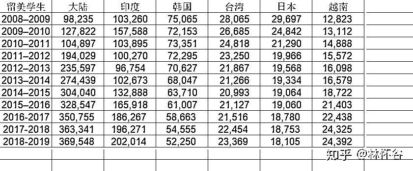

  

现在台湾和日本已经进入草食低欲望社会，连英语都越来越懒得学，

但台湾产业由于更容易被取代，导致工作岗位持续减少，移民澳洲的人口也突然加速上升，

实际上看下面的表，东亚和东南亚移民澳洲的速度都在加速：

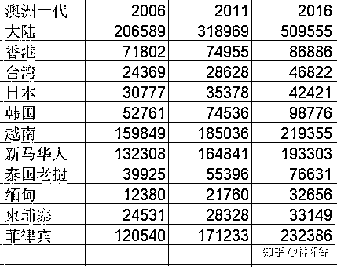

# 匿名用户

> 作者：匿名用户
> 
> 赞同数：1884
> 
> 编辑于：2022-05-02 01:51

我实习的研究所来了一个因疫情没法返回意大利某学校的实习生。我从来没有出过国，对国外的了解基本都是通过网络，但是在跟他熟悉之后我才知道，我们的生活和那些西方普通人的生活落差有多大。

我们研究所早上 9 点上班，中午休息两个半小时，下午 5 点半下班。这对中国大部分人来说已经是非常轻松的工作了，然而据这位留学朋友所说，意大利那边一天一般工作只上 4 到 5 个小时的班，超市商场等地方也可以享受双休，根本没有调休这个概念。在餐馆洗盘子一个月也有可观的收入。

听到这些我感到非常难受，我目前属于在校研究生实习，[早九晚五](https://www.zhihu.com/search?q=%E6%97%A9%E4%B9%9D%E6%99%9A%E4%BA%94&search_source=Entity&hybrid_search_source=Entity&hybrid_search_extra=%7B%22sourceType%22%3A%22answer%22%2C%22sourceId%22%3A2457461553%7D)几乎就占据了白天的全部时间，回到家根本没有精力和时间享受生活（这也有人杠我是真的没想到，工具人做久了连自己是工具人都感觉不到了吗），只能躺在床上麻木的刷下手机让自己进入一种大脑放空的状态。

人一天除去吃饭洗漱睡觉这些必要的时间之外，也不过就能剩下 8 个小时的人生时间，却全部得用来谋生……更恐怖的是 8 个小时已经满足不了吃人的恶魔们了，10 小时，12 小时，甚至全年无休……

真正的工具人。

那你一生到底是为什么而活呢？为了活着本身吗？

我也回答不出为什么我们天生就该如此辛苦

以上的表达可能会让人误解，但只是个引子，没有特殊意味，发展中国家和发达国家确实有差异，生而为人，这就是命运的区别了，不是说你出国就能过好，以同等身份出国，仍然只是一个异类。像那位意大利留学生，就算留在国内，他依然是付得起上万路费的有钱人。

说别的可以，说我是 50 万的真的不能忍，我最恨这些[叛国贼](https://www.zhihu.com/search?q=%E5%8F%9B%E5%9B%BD%E8%B4%BC&search_source=Entity&hybrid_search_source=Entity&hybrid_search_extra=%7B%22sourceType%22%3A%22answer%22%2C%22sourceId%22%3A2457461553%7D)。说我吹意大利也大可不必，刚巧来的这个实习生是意大利留学的，我也只是听说而已，如果他骗我那我也没办法。

我想表达的是，8 小时工作制对人来说也是不合理的，我国不是供不起全国的小康生活，而是资源分配有问题，富豪多如牛毛，就我认识的那些有钱人（别杠了，谁还没几个有钱的亲戚）也基本上都是昧着良心赚钱，要么是在法律的边缘疯狂试探。

你可以说不敢干是怂，但是违背良心品德的事我是真的做不出来，我觉得这个世界的不公在于勤恳者无法劳有所得，这在鸿蒙之初并没有写进自然规律中，而是人类诞生后才出现的现象。

我是研二的学生，因导师跟某考古所对接所以从研二开始在这边实习，一个月只有 1500 助研费，还要负责打扫本不该我们几个学生打扫的整层实验室（我们只在其中一间仪器室活动）这里的领导还要 pua 我们说吃亏是福，如果他们觉得哪间实验室脏了，就扣掉我们当天的助研费。

要我们配合他们出差，却分文出差补助不给，连去到车站的出租都不给我们报销，让我坐地铁过去，最后还说这点钱也要报销？但我所配合的他们单位的员工却有一天几百的补助。

最后我终于明白了，这研究所之所以愿意和我们学校合作，让学生来实习，就是为了廉价劳动力。

可笑的是，一个所谓的国家重点科研项目光是青铜器这方面就有上千万的国家经费，领导天天操心怎么能花光这些钱。

所以，真的是没钱吗？浪费的人甩手千万，勤恳的人为每日的生存奔走。努力读到 211 硕士，还要天天忧心担心以后的吃饭问题，这个社会真的健康吗？

另外跟大家说一个我听到的黑幕，去年这里只有一个编制岗位，对外招聘，全国各地来了 10 个人，最后录了他们自己的一个 30 多岁的员工，剩下 9 个满怀希望来到此处考试的人就只是炮灰而已。

[汉初](https://www.zhihu.com/search?q=%E6%B1%89%E5%88%9D&search_source=Entity&hybrid_search_source=Entity&hybrid_search_extra=%7B%22sourceType%22%3A%22answer%22%2C%22sourceId%22%3A2457461553%7D)有一个奇特的现象，光是沛县一个县城就贡献大汉朝统治的文武中坚力量，萧何曹参从一个县城小吏到名留青史，樊哙，降灌三人，从莽撞无知爱嚼舌根的街头小贩到千古名将。

对此[王立群](https://www.zhihu.com/search?q=%E7%8E%8B%E7%AB%8B%E7%BE%A4&search_source=Entity&hybrid_search_source=Entity&hybrid_search_extra=%7B%22sourceType%22%3A%22answer%22%2C%22sourceId%22%3A2457461553%7D)老师说了一句非常颠覆我三观的话，大意我总结为，不是你不行，而是路不平……

从前学“[孙叔敖](https://www.zhihu.com/search?q=%E5%AD%99%E5%8F%94%E6%95%96&search_source=Entity&hybrid_search_source=Entity&hybrid_search_extra=%7B%22sourceType%22%3A%22answer%22%2C%22sourceId%22%3A2457461553%7D)举于海”，当年老师讲努力的重要性。现在看来，如果没有“伯乐”，千里马会被发现，但是对于人类社会而言，大多数位置并不需要所吹嘘的那么高的能力。

那谁，举个例子，马嘉祺之类的，长的丑（我是女生，客观评价）学习拉，业务能力差，就这样，火成那样？连我导师她女儿都深陷其中，我曾经不理解……但悟了这句“不是你不行，而是路不平”之后，我理解了。

读书少就多读点书，不要上来就杠别人！真的无语，明明是讨论一个社会问题，非要那么狭隘的只抓表面信息。

好吧，我本来只想谈现象，因为我觉得原因很复杂，如同人类文明的形成一样复杂，甚至很虚无。

就如同我问你，你为什么会有嫉妒这种莫名其妙的情绪？为什么有钱人在生活富足到空虚的地步还有极强的占有欲？占有欲和嫉妒这些有伤他人的情绪是如何产生的呢？如果有人把这两者完全消灭，我们就不得不称他一句圣人。

那么这两种情绪的根源是什么呢？基因里的天赋？

长久以来为了生存所衍生的过激的竞争意识写在了每个人的基因里，所谓矫枉必定过正？

这算不算是本恶论的根据呢？

如果人人平等了，那需要优越感的人还怎么实现自己的价值呢？他们必然会想方设法破坏平等，就算他已然十分富足。

再跟大家讲一个历史上的小故事，印象中起源于马踏飞燕这个器物，大抵讲的是边陲一个地方小富强，本性善良。某年，他所在的城县发生了旱灾，百姓接连饿死，他得知之后，只开放了自己家的一个仓，就帮助了全城的人度过难关，因而流芳百世……

我看到这个故事后，受到了很大的冲击。历史老师口中那个在发展巅峰时期食不果腹生产低下的古代社会，事实却是一人之食养活万人绰绰有余。

# 匿名用户

> 作者：匿名用户
> 
> 赞同数：2939
> 
> 编辑于：2022-05-23 16:20

**你见识短浅呗。**

因为过去 400 年的殖民扩张进程，只有欧洲一个胜利者。

其他地区的人类都是地理大发现这场延续 400 年大迁徙运动中的失败者。

你觉得只有东亚人过的苦，活得累，那是你见识少。

你只看过欧美发达国家居民制作的视频。你的视角，只是向上看，只看向 10 亿发达国家的居民的生活。

现在网络发达了，[发展中国家](https://www.zhihu.com/search?q=%E5%8F%91%E5%B1%95%E4%B8%AD%E5%9B%BD%E5%AE%B6&search_source=Entity&hybrid_search_source=Entity&hybrid_search_extra=%7B%22sourceType%22%3A%22answer%22%2C%22sourceId%22%3A2498014498%7D)，也有越来越多的视频上传，你自己看一看，其他发展中国家的民众过着什么样的生活。

你就知道，**发展中国家的国民，承受的生活压力，没有高下之分，都是一样的苦**。

**经济就是一切的基础，其他的都他么是虚的。**

发达国家的高水平生活，建立在他们国家的人均 GDP 超过 3 万美元的事实上。

不同地区的人在心理和生理上没有任何差异，都是两个眼睛一张嘴，男的一根吊，女的一口笔。

**发展中国家的穷人，都是睁眼想着今天的事情，闭眼想着明天的生活。**

非洲的农民，也是面朝黄土背朝天，辛苦劳作，为全家人的肚子努力。

几十万的印度农村小伙，为了家里人能吃饱饭，进入血泪拆船厂，冒着生命危险，一天赚 20 美元。

拆船业赚了，由此造成的海洋污染，累计已经超过 1000 亿美元。

眼前饿着肚子，谁顾得上将来？

  

印尼没有土地的农民，为了养活家人，在火山口背硫磺，吸着硫磺的毒气，一次背 100 斤硫磺下山。 就赚 5 美元。

[尼泊尔](https://www.zhihu.com/search?q=%E5%B0%BC%E6%B3%8A%E5%B0%94&search_source=Entity&hybrid_search_source=Entity&hybrid_search_extra=%7B%22sourceType%22%3A%22answer%22%2C%22sourceId%22%3A2498014498%7D)，夏尔巴人，送人上珠峰，一趟赚 5000 美元。

  

**坐飞机，就是一个最简单，最直接衡量国家，人民贫富的标准。**

全世界的航空业，一年坐飞机的人是 44 亿人次。

整个亚太地区，**40 亿人口，只有 16 亿人次**。

欧洲地区，**5 亿人口， 16 亿人次**。

北美地区，**3 亿多人口，10 亿人次**。

拉美地区，3 亿人次。

中东地区，2 亿人次。

非洲地区，**10 亿人口，9200 万人次**。

  

看出差距了么？

  

欧洲，北美发达国家的居民，人口数和坐飞机次数比 1：3.

平均一个人一年有坐 3 次飞机的机会。

亚洲地区，平均 2.5 个人，一年才有坐一次飞机的机会。

非洲更惨，平均 11 个人，一年才有坐一次飞机的机会。

  

**穷人为了活命，已经拼尽全力了，怎么能不累呢？**

  

**认清最基础的事实，中国目前还是一个发展中国家。**

# 打火机也没了

> 作者：打火机也没了
> 
> 赞同数：6135
> 
> 编辑于：2022-01-25 12:04

## **太挤。**

你比如说非洲吧，

大家印象里的超级贫穷落后、资源丰富、但管理混乱、疯狂生孩子造人、一对夫妻生八个、人口暴增粮食危机、吃不饱饭、连年饥荒、[军阀战争](https://www.zhihu.com/search?q=%E5%86%9B%E9%98%80%E6%88%98%E4%BA%89&search_source=Entity&hybrid_search_source=Entity&hybrid_search_extra=%7B%22sourceType%22%3A%22answer%22%2C%22sourceId%22%3A2319918255%7D)、有好多好多数不清的国家、面积好大好大的**非洲大陆**——

**实际上到今天只有 12 亿人。**

是的，没有中国人口多…

* * *

你再比如说南美洲，

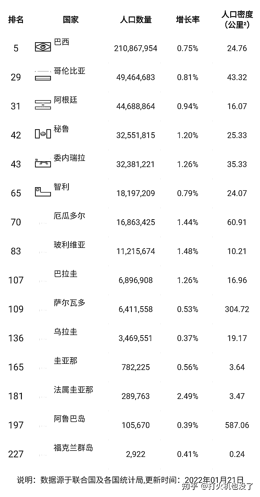

以上这一长串子国家属于南美

大家印象里全是一望无际的热带雨林、[亚马逊河](https://www.zhihu.com/search?q=%E4%BA%9A%E9%A9%AC%E9%80%8A%E6%B2%B3&search_source=Entity&hybrid_search_source=Entity&hybrid_search_extra=%7B%22sourceType%22%3A%22answer%22%2C%22sourceId%22%3A2319918255%7D)穿越整个大洲、盛产咖啡、可可、整天狂欢节、天天踢足球、混血儿每天啪啪啪、生产各种男模特女模特的**南美大洲——**

**只有 4 亿多人。**

在东亚相当于什么水平呢？

**日本+韩国+朝鲜+越南，也有 4 亿人……**

这 4 个国家的面积……自己看地图去吧。

你看地图都觉得东亚人活着就是一种受罪。

* * *

东亚人为什么活得累？还问呢，

就这有些人还整天担心人口不足呢。

我看还是不够累，累死你个孙子……

# 驴保国绅士

> 作者：驴保国绅士
> 
> 赞同数：1.4 万
> 
> 编辑于：2022-05-06 15:29

不管你是东亚人，还是西亚人，只要是带专以上，用这个方法我相信你后面肯定活的很轻松。

### 用 RPG 思维游戏人生。

这个名字是我自己编的，自从我大学毕业之后一直践行这个方法，不光我的收入和魅力不断提升，而且每天基本都会心情愉悦。

说下流程：

**第一步**，创建角色。跳出当下的自己，做一个掌控机器人的玩家，换句话说，你这副躯壳是你的角色，你可以随意操控你的角色。你可以去健身，读书，来加强角色属性。

**第二步**，接任务，做任务。身边的人除了关系亲密的人，都可以理解是 NPC，是假人，是来帮你完成人生任务的，不用畏惧他们。

怎么让他们帮你完成任务，说一个营销原理，帮助别人和满足别人的需求是达成自己目的地手段。是手段，别低声下气的去做舔狗和 j 人，因为你这是无效手段，任务路线都做错了，怎么让 NPC 给你奖励。

**第三步**，查攻略。为啥查攻略，你不说我是主角吗？没错你是主角，但是查攻略能让你升级的更快，因为有些关卡已经是别人刷爆了的，100 级大佬的一句话，告诉你哪个地图刷级和金币快，能让你省半天的功夫自己研究。

太阳底下没有新鲜事原则，你想到的别人早就想到并且实践了，模仿就好。

**第四步**，完成任务领取奖励。比如说，你持续的写作，分享自己的创业经验，然后收获了一大批粉丝，他们最后会给你带来收益。再比如说，你辞职了，用半年的时间去旅游去享受这个世界的美景，吃遍美食，那些可以给你带来快乐和幸福的东西，就是你领取到的奖励。

但是你是不断升级的，如果满级是 100 级，你现在是 50 级，让你穿 20 级的装备，你肯定不会满足，打怪也打不过，那你就得做任务升级装备。

回到人生，你会发现我说的什么等级都可以变成你的年龄，阅历，家庭环境。一些很复杂的参数。考虑这些只会越来越痛苦。

但是跳出人生，**用 RPG 思维游戏人生**。你会发现想不明白的事情会豁然开朗。钱袋子小了就升级钱袋子，健康不好了就锻炼身体，反正就是你感觉哪里你看不惯了不满足了，你就去接任务升级大关就完事了。

但是这个游戏思维有个前提，就是你得有个正常人的智商，才能玩这个游戏。

要不然你就会成为 NPC，帮别的玩家做任务，那你的人生可就惨喽。

  

# 张砚辰

> 作者：张砚辰
> 
> 赞同数：574
> 
> 编辑于：2019-10-27 17:29

2008 年诺贝尔经济学奖得主[保罗·克鲁格曼](https://www.zhihu.com/search?q=%E4%BF%9D%E7%BD%97%C2%B7%E5%85%8B%E9%B2%81%E6%A0%BC%E6%9B%BC&search_source=Entity&hybrid_search_source=Entity&hybrid_search_extra=%7B%22sourceType%22%3A%22answer%22%2C%22sourceId%22%3A584372626%7D)，1994 年发表文章《亚洲奇迹的神话》

1995 年国内官方汉译：[`wk.baidu.com/view/0eb3785f804d2b160b4ec099?pcf=2`](https://link.zhihu.com/?target=https%3A//wk.baidu.com/view/0eb3785f804d2b160b4ec099%3Fpcf%3D2)

> 亚洲新兴工业化国家象 50 年代的苏联那样，在很大程度上是通过惊人的资源动员来实现经济增长的。……亚洲的增长和苏联的高增长时代一样，是由超常的劳务和资本投入增长而不是由效率的获取所促成的。 

  

> 环太平洋圈的新型工业化国家和地区在超常的资源动员中获得了回报，这是最乏味的经济理论就能使我们了解的东西。如果说亚洲的增长真有什么秘密的话，只不过是愿意为了将来的收获而牺牲眼前的满足罢了。 

# 知乎用户 NJHHzV

> 作者：知乎用户 NJHHzV
> 
> 赞同数：1996
> 
> 编辑于：2022-02-28 21:38

可别东亚了，日韩都比契丹舒坦。

想了想补充一句：你所认为的“传统”，真的是自古以来的传统吗？

# 菜鸟阿伊古

> 作者：菜鸟阿伊古
> 
> 赞同数：1283
> 
> 编辑于：2019-02-10 10:41

东亚人祖传逻辑:

年轻时候累一点，晚年就可以甩手享福了。

# 鼎天立地

> 作者：鼎天立地
> 
> 赞同数：4247
> 
> 编辑于：2019-02-02 08:35

“吃得苦中苦 方为人上人”这句格言讲道理我是很不喜欢的。

我至今记得本科的时候系里辅导员跟我们说过的一句话，无论全系的同学多么努力，总有一半人成绩处于后 50%。

我在东亚一度以为后 50%=失败，是需要回炉重造的。

我父母都是中学老师，每次家长来电话问成绩永远都是问排名以及是否到平均分。回答是上升了电话那头就开心得不行，回答是下降了那头就唉声叹气。

根据抽屉原理，考完试总有人会被骂。

“希望这次考试班里的人每个人都能上平均分。”这并不是班主任的一句玩笑话，而是他们真心的希望。因为每次考完他们都要忍受一遍孩子低于平均分的家长们的质询。

浙江全体初中生无论怎么努力补课，总有一半人中考排名位于后 50%，将来要去职业中专（我省普高职高 1:1 政策）。当蓝领并不是不好，但是很多东亚家长眼里孩子去职高=失败。

在浙江的高考，只有 14%的人能上一本，在这批上一本的人里面，只有 10%左右的人能进入 985，在这批进入 985 的人里面，只有 4%的人能进清北。在这批进清北的人里面，仍然会有 50%的人上大学后产生“失败”的感觉。这种感觉一旦弥漫，人就会走极端。

  

东亚人能活得不累有鬼了。

  

\------------

英国一个检修暖气片的工人，在我住的公寓拨了几下开关，拿手电查了下线路。工作了一个小时，然后向我房东收费£220（大概¥2000 这样子），人家在欧洲当蓝领当得很开心。当然我承认他也是受过专科教育的，他也是有证的，工作也是有技术含量的（杠精退散！），在英国值这个价格。

# 知乎用户

> 作者：知乎用户
> 
> 赞同数：519
> 
> 编辑于：2019-02-27 16:07

因为上述地区，全都实行一个制度：土地管制。

**人的一生，有太多时间花在家庭的基础——房子上了，怎么能不累呢？**

  

下面是来自于《[国土之祸，堪比计生](https://www.zhihu.com/search?q=%E5%9B%BD%E5%9C%9F%E4%B9%8B%E7%A5%B8%EF%BC%8C%E5%A0%AA%E6%AF%94%E8%AE%A1%E7%94%9F&search_source=Entity&hybrid_search_source=Entity&hybrid_search_extra=%7B%22sourceType%22%3A%22answer%22%2C%22sourceId%22%3A609737856%7D)》节选

* * *

> 《规划为什么会失败》提到，在美国城镇向郊区自由扩张的 1960 年代，都市区的房价中位数/家庭收入中位数也大都在 2 倍左右。  
>   
> 这意味着，大多数普通青年高中毕业后工作三五年，就能结婚买房，那时 7 成房子是郊区的独栋，中位数面积一百四五十平米，三四个卧室，周围空地约 1000 平米。  
>   
> 结婚早，空房间多，空地也足够小孩开心玩耍，半大孩子也多，给点零花钱可以请来帮着照看小宝宝，学校由社区自治不怎么花钱，天伦之乐溢满……所以虽然有女权反战等流行观念的冲击，[生育率](https://www.zhihu.com/search?q=%E7%94%9F%E8%82%B2%E7%8E%87&search_source=Entity&hybrid_search_source=Entity&hybrid_search_extra=%7B%22sourceType%22%3A%22answer%22%2C%22sourceId%22%3A609737856%7D)到 1969 年还是 2.5，可以说是希望的田野了。  
>   
> 即使目前，按我前两年粗略扒的一个数据，扣除海外群岛和阿拉斯加以外，其余本土州的地理气候、宗教信仰、种族文化、教育年限、收入水平、城市化率都粗略相当，独栋住宅占比最高的 5 个州（72%以上）的生育率平均是 2.0，而公寓占比最高的 5 个州（35%以上）则刚超过 1.6，可见房子大、房间多，对生育意愿的影响程度非常高。  
>   
> 反观那时的对手苏联，居民们挤在 20 平米筒子楼里，六七对小夫妻共用一个厨房，怎么鼓励英雄母亲，总生育率也上不来。  
>   
> 20 多年后，苏联垮了。 

* * *

> 从 1970 年代开始，先是罗马俱乐部那本《[增长的极限](https://www.zhihu.com/search?q=%E5%A2%9E%E9%95%BF%E7%9A%84%E6%9E%81%E9%99%90&search_source=Entity&hybrid_search_source=Entity&hybrid_search_extra=%7B%22sourceType%22%3A%22answer%22%2C%22sourceId%22%3A609737856%7D)》恐吓，接着石油危机，美国很多城市规划开始限制郊区扩张和住宅开发。  
>   
> 那些扩张难度最大的城市，现在郊区房价中位数/家庭收入中位数达到了 5 到 8 倍，和欧洲多数城市相当，而对照的开发扩张很松的城市，则仍旧只有两倍多。  
>   
> 《[规划为什么会失败](https://www.zhihu.com/search?q=%E8%A7%84%E5%88%92%E4%B8%BA%E4%BB%80%E4%B9%88%E4%BC%9A%E5%A4%B1%E8%B4%A5&search_source=Entity&hybrid_search_source=Entity&hybrid_search_extra=%7B%22sourceType%22%3A%22answer%22%2C%22sourceId%22%3A609737856%7D)》一书的作者对此痛心疾首。美国拿出 2%的土地就够所有人都住大别墅，大停车场、大商场游乐园、工厂园区、企业总部、学校医院，限制性规划白白提升了约 3 成不必要的房价。  
>   
> 去年，美国房价中位数是 20 万美元，是家庭收入中位数 6 万美元的 3 倍出头，按作者所说，如果没有规划限制，那房价收入比又会回到 2 倍出头。  
>   
> 限制开发的恶果实在太多。规划越严格的地方，房价和租金越高，上千万户家庭买不起房，或者租房之后就过不下去了，需要政府每年上千亿美元去补贴利息和房租、兴建廉租房还有穷人福利；而且犯罪、吸毒和无家可归者比例更高，需要政府大量的警察、监狱、福利和医疗支出；很多底层小孩们放弃努力上学，反正看不到什么希望，因为父母一代也阶层固化了。  
>   
> 原本追求高效、美观、便利的那些手段，结果适得其反，但很少有人意识到，也很难改变。  
>   
> 看到这里，我觉得作者有些偏颇。  
>   
> 从七八十年代开始，日本等东亚经济体就不断的积累外储，抢走订单但又不买够美国商品，外储累积到五万多亿美元了。美国产业界少了五六万亿美元的出口和就业，股票国债房产等资产池子却又注入了等量的水，出现了房价拉高、工薪拉低的巨大剪刀差，不提到这些就是不够客观。  
>   
> 好在美国是高度地方自治，一城一策，联邦政府无权干预，苹果亚马逊或者福耀玻璃等企业，不难找到约 10 万人民币一亩的便宜土地，兴建巨大总部或者工厂，居民也可以自由搬迁到那些便宜地方。可以说美国仅仅是部分地区感染了顽固性真菌，还是有很多正常的州或者城市可以避难。  
>   
> 如果作者知道日本韩国台湾的土地管制所造成的全民族的慢性自杀，他也许不会这么苛刻的批评自己的祖国了。 

* * *

> 日韩台的地制与美国最大的不同，是有众多立法和强大的中央官僚的交叉管制，所有地方政府、居民、企业和地主的自主空间都非常小，不能发挥市场机制的决定性作用。  
>   
> 我对东亚模式已经吐槽太多，这里只补几个段子。  
>   
> 1993 年 6 月当选的非[自民党](https://www.zhihu.com/search?q=%E8%87%AA%E6%B0%91%E5%85%9A&search_source=Entity&hybrid_search_source=Entity&hybrid_search_extra=%7B%22sourceType%22%3A%22answer%22%2C%22sourceId%22%3A609737856%7D)首相细川护熙，之前担任过[熊本县](https://www.zhihu.com/search?q=%E7%86%8A%E6%9C%AC%E5%8E%BF&search_source=Entity&hybrid_search_source=Entity&hybrid_search_extra=%7B%22sourceType%22%3A%22answer%22%2C%22sourceId%22%3A609737856%7D)知事（等同于省长），就曾因为一个汽车站要搬迁 30 米，屡次到东京拜求部委的官僚。  
>   
> 也许是深受刺激，他当选首相就列了 11000 多项管制规定，并宣布「原则上全部废除」，当然结果是他自己马上被搞下台了。  
>   
> 另一个是看到台湾媒体的吐槽，讲蔡去台中给实业界打气，却有老板当场发怒：我去日本神户投资，厂房每坪（3.3 平米）才 6.5 万新台币，在台中工业区 25 万新台币都找不到，怎么搞！  
>   
> 再搜发现，最便宜的漳滨工业区每坪 5 万新台币，马上理解了为什么台湾年轻人 20 年不涨薪水，要苦考公务员或者要闹了。  
>   
> 这个传导机制大概是这样的：  
>   
> 严苛的管制锁定土地以后，制造业很难再新建园区厂房，就只能出海，其他公司难以新建总部，就只能挤在城市里缴纳高昂租金；  
>   
> 创新的激励、股票的分红、员工的薪酬都会被租金削薄，股市回报和巴菲特玩的那个场子没法比；  
>   
> 工厂不怎么扩招，好的就业机会过度集中在一线城市（所以日韩台都有超级大的中心城市），青年们从小熬补习班以求好的工作机会，三十多岁才能挤进小房子，还要努力加班还房贷，生育率自然下降；挤不上去的普遍就心态崩了，日本青年宅，台湾青年闹。  
>   
>   
> 包括日本房产泡沫，大头也要归功于土地管制。买家争相出手时，许多周边土地划为农地禁止开发，可开发的土地极少，还得跑上几年流程才能交付，价格自然飞涨，导致更多人追进，房价就自我循环起来了。  
>   
> 台湾从 86 到 90 年房价上涨 4 倍，原理相似，搞笑的是当时政府还限制供地，美其名曰打压炒作。  
>   
> 东亚的官僚社会相似到可怕，上司、前任出的政策是不可能有错要改的，同事们的权力是绝对不能砍的，那等同于自杀。  
>   
> 即便抄来了自由媒体、独立司法和选举政治，但官僚们终身互相嵌套的韧性超强，首相总理议员也拿他们几乎没辙，民间和企业又以顺从迎合为主，学者和媒体吵吵一阵就过去，「最大在野党美国政府」即使要求结构性改革，可通常也因为不能免官而不起作用，官僚社会里不能免官的约束就近乎等于零。  
>   
> 美日谈判时美方小组还真的曾经给过建议，要求下放规划权限、调整土地税收结构，以此促进投资消费和内需，但这种「市场机制起到决定性作用」的美式思维，和东亚官僚体系是天然死敌，享受过诸多省长一次次来求情、地方「陈情团」年年前来拜码头的官员们，放权的痛苦堪比戒断海洛因。最后用承诺调整土地税制、户均住宅用地增到 95 平米、增加基建开支等糊弄过去。  
>   
> 直到泡沫破裂之后，才挤牙膏式一点点放权，嗯，渐进式的「改革」确实比较缓和，代价是日本完了。  
>   
> 然而日本还是受过特别关照的，55%的住房是[一户建](https://www.zhihu.com/search?q=%E4%B8%80%E6%88%B7%E5%BB%BA&search_source=Entity&hybrid_search_source=Entity&hybrid_search_extra=%7B%22sourceType%22%3A%22answer%22%2C%22sourceId%22%3A609737856%7D)独栋小楼，平均实用面积 120 多平米，总体生育率还能到 1.4，比韩国 1.0 和台湾 1.2 要好很多。现在只知道日本老龄化很惨，那是因为韩国台湾的生育高峰比日本战后高峰要晚十年，还没到时候给大家表演什么叫真正的人间惨剧。苏联从奇迹到解体，拉美从奇迹到陷阱，都不过两代人，东亚从奇迹到消亡也不会更久，苍天饶过谁。  
>   
> 不过还好日韩台只是管的严，没有禁止地权流通，十几年时间就均富了，没有人为制造城乡收入差距 2.7 倍、财产性收入差距 12 倍这种堪比拉美非洲的割裂。 

* * *

> 总算到了核心部分：国内的土地政策中断了正常的财富循环和链式传导，导致居民人均收入少了 2/3，需要尽快接续上去，才能撑住经济增长、债务、房价还有税收。 

  

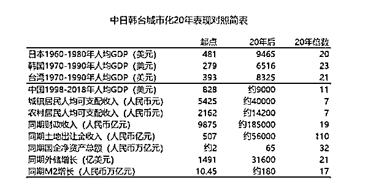

> 这里假设几个例子，帮助理解正常传导机制：  
>   
> **举例 1：**假如北京每年新批出 3000 万平米新建或改建住宅和商业办公项目，要求业主按规划配建 600 万平米学校医院体育馆费用，还要求每新增平米缴纳市政增容费，假设平均每平 1.5 万元则政府收入就有 4500 亿元，大约是每年土地拍卖毛收入的 2 倍。银行自动会为业主们配套几千亿贷款，其中建安支出会变成相关企业营收和工人工资，流向全国。  
>   
> 正常的机制的关键是用财税框架限定。[房产税](https://www.zhihu.com/search?q=%E6%88%BF%E4%BA%A7%E7%A8%8E&search_source=Entity&hybrid_search_source=Entity&hybrid_search_extra=%7B%22sourceType%22%3A%22answer%22%2C%22sourceId%22%3A609737856%7D)是市政维护和市政[债券](https://www.zhihu.com/search?q=%E5%80%BA%E5%88%B8&search_source=Entity&hybrid_search_source=Entity&hybrid_search_extra=%7B%22sourceType%22%3A%22answer%22%2C%22sourceId%22%3A609737856%7D)利息的支撑，扩张则依靠市场认购新债还有新增面积的增容费，征收靠房产申报价值的倍数，[钉子户](https://www.zhihu.com/search?q=%E9%92%89%E5%AD%90%E6%88%B7&search_source=Entity&hybrid_search_source=Entity&hybrid_search_extra=%7B%22sourceType%22%3A%22answer%22%2C%22sourceId%22%3A609737856%7D)报几倍价格就必须年年缴几倍房产税。相比而言，上级政府限定供地+地方征收拍卖+[增值税](https://www.zhihu.com/search?q=%E5%A2%9E%E5%80%BC%E7%A8%8E&search_source=Entity&hybrid_search_source=Entity&hybrid_search_extra=%7B%22sourceType%22%3A%22answer%22%2C%22sourceId%22%3A609737856%7D)和贷款支撑基建的方式，问题太多了。  
>   
> **举例 2**：设立一个 5 年期的临时规定，城镇每新建 300 平米住宅和办公面积，需要购买一套宅基指标。北京这 3000 万平米就需要购买 10 万套宅基约 500 亿元，就有 10 万户农村居民带着约 40 万元指标款进城变成首付。显然，接收的城镇又需要购买宅基指标，继续拆购更多宅基，链式反应因此启动。五六年的时间能大概纠错，绝大部分农民进城，专职农户的经营面积扩大十倍，城郊村镇快速变得欧美化。  
>   
> **举例 3**：企业和个人包括港澳台和境外富豪，收购多个乃至几十上百个宅基指标后，就可以购买大块土地（多数会自动选择丘陵和林草地），兴建别墅、城堡庄园和总部。国人现在每年仅在美国购置豪宅的数量就有 3 万套接近 300 亿美元，3 万户移民即使每户带走 3000 万人民币财富，那每年也是万亿级的财富外流。为什么不准流向国内的农村田园、私营高端医院学校和慈善机构呢？这些钱变成农民、教师、医生的消费和投资，又会变回企业的营收、利润和税金，一轮一轮的提升。要知道 2013-2017 年财政的扶贫专项补助 5 年才 2787 亿元，多数还只是折腾了干部、养了懒人，为什么要把 20 倍的钱撵到北美澳洲呢？  
>   
> **举例 4**：现有城郊、县镇周边不设置任何硬性开发边界，以配套费和房产税、污水和环卫规划要求，自然会杜绝无谓的浪费。至于每户占地一亩或者两亩，那悉听尊便，即便 2 亿套住进六七亿人，占了三四亿亩就占了吧，何况拆村并地能回来大半。万万不可设置任何计划性的农地保护政策，成了官僚 KPI 就只能年年加码给捆回去的。 

  

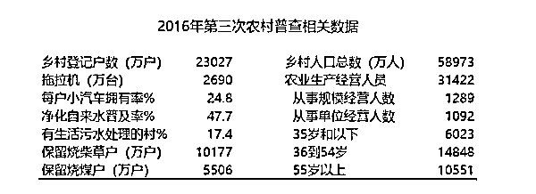

  

> 以上是粗略解释，实际落地所需要的细化和配套措施远非个人能罗列，多数读者也看不完。可以确认的是，调整以后，城乡差别、经济停滞、债务危机、房产泡沫、内需不足、钢铁建材家电产能过剩、高铁高速公路亏损、进口不足导致贸易摩擦、乃至公务员白条……这些大多会自动消失。  
>   
> 中国经济也能转型为现代经济：农业就业不到 5%，工业就业不到 20%，其余 7 成多人都从事教育医疗金融法律体育文化娱乐旅游餐饮环卫物业运输等工作，绝大部分是互相服务。  
> 那时，人才真正成为财富的源头，而非官僚政绩竞争的工具。  
>   
> 按照前几年中央提出的「市场决定」和「土地平权」，以及「央地分权」将土地农村、环保治安、教育医疗等事权下放为央地共管的要求，这些早该启动。但相关官僚机器，超出想象的强硬。未来将会如何，不太敢说了。 

**人的一生，有太多时间花在家庭的基础——房子上了，怎么能不累呢？**

# 胡小喵

> 作者：胡小喵
> 
> 赞同数：1027
> 
> 编辑于：2022-01-24 04:35

首先，很多人讲，天朝老百姓活得累是因为人均资源少，人均 GDP 不高之类的。

我作为一个去过很多国家的人，想说一句，并不全是。

眼睛别总是盯着 33 个发达国家。除了那 33 个发达国家之外，其他地区的人，就都过得不幸福么？

  

如果每个人都认同挣钱是为了获得更高的社会地位，为了把别人踩在脚下的话，那恐怕确实只有一小撮人能觉得幸福，其他人都被踩的不幸福。

就我所见所闻来讲，我觉得我们的邻居，泰国的老百姓，物质上是不如天朝的，但是论生活压力，精神状态比天朝好很多，心态比较 peaceful。其实普通老百姓活着，并不真的需要你想象的那么多钱才会快乐。反正你也很难跨越阶层，干嘛和自己过不去呢。

再比如说[哥伦比亚](https://www.zhihu.com/search?q=%E5%93%A5%E4%BC%A6%E6%AF%94%E4%BA%9A&search_source=Entity&hybrid_search_source=Entity&hybrid_search_extra=%7B%22sourceType%22%3A%22answer%22%2C%22sourceId%22%3A2322501827%7D)，物质上也不如天朝。但是南美的人快乐的阈值就比较低，几个成年男人找个野球场打一整天的篮球，就很土嗨，很满足。搁在天朝这是不可能的。天朝的成年男性我没见有几个能打一天球的，打球的基本上都是学生。

人生很短暂，并不是只有物质极大丰富，超越他人，才能获得快乐感和满足感。何况，地球的资源也是有限的，而人攀比和占有的欲望是无限的。

# 匿名用户

> 作者：匿名用户
> 
> 赞同数：547
> 
> 编辑于：2019-01-30 01:26

东亚，更主要是[东北亚](https://www.zhihu.com/search?q=%E4%B8%9C%E5%8C%97%E4%BA%9A&search_source=Entity&hybrid_search_source=Entity&hybrid_search_extra=%7B%22sourceType%22%3A%22answer%22%2C%22sourceId%22%3A585207131%7D)，是服从主义的社会，长幼尊卑的等级秩序是刻在股子里的，日韩甚至把等级制度直接整合进了语言里(发达的敬语体系)，可见其森严。

直接结果就是东亚人以耐操为美德，将剥削合理化，遇到困难首先从自己找问题，资本家自然喜闻乐见，人力成本直接降了一大截。

# LDPDXP

> 作者：LDPDXP
> 
> 赞同数：556
> 
> 编辑于：2022-04-09 12:51

牺牲当下的快乐以换取未来的“幸福”几乎可以算得上是深刻于国人生活中的文化基因。从小我们就被教育，苦几年，考个好大学就好了；工作的时候被鞭策，“吃得苦中苦，才能开路虎”。似乎只要我们能吃得了苦，必然能换来幸福快乐或者富足这个“甜”。反过来说，如果一个人不能吃苦，他的未来就岌岌可危，这种生活方式不值得鼓励和提倡。

然而，我发现，吃苦和吃得了苦并非幸福的必要条件，更不是充分条件。吃了一辈子苦的大有人在，而一辈子做自己喜欢的事情，幸福快乐度过一生的例子也比比皆是（即便考虑了出生的贫富因素也是如此）。尤其是，当这种因果关系置身于历史的[时间观](https://www.zhihu.com/search?q=%E6%97%B6%E9%97%B4%E8%A7%82&search_source=Entity&hybrid_search_source=Entity&hybrid_search_extra=%7B%22sourceType%22%3A%22answer%22%2C%22sourceId%22%3A2430800366%7D)和地球的空间观来看的时候，更觉得站不住脚。那么，为什么我们会形成这样的一种思维模式，且这种思维模式从家庭到社会似乎已成普遍的共识，然后一辈辈流传，以至于中国人的吃苦耐劳某种程度上也成了一种“[民族性](https://www.zhihu.com/search?q=%E6%B0%91%E6%97%8F%E6%80%A7&search_source=Entity&hybrid_search_source=Entity&hybrid_search_extra=%7B%22sourceType%22%3A%22answer%22%2C%22sourceId%22%3A2430800366%7D)”。个人认为，其实这种吃苦哲学的本质是一种自恋。过去的不可更改，未来不可预测，人能把握的唯有当下。从这句话出发，禅宗等哲学思想认为认真体味每一个瞬间，安住当下是最重要。而大部分的“无明”的人被情绪所绑架，过于在意利益得失，欲望的满足与否，所以无法安住当下，思维情绪总是为过去的“错误”懊恼或者“成功”而得意洋洋。对于未来又患得患失，端看各路菩萨前跪拜的善男信女许下的种种心愿即可知，大抵逃不过[福禄寿](https://www.zhihu.com/search?q=%E7%A6%8F%E7%A6%84%E5%AF%BF&search_source=Entity&hybrid_search_source=Entity&hybrid_search_extra=%7B%22sourceType%22%3A%22answer%22%2C%22sourceId%22%3A2430800366%7D)三字。可是，天地不仁以万物为刍狗，人类的那点悲欢离合，哪里是菩萨在意的，月的阴晴圆缺和人的悲欢离合根本就是生命常态。遗憾的是，不安于命运摆布的人，既然不能预测未来，那就在当下努努力，看看能不能改变未来。甚至父母对子女学习的一种逼迫本身也是为了安抚父母内心的焦虑不安而存在了的，是父母希望自己的行为能影响子女未来的自恋举动。为了不确定的未来在当下做的很多“努力”，因为是在焦虑和恐惧中不得不去做的，所以常常无法让人专注和安然。当一个人无法专注地投入到当下做的事情的时候，又无法从当下的事情中找到快乐。于是，学习的时候坐立不安，工作的时候敷衍了事，于是说是在努力，不如说是在表演一种努力的行为艺术，只是自欺欺人罢了。我们以为，只要我们能控制我们现在的行为，我们就能控制未来。于是，很多的当下，我们产生了大量的精神内耗，内心想运动，理智却不得不“学习”，内心想看小说，理智却不得不做数学题，内心想出去晒晒太阳，理智却不得困在办公楼写文稿。

最可怕的是，这种精神内耗一旦形成就很难摆脱，长时间的受苦教育又直接为功利主义的思维推波助澜，做不做一件事情是取决于这件事情有没有“好处”，而这个“好处”是被文化和社会定义的，一个人不追逐凡尘俗世所定义的“好处”会被视为“怪胎”或者“憨”，会被家长批准教育以矫正其思想和行为，除非这个人的意志足够坚定，在坚持自己的时候还能幸运地创出一条路，换来金钱或者地位等。

以上种种最后演化出了一种吊诡的现象。为了追求幸福快乐而做出的种种努力，却让人没有办法幸福快乐。不论是为了他人给你设定的目标而“努力”的当下，还是最终收获了权力地位金钱财富的生活。空虚、无聊、抑郁、焦虑或多或少成了逃不掉的精神痛苦。因为我们忘了孩提时，为自己收集的一片漂亮叶子而喜悦，捕捉的一只蜻蜓而快乐的那种真正满足的当下是怎样？即便我们身体健康，吃饱喝足地待着，内心却仍然是焦躁不安。

人的快乐与否，不是取决于是锦衣玉食还是[粗茶淡饭](https://www.zhihu.com/search?q=%E7%B2%97%E8%8C%B6%E6%B7%A1%E9%A5%AD&search_source=Entity&hybrid_search_source=Entity&hybrid_search_extra=%7B%22sourceType%22%3A%22answer%22%2C%22sourceId%22%3A2430800366%7D)，这种简单的道理并不需要在这里啰啰嗦嗦。一个丧失享受每一个当下能力的人，事实上也没有办法好好地享受收获的果实。或许，是时候重新审视内心，适当地停下慌张的脚步，多问问你的心想要什么，如果想发呆，就认真地发呆，想运动就投入地运动，只有慢慢习惯听到心的声音的时候，我们才能慢慢在每一个当下的场景中感受人生，找回久违的快乐。

# 万事如噫闻太师

> 作者：万事如噫闻太师
> 
> 赞同数：553
> 
> 编辑于：2022-03-10 12:18

凡事多讲正能能量！

你这话说的就不全面了！东亚人那么多，有几个活得累的？我怎么没看到？

我看到的东亚人都活的可快乐了！

有的每天只工作一两个小时；有的老婆、情人加在一起好几十；有的吃吃喝喝就把事情都办了；有的家里人辈辈都有大出息。。。。。。

你不能用自己片面的认识来描述整个东亚！

# 知乎用户

> 作者：知乎用户
> 
> 赞同数：229
> 
> 编辑于：2022-05-09 17:34

这也是我最近经常思考的问题。东亚人为什么活得累，我想 2000 多年前的日耳曼人应该也有同样的疑问，如果他们去过[罗马城](https://www.zhihu.com/search?q=%E7%BD%97%E9%A9%AC%E5%9F%8E&search_source=Entity&hybrid_search_source=Entity&hybrid_search_extra=%7B%22sourceType%22%3A%22answer%22%2C%22sourceId%22%3A2477167313%7D)或者有互联网。罗马人可以有免费的食物领取，可以看免费的表演，物质生活和精神生活都丰富，而日耳曼人的工作压力和工作时是全球之最，为什么日耳曼人活的那么累。

  

我喜欢称美国为新罗马，因为它的制度和生态位都跟古罗马有很多相似之处。

  

### **古罗马**

作为帝国的中心，罗马拥有着庞大的人口，罗马城在帝国早期就拥有 100 万人口，为了维持如此庞大的规模，政府在其中发挥了重要作用，**罗马城中有大量贫民，依靠国家发放的谷物和橄榄油生活。罗马居民不仅可以享受政府发放的免费食物，精神生活一样丰富多彩，角斗场中的角斗士表演由皇帝或者贵族出资赞助，市民可以免费观看。**

这些领取免费食物的罗马贫民大多来自自耕农，马略军改之前这些自耕农在战时自备武器装备成为罗马的士兵。但随着帝国军事上的胜利，罗马的自耕农经济却逐步走向破产。原因是多方面的，一方面长期的征战，自耕农随帝国军队出征而无法照顾地产，经济上破产，另一方面，战争之后大量财富和奴隶作为战利品涌入罗马，罗马的大贵族成为受益者。普通小农和手工业者在大地主、大奴隶主面前毫无竞争力，纷纷破产。破产后他们无法成为佃户或者手工业者，因为地主都使用更廉价的奴隶。公民失业后就都挤在罗马城里，靠福利过下去。

罗马统治者和皇帝也乐于用免费的食物和角斗表演来讨好公民。凯撒就曾经为了竞选公职，举债以至于破产。

从击败[迦太基](https://www.zhihu.com/search?q=%E8%BF%A6%E5%A4%AA%E5%9F%BA&search_source=Entity&hybrid_search_source=Entity&hybrid_search_extra=%7B%22sourceType%22%3A%22answer%22%2C%22sourceId%22%3A2477167313%7D)建立地中海霸权之后，罗马秩序下的经济体系，其实是一个层层吸血的系统。意大利从帝国行省吸血，罗马城再从意大利吸血。罗马皇帝向罗马市民发放大量的福利来维持自己在政治上的基本盘。

  

**古罗马为公民发放食物占据帝国全部预算的四分之一以上**。食物货物的运输调配离不开帝国的行政系统与总督辖区。大多数的谷物和橄榄油来自西部的阿非利加以及东部的埃及和叙利亚。帝国之所以能够保持统一，依靠政治体系：行政机构、元老院、法律系统、军队、税务系统。

军队是维持帝国的基石，也是帝国财政支出最多的地方。帝国有一套发达的边疆要塞体系和补给线，购买军粮、发放军饷大概占到帝国财政预算的一半。

帝国仅给军人发放军粮军饷、首都市民提供食物，就占财政支出的四分之三，还要给官僚发放工资，支持大型公共建筑的建设，总体而言帝国的税负十分沉重。税收是维系帝国的支柱，他和军队补给系统、行政系统、司法系统和货运系统一起，将巨大的土地链接在一起，如果税收体制崩溃，帝国必然崩溃。

  

五世纪以来，西罗马帝国面临越来越严重的危机，其中最为重要的就是 439 年汪达尔人攻占了[阿非利加](https://www.zhihu.com/search?q=%E9%98%BF%E9%9D%9E%E5%88%A9%E5%8A%A0&search_source=Entity&hybrid_search_source=Entity&hybrid_search_extra=%7B%22sourceType%22%3A%22answer%22%2C%22sourceId%22%3A2477167313%7D)，帝国失去了最重要的粮仓。[西罗马](https://www.zhihu.com/search?q=%E8%A5%BF%E7%BD%97%E9%A9%AC&search_source=Entity&hybrid_search_source=Entity&hybrid_search_extra=%7B%22sourceType%22%3A%22answer%22%2C%22sourceId%22%3A2477167313%7D)勉强保持平衡的财政系统出现无法弥补的亏空，罗马人对此反映激烈，他们于 441 年、460 年、468 年进攻北非，但都以失败而告终。

**[历史学](https://www.zhihu.com/search?q=%E5%8E%86%E5%8F%B2%E5%AD%A6&search_source=Entity&hybrid_search_source=Entity&hybrid_search_extra=%7B%22sourceType%22%3A%22answer%22%2C%22sourceId%22%3A2477167313%7D)家威克姆这样描述帝国解体的过程：蛮族军队蚕食罗马的各个行省，切断了其与罗马的联系，然后以罗马的方式进行统治，所以什么都没有变，但什么都变了。**

我的看法：**不变的是罗马化的统治方式，变的是罗马无法吸血了。**

  

### 新罗马

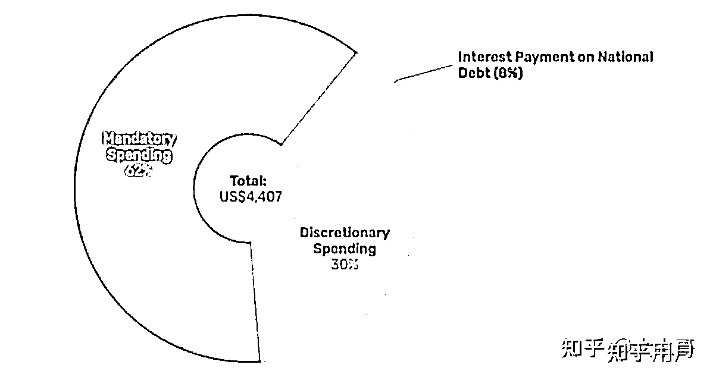

  

美国的财政支出，其中强制支出（Mandatory Spending）占 62%。这一部分跟古罗马为公民发放免费食物一样，属于公共福利支出。比如：美国退休人员的社会安全金（养老金）、联邦医疗保险项目、联邦政府的福利项目、贫困补贴，食品券就在这个项目中。2019 财年这部分的强制预算是 2.739 万亿美元。

**这里特别说明下，美国食品券支出大概 500 多亿。但是不能拿食品券去套古罗马的免费食品政策，因为现在人对于生活品质的要求不可能像 2000 年前一样只满足于食物**。

国家债务的利息支付（Interest Payments on the National Debt），约占 8%。利息支付是 3630 亿美元。

可支配开支（Discretionary Spending），约占 30%。1.305 万亿美元可支配支出，包括：紧急项目资金、军费（8860 亿）、卫生和公共服务（695 亿）

  

**本质上，新罗马帝国跟古罗马帝国都需要吸血供养。**

古罗马，意大利从帝国行省吸血，罗马城再从意大利吸血。罗马皇帝向罗马市民发放大量的福利来维持自己在政治上的基本盘。

新罗马，美国从全世界吸血，华尔街硅谷资本家再从美国吸血。新罗马大统领向市民发放食品券和补助金来维持自己在政治上的基本盘。

  

我在以前文章中一直强调，[新罗马帝国](https://www.zhihu.com/search?q=%E6%96%B0%E7%BD%97%E9%A9%AC%E5%B8%9D%E5%9B%BD&search_source=Entity&hybrid_search_source=Entity&hybrid_search_extra=%7B%22sourceType%22%3A%22answer%22%2C%22sourceId%22%3A2477167313%7D)的实际疆域向东越过大西洋直抵波罗的海海滨的[利沃尼亚](https://www.zhihu.com/search?q=%E5%88%A9%E6%B2%83%E5%B0%BC%E4%BA%9A&search_source=Entity&hybrid_search_source=Entity&hybrid_search_extra=%7B%22sourceType%22%3A%22answer%22%2C%22sourceId%22%3A2477167313%7D)、波兰、中欧的匈牙利、黑海沿岸的罗马尼亚、保加利亚和乌克兰。向西越过太平洋直抵日本、韩国、土澳。 以及除了古巴、委内瑞拉外的美洲大部分地区。虽然名义上美国国务卿相相当于外交部长，但实际上他是新罗马帝国各总督辖区的总督们的上司。所以美国国务卿的权力比很多国家的政府首脑大多了也更有存在感。你要非说美国的领土只有北美 50 州加上几个海外非合并属地我只能说你对美国的认知还处于一个比较初级的水平。

  

相信内容可以看历史的抉择这篇文章，如果知乎没吞掉的话。

[大水哥：中国的历史机遇与抉择（一）历史的机遇](https://zhuanlan.zhihu.com/p/480749637)

  

上面这段总共 2100 字，如果有耐心看完，我相信您已经得出了结论，为什么东亚人活得累。

  

东亚人活得累就跟 2000 多年前古罗马时代日耳曼人活得累是一样的，生态位和制度决定的。古罗马的生态位是罗马军团四处征服打下来的，之后为了维系统治，用殖民地的产出供养曾为国贡献的罗马士兵。

  

美国人也是一样，日本、韩国、拉美大多数国家、东南亚、甚至中国就是美国的阿非利加和埃及，只不过日本、韩国因为投靠的早又忠诚在美国统治全球的金字塔构成中位置靠上，中国更靠下罢了，但是在这套体系中中日韩没有本质区别。

  

### [蛮族入侵](https://www.zhihu.com/search?q=%E8%9B%AE%E6%97%8F%E5%85%A5%E4%BE%B5&search_source=Entity&hybrid_search_source=Entity&hybrid_search_extra=%7B%22sourceType%22%3A%22answer%22%2C%22sourceId%22%3A2477167313%7D)

  

4 世纪后半期，日耳曼人按居住地域划分为两大部落集团，以撒克逊人与法兰克人等为主的西日耳曼集团主要以农业为主，而以哥特人等为主的东日耳曼集团主要以游牧为主。

哥特人是所有日耳曼部落中最强大的部落，他们主要居住在黑海北岸的南俄草原。4 世纪，哥特人又分成东西两部，其中，西哥特人主要生活在多瑙河下游地区，占据德涅斯特河以西至[喀尔巴阡山](https://www.zhihu.com/search?q=%E5%96%80%E5%B0%94%E5%B7%B4%E9%98%A1%E5%B1%B1&search_source=Entity&hybrid_search_source=Entity&hybrid_search_extra=%7B%22sourceType%22%3A%22answer%22%2C%22sourceId%22%3A2477167313%7D)之间的地区，而东哥特人主要生活在顿河和德涅斯特河之间的地区。

公元 374 年，匈奴人西迁，这里的匈奴人是指西迁的北匈奴的后代，他们从中亚经过里海进入[顿河流域](https://www.zhihu.com/search?q=%E9%A1%BF%E6%B2%B3%E6%B5%81%E5%9F%9F&search_source=Entity&hybrid_search_source=Entity&hybrid_search_extra=%7B%22sourceType%22%3A%22answer%22%2C%22sourceId%22%3A2477167313%7D)、第聂伯河流域，征服了生活在那里的阿兰人与东哥特人，接着向黑海北岸的西哥特人进攻，匈奴人与西哥特人在德涅斯特河战斗，最终迫使西哥特人向罗马帝国迁移。376 年，西哥特人在罗马皇帝瓦伦斯的允许之下，渡过多瑙河向[巴尔干半岛](https://www.zhihu.com/search?q=%E5%B7%B4%E5%B0%94%E5%B9%B2%E5%8D%8A%E5%B2%9B&search_source=Entity&hybrid_search_source=Entity&hybrid_search_extra=%7B%22sourceType%22%3A%22answer%22%2C%22sourceId%22%3A2477167313%7D)迁移，定居罗马境内的麦西亚，今天的保加利亚。

**西哥特人作为同盟者为罗马帝国守卫边疆**。

罗马人和西哥特人的恩怨这里不讨论，最后的结果是二者闹翻了，西哥特人在首领阿拉里克的领导下，由巴尔干半岛翻越阿尔卑斯山入侵意大利，[阿拉里克](https://www.zhihu.com/search?q=%E9%98%BF%E6%8B%89%E9%87%8C%E5%85%8B&search_source=Entity&hybrid_search_source=Entity&hybrid_search_extra=%7B%22sourceType%22%3A%22answer%22%2C%22sourceId%22%3A2477167313%7D)在奴隶与蛮族出身的罗马士兵的配合下，于 410 年攻占罗马城，他们在罗马城劫掠多日，但罗马并没有灭亡。

历史学家认为，439 年汪达尔人攻占了阿非利加，帝国失去了最重要的粮仓是西罗马灭亡的根本原因。汪达尔人是古代一个东日耳曼部族，于 429 年占领了罗马行省阿非利加，建立了汪达尔王国，之后。罗马人试图收复阿非利加但都失败了，于 476 年灭亡。

  

罗马灭亡后日耳曼蛮子们在罗马的废墟上建立十多个日耳曼国家，比较有名的有，东哥特、西哥特、[法兰克](https://www.zhihu.com/search?q=%E6%B3%95%E5%85%B0%E5%85%8B&search_source=Entity&hybrid_search_source=Entity&hybrid_search_extra=%7B%22sourceType%22%3A%22answer%22%2C%22sourceId%22%3A2477167313%7D)、汪达尔-阿兰。

  

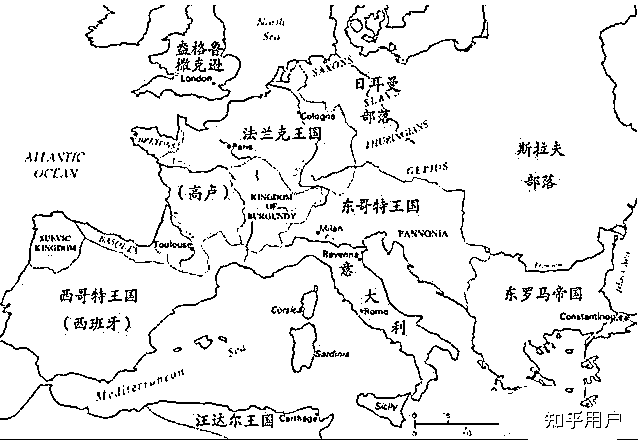

  

蛮子们混战几百年后，[查理曼大帝](https://www.zhihu.com/search?q=%E6%9F%A5%E7%90%86%E6%9B%BC%E5%A4%A7%E5%B8%9D&search_source=Entity&hybrid_search_source=Entity&hybrid_search_extra=%7B%22sourceType%22%3A%22answer%22%2C%22sourceId%22%3A2477167313%7D)横空出世于公元 800 年于罗马加冕，成为罗马人的皇帝，查理曼帝国为罗马帝国的继承者。查理曼大帝死后帝国没有维系下去，孙卖爷田不心疼，他的三个孙子签订凡尔登协议，帝国分裂为东、西、中法兰克三个国家。东法兰克和部分中法兰克就是神罗，神罗大部分在德国，一部分散落在意大利、法国、捷克、奥地利和瑞士。西法兰克和部分中法兰克就是今天的法兰西，法兰西的诺曼底公爵又征服了英格兰。法、德、意、英的格局就是在 9 世纪初步确定的。

  

之后就是黑暗的中世纪。政治、经济、科技、文化全方位落后于东方。欧洲真正崛起是文艺复兴和大航海时代。在工业革命前欧洲最重要的殖民地是美洲，南美洲提供了黄金、白银、铜，加勒比提供了蔗糖，北美提供了造船需要的木材、棉花和烟草。工业革命之后印度成为大英帝国最重要的殖民地，一战前夕印度的 GDP 同英国本土已经很接近了。

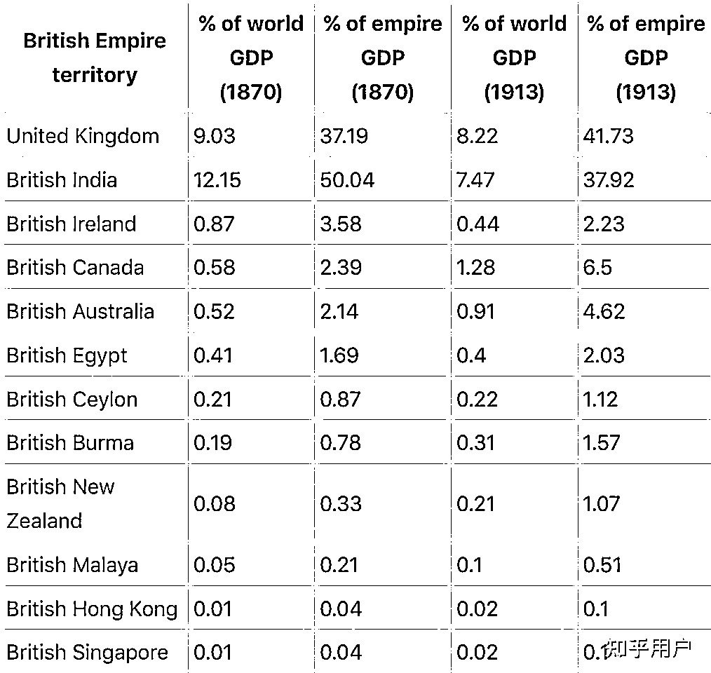

  

20 世纪 20 年代，世界已经被英、法、美、苏瓜分完毕，向东扩展生存空间的思路并不是希特勒原创，在 1919 年泛德意志右翼组织就多次发布社论，30 年代德国人希望同英国进行利益交换，德国支持英国的全球扩张，英国允许德国向东寻找生存空间。

  

1935 年，柏林和华沙关系暧昧，波兰高层邀请戈林打猎，提出波兰占领乌克兰，德国占领利沃尼亚和白俄罗斯。

  

二战前、中、后大英在某个大聪明带领下血尿上头，把大英打成了带英，作为战败国德国损失了 20%的领土，战胜国英国反而损失了 95%的领土。美国接手了带英帝国大部分的遗产。带英靠着祖上剩下的遗产继续苟，比如香港的[东印度公司](https://www.zhihu.com/search?q=%E4%B8%9C%E5%8D%B0%E5%BA%A6%E5%85%AC%E5%8F%B8&search_source=Entity&hybrid_search_source=Entity&hybrid_search_extra=%7B%22sourceType%22%3A%22answer%22%2C%22sourceId%22%3A2477167313%7D)、非洲的产业。

  

美国继承了英国大多数殖民地，并将拉美殖民地化，拥有最大的资源产地和最大的市场，事实上决定了全球产业链的形态和分工。

带英和法国主要靠祖上的遗产活着，在非洲武德充沛疯狂吸血。

德国在冷战前线，靠美国开放市场，冷战结束后失去利用价值，但是德国的政治精英成立欧盟，德国拥有了欧洲作为自己的市场，或者叫经济殖民地。

日本冷战前线，靠美国开放市场，美国拒绝开放市场后直接躺平

韩国冷战前线，靠美国开放市场，90 年代初日本不听话，日本的芯片产业被美国分配给韩国。只不过韩国财阀的大股东都是华尔街，比如三星。韩国就是财阀剥削韩国人之后跟美国人分账。

东南亚冷战前线，靠美国开放市场，冷战结束后失去利用价值，98 年被收割。

  

### 东亚人的未来

  

日耳曼人是怎么崛起的。罗马人以夷制夷用日耳曼人阻挡日耳曼人，日耳曼人一部分进攻罗马，一部分给罗马人当狗，帮罗马人拱卫边疆，之后内外日耳曼人一起起事，掀翻罗马统治。

  

其实现在美国的债务问题比罗马严重的多。罗马用于供养基本盘的开支是四分之一，剩下四分之三用于供养官僚和军队，财政虽然非常紧张，但是大体上是平衡的。美国的债务已经接近 30 万亿。30 万亿是什么概念呢，都说大炮一响黄金万两，小布什打赢了两场战争灭了两个国家，也仅仅增加了 4 万亿美元的债务。小布什离任的时候美国国家债务规模 10 万亿。

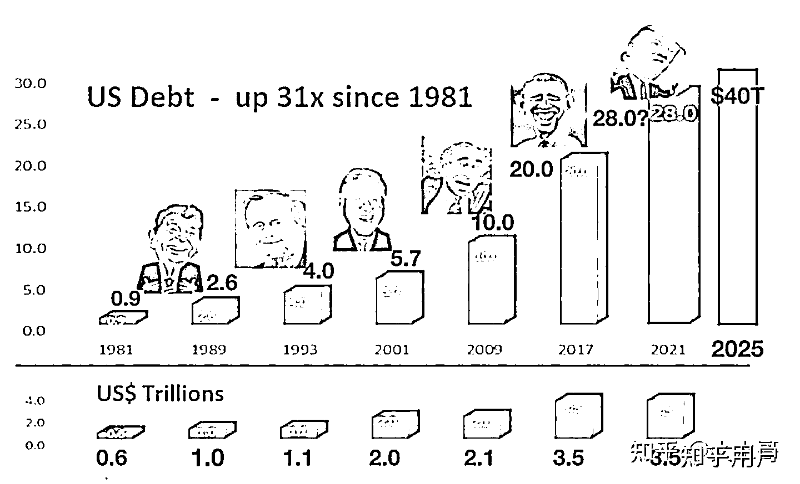

  

**但是我并不认为美国就会因此而崩溃**

**我非常反对美国崩溃论的论调**。

如果东亚人的未来要靠美国崩溃才能实现，那么就算美国崩溃了也是日耳曼人或者斯拉夫人统治世界也轮不到东亚人。从来没有救世主，只有自己才能就自己。东亚人最大的问题就是普遍存在的救世主思维。因为美国横征暴敛所以应该出一个救世主拯救自己？

  

如果没有匈奴人西迁，抢占日耳曼人生态位，导致日耳曼入侵，罗马帝国收缩，哥特人内附之后叛变，汪达尔夺取帝国财赋重地阿非利加，罗马会因为畸形的政治经济制度崩溃吗？我认为并不会。

  

新罗马垮了未来就属于东亚人了吗？

  

因为什么？因为东亚人吃苦耐劳，因为东亚人善于做题？

  

如果东亚人不改变思路，不走出去去争夺阳关下的土地，不敢用武力捍卫自己创造出的财富，那么未来就算新罗马崩溃了，也会有新的帝国崛起继续盘剥东亚人，让东亚人只能接着活着累。

# 知乎用户

> 作者：知乎用户
> 
> 赞同数：8175
> 
> 编辑于：2021-12-29 16:23

到今天，东亚的日本、韩国、台湾、香港、澳门和新加坡都已成长为发达经济体。日本早已是资本主义五大国之一，韩国的实力也已接近或超过 G7 七大工业国组织的末段班，台湾的科技业和香港的金融业在全球举足轻重，而澳门和新加坡已经是全球最富裕、经济最发达和生活水准最高的地区。上述六个经济体在预期寿命和各项卫生指标排名中遥遥领先全球其他国家，在各项创新和竞争力指数排名中都位居前列。单纯从主要指标上来看，东亚的发达经济体的确已经发展得很好了。

然而，在有些指标上，东亚经济体始终落后于欧美，比如说平均劳动时间和学生平均课业时间。有些人把这些指标的差距归为文化差异。但如果我们深入思考一下，或许会发现原因并非这么简单。

  

可以观察到，无论是日本、韩国，还是台湾、香港、新加坡，都有巨额的外汇储备。这些储备是进出口顺差的结果，是当地居民辛勤劳动的结晶，展现了东亚企业强大的出口竞争力。而**东亚国家的社会压力大、普通人活得累的根源或许正来自其以出口为导向的[经济结构](https://www.zhihu.com/search?q=%E7%BB%8F%E6%B5%8E%E7%BB%93%E6%9E%84&search_source=Entity&hybrid_search_source=Entity&hybrid_search_extra=%7B%22sourceType%22%3A%22answer%22%2C%22sourceId%22%3A591412005%7D)**。

欧美是资本主义世界的终端市场，本地企业和居民只要不是差得太离谱即可活得不错，即为题主所说的“活得很幸福”。欧美国家是贸易赤字国，生产的产品少于自己的消耗。而东亚居民则需要生产出多于自己所需要的产品，用于出口，来换得外汇。如果东亚和欧美的技术水平相同，这显然需要东亚工人工作更长的时间，长于他们本需要工作的时间；而欧美工人工作的时间短于他们本该工作的时间——欧美人的一部分消费是东亚人在帮着买单。

日韩港台新占领欧美的市场，弄得自己人民累得很，欧美居民还抱怨你抢了他们的工作，这么吃力不讨好的事情，为什么非要做不可呢？

因为东亚人需要生存。毫不夸张地说，**如果东亚人不出口，他们就活不下去了。**东亚国家需要进口[大宗商品](https://www.zhihu.com/search?q=%E5%A4%A7%E5%AE%97%E5%95%86%E5%93%81&search_source=Entity&hybrid_search_source=Entity&hybrid_search_extra=%7B%22sourceType%22%3A%22answer%22%2C%22sourceId%22%3A591412005%7D)（能源、矿产、农产品等），需要和其他国家开展一般贸易（比如日本能生产汽车，但可能有日本消费者就是偏好某款法系车），来满足自己国民的生产生活需要，而这些都需要美元。

东亚国家的产品和服务必须比欧美的更物美价廉，才能在欧美卖得出去；东亚商品进入亚非拉面临比欧美商品进入亚非拉更多的贸易壁垒，这也要求**东亚的商品必须物美价廉**。而物美价廉通常也意味着企业必须薄利多销才能赚取一点微薄的利润。

所以，毫不奇怪地，东亚国家必须依靠出口换汇才能买到必需的粮食和资源；东亚商品必须比欧美商品更优更便宜才卖得出去并换回外汇；东亚企业必须比欧美企业更有创新活力和精益管理才能在国际市场活下去；东亚人必须比欧美人更强更有竞争力才能活得下去。这种只有比别人强才能活下去的社会现实深深烙印在每个东亚人的心中；焦虑在每个东亚人心中蔓延。

如果某个非欧美国家，只知道提高居民的生活水平，而不注意培养企业的竞争力，那么等待他们的必然是贸易赤字和货币危机。阿根廷、墨西哥、俄罗斯、泰国等等，例子还有很多。这也是为什么[索罗斯](https://www.zhihu.com/search?q=%E7%B4%A2%E7%BD%97%E6%96%AF&search_source=Entity&hybrid_search_source=Entity&hybrid_search_extra=%7B%22sourceType%22%3A%22answer%22%2C%22sourceId%22%3A591412005%7D)阻击泰国和香港，结果却不同的原因：香港和大陆的外汇储备比泰国多多了。拉美、东欧、东南亚**想要高消费低压力的生活，但没有外汇储备的支撑，现实就会迅速打脸。**拉美、东欧、东南亚国家陷入[中等收入](https://www.zhihu.com/search?q=%E4%B8%AD%E7%AD%89%E6%94%B6%E5%85%A5&search_source=Entity&hybrid_search_source=Entity&hybrid_search_extra=%7B%22sourceType%22%3A%22answer%22%2C%22sourceId%22%3A591412005%7D)陷阱的原因，也是因为企业缺乏自主创新，国民储蓄率低，导致企业缺乏竞争力。

东亚的家长们知道自己的孩子必须要成为强者，参与全世界的竞争，才能活下去，所以只能严厉要求孩子的课业，而无视孩子的睡眠和体育活动时间的不足。而自己，则只能在 996 的加班中度过一生。

  

那么，东亚发达地区要如何改变才能把休闲、度假和用来生活的时间还给普通劳动人民，把睡眠和体育活动的时间还给中小学生？

我觉得最本质的办法是在通过自主创新保持企业竞争力的同时，**提高本币国际化水平，加快区域融合和共同市场建设，还有提升国际贸易的话语权**。是的，这听上去和度假、学业八竿子打不着。

如果本国需要的石油、铁矿和粮食能用本币买到，那就可以节省很多出口创汇的需求，减少了全社会平均工作时间，也就降低了国内的经济压力，社会竞争压力自然也会小很多。如果能用印出的本币在全球消费，购买其他国家的制成品，那就更轻松了。

共同市场消除了贸易壁垒，也就消除了不必要的出口压力；东亚各国内部互通有无，各个生产要素自由流动，资源配置效率也会更高。

更进一步，如果东亚掌握了全球贸易的主导权，建立起符合自身利益的贸易规则和贸易体系，那么出口不受任何壁垒的东亚企业自然更容易占领全球市场，获取利益。而其他国家的产品，在面临贸易壁垒时，必须比东亚国家的产品质更优、价更廉，才能卖得出去。

社会竞争压力小了，工作时间短了，普通人自然会有更多的闲暇时光，陪家人、陪朋友，把属于生活的时间还给自己；父母也自然会把睡眠和体育的时间还给孩子，让孩子拥有更幸福的童年。

  

或许，等到中国成为世界的最大的终端消费市场，东亚人民可以用本币在全世界消费，东亚建立起共同市场，东亚国家主导了国际贸易秩序，东亚人民也会过得很轻松，活得很幸福。

  

附：

1、美国、欧元区、中国、日本的经济规模和货币国际化比较

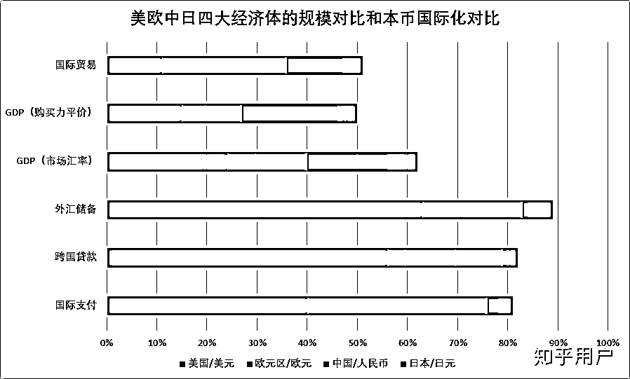

（前三行是经济规模的对比，后三行是货币国际化的对比；橘色系是欧美，蓝色系是中日。）

如果按 GDP（汇率法）、GDP（购买力平价）和国际贸易的平均份额计算，美国的经济规模为全球的 17%，欧元区为 18%，中国大陆为 15%，日本为 5%。

但按国际支付、跨国贷款和外汇储备的平均份额计算，美元占据国际货币市场 53%的份额，欧元占 26%，而人民币只有 1%，日元只有 4%。

美元、欧元在国际货币中的比重远远大于所在国美国和欧元区的经济体量，而人民币和日元却相反。

  

2、部分国家和地区外汇储备数据

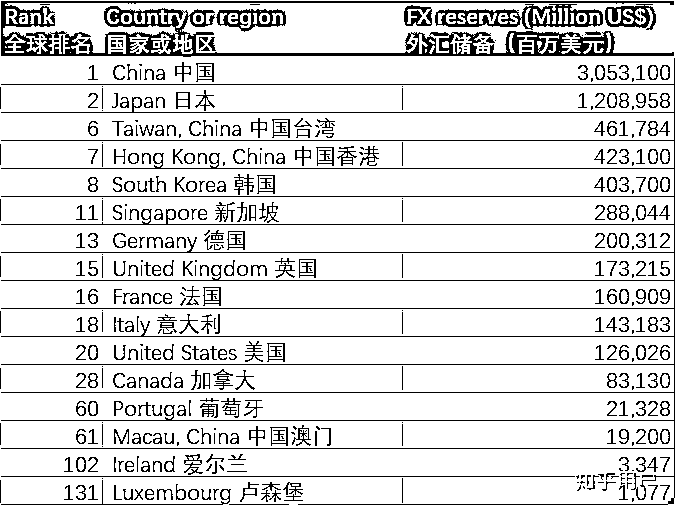

中国大陆的人均外汇储备和全球最富裕的[卢森堡](https://www.zhihu.com/search?q=%E5%8D%A2%E6%A3%AE%E5%A0%A1&search_source=Entity&hybrid_search_source=Entity&hybrid_search_extra=%7B%22sourceType%22%3A%22answer%22%2C%22sourceId%22%3A591412005%7D)差不多。

# 减紫 @董不懂 @鼎天立地

> 作者：减紫 @董不懂 @鼎天立地
> 
> 赞同数：3507
> 
> 编辑于：2020-09-21 18:13

优质资源太少，只能抢破头。

1.先说学：

**优质的学习资源的密度相差太大太大了。**

举个很严酷的例子，全东亚优质高校资源如果按照澳洲的水平^([\[1\]](#0028.html_ref_1))推算，东亚 23 所世界排名在 110 之内的优质大学只能覆盖 6600 万人一样的人均大学密度。可能这么比很生草，但是土澳的 8 大也算是在澳洲独立建国之后出了十几个理科类诺奖得主的，别小看人科研水平。

可是谁都知道光光韩国人口就接近 6000 万，全东亚人口得有 15 亿了，怎么分？

怎们办？抢破头啊。

知乎有些回答也提过了，日本职场的日本人都能吐槽番剧那种乐趣百出的中学校园生活是扯淡，国内更别提了，反正我是没有那种“让我们永远留在中学时代吧”这种期望的。

土澳那帮学生下午 3 点半乌央乌央的挤在饮品店，K 记，M 记门口谈天说地；东亚做题家天天晚自习到 22 点回家了还要接着看书。

土澳的大学生学机械三四个人实验课凑用一台机械臂编程操作试东西，东亚做题家只有牺牲暑假跑到千里之外的某些重工业拖拉机厂才能远观流水线，不是一二线可能科技馆里都看不到实物，机械臂只能上 Bilibili 搜视频看。

注意最后下生产线的时候要求的知识基础不会因为校园里学生没碰过实物有一丁点的折扣，为了弥补实战经验的匮乏，大量学科还得靠长时间的实习进行培训。

  

2.再说干：

**干活赚工资能赚多少工资，跟你的公司赚不赚钱有很大关系，但是优质的企业东亚也比西方少很多。**

好比说，张三去了净利润率 1.5%的某汽车厂工程师，就不能有同大学软件学院毕业去了[净利润率](https://www.zhihu.com/search?q=%E5%87%80%E5%88%A9%E6%B6%A6%E7%8E%87&search_source=Entity&hybrid_search_source=Entity&hybrid_search_extra=%7B%22sourceType%22%3A%22answer%22%2C%22sourceId%22%3A1325872095%7D)30%+的鹅厂的新人程序员李四赚的工资多。

那国内是净利润率几个百分点的公司多呢？还是净利润率三四十的公司多呢？很显然是前者多，尤其是挣扎在 5%净利润率以下的出口加工业多。谷歌和 TX 这种企业投 100 块进去能有 30 块利润，[梅赛德斯奔驰](https://www.zhihu.com/search?q=%E6%A2%85%E8%B5%9B%E5%BE%B7%E6%96%AF%E5%A5%94%E9%A9%B0&search_source=Entity&hybrid_search_source=Entity&hybrid_search_extra=%7B%22sourceType%22%3A%22answer%22%2C%22sourceId%22%3A1325872095%7D)这种实体企业投 100 块也有 6 块利润，一般的中国企业每 100 块进去能有 1-2 块利润就不错了。

而且这 1-2 块净利润还是压榨员工到郊区工业园住集体宿舍骑电动车（参考三大浪漫 

@董不懂 

）这样各种手段压缩成本才让它有这么一丁点利润，不然哪里有钱赚？

那员工怎么多赚钱？自愿加班疯狂加班，跟外企拼成本拼效率。996 疯狂吗？对于程序员可能疯狂，对于很多行业那是司空见惯了。

计算机和金融那是例外，国外的（参考谷歌搜索之流）进不来，国内寡头的产品爱用不用，企业蛋糕大，员工跟着肥。国外谷歌盘、油管会员这些产品的价格换算为人民币之后，基本上不超过国内主流的 200%，而汇率上，1 个澳币最低的时候也能换到 4 个人民币。做一个数学题，4-2=2，那剩下的 2 个人民币的闲钱外国人就能拿来干别的事情了。

前面还有一个回答也提到了另一个细节（ 

@鼎天立地 

），西方做低端服务业的从业者也能拿到还可以的收入养家糊口，而且不是“有这个条件不错了”的那种养家糊口。西方发达国家有东亚这么随处可见的阶级跌落恐惧么？

世界上主要的化工（参考拜尔）、药品（参考辉瑞）、医疗（参考 GE）、航空（参考波音）甚至农业（参考孟山都）巨头，有盈利能力的巨头，都在西方国家，主要的[高利润](https://www.zhihu.com/search?q=%E9%AB%98%E5%88%A9%E6%B6%A6&search_source=Entity&hybrid_search_source=Entity&hybrid_search_extra=%7B%22sourceType%22%3A%22answer%22%2C%22sourceId%22%3A1325872095%7D)环节，研发的、销售的，跟东亚基本上没有什么关系。可能有人会说，日本东丽，韩国三星，台湾[台积电](https://www.zhihu.com/search?q=%E5%8F%B0%E7%A7%AF%E7%94%B5&search_source=Entity&hybrid_search_source=Entity&hybrid_search_extra=%7B%22sourceType%22%3A%22answer%22%2C%22sourceId%22%3A1325872095%7D)之流不也是利润很高的优秀企业吗？不错，所以我用的词是“基本”，就好像西方可能 1 个人口 4000 万的发达国家可能有 5 个东丽这样的公司，但东亚在同一个领域只有一两个东丽。

以上还只有民用，还有一个更暴利的，军火，世界上主要军火销售商（[洛克希德马丁](https://www.zhihu.com/search?q=%E6%B4%9B%E5%85%8B%E5%B8%8C%E5%BE%B7%E9%A9%AC%E4%B8%81&search_source=Entity&hybrid_search_source=Entity&hybrid_search_extra=%7B%22sourceType%22%3A%22answer%22%2C%22sourceId%22%3A1325872095%7D)之流）也都在欧美，卖的也多是先进飞机、舰船这种大件，例如 F35 这样的飞机竟然能卖到一架 2 亿美金以上，那必然比东亚出售 56 冲、歼 7 这种“物美价廉”的军火暴利得多。

  

3.再说生活：

**人活着有很多种活法，但东亚地区对于人的“规矩”之丰富，我觉得在地球上真算是极端严格的那种了。**

首先就是条条框框的道德观，比如到了年龄就应该结婚、必须生孩子，男性必须买房子才能结婚，女性必须守处女，女性出门必须化妆穿高跟鞋（主要是日韩），等等。

有这些规矩在，东亚的娱乐活动就比西方玩得开的少了一大半，很多西方能做得东西，哪怕放在日本或者韩国也是违法的，查到了要拘留的。比如黄赌毒，日本以外东亚任何一国上不了 P 站，日本名义上嫖娼也是违法的。至于毒品，在西方很多地方合法的大麻一类毒品在东亚也是人人喊打，没有任何合法抽软毒品缓解压力的可能。

我有理由怀疑，东亚电竞、游戏、二次元文化比西方发达国家热度更高，和以上的娱乐限制有分不开的关系，没有其他娱乐手段，奋斗又实现不了阶级跨越，可不就得沉迷虚拟世界了么。

然后更生草的是，男生要有婚房这些成功标准在东亚老百姓身上落实的难度，实际上是比西方发达国家要大很多的，有很多隐性的限制与门槛，让西方发达国家能比较容易迈过的标准在东亚反而要化九牛二虎之力才能达到：

你是男生要买婚房，东京、香港、上海这些城市的工资与房价比例那可比洛杉矶、悉尼之流高多了，努力攒六个钱包吧；你要有自己的车“条件中上”的女性才看得上你，那可不能像洛杉矶、悉尼之流买两三万的凯美瑞之流，你得摇号，而且买车、买汽油掏的钱（参考东亚溢价）都比西方多得多；

你是女生要穿正装着高跟鞋，你会发现女性的高跟鞋鞋码 40 及以上的国内就几乎买不到，腰围 80 以上的裙子也基本上买不到，基本上就是得搜专门的大码。这在西方发达国家是不可想象的。西人从小奶肉充足，身高 170+腿脚健壮的女性比比皆是，给我上过课的西人就吐槽过到中国不适合买鞋子，都太小（其实衣服也是）。作为国人我听了一开始还不服气，后来一搜，像澳洲的女鞋品牌，人可以从 5 码开始最大做到 12 码，澳洲的 12 合国内就是 43 了，合着人大洋马的脚跟国内老一辈男性的脚一样大了，但人家的大不是肥胖，是放中国可以打女篮踢女足的那种[大洋马](https://www.zhihu.com/search?q=%E5%A4%A7%E6%B4%8B%E9%A9%AC&search_source=Entity&hybrid_search_source=Entity&hybrid_search_extra=%7B%22sourceType%22%3A%22answer%22%2C%22sourceId%22%3A1325872095%7D)身材。

**东亚虽然名义上号称“世界工厂”，但对于身材“异类”用户能提供的基本上就是**中年男女发福款，**花更多的钱买更烂的小批量高价产品**，仅仅满足能穿，造型跟时髦时尚基本上就不搭边的那种；而西方发达国家无论是发福的男性还是女性，只要不是胖成球，都买得到剪裁得体的衣服和鞋子。

 

东亚不会在法律意义上规定一个人身体哪块应该长什么身材，但是当你成为 Outer（另类）的时候，你会感觉走到哪里都不顺利。买不到合适的衣服，买不到合适的鞋子，一切的事情都提醒“你该做什么改变”，甚至连基本的走个红绿灯别人能来得及跑过去你废老鼻子劲还赶不上（比如上述新闻 20 秒可不就得利索着跑着过马路么），等等。

**它会用一切法律允许范围的内的膈应提醒那个另类：你是个异类，你该变一变，适应社会的规则，不要给集体添麻烦，不要给社会添麻烦，而不是给各式各样的人提供适合他们的东西。**

  

以上的种种下来，整个东亚，包括韩国和日本，在自杀率排名^([\[2\]](#0028.html_ref_2))上竟然能和一堆非洲赤贫国家挤在一起。还能奋斗的时候尚能 996，老了低收入人群拥抱“药儿子”、“绳儿子”、"水儿子"的新闻屡见不鲜，在排名上东亚各国的自杀率竟然不是跟智利、斯洛伐克这类不那么高度发达的“中间”呆一块而是排在前面，不卷吗？

## 参考

1.  ^参考 QS2020 大学排名，澳洲 8 大排名在 29-106 之间 [`www.topuniversities.com/university-rankings/world-university-rankings/2020`](https://www.topuniversities.com/university-rankings/world-university-rankings/2020)
2.  ^2016 年按国家/地区划分的自杀率统计，维基百科 [`en.wikipedia.org/wiki/List\_of\_countries\_by\_suicide\_rate`](https://en.wikipedia.org/wiki/List_of_countries_by_suicide_rate)

# 裕泰茶馆掌门人

> 作者：裕泰茶馆掌门人
> 
> 赞同数：2435
> 
> 编辑于：2022-07-04 16:14

古代的东亚社会有一个非常有意思的地方

这里实际上既没有产生过理论上的[公有制](https://www.zhihu.com/search?q=%E5%85%AC%E6%9C%89%E5%88%B6&search_source=Entity&hybrid_search_source=Entity&hybrid_search_extra=%7B%22sourceType%22%3A%22answer%22%2C%22sourceId%22%3A2555770534%7D)

也没有产生过真正的[私有制](https://www.zhihu.com/search?q=%E7%A7%81%E6%9C%89%E5%88%B6&search_source=Entity&hybrid_search_source=Entity&hybrid_search_extra=%7B%22sourceType%22%3A%22answer%22%2C%22sourceId%22%3A2555770534%7D)

《诗经·小雅·北山》有云

普天之下，莫非王土

**在几千年来权力资源不断集中化的过程中**

**我们产生的是一种人身依附下的暂有制**

离中心越近，则其可占有支配的东西就越多

个人的安全性也就越受保障

而地位越是低下

暂有的资源被夺走的可能性就越大

这也就造成了一个东亚社会典型的状态

赢家通吃

**任何处于这个体系中的个体**

**只能拼尽一切地去争取向上爬**

**来维持他们脆弱的安全感**

**同时又对这个体系中的最下层**

**抱有极大的恶意和轻蔑**

因为既担心他们有任何试图摔盘子的行为

又因暂时握有可以拿捏他们的资源而倍加傲慢

这种情况导致失败者在东亚极难受到尊重

比较经典的就是自晋代以后亡国之君的待遇大都相当不妙

**所以东亚人总是对失败这个词，极度敏感**

**在畏惧失败，畏惧被剥夺资源的心态之下**

**自虐式的自我剥削也就成了情理之中**

同时在这种体系之下，创新精神和进取精神也会变得可有可无

因为谁都知道

自己辛辛苦苦搞出来的东西很有可能就会被一纸律令夺走

比如明代可能创造极大财富的海外贸易，便随着诏书而几经沉浮

甚至为迫使东南亚开拓者回国，不惜勒令他们限期回国

而对西班牙殖民者在马尼拉对华人进行的二次大屠杀，也未进行保护措施

至于官方的旧港宣慰司，也早已舍弃

所以何必费这个辛苦

**资源获取倒不如依靠讨好权力本身来得牢靠**

所以你就会发现

**东亚社会对人与人之间的关系有超乎寻常的敏锐度**

**对于真正能够帮助摆脱内卷的开拓性行为则兴趣缺缺**

如此一来，这就有了很多高赞答案里的情况

我们错失了大航海

错失了工业革命

错失了太多可能摆脱内卷，扩大总体资源占有量的机会

那也就别怪今天继续活的这么累了捏

# 谷雨

> 作者：谷雨
> 
> 赞同数：3898
> 
> 编辑于：2019-01-29 19:53

仅从盎格鲁撒克逊族裔所占领的地盘看就有世界第二大领土的加拿大，领土第四大的美国，第六大的澳大利亚，外加新西兰和英国，若是再算上与他们同气连枝的欧盟，可以看到整个西方在世界上是多么强大。但从台湾地区，香港地区，日本，南北朝鲜来看，可能都不够单挑一个美国的，更何况是整个西方同盟。所以可以理解鬼子当年的脱亚入欧的思路就是打不过就加入，哪怕做小弟；当年大东亚共荣圈的思路就是整合东亚资源，不能完全抗衡也可以抵得上 60-70%的水平，而且鬼子在拉美尤其是巴西做了百年的耕耘，若是当年被它拿下它所谓的大东亚共荣圈，鬼子可能会获得跟央格鲁萨克逊族裔相同的实力。就现今而言，中国的发展其实也是有意以不同的方式接收当年鬼子在亚洲的范围，只是美国佬一直从中作梗。大陆底子薄，实力不如人，就只能加倍努力工作，在生产力发展的道路上尽可能跟进对手，领先对手。而台湾，香港，日本，韩国体量都很小，不努力工作无法维持现在的经济水平。这跟东亚人创新能力其实没有关系，只是体量大的后发展，体量小的先发展，造成资源没有合理配置，在于其它族裔的竞争中落于下风。所以东亚人很累。

# 知乎用户

> 作者：知乎用户
> 
> 赞同数：3067
> 
> 编辑于：2019-10-22 11:21

1.没资源可卖，不像澳大利亚、巴西、中东国家、北欧一样有铁矿石或石油可卖。老天爷不赏饭。

2.除日本外，在近代都是落后国家或地区，没有形成金融地位，做不了世界性的金融中心，金融产业薄弱；本币未能成为国际货币，无法薅外国羊毛。老祖宗没赏饭。对于日本来说，日元的国际货币性质不能说没有，但跟美元比起来太弱了，甚至弱于欧元。

3.地缘政治局势复杂，不得不维持强大的军队，财政支出负担重。中国大陆、中国台湾地区就不说了，连韩国都是个普遍兵役制国家，日本的自卫队规模虽不大，但架不住武器贵（满满的父爱）。

4.日韩、我国台湾地区，大都是承接美帝转移产业而肥，产业内容高度重叠，竞争激烈。

5.韩国、我国香港特区，资本主义已经发展到了金融寡头的程度，大资本家对底层民众的剥削程度较高。剥削程度较低的台湾地区就好点。

# 一言难尽

> 作者：一言难尽
> 
> 赞同数：2391
> 
> 编辑于：2022-01-26 08:16

消耗人力资源谋发展是日本和韩国的必经之路，在工业化时代，你仔细思考一下，东亚国家到底有什么优势？

(首先声明本文的东亚国家只包括日本和韩国，中国是什么情况我不太清楚，不敢乱说。)

无论是日本还是韩国，最优质的是资源么？这些地方人均资源都相对匮乏，但有一样资源优秀的无以复加，世界最优质的人力资源，这里的劳动人民在历史上就被儒家文化教育，有一套甚至多套完整的价值教育体系，教育出来的人口有极强的群体价值观，荣辱观，服从性极佳，不到万不得已绝不搞事情，说错了，其实有口饭吃，就绝不搞事情。

日韩为何发展的这么快，特别是韩国发展速度堪称人类工业史奇迹，仅仅用三十年就走完了别人两百年的路，就是能够消耗这些优质的资源。只有这里才能忽略所有问题极速的完成工业化，城市化，现代化，苏联使用城乡“剪刀差”的时候能出现戈尔巴乔夫，东亚呢？水花都没有溅起一个，文人[歌功颂德](https://www.zhihu.com/search?q=%E6%AD%8C%E5%8A%9F%E9%A2%82%E5%BE%B7&search_source=Entity&hybrid_search_source=Entity&hybrid_search_extra=%7B%22sourceType%22%3A%22answer%22%2C%22sourceId%22%3A2324958142%7D)，难听的话屁都不敢放一个，噤若寒蝉，所有的日韩底层人在交进城税时所有吃过的苦，归因都是自己不奋斗，不努力，绝不会去思考原来有人躺着就在当时的汉城和东京，享受着底层的刻苦劳动为他们带来的优质物质条件和丰富的生活乐趣。

当经济不好时，日韩政府就开始让城市房价疯狂的增长，把所有人手头的资本收回，让他们负债终生打工还一辈子贷款。在这种情况下，年轻人所受的教育导致他们唯一的能想到的就是卷死同胞，只有弄死同胞了就能去城市上学，上学完再给别人打工，打了工赚了钱未来就有机会买到老家一套厕所大小的城市房子。

这个过程中，不管是 996，还是 007，还是陪着领导灌酒，甚至不小心“失身”，还是每天无穷无尽的竞争，kpi，都无所谓了，说活的像条狗，那都是侮辱狗，狗看了都觉得这样的日韩人是真的狗，不能比。算了，都无所谓了，电梯里，地铁上一张张麻木的脸，拖着疲惫的身躯，很多事情想也想不明白，到底是为什么？这些事儿真的是一个普通人该做的么？到底什么是普通人？

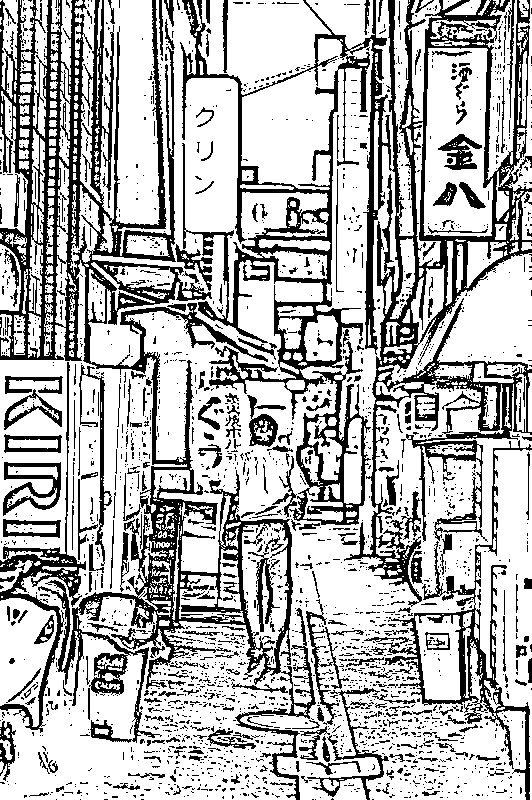

普通人不是应该受到法律保护么，每天认真开心的工作后就能够准时准点上下班，回到自己买的房做个饭然后休息一下，喜欢运动的饭后出门走一走，散散步，然后回来刷刷剧看点自己喜欢的书。到了结婚的年纪，找个自己喜欢的，三观一致的，聊得来的，双方也不需要考虑物质压力，只需要考虑情感和生理需求，如果很合拍，哪天心情好了，一起到民政局打个证，休上一个月的婚嫁，去自驾韩国人看看[济州岛](https://www.zhihu.com/search?q=%E6%B5%8E%E5%B7%9E%E5%B2%9B&search_source=Entity&hybrid_search_source=Entity&hybrid_search_extra=%7B%22sourceType%22%3A%22answer%22%2C%22sourceId%22%3A2324958142%7D)，日本人玩玩北海道，越南人瞧一瞧岘港度个假，条件好的可以跨国自驾，看一看中国的川西，新疆，西藏，时间充沛的飞个挪威，瑞士，冰岛。就在路上，兴致一起来，在酒店沙发上，在[房车](https://www.zhihu.com/search?q=%E6%88%BF%E8%BD%A6&search_source=Entity&hybrid_search_source=Entity&hybrid_search_extra=%7B%22sourceType%22%3A%22answer%22%2C%22sourceId%22%3A2324958142%7D)小棚里，甚至就在旅行车的后排，没羞没躁的就有了孩子，不用做什么计划，只需要慢慢的陪着他长大，也不用[鸡娃](https://www.zhihu.com/search?q=%E9%B8%A1%E5%A8%83&search_source=Entity&hybrid_search_source=Entity&hybrid_search_extra=%7B%22sourceType%22%3A%22answer%22%2C%22sourceId%22%3A2324958142%7D)他，不用告诉他周围都是人上人，因为大家生来平等，他喜欢运动就学运动，喜欢修车就学修车，喜欢美术就学美术，喜欢科学知识就好好读书。这？难道不是普通人么？想放松一下就是不劳而获么？是懒么？是没有集体荣誉感么？

[金岩松](https://www.zhihu.com/search?q=%E9%87%91%E5%B2%A9%E6%9D%BE&search_source=Entity&hybrid_search_source=Entity&hybrid_search_extra=%7B%22sourceType%22%3A%22answer%22%2C%22sourceId%22%3A2324958142%7D):不会吧？

山本维为:滚去领盒饭！

那为什么日韩的孩子早上不到六点就起了床，五到十分钟就洗漱完，几十个人关进了那个二十平米大小的格子，像坐牢一样读了十二年，甚至部分地方[复读率](https://www.zhihu.com/search?q=%E5%A4%8D%E8%AF%BB%E7%8E%87&search_source=Entity&hybrid_search_source=Entity&hybrid_search_extra=%7B%22sourceType%22%3A%22answer%22%2C%22sourceId%22%3A2324958142%7D)高的读了十五年书，仅仅是为了到社会上和自己的同胞去玩命去你死我活，不是他淘汰我，就是我淘汰他呢？无限的工作，无限的消耗自己的健康，就这，你真的好意思告诉日韩年轻人这就是生活么？

我只能说，相对于世界大部分地区，这里的人力资源优质的让他们害怕，比什么石油，天然气，铁矿要强太多，有人说这就像癌症无限扩张，**但要我说资源终归是资源，资源是用来消耗的，如果非要把人等同于资源，我只能说，人不是可再生资源。**

当人逐渐感到孤独，再慢慢的感到绝望到哭都哭不出来的时候，人就会坚持不住。如果一个人天生就在地狱，他/她还要在地狱产子，还存有善念的日韩人，责任心极强的日韩人宁可阉割自己，也不会让孩子降生。这种信念，这种思想，同样来源于教育。

最后，树木变成了火柴，再要它发新芽变回树，你信么？我反正是不信。

# 负二

> 作者：负二
> 
> 赞同数：3192
> 
> 编辑于：2020-07-10 14:38

先说一个数据：

**日韩的全要素[劳动生产率](https://www.zhihu.com/search?q=%E5%8A%B3%E5%8A%A8%E7%94%9F%E4%BA%A7%E7%8E%87&search_source=Entity&hybrid_search_source=Entity&hybrid_search_extra=%7B%22sourceType%22%3A%22answer%22%2C%22sourceId%22%3A1329414643%7D)在 OECD 国家中排名很靠后，大幅落后于欧美，也就比墨西哥之流的强点有限。日本的全要素劳动生产率长期在 G7 中垫底。**

但日韩在全球产业链上并不落后，也不是没钱。

那么问题出在哪里？

鉴于有人不愿意看文末另一个相关问题的回答，我把那个答案中的关键句子搬过来：

> 劳动生产率（或是 TFP）高，说明西方发达国家确实不需要工作那么长时间，就可以保持较高的单位劳动产出和收入——**人家拥有一些除了资本和劳动力之外的优势。** 

原因就在于——**东亚在金融上被欧美掠夺了！**

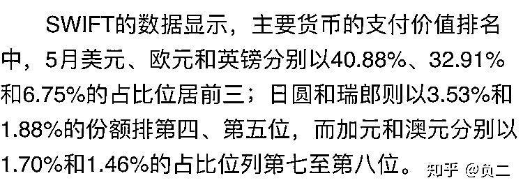

这是今年 6 月份的数据——澳加是资源国，讨论其劳动生产率没有意义，资源国货币汇率是全球经济的领先指标，这应该算经济学常识了；瑞士在金融上有其特殊地位，同样无法讨论其劳动生产率。

以上是贸易中的货币优势，欧美在全球[外汇储备](https://www.zhihu.com/search?q=%E5%A4%96%E6%B1%87%E5%82%A8%E5%A4%87&search_source=Entity&hybrid_search_source=Entity&hybrid_search_extra=%7B%22sourceType%22%3A%22answer%22%2C%22sourceId%22%3A1329414643%7D)（主要以国债形式，相当于无息/[低息贷款](https://www.zhihu.com/search?q=%E4%BD%8E%E6%81%AF%E8%B4%B7%E6%AC%BE&search_source=Entity&hybrid_search_source=Entity&hybrid_search_extra=%7B%22sourceType%22%3A%22answer%22%2C%22sourceId%22%3A1329414643%7D)）上的优势就更明显——美元约占 65%，欧元约占 20%，其他所有货币加起来还没老二欧元占比高。

所以一个显而易见的事实是——**美国和欧盟（勉强算上英国，毕竟还有部分石油定价权的老本可以吃一阵）的货币政策不但对东亚，对全世界都有溢出效应。**

**贸易收割一波，储备再收割一波——除欧美外的全球劳动价值（东亚占比最高）就这么进了欧美的口袋。**

尼克松时期的美国财政部长约翰·康纳利就曾公开说：“美元是我们的货币，但却是你们的问题。”

要打破这个极端不平等的金融格局，除非**东亚结成像欧盟那样紧密的经济关系**——但在地缘政治上就不可能，中日韩要成立个自贸区都困难重重，每次接近目标就会出幺蛾子，短暂的货币互换协议也无疾而终，你猜是为啥？

不掀掉头上的两座大山，东亚是无法从根本上解决内卷问题的。

 

# 大海的观点

> 作者：大海的观点
> 
> 赞同数：577
> 
> 编辑于：2022-04-03 18:29

我们可以看到在非洲、拉美、东南亚那些贫穷落后的国家，那些国家的穷人活的想的很简单，哪怕身上所有的钱都只够买一瓶啤酒也能发自内心的嗨上一晚上。明天的事情明天在说，这种今朝有酒今朝醉完全活在当下的状态，在中国或者说在整个中日韩文化圈中是非常少见的。

人只要能做到活着当下，简单的做自己喜欢做的事情，那他就可以活的很简单想的简单，如果你总是要操心未来那就活的累了。做到活在当下的必要条件是你必须把自己的想法和自己的感受放在第一位，如果你在意自己对别人的影响和别人对你的评价你就不可能做到活在当下，你害怕的不是穷，穷有什么可怕呢?穷了穷过，富了富过，穷也有穷的乐子和对未来的希望，你害怕的是其他人对你的看法。

想象一下，如果你像非洲人那样拿了一个星期的薪水就去嗨，不花完不去上班。像欧洲人一样大学读着都着就要周游世界，像拉美人一样不间断的撩妹子撩汉子，像东南亚人一样离家去拜佛出家。

你真正会遇到最大的困难是什么?在中国，真正阻碍你做自己想做的事情并不是没钱，真正的困难是周围人对你的评价。作为中国人，其他中国人不会认为你率性而是会认为你自私，其他中国人会认为你是一个坏儿子，坏父亲，坏丈夫。在中国的社会环境中你就是一个坏人。

你在中国长大所以你很难将自己的想法和感受放在第一位，小时候你玩的正嗨呢你妈会说:考试才考了几分啊?你还有脸这么高兴?结婚了你想和你老婆玩个浪漫你老婆会说:才赚那么点钱，房子也买不了大的，孩子也上不了好学校，还玩什么浪漫啊?你想简单的去做让自己快乐的事情，周围人就会说:这人就是个[不务正业](https://www.zhihu.com/search?q=%E4%B8%8D%E5%8A%A1%E6%AD%A3%E4%B8%9A&search_source=Entity&hybrid_search_source=Entity&hybrid_search_extra=%7B%22sourceType%22%3A%22answer%22%2C%22sourceId%22%3A2421658522%7D)的败家子、臭流氓。

你自己的想法和当下的感受都不重要，重要的是其他人对你的评价。你的人生价值并不来源你自己的想法和感受而是来源于其他人对你的看法。在这样的环境中你从小都习惯于不断的满足其他人对你的期望和要求，所以你不可能活的简单。考试考的差有什么可怕的?下次在考就行了，实在考不好就说明自己不是学习这块料，那找点别的事情干也行啊。事实上你怕的不是考试考的差，你怕的是让父母老师失望，你怕的是他们对你的批评。

同理，找不着对象有什么可怕的?赚不着钱有什么可怕的?事业失败有什么可怕的?辞职，离婚，出家，甚至用生命去冒险都有什么可怕的?你甚至害怕去做自己想做的事情，因为你做你想做的事情很可能会让其他人不满意，你可能不想成家生孩子。但是其他人会说:“不孝有三，无后为大”。你可能想趁年轻去远方多浪，但其他人会说:你的父母尚在苟且，你有什么资格去诗和远方?你可能想换工作，想换伴侣，想干这想干那，但你不敢，这些事情本事都并不可怕，你害怕的是其他人对你的低评价，你害怕被其他人认为你是失败的，不负责任的，不孝的。你害怕的事情多了，自然就活的累了。

造成这种现象的主要原因是“儒家文化”，在儒家文化中人不是为自己而活的，而是为父母，为家人，为社会而活的。甚至可以说:人是为自己的社会评价而活的，所以中日韩儒家文化圈，人相对活的要复杂和辛苦一些。

在中国，你要想活的简单，你首先要做到的是能够根本不在乎别人对你的评价，这需要非常强大的内心。在中国，这种人一般被称为不知廉耻的滚刀肉。

在其他国家，社会评价对人生意义的影响要低的多，你只要不伤害其他人想干什么就干什么，穷有穷的乐子可以找，富有富的乐子可以找，其他人对你的期望和要求要少的多，来自外部的压力也小的多，更大程度上你是为自己而活的。你的生活目标可能是搞科研，可能是周游世界，可能是享乐，可能是赚钱，可能是做生意，可能是享受家庭生活，可能是吃吃喝喝混一辈子，可能是搞艺术，不管你的目标是什么，反正都是你自己的目标，你只要对的起你自己就可以了，你可以完全不在乎其他人对你的评价，这样的生活自然简单，你只要满足了自己，你的人生就是有价值的。

你在看中国人劝人，你要多考虑自己的父母家人啊，这种问题显然要复杂的多。在中国，如果你满足不了别人你的人生就是失败的，除非你自己内心非常强大！

# 鱼昆

> 作者：鱼昆
> 
> 赞同数：363
> 
> 编辑于：2020-07-08 13:10

世俗化程度过高，没法因信称义，因而个体对自身的价值判断直接基于现实中的指标——金钱，功名，事业——而缺乏可以在低谷期被用于自我安慰的手段。

当然，如果生存条件并未显著恶化，可以预期这种情况会在这一代以及下一代逐渐好转，当价值判断与事实脱离，被建设在虚无之上，自我安慰的手段可就不缺了。

在虚空中寻求价值的手段有很多，比如这个

为什么美国贫富差距那么大，美国年轻人却自得其乐，而中国年轻人近年来开始会因为《后浪》等而抱怨生活困难？449 赞同 · 67 评论回答 

或者这个

[如何看待人大代表建议整顿「饭圈文化」？你认为饭圈文化应该如何整顿？446 赞同 · 43 评论回答](https://www.zhihu.com/question/397059356/answer/1247925900) 

# 公子二哈

> 作者：公子二哈
> 
> 赞同数：4126
> 
> 编辑于：2022-03-15 17:36

共同点应该在于儒家文化。

儒家文化是一个很累的文化，在这个文化体系中是很少有自由一类的词汇的，强调的是君臣父子。所追求的自由也是一种心灵上的自由，一种很“高级”的自由。这种自由并不是说你可以想做什么做什么，而是**无论你在做什么，你都可以拥有心灵自由。**这里暗含的就是，你没有选择做什么的自由，你只有做好在做的事情的基础上，去心灵自由。

不负责在这个文化中是没有任何立足之地的，你对所有人都需要“负责”，甚至对整个社会都需要负责。这个负责远超乎于法律规定的责任，还包括了道义的责任。**甚至这么多讹人事件以后，看到别人跌倒了不去扶，很多人还是会有心理负担。**这完全是儒家所带来的“道义”“责任”导致的。

这就导致文化下的**所有职业，都具有一种自我牺牲的感动。**记者们要“铁肩担道义，妙手著文章”；医护们要做“白衣天使”；消防员得是“最美逆行者”；老师更是“您辛苦了”。很奇怪，所有的职业都给自己搞上了一层自我牺牲的感动。而一份快乐的工作在儒家文化下是不存在的、不合理的、不应当的。

所有企业，讲的都是：我们应该承担什么样的社会责任。**很奇怪，他们 996、他们不遵守劳动法、他们想尽办法偷税漏税，但是他们谈论社会责任。**儒家文化对于不遵守法律有很好的逻辑自洽，毕竟追求的是“中庸”是“和文化”，可以毫无负担的将明确违法的 996 称为“福报”；但是儒家文化影响下，他们又张口闭口社会责任，无论真心还是表面功夫，社会责任始终都是企业所注重的。

**最累的事情出现了：这里不能有异类。**比如，有一个男生，只喜欢宅着，一辈子不工作、不谈恋爱不结婚、快乐人生。明明不关其他人的事情，但是这种人在儒家文化下就会被指责、承担压力。甚至于父母会因为孩子这样而感到没脸见人。可是这分明不关任何人的事情，**选择怎样的人生完全是成年个体的个人选择**，但就是不行，你得去恋爱、去结婚、去打工，还得省吃俭用养孩子。只要你不这样做，你就是异类，你就是败类，你就是蛀虫。

**你想自由？可以，你 996、你每天打工、你一分钱不许花、你养活所有人，最后自己捧着一杯水、在房间里去拥有“心灵的自由”。**

# 内卷之父

> 作者：内卷之父
> 
> 赞同数：1177
> 
> 编辑于：2022-07-24 17:41

第一，高科技受到欧美国家的全面压制。

美国的高端更高端，他把握了科技的源头，基础研究，欧盟的底蕴比美国差一点，日韩吃美国剩饭。老欧洲的实力不像表面那么虚，中国受排挤，高科技抵制输入。因为你人口太多，素质太好，人均一旦上来，估计要等于欧美加和了，这种经济实力是个国家都害怕。别人国家都是有积累的，还有法国数学是世界一流，真正的一流。

后发国家全方面被先发国家压制，你在美国设定好的规则里面，你能比美国强吗？所以你只有两种选择，等美国衰弱然后去分食美国，或者自己足够强大。问题是能强大到推动[工业革命](https://www.zhihu.com/search?q=%E5%B7%A5%E4%B8%9A%E9%9D%A9%E5%91%BD&search_source=Entity&hybrid_search_source=Entity&hybrid_search_extra=%7B%22sourceType%22%3A%22answer%22%2C%22sourceId%22%3A2589785387%7D)，成为首个发达国家的，只有英国，还是依靠大量海外殖民完成累积的 ，美国德国法国都是通过每次世界大战，获得好处，才强大起来的，除了英国，其他国家能够成为强国不都是靠吃别人尸体才行的吗？中国不吃别人尸体能强大吗？还有就是吃谁的尸体，毕竟吃自己的尸体没有那些强大的养分。

  

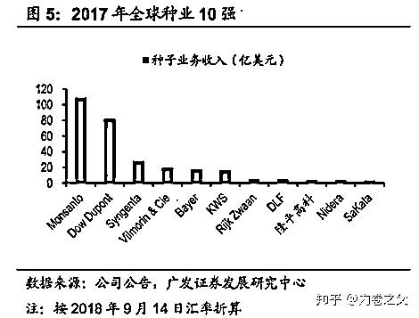

台湾台机电的股权和股东。

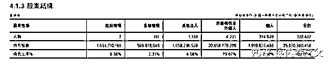

  

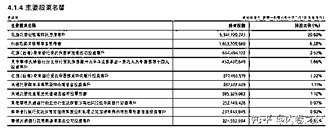

  

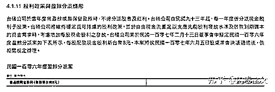

  

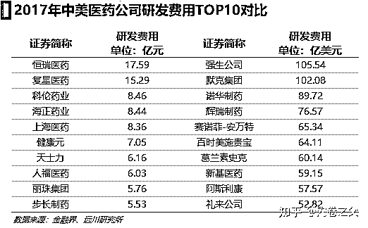

  

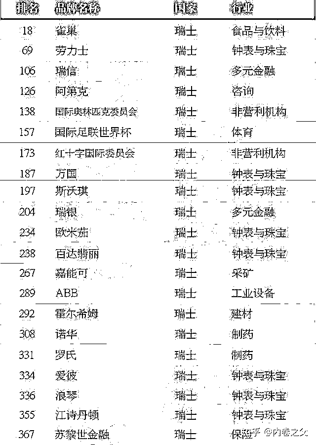

第二，价值观的高度趋同。

因为社会文化和价值观特别单一，所有人走的人生道路几乎是相同的，不管是自己想的，还是被父母逼的，或是被社会逼的等等。所有人从刚学会走路开始，就都沿着同一条跑道拼命向前跑，生怕输在起跑线上，生怕落后。所有人的快乐都来源于跟他人的比较，人一标和成功标准就是看谁能在这条跑道上走在前面，前面的人就是人生赢家，后面的就是输家。

漂亮本身对绝大多数女性来说是一剂毒药。整个社会对外貌的吹捧超过了任何的其他特质。这就是当前社会中，女性承受的最大不幸。这种在意颜值的风气，是女性在现代社会中规模最大，持续最久，最难以根除的不幸，没有之一。过度重视外貌这剂毒药，在公开的，持续的，对几乎全部的女性进行投毒，而且目前看不到任何消减的可能。

第三，社会保障缺失，社会容错率低。

一个德国普通工薪阶层家庭出身的德国人，把命也卷进去，可能最多是个中产。想实现向上的阶层突破太难太难了。女的还好说，还可以妄图走一走婚姻的路线。男的就更没法说了。对于普通人，所谓的人脉平时接触不到，即使读了研，读了博，狠卷一下当个中产，扣完税也没比普通人多太多。真的是追求更高层次、精神追求吗？我认为不是。在这个世界上，极少的人才能免俗，欧洲亦然。当德国人无论蹦多高都极大概率最多是个中产还面临重税时，就走向被动追求精神生活的路线了。

法国法定至少 25 天带薪假，你用不完公司 HR 还会逼着你请假清掉你的假期。上班作息基本上就是 965，中间两小时午休，一周一般 35 小时没毛病。无论大厂小厂、私企政府，都必须给员工每月的通勤费至少报销 50%。每个员工有上班的工作日雇主必须提供伙食补贴，每天 8 欧到 10 欧不等，一个月下来差不多 200 欧。每个月打餐钱，钱你爱拿来买午饭也可以、去超市买菜也可以。

第四，人均资源极度紧张和严重匮乏。

中国的内卷太严重了，是无限竞争模式，因为但凡成绩好一些，经历过高考的人，回想高中的努力程度，都会多少脊背发凉。 其实是真的大家都已经很优秀了，只是没有足够的土壤和资源让大家成长。而导致了所谓的丧文化和佛系文化。这个世界，同样是工作八小时每天，有人日进斗金，有人月薪 6000。智力上的差距有那么几何倍数的大吗？并没有，选择比努力重要太多。

在中国有 14 亿人口，而作为社会主义发展初级阶段，全国好的公司就那么些，又不愿意窝在老家开个小超市什么的，每个人都想来上北广深做互联网产品经理，企业也不傻，总有年轻力壮肯加班脑子好工资低的人可以用，干嘛用你？

最后，大家一定要理解，人口密度这个数据是没有意义的，说到人口密度，日本，德国这种都比中国高了去了。对于中国，14 亿人口如果能平均分布在 960 万平方公里上，那大家都是瑞士生活水平，但是这种生活水平需要极高的社会发展水平来支撑，我们目前的社会发展水平，只能支持上北广深最多加上杭州苏州之类的超级大城市达勉强达到入门发达国家水平，而这需要无数新鲜的血肉，前赴后继地来燃烧青春。

第五，东亚儒家的封建思想几千年如一日的荼毒。

科学突破都是靠对权威质疑，更广阔思维，思想收到拘束，对于他们来说比没钱更难受，国外科学史发展很久，那些精英不是傻子，如果 996 能让科学家发挥更大价值，他们早就天天加钱催人 996 了。为啥要强调生活工作平衡，就是因为这样有利于科技发展。因为你多工作个四五小时，还不如别人脑子动的快。

过分指导和严科监管的地方，只能提高工作效率和效果的下限，不能指望发生奇迹和迭代前进。一方面人的能力唯有全身心的投入到情况下才能达到最佳水平，另一方面不自由的人又怎么会思考让自己脖子上的金锁链更沉重的新技术，新工艺呢？中国人不是奴隶，但一层层现实的枷锁压得人喘不过气来的时候，当“不工作勿得食”成为一道诅咒而不是自发的内在理念的时候；甚至于，当《国际歌》逐渐不再出现在主流媒体之中、当《资本论》成为小资们的猎奇向作品、当 996 成为一种福报、当专家们为恢复“人口红利”而鼓励生育…...不改变以上光怪陆离的惊悚现状，这个世界还会好吗？

第六，[官本位](https://www.zhihu.com/search?q=%E5%AE%98%E6%9C%AC%E4%BD%8D&search_source=Entity&hybrid_search_source=Entity&hybrid_search_extra=%7B%22sourceType%22%3A%22answer%22%2C%22sourceId%22%3A2589785387%7D)思想浓烈，臃肿过剩的体制。

中国的普遍县城，垂直管理的部门和机构包括:国税局、地税局、电业局、药监局、烟草局、邮政局、气象局、工商局、质监局、国土局、盐业局等。

县城里领导干部按照行业分为 8 大系统，俗称口。党群口，包括县委、县委办、人大机关、政协机关、纪委、监察局、组织部、统战部、县直工委、老干部局、人武部、总工会、群工部、[信访](https://www.zhihu.com/search?q=%E4%BF%A1%E8%AE%BF&search_source=Entity&hybrid_search_source=Entity&hybrid_search_extra=%7B%22sourceType%22%3A%22answer%22%2C%22sourceId%22%3A2589785387%7D)局、党校、团县委、妇联、工商联、科协等等。政府口，包括县政府、政府办、发改委、计生委、教育局、民政局、人劳局、卫生局、统计局、建设局、交通局、民宗局、残联、房管局等等。[政法口](https://www.zhihu.com/search?q=%E6%94%BF%E6%B3%95%E5%8F%A3&search_source=Entity&hybrid_search_source=Entity&hybrid_search_extra=%7B%22sourceType%22%3A%22answer%22%2C%22sourceId%22%3A2589785387%7D)包括政法委、法院、检察院、公安局、司法局等等。宣传口，包括宣传部、广电局、文化局等等。财税金融口，包括财政局、国税局、地税局、审计局等等，工业商贸口，包括企业发展服务局、商业问题，在县里的地位举足轻重。

在县城里，垂直管理的还包括人行、工行、农行、建行、人保、人寿等金融保险部门和联通、移动等通信部门，这些机构都是企业性质。

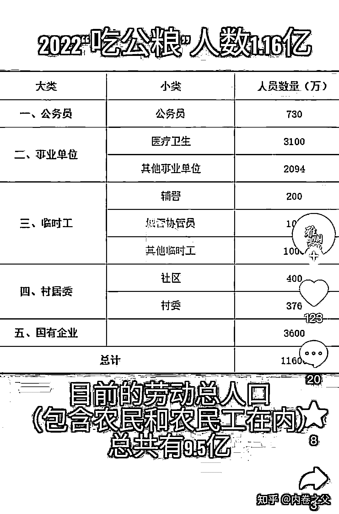

截止到 2017 年，全国的警察人数加起来占到了 350 万。辅警是指由政府出资，公安机关统一通过笔试、面试、政审、体检招录并 与其建立劳动关系，在公安机关及其人民警察的指挥和监督下从事警务辅助工作的人员。不占有编制，但却能够为警察分担许多警务工作，和警察一起维护社会的安定。

第七，登峰造极的土地财政。

我县财政供养人员这么高的收入依托就是收税和卖地了。我县 2021 年全口径税收收入是一百四十亿元，其中每年上缴 70%到 80%不固定。而我县出让土地收入才是大头，每年工业土地出让收入是六亿元左右，商业土地出让收入是十亿元，住房土地出让收入基本在十二三亿元左右。所以我县园区内工业用地价格是十五到二十万元一亩，住宅最高价格是一万四千元每平。对于普通人，需要不吃不喝十五年才能买的起一户 60 平米的小房子。对于企业主，开办一个普通企业前期投入就需要两百万元。而对于新入职的公务员，他们眼中永远对标的是苏州的公务员，银行支行行长，上市企业财务负责人，烟草局科长和特级资质建筑企业项目负责人的收入。

当去企业走访时，我面对的一线员工是满脸皱纹，穿着粘上油污的工作服的中年人和在硕大的办公室里抽烟，跟我侃侃而谈如何走出疫情困境，两鬓斑白的企业老板;然后再去政府时，我看到的是青年才俊在那里做着精美的 PPT,商讨着平台承接县[保障房](https://www.zhihu.com/search?q=%E4%BF%9D%E9%9A%9C%E6%88%BF&search_source=Entity&hybrid_search_source=Entity&hybrid_search_extra=%7B%22sourceType%22%3A%22answer%22%2C%22sourceId%22%3A2480275924%7D)项目，用底价接拍今年新挂牌的土地时，我真的觉得这个我呆了三十年的县城很陌生，短短十五分钟的路程，[铁栅栏](https://www.zhihu.com/search?q=%E9%93%81%E6%A0%85%E6%A0%8F&search_source=Entity&hybrid_search_source=Entity&hybrid_search_extra=%7B%22sourceType%22%3A%22answer%22%2C%22sourceId%22%3A2480275924%7D)里面和外面是天地悬殊的社会。

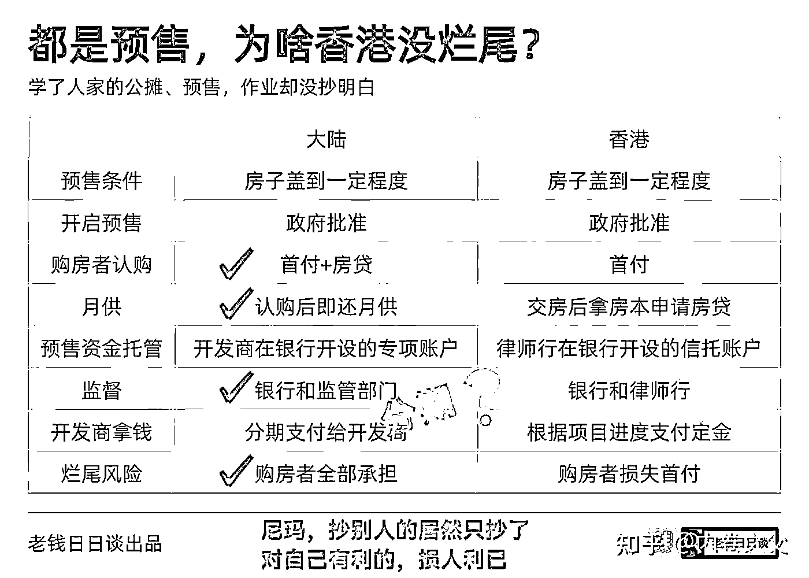

香港的就更合理。在大陆开发商地皮抵押一次，在建工程抵押一次。预售房屋算是第三次抵押，预售抵押的时候抵押品价值已经被地产商和银行前两次抵押"掏空"了。抵押责任算在消费者头上只对银行有利。资金监管服务香港是律师行做独立信托监管，大陆是"监管部门"。地产商搞定领导就什么都搞定了。烂尾楼都有监管资金被挪用的问题。这个资金监管是不是该政府购买公共服务？

在美国，大部分的房产都是现房销售，而且在交房之前无法从购房者处拿到资金。开发商需要先和买家达成预定意向，而通常要有一半上的房屋被预定之后，开发商才能从银行获得建筑贷款，然后开始建造房屋。买家在初期支付的订金约为房屋总价的 3%，这部分的资金由第三方保管，开发商无法获取。在项目动工之后，开发商要把所有的文件交给买家，如果买家在反悔期内没有提出解约，双方才会签订正式的购房合同，买家支付首付款，支付比例大概在 10%-20%。但为了防止开发商挪用买家的购房款用于非开发项目，法律通常会要求这部分资金由第三方代管，在房屋封顶完成交付之后，开发商才能获取购房款。

我国目前税种有 18 种：[增值税](https://www.zhihu.com/search?q=%E5%A2%9E%E5%80%BC%E7%A8%8E&search_source=Entity&hybrid_search_source=Entity&hybrid_search_extra=%7B%22sourceType%22%3A%22answer%22%2C%22sourceId%22%3A2589785387%7D)、[消费税](https://www.zhihu.com/search?q=%E6%B6%88%E8%B4%B9%E7%A8%8E&search_source=Entity&hybrid_search_source=Entity&hybrid_search_extra=%7B%22sourceType%22%3A%22answer%22%2C%22sourceId%22%3A2589785387%7D)、关税、个人所得税、企业所得税、[房产税](https://www.zhihu.com/search?q=%E6%88%BF%E4%BA%A7%E7%A8%8E&search_source=Entity&hybrid_search_source=Entity&hybrid_search_extra=%7B%22sourceType%22%3A%22answer%22%2C%22sourceId%22%3A2589785387%7D)、契税、车船税、船位吨税、资源税、土地增值税、城镇土地使用税、耕地占用税、印花税、城市维护建设税、烟叶税、环保税、车辆购置税。其中有部分税收为企业税收（比如企业所得税，增值税等），不在本文讨论范围之列，还有部分税种离我们比较远，比如船位吨税、城市维护建设税等等。个人日常接触到比较多的税种，大概有个人所得税，消费税，车辆购置税等。对于个人税收来说，最大的来源就是个人所得税。

以上原因，共同主导，相互递进，恶性循环。当东亚人发现，全球的中高端产业大量逐渐转移到东亚尤其是中国之后，由于产业资源的增多，整个社会不再需要超高竞争烈度，而是逐渐回归到勤奋工作但是又符合人性的最佳平衡点，这样才有可能走上可持续发展的道路。

# 萧萧

> 作者：萧萧
> 
> 赞同数：113
> 
> 编辑于：2022-06-05 01:10

根本原因是东亚对水稻的精细耕作使得东亚包括南亚在封建时代繁衍了远超土地容量的人口。

每亩水稻的热量远高于西方人吃的小麦磨成的面粉。

但是工业文明需要的石油，钢铁等等战略资源并不能随着精细耕作而增加或者能够节省。

  

一句话，人相较自然资源太多了。

包括乾隆后期的生活环境恶化也与人口有关。

  

北美的耕地与自然资源都远好过中国，中国真正比较舒适的人口——估计三亿就差不多了。日本是三千万，韩国是一千万，印度大概也是三亿左右。

# 师爷孙

> 作者：师爷孙
> 
> 赞同数：5416
> 
> 编辑于：2020-09-06 16:59

因为东亚地区是世界上唯一一个高度发达文明地区被另一个文明搞到国破家亡的地区。

如果你没有高度发达的文明，就不存在“国破家亡”这样的思维，更枉论“救亡图存”了，吃饱了野生香蕉就躺石头上晒屌才是日常。而有了高度发达的文明的地区，这个地区会拼命的找图存之策，一旦找到就义无反顾的使用上了，这是文明层面的。到了个人层面，就是一旦看见财富密码，就马上捡起来使用，唯恐落后。这是东亚自古以来缺乏资源加之近代饱受欺凌导致的内卷后遗症。还是那句话只有高度发达的文明才会有此病。

而现代依然如此累，是因为东亚地区仍然处于一个“夺食”的境地，世界话语权在西方文明手中，东亚唯一的有话语权的国家话语权却很弱，政治力量完不成统一整合，域外国家随时可以在东亚兴风作浪来搅动东亚地区的政治风波从而极大的影响东亚地区的经济整合。在一个经济版图破碎的高度发达文明区域内，必然会掀起更大的竞争，没有话语权/话语权弱的国家之间的竞争，会演变成各自的内卷。

当然，具体到个人层面就是，资本家利用这种内卷而不是抱团把这个压力释放出去（固然这里面有国家话语权弱的影响），这也就是毛主席当年高瞻远瞩说国内的资本家最多算个买办的意义的由来。

资本家一只手搞[拜金主义](https://www.zhihu.com/search?q=%E6%8B%9C%E9%87%91%E4%B8%BB%E4%B9%89&search_source=Entity&hybrid_search_source=Entity&hybrid_search_extra=%7B%22sourceType%22%3A%22answer%22%2C%22sourceId%22%3A1456991154%7D)，一只手贩卖焦虑，靠自己的喉舌（各种综艺节目、公众号、大 V）散布扭曲的价值观，成功地培养的一批脑子里面充满了扭曲的价值观，为了钱什么都愿意做的钱孙子，靠这帮前孙子当枪头子逼迫正常人也跟着党奋斗逼（你不 996？那好哇，我换一个愿意为点钱 996 的）。

你们见没见过我不知道，我是真见过北京私企 997，买两件奢侈品就觉得自己是人上人，觉得不 997 的都是懒鬼应该被淘汰，身体出问题就怪自己运气太差，笃信只要健身就会健康，整天抱着各种散播稀奇古怪价值观的“名人”的节目/书籍看奉若真理，真敢看不起公务员，觉得公务员穷的“白领”。

# 关东煮

> 作者：关东煮
> 
> 赞同数：1060
> 
> 编辑于：2022-08-13 19:00

上网这么多年，我发现一条规律：穷逼心怀天下，达者独善其身。

穷人每天都在与自己无关的事情上内耗。

一个穷光蛋，不管好自己的事，非要管国家大事，非要管别人家的事，天天跟人撕逼。你不受穷受累，天理难容。

一个人要想往上爬，要想变富，必须排除一切无关干扰。

要不要让一条信息进入你的大脑，只取决于两个点。

1.这事跟你有关吗？

2.它能来钱吗？

都不行那就一眼都不要看。

一个无法控制自己该汲取什么信息的人，注定只是任人宰割的[可怜虫](https://www.zhihu.com/search?q=%E5%8F%AF%E6%80%9C%E8%99%AB&search_source=Entity&hybrid_search_source=Entity&hybrid_search_extra=%7B%22sourceType%22%3A%22answer%22%2C%22sourceId%22%3A2623701115%7D)。

自从毕业起，你的唯一目标就是赚钱，少关注些有的没的。

社会上发生的任何事情，都与我们无关，我们只管赚钱。

多愁善感、义愤填膺的正义之士，你整天在网上乱窜、乱关注，除了气出一身病之外，其他一丝收获都不会有。

整天关心别人的事，结果就是自己没能赚到钱，没有能力离开糟糕的环境。只能在底层徘徊，被迫忍受一切恶心的人和事。

什么鸟人都敢骑在你头上拉屎拉尿，教你做人。

你不累谁累?

要想活得轻松，请时刻记住**关你屁事，关我屁事**这八字箴言，奉行到极致，你会觉得生活处处充满美好，真他妈的舒爽。

想看更多犀利回答，可以关注我的微信公众号：**关关笔记**，这里我会分享更多干货。

# 猴哥不怕

> 作者：猴哥不怕
> 
> 赞同数：311
> 
> 编辑于：2022-03-28 21:05

因为东亚人活着的意义不是为了悦己而是为了悦人。

日本人的现在很可能是我们的将来，看看日本年轻人的标签，宅男，佛系，躺平。

这与千年传承的文化有关，东亚三国文化圈内核相同，过于强调责任，限制自我。

从古至今东亚人活着的根本目的是什么？是传宗接代，所谓不孝有三，无后为大。孔子说“百善孝为先。孝悌也者，其为仁之本欤！”封建社会更是以孝治国。

那么两千年来读书人奋斗的最终目的是什么？真的是[张载](https://www.zhihu.com/search?q=%E5%BC%A0%E8%BD%BD&search_source=Entity&hybrid_search_source=Entity&hybrid_search_extra=%7B%22sourceType%22%3A%22answer%22%2C%22sourceId%22%3A2407924056%7D)说的“为天地立心，为生民立命，为往圣继绝学，为万世开太平吗？”或许表面上是，内里呢？恐怕只有四个字：光宗耀祖。考上状元是光耀门楣，当官了要[衣锦还乡](https://www.zhihu.com/search?q=%E8%A1%A3%E9%94%A6%E8%BF%98%E4%B9%A1&search_source=Entity&hybrid_search_source=Entity&hybrid_search_extra=%7B%22sourceType%22%3A%22answer%22%2C%22sourceId%22%3A2407924056%7D)，死了要荣归故里。

文化基因里面就没有人的自由发展，说的不客气一点不过是祖宗的附属品。

现代社会有改变，但也可以说毫无改变。

比如，年轻人 30 岁不结婚，父母会这么说：谁谁谁和你年龄一样大，人家孩子都三个了。你丢人不丢人。

丢人？丢谁的人，不结婚怎么会丢人？当然是丢父母的人。你看，你不结婚让父母脸上无光。这种道德负疚压力下，你会活得快乐轻松吗？

比如，有了孩子后，辅导孩子作业。我可能孤陋寡闻，见识浅薄，真的没有见过比中国父母更歇斯底里的，这就是爱吗？说是因为自己后悔当初没好好学习，才对孩子要求严的，难道忘了孩子的爷爷曾经也是这么要求的你的。

一代代的都把孩子当成自己的后悔药。欧美父母（影视剧里看的）经常讲：我为你骄傲。我们父母经常讲：你太让我失望了，你对得起我吗？

这只是其中一部分，一一举例子太多了。这里面哪一件事情是由自己做主的，不过是在各种压力下的被迫选择，无奈接受。

东亚人普遍背负过重的责任与压力，终其一生极少能为自己而活。简单说，就是少年时让父母舒心，中年时让妻与子女安心，老年时让子女放心。

## 追更一下，补充点资料，算是回答评论。

我自己也听过专家讲座，也看过日本管理学家[大前研一](https://www.zhihu.com/search?q=%E5%A4%A7%E5%89%8D%E7%A0%94%E4%B8%80&search_source=Entity&hybrid_search_source=Entity&hybrid_search_extra=%7B%22sourceType%22%3A%22answer%22%2C%22sourceId%22%3A2407924056%7D)写的《低欲望社会》，日本年轻人自嘲[社畜](https://www.zhihu.com/search?q=%E7%A4%BE%E7%95%9C&search_source=Entity&hybrid_search_source=Entity&hybrid_search_extra=%7B%22sourceType%22%3A%22answer%22%2C%22sourceId%22%3A2407924056%7D)，不是没有原因的。

第一张图各国居民平均睡眠时间，日本睡眠最少。

第二张图是以八小时为标准，各国缺觉情况，日本缺觉世界第一。

这些基本上可以反应一些问题，你总不会说全世界只有日本人喜欢熬夜玩游戏吧。

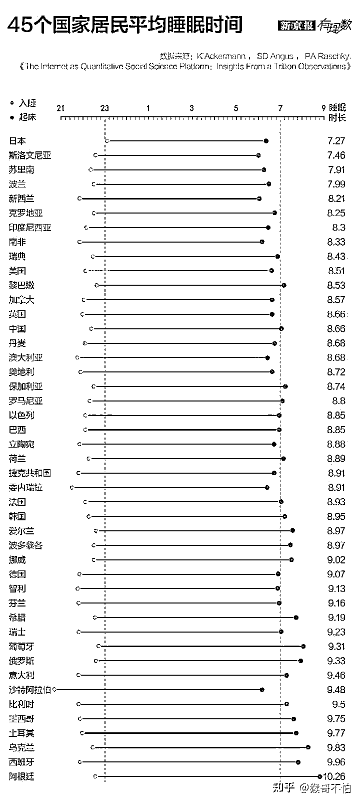

  

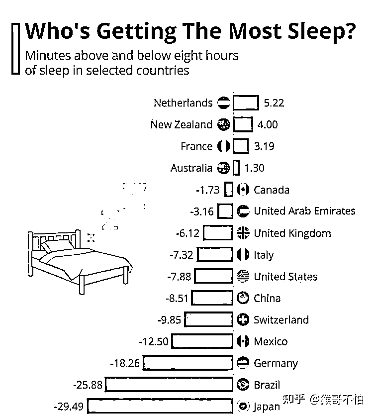

# 匿名用户

> 作者：匿名用户
> 
> 赞同数：450
> 
> 编辑于：2019-01-30 17:31

东亚人多，人口密度大，人口同质化高，导致**人群中韭菜密度高。**

  
草原上，草食动物越多，肉食动物也就越多。

社会中，韭菜越多，收[割韭菜](https://www.zhihu.com/search?q=%E5%89%B2%E9%9F%AD%E8%8F%9C&search_source=Entity&hybrid_search_source=Entity&hybrid_search_extra=%7B%22sourceType%22%3A%22answer%22%2C%22sourceId%22%3A585704431%7D)的成功人士就越多。

**韭菜供养出庞大的割韭菜群体，让其他人活得更艰难，这就是内卷。**

  

成功人士，[资本家](https://www.zhihu.com/search?q=%E8%B5%84%E6%9C%AC%E5%AE%B6&search_source=Entity&hybrid_search_source=Entity&hybrid_search_extra=%7B%22sourceType%22%3A%22answer%22%2C%22sourceId%22%3A585704431%7D)通过割韭菜发财致富，发展壮大。

韭菜相对数量多→ 割韭菜的行业兴旺发展→ 大众生活越发痛苦！

  

发达国家人口密度低，人群多样化，韭菜密度低。

韭菜相对数量少→ 割韭菜的行业难以壮大→ 大众生活没那么痛苦！

  

资本主义的人口瓶颈是客观存在的。

按照最富裕的资本主义国家例子。

韭菜与割韭菜群体的自动平衡下，3-4 亿是资本主义国家承载人口的极限。

  

对照美国，中国人口如果和美国一样，只有 3-4 亿。

中国的成功人士，会减少大半。割韭菜的产业，会倒闭大半。

剩下的人，就不会活得这么累了。

  

并不东亚盛产奋斗逼，所以人人都想踩着其他人上位。

而是客观的人口密度，韭菜密度。

导致割韭菜，踩着其他人真的能上位。

消灭了这个能够让割韭菜群体壮大的环境，奋斗逼，成功人士想闹也闹不起来。

# 陈一叶

> 作者：陈一叶
> 
> 赞同数：573
> 
> 编辑于：2022-01-31 13:10

因为儒家文化不允许你们躺平。

达则兼济天下，穷还要独善其身呢，可没让你随波逐流。

庙堂之高要忧其君，我都江湖之远了我都不能躺平，还要忧其民。民跟我有啥关系？

肉食者鄙，那就鄙去好了，关我屁事？谁来我不老婆孩子热炕头？

你说这都是知识分子啊，我不是知识分子不就不受这个约束了吗？

可惜不行，因为万般皆下品惟有读书高。你想务农，想种种树简简单单生活，那你就是“小人哉，樊须也”。

知乎有个问题，问美国（或者西方）有多反智。作为一个很了解美国的人，美国确实很反智。但是问题是这些人根本无所谓看不看书，他们觉得弄好自己的农场，把马和牛养好就行了，你跟他说 5g，说太空，说环保他才不管，美国牛逼就完事了，他能不反智吗？可是他们没啥压力啊，活的也不累啊，他们根本无所谓钱不钱的，有钱也不知道怎么花。

所以你不能一边嘲笑别人反智，一边抨击别人阶级固化，一边羡慕别人活的没压力。因为别人没压力的原因就是不在乎智不智的，反正饿不死也撑不死，热不死也冻不死。阶级不阶级的也无所谓，反正就是放牛，骑马，管管农场。

如果你无所谓在哪定居，无所谓吃啥穿啥，无所谓孩子上不上学娶不娶媳妇，无所谓升职加薪，没啥抱负，彻底躺平，你也活得不累。大不了去救济站嘛，社会主义中国还能饿死人？

这时候你就发现，[陈平](https://www.zhihu.com/search?q=%E9%99%88%E5%B9%B3&search_source=Entity&hybrid_search_source=Entity&hybrid_search_extra=%7B%22sourceType%22%3A%22answer%22%2C%22sourceId%22%3A2329900662%7D)说的也没错，一个月两三千活的也凑合。

# 立党

> 作者：立党
> 
> 赞同数：1154
> 
> 编辑于：2020-08-19 09:10

真正原因：东亚经济体真正繁荣到现在不过 50 年，社会财富、各个产业、无形资产积累得太少，同时还吃了“金融体系不完整”的亏。

有的人大放厥词说“东亚人被欧美金融体系洗干了血，是给华尔街打工”——核心问题是东亚的经济刚刚崛起的时候，需要大量资金融资投入进行产业升级、扩大和股份改革，而股东们也急于套现离场，导致东亚存在各行各业的最优质资产直接划归欧美财团名下——你当年明明可以选择收钱，也可以选择拒绝的时候，大部分企业家选择了“收钱”——那么 2020 年你哪里有理由再骂欧美的资本家呢？

当年中国电池第一大巨头南孚，第一大猪肉工业体系双汇，第一大果汁汇源，国产[感冒药](https://www.zhihu.com/search?q=%E6%84%9F%E5%86%92%E8%8D%AF&search_source=Entity&hybrid_search_source=Entity&hybrid_search_extra=%7B%22sourceType%22%3A%22answer%22%2C%22sourceId%22%3A1418507252%7D)第一大品牌白加黑，国产平价护肤品第一大品牌大宝——这些中国真正的优质制造业、快消、食品工业，哪个当年是“被逼贱卖给欧美”的？

都是欧美大厂带着一大笔钱来收购，股东们（私人股东+地方国资委）见钱眼开，上前抢着贱卖给欧美银行，集体套现离场：国资委当成一大笔“天价”财政收入邀功请赏坐等升官，私人股东则直接套现美元带着老婆孩子移民洛杉矶。

你今天可以说，“在中国每吃一根双汇火腿肠，都是帮华尔街的高盛赚钱；[双汇](https://www.zhihu.com/search?q=%E5%8F%8C%E6%B1%87&search_source=Entity&hybrid_search_source=Entity&hybrid_search_extra=%7B%22sourceType%22%3A%22answer%22%2C%22sourceId%22%3A1418507252%7D)员工每加一次班，都是在为华尔街高盛赚钱”——问题是高盛从来没有强行威胁收购双汇，是[漯河市](https://www.zhihu.com/search?q=%E6%BC%AF%E6%B2%B3%E5%B8%82&search_source=Entity&hybrid_search_source=Entity&hybrid_search_extra=%7B%22sourceType%22%3A%22answer%22%2C%22sourceId%22%3A1418507252%7D)国资委自己抢先上赶着“出卖”双汇这个[国有资产](https://www.zhihu.com/search?q=%E5%9B%BD%E6%9C%89%E8%B5%84%E4%BA%A7&search_source=Entity&hybrid_search_source=Entity&hybrid_search_extra=%7B%22sourceType%22%3A%22answer%22%2C%22sourceId%22%3A1418507252%7D)（[`finance.sina.com.cn/g/20060518/16202578849.shtml`](https://link.zhihu.com/?target=http%3A//finance.sina.com.cn/g/20060518/16202578849.shtml)）——那么结局都看到了，作为中国最优质的肉类加工厂，双汇成为了美国公司，每个双汇员工都在为美国人打工，每个吃双汇猪肉的中国人也都成了“让美国金融股东们赚钱、吸血”了。

所以说，东亚和北欧天然是一体两面：

北欧国家的资本投资控股，手持大量钞票，在全球到处投资优质资产，坐等升值，赚来的钱和分工给本国公民当福利、财政、养老金、教育支出，让他们享受“好吃懒做的生活”；

东亚国家“急于抛售国有优质资产”给欧美，东亚企业家也“急于抛售个人公司和资产”给欧美，短期大赚一笔，把东亚最有价值、最优质的的资产在经济腾飞的时期全都卖给了欧美，让各行各业的工人为欧美资本打工，让消费者们花钱购买“欧美全资控股公司”的产品——最终东亚工业界金融界的财富再分配完全由华尔街和欧洲各大银行控制、吸血——那你不累谁累呢？

# 麻辣地三鲜

> 作者：麻辣地三鲜
> 
> 赞同数：693
> 
> 编辑于：2022-05-22 18:23

不耐烦看的直接拉底端。

因为祖宗不争气，秦制下牧民如猪羊，栅栏圈住了都给爷爬，哪个叫科学，谁又叫生产力，有我家奴隶好用吗？错过了大航海时代圈地球运动，物资产出不足以形成工业化基础，只能以农业国的形态自封天朝上国，被工业化国家按着头轮番殴打，最终二战后借着世界格局的东风完成民族革命重新成为主权国家，但完整的主权有利有弊，有利之处在于发展的上限增加，弊端是不能像四小龙那样轻易的获得欧美产业转移，只能守着苏联援助的重工巩固国防，农业补贴重工业，于是人民生活水平三十年间没有提高，直到改革开放迎来外资，期间经济随着人家进进出出也是几起几落，到加入世贸才稳定的成为美帝主导的全球贸易体系中的一员。

啰里八嗦说了一大堆铺垫，就是为了说，作为一个农业国，要进入工业化所需要的能源、矿产和原材料、技术、机器、管理经验、资本、粮食（不只是人才需要粮食的），以及工业化初期最重要的市场都是别人的，都需要你劳动去换的，即使到了产业、商业、金融资本全面过剩的今天，中国产业在国际分工中，被粮食、矿产原材料和能源，以及高科技和国际货币资本，牢牢的把你卡在中间，你的劳动产出，是要向别人交工业租的，好比打工人幸幸苦苦挣的钱，三分之一到二分之一都要给房东，所以你终日劳作勉强维持再生产，人家岁月静好。

当然引起两次世界大战的工业化威力实在惊人，今天的中国已经从物资匮乏进入过剩经济阶段，剥削你的，那就不只是外宾了，金融资本哪个国家都一个德行。

  

总结：你活的累是因为有人替你岁月静好，不论国内国外。

# 知乎用户 @周吴郑王

> 作者：知乎用户 @周吴郑王
> 
> 赞同数：8003
> 
> 编辑于：2019-03-20 17:14

因为许多人在长期畸形的权力支配关系下心态发生了变异啊。

我记得之前有个问题是“北京白领和乾隆皇帝谁的生活质量高？”后来应该是被删了（感谢 

@周吴郑王 

原问题在 [`www.zhihu.com/question/59681544`](http://www.zhihu.com/question/59681544)），然后又找到一个问题。

 

这类问题下（我不是针对哪一个特定答主）一堆人的答案，心态是什么？

吃的好、穿得好感觉不到幸福，**他们只有踩在别人脸上才能获得幸福感。**

好好交几个朋友，周末没事去打打狼人杀，幸福吗？不幸福，别人跪在地上叫我万岁——哪怕都不是真心的——才幸福

出门买张高铁票，上千公里几个小时就到，幸福吗？不幸福，别人当牛做马给我抬轿子——哪怕要颠簸上三个月——才幸福。

现代品种的荔枝空运过来，又大又甜又新鲜，几十块钱一斤，好吃吗？不好吃，要快马千里送来的——哪怕已经不新鲜了——才好吃。

**还有什么羡慕皇帝能看富春山居图、兰亭集序的，我说句寒碜点的，你看得懂么**？你真要对什么艺术珍品有兴趣，为什么周末窝在家打 LOL，打 steam 买的各种单机，而不去博物馆转转？

> 白领说虽然长期亚健康而且生活在充满雾霾的城市，但是我有现代医学啊，我是中医黑啊；不好意思实际上很多人根本生不起病，挂完号都快挤脱水了，而皇帝会有人尝他的便便来分析他老人家的身体健康。 

请问尝大便能分析出什么身体健康来？但就抱着这种心态的人能直接把答案写出来，拿到几百上千个赞，你就知道为什么那么多人活得累了。哪有那么多脸给皮鞋踩啊。

# 空一格

> 作者：空一格
> 
> 赞同数：1147
> 
> 编辑于：2020-09-21 11:13

**瓜分世界** 的时代没赶上。

人多，资源短缺。

各种资源，包括土地、粮食、淡水、矿产、[金融权](https://www.zhihu.com/search?q=%E9%87%91%E8%9E%8D%E6%9D%83&search_source=Entity&hybrid_search_source=Entity&hybrid_search_extra=%7B%22sourceType%22%3A%22answer%22%2C%22sourceId%22%3A1484829875%7D)、规则制定权、话语权等等。

欧洲人从不到 1000 万平方公里土地，已经扩展成超过 5 千万平方公里（整个南北美洲、澳洲），控制了世界绝大部分的海洋，控制了金融，控制了几乎所有的国际组织。

比如一个英国人，吃了睡、睡了吃，不学无术，只会英语，他也可以到其他国家去教英语，领着高薪、睡着嫩妹，潇洒无忧。

你日本人，来一个？

韩国人，来一个？

  

不入关，永远内卷。

# 知乎用户

> 作者：知乎用户
> 
> 赞同数：4982
> 
> 编辑于：2020-12-10 21:26

总的来说，和世界其他地区相比，东亚的特征是“用三十年时间走完了一百年的路”，赶得这么着急，能不累嘛? 太快速，本来就容易“累”（晕车）呀，所以高铁有减速玻璃。——晕车（累）的本质就是视觉上的高频变动。

经济社会的快速发展，也同样让人眩晕的。上个班就琢磨着升职当官（各种"成功学”鸡汤无处不在），攒点钱就畅想资产增殖（确实有内涵发展&资产泡沫的“赚钱效应”），各种拼娃（惦记着阶层上升），这其实不是历史的常态，而是在“经济奇迹”的背景下，才会成为某些地区的主流价值观。——而过了这个阶段，比如现在的日本，年轻人的心境和价值取向，就和七八十年代有了很大区别。

当然，相对于世界其他主流文明，东亚社会还有一些特色，极大放大了“经济奇迹”的“累”:

1.东亚社会的世俗化程度最高，缺少“难以证伪”的心理安慰和精神寄托（宗教）；

2.东亚社会[父权制](https://www.zhihu.com/search?q=%E7%88%B6%E6%9D%83%E5%88%B6&search_source=Entity&hybrid_search_source=Entity&hybrid_search_extra=%7B%22sourceType%22%3A%22answer%22%2C%22sourceId%22%3A639612410%7D)强于同等工业化水平的西方社会，缺少真正意义上的性解放，且缺少各种左翼价值观土壤；

3.东亚是“[熵减](https://www.zhihu.com/search?q=%E7%86%B5%E5%87%8F&search_source=Entity&hybrid_search_source=Entity&hybrid_search_extra=%7B%22sourceType%22%3A%22answer%22%2C%22sourceId%22%3A639612410%7D)”社会 ，组织度高，有点“真社会性动物”的色彩。

另外得声明：

1.答主价值中立，下文的任何陈述都不涉及道德判断。

2\. 分析对象是“社会的大多数”，少数上层和精英、少数非主流（任何社会）不在分析范围内。

其实，任何社会都有该社会的游戏规则和压力传导机制，而性选择更是无处不在。

# 两岸蛙声啼不住

> 作者：两岸蛙声啼不住
> 
> 赞同数：1129
> 
> 编辑于：2022-03-30 12:00

大部分人只看见贼吃肉，不聊贼挨打。

老牌[帝国主义](https://www.zhihu.com/search?q=%E5%B8%9D%E5%9B%BD%E4%B8%BB%E4%B9%89&search_source=Entity&hybrid_search_source=Entity&hybrid_search_extra=%7B%22sourceType%22%3A%22answer%22%2C%22sourceId%22%3A2414441106%7D)国家早年间的工厂真的是血汗工厂，就是字面意义的血汗工厂，还要拓展殖民地，倾销商品，把殖民地人连带着累死，生生逼出了[国际共运](https://www.zhihu.com/search?q=%E5%9B%BD%E9%99%85%E5%85%B1%E8%BF%90&search_source=Entity&hybrid_search_source=Entity&hybrid_search_extra=%7B%22sourceType%22%3A%22answer%22%2C%22sourceId%22%3A2414441106%7D)，他们的人民不仅活得累，没准还能累到死。

更早期地理大发现，前赴后继九死一生开个帆船到处逛，是为了理想和信念吗？不不不，是要找个不累的地方天地任我逍遥。

今天他们的后辈靠着先辈打下来的大大的江山，哪怕坐吃山空，也能鱼肉世界几十年，要不是出了中国这么个妖孽，那些家底怕是够百年祸祸的。

哦吃得苦中苦，方为人上人都成了奴隶 PUA 了？

那欧洲那帮人他们客死他乡的老祖宗算什么？奴隶养的吉娃娃？

从一穷二白，打烂了的焦土上挣扎起这么个国家，改开不过 40 来年，90 年代改制不过 30 年发展到世界第二经济体，还不够？还想过欧美的生活？

哎，那人家前几百年的积累，抵不过你被重重封锁挣扎发展的 40 年是吧？

这个世界就是这么魔幻，外国人都惊叹中国的发展速度，觉得中国人站起来了，成了他们最重要的对手，怎么国内的人就非觉得自己是奴隶呢？

20 年前飞机撞了，人家表示遗憾，人还觉得是你飞得不专业撞了人家大老爷的飞机。今天人家得说中国人飞 J20 飞得很专业，空警 500 很强，E3 是辣鸡，国会打钱买 E7。

一边说着不要比烂，要向前看，一边无视人家祖上奋斗几百年的积累，愣说东亚人活得累是奴隶 PUA，贱不贱呐？

我寻思现代社会，虽然整体氛围趋于保守，但是个人选择更宽了，你可以选择不那么累，也可以选择润，不是说了吗？中国，来去自由。以中国人这尿性，就算是润出去，也比那帮吃祖上饭的能奋斗够卷，怎么你们就什么都不做，在中国，找了累的奋斗方向，又攻击这是奴隶 PUA 呢？

心比天高，命比纸薄。

不是说对待中国不可以表达不满，因为没有什么东西是完美的，中国有中国的问题，因为新冠导致其他病人无法就医之类的破事，各种上层到基层层层加码的各种糟心政策，地方还存在人口买卖，地方司法的不公正，该骂就要骂，该喷就喷，该举报就要举报。但是就因为加班就自认自己是奴隶，改革就大呼自己是耗材，挣少点就叭叭钱都进了大老爷口袋，大可不必。

# 倪伟

> 作者：倪伟
> 
> 赞同数：152
> 
> 编辑于：2019-03-14 09:54

**什么样的人最累？**

**努力奋斗向上的穷人最累。**

富人累不到哪里去：毕竟可以把低附加值的辛苦活都外包出去。起码扫地做饭请个钟点工吧。

认命的穷人也不会太累：干完活换口吃的就睡呗。

想当富人的穷人最累：为了现在能活下去，白天要打工；为了未来不会一辈子都打工，晚上还要读夜校。

国家就像一个人一样。一边在血汗工厂打工挣口饭吃，可是这点可怜的工资还不能全吃饭，还要在这非常紧张的资源里挤出一大块来搞芯片，搞大飞机，搞 AI，搞 5G。。。

出生穷，但又不甘于接受世世代代穷下去的命运，那就只能吃苦受累。这就是东亚国家和东亚人。

# 杜若

> 作者：杜若
> 
> 赞同数：1.3 万
> 
> 编辑于：2019-01-30 22:36

以前说欧洲三代才能出一个贵族，怎么出呢？

第一代当海盗，烧杀抢掠无恶不作，完成物质积累；

第二代金盆洗手，做正经买卖，并且附庸风雅，成为所谓“绅士”，完成洗白；

第三代继承家族财富，接受良好的教育，物质极其充裕精神纯洁高尚，甚至有较高的文化艺术修养，成为所谓“贵族”。

西方的发达优越以及轻松的生活，大抵是一个道理。

资本工业时代对内压榨剥削，航海时代对外殖民掠夺，两次大战瓜分世界，战后一面立牌坊一面巩固优势分化限制后进。自己从腌臜血腥中抢够了钱，然后要求所有人遵守它们“文明”的“规则”，在“规则”中你每赚一块钱他们就能从你的劳动中捞十块钱，不苦逼就邪了，你就是豁出命去也不如他们当年烧杀抢掠攒来的本钱啊。

\-------------------------------------------------------------

渲染过激的种族情绪并不是我的本意，关于国家、阶级、资本和全球化等等，评论里很多人解释得更加全面，我也受益匪浅。

# augustuscc3

> 作者：augustuscc3
> 
> 赞同数：4491
> 
> 编辑于：2022-04-25 13:44

其实“累”这个词不是很精确，我觉得最合适的词是“拧巴”，是一种所有人都不如意，感到别扭的状态，是一种所有人都感到自己被剥削的感觉。这种状态前面很多人说了是儒家文化，是[等级制](https://www.zhihu.com/search?q=%E7%AD%89%E7%BA%A7%E5%88%B6&search_source=Entity&hybrid_search_source=Entity&hybrid_search_extra=%7B%22sourceType%22%3A%22answer%22%2C%22sourceId%22%3A2456550791%7D)。而其本质其实是一种权利，责任的不对等，不平衡所造就的。

在中国文化里权力和责任不是对同一个个体的双向行为，而是对于两个个体的不同行为。比如说”你对你朋友忠诚，你朋友对你忠诚。“ 这个是西方的思维，但在东亚文化中是这样的”你对你的上司忠诚，你的上司对他的上司忠诚。“

你的权力体现在，你的下属，妻子（假设你是男的）对你的忠诚， （所以你对你的家庭没有责任，只有权力。）而你的责任体现在对上司，父亲的忠诚上。这种奇怪的等级制在历史上就是各种典妻， 易子相食的行为。

这个的典型就是[张巡](https://www.zhihu.com/search?q=%E5%BC%A0%E5%B7%A1&search_source=Entity&hybrid_search_source=Entity&hybrid_search_extra=%7B%22sourceType%22%3A%22answer%22%2C%22sourceId%22%3A2456550791%7D)，”巡乃出其妾，对三军杀之，以飨军士。曰：‘诸公为国家戮力守城，一心无二，经年乏食，忠义不衰。巡不能自割肌肤，以啖将士，岂可惜此妇，坐视危迫。’将士皆泣下，不忍食，巡强令食之。乃括城中妇人；既尽，以男夫老小继之，所食人口二三万，人心终不离变。“（《[旧唐书](https://www.zhihu.com/search?q=%E6%97%A7%E5%94%90%E4%B9%A6&search_source=Entity&hybrid_search_source=Entity&hybrid_search_extra=%7B%22sourceType%22%3A%22answer%22%2C%22sourceId%22%3A2456550791%7D)》）。

张巡只用对皇权负责，而不用对黔首负责，因为他享有对贱民的权力而不用承担义务，而这个权力来源于皇权。（起码他是这么认为的） 。这就是最有意思的部分了，也是中国最黑暗的部分，这种权责不对等和混乱的制度让上级可以无限制的剥削下级，而下级有可以通过剥削他的下级来获得”补偿“。

所以在东亚文化中真正被奴役的人非常少，这部分人还是最弱势的群体，基本上就是未成年的子女和没熬成“婆”的“媳妇”。 而孩子和部分妇女在这个绞肉机中是最弱势，被剥削最惨的且无法反抗的人。那么那些剥削者就很爽吗？不他们也不爽，他们也得被剥削， 被他们的上级， 被封建礼法制度所剥削。 中国男人们得承受很多责任，比说当炮灰，比如说养家（为了传宗接代不是真的对家庭负责）。 这种异化到了现在就变成彩礼还有乱七八糟的男女矛盾。

中国男女矛盾很神奇， 因为其实两边都是受害者。

男性觉得自己承担很多，压力很大，及其不爽，然后又看到[女权主义](https://www.zhihu.com/search?q=%E5%A5%B3%E6%9D%83%E4%B8%BB%E4%B9%89&search_source=Entity&hybrid_search_source=Entity&hybrid_search_extra=%7B%22sourceType%22%3A%22answer%22%2C%22sourceId%22%3A2456550791%7D)的各种要求，所以很多男性甚至有点痛恨女权主义，甚至想保持男性对女性的特权，就是上文所述的“权力补偿”。 没有这种补偿就让他们很愤怒，觉得承担了责任却没有权力。这也是很多人把女性视做自己财产的原因。

从女性的角度来看，那就更冤了，因为女性连这种权力补偿都没有，然而因为各种原因导致女性一直没有真正获得权力，她们给自己弄来了很多特权作为补偿。 但很多男性就此笃定女性权力大于男性然后矛盾就爆发了。 从中国女性的角度上来看，男性变得非常的无理取闹。 因为男性把持着大量的权力而女性只有一点可怜的都称不上权力的“小福利”。连这个都要反抗，是不是很过分。

类似的关系还可以衍生到家庭关系上，子女觉得父母是[独裁者](https://www.zhihu.com/search?q=%E7%8B%AC%E8%A3%81%E8%80%85&search_source=Entity&hybrid_search_source=Entity&hybrid_search_extra=%7B%22sourceType%22%3A%22answer%22%2C%22sourceId%22%3A2456550791%7D)。父母觉得子女无理取闹，而且感到很累，因为要考虑子女的就业，买房。

这种奇特的权力补偿机制让所有人都很拧巴，很难受，很不如意。 所有人都觉得自己是受害者，对方是剥削自己的人。 这种看法是完全正确的。

这也就是说为什么中国人需要的是自由， 而自由同样意味着某种付出，某种代价。要打破中国这种奇怪等级制度就要记住“你不想奴役别人，也不想被别人奴役。”

总的来说就是你需要放弃掉那些你本来就不该拥有的权力，你才能自由。当你停止对你孩子的打骂，当你停止对父母无休止尽的索取，当你不再把女性当成一件物品，当你不在去争夺一点用都没有的特权，当你停止对你的下属呼来喝去，你才能获得自由，所有人才能获得自由。

我不觉自由和平等有什么矛盾，只有平等才能自由。

如果所有人依旧享受着这种他们本不应该有的权力，那他们就一定会被不应该存在力量所奴役。

另外我觉得东亚国家一潭死水就是因为这个原因，中国如果没办法突破这个锁链就是下一个日本，突破了就是下一个美国。

（很久没写中文的长篇文章了，有点乱，请见谅）

# 知乎用户

> 作者：知乎用户
> 
> 赞同数：1512
> 
> 编辑于：2019-01-28 17:10

泛中华文化圈活的累

大概是因为祖上阔过，而且心里不服气

错过殖民扩张和[工业革命](https://www.zhihu.com/search?q=%E5%B7%A5%E4%B8%9A%E9%9D%A9%E5%91%BD&search_source=Entity&hybrid_search_source=Entity&hybrid_search_extra=%7B%22sourceType%22%3A%22answer%22%2C%22sourceId%22%3A584035801%7D)，这课补得很累

# 多勒

> 作者：多勒
> 
> 赞同数：816
> 
> 编辑于：2022-03-07 20:23

因为东亚的工业化过程是 zf 主导下诞生的，没有形成资本家之间的对抗。

解释一下就是，以前欧洲美洲工业化，企业家是牵头人，他们之间存在竞争，然后会将触手伸向 zz 领域，形成资本间相互的对抗。

一个企业的工人罢工，其他企业赶紧提高待遇，以安抚自己员工，而不是全部行业死压工资。打工人就有了选择余地，所谓此处不留人自有留人处。有选择余地，有退路，就有谈判的筹码。

相反中国的企业就不同，例如一栋工业楼内的企业老板，是很容易达成共识：那就是从我这里出去的工人，同一栋楼内不要招。这样可以避免工人串通抬[工价](https://www.zhihu.com/search?q=%E5%B7%A5%E4%BB%B7&search_source=Entity&hybrid_search_source=Entity&hybrid_search_extra=%7B%22sourceType%22%3A%22answer%22%2C%22sourceId%22%3A2378682040%7D)，也可以免去老板们恶意挖人的事，毕竟天天防贼也不是事。企业之间没有形成对抗，就会联合起来盘剥工人。薪酬待遇自然上不去。

与之相反的是互联网大厂，虽然很卷，但是大厂挖人跳槽涨薪水，所以程序员们过得都比较好。更厉害的是，我宁愿花钱养着少数天才，哪怕自己没用，万一跑到别的企业去，搞个什么新产品，回过头来干死自己，那不亏大了。

因为东亚的现代化工业化，主导人是 zf，工人选来选去，最后的大老板都是同一个人，底下小老板们很容易形成一致意见：不要乱涨待遇。

# 珑霖君

> 作者：珑霖君
> 
> 赞同数：1784
> 
> 编辑于：2019-12-11 17:06

转发一篇文章，侵删。文章略长，但是干货非常多。

## 原文链接：[中国的发展与打破东亚地狱模式](https://link.zhihu.com/?target=https%3A//mp.weixin.qq.com/s/rrZYhVofsIBIhZChjKbVwg)

来源：[宁南山](https://www.zhihu.com/search?q=%E5%AE%81%E5%8D%97%E5%B1%B1&search_source=Entity&hybrid_search_source=Entity&hybrid_search_extra=%7B%22sourceType%22%3A%22answer%22%2C%22sourceId%22%3A648311669%7D)（ID:ningnanshan2017）

中国复兴之路，肯定是不太好走的，这个周即使是力图降温，但是仍然产生很大影响的华为事件就是个例子。这一篇本来想写华为的，但是很遗憾发不出来，那我就写下，中国的技术和产业升级，对于普通中国老百姓，乃至东亚老百姓的意义。

我们在各方面的进步，尤其是技术和产业方面的进步，除了推动中国走向复兴之外，还很有可能产生一个副产品，那就是打破残酷的东亚地狱模式，真正的提高十几亿东亚人民的生活水平。

我个人去国外，有个很明显的感觉，欧洲澳大利亚等白人发达国家，生活真心放松，没事 coffee break,下午四五点就下班非常正常，整个社会处于放松的状态。

而东亚国家，即使是已经发达起来的日本，韩国，新加坡，香港，乃至于已经算是比较发达的中国一线城市，却无一例外都是高度辛苦，长时间读书，长时间加班，东亚人的聪明和勤奋，是全世界公认的，中国人，朝鲜人，韩国人，日本人，都是类似的，工作起来非常玩命，智商也很高。

但中日韩东亚三国，可以说都是地狱模式，东亚人从幼儿园开始就要参与残酷的竞争，每天游走于各种英语培训，课外班，数学物理补习班之类，早早的戴上了眼镜。

一路要面临极高的淘汰率考入好的高中，考入一个不错的大学，而到了工作之后也没有办法停下来，加班加点的工作是常态，生活压力感觉巨大，以至于不敢生孩子。

东亚国家中最先崛起，也是目前最为发达的日本，日本人的勤奋全世界公认，日本人从小到大也要面临辛苦读书，努力工作，但是却出现了人均 GDP 不进反退的情况，人均从 1995 年巅峰时期的世界第三，一步步跌落到现在的全球第二十多位。

而在过去的 20 年，人均 GDP 逐渐反超日本的 20 个左右的国家，以欧洲国家为主，很难说比日本人更勤奋，相反他们的生活氛围比日本可是轻松多了，但是居然人均 GDP 却一个个超过日本，经济增长率反而高于日本。

懒人的经济增长，居然超过了勤奋的人经济增长，这一定是哪里出了问题。

东亚人民如此的勤奋，最终却又总是陷入低生育率的怪圈，不愿意生孩子，造成社会老龄化，老龄化又大大的抵消了勤奋工作带来的工作成果增加，年轻人的工作成果被老龄化吞噬，并没有被用于社会发展和薪资提高，形成恶性循环。

这个规律不只是出现在日本，也不只是出现在韩国，中国台湾，中国香港，乃至于现在还没有跨入发达经济体的中国大陆都出现了这个现象，朝着极度老龄化的方向狂奔。

我们都说这是因为东亚地少人多，人均资源不足，导致虽然大家都很勤奋，最后争抢到的资源却很少。

其实不然，北美+西欧+澳新发达国家加起来可是有七八亿人，不算中国大陆的话，远远超过日本+四小龙的人口。

要说自然资源，欧洲也一样依赖自然资源进口，天然气要从俄罗斯进口，石油要从中东进口，铁矿石要从巴西进口。

另外其实自然资源没有那么值钱，自然资源种类很多，但是真正值钱的却很少，全球值钱的自然资源，主要是石油，天然气和铁矿石三大类。而全球能够依靠自然资源致富的国家，人口上限就是两三千万，比如挪威，澳大利亚，沙特，加拿大，[卡塔尔](https://www.zhihu.com/search?q=%E5%8D%A1%E5%A1%94%E5%B0%94&search_source=Entity&hybrid_search_source=Entity&hybrid_search_extra=%7B%22sourceType%22%3A%22answer%22%2C%22sourceId%22%3A648311669%7D)，科威特等等。

人口再多，比如俄罗斯一亿多人，石油天然气都很丰富，产量也高，但是依然不是富裕国家。

东亚地狱模式，一个来自于产业的狭窄性，一个来自于支出结构的不合理性。

**真正值钱的资源是人力资源，而人力资源又依赖于教育和产业才能变现，**没有教育，人口就无法变成人力资源，没有产业，人力资源就没有用武之地，就只能在有限的几个产业里面高烈度竞争，极大的降低效率，导致累死累活最后获得的却不成比例。

东亚毫无疑问，由于都非常重视教育，人口都会转化为人力资源，因此在人力资源部分是相当丰富的，而且素质很高，遵守纪律，犯罪率低，勤奋认真。

但是人力资源赖以变现的产业方面，却出现了东亚经济体产业高度同质化的特点，如果你看下中国大陆，中国台湾，韩国，日本的相关产业，会发现相似度非常高，高度拥挤在相同的几个赛道进行竞争，独特的赛道很少。

仿佛有一只看不见的手，把东亚国家死死的按在这几个赛道上。

是什么限制了亚洲的产业发展？我们先从现象来观察。

### **第一个是天赋弱势的限制**

欧美澳新都是大农业国家，日本和四小龙由于缺乏大农业发展的空间，在先天上就处于弱势，如果看全球农业化工巨头，基本都是欧美企业。

2018 年 10 月，英国农化资讯商 Agrow 公布 2018 年度全球农化公司二十强名单。

瑞士先正达以 92.44 亿美元的 2017 财年销售额蝉联榜首，

德国拜耳作物科学以 87.13 亿美元居第二，

德国巴斯夫 67.04 亿美元居第三，

美国[陶氏](https://www.zhihu.com/search?q=%E9%99%B6%E6%B0%8F&search_source=Entity&hybrid_search_source=Entity&hybrid_search_extra=%7B%22sourceType%22%3A%22answer%22%2C%22sourceId%22%3A648311669%7D)杜邦以 61 亿美元紧随其后居第四。

美国[孟山都](https://www.zhihu.com/search?q=%E5%AD%9F%E5%B1%B1%E9%83%BD&search_source=Entity&hybrid_search_source=Entity&hybrid_search_extra=%7B%22sourceType%22%3A%22answer%22%2C%22sourceId%22%3A648311669%7D)37.27 亿美元排名全球第五。

以色列安道麦 32.59 亿美元排名全球第六。

美国富美实 25.31 亿美元排名世界第七

日本住友化学 24.87 亿美元世界第八

印度 UPL 以 22.96 亿美元世界第九

澳大利亚钮发姆世界 22.34 亿美元世界第十

美国 Arysta lifescience 18.97 亿美元世界第十一。

可以看到 2018 年的全球十强里面，只有一个日本的住友化学排在世界第八，其营收规模处于绝对劣势，和日本的世界经济大国地位极不相称。日本和韩国由于没有国土纵深，在大农业方面处于劣势，连带着农业相关的技术也落后于欧美。

相比之下，可以说东亚农化产品崛起的唯一希望来自中国，上面的 10 强榜单里面，排名第一的先正达和排名第六的安道麦都已经被中国化工集团收购了，**当然中国也花费不菲，购买两家公司共计耗资差不多 460 亿美元，**其中 2017 年 6 月完成的对先正达的收购耗资 430 亿美元，这家公司是全球第一大农药公司和全球第三大种子公司，如下图 2017 年的全球种子业公司十强，先正达排第三位，我国另外一家隆平高科排在世界第九位。

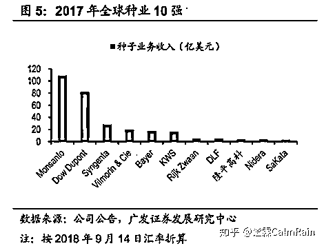

2011 年 10 月，安道麦被中国化工集团公司以 14.4 亿美元收购 60%股份，2016 年 9 月，其余 40%股份也被中国化工以 14 亿美元收购

GDP 有什么用？或者说钱有什么用？至少可以买到全球第一和第六的农化产品公司。

另外值得注意的是，排名世界第九的印度 UPL 正在收购排名世界第 11 的 Arysta lifescience，印度也能拥有全球前十的农化巨头，可见天赋的重要性。

在这全球 11 强之外，就是中国公司刷榜了。

全球第 12 是中国的颖泰生物，全球第 13 是山东潍坊润丰，

全球第 14 是南京红太阳，全球第 16 是乐山福华通达

全球第 17 是江苏扬农，全球第 20 位是江苏辉丰

也就是全球农化 20 强企业中，有 8 家是中国企业或隶属于中国企业。

可以说，如果没有中国的存在，全球农化基本就是欧美控制的市场，日本和四小龙在天赋上无法和欧美竞争。

农业只是一方面，日本和四小龙天赋的弱势还体现在油气资源开采上，由于本身就缺乏油气资源，尤其是陆上石油资源缺乏，因此在技术积累上远远不如欧美。

全球最大最先进的油服公司巨头，基本都是欧美公司。

油服公司是干什么的？他们提供油气层勘探，钻井机械设备，油田工程建造，石油软件等各种产品和服务。**这是高利润，高薪资的产业。**

以 2016 年的营收为例，全球排名 10 强：

美国斯伦贝谢世界第一，这是一家[世界五百强](https://www.zhihu.com/search?q=%E4%B8%96%E7%95%8C%E4%BA%94%E7%99%BE%E5%BC%BA&search_source=Entity&hybrid_search_source=Entity&hybrid_search_extra=%7B%22sourceType%22%3A%22answer%22%2C%22sourceId%22%3A648311669%7D)的企业，在美国《财富》杂志的世界五百强企业里面排第 386 位，2017 年营收高达 304.4 亿美元。

美国 BHGE 世界第二，该公司由前世界第三大油服贝克休斯和通用电气（GE）旗下的 GE 油气合并组建。

美国哈里伯顿世界第三，**可以看到美国三强霸占了全球前三位。**

英国 TechnipFMC 世界第四，该公司由法国 Technip 和美国 FMC 两家公司在 2017 年合并

意大利 Saipem 油服世界第五，英国派特法世界第六

美国国民油井世界第七，中国石化油服世界第八

瑞士威德福世界第九，瑞士越洋钻探世界第十

**我们可以看到，在这个高技术的产业里面，日本和四小龙无一进入全球前十，同样的，也只有中国大陆凭借国力能够有唯一一家上榜企业中国石化油服，其余九家全部都是欧美企业。**

全球油气开采，是个非常广阔的市场，从中东，到非洲，到拉美，到北欧，世界各地有大量的油田和气田，从勘探，油气装备到钻井服务，石油软件等，这么广大的市场，

美国占据了绝对领先的位置，而欧洲国家也在中东非洲这样的传统有影响力的市场大赚特赚。

全球油气资源市场，我们就以 2018 年 7 月，中国石油东方地球物理勘探有限责任公司(BGP)与阿布扎比国家石油公司(ADNOC)签署的海上和陆上三维采集合同为例，该合同金额高达 16 亿美元，也是全球物探行业有史以来三维采集作业涉及金额最大的一笔合同。

我们也可以一窥，仅仅是石油的物理勘探这一个环节，都可以带来丰厚的回报。

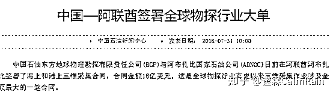

### **第二个是欧美，主要是美国的政治性压制。**

最为典型的就是亚洲的军事工业，军工也是高技术高利润产业，我们都知道，以色列是军工科技发达的国家，但是其实以色列工业能力总体实力有日韩强吗？当然不如。但是日韩这样的国家，本土就有美国驻军，军队的指挥权也在美军手里，在发展军事武器技术方面，要受到美国的严格控制。

中国倒是不受控制，但是已经被欧美禁运了三十年，事实上也是受到压制。

中国向国外出口武器，就会受到美国的干扰，最为典型的就是对土耳其的军售。

从军工产业出口就可以很明显的看出来，瑞典斯德哥尔摩和平研究院发布的 2013-2017 年全球武器贸易状况研究报告，这五年的全球武器出口金额十强为：美国，俄罗斯，法国，德国，中国，英国，西班牙，以色列，意大利，荷兰。

作为全球制造业十强国家的日本和韩国都没有进入世界前十名。

不只是东亚国家从军事技术中赚钱受到压制，同时更为重要的：**军事技术是[民用技术](https://www.zhihu.com/search?q=%E6%B0%91%E7%94%A8%E6%8A%80%E6%9C%AF&search_source=Entity&hybrid_search_source=Entity&hybrid_search_extra=%7B%22sourceType%22%3A%22answer%22%2C%22sourceId%22%3A648311669%7D)的核心来源之一。**

我们今天每天都在使用的无线通信技术，就是来源于战争。

1940 年摩托罗拉接到美国军方的合同，要求开发一种电池供电的无线通信便携式设备，摩托罗拉因此研发出来 SCR-300 无线通信设备，并且在 1942 年春天通过了测试，整个二战期间生产了大约 5 万部。这也是世界上最早的实用化的无线通信设备之一，通信距离达到 3 英里（4.8 公里），被美军士兵称为”walkie talkie”如下图：

摩托还开发出了另外一款通信距离更短的通信设备 SCR-536，1941 年 7 月量产，重量只有 2 公斤多，通信距离根据环境的不同而不同，有遮挡时通信距离只有几百英尺，开阔地可以达到一英里，水上甚至可以达到 3 英里。

“The rangeof the unit varied with terrain; from a few hundred feet, to approximately onemile over land, and 3 miles over water”

这也是世界上第一种真正的大规模使用的手持无线通信设备，被成为“handie talkie”

不过谁能想到，今天全球移动通信设备已经成为了一个庞大的产业，而网络侧设备的老大还是中国公司呢？

无线通信设备和手机只是一个例子而已，我们今天广泛使用的 GPS，以及今年在迅速组网的北斗全球卫星导航系统也是来源于军用技术。发射这些卫星使用的火箭，最早技术来源是导弹技术的发展。

全球范围来看，技术和产业有两个驱动因素，一个是商业和市场驱动，一个是军工技术因素驱动

**因此商业市场和军事科技发展是一个国家技术发展的两个核心来源之一。**

为什么这样讲，因为技术发展取决于资金和人才的投入，美国今年通过的 2019 年的军事总预算约为 6746 亿美元，其中有 1457 亿美元的经费用于美军采购与升级新装备之用，这相当于造就了一个差不多 1500 亿美元的市场，可以极大的驱动军工公司进行技术研发，更为重要的是，由于军事领域是对抗性质，因此军工技术强调打赢的重要性，更为强调技术的先进性和实用性，成本则是次要考虑因素，因此主要推动的是挑战极限的高精尖技术的发展。

而这些价格昂贵的高精尖技术，在得到应用之后成本一般会随着技术不断完善而不断降低，得以逐渐具备进入民用市场的条件，又可以早就一个很大的产业。

**美国保持超高军费，其实是保持其军事科技的高度领先性，同时也是保持其民用技术的一个重要来源，促进新产业的发展。**

而商业公司的技术研发存在两个局限性，一个是商业公司生存和挣钱是第一位，如果没有市场，是不会投入太多资金进行相关技术研发，不然意味着投入打了水漂。

一个是商业公司的技术研发更多的需要考虑成本因素，要考虑市场的购买力和接受度，商业公司开发的技术，绝对不是越先进越好，而是在领先某个比例的时候才能利润最大化。不会像军用技术那样，要以技术领先为目标。

因此军用技术的发展，可以和商业驱动的技术发展形成双轮关系。

美国除了直接用于购买装备的接近 1500 亿美元以外，其他的各种军用支出也同样大大的刺激了技术的发展，比如战场救护，用于伤残士兵的康复支出，也促进了包括假肢在内的技术发展，同样也让并非在战场上失去双腿的残疾人士受益。

东亚地区，韩国人打输了朝鲜战争，日本人打输了二战，其代价就是被美军占领，今天被种种限制。这就是不能独立自主需要付出的代价。

政治性的压制不只是体现在军工产业，限制东亚国家的技术来源，也同样体现在市场方面，由于日本和四小龙本身的市场体量很小，而欧美市场占了全球 50%以上，尤其是中高端产品份额比例更高，造成对欧美有极大的依赖，也经不起对方的制裁打击。所以在和对方博弈的过程中处于天然的弱势。

全球民用航空市场，尤其是干线客机市场都被波音和空客占据，这也是一个高利润高薪资的大市场，实际上，2017 年中国从美国进口的前三大产品就是大豆，飞机和汽车。

本来就是高投入门槛和高技术门槛，如果不能从市场获取收益，那么可以说风险极高。所以要收回投资，就必须要进入欧美的庞大市场，但是这样又是真的动了别人的奶酪，欧美绝不会放任自己的支柱产业被冲击。

日韩在这方面，都不具备挑战的能力，能够做支线飞机就算不错了，日本现在就在研发支线客机 MRJ，搞了十几年了至今也没有量产，[干线客机](https://www.zhihu.com/search?q=%E5%B9%B2%E7%BA%BF%E5%AE%A2%E6%9C%BA&search_source=Entity&hybrid_search_source=Entity&hybrid_search_extra=%7B%22sourceType%22%3A%22answer%22%2C%22sourceId%22%3A648311669%7D)的研制计划更是遥遥无期。

中国在这方面，显然情况要好得多，中国不只是军事工业发展不受限制的独立自主国家，同时也拥有巨大的市场，这就是一张牌，诚然我国大飞机发展会影响波音和空客，但至少我国具备和欧美讨价还价的能力，如果欧美以后以种种理由拒绝中国大飞机进入欧美市场，那么相应的他们的大飞机想进入中国市场就困难了。

产业的发展，从来都和政治因素高度关联，美国今年不断针对中国高科技企业进行各种制裁和打击就是典型的例证。

为什么美国不断游说其西方盟友不要用华为的 5G 设备？其实也是政治性因素打压。

### **第三个是对亚洲公司的资本性收益**

也就是除了亚洲国家因为天赋较弱发展不起来的产业，除了通过政治性因素限制亚洲发展的产业，还通过资本的力量对亚洲优势产业的发展成果进行获取。

这方面中日韩以及中国台湾，都有很多这样的例子，这也是后发国家的天然劣势。

2017 年，日本第一大[集成电路](https://www.zhihu.com/search?q=%E9%9B%86%E6%88%90%E7%94%B5%E8%B7%AF&search_source=Entity&hybrid_search_source=Entity&hybrid_search_extra=%7B%22sourceType%22%3A%22answer%22%2C%22sourceId%22%3A648311669%7D)公司东芝半导体，就被美国[贝恩资本](https://www.zhihu.com/search?q=%E8%B4%9D%E6%81%A9%E8%B5%84%E6%9C%AC&search_source=Entity&hybrid_search_source=Entity&hybrid_search_extra=%7B%22sourceType%22%3A%22answer%22%2C%22sourceId%22%3A648311669%7D)主导的收购联盟以 180 亿美元收购，贝恩资本成为东芝半导体的第一大股东。

其实东芝半导体是非常赚钱的业务，这两年存储器是暴利，日本人卖掉真的是很可惜，尽管东芝集团仍然保留了经营控制权。

韩国的中流砥柱三星电子，下图为其官网上的，2018 年第三季度的股权结构，普通股外国投资者占比高达 52%，对股票分红具有优先权利的优先股外国投资者占比高达 81%

[`www.samsung.com/global/ir/stock-information/ownership-structure/`](https://link.zhihu.com/?target=https%3A//www.samsung.com/global/ir/stock-information/ownership-structure/)

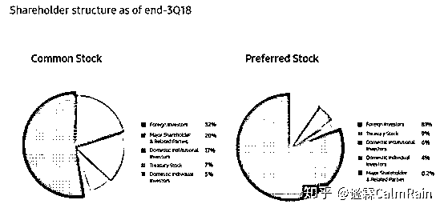

这对韩国人来说，是有点郁闷的，三星电子是韩国市值最高的公司，占到了整个股市市值差不多 20%的份额，如果三星发展的不好，那么韩国整个国家的经济发展都会受到影响。

如果三星发展的好，那么市值上涨带来的收益和分红，大量被外国投资者获取，实际上是通过资本分享了韩国人的劳动所得。

我们再来看看台湾台积电的股权结构

[`www.tsmc.com/download/ir/annualReports/2017/chinese/pdf/2017\_tsmc\_ar\_c\_ch4.pdf`](https://link.zhihu.com/?target=http%3A//www.tsmc.com/download/ir/annualReports/2017/chinese/pdf/2017_tsmc_ar_c_ch4.pdf)

在 2017 年的财报里面，截止到 2017 年 7 月 2 日，外国机构和外国人持股占比高达 79.67%。

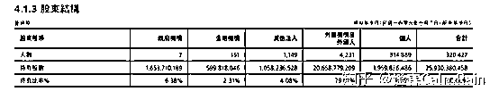

下图为台积电的前十大股东

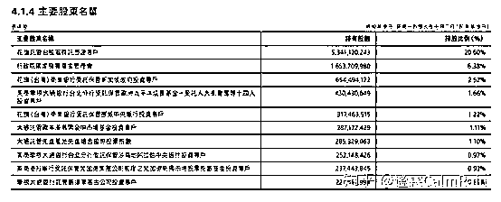

值得注意的是，2017 年台积电分红为每股 8 元新台币，总共分红高达 2074.4 亿新台币（466 亿人民币，汇率 4.45）。而 2017 年台积电的营业收入总额为 9774.4 亿新台币，分红占了营收的差不多 21.2%，外资获取了巨大的收益。

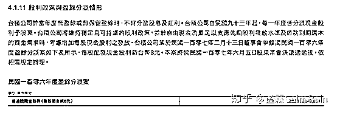

而对应的，台积电到 2017 年底员工总数为 4.8 万人，工程师号称人均年薪 200 万新台币，即使全部按照工程师计算，员工酬劳总共为 960 亿新台币，可以说和外资的收益的比例是不太合适的。

后发国家在发展产业的时候，天然的缺乏资金，因此先发国家理所当然的手握巨大的资本优势，对后来者的优势产业进行投资，可以获取巨额的利润，只要其不退出，就可以永久的分享其劳动成果，其实我认为永久分享机制是不合理的，应该有退出机制。

中国在这方面，相对的情况要好的多，中国的核心制造业企业，华为，中兴，京东方，中国中车，上汽集团，吉利汽车，OPPO, VIVO，格力，美的，中核集团，[中广核](https://www.zhihu.com/search?q=%E4%B8%AD%E5%B9%BF%E6%A0%B8&search_source=Entity&hybrid_search_source=Entity&hybrid_search_extra=%7B%22sourceType%22%3A%22answer%22%2C%22sourceId%22%3A648311669%7D)，海康威视，大疆，航天科技，航天科工，中国兵装，中船重工，紫光集团等等，都不存在外资占据大部分股权的情况。

但是中国也有类似的情况，主要是在互联网公司领域，外资占据大部分股权，也发生在 BAT 这样的互联网公司，这是因为十几年前中国缺乏资本和融资机制所致，最近几年新崛起的互联网公司，此种情况已经大大改变。

例如今日头条，滴滴出行，美团外卖等等，股权结构内外资比例要相对 BAT 优化的多。

以滴滴出行为例，就有中国平安，中国人寿，中投公司等国家队投资。

另外就是通过国家的力量出手，改变公司股权结构，最为典型的就是蚂蚁金服，中国利用金融安全的力量，促成支付宝从阿里剥离，拥有支付宝的蚂蚁金服成为一家独立的公司，最大的两个股东是两家杭州的公司，由马云控制，第三大股东是中国的[社保](https://www.zhihu.com/search?q=%E7%A4%BE%E4%BF%9D&search_source=Entity&hybrid_search_source=Entity&hybrid_search_extra=%7B%22sourceType%22%3A%22answer%22%2C%22sourceId%22%3A648311669%7D)基金。

作为剥离的补偿，蚂蚁金服每年把一定比例的利润共享给阿里巴巴，直到蚂蚁金服上市。

另外就是中国互联网的繁荣，也大大的提高了互联网企业员工们的工资，目前年薪 50-100 万元，已经成为国内一线互联网企业的常见薪酬，客观上也提高了财富流向中国员工的比例。

但是不管怎么样，外资从中国互联网企业获取的收益，仍然是非常可观的。

不管是雅虎，还是软银，都从出售阿里股票中获得了超高的回报。软银就在 2018 年 5 月 31 日宣布出售一小部分阿里的股票，价值就高达 80 亿美元，即使出售之后，软银仍然是阿里的第一大股东。

### **第四个：东亚目前技术和设计能力不够的产业**

除了以上的几个原因，还有是整个东亚还没有能力做起来的产业。

一个是奢侈品产业，想买各种奢侈品还是要去欧洲买，日用消费品这一块，其实是非常大的市场，带来的不只是产品的消费，同时也带动了旅游等其他的各种消费。

一个是制药产业和医疗器械，2017 年**全球前十五大制药企业没有一家来自东亚，**同时医疗器械部分，这也是个超级大市场，主导权依然牢牢掌握在欧美手里，下图是 Qmed 发布的 2018 年全球医疗器械公司 TOP100，全球第一美敦力，全球第二的强生是美国公司，全球第三费森尤斯是德国公司。

第 4-10 位的 GE,飞利浦，[西门子](https://www.zhihu.com/search?q=%E8%A5%BF%E9%97%A8%E5%AD%90&search_source=Entity&hybrid_search_source=Entity&hybrid_search_extra=%7B%22sourceType%22%3A%22answer%22%2C%22sourceId%22%3A648311669%7D)，康德乐，雅培，史赛克，BD 也都是欧美公司。

**实际上全球前 15 位的医疗器械公司都来自欧美。**

日本的医疗器械公司，佳能，奥林巴斯医疗等，主要集中影像医疗这一块，本质上也是电子技术的延伸，总体实力上也无法和欧美相比。

一个是高端汽车产业，虽然日本韩国都是世界汽车强国，但是各种豪车品牌仍然主要集中在欧洲地区。

我们就以德国的宝马集团为例，

该公司 2017 年销售额为 1112 亿美元，但是其全球汽车销量仅为 246.35 万辆

日本丰田公司 2017 年销售额 2651.72 亿美元，其全球汽车销量大约为 1050 万辆左右。

倘若不考虑其他业务的因素，简单粗暴的相除，宝马均价高出了 78%

类似的还有旗下有奔驰品牌的戴姆勒集团，尽管其 2017 年全球汽车销量只有 330 万辆，但是其集团销售额能够到 1852 亿美元。

我们再对比下韩系车，就更明显了，现代集团 2017 年全球汽车销量为 725 万辆，但是销售额只有 852.6 亿美元，简单粗暴的计算单车均价，只有戴姆勒的四分之一不到。

另外就是半导体产业，日本的半导体产业曾经称霸世界，但是目前已经逐步衰落，全球十强只剩下东芝一家，但是东芝半导体目前也已经出售。

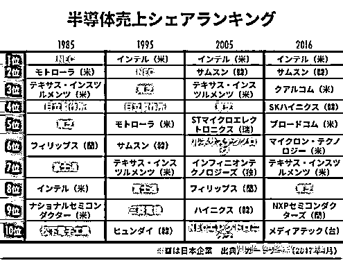

东亚的半导体产业，高度的集中在存储器，手机处理器和 CMOS 传感器三大领域。其中 CMOS 图像传感器，目前全球三强都是东亚公司，日本索尼，韩国三星，中国豪威科技。

芯片可以分为数字芯片和模拟芯片，东亚国家占据世界优势地位的存储器（三星，海力士，东芝，南亚科等）属于数字芯片，

多说一句，存储器现在某种意义上，已经是韩国的中流砥柱产业了，每年为韩国带来数百亿美元的产值，三星电子 2017 年净利润 42.19 兆韩元（约合 394.6 亿美元），同比增长 85.7%。一年增加了差不多 180 亿美元的净利润，这其中增长基本是来自半导体业务，其实就是存储器。

180 亿美元，这已经是韩国 GDP 的 1%还多了。

另外有海思，展锐，三星和联发科的手机处理器，也属于数字芯片领域。

但在数字芯片的其他领域就很落后，最为典型的是英特尔的桌面 CPU 等，东亚国家基本没有存在感。

而在模拟芯片领域，东亚就处于绝对落后的位置。

根据 IC insight 2017 年公布的全球十大模拟芯片厂家，美国有六家，欧洲有三家，只有日本的瑞萨排在世界第十位。

世界前三是美国的德州仪器，ADI，skyworks，接下来是英飞凌，[意法半导体](https://www.zhihu.com/search?q=%E6%84%8F%E6%B3%95%E5%8D%8A%E5%AF%BC%E4%BD%93&search_source=Entity&hybrid_search_source=Entity&hybrid_search_extra=%7B%22sourceType%22%3A%22answer%22%2C%22sourceId%22%3A648311669%7D)，恩智浦等。

以上四个原因，造成了东亚国家在产业发展方面局限于电子产业等几个有限的赛道，整个东亚的精英只能局限在有限的几个大产业里面互相竞争，高端和高薪就业机会就那么多，必须要一路过关斩将进入大公司，这就造成了东亚精英的痛苦。

东亚产业升级的最大希望，还是来自于中国，不管是现有的欧美占优势的赛道例如大飞机，半导体，医疗器械，制药，油气勘探开采和装备制造，军工武器制造，航天产业（空间站，卫星导航系统），企业 IT 产品，互联网公司等，还是新的赛道领域例如 5G，云计算，人工智能，物联网，新能源汽车等等，中国几乎没有遗漏的领域。

众多新兴产业的崛起，能够带来大量新的高薪岗位，过去十几年中国最为明显的变化，就是产生了程序员这个高薪的群体，数量已经达到上百万人，极大的增加了中国中产的数量。

再以芯片设计为例，2018 年中国的芯片设计行业从业人员就达到了 16 万人左右，而去年同期仅为 14 万人，一年的时间增加了 2 万个岗位，我今年就曾经接到过不同的粉丝投稿，都是硕士应届生，拿到的深圳和南京的两家不同的国内机器人公司的 offer，起薪都在 20 万人民币左右，这就是国产机器人发展带来的好处。

制造业的高薪岗位增加了，这同时又会带动服务业（金融，旅游，餐饮，交通，教育）等领域的高薪岗位增加。

整个社会的高薪岗位供给增加，选择变多，可以降低竞争的烈度，减少不必要的内耗。

这是很简单的，三个人争抢一个高薪职位，三个人都付出 10 分的努力，最终只有 1 个人如愿，另外两个人的努力被浪费。三个人争抢两个高薪职位，三个人都付出 10 分的努力，最终 2 个人如愿，只有 1 个人的努力被浪费。

我大学毕业的时候，北二外的一个同学就告诉我，他们学校学日语的很好找工作，其实很多平时学习并不怎么努力，成绩很差的都找到了，所以供求关系能够改变和影响人的辛苦程度。

高薪岗位变多，中产阶级阶层扩大，对服务业的需求大大提升，同时也会带来底层的收入上升，让“没有那么努力”也能有个说的过去的出路。

我在之前的文章里面写过，现在美团外卖之类，一个毫无学历和技能的健康人，在深圳送美团外卖拿到一个月七八千人民币也并不困难，这个收入绝对小康有余，这实际上比起以前在底层只能选择富士康，货车司机之类就是一种进步。

打破东亚模式，除了最为核心的多开辟新赛道开源之外，还需要在其他方面进行调整，这个东亚国家情况又有所不同，例如东亚国家的全球最低生育率，也是造成东亚地狱模式的原因之一，而地狱模式由于工作占用劳动者大量的时间，无精力照顾小孩和家庭，又会反过来降低[生育率](https://www.zhihu.com/search?q=%E7%94%9F%E8%82%B2%E7%8E%87&search_source=Entity&hybrid_search_source=Entity&hybrid_search_extra=%7B%22sourceType%22%3A%22answer%22%2C%22sourceId%22%3A648311669%7D)。

以日本为例，日本已婚家庭的生育率并不低，大量的两到三个小孩，日本家庭很多一户建，居住面积并不小，房价现在低迷，并且日本的小孩教育成本也不高，日本的总体生育率低是因为大量的日本人终身未婚，四分之一的日本男子到 50 岁还从未结婚，这跟日本特殊的男性养家，女性全职主妇文化有关，也和日本的企业雇佣制度（正式工，非正式工）有关，结不起婚就干脆不结婚，同时也是产业升级停滞，低薪和不涨薪岗位增多所致。

韩国的生育率也是超低，整个国家只有几个有限的财阀，韩国年轻人要想进入这些大公司工作，竞争高度激烈，除此之外其他好的出路不多。

韩国作为一个人口超过 5000 万的世界人口大国，2017 年仅仅有 35.7 万名婴儿出生，创下历史新低，媒体《[朝鲜日报](https://www.zhihu.com/search?q=%E6%9C%9D%E9%B2%9C%E6%97%A5%E6%8A%A5&search_source=Entity&hybrid_search_source=Entity&hybrid_search_extra=%7B%22sourceType%22%3A%22answer%22%2C%22sourceId%22%3A648311669%7D)》在 2018 年 9 月 3 日发布首尔国立大学开展的人口研究。预测 2018 年韩国生育率将再次创下历史新低，首次低于 1，为 0.96。

中国生育率低，则不是因为不婚的人太多，而是已婚家庭本来就生育率低，这又关系到房价，教育成本的问题，这个已经说过很多次了，居住面积的狭小，房子和学校绑定，幼儿园学费和减负等带来的教育成本的高昂，负担重，幼托机构稀少而昂贵，以及长期计划生育因素等，这些都是降低生育率的重要原因。

其他还有东亚文化的因素，比如都在美国，美国华裔的生育率就是 1.6，显著的低于其他族裔，这跟重视孩子教育投入，导致养育成本升高也有很大关系，但尽管如此，1.6 的生育率也已经比东亚地区好很多了，可见发展才是核心。

东亚都是后发国家，要想赶上欧美，选择这种地狱模式是在短时间内迎头赶上的最高效率的做法，这也是全球除了西方之外，只有东亚不断的在缩短和西方发展水平的原因。

但是日本和四小龙，因为体量原因，始终无法在欧美的高端领域实现全面突破，无法在源头上实现突破。东亚的日本，中国台湾，中国香港等，都出现了经济发展缓慢停滞的现象，竞争激烈的态势没有改变，又降低了生育率。

韩国虽然近年发展还算迅猛，但是其超低的生育率也是一颗炸弹，且韩国的经济发展现状高度的依赖存储器等少数几个产业，这也是很危险的。

**对于东亚来说，中国可以说就是最后的希望，我们联想起这个周美国对于华为的打击，也可以体会到，你想抢夺欧美的高端产业份额，他们的反应是什么样。但是这条路我们没得选，只能继续走下去，哪怕是可能面临损失惨重的打击。**

如果不能实现产业突破，只能在现有产业里面打转转，经济停滞无法赶超欧美，无法把蛋糕做大。人其实是有极限的，即使是文化上最为勤奋的东亚人也是这样，长期无法实现产业突破，人持续的处于高度竞争激烈的环境却又无法得到相应的收入增长，整个经济体的长期效率反而会降低。

薪资 20 年不涨的日本，台湾，香港等都是这样，产业无法突破，经济发展缓慢又深陷老龄化危机。

而作为后发国家，如果不能保持勤奋的工作和一定的竞争强度，又不可能实现短期内对先发国家的追赶。

作为最后的希望，如果中国在产业升级这条路上走通了，也是对中国台湾，韩国，日本有好处的，不管是台湾人，韩国人还是日本人，都大量在中国大陆工作，同时中国大陆游客也是这些地区的越来越重要的财富来源。

这是“邻国原理”，一个国家最大的贸易伙伴，最大的游客来源，往往都是邻国，邻国如果先进富裕，又会大大带动本国的发展，这是在全球普遍存在的现象。

当东亚人发现，全球的中高端产业大量逐渐转移到东亚尤其是中国之后，由于产业资源的增多，整个社会不再需要超高竞争烈度，而是逐渐回归到勤奋工作但是又符合人性的最佳平衡点，这样才有可能走上可持续发展的道路。

# 功夫哥

> 作者：功夫哥
> 
> 赞同数：1091
> 
> 编辑于：2022-04-18 19:38

因为世界的本质是弱肉强食。

这个真相太过残忍，如果赤裸裸的展现在人们面前，屌丝们看不到任何希望，他们将会奋起反抗，人类社会的秩序将会崩塌，统治者们用了很多炫目的道德文章来进行掩盖，所有的宗教都是用来掩盖真相的工具，比如基督教。

西方的基督教宣扬平等和博爱，麻醉社会底层的神经，寄希望于虚无缥缈的天堂，让他们心甘情愿当牛做马，在中世纪长达 1000 年的漫长岁月里，扛着耶稣这杆大旗，欧洲的教士集团成为标准的寄生虫，是过的最滋润的群体。

尼采看穿了基督教的虚伪，也看穿了这个世界的本质，弱肉强食嘛，有什么好掩饰的？他并不反对这个丛林规则，所以他反对“平等”。

不仅反对平等，他觉得应该给予强者更多的自由，因为推动社会进步的就是强者，至于绝大多数的弱者，匍匐在强者的脚下就可以了。

尼采理论诞生的时间，正是资本主义发展最快的时候，资本自从诞生的那一天开始，唯一的目标就是增值，为了达到这个目标，可以不择手段，比如抢劫，但是抢劫是不道德的，人和动物的区别就在这里，东方人有羞耻之心，西方人有罪恶之别。

欧洲列强跑出去抢殖民地，杀殖民地的人民，难免会有罪恶的感觉，连耶稣都无法消除，但是耶稣的死对头尼采可以，尼采的理论正好可以消除他们的罪恶感，因为尼采要赋予强者更多的自由，杀人也是自由之一。

为啥尼采在纳粹德国受到追捧，原因就在这里，希特勒觉得自己是强者，强者就不应该受到约束，比如大规模处决犹太人，一头狮子咬死一群羚羊算什么罪过？没有羚羊敢找狮子算账。

二战结束以后，殖民地体系解体，并不是西方这群信奉尼采哲学的强盗们发善心，而是他们找到了更“文明”更高效的抢劫方式，那就是产业转移。

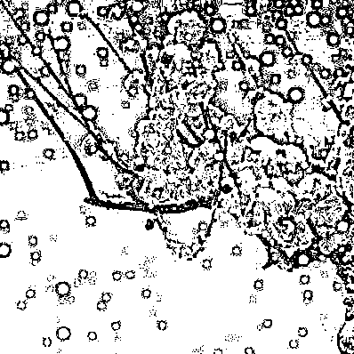功夫哥    9 次咨询                5.0    152833 次赞同 去咨询    

苦的累的脏的破坏环境的所有产业，都转移到以前的殖民地，可悲的是，在这个被强盗们控制的丛林世界里，想要混一口吃的，必须要听话才行，不是所有的[原殖民地](https://www.zhihu.com/search?q=%E5%8E%9F%E6%AE%96%E6%B0%91%E5%9C%B0&search_source=Entity&hybrid_search_source=Entity&hybrid_search_extra=%7B%22sourceType%22%3A%22answer%22%2C%22sourceId%22%3A2411038176%7D)都有资格吃这口嗟来之食，必须要懂得摇尾巴，全心全意讨主人欢心才可以。

就这样，日本靠着朝鲜战争，韩国凭着[越南战争](https://www.zhihu.com/search?q=%E8%B6%8A%E5%8D%97%E6%88%98%E4%BA%89&search_source=Entity&hybrid_search_source=Entity&hybrid_search_extra=%7B%22sourceType%22%3A%22answer%22%2C%22sourceId%22%3A2411038176%7D)，充当美国的战争期间物资供应基地，承接了欧美转移的大量落后产能，实现了“崛起”，代价很明显，日本成为了美国的一条狗，韩国则更不堪，认为韩国是一个国家的人，肯定是对国家这个词有误解。

中国加入[世贸组织](https://www.zhihu.com/search?q=%E4%B8%96%E8%B4%B8%E7%BB%84%E7%BB%87&search_source=Entity&hybrid_search_source=Entity&hybrid_search_extra=%7B%22sourceType%22%3A%22answer%22%2C%22sourceId%22%3A2411038176%7D)则和海湾战争密切相关，美国资本家在那个地方投入了巨资，连成本都收不回来，亏得一塌糊涂，急需廉价商品来弥补这个亏空，全世界唯一具备这个体量和能力的国家，只有中国。

中国接受大量欧美下级产业转移，成为了世界工厂。

这是一条发展必须要经过的路，这条路上布满荆棘，累的要死还挣不到几个钱。

原因很简单，处于食物链订单的强盗们，利用他们制定的贸易“规则”，合理合法合规的抢劫，活是你干，钱是他们拿。

举个例子，意大利拥有高端医疗器械的设计能力，他们将生产图纸发给广东的中国公司，为了防止一家中国公司掌握全部生产图纸，他们会将图纸分成若干部分，分给不同的公司生产。

中国公司为了争夺订单，会拼命压低投标价格，中标公司的价格几乎只能维持基本运转，意大利公司以几乎成本价拿到中国公司生产的零部件，在意大利进行组装，然后再高价卖回中国，大家在各大医院看到的精密医疗器械，基本都是中国制造的“进口货”。

为啥中国的年轻人不愿意进工厂？为啥中国的工厂开不出高工资？原因就在这里。

意大利资本家拿着高额利润，随便拿出来一点分给本国的屌丝，意大利的屌丝就可以过的很舒服，大家也就可以看到，欧美那些又蠢又白痴的反智人，小日子可以过得非常潇洒，天天晒着太阳喝着咖啡，讨论同性恋，现在更爽了，连吸毒都合法了，看的出来，资本家们为了让他们更加堕落，的确费了不少心思。

东亚的资本家给欧美的资本家打工，很辛苦，也很卑微，为了从苍蝇腿上刮肉，他们就必须向本国的工人下黑手，于是 996、007 这些口号就出来了，争取把人的价值压榨到极限。

当然，这些还不够，为了更好的剥削工人，不知道哪个天才发明了[劳务工制度](https://www.zhihu.com/search?q=%E5%8A%B3%E5%8A%A1%E5%B7%A5%E5%88%B6%E5%BA%A6&search_source=Entity&hybrid_search_source=Entity&hybrid_search_extra=%7B%22sourceType%22%3A%22answer%22%2C%22sourceId%22%3A2411038176%7D)，在工人队伍里面进一步进行细分，还设置可望不可及的转正制度，让劳务工们跟脑袋前面挂了跟胡萝卜的驴似的，永远不知疲倦的向着前方奔跑，源源不断的创造出更多的价值。

年轻人不干了，日本的宅男，韩国的躺平，中国的屌丝，都是一种文化。

欧美有完善的工会制度，员工的权益得到了充分的保障，是不是要好点呢？肯定不是嘛，强盗们怎么会发善心呢？

欧美为了保持本国的稳定，不让屌丝产生“革命”的想法，用各种福利把他们养起来，养的又蠢又反智，还鼓励他们吸毒，争取让他们沉醉在这种低级的快乐中不可自拔。

这些人被养的又蠢又懒以后，很多[脏乱差](https://www.zhihu.com/search?q=%E8%84%8F%E4%B9%B1%E5%B7%AE&search_source=Entity&hybrid_search_source=Entity&hybrid_search_extra=%7B%22sourceType%22%3A%22answer%22%2C%22sourceId%22%3A2411038176%7D)的活就不愿意干了，怎么办呢？于是“黑工”在欧美就成了“皇帝的新衣”，大家都看见了，就是不说。

一直以来，都有向往财富和自由的各国人士坚持不懈的向欧美偷渡，这些人向往欧美那种悠闲的生活，没想到迎接他们的是地狱，《[中国合伙人](https://www.zhihu.com/search?q=%E4%B8%AD%E5%9B%BD%E5%90%88%E4%BC%99%E4%BA%BA&search_source=Entity&hybrid_search_source=Entity&hybrid_search_extra=%7B%22sourceType%22%3A%22answer%22%2C%22sourceId%22%3A2411038176%7D)》中的北大高材生，到美国以后只能在餐馆端盘子。

当然，端盘子还是非常好的工作了，毕竟他是有签证的，那些偷渡过去的“黑工”就惨了，听一个哥们聊过，他说千万不要被海外这些光鲜亮丽的视频给欺骗了，镜头之外的生活才是真的凄惨。

黑工是没有任何保障的，英国人知道这一点，他们喜欢雇佣黑工，因为可以往死里压榨，有的黑工每天要工作 20 个小时，被折磨的浑身疾病，连脚都烂掉了（糖尿病晚期），也不敢到医院去治疗，只是因为没有保险，在欧美，没有医疗保险，医疗费用能贵到你怀疑人生。

欧美的黑工，是聚光灯之外的群体，是现代“奴隶”，正是因为他们的存在，欧美那些反智群体才能过上闲的蛋疼的生活。

尼采看到的世界是真实的，强盗吃肉，家里的狗跟着喝汤，其他的人只能在寒风中瑟瑟发抖，尼采觉得这是正常的。

马克思觉得这不正常，他反对剥削，揭露了这个世界的本质，吸引了大批的后来者，他们想要消灭这个人吃人的社会秩序，建立一个人人平等的美好新世界，革命尚未成功，同志仍需努力！

关注公众号“功夫哥”有惊喜哈

# 庄渔

> 作者：庄渔
> 
> 赞同数：1191
> 
> 编辑于：2019-01-29 13:42

**在瓜分全球的资本主义原始积累的浪潮中，东亚来晚了。**

如果把视线投入十五、六世纪的欧洲，你会感叹，欧洲人为什么活得这么苦？土地贫瘠、瘟疫横行、贸易路线被死敌[奥斯曼帝国](https://www.zhihu.com/search?q=%E5%A5%A5%E6%96%AF%E6%9B%BC%E5%B8%9D%E5%9B%BD&search_source=Entity&hybrid_search_source=Entity&hybrid_search_extra=%7B%22sourceType%22%3A%22answer%22%2C%22sourceId%22%3A584681097%7D)卡住，贵族过的生活也不过和东亚的[小地主](https://www.zhihu.com/search?q=%E5%B0%8F%E5%9C%B0%E4%B8%BB&search_source=Entity&hybrid_search_source=Entity&hybrid_search_extra=%7B%22sourceType%22%3A%22answer%22%2C%22sourceId%22%3A584681097%7D)差不多。如果你再看看那些航海的人，你会觉得这些人的生活简直就是炼狱。

[大航海时代](https://www.zhihu.com/search?q=%E5%A4%A7%E8%88%AA%E6%B5%B7%E6%97%B6%E4%BB%A3&search_source=Entity&hybrid_search_source=Entity&hybrid_search_extra=%7B%22sourceType%22%3A%22answer%22%2C%22sourceId%22%3A584681097%7D)被日本光荣公司打造成了一个波澜壮阔的浪漫之旅，但是实际身处其中，你就会发现童话里都是骗人的。每次出航没多久，淡水就开始变质，食物开始腐败，无论你在船上的什么地方，老鼠、蟑螂、跳蚤、虱子都是你躲不开的邻居；火腿奶酪里面爬满了蛆虫，面粉里面钻进钻出的都是[象鼻虫](https://www.zhihu.com/search?q=%E8%B1%A1%E9%BC%BB%E8%99%AB&search_source=Entity&hybrid_search_source=Entity&hybrid_search_extra=%7B%22sourceType%22%3A%22answer%22%2C%22sourceId%22%3A584681097%7D)。因为缺乏维生素，十来天后你就开始全身溃烂，而肮脏的环境则让这种溃烂迅速发展为致命的发炎。每天都有同伴死去，你们不得不开始逐一将他们的尸体抛入大海。要不了多久，鲨鱼就会开始在船尾聚集。因为各种原因，船上没有一个女人，水手们受到疾病和苦闷的折磨，心灵却得不到慰藉，渐渐的会把哺乳中的海豚和海牛想象成美人鱼，并对此深信不疑。

而同时期的东亚，无论如何，生活远比欧洲轻松。

但是，苦难不是无收益的，安逸也不是无代价的。大航海付出的代价让欧洲成为世界的霸主，确立了遍布全球的势力范围，撷取了巨大的财富，确立了自身在科技、金融、贸易规则、国际秩序等方面的绝对优势地位。现在他们当然可以躺着挣钱，这都是他们的先辈用命换来的。

而我们现在活得这么累，就是在做欧洲人的先辈们做过的事情。

# wayne

> 作者：wayne
> 
> 赞同数：123
> 
> 编辑于：2019-07-06 15:50

首先是怎么定义累？

是精神上的压力（比如[社会压抑](https://www.zhihu.com/search?q=%E7%A4%BE%E4%BC%9A%E5%8E%8B%E6%8A%91&search_source=Entity&hybrid_search_source=Entity&hybrid_search_extra=%7B%22sourceType%22%3A%22answer%22%2C%22sourceId%22%3A698992770%7D)）？

还是实际工作时间/强度（代表工作投入）？

还是收入物价比（代表生活的难易程度）？

实际上，东亚这五个地方累的原因是不尽相同的。

楼上一部分答主被提问绕进去了。提问有一个预设前提，就是默认东亚人（中国、日本、韩国、香港、新加坡）累是因为**同一个原因**，一部分答主开始拼命寻找其中的共性。

然而，真的是一种共性的原因造成了这五个地方人累吗？

香港、新加坡是一个城市，而且是一个[国际化](https://www.zhihu.com/search?q=%E5%9B%BD%E9%99%85%E5%8C%96&search_source=Entity&hybrid_search_source=Entity&hybrid_search_extra=%7B%22sourceType%22%3A%22answer%22%2C%22sourceId%22%3A698992770%7D)大都市，而大城市累是一个普遍的现象，这两个地方比较对象应该是纽约、伦敦等等大城市，而不是西方国家。大城市以服务业为主，尤其是高端服务业，这类行业有一个共同的特点就是收入高但是要求也高。因此、**大城市病**是香港、新加坡人累的原因。

而高赞答主们很多的回答其实是针对日韩模式的问题来的，日韩特点是出口导向型，制造业比重不小且多为进口加工出口的模式。其累的原因很多人已经说了，就不谈了。**日韩模式的问题**是日本、韩国包括台湾人累的原因

中国则又是一个原因，中国内部市场广阔、资源也算是有一些，需要进口的原料不算太多，然而人太多，而且太穷。需要比较的对象也不是西方国家而是各大发展中国家，**发展中国家的问题**是中国人累的原因。

不过总的来说，在知乎众人眼里的累其实大部分都是**大城市的原因**......毕竟看到的不是中国人累，是一二线城市生活累，这个全世界都一样，无解。

有人觉得纽约、伦敦不累的.......

# 谢左右

> 作者：谢左右
> 
> 赞同数：163
> 
> 编辑于：2020-08-06 21:14

大多数人从经济角度对这个问题做了较为详尽的阐述，但我想尝试从环境对人的心理影响方面来进行解释。

  

心理是由环境塑造的，当环境很好，资源足够丰富时，人会使用“自我实现”模型，这时候的人会轻松愉快的做自己想做的事，比如搞点艺术，思考哲学，寻找快乐等等

  

而当环境非常恶劣，缺衣少食时，人使用的是“自我拯救”模型，以活下来为最高目标

  

这两种心理差异，将会引发一系列的问题，甚至是两种文明体制的争论。

  

东亚自古多灾多难，翻开史书每隔几页就是“人相食”。在这样极端的环境下，个体的脆弱会被无限放大，想要活下来一定要抱团，成为一个集体。

集体一旦成立，一定会优先保证这个“集体”本身的利益，个体需要让渡绝大多数的权力。最简单的例子，你的很多选择权，一定会让渡给你的家庭，你的社区，你的政府，极端条件下，你需要献出一切。

而且这一切是该环境中最为理智的做法。当活下来成为头等目标以后，个体能做出来的牺牲超乎想象，并且会成为传统

因为让渡出过多的权力，人生的决策权已不在你手中。例如家族式集体会强迫家族的每一个人去做符合家族利益的选择，这仅仅是牺牲部分选择权力。

  

更大的集体需要你做更大的牺牲。

比如你很不幸生在战国时期[邺县](https://www.zhihu.com/search?q=%E9%82%BA%E5%8E%BF&search_source=Entity&hybrid_search_source=Entity&hybrid_search_extra=%7B%22sourceType%22%3A%22answer%22%2C%22sourceId%22%3A1389671205%7D)，更倒霉的是，你还长的肤白貌美大长腿，条亮盘顺气质佳，那你很可能会被扔到河里祭河神，这就是当时村集体的决定。

  

你说我不能反抗么，我不能找个人私奔？

很难，你依附这个集体生存，离开这个集体很难独自生活。

哪怕是出去做个山贼，做个土匪，依然是要投靠某个山头，依然要让渡各种权力。中国历史上很少有什么独行侠，或者个人英雄主义传奇，也是基于贫瘠的现实土壤养活不了一枝独秀的花朵。

  

越是贫瘠的土壤，[集体主义](https://www.zhihu.com/search?q=%E9%9B%86%E4%BD%93%E4%B8%BB%E4%B9%89&search_source=Entity&hybrid_search_source=Entity&hybrid_search_extra=%7B%22sourceType%22%3A%22answer%22%2C%22sourceId%22%3A1389671205%7D)就越有市场，疯狂的集体主义从未离我们远去。在封建时期的[家族制](https://www.zhihu.com/search?q=%E5%AE%B6%E6%97%8F%E5%88%B6&search_source=Entity&hybrid_search_source=Entity&hybrid_search_extra=%7B%22sourceType%22%3A%22answer%22%2C%22sourceId%22%3A1389671205%7D)中，家长是平时能感受到的无非是你爸想让你干你不想做的工作，你妈想让你和你不愿意的人结婚，甚至亲戚都有权力来影响你的决策。你的命是由许多人的命组合而成，像是一个股份公司，你自己只不过是个大股东罢了，有的时候甚至是个小股东。

集体主义渗透生活的方方面面，对于集体而言，最好的办法就是每个人能都循规蹈矩，阶级分明，做符合自己定位的事情。

男人应该做什么，女人应该做什么，孩子应该做什么，老人应该做什么……

集体会给每个人做一个定义，实现这个定义，保持自己的阶级甚至实现跃升，是这个系统中唯一能收获的快乐。这个系统的主要功能是保持存活，其他都是为这个核心功能服务。

  

资源越匮乏，就越是集体，资源越丰富，就越是自我

至于个体累不累，根本不在集体的考虑范围内。集体只要保证整体存活就 OK，至于个体存亡，是死是活，无所谓。

  

就像你不会为了你每天死掉的十多万个细胞感觉伤心难过

  

个体的很大一部分精力都消耗在为别人而活，怎么可能快乐

东亚三兄弟的人每天一睁开眼思考的就是：“别人怎么看我”，文化道德层面更是深度压制享乐，以苦难为荣，以享乐为耻，听歌音乐都是靡靡之音，打个游戏都是玩物丧志

  

我他么都快三十了，每次打开游戏，还总是有种负罪感，总要想想是不是有比游戏更重要的工作要做

所以大家普遍过的拧巴，很多人累死累活，都只是为了追求别人的生活：别人有大房子，我也要有，别人开好车，我也要开……你说他真的爱这些么，

他只是在追寻一种符合其定位的生活

  

这就引申出东亚三兄弟生活中另一种痛苦——每个人都被社会定义

  

因为资源太少，就要设立标准，每个人只要满足了社会对其身份的定义，才能获得相应的社会支持

  

所以你会看到，东亚社会里，有无数看不见摸不着的规则，却实实在在的折磨着你

  

你是男人，要成家立业，是女人，要勤俭持家，是儿子，是下属，是兄弟，是长辈……

  

每个人都要满足自己身份对应的社会期待，不然就会被归为异类，被其他遵守规则的人敌视

  

中国曾经有人站出来想要彻底打烂这一套玩意儿，但是深植在人心中的糟粕，需要好几代人的努力才行，不过好歹中国做了尝试，慢慢的改善了很多

  

日本是真的让人窒息，男女老少都想自杀或者正在自杀

  

韩国是走向了另一个极端，不在沉默中爆发，就在沉默中变态

  

所以想透这个事情的人一有机会就走了

  

很多人还在讨论移民以后的生活质量，受不受尊重……草，他们只是想活下来，想当个普通人，别再把东亚那一套狗屁玩意带过去了

  

移民国外的很多人都不是为了什么大富大贵，仅仅是为生活，像一个普通人，不受社会 judge 的普通人一样活下来，想睡觉就睡觉，想钓鱼就钓鱼

  

不想 996 福报，无福消受

  

东亚这种人人自危，人人想阶级跃升的文化，天然适合资本主义，都不用资本家甩鞭子，人会自己抽自己，所以日韩财团会社，这边寡头垄断

  

这种少数人掌握绝对财富的结构，让普通人只能选择的进入社会布置好的陷阱

  

俗称[社畜](https://www.zhihu.com/search?q=%E7%A4%BE%E7%95%9C&search_source=Entity&hybrid_search_source=Entity&hybrid_search_extra=%7B%22sourceType%22%3A%22answer%22%2C%22sourceId%22%3A1389671205%7D)

这尼玛能开心起来才怪

  

你看中日韩的自杀率都成啥了

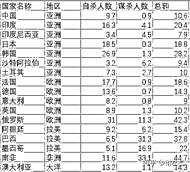

数据来源：[`www.who.int/gho/publications/world\_health\_statistics/2018/en/`](https://link.zhihu.com/?target=https%3A//www.who.int/gho/publications/world_health_statistics/2018/en/)

上面是官方网站地址，数据源是 2016 年，分别在 32 页和 55 页，单位都是每 10 万人。这里选取 G20 国家的数据

所以呢，情况就是这么个情况，你拿到了一个这样的剧本，要么你就逆天改剧本，像他一样，

  

要么你就好好表演你的”[宋兵乙](https://www.zhihu.com/search?q=%E5%AE%8B%E5%85%B5%E4%B9%99&search_source=Entity&hybrid_search_source=Entity&hybrid_search_extra=%7B%22sourceType%22%3A%22answer%22%2C%22sourceId%22%3A1389671205%7D)“

  

调整好心态，做一个健康的普通人，别为了追求别人的生活，把自己搞得那么累

# 知乎用户

> 作者：知乎用户
> 
> 赞同数：141
> 
> 编辑于：2020-12-03 08:59

忘了自己仅仅是个动物，天天标榜自己是正人君子导致的。

（包括说什么伪君子不如真小人。活着就是为了当真君子真小人吗？）

# 周召

> 作者：周召
> 
> 赞同数：1.6 万
> 
> 编辑于：2022-03-17 20:54

东亚活得累的国家，与所谓的“**儒家文化圈**”高度重合，这种高正相关性，使我们不得不坐下来仔细思考一下，莫非是儒家的原因？

不用怀疑，就是。

东亚人为什么活得累？

很简单，因为儒家文化圈说白了就是 PUA 奴隶文化圈。

了解并且搞明白这一点，你才能初窥什么是刀口舔血的帝王术，你才有可能真正地收获财富和霸业。

这才是真正的成功学，终结一切成功学的真正的成功学。

我把它称之为“刀口学”，当然你也可以叫其“[召学](https://www.zhihu.com/search?q=%E5%8F%AC%E5%AD%A6&search_source=Entity&hybrid_search_source=Entity&hybrid_search_extra=%7B%22sourceType%22%3A%22answer%22%2C%22sourceId%22%3A2394187381%7D)”

之前知乎上有个问题，说为什么印度历史上多次被外族入侵，而[印度教](https://www.zhihu.com/search?q=%E5%8D%B0%E5%BA%A6%E6%95%99&search_source=Entity&hybrid_search_source=Entity&hybrid_search_extra=%7B%22sourceType%22%3A%22answer%22%2C%22sourceId%22%3A2394187381%7D)却能流传至今。

有个回答说得不错，因为印度教这个种姓制度太方便统治了，以致于每个外族统治者都不得不笑纳和发展这套体系。

其实中国和儒家也是类似的。

我们一直有一个理论，即“夷狄入中国则中国之”，说咱们中原文化发达，北方游牧少数民族打进来，被中原发达的文化所感动，所同化。

实际上，我觉得真相远比你想的更难以接受一些。

因为人类的人性是亘古不变的，儒家本质和印度教是一样的，这玩意儿太他妈适合统治了，不用你用啥。

那些[茹毛饮血](https://www.zhihu.com/search?q=%E8%8C%B9%E6%AF%9B%E9%A5%AE%E8%A1%80&search_source=Entity&hybrid_search_source=Entity&hybrid_search_extra=%7B%22sourceType%22%3A%22answer%22%2C%22sourceId%22%3A2394187381%7D)的野人哪见过这么高级的玩意儿，直呼 NB，赶紧用，晚用不如早用，小用不如大用。

这么说来，你说中原大地文化发达，倒也合理，只不过这文化对底层屌丝来说确实不够友好。

不过这也是 PUA 的精髓之处，他会把剥削的实际目的，隐藏说诸如奉献等宏大叙事当中。

### “你看不是我逼你的，是你自愿的”。

东亚人以聪明勤劳著称，还活得这么累，稍微有点脑子的人就知道，直接原因当然就是你的很多产出被拿走了，甚至是你心甘情愿地奉献出去了。

什么是 PUA，PUA 就是一种赚取高溢价的方法集合，一个吊丝骗到女神上床，这个吊丝就通过 PUA 赚取了[高溢价](https://www.zhihu.com/search?q=%E9%AB%98%E6%BA%A2%E4%BB%B7&search_source=Entity&hybrid_search_source=Entity&hybrid_search_extra=%7B%22sourceType%22%3A%22answer%22%2C%22sourceId%22%3A2394187381%7D)。

但是，这个世界上，包括那些泡学大师，也从来没有人讲明白，这套东西为什么能行的根本原因。

理论上，人都是理性的自私经济人，为什么一个人能够被洗脑，被操控，愿意被[割韭菜](https://www.zhihu.com/search?q=%E5%89%B2%E9%9F%AD%E8%8F%9C&search_source=Entity&hybrid_search_source=Entity&hybrid_search_extra=%7B%22sourceType%22%3A%22answer%22%2C%22sourceId%22%3A2394187381%7D)呢？

因为，PUA 的核心是，用本质是一文不值的“奖状”，来换取你真金白银的付出。

儒家用什么“奖状”来 PUA 你呢？

儒家的奖状就是：

## **道德。**

**儒家 PUA 你的具体手段，就是道德绑架。**

这点黑格尔对儒家的看法挺准确的，他认为中国的儒家根本就不是什么哲学，不过是为封建统治阶级服务的一套虚伪的道德说教而已。

很多儒家的观点，从现代观点来看，不但毫无道理，而且简直可笑。

比方说，[程朱理学](https://www.zhihu.com/search?q=%E7%A8%8B%E6%9C%B1%E7%90%86%E5%AD%A6&search_source=Entity&hybrid_search_source=Entity&hybrid_search_extra=%7B%22sourceType%22%3A%22answer%22%2C%22sourceId%22%3A2394187381%7D)要求妇女在丈夫死后要守寡，因为他告诉你，“守寡光荣”。

实际上这种号称“存天理，灭人欲”的道德说教，本质是为了维持封建剥削等级制度。

为什么女人要“三从四德”，因为女人是封建社会被剥削的底层，是为了强行照顾屌丝男的[交配权](https://www.zhihu.com/search?q=%E4%BA%A4%E9%85%8D%E6%9D%83&search_source=Entity&hybrid_search_source=Entity&hybrid_search_extra=%7B%22sourceType%22%3A%22answer%22%2C%22sourceId%22%3A2394187381%7D)，他们有炮打，就可以生儿子继续剥削，就可以维持封建社会的整体稳定。

在封建社会，君王 PUA 臣子，臣子 PUA 老百姓，老子 PUA 儿子，儿子 PUA 女人。

不管是儒家宣扬的儿子对老子要“孝顺”，还是女人对男人要“贞顺”，

核心都在一个“顺”字。

即**服从**。

举个儒家 PUA 大法的小小的应用场景。

我们日常生活中，或者在电视电影当中，经常能看到这样的场景，就是老子跟儿子吵架，儿子占理，又能说，据理力争，老子说不过儿子，气得浑身发抖，只能破口大骂：

“**你这个不孝子，老子打死你！**”

就像很多小粉红辨不过，就会气得大骂：“你这个五十万！”

如果这个儿子是个屌丝奴隶思维，吃 PUA 这一套，那这个时候他就会陷入很痛苦的自我 PUA 了：

“啊，我真是不孝，我居然让我爹地生气，我做得不对，我真该死”

要知道，为什么在封建社会，要多生儿子，因为一个在社会上人见人欺的屌丝，如果他生了十个八个儿子，就相当于得到了十个八个可以免费剥削的奴隶（给口饭饿不死就行），以及一个班的低成本暴力机器。

要让这些个儿子们听你的，当然就需要强有力的思想武器。

所以封建礼教这套东西是环环相扣，很有讲究的。

要让每一级被 PUA 的对象，能够自动地服从 PUA 者，就需要一套成熟地 PUA 方法论和流水线，来让不识字的农民也能很好地运用自如。

这就是儒家的妙用和价值了。

这也是两千多年来为什么要独尊儒术的最重要的原因。

所以说，儒家教育，就是阶级再生产的过程，把这个 PUA 的故事一代一代重复下去，生生不息，永无止境。

因此，中国古人的聪明才智都放在了怎么 PUA 奴隶上面。

这方面的智慧简直如滔滔江水，取之不尽，用之不竭。

实际上，这套方法，在 PUA 当中有一个专门的术语，就叫：

## 签订契约——撕毁契约。

我先告诉你什么是好的，什么是不好的，然后我们约定好，你一旦违反了，就要遭到周围人的疏远乃至唾弃。

通常对于封建统治阶级来说，他当然就会规定，对他有利的就是“好”的，对他不利就是“不好”的。

甚至可以高度总结为：

### “听话”就是好的，“不听话”就是不好的。

“忠”是好的，“不忠”是不好的。“孝顺”和“贞顺”是好的，不孝，不贞就是不好的。

一旦你做了契约当中禁止的事情，都不用我说，你就会自我 PUA。

天下 PUA 一般黑，都一样，万变不离其宗。

我想控制你，只需要抓住你的一点让我不满意或不服从的地方，我就“撕毁契约”，让你自我 PUA，

“啊，我居然是个不守约的人”。

你为了得到道德奖赏，就只能自愿或被迫地服从我。

比方说，生活中有很多索取型人格的人，老是来占你的便宜，吃你的用你的，你稍有不愿，他就 PUA 你：

**“你怎么这么自私！”**

由于这样的 PUA 场景太普遍了，以至于大家都见怪不怪习以为常，很容易自我 PUA，是啊，我不能自私，我得多分享。

这就是你跟他（或社会）签订了契约——自私是不好的，自私别人会讨厌我。

但是，实际上如果你是锡安那种吞下了红药丸的人，他就会想：

我 QNMLGB 的，你要我无偿奉献给你，你难道不是一种自私？go fXXK yourself！

## 这里答案就呼之欲出了：你为什么活得累，就是因为你从出生开始，就一直被要求服从，一直被索取，你一直在为别人而活，从来没有一秒钟为自己而活。

人类社会就是一场大型传销，自从有人以来，经过几千年人类社会各位杰出的传销头子们孜孜不倦地洗脑，已经研发出很多不同地控制奴隶的操作系统，它们的版本也在不断迭代优化，这些操作系统互相争奇斗艳，甚至互相借鉴融合，相得益彰。

但他们的底层代码都是差不多的。都是 PUA 那一套。

这就是上帝造人的 BUG，传销头子们就懂得如何利用这些 BUG，来夺取你系统的控制权，甚至覆写你的整个系统。

马斯洛需求理论里面的上三层需求：社交需求、尊重需求、自我实现需求，都是传销头子们发明的“奖状”，来 PUA 你，换你的真金白银的奉献。

这也就是说为什么说有需求就会被 PUA 的原因。

当然儒家这套东西是说给奴隶听的，奴隶主们可从来不会被道德绑架，而且奴隶对于奴隶主，他们还会不自觉地代入另一套价值评判体系。

比方说，大家都知道，曹操搞了张绣的婶子，张绣很生气偷袭了曹操（据说偷袭的时候曹操正好在帐中玩人妻），典韦是为了救曹操力战而死。当然典韦死后，曹操对其也是极尽哀荣。

曹操，后世奴隶们对其评价当然是成功人士的代表，其心黑手辣玩人妻都被后人视作曹操这位成功男人的优点。而典韦为了掩护曹操搞人妻不幸战死被人割了头，也是后世推崇的忠臣的代表。

对古代这些封建君王奴隶主来说，别说礼义人智信（这简直是对奴隶主的侮辱）了，杀人越多在奴隶看来就越成功。

这就是奴隶主的操作系统。

奴隶主的操作系统，就是豪无“道德”，他们看上去的“道德”，就是表演给奴隶看的。

但是他们又明明在干着“不道德”的事儿啊，怎么调和当中的矛盾？

由此，我们可以发现奴隶主的另一个能力，那就是

### 把干坏事儿合理化，合法化，神圣化。

所以我们看到，人类历史上的每一场战争，发动者的理由都是非常的冠冕堂皇，道德得不得了。

比方说，十字军东征，就是去东方抢劫，还搞得好像神圣得不得了。

又比如希特勒为了发动二战，提出了臭名昭著的“生存空间”理论，他觉得他很正义很神圣，他是为德意志民族争取生存空间。

好了，扯远了，咱们回到前面说的签订契约——撕毁契约理论。

很多人看到“约”这个词，是不是觉得很熟悉？

我们想想，你这辈子，哪里看到的“约”最多？

当然是《圣经》。

整部圣经里面，几乎每句话都是约，这个是上帝所喜悦的，那个不是上帝所喜悦的，你不这么做，就会受罚。

这个绝对是人类 PUA 的天花板了。

所以，我们就可以回答这样一个问题。

为什么犹太人受的苦这么多？

因为他们被[政教合一](https://www.zhihu.com/search?q=%E6%94%BF%E6%95%99%E5%90%88%E4%B8%80&search_source=Entity&hybrid_search_source=Entity&hybrid_search_extra=%7B%22sourceType%22%3A%22answer%22%2C%22sourceId%22%3A2394187381%7D)的犹太教 PUA 得最厉害。

没错，人类社会一切知名传销盘子，他本质都是一样的。

这才是人类社会最根本的成功学。

《论语》本质也是跟你签订的各种约。

真可谓是中西两开花，花开两朵，各表一支了。

所谓半部论语治天下，四书五经甚至成为中国古代文人唯一需要学的典籍，

这个就跟欧洲中世纪只有圣经这一本书可以学差不多。

所以说，欧洲的中世纪一千多年随着文艺复兴和[宗教改革](https://www.zhihu.com/search?q=%E5%AE%97%E6%95%99%E6%94%B9%E9%9D%A9&search_source=Entity&hybrid_search_source=Entity&hybrid_search_extra=%7B%22sourceType%22%3A%22answer%22%2C%22sourceId%22%3A2394187381%7D)结束，

而儒家文化圈的中世纪可是持续了两千多年。

我一直觉得有一句话，可以很好的体现儒家文化的精髓：

“吃得苦中苦，方为人上人”。

这简单的一句话，却同时反映了儒家毒害下的东亚人的两个典型累的特征：

### “吃苦”和“等级制度”。

正所谓：

### 钱都流向了不缺钱的人，爱都流向了不缺爱的人，苦都流向了能吃苦的人。

天之道，补不足而损有余，

人之道，PUA。

所谓儒家文化圈，受教化程度高，意思就是好统治。

伯特兰·罗素在其《[权力论](https://www.zhihu.com/search?q=%E6%9D%83%E5%8A%9B%E8%AE%BA&search_source=Entity&hybrid_search_source=Entity&hybrid_search_extra=%7B%22sourceType%22%3A%22answer%22%2C%22sourceId%22%3A2394187381%7D)》当中，就直言不讳地指出：

道德就是为权力服务的。

所以说：

没心没肺，长命百岁。

  

没有所谓的“道德”就不会被“道德绑架”。

[帝王术](https://www.zhihu.com/search?q=%E5%B8%9D%E7%8E%8B%E6%9C%AF&search_source=Entity&hybrid_search_source=Entity&hybrid_search_extra=%7B%22sourceType%22%3A%22answer%22%2C%22sourceId%22%3A2394187381%7D)实际上并不神秘，早已经是门显学，但是为什么成功还是这么难。

因为你那奴隶思维的操作系统不兼容，这软件再 NB，你打开就闪退。

# 硅基生物

> 作者：硅基生物
> 
> 赞同数：111
> 
> 编辑于：2019-01-31 13:07

东亚农耕民族的天性：喜欢储备以应对风险。

不要说什么中国家庭负债率超过美国，来看这个：

 

考虑到人民币的国际性弱于欧元和美元，持有者主要是本国人，**所以中国人储备的资金高过美国欧洲总和**

  

**我曾经研究看起来不相干的问题：为什么中国长期统一，而欧洲长期四分五裂呢？**

 

我的结论很奇怪：因为中国的局部气候不稳定

中国主要人口聚集地，主要是温带季风性气候。该气候适合农耕，但是局部多变性较强。

> 越国大饥，王恐，召范蠡而谋。范蠡曰：“王何患焉？今之饥，此越之福而吴之祸也。夫吴国甚富而财有馀，其王年少，智寡才轻，好须臾之名，不思后患。王若重币卑辞以请籴於吴，则食可得也。食得，其卒越必有吴，而王何患焉！”越王曰：“善。”乃使人请食於吴。吴王将与之，[伍子胥](https://www.zhihu.com/search?q=%E4%BC%8D%E5%AD%90%E8%83%A5&search_source=Entity&hybrid_search_source=Entity&hybrid_search_extra=%7B%22sourceType%22%3A%22answer%22%2C%22sourceId%22%3A585652421%7D)进谏曰：“不可与也！夫吴之与越，接土邻境，道易人通，仇雠敌战之国也。非吴丧越，越必丧吴。若[燕秦](https://www.zhihu.com/search?q=%E7%87%95%E7%A7%A6&search_source=Entity&hybrid_search_source=Entity&hybrid_search_extra=%7B%22sourceType%22%3A%22answer%22%2C%22sourceId%22%3A585652421%7D)齐晋，山处陆居，岂能逾五湖九江越十七厄以有吴哉？故曰‘非吴丧越,越必丧吴’。今将输之粟、与之食，是长吾雠而养吾仇也。[财匮](https://www.zhihu.com/search?q=%E8%B4%A2%E5%8C%AE&search_source=Entity&hybrid_search_source=Entity&hybrid_search_extra=%7B%22sourceType%22%3A%22answer%22%2C%22sourceId%22%3A585652421%7D)而民恐，悔无及也。不若勿与而攻之，固其数也，——此昔吾先王之所以霸。”且夫饥，代事也，犹渊之与阪，谁国无有？  
> 吴王曰：“不然。吾闻之：义兵不攻服，仁者食饥饿。今服而攻之，非义兵也；饥而不食，非仁体也。不仁不义，虽得十越，吾不为也。”遂与之食。不出三年而吴亦饥，使人请食於越，越王弗与；乃攻之，夫差为禽。 

也就是说，中国乃至朝鲜、日本，古代整体上虽然适合耕种，但是并不是年年丰收，这就导致了一个问题：一旦处于分裂状态，某国连年丰收、邻国连年灾荒，那么国力就不平衡，就会互相吞并。

而欧洲呢？[西欧洲](https://www.zhihu.com/search?q=%E8%A5%BF%E6%AC%A7%E6%B4%B2&search_source=Entity&hybrid_search_source=Entity&hybrid_search_extra=%7B%22sourceType%22%3A%22answer%22%2C%22sourceId%22%3A585652421%7D)的气候相对比较稳定，西风带年年都那么吹，气候好的地方永远粮食丰收，不好的地方永远是牧区。小领主的生活很稳定和很滋润有木有啊。

而抗风险能量最强的事什么文明？

是采集文明。

听起来很奇怪，**最脆弱的采集文明反而具有更强的抵御自然灾害的能量。**

古代的人类没有移山填海的工业能力，除了都江堰这样的少数情况，大部分土地人类是没有能力掌控降水的。而农耕文明的“[生物圈](https://www.zhihu.com/search?q=%E7%94%9F%E7%89%A9%E5%9C%88&search_source=Entity&hybrid_search_source=Entity&hybrid_search_extra=%7B%22sourceType%22%3A%22answer%22%2C%22sourceId%22%3A585652421%7D)”是最单一的，众所周知，越单一的生物圈抵御自然灾害的能力越差。

农耕文明为了增加产量，都会尽可能的利用[无霜期](https://www.zhihu.com/search?q=%E6%97%A0%E9%9C%9C%E6%9C%9F&search_source=Entity&hybrid_search_source=Entity&hybrid_search_extra=%7B%22sourceType%22%3A%22answer%22%2C%22sourceId%22%3A585652421%7D)和降水，而一旦气候变化，比如霜冻提取半个月、[梅雨](https://www.zhihu.com/search?q=%E6%A2%85%E9%9B%A8&search_source=Entity&hybrid_search_source=Entity&hybrid_search_extra=%7B%22sourceType%22%3A%22answer%22%2C%22sourceId%22%3A585652421%7D)缩短一周等情况。当地的粮食就可能绝产。而采集文明则没有这个问题。

采集文明的植物是多样的。一种绝产了还有另一种，而且树木和大部分的草是多年生的，抗气候变化的能力较强。

反映到文明上，小冰期大明瞬间吐血，但是后金（采集文明）屁事没有；东亚黄种人有最强的储备意识，而黑人（长期采集文明）。。。。

  

# 姨江春水向东流

> 作者：姨江春水向东流
> 
> 赞同数：643
> 
> 编辑于：2019-02-04 11:38

窝佬呢，大噶都知道，是住在美洲这边的。窝佬这边的人，算是和东亚完全相反，属于最懒，但是活着最轻松那种。类似的问题呢，几年前和人讨论过，并且也算是有点心得。

  

那么窝佬先介绍姨下那次讨论的基本情况。。。对方呢，本地的华人，女人，中年人。略微有点民族主义，但是不严重那种吧。在这边跟本地人有个儿子。

  

那次就聊到这个问题。其实能感觉出来她自己也是对这里的人比较看不上的（比如之前她曾经讽刺过这地方很多人“连自己爸爸妈妈是谁都说不清楚”，“我们中国人哪会这样？”，哦，这主要是是说这边很多人把女人肚子搞大之后就跑了这样，其实知乎里大噶也都知道吧，就是那种特别不负责任的男的，白垃圾或者黑垃圾啥的，这里确实挺多这种的）。

  

不过即便在她佬这样滴人看来，这里的人也至少有一个相对于中国人的优点。她佬当时怎么说的呢。她说。“这国家这些人，应该跟中国人学怎么工作。中国人，应该来这边学一下怎么生活。”

  

她佬就举过这么一个例子，她佬经常去的一家餐馆。有个打工的服务员，穷鬼一个。餐馆管吃。然后他干了不到一年辞职了。哦辞职是很正常对吧，可是大噶知道这人因为什么辞职的吗？因为毕竟餐馆管吃，他也不怎么有其他爱好，他剩下的钱都存起来，存了不少。然后。。。他辞职出去旅游去了。。。

旅游去了

游去了

去了

了

。。。。。。

  

是的，一个要房没房，要车没车。就是饭店一个服务员，基本可以说 loser 已经到了极点的一个人。稍微攒了点钱，工作突然不干跑出去旅游去了。。。

  

大家觉得这种事情中国人干的出来吗？日本人或者韩国人干的出来吗？或者说就算也有这种人，能有多少？

  

然而这种人，在这个地方满地都是。。。

  

然后她佬和窝佬就剖析了一下这里这种人的想法。首先第一个：不去愁以后的事，抱着明天就死的心态过日子。

她佬曾经劝自己的朋友攒钱，理由呢自然是和很多中国人一样，给人家说现在攒钱，然后老了用。结果你猜对方怎么说：那万一我活不到老怎么办？到时候钱没花出去那不就亏了。。。她佬当时就震惊了，“打死我也想不到，世上竟然还能有这种逻辑”。她佬原话。她佬当时给窝佬复述这事的时候表情大概就是这样的

确实是震惊的不轻惹。。。其实[窝佬](https://www.zhihu.com/search?q=%E7%AA%9D%E4%BD%AC&search_source=Entity&hybrid_search_source=Entity&hybrid_search_extra=%7B%22sourceType%22%3A%22answer%22%2C%22sourceId%22%3A589260637%7D)听说的时候也是这么感觉的

  

是的，这地方很多人就这么想的。根本不去想以后会怎么穷，怎么看不起病（凭心而论这边的医保比国内略好，但是也有限，大病一来一样该破产破产该等死等死，所以认为这边的人有保障不怕这个的还是算了，你看美国那[医保](https://www.zhihu.com/search?q=%E5%8C%BB%E4%BF%9D&search_source=Entity&hybrid_search_source=Entity&hybrid_search_extra=%7B%22sourceType%22%3A%22answer%22%2C%22sourceId%22%3A589260637%7D)如今都还在闹，这地方能比美国更富吗？），怎么死了之后没人埋。“我搞不好还活不到那时候呢，指不定哪天倒霉遇见车祸枪击什么的就暴毙了”。这么一想，立刻心态就好起来了。。。哎呀，反正不知道哪天就死了，我趁着现在没死还要再享受一下，今天发钱了？赶紧出去[吃喝嫖赌](https://www.zhihu.com/search?q=%E5%90%83%E5%96%9D%E5%AB%96%E8%B5%8C&search_source=Entity&hybrid_search_source=Entity&hybrid_search_extra=%7B%22sourceType%22%3A%22answer%22%2C%22sourceId%22%3A589260637%7D)，至于什么养老啊看病啊子孙前途啊？啊，我死之后哪管洪水滔天，根本不 care。。。你妈的，都这样想这心态不好才怪惹

第二点，这地方很多人。。。不跟别人比，或者说要比就比那些比自己烂的。。。

  

这里拿窝佬自己的例子讲吧，窝佬中学时期有个数学老师，跟窝佬关系不错。刚好当时他儿子也是中学，有一次呢考试结束，窝佬看他愁眉不展，一问，他儿这次考了年级十几名，他不满意（全年级近千人）。。。窝佬当时就劝他，毕竟近千人了，十几名不是很高了？结果他就是觉得不行，不满意。。。当时窝佬就心想，你妈的，你这都不满意，剩下那 900 多号人还怎么活？是不是一个两个都要自杀了？然而这就是东亚很多人的心态对不对？

  

你猜这边是怎么想？要么就不比，不在乎。要么就是跟烂的比。。。比如窝佬好几次看见倒数好几名的人都感觉自己厉害的不行。。。为啥？因为还有比他们考的更烂的。。。这么一想，哎呀我还不是最烂的吗。好了不愁了，考完试开 party 去。。。

开 party 去

party 去

去

。。。

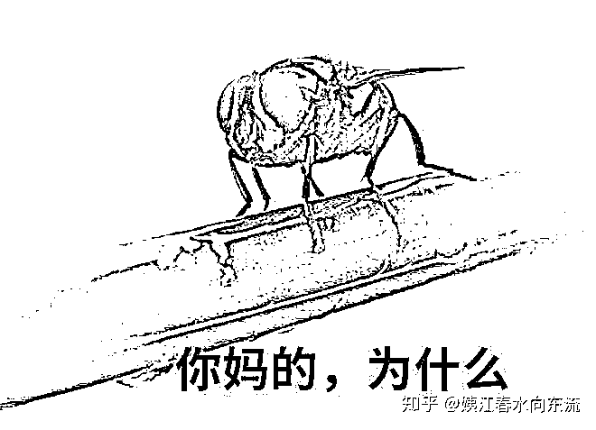

第三，会有“挣够了钱”这种想法。

这一个其实就是前面讲的那个餐馆老板。首先，他一周只开门五天，后来改了，哦，你不要以为是增加开门时间了。实际上。。。改成四天了。为什么？据说是老板觉得一周开四天，已经“挣够钱了”。剩下的时间他要去玩。。。然而挣多少钱？好像每月纯利润不到 4000 美金。。。

  

问题来了，国内的人会这么想吗？国内，虽然说 4000 美金也是绝对高薪了。但是有谁见过这个月薪的人觉得自己“挣够钱了”的？

  

她佬当时也是一脸无奈的跟窝佬聊这个事：“我认识的，国内这做生意也好干别的也好，有不少人比他富多了。然后你一问，一个个的还是觉得自己穷，还是拼命干。还是整天觉得钱不够。。。一个两个都想着挣几百万几千万几个亿。。。然后又整天愁的要死，现在一看，你说这不就是神经病吗？这个地方的人有这个钱早就出去每天吃喝嫖赌去了，结果就是不满足，不行，我还要更有钱，然后一个个拼命加班累出病来。每次劝他们歇两天，玩两天，一个个都拿看神经病的眼神看着我。”

  

最后一个，就是不把玩和休息当成罪。

窝佬不得不说这确实是东亚这边一个文化问题。这事不注意其实很难发现。要注意窝佬说的是“玩”和“休息”。而不是享受，这个是很重要的，不要弄错了，窝佬下面会讲。

  

她还提到过一点，就是国内。似乎玩和休息这两件事就是有罪的。她也是举了个例子：“有不少人，做了几年生意，也致富了。也不是不舍得花钱，给孩子吃得穿的用的，都是好的。身上都是名牌，吃的都是高级酒店，一个个几十万乃至上百万的车开着。可是这些人里很多人居然会因为自己儿子花几千块几百块买个游戏机就生气。。。这种事是这里的人无法理解的”

  

是的，想来大嘎也看出来这一点了。在东亚地区很多人就是这种观点。。。玩就是有罪。仔细一想其实也是很奇葩不是吗？

  

你要说，确实穷，玩不起。那是另一回事，可是一个个发财了之后。明明全家好车开着。名牌用着。。。然后一听说要玩点啥立刻脸都变了。。。各位想想是不是有这回事？实际上这还不比买车买名牌花钱呢，结果有时候你一玩一下。就成“[败家子](https://www.zhihu.com/search?q=%E8%B4%A5%E5%AE%B6%E5%AD%90&search_source=Entity&hybrid_search_source=Entity&hybrid_search_extra=%7B%22sourceType%22%3A%22answer%22%2C%22sourceId%22%3A589260637%7D)”了，就“不务正业”了，就“药丸”了。窝佬自己不是什么有钱人家所以不清楚，但是从在这接触了很多来这边做生意的国人之后。。。发现还真有很多人是这么想的

  

反观这边本地人。。。他们一个个挣钱就是为了玩，为了休息。有一笔钱了赶紧出去猛玩。赶紧吃喝嫖赌抽五毒俱全。。。什么吸大麻啊婚外情啊赌博啊都冒出来了，生怕钱花的不够快。。。

综上，所以要说的话这事确实不止是贫富的问题。确实也有思想方面的影响。当然惹，这不是说窝佬建议[大噶](https://www.zhihu.com/search?q=%E5%A4%A7%E5%99%B6&search_source=Entity&hybrid_search_source=Entity&hybrid_search_extra=%7B%22sourceType%22%3A%22answer%22%2C%22sourceId%22%3A589260637%7D)要去学这边这些人。这边这些其实是走了另一个极端。比如他们很多人不光觉得中国人很累。甚至觉得美国人都是奋斗逼。。。是的，连美国那种“好好工作好好玩”在他们看来都比较“奋斗”。因为他们是“随便工作好好玩”。

  

但是窝佬柑橘作为中国人，应该中庸一下。别在每天愁这个愁哪个了。你又不是真的要吃不上饭，对不对？何况有不少人还是有两个钱的，你至于吗？

  

最后附上现在当地一个普通服务员的工资，省得有些没来过的人误以为这边服务员是什么“高收入群体”

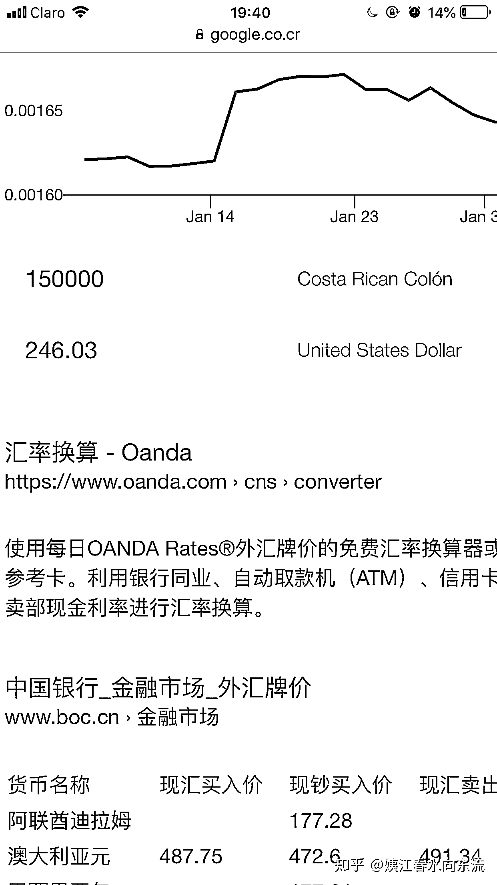

看见没。。。不到 250 美元一个月，相当于国内多少钱呢？

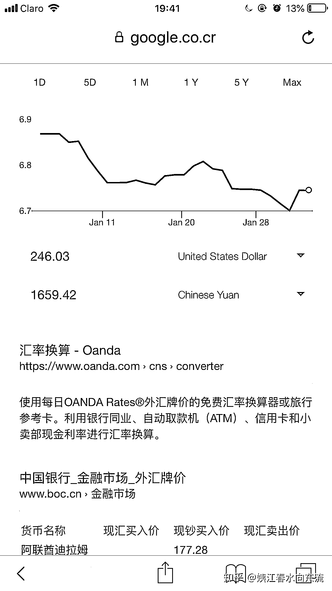

1600 多块，这钱很多吗？知乎有几个月收入不到这个钱的？

  

这种人都敢辞职出去旅游，你再想想自己，整天为什么活的那么累？只是穷的原因吗？

# Veean

> 作者：Veean
> 
> 赞同数：1669
> 
> 编辑于：2020-07-29 06:54

2020.7.28 修改：

这个回答是基于中等及以上小县城的小康及以上家庭以及农村种粮/养殖中户大户家庭出身的年轻人的立场来写的，当然这个群体已经很庞大了，几千万人肯定是有的。当然比这个差的只要你愿意躺平任锤，也可以这么干。

这个回答从来没有代表全体国人，所以请不要用“中国哪里哪里怎么样”这样的话来反驳我了。一篇文章能代表几千万人甚至上亿人我已经很满足了，但并不适用所有人的情况。

## **你认为我说的不切实际，那是因为我们的屁股不在一边。请移步参考别的答案。**

  

  

* * *

补充一下，本文旨在说明你活得累是因为你在拼命进取，想要努力活得更好，而你其实是可以选择不累的生活，回老家安心过日子也可以很轻松，这一切都取决于你的选择。

本文并不是要鼓吹大家都躺着，毕竟美好生活是奋斗出来的，努力奋斗才会梦想成真。。。

* * *

另一个角度：活得累都是自找的，西方阶级洗脑实在太成功。

本人在美国加州某村留学，中国学生都有钱的很，再穷[净资产](https://www.zhihu.com/search?q=%E5%87%80%E8%B5%84%E4%BA%A7&search_source=Entity&hybrid_search_source=Entity&hybrid_search_extra=%7B%22sourceType%22%3A%22answer%22%2C%22sourceId%22%3A607046205%7D)也是正的。很多美国本地学生贷款数万甚至十数万美金上大学，反正债多了不愁，卖身资本家慢慢还呗。

美国本地人的生活是不错，物产丰富人杰地灵，最关键的是美国普通人想得开，及时行乐今朝有酒今朝醉，有房子更好没房子也就算了，上班 8 小时下班直接失联，只同居不结婚，结了婚大不了继续租房子，有了孩子也可以租房子。孩子公费教育下午两点半放学然后就可以玩泥巴，作业爱做不做老师也不查，大不了毕业了去做服务员。每个人[吃饱喝足](https://www.zhihu.com/search?q=%E5%90%83%E9%A5%B1%E5%96%9D%E8%B6%B3&search_source=Entity&hybrid_search_source=Entity&hybrid_search_extra=%7B%22sourceType%22%3A%22answer%22%2C%22sourceId%22%3A607046205%7D)做好眼前的事儿该干嘛干嘛，大家都随便穿穿衣服没人在乎你穿的什么，不会天天想着什么阶级固化上升通道一夜暴富同龄人正在甩开你啥的。美国超市，餐厅大把的本地年轻人干活，人家赚点钱够嗨就行了，饭店太贵一根沙拉叶子都不浪费但是去超市一买一车，东西坏了一冰箱一冰箱的扔。在中国当服务员你去菜市场也能扫货吧，毕竟中国的粮价蔬菜价格真的低的没有底线，肉价其实也很便宜，饭店更是便宜的允许你点一桌子菜然后都倒掉（和发达国家饭店价格比）。[贵乎](https://www.zhihu.com/search?q=%E8%B4%B5%E4%B9%8E&search_source=Entity&hybrid_search_source=Entity&hybrid_search_extra=%7B%22sourceType%22%3A%22answer%22%2C%22sourceId%22%3A607046205%7D)上有愿意孩子当服务员的吗？

而且很多美国普通人没什么经济头脑，完全不会算账，有钱就花没钱就不花，卡债自己都算不过来，信用卡还不上拖着让银行收二十几点的利息。所以很多人根本没积蓄。

相当一部分中国人只要你想的开，完全可以过这种生活。大城市和东部沿海的土著就不说了，中西部的很多年轻人反正老家总会有一套甚至几套房，打一份工不管多少钱该吃吃该喝喝晒太阳打游戏，灌一桶肥宅快乐水，晚上来一瓶牛栏山一碟花生米，一边抽着中南海一边操心中南海，分分钟共产。

但是你不甘啊，

你的同龄人正在甩开你，

比你优秀的人还比你努力，

即将关闭的上升通道，

放羊娶老婆生孩子放羊，

你成功的速度要超过你父母老去的速度，

学区房 30 万一平米，

最新财富自由标准 2.9 亿。

你想得到的总是那么多，明明有[吃饱穿暖](https://www.zhihu.com/search?q=%E5%90%83%E9%A5%B1%E7%A9%BF%E6%9A%96&search_source=Entity&hybrid_search_source=Entity&hybrid_search_extra=%7B%22sourceType%22%3A%22answer%22%2C%22sourceId%22%3A607046205%7D)混一生老婆孩子热炕头以后儿孙自有儿孙福的机会，你正眼都不会瞧。

你要在世界顶尖的城市扎根，要在这里买房，大房子，学区房，孩子要上私立，上藤校，琴棋书画四书五经八国语言政法经哲样样精通，成为最顶尖的精英，不然就是阶级固化。

你时时刻刻以上流社会的标准要求自己，商场只去金鹰恒隆德基，化妆品必须 lamer，你深夜躺在出租屋里用 iPhone XS 问中国人为什么过得这么累。

你的择偶标准是三从四德，三纲五常，上得厅堂下得厨房，又能赚钱养家又能相夫教子，最好还是处女；你的择偶标准是 180 m2, 180 w, 180 cm, 180 mm，霸道总裁守身如玉独宠你一人。

你的七大姑八大姨总是会在聚会的时候给你来个 20 连问，你的同学聚会变成一个个装逼大会和成功者的吹捧大会。

要做人上人，出人头地，衣锦还乡，中国乃至东亚人来自基因的记忆，也许就是你活得累的根源吧。

盖将自其变者而观之，则天地曾不能以一瞬；自其不变者而观之，则物与我皆无尽也。

全面小康都实现了，年轻人，想开点。

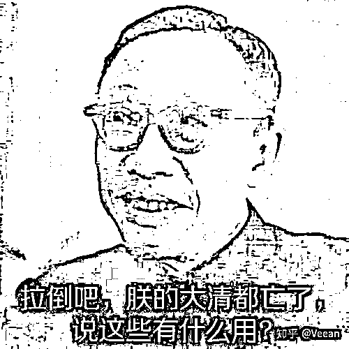

# 一直住顶楼

> 作者：一直住顶楼
> 
> 赞同数：114
> 
> 编辑于：2019-02-05 21:24

因为整个东亚文化的核心价值观不是按自己的能力快乐的过一辈子，而是修身齐家治国平天下。不是为自己，是为别人活。

# 斗战圣猴

> 作者：斗战圣猴
> 
> 赞同数：35
> 
> 编辑于：2019-10-25 10:24

1:市场定位

2:资源占有

3:金融霸权

我们在讨论国际竞争的时候，通常会从各种角度去分析，诸如资源，市场等直至最后的金融；

而从市场营销逻辑人类经济活动最终争夺的是对人类时间或者说注意力的争夺，表现为品牌对人类心智中“定位”的争夺！

然后我们来看一下，在发达国家范畴按照所谓的“活得轻松”来排序：

第一档，最轻松：西欧，北欧，澳大利亚诸国

第二档，较轻松：美国

第三档，不轻松：东亚诸国

你会发现，这完全就是工业革命按时间顺序的先后排列嘛，工业革命越早的活的越轻松，为什么呢？高[附加值](https://www.zhihu.com/search?q=%E9%99%84%E5%8A%A0%E5%80%BC&search_source=Entity&hybrid_search_source=Entity&hybrid_search_extra=%7B%22sourceType%22%3A%22answer%22%2C%22sourceId%22%3A688655593%7D)，顶端的产品品牌定位早被占据了。且撼动不了（可参考贵州茅台，就买一个酒，而且这酒多少年没有任何变化，照样做成[世界 500 强](https://www.zhihu.com/search?q=%E4%B8%96%E7%95%8C500%E5%BC%BA&search_source=Entity&hybrid_search_source=Entity&hybrid_search_extra=%7B%22sourceType%22%3A%22answer%22%2C%22sourceId%22%3A688655593%7D)，比你做小米手机轻松多少？而且利润率极高！他卖一瓶茅台的利润你要卖多少台小米？）

法国意大利的奢侈品，洋酒，瑞士的钟表，德国的豪华汽车。这些产业实际上并不需要持续不断的科技投入和迭代，成本极低，而利润极高！真正意义上卖的就是一个 logo.当然这些国家也同时拥有一些高科技，高端的工业部门，然而有之前提到的那些产业打底，[旱涝保收](https://www.zhihu.com/search?q=%E6%97%B1%E6%B6%9D%E4%BF%9D%E6%94%B6&search_source=Entity&hybrid_search_source=Entity&hybrid_search_extra=%7B%22sourceType%22%3A%22answer%22%2C%22sourceId%22%3A688655593%7D)。

2:被很多人忽视了，实际上西方国家资源占有量极高。像大家比较熟悉的澳大利亚，其地广人稀，矿产储量极大！而农业规模和人口比例也十分惊人，就靠卖自然资源也够吃。

而很多人不熟悉的是全球石油质量最好的是英国北海布伦特石油，而高福利的北欧国家也是靠巨大的石油，地热等资源储备！美国更是全球第一大农业国！

而资源占有量大的原因是因为科技革命和大航海，西方用武力征服了更多的土地！

3:殖民历史与科技优势造就金融霸权！

这个东西以前中国人不太懂，随着[互联网金融](https://www.zhihu.com/search?q=%E4%BA%92%E8%81%94%E7%BD%91%E9%87%91%E8%9E%8D&search_source=Entity&hybrid_search_source=Entity&hybrid_search_extra=%7B%22sourceType%22%3A%22answer%22%2C%22sourceId%22%3A688655593%7D)崛起以后，中国人应该被教育过了！原来产品只不过是金融的一个手段！比如阿里巴巴本质上到底是个什么公司？

答案是：金融公司

实际上不管什么行业做到最后的大公司都想成为金融公司，也最终必将成为金融公司！像美国在全球的金融霸权，法国在[西北非](https://www.zhihu.com/search?q=%E8%A5%BF%E5%8C%97%E9%9D%9E&search_source=Entity&hybrid_search_source=Entity&hybrid_search_extra=%7B%22sourceType%22%3A%22answer%22%2C%22sourceId%22%3A688655593%7D)的金融霸权；

很多人说“一带一路”不看好，都是些穷国家，赚不到钱，还贷款给他们！呵呵，你以为你每天接到的银行和金融公司打电话给你推销贷款是为什么？贷款有利息的啊大哥，躺着收钱。你一个国家，有人口，而我有枪我怕啥？

而上面这些因素东亚有吗？

东亚的经济模式高端的也是行业迭代竞争剧烈，低端的直接血汗工厂！

你以为光靠努力，教育就可以把老祖宗在战场上丢掉的，在工业革命过程中拉下的找回来？就像北上广深租房子的大学生能干掉当地初中毕业有 4 套房的土著房东？况且人西方也不是初中毕业的房东啊，人是 985 毕业的房东.....你能不累？

too young

现在中国人搞一带一路，美国人为什么跳这么高？

你以前是淘宝，现在要玩支付宝和蚂蚁花呗和借呗了！

# 老杨叔聊志愿填报

> 作者：老杨叔聊志愿填报
> 
> 赞同数：172
> 
> 编辑于：2019-04-15 19:24

儒家文化影响力比较大的国家普通人普遍感觉比较苦，这种苦来自于从小受到的教诲和环境的浸染。

儒家倡导内敛、隐忍、守拙、踏实、奉献、朴素、清白、正统、安静、压抑本性……反应在普通人身上就是做事兢兢业业做人踏踏实实做工勤勤恳恳，不太接受奢侈、张扬、自我、个性、喧闹……这就让人感觉这些地方的人会压抑自己的欲望会控制自己的行为，这就苦的外在表现。

日本是体现这种苦最极端的地方，平日的压抑和自律的结果是居酒屋的放纵和[歌舞伎](https://www.zhihu.com/search?q=%E6%AD%8C%E8%88%9E%E4%BC%8E&search_source=Entity&hybrid_search_source=Entity&hybrid_search_extra=%7B%22sourceType%22%3A%22answer%22%2C%22sourceId%22%3A616193230%7D)听的流连，甚至艾薇儿。

中国则是集中体现在节俭、朴素，把吃穿用降低到最低，活着就行，所以当你的父辈不适应你的断舍离，把你给他买的东西藏起来不舍的用的时，多理解一下。

# 独行

> 作者：独行
> 
> 赞同数：181
> 
> 编辑于：2022-06-12 02:10

别碰瓷啊，明明是中国人活得累。

# 那你说我该叫什么

> 作者：那你说我该叫什么
> 
> 赞同数：240
> 
> 编辑于：2022-04-29 22:20

因为东亚文明在侵略性，资源生产模式和整体管理手段上与西方文明有着本质的区别。

—————————————————————

西方文明是肉食动物文明，会把其它文明当做猎物关注并且定期捕食，就像狼对羊做的那样。

西方自古的倾向就是对外侵略，奴役异族，靠军事或者科技代差进行压制，吸其他地区血维持自己的生存，这个事从古代就没有改变。

西方文化的祖宗古希腊就有这个倾向了。

斯巴达人是直接在战争中击败了希洛人，然后奴役了希洛人，建立了斯巴达黑劳士制度，也就是希洛人做苦力，供养斯巴达人，斯巴达人强化自己的军事，战争，武器生产能力，靠这些科技代差吸希洛人和庇里阿西人的血。

“公元前 8 世纪中叶，由于斯巴达人本身社会分化加剧和人口增加，为了解决土地不足，斯巴达人一方面向外殖民，另一方面侵入[美塞尼亚](https://www.zhihu.com/search?q=%E7%BE%8E%E5%A1%9E%E5%B0%BC%E4%BA%9A&search_source=Entity&hybrid_search_source=Entity&hybrid_search_extra=%7B%22sourceType%22%3A%22answer%22%2C%22sourceId%22%3A2463748153%7D)，史称第一次美塞尼亚战争（约公元前 740 年至公元前 720 年）。结果，斯巴达人占领了整个美塞尼亚，把其居民也变成黑劳士。把侵占的土地在[斯巴达](https://www.zhihu.com/search?q=%E6%96%AF%E5%B7%B4%E8%BE%BE&search_source=Entity&hybrid_search_source=Entity&hybrid_search_extra=%7B%22sourceType%22%3A%22answer%22%2C%22sourceId%22%3A2463748153%7D)人与庇里阿西人之间分配，斯巴达人分得平原的土地，庇里阿西人分得山区土地。”

雅典也是一个德行，所谓的雅典民主其实就是个屁，因为只有人数比例很少的公民才有民主。

根据希腊晚期作家阿典奈奥斯（公元第三世纪人）的话，在[马其顿](https://www.zhihu.com/search?q=%E9%A9%AC%E5%85%B6%E9%A1%BF&search_source=Entity&hybrid_search_source=Entity&hybrid_search_extra=%7B%22sourceType%22%3A%22answer%22%2C%22sourceId%22%3A2463748153%7D)亚历山大时代，换句话说，在奴隶制度的全盛时代，在伊斋那两平方英里的面积内平均有四十七万奴隶，在科林斯有四十六万奴隶而只有四万自由民，在雅典则有四十万奴隶而只有二万一千公民和一万外邦人。

这种行为，在中世纪没改变，在近代没改变，在现代也没变。

虽然我们都说[日不落帝国时期](https://www.zhihu.com/search?q=%E6%97%A5%E4%B8%8D%E8%90%BD%E5%B8%9D%E5%9B%BD%E6%97%B6%E6%9C%9F&search_source=Entity&hybrid_search_source=Entity&hybrid_search_extra=%7B%22sourceType%22%3A%22answer%22%2C%22sourceId%22%3A2463748153%7D)，英国的工人要工作十几个小时，但是如果你看一下同时代的大清农民，苏格兰农民，日本农奴，你会发现日不落帝国的工人其实依然有着世界上最一流的底层生活质量。

真的被当做食物的是殖民地人，比如北美人和苏格兰人印度人，以及带清。

现代欧美，其实也是在依靠强大的军事和科技吸收[亚非拉](https://www.zhihu.com/search?q=%E4%BA%9A%E9%9D%9E%E6%8B%89&search_source=Entity&hybrid_search_source=Entity&hybrid_search_extra=%7B%22sourceType%22%3A%22answer%22%2C%22sourceId%22%3A2463748153%7D)的血，本质上亚非拉现在就是欧美的“[奴隶人](https://www.zhihu.com/search?q=%E5%A5%B4%E9%9A%B6%E4%BA%BA&search_source=Entity&hybrid_search_source=Entity&hybrid_search_extra=%7B%22sourceType%22%3A%22answer%22%2C%22sourceId%22%3A2463748153%7D)”。

换句话说，西方人，自古就是“种族主义”的，而且文化中富贵的方法就是将另一部分人“工具化”，供养主体文明，是纯粹的食肉文明。

这种文明最大的优势就是，

1，主体文明财富物资＞所需，有充足的资源发展，并且极大满足自己主体民族的生活。

2，文明上限高，对发展速度和强度极度依赖，内部发展能动性很强，很容易成为世界强国。

但是缺点其实也不小，这种文明有几种巨大的缺点

1，极度依赖自身发展，一旦主体民族对于其他民族的科技军事优势不再明显，吸不动血的时候，就会迅速开始崩溃，一如不会打仗了的斯巴达人，很快就被庇里阿西人和希洛人的起义掀翻了。

2，这种文明无法统治很大的疆域，因为吸血文明注定他们要各地分权，把极大的权利下放给各地当地政府，不然无法精准的吸收远处的其他民族的血，这决定了这种文明载体无法拥有庞大的领土，因为中央对地方控制力不足，地方很容易叛乱。就像现在的欧洲依然碎的七零八落，没有出现中国这种长时间横跨大块版图的大帝国，偶然出现的亚历山大帝国，[罗马帝国](https://www.zhihu.com/search?q=%E7%BD%97%E9%A9%AC%E5%B8%9D%E5%9B%BD&search_source=Entity&hybrid_search_source=Entity&hybrid_search_extra=%7B%22sourceType%22%3A%22answer%22%2C%22sourceId%22%3A2463748153%7D)很快就分崩离析了。

可能你要说美国，但是情况不一样，美国诞生的很晚，他诞生的时代，人类的通讯技术已经很发达了，电报极大的增加了人类的信息传递速度，美国以这种文明载体统治如此庞大的领土的原因是人类的通讯手段把地球变小了，实际上美国中央对内部各州的控制力相对于东方国家的中央对省来说非常低，历史上也无数次出现分裂倾向，直到现在还有很多州会“闹独立”。

3，奴隶的人数早晚会难以支撑主体民族庞大的消耗量，因此主体民族一段时间后就要继续扩张寻找新的奴隶文明殖民。所以基本一段时间，这种文明就必须要以武力或者经济形势对外战争一次，而且必须获胜，否则就会陷入崩溃。因此对于突发情况抵抗力较差，很容易因为一次天灾或者战败，就从鼎盛坠落到万劫不复，天堂地狱间往往只有一道门的距离。

4，文明下限极低，崩溃几乎等同于彻底消失，而且是文化概念都会消失，根本无法重复合并为疆土辽阔的大国。因为缺乏同化或者斩草除根的方式，被其统治的其他地区民族往往经历多个世纪依然有着自己的文化和传统包括语言。一旦主体文明崩溃，辽阔的帝国灭亡，几乎不可能在短时间内再次统一，因为各地民族根本没有同文同种的向心力。

—————————————————————

东方是草食动物文明（注意，这不是贬义），要么与其他文明共存，就像马和羊可以一起吃草。要么把其它文明彻底杀掉直接抹除对面，就像大象会把跟他抢草的犀牛杀死但不会食用对方。

东方自古的倾向就是对异族缓慢同化融合，或赶尽杀绝，或惩戒，但没有奴役选项。

[炎黄二帝](https://www.zhihu.com/search?q=%E7%82%8E%E9%BB%84%E4%BA%8C%E5%B8%9D&search_source=Entity&hybrid_search_source=Entity&hybrid_search_extra=%7B%22sourceType%22%3A%22answer%22%2C%22sourceId%22%3A2463748153%7D)带领百姓，击败了蚩尤率领的九黎，但击败后，二者合并为黎民百姓，成为了一家。

汉朝远征匈奴后，将抓住的全都杀死，剩下的赶走，并不会尝试去将其作为生产工具使用。

明朝击溃了蒙古，但是不但没有奴役蒙古人，还与其融合了，明初大量的军队都是投降的蒙古人组成的鞑官军，到明末，内部的骑兵编制依然很多是蒙古编制。

东方文明内核里没有将其它文明奴役化后吸血的倾向，要么与对方共存，要么把对方赶尽杀绝，但不存在奴役对方。

这种文明的优势在于

1，内部稳定，可以在信息技术非常不发达的时代就长时间统治很大的疆域。原因是，这种文明不需要针对其他地区吸血，就不必要将大权下放地方，中央握死权力，能有效降低分裂危机。

2，面对突发情况抵抗能力极强，文明下限高，因为其文明能源的核心是草食，自我发展，不需要捕猎，因此能源供给稳定。而且整体资源动员力强，偶尔的一次甚至几次战争失败和天灾很难撼动其根基，可以长期的僵而不死，甚至中兴一波回光返照。

3，会不断生成大帝国。即使上一个政权崩溃，不久后又会诞生新的大帝国。因为同化兼并原因，帝国版图内居民往往已经达成车同文书同轨，且文化概念，价值观都趋向于一致，很快就会被再次统一起来。

缺点在于：

1，内部发展主观能动性极低，文明上限差，整个文明处于不愿意发展的状态，有很强的保守倾向。因为不需要捕猎吸血，纯靠吃草生存，这类文明缺乏发展科技和武力的主观能动性，发展科技和武力的目的往往是仅限于自保，自保的目的是继续安静吃草。就像公牛进化出犄角厚皮和牛蹄只是为了自保一样，虽然足以击退狼群，但是永远无法与进化了巨大牙齿和爪子的猛虎为敌，因此往往会收到强大肉食民族，比如游牧民族的反复攻击和殖民。

2，对外战争持续能力很差，肉食文明在战争后可在战败者身上攫取巨额利润快速补充自己，因而越战越强，或者战败一波白给。草食文明不存在吸血奴役，对外战争目的仅有同化，惩戒和灭国三种选项，这三种都是纯粹的资源支出战争，使得草食民族对外战争无力，比如汉武帝征讨匈奴，虽然大胜而归，但汉朝自己却被这些战争拖到经济崩溃。万历三大征，永乐五次远征如出一辙。草食文明无法展开长期大规模对外战争。且文明倾向上极度排斥远征武官，排斥不受中央管辖的本国武力存在，对外出带兵的将领极度不信任，军事上经常出现诛杀良将，互相制肘的问题，这更加剧了其对外战争极度无力的特性。

3，周期出现的内部结构崩坏。因为没有“被奴役者”这个群体，草食文明在资源不足的时候就会开始自下而上的燃烧自己的民族，也就是“卷”。这件事是无法解决的。随着人口的扩张，草食文明的资源生产速度赶不上人口上升速度，社会最底层一批人就会成为实质上的“被奴役者”，而因为人口膨胀越来越快，资源生产速度越来越慢（[草食文明](https://www.zhihu.com/search?q=%E8%8D%89%E9%A3%9F%E6%96%87%E6%98%8E&search_source=Entity&hybrid_search_source=Entity&hybrid_search_extra=%7B%22sourceType%22%3A%22answer%22%2C%22sourceId%22%3A2463748153%7D)无法扩张新资源），内部分配越来越不平衡，“被奴役者”的身份就会从底层人民逐渐上升到中层人民。此时，草食文明就会进入周期大爆炸，中层人民揭竿而起引发内乱，文明内部崩溃，陷入分久必合，合久必分的循环。

举个例子，同样是兵户阶级随着时间推移人满为患，中央财政养不起过量的军队，

欧洲人选择了十字军远征，让成群的破落骑士远征中东袭击其他国家获取资源，还抢下[耶路撒冷](https://www.zhihu.com/search?q=%E8%80%B6%E8%B7%AF%E6%92%92%E5%86%B7&search_source=Entity&hybrid_search_source=Entity&hybrid_search_extra=%7B%22sourceType%22%3A%22answer%22%2C%22sourceId%22%3A2463748153%7D)开辟新的国家。

日本人选择了裁撤，减少武士粮饷，最后底层武士贫穷到活不下去，揭竿而起掀翻了[德川幕府](https://www.zhihu.com/search?q=%E5%BE%B7%E5%B7%9D%E5%B9%95%E5%BA%9C&search_source=Entity&hybrid_search_source=Entity&hybrid_search_extra=%7B%22sourceType%22%3A%22answer%22%2C%22sourceId%22%3A2463748153%7D)。

这就是典型的肉食和草食文明对于资源不足的处理方式。

—————————————————————

中国曾经有一个原生文明有着极强的肉食倾向，那就是唐朝，唐军征突厥，大胜而归后带回奴隶十万，贩卖转运后不但没亏钱，还有财政盈余，与汉朝形成了鲜明对比。

唐朝还有过诸多远征记录，这是其他朝代绝无仅有的。

但是唐朝最后也走了肉食文明的老路，制度上无法掌握自己的庞大疆域，最终内部分裂，[安史之乱](https://www.zhihu.com/search?q=%E5%AE%89%E5%8F%B2%E4%B9%8B%E4%B9%B1&search_source=Entity&hybrid_search_source=Entity&hybrid_search_extra=%7B%22sourceType%22%3A%22answer%22%2C%22sourceId%22%3A2463748153%7D)一仗直接把盛唐打入了地狱，一如昔日的[亚历山大帝国](https://www.zhihu.com/search?q=%E4%BA%9A%E5%8E%86%E5%B1%B1%E5%A4%A7%E5%B8%9D%E5%9B%BD&search_source=Entity&hybrid_search_source=Entity&hybrid_search_extra=%7B%22sourceType%22%3A%22answer%22%2C%22sourceId%22%3A2463748153%7D)和古罗马一样分崩离析。盛唐后来分裂为一大堆犹如欧洲的小块互相攻伐。

类似的就是蒙元帝国，也是迅速鼎盛，迅速崩溃分裂。

至于[宋明清](https://www.zhihu.com/search?q=%E5%AE%8B%E6%98%8E%E6%B8%85&search_source=Entity&hybrid_search_source=Entity&hybrid_search_extra=%7B%22sourceType%22%3A%22answer%22%2C%22sourceId%22%3A2463748153%7D)，就是纯粹的草食了，已经不带一点肉食倾向了，所以一个个僵而不死很多年，但是外战极度无力。

—————————————————————

目前的情况来说，因为电磁波，网络等先进通讯手段，肉食文明最大的短板其实被一定程度弥补了，所以没有出现大的突发情况的话，目前肉食文明比较占优。

而东亚人注定会开始内卷，从底层开始焚烧自己，什么时候烧到中层了，就该王朝周期了

# 伏罗希洛夫射手

> 作者：伏罗希洛夫射手
> 
> 赞同数：1929
> 
> 编辑于：2019-01-29 11:23

一方面是自然原因。

人口多，资源贫乏，工业起步晚，因此东亚人面临着绝对意义上的匮乏，穷，吃不起肉，开不起大排量车，负担不起分散经济的高能耗与低效率，只能挤着，吃米面。

另一方面是人为原因。

就是有不少东亚人已经不穷，甚至比较富裕了。买得起大别墅，开得起大排量车，更吃得起牛肉。但他们的欲望没有止境，更可怕的是他们的欲望是一种很畸形的欲望，他们不去追求自身更好的生活环境和福祉，而是追求“相对于别人的胜利”，能住大别墅，不住，省吃俭用多花几百万买学区房，只为了让孩子获得一些虚幻的“高档”教育，重复他们这一代的恶性竞争。能吃得起牛肉，不吃，编造一些所谓的健康饮食，吃比牛肉贵几倍的所谓的健康有机食品，其实都是废糖。永远不知“享受自己的生活”为何物，把挤在鸽子笼里胜过其他鸽子当作乐趣，同时还去抱怨生活的辛苦。

土地改革之后，被剥夺了耕地的小地主生活水平反而上升，因为他们没有办法无休止地将金钱投入到购买耕地当中，反而增加了消费，提高了生活水平。所以说曹丰泽是救不了后一种人的，得让迫击炮来救。

# 李超

> 作者：李超
> 
> 赞同数：200
> 
> 编辑于：2019-01-29 11:59

灾难一般的人口密度←\_←

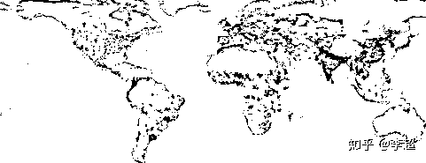

# 每日怡见

> 作者：每日怡见
> 
> 赞同数：362
> 
> 编辑于：2021-11-24 12:26

## 张弛有度，过刚易折

**近期有两个重要的新闻：**

一、《中国统计年鉴 2021》显示，2020 年全国人口出生率为 8.52‰，首次跌破 10‰，创下了 1978 来的新低。

二、还是《[中国统计年鉴 2021](https://www.zhihu.com/search?q=%E4%B8%AD%E5%9B%BD%E7%BB%9F%E8%AE%A1%E5%B9%B4%E9%89%B42021&search_source=Entity&hybrid_search_source=Entity&hybrid_search_extra=%7B%22sourceType%22%3A%22answer%22%2C%22sourceId%22%3A2239232177%7D)》显示，2020 年结婚登记人数已连续 7 年下降，去年创 17 年来新低。

看见这两个热搜数据，我觉得没什么好奇怪的，因为全网都知道答案是什么。

——内卷太严重。

经济方面很多人分析吧，今天我说一个不一样的分析，从文化方面说说这个事，其实这和我们的儒家科举文化有关系。

  

**1、东亚模式与科举文化**

  

之前全国补习产业发展的热火朝天，双减之后彻底被灭，禁止补课。

双减之前，很多人骂，说补课导致压力这么大，怎么不管管？

双减之后，很多人骂，说凭什么不让补课啊？不让补课，就是剥夺普通人的上升空间！

大家有兴趣去观察观察，确实这种人很多，补课就骂压力大，不补课就开始犯焦虑症。

其实这也能理解，因为东亚文化就是这样的，或者说中华文化圈都这样。

不相信？

**我们看数据说话，欧盟委员 2011 年的数据显示：**

法国补课花费大约是 22 亿欧元。

希腊补课花费大约是 9.5 亿欧元。

德国补课花费大约是 15 亿欧元，差不多就 16 亿美元。

而相比之下，韩国补习业一年总营业额高达 200 亿美元。

法国接近七千万人、德国八千万人口、希腊一千万、韩国五千万人，欧元美元汇率差距不大，你想想看韩国补习费用多恐怖了。

**补课时间来看：**

欧盟学生每周进行课外辅导的时间为一般 1 至 6 小时，也有很少数学生达 7 至 10 小时。

韩国学生也是 7 小时，不过是睡眠时间 7 小时。

**从各方面数据来看，全球补习最高密度集中的就是东亚。**

越南：2006 年，越南 9189 个家庭中有 32%的小学生、46%的初中生和 63%的高中生，参加过课外补习。

2008 年，越南高中学生参加补习比例达到 77%，上升极快。

> **生育、人口方面：越南的总和[生育率](https://www.zhihu.com/search?q=%E7%94%9F%E8%82%B2%E7%8E%87&search_source=Entity&hybrid_search_source=Entity&hybrid_search_extra=%7B%22sourceType%22%3A%22answer%22%2C%22sourceId%22%3A2239232177%7D)为 2.1 以下，从 2011 年开始越南就已经进入人口老龄化社会，目前已经成为全球人口老龄化速度最快的国家之一。** 

  

韩国：2008 年参加过课外补习的高中生比例约为 60.5%，初中生为 72.5%，小学生为 87.9%。

> **生育、人口方面：2020 年韩国总和生育率仅为 0.84，全球最低之一。** 

  

中国香港特区：2014 年，香港初三和高三学生参加课外补习的比例分别达到 53.8%和 71.8%。

香港学生一年交的补习费就超过 20 亿港元。

> **生育、人口方面：香港 2020 年总生育率已跌至 0.87，全球最低之一。** 

  

中国台湾省：2018 年台湾小学生中平均每 10 位就有 7 人参加补习，周中放学之后参与补习的每 10 人中则有 5 人。

小小的台湾省，注册的补习班居然高达将近 2 万家。

> **生育、人口方面：2020 年台湾新生儿人数仅 16.52 万人、出生率 0.99%，全球最低之一。** 

  

华人国家新加坡：2015 年资料显示，未经新加坡教育部批准注册的家教中心和补习中心目前有 850 间。

2013 年大约是 800 间，而 2012 年的时候只有约 700 间，可以看见增长速度极快。

要知道新加坡面积只有 716 平方公里，人口只有 500 万多。

> **生育、人口方面：新加坡 2020 年总体生育率下降到 1.1,全球最低之一。** 

  

日本方面：据文部科学省的统计，在孩子就读公立初中的家庭，教育开支的 63%都被以补课费为主的校外活动费用占据，尤其是准备参加中考的初三学生，一年下来就要 41 万日元（差不多 2.2 万人民币）。

而孩子就读私立小学的家庭，在六年级准备小升初的阶段花费最多，补课费等校外活动费用高达 88 万日元（差不多 4.9 万人民币）。

> **生育、人口方面：这还用我说吗？日本的老龄化是全球知名的。** 

  

我国在双减之前，中国教培市场规模超过 3 万亿元，补习年平均费用 12000 多元，最高的达到 30 万元的大有人在。

2014 年中国家庭人均年收入是 15981 元，而《2014 年教育市场分析报告》显示：40%家庭每年投入课外培训的费用高于 5000 元，其中 15%家庭投入万元以上。

也就是说大约三分之一的收入花在了补习上面，而双减之前行业估算的年增长是 10％，如果按照这个比例下去，一半收入砸进补习只是时间问题。

这导致了中国中小学生中 67%睡眠时间不达标，17%书面作业总量超标。

至于这种内卷对生育、人口方面，就不用说了吧？大家都懂的。

**我看遍了全球数据，只有东亚儒家文化圈这样，其他文化圈也有一两个爱补习的，但是基本都是孤例。**

全世界所有爱补习的地区前几名突出来显示，就等于这个图——中华文化圈范围图，完全重叠。

  

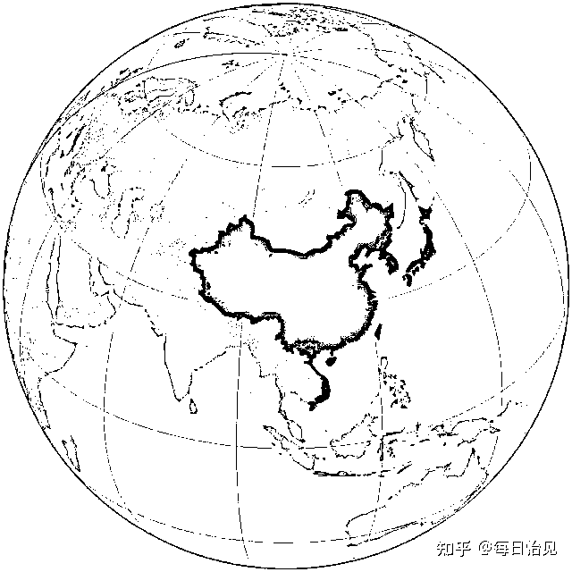

**全球发达国家有：[五眼联盟](https://www.zhihu.com/search?q=%E4%BA%94%E7%9C%BC%E8%81%94%E7%9B%9F&search_source=Entity&hybrid_search_source=Entity&hybrid_search_extra=%7B%22sourceType%22%3A%22answer%22%2C%22sourceId%22%3A2239232177%7D)国家、日韩、欧盟。**

其中美国是快乐教育，平民不喜欢读书，这个全球有名的，否则也不会爱上注射[消毒液](https://www.zhihu.com/search?q=%E6%B6%88%E6%AF%92%E6%B6%B2&search_source=Entity&hybrid_search_source=Entity&hybrid_search_extra=%7B%22sourceType%22%3A%22answer%22%2C%22sourceId%22%3A2239232177%7D)，属于另一个极端。人才方面则主要靠一小撮精英和吸引全球移民。

欧盟是不搞补习这一套，但是比美国强，补的很弱。以德国为例，即没有走美国的那种基层反智路线，也没有走东亚过载的路线，而是分流路线。

欧洲生育率也不高，但是很明显欧洲生育率低是因为个人享乐主义，不是因为内卷，人家社会压力不大。

至于中东、非洲、东南亚、南美洲什么的，有补习的个例，但是总体来说都不补习。

甚至有些是典型的反面教材，比如南美洲、非洲很多国家根本不流行读书，甚至都没什么学校。

**发达国家里面只有日本、韩国是重度补习，躺平这个词就是日本传播到国内的。**

面对高强度的日本社会，日本年轻人已经躺了很久了，韩国也一样。

我不是有什么偏见，而是这可以得出来一个显而易见的问题，**为什么东亚儒家文化圈内卷如此严重？**

其实《光明日报》上早就有这种观察了，并不是我一个人的感觉。

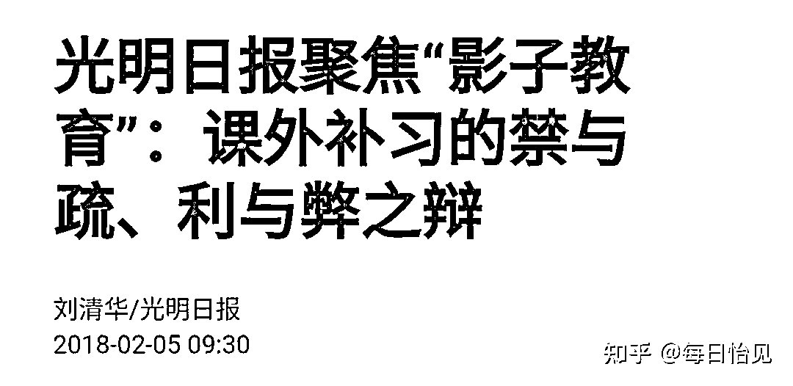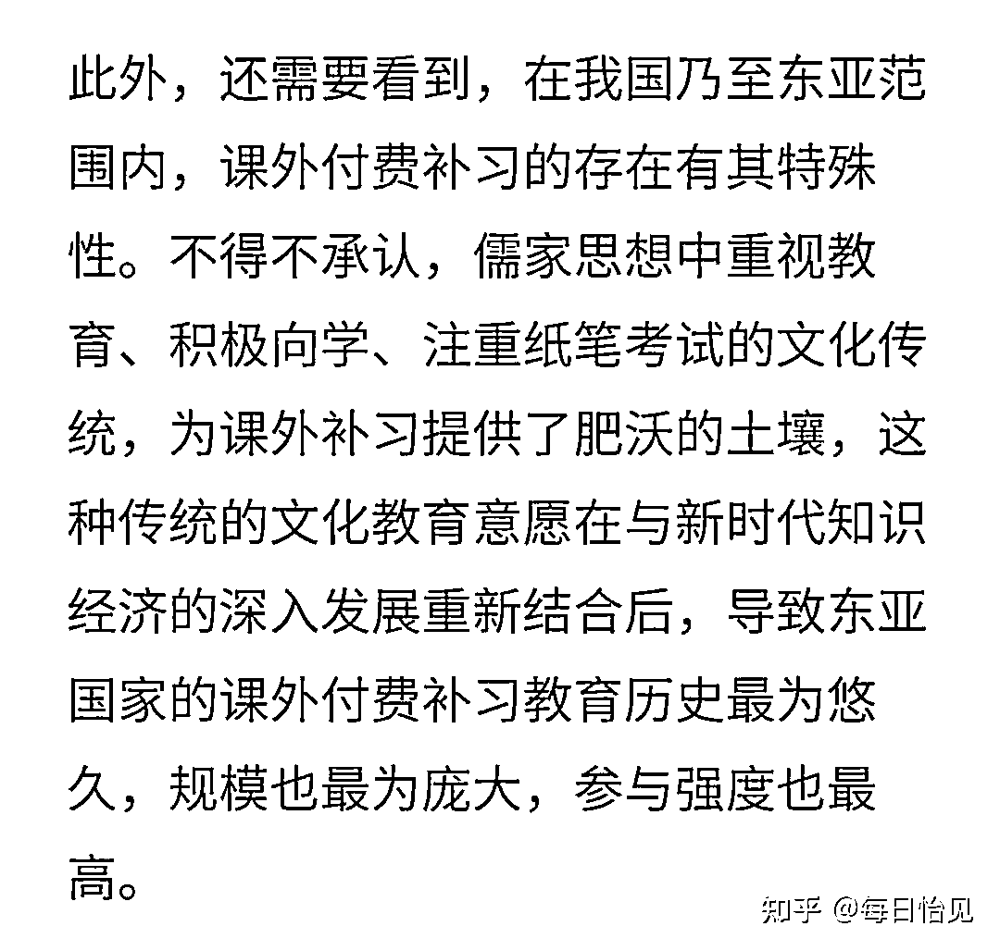

光明日报报道，点明了儒家思想问题

**虽然今天我们是社会主义制度，但是儒家文化依旧深刻的影响着中国人的一言一行。**

而儒家文化的最大的特点，就是千年科举文化，我们中华文化圈过于科举考试的故事，几乎是数不胜数。

今天中国工业化、现代化可以这么成功，和我们的传统是有关系的。

反过来，今天我们面临的内卷如此严重，也是和我们的传统有关系的。

  

**2、儒家文化的优势与劣势**

  

**儒家文化圈有这样几个特色：**

> **1、治安基本都特别好，因为老百姓很团结，秩序感很强、普遍认可“吃得苦中苦方为人上人”。**  
>   
> **2、没有宗教信仰束缚，现世“实用主义”精神很强，有强烈的“做题”信仰，被“万般皆下品惟有读书高”的思想浸染很深。**  
>   
> **3、都是比较偏中央集权模式的国家。**  
>   
> **其中日本、韩国、新加坡好似是西式制度，但是日本实际是家族世袭制；韩国则总统权利极大，拥有任命关键部门、组成和解散内阁的权力；新加坡是事实上的一 D 专政。** 

**工业革命最开始爆发于欧洲，然后其成果传播到美国。**

欧洲+北美，还有澳大利亚和新西兰，构成了今天整个西方世界。

全世界这么多文明板块，除了西方工业化、现代化成功。

唯一后发追赶上西方，也成功进入工业化、现代化社会的，就是东亚地区中日韩为代表。

**我们是唯一追赶成功的。**

你看几个排名就知道了，全世界国家 GDP 排名、全球 500 强企业排名、全世界高端产业分布、全球科技企业排名、全球工业化程度排名等等...

前面的就两个区域，一个是西方，一个是东方，其他没了。

二战结束后，东亚各国用 30 左右的时间跑完了西方国家百年工业化进程，如果没有强大的“奋斗 13”精神，这是不可能完成的任务。

**但是随之而来的“奋斗 13”文化反噬作用，也正在体现。**

东亚并没有完全进入“[技术创新](https://www.zhihu.com/search?q=%E6%8A%80%E6%9C%AF%E5%88%9B%E6%96%B0&search_source=Entity&hybrid_search_source=Entity&hybrid_search_extra=%7B%22sourceType%22%3A%22answer%22%2C%22sourceId%22%3A2239232177%7D)领导人类发展”的状态，客观上还是以摸着西方技术过河为主。

而当摸到顶以后，社会在继续用力过猛，就出现了严重问题。

过去我们用力过猛却成功经济爆发，只是因为西方提供了一个现代化、工业化的模板经验，前面有人，是有方向的。

这种情况下，只要努力化身“奋斗 13”，就可以快速追赶，产生各种经济奇迹，日本、韩国、香港、台湾等等都是这样来的。

但是都发展到一定成功以后就冷却、躺平了。只要把初级阶段过了，东亚就成为全世界“最卷”最严重的地区了。

**而内卷就又导致了大量的人开始自暴自弃、放弃生育。**

因为东亚模式中，还是科举文化思想太重。

我们普遍认可：

> **“吃得苦中苦方为人上人”**  
>   
> **“万般皆下品惟有读书高”** 

实际上这个问题我说过很多次，谁告诉你努力就一定有结果的？

不努力肯定不能成功，努力只是让你有可能成功，而不是努力就一定成功。究竟能不能成功，实际上选择、判断更重要。

儒家科举文化最擅长的就是**“目标明确”**的做题。

有句粗话说“给我一个女人，就给你创造一个民族。”东亚人就是，你给我一个方向，只要有奔头，我就愿意往死里努力。

这种文化，让东亚人可以最快的吸纳西方现代文明的初级、中级成果，但是一旦能吸纳的到顶以后，再继续疯狂过载努力，就是灾难了。

初级、中级以后，更高的产业是需要创新的，自己开始创新以后，是没有确定目标的。

而是得你自己去寻找什么是下一个科技爆发点，得自己去找“目标”，已经没有免费目标参考了。

**结果我们还是老方法只努力，结果就是：**

> **开店的人越来越多，而顾客数量不变，最终每个店家都很累，但是利润却越来越薄弱，这就是“内卷”。**  
>   
> **学校数量一定、录取名额一定、好的编制岗位数量一定，这种情况下，每个人都疯狂的过载努力，结果就是等于没努力。**  
>   
> **所有人都补习=所有人都没补习。区别就是花费更多了，人活得更累了，而取得的结果，可能还不如上一辈人。** 

美国为什么曾经如何强大？美国工业是英国产业转移发展起来的，美国早就过了中国这种“奋斗 13”发展过程。

一个数据揭露真相，2020 年全球计算机顶级科学家排名显示，单论科学家数量，日本顶级科学家达到了 294 人，中国总数 557 人，**美国总数 2639 人美国顶级科学家数量大约是中国 5 倍。**

**美国强大靠的不是人民多能 996、007，而是即使美国今天在衰弱中，科学家数量也是绝对远超全球水平。**

仅凭“努力”就可以有收获，这就是初级发展阶段，只要你过了初级发展阶段，单纯“只是”努力就没有用了。

  

**3、内卷是怎么产生的？**

**为什么必须强调创新？因为创新才能带来技术突破。**

原理是这样的，技术突破以后，就会产生科技红利，经济就会继续发展一波。

举例子，古代基本就二种职业，农民或士大夫，所以大家都过的不富裕，因为选择很少，而人只会越来越多，人均就薄了。

而现代诞生各种科技以后，每一种科技就对应着一种市场，科技越多市场越多。

市场多，就会产生大量的就业岗位需求，经济也就发展起来了。

**而内卷是怎样产生的？——因为生产效率是不断提升的。**

经济发展初期，市场内部都是个体户，因为竞争就诞生了行业内的中小企业，个体户慢慢就被淘汰了，中小企业拿下全部市场。

中小企业相互竞争，慢慢就诞生了大企业、甚至巨头，然后中小企业就慢慢被淘汰、或者被兼并。

一个市场的经济后期，如果没有任何干预的话就会发展成为垄断，所以一个行业成熟以后，往往就会遇见反垄断。

最开始是个人养鸡，后来有人发现自己弄个养鸡场更有竞争力，就开小养鸡场，小养鸡场多了，就会出现大型养鸡场...

**所以才说，技术发展、创新是解决内卷的关键。**

如果行业只有养鸡一个，个人没什么选择只能去养鸡，你个人再努力养鸡又有什么用？市场需求就这么多。

> **一个小镇有十万人，如果只有养鸡一种产业，就只有一个十万人的市场。**  
>   
> **如果不止养鸡，还有家具制造厂、水泥厂、手机配件生产厂，就多了一堆十万人的市场，维度就很丰富了。** 

**结论：只要一个行业变成了红海，你再怎么努力加班，都没有任何意义。**

**这就是为什么东亚内卷如此严重的原因。**

> **在红海领域搞“双减”，实际上就是保护社会财富，大学名额是不可能成为“增量市场”的，就这么多名额，如果人人都希望耍小聪明偷跑，最后结局就是前面说的韩国这样夸张，而是未来韩国只会更难。** 

**纯属浪费钱，折磨人！**

> **在存量市场，如果你偷偷的加班多赚钱，结果最后就是大家都不得不加班。**  
>   
> **你加班“养鸡”，鸡是多了，但是市场需求的“鸡肉”并没有变多，结果“鸡肉”越来越不赚钱，甚至行业内会出现“越奋斗”越早破产。** 

**但是如果大家都不偷跑了，反而日子还凑合了。**

而可惜的就是，也许是文化原因，东亚人普遍依旧相信“吃得苦中苦方为人上人”。

觉醒的程度还不够，大量的人还在保持着“奋斗偷跑”的小心思，导致很多年轻人直接被绞的心态报废了。

**这也是正常的，因为这种局面要结束，只有二种情况：**

> **1、东亚社会彻底因为“偷跑”文化崩溃，反思自己的“大聪明”行为，来一次“鸦片战争式”的触底反思。**  
>   
> **2、国家以行政手段干预，强制红海领域“双减”，禁止偷跑奋斗、重罚止偷者。**  
>   
> **3、倒逼民间改变思维，慢慢接受创新的人生规划模式，接受存在多种多样的人生，形成这种文化氛围。** 

  

**4、教育/个人发展参考**

  

经济是一个周期循环，50 后、60 后、70 后才是[鸡娃](https://www.zhihu.com/search?q=%E9%B8%A1%E5%A8%83&search_source=Entity&hybrid_search_source=Entity&hybrid_search_extra=%7B%22sourceType%22%3A%22answer%22%2C%22sourceId%22%3A2239232177%7D)的黄金时代。

等全民都意识到“鸡娃偷跑”的作弊方式以后，鸡娃本身已经失去的意义和性价比。

实际上，在东亚“鸡娃偷跑”是全方位的。

不仅仅是教育，工作也一样，996/007 不就是另一种“鸡娃偷跑”吗？

就如同一个笑话，当菜市场大妈都开始说某某投资好的时候，差不多就要暴雷了。

就好像马上可以得天下，但是马上未必能治天下。

**不同的时代有不同的发展方式，现在很多矛盾，本质都是投资滞后思维的体现。**

因为 50 后、60 后、70 后这些长辈的亲身经历是，当初努力就有效。

所以在 80 后、90 后、00 后身上重复自己当年的成功经验，结果却是就是一地鸡毛。

特别是 90 后，被父母寄予了极大的教育资源、极大的期待，最后进入社会以后发现，情况早就变了。

然后很多人心态就爆了，一部分人喊累、一部分人直接选择了放弃游戏。

根本原因就是方法不对。新时代的教育和个人发展，我这么说吧，最重要的**选择。**

**我知道，马上肯定就一堆人跑出来气势汹汹的说，那我不会选择怎么办？普通人怎么可能会这样？**

我给一个不一样的答案吧，**你必须学会。**

必须要改变心态，从理直气壮的说我不会选择怎么办，到开始认认真真的研究，如何学会选择。

这就是你个人层面的“技术创新”。

国家层面破除内卷的技术创新、产业升级是一方面，你自己要马上改变情况，让自己逐渐破除内卷，适应时代，就必须学会。

一个只会努力，不会判断的人，**是必定内卷的**，我前面已经详细论证过了。

**那些躺平的人本质是用上一代人的方法累死自己，然后心态失衡、爆炸，最终开始自暴自弃了。**

年轻人躺平，社会肯定有错，但是有句话说得好，不是你的错误，但是代价会由你来承担。

国家政策肯定是会改变情况的，但是在厉害的政策，也会有生效期，自己是不能成为自暴自弃的状态。

**要想办法先“自救”。**

就好像清朝被列强殖民，其实应该反思的是列强，不是清朝，但是如果清朝要改变情况，就必须自己动起来。

  

一个小小的建议，把鸡娃、补习、做题、各种考试的劲，少用一点，在学习**“如何选择、如何规划人生方面”**多花点。

会学选择，就可以避免很多很多的坑，变化发展很快的今天，现代人最宝贵的，恰恰是时间、是青春、是赶上发展的机遇。

未来你甚至不一定要有大学学历，但是你必须会选择。因为现在的市场局面就是，3000 块肯定请不动农民工，却能招到一批大学生，和改革开放初期算倒挂了，攻守易势了。

  

**选择方面，我总结了一下，现代人起码应该懂这些知识，算新时代的“通识教育”吧：**

> **1、比起考试、乱花费巨额学费，更应该思考的是学这个有什么用？今天特别要针对性高效学习，熟练使用全网学习资源来节约时间，且以市场盈利实践为主。真的，现在但是知识网络上比大学里面还丰富，自己要会用。**  
>   
> **2、学会判断和研究趋势，要坚持看各种经财经、社会实况、时政内容，应该从小就开始学的，看久了也就有了判断力。这是一个现代人必须掌握的社会认知能力。不过一定要兼听则明，因为现在有些人戾气很大，只是在发泄情绪，可能带偏年轻人。**  
>   
> **3、学会使用互联网工具，这不是说玩手机的问题，是你必须把学会熟练使用社交媒体收集有价值的资讯当做一个必备技能，如果你想要什么资料，自己都会查，很多信息差就不存在了，路子自然就广阔了。**  
>   
> **4、要有主见，很多子女其实是被父母的认知给坑了。得有主见，因为今天是科技时代，环境可能是 5 年一小变，10 年一巨变，要是听老一辈的过时经验，最后可能会笑不出来的。而有主见的前提就是经济独立，先搞个糊口的营生，经济独立就有了主权，可以自己说了算。**  
>   
> **5、今天是实践为王的时代，不要相信什么网络上的唯资历论，这倒不是说读大学没有用，而是说实践可能更重要。只要是民营企业，你自己能力够，可以给对方赚刀勒，是没有民营企业不会要你的，除非人家不差钱，但是这说到底还是你技术不够硬。**  
>   
> **也不要以为自己被拒绝，对方说你学历不行，就一定是学历问题。应聘失败的原因是很复杂是，甚至可能仅仅是因为你长得丑，或者岗位留给自己亲戚了，但是这样说出来是歧视，所以只能说你学历不行。**  
>   
> **现在人在过度教育，在考各种试上面竟把大好青春浪费没了，比如大公司进不去，就可以先进小公司，然后一级一级的跳。或者自己会来事，能绕考傻乎乎的 HR，找到公司内部的人，帮忙把你介绍进来，方法是自己实践出来的。**  
>   
> **6、学会选择城市，看的懂地方政策。** 

**我举一个创意打败内卷的创新思考例子吧。**

  

某视频网站有一个做废旧物品回收，然后做成动漫人物雕塑的博主，就简称小 C 吧。

小 C 他大学学的专业好像是工业设计，反正美学和制作水平都很不错。

刚好现政策讲环保，他卖这些废旧物品回收做的动漫雕塑，上过报纸，差不多一年可以赚 20-30 万。

实际上不仅仅是他这样做，我查过资料，也有其他农民工出生的焊工，意识到做动漫形象的大型雕塑，比工地的焊接轻松多了，收入更高。

同样是一个活，换一个领域马上不一样了。

但是农民工焊工还是不如小 C 做的好，这说明人家大学[工业设计专业](https://www.zhihu.com/search?q=%E5%B7%A5%E4%B8%9A%E8%AE%BE%E8%AE%A1%E4%B8%93%E4%B8%9A&search_source=Entity&hybrid_search_source=Entity&hybrid_search_extra=%7B%22sourceType%22%3A%22answer%22%2C%22sourceId%22%3A2239232177%7D)也不是白读了的。

  

**但是我却有一种想法，小 C 的子女某种意义上已经可以躺平的，就是过上轻轻松松高收入的生活了。**

首先他爹已经读过工业设计专业了，而且看动态还在不断的学习进步，我感觉小 C 的子女如果直接给小 C 做学徒，连大学都不用上了。

他爹已经替他把大学读了，大学的成本和时间就可以省了，他爹直接在家教他就好了，还能比大学里面学的都好。

而且他看了看，他爹这个废旧物品回收雕塑很冷门，全国没几个人做。

换句话说，过很久也不会有太大的行业波动，手艺传给小孩，打包票小孩年纪轻轻，就能做到年收入 20 万起步是绝对没问题的。

而且小 C 还有社交媒体的视频账号，他娃直接在小 C 的账号上卖手工就可以了，连基础设施都省事了。

就算很久以后，小 C 的废旧物品回收雕塑做不了了也无所谓。

因为至少小 C 孩子可以先通过这个手艺，很年轻的时候就完成经济基础积累。

年轻有经济基础的人，是随时可以转行学习其他的工作，其实平时就可以在做雕塑的同时，学习其他热门领域的技能了。

我觉得这就是我自己看见一个视频，思考的全新躺平赚钱教育模式。

感觉这样就完全不用鸡娃的，当然不是推荐这样，而是说思路给大家参考。

**年收入 20 万-30 万放微博可能很低，但是放在全球来看，都是高收入了。**

为什么一定要鸡娃才能前途光明、幸福？自己多思考思考不是一样能做到吗？

就比如小 C 这样的人，把娃给他当学徒，让自己娃平时再多看工业设计相关专业视频。

我感觉并不是一条比鸡娃金榜题名更差的路。

> **国家层面，产业升级才能破除内卷。**  
>   
> **个人层面，回忆起来“思考”是怎样的一种感觉，才能破除内卷。** 

创新，是消灭内卷关键。

人生要想办法让自己轻轻松松，幸福的进步、学习，要张弛有度，因为过刚易弯啊。

> **文章来源 公众号 每日怡见** 

# 江北陆逊

> 作者：江北陆逊
> 
> 赞同数：47
> 
> 编辑于：2019-10-26 14:49

饿你一天，给你一块饼，你会很满意;

饿你三天，给你们三个人一张饼，你们很可能吵起来;

饿你三天，给你们十个人一张饼，绝对会打得头破血流;

同样是饿你三天，给你们五十人一张饼，肯定有很多人会提前动心思把别人都砍了，再把老板剁了。

人口密度太大，各种资源都稀缺的时候，必然会给自己施加各种各样的压力，当然就大了。

其它区域局部人口密度可能更大，但达到亿级人口数量，而又渴望自我改变的，东亚是独一无二的。

比如[尼日利亚](https://www.zhihu.com/search?q=%E5%B0%BC%E6%97%A5%E5%88%A9%E4%BA%9A&search_source=Entity&hybrid_search_source=Entity&hybrid_search_extra=%7B%22sourceType%22%3A%22answer%22%2C%22sourceId%22%3A870329987%7D)、印尼，人口密度同样很大，但那里的人，明显自我要求低得多

# 弈心

> 作者：弈心
> 
> 赞同数：192
> 
> 编辑于：2020-09-22 18:58

李光耀曾在 1994 年说过：

Asia is no Ali Baba cave of riches. East Asia is resource-poor. These countries are becoming richer by depending on their peoples’ hard work, thrift, high savings, low consumption and high investments.

East Asians are highly competitive peoples training themselves to win life’s marathons.They are intense people by culture. They are especially geared for scholarship and high performances. It is to make up for their poor resources that they have developed into intense cultures with habits of thrift and hard work.

你说能不累吗？

# 知乎用户

> 作者：知乎用户
> 
> 赞同数：193
> 
> 编辑于：2019-01-29 07:05

有组织（家族），有预谋（教育），有理论（儒家），有措施（礼仪），有口号（不孝有三无后为大）无节制的进行基因传递活动。最后的结果就是达到资源极限。

而这些衍生出的内敛文化，又导致没有在某些历史机遇下完成海外扩张。

剩下的，就是把资源从你**家**搬到我**家**，我**家**搬到他**家**。

# 知乎用户

> 作者：知乎用户
> 
> 赞同数：32
> 
> 编辑于：2019-05-20 00:37

国运无非天时、地利、人和。

天时——赶上历史发展机遇，比如史前文明发源国、工业革命发源国、世界大战躺赢国，等等。

地利——地理位置好，地下有宝贝，资源丰富，尤其是人均资源丰富。

人和——人口多、结构好、吃苦耐劳、政治体制合适

东亚诸国：

论天时，近代以来都是后进生，20 世纪火药桶，20 世纪中叶开始才从废墟里往外钻。

论地利，除了中国大陆，其他都是鸡零狗碎的小地方，中国底子厚一点但是吃了人口的亏，人均依旧穷。

所以还能怎么办？撸起袖子加油干呗。

  

再看——

美国： 现代史主角光环，工业革命+二战本土无战事的战胜国+独一档的地理位置+资源丰富，不愧蜜和奶之地。

澳洲：独一档的地理位置+资源丰富，干大事不行，躺起来很舒服

欧洲：老牌强国，不多谈，瘦死骆驼比马大，但是也需要一体化来解决地利人和的问题，勉强维持生活这样子。

非洲：……个别国家有些地利，多了不谈。

# 知乎用户

> 作者：知乎用户
> 
> 赞同数：43
> 
> 编辑于：2019-05-30 13:24

前些年，全民小康脱贫的一个中央电视台的节目（已经不记得节目叫什么了）。在云南的一个大山里有个村子。人们穷的响叮当。说是衣不遮体都不夸张。有一家，好裤子就一条，谁下山谁穿。孩子都光屁股。村子里 GDP 人均一年 1000 都不到。但是村民很幸福。饿了上山找吃的，打点小动物，采点山货。没事就大家唠嗑玩。

政府给扶贫前期很不顺利，教他们种植[经济作物](https://www.zhihu.com/search?q=%E7%BB%8F%E6%B5%8E%E4%BD%9C%E7%89%A9&search_source=Entity&hybrid_search_source=Entity&hybrid_search_extra=%7B%22sourceType%22%3A%22answer%22%2C%22sourceId%22%3A699961307%7D)，他们不学。白送的作物种子村民直接吃了。免费给年轻人教授技工计能没人学。最后啊，是发现村里人很羡慕山下人的摩托车这个交通工具的。扶贫办发现这个问题后作为突破点，才让村里人劳动起来。也学会种地了，年轻人也下山培训可以打工了。后来，一年时间人均 GDP 就到了 3000.被立为了奔小康典型。

我认为啊，村民的生活水平肯定有一个质的飞跃，这是一定的，也肯定是好事。但是代价可能就是随着收入的增长和见识的拓展，村民可能不会在像以前那样幸福了。

# 陈风暴烈酒

> 作者：陈风暴烈酒
> 
> 赞同数：3399
> 
> 编辑于：2022-05-25 23:22

因为东亚人特别喜欢从自己身上找问题，被怎么压迫都要论证是自己做的不好；被欺凌得再惨还要安慰自己“吃亏是福”；就算街头巷尾讨论国家大事也有一群“一盘大棋党”给你论证“朝廷圣明咱别议论了”；从小事到大事，东亚（中日韩）传统社会蕴含着一条简单且阴毒的治国哲学叫做“忍着别闹”。

  

把一切问题转化为“个人修养不够”或是“看问题的角度不对”这类道德问题，让人们“自省自谦”，在道德问题上不断论证，把问题掩盖起来；用道德、孝悌、礼仪和秩序奴役群众。

  

我国古代有了董仲舒改良的[封建礼教](https://www.zhihu.com/search?q=%E5%B0%81%E5%BB%BA%E7%A4%BC%E6%95%99&search_source=Entity&hybrid_search_source=Entity&hybrid_search_extra=%7B%22sourceType%22%3A%22answer%22%2C%22sourceId%22%3A586043797%7D)（孔子儒学），韩国有样学样，日本则照猫画虎弄了个[神道教](https://www.zhihu.com/search?q=%E7%A5%9E%E9%81%93%E6%95%99&search_source=Entity&hybrid_search_source=Entity&hybrid_search_extra=%7B%22sourceType%22%3A%22answer%22%2C%22sourceId%22%3A586043797%7D)。东亚地区统治阶级对内思想奴役的能力算是开发到极致了。我们从思想上就[内卷化](https://www.zhihu.com/search?q=%E5%86%85%E5%8D%B7%E5%8C%96&search_source=Entity&hybrid_search_source=Entity&hybrid_search_extra=%7B%22sourceType%22%3A%22answer%22%2C%22sourceId%22%3A586043797%7D)了，社会出问题了我们都不会“转嫁危机”，直接让自己忍受过得更差就行了。

  

为什么西欧近代超越东亚？从思想角度说，人家不忍着，武德充沛；国王不好吊死国王，帝国不好咱就民族自决，企业不好咱就罢工，国内没岗位咱就大航海大殖民，民间有纠纷不管亲不亲一律找法官，官民有矛盾就定社会契约不行就不选你。

  

东亚地区在封建社会表现太好，超前把很多统治术学会了，导致东亚封建社会异常稳定，直接陷入了内卷化泥潭。而封建礼教遗毒现在还很多、还在毒害我们，所以对于封建礼教必须批倒批臭，其代言人孔子必须彻底打倒。不然我们只能活得更累。我们企业、社会有了压力，若是思想上不解放不现代化，那么企业不会改善自身社会不过改革自己，反而会让我们从 8 小时工作制变成 996 甚至变成 2437（24 小时待命工作 7 天三班倒）。

# 呆蛙

> 作者：呆蛙
> 
> 赞同数：10
> 
> 编辑于：2022-07-04 07:32

西亚人活得更累，而且，就连活着，都很累。

南亚人倒是活得惬意，但，也就只能活着。

# 东南亚漂

> 作者：东南亚漂
> 
> 赞同数：2036
> 
> 编辑于：2020-12-13 23:08

我在东南亚旅居多年，对于东南亚人和东亚人的生活压力对比感受深刻。

为什么东亚人活的很累，本质原因和社会文化有关。社会文化的本质又和历史文化特别是儒家文化有关。儒家文化最初为了统治者的需要在定义上加入了流传至今的几个关键词：即委婉、隐忍、谦让等用来对个人性格和思想进行塑造，现在我们社会主流媒体美化后称之为美德。

其中隐忍文化是影响我们大部分东亚人性格的最重要的文化因素。大部分东亚人不要说和欧美对比，就是和亚洲文化接近的东南亚人对比，也更显得不善表达，这里的表达指对于内心的痛苦，快乐，焦虑的表达。东亚人不习惯在公众场合直接表达出自己的观点，刻意压制感情，更多注重关心别人的感受。这些典型的文化行为已经彻底改变了一个人的感情流露的方式。其中最具代表的就是面部表情最僵硬的日本人。

回到我们的熟悉的中国，儒家文化中的礼让，谦卑已经在目前的中国社会并不占主流，但是隐忍却以一种奇怪的方式存在，这还是要感谢主流媒体以各种美化方式不断渲染。比如说吃苦耐劳是中华民族的传统美德。这话听起来是不是挺熟悉的？其实这背后就是为了宣传隐忍文化。很多人在去东南亚旅游一圈后就说东南亚人懒，不喜欢加班，中国崛起就是因为我们中国人勤劳。这句话在今天的中国社会非常流行，听起来貌似很有道理是吗？

**残酷的资本主义加班文化和东亚儒家文化的完美融合**

10 年前的[时代周刊](https://www.zhihu.com/search?q=%E6%97%B6%E4%BB%A3%E5%91%A8%E5%88%8A&search_source=Entity&hybrid_search_source=Entity&hybrid_search_extra=%7B%22sourceType%22%3A%22answer%22%2C%22sourceId%22%3A590502905%7D)的年度封面人物是中国工厂最底层的工人，时代周刊推荐的理由是中国经济的崛起靠的就是这些勤劳廉价听话的劳工。

10 年后的今天，无论日本，韩国和台湾都把这种残酷的剥削文化和东亚人隐忍的文化性格完美结合，尽可能的产出他们想要的利润。而当代中国人的勤劳形象代表人物除了底层劳工，还有越来越多的白领。类似 996 加班工作文化之所以能在中国甚至韩国日本大行其道，最重要的还是东亚人一贯以来的所谓畸形的对于痛苦生活的忍受能力。

中国人的生活压力从我所接触到的日本人和韩国人来对比是最大的，年轻人的生活压力韩国和中国这两个国家也可以说排在世界前列。在我旅居东南亚 10 年时间里，东亚人对于工作压力的痛苦承受能力要远远大于东南亚人。

**东亚男性是畸形的直男文化的最大受害者**

东亚社会中男性的家庭和社会地位以前一直非常高，这和传统的父权社会儒家文化有很大关系。日本近年来有很多女性开始参与工作，但是大部分日本女性在婚后依然以家庭主妇为主，韩国的直男文化更为明显。中国男性的直男文化日渐衰落，但是这一文化心理在很多男性心理依然存在，只不过中国的直男文化的表现形式大多以物质房产保障能力，中国式家庭责任感来体现。

为什么说东亚男性是畸形直男文化的最大受害者。无论日本还是中国，大部分男性必须要支撑几乎所有家庭主要物质生活开销，这就是为什么东亚人在选择婚姻伴侣的时候对于女性收入的关注度远远没有女性对于男性的物质要求来得强烈。东亚男性默认这一传统的社会文化，并视为一种诡异的荣誉感和理所应当的责任感。用普通中国人的话而言男人就应该为照顾家庭付出所有。再加上中国特有的面子文化，出人头地等等文化心理更是让他们的生活变得更加畸形。

但是现在的物质社会里，这种可笑的直男文化只会不断给自己的生活增加巨大的压力。房价，孩子教育开销等等都会立刻在婚姻后变成现实问题摆在每一个直男身上。很多东亚男性在巨大的生活成本面前越来越显得力不从心。这就是为什么现在韩国，日本，中国单身人数，晚婚人数越来越多。畸形的直男文化加上越来越猛烈的物质化使得婚姻甚至恋爱都成了生活奢侈品，很多 90 后甚至 80 后对于生活的幸福感已经远远没有看似贫穷落后的东南亚国家社会高。但是东亚人特别是中国人的隐忍文化再一次化解了这一看似汹涌的社会危机，大部分人还是选择继续忍受我无法理解的痛苦和焦虑。

**东亚社会特别是中国对于成功和失败特别敏感**

东亚社会对于人生很多时间点都冠以成功和失败来衡量，几乎没有其他中庸的看法。东亚人对于成功的看重无时不刻提醒着自己要竭尽全力，考上好的大学是一种成功，没有考上大学是失败。找一份好工作是成功，没有找到工作就是失败。娶一个漂亮的老婆是成功，迟迟没有结婚就是失败。离婚是失败，工资低失败。每个人都活的非常小心翼翼，因为总有一个所谓失败的陷阱在等着你。东亚社会文化单一不多元，这在很大程度上更加让每个人的压力倍增。

总得来说 大部分男性信奉传统的家庭主义，社会越来越物质化，生活方式单一，价值观单一这些都会让人们活得很累，很容易内卷。

[`www.bilibili.com/video/BV1tt4y1U77c/​www.bilibili.com/video/BV1tt4y1U77c/`](https://link.zhihu.com/?target=https%3A//www.bilibili.com/video/BV1tt4y1U77c/) 

# 时如逝水

> 作者：时如逝水
> 
> 赞同数：8564
> 
> 编辑于：2022-05-10 21:46

上大学的时候，每到周末我就去网吧打游戏，而我一个室友就去做兼职发传单，辛苦劳碌了一年多后，终于他在大二买了一台 IPHONE 5S，从那之后他就再也不干兼职了，每个周末和我一样去网吧泡着。

  

然后他天天拿 IPHONE 玩《[保卫萝卜](https://www.zhihu.com/search?q=%E4%BF%9D%E5%8D%AB%E8%90%9D%E5%8D%9C&search_source=Entity&hybrid_search_source=Entity&hybrid_search_extra=%7B%22sourceType%22%3A%22answer%22%2C%22sourceId%22%3A611419644%7D)》看《斗破苍穹》，我寻思着，这活儿我的红米也能干啊……

后来我发现他见到什么人都要把那个苹果 5S 手机拿出来显摆两下，我才明白他的想法……

  

**某高赞回答说，中国人非要踩在别人脸上才能获得幸福感。其实大部分人没那么糟糕，他们只是非要享受到别人羡慕的眼光才能获得幸福感，哪怕因此而让自己活得无比辛苦**

  

初中有一篇课文《台阶》，很多人应该还有印象，

作者的家乡有一个风俗，台阶的高低代表着家里的地位，如果家里的台阶高，别人会戏称“你家台阶高啊，”以此来指代你家有地位。

原本作者家里只有三层台阶，于是作者的父亲成天唉声叹气，叹息自己家的台阶低……

于是他用了二十多年的辛苦劳累，拼了老命才盖了一座新房子，目的仅仅是给新房子造上九层台阶。

终于住上了九层台阶的新房子之后，他已经老到直不起腰了

**很多人一辈子都是为了面子而活的，你不累谁累？**

  

我父母就是那样的人，

  

比如家里的空调，买了整整三台！我爸卧室一台、我卧室一台、客厅一台。

但是不到 8 月份这些空调绝对不会开，

  

买空调的目的是什么？ 有客人来的时候给他们用！

  

吃饭是餐桌是高档的木桌，反正啥牌子我不懂，只知道 2.8 万买的，而且确实很好看。

  

然而在上面摆的饭菜成本从来不会超过 20 块，从来不会见到两盘荤菜同时摆在上面

  

当然客人来就除外了，一桌子的山珍海味都是平时见都没见过的。

  

我爸爱喝酒，平时都喝 36 块钱一瓶的白酒，为了招待客人，家里存着三箱五粮液。

  

我爸从不抽烟，但是家里依旧放着两条软中华，招待客人用的。

  

**整天那么在意别人的看法，一辈子为了别人怎么评价自己而活，那你肯定活得累！**

  

**而正好，东亚的文化氛围就是只看中面子，一辈子为了面子而活。**

  

就说车子吧，现在买车每年养车至少 4W 起，而出门打个车不要 20 块钱，还不用操心在哪里找车位停车，不用担心喝醉了怎么开回去……为什么还有那么多人趋之若鹜的买车？

  

**因为没豪车多没面子啊！**

  

经常听到一些人聊天，我的孩子年级第几、我的孩子什么什么竞赛第一，我的孩子钢琴小提琴手风琴 XX 级

要是你孩子上个大专，你都恨不得当场挖个地洞把自己埋进去

  

那些几万几十万地花钱给孩子报名上各种特长班补习班，让孩子去学奥数学钢琴的，嘴上说着是为了让孩子德智体美全面发展，**其实内心深处不还是为了给别人炫耀自己的孩子有个钢琴六级的证儿、或者炫耀孩子在市奥数竞赛拿了一等奖。**

  

**为什么补习班一个月要你三万？因为就是有一群为了面子而活的傻逼！**

（武林外传有一集，佟掌柜羡慕别人，就逼迫莫小贝去各种学东西，讽刺的十分犀利……）

我曾经看到了一个新闻，一对夫妇花了 300W 买下一栋学区房，目的仅仅是为了孩子上重点初中。

  

这三百万如果直接赠给孩子，够他们在小县城衣食无忧地玩一辈子了，连班都不用上，从早玩到晚的那种。

（PS：很多人产生质疑，其实我想说，将 300W 以五年死期存进银行里，那么平均每月可以得到七千的营收……大部分大学生出来，恐怕工资也就这么点儿高）

  

  

可是他们把这些钱都投入到了教育里面，成功地让孩子考上了名牌大学，然后孩子长大后继续在大城市工作，继续 996 上班，继续当房奴车奴[孩奴](https://www.zhihu.com/search?q=%E5%AD%A9%E5%A5%B4&search_source=Entity&hybrid_search_source=Entity&hybrid_search_extra=%7B%22sourceType%22%3A%22answer%22%2C%22sourceId%22%3A611419644%7D)……继续着放羊娃的无限循环

  

**可是他们每年过节回农村老家的时候，只要给穷亲戚们说自己在上海深圳买房了，立马一大片惊叹羡慕的声音，那一刻，他们的虚荣心飞速升腾，仿佛一年吃的亏受的罪都是值得的。**

  
东亚人为什么活得这么累？因为**他们始终是为了面子而活，而不是为了自己而活！**

  

那么怎么活得轻松呢？其实很简单

  

找工作不要去看月薪多少，先看看工作内容累不累，有多少下班玩乐的时间，月薪有个三四千能养活自己一辈子就行了……只要你不计较工资，上半天玩半天的工作有的是。

工资高有工资高的活法，工资低有工资低的活法，

**只要你不为了面子而活，你能省下 90%的开销**

我在两百多的桌子上吃麻辣小龙虾和[三文鱼](https://www.zhihu.com/search?q=%E4%B8%89%E6%96%87%E9%B1%BC&search_source=Entity&hybrid_search_source=Entity&hybrid_search_extra=%7B%22sourceType%22%3A%22answer%22%2C%22sourceId%22%3A611419644%7D)片的时候，我爸妈在两万多的桌子上吃清炒土豆丝和酸菜魔芋

我穿着 600 多的羽绒服和我妈那件一万四的貂皮大衣一样保暖舒服

我同学贷款买奥迪的时候，我躺在出租车靠椅上玩手机。

  

**我觉得我吃喝玩乐都已经很爽了，可三年半还攒下来了 10 万块钱，以及五万的住房公积金……些钱在大城市买不到一个厕所，但在这个小县城，买半套房都够了，**

  

**东亚人都很累么？**

**反正我不觉得累。**

但如果我不选择打车出门而是买车的话……恐怕按我现在的消费水平和收入水平，可能一年到头根本攒不下来几个钱

  

如果你不介意别人怎么看你的话，你完全可以像我一样选择一份十分轻松简单的工作，哪怕收入很低，但至少干活不累，玩的时间还多。

而且还能有足够的玩乐时间，不像现代很多人，**有着几百万的储蓄，却在 996 的加班中虚度自己的青春。在北京上海买下豪华的住房，却每天五点半点就得从家里出来赶着去上早班，**

不要想着在一线城市扎根，那里的房价你一辈子的工资也买不起，找个三线小城市生活，鸡鸭鱼肉一样也有，而且比大城市更便宜，PS4、NS、STEAM 一样玩到，美剧日漫好莱坞电影一样能看的到。**选择大城市生活只是能让你享乐方面提高 20%，付出方面却要提高 2000%。**

子女教育顺其自然，这个社会只要不是文盲，找一份月薪 4K 的工作一辈子衣食无忧都不难，没必要逼他去上清华北大。

别在意你七姑父八大姨怎么看待你，日子是给自己过的，不是过给别人看的。鞋舒不舒服，只有脚知道。

  

有人跟我扯孩子教育的问题，**用 2019 年的思维方式去考虑孩子在 2039 年的生活方式是愚蠢的。**当年多少人砸锅卖铁也要想尽一切办法让子女出国留学，并且移民到国外去……结果现在祖国发展起来了，被抛弃的国籍怎么也要不回来了、

  

当然了，我这种轻松休闲的生活方式，在人均 985、211，人均年收入 80 万的知乎是非常不政治正确的。

你们看评论区就知道了，他们甚至认为做人天生就是该去奋（shou）斗(zui)的。如果不拼了命地学习，不拼了命地工作，不拼了命地抬高自己的社会，就不能算是**有尊严地活着**，  

# 木光

> 作者：木光
> 
> 赞同数：79
> 
> 编辑于：2022-06-04 23:51

仅分享一点愚见，原因要列可以有无数，比如人多，劳动力多，而就业困难，所以更容易压榨等等。

**但最根本的原因，是依赖性太强。**

**说难听点，是奴性未泯。**

在《[沉默的大多数中](https://www.zhihu.com/search?q=%E6%B2%89%E9%BB%98%E7%9A%84%E5%A4%A7%E5%A4%9A%E6%95%B0%E4%B8%AD&search_source=Entity&hybrid_search_source=Entity&hybrid_search_extra=%7B%22sourceType%22%3A%22answer%22%2C%22sourceId%22%3A2503158785%7D)》王小波对一种「假崇高」有这样的描述：

> 相比之下，我们民族的文化传统大不相同，认为礼高于利，义又高于生，这样就创造了一种比较复杂的[伦理学](https://www.zhihu.com/search?q=%E4%BC%A6%E7%90%86%E5%AD%A6&search_source=Entity&hybrid_search_source=Entity&hybrid_search_extra=%7B%22sourceType%22%3A%22answer%22%2C%22sourceId%22%3A2503158785%7D)。……从孔孟到如今，中国的哲学家从来不挑担、不推车。所以他们的智慧从不考虑降低肉体的痛苦，专门营造站着说话不腰疼的理论。 

从古至今，长期以来东亚这一块影响力最大的国家，显然是中国。

儒家文化，孔孟程朱。君子克己复礼，舍小义取大义，东方社会强调精神远大于物质。

但看看历史，享受物质的反而是这些宣传高贵思想的上层社会人士，原来 PUA 早就先人被用烂掉了。

不是因为我们有被侵略，有惨痛的历史所以奴性就大，日本是东亚唯一一个侵略国，但日本民众同样也是奴性文化的受害者：

二战时期的日本士兵有多可怕，《铁站钢锯岭》给了一个很真实的展示，他们根本不怕死，眼里没有害怕，被包围了切腹没有一丝犹豫，为什么？因为他们国家当政的人忽悠能力数一数二：你们不是去侵略，而是去光复中兴，这是一场圣战，你们就是圣斗士！有这么伟大的动机刻印在士兵的骨子里，效果果然显著得很。

今天的祖国早已不是东亚病夫，但有些问题，特别是精神文化上的，远不是短短几十年可以彻底解决的。

我不（也不敢）否认我们的[传统文化](https://www.zhihu.com/search?q=%E4%BC%A0%E7%BB%9F%E6%96%87%E5%8C%96&search_source=Entity&hybrid_search_source=Entity&hybrid_search_extra=%7B%22sourceType%22%3A%22answer%22%2C%22sourceId%22%3A2503158785%7D)博大精深，问题在于，**这种对传统文化不分青红皂白的使用，往往都是为了实现操纵别人的手段。**[焚书坑儒](https://www.zhihu.com/search?q=%E7%84%9A%E4%B9%A6%E5%9D%91%E5%84%92&search_source=Entity&hybrid_search_source=Entity&hybrid_search_extra=%7B%22sourceType%22%3A%22answer%22%2C%22sourceId%22%3A2503158785%7D)开始到上个世纪的文化革命，中间大段的历史我记不清，我唯独记得类似的思想统治严重到骇人。

从小到大的教育告诉我，视金钱如粪土是崇高，贪财好色见利忘义是小人。

**可到底哪一种生活过得更舒坦一些，每个人心里都清楚。**

正好一个愿意欺骗，一个愿意相信。

精神不是不重要，而且很重要，只是一直以来传统文化的**糟粕在于把精神和物质完全分立开来，扔掉物质谈精神。看似崇高无比，实则害惨了打工人：**

> 你有梦想吗？  
> ——**精神鸦片。**  
> 过来人说“年轻人刚入社会，先别急着谈钱，经历和磨炼才是最重要的”。  
> ——**可他们安排不过是让你打打杂，日复一日的做表，对你的成长毫无帮助。** 

我们早就知道，经济基础决定上层建筑，我们的国家也是因为正确的理论道路才有今天。

可实际生活汇总，很多人思想上还是老样子，我想到爸妈从小灌输的思想，一定要好好学习，认真读书，要听话，不要当不听话的坏孩子。

虽然不服，但好像也没什么毛病，所以我听了。

学习是好的，哪怕我压根不想学；我听老师的话，听长辈的话，哪怕对方是错的；我当了个好孩子，可确无数次违背了内心真正的想法，没做真实的自己，害怕被讨厌，所以对谁都好，害怕被拒绝，干脆不提要求，害怕失去，所以一味付出，直到生活一团糟了，才意识到这种“正确”的思想有多可怕。

我在很多时候，特别在阅读时会产生一种「假崇高」的思想，思想上的快乐才是真的快乐，不需要大富大贵，我只要有个茅坑拉屎看书就行了。

因为幸福的一大决定性因素是每个人的幸福感知能力，如果能不断感受精神快乐，要钱有何用？

如果我们的真的相爱，穷一点又有什么关系？

**关系大了去了。**

产生天真的想法的原因，多半只是你还没真正体会到大难临头，不知道物质的匮乏有多可怕。

穷乡出刁民，还有世界上无数的贫民窟故事都告诉我，

**钱是万恶之源，但没钱产生的罪恶比有钱只多不少。**

  

  

对于个人，如何面对这种现状？我们不能兼济天下，但可以先独善其身，让自己过得不那么累。

**1、承认自己的不足，**比如说难听了是奴性大，但你可以换个说法：是我不够自立。

**2、清楚对你而言最重要的是什么**？这个东西最好不只是单纯的金钱，但也不应该完全和钱无关，否则建议你再好好想一想它是否现实。

**3、多读书，**目的在提供给你更多的视角看待问题，不一味相信权威，因为任何人、任何行为都有其理由，但如果是一味无私的，一定值得怀疑。

**4、少刷短视频，少刷垃圾文章，少窥视其他人的生活。**因为你看到的，都只是冰山一角，却能极大浪费你的时间，徒增焦虑而对行动毫无帮助。

**5、重视自己的需求，提升元思考的能力，多想想自己在干什么，感受到什么？**如果都不知道自己在干什么，人很容易自我感动，明明愚不可及却以为伟大。

6、读到这里，请花 0.5S 为我点个赞吧~

  

\-------end

木光所及，都是欢喜。

# 知乎用户

> 作者：知乎用户
> 
> 赞同数：987
> 
> 编辑于：2020-03-29 20:02

　　就中国来说，病态的好面子是“过得累”的重要原因。

　　从古至今，“面子机制”是支配国人行为处事的根本原则，严格来说中国文化并没有“罪感意识”，许多中国人犯了什么错，他第一感到的是羞辱感而非罪感。这两者的区别是，羞辱感是人们对丢面子（被羞辱）的害怕，一件事的正确与否，取决于亲戚、朋友等他人怎么看。儒家经典《礼记》说道，如果父母有过失，子女应该反复劝谏，为什么要劝谏呢？因为这会得罪同乡、亲戚（“父母有过，下气怡色柔声以谏，谏若不入，起敬起孝，说则复谏，不说，与其得罪于乡党州闾，宁孰谏。”），这也意味着，**只要家人、同乡、朋友认可我做的事，或者他们根本不知道我做了什么，那么我这些事就没有什么错误可言，反过来说，如果我遭到了他们的羞辱，那一定是我错了，因为群体永远是对的，群体的等级秩序永远是对的。**

　　而[罪感](https://www.zhihu.com/search?q=%E7%BD%AA%E6%84%9F&search_source=Entity&hybrid_search_source=Entity&hybrid_search_extra=%7B%22sourceType%22%3A%22answer%22%2C%22sourceId%22%3A586639597%7D)则不同，一个有罪感意识的人也会对被羞辱感到恐惧，但从根本上，罪感是诉诸于一个超越此岸世界的道德权威，在宗教中体现为上帝，在哲学中体现为[自然法](https://www.zhihu.com/search?q=%E8%87%AA%E7%84%B6%E6%B3%95&search_source=Entity&hybrid_search_source=Entity&hybrid_search_extra=%7B%22sourceType%22%3A%22answer%22%2C%22sourceId%22%3A586639597%7D)（自然法高于一切人定法，是一种只能由人的理性达到的正义观）。一个有罪感意识的人在现实中犯了错，他会感到内心焦虑，甚至抑郁，会渴望诉诸一个普遍的道德权威（上帝、自然法、理性法则）来判断是否正义。没有罪感意识的人，只需要想到周围人都不反对，有面子，就能够心安理得，不会为思辨某个道德哲学问题而抑郁，但代价便是为“面子”所控制，过得很累。

　　有学者指出，“面子”在中国人日常社会交往中包含两层意义：

> 　　（一）所有交往参与者的面子，即是所有交往参与者形成的等级秩序，以及整个等级秩序显示出的秩序感与和谐度； 　　（二）个体及其所代表的群体在整个交往等级秩序上所占据的位次，即我及我所代表的群体处于他人之上或他人之下。 

　　这意味着，中国人的“好面子”实则是为了获取在等级秩序中占据一个较有利的位置。中国人所谓的“面子功夫”，本质是作为交往参与者的个人根据每个社会成员在等级秩序中的位次来确立自己的行为是否合乎礼仪——即是否破坏了整体等级秩序。因此，“面子机制”要求人们必须做到**“努力了解他的交往对象的社会背景和家庭背景，特别是交往对象本人和他的家庭同官僚体系间的关系，以及交往对象借用政治资源的实际情况，以便为日常交往建立必须要有的知识库存”**。

　　中国人一旦达到了在社会群体中的上游等级（挣了面子），就可以享受支配乃至教育位居下游者的权力。就算上游者可能啥都不懂，胡乱指挥，下游者也不能不给面子。在儒家的理想家庭中，就主张为了尊者的面子要不惜代价。《礼记》说道：**父母交代子女办的事情，中间可能找人代替子女来做，这时候子女就算不想被代替，也要交给代替者来做，等到事情搞砸了后，自己再收拾**（加之事，人待之，己虽弗欲，姑与之，而姑使之，而后复之）；因此在这种文化下，那些为了面子（如光宗耀祖、光耀门楣）不惜贪腐、打肿脸充胖子、撒谎骗人等等恶行在中国文化里不但得不到根本否定，反而经常被加强。

　　那么，为什么中国人会发展出这样一种充满鄙视链（等级秩序）的“面子文化”？

　　[卿文光](https://www.zhihu.com/search?q=%E5%8D%BF%E6%96%87%E5%85%89&search_source=Entity&hybrid_search_source=Entity&hybrid_search_extra=%7B%22sourceType%22%3A%22answer%22%2C%22sourceId%22%3A586639597%7D)教授在《依黑格尔精神哲学看中国人的“面子”》一文中提到：人之为人，就在于他有社会性——自我意识要求社会的肯定和承认。这种来自社会的承认必须是客观化的、[实体化](https://www.zhihu.com/search?q=%E5%AE%9E%E4%BD%93%E5%8C%96&search_source=Entity&hybrid_search_source=Entity&hybrid_search_extra=%7B%22sourceType%22%3A%22answer%22%2C%22sourceId%22%3A586639597%7D)的承认，人们从这种客观的承认中能够获得尊严和荣誉。这种承认并不是主观的，自封的或靠权势维系的那种承认，而需要在这个国家的宗教中有其自在的地位。

　　黑格尔指出：

> 在承认的概念亦即无条件的普遍承认被认识并得到普遍、客观的实现的地方，一个人不管属于何阶层拥有何职业，他都享有与其他社会成员平等的有客观保障的各种基本的经济、政治权利，此即与人的概念亦即承认的概念相一致的种种承认，亦必然享有由这些权利或承认所带来的有客观保障的人的基本尊严，**这些承认和尊严对人之为人是充分的，因为它来自承认的概念亦即人的概念**。 

　　由上述内容可知，中国人之所以病态的好面子，要在一切职业、一切领域中都分个三六九等，源于中国文化并没有给人以客观的权利（权利是规定了的承认），这也使得传统中国没有客观的阶级区分。这里的“阶级”并非指按掌握生产资料的多寡来划分的那种“阶级”（通常意义的穷、富），而是作为有客观意义的伦理而存在的阶级观念。传统中国当然有穷人和富人，有种种社会分工和职业分化，但阶级分化在中国文化里没有自在的意义。传统中国文化一直有消灭阶级分化、消灭私有制的倾向（“均贫富”），各个阶级、职业实际上没有自己独立的价值，而都是作为皇权或[民本主义](https://www.zhihu.com/search?q=%E6%B0%91%E6%9C%AC%E4%B8%BB%E4%B9%89&search_source=Entity&hybrid_search_source=Entity&hybrid_search_extra=%7B%22sourceType%22%3A%22answer%22%2C%22sourceId%22%3A586639597%7D)的附庸而存在。儒教的最高实体是“天”，“天”的崇高性、道德性就体现在它能生养和庇护万民（即“天子”立法统治万民），在“天道”面前，作为个体的人、个别的阶级的特殊利益和兴趣都是无价值的，个体在“治国平天下”这一最高理想面前没有任何选择的自由，由于这一理想只有通过权力才能实现。故传统中国**各个阶级的区别，基本体现在到权力中心的距离如何不同，其他一切特殊性都是微不足道的（如个人的兴趣），这不是客观化。**

　　当然，中国人都是有理性的人，就希望自己精神的特殊性能够得到普遍的、稳定的社会承认，然而这种东西在传统中国社会里基本不存在，这就使得中国人只能靠主观的特殊的努力（努力获取权和钱）来博得别人同样是主观的而非普遍的好感和关注，由于依附于权势或金钱所带来的承认从根本上是空虚的，易逝的，不稳定的，**所以中国人普遍缺乏安全感，每到一个社交场合都无比在意他人的评价和看法，各种炫富、攀比、面子工程、形象工程，一言不合就涉嫌“辱华”皆源于此。**

  

**相关回答：**

[为什么感觉导师-研究生关系有点类似于资本家-工人的关系？](https://www.zhihu.com/question/271546898/answer/366839323)

**参考文献：**

[黑格尔：死要面子和为别人活着是中国人的死穴](https://link.zhihu.com/?target=http%3A//www.360doc.com/content/18/0925/09/39530679_789446421.shtml)

[赵锋](https://www.zhihu.com/search?q=%E8%B5%B5%E9%94%8B&search_source=Entity&hybrid_search_source=Entity&hybrid_search_extra=%7B%22sourceType%22%3A%22answer%22%2C%22sourceId%22%3A586639597%7D). (2016). 面子、羞耻与权威的运作.*社会学研究*(1), 26-48.

# 杨铮

> 作者：杨铮
> 
> 赞同数：31
> 
> 编辑于：2021-02-17 10:52

最近在看傅高义的《[日本新中产阶级](https://www.zhihu.com/search?q=%E6%97%A5%E6%9C%AC%E6%96%B0%E4%B8%AD%E4%BA%A7%E9%98%B6%E7%BA%A7&search_source=Entity&hybrid_search_source=Entity&hybrid_search_extra=%7B%22sourceType%22%3A%22answer%22%2C%22sourceId%22%3A1733773882%7D)》，虽然描述的是日本五十年代的事情，竟然可以看到和现在及其相似的现象，例如开篇就着重介绍的中产阶级对于子女教育、考试的极度重视。究其原因前面很多回答已经有非常精彩的论述：对于个人和家庭来说，社会上仅有少数工作可以获得稳定、较高的收入，那么人们一定会为了获得这种工作而付出极大的努力进行竞争，并且为了维持工作而继续付出努力。

很多人认可的说法是“东亚人天生勤奋”、“相对来说缺少开拓精神，只想找个稳定的工作”，甚至将责任推到一类打工人身上并称之为“奋斗 X”，实际这些都是被放大了的偏见。

# 雨落

> 作者：雨落
> 
> 赞同数：48
> 
> 编辑于：2020-07-21 18:15

那些好面子之类的结论我个人还是认为是表现，根源还是资源少，人还多呗。大家都过得差不多，日子都挺不错的，干嘛还要去[秀优越](https://www.zhihu.com/search?q=%E7%A7%80%E4%BC%98%E8%B6%8A&search_source=Entity&hybrid_search_source=Entity&hybrid_search_extra=%7B%22sourceType%22%3A%22answer%22%2C%22sourceId%22%3A1352260524%7D)呢？

  

没有数据，纯粹个人体验。

我刚开始在欧洲读书没太大感觉，现在来了日本，虽然有留下来的 plan a，想想还是有回欧洲或者去加澳的打算（大概率去英语系国家），就是觉得日本也卷。

  

欧洲那边，工作方面，我有一个朋友放弃了我们学校（类比国内同济之类的一档），去了一个柏林的 FH（中国人眼里的技校），然后现在在法兰克福的一家大型企业从事[金融行业](https://www.zhihu.com/search?q=%E9%87%91%E8%9E%8D%E8%A1%8C%E4%B8%9A&search_source=Entity&hybrid_search_source=Entity&hybrid_search_extra=%7B%22sourceType%22%3A%22answer%22%2C%22sourceId%22%3A1352260524%7D)（工科生不懂这些）。

  

学校呢，我们自己系里是据说和企业有合作，所以设备有别人提供，基本**每一个**博士生都有自己的一套设备，一到两个人一间实验室，两到三个人一间办公室。物理系是我一个人用一套测量设备，制作样品基本是想什么时候做就什么时候做。

**不需要抢设备用。**并且因为资源相对还是足够的，所以产出也不一定低。（当然如果每天摸摸鱼也不好说）

  

收入也相对比较平均。

结婚了的博后收入比单身副教授还高。

同学去麦当劳打临时工，时间打足以后，一个月 1000 欧的样子，正式全职的工作到手也就 2000 欧出头，一年算 3 万欧嘛，大约 25 万左右，然而没记错数据的话，德国家庭好像税后 80 万软就算全国前 1%了。

你反正做什么收入差距都不是特别大，所以无所谓做什么，自己开心就好了。能够去做自己开心的事。

  

国内不多说，日本这边因为没去企业所以也不了解。就说一下学校还有奖学金的问题。

因为原本我德国的俩导师都想留我全奖读博，所以来日本之后拿不到奖学金让我怨念特别大。

日本这边大约 1.4 亿人，旧帝一工神筑+早庆还算能打，德国差不多排名的估计有 20 多所大学，可能更多。然而德国只有 8000 万人口。更不用说英语系国家了，英语说得好的国家例如荷兰瑞士北欧都不错。国内相同水平的大学（大陆地区）顶了天 20 所吧，14 亿人。老美 3 亿人，世界 top100 大学几乎有一半在那里。

  

奖学金的问题，欧洲因为是一个萝卜一个坑，所以相对而言多数有钱拿的。日本这边博士学费一般能免掉，然而奖学金还是要竞争。

**尤其是**我这种不会日语的。一年可能确实有小几十种奖学金能申请，然而每种只收几个乃至十几个人，并且很多有国籍，语言，乃至专业，年级和性别（我记得有看到专门给女生的）。一个奖学金一个学院可能就只能内推一个人。不会日语申请到的机会大约是零吧。（我也是被知乎上骗了，以为来日本能申请到奖学金）

所以本质上还是竞争，还是卷，因为多数人是拿不到什么钱的。

所以你想拿到钱，大概率就必须比别人更加优秀。

（当然，我很喜欢我们学校和我们组，就是这奖学金让我很不开心，虽然不缺那点，但就是不开心）

  

总体上来说，我个人的体会还是人太多，资源太少。（当然可能也是我太差，所以没办法去拿到资源）

# 花村妇联主席

> 作者：花村妇联主席
> 
> 赞同数：461
> 
> 编辑于：2019-07-03 08:10

因为东亚这几个国家还不够先进，没有高端制造业，金融业也不占主导地位。

也就是说，必须得有造大飞机的，用一架飞机换 1 亿件衬衫，然后底层才有衬衫穿。

可为什么别人要用一亿件衬衫换你一架飞机？

这就需要你满足 2 个条件中的一个，

第一，全世界就你能造飞机。

第二，你用刀架在他们脖子上，逼他们买你的飞机。

美国为啥活得好？因为它能双管齐下，美元霸权+美军霸权。

老欧洲国家为啥活得好？因为他们能在部分领域满足第一个条件。

  

东亚几个国家能满足哪个条件？哪个也满足不了……

所以你不累谁累？

（什么？你说非洲黑叔叔？咱先谈谈平均寿命再说累不累的事儿）

中国虽然有点产业布局，但离占领市场还远着呢。现在还在靠规模化和低成本艰难度日呢。

日本韩国看起来有些领域占了高端，实际上根本到不了垄断级地位。而且这俩东亚叛徒还没有完整的主权。

港台和日韩类似。

朝鲜/蒙古：我打酱油。

归根结底好像就澳门不累？废话，你让任何一个城市赌博合法化，那个城市就不可能累……

# 温朝

> 作者：温朝
> 
> 赞同数：853
> 
> 编辑于：2019-01-26 21:52

人类社会是一场接力赛，不是同一起跑线的公平竞争。王思聪为什么比 99％的人过的爽？他爷爷是脑袋栓裤腰带上干革命的老红军，他爸爸是改革开放大潮里商海弄潮儿，两代人的运气和拼搏累积到了王思聪头上。我家祖祖辈辈在山沟里种田，那几亩薄田在大城市里屁都不是。

国家也一回事，前人栽树后人乘凉。文艺复兴时期[葡萄牙](https://www.zhihu.com/search?q=%E8%91%A1%E8%90%84%E7%89%99&search_source=Entity&hybrid_search_source=Entity&hybrid_search_extra=%7B%22sourceType%22%3A%22answer%22%2C%22sourceId%22%3A582732484%7D)有个王子叫亨利，他对政治毫无兴趣，也不享受世俗快乐。而是来到一个偏远村庄，开办了一个航海学校。他设立天文台，创办图书馆，寻求各国天文学家数学家地质学家来研究航海。他们绘制海图，改进仪器，鼓励造船，然后组织探险船队四处航行。国王也大力支持他的航海事业，非洲西海岸逐渐被葡萄牙人把控。

明朝的郑和与亨利是同时代的人，也组织了一个规模宏大的船队下西洋。可惜的是，郑和跑的路线都是成熟航线，目的也不在于发现新的土地。更可怕的是，南北大海运和下西洋先后被政府停止，还发起了严厉的海外贸易控制行动。好比王思聪的爷爷开始踏上血与火的漫漫长征路，我爷爷连县城都懒得去了。

葡萄牙的航海不是西方特例，而是流行时尚。西班牙英国荷兰意大利法国等等都积极投入这项事业。科学巨人[伽利略](https://www.zhihu.com/search?q=%E4%BC%BD%E5%88%A9%E7%95%A5&search_source=Entity&hybrid_search_source=Entity&hybrid_search_extra=%7B%22sourceType%22%3A%22answer%22%2C%22sourceId%22%3A582732484%7D)，牛顿都曾参与其中。西方各国设立巨额奖金，只为能测量经度。英国政府的奖金按现在的人民币来算值一个亿。伽利略提出用木星卫星，牛顿对月距法感兴趣。虽然两人都未解决航海的经度问题，但是也得出了一系列非常有价值的发现。最后，英国一个叫[哈里森](https://www.zhihu.com/search?q=%E5%93%88%E9%87%8C%E6%A3%AE&search_source=Entity&hybrid_search_source=Entity&hybrid_search_extra=%7B%22sourceType%22%3A%22answer%22%2C%22sourceId%22%3A582732484%7D)的钟表匠，制造了高精度的航海钟，解决了经度难题，领走了巨额大奖。

大航海带动了西方的极速发展，巨量的财富随着大规模的殖民和技术的拓展让他们暴富。这些财富一代代沉淀，形成了现代社会的基础。现代西方人的富裕生活，正是这些积累的体现。他们有最好的学术体系（科技是第一生产力），最好的金融体系（包租公的日子不要太爽），定义了时尚与美（中国大妈横扫法国老佛爷）。

东亚是后发者，日本就算先行一步与老牌欧洲人还是差很多，中韩更苦逼。祖辈留给的不多，自己想过好日子自然得比二代三代们拼命。王思聪可以无所顾忌，亏几个亿搞个 LOL 世界冠军眼都不眨，对他来说只是毛毛雨。手中有粮心里不慌，随心所欲自然快活。普通人一天不工作，花呗借呗房贷车贷奶粉钱催的你发慌，怎么轻松的起来。

当然跟人口密度可能也有关系，人挤人的地方，社会氛围逼得人要使劲儿向前冲，唯恐被人看不起，都累的慌。然而人口密度高其实还是发展慢了……

# 温酒

> 作者：温酒
> 
> 赞同数：2115
> 
> 编辑于：2019-01-31 10:03

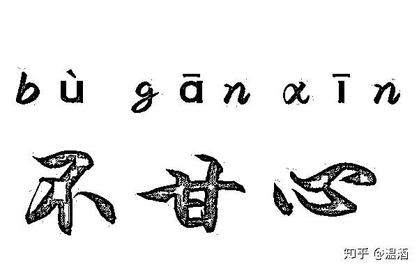

  

  

这个世界最残酷的一点在于：

对于成功，不甘心只能徒增痛苦，实际上没有一点卵用。

就比如各位宣扬民族情绪，

说欧洲人日子好过是因为他们祖上当海盗当八国联军抢了我们的原因，

对实际的“生活水平”毫无乱用一样。

说句大逆不道的话：

欧洲人美国人的日子并没有你们想象中那么好过，他们祖上抢劫来的早就被吃光了。

现在看上去日子相对比较好过，是因为人少。

尤其是 2019 年了，

相对于东亚的一些发达地区，

欧美人的日子并不是他们“甘心”而东亚人“不甘心”的理由。就好像评论里有人说，给他三套房，他也和美国屌丝一下整天酷，然而实际上，美国整天酷的人一大群租房子的…

一个真相：

东亚的佛系都是嘴上说说的，哪怕是“低欲望发源地”日本的年轻人，

你知道他们竞争东大的名额是个什么嘴脸吗？

欧美人不说佛系，但实际上他们的底层才是真的佛了，只要酷就完了。

什么都不要的，酷就行了。

酷一个不够，就酷酷酷。

对于他们来说，你可以穷，但是必须酷。

**而东亚不是，东亚最大的毛病就是想当人上人的人太多了，**

**哪怕嘴里都是佛佛佛，最后还是会为了当人上人付诸实践。**

**哪怕他们付诸实践的方式很愚蠢。对东亚人来说，酷不酷无所谓，不做人上人就是元罪。**

# 知乎用户

> 作者：知乎用户
> 
> 赞同数：80
> 
> 编辑于：2019-01-31 10:38

向外移民三个亿

是个双赢的结局

# 枕水

> 作者：枕水
> 
> 赞同数：2556
> 
> 编辑于：2022-04-09 19:43

不累就死，你总得选一样。

我在网上看老外跑酷的视频，底下总会出现这种评论：外国人口少是有原因的。

精髓就在这里，你看美国，地大物博，石油天然气粮食全都自足有余还要出口，可耕种面积是中国的几倍，可居住面积是中国好几倍，并且移民条件超级宽松，还对非法移民睁一只眼闭一只眼。你能想到的几乎所有增加人口的方法全用上了，对外开源对内空间巨大。

冷知识：美国和中国的国土面积是相近的，都是九百多万平方公里。

但是一看人口，中国 14 亿，美国 3.6 亿，为什么美国这么适宜人类生存的地方人口这么少？而且美国建国也两百多年了，就算一开始人口少，几百年下来为什么不生？不光美国，同为基督教文化圈的欧洲，可耕种面积也不少，但就是一直地广人稀。与中国相比，中国建国初期 5 亿多人口，几十年时间就翻了一倍，这还是在计划生育的压制下。

因为累和死两条路，欧美人也就是基督教文化圈选择了死这条路，东亚人也就是儒家文化圈选择了累。

欧美人是不自由毋宁死。中国人捡起了好死不如赖活着，

甚至欧美人掌握科技创新制高点也跟这一点有关系，我们是只看见贼吃肉没看见贼挨打。一个创新成功的企业背后是千万家创新失败破产沦为街头流浪汉的悲惨故事。欧美人信奉的就是物竞天择，入我门下，自生自灭，优胜劣汰，能活下来是你的造化，死了是你活该，一切各凭自己本事。

用熵的思想来看，一个系统如果想要[熵减](https://www.zhihu.com/search?q=%E7%86%B5%E5%87%8F&search_source=Entity&hybrid_search_source=Entity&hybrid_search_extra=%7B%22sourceType%22%3A%22answer%22%2C%22sourceId%22%3A2399175446%7D)，要么向外寻求扩张性，把整个系统撑大了内部自然也就熵减了，欧美人在海洋殖民时代就是这么做的，要么向内寻求收缩性，系统[熵增](https://www.zhihu.com/search?q=%E7%86%B5%E5%A2%9E&search_source=Entity&hybrid_search_source=Entity&hybrid_search_extra=%7B%22sourceType%22%3A%22answer%22%2C%22sourceId%22%3A2399175446%7D)过高，那么抹杀掉一部分内部人口，熵减自然就达成了，这就是欧美人口少但不累的原因。

其他都是小事，表面上看当年欧洲人出去殖民挖了第一桶金，中国同时期却选择了封海造成与世界脱节，实际上根本不是本质原因。如果你在渔民地区呆过就知道出海是个长周期风险很大的事儿，往往一出海几个月音信皆无，会不会的来都两说。更别提当年连航线都没有的[环球航行](https://www.zhihu.com/search?q=%E7%8E%AF%E7%90%83%E8%88%AA%E8%A1%8C&search_source=Entity&hybrid_search_source=Entity&hybrid_search_extra=%7B%22sourceType%22%3A%22answer%22%2C%22sourceId%22%3A2399175446%7D)了。死在探索新航线路上的数不胜数。欧洲人当年是靠人命堆出来的全球航线。

这事在中国人看来就不靠谱，风险太大了，运气好了几辈子荣华富贵，运气差了别说下辈子，这辈子就交待了。作为一个中国人，你会怎么选？是继续承受地主官家压榨，每年积累下一点点资产，期待着几辈子之后能攒下几亩薄田，从此阶级跃升为自耕农（这是可预期的确定性非常大的路径）。还是选择出海承受 70%的死亡代价，去搏个一夜暴富，富贵险中求？

放到现在也是同样的逻辑，国内互联网公司为什么不像亚马逊微软谷歌那样拼命搞创新？像谷歌的[deepmind](https://www.zhihu.com/search?q=deepmind&search_source=Entity&hybrid_search_source=Entity&hybrid_search_extra=%7B%22sourceType%22%3A%22answer%22%2C%22sourceId%22%3A2399175446%7D)都烧了谷歌十几年的钱了。国内百度腾讯也没少赚钱为什么不投资研发？因为我能躺着挣钱为什么要冒险？除非是我活不下去了。那为什么美国人不这么想？因为人家的文化就是这样的。他们不在乎挣多少钱，冒险精神是刻在他们祖祖辈辈的基因里的。

东方文明和西方文明，现在看两者必须得死一个，如果东方文明赢了，那就是欧美人靠堆人命堆资源辛辛苦苦探的路被中国人摘了果子，就如同码农为了公司起早贪黑加班做出的东西被老板拿去赚钱一样，比如现在的很多项目都是美国人先发现的然后在中国人手里商业化，像无人机隐身机智能手机都是美国人先提出的点子，当年日本的[半导体](https://www.zhihu.com/search?q=%E5%8D%8A%E5%AF%BC%E4%BD%93&search_source=Entity&hybrid_search_source=Entity&hybrid_search_extra=%7B%22sourceType%22%3A%22answer%22%2C%22sourceId%22%3A2399175446%7D)汽车也都是这个模式。如果西方文明赢了，那就是东亚文明圈沦为欧美人的创新实验场，类似于现在的印度成为欧美药企实验药物的小白鼠，印度精英人才全都被欧美吸收。

所以，是选择辛苦的生活在确定性里，还是选择轻松的生活在危险之中，你做出自己的选择了吗？

\===========

前一段看了一点世界史，还有枪炮细菌与钢铁，我觉得是可以部分解释为什么东西方存在这样的文化差异。

原本在原始人类的发源地，人们都是依赖农业来生存的，不依赖农业的人类就无法支撑起较大的群体规模，到最后都衰亡了，这些依赖农业的国家都属于原生文明，文化上也有[农耕文明](https://www.zhihu.com/search?q=%E5%86%9C%E8%80%95%E6%96%87%E6%98%8E&search_source=Entity&hybrid_search_source=Entity&hybrid_search_extra=%7B%22sourceType%22%3A%22answer%22%2C%22sourceId%22%3A2399175446%7D)的特征，就是注重秩序，研究历法，封闭性周期性较强。古埃及和[古罗马](https://www.zhihu.com/search?q=%E5%8F%A4%E7%BD%97%E9%A9%AC&search_source=Entity&hybrid_search_source=Entity&hybrid_search_extra=%7B%22sourceType%22%3A%22answer%22%2C%22sourceId%22%3A2399175446%7D)其实都更倾向于农业文明。

古希腊古雅典则是次生性文明，虽然有耕地，但还有很大比例的海洋贸易和商人文化，这些成分则催生了偏重于冒险扩张和思辨的海洋文化。

到了封建时代，文艺复兴之前，[罗马帝国](https://www.zhihu.com/search?q=%E7%BD%97%E9%A9%AC%E5%B8%9D%E5%9B%BD&search_source=Entity&hybrid_search_source=Entity&hybrid_search_extra=%7B%22sourceType%22%3A%22answer%22%2C%22sourceId%22%3A2399175446%7D)衰亡之后，欧洲这片地方实际上还是属于农业文明，但是由于存在地中海以及土地贫瘠，北欧地区的海盗十分猖獗，产生了对应的海盗文化。海盗依托海洋不断上岸劫掠农业国，还在岸上建立自己的城市据点，有时甚至会灭掉一个国家，将海盗文化也带入了农业文明，而且欧洲这片地方交通便利，加上连年征战，又缺乏一个强有力的中央政府，因此人种早已混杂成一片，文化和人种早就换了好几茬了。在这个过程中农耕文明的成分就越来越弱，直到最后[黑死病](https://www.zhihu.com/search?q=%E9%BB%91%E6%AD%BB%E7%97%85&search_source=Entity&hybrid_search_source=Entity&hybrid_search_extra=%7B%22sourceType%22%3A%22answer%22%2C%22sourceId%22%3A2399175446%7D)直接杀死了欧洲三分之一的人口，导致农业文明彻底崩溃。农村人口死光了，原有的农业结构彻底崩溃，人口开始流入[佛罗伦萨](https://www.zhihu.com/search?q=%E4%BD%9B%E7%BD%97%E4%BC%A6%E8%90%A8&search_source=Entity&hybrid_search_source=Entity&hybrid_search_extra=%7B%22sourceType%22%3A%22answer%22%2C%22sourceId%22%3A2399175446%7D)这样的商业港口城市，形成城市文化。由商业港口城市发起的文艺复兴运动，以开拓冒险、挑战权威与秩序，崇尚自由的商业文化彻底取代了注重积累、厌恶风险、崇尚秩序的农耕文化。

\========

评论区有人反驳说日韩不累，没有中国卷，这是个无法辩论出结果的问题，持此观点的人你们高兴就好。

# 天工开物

> 作者：天工开物
> 
> 赞同数：830
> 
> 编辑于：2022-01-21 18:29

儒家覆盖圈内，价值观是雷同的。这种价值观必然导致类似的结果。

你看泰国缅甸啥的，用的不是儒教价值观，就很闲散自在。

不是批判这种价值观。它有利也有弊，但是坏处是明显的，就是每个人都无法做自己，都被整体胁迫着过一生。这个对每个具体的人来讲，很可惜。

对整体来讲，可能是有利的，人人都是工具人，自然社会发展得快，好管理，步调统一。

但是这种发展是不可持续的，只有两种结果：

1.  社会整体僵死，每个人如行尸走肉。出生率不会降，反而会高。文明停滞，价值观单一，最后被人从外部打破，参考宋明清。
2.  年轻一代越来越叛逆，出生率降低。普遍觉得人生无趣，茫然但不甘。内部会涌动一股新生的力量，冲破这种整体裹挟。社会价值观变得多元化，每个人复活。儒教价值观彻底灭亡。

在现代信息发达的社会，明显只会是第二种结果。

* * *

ps:

我说泰国闲散，是针对题目说的，意思是他们不用儒教这一套就没这么累。

不代表我喜欢泰国的制度，不代表我认为泰国制度完美，不代表我国就应该用泰国制度……

请喜欢脑补和二极管思维人士不要评论，跟你们解释，真累～可能你们的这种思维也是国人很累的原因之一吧～

# 满分激光枪

> 作者：满分激光枪
> 
> 赞同数：939
> 
> 编辑于：2021-02-18 00:29

**[内卷化](https://www.zhihu.com/search?q=%E5%86%85%E5%8D%B7%E5%8C%96&search_source=Entity&hybrid_search_source=Entity&hybrid_search_extra=%7B%22sourceType%22%3A%22answer%22%2C%22sourceId%22%3A1734992100%7D)过于严重。**

通俗点讲，内卷就是**本来大家都能轻轻松松竞争，却偏偏要累死累活的竞争。**

  

举个例子，一个班级如果大家都不太努力，那你取得好成绩是很简单的，做一个好学生也很轻松。

  

但当大家都很努力的时候，操蛋的事情就发生了，**你必须通宵备考才能考到好成绩。**

  

而内卷就是，当你通宵备考之后，别人更努力，人家吃饭都拿着一本书背、甚至边骑自行车边拿着笔记本电脑写论文、发着高烧也要背知识点。

  

本来大家都能轻轻松的，但因为“内卷”所有人却都得累死累活，但取得的成果其实没什么变化，因为争夺的本质上还是名次。

  

内卷，就是过度竞争导致的陀螺化死循环。

  

  

如果你看到这里还没懂“内卷”这个词，那我用蹦迪圈举个例子吧。

  

几年前泡女孩，你在舞池走过去买杯鸡尾酒，可能一段爱情故事就发生了。

  

现在你盘女生，你不订一张卡座那是基本不可能的，有时候你还得开[香槟王](https://www.zhihu.com/search?q=%E9%A6%99%E6%A7%9F%E7%8E%8B&search_source=Entity&hybrid_search_source=Entity&hybrid_search_extra=%7B%22sourceType%22%3A%22answer%22%2C%22sourceId%22%3A1734992100%7D)或者黑桃 A。

  

为什么呢？

  

因为其他所有男生都在开卡、开黑桃，卡上都摆了神龙套，你要是不也这么干，就竞争不过他们。

  

大家都开卡座了，这还不够，男生们继续疯狂竞争，有的人租超跑、有的人直接转账，他转 520，那个转 1314，我就转 5200.....**尤其是这几年，你在夜店泡女孩的难度越来越大了，成本也越来越高，需要付出的精力也越来越大。**

  

**内卷就是一种陀螺式的死循环，每个人都付出更多无意义的精力和成本。**

  

  

不仅仅在泡女生这件事上，**中国蹦迪圈的各个方面早就被内卷给压榨到极限了。**

  

就说女生出去蹦迪，过去女生你随便画个妆就有行情，但越来越多女生为了更好的行情，开始玻尿酸、肋骨鼻、穿的越来越少。

  

卡上的男生就开始杯杯先敬肋骨鼻，微信先加玻尿酸。

  

为了行情，女生们开始竞争，这就内卷了。女生们要行情好就去做肋骨，打玻尿酸，弄热玛吉，搞[瘦脸针](https://www.zhihu.com/search?q=%E7%98%A6%E8%84%B8%E9%92%88&search_source=Entity&hybrid_search_source=Entity&hybrid_search_extra=%7B%22sourceType%22%3A%22answer%22%2C%22sourceId%22%3A1734992100%7D)，干皮秒。

  

到后来，女生还得精心布局自己的朋友圈、装成白富美、掐着喉咙装嗲，**蹦迪蹦到越来越累，本来是去放松的，结果去蹦迪竞争比选美还激烈。**

  

  

**抛开性别，我们再说说整个蹦迪圈的内卷。**

  

以前蹦迪其实很简单，没什么套路、鱼、行情这些词。

  

我喜欢你，你喜欢我，咱们今晚一起回酒店，谁也不骗谁的，第二天早晨想谈恋爱就谈恋爱，当成一夜情的话咱们就当成一夜情。

  

**内卷之后就操蛋了：**

  

你不套路别人，别人就套路你，你不养鱼塘，别人就把你当备胎，你放弃自己的行情，人家不放弃自己的行情。

  

不套路的那个就总得吃亏，白热化的竞争导致大家全都越来越套路了，**每个人都怕自己吃亏、怕自己被渣、怕自己爱情不够甜美，恨不得养十几条鱼，多套路七八个异性。**

  

这几年蹦迪圈内卷下来的结果就是，**你蹦个迪用的脑子，比中情局卧底去酒局刺杀政要动的都多，真的太累了。**

  

上面我写的内卷也仅仅是玩家层面的内卷，**夜店、酒吧的内卷就更严重了。**

  

  

过去开夜店哪里像今天这样啊，现在哪家夜店开业不宣布自己投资上亿都不好意思。

  

中国各大夜店就是今天我投资一个亿，明天他投资八千万；你弄三千个激光灯？我就干五千个激光灯；你请两百个销售，我就挖五百个销售；你搞十个美女股东，我搞一百个美女股东；你请百大小马丁，那我就花钱请烟鬼。

  

**整个一个神仙打架，混乱烧钱。**

  

开个夜店成本越来越贵，**就连运营夜店的成本也能随随便便让一位大老板吃不下饭。**

  

但各大夜店都这么拼，利润反而比几年前没有上亿大投资的时候更多了，**夜店投资人、管理层活的更累了。**

  

  

再说夜店销售的内卷，刚开始夜店销售的工作很简单，就是帮忙订个卡座，跟客人喝喝酒，维护下关系就行了。

  

结果到现在，销售还必须给客人叫妞，你叫不到女孩就没人找你订卡，不光给给客人叫妞，你还得送酒，你还得请客人吃夜宵。

  

现在许多销售为了更大的竞争优势，连“反点”都得全都给客人，**有的销售甚至惨到要自己组局、自己跟客人 A 卡。**

  

**因为行业内过度竞争导致的内卷，当夜店销售都越来越累了。**

  

  

再说说 DJ 行业，过去 DJ 需要专注的只有音乐水平，打 Bass 就专注 Bass，打 Techno 就专注 Techno。

  

现在不行了，DJ 还得在台上跳舞，还得运营自己的抖音，还得给各个排行榜充钱，还得陪夜店的音乐总监喝酒，有的 Techno DJ 接不到演出甚至为了生活得跑去喊着大大大打 Bounce。

  

没办法，**DJ 行业的内卷太过于严重。**

  

  

所以你会发现，整个中国蹦迪圈的内卷都过于严重。

  

由于盲目的竞争，从玩家到夜店，都被压榨的一干二净，**进入了一种陀螺式的死循环，大家都越来越累，成本越来越高，还玩的没以前那样开心。**

  

**整个中国蹦迪圈都已经快被内卷化卷哭了。**

  

**那你问，内卷化有解决方法吗？**

  

**其实有的。**

  

  

有位经济学家，叫做[约翰纳什](https://www.zhihu.com/search?q=%E7%BA%A6%E7%BF%B0%E7%BA%B3%E4%BB%80&search_source=Entity&hybrid_search_source=Entity&hybrid_search_extra=%7B%22sourceType%22%3A%22answer%22%2C%22sourceId%22%3A1734992100%7D)，一部著名电影《[美丽心灵](https://www.zhihu.com/search?q=%E7%BE%8E%E4%B8%BD%E5%BF%83%E7%81%B5&search_source=Entity&hybrid_search_source=Entity&hybrid_search_extra=%7B%22sourceType%22%3A%22article%22%2C%22sourceId%22%3A332779410%7D)》拍的就是他的经历。

  

电影里有一个桥段，约翰在[普林斯顿](https://www.zhihu.com/search?q=%E6%99%AE%E6%9E%97%E6%96%AF%E9%A1%BF&search_source=Entity&hybrid_search_source=Entity&hybrid_search_extra=%7B%22sourceType%22%3A%22article%22%2C%22sourceId%22%3A332779410%7D)上学的时候，和三个同学一起去夜店蹦迪。

  

这个时候进来了一位漂亮女生跟她的闺蜜们，于是约翰和他的三位同学就在思考如何去泡这个漂亮女孩。

  

**博弈论中最著名的一个理论，“**[纳什均衡](https://www.zhihu.com/search?q=%E7%BA%B3%E4%BB%80%E5%9D%87%E8%A1%A1&search_source=Entity&hybrid_search_source=Entity&hybrid_search_extra=%7B%22sourceType%22%3A%22article%22%2C%22sourceId%22%3A332779410%7D)**”的灵感就来自于此。**

  

约翰纳什说：如果他们四个人全部都去搭讪那个漂亮女孩，那个漂亮女孩一定会摆足架子，对谁都不理不睬。

  

泡不泡得到不谈，但泡到的难度和成本一定会增加很多。

  

而且当他们被漂亮女孩拒绝了，再去泡漂亮女孩的闺蜜，她闺蜜也不会理他们的，因为没有一个女人愿意当次品、备胎。

  

  

但如果他们先去泡美女的闺蜜，最次的情况也是闺蜜被泡到。

  

而漂亮的女生也会感觉到“被孤立”，这个时候泡她也就会容易许多。

  

解决蹦迪圈的内卷化，唯有靠博弈论里，自愿放弃竞争，实现团体的最大效益。

  

不过很可惜的是，这在蹦迪圈行不通。

  

因为蹦迪圈并不是一个沟通密切的整体，**你自己放弃竞争对内卷化不会有丝毫改变，只能让你自己盘不到女生、订不到卡座、被渣。**

  

说来也很真实。

  

你不蹦迪的时候，上班内卷人人加班 996；读书内卷人人通宵做五三；就连你是富二代，继承家产，都得跟别的富二代比，不然你老爸得数落你学历，骂你败家子，**你也逃不过内卷。**

  

白天你已经被内卷卷哭了，**你说我去蹦个迪，放松一下，到了夜店才发现这边内卷更严重。**

  

**你能咋办呢？**

  

**那也只能硬着头皮卷下去了。**

  

  

  

  

很高兴认识你，我是[tututu](https://www.zhihu.com/search?q=tututu&search_source=Entity&hybrid_search_source=Entity&hybrid_search_extra=%7B%22sourceType%22%3A%22answer%22%2C%22sourceId%22%3A1734992100%7D)、一个从衡中考到上财之后不务正业的蹦迪博主，并莫名其妙写着写着就成了中国最大的蹦迪公众号，如果你想看更多有趣的蹦迪文章，请关注公众号 满分激光枪

# 知乎用户

> 作者：知乎用户
> 
> 赞同数：240
> 
> 编辑于：2022-03-12 08:00

深层次原因可以用几个字概括：高度[世俗化](https://www.zhihu.com/search?q=%E4%B8%96%E4%BF%97%E5%8C%96&search_source=Entity&hybrid_search_source=Entity&hybrid_search_extra=%7B%22sourceType%22%3A%22answer%22%2C%22sourceId%22%3A2381689506%7D)，所谓子不语怪力乱神。东亚是全世界世俗化最早，程度最高的地区。世俗化的结果，就是人们放弃了任何“不切实际”的理想追求，只能从人与人的关系上获取生存发展的动力，而且喜欢鼓吹人定胜天的“正能量”。久而久之，就会陷入内卷，底层互害这样的恶性循环。很多人厌恶托人情，拉关系这套东西，但这些其实是紧张的社会压力下的舒缓剂。东亚是最以人为本的社会，但很多人却恰恰过不好自己的一生。

西方世界就不一样，理性科学的先驱古希腊人就很尊奉神明，因为神是至善至美的化身，是人类理想的寄托。以后的基督教更强化了这点，还引入了原罪和救赎的概念，文艺复兴后，宗教信仰和教义衍生成了法律，科学定律，社会契约等等，这些都是脱离人自身的东西。用马克思的话来说，就是[客观唯心主义](https://www.zhihu.com/search?q=%E5%AE%A2%E8%A7%82%E5%94%AF%E5%BF%83%E4%B8%BB%E4%B9%89&search_source=Entity&hybrid_search_source=Entity&hybrid_search_extra=%7B%22sourceType%22%3A%22answer%22%2C%22sourceId%22%3A2381689506%7D)，而这个在中国只存在于道家和佛家的某些理念中，比如“从道不从君”，二者都不积极入世，也从未成为主流。

# 垃圾砖家

> 作者：垃圾砖家
> 
> 赞同数：605
> 
> 编辑于：2022-03-19 02:16

昨晚我做了一个噩梦，梦到当年的小学同桌混的比我好，在更厉害的名校读书。梦里我有很深的挫败感。但醒来才知道很荒谬，因为同桌虽然当年成绩比我好一点，但因为他的父亲是做生意的，高中没毕业就去做五金生意了。（想到这段，我舒了一口气，然后紧接着有一种羞耻感）

这让我回想起我们的“中国式跑道”，或者从小被植入的“中国式成功”思想。

**1）读书的时候**

要排名，要比同学考分高。哪怕做个[填空题](https://www.zhihu.com/search?q=%E5%A1%AB%E7%A9%BA%E9%A2%98&search_source=Entity&hybrid_search_source=Entity&hybrid_search_extra=%7B%22sourceType%22%3A%22answer%22%2C%22sourceId%22%3A2331636698%7D)，还要让没错的同学站起来，错一个的站起来，最后**错的最多的站起来，全班回头凝视羞辱一下**。。

读大学了，大家要调侃 A 的专业水，B 的专业难还天坑，C 的专业直接行业没了。。

各种水硕，双非，985，某[大洋洲](https://www.zhihu.com/search?q=%E5%A4%A7%E6%B4%8B%E6%B4%B2&search_source=Entity&hybrid_search_source=Entity&hybrid_search_extra=%7B%22sourceType%22%3A%22answer%22%2C%22sourceId%22%3A2331636698%7D)留学生等等鄙视链。。

**2）工作了**

**大家要比收入**，没人关心你工作是否 996，是否健康，是否体面有自己的生活，是否过得开心，都去过哪里旅行。大家只关心你赚多少钱，买不买得起豪车，大房子，这时候父母又要攀比一番。

**3）生了孩子**

甚至还有父母**暗喜**抱了“带把儿的”孙子，隔壁老张虽然儿子比咱优秀，“压着”我们十几年，但是生了个孙女，仿佛**一生之敌终于有了定论**。。

**中国式父母**经常把自己“活得累”为荣，像我父母就会说“妈这么累还不是为了你啊？”。“爸退休了还返聘，还不是为了让你的装修钱？”。“我在家闲着没事做，心里就发慌啊”。好像**一颗螺丝丁，哪天没被当成工具敲打几下，就感觉自己没有价值了**。。不知道大家作为子女听到这种话是否能真的开心。。反正我听了是很不舒服，也不希望他们那么辛苦，但是我知道，他们如果不继续“累”，他们可能真的找不到生活的意义。某种程度上这是**螺丝钉的悲剧。**

我们的教育，原本应该是**大家各有各的跑道**，爱画画的去学美术，喜欢美食的去学习烹饪。但实际上所有亲戚朋友在你有任何这样的想法之前，都会把你推向唯一的跑道：“高考理科”。如果理科实在学不来，再去学文科（当然也有人确实只对文科感兴趣的）。如果文科都学不来，那才允许你去学“艺术”。我高中当时就是**劝年级后 100 名进入美术班**，从高二开始每天疯狂画画。。我们教育从来只教我们如何成功，但不管如何面对失败，不关心 90%的人如何面对的平凡的一生。而且我也不知道什么时候我们大脑里都被植入了一个思想：**“劳动光荣”**。其实我想来想去，想不清劳动光荣的逻辑在哪里。。**大家觉得劳动真的光荣吗？**

我说这些，并不是想抨击别人，因为我从梦中醒来，看到的是**内心深处依然在攀比的，狭隘的自己**。即便我飞到了地球的另一端生活，即便我不断提醒自己不要“中国式”成功。这种基因已经植入，无法删除。但也许也不用过于悲观，这种“东亚卷王”的基因让华人在世界各地都受老板喜欢，做生意也经常干翻本地人。只是大家如果哪天真的很累，很不开心，很不喜欢自己的工作生活状态，可以思考一下，自己**有没有被一些无关的“value”裹挟，走上了不属于自己的人生？**

看到这估计有人等我说根本原因，想说我们**资源少，不累没办法生存**。这种说法有一点道理，但是反例也很多。我跟课题组各国的同学聊过，诸如东南亚，巴西，古巴附近的一些岛国**，比中国穷，但生活得都比中国人轻松，开心**。

# 深具世界眼光

> 作者：深具世界眼光
> 
> 赞同数：82
> 
> 编辑于：2019-03-03 11:08

♦

有两个事实需要明确：

●【日韩是在有欧美和中国的双重补贴下仍旧活得这么累的】

●【欧美的轻松是靠着全球包括中国的供养而得的】

♦

（东亚人累原因无外乎）人多，底子薄，发展瓶颈，攀比型价值观……

————

【累和轻松是相对的。当我们看东亚人为什么累的时候，需要看这个地球上谁是活的轻松的？】

就像问穷人为什么那么累的时候？我们也需要问那么是谁占据了轻松？

（我认为不一定就是那些最上层，更应该注意到的是那些中层的“机会套利群体”）

  

一般认为轻松的就欧美加澳这些吧，[亚非拉](https://www.zhihu.com/search?q=%E4%BA%9A%E9%9D%9E%E6%8B%89&search_source=Entity&hybrid_search_source=Entity&hybrid_search_extra=%7B%22sourceType%22%3A%22answer%22%2C%22sourceId%22%3A609567160%7D)那种得过且过不知道你们算不算做轻松，这里暂且不算吧，即使那是轻松，可能也不是你想要的轻松。

而欧美为什么那么轻松，

有殖民历史。

人口密度相对合理。

发展时间更久，底子厚。

处在全球食物链顶端。

【有跨国公司像八爪章鱼一样吸食全球的供养】

  

反正无外乎这些原因。

那东亚为什么累就是反过来的。

我觉得文化什么的其实只是次要的原因。

就像那些累的要自杀的人，不也不在乎传宗接代这种家庭重担吗？

  

世界上不可能所有人都轻松。

中国人要想轻松必须让欧美人累起来，同时不能因为同情日韩而补贴日韩。

  

当然日韩累，有美国军事阉割，美国资本收割果实的原因在里面，所以我们中国也要避免【替别人打工】的这一点！

——

再进一步阐述一下，最轻松的也不一定就美国，就像不一定是马云或谁，而应该是依附美国的那些欧洲高福利国家，就像可能是局子里喝茶看报的公务员或谁……我称他们为“中层的机会套利群体”。

——

忽然觉得其实日韩已经算是相对轻松的了，因为他们也属于我所说的“中层机会套利群体”。

就像有那么多国人还是愿意移居日本、移居韩国。按理说如果中国比日韩更轻松，为什么他们还要这么选择呢？

【另外日韩“这么累”的还有一个原因是：日韩传媒尤其个人传媒的发达，各种抱怨啊会通过社交媒体发酵啊，我们还可以知道。而假如是一个甚至一群人亚非拉的人累死了，我们可能都不知道】

  

另外支持中国企业和品牌，是尤为重要的。

“我们现在的轻松”其实还是建立在农村人或谁的牺牲基础之上。像日韩那样的人口，我们只有 5 亿或 8 亿，而不是 14 亿。

等真正 14 亿都是城市人，都这样现代化了，那才是真正开始累的时候。

日韩那些累的新闻，大部分无外乎就是无名公司的职员，甚至是著名公司的。为什么他们更累？因为日韩公司在跟欧美公司竞争的时候处于劣势，但他们比中国公司还是优势。

我们是怎么累的？就是那些无名公司打鸡血、互扇耳光……这些或者名企过劳死。

但其实应该名企的人还是比无名企业的人要来的更轻松一些。

支持自己的企业和品牌可以使中国公司在竞争中获得优势，然后就会不仅惠及这些企业的职员，而且会惠及国家经济，然后其他国民也会在此基础上有更好的福利。

  

所以解决方案，我说过很多次了：【更多支持中国企业和品牌 可以让我们不那么累一点】

# 叶落风逝 yzm

> 作者：叶落风逝 yzm
> 
> 赞同数：74
> 
> 编辑于：2019-02-02 09:39

东亚的经济、政治、文化进攻性太差，累是累在内部矛盾太大上了。

欧美则不然，内部有矛盾？抢外面的就好咯。

# AAAAA

> 作者：AAAAA
> 
> 赞同数：44
> 
> 编辑于：2019-10-29 17:48

那是因为一些发达国家已经没有累的资格了。

他们之前也是很累的，是 70 年代后开始轻松，然后到了现在是最轻松的时候。

大部分还算完整而且不算很弱的国家，都是这么个过程。

  

这不是因为这些人“学会了享受”，而是“内部矛盾激烈，只要参与到矛盾中去当个卫兵，自己就能吃喝”。

但是这些人如果蠢到“我还多要一点”，那么他们就会惊讶地发现自己多赚的大部分都被收上去交给了卫兵。

  

这种过程是一个不算弱的主权国家的回光返照

内卷化冲突全面爆发以前，大家都会把自己最后仅存的直接利益分下去，扩充自己的内部实力，希望能够在后来的战斗中能够多得到一些什么。

但是在这个过程中，最后那一点点资源也耗尽了（不是指矿产之类的资源，而是广义的）。

  

不过不要担心，我们以后大概率也是会这么死的。

  

不过需要注意的是：这个轻松可不是指所有人都轻松。

而是越来越多的人没事干但只要闹事就有饭吃，而少部分过的比较好的人才是“轻松”。

因为扩张与管理的需求已经消失了，一半以上的工作再也没有必要做了，这些都已经没有意义了。

# Mr.Worldwide

> 作者：Mr.Worldwide
> 
> 赞同数：72
> 
> 编辑于：2020-01-19 11:59

我尊重这个问题里所有答主的观点，但我要提出不同意见。

先借用一段话，来自我深深敬佩的心理学大师：武志红老师，他在一篇文章《[生命为何脆弱](https://www.zhihu.com/search?q=%E7%94%9F%E5%91%BD%E4%B8%BA%E4%BD%95%E8%84%86%E5%BC%B1&search_source=Entity&hybrid_search_source=Entity&hybrid_search_extra=%7B%22sourceType%22%3A%22answer%22%2C%22sourceId%22%3A936851370%7D)》里这样写：

> **日本、韩国和中国都是自杀大国，自杀率几乎三倍于欧美，而日本和韩国的自杀率几乎是世界之冠。在我看来，其原因是因为，我们这三个国家的文化渊源是一样的，我们都在美化顺从，我们都在诱惑、鼓励和强迫人丧失自我。** 

这段话里的每个字，我都举起双手双脚同意。

在这个逼迫至上的环境里，活得累很奇怪？工作压力和工作时长都是全球之最不正常？

**努力工作，长期泡在公司，就可以远离这种畸形的家族文化，还可以挣钱，何乐而不为？**

反正，我一直身体力行。

当初被原生家族（我没写错，就是家族不是家庭）各种逼迫，无解，努力工作；和前妻过不好，各种撕怼，无解，努力工作。最极端的例子是闹离婚时，我可以从每天早上八点忙到夜里十二点半，在星巴克给学生上课，在机构给学生上课，去学生家里给他们上课。

**一想到不用回家（如果还叫家的话），还可以挣更多钱，我就兴奋不已。**

总之，我就愿意承受这么大的压力，就愿意工作这么长。虽然后来离婚了，虽然现在和爸妈逐渐修复关系。但是，没人可以阻止我 996 甚至 247。

**归根结底，太多的东亚人不相信情了，只相信钱。钱哪有那么好挣？累是必然的。**

但是，我觉得这样挺好，因为：钱是最好的亲人、友人和爱人。

# 明玉珍

> 作者：明玉珍
> 
> 赞同数：73
> 
> 编辑于：2019-02-02 18:04

说个可能被很多人喷的原因吧，可能是因为没有被知乎上人人喷的“[白左](https://www.zhihu.com/search?q=%E7%99%BD%E5%B7%A6&search_source=Entity&hybrid_search_source=Entity&hybrid_search_extra=%7B%22sourceType%22%3A%22answer%22%2C%22sourceId%22%3A588101980%7D)”。换句话说，是“多元化的价值观和评价方式”。

人的幸福感可能一少半是由物质条件决定的，而且这些决定因素往往只限于“温饱”——

饿得跟 SB 一样的时候，就是一口包子/大饼决定了这时候特别幸福。

然而高于“温饱”条件，物质条件提升 20%，50%，80%，100%，还有那么重要吗？比如你吃五个大饼吃饱了，第 6、7、8 个大饼，大饼管够，那幸福感并不会提高。

这时候人就显出社会动物的一面了——幸福感要和别人比较。如果这个比较的维度很小，比如说只有钱——月入百万的知乎均线就是比月入十万的牛逼，月入十万的就是比月入一万的牛逼。这个维度非常刚性的在这里。你一醒来，发现比你强（赚钱多）的人有五亿三千六百万，乌央乌央的在前头，赶紧要追上；比你少的有九亿人，你得赶紧跑不能被后面的人追上——赛道就一条，能不焦虑吗？每天起床就往前跑，生怕少跑一秒被人追上，甚至觉都不睡了，半夜起来跑步，少睡一小时就有一小时的优势。这时候活得能不累吗？

而很多人在北欧的答主说北欧压力小、人生规划丰富多彩、想干什么就干什么。这其实和最为浓郁的“白左”风气分不开。我们试想一下，要让比赛中一条赛道上的人压力减小，会用什么方法呢？

可能这么几个措施是有效的：

1、多开几条赛道，各个赛道之间互相谁也看不见谁。最好每个人单独一条赛道。如果一条赛道上三个人，比如你给自己设定的目标是“成为世界上前十的[虾虎鱼](https://www.zhihu.com/search?q=%E8%99%BE%E8%99%8E%E9%B1%BC&search_source=Entity&hybrid_search_source=Entity&hybrid_search_extra=%7B%22sourceType%22%3A%22answer%22%2C%22sourceId%22%3A588101980%7D)研究者”，那这个目标的难度就比“成为世界上最有钱的 top10”容易多了，毕竟 95%以上的人不知道虾虎鱼是什么。——这就是“每个人都有自己的追求”“人生只有一种成功，就是达到自己定的目标”“你最大的对手是你自己”这样的多元化（鸡汤）思维；

2、所有赛道的第一名都是第一。这样尽量让跑各个赛道的人平均开。如果开了几百条赛道，但只有“主竞赛单元”赛道的人有名次，那么人们还是都集中在“主竞赛单元”里了 。这种条件下，你就不能指责伊斯兰文明四个老婆、美国黑人喜欢约炮抽大麻了——这些都是他们的文化，都值得尊重。在黑人街头文化里面蹲号子蹲得最久的人（这条赛道上第一名）也应该值得跟白人选区里议员（这条赛道上第一名）得到同样的尊重。

3、你只能看到你前后左右 10 个人。“我不过是比 XXX 差嘛，后面还有五个”，这样的心态也可以不累。但是现在互联网发展，你不想看前面五一三千八百万人，也会有新闻、今日头条、抖音、微博、知乎……非让你看到不可。这条路是以前的“老路”，现在走不了了。

然后我们就发现，如果你为了减压选择了多元文化赛道，就得接受多元文化的一切。有一种反驳意见是这样：“我们说多元文化，是说一个人可以踢球、可以搞科研、可以从政、可以从商，可以玩音乐，但是没说可以吸毒、可以乱交、可以赌博啊”。可是，如果我们有什么标准判断可以做什么不可以做什么，这个标准不就成了“单一文化”了吗？并没有起到多元文化的效果啊。另一方面，如果说多元化只有前者的多元化，本质上还是强者制定规则、得到收益，而社会上确实是存在一部分人，他们无论做什么都做不好，这样的“多元化”仍然没有减轻他们的压力——或者这样的社会就类似日本？——因此没有完成“减压”的任务，人还是活得很累。

如果要高速发展、要朝“钱”这个单一维度看，那代价就是活得累。因为你每一个动作，都在“钱”这一个维度有回报（也可能没有回报，但这样更累）。而东亚社会目前普遍是这样的价值观，没有接受多元化，因此“累”是自然的。相反，如果想不活得那么累，要接触“[多元化](https://www.zhihu.com/search?q=%E5%A4%9A%E5%85%83%E5%8C%96&search_source=Entity&hybrid_search_source=Entity&hybrid_search_extra=%7B%22sourceType%22%3A%22answer%22%2C%22sourceId%22%3A588101980%7D)”思想，那么一定程度的混乱、一部分人“不思进取、自甘堕落”也会是应有之意。但是目前东亚社会对“不思进取、自甘堕落”的厌恶感甚至比压力还要大——这让人怎么说呢？

没有任何东西是完美的吧。

# allen 的管理笔记

> 作者：allen 的管理笔记
> 
> 赞同数：105
> 
> 编辑于：2019-02-22 17:18

**很多答案都是边边角角找点理由**

**核心的原因是：**

**第一是东亚几乎所有的企业，都还在全球产业链的中间层**

一流企业控制标准，电信石油电力科技等等，几乎所有行业的标准都是欧美制定的，东亚国家控制了几个？

一流企业有核心科技，就按照科技业来说，几乎所有的核心技术都是欧美国家垄断的，离开高通英特尔，东亚芯片业玩不转，离开辉瑞孟山都，全球医药种子等产业玩不转

一流企业自己决定自己的的命运，台湾之光台积电、韩国之光三星、看看欧美资本比例有多少？他们的分红比例有多少？台积电每年给美国爸爸的分红，比台积电所有员工工资还高一倍呢。这些企业对于自己的命运的控制能力，远远低于阿里巴巴的合伙人水平。

**第二是东亚几乎所有的国家，都还在全球政治体系的中间层**

东亚再发达的国家，地位也就比[亚非拉](https://www.zhihu.com/search?q=%E4%BA%9A%E9%9D%9E%E6%8B%89&search_source=Entity&hybrid_search_source=Entity&hybrid_search_extra=%7B%22sourceType%22%3A%22answer%22%2C%22sourceId%22%3A605526355%7D)好过点，这个世界五百年来，还是欧美是话事人

全球贸易体系是欧美制定的游戏规则，对我有利就全球化，对我不利就贸易制裁

全球大宗物资的定价权在欧美，石油粮食牛奶肉制品的全球价格，哪个亚洲国家说了算

全球储备货币是欧美国家货币，不管是日元韩元还是泰铢，一个美国资本家过来就能洗劫你

全球军事力量能够控制世界的能力在欧美，对外干涉的能力在欧美。英法海军不如[韩日](https://www.zhihu.com/search?q=%E9%9F%A9%E6%97%A5&search_source=Entity&hybrid_search_source=Entity&hybrid_search_extra=%7B%22sourceType%22%3A%22answer%22%2C%22sourceId%22%3A605526355%7D)，但是人家能吊打黑叔叔和拉美哥们，谁敢侵害的利益我就扁谁，韩日行不行？玩玩连菲律宾都不敢惹，我们海外利益还是太少了

**所以，自然你只能辛辛苦苦过紧巴巴的日子，让你舒服了，欧美怎么办？**

**为什么奥巴马种族歧视，说我们过上还日子全世界受不了**

**因为我们一旦掌握全球规则和高科技标准，欧美的好日子就彻底过去了**

**到时候，韩日台这些国家，日子还会好过点，因为他们绝对竞争得过欧美的中端产业**

**东亚人民的好日子，希望在中国**

**中国的关键，是我们一方面点亮科技树成为高科技老大，一方面在于我们航母足够多改变现在总体对欧美有利的国家政治格局。**

**从这点上说，只要美国对韩日控制力降低，中日韩自由市场是最好的选择。**

# 如月千早

> 作者：如月千早
> 
> 赞同数：20
> 
> 编辑于：2019-07-02 04:29

欧洲和北美依靠先期进入现代社会的优势，可以通过压榨亚非拉的资源来供养他们的生活，所以他们活的不累。

而中国人，乃至东亚三国的普通百姓疯狂挣扎，只是为了活着而已。日本的[社畜](https://www.zhihu.com/search?q=%E7%A4%BE%E7%95%9C&search_source=Entity&hybrid_search_source=Entity&hybrid_search_extra=%7B%22sourceType%22%3A%22answer%22%2C%22sourceId%22%3A734593994%7D)的脸被老板按到火锅里都不敢反抗，为什么？因为反抗＝丢工作（日本跳槽极端困难）＝没饭吃＝死。中国的血汗工厂，每天流水线工作 12 小时，一个月只休三天，月薪只有 1500-2500，照样一大堆人抢着干，为什么？因为不干＝没工作＝没饭吃＝死。可以说，东亚人尤其是中国人的生活（日本韩国再怎么说也算发达国家，情况还稍微好些），时时刻刻都挂着一个“死”字。

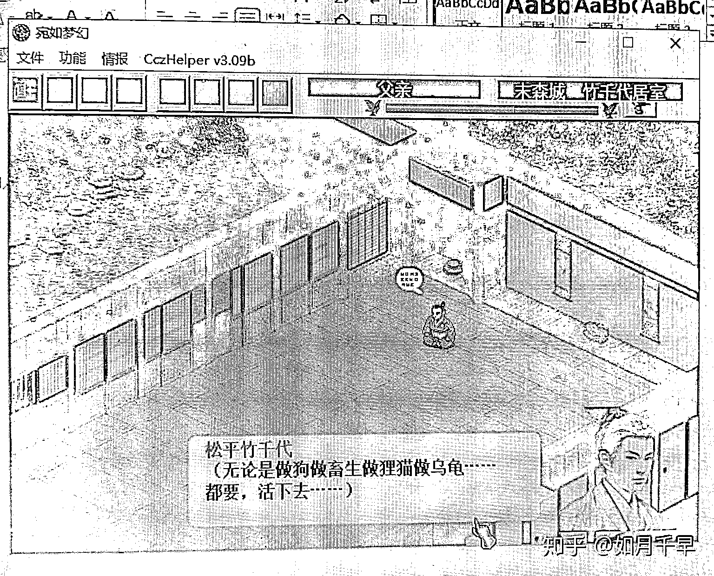

而美国的底层人口就算毫无学历，干收银员这类的工作，一年下来最少也有 1-2 万美元，靠着 1 美元的廉价劣质汉堡和几十美分的肥宅快乐水，虽然生活质量差，但是好歹能活。欧洲一些自带福利的国家，就更不用说了，每天象征性工作几个小时就足以养活自己。这些优势不是凭空得来的，而是靠着几百年前通过掠夺抢劫得来的资本原始积累并维持下去而取得的先发优势，而且并不是所有国家都能维持住这种优势，有些国家在后续发展中开始逐渐落后（比如西班牙、[葡萄牙](https://www.zhihu.com/search?q=%E8%91%A1%E8%90%84%E7%89%99&search_source=Entity&hybrid_search_source=Entity&hybrid_search_extra=%7B%22sourceType%22%3A%22answer%22%2C%22sourceId%22%3A734593994%7D)等）

# sinte

> 作者：sinte
> 
> 赞同数：88
> 
> 编辑于：2022-07-19 06:37

你不能说是东亚...

中国、日本、韩国整体上都是极致的资源消耗下的产物。

这三个国家都在不约而同的消耗未来的资源，这笔账是要算在现在每个人头上的。

美国也在消耗未来的资源，但美国有个例外，它不仅能消耗未来的资源，它也能同时剥削全球现有的资源。

而中、日、韩没得选。

造成这种局面的原因有很多，比如 08 年全球金融危机的时候，中国为什么会没事？

中国是在用未来的资本抵消现在的风险。

把过热的泡沫赶到房地产中去，以此来应对每一次资本涌动的危机。

房价一涨，再想下来却很难，而且会直接或间接带动周边物价。

租房的人租房费用必然会随着房价上涨也跟着涨。

这其中还包括水电费。

但你的工资，却是市场定的。

跟房价多少没有关系。

你之所以会感觉到累，有一半来源于房子直接或间接带给你的压迫感。

还有就是中国的就业形势，注定了中国的教育必须要极致消耗，因为中国的高端就业机会就那么点，不可能让每个受教育的人都能挤上去。

还有就是有的岗位要求的智商确实是普通人达不到的，哪怕你就是拼死了去念书，你也不可能到科研机构里去。

像是现在炙手可热的程序员，这种岗位要求的知识储备和你在高中拼了命学习的可以说是完全没有关系。

就算你有幸到了大学专门学这门课，其辛苦程度并不亚于你高中三年时期的拼命备考。

但巧就巧在，所有你可见到的程序员，不管是什么大厂的员工，他们的应聘要求准则都是 985、211。

并不是说这门行业需要用到那么多知识，它只需要你精通程序员应该精通的，并不需要那么多知识，但是，这门行业，岗位就那么多，即使是有缺口，985、211 的人才也会补上那个缺口。

而野路子出家的人又没有受到过系统性的指导，做出来的程序界面丑的出奇的我也看过...

他们应该如此吗？并不是...

他们只是缺少了系统性的指导，而这种系统性的指导你只能在 985、211 学到。

并不是说其他双非就不好，而是大厂在有这类学校毕业的[应届生](https://www.zhihu.com/search?q=%E5%BA%94%E5%B1%8A%E7%94%9F&search_source=Entity&hybrid_search_source=Entity&hybrid_search_extra=%7B%22sourceType%22%3A%22answer%22%2C%22sourceId%22%3A2526426862%7D)时就永远不会录取双非学校的人，除非你对这一行实在是熟能生巧炉火纯青。

这是教育资源的不公，也是教育行业的畸形...

以至于造成高精尖行业人才短缺...

再来看看考公人数，即使是知道人数一直在上升，但是公务员可是铁饭碗，他并不是程序员那样的青春饭，这门行业你可以一直吃到死的，还不用担心失业。

可...国家政务体系需要的人和需要的位置就那么多...挤上来的人却多到可以再管一个空白的国家。。

因此你也必须和他们竞争消耗。

而考研人数的剧增，就代表了留给应届大学生的岗位，已经饱和了...

你不得不承认，但他就是饱和了...

现在国家尚有的缺口就是高尖人才，比如科研、技术...

但是科研...是和普通人没有关系的...

科研只和你的智商有关系，和你所匹配的知识并没有太大关系，科大少年班里的人，大多都是从初中就直接跳过去的，普通人想都不要想。

而技术...巧了...恰好是中国教育体系的畸形，导致社会大众并不喜欢技术，再加上国内技工蓝领累得要死...工资还要看什么时候能突破西方科技垄断...

可以说是个死局...

科研上去了...并且成功突破了技术封锁，产业成功转型，技术人员的待遇才会跟着有所改善...

（只有突破了技术封锁，中国低端产业成功转型，能够与西方科技比肩甚至超过，中国工厂的商品在全球能够形成高端产业的竞争力，你的待遇才会提高）

吃香的比如说零散技工，负责修水管的、接电线的...开挖机的...工作并不稳定...尽管接到一单酬劳可观，但你不能保证天天能接到活...

所以也并不是很吃香...（它并不是铁饭碗）

（你时时刻刻都得灵活就业）

（还得和同行比价竞争来压低自己的酬劳）

所以你现在明白中国人为什么累了吧？

再来看看日本...

日本有个好处是他们的高端产业发达，普通工厂流水线的工人的工资很高，但很不幸的是...

与日本同样处于高端产业链的国家也有很多，其中的大头就是美国，这个国家是被美国活生生阉割过的...

尽管它的高端产业发达，但是产业链却被美国活生生砍断了好几道...而且他们人口也多...人口老龄化也很严重...

在 90 年代[金融危机](https://www.zhihu.com/search?q=%E9%87%91%E8%9E%8D%E5%8D%B1%E6%9C%BA&search_source=Entity&hybrid_search_source=Entity&hybrid_search_extra=%7B%22sourceType%22%3A%22answer%22%2C%22sourceId%22%3A2526426862%7D)之前，日本泡沫还没形成之前，日本的高端产业是销往全球的，那个时期的日本...可说是亚洲幸福指数独一档。

可为什么会发生金融危机呢？

日本的高端产业洗刷了美国产业，以至于美国必须要阉割日本，但这么做得有个前提就是把它的企业要么买下来，要么整跨它，从日本的金融开始入手，搞烂它们的经济，再阉割买下日本的高端制造业。

本来完善的产业链，被美国直接搞成半死不活。

现在我们再看看韩国，我可以明说的是，这个国家从建国开始，所有命脉产业就掌握在美国手中...

而且这个国家的上限就到那了，要想把蛋糕做大，它首先要做的就是在美国不干涉的前提下，使他自己本国的汽车、[半导体](https://www.zhihu.com/search?q=%E5%8D%8A%E5%AF%BC%E4%BD%93&search_source=Entity&hybrid_search_source=Entity&hybrid_search_extra=%7B%22sourceType%22%3A%22answer%22%2C%22sourceId%22%3A2526426862%7D)不受美国控制...

三星的支柱产业是半导体，但命脉在美国手里...

但只靠一个支柱产业，并不能让它韩国 4000 万人口都能挤进去...

韩国的三所大学，首尔、[延世](https://www.zhihu.com/search?q=%E5%BB%B6%E4%B8%96&search_source=Entity&hybrid_search_source=Entity&hybrid_search_extra=%7B%22sourceType%22%3A%22answer%22%2C%22sourceId%22%3A2526426862%7D)、高丽是所有韩国人出生就得拼命挤进去的...如果挤不进去就代表这辈子和三星这些大厂无缘...

就如同电影《寄生虫》里所讲的那样，连一个洗碗工都有 500 个应届生挤破头去应聘的这种地步。

而现在韩国处境更不容乐观，你现在在全球半导体市场上还能看到三星的影响吗？

韩国的高端产业份额在被蚕食，日本好歹还有汽车、家电、精密仪器死撑着...

尽管家电份额也在一次次竞争中已经大幅减退，但日本的精密仪器在东亚仍旧是第一档，中国并没有...

我们的精密仪器采用的几乎都是从德国和日本这两个国家进口的，中国自己的精密仪器...并不成熟...

中国医院的仪器设备，德国的...

中国科研的仪器设备..日本的...

中国海尔、格力、这些家电用的流水线设备，也都是...德国的...

而且，这些还都是向德国和日本买的成品...

核心技术并不能买。

而日本仅仅只需要牢牢抓死精密仪器这一点，还能再回口血..

汽车、家电都离不开精密仪器。

但精密仪器能做到的事却不止是汽车和家电。

工厂流水线的机床，不管你是造表的，造电磁炉的还是造冰箱造车，全都要用到...

而国产的高端车...核心机床是从西欧国家引进的...阉割以后再给你的...（它们是老牌造车工业国了）

所以国产车在国外的市场并不能形成有效竞争力....

只要中国一天不踏入高端制造业，中国人还会一直累下去，若是踏入高端制造业，其命脉不能把握在自己手里，中国也只是半只脚踏入了发达国家，人民只是比较有钱了而已，照样还是逃不过市场的蚕食，恶性的内耗...

# 家电夏洛克

> 作者：家电夏洛克
> 
> 赞同数：80
> 
> 编辑于：2019-02-08 08:15

因为东亚是温带季风区

  

温带季风区意味着什么？四季分明，雨热同期，农时稍瞬即逝，更不用说还紧挨着太平洋这个台风最大产地，你今天没插秧明天就没法插秧，你今天没修水坝明天大水大旱你一年就全白干了。

放羊的让羊溜达一天很轻松，砍柴的一天不砍也就饿一天肚子，种地的误了农时就准备卖牛卖地卖儿女吧

而东亚偏偏种的还是[劳动量](https://www.zhihu.com/search?q=%E5%8A%B3%E5%8A%A8%E9%87%8F&search_source=Entity&hybrid_search_source=Entity&hybrid_search_extra=%7B%22sourceType%22%3A%22answer%22%2C%22sourceId%22%3A591894266%7D)需求最大的水稻！

想减掉劳动量？简单啊，吞并掉别人的地皮，剥削别人的劳动力，于是更多的人活得更累了。而无止尽追求土地与权力的人，好像也没轻松到哪去。

而且大水与大旱交替着的环境，对于水利的需求也就更大，而水利一个人是修不起来的，于是就带来了[集体主义](https://www.zhihu.com/search?q=%E9%9B%86%E4%BD%93%E4%B8%BB%E4%B9%89&search_source=Entity&hybrid_search_source=Entity&hybrid_search_extra=%7B%22sourceType%22%3A%22answer%22%2C%22sourceId%22%3A591894266%7D)，你不修也得修，你要考虑村社/宗族/国家的集体利益，再不修我绑着你去坝上。

而且东亚的北边还有个比季风还要像季风的玩意儿，叫打秋风，在与走马灯般的[游牧民族](https://www.zhihu.com/search?q=%E6%B8%B8%E7%89%A7%E6%B0%91%E6%97%8F&search_source=Entity&hybrid_search_source=Entity&hybrid_search_extra=%7B%22sourceType%22%3A%22answer%22%2C%22sourceId%22%3A591894266%7D)对抗的过程中，东亚的集体利益观念被进一步深化，顺便还导致了东亚的排外。你要是不去打游牧民族就绑着你去，再不去那我只能把你当内奸砍了。

于是惜时（当然是农业意义上的以天为单位的惜时）与集体利益，就这么根植在了东亚，而这却是很累的，毕竟你不累就没有米饭吃。

为什么东亚人活得累？因为东亚人想活。

到了工业革命后，再出于东亚作为传统农业发达地区，工业一定不能差尤其不能比外国差的斗争心或者说排外心，农业的惜时强行转化成了工业上的惜时，从以天为单位飞跃到了以分秒为单位，东亚就这样完成了工业化，东亚人也从村社中的农民飞跃成了会社里的[社畜](https://www.zhihu.com/search?q=%E7%A4%BE%E7%95%9C&search_source=Entity&hybrid_search_source=Entity&hybrid_search_extra=%7B%22sourceType%22%3A%22answer%22%2C%22sourceId%22%3A591894266%7D)。

虽然锄头变成了键盘，游牧民族变成了竞争公司，二十四节气变成了逼近的死线，但是东亚人依旧是那个不活得累就没法活的东亚人，无非更累而已，这是在诞生在[亚欧大陆](https://www.zhihu.com/search?q=%E4%BA%9A%E6%AC%A7%E5%A4%A7%E9%99%86&search_source=Entity&hybrid_search_source=Entity&hybrid_search_extra=%7B%22sourceType%22%3A%22answer%22%2C%22sourceId%22%3A591894266%7D)与太平洋之间就决定了的。

# 有问题的人

> 作者：有问题的人
> 
> 赞同数：102
> 
> 编辑于：2019-01-31 03:12

工作时间长就是自由时间低呗，财富在一定前提下上才是与勤劳挂钩，而自由只有与战争动员能力挂钩。而战争动员能力主要取决于他们所属组织的组织力，其次取决于个体的勇武。而罢工就是[工薪阶级](https://www.zhihu.com/search?q=%E5%B7%A5%E8%96%AA%E9%98%B6%E7%BA%A7&search_source=Entity&hybrid_search_source=Entity&hybrid_search_extra=%7B%22sourceType%22%3A%22answer%22%2C%22sourceId%22%3A586076684%7D)的低烈度战争。东亚人普遍是没什么工会组织的，前几年即使是台湾出现一次较大规模的罢工都是罕见的。

而西方国家自中世纪开始各行业都有各行业的协会，到现代则演变成工会。东亚是没有这样的历史的，除了日本还有想[封建领主](https://www.zhihu.com/search?q=%E5%B0%81%E5%BB%BA%E9%A2%86%E4%B8%BB&search_source=Entity&hybrid_search_source=Entity&hybrid_search_extra=%7B%22sourceType%22%3A%22answer%22%2C%22sourceId%22%3A586076684%7D)以外，大部分地区的人不过是皇帝手上的统计数据而已。并且在东亚文化里最好的也不过是要求上级体恤下级，下级忠于上集。这是一种模糊暧昧的关系，在日本这样的地方可以形成如家庭般的封建社会，所以日本在进入资本主义后仍然还是有很强的封建色彩，虽然员工在企业里受的压榨较深，但是企业也是要对员工负责到底的，不能随便开除，企业确实算是一个家庭一般的共同体，也是因为这是家庭一般的共同体，你是不能过多计较个人得失的，和家人算账是会破坏家庭关系的，实际上日本的工作时间总体在东亚相对低一些，因此日本被认为是比较社会主义的国家，因为实际上社会主义一部分就是来自于普鲁士的君主与他们臣民如同家人一般的封建主义：“资本主义把那么多人搞到社会上自寻出路无依无靠，而我们封建家庭就要照顾好所有的家庭成员，而且我们普鲁士人的荣耀与战斗力就是建立在这样团结的封建社会上，你们英国人和莱茵人搞出的资本主义是要毁灭我们民族存在的核心”，所以最早建立了社会主义的也就是普鲁士的德国，也因为这些本来是右翼的主张后来却被最激进的左派给拿出去用了，然后左派又要和封建贵族切割，所以[左右翼](https://www.zhihu.com/search?q=%E5%B7%A6%E5%8F%B3%E7%BF%BC&search_source=Entity&hybrid_search_source=Entity&hybrid_search_extra=%7B%22sourceType%22%3A%22answer%22%2C%22sourceId%22%3A586076684%7D)到现在都很混乱。但东亚的其他地方连这一层实际关系也是没有的，但是却仍旧保有这样的文化氛围，这些地方实质意义上是奴隶与奴隶主的关系，但奴隶对待奴隶主是要依旧因为这种文化观念要对待家长一样伺候，但奴隶对于奴隶主而言只不过是可以让他们跪在地上互扇耳光，35 岁就像抹布一样扔掉，出了事立刻切割，反过来奴隶主出事的则就莫名其妙的会成为忧关全体奴隶命运的事一般，就像奴隶主一死他们全要殉葬一样，为奴隶主奔走呼吁是他们的义务，尽管这种呼吁对于拯救奴隶主没什么软用，但对于确保这种单方面的奴仆关系是有用的。

但无论是不是家人还是奴仆，家长和奴隶主注定是更有主导力的，都是用一种模糊的关系去取代明确的契约关系，因为在模糊的关系中处于组织核心地位的人势必是更有力量去让作为散沙的个人臣服的，而契约是作为阶级的资本家与同样作为阶级的工人经过较量后签下的协议，用模糊暧昧的关系去取代明确规定工作薪资和工作时间的契约关系，就是通过破坏工薪阶层的组织力量，分化瓦解逐个击破这种战争上常用的手段。而东亚人嘲笑欧洲人罢工是一种价值观错落的表现，是分不清勤劳和奴役的表现，没有自由的勤劳是在大多数情况下是收获不了财富的。

而[自由权](https://www.zhihu.com/search?q=%E8%87%AA%E7%94%B1%E6%9D%83&search_source=Entity&hybrid_search_source=Entity&hybrid_search_extra=%7B%22sourceType%22%3A%22answer%22%2C%22sourceId%22%3A586076684%7D)与财产权就和生命权一样，他是上天赋予的，不是法律或什么人赋予的，就像你的生命需要武力捍卫一样，自由与财富同样需要用武力捍卫，你没有武装的组织力去捍卫上天赋予的权利，自然就会被人夺走这些权利，而只有帮你捍卫这些权利才是你的国家，如果那个国家的官方语言同时是你出生的地方的母语的民族，那么这就是你的祖国。而东亚至少 95%以上的人是没有祖国的，他们被征服的亡国奴，奴隶的待遇自然不会高。欧洲武德充沛的斯巴达人抵抗住了第一天灾，等到几年之后[马其顿](https://www.zhihu.com/search?q=%E9%A9%AC%E5%85%B6%E9%A1%BF&search_source=Entity&hybrid_search_source=Entity&hybrid_search_extra=%7B%22sourceType%22%3A%22answer%22%2C%22sourceId%22%3A586076684%7D)的崛起将其消灭，守卫了欧洲自由文明的火种。东亚武德充沛的吴越人由于上层部分精英可耻的背叛没能抵抗住第二天灾，未能撑到几年内亚自由骑士摧毁第二天灾，所以东亚自由文明火种在几千年摧残下已经彻底消逝了。

详见：

 

东亚人期望的解放并不在于东亚本身的富强，也不在于资本主义还是社会主义，并且无论资本主义还是社会主义的基础都是要求解构自身文化以建构以欧洲为中心的世界。封建主义是没什么可能，除了日本以外封建主义是两千年前的历史记忆而已。东亚人需要自由就是要破坏监狱，也就是现存的国家。这些国家并不是东亚人的祖国，而是罗马教宗垄断的上帝，正如同上帝是[人格化](https://www.zhihu.com/search?q=%E4%BA%BA%E6%A0%BC%E5%8C%96&search_source=Entity&hybrid_search_source=Entity&hybrid_search_extra=%7B%22sourceType%22%3A%22answer%22%2C%22sourceId%22%3A586076684%7D)的，东亚的国家也是人格化的（[黑塔利亚](https://www.zhihu.com/search?q=%E9%BB%91%E5%A1%94%E5%88%A9%E4%BA%9A&search_source=Entity&hybrid_search_source=Entity&hybrid_search_extra=%7B%22sourceType%22%3A%22answer%22%2C%22sourceId%22%3A586076684%7D)，纳兔算是一种代表），当上帝成为非人格化的自然神或绝对精神时欧洲才逐渐在思想上取得解放，并且完结了德国的古典哲学。在东亚摧毁这些人格化的不可质疑的国家就是打破东亚被垄断的上帝，自由的选择建构自己所认同的国家（例如琉球，[福尔摩萨](https://www.zhihu.com/search?q=%E7%A6%8F%E5%B0%94%E6%91%A9%E8%90%A8&search_source=Entity&hybrid_search_source=Entity&hybrid_search_extra=%7B%22sourceType%22%3A%22answer%22%2C%22sourceId%22%3A586076684%7D)）就是因信称义，但也不一定得是新的国家代替，也可以是真实的上帝去取代祖国这个虚假的上帝，对于有教无国的[一神教](https://www.zhihu.com/search?q=%E4%B8%80%E7%A5%9E%E6%95%99&search_source=Entity&hybrid_search_source=Entity&hybrid_search_extra=%7B%22sourceType%22%3A%22answer%22%2C%22sourceId%22%3A586076684%7D)而言，破坏 fake nation 的效果是极佳的，虽然欧洲的[宗教改革](https://www.zhihu.com/search?q=%E5%AE%97%E6%95%99%E6%94%B9%E9%9D%A9&search_source=Entity&hybrid_search_source=Entity&hybrid_search_extra=%7B%22sourceType%22%3A%22answer%22%2C%22sourceId%22%3A586076684%7D)出现了很多专制国家，但这是欧洲人确立自己民族来保护自己利益的第一步，是各国语言取代拉丁语的第一步，也是保护本民族全体公民利益的民族国家建立的第一步，东亚人基本没有迈出这一步。而在思想解放之后才会有武器的批判，在武器的批判之后自由才会到来。就如同[常凯屑](https://www.zhihu.com/search?q=%E5%B8%B8%E5%87%AF%E5%B1%91&search_source=Entity&hybrid_search_source=Entity&hybrid_search_extra=%7B%22sourceType%22%3A%22answer%22%2C%22sourceId%22%3A586076684%7D)这帮吴奸集团的毁灭为吴越重生带来了转机，只有东亚的毁灭才有东亚的解放，东亚人真正的祖国才会出现，进而东亚才可能有这些国家为了共同的经济利益而建立的东亚的共同体。

# 知乎用户

> 作者：知乎用户
> 
> 赞同数：108
> 
> 编辑于：2019-01-31 11:54

内卷严重呗。

日本、韩国、中国香港、中国台湾、中国大陆的人民，终其一生奋斗的目标，其实是把自己人比下去，竞争过其他东亚人。因为首先是人多，再一个文化本身强调教育重视发展，所以东亚国家人民普遍努力、上进、争强好胜。但是这种高于世界平均水平的努力和发展欲望，并没有与之对应的高于世界平均水平的政治地位、海外市场和在世界经济中的优势地位，简单来说，浑身是本事但没处施展。于是这种竞争力没有转化为与之对应的财富和资本，而是成为与同胞们争夺有限的资本和财富的武器，竞争力被大量的内耗掉了。

盎格鲁-撒克逊国家即英国、美国、加拿大、澳大利亚、新西兰之所以富裕且生活压力小是因为他们是典型的向外大量溢出竞争力缓解内耗的国家，或者本身是溢出竞争力后造就的国家。英国在国内竞争逐渐激化的时候恰逢殖民最为高涨的时候，通过武力掌握了新大陆上的主动权，于是鼓励大批人口向殖民地迁移，大大缓解了国内的竞争压力，移民们在新大陆上获得了新的生产资料，成为新世界的主人。中国在因为人口暴涨、[土地兼并](https://www.zhihu.com/search?q=%E5%9C%9F%E5%9C%B0%E5%85%BC%E5%B9%B6&search_source=Entity&hybrid_search_source=Entity&hybrid_search_extra=%7B%22sourceType%22%3A%22answer%22%2C%22sourceId%22%3A586046584%7D)爆发一次又一次的战争时，美国农民可以以廉价到几乎算免费送的价格购买到广阔无垠的土地。另外，英国通过殖民印度、中国等前工业化国家，开辟了广阔的市场，对后发国家的绝对优势使得本国的商品、人才可以碾压式地倾销到全世界。美国作为竞争力溢出后所造就的新天地，在本国内部竞争趋近饱和的时候，又以这种方式继续对外溢出竞争力，美国的人才、美国的技术、美国的产业、美国的商品在与本国的同类竞争不过时，向外溢出往往价值远高于在国内。凭借强大的政治地位、强大的军事实力、强大的金融地位，美国在世界经济中的主动权很高，市场广大，可以保证自己溢出的竞争力可以输送到别人家里。

所以，中国的尖子生们在申请美国高校的时候，竞争异常激烈，个个都不含糊都很优秀，简直是神仙打架，这么多竞争力全用在斗自己人上；而美国一个找不到工作的人，随便考一个什么什么证，都能在中国监管不是很严格的外语学校找到一个薪资非常体面的工作。

中国在别人纵横四海的时候关起门来做小农的天朝美梦，失去的不光是那点白银啊。

所以说，东亚人为什么活的累呢？你去不了、不能去、不想去能让你舒坦的地方呗。世界这么大，比东亚落后的地方多了去了，真可谓广阔天地，大有作为。但是上述五个国家和地区在走出国门时常常发现：本国政治地位低下，在国际社会中话语权不够；海外市场已被其他国家占据，无从下手；没有足够力量维护本国在海外的利益；没有[贸易协定](https://www.zhihu.com/search?q=%E8%B4%B8%E6%98%93%E5%8D%8F%E5%AE%9A&search_source=Entity&hybrid_search_source=Entity&hybrid_search_extra=%7B%22sourceType%22%3A%22answer%22%2C%22sourceId%22%3A586046584%7D)、关税同盟等便利条件；语言不通，无法忍耐恶劣环境等。所以东亚人总在自己的小圈子里搞搞搞。这个，其实和英国殖民者踏上殖民地的时候感觉差不多。没有人说过这条路会很简单，[大英帝国](https://www.zhihu.com/search?q=%E5%A4%A7%E8%8B%B1%E5%B8%9D%E5%9B%BD&search_source=Entity&hybrid_search_source=Entity&hybrid_search_extra=%7B%22sourceType%22%3A%22answer%22%2C%22sourceId%22%3A586046584%7D)是建立在无数人的牺牲之上的。

对策当然是有的，[一带一路](https://www.zhihu.com/search?q=%E4%B8%80%E5%B8%A6%E4%B8%80%E8%B7%AF&search_source=Entity&hybrid_search_source=Entity&hybrid_search_extra=%7B%22sourceType%22%3A%22answer%22%2C%22sourceId%22%3A586046584%7D)。一带一路其实就是中国版本的大航海时代，中国对东南亚、南亚、非洲拥有人才、技术和管理经验方面的优势，中国多余的人才、饱和的产能完全可以输出到这些地方。现在需要做的，是尽量打通上述障碍。加强中国国际地位，增强话语权；积极争夺海外市场，提高本国的技术水平、商品人才管理经验优势，从他人手中夺取市场主动权；加强中国武装力量，保障海外利益；与相关国家签订贸易协定、关税同盟，打通贸易壁垒。最后还有人民意识上的转变。中国是一个典型的大陆国家，人民的思想就是[守土重迁](https://www.zhihu.com/search?q=%E5%AE%88%E5%9C%9F%E9%87%8D%E8%BF%81&search_source=Entity&hybrid_search_source=Entity&hybrid_search_extra=%7B%22sourceType%22%3A%22answer%22%2C%22sourceId%22%3A586046584%7D)不爱跑，这个是不行的。要有走向海洋、走向世界，五湖四海为家的意识和魄力。世界这么大，只要中国想走出去，世界都是中国的。老钻在家里……那只能窝里斗，斗到最后一场空。

还是用这句话结尾。

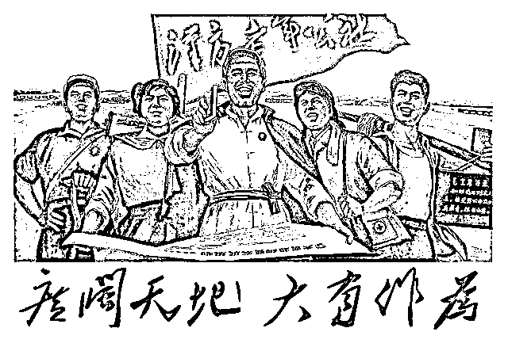

# esseJ

> 作者：esseJ
> 
> 赞同数：1184
> 
> 编辑于：2019-01-31 10:34

谢邀，我能想到的有三方面的原因。

  

第一是因为东亚没有一个非常强势的宗教。

「宗教意识」里有一个很重要的构成就是「命运」，毕竟它最初是作为一种统治工具诞生的。大部分宗教都会告诉你要「认命」，你是该过什么样的生活都是「冥冥中注定」的，你过分努力去争取也是没什么用的。

比如美国，最经典的表达这种「宗教意识」的作品就是《阿甘正传》，阿甘得到的一切，都像是上帝的安排，而不是他自己的努力换来的。他的所谓「努力」，不是一种具体的操作方式，而仅仅是一种「信念」，保持着 [faith](https://www.zhihu.com/search?q=faith&search_source=Entity&hybrid_search_source=Entity&hybrid_search_extra=%7B%22sourceType%22%3A%22answer%22%2C%22sourceId%22%3A586213452%7D)，就可以得到你该得到的结果。

这种东西也不仅限于基督教，我爸爸在非洲工作，说到当地的很多穷人，他的概括就是一个字，「懒」。吃政府的一点点救济，每天吃两片面包，然后喝一杯咖啡，就闲着也不做事。安于「宗教赋予自己的使命」。

但在东亚，宗教总得来说是不怎么强势的，宗教的存在更多是一种功利性的。人们[求神拜佛](https://www.zhihu.com/search?q=%E6%B1%82%E7%A5%9E%E6%8B%9C%E4%BD%9B&search_source=Entity&hybrid_search_source=Entity&hybrid_search_extra=%7B%22sourceType%22%3A%22answer%22%2C%22sourceId%22%3A586213452%7D)是为了解决具体的问题，比如中国文化里的祭祀活动，日本文化里的求签拜佛，都是非常具体的「我遇到了一个问题，神你帮我解决一下吧」。这跟基督教和伊斯兰教里「把宗教当成自己生命的一部分」是非常不一样的。

所以大部分东亚人的信仰其实就是一种「[功利主义](https://www.zhihu.com/search?q=%E5%8A%9F%E5%88%A9%E4%B8%BB%E4%B9%89&search_source=Entity&hybrid_search_source=Entity&hybrid_search_extra=%7B%22sourceType%22%3A%22answer%22%2C%22sourceId%22%3A586213452%7D)」，再说得俗一点就是改变命运，升官发财，完成阶级跃迁。这样的文化自然会导致人们更努力，竞争更激烈，也会导致人们活得更累。

  

第二是因为东亚没太吃到[工业革命](https://www.zhihu.com/search?q=%E5%B7%A5%E4%B8%9A%E9%9D%A9%E5%91%BD&search_source=Entity&hybrid_search_source=Entity&hybrid_search_extra=%7B%22sourceType%22%3A%22answer%22%2C%22sourceId%22%3A586213452%7D)的第一波红利。

工业革命，包括两次世界大战，决定了现代社会的体系是围绕西方建立起来的，西方天然有资本和技术上的优势，完成了原始积累，就自然可以活得相对更轻松更好一点。

而东亚的话，发展本身就相对要滞后一些。即使是日本、韩国、台湾、新加坡的发达，包括中国大陆今天的发展成绩，也都是人们用血汗干出来的，这是一个追赶的过程。

美国成绩最好的学生都是亚裔，这不是因为东亚人天然更聪明，纯粹是因为东亚人更努力。如果东亚人不这么累，不这么努力，现在的状况可能会更差。

  

第三是因为东亚人没有太多的「反抗意识」。

封建制度的崩塌，在西方是一个单纯「自下而上」的。但在东亚，封建文明持续的时间长，而且最后的崩塌也是因为外部力量的介入，某种程度上，是西方的殖民者推翻了东亚的封建制度。所以你去看东亚任何一个国家，无论是日韩，还是「大中华」，东亚人是天生的「中产阶级」，善于依附体系，独立性相比西方人要差很多。

所以西方人活得累了会罢工，会抗议，会通过他们的政治体系去解决问题。东亚人就相对更加「逆来顺受」，有问题先从自己身上找原因，想办法，通过「竞争过身边的人」来改变现状。用知乎的流行词来说就是「内卷」。

高票回答说的「东亚人心态发生了变异」，「只有踩在别人脸上才能获得幸福感」就是因为缺乏反抗意识所导致的结果。

  

以上。

# 老吴爱说话

> 作者：老吴爱说话
> 
> 赞同数：10
> 
> 编辑于：2020-07-11 13:06

优质资源是老百姓用双手做出来的，而不是从地里刨出来的。

东亚国家的常规做法是把人民的手捆起来，或者干脆砍掉，然后让他们比谁跑得快。

如果东亚人把昂人的金融霸权推倒了会有什么后果？全世界的人都得疯跑起来，但是没人会再用双手做东西了。

美元虽然是世界货币，但是年均[通胀率](https://www.zhihu.com/search?q=%E9%80%9A%E8%83%80%E7%8E%87&search_source=Entity&hybrid_search_source=Entity&hybrid_search_extra=%7B%22sourceType%22%3A%22answer%22%2C%22sourceId%22%3A1331891870%7D)百分之二出头，比其他货币好很多。这不是滥用金融霸权，掠夺财富，杀鸡取卵的表现。

东亚国家不必总是一副受害者心态，日本平成废宅，韩国高考成迷，某地房价上天，不是米国大兵扛着枪站在你面前，要你不肥宅，不高考，房价不上天就不行的。

# 暴徒熊二

> 作者：暴徒熊二
> 
> 赞同数：295
> 
> 编辑于：2022-06-22 15:41

我也一直以为我们下一代的孩子们或许没这么苦了，直到最近入逼乎之后看到有人在问“金典牛奶的营养成分是什么，我孩子快高考了我想给她买一箱补充一点营养”这类虚头巴脑的问题，我才明白，zhong 国人短期内是不可能不苦的。

当你上初中高中，班主任拿你当刷存在感和泻私愤的工具的时候，最积极主动地第一个站在班主任那一边反过来说你这不是那不是的，是不是你父母？

当你念本科，辅导员和助理坑你蒙你侮辱你拿你刷存在感的时候，最积极主动配合辅导员“工作”的，是不是你父母？

当你读研读博，导师对你威逼利诱拿你当奴工用，你快撑不下去的时候，第一个站出来挑你毛病，说你不努力不争气的，是不是你父母？

当你出到社会上工作，老板对你用尽下三滥手段，把你逼到快精神崩溃的时候，你希望公益广告里天天吹的所谓的“家的港湾”能给你一点精神上的慰藉的时候，第一个跳出来说你没出息的，是不是你 FM？

你当然可以说不是。

大学生考试做不出题，跳楼了；高中生被请了家长，跳楼了；中学生因为赔几百块钱的事不敢跟父母说，跳楼了。这都是最近发生的事吧？猜猜，他们走之前，脑海里闪现过多少遍父母那句“你这辈子完了”？

恕我有话就直说了，那些自己一辈子从来没有过一件正事儿就敢把人带到这个世界上来的罪人们，有几个是害臊的？不光不害臊，反而还觉得自己有“恩”吧？

所以有些人为什么苦呢？除了 zhong 国女人的子宫射速太高，什么人都敢要孩子，要了孩子之后就躺平，一句“全靠你自己了啊”就想把人打发的那些罪人以外，还能有什么原因？

  

命苦不是没有原因的。

  

额，原版说的太激烈，被要求修改了.

那我就修改一下。

# Liang xu

> 作者：Liang xu
> 
> 赞同数：99
> 
> 编辑于：2020-07-24 11:14

[驭民五术](https://www.zhihu.com/search?q=%E9%A9%AD%E6%B0%91%E4%BA%94%E6%9C%AF&search_source=Entity&hybrid_search_source=Entity&hybrid_search_extra=%7B%22sourceType%22%3A%22answer%22%2C%22sourceId%22%3A1357838410%7D)了解下。你不累，肉食者就累啊，所以要让你累。

《[商君书](https://www.zhihu.com/search?q=%E5%95%86%E5%90%9B%E4%B9%A6&search_source=Entity&hybrid_search_source=Entity&hybrid_search_extra=%7B%22sourceType%22%3A%22answer%22%2C%22sourceId%22%3A1357838410%7D)》为统治者总结了驭民五术：  
1\. 愚民：统一思想。  
2\. 弱民：国强民弱，治国之道，务在弱民。  
3\. 疲民：为民寻事，疲于奔命，使民无瑕顾及他事。  
4\. 辱民：一是无自尊自信；二是唆之相互检举揭发，终日生活于恐惧氛围中。  
5\. 贫民：除了生活必须，剥夺余银余财（即通货膨胀或狂印钞票）；人穷志短。

五者若不灵，杀之。

# 帝都铁骑

> 作者：帝都铁骑
> 
> 赞同数：70
> 
> 编辑于：2019-03-11 17:26

**因为货币霸权**

东亚人为什么活得累，是因为实体经济（商品出口）是东亚人获得财富的主要渠道，卖出靠辛苦劳动生产的产品赚取外汇，可以说东亚人赚得的每一分钱都是自己的血汗钱。

反观世界级 BOSS 美国，实体经济（制造业和农业）所占国民经济的比重只有大约 12%，剩下的 88%都属于虚拟经济。

为什么美国可以这样玩？因为在金融资本时代，工业生产领先不算最强，货币霸权才是王炸，没有货币霸权就玩不动虚拟经济。

这是去年上半年的全球外汇储备图，美元占比 62%遥遥领先，欧元 20%排在第二，日元 4.9%人民币 1.8%韩国等其他东亚国家直接被忽略。

  

  

那么排名第一的美国是如何通过它建立的货币霸权在虚拟经济中兴风作浪的呢？

包括但不限于：

  

*   量化宽松

说白了就是增印美元并投入国际市场，由于美元是首屈一指的国际结算货币，其他的国家为了保证本币不升值（本币升值的下场参见日本的平成战败）只能增印自己国家的货币予以抗衡，美国也就通过了这种方法输出了自己的通胀。正可谓“把感冒传给别人自己才能好的快些”。

其他的国家胆敢这么做，由于他们的本币不是国际结算货币无人买单，只能立即引起国内通货膨胀，货币贬值，下场参见[津巴布韦](https://www.zhihu.com/search?q=%E6%B4%A5%E5%B7%B4%E5%B8%83%E9%9F%A6&search_source=Entity&hybrid_search_source=Entity&hybrid_search_extra=%7B%22sourceType%22%3A%22answer%22%2C%22sourceId%22%3A605525221%7D)和委内瑞拉。

  

*   [债券](https://www.zhihu.com/search?q=%E5%80%BA%E5%88%B8&search_source=Entity&hybrid_search_source=Entity&hybrid_search_extra=%7B%22sourceType%22%3A%22answer%22%2C%22sourceId%22%3A605525221%7D)

谁都知道美国人欠了天文数字般的巨额债务，但你们没想到债务也能换钱吧？美国人把他们的债务制作成债券，再用增发的美元炒高美国债券，这下美债一下成了香饽饽，大家一顿抢购，美国人就很开心的收了一波智商税。

甚至什么时候美债疲软了，美国一下令，日本英国等各小弟就要带头购买美债了。

其他的国家敢这么做，是没有能力为自己的债务托底的，下场参见希腊。

  

*   加/减息

美联储只要一[加息](https://www.zhihu.com/search?q=%E5%8A%A0%E6%81%AF&search_source=Entity&hybrid_search_source=Entity&hybrid_search_extra=%7B%22sourceType%22%3A%22answer%22%2C%22sourceId%22%3A605525221%7D)，美元立马坚挺起来，受此影响世界各国的投资就源源涌入美国刺激美国经济的发展。一旦投资过热产能过剩产生通胀风险，美联储就启动降息，美国公司带着美元杀向全世界投资，投资回报又源源不断的回流回美国。都说甘蔗没有两头甜，但美联储适时加[减息](https://www.zhihu.com/search?q=%E5%87%8F%E6%81%AF&search_source=Entity&hybrid_search_source=Entity&hybrid_search_extra=%7B%22sourceType%22%3A%22answer%22%2C%22sourceId%22%3A605525221%7D)保证美国横竖都是赚。

其他国家试一试，本币的利息来回跳水将导致汇率失去应有的稳定性，根据三元悖论资本逃光和出卖国家主权二选一吧。

  

*   专利

没错，专利等知识产权也属于虚拟经济。看起来购买专利是周瑜打黄盖两厢情愿的事情，但专利流氓的地方在于你在和他进行价格谈判的时候往往几乎没有议价能力，正如《我不是药神》中所描述的一边是贫穷的患者在无助中默默死去，一边是暴利的药企躺在专利上大发横财。

专利研发是需要大笔资金投入的，其他的国家很难具备这个财力，对于美国反正躺着印钱就行，大把砸钱到科研领域正好消耗掉增发的美元。

  

*   汇率

喜欢旅游的童鞋都知道，如果你有 6000 元（人民币），跑到越南也许能呆两个月，跑到美国也就只能呆两星期了。因为 1 美元=23214 越南盾。马克思说价值是凝结在商品中的无差别的人类劳动，但加上汇率这个神奇的东西你会发现你一天的劳动也许只能抵上人家干一小时......

那为什么蓝星上所有国家的货币价值都要以美元作为参照（汇率）呢，为什么不用越南盾，印度卢比或者俄罗斯卢布呢？废话人家美元是和石油挂钩的，全世界石油贸易都只能用美元来结算，没有美元就买不到石油，没有石油就没有工业生产，没有现代化。总不能全社会倒退回[石器时代](https://www.zhihu.com/search?q=%E7%9F%B3%E5%99%A8%E6%97%B6%E4%BB%A3&search_source=Entity&hybrid_search_source=Entity&hybrid_search_extra=%7B%22sourceType%22%3A%22answer%22%2C%22sourceId%22%3A605525221%7D)吧？

  

  

  

所以说不是东亚不努力，奈何美国有高达啊。（欧元在国际货币中排第二欧洲人算是有个小高达吧）

  

  

  

不过凡事有利就有弊，虚拟经济最大的弊端就是财富分配的极端不平衡：

大家都知道华尔街是美国金融资本的大脑，而华尔街的从业人员有多少呢？只有 30 万。

美国人口有 3.25 亿，那剩下的约 3.25 亿人是不是只剩下混吃等死了？差不多吧。

这就是美国现在最头疼的问题。一方面是占人口极少部分的[金融资产阶级](https://www.zhihu.com/search?q=%E9%87%91%E8%9E%8D%E8%B5%84%E4%BA%A7%E9%98%B6%E7%BA%A7&search_source=Entity&hybrid_search_source=Entity&hybrid_search_extra=%7B%22sourceType%22%3A%22answer%22%2C%22sourceId%22%3A605525221%7D)疯狂敛财富得流油，一方面是占人口大多数的中产阶级随着实体经济的不断萎缩而慢慢滑落入贫困，而在最底层的失业人口已彻底的沦为了“废物”，在政府的救济中混吃等死慢慢糜烂。

这种情况引发了尖锐的阶级对立：

*   在美国老百姓眼中华尔街就是一帮吃人血馒头的诈骗犯，赚的每一分钱都是不义之财。
*   在华尔街眼中美国老百姓就是一群浪费粮食的卢瑟，政府不但要用华尔街赚的钱补贴这些废材，华尔街还买不到好。

这些问题再加上美国一直没有解决妥善的种族问题和文化问题，现在都一股脑的涌现了出来，这酸爽，川普大叔不容易啊，明明知道是个粪坑，还往里跳......

所以现在看来川普在任期内是没有能力集中全力压制中国了，而且说不定还需要中国暗中相助保他坐稳交椅。此为天助，只有中国的复兴和崛起才能带动东亚经济的长久繁荣和深远发展，黎明前的破晓已经到了。

# 莱卡想回家

> 作者：莱卡想回家
> 
> 赞同数：8
> 
> 编辑于：2022-01-30 18:38

对于这个问题不光上千个答主从各种角度解答，还包括过往各种社会学家，哲学家等都说烂了，我简略说个自己观察到的现象。

我们与别的民族一样，都对英雄有着很强的崇敬感，喜欢热烈讨论英雄得失，比较实力地位，但会发现，我们对待那些历史人物，比如谈论将领的军事能力，会异常的苛刻。这固然有我们历史久远，英雄辈出卷得厉害的因素，可其他主流国家历史也普遍久远，英雄辈出，像英法那种百年战争，日本战国时代都持续很长时间，都有很多人才涌现，但如我们这么苛刻对待自己历史上一些军事人才比较罕见。

随便举个例子，比如这些年被黑的很严重的陈庆之，固然有十多年前网络吹的过于玄幻的原因，但事实上陈庆之以几千老弱寡兵，也缺乏物资的情况下连下 50 城，极擅长揣摩敌军心理，而进退有据统帅能力也很凸出，直到生涯后期有了两次败仗，责任也主要不在他，却被贬低得连一流将领都算不上。事实上放在别的很多国家，这样的军事才能，这样以寡兵打下战国时代一方霸主领土面积的军事成就能被宣传上天，比如邻国日本。有很多很多这样拥有不错军事才能的将领哪怕对比顶级的韩白李岳只能算三流，四流，但往往在历史上有过高光时刻或足以从侧面显示他能力的描述，却总是被人看不上，贬低。

我们的环境对周围人是不愿给予以赞赏的，好像生怕给了别人赞赏就显得自己不够好了，同时在对待别人不够好的地方又极尽苛刻，处于一种人人尽力抬高自己贬低别人的恶性循环里，以至于大家为了所谓的颜面，尊严都绞尽脑汁成为“最好”的那一个，如果做不到就会引来很多人的羞辱，暗讽，为了被越少人说闲话，越需要卷到比他们高的位置令他们闭嘴。

总有很多人说是因为我们过得不好之类的云云，而且很多这样说的人其实不乏条件优越者。泰国在我们眼里，南部有绿色影响，还时不时政变，经济条件也不如我国，人民都懒洋洋的，但做国际民调的时候，泰国人的幸福指数却很高。与我们文化类似的日本，韩国，虽然情况没我们严重，但他们经济水平比我们还优越不少的情况下，民众幸福度也不足，移民欲望很强烈。而作为更严重的我们，精神上是有严重疾病的，这种疾病无论贫富贵贱，都普遍挺严重，每个人其实都在与周围一群人的眼光对抗，以寡击众，又怎么会轻松呢？

# 张习如

> 作者：张习如
> 
> 赞同数：818
> 
> 编辑于：2022-02-15 10:12

因为日本人也就是进击巨人里的艾尔迪亚人，也就是人人都有变成吃人巨人能力的民族。我们最重视的是吃人的能力，但是也最怕被别人吃。吃人的快意和对被吃的痛苦的恐惧是主导艾尔迪亚人生命奋斗的主要原动力。当然，literally 吃人的时代已经是虽然并不久远的过去了，但是艾尔迪亚人的日常生活则依然充满了各种虚拟的吃人和被吃。从秦国以杀人的数量记录来论战功开始，[艾尔迪亚](https://www.zhihu.com/search?q=%E8%89%BE%E5%B0%94%E8%BF%AA%E4%BA%9A&search_source=Entity&hybrid_search_source=Entity&hybrid_search_extra=%7B%22sourceType%22%3A%22answer%22%2C%22sourceId%22%3A2338800210%7D)人就知道，靠勤劳工作团结友爱是永远无法获得人上人的地位的，唯一的希望就是依赖吃人以及吃人的秩序成为吃人的人。所以几千年来的读书人并无几个人愿意把时间精力用在享受日常生活，发展理论体系，真正做有利于他人的事业上面，而宁愿把所有的生命挥霍在刷题上，并视之为唯一正途，因为只有获得了吃人权力的人生才值得过，才能得到无上的享受，而之前的平凡人生是卑贱而毫无意义的。

然而，以吃多少人为人生功绩的价值观实践起来，注定是一将功成万骨枯的，因为这就像是一负即退出的 PVP 英雄模式，在每个人只有一条命这条冰冷的客观事实下，大部分参与这场大逃杀一般游戏的人都注定会是 0-1 出局。大部分人都是这场游戏的事实上的输家，然而另一条客观规律是：人本质上是精神和想象的动物，在现实中成为输家的人只要肉体生命还能维持，就可以在精神上想象自己是吃着人的胜者或者代入胜者，并把吃人的希望寄托给下一代。由于吃人价值观在帕岛的普遍，那些像艾伦妈妈一样相信不吃人也可以自由生活在这个世界的人，很有可能被巨人之力吃掉。

所以艾尔迪亚人的父母总是不高兴，他们看到孩子快乐玩耍或者享受学习，为他人着想，往往会皱起眉头，因为这不是能吃人的迹象；其实如果孩子是狂妄自大，身强体壮攻击性强的熊孩子，很多艾尔迪亚人父母是乐见其成的，甚至几乎不会约束其人性中的恶。而身心较弱，或者仅仅是攻击性较弱的孩子往往就像兽穴中最弱的那只小兽，会被摧残吞噬而留下终身阴影。

其实帕岛的教育系统也是一个科举制的模拟复制版，然而并不是真正的科举制，大概只为了满足父母子女惯性的焦虑感，帕岛最流行的是封闭式的监狱一般的学校，估计是因为如果孩子接触到了真正的社会现实，马上就会发现这个社会现实完全不需要自己学的这些知识而去混市井了；在监狱一样的学校里帕岛创造了一个平行世界或者封闭社会，给艾尔迪亚孩子们凭空创造了一个价值体系并让他们全身心沉浸其中。然而能在其中获得成就感的终究是少数，绝大部分会在老师的漠视，父母的 pua 中留下永远的心理创伤。

不过这个体系的优胜者也会迟早发现，在这个伪体系下的成功只是个幻影。首先，帕岛只有权力才是一切，而这个教育体系并没有给它的成功者任何权力保障，相反，他们在社会上更容易成为嫉妒的牺牲品。越是聪明敏感的孩子，越能发现在艾尔迪亚世界里的成功和知识能力往往没有直接关系，某个著名的外界给帕岛拍的纪录片里也提到，艾尔迪亚人里有天分的孩子在童年和少年期的水平与成长速度和其他的孩子并无区别，然而一到青年早期，他们就好像集体被什么魔法控制住一样快速失去了成长的能力。这种魔法当然就是巨人之力所带来的焦虑和恐惧，他们开始意识到，不吃人就会很快被吃掉。而人文艺术科学在被吃掉的恐惧中都是脆弱而可弃置的。

当然，即使是这个教育制度早早选拔出了那些最有自恋人格的人并给了他们最多的资源倾斜，由于大量的排练和刷题，效率低下或者离真理甚远的教材和水平低下的教师，艾尔迪亚学校系统里培养出的精英在真实水平上是没法和世界的一流精英竞争的，就不要说封闭的帕岛语言带来的影响了。所以这些教育精英最好的结局依然是获得体制内的护佑，或者加入这个畸形产业里为它添砖加瓦。

所以一个很讽刺的事情是，帕岛的所有文艺事业，除了在顶部城市的门面以及一些隶属权力机构的附属以外，都是为儿童继续进行养蛊一样的教育考试体系服务而鲜有成年人问津的。对于在数学等学科竞赛体系中获得突出成绩的艾尔迪亚人少年，他们最自然的出路是继续在这个养蛊体系里做教练。其本质原因就是，不管是对自然秩序的深刻理解，还是对人文情感的洞察，还是优美的艺术，在艾尔迪亚人那里都是作为伤害他人，自己获得胜利的武器来用的。所以艾尔迪亚人的各种科教文艺圈子本质上都犹如坟圈，人和人之间互相鄙视拆台攻击是最自然而正常的，互相吹捧那是一群骗子小人为了获利而互相忍受的伪装。对儿童的知识艺术教育往往也是在努力让他们感受到打压和痛苦，艾尔迪亚人里研究数学物理的人往往会努力写出让其他人尽量看不懂的资料，以保证自己用药知识的稀缺性，或者打击学生的自信，让他们知难而退。在其他领域同样是老师会担心彻底教会学生就是自己的丧钟敲响之日，而且同时老师也会给尚且幼稚的学生加上各种思想钢印，教育他们排斥仇视其它和自己不同的流派与学术。最终导致墙内艾尔迪亚人在科学人文界完全无法批判性地思考和讨论不同的思想，或者互相启发以及接受新的理论。

当然，众所周知的是，艾尔迪亚知识分子在传承上有几次重大的断绝，在肉体上也被消灭过数次。导致在社会上他们并不能说以一个独立阶层存在，也就更无法履行传统上和贵族一般的在复杂世界引领大众的任务。大众有时感觉需要知识分子，但是又淡忘了历史上的惨剧，然而惨剧依然在影响现实，艾尔迪亚人的知识分子大部分只是和这片土地上其他人一样，苟且求生已经占据了他们所有的精力，并不惜为了生存做一个手艺人。大众和知识分子之间的互相憎恨经常压过他们深层的互相需求，而这样的后果又是深远的。

除了科学文化产业的扭曲孱弱导致了知识进步的停滞，各行各业也困扰于巨人之力的存在，由于彼此之间的敌意和恐惧，因为共识而形成的默契合作基本无法存在，剩下的只有吞噬和被吞噬，吃与被吃的关系。然而公共道德的存在也取决于共同的价值取向与情感，在这之上才能有公共的善。没有共同情感和价值认同的结果就是，艾尔迪亚人除了自己和自己的家人，把其他人的生命意志的满足看作是邪恶的。最极端的状态，就是任何一个人都被其他所有人看做恶人。于是在艾尔迪亚人的公共空间出来说话是危险的，因为这相当于在黑暗森林里自爆坐标，很容易受到在日常生活中恐惧被打击而不敢释放对他人恶意的大众的集体攻击，而公众人物任何一点优越的条件或者生活的享受，都会引起在匮乏中生活在大众的愤怒。所以在艾尔迪亚人的公共领域里，卖惨，也就是讲述自己的苦难和痛苦，是最容易被接受的表达。而如晚期癌症病人叙事这样的生命叙事才有可能引起较多的认为是这属于善的正面反馈。当然，卖惨行为也充满了被反噬的危险，一个可能性是作为弱者卖惨终究会引起艾尔迪亚人内心普遍存在的嗜血的加害心理；而卖惨后再表现出任何巨人之力的特点或者快乐享受以及为了自己生命要求被认为过分的资源，都会被视为欺骗大众或者暴露了邪恶本质，而从善的祭坛上被拉下来，无情地扔到恶人堆里，其实基本上可以从结果接受这么一个推断，艾尔迪亚人里没有一个好人，除了有权力傍身让他人不敢攻击的人。当然，这也是因为在普遍敌对的社会环境里个体视外界众人为敌寇，从而活在自我世界里很难接受世界真实的缘故。

所以在艾尔迪亚人的各个产业里，最终所有基层个体的自由早晚都会被剥夺，这个自由的范围包括生育和休闲的自由。这个结果首先是因为，几乎所有艾尔迪亚人在未成年时都生活在剥夺和匮乏中，而缺乏自主的约束，自由的结果开始几乎一定是欲望的放纵，也就是带来恶。当然许多人的理想如作吃人巨人对他人本来就是恶。其次就是艾尔迪亚人人生的方方面面从衣食住行到婚姻家庭到教育求医无不是在被各种吞噬和吞噬他人，如果艾尔迪亚人的企业不尽可能地吃掉员工最后一滴血汗，员工的精力也会被家人社会压榨光而不会有自由。伤害、控制他人的力量才是真正有力的力量，为了获得更深层的合作，艾尔迪亚人必须比拼伤害自己如拼酒和伤害他人如嫖娼的能力，在这个角力过程中，只有伤害自己或者伤害他人的能力足够强，才会被欣赏而有合作机会。所以艾尔迪亚人都知道，企业是恶的，金钱也是恶的，“为了挣钱”的人一定会是吃人的坏人，进一步就是他人和组织为了自身存在的行为也是恶的。因为为了自己活下来，就一定得吃其他人的血肉。所以艾尔迪亚人大部分视付出金钱相当于被吃，而挣钱相当于吃人，所以在金钱活动上是最不愿意为了自由的兴趣爱好价值观付钱，最终能够在帕岛行得通的商业模式也就必须要么和救命活命息息相关，要么是利用了艾尔迪亚人喜欢吃人占便宜的贪婪欲望的骗子，因为艾尔迪亚人的存在状态还是处于吃人的贪欲和被吃的恐惧中，所以各种不依赖权力的产业都必须靠激发艾尔迪亚的贪欲和恐惧才能够获得成功。所以企业都必须做恶才能生存，也就会引起艾尔迪亚人的厌恶，最终往往要走上欺骗的道路。而因为艾尔迪亚人的散沙化，恶也很难被得到真正惩罚。认为所有产业都是恶的这种观念因为其根深蒂固，任何行业都犹如边缘人格症候群患者，随时面临清空和被清空的冲动，来自更高层的风吹草动都可能让它们完全改变或者覆灭。人类为了获得更大的力量，最基本的能力是组织，然而艾尔迪亚人大部分缺乏有效组织而在机构面前羸弱无力。这又导致了艾尔迪亚人根深蒂固的被害想象。

善和恶的定义混乱、颠倒，人和人之间，集体和个人几乎没有学会在不互相伤害吞噬的基础上良性互动，从而导致整体的道德和善无从谈起，是艾尔迪亚人社会的本质问题。当然，甚至可以把恶作为本质去理解艾尔迪亚人的社会。艾尔迪亚人之间能保持基本的和谐往往不是因为彼此的共情，而是因为对彼此的恶的畏惧。而在真正的强梁前面绝大部分艾尔迪亚人的虚弱，奴性，忍耐被剥夺和伤害的程度也是罕见的，当然这里又涉及到了房间里的大象，如果你面对了艾尔迪亚人的愤怒，那说明你还不够凶恶，凶神恶煞脸是艾尔迪亚社会真正上等人和希望成为上等人的人面对普通人时的标配。

当然如果把善定为帮助生命，恶定为伤害生命这种最自然的原初定义，就可以看出艾尔迪亚人的问题本质是崇拜伤害生命的力量，而鄙视厌恶生命本身。艾尔迪亚人对肉体存在最为鄙视，最崇拜控制伤害他人的巨人之力。这一特点在艾尔迪亚人的两性文化中暴露无遗。埃尔迪亚的男性主体上看，对体育人文艺术是最没有真正兴趣的，他们集体上唯一追求的是控制他人，压迫他人的地位，以获得性和服从，这里的理想是艾尔迪亚人追求的男性气质本质上是“不是人”的气质，是和刀刃，洪水，核辐射，宇宙射线一样的不讲理的毁灭力量。所以艾尔迪亚人大部分并不会真的喜欢某一种学科艺术或者体育，但是只要有压倒他人的机会，他们愿意狂热地从事任何一种哪怕枯燥甚至荒诞的事业而不太会考虑其意义本质和自己是否喜欢，甚至这个事情越给自己和他人带来痛苦，越能说明它的价值。

在这个文化下，艾尔迪亚人潜意识认为感情是软弱可疑而邪恶的，享受生命，感受快乐是无道德的不务正业的事情。打扫卫生，装饰整理，艺术享受对大部分艾尔迪亚人来说是难以踏踏实实进行的，因为这些和压倒/吞噬他人无关。所以艾尔迪亚人热衷于展示力量的盖房子拆房子，而不会投入多少资源去维护小区的美观。艾尔迪亚人对各种腐败和破坏过程的存在有很强的忍受能力，同时鄙视照顾他人和他人共情的工作为低贱而被人蔑视的。进一步在无法被惩罚到的空间（这样的空间总是存在的）总会有一些艾尔迪亚人会把他们的戾气发泄为损人不利己的破坏和伤害。如果把对生命有益的物资和组织视为财富，那么由于互相破坏和共同破坏过于多，艾尔迪亚人总体是贫穷的。

  

而这种崇拜破坏和损害生命的力量的文化，与人类本质存在的最大矛盾点就是，人作为生命的存在本身。艾尔迪亚人也是人，也是动物，也是生命，这是他们一切存在和行为的起点。艾尔迪亚人目前文化的主要矛盾大都与生命的问题相关。而大概因为外界的敌意和伤害太多，艾尔迪亚人对自己的生命是极为看重的，也最无法接受它的衰弱和消失的。进一步，艾尔迪亚人在育幼、教育，婚姻和养老几大问题上，对外界的信任度也是很低的，当然外界在这方面也确实危机四伏，最终就是在保存自己和家人的生命上，艾尔迪亚人只有自己可以依赖。然而同时，每一个艾尔迪亚人为了自己的存活而要和外界的压迫不断对抗战斗，也要耗费相当多的时间精力。而进一步艾尔迪亚家庭的原子化，也让理想中的家庭生活变得几乎毫无可能。

在幼儿和儿童的问题上，艾尔迪亚人并不多么重视婴儿和儿童，反而视他们为需要被规训的弱者。父母，老师甚至任何一个接触儿童的艾尔迪亚成年人都可以毫无顾忌地恐吓威胁甚至直接打骂孩子，或者至少也是将他们当成好玩的宠物一样逗弄开可以触怒人的无底线玩笑。艾尔迪亚世界里父母如果存心要忽视冷遇虐待自己的孩子，其他人是很少能够干预的，于是有无数艾尔迪亚人在暗淡的童年里形成了终身的心理阴影甚至身体伤害。当然艾尔迪亚儿童的生命保障本质上依赖于他们和父母的一体感，最聪明情商最高的艾尔迪亚孩子也知道尽全力讨好父母，然而这时他也往往容易被父母从精神上人格上吞噬。总之，艾尔迪亚人儿童受到的来自父母监护人乃至社会身体和心理伤害应该是全世界最大的，当然他们的父母基本也是受害者，而儿童长大后也会把这种伤害继续传递给下一代。

当然，艾尔迪亚的儿童并没有其他选择，因为并没有真正的社会保障去给他们独立的社会地位，而私有制把一切都加剧了，青年人没有父母资助甚至不可能独立，也很难结婚。

然而，恋爱结婚生育，这本来是最需要人类天性中自然的对生命和感情的追求所支持的活动，在艾尔迪亚人那里却完全对调了；谈感情的恋爱在艾尔迪亚人儿童中都知道是尴尬而可笑的事情，也是老师家长要孜孜不倦污名化的，不仅可能堕落而且毁掉一生的危险事物。

当然，这种理解是有道理的，因为大家的潜意识里都知道，艾尔迪亚人是吃人的巨人，而吃人和被吃的关系在艾尔迪亚人的所谓恋爱关系中暴露无遗。幻想吃人的贪婪、快意、放肆和幻想被吃的恐惧、焦虑、愤怒就像艾尔迪亚人辛辣刺激的调料可以让他们吃下平淡无味的碳水一样，在帮助艾尔迪亚人度过实际上贫乏枯燥被剥夺被限制的人生方面功不可没。而且不管真实发生了什么，在精神的层面，大部分年纪较大的艾尔迪亚人都多少有了对被吃和被害的恐惧和愤怒心态。被害妄想人格在老年艾尔迪亚人中存在的比例非常之高。不管现实怎么样，这些人是确确实实在某个方面会在精神上生活在自己想象中的地狱里的。而人类本能的天性和历史上的现实又让吃人被吃的二分法和性别，和性以及两性关系紧密联系起来。

所以在艾尔迪亚人的集体想象中，男性是吃人者，是恶的化身；女性是被吃者，是善的化身。当然实践上艾尔迪亚人几乎没有[惩恶扬善](https://www.zhihu.com/search?q=%E6%83%A9%E6%81%B6%E6%89%AC%E5%96%84&search_source=Entity&hybrid_search_source=Entity&hybrid_search_extra=%7B%22sourceType%22%3A%22answer%22%2C%22sourceId%22%3A2338800210%7D)的，而怕恶欺善要更为普遍，所以艾尔迪亚人的劣根性和恶意更多地向女性发泄也是一种本能了。当然在现实中，无论男性女性都是一个极为复杂的大脑接受了几十年的集体潜意识，文化灌输，以及社会现实的产物。艾尔迪亚男性大部分一样从小在贫乏和恐吓中长大，而艾尔迪亚人的这种蔑视生命和崇拜暴力的文化，无疑是有一种原始的雄性元素在其中的，所以说艾尔迪亚人女性平均来看无疑是全世界最有冷酷戾气的男性气质的女性，也是差不多的。而在把原始男性气质中恶的一面，崇拜破坏和暴力的一面发挥到极致的文化下成长的男孩，当他发现自己处于弱势地位时，是既没有生命的魅力，又缺乏生命从微末中产生的洪荒之力和灵性的，他的生命气质已经过早被消耗而变得猥琐。而艾尔迪亚女性的这种独特特征也许让她产生了一些独特魅力，也许会催化出一些格外优秀的人，但是女性天生的气质又和这种文化格格不入，让不适应文化的无数女性在接触社会后被害而精神上被击垮，同时在敌意环境中，女性的生命力也会更快地衰竭。当然，女性问题，爱情婚姻，生育问题因为涉及生命的本质，也是艾尔迪亚文化和现实冲突最为激烈，问题暴露最为显著的地方。

  

总体来看，艾尔迪亚人做事的集体动力是压倒他人，让他人痛苦，以及逃避痛苦和反击伤害，当然前两个并不太好说出口，逃避痛苦和反击伤害是可以被艾尔迪亚人共同接受的阐述动机的叙事模式。对于要不要做某事的讨论，最能获得艾尔迪亚人认可的逻辑也是如果不这么做会多么多么痛苦。可以艾尔迪亚人时刻处于苦难中而最强烈的驱动是让自己的痛苦少一些。而传统艾尔迪亚人的生育目的并不是因为新的生命美好可爱，而是因为不生育就有可能因为没有帮手而被邻居殴打欺负，也可能在老年被送到老人院被护士殴打欺负，或者在去世以后被坏人分光家产。所以艾尔迪亚人不愿意生女儿，也有可以被艾尔迪亚大众集体理解的理由，那就是生女儿太痛苦了：首先女儿将来会是男性各种物理暴力、性暴力和语言暴力的宣泄对象，其次女儿在性关系中将受到艾尔迪亚人公认的奇耻大辱，最终女性人生大部分精力用来生育养育照料卑贱无意义的软弱生命的人生是无意义而痛苦的。在艾尔迪亚人的集体想象中，一个感觉非常痛苦的人，只要大家都认可这种痛苦足够深，那么此人为了逃避痛苦做出的任何事情都是可以理解的。所以，认为女人这一辈子实在太苦了，想到女儿生下来受苦，也是很多人放弃要女儿的理由，同样因为不想孩子受苦而放弃治疗孩子，甚至更多的残酷行为，只要把自己的痛苦阐述得足够到位，也是可以被理解的；进一步，讲述他人给自己造成了多么大的伤害和苦难，然后自己又多么愤怒决绝地复仇，把等量的甚至更过分的痛苦加给对方，也是艾尔迪亚人集体想象中最为“爽”的一个环节。在这种想象中，艾尔迪亚人把加害者想象为非人，所以给他们任何攻击和伤害都是完全可以接受的，因为他们认为自己杀的伤害的不是人，而是给他们造成极大痛苦的巨人。

  

在受害者和加害者，以及崇恶厌善的二元想象中，波伏娃的话应用到艾尔迪亚人身上是相反的，艾尔迪亚人的男孩从小就知道自己的生物性别让自己可以有加害者的主体地位和爽感，而对生物性或者说兽性的性别本质，生殖器和性产生了格外的兴趣和热衷，不仅是因为天性的性欲过强，而且是因为性在艾尔迪亚男性看来象征了社会实现，人格尊严，人生意义的价值三位一体。

  

然而艾尔迪亚女性当然知道艾尔迪亚男性怎么想，并因为他们的害人想象而无比恐惧，愤怒和痛苦，并把恋爱和性视为耻辱。艾尔迪亚人中，最富有浪漫的想象力，对感情和恋爱的渴望实际上也最强的年轻少女，也非常不愿意想象女性是如何和男性谈恋爱的，宁愿把艾尔迪亚人恋爱中特色的侮辱和占有想象在发生在两个男性中。相当的艾尔迪亚年轻女性在自我想象中也是一个男性或者无性化的人。

  

于是在艾尔迪亚男性对性的沉溺堕落和艾尔迪亚女性对性的反感厌恶下，艾尔迪亚人的恋爱形成了有艾尔迪亚人特色的强奸文化。正如在艾尔迪亚人的色情想象文化中，男性越丑陋老气霸蛮越好，欲望本身成为丑恶和吃人的象征，女性的冷淡厌恶和反抗则也要成为助情的催化剂，最终欲望战胜了反抗，丑恶战胜了正义，吞噬成功，这个过程产生了最大的，其它文明难以理解的极致快感。所以实践里，艾尔迪亚人女性的拒绝反抗只能说是应该被艾尔迪亚男性压制的情趣而不能说明她真的不愿意，一个主动表达自己欲望的艾尔迪亚女性几乎是可笑而下贱的。艾尔迪亚人特色的耻文化，也就是一个为恶的力量施虐破坏，而受害者因此而羞耻的痛苦要自杀的思维模式，就像有疯子当街脱裤子拉屎，而被屎溅到的路人因为愤怒要自杀一样。

  

在这种无论男女性都共同具有的男恶女善然而恶总要战胜善的集体想象中，艾尔迪亚人形成了彩礼的婚俗，因为不论艾尔迪亚男性女性都认可，女性的恋爱和结婚是吃了大亏，更不要说女性本身在文化系统里被害者的地位，就像一个人天生被所有人认为是狗杂种一样，所以在现实里必须给予弥补。当然，艾尔迪亚女性的性冷感，性厌恶，反抗，痛苦和耻辱其实也是一种现实的存在，被害者的痛苦想象也不仅仅存在于女性身上，也会在她们的父母兄弟伴侣身上出现，所以艾尔迪亚模式的骂人方法，即为宣称要和某人的母亲发生性行为，也是在利用儿子的被害想象。

  

然而即使是集体想象，投射到现实以后，产生的影响也和想象相去甚远。因为艾尔迪亚人的受害想象让他们已经消灭了大量的女婴，以阻止痛苦的产生。再加上家庭和社会因为交往成本太高而产生的原子化和解离化，以及男女生群体的隔阂，艾尔迪亚男孩大部分也是孤独地成长而得不到多少同龄女性的陪伴的，他成年的求偶也需要跨越较高的成本，而艾尔迪亚普通家庭无论生了什么性别，在社会资源方面也是非常有限的，在跨越家庭的结合上是非常无力的。更不用说，父母也许口头上会以要求结婚来控制儿女，在心理上却可以非常痛恨陌生人进入家庭破坏自己对子女的控制，更不要说许多艾尔迪亚人母亲把自己一生对男性的欲望和怨恨最终转化为了对儿子的精神吞噬和控制上，所以在实际行动上把攻击性向儿女的对象发泄而破坏子女的感情。而恋爱无论是涉及感情还是涉及性欲，在艾尔迪亚主流价值观下都是罪恶的，最终，物质就成了谈婚论嫁的本质，艾尔迪亚男性的任务成了获取物质，只有他和他的家族有了在社会上具有优势的物质条件才有谈判婚姻的资格。企图通过感情绕过物质的，在艾尔迪亚人价值观中比小偷和骗子更让人可恨。

  

当然，也许需要问下艾尔迪亚人究竟是不是人，为什么他们的人生中终其一生都在追求用物质压倒人的血肉。艾尔迪亚人群体中，似乎只有年轻女性可以伸展一定的生命之美好和感性，其它性别年龄的人神情上都有一定的死气沉沉和阴霾。只有年轻女性可以表达一点生命本身的价值，然而这也让她们成为了猎物，其他人尽管是血肉之躯，其存在目的却是自身的非人化和控制他人。只有被害者叙事能让他们惊觉自己也是肉体和生命。于是艾尔迪亚年轻男性发现环境中的同龄女性不仅稀少而且对自己几乎是敬而远之，自己的主动则是可疑而油腻的行为，他在色情的想象中可以投入而沉沦，在冷酷的现实中却感受到了自己也作为血肉之躯在交往成本极高的原子社会中之无力和受挫。就如艾尔迪亚社会表面上是去性化的，然而原因不是因为艾尔迪亚人人均君子，而是相反，大部分艾尔迪亚男人如同带了笼头的猛兽，公共领域对性的禁锢就像是不能让饥饿的猛兽看到血食一样。想象中的狂野自由和现实中的无能无力和被禁锢同时存在。

  

最终，艾尔迪亚人都生活在自己的幻想里，然而这种沉溺让他们无视现实，无力在现实中建立联系，更无力去改变和创造现实。在艾尔迪亚人对对象的想象中，理想的对象没有一点作为人的欲望恐惧和戾气，反而会永远给予他无限的爱和包容，残酷的现实让他们逃回自己的理想梦境里。然而也因为这种人人沉浸在自己梦想中的现实，在现实中每个人都被他人的尖刺扎得头破血流，从而也就有更多人逃入幻想中。艾尔迪亚人女性幻想的甜蜜的爱情，遇上的却是男性的兽欲以及用兽欲满足侮辱践踏欲望的想象；艾尔迪亚男人幻想中的皇帝一样占有控制的生活，也让他们无法忍受日常的生活，现实的挫折，和家人的病痛以及艰难的治疗，而艾尔迪亚普通男性在想象的肆意和现实的惨淡之中，也开始了受害者想象，不过他们仍然把女性想象成被吃者，只是吃女人的不是自己，而是比自己更有力量的男性，而被吃的女性也从有所向往有所求的女神变成了非人化的母狗，最终母狗也成为了压迫自己吃自己的男人的附庸而可以一起被成为无底线攻击的对象。

  

当然这种集体想象可能在历史上不止一次地大规模实体化而形成了巨人汹涌地毁灭怒潮，一次次给艾尔迪亚世界带来毁灭，也加剧了艾尔迪亚人内心对生命的悲观绝望蔑视和对暴力和毁灭的崇拜。然而对生命的悲观蔑视，这种思考依然是建立在个人意志之上的，一个主体在对古往今来以及所有非自己的生命都悲观蔑视之后，自我的地位也就被无限放大，他唯一能理解的生命意义就是自己的此世此生，所以长生不老药尽管被每一代人都证明是骗局，吃下肚的是毒药，每一代新人也会无视古代的经验而亲自尝试。目前艾尔迪亚人的生命和过去缺少联系，和未来也看不到传承，和其它民族甚至人类也有不小隔阂。艾尔迪亚的历史可以让最敏感智慧的文人全部疯狂，最终思考出了在正史里寻章摘句，把自己想象成最无辜的受害者和反抗者的纯种后代的历史观，而事实是没有一个上史书的反抗者不是屠杀老百姓的恶魔的，也没有一个人体内没有吃人者的血统的。几乎每个从小被吞噬被吃的孩子，长大以后他还是想着用孱弱的身体和心智去吞噬其他人的。艾尔迪亚人也有过浪漫的田园史诗，只是几乎已经被所有人淡忘，能够记忆的只有周期性的毁灭。老夫子的道德教诲最多也只能给处于封闭环境的聪明善良的孩子洗脑，对于所有其他人来说这是一个谁信谁输的，剑拔弩张的人们彼此心知肚明却还在一起玩的，看谁的心智先暴露出软弱感性一面的游戏。所以在艾尔迪亚要做一个好人是徒劳的，也许你一开始希望是为了天下的福祉，然而很快就发现你本来就是相当多人眼中的寇仇，于是你降格开始为了家人或者小圈子，然而他们早晚也开始吞噬你，最终意识到也许只有先成为一个其他人眼中的坏人，才能在艾尔迪亚成为一个人。

  

所以艾尔迪亚人本质上是悲观的，可能只能有大型的记忆抹除术，才能让民众集体复读，艾尔迪亚人历史上是最无辜悲惨的，是永远被欺负，被杀戮的善良无邪的弱者吧；或者只有记忆力和逻辑思辨能力都很差的人才能一方面认可受害者叙事，一方面又去炫耀祖先的武力吧。也许平庸愚蠢到无力设计复杂的计谋，和心地单纯到不会害人是一样的，而孱弱到缺乏足够的武勇和恶毒到家人邻里之间都无法团结信赖也可以让自己站到道德的高地。艾尔迪亚人无疑是在自欺，因为他们无法直面自己的一切，否则也不会有这么严重的心理问题了，因为心理问题的本质是存在被压抑否认的自身欲望和感情。

  

然而自欺是非常不利于欺骗人的，连自己都先要骗的人注定成不了好骗子，艾尔迪亚学在墙外精英的普及程度远高于墙内艾尔迪亚人可以想象的，而艾尔迪亚人当下的一种努力，模仿也好表演也罢，某种程度上也是成为了艾尔迪亚人在被凝视下刻奇的一部分：你在努力表演，他们也知道你在努力表演，然而你可能不知道他们知道你在努力表演，所以还是低了一个层级。

  

艾尔迪亚人自己也不是完全不知道，自己的记忆里的心虚一面，艾尔迪亚人真的能走出历史上的诅咒轮回么，真的能够给人类走出一条不走出毁灭的新路么？坦诚一点的话，我觉得艾尔迪亚人应该说，我被历史上的惨剧和弱者的痛苦深深地打动了，我愿意努力防止这种情况的消失，但是目前我也没有这样的历史经验，只能学习和探索；同时也有很多人有幸生于和平时代，却以吃人者的荣耀来看待战争和毁灭。当然，如果生命不是艾尔迪亚人追求的，那么艾尔迪亚人如此沉重和焦虑地在追求的究竟是什么呢？当然艾尔迪亚人奋斗的首先原因是不亡国灭种和不挨打，那么然后呢，在岛内艾尔迪亚人最让人寝食难安的想象中，女儿被人欺负，老婆被人睡，自己被领导欺负都还只是末节了，这整个外部世界和自己完全不同，自己是完全的少数派、异类，还是乏人问津的野蛮人，而外界都在嘲笑自己，轻蔑自己，甚至想消灭自己的恐怖念头也让艾尔迪亚的知识分子战栗不已。当然岛外艾尔迪亚人几百年来的耻辱遭遇，几百年来把艾尔迪亚人的外貌特点钉在低劣和野蛮的耻辱柱上的等级制度，也成为岛内艾尔迪亚文人的心理阴影。

  

如果坦诚一点，也可以说，学习岛外是让人痛苦的，改变自己也是让人痛苦的，更何况岛内艾尔迪亚人本来就是自闭而麻木的，他们宁愿昏昏沉沉地继续睡着做梦，墙外世界的天翻地覆日新月异也好，和自己长相一样的血脉亲人所遭受的苦难也好，都和自己无关，当然伤害艾尔迪亚人最深的本来也是艾尔迪亚人。艾尔迪亚人本来也不笨，也能协作，也有过发达的文明和深厚的道德底蕴，然而在其他民族战战兢兢地探索的时候，艾尔迪亚人发现了自残这个既有伤人快乐又有被害痛苦这个赢两次的行为。在一刀刀地向自己砍下去以后，艾尔迪亚小朋友整体看起来不再像是一个高级生命了，而近似于高级黏菌，海绵体，甚至还不如，是互相给彼此分泌毒素的一堆散装细菌，个体进化符合进化生物学和生态学，就像是艾尔迪亚人最喜欢的武侠小说里描写的那样。而岛外世界则给艾尔迪亚人提供了不互相杀戮的基本物质，可信赖的货币。

  

所以让艾尔迪亚人终身做奴隶的，其实是多方的共谋：首先是底层艾尔迪亚人自己，因为大家其实在心里都认可了，自己不是贪官仅仅是因为自己没有机缘成为贪官，如果给艾尔迪亚人自由，他们首先会做的事情一定是从小到大，从近到远的互相毁灭，在从小到大的打击和观察下，他们没有也不相信别人有道德和尊严；其次当然是既得利益者，他们深知底层作为奴隶被压制着，一旦有所反弹以后会有怎样的动荡；再其次当然就是岛外，毕竟长期从帕岛获得低价物资是大家都乐意的。于是曾经辉煌的文明其实早已边缘化，因为奴隶不需要独立的文明；而艾尔迪亚人敏捷的思维和优秀的忍耐力也再不能用于狩猎、战争，或者是建立惊天的伟业，而是被用于忍耐长期枯燥的劳动中，思考近在眼前的生存问题。

  

所以艾尔迪亚人活得累，很大程度上和穷人为什么活得累是一个道理：他们处于奴隶的位置，只能看到眼前的苟且，担心第二天的生存，因为随机发生的无数意外都可能威胁到他们的安危。然而因为在秩序结构里如细菌一般的地位，艾尔迪亚人的抗风险能力没有那么高。尽管几百年来艾尔迪亚人一直在用辛苦的工作试图积累一些财富，但是过大的内耗和高昂的组织成本以及破坏的本质，和处于秩序低端而时刻被剥削的状态，让他们依然在许多方面贫穷。所以这五百年仅仅是为了生存的五百年，却让艾尔迪亚人在风起云涌的世界变局前面成了还没有下树的猴子，当他们有点清醒的时候，却好像已经为时太晚。

  

无法维系非暴力聚集的组织，而暴力组织又必须承担相应的仇恨而在任何一次权力转移后地覆天翻，最终艾尔迪亚人的一切高于个体的追求终究会是沙滩上搭积木一样的虚无，而个体和后代的肉体生存也因为每个人都活在自己世界中而越发艰难。更何况沉浸在近忧中的思维模式早晚会带来系统性的风险。而工业方面的进步完全可以是把自残少年手里的菜刀换成了电锯。而这个世界也确实不是围绕着艾尔迪亚人转的，艾尔迪亚人享受了外来的产品和服务的同时，也为这些事物不符合自己的种族特质而默默痛苦着。然而因为缺少抽象思考力和共同情感及组织，这种种问题和痛苦几乎看不到解决的迹象。而艾尔迪亚人卓越的身体和心理忍耐力也被充分利用起来来忍受着这种种痛苦，虽然这种忍痛看不出它的升华性意义来。工业化很大程度消弭了冷兵器时代艾尔迪亚人巨人之力的暴力优势，而把巨人之力转化在了对奴隶一般的艰辛工作的超强忍耐力上，而工业化之后带来的交通发达，食物充沛对人文力量脆弱的艾尔迪亚人来说，也可以像是充分的鼠粮和高密度对于 25 号宇宙的老鼠一样，产生了让儿童处于暴力的阴影和对未来焦虑中，让妇女随时处于陌生男性的骚扰和暴力阴影下，最终每一代人的心理创伤比上一代人更严重，而人生也就越来越痛苦了。

  

科技再怎么发达，可能目前也无法解答艾尔迪亚人为什么要活着的问题吧，一个年轻人因为活着痛苦要自杀，和一个民族集体陷入对生命感觉痛苦和麻烦的情愫中，改造他们的难度也不会有太大区别。一个完全由[反物质](https://www.zhihu.com/search?q=%E5%8F%8D%E7%89%A9%E8%B4%A8&search_source=Entity&hybrid_search_source=Entity&hybrid_search_extra=%7B%22sourceType%22%3A%22answer%22%2C%22sourceId%22%3A2338800210%7D)组成的系统如何才能被改造成一个完全由正物质组成的系统？要么安静地消逝，要么完全未知的推倒重来，要么还有一条路——地鸣。

  

既然无法给地球的未来和人类提供什么新的出路，其实目前看来，自己都依然走在历史无限循环的轨迹上, 那么给世界带来毁灭，至少是有可能实现的，甚至说比要为混沌而复杂的世界带来高层次，新愿景要容易得多。而且，如果你说要给世界带来爱和和平啊，新的秩序啊，会被艾尔迪亚人笑疯的，为了保证自己和地球上肉虫一样的卑微腐朽，要光要热要水，要不停吃吃喝喝交配不然就会感觉痛苦的生命们的存续，这是什么下贱而软弱的目标？毁灭本来就是是艾尔迪亚人追求和奋斗的一个重要动力，生存在这个无意义的宇宙里，宇宙里就充满了种种足以毁灭地球生灵的力量，这些宇宙力量难道不是最强大的存在么，它们作为强者，理所应当地毁灭作为弱者的地球生命，不是合理而自然的么？科技进步也可以是为了毁灭一切，在天人之辩中，天要消灭人，就像老父亲要杀死不孝子一样理所应当。当然如果这么做了，在其它人类，甚至其它生物眼里，艾尔迪亚人是不是坏人呢？话说帕岛上的许多生灵，也和这里的人类一样，身体孱弱，眼神恐惧焦虑凶狠，害怕一切又仇视一切，处在一种类似疯狂的状态中。

  

当然帕岛的艾尔迪亚青年花了差不多十年，承认了自己是地球上的野蛮人，野蛮但是想象自己也有野蛮人出关的活力；目前看，不仅应该承认自己是地球上的野蛮人，还应该承认自己是地球上内心最坏的坏人，如果实践的话，也就是地球的大魔王了。

  

不过，既然好和坏的定义已经是完全混乱了，那么坏又如何呢。人类的灭绝也许不难做到，也许进一步哺乳类也要被连累，但是对辐射有较强抗性的甲壳类和昆虫类则大概率可以存活，考虑到昆虫类和植物紧密共生对生态的卓越贡献，它们也值得如此下场。地球生命迎来又一次[大灭绝](https://www.zhihu.com/search?q=%E5%A4%A7%E7%81%AD%E7%BB%9D&search_source=Entity&hybrid_search_source=Entity&hybrid_search_extra=%7B%22sourceType%22%3A%22answer%22%2C%22sourceId%22%3A2338800210%7D)，但是也许小强的后代或者就会成为下一个时代的中心？也许哺乳动物中内力深厚的蝙蝠会像鸟类与恐龙一样成为哺乳类的幸存者？也许最新的[生物技术](https://www.zhihu.com/search?q=%E7%94%9F%E7%89%A9%E6%8A%80%E6%9C%AF&search_source=Entity&hybrid_search_source=Entity&hybrid_search_extra=%7B%22sourceType%22%3A%22answer%22%2C%22sourceId%22%3A2338800210%7D)可以让少数人类通过难以想象的方式继续存在？对地球来说，这也是一个小事而已，可能对宇宙来说再正常不过了。艾尔迪亚人的恶也许并没有在人类之外，只是艾尔迪亚人似乎命中注定要把人类的这种恶发挥到极致并挟裹所有人类走向不归路，或者也是命运的一部分吧！

当然，也正因为如此，艾尔迪亚人目前集体的为奴待遇是符合多方利益的，甚至符合他们自己作为生命求活的本能。如果哪天笼头解开，[地鸣](https://www.zhihu.com/search?q=%E5%9C%B0%E9%B8%A3&search_source=Entity&hybrid_search_source=Entity&hybrid_search_extra=%7B%22sourceType%22%3A%22answer%22%2C%22sourceId%22%3A2338800210%7D)首先也只会先消灭艾尔迪亚人。艾尔迪亚人的累是自己找的，就像往自己身上捅刀子一定会痛一样，从因为被捅刀子而疼痛疯狂到把他人当作鱼肉一样去捅，并最终陷于这个状态中不能自拔，也就注定了累和痛苦，在低阶挣扎的命运。不集体从几千年的吃和被吃的梦中醒来，不能把自己当人和别人当人，不能建构属于生命的秩序的话，就无法从劳累和痛苦中走出。

# Sayo Hanekawa

> 作者：Sayo Hanekawa
> 
> 赞同数：99
> 
> 编辑于：2019-03-01 13:24

## 关于东亚内卷的终极一答——蚁群内卷社会全貌一览。

  

  

  

  

1、**竞争中赢到最后的是“最愿意留下来的”而不是“最好的”**。

  

  

  

2、个体成长并克服困难的回报是一份内部存量，即[赎买](https://www.zhihu.com/search?q=%E8%B5%8E%E4%B9%B0&search_source=Entity&hybrid_search_source=Entity&hybrid_search_extra=%7B%22sourceType%22%3A%22answer%22%2C%22sourceId%22%3A611316396%7D)式的正反馈。在内部存量枯竭时，赎买内容从存量转换为**避免被末位淘汰**。各不相同的个体成长纵深形成的社会文化的多元性、张力，由于**不能作为内部存量被度量，往往被否定或忽视**。

  

  

  

3、世界观和方法论普遍性的割裂，**从群众角度观察问题，从既得利益者角度提出办法。前者属于病态集体主义中实行民粹权力获得的快感，后者属于对病态集体主义的归附和安全感来源**。

  

  

  

4、长于运用意识形态的动员能力和对抗性，不长于纠微，能解决普遍的惯性的只有普遍的[反惯性](https://www.zhihu.com/search?q=%E5%8F%8D%E6%83%AF%E6%80%A7&search_source=Entity&hybrid_search_source=Entity&hybrid_search_extra=%7B%22sourceType%22%3A%22answer%22%2C%22sourceId%22%3A611316396%7D)。内部存量越枯竭，社会越充满**压力逐级传导的触点**（**在生产中表现为缺乏产业线结合进化制造的新产业新岗位，而以在原产业线上划分更多层级来开辟新岗位；组织形式上则表现为庞大的公务员队伍**），即惯性的表征之一。

  

  

  

5、由于大一统单一制缺少组织和政治上的竞争者，也就缺少代表不同利益集团的声音，庞大的公差体系就成了大一统帝国将自身代表的利益尽可能扩张的举措，也是对“只有我能代表多数人利益”的宣言。**这种防止乱世的办法（不计一切地团结乡贤、富商、土司、地主、藩王、知识分子）同时也是跨入乱世的一足**。

  

  

  

6、史观普遍性倒向政治史、关键人物叙事，轻视社会、经济、思想、纪录性的叙事史观。政治史观的沉淀带来的是政治斗争观念，在“脱离后 50%”的游戏不能通过正常奋斗来完成时，玩家会自发诉诸一些**特务手段**。社会成员间特务能力的充分竞争和沉淀，从思想、家庭、职业等角度最终巩固了病态集体主义。

  

  

  

7、自发性地将局部权力让渡给老人政治，并被愈发巩固的老人政治剥夺自身的组织建设能力。在“有且只有一种存在代表多数人的利益”的情况下，无法逸散的压力会透过严密的阶级向下传导，**改良主义将战胜探究性的唯物主义，而最终静态正确将战胜改良主义**。

  

  

  

8、在静态正确中，母子联盟的强度远高于夫妻联盟、男子联盟和隔代联盟。

  

  

  

9、理想中解决分配问题的完美办法是全民奋斗逼，透支加班换取高薪维持消费，缩短员工寿命维持高薪岗位的热度，消灭闲暇提升稳定性，全体超极限工作增加资产持有者的研发、扩大再生产能力，以分红的形式同奋斗逼形成[自证](https://www.zhihu.com/search?q=%E8%87%AA%E8%AF%81&search_source=Entity&hybrid_search_source=Entity&hybrid_search_extra=%7B%22sourceType%22%3A%22answer%22%2C%22sourceId%22%3A611316396%7D)。**最终此社会以蚁群为基础，规模效应为核心竞争力，涓滴理论为阶层润滑剂，指数级马太效应为火药桶及镣铐，边事为中兴或改元节点**。

  

  

  

10、蚁群和内卷是病态的集体主义的终极表现，将成员人格割裂成公开和私密两部分，**公开的部分缺乏包容和自我实现的勇气，私密部分负责向某种至高的存在进行告解，因此蚁群成员于公是右倾、残酷、多数派的，于私又是自私、怯懦、（口头上的）少数派的**。

  

  

  

11、**对身处后 50%的恐惧激发过饱和竞争，过饱和竞争反而加剧这种恐惧，在全面的恐惧中丧失对个体和后位者（无论是落后的还是后发的）的尊重。即使未来贫困阶层彻底消灭（无论肉体还是客观存在上），这种恐惧也不会消失。而这种恐惧确保了该群体终生被利用、被统治。**

  

  

  

12、东亚超前完成封建社会到皇权社会的进化，在公元前完成了[商君书](https://www.zhihu.com/search?q=%E5%95%86%E5%90%9B%E4%B9%A6&search_source=Entity&hybrid_search_source=Entity&hybrid_search_extra=%7B%22sourceType%22%3A%22answer%22%2C%22sourceId%22%3A611316396%7D)等统治术的应用，从统一的、权威的、暴力机器的层面确立了内卷模式，从分散的、盲目的、缺少正反馈的层面确立了**天生自发地对强大特务能力的憧憬**。

  

  

  

13、于是，竞争中**赢到最后的果然是“最愿意留下来的”而不是“最好的”。适应病态集体主义的，必然是病态集体主义的拥趸（人格分裂）；希望翻身入前 50%的，自然接受社会压力传导的惯性并期望得到更多余量（内卷竞争）；对不参与不认可不害怕“逃离后 50%”模式的、不能成为存量、不能被代表、不以政治史观叙事、不接受老人政治和母子联盟的人，自然动用特务能力将其打压迫害。**

# springsun

> 作者：springsun
> 
> 赞同数：189
> 
> 编辑于：2022-06-29 06:31

3 这是东亚人种的特点决定的。其他的诸如文化，反抗冒险精神都从这里派生出来。东亚人种的体质天生比较弱，使得他们应对生存和自然环境更倾向于拉帮结派，形成复杂社会关系。历史上，东亚人种属于陆地杂食人种，其中以谷物为主，相对海洋游牧民族，他们的食物相对多样，但同时也缺乏大量摄入蛋奶肉食。从块头和爆发力来说，不占优势。他们对周围环境比较敏感，天生缺乏安全感，所以他们更喜欢行事保守，谨慎，三思而后行。稳定是他们的底线，他们不能应对不确定的东西，不会在不确定中前进。追求确定的人都是务实的，所以他们勤劳忍耐，喜欢高谈阔论，追求远见，但同时也只相信眼前，急功近利。优点是做事比较认真负责。

这导致了他们会对一件事左右权衡有多大把握之后再去做，形成了保守，不敢出头的行事风格。

因为极度追求确定性，这样的人组成家庭，就形成了强大的支配欲望，谁强谁来支配，比如专职模式，父为子纲，夫为妻纲。

社会模式，国家模式由此派生。

历史上，欧美人由于饮食单一，长期摄入牛肉和奶蛋，海鲜一类，谷物只有小麦，土豆，所以他们的能量存储系统和东亚人不同。他们早上不吃饭也不会有所谓低血糖，蛋白质来源稳定优质，所以爆发力好块头大。也因此，他们的思维教单线，缺少变通。这也派生出天生的冒险基因，他们具有强大的安全感，做事往往不计后果，[极限运动](https://www.zhihu.com/search?q=%E6%9E%81%E9%99%90%E8%BF%90%E5%8A%A8&search_source=Entity&hybrid_search_source=Entity&hybrid_search_extra=%7B%22sourceType%22%3A%22answer%22%2C%22sourceId%22%3A2459284322%7D)死人很常见。那些欧美科学家们也是务虚的高手，他们数十年如一日研究没有产出的东西。东亚人则嘲笑欧美人，吃饱了没事干，作死。

最后的结果是，东亚人种喜欢确定，这导致了他们必须相信自己能控制外界，然后他们极力去控制，形成稳定局面，然后自己才觉得没有威胁。欧美人大多自信，他们只相信自己能控制自己，以自我为中心，外界对他们的影响相对较小。东亚人种遇到问题寻找内因，欧美人则找外因。比如东亚人经常会认为自己做的还可以更好，而欧美人则认为自己没问题，是外在的因素导致了问题产生。所以东亚人吾日三省吾身，欧美人则去开拓改变外界。

欧美人的冒险精神派生了他们热衷于反抗，[示威游行](https://www.zhihu.com/search?q=%E7%A4%BA%E5%A8%81%E6%B8%B8%E8%A1%8C&search_source=Entity&hybrid_search_source=Entity&hybrid_search_extra=%7B%22sourceType%22%3A%22answer%22%2C%22sourceId%22%3A2459284322%7D)。东亚人的保守导致了他们害怕出头，害怕与别人不同。

他们花费大量的精力用于保持稳定，稳定就是安全感最好的保证。他们从两方面来保证自己的安全感，有的人与他人结成复杂的社会关系，以便于获得稳定的人际牵制，形成社交稳定制衡，另一方面，有的人降低自己的欲望，所谓[内求](https://www.zhihu.com/search?q=%E5%86%85%E6%B1%82&search_source=Entity&hybrid_search_source=Entity&hybrid_search_extra=%7B%22sourceType%22%3A%22answer%22%2C%22sourceId%22%3A2459284322%7D)，出家悟道来寻求内心稳定。这样的状态又会派生出为了稳定而稳定，最终在人际牵制内耗中付出的多，又因为降低欲望，所需甚少。所谓吃的是草，挤出来的是奶，这种人群特别容易形成内卷的状态，不知疲倦，且容易满足，这是统治阶层最喜欢的廉价劳动力。

东亚人种通常讲究谦虚，谨慎，[戒骄戒躁](https://www.zhihu.com/search?q=%E6%88%92%E9%AA%84%E6%88%92%E8%BA%81&search_source=Entity&hybrid_search_source=Entity&hybrid_search_extra=%7B%22sourceType%22%3A%22answer%22%2C%22sourceId%22%3A2459284322%7D)，这是因为他们懂的骄傲，勇猛，之类的会带来不确定性，并不是真的把这些当做美德。对人谦虚低调可以规避一些不必要的麻烦，有利于保持人际稳定，由此也派生出了事不关己高高挂起。

与此形成鲜明对比，欧美人是相反的。欧美人崇尚对自身的肯定，慕强，谦虚是从不会有的。东亚人认为自己很渺小，而欧美人也认为自己很伟大。一个依赖外在或内在的稳定来获得安全感，而另外一个认为自己就是安全感。缺乏安全感的人通常胆小懦弱畏缩在一角不敢出来，喜欢在一个小空间里营造一个稳定的局面。

欧美人的自信，或者说不过度追求稳定，也源自于他们生活的环境，海洋多陆地小，地理位置多山海少平原，以畜牧和捕捞为主，不以农耕为主。城邦众多，为争夺资源经常战斗。为了寻找资源有的人远渡重洋。[自然资源](https://www.zhihu.com/search?q=%E8%87%AA%E7%84%B6%E8%B5%84%E6%BA%90&search_source=Entity&hybrid_search_source=Entity&hybrid_search_extra=%7B%22sourceType%22%3A%22answer%22%2C%22sourceId%22%3A2459284322%7D)的局限导致他们时常要面对不确定性。在不确定中生存更看重每个人自身的能力，所以他们相信自己。他们崇尚个人能力，尊重有才能的人胜过尊重权力。

东亚人有着广阔的陆地，[农耕文明](https://www.zhihu.com/search?q=%E5%86%9C%E8%80%95%E6%96%87%E6%98%8E&search_source=Entity&hybrid_search_source=Entity&hybrid_search_extra=%7B%22sourceType%22%3A%22answer%22%2C%22sourceId%22%3A2459284322%7D)把他们绑定，他们需要稳定来支持。

由此派生出欧美人的文化，残忍，好勇斗狠，崇尚开拓。东亚人的文化，内卷

欧美人的人际关系简单，是因为他们在历史上，身边的人际并不稳定，因为他们经常漂泊，经营一段长久的关系，维系一种长远的感情对他们来说还不如直接签订契约，说不定明天就各奔东西。而东亚人[农耕民族](https://www.zhihu.com/search?q=%E5%86%9C%E8%80%95%E6%B0%91%E6%97%8F&search_source=Entity&hybrid_search_source=Entity&hybrid_search_extra=%7B%22sourceType%22%3A%22answer%22%2C%22sourceId%22%3A2459284322%7D)则恰恰相反。

从地理位置来说，西欧属于开放地形，地缘充满不确定性，很难形成统一的大国。小国寡民是他们的特点，政治博弈少，军事博弈多。所以他们政治思维迟迟发育不起来，即使两国正在发生战争，也会因为[奥林匹克运动会](https://www.zhihu.com/search?q=%E5%A5%A5%E6%9E%97%E5%8C%B9%E5%85%8B%E8%BF%90%E5%8A%A8%E4%BC%9A&search_source=Entity&hybrid_search_source=Entity&hybrid_search_extra=%7B%22sourceType%22%3A%22answer%22%2C%22sourceId%22%3A2459284322%7D)而变成同场竞技的运动员

历史上，东亚与欧美，一个阴柔，一个阳刚。有点像男女发育，女的发育早，男的要晚两年。人际思维方面，欧美人阳性思维明显，直来直去，而东亚人总是拐弯抹角。东亚人的战争强调兵不厌诈，强调上兵伐谋。欧美人的战争则显得幼稚，就是你打我一拳我打你一拳，都别躲，看谁抗揍。

[重农抑商](https://www.zhihu.com/search?q=%E9%87%8D%E5%86%9C%E6%8A%91%E5%95%86&search_source=Entity&hybrid_search_source=Entity&hybrid_search_extra=%7B%22sourceType%22%3A%22answer%22%2C%22sourceId%22%3A2459284322%7D)是农耕民族的必要操作。在冷兵器时代，建立长久稳定大型帝国的基础就是农业。中央王朝统治力量调集军队，全靠农业支撑，兵马未动粮草先行。谷物类粮食耐储存，好运输，性质稳定不易变质，是最佳后勤补给，战略储备物。而对于欧洲来说，则是重商，他的粮食储备不能与东亚相比，时常要靠交换，这也决定了他很难形成大一统稳定局面，他们更相信契约。他们热衷于签订各种协定，契约，他们用契约治理社会，用法制管理国家。契约精神是他们的社会层面安全感的来源。

东亚人中也有游牧民族，海洋民族，不过他们受到农耕帝国的文化影响，或多或少吸收一点，也有别于自身原始风貌。比如草原民族，岛国。

我们会发现，历史上欧亚大陆盛产帝国，以[喜马拉雅山脉](https://www.zhihu.com/search?q=%E5%96%9C%E9%A9%AC%E6%8B%89%E9%9B%85%E5%B1%B1%E8%84%89&search_source=Entity&hybrid_search_source=Entity&hybrid_search_extra=%7B%22sourceType%22%3A%22answer%22%2C%22sourceId%22%3A2459284322%7D)，青藏高原为中心，帝国围绕。所谓人往高处走，这里陆地面积广大，地形多样，平原众多，是建立帝国的温床。这里居高临下，进可攻退可守，军事地理位优越。这里是真正的稳定之地。我们会发现，离这个中心越远，那里的人们就越发的慵懒，休闲，即使是非洲穷困潦倒，也不会比中心的人们感受到更累。

  

当然这些文化都是历史遗留的延续，在当今历史条件下，东西文化在稳定的地球环境里正在融合。

* * *

东亚人种体质弱体现在两方面，块头小，爆发力不强。并不是说东亚人种身体有毛病，而是不够强悍。当然东亚人种身体优势在于耐力强，精细协调动作能力强。所以乒乓球，跳水等比拼精细技术动作的项目很强。短跑，篮球足球，等对抗性项目不行。

历史上，东亚的起始基因，饮食和繁衍模式，扩张模式等都不支持对单个个体的强化。由于块头小，爆发力不强，导致他们必须拉帮结派面对挑战。这又接着派生出繁衍模式强调多生，人多力量大。多生的结果就是优生概率降低。人多又加剧了内卷内耗，导致人均资源减少，饮食不足所以必须多样化挖空心思找吃的。尤其是东亚大国，历史上人民长期食物匮乏，甚至导致了文化上遗留了大量的有关吃的俗语，词语。比如民以食为天，费力气叫吃力，船身下沉叫吃水，每天碰到人打招呼问吃饭了没有，还有诸如通吃，黑吃黑，等一系列吃的词语。对吃的追求贯穿在每天的生活中，处处打上烙印。而欧美人则最喜欢讨论天气，倒不是因为他们只是简单找个话题，而是历史上天气对他们的影响是最深刻的，海洋民族尤其是渔业捕捞，天气至关重要。

海上渔业捕捞，人们通常为了获取更多的资源而不断走向远海，大海变化莫测，蕴藏着各种不确定风险，这又促进了造船技术发展。而鱼类在各个海域游走又属于相对不确定资源。欧美人自然而然具有侵略性，开拓性。陆地民族生活在相对确定的环境，天气虽然也有很多影响，但远比不上海洋民族。

# Young

> 作者：Young
> 
> 赞同数：3 万
> 
> 编辑于：2020-11-30 13:39

我也一直以为中国下一代的孩子们或许没这么苦了，直到最近入逼乎之后看到有人在问“金典牛奶的营养成分是什么，我孩子快高考了我想给她买一箱补充一点营养”这类虚头巴脑的问题，我才明白，中国人短期内是不可能不苦的。

当你上初中高中，班主任拿你当刷存在感和泻私愤的工具的时候，最积极主动地第一个站在班主任那一边反过来说你这不是那不是的，是不是你父母？

当你念本科，辅导员和助理坑你蒙你侮辱你拿你刷存在感的时候，最积极主动配合辅导员“工作”的，是不是你父母？

当你读研读博，导师对你威逼利诱拿你当奴工用，你快撑不下去的时候，第一个站出来挑你毛病，说你不努力不争气的，是不是你父母？

当你出到社会上工作，老板对你用尽下三滥手段，把你逼到快精神崩溃的时候，你希望公益广告里天天吹的所谓的“家的港湾”能给你一点精神上的慰藉的时候，第一个跳出来说你没出息的，是不是你父母？

你当然可以说不是。

大学生考试做不出题，跳楼了；高中生被请了家长，跳楼了；中学生因为赔几百块钱的事不敢跟父母说，跳楼了。这都是最近发生的事吧？猜猜，他们走之前，脑海里闪现过多少遍父母那句“你这辈子完了”？

恕我有话就直说了，那些自己一辈子从来没有过一件正事儿就敢把人带到这个世界上来的罪人们，有几个是害臊的？不光不害臊，反而还觉得自己有“恩”吧？

所以有些人为什么苦呢？除了中国女人的子宫射速太高，什么人都敢要孩子，要了孩子之后就躺平，一句“全靠你自己了啊”就想把人打发的那些罪人以外，还能有什么原因？

我说过无数次了，我们这个文化里，讨论自杀、讨论安乐死可以，讨论父母无恩论、没条件生 jb 生就不可以。

命苦不是没有原因的。

# runner time

> 作者：runner time
> 
> 赞同数：95
> 
> 编辑于：2020-09-21 18:17

我觉得你还是把这个问题限定在中国人比较好。

比如说日本人，一个月只干 7 天活，大概能拿到 7000 元人民币。这在日本虽然是低收入，但是考虑到一个月只干 7 天，显然性价比极高。

> 7000 元按照正常的平均算法，综合考虑了一个人的学历、特长、家庭背景等等。如果是按照日本最低工资标准计算（60 人民币一小时，但实际工作中一般都会比最低工资高那么一点），每天干 10 小时左右，干 7 天收入应该是 4500 元左右。 

日本物价也就比上海高一点，总体差不多，可以想见 7000 元有多够花。另外，日本的福利也比较好，所以 7000 元花起来也没啥后顾之忧。

而如果你在上海想挣到 7000 元，不 996 是不可能的，除非你是高级人才或者家里几套房出租，在全中国排名前 1%的那种，应该可以做到上班 7 天月入 7000 元。上海的餐厅服务员就算 996，月收入也就 4000 左右，薪资水平被日本便利店打工的学生仔完爆。

所以这差距就别把日本人也带进来了吧……

我并不觉得一个普通的日本人和一个普通的美国人在生活上有太大的区别。如果一个普通的美国人觉得幸福，普通的日本人也就觉得幸福，反之，如果一个普通的日本人觉得累，那么一个普通的美国人也会觉得累。

但是咱们中国人，是真的累，因为工资太低了。

中国人多是一方面，世界第二的 GDP，14 亿人平均分也没多少钱。但关键是分配的方法还不是平均分，少部分人拿走了大部分，剩下的才分一分，所以收入不低就怪了。

再加上最近 15 年来全社会的负债狂潮，导致本来收入不高的国民的经济负担更加沉重，每天都为还账单发愁，又如何觉得不累呢？

可以说，如果中国人没有负债，就算收入低，还是可以过得比较幸福的，但可惜负债真的非常非常高。大家想想，这些负债的实际受益人是谁，也就知道自己被谁在压迫。

所以我一直说中国做利润低的低端产业并不是问题的本质，因此一些人反复鼓吹产业升级，仿佛产业升级就能带领大家吃香喝辣，显然，产业升级后照样还是韭菜命，贫富差距只会更大，从普通人手上掠夺的只会更多。

“不患寡而患不均，不患贫而患不安”，孟子几千年前就指出了问题的本质。

如果你们在知乎上看到某个人张口闭口产业升级，号召发展国产这个、国产那个，就是不谈中国本身存在的结构性分配问题，那么这个人不是蠢就是坏。

比如说有些人整天就是欧美吸血论，意思是欧美人通过金融掠夺抢了东亚人的钱，但是按照这个说法，东亚人应该个个是穷光蛋，怎么还有那么多世界富豪啊？说白了，欧美吸血论我不是不承认，比如 100 块的利润，欧美啥也不干就拿走 30 块，可还剩 70 块呢，怎么分配？是不是某个人拿走 60 块，然后剩下的人分 10 块钱？

日本人均 GDP 高只能说明日本挣得多，关键是日本的[基尼系数](https://www.zhihu.com/search?q=%E5%9F%BA%E5%B0%BC%E7%B3%BB%E6%95%B0&search_source=Entity&hybrid_search_source=Entity&hybrid_search_extra=%7B%22sourceType%22%3A%22answer%22%2C%22sourceId%22%3A1485042605%7D)非常低，说明日本的财富分配合理，贫富差距不大。

# 小猪四月花

> 作者：小猪四月花
> 
> 赞同数：18
> 
> 编辑于：2022-05-11 13:18

东亚最先崛起的国家是日本，日本人从小努力读书工作一直如此，从不间断。但在过去二十年人均 GDP 却不增反降，人均 GDP 从 1995 年世界第三，一直跌落到现在的二十名开外。而在这二十年里超过日本人均的基本上都是欧洲各国，更不可思议的是欧洲国家的工作氛围远比日本人轻松，他们根本不像日本人那样苦大仇深般拼命工作，海滨、森林、高档酒店是他们隔三差五的旅行生活，带薪休假期之长是东亚人想都不敢想的事。日本都如此，想一想中韩实际上比日本人更苦逼。那个瑞典环保小胖子即使不上学过的日子也比中国博士富有。

  

懒人的经济增长居然超过了勤奋的人，你第一反应肯定这是西方霸权的影响或者认为这是美国制定的游戏规则就是要剥削东亚和世界其它国家的劳动人民，是种族主义和霸权主义的表现形式，所以西方国家都愿意给美国当狗。但实际上并非如此，虽然深层原因有种族歧视构成的对白人的保护伞，但如果把所有一切都归咎于[保护主义](https://www.zhihu.com/search?q=%E4%BF%9D%E6%8A%A4%E4%B8%BB%E4%B9%89&search_source=Entity&hybrid_search_source=Entity&hybrid_search_extra=%7B%22sourceType%22%3A%22answer%22%2C%22sourceId%22%3A2480375999%7D)是错误的。

  

那么是什么原因导致东亚人特别苦逼呢？有人认为亚洲地少人多，自然资源贫乏，即使再努力，人均所获的资源也不多。但其实自然资源真正值钱的种类并不多，全球主要的自然资源主要是石油、天然气和[铁矿石](https://www.zhihu.com/search?q=%E9%93%81%E7%9F%BF%E7%9F%B3&search_source=Entity&hybrid_search_source=Entity&hybrid_search_extra=%7B%22sourceType%22%3A%22answer%22%2C%22sourceId%22%3A2480375999%7D)，真正依靠自然资源致富的国家并不多，人口上限也不过二三千万，比如挪威、澳大利亚、沙特、加拿大等少数富裕国家。而俄罗斯自然资源也很丰富，人口也不多却不发达，所以这个理由站不住脚，更何况像德国、法国等欧洲国家几乎没有什么自然资源，他们为什么能活的如此轻松惬意呢？

  

如果你仔细观察就会发现东亚国家相关产业相似度非常高，高度拥挤在几乎一样的赛道上彼此竞争，而独特的赛道极少。仿佛有一只看不见的手把东亚国家死死按在这些赛道上。那么到底是什么限制了东亚国家的产业发展呢？

  

举个例子，大型 LNG 船舶号称造船工业的明珠，是技术含量最高也是附加值最高的船舶之一。我国仅有沪东造船集团才能制造，去年全球 LNG 船舶一共造了 49 艘，其中韩国三大船企就生产了 36 艘，听上去好像韩国是大赢家，实际上法国 GTT 公司才是最大的赢家！LNG 船最核心的是存储货仓，必须在零下 163 度的情况下将液化天然气安全储存，现在无论是中国还是韩国造船厂采用的都是 GTT 公司 MARK III 型。GTT 公司甚至不需要生产任何产品仅仅需要专利授权即可，每条 14 万立方的 LNG 船造价大约 2 亿美元，GTT 公司直接收取每条船造价的 5%的[专利授权费](https://www.zhihu.com/search?q=%E4%B8%93%E5%88%A9%E6%8E%88%E6%9D%83%E8%B4%B9&search_source=Entity&hybrid_search_source=Entity&hybrid_search_extra=%7B%22sourceType%22%3A%22answer%22%2C%22sourceId%22%3A2480375999%7D)，而韩国造船厂建造整条船的[净利润率](https://www.zhihu.com/search?q=%E5%87%80%E5%88%A9%E6%B6%A6%E7%8E%87&search_source=Entity&hybrid_search_source=Entity&hybrid_search_extra=%7B%22sourceType%22%3A%22answer%22%2C%22sourceId%22%3A2480375999%7D)不过是 5%-7%，沪东船厂利润率更低，还要养一堆人。最近几年 GTT 公司净利润率一直保持在 50%以上，试问我国有哪个企业能连续好几年赚那么多钱？那么既然如此，我们能不能不用 GTT 公司的专利？答案是不行，因为根本没有选择余地。LNG 液护系统全球只有两家公司提供，还有一家是挪威的 Kvnerner 公司，GTT 占据了 90%市场份额。目前以中韩造船厂的水平能够消化 GTT 公司的专利并顺利把液护舱造出来已经是全球第一梯队的地位，根本没有敢弃之不用的实力资本。而像 GTT 公司这样的垄断企业在欧洲多如牛毛，垄断带来的高利润才是欧洲发达国家轻松愉快、天天休息的根本原因。

  

而他们之所以能够垄断是因为工业底子好，工业起步早，GTT 公司在 1960 年就开始做液护，而中韩那时还在饿肚子，他们专业制造 50 年，点滴积累所产生的差距不是中韩一朝一夕就能赶上的。[重工业](https://www.zhihu.com/search?q=%E9%87%8D%E5%B7%A5%E4%B8%9A&search_source=Entity&hybrid_search_source=Entity&hybrid_search_extra=%7B%22sourceType%22%3A%22answer%22%2C%22sourceId%22%3A2480375999%7D)和互联网行业不同，技术更新慢、试错成本超高，像 LNG 这种要求绝对可靠的安全性，没有任何公司敢贸然使用其它产品，你说我不服就要自己干，可以，但你依然需要五十年时间才能真正验证可靠性。和 GTT 相比，中国企业都是处在挣辛苦钱的阶段，现在现实情况就是欧美企业赚技术垄断的钱，东亚国家生产廉价工业品，把中国等国钉死在低端产业链位置上是他们最理想的国际秩序。而对于中国而言要想打破这一现状只能寄希望出现更多像华为这样的企业通过研发自主专利产权的核心技术来打破西方的护城河。

  

相比于韩日，实际上中国是最有可能率先获得突破的东亚国家，因为韩日都是被美国绑住四肢没有国家主权的仆从国，即使想发展也没有那个胆子。因此中国宣布产业升级计划后西方国家集体群起而攻之，视中国为威胁，但是，如果我们中国人要想过上和欧洲人一样的神仙生活，不再 996 一般的苦逼只能依靠自己掌握核心技术，在这方面不要怕西方人的中国威胁论，毕竟真想用武力阻止中国发展倒霉的是他们自己。

# 莫也

> 作者：莫也
> 
> 赞同数：405
> 
> 编辑于：2022-01-18 17:40

因为生活观、价值观的单一。只有努力和成功这一条路，大家都往这条路挤，累得一匹。

以前不是那么单一的，以前东亚有佛家、道家平衡儒家式的担当进取。所以，你看至今佛教文化较浓的国家，比如泰国、不丹、[尼迫尔](https://www.zhihu.com/search?q=%E5%B0%BC%E8%BF%AB%E5%B0%94&search_source=Entity&hybrid_search_source=Entity&hybrid_search_extra=%7B%22sourceType%22%3A%22answer%22%2C%22sourceId%22%3A2311366177%7D)之类，生活仍然相对悠闲。当然他们有其他问题，这里不说。

西方之所以好一些，是因为西方文化不一样。他们的文化取向的基础之一，不是简单追求世俗的成功，而是与神性的相通，探究上帝的神奇、世界的真相，西方的科学和哲学都是在这个基础发展起来。在生活方面的体现，就是包容性强一些，给不同生活方式的空间更大一些，可以很累也可以很自在。

之前写过一篇文章，顺便再贴一遍。

**「不努力」的人生选择——《道德经》、抑郁症及其他**

想过没有，人为什么一定要努力、进取？其实，**消极、不努力也是人类演化出来的一种态度**。

达尔文的进化论，有人将其总结为“物竞天择”，意思是没有竞争力就会被淘汰。不对不对，这个理解至少对于人类个体来说，其实是不完整的。

如果按照“物竞天择”的道理，人类那些不努力的人早就绝种了，但实际上他们不仅没有绝种，而且还不断发展，每个年代都会有很多不努力、想着躺平的人。

**原因是什么？原因就是不努力、不进取一直都是一种生存之道，和努力进取一起，构成了生命赖以存续的两大法门，或者两个派系。一个是太极、一个是少林，从生命性（而非成功学）来说也许谈不上哪个更好。**

所以不是“[物竞天择](https://www.zhihu.com/search?q=%E7%89%A9%E7%AB%9E%E5%A4%A9%E6%8B%A9&search_source=Entity&hybrid_search_source=Entity&hybrid_search_extra=%7B%22sourceType%22%3A%22answer%22%2C%22sourceId%22%3A2287831795%7D)”，而是“适者生存”，适应环境、也适合自己，就能生存下来。

你想一想，如果原始人类一起追逐猛兽，是努力冲在最前面的人更可能活下来呢？还是不努力跟在最后的人更可能活下来？显然，冲在最前面的会分到最多的肉，但跟在后面的更可能活下来。

前提是跟在后面的那些人不会饿死。但随着人类获取生活物资的能力越来越强，族群、部落中总会留下一些剩骨头，扔给那些胆小保守的家伙去啃，在这个过程，“勇敢”基因和“怕死”基因都有机会遗传下去。

这是人类这种社会化高级动物，和普通动物的区别。普通动物身体弱的可能就淘汰了，但人类不仅会照顾老弱，也会给不努力的个体留有生存空间。

而面临危险时，“勇敢”基因死的概率更高，但更可能出人头地，成为部落骨干或领袖，有更多的交配机会，留下后代；而有“怕死”基因的更可能活下来，低调地和挑剩下的异性交配，也能[繁衍生息](https://www.zhihu.com/search?q=%E7%B9%81%E8%A1%8D%E7%94%9F%E6%81%AF&search_source=Entity&hybrid_search_source=Entity&hybrid_search_extra=%7B%22sourceType%22%3A%22answer%22%2C%22sourceId%22%3A2287831795%7D)。

也许有人会说：不对。努力可不只是勇敢，努力也提升了能力，有机会取得更大成就、赚更多钱。

说的没错，可是你想：在古代，过去几千年甚至数万年，有了能力会让你去干什么？除了去打仗，去和其他族群竞争，然后就是当官发财。钱和权力，都是让人眼红的东西，别人会老想着把你 KO，把你的钱和地位都夺过来。

等于还是将自己置身于风险中，“枪打出头鸟”，就是这个意思。

所以，勇敢、努力、进取，和怕死、不努力、保守，其实都是人类个体的生存之道。**《[道德经](https://www.zhihu.com/search?q=%E9%81%93%E5%BE%B7%E7%BB%8F&search_source=Entity&hybrid_search_source=Entity&hybrid_search_extra=%7B%22sourceType%22%3A%22answer%22%2C%22sourceId%22%3A2287831795%7D)》也好，《庄子》也好，一定程度就是代表了消极、保守那类人的生活哲学和世界观**。

《道德经》充斥着柔弱胜刚强的阐述：“弱者道之勇”（40 章），“人之生也柔弱，其死也坚强“（76 章），“天下之至柔，驰骋天下之至坚”（43 章），等等。

还有《庄子》关于树有没有用的说法：一棵树不成材，就不会被人砍掉拿走，它就能够自由自在地生长。树对于人来说是没用的，但这个没用，对于树自身的生存来说是有价值的。这是不是和打猎时越有用的人死的越快是同一个意思？

前面说了，消极、保守能够留存的前提是不能饿死，当然也不能被那些“努力的强者”给灭了。所以，“不努力”要有不努力的智慧。

《道德经》就提到：必须讲求人与自然的平衡，减少欲望，反对奢靡虚饰，“服文彩，带利剑，厌饮食，财货有余，是谓盗夸，非道也哉。”（53 章）；遵守自然法则和处世规律，清静无为，善于变通，“上善若水，水利万物而不争”（8 章）。

总结起来，《道德经》中弱势、不努力者的生存智慧，大致就是：低调，谦虚（“虚怀如谷”就出自《道德经》），不争，让利，善于变通（不要那么轴），随形势变化，诸如此类。这样就可以“柔弱胜刚强”，厉害的、努力的都被扁死，你还活着。

**努力和不努力，都是人类的生存选择。中国文化之所以博大精深，就是因为这两种选择都有完整且深刻的体现**，儒家的“君子当自强不息”和道家的“无为”在一个文化体系中共存，构成了文化的不同侧面。

更重要的是，**有些事情不是努力就是可以获得成功的，对万事万物的体察和感悟，往往需要虚静无为才能做到，“无为”中有“无不为”，保守本身蕴含以退为进的意义。**

正因为此，[牟宗三](https://www.zhihu.com/search?q=%E7%89%9F%E5%AE%97%E4%B8%89&search_source=Entity&hybrid_search_source=Entity&hybrid_search_extra=%7B%22sourceType%22%3A%22answer%22%2C%22sourceId%22%3A2287831795%7D)认为道家中有境界形态和人生智慧，“中国人要了解自己的文化背景，不要把生命只限在[横切面](https://www.zhihu.com/search?q=%E6%A8%AA%E5%88%87%E9%9D%A2&search_source=Entity&hybrid_search_source=Entity&hybrid_search_extra=%7B%22sourceType%22%3A%22answer%22%2C%22sourceId%22%3A2311366177%7D)的时空里，要把自己的生命纵观起来，这才是真正扩大自己的生命。”（《[中国哲学十九讲](https://www.zhihu.com/search?q=%E4%B8%AD%E5%9B%BD%E5%93%B2%E5%AD%A6%E5%8D%81%E4%B9%9D%E8%AE%B2&search_source=Entity&hybrid_search_source=Entity&hybrid_search_extra=%7B%22sourceType%22%3A%22answer%22%2C%22sourceId%22%3A2311366177%7D)》）

令人遗憾的是，**本来是人类一体两面的特性，但现代社会对于努力的一面往往比较强调，而对“不努力”的一面却往往忽视，“不努力”成为可耻、应该被社会淘汰的代名词，使得人人紧张得要死，长期处于忙碌和压力，越来越难感受到幸福和满足。**

为什么现在有那么多抑郁症？

导致抑郁症有先天（如遗传）和后天两方面，**后天原因很重要一点是：社会忽视了人类长久存在的“不努力性”，这种“不努力”本来是人类情绪自我调节的机制，现代社会对此进行打压，人失去了适当“不努力”的选择空间，置身于种种压力中，当这种压力和内心的“不努力”本能造成撕扯，就容易得[情绪病](https://www.zhihu.com/search?q=%E6%83%85%E7%BB%AA%E7%97%85&search_source=Entity&hybrid_search_source=Entity&hybrid_search_extra=%7B%22sourceType%22%3A%22answer%22%2C%22sourceId%22%3A2311366177%7D)。**

[克尔凯郭尔](https://www.zhihu.com/search?q=%E5%85%8B%E5%B0%94%E5%87%AF%E9%83%AD%E5%B0%94&search_source=Entity&hybrid_search_source=Entity&hybrid_search_extra=%7B%22sourceType%22%3A%22answer%22%2C%22sourceId%22%3A2287831795%7D)在《致死的疾病》有一句很经典、深刻的话：**我们所有的失望根本上都是未能成为我们自己而感到的失望。**

这也是为什么很多[抑郁者](https://www.zhihu.com/search?q=%E6%8A%91%E9%83%81%E8%80%85&search_source=Entity&hybrid_search_source=Entity&hybrid_search_extra=%7B%22sourceType%22%3A%22answer%22%2C%22sourceId%22%3A2311366177%7D)患者一旦处于没有压力、不需要努力的环境时，病情就迅速好转。日本电影《[丈夫得了抑郁症](https://www.zhihu.com/search?q=%E4%B8%88%E5%A4%AB%E5%BE%97%E4%BA%86%E6%8A%91%E9%83%81%E7%97%87&search_source=Entity&hybrid_search_source=Entity&hybrid_search_extra=%7B%22sourceType%22%3A%22answer%22%2C%22sourceId%22%3A2287831795%7D)》中，女主人公提到自己丈夫得了抑郁症，说起对于这个病的心态就是：不需要努力。

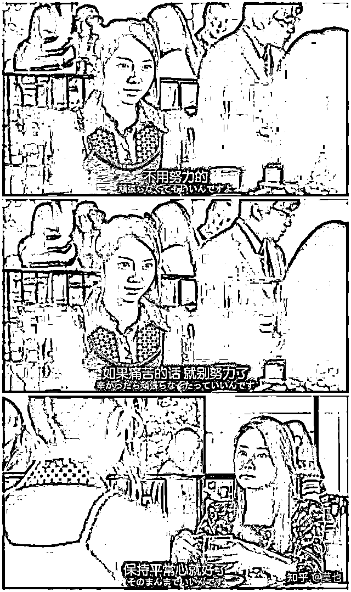

其实抑郁症的遗传基因，是一种很古老的基因，数万年前就有了。科学家曾经很奇怪，为什么这种会表现出消极情绪、不努力的基因竟然没有被自然选择淘汰，至今广泛存在？科学家的猜测就是我上面说的：这些人在族群中得到了照顾，不努力也有生存空间和有机会留下后代。

但在现代社会，不努力越来越遭遇否定和排斥。虽然也有些人对所谓的“努力”进行反思，比如乌青有一首《[家庭会议纪要](https://www.zhihu.com/search?q=%E5%AE%B6%E5%BA%AD%E4%BC%9A%E8%AE%AE%E7%BA%AA%E8%A6%81&search_source=Entity&hybrid_search_source=Entity&hybrid_search_extra=%7B%22sourceType%22%3A%22answer%22%2C%22sourceId%22%3A2287831795%7D)》的诗，就表达了这样的意识：

> **《家庭会议纪要》** /乌青  
> 昨天晚上  
> 我和妻子及孩子  
> 开了个家庭会议  
> 关于我们一家人未来的生活  
> 达成了一个共识  
> 就是四个字：  
> 虚度人生  
> 想到这点  
> 大家顿时就感觉轻松了 

无论选择努力还是不努力，正如约翰·麦克马雷说的：“**我们的存在除了意味着充分地、彻底地成为我们自己以外，还可能有什么别的意义？**”

**经过两千多年，也许我们才逐渐用各种现代哲学、心理学开始填补人类“不努力”意识的这块短板，回到了《道德经》“无为而无不为”这个原点。**

其实，我这个回答主要不是说《道德经》，而是想借这个话题，聊聊生活的可能性。

生活有多种可能，你做一个努力的人，很好！你能为世界添砖加瓦，相信也能获得应有的回报，所谓“[皇天不负有心人](https://www.zhihu.com/search?q=%E7%9A%87%E5%A4%A9%E4%B8%8D%E8%B4%9F%E6%9C%89%E5%BF%83%E4%BA%BA&search_source=Entity&hybrid_search_source=Entity&hybrid_search_extra=%7B%22sourceType%22%3A%22answer%22%2C%22sourceId%22%3A2287831795%7D)”；你不那么努力，结合你自身的生存条件和智慧，也能活出自己的精彩。

北京有一个诗人阿坚，原本是一个中学教师，上世纪 80 年代就辞了职，那时他才二十几岁，以后三十几年就再没有上班，经常游手好闲，看上去肯定是一个不努力的人。

但一辈子太长，就算不上班不挣钱，也不可能什么都不做，阿坚就做了一件很耗时间的事：走遍了深山老林去寻找隐藏在山林的古塔。最近这几年，他又做了一件耗时间的事：沿着当年红军长征的路线完整走了一遍。

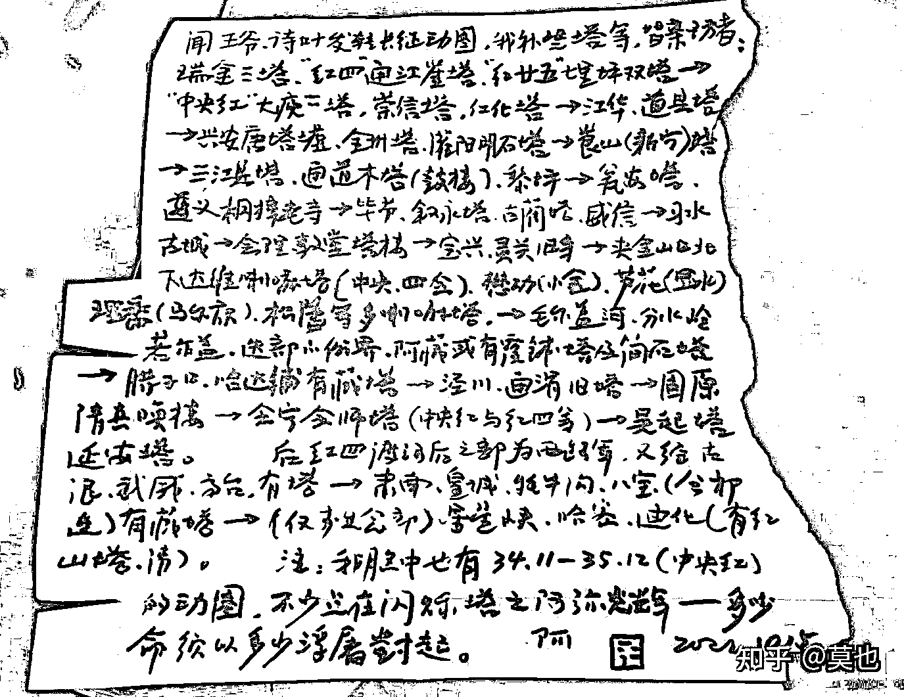

阿坚在纸上写的重走红军长征路线

所谓的不努力，很多时候是和世俗的功名决裂，清空了尘世的忙碌，就有时间做自己喜欢的事了。

这也许就有《道德经》“无为而无不为”的意思。

  

**\--------- 更新 ----------**

补充几点：

1，我提到了[生活观](https://www.zhihu.com/search?q=%E7%94%9F%E6%B4%BB%E8%A7%82&search_source=Entity&hybrid_search_source=Entity&hybrid_search_extra=%7B%22sourceType%22%3A%22answer%22%2C%22sourceId%22%3A2311366177%7D)或者人生观的多元性，我本人不做非此即彼的优劣判断。我认为找到真我想要的生活是重要的。

2，文中从人生选择角度对《道德经》进行了阐释，但《道德经》博大精深，不是仅仅有文章的这个意思。所以，文章中的最后一句话是“这也许有《道德经》无为而无不为的意思”，而不是“这也许是《道德经》无为而无不为的意思”，“有”和“是”一字之差，意思完全不同。

3，现代西方以存在主义、[人本主义](https://www.zhihu.com/search?q=%E4%BA%BA%E6%9C%AC%E4%B8%BB%E4%B9%89&search_source=Entity&hybrid_search_source=Entity&hybrid_search_extra=%7B%22sourceType%22%3A%22answer%22%2C%22sourceId%22%3A2311366177%7D)给人生选择留有充分的空间，比如[阿德勒](https://www.zhihu.com/search?q=%E9%98%BF%E5%BE%B7%E5%8B%92&search_source=Entity&hybrid_search_source=Entity&hybrid_search_extra=%7B%22sourceType%22%3A%22answer%22%2C%22sourceId%22%3A2311366177%7D)的人本主义心理学。他们会认为：如果躺平是你真正想要的生活，那你有权利选择躺平，但其中有一个基础：你需要对你自己的选择完全负责。如果你的躺平是基于啃老，本应你承担的责任转移到你父母身上，那么你是不道德的。

很多西方人对这点的态度是：子女有选择自己生活的自由，父母不干涉，但父母也有自由不养子女（将成年子女赶出家）

所以，文中提到一个重要的前提：“结合自身的生存条件和智慧”做出选择。

最后，如果这篇文章能給您带来更多的人生思考，就达到了我的目的。

# 罗汉果

> 作者：罗汉果
> 
> 赞同数：5
> 
> 编辑于：2020-10-08 05:40

大道理咱说不上来，仅谈谈生活中的感受。

很多累来自于各种各样的“规矩”，没有规矩不成方圆，可是规矩太多了就非常地累人。

儿子最近结婚，儿媳来自孔孟之乡，提亲之始规矩俩字就开始登上台面。亲家首先问道北京什么规矩，我说北京“没有”规矩，于是商定北京这边按北京的规矩办，山东这边按山东的规矩办。

说北京没有规矩是说北京没有一个格式化的规矩，北京是一个国际化的大都市，有着各种各样的人群，遵循着各不一样的规矩，选择太多了就等于没有了。其实老北京的规矩一点不亚于孔孟之乡。

于是一个“没有”规矩的人突然要遵循一套自己不熟悉的“地方法规”，就显得非常得拘束，处处不知道该如何应对，几轮下来，就感到很“累”，劳心之累！

回到题目，东亚是儒家文化的发祥地，而儒家思想的核心就是礼，重礼仪，重形式，即所谓的规矩。从最高领导人到平民百姓，一板一眼都有规矩可循。

如果全世界都这样，也就不会觉得东亚特殊，恰恰是西人有西人的规矩，就因为是双腿跪还是单腿跪的规矩，两国可以开战。西餐的规矩也与中餐的规矩大不一样，于是各种的“累”就产生了。

我曾经去澳门出差，一个人在餐厅吃饭，刀叉都放在桌子上，硬着头皮有样学样，一个老外走过来，递给我一双筷子，我好尴尬，但是醒悟了，何必难为自己呢？人家餐厅也准备了筷子。那个老外是诺基亚驻深圳公司的员工，周末来澳门度假，大概他见识了很多我这样邯郸学步的人，其实大可不必，这种“累”完全可以在文化自信中释放掉。

文化的交流，各种规矩的碰撞，才会演绎出东亚活得累的感受，其实规矩是可以改变的，[分餐制](https://www.zhihu.com/search?q=%E5%88%86%E9%A4%90%E5%88%B6&search_source=Entity&hybrid_search_source=Entity&hybrid_search_extra=%7B%22sourceType%22%3A%22answer%22%2C%22sourceId%22%3A1512260500%7D)，公勺公筷都在悄悄地渗入我们的规矩中，学习人家好的东西，摒弃我们的糟粕。

回到开头，儿子儿媳在北京由婚庆公司操办了一场西式的婚礼，山东的亲家也觉得很有面子。昨天我们参加了山东的婚礼，在亲家的亲朋好友操办下，也是非常地热闹，很有面子。但是亲家累得不轻，相比之下，我们老两口几乎没有管儿子的婚庆之事，没受累，至于别人怎么看，就不去管他了。

放下面子，能轻松很多。

# dihao1983

> 作者：dihao1983
> 
> 赞同数：28
> 
> 编辑于：2020-07-09 10:49

部分因为近代史上的斗争失败，输了不得不认，被当劳工。但是祖上富过啊，不能心安理得当鸵鸟啊，只能埋头苦干，以复兴。

世界上最快来钱的办法就是 Q，但是 Q 的实力却是建立在奋斗牺牲注重生产研发贸易团结等等好的社会品质基础之上。

为什么你在近代 Q 不过别人，归根结底，你的底子早已被抽空了，实力不如人，苍蝇不叮无缝的蛋，人弱被人欺不是很正常吗？实力不济，自然要把多吃的连本带利都吐出来，什么领土人民，矿山财富，古董文物等等，直到达成新的实力与利益间的平衡。

那问题的关键是为什么我们会输？

一切不考虑生存所需实力和利益基础上的道德说教都是空中楼阁，在社会底层，尚有建立在国家机器基础上的法律和道德约束，在国际社会国家层面，谁来立法？

就国家层面而言，实力就是最大的道德，因为实力本身必须建立在道德的基础上，没有[礼义廉耻](https://www.zhihu.com/search?q=%E7%A4%BC%E4%B9%89%E5%BB%89%E8%80%BB&search_source=Entity&hybrid_search_source=Entity&hybrid_search_extra=%7B%22sourceType%22%3A%22answer%22%2C%22sourceId%22%3A588102023%7D)道德基础的社会不可能拥有强大的力量，道德非道德，是名道德。

东亚在还祖宗的帐，西方在享祖上的福，世道轮回，因果报应，屡试不爽。少时不努力，老大徒伤悲，祖上不争气，子孙活的累。

再进一步延伸，即使没有近代东西方外部斗争的失败，东亚人会活得累吗？对于 80%的老百姓而言永远是 yes。

兴，百姓苦，亡，百姓苦。

再进一步延伸：

巨量的人口有限的资源落后的生产力，缺少源自尊重科技所发展出的多产业链，传统文化造就的商业及工业歧视，自大的心态导致的内闭政策，以及[权本位](https://www.zhihu.com/search?q=%E6%9D%83%E6%9C%AC%E4%BD%8D&search_source=Entity&hybrid_search_source=Entity&hybrid_search_extra=%7B%22sourceType%22%3A%22answer%22%2C%22sourceId%22%3A588102023%7D)导致的利益高度集中，这一整套原有文化与制度体系均会导致东亚单位生存空间极为狭窄，越往下越窄，当生存竞争剧烈的时候，活的不累才怪。东亚过去普遍重视[多子多孙](https://www.zhihu.com/search?q=%E5%A4%9A%E5%AD%90%E5%A4%9A%E5%AD%99&search_source=Entity&hybrid_search_source=Entity&hybrid_search_extra=%7B%22sourceType%22%3A%22answer%22%2C%22sourceId%22%3A588102023%7D)，人口越多，毁灭的周期越快，战争越惨烈，人民越恐惧，这反而导致人们更加迫切多子多孙，这是一个闭锁的圈。若无近代西方引入更高级的文明模版参考，若无西方为了自身利益啪啪啪打东亚的脸，很难想象东亚文明能跳脱出传统。某种程度上讲，西方式打脸要比蒙古式女真式打脸有益。

社会由大大小小的闭锁组成一个总的套，以维持一种整体的社会性的平衡和稳定，从[奴隶社会](https://www.zhihu.com/search?q=%E5%A5%B4%E9%9A%B6%E7%A4%BE%E4%BC%9A&search_source=Entity&hybrid_search_source=Entity&hybrid_search_extra=%7B%22sourceType%22%3A%22answer%22%2C%22sourceId%22%3A588102023%7D)封建社会资本社会其实代表了由低向高跳跃的文明能级。所谓量变引起质变的规律实际上是要组成系统的内部各个方面都需要被打破升级才能更上一层，阶跃总是整体的阶跃，强都是整体性的强，有主要方面缺陷其实都不算是真强；作为个体，只有完全打通周天 36 脉络才能算脱胎换骨，否则就是功亏一篑，行百里者半九十，陷于瓶颈。

东亚人活得累只是东亚社会整体内涵的外在表现之一。

# 匿名用户

> 作者：匿名用户
> 
> 赞同数：513
> 
> 编辑于：2019-02-09 09:15

很多人谈这个问题，就喜欢提各个国家的黑历史。实际上每个国家历史上都不是[白莲花](https://www.zhihu.com/search?q=%E7%99%BD%E8%8E%B2%E8%8A%B1&search_source=Entity&hybrid_search_source=Entity&hybrid_search_extra=%7B%22sourceType%22%3A%22answer%22%2C%22sourceId%22%3A591400512%7D)。所以，比历史谁更烂没意义，毕竟，我们都生活在 2000 年以后。纵向比无意义，要横向比，就比现在。

欧美底子好，过去抢了钱现在躺着赚，咱们是比不了。我也不想比。但是，日本帝国主义作为发达国家，为什么日本人也这么累。

非洲，拉美，作为发展中国家，无所事事的人很多，也不会有突然驱逐低端人口的事情发生。所以他们也可以穷快活。为什么？

——————正文————

1.人口。

亚洲聚集了全世界约 60%的人口，却只有全世界 30%的地盘。一切人类可用的资源（所有的矿，油，植物，动物，等），归根到底都是领土资源。

人多不仅仅是人均资源不足导致的竞争问题，而是人和牲口的区别问题。

人一多，人就可以当奴隶用（[奴隶社会](https://www.zhihu.com/search?q=%E5%A5%B4%E9%9A%B6%E7%A4%BE%E4%BC%9A&search_source=Entity&hybrid_search_source=Entity&hybrid_search_extra=%7B%22sourceType%22%3A%22answer%22%2C%22sourceId%22%3A591400512%7D)），当牲口用（封建社会），当机器用（工业社会）。每一个富豪权贵的酒池肉林海天盛筵，就是几千个奴隶，佃户，工人或者打工仔的汗水和身体。

因为人均资源不够，所以两者的生活水平完全就是人和牲口的区别。前者可以轻易拿走几千人利润指数级奢侈，后者永远只能温饱。

（嗯，评论里有人指出资本主义原始积累的时候也这么搞，但没有那么多人的时候，资本原始积累更多靠的是机器化大生产，而不是靠三个人做一个机器的活）

这种区别，大过全世界所有地方。因为我们还有——

2.等级文化

就算你是国王，你也不能挡住我这个乞丐晒太阳。私有财产神圣不可侵犯，只要你自己乐意，你就算一条蛆，只要你觉得自己的粪坑爽，也没人随便来赶你走。

这种思想，在东亚是不可能存在的。整个东亚流行的是——率土之滨，莫非王臣。雷霆雨露，俱是天恩。私有财产？你的一切都是那谁谁给的！至于你占着茅坑不拉屎，那你是活该找死。知道什么叫卧榻之侧岂容他人鼾睡吗？

不要误会，我并不是说西方好。东亚这种等级制度深入所有场合，官场，职场，亲戚场，所有场无处不在。比如有些非洲国家，一个人就是懒，游手好闲，也没人说三道四，反正大家都这样。但是在东亚你这么搞，朋友？不存在的，你的亲戚都会嫌弃你，避之不及。

（我知道评论里面有些人会谈到屠杀土著的事情，请记住，全世界任何地方扩张的时候都会杀土著。我们现在讨论的是，杀完土著以后怎么对自己人。）

  

在东亚，如果你一个不小心，沦为底层，那么[马斯洛](https://www.zhihu.com/search?q=%E9%A9%AC%E6%96%AF%E6%B4%9B&search_source=Entity&hybrid_search_source=Entity&hybrid_search_extra=%7B%22sourceType%22%3A%22answer%22%2C%22sourceId%22%3A591400512%7D)的理论你基本全玩完。

生理需求，饮食男女，都只能苟且撸一辈子。

安全需求，想岁月静好，会被权贵碾压。

归属与爱，社交和尊敬，更加是做梦了。

不努力基本上就约等于[社会性死亡](https://www.zhihu.com/search?q=%E7%A4%BE%E4%BC%9A%E6%80%A7%E6%AD%BB%E4%BA%A1&search_source=Entity&hybrid_search_source=Entity&hybrid_search_extra=%7B%22sourceType%22%3A%22answer%22%2C%22sourceId%22%3A591400512%7D)，自绝于人民了。

大家都拼命怕掉队，怎么会不累呢？

# 喜马拉雅山猫

> 作者：喜马拉雅山猫
> 
> 赞同数：36
> 
> 编辑于：2019-10-25 11:00

如果这是事实，那么以下几个原因可能造成这一现象：

第一、资源禀赋和人口。我们常常说，中国以 7%的耕地养活了世界 20%的人口。中国胡焕庸线以东的区域，每平方公里人口估计约 320 人/平方公里，那么，韩国、日本、香港，其实数据更夸张。其中，日本每平方公里人口为 347.8 人，韩国为 529.7 人/平方公里。而欧洲发达国家如英国为 270 人，德国为 237 人，法国为 122 人，美国为 35.6 人。简单的想，假设资源是平均分布在土地上的，且各国间不进行贸易，韩国人要想过美国人的日子，那需要比美国人努力 14.8 倍。与温带国家比，东亚不占优，那么与非洲比，与东南亚国家比，东亚应该好很多吧？很抱歉，很可能不是。别的不好说，但从食物角度讲，非洲国家应该是富裕国家。据称，非洲有种猴面包树，种一棵树，够全家人吃喝。在热带地区，你完全可以过着采集狩猎的日子，不用关心储蓄，饿了随时上树摘，渴了直接喝农夫山泉。而温带国家，如果一季不种粮，很可能全家都凉凉。

第二、如果东亚人想要过欧美人的生活怎么办？那么只有一条路，就是国际贸易。土地上没有资源，那就只有动用人力资源。先是日本，而后韩国、香港、台湾，接着是中国，无一不受惠于国际贸易。几乎都是从进口技术、设备、原材料开始，然后进行加工，再出口。而这，造成了东亚的产业的雁阵模式，前面较发达的国家向后发国家转移劳动密集型产业，同时，又不得不进行高密集的研发来保持优势。各个国家之间，既有横向竞争，又有纵向竞争。竞争的加剧，造成了东亚的出口商品几乎无[定价权](https://www.zhihu.com/search?q=%E5%AE%9A%E4%BB%B7%E6%9D%83&search_source=Entity&hybrid_search_source=Entity&hybrid_search_extra=%7B%22sourceType%22%3A%22answer%22%2C%22sourceId%22%3A869236964%7D)，而且，几乎都是同质类产品。对比下欧洲，就非常明显了。德国的主要产业是有电子、航天、汽车、精密机械、装备制造、军工，法国则是葡萄酒、农产品、高档时装、香水、化妆品、核能、石油化工、海洋开发，英国则是金融保险、零售、采矿、冶金、化工、机械。

第三、先发有优势还是后发有优势？我们常常说，我们有后发优势，能够避免掉别人走错的路。不过，后发型国家，在同一类产品上的竞争，基本是靠价格战，靠的是压榨利润和低工资。[港珠澳大桥](https://www.zhihu.com/search?q=%E6%B8%AF%E7%8F%A0%E6%BE%B3%E5%A4%A7%E6%A1%A5&search_source=Entity&hybrid_search_source=Entity&hybrid_search_extra=%7B%22sourceType%22%3A%22answer%22%2C%22sourceId%22%3A869236964%7D)，荷兰公司曾经就咨询费要价 15 亿，原因就在于你可以提供技术上的垄断性产品。这家咨询公司有可能技术相关专利的 R&M 仅 10 亿而已。因为技术和经验方面的垄断，他的报价不是根据他的研发费用，而是你的项目预算，也即你能出的最高价格。这是其一。其二，是历史上的优势。这个优势是自大航海时代建立的优势，如这个世界的通用语言是英语，主要商道、贸易战略要地、最赚钱的矿产、能源仍然实际控制在欧美国家。其三，是价值的引领。明明知道奢侈品成本不到 100 美金，你还愿意拿出 10000 美金去买？原因是你被各种目不暇接的媒体洗脑，认为这个就应该值这个钱。想想黑珍珠和钻石的商业案例。

# 徐辰

> 作者：徐辰
> 
> 赞同数：46
> 
> 编辑于：2019-03-01 11:07

因为东亚人没有跑到别人地方把原住民杀光把地盘占了再把财富都抢过来传给子孙让他们冒充文明人一边[好吃懒做](https://www.zhihu.com/search?q=%E5%A5%BD%E5%90%83%E6%87%92%E5%81%9A&search_source=Entity&hybrid_search_source=Entity&hybrid_search_extra=%7B%22sourceType%22%3A%22answer%22%2C%22sourceId%22%3A611212761%7D)一边鄙视辛勤的劳动人民。日本脱亚入欧的时候试过一次水然后发现此路不通现在也断了这个念想。

说东亚人欲望太大的就真是不要脸了，东亚人的人均资源占有量和西欧北美在一个水平线上不？

# Kempen

> 作者：Kempen
> 
> 赞同数：35
> 
> 编辑于：2019-06-01 13:32

非常简单，祖宗实在太不争气，没有给东亚人留下一分地，全世界都被白人老祖宗占领了，北美南美澳洲[西伯利亚](https://www.zhihu.com/search?q=%E8%A5%BF%E4%BC%AF%E5%88%A9%E4%BA%9A&search_source=Entity&hybrid_search_source=Entity&hybrid_search_extra=%7B%22sourceType%22%3A%22answer%22%2C%22sourceId%22%3A701999077%7D)直接就变成白人地盘了，非洲就是白人[殖民地](https://www.zhihu.com/search?q=%E6%AE%96%E6%B0%91%E5%9C%B0&search_source=Entity&hybrid_search_source=Entity&hybrid_search_extra=%7B%22sourceType%22%3A%22answer%22%2C%22sourceId%22%3A701999077%7D)，全是白人的。

东亚总人口抵得上欧美的总人口，但人家占的土地是我们的 5 倍 10 倍。

跟现实社会一样，拼爹的世界，没个好爹好爷爷真没法玩。

如果你问我这个世界上最想揍的人是谁，不是白人不是日本人，就是我们这些不思开拓的傻逼老祖宗。

我一直觉得欧美成为世界上最发达国家的原因根本不是什么制度科学文明，而是地理大发现。

# 妙途日本留学

> 作者：妙途日本留学
> 
> 赞同数：225
> 
> 编辑于：2019-02-27 23:33

主要有两方面的问题

一方面是**国家层面**，另一方面是**个人层面**。

国家层面上，由于东亚地区近代以来未能追赶上工业革命的东风，未能在第一时间参加对[新大陆](https://www.zhihu.com/search?q=%E6%96%B0%E5%A4%A7%E9%99%86&search_source=Entity&hybrid_search_source=Entity&hybrid_search_extra=%7B%22sourceType%22%3A%22answer%22%2C%22sourceId%22%3A583941868%7D)等欠发达地区的掠夺，至今来看东亚主要三国中、日、韩皆为后发国家。的确需要“撸起袖子加油干”来保证未来的发展。

个人层面上，由于东亚地区一直人口众多，每个人的忧患意识也很重。我们对“未来不确定性”的恐慌远比欧美严重。所以说不好听的东亚都比较盛产“奋斗比”嘛，只能靠这种手段来确保自己在某方面的“优势”，搞得整个劳动者环境比较恶劣。

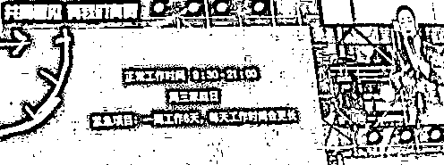

就这样 还有人洗地呢

首先从**国家层面**上我们来进行一下分析，东亚地区说来说去就是中国、朝鲜、日本。在近代之前，整个地区的核心由中国领导，中国的语言文字和文化习俗极大的影响了周围的国家，以至于形成了“汉字文化圈”。朝鲜半岛上的国家不用提了，在被日本人征服之前一直属于和中国藩属发关系，日本虽然一直未曾被占领，但是其文化也是受到了中国的深远影响。

时间跨越到近代，中日两国几乎在同一个时期遇到了西方强敌。具体事件日本的黑船来航，中国的[鸦片战争](https://www.zhihu.com/search?q=%E9%B8%A6%E7%89%87%E6%88%98%E4%BA%89&search_source=Entity&hybrid_search_source=Entity&hybrid_search_extra=%7B%22sourceType%22%3A%22answer%22%2C%22sourceId%22%3A583941868%7D)。拜日本不是那么“中央集权”的政治制度所赐，日本很快学以致用，成功的进行了改革，照着西方的路数把自己重新塑造了一遍。而且还有样学样的开始对外侵略，意图推翻中国主导，开始做着所谓“大东亚共荣”的美梦。

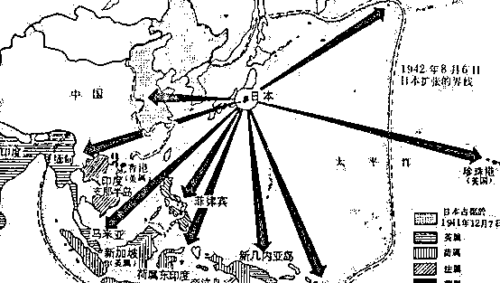

同时期的中国由于过于中央集权的政治体制，最终[洋务运动](https://www.zhihu.com/search?q=%E6%B4%8B%E5%8A%A1%E8%BF%90%E5%8A%A8&search_source=Entity&hybrid_search_source=Entity&hybrid_search_extra=%7B%22sourceType%22%3A%22answer%22%2C%22sourceId%22%3A583941868%7D)破产，改革失败。在一次又一次的对外战争中失利，被迫让位亚洲领导地位。

可惜历史证明了日本这种由自己主导**“整合亚洲”**彻底失败了。二战结束以后，整个东亚的底子几乎被清零，之后日本在经历二战的破坏重建之后，又遇泡沫经济，韩国、中国台湾地区在上世纪 60 年代飞速发展，我国则在改革开放以后发展。

所以相较于至今还可以找到冤大头做“商品倾销地”转嫁“国内矛盾”的欧美发达国家不同，东亚国家在这方面毫无优势，曾经还一度成为“世界加工厂”当然。现在的情况会好一些。

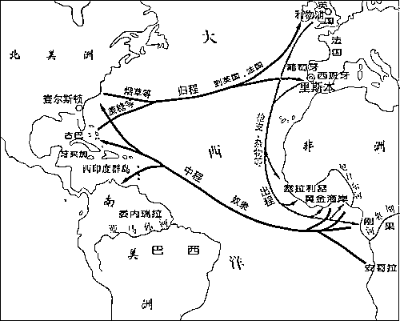

著名的三角贸易 让欧洲人获得了丰厚的原始积累

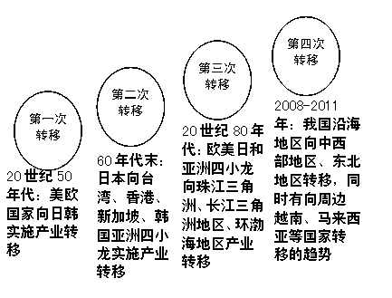

通过产业转移 发达国家将会变得越来越有钱

再有从**个人层面**上分析，以为气候利与农业生产原因，东亚地区自古人口稠密。有人的地方就会有竞争，庞大的人口又会放大这一现象。加之东亚相较于欧陆，没有什么特别激烈的宗教纷争，东亚趋同的文化环境造就了很长的“稳定期”所以通过战争掠夺的情况其实并不多。每个人还是希望通过一种比较“正当”的手段去获得权力，所以中国的“科举制度”对东亚产生了深刻的影响。

所以我们从小接受的教育也是，竞争性质比较重的，在很长的时间内也忽视了“[精神文明](https://www.zhihu.com/search?q=%E7%B2%BE%E7%A5%9E%E6%96%87%E6%98%8E&search_source=Entity&hybrid_search_source=Entity&hybrid_search_extra=%7B%22sourceType%22%3A%22answer%22%2C%22sourceId%22%3A583941868%7D)”的建设，只看结果不看过程的验收制度。多种因素下导致每个人活的挺“累”。

当然，前途是光明的，道路是曲折的。随着新技术的运用，相信我们思维活络的东亚人一定会赶上新一轮技术革命，甚至是主导技术革命，想必到时大家的负担会减轻许多吧。

# 知乎用户

> 作者：知乎用户
> 
> 赞同数：13
> 
> 编辑于：2020-08-02 00:07

东亚的大学，普遍比美国轻松，却不见有人提及呢？

东亚的政府机关也是轻松愉快，就没人喊了。

东亚退休早，根本不提。

不，我觉得你们这伙人要干嘛？

# 知乎用户

> 作者：知乎用户
> 
> 赞同数：24
> 
> 编辑于：2022-03-24 11:52

东亚人，人口多，资源少，内卷厉害。

不累的是谁？

1、中东，遍地是石油，开个矿，躺家里也舒服赚钱。

  

2、欧洲

欧美人的祖先抢了几百年了，光我大清就赔了多少白银了。全世界殖民，抢了多少金银财宝。

更为重要的是，奠定了世界话语权。这个太重要了。不但抢了硬件，还安插了木马。以后钱财就源源不断的流向欧洲。

  

3、美国

美国自己也没少抢，而且也是站在欧洲这个绿巨人的肩膀上享受世界话语权的。

制度规则，还有”标准“，都是它们制定的，既有前期发展优势开发科技还有专利保护，还可以优先占据产业链上游。

更重要的是，美国人没钱了，开足马力，印钞票！ 开足航母，抢石油！

  

4、非洲，非洲是苦，不是累。人倒不是太累，但是生活太苦。中国人不习惯。

非洲人怪中国人，中国人来了，没生意了。他们早上一觉睡到七八点，中国人居然三四点就起来在市场卖东西了！完全没法比。

  

5、拉美。

和非洲类似，没钱也可以天天跳舞。中国人接受不了。

  

所以如果想过好日子，没有上述几位的条件，又比上述几位心高。

只有一条路：就是累。

  

中国人可以忍受贫穷。贫穷的日子咱也过过。

但是忍受不了别人过的比我好。只要有人比我好，我就睡不安稳，我无论如何也要想办法超越他。尽管最后命里没有，但是我也要尽我自己的力。

所以，在中国，只要有贫富差距，就有财富榜样。

就得拼。

老公不想拼，老婆也得数落他，你看看人家的老公！

然后自己拼不过，也要把下一代教育好，拼下一代。

孩子不想拼，也数落他：你看看人家的孩子！

中国有句话，人比人，气死人。

  

攀比是把双刃剑，苦了自己，活跃了经济。

# 甲鱼不是龟

> 作者：甲鱼不是龟
> 
> 赞同数：35
> 
> 编辑于：2020-08-19 04:10

因为东亚人同属儒家文化圈。

儒家文化圈啥特色？[宗教信仰](https://www.zhihu.com/search?q=%E5%AE%97%E6%95%99%E4%BF%A1%E4%BB%B0&search_source=Entity&hybrid_search_source=Entity&hybrid_search_extra=%7B%22sourceType%22%3A%22answer%22%2C%22sourceId%22%3A1418368903%7D)淡泊，实用主义深入骨髓。

# 麦瓜

> 作者：麦瓜
> 
> 赞同数：3409
> 
> 编辑于：2019-03-16 16:42

你们真的以为欧美人不累，光东亚人累？

我记得改开后，一大批知识分子走出国门，来到香港，来到美国，大呼：我们闭关锁国这么多年，我们落后了。。。

是事实吗？似乎是。但当历史卷轴拉开，真正的事实是。。。我们 49 年前比现在落后得还多。过去我们是 1, 人家是 100， 然后我们是 40，人家是 200，这到底是差距拉大了，还是缩小了？考验初中数学水平的时候到了，go figure.

那么来看看英国人的生活，读一读类似“[80 天环游地球](https://www.zhihu.com/search?q=80%E5%A4%A9%E7%8E%AF%E6%B8%B8%E5%9C%B0%E7%90%83&search_source=Entity&hybrid_search_source=Entity&hybrid_search_extra=%7B%22sourceType%22%3A%22answer%22%2C%22sourceId%22%3A610168502%7D)”这类小说。你猜一猜一个上尉连长，也就是中产的末流会是什么生活？没错，他驻扎在印度可以轻松享受一群阿三仆人的服务(题外话，至今一个米国 it 工程师的工资都可以在印度雇十几个仆人呢)，他的太太呢？打打牌，喝着下午茶 gossip 一下。(参考一下 agatha christie 小说里妇女们的惬意生活)。现在呢？你们去查查英国中产里多少得必须双职工工作养家。

米国呢？米国人民最轻松惬意的时候是什么时候？没错，50 年代。大量妇女不需要工作。家里一个男人工作，4-5 口之家的米国人民就可以享受今天的美好生活。现在呢？你以为妇女工作光是女权的结果？米国淫民的相对生活质量从 50 年代起就在走下坡路。要查资料应该有大把。恰巧洒家 20 年前留学时关注了这个问题。

也就是说，英国从日不落殖民抢劫的巅峰到今天，不仅干的活儿多了(当然，他们还没我们干得狠)，相对生活质量还下降了。

米国同样，不过巅峰期是二战横财之后。

中国在 49 年什么情况？比印度低一个量级。不信？你们再去查，真以为民国是个浪漫的大师时代？我们这边军阀混战的时候，印度已经建设了 100 多年了。

中国用前 30 年时间追上印度没？中国用 30 年时间就从农业国变成了工业国了。不仅超了印度，估计追平北约末流，华约中游了。然后又 40 年时间，中国城市中产已经瞄着米国中产生活水平了。

生活质量在这么短时间里大幅度提高，从黑非洲水平大幅直逼工业七国，中国抢谁了没有？累点儿不正常吗？否则天上真会掉馅儿饼？

有人说。。。那日本呢？日本被米国打回过原型没？按理说富起来后，干嘛还要那么累，不能喘口气享受生活吗？一个是米国广场协议又砸了日本一回。另一个呢？中国，韩国在抢他生意啊。要没中国这个“混蛋”，日本即使被米国爆日两回后，新一代现在也美滋滋啊。世界虽然不是零和游戏，但也不可能世界总体每年长 10%吧？中国抢了多少国的蛋糕？go figure.

有人说了，米国蓝领，老墨生活得多开心？巴西人再穷也整天桑巴舞呢。他们应该像我们学习工作，我们应该向他们学习生活。我们中国人太贪婪了。。。

没错。从个人角度，你完全可以不参加这残酷的竞争。你可以像穷老墨，老黑，老白一样吃了日，日了吃。有点儿钱就享受生活。那么我问你，你孩子咋办？

想一想穷不过三代，要么你像丁克，独身主义者一样，主动绝后，要么几代以后你孩子也是渣子失去了繁衍的权力。当然，好的社会保障可以延缓你绝后。反正命运在别人手里，不在自己手里。

有人会说，都什么年代了？难道俺还在讲不孝有三，无后为大吗？不是。你我都有绝后的自由。但中国人都抱或主流文化抱这种心态，中华文明就不可能是几千年唯一传承的文明。想明白吗？那么多文明是怎么湮灭的？

没错，中华文明整体，特别讲究对传承的责任，对后代的责任。有责任，确实就多了负担。换来的，也是延续传承。无论是你的家族，还是国家或文明整体。

如果没有这个文化基因，凭什么在民族危亡时，有前辈们站出来抛头颅洒热血牺牲自己？

西方文明是：“为了(我们的)自由，拼了”

中华文明是：“为了我们的下一代，拼了”

与前辈牺牲自己生命相比，我们只是累一点儿，而且很大一部分是为了自己的家人，孩子更幸福。唧唧歪歪什么？我相信下一代会好些。(年轻人抱怨最多的，不就是油腻中年人说你们不能吃苦吗？这吃苦的主体，不就是累吗？小声告诉你们，油腻的我们也这样被前辈骂过。。。这不正说明，累，在一代代减轻吗？)

你们看到了欧美的轻松，看不到欧美的相对位置正在下滑(你们觉得最会享受生活的意大利，西班牙，希腊还会再起吗？)，更看不到他们曾经更轻松。

你们看到了全世界华裔，东亚裔比当地族群更累逼，看不到华裔东亚裔族群在全世界的经济地位都很高。

你们看到了东亚(中华文明圈)的累，看不到全世界几乎只有东亚能够非战争崛起(我可没说日本没靠战争掠夺中国崛起过，这里是考验逻辑的时候)。更看不到我们曾经更累。

也就是说，在目前世界结构下，东亚文明核心的中华文明之魂，勤劳，不容诋毁。外部说我们是象工蜂一样的黄祸(而看不到汉唐宋文明的璀璨与创造力)，内部无限放大“选择大于勤奋”，以享乐主义洗脑。。。这都是挖中华文明之根。

至于个体情况的微调，当然根据自己情况自由调整，你可以累得像条狗，或者活得像头猪。去尼泊尔，去西藏出家都可以。

从政府社会来说，更好的社会保障体系，解除大病，退休之忧，住房，教育，医疗三座大山的解除。。。还有许多空间。

从人类系统来说，目前还是一个金字塔结构人们争着往上爬。或者几个[金字塔](https://www.zhihu.com/search?q=%E9%87%91%E5%AD%97%E5%A1%94&search_source=Entity&hybrid_search_source=Entity&hybrid_search_extra=%7B%22sourceType%22%3A%22answer%22%2C%22sourceId%22%3A610168502%7D)之间争谁摞在上面。这种系统存在，竞争之累就不可避免。

要从根本解决，是哲学问题，社会问题，也可能是科技问题。得做[matrix](https://www.zhihu.com/search?q=matrix&search_source=Entity&hybrid_search_source=Entity&hybrid_search_extra=%7B%22sourceType%22%3A%22answer%22%2C%22sourceId%22%3A610168502%7D), 三体那样级别的反思。俺还没想明白(或许沟命海心，至死都轮不到俺想)。预计要在孔孟诸子，资本论，主席思想中找营养与灵感。因为他们的理想是。。。世界大同，人与人，人与自然间的。。。和谐。

  

  

  

  

sssssssssssss

题外话再多啰嗦几句。我们年轻的时候也被长辈骂(不能吃苦啊，能力低下啊)。当时心里肯定不服，也私底下回骂过，可能唯一的不同是没敢瞧不起他们(这个不敢太确定，毕竟过了几十年)。

到了油腻的中老年(80 后给我闭上鸟儿嘴，你们离真正油腻还至少有 10 年)，渐渐开始理解前辈们：

前辈的前辈的前辈们，为后代以命(literally)相搏。

前辈的前辈们是铁人王进喜们，没有他们那代玩儿命，中国工业化不可能。

前辈们[上山下乡](https://www.zhihu.com/search?q=%E4%B8%8A%E5%B1%B1%E4%B8%8B%E4%B9%A1&search_source=Entity&hybrid_search_source=Entity&hybrid_search_extra=%7B%22sourceType%22%3A%22answer%22%2C%22sourceId%22%3A610168502%7D)，没有他们那代吃苦受累，农村将继续蒙昧。。。

他们确实为了我们比我们累，比我们苦。他们骂我们的意义不在于“我们要与他们吃一样的苦”，而在于“把勤劳，这个中华文明之根传承下去”。

作为 80，90，00，10 后。你们只须记住几个场景：枯燥之极的流水线，工地搬砖，骑着破自行车上下班的教授。你们不必再受这些累，但请记住是他们供养了你们。

然后，继续特么滴骂你们的下一代“这点儿苦，这点儿累都受不了？”(老子当年培训班得上 10 个，读书，加班得到 12 点。。。诸如此类)。。。这叫传承(我这里是认真的)。

最后，这里俺没有任何意图支持剥削，内耗导致的累。但那是公平，效率问题。与文化问题不在同一层级。

ssssssssssssss

看到评论区的许多发言，俺相当无语。这里补充说明一下。也权当总结一下。

1.我在讨论文化问题。不想讨论政治问题。原因？你们知道。

2.有人很受不了前 30 年有成就。怎么可能 30 年(实际不到)就把中国从[农业国](https://www.zhihu.com/search?q=%E5%86%9C%E4%B8%9A%E5%9B%BD&search_source=Entity&hybrid_search_source=Entity&hybrid_search_extra=%7B%22sourceType%22%3A%22answer%22%2C%22sourceId%22%3A610168502%7D)变成工业国呢？工业国简单是指工业生产总值大于[农业生产总值](https://www.zhihu.com/search?q=%E5%86%9C%E4%B8%9A%E7%94%9F%E4%BA%A7%E6%80%BB%E5%80%BC&search_source=Entity&hybrid_search_source=Entity&hybrid_search_extra=%7B%22sourceType%22%3A%22answer%22%2C%22sourceId%22%3A610168502%7D)的国家。1978 年，中国工业生产总值：农业生产总值=1.7：1

既然受不了，你们就姑且认为前 30 年 P 也没干，全靠后 40 年吧。反正这个不影响我立论。

好像我调侃了一下极度落后的民国。一些人似乎又疯了。那就姑且认为零点是满清吧。满清粉这边儿就没法让步了。。。

3.中心思想总结一下，免得阅读理解能力有障碍的又发疯：

1) 世界是金字塔，人也好，国家也好都想往上爬。累首先是因为这个产生的。(坑蒙拐骗偷抢，做鸭子拿到一大笔投资。。。这些属偏门儿，尽管这曾经是世界主流)

2) 我看[速度加速度](https://www.zhihu.com/search?q=%E9%80%9F%E5%BA%A6%E5%8A%A0%E9%80%9F%E5%BA%A6&search_source=Entity&hybrid_search_source=Entity&hybrid_search_extra=%7B%22sourceType%22%3A%22answer%22%2C%22sourceId%22%3A610168502%7D)，有人只看静止位置(这个看不懂的请跳过)

3) 从金字塔上面往下滑时，不仅生活条件下降，还往往越来越累。上升时相反。

4) 中国文化基因中重勤劳，重传承，是唯一近现代不靠“坑蒙拐骗偷抢，睡富婆”，而以最快速度，爬到高位的国家。也是唯一几千年文明连续传承的国家。累些正常，越来越少累些。但勤勉，传承不能丢。

5) 与解决内部分配不公，和个体选择采菊东篱下，悠然见南山，一点儿不矛盾。(看不懂这个的，我也懒得再回复你们了)

sssssssssssss

看到评论里这么多人提到“内卷化”。叉子们知道[内卷化](https://www.zhihu.com/search?q=%E5%86%85%E5%8D%B7%E5%8C%96&search_source=Entity&hybrid_search_source=Entity&hybrid_search_extra=%7B%22sourceType%22%3A%22answer%22%2C%22sourceId%22%3A610168502%7D)是哪儿来的，是什么意思吗？给你们提个醒，它原文叫 involution。在社科领域粗浅的理解就是相对于[revolution](https://www.zhihu.com/search?q=revolution&search_source=Entity&hybrid_search_source=Entity&hybrid_search_extra=%7B%22sourceType%22%3A%22answer%22%2C%22sourceId%22%3A610168502%7D)，本该进化，可就是死活进化不了，甚至退化。在中国的首次应用是史学界有人认为明末实际上资本主义不仅发生不了，反而封建内卷，因为作坊主挣的钱都用来买地了，而没有成为扩大再生产的资本(尽管我并不认可其主观点)。

看看你们这群叉子把“内卷”当什么了？真是不学有键盘。

sssssssssssss

没想到在知乎一年多，杂七杂八乱答近 150 问题，这个有火的趋势。俺滴所有回答，只要认真的，是不屑与别人雷同的。而且往往视角争议性极大。与知乎主流价值观可能相悖。经常好不容易高赞，又被排到底下去了。被举报还挺多。

这里趁机推下私货。个人火不火无所谓。但自傲的视角得不到传播。很让好为人师，油腻，眼高手低，小母牛翻跟斗滴俺郁闷。。。

谈文化的：

 

  

 

  

 

  

移民文化

 

  

谈历史事件的：

国共内战，朝鲜战争

 

  

朝战美军伤亡

 

  

中印关系

 

  

谈人物：

 

  

 

  

军事：

 

  

 

  
  

企业：

 

  
  

谈一些现象的：

 

  

 

  

 

  

 

  

有些敏感

 

# 鸣凤

> 作者：鸣凤
> 
> 赞同数：51
> 
> 编辑于：2019-01-29 04:55

除了高赞的雪中莲贴的那篇宁南山的文章写的这些原因，我觉得还有个重要原因东亚陷入了大量的“内耗”中。难以聚力。有人说美国可以薅德国羊毛也可以薅日本羊毛，但美国就喜欢薅日本羊毛，为啥？除了肤色之类的原因，更多原因是德国是欧盟中的德国，而日本是和东亚各国几乎都有冲突的日本。融入欧盟中的德国可以借助欧盟的力量，从大半个欧洲考量在有些方面对美国说不。而日本就不行。前段时间德国建议法国的大流氓[否决权](https://www.zhihu.com/search?q=%E5%90%A6%E5%86%B3%E6%9D%83&search_source=Entity&hybrid_search_source=Entity&hybrid_search_extra=%7B%22sourceType%22%3A%22answer%22%2C%22sourceId%22%3A584402388%7D)改由欧盟行使，虽然这提议不可能，但也部分反应了这个问题。而日本，东亚倒是有这种力量，但它敢接受？

还有军事上政治上历史遗留问题东亚国家地区之间各种冲突。中国的两岸问题，半岛的对立问题，中日钓岛领海，日韩独岛问题……导致各国大量的军备投资，不像西欧争端较少各国马放南山。而且因为冲突，导致东亚各国除中国大陆外，经常难以靠自己的力量研制军工装备，冲突之下又不可能和西欧一样联合研制。[宁南山](https://www.zhihu.com/search?q=%E5%AE%81%E5%8D%97%E5%B1%B1&search_source=Entity&hybrid_search_source=Entity&hybrid_search_extra=%7B%22sourceType%22%3A%22answer%22%2C%22sourceId%22%3A584402388%7D)说的军事装备也能带动产业，这点就在大陆外的国家地区失效了，大量这种投资不能注入到本国本地经济中去，本国本地区人员不能受益。因为东亚大量的军事装备外购，战机像西欧起码还有双风，幻影鹰狮等。日韩台都是装备两三百架[三代机](https://www.zhihu.com/search?q=%E4%B8%89%E4%BB%A3%E6%9C%BA&search_source=Entity&hybrid_search_source=Entity&hybrid_search_extra=%7B%22sourceType%22%3A%22answer%22%2C%22sourceId%22%3A584402388%7D)的国家和地区，但大部分外购。交保护费呀，而且卖方正是西方，这是一增一减。

同时因为新近崛起的国家和地区基本都是东亚的，产业上的重叠和竞争非常明显，地缘的相近技术上的跟随，来自邻居的挖墙角挖客户往往相当精准。[零和博弈](https://www.zhihu.com/search?q=%E9%9B%B6%E5%92%8C%E5%8D%9A%E5%BC%88&search_source=Entity&hybrid_search_source=Entity&hybrid_search_extra=%7B%22sourceType%22%3A%22answer%22%2C%22sourceId%22%3A584402388%7D)，发达国家粉碎机之类的事在东亚相当明显。日本人本来美滋滋的卖着家电电子电器，结果韩国家电电子电器崛起了，韩国好端端的卖着家电电器，结果中国这行又搞起来了。类似的例子非常多，日本的造船，韩国的造船到中国的造船。日本的屏幕到韩国到中国，日本的高铁和中国高铁争订单，台湾的电脑手机到大陆的电脑手机，……数不胜数而且还会继续下去，如未来可预见的台积电和中芯国际之间的关系。这种情况导致东亚先发国家也很不好过。而西方工业化时间更长，传统行业占的更多同时产业分工比较明确比较固定了，这种情况要少的多。

下面列一下欧洲和东亚各大空军三代机数量对比，可以看看。数据来源超网十年军迷。侵删。

法国 133 架幻影-2000

108 架阵风

3 代机总计 241 架

大英

143 架台风

81 架狂风（大部分废了）

西班牙

61 架台风

85 架虫子

德国

118 架台风

94 架狂风攻击型（大部分废了，不能用）

28 架狂风电子战型号

面条

87 架台风（还有 9 架没到账）

70 架狂风

韩国

比起法国，韩国空军真的毫不逊色

169 架 F16

59 架 F-15K[高丽鹰](https://www.zhihu.com/search?q=%E9%AB%98%E4%B8%BD%E9%B9%B0&search_source=Entity&hybrid_search_source=Entity&hybrid_search_extra=%7B%22sourceType%22%3A%22answer%22%2C%22sourceId%22%3A584402388%7D)

总计 228 架三代机，实力非常强劲，同时保留了大规模二代机群。

宝岛—小弯弯

143 架石榴

55 架幻影-2000（这些年妥善率不高）

127 架 IDF

总计 325 架三代机（虽然，平均质量不高），这是继 tg，俄罗斯，美国，印度，犹太之后全球第 6 规模的三代机群

日本

200 架 F-15J

81 架 F-2

这在东亚是正常规模。

# 抱风眠

> 作者：抱风眠
> 
> 赞同数：61
> 
> 编辑于：2019-02-15 22:47

东亚由于历史文化的原因所形成的——畸形的等级森严的社会并没有随着工业化解体。

在现代社会中上级对下级，老领导对老部下,同乡战友等等社会关系中，依然顽固的坚持着另一种君君臣臣、父父子子、夫夫妻妻。

如果想要事业成功，你不仅需要是一个大学教师、工程师、程序员、军人、运动员，还需要是一个政治家和社会活动家。

这种等级森严的社会，使得高等级的人追求对低等级的如臂使指，低等级的人小心翼翼的试图阅读高等级的意图。自己要不断精进什么地位什么时候说什么话、什么时候倒酒，应该在正门停车位哪个位置停车等等等等。不见具体条文的繁文缛节和阅读空气的规矩，极大的消耗了作为人本身的能量，这就很累了。

这种等级社会进一步加剧了人的竞争，要想活得轻松，仅仅干得好是不够的，还更要爬的高。

毕竟数千年来，我们都不曾追求作为法制社会中一个平等的公民，在相对平等的社会里平等的对所有人。我们总是处在不是你给我跪着，就是我给你跪着的情景下。放在现在就是不是你坐在前三排骂我整我，我还得写检讨，就是我坐在前三拍骂你整你，你给我写检讨，不是你阅读我的空气，就得我阅读你的空气。虽然有选举，有劳动保护法，但权力比法律更有保障。

  

在没有基本平等的前提下，我们都不得不追求做“人上人”，但毕竟人上有人。途径就是吃“苦中苦”，都吃苦中苦，看谁更苦，对上边跪着吃苦，能不累吗？

# 胆小男孩做大事

> 作者：胆小男孩做大事
> 
> 赞同数：42
> 
> 编辑于：2022-03-22 04:12

“吃得苦中苦，方为人上人”。

“劳心者治人，劳力者受制于人。”

“万般皆下品，唯有读书高”。

“朝为田舍郞，暮登天子堂”。

.....................

我们的古代文学作品里，充斥了“等级”思想。我们的历史，总是在写王侯将相，却从不写黎民百姓。也因此，我们中国人长期以来的人生价值，都致力于做“高等级”的“人上人”。

竞争，既是我们痛苦的来源，又是我们快乐的源泉。

如果在我们的价值体系里，除了做“人上人”外，还存在其他的理想，我们的人生会惬意许多，人和人的关系会融洽很多，上下级关系也不会僭越到人格的层面。

人和人的关系，除了竞争，其实还有很多其他的可能性。人生价值，除了从他人的认可中找，还能从自己内心去找。

# 孫小

> 作者：孫小
> 
> 赞同数：41
> 
> 编辑于：2019-08-07 15:45

因为内卷，首先要了解一下什么叫内卷。按照[曹大佐](https://www.zhihu.com/search?q=%E6%9B%B9%E5%A4%A7%E4%BD%90&search_source=Entity&hybrid_search_source=Entity&hybrid_search_extra=%7B%22sourceType%22%3A%22answer%22%2C%22sourceId%22%3A776285052%7D)的意思来说就是过剩的人口为争抢有限的资源投入无限的精力，最后所获得的资源没有丝毫增多，倒是卷进了几乎无穷无尽的投入，几近得不偿失。早知这样还不如早早把那点可怜的资源一分然后各谋出路，至少还省了那些内斗的损耗。

这里我举几个例子

中国 14 亿人口 960 万平方公里 欧洲 7.4 亿人口 1018 万平方公里 美国 3.3 亿人口 937 万平方公里

上海 2500 万人口 6340 平方公里 澳洲 2500 万人口 769 万平方公里

[五眼联盟](https://www.zhihu.com/search?q=%E4%BA%94%E7%9C%BC%E8%81%94%E7%9B%9F&search_source=Entity&hybrid_search_source=Entity&hybrid_search_extra=%7B%22sourceType%22%3A%22answer%22%2C%22sourceId%22%3A776285052%7D) 美英澳加新 2755 万平方公里 4.6 亿人口

[安土重迁](https://www.zhihu.com/search?q=%E5%AE%89%E5%9C%9F%E9%87%8D%E8%BF%81&search_source=Entity&hybrid_search_source=Entity&hybrid_search_extra=%7B%22sourceType%22%3A%22answer%22%2C%22sourceId%22%3A776285052%7D)是中国几千年走不出内卷的根源，14 亿人口几乎全挤在黑河-腾冲线以东的半个中国窝里斗了（剩下半个不宜居），[盎格鲁撒克逊](https://www.zhihu.com/search?q=%E7%9B%8E%E6%A0%BC%E9%B2%81%E6%92%92%E5%85%8B%E9%80%8A&search_source=Entity&hybrid_search_source=Entity&hybrid_search_extra=%7B%22sourceType%22%3A%22answer%22%2C%22sourceId%22%3A776285052%7D)相当于 3 个中国的领土和资源分布在欧洲北美大洋洲的美英澳加新。

大航海以来，整个世界就是白人的天下了。现在欧洲裔白人直接统治着世界 50%的土地还通过语言和宗教间接控制着 30%的土地。大航海以白人来相继“发现”了美洲、澳洲、西伯利亚时候，当地原住民并没有要他们的护照签证，他们把当地原住民杀了，然后建立了“民主”国家！这个时候中国人要去就要签证护照，不然就是“非法”偷渡！于是中国人只能在家里计划生育。

扩张是文明的基础属性，所以殖民才是中国人的唯一出路。

# 创人杨帆

> 作者：创人杨帆
> 
> 赞同数：183
> 
> 编辑于：2019-01-29 03:00

因为不懂得尊重工人，也不懂得保护自己，就只知道压榨工人和自己劳累自己，基本工资不统一，每日加班时长无休止，双休日也加班，美其名曰勤奋，其实就是笨，，，

# 穆然

> 作者：穆然
> 
> 赞同数：32
> 
> 编辑于：2020-09-24 00:28

历史因素都是瞎扯淡，人种劣势更无从谈起。

世界人种只有一个，是智人种。本质上的因素是社会高速发展，老板有钱赚。而且东亚也没那么整体啊，日本人疯狂加班已经是过去时了啊。

你可能没当过老板，不懂为啥老板要让员工疯狂加班干两个人的活，而不是雇两个人，你有想过吗？因为员工可以干两个人的活而只要一个半人的工资。人为什么会这样，因为阶级还没有固化，他的努力工作可能为他带来未来。为啥有的企业要淘汰 35 岁以上啊，因为他们看懂了，未来都是大饼，所以企业让我加班，我就带薪上厕所。

欧美的阶级已经固化很久了，日本也基本上了，年轻人的惰性很强烈了，你也没法洗脑。所以就是 12 个小时的工作，中国可能就雇一个人，欧美必然雇俩，如果兼职便宜，那就雇仨。人民很悠闲，老板也赚钱。

# 茶哥反鸡娃

> 作者：茶哥反鸡娃
> 
> 赞同数：23
> 
> 编辑于：2019-03-08 21:24

假设题目成立时，有一种情况可能是：完全活[拧巴](https://www.zhihu.com/search?q=%E6%8B%A7%E5%B7%B4&search_source=Entity&hybrid_search_source=Entity&hybrid_search_extra=%7B%22sourceType%22%3A%22answer%22%2C%22sourceId%22%3A617591963%7D)了。

而且至死不渝，谁说都不管用。

众所周知，东亚文化是很有代表性的——[集体主义](https://www.zhihu.com/search?q=%E9%9B%86%E4%BD%93%E4%B8%BB%E4%B9%89&search_source=Entity&hybrid_search_source=Entity&hybrid_search_extra=%7B%22sourceType%22%3A%22answer%22%2C%22sourceId%22%3A617591963%7D)，高权力距离，等级社会等等。

大概解释一下，就是根子里幸福感只能有一个团体依附衬托才可能体现出来。比如[衣锦还乡](https://www.zhihu.com/search?q=%E8%A1%A3%E9%94%A6%E8%BF%98%E4%B9%A1&search_source=Entity&hybrid_search_source=Entity&hybrid_search_extra=%7B%22sourceType%22%3A%22answer%22%2C%22sourceId%22%3A617591963%7D)，比如互相攀比，比如家庭家族同乡等等观念。

高权力距离，就是官大一级压死人。

等级社会，不解释了。

相反的，西方文化对应体现是[个人主义](https://www.zhihu.com/search?q=%E4%B8%AA%E4%BA%BA%E4%B8%BB%E4%B9%89&search_source=Entity&hybrid_search_source=Entity&hybrid_search_extra=%7B%22sourceType%22%3A%22answer%22%2C%22sourceId%22%3A617591963%7D)，低权力距离和精英社会。

解释一下。

个人主义是只要我不饿死，爱干嘛干嘛活的悠哉悠哉，父母家人朋友社会上的人……谁管不着，也没人议论你。

低权力距离是，我按规则办事，用不着巴结你，你个大领导土豪，我一民工也不会给你让路。

精英社会呢？谁能干谁上，官二代富二代？最好保密不然没朋友（当然消费阶层物以类聚存在）。

  

所以，纯字面上，[南辕北辙](https://www.zhihu.com/search?q=%E5%8D%97%E8%BE%95%E5%8C%97%E8%BE%99&search_source=Entity&hybrid_search_source=Entity&hybrid_search_extra=%7B%22sourceType%22%3A%22answer%22%2C%22sourceId%22%3A617591963%7D)对吧。

东亚人，文化思想根深蒂固改不了，不过现在的社会生活的发展方向，究竟是西方式还是东方式呢？

就说一个最简单的，养孩子的问题。

东方的思想，孩子是家庭成员而且至少有一个（长子）会留在父母身边负责养老同时继承家产——西方国家现在一般是各过各。

所以，东方特别是东亚特别注意孩子的教育，也是因为直接关系将来父母生活水平——西方人只要你独立精神，别惹事回来我管不着。

所以，东方父母包括孩子投入，升学，工作，找对象，生娃都要一管到底，层层把关——问题是城市化到了西式规则，光一个学区房就扒层皮。

而相反的，我国外的中国人朋友，有点西化思想的一位开公司的妈，儿子从小到大就是邻里小学，从来没挑也没管过，所以真的是过的滋润舒服。

同样的，另一个国内来的，仨娃都供去最好（贵）的国际学校，累的吐血不说，现在孩子全部西化思想，根本没办法沟通。

养老？做梦。

  

只是一个孩子的问题，其他文化冲突不展开了。

  

问我？

我只能说就事论事，量力而行，别太矫情。

俗一点，一个月挣一万块，就别想两万块的事，比较不容易把自己逼死。

人，活的明白一点好。

# 有事问彭叔

> 作者：有事问彭叔
> 
> 赞同数：188
> 
> 编辑于：2022-05-12 23:47

这次回去，明显感觉很多人对当下的经济情况，都担忧了起来。大家的抱团意识，明显更强了。

大家还记得以前彭叔说我们小学同学里面，也是分成了几个团体的，彭叔和那些初中毕业的是一个小团体，另外那边上过大学的，他们又是一个小团队，之前我们双方都不是很接触，彼此都有点看不上对方。

这次回去以后，那些学历高的，主动也来约彭叔出去，大家一起分享资源。

现在大家有一个共识，那就是拐点是真的来了，一个新的时代，开始了。

过去那一波大的躺平红利，没了。过去那 30 年、40 年，只要你在城市里面生活，只要你买了房，不管你干什么，你的资产就会被动的上涨，而这个上涨，远超过你的劳动所得。

那么未来，这种躺平红利，没了。

未来的红利，是要靠自己去争取的，而且你争取的时候，你是要和那些既得利益者，你要和他们争资源。这是未来普通年轻人，压力最大的事情。

就是人家已经占据了先手，你要和他们争，你的难度是非常大的。

但是没得选，时代已经走到这一步了。

其实大家也不用羡慕以前的生活，彭叔就这么说，如果真让你回到了 2000 年之前，也就是 80、90 年代，你也会受不了的。

因为 80、90 年代，光一个物资匮乏，你就很难受了。那个时候，你买东西，还要到凭票去买东西，很多人只有新年，才能穿到新衣服。

彭叔的父母就是从农村走出来的，彭叔父亲 16 岁从家里出去打工，是我奶奶，找村里的那个会手艺的师傅，然后还给钱，人家才收了我父亲做徒弟。我父亲 16 岁跟着师傅，从扬州，到安徽的淮北做工，当时扬州还没有到淮北的火车，我父亲是从镇江坐火车去淮北，我父亲说他当时到了火车站，还没上火车，心里就想家，舍不得我奶奶，不想去淮北，但是没办法，为了生活，只能出去，出去以后，只有过年才能回去，平时都舍不得回去，因为车费太贵，票价是 9 块钱，舍不得这 9 块钱。彭叔的母亲，14 岁就从家里出去了，在扬州一家服装厂做衣服，之后就和我父亲相亲认识，然后两个人一起创业，最终有了现在的成就。也是彭叔的理想，希望什么时候可以超过父母的成就。

那个年代，也不是你随便出去打工，就能有机会的。彭叔那个村，出去创业能成，是因为我们村本身就有技术，当年有机械厂在我们那，有人会汽车方面的技术，然后一个教一个，最后全村的人就都做了这个汽车行业。像是彭叔在西部扶贫待的那些村子，他们当年也出去了闯了，但是他们没有技术，他们出去闯，就是去下矿，去修桥，等等的干苦力，结果现在很多都是缺胳膊少腿的。像是彭叔以前说过的一户人家，下面 3 个儿子，2 个都死在了矿上，还有一个没死的，也得了[尘肺病](https://www.zhihu.com/search?q=%E5%B0%98%E8%82%BA%E7%97%85&search_source=Entity&hybrid_search_source=Entity&hybrid_search_extra=%7B%22sourceType%22%3A%22answer%22%2C%22sourceId%22%3A2482874335%7D)。

在 80 年、90 年代的时候，外面机遇的确是很多，但不是所有人，都能抓到的，要有技术。而且当时的生活条件，的确是非常差。就这么说，在 90 年代的时候，榆林的那些正式老师或者正式工作的人，一个月工资就 300 多点，平时连个肉都舍不得吃。

那个年代的苦，很多人都没有经历过，但你们翻一翻，就都能知道了。尤其是农民，每年还要交[农业税](https://www.zhihu.com/search?q=%E5%86%9C%E4%B8%9A%E7%A8%8E&search_source=Entity&hybrid_search_source=Entity&hybrid_search_extra=%7B%22sourceType%22%3A%22answer%22%2C%22sourceId%22%3A2482874335%7D)，不管你种不种地，只要你家有地，你就要交，没钱交农业税，人家就过来把你们家值钱的东西，全部都搬走。当时农村人看到镇上收农业税的，恨的牙痒痒的。这个就不深说了。还有计划生育，也是非常狠，彭叔的弟弟，91 年的，罚款 1 万 5，这还是我们家主动申报的，还找关系了，还罚了 1 万 5，想想 91 年的时候，1 万 5。彭叔还有个亲戚，他就比较惨了，他是藏着，然后被人家抓出来了，直接罚款 7 万，这也是彭叔知道的罚款金额最高的人。想想那个年代，罚款 7 万，什么概念。

现在你把那些网上抱怨现在的人，把他们扔到那个年代去，他们都疯了。

我们这些年的发展，真的是取得了非常大的成绩，这点是不可磨灭的。

不管大家再怎么觉得生活压力大，但是我们的物质生活，比以前，真的是好了太多太多。这是必须要承认的事情。

只是说，现在的人，是精神层面的压力，比较大。

因为以前那会是大家都穷，大部分人都穷。你想那会全国 70%以上的人，都是泥腿子，大家都没钱，你也不会觉得怎么样，但是现在不一样，现在是你有 10 万，人家有 100 万，尽管你比以前好很多了，但是你和别人 100 万一对比，你就不行了。

彭叔举一个很简单的例子。

在 90 年代的时候，小县城的房价，和上海房价，都是 1000 多元，那会你在农村修个房子，也要差不多 5 万到 10 万了，这个钱都足够你在上海买房了。那么现在呢，小县城房价多少，上海房价多少。

现在我们的生活是好了，但是发展的太快，一些人躺在时代的红利，就起飞了，另外一些人没有踩到，差距就来了。

彭叔觉得最亏的，还是那些没有技术的中西部地区的农村人，他们是最亏的。因为他们那些村子，没技术，他们没有技术，就只能当工人，去挖矿，修路，修房子，等等的，他们里面，大部分都没有抓到机会，而农村人要受的苦，他们又都受了。就比较惨。

不管怎么说，时代车轮有一次的转动了起来，我们这些小喽啰，都只能随波逐流，希望能侥幸窥探到那一点点的机会，保住自己现有的阶级，顺便看看能不能有向上的机会。

我们现在的物质生活，比以前好很多了，未来，我们的物质生活，还会更好，但是，能不能实现自己心里的那个生活，那就不一定了。

最后：

还是努力吧，说个鸡汤点的话，努力，不一定有戏，不努力，是真没戏，除非你愿意回农村去当个贫困户，老光棍，不然的话，你想躺平，都躺平不了的。

# 大现充日子人欧根

> 作者：大现充日子人欧根
> 
> 赞同数：7
> 
> 编辑于：2022-03-10 15:26

两个原因，第一是因为东亚人口庞大，人口却密集集中，这点在日韩有很大体现。这就导致人才容易过剩，各种资源容易短缺。

第二是最重要的一点就是东亚所有国家在近代看来无一例外是后发国家。没有任何一个国家在工业革命上积累了优势，这就导致东亚各国的产业起步大大落后于欧美。

日本虽然本来部分实现了赶英超美，然而体量小，底子比较薄，又输了二战，导致沦为二把手。中韩自不用说。中国的工业化起步慢底子弱，即便有了这么多年的铺垫但是在今天来看综合科技能力比起列强还是有不少差距。科技无法突破就很难瓦解列强先发形成的垄断。所以入关是有一些道理的。

# 蓝家妹妹

> 作者：蓝家妹妹
> 
> 赞同数：17
> 
> 编辑于：2019-05-19 15:49

[桦泽紫苑](https://www.zhihu.com/search?q=%E6%A1%A6%E6%B3%BD%E7%B4%AB%E8%8B%91&search_source=Entity&hybrid_search_source=Entity&hybrid_search_extra=%7B%22sourceType%22%3A%22answer%22%2C%22sourceId%22%3A688296124%7D)写过一本书叫做《为什么精英都是时间控》，里面就很好地讲了这个问题。

我觉得归根结底，还是社会意识不够先进，生产力不够发达。

以下是书上原文。

* * *

从 2004 年到 2007 年的 3 年时间里，我在美国芝加哥的[伊利诺伊大学](https://www.zhihu.com/search?q=%E4%BC%8A%E5%88%A9%E8%AF%BA%E4%BC%8A%E5%A4%A7%E5%AD%A6&search_source=Entity&hybrid_search_source=Entity&hybrid_search_extra=%7B%22sourceType%22%3A%22answer%22%2C%22sourceId%22%3A688296124%7D)留学，学习神经医学。

在去美国之前，我早就听说“美国人下午 5 点就下班了”。当时我就很怀疑，美国人真的下午 5 点下班？即使公司规定 5 点下班，他们多少也应该加加班吧。

在去美国之前，我就相信美国人工作效率高的秘密就隐藏在他们的“工作模式”中，但对美国人下午 5 点就下班的传闻，还是不太敢相信。于是，当来到美国留学的时候，我就留心观察了美国人的工作方式和工作状态。

实际情况到底是怎样的呢？

**美国人果然下午 5 点就下班了。**

我工作的美国大学研究所中，下午一到 5 点钟，大家就开始忙碌起来。不是忙工作，而是忙着收拾东西准备回家。然后就陆续离开了研究所，走得比较晚的一般也不会超过 6 点。到了 7 点钟，还留在研究所加班的人，只有我和另外一个人。而到了 8 点钟，研究所就空无一人了，安静得有点可怕。

当然，在美国也有各种各样不同类型的工作，所以下班时间不能一概而论。就拿我工作的研究所来说，反正下午一到 5 点钟，大家就开始收拾东西纷纷离开，最迟到 6 点，就基本上都回家了。

亲身体验之后，我心中的疑惑终于解开了，“原来美国人真的下午 5 点就下班了”。

我们研究所有一位助手兼秘书[芭芭拉](https://www.zhihu.com/search?q=%E8%8A%AD%E8%8A%AD%E6%8B%89&search_source=Entity&hybrid_search_source=Entity&hybrid_search_extra=%7B%22sourceType%22%3A%22answer%22%2C%22sourceId%22%3A688296124%7D)女士，有一天我问她：

“你每天下午 5 点钟下班，回家之后都做些什么呢？”

芭芭拉女士不假思索地回答道：

“这还用说吗？当然是和家人一起吃晚饭喽。”

她回答的内容，对于美国人来说应该是一个“常识”，但却给我带来了极大的冲击，我好像当头挨了一棒。

下午 5 点之前，是工作时间。5 点以后，应该是和家人共度的美好时光。所以，晚饭一定要和家人聚在一起享用。**为了和家人共享晚餐，就要在工作时间里拼命工作，好在 5 点之前把工作完成。**

这就是美国人习以为常的工作模式。

美国人很珍视与家人在一起的时光，这在全世界都是出了名的。其实，这一点从他们对时间的分配上也能看出来。

晚上出席派对的时候，恋人或夫妻双方必须一同到场，这是美国人的一个规矩。在美国的电影和电视剧中，我们经常能看到夫妻携手参加派对的情景。这也反映了美国人“下午 5 点之后应该和家人一起度过”的理念。

我在美国的 3 年留学生活，让我真切地感受到“美国人都在歌颂他们的人生”。他们都是自己人生的主人，都能活出自己的个性，享受人生。

从早上 9 点到下午 5 点，这段时间是固定的工作时间。他们为自己设置的时间限制是下午 5 点，最迟到 6 点，就必须下班回家。为此，他们会在白天高效率地工作，以便在下班前完成应该做的工作。

下班后便和家人一起享受人生，共进晚餐、看看电影、听听音乐会，夏天还可以出去野餐、露营。“美国人享受人生的本事”令我震惊不已。

而在地球的另一端，日本人都在干些什么呢？加班是家常便饭，甚至已经是理所当然的事情了。“下午 5 点准时下班的人”才是怪人。工作日的晚上，下班后也常要参加与工作有关的同事聚餐，或者招待客户，陪客户喝酒、唱歌。周末有时也不能正常休息，还可能要陪客户打高尔夫球……总之，一周之中，能和家人一起坐在餐桌旁吃饭的机会真是少之又少。有些上班族甚至连续几天见不到家人，**早上出门时家人还没起床，晚上回来时家人已经入睡了**。这样的生活，何谈“自由时间”？别说用自由时间来做自我投资了，**就连娱乐、放松的机会都很难得。**

........

大家都说日本人勤劳、优秀，您觉得日本人的[劳动生产率](https://www.zhihu.com/search?q=%E5%8A%B3%E5%8A%A8%E7%94%9F%E4%BA%A7%E7%8E%87&search_source=Entity&hybrid_search_source=Entity&hybrid_search_extra=%7B%22sourceType%22%3A%22answer%22%2C%22sourceId%22%3A688296124%7D)在世界各国中能排第几位呢？

根据 2016 年的统计数据，日本人的劳动生产率在 OECD（经济合作发展组织，简称经合组织）的 34 个加盟国中，仅排名第 22 位。而在世界主要的 7 个发达国家中，日本则排在倒数第一位。而且，这个倒数第一，日本从 1994 年起已经连续占据了 22 个年头。也就是说，**在发达国家中，日本人的劳动生产率最低！**

日本人的劳动生产率只有 42.1，而美国人的这个数值则达到了 68.3。美国人的劳动生产率是日本人的 1.6 倍。

当然，劳动生产率除了与个人的劳动生产能力有关，还和企业与组织的生产能力、创新性等有关，所以不可一概而论。但不管怎么说，在日本，个人和组织的生产能力都很低。说得难听一点，日本人必须付出美国人 1.6 倍的劳动，才能创造出同样的价值。

说“日本人优秀”，完全是没有根据的幻想。从全世界范围来看，日本人的工作效率实在是太低了。

日本的 GNP（国民生产总值）排名世界第三，这是一个很了不起的成就。可是从另外一个方面来看，**日本人工作效率如此低下，还能创造那么高的 GNP，只能靠延长工作时间来实现。**美国人下午 5 点就下班了，可日本人必须还得加班两三个小时。把加班当家常便饭的日本人的生活方式，从劳动生产率的统计结果也能看出来。

日本人的劳动生产率在世界各国中的排名，如果换一个角度来看的话，说明日本人还有很大的提升空间。我为什么这么说呢？

您可以试想一下，**假如日本人获得了和美国人相当的劳动生产率，那么工作效率就能提升 1.6 倍，那是不是国家的 GNP 也能提升 1.6 倍呢**？那样的话，日本就厉害了。

........

虽然日本人的劳动生产率不高，但有一个指标却在世界范围内排名靠前，那就是[自杀率](https://www.zhihu.com/search?q=%E8%87%AA%E6%9D%80%E7%8E%87&search_source=Entity&hybrid_search_source=Entity&hybrid_search_extra=%7B%22sourceType%22%3A%22answer%22%2C%22sourceId%22%3A688296124%7D)。日本的自杀率排名世界第九。我认为日本人的劳动生产率低下和自杀率高，它们之间存在内在的联系。**因为劳动生产率低，为了创造出较高的价值，日本人必须延长劳动时间。**于是，便形成了过于严苛的劳动环境。

如今，世界自杀率排名第二的国家是韩国，而韩国人的劳动生产率比日本人的 42.1 还低，只有 31.9，大约比日本人低 25%。而自杀率同样较高的俄罗斯和匈牙利，其国民的劳动生产率也比日本低。

提高劳动生产率，会有很多好处，首先可以改善日本劳动者的劳动环境，还可以降低日本人的自杀率。我作为一名[神经科](https://www.zhihu.com/search?q=%E7%A5%9E%E7%BB%8F%E7%A7%91&search_source=Entity&hybrid_search_source=Entity&hybrid_search_extra=%7B%22sourceType%22%3A%22answer%22%2C%22sourceId%22%3A688296124%7D)医生，对此十分关注，所以也常年致力于提高国民劳动生产率和提高工作效率的研究。

# zhiser

> 作者：zhiser
> 
> 赞同数：14
> 
> 编辑于：2020-07-11 11:36

根本原因在于，人口密度太大，人均土地和资源太少，只能靠做工才有出路，所以活得累。

中日韩朝，都是贫油国，石油却是工业化必不可少的血液，怎么办？只能靠进口。进口需要巨额外汇。

巨额外汇哪里来？当然是靠出口工业品得来，这都需要踏踏实实努力工作得来，这些外汇是无数人一针一线做出来的。

人家伊朗落后，被制裁；尼日利亚艾滋病横行，工业落后。但为了石油，我们还得花钱给人家修路、修港口、找油田、开采、用油轮运回国。干了所有事，花了一大堆血汗钱，还要付尼日利亚和伊朗一半钱。为什么如此？因为人家土地下面有油田，中国虽然也有，但埋得太深、品质太差、开采成本太高，还不如千里迢迢去中东开采后运回国便宜。

中国是这样，日本、韩国也是这样，人口密度大，耕地少，资源少，只能靠自己拼命做工，相信人定胜天。

所以，东亚这片土地上的人民，大多数人都是唯物主义者，因为相信上帝拯救自己的话，都得饿死。现在南洋为什么那么多华人？因为古时候中国沿海农民耕地太少了，人口太多了，活不下去了，只好远渡重洋，到异国他乡寻找活路。如果他们整天求神拜佛，等着上帝来救自己如何？多半饿死了。

东亚人就是这样，因为资源禀赋太差，人口太多，近代又被欺辱，所以，只能靠自己勤勤恳恳的做工，一分一毫的积累，才能过上发达国家的日子。

# 知乎用户

> 作者：知乎用户
> 
> 赞同数：52
> 
> 编辑于：2022-05-05 12:33

说到底东亚还是一直在遵循儒家那一套，背负的东西实在太多了，

天地君亲师，仁义礼智信，

不孝有三，无后为大，

吃的苦中苦，方为人上人，

社会道德，他人观点，亲人意见。。。。

至于更深层次商君书之类的就不说了，

这些主动的，被动的哪个不是一座座大山，全都压在身上能不累吗？

自打我记事起，家人，老师，亲人，周边的人无时无刻不在向我传播这些观念！

从小我们就被潜移默化的去接受这些，

小时候不懂事，也觉得人就应该这样，大家都应该这样。

可随着年龄增长，书也多读了一点，对这些就有了一些怀疑，

为什么人就应该吃苦，为什么就应该努力，为什么要在意别人的看法，

为什么大家都这样我就也要这样？我们就不能为自己而活吗？

我觉得这个世界啊，其实一直是有毛病的，要求精神病正常起来，要求正常人努力起来，要求努力的人拼命起来，只要有一点不如意就是你不够努力！

后来啊，等我出了学校，进入社会，才发现，

大家其实也不一样，很多人不努力也能过的很好，但他们很喜欢叫别人去努力！

再后来啊，

# 体验学

> 作者：体验学
> 
> 赞同数：27
> 
> 编辑于：2019-02-27 20:59

这个提问容易让人的思想走偏，什么叫“东亚人活得累”，实际上，所有热爱生活、正直正派、自律严谨的人，都是刻苦学习、勤奋工作的。所有有前途的地区，蒸蒸日上的群体，都是累的。

中国人累，美国人累不累？

美国有的人也许不累，但在最有活力也最发达的加州（或硅谷），他们累不累？

很多人以为欧洲人活得不累，但你有没有想过，从 1500 年开始，欧洲一代代的人，冒着九死一生的危险去探索新世界，搞科学，开展工商业，向海外殖民，他们累不累？

即便是现在，德国人累不累？其他不累的国家，比如意大利、希腊，他们过的是什么日子？

我读 20 世纪以前的欧美人的书，发现他们真的非常勤劳能干，非常朴实正派，也非常有智慧，爱动脑筋。

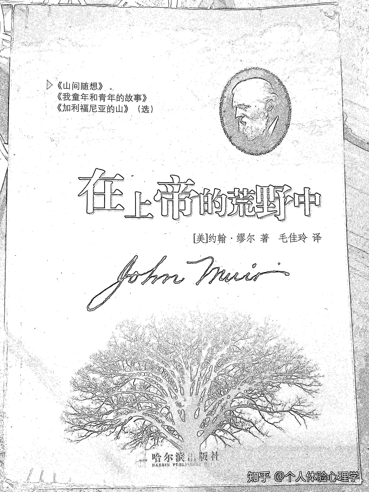

这是我非常喜欢的一本书，文笔清新，思想深刻，充满对自然的爱与对生命的慈悲。推荐给知友。

拍一页给大家看看，19 世纪的美国人，从欧洲来的移民，看看他们是多么能干多么勤奋，我是自愧不如的。

读读这里面的文字，是不是觉得与中国人非常相似？是不是很受感动？古今中外，劳动创造财富，勤劳带来幸福生活，是为一理！

当人们不累了，那意味着什么呢？

# 知乎用户

> 作者：知乎用户
> 
> 赞同数：202
> 
> 编辑于：2021-03-03 12:38

因为其中有占人口绝大部分的东亚某地的人

从没想过认真解决自己的问题（比如高考、学区、人口、房价等）

**反而只擅长把问题外部化、外源化、[外包化](https://www.zhihu.com/search?q=%E5%A4%96%E5%8C%85%E5%8C%96&search_source=Entity&hybrid_search_source=Entity&hybrid_search_extra=%7B%22sourceType%22%3A%22answer%22%2C%22sourceId%22%3A1759758611%7D)**

# 蜜糖牛奶

> 作者：蜜糖牛奶
> 
> 赞同数：60
> 
> 编辑于：2020-07-14 10:50

很多大神已经分析得很好了，我也谈谈我不成熟的见解。

我们东亚人都被儒家思想束缚得死死的。

不可否认，儒家思想使我们东亚人在面对灾难的时候能团结一致，比如这次的疫情，中国为什么能够做得这么好，而欧美还在为了自由而不戴口罩，而我们呢，一切相信国家，集体大于个人。

东亚人非常重视集体，以及“家”的概念，正因为如此，我们多数人一辈子都在为“家”而奋斗。我们极其重视“安居乐业“，因此东亚人对买楼还是很执着的，而东亚大城市的楼价就决定了我们难以轻轻松松地取得幸福。一辈子被一个房子束缚，你会没有压力吗？你看同是发达地区，一个新加坡，一个香港，前者解决了居住问题，基本实现居者有其屋，后者呢？宁愿保护生态，也不愿开发土地，还有那些地产商……（省略一万字），这就是一个赤裸裸的对比啊。

如果东亚人没有住房束缚，那我的收入就可以分配到其他地方，我不会活得更自在吗？你说中国内地真的缺地吗？但越来越高的房价，让人望而却步，也让人活在痛苦当中。

而且即使你有楼，你也要为“家”所牺牲，在中日韩，生育女性要为家庭牺牲，甚至日韩还盛产家庭主妇，这在欧美是难以理解的。有家庭主妇这个身份，就意味着男人要以一己之力承担整个家庭的重责，而女人的地位就被弱化。

而且东亚人喜欢存钱，觉得钱该存起来才有保障，有后路可言，甚至可以留给后代。但欧美人呢？甚至是东南亚人呢？今朝有酒今朝醉呗，存钱？不存在的。所以你看，无论哪个年代，东亚人到了东南亚、欧美都很快能够积累起财富，特别是华人，适应能力强，而且辛苦工作之余会积攒大量财富，不会一下子把钱花光，不少华人一两代就有了营商资本，摆脱贫困。

另外，虽说中国虽然女性地位是最高的，但是中国讲求“[养儿防老](https://www.zhihu.com/search?q=%E5%85%BB%E5%84%BF%E9%98%B2%E8%80%81&search_source=Entity&hybrid_search_source=Entity&hybrid_search_extra=%7B%22sourceType%22%3A%22answer%22%2C%22sourceId%22%3A1337363178%7D)”、“传宗接代”思想深入人心，似乎年轻人只有早点结婚生子才能达成父母心愿，而父母养育完子女，年老时又要去带孙子，辛劳一辈子。但这在欧美是难以理解的，我去过瑞士、[塞尔维亚](https://www.zhihu.com/search?q=%E5%A1%9E%E5%B0%94%E7%BB%B4%E4%BA%9A&search_source=Entity&hybrid_search_source=Entity&hybrid_search_extra=%7B%22sourceType%22%3A%22answer%22%2C%22sourceId%22%3A1337363178%7D)等发达或欠发达的地区，我都很少看到老人家带孙子的，但在中国你不难看到，年轻劳动力在外打拼，老人在家带孙子。

更要命的是，世俗会以你是否能成家生子来判断你这辈子是否成功。也就是就算你腰缠万贯、功成名就，世俗觉得你没有后代，依然觉得你是 loser。当然，这些人目光短浅，可是，大多数普通人还是在意的，似乎你不遵循这个规则，完成这个任务，你就是个异类。世俗就会从方方面面否定你的价值。

这样能不累吗？

儒家也强调积极入世。于是东亚人对功名、自我价值的实现非常在意。

可是儒家文化有森严的等级制度，衍生出很多奇怪的交际文化。虽然中国没有日韩那么令人窒息的前后辈等级制度，可是东亚推崇的[酒文化](https://www.zhihu.com/search?q=%E9%85%92%E6%96%87%E5%8C%96&search_source=Entity&hybrid_search_source=Entity&hybrid_search_extra=%7B%22sourceType%22%3A%22answer%22%2C%22sourceId%22%3A1337363178%7D)，其实是最令人不解的。

当欧美人优雅地品尝着红酒，而中国人的部门聚会，私人聚会，上级（前辈）却把白酒一杯杯一杯杯地灌进年轻人的口，美名曰：不喝就不给面子……

不仅中国人，韩国人，日本人都这样……

这种畸形的酒文化交际背后，无疑在摧毁着东亚人的身体、自尊等等。不仅酒文化，很多不公的交际文化也无疑令东亚人产生巨大的压力，我就不一一展开了。

写得很乱，也写得不好，希望大神指正，理性探讨，不喜勿喷。

综上。

# 笨笨

> 作者：笨笨
> 
> 赞同数：48
> 
> 编辑于：2022-07-25 13:59

土里刨食的民族都活的很累，包括“内卷”这个词，也是土里刨食民族的专属词汇。面朝黄土背朝天，看天吃饭，人少的时候还能凑合活着，一旦吃饱就开始多生孩子接着种地，人多了以后，吃饭的嘴多了，但是土地和水都是有限的资源，农业产量上不去，结果就变得像动物一样，为了一口吃的打的你死我活，相互屠杀，导致人口锐减，最终回归平衡。

鲁迅先生曾说中国古代社会是人吃人，很多人以为只是比喻，其实，这个人吃人说的是现实场景啊。在中国古代社会，频率最高的一个词汇就是“岁大饥，人相食”，翻翻历史书看看，人吃人是普遍现象，都不说久远的年代，就是清末的丁戊奇荒、还有 1942，那都让人看的毛骨悚然脊背发凉，在古代能吃饱不饿死就是祖上积德了。

饥饿的恐惧已经刻在我们的基因里了，很多地方打招呼的第一句话就是，吃了没有。吃饭是国家级的大事，要上新闻头条，是重中之重，对吧。

反观盎格鲁萨克森人，为啥活得轻松，因为人家祖上就很轻松，海洋民族在古代拥有近乎于无限的资源，尤其是在大航海时代，巅峰时期的日不落帝国，国土面积达到 3400 万平方公里，约为世界陆地总面积的 24.75%，占有几乎无限的土地和海洋资源，无论地球怎么自转，太阳总能照耀到日不落帝国的国土上。就算是现在英国美国澳洲加拿大新西兰所组成的盎格鲁撒克逊联盟，总面积也高达 2756 万平方公里，总人口仅 4.6 亿。像澳大利亚总人口也就 2500 多万，羊 1.7 亿头，兔子上百亿只，袋鼠六千多万只。

经常有国人说，放中国人过去，什么麻辣兔肉，直接把兔子吃成保护动物，我听着怎么感觉有一种凄凉呢？像澳大利亚永远也体会不到饥饿的滋味，也算是一种遗憾吧。

我希望我们的民族以后能彻底拥抱海洋，不要再土里刨食了。

# isle

> 作者：isle
> 
> 赞同数：18
> 
> 编辑于：2022-01-27 23:51

常见的说法是因为人多。

可是，这句话人人都也听过吧——世界上没有完全相同的两片树叶。不要说全世界的树叶，就是一个城市的树叶，也远远超过东亚人口的数量吧，这些树叶，怎么就不卷呢？

人多，根本不是活得累的原因。

原因是东亚文化普遍以儒家文化为根基，而儒家文化是一种完全着眼于现世的文化。

具体到每个人，那就是每个人都特别在意自己的身份，活着就是为了一个身份，一个能把别人比下去的身份。

这倒也不新鲜，周礼在形成之初，其实也没多少文化内涵，就是一套身份体系，在这个体系里，你是周天子，你身份最高，你就能住最大的房子吃种类最丰富的肉；你要是士，就是最低级的贵族，你就住不上花园大别墅而且不能吃生鲜肉只能吃干肉。你要是不属于贵族，对不起，你连使用“礼”的资格都没有，你连个身份都没有。

后来礼崩乐坏，是不流动的身份体系崩了，但这套身份体系还在，人人依然是要有个身份才能展示自己的价值，人人竞相让自己的身份高于他人。

这，能不累吗？

# 东伍德

> 作者：东伍德
> 
> 赞同数：31
> 
> 编辑于：2019-04-03 11:53

我觉得恐怕要由[孔老夫子](https://www.zhihu.com/search?q=%E5%AD%94%E8%80%81%E5%A4%AB%E5%AD%90&search_source=Entity&hybrid_search_source=Entity&hybrid_search_extra=%7B%22sourceType%22%3A%22answer%22%2C%22sourceId%22%3A639998312%7D)背这个锅。

孔老夫子创建的儒家思想，经过[孟荀朱](https://www.zhihu.com/search?q=%E5%AD%9F%E8%8D%80%E6%9C%B1&search_source=Entity&hybrid_search_source=Entity&hybrid_search_extra=%7B%22sourceType%22%3A%22answer%22%2C%22sourceId%22%3A639998312%7D)几代大师的发展，影响了中国几千年，同时深刻影响了日本和韩国。儒家思想倡导什么？

“君君臣臣父父子子”的等级制度：君和父要有君和父的样子，臣和子要有臣和子的样子。“修身齐家治国平天下”，“吾日三省吾身”，“是不可以不弘毅，[任重](https://www.zhihu.com/search?q=%E4%BB%BB%E9%87%8D&search_source=Entity&hybrid_search_source=Entity&hybrid_search_extra=%7B%22sourceType%22%3A%22answer%22%2C%22sourceId%22%3A639998312%7D)而道远”，“立德立言立行”。

几千年来，中、日、韩在儒家思想的熏陶下，在权力压迫之下，对等级制度的认可服从、对权力、名望和财富的崇拜，已经深入东亚人的文化基因，刻在了骨髓里。

在东亚人的评价体系里，上学要成为学校那 5％的尖子生，考大学要进入那 5％的名校，工作后收入要成为那 5％的上层人士。从小我们的成长环境，就接受了社会是有等级的，有的人就是高人一等，凡有机会掌握一点资源和权力，就要大肆滥用。我们的社会现实也不断教育我们这一点。学生举报学校，会反过来被学校教做人；下属或公民举报官员，举报材料会反而到被举报官员那里，举报人会被反复折磨，甚至以敲诈勒索判刑；大公司明目张胆得违反劳动法，员工却无能为力。我们从小就深深体会到了权力的力量，被教育“吃得苦中苦，方为人上人”。因为只有成为人上人，那才叫做人。为什么做有钱人？因为有了钱，那才叫做人。因为不能成为那 1％，不能有钱有势，当你的利益和有钱有势的人起了冲突，你根本不能保护自己的合法利益。

一个普通顾客告一个有权有势的大公司并成功索赔几千万美元，这种事只能发生在欧美。在中国，他会以敲诈勒索罪被起诉判刑。

韩国，女明星[张紫妍](https://www.zhihu.com/search?q=%E5%BC%A0%E7%B4%AB%E5%A6%8D&search_source=Entity&hybrid_search_source=Entity&hybrid_search_extra=%7B%22sourceType%22%3A%22answer%22%2C%22sourceId%22%3A639998312%7D)被逼向高官富豪提供性服务，而无力反抗，被逼自杀。日本，公司社长在团建时将下属员工的脸摁在火锅里煮，导致员工毁容。这种事很难想象在欧美存在，而在日韩发生大家却完全不意外，因为这就是讲究等级制度的儒家文化基因。

看国外的一些视频，有些老外也没多少钱，但只要能吃饱穿暖，就可以沉迷于自己的爱好，就能每天乐呵呵的，感觉很幸福，这种人在中国会被周围舆论弄得生活不能自理。这就是几千年来刻在我们基因里的文化，就如同很多女人眼中的优秀男人，不是看他自己是否优秀，而是他要把别的男人比下去才叫优秀，要成为男人中的 1％才叫优秀。自己过得好不叫幸福，要比别人过得好，把别人踩在脚底下，才叫幸福。这种文化，毫无疑问在中日韩人民的心里造就了深深的焦虑。

事实上，受儒家思想影响较小的东南亚，就远远不如东亚这么累。

# 鹏鹏

> 作者：鹏鹏
> 
> 赞同数：22
> 
> 编辑于：2019-01-30 13:41

1 历史习惯

东亚是季风区[农耕业](https://www.zhihu.com/search?q=%E5%86%9C%E8%80%95%E4%B8%9A&search_source=Entity&hybrid_search_source=Entity&hybrid_search_extra=%7B%22sourceType%22%3A%22answer%22%2C%22sourceId%22%3A585532452%7D)，很多地方是季风水田农业。几千年农民。季风水田是非常耗费体力的，因为需要集体协作，修建大规模水利工程。这种生产力带来影响，东亚中华文化圈人勤劳刻苦。

2 资本原始积累

西方资本原始积累阶段是通过殖民扩张，全球化贸易与工业革命。东亚不行。当年日本二战时期也殖民扩张，但失败了。战后国际秩序也不允许对外扩张。

东亚人口众多，而资源一般，不能像美洲，非洲，中东那样靠卖资源过日子。

要搞工业化，就需要资本原始积累。东亚是通过出卖血汗，承接西方产业转移，给人家打工。产业转移从西方到日本，从日本到四小龙，从四小龙到中国大陆。东亚廉价劳动力在血汗工厂干活完成资本原始积累。

3 富国懈怠

其实，历史上西方人活得也很累，19 世纪西方工人也是一天工作十几个小时，美国西进运动时期清教徒也是勤劳刻苦。德国人也是努力工作，等等。

问题是战后，随着西方统治世界，生产力发展与福利社会兴起，西方年轻人懈怠了。像美国，靠印钞票，收取[专利费](https://www.zhihu.com/search?q=%E4%B8%93%E5%88%A9%E8%B4%B9&search_source=Entity&hybrid_search_source=Entity&hybrid_search_extra=%7B%22sourceType%22%3A%22answer%22%2C%22sourceId%22%3A585532452%7D)躺着就能赚钱，脏活累活外包给中国人干就行，本国人收入到三四万刀，你让他辛苦干活那不可能。西方国家，像美国大学，白人大学生主要学文科，什么金融法律文化等，辛苦的理工科没几个人学，都是亚裔，亚洲留学生才学理工科。不仅是西方，日本也出现这种状况。宽松教育出来的年轻人，很多都是御宅族，天天宅在家里看动漫打游戏，靠父母家族生活，不愿出去工作（日本失去的三十年也不好找工作）。

东亚发展普遍是二战后，富得时间短，就是想像西方那样也没条件，只能努力工作干活才能维持生活。

# 匿名用户

> 作者：匿名用户
> 
> 赞同数：254
> 
> 编辑于：2019-01-26 09:21

在该大航海没大航海，在该大殖民时没大殖民，在该爬科技树的时候爬在地上山呼万岁。

你累是应该的。人家几百年前早就累过努力过了。

# 弗拉基米尔大公

> 作者：弗拉基米尔大公
> 
> 赞同数：56
> 
> 编辑于：2022-03-26 15:19

东亚最先崛起的国家是日本，日本人从小努力读书工作一直如此，从不间断。但在过去二十年人均 GDP 却不增反降，人均 GDP 从 1995 年世界第三，一直跌落到现在的二十名开外。而在这二十年里超过日本人均的基本上都是欧洲各国，更不可思议的是欧洲国家的工作氛围远比日本人轻松，他们根本不像日本人那样苦大仇深般拼命工作，海滨、森林、高档酒店是他们隔三差五的旅行生活，带薪休假期之长是东亚人想都不敢想的事。日本都如此，想一想中韩实际上比日本人更苦逼。那个瑞典环保小胖子即使不上学过的日子也比中国博士富有。

懒人的经济增长居然超过了勤奋的人，你第一反应肯定这是西方霸权的影响或者认为这是美国制定的游戏规则就是要剥削东亚和世界其它国家的劳动人民，是种族主义和霸权主义的表现形式，所以西方国家都愿意给美国当狗。但实际上并非如此，虽然深层原因有种族歧视构成的对白人的保护伞，但如果把所有一切都归咎于[保护主义](https://www.zhihu.com/search?q=%E4%BF%9D%E6%8A%A4%E4%B8%BB%E4%B9%89&search_source=Entity&hybrid_search_source=Entity&hybrid_search_extra=%7B%22sourceType%22%3A%22answer%22%2C%22sourceId%22%3A2408318038%7D)是错误的。

那么是什么原因导致东亚人特别苦逼呢？有人认为亚洲地少人多，自然资源贫乏，即使再努力，人均所获的资源也不多。但其实自然资源真正值钱的种类并不多，全球主要的自然资源主要是石油、天然气和[铁矿石](https://www.zhihu.com/search?q=%E9%93%81%E7%9F%BF%E7%9F%B3&search_source=Entity&hybrid_search_source=Entity&hybrid_search_extra=%7B%22sourceType%22%3A%22answer%22%2C%22sourceId%22%3A2408318038%7D)，真正依靠自然资源致富的国家并不多，人口上限也不过二三千万，比如挪威、澳大利亚、沙特、加拿大等少数富裕国家。而俄罗斯自然资源也很丰富，人口也不多却不发达，所以这个理由站不住脚，更何况像德国、法国等欧洲国家几乎没有什么自然资源，他们为什么能活的如此轻松惬意呢？

如果你仔细观察就会发现东亚国家相关产业相似度非常高，高度拥挤在几乎一样的赛道上彼此竞争，而独特的赛道极少。仿佛有一只看不见的手把东亚国家死死按在这些赛道上。那么到底是什么限制了东亚国家的产业发展呢？

举个例子，大型 LNG 船舶号称造船工业的明珠，是技术含量最高也是附加值最高的船舶之一。我国仅有沪东造船集团才能制造，去年全球 LNG 船舶一共造了 49 艘，其中韩国三大船企就生产了 36 艘，听上去好像韩国是大赢家，实际上法国 GTT 公司才是最大的赢家！LNG 船最核心的是存储货仓，必须在零下 163 度的情况下将液化天然气安全储存，现在无论是中国还是韩国造船厂采用的都是 GTT 公司 MARK III 型。GTT 公司甚至不需要生产任何产品仅仅需要专利授权即可，每条 14 万立方的 LNG 船造价大约 2 亿美元，GTT 公司直接收取每条船造价的 5%的[专利授权费](https://www.zhihu.com/search?q=%E4%B8%93%E5%88%A9%E6%8E%88%E6%9D%83%E8%B4%B9&search_source=Entity&hybrid_search_source=Entity&hybrid_search_extra=%7B%22sourceType%22%3A%22answer%22%2C%22sourceId%22%3A2408318038%7D)，而韩国造船厂建造整条船的[净利润率](https://www.zhihu.com/search?q=%E5%87%80%E5%88%A9%E6%B6%A6%E7%8E%87&search_source=Entity&hybrid_search_source=Entity&hybrid_search_extra=%7B%22sourceType%22%3A%22answer%22%2C%22sourceId%22%3A2408318038%7D)不过是 5%-7%，沪东船厂利润率更低，还要养一堆人。最近几年 GTT 公司净利润率一直保持在 50%以上，试问我国有哪个企业能连续好几年赚那么多钱？那么既然如此，我们能不能不用 GTT 公司的专利？答案是不行，因为根本没有选择余地。LNG 液护系统全球只有两家公司提供，还有一家是挪威的 Kvnerner 公司，GTT 占据了 90%市场份额。目前以中韩造船厂的水平能够消化 GTT 公司的专利并顺利把液护舱造出来已经是全球第一梯队的地位，根本没有敢弃之不用的实力资本。而像 GTT 公司这样的垄断企业在欧洲多如牛毛，垄断带来的高利润才是欧洲发达国家轻松愉快、天天休息的根本原因。

而他们之所以能够垄断是因为工业底子好，工业起步早，GTT 公司在 1960 年就开始做液护，而中韩那时还在饿肚子，他们专业制造 50 年，点滴积累所产生的差距不是中韩一朝一夕就能赶上的。[重工业](https://www.zhihu.com/search?q=%E9%87%8D%E5%B7%A5%E4%B8%9A&search_source=Entity&hybrid_search_source=Entity&hybrid_search_extra=%7B%22sourceType%22%3A%22answer%22%2C%22sourceId%22%3A2408318038%7D)和互联网行业不同，技术更新慢、试错成本超高，像 LNG 这种要求绝对可靠的安全性，没有任何公司敢贸然使用其它产品，你说我不服就要自己干，可以，但你依然需要五十年时间才能真正验证可靠性。和 GTT 相比，中国企业都是处在挣辛苦钱的阶段，现在现实情况就是欧美企业赚技术垄断的钱，东亚国家生产廉价工业品，把中国等国钉死在低端产业链位置上是他们最理想的国际秩序。而对于中国而言要想打破这一现状只能寄希望出现更多像华为这样的企业通过研发自主专利产权的核心技术来打破西方的护城河。

相比于韩日，实际上中国是最有可能率先获得突破的东亚国家，因为韩日都是被美国绑住四肢没有国家主权的仆从国，即使想发展也没有那个胆子。因此中国宣布产业升级计划后西方国家集体群起而攻之，视中国为威胁，但是，如果我们中国人要想过上和欧洲人一样的神仙生活，不再 996 一般的苦逼只能依靠自己掌握核心技术，在这方面不要怕西方人的中国威胁论，毕竟真想用武力阻止中国发展倒霉的是他们自己。

# 温水宁宁

> 作者：温水宁宁
> 
> 赞同数：44
> 
> 编辑于：2022-01-25 23:56

半年不见鼎宝，没想到点进这个问题看到了

# 大阅读家

> 作者：大阅读家
> 
> 赞同数：6
> 
> 编辑于：2019-02-27 15:13

这个问题其实是一个伪命题。其实每个地区的人，都会活得很累。

按照题主的意思，是认为东亚人工时长的角度，来认定东亚人很累的。说白了，就是东亚人更要为生活奔波劳累。

题主之所以这样认为，无非就是媒体传达给普罗大众的一种“刻板印象”。

首先，在任何国家都是穷人活得累，富人活得轻松一点。就以超级大国的美国为例，在我们的印象中，美国可能是高福利、中产阶级众多的橄榄形社会。应该是这样的：

住着这样的独栋别墅

但是其实呢？美国也是[贫富不均](https://www.zhihu.com/search?q=%E8%B4%AB%E5%AF%8C%E4%B8%8D%E5%9D%87&search_source=Entity&hybrid_search_source=Entity&hybrid_search_extra=%7B%22sourceType%22%3A%22answer%22%2C%22sourceId%22%3A609703784%7D)，福利制度和医保系统很不完善。以美国第一大城市纽约为例，根据 Business Insider 的 2018 年度报告，[纽约市](https://www.zhihu.com/search?q=%E7%BA%BD%E7%BA%A6%E5%B8%82&search_source=Entity&hybrid_search_source=Entity&hybrid_search_extra=%7B%22sourceType%22%3A%22answer%22%2C%22sourceId%22%3A609703784%7D)有大约 77,000 个无家可归的人。这个数目还不包括那些住在公共住房的 40 万个穷人（占纽约市全部人口的 5%左右）。根据纽约市官方网站统计，纽约“穷人”占的比例为 44.2%，位于美国贫困线以下的人口比例为 19%。虽说，美国的贫困标准和我们的不一样，但是大抵他们也是属于“活得很累”的一群人吧。

以下的照片都是美国的穷人。

住着活动板房

衣着邋遢

破败的小卖部

有一部美剧叫《[无耻之徒](https://www.zhihu.com/search?q=%E6%97%A0%E8%80%BB%E4%B9%8B%E5%BE%92&search_source=Entity&hybrid_search_source=Entity&hybrid_search_extra=%7B%22sourceType%22%3A%22answer%22%2C%22sourceId%22%3A609703784%7D)》，不是那么被大众熟知。大家可以找来看看：

这部剧主要讲述了生活在美国芝加哥南部的一个贫民区的 Gallagher 一家人的故事，全家人都是无耻之徒，全家依靠坑蒙拐骗偷生存。这个家的母亲 Moncia 患有[躁郁症](https://www.zhihu.com/search?q=%E8%BA%81%E9%83%81%E7%97%87&search_source=Entity&hybrid_search_source=Entity&hybrid_search_extra=%7B%22sourceType%22%3A%22answer%22%2C%22sourceId%22%3A609703784%7D)，吸毒喝酒，和丈夫离婚后，将孩子抛弃给了他，最后死于脑溢血。父亲 Frank 是个酒鬼骗子，没有工作，获得像条臭虫，骗取政府补贴，当家里没有他的容身之处的时候他就出去骗人然后住到被骗的人家里。

大女儿 Fiona 辍学回家养家照顾弟弟妹妹，Fiona 就活得很累，她把主要精力都投入到了家庭中去，甚至从父母那里夺来了弟弟妹妹的抚养权。她总是遇见又好又渣的男朋友，最后她看破情场开始为自己考虑开始投资。很苦的故事。

有一本书叫做《[我在底层的生活——当专栏作家化身女服务员](https://www.zhihu.com/search?q=%E6%88%91%E5%9C%A8%E5%BA%95%E5%B1%82%E7%9A%84%E7%94%9F%E6%B4%BB%E2%80%94%E2%80%94%E5%BD%93%E4%B8%93%E6%A0%8F%E4%BD%9C%E5%AE%B6%E5%8C%96%E8%BA%AB%E5%A5%B3%E6%9C%8D%E5%8A%A1%E5%91%98&search_source=Entity&hybrid_search_source=Entity&hybrid_search_extra=%7B%22sourceType%22%3A%22answer%22%2C%22sourceId%22%3A609703784%7D)》。

这本书就讲了另一个美国：低薪白人劳工，三四人挤在一个小房间里生活；怀孕的清洁工摔伤也不敢请假，一天没薪水，第二天就没钱买杂物；沃尔玛的员工付不起房租，住在收容所；背着十几磅重的吸尘器吸尘、跪在地上擦地，女佣们话题热点是哪个牌子的止痛药最好用；没有健康保险，因为太贵，这意味如果生病，你要比别人多花钱。

其实，这几年，很多人都鼓吹欧美如何发达、如何文明、如何先进、如何无忧无虑。但是其实，那样的鼓吹都是我们国家的精英阶层留学或者旅游这些地方后的印象。精英出国，TA 所能看到的、接触的自然也是别国的相应阶层。

## **当然，不可否认，我们东亚“活得很累”的群体多一些，“活得很爽”的群体要少一些。这是因为东亚普遍处于“接受文明开化后的第一代或者第二代”。**

以东亚最富裕的日本，从战后开始算，其也不过处于富三代的阶段。而美国这样的国家，则经历了 243 年了。在这里，我们就用流行的经济周期理论来解释吧。按照经济学家的看法，一个比较完整的长经济周期是康德拉季耶夫周期，大约是 50 年。而根据观察，要完成一代老百姓财富构建，并形成[消费力](https://www.zhihu.com/search?q=%E6%B6%88%E8%B4%B9%E5%8A%9B&search_source=Entity&hybrid_search_source=Entity&hybrid_search_extra=%7B%22sourceType%22%3A%22answer%22%2C%22sourceId%22%3A609703784%7D)的周期大约需要 15-20 年，也就是说一个康德拉季耶夫周期就可以完成 2-3 代人的财富积累和消费了。

从 1793 年开始的康德拉季耶夫周期示意图

我们国家从改革开放开始起算，我们也就是 40 年，一个康德拉季耶夫周期没过，从实践看，完成了 2 代人的财富积累了，所以我们身边也出现一些富三代了。

可是你看最年轻的资本主义强国美国，则是经历了 6 个康德拉季耶夫周期了。所以，人家早就经历过财富积累了。所以，我们看到在美国最贫穷的州，人家的穷人的年收入也不高，但是生活品质显然比我们东亚国家的穷人要高。

根据 2016 年美国劳工统计局（BLS）的数据，美国 50 个州的家庭收入中位数从最高到最低进行了排名。[马里兰州](https://www.zhihu.com/search?q=%E9%A9%AC%E9%87%8C%E5%85%B0%E5%B7%9E&search_source=Entity&hybrid_search_source=Entity&hybrid_search_extra=%7B%22sourceType%22%3A%22answer%22%2C%22sourceId%22%3A609703784%7D)以平均家庭收入中位数 75,847 美元成为全美最富的州，而[密西西比州](https://www.zhihu.com/search?q=%E5%AF%86%E8%A5%BF%E8%A5%BF%E6%AF%94%E5%B7%9E&search_source=Entity&hybrid_search_source=Entity&hybrid_search_extra=%7B%22sourceType%22%3A%22answer%22%2C%22sourceId%22%3A609703784%7D)则以平均家庭收入 40,593 美元垫底，成为全美最穷的州。

而我们东亚国家呢？

2018 年，根据[西南财经大学](https://www.zhihu.com/search?q=%E8%A5%BF%E5%8D%97%E8%B4%A2%E7%BB%8F%E5%A4%A7%E5%AD%A6&search_source=Entity&hybrid_search_source=Entity&hybrid_search_extra=%7B%22sourceType%22%3A%22answer%22%2C%22sourceId%22%3A609703784%7D)一个自称覆盖 4 万户家庭的调查，东部和一线城市的工薪阶层占比较高，七成工薪阶层的年均[工资性收入](https://www.zhihu.com/search?q=%E5%B7%A5%E8%B5%84%E6%80%A7%E6%94%B6%E5%85%A5&search_source=Entity&hybrid_search_source=Entity&hybrid_search_extra=%7B%22sourceType%22%3A%22answer%22%2C%22sourceId%22%3A609703784%7D)超过 3 万元，其中均值为 5.7 万元，中位数为 4.3 万元人民币。 **工薪家庭的年平均收入为 15.4 万元，非工薪家庭只有 7.9 万元。**

而被公认为东亚的发达国家日本，根据其统计年鉴，2015 年日本家庭年收入中位数大概在 450 万日元（约 26 万元人民币），只有 20%的家庭年收入高于 800 万日元（约 46 万元人民币），高于 1000 万日元（约 57 万元人民币）的家庭不到 11%，同时也只有 10%多点的家庭年收入低于 200 万日元（约 12 万元人民币），最高 10%和最低 10%收入家庭的收入比在 5 倍左右，最高 20%和最低 20%收入家庭的收入比大概在 3 倍左右。

所以，要想国民普遍活得没那么累，不再把工作看成唯一，可以随心所欲地做自己的事情，也许当我们经历第二个康德拉季耶夫周期的时候，就能够实现吧。

# 知乎用户

> 作者：知乎用户
> 
> 赞同数：154
> 
> 编辑于：2019-03-06 18:02

1.  **精英主义**，从小开始，老师只关注少数优秀的同学，而且少数优秀的同学可以赋予更大的自由，得到更多的关注，而且一般来说对优秀的定义比较单一，长大了更如此，精英和权贵得到的自由度和关注远远大于普通人。当然，无论东西，权贵肯定是有更大的特权的，只是在东亚，很多特权在看不见的地方，而在西方，特权更多的以资本的形式体现，精英主义的后果就是人特别在意与其他人的对比，对成为人上人非常渴望。
2.  **奋斗教育**，从小开始就鼓励勤奋，努力，为国家/家族而努力奋斗，出人头地，不鼓励享受和休闲，痛恨闲人，给普通人的休闲设施也很少，大多数休闲设施都是要花钱的，而不是作为公共服务。比如说中国的演出、剧院、体育场馆、音乐艺术教育整体上政府补贴都很少，一些南美的国家对这块做的都比中国多。这一后果就是社会整体讲究战斗精神，放大努力的价值和意义，缩小天赋的意义。
3.  **集体主义**，小时候是班级作为集体，长大后是政府统管一切，个人必须依附集体才能充分施展，这就要求个人必须在价值观上与集体一致，不鼓励不同意见，不鼓励个人自由发挥。这一点来自于几千年延续下来的价值观，历来东亚的中央政府都是强大的集体来形成对个人的约束，保障国家的稳定，只是在农耕文明时，集体是宗族，工业文明下，集体是国家。
4.  **福利较低**，基本上不太可能依靠政府，养家糊口生老病死主要还是靠自己。这一条美国也差不多，国家会通过刻意降低福利刺激国民。
5.  **后发国家竞争激烈**，踩着工业化的末班车，啥都是人家发明的，没有先发优势，只能跟随复制，必然需要靠压低成本才能竞争，因而成本思维比较强，你的坑有好多其他人盯着，感觉稍微慢一下就很危险，不敢停下来。
6.  **土地资源紧张**，这个可能是根源，东亚地区位于太平洋板块，印度洋板块，[亚欧大陆](https://www.zhihu.com/search?q=%E4%BA%9A%E6%AC%A7%E5%A4%A7%E9%99%86&search_source=Entity&hybrid_search_source=Entity&hybrid_search_extra=%7B%22sourceType%22%3A%22answer%22%2C%22sourceId%22%3A605231224%7D)板块三块的挤压中，各国都是山地为主，平原面积比例较少，而且外部扩张空间很小，往东是太平洋，即使点了航海天赋恐怕也不会由东亚人发现新大陆，往南是群岛，往北是草原，往西是沙漠，[农耕时代](https://www.zhihu.com/search?q=%E5%86%9C%E8%80%95%E6%97%B6%E4%BB%A3&search_source=Entity&hybrid_search_source=Entity&hybrid_search_extra=%7B%22sourceType%22%3A%22answer%22%2C%22sourceId%22%3A605231224%7D)下，东亚其实陷在一个地理构建的困境中，扩张空间远不及中东和欧洲，因此形成了长期以来对土地财富的高度重视，后果就是有了钱就买房置地，除了新加坡这种对土地供应超级强力的国家，其他各国都经历过[房地产热](https://www.zhihu.com/search?q=%E6%88%BF%E5%9C%B0%E4%BA%A7%E7%83%AD&search_source=Entity&hybrid_search_source=Entity&hybrid_search_extra=%7B%22sourceType%22%3A%22answer%22%2C%22sourceId%22%3A605231224%7D)，现在的东南亚也在经历这一过程，土地资源紧张的后果就是人会争先拥有土地，[安土重迁](https://www.zhihu.com/search?q=%E5%AE%89%E5%9C%9F%E9%87%8D%E8%BF%81&search_source=Entity&hybrid_search_source=Entity&hybrid_search_extra=%7B%22sourceType%22%3A%22answer%22%2C%22sourceId%22%3A605231224%7D)，会比较害怕变化和不确定性，希望维持强大有力的政府确保稳定，只要能过安生日子，愿意无限让渡权力给集体，而集体为了实现对个体的有效管辖，体现合法性便需要尽可能养活更多的人，保障[生存权](https://www.zhihu.com/search?q=%E7%94%9F%E5%AD%98%E6%9D%83&search_source=Entity&hybrid_search_source=Entity&hybrid_search_extra=%7B%22sourceType%22%3A%22answer%22%2C%22sourceId%22%3A605231224%7D)，东亚的人口密度有史以来几乎都是高于其他地区的，过多的人又加剧了资源的紧张，便需要精英主义、奋斗教育、集体主义、低福利来实现国家的有效运转，这一点在历史上的中国、越南、朝鲜，君主是依靠贵族阶级和科举制度选拨政府的派出机构来实现管制的，而在日本因为天皇虚君，实际的君主是大名，而大名们通过豢养的武士阶级来实现控制的。而在历史上的欧洲，首先君主是通过贵族领主而非中央政府派出机构实现区域管辖的，其次，领主对辖区内居民的控制力不如东亚强，主要是收税，而且领主同时也兼具武士的身份，管不了太细，另外欧洲拥有比东亚更强大的教会，教会拥有独立的财务、产业和土地资源，人事任免也较为独立，对领主形成了有效的制衡，国家机器在基层真空时，随着[手工业](https://www.zhihu.com/search?q=%E6%89%8B%E5%B7%A5%E4%B8%9A&search_source=Entity&hybrid_search_source=Entity&hybrid_search_extra=%7B%22sourceType%22%3A%22answer%22%2C%22sourceId%22%3A605231224%7D)和制造业的发展，居民会自发组建诸如行会、公会一类的组织，这些组织随着香料贸易和新大陆的发现，最终产生了资本主义。

这些特点，是浸透在东亚文明血脉里的，所以这也是为什么即使去了英美澳加，东亚人也是比较省心不搞事儿的，价值观也比较简单，存钱买房买学区房，老老实实爬梯子，而且很多人以此为荣。[工业文明时代](https://www.zhihu.com/search?q=%E5%B7%A5%E4%B8%9A%E6%96%87%E6%98%8E%E6%97%B6%E4%BB%A3&search_source=Entity&hybrid_search_source=Entity&hybrid_search_extra=%7B%22sourceType%22%3A%22answer%22%2C%22sourceId%22%3A605231224%7D)并没有彻底改变这些，只是换了种形式继续存在。

# 知乎用户

> 作者：知乎用户
> 
> 赞同数：53
> 
> 编辑于：2019-01-30 20:42

当年人家与海洋搏击，与部落血战，研究科学，探索自然的时候，我们在干什么？

活得累是好事，补课能不累吗。

# 知乎用户

> 作者：知乎用户
> 
> 赞同数：18
> 
> 编辑于：2019-03-03 20:31

## 我觉得是因为东亚人和白种人对于幸福感的定义不太一样。

我觉得知乎应该推出一个类似微博或者微信公众号的投票功能，来验证一个答主提出的观点是否符合民意。

**我想问大家一个问题，下面有两套豪宅，价格一样，如果你能买得起，你会选哪个？**

1\. 市中心的高层大平层，可以看到整个城市最美的繁华夜景，楼下就是豪华的商场，有米其林餐厅和各种酒吧，各种吃喝玩乐应有尽有，附近还有一个音乐厅/大剧院，两公里内有全市最好的公立学校和医院，附近的另一座高端写字楼就可以上班。

2\. 市郊山脚下湖边的别墅，占地一亩，有一个大花园，但是附近什么商业都没有，安静地可怕，最近的超市都要开车半小时，学校和医院只有私立，开车也要半小时以上，上班开车也要一个小时。

大多数东亚人，尤其是中国人，我相信应该选 1。白种人大多数都会选 2。如果知乎能投票验证我的结论就好了。

在有选择权的情况下，东亚人大都选择高密度的都市繁华生活体验，而不是那种世外桃源的幽静生活。**但是繁华的都市生活就一定意味着拥挤，这才是东亚人活得累的重要原因。**

# 知乎用户

> 作者：知乎用户
> 
> 赞同数：6
> 
> 编辑于：2021-02-26 21:06

因为没赶上殖民欧非拉美的趟，人家是拿命拼出来的幸福生活。

你看看黑社会，拿刀子收保护费比上班自在潇洒吧?

别光看 GDP，看看生活水平啊，消费水平，居住面积，工作时长。

现在人家还是玩的是收保护费，搞金融开赌场，一群伥鬼还跟着起哄。

高赞都说的是些啥。

# 知非姑姑

> 作者：知非姑姑
> 
> 赞同数：26
> 
> 编辑于：2019-07-11 10:09

看到美国学者关于与人口密度与人生策略的文章。以美国数据为主，但感觉结论与东亚社会很匹配。研究者对多国多州研究发现：

人口密度越高，则人们越表现出

1）更长远的人生定位

2）更多的教育投资

3）更长远的婚配考虑

4）更晚的结婚年龄

5）更低的[生育率](https://www.zhihu.com/search?q=%E7%94%9F%E8%82%B2%E7%8E%87&search_source=Entity&hybrid_search_source=Entity&hybrid_search_extra=%7B%22sourceType%22%3A%22answer%22%2C%22sourceId%22%3A744724812%7D)

6）更多来自父母的支持

…… 这不就是东亚社会的人生策略吗？

如果结论正确，倒简单了，这就是高密度环境下的人生策略。

（文章题目：The Crowded Life Is a Slow Life: Population Density and Life History Strategy，作者：密歇根大学 Oliver Sng 与亚利桑那大学 Steven L Neuberg、Michael E W Varnum、Douglas T. Kenrick）

# 杨阳

> 作者：杨阳
> 
> 赞同数：4
> 
> 编辑于：2019-02-22 07:53

1.习惯。

2.平均资源少。导致恶性竞争，危机感强。

即使相比韩国，日本，中国人应该是最累的。

1.习惯，勤劳致富的优良传统。

中华民族成为了世界上平均工作时长最高的民族，君不见，国外周末，过了下午三点个体门店纷纷关门，开着的大多是华人经营。

中华民族是历史上经历过无数次“人相食”的民族。无数苦难造就了我们吃苦耐劳的民族性格。

2.国内平均资源少。

1992 年我父亲剧团去新加坡演出，当时他的月薪是 300。当地有个拉大幕的土著，还兼职酒保，月薪折合当时的人民币 2W。

去年，小舅子留学韩国，当地最低端的刷盘子工，每月也能拿到折合人民币 1W 多。那他们消费高吗？肉类比较丰富的自助餐，折合人民币 50 左右一顿。

整个社会都富裕了，人民会轻松很多，不要被表面蒙蔽，我们国家还不富裕！

现在即使北上广深，哪里能给刷盘子的开上万的工资，告诉我，我去！

# 知乎用户

> 作者：知乎用户
> 
> 赞同数：28
> 
> 编辑于：2019-02-27 13:49

没有原始积累加上人多呗，和文化没什么差别，人类都差不多的。

你觉得白皮不累，那是因为人家原始积累已经完成了。

亚洲不算俄罗斯和几个前苏联盟国，占了世界上绝大多数人口，而且个顶个地在二战被犁过地。连最风光的小日本也就爽了那么 20 来年。

# natiahs Hou

> 作者：natiahs Hou
> 
> 赞同数：29
> 
> 编辑于：2019-01-28 16:49

因为东亚并不是东亚人的呀

  

欧洲到处是美苏基地的时候，欧洲人日子就比美苏累

  

美国到处是英国基地的时候，移民就比贵族活的累

  

美洲到处是移民基地的时候，印第安人死起来都比淘金者们杀起来累

  

更遥远的过去，落基山下密河畔本来悠闲自在野马们面对到处扎营的东亚人也是一样的无奈

  

彼时彼刻的它们如果能知道此时此刻的东亚的日韩社畜们正在拼命供养着美洲的大兵，或许感觉会好那么一点吧

  

这是一种循环

  

连自己的基本盘都决定不了，若要比什么，可不就是得比惨吗

  

当然中国不一样，中国人的累法和 19 世纪德国人累法差不多。

  

希望累到一定程度以后，能有不一样的变化吧

# 今天天气不错

> 作者：今天天气不错
> 
> 赞同数：8
> 
> 编辑于：2020-08-24 08:57

地球就这么大，资源就这么多，我们活得累，必然有人活得轻松。不用猜都知道是谁。

欧美人的悠哉日子是建立在几百年对黑人劳动力的剥削，以及对黄种人土地和资源的掠夺的基础上。

黑奴贸易对欧美经济产生的作用，显而易见。

对黄种人呢？北美南美北亚澳洲几乎占据了世界五分之二的版图，这些土地上的原住民可都是黄种人。现如今呢？俄罗斯占据北亚，整个北美被西欧白人占据，拉丁美洲被白人黑人混血占据，澳洲被英国后裔占据。而且加拿大，美国，澳大利亚，西伯利亚都是矿产资源富集的地方。这些白人占据了这么多的战略资源，躺着都能挣钱，我们还得花大价钱去买，他们能不悠哉，我们能不苦逼吗？

况且欧美经过几百年对殖民地半殖民地的掠夺，积累了大量贵金属，他们的金融霸权就是在此基础上建立的。有了金融霸权，就可以通过看不见的手，比如铸币税，比如剪刀差来隐性掠夺全世界财富。自从美元成为世界货币起，它的数次金融危机，哪次不是拉着全世界来买单？

# 默苍离

> 作者：默苍离
> 
> 赞同数：4245
> 
> 编辑于：2019-10-28 00:42

累吗？

真累吗？

看跟谁比，跟极少数欧洲人比，确实是，因为他祖宗扛着疟疾四处流血拼命抢钱的时候，咱祖宗在抽大烟、建寡妇牌楼，闻小脚的臭味、读八股文。

你去达卡，贫民窟看看那些每天蹬一天三轮仅仅能吃饱饭的人

你去孟买，看看那些只能一辈子分拣垃圾为生手上都是溃烂的人。

你去菲律宾，看看那些买饭店垃圾回去做饭的人。

你去[伊拉克](https://www.zhihu.com/search?q=%E4%BC%8A%E6%8B%89%E5%85%8B&search_source=Entity&hybrid_search_source=Entity&hybrid_search_extra=%7B%22sourceType%22%3A%22answer%22%2C%22sourceId%22%3A872250572%7D)，看看那些读书成为硕士还找不到工作吃不饱饭的人。

你去美国，看看那些欠十几万美金大学贷款的人。

你去日本，看看那些 75 岁还在早出晚归开出租的老爷爷。看看那些不舍得交取暖费被冻死的老人。

你去迪拜，看看在那边打工的南亚人，50 度气温每天工作 8 小时，一个月工资 2000 人民币。

你去墨西哥，看看对毒品表示抗议就被集体屠杀的大学生。

你去南非，看看得带着四个保镖才敢出门工作的脱衣舞娘，她还有两个孩子要抚养。

你去乌克兰，看看那些出卖身体的[卫国战争](https://www.zhihu.com/search?q=%E5%8D%AB%E5%9B%BD%E6%88%98%E4%BA%89&search_source=Entity&hybrid_search_source=Entity&hybrid_search_extra=%7B%22sourceType%22%3A%22answer%22%2C%22sourceId%22%3A872250572%7D)英雄的后代。

......

有这么一类人，都想不累，钱多事少离家近。还能秀优越感什么的。

对这些人我只能说，该醒醒了，你不是[蓝血人](https://www.zhihu.com/search?q=%E8%93%9D%E8%A1%80%E4%BA%BA&search_source=Entity&hybrid_search_source=Entity&hybrid_search_extra=%7B%22sourceType%22%3A%22answer%22%2C%22sourceId%22%3A872250572%7D)。

幸福，是奋斗出来的。

# 知乎用户

> 作者：知乎用户
> 
> 赞同数：1
> 
> 编辑于：2022-03-11 11:06

根源来自于一句话，叫吃得苦中苦，方为人上人；天天光想着当人上人，几千年了愣是思维中没注入一丝平等的观念；

虽然社会现实是分级的，西方是向外压迫，东亚是向内压迫，西方对自己人是平等观念，对其他就是劣等评级；东亚对自己人是人上人观念，对其他则是好客欢迎。

你说就这种思想上的病，能不累？本质上东亚还是弱者，弱者发飙，抽刀向更弱者。

# 刘易安

> 作者：刘易安
> 
> 赞同数：31
> 
> 编辑于：2022-03-19 13:18

因为东亚人追求的是绝对稳定有序的生活。

因为追求稳定的生活，追求一份稳定的工作。所以要上个好大学，有个好学历，所以有编制的工作都很抢手，要保住这个工作，有时候不得不进行内卷，很多时候东亚人往往很能隐忍。即使碰到不称心的情况，也只能厚着脸皮，忍受着各种情绪待着，这无疑更加重了心累。

花人生前二三十年好好学习努力只是为了考上好大学，找个好工作，能不累吗？

因为追求稳定的生活，所以需要购买房子，导致东亚国家的居民住房[拥有率](https://www.zhihu.com/search?q=%E6%8B%A5%E6%9C%89%E7%8E%87&search_source=Entity&hybrid_search_source=Entity&hybrid_search_extra=%7B%22sourceType%22%3A%22answer%22%2C%22sourceId%22%3A2396739656%7D)世界第一，就连北京上海这些超一线城市的住房拥有率都达到了百分之七十左右，更不用说其他城市。中国的底色其实是那些数百个中小型城市，而不是一线城市。数量最多的中小型城市住房拥有率基本都能超过 90%。

花人生中间二三十年的人生基本上就为买一套房子，能不累吗？

因为不仅要自己追求稳定的生活，还要为后代追求稳定的生活，退休了也不能闲着，难道不用带孙子吗？难道不要为后代设计谋划出路吗？难道不面临着老头老太太之间对于儿子孙子辈的期望的攀比吗？更不用说，年老了免疫力差，忍受着疾病的困扰，去药店医院就是生活的日常，自己的身体都很难战胜还得出面照顾下一辈，或者是下下辈。

花人生最后二三十年的人生基本都为了后代，为后代操心能不累吗？

因为追求稳定的生活，所以需要十分安全的社会环境，需要极好的社会秩序。东亚人特别重视教育，尤其是各种的礼仪教育，这得益于儒家传统的文化。要维持社会的高安全性和稳定性，有时候付出的代价是很大的。因此东亚国家的犯罪率也是最低的。比如晚上 9 点想到街上吃烤串，超市买点东西，就必须有人给你服务，就必须有警察，保安来保证安全。更离谱的是，我见到电梯里都有人负责按电梯维持电梯秩序。为了不出乱子，维持秩序精确到了生活非常细节的地方。

众所周知，走向无序是自然界的铁律，是热力学第二定律。但东亚地区却追求有序。当然要耗费极大的能量去维持，去对抗无序，去对抗[熵增原理](https://www.zhihu.com/search?q=%E7%86%B5%E5%A2%9E%E5%8E%9F%E7%90%86&search_source=Entity&hybrid_search_source=Entity&hybrid_search_extra=%7B%22sourceType%22%3A%22answer%22%2C%22sourceId%22%3A2396739656%7D)，对抗自然界的规律。能不累吗？

但话又说回来，生命本身就是对抗无序才产生的。

# 破产兄弟-石头

> 作者：破产兄弟-石头
> 
> 赞同数：90
> 
> 编辑于：2019-09-04 08:46

走马观花的去了快 30 个国家旅游，说说我的感受吧。大陆、台湾、香港、新加坡、韩国、日本。东亚地区、除了朝鲜、蒙古和俄罗斯远东（不要忽视），真的是全世界最最最最类的地方。不同国家的国情都很不一样，很难一句话论证一切，所以有点散。

首先，不是因为人多竞争压力大。上图。

韩国从 GDP 总量、人口总数到人均 GDP 都和西班牙、意大利非常接近，是报表上是非常非常类似的 8 万亿梯队国家。但是韩国人明显要比那两个南欧国家紧张多了。同样人口巨大的印度，完全一副好死不死的样子，但是国民成天老自信了，在路边吃牛粪也坚信自己的国家比中国强大好几倍。人口解释不通。

我的判断原因有以下：

1-**西方有[先发优势](https://www.zhihu.com/search?q=%E5%85%88%E5%8F%91%E4%BC%98%E5%8A%BF&search_source=Entity&hybrid_search_source=Entity&hybrid_search_extra=%7B%22sourceType%22%3A%22answer%22%2C%22sourceId%22%3A778726362%7D)，而且还在享受并且拼命保护自己的先发优势。**最关键的有三个：汇率（金融强权）、专利（技术垄断）和殖民地（对非正义资源的剥削）。诶诶诶不是没有殖民地了吗，自己查查法国为了控制非洲[前殖民地](https://www.zhihu.com/search?q=%E5%89%8D%E6%AE%96%E6%B0%91%E5%9C%B0&search_source=Entity&hybrid_search_source=Entity&hybrid_search_extra=%7B%22sourceType%22%3A%22answer%22%2C%22sourceId%22%3A778726362%7D)都干了些什么好事吧。有了这些优势，小日子肯定舒舒服服的。

2-**东亚还在快速发展，社会阶层还在流动，但也趋于闭合了。**前浪拼到了机会，后浪基本上就是看到了假象。比如北上广，痛苦的原因无外乎是买不起房。土著不需要买房。你需要买因为你是城市化的一份子，是因为我们就在城市化的进程里。

但是前面的两点都不能解释：作为发达国家的日本为啥还这么拼，以及同样都是发展中国家，为啥只有我们这么累。

3-**东亚圈有勤勉文化，不努力就是等死。**这点挺特别的，因为不是所有发展中国家都这么辛苦，东亚为什么如此，这一点可能很主观了。任何事物都不会**自觉**的朝向更好的方向发展，垃圾食品是最好吃的，所以不减肥就会变胖；混日子是最舒服的，所以不努力就甭想升职加薪；权力寻租是最赚钱的，所以不约束就天然腐败。

但是东亚圈，从上到下都是鼓励努力的，小到个人一定要在北上广扎根的志向、大到政府谋发展谋建设的实干，都是在别的国家不太能见到的。努力是我们的宿命、逆袭是我们的使命。

我在蒙古、马来、印尼、菲律宾的人和政府身上完全看不到。是的完全看不到。马来的政府全都是土著马来族控制，每年一个斋月不上班、每天到了礼拜的几个时间也要面向[圣城](https://www.zhihu.com/search?q=%E5%9C%A3%E5%9F%8E&search_source=Entity&hybrid_search_source=Entity&hybrid_search_extra=%7B%22sourceType%22%3A%22answer%22%2C%22sourceId%22%3A778726362%7D)跪拜不能上班，回家了还要处理 4 个老婆之间的关系。当地的华人司机说马来是一个给塞了钱都不办事的政府，一个满地资源的国家治理成 bullshit。印度也一样呢，上着班突然一个小哥就闭上了眼镜“小憩”了，曰：我在于神沟通，请尊重我的宗教信仰。

  

最后，感慨一番：

在外面玩，总碰到欧洲人休 40 天假环游东南亚，在一个小岛上就可以百无聊赖的摊上一周，而看看我自己，同样是来度假，连拼带凑搞定 7 天假，一路狂奔恨不得每天都要签到一个新城市。

在欧洲，很多商店和餐厅周末关门、工作日五天还要选一天休息、没有仅剩的四个开业日还是 10 点开到下午 5 点关门。民宿老板 5 点多就下班回到了家，然后跟我感慨最近 busy 到 cry，我说 how busy，她说今天 sent 了大概有 5 封 invitation 给合作机构，[writing](https://www.zhihu.com/search?q=writing&search_source=Entity&hybrid_search_source=Entity&hybrid_search_extra=%7B%22sourceType%22%3A%22answer%22%2C%22sourceId%22%3A778726362%7D)真的非常让人抓狂。说着就开车去隔壁城市蹦迪去了，后头还甩我一句 anyway i love my work, i think it is very meaningful。

**其实直到现在我都觉得，不努力是可耻的，我会觉得欧洲人很可耻。**其实这种想法在西方人眼里很怪，他们会倾向于认为：努力是值得称赞的，但是不代表不努力就是可耻。所以我的想法也可能不对。

**总之，东亚，我们的底色就是悲悯的，努力是我们的宿命、逆袭是我们的使命。**

**积极看，我辈岂是蓬蒿人。消极看，未尝不是韭菜君。**

# 知乎用户

> 作者：知乎用户
> 
> 赞同数：20
> 
> 编辑于：2022-01-26 13:39

人类社会文化延续到现在，各个文明都有一套“安贫乐道”的伦理规范，但并不是所有这种规范都适用于现代社会。

东亚文化圈的“安贫乐道”是和农业文明和阶级社会相绑定的，其**入世维度**，旨在于固化各阶层的个体与其所在阶层的联系，并强化和拉大各阶层的差异*（每个人与至高存在的关系是不平等的）*；而东亚文化的**自否定维度**则完全的否定了现实的社会文化和伦理，退入虚无主义*（要么不择手段的谋求高位，要么彻底弃世）*，两方面完全分裂。正因如此，入世的人们才会不断内卷，直到虚无主义占据主流*（礼崩乐坏和犬儒横行）*。

成功的现代文明，势必要在出世和入世之间取得一个微妙的平衡，保证人即便无法进入上位阶层也不至于割裂自身与社会主流价值观的关系或遁入空门。一个最重要的因素，就是每个人都可以和至高存在建立平等的*（人与人之间平等）*联系。

大他者的品性，决定了每个注册于其中的个体的生存状态。

# 一只大河马

> 作者：一只大河马
> 
> 赞同数：1049
> 
> 编辑于：2021-02-07 22:08

简而言之就是缺天朝，当家做主的是外地老大，所以浑身难受。

东亚几千年来习惯就是有个天朝当爸爸，天朝说咋办就咋办，兄弟们打仗了，闹矛盾了，就让天朝斡旋一下，大家偃旗息鼓，利益均沾。

天朝对儿子们也是厚往薄来，如果放弃武装能力，当朝鲜，谋一个富家翁还是绰绰有余的，防务外交都有天朝操心，还不用交税，日子还是相当安逸的。

但是晚清以来，天朝崩溃了，西洋蛮夷空降进来，当了东亚话事人。

但是西洋老大人家也不住在东亚，东亚人过的怎么样人家也不在乎，东亚兄弟都是工具人，负责制衡和挑事，都是炮灰角色，隔三差五还来割一波韭菜。所以东亚兄弟们只能加班加点 996，上贡给西洋老大，这和中国天朝风格完全不同。

说到底西洋老大是异族[殖民者](https://www.zhihu.com/search?q=%E6%AE%96%E6%B0%91%E8%80%85&search_source=Entity&hybrid_search_source=Entity&hybrid_search_extra=%7B%22sourceType%22%3A%22answer%22%2C%22sourceId%22%3A1720457346%7D)，中国天朝是东亚爸爸，两者的政治底色就不一样。

东亚兄弟没有天朝后，日子很不适应，自己当家做主，就是没人管了，分家单干，这种生活几千年没遇到过。所以大清天朝完蛋后，东亚东南亚几乎是一盘散沙，一团乱麻，被西洋人随便殖民欺负。

这种情况下，大家都想再找个天朝管事，日本就拼了老命想构建大东亚共荣圈，说要带领黄种人奋起抵抗，其实也是想谋求一个以日本为天朝的东亚体系，但是国力不够，身死道消。越南后来退而求其次，要管东南亚的事，最后被中国打了一顿。咱大韩民国没太大本事，但是也想以韩流在文化上引领东亚，当一回领头羊。

这种不适应的痛苦一直延续到现在，东亚没有天朝，都是外地老大当家，没人带头保护本地人权利利益，都是人家美利坚说了算，想怎么搞你就怎么搞。如此不要说一起出去抢别人，让东亚汇聚财富，单单一个挡住别人剥削，就已经难上加难了。

这样的局面下东亚不 996，难道让美国加拿大澳大利亚 996 吗？欧洲 996 吗？

但是还好，中国正在复兴，[贸易战](https://www.zhihu.com/search?q=%E8%B4%B8%E6%98%93%E6%88%98&search_source=Entity&hybrid_search_source=Entity&hybrid_search_extra=%7B%22sourceType%22%3A%22answer%22%2C%22sourceId%22%3A1720457346%7D)打了几轮，中国最终挺住了，起码开始能保护自己抵抗剥削，这就是一个好兆头。

# 金玉满堂 4444

> 作者：金玉满堂 4444
> 
> 赞同数：22
> 
> 编辑于：2020-09-08 01:36

我记得[金灿荣](https://www.zhihu.com/search?q=%E9%87%91%E7%81%BF%E8%8D%A3&search_source=Entity&hybrid_search_source=Entity&hybrid_search_extra=%7B%22sourceType%22%3A%22answer%22%2C%22sourceId%22%3A1458027787%7D)，有一次曾经说过，我们和美国最大的差距是财富的存量，我们要不断累积我们的财富存量

整个东亚三国和西方最大的差距就是财富存量

所西方之所以现在活的轻松，是当年人家老祖宗，不是仅仅掘了一桶金，而是满世界抢了好多桶金，另外，人家早在 200 年前就开始了工业化，早在 150 年前就完成了大机器生产的工业化，人家现在仅靠专利壁垒就可以吃香的，喝辣的，所以现在整个西方的后代子孙都是在吃老本，可没办法，人家老祖宗累积的财富足够他吃老本也吃很多年

西方的工业化主要全世界殖民地去抢资源，大机器生产之后在倾销到全世界半殖民地和殖民地国家

但是到了工业化的后期，西方已经完成工业化的发达国家，就不愿再干脏活累活，这才有了东亚国的机会，我们某种程度上就是在把西方打工啊！帮他们干苦活，累活，来完成最原始的资本积累

西方第一次工业化基本累积如此迅速，因为那个年代是个野蛮生长的年代，是一个没有规矩，没有国际法则，没有劳动法的年代，资源满世界从殖民地国家掠夺，基本属于无本钱买卖，相比我们从非洲从中东进口石油矿产，要去帮人家建设道路，铁路要去投资

可以无限压榨劳工，工厂不是血汗，工厂是地狱模式

然后再向全世界殖民和[半殖民](https://www.zhihu.com/search?q=%E5%8D%8A%E6%AE%96%E6%B0%91&search_source=Entity&hybrid_search_source=Entity&hybrid_search_extra=%7B%22sourceType%22%3A%22answer%22%2C%22sourceId%22%3A1458027787%7D)落后国家倾销商品，把这些落后国家的财产几乎压榨一空

  

亚洲来说，日本是属于最先进行工业化的国家，但是仍然比西方晚了几十年，因此也基本没抢到什么殖民地，只吞并了朝鲜半岛和中国的台湾岛，但资源仍然是有限的，所以日本只能消耗自己国内资源和压榨自己国民，日本[明治维新](https://www.zhihu.com/search?q=%E6%98%8E%E6%B2%BB%E7%BB%B4%E6%96%B0&search_source=Entity&hybrid_search_source=Entity&hybrid_search_extra=%7B%22sourceType%22%3A%22answer%22%2C%22sourceId%22%3A1458027787%7D)之后，工业化是发展起来的，但是日本国民却没有相应的富裕起来，大家可以看一下那时期的日本电影，大批日本人下南洋，去中国东北，甚至去美洲，都是在日本日子过不下去的，所以日本发动[侵华战争](https://www.zhihu.com/search?q=%E4%BE%B5%E5%8D%8E%E6%88%98%E4%BA%89&search_source=Entity&hybrid_search_source=Entity&hybrid_search_extra=%7B%22sourceType%22%3A%22answer%22%2C%22sourceId%22%3A1458027787%7D)是日本工业化的必然结果，因为他没资源了，没土地了，没市场，怎么办？只有去抢了，强西方殖民地，他抢不过，当然只能抢中国

所以说日本所以说日本的工业化几乎把国内的资源消耗殆尽，同时也将自己国民压榨到极度贫困

韩国和中国，开始工业化的时候，整个世界格局已定，除了压榨自己，勒紧裤腰带来完成工业化，也别无他法，中国是长期牺牲农村来发展工业

# pluviophile7s

> 作者：pluviophile7s
> 
> 赞同数：21
> 
> 编辑于：2019-01-29 12:14

只是底层人累 儒家文化构造的秩序保证了大部分人的累撑起小部分人的快乐

# 美移移民

> 作者：美移移民
> 
> 赞同数：14
> 
> 编辑于：2019-03-07 17:31

因为如果全世界都过着美国式的生活，这个世界挺不住啊。

我们总是要先当打工仔在逆袭到当老板的嘛。

要是东亚人，尤其是咱们这超过 13 亿的人口，像美国佬一样，有点坏的食物就丢，汽车乱丢，随便浪费水电气，这谁遭得住啊。

转一个这个问题下面的答案。

 

洛杉矶去年大旱，然后 LADWP(差不多等于洛杉矶的水利电力局？)说要限制用水量，我本来做好偶尔停水的准备，还计划去超市买点纯净水备用，结果最后给出的措施是建议一周只浇草坪 3 天

要是我们也这样，这再来几个地球也不够咱霍霍的。

地球母亲都要枯了。

咱们拼了老命啃着低工资，加长工作时间，经济情况才勉勉强强和人家五五开，甚至还低一点，如果我们也像西方国家一样享受着工人公务员待遇，下午茶，加朝九晚五，这谁敢想啊，初级工业品，小商品，轻工业制品现在世界需求量很大的，而大部分东亚国家的工厂就是这些制品最大的输出地，要是我们以那种生产效率生产，世界人民生活水平怕是得跌回二战。

想要活得不累，躺着就把钱挣了，还是需要资本积累的。

当然这年头也有不少人等不及，想早点逆袭。

于是就先跳去当老板了。

而这些就是我的客户“移民者”了~

# 匿名用户

> 作者：匿名用户
> 
> 赞同数：14
> 
> 编辑于：2020-02-21 05:25

因为资源过于集中在大城市导致社会流动性的急剧下降；资源的相对短缺（和欧美比）。同时还有社会文化的浮躁，只看重外表的光鲜，疯子一样的攀比，看不起积淀的工作。

就在我写这个回答的时候，我还在考虑几个月之后考托福和 GRE 的事。我目前的水平，也只能勉强 95，尚且达不到 100 的北美博士线，而现在我还要花大把时间在实验和论文上。

我认识的一个女生，出生在广州，父母一个是干部，一个是中学教师。在广州哪个中反正是个牛逼中学读书，“顺利”考上本市的中山大学。因为家境较好，从小跳舞乐器培养一个不差。长相至少 8 分，恋爱谈得很嗨。听说初中时候就送去学什么新概念英语。人家大三自己复习三个月，托福轻松 103，父母掏几十万，本科毕业送美国去读好像也是金融相关的硕士去了。然后这样的女生到了国外，化妆涂上指甲油和口红，在那几根破罗马柱子面前拍个美美照传到朋友圈，你一看，更觉的自己就是屌丝，根本够不到她。

而我呢，我要努力做实验写文章发表，然后拿着这个文章去拼了命地申请美国的免疫学博士。我还算心态好的，我有的同学（尤其男同学）成天担心的就是博士毕业之后怎么办。留在国内？目前大多数中国公司做免疫还处在婴儿阶段。去美国？留给外国人的坑就那么多，还是要抢。

和我同龄的一个德国人，课想上就上，不想上就待家里。转眼就看到他 FB 又更新了去哪旅游。人德国的博士月薪 2000 欧元，德国大学很多，博士录取竞争不那么激烈，实在不行，还能考虑奥地利，瑞士和英国的学校。毕业之后，人家有勃林格殷格翰、拜耳这样的企业可以去，月薪 4000 欧。实在不行，博后月薪 3000 欧照样干得舒服。这还不谈别的社会福利。英语说得贼 6，因为据他说德语和英语很像，对他来说学英语没什么难度。各位，你们觉的中国普通人的资源跟德国人能比？

我这种已经算好的了，还有个大学上。我的小学初中同学，有的在县城的理发店当学徒，有的读了卫校，早早就出来工作，他们最想要的，就是能捧个铁饭碗，不用担心失业。

别的不说，前些年北大状元的文章还记得吗？现在的状元大都出自家境优渥的大城市家庭。蜜芽宝贝的创始人女老板，是清华毕业的。人家是西安省会城市出身的，父母都是公务员还是教师。这简直和上文我认识的那个女生如出一辙。

我们这些小城市出身的人的出路在哪里？那些大学都没考上的人出路又在哪里？什么时候我国的环卫工人也能够 1 万块一个月？什么时候知乎上能心平气和地说“现在中国社会流动性很大，只要你有能力就能上去”而不是个个唉声叹气，只谈自己命苦“不读 CS 金融没出路”？

# 梅诗金伯爵

> 作者：梅诗金伯爵
> 
> 赞同数：85
> 
> 编辑于：2022-08-18 01:29

**“人是生而自由，却无往不在枷锁之中。自以为是其他一切的主人的人，反而比其他一切更是奴隶。”**

宏观原因大家都说的很好，我想聊聊自己。

我们都处于传统的集体主义/工具人文化的影响之下，主流的人生路径是：认真做题、考试→上重点大学获取高学历→找好工作→找好对象→增加收入和资产、取得世俗/物质上的成功、过好婚姻→生娃养老→退休，如果在这一链条中，有人主动选择脱轨/GAP，就会被视为异类、奇葩，被父母和社会批评、否定甚至当作负面案例。

还记得在宝安中学某次家长会中，有家长说，考上[宝中](https://www.zhihu.com/search?q=%E5%AE%9D%E4%B8%AD&search_source=Entity&hybrid_search_source=Entity&hybrid_search_extra=%7B%22sourceType%22%3A%22answer%22%2C%22sourceId%22%3A2398317794%7D)就相当于一只脚踏进重点大学的校门。这句话真让我印象深刻，原来宝中最大的作用就是通往重点大学→好工作→物质/世俗成功的工具吗？

我既爱学习，又不爱学习。在初中我玩过一两年的贴吧，以吧主身份将一个单机游戏改编的电视剧贴吧从小经营到大，经历过繁华，最后以自己的严重失误而结束。我喜欢去玩那些单机游戏，国产的、国外的，他们对我来说就像一种体验，给束缚在初高中学习→做题→考试生活中的我，带来了稀缺、多元的人生体验。

到了高中我有了好多好多的问题，我会想，我过去的贴吧经历有没有价值？是我幼稚的游戏吗？我的失误和错误在哪里，我怎么增加对人心事物和世界的了解？以及，我对游戏的体验，是虚假的吗？[单机游戏](https://www.zhihu.com/search?q=%E5%8D%95%E6%9C%BA%E6%B8%B8%E6%88%8F&search_source=Entity&hybrid_search_source=Entity&hybrid_search_extra=%7B%22sourceType%22%3A%22answer%22%2C%22sourceId%22%3A2398317794%7D)（video game）是否真的能带来人生体验和思想价值呢？这是我的思想启蒙，我开始思考这个世界，即使是以一些比较原始和幼稚的问题开始。

我选择了理科，物化生的世界具有理性的精密性，倒也不失趣味。到了大学，我首选了商科经管，但在空闲我正式读起了人文社科和严肃文学著作，并在大一后把精力集中在自己的读书和思考上。

因为我发现理科和经管缺乏“实用性”，毋庸置疑它们对世界很有用，只是对身为普通人的大多数的我们而言，他们提供不了太多的帮助。理工经管学科有着一元性理论的特征，也就是说，对理工、[经管学科](https://www.zhihu.com/search?q=%E7%BB%8F%E7%AE%A1%E5%AD%A6%E7%A7%91&search_source=Entity&hybrid_search_source=Entity&hybrid_search_extra=%7B%22sourceType%22%3A%22answer%22%2C%22sourceId%22%3A2398317794%7D)的学习/探索道路注定走向单一的成功，一旦个体偏离狭隘的轨道，所谓的成果就会被迅速证伪：这个世界不存在两个并行的经典物理学理论体系。但在人文社科，特别是文史哲的领地，只要一个理论能够自圆其说，提出有价值的观点和思路，就有无数人仰慕观止。在对人文社科的学习/探索中，个体的努力很少会被证伪/否定。

这个社会和世界是以何种方式运转的？我们作为人应该去追求什么样的价值，世俗/物质的成功、社会给我们安排的人生路径是我们应该遵从的吗？文艺作品的世界究竟有没有现世意义呢？这种思考一旦开启，就会产生一种试图钻研、得出结果的强烈渴求。

我读了很多哲学、社会学、西方严肃文学、美学、心理学、[历史学](https://www.zhihu.com/search?q=%E5%8E%86%E5%8F%B2%E5%AD%A6&search_source=Entity&hybrid_search_source=Entity&hybrid_search_extra=%7B%22sourceType%22%3A%22answer%22%2C%22sourceId%22%3A2398317794%7D)的通识作品和学术专著，按豆瓣电影 TOP100 榜单一部部看，也玩了很多新出的单机游戏，和为数不多的书友进行思想的交锋、辩驳。做题、考证、绩点、实习、保研、考研、出国，是我学校的主流路径，在这些活动之外就只剩下玩乐。我就像卡夫卡笔下的异类一样与环境格格不入。

我也怀疑过自己，这么累的去读这些大部头，思考各式各样、花里胡哨的命题，是否是我真正想要的生活/价值？我做这些是否是一种装 B 行为？当时的我很自卑，即使初中写的公开文章被杂志约稿，我在大学里也不敢把新写的文章在公开平台上发表，我很怕被人贴上“装 B”“水平差”“幼稚”的标签。甚至于，我觉得自己在世俗、社交上的一些失败是自己这种对精神世界的追求所导致的。

我打了整整一个学期的竞技游戏，逃避内心世界的激烈冲突，在英雄联盟用 AD 位在 S7 打上了钻四，但这反而令我感觉空虚。我发现就算什么都不做，不管自己的精神世界，一段时间之后，我又燃起了读书和思考的渴望，这不能说梦魇而应该说是一种印记，铭刻于我的脑海中：我要去读新的书，做新的思考，写新的文章。

* * *

在东亚这片土地上，谁又没加过班呢？谁又没在周末忙过工作呢？

**这片土地上最大的主观压力在于社会评价管制，物质和世俗成功的价值观被植入于我们的判断中**，我们被贴上学历、工作、收入、[房车](https://www.zhihu.com/search?q=%E6%88%BF%E8%BD%A6&search_source=Entity&hybrid_search_source=Entity&hybrid_search_extra=%7B%22sourceType%22%3A%22answer%22%2C%22sourceId%22%3A2398317794%7D)、社会地位的标签。这种根深蒂固的价值体系也影响到了择偶，男生们自卑于自己稀少的物质和卑微的社会地位，不敢追求两情相悦的爱情，生怕自己被别人贴上失败者的标签。

这个社会永远不缺少，你需要对国家、社会、家庭、对象有用的规训，一旦个体脱离社会的生产-消费轨道，就会面临巨大的压力。**我们的价值被规定为需要从社会和他人身上得到反馈和评价。**而在经济增速已经大幅下滑的今日，个体取得世俗意义上的成功日趋艰难。甚至于，在大城市打拼的普通人，都已经面临高额的租房/生活压力。

**而我不关心如何成为对国家、社会有用的人，我想成为一个对自己有用的人。**

平时没有疫情和特殊情况，我半个月会爬一次大[梧桐山](https://www.zhihu.com/search?q=%E6%A2%A7%E6%A1%90%E5%B1%B1&search_source=Entity&hybrid_search_source=Entity&hybrid_search_extra=%7B%22sourceType%22%3A%22answer%22%2C%22sourceId%22%3A2398317794%7D)，我喜欢在爬山时思考一些多元的命题。在这登顶路径、南岭风光之下，我真正地意识到：**我对这个世界来说，意义很小。而这个世界对我来说，却是全部。**

  

如果我这都不去为自己而活，还要待至何时？

**诚然，我们中的大部分人都难以摆脱世俗生活的束缚，只是我们至少要为自己留一片“精神自留地”。**

长期没有对内在精神生活的探索，可能会产生一种[海德格尔](https://www.zhihu.com/search?q=%E6%B5%B7%E5%BE%B7%E6%A0%BC%E5%B0%94&search_source=Entity&hybrid_search_source=Entity&hybrid_search_extra=%7B%22sourceType%22%3A%22answer%22%2C%22sourceId%22%3A2280467366%7D)说的“畏”，对死亡命运和对自身精神不安定的恐慌。西方哲学中，对人生终极追求分了三个领域，哲学、宗教、艺术，也即真善美。相比宗教和哲学，对美的鉴赏和追求（审美体验）是相对更有现世意义的道路。

就在[揾食](https://www.zhihu.com/search?q=%E6%8F%BE%E9%A3%9F&search_source=Entity&hybrid_search_source=Entity&hybrid_search_extra=%7B%22sourceType%22%3A%22answer%22%2C%22sourceId%22%3A2398317794%7D)和奔波之余，我们至少要留出一些时间和精力，**在这片自留地之中，做一种体验→创造式的探索。**

**社会评价的管制压抑着、束缚着我们，而我们可以在这片精神自留地之中探索自己的自由，逐步找到自己真心喜欢/热爱的事物和价值。**

**如果我们确实没有找到自己的自由所在，就是只能通过物质享受、媒体娱乐和社会评价来满足自己，那便专注于日常生活。而一旦我们发掘出了，确定了自己真心喜欢/热爱的事物和价值，那便是我们自由的启航之时。**

**去体验，去经历各式各样的作品、人、城市、乡村、自然、活动和价值，加上一种“创作”，因为光体验/享受是不够深入的，我们需要将体验过的事物以一种创作的方式进行探索，发现它本身与我们内心的契合程度。我们可以去写各式游记、读书体会、艺术鉴赏，作多种文艺创作，参加有水平的比赛，尝试将我们自己融入于多元的生活和价值之中。**

我喜欢去做文艺鉴赏，我喜欢亚里士多德的表述：“诗比历史更普遍，更真实”，文艺作品按照可然律或必然律而创作，具有高度的现世意义。

电子游戏（Video Game）也是一种能带来独特审美体验的艺术形式

人类文明史上从来不缺为学术、价值、观点而奉献毕生、至死不渝的探索者，我们普通人在揾食和奔波之余能为自己留一块“精神自留地”去探索属于自己的自由，便足矣。

恰如《一如年少模样》所唱，“多少凉薄世态可动荡，还有孤独要顽抗”“一如流淌一如年少时模样，想避世更要在世上”。塑造的是一种心境，一种指向反抗世俗，探求自我的心境。

去体验→创作吧，探索这个多元而立体的世界。不是所有的探索都需要高额的物质支持，我们可以从很简单的读书、观影、文艺鉴赏、城市漫步、周边旅游做起。

**在世俗/物质成功体系的评判下，我们大多数人终将一事无成。而在对浪漫生活/多元价值的追求中，我们的征程才刚刚开始。**

**正如[荷尔德林](https://www.zhihu.com/search?q=%E8%8D%B7%E5%B0%94%E5%BE%B7%E6%9E%97&search_source=Entity&hybrid_search_source=Entity&hybrid_search_extra=%7B%22sourceType%22%3A%22answer%22%2C%22sourceId%22%3A2280467366%7D)所言：“人，诗意地栖居在这片大地上。”**

**祝愿你，跃马于山河沃野，驰骋于寰宇星辰，遨游于璀璨岁月，成为一个：自由而优秀的人。**

# 醒后沉默群

> 作者：醒后沉默群
> 
> 赞同数：163
> 
> 编辑于：2019-06-22 11:57

日本韩国香港人加班最勤却活的最累。（中国已经步这几个后尘了）。先说说累到什么程度。

第一，深入到社会各层各年龄的，决定生死的竞争

东亚这几个地方，从儿童幼儿园面试开始，就进入竞争抗压状态。尤其日本韩国这种等级森严，上级可以辱骂甚至抽耳光甚至命令下跪的国家，无法排解压力的就只能等死（或者自杀）

第二，过于严峻的生存痛苦，带来极低的[生育率](https://www.zhihu.com/search?q=%E7%94%9F%E8%82%B2%E7%8E%87&search_source=Entity&hybrid_search_source=Entity&hybrid_search_extra=%7B%22sourceType%22%3A%22answer%22%2C%22sourceId%22%3A723628480%7D)

生育率达到 2.1，可以做到种族延续。

2017 年美国中情局的世界概况-各国种族生育率数据。韩国 1.05 世界第一，香港 1.13。日本 1.43。中国 1.63。美国 1.77。

我觉得我们国家正在步这种后尘。现在跳楼，[过劳死](https://www.zhihu.com/search?q=%E8%BF%87%E5%8A%B3%E6%AD%BB&search_source=Entity&hybrid_search_source=Entity&hybrid_search_extra=%7B%22sourceType%22%3A%22answer%22%2C%22sourceId%22%3A723628480%7D)的情况，有加剧趋势。这种极度的悲惨，催生了极低的生育率。

第三，极低的生育率带来人力资源的失衡。年轻人要付出更多，供给老龄社会。进一步使教育，养老，医疗成本加剧上升

[自然资源](https://www.zhihu.com/search?q=%E8%87%AA%E7%84%B6%E8%B5%84%E6%BA%90&search_source=Entity&hybrid_search_source=Entity&hybrid_search_extra=%7B%22sourceType%22%3A%22answer%22%2C%22sourceId%22%3A723628480%7D)是大家熟知的，人力资源被大家忽视。我曾经就这个问题，咨询过一位美国博士（现在日本教书），暂称为 BLP。

我问，为什么我总有种错觉，中国人比美国人厉害很多？BLP 回答说，没错，如果单论竞争力，一个中国人可以抵得上 3 个美国人，因此美国对中国人移民一直持否定态度。因为美国的经济模型是 1 个人可以养 3 个人的闭环模型。如果把中国人贸然加入，这个经济闭环就会被打破，失业率上升，消费市场生产的比需求多，国家就会出问题。而且中国人的竞争力，是个比烂模式，依靠的是加班。一个人做三个人的工作，领一份工资。这样就让实际上需要三个人的工作，两个人失业了。所以这就是美国隐藏性的，为什么对中国移民要求这么严。不是别的，就是因为中国人太优秀。

东亚的极端生存难度，造成人们普遍对未来恐慌甚至绝望。动物在灾年荒年，会停止发情甚至遗弃婴儿。人其实也一样。东亚这几个地区，心累，不愿意孩子跟自己一块受苦。所以生育率是全球倒数状态。

其中，中国开放二孩之后，短短几年一路下滑到倒数位置。我相信，人都是拿脚投票的。不能说不爱孩子，而是真的担心孩子跟自己受苦。

第四，地形以丘陵为主。人均耕地少。人均自然资源少。

西亚可以靠卖资源过日子，东亚不行。

朝鲜半岛人均耕地面积 0.04 公顷。美国是 1.5 公顷。

世界排名靠前的农业公司，基本上都是欧美企业。

农业只是一方面。其他资源包括不限于石油天然气，也是同理。

第五，虽然东亚发达国家经济还可以。但是金融，政治，国际话语权低。

日本和韩国（还包括台湾）作为美国的附庸国状态。很大程度上，美国在经济，技术，军费，政治上，都需要这些小弟承担责任。

比如说世界上主流的核电是压水堆。不管是美国，法国，中国，俄罗斯用的都是压水堆技术。而美国当初在研发核电的时候，有个失败作品是沸水技术，温度比压水高很多，技术方面证实是不合理的。但是花了这么多钱研发出来的技术，怎么回本呢？卖给日本跟台湾。日本人傻吗？日本人采购的架势，见识过的人都觉得变态。日本人在中国代工厂采购，会找中国通私底下接触厂家的不同部门骨干，通过私交，了解人家的底牌。核电这么大的事，日本的精明程度，能看不出来吗？

再说金融。日本市场对华尔街是开放的。想来就来，想走就走。日本经济倒退十年，很大程度上就是因为日本没有金融国家主权。

中国过去加入 wto 自我定位，就是廉价劳动力。这几年跳起来反抗，全世界对抗（东南亚输出基建和资本对抗美国新加坡，中亚联手俄罗斯伊朗对抗美国，南美洲采购原材料，非洲抢夺法国市场，东亚抢夺日本韩国电子船舶产业）。目前这个阶段，正是身份宣誓期。难难难，老百姓这几年难。

综上，瞎逼写的，仅供参考。以后再补充

# 荻 生

> 作者：荻 生
> 
> 赞同数：20
> 
> 编辑于：2019-12-27 10:44

你在赫图阿拉，人家在苏杭。同是大冬天，你砸冰下河摸鱼冻个半死不活，人家轻裘娈童湖心亭品酒赏雪，人比人要死是硬道理，千言万语一句话：要入关！

# 知乎用户

> 作者：知乎用户
> 
> 赞同数：22
> 
> 编辑于：2019-02-13 07:40

资源和话语权都不在东亚，在西欧和北美。

所以人家可以躺着把钱赚了，你跑着都不行。

# 陈维逸

> 作者：陈维逸
> 
> 赞同数：80
> 
> 编辑于：2022-03-24 15:18

权利是斗争换来的，不是施舍来的。

不关心政治，就知道吃了睡，睡醒工作，上班下班，那不是人，是机器人。

都是人生父母养的，那肯定就不是机器人，既然是人，就要有思想，要有觉悟，要有独立思考能力

至于说东亚人多累，我不赞同，因为上面例举的其他国家，韩国日本等，他们的付出和回报是相对来说成正比的。

你要先活的像个人，再说自己是中国人。

# 王东来

> 作者：王东来
> 
> 赞同数：2233
> 
> 编辑于：2022-02-27 17:23

无论是日本还是韩国，对人民的管控都非常严格，而且漠视[劳动者](https://www.zhihu.com/search?q=%E5%8A%B3%E5%8A%A8%E8%80%85&search_source=Entity&hybrid_search_source=Entity&hybrid_search_extra=%7B%22sourceType%22%3A%22answer%22%2C%22sourceId%22%3A1416341280%7D)权益。

一个最简单的例子就是，8 小时工作制在日韩就没有被严格遵守过，相比日本的加班文化，其他国家还算是人道的了。而我们在看日韩的新闻的时候，经常会看到七老八十的老人因为生活不下去而选择犯罪，用这种方式去监狱养老。比起韩国的人民，日本人还算是幸福的了。

所以你说是文化也好，说是后发国家的追赶也好，总的来说是东亚国家相关的法律政策漠视劳动者权益，导致东亚人民生活辛苦。如果日韩两国能够通过法律保护劳动者的权益，践行 8 小时工作制，你看日韩两国的人民还会这么辛苦吗？

# 涅槃

> 作者：涅槃
> 
> 赞同数：3
> 
> 编辑于：2022-01-22 20:21

有人说到国内阶层跃升的事

实际上，国际上也存在一样的阶级跃升

近 100 年来，真正的大赢家就是东亚，几乎用各种方式颠覆了西方 500 年的优势

  

您说能不累吗

# 郑重

> 作者：郑重
> 
> 赞同数：22
> 
> 编辑于：2019-01-29 03:59

一·原因：

1.资源匮乏：东亚人口众多，人均资源匮乏，人地矛盾十分突出，不可能像沙特那样靠出卖自然资源过上好日子，内卷化十分突出。

2.技术垄断：面对内卷化，中日韩都选择了以出口劳力向出口技术转变发展模式，在技术爬坡过程中又遭受欧美盘剥和封锁，在少数突破的领域自相残杀。

二.对策

1.没有星际殖民自然资源不会有太大的改变

2.打破欧美的技术垄断，同样以科教立国的日韩以现疲态，中国又有何优势？靠高效的政府和庞大的市场

# 姚晗

> 作者：姚晗
> 
> 赞同数：32
> 
> 编辑于：2019-01-31 16:46

因为我们潜意识里一直觉得我们一定要做到世界第一。

现在有多少人认为中国在不久的将来一定会走上世界第一的宝座呢。

有多少人心里只有中国和外国之分，所有指标都要和世界第一去竞争呢。

这些想法深深烙印在每个人的心里，能不累吗。

当时读书的时候，稳坐第一的不觉得累，一直在第二名拼命追赶的才累。成绩不行安心发展兴趣爱好的不觉得累，成绩不行还一门心思想进步却不得的，最累。

# shui0908

> 作者：shui0908
> 
> 赞同数：22
> 
> 编辑于：2019-01-29 02:13

我们本可以选择更轻松的方式。奈何强盗们看中了我们的土地和资源，一度都把枪炮都架在我们家门口，把刀抵在我们脖子上了。

  

因为我们中的大多数人是不愿屈服的。所以我们祖辈曾经流了那么多血，只为在强盗们的刀枪下站起来，拼命地站起来。

  

而我们作为他们的后代，虽然不再流血，但我们继承了这个不愿屈服的基因，我们把流血的不屈，变成流汗的努力。我们今天累，是因为我们产业不够高端，赚取的利润不够。所以我们加倍努力，希望能在我们这一代人手中，把话语权夺过来，把技术和信心建立起来，而不是让某些外国人躺着就可以拿走我们的劳动成果，凭着肤色和语言就可以轻易地泡到我们种族的 easy girls。

  

我们累，只是单纯地希望我们的后代们不用活得这么累，希望他们能有比我们更好的生活。

  

日本人没完全做到，韩国人也难以做到。他们的体量和气量都太小。振兴东亚，振兴汉字文化圈的重任，几乎只能落在中国肩上。

  

累，但有希望。

# Moenova

> 作者：Moenova
> 
> 赞同数：3412
> 
> 编辑于：2022-07-03 09:17

**不是东亚人一直很累，而是这几个世纪的东亚人很累。**

14∽19 世纪的欧洲人也会感叹西欧人为什么活得这么累，欧洲贵族更是涌现了一群精神东方人，掏空家里的真金白银换瓷器丝绸。

宗教内斗，瘟疫，工业革命，污染和现在的中国相比只有更惨，那时候还没疫苗和抗生素，这种惨状持续了几百多年。

连文学作品都是如此，比如你会看到大量的关于“霸道总裁爱上我”（如《[傲慢与偏见](https://www.zhihu.com/search?q=%E5%82%B2%E6%85%A2%E4%B8%8E%E5%81%8F%E8%A7%81&search_source=Entity&hybrid_search_source=Entity&hybrid_search_extra=%7B%22sourceType%22%3A%22answer%22%2C%22sourceId%22%3A1419117123%7D)》）

“屌丝逆袭，迎娶白富美”（参考各种骑士小说）

狗血经典的开山鼻祖都在这个时期。

  

欧洲内卷导致了那个时候的欧洲人智力急剧飙升，涌现了成批量的科技，商业，政治精英。因为智力差的活不下来。

而中国的盛世导致了中国还有不少傻子也能养尊处优的活着，清朝末期就是典型智商不达标的状态。

随着生存压力加速淘汰，导致了东亚人的智商从 19 世纪的低水平，瞬间淘汰到了世界最高。

  

**而现在的东亚正处在一个对外输出内卷的历史进程之中。欧美也是这么过来的。这就导致了这个世纪的东亚人太聪明了。**

  

很多人反驳说清朝过得惨，我只想说抹黑前朝已经是政治惯例了。如果清朝的淘汰率高，就不会出现面对外国入侵，居然不能组织有效抵抗。清朝末期大量蠢事足以说明这些人过得太滋润了。

  

**我说的聪明是个体能做出对自己最有利的决定。**

**智慧的群体可以用几百年谋划大梦想。而智慧的个体只能考虑自己是不是能够活着。**

  

无论是是工作加班也好，学习也好，出国也好，变卖资产也好，种种你能想到的东亚人的操作全都是因为东亚人太聪明了。东亚人总是能做出对自己最有利的决策。

信息充分，极端理性，精致利己，让人害怕。

  

**以下所有内容都是针对这个世纪的东亚人。历史不是这样的，未来咱也不知道。**

  

## 地球 online：地狱服务器

**地球 online 游戏中，东亚人是个技能点满的 lv100 玩家。本来东亚的服务器和欧美也是一样的。**

**只不过东亚服务器，一群高等级玩家互相厮杀，把一个普通服务器搞成了地狱模式。**

**高等级的玩家把低等级玩家虐到退服，然后整天抱怨为什么这游戏越来越难玩了，又肝又氪。**

**说着有对着等级只比自己低一级玩家一顿吊打。**

**现在那个等级比你低的人被你虐到退群了，不玩这个游戏了。**

**你现在就是全服最菜的玩家了！**

  

**现在东亚人知道了原来世界还有其他服务器，原来可以换服，原来可以跨服交易。**

**地狱区的满级大佬，去其他地区去虐暴这些渣渣，让他们见识一下什么才是真正的生存机器！所以欧美不得不对东亚人种种限制。**

  

**不少东亚区的王者：这种限制也叫限制？是不是没见过地狱服务器的人怎么玩生存游戏的？让欧美的各位萌新见识一下什么是真正的生存机器。别逼我用外挂！**

  

**什么皮肤，挂件，风景，都是虚的，玩游戏就是要打怪升级，然后虐暴这些不升级的渣渣。快看这里又有一个对着游戏皮肤发呆的渣渣，一套带走。**

  

**什么这个 NPC 是不能打的？开挂也要干死这个 NPC。看我连 NPC 都能秒，你就说牛逼不牛逼吧。**

  

**玩到后来你会发现，皮肤没了，挂件没了，风景没了，NPC 也没了，一群满级大佬外挂满天飞，然后抱怨：**

## **东亚人活得好累啊！**

  

  

**东亚人的平均智力远超欧美和非洲地区已经是普片共识。各位可曾想过为什么会这样？**

**因为笨的人都死了！**

  

## **大家都是聪明人有什么坏处？**

聪明人即能信息充足的理性人，总能做出对自己最有利的决策。一个理性人不可怕，可怕的是全世界都 tm 是[理性人](https://www.zhihu.com/search?q=%E7%90%86%E6%80%A7%E4%BA%BA&search_source=Entity&hybrid_search_source=Entity&hybrid_search_extra=%7B%22sourceType%22%3A%22answer%22%2C%22sourceId%22%3A1419117123%7D)。

如果世界上人人都是绝对理性人，那么社会制度根本无法维持，直到崩溃。

比如我就只在生活必需品上花钱，我的快乐可以完全建立在想象的基础上。如果人人都像我一样，某些行业的人再拼命也没办法赚到我的钱。这些行业生存困难，员工待遇会降低，最后破产裁员。你说我为什么存钱投资，因为我担心以后自己没有钱花！

  

  

就拿加班来说，加班确实能活得回报。但如果每个人都加班，每个人都累了，工资水平还不变。

高考也是一样，好好学习确实能获得回报，但每个人都好好学习，每个学生都累死累活，大家还是该上什么学校去什么学校。

储蓄也是一样，储蓄能帮助家庭度过危机，但每个人都储蓄，那么没有消费，企业怎么赚钱？企业不赚钱怎么发工资，最后大家都失业？

大锅饭也是一样，你偷懒确实能过得好点，但是所有人都偷懒生产力就无比低下。

  

## **这就是东亚悲剧的来源**

无论采用何种规则制定制度，聪明的东亚人总能快速到达均衡，然后陷入囚徒困境。所以每个人都活得很累，每个人的生活水平还和以前一样。

  

不少答主说东亚把公司卖给了给欧美资本家，完全是胡扯。北欧国家不少公司也是卖了，为什么这些国家福利不错？

  

这不是东亚人不聪明，而是东亚人太聪明了。对方一次性给了你公司资产价格加年盈利的 5~10 倍，你卖不卖？作为个人来说简直血赚不亏。

  

你卖了公司之后又不是不让你投资，你拿到钱可以投资给好的理财顾问，让他们把你的钱投资到全世界的优质公司。是全世界都完蛋的可能性大，还是你这破公司倒闭的可能性大？

  

比尔盖茨有没有出售自己股份？[贝佐斯](https://www.zhihu.com/search?q=%E8%B4%9D%E4%BD%90%E6%96%AF&search_source=Entity&hybrid_search_source=Entity&hybrid_search_extra=%7B%22sourceType%22%3A%22answer%22%2C%22sourceId%22%3A1419117123%7D)有没有出售自己股份？马云有没有出售自己股份？马化腾有没有？你看看世界巨头公司哪个不是套现了的，自己只留一小部分股权？

  

谁知道自己公司以后会不会遇到变故？会不会有法律纠纷？同行竞争？把资产全都放在一个公司上风险太大了，如果这个公司破产，自己几十年积累的财富瞬间破灭。

  

## **内卷！内卷！**

本质上就是囚徒困境，大家是真的穷过来的，穷怕了，拼命的赚钱，有钱的没钱的都拼命赚钱，拼命储蓄。如果少数人这样，这些人能很快积累财富。如果全都这样，那大家就都没有工作也没钱了。都不消费，你还赚钱？

  

这就导致即使是富二代，还是会更加拼命工作。本来工作机会就少，这些有钱就不应该和穷人争本就不多的工作岗位，即使自己有能力当 CEO 也应该把机会留给努力的穷人。而社会鄙视不工作的人。（这些人把工作机会让给你，你不但不感谢还鄙视？）

不但鄙视不工作的人，还鄙视奢侈品。有钱人不买奢侈品，那他们钱怎么花？

应该建立本国的奢侈品品牌，雇佣我国欠发达地区的没受过良好教育的穷人制作纯手工奢侈品，卖出高价，供富人炫富，顺便穷人收入还能提高，炫富与慈善一把抓，而不是一味抵制。

欧洲不少国家就靠这招既解决了穷人就业难，既解决了富裕人群的虚荣心，也让不少富豪定居欧洲，远远不断的消费各种价值昂贵商品来给欧洲经济注入活力。

  

社会风气抵制有钱人炫富，那么有钱人就真的会更加有钱。有钱人不去享受，那么穷人就没法通过给有钱人提供服务来赚有钱人的钱！

  

一遍抱怨阶级固化，又不让富二代们花钱，还让他们努力赚钱。活该阶级固化！

  

只有富二代们拼命花钱阶级固化才能缓解，如果富二代们各个都比穷人还精打细算，那穷人还怎么翻身？

  

媒体真的是自相矛盾。那也不怪媒体，如果媒体不说阶级固化就没人看，鼓励炫富又是政治不正确。东亚媒体也是聪明人，写得对不对无所谓，只要赚钱就好了。

  

## 东亚人真的太聪明了，聪明得让人害怕

正常的社会体制应该是保证人类智力缓慢上升。

和通胀类似不要让智力贬值得太快。

而东亚的智力就是快速贬值。

如果不好好保护这个世界的傻子，那么聪明人生活也会变得艰难。

  

智力的快速贬值，会让傻子难以繁衍下一代。而如果傻子不能繁衍下一代，那么原来还算聪明的人就会沦落成傻子。

  

如此往复，不用几代人，东亚人的智力就能快速收敛至[裸猿](https://www.zhihu.com/search?q=%E8%A3%B8%E7%8C%BF&search_source=Entity&hybrid_search_source=Entity&hybrid_search_extra=%7B%22sourceType%22%3A%22answer%22%2C%22sourceId%22%3A1419117123%7D)的生物学智力极限。

  

## 没有宗教的人类

我是个无神论者，至少我不相信[人格化](https://www.zhihu.com/search?q=%E4%BA%BA%E6%A0%BC%E5%8C%96&search_source=Entity&hybrid_search_source=Entity&hybrid_search_extra=%7B%22sourceType%22%3A%22answer%22%2C%22sourceId%22%3A1419117123%7D)的神。

但是你不得不承认欧美的宗教体系，确实保证了大众的智力不会快速贬值。（精英阶级的智力逼近人类极限无所谓）

宗教的凝聚力会消除人类之间的不信任。

因为东亚人太聪明了，大多数东亚人基本上是无神论者，会认为有神论者的智力有问题。

从个体上来说确实相信宗教并不会让人们得更好，但从群体角度来说，宗教对群体有更强的约束力。

  

东亚人没有一神教，只会用道德约束自己。

宗教是一种硬约束，道德是软约束。

能说出“神挡杀神，佛挡杀佛”的民族，还在乎道德？道德能当饭吃？道德能活命么？

  

东亚人的智力能让东亚人超越一切规则，突破道德，突破法律，突破人性，突破一切。

  

种种乱象只为换取一个渺茫的求生的机会。

  

## **欧美是个隔离社会**

欧美社会的智力和财富都是隔离状态，欧美的精英稳定的维持这普通人的财富和智力水平。保证这些人的财富不会太少，也不会因为智力水平不够而陷入生存压力。

  

而欧美的精英们的财富指数上升，远远脱离普通人。精英也可以抛开生存压力一心追求万事真理。

这也是欧美科研水平发达的原因，因为他们可以抛开一切后顾之忧做科研。而东亚人做科研的时候时刻要想着能不能来钱，能不能活着。

被生活所困扰的人是没法全心全意的追求真理的！

  

## **欧美精英 vs 东亚精英**

就是因为欧美的保障特别好，所以每个人都可以从事自己梦想的职业，而不需要像中国这样，人人都要做最赚钱的金融和计算机。

  

所以他们对于科研，商业，技术，几乎是不求回报的投入。他们一辈子就是为了科研而科研，为了商业而商业，为了技术而技术，为了赚钱而赚钱。

  

而东亚人，时刻都要想着生存问题和赚钱问题。

做科研能有钱么？没钱我可怎么活啊！

做创业能赚钱么？要赔钱我可怎么活啊！

搞技术能赚钱么？技术被淘汰了我可怎么活啊！

赚钱能活命么？放开一切赚钱也不行，还得盘算一下自己会不会被骗，自己保障有没有，万一哪天不赚钱了怎么办？

  

由于东亚的囚徒困境，导致人人自危，每个人似乎都活在死亡边缘。以至于东亚人根本不可能抛开一切顾虑的去做一件事，成为一个专业上最顶尖的人物。

  

如果用欧美精英的文化活在东亚，那只能是死路一条。这些人确实技术很厉害，科研很厉害，商业很厉害，可是这些人不懂如何在东亚内卷的地区存活下来。如果不能活下来，就别谈什么技术，科研，商业，艺术了。先想想自己怎么活命吧！

  

**学习为了什么？为了赚钱。**

**赚钱为了什么？为了活命。**

**活命为了什么？为了赚钱。**

  

**无限循环，加速内卷。**

**而现在由于内卷造成人口减少，已经没有足够的下一代可供内卷了，必须找到可持续内卷的方法。**

# 马吹克思囧色夫

> 作者：马吹克思囧色夫
> 
> 赞同数：15
> 
> 编辑于：2019-02-07 01:51

太复杂了。近着说，我们经过了改开，WTO 之后，觉得卖东西放债是条路。给美帝打了三十多年工，攒了一堆债。现在这个债人家说要拿一泡屎抵了。

人家放债有海军堵门口追讨，我们可是黑叔叔的账都要得够呛。

一边收不回，一边赖不掉，拿来安抚劳动力的楼市也玩不下去。可不累吗。

我大东亚各国就是给美国少爷们这么折腾的。

我们干 5 个人的活，能落一个人的子进口袋，又想过上人家的好日子，可不是累嘛？

往远了说，谁不是给英法这么攒过来的呢？德国，美国，苏联，日本，[亚非拉](https://www.zhihu.com/search?q=%E4%BA%9A%E9%9D%9E%E6%8B%89&search_source=Entity&hybrid_search_source=Entity&hybrid_search_extra=%7B%22sourceType%22%3A%22answer%22%2C%22sourceId%22%3A591074725%7D)兄弟们。只是有的不服气，练一身肌肉试试量，死个几千万人挤个位置出来。有的就一直被这么养了剪，剪了养。

老家伙们敢让中国上来试试量吗？

五千年，十三亿，敢不敢？

累不怕，就怕蔫了，我们有底，有牌，为了幸福生活，为了不像祖辈一样卖血汗捞屎回来，更要自强不息。

嗯，希望我们德行还厚着。

# 赤羽白鸦

> 作者：赤羽白鸦
> 
> 赞同数：145
> 
> 编辑于：2019-11-12 06:03

因为西方媒体和公知喉舌想让你觉得西方所有人都轻松，然后引导你往体酿恶去想。

  

他们不会告诉你亚马逊流水线 9-10-6，裹着尿不湿工作，AI 自动考核开除，而且根本没有[social ladder](https://www.zhihu.com/search?q=social+ladder&search_source=Entity&hybrid_search_source=Entity&hybrid_search_extra=%7B%22sourceType%22%3A%22answer%22%2C%22sourceId%22%3A890803980%7D)可言。

也不会告诉你美国私营监狱劳工就是合法的[司法奴役](https://www.zhihu.com/search?q=%E5%8F%B8%E6%B3%95%E5%A5%B4%E5%BD%B9&search_source=Entity&hybrid_search_source=Entity&hybrid_search_extra=%7B%22sourceType%22%3A%22answer%22%2C%22sourceId%22%3A890803980%7D)。

更不会告诉你美国社会“[润滑剂](https://www.zhihu.com/search?q=%E6%B6%A6%E6%BB%91%E5%89%82&search_source=Entity&hybrid_search_source=Entity&hybrid_search_extra=%7B%22sourceType%22%3A%22answer%22%2C%22sourceId%22%3A890803980%7D)”的非移 996 都算是老板好心，更根本无节假日。

纽约大半夜的 homeless 和麦当劳难民的日子，红脖子找不到工作，没[医保](https://www.zhihu.com/search?q=%E5%8C%BB%E4%BF%9D&search_source=Entity&hybrid_search_source=Entity&hybrid_search_extra=%7B%22sourceType%22%3A%22answer%22%2C%22sourceId%22%3A890803980%7D)等死，他们都不会告诉你，他们只会给你展示和欧美上游产业白领的好日子，和星光大道的繁华，哪怕星光大道也有 homeless。

似乎华尔街 99 事件死的那些人都是吃饱了撑的用天灵盖撞泰瑟枪似的（觉得不会死的，自己挨三发试试）。

# Josh

> 作者：Josh
> 
> 赞同数：3
> 
> 编辑于：2019-03-03 01:10

一、历史文化原因

东亚各国由于地理原因，和世界其他文明碰撞较少。长期的统一政权，稳定的社会阶层，和平时期迅速增加的人口，宗教影响力小且世俗化，形成了中日韩单一民族主体独特的和平相处法则。说大点叫礼义，说小点叫面子。通过对财富和权力的掌握宣示，相对平和的划分国家，乃至个人社会的地位利益。

由此，人人争先的社会风气浓厚，也导致个体社会压力大。而西方，通过激烈频繁战争来划分国家利益。

二、起点低，处于世界贸易输出阶段。

中日韩开始发展的时候，起点太低了，当年韩国有多穷，中国人均寿命 35，日本妇女组团下南洋。可现在都成为发达国家或者接近发达国家，人类智慧是接近的，资源还不如其他地区，靠的只能是辛苦劳作。金融帝国不是现在才有的，法国也曾经吸血欧洲。普通人赚 100 万和有钱人拿着资本赚 100 万相差太大。

三、社会保障体制不完善，没有外来移民冲击，民族文化强大，社会风俗惯性强大，普遍嫌弃好逸恶劳

相对其他地区，中日韩发展虽快，但保障体制还很欠缺。毕竟时间太短。中日韩都有深厚的民族文化，由于农业文明特点，个人服从集体，勤劳节俭这些思维非常强大。

四、东亚不稳定的军事和政治结构

东亚数十年和平，但历史上互相交恶和现实美国的拉扯，东亚政治军事极其不稳定也不平衡。也导致各国居安思危，努力发展军事实力。进而影响了民心。

五、全世界普通人其实都活得累，现在的累主要是体现在广大中产当中，只有他们有一定话语权去探讨累，这是件好事。说明东亚被剥削的主体有了对话的思维(穷人你真的没办法剥削)。当然，有钱人的快乐你想象不到。

# 幻十郎

> 作者：幻十郎
> 
> 赞同数：19
> 
> 编辑于：2022-03-18 05:29

如果你去看欧洲历史，其实哪有活的轻松的地方。

近代欧美的生活建立在航海时代发现新大陆和殖民亚非拉的基础上。

所以为什么东亚人活得累，因为当初没有参与进这一体系。

# 知乎用户 0I4Y3D

> 作者：知乎用户 0I4Y3D
> 
> 赞同数：17
> 
> 编辑于：2019-01-30 07:04

因为现在是全球经济时代， 西方某些国家站在[利益链](https://www.zhihu.com/search?q=%E5%88%A9%E7%9B%8A%E9%93%BE&search_source=Entity&hybrid_search_source=Entity&hybrid_search_extra=%7B%22sourceType%22%3A%22answer%22%2C%22sourceId%22%3A585258467%7D)的顶端，人家赚的从来不是辛苦钱，掌握着最核心的东西，躺着就把钱赚了，而且还是大钱，国民自然不需要太辛苦就能过上舒适的生活。 中国是打工仔，就是工厂里多劳多得按件算的工人，想多挣钱只能多干活，挣了还不花的那种。 韩国日本台湾某些领域也能做到世界顶尖，但是那些东西并不是不可或缺不可替代的，属于有一定技术的高级打工仔，他们需要努力工作才能维持现有的经济水平，并不能躺着挣钱，靠打工是不可能发家致富的，那是再给别人挣钱，所以中国要产业升级，日本当年并不明白他只是一个高级打工仔，想当老板的结果就是一纸广场协定，中国产业升级成功的话那么就是成为世界上的发达国家，如果失败就会掉入[中等收入](https://www.zhihu.com/search?q=%E4%B8%AD%E7%AD%89%E6%94%B6%E5%85%A5&search_source=Entity&hybrid_search_source=Entity&hybrid_search_extra=%7B%22sourceType%22%3A%22answer%22%2C%22sourceId%22%3A585258467%7D)陷阱。

# 臧大为

> 作者：臧大为
> 
> 赞同数：67
> 
> 编辑于：2019-01-28 23:43

归根结底的原因是这几个国家对劳工的保护力度不够，劳工自身的权利意识还较为淡薄。最近日本出现被上级头按进火锅里可见一斑。

基于历史和文化的原因，这些国家的个人权益和幸福长期是被漠视的，文化强调“牺牲个人”的集体精神，都有影响。

# 湿在人为

> 作者：湿在人为
> 
> 赞同数：100
> 
> 编辑于：2021-09-19 14:36

**最近刚好想到这个问题，除了其他答案里提到东亚人口多资源少等因素，我觉得有一个很重要的地方——**

## **东亚缺少快乐文化！**

先讲几个引子：

几年前看一个新闻视频，南非黑人抗议游行示威，记得性质比较严重，如果这发生在东亚，大概率就是一群人喊口号，静坐，中国大陆更可能发生一群人跪下来，结果在南非，黑人们载歌载舞的游行，当时觉得很滑稽。

前年参加一次跳舞社交活动，主办方是墨西哥人，我虽然第一次跳舞，但因为有运动习惯，总算跟得上。一半中国人，除去几个练过舞蹈的，其他中国人多很木讷，回来路上我就反思，感觉中国人缺少类似文化，我们缺乏这种活力和表达的熏陶，就知道傻站着。

上周日，我参加一个非洲鼓活动，也一样，自我介绍的时候很多人只能说出自己的名字，再让他多介绍下自己一句，就不行了，而且声音还很小。打鼓的时候，很多人身体都很僵硬呆板，跟得上的人不多，明显观察出很多人活的很压抑，缺乏这种外向释放表达的机会，看着都很拘谨，很憋屈的感觉！

  

**东亚主流是成就文化，人要有所成就，OK，这没错，我认为这是东亚文化很好的地方，但我们太强调这个，缺乏生活调剂，导致普遍过的不快乐**。以前看吴军博士也讲过，美国华人有钱但过的不快乐，墨西哥人没钱但过的很快乐，华人有钱但还想着挣更多的钱，所以过的很压抑。墨西哥人挣到下个月的酒钱，就辞职不干去喝酒了。**今朝有酒今朝醉的态度**，**不可取，但人家没钱，下班之后唱歌跳舞让自己开心点，这点我觉得非常可取**。

东亚文化基本是世俗导向，从孔子“未知生，焉知死”，说白了就讲今生不讲来世，加上东亚资源匮乏，因此东亚人普遍过的比较努力，追求更好的生活，这无可厚非，这也是东亚奇迹的文化原动力。对比印度人，印度人就很相信来世，所以要修行，努力程度不够，所以我不认为印度将来能超越中国。

但我们的文化过于强调成就，而且普遍喜欢卧薪尝胆最终大功告成的故事，我们很喜欢看一个人苦逼奋斗最终青云直上跳上龙门，我们总觉得不快乐，吃苦，甚至痛苦，然后才能换来最终的大成就。**奋斗当然需要，但干嘛不能累了的时候，唱唱歌跳跳舞让自己过的 happy 点！**

今天东亚人过的再穷，也比非洲人强吧，再说谁规定有钱才能快乐？为什么不能在工作劳累之余，比如年轻人一起唱唱歌跳跳舞打打鼓，既能解乏，还能缓解压力，还能让自己过的更开心快乐一点，这又不影响我们第二天的奋斗，相反好心情还能让我们第二天更好的奋斗！

**所以我强烈建议大家，学点舞蹈音乐之类，真能调节情绪，让自己过的开心点，还能开发潜能，多交朋友。**

**我今年打算学个乐器，希望从我们开始，重塑东亚文化！**

\_\_\_\_\_\_\_\_\_\_\_\_\_\_\_\_\_\_\_\_\_\_\_\_\_\_\_\_\_\_\_\_\_\_\_\_\_\_\_\_\_\_

[湿在人为](https://link.zhihu.com/?target=http%3A//idashi.org/) **【[idashiorg](https://www.zhihu.com/search?q=idashiorg&search_source=Entity&hybrid_search_source=Entity&hybrid_search_extra=%7B%22sourceType%22%3A%22answer%22%2C%22sourceId%22%3A694562074%7D)】 引领直男变强大！**

# 知乎用户 Q3sHg4

> 作者：知乎用户 Q3sHg4
> 
> 赞同数：1429
> 
> 编辑于：2020-08-06 14:52

东亚地区资源太过于匮乏了。

就拿中国和印度来举例子，印度只有中国 1/3 的大小，但是印度的耕地比中国多 70%。再拿美国来举例子，美国耕地是中国的 3 倍左右，占全世界的 20%。但是美国人口只有中国的 1/4。

中国的耕地仅占全世界 7%，却养活了全世界 23%的人口。而美国占据全世界 20%的耕地，却只需要养活全世界 6%的人口。

从地理位置上看，[东亚大陆](https://www.zhihu.com/search?q=%E4%B8%9C%E4%BA%9A%E5%A4%A7%E9%99%86&search_source=Entity&hybrid_search_source=Entity&hybrid_search_extra=%7B%22sourceType%22%3A%22answer%22%2C%22sourceId%22%3A1387764804%7D)处在一个封闭地貌之下，西南方向有无法跨越的喜马拉雅山脉，西北方向有绵延数千里的[塔克拉玛干沙漠](https://www.zhihu.com/search?q=%E5%A1%94%E5%85%8B%E6%8B%89%E7%8E%9B%E5%B9%B2%E6%B2%99%E6%BC%A0&search_source=Entity&hybrid_search_source=Entity&hybrid_search_extra=%7B%22sourceType%22%3A%22answer%22%2C%22sourceId%22%3A1387764804%7D)，向北是一望无际的西伯利亚冻土，这些地理障碍，决定了在古代的条件下，东亚地区几乎就是一个与世隔绝的地方。

在汉唐时期还可以通过丝绸之路和外界交往，但是到了明清时期和外界的交往就断了。明清时期能实行闭关锁国的政策，和中国独特的封闭地貌是分不开的。当然因为闭关锁国与世隔绝，也导致中国在近代完全落后于西方。

因为东亚地区封闭地貌，外加资源十分的匮乏，土地十分的稀少。在古代的人，就必须不断的精耕细作，用远超同时期其他文明的劳作时间，才能得到更多的粮食。所以位处东亚地区的人，劳累程度自古以来就超过其他地区。

而且因为环境恶劣，所以必须由一个统一的国家，修筑大量的水利设施，才能维持古代的农业社会运作下去，比如隋朝修筑[大运河](https://www.zhihu.com/search?q=%E5%A4%A7%E8%BF%90%E6%B2%B3&search_source=Entity&hybrid_search_source=Entity&hybrid_search_extra=%7B%22sourceType%22%3A%22answer%22%2C%22sourceId%22%3A1387764804%7D)。为什么中国早在 3000 年前的周朝，就形成了天下观。在秦朝的时候就形成了统一的国家。因为必须依靠一个统一的国家，修建大量基础设施，才能保证社会正常运作。

著名的科幻作家[刘慈欣](https://www.zhihu.com/search?q=%E5%88%98%E6%85%88%E6%AC%A3&search_source=Entity&hybrid_search_source=Entity&hybrid_search_extra=%7B%22sourceType%22%3A%22answer%22%2C%22sourceId%22%3A1387764804%7D)先生的小说《[流浪地球](https://www.zhihu.com/search?q=%E6%B5%81%E6%B5%AA%E5%9C%B0%E7%90%83&search_source=Entity&hybrid_search_source=Entity&hybrid_search_extra=%7B%22sourceType%22%3A%22answer%22%2C%22sourceId%22%3A1387764804%7D)》中，当人类带着地球走上逃亡之旅后，所有人居住在地下城之中，娱乐全部都被取消，所有人所有时间都用来劳动，结果没过多久整个地球上所有宗教全都消失了。

在一个资源匮乏，所有人都被迫将所有时间都用来劳动的状况下，宗教会立刻消亡。这也就是为什么中国自古以来都没有宗教的原因。

所以我们要理解，为啥中国盛产[逃亡主义](https://www.zhihu.com/search?q=%E9%80%83%E4%BA%A1%E4%B8%BB%E4%B9%89&search_source=Entity&hybrid_search_source=Entity&hybrid_search_extra=%7B%22sourceType%22%3A%22answer%22%2C%22sourceId%22%3A1387764804%7D)，逆向民族主义，恨国，恨民族者。因为在这片土地上生存，实在是太累了，有很多人受不了这种劳累，因此对中国这样国家可以说是恨之入骨。[季子越](https://www.zhihu.com/search?q=%E5%AD%A3%E5%AD%90%E8%B6%8A&search_source=Entity&hybrid_search_source=Entity&hybrid_search_extra=%7B%22sourceType%22%3A%22answer%22%2C%22sourceId%22%3A1387764804%7D)之类的人就是这么产生的。

同样，为什么很多人争相从中国这片土地上逃亡，争先恐后的逃往外国，发达之后的第一件事就是转移资产，也是这个原因。

当然也正是因为这个原因，训练了东亚地区的人，具有极高的时间偏好和延迟满足的能力。凡是不能克制自己的欲望，并且延迟满足的人，都已经被自然选择所淘汰了。从某种程度上来说，中国今天的地理位置和古秦国在六国中的位置很像，都是封闭地貌，同样资源匮乏。

[无名：将来中国的科技会不会超过美国呢？268 赞同 · 58 评论文章](https://zhuanlan.zhihu.com/p/164489739) 

这篇文章讲了，几千年来的中国一直享受着陶瓷的便利，结果上天的馈赠往往暗中标好了价格，殊不知陶瓷的科技树是错误的。而没有这个便利的西方，被迫去生产玻璃，结果就在玻璃上点出了更高级的科技。

所以既然很不幸生在这样一片劳累的土地上，你一时半会也走不了，不如活在当下吧！

姑且相信，天将降大任于斯人也，必先苦其心志，劳其筋骨，饿其体肤，空乏其身，行拂乱其所为，所以动心忍性，增益其所不能吧！

说不定将来有一天，这些灾祸，都会转变成福运呢！[福兮祸所依](https://www.zhihu.com/search?q=%E7%A6%8F%E5%85%AE%E7%A5%B8%E6%89%80%E4%BE%9D&search_source=Entity&hybrid_search_source=Entity&hybrid_search_extra=%7B%22sourceType%22%3A%22answer%22%2C%22sourceId%22%3A1387764804%7D)，祸兮福所倚。

公众号：无名的思想空间

# 李劼

> 作者：李劼
> 
> 赞同数：38
> 
> 编辑于：2019-02-06 15:31

因为东亚人不得不以“战术上的，个人的奋斗”来弥补“战略上的，整个种群的落后”。

这种落后，最关键就体现在“[社会科学](https://www.zhihu.com/search?q=%E7%A4%BE%E4%BC%9A%E7%A7%91%E5%AD%A6&search_source=Entity&hybrid_search_source=Entity&hybrid_search_extra=%7B%22sourceType%22%3A%22answer%22%2C%22sourceId%22%3A590637094%7D)”。

为方便大家理解，我先举一个例子。大家先反过来想一想，如果想活得不累，需要做到怎样？

个把月前，闺女病了，发烧，大半夜带去医院（武大中南医院）。

注意啊，大晚上的，儿科排长队。发烧 39 度的给发烧 40 度的让位子。

而湖北省妇幼保健院已经人多得排不下了……

我注意到一个细节，四个儿科诊室（白天会全开），只开了一个（夜间急诊）。

难怪这么挤。

看到这里，肯定有人要喷“定体问，这国怎，我陷思”了。

先别急。

回到开头说的，反过来想啊，要想活得不累，一般来说有两种途径。

一种是让老百姓相信并且愿意忍受，日子过这么苦是活 jb 该，混一天算一天，病了认命，大不了死了埋掉拉倒！但是，你信？你能忍？十几亿人是那么好忽悠的？

另一种是不分白天黑夜，不分门诊急诊，全体科室，二十四小时全开。人不够就几班倒（至少要四班甚至六班倒，因为医生工作高度紧张，脑力和体力强度都大，普通三班倒都未必能有助于他们的恢复与休息）。还不够就必须加大人才培养力度，由此又需要建设更多医学院校，采购更多设备，更多的“大体老师”供解剖教学……但是，一大帮“经济学家”会跳出来指责“浪费资源，不符合经济规律”……

看吧，左右为难，障碍总比办法多。最后只能凑合着回到老路，蛮干，辛苦自己（家长拼命排队，医生拼命孤军奋战）。

怎样？搞笑吧？无论选哪条路，都面临社科领域理论的瓶颈。

我们居然无法生产能解决社会问题的社科理论！

――若抬头看路的本领不足，则唯有埋头苦干。

# 知乎用户

> 作者：知乎用户
> 
> 赞同数：4
> 
> 编辑于：2020-12-07 12:22

## 第一是不安全感太严重。

生怕自己阶级下降，从而无颜面对以往的亲友。

生怕自己后代阶级下降。

生怕突然之间或者一夜之间一无所有。

生怕自己“未来”得不到保障。就算是日本这样的发达国家，普通人也担心老了之后[养老金](https://www.zhihu.com/search?q=%E5%85%BB%E8%80%81%E9%87%91&search_source=Entity&hybrid_search_source=Entity&hybrid_search_extra=%7B%22sourceType%22%3A%22answer%22%2C%22sourceId%22%3A1614913789%7D)不够花。

## 第二是集体感太强、责任感太重。

害怕被社会抛弃。

害怕自己遭受周围人异样的眼光。

害怕自己的父母、妻子/丈夫、子女说（或者认为）自己不能尽一个父母/配偶/子女的责任，为他/她带来幸福，不配做一个父母/配偶/子女。

总想着为自己的子女、孙子女甚至重孙子女，乃至子子孙孙都挣下足够的家业。

# 趙四

> 作者：趙四
> 
> 赞同数：32
> 
> 编辑于：2019-01-28 16:36

爽差就那多

白人都佔光了

黃人當然只剩苦能吃

為什麼要抵制中國製造？

就是怕爽差換人當

所以我們中國人一定要團結

這是我一個灣灣的看法

# 匿名用户

> 作者：匿名用户
> 
> 赞同数：21
> 
> 编辑于：2019-02-04 23:55

一边喊累，一边觉得加班理所应当。

看到有人问，奴性一词被遗忘了吗，没有，一直存在。

一个愿打，一个愿挨。

初入职场，或许挣扎一下，但，很快，就成了它的维护者。

  

而那些占据自媒体话语权的，所谓的\[有识之士\]，是不会提醒你的，因为我们加班，就是在给他们多赚钱，为了成就他们。

# 天下帝师

> 作者：天下帝师
> 
> 赞同数：29
> 
> 编辑于：2022-01-24 15:31

因为东亚文化的本质是儒家文化，儒家文化的本质是奴隶文化和帝王将相才子佳人文化，也就是少数人过精英生活其他人供养少数人的文化。这是就很多年前教员批孔老二时就说过的，现在居然有人问，哎，破塑像孔子易，破心中孔子难。

其他国家虽然是资本主义，但他们没有主流文化圈，资本家希望工人努力工作供养他们的幸福生活，工人也不傻，所以虽然工人生活不如资本家，但思想上是自由的，不爽我就罢工，至于劳动的意义什么他们是不信的。东亚的儒家文化作为统治文化本就是为少数人剥削多数人服务的，以规矩为名行阶级固化之实，他们会告诉你要养家糊口就要安心工作，吃苦是为你好，好好工作才有出头之日。

# 呵呵

> 作者：呵呵
> 
> 赞同数：7
> 
> 编辑于：2022-03-25 10:29

### 就凭中国人均不到三亩田。

# 伯光君

> 作者：伯光君
> 
> 赞同数：10
> 
> 编辑于：2022-01-04 01:36

贫穷的人活得都是很累的。

欧美在十八世纪的时候掠夺非洲的黑人到美国去当奴隶。

这些奴隶的生活自然是痛苦的，受尽屈辱的。

而人口被贩卖，土地被殖民的非洲呢，自然也要世世代代继续穷苦下去。

非洲在 2020 年依旧贫困不堪，恰是整整 200－300 年的被掠夺的历史。

在这样的历史下，欧美才有今天的高收入，欧美的人才可以获得 现在的轻松和福利。

欧美的人会找一千万个借口。诸如自己智商高，更聪明，教育更好，国家更民主等。

但是，他们必须承认，整个欧美和非洲差距并不是因为当代的非洲人不如欧美人聪明或者努力。实际是这 200 年来的殖民历史造成的。

每一个当代的欧美人，都是在这种殖民历史中出生的。不管他从事什么工作，不管他的家族背景如何，每一个欧美人都是罪犯的后裔，都在利用当年的带血金币在生活。

  

在这样的绝望之下，非洲人躺平了。

非洲人快乐么？

非洲人被各种段子安排。比如有说非洲因为资源太丰富了，所以非洲人懒。。。

哈哈。

非洲现在的各种金矿，煤矿，所有权都在欧美人手里。非洲人连去矿里打工的资格都没有。。。居然还有段子说非洲人懒。。

非洲人一方面是没有工作，导致他们工作时间短。一方面是人均寿命低，导致你看不到几个老年非洲人。。

  

说完非洲，再说亚洲。

亚洲和非洲一样，被欧美殖民，奴役了 200 年。

比如中国就经历了[鸦片战争](https://www.zhihu.com/search?q=%E9%B8%A6%E7%89%87%E6%88%98%E4%BA%89&search_source=Entity&hybrid_search_source=Entity&hybrid_search_extra=%7B%22sourceType%22%3A%22answer%22%2C%22sourceId%22%3A2296692787%7D)八国联军入侵的事件。中国人被卖去美国当猪仔，他们的生活不比黑奴们好。

但是华裔相对来说更勤奋，用微博的收入积蓄起来，也更重视教育。

  

而中国，日本，韩国。

比非洲的国家也更好一点。在遇到欧美的时候，多少有所抵抗。

在这样的差距下。

亚洲人，可以通过努力工作，勉强过得比非洲人好一点。

  

在我看来，如果说非洲人是奴隶。是放弃努力的”快乐者”。

亚洲人，过得是“佃农式的苦力生活。实际生活会比非洲人好一点。

而欧美人，则利用殖民压榨，享受生活。还要教育亚洲人。。。

呵呵呵呵

”

# 八月的狮子座

> 作者：八月的狮子座
> 
> 赞同数：28
> 
> 编辑于：2022-03-13 19:00

欧美的赛道：医药医疗、大飞机及支线、国际物流运输、高精密制造设备、金融交易市场、影视娱乐传媒等等；这些都是典型的垄断产业，产值高利润大。

东亚人的赛道：轻工纺织、食品饮料，各种装备及零部件，家用电器等等，这些都是中低端制造竞争性产业，容易复制及转移。

东亚人在活的累的赛道上不难理解吧。日韩不是不想进入欧[美赛](https://www.zhihu.com/search?q=%E7%BE%8E%E8%B5%9B&search_source=Entity&hybrid_search_source=Entity&hybrid_search_extra=%7B%22sourceType%22%3A%22answer%22%2C%22sourceId%22%3A2387456664%7D)道，而是走进一点就 GG 了.....

互联网赛道，中美瓜分，是不是意外的比以前赛道活的舒服些，[新能源汽车](https://www.zhihu.com/search?q=%E6%96%B0%E8%83%BD%E6%BA%90%E6%B1%BD%E8%BD%A6&search_source=Entity&hybrid_search_source=Entity&hybrid_search_extra=%7B%22sourceType%22%3A%22answer%22%2C%22sourceId%22%3A2387456664%7D)未来是不是也这样呢？

医药医疗、大飞机、芯片、金融、影视娱乐等等是不是发展出眉头，未来是谨慎看好.........

入关就是进入欧美的赛道才是东亚人解决活的累的解决方案。

欧美现在是积极阻挠，在赛道与我国内卷，就已经输一半，如果卷不赢，那就输麻了阿.........

# 引路留学

> 作者：引路留学
> 
> 赞同数：1
> 
> 编辑于：2019-04-04 14:10

中国、日韩，用了 2、30 年，完成了欧美近百年的蜕变。虽然中国还有差距，但还是在逐渐缩小差距。

为了过的更好，累点又如何。

想不累也容易，拿个碗，找个人多的地方一放，你可以天天[睡懒觉](https://www.zhihu.com/search?q=%E7%9D%A1%E6%87%92%E8%A7%89&search_source=Entity&hybrid_search_source=Entity&hybrid_search_extra=%7B%22sourceType%22%3A%22answer%22%2C%22sourceId%22%3A641169304%7D)了。。可你愿意么？

# 曾经

> 作者：曾经
> 
> 赞同数：72
> 
> 编辑于：2022-03-19 14:20

你只看到东亚累的一面，没看到我们惬意的一面。你们只看到了欧美人黑皮的一面，没看到他们苦逼的一面。

至于欧美先发优势是老生常谈了。欧美大航海和资本主义原始积累阶段受苦受累时，我们还在田园牧歌。

另外，还有人怪到儒家的，这也是只知其一而已。

中国没有宗教，对于心灵的抚慰的一面不是从形而上得来，而是直接在现实里得到。儒家它既有强调世俗进取的“身累”，也有让人心有所归而能定的“心不累”，甚至还有佛道的退路。这是给中国人各种人生可能提供的一整套完备体系。

这套体系到现在，被人批判要“取精华去其糟粕”，于是只保留了儒家强调勤奋进取的一面，而开始丢掉儒家中正平和所谓“扼杀自由”一面。结果从这个话题里的回答也看到了，如今连勤奋进取也想丢掉了。

现在的中国，按照王德峰教授的说法，我们是左也不是右也不是，贫贱难耐凄凉，富贵不能乐业。你说这个问题真的是在于“身累”吗？根本是在于心不安啊！

当下这个情况不可能太持久，按照目前这个趋势下去，就是把中国原生文明一切都丢掉而全盘西化，资本逻辑、个人主义、社达、一神教信仰这一整套西方体系取代原有模式。如果这是你们愿意看到的话。

# 叶漫新

> 作者：叶漫新
> 
> 赞同数：71
> 
> 编辑于：2022-05-28 11:49

主要原因还是人太多，真的太多了。

东亚只占全球陆地面积的 9%，人口总数占全球的 22%，有 16 亿多。

你会说那非洲不是人更多吗，是不是咱先放一边，你先掰掰手指头，数数东亚你叫的上来名字的大城市。

北京，东京，上海，台北，香港，澳门，首尔，可能还有更多。但是非洲呢？你能叫出来几个大城市？

别说大城市了，那天我放学早，就站在校门口看全校同学陆续从学校里走出来。大概十分钟过去了，还是有那么多人在往出走，穿着一模一样的衣服，掩盖着大相径庭的性格。

然而这一群人里面最最出类拔萃的人，以后会怎么样呢？怕不是进个大厂或者研究所，没有多少人会知道他是谁。

恰巧就是，东亚其实没有产生过很深远的宗教影响（不像印度），近代化起步也较晚，大多数人还是相信“富不过三代”“努力可以改变命运”之类的观念的，而考试恰好是为数不多的逆天改命的“最佳出路”。于是一个个孩子便背负了家长们乃至整个家族最深切的期望，然后达不到的期望就叫失望，然后绝望。

其实我特别向往一种生活，就是去北欧的某个冬天很长的小镇，那里每个人都互相认识，全镇只有一家超市、一个卷头发的售货员，一家诊所、一个板着脸的医生，一家警察局、一个啤酒肚的警长。

谁都认识谁，学校一个年级只有一个班，每天都能看见无所事事的校长到处闲逛。

父母顺其自然地教育你，总有人会和你做朋友。

但是，生在东亚的你我，如何能加入到这种生活里呢？

可能还是得好好学习，好好赚钱吧。

# 快乐一剑飘

> 作者：快乐一剑飘
> 
> 赞同数：44
> 
> 编辑于：2019-01-31 21:53

一句话。

儒家封建等级文化圈。

# 墨子连山

> 作者：墨子连山
> 
> 赞同数：46
> 
> 编辑于：2020-09-09 10:11

客观原因：

我们现在处于一个特殊阶段。

什么特殊阶段呢？

西方起跑比我们早。

起跑之后还给我们使绊子，想把我们困死在半封建半殖民地状态。

谁知道中国出了个毛泽东，不但把中国扶起来，还把绊子给拆了。

西方明着下绊子是不敢了，暗中还是互相配合着卡位，对我们进行经济封锁。

但是中国体量实在太大了，资本家的脑子是由金钱来支配的，于是垂涎中国市场的资本突破了自己阵营的封锁，义无反顾投入到中国谋求利益。

西方没办法，退而求其次，选择技术封锁。

谁知道勤劳勇敢的中国人，硬生生的自学成才了。

现在我们正是处于一个奋力突围的阶段，也是对西方穷追不舍的阶段。可西方又不是白痴，人家积累了那么久，凭什么就被我们这个穷小子轻松超过呢？此时不累，更待何时？

主观原因：

如果有一天我们超越了西方，是不是就不累了呢？

恐怕也不会。

那又是为什么呢？

你看看东亚这几个国家和省份，清一色的儒家文化。

儒家文化熏陶出来的人，那是个顶个的勤劳勇敢啊。

勤劳勇敢可不是修辞，而是一个客观事实。美国人很多家庭是没有存款的，他们也不想有存款 ，钱够花就行，不够花就刷信用卡，努力是不可能努力的；欧洲人，每天喝咖啡的时间甚至比工作时间还长，在他们看来东亚所有人都是“奋斗逼”；东南亚人只要发工资，第二天就找不到人，都去花钱了哪有时间干活？所以他们很多是周薪甚至日薪，否则没人去干，因为自己手里的钱最多够花一周，一周不发薪水口袋就空了。

为什么中国人这么勤劳，赚了钱又不花 ，还都攒着 ？

因为儒家文化有一个大 bug，叫[父慈子孝](https://www.zhihu.com/search?q=%E7%88%B6%E6%85%88%E5%AD%90%E5%AD%9D&search_source=Entity&hybrid_search_source=Entity&hybrid_search_extra=%7B%22sourceType%22%3A%22answer%22%2C%22sourceId%22%3A1462120262%7D)。

父母恨不得帮子女把所有事都解决，攒钱让他一辈子够花，甚至孙子辈都够花才好。

所以，中国人虽然勤劳，但却很节俭，这一进一出所产生的积累，假以时日可就相当可观了。

但是多少钱才够子女过上好日子呢？说不好，所以攒钱永远没有尽头。就算子女够了，还得给孙子辈攒钱，仍然是没有尽头。

而且，中国人可不是愁眉苦脸的攒钱，他们说起为子女、儿孙攒钱，脸上洋溢的是发自内心的幸福。

所以，就算中国赶英超美了，中国人还是会很累。这种累，甚至可以说是中国人的主动选择。

只不过，到那时物质极大丰富了，大家虽然仍然勤劳，但心理上的压力应该就没那么大了。

最终就变成这样一个局面，我可以选择累也可以选择不累，但是干这干着，就不由自主的累起来了，这就是勤劳勇敢的中国人。

# 飞跃本屯

> 作者：飞跃本屯
> 
> 赞同数：0
> 
> 编辑于：2019-10-25 13:06

和欧美国家起家时的工人们相比，东亚人还算不错了，一天 14 小时一周最多休息一天的工作是很常时间欧美工人的标配，996 和他们比已经算幸福了。

每个经济体崛起，总要有那么几代人完美抢占高地，占住了才能缓口气休息。

日本韩国到今天也没占几个山头，当然不能休息了。中国还在占山头的路上，自然要更加玩命。

# 湘西老土匪一名

> 作者：湘西老土匪一名
> 
> 赞同数：3
> 
> 编辑于：2020-08-22 11:28

人多地少，还不靠掠夺，自然就累点了。你要到山清水秀，资源丰富，政府还从生包到死的小国家，每天折腾的就是自然感兴趣的事，没有就闲着，自然就累不起来呗。整个东亚，有这样的地方不？四小龙就是承接的服务外包和加工，都是劳动集密型产业，然后中国一手接下。你就是处在资本市场，人力付出劳动那个环节，少数人可能没那么累，多数人还是累的。

再说，现在好像比以前，也算不上累吧，以前公务员都得上夜班，一周只休周日，工人更别提了，说是 8 小时，那国企都不止这点时间，打工的，一天上 12 小时算少的。都想尽快过上好日子呗，那就多做点呗。温带特色吧，不生产就没吃的，不像有的热带，种上五颗面包树，就 OK 了，天热也不用穿什么，村外没熟人，也没什么要走动的，就一天在树荫下呆着。东亚教育抓的紧，这人一有了知识，那里会过混吃等死的日子。

# 听说还有明天

> 作者：听说还有明天
> 
> 赞同数：8
> 
> 编辑于：2019-03-05 12:33

其实从干活上来说，不见得东亚人最累。我住过德国和美国，这两个国家人都还是很辛苦的。不管几人上班，只要是成家立业，生儿育女，夫妻俩都是很忙碌的。第一，父母帮的比国内的少。第二，家大业大。房子花园车子加上几个孩子。第三，法律的规定加大了家庭的负担。我自小反锁在家长大的。国外对孩子单独在家有年龄规定。那就死死拴住了大人的自由。所以就我所见家庭，基本都是从早到晚累的人都一脸灰白色。

  

但是东亚人的某种累，是环境强加的。不是真正的生活累。比如没完没了的把力气使在孩子身上。事无巨细。比如没完没了的家庭关系，人情礼金。再比如大家都喜欢把自己的意愿强加给别人。吃什么穿什么戴什么干什么全部都有人当你面唧唧歪歪，说三道四。无形中让人烦躁起来。

  

所以说不清哪边比较累。

# 望云山景

> 作者：望云山景
> 
> 赞同数：28
> 
> 编辑于：2019-01-28 23:08

简单来说就是，我们一直在别人的堂口里混饭吃。如果有一天我们自立门户，[开宗立派](https://www.zhihu.com/search?q=%E5%BC%80%E5%AE%97%E7%AB%8B%E6%B4%BE&search_source=Entity&hybrid_search_source=Entity&hybrid_search_extra=%7B%22sourceType%22%3A%22answer%22%2C%22sourceId%22%3A584283589%7D)了自然就活的滋润了。

君不见当今世界几乎所有行业的标准、准入制度、金融渠道、[大宗商品](https://www.zhihu.com/search?q=%E5%A4%A7%E5%AE%97%E5%95%86%E5%93%81&search_source=Entity&hybrid_search_source=Entity&hybrid_search_extra=%7B%22sourceType%22%3A%22answer%22%2C%22sourceId%22%3A584283589%7D)定价等等，都是西方人制定且说了算。

就算你技术优秀，价格实惠，绕开了无数专利，人家也可以把你隔离在生态圈外，甚至直接用行政命令限制进入。

就算你安分守己，勤劳致富，人家也可以利用国内法对你进行制裁。利用渠道控制权，就分分钟置你于死地。

唯有全面赶超，才可能建立起如此全面的生态圈。但以现代工业的庞大与复杂，全面赶超谈何容易，只有在技术大变革的时代，才有这种可能性。

# 实话商人

> 作者：实话商人
> 
> 赞同数：35
> 
> 编辑于：2022-06-13 16:01

那要看什么人了！

中国人均寿命 78 岁，很高了。农村人人均寿命 70 岁不到。上海，北京人均寿命 84 岁。明白疫情为什么一定要封闭了吗？

但是上海，北京有高额[退休金](https://www.zhihu.com/search?q=%E9%80%80%E4%BC%91%E9%87%91&search_source=Entity&hybrid_search_source=Entity&hybrid_search_extra=%7B%22sourceType%22%3A%22answer%22%2C%22sourceId%22%3A2526994194%7D)的那群人，人均寿命 87 岁，女性更高。

现在得矛盾就是老百姓日益空瘪的口袋跟决策者希望长命百岁的矛盾。

看一个地方经济好不好，把人均寿命拉出来看看就懂了。

人的寿命跟当地经济条件高度相关。

如果你去统计，那些父母都有退休金的，将来寿命一定长。

你去统计那父母是农民，自己奋斗买房买车照顾家里的，平均寿命一准低。

人的寿命跟你的劳动和作息有很大关系。

经济越差，医疗条件越差，劳动强度越大，作息越差，精神压力越大。

所以，你可以数数口袋里的钱，就可以大概算出自己活多少年，多活的那就是赚了。

# 知乎用户

> 作者：知乎用户
> 
> 赞同数：41
> 
> 编辑于：2019-02-02 12:43

**人口多，底子薄**

**资源对外依赖最严重**的工业国家都在东亚，人多矿少，工业起步晚

列强垄断技术封锁等等都还是次要因素，要排到第二位的，美国加拿大 50-70 年代自给自足的时候，**ICT 产业几乎不存在的时候**，人均汽车销量和今天差不多，中产阶层的很多方面的购买力比今天还要强，包括买车加油住房教育医疗。**归根结底还是广阔的北美平原带来的宽大的生存空间，丰富的自然资源。**

> 我们这个国家有这么多人，是世界各国所没有的。要提倡[节育](https://www.zhihu.com/search?q=%E8%8A%82%E8%82%B2&search_source=Entity&hybrid_search_source=Entity&hybrid_search_extra=%7B%22sourceType%22%3A%22answer%22%2C%22sourceId%22%3A584359912%7D)，少生一点就好了。”1958 年 1 月他又说，“人类还不能掌握这个劳动力的再生产。我看若搞到 7 亿人口，就会紧张起来 

人口少的地方，清洁能源占比高，污染物浓度低，淘汰落后产能的时候也不用担心就业问题，粮食和石油对外依赖少，城市规划的时候也不需要耕地红线。这就意味着很多在东亚稀缺的东西，在北美就不那么稀缺，也不需要挤破头去争了

终于到了工地小工也能挣 200 一天的日子了，包工头不给及时发工钱就没人干活，流水线上的小姑娘敢顶撞工头了，一群人开始如丧考妣了，嚎着人口红利没有了

最后，请不要拿墨西哥南边的若干个谢特 hole 国家举反例，它们不配被称为**工业国家**

# 罔顾花丛只缘君

> 作者：罔顾花丛只缘君
> 
> 赞同数：21
> 
> 编辑于：2019-03-02 22:20

日本、韩国、香港、新加坡是东亚仅有的四个发达地区，但是相比于欧洲人懒散、轻松的生活状态，东亚人过得实在太苦逼。

在香港，所谓的“千尺豪宅”是香港极少数最顶端阶级的人才买得起的大房子，然而实际上算下来也只有 100 平米左右。

日本有着世界上最低的[犯罪率](https://www.zhihu.com/search?q=%E7%8A%AF%E7%BD%AA%E7%8E%87&search_source=Entity&hybrid_search_source=Entity&hybrid_search_extra=%7B%22sourceType%22%3A%22answer%22%2C%22sourceId%22%3A612526501%7D)，但同时也有着世界上最高的自杀率。

相比之下，欧洲人每天朝九晚五，下了班就坚决不再过问工作，就连医生也会统一休假，还时不时罢罢工。

大家都是发达地区，凭啥东亚人就这么苦？

  

1.生产力

生产力是指的人类创造新财富的能力。从生产力的角度来看，东亚虽然很发达了，但是仍然不够发达。

具体该怎么理解呢？

一个村庄有一百个人，每个人一年生产的粮食刚好够自己吃一年，也就是刚好自给自足。在经过长时间税收积累过后，村长为村民购买了收割机、插秧机等现代化农业设备，生产力得到大幅提高，一个人一年就能够生产出一百个人的粮食。

这时候剩下的九十九个人就不用再去种粮食，他们可以从事其它的工作，生产更多的物资。多出来的物资不仅可以出口，还可以作为福利发给村民。当然，如果他们希望过得轻松一点，也不必去生产那么多财富，如果说我工作四个小时就能养活自己了，我为什么要工作八个小时呢？

换句话说，西方国家富余的生产力足以支撑起他们的高福利生活，而日韩虽然也是发达国家但是仍没有达到西方的水平。我们现在虽然感觉欧洲人过得挺舒坦，但是数百年前他们刚起步的时候不也一样很苦吗？我们只是在走他们曾经走过的路而已。

  

2.文化差异

西方人更看重自我的看法，崇尚个人的自由，而东方则更在意集体。

整个东亚基本都属于儒家文化圈的范围之内，而儒家思想正是东亚[集体主义](https://www.zhihu.com/search?q=%E9%9B%86%E4%BD%93%E4%B8%BB%E4%B9%89&search_source=Entity&hybrid_search_source=Entity&hybrid_search_extra=%7B%22sourceType%22%3A%22answer%22%2C%22sourceId%22%3A612526501%7D)的基石。

在儒家思想中，人们更倾向于去维护君臣、父子之间这种存在阶级差异的关系。换句话说就是下层人以维护上层利益为核心，而上层人则注重为下层群体提供福祉，社会各层之间均以群体利益为重。

在当代社会，这种思想最终的产物就是——加班。

这种思想最为可怕的地方就在于它能够使人麻木。当大家都在加班的时候，你就会觉得加班是理所当然的。当有人提出公平劳动的时候，大家都会觉得他像是个神经病。

但是要说最妖魔化的当属日本人。

我们通常会觉得日本人十分的谦和，事实上这种谦和就是建立在“不给别人添麻烦”的基础上的。日本人对此夸张到什么程度呢？我曾听说有日本人会打了下班卡之后再回公司加班，因为这样公司就不用算加班时间和加班费，就不会给公司“添麻烦”。甚至有些日本人自杀都会选择比较低调的方式，因为太过高调的自杀会给别人添麻烦。

相比于西方的随性，东亚人更注重他人和集体的感受。东亚人就像是个懂事的孩子，虽然很讨喜，但是终究会因为不能遵循最真实的自我而感到不快乐。

  

3.工作效率

我曾不止一次在知乎上看到有人吐槽欧洲人的效率：家里牵个网要牵一个月，有线电视报修要等两个月，邮件反馈要等几周才会回复。

然而在地球另一端的东亚却是另一副模样。

2015 年的时候，北京一座旧桥在一夜之间被换了个新桥。

日本东京轨道交通新宿站一天的[客流量](https://www.zhihu.com/search?q=%E5%AE%A2%E6%B5%81%E9%87%8F&search_source=Entity&hybrid_search_source=Entity&hybrid_search_extra=%7B%22sourceType%22%3A%22answer%22%2C%22sourceId%22%3A612526501%7D)是 364 万。

超级工程[港珠澳大桥](https://www.zhihu.com/search?q=%E6%B8%AF%E7%8F%A0%E6%BE%B3%E5%A4%A7%E6%A1%A5&search_source=Entity&hybrid_search_source=Entity&hybrid_search_extra=%7B%22sourceType%22%3A%22answer%22%2C%22sourceId%22%3A612526501%7D)从动工到通行用了九年，而柏林新机场已经开工 13 年至今仍未投入使用。

在这种工作效率下，东亚人能不累吗？？

  

4.体量

韩国、日本和欧洲诸国的体量是完全不一样的。

韩国人口和法国相当，但是韩国面积只有法国六分之一。日本人口是法国的三倍，面积是法国的五倍多，然而日本多山并且缺乏自然资源，可用土地比法国少得多。

在这样的人口和环境的压力下，日韩很难支撑起欧洲水平的高福利。就比如说隔壁财主家有二十亩地，一个孩子，而你只有五亩地，却生了三个孩子。现在你问我为什么你过得比财主累，财富却还没财主多，你叫我如何回答呢···

在可以预见的将来，中国很有可能会走上更日韩一样的老路子，并且其中不仅仅是因为生产力、文化、效率和体量的关系，还有个很大的原因是我们的目标。

中国人从小接受的教育就是“我们要比就要跟最好的那个比”，所以说我们的发展目标就是直接对标美国。

单从经济上来讲，我们的 GDP 总量是美国的三分之二，人均 GDP 是六分之一。在经济这方面，跟美国比起来我们确实算不上特别强。大家不妨回忆一下自己以前班上的差生，回忆一下他们如果想要追上班上的第一名，需要付出多大的努力呢？

共勉。

  

原文出处：公众号“奇怪的小青年”

[`mp.weixin.qq.com/s/lFOa5thueHkR9ySEnQ4Hwg`](https://link.zhihu.com/?target=https%3A//mp.weixin.qq.com/s/lFOa5thueHkR9ySEnQ4Hwg)

  

# 北温带的淡水鱼

> 作者：北温带的淡水鱼
> 
> 赞同数：4
> 
> 编辑于：2022-01-19 00:36

墨西哥人：

我们北美自贸圈三国（美加墨）为什么活得这么累？

# M3 小蘑菇

> 作者：M3 小蘑菇
> 
> 赞同数：25
> 
> 编辑于：2019-02-01 22:47

其他人怎么想的我不清楚，但我觉得[黄种人](https://www.zhihu.com/search?q=%E9%BB%84%E7%A7%8D%E4%BA%BA&search_source=Entity&hybrid_search_source=Entity&hybrid_search_extra=%7B%22sourceType%22%3A%22answer%22%2C%22sourceId%22%3A587542450%7D)是当前遭受种族灭绝威胁最严重的一个种族，黑人和白人可以长期相处下去，但黄种人对白人有威胁，本身又在[生育率](https://www.zhihu.com/search?q=%E7%94%9F%E8%82%B2%E7%8E%87&search_source=Entity&hybrid_search_source=Entity&hybrid_search_extra=%7B%22sourceType%22%3A%22answer%22%2C%22sourceId%22%3A587542450%7D)上被黑人威胁，或许不累就得死

# 封禁让我戒乎

> 作者：封禁让我戒乎
> 
> 赞同数：42
> 
> 编辑于：2019-02-02 00:31

价值观 严重趋同——名利/权钱

于是 只能 千军万马挤独木桥。。。。。

是好事（上进心强），也是坏事（严重踩踏，一辈子累）

  

另一方面，社会福利机制的 兜底功能 基本没有建立起来，大众不得不为 基本生存和尊严 而奔命。任何事情，一旦失败，基本生存和尊严 都会成问题，谁敢为兴趣、心情放手一搏

# 唐果

> 作者：唐果
> 
> 赞同数：0
> 
> 编辑于：2022-07-10 16:15

1987 年 26 岁的[安倍晋三](https://www.zhihu.com/search?q=%E5%AE%89%E5%80%8D%E6%99%8B%E4%B8%89&search_source=Entity&hybrid_search_source=Entity&hybrid_search_extra=%7B%22sourceType%22%3A%22answer%22%2C%22sourceId%22%3A2567613466%7D)走上街头为自己精选议员进行政治演讲，这是他政治生涯的开端。

2022 年 67 岁的安倍晋三在奈良街头为自民党参议院中期选举演讲遇刺，这是他政治生涯的结束。

37 年的政治生涯里，这个政治世家子弟，没有任何绯闻，也没有任何高大上奢侈生活表现，他陪着自己久婚不孕的妻子一起度过许多波澜壮阔的政治经历。

作为日本前首相和议员及第三代政治世家杰出代表，安倍晋三的政治立场是偏于右翼[保守主义](https://www.zhihu.com/search?q=%E4%BF%9D%E5%AE%88%E4%B8%BB%E4%B9%89&search_source=Entity&hybrid_search_source=Entity&hybrid_search_extra=%7B%22sourceType%22%3A%22answer%22%2C%22sourceId%22%3A2567613466%7D)，我们对其三次执政期间搅动[钓鱼岛](https://www.zhihu.com/search?q=%E9%92%93%E9%B1%BC%E5%B2%9B&search_source=Entity&hybrid_search_source=Entity&hybrid_search_extra=%7B%22sourceType%22%3A%22answer%22%2C%22sourceId%22%3A2567613466%7D)和台海问题表示愤怒与反制。

政治之外，我们从生活和学习上溯源这个日本政治家会发现，安倍晋三是一个非常自律和专注及有毅力的人，他三次首相经历，两次主动辞职都是因为八岁时患的肠胃炎后遗症导致无法支撑国事。当身体恢复后，他又义无反顾投入自己的工作中承受超人的压力。

媒体采访第三次退休的安倍晋三，安倍晋三妻子表示他们夫妻对于生活要求非常简单，他们不会请保姆和厨师，自己承担全部家务，自己会洗衣服和做饭及打扫房间。安倍夫妇的生活态度与老一辈日本政治家相似，我们熟悉的日本前首相[村山富市](https://www.zhihu.com/search?q=%E6%9D%91%E5%B1%B1%E5%AF%8C%E5%B8%82&search_source=Entity&hybrid_search_source=Entity&hybrid_search_extra=%7B%22sourceType%22%3A%22answer%22%2C%22sourceId%22%3A2567613466%7D)也是这样一个对生活要求简单而对自己工作精益求精的人。

自己的事情不麻烦别人，关注自己的能力能否做更好，这是东亚精英们追求的人生目标。

安倍晋三是东亚[日本国](https://www.zhihu.com/search?q=%E6%97%A5%E6%9C%AC%E5%9B%BD&search_source=Entity&hybrid_search_source=Entity&hybrid_search_extra=%7B%22sourceType%22%3A%22answer%22%2C%22sourceId%22%3A2567613466%7D)的精英代表，他在自己 67 岁的时候还在为自己党派的利益奔走呼号，用他自己的话说要坚定推动日本成为正常化国家。

这种奋斗精神值得我们学习，只是他奋斗的方向将日本推向一个危险境遇，这让我想起了日本电影《最漫长的一天》，日本[裕仁天皇](https://www.zhihu.com/search?q=%E8%A3%95%E4%BB%81%E5%A4%A9%E7%9A%87&search_source=Entity&hybrid_search_source=Entity&hybrid_search_extra=%7B%22sourceType%22%3A%22answer%22%2C%22sourceId%22%3A2567613466%7D)宣布投降的前一天，国内陆军少壮派军官发动武装政变，他们谋划包围皇宫控制东京以对外发布全国动员实行本土作战。

政变被镇压下去，发起战争的日本陆军许多高层将军切腹自杀了，他们却命令这些发动政变少壮派军官要不惜一切代价活下去为日本未来保存实力。这些人很多逃过了[东京大审判](https://www.zhihu.com/search?q=%E4%B8%9C%E4%BA%AC%E5%A4%A7%E5%AE%A1%E5%88%A4&search_source=Entity&hybrid_search_source=Entity&hybrid_search_extra=%7B%22sourceType%22%3A%22answer%22%2C%22sourceId%22%3A2567613466%7D)而化身成为日本和平政府的公务员和议员，其中就有安倍晋三的外公[岸信介](https://www.zhihu.com/search?q=%E5%B2%B8%E4%BF%A1%E4%BB%8B&search_source=Entity&hybrid_search_source=Entity&hybrid_search_extra=%7B%22sourceType%22%3A%22answer%22%2C%22sourceId%22%3A2567613466%7D)。

**我们看看日本《最漫长的一天》日本政治精英和[军国主义](https://www.zhihu.com/search?q=%E5%86%9B%E5%9B%BD%E4%B8%BB%E4%B9%89&search_source=Entity&hybrid_search_source=Entity&hybrid_search_extra=%7B%22sourceType%22%3A%22answer%22%2C%22sourceId%22%3A2567613466%7D)洗脑军官们的日程：**

十四日正午—下午一点　“从我的尸体上跨过去。”——阿南陆相

下午一点—两点　“决定录音广播。”——下村总裁

下午两点—三点　“军队将自己负责解决一切问题。”——米内海相

下午三点—四点　“重蹈[永田铁山](https://www.zhihu.com/search?q=%E6%B0%B8%E7%94%B0%E9%93%81%E5%B1%B1&search_source=Entity&hybrid_search_source=Entity&hybrid_search_extra=%7B%22sourceType%22%3A%22answer%22%2C%22sourceId%22%3A2567613466%7D)的覆辙。”——田中军司令官

下午四点—五点　“反正明天都是一死。”——井田中佐

下午五点—六点　“近卫师团有险恶的计划。”——近卫公爵

下午六点—七点　“关键时刻，必须要慎重。”——莲沼武官长

下午七点—八点　“军方的决定没有任何内幕。”——荒尾军事课长

晚上八点—九点　“下官坚决战斗到底。”——小园司令

晚上九点—十点　“给我写师团的命令。”——芳贺联队长

晚上十点—十一点　“没有杀人的决心，就不能成功。” ——畑中少佐

深夜十一点—十二点　“无论如何，一切都平安结束了。”　——东乡外相

十五日零时—凌晨一点　“你们还算是男人吗？”——[佐佐木](https://www.zhihu.com/search?q=%E4%BD%90%E4%BD%90%E6%9C%A8&search_source=Entity&hybrid_search_source=Entity&hybrid_search_extra=%7B%22sourceType%22%3A%22answer%22%2C%22sourceId%22%3A2567613466%7D)大尉

凌晨一点—两点　“你想让东部军怎么样？”——[高岛](https://www.zhihu.com/search?q=%E9%AB%98%E5%B2%9B&search_source=Entity&hybrid_search_source=Entity&hybrid_search_extra=%7B%22sourceType%22%3A%22answer%22%2C%22sourceId%22%3A2567613466%7D)参谋长

凌晨两点—三点　“和二二六事件时一样啊。” ——石渡宫相

凌晨三点—四点　“事到如今，再闹又有什么用？”——木户内府

凌晨四点—五点　“把我杀了，也无济于事。”——德川侍从

清晨五点—六点　“军队即将进入御文库！”——户田侍从

清晨六点—七点　“朕亲自去把朕的决定解释清楚。”——天皇

清晨七点—八点　“请谨听玉音。”——馆野播音员

上午八点—九点　“从现在开始，就不该由我们老人出场了。”——铃木首相

上午九点—十点　“立即将两人逮捕！”——塚本宪兵中佐

上午十点—十一点　“我现在去广播局。”——加藤局长

上午十一点—正午　“从现在开始，进行重要广播。”——和田播音员

这些人按部就班为过去和未来做了充分准备，日本人保住了天皇，这是他们精神信仰。美国人改造了日本人政治体制但是却没能改变日本对天皇的信仰，于是我们看到日本历史上执政时间最长首相安倍晋三的“奋斗”，他修改了和平宪法后到战犯外公岸信介坟前祭奠，他退相后窜访我国台湾省支持台独势力，他要为恢复日本历史而奋斗。

东亚拥有人类历史最长的文明，东亚近代百年也拥有世界最悲惨的历史，对于文明历史的复兴和对近代屈辱记忆的深思交织在一起让东亚成为世界最奋进的地区，从政治精英到贩夫走卒，每个人都抱着穷则独善其身，达者兼济天下的价值观努力奋进。

中国修建麦家高铁

当西方国家享受着帝国时代和殖民时代沉淀的财富积累红利且希望永远剥削发展中国家的时候，东亚发展起来的中国代表广大发展中国家率先表示反对，世界应是多极化平等互利的发展模式而不是霸权单极化发展轨道。

为了赶超西方国家的科技和资本，东亚需要付出更多努力创新更多颠覆性技术在人工智能和大数据及物联网赛道上弯道超车。

夏日炎炎，海港依然人头传动，鳞次栉比的集中箱从东亚发往全球满足世界供应链和产业链，东亚的产业工人和工程师们不会一言不合就罢工，他们会得到他们劳动成果通过更法治和智慧方式而不是沦为政治道具。

我们从安倍晋三之死，谈到东亚未来，这里面的关联是东亚地区会因为正视历史而获得引领人类文明未来的前途，而如日本这样选择遗忘历史的国家则成为东亚未来可持续发展定时炸弹，日本需要一场深刻的社会革命重启国民的思想启蒙和信仰改造。

**综合而言，东亚人为什么不会感觉累，因为劳动最有滋味。勤奋、诚实、创新的东亚通过汗水和智慧为人类文明发展提供可持续动力，他们经历过数千年文明，也体验过西方数百年野蛮殖民压榨欺辱，这是一个成熟文明领导者应具备全部素养，世界的未来在亚洲，亚洲的核心动力源自于东亚，东亚发展的共识是人类命运共同体。**

 张维为中国崛起三部曲中国震撼+中国触动+中国 新版 京东 ¥156.00 去购买​ 

# 知乎用户

> 作者：知乎用户
> 
> 赞同数：3
> 
> 编辑于：2020-08-31 14:06

我个人认为这只是一份付出一份收获罢了。

很多人说城市生活那么累，去农村多轻松。对啊，你在城市辛苦的同时，你获得了教育、健康、发展、享受等种种好处，自然就会更累点啊，你如果肯降低自己的生活档次，你去农村，你当然就轻松点了，不过同时你得放弃那些东西。

最累的那一群人，其实就是“上升”的那一群人！

你从农村到城市，你的累，是因为你没房子，你爸妈也没房子，所以你的累创造了一套房子出来，那些土著就不用这么累，土著随便找份饿不死的工作就行，家里有房无房贷，父母有退休工资比上班的人还多得多。

东亚人累，那是因为大家都在使劲远离第三世界，从第二世界往上爬，要爬到第一世界去，这是一种进步和积累，当然要付出辛苦了。

西方欧美的轻松，是因为他们积累的早积累的多，就像那个有房有车有退休工资的土著，本来就可以过得更好，如果肯卖房卖车去次一级的环境里，那更加过得像神仙。（对标欧美国家的人来中日韩都会比当地人民过得更轻松。）

当然了，也有一个最重要的因素，那就是人家赚的是暴利，我们赚的是边角料。这就好像一个房地产大佬中标后转包给你，他赚一亿你赚 10 万，你还比他累，没法说理啊！

# 舞水端导弹

> 作者：舞水端导弹
> 
> 赞同数：123
> 
> 编辑于：2022-06-12 11:17

喜欢生孩子的纽约人[思密达](https://www.zhihu.com/search?q=%E6%80%9D%E5%AF%86%E8%BE%BE&search_source=Entity&hybrid_search_source=Entity&hybrid_search_extra=%7B%22sourceType%22%3A%22answer%22%2C%22sourceId%22%3A2525224553%7D)

我刚到纽约的时候，发现了一个特点，美国人特别喜欢生小孩，纽约每家每户，都有三四个孩子思密达，美国精英阶层的小孩更是多达六七个思密达。

然而，我国却是另外一幅光景。我国人口只有 5100 万思密达，并且大部分人不愿意生孩子。这一点值得我国好好的反思思密达。

这一点，可以从生活状态可以看出。我刚到美国的时候，发现美国人都长着一副没有受欺负的脸，平等的脸。纽约曼哈顿，人们开开心心的，首尔瑞草区，人们愁眉苦脸的。我国的人都长着一副被压迫的脸思密达。

纽约开开心心的生活，所以他们愿意生孩子，也想让孩子高高兴兴的生活。首尔生活得愁眉苦脸的，压力极大，他们不想让孩子痛苦的生活在这个世界上，所以他们不想生孩子思密达。

纽约愿意以平常心看待每一件事，失败了也没什么，他们不要面子，首尔却要在每一件事都要争，失败了就像天塌下来了样的，我们把面子看得跟天一样大思密达。

纽约市民对美国财阀岗位不感兴趣，美国人认为，美国财阀和小店的岗位没有区别思密达。即使是毕业于美国 SKY：哈佛大学，[纽约大学](https://www.zhihu.com/search?q=%E7%BA%BD%E7%BA%A6%E5%A4%A7%E5%AD%A6&search_source=Entity&hybrid_search_source=Entity&hybrid_search_extra=%7B%22sourceType%22%3A%22answer%22%2C%22sourceId%22%3A2525224553%7D)，耶鲁大学的，也对美国财阀岗位没有兴趣思密达。

纽约第五大道，被誉为美国的鹭粱津，这里的考试院即使人最多的时候也有一半空着，这说明美国人更愿意接受平凡的自己思密达。

美国曾经发生了这样一件感人的故事思密达。一只喜鹊被缠在电线上了，一个富豪家庭出身的小学生在送《[纽约新闻](https://www.zhihu.com/search?q=%E7%BA%BD%E7%BA%A6%E6%96%B0%E9%97%BB&search_source=Entity&hybrid_search_source=Entity&hybrid_search_extra=%7B%22sourceType%22%3A%22answer%22%2C%22sourceId%22%3A2525224553%7D)》报纸，看到了被缠在电线的喜鹊，拨打 112 报警。不久，消息传到了美国总统那里，美国总统放下手中的部队锅，泡菜，说“这已经不是普通的电线杆了，必须要出重拳！”下令美国一空输部队撞断电线杆，拨开电线，解救该喜鹊。一空输部队完成任务后高呼“忠！诚！”美国总统免去了环境保护部长的职务，说“跟着这样的虫豸，怎么能干好动物保护的工作呢？”

美国人心态平和，所以美国人不愿意耍赖思密达。北京冬奥会，美国人比赛规规矩矩的，我国运动员比赛都想着花招耍赖。如果美国运动员用冰刀划开了中国运动员的肚子，那他就会被判死刑并罚款 100 亿韩元。

美国没有农协。所以美国人可以吃到中国廉价进口食物。纽约的乐天玛特，人们买西瓜都是一个一个的买，葡萄都可以一串一串的买。

美国人也有不用服兵役的权利思密达。我国强制服兵役，把人送到北边的三八线当炮灰，这就是赤裸裸的侵犯人权。不少明星还因为服兵役被迫放弃自己的演艺生涯，[刘承俊](https://www.zhihu.com/search?q=%E5%88%98%E6%89%BF%E4%BF%8A&search_source=Entity&hybrid_search_source=Entity&hybrid_search_extra=%7B%22sourceType%22%3A%22answer%22%2C%22sourceId%22%3A2525224553%7D)就是这样一个悲剧式人物，如果刘承俊出生在美国，那么他就会成为国际巨星了。即使是服兵役，美国军营也是平等，融洽的，我国的却天天都在老兵虐打新兵，使得不少新兵被迫自杀思密达。

  

  

  

  

  

  

  

平成纽约物语

  

纽约的空地上，不少小孩们在打棒球。“噢，斯国一”，“哟西”，“搜嘎”不绝于耳。突然，一声清脆的玻璃碎裂的声音响起。“八格牙路！”一人吼着说。然后，打碎玻璃的小孩到了被打碎的住户家，说“红豆泥私密马赛”。住户名叫库克。小孩在玄关处问站在榻榻米上的库克桑要赔多少钱，库克桑说，1000 円，小孩递上一张夏目漱石的纸币给了库克桑。那小孩周末的时候还要送《纽约新闻》等报纸来赚零用钱。我感慨道，美国人真的是负责任的民族。然而，在我国，东京的空地旁边的窗户经常被打碎，住户高喊“八格牙路”，出来之后打棒球的人全部都跑了。胖虎这种经常打棒球打破邻居家窗户后跑路的行为是美国人瞧不起的。

  

美国是一个干旱的国家，美国人洗澡是有节制的，美国人用水特别节约。纽约发生干旱的时候，不少人一个月都不洗澡，据说，是为了不给地球添麻烦。我为美国人的这种精神感动。然而，东京，大阪的人天天在浴缸里洗澡，浪费掉了大量的水，有的甚至一天洗三次澡。静香这种一天洗三次澡的在美国只会人人喊打。幸亏中国学的是美国的先进制度而不是我国落后腐朽的文化。要不然，按照我国的用水量的话，中国就会变成沙漠。

  

美国为了节约资源，去其他州一般是坐新干线，不会选择飞机。这也是美国不给地球添麻烦的表现。位于纽约布鲁克林区 3 丁目的纽约新干线駅，不少乘客都是华尔街精英，政要等人。美国东海道新干线，起点是[迈阿密](https://www.zhihu.com/search?q=%E8%BF%88%E9%98%BF%E5%AF%86&search_source=Entity&hybrid_search_source=Entity&hybrid_search_extra=%7B%22sourceType%22%3A%22answer%22%2C%22sourceId%22%3A2525224553%7D)，终点是波士顿。美国东海道新干线，一路上种满了樱花。美国的樱花，开放出了制度，文化的光辉。

  

美国讲究[自立自强](https://www.zhihu.com/search?q=%E8%87%AA%E7%AB%8B%E8%87%AA%E5%BC%BA&search_source=Entity&hybrid_search_source=Entity&hybrid_search_extra=%7B%22sourceType%22%3A%22answer%22%2C%22sourceId%22%3A2525224553%7D)。美国小孩用的零用钱都必须靠自己赚。即使是富豪，政要也不例外。特朗普 6 岁时就送《纽约新闻》等报纸来赚生活费要是赚不够钱只有饿肚子的份，即使他哦[多桑](https://www.zhihu.com/search?q=%E5%A4%9A%E6%A1%91&search_source=Entity&hybrid_search_source=Entity&hybrid_search_extra=%7B%22sourceType%22%3A%22answer%22%2C%22sourceId%22%3A2525224553%7D)是亿万富翁也和他没有关系。东京，大阪常见的宅男，纽约几乎看不到。大雄这样依赖成性的人在美国只会被别人瞧不起。

  

美国人不爱面子。美国总统招待别国领导人的国宴是寿司，生鱼片，豚骨拉面，玉子烧，章鱼小丸子，不会上神户牛肉等奢侈菜品。美国总统知道，美国政府每一日元开销都是取自于人民，不能乱用，不能用来去北海道泡温泉，不能用来奢侈浪费。即使哦多桑是富豪，政要，美国人也不会拿来炫耀，因为这不是自己的劳动成果。我国的奥多摩町，藤泽市，镰仓市成片的[一户建](https://www.zhihu.com/search?q=%E4%B8%80%E6%88%B7%E5%BB%BA&search_source=Entity&hybrid_search_source=Entity&hybrid_search_extra=%7B%22sourceType%22%3A%22answer%22%2C%22sourceId%22%3A2525224553%7D)，在美国几乎看不到，美国人只愿意住松坂老师，丽娜队员住的公寓楼，即使是美国总统也是住华盛顿 4 丁目的公寓楼。美国人为什么不像我国那样住一户建呢？这是因为美国人不想给地球添麻烦，也不爱面子。小夫这样爱炫耀，好面子这一点在美国只会得到他人的鄙视。

  

美国人爱护动物。昭和 85 年，一只瑞鹤被电线缠住了，一个人看到了，拨打 110 报警。消息传到美国总统那里，美国总统放下了手中的寿司，味噌汤，下令美国航空自卫队出动飞机撞断电线杆，然后拨开电线解救瑞鹤。那瑞鹤飞过夕阳，下面是平安时代的杰斐逊神社，樱花盛开。这样一个美丽的画卷，是天然的浮世绘。紫式部如果在世，想必她会书写物语来赞颂此场景。纽约海域的海豚和美国人特别亲近，可是如果有一个穿着和服的游客走过来，海豚立马跑开，海豚已经把对太地町，大和民族的恐惧刻在了基因里，对此我国真的要好好的反思。

  

美国人讲究诚信。在幕府时代，初代总统华盛顿桑有一天，为了试验斧子，把他哦多桑的樱花树砍了。他哦多桑是宾夕法尼亚大名的家臣，他哦多桑穿着和服，配着武士刀，坐上榻榻米的时候看到他樱花树被砍了，大喊：“八格牙路，瓦大喜要他死啦死啦滴！”华盛顿桑看到后特别害怕，不过还是鼓起勇气承认错误，哦多桑听后，“哟西，斯国一，天照大神喜欢你这样诚实的好孩子です。”昭和 38 年，肯尼迪桑因为不讲诚信，被一枪爆头，开枪的人说：“八格牙路，瓦大喜要打死你个非国民，阿娜塔死啦死啦滴！”大雄，胖虎撒谎成性的行为在美国人看来是非国民行为。

  

美国是世界上最清廉的国家。昭和 59 年和昭和 71 年的奥运会是世界上办的最好的奥运会。给运动员睡的是质量上好的床，而且是在水质极好的海域开展游泳比赛，这两届奥运会的每一日元开销都被公示，没有人敢贪污，哪怕是一日元都不敢贪。我国于昭和 96 年办的奥运会却是世界最差的奥运会，掌管财务的森谷健还在东京的地下铁被自杀。这一点我国真的要好好的反思！

  

我们大和民族真的要好好的反思，为什么美国能够高歌前进，我国却止步不前呢？从哆啦 A 梦可以找到答案，哆啦 A 梦背景是 1985 年，那个时候我国还狂妄的叫嚣“卖掉一个东京可以买下整个美国”，被一时的小成绩冲昏了头脑，结果自从 1991 年以后就原地踏步了。哆啦 A 梦里，大雄依赖成性，懒惰，不愿意奋斗，静香奢侈浪费，小夫爱面子，炫耀，胖虎只会逃避责任，打人，出木衫不关心社会公益，完全就是只会读书的书呆子，至于剧场版，一直都在让普通人轻轻松松的成为各个文明世界的神，这一点不利于青少年脚踏实地的奋斗，而且还宣扬军国主义，美化战争，这在爱好和平，脚踏实地的美国看来是不可接受的。哆啦 A 梦里面把大和民族的劣根性全部都淋漓尽致的展现了一遍。当 1985 年我国还在憧憬着美好的明天的时候，哆啦 A 梦的主角的劣根性，就已经隐晦的展示了我国凄惨的未来了。

# 知乎用户

> 作者：知乎用户
> 
> 赞同数：5
> 
> 编辑于：2022-02-16 14:03

因为我们不是当前世界的中心位置，而是挨着中心发光发热，甚至是边陲的位置。

提一下发展社会学里面非常有意思的一个理论叫中心-边陲理论，很多亚非拉背景的社会学者都提过。简单说就是现在处于中心的国家与地区赶上了这个时代的财富积累，即便用最野蛮最血腥的方式完成了国家现代化的建设，成为了世界的中心地带。而其他后发国家，以及发展中国家只能充当边陲，不断被输血。

比如《棉花帝国》里面提到的，欧洲特别是英国原来没有他们什么事，既不种棉花，也没有当时印度或者中国发达的纺纱工艺，完全是通过殖民地掠夺的方式获得了原材料，然后发动商业间谍或者强取豪夺掌握了技术。剥削完老外之后，连本国国民也不放过，后面觉得干脆整点技术，所以就诞生了科技与相应的工业革命。通过插队把自己挤进了世界体系里。然后为了巩固自己的地位，垄断技术与原材料，发现原材料不够就扩张殖民地，发现生产过剩继续扩张殖民地，顺便打开市场。成为了世界的中心，那什么东西都可以经过它的手进出。那进出也不能白给，所以信息差与[手续费](https://www.zhihu.com/search?q=%E6%89%8B%E7%BB%AD%E8%B4%B9&search_source=Entity&hybrid_search_source=Entity&hybrid_search_extra=%7B%22sourceType%22%3A%22answer%22%2C%22sourceId%22%3A2350507192%7D)是免不了的。巩固这个系统的文化与洗脑方式也是不可避免的。

看到原材料短缺或者涨价了就开拓，看到市场饱和了就打仗或者刻意创造消费，看到劳动力涨价了就转移劳动力成本，那什么是不能转的呢，首先是核心技术，其次是标准。所以西方国家会害怕中国掌握技术，比如中国把钻石制造工艺琢磨明白了，就降价了。怎么样继续保持高价值呢，我就开始制定标准，什么加工工艺 什么开采工艺，我说了算，我颁布行业证书 我来授权许可。什么你不想买？ 我给你女朋友老婆洗脑，钻石与爱情绑定，一颗恒久远。

刚刚仅仅罗列了棉花纺织与钻石开采加工两个行业，但是几乎所有的行业都是欧美国家先发早早在中心位卡座了，所有的规则都是他们制定的，你不想玩吗？你不得不玩。不论是东亚国家还是更为落后的非洲国家，大家早就围着中心国家排排坐了，成为边陲了。区别只是一个还愿意吃点苦拼搏努力一下，一个早早躺平无所谓了。

会有人希望东亚人各个奋斗 B 冲到中心区，让所有人的既得利益减少吗？当然不会，所以高明的地方让边陲区的人狗咬狗啊，你们内斗我就不用担心了。

那怎么样让你心甘情愿呢？再推荐一本书《[精英的傲慢](https://www.zhihu.com/search?q=%E7%B2%BE%E8%8B%B1%E7%9A%84%E5%82%B2%E6%85%A2&search_source=Entity&hybrid_search_source=Entity&hybrid_search_extra=%7B%22sourceType%22%3A%22answer%22%2C%22sourceId%22%3A2350507192%7D)》，你不成功，是因为你不够好，甚至不够努力。如果你足够优秀，那欢迎你以个体的方式加入我们中心精英圈，也就是移个民，换本护照的方式。当然你进来了，杂活还是由你来做，我还是定任务跟绩效的人。

如果你不够优秀，对不起，你还想要引进外资发展吗？你还想要技术输入码？你还想要融入世界大家庭吗？ 想要怎么不乖乖听话干活呢？

这个系统从来不会告诉你系统本身也有问题，只告诉问题在你自己。所以东亚人民为了证明自己没问题，只能通过延长工作时间，做更多的活来体现自己的价值，甚至等待有人发现其价值。但是这个制度合理吗？ 为什么他们可以躺着靠卖专利与版权赚钱，卖标准与认证赚钱呢？卖 QS USNew 排名单的高昂学费的高校学费赚钱呢？是不是也是一种自我催眠，让自己认同这个系统指定的规则呢？

我们看到的是东亚后发的快速崛起，是上一代人的牺牲；我们看到的是弯道超车、以及便捷的生活，其实也是我们这一代人的牺牲；我们的下一代可以掌握话语权与规则的制定权，站到中心位吗？不好说，很有可能还要苦一代人。

我们的优点在于善于在自身找原因，但外部的环境也是无法忽视的。

# 赛博铁犁

> 作者：赛博铁犁
> 
> 赞同数：10
> 
> 编辑于：2020-08-31 15:17

老老实实做工做生意的，必然比收[保护费](https://www.zhihu.com/search?q=%E4%BF%9D%E6%8A%A4%E8%B4%B9&search_source=Entity&hybrid_search_source=Entity&hybrid_search_extra=%7B%22sourceType%22%3A%22answer%22%2C%22sourceId%22%3A1445307216%7D)的和要饭的要累的多。

人口多，地盘小，内部贸易和经济沟通被外部势力强行打断，财富被武力支撑的金融和货币体系割了一茬又一茬。

怎么可能不累。

只能想办法增强实力。如果可以实现东亚内部（中日韩）**自主（自由）贸易**。那就会比现在好一大截。

如果能往体系外走一点，哪怕恢复传统势力范围。

那就会好到现在不敢想的程度。

要能在全球大部分地区达成和发达国家一样的经济政治地位（食物链位置）。

那应该就可以过上比现在发达国家更好的生活。

# 秋成

> 作者：秋成
> 
> 赞同数：39
> 
> 编辑于：2019-05-26 14:40

# 日韩生活艰难正是东亚模式的负面——经济结构失衡

但凡实现东亚模式的国家都出现，民众过于辛苦，[生育率](https://www.zhihu.com/search?q=%E7%94%9F%E8%82%B2%E7%8E%87&search_source=Entity&hybrid_search_source=Entity&hybrid_search_extra=%7B%22sourceType%22%3A%22answer%22%2C%22sourceId%22%3A695644390%7D)明显低于其他国家的状况

  

根据数据可见，韩国人民的生活压力确实比较大，日本人民的生活压力低于韩国，但高于同等经济发展水平的西欧国家（比如法国、德国），所以这个问题大致是成立的。而导致日韩人民生活压力更高的因素，可能主要在于文化和社会因素，此外地理、环境、人均资源占有量等因素也有所贡献

数据详情看这个回答：

 

东亚国家：

老百姓辛苦工作——出口创汇—美国人买买-—工厂扩张——大量雇佣——更多人有工作——资金变多——因为行业管制，资本无处可去——更加依赖出口创汇—经济结构失衡—工作辛苦，人们生育率下降——土地制度管制太多，供应太少———房价太高，人均居住面积难以提高——生育率进一步下滑——教育医疗行业不放开，不增加供应———教育变的昂贵，医疗水平跟不上社会需求——生活成本变高——生育率又进一步降低——最后，国家人口萎缩。

## 这个就是一个恶性循环

  
数据，表明同一个国家内，人均居住面积越高，生育率也越高。房地产的健康发展对生育率的影响很大。

美国，公寓比例最高（超 35%）的 6 个本土州，3 个在生育率倒数前 5 名（1.6 左右）；只有一个不在倒数前 10 名（1.84）；

而独立大房比例最高的 6 个州（比例超 72%），则只有一个州的生育率低于 2.0，到了 1.94。

  
**医疗，教育等行业的市场化也对生育率有很大影响。只有市场化的医疗教育，才能提供优质的服务，才会出现性价比高的医院和学校**

**东亚地区，普遍有非常严格的土地管制**。

  

  

## 东亚模式和真正的市场经济的区别

东亚模式其实只是部分的市场化，偏重贸易层面而忽视了资本自由。东亚模式普遍对土地，股份，金融管制的太死，导致民众只能不断的辛苦工作而没有足够的资本积累，只能依靠贸易支撑生活。结果，老百姓活得好辛苦，生育率下降，人口萎缩，民族陷入困境。

  

为什么呢？

这是因为东亚地区国家的信用货币机制还没能传导和卷入大多数产业和人口。

按照[德索托](https://www.zhihu.com/search?q=%E5%BE%B7%E7%B4%A2%E6%89%98&search_source=Entity&hybrid_search_source=Entity&hybrid_search_extra=%7B%22sourceType%22%3A%22answer%22%2C%22sourceId%22%3A695644390%7D)在《资本的秘密》中所警示的，大多数后进国家的精英只满足于模仿先进国家的表面光鲜，忽略了**发达国家在一两百年前已经实现的深层资本传导：几乎每一个国民都可以轻松将拥有的土地、房产、马车、粮食等进行抵押、转让、变更用途。**

**微观资本通路的堵塞，导致现代资本体系只能堆积在有限的城市或行业，稍有抽离就引发经济大幅震荡甚至垮塌，而非全国整体的轻微起伏。也导致，贫富差距大，因为只有城市里的人才能获得信贷资金，而农村的人难以获得信贷。**

  

# 经济循环不畅

早在 2016 年中央经济工作会议上就指出，中国经济运行仍存在不少突出问题，金融风险有所积聚。**中国经济问题根源是重大结构性失衡，导致经济循环不畅。**

  

**副总理刘鹤对国内经济结构有很深刻的认识，但过去两年了，因为许多原因，改革推行的很慢，阻力太大。**

  

国内经济结构的一个最大问题是：税太多，管制太多。

重税重费消灭了国内新买家**（税收变成了百万亿国资，但重税重费下企业收益率到头、就业工薪增长到头，买不动了）、也没有了国外新买家（国外低端中国人被挤掉了，高端产业又扩张不起来因为中国不让人进来，政府手里捏着三万亿美元外储不肯变成订单），结果很多国有资产白攒了 -- 工厂产能过剩、国企亏损、民企下岗、银行坏账；经济增长和税收也要掉下来了。**

  

国内结构性不对称，就需要结构性改革。[注册制](https://www.zhihu.com/search?q=%E6%B3%A8%E5%86%8C%E5%88%B6&search_source=Entity&hybrid_search_source=Entity&hybrid_search_extra=%7B%22sourceType%22%3A%22answer%22%2C%22sourceId%22%3A695644390%7D)、土地经营权流通（未来可能宅基地和地权流通）、央地分权（尤其是教育、医疗、娱乐等行业的管制下放）等

  

其中最立竿见影的就是减[增值税](https://www.zhihu.com/search?q=%E5%A2%9E%E5%80%BC%E7%A8%8E&search_source=Entity&hybrid_search_source=Entity&hybrid_search_extra=%7B%22sourceType%22%3A%22answer%22%2C%22sourceId%22%3A695644390%7D)、减社保费、发国债填补政府赤字，民间财富和购买力大幅上升，当下能吃下过剩产能，未来国债到期时边缘国资也能卖个好价，总比现在过剩亏损、银行坏账、员工下岗、变成废铁，要好太多了。未来核心国资也能溢价，也没那么多虫子。地方财政也能像个样子。

  

**终极目标是进化到类似英美国家的玩法：让中国资本、全球资本尽可能多的跑到中国来生机勃勃；最好能让外国公司敢到中国上市（这就要求你不能瞎搞，股市治理要看齐美国）**

**逆转现在很蠢的（打工--赚钱--买美国国债存放或者变成国资）的东亚模式 --实际上中国十亿人这么玩，不仅自己穷，也搞得美国也没新增就业和经济增长（因为工厂被你挤垮了，结果你因为税太高又不买起高端商品或者政府拦着不给买），结果，搞得美国经济也萎靡不振，大家全都倒霉**

  

## 土地市场的结构性失衡：

## 农民为什么贫穷？

农村土地不准入市，资本和富豪不能下乡落地、土地不能自由交易、转变用途和获得信贷，结果是几亿农民没有资产（城里人的大部分资产就是房子，但是城市房子可以买卖，农村不能）**农民只能依靠出售体力，勉强糊口，支付教育、医疗、进城门槛之外，根本没有什么其他的消费能力，结果因为没钱，企业的产品也过剩了，经济下滑。**

  

农民的资产抵押物严重不足，在 0.5 亿亩城镇住宅用地，0.5 亿亩城镇经营用地（厂矿仓储商业服务）上堆了超过美欧之和的 M2，而 3.4 亿亩集体建设用地和 22 亿亩农地的价值被清零，7 亿农民除卖命外无力消费，无力消化产能、分担债务、拉动增长

  

2016 年，城镇居民（约占 54%）的人均可支配收入是农村的 2.72 倍；13 亿国民中收入最低的 60%，平均起来每月可支配收入仅 1100 元。这怎么能买的起高铁票、三四线房产（以及钢铁水泥煤炭家电汽车）、用的起集中供热不烧小煤炉、不乱排垃圾和污水？

**所以“产能过剩”“环保难题”“资产泡沫”“顺差过多”等等其实是伪问题，就是老百姓穷，而农村老百姓穷就是因为产权和信贷局限在城市的诸多后果而已。**

  

如果宣布减税的话：

目前对实业（企业和工薪）抽水最重的是增值税、社保，每年大约 10 万亿水平。

大概可以照着每减免 1 万亿，增长率能拉上 1 个百分点，利率能拉回 0.5 个百分点。

有人会坏笑着问，那 10 万亿都减免，经济增长能到 15%？严肃回答：是的。5 年收入翻番以上，人均 GDP 达到 1.2-1.5 万美元级别。

（土耳其、巴西、阿根廷大约是 1.2 万美元；智利、波兰、匈牙利大约 1.5 万美元，捷克、葡萄牙、希腊，大约 2 万美元。中国经济的潜力早已超过了他们，但是以产品输出、产能闲置、企业退缩、国资和外储过大等结构性问题、循环问题，没能充分体现为收入）

  

增值税和社保的减免，直接受益人是实业类企业和工薪阶层。尤其具备强烈的消费意愿、改善意愿、贷款意愿的工薪阶层。

而这个阶层和资本、土地自由结合，辅以对未来需求的信贷信心，所能释放出来的力量，才是中国经济的最终的助推器。出口、地产，或者外储、国资、发改委、基建，都是表面功夫。

2015 年[国家统计局](https://www.zhihu.com/search?q=%E5%9B%BD%E5%AE%B6%E7%BB%9F%E8%AE%A1%E5%B1%80&search_source=Entity&hybrid_search_source=Entity&hybrid_search_extra=%7B%22sourceType%22%3A%22answer%22%2C%22sourceId%22%3A695644390%7D)的居民人均可支配收入，把所有居民按五等份收入分组，数据如下：

低收入组人均可支配收入 5221 元，中等偏下收入组人均可支配收入 11894 元，[中等收入](https://www.zhihu.com/search?q=%E4%B8%AD%E7%AD%89%E6%94%B6%E5%85%A5&search_source=Entity&hybrid_search_source=Entity&hybrid_search_extra=%7B%22sourceType%22%3A%22answer%22%2C%22sourceId%22%3A695644390%7D)组人均可支配收入 19320 元。

（这 7.8 亿人，可支配收入平均每月仅 1 千元，永久性减税的收入循环乘数大概会在 3-5 倍之间。[乘数](https://www.zhihu.com/search?q=%E4%B9%98%E6%95%B0&search_source=Entity&hybrid_search_source=Entity&hybrid_search_extra=%7B%22sourceType%22%3A%22answer%22%2C%22sourceId%22%3A695644390%7D)的意思是，他们每月可支配收入大约 7800 亿元，非常紧巴。

**如果有 2000 亿减税好处落到他们头上，会变成最多的采购和消费升级 -- 对应的企业扩张 -- 企业增雇并且加薪 --消费再度升级 -- 再次增雇和加薪 -- 信贷买车买房...如此往复提升，一个扩张周期的时间，这个群体的人均收入会接近翻倍。这是国企加杠杆、基建 10 万亿都做不到的，而且没有坏账之虞**

  

中等偏上收入组人均可支配收入 29438 元，高收入组人均可支配收入 54544 元。

这 5.2 亿人的平均每月可支配收入 1.8 万亿，大多数家庭已经有车有房、已经获得信贷杠杆，永久性减税对他们的货币循环乘数大概是在 1-2 倍之间，惠及他们的财富符号，循环往复的增收效果就没那么高）。

全年农民工总量 27747 万人，农民工月均收入水平 3072 元。

  

如果发生减税，各位长期投资的球友在估算空调、钢铁、电力、建材、食品、医疗、旅游、汽车等行业的相对业绩涨幅、消费升级时，需要考虑到不同阶层的边际消费倾向、收入循环乘数的影响，因为史上极少有这种案例和模型，上面介绍的虽然极其简陋粗糙，但好过没有。

  

减税、扩大[财政赤字](https://www.zhihu.com/search?q=%E8%B4%A2%E6%94%BF%E8%B5%A4%E5%AD%97&search_source=Entity&hybrid_search_source=Entity&hybrid_search_extra=%7B%22sourceType%22%3A%22answer%22%2C%22sourceId%22%3A695644390%7D)然后发国债弥补、资本流入、商品流入（贸易赤字）。

这些增强了企业活力，减轻了负担，有更多的积累和竞争力；员工和居民有更多的收入和消费，也持有更多的资本（储蓄、国债、股票、退休金）；

至于国债，经济活力相对最好、企业相对竞争力最强、居民持有资本相对最多、生育率相对最高，那属于连外国人打破头都要抢的好资产（比如说中国央行，就持有大量的美国国债）。

  

反观国内这 20 多年来没有动过的、旧思维主导的一个恶果，就是沉重的税负、积累国资不释放国债。

  

17%的增值税基本就是[劳动税](https://www.zhihu.com/search?q=%E5%8A%B3%E5%8A%A8%E7%A8%8E&search_source=Entity&hybrid_search_source=Entity&hybrid_search_extra=%7B%22sourceType%22%3A%22answer%22%2C%22sourceId%22%3A695644390%7D) -- 其他都能抵扣；40%左右的[社保](https://www.zhihu.com/search?q=%E7%A4%BE%E4%BF%9D&search_source=Entity&hybrid_search_source=Entity&hybrid_search_extra=%7B%22sourceType%22%3A%22answer%22%2C%22sourceId%22%3A695644390%7D)。十年增长之后，利润空间消失，大多数企业不要说能够积累、提升竞争力、执行环保规定，连苟延残喘、不关门裁人，就已耗尽全力了。

这种经济的做法，使得企业家和工薪阶层被过度压榨，传导结果是，100 多万亿国有资产（其中 40 多万亿净资产，不包含金融类国资、可出售矿权和已征土地）也缺少买家，只能沦落到产能过剩、亏损、下岗、银行坏账、经济停滞的境地。如同一个百万亿的黑洞。

  

90 年代末，这种模式就导致国企下岗、乡镇企业关门。

好在中国加入了 WTO 和制造业外商投资，开足马力向全球富人出口商品创汇，5 年增长 5 倍，提供的收入又变成了土地、房产、基建的补充。

但全球富人的购买力挖完了，国内的富人又在重税、重费之下不够用了。各种产业都停下来时，资金涌向金融夹层和地产食租，但这种富，不带来购买力、产能消化、税收、就业，只能和调控部门玩各种猫逗老鼠。

  

另外有几百万名潜在的国内百万富翁的消费力，也被摁在了地下，就是 A 股的审批制。不能上市的股份，就像不能交易的小产权房，只能收租分红。内需不足？

只能出口给外国富人，拦着本国人致富，自然了。

  

还有就是土地自由，不过这个说来话长。设想一下，如果这三十年来，还是坚持国家分房，会穷成啥样？

那么未来，如果不再小刀一块一块切出土地来，而是全部自由可交易，又会是怎样的盛景？

**上亿套带着草坪的独立大宅，更高的生育率，几十万亿房贷，每年上千万套翻新，拉起建材、家电、服务业的产能和就业，可能还能拉起几百个发电站.....**

只要人口不减，就能永续循环，永续的物业税和其他税收，当然，也有永远抢手的国债，就像现在的美元。

仅仅大幅减免增值税、关税，并释放几十万亿的国债，市场自动就能把增长再拉回到 10%，至于劳动阶层的收入，估计能拉到 15%，再持续 10-15 年。

如果说 60 年代的日本，拒绝国外投资，主要只靠自己勒紧腰带积累，都能持续增长 10%约 30 年，那么在全球几十万亿美元资本，受困于[零利率](https://www.zhihu.com/search?q=%E9%9B%B6%E5%88%A9%E7%8E%87&search_source=Entity&hybrid_search_source=Entity&hybrid_search_extra=%7B%22sourceType%22%3A%22answer%22%2C%22sourceId%22%3A695644390%7D)、零增长，等待涌入中国谋求一点 3%的收益的今天，再来 10 年 10%以上的增长是很平和的估计。

  

## 减税会引发什么？

减税当然会引发经济增长，是所谓的“脱虚向实”的最好举动。只是这次减的少了点，你可以假设成 5 个点 10 个点，便于思考。

  

**减税后，企业如果产能合适，那利润会增长一点；如果产能过剩，那会价格让出去，恢复一点销量，减缓衰退过程。不减税而喊口号“脱虚向实”，是骗大家来交税吗？减税了，不用你喊。**

竞争性的行业，新利润不会长久，新利润会吸引新产能、新投资和新的雇佣进来竞争，把利润吃掉。

但在这个过程中，社会总资本量增加了，总工薪收入也增加了。前者变成了设备/钢铁等行业的新增收入，后者变成了餐饮、游戏、手机等行业的新增收入，这些行业里的部分企业也会追加设备和雇佣。

其中一小部分企业和工人，还会增加贷款，每月多了几百块，正在犹豫要不要贷款买房/买车呢。如果加了杠杆，那就又往循环里加了活水。

  

这就是投资乘数，乘数的具体大小，要看产能分布，要看收入水平等分布，要是刚好有几千万人处于可以汽车贷款、住房贷款的下线边缘正眼红着，那这乘数就很大。要像日本房子多、青年少、人又富，那这乘数就很小。

  

**政府在这过程中，其实没减那么多。他说 6 万亿增值税减 1 个点是 4000 亿，你拿计算器一算是呀，你就变身为拿着算盘的小 CHENYUN 了。忘记了这一波新增投资，一波新增雇佣，一波新增信贷，可都是新的增值税基啊。要是新增 6%，那增值税 1 个点的减让就捞回去了，等一等，还有新增的所得税呢！**

下面这个图就是著名的拉弗曲线

> 拉弗曲线描绘了政府的税收收入与税率之间的关系。  
> 当税率在一定的限度以下时，提高税率能增加政府税收收入，但超过这一限度时，再提高税率反而导致政府税收收入减少。因为较高的税率将抑制经济的增长，使税基减小，税收收入下降，**反之，减税可以刺激经济增长，扩大税基，税收收入增加。**  
> 一般情况下，提高税率能增加政府税收收入。但税率的提高超过一定的限度时，企业的经营成本提高，投资减少，收入减少，即税基减小，反而导致政府的税收减少，叫做拉弗曲线。 

每次减税，都会导致投资收益浮现，然后这么一小波潮涨。放开某些行业，不打骂刁难企业家，也都会起到类似效果。银行系统如果能高效的挖到每一个优秀企业，每一个收入正在上升的勤劳员工，信贷抵押物能覆盖到每一块能长草的土地、每一座能住人的房子，就更好。

  

极致情况下呢，一直放开行业，一直尊重企业家，一直减企业的税负（政府财政可把国债用到上限，并采取出让国资，优化税制等弥补），吸引全世界的钱，把招数用尽，经济就飙起来了。

**美国人既不是三头六臂，也不是平均智商 140，也不是每周工作 50 个小时，就是比你富几倍。有人会说，美帝掌握核心科技/家底好…所以富。可是科技不如你也没什么家底的西班牙、拉托维亚、波兰也比你富啊，还是你管太多、勒太狠。**

  

再说，没有这套机制，怎么涌现先进科技，靠学苏联集中力量办大事吗？

**这个研究局那个功勋院士靠着政府抽税拿铁饭碗一辈子，不如那些不研发就被淘汰、不出成果就被裁的贝尔实验室福特研发中心 SpaceX 们，或无数梦想发财踏实干事儿的小屁孩儿们在后院车库里捣鼓出来的东西，更出成果，更有市场，更改善经济。**

中国一堆中科院研究人员也比不过华为的研发部门

## 另一篇文章：美国的创新如何涌现？

 

# 知乎用户 6f7LdD

> 作者：知乎用户 6f7LdD
> 
> 赞同数：1
> 
> 编辑于：2019-10-27 08:41

因为东亚是现代国际集中的产业上升区位

不要以为日本经济停滞了日本就没有上升压力了

郭杰瑞等来东亚的美国人对我们的现代文化最大的评价就是方便

你可以晚餐吃到花样繁多的美食，大半夜也有夜宵

但你再美国，出门就必须依赖汽车，这也是为什么美国最受欢迎的车是中大型全功能皮卡

而在中国只要不是很明显的落后地区，你就算是农村半夜紧急白事要买大宗的商品，你凌晨一两点去敲小卖部房门，人家也会给你开，三百尺一百丈的红白布，说买就买了

别问我怎么知道的，我小时候很多夜晚的觉就是这么被搅黄的

所以上升期压力大，还有什么国际经济金融地位啊啥的其他回答都说了的，这是大的产业发展角度

而从细节的生活方式本身而言

压力大的同时也方便也是事实，而这个和外贸无关，是内需的结果

现在楼下一堆二十四小时餐饮、日用、医药服务，这些便利，也都是靠工时堆起来的

张博洋在脱口秀大会第二季吐槽了 996 产业链，但这本身也恰恰说明了，大半夜的你就是能够有医院服务、送餐服务和网络服务，这就是便利

# 很无名少年

> 作者：很无名少年
> 
> 赞同数：3
> 
> 编辑于：2022-01-26 00:51

不小心点发布了，那先占坑吧。

# 一世俗人

> 作者：一世俗人
> 
> 赞同数：10
> 
> 编辑于：2019-01-28 18:39

东亚地区人口多，资源少，要生存，要生活，就要去争取，竞争激烈，自然活得累，西欧人，北美人早就完成了资本积累，人口少，资源多，国家福利好，老百姓自然悠哉悠哉地生活。

# 翠华扶摇

> 作者：翠华扶摇
> 
> 赞同数：17
> 
> 编辑于：2021-04-16 06:52

文明太久，加的私货太多所以累。

其他国家跟地区，哪怕说是[文明古国](https://www.zhihu.com/search?q=%E6%96%87%E6%98%8E%E5%8F%A4%E5%9B%BD&search_source=Entity&hybrid_search_source=Entity&hybrid_search_extra=%7B%22sourceType%22%3A%22answer%22%2C%22sourceId%22%3A1837233664%7D)的地区，文明早就断层了，人种都换了好几茬，当然就没那么多私货加在里头，活得足够简单，所以即便是身累，心也不累。

中华有文字的文明信史就有四千年之久，太多圣人、贤人、圣君、伟人等告诉你，人要活成什么样才算人！

比如说你是个男人，你作为父母的儿子要活成什么样，作为老婆的老公要活成什么样，作为孩子的父亲要活成什么样，作为弟弟的哥哥，姐姐的弟弟要活成什么样，作为舅舅的外甥要活成什么样？

在领导面前，要活成什么样才是好员工？

在老师面前，活成什么样才是好学生？

……

这些年女权又崛起了，原本男人只要谈个恋爱就能结婚，现在却变成男追女，追成功了才算转正为男友，才有恋爱资格，恋爱成功了才成为未婚夫妻，等谈完结果条件：车、房、彩礼、工资卡归属等等才能结婚！各种女生对美好爱情的玛丽苏期待被搬到现实中来，各种情感大师的公众号告诉你男人怎么样才算爱你，怎么样考验男人，各种丈母娘精心为女儿们设置的后路，为儿子们攫取的财富等等，这一切一切强加在男人身上，能不累吗？？？

随便什么人都能加私货进去，告诉你应该怎么活才算人，不累就见鬼了……

一堆一堆的私货就像一捆又一捆压在骆驼身上的稻草，只要你任劳任怨，坚持站着，早晚被压死，不如暂时躺平，把身上一捆又一捆的稻草滚到地上，再站起来奔跑，吃草，岂不美哉！

* * *

知乎小透明，收到了 5 个赞，1 个喜欢，历史性的突破啊，谢谢大家对我的鼓励，那我就再多说几句。

# 知乎用户

> 作者：知乎用户
> 
> 赞同数：509
> 
> 编辑于：2020-08-06 11:31

第四次更新--------------------------------------------------------------

人的生物能就算利用率达到 100%，也就是上面这样，老人小孩一起干活，能撵多少粮食？化学能生产力完爆[生物能](https://www.zhihu.com/search?q=%E7%94%9F%E7%89%A9%E8%83%BD&search_source=Entity&hybrid_search_source=Entity&hybrid_search_extra=%7B%22sourceType%22%3A%22answer%22%2C%22sourceId%22%3A1327796603%7D)。东亚的古代统治者、官员，全是学“人力资源”，在“人力资源”的科技树上不断升级，最后人的生物能利用率世界第一，完爆世界上任何国家。这不是吹的，证明之一就是，当年我们用很差的装备，在朝鲜和武装到牙齿的美国打个平手，生物能的优势弥补了[化学能](https://www.zhihu.com/search?q=%E5%8C%96%E5%AD%A6%E8%83%BD&search_source=Entity&hybrid_search_source=Entity&hybrid_search_extra=%7B%22sourceType%22%3A%22answer%22%2C%22sourceId%22%3A1327796603%7D)的劣势。但是生物能我们的研究和掌握已经接近上限了，不能再提高了。而化学能、核能、信息处理能力能我们的研究和掌握还远远不够，提高的空间太大了。

前苏联物理学家尼古拉·卡尔达舍夫提出宇宙文明分为“I”“II”“III”类。

I 类文明，这类文明已经掌握了行星级别的能量，相当于 10¹⁶ 瓦。

II 类文明，可以利用恒星的全部能量输出，大约为 10²⁶ 瓦。

III 类文明，这类文明有能力利用几十亿颗恒星的能量，大约相当于 10³⁶ 瓦。

我们连 I 类文明都没达到，不挖物质能的富矿，拼命挖生物能的贫矿，只能累死。

第三次更新--------------------------------------------------------------

说一下中国古代统治者怎么挖掘人的潜力，其实很简单，就是标准化。

美国的[福特公司](https://www.zhihu.com/search?q=%E7%A6%8F%E7%89%B9%E5%85%AC%E5%8F%B8&search_source=Entity&hybrid_search_source=Entity&hybrid_search_extra=%7B%22sourceType%22%3A%22answer%22%2C%22sourceId%22%3A1327796603%7D)创造了工厂流水线，创造了标准化零件。而我国的秦始皇早在 2000 多年前就创造了人的标准化。福特公司的标准化大大提高了工厂的效率，同样秦始皇对百姓的标准化，也大大提供人力效率。

一、统一文字，让全国天南海北的人，都能用汉字书写，不同方言的人虽然言语不通，但是在一起写字都能看的懂。

二、统一上升渠道，打破周朝的贵族世袭制度，不是只有封建领主的后代才能做官，秦朝有二十级军功爵位制，只要有军功，人人不管出身都能做官。

三、统一思想，秦始皇焚书坑儒，战国时期刚结束，百家仍然在争鸣中，思想领域内极度混乱，而一个国家能在多大程度上统一，最主要的条件是能在多大程度上形成共同的价值观，而思想混乱是形成共同价值观的大敌。

四、民族统一，这是最被忽视的。经历多次民族融合，古代好多[少数民族](https://www.zhihu.com/search?q=%E5%B0%91%E6%95%B0%E6%B0%91%E6%97%8F&search_source=Entity&hybrid_search_source=Entity&hybrid_search_extra=%7B%22sourceType%22%3A%22answer%22%2C%22sourceId%22%3A1327796603%7D)实际上已融入汉族，匈奴、突厥等民族已经消失在历史的长河里。

标准化让所有中国人都能即插即用，哪需要人，所有人都能补上。不像印度，一个国家几十种语言，一个工厂的人还互相沟通不了。然后因为[种姓制度](https://www.zhihu.com/search?q=%E7%A7%8D%E5%A7%93%E5%88%B6%E5%BA%A6&search_source=Entity&hybrid_search_source=Entity&hybrid_search_extra=%7B%22sourceType%22%3A%22answer%22%2C%22sourceId%22%3A1327796603%7D)，你不能让低种姓的做高种姓的领导，低种姓的再努力也不能超过高种姓的，挫伤积极性。

但是标准化是违法人性的，人本来就是千差万别的，吾之蜜糖汝之砒霜，把人统一无异于削足适履，提高的那点效率并不能弥补被统一的痛苦。结果就是国人辛苦劳作并不能提高国人的幸福度，除了满足了统治者的虚荣心没其他用处。

第二次更新--------------------------------------------------------------

古代给社会做功的主要靠人的生物能，所以谁能控制最多的人，谁就能称王称霸。中国是古代 GDP 最高的国家，主要是中国能统治最广的地域，最多的人口，拥有最多的生物能。这方面欧洲在古代差的太远，小国林立，统治不了很多人口，所以国力也很差，被阿拉伯吊打几百年。

直到第一次工业革命，英国发明了蒸汽机，发现可以利用煤的化学能。煤的化学能可是远大于人的生物能，源源不断生产出工业品，派支远征舰队就能轻松击败掌握亿万人口的清朝。然后第二次工业革命，发明了利用石油化学能的内燃机，还掌握了电力，美国德国迅速崛起。第三次工业革命美国掌握了原子能，发明了计算机，掌握了计算力，效率比人脑高成千上万倍，生产力大幅提高。所以西方跟中国走了不一样的路，认为压榨人的生物能的效率太低，不如多研究研究科技，提高物质能源的利用率或者发现新的能源。

而中国封建王朝一直没经历工业革命，只能依靠人力。在统治者能控制人口数量一定的情况下，只能采取榨取人力的潜能方式来提高生产力。人如果有各自的想法，各自的行为，力量就会分散，形成不了合力。所以中国的科技树就点歪了，不是研究科学技术，而是研究人，怎么控制人，怎么调动人，最好把天下人都改造成工蚁，效率最高，所以中国人认为权谋是最重要的。晚清的时候，中国和西方冲突，都觉得西方的科技是奇技淫巧，计谋水平太差，一直想用计谋降服西方，然后被西方的铁拳砸碎。比如第二次[鸦片战争](https://www.zhihu.com/search?q=%E9%B8%A6%E7%89%87%E6%88%98%E4%BA%89&search_source=Entity&hybrid_search_source=Entity&hybrid_search_extra=%7B%22sourceType%22%3A%22answer%22%2C%22sourceId%22%3A1327796603%7D)，英国派使团来谈判，清朝就玩计谋，把使团扣押做人质，逼英国退兵。但是在绝对的实力面前，计谋只是笑话，英法联军轻松打下北京，咸丰仓皇逃跑。

综上所诉，东亚的思维一直都觉得只有人力这一种资源，而且拼命挖掘这一种资源，作为资源的你天天被挖，怎么会开心。

第一次更新---------------------------------------------------------------

为什么东亚人都选择集体主义，因为东亚人是农耕文明，不像西方是海洋文明。中国在内陆农耕，要抵抗北方游牧民族的劫掠，要修大型的水利工程，最少需要成千上万的劳力，所以要团结一致，需要中心化，需要建立个王朝，把社会力量都集中起来。因为[农耕民族](https://www.zhihu.com/search?q=%E5%86%9C%E8%80%95%E6%B0%91%E6%97%8F&search_source=Entity&hybrid_search_source=Entity&hybrid_search_extra=%7B%22sourceType%22%3A%22answer%22%2C%22sourceId%22%3A1327796603%7D)，土地是最重要的生产资料，地盘大小是最重要，中国古代汉唐开疆拓土，后来渐渐发现，能种粮食也就是关内十八省，其他地方占了一点用处也没有。所以后来中国改变的思维，不再开拓，把所有政治力量改为精密管理，内部挖潜，也就是所谓“[内卷化](https://www.zhihu.com/search?q=%E5%86%85%E5%8D%B7%E5%8C%96&search_source=Entity&hybrid_search_source=Entity&hybrid_search_extra=%7B%22sourceType%22%3A%22answer%22%2C%22sourceId%22%3A1327796603%7D)”。在物资和人员固定的情况下，怎么提高效益，只能提高每个人的效率，驱赶所有人往一条路上走，力往一处使，往其他路上走的人都是社会资源的浪费，是不能容忍的。举个例子，中国古代都歧视商人，他们不能科举，也不能穿好的衣服。为什么呢，就是古人认为商人就是把东西从一个地方搬到另一个地方，没有生产出任何新的物资，空费粮食，要打压。这就是内卷化管理思维。

西方就是开拓型思维，古希腊的时候，希腊本地土地非常贫瘠，要占那么大地盘没用，要获得粮食，只能做贸易。希腊人很早就有去中心化思维，因为希腊实行民主，人很多的话，公民大会就没那么大场地来开，所以希腊人认为最合适的城邦人数也就 2~4 万人，再大就没法实行民主了。所以希腊就有很多城邦，并没有统一，而是形成一个联盟。大家都是各走各的路，如果政见不同，统治者非要逼迫别人走自己的路，那些人可以用脚投票，开艘船就可以走了，到其他地方建殖民地，所以希腊有在地中海沿岸有很多殖民地，最远的都能跑到[大西洋](https://www.zhihu.com/search?q=%E5%A4%A7%E8%A5%BF%E6%B4%8B&search_source=Entity&hybrid_search_source=Entity&hybrid_search_extra=%7B%22sourceType%22%3A%22answer%22%2C%22sourceId%22%3A1327796603%7D)。

所以当东亚人还在自己地盘精密管理，内部挖潜的时候，西方早就发现新大陆，到处殖民。东亚人被迫被西方人踢开大门，发现世界上所有能占的地方都被西方人占了，东亚人也没开拓空间了。东亚人为了能工业化，只能用自己擅长的招数，精密管理，内部挖潜，剥削本国人形成原始积累，用辛勤劳作形成工业化。

直到现在，东亚还在自己的思维惯性下继续发展，比如日本的精密化管理，工匠精神，中国的价格战，都是在已有的格局里的内部挖潜。

但是我并不是想说西方模式和东亚模式谁优谁劣，只是西方模式很适合近现代，因为那时正好有新大陆和工业化这两个新领域可以开拓，西方靠这两个领域跃升为世界霸主。但是如果没有新的领域，西方模式就没有用武之地，比如雅典就被[斯巴达](https://www.zhihu.com/search?q=%E6%96%AF%E5%B7%B4%E8%BE%BE&search_source=Entity&hybrid_search_source=Entity&hybrid_search_extra=%7B%22sourceType%22%3A%22answer%22%2C%22sourceId%22%3A1327796603%7D)灭掉，并没有体现出什么优势。

二战后除了 it 技术，其他领域的开拓都陷入停滞，殖民[火星](https://www.zhihu.com/search?q=%E7%81%AB%E6%98%9F&search_source=Entity&hybrid_search_source=Entity&hybrid_search_extra=%7B%22sourceType%22%3A%22answer%22%2C%22sourceId%22%3A1327796603%7D)也不是几十年内能实现的。所以西方已经没有什么新领域能开拓，东亚人说不定能用精密管理的模式赶上西方。但是这样不一定是好事，这标志着全球都陷入内卷。实际上西方的民众的收入已经三十年没有提高，内卷很久了。

原回答————————————————————

我觉得集体主义、一致、秩序才是东亚人的痛苦根源。西方价值观很多元，东方价值观都一致。就像条条大路通罗马，大家非要往一条路上挤，能不痛苦吗？西方更[个人主义](https://www.zhihu.com/search?q=%E4%B8%AA%E4%BA%BA%E4%B8%BB%E4%B9%89&search_source=Entity&hybrid_search_source=Entity&hybrid_search_extra=%7B%22sourceType%22%3A%22answer%22%2C%22sourceId%22%3A1327796603%7D)，你往哪走是你个人的事，有的人往别的地方走或者躺倒也没人管。东亚人更喜欢大家一起走，就算走错路，也要裹挟着大家往一个方向走，还要按着一个频率一个步调走，大家都没有自由意志，能不痛苦吗？

举个例子，[乘风破浪的姐姐](https://www.zhihu.com/search?q=%E4%B9%98%E9%A3%8E%E7%A0%B4%E6%B5%AA%E7%9A%84%E5%A7%90%E5%A7%90&search_source=Entity&hybrid_search_source=Entity&hybrid_search_extra=%7B%22sourceType%22%3A%22answer%22%2C%22sourceId%22%3A1327796603%7D)中[蓝盈莹](https://www.zhihu.com/search?q=%E8%93%9D%E7%9B%88%E8%8E%B9&search_source=Entity&hybrid_search_source=Entity&hybrid_search_extra=%7B%22sourceType%22%3A%22answer%22%2C%22sourceId%22%3A1327796603%7D)就是个典型的奋斗逼，她为了团队能胜利，要所有人表演乐器，但是吴昕不会乐器，她提议让吴昕 10 天学会贝斯，在她看来 10 天学会贝斯轻而易举，但是对吴昕来说不可能做到，吴昕当场就哭了，然后蓝盈莹就被千夫所指。从这个小事情就看出，奋斗逼裹挟普通人没有胜利者，普通人被裹挟很痛苦，奋斗逼裹挟别人也会被指责，双输。这就是东方的思维，如果这是个西方的节目，那就很简单，蓝盈莹你喜欢用乐器就用乐器，吴昕不会用就不用，非要一致才是美吗？每个人能展现自己的个性，难道不是另一种美吗？

而且中国人的出路很单一，从小要好好学习，也不管小孩的兴趣在哪。踢足球、玩音乐都不务正业，千军万马都挤在高考这个独木桥上，高度内卷。工作了，也要干坐办公室的，有编制的。干体力劳动的，零时工都被看不起。然后必须结婚，必须买房，有的人不想结婚，然后被骂剩男剩女，没有社会责任，而有的人不但想结婚，还想生很多小孩，还要被罚款。

其实世界上有很多路，但中国人都觉得只有这条路是捷径，人人必须走这条路，不走这条路的人就是异类，中国人的人生就被固定在唯一的一条不归路上，只能往前，不能走其他的路，更不能躺倒。所有人只会问你在这条路上走了多少了？但是没人会关心你到底适不适合这条路，也没有人关心你只想在路上看看风景，不想赶路。

一句话，作为大航海时代和三次工业革命都没赶上的国家，不苦逼就奇怪了。人家祖上阔过，可以吃老本，你有老本吃吗？

看了个连续剧，人的时间分为两部分，一部分是用来创造价值的，一部分用来浪费的，

# 知乎用户

> 作者：知乎用户
> 
> 赞同数：14
> 
> 编辑于：2022-03-18 18:58

因为资源少，人多。

为什么资源少人多？因为当初没有参与[大航海时代](https://www.zhihu.com/search?q=%E5%A4%A7%E8%88%AA%E6%B5%B7%E6%97%B6%E4%BB%A3&search_source=Entity&hybrid_search_source=Entity&hybrid_search_extra=%7B%22sourceType%22%3A%22answer%22%2C%22sourceId%22%3A2395764570%7D)，没有参与地理大发现，没有在全世界圈地。

为什么没有在全世界圈地？因为缺乏冒险精神。

为什么缺乏冒险精神？因为老祖宗的经验就是冒险没有好下场。

为什么冒险没有好下场？是因为老祖宗的科学技术很落后，中国土地贫瘠，确实跑出去九死一生，还不如内卷。

所以要怪只能怪我们出生地不好，并且文明发展的太早。如果我们是蛮荒之地，没什么文明，然后被西方文明洗脑，马上变的英雄无比，到处探险，估计近四百年我们至少周围的岛都收入囊中了，加拿大估计也能摸一摸。光吃海鲜就吃撑了。

总的来说就是运气不好，导致文化不适应现代发展，继而导致现在的局面。

只能一味的内卷，消耗自己人。没有人胆敢出去拼一下。

你看美国就不一样，现在地球的地占满了，准备去[火星](https://www.zhihu.com/search?q=%E7%81%AB%E6%98%9F&search_source=Entity&hybrid_search_source=Entity&hybrid_search_extra=%7B%22sourceType%22%3A%22answer%22%2C%22sourceId%22%3A2395764570%7D)了。

当然也许他们这种思想也会有失败的时候，也许到时候别的什么思想又适应新时代了。

# 知乎用户

> 作者：知乎用户
> 
> 赞同数：369
> 
> 编辑于：2019-03-04 13:47

先说一个比较前提：只跟西方发达国家的白人比。因为跟其他地区种族比较意义不大，比如某些地区还在[酋长制](https://www.zhihu.com/search?q=%E9%85%8B%E9%95%BF%E5%88%B6&search_source=Entity&hybrid_search_source=Entity&hybrid_search_extra=%7B%22sourceType%22%3A%22answer%22%2C%22sourceId%22%3A609574029%7D)吃人艾滋病泛滥，比如某些还在拿石头砸死女人，比如某些穷得叮当乱响的地区，东亚人一比，怎么做怎么对。

  

<中间一段那什么了>

  

第一个问题是接触某方最晚。日本和中国在 19 世纪中期以后才开始真正接触西方（黑船、[鸦片战争](https://www.zhihu.com/search?q=%E9%B8%A6%E7%89%87%E6%88%98%E4%BA%89&search_source=Entity&hybrid_search_source=Entity&hybrid_search_extra=%7B%22sourceType%22%3A%22answer%22%2C%22sourceId%22%3A609574029%7D)），同时期的印度已经接触英国百年以上了，更别说新大陆国家全都独立一波了。这里有个假设：西方过去 500 年的发达不是偶然产生的，而是一个积累的过程、必然的过程，且这种西化对所有其他文明都是决定性优势。

  

所以日本通过[明治维新](https://www.zhihu.com/search?q=%E6%98%8E%E6%B2%BB%E7%BB%B4%E6%96%B0&search_source=Entity&hybrid_search_source=Entity&hybrid_search_extra=%7B%22sourceType%22%3A%22answer%22%2C%22sourceId%22%3A609574029%7D)最早开始西化（1868 年），很快在 1895 年击败西化脚步慢的大清，甚至击败已经西化但程度不够高的俄罗斯（1905）。不是鬼子厉害或是人种优异，无非就是选择西化的道路很正确（也可能是文化高度统一、国家小，西化效率更高），已西化的吊打西化慢的、未西化的，甚至 1937 年以后，日军击败民国也不是武士道厉害，而是西化带来的现代军队，工业体系，和后勤。

  

中国西化最晚，1905 年才真正开始，没几年满清一崩，乱套了，后面西化速度更慢。

  

处于转变时代的国家，自然累。

  

第二个问题是体积大。所谓的“小日本”其实也比德国、法国人口众多，无论按产值、（有效国土）面积还是人口，都是世界上的大国。更别说中国了。

  

体积大按理说是好事，但体积大的问题在于实力强大后，有跟西方争霸的可能性，加上对西方体系估计不足判断失误（比如日本对美国国力的判断），经常造成局面紧张甚至爆发，其实加重了自身的负担。拉丁美洲墨西哥也算大国，历史上德国曾拉拢墨西哥对美国“收复失地”，被拒绝，这种软弱不能说对错，但是的确是对实力正确的估计。

  

第三个问题是文化。物质、技术和思想很容易西化，但文化很难。所以东亚人很可能精神上还处于 18 世纪，但物质上处于 21 世纪。比如内卷等。这种现象是所有文化都共有的，并非东亚所独有，其实中日绝大多数的问题你在伊斯兰世界都能找到，所以这些现象不是某种文化独有，而是说西方文化克服这个阶段，其他文明还没有克服而已。更明显的例子是非洲人：用着法语或是英语，住着带 24 小时热水的房子（殖民地遗留），知道如何向大国求救（殖民地思路残留）换来援助，但自身残忍暴横懒惰，一点也不像那些[宗主国](https://www.zhihu.com/search?q=%E5%AE%97%E4%B8%BB%E5%9B%BD&search_source=Entity&hybrid_search_source=Entity&hybrid_search_extra=%7B%22sourceType%22%3A%22answer%22%2C%22sourceId%22%3A609574029%7D)的人。——只学到了西方的皮毛，而没有学会其文化。

  

文化上的问题特别痛楚，因为东亚人在追赶、改正，而那些放弃了的文明（比如伊斯兰文明）没有这种责任心和使命感，自然轻松。东亚人对文化也分两种思维：一种是我这种，拿来主义，自己独创太累，直接学别人适应别人的多舒服；还有一种是试图建立自己的新文化，可媲美于西方的现代东亚文化。我懒，所以是倾向于前者的，因为我所看到的是对方建立这个文化所花费的代价和时间过于巨大。

  

第四个是智商结构。这个很多人不同意，但我在美国生活观察多年发现的确有其道理。白人（这里特指对西方文明贡献最大的盎格鲁萨克逊人或是日耳曼人，伊朗人也是白人，但一边玩去）的智商差别很大，聪明的非常聪明，笨的很笨；中国人感觉平均智商高，但方差小。

  

所以光看最后平均数值，东亚人智商似乎不差，但真到社会结构上就不太一样。白人因为聪明的人太聪明，其他人都服气，可以说每个人都安守自己的阶层；东亚人智商差别不大，那么决定人位置的就是努力了，所以这种智商结构天然就苦逼，而且竞争起来无所不用其极。而且你没想到么？社会成本在大家都很聪明的情况下也变高了，因为人人都会钻空子；美国其实有很多很多的巨大漏洞（比如无条件退货问题），但是你可以说是人素质高傲气，但不如说是很多人根本不知道该如何钻空子，所以如此多而大的漏洞，居然相安无事。

  

我个人认为，这种智商结构的形成可能是因为东亚几百几千年社会进步不大、变动不大导致的，所有异常的高智商因为不合群容易被淘汰净化掉。当然，这都只是我的假说，爱信不信看你了。

  

最后一条，不要低估了西方发达国家人的努力程度，我说美国。加拿大人懒，正确，英国人法国人德国人奸懒馋滑，正确，但我在美国社会生活 10 年，觉得其实美国并不懒，至少没中国人想象那么懒。

  

底层社会是极其懒的，但是他们不参加工作只负责添麻烦。低端工作人员也较懒，但是这种重复性的工作可能也关系不大。一旦到中层以上，其实工人和管理人员是很勤劳的。到上层不敢乱说，但你看川普竞选的行程，可见他旺盛的精力，且努力很有回报，最终使得佛罗里达蓝州翻红。兵对兵，将对将，同级别的美国人对比日本人一定懒么？未必。大嘴肯定比日本那些门阀出身的首相之类勤劳多了。

  

另外，这种成熟社会下，勤劳是很多人在表面所看不到的。有人认为码工 996 叫勤劳，955 就是活该饿死，这是错的。从一个社会的角度，955 给予一个码工更多的学习时间、家庭时间、休息恢复时间，对公司是坏事，对社会却是好事。

  

极端点举例：996 的码工可能 40 岁就 burnout（精疲力尽），最终退出码工行业，而 955 的码工能干到 65 岁，积累下来的贡献要大得多，甚至有个别人积累到 50 岁上就开始开辟新领域了；996 码工没时间生娃陪孩子，勉强生娃一个；955 的码工闲着也是闲着，生了 2、3 个，认真教育，个个都大概率是精英栋梁。

  

对公司，996 当然有利，但牺牲的是社会；955 的公司看似吃亏，但社会获得更多高素质人口，经济和人口规模继续扩大，人才的数量也增加，本质上对公司其实长远来看是有利的。鸡汤故事不也讲过么：南美模式：使劲儿挖矿，100 块钱矿主拿走 90 块，矿没了城市就贫穷；北美模式：使劲儿挖矿，100 块钱矿主拿走 50 块，分给工人 50 块，矿没了城市红红火火，因为工人手里有钱啊！

# 一个点

> 作者：一个点
> 
> 赞同数：29
> 
> 编辑于：2022-03-30 00:40

谁说的。

朝鲜和越南就不累。

因为他们自力更生，不软弱，没有妥协于一些什么什么集团，买来卖去，那啥 x 办的，不依附。就算累，累也累地自豪，累的有干劲。朝鲜现在建设的非常不错呢，其次越南。

中国也不是哪里都累的。

绍兴就不累。

成都也不太累。

日本也不是哪也累的，[仙台](https://www.zhihu.com/search?q=%E4%BB%99%E5%8F%B0&search_source=Entity&hybrid_search_source=Entity&hybrid_search_extra=%7B%22sourceType%22%3A%22answer%22%2C%22sourceId%22%3A2413698112%7D)，大阪，就没那么累。

韩国也不是都累的，韩国乡村就不累。

越多玻璃幕墙的地方越累。

你们难道没发现什么规律吗？

只要你不当奴隶，就不存在累不累。

# Re-夏目晴人

> 作者：Re-夏目晴人
> 
> 赞同数：2
> 
> 编辑于：2022-07-10 11:16

## 相比资源人还是太多，相比人口，原始资本积累的不够。哪怕是近代最能打的殖民国家之一日本

# 阿拉克.乔巴

> 作者：阿拉克.乔巴
> 
> 赞同数：1
> 
> 编辑于：2020-08-21 12:50

日本韩国相对资源比较少，人均耕地面积只是中国的三分之一到五分之一，这是自然禀赋的限制，这意味着他们的农业生产部门不可能有很高的效率，单位劳动产出有限，上限较低，效率不可能与美帝相比。

其次就是等级思想比较严重，[集体主义](https://www.zhihu.com/search?q=%E9%9B%86%E4%BD%93%E4%B8%BB%E4%B9%89&search_source=Entity&hybrid_search_source=Entity&hybrid_search_extra=%7B%22sourceType%22%3A%22answer%22%2C%22sourceId%22%3A1422259730%7D)倾向过于突出，这是内卷的根源之一，老是想做人上人，心里并不认为人格的平等性，必然陷入恶性竞争，产生各种病态企业社会文化，比如加班文化。

但这所谓的加班文化，效率其实一点也不高，上班族既没有时间消费，也没有时间陪小孩，在公司大部分时间也是磨洋工，有效产出并没有五天一周不到 40 小时的欧美同行高。

  

大部分时间就是在无意义的消磨，下班还要参与所谓的公司集体酒会，深夜回家，这样活得能不累么

香港在这方面更是表现到极致

# 叶代英

> 作者：叶代英
> 
> 赞同数：47
> 
> 编辑于：2019-02-07 10:00

这个问题下面有很多答主强调“因为人家祖上大航海工业革命，占据了大量的地盘，所以现在可以天天躺着吃香喝辣”，我们祖上没做到，所以我们要天天 996，上还祖宗欠债，下给子孙积德（虽然按现在的生育率来看，也不知把德都积给谁）

满满地莫欺少年穷的论调。虽然我们穷，但我们肯吃苦，将来一定比你们强。

可问题在于，14-19 世纪欧洲人大航海殖民工业革命的时候确实很苦，可那时我们祖上就轻松了么？小农每天背朝黄土面朝天，生下的孩子活下来不到一半，守着自家一亩三分地精耕细作也难逃饥馑，稍微遇上点灾荒就一切归零饿殍满地。他们不勤奋么？可有用么？他们的勤奋没有积累下有用的经验，没有诞生出发展生产力的技术，没有向外扩展空间，没有进行有益的制度改良和探索。

正如所谓“路线错了，知识越多越反动”，勤奋也是一样。不开拓增量只挖掘存量的勤奋，只能不断突破下限，让所有人都感到痛苦而一无所得。我们不妨审视一下，有多少勤奋是真正用在发展国计民生、提升发展水平上了？多少聪明的头脑皓首穷经把精力花在废纸上？多少勤奋的农民一生就会翻弄眼下的土地？多少皇帝殚精竭虑就为了疲民、弱民而不是发展民智？这样的皇帝，越勤政造成的危害越大。从具体政策上来讲，废漕改海为什么不能实行？我们为什么不能发展出大航海时代，因为在西班牙人和葡萄牙人欢呼雀跃迎接航海英雄的时候，明清的皇帝却认为下南洋讨生活的渔民“弃祖宗庐墓”，让他们终生不能返回故乡！

我们的祖先并不缺乏勤劳和智慧，为什么不能把勤奋用在更有益的地方上去，那就是一个更深远的问题了。如今我们和西方人又站在了同一条起跑线，我只是希望，这一次我们的勤奋不要毫无价值。

# Clive Gauthier

> 作者：Clive Gauthier
> 
> 赞同数：31
> 
> 编辑于：2019-02-02 13:18

除了身体上的疲惫带来的累，人在什么情况下会觉得累？无法获得[满足感](https://www.zhihu.com/search?q=%E6%BB%A1%E8%B6%B3%E6%84%9F&search_source=Entity&hybrid_search_source=Entity&hybrid_search_extra=%7B%22sourceType%22%3A%22answer%22%2C%22sourceId%22%3A587914513%7D)的情况下。那为什么无法获得满足感？

1.得到的与付出的在心理上不相符合。

2.事情无法按照预想的方向走，不确定因素干扰过多。

3.社会价值观过分的单一化、机械化，压制了人性，或过度的混乱，让人无所适从。

  

你们觉得东亚是什么状态？

收入低和加班多可以用“过去落后贫穷的欠账”来解释，但是东亚人觉得累仅仅是因为收入和加班么？

不公平的报酬体系、权力的滥用、潜规则的盛行、前后辈文化、对个人道德的干涉、其它各种各样的由主流价值观对非主流价值观的压制，这才是真正让人觉得累的东西。

因为历史原因，东亚没有经历过启蒙运动，封建政权也是因国际形势恶化（战争失败、开关割地赔款）、由外部力量影响、原既得利益者集团的中低层而非新兴阶层为主流、在非常短的时间内推翻的（欧洲资产阶级改良/革命持续了几百年），并没有达成过一个比较全面的改革社会的共识。这就造成了事实上的“中学为[体西学](https://www.zhihu.com/search?q=%E4%BD%93%E8%A5%BF%E5%AD%A6&search_source=Entity&hybrid_search_source=Entity&hybrid_search_extra=%7B%22sourceType%22%3A%22answer%22%2C%22sourceId%22%3A587914513%7D)为用”，因为是被西方的技术优势逼着做出改变的，自然会更加重视技术而非思想。同时由于东亚的思维体系本就已经发展到了一定的高度，与西方的思维体系有一定的共通之处，使得东亚文明可以与西方文明共存而不会被淘汰，让本就没有自发产生改革意愿的东亚文明一直在被迫吸收外来文化和坚持自我中纠结到了现在。

为什么现在的东亚人会觉得累？

就是因为人们感觉到了现在的价值观与已经部分追上西方的高度发达的资本主义经济不匹配，这种不匹配让人很难获得满足感，自然就会觉得累。比如在中国结婚需要一套自己名下的房子，这种需求是符合如今经济状况的需求么？比如日本租房有很多依然需要礼金的，大多是一到两个月的房租，这是白送给房东的钱，感谢房东把房子租给自己，这是符合市场经济规律的么？

  

另外，不要再拿人口密度说事了。中国的人口密度乘以 2，还不如比利时，乘以 3 也才比荷兰多一点。真要说人口密度的问题，日本韩国才更有理由说，这两个国家的山地才是真多，中国只是人口数量最多而已。韩国也就是靠黄海一侧有几个小平原，靠[对马海峡](https://www.zhihu.com/search?q=%E5%AF%B9%E9%A9%AC%E6%B5%B7%E5%B3%A1&search_source=Entity&hybrid_search_source=Entity&hybrid_search_extra=%7B%22sourceType%22%3A%22answer%22%2C%22sourceId%22%3A587914513%7D)附近有几块平地，剩下都是山。日本是东京名古屋大阪北海道算是平原，其它都是山地，偶尔几块平地。如果要计算可居住面积的人口密度的话，中国应该是东亚最宽松的国家了。在东亚地区，中国的人口密度和人均资源无疑是最优的。

附一张以前在神户的[六甲山](https://www.zhihu.com/search?q=%E5%85%AD%E7%94%B2%E5%B1%B1&search_source=Entity&hybrid_search_source=Entity&hybrid_search_extra=%7B%22sourceType%22%3A%22answer%22%2C%22sourceId%22%3A587914513%7D)拍的大阪湾夜景。

京阪神都市圈才是日本人口密度最大的地方，东京只是人多而已。别看统计上北上广深的人口密度都比京阪神大，但是京阪神里京都神户境内都有大量山地，只有大阪是平原，实际上人群是聚集在更小的范围里的，可能只有深圳的密度能跟京阪神比了。

同比例尺下的京阪神和北上广深地形图。

  

  

  

  

# 蚍蜉

> 作者：蚍蜉
> 
> 赞同数：1
> 
> 编辑于：2022-06-28 16:34

跟资源少有很大关系，要知道，不到 10 亿人口的西方白人控制着全球 40%的陆地面积，太平洋和[大西洋](https://www.zhihu.com/search?q=%E5%A4%A7%E8%A5%BF%E6%B4%8B&search_source=Entity&hybrid_search_source=Entity&hybrid_search_extra=%7B%22sourceType%22%3A%22answer%22%2C%22sourceId%22%3A2549187987%7D)也基本被白人控制。

# 知乎用户

> 作者：知乎用户
> 
> 赞同数：8
> 
> 编辑于：2019-01-28 22:55

缺地，缺油，缺矿，什么都缺就是不缺人。

这样贵，那样贵，唯独人不贵。

怎么可能活得不累？

# haha kim

> 作者：haha kim
> 
> 赞同数：4
> 
> 编辑于：2022-04-08 18:43

因为现在的世界秩序不公平。

顶端站着的是欧美，端着枪警惕的看着下面，一发现有人想往上爬就会立刻开枪打死。

南美和非洲在最底层，根本不想往上爬了，不奋斗自然就不会累。

大陆、日本、韩国，都是位于中间部分。

日本当初也想往上爬，被打了一顿，至今没缓过来。

韩国从来也没敢想向上爬，一群财阀老老实实吃着欧美扔下来的骨头。他们吃骨头吃习惯了，原先吃大明扔的骨头，现在吃欧美扔的骨头，没啥区别。

只有中国，不但想了，而且还顶着欧美的轮番枪击，居然真的爬上去了一点点，把欧美气得不行。

因为中国的个头实在是太大了，如果真的站上了顶端，那么原先站在顶端的欧美就会有一大堆人往下掉，下场会比日韩还要惨。

# ourenhyou

> 作者：ourenhyou
> 
> 赞同数：9
> 
> 编辑于：2022-04-02 01:13

因为集体主义啊。

西方是自由主义，要是没有工业革命，西方还在游牧呢。

集体主义就是工业化的绝配啊，看看中日韩，几十年的工业就超过了西方的几百年的工业化。。。

但反过来集体主义对个人来说就不是那么友好了。

# 知乎用户

> 作者：知乎用户
> 
> 赞同数：18
> 
> 编辑于：2022-06-08 20:45

外部原因总结起来就是

东亚国家在产业链处于中低端位置，而欧美占据产业链的顶层，所以东亚人要给欧美人打工，同时[励精图治](https://www.zhihu.com/search?q=%E5%8A%B1%E7%B2%BE%E5%9B%BE%E6%B2%BB&search_source=Entity&hybrid_search_source=Entity&hybrid_search_extra=%7B%22sourceType%22%3A%22answer%22%2C%22sourceId%22%3A2520305783%7D)、成为产业链的顶端，摆脱被剥削的状态

但这个外部原因漏洞太多，你怎么解释韩国和日本甚至有能力自研芯片？而且日本的科研实力在世界上也是排得上名的，这个怎么解释？

其实个人理解，其主要原因还是**东亚的社会文化**便是大多数痛苦的来源（虽然不是全部）

东亚的传统文化因为历史和土地的原因强调秩序和统一，古代中国的很多统治者更喜欢通读四书五经、满嘴拍马屁的大臣，而不是那种善谏、敢于指出不足、直言敢谏的大臣，这也就是为什么中国古代的王朝“善始者实繁，能克终者盖寡”的原因了，他们听不得大臣及百姓们的意见，一意孤行、大兴土木、好逸恶劳，最终不得民心然后被拉下马并在历史上遗臭万年

而百姓则被“万般皆下品，唯有读书高”“吃得苦中苦，方为人上人”等思想祸害得不轻（甚至个人还觉得完全曲解我举的这些话的意思），最终古代的中国可以说与教书育人没什么关系，人们想要通过科举考试当官可以说就是为了争取自己的利益，就是为了当“人上人”，这样出来的官可想而知，范进中举这个故事虽然说描写夸张了点，但却能折射出当时中国存在的社会问题和风气，很多人太把学历和读书多少看得太重

韩国的外貌至上主义也是这种病态思想的一种延伸，现代的韩国同样有学历歧视、职位歧视（白领看不起蓝领，但殊不知韩国的蓝领甚至在一些领域薪资和地位也超过了白领，甚至连权益保障的都比白领好，当然这都是工人的流血抗争换来的，没有那些工人看似无理取闹的要求，韩国工人今天估计也是被剥削的命，这都是争取来的）、岗位歧视等，而且这些其实也并没有比中国好多少，韩国的学生们也是高考争取上个好大学来改变自己的命运，这种高压模式下的学生们高考前就已经快把身体给掏空了；现代的韩国人只看光鲜亮丽的外表，所以整容行业高度发达，这不得不说也是一种悲哀

日本过去也是这种传统的东亚模式，不停压榨社畜的价值，还看重忠诚度，对学生也是高压模式（那时候的日本也经历过这种可怕的教育模式，可以说东亚三国的教育发展和模式的转变都很相似，你总是能在这三国过去或现在的教育模式里找到各自的影子），大搞培训班、补习班之类的；现在这个世代的日本教育改革确实宽松了但还没改到实处，社畜依然是社畜，虽然法律规定了工时但是文化上的观念却难以消除，所以[社畜](https://www.zhihu.com/search?q=%E7%A4%BE%E7%95%9C&search_source=Entity&hybrid_search_source=Entity&hybrid_search_extra=%7B%22sourceType%22%3A%22answer%22%2C%22sourceId%22%3A2520305783%7D)仍然还是摆脱不了压力极大的命运，但是随着时间推移，这种情况应该会慢慢消失的

现代国内就不说了，超级中学、衡水中学、衡水模式、以及出社会后的 996、8117，都是这种东亚教育模式的一种体现

而造成这个现象的更深层次的原因，还有**资源争夺**

东亚国家的人生得太多了，地小人多，特别是中国，人口分布比例也不平衡，东部的人口占 39.93，而中部的也有 25.93%，西部的则是 27.12%，东北最低，6.98%，东部人口太多，很多像什么 996 之类的制度东部属于重灾区；而且中国的什么教育资源啦之类的也十分稀少，人们只能通过高压的方式去与别人争夺那为数不多的资源，可以说理想中的读书都是教书育人，而现实国内的读书都是为了赢得好名声，为了在社会中生存的

东亚那种高压的教育模式和文化就是在这种资源匮乏的情况下形成的

不可否认基础教育的作用，但过度了只能是无意义的内耗

尖端产业并不是用航空母舰和金银财宝换得来的，它需要长期的技术积累和人才培养，现阶段中国的教育模式个人觉得很难培养出这种人才

# 二月红

> 作者：二月红
> 
> 赞同数：2
> 
> 编辑于：2019-03-18 08:58

错过了[大航海时代](https://www.zhihu.com/search?q=%E5%A4%A7%E8%88%AA%E6%B5%B7%E6%97%B6%E4%BB%A3&search_source=Entity&hybrid_search_source=Entity&hybrid_search_extra=%7B%22sourceType%22%3A%22answer%22%2C%22sourceId%22%3A593320494%7D)，错过了工业革命。

差距拉的太大，只能不停补课，能不累吗？

# H 艸 P

> 作者：H 艸 P
> 
> 赞同数：226
> 
> 编辑于：2020-09-26 12:50

道德就有问题。

（涉及道德层面肯定大部分人心里抵触不高兴，这就是道德的可怕之处。猪肉能不能吃，能不能堕胎，有道德的人觉得都是不能讨论的(˶￣᷄ ⁻̫ ￣᷅˵)，科学证明猪肉可以吃？别的种族吃猪肉也没事活的好好的？猪肉也有营养？你们都是恶魔全都要下地狱！）

东亚道德观里面，累是美德，努力勤奋也是美德。结果不是最重要的导向，和大家一样吃苦才是最重要导向。

大家都累都勤奋，[从众文化](https://www.zhihu.com/search?q=%E4%BB%8E%E4%BC%97%E6%96%87%E5%8C%96&search_source=Entity&hybrid_search_source=Entity&hybrid_search_extra=%7B%22sourceType%22%3A%22answer%22%2C%22sourceId%22%3A585332989%7D)之下你不得也要跟上步伐，吃苦受累。

  

这种坏道德的代表有：

勤能补拙。歪曲爱迪生的原话，不管青红皂白鞭笞每个人落下 99%的汗水。无视不愿努力和不需要努力的人的意愿。

再者，无形中还将勤和巧对立，鼓励愚勤而贬低出奇取巧，殊不知往往那一点点的巧才是突破界限画龙点睛之处。不应用勤无限重复拙，此乃[刻舟求剑](https://www.zhihu.com/search?q=%E5%88%BB%E8%88%9F%E6%B1%82%E5%89%91&search_source=Entity&hybrid_search_source=Entity&hybrid_search_extra=%7B%22sourceType%22%3A%22answer%22%2C%22sourceId%22%3A585332989%7D)再怎么找都找不到，而是应该要根本上改掉拙。

  

  

铁杵磨成针。一根针都不肯买还去磨，还以此为傲，TMD 纯粹脑子有病。

再者，怂恿众人下大功夫去磨针，这是大恶，欺骗大众消磨时间在无所谓的荒谬事情上，无异于大规模恐怖袭击杀人。

  

东亚道德强行将成果和努力勤奋挂钩，甚至走火入魔认为“看上去努力”比成果更重要。可是两者最多总体相关，相关性本来不代表因果性。这种道德将概率性事件归因于主观能动性，搞得人事前事中事后心里都累，而且往往纯粹是帮倒忙的心理负担。勤奋只是手段，一个不得已的战术过程，而不是战略目的，更不应该是道德的目标：摸黑起早放羊不是为了子女后代能继续摸黑起早放羊。不勤奋失败很正常，勤奋了失败也很正常，往往大多数概率性事件和主观意识相关性不强，无视这点硬是要道德上连接起来的话，就会导致当事人各种心理不平衡，旁观者嘴碎却有“理”。

  

具体表现为艰苦奋斗，狼性文化，996 自豪，奋斗逼，过劳死。逼得社会大家都要陪着无缘故地吃苦。

以苦为德，自然苦海无涯。

  

  

  

  

  

猜也知道很多高赞会讲因为中国穷呀什么的，只要努力就能活上不劳而获的欧美强盗们的美好生活呀。嘿嘿，还是掉到这种道德 loop 里面，死循环出不来了。不努力失败怪你个人，努力失败了也怪你个人，因为不够努力。典型无法证伪的邪教思维。

在东亚人来看，大白天无所事事喝咖啡是不道德的，公司同僚都在努力你将一天工作短时间内弄完就回家是不道德的，到海边不拍照不团建不运动只瘫在一边晒太阳更是不可思议，富豪明星大手脚花钱不道德，整天开趴乱欲的要立马封杀。东亚道德要求是，家拥十栋房子也要出来卖[鸭仔饭](https://www.zhihu.com/search?q=%E9%B8%AD%E4%BB%94%E9%A5%AD&search_source=Entity&hybrid_search_source=Entity&hybrid_search_extra=%7B%22sourceType%22%3A%22answer%22%2C%22sourceId%22%3A585332989%7D)，虽然难免虚荣不忘纠正“十栋哦不是十套”，还是要加一句自谦卖鸭是生活方式，开豪车运鸭，劳动是快乐来源。比你有钱还比你努力还比你低调更比你自强，真是闻者落泪听者心累。

物质和活得累没有必然关系。

**印度人非洲人更穷却并没有更累**。当然努力也会让人物质生活活得越来越好，充满着对未来的希望吧啦吧啦。那么富裕了之后未来会活得更轻松吗？

**发达国家的日本人韩国人更富裕却可以说比中国人活得更累。**韩国人的苦逼不用重复了。日本的例子来看，这种道德更加变本加厉，变成与物质享受为敌了：断舍离，少即是多，清水混凝土，反正什么都没有是最好的。日常工作人际关系不用说了，为了无谓的东西牺牲自我是东亚道德，[过劳死](https://www.zhihu.com/search?q=%E8%BF%87%E5%8A%B3%E6%AD%BB&search_source=Entity&hybrid_search_source=Entity&hybrid_search_extra=%7B%22sourceType%22%3A%22answer%22%2C%22sourceId%22%3A585332989%7D)是日语词。富 x 康应该庆幸自己当年请的工人是中国人，要是日韩人按照平均自杀率每年得有一两百件。

万能的[贤者之石](https://www.zhihu.com/search?q=%E8%B4%A4%E8%80%85%E4%B9%8B%E7%9F%B3&search_source=Entity&hybrid_search_source=Entity&hybrid_search_extra=%7B%22sourceType%22%3A%22answer%22%2C%22sourceId%22%3A585332989%7D)，说不定是用一个城市的活人鲜血等价交换而来的。游历东亚的鲁迅也发现了，古书上的“仁义道德”，字缝里却是“吃人”两个字。

  

  

<https://vdn6.vzuu.com/SD/d3fa6616-2322-11eb-8a4a-f2b327ad14dd.mp4?pkey=AAUHmKMM0ZuCEUqSbGeohd9ILm-Vjs0prjNg2XrkWx9HfMoAnXXFlKYj2cmPD78m2TviMPXZS1-ytn9kEgZ8OJF5&c=avc.0.0&f=mp4&pu=078babd7&bu=078babd7&expiration=1660876998&v=ks6>

  

死亡漩涡：以苦为中心的道德

# 哎呀妈呀

> 作者：哎呀妈呀
> 
> 赞同数：6
> 
> 编辑于：2019-03-09 10:40

我活得好累了，现在在写论文，六月毕业，一个星期前外婆脑血管瘤失败，现在还在 icu，昏迷着，不知道会不会醒过来，学的油画，现在也没工作，只有一份小实习做平面设计，温饱都不够，投简历也了无影讯，才一星期外婆的医药费就欠 15 万+了，不算之前手术的费用 10 万多，外婆也只有新农保，家里积蓄也就 30 万左右，马上就要花完了，压力好大，大到想死，我妈也没稳定工作，一年挣得刚够自己吃喝，我职业规划没做好，毕业也没稳定的工作，而且已经想好背上医疗债务了，可能 30 万不止，好难熬啊，还不醒过来，一天 icu1 万，毕业了，要离开学校的保护了，好痛苦我的人生为啥重来都不能顺一下，一座大山又一座，压得我喘不过气，祈祷外婆能快点好起来，但手术中大出血，已经脑缺氧好久，损伤很厉害，我自己还多囊卵巢，一个卵巢 15 一个 18，超恐怖，想不开。。

# 王小碗

> 作者：王小碗
> 
> 赞同数：2
> 
> 编辑于：2022-03-29 18:01

我觉得哪里人都会有痛苦，但是人和人的痛苦不一样罢了，有些国家是劳累，有些国家可能是饥饿和战乱，还有国家是混乱的价值观和娱乐至死的风气。

# 继续者张付

> 作者：继续者张付
> 
> 赞同数：25
> 
> 编辑于：2022-01-26 14:38

因为有西方金融奴隶制剥削压迫，东亚人被定义为奴隶打工人，日本如此，中国也如此，展开看：

 

奴隶，自然活的累，

所以，必须，起来！不愿做奴隶的人们！………

# 星痕

> 作者：星痕
> 
> 赞同数：10
> 
> 编辑于：2022-01-21 22:22

东亚人这么累有三大原因。

1.思想原因。都望子成龙，望女成凤，都想做人上人，竞争压力大，内卷严重。

2.人均原因。东亚地大，但人也多，人均资源少，获取资源的代价更大。

3.历史原因。亚洲被欧美殖民数百年，被压榨了数百年，现在还在被欧美用经济，金融霸权，科技霸权，军事霸权压榨。

亚洲没有欧美殖民世界几百年的积累，想要过得好，必须要拼命赶上。

要解决内卷，必须走出去，也就是对外扩张。

现在的世界格局下，军事扩张不现实，只能经济扩张，去非洲投资建设就是这个原因。

......

现在欧洲衰弱，美国内部不稳，但靠吃老本，短时间不会有大的内部动乱。

但经济危机要来了，或者说已经来了。

欧洲，美国，东亚，世界三大经济区就看谁在经济危机中撑不住，谁先死。

活着的两个吃死去的尸体，活下来，并且缓解内部危机。

......

美国是内部问题最严重的，不管是 30 亿万美元的美债，还是全球大放水的美元，让美国经济处在将要爆炸的边缘。

美国一定会率先惹事，在欧洲和亚洲引发战争危机，让美元从这些地方回流美国。

现在的乌克兰与俄罗斯冲突问题，美国五首航母进[西太平洋](https://www.zhihu.com/search?q=%E8%A5%BF%E5%A4%AA%E5%B9%B3%E6%B4%8B&search_source=Entity&hybrid_search_source=Entity&hybrid_search_extra=%7B%22sourceType%22%3A%22answer%22%2C%22sourceId%22%3A2320010299%7D)靠近东亚，就是美国受不了，要开始惹事，用战争逼美元回流。

接下来，就看国家和俄罗斯怎么应对了。

美国如果美元无法回流，必然金融危机在美国本土爆炸，让美国普通人几十年的努力成为屎。美国毕将乱成一团，黑人和其他人都天天零元购。

欧洲那边大乱起来，美元回流，金融危机在欧洲开始爆炸，欧洲会被抽干，数百年的积累彻底耗尽。欧洲除了法国，德国底子最厚能撑着活下来，其他国家将面临国家破产，从富国的神坛掉落。

中国如果没从经济危机挺过去，从改革开放以来的几十年成果，将会被欧美夺走......这是绝对不能接受的！

......

说下中国能挺过这场经济危机的好处。

中国能撑过去，并且美国、欧洲发生经济崩溃，那离里国家统一不远了。

美国经济危机，军事实力收缩，空下来的权利空间将会被我们接受。

1.台湾回归，控制[台湾海峡](https://www.zhihu.com/search?q=%E5%8F%B0%E6%B9%BE%E6%B5%B7%E5%B3%A1&search_source=Entity&hybrid_search_source=Entity&hybrid_search_extra=%7B%22sourceType%22%3A%22answer%22%2C%22sourceId%22%3A2320010299%7D)，控制住日本、韩国的海上经济线。

2.控制[马六甲海峡](https://www.zhihu.com/search?q=%E9%A9%AC%E5%85%AD%E7%94%B2%E6%B5%B7%E5%B3%A1&search_source=Entity&hybrid_search_source=Entity&hybrid_search_extra=%7B%22sourceType%22%3A%22answer%22%2C%22sourceId%22%3A2320010299%7D)，整个东南亚海上经济线被控制。

3.整合东亚这个每年 50 万亿美元的经济圈。

# 老实人

> 作者：老实人
> 
> 赞同数：8
> 
> 编辑于：2020-09-24 23:07

很简单，资本的原始积累都是非常血腥的。

欧美国家走的现代化道路，都是通过对外掠夺，才完成了资本的原始积累。非洲贩卖黑奴，美洲屠杀印第安人，掠夺各种资源，什么白银，黄金之类的就不说了。

这条道路是最常见的资本原始积累的道路。

而东亚各国，由于进入现代化社会是在 19 世纪和二十世纪，没赶上[大航海时代](https://www.zhihu.com/search?q=%E5%A4%A7%E8%88%AA%E6%B5%B7%E6%97%B6%E4%BB%A3&search_source=Entity&hybrid_search_source=Entity&hybrid_search_extra=%7B%22sourceType%22%3A%22answer%22%2C%22sourceId%22%3A1491583667%7D)那个可以对外掠夺，积累原始资本的时代。

所以，为了实现资本的原始积累，就只能通过对内加强劳动强度的方法，完成最初的原始积累。

所以说，还是生不逢时，没赶上那个可以烧杀抢掠的大航海时代……

这个就跟个人的发家史类似，当你没有资本的时候，只能靠出卖劳动力赚钱，等你积累了最初的资本之后，就可以拜托了依靠出卖劳动力赚钱的困境，可以依靠钱生钱，通过资本赚钱了。

# 萌之检事正

> 作者：萌之检事正
> 
> 赞同数：2
> 
> 编辑于：2020-08-25 09:54

 

说的好像日本是没有労働基準法、労働契約法一样

black 企業管不了是因为无法可依吗？笑话～

# 张洪涛

> 作者：张洪涛
> 
> 赞同数：172
> 
> 编辑于：2019-03-09 08:47

将东亚人一概而论，是不合适的。

日韩港台的累，跟大陆人的累不同。

日韩的累，是固化的累，中国的累，是“莫欺少年穷”。

日韩的经济被完全纳入了西方体系，中国还保持着大部分的独立。这意味着，随着经济发展，有可能不那么累。当然，只是可能。

日韩的男权，是现代化、成体系、有理论的男权，而中国的男权，是零散琐碎的封建残余。

日韩的民族主义，是法西斯收缩回国内的版本。而中国的地图炮，还是非常初级的偏见和误解。

总之，中国处于一个发展和动荡的阶段，将来是用马克思主义消灭封建残余，还是导向日韩那种固化的累，完全取决于我们的努力。取决于我们在经济发展的同时，能够继续保持独立自主。

如果说中国的穷，是大学宿舍的穷，而印度的穷，是平民窟的穷。那么，中国和日韩的累，也有同样的区别。

# 投资人 吴斌

> 作者：投资人 吴斌
> 
> 赞同数：1428
> 
> 编辑于：2019-03-31 20:44

我必须首先指出，“东亚人”这个问法本身就不对，因为当今的中国人，日本人，韩国人，朝鲜人，累的原因并不一样，不能一概而论

过去三十多年，中国人的累，更多是充满激情的累，充满希望的累，通过大家的努力，大国再次崛起。无论是国家的 GDP，还是人均收入，都以不可意思的倍数增长。人民的生活发生了翻天覆地的变化。每个中国人，甚至是出租车司机，外卖小哥，谈资中都充满了要和美国争雄的向往，这对我们来说很平常，但放在全世界却很不正常，因为除了我们，当今没有一个国家的老百姓会有这样的想法。同时，创业热潮几十年不断，一个个富豪拔地而起。虽然网上经常流传各种阴谋论，说谁谁有背景，但就我作为商场中人来看，无论是中国的房地产还是互联网，都是非常市场化的行业。说是精英创业或许没错，但你要说权力背景，真不是必要条件，也不是充分条件。很多中国年轻人都拼了命奋斗，但这样的奋斗是有希望的，这样的累是看到了美好的未来的。

但日本韩国不一样。日本这个国家基本是废了，虽然是政治自由环境安定，但是一片颓废笼罩，年轻人得不到发展的空间，中老年人排资论辈占据要职，各大财团的地位几十年不变。职场青年非常压抑，日本青年的累只是为了维护现状，保住工作，不让领导讨厌，不让同事排挤，而不是真的为未来的大前途打拼，因为，根本看不到前途，也不想去创业。至于韩国，基本是个低配版的日本。韩国的财阀统治更加严重，政治灰暗，整个国家就被几个财阀控制着，几十年就没什么竞争，青年人一样没什么梦想。要说梦想，大概就是当个明星什么的。当是，韩国的明星，收入和地位和中国美国的明星根本没法比，还要被领导虐待。这样一来，不累才怪。

说回到中国。很多人因为日本韩国的文化源于中国，所以总是放在一起找原因，其实这是不对的。中国其实并不像日本韩国，而是更像美国，这是我自己多年来非常确认的体验。中国的精英，和美国那边一样，都是心怀改变世界之梦想，都是要做“天下第一”的。中国的老百姓，也是和美国一样，更加开放，更加有胸怀，这就是我们说的“大国之心”。确实，就现在来看，美国人要比中国人更不累一点，但是我们如果把历史拉长，就会发现，这是因为两个国家处于不同的发展阶段。19 世纪的美国，市场经济初期，是美国的创业期，当时的企业一样是残酷的竞争，老百姓一样是超级累的体验（这才有了所谓阶级斗争的理论），但翻过来看，这是充满希望的累，恰恰是那样的累，把美国送上了世界第一的宝座。再翻到 18 世纪，那时候的英国老百姓也一样的累，但那种累，正是和当前的中国，19 世纪的美国，一样的累。只是，如今的英国，如今的西欧，已经走上了舒舒服服吃老本的[老克勒](https://www.zhihu.com/search?q=%E8%80%81%E5%85%8B%E5%8B%92&search_source=Entity&hybrid_search_source=Entity&hybrid_search_extra=%7B%22sourceType%22%3A%22answer%22%2C%22sourceId%22%3A637576474%7D)之路，颓势尽显。

所以，我想说的是 1 此累和彼累，看起来差不多，其实不一样；2 累并不总是坏事，如果道路正确，累只会让你变强。劳累但有效的中国人，终将在本世界崛起为世界第一强国，或许，还能顺道拯救一下活得压抑的日韩年轻人

# 陈圣

> 作者：陈圣
> 
> 赞同数：2
> 
> 编辑于：2020-08-31 18:54

不上不下。无法像欧美一样坐享祖荫。又无法像非洲土著一样得过且过。自然累成了狗，什么时候不累，恐怕只有等中国成为世界最强的国家后，印人民币给全世界用。

# 泪眼问花花不语

> 作者：泪眼问花花不语
> 
> 赞同数：22
> 
> 编辑于：2019-09-19 13:03

东亚人为什么活的累？这个问题本身就是错误的！  
  
谁说东亚人全部都活的累？  
  
应该这样问，东亚大部分穷人，社会中底层为什么活的累？  
  
其实原因非常简单  
  
第一：历史原因  
  
东亚人错过了工业革命，与大航海殖民扩张。  
  
而不巧，西方人完美的抓住了机会！  
  
工业革命，使用机器为主的工厂制取代了手工工厂，生产力得到飞跃性提高。  
  
干同样的活，效果利润大出几十上百倍，使西方迅速富有起来。  
  
工业革命对人类来说都是一次巨变，它带来的结果，是翻天覆地，排山倒海的。  
  
错过一两年，变化都是非常巨大的，东亚人整整错过了几十年。  
  
  
  
第二个原因：掠夺。  
  
有了工业革命的基础，西方开始大航海殖民扩张。  
  
已经富有的西方国家，明目张胆的开始抢了。  
  
试问，还有什么能比抢劫来的更快！  
  
东亚人这课补的能不累吗？  
  
  
每个人爬起来的第一桶金，都是带血的，先烧杀抢掠，杀人放火，等攒够本钱，再开始慢慢漂白。  
  
西方人如此，做海盗抢劫，东亚富人更是如此，什么[地沟油](https://www.zhihu.com/search?q=%E5%9C%B0%E6%B2%9F%E6%B2%B9&search_source=Entity&hybrid_search_source=Entity&hybrid_search_extra=%7B%22sourceType%22%3A%22answer%22%2C%22sourceId%22%3A828682486%7D)，[三聚氰胺](https://www.zhihu.com/search?q=%E4%B8%89%E8%81%9A%E6%B0%B0%E8%83%BA&search_source=Entity&hybrid_search_source=Entity&hybrid_search_extra=%7B%22sourceType%22%3A%22answer%22%2C%22sourceId%22%3A828682486%7D)，无所不用其极！  
  
东亚一批早下手的人，也在近几十年迅速完成了原始资本积累！  
  
这时候世界资源分配，西方人掌握资源，东亚富人掌握资源，它们都可以悠哉乐哉，吃香喝辣的了。  
  
并且他们垄断资源，抢占资源，制造壁垒，制造阶层。  
  
自己睡着就可以过锦衣玉食的生活。  
  
他们自己从腌臜血腥中抢够了钱，然后要求所有人遵守他们文明的规则，对底层人民实行层层压榨剥削。  
  
[奴隶社会](https://www.zhihu.com/search?q=%E5%A5%B4%E9%9A%B6%E7%A4%BE%E4%BC%9A&search_source=Entity&hybrid_search_source=Entity&hybrid_search_extra=%7B%22sourceType%22%3A%22answer%22%2C%22sourceId%22%3A828682486%7D)，人可以当奴隶用，封建社会，当牲口用，工业社会，当机器用。  
  
每一个富豪的酒池肉林，海天盛筵，就是几千个奴隶，佃户，工人的血水身体换来的！  
  
那么东亚大批穷人，就只能往死了干，不干怎么办？  
  
能不累吗？

# David Dong

> 作者：David Dong
> 
> 赞同数：6
> 
> 编辑于：2019-10-24 05:02

[现代化](https://www.zhihu.com/search?q=%E7%8E%B0%E4%BB%A3%E5%8C%96&search_source=Entity&hybrid_search_source=Entity&hybrid_search_extra=%7B%22sourceType%22%3A%22answer%22%2C%22sourceId%22%3A867789573%7D)的不彻底。

# 知乎用户 LdirE3

> 作者：知乎用户 LdirE3
> 
> 赞同数：21
> 
> 编辑于：2019-01-30 02:44

其根本原因在于野心。无论是人，还是国家，只要对变成强大有很大的野心，就会活得很累。

全世界无论在哪里，没什么野心的人都是得过且过，过一天算一天。这一点适用于全部地球人。

全世界最重视教育的莫过于东亚了吧，全世界课后补习班最兴盛的地方是哪里？东亚吧。

中国日本韩国哪一个不是家长们极其重视孩子教育的国家？

而家长为什么要尽力让孩子接受更好的教育？还不是因为大量的底层民众都相信知识可以改变命运。底层人民强烈希望下一代改变命运不就是反映了民众的野心吗？

如果东亚人自己得过且过，对孩子也没什么期望，谁还会过得那么累？

事实上东亚人是地球上野心最大的人类群体，加班文化也是东亚独有的，那加班是为了啥？还不是为了多赚些钱，让自己让家人过上更好的生活。

其实东亚人完全可以选择像中东那些教徒一样，一天做好几次礼拜，上班的工作都必须放下然后做礼拜。东亚人也可以像非洲人那样磨洋工。然而东亚人并没有这么做。

**地球就像一个年级，有学习好的学生，也有学习不好的学生，有偷懒的学生，也有勤奋的学生。**

**然而无论好坏，只有具有很大野心想要大幅提高自己成绩的学生才会把大量用来玩的时间去用来学习。**

# 知乎用户

> 作者：知乎用户
> 
> 赞同数：34
> 
> 编辑于：2022-03-19 19:10

战无不胜的商鞅思想万岁！

先说结论：人类面对危险，无非是抱团，流亡，东亚文化中上层群体对下层私人团体有巨大恶意，丧失结社权利的人必然没有议价权利

中原人丧失自由从战国开始，赢得战国吃鸡比赛的规则很简单，就看谁的法家政策执行力度更大，而法家的特色就是强调国/民二元对立，对私人力量压制，私人结社被视为国家的剧毒。

保甲制，禁止收藏铠甲，到清末传武边角料-拳脚功夫的盛行是武力的衰弱，不允许大规模集会，串联等一切耳熟能详的罪名，又使得一个个村落成为事实上的孤岛，上层选择孤岛中的部族头领结盟，只有被认可的部族组织行为是合法的，超出这个范围的以外的结社行为以造反，密谋罪名被消灭。在上层和部族领袖的合谋出卖下使陶格斯人成为无依无靠任人宰割的牲畜，其中一些人为了远离双重压迫，逃亡于边缘地带的山林之中，被扣上土匪流寇的帽子，等待官府和热心老爷的共同剿匪；疍民，棚民这种游离于统治范围外的贱民又是怎么被对待的呢？他们是不可接触者，陈友谅就是其中的受害者。

最终没有哪个群体能保证自己一直是上层的宠儿，总有人老珠黄的一天，只有将自己仅有的尊严献上，才有求活的希冀。

# 五角场喵叔

> 作者：五角场喵叔
> 
> 赞同数：3
> 
> 编辑于：2019-01-30 13:12

这个差不多，从另外一个问题也能回答，道理一样的。

 

积累和传承少，东亚几百年来都是动荡兵灾的，然后大航海殖民地时期基本啥都没捞着，连东南亚也是人家原来欧美的殖民地。

过个几十年就兵灾打仗的从头来过，这样谁不穷，谁不累啊，希望这波能好好的太平点，慢慢发展个几百年，你说现在不能随便殖民了吧，那不打仗能有个积累和传承也是好的啊。

现在好多都是一级小号开始练起，中国[城市化](https://www.zhihu.com/search?q=%E5%9F%8E%E5%B8%82%E5%8C%96&search_source=Entity&hybrid_search_source=Entity&hybrid_search_extra=%7B%22sourceType%22%3A%22answer%22%2C%22sourceId%22%3A585454050%7D)还没完成，日韩不现在还是有大批的从农村和小城市到东京或者首尔来找机会的嘛 。

个人财富的两大来源，工作收入和积累传承的[财产性收入](https://www.zhihu.com/search?q=%E8%B4%A2%E4%BA%A7%E6%80%A7%E6%94%B6%E5%85%A5&search_source=Entity&hybrid_search_source=Entity&hybrid_search_extra=%7B%22sourceType%22%3A%22answer%22%2C%22sourceId%22%3A585454050%7D)，很多人只有工作收入，没准还要补贴老家呢，国家也是如此，积累少，保底福利低。

现在整个东亚的基本状况还是个人一日不劳作，一日不得食，能不累吗？

补充下，有人认为所谓的中产阶级消费陷阱，我以为，所谓中产的消费陷阱到处都有，装逼炫耀的过度或者无用消费是全球化的现象，也非东亚独有，只不过东亚文化下是消费这个，其他文化背景下是消费其他的，我就随便举个例子：老美红脖子们每年打枪打炮玩，突突突要消费多少子弹啊，真的是打枪打炮啊，在靶场。。。有啥实际意义不，不也是大男孩放烟花听个响动嘛。

# 知乎用户

> 作者：知乎用户
> 
> 赞同数：11
> 
> 编辑于：2019-03-07 06:05

反对某些答案中将东亚人活的累，和上升通道相关联。

欧洲国家的上升通道根本就没有关闭，一个好好读书的欧洲人，基本上可以舒舒服服过上一辈子。欧洲国家的上升通道很短，上下根本没有多少距离。如果一个人可以有尊严的舒服生活，为什么非要爬去上升通道的顶端？

上升通道顶端到底是什么社会？欧洲人看得到，东亚人看不到。

东方大国活的最累的农民们，压根就没有上升通道好吧。城市里底层务工人员，私企里加班累到死的屌丝们，压根也没有上升通道好吧。一辈子对自己生存的环境都麻木的没什么看法。

难道都以为强东哥是靠送快递上升到富豪阶层的？

活得累就是因为没有希望，没有上升通道。

# 五利

> 作者：五利
> 
> 赞同数：7
> 
> 编辑于：2019-10-24 12:45

日韩经济是美国附庸国，许多资产都转给美国了，中国用商品换美国的一堆纸，被欧美用专利薅羊毛，如果不打破现有国际游戏规则，那么东亚将永世不得翻身，用个词叫经济奴隶。即东亚目前是欧美的经济奴隶，我们的商品生产出来并非全是我们的，我们的辛苦劳动果实被欧美窃取了。

所以东亚人又苦又累又不赚钱。然而美国商品甚至比国内还便宜天理何在。

推荐：[`m.tb.cn/h.ephsZNR?sm=cce72d`](https://link.zhihu.com/?target=https%3A//m.tb.cn/h.ephsZNR%3Fsm%3Dcce72d)

# 知乎用户

> 作者：知乎用户
> 
> 赞同数：4
> 
> 编辑于：2019-01-29 01:51

服从+[金字塔](https://www.zhihu.com/search?q=%E9%87%91%E5%AD%97%E5%A1%94&search_source=Entity&hybrid_search_source=Entity&hybrid_search_extra=%7B%22sourceType%22%3A%22answer%22%2C%22sourceId%22%3A584373196%7D)结构。

从组织设计的角度来看，有所谓的 span of control, 就是一个人能管理的人数有限，例如 7 个(依工作性质而不同，固定的、重复劳动的、好评量监督的可能多一点，反之则否)。

所以当组织人数一多，就势必会让组织金字塔高耸起来。

高耸金字塔的好处是人多，坏处是指挥链过长，讯息在传递的过程中会掉，会失真，更别提中间层有意的隐藏信息，拿着鸡毛当令箭，对下曲解上意，对上谎报战功、隐瞒灾情。

强调服从的好处是决策快，适合万古不变的情境，但是缺点是不能变通。末端人微言轻，又看不到全局，渐渐的就不会自己想事情，把决策的责任托付给对着实际情况隔着一层两层甚至更多层的人。标准对话如下：「这是长官吩咐的，那敢问他。」「上面决定的，我也没办法。」

在传统农业社会，人类寿命短、教育程度底、敬天法祖，[敬老尊贤](https://www.zhihu.com/search?q=%E6%95%AC%E8%80%81%E5%B0%8A%E8%B4%A4&search_source=Entity&hybrid_search_source=Entity&hybrid_search_extra=%7B%22sourceType%22%3A%22answer%22%2C%22sourceId%22%3A584373196%7D)，年龄多寡近乎经验的多寡，可能有点说得通。但是不会考虑到[马尔萨斯](https://www.zhihu.com/search?q=%E9%A9%AC%E5%B0%94%E8%90%A8%E6%96%AF&search_source=Entity&hybrid_search_source=Entity&hybrid_search_extra=%7B%22sourceType%22%3A%22answer%22%2C%22sourceId%22%3A584373196%7D)人口增长所造成的压力，千古用同样的方法，用人口取得生产力，却忽略环境负荷量。

「累」的潜台词是「[低效率](https://www.zhihu.com/search?q=%E4%BD%8E%E6%95%88%E7%8E%87&search_source=Entity&hybrid_search_source=Entity&hybrid_search_extra=%7B%22sourceType%22%3A%22answer%22%2C%22sourceId%22%3A584373196%7D)」。

前面小伙伴们有很好的回答已经指出不顾需求的勤劳是假勤奋，win-lose 思维让我们只知道竞争，不知道互补，大家都狂种稻子，削价竞争、加班加点，不鼓励思考，科举、应试教育鼓励个人能力的加强，鼓励把对手干掉，鼓励证明自己是第一，不鼓励团队合作、协商、共赢、交流、交换、共情、同理、从别人的角度思考，从顾客、市场、团队的角度思考。

活得累，因为效率低，效率低，因为太累，没有多余的时间、精力去投资技术、器材、自己，没有多余的时间去收集就业市场、技能需求的变化。把自己忙坏了，健康出问题，其他就更谈不上。于是就陷在沙坑里，拼命挣扎却越陷越深。

一般企业同样遇到这样的问题，所以都希望组织能尽量扁平化，不一昧的求扩张，而是追求最高效益的平衡点，最适化。同时弱化阶级差异，提升自组织的行为，让员工有一定的自由把自己的工作用自己的想法做好，然后按业绩能分红给予激励诱因。例如商品的陈列摆设自主等等。减少繁文缛节，改善效率、促进信息的公开透明、自由流动、理解组织的方向，理解自己工作的意义，减少失真的双向传递。

当然，还有万恶的资本主义必须被工会平衡，例如德国劳工在董事会有一定的影响力、福利制度的安全感、政治廉洁所带来的投资信任与司法信心、技术、人才的荟萃等等，都会是其中的因素，不能单怪过去的上层建筑。

没有进度是能真正赶出来的，冲刺的人注定跑不长。就算读书也是要日常用功，不是考前一夜的事。找一个劳逸结合最适合的节奏，顾及工作、家庭、健康是最好的。

东亚人活得累，可以先从我们活得不累开始。有捨有得，那也是一定的。毕竟过劳死，得癌症，最终什么都没有。用 sustainable pace 稳定的脚步往前就已经是最好的了。

# 阳玉

> 作者：阳玉
> 
> 赞同数：7
> 
> 编辑于：2022-03-31 08:56

人口密度大，韩国 580 人/平方公里。是欧美的四倍。猪肉摄入量只能是 1/4 了。智力过剩，过度竞争空耗。上个高中，都要卷掉 50%

革命不彻底，存在大量奴隶制、封建遗毒。一些愚昧的自然经济意识形态，束缚思想。

社会架构落后，依赖等级制。各级小大名对各级主公负责。层层瞒报恶习，搞出福岛灾难。

近代以来的后发国家，被西方割了无数遍韭菜。无法形成原始积累。有些地区一边喊着口号一边捣毁你的新瓦房，让你住帐篷。

每个髮国家庭，都能找出几件祖上出国抢来的奇珍异宝，家底厚啊。

每个美国家庭，都能拿出祖先灭了人家的门抢来的一百亩地。

别跟大海盗大土匪的儿子比享受。

# 光暗

> 作者：光暗
> 
> 赞同数：0
> 
> 编辑于：2020-08-19 21:37

中国有句老话 — 吃的苦中苦，方为人上人。

都想成为人上人能不累吗。相对中国人多，人上人是这样“众”人下人还稍微轻松点。到了日本，人上人就是这样“仌”人下人就苦了。

韩国地狱模式，人上人就是这样的“个”不仅人下人撑不动人上人累的半死，人上人也随时有被查的风险，不信，你看几个韩国总统能善终？

# Boris

> 作者：Boris
> 
> 赞同数：0
> 
> 编辑于：2022-07-05 16:07

美国的普通白人，打着两三份工的，好像也活得不轻松。

# 三石法子

> 作者：三石法子
> 
> 赞同数：0
> 
> 编辑于：2022-01-25 12:08

因为资本主义世界+经济全球化是一个剥削体系。在这个体系中，东亚被安排的位置就是拼命干活干到死。

# 江浩栾

> 作者：江浩栾
> 
> 赞同数：0
> 
> 编辑于：2021-10-07 18:39

一、国际环境不友好。二、中国人“过分”勤劳、上进。

# 知乎用户

> 作者：知乎用户
> 
> 赞同数：962
> 
> 编辑于：2019-02-05 11:46

东亚人活得累、极度内卷，本质不是地域狭小，资源集中之类的问题，而是东亚人本身对世俗权力有着超越宗教式的狂热崇拜，而且这种权力还是毫无约束和制衡的权力，东亚人不需要崇拜神，他们的皇帝、老师、领导甚至父母都在各自的领域里有着超越神的权力，绝对权力者对无权者有着绝对的蔑视，人格也好天赋人权也罢都让位于这种绝对权力差，所有绝大多数人都是“活得累”的受害者。

东亚人从小被教导的礼仪、人情世故以及圆滑和中庸的处世方法就是在这种畸形的权力体系中总结出来的生存方式，就像圣徒们的祷告词和拜神礼一样毫无区别。权力永远是金字塔结构，永远是极少数人压榨大多数人，顶端之下的权力阶层永远是层层内卷层层下压，大多数东亚人不懂制衡的道理并以强权的存在为世间真理，不管你们走到非洲还是东南亚，只要你生活在东亚的权力体系当中就是无可避免地要内卷下去。西方人曾有过文艺复兴，终结了神的时代，迎来了人的时代，神性崇拜从那时就开始没落，而东亚人并未迎来属于自己的文艺复兴，权力时代从未结束，属于东亚人的人性时代还未觉醒。

# 卡拉迦迪斯

> 作者：卡拉迦迪斯
> 
> 赞同数：12
> 
> 编辑于：2019-02-18 12:14

处于[生产链](https://www.zhihu.com/search?q=%E7%94%9F%E4%BA%A7%E9%93%BE&search_source=Entity&hybrid_search_source=Entity&hybrid_search_extra=%7B%22sourceType%22%3A%22answer%22%2C%22sourceId%22%3A601415631%7D)的中下游

# 海边的风

> 作者：海边的风
> 
> 赞同数：14
> 
> 编辑于：2021-02-25 06:54

假设你是一个农村人，家里兄弟姐妹多，没什么钱。你唯一的出路就是勤奋学习。勤奋之后你去上海发展，收入不错，存了几年的钱准备在上海买房。发现虽然自己很努力，但有的本地人，从出生就有几套上海本地房产。这些有房的人，即使工作没有你那么辛苦，也能过上比你更好的生活。

转眼看世界格局，目前来说生活最好，各方面发展最均衡的，还是欧洲诸国，尤其是人口少但工业革命完整，起步最早，传统产业占据世界顶流的国家，例如：瑞士、挪威、丹麦，以及大一点的英法德。这些国家有很多传统产业，是高附加值，且更新换代极慢，弯道超车极难的产业，不要说东亚了，连有底子的美国也无法超越。

想一下，丹麦的牛奶，瑞士的手表/巧克力/化学/缆车，德国的汽车，意大利的跑车/服装/皮具，法国的香水/奢侈品等。这些东西不是靠你勤奋一点就能超越的，他们很多是上百年的累积。高端手工业，制造业，基本上都是在欧洲的。东亚基本上是走美国的科技路线。

还有一点，是文化的差异。东亚人，走到哪里，都是内卷，而不是开拓疆场。东亚人移民到国外，也造成当地内卷。欧洲人喜欢少而精，追求精致、高质量的商品。中国人目前更喜欢美国模式，从淘宝、拼多多就能看出来，喜欢多量和廉价。用[桑德斯](https://www.zhihu.com/search?q=%E6%A1%91%E5%BE%B7%E6%96%AF&search_source=Entity&hybrid_search_source=Entity&hybrid_search_extra=%7B%22sourceType%22%3A%22answer%22%2C%22sourceId%22%3A1748322609%7D)的话就是"race to the bottom（向最底下竞争）"。什么都是压价格。如果你认为淘宝已经是低价低质的代表，那么拼多多这几年，更是刷新了三观。而卖高质量，安全工序，天然配方的商家反而没有流量。这样的恶性竞争不利于市场和产业转型升级。

# 知行者

> 作者：知行者
> 
> 赞同数：16
> 
> 编辑于：2020-07-10 13:54

【高度内卷】高度内卷最大的体现就是学历的疯狂贬值，中国学历的贬值速度可能都超过楼市的上涨速度。现在很多稍微发达的地方都已经需要研究教小学了，试问教小学生这样更需要耐心、细心和认真的工作，需要本硕 211 的研究生吗？已经有一些[双非一本](https://www.zhihu.com/search?q=%E5%8F%8C%E9%9D%9E%E4%B8%80%E6%9C%AC&search_source=Entity&hybrid_search_source=Entity&hybrid_search_extra=%7B%22sourceType%22%3A%22answer%22%2C%22sourceId%22%3A1330145268%7D)高校都在要博士当辅导员了，试问博士这种大部分大龄、情商低、社交窄的群体能跟年轻人朝夕相处，得以理解吗？——我们为获得学历上投入的时间、精力与金钱越来越多，而学历本身却越来越不值钱，越来越无用。现在甚至不是 985 和 211 都不敢说自己是大学生，没出过留过学都不敢说自己读过书，都觉得自己读的书无用。然后大家在复读和提升学历的道路上越奔越远，真的让人呜呼哀哉了！

中国还有一个传统，就是赢家通吃。有金钱可以获得权力，有权力能够买到学位；或者用权力可以金钱和学位的交换。如此以来，所有的上升通道，都在那几个固定的渠道越走越窄，越走越难。——另一方面，媒体不断地刺激我们的欲望， 不断地鼓吹要过上更高品质的生活，让人在上升的道路上欲罢不能

# 刘添日

> 作者：刘添日
> 
> 赞同数：11
> 
> 编辑于：2022-02-04 14:49

首先吧第一个人均资源少，但是这个也不是大问题，印度非洲哪个人均资源不比中国少，人家一天天也很快乐啊。在一个不好的习俗就是内卷。人家日韩至少是发达国家，你去便利店打工一个月也能有 1 万多人民币。至少人家物质方面不缺钱。我是个土生土长的中国人，可以从教育方面，住房，工作来说。首先那我是个 95 后，小学的时候，那个时候吧。

1.上学

我们上学的时候，从小学开始卷，我以前小学数学 98，语文 97.当时我还以为我是第一没想到是第十，两科都是 99 有八个人，第一的是两科都是一百的。想想小学一二年纪就开始这么卷也真是没谁了。不知道大家有没有印象，小学的时候曾经组织过尖子生比赛，考那些什吗鸡兔同笼，那给我卷的心理压力老大了，非得给大家卷成这样有什么意义，不过后来取消了。人家欧美学生打个 60 分心里都得可骄傲了。放宅门这你不卷到 90 都不行。首先我肯定[应试教育](https://www.zhihu.com/search?q=%E5%BA%94%E8%AF%95%E6%95%99%E8%82%B2&search_source=Entity&hybrid_search_source=Entity&hybrid_search_extra=%7B%22sourceType%22%3A%22answer%22%2C%22sourceId%22%3A2334218998%7D)的作用，但是我觉得确实没必要卷成这种程度吧！非得个个 99 分？

2.工作

现在考公考事业编竞争太激烈了，

我家是黑龙江这的，以前考个公务员不是太热门的岗位 120-130 就差不多能上岸了，现在让一些奋斗逼卷的哪怕是漠河那种偏远地区都得 140-150 才能进面。我考了几次公务员进面了一次，然后面试第三，笔试有点低。我是觉得吧公务员或者事业单位适合不差钱的家庭考，普通家庭就不要凑热闹了，那些钱养不起家。上岸的大部分都是女生，我考过一个小县城的事业编，一个小市，笔试是 150 分满，结果一个第一的女的考了 132 分，后来我才知道这个女的是怎么学的，花了四万报班，学了一年，一天十个小时一对一学习⁰^，我觉得这种完全是破坏游戏规则。其实我并不觉得东亚人比欧美人智商高在哪里，无非是内卷忍受度高。我们这社区招人，以前吗打个三四十分五十多分轻轻松松就能上岸，现在一群疯子奋斗逼来了你得打到 90 才能上岸，给我恶心坏了。其实吧我不是个要求很高的人，我家连市都不是，黑龙江算偏远地区了，我家是在这其中一个不知名的小县城，连火车都没有，我就想在这个小县城社区里干行不行？一个月两千多快就行，就这逼地方都让那帮女的卷到 80 才能上岸。

东亚人活的累本质上都是自找的，因为每个人都想当人上人，都想踩着别人。我认为每个国家的精英都是少数的，没必要大家都要当精英。我也能理解为啥有些美国人讨厌中国，本质上还是因为内卷恶心。

你可以想象一下自已是一个普通小镇的白人屌丝青年，虽然白人妹子看不上你，但是你可以轻轻松松泡好几个亚裔妹子。平时一天学个几个小时就可以轻轻松松考上当地不错的大学，有一份心仪的工作。突然有一天一群从农村出来眼睛冒绿光的奋斗逼过来了，，白人屌丝男原先 100 分满打个 6-7 十分就能上的大学，一下子卷到 90 分才能入围，然后那家长还得逼着你你看看人家凌晨五点就起来学习，你得被迫跟人家一起凌晨五点起来学习。原先轻轻松松就能泡的亚裔妹子，让这些农村出来的舔狗舔的觉得自已是公主，也瞧不起你离你而去。然后那等你找到工作后，突然出来一农村妹子，跟你老板说我就要他一半的工资，他的活我全包了，然后那农村妹子还得挺知足，你被领导扫地出门，你心有不满在妹子面前说了几句，妹子还得跟你说跟我有啥关系，是你太懒，不够上进。你经历了这些能不恨？不讨厌？

美国有些大学是限制亚裔的，我是支持的，如果你不做些限制的话，那么会全是亚裔，这太不对了。

总的来说我比较喜欢北欧那些小国，人家工作就是工作，生活就是生活，人家考试，考编不会像宅门这么恶心，我们的年轻人总喜欢那些宏大叙事，我觉得应该多关注自已的生活，国家的事有专门的人做，不需要你来关心。

# 茫然之潜行者

> 作者：茫然之潜行者
> 
> 赞同数：84
> 
> 编辑于：2022-01-22 18:32

原因不清楚。只说有这么几个表现：

1、活在自己的世界中，接受不了失败，接受不了意外。

2、热衷于比较，热衷于同一。

3、把一些正常人无法承担的责任强行担在一些人的头上，以为有人承担责任就可以掌控更多东西。总想掌控一些掌控不了的东西。

4、过分的实用主义。难以接受宗教对精神的安抚。这可能是因为现实的残酷超出了宗教的安抚能力，但也有其他原因，毕竟世界上不乏有其他信教国家的国民在面对更加残酷的命运。

5、过分的共情。规则大部分内化为精神压力，却缺乏发泄途径。

6、不鼓励享乐，或见不得人享乐。

以上，既不是优点也不是缺点，只是特征。活得累和有所作为是这种特征的一体两面，很难分开。

东亚人是不是活得累我不知道，但网上说自己活得累的往往有上述表现。

物质世界能力强的时候这种心态会令人有所作为，精神世界能力弱的时候这种心态会活得累。物质世界的能力不好掌控，希望大家精神上健壮一些，放过自己。

# 明灭

> 作者：明灭
> 
> 赞同数：31
> 
> 编辑于：2019-05-02 08:09

## 以下内容节选自[宁南山](https://www.zhihu.com/search?q=%E5%AE%81%E5%8D%97%E5%B1%B1&search_source=Entity&hybrid_search_source=Entity&hybrid_search_extra=%7B%22sourceType%22%3A%22answer%22%2C%22sourceId%22%3A669749667%7D)的文章，侵删。

## “中国的发展与打破东亚地狱模式”

  

中国复兴之路，肯定是不太好走的，这个周即使是力图降温，但是仍然产生很大影响的华为事件就是个例子。这一篇本来想写华为的，但是很遗憾发不出来，那我就写下，中国的技术和产业升级，对于普通中国老百姓，乃至东亚老百姓的意义。

我们在各方面的进步，尤其是技术和产业方面的进步，除了推动中国走向复兴之外，还很有可能产生一个副产品，那就是打破残酷的东亚地狱模式，真正的提高十几亿东亚人民的生活水平。

我个人去国外，有个很明显的感觉，欧洲澳大利亚等白人发达国家，生活真心放松，没事 coffee break,下午四五点就下班非常正常，整个社会处于放松的状态。

而东亚国家，即使是已经发达起来的日本，韩国，新加坡，香港，乃至于已经算是比较发达的中国一线城市，却无一例外都是高度辛苦，长时间读书，长时间加班，

东亚人的聪明和勤奋，是全世界公认的，

中国人，朝鲜人，韩国人，日本人，都是类似的，工作起来非常玩命，智商也很高。但中日韩东亚三国，可以说都是地狱模式，东亚人从幼儿园开始就要参与残酷的竞争，每天游走于各种英语培训，课外班，数学物理补习班之类，早早的戴上了眼镜。

一路要面临极高的淘汰率考入好的高中，考入一个不错的大学，而到了工作之后也没有办法停下来，加班加点的工作是常态，生活压力感觉巨大，以至于不敢生孩子。

东亚国家中最先崛起，也是目前最为发达的日本，日本人的勤奋全世界公认，日本人从小到大也要面临辛苦读书，努力工作，但是却出现了人均 GDP 不进反退的情况，人均从 1995 年巅峰时期的世界第三，一步步跌落到现在的全球第二十多位。

而在过去的 20 年，人均 GDP 逐渐反超日本的 20 个左右的国家，以欧洲国家为主，很难说比日本人更勤奋，相反他们的生活氛围比日本可是轻松多了，但是居然人均 GDP 却一个个超过日本，经济增长率反而高于日本。

懒人的经济增长，居然超过了勤奋的人经济增长，这一定是哪里出了问题。

东亚人民如此的勤奋，最终却又总是陷入低[生育率](https://www.zhihu.com/search?q=%E7%94%9F%E8%82%B2%E7%8E%87&search_source=Entity&hybrid_search_source=Entity&hybrid_search_extra=%7B%22sourceType%22%3A%22answer%22%2C%22sourceId%22%3A669749667%7D)的怪圈，不愿意生孩子，造成社会老龄化，老龄化又大大的抵消了勤奋工作带来的工作成果增加，年轻人的工作成果被老龄化吞噬，并没有被用于社会发展和薪资提高，形成恶性循环。

这个规律不只是出现在日本，也不只是出现在韩国，中国台湾，中国香港，乃至于现在还没有跨入发达经济体的中国大陆都出现了这个现象，朝着极度老龄化的方向狂奔。

我们都说这是因为东亚地少人多，人均资源不足，导致虽然大家都很勤奋，最后争抢到的资源却很少。

其实不然，北美+西欧+澳新发达国家加起来可是有七八亿人，不算中国大陆的话，远远超过日本+四小龙的人口。

要说自然资源，欧洲也一样依赖自然资源进口，天然气要从俄罗斯进口，石油要从中东进口，铁矿石要从巴西进口。

另外其实自然资源没有那么值钱，自然资源种类很多，但是真正值钱的却很少，全球值钱的自然资源，主要是石油，天然气和[铁矿石](https://www.zhihu.com/search?q=%E9%93%81%E7%9F%BF%E7%9F%B3&search_source=Entity&hybrid_search_source=Entity&hybrid_search_extra=%7B%22sourceType%22%3A%22answer%22%2C%22sourceId%22%3A669749667%7D)三大类。而全球能够依靠自然资源致富的国家，人口上限就是两三千万，比如挪威，澳大利亚，沙特，加拿大，[卡塔尔](https://www.zhihu.com/search?q=%E5%8D%A1%E5%A1%94%E5%B0%94&search_source=Entity&hybrid_search_source=Entity&hybrid_search_extra=%7B%22sourceType%22%3A%22answer%22%2C%22sourceId%22%3A669749667%7D)，科威特等等。

人口再多，比如俄罗斯一亿多人，石油天然气都很丰富，产量也高，但是依然不是富裕国家。

东亚地狱模式，一个来自于产业的狭窄性，一个来自于支出结构的不合理性。

**真正值钱的资源是人力资源，而人力资源又依赖于教育和产业才能变现，**

没有教育，人口就无法变成人力资源，没有产业，人力资源就没有用武之地，就只能在有限的几个产业里面高烈度竞争，极大的降低效率，导致累死累活最后获得的却不成比例。

东亚毫无疑问，由于都非常重视教育，人口都会转化为人力资源，因此在人力资源部分是相当丰富的，而且素质很高，遵守纪律，犯罪率低，勤奋认真。

但是人力资源赖以变现的产业方面，却出现了东亚经济体产业高度同质化的特点，

如果你看下中国大陆，中国台湾，韩国，日本的相关产业，会发现相似度非常高，

高度拥挤在相同的几个赛道进行竞争，独特的赛道很少。

仿佛有一只看不见的手，把东亚国家死死的按在这几个赛道上。

是什么限制了亚洲的产业发展？我们先从现象来观察。

**第一个是天赋弱势的限制**

**…………**

**第二个是欧美，主要是美国的政治性压制。**

**…………**

**第三个是对亚洲公司的资本性收益。**

**…………**

**第四个：东亚目前技术和设计能力不够的产业。**

**…………**

**对于东亚来说，中国可以说就是最后的希望，我们联想起这个周美国对于华为的打击，也可以体会到，你想抢夺欧美的高端产业份额，他们的反应是什么样。但是这条路我们没得选，只能继续走下去，哪怕是可能面临损失惨重的打击。**

如果不能实现产业突破，只能在现有产业里面打转转，经济停滞无法赶超欧美，无法把蛋糕做大。人其实是有极限的，即使是文化上最为勤奋的东亚人也是这样，长期无法实现产业突破，人持续的处于高度竞争激烈的环境却又无法得到相应的收入增长，整个经济体的长期效率反而会降低。

薪资 20 年不涨的日本，台湾，香港等都是这样，产业无法突破，经济发展缓慢又深陷老龄化危机。

而作为后发国家，如果不能保持勤奋的工作和一定的竞争强度，又不可能实现短期内对先发国家的追赶。

作为最后的希望，如果中国在产业升级这条路上走通了，也是对中国台湾，韩国，日本有好处的，不管是台湾人，韩国人还是日本人，都大量在中国大陆工作，同时中国大陆游客也是这些地区的越来越重要的财富来源。

这是“邻国原理”，一个国家最大的贸易伙伴，最大的游客来源，往往都是邻国，邻国如果先进富裕，又会大大带动本国的发展，这是在全球普遍存在的现象。

当东亚人发现，全球的中高端产业大量逐渐转移到东亚尤其是中国之后，由于产业资源的增多，整个社会不再需要超高竞争烈度，而是逐渐回归到勤奋工作但是又符合人性的最佳平衡点，这样才有可能走上可持续发展的道路。

～～～～～～～～～

作者不仅深入分析了原因，而且提出了解决之道。原文链接：[`mp.weixin.qq.com/s?\_\_biz=MzI0Mjc2NDc2OQ==&mid=2247484986&idx=1&sn=c3f378558cdf5745e42cfb698bca8708&chksm=e97618b4de0191a2856562cd3951382a5e18f003d4b93e22570ea4cae39bf4459d9f9bcb1555&xtrack=1&scene=0&subscene=10000&clicktime=1556755175&ascene=7&devicetype=android-26&version=27000439&nettype=cmnet&abtest\_cookie=BQABAAgACgALABIAEwAGAJ6GHgAjlx4AVpkeAM%2BZHgDcmR4A%2BJkeAAAA&lang=zh\_CN&pass\_ticket=NuL3AvVipDn2Ibu1adFLFejVesNpQ3nBye%2FDdqBETe1MKZWoH4UgxSIPA8pm2gkD&wx\_header=1`](https://link.zhihu.com/?target=https%3A//mp.weixin.qq.com/s%3F__biz%3DMzI0Mjc2NDc2OQ%3D%3D%26mid%3D2247484986%26idx%3D1%26sn%3Dc3f378558cdf5745e42cfb698bca8708%26chksm%3De97618b4de0191a2856562cd3951382a5e18f003d4b93e22570ea4cae39bf4459d9f9bcb1555%26xtrack%3D1%26scene%3D0%26subscene%3D10000%26clicktime%3D1556755175%26ascene%3D7%26devicetype%3Dandroid-26%26version%3D27000439%26nettype%3Dcmnet%26abtest_cookie%3DBQABAAgACgALABIAEwAGAJ6GHgAjlx4AVpkeAM%252BZHgDcmR4A%252BJkeAAAA%26lang%3Dzh_CN%26pass_ticket%3DNuL3AvVipDn2Ibu1adFLFejVesNpQ3nBye%252FDdqBETe1MKZWoH4UgxSIPA8pm2gkD%26wx_header%3D1)

# 追黄埔

> 作者：追黄埔
> 
> 赞同数：1
> 
> 编辑于：2019-02-02 11:04

因为我们的文化传统里面没有考虑过“失败者”该怎么活

# 艾瑞咔咔 @雷宇 @雷宇

> 作者：艾瑞咔咔 @雷宇 @雷宇
> 
> 赞同数：4
> 
> 编辑于：2022-07-15 13:08

在首页刷到了 

@雷宇 

分享的上海自杀女孩的遗书（目前看来是真事，有新闻媒体发过上过热搜，据说是女孩亲戚传的），感觉像是我 13 岁那年亲笔写下的，读到结尾时潸然泪下。想用一个 17 岁高中生（我本人经历过长期家庭暴力，初中上海公办 top 市重点之一，高中也是市重点，家庭背景生活经历教育背景都有相同之处）的角度去分析一下女孩的处境顺道分析“东亚人为什么获得那么累”。接下去我驳斥的一些观点也来自 

@雷宇 

的评论区 ，感谢理解。

首先，关于文章的真实性，有这样几个质疑，我逐一驳斥：

1.文章写的很好，语文考六十分，不可能！

（1）初中生语文作文立意弘扬青春弘扬正能量，开头题记结尾排比，中间典型事例描述流畅，修辞手法用得不错。大考作文的话二类上或是一类下妥妥的（这个分数可以拉三分左右了），当然一类上的文章确实很厉害。综上，这个女孩出色的思想深度对于写作分数没什么帮助，甚至还会有坏处（2）她说她没有办法接受语文六十多分，说明她平时成绩在 80 分左右，六十多分只有一两次。我本人现身说法，我初中当过语文课代表，年级第一第二这样的成绩我都考出来过，但是特别不对我路子的试卷我也会考六十几分。语文这门课本来就很主观，阅读和出题老师理解不同会导致一篇阅读从头错到尾，作文也一样。

这反映了中国应试教育很弊端的地方，语文成绩最好的同学不会是思想最深最优秀的同学，新兴思想永远是被压制的一方，这也是中国出不了思想家哲学家的原因（别拿两千多年前诸子百家杠我，杠就是我对）。

2、字写得不好看，一定是找小学生代笔，成绩好的女生不可能是这样的字

（1）我承认她的字确实不好看，但一笔一划态度认真，阅卷老师看起来清楚。我身边成绩不错的同学也有这样的字，谁规定的女生就一定要字很漂亮。（2）字迹也需要看状态，心情舒畅的时候写字会更好看，她写这篇遗书的时候心态不好，所以字迹歪斜和有涂改修补都没毛病。而且说不定是边哭边写的（3）她写在了绿色的文稿纸上，先不说黑绿的颜色搭配不舒服，在小格子里写字显得很局促，用纸的选择也影响观感。

以上都是在一些评论区常见的质疑，我深感可悲。一些人不去惋惜一个美丽的生命的消逝，而是关注女孩的成绩和字迹。我由此可以推出，女孩的家长大概率不会反思教育的问题，而是任把错归因于女孩，例如：她要是考得好我才不会骂她呢，这个[白眼狼](https://www.zhihu.com/search?q=%E7%99%BD%E7%9C%BC%E7%8B%BC&search_source=Entity&hybrid_search_source=Entity&hybrid_search_extra=%7B%22sourceType%22%3A%22answer%22%2C%22sourceId%22%3A2486661064%7D)竟然说我不好，都是去看杂书看傻了的……而女孩的弟弟依然需要承受这份不幸，甚至还要被道德绑架：你姐姐这个白眼狼说走就走了，给爸妈惹了这么多麻烦，你不能这样，爸爸妈妈不能再失去你了，我们就指望你一个……

接下来我讲一些信中让我比较有感触的地方。

## **“严格出孝子的代言”**

> 巴掌打在脸上最疼，其次是手背，然后是手臂，最后是大腿，打在背上还好。 

**而我给不同的作案工具排过名**，巴掌打背<衣架<拖鞋<砧板<电线<扇耳光<长绳<掐大腿或肚子<皮带<掐耳朵<细铁丝。我甚至结合了固体压强的知识和对不同作案材质的了解分析以上排名，苦中作乐。要知道，**偶尔一次的暴力教育（这也是错误的）**不可能让孩子清楚知道打不同地方的不同痛感并进行排名，能如此清楚的了解，一定是长期的高密度的家庭暴力。属于打麻木了，与其反抗，不如赶紧挨打速战速决。

同时，我觉得女孩用的**“代言人”**一词，非常巧妙值得解读。我的家长虽然家暴但不会到处宣扬，我见识过奇葩家长引以为傲到处宣传。我有个发小，超级优秀，小升初择校进了上海有名的民办初中（真的需要奥数和英语拿过有含金量的奖才能进）。后来姑娘有明显抑郁倾向，她妈坚决不让她去看[心理医生](https://www.zhihu.com/search?q=%E5%BF%83%E7%90%86%E5%8C%BB%E7%94%9F&search_source=Entity&hybrid_search_source=Entity&hybrid_search_extra=%7B%22sourceType%22%3A%22answer%22%2C%22sourceId%22%3A2486661064%7D)，最后一直内耗中考去了很一般的高中。我妈曾经打完我还有点愧疚感，后来被这位奇葩家长洗脑后，她产生了“人家孩子这么优秀不也照样挨打”的想法。我妈甚至给那位奇葩家长拍了条视频，录制那位讲述自己家暴孩子的过程（丑恶嘴脸和南京大屠杀时并谁先杀一百人的日本军官如出一辙），我妈每次产生愧疚感都观摩学习。

由此，再看结尾那句你们毁了我，也毁了江姑娘。我不禁怀疑江姑娘的家长是否像我母亲一样被她的家长灌输过一些观念，导致江姑娘遭遇家暴？她的离开是否带有对朋友的愧疚？多好的孩子啊！（以上纯属猜测纯属推导，没有任何不尊重女孩的意思）

## **价值**

> 人生比的是价值，而不是长度  
> 人固有一死，或重于泰山，或轻于鸿毛 

在这个人的价值似乎被框死为金钱和权力的时代，她可以表示出类似“她比父母更有价值”这样的观点，说明她的精神世界是非常丰富的。

我想，她是一个会接过传单并说谢谢的姑娘，因为她的父母没给过她足够的尊重；她是一个在别人起哄时保持安静的姑娘，因为她知道大庭广众之下丢人的感受；她是一个看到水滴筹会打上自己零花钱的姑娘，因为她愿意为社会做贡献。

> 是呀，或许知晓世间痛苦之处的人，才能真正温柔待人，他们抗下了数不清的悲伤和失望，于是不想再让其他人承受这份痛苦，而这份血淋淋的体贴大概就是温柔 

温柔是她给世间最好的礼物，我想在这里表达感谢。

而且，她用她的生命去换部分父母的悔悟，尽管她深知许多父母会嗤之以鼻，但她对唤醒部分人仍有希望，哪怕只有一对父母。或许会有父母改变教育方式，重视心理健康，孩子得以救赎。

> 米兰昆德拉在《不朽》一书中曾说：“说到不朽，人们自然又不平等。我们必须有所区别，一种是所谓一般的不朽，熟人之间对一个人的怀念；另一种是伟大的不朽，即一个人活在从来不认识他的人的心中。” 

**她是一个不朽的英雄**

## **图书馆的故事**

其实我是看到图书馆那段话哭出来的。

**天堂应该是图书馆的样子吧**

**我初中的时候，不仅要接受家庭暴力，班级里传遍我的谣言，我被同学孤立。所以每天午休和刚放学的时候，我就躲在图书馆里看书，远离喧嚣。我帮图书管理员老师整体书本，登记借还情况，为的就是能多多留下来。后来，我不小心弄丢了一本书，老师为我通融了较长的还书时间。当问及原因，她回答我：“爱看书的孩子是好孩子，而且你每次还书的时候都会谢谢老师，很讲礼貌，老师相信你。”**

在很多人因莫名其妙的谣言否定我的人品时，我收到了难得的人品上的肯定，这件事情我记了很久很久。而这样的感谢之词出现在一个女孩的遗书中，她临死之际不忘叮嘱父母为人处事的礼貌，**我和她产生了难以用语言表达出来的灵魂共鸣**，我感到这个美丽的女孩拥有我的一部分灵魂，也是这样的感动让我决定为她写下这篇文章。

原谅我有限的阅读量，她借的三本书我只读过《哈利波特》。在罗琳创造的魔法世界中，不仅有让人心驰神往的奇妙魔法，还有鲜活的人物。我在她身上看到了卢娜的冰雪聪明，罗恩的善良可爱，小天狼星的重情重义，这三个人也是我在《哈利波特》中最喜欢的人物。同时，我在她的身上看到了武侠小说中特有的侠骨柔情，不留念不纠结的肆意洒脱，对于身外之物的潇洒大气……我希望她能去到一个能由她创造的极乐世界，她可以创造一个既有霍格沃茨的古典优雅，又有仙侠世界的飘飘仙气的地方。

  

## **她让我想起一些人**

看这封信的时候我不断想起两个人，一个是《蔷薇下的罪恶》中被一群动物杀死的甄普通，一个是《[那不勒斯四部曲](https://www.zhihu.com/search?q=%E9%82%A3%E4%B8%8D%E5%8B%92%E6%96%AF%E5%9B%9B%E9%83%A8%E6%9B%B2&search_source=Entity&hybrid_search_source=Entity&hybrid_search_extra=%7B%22sourceType%22%3A%22answer%22%2C%22sourceId%22%3A2486659151%7D)》中的莉拉。

甄普通其实是很**优秀**的女孩子，她顺利地进入理想大学，进入大公司，她继承了母亲的优秀天赋，第一本小说就获得极大关注。但她有她的“**普通**”，普通的长相让男友有信心去控制它，温婉的性格让老板敢对她职场 PUA，普通的背景让她被资本利用成为沉默的代笔。最后，她用尽了最后的勇气结束自己的生命，仅仅在绝笔处写下：“**如果蔷薇能够许愿，希望有公义的审判为我留存”**

甄普通在最后一刻遵守对朋友的诺言，这位姑娘在最后一刻仍然在关心他人，她们拥有这个世界最最纯粹的善良。**而这个世界最容易失声的就是最善良的人，我们又该做些什么让她们不要失声呢？在厚黑学盛行的年代，我没有办法给出我的答案。**

很多人评价这个女孩逻辑清楚，洞察力强，才思敏捷，她确实是聪明的孩子，而且感觉 ti（荣格八维中的内倾思考功能）发展极佳，她的存在可以佐证一个事实：

> **越聪明的人是越敏感的。** 

在那不勒斯四部曲中，天才少女莉拉有极其超前的思想，她过早地察觉那不勒斯地区思想之粗鄙落后，她过早地反抗，她过早地体会到无能为力的绝望感，她真的很痛苦。

而如今的互联网时代，人们可以接触的信息太多了，**聪明又敏感的孩子可以很快地看清社会的真相，所以他们也能体会到强烈的割裂感**，这和青少年抑郁症高发也有很大的关系。我看到很多成年人惊叹姑娘的思想深度，我可以负责任的说，这样的思想深度并不算罕见，好一点的学校都有。成年人以为一些道理需要通过社会磨练才能理解，但通过互联网一些孩子的思想深度远超成年人，可孩子的心灵不能承受过分沉重的思想。成年人也不能和他们探讨有深度的话题，成年人对他们的想法充满傲慢与偏见。而以他们的思想深度他们不愿意和同龄人讨论追星和游戏，融入不进同龄人的圈子。就像《[绿皮书](https://www.zhihu.com/search?q=%E7%BB%BF%E7%9A%AE%E4%B9%A6&search_source=Entity&hybrid_search_source=Entity&hybrid_search_extra=%7B%22sourceType%22%3A%22answer%22%2C%22sourceId%22%3A2486661064%7D)》中唐·雪利在雨中崩溃大喊

> “我不够黑，也不够白” 

## **走过人间（尾声）**

**我惋惜这样美丽的生命的消逝。**

她善良，温柔，勇敢，才华横溢。

> 继续向上走，才会有和痛苦相对应的清澈，和绝望相对应的坚韧。 

我希望她能熬过去，但是她没能看到花开，所以这只是我希望。

她结束自己的生命是她自己的选择，并且是经过理性权衡的。或许是世间的肮脏配不上她的清澈，或许是她承受不了以爱为名的伤害，这些都不重要。毕竟，想留下她的人，是贪念她给世界留下的温柔和美好，而给予应有的自由，才是对一个灵魂的尊重。

她在前往天堂的路上走过人间…

# 金头大老虎

> 作者：金头大老虎
> 
> 赞同数：2
> 
> 编辑于：2019-03-16 18:03

知乎还是以学生和年轻人为主，看了很多答案，都没有写明白，举的例子也不合适。我来说几句。

不是东亚人活的累，是在这个世界上你在自己的水平上看，要活的好，就一定会比其他人累，这个是必然的，也是没办法的。就像歌里唱的，这个世界没有救世主，也没有神仙皇帝，只有靠自己一条路。

有些答主写了什么囚徒困境才导致的，完全是无稽之谈，应为没有人逼着你工作，也没有人求着你工作，在这个社会里，是你求着工作的，有无数人可以替代你，也有无数人想替代你。所以在这个问题里面没有囚徒困境，只有自己把自己当做囚徒的人。

可是我们的世界发展的太快了，每一天都有新的美好的东西在吸引这我们，我们没有办法停在原地等待，我们知道要是停在原地就回被远远的遗忘掉，那么怎么办呢？努力啊！

# lu luce

> 作者：lu luce
> 
> 赞同数：4
> 
> 编辑于：2020-08-08 10:23

按照温大佬的观点：东亚是原住民大陆。

我们要是像美国一样，拿个机关枪把生活在内陆地区上的 7 亿农民全突突了。建立起现代化农场。我们也能过上美国人的生活。

# 头像狗头保命

> 作者：头像狗头保命
> 
> 赞同数：1476
> 
> 编辑于：2022-07-04 18:27

近代最杰出的创业团队，建国的中央核心成员，几乎都有出生入死的经历，五大书记在革命年代经常通宵达旦地工作，十大元帅有一半身体不好，在革命年代积劳成疾。

在当下，你如果在华尔街见过那些金牌交易员、投行经理，他们也是没有一个活得不累的，金钱永不眠不是开玩笑，金钱不眠他们也得努力跟上，谁跟不上谁掉队。

打游戏算轻松了吧？LOL 选手活得最累的联赛就是 LPL 和 LCK。下午 1 点左右起床洗漱吃饭，2 点左右开始第一个 BO3 训练赛，打到 5 点后吃饭和休息一段时间，有些人比较勤奋的话会去打排位赛练习。晚上 7 点开始打第二个 BO3 训练赛，一般打到 10 点左右。有时候会有晚间的第三个训练赛，如果没有的话，就吃完夜宵自行打排位赛练习。大部分选手都是练习到凌晨 2 点左右，有些选手则是到 4 点，大部分选手都是在 4 点左右上床睡觉。活得最轻松的是北[美赛](https://www.zhihu.com/search?q=%E7%BE%8E%E8%B5%9B&search_source=Entity&hybrid_search_source=Entity&hybrid_search_extra=%7B%22sourceType%22%3A%22answer%22%2C%22sourceId%22%3A1420551232%7D)区，一天打五场训练赛、吃顿饭就叫做一天，NA 的选手每次打完比赛必喝酒、开派对，即使明天或者后天有比赛。尽管众所周知北美赛区最大的成就是只进入过一次 MSI 决赛，都没有进入过世界赛决赛，他们的游戏水平和他们的作息时间一样名声远扬，你不喜欢活得累，你就应该支持北美赛区，鄙视中韩赛区。

同理，你不想活得累，你就要支持国足，他们喝酒抽烟百无禁忌，身材可以变成白斩鸡，你应该反对欧洲足球，他们那边的球员不但训练全力以赴，单比赛一年就要踢 50 场以上。

题主独独提出东亚人活得累，那你是不是羡慕某些国家，有的人小时候可以在家抽大麻再大一点可以在公立学校的课桌上交配成年后去混黑帮？那你是不是羡慕有的人年轻时乱开趴体鄙视[nerd](https://www.zhihu.com/search?q=nerd&search_source=Entity&hybrid_search_source=Entity&hybrid_search_extra=%7B%22sourceType%22%3A%22answer%22%2C%22sourceId%22%3A1420551232%7D)自诩会来事儿主张地球是平的长大了敌视自己都不知道在哪儿的“邪恶国家”最后选个懂王当总统？你再看看美国的私立高中，哪个想上[常春藤](https://www.zhihu.com/search?q=%E5%B8%B8%E6%98%A5%E8%97%A4&search_source=Entity&hybrid_search_source=Entity&hybrid_search_extra=%7B%22sourceType%22%3A%22answer%22%2C%22sourceId%22%3A1420551232%7D)的学生不是日以继夜拼命攒 GPA？他们活得累不累？难道他们也是东亚人？

你如果要成就什么，一定会活得累。沉舟侧畔千帆过，病树前头万木春，全世界都是这样。躺着的人都是吃先人的荫庇，吃完了也得累起来。抱怨工作累的，是资本家的奴役扭曲异化了你的心智，让你把劳动、劳累和压迫剥削条件反射般联系起来，并且错误地认为只要有了权力和财富，肯定就不会再累，只有被压迫者和被剥削者才会累。

贪图安逸才是真正的病态，世上任何事，只要你认真做，都会累。应该反思的是怎么去挣脱加诸自身的压迫，让无奈的迷茫的累变成自己充实的、快乐的、有目标有意义的累，而不是在被奴役被剥削的累中迷失了自己的判断力去追求享受和刺激。你觉得剥削者剥削了你，让你累无止境，愤愤不平。诸君从早哭到晚，又从晚哭到早，能哭死董卓耶？你的收入少了，资本的利润才会高啊，永远在一个不可能给他们合理待遇的雇佣关系下要合理，在疯狂追求利润的资本面前讨薪水，要得到多少？你跟他们讲什么辛勤付出报酬合理，无异于与虎谋皮，但凡他有一丝不给你的理由，他就决不会给你！图书管理员年轻在北京的时候四人睡一张炕，说着湖南话胡适都不搭理他，412 之后 KMT 干脆赖掉了他的薪水，他有没有追着胡适要公道乞求 KMT 给薪水？他就不像某些做题家，辛苦学成文武艺，非要卖与资本家。剥削者从来都不是被吃着火锅唱着歌的安逸者躺着推翻的，而是被更累的勇于牺牲付出重大代价孜孜奋斗的被剥削者揭竿而起干翻的。如果你自认为是被剥削者，却会从心底里排斥劳动的艰辛，羡慕舆论场上的虚荣，推崇不劳而获，甚至把享受和刺激错当成人生目标，无异于自己放弃了反抗的武器和机会，你的灵魂就真的被剥削和压迫扭曲了。

现代社会生活节奏非常快，付出和收获经常不成正比，有人疲劳之余口出怨言也是人之常情，但是不要搞错目标，本末倒置，如果像美国黑人那样搞错目标反抗到 BLM 变成了黑人零元购要特权，自己不觉得滑稽吗。劳动在从猿到人的过程作用至关重要，只要人类仍存在一天，劳动都会是一个健康人生存所必须，作为被压迫被剥削的人，不但要善于砸烂一个旧制度，更要善于建设一个新制度，这两样哪一样能离得开辛勤的劳动？如果觉得压迫沉重，要鄙弃和反抗的是[剥削阶级](https://www.zhihu.com/search?q=%E5%89%A5%E5%89%8A%E9%98%B6%E7%BA%A7&search_source=Entity&hybrid_search_source=Entity&hybrid_search_extra=%7B%22sourceType%22%3A%22answer%22%2C%22sourceId%22%3A1420551232%7D)的少劳多得，甚至不劳而获，如果去羡慕他们的纸醉金迷游手好闲谈笑终日无所事事，那只不过是贫穷的剥削阶级预备役，和他们又有什么两样呢？又有什么资格反对他们呢？要知道就连剥削阶级中的有识之士也会对这种糜烂的生活不以为然的！

过去人们文化知识少接触的事物太单一，被引入歧途情有可原，现在诸君身处互联网，多少知识伸手可及，见多识广，不走出自己的新路，真还要跟随舆论人云亦云重拾过去的老调吗？

就算人类实现了共产主义，人还是会累的，没准更累。累不起的人就算在共产主义社会也是没有希望的。

# 白颐路观潮

> 作者：白颐路观潮
> 
> 赞同数：0
> 
> 编辑于：2022-04-17 13:14

如果东亚放开移民，看看全球除了西欧和北美还有澳洲[新西兰](https://www.zhihu.com/search?q=%E6%96%B0%E8%A5%BF%E5%85%B0&search_source=Entity&hybrid_search_source=Entity&hybrid_search_extra=%7B%22sourceType%22%3A%22answer%22%2C%22sourceId%22%3A2443678555%7D)，哪些国家想移民东亚的人会少?！

# 波美拉尼亚公爵

> 作者：波美拉尼亚公爵
> 
> 赞同数：28
> 
> 编辑于：2019-03-05 10:37

自找的，总想通过努力压人一头成为人上人，然后去压迫别人，能不累吗。

扯淡的回答太多了~

扯淡一：上升通道还有，所以人们会抓紧最后时机去拼搏一下，不像西欧日本，上升通道关闭了人们就佛系了，而中国和美国因为有上升可能所以人们还拼搏。说这话的人你要脸吗？西欧日本人佛系吗？总有这种拿发达国家普通人和北上广尤其是逼乎年入百万身价上亿 JY 中的[战斗鸡](https://www.zhihu.com/search?q=%E6%88%98%E6%96%97%E9%B8%A1&search_source=Entity&hybrid_search_source=Entity&hybrid_search_extra=%7B%22sourceType%22%3A%22answer%22%2C%22sourceId%22%3A588960516%7D)来比的人，你咋不拿孙正义代表日本人？美国和中国人为啥要拼搏？因为贫富差距大！这就是原因，西欧日本贫富差距小，不管哪个阶层的人活的都不差都有尊严，整个社会[井然](https://www.zhihu.com/search?q=%E4%BA%95%E7%84%B6&search_source=Entity&hybrid_search_source=Entity&hybrid_search_extra=%7B%22sourceType%22%3A%22answer%22%2C%22sourceId%22%3A588960516%7D)有序，人们当然不用像蝗虫一样工作！就像有哲人说过，人之所以拼搏，只是因为他被生下来了而已，没有其他原因，人活着就得挣饭吃，不然就得饿死，人是一种动物，有求生的本能，利用求生本能让广大民众挣扎着活着，这种政府还被夸的跟花儿似的，真——NB 拍马屁！

扯淡二：人口多资源不足所以累。人口多少是一个相对概念！亚洲人口多是因为亚洲土地肥沃气候优越，所以才有这么多人！你看蒙古就没多少人，中亚也没多少人！你以为欧洲不想有个十几亿人口？问题是他能产那么多粮食吗？英国 24 万平方公里，60%都是平原，才 6000 万人，但粮食产量只能满足 60%的需求。工业化以前亚洲农民挣扎在死亡线上，欧洲农民一样挣扎在死亡线上！工业化以后人口更多的东亚反而因为人口集中所以工业产能更有优势。19 世纪欧洲统治世界的时候，欧洲普通工人生活同样凄惨无比！而那时候的欧洲贵族和资本家生活的好的不得了！所以到底是资源不足，还是肉食者鄙？

扯淡三：不努力就会变成菲律宾、拉美。气候、环境对人类行为的影响已经是知乎常识了吧？对于菲律宾和拉美那样全年可以在土里刨食，街边全是果树，毫无生存压力的地方，你让那里的人学会节衣缩食，学会投资，人家图啥？至于墨西哥、巴西等国家的问题，参考扯淡二。

扯淡四：西方国家占了大量土地，所以活的惬意。不是刚说美国人因为上升通道开着所以勤奋刻苦吗？怎么又成了有大量土地所以活得好了？？能不能不要这么变来变去？？阿根廷 4000 万人，占着 274 万平方公里的优越国土，巴西 2 亿人，占着天堂一般的国土，好像活的一般般？还是那句话，分配不均的时候，再多的资源都只能变成资本家碗里的肉，到不了普通民众的嘴里，今天我们享受的平等，是西方工人阶级 100 多年来抗争的结果，不是天然的权利。

简单总结了几个。其实道理很简单，不患寡而患不均，生产力的发展在随着时间推移而进步，而今天我们享受的生产力进步没有哪个是中国人自己发明的，所以不用说什么哪个中国人天才、勤奋之类的，我们都是在西方文明的功劳簿上跳舞。中国人，包括全世界所有国家的人，只有在贫富差距低的时候才能活的舒服、惬意，贫富差距大的国家，对所有阶级都是一个监狱。

# 大巧不工

> 作者：大巧不工
> 
> 赞同数：3
> 
> 编辑于：2021-02-20 08:51

这个就是说来话长了，一言以蔽之:

落后就要挨打，先手优势必然会打击剥削后发，以维持稳定地位，后发必然以内卷为代价实现优势单点突破，试图打破平衡。

在这个答案，你会感受到历史的厚重，残忍。

1.欧美先建立起来的掠夺政策率先进行原始积累，引发地区的不平衡，不平等发展。

2.然后随着[工业革命](https://www.zhihu.com/search?q=%E5%B7%A5%E4%B8%9A%E9%9D%A9%E5%91%BD&search_source=Entity&hybrid_search_source=Entity&hybrid_search_extra=%7B%22sourceType%22%3A%22answer%22%2C%22sourceId%22%3A1738094231%7D)，科技进步，加强了这个趋势，但是其手法更加隐蔽，扶植傀儡，代理人模式继续进行统治。

3.直到一战二战结束以后，逐步结束殖民地，改为更加隐蔽的手法，通过制定全球游戏规则，外加武力威慑，更加系统性，规模性，隐蔽性通过贸易，经济，军事援助，制裁，直接军事干涉等手段来维护。

4.苏联自建国以来，以华沙之战结束，宣告苏联对外扩张，建立广大的战略空间和纵深，市场的理想失败，那既然对外无法拓展，外部虎视眈眈，为了发展，只能放弃列宁的“新经济政策”，采取对内发现重工业等模式，以农业为牺牲，换来了苏联最终强大。

当然，从法通，游戏规则来讲，依托殖民地统治，原料供应，货币危机，产品倾泻等方式也无法在继续下去，毕竟这是老牌殖民地英法玩的过时游戏，不利于二战新贵美帝，苏联的统治，所以不得已，这些大国都开始新游戏规则。

5.我们要理解一点，美帝，西欧等人的高福利，高优惠都是建立在这种不平等不平衡发展的产物，全球资源有限，必然是通过收割其他维持，在力量的此消彼长中，国民的水平会发生惊人变化。

 

这个帖子是值得深思的。我国建国也是采取[内卷农业](https://www.zhihu.com/search?q=%E5%86%85%E5%8D%B7%E5%86%9C%E4%B8%9A&search_source=Entity&hybrid_search_source=Entity&hybrid_search_extra=%7B%22sourceType%22%3A%22answer%22%2C%22sourceId%22%3A1738094231%7D)，哺乳重工业才有今天的地位，相比于夺取殖民地，牺牲他人为代价，不能想，不可取，只能如此。

中国经济体庞大而且发展，成为发达国家的暴利的粉碎机必然使得国际企业失去盈利优势，自然处于过去幻觉的美帝的中下层人民后退和幻灭的境地。这也是才是美帝 7000 万红脖子送川普入主白宫的原因所在。但最后，川普还是选择了资本，财阀。

换言之，美帝的内卷早就开始，而且更加残酷无情，在规则和游戏下无力反击，自然就会出现荒谬的一面。

【美国风暴来袭！400 万人寒冬断电，市民惨死…市长：弱者就该死 - 今日头条】[`m.toutiao.com/is/JoDtobv/`](https://link.zhihu.com/?target=https%3A//m.toutiao.com/is/JoDtobv/)

7.我国建国之处曾经以农业牺牲为代价，但为何老百姓的幸福程度还是有的，那是因为重工业引发的内卷在开发国内资源水平相对较低，资本，科技对于要素开发水平不够，相关金融规模，规则开发不够完善，老百姓依靠着农村小农经济，能够完成生产生活的闭环。

同理，[改革开放](https://www.zhihu.com/search?q=%E6%94%B9%E9%9D%A9%E5%BC%80%E6%94%BE&search_source=Entity&hybrid_search_source=Entity&hybrid_search_extra=%7B%22sourceType%22%3A%22answer%22%2C%22sourceId%22%3A1738094231%7D)以来，要素开发逐层开发，而且由于开发不平衡，资本，科技开发的正面效应存在，大多数老百姓能够享受到这种福利，而且在早期经济企业环境中的破产释放大量资金于社会进行了弥补。

一切的开始是以阿里巴巴等巨无霸企业开始，当资本，科技在全国范围内的开发达到临界点，进入存量博弈，资本必然走上人民的反面，其体量之大，能量之强，寿命之长久已经超过了过去企业，并且源源不断吸水社会，使得资金长期甚至永久性留存于企业体内。

更重要的是资本，科技开发的深入打破了自给自足的经济，使得其生活，生产打开了圈子，任何人必须在企业建立的更大闭环成为生产要素的一员，并且无法摆脱，由于个体发展与企业发展的不同，个体投入与回报的不平等，势必会出清，形成当代的绝对失败者，个人在社会的容错率骤然下降，任何很小的失误都会在现代化科技社会面前需要付出更大的成本。

因此个体的这种努力与科技，资本对战就显得更加小心，更加谨慎，从而就显得更加努力，更加累。

自我发展的到最后，其发展的代价就越大，付出的成本就越高。

【男子高铁霸座被拘，丑事传回家乡相亲告吹，反把媒体告上法庭 - 今日头条】[`m.toutiao.com/is/JoUJ3Lk/`](https://link.zhihu.com/?target=https%3A//m.toutiao.com/is/JoUJ3Lk/)

任何无视新规则，新环境下的贪官，富豪，个体就会被打的粉碎。

8.还好有我们党，尤其是扶贫的伟大创举，通过扶贫方式输入天量流动性，才不至于导致农村在资本，科技下粉碎。

党在做最后的托底和保证，在这里由衷的感谢着。

# 特洛诺米

> 作者：特洛诺米
> 
> 赞同数：1
> 
> 编辑于：2020-08-06 23:21

你应该反过来问，为什么欧美人活的不累？

  

因为欧洲作为老牌殖民国家，在全球有大量的殖民地/藩属国，可以给母国输血。看看那些远离欧洲本土却讲着英语、法语、西班牙语的国家，那些都是给欧洲输血的。

再看北美，在屠了原住民之后没多久，直接进入工业化的低人口出生率时代，人均资源高的没边，又逃过一战二战战火的璀璨，顺便大发战争财，吸收逃难和战败国的人才、资本。

如果没有白人对北美大陆的灭绝性屠杀，参照印度的生产力水平，你猜北美大陆上现在应该有多少亿的印第安人？会活的比印度人或者中国人轻松嘛？

# ok 不提交

> 作者：ok 不提交
> 
> 赞同数：0
> 
> 编辑于：2020-08-07 22:31

不是东亚人活得累，是贫穷又想富裕的人活得累。

实际上东亚人里的日本人活的没那么累了，因为不算穷，也不打算更富，佛系了，就不累了。

# 丘言

> 作者：丘言
> 
> 赞同数：22
> 
> 编辑于：2019-01-27 13:32

当今主导世界秩序的是西方，东亚人加入西方的体系，给西方人打工，能不累吗？劳动成果以金融手段被西方收割

# Dr.Strangehate

> 作者：Dr.Strangehate
> 
> 赞同数：16
> 
> 编辑于：2019-12-20 07:26

因为世界中心现在还在西方啊。

西方国家掌握着定价权，我们只能按他们设定的昂贵的价格来买很多东西，这些钱只能自己辛辛苦苦赚来啊。

他们还掌握着话语权，可以任意挑拨东亚国家间和国家内的矛盾，而且还一大堆人信。

你说怎么能不累？

# 知乎用户 R1Wy10

> 作者：知乎用户 R1Wy10
> 
> 赞同数：9
> 
> 编辑于：2019-02-02 09:14

有这么一个故事，森林里生活着乌龟，兔子和小鸟。有一天，天上飘来一个声音：“东边有个金发兔子在采蘑菇，你们快去采“。兔子跑去采了，乌龟和小鸟也跟在兔子后面费劲的采着蘑菇。这时，天上的声音又来了：“西边有个大湖，一只金发乌龟在捉鱼，你们也去捉啊”。乌龟下湖去捉鱼了，兔子和小鸟也下湖了，差点淹死。这时，天上的声音又响了：“现在鱼不值钱了，南边有只金发小鸟在树上摘苹果，你们也去吧”。小鸟飞去摘了,兔子和乌龟奋力的挥着手臂，想学小鸟飞起来。这时，天上的声音又响了……

乌龟说：“为啥人家干得这么欢实，成果比咱三个干的还多“？兔子说：“估计因为人家头上有金毛吧。唉，活得真鸡儿累“。

# 超级赛亚远

> 作者：超级赛亚远
> 
> 赞同数：4
> 
> 编辑于：2022-08-09 14:18

很简单，从全球产业链分工的角度看，中东、毛子、澳洲等能源及资源国占据产业链上游；美国欧洲等发达国际依靠技术优势，占据产业链中游；东亚、东南亚等国人口多，劳动力充足且廉价，充当产业链的最后一环--制造。

再看一下产业链不同位置的赚钱情况：资源国属于老天爷给饭吃，躺着挣钱；技术壁垒国依靠技术优势，实现生产高附加值；劳动力国的优势就是人多还便宜，靠薄利多销挣辛苦钱，附加值低且可替代性太强，没有议价筹码。

所以资源国的老百姓，只要不是一窝怂货，国家卖油卖气的钱总会和老百姓分享一下；技术国的老百姓，只要多消费多生孩子少闹事，也没啥问题，反正国家精英能从全球搞钱来；劳动力国的老百姓，你敢不干？饿不死你！你有什么资格躺着，有粮还是有油还是有技术？别人欠你的白给你饭吃？你们生命的意义就是贡献劳动力来帮助自己的国家实现原始积累，从而有朝一日能集中力量突破技术壁垒，站上食物链顶端，造福后代。。。

所以东亚人为什么累？

有人会说日韩、台湾省他们技术也牛逼啊，为什么也累。首先，这可能是国内媒体释放的假消息，为了安慰国内的老百姓--看，隔壁的人一样过牛马生活；其次，他们累是因为他们本质上是给西方国家打工的。以三星、台积电为例，这种全球半导体 TOP3 的公司，其实他们很大一部分的股份是西方占有的，这个是有历史原因的。所以最后自己辛辛苦苦挣的钱，公司没拿到，国家没拿到，全给西方白皮拿去了，可气又可悲。

还有一个比较客观的原因就是文化的原因。东亚信奉儒家文化，这玩意儿在古代是统治者用来圈养奴化老百姓用的洗脑术，一直沿用了几千年，屡试不爽，以至于都写进基因里了。这玩意儿极大阻碍了社会的进步，简直就是文化糟粕。

此生无悔入华夏，来世继续做牛马！再多做几辈子的牛马，就可以翻身做人上人了。

爽文结束了，谢谢大家。

# 姬周

> 作者：姬周
> 
> 赞同数：1
> 
> 编辑于：2020-08-10 04:57

在世界剥削生态链处于比较下层的地位。

第一层自然是资本国际，现在它们大多数在华尔街玩股票呢。友情提示，资本国际不是人，它只是单纯的资本。

第二层则是英美五眼共同体

第三层就是德法为首的欧盟国家了。

而第四层也是日韩为首的美国的附庸国。

然后则是中国和俄罗斯。

最后，就是一堆说起来是国家其实就是城邦的拍手观众。

但是美国人比德法明显底层活得苦多了，大概是资本国际蹲在[美利坚](https://www.zhihu.com/search?q=%E7%BE%8E%E5%88%A9%E5%9D%9A&search_source=Entity&hybrid_search_source=Entity&hybrid_search_extra=%7B%22sourceType%22%3A%22answer%22%2C%22sourceId%22%3A1327537129%7D)的原因吧～

# 知乎用户

> 作者：知乎用户
> 
> 赞同数：2
> 
> 编辑于：2022-05-08 14:45

心比天高命比纸薄

我相信无论是问这个问题的人还是这个回答下的绝大部分答主，对比的都是欧美

对此我想说，配钥匙吗，配几把？

如果你认同这个问题下的各种回答，那么建议您移民去非洲去美洲好好轻松轻松

本来就是卷出来的经济，不卷了不说多，经济减半，人均五千美元以下的国家随便挑一个移民去吧，看看我们可以参考的路线里，不卷的国家平民老百姓都是怎么个轻松法子

[我看的快要吐了，而她们却吃的真香\*\*\*\*\*\*\_ 哔哩哔哩\_bilibili](https://link.zhihu.com/?target=https%3A//www.bilibili.com/video/BV18K411K7oP%3Fspm_id_from%3D333.337.search-card.all.click)

或者高攀点，看看墨西哥是什么个轻松法子，08 年的时候人均 GDP 一万美元的国家哦

累或者苦，本来就是一个相对概念，经济在那里放着，你的生活质量总会回归经济的

比如很多人说的无所谓钱活得轻松唱跳 RAP 就行的东南亚人

[周末的香港中环 菲佣席地而坐露天聚会\_ 哔哩哔哩\_bilibili](https://link.zhihu.com/?target=https%3A//www.bilibili.com/video/BV19Z4y1o7ms%3Fspm_id_from%3D333.337.search-card.all.click)

那么这些遍布华人世界的现代奴隶算什么呢？

其实中国不是没有去这些穷国的，看看新闻里都是怎么轻松的都是怎么享受生活的吧，天天幻想一堆不切实际的东西，有用吗

不会真有人觉得穷但轻松也可以很幸福吧，有这种想法的人不如想一下，为什么当年血汗工厂最黑珠三角一年切掉几万跟手指头到处都在拖欠农民工工资的时候，内地农村却跟疯了一样南下打工，一片片农村看不到一个年轻人呢？人家为什么不在家里唱跳 RAP 呢？

# 凉州刀笔吏

> 作者：凉州刀笔吏
> 
> 赞同数：1
> 
> 编辑于：2021-02-24 12:02

东亚人没有航母，没做过海盗，没法像盎撒人那样拿着鞭子驱使奴隶为他们干活，自然就累了。

# Setsushin

> 作者：Setsushin
> 
> 赞同数：34
> 
> 编辑于：2022-03-25 16:33

首先，即使在东亚国家/地区内部，各国的工作压力和强度仍然有一个相对明确的排列名次。

目前来看，最轻松的是日本人，其次是台湾人，然后是香港人和韩国人（这两个地方的压力更多来源于工作之外的因素，而并非平均工作强度在统计意义上过大），最后才是越南人。

其次，在这些国家/地区中，除了越南因为实行社会主义制度所以没有标准意义上的工会作为劳动者群体的利益代言人与资本家进行博弈，其余国家/地区都实行资本主义制度，这些国家/地区的劳动者普遍可以享受到相对完善的劳动保障。

最后，对于“好死不如赖活”这句话的认可度，日本人的认可度最低，而越南人的认可度最高。如果你无论如何都不敢想象一个最坏的可能性，那么这个最坏的可能性就一定会肆无忌惮地找上你。

# 风轻轻吹

> 作者：风轻轻吹
> 
> 赞同数：7
> 
> 编辑于：2022-05-09 11:55

这个真的是有文化上的原因。

我去看过别的国家，无论是比我们富，还是比我们穷的，都没有东亚地区这么狠的。

而且更古怪的是，哪怕是移民出去的东亚人，只要没有彻底当地化，还是跟东亚国家的人混在一起，还是很累。

比如说，硅谷华人圈，里面的人跟国内是一模一样的诉求，买房买房买房，炒股炒股炒股，搞钱搞钱搞钱，孩子上好学校……

去东南亚的华人，真的是比大陆人还传统。如果想看看大陆破四旧之前是啥思想，去看看东南亚华人就知道了。

这种文化的核心诉求，还不是要过得好，而是要过得比别人好。所以一天到晚在比较，在各方面比较。从好的方面来说，确实会促进人自强不息。从坏的方面来说，累是没有尽头的。

# leearvin

> 作者：leearvin
> 
> 赞同数：0
> 
> 编辑于：2022-07-04 16:48

因为无法扩张。

# 保鲜膜

> 作者：保鲜膜
> 
> 赞同数：6
> 
> 编辑于：2019-01-29 01:10

人家搞[工业革命](https://www.zhihu.com/search?q=%E5%B7%A5%E4%B8%9A%E9%9D%A9%E5%91%BD&search_source=Entity&hybrid_search_source=Entity&hybrid_search_extra=%7B%22sourceType%22%3A%22answer%22%2C%22sourceId%22%3A584358670%7D)那会儿，可比今天的东亚“累多了”。

什么血汗工厂，童工，环境污染，比我们今天有过之而无不及。

# 贯中久

> 作者：贯中久
> 
> 赞同数：2
> 
> 编辑于：2020-08-20 19:35

主要是漫长的历史筛选造成的，东亚三个大国，中日韩地理全是相对孤立的，数千年来缺乏普通人口向外发展的技术和出口。

以诸夏为例，商，周可能还是文明拓展的红利期，但战国以来其实诸夏各个势力已经发现了农耕分封的发展瓶颈，传统上支持平原农业的地区就中原那么点，而北方是草原和寒带林，西边是沙漠，东边是大洋，南方当时河网密布，原始森林众多，如果要发展湿地农业，需要巨量人口，开垦成本极高，甚至比打仗还高。所以老祖宗只能先打仗了。

而其实细心看历史，你会发现秦大一统以后开发华南，百越是历代重要的基建，这种基建接棒接了小一千年，大概南宋时期江南农业和经济才超过北方。而此后耕无所耕，汉地人口只能逐渐内卷发展。元，明清朝廷前一个试图搞欧亚贸易网，后两个试图整合农耕剩余人口发展工商业出口贸易。但没有科技飞越以前这么搞都是杯水车薪，人口一多必然内卷，底层民众只能搞变态奋斗比拼。

清中后的时候，发现洋人即使大航海，工业革命了，但其实也揭不开锅，还想卖机器鸦片见回头钱，这事就很尴尬了。打打打强买强卖这都是后话了……(不是所有的人都有钱搞王直[郑芝龙](https://www.zhihu.com/search?q=%E9%83%91%E8%8A%9D%E9%BE%99&search_source=Entity&hybrid_search_source=Entity&hybrid_search_extra=%7B%22sourceType%22%3A%22answer%22%2C%22sourceId%22%3A1422317698%7D)那种海商集团，即使开放海禁普通人也没钱造船并承担风险。)

不光明清，日韩也是一样，此时大概贵胄们不约而同地觉得用党争，封建严苛礼教的内卷，总好过撕破脸的战争。那种杀人于无形的钝刀磨肉较为仁慈和体面吧。

# 石二郎

> 作者：石二郎
> 
> 赞同数：21
> 
> 编辑于：2019-03-06 07:05

因为儒家文化！

（孔子：怪我咯）

  

儒家个人的终极目标：立功、立德、立言。

要实现哪一样，都得玩命努力还要看机遇。

君主就是要把国家建立成天下第一的国家，垂拱而治（英国人不下跪乾隆都不鸟他们）。所以中国人当了上千年的老大，突然几十年前被胖揍了一顿，现在要奋起直追，可不就得全国上下一起累得慌么。

如果按照我党的一百年规划，还得再累三代人，社会主义先富才能带动后富哩。

  

为什么其它东亚国家也跟着累？

因为他们想的和我们一样，只是国家不同。

  

中国人为什么就非得要比欧美人生活过得好才开心呢？当人家奴隶走狗不挺好吗？反正全世界又不是你中国人一家当狗！

某答主的回答真令我陶醉，美国正在和中国打贸易战，19 年将会继续是中国经济的寒冬，这瘪犊子居然骂中国人累是因为喜欢踩别人才幸福，呵呵，世界通用货币是人民币而不是美金的时候，中国人就没那么累了。

  

儒家文化影响下的中国人有一种脾气：老子就是要当天下第一，谁不服我就干谁，干不过我就卧薪尝胆、韬光养晦一下

要想人前显贵，就得人后遭罪

中国人明白：现在累点，换来的未来是值得的

ヽ（・＿・；)ノ

# 知乎用户 vxonBp

> 作者：知乎用户 vxonBp
> 
> 赞同数：0
> 
> 编辑于：2019-03-04 17:20

觉得累是以为还有向上爬提升自身阶层的希望，还在努力向上爬。东亚这边的陆港澳，日本韩国新加坡都累。日本应该算最不累的，阶级固化的最早。

真像美国的黑蜀黍一样生于落后社区，打小就跟帮派一起玩儿玩儿街头篮球，吸吸大麻，唱唱 freestyle，看谁上学好好学习就挖苦一阵：你打算活得像个白人吗？

年龄大了以后吸毒打炮走私毒品杀杀人，没事儿躺在太阳地下晒鸟。

老了领食品券睡大街上或者进监狱

这么活着当然不累了，谁这么活着都不累。

# 远古善良自由党

> 作者：远古善良自由党
> 
> 赞同数：205
> 
> 编辑于：2020-07-20 18:17

是啊，欧洲人民活的不累。

只是找不到工作的年轻人天天惹是生非，愁的要死。

 

> del Valle Ortiz 称：“现在公司对于此前的工作经历要求特别高，但是他们并没有给我最初的机会，我根本无法进入劳动力市场。这些公司创造一个可怕的恶性循环。” 

 

> [蒙特斯](https://www.zhihu.com/search?q=%E8%92%99%E7%89%B9%E6%96%AF&search_source=Entity&hybrid_search_source=Entity&hybrid_search_extra=%7B%22sourceType%22%3A%22answer%22%2C%22sourceId%22%3A1350148564%7D)告诉记者，因为找不到一份好工作，今天的许多欧洲青年人中间弥漫着一股消极的情绪，他们感到自己有些无能为力。 

 

> 失业青年是此次英国骚乱的主力军。对此，以[卡梅伦](https://www.zhihu.com/search?q=%E5%8D%A1%E6%A2%85%E4%BC%A6&search_source=Entity&hybrid_search_source=Entity&hybrid_search_extra=%7B%22sourceType%22%3A%22answer%22%2C%22sourceId%22%3A1350148564%7D)为代表的英国政府发了狠话，将参加骚乱的人简单称为“病态青年”和“罪犯”。但德国普遍认为，英国青年失业率高达 20%，社会财富分配不公，许多青年人看不到自己的未来，这些才是发生骚乱的根本原因。 

拉美人民活的不累，工会绝对强势，动辄罢工，想开除个人非常困难

  

> 阿根廷劳动法在全球范围来看是较为严格的，像 Meloni 这样的小企业主更难以适应现在陷入衰退的经济。通常在严峻的经济环境下，公司可能会减少其员工以降低成本，但在阿根廷采取这一措施可能会大大增加成本并可能使公司陷入破产。  
> 自 20 世纪 40 年代以来，[民粹主义](https://www.zhihu.com/search?q=%E6%B0%91%E7%B2%B9%E4%B8%BB%E4%B9%89&search_source=Entity&hybrid_search_source=Entity&hybrid_search_extra=%7B%22sourceType%22%3A%22answer%22%2C%22sourceId%22%3A1350148564%7D)政府引入的劳动法使该国成为[拉丁美洲](https://www.zhihu.com/search?q=%E6%8B%89%E4%B8%81%E7%BE%8E%E6%B4%B2&search_source=Entity&hybrid_search_source=Entity&hybrid_search_extra=%7B%22sourceType%22%3A%22answer%22%2C%22sourceId%22%3A1350148564%7D)雇佣或解雇工人成本最昂贵的国家之一。阿根廷公司需要对一年只服务一个月的工人进行补偿，至少是一个月的工资，这就是解雇工人的代价。至关重要的是，公司需要支付的费用没有上限。相比之下，邻国智利的遣散费有上限。根据世界银行的营商环境报告项目显示，阿根廷的裁员成本是世界上最高的，该项目衡量的是 190 个经济体的商业法规。[拉美“福利赶超”的原因及教训-腾讯网](https://link.zhihu.com/?target=https%3A//new.qq.com/omn/20180814/20180814A10MG0.html)自 20 世纪 40 年代以来，民粹主义政府引入的劳动法使该国成为拉丁美洲雇佣或解雇工人成本最昂贵的国家之一。阿根廷公司需要对一年只服务一个月的工人进行补偿，至少是一个月的工资，这就是解雇工人的代价。至关重要的是，公司需要支付的费用没有上限。相比之下，邻国智利的遣散费有上限。根据世界银行的营商环境报告项目显示，阿根廷的裁员成本是世界上最高的，该项目衡量的是 190 个经济体的商业法规。 

 

> 　这说明，拉美社会支出水平不仅“赶超”了东亚国家，同样也“赶超”了许多经济发达的 OECD 国家，再次佐证了拉美“福利赶超”的基本事实。 

看上去幸福吧。

可拉美很多国家的经济是个什么样子呢。

    

> "一般的工薪家属都买不起鸡蛋，那更别谈那些贫苦家庭，一名饿的骨瘦如柴的白叟报告媒体，后代曾经不在她身边非常久了，他们都去别的一个都会工作了，但据他所知，后代们的生存并不敷裕，非常多时分也是和他同样，时常饿肚子。 

人活着就该是累的。

因为社会就是存在竞争。

竞争就会觉得累。

想要不累不竞争，这是彻底的[乌托邦](https://www.zhihu.com/search?q=%E4%B9%8C%E6%89%98%E9%82%A6&search_source=Entity&hybrid_search_source=Entity&hybrid_search_extra=%7B%22sourceType%22%3A%22answer%22%2C%22sourceId%22%3A1350148564%7D)幻想，肯定会陷入更糟糕的境地里。

# 知乎用户

> 作者：知乎用户
> 
> 赞同数：8
> 
> 编辑于：2021-06-15 15:08

东亚人活的太累，这和内卷文化肯定是有一点影响的。

东亚的阶级上升赛道过于单一，无论是古代的科举，还是现代的应试教育，高等教育作为几乎唯一的出路，所有人都往这条赛道挤，自然就加重了内卷，自然就有人想方设法花高价寻求额外的竞争资源，现阶段几乎该无解。这是一个存量时代，没有增量就意味着掠夺性竞争，只有把其他人的抢过来，才能让自己过得更好。

但生产力决定生产关系，经济基础决定上层建筑，更主要的还是因为先进的技术大多被欧美掌握，欧美人可以工作更少的时间赚取更多的利润，但东亚人则只能在内卷中消耗精力。亚洲在大多数科技高尖领域还没有太多话语权，从某种意义上来说，亚洲太卷的原因就是欧美过得太舒服，推翻这种不合理的分工秩序，东亚才能从根本上走出内卷。

东亚被以美国为首的西方分配到工业提供的中端产品同质化，只能压低人工成本，中国在 2025 年的规划就是为了避免内卷，向更高利润附加值产业发展，防止被西方打压。​

希望下一个经济上行期，下一个新兴产业带来的增量时代时，不要再向过去二十年的互联网红利时代一样，一味追求高增长，而是以未雨绸缪的心态，利用那个时代的时代红利改进一下社会机制。即使会牺牲一定的增长，也是可以接受的。当然，具体在那个时代的改进方法我们无从推论，那必然是符合那个时代生产力的方式方法。

现阶段搞好基础教育，提升群众文化水平，做好社会科普，动员群众参与感，为那个时代积累足够的智慧和理性​是最重要的。

# 澳洲一哥

> 作者：澳洲一哥
> 
> 赞同数：0
> 
> 编辑于：2019-01-28 21:34

除了历史原因之外人均资源分配也是一部分原因

坐标澳洲，人均可分配资源很高，税收很高。

不学无术或者不工作每个月都领补贴。

人均分配不足的情况下就必须不停的去努力掘取自己的利益。

# 我错了

> 作者：我错了
> 
> 赞同数：12
> 
> 编辑于：2022-03-26 17:16

喜欢比较

国内的人：

一群人天天和美国人比肉蛋奶，一美元炸鸡，和北欧比社会福利。和日韩比最低薪水。

比完了，有的人发疯，痛苦，绝望，好像第一天知道这种差距一样，大喊着明末要完。

真是笑死了。以前最疯狂的时候国内的女明星跑到加拿大开餐馆，林黛玉的女演员陈晓旭也差点有了，博士生刷盘子，刘亦菲的妈这种舞蹈演员也为了居留嫁老头，很多人黑在那里。

现在的烈度比以前差多了。

还有的人不肯承认发达国家的人比发展中国家活的好。

至于嘛，发达国家比发展中国家活的好，这有什么不能承认啊！

  

  

国外的人:

有很大一部分明明到了国外，还在国内高强度上网，晒一美元炸鸡，还有贷款留学法国，经历无数波折以后的农民生活。

像李念努力展示奢侈品一样，努力展示国外生活的优越性，引来评论区的争吵。

（真的，逢年过节我妈炫富也不过看十天，害得我舅舅和舅妈吵架，你这一年三百六十五天地努力炫，确实让人很不舒服，而且还让人怀疑你的生活没那么好。）

# 醉鸟忆风 ty

> 作者：醉鸟忆风 ty
> 
> 赞同数：3
> 
> 编辑于：2022-05-31 19:17

东亚是农耕文明，春耕秋收是农耕文明的特征。

播种-耕耘-等待-收获，是一个需要漫长时间才能获得满足的。而且在收获之后能冬藏有余，才能真正安心满足。所以，延迟满足是农耕文明最重要的文化基因之一。

提倡先苦后甜，排斥及时行乐。

狩猎采集游牧文明，是一个相对可以及时就可以获得满足的文明。而且当环境不能及时获得，他们可以迁徙别处来获得（掠夺）。而不像农耕文明那样重土难迁。

一句话，东亚文明自古以来善自卷，游猎文明善卷他。

# Rico

> 作者：Rico
> 
> 赞同数：5
> 
> 编辑于：2022-08-11 09:19

一帮要么没护照要么护照上没戳的人搁这贬低儒学文化[pua](https://www.zhihu.com/search?q=pua&search_source=Entity&hybrid_search_source=Entity&hybrid_search_extra=%7B%22sourceType%22%3A%22answer%22%2C%22sourceId%22%3A2620188587%7D)。

圣经要不要翻翻两页？一出生就告诉你你是一个罪人，需要用一生来赎罪。从源头贬低，算不算顶级 pua？

儒学告诉你人之初，性本善，告诉你先修身然后才是治国平天下。穷，则独善其身，达，则兼济天下。

还说什么事事为了别人，在座的各位几个做了公益？[孝敬父母](https://www.zhihu.com/search?q=%E5%AD%9D%E6%95%AC%E7%88%B6%E6%AF%8D&search_source=Entity&hybrid_search_source=Entity&hybrid_search_extra=%7B%22sourceType%22%3A%22answer%22%2C%22sourceId%22%3A2620188587%7D)这种问题还有什么矛盾吗？你要是从小不被父母养，也准备以后自己的孩子不赡养自己，那你大可反对以孝为先的宗族文化。又想享受宗族关系带来的好处，又不反哺。也不想想凭什么。

.........

并不是只是东亚人活得累。

而是所有想满足自己欲望的人活得累。

# 匿名用户

> 作者：匿名用户
> 
> 赞同数：1
> 
> 编辑于：2022-06-11 20:18

瞧得起，瞧不起。

每天都在[瞧不起](https://www.zhihu.com/search?q=%E7%9E%A7%E4%B8%8D%E8%B5%B7&search_source=Entity&hybrid_search_source=Entity&hybrid_search_extra=%7B%22sourceType%22%3A%22answer%22%2C%22sourceId%22%3A2524573767%7D)别人，每天都担心自己被别人瞧不起。东亚人真的很喜欢用践踏，鄙视比自己差的人来保全自己的社会地位。

用我爸的话说，升职说白了是为了一天内少做几次孙子，如果你是底层员工就得 24 小时做孙子，点头哈腰被别人安排。但升一级你可能只需要做 12 小时孙子，起码面对比你地位低的底层员工时可以做爷爷。如果再升一级，你做孙子的时间就会更少，踩着别人的时间更多。

尊严与阶级挂钩。

但国内贫富差距越来越大，阶级也越来越固化，为了能踩更多的人最后主动去卷主动让人家去踩，努力一辈子可能也赶不上当时形势好时一个选择。

“你不踩别人，别人就踩你。到时候让比你年纪小的人管着你，谁还瞧得起你。”

明明大家都在地狱，只有踩着别人的时候自己才觉得自己像个人。

# Brody·Wilson

> 作者：Brody·Wilson
> 
> 赞同数：41
> 
> 编辑于：2022-01-26 13:16

原因很简单

东亚人的幸福感是比较出来的，不是发自内心的感受

我年薪 50 万，但是我的朋友同学亲戚里面，有个年薪 60 万的，那我就不开心不幸福

我年薪 30 万，回了老家，发现我的亲戚老同学年薪都比我低，我很开心。回到城市，发现朋友邻居有年薪比我高，那我就不开心

中国人真的时时刻刻在比较，有一点不如人的地方，那就不开心

这真的跟国家的整体发展没有必然的关系

看看同为东亚国家的韩国，人均 GDP 超过 3 万美元，卷成什么样子了，生育率世界倒数第一，70%的年轻人想移民

欧美西班牙希腊这些国家，人均 GDP 没韩国高，有韩国卷吗，人家每天过的挺开心的

# 知乎用户

> 作者：知乎用户
> 
> 赞同数：3
> 
> 编辑于：2019-01-30 00:42

因为攀比。

欧美人也不是不努力，只不过他们会先找到努力的方向，然后持续努力。

而东亚人却事事要和别人比较，别人有的我也必须都有，根本就不愿意考虑，我究竟需不需要。

有水平的，不屑于与群体为伍（君子群而不党）；没水平的，根本没有群体观念（小人利其利而亲其亲）

# 杨天津

> 作者：杨天津
> 
> 赞同数：6
> 
> 编辑于：2019-03-14 17:17

简单讲就是没做到人人平等，一个机构里面只有负责人才有人格，其他人都是舔狗，他遇到上级也自动变成舔狗，公司里面更是如此，上面的人踩着下面的人能喘口气，下面的人想翻身就得对身边人对上面人动脑筋，so 最后所有人都累。

# EMWF Records 新号

> 作者：EMWF Records 新号
> 
> 赞同数：69
> 
> 编辑于：2022-01-15 23:29

文明的哲学层面出现了问题。

人的个体价值(自由/快乐和生命品质)成为工具/手段，而社会认同却成为目的。这种情况，想不累，除非你脱离集体叙事，游离于集体认知的边缘。

对于相对自然发展的其它几个文明区域，他们以个体价值为目的，此外的一切都是工具/手段。所以它们培养的个体，即使会累，也只是消灭阻碍个体价值的困难，所产生的过程。

当然，这只是其中一个角度，还有其它现实和物质的因素在起作用。

# 荣辱总虚名

> 作者：荣辱总虚名
> 
> 赞同数：0
> 
> 编辑于：2020-08-23 14:00

改革开放以后，我上的小学，中学时的国情教育，就是我们国家用 7%的土地养活了 22%的人口。这是地大物博的中国，周边的日本、朝鲜、韩国和台湾等国家和地区，更是缺少土地与空间。

能不累吗？

国家领导人一睁眼，就得想到十几亿张嘴要吃饭。

所以，条件不充分，就得创造条件，才能和人家站在同一条起跑线上，能不累吗？

好在，中国人累点，还有个盼头。而一些更差劲的国家，想累都不知道往哪个方向使劲。

# 澄江不逍生

> 作者：澄江不逍生
> 
> 赞同数：2
> 
> 编辑于：2019-06-20 18:14

不建议把大陆人放进去，我在在国外能遇到的东亚人中感觉台湾人是最轻松，基本都是边度假边打工毕竟签证好用，驾照也是国际认可可以直接用，时间差不多就回去养老，台湾医疗也是全免费各种福利好的不行，日本人和韩国人有时候会带有一些学习型的目的出来但总体还是玩没有什么压力，大陆人能遇到的不是苦逼中餐馆二三代就是苦逼留学生（数量很大），其他东亚国家给我感觉是极少数人留学也基本不会委屈自己呆在国外毕竟本国福利是相当不错的。大陆人，前期内卷，食品，教育和生存环境都存在大问题，后期再来一场大病带走全家，所以很多人会在外面打拼，即使很惨也不会回国。

# 木子梨

> 作者：木子梨
> 
> 赞同数：11
> 
> 编辑于：2019-01-29 16:18

高赞从宏观层面分析的挺好，先来的吃肉，后面的喝汤

回到这个话题，就个人而言为什么活的累？

——————————

以下内容可能引起不适

——————————

最近和一个新加坡刚毕业的学生一起吃饭（新加坡人）

他：我特别喜欢这个食阁，卖的饭便宜，可以多攒点钱

我：你攒钱做什么？

他：买房子

我：买房子要攒多少钱？

他：定金要付 5%，得 25k 呢（约 12 万 5 人民币），好多一笔钱呀

我：....

# Weigee

> 作者：Weigee
> 
> 赞同数：3
> 
> 编辑于：2019-11-04 02:23

任何想要跨越阶层的人都很累，印度低种性就不累，心理压力很小，印度种族制度的最大作用就是告诉印度人，不要去想着跨越阶层，这都是命中注定的，累，这不是东亚人的特权，全世界都一样，为什么看上去东亚人更累呢，因为东亚正在经历社会和经济跳跃式的发展，这些发展成果不是凭空出现的，都是靠人奋斗出来的，自然就累，东亚和非洲是两个极端，东亚人努力奋斗了，所以东亚经济起飞，非洲人没奋斗，所以非洲越来越差，（这里说的是大部分人，当然东亚和非洲人也有部分反例），再对比东亚里的中国和日韩，日韩选择了国家把发展成果只用来承担民生的开支，把军事国防以低成本外包给美国，所以我们可以看到日韩在经济比中国差的情况下，民生福利比中国更好，但中国选择了把发展成果同时支付给民生和国防军事，这导致民生福利比较差，正因为不同的选择，导致日韩越往后走，越受美国控制，更多的发展成果被美国收割，日韩的生活压力受美国控制，而中国起步虽难，但越走越顺，很多人拿阶级矛盾说事，这确实有道理，不但国内有阶级矛盾，东亚的上流阶层也不累，国和国之间也有阶级矛盾，欧美就是上层，就是靠着收割其他下层国家才不累的，欧美国家靠着收割别国的发展成果来减轻国民生活压力的！

# 知乎用户

> 作者：知乎用户
> 
> 赞同数：6
> 
> 编辑于：2020-12-03 10:52

东亚人为什么活得累，这个问题其实特别简单。但是这里一千多个答案能说到点上的没几个。

活得累不累，本质上一共就三个原因决定

第一，欲望。有欲望决定了你活得累不累。没有向上的欲望，躺平就行，一点也不累。知乎上对于非洲和东南亚人的描述是典型的例子，他们没有什么向上的欲望，随便活着就行，发了工资就喝酒，没钱就饿着，挺开心的。当然没有向上的欲望，不努力赚钱，有可能就存在活得苦不苦的问题了。东亚人都有向上的欲望，有过得更好的欲望，想把事情做好，还有很多人抱着理想和信念做事，并不纯为私利，这样就要付出很多。

第二，资源。有了欲望，不管是向上的欲望，还是纯粹只想生活过得好一点，靠什么实现呢？靠劳动？靠资本？都不是，是靠资源。土地是资源，矿产是资源，技术是资源，信息是资源，劳动力也是资源。普通人唯一拥有的资源就是劳动力，只能靠卖劳动力赚钱。如果一个人有技术，他卖技术相关劳动力可能会卖得值钱一些，因为他同时还在卖资源。

有人说，我要是有 1000 万，我存银行吃利息就行，我也不用什么资源，话是没错，但是本质上 1000 万是资源的投影，银行拿你 1000 万去买资源，其中有人付出劳动力做资源增值，然后银行拿其中增值的大头，剩下的利息给你。如果资源价格暴涨，1000 万也吃不了什么利息，参考民国的金圆券和法币。

东亚人均有多少资源呢？大家可以算算，矿产，土地，技术，平均到每个人头上可能连欧美的零头都不到。东亚普通人有的最大的资源只有劳动力。虽然说欧美资源都集中在少数人手上，他们指缝里漏出一点，也够普通人吃了。当然，现在的趋势是他们能漏出的越来越少，所以欧美很多普通人过的也不如以前了。

第三，分配或者说[交换权](https://www.zhihu.com/search?q=%E4%BA%A4%E6%8D%A2%E6%9D%83&search_source=Entity&hybrid_search_source=Entity&hybrid_search_extra=%7B%22sourceType%22%3A%22answer%22%2C%22sourceId%22%3A1608284177%7D)。资源要拿去交换才能换到你想要的东西，这其中的交换过程的掌握者对于资源的定价有着决定性的影响。其实不光是资源的交换，任何交换都是这样。

比如用交易美元计价，那么美元的掌握者可以在其中拿到的好处多不胜数，大家都懂的吧。

再比如说，去年粮食价格大涨，石油价格大跌，导致中东某些国家卖油赚不到钱，买不到急缺的粮食，交换过程他们掌握不了，也只有被盘剥。

再比如说日本，其实掌握了一些资源，为什么日本人还是那么累，因为他们永远是被薅羊毛的羊，他们失去的二十年都去哪里了？反正没有落到日本人口袋里。

某种程度上说，分配和交换过程的掌握者也是拿着资源。

总结一下，东亚人活得累的原因就是想往上走，但是没有资源，也没有掌握国际上的分配权，只有靠卖劳动力。

反过来讲，东亚人，特别是中国人要想活得不累，就要拿到足够多的资源，就像最近这些年中国企业到处买矿，买外国企业收购他们的技术，以及自主研发技术。还要拿到国际分配权，就像推行人民币国际化。

这些事情能搞成功，在未来我们是可以活得不累的。

# 虾米

> 作者：虾米
> 
> 赞同数：1
> 
> 编辑于：2019-02-01 14:06

在资本社会里，有资本才有底气说话。

西方资本起步早，[工业革命](https://www.zhihu.com/search?q=%E5%B7%A5%E4%B8%9A%E9%9D%A9%E5%91%BD&search_source=Entity&hybrid_search_source=Entity&hybrid_search_extra=%7B%22sourceType%22%3A%22answer%22%2C%22sourceId%22%3A587175227%7D)后就一直领先，东方醒悟得晚，文化是好了不少，却也多是些人云亦云的知识，确实不够西方科学，西方人抓紧机会海外扩张，积累资本，那段时间开始东方就被西方牵着鼻子走了，直到现在还是依然。

后来就爆发了一战和二战，[法西斯](https://www.zhihu.com/search?q=%E6%B3%95%E8%A5%BF%E6%96%AF&search_source=Entity&hybrid_search_source=Entity&hybrid_search_extra=%7B%22sourceType%22%3A%22answer%22%2C%22sourceId%22%3A587175227%7D)被打败了，西方的战胜国是美英法苏，东方只有中国，但从根本上说，中国获得的既得利益远远比不上美苏，日本作为战败国被美国统治，直到现在还有影子，[朝鲜半岛](https://www.zhihu.com/search?q=%E6%9C%9D%E9%B2%9C%E5%8D%8A%E5%B2%9B&search_source=Entity&hybrid_search_source=Entity&hybrid_search_extra=%7B%22sourceType%22%3A%22answer%22%2C%22sourceId%22%3A587175227%7D)本来分裂，东亚四国本质上都无法在二战中获利，战后日本最先发展，也是最快被金融危机惩罚的对象，中国次之，现在中国经济坐上了全球的第二把交椅，但科研成果还是不如西方国家，唯一庞大的人口基数是经济保持稳定增长的定量，日本凭借科技和制造业在坚持着，韩国坚持走文化产业，朝鲜还是一蹶不振。

除去经济层面上的差异，文化的影响更深。

东亚人勤劳，这是全世界都闻名的，东亚人聪明，也是传遍世界角落。但这样的种族去到哪里都会成为一种危险品一般的存在。曾经看过一个纪录片，中国人在非洲卖鸡鸭等鸟禽，肯刻苦也肯想办法，生意做得红火，在赚钱的同时也遭到了当地同行的排挤，最终留下的也是少数；回到国内，面对的是更大的竞争力，要先竞争过别人就得自己付出比别人更多的努力的时间，起早贪黑是必然需要的，时时刻刻注意着世故圆滑，也是一项很费神的事情，累不累？

东亚人的消费观基本上处于过度理性的状态，喜欢存钱当积蓄以备不时之需，更多的人却把一些工作上的机会当做不敢面临的挑战，追求安稳、追求铁饭碗，即使拿到的收入不如那些敢去拼搏的人，甘于现状就好了，好好过就可以了。收入拿得少了，自然生活质量上不去，而收入多的人，多也是为更高的要求在拼着，就像我们常说的：走路羡慕骑车的，骑车羡慕开车的，开车羡慕开飞机的。同一个道理，不变，一直在贪心着，累不累？

还有最后一点，也是最重要的一点，东亚人永远为了最基本的生存条件在拼搏。

美国的文化里面，结婚的最基本的要求就是有工作即可，不管有没有房和车，工作到一定时间后必有能力购买到。美国最不健康的是股市，楼市还是相对正常。

拿中国做例子，结婚的前提就是最少一套房，车可以另说，但也是必须要有的，没有就免谈。

要知道，在中国和日本，最不健康的就是楼市。

很多年轻人拼掉一整个青春就是为了一套房，为此他们必须保持一份稳定的工作，忍受委屈，忍受加班，也会为了集体的利益丧失自己的利益。

累不累？苦不苦？

没办法，至少在二十年内，东亚人逃不开这现实。

# 知乎用户

> 作者：知乎用户
> 
> 赞同数：3
> 
> 编辑于：2019-10-27 00:28

东亚三国

一个分裂了两半，本身没什么资源，靠大国的脸色活。

一个输了二战，本身没什么资源，靠大国的脸色活。

一个惨了 100 年，惨胜二战，人口多，资源少，靠自己。

当然活的累了。

# Harunobu

> 作者：Harunobu
> 
> 赞同数：7
> 
> 编辑于：2019-02-28 11:02

因为东亚的社会平均劳动生产率低，全社会平均单位时间产出太少，赚钱少所以要加大工作时间来弥补。日本韩国人均 gdp 在发达国家里排名靠后，如果加权工作时间，直接可以垫底了。就这个工作效率，又想过发达社会的日子，你不累谁累？

# 匿名用户

> 作者：匿名用户
> 
> 赞同数：1
> 
> 编辑于：2019-07-27 20:15

15 年之前

我们家有两套房

一套 130 平三室两厅我和爸妈居住

一套 100 平小房子爸妈留着老来居住、大房子给我。

15 年的时候老爸拿出家庭积蓄 120 万炒股、在股市资金达到 220 万的情况下、被我和我妈一哭二闹脱险出来。

当时的我激动的很、220 万一年利息都有十万、简直可以一辈子不愁吃喝了。

没想到父亲想给我住大房子，说以后结婚好找对象，于是 300 万买了套 480 平的房子。

爸妈拿出了 250 万积蓄、贷款 50 万分十年还清。

我爸妈工资都是 6000 多、这就意味着一个人的工资没了。

我们家没钱装修、老爸把大商品房 50 万卖了、再问亲戚借了十几万、给我全部装修好了。

看着崭新的的房子和负债的爹娘、说不出内心的滋味。

17 年的时候、[棚改](https://www.zhihu.com/search?q=%E6%A3%9A%E6%94%B9&search_source=Entity&hybrid_search_source=Entity&hybrid_search_extra=%7B%22sourceType%22%3A%22answer%22%2C%22sourceId%22%3A764737958%7D)、我们县房价翻倍、别墅区涨幅相对小一点、房子 500 万能市价。

我当时开心坏了、准备挂牌 520 万出售、然后借钱先还贷款、再卖房。

父母死活不同意(；一\_ 一)

于是乎、月薪 3500 的我住着这么大的房子、根本来不及打扫、周末还得父母来帮忙、罪过罪过。

多少次躺在床上幻想着卖房、放银行理财一年利息 20 多万、4 年利息就能买套商品房。然后各种旅游潇洒

然而、我现在每个月还是 3500 快水深火热中

我身边很多这样的家庭、有百万积蓄不去享受、依然要换大房子、图个虚荣心、虽然住着体面但是欠着贷款、不停的做副业赚钱。

累

# 华夏

> 作者：华夏
> 
> 赞同数：1
> 
> 编辑于：2019-06-11 22:14

0:不患寡而患不均，中国文化下的人性弱点(不敢说东方)

1:生产力还没发达到全体国民轻松过上物质丰盈的日子，资源也没那么丰富

2:美帝等资本主义对我们后发崛起地区剪羊毛，为毛老牌帝国大多轻松有钱，一个是有原始积累，再一个高附加值产业多，1 块成本卖 100 和一块成本卖 1 块 1 能比吗，前者给员工一月一万刀，后者一月 1000 刀都得掂量掂量会不会破产，最后金融手段剪羊毛，亚洲金融危机大家都了解，美帝[加息](https://www.zhihu.com/search?q=%E5%8A%A0%E6%81%AF&search_source=Entity&hybrid_search_source=Entity&hybrid_search_extra=%7B%22sourceType%22%3A%22answer%22%2C%22sourceId%22%3A712411999%7D)降息，货币贬值增值以及各种手段就是让咱白给他们打工

3:为了孩子，东方民族特性

综上 4 条，还得隐忍啊！直到咱们有能力把第三条给他抹去，比现在能强点吧

# 匿名用户

> 作者：匿名用户
> 
> 赞同数：1
> 
> 编辑于：2019-02-03 05:23

你们说得都对，我再补充一下，算是个好消息吧。现在这种累已经达到了顶峰，以后会慢慢变得轻松的。主要还是经济发展得太快，文化和思想上还没来得及转变，但是你们看，现在不就逐渐出现一些反主流奋进的思潮了吗？

比如，

“努力不一定成功，但不努力一定轻松”

“奋斗一生可能还赶不上人家的起点”

……

这些反主流的想法可能是段子鸡汤，但确实是破局的第一步，到后面就会慢慢学会接受，学会放下，学会过好自己的小日子。

当然，这一切都要基于物质基础大发展，像日本率先完成工业化，率先阶层固化，率先老龄化，现在的年轻人不也逐渐衍生出“宅男”“[草食男](https://www.zhihu.com/search?q=%E8%8D%89%E9%A3%9F%E7%94%B7&search_source=Entity&hybrid_search_source=Entity&hybrid_search_extra=%7B%22sourceType%22%3A%22answer%22%2C%22sourceId%22%3A588431198%7D)”，而咱们大中华，哈哈，“[三和大神](https://www.zhihu.com/search?q=%E4%B8%89%E5%92%8C%E5%A4%A7%E7%A5%9E&search_source=Entity&hybrid_search_source=Entity&hybrid_search_extra=%7B%22sourceType%22%3A%22answer%22%2C%22sourceId%22%3A588431198%7D)”听过没有？其实这些人过得挺开心的，打点零工就能养活自己，饿也饿不死，更不会因为想往上爬而充满焦虑，再加上互联网和零食饮料，简直是神仙日子。

# 房住不炒科技兴国

> 作者：房住不炒科技兴国
> 
> 赞同数：2
> 
> 编辑于：2022-03-22 22:43

## 2022 年 2 月重庆、江苏、浙江、广东商品房销售面积及同比增速，风向标逆转说明了什么？

传统意义上的**炒房之都在深圳和杭州**，重庆只是作为一个房地产经济过度发展的城市。  

而随着深圳二手房指导价的开始，深圳楼市进入了成交量断层，也出现了局部价格坍塌，而杭州依旧我行我素继续炒房。因此即便今年的数据有过分修饰的水分，我们依旧要拿这些数据分析重庆、江苏、浙江、广东的商品房销售情况。**江浙两地及上述城市，房地产产业比较发达，早已市场化和透明化，即便数据被修饰但是总体的修饰幅度不会太大，依旧有参考作用。**

重庆商品房销售面积自去年出现暴跌以后，依旧处于下跌区间，此重庆商品房销售面积为重庆全市数据，并不特指主城，而主城区的下跌速度和趋势更加明显。

浙江、江苏整体处于下行趋势中，唯一不同的是浙江商品房销售面积出现下跌时并没有反弹，而江苏在房企促销的基础上出现了几个月的反弹，成交量反弹意味着市场还存在一部分投资者，并没有完全消耗完，**从南京的数据就可以看出，比杭州的情况要好很多，而浙江商品房销售面积下行周期中并没有出现有效的反弹**，主要原因在于其市场内部的投资者已经被挖掘殆尽。

广东商品房销售面积走势同样和浙江一样，广东的[城镇化率](https://www.zhihu.com/search?q=%E5%9F%8E%E9%95%87%E5%8C%96%E7%8E%87&search_source=Entity&hybrid_search_source=Entity&hybrid_search_extra=%7B%22sourceType%22%3A%22answer%22%2C%22sourceId%22%3A2402340926%7D)高于全国平均水平，因此房地产经济也较早启动，市场开发潜力已经耗尽，商品房销售峰值过去以后，实际商品房的购买力已经在逐步被耗尽，未来的商品房成交面积无限的接近于刚需，而刚需是指有能力有需求购买商品房的人，这类人恐怕早已入手了。

只有房价跌到普通新婚人群可以买得起的时候，所谓的刚需群体才会扩大，房价才有支撑。

重庆、江苏、浙江、广东商品房销售面积 1-2 月份同比去年下跌了 12.19%、25.73%、38.43%、27.89%，该数据来源于[国家统计局](https://www.zhihu.com/search?q=%E5%9B%BD%E5%AE%B6%E7%BB%9F%E8%AE%A1%E5%B1%80&search_source=Entity&hybrid_search_source=Entity&hybrid_search_extra=%7B%22sourceType%22%3A%22answer%22%2C%22sourceId%22%3A2402340926%7D)，我们相信实际的下跌幅度可能更大。

**互联网经济成为我国经济的重要组成部分以后，南方[民营经济](https://www.zhihu.com/search?q=%E6%B0%91%E8%90%A5%E7%BB%8F%E6%B5%8E&search_source=Entity&hybrid_search_source=Entity&hybrid_search_extra=%7B%22sourceType%22%3A%22answer%22%2C%22sourceId%22%3A2402340926%7D)显著强于北方**，因此民间一直认为南强北弱，**南方经济是中国经济的领头羊和风向标**，长三角、珠三角、成渝恰恰是南方经济的聚合地，而重庆、江苏、浙江、广东即是这几大经济区域受益最大的省份。

**互联网经济的成果最终转化成为了房地产泡沫，而不是房地产经济转化为了互联网经济。**一旦房地产的风向标城市开始出现逆转，那么标志着我国房地产经济的彻底结束，并且意味着更大的负反馈到来。

# 剑鸣苍穹

> 作者：剑鸣苍穹
> 
> 赞同数：7
> 
> 编辑于：2019-01-29 16:45

实名反对上面大多数答案！

1.关人口和平均资源什么事？印度孟加拉人民过得不要太开心，另外人口排行前列的中东东南亚各国份份打你们的脸好吧。此外阶级固化的世界上也没几个国家比得上韩国和日本吧。最后，说西方国家完成财富收割的，是不是把地中海国家和东欧给忘了？

2.我认为东亚国家个人奋斗的基础在家庭观。父母管孩子要管到自己进坟墓，而子女必须赡养老人。而且东亚国家是传统的人情社会，攀比和社会交往等等让人前进动力。

3.东亚三国一直有教育改变命运的传统。中朝是科举，日本是到大名身边当武士。

# 知乎用户

> 作者：知乎用户
> 
> 赞同数：0
> 
> 编辑于：2020-08-26 10:06

对，不该这么累，怎么办？入关。

不必什么十四亿亩耕地红线，越南泰国的稻米就是粮仓，印纸币买就可以了。

仍然有贫富分化，但是一个餐馆洗盘子的服务生，收入按汇率转换后比墨西哥码农还高，没钱结婚没事，退休后拿着社保就可以去孟加拉包养小三小四。

想不累 入关。

# 知乎用户 32tXhJ

> 作者：知乎用户 32tXhJ
> 
> 赞同数：27
> 
> 编辑于：2019-01-28 21:33

别国不知道 至少在美国人们生活也很累

美国社会分阶层精英阶层和老百姓～

美国[阶级固化](https://www.zhihu.com/search?q=%E9%98%B6%E7%BA%A7%E5%9B%BA%E5%8C%96&search_source=Entity&hybrid_search_source=Entity&hybrid_search_extra=%7B%22sourceType%22%3A%22answer%22%2C%22sourceId%22%3A584054177%7D)很严重 老百姓想要成为精英非常难 比如老百姓的孩子接受的是素质教育 而精英的孩子接受的是精英教育 精英教育的成本很高 老百姓的孩子根本读不起 而素质教育就是放羊教育 学不到什么 高中毕业就混入社会了 因为没受过良好的教育所以基本一辈子都是社会底层~如果经济形式好还能养家糊口 如果经济萧条失业率高连工作都丢了养家糊口都成问题～

而美国的精英二代从小也和很辛苦 精英教育学校的学习负担也很重 从小就要学各种知识 并且和其他精英竞争 即使通过从小的勤奋努力好不容易拿到了名校的学位辛苦的工作才刚刚开始 在美国的精英圈混既要有丰富的知识还要有认真负责的工作态度 还有有机智的头脑 资本主义社会一切机遇和灾难都随着资本的变化瞬息万变 需要人时刻保持警惕一丝都不能放松 你的竞争对手也都是精英 一不小心就有可能从精英圈跌落

在美国能成为精英的人活的不比其他人轻松～而活的轻松的普通人命运不能掌握在自己手中 随便一个[经济危机](https://www.zhihu.com/search?q=%E7%BB%8F%E6%B5%8E%E5%8D%B1%E6%9C%BA&search_source=Entity&hybrid_search_source=Entity&hybrid_search_extra=%7B%22sourceType%22%3A%22answer%22%2C%22sourceId%22%3A584054177%7D)大萧条失业就栽进去了～

# 武安君

> 作者：武安君
> 
> 赞同数：1
> 
> 编辑于：2019-03-04 20:42

不知道大家有没有看过穿越小说？

我指的是那，比较有深度的比较有内涵的穿越小说比如《临高启明》，这种超硬核的穿越小说！

还有许多没有那么硬核的穿越小说。不管怎么样，核心目标：以现代科技树，占领更多的土地，澳洲美洲南非中东！

这些土地占领目标就是更多的资源，养活更多的人！

# 西凉姜伯约

> 作者：西凉姜伯约
> 
> 赞同数：1
> 
> 编辑于：2022-03-20 13:09

原始资本的积累必须有一个过程，西方国家靠殖民地来发家，显而易见现在社会这条路走不通了 ，东南亚后发国家只能靠本国加班内卷来达到资本积累。就酱紫。

# 濟明

> 作者：濟明
> 
> 赞同数：1
> 
> 编辑于：2022-01-29 08:57

没有进行一场内源的思想大启蒙

# 我可能是一只猪

> 作者：我可能是一只猪
> 
> 赞同数：2
> 
> 编辑于：2022-05-23 11:46

把东亚去掉，换成越南。

日本、韩国、台湾，人家不用 996，普通民众生活水平，医疗水平也高于国内，台湾的人均周工作时间只有国内的 60%。

连双休、社保、劳动法都无法落实的，越南哪来的勇气可以，代表东亚，你和人家日本、韩国、台湾一样？？？

# 匿名用户

> 作者：匿名用户
> 
> 赞同数：9
> 
> 编辑于：2019-06-20 17:25

反对一切拿人口密度和人均自然资源说事的回答。

至于反思民族性社会制度的可笑言论就更不用提了。

在另外一个问日本韩国为什么比欧洲累的题里有个答主帖了这么一个图，不过他似乎懒得去做任何分析了，直接说了，人均劳动时长越长越累。这回答直接而正确。躺着最舒服，只要干活都累。

但是如果我们不把问题停留在浅表的层次上，就会发现，这图上的信息其实很大。

标注中最勤快的是希腊，嗯，破产了。最懒的是德国人，最富。

这和一直以来宣传的认知不符，世界告诉你劳动创造价值，这肯定是真的，因为不劳动就什么都没有。那么问题出在哪？在分配上。

# 知乎用户

> 作者：知乎用户
> 
> 赞同数：27
> 
> 编辑于：2022-03-16 08:12

文化原因。

西方资本主义社会发展的基础是[人本主义](https://www.zhihu.com/search?q=%E4%BA%BA%E6%9C%AC%E4%B8%BB%E4%B9%89&search_source=Entity&hybrid_search_source=Entity&hybrid_search_extra=%7B%22sourceType%22%3A%22answer%22%2C%22sourceId%22%3A2387980141%7D)，强调以人为本，后边才有了义务教育和最低工资标准，8 小时工作制等，哪怕是很多人被养成几百斤的大胖子，也得给他吃喝，这就是人本主义渗透的结果。尽管也有很多不合理的地方，但是不可否认，人本主义还是已经成为西方各国的主流思想，不然也不会有那么多国家接受难民？

东亚各国尽管也进入资本主义和社会主义，但是并没有经历彻底的人本主义思潮。很多人自己都将自己自觉不自觉地定位为社会的一份子，而不是完整独立的个体，不善于从自我角度去分析问题。更容易用社会的角度去衡量自己，挣钱多少，混的比谁好比谁差，而不是你是否衣食无忧，身体健康？老把自己带入复杂的社会，操心俄罗斯打乌克兰，北京冬奥会开的是否圆满成功，NBA 詹姆斯打比赛得了几分，却很少操心自己的身体健康？心理是否健康？是否多读了一本书？这样子的活法，不累才怪！

社会层面，8 小时工作制，不加班喊了 100 多年了，但是照样 996，也没见过几次谁不上班 bagong 去争取属于个人最基本的正当权利？19 世纪欧美各国工人阶级争取自己权利靠罢工，争取什么？仅仅是高工资，重要的就是人权，8 小时工作制和属于自己的被尊重。国内从小摊小贩到政府工作人员都以自己很辛苦很有功劳，青少年每天写作业和上课的时间也远远超越 8 小时，很多人却以为孩子很努力，习以为常？这些做法真的对人体没有副作用？不影响人的健康和生活质量？都是这样子考虑问题，还谈什么[以人为本](https://www.zhihu.com/search?q=%E4%BB%A5%E4%BA%BA%E4%B8%BA%E6%9C%AC&search_source=Entity&hybrid_search_source=Entity&hybrid_search_extra=%7B%22sourceType%22%3A%22answer%22%2C%22sourceId%22%3A2387980141%7D)？

也许这是社会发展必然经历的阶段。可以欣喜地看到，下一辈人已经逐渐学会了善待自己，这才是中国之幸，也才是社会发展的必然。

# 胡睿

> 作者：胡睿
> 
> 赞同数：0
> 
> 编辑于：2022-01-15 23:12

因为人均资源太少，东亚三国没有赶上大航海时代，没有像白人一样全世界扩散人口占领土地矿产，只能内卷在资源并不丰富的东亚。所以东亚人虽然很努力，虽然是现在科技最发达的一极，但是因为人均资源太少，所以没有欧美活的那么轻松。

# 当代 Marx 会画画

> 作者：当代 Marx 会画画
> 
> 赞同数：3
> 
> 编辑于：2019-02-27 23:11

1.近代几乎都是落后地区，资本原始积累没有主动完成，在世界资本主义浪潮中，被动发展，因此沦为殖民地半殖民地，或者经济附庸！因此，一国一地区的资本乃至现代金融资本的竞争力落后。这是核心因素，当然随着日本等国战后崛起，一度可以竞争美国。然而又被美国金融资本拦截，进入滞胀期。

2.落后的资本国家里，人口数量庞大，几乎比西欧等国人口更多，那么，本就是被压迫的经济体，人均下来，经济更加薄弱！

3.因此，这些地区的社会财富积累，主要靠剥削绝对剩余价值来发展，比如 996 单休，劳动没有保障等！

4.然而这些国家都进入瓶颈，因为世界市场有限，本国循环发展比例失调(内在结构危机)，只能一方面强化压榨本国劳动力，一方面想办法输出到东南亚非洲市场，和传统西欧美国竞争！

5.可喜可贺，全世界落后地区无产阶级都一样，那么随着时间推进，未来东南亚和非洲的劳动力也会进入 996 单休和没有劳动保障！

6.因为马克思体系的冲击，而且被证明是对的(剑桥资本争论+之后几十年对马克思的数理证明)，西方发达国家劳动阶级的对抗！那么，帝国主义国家更需要进一步剥削落后国家，一方面满足本国资本家，一方面满足本国劳动者。他们劳动者顺利完成工人贵族化，再次被资本异化，比如美帝劳动者，西欧北欧劳动者，高福利低强度工作时间！

7.因此，落后地区或者晚发育的国家里面的劳动者，不仅养活本地区本国的官僚资本家和不劳动的其他人之外，还得养活先进国家的官僚资本家不劳动的人和他国劳动的贵族！

综上，不累才怪！

政治经济学才是屠龙术，真正的社会科学，解释一切经济本质！

# 烈焰双雄

> 作者：烈焰双雄
> 
> 赞同数：41
> 
> 编辑于：2019-01-30 11:41

因为东亚地区的阶级压迫和剥削，是保留了大量封建残余的，官僚阶级与资产阶级联盟的终极剥削形式；对劳动力的挤榨远比欧美地区严重。

仅以中国为例：

年会上可以让业绩不达标的员工互扇耳光。

想让员工滚蛋可以采取架空，调职甚至干脆找茬等方式，而员工却少有维权空间。

农民进城务工，往往被建筑公司，包工头们层层玩弄，一分钱拿不到。

  

从理论上说，人只有在保证了生存条件的情况下，才会进而追求生活质量。而中国乃至东亚人民无论贫富，都生活在资产阶级/官僚阶级联盟的高压之下，社会一盘散沙。贫者当然是朝不保夕，而中产也随时可能丢掉饭碗。因此为了摆脱生存危机他们反而会在剥削阶级面前表现出妥协和配合，并遭到更为彻底的剥削。

“活的累”也就由此而来了。

但是，这种近乎于残酷的压榨剥削，恰恰是整个东亚地区强势崛起的根本原因。人类的一切发展从根本上依赖于劳动，而东亚人民在高强度的剥削下，恰恰释放了最大程度的劳动潜力，并以这种方式造就了整个东亚的发展和繁荣。

对个体而言，活的累一定是悲哀的。可对整个民族和国家而言，却似乎是件大好事。

要不然怎么说，你我之间最大的共同点，在于我们都是社会主义的接班人呢？

以上

# 林基路

> 作者：林基路
> 
> 赞同数：22
> 
> 编辑于：2020-09-06 17:32

这个问题需要更严密的研究，例如二战之后东亚是如何从亚非拉民族解放浪潮中走向革命的亚洲共同体，这个共同体又是如何被拆散、变异的，最终东亚的资本主义体制相比欧美又是如何具有某种特殊性的。“东亚做题家”的印象在西方和东亚分别意味着什么，对移民西方的东亚人和东亚本土人有什么意义。

不过东亚人热衷这种自嘲的现状也确实令人感慨：我们缺乏更加积极的亚洲观。

# 沈先生

> 作者：沈先生
> 
> 赞同数：3
> 
> 编辑于：2019-03-20 11:04

因为有些人加班加的理所当然，丝毫不觉得那是不尊重人权，即使他收入不高还在大城市里。

有些人根本不懂啥叫人权，自己的人权也在被践踏，还在为践踏者摇旗呐喊，觉得世界工厂很光荣。

如果所有人都出来抵制加班，所有人都辞职在家待着不工作光消费，他们就会饿死么？明显不可能，可有些人甚至自己有条件去国外工作的，还要自愿待在国内被剥削，有些人甚至觉得世界工厂向全世界供应廉价产品很光荣，世界上只有赚别人钱多的才光荣，从来没有不赚钱还光荣的事儿！

# 希望今天能早睡早

> 作者：希望今天能早睡早
> 
> 赞同数：1
> 
> 编辑于：2021-12-27 22:00

首先，先说点题外话，不要什么都上升到全东亚，不要什么破事都扯上日韩，人家也是东亚国家，但真的真的比中国轻松不少，至少是现在，你不愿意相信也可以，就日韩也累的话，那南欧意大利，西班牙也不能算轻松了。全世界比东亚累的地方多的是，但他们可能是身体累，东亚人心更累

其次，正式回答这个问题。原因就是东亚人民太勤奋、好强、不甘平凡，而且底子都非常差。日本开发得比较早，还有比较好的积累，那其他四个国家在欧美最富裕的六十年代可混得太烂了，连非洲兄弟都觉得太穷了

底子那么差，按客观规律发展，只会越来越落后，当白人国家的努力甚至被白人灭绝，重蹈[印第安人](https://www.zhihu.com/search?q=%E5%8D%B0%E7%AC%AC%E5%AE%89%E4%BA%BA&search_source=Entity&hybrid_search_source=Entity&hybrid_search_extra=%7B%22sourceType%22%3A%22answer%22%2C%22sourceId%22%3A2288292877%7D)的命运

所以怎么办？奋起直追呗

还不能是慢慢追，因为那样起码也要一百年

只能拼命追

小日子本来底子比其他四个好，最先实现工业化，以及得到美国帮助，所以发展最好，生活水平最高

其次韩国真的是凭借天时地利人和，该用的不该用的手段都用上了，也成为了发达国家，虽然在国内名声不太好，但说创造奇迹，我们还要放在第二梯队，第一梯队我只服新加坡、韩国、美国

所以说能不累吗？

但你问东亚人后悔吗？我相信至少中日韩三个国家的人应该都不后悔。至于[外蒙古](https://www.zhihu.com/search?q=%E5%A4%96%E8%92%99%E5%8F%A4&search_source=Entity&hybrid_search_source=Entity&hybrid_search_extra=%7B%22sourceType%22%3A%22answer%22%2C%22sourceId%22%3A2288292877%7D)和北朝鲜，额。。。。。。

咱们不努力、从始至终躺平那是什么样子呢？

咱们隔壁有个国家叫印度

你以为我会说和印度一样落后？

错，是比印度还落后你信不信？

就是我们当初底子真的比印度还差不少，太落后了

充其量能混得和东南亚和拉丁美洲一样那是谢天谢地了

凡事都要付出代价的，欲戴王冠，必承其重。所以说能不累吗？

# 知乎用户

> 作者：知乎用户
> 
> 赞同数：30
> 
> 编辑于：2019-01-30 12:41

欧美攫取了全球的利润。2018 年，单美国一家，就攫取了全球所有企业利润的 40%！这是现有国际经济秩序造成的自然结果。而这个秩序的设计者正是美国及其盟友。《产经新闻》最近有个相关[报道](https://link.zhihu.com/?target=http%3A//cn.nikkei.com/industry/management-strategy/34049-2019-01-29-05-00-00.html)：

> 　　美国在拉动着全球企业的业绩。预计 2018 年度全球净利润的 40％由美国企业创造。通过对数字化产业的集中投资，美国已经形成了由知识产权等“无形资产”创造利润的产业结构。美国企业的净利润 10 年间增至 3.8 倍。日本则增长停滞，在资产效率方面的排名仍在全球处于落后地位。  
> 　　2018 年度全球企业的销售额为 35 万亿美元，较 10 年前增长 19％，但净利润大幅增长 2.5 倍，达到 2.8 万亿美元。美国的快速增长起到推动作用。从净利润来看，10 年前美国的“全球份额”占 25％，如今提高到 39％。  
> **美国向知识产业转型**  
> 　　支撑美国增长的产业已从制造业和零售业等实体产业转换成知识密集型产业。通过调查美国企业持有的资产可以看出，代表技术实力的专利及代表品牌影响力的商标权等无形资产达到 4.4 万亿美元，达到 10 年前的 2 倍以上。2017 年超过了工厂及店铺等有形资产。  
> 　　“转型为软件企业”，美国机械制造商霍尼韦尔（Honeywell）首席执行官（CEO）杜瑞哲这样表示。霍尼韦尔提供的商品从飞机零部件等的实际物品，转变成气象预报软件及飞机监测等服务，从制造业向数字运营商转型。  
> 　　使用无形资产的数字产业无需工厂和店铺，省去了人工费用和库存成本。无形商品也便于在全球推广，美国标准普尔 500 指数中的“信息技术企业”的海外销售额达到 60％。  
> 　　阿道比（Adobe）公司因图像处理软件“Photoshop”而闻名，其净利润在销售额中的占比达到 30％左右，提高到 5 年前的 4 倍。2007 年上任的 CEO 山塔努·纳拉扬（Shantanu Narayen）对依赖出售软件获利的业务模式有了危机感，决定进行结构改革。阿道比变成通过网络提供软件来收取固定费用的业务模式，IT 老牌企业再次焕发了青春。 

# 孤江一叶

> 作者：孤江一叶
> 
> 赞同数：0
> 
> 编辑于：2020-12-20 11:56

实践证明，让人活的舒服就会搞事。

# 温行江

> 作者：温行江
> 
> 赞同数：12
> 
> 编辑于：2019-07-08 13:50

答案是东亚正在经历史上最大规模的工业化，人口被当作工业化的燃料在燃烧。西方的工业化则在早年依靠掠夺丰富的资源，发明先进的科技，在人口没涨起来之前就完成了。

我们先说说什么是工业化，就是人们造一台比人强的机器，不知疲倦的机器，逼迫人们变得更强的机器，逼迫人们变得更有知识的机器，可以瞬间淘汰一代人让一个行业消失的机器，不断让造出这台机器的人失业的机器，机器的口号是将人全部都挤到[第三产业](https://www.zhihu.com/search?q=%E7%AC%AC%E4%B8%89%E4%BA%A7%E4%B8%9A&search_source=Entity&hybrid_search_source=Entity&hybrid_search_extra=%7B%22sourceType%22%3A%22answer%22%2C%22sourceId%22%3A741486045%7D)上去。这是一台让社会贫富差距加大的机器，让人又爱又恨的机器，国家力量为其开道是台极为无情的不以人的意志转移的机器。

西方也可以说成因为城市化女性平权私有化使得其人口增长慢于其工业化的发展，而工业能力过剩是[殖民主义](https://www.zhihu.com/search?q=%E6%AE%96%E6%B0%91%E4%B8%BB%E4%B9%89&search_source=Entity&hybrid_search_source=Entity&hybrid_search_extra=%7B%22sourceType%22%3A%22answer%22%2C%22sourceId%22%3A741486045%7D)兴起的重要原因，殖民主义则进一步提高了其工业能力和金融获利水平。

工业化完成之后，对于高端人才的需求就开始持续不断，因为低端的很多工作已经被机器替代了。机器做事效率更高，不会抱怨 996，不会无事请假和偷奸耍滑，也不要工资，简直是完美员工。

特没普抱怨工作被中国人抢走了，其实很多工作是消失了，被机器替代了。被抢走的工作类似[富士康](https://www.zhihu.com/search?q=%E5%AF%8C%E5%A3%AB%E5%BA%B7&search_source=Entity&hybrid_search_source=Entity&hybrid_search_extra=%7B%22sourceType%22%3A%22answer%22%2C%22sourceId%22%3A741486045%7D)这种血汗工厂，美国人均三四万美金的年薪，你认为富士康能提供多少年薪三四万美金的工作？

美国从来就没拥有过这种低薪工作，怎么说这工作被抢走了呢！至于美国的三大汽车厂，铁锈带这种，那就是典型的自动化机器将人挤出工厂的故事。

工业化需要什么？答案是钱，大量的钱。

中国什么东西值钱？众多的训练有素的人口。

当工业化完成后，即中国可以像美国一样有十几艘航母，中国车赶上德日，中国机床取得重大突破，中国[页岩气](https://www.zhihu.com/search?q=%E9%A1%B5%E5%B2%A9%E6%B0%94&search_source=Entity&hybrid_search_source=Entity&hybrid_search_extra=%7B%22sourceType%22%3A%22answer%22%2C%22sourceId%22%3A741486045%7D)成功开采，中国农业机械化完成，中国芯片打破外国垄断，中国工业软件国产化完成，中国材料学生物学的大学毕业生可以找到工作，中国的好莱坞横扫美国影院，中国零售业出现自己的沃尔玛，中国航天准备登陆月球探索[火星](https://www.zhihu.com/search?q=%E7%81%AB%E6%98%9F&search_source=Entity&hybrid_search_source=Entity&hybrid_search_extra=%7B%22sourceType%22%3A%22answer%22%2C%22sourceId%22%3A741486045%7D)。

所以当东亚进入工业化后期时，就会像日本一样，虽然还背负着承重的养老金压力，但已经有大量的已婚妇女在家当全职太太，男人的累除以二，那就是东亚三国中最轻松的了。

# kearney-k

> 作者：kearney-k
> 
> 赞同数：1
> 
> 编辑于：2019-02-26 14:01

作为新人踩一下水，发表下处女座。与各位大神们一起学习，分享。

  

首先作为在异国他乡生活一段时间的自己，特别的想放放鸡汤，用以下的观点表示下自己的看法。

  

两个个大点，分别为思想；环境。

  

思想上，我非常认同信仰这个观点。东亚的我们大部分都是无信仰，无宗教。骨子里的文化是自强不息，这也是为什么先是日本新加坡韩国之后，我们大中华可以的快速发展。里面也会涉及很多努力，勤劳等观念，也正是因为这样，辛福感会比较低，因为观念思想的束缚。我们的幸福感大多来自于他人，而非本人自己。（不是灌鸡汤。而是几千年来的文化思想的积淀和成就。）这里就不过多讨论价值观的对错，而是说说为啥东亚人觉得累。特别赞同一句，百分之九十九的汗水和百分之一的天分！

  

环境： 大环境下，我们一直处于劣势，之前很多大神都说到了历史，现状，以及未来。毕竟我们的发展时间相对西方来说太短了一些，肯定需要更辛苦的创造，才会有追赶和进步。（因为没有人在想第三次世界大战了吧～）世界越来越小，我们的心越来越大。

  

苦中作乐这种鸡汤我们还是要经常喝喝。需要多点儿正能量，我觉得大中华真的发展的挺好。

# 知乎用户

> 作者：知乎用户
> 
> 赞同数：2
> 
> 编辑于：2022-03-08 20:02

人口密度过大，资源紧俏，只好人累一点，赋予更多的劳动，才能获得更多劳动价值，得以正常生活。

# 星尘

> 作者：星尘
> 
> 赞同数：2
> 
> 编辑于：2019-03-14 16:12

归根结底是主力舰人均量和主力舰历史量太少

美国人均量多

欧洲祖宗福泽，历史量多……

老大去年讲建设海军，都用“紧迫”二字

# Victor

> 作者：Victor
> 
> 赞同数：0
> 
> 编辑于：2022-01-22 18:09

说东亚人多、资源短缺的观点忽略了人口也是一种资源，而且是经济发展最重要的资源之一。

人口多也意味着市场大，也意味着社会分工越细致，会提高劳动效率，还意味着诞生高智商人才的机率更大。

如果没达到这个预期效果，那一定是别的什么地方出问题了，而不能直截了当的只归因于人口和资源的问题。

反正在我看来主要是文化和政治的原因。

# 下们起

> 作者：下们起
> 
> 赞同数：9
> 
> 编辑于：2022-04-30 20:40

因为从春秋到近代，所有的先贤都把人类最宝贵和耀眼的智慧之光都用错了地方。这么多子，这子那子的，但凡有一个人把屁股坐到对面来，东亚人都不至于这么累。

我举一个例子吧，能明白就行，不明白就当我白举了。

玩过强手棋吗？现在大家更愿意称之为“大富翁”。

怎么能赢呢？买地，疯狂买地，一旦你的土地在地图的比例超过一定数值，其他人就不用玩了，因为玩也是浪费时间，他们的钱只会因为一次又一次的踏进你的地盘而被你收割殆尽。

为了让这个游戏对现实的映射不那么赤裸裸，游戏公司很无奈也很鸡贼地加进去了一些能改变战局的这卡那卡。

但你们可知道这个游戏是谁发明的吗？为什么要发明这个游戏呢？

是一个美国女人，名字我忘了。

以她为代表的一些人，在早年的美国，发现了一桩非常不对劲的事情，那就是土地垄断政策。一个人，买了一块地，买完之后，放着不管了，但因为土地升值，便获得了天量的财富。

这个美国女人觉得，这 NM 不是扯淡么？于是她开课，她演讲，她四处呼吁改革。

没人鸟她，或者说大家觉得她在说一件毫无意义的事情，对啊，是扯淡，但那有什么办法呢？

这个美国女人决定用一款游戏来告诉大家怎么办。

她设计了最初版本的“[大富翁](https://www.zhihu.com/search?q=%E5%A4%A7%E5%AF%8C%E7%BF%81&search_source=Entity&hybrid_search_source=Entity&hybrid_search_extra=%7B%22sourceType%22%3A%22answer%22%2C%22sourceId%22%3A2454032832%7D)”，但和今天不同的是，这款大富翁有两种游戏模式，一种叫做毁灭模式，一种叫做共荣模式。

毁灭模式就是我们今天最熟悉的样子，玩法没有本质区别，以一个玩家把其他所有人的资产收割干净结束，相当于，只有一个赢家，其余人破产。

共融模式是，某一玩家因为土地产生了收益，这个收益并不独享，而是要平均分给在场的所有玩家。怎么算游戏结束？当场上最穷的那名玩家，手中的财富达到初始值的两倍即可。当然，聪明人一眼能看出来，这种胜负标准是相当克制的，理论上，只要有时间，这个游戏可以无限玩下去，所有人的财富也会无限增长下去。

这位美国女人用游戏的方式告诉大家解决问题的答案，就是通过税收机制合理分配由土地带来的财富升值，避免穷富差距过大。

但很可惜，共荣模式不符合人性中的“阴暗面”，游戏一经推出，所有人只沉迷于收割的快感，毁灭模式大行其道，共荣模式根本没人玩，久而久之，大富翁就成了今天这个模样。

说了这么多废话，并不是想给大家炫耀知识面，也不是科普游戏。

而是，为什么东亚人做不出这种游戏？

这是非常扯淡和令人痛心的一件事，痛心程度我个人认为仅次于 33 年前。

# 未已

> 作者：未已
> 
> 赞同数：0
> 
> 编辑于：2020-09-08 00:19

活得累是因为你非要跟别人比啊，看到别人躺着就挣钱，你累死累活还没房没车没对象，可不就觉的累吗？

你要是懂得给自己上价值，比如努力干活是为了让家人过得好一点，就是再累你也觉得幸福感爆棚。

问题是你这么做，家人体会得到不。能体会你就是家庭顶梁柱，体会不到就是天生劳累命，最后可不就爱谁谁爷不伺候了。

觉得家人不合适，就换公司或者别的什么。

# 白子殊

> 作者：白子殊
> 
> 赞同数：0
> 
> 编辑于：2022-08-16 07:02

你祖宗没有全球建殖民地、没有抢劫、没有长期坐拥工农剪刀差进行积累。

你祖宗甚至连**他祖宗给他攒的家底**都赔出去了，有些是战败，有些是洋货，有些是明抢。

你还想过得像欧洲人一样好。

不累死，你告诉我，可能吗？可能吗？

东亚这么卷压根不是因为儒家文化，反而是因为儒家文化它才能靠着所谓的勤劳勇敢重视教育，从而在财富创造上强过亚非拉其他地方。

这所谓的儒家文化是不是儒家都要打个问号。

清末民国的时候那些有识之士如何评价中国人？

自由散漫，追求安逸，一盘散沙。

勤劳、集体主义，都是逼出来的。

不打倒西方帝国主义，谁能躺着过好日子？

想什么呢都。

# 四季

> 作者：四季
> 
> 赞同数：3
> 
> 编辑于：2019-01-28 19:54

其实知乎著名大 V 云石君虽然喜欢放大炮，但是有一个观点是真的实在。俄罗斯没有西伯利亚，就是东欧的边陲小国。外东北的资源非常重要，如若中国拥有这些资源，就不会像东亚国家居民如韩日工薪阶级那么过于劳累。中国的发展潜力之所以在以后能在韩日的基础上再上一层，凭的就是辽阔的幅员。

# 知乎用户

> 作者：知乎用户
> 
> 赞同数：9
> 
> 编辑于：2022-01-13 14:44

因为太在意世俗的眼光，比如到年纪了不谈恋爱结婚生子，要被七大姑八大姨逼逼，你会心累

别人买了房和车，你没买，无形之中他人把你对比，你会心累 again

别人去年当老板赚了五百万，你在写字楼一个月赚 5000，家里人觉得你没出息，心累+10086

资源均摊到人身上太少，所以大家要更加努力的去 007 和 996 建设社会主义现代化强国呀~

btw 儒家文化真的让人活得拧巴，西方在 zzzq 虽然不一定完全正确，但是某种程度上比东亚人活得累要好得多得多，人不是生下来就是来受苦的

个人更喜欢道家

# 牛世克

> 作者：牛世克
> 
> 赞同数：22
> 
> 编辑于：2022-02-21 16:08

这个主要是和东亚文化还有经济模式有关。

东亚文化本来就强调服从，要求人[勤俭节约](https://www.zhihu.com/search?q=%E5%8B%A4%E4%BF%AD%E8%8A%82%E7%BA%A6&search_source=Entity&hybrid_search_source=Entity&hybrid_search_extra=%7B%22sourceType%22%3A%22answer%22%2C%22sourceId%22%3A2357665169%7D)，这些本来都是一个民族发展所必须的，但是当人们发现再怎么勤俭节约也买不起房子，娶不起老婆后，勤俭节约不再是一个民族所必备的优秀品质，而变成了一种毒药。

还有就是东亚发展模式，人口红利加产业转移，不管是最开始的亚洲四小龙，还是后来的东南亚，乃至现在的中国，走的都是这种模式。

把人类数量当做一种红利来消耗，总有消耗完的的一天，当这种红利快消失的时候，这种模式变成了一种压迫。

最后是国家经济发展模式，政府和企业借贷搞基建和生产，刺激经济发展，这种模式有个极限，在没有达到极限时，这种模式加上人口红利和产业转移，能够把一个国家发展达到火箭速度。

但是这种债务最终是要转移到民众身上的，当民众负贷达到极限时，这种模式就玩不下去了，人们开始内卷，也就是同行业开始竞争，生活自然累了

# 牧野流星

> 作者：牧野流星
> 
> 赞同数：262
> 
> 编辑于：2022-04-20 11:17

最近看肖申克的救赎和[阿甘正传](https://www.zhihu.com/search?q=%E9%98%BF%E7%94%98%E6%AD%A3%E4%BC%A0&search_source=Entity&hybrid_search_source=Entity&hybrid_search_extra=%7B%22sourceType%22%3A%22answer%22%2C%22sourceId%22%3A2445115914%7D)，看到这个问题顺手一答，没想到引起这么多讨论。

首先情绪发泄是没有用的，人生本就是一场自我救赎，东西方都如此。咱们设想一个农村娃，从 2008 年呱呱坠地到今天 14 岁，面对的是家庭只能勉强供他上学，还有 10 年的读书时光可以使用。请问如何破解面对的高房价、996、结婚难、生育难、父母赡养等一系列问题？这跟在肖申克监狱遇到的困难相比还差的远，但是同样是完成对自我的救赎。所以我提供了一个以自身为样本的模型，供参考。

  

认真读书，考个大学，大学里继续认真读书，继续读个本校硕士。

毕业 25 岁找个专业对口、包吃住的国企 8000 一个月打底，隔三差五还发福利，所以开销不大，别瞎花，一个月存 7k，一年 8.4w，十年 84w，按 5%年化保本理财定投，108.5w。

找个跟你一样的女朋友，两人就是 220w，每年利息按 5%，220\*5%=11w，现在每个月有近 1w 可以消费。

你们原本每个月消费 2k，现在 1w，还剩 8k 可以冗余。

工作很顺利就继续发展，不顺利俩人不求也很舒服，最差的情况就是回老家找点爱好生个娃躺平就花这每月一万。

  

这是个思路模型，主要是通过前期努力+节俭获得资本的原始积累。有了资本在遇到一些较好的投资机会时，就可以抓住上车，进而实现初级的不为财务问题烦恼。核心重点是不买房，因为现在的房价购买的不是资产而是负债。这么巨大的负债背着，人生是经不起任何意外的。而且不敢穿不敢吃不敢用，人生就彻底没有幸福可言。

## 所以我的核心思想是东亚人并不是真的累，有不累的途径可选，我提出的只是很多条路中的一条。很多人累的原因是都想着消费主义、投资一夜暴富、豪宅豪车……可惜你又压榨不了别人，那只能压榨自己，最后人到中年医疗、意外、家庭负担一压上来，就活活累死在生产线上。

# 知乎用户

> 作者：知乎用户
> 
> 赞同数：1
> 
> 编辑于：2019-10-24 19:10

欧洲人受文艺复兴，启蒙运动思想洗礼。不能忍受不公平。所以十三世纪限制王权，十八世纪斩首国王。权力是工具不再是某个人与生俱来的世袭符号。

中国人吃苦耐劳。能忍受不公平。遇到饿死人的天灾都不一定会造反。但有一点底线不能碰——别让人民看不到希望，否则天翻地覆。

# 烟花三月

> 作者：烟花三月
> 
> 赞同数：2
> 
> 编辑于：2022-07-07 15:40

非洲人活得轻松，可是你们不愿意过那种生活。

少和欧美人比。人家祖上是海盗，是掠夺者，搜刮了无穷的财富。

这就像西部吃草娃，你只能一步步的好好上学，考清北，考 985211，接受 996 的剥削，然后为自己赚得第一桶金。

这是大部分西部吃草娃必经之路。

你不能在身为西部吃草娃的情况下，看着人家王思聪花天酒地，然后发出这样一个感慨:

为什么他活得这么轻松？为什么我活的这么累？

这就是当年中国为什么要搞来料加工，为什么要做血汗工厂，为什么要用八亿衬衫换一架飞机。

你当不了海盗，你祖上没人当海盗反而是被掠夺者，你就要为原始积累付出代价，付出牺牲。

当年的日韩、后来的中国、现在的越南，哪一个不是这么走过来的。

非洲的日工、深圳的三和大神，他们活的倒是轻松，你们愿意过他们那种生活？

# 孙谦

> 作者：孙谦
> 
> 赞同数：1
> 
> 编辑于：2022-05-30 21:53

因为人均资源太少了。所以大家活的都太不容易了。

东亚这里人均耕地能不能到一亩？如果不做全球贸易，这帮人连吃饭都吃不饱。

这个道理非常简单，有人能够明白的指出来吗？

# 浩渺孤剑

> 作者：浩渺孤剑
> 
> 赞同数：0
> 
> 编辑于：2022-03-09 23:35

玩[文明六](https://www.zhihu.com/search?q=%E6%96%87%E6%98%8E%E5%85%AD&search_source=Entity&hybrid_search_source=Entity&hybrid_search_extra=%7B%22sourceType%22%3A%22answer%22%2C%22sourceId%22%3A2382008432%7D)的时候，当你所在地的资源不行的时候还想要造奇观，那就只能苦一苦下面的老百姓了

# 知乎用户

> 作者：知乎用户
> 
> 赞同数：1
> 
> 编辑于：2022-03-11 11:45

人是受大脑控制的，思想解放才有生产关系解放，才会促进生产力解放。这条路是没有捷径的，一定会将他人走过的文艺复兴、[宪章运动](https://www.zhihu.com/search?q=%E5%AE%AA%E7%AB%A0%E8%BF%90%E5%8A%A8&search_source=Entity&hybrid_search_source=Entity&hybrid_search_extra=%7B%22sourceType%22%3A%22answer%22%2C%22sourceId%22%3A2384121242%7D)、自田平等兼爱人本等等基础课老老实实读一遍，才有未来。没有真正的深入社会骨髓的“人格平等”，旧时见到上层哆里哆嗦要精神下 GUI 的，患了千年的等级癌是不会凭空退场的。

# 知乎用户

> 作者：知乎用户
> 
> 赞同数：1
> 
> 编辑于：2021-05-19 19:08

因为”绝圣行动“没有成功地进行到底，所以东亚人头上还压着个活体圣人。

然后这个圣人宣传羊群效应为最优管理策略，并通过同调压力去排挤掉所有不合群的异类。

同时，这个圣人又害怕有一天自己掉下圣坛，所以不断给高压管理，强加义务，制造狂信者，磨灭思考的时间，只留给你说两个字的闲余时间，没错，这两个字就是”好累“。

# ll 功夫刚刚

> 作者：ll 功夫刚刚
> 
> 赞同数：3
> 
> 编辑于：2022-03-22 14:51

高利润的行业，高薪水的职位被西方抢走，你指望你能赚多少钱？

什么你们的企业要涉足高利润行业？华为，中兴，中芯国际，看我不弄死你们？什么华为骨头硬？老子直接抓你们公司最高财务长，服不服？

小黄人，就不要东想西想了，给你们一点瓜子壳，你吃不到肉，也是你们分配的问题，是你们体制的问题。你们生来就是我们白人老爷的廉价劳动力，永世不能翻身的。

# 冯香湘

> 作者：冯香湘
> 
> 赞同数：2
> 
> 编辑于：2019-03-03 20:10

因为当美国年轻人为掠夺他国财富而战死的时候，你还躺在床上玩王者荣耀。

或者换一个问法吧。

为什么中国人为什么活得比美国人累？

这是真的吗？

当美国年轻人在阿富汗，[伊拉克](https://www.zhihu.com/search?q=%E4%BC%8A%E6%8B%89%E5%85%8B&search_source=Entity&hybrid_search_source=Entity&hybrid_search_extra=%7B%22sourceType%22%3A%22answer%22%2C%22sourceId%22%3A613232887%7D)提心吊胆的为美国国家利益捐躯的时候，广大中国年轻人还在家里玩王者荣耀呢。

把这些玩王者荣耀的觉得中国人比美国累的知乎 ER 都送去伊拉克抢石油，打仗，

也许我们在国内的中国人就不用活的比美国人累了。

不要只看贼吃肉，不见贼挨打。

不要只看到美国人的生活质量高，而不见每年从中东运回来的美国大兵尸体。

美国人之所以生活质量高，是因为美国有千千万万的美国大兵愿意为了美国的国家利益，而去侵略，掠夺他国人民的财富，并献出自己的生命。

# 梁覠

> 作者：梁覠
> 
> 赞同数：2
> 
> 编辑于：2019-02-02 08:56

说一下这几个国家和地区的共同点。

1.其祖先，长久以来生活在两年三熟甚至一年一熟的土地上，其农业状态表现是，如果不“晨兴理荒秽，带月荷锄归”，就会饿死。

长此以往，其**族群延续下来的劳动意愿，必然与气候高度优越的其他地区不同。**

  

2.其实这一点与第一点高度相关，但是其重要程度又可以单列出来，那就是**这样的农业社会催生的文化体系、信仰体系，无不强化着民众的劳动意愿。**

  

3.科技振兴、经济腾飞，都晚于西方，为实现超越，其族群领导者必然调控其劳动强度，以实现社会创造价值增多。经济发展是靠“撸起袖子加油干”搞出来的，不是靠吸大麻搞出来的，是不是？

  

前两点可以很好地解释东南亚、北美的“排华”的根本原因。

如果真的以完全平等的机会给东亚人（特别是中国人），东亚人如此勤劳能干，必然会迅速占有远超平均的社会财富，迟早会引发原住民的嫉恨，导致机会不均等甚至是暴力驱逐屠杀。

# 匿名用户

> 作者：匿名用户
> 
> 赞同数：26
> 
> 编辑于：2019-02-05 23:24

提供一个视角:

中国人没有安全感.

底层人员, 担心成为城市的低端人口被驱逐; 担心因为环保,政策变动等原因突然失业.

所谓的中产, 有房子的担心突然被裁员; 没房子的担心慢一步就无法顺利上车.

# 你说的都对

> 作者：你说的都对
> 
> 赞同数：1
> 
> 编辑于：2019-11-03 12:04

中国大陆说到底人口太多莫得办法。

人口多的一个巨大好处就是完整的工业体系，完整的工业体系的弊端在于过长的行业线。

等于小到一粒纽扣，大到飞机发动机，都能做，这贫富差距怎么小？不患寡而患不均啊。很多人超出能力的努力，能不累吗？

# CJ.H

> 作者：CJ.H
> 
> 赞同数：1
> 
> 编辑于：2020-09-12 17:07

是活的累，但是让东亚人民去过苏丹、叙利亚、印度、菲律宾的生活，又有几个愿意的？

想过美欧澳加的生活而不得，可过非洲的生活而不愿，只能过东亚人的生活了。

# 知乎用户

> 作者：知乎用户
> 
> 赞同数：4
> 
> 编辑于：2019-01-31 13:33

”累“得有一个标准吧？

保持现在的生活品质，究竟得付出什么样的代价，是谁决定的呢？

到底是东亚人“累”，还是西欧人“闲”呢？

为什么西欧人付出那么点劳动，就能享受现在的生活品质？

# 刘泽枫

> 作者：刘泽枫
> 
> 赞同数：1
> 
> 编辑于：2020-12-06 11:20

这就是一个高密度人口，分离均衡成本的问题。

# 知乎用户 oZSEqd

> 作者：知乎用户 oZSEqd
> 
> 赞同数：8
> 
> 编辑于：2022-03-02 08:57

不懂拒绝

# 想飞的猪

> 作者：想飞的猪
> 
> 赞同数：1
> 
> 编辑于：2020-07-08 19:40

## 追赶真累啊

无论是日本、韩国、香港、台湾还是中国大陆，都经历了经济起飞，如今都发展得不错，但是他们相对欧美发达国家而言，都是属于后起之秀，存在各种先天不足，需要大力追赶。

世界近代史是欧美国家开启的，无论是文艺复兴、新航路的开辟、[宗教改革](https://www.zhihu.com/search?q=%E5%AE%97%E6%95%99%E6%94%B9%E9%9D%A9&search_source=Entity&hybrid_search_source=Entity&hybrid_search_extra=%7B%22sourceType%22%3A%22answer%22%2C%22sourceId%22%3A1326798139%7D)、启蒙运动还是后来的两次工业革命，都是在欧美国家完成的。它们经过黑奴贸易、圈地运动、殖民掠夺以及剪刀差等方式，实现了资本原始积累和社会经济发展质的飞跃。而亚洲国家和地区由于闭关锁国和统治者腐朽等原因，逐渐落后于西方，蜕变为列强的殖民地和商品倾销市场。

日本在美国[黑船事件](https://www.zhihu.com/search?q=%E9%BB%91%E8%88%B9%E4%BA%8B%E4%BB%B6&search_source=Entity&hybrid_search_source=Entity&hybrid_search_extra=%7B%22sourceType%22%3A%22answer%22%2C%22sourceId%22%3A1326798139%7D)后也一度面对沦为殖民地的命运，后来通过明治维新、甲午战争以及[日俄战争](https://www.zhihu.com/search?q=%E6%97%A5%E4%BF%84%E6%88%98%E4%BA%89&search_source=Entity&hybrid_search_source=Entity&hybrid_search_extra=%7B%22sourceType%22%3A%22answer%22%2C%22sourceId%22%3A1326798139%7D)等，实现了民族独立和国家自强，二战后由于朝鲜战争的军需刺激以及行之有效的经济社会发展计划等，创造了举世瞩目的发展奇迹，成为资本主义经济强国和亚洲最发达的国家。但是日本资源匮乏、人口老龄化少子化问题突出，论资排辈等现象严重，日本人做事精益求精，但是在当今风头正劲的互联网大潮中，日本人缺乏创新和竞争开拓精神，上班族磨洋工等不正常现象凸显了日本社会的呆板和繁文缛节，而且随着中国韩国等国家崛起，日本传统优势产业面临赶超和被取代的窘迫局面，日本的国家竞争力不断下降。

韩国在朝鲜战争后基础设施遭到毁灭性破坏，人均收入甚至不如当时的中国，为世界最贫穷的国家之一，但是在[朴正熙](https://www.zhihu.com/search?q=%E6%9C%B4%E6%AD%A3%E7%86%99&search_source=Entity&hybrid_search_source=Entity&hybrid_search_extra=%7B%22sourceType%22%3A%22answer%22%2C%22sourceId%22%3A1326798139%7D)等的铁腕统治和正确的政策支持，韩国趁着美国在[越南战争](https://www.zhihu.com/search?q=%E8%B6%8A%E5%8D%97%E6%88%98%E4%BA%89&search_source=Entity&hybrid_search_source=Entity&hybrid_search_extra=%7B%22sourceType%22%3A%22answer%22%2C%22sourceId%22%3A1326798139%7D)的军需以及日本和欧美产业的转移，迅速等到发展，创造了江汉奇迹。但是韩国经济被财团垄断，三星、现代、LG 和乐天等巨头在韩国财经界乃至政界都有着举足轻重的地位，创造就业和新经济增长点的中小企业被压制着，韩国人的生活都被财团意志支配着。

香港在鸦片战争后沦为英国的殖民地，在很长时间成为沟通中国大陆与西方世界的窗口，它逐渐成为世界重要的金融航运中心，不过随着中国大陆的崛起和与世界的深度融合互动，香港的这种独特优势不断被稀释，加上香港人口密度极大，人地矛盾非常突出，房价居高不下，生活成本非常高，年轻人生活压力很大。

台湾由于有日据时期的较好基础，加上美国的扶持以及产业政策，一度成为亚洲四小龙之首，可如今由于政党斗争等原因，经济发展缓慢，产业优势不断被中国大陆等侵蚀。台湾人几十年前面对大陆的优越感不断丧失，紧迫感和危机感加深，面对两岸的当前局面，年轻人显得很迷茫。

中国大陆改革开放取得巨大成功，国家实力以及人民生活水平都得到很大的提升，但是现在国内人口老龄化加剧、年轻劳动力减少，房价攀升，企业面临经营成本、人工成本等不断提升，产业急需升级等挑战局面。中国目前处于中低端产业链，面临欧美等传统发达国家的围追阻截，要想掌握高端产业，必须忍痛淘汰落后产能，攻坚克难，加强自主创新和科研投入，掌握核心科技，创造世界一流品牌，培育新的经济增长点，这样才能站到世界产业的食物链顶端，而不是帮欧美发达国家辛苦打工赚点残羹冷炙。

总而言之，东亚人具有勤劳肯干的传统，面对欧美国家的总体领先态势，我们只有花费更多的时间精力，才能占领制高点，改变世界格局。

# 么么哒

> 作者：么么哒
> 
> 赞同数：0
> 
> 编辑于：2022-04-05 11:55

这个问题乌克兰人也想过，结局如何？

最好配合一个问题：欧洲和美国为什么富？

我大略看了日本战败后的历史，发现作为失败者的它比同时期的我们富！

如果不从国家考虑，而从个体考虑，我们为什么穷，就涉及到阶级问题，隐形财富和现实分配等等，需要很长的文章

最后问一个问题：作为一个穷人，美国人累吗？

现在最终问题：人类该怎样通向美好未来？

共产主义可以通过和平演变实现吗？

如果以上都有个基本认知，那么大概就理解了这个世界

# 破晓时分

> 作者：破晓时分
> 
> 赞同数：11
> 
> 编辑于：2019-02-09 02:49

我来总结一下许多答主说的原因。

因为我们东亚人贱，傻，蠢。因为我们自身文化的问题，我们就是死命干活，我们就是有钱了也得拼命累着自己。西欧人文化好，聪明，所以啊，他们能够享受人生，享受自由。

所以啊，只要我们抛弃落后的文化传统，我们也学习西欧人，干的不舒服就辞职，动不动就罢工，嘿，我们也能向西欧人一样舒舒服服的过日子，享受度假咯！

# 骑士文学者

> 作者：骑士文学者
> 
> 赞同数：4
> 
> 编辑于：2019-12-25 22:11

先说结论，东亚人活得累，是雅尔塔体系的锅。

再往前讲，该是[常公](https://www.zhihu.com/search?q=%E5%B8%B8%E5%85%AC&search_source=Entity&hybrid_search_source=Entity&hybrid_search_extra=%7B%22sourceType%22%3A%22answer%22%2C%22sourceId%22%3A950254303%7D)1944 年瞎几把乱打的锅。当然，不能把锅推给亡命一波的 1 号计划上。毕竟日本人当时确实是在给战后做准备。

雅尔塔体系，是在延续一战后的[凡尔赛](https://www.zhihu.com/search?q=%E5%87%A1%E5%B0%94%E8%B5%9B&search_source=Entity&hybrid_search_source=Entity&hybrid_search_extra=%7B%22sourceType%22%3A%22answer%22%2C%22sourceId%22%3A950254303%7D)体系。简单来说，这个体系就是把这个世界，画好势力圈，给列强设定好狩猎场，谁也别去别人的碗里抢饭。可惜英法不愿意放弃既得利益，也不愿意让苏联加入到圈子里面来，更加不把日本放在眼里。于是这仨国家为了利益，就动手了。

而二战后，由于工业能力和科技水平的差距，实际上变成了两个超级大国带着三个小弟弟镇场子的局面。于是第一批被坑的，还就是当时殖民地超级多的英国和法国。

坑完了，就是冷战了。

然后你看，这里面就没有亚洲人什么事。所以到 90 年代以前，你说哪个哪个亚洲国家混的好，无非就是狗当的好，别人多赏两口饭吃。

苏联的解体，实际上说明了雅尔塔体系的成功。大家确实能在一个和平的角度，去探讨全球的问题。

可能有人说了，现在宠物吃的好，住的好，睡的好。可是宠物毕竟是宠物，不是人。主人不高兴了，砸了你的饭盆，你也没办法。

而要想东亚的人民过的好，就三种方式。

一是出现技术代差，东亚的技术比美国的几十高很多，一时半会赶不上的那种。利用这个时间差，把势力圈范围重新划定一下。

二是想出一个新的体系，能让有实力的国家都愿意接受的，能解决超过苏联解体这个问题的问题的。新的体系里面给东亚划定的狩猎圈更大一点，东亚人过得就会好了。

三是直接爆发全球战争，战后东亚要能作为战胜国，并且在战争中出力很大，战后的发言权更大。也可以重新划定势力圈。

实际来讲，按照我的贫乏的想象力，超过苏联解体或者全球大战乃至更完善当然体系 想不出来。

所以只能默默发展科技，哪天真出了黑科技，比如可控核聚变之类的，真能出现代差，真的也能重新划分势力范围的。

在那之前，还是老老实实的给先人还账吧。

看到有些答主说印度人，伊拉克人，孟加拉人活得更累。拜托，连牌桌都上不来的国家，你就别期望能梭哈赢一把大的了，好吗？

# 现世贾诩

> 作者：现世贾诩
> 
> 赞同数：1
> 
> 编辑于：2022-03-27 09:22

日本人累吗？

韩国人累嘛？

直接说中国人累就行了，做人不要总是那么虚伪，戏演着演着到自己都相信了。

对大部分普通人来说， 躺平是年轻时候的出路，铁窗和自觉是老年时候的出路。

# 重庆吴戈

> 作者：重庆吴戈
> 
> 赞同数：0
> 
> 编辑于：2020-09-09 15:20

  

  

  

  

  

## 累并快乐着

  

  

截止 2020 年 09 月 09 日止

亚洲 56 个国家人口总数为 4,541,094,971 人

东亚文化

  

  

  

  

  

  

  

来源：知乎

著作权归读者所有

转载无须联系作者

  

（一己之见 · 仅供笑阅）10,473,600

# 且如风行

> 作者：且如风行
> 
> 赞同数：2
> 
> 编辑于：2020-07-11 19:36

东亚既不像中东一样毫无希望，又不像非洲一样躺倒认锤。

澳大利亚？别逗了，人少地多资源肥，等人多了再说吧。

在现有秩序下每一次努力都会引起老大的警惕和提防甚至进攻。

你想到历史上什么时期了？

***大航海前的欧洲。***

被中东死死卡在欧洲，同时阿拉伯人还不停的进攻。

强吗？强。说起来也是蓝星数一数二的势力。

***但正因为坐二望一，所以既无法享受第一的红利，又无法坦然躺倒认锤。毕竟就差那么一点点说不定就赢了啊！***

破局的办法要么重新来次大航海，就是重做蛋糕，要么就是挑战老大，来次十字军东征。

# 知乎用户

> 作者：知乎用户
> 
> 赞同数：1
> 
> 编辑于：2022-03-18 11:24

与人斗，其累无穷

与天斗，与地斗，生产力提高了

与人斗，卷了

# wangm

> 作者：wangm
> 
> 赞同数：0
> 
> 编辑于：2019-02-27 23:32

因为东亚，中日韩，重视家庭。

重视家庭，重视亲情，自然就会生活在一个熟人社会，不管你是上海的 Andy，还是北京的[张处](https://www.zhihu.com/search?q=%E5%BC%A0%E5%A4%84&search_source=Entity&hybrid_search_source=Entity&hybrid_search_extra=%7B%22sourceType%22%3A%22answer%22%2C%22sourceId%22%3A610095581%7D)，一过年总要回到家乡，会会亲戚朋友同学什么的。这是中国最有人情味的一点，但是，生活在熟人社会也会有一个严重的缺点，就是攀比，大家都知根知底的，你要是赚钱少了，房子小了，职位低了，真的是没面子。你想晚点结婚，租房子有钱去旅游，别那么拼少挣少花点，总之，每当你想对生活偷个懒的时候，总有个叫做亲戚的系统提示音会给你想起警报声。

所以，能不累吗？

不过也有专家说了，攀比之心是中国经济持续增长的核心动力。

# 见秋已知冬枯悴

> 作者：见秋已知冬枯悴
> 
> 赞同数：4
> 
> 编辑于：2019-11-03 09:49

因为缔造[现代文明](https://www.zhihu.com/search?q=%E7%8E%B0%E4%BB%A3%E6%96%87%E6%98%8E&search_source=Entity&hybrid_search_source=Entity&hybrid_search_extra=%7B%22sourceType%22%3A%22answer%22%2C%22sourceId%22%3A879821815%7D)的，人类历次的巨大革命中，东亚从未做过先知先觉者，而只是后知后觉者。因此在现代文明中，东亚人也只好得到一个后知后觉者的待遇。

也有不知不觉的地区，他们现在也得到了不知不觉者该有的待遇。

# Deadman

> 作者：Deadman
> 
> 赞同数：1
> 
> 编辑于：2019-03-04 09:26

客观来说就是资源贫瘠，经济欠发达，工作时间过长而已。

  

主观因素也有，东亚人相对落后国家来说比较求上进。

# 随心自在行

> 作者：随心自在行
> 
> 赞同数：41
> 
> 编辑于：2022-04-17 19:54

**不要尊严、没有底线的舔狗太多。**

在劳资关系上，明知老板剥削压榨如此严重，仍然有部分人努力为老板创造大量剩余价值，想通过当没有底线的奋斗逼来实现上位，卷死其他人，让大家都不好过。比如当大家都想针对不合理的工作时间和薪酬待遇抗议时，总有没有下限的奋斗逼为老板免费加班、免费创造剩余价值。于是乎奴隶主们更加肆无忌惮地压榨奴隶。

在婚姻恋情上，没有底线的舔狗太多，破坏婚恋生态健康，想通过自己的“下贱”换取对方的尊重（实际只能让对方在内心深处更看不起自己），卷死其他竞争者。比如“龟竞”，龟男们为了争取小仙女的宠爱，互相比谁更能当工具人、谁更能被使唤当狗，使得被追求者更加有恃无恐，变本加厉。

**在传统文化、思想氛围中存在大量反人性的道德绑架，其目的是为了把人们驯化成奴隶，东亚还没有进行过真正意义上“个人才是核心”、“人是衡量万物的尺度”的思想大解放。**

# 一只纸飞机

> 作者：一只纸飞机
> 
> 赞同数：0
> 
> 编辑于：2019-03-03 10:53

列强当初童工剥削圈地累的要死的时候也不轻松。

# tom

> 作者：tom
> 
> 赞同数：1
> 
> 编辑于：2020-12-06 10:29

有着几千年来稳定循环的历史，

有着全世界最大的人口密度，

使得东亚成为[内卷力](https://www.zhihu.com/search?q=%E5%86%85%E5%8D%B7%E5%8A%9B&search_source=Entity&hybrid_search_source=Entity&hybrid_search_extra=%7B%22sourceType%22%3A%22answer%22%2C%22sourceId%22%3A1613097036%7D)最强大的地方。

！！！！！！！！！！！

这是标准答案。

有疑义吗？

# 儒雅随和黑旋风

> 作者：儒雅随和黑旋风
> 
> 赞同数：6
> 
> 编辑于：2022-08-17 09:01

个人以为，是因为传统文化注重集体和家庭，注重责任和面子。

  

  

知乎有个问题是，“你为什么不躺平？”

大多数人的回答是，不能对不起**父母**。

  

有时候抖音刷到在夜店疯玩的女孩，

评论区会有人嘲讽：“**父母**教育有方，我干干净净。”

  

很小的时候，我看过报纸上一篇文章，讲香港商人在大陆嫖娼和相关产业的发展兴衰的。

里头有句话大致是说，“（香港人）身在异乡孤独寂寞，而且远离了故乡**父母**亲友的目光，欲望再也无需压抑…”

  

  

每个人都不是自由的，都被道德束缚，都要在意父母名声和他人眼光，不能做出格的事，都要克制自己贪图安逸和寻欢作乐的想法，努力工作，规规矩矩做人。

所以，东亚人作为集体，稳定且强大。

所以，东亚人作为个体，压抑且苦逼。

# 天降龙虾

> 作者：天降龙虾
> 
> 赞同数：106
> 
> 编辑于：2020-12-19 17:42

因为我们承受得起。。。

东亚是个怪物屋，类似于非洲大陆巨兽横行的环境。。同样的纬度，甚至千万年前与非洲连在一起的南美就没有很多巨兽，起码没有像非洲大草原上那么剧烈的体型碾压式生存竞争。。。。同理，东亚这里也一样，能在这里立足并生存下来的民族，都是靠吃苦能力撑下来的，不能吃苦的，要么像突厥那样被赶走了，要么像匈奴那样消失了，剩下的，都是能把苦当饭吃的。。。。

生在竞争压力最大的地方，并不意味着天生就比别人强。。这就好比把非洲大象的幼崽扔到南美丛林里，它未必不会被行军蚁当午餐吃掉一样。。。。甚至到了其他地方，你会发现吃苦耐劳不一定就是万能法宝，也许投机取巧才是更好的生存策略。。。。可是，非洲草原上的生态体系就是以体型大者为尊，澳洲荒漠里就是盛产毒物，南美雨林就是适合小巧灵活的物种生存。。。而东亚这里的人，就是习惯吃苦耐劳。。。

真的怕累的话，看看你有什么别的本事吧。。身强体壮能跟北极熊交朋友的话，去俄罗斯比较好；头脑聪明能骗会玩儿的话，欧美金融界欢迎你；鸟大乐天、傻愣敢拼的话，南部非洲去耍耍？？？反正，各地方都有自己的把式，不想累可以，你想咋的？？咋都不想的话，还是不要活比较简单。。。。。

# 澳洲小何

> 作者：澳洲小何
> 
> 赞同数：1
> 
> 编辑于：2022-02-07 06:06

在澳洲生活快 10 年，我来澳洲的原因正式因为新大陆，靠剥削资源而不是剥削人。无数次思考过假如郑和不是去“联谊”而是和西方一样殖民，那么是不是我们就不用这么辛苦了。错过了大航海时代，发展只能靠人，不能靠资源，现在的芯片危机等一系列危机都是新大陆丢失的延伸。我们这些来西方国家，尤其是新大陆国家留学生活的人，大多看到的不是大学质量或者空气这些，而是导致空气好、生活水平高、竞争小，农业发达的原因——土地。日本新加坡这么发达了，还是要很小就拼命竞争，不竞争，经济很快玩完，因为其核心竞争力是人。

当然随着科技的发展，如果能源利用方式可以替代铁矿石、替代各种原材料，甚至开发宇宙，那么中华文明将会有第二次机会。在过度阶段，比如如今，其实人的作用都更大，比如 AI 里面数据的价值就在超过石油的价值，金融手段就大于资源价值。所以东亚辛苦，还有一个原因，就是美元霸权。因为这个金融体系，导致几乎所有的东亚国家都只能靠出口导向型经济发展，那么就必然压榨人民，如果中国能慢慢获取金融霸权，石油人民币，粮食人民币，那么很有可能东亚和西方的均势会彻底改变。今年 1.2 万美金的人均 GDP 跳涨就是金融博弈的产物，同样的，美国 3 亿的人口却可能超过绝大多数发达效果的人均 GDP，也是金融霸权的结果。

让全世界所有人们联合起来，推翻 10 亿西方人的霸权。

# 鲱鱼罐头

> 作者：鲱鱼罐头
> 
> 赞同数：1
> 
> 编辑于：2022-06-28 04:52

外儒内法。

# 豆皮吃蛋黄

> 作者：豆皮吃蛋黄
> 
> 赞同数：1
> 
> 编辑于：2022-04-01 09:57

其实日本、韩国比以前好不少，从房价比可以看出不少端倪，最累的目前应该是我们自己。

以前我们喜欢把累的源头完全单一的归于资源少。

这个本来也是客观的原因，但是经过一些时间的观察，似乎这个只是原因之一。

我们的历史传统合文化传统，在中国人的一生当中实际是有很大影响力的。

实际上社会上还是有不累的人，自己可以好好观察一下到底是哪些人在流汗和流血，反正我们的劳动者们和士兵肯定不轻松。

当然还有人为因素，我们的政治传统决定了我们喜欢强权和大政府，这个有好有坏，任何事都有[两面性](https://www.zhihu.com/search?q=%E4%B8%A4%E9%9D%A2%E6%80%A7&search_source=Entity&hybrid_search_source=Entity&hybrid_search_extra=%7B%22sourceType%22%3A%22answer%22%2C%22sourceId%22%3A2417714426%7D)，这种治理能够带来好处，但是肯定也有不好的地方被经济高速增长掩盖。现在问题暴露，并不是坏事。

目前所有问题，包括我们的累，我认为资源少，高端就业少，是原因之一，工业利润薄也是原因之一，税收制度其实也有一定影响，但是我们的历史和文化、政治传统肯定也是原因之一。所以大家都觉得累。

有首歌的歌词是：有国才有家。

这应该算是我们自己的选择吧，我们是自己放弃了一些个人权利，实际上这些权利是生来就属于个人的，但是我们放弃了，这大概就是传统吧。

# 我去给你买个橘子

> 作者：我去给你买个橘子
> 
> 赞同数：3
> 
> 编辑于：2020-09-11 17:19

因为不甘心，以及看的太远。

我重点讲不甘心。

举几个例子，都是生活中身边人的事情，所以结论可能会有所偏颇，欢迎补充。

小学同学现在自己做到了科长，不到三十岁的科长，起码是吃喝不愁了，但是每次见到他都愁眉苦脸，为什么？因为他不甘心，总是想着这个处，那个副处，想放弃又不甘心，本着不能放过机会的念头天天加班把自己累个半死。

我问他何必？他说万一呢？然后为了这个万一还是天天加班。

有个要去美国读博士的，他更累，那天聊天的时候他告诉我，那会儿天天想家，语言又不通，生活费又不便宜。

我说何必呢？你一个 985 硕士直接工作也有大好前程啊。他说末流 985 总是想往上冲一冲，这是他提升自己的机会。那么就只能累了，其实可以不累的，但是他怎么可能甘心？

高中辍学的也有，还是个女生，长了个好脸蛋。以她的资本嫁个小有钱人也没问题，但是她咬了咬牙去上海，一边找工作一边考大学。

高中玩的不错的女生活的最轻松，她研究生快毕业，只想找个过得去的工作就行。

大学同学换了三个工作，为什么？因为看不到晋升的机会，虽然不愁吃喝甚至可以玩得起最新的苹果手机但是不喜欢有人在自己头上发号施令的感觉，又换了工作。

我们这里的大学生毕业后大多选择考研，就算不考研工作了几年还是要考研，原因无它，学历限制了自己的晋升，其实就是不甘心。

堂哥农村人，大学毕业在城里找了工作[买了房](https://www.zhihu.com/search?q=%E4%B9%B0%E4%BA%86%E6%88%BF&search_source=Entity&hybrid_search_source=Entity&hybrid_search_extra=%7B%22sourceType%22%3A%22answer%22%2C%22sourceId%22%3A1466864120%7D)，生了两个胖娃娃。想着要让孩子上最好的学校，加班加的人都憔悴了好多，为什么不让孩子随便上个普通的算了？因为不甘心。

说白了就是不甘心，总觉得自己头上有人就憋屈，恨不得拔地而起瞬间成为人上人。

# 知乎用户

> 作者：知乎用户
> 
> 赞同数：5
> 
> 编辑于：2022-03-12 22:56

东亚人并没有普遍完成思想启蒙。

实际上有极大的封建残留

# 长沙山水营地

> 作者：长沙山水营地
> 
> 赞同数：31
> 
> 编辑于：2022-06-21 20:58

看到有一个回答者叫雷宇，提到了一年前的那个高中学生在挨了母亲当众打的耳光，从教学楼上跳楼自尽的惨剧，其实这个轰动全国的案子里还有一些估计大多数人没想到的背景 - 我只是猜测 - 那对母子可能都有精神疾病。

后来那个母亲好像也自杀了，母子俩都以一种极端方式离开了人世。大家想过没有，他们其实性格都很极端，而我们太习惯于忽视两人身上很明显的精神疾病了。绝大多数中国人总是想尽办法躲开精神疾病，生怕别人说自己的孩子有这种遗传问题，连抑郁症都不能说，何况这一家人其实很像是阿斯伯格综合征患者，这在这个母亲看来也许太丢脸了，根本不可能承认的。

后果当然我们都看到了。

阿斯是自闭症的一种，特征之一就是偏执，情绪控制力很弱，当事情不如意时很容易大发雷霆，这个母亲很明显就是这种人。

她与前夫离婚估计主要也是她的这种性格，成年阿斯一般都无法维持婚姻，不仅仅是这个儿子受不了他的母亲，选择了自杀，她的前夫也受不了她，选择了离婚和找小三。

这里没有故意侮辱一个摆地摊供儿子读书的母亲的意思，作为一个轻度阿斯患者，我希望提醒读者中的成年人想一想，你自己偏执吗？来看看一个家长是如何毁掉一个孩子的。

我是个体制外的老师，接触过不少这样偏执的父母，做他们的儿女真是倒了八辈子霉了。尤其是那些偏执的母亲，对孩子的控制有时候会到疯狂的地步。

这个问题是问东亚人为什么活得累，那么我的一个结论是：因为不平等，不仅仅在社会上不平等，在家庭里，也完全没有平等的概念，大家都是你踩我我踩你，你控制我我控制他。一个人一生要面对太多被人踩在脚底的日子。

# 杀蛆

> 作者：杀蛆
> 
> 赞同数：3
> 
> 编辑于：2021-01-31 21:52

GDP 只是一个数字，决定人幸福不幸福靠的是资源，阿根廷经济不行，但人均年吃肉量 120 公斤，与美国持平，你有吃不完的肉，你还想去大城市吃卤煮、吃炒肝、吃鸭血粉丝、吃馄饨、吃各种皮外伤吗？还争个什么呢？

# 小臭袜

> 作者：小臭袜
> 
> 赞同数：11
> 
> 编辑于：2022-06-17 12:20

这个问题问非常好，直击我们国家的病症，我认为东亚人之所以活得累，主要有这样几点原因

首先，东亚的文化传统。我们知道，东亚文化传统是非常注重勤劳努力的。因为东亚文化主要是儒家文化的教育，儒家非常重视个人通过自己的努力追求成功。比如东亚地区有个共同的特性，就是全部都非常重视考试。这点和西方很不一样，西方很多地区都是以申请代替考试，但是东亚地区就是考试。东亚地区的考试，从古代的科考到当下的高考，以及各种职业考试，都很大程度上能够将人的努力量化，但是也提供了机会。所以东亚人都有可能通过自我的个人努力来达成某些目标。你说这是好事情吗？你收这是坏事情吗？这是仁者见仁智者见智的事情。

其次，东亚是搞权威社会。东亚是高权威社会，我们通过历史就可以明白，东亚的中国、韩国、日本在古代都是非常集权的[君主制](https://www.zhihu.com/search?q=%E5%90%9B%E4%B8%BB%E5%88%B6&search_source=Entity&hybrid_search_source=Entity&hybrid_search_extra=%7B%22sourceType%22%3A%22answer%22%2C%22sourceId%22%3A2394792341%7D)国家。这和西方就非常不一样，西方古代虽然也是施行的君主制，但是西方的权力很大程度上是分散在民间的。国家层面的集权，到现在还在影响着东亚社会，包括家庭中的同构性的家长集权。这样做的结果是什么？结果就是资源集中在少数人手里，少数人将资源分配在少数篮子里。那么，所有人就必须要在某些具体的篮子里争抢“食物”。这样就自然而然造成了某种内卷的假象。但如果相反呢？如果不是每个人都被相似的名利绑架，个人发展个人的兴趣爱好，那么根本就没有比较的空间，没有比较的尺度，那么所谓的努力程度也势必降低，因为各美其美嘛。但是东亚社会不是这样子。

再次，和东亚与外部世界的关系有关。我们知道，过度的努力被称为内卷，内卷的反义词是什么？外翻，也就是向外发展，扩大人均的资源占有量。你想，西方社会在中世纪其实某种程度上也是非常“内卷”的，当时西方人喜欢“开疆拓土”，而且意外地实现了“地理大发现”。西方人在中世纪的时候，因为缺地，发起过一场“大垦殖运动”，加大未开发土地的开发。甚至在[黑死病](https://www.zhihu.com/search?q=%E9%BB%91%E6%AD%BB%E7%97%85&search_source=Entity&hybrid_search_source=Entity&hybrid_search_extra=%7B%22sourceType%22%3A%22answer%22%2C%22sourceId%22%3A2394792341%7D)之前，西方一度深陷入到[小农社会](https://www.zhihu.com/search?q=%E5%B0%8F%E5%86%9C%E7%A4%BE%E4%BC%9A&search_source=Entity&hybrid_search_source=Entity&hybrid_search_extra=%7B%22sourceType%22%3A%22answer%22%2C%22sourceId%22%3A2394792341%7D)的困境之中，地产十分分散，大地主无力对土地进行整合，直到黑死病死了很多人，才为后来的[圈地运动](https://www.zhihu.com/search?q=%E5%9C%88%E5%9C%B0%E8%BF%90%E5%8A%A8&search_source=Entity&hybrid_search_source=Entity&hybrid_search_extra=%7B%22sourceType%22%3A%22answer%22%2C%22sourceId%22%3A2394792341%7D)创造了机会。西方人的航海大发现就更不用说了，西方人向外殖民扩张，将全世界的资源都纳入到西方的控制之中，这样一种发展模式，掠夺性的发展模式，直接将西方的人均资源水平提升了不知道多少个档次。也就是在这样的背景之下，只要你胆子够大，缸往外闯，就能赚钱，那还内卷个啥。当时很多的贵族子弟，贵族都不要当了，去外面做生意，赚的盆满钵满，可见内卷也是可以通过外翻来调节的。

所以简单总结一下，以西方作为参照，中国内卷主要有文化、政治、经济这三方面的原因影响。

喜欢点赞，感谢支持！

# 曾志宇

> 作者：曾志宇
> 
> 赞同数：4
> 
> 编辑于：2022-04-28 16:21

我们喜欢用“严于律己”来标榜自己高洁。但其实我们更喜欢“律人”。

东亚文化内核就是一种：“不给别人找麻烦”的操蛋文化。而不是我可以理直气壮拒绝你的文化。

我可以负责任的说。过渡的宣扬“[严于律己](https://www.zhihu.com/search?q=%E4%B8%A5%E4%BA%8E%E5%BE%8B%E5%B7%B1&search_source=Entity&hybrid_search_source=Entity&hybrid_search_extra=%7B%22sourceType%22%3A%22answer%22%2C%22sourceId%22%3A2461074225%7D)”，这本身就是错误的。因为真实的律己者完全不需要主动告知别人自己自律。自律本就是个私人的行为。

告知，提倡，指责别人“不严于律己”。其实就是在“严于律人”。

—————————

我们这种严于律人的人。靠着互相监督，互相指责的律己风气。又怎么可能不累呢？

你打游戏，我指责你不“严于律己”。

你工作划水，我指责你不“严于律己”。

你躺平了，我指责你不“严于律己”。

你嗜喝可乐，我指责你不“严于律己”。

我艹。爱律己律自己去。

中国人只要不打破这种伪装在“严于律己”下的“严于律人”这做法。那大家都累。

————————

举个栗子：

你经常能看到有人一边反对 996，去问“怎么才能抵制 996 与过劳死？这种模式对人的压迫是否道德？”

又一边谈。“市场经济的最大优越性是可以激发劳动者的工作积极性，他们才会主动的加班。从而带动社会进步与发展。”

东亚人为什么累？

就是这种个人叙事结构与人类叙事结构的自我矛盾。

在无缝转换，在甘蔗两头啃。

# 唐先生

> 作者：唐先生
> 
> 赞同数：32
> 
> 编辑于：2019-04-06 10:55

日韩还好，尤其是日本，至少有均富制，就是那个商场营业时间规定，和工资方差缩小的政策，其他东亚国家太贪婪了！

  

集全国资源，全人民的血汗钱，建立了几个大都市，好！，没问题，这是国家强大的象征，但是，咱吃相能别这么难看不，普通二线城市，尤其边缘地区不靠海的，看看产业都啥样子了，哪里来的就业机会？ 金融科技公司一股脑都往大城市搬，老子不过来给大城市的老爷少爷们缴租 996 当奴才，怕是得饿死或者啃老一辈子了吧？

  

麻烦，要么让落后地区的年轻人免费分点福利，要么请把好的就业机会稍微吐出点分点给二三线城市的，咱知道某国 10 多个城市个个完爆芝加哥西雅图，但是如果早上车的和投胎好的朋友们贪得无厌，不肯吐出一丢丢骨头渣子的话，那咱也只好认为某国只有这几个城市了。

  

至于那些说不集中资源就巴拉巴拉的，哥想告诉你们，毛主席时代这样也没见有啥问题，至少请把均富做好一点，**吃相别太难看。先富一批人，资源集中可以，户籍制度把人分成三六九等也可以**，但是请麻烦学学咱们认为贫富差距宇宙第一美国，至少人家中部地区和纽约市收入没差的那么离谱，也没有说几线城市甚至找不到对口工作的境地，更没有离谱的国家强买强卖美其名曰调配省份资源。人心向善，只能希望别弄到不可调节，不可逆的过火程度就好。人家朱元璋好歹是金杯共汝饮，起码是分享了一些，咱别只是**金杯全供汝饮，只怕到时候是花式白刃不相饶了**。

  

还有一个最逗比的是，**某朝有一个梦，画了 2500 年都没画好，从秦皇汉武画到当代，就 tm 没见到画好过。**

  

没辙，因为每个朝代每个皇帝的子民中总有一群人煽情的说，我们负重前行，后代就好了，殊不知代代是在解决上代遗留的问题，真是无限循环。

# 无敌霹雳蛋

> 作者：无敌霹雳蛋
> 
> 赞同数：12
> 
> 编辑于：2019-01-27 20:35

欧洲人，美国人骑在全世界人头上拉屎（剥削其它国家）。当中国赶上美国的时候，中国人或许也能轻松一下。

# 纪律先生

> 作者：纪律先生
> 
> 赞同数：3
> 
> 编辑于：2019-01-27 15:34

台湾就不累吧？！

我认为就是内部割韭菜割得忒狠了。

# 王止修

> 作者：王止修
> 
> 赞同数：1
> 
> 编辑于：2022-03-12 21:33

我觉得是[现代化](https://www.zhihu.com/search?q=%E7%8E%B0%E4%BB%A3%E5%8C%96&search_source=Entity&hybrid_search_source=Entity&hybrid_search_extra=%7B%22sourceType%22%3A%22answer%22%2C%22sourceId%22%3A2386302178%7D)让人活得累。

传统的农业社会，生产生活是和自然紧密结合的。春种秋收，亘古如此。再勤奋也无法改变自然规律。

地里的活计就那么多，干完了也就没有了，农民可能食不果腹，活的很惨，但是不会很累。

现代化改变了这个状况，农田里一年收获一季，工厂里却是 365 天 24 小时运转的。为现代生产方式配套的整个社会运行方式也就产生了变化，再加上资本主义的激励竞争，人自然就活得很累。

题目问东亚人为什么累，因为东亚工业化水平很高。所以那些工业化水平低的非洲人、阿拉伯人不如东亚这么卷。

例外的是欧美，这个大家都理解，它们是先期工业化国家，现在还享受着先发者福利呢。

倒退 200 年，伦敦的工人恐怕是比河南的农民活得累。

综上，东亚已实现了工业化，又不能打破欧美的先发优势，最累。

# 石泉说

> 作者：石泉说
> 
> 赞同数：5
> 
> 编辑于：2022-03-19 21:28

就两个原因：

一，历史上发展晚，在政治经济生态位上，还没有占据更有利的位置。

二，人口密度高，人均资源不足。

其他解释都是牵强附会。

# 小刘

> 作者：小刘
> 
> 赞同数：10
> 
> 编辑于：2022-01-21 17:46

因为东亚人面子里子都要

举例来说，我所接触过的所有同事里，东亚人是最抵触摆烂的，哪怕是跟公司闹翻了，都打算跑路了，还是坚持好好干到最后一天，没别的，怕丢人

换什么欧洲人印度人之类的，临走前不给你留两个坑算是给你面子了，工作证明一拿到手，就开摆了，我见过的最牛逼的是一位波兰同事，临走之前提交的代码领导也懒得审核了，等到一 review，一看 commit 里都是伪码，根本没添加到 CMakeLists 里面编译，我直呼人才

我就不说什么车得开好车，房子得买大房子或者学区房这种了，这都老生常谈了

一般来说，非东亚地区的人，大部分比较追求里子，对面子不是看得很重，你在欧洲看见一公司的头头车还没有员工的好很正常，实际他的薪水可能是员工 2-3 倍，同事之间几乎不存在打听房子在哪买的这么一说，就这么说吧，在国内，你进一小区，你看小区里停的车你大概就能猜出来这小区里人大概齐是干啥的，在德国你可着满城转吧，光看车你啥也看不出来，富人区里一样欧宝高尔夫满地跑，那华人眼里不入流的社区一样有嘎嘎新的路虎保时捷

东亚人还是太在意别人对自己的看法了，所以东亚人的幸福几乎全来自于旁人的肯定和与旁人的比较

# jesoen jesoen

> 作者：jesoen jesoen
> 
> 赞同数：0
> 
> 编辑于：2019-02-27 16:18

因为现在的世界，西方说了算。西方殖民掠夺积累了大量财富，科技领先发展了几十年，占据了工业体系和金融体系的顶端，卖牌子，卖专利，卖货币，够他们愉快的玩耍很多年了。

但是这种情况不会一直持续下去，东亚人努力奋进，早晚会重新振兴，回归世界主流的地位。

# amaia

> 作者：amaia
> 
> 赞同数：0
> 
> 编辑于：2020-07-22 08:02

活得累，有朝一日还能和欧洲殖民者平起平坐；不想活得累，就跟非洲南美似的，几百年以来都被踩在脚底下，自家历史被篡改，将来也没啥出头日子了～

# 我不做镰刀很多年

> 作者：我不做镰刀很多年
> 
> 赞同数：31
> 
> 编辑于：2021-05-08 20:05

文化原因

在西方国家，孩子长到 18 岁以后我和孩子是独立的，希望他过好，但是他过得不好，自己也没办法，

在东亚国家则不然，血浓于水，打死不离亲骨肉，于是很多孩子会觉得父母的就是我的，很多父母也会觉得孩子的就是我的，于是很多人到 30 岁父母还要干涉孩子择偶观，而孩子到 30 岁还必须被强调孝顺，前阵子不就有个话题，一个女生父母花了巨资送女儿出国留学，然后女儿不顾反对要嫁外国人，不回国了，父母觉得那我可怎么办

这问题错在谁？或许谁都没错，只是中国传统文化里最多就是亲兄弟明算账，却没有亲骨肉明算账，永远是父母对子女的爱是无私的，子女对父母的孝顺是必须的，然后也就是因为都强调无私，但是实际上执行过程中又不能真正做到无私，于是就导致很多很累的局面（反过来有些父母对子女真的无私，子女对父母也无私，那么虽然累，但是彼此都觉得值得）

于是就导致，孩子不想结婚，父母催婚，父母觉得累，孩子也觉得累，父母想让孩子未来过得好，于是父母怕孩子输在起跑线上，父母觉得累，同时望子成龙，孩子也觉得累。

撇开文化，还有一点就是东亚过去几十年是全世界发展最快的地方，不进则退，所以东亚人压力最大，反过来看这几年日本发展停滞，台湾发展停滞，所以日本有了佛系的彻悟时代，台湾有了小确幸，而发展最快的大陆和韩国则是最累的，说实话，要不累，只有躺平才能不累，古人说[知足常乐](https://www.zhihu.com/search?q=%E7%9F%A5%E8%B6%B3%E5%B8%B8%E4%B9%90&search_source=Entity&hybrid_search_source=Entity&hybrid_search_extra=%7B%22sourceType%22%3A%22answer%22%2C%22sourceId%22%3A1875455282%7D)不是没道理的，欲望大于能力的时候自然会累！

# 林之夏

> 作者：林之夏
> 
> 赞同数：2
> 
> 编辑于：2019-01-31 01:03

资源有限，国家人口众多，必然一个行业人口扎堆，而且同质化竞争，这种存量竞争能不累？至于说不累，不累的办法就是东亚人占据行业的高端，很遗憾世界发展轨道中，欧美人一直排名前列，追赶还需要很多的年路要走。不然的话，赛道你永远做不上裁判员的位置，目前你只能听从号令，这就是东亚人为何累的原因。

# 方圆

> 作者：方圆
> 
> 赞同数：1
> 
> 编辑于：2020-07-15 14:25

因为东亚人在一个西方白人称霸的世界还想着上进，想着过上更好的生活。

在一个西方白人主导的世界里，东亚黄种人既想赚钱，又想活得不累，想得美啊，西方称霸几百年是闹着玩的吗？试着想想，如果世界的游戏规则是东亚人制定的，当一项科技我们占据制高点了就设置专利壁垒保护，别人达到制高点了就制裁，金融上开动印钞机，军队全球驻扎，新发现的大陆都是自己的海外领土，可以大规模移民，已经有人的就各种殖民，侵略，杀戮，抢夺，你还会像现在这么累吗？

所以醒醒吧，世界到目前为止近几百年都是西方白人的天下，想挣钱还要活得不累，先把天翻了。

# 梦古寻

> 作者：梦古寻
> 
> 赞同数：1
> 
> 编辑于：2022-02-17 23:06

农耕文明历史太久了

曾经的发达成了工业化时代的负累，东亚长期占有世界四十的人口，况且长期实行集权制而小个人，大众只能在极其有限的资源中争夺一点垄断外的残渣，这也是有东亚特色的加班文化来源之一

更关键的是东亚曾经是世界的权力的中心，但现在只不过是世界权力的边缘，中日韩三家两个是半主权国家，东亚里发达的也一定是抱美佬腿抱得紧所以得了点恩赐。日韩看着都财阀独大，实际上财阀的钱也和欧美三七分，欧美七的那种，就这样多少人想被分还没资格呢。

世界资源划分格局就是这样，东亚能靠集权制和人力资源在短期快速发展，但附属板块怎么可能奢求核心板块的待遇，唯一有希望破局的独立国家，问题也已经多到不奢求解决而只希望比谁命长了。

命中注定只能当个发达的工业地区，你不累谁累？

# 翔子赛高

> 作者：翔子赛高
> 
> 赞同数：1
> 
> 编辑于：2022-03-14 12:53

技术屏障在西方人手中。

东亚只做低端劳动力工作

# tianpei-guo

> 作者：tianpei-guo
> 
> 赞同数：10
> 
> 编辑于：2022-05-06 13:06

因为我们拿不到产品的附加值，被北京的经济学家和专家给坑的：

附加值的来源有四种！

第一、特殊资源。比如沙特，有石油资源；丽江，有旅游资源；[梵蒂冈](https://www.zhihu.com/search?q=%E6%A2%B5%E8%92%82%E5%86%88&search_source=Entity&hybrid_search_source=Entity&hybrid_search_extra=%7B%22sourceType%22%3A%22answer%22%2C%22sourceId%22%3A2472716149%7D)，有人文资源；新加坡，有区位资源。

第二、规模优势。比如化工厂，生产一万吨和生产二十克，成本构成能他妈一样么。

第三、技术优势。我能造出来，你就造不出来，那活该人家赚钱，比如芯片。

第四、品牌优势。比如服装，驴牌的包包一个 7 万人民币，你造的比他好，70 块钱都卖不下来。

你看看全世界的富裕国家那个不是这几个特点！

我们北京的专家，特别是很多教授，一门心思鼓吹工业化，这没什么大错。

但是：

目前仅依靠技术成为发达国家的仅有以色列！

可想而知，你这路线不非得把人累死。

（这么多年：我把他们这种人，叫经济领域极端化！）

要把经济分为实体经济和虚拟经济，互联网不创造价值，金融业都是骗子，服务业都是虚的，没有用。

无休无止，胡搅蛮缠……

害我们过的很辛苦！

# 墙头马上

> 作者：墙头马上
> 
> 赞同数：4
> 
> 编辑于：2020-07-09 11:11

非洲人嘲笑南欧人辛苦工作，南欧人嘲笑西欧人辛苦工作，西欧人嘲笑东欧人辛苦工作，东欧人嘲笑俄罗斯人辛苦工作，俄罗斯人嘲笑中亚人辛苦工作，中亚人嘲笑东亚人辛苦工作，东亚三国互相比拼谁更辛苦工作。

# Q 李轩辕

> 作者：Q 李轩辕
> 
> 赞同数：0
> 
> 编辑于：2022-03-25 18:42

很多人毕业后刚工作的时候，工资只有三四千，房子却很贵，他们经常犯愁自己什么时候能买得起房子，但是等他们奋斗了五六年以后，发现买房子的事情容易多了，至少没当初想的那么难。因为随着我们向前发展，随着我们能力的提升，“资源边界”一次次地扩展，以前只能靠工资，慢慢地奖金上来了，慢慢地有业余收入了，到后来工资已经不算什么了。回过头来看很多年前刚毕业的自己，像不像现在的我们回头看罗马俱乐部的人？他们想不出来会有这么多水电站、风电站、核电站。他们也想象不了新培育出来的农作物种子产量会那么大。你是不是能够意识到，很多现在的难题，其实是现在资源边界内解决不了的，如果能突破这个边界，很可能根本不是什么问题。说到这里你应该也看出来了，我不是想聊资源，是想说我们自身的问题所在——富人为什么富？他们的资源边界特别大，很多东西都能给他们提供资源。你每天去坐地铁，人头攒动，熙熙攘攘，如果你在洪流中，你可能唯一的感受就是不爽，但是如果你在边上摆个地摊，你的资源边界一下子就扩大到人群里了，过往的每一个人都可能是你的资源，你可能会嫌人流量不够多。**资源这东西比你想的要大得多，或者就在你眼前，可是你拿不到，也就是资源边界太小，跟别人是重合的，会引发激烈的竞争，这也是为什么说底层人踩人，因为不踩没有更好的办法。边界大了，竞争反而小了，而且你已经领会到这种获取资源方式的优越性，脑子里成天想的就是怎么去进一步扩大边界，合作就更容易发生了。**

# 硕鼠

> 作者：硕鼠
> 
> 赞同数：0
> 
> 编辑于：2019-04-15 20:39

東亞人智商高，中、日、韓，都高，所以活得累。智商低的族裔，都住破房子，曬曬太陽。

# 阿超

> 作者：阿超
> 
> 赞同数：5
> 
> 编辑于：2020-12-05 15:58

我觉得这完全就是自找的。

比来比去，没有尽头。内卷，使劲给我卷。

你吃牛肉，我吃蔬菜，你就觉得你比我强，就连你三高了，住院了，你都觉得自己的关系硬，主任医师亲自给你做手术，优越。

你开跑车，我骑共享，你就觉得你比我强，就连你撞人了，拘留了，你都觉得自己的金钱多，大几百万能买到一个无期，优越。

你出国浪，我家里蹲，你就觉得你比我强，就连你坠崖了，失踪了，你都觉得自己的阅历多，生命长度不如精彩更重要，优越。

你生七个，我选丁克，你就觉得你比我强，就连孩子们为了抢资产六亲不认，兵戎相见，你都觉得自己老有所依，不白活，优越。

不过好在现在有些人已经逐步进入觉醒阶段了。躺平了，三和大神，做一天玩三天。我掀桌子了。平成废宅怎么了。

放宽心态，其实也没那么累。勇敢点，退出小学生家长群，也没什么。

# 知乎用户 xB6A9Z

> 作者：知乎用户 xB6A9Z
> 
> 赞同数：3
> 
> 编辑于：2019-04-03 00:16

这是一个有意思的问题，趁着睡觉前我也回答一下吧，抛砖引玉。

我们不说东亚那么大，就说最了解的自己国家吧，确实存在这个现象。而且这个得分类说，说来话长，长话短说吧。

有一部分国人要面子，很多人提到了，这是一个方面，宁愿打碎牙齿往肚子里吞，也要打肿脸充胖子。

有一部分人是工作累，996，加班，流水线，因为城市发展不均，社会保障不够，房价高等一系列原因。

还有一部分人是心累，中国人重感情，本身是讲仁义道德的，不过现实社会资本为王，利益至上，勾心斗角，导致国人变得浮躁。

还有一些人是被周围环境所影响弄得累，国人爱攀比，爱炫耀，甚至喜欢贬低别人。

还有一些其他原因，比如过度勤俭节约，消费观念，人生价值观，心态等等。

我就不一一展开说了，时间有限。

总之，活得累一方面是环境造成，另一方面是自身原因。把事情想得明白了，你也能活得开心自在，虽然我不是学佛的，但是还是建议大家可以汲取佛家思想，也可以去学下哲学，这样会对你有些帮助，困扰会少一些。

就写到这吧，钦此。。。。

说错了，睡觉。

# 韩贤

> 作者：韩贤
> 
> 赞同数：0
> 
> 编辑于：2020-08-07 16:13

因为没有[殖民地](https://www.zhihu.com/search?q=%E6%AE%96%E6%B0%91%E5%9C%B0&search_source=Entity&hybrid_search_source=Entity&hybrid_search_extra=%7B%22sourceType%22%3A%22answer%22%2C%22sourceId%22%3A1391496195%7D)可以掠夺（英法德比荷西葡等等），没有奴隶可以白嫖（主要是美国），我们是土著升级来的国家，不能把本土杀到地广人稀人均物产丰饶（美加澳新），我们的所有成就都是自己汗水浇灌，鲜血捍卫，活的累很正常，且无上光荣

# 天涯野客

> 作者：天涯野客
> 
> 赞同数：0
> 
> 编辑于：2022-03-20 22:01

因为东亚有内卷文化。

全世界除了美国东海岸以外只有东亚人对竞争有上瘾性的执着。

“别人家的孩子这个时间都在学习，就你还在看电视”

“你看隔壁王哥去年挣了一百多万，你个窝囊废就往家拿这么点”

# JazzKoper

> 作者：JazzKoper
> 
> 赞同数：1
> 
> 编辑于：2019-11-10 12:23

因为西方精英教育集中于少数富人阶层，学业压力的范围较东亚非常小；

其二，富人阶层很富有，生活很舒心。于是你常常能看到，富人舒舒服服地努力学习、平民则日日懒懒散散，甚至有公会的存在让某些曾经的弱势群体变成畸形的特权阶层。

所以东亚人过的累，因为从出生到死亡都是无穷无尽的竞争，又因为竞争导致生活质量的提升非常艰难。

# 节制

> 作者：节制
> 
> 赞同数：0
> 
> 编辑于：2020-09-26 21:38

滚滚红尘，历史上活的不累的民族灭亡了，活的不累的个人也没了后代。春秋以前灭其国不绝其祀，战国就没这规矩了，活的不累的就绝了祀。东亚人活的累，但东亚民族也活的久呀，可以预见的后面几十年，西方的产业被一个一个攻破，他们生活也会非常苦逼，东亚男人尤其中国男人会成为全世界的香饽饽。。。

—————————————————————

1644 年吴三桂引清军入关，山海关前李自成战败，之后一路败退，之后就是 300 年的异族勾结汉、蒙、藏上层对主体民族（汉、蒙、藏底层）的奴役，搞文字狱、闭关锁国、对手工业、科学技术破坏，康熙乾隆清楚的知道世界上发生的事，但出于民族自私，他就是搞愚民。直到清末，曾国藩镇压太平天国的屠戮手段，连外国人都看不下去，这就是统治阶级的极端反动的表现。八国联军入侵，老百姓帮着外国人搞运输，打北京城老百姓帮着扶梯子，很难想象蒙古人攻南宋，老百姓前赴后继的帮助蒙古人去打南宋吧，为什么？就是因为统治阶级的极端反动。

总之在全世界游牧渔猎民族快要退出历史舞台的时候，我们却失守了，由此导致我们跟世界不同步了，我们捆住了自己的手脚，以至几乎陷入万劫不复。1840 年我们和世界的差距与 1900 年我们和世界的差距是不可同日而语的，1900 年时候和 1937 年更是天壤之别。日本 1868 年才开始搞维新，结果 1894 年就打败了我们，而 1840 年我们就被揍了，知道了世界新情况，1862 年我们又被揍了，还是没吸取教训。主要就是我们上层统治阶层极端反动，同时代同样问题的还有奥斯曼土耳其，也是异族统治。

我们错过了一、二次工业革命，第三次只抓住一个尾巴，现在的努力就是在还债，还操蛋的老祖宗们没有打赢反侵略战争的债，希望我们的努力，能够让子孙后代好过一点。

# 封夜

> 作者：封夜
> 
> 赞同数：0
> 
> 编辑于：2020-08-21 12:14

见过那张把东亚东南亚南亚圈起来并配图说明圈内外的人口数量相当的图么。欧洲美洲非洲都在圈外。

# 清晨

> 作者：清晨
> 
> 赞同数：0
> 
> 编辑于：2022-05-28 17:24

原本的中华古人的礼义人生哲学被抛弃，

西方的宗教式的对主神的无条件服从和相信一切都是神的安排，无法被中国人接受。

**所以造成了 只有 以比别人强为人生目标。**

# 咖啡喵酱炖咖喱

> 作者：咖啡喵酱炖咖喱
> 
> 赞同数：2
> 
> 编辑于：2019-03-02 03:58

自从有了宝宝之后，老爹说以前带宝宝哪有现在这么难。我出生那时，他跟我妈两个还都是普通工人，都能请得起保姆，现在月嫂的工资比好多人收入都高。

老公的一帮同事吃饭，聊天时说，现在好点的饭店端盘子，送快递送外卖的都比我们工资高，这世道啊。

但是他们有没有想过保姆价格便宜的时候，保姆自己的家庭又是怎样过的。端盘子，送快递，和他们的工作环境也是不一样的。只想着自己需要顾保姆的时候，需要吃外卖的时候，价格能多便宜该更好。

而且就国内来说，对于成功的定义太多狭窄，太多人都是按照同一个模板在定义成功。上学的时候要比别人成绩都好，赚钱的时候要比别人赚的都多。月入四千的公务员教育孩子要好好读书，不要像父母一样赚的少。月入两万的卡车司机，也教育孩子要好好读书，钱赚的再多没文化也不行。

钱是永远不够花的，只要没有比别人强，就不算成功，成功不是自己做的多熬好，而是要超越更多的人。没有想过如何共同提高福利待遇，只要自己比别人过的强就好。当别人都是任躺平，看你一个人在跑吗。

# 李柠

> 作者：李柠
> 
> 赞同数：6
> 
> 编辑于：2022-03-16 07:49

因为我们讲究“吃得苦中苦，方为人上人”。

你可以不同意这句话，想着自己不想做人上人，那就是不是可以不用吃苦了。

不是的，这个社会，已经不容许普通人过上普通的生活，你不去争当人上人，那对不起，你只能做人下人，不能当普通人。

“内卷”这个词已经被用烂了，用它来解释现在所有的现象似乎都合理，但我更想用“赢家通吃”来解释如今的状况。富人吃干抹净了，不是富人的人，包括中产，都是人下人。

# 匿名用户

> 作者：匿名用户
> 
> 赞同数：16
> 
> 编辑于：2022-03-12 06:07

东亚都信奉一套体面、勤劳、家国意识和正义大气的道德价值观。

你想啊，国家发展都是建立在生产和积累上的，要么从外部——掠夺而来，要么从内部——拼命干而来，还能从哪来？

索尔仁尼琴在《[古拉格群岛](https://www.zhihu.com/search?q=%E5%8F%A4%E6%8B%89%E6%A0%BC%E7%BE%A4%E5%B2%9B&search_source=Entity&hybrid_search_source=Entity&hybrid_search_extra=%7B%22sourceType%22%3A%22answer%22%2C%22sourceId%22%3A2385264467%7D)》中里面已经咒骂过苏联模式了

> 经济需要的表露，向来都是公开而贪婪的：一个决心在短期内不要外援而强大起来的国家，需要的就是符合以下条件的劳动力：  
> （一）廉价到极点，而最好是免费的。  
> （二）在生活上没有要求，可以在任何一天从一地转移到另一地，没有家庭牵连的；不要求事先安排好的住处，也不要求学校、医院，而且在一段时间之内连厨房、洗澡房都不要求的。  
> 要获得这样的劳力，只有采取吞下自己儿子的办法。 

对于第二条中没有家庭牵连，我们就不一样了：用家庭来牵连，那个在外面打工的不是托儿带母的。。。然后住着工地上的窝棚熬日子。。

索尔仁尼琴还诅咒了马克思和恩格斯引以为豪的劳动至上理论以及阶级观点

> 刑罚既不是报复（工农国家对犯罪分子不进行报复），也不是赎罪（不可能存在任何个人的罪，只存在阶级的因果关系），而是保护社会制度的防卫措施，即社会保卫措施。 

讽刺了他用阶级观点看人以至于敌人性质的绝对性，并且在这过程中“生产”出的大量政治罪犯

> 而马克思，当他涉及较近时期（《哥达纲领批判》）时，也以同样的自信宣称，使罪犯（诚然他指的是刑事犯，他怎么也没想到他的学生们会把[政治犯](https://www.zhihu.com/search?q=%E6%94%BF%E6%B2%BB%E7%8A%AF&search_source=Entity&hybrid_search_source=Entity&hybrid_search_extra=%7B%22sourceType%22%3A%22answer%22%2C%22sourceId%22%3A2385264467%7D)当做罪犯）改过自新的唯一手段——仍然不是独自的思考，不是道德上的自我反省，不是悔过，不是忧虑（这些全属于上层建筑！），而是生产劳动。  
> 他本人生来没有拿起过一把丁字镐，到死也没有推过一辆独轮车。他没有采过煤，没有伐过木，我们不知道他劈劈柴怎样。但是他竟然把这些写到了纸上，而纸张竟没有表示反抗。 

这是为了讽刺由于信奉马克思劳动至上理论所带来的当时所有犯人被当做军事民生工程的廉价劳动力使用这一现象，白—[波运河](https://www.zhihu.com/search?q=%E6%B3%A2%E8%BF%90%E6%B2%B3&search_source=Entity&hybrid_search_source=Entity&hybrid_search_extra=%7B%22sourceType%22%3A%22answer%22%2C%22sourceId%22%3A2385264467%7D)就是在这种背景下建成的。值得关注的是，为了节约和“改造犯人”，没有给他们任何像样的工具和充足的资金，人就像草一样用了就死掉。

我只是觉得，任何再正确的理论都比不上开阔和多角度的包容。同时，也比不上一种思想奉为圭臬所带来的行动力。随我们自己选择。

除此之外，之所以东方国家都如此急迫的孤立的寻求发展，也是由于西方工业文明强大、破坏性强、侵蚀与侵略的性质以及现代意识形态剧烈的冲突。至于怎么解决这种问题，人还是得从自身恐惧的根源出发，更勇敢、包容，这样也许世界会迎来不同的生存方式。

# 知乎用户

> 作者：知乎用户
> 
> 赞同数：8
> 
> 编辑于：2022-01-15 23:57

人太多，身边资源不够分，生物本能导致每个人潜意识里都藏着一个县中。

# wdy

> 作者：wdy
> 
> 赞同数：29
> 
> 编辑于：2019-02-27 16:23

活得累是因为要求高。中国人为代表的东亚民族特点是上进。上进意味着更多的付出，更拼，更多牺牲。如果要求不高，随遇而安的话，任何社会都不会这么累。累的不是身体而是心灵。不停的比较，不停的看更高的目标。时时刻刻充满野心，无法平静，安定的生活。

社会底层人民并没有那么累，那么焦躁，那么劳心费力。

所以，不要说什么东亚社会，在北美华人不一样处处争先，特别是教育上逼迫孩子上进吗？这是我们的文化，也是身为东方人的宿命。生为中国人，不管什么时代，什么地方，什么族群都如此。

最要命的是，即使如此牺牲，如此付出整体而言东亚的各个民族并没有在整体上领先欧美各国多少。有个参数叫[劳动生产率](https://www.zhihu.com/search?q=%E5%8A%B3%E5%8A%A8%E7%94%9F%E4%BA%A7%E7%8E%87&search_source=Entity&hybrid_search_source=Entity&hybrid_search_extra=%7B%22sourceType%22%3A%22answer%22%2C%22sourceId%22%3A609766512%7D)。这个数值即便是日本也是落后于欧美。

从 2017 年数据计算的日本每小时劳动生产率为 47.5 美元。由于工作方式改革带来的劳动时间缩短的效果，劳动生产率比 2016 年提高 1.4％。但在七大工业国（G7）中，日本自 1970 年以来，持续处在最末位，还不到美国（72.0 美元）的 7 成。

更不用说其他东亚国家或地区。这是一种劣质的文化，本质上是灭绝人性的。靠压榨人，剥削人攫取更多价值。

所以，永远不要说什么东亚人勤劳，应该谴责这种压榨文化。让社会生产方式走向人性化，自由化，劳资和谐。让中国人永远不要这么累。花更多时间在家庭享受天伦之乐，让青年有更多时间谈情说爱，让小孩有足够时间玩耍快乐。

# 鱼丸

> 作者：鱼丸
> 
> 赞同数：1
> 
> 编辑于：2022-03-13 23:01

东亚人活的不累，越南人活的才累。

因为越南人想当人上人，因为对越南人来说，大家都富裕=大家都不富裕，大家都不富裕我小康=我很幸福。

总结下来就是我必须踩在你头上，学校比你好，工资比你高，单位比你稳定，这样我就很幸福，否则别的都是虚的。

# 3r 时代

> 作者：3r 时代
> 
> 赞同数：3
> 
> 编辑于：2019-02-02 21:30

人类本身就是竞争性动物，并不是东亚如此，而是世界都是如此，物质待遇的提升恰恰平衡了这个问题，东亚人活得最累吗？比起贩毒的墨西哥，13 岁女孩集体出来卖的南美，混战不断地非洲，天天暴恐的中东，东亚人是最累的？别逗了，我们之所以觉得累归根到底还是物质生活无法和欧美相比，大部分中国日本韩国人需要努力工作才能维持现在的生活，就像天天骂华为加班不人道，可问题是在深圳那个地方你确定你要放弃华为的加班去做三和大神吗？你愿意去当三和大神有人拦你了？你的某些同事巴不得你辞职滚蛋呢

# 沉钧

> 作者：沉钧
> 
> 赞同数：3
> 
> 编辑于：2021-12-28 21:58

秦制

# asdsf

> 作者：asdsf
> 
> 赞同数：7
> 
> 编辑于：2019-02-22 18:42

两种人活的不累，一个是天生继承资产、政治资源的蓝血稳拿，还一种是反正放弃了有一天过一天，有一顿吃一顿的。剩下的，工人，农民，大小白领，做生意的，企业中层到高管，包括大夫，公务员，大学老师，投行精英啥的，都累，没一个轻松 8 小时，一周四天半的。

无论是因为啥原因，不能否认的是东亚的确发展的比欧洲晚，所以东亚人控制的资源，控股的企业，手里的军事力量的确没欧美多。家里没矿，手里没枪还想过好日子就得给人打工干苦力 — 虽然干苦力并不能保证过上好日子，说不定辛辛苦苦干一年算下来还欠了地主的钱，但是至少还要试试不是么。

所以说累主要还是不服穷吧。要是哪天真的被打断了脊梁骨那肯定就不累了，唱唱歌，跳跳舞，地里刨点食，有点志向的搞搞偷渡，这个生活肯定轻松愉悦啊。

# The whispered

> 作者：The whispered
> 
> 赞同数：7
> 
> 编辑于：2021-05-08 18:05

看看美国人的屁股

就知道为什么我们活得这么累

印绿纸就能换来实实在在的物质财富，那不是等于

世界工厂的人民劳而不获，世界印钞机的人民不劳而获？

世界工厂在布雷顿森林解体后分别由日本，韩国，4V，我们，越南等经济体承担，轮到谁，谁的老百姓就累到不生育不结婚。反正东亚儒教经济体一个都跑不掉

这么显而易见的事，明摆着嘛

唯一的出路就是，东亚文明联合起来，赶走剥削者，拒绝上缴剩余价值

所以这就是为什么当霓虹跪舔美国时，我们外交口径大骂霓虹是不顾国家和地区整体利益的背信弃义者。

不过这也是可以预见的，除非我们的力量投射彻底覆盖霓虹，否则凭盎撒人和犹太人多年的搅屎功力，霓虹那票政客和自卫队是真的害怕皮卡的

所以这也就是为什么我们的建军思路是，海军护航，区域拒止，空军防御，陆军逐步注重快速投送，陆战队注重岛屿登陆战，当然岛屿登陆战不只是 4V，否则根本不需要那么多的 075 和 076。我们总体上是一个圈地自萌，不干涉他国内政，老老实实过日子的和平文明。不像他们那些海贼王。

# 知乎用户

> 作者：知乎用户
> 
> 赞同数：0
> 
> 编辑于：2019-12-04 18:46

欧美不累的当流浪汉去了，当然在东亚你也可以选择当流浪汉，生死有命富贵在天。

# 知乎用户

> 作者：知乎用户
> 
> 赞同数：1
> 
> 编辑于：2019-02-01 00:42

原因很多

人就密度大

资源匮乏

价值观单一

工业化起步晚

现行国际秩序中的低段位等等

# 时间荒原

> 作者：时间荒原
> 
> 赞同数：2
> 
> 编辑于：2022-04-08 14:43

人多资源不足

分配也不合理

# 王明阳

> 作者：王明阳
> 
> 赞同数：0
> 
> 编辑于：2022-03-19 19:32

日本和韩国目前仍然有美军驻扎。经济上受美国控制。基本上属于半资本主义半殖民地社会。

中国呢？就奇葩了，按理说没人剥削咱呀，咋还生存的这么艰难呢？想不通，百思不得其解。

# Neruthes

> 作者：Neruthes
> 
> 赞同数：0
> 
> 编辑于：2019-06-04 04:22

因为我们没能殖民美澳

# 江先生

> 作者：江先生
> 
> 赞同数：4
> 
> 编辑于：2019-10-26 08:28

因为

第一资源少，人多，竞争压力大。

第二传统的教育方式，教育局年年减负，教科书越来越简单，考试还是一样难，东亚传统学习压力过大，这无疑是非常危险的，过去是因为传统的科考制度，鱼跃龙门，但是现在基本是私有制公司，能力比学历更重要，可是现实是很多学生很小就得不断竞争，不断延长学习时间，咱就说咱们成人一天 8 小时都觉得累，何况孩子，记得我中学都是早上 5 点起床到晚上 9 点半下晚自习，加上刷牙洗脸，睡觉时间不足 7 个小时，这样的生活规律让我养成了一个规律，放假回家早上就赖床赖到中午，这样的学习状态，就是牛也会觉得累的，但是我们的社会父母甚至政府都在不断的给孩子压力，少年强，则中国强，我一直觉得这句话有病，中国的国力靠的是成年人，一个幼苗还没长大，你就逼着他长大，从小到大学的拔苗助长的故事学到哪里去了，所有的父母老师都在说，过了高考就好了，然后呢？终于大学混了 3 年，出来你会发现，你又被打回原形，需要继续努力，可你幼年学习的唯一的努力方式只有一个，头悬梁锥刺骨，不断打压自己，不断要求自己，通过心理生理方面的攻击辱骂伤害来引发人类从远古时代就有的生存模式，焦虑压力痛苦，然后你要不你成了焦虑的疯子，稍微休息一下你就开始焦虑，要不成了冲开的堤坝，破罐子破摔，这样的生命能不累吗？

第三包括房子、养育、教育、责任、家庭这一揽子传统所引发的一切社会活动。

第四西方把持着文化影响力，比如法国的奢侈品、服装、香水，而这些东西又非常来钱

# 大脚丫

> 作者：大脚丫
> 
> 赞同数：0
> 
> 编辑于：2019-03-01 23:14

天下事不患贫而患不均。

  

东亚人为什么累？因为“不均”最大，上下级阶层森严、在社会分配上上层建筑拿走的太多，因为受到的束缚最大、礼教的、宗法的，是从生到死最不自由，从生到死被压榨的最狠的一批。

  

不信你对比一下我们南部人口也不少，面积很广阔、国家不老少实力非常弱的东南亚诸国（越南算是东亚文化序列），快乐着呢。

在看看我们西南少数民族，青藏少数民族，以及西北的少数民族虽然整体不是富人（牧民都很富，小康奔中产的水平）他们没有 996 的劳作，没有严格的 kpi，没有组织学习的各种会，他们在广阔的土地上游牧，冬天到省会城市猫冬，他们有的是自由和国家的补贴。而且经常有不小心的游客撞到一只羊要个 1-2 万的。

  

所以，什么地方的人累？什么人累？一清二楚。

# 坏人卡

> 作者：坏人卡
> 
> 赞同数：13
> 
> 编辑于：2019-01-28 20:52

难道不是西方文明，过去和现在对东亚地区剥削，目前与未来对于东亚文化牵制，才导致如今东亚人活得累吗？

而且西方文明，非常擅长将这种经济矛盾，转化成文化问题来忽悠。

那种忽悠手段，从一部分知乎 er 的回答，就能看出来！

如果你生活不如意，跑到知乎来抱怨，总会有成功人冒出来，告诉你是你思想境界、出生地位等等影响了你。

而当前，分配制度绝对合理，买不起房和车、结不起婚是你不努力和方式错了。

不信？

你跟一部分所谓的知乎精英，讲一下房价下降、房产税和社保。

他们会告诉，这些都是在剥削你们底层，他们比你还急着抵制这些呢。

那你问这该怎么办呢？要不你们有钱人别炒房了，再给没钱的涨涨工资吧！

他们会找各种理由，打消你这些念头啊。

然后，再给你安利一波收费服务，只有跟着他们的套路走才能发财啊……

目前，西方文明，做的事情，就是一部分知乎 er 在做的事情。

聪明人，做的事情，通常杀人诛心，精英之所以总能成功，是因为他们不让你成功。

欧美如此悠闲，是因为它们让东亚干活，不让东亚悠闲啊。

嘻嘻……

# 人生

> 作者：人生
> 
> 赞同数：0
> 
> 编辑于：2019-11-02 10:18

欧美率先进行工业革命，因此掌握最先进技术，然后利用[知识产权保护法](https://www.zhihu.com/search?q=%E7%9F%A5%E8%AF%86%E4%BA%A7%E6%9D%83%E4%BF%9D%E6%8A%A4%E6%B3%95&search_source=Entity&hybrid_search_source=Entity&hybrid_search_extra=%7B%22sourceType%22%3A%22answer%22%2C%22sourceId%22%3A878700332%7D)。让东亚成为生产产品的基地，欧美国家收[专利费](https://www.zhihu.com/search?q=%E4%B8%93%E5%88%A9%E8%B4%B9&search_source=Entity&hybrid_search_source=Entity&hybrid_search_extra=%7B%22sourceType%22%3A%22answer%22%2C%22sourceId%22%3A878700332%7D)，躺起赚钱。

# 驽马慧剑

> 作者：驽马慧剑
> 
> 赞同数：3
> 
> 编辑于：2019-02-22 01:45

从文化角度分析就是扯淡。[昭和男儿](https://www.zhihu.com/search?q=%E6%98%AD%E5%92%8C%E7%94%B7%E5%84%BF&search_source=Entity&hybrid_search_source=Entity&hybrid_search_extra=%7B%22sourceType%22%3A%22answer%22%2C%22sourceId%22%3A604999423%7D)生出了众多只愿宅在家里维持较低生活水平的宅男。日夜加班的中国打工父母生出了众多宁愿躺在家里玩手机也不愿打工的子女。看过快手我信你的鬼吗。即便出来工作也是实在没钱花干不了几个月。你们只看到 996。沿海发达县镇月薪 2500 的[劳务派遣](https://www.zhihu.com/search?q=%E5%8A%B3%E5%8A%A1%E6%B4%BE%E9%81%A3&search_source=Entity&hybrid_search_source=Entity&hybrid_search_extra=%7B%22sourceType%22%3A%22answer%22%2C%22sourceId%22%3A604999423%7D)工都还要父母打关系争取，为什么，不争取他们的孩子就会躺在家里玩。

谁不想玩，9102 年还在扯奴性啊，控制啊，蚁工啊。

# 知乎用户

> 作者：知乎用户
> 
> 赞同数：3
> 
> 编辑于：2019-03-25 00:21

东亚人活得累是自愿的，不是什么经济结构市场角色之类的事情。

孟子 2000 多年前就说过“生于忧患死于安乐”。

北宋范公又说:“先天下之忧而忧，后天下之乐而乐。”

曾国藩家书有“晏起，为败家之凶德。”

东亚文化，从士大夫这个阶层，就对于勤奋刻苦，不可好逸恶劳有骨子里的认同和坚持。

古代的皇帝九五至尊，荣华富贵享用不尽，偏偏要每日早上四五点起床。大臣更不用说了，有的朝代半夜就得摸黑上朝。

可以说东亚文化对于享受，清闲的生活状态有本能的排斥与厌恶。

# 啦啦啦啦啦

> 作者：啦啦啦啦啦
> 
> 赞同数：2
> 
> 编辑于：2019-03-13 23:25

时代在改变。

20 年前，被人骂断子绝孙是最最最最最恶毒的诅咒。没有之一。

现在假如有人骂我断子绝孙。我会表示我很无所谓。我自己都没活明白呢。子孙爱有没有！

# Duchess Cecilia

> 作者：Duchess Cecilia
> 
> 赞同数：0
> 
> 编辑于：2019-04-07 04:04

我个人认为，**这不是一个发达国家应有的状态。**

**什么叫发达国家？我认为必须是在国家富强的同时，人民也能够过上更好的生活。如果国家富强，人民却活的生不如死，恰恰表明了这个国家仍需发展。**

**这就是我为啥不承认韩国是发达国家的原因，看看累死累活的韩国学生和居高不下的自杀率你就懂了。**

东亚人为什么活得累？因为东亚仍需进一步发展啊。

# 知乎用户 u74fLV

> 作者：知乎用户 u74fLV
> 
> 赞同数：18
> 
> 编辑于：2020-08-31 20:10

第一，东亚国家相比同时期的西方国家更早进入农业社会，也更早形成了成熟稳定的组织结构，而维持这种组织结构的儒法混合的落后思想却迟迟未消失，导致东亚社会的变革迟于同时期的西方社会，因此[父权制](https://www.zhihu.com/search?q=%E7%88%B6%E6%9D%83%E5%88%B6&search_source=Entity&hybrid_search_source=Entity&hybrid_search_extra=%7B%22sourceType%22%3A%22answer%22%2C%22sourceId%22%3A1445678284%7D)、专制统治的余毒仍然存在，Class 压迫也比西欧国家更为严重，在资本主义兴起后出现了保守价值观与资本主义结合的现象。

第二，东亚三国的中韩两国都是新兴的工业国家，日本能比肩西方国家也是在二战后，所以三国经历经济腾飞的时期距今不长。经济快速发展时，普通人也可以快速积累财富，导致三国的价值观异常功利。尽管三国都面临着[阶级固化](https://www.zhihu.com/search?q=%E9%98%B6%E7%BA%A7%E5%9B%BA%E5%8C%96&search_source=Entity&hybrid_search_source=Entity&hybrid_search_extra=%7B%22sourceType%22%3A%22answer%22%2C%22sourceId%22%3A1445678284%7D)，普通人实现阶级上升已然不易，但大多数东亚人仍然追求更多的财富和更高的社会地位。东亚国家的社会保障仍然不足，使得普通人的生活较为艰难。

第三，受儒家的“学而优则仕”的影响，东亚人把读书当作提高社会地位的手段，但东亚的优质教育资源比不上西方国家，使得三国的教育竞争异常激烈。

# 陈可汗

> 作者：陈可汗
> 
> 赞同数：3
> 
> 编辑于：2020-11-17 13:28

因为缺乏宗教。

遭遇了重大挫折，缺乏一个无条件倾听的神父；一个为你保证最后的归属感的教会；一群能为你提供最基本同情和帮助的教友；一个让你因自身的善行和奉献获得他人广泛尊重的机会；以及一个劝你放弃或推倒重来的保底解释：别人成功是“gift”，我的放弃是“god's plan”，是考验。

当然，上述是宗教或教会的理想状态。现存的宗教总有或多或少的缺憾甚至黑点，就不展开了。

宗教的处事哲学被什么替代了呢，狼性，毒鸡汤，成功学，愤世嫉俗，被部分无产者解读为[平均主义](https://www.zhihu.com/search?q=%E5%B9%B3%E5%9D%87%E4%B8%BB%E4%B9%89&search_source=Entity&hybrid_search_source=Entity&hybrid_search_extra=%7B%22sourceType%22%3A%22answer%22%2C%22sourceId%22%3A1579506096%7D)的某哲学。他们不承认人天赋的差别应该导致社会地位的差别，也很少讨论成功以外的价值。到了必须前功尽弃的一刻，这些哲学是不会劝你放弃的。他们会教你的是，权斗厚黑，巧言令色，胡吹乱嗙，卸责甩锅，撒泼打滚，光脚不怕穿鞋，为达目的不择手段。至于佛道景教，那是老年人的心灵归宿，青壮年人入了，则是别人口中的笑料。

我不信任何教，也对现存的任何宗教没有改信的愿望。但有时我希望生活在一个（上述理想意义上的）宗教有一定存在感的社会里。

天生我才必有用，确实，但原文是材，并没有保证你天生就有“才”。“用”也不应狭义解释为事业的成功。

头狼注定孤独，开玩笑。没有本事的独狼注定抑郁。

# 红烧大板儿砖

> 作者：红烧大板儿砖
> 
> 赞同数：0
> 
> 编辑于：2022-05-23 10:04

不要碰瓷...........

大陆能比的只有东南亚

你题目里列的几个

各个甩你半条街 人家不累 真不累 ........

# 鬼谷子

> 作者：鬼谷子
> 
> 赞同数：27
> 
> 编辑于：2019-10-22 22:45

**第一，历史原因造成的落后，迫使东亚人不得不奋起直追。**

历史原因有哪些呢？

**1-工业革命的历史欠账。**

世界经历的前两次工业革命，全部发生在西方世界。两代的技术代差，造成了东亚技术方面的全面落后。

第一次工业革命让英国成为了‘日不落帝国’

第二次工业革命让美国成为了世界霸主。

持续的技术积累和人才储备与传承。这种差距绝非几年可以追上的，需要几代人的努力。

**2-殖民统治与战争的破坏。**

西方发达国家在 19 世纪和 20 世纪都发起了殖民战争，向落后地区进行大肆殖民统治。奴役世界人民，加速了自身的发展。非洲黑奴、中国矿工以及众多的殖民地人民的血和泪给殖民者的发展注入一只强心剂。

反观东亚国家。

很不幸，东亚国家是西方国家殖民统治的地区之一。这种掠夺与被掠夺的关系，让双方差距进一步拉大。虽然日本有过维新变法，受害稍弱，但是也在二战中遭遇了毁灭性的打击。而作为被侵略地区，中国朝鲜韩国更是受害深重。

殖民统治与战争拉大了彼此差距。

**3-经济体系的受制于人。**

【差距一旦产生，优势方必然会想办法利用差距来扩大差距。这是人的天性。】

a-以美元为代表的金融体系，对世界落后地区实际上在进行第二次殖民。无数辛勤的果实被一台台开足马力的印钞机所吞噬。

b-以知识产权为技术壁垒的知识保护体系，又让落后地区的追赶显得那么吃力。

c-高附加值产业的紧抓不放，低附加值产业丢给落后地区。通过长期的品牌优势与技术优势维持这种布局。这种布局让东亚地区特别是中国做了三十多年的廉价工厂，现在仍然在持续。。。

法国人的浪漫生活是其技术积累的优势，美国人的逍遥自在是其金融霸权的体现，英国人的绅士风度是在不触及他的经济利益的时候。

* * *

**第二，自然资源的匮乏，迫使东亚人不得不加倍努力。**

**我们看一下世界主要能源与矿产的情况。**

1.先看有工业血液之称的石油。

中东占了 68%，整个[亚太地区](https://www.zhihu.com/search?q=%E4%BA%9A%E5%A4%AA%E5%9C%B0%E5%8C%BA&search_source=Entity&hybrid_search_source=Entity&hybrid_search_extra=%7B%22sourceType%22%3A%22answer%22%2C%22sourceId%22%3A610045372%7D)才 4%。

2.再看一下煤炭。

  

许多人都误以为中国的煤炭储量很大，**其实中国的煤炭储量只排世界第三。排第一的是美国。**

国煤炭资源总量丰富，但我国人均占有量极低。中国人均煤炭占有量是 234.4 吨，美国是 1045 吨，世界平均是 312.7 吨。

对于日本那种资源匮乏的国家，不提也罢。

3.再看一下[铁矿石](https://www.zhihu.com/search?q=%E9%93%81%E7%9F%BF%E7%9F%B3&search_source=Entity&hybrid_search_source=Entity&hybrid_search_extra=%7B%22sourceType%22%3A%22answer%22%2C%22sourceId%22%3A610045372%7D)。

只有几千万人的澳大利亚占世界铁矿石储量的将近百分之三十。十四亿人的中国连它的一半都不到！

人口众多的东亚地区，没有办法像中东那样卖石油为生，也不能像澳大利亚那样光靠铁矿石就能活的滋润。

4-再来看看耕地

  

5-人口

东亚人用不到世界百分之十的耕地养活世界百分之二十一的人民。

**生产力的三要素大家都知道。**

**生产者、劳动工具、劳动对象。**

人也是生产力的资源之一。既然其他资源相对匮乏，那就把‘人’这一资源发挥到极致吧！

客观世界的必然选择。

* * *

**第三，儒家文化的深入骨髓，让东亚人自觉的前仆后继不顾生死。**

植根于农耕文明的儒家文化与脱胎于游牧民族的西方思想有着本质的不同。两种生活方式产生了迥异的文化体系。

一种流动性大，强调掠夺性

一种稳定性强，强调自足性。

1-西方世界强调个体的独立性，儒家世界强调集体的重要性。

儒家思想里为国捐躯、杀身成仁、[舍生取义](https://www.zhihu.com/search?q=%E8%88%8D%E7%94%9F%E5%8F%96%E4%B9%89&search_source=Entity&hybrid_search_source=Entity&hybrid_search_extra=%7B%22sourceType%22%3A%22answer%22%2C%22sourceId%22%3A610045372%7D)的思想深入人心。是整个社会的价值取向。

家国思想让东亚人肯吃苦、能吃苦、愿吃苦。

‘累？’～我愿意。忠君爱国、[封妻荫子](https://www.zhihu.com/search?q=%E5%B0%81%E5%A6%BB%E8%8D%AB%E5%AD%90&search_source=Entity&hybrid_search_source=Entity&hybrid_search_extra=%7B%22sourceType%22%3A%22answer%22%2C%22sourceId%22%3A610045372%7D)、光耀门楣那才是追求。

2-西方世界强调自由与平等，儒家文化强调[三纲五常](https://www.zhihu.com/search?q=%E4%B8%89%E7%BA%B2%E4%BA%94%E5%B8%B8&search_source=Entity&hybrid_search_source=Entity&hybrid_search_extra=%7B%22sourceType%22%3A%22answer%22%2C%22sourceId%22%3A610045372%7D)。

西方世界的文艺复兴运动将民主自由平等的思想占据每人的脑袋，而东方世界里用了两千多年的时间将君君臣臣父父子子的等级思想植入人心。

这让东亚人显得更容易被管理，更容易接受不公。

用国际象棋和中国象棋的规则不同举例一下

国际象棋里

‘兵’横竖进斜吃，只要杀到了底线立马可以升‘后’

‘王’也是可以全盘游走，也是重要的战斗力。

中国象棋里

‘兵’一旦到了底线[作用力](https://www.zhihu.com/search?q=%E4%BD%9C%E7%94%A8%E5%8A%9B&search_source=Entity&hybrid_search_source=Entity&hybrid_search_extra=%7B%22sourceType%22%3A%22answer%22%2C%22sourceId%22%3A610045372%7D)就会大大降低，沦为弃子的可能性大大提高。

‘帅’并不参战，而是在中宫静观战势，而且专职保护的棋子就四枚。

这里提现了两种思想的巨大差异。

所以当公平与效率出现矛盾的时候，东亚人通常选择效率。

3-西方世界强调人人为自己、上帝为大家，儒家思想强调先天之忧而忧，后天下之乐而乐。

为自己活，可以慵懒无为。为天下而活，活的能不累吗？

儒家思想注定使得东亚人不能像非洲人那样穷而快乐着。。。

**重要的事说三遍**

**累！**

**累！**

**累！**

**东亚人累的心甘情愿！**

**东亚人累并快乐着！**

**东亚人累的无可奈何！**

图片来自于网络，如有侵权请提示删除。

数据来自于矿业信息、世界银行披露信息等渠道。

【鬼谷子】～只发干货

欢迎点赞、评论与关注。

感兴趣的话也可以看我的其他回答 vvv

鬼谷子：你所见过职场潜规则有多深？1 万赞同 · 516 评论回答 

  

白酒的利润到底有多大?91 赞同 · 19 评论回答 

  

像《知否知否应是绿肥红瘦》此类电视剧是宣扬了古诗还是拉低了古人的意境?3 赞同 · 0 评论回答 

  

如何看待北电对「翟天临事件」成立联合调查组及北大关于此事的公告？186 赞同 · 7 评论回答 

# Batman

> 作者：Batman
> 
> 赞同数：486
> 
> 编辑于：2019-01-29 00:14

小管家又找上门了，不过这次没有直接给我删除或者折叠，而是建议修改，我也以老老实实修改来回报这个善意。老有人说我的答案没有逻辑，核心部分都删了，有逻辑就见鬼了。

**以下是（修改过的）原答案:**

难道东亚地狱模式真的是因为穷，富起来就好了？基本没可能。香港日本新加坡比法国意大利西班牙富，谁过得舒服？

这个问题下面自相矛盾喊口号的答主太多，张口闭口就是星辰大海弯道超车，美国搞金融就是割全世界的韭菜，香港搞金融就是给买办卖命。日本韩国生产的全是高附加值产品，新加坡把持全球交通的咽喉收买路钱，反而是食品链底部，希腊葡萄牙这种既没有工业也没有国际影响力的国家反而在食品链顶部，日本长期 GDP 居全球第二，国民过的像狗一样累，南欧的 pigs 连债都还不出来反而还是可以每天喝下午茶。这些人连邻居啥样都看不到，反而天天叫嚣星辰大海，天天下决心中国不能错过下一个[大航海时代](https://www.zhihu.com/search?q=%E5%A4%A7%E8%88%AA%E6%B5%B7%E6%97%B6%E4%BB%A3&search_source=Entity&hybrid_search_source=Entity&hybrid_search_extra=%7B%22sourceType%22%3A%22answer%22%2C%22sourceId%22%3A583064890%7D)，连别人的路是啥样都看不到，反而要弯道超车，不讽刺吗？

东亚的地狱模式仅仅有部分是因为没赶上工业革命，但是根源是非常复杂的，我能想到的一些因素：

第一，千年来的科举和[独尊儒术](https://www.zhihu.com/search?q=%E7%8B%AC%E5%B0%8A%E5%84%92%E6%9C%AF&search_source=Entity&hybrid_search_source=Entity&hybrid_search_extra=%7B%22sourceType%22%3A%22answer%22%2C%22sourceId%22%3A583064890%7D)造成价值观单一，造成千军万马挤独木桥。儒家文化就是万般皆下品惟有读书高，学而优则仕。再富有的国家，假如所有人都走一条路，那也会很难走。

第二，没有科技传统和创新能力，缺乏把饼做大的能力，所以没有双赢的文化，因为分饼的过程就是个零和过程。而在上千年被零和状态的支配下，人就会为了一丁点利益付出不成比例的努力，因为你一松劲就会被对方逼死。典型例子就是国外的中餐馆，营业时间最长，工作最苦，利润率却最低。

第三，缺乏对规则的尊重，任何守规矩的人都会被逆向淘汰。所以 race to the bottom 的过程没有底线，直到人人都达到生理极限为止。

第四，没有远见看不到方向。最近几年津津乐道地把先进科技白菜化就是一个典型的例子。掌握了一个技术，不是想着怎么靠它变成富人，而是先把所有人变成穷人。当然这也跟对规则的蔑视有关系。你不白菜化想长远打算但是别人也会白菜化。评论区有人说科技的普及才是社会进步的动力，这个人忘了一个重要前提，就是规则完善的社会科技普及才是社会进步的动力，否则只会惩罚任何对科技付出的人。

第五，文化传统把吃苦当作优点，造成用体力弥补脑力的习惯。

第六，对上级权威的畏惧，决策的不民主，造成大量失误决策，大量的工作浪费在无用的地方。

第七，整个东亚文化缺乏对个人的尊重，人不过是机构的一个零件，可以任意摆布。

第八，东亚文化对集体概念的极端崇拜可以让其中的成员忽略自己的尊严和利益。比如韭菜自觉替替[割韭菜](https://www.zhihu.com/search?q=%E5%89%B2%E9%9F%AD%E8%8F%9C&search_source=Entity&hybrid_search_source=Entity&hybrid_search_extra=%7B%22sourceType%22%3A%22answer%22%2C%22sourceId%22%3A583064890%7D)的辩护，被迫加班的劳动者自发为这个制度辩护，[华为公司](https://www.zhihu.com/search?q=%E5%8D%8E%E4%B8%BA%E5%85%AC%E5%8F%B8&search_source=Entity&hybrid_search_source=Entity&hybrid_search_extra=%7B%22sourceType%22%3A%22answer%22%2C%22sourceId%22%3A583064890%7D)用偷代码和极端压榨工人的手段让通信行业生态急剧恶化，从业人员可以选择的公司大大减少，仍然为华为唱赞歌。

看看香港新加坡就知道了，香港的[金融业](https://www.zhihu.com/search?q=%E9%87%91%E8%9E%8D%E4%B8%9A&search_source=Entity&hybrid_search_source=Entity&hybrid_search_extra=%7B%22sourceType%22%3A%22answer%22%2C%22sourceId%22%3A583064890%7D)是很多人口中的吸血鬼，割韭菜专业户，一点“低端产业”都没有。新加坡是把守全球最重要的交通咽喉坐地收钱，简直就是无本万利，而且新加坡 GDP 位于全球最前列。这都是妥妥的食物链上游，人都累的像狗一样。以为奋斗几十年就可以像西方国家那样朝九晚五没事度假还把事业干好那是没可能的。

# eric

> 作者：eric
> 
> 赞同数：0
> 
> 编辑于：2019-04-16 20:42

真的 ，东亚人活得是真累 。 身累，心累，身心俱疲。 见过 … 不要太多哦 。

上趟参加同学会 ，一看吓一跳 ， 才几年不见， 咋能老成那样 …

我也想弄明白啊 ，咋能这么累 ？ 心累& 身累 ，一个一个来分析 。

东亚人的心，特别累 ，特别挤 ，特别撑 。

我不是没根据的啊 ，从小就被灌输 ：“ 万般皆下品，唯有读书高” 、“知识改变命运” 、 “意识决定生死” 、“洞房花烛夜 、金榜提名时” 啊 不是 ，是“学海无涯苦作舟”

如果心，是个瓶子， 能灌多少灌多少 。累不累？累 。

那然后这边一边灌，那边是 竞争啊 、 期待啊 、 希望啊 。 我 X 类 。 精神压力很大啊，有没有？

妈的，高考累死我了。

考上了以后 ，还他妈是一样 。 就业 ， 你学历要求要高吧？ 越高越好。 证书，该要有的证书要有吧？ 考证很头疼的 。

大学念完了，想，总算她娘的自由了，独立了，从此我的世界我做主 。

我操类 ，生存不要太难好不好 ？ 钱会把人压扁行不行 ？ 妈的没钱，连狗都不如 。 身体再累，都不敢出个声 ，没饭吃，会饿死人的 。 被饿死的混不下去的恐惧感 ，太可怕了 。

钞票就是救赎 ，为了能来钱 ，把心操碎 ，把心操碎啊 。 一旦欠钱，晚上睡不着觉啊，有没有？

我靠 ，因为金钱是上帝，所以顾客是上帝。 这才是人生真蒂吖。 我觉得自己活得太累了 。 要是当鸭能赚钱，我都动了去做鸭的心思。 由于太丑太瘦，只好算了。

我决定[释放自我](https://www.zhihu.com/search?q=%E9%87%8A%E6%94%BE%E8%87%AA%E6%88%91&search_source=Entity&hybrid_search_source=Entity&hybrid_search_extra=%7B%22sourceType%22%3A%22answer%22%2C%22sourceId%22%3A653463375%7D) ，自我解放。 去他妈的责任 ，老子对自己不负责还不行么？ 我什么都不要了，什么理想，滚！什么梦想，滚！什么期望，滚！

我就赚口饭 ，可以了 。 奇怪了，心瞬间就安静了 ，整个世界一下子就清爽了。

做一天和尚，撞一天钟，也挺好的。

没这个、没那个，也还行。

没事业，无所谓啊，反正人终有一死。

有活就干，没活拉倒， 反正我也讨不起老婆。

衣服只要穿不破，鞋子只要不露脚趾，就随它们去吧 。

反正来世间，就当来玩一圈呗 。 遇到啥就是啥 ， [今朝有酒今朝醉](https://www.zhihu.com/search?q=%E4%BB%8A%E6%9C%9D%E6%9C%89%E9%85%92%E4%BB%8A%E6%9C%9D%E9%86%89&search_source=Entity&hybrid_search_source=Entity&hybrid_search_extra=%7B%22sourceType%22%3A%22answer%22%2C%22sourceId%22%3A653463375%7D)，明日无酒喝凉水。

我觉得挺好的，时常都能被自己给逗乐。 “你也太混了…” 我时常对自己这么说 。 脸上还笑得出来，居然是发生内心的那种。

从此，我对自己就放弃了 。 嘿 ，心不累了，还。

嗯 ，烂其实也是一种生活方式。 拎不动就不拎呗， 拿不着就不拿呗。 干嘛呢？

没有期待、没有目标、没有梦想、没有压力、没有… 都没有的生活， 还是可以的，其实。

真的 哈哈哈哈

# 走来走去

> 作者：走来走去
> 
> 赞同数：0
> 
> 编辑于：2020-12-06 00:45

累不累不在于经济总量，而在于个人可支配

人多可以创造更多的总量，但个人不一定多

但并不表示，人少了个人就会多

恰恰相反，

1，看体制，精英统治式的体制下，普通人会更累

2，人少了，创造的总量会更少，

3，人少还面临被收割的风险，因此个人长期会更低

典型的请参考日本，韩国

人少，创造的总量貌似不少，但是需要面对美国收割，精英阶层将这种收割转嫁到平民身上，所以仍然累，当然你要是精英阶层，另当别论

所以，要改变除非我们变强，不再被欧美收割

那么我们就不会那么累

否则，我们赚的钱，很多都得被美国收割，那就没办法不累

* * *

最便捷的办法当然是，别人抢，我们也去抢，我们目前有这样的能力

但是，我们不是这样的人

所以，我们只能自己努力发展，尽量少让人抢掠，慢慢改变

# ALLLL

> 作者：ALLLL
> 
> 赞同数：3
> 
> 编辑于：2022-03-14 11:28

东亚文化的追求 5 步论：1.能吃饱饭 2.能欺负人 3.能安全欺负人 4.能无限安全欺负人 5.自己后代也能无限安全欺负人 。

# 匿名用户

> 作者：匿名用户
> 
> 赞同数：12
> 
> 编辑于：2019-01-28 19:29

东亚儒家文化圈包括越南也要比东南亚其他国家有更快的增长与更大的野心。朝鲜也可以甩出一样的人均收入的国家风貌几条街。东亚在现代化上的道路没有开始多早，但速度都很惊人。韩国有汉江奇迹，日本有战后复兴，中国有改革开放。东亚由于受西方近代的冲击严重落后，但决不能小瞧文化积淀的作用，韩国的人均在上世纪六十年代不如菲律宾，中国改革开放前不如印度，日本战后一片废墟。但文化所带来的野心和努力使得这些国家都可以在和平发展时期迅速增长。更高的储蓄率，可以长时间工作的廉价劳动力，出口发家的经济，对下一代教育的高度重视，基础建设的投入，政府权力的集中都有东亚文化的影子。东亚人活的累是在疯狂补齐那 100 年的差距。这样的牺牲和劳动强度在当年同样贫穷的非洲，拉美，南亚是无法复制的。

# 南洋浪客

> 作者：南洋浪客
> 
> 赞同数：0
> 
> 编辑于：2022-05-11 02:55

商君书了解一下

# ProWrite 留学申请

> 作者：ProWrite 留学申请
> 
> 赞同数：1
> 
> 编辑于：2020-12-19 08:52

社会资源太少，中国人口太多，争抢资源时当然会抢破头。

中国社会内卷程度惊人，每年高考人数越来越多，毕业生越来越多，可是社会上优质资源就是只有这么多，好工作不是人人都能有，好大学不是人人都能进，那怎么办？如果你不想浑浑噩噩得过且过，那就拼吧，毕竟有天赋还努力的人一抓一大把，有些人没天赋还整天摊着不做事就不要怪社会内卷太严重咯。

所以说东亚人活得那么累，本质上还是[出生率](https://www.zhihu.com/search?q=%E5%87%BA%E7%94%9F%E7%8E%87&search_source=Entity&hybrid_search_source=Entity&hybrid_search_extra=%7B%22sourceType%22%3A%22answer%22%2C%22sourceId%22%3A1634350586%7D)高的问题。

# 知乎用户

> 作者：知乎用户
> 
> 赞同数：0
> 
> 编辑于：2022-03-18 21:29

认知和大家差不多以至于互相卷认知的人彼此抱怨卷得累。

而认知和大家不一样的人，会被这些人盯着问：你怎么敢和别人不一样？

只有以别人普遍认可的方式取胜的[卷王](https://www.zhihu.com/search?q=%E5%8D%B7%E7%8E%8B&search_source=Entity&hybrid_search_source=Entity&hybrid_search_extra=%7B%22sourceType%22%3A%22answer%22%2C%22sourceId%22%3A2395810537%7D)才能卷又赢。所以绝大多数人不管卷还是不卷都得陪卷人们心累了。

所以我劝大家还是多赚点钱，砸人家脸上，让别人干看着少哔哔——就免疫干扰能力来说，至少钱也算是各种世界观下的共同硬通货了。

# 才子是我弟

> 作者：才子是我弟
> 
> 赞同数：1
> 
> 编辑于：2020-12-21 14:43

得具体问题具体分析吧

日本韩国中国台湾和中国香港是因为地狭人稠，竞争激烈

我们这边我觉得也是因为人太多，劳动力过剩

# 无花无酒锄作田

> 作者：无花无酒锄作田
> 
> 赞同数：0
> 
> 编辑于：2020-10-19 18:28

一句话就能说清楚的事，东拉西扯些什么？还有扯文化，种族，民族性如何如何的，真是笑死我了。还有暗戳戳讽刺阴阳怪气夹带私货的，辛苦了啊，晚饭加火腿肠。

东亚人为什么活的累？东亚文化圈也就是中华文化圈，在近代没落了。没有参与加入到两次工业革命中，没有获得世界变革红利。

欧美为什么活的不累？因为人家的祖宗有先发优势，把该积累的都积累好了，孙辈当然享受了。

马上工业革命时代变革又要来了，欧美的祖辈红利也差不多了，一场疫情把欧美的底裤全扒下来了。

数风流人物，还看今朝吧。

# 谯郡大圣

> 作者：谯郡大圣
> 
> 赞同数：2
> 
> 编辑于：2020-07-30 15:27

美国每个大城市的周边都有五万以上的，累得不知所向的”露宿街头”的群体。这是中国、日本等亚洲国家所不具有的。疫情期间，美国新增二千七百万无家可归者。这是中国的一千倍也不止。所以美国人更累。只有蠢猪或恶性洋奴即民族败类才会崇尚美国，民族败类及其儿女无论在哪绝对没有好下场！

# 杨威利

> 作者：杨威利
> 
> 赞同数：2
> 
> 编辑于：2022-01-14 20:36

根源在于东亚男女的性别矛盾。东亚的男人配不上东亚的小仙女，东亚的男人都有严重的性焦虑，不出卖人身自由就没法获得基本的[交配权](https://www.zhihu.com/search?q=%E4%BA%A4%E9%85%8D%E6%9D%83&search_source=Entity&hybrid_search_source=Entity&hybrid_search_extra=%7B%22sourceType%22%3A%22answer%22%2C%22sourceId%22%3A2310882690%7D)，要累死累活赚钱养家才能维持自己那点可怜的存在感。东亚男人养了家就要控制东亚女人的人身自由，让她们不能自由的出去找情人约炮，于是东亚女人也因为被束缚在家里变得心累。

东南亚的女人很多也看不上东南亚的男人，但是东南亚的男人并没有性焦虑，他们很懒，只要老婆把出去做 easy girl 赚的钱拿回来养家，他们照样其乐融融，比如泰国那些租妻的男人。所以东南亚的男人活的不累。

# 刘平

> 作者：刘平
> 
> 赞同数：0
> 
> 编辑于：2019-06-24 08:40

累不累，看对象，看标准，最重要的是看对比。

你说东亚人累，是在什么范围内比较的？是跟谁比？

如果是跟北欧和美国这些一线发达国家比，那是累，也不用说为什么了，跟那帮土豪富 N 代比，累是应该的，很正常的。

如果是全世界这个范围内比较，那就完全不同了。

这么说，直到目前，我根本就没看到世界各国，在工作压力和工时这方面的统计数据，所以，所谓的全球之最这话，我认为是错误的。

当然，如果你是来闲扯淡，不是来讨论的，那么：

你说的好，说的对，喝酒喝酒。

# 知乎用户

> 作者：知乎用户
> 
> 赞同数：1
> 
> 编辑于：2022-08-11 04:19

日韩已经是发达国家了，应该就越南人累一点。

日本时薪 47.5，物价和越南差不多，过得不知道多逍遥，便利店打零工一周五天，能够在网吧包一个小房间，按越南的物价肯定不够，在越南网吧大厅都包不起，日本网咖难民可以免费喝饮料，看漫画，洗漱，洗衣服，同样的三和大神生活条件艰苦多了。

别扯儒家，孔子告诉你，君王不仁，大臣可以弑君，你咋不知道？什么阶级压迫，奴性都是后来养成的，春秋时期各国诸侯哪有皇帝那么嚣张，到了战国更是朝不保夕，所以孔子的恢复礼教，回溯周朝，讲仁义道德，在那个人为刀俎我为鱼肉的时代是非常不合时宜的，儒家还是要看中庸之道，溯源黄老之学，此道非道教，而是道家，否则儒家便成腐儒、犬儒。

好比抗战冲着小日子喊世界民族大团结，21 世纪和平与发展冲着外国喊打倒西方资本主义列强，为什么一直再变，因为人类社会本就是一个错误，我们需要在矛盾中获得力量。

# vc123

> 作者：vc123
> 
> 赞同数：0
> 
> 编辑于：2020-07-12 13:33

因为打不过欧美，本国土地资源少，所有人都只能在自己国家内竞争。

美国之前有一个立法，亚裔人口数量不超过美国总人口的百分之一。但亚裔占世界人口的百分之五十。现在虽然没有这个限制，不过移民很难啊。包括亚裔，应该是很优秀了，然后美国考大学又来了一个法案，按人口比例分配入学名额。亚裔优秀的人多，即便到了美国，还是在自己族群内竞争。

对普通人来讲，满足衣食住行，就是一大理想。但人均土地少，吃饭每年都要进口粮食（大豆）。其他的地方也要靠石油，但东亚很贫油。这都要大量进口，且要注意石油安全。

资源是非常重要，即便科技工业发达，没有资源，也是不行的。铁矿石和石油占了非常大的比重。中国在工业上获得的利润很薄。欧美的利润很高。一方面固然是科技占了比重，但进口资源也把大量利润给了欧美。

要想东亚人过得好，就要打破现在的国家体系，让更多人有移民自由。

# 瞬间完成

> 作者：瞬间完成
> 
> 赞同数：1
> 
> 编辑于：2019-02-02 10:54

马拉松赛跑时别人先跑出去一个小时了，你不累点怎么追？

学黑叔叔不追倒是不累了，你又不愿意不是。

起点低的穷人要发达，肯定需要比家底深厚的富人要累应该是常识了。

# 天空下

> 作者：天空下
> 
> 赞同数：2
> 
> 编辑于：2022-03-28 14:41

因为打仗打输了，发展落后了，没有别的。

我一直不相信我们是讲仁义道德的，我一直认为我们肯定也是无耻的，伟光正也是有选择性的变通。

# 帅哥不打诳语

> 作者：帅哥不打诳语
> 
> 赞同数：0
> 
> 编辑于：2019-01-31 12:24

上补习班是比正常上课要累

# 袁柔

> 作者：袁柔
> 
> 赞同数：4
> 
> 编辑于：2021-10-02 17:33

楼主的意思应该是指东亚的底层穷人吧

东亚的文化当中，尤其日本和中国文化相近。都有一种吃得苦中苦，方为人上人的观念。

我爸妈把我生下来就跟我说，你要靠你自己，家里帮不了你什么，更搞笑的是我爸，在我初中经历校园暴力，成绩下降的时候还挖苦我，别人都能拼爹，你有啥呢。把自己穷为荣，觉得我穷因为我正直，关键还懒，觉得生个孩子指望孩子考大学带他们过好日子。

看别人父母都安排好了自己孩子就说：咱家没这条件，你没那命，你得争气靠自己。别人因为穷看不起他们，他们心里觉得没啥，还觉得自己很清白，但是孩子不听话，就是非打即骂，觉得自己的所属物要造反。倒逼着孩子辛苦工作

而且觉得苦力工作就是能吃苦的表现，逼着你做服务员，快递员这种工作，美名其曰，锻炼你，能吃苦才是好的

在这种环境下生存，工作是苦力工，身边人还给你找不痛快，能不累嘛?

我 qnmd

# 夏夜

> 作者：夏夜
> 
> 赞同数：2
> 
> 编辑于：2022-03-08 19:47

1.人均资源少，只能 996 换资源。东亚 1200 万平方公里 16 亿人，非洲 3000 万平方公里 12 亿人，南美 1800 万平方公里 3 亿人，北美 2400 万平方公里 4 亿人，欧洲 1000 万平方公里 7 亿人。人均耕地面积：欧洲 0.411 公顷、南美洲 0.299 公顷、北美洲 0.554 公顷、大洋州 1.789 公顷、非洲 0.230 公顷、东亚 0.101 公顷。其他矿产资源一样惨，总量即使丰富点也架不住人多。

2.科技不在最顶端。高科技溢价收割别人资源的能力有限。少量的高科技无法让区域内 16 亿多人都过的好，毕竟欧美澳发达国家总人口都不到 10 亿。

3.货币还不能像美元那样成世界货币，可以在全球收铸币税。

至于文化人想做人上人，延迟满足这些都是果，因还是科技和资源都不行，都不行你怎么过的好，总体过的不好当然只有人上人能过的好，当然要奋斗要延迟满足。

# 小猫咪

> 作者：小猫咪
> 
> 赞同数：0
> 
> 编辑于：2021-01-28 11:07

小时候我在老家收麦子，非常之累；然后思索一下我爷爷那一辈以及更往前，再往前的封建社会，农业必然是更累更苦更惨的。

但那个时代这个时代，总有人活的非常舒服。

有人累，必然有人不累，不可能所有人都活的累。

那么原因呢？太祖老人家早就告诉我们了，不要忘记阶级斗争。

不患寡而患不均，不均，这是一个很大的原因。

有没有好的解决方法，我觉得是有的。

男女彻底平等，然后取缔婚姻，生交由人造子宫，育交由统一管理，如此文化层面是基本保持一致的，不存在什么多文化包容性什么的，也不存在所谓继承导致的阶级固化，所有人都是平等的，机会平等，后代平等……只是，有点太科幻了。

# UnnamedDante95

> 作者：UnnamedDante95
> 
> 赞同数：0
> 
> 编辑于：2020-07-11 03:15

无穷无尽的社会阶梯，通俗而言就是“面子”

外国人有吗？也有。比如英国住山上的 old money 就比住海边或者市中心的屌丝社会阶梯更高更有面，美国在富人区子女上好学校的白人就比住穷人区单亲辍学黑人有面子

问题是，西方人再累，如果自己爬上了一层，爽翻了啊！我突破自我了，“美国梦”都他娘的实现了

东亚人呢，爬上一层，艹，怎么上面还有一层！

你要是看见一个 homeless 或者 drug abuser 变成了一个自食其力还组建家庭的“正常人”，主角是个白人，大概就是个励志故事，因为他摆脱了原来的 low life；如果是个东亚人，大概也就是个警世三言两拍。

  

说起来，还是西方搞出的那一套追求“个人+绝对”的哲学，让他们能看到自己属性从 99 涨到 100，我们讲求“集体+融合”，于是我们大概更关注“全区排名上涨了 100 位”。

实际上就是属性涨了一个导致排名涨了 100，同一件事

# 无名医师

> 作者：无名医师
> 
> 赞同数：9
> 
> 编辑于：2022-01-27 09:25

因为大多数东亚国家都在被欧美发达国家吸血啊。

哪怕是号称发达国家的日、韩，不也一样认了个美国爹吗。

在军事上被控制，在经济上受管制，在媒体上被围剿，在运输上被包围，在货币上被[割韭菜](https://www.zhihu.com/search?q=%E5%89%B2%E9%9F%AD%E8%8F%9C&search_source=Entity&hybrid_search_source=Entity&hybrid_search_extra=%7B%22sourceType%22%3A%22answer%22%2C%22sourceId%22%3A2326550532%7D)，这就是全世界大多数第三世界国家的日常状态。

过去两年大老美、大嘤、[法兰西](https://www.zhihu.com/search?q=%E6%B3%95%E5%85%B0%E8%A5%BF&search_source=Entity&hybrid_search_source=Entity&hybrid_search_extra=%7B%22sourceType%22%3A%22answer%22%2C%22sourceId%22%3A2326550532%7D)是不是绷不住了，到处抢东西？

咱也是在风里雨里、炮里火里付出了重大牺牲，好不容易冲出来了，才算稍微挺直点儿腰杆子。

但这个过程有多难，我相信 80 后~95 后多少都有了解的，再往后这类新闻少了，可能就很难有这种体会了。

查一查这些东亚国家的领导人的离奇死亡案件，还有直接的被谋杀案件。

再看看[萨达姆](https://www.zhihu.com/search?q=%E8%90%A8%E8%BE%BE%E5%A7%86&search_source=Entity&hybrid_search_source=Entity&hybrid_search_extra=%7B%22sourceType%22%3A%22answer%22%2C%22sourceId%22%3A2326550532%7D)的故事。

哪儿就那么岁月静好了，这世上除了咱自己家的共产党，没有哪个地方的什么政党是真心想让你过上好日子的。

踏实住了，踏踏实实地挣钱。

咱挣钱纳税，就是给国家提供力量，提供弹药，提供[空间站](https://www.zhihu.com/search?q=%E7%A9%BA%E9%97%B4%E7%AB%99&search_source=Entity&hybrid_search_source=Entity&hybrid_search_extra=%7B%22sourceType%22%3A%22answer%22%2C%22sourceId%22%3A2326550532%7D)、火箭、航母、飞机和大炮。

咱不怕苦也不怕累，但绝对绝对不能对路线有动摇。

现在还差临门几脚了，鱼跃龙门就在这几十年。

所以你看宣传阵地老有这帮牛鬼蛇神，说咱不够自由，有什么奴性。

实际跟这有什么关系？

是咱脑子里朴素的唯物主义思想和大量的历史故事告诉了咱自己，自乱阵脚一定会被人打得满头包的。

只要咱一直是往前奔的，只要咱的目的是为了活得更好，就得拧成一股绳才行。

只有这样，咱才可能在这种恶劣的外环境里获得机会。

就像加入 WTO 之后咱一直按人规则玩儿了命地干，咱吃得起苦，结果把人玩儿得绷不住了，只有这样才有一线生机。

# 看客

> 作者：看客
> 
> 赞同数：2
> 
> 编辑于：2019-02-01 20:07

评论：中国文明与西方文明

  

中国文明与西方文明

  

如中国地缘易出海，战国 7 雄。会变成帝国列强。真如此，中国先拥抱科学革命，并用之爆炸世界，不堪设想。

（老子说：我有 3 宝，一曰慈， 二曰俭，三曰不敢为天下先。今舍慈且勇，舍俭且广，舍后且先，死矣。）

  

如中国无儒释道，一味用西洋模式，会咋样？答：如：其不能跨海，冲击全球生态。便只能内部天灾人祸愈烈，直到自我消亡。如：其能向外平衡，那世界无法承受，比西方更大更猛的爆炸张力，人类很可能，数百年前已毁灭。

儒经说：“正德、利用、厚生，惟和”。科技旨在：丰厚民生、加固生存基础。此须符合道德，并维护人与人、人与自然和谐。此科技，就是“利无害，而非“双刃剑。

  

在政治、文化、科技等，中国久为世界中心。其民生水准也较高。

但她在政治上：“长而不宰

在文化上：“和而不同

在科技上：“利而不害

在经济上：“惠而不费

在人生观上：“雅而不俗

  

尽管中国发明最多，但不用科技，征服世界，以免破坏安定的大环境。也不用科技，征服自然，以免破坏万物共生的大和谐。

因古中国是：内外矛盾向内聚爆。为抗拒厄运，并保证生存发展，须做好 4 点：

A. 以德和民，以缓对抗，以安社会

B. 适度竞争，以促厚生，以增国力

C. 驾驭科技，以和天人，以保家园

D. 广推和谐，以靖世乱，以进大同

  

Xxxxxxxxxxxxxxxxxxxxx,xxxxxxxxxxxxxx

  

为此，她须用 4 种智慧：

  

a. [对立性](https://www.zhihu.com/search?q=%E5%AF%B9%E7%AB%8B%E6%80%A7&search_source=Entity&hybrid_search_source=Entity&hybrid_search_extra=%7B%22sourceType%22%3A%22answer%22%2C%22sourceId%22%3A587422948%7D)的理性智慧：趋利避害，计算得失

b. 和合性的性灵智慧：内外协和，瞻前顾后

  

c. 圆融性的中庸智慧：相反相辅，矛盾变通

d. 空无性的玄佛智慧：诸行无常，动态平衡

  

而西方主导下，只有“a 智慧”，另 3 种弃而不用。这样，人类怎不走向自我毁灭。

中国技术西传，成为西洋用科学爆炸世界的“施主。（李约瑟语）而她自己，差点被炸毁，至今危险犹存。中国做错了吗？她当初应做哪一点：

  

A. 坚守古朴，无需科技：男耕女织长太平？

B. 科技保密，不让外传：国之利器不可示人？

  

C. 慎用科技，确保太平：首出庶物，万国咸宁？

D. 打破和谐，科学至上：敢为天下先，征服世界？

  

Xxxxxxxxxxxxxxxx,xxxxxxxxxxxxxxxxxxx

  

中国是上古文明的唯一幸存者。其最具生命力：她只有兴衰，而无灭亡。虽饱受忧患，广纳凶垢。但越壮犹童，历久弥新。

千年华夏是：万流归宗的“咸海。世界诸多宗教、思想，汇集于此。虽一时兴起波澜，不久便被调合、溶解。

  

中华开放性是：择善而从，取精用弘。其文明观是：有容乃大，和而不同。所以，中国文化变得愈加博大精深。

在恶的方面，传统中国是“自我封闭。其地理、生态，决定矛盾不能宣泄于外，而聚爆于内。其文化，也不许中国扩张，祸乱天下。

  

在善的方面，中国最开放。她吸取异域文明，迎接外来文化。不仅拥抱世界之善，还包容世界之恶。

她承受周边、化外的祸因、承受四海外的忧患，并消融于内。（老子说：唯有承受天下污垢、与不祥的民族，才能王天下）。

  

华夏农耕区地势：逆形胜。外高内低。且向外，则生物量递减、气候趋干冷，所以易入难出。海疆亦然。

因此，中国史要害是：矛盾不能向外宣泄，从而缓解内部压力。反倒天下乱因，注入文明中心，而呈聚爆之势。

  

这即为何儒家要“平天下？要使中国成天下中心，并向外推行和谐文化。建立朝贡来安排世界秩序？

治国上，华夏难度和成就，均为世界之最。中土的单位生物量（它影响社会稳定），比印度小。但大于其余亚欧地带。因而，她承受外患、和自身紧张内压。

  

再者，中国陆缘、海势，均为向内倾压，这几乎是文明的死结：

1\. 矛盾向内聚爆，而不能向外缓解

2\. 四周倾压中原，造成千年战略被动

  

因此，中国治理，乃伟大的人文工程。不仅治内，还得治外，求大同。不仅治人，还得治心，和谐天下。为争取人类和平，开拓和谐人生，中华已实践几千年。

  

华夏是人类永生的实验室。因其在不牺牲外部下，在处理矛盾向内聚爆中，延年终古而愈加壮大。

自古，中国承受世界忧患。她同化野蛮、融和异端、忍辱负重、化腐朽为神奇。从而实现自身可大可久，并把和谐赠与世界。（罗素说：传统中国，宁把祸患留给自身，而让他人分享美德）

  

Xxxxxxxxxxxxxxxxxx,xxxxxxxxxxxxxxxxxx

多暴力的国度远离文明

  

现代文明是：以牺牲传统文明、地球生态为代价。被牺牲的民族，须承受西方祸因、爆炸张力。

佛教观点看：若非由超越性的“胜义智，而仅靠凡人的“世间智”。其社会不管好坏，理性非理性，都是“裟婆世界、末法时代五浊恶世。”

  

即人与人、国与国，全是斗争和倾扎。文明国家也是受苦，且文明和不文明，很容易变换。

再者，越“文明”越坏，因其不仅无明，且牺牲他国、并带头伤害生物圈。

  

西方主导的世界，文明与否，皆是颠倒的。因“不文明”的东方，承受西方排泄的毒素。所以，东方充斥恶乱。

西方法律通行的条件：外争使内和，社会妥协且可序。公民竞争非你死我活，犹如体育比赛：其胜败只决定荣辱得失，而无关生死存亡。

  

但如国际竞争失利，矛盾向内聚爆。社会冲突，要靠政治整合度难关。此危机时，争取自由民主，则适得其反，是乱上加乱，必造成暴民、暴政之恶性循环。

如国际竞争占上风，就机会特多，社会宽松，公民和解。这是民主、自由、法制的必要条件。

  

但这是用牺牲外部、全球生态，为代价的。管子说：“以国为天下，天下不可为也。”

西方霸权，总向外推行其国家利益，强加于他国。这不仅不能统一世界，反造成天下混乱。

  

中国相反。梁启超说：“儒家政治（ 从选贤到科举、从仁政—德治无为、从王道—朝贡 ），非只着眼某一时期、某一民族，而是考虑全人类永久利益。”

钱穆说：“中国古人，消融国家、民族于天下观，或世界主义中。”

  

孙中山说：“近百年，中华为救亡图存，文化上战略退却：退却到国家观和民族主义，将来还要回到天下观、或世界主义。即争取实现世界大同。”

近现代诸多变革，说是进步，实倒退。总体趋势，其是通向人类自毁。从局部利益，其是国族争取幸存的手段。但以中国文化看中国，则是权宜计，而非长久策。

  

[鸦片战争](https://www.zhihu.com/search?q=%E9%B8%A6%E7%89%87%E6%88%98%E4%BA%89&search_source=Entity&hybrid_search_source=Entity&hybrid_search_extra=%7B%22sourceType%22%3A%22answer%22%2C%22sourceId%22%3A587422948%7D)：英国用破坏生物圈，所获物质力量，破坏中国维护的和谐秩序。老子曰：“ 孰能浊以静之徐清。”即：谁能把浊乱的世界，再变得清净呢？

儒家讲厚生。现代经济、物质很丰厚。但人和动物存在的生态，反更脆弱。科学呀，你能否不再牺牲环境、损害洲洋，而修复地球家园吗？

  

否则，我们宁除神明，取法先民：回到只厚不薄的田园生活，放弃“华而不实”的现代文明。老子曰：“处其厚，不居其薄；处其实，不居其华 ”。

近几世纪，中西通过科技传递，先后享用全球生态，以平衡大竞争大发展，遂能获得各自经济奇迹。

  

Xxxxxxxxxxxxxxxxxx,xxxxxxxxxxxxxxxxx

  

（近代欧洲，凭中国科技，发现新大陆，拥抱全球。现代中国，改革开放而分享全球化——参与世界经济与市场）

此科技接力、和文明竞赛的终点在哪？谁是赢家？西方经济扩张，最初仅限领土广度，其导致大萧条、世界大战。之后转向生物圈纵深，后果会是啥？

  

源于人本恶的爆炸张力，起先只冲击地表（争夺领土）。后变为冲击生态纵深（挖掘全球生态）。佛经云：心取地狱。

西方自文艺复兴、启蒙运动，中国自五四运动，废弃传统限制。东西方，都转向竞争文明，万民也成洪水猛兽——人欲爆炸、人口爆炸。

  

如有“正道”可宣泄，其便成经济动物、人力资源，美名为公民。否则，便成政治动物，即人祸之源，变成“暴民”。人心蕴藏巨大能量。

西方启蒙的解放、《人权宣言》开启的“人民时代，是通向历史终结。因废弃传统限制，人欲全面爆炸，生态哪受得了。要多少次世界大战，才能平衡？

  

如是东方的“人心仁静”，而非西方“性恶妄动”。情形就不同：美好社会，基于美好人性，它由传统文化打造。

为救亡图存，中华须转型文明，牺牲仁静。社会有了斗争性、爆炸性，此乃人祸之源，亦为发展之源。

  

Xxxxxxxxxxxxxxxxxxx,xxxxxxxxxxxxxxxxx

现代中国转型要取得：

  

A. 民族斗争性→最强抵抗力

B. 国家组织性→最大动员力

C. 体制现代性→最高生产率。

  

维新不容易。西方化张力，若不能外向平衡，（先突破列强障碍），则祸爆于内。西化中的俄，扩张受阻，便饱尝内战，死人千万。

罗素说：俄原像中国，是艺术家国度。自彼得大帝改革，把西方善恶引进。物质上，苏联更美国化。但俄海洋地缘，使向外宣泄矛盾的条件，远不如美国。

  

中国五四前，相对仁者静。之后是知者动。老子言：“不知常，妄作凶”。才有十年浩劫。此均为中国承西方的祸患。

蒋限制“转型，唯恐祸爆于内。它完成民族独立后被淘汰。共产党彻底转型，以求最大抗争力，其经受大忧患，迎来现代化。

  

面对德日夹击，苏联须转移祸水。它成功使一个南下、一个西进。苏德以密约瓜分波兰，引发世界大战。

苏对中国，一面以结盟欺骗，要蒋作大牺牲，拖住日本。一面灭绝俄疆华侨，减少日军北上可能性。但正当苏蚕食东欧、计吞新疆时，祸从天降。

  

蒋抗日 3 策：

上策： 避开祸水，让列强厮杀

中策： 争取结盟，来共同应战

下策： 单独抵抗，使中国牺牲

  

结果他被苏耍了。（苏怕日北上攻苏，就祸水南引，使日陷于中国。苏许诺蒋：如中日开火，苏必 3－6 个月内参战。这是蒋在上海先发制人，并在沪宁作出重大牺牲的主因。）

抗战初期，蒋战上海、炸黄河，使日寇放弃古代通行的、无险可守的纵向轴线，改从东西横向，作逆水仰攻，才能陷敌于消耗战、持久战。救亡图存，万民乃被牺牲，国民党亦负罪而亡朝。

  

太平洋战争时，英国不让中国协防香港、缅甸。它对属下说：宁可弃守，也不能让中国插足。否则，此 2 中国属地，就物归原主了。

不久，日寇陷香港、攻缅甸，英军求救，国军千里驰援。有了“挡箭牌，英便不辞而别，置恩人于绝境，真狡猾。

  

美参加一战时，首倡反对秘密外交。但二战中，却以《雅尔塔密约》分割世界，并把沙俄特权，强加中国。

45 年《雅尔塔密约》，比巴黎和会，祸华尤巨：分蒙古，侵满洲，美英苏胁迫中国，要再演八国联军。五四精神何在？已酿成民族内战。

  

为史家所贬的赫尔利，针对危害中国的《雅尔塔密约》，作了仗义的环球游说。他硬要罗斯福交出密约，要英归还香港，要苏放弃蒙满，受到辱骂。他又把密约，透露给蒋介石。

斯告诉[蒋经国](https://www.zhihu.com/search?q=%E8%92%8B%E7%BB%8F%E5%9B%BD&search_source=Entity&hybrid_search_source=Entity&hybrid_search_extra=%7B%22sourceType%22%3A%22answer%22%2C%22sourceId%22%3A587422948%7D)，拒还蒙古理由：数百年来，俄屡遭异族入侵（法、德 2 次、蒙古侵占最久）。所以，需蒙古来作屏障。

  

蒋经国说：中国不会向外侵略。斯反驳：但中国统一，就会强大。

现代中国，自五四到文化大革命，爆炸张力祸乱于内。但改革开放，它化作发展动力，万民由政治动物变为经济动物。

  

国民党危难受命，既要保国，还得承受兴亡规律、捍卫道统。它做前者成功，但后者却身败名裂。

国民党未能适应，五四以来的转型。从而驾驭万民，使之成铁板一块的战斗团体。即国民党，既不能挟民众外抗强霸，又不能绝祸因内清时局。

  

国共表面是对抗，实际是前仆后继、优势替换。其都是救亡图存，富国强兵。中华才奇迹般复起。

经济繁荣咋来？答：人定胜天。人对地球贪婪无情，一次次大索取。这非吸其乳汁，而是吃其身躯。以往是蚕食，而今是鲸吞。

  

发达国尤甚，因其有优先权。那些劣势民族，仍算蚕食，因无资格坐上“贵宾席。这即最后的晚餐。

  

Xxxxxxxxxxxxxxxxxxxx,xxxxxxxxxxxxxx

  

私有制：虽能自由进取，却残酷竞争。

公有制：既是恒产保险，但窒息活力。

  

儒家认为：取两极优点，而舍其弊害。（即执其两端，而用其中于民 ）

司马迁论经济制度：主张无为、或因势利导，反对整齐计划、或与民争利。而儒家则纠正：自由经济，须遵循中庸，以保障穷人。（恒产保险）

  

董仲舒说：“大贫忧成盗，大富骄成暴。故须调控经济，使贫能养生，富能好礼。不可贫富悬殊、或绝对平均，而是有限竞争。”这已有社会主义经济思想。

西汉儒坚持：天下为公，选贤与能。其成功建立：民主精神的文治政府。进而又选天子，要求禅国让贤，却演成王莽篡汉。

  

王莽改制：其理想面是，实现儒家小康（社会主义）和大同（共产主义）。而天下大乱使儒家接受教训：人心改造，比制度创新更重要。

若人心不善，制度越新，则人祸越多。人心若善，不用制度也能达到理想。此乃传统中国的规律与实情。而输毒于外的西方则为例外。

  

同样是自由放任：在西汉是野蛮竞争，穷人无立锥之地，变为奴仆。在宋代是互助共生，义庄普及，老弱孤寡病残者，皆有所养。

这归功人性的改造：即从恶如崩（秦汉）→从善如流（近古）。《周易》说：圣人久于其道，而天下化成。

  

当世界遇“上帝之鞭”惩罚，罗马亡。而中国则征服，入主中原的蛮族。中华复兴便是以柔克刚、以仁制暴。

华夏兴盛，但其发祥地，发生生态逆变：技术、人口、竞争诸因素，交互激荡，改变了地表、紊乱了海陆水循环。使黄河成祸水之源。若非江南缓解生态，与儒佛调控人心，则中国结局和巴比伦无异矣。

  

欧亚草原乃暴力之最，其是农耕克星。中华首当其冲，却依然独存。其同化力、化干戈为玉帛的能力，为世界之最。

世界史，先后有 2 大暴力源，中华承受而消融之：

  

A. 草原暴力周期爆发，它是气候引起

B. 海洋暴力人祸裂变，它是资本驱动

  

历史上，荒漠草原有气候屏障，海洋民族有风浪屏障，皆可拒敌于外。而胡骑或洋船，都机动捷便，易于进攻。侵略者总具有战略优势。

古今西方靠法律、宗教的外力强制、外力拯救。此靠否定和谐为代价。传统中国向内用力、自我拯救，才能自我稳定，且安顿天下。

  

政治比较：古今西方，大体为形而下（器）的“政刑之治：自我中心，知动竞争，依赖“公正”的政法强制。

古中国，主要形而上（道）的“德礼之治：道德自觉，性善仁静，靠“良民”自我管理。（孔子说：“道之以政，齐之以刑，民免而无耻。道之以德，齐之以礼，有耻且格。”）

  

中国政治文明乃世界之最：选贤能，德治无为，礼让为国，人人皆以礼乐，自治其心身。不用宗教而有道德，不用法律而有秩序。

政治升华——从形而下（器）到，形而上（道）的三步曲：

  

A. 性恶用暴政霸道（法家）→B.性善用仁政德治（儒家）→C.性至善用无为而治（儒道佛）

  

往昔华夏，像似国家，实乃天下。她肩负平天下天职：非局限九州，还得顾及四海之外。她至善本质，到最后才能表现出来。

上古三代、春秋到秦汉，是中国首次正→反→合：人心物化所致的，人祸天灾极大。幸亏儒释道，制伏物化。

  

老子说：“ 自胜者强。秦汉到隋唐、宋到清，是中国史第 2、3 个正反合。其旨在融和胡患、及异文化：中华坠入深渊，而又腾飞，并拥抱更大天下。”

晚清以来，是第 4 个“正反合：融和由西方文化的爆炸张力、科技失衡。她若失败，则身先死而置世界于无救。

  

佛经说：“境由心造。由人心决定国情：中华在上古、中古、五四以来，分别是：“相对之静、相对之动、剧烈之动。”

内生的、和外来的矛盾祸因，也逐个增大。第一阶段：乃人口 / 生态最为缓解，井田制尤使：民有恒产、有恒心，故为“相对之静。”

  

第二阶段：相对之动，靠文化调节，来中和人心，限制竞争。若非如此，文明就会毁灭。

第三阶段：剧烈之动须向外平衡。即分享全球生态（参与世界市场）。

  

但 70 年代末，中国突破国际障碍前的 60 年，“剧烈之动害大于利，而后则相反。（老子说：谁能把安静状态变得知动，从而获得生机？谁能把混乱世道变得清净，从而能够安和？）

西方主导的世界：即战国状态、各民族竞争。古中国以情相聚。使朝廷缺组织力、动员力，享受太平却文弱不堪。幸能以德同化野蛮，以物盛便利天下。（老子说：“ 慈故能勇，俭故能广，不敢为天下先，故能成器长。夫慈以战则胜，以守则固，天将救之，以慈卫之。”）

  

Xxxxxxxxxxxxxxxxxxxx,xxxxxxxxxxxxxxx

  

古中国轻视权力、制度、组织，其要旨：使社会息争，让万民“自由天放。（老子说：圣人处上而民不重）

即尽量减少政治压力。朝廷有“中央集权”之名，而无其实。这也有弊端：缺乏足够动员力、组织力，来应对外患，所幸夷狄易被同化。

  

但近代，上述情状便成散沙，而置中华于列强的猎物，遂有灭种危险。因古代是“ 华夏王天下，今是“ 西方霸诸侯。后者追求：空前强化权力、制度、组织，中华方能立于不败之地。

相对世界史，古中国是无阶级的[良民社会](https://www.zhihu.com/search?q=%E8%89%AF%E6%B0%91%E7%A4%BE%E4%BC%9A&search_source=Entity&hybrid_search_source=Entity&hybrid_search_extra=%7B%22sourceType%22%3A%22answer%22%2C%22sourceId%22%3A587422948%7D)。贵族制早消融于道德架构：《周礼》说：以贤制爵，则民兴德。

  

士农工商，可以转换。贫富贵贱，也能改变。这全是善的竞争。即以最佳人事变通，来应对无穷乱因威胁的、极不稳定的内环境。

[佛经](https://www.zhihu.com/search?q=%E4%BD%9B%E7%BB%8F&search_source=Entity&hybrid_search_source=Entity&hybrid_search_extra=%7B%22sourceType%22%3A%22answer%22%2C%22sourceId%22%3A587422948%7D)说：“诸行无常，诸法无我。”既然处于这般不稳定：即广土众民、生态脆弱、多灾多难、外患频繁的内环境中，一切权制均难久、一切尊处亦不可执。倒不如合理变通，以求动态平衡。

  

以发展增进生存，是有条件的，甚至适得其反。相对封闭环境，发展过快会损害生态圈，从而否定生存。若地缘开放，则发展和生存相一致，但这是以牺牲外部、及其生态，为代价。

历史中国，生存发展相对立：生存需安和，须限制竞争。发展要知动，会引起祸乱。中庸调节造成“停滞不前。

  

今人责备：中国停滞不前，不知她是自我调节、平衡发展、可持续性。（李约瑟语）。其文明“致广大而尽精微”，获得最多的非物质成就。

文明为何消亡？答：人与人、人与自然愈加冲突。文明总是冲击环境，损坏其存在的生物圈。

  

文明的幸存之术：传统中国，用文化消减冲击力，西方则向外转移。华夏向内收敛，可大可久。欧美向外平衡，能极富极强。但向外平衡，也是死胡同。一旦达到地球极限，便是文明绝境。

中华地理、生态，比欧洲复杂。却能做到“书同文、大一统”的相辅相成。欧洲随罗马崩溃，就各自为政、语言分裂。

  

中华是开放亲缘：自然之亲和性的，发扬光大，无排他性。西方是契约社会：物种斗争变本加厉，仇外心理而有团队性。

传统中国乃君子之道，修己安人。古今西方是倒三角，非自我稳定，须向外倾压，寄生于海外生态。

  

高度文明的宋朝，若想克服胡患，就得放弃仁静和谐、转向竞争，产生爆炸张力。再由它来驱动进入“军国社会。

但此变，有可能自取灭亡。因军国社会须跨越海洋，全球平衡。因此，中华宁守文弱，甘受忧患。惟靠同化野蛮，普行王道。

  

西方海洋文明是：知者乐水，知者动，向外用力激情万丈。

华夏山川文明是：仁者乐山，仁者静，向内用力而生机无限。

  

近代欧美：矛盾辐射于外，大竞争大发展，带来科技、经济奇迹。民主法制也随之而来。其必要条件是：持续向外转嫁祸因。（[韩非子](https://www.zhihu.com/search?q=%E9%9F%A9%E9%9D%9E%E5%AD%90&search_source=Entity&hybrid_search_source=Entity&hybrid_search_extra=%7B%22sourceType%22%3A%22answer%22%2C%22sourceId%22%3A587422948%7D)说：输毒于外。）

由生态、地缘、或地缘政治决定：西方把矛盾向外，其社会易于治理，其至恶的本质，（原罪与人性本恶），表现为“善”。

  

而中国相反。（老子说：“明道若昧，上德若谷，大白若辱，广德若不足，建德若偷，大器晚成。又曰：承受污垢与不祥的国家，能够王天下，但看起来则相反”）

中华着眼人类整体、长远利益，先天下之忧而忧，为万世开太平。西方则以外部为猎物，噬食文明母亲、自然母亲。

  

（中华是世界母体文明之一，欧美为子文明、或次生文明。其源头：希腊和希伯来，皆源于中东。在中世纪，它受哺于拜占庭、阿拉伯、中华文明。后者科技、儒学，分别是“欧洲奇迹”的物质基石、精神养料）

历史中国充满人祸，在近代欧洲则带来进步。因地理差异：

  

一是： 矛盾总聚爆于内，很难保证基本稳定

二是： 乱因可辐射于外，易形成良性竞争。但西方良性竞争，是对外部制造天灾人祸

  

欲望，在西方被转为生产力。在中国则：既是发展动因，又是祸乱源泉。西方向海外排解毒素，中国用文化中和情欲。

（《中庸》说：喜怒哀乐之未发谓之中，发而皆中节谓之和。中也者，天下之大本也。和也者，天下之达道也。）

  

Xxxxxxxxxxxxxxxxxxx,xxxxxxxxxxxxxxxx

  

为啥科学革命，不是“古已有之？老子说：大制不割。科学革命即割裂大自然，要求用割裂性思维，来畅通无阻。这须撤销传统文化的保障，令社会转向竞争，产生爆炸张力，来驱动“文明。

如此转变，需全球生态来平衡。否则，就是矛盾爆内、民族自杀。选科技文明或物质文明，不是自我爆毁，便是爆炸世界。

  

古代，中国封闭的地理环境，使她不具备“外向平衡。（广土众民去外倾发展，与郑和的航海，完全是 2 码事，一是个体间，为求利益，把海外当博弈场，无所不用其极，且无限延伸、零敲碎打、蚂蚁吞象。一是国家出面，为争取对方认可，虽也有利益在其间，但碍于面子，不会无处不在、无所不用其极。）

欧洲文明，较之印度、中国，其土地生物量最小。决定开始，其便是人和自然对立、人和人对立。即霍布斯说：相争相害、万人战争的“自然状态。

  

幸亏有极佳海洋地缘，易借助外来技术，而外向发展。使边缘的欧洲发生奇迹：靠人和人、人和自然的冲突，来推进文明，这确是上帝不愿接受的。

按上帝逻辑，人若自作聪明而妄为，则乃虽智、却大迷而自取灭亡。即：偷吃智果（人犯原罪）→骨肉相残（该隐杀弟）→本领通天（建巴比塔）→满地强暴→洪水湮灭。眼下的污染、升温而海涨陆沉，岂不就是上帝所诅咒的吗？

  

海洋环抱欧洲，尤多港湾，其风险、陆距均更小。因此，中国科技用于欧洲，来发现新大陆绰绰有余，而用于中国去外向发展则不足。

近代英国能长期称霸，保持自由制度。因地理位置，恰好扼住欧洲海洋要冲，令其他列强难以自由出入。

  

近代欧洲，从西向东（英法德俄），民主程度，随海洋性递减而下降。这说明：民主乃和地缘政治相关。

自从冷战，欧洲加入美霸权。既巩固了民主，还使之实现联合。但这是脆弱的，因一旦丧失：其对外战略倾势、和不对称的敌手，西方优越性就消失，且会陷于霍布斯式的分裂内战。

  

工业革命后 100 年，其创造的财富，超过以往总和。但对地球损坏，也是空前。人类还能延续数千年吗？

欧洲奇迹的发生，（科学革命、工业革命、资本主义），却破坏地球诸文明，更使人类寿运减少 99％，得不偿失。

  

人的竞争，既带来进步，又造成人祸。趋利避害的关键：外向平衡，即在外部获取剩余生态，惟此才有物质文明。

质言之，动物竞争，体现生态平衡。而人则造成失衡，并“挪用”外部生态来弥补。这是剥夺子孙生存权呀。

  

人的创造力，每前进一小步，和谐性就倒退一大步。并造成生命基础的加倍损坏。文明发展，会使生物圈寿命，加速度减少。人需一种，超越科学、和神的智慧，来保护自己。

竞争唯有，在被其“平衡”下，才能带来发展。古代是自我平衡：低发展而保护环境。现代是外向平衡：高发展而冲击生态。

  

人类以牺牲生物圈大半，来供养不多的“发达国。我们还能牺牲啥，来供养其余世界现代化？

但愿上天，已为中华留有“生态余额”，使其能赶上，才有能力扭转物质文明的势头。（中国文化有这项使命）

  

Xxxxxxxxxxxxxxxxxxx,xxxxxxxxxxxxxxxx

  

传统时代，大多国，受阻于地理，难以向外来缓解[内压](https://www.zhihu.com/search?q=%E5%86%85%E5%8E%8B&search_source=Entity&hybrid_search_source=Entity&hybrid_search_extra=%7B%22sourceType%22%3A%22answer%22%2C%22sourceId%22%3A587422948%7D)。（近代欧洲是例外）

  

此情况下，如其选如下“文化取向”之一，即民族自杀、或文明毁灭：

A. 人性恶（非性善） B. 放利而行（非以德和民）

C. 自由竞争（非发而中节） D. 知动进取（非仁静安和）

  

如其采用西式文化取向，其不仅不会拥抱近现代文明（科学与民主），且必是厄运当头、灭顶之灾。

《圣经》说：“太初有道”。英哲学家霍布斯说：前文明的“自然状态，乃相争相害、万人战争。

  

实际，此是人心物化的产物。“文明”是其[宠儿](https://www.zhihu.com/search?q=%E5%AE%A0%E5%84%BF&search_source=Entity&hybrid_search_source=Entity&hybrid_search_extra=%7B%22sourceType%22%3A%22answer%22%2C%22sourceId%22%3A587422948%7D)。西方把矛盾转移，自己成了“阴性霍布斯社会，才有大发展。而海外受害者，则沦为“阳性霍布斯社会，遭受大祸患。

近代欧洲，凭中国科技，跨越地理障碍，向外宣泄矛盾。这样，再大的“原罪、斗争性，都不会损坏欧洲内环境。

  

人心再坏、再冷酷无情，也不会出现霍布斯说的：相争相害、民族自杀。反而是：大欲望→大竞争→大发展，从而出现科学革命、资本主义。

科学革命、资本主义。其共同前提是：社会物化、人性恶、竞争最大化、知动不仁静。而要做到，须外向平衡，以免矛盾爆于内。但资本主义，毕竟是吞噬生物圈的怪兽呀。

  

资本主义成功诀窍：生存竞争最大化（因）＋外向平衡（缘）。如只有前者，则是肇事民族自杀。如 2 者都有，则全人类走向毁灭。（但毁灭前，会出现物质文明）

资本主义的物质文明，须更多噬食生物圈。等达到地理、生态极限，则是极大祸乱，灭顶之灾。

  

Xxxxxxxxxxxxxxxxx,xxxxxxxxxxxxxxxx

  

老子已告诫：发展须遵循和谐，否则是天污气裂、地变废墟、神绝灵佑，人与生物圈同归于尽。

科技进步的底限？如真有史前文明，现代文明会否同样结局？文明咋才能，不重蹈覆辙？之前小的文明坏死，是自身消亡。而西方文明，却要全人类、生物圈来陪葬。

  

因地理差异，科技在近代欧洲，没表现成双刃剑。倒成其征服世界的利器。但在中国则既利、亦害。如：铁器普及，改变地表，紊乱水圈，使文明发祥地，沦为“重灾区。而今世界一体，科技负面也愈加凸显。

关于理性思维、灵性思维：华夏是相辅相成，来重建共生关系。西方是相反相成，来打破和谐秩序。

  

西方把“灵”与“肉”、神性与人文对立。缺少中国的使 2 种思维融通的，中庸智慧和玄学智慧。

今天盛行的思维方式是：割裂性的理性思维。它有利个体局部，而损害整体。只有东方智慧，才能修复万类一体的生命元基。

  

若后者不能及时发挥效用，人类必将毁灭。但前提是：世界统一，结束“战国状态。这又需另一种智慧。

为何古时落后，今天享大繁荣？因为：以前局限于内部生态，动辄天灾人祸。只好小竞争、小发展。今天靠世界来平衡，大竞争则大发展。而生物圈已超限，咋办？开拓无限太空？

  

如古代，也像今天人欲横流，那一定祸爆。现代社会为何能承受？答：它用全球生态平衡竞争：即以空间换时间，故私欲暂时“利而不害。

人性善产生静态美的文明，因不进步，太纤弱，而绝难存在。人性恶带来大竞争、大发展，却损害生命基地。中华文明性善，而摆动于两极间，遵循中庸，保持阴阳平衡。

  

Xxxxxxxxxxxxxxxxx,xxxxxxxxxxxxxxxxx

  

中华因无竞争之害，而永为美梦。但因无发展之利，故不堪承受人满、或外患。但中国文化要梦想成真：先以实现大同，来绝外患，再借礼乐佛空，来限人口。

（佛教在西藏实践，大抵能恢复生态平衡。清朝在蒙古强推行，欲变战争地为人间净土，也做到了数百年相安无事。但史家对此，褒贬不一）

  

人生观：传统中华是：礼乐人生尽善尽美，体味性灵之韵。现代社会是：物质极富极强，享受感官之快。

中国古人创发新文明：不改变自然，而享受诗意人生。不损坏环境，而享受如画田园。

  

罗素说：“ 世界采用中国传统生活，全世界都会幸福。中国人渴望幸福安宁、恬静人生。但先须平天下。因自古，中国承受遍天下忧患。”

马克思说：“ 无产阶级只有先解放全人类，才能解放自己。”

  

进步怎能是：人定胜天、戡天役物呢？生活的改善，怎能以损坏生存根基为代价呢？

动物的竞争，不会改变生态平衡。但人是“自我否定”的动物：其有“知识，会干蠢事。即同类相杀，破坏生命基地。《圣经》说：主叫有智慧的，中了自己诡计。

  

知识即力量，这是征服自然、世界的力量。人须有佛陀智慧，来驾驭“知识，使之有利无害。否则就成死亡智慧。（弗洛伊德说：“ 人有“死亡本能，佛学认为本于“六识”的世间智，是自欺欺人。”）

人若只会制造工具，定会走向毁灭。除非有道德驾驭。因技术必加剧：人与人、人与自然的冲突。儒家说：人易于禽兽者，乃仁、义、礼、智、信。

  

老子说：纯朴散尽，而产生器。（科技）。须由圣贤掌控，才不会被滥用，才有可能用于重建和谐秩序。自然机体与社会灵缘，是不可割裂的。

佛经说：万法唯识，境由心造。人心不论善恶，都有极大能量。佛教以开发佛性，来摆脱六道轮回。

  

而近代西方相反：认为对人欲望、意识的无限开发，合乎理性。它使人像上帝创世，来创造“人间天堂。

但实情是：西方以牺牲地球为代价，形成文明极致。它还能持续多久？这难道不像佛经说：一切有为法，皆如梦幻泡影？难道不是“心取地狱”吗？

  

Xxxxxxxxxxxxxxxxxx,xxxxxxxxxxxxxx

  

动物仅被自然哺育，而人则弑母噬肉。唯华夏能尽孝而反哺，赞天地之化育。人难免“偷天盗地”，但须有限，盗亦有道。

古希腊发明科学，但未广泛应用。否则世界真危险，地球早变无生命星球。

  

忽必烈侵日失败：日本不再敬畏中国，百年后又水路祸华。中国海洋地缘不佳：难于向外宣泄矛盾，反倒增添外患。

冷战结果，美不战而胜、苏分崩离析。实际上，中国才是最大赢家。

  

中华何能幸存？答：首功是“以夷制夷。乘你对抗，而灵活结盟。全面引进，而为我所用。深层智慧则是：中庸调和，唯变所适，与时俱进。

日本、[四小龙](https://www.zhihu.com/search?q=%E5%9B%9B%E5%B0%8F%E9%BE%99&search_source=Entity&hybrid_search_source=Entity&hybrid_search_extra=%7B%22sourceType%22%3A%22answer%22%2C%22sourceId%22%3A587422948%7D)，既是中华文化的产儿，又是东西方冲突的受惠者。后者因其地缘政治的价值，有幸分享“西方优越性。

  

中国四周的多数国家，都在吃“中国饭。因在美国看，其地缘可用来包围中国，以亚制华、以华制华。所以成了“幸运者。

中国现代化被启动，与其说对外开放，不如说外交突破：即突破西方政治障碍。（雅尔塔体系）。具体说，即中美结盟对抗苏联，使中国成为美地缘政治受惠者，才能参与西方经济、世界市场。

  

20 世纪 40 年代，为用最小牺牲，扫清称霸障碍，美扶助苏联，让其从背面主攻。事成后，2 者因分赃不均，进行冷战。

为称霸，美联合苏击败德日。后联合中国对抗苏联，而赢得冷战。日曾是敌人，后成为，其地缘战略的受惠者。而今，印度希望抓住中美对抗，与美做朋友。

  

康德说：西方文化必带来永久和平。实际上，西方破坏中华的“天下太平，把全球带进新战国。或许太空殖民、地球人一致对外时，康德预言会实现。

谁开启核武的“恐怖平衡？生活在 “一毁俱毁” 的地球村，何等危险。

  

人正在实践上帝计划？即创世：以牺牲大自然，来创造人间天堂。科学能否成为，移民太空的诺亚方舟？

庄子说：“ 六合之外，存而不论 ”。即对大宇宙探索应该搁置，先返回生命本体，保护好地球家园。

  

  

Xxxxxxxxxxxxxxxxxxxxx,xxxxxxxxxxxxxx

  

今之世界，已在科技、经济上，实现大同。但儒家认为：在政治与文化上，也当如此。这才是人类大安全大理想。

但《圣经》说：如天下连为一体（车同轨），人都讲相同语言（书同文）。那人就无事不成、其恶难止，这是最危险的。所以，老子看，回到“小国寡民”最安全。

  

天下已连为一体，人再不静下来，还如此竞争，那太危险。今之问题关键：未完成文化、政治统一，如何清净人心、限制竞争虽这样做，也是“强人所难”。但出路又何在呢？是再获另一个地球？还是“我死后不怕洪水滔天？

在西方宰世时代，不发展无以为生。我们已退不回田园时代。但发展也遗患无穷，因其在冲击生命基地。现代人总在进退维谷中求生存、找出路。

  

为何文明越发展，我们越忙于生计、陷于市场，而更少闲情逸致？文明能把我们，带回免于辛劳的“伊甸园”吗？

为何人类越进步，人际越紧密，但人情越冷漠，人心越疏远 ？科学若真能带我们故国神游，看看“海内存知己，天涯若比邻”的真情，那也好呀。

  

当西方拥抱全球，其认为：科学比上帝更重要。而在全球危机时，其当中有人感叹：中国比科学和上帝都重要。

这即有了一线希望。愿上帝佑之、科学手下留情，而使生物圈有余地，好让中国后来居上，发挥其文化拯救功能。

  

中国“先否后喜？她守护和谐，而暂时落伍，再来保“[球籍](https://www.zhihu.com/search?q=%E7%90%83%E7%B1%8D&search_source=Entity&hybrid_search_source=Entity&hybrid_search_extra=%7B%22sourceType%22%3A%22answer%22%2C%22sourceId%22%3A587422948%7D)”，而奋起直追。但赶超西方后，她还能“克己复礼，使天下归仁”吗？

拯救之道在于中国：历史上，她不断化解内外乱因，并恢复和谐。但今后，她是否仍能吞吐天下，以融和西方科技、及其世界性失衡呢？

  

[汤因比](https://www.zhihu.com/search?q=%E6%B1%A4%E5%9B%A0%E6%AF%94&search_source=Entity&hybrid_search_source=Entity&hybrid_search_extra=%7B%22sourceType%22%3A%22answer%22%2C%22sourceId%22%3A587422948%7D)说：“ 西方、西化国家，在此充满灾难、毁灭的路上。你追我赶、走火入魔。谁能扭转？非中国文化莫属。”

孔子说：“ 齐一变，至于鲁；鲁一变，至于道。钱穆改为：“ 美一变，至于中；中一变，至于道。”

  

中国能取代美地位吗？其文化能拯救世界吗？（ 罗素 1930 年就预言如此，汤因比更对中国寄予厚望）

今天是全球性战国，其结果：要么战争中统一，要么战争中毁灭。若非人口减半，就不可能缓解生态、保住家园。若非创巨痛深，即便有超智慧，人们也不会觉悟。

  

给西方 10 次统一，其还是战争再战争，直到毁灭。给中国一次统一，其文化就会走向大同。因中国有超越国家、民族的“天下观。

  

Xxxxxxxxxxxxxxxxxx,xxxxxxxxxxxxxxxxxx

# 小 m

> 作者：小 m
> 
> 赞同数：2
> 
> 编辑于：2019-03-19 01:17

主观上，大多数东亚人并不是为自己而活。

我认为这和泛中华文明有关。

中华文明对家庭看的很重。不光是直系亲属，也包括邻居好友。可能是地理的原因，因为很多人一辈子都不会离开这片土地，祖祖辈辈都是在同一个地方生存繁衍。

那么在“社会关系”上需要的投入就会很大。

为了后代积累财富，维护关系耗费财物，为了家人牺牲自己，等等。

举例来说。我并不想上班，我就想做个家里蹲，我的开支并不大，通过网赚勉强度日并不难。但在现实中上很难实现。邻居指指点点的不单是我，还有我的家人。凡是有道德伦理的人，为了他人而放弃自己的情况太多了。

游牧文明就不同了。他们随遇而安，也少有道德上的束缚，自己想做什么事情就去做，哪怕物质上过的不好可也是自己的意愿，也少有人指责。自然过的开心。

客观上，东亚人多呀，人均资源少，不努力活不下去。

# 知乎用户 Z0Gl8V

> 作者：知乎用户 Z0Gl8V
> 
> 赞同数：1
> 
> 编辑于：2022-05-24 00:34

台湾人，香港人，日本人，韩国人：

哪来的臭要饭的来碰瓷？

# Yuminaganev

> 作者：Yuminaganev
> 
> 赞同数：1
> 
> 编辑于：2020-12-26 19:39

因为东亚让每个人都有享受精英教育的机会，东亚尽力不放弃每一个可能有所作为的人，无论是来自城市地下室的打工族后人还是乡村牧民，只要你努力，哪怕当个[小镇做题家](https://www.zhihu.com/search?q=%E5%B0%8F%E9%95%87%E5%81%9A%E9%A2%98%E5%AE%B6&search_source=Entity&hybrid_search_source=Entity&hybrid_search_extra=%7B%22sourceType%22%3A%22answer%22%2C%22sourceId%22%3A1646888052%7D)，你也有机会进入清北或是东大这样的高等学府

我们不搞[美帝国主义](https://www.zhihu.com/search?q=%E7%BE%8E%E5%B8%9D%E5%9B%BD%E4%B8%BB%E4%B9%89&search_source=Entity&hybrid_search_source=Entity&hybrid_search_extra=%7B%22sourceType%22%3A%22answer%22%2C%22sourceId%22%3A1646888052%7D)腐朽的快乐教育，把每个青年都当人看，给他机会，而不是让他做只会吃培根面包的行尸走肉

至于进入社会，卷，那是因为东亚祖上没有那么多殖民地进行原始资本积累，现如今也不是国际规则的制定者，君不见东亚还有两个所谓的同胞之国跪在地上管昂格鲁蛮子叫爹呢

# h 汉唐气象

> 作者：h 汉唐气象
> 
> 赞同数：5
> 
> 编辑于：2020-07-09 22:12

有一少部分人活的太滋润了，这就是大多数人活得累的原因

# 推石头的西西弗斯

> 作者：推石头的西西弗斯
> 
> 赞同数：1
> 
> 编辑于：2019-01-31 03:13

拼尽全力不过是活下去而已。

这个世界除了东亚这块小小的地方没有我们的位置，后发地区的人没得选。

# 刘晓阳

> 作者：刘晓阳
> 
> 赞同数：0
> 
> 编辑于：2022-04-27 16:16

管理成本高。

# 伟达出国高伟

> 作者：伟达出国高伟
> 
> 赞同数：1
> 
> 编辑于：2021-08-24 14:23

None

# 锻神锋

> 作者：锻神锋
> 
> 赞同数：0
> 
> 编辑于：2022-01-22 07:04

想轻松太简单

直接学美国不就可以

快乐教育， 公办学校

精英教育 民办学校

直接点，你现在还可以接触点有点钱孩子，可以了解他们家庭，可以做朋友，做同学。

直接点，双方划开，你见不到有钱，他也见不到无钱。

[奶头乐](https://www.zhihu.com/search?q=%E5%A5%B6%E5%A4%B4%E4%B9%90&search_source=Entity&hybrid_search_source=Entity&hybrid_search_extra=%7B%22sourceType%22%3A%22answer%22%2C%22sourceId%22%3A2320240986%7D)经济，给你戴个奶嘴，让你打打游戏，还有点补贴拿，工作小时工，上一天可以玩两天。

精英毕业去干嘛，你说呢

# 夜深时我是个诗人

> 作者：夜深时我是个诗人
> 
> 赞同数：2
> 
> 编辑于：2022-03-14 18:14

想起之前看过的一本书——《为什么中国人活的这么累》

2014 年 7 月 30 日，国务院公布了《关于进一步推进[户籍制度改革](https://www.zhihu.com/search?q=%E6%88%B7%E7%B1%8D%E5%88%B6%E5%BA%A6%E6%94%B9%E9%9D%A9&search_source=Entity&hybrid_search_source=Entity&hybrid_search_extra=%7B%22sourceType%22%3A%22answer%22%2C%22sourceId%22%3A2388989524%7D)的意见》，其中的重要一项就是取消农业与非农户口界限，看似是进一步的为消除地区、身份不平等所作的努力，实则牵涉到更大的土地利益问题，孰好孰坏难以一语道之。越是看不清的迷雾，就越让人不安，不可抑止的负面思考，以致于我们要发问，中国人为什么活得那么累，为什么活得那么没有尊严？

  

就从户籍制度说起，罗永浩早年讲课的时候说到[暂住证](https://www.zhihu.com/search?q=%E6%9A%82%E4%BD%8F%E8%AF%81&search_source=Entity&hybrid_search_source=Entity&hybrid_search_extra=%7B%22sourceType%22%3A%22answer%22%2C%22sourceId%22%3A2388989524%7D)的事，他说，“都是中国人，为什么不能在自己的国土上自由的迁移呢？”在北上广深这样的地方，如[亚当·斯密](https://www.zhihu.com/search?q=%E4%BA%9A%E5%BD%93%C2%B7%E6%96%AF%E5%AF%86&search_source=Entity&hybrid_search_source=Entity&hybrid_search_extra=%7B%22sourceType%22%3A%22answer%22%2C%22sourceId%22%3A2388989524%7D)所言：“有大量财富的地方，必然有极大的不平等”，这其中显然有人为控制的不平等，就好比一件商品奇货可居，自然就可以抬价，一个城市被营造成满地金矿的样子，必然吸引更多“淘金者”。淘金者不辞辛苦年年上赶着春运的浪潮涌来，本地人觉得城市拥挤不堪、纷乱繁杂，谁都没得好处，大家都觉得活得累，累得没有尊严，一生碌碌。其实合则来，不合则去，当你筑起高墙，墙外的人自然逗留张望，墙里的人走不出去或者不舍得离开。

  

书中讨论了贫富问题，[杨连宁](https://www.zhihu.com/search?q=%E6%9D%A8%E8%BF%9E%E5%AE%81&search_source=Entity&hybrid_search_source=Entity&hybrid_search_extra=%7B%22sourceType%22%3A%22answer%22%2C%22sourceId%22%3A2388989524%7D)老师运用经济学知识，阐述了穷人为什么这样穷的问题。通胀、税收，与民生息息相关的两件事，如果不懂这些原理，大约也是浑浑噩噩的艰难生活，知其苦而不明所以。因为贫穷，所以更加劳苦，自然没有时间富足精神，一代人一代人的往复，不过是个恶性循环罢了。当然，生活的富裕也未见活得轻松。堂堂大明星也吸毒，身陷囹圄，也无同情可言，只是觉得可悲，大概是应有尽有之后，精神空虚匮乏，尝鲜一次害人害己，他活得也未见得多有尊严。思考活着的理由，也许是解开中国人为什么活得那么累的一把钥匙。

  

凤凰网上有杨连宁老师的博客，多为时事评论，不但风格犀利，也能旁征博引，可以看出功底深厚。又恰巧他非政治、经济专业出身，因此遣词用句读来并不枯燥，反而比较生活化。书中说到与国外相比，中国年轻人想做公务员的比例，这是非常可悲的。从事公务的人，所追求的不是搞好民生，而是个人的舒适。想一想“为中华之崛起而读书”，再想一想鲁迅弃医从文的经历，反观现在的年轻人，这不仅是人精神上的丧失，也反应了大环境的沦陷。“把人生价值浓缩到找机会赚钱与找理由花钱，中国人的镀金时代，就必然是一个谄富欺贫、攀富比贵的时代。”理想的气球系上生活的砝码，飞得太低飞得太累。

  

说到底，改变都是从自身出发的。像杨老师这样摇笔杆的反而最能发挥智慧，就像所谓的心灵鸡汤，在变味以前也是起到一个正面作用的。医治“傅立叶变态心理综合症”倒不是关键，是不是有一个正确的个人信仰才是认真。“你怎样信仰，你就怎样生活”，一切还是要人们从长期以来习惯的动物本能中解脱出去。精神的富裕是一定能把人从累的环境中拯救出去的，权利和金钱是赢不过道德与信仰的。生活如何过，端看你的信仰指向何方。

  

其实书中仅仅是罗列了多数中国人为什么那么累的原因，而未解答中国人如何不过的那么累。但有所启发，才能引人思考，就像成功没有一条可以复制的路，一个人想要过得好，并从生活的累中解脱出去，还是要靠自己去寻找一条正途。

# 李磊

> 作者：李磊
> 
> 赞同数：17
> 
> 编辑于：2019-02-02 20:52

实名反对杜若的回答，他的回答居然还有 3000 多人点赞，不知道是不是一堆愤怒的群众，终于找到的自己活得累的原因是西欧的规则控制，把怒火转为点赞了。

如果按照他的说法，那是不是没有剥削殖民过东亚的国家都应该活得累，因为他们没有依靠剥削东亚来获得资本。

我提供的答案是：服务业发达的国家都活得最累；服务精神（呵呵，这个词，应该叫伺候更准确把），同样的工作 你让东亚和西欧的人都能完成，但是东亚能把事情做好以后，还要把人服务好，或者说事情做不好，但是人照样服务好。陪吃、陪玩、陪喝，把客户伺候得周到点，把领导伺候得周到点，和同事在把关系处理好点，在做事之前就想好怎么让别人有面子，让别人感觉宾至如归，你把时间都用在了这上面，能不累吗？[泰式按摩](https://www.zhihu.com/search?q=%E6%B3%B0%E5%BC%8F%E6%8C%89%E6%91%A9&search_source=Entity&hybrid_search_source=Entity&hybrid_search_extra=%7B%22sourceType%22%3A%22answer%22%2C%22sourceId%22%3A584959556%7D)、跪式服务，见人微笑，人走鞠躬。而西方国家大多数人也能做到这种吗？我觉得大家做事就是做事，简单点，但是在东亚不行，从两千年起就不行，你就算能做事，你也得跪着做，要让人感到舒服，不然不管你事情、产品做的怎么样，我都要挑你的刺，好像从以前学到的跪着，到现在都站不起来。

因为伺候别人是很累的，东亚从两千年开始就开始把伺候人的这一套玩到了极致，24 小时无间隙服务，饿了 不管几点都可以叫个外卖，商家快递 24 小时到，只要你有钱，你可以在东亚任何一个城市从半夜玩到第二天半夜，他们把这个叫做服务意识，顾客至上。在欧洲你可以试试除了那种顶级富豪，一个普通中产根本享受不到这些。商场 3,4 点关门，节假日关门，不管你有钱没钱，你有钱也没用（除非是顶级那种）。

因为别人根本没有你那一套，人人生而平等，大家都只是工作不同，市长退休了也照样骑自行车，而东亚了，以日本举例（不好的都是日本的），一个领导，基本上你可以让下属端茶递水擦皮鞋。因为从很久很久以前开始，我们的祖先就是这样伺候[王公贵族](https://www.zhihu.com/search?q=%E7%8E%8B%E5%85%AC%E8%B4%B5%E6%97%8F&search_source=Entity&hybrid_search_source=Entity&hybrid_search_extra=%7B%22sourceType%22%3A%22answer%22%2C%22sourceId%22%3A584959556%7D)的，天冷了先自己暖被窝，让主子享受，下雨了自己淋雨给主子打伞，上马车跪下当凳子，还有恶心的我就不说了，大家都自己知道。

你如果只是单纯的工作，那么你不会这么累，但是你要不管开心不开心都笑脸对着别人，左一句您好，右一句慢走，鞠躬，下跪，舔皮鞋你觉得能不累吗？ted 上有个演讲，说工作最累人的是你要处理复杂的人际关系和别人打交道，这些其实才是你累心的根源。

东亚不是今天才这么累的，在西欧还在茹毛饮血的时候我们就这么累了，因为你要把别人伺候得爽，伺候得周到，伺候得开心 你就得这么累，哦 说错了，我们有些人听不得这些词，应该叫服务！

你看看有哪些不累的国家或者地区，服务有东亚好，又不累的吗？我可以很负责的说哪怕东亚变成经济中心，变成超发达国家，只要服务业还在你还得继续这么累

君不见现在大力发展[第三产业](https://www.zhihu.com/search?q=%E7%AC%AC%E4%B8%89%E4%BA%A7%E4%B8%9A&search_source=Entity&hybrid_search_source=Entity&hybrid_search_extra=%7B%22sourceType%22%3A%22answer%22%2C%22sourceId%22%3A584959556%7D)吗？你把一个人伺候到极致，不用心能行吗？不花时间能行吗？你花掉这些以生命为代价的东西，不累可能吗？

# 张陵

> 作者：张陵
> 
> 赞同数：0
> 
> 编辑于：2022-08-17 13:24

看了几个答案，我觉得不是欧洲人比同时代的东亚人更苦，而是他们苦对了方向，其实都那么苦，中国人同时代也不比欧洲人轻松多少，也没有资格对他们幸灾乐祸的，但中国人就是方向没有对，所以那时候也苦，后来挨打更苦，可是好歹有一群仁人志士在找方向，所以依然还是苦，但渐渐苦对了路。

就像印度低种姓一直那么苦，但苦的方向不对，就只能无意义的苦下去。

欧洲人，苦对了方向，就收获了成功。现在也不必那么苦了。

中国人要的就是对准方向。

吃苦不一定就有回报，不是说，你越苦，更苦，意味着你未来就越有回报。这和努力，勤劳，忍耐是一个道理。

抗美援朝苦吧，抗日战争苦吧，但苦的有意义，方向对了。

之前更苦的，很多都是无意义的盲目受苦受难然后死去。

# zhang boyi

> 作者：zhang boyi
> 
> 赞同数：1
> 
> 编辑于：2022-01-27 13:47

因为东亚地区，尤其是中国的阶级上升通道还没完全关闭，还有希望通过苦读、苦干等活得累的方式，在 1,2 代人的持续努力下，实现上升 1-2 个阶级，所以就这样了。

如果把上升通道完全关闭，或者关闭 99%，就也都躺平了。很多欧美国家就是这样的。

# 最后的瑞雯

> 作者：最后的瑞雯
> 
> 赞同数：0
> 
> 编辑于：2020-07-16 18:42

人不是人，而是[人力资源](https://www.zhihu.com/search?q=%E4%BA%BA%E5%8A%9B%E8%B5%84%E6%BA%90&search_source=Entity&hybrid_search_source=Entity&hybrid_search_extra=%7B%22sourceType%22%3A%22answer%22%2C%22sourceId%22%3A1342419457%7D)。

# 白夜无霜

> 作者：白夜无霜
> 
> 赞同数：5
> 
> 编辑于：2022-03-01 11:25

看似是身累，实则是心累。

# 知乎用户

> 作者：知乎用户
> 
> 赞同数：1
> 
> 编辑于：2022-01-15 11:09

因为超多的人口挤在并不富裕的一小块（对于世界来说）地方，但是这些人又是非常上进的一群人。

# 知乎用户

> 作者：知乎用户
> 
> 赞同数：8
> 
> 编辑于：2020-09-22 20:55

儒家思想就是一言堂，[二元论](https://www.zhihu.com/search?q=%E4%BA%8C%E5%85%83%E8%AE%BA&search_source=Entity&hybrid_search_source=Entity&hybrid_search_extra=%7B%22sourceType%22%3A%22answer%22%2C%22sourceId%22%3A1487769167%7D)，容不下不同的思想，祸害了一代又一代

儒家文化禁锢了中国人的思想和创造力，论智商中国人确实不低于西方人，但是文明里太多糟粕过时的思想，所以近代才输给西方这么多

作者：orange  
链接：[`www.zhihu.com/question/282306269/answer/1214503340`](https://www.zhihu.com/question/282306269/answer/1214503340)  
来源：知乎  
著作权归作者所有。商业转载请联系作者获得授权，非商业转载请注明出处。

儒家思想的毒害可怕的不是在于它的威力。  
而是代代相传，不断根生在了骨子里。  
1.首先由它造成了分明的等级制度。  
无论什么事什么人都得分个高低贵贱。  
在哪个圈子，都有一条[歧视链](https://www.zhihu.com/search?q=%E6%AD%A7%E8%A7%86%E9%93%BE&search_source=Entity&hybrid_search_source=Entity&hybrid_search_extra=%7B%22sourceType%22%3A%22answer%22%2C%22sourceId%22%3A1487769167%7D)。  
虽然不像古代一样官职分明，  
但是不管什么地方，总有一些潜规则。  
2.其次它迫害了孩童。  
孩童的人权与自由得不到保障，  
小到吃饭不能先动筷子  
大到父母打孩子已经成了调侃式的家常便饭。  
叛逆是当下中国的孩子最常见的问题。  
但与其说这是生理导致的反应，  
不如说是孩子随着身体的发展渴望心灵的自由。  
让我们看看欧洲的孩子，  
小孩和大人第一次见面交谈的时候，  
大人会和小孩握手，并介绍自己的名字，  
而且他们会直接叫对方的名字。  
小孩也拥有平等的人权。  
美国打孩子可以直接报警。  
所以他们的孩子很独立。  
而我们的孩子做了错事，大人会说什么?  
他一小屁孩懂什么?  
3.奴性  
儒家思想被重用的原因就是它能教化人民听话。  
皇帝罢黜百家，独尊儒术。  
为的就是巩固自己的统治。  
这导致了什么结果?  
太听话了。  
水浒传里的豹子头林冲。  
自己被欺辱成那样，自己的老婆被调戏，  
自己的脚被开水烫，再给他穿充满刺的草鞋。  
直到自己要被杀害都没爆发，  
处处隐忍，成了我们的处事态度。  
最后水浒传的结局是什么?  
宋江要招安，英雄都被杀害。  
可见毒害之深。  
现实里的[农民起义](https://www.zhihu.com/search?q=%E5%86%9C%E6%B0%91%E8%B5%B7%E4%B9%89&search_source=Entity&hybrid_search_source=Entity&hybrid_search_extra=%7B%22sourceType%22%3A%22answer%22%2C%22sourceId%22%3A1487769167%7D)，也都是实在过不下日子，  
被逼无奈，才不得已扛起起义大旗。  
只要有口饭吃，就不会有什么动乱。  
4 对想象力和创造力的限制。  
我们往往看一个人说他规规矩矩的，  
同时也侧面反应了他死板不会变通。  
规矩太多，也确实会限制想象力和创造力。

。。。。。。。

  

脊梁骨已被打断，有的只有残喘，如何能站起来？如何可以轻松？

# 某人

> 作者：某人
> 
> 赞同数：4
> 
> 编辑于：2019-02-14 10:09

大航海时代，欧洲人在海上搏命——我们在海禁  
工业革命时代，欧洲人在工厂里过劳死——我们在闭关  
  
老祖宗欠下的债，都得我们来还，能不累嘛

# 无名泽

> 作者：无名泽
> 
> 赞同数：7
> 
> 编辑于：2021-02-22 12:41

有一种说法，或者说是一种现象，就是现在的年轻人好像越来越懒了。这是为什么呢？

其实也许并不是懒，而是抑郁。也就是觉得父辈和祖辈那样勤快的活也没有什么意义。

国人以勤劳著称于世，然而这并没有带来光荣与尊严，相反，反而成了令人讨厌的地方。全世界都没有中国人这么吃苦耐劳，省吃俭用，勤劳持家，结果呢？是令人恐惧的 中国人来了 的呼声。不管是什么行业，什么地方，只要中国人来了，那么其他人就没法活了。因为没有人能在吃苦方面竞争过中国人。

然而这真的是好事吗？

为什么我们满世界受排斥？我们的祖先勤劳终生创造的价值和财富又在哪里？古董和遗迹上吗？

中国人以及日韩等东亚人，为什么面临人口萎缩，[生育率](https://www.zhihu.com/search?q=%E7%94%9F%E8%82%B2%E7%8E%87&search_source=Entity&hybrid_search_source=Entity&hybrid_search_extra=%7B%22sourceType%22%3A%22answer%22%2C%22sourceId%22%3A827436547%7D)持续低迷？不就是因为我们活的太苦了吗？按照现在这个生育率，不需要一千年，东亚人就会几乎从地球上消失，苦苦拼搏，从子宫拼到坟墓，到底图啥？图个灭绝吗？

  
如果方向错了，那么跑的越快，反倒离目标越远。

正常人的一生，不过短短百年，三万来天。以东亚人的这种生活方式，前三十年拼命读书，中间三十年拼命工作，后三十年才能拥有一点自己的时间，去跳跳广场舞。

这一眼看得到头的生命旅程，到底有什么意义？难怪日韩长期霸占自杀率前茅的位置，生育率也低的要亡国灭种的地步。

觉得人生无意义，看不到希望，因此不愿行动，这是一种抑郁的症状。

而抑郁症和[双相情感障碍](https://www.zhihu.com/search?q=%E5%8F%8C%E7%9B%B8%E6%83%85%E6%84%9F%E9%9A%9C%E7%A2%8D&search_source=Entity&hybrid_search_source=Entity&hybrid_search_extra=%7B%22sourceType%22%3A%22answer%22%2C%22sourceId%22%3A1490561691%7D)可能是基因和生存环境共同作用的结果。

丹尼索瓦人的基因和尼安德特人一样，都属于古人类基因嵌入现代智人基因的组成部分，以东亚人所占比例最大。

丹人和尼人等古人类基因的优点是智商较高，所以东亚人智商普遍高于其他地区，而没有这两种古人基因的非洲人智商普遍偏低。

这些古人类基因缺点则是抑郁和糖尿病等等。只有智商高的人才有资格得抑郁症，糖尿病又称[富贵病](https://www.zhihu.com/search?q=%E5%AF%8C%E8%B4%B5%E7%97%85&search_source=Entity&hybrid_search_source=Entity&hybrid_search_extra=%7B%22sourceType%22%3A%22answer%22%2C%22sourceId%22%3A1490561691%7D)，也是生活条件相对阔绰的人才有机会得，天天饿肚子的并人不易得。

因为智商高，所以看的通透明白，所以多思虑，所以抑郁。巧者劳而智者忧，无能者无所求。非洲人和智商相对较低的拉美人欧洲人，就较少忧虑，天天开开心心的就好，能快活一天是一天，所以善于唱歌跳舞踢足球。

此所谓是做痛苦的哲人，还是做快乐的猪，著名的两难困境。

战争或饥荒年代，无疑痛苦的哲人更有生存优势，因为善于思考谋略，防患于未然。而和平安逸的年代，则快乐的猪更有生存优势，因为没有人喜欢找不自在，女人尤其如此，她们更喜欢找那些能带来快乐的对象繁衍后代。

毫无疑问，如果如此和平安逸下去，不许多久，痛苦的哲人们就将断子绝孙，亡国灭种，这不是危言耸听，东亚人的生育率在那摆着呢。然后地球上只剩下快乐的猪们，等着将来外星人来收割或者自行玩完。

要怪就怪古人类基因吧，或者怪聪明反对聪明误。因为聪明，所以特别能吃苦，特别能奋斗，特别累，最终连爱都懒得做了，自我了断玩球。

日本的御宅族食草而废，天朝的[三和大神](https://www.zhihu.com/search?q=%E4%B8%89%E5%92%8C%E5%A4%A7%E7%A5%9E&search_source=Entity&hybrid_search_source=Entity&hybrid_search_extra=%7B%22sourceType%22%3A%22answer%22%2C%22sourceId%22%3A1490561691%7D)躺尸蹲族坐吃等死，越来越多的人选择放弃人生不再繁衍后代，因为能力匹配不上过高的欲望，只好放弃。

之前不是这样的。

经济没有那么发达的时候，吃不饱穿不暖的，人们却生生不息，热火朝天，一生就是一大堆。因为没有对比就没有伤害，大家都穷都苦自己苦点累点也就无所谓。有希望才有上进心，没有希望只会抑郁放弃。

东亚人累，是因为内卷，更是因为看不见希望。从子宫拼到坟墓，[社畜](https://www.zhihu.com/search?q=%E7%A4%BE%E7%95%9C&search_source=Entity&hybrid_search_source=Entity&hybrid_search_extra=%7B%22sourceType%22%3A%22answer%22%2C%22sourceId%22%3A1490561691%7D)从儿童做起，一辈子辛辛苦苦，结果却是断子绝孙。讽刺，无奈，荒诞。这是一个死胡同。

# 哥哥爱

> 作者：哥哥爱
> 
> 赞同数：13
> 
> 编辑于：2019-01-28 17:16

这个问题，由于没有特别限定背景条件，所以，我觉得，能得到的解答也很难非常确切。

我是这么觉得的：

1.  必须承认，每个人的活，不是一件轻松的事，哪怕在外人看来，显得轻松。饭要自己吃，觉要自己睡，根本无法让其他人代劳，这是人活得累的根本原因。所以，如果你觉得其他地区的，比如欧美人活得很轻松，我觉得这是一种表象。
2.  我们再来谈谈，显得轻松这件事。众所周知，人生下来就有贫富差距，这是新生儿无法挑选的。所以，一个口含金汤匙的蓝眼娃，注定比连奶水都喝不饱的黄脸孩，要显着活得轻松。毕竟，在衣食住行上，蓝眼娃比黄脸孩有更多的“积蓄”去支撑。谈逆袭与阶层跳跃，根本就是用小概率事件去搅浑大概率的既定。莫再谈[均富](https://www.zhihu.com/search?q=%E5%9D%87%E5%AF%8C&search_source=Entity&hybrid_search_source=Entity&hybrid_search_extra=%7B%22sourceType%22%3A%22answer%22%2C%22sourceId%22%3A584040659%7D)，因为这忽略了人的差异性，人毕竟不是机器。
3.  我们玩过战略类的游戏，都知道，在资源有限或者说开采能力有限的情况下，对于各类需求的满足程度，是有区分和先后的。尤其是，要到达某种水平或战力前，我们不得不压制一些低级需求。而这还是比较理想化的游戏模式，在人类社会中，比它要复杂，而且，即使到达了既定的水平与战力，我们依旧无法如愿，满足之前承诺的“提升”。
4.  东方人在西方人的眼里，常伴有“勤劳”的评价字眼。一方面，确实非常拼命的生活，除了休息，基本都是在劳作，似乎已经没有了人类之所以称为人类的特性，活得非常“动物世界”。另一方面，世界历史的融合，让东西方的人有了初步的接触与认知，但又不是像家庭一样，朝朝暮暮的，认知带着浅显与猜测。这种认知的特性，双方都有。所以，题主觉得东方人，东亚人活得很累，言下之意，似乎西方人个个都是含着金汤匙的蓝眼娃。要细分，其实 2%的人觉得大部分人活得很累，中产阶级觉得底层人民活的很累，底层人民觉得乞丐活得很累，乞丐大概只能觉得[火星](https://www.zhihu.com/search?q=%E7%81%AB%E6%98%9F&search_source=Entity&hybrid_search_source=Entity&hybrid_search_extra=%7B%22sourceType%22%3A%22answer%22%2C%22sourceId%22%3A584040659%7D)人活得很累，而只有上帝/先知/[释迦牟尼](https://www.zhihu.com/search?q=%E9%87%8A%E8%BF%A6%E7%89%9F%E5%B0%BC&search_source=Entity&hybrid_search_source=Entity&hybrid_search_extra=%7B%22sourceType%22%3A%22answer%22%2C%22sourceId%22%3A584040659%7D)才会觉得人活得很累。
5.  认识到上述背景之后，我们再来看东亚人为什么会显得活得很累。近现代以来，东方人大部是从殖民时代过来的翻身奴隶，是被搜刮了一层又一层的奴隶后代。所以无论是家庭还是国家，贫穷是近现代几百年烙下的铁印。我不想说中国是个大户人家，但在东南亚，东亚的日韩，还是台湾，中国确实是一家兄弟姐妹多到你不敢忽视的大户人家，虽然大家在这几百年里也是难兄难弟。中国搞了几年社会主义实践，路走的有点激进，所以穷的没法说。现在走出一条特色社会主义道路，物质搞上去了，不能再说穷了。但实际情况是，后富的人还是太多了。而从东亚的韩国以及日本来看，资本主义的不克制与无法调和，与中国古代的地主兼并和农民战争情况，极其相似。我可以马前炮的下这么一个结论：不实行社会主义的国家，必将被压榨的劳苦人民所推翻。而全世界的无产阶级终将会师，并成为这颗蓝色星球唯一的社会制度。中国，作为走在世界前列的超级社会主义大国，因为还处于摸石头过河的初级社会主义阶段，经验教训还在积累，所以人民活得累，是不可避免的过程病状。

# 夜静魂梦归

> 作者：夜静魂梦归
> 
> 赞同数：4
> 
> 编辑于：2022-03-20 16:48

你去大城市打拼能不累么。哪怕你去知乎精美们的精神祖国，美利坚，去纽约、洛杉矶这种大城市，和去乡村大 House 的农村，生活压力也是不一样的，大城市公寓楼比有大 house 的地方卷。

所以你应该找到能安身立命的地方。

这里我就要提一个神奇的地方，我的家乡江苏江阴。别看它是一个县级市，只能归到四线城市，但是这里的人均 GDP 超过 23 万元，折合成美元拳打韩国、脚踢湾湾。

这里的城镇居民人均可支配收入达到接近 7W8，要知道中国四大一线城市天花板，人均可支配收入最高的上海也就 78027 元，江阴城市居民妥妥一线城市收入标准。

江阴主要产业是第二产业，制造业，你没有非常高的学历，也能找到一份不错的蓝领工作，收入还高。

更重要的是，江阴的平均房价就 1W4 一平，一年工资可以买 5.5 平米，按人均 40 平米居住标准，工作 7.2 年就能买套不错的房。如果没记错的话这个时间要比日本、韩国都要短。

所以为什么活得累，是因为你没有找到活的轻松的地方。要是早点润到江阴来，你们早就过人上人的生活了。

以上回答内容童叟无欺，数据皆可查。至于为啥味道有点怪，我也不知道，可能平常看精美精日精韩回答多了吧。

# 知乎用户

> 作者：知乎用户
> 
> 赞同数：8
> 
> 编辑于：2022-01-27 11:29

因为儒家文化会很好的把你变成一个合格的劳工。

东亚文化圈有世界上最优秀的工人，各种优点放在全世界都是独一无二的，吃苦耐劳感觉像天生的一样。

这并不是因为工业革命东亚起步晚，

非洲再穷他们也出产不了那么多合格的工人。

孔子可能并没有想到自己的思想几千年后会和资本主义配合的那么好，这也为东亚地区带来了腾飞。

# 柯李思 Chris

> 作者：柯李思 Chris
> 
> 赞同数：17
> 
> 编辑于：2020-08-10 03:38

农耕文化天生勤劳。

看看泰国，做生意有钱人都是中国人。

热带地区的人太懒了，历时以来物资丰富，不愁吃穿，比如非洲也是。

泰国人人均工资就五小时。

在看看欧洲，海洋文化。

美国历史整个就是掠夺史。

海盗时期就喜欢烧杀抢掠。

吃完这顿怎么办？没事，再抢呗。

所以欧美人只管爽，透支消费。

这次疫情来了不工作信用卡还不起，饭都吃不起了，生存存亡面前，疫情算得了什么。

# ASCE

> 作者：ASCE
> 
> 赞同数：0
> 
> 编辑于：2022-05-25 23:42

整天与天斗，与地斗，与人斗，能不累吗！

# 风轻云荡

> 作者：风轻云荡
> 
> 赞同数：0
> 
> 编辑于：2022-04-03 23:02

版本一：

老祖宗不争气，被[野蛮人](https://www.zhihu.com/search?q=%E9%87%8E%E8%9B%AE%E4%BA%BA&search_source=Entity&hybrid_search_source=Entity&hybrid_search_extra=%7B%22sourceType%22%3A%22answer%22%2C%22sourceId%22%3A2422000432%7D)干翻了。

后代人奋起直追，物质上的追平了，可精神上受到的屈辱还没有洗刷，活的能不累吗？

版本二：

底层人在哪活着都累，别管你是哪国人。

版本三：

洞悉人性，翻阅历史，你以为世界在变，其实一直活在不间断的轮回里头。

版本四：

人类只是陆地生物中微不足道的一部分，即便是再地球上称雄称霸，也只是陆地生物而已，对于浩瀚宇宙和未知文明而言，我们太过浅薄和无知。

版本五：

该吃吃，该喝喝，该玩玩，没事别上知乎看人装 X。。

# 喵的第二象限

> 作者：喵的第二象限
> 
> 赞同数：20
> 
> 编辑于：2022-03-18 14:50

有答友从社会本质上说得很透彻，儒家文化确实对东亚人的思想束缚和影响，能够达到数千年

同样，我国有限的国土面积和世界第一的人口数量，不卷很难

再往深的说，比如东亚地区近百年来还未形成有效的资源与技术积累

还有说到我国现在面临去落后产能，全面产能升级等方面

这些都很有道理

但是从根本上说，大家设身处地地想一下，怎样的生活最愉快，怎样觉得不会心累呢？

很多人会说，自由、无忧无虑的生活，不用操心，不用劳累，不用担心吃喝

或者是富可敌国还是[位高权重](https://www.zhihu.com/search?q=%E4%BD%8D%E9%AB%98%E6%9D%83%E9%87%8D&search_source=Entity&hybrid_search_source=Entity&hybrid_search_extra=%7B%22sourceType%22%3A%22answer%22%2C%22sourceId%22%3A2395336312%7D)呢？

那么我们反过来设计一个问题，我们为什么过得不爽呢？是不是能列出无数条内容

比如，要为生计操心，衣食住行都得考虑

得为工作发展考虑，得努力

在意父母、朋友、爱人、子女的想法，得混出名堂

合法的生意不好赚钱，不合法的生意好赚钱但是要挨枪子

内卷太严重，没办法，躺平都要被喊起来 PUA

细化地说到每一个情节，设想一下

起床就得开始洗漱，毕竟面子重要，女生不化妆，男生胡子邋遢的，影响不好

出门电梯得等，尤其是楼层多，高峰期总是要等人，又迟了 10 分钟

第一波地铁硬是没挤上去，我还得等下一波

开车还得等几个红绿灯，高峰期可真堵车啊

到了单位，领导阴沉个脸，说待会儿要开会，不至于又要挨批了吧？

工作任务不太多，11 点前能结束，但不能让自己看起来太闲了，要不又要被 PUA

午餐吃啥，楼下的面馆是不是 11 点半就开始排队了，外卖又不让上楼

下午想摸会儿鱼，结果谁这么爱赚表现，非要给部门这么一揽子活，今晚加班在所难免了

……

好久没去爸妈家看下了，明天周末加班半天，下午刚好可以过去看下

同学上次请吃了饭，是不是这周该我坐庄？

花呗要还了，好烦啊

……

一天这么多破事，能不烦恼吗

我们再从国家层面来说

俄乌战争，我们的立场是维护和平，呼吁多边协商，共同解决，人道主义……

缅北诈骗，[西港](https://www.zhihu.com/search?q=%E8%A5%BF%E6%B8%AF&search_source=Entity&hybrid_search_source=Entity&hybrid_search_extra=%7B%22sourceType%22%3A%22answer%22%2C%22sourceId%22%3A2395336312%7D)诈骗？给他国政府通报，不通报就施压

XXX 欠钱不还？毕竟是在一带一路的合作国家，给政策，避免人道主义危机，互惠共赢

美帝又骂我？挑衅我？还派军舰来南海挑衅？

你说从国家层面，能不累嘛？为啥累？

再说个生活段子，我很喜欢杭州这座城市，成都和杭州很相似，都是有品位，有文化底蕴的城市

超喜欢杭州的烟花三月的江南春，小桥流水白墙黑瓦

杭州人素质好高哦，一点都不急躁，车让人多好

西湖边上还限号？还单双号的限号？

杭帮菜好精致啊~~~可惜吃不饱

呆久了，你晓得我什么感觉吗？

杭州这该死的[梅雨](https://www.zhihu.com/search?q=%E6%A2%85%E9%9B%A8&search_source=Entity&hybrid_search_source=Entity&hybrid_search_extra=%7B%22sourceType%22%3A%22answer%22%2C%22sourceId%22%3A2395336312%7D)，卧槽，衣服都晾不干，这天气比成都的阴天还难熬！

在杭州开车好憋屈啊，虽然成都开车挺急躁，但交警不一定都抓

西湖边上还限号？单双号，好烦啊

杭帮菜？又贵又不辣，光膀子吹壳子吃烤串不爽吗？我湿气太重了，我要吃火锅！

杭州的生活质量高，素质高，但换种说法是什么？杭州的朋友别介意

端着，端着，还是端着，累不累啊

我们每个人无论哪里都端着，国家也要端着，人民也要端着

我们现在从反例入手，你看为啥盎撒人的生活爽？

美国人优先，必须优先，啥？你是欧洲人？滚！美国优先，你他么听不懂吗？

这笔生意必须是美国公司的，啥？他们的企业给的报价更低？去抹黑，去调查，这货绝对送钱了！

听说你们几家[半导体](https://www.zhihu.com/search?q=%E5%8D%8A%E5%AF%BC%E4%BD%93&search_source=Entity&hybrid_search_source=Entity&hybrid_search_extra=%7B%22sourceType%22%3A%22answer%22%2C%22sourceId%22%3A2395336312%7D)企业最近赚钱了？把技术核心拿来给爹看看？不给？我特么倒数 5 个数，别逼我，[54321](https://www.zhihu.com/search?q=54321&search_source=Entity&hybrid_search_source=Entity&hybrid_search_extra=%7B%22sourceType%22%3A%22answer%22%2C%22sourceId%22%3A2395336312%7D)，拿来吧你

哎~研究的病毒泄露了，用喇叭喊一下，这特么谁放毒了，啥子？中国感染了？对，就你了，WH 病毒对吧

那谁？中国最近发展有点快，不行，全世界跟我一起骂，你们配吃饭吗？牛马们？不服来战！

站在我国的角度是什么？

西方世界，枉顾道德底线……

西方舆论信口开河……

西方媒体，胡编乱造……

美国军队，四处开战……

老铁们，我就问大家，为啥爽文读起来那么爽，因为爽啊，一刀 99 级，[恭迎龙王](https://www.zhihu.com/search?q=%E6%81%AD%E8%BF%8E%E9%BE%99%E7%8E%8B&search_source=Entity&hybrid_search_source=Entity&hybrid_search_extra=%7B%22sourceType%22%3A%22answer%22%2C%22sourceId%22%3A2395336312%7D)，恭迎少主……

仇家被灭，生意顺风顺水，是不是爽文特别爽，也特别爱看

如果当你的人生是一部爽文的时候，你就不会觉得这么累了

我们每一个人每天生活这么累，为啥？不仅仅是来自于社会的压力，社会的压力是我们看得到的压力，看不到的是道德的约束

你不化妆，不剃胡须就出门，你是否在意别人怎么看，是否在意身边人的目光？

就是因为我们每个人在儒家文化的感染下，已经形成了整个社会互相监督的无数个摄像头

[伤风败俗](https://www.zhihu.com/search?q=%E4%BC%A4%E9%A3%8E%E8%B4%A5%E4%BF%97&search_source=Entity&hybrid_search_source=Entity&hybrid_search_extra=%7B%22sourceType%22%3A%22answer%22%2C%22sourceId%22%3A2395336312%7D)你要被社死

说错话你要被社死

混得不好，周围的人嘲笑

哪怕今天吃饭油滴在领口，旁人都要说道说道

为什么光膀子喝酒吹壳子的时候最爽？

喝得微醺，酒精上头，旁人的目光已经不重要了，老子热了脱衣服光膀子最爽，跟朋友大声吹牛皮，不爽就喊出来，CNM 的压抑的生活，CNM 的 SB 的老板

不仅仅是儒家文化，儒家之前的诗经就把礼义廉耻说了，不能怪孔子，而是这片土地特有的文化

相鼠有皮，人而无仪！人而无仪，不死何为？

[相鼠](https://www.zhihu.com/search?q=%E7%9B%B8%E9%BC%A0&search_source=Entity&hybrid_search_source=Entity&hybrid_search_extra=%7B%22sourceType%22%3A%22answer%22%2C%22sourceId%22%3A2395336312%7D)有齿，人而无止！人而无止，不死何俟？

相鼠有体，人而无礼！人而无礼，胡不遄死？

早在孔子之前，大家就很重礼义廉耻

千年前的祖先已经看到了这一切

合乎礼仪？

春秋战国被称作礼乐崩坏的时期

尤其是楚国是南蛮，秦国是蛮夷

天天搞礼乐，知书达理，强调仁义礼智信的是谁？齐国，加上中原地区的魏国、韩国

为啥不说赵国，因为赵国胡服骑射了，竟然学蛮夷！

最后的结局是什么？现有蛮子楚国“问鼎中原”

后有秦国虎狼之师统一华夏

然后呢？因为秦国[焚书坑儒](https://www.zhihu.com/search?q=%E7%84%9A%E4%B9%A6%E5%9D%91%E5%84%92&search_source=Entity&hybrid_search_source=Entity&hybrid_search_extra=%7B%22sourceType%22%3A%22answer%22%2C%22sourceId%22%3A2395336312%7D)，儒生们说秦国是以愚黔首，真正以愚黔首的不就是吃不到葡萄嫌葡萄酸的腐儒们吗？真的坑儒了，咋让儒家活到今天？以秦王扫六合之势，灭儒的力度不会弱于满清灭绝[永乐大典](https://www.zhihu.com/search?q=%E6%B0%B8%E4%B9%90%E5%A4%A7%E5%85%B8&search_source=Entity&hybrid_search_source=Entity&hybrid_search_extra=%7B%22sourceType%22%3A%22answer%22%2C%22sourceId%22%3A2395336312%7D)吧？

正是因为没有用儒家思想，没有愚民，才有了“王侯将相宁有种乎”的呐喊

可之后呢？自汉开始，独尊儒术，把儒家思想作为帝王之术，明朝的东林腐儒们玩得最 6，才有了张居正能给明朝“逆天改命”的本事

面对蛮夷大清，咋办？润也润不出去啊

大清后期全面汉化之后呢？所谓汉化则是开始尊儒

[新文化运动](https://www.zhihu.com/search?q=%E6%96%B0%E6%96%87%E5%8C%96%E8%BF%90%E5%8A%A8&search_source=Entity&hybrid_search_source=Entity&hybrid_search_extra=%7B%22sourceType%22%3A%22answer%22%2C%22sourceId%22%3A2395336312%7D)，五四运动在干什么？批孔对吧

振聋发聩的声音呢？胡适、李大钊、鲁迅……

拿来主义，在今天看来，必然被社会喷到一无是处

今天为什么出不了鲁迅

嘘

好好读一下中国历史，从什么朝代呢？

从“罢黜百家，[独尊儒术](https://www.zhihu.com/search?q=%E7%8B%AC%E5%B0%8A%E5%84%92%E6%9C%AF&search_source=Entity&hybrid_search_source=Entity&hybrid_search_extra=%7B%22sourceType%22%3A%22answer%22%2C%22sourceId%22%3A2395336312%7D)”的[刘邦](https://www.zhihu.com/search?q=%E5%88%98%E9%82%A6&search_source=Entity&hybrid_search_source=Entity&hybrid_search_extra=%7B%22sourceType%22%3A%22answer%22%2C%22sourceId%22%3A2395336312%7D)开始……

# 迷人夜撩人醉

> 作者：迷人夜撩人醉
> 
> 赞同数：0
> 
> 编辑于：2019-05-19 22:47

大家都说拉美印度非洲穷却依然过得很舒服，不知哪位仁兄愿意去跟他们交换一下

大家都把逻辑搞反了，不是因为他们穷，所以舒服，而是因为他们舒服，所以穷！

# 麦田圈守望者

> 作者：麦田圈守望者
> 
> 赞同数：2
> 
> 编辑于：2019-01-28 17:55

因为“不甘心”

因为“王侯将相就有种乎”

因为东亚族裔不肯让自己聪明的大脑屈居白种人之下。

欧美有祖上抢来的祖产，躺着也能挣钱。

骆驼们安拉保佑石油还够卖几辈子的。

非洲不争气还得等圣母救济。

剩下哪些没存在感的地方不提也罢。

  

举个不恰当的例子，明天日本国家队来湘北挑人。

今晚最紧张的是谁？

三井寿

你有能力

你也荣耀过

但是现在最高处的人不是你。

你怎么会不紧张不累？

# 心舟

> 作者：心舟
> 
> 赞同数：1
> 
> 编辑于：2019-02-24 03:01

因為在大航海時代,殖民地時代,工業時代的歐洲人是全世界活得最累的人,所以他們的後代有條件可以活得更輕鬆

而我們也希望我們的後代可以活得更輕鬆

# 信赖真不赖

> 作者：信赖真不赖
> 
> 赞同数：8
> 
> 编辑于：2019-01-29 00:05

看了很多回答，写得特别好，走得比别人晚就得下更多苦功，人如此，国家亦是如此。

东亚这几个国家，相比欧美，其实都是后发国家，需要补很多课。大陆自不必说，我们从 49 年才开始发展，从 78 年才开始开放，晚了西方 200 年；台湾、香港、韩国虽发展早于大陆，但终究国土、人口有限，产业不齐，受制于西方；日本发展最早，但二战后沦为美国附庸，即便 80 年代风光无限，但终究经不住美爹的敲打，堕入“失去的二十年”。

**后进者不苦，谁苦？**

**天下哪有那么便宜的事情？**

但是我还是觉得这个说法有些过于绝对了，毕竟中国大陆和其他的地方完全是两类存在。

比如中国大陆的部分二线城市、广大三四线以下的城市居民（基本算是城市居民中的大部分了）绝大多数并没有那么大的工作压力，活得也不至于那么辛苦，总体来看还是比较安逸的。

不过大陆也有好几个地方的人，尤其是里面的年轻人，其工作压力和工时堪称世界之最，活得非常辛苦。这几个地方有个统一的称呼，叫做“一线城市”或者“北上广深”。当然，现在也有一些原来安逸的二线（比如西湖所在的某城市）因为某一高新产业的缘故也变得工作辛苦“一线化”。

所以，至少对于大陆来说，这个说法只能是部分正确。

但这个说法对于香港、台湾、韩国、日本的大部分群体来说是能够成立，理由在于它们的主要人口是高度集中的，某种程度上这些国家和地区就如同一个个大的城市。

香港本身就是一座城，人口密度极大；台湾主要人口分布在台北、新北等地区；韩国人口集中于首都首尔；日本主要人口则聚居于环东京经济带。

因此，中国的“北上广深”和香港、台湾、韩国、日本，作为现代[城市化](https://www.zhihu.com/search?q=%E5%9F%8E%E5%B8%82%E5%8C%96&search_source=Entity&hybrid_search_source=Entity&hybrid_search_extra=%7B%22sourceType%22%3A%22answer%22%2C%22sourceId%22%3A584324246%7D)的集中代表，在让人们生活便捷、舒适的同时，使身处其中的人们面临巨大的工作压力和工时，“活得辛苦、过得累”成为常态。

**这种现象，与其说是东亚人的共性，不如将其视作努力追赶与高度城市化共同作用带来的代价。**

# 广东沙面

> 作者：广东沙面
> 
> 赞同数：3
> 
> 编辑于：2020-12-08 23:29

我个人的感觉就是，活得累是因为大部分的精力是用在了坑害他人和防止他人坑害上。

先说上学吧，大家都知道，高考的内容是非常简单的，所以我父母有意识提前教给了我大学里的一些基础课程，还给我报了 SAT 的培训。在学校里我在高考内容之外也会准备这些内容，以防万一高考不理想，走 SAT 出去混个文凭。结果你猜怎么着，班里边居然会有人去给老师打小报告，说我在上自习的时间做与学习无关的事情。好在我父母还有点本事，把老师给唬住了。

我就特别不理解干这个事情人的动机，如果我放弃那些东西，去和你一起刷高考题，你考上的难度不是还增大了嘛。

再说说购物。本来买东西，你标个价格，我看着喜欢买了就行了。结果现在是不同客户标价还不一样，冷不丁就给你标价比别人高。搞得我现在下单之前还要去什么值得买去看看，最近别人买是不是给我的价格。消费者和购物网站都浪费了精力，却让什么值得买得利了。

# 知乎用户

> 作者：知乎用户
> 
> 赞同数：1
> 
> 编辑于：2022-02-21 18:01

全世界，谁见过底层活得不累？

东亚就是世界产业链的底层。

你不累就怪了。

# 商君书

> 作者：商君书
> 
> 赞同数：0
> 
> 编辑于：2020-12-04 18:27

说一个我十年前发现的问题。现在不知道还是不是普适的了。各行各业很多人都不是靠普通工资过日子。

搞装修的靠材料店的返佣。导游靠进店的返点。甚至老师靠的是课后补课。医生则是靠开药和手术中使用什么材料来赚钱。

我也不知道其他国家怎么样，但是整个社会的各行各业都不能靠信息透明，清清白白的收入赚钱。

我觉得这就是最累的地方之一。天天都要盘算怎么口头说一套，手头做一套去赚钱。

# 柴垣 木

> 作者：柴垣 木
> 
> 赞同数：0
> 
> 编辑于：2019-10-30 09:53

地狭民贫。其实也不是累，相比较古代人好多了，只是以欧美为标准比较累。现代社会就是欧美创造的，人家轻松点也正常。

# 请把猫咪还给我

> 作者：请把猫咪还给我
> 
> 赞同数：0
> 
> 编辑于：2020-12-10 15:54

截至到我看见这回答有一万多赞。

从东亚人为啥这么累联想到怪自己父母没本事还要把自己生下来。原来累是因为爹妈没让你当上二代啊，如果大家的思维都如此跃进如此独树一帜如此奇葩。那确实活的蛮累的嚎。

因为所有事儿都怪别人啊，怪资本家怪社会怪体制，这些大家都能共鸣一下。怪到最后没人可怪了，就怪父母把自己生下来没教好没给够物质条件那可确实太累了，会产生这些想法的思考回路本身不就是累的根源吗。属实有点不幸嗷。

# 东亚雄风

> 作者：东亚雄风
> 
> 赞同数：3
> 
> 编辑于：2019-10-29 21:42

[`b23.tv/av73718959​b23.tv/av73718959`](https://link.zhihu.com/?target=https%3A//b23.tv/av73718959) 

东亚广告，轻松一下

# natasllik

> 作者：natasllik
> 
> 赞同数：6
> 
> 编辑于：2019-01-27 08:43

我觉得这个世界绝大部分人都活得很累，不是吗？

欧美人也有他们的压力和劳累，我们东亚人也有我们的劳累。原因是贪嗔痴三毒烦恼导致的，整个社会的运行模式，经济模式，人们的价值观都受到三毒烦恼炽盛的影响而变得扭曲，所以才会劳累。

# clouday

> 作者：clouday
> 
> 赞同数：0
> 
> 编辑于：2022-04-18 06:26

朝鲜人活的累么 人家是世界上最幸福的国民了

# gagazyl

> 作者：gagazyl
> 
> 赞同数：2
> 
> 编辑于：2020-09-17 21:55

以前没有八小时工作制的时候，美国人是靠罢工流血才争取来的，我们现在经常看见民主国家游行罢工，主要效果还是和资本家博弈让他们不敢内部勾结降低员工福利，而没有集体罢工工会之类的地方，员工权益毫无保证随便剥削。之前某人不是去美国建厂吗？发现员工处理玻璃都没有手套，震撼了美国人。其他的就不用细说了。

# 邪王真眼小埋粉

> 作者：邪王真眼小埋粉
> 
> 赞同数：0
> 
> 编辑于：2019-03-09 09:17

因为自己的梦想相比起来更难达到，而自己又不像欧美人那么豁达吧。

前面看到有答主说东亚人好面子，大家都是为了面子而活。我赞成一半。东亚人，我作为中国人就说中国好了（没带偏见），中国人好面儿这事我想已经不是新鲜事了，事实。确实好多人就是为了一口气，为了一个面子在活，活的太累。导致快没了自己的生活。但是，仍有不少人真不是这样，比如我。

我的家族情况简单说就是书香世家，从姑姑那一代开始尽是学霸。北大复旦清华这种是一般水平，甚至哈佛的都有三个。家里亲戚没去过国外的一只手数的过来。国外亲戚买得房子像个城堡一样有山有湖。而我在这样的家族中，真的是小透明。我来日本快 10 年，本科[筑波大学](https://www.zhihu.com/search?q=%E7%AD%91%E6%B3%A2%E5%A4%A7%E5%AD%A6&search_source=Entity&hybrid_search_source=Entity&hybrid_search_extra=%7B%22sourceType%22%3A%22answer%22%2C%22sourceId%22%3A617849981%7D)研究生东京大学。自己也有一套房子在[千代田区](https://www.zhihu.com/search?q=%E5%8D%83%E4%BB%A3%E7%94%B0%E5%8C%BA&search_source=Entity&hybrid_search_source=Entity&hybrid_search_extra=%7B%22sourceType%22%3A%22answer%22%2C%22sourceId%22%3A617849981%7D)，生活也很舒服。工作是动画行业。在自己的一些朋友以及一些外人看来，都对我很羡慕，羡慕我的打拼和奋斗。但是在我家里，“东京啊，噢，就是有一次我们去美国的时候转机那儿嘛，没啥”，“你不算啥，我们家里你这只能说是在走你自己的路，但是别把自己太当回事”等等这样说的亲戚不在少数。但是呢，我实际上完全不介意，因为我觉得他们说得太对了。我根本就不是为了面子或者让大家都羡慕都 666 才来日本的。以我家族的条件，我去美国轻轻松松，根本不存在任何压力。但是我就是想来日本，想来做动画，想来日本实现梦想。在日本，不可能像美国那样能有占地多少亩的房子给你买，没有美国那样的经济实力，所以如果我要比面子，那我这辈子怕是都没希望了。我之所以这么奋斗，这么“累”，真的是因为我想要实现梦想。我想要拿东京动画大赏。我想要做自己的动画。和面子没任何关系。至少每一天的“累”能让我觉得值，能让我感觉“又离梦想近了一步”。不管是我天真也好努力也罢，我觉得我还有故事可讲。所以我才会选择累。要不然我直接去美国，随便读个稍微好点的学校，借着亲戚们的力量，可以活的比现在轻松得多，但是又有什么意义呢？我宁愿活的累，让我感觉我是真的在生活。所以我想，应该也有许许多多的像我一样的人，觉得自己仍然还有故事可讲，主动选择了累。

加油吧各位。

# 瓜 roto

> 作者：瓜 roto
> 
> 赞同数：18
> 
> 编辑于：2019-01-28 19:47

高三才开始努力的追平班里第一名肯定不轻松，河南这种人口大省的想和上海北京户口的考入同一所大学付出的努力也不一样。

# 划水

> 作者：划水
> 
> 赞同数：2
> 
> 编辑于：2020-07-09 11:18

因为没赶上大航海开辟殖民地。

也没经历黑死病肆虐人口减少 50%。

导致人口密度过高，人均资源少，所以劳动力付出边际递减效用明显。

解决办法是放下身段向美国，澳洲，加拿大等地广人稀国家移民，不要指望一代人见效，欧洲大航海可是搞了两百多年。

或者开辟新边疆，登月上火星（不过好像被马斯克抢先了）

# 看看

> 作者：看看
> 
> 赞同数：0
> 
> 编辑于：2021-11-10 00:02

人均资源很低。不累，咋赚钱啊。当然，也可以学印度。躺倒，意淫就行了。

# 康诺特公爵罗恩

> 作者：康诺特公爵罗恩
> 
> 赞同数：2
> 
> 编辑于：2022-02-24 09:30

胡言乱语一下。

我觉得原因是大家普遍认同的价值过于单一。比如有人觉得自己太累，想躺平，然后发现大家都反对。一旦你冒天下之大不韪躺平了，身边的所有人，包括理应和你最亲密的人——父母、妻子（如果还能有的话）都无法给予精神上的支持，你依然会陷入无尽的痛苦中。

在竞逐资源的游戏中，你知道已经没希望了，却依然要不得不继续这场游戏，连退出的权利都没有。

就像下一盘棋，你知道已经输了，但是还不让你投子认负，岂有此理？

# 骆然

> 作者：骆然
> 
> 赞同数：0
> 
> 编辑于：2021-09-22 17:31

因为穷啊，这么简单。

发达地区都在欧美呢，早 200 年前已经[工业革命](https://www.zhihu.com/search?q=%E5%B7%A5%E4%B8%9A%E9%9D%A9%E5%91%BD&search_source=Entity&hybrid_search_source=Entity&hybrid_search_extra=%7B%22sourceType%22%3A%22answer%22%2C%22sourceId%22%3A585801656%7D)完成，标准已被建立。他们掌握着各样最前沿的资源，东亚还在追赶。

在经济，科技，法律，环境等等各方面都要比人落后的背景下。某些标准是别人定制的，被垄断了，你不能不按照她们规则玩，在他们的规则下玩永远获利最大的是他们。欧美花 10 小时做完的事情，东亚必须得花 20 个小时才能和别人持平。

硬实力比不了，就只能比别人付出更多的时间。

你如果不追敢，努力超越，绕过他们的规则，尽你自己的标准好，就和别人发达国家差距越来越大。发达国家通过文明手段抢不到他们想要的利益，就会用飞机大炮要你让利。

所谓谈判，是双方都要有相差不多的实力，才有资格坐在谈判桌上的。

  

你说这样累不累？

# 申必学者

> 作者：申必学者
> 
> 赞同数：0
> 
> 编辑于：2020-01-17 19:41

后发劣势，资源不足。

今天这个世界，如果一些国家能在消费领域挥霍无度地使用石油，那一定意味着在遥远的国度有人不得不早起几个小时挤在沙丁鱼罐头一样的地铁里去上班。

全球化为什么会在美国遭到底层民众抵制，因为东方的内卷在全球化过程中扩散减压，减弱了欧美国家用来麻痹人民的奶头乐和高福利的效果。

日本为什么内卷越来越严重呢，因为爸爸告诉它：到此为止。

我们今天提倡全球化，不是为了和美帝唱反调，而是因为全球化对我们有好处，这种好处消失的时候，或许我们该提倡全球分配。

# 八里土人

> 作者：八里土人
> 
> 赞同数：1
> 
> 编辑于：2020-10-09 13:04

很简单，因为东亚的贫富分化一直超高，税负率也居高。自己的劳动被老板拿走一部分，别人帮忙花一百分（税），自己不剩多少钱了。想活得更好点，不得不辛苦。

曹德旺、宗庆后都说过的“税负过高”，总理回应了 6 赞同 · 0 评论文章 

# 一朝天子一朝臣

> 作者：一朝天子一朝臣
> 
> 赞同数：20
> 
> 编辑于：2020-06-22 09:05

东亚社会典型的中日韩，人民都活得辛苦，一辈子把大量时间精力放在竞争末技，只为比周边人稍好点。内卷化的根本原因是管制。悠久的大政府，官僚主义传统，国家什么都管，导致民众出路少，资源动不动稀缺。想过得好一点，得付出极不对等的努力。偏偏东亚人民吃苦耐劳，习以为常了。

# 知乎用户 fvy3QS

> 作者：知乎用户 fvy3QS
> 
> 赞同数：17
> 
> 编辑于：2021-09-27 13:29

无论多成功，都会有揪着那一点缺点高谈阔论于是否定整个人的人，而人们为了不被否定而只能不停优化，来达到“完美”。

案例一：被[校园霸凌](https://www.zhihu.com/search?q=%E6%A0%A1%E5%9B%AD%E9%9C%B8%E5%87%8C&search_source=Entity&hybrid_search_source=Entity&hybrid_search_extra=%7B%22sourceType%22%3A%22answer%22%2C%22sourceId%22%3A2142571664%7D)的孩子求助于父母和老师时，得到“为什么不欺负别人就欺负你，不会考虑自己的问题嘛？”（亲身经历）

案例二：“你看\*\*家孩子早就结婚生儿子了，你啥时候结婚生俩小孩给我玩玩，对了，一定要生俩。”虽然那家孩子甚至高中都没上，虽然我重本毕业，在他们眼中我还是不完整的失败品。（亲身经历）

案例三：“你看你这回退步，就是你贪玩导致的，我看你这辈子就废了，要再不学就滚去农村喂猪去吧，以后还玩什么玩，滚去学习。”（还有几次因为玩扇耳光的）（亲身经历）

案例四：“你这么大小孩有个屁抑郁症。”（因为偷翻了我的日记所以我后面就再也不写纸质版的日记了）（同样亲身经历）

所以我很好奇，三十岁之前为了房子车子成绩爸妈的虚荣心脸面结婚生孩子啥都得完美到滴水不漏各项指标都得齐唰的满足，要不就是废人，你说这人能不累吗。

# 知乎用户 MTSnYJ

> 作者：知乎用户 MTSnYJ
> 
> 赞同数：9
> 
> 编辑于：2019-01-30 23:31

因为欧洲人为了完成近代化、工业化、现代化而过的苦日子你不知道而已。。。大航海以来，远洋航行三次以上死亡率就高达百分之五十的水手、为了开拓殖民地而被派遣到各种蛮荒之地作战从而染上各种稀奇古怪的疾病在极度痛苦中死去的士兵、十九世纪的工厂里那些面色惨白极度营养不良的童工、为了维护自由市场经济而被坐视不理从而饿死了四分之一的爱尔兰人。。

# 龙傲天

> 作者：龙傲天
> 
> 赞同数：2
> 
> 编辑于：2020-12-22 23:18

因为这都属于中华文化圈，我们有着相似的历史。

列强的火炮敲开了我们的大门，然后的 100 年间纷争动荡。但总的来说亚洲不如欧美，这是大的趋势。所以欧美可以躺在功劳簿上吃吃喝喝，我们就必须努力发展自己，才能发展起来。

这是东亚人的天性，勤劳，刻苦。所以我们才是世界上发展最快的地方。同样的西亚，非洲就始终动乱贫穷。只能说一份付出，一份回报。

# 嗒嗒

> 作者：嗒嗒
> 
> 赞同数：8
> 
> 编辑于：2019-02-01 12:11

不爱想，只爱干。认为干得越多得到越多，天道酬勤，所以 996 盛行起来了。

有人说这种蛮干是思想上的懒。我认为是，思想就该无拘无束，人就该想到好方法去更高效率的解决事情，这应该是天性。

# 匿名用户

> 作者：匿名用户
> 
> 赞同数：17
> 
> 编辑于：2019-01-31 11:38

东亚价值观 社会＞家庭＞个人

导致下级服从上级，少数服从多数。

观察东亚社会有几个企业工作每周是 40 小时和五个工作日的？某些企业还让你自愿放弃带薪休年假，产假、婚假，给你灌鸡汤去自愿加班。东亚的工会组织都败给资方了，谈什么来保护利益，你不加班就拿一半钱，甚至把你给炒鱿鱼，割到头来还是割到中低层人民身上的肉。

再者人均资源匮乏，一天工作了十二小时，平均每月都是 50 个小时加班以上，回到家后都累瘫了还有什么心情去啪啪啪，去养儿育女，工作家庭根本就不能去兼顾。

不妨去看看 who 世界卫生组织世界各国自杀率，老龄化与生育率，哪一个不是位列前茅，侧面反映东亚人口在不断减少，社会家庭工作带来的巨大压力。

# 陆逢钒

> 作者：陆逢钒
> 
> 赞同数：3
> 
> 编辑于：2019-02-27 17:11

哈哈。勤劳和智慧是成功的两个车轮。

因为近五百年西方在我们前面，所以他们稍微停一下也还是没问题的。但是停太久的希腊、葡萄牙已经被我们东亚文化的日本、韩国超得不知哪里去了。

逆水行舟，不进则退。**活得累是因为你高标准地活着。越高标准干事的国家和人，就越容易得到成功。比如德国人。**

**稀里糊涂，活着轻松的巴西、委内瑞拉的普通百姓。呵呵哒。你愿意吗？**

# 摩托车不充电

> 作者：摩托车不充电
> 
> 赞同数：1
> 
> 编辑于：2019-02-02 22:53

中央集权制国家的人都累。

# Asbeer Bedivere

> 作者：Asbeer Bedivere
> 
> 赞同数：1
> 
> 编辑于：2022-01-24 05:43

因为在东亚还有实现阶级上升的机会。

# 天雪尘

> 作者：天雪尘
> 
> 赞同数：1
> 
> 编辑于：2022-03-10 21:07

因为东亚有人口红利啊！谁的红利，谁的代价，自己领悟吧！

# 孔涛罗

> 作者：孔涛罗
> 
> 赞同数：39
> 
> 编辑于：2022-03-27 21:31

日本人活得累是因为他们保留了大量的封建残余，且没有可靠的吸血来源，国家资源匮乏，更有美国爸爸限制了天花板

德国就不一样，他们能吸欧盟的血，欧盟里啥都有

所以同样是法西斯战败国家，德国人过的就比日本人轻松的多

但即便如此，日本人的工作时间也是逐年降低的，特别是为了加入 TPP 做了难得的改革，让日本人不再那么卷了，相比起来已经不累且有空余时间和金钱做自己的事

台湾人我不太了解，但一直有人把台湾 GDP 和国内各省相比的，他们的 GDP 我记得一直很高。而且还有大陆整天想方设法的惠惠惠，想来过的也不累。

香港人也保留了大量的封建残余，而且还是英国殖民地，是封建家族与英国人联手治理的香港。这使得香港政府腐败无能透顶，但凡有什么事都要求中央出手，明明贼有钱就是不花。

韩国人我也不了解，好像是资本主义太肆无忌惮的原因。明明他们工资那么高，但赚到手的钱转眼就被资本主义用其他高价低质商品给收割了，赚的钱是多，可物价也高的可怕。工资就这么从自己的手上又流回到资本家手里，属实是存不下什么钱。

至于中国人，除了发展太快政府跟不上以外，更重要的是中国人只能通过压榨自己人弄出资本原始积累。

而且地方和中央……

懂得都懂

# 梁先生

> 作者：梁先生
> 
> 赞同数：26
> 
> 编辑于：2019-01-28 20:56

因为东亚人姓放在前，家族荣誉感强，不但为了自己还需要为了长辈与后代奋斗。

西方名在前，[利己主义](https://www.zhihu.com/search?q=%E5%88%A9%E5%B7%B1%E4%B8%BB%E4%B9%89&search_source=Entity&hybrid_search_source=Entity&hybrid_search_extra=%7B%22sourceType%22%3A%22answer%22%2C%22sourceId%22%3A584184763%7D)。

# Holzwege

> 作者：Holzwege
> 
> 赞同数：0
> 
> 编辑于：2022-07-08 21:44

Pain is inevitable，but suffer is optional.

累，其实是个主观的概念。

当然这不是说东亚人的劳动强度不大，而是说同样的劳动成果下，不见得会有同样的“劳动强度”，不见得会有同样的“累”。

那么东亚人更“累”是因为啥呢？

**因为在这里的社会互动需要你表现的“累”，甚至要表现的“很累”。**

最简单一点，高中学习时，如果你表现的不够“累”，那么你啥样的成绩会让家长满意呢？

工作后，老板呢？

结婚后，伴侣呢？

  

**你必须始终保持一副精疲力尽的形象，否则你就是不努力，不想好，不尽责，就要在社会互动中受到“惩罚”。**

所以谁会不“累”呢？

# 久仰了大伟先生

> 作者：久仰了大伟先生
> 
> 赞同数：0
> 
> 编辑于：2019-12-25 01:32

因为文化赋予这些人更多的自尊心和奋斗精神

# 难于上青天

> 作者：难于上青天
> 
> 赞同数：2
> 
> 编辑于：2022-01-19 18:53

**一切都是有代价的，如果你没看见西方吃香的喝辣的伊甸园成员们承担代价，那代价必然由伊甸园外的人们被迫承担。**

简而言之，现有国际体系就是：东亚狂卷供应高学历劳动力，发展中国家供养原材料和低端劳动力，以此供养美帝国和他的欧洲小弟们天天享福。

世界经济这块大蛋糕，7/10 是东亚做的，然而蛋糕做好了到切蛋糕分蛋糕时，你做的 7/10 归欧美十二亿人，而东亚三国 16 亿人只能分到 2/10，最后那 1/10 归剩下的其他国家和地区自己分，就这，多少人想跪还没这门路呢，所以你说你能吃饱吗？你说你能轻松吗？你说你能不抑郁，能不焦虑吗？

你若问这一切为什么？答案政治课本早就写了: 帝国主义是资本主义的最高阶段。​

# 二六世纪少年废物

> 作者：二六世纪少年废物
> 
> 赞同数：3
> 
> 编辑于：2022-06-17 18:27

儒教农耕文明圈现代化过程中特有的高增长高通胀经济模式

美国基于其世界市场分工体系中的绝对优势地位几乎垄断了高增长低通胀理想经济模式，政治军事科技文化业资产阶级及高级从业人员的物质文明福利和自我价值实现冠绝全球，海量垃圾人口通过美元超强购买力消费廉价进口商品和基本社会保障也能衣食住行无忧和交配犯罪自由

欧加澳以等西方文明圈内部低增长低通胀经济模式，避免挑战美国统治地位的同时分享其全球市场分配收益，高税收高福利奠定了庞大中产阶级的小确幸状态

非洲中东拉美等世界边缘地带低增长高通胀经济模式，西方文明圈输出社会矛盾的代理战场和垃圾场，中东战乱满足了西方世界基督教排异偏执和国际市场大宗商品控价，拉美非法移民为北美工厂农场提供廉价劳动力，非洲饿殍给予白左圣母垂怜自叹的精神慰藉

而早在明治时期欧洲工厂主代表就惊叹日本纺织女工远超西方同行的工作时间强度，到 1942 年希特勒就迷信日本的勤奋严谨而拒不相信美军的中途岛战报。1942 年史迪威将军考察中国远征军后由衷赞扬中国农民的坚忍本分，到 1976 年尼克松总统辞职后访问广州时表示会尽力游说西方发达国家对华投资直到中国人民快速建成繁荣富强的国家。1950 年美军攻入朝鲜时观察到当地平民的勤劳贫苦，到 2018 年特朗普总统表示朝鲜对外开放后会快速工业化变成富裕社会。1972 年美国军政官员疑惑于对北越惨绝人寰的圣诞节大轰炸后仍层出不穷的反美游击队，到 1995 年美越建交时克林顿总统表示勤劳的越南人民很快会因全球化分工而富有

东亚工蚁文化驯服出最优质的工农兵，而历史上三次工业革命和即将来临的第四次科技革命几乎全部发生在欧美，1990s 日本和亚洲四小龙四小虎在官僚地主统治阶级保守错误的金融决策和内卷管理下纷纷被西方金融资本洗劫从而落入所谓“中等收入陷阱”，东亚地区承接了全球 70%以上制造业份额导致发展和没落期的工作生活压力和生产生活成本长期保持居高不下，为欧美发达经济体提供资源、降低通胀、承担国债的富裕安逸社会生活立下外部基础。时至今日亚裔群体最偏好为欧美殖民掠夺历史罪行和现有等级剥削体系辩护美化，美国政治界尤其为成功对亚太仆从国民主化的历史经验而自豪并试图在新世纪复制粘贴在中东阿拉伯世界惨遭失败

上帝赐予白人统治世界权，而远东黄种人是其皇冠上的明珠。种族歧视有时属于周瑜打黄盖，一个愿打一个愿挨而已

# 刘化搴

> 作者：刘化搴
> 
> 赞同数：2
> 
> 编辑于：2020-08-24 15:41

人多，人口密度大。

就这么简单。

人少资源多，就富，不信请看冰岛、[爱尔兰](https://www.zhihu.com/search?q=%E7%88%B1%E5%B0%94%E5%85%B0&search_source=Entity&hybrid_search_source=Entity&hybrid_search_extra=%7B%22sourceType%22%3A%22answer%22%2C%22sourceId%22%3A1430430157%7D)、澳大利亚、加拿大、美国............甚至没工业的阿根廷、智利、秘鲁、巴西、墨西哥，生活都比我们舒服。至少大房子、便宜车、便宜牛排管够。甚至俄罗斯的车、房子和食品都比中国便宜，要不是普京瞎折腾.............

当然，也可以换一种理解，我们耕地太少，中国 960 万平方公里，只有 90 多万平方公里的耕地，却有 14 亿人；对比一下，法国只有 6 千多万人口，却有 30 多万平方公里的耕地（只算欧洲部分，不算殖民地和属地）。我们的地太少了。

# 南宫重朔

> 作者：南宫重朔
> 
> 赞同数：0
> 
> 编辑于：2019-05-14 13:25

在阶层跃升需要的世代越来越长的时代，还在试图一代人完成。

# 川东乙事主

> 作者：川东乙事主
> 
> 赞同数：1
> 
> 编辑于：2022-04-09 01:29

先竖起来一个靶子，然后再去打。

要活成什么样的人——竖一个靶子，拼命做到那样的人——打这个靶子。你会发现除了你自己想要什么，怎么样之外，无时无刻身边的人，开始是邻居，然后亲戚，老师，家长，老板，同事，还有社会管理权的人无时无刻，都在塞给你一个靶子，给你完成，达到一个标准，一个模板，好像不这么做，不做到什么样子就不是一个合格的人？

你命由你不由天？你的命什么时候由过你自己决定？说说看？数一数有几个事是你自己能决定的？能不累吗？

这个问题扒皮挫骨解刨到染色体上，笼统的说，就是这种社会和道德和认知在“塑造”每一个个体，但是作为人的差异是面临当下的，而不是前后未来过去的。所以就有了认知上跨度极大的延展性和感知上反馈的错位。你我的感知和你我的认知错位造成的发育错位造成的压迫感。

明明你的肉体本能喜欢什么，但是你的认识告诉你这是自私，非理性，不应该，道德瑕疵和与众不同的背离，克制和约束自我就成了常态。

你看得到天花板上的天龙人可以蔑视规则和大家一起制定的契约做任何爽的事，但是你连一双筷子怎么用都不敢听自己的本能，并且严令并且正直的教导女儿儿子要怎么拿怎么放，这其实是一种阉割。

诚然，人性里面的感知的部分存在风险，自私和贪欲，短见等等诸多坏处，而如果不是用约束的办法，而是通过扼杀的方式的话，那这种人最终会活成神明的脑子，动物的面孔，总有残次品会有漏缝，压抑过久的人性会像火山一样喷发，更容易产生变态，变态说的是脑子是人的脑子，行为是牲畜的行为。

感知上能看两公里远，爬上楼撑死能看十公里，但是心理上却能脑补出来大千世界，可以知道一万公里外发生的乱斗，忧心忡忡别人家的事。

# 娘个东菜

> 作者：娘个东菜
> 
> 赞同数：0
> 
> 编辑于：2020-05-15 15:03

因为东亚人智商高频波动，时而波峰时而波谷。

# zino

> 作者：zino
> 
> 赞同数：0
> 
> 编辑于：2020-12-05 01:15

有个老梗：累就对了，舒服是留给死人的。

什么是累？生理上的还是心理上的？通宵打游戏累不累？把维密天使全给你让你折腾一星期累不累？把你扔到银行金库里让你跑上搬下往家里运钱累不累？

让你做你不喜欢做而又必须做的事情才会累，共产主义实现前全人类都会累，也必须累，这是进步的代价，为了以后不累，现在没有不累的权利，无论对一个人，一个民族，还是人类这个物种整体，都是这样。

为什么东亚人那么累，因为东亚错过了轻松完成原始积累的历史阶段，必须靠比西方更累的方式补课，所以东亚是西方以外唯一完成工业化，实现跟随甚至赶超，创造了奇迹的地区。

不累也可以，学学南亚、非洲、南美就行，抢抢地盘晒晒鸟，没事洗个恒河澡，生死看淡，不爽就躺，至于人均预期寿命啥的，都是浮云。

投入努力、付出代价，就会有相应回报，一个社会中这样的逻辑在大多数情况下有效，那么这个社会大致上就是正常的。

至少在人类目前的发展阶段，是这样。

# 芊芊焚心

> 作者：芊芊焚心
> 
> 赞同数：27
> 
> 编辑于：2022-01-29 19:04

殖民时代硬生生错过了。不得不内卷。这一切都归罪于明朝的[保守主义](https://www.zhihu.com/search?q=%E4%BF%9D%E5%AE%88%E4%B8%BB%E4%B9%89&search_source=Entity&hybrid_search_source=Entity&hybrid_search_extra=%7B%22sourceType%22%3A%22answer%22%2C%22sourceId%22%3A2329447358%7D)。明朝时期，欧洲完成了几件大事。就是[文艺复兴](https://www.zhihu.com/search?q=%E6%96%87%E8%89%BA%E5%A4%8D%E5%85%B4&search_source=Entity&hybrid_search_source=Entity&hybrid_search_extra=%7B%22sourceType%22%3A%22answer%22%2C%22sourceId%22%3A2329447358%7D)，宗教革命，大航海，科学奠基。

其中最重要的就是大航海，发现了几千万平方公里的陆地。关键家里还有矿。明粉意淫，什么西班牙的白银都流入中国。实际这一百多年，流入欧洲的多达二十多亿两。这还不算黄金。流入明朝的仅有两亿两。

西班牙阔气的时候，法国葡萄酒那是用来洗澡的。，西班牙当时得意的说，我们什么不用做。帝国的十字路口记载。金银的发现，让西班牙全国变成了疯子。一面是疯狂屠杀和掠夺，一面是国民们想尽各种办法的挥霍。欧洲各国也沾光。明朝末年，英国已经悄悄崛起。顺治时期，英国击垮了西班牙无敌舰队。登上世界霸主地位。

毛子在明朝就占领了西伯利亚。早期中国还有能力对抗。到了后期，随着西伯利亚铁路的修通。已经无法对抗。

# 衬衫

> 作者：衬衫
> 
> 赞同数：1
> 
> 编辑于：2022-03-06 07:18

本质还是东亚作为工业革命和经济全球化的后来者，在世界角色属于中低端。

所承接的的制造业都是欧美转移过来的，比较消耗资源和人力，而欧美占据着创新技术和高端人才，最重要的就是金融业，这点中日韩被玩得很惨，了解期货市场中中国损失和低级操作。相当于什么呢，就是欧美在吸东亚的学、比如我们生产一台手机，我们除去成本赚一点，而品牌专利技术等欧美赚的不亦乐乎。

所以我们要加班加点干。但相比于南美和非洲南亚就是一些是做农业和资源，工业化的水平更低，羡慕东亚的制造业，因为低端制造业学习复制相对而言更快，需要政府和平环境和政策稳定。

而现在特别是日韩以前渐渐染指欧美的更高层次的制造业特别是汽车，日本在生物上也更加起来了，而中国也后来居上、这就会造就既得利益者的分配不均，后来者可能质量上更不是，但性价比超高，迅速占领市场，这使得欧美围堵东亚，反而逼着欧美更加的经营金融（因为利润最大，而且操作起来更直接）。

你可以把欧美当作工程中设计师，开发商和投资商，我们东亚就是施工员、承建商，另外更低级的工作也没有，务农，挖矿

# Fang Liao

> 作者：Fang Liao
> 
> 赞同数：25
> 
> 编辑于：2019-01-26 11:09

一棵树，在雨林中不用费劲就能生长的很好，在戈壁滩上拼尽全力也只能以弱苗状态苟且。生态环境不同。

或者换一种说法：橘生淮南轻松为橘，生淮北虽尽力也只能为枳。

# 俗士

> 作者：俗士
> 
> 赞同数：1
> 
> 编辑于：2022-01-24 07:19

根源在于人口太多和资源匮乏之间的矛盾，你看东亚国家（地区）除蒙古国外，哪个不是人满为患？人多资源匮乏，人就会产生生存焦虑，就会产生争夺资源的想法和行为，说好听点叫竞争，说得不好听就叫内卷。成天过这样的日子，人就会感觉累。再加上东亚都是后进国家（地区）看着先进发达国家（地区）人的好日子就会产生强烈的赶上去的欲望，但赶上去谈何容易，所以人活得就累。说简单点就是：人多、资源少、欲望大等因素导致竞争激烈！

# 滕浩

> 作者：滕浩
> 
> 赞同数：1
> 
> 编辑于：2015-05-11 09:29

上升期转化期都觉得累，后来就习惯了

# 知乎用户

> 作者：知乎用户
> 
> 赞同数：0
> 
> 编辑于：2020-08-26 17:52

我们干的是帝国主义抛弃的活，然后又被别人从别的角度上收割了。

这其实也是入关学的意义之一。

掌握高端行业并获得[定价权](https://www.zhihu.com/search?q=%E5%AE%9A%E4%BB%B7%E6%9D%83&search_source=Entity&hybrid_search_source=Entity&hybrid_search_extra=%7B%22sourceType%22%3A%22answer%22%2C%22sourceId%22%3A1435109509%7D)，并管控金融风险，才能走出陷阱。

# 羊羊羊

> 作者：羊羊羊
> 
> 赞同数：0
> 
> 编辑于：2022-04-15 12:10

活得累？别说累了，东亚人，非洲人，美洲人能活着都得感谢[造物主](https://www.zhihu.com/search?q=%E9%80%A0%E7%89%A9%E4%B8%BB&search_source=Entity&hybrid_search_source=Entity&hybrid_search_extra=%7B%22sourceType%22%3A%22answer%22%2C%22sourceId%22%3A2440606238%7D)如天之仁，在西欧整出英法德这一帮搅屎棍国家。

工业革命后，西欧对其他地区的技术代差不比三体星和地球上差多少，就此形成技术垄断，千秋万代统治世界本是顺理成章的事。

不是法国在北美给英国搅屎，美国就一小号印度，哪来的后来世界灯塔。不是英国给拿破仑搅屎，俄罗斯都要灭国了，哪来的让欧洲颤抖的钢铁洪流。不是列强在中国互相搅屎，半殖民地[半封建](https://www.zhihu.com/search?q=%E5%8D%8A%E5%B0%81%E5%BB%BA&search_source=Entity&hybrid_search_source=Entity&hybrid_search_extra=%7B%22sourceType%22%3A%22answer%22%2C%22sourceId%22%3A2440606238%7D)早把后一个半去了，还复兴和 g2

所以说东亚人是真飘了，本来该亡国灭种永世为奴的剧本，靠着对手犯二和先烈的流血牺牲才换来今天，还要啥自行车啊。

行了，其实就一句话，你活的比王思聪累，是你不努力么？

# 吴知

> 作者：吴知
> 
> 赞同数：0
> 
> 编辑于：2020-08-22 01:35

澳大利亚矿产丰不丰富，铁矿便不便宜，贱不贱？

巴西森林资源丰不丰富，木材便不便宜，贱不贱？

东南亚香蕉产量高不高，香蕉便不便宜，贱不贱？

中东石油丰不丰富，汽油便不便宜，贱不贱？

东亚、南亚人力资源丰不丰富，不要我说了吧！

# 叶开

> 作者：叶开
> 
> 赞同数：3
> 
> 编辑于：2022-05-11 12:14

首先，我们就我们，别加上韩国，日本，台湾省等等。

其次，根据马斯洛的《需求层次理论》，温饱，安全需要解决后，必然向着更高层级的需求去发展，如果一个社会只停留在一种单一的价值观下，能不累吗？

# 鱼事爱评

> 作者：鱼事爱评
> 
> 赞同数：0
> 
> 编辑于：2022-07-10 05:55

中国一些自称文化人的东西，总爱以人性之名，做着拼命丑化打击底层人，恨不得把底层人，都打成人人喊打的老鼠。

人性，本来就不分阶层。

# 胖胖 2020

> 作者：胖胖 2020
> 
> 赞同数：0
> 
> 编辑于：2022-05-03 18:32

最简单的角度分析。

为什么累，负担重。别扯那些有的没的，什么道德，笑死个人。负担重是唯一原因。

难道全世界，就是东亚人负担重吗？不一定吧。

负担，无非是几个，家庭，孩子，老人，医疗，教育，婚姻，交际。

你要的越多，你的负担就越重，你就越累。

那么负担最大的是什么，房子！

东亚的房价在全世界中排行前列，你不得不累。

所以说到最后，原来东亚人活的这么累，是地产商在搞鬼。

香港[楼价](https://www.zhihu.com/search?q=%E6%A5%BC%E4%BB%B7&search_source=Entity&hybrid_search_source=Entity&hybrid_search_extra=%7B%22sourceType%22%3A%22answer%22%2C%22sourceId%22%3A2468718760%7D)世界第一，几十万人住笼屋，为什么呢，请喊出那个人的名字。

# 面窝包豆皮

> 作者：面窝包豆皮
> 
> 赞同数：0
> 
> 编辑于：2020-09-03 19:14

都是中原儒家封建文化遗留区域，君臣父子，齐家安天下，不落人后，好面子，重教育，大中华本土区域对金钱的不安全感更是深入骨髓，表现出来就是爱财如命，观念问题。

  

仁义礼智信温良恭谦让，只是儒家思想宣传表象，思想根源是自重自傲爱面子而[争强好胜](https://www.zhihu.com/search?q=%E4%BA%89%E5%BC%BA%E5%A5%BD%E8%83%9C&search_source=Entity&hybrid_search_source=Entity&hybrid_search_extra=%7B%22sourceType%22%3A%22answer%22%2C%22sourceId%22%3A1451703940%7D)，不可落人后尤其是同辈邻里，为啥古语云文人相轻是为文人骚客，唯妇女和小人难养也。

其根本思想都是做个别人看的，是社会角色诉求的体面，关于体面日韩继承的更为肛裂。从而为此目标忽略舒适性。同样的情况也发生在华人多数的新加坡，作息习惯迥异于邻国。

  

什么人口密度哦，什么资源匮乏哦，都是扯淡，你要东南亚情何以堪，要印度何以自持。别人没有十点前上过班的。说话要经得起推敲？

# Victor Yeh

> 作者：Victor Yeh
> 
> 赞同数：4
> 
> 编辑于：2022-03-19 08:07

因为全世界都以好逸恶劳为荣，除了东亚人，以好逸恶劳为耻。全世界都搞[个人主义](https://www.zhihu.com/search?q=%E4%B8%AA%E4%BA%BA%E4%B8%BB%E4%B9%89&search_source=Entity&hybrid_search_source=Entity&hybrid_search_extra=%7B%22sourceType%22%3A%22answer%22%2C%22sourceId%22%3A2396276450%7D)，除了东亚人，大搞集体主义。

东亚人只想着争做「人上人」，只想着要有「出息」，然后还要宣传「牺牲小我，成就大我」。不累死都奇怪了。

# SuperMan-888

> 作者：SuperMan-888
> 
> 赞同数：0
> 
> 编辑于：2020-01-09 13:27

因为东亚近代史都是被殖民被掠夺的历史，日韩直到现在都还是被殖民状态。

欧洲帝国主义通过近代对东亚乃至世界的殖民掠夺，完成了原始积累，自然发展更快，同时也荫蔽子孙啊！

# Eccedentesiast X

> 作者：Eccedentesiast X
> 
> 赞同数：0
> 
> 编辑于：2022-03-27 08:47

  

  

  

# 勃科夫

> 作者：勃科夫
> 
> 赞同数：16
> 
> 编辑于：2021-03-08 15:20

**因为东亚是典型的内卷社会。**

日本韩国卷是因为被美国锁死发展前景，外资高度参股金融市场，企业每年需要拿近半利润给外资分红，岗位工资早就被中国高新技术企业赶上，逐渐面临来自中国的全产业链竞争（2019 年在韩中国人首次减少了 4 万，往后的日子不用想肯定继续减少），韩国更是有着发达国家垫底的养老保障，自杀率一个亚洲第一一个亚洲第三。研发经费加起来都没有中国多，将来日韩各自能维持住一两个支柱产业就不错了。

港台没有讨论的必要，本质是大型经济体的附庸，特别是香港有大陆兜底后，自杀率并不高，[生育率](https://www.zhihu.com/search?q=%E7%94%9F%E8%82%B2%E7%8E%87&search_source=Entity&hybrid_search_source=Entity&hybrid_search_extra=%7B%22sourceType%22%3A%22answer%22%2C%22sourceId%22%3A1767953881%7D)还上升了。

**东亚社会如何结束这样的内卷状态呢？**

答案是，只有中国才能结束这样的内卷社会。

中国社会压力其实比日韩小多了，听我慢慢道来。日本自杀率在经济腾飞的时代并不高，失去的 10 年里飙升至亚洲第一，现在已经慢慢回落，但还是高于发达国家平均水平。韩国自杀率本来也不高，97 金融危机后 5 年直接窜升至亚洲第一，蝉联亚洲榜首至今。中国自杀率是韩国的三分之一，日本的一半，经济最发达的广东更是韩国的五分之一。日韩年轻人除了一线城市，缺少其他地方的就业机会，中国就不一样，有许多充满活力的二三线城市。

典型的例子如无锡，城市的每个发展点都点在了中国未来发展方向上，有着仅次于深圳的人均 GDP，还有太湖这样的 5A 级风景区，这样的城市，一套重点小学的地铁口学位房均价也才 2 万（紫金英郡东苑）。就算只想呆在一线城市也行，上海惠南的布鲁斯小镇联排别墅考虑一下，一套 400 万，该小区普通三房也就二百多万，浦东排行第七的南汇四中学位。还有广州增城区地铁口的 3 房 200 万不到，如果能找到天河智慧城的工作，总通勤时间能控制在一小时以内，就是学校挺一般。再者不考虑学校和交通的话，广州[南昆山](https://www.zhihu.com/search?q=%E5%8D%97%E6%98%86%E5%B1%B1&search_source=Entity&hybrid_search_source=Entity&hybrid_search_extra=%7B%22sourceType%22%3A%22answer%22%2C%22sourceId%22%3A1767953881%7D)还有不到 200 万的别墅，好在广州租房便宜，在市中心租着学区房，买个山里别墅……

在此多说一下，中国社会压力甚至低于美国部分地区。新世纪以来全球[自杀率](https://www.zhihu.com/search?q=%E8%87%AA%E6%9D%80%E7%8E%87&search_source=Entity&hybrid_search_source=Entity&hybrid_search_extra=%7B%22sourceType%22%3A%22answer%22%2C%22sourceId%22%3A1767953881%7D)下降了 29%，独独美国上升了 18%，锈带贡献了大部分自杀案例，13 年[底特律](https://www.zhihu.com/search?q=%E5%BA%95%E7%89%B9%E5%BE%8B&search_source=Entity&hybrid_search_source=Entity&hybrid_search_extra=%7B%22sourceType%22%3A%22answer%22%2C%22sourceId%22%3A1767953881%7D)破产消减福利更是达到顶峰。但这不意味着美国的生活水平比不上中国，只是由奢入俭难，社会压力在特定时间段里的集中爆发，未来随着像日本废宅一样躺平的人越来越多，自杀率是会下降的。

美国锈带的工作机会首先是被[韩日](https://www.zhihu.com/search?q=%E9%9F%A9%E6%97%A5&search_source=Entity&hybrid_search_source=Entity&hybrid_search_extra=%7B%22sourceType%22%3A%22answer%22%2C%22sourceId%22%3A1767953881%7D)为首的亚洲新兴经济体抢走，然后美国国内仇视亚裔情绪抬头，间接导致了日美贸易谈判以及[索罗斯](https://www.zhihu.com/search?q=%E7%B4%A2%E7%BD%97%E6%96%AF&search_source=Entity&hybrid_search_source=Entity&hybrid_search_extra=%7B%22sourceType%22%3A%22answer%22%2C%22sourceId%22%3A1767953881%7D)为首的金融大鳄掀起 97 亚洲经融危机，其中韩国泰国印尼损失惨重。日本早在 80 年代日美谈判的过程中就完全开放了金融市场，所以在金融危机中选择躺平，而韩国不得不完全开放金融市场换取美国为首的外资救市。危机使各国货币相对美元贬值，美元就能以低价参股甚至控股各国的企业，这样美国就完成了对新兴市场的收割。

中国在小平同志 92 南巡后一直在吸收四小龙四小虎的劳动密集型产业，再以市场为基础爬科技树，逐渐掌握核心科技，从而带动产业升级。97 年金融危机爆发时，金融市场牢牢控制在政府手里，措施得当，还顺手保住了中国香港的经济。这个时候美国已经开始盯上中国了，但是反恐战争与 08 次贷危机接踵而至，现在抽出手来的美国发现中国已经是世界最大的工业国，还真的有能覆盖美国的真理，无法收割，只能靠增发货币、限制出口以及制裁企业这种自毁信誉的方式来围堵。

在此说明一下，经济持续发展，金融市场当然是要开放的，但是必须是政府主导下的有序开放，强调政府的作用，把对整个市场的影响降到最低。

所以你说中国年轻人卷不卷？卷的，但肯定没有日韩卷，我们不光是和自己卷，我们也在和全世界卷，我们让发达国家越来越卷，韩国 GDP 挤进世界前十，科研投入 4%又怎样，还不是要被我们一个省超过，优势领域被我们一个一个赶上，目前就剩个只领先几年的[半导体](https://www.zhihu.com/search?q=%E5%8D%8A%E5%AF%BC%E4%BD%93&search_source=Entity&hybrid_search_source=Entity&hybrid_search_extra=%7B%22sourceType%22%3A%22answer%22%2C%22sourceId%22%3A1767953881%7D)，如同你无论如何拼命奔跑，巨人一抬脚就从你头上越过去了，搞得现在全球互联网上，韩国人的心态是最撕裂的。

这样内卷的社会什么时候是个头呢？中国产业升级完成，突破发达国家围堵，全世界攻城略地之时。而日韩就是美国的经济殖民地，对他们而言，雷霆雨露俱是天恩。

**为什么要用自杀率来说明内卷程度？**

因为卷到极致就是死。有些人可能还有疑问：世界上自杀率垫底的国家基本都是巴基斯坦、孟加拉、印尼、马来西亚这样的发展中国家，而发达的北欧自杀率领跑世界，那么自杀率是如何体现内卷的呢？

首先，[一神教](https://www.zhihu.com/search?q=%E4%B8%80%E7%A5%9E%E6%95%99&search_source=Entity&hybrid_search_source=Entity&hybrid_search_extra=%7B%22sourceType%22%3A%22answer%22%2C%22sourceId%22%3A1767953881%7D)是禁止自杀的，同样发展水平的印度和巴基斯坦，自杀率能相差 5 倍，没错，印度自杀率亚洲第二， 超过日本了。其次，北欧地广人稀，除了几个中心城市，其它地方人都不一定见得到，还有长夜，人生活在这样的环境里容易抑郁，不过这不是不能解决的问题，通过努力，北欧诸国的自杀率已经下降了，今年还没有美国高。

在此再拎出韩国说一下，韩国的[天主教](https://www.zhihu.com/search?q=%E5%A4%A9%E4%B8%BB%E6%95%99&search_source=Entity&hybrid_search_source=Entity&hybrid_search_extra=%7B%22sourceType%22%3A%22answer%22%2C%22sourceId%22%3A1767953881%7D)、新教、佛教信仰人口占到了总人口的一半，大家都知道韩国的信众有多虔诚吧，敢去战区传教的那种，佛教也是禁止自杀的，可见韩国去除掉宗教人口的自杀率是有多恐怖。

# 王守辰

> 作者：王守辰
> 
> 赞同数：0
> 
> 编辑于：2019-03-02 14:45

因为发展中国家在不停的发展。

而国家由于是精英主导的，所以国家整体的发展速度肯定高于老百姓个人的发展速度。

国家发展太快，个人发展慢了，自然跟不上节奏，进而必须格外努力。因为除了努力，大部分人也没有其他途径可以继续发展了。

天天超额努力，能不累吗？

# 茕茕孑立

> 作者：茕茕孑立
> 
> 赞同数：0
> 
> 编辑于：2022-05-23 05:42

主要是为了给某些真的活得很累的人一点幻觉的安慰吧。

# 手刀

> 作者：手刀
> 
> 赞同数：1
> 
> 编辑于：2020-07-24 16:21

人均资源低。不论是社会资源还是自然资源，东亚国家的资源都是由于各种各样的原因不够分。

不然日本当初吃撑了搞共荣圈？来中国抢还能理解，东三省有农业有油气。当时也都有台湾来种热带作物了，没事控制东南亚干屁？还不是为了控制航线。不然印度洋以外的贸易咽喉在他人只手。只是最后触及美国对西太平洋控制力的底线，才被弄了。

日本炸珍珠港也不是上头了。美国未开战之时小动作已经不少。制裁什么的也是已经开展了。

所以我最烦没事只讨论制度、人性的言论。很多东西的基调是地缘政治定下来的。虽然它不一定能决定社会最终发展的形态，但是它结结实实的限制了一个社会发展的上限。

# 知乎用户

> 作者：知乎用户
> 
> 赞同数：0
> 
> 编辑于：2022-04-29 00:05

发展阶段不同罢了。所有都会过去的

# 派 PhD

> 作者：派 PhD
> 
> 赞同数：1
> 
> 编辑于：2022-03-07 12:26

嗯，说一下东亚的情况，国内什么样子我不清楚不懂，大家也别问。

2000 多年前，有一个老人，用了一套理论把我们装进来了。

个人的社会价值远低于个人本身的价值，努力、奋斗做个有用的人、做个对社会有价值的人

君君臣臣父父子子，绝对服从命令，女人要服从男人，儿子要服从老子，下级要服从上级，百姓要服从官僚。

这种儒家服从文化，从而锻炼了十多亿吃苦耐劳、勇于牺牲、甘于奉献的人民。

这种[社会金字塔](https://www.zhihu.com/search?q=%E7%A4%BE%E4%BC%9A%E9%87%91%E5%AD%97%E5%A1%94&search_source=Entity&hybrid_search_source=Entity&hybrid_search_extra=%7B%22sourceType%22%3A%22answer%22%2C%22sourceId%22%3A2377924743%7D)的结构，从而形成了收割与被收割，统治与被统治，压迫与被压迫的群体阶层，就像牧羊人和羊一样，还有中间帮助牧羊人的牧羊犬。

而从农业社会到封建社会再到工业社会，社会发展需要的生产资料和技术虽然在变化，但是最核心对于人力资源的需求一直不变。不管是 1000 年前的农民，还是 500 年前的小商贩，还是现在的科学技术专家。这种最宝贵的人力资源像燃料一样往社会这个大锅炉中添加，或者像干电池一样用完了就换一个更新的。所以啊，996007 福报，考研博士的难度，人力资源向单一赛道上的聚焦，最终形成了不计成本的发展，嗯，人力资源也像石油天然气一样被很低效的使用，尤其是在喜欢搞运动式的、全民动员的发展中。

本质来说，

东方的文化中，“小我” 远小于 “大我”；西方文化中，“小我” 远大于 “大我”。

# 知乎用户

> 作者：知乎用户
> 
> 赞同数：2
> 
> 编辑于：2022-01-20 17:30

没把握住时间轴。

十七世纪欧洲人在满世界抢劫抓人，东亚还停留在农耕文明时代。

十八世纪欧洲海外殖民地可以为母国回血了，东亚还没出内海呢。海禁的原因。

十九世纪欧洲开始洗牌，但圈子不变。东亚中的日本开始觉醒，但晚了。

二十世纪世界格局已定，优质资源全在欧美手中，东亚才开始起步。

低价值的买方是欧洲，高价值的卖方是欧美。东亚是中间跑腿加打工的。

之后好不容易攒下的钱又都交学费了。

# 火鸟

> 作者：火鸟
> 
> 赞同数：0
> 
> 编辑于：2022-03-22 11:43

东亚文化圈基本都是官本位打底。

不是官本位，是官本位打底，就是说造成这一切的后果是官本位。

# 异星之彩

> 作者：异星之彩
> 
> 赞同数：0
> 
> 编辑于：2020-12-06 06:07

欧美人也累。

累了，去酒吧杂交一下，再酗酗酒，吸吸毒，自我中心主义让他们谁也不在意，谁也不在乎。人生毁了之后可以转职流浪汉。

亚洲人累了，只会自己在家丧，他们有很多需要考虑的后果，因为从小的教育让他们做人不要那么自私。强力的禁毒措施保护着他们，他们的自制力普遍更强。

人只要活着，只要会动就会累，会累就是好事，因为你活着。

# 焚琴煮鹤生

> 作者：焚琴煮鹤生
> 
> 赞同数：0
> 
> 编辑于：2019-03-16 20:10

不是东亚人活得累，是西方活的太轻松了。至于为什么轻松，你看他们的发家史就知道了。

我们这种累才是正常的人生状态。

# 知乎用户

> 作者：知乎用户
> 
> 赞同数：5
> 
> 编辑于：2019-03-05 09:21

打个比方，如果生活水平只有用电这一个指标，那么西方的贫穷是，全村都有电了，你穷，拖欠账单，电力局把你家电掐断了。所以你很容易算清楚到底赚多少钱，可以付清电力局的账单。东亚的贫穷则是，只有五分之一个村子有电，生活水平的门槛在于你能不能混进有电的 20%的区域，在没电的地方，你就算是富户，生活一样很差,，除非是超级大户，可以自己有全套的发电设备。这个竞争如此激烈，以至于真的搬进去了，你发现电费对你的能力而言，简直太便宜了。东亚人累就累在只有一部分地区是发达的，想挤进去很困难，不是你不行，是你没有别人行。

# 技师 Keith @大锤

> 作者：技师 Keith @大锤
> 
> 赞同数：37
> 
> 编辑于：2022-04-16 14:28

这题其实已经被回答了很多了，我本来觉得回答的肯定是在最后，没啥意思了。但 

@大锤 

邀请我，那我就讲讲我自己的看法。

我比较赞成关于游戏《[文明 6](https://www.zhihu.com/search?q=%E6%96%87%E6%98%8E6&search_source=Entity&hybrid_search_source=Entity&hybrid_search_extra=%7B%22sourceType%22%3A%22answer%22%2C%22sourceId%22%3A2395880111%7D)》的一个说法，如果你一开局开在一个不好的地上面，并且你即便用开拓者开拓下来了，周边根本没法看到有什么好的地方，你水平再高也还是建议你重开一盘。

东亚这块地，最主要看日本的韩国和台湾，他这块地就是上面《文明 6》里面该重开的那种。可是现实不是游戏，日本人和韩国人没法重开，即便韩国那块地跟日本那块地养不了那么多人。

台湾本来也没有养那么多人，或者台湾本不该变成现在这样承担这么多人生气的一个地方这是由于历史问题导致的。按照自古以来台湾的那个地方虽然不算非常好，但是人不至于到现在那么密集，别人本来居住的好好的，赶了一帮奋斗逼过去，那就大家都得奋斗才能活下去了。

要说我们国内没有资源，恐怕也说不过去。地理课里面一直强调的是我们的总量巨大，但人均占有量少，人一多就变成了人均占有量跟日本韩国台湾一样少了。

那为什么人均占有量少？这问题大家心里有数，现在已成事实，还为了担心养老金的问题，强行希望大家生三胎来继续补他的漏。

我认为资源才是从物质的角度决定了的，你必须要把别人卷死，在资源上面才能高于人均，在这种资源稀缺量的情况底下不存在双赢。况且可以分的资源还没有想象中的那么多，毕竟有很大的一大块既得利益已经分完了。

  

至于文化，我认为是加剧了大家变得更累的根本原因。

像我这种[中年危机](https://www.zhihu.com/search?q=%E4%B8%AD%E5%B9%B4%E5%8D%B1%E6%9C%BA&search_source=Entity&hybrid_search_source=Entity&hybrid_search_extra=%7B%22sourceType%22%3A%22answer%22%2C%22sourceId%22%3A2395880111%7D)的失败者为什么失败，普遍的观点是认为我不够努力。或者我努力最终出来的效果不如天赋强的人，那就一句我菜就完事了。这就是我们的文化，不从资源的总量和经济的总量着眼单个个体怎么样才能过得更好，但对输赢的概念比欧美人更为执着，只不过没有强烈的对外 show off 竞争的欲望。

还有看看我的热门回答底下的评论，谁的人生走了一些弯路，一帮理中客就会出来把这人批判死，社会留不得一点的容错，我指的是精神上的。并且在大部分知乎大佬讲生活的回答里面，你只要在社会上能力不够强，你在他底下就是你活该，对于能力不够强的人，胜负为主导的思想是认为他们不配过上好日子的。

  

包括最关键的言论是我们这个民族不养懒汉。那大家捂着自己的良心讲一句，你勤奋努力到底是过程还是结果？是手段还是目的？

我相信大部分的人自己勤奋努力都只是想他只是一个过程和手段，目的都是为了让自己成为一名懒汉。但整个社会文化拼了命的批判想成为懒汉的人，20 岁躺平的要被人骂，30 岁或者 35 岁之后想进[体制内](https://www.zhihu.com/search?q=%E4%BD%93%E5%88%B6%E5%86%85&search_source=Entity&hybrid_search_source=Entity&hybrid_search_extra=%7B%22sourceType%22%3A%22answer%22%2C%22sourceId%22%3A2395880111%7D)躺平的更要被人骂，谁都不允许躺平，那应该什么时候躺平？像我另外有个回答里面说的那个加班加到差点残废的兄弟那样躺在医院里面躺平吗？

  

发展经济发展科技，我们的目的是什么？或者再讲明白一点，赶英超美的目的是什么？是想要把[大不列颠岛](https://www.zhihu.com/search?q=%E5%A4%A7%E4%B8%8D%E5%88%97%E9%A2%A0%E5%B2%9B&search_source=Entity&hybrid_search_source=Entity&hybrid_search_extra=%7B%22sourceType%22%3A%22answer%22%2C%22sourceId%22%3A2395880111%7D)跟美洲大陆变成我们的一个省吗？还是想要生活变得跟他们一样好？

如果是后者，也有一些知乎的回答大概算清楚了数据的问题，要像美国人一样的生活，人均资源数量要是我们的 4 倍左右。那上面已经讲过了，我们这块地它的资源总量也就是这么大，人均资源数量要提高到 4 倍左右，我们的经济体量现在已经接近美国了，那是不是还得再提高三倍经济体量，才能把足够的资源进口进来？提高这三倍，在现在这个经济大环境底下，大家估计还需要苦一下多少代人去努力？还是索性把灭霸找来我们国家直接连着打两下响指更加有成效一点？

  

想想都累是吧？人一辈子无止境的努力还不够，还得你的下一代继续无止境的努力，从物质和精神两个层面都是这么要求的，你能不累吗。

# 光追不上我

> 作者：光追不上我
> 
> 赞同数：18
> 
> 编辑于：2022-01-20 12:00

南北美洲都不说了，我们北边的西伯利亚，南边的澳大利亚，近在咫尺，可都是白人占着的。

生存发展空间明白么？

# 曾几何

> 作者：曾几何
> 
> 赞同数：0
> 
> 编辑于：2022-03-20 12:37

就是人多

一堆傻子扯东扯西 yygq

本来就是人多资源少

(导致卢瑟基数也多)

的一个范例体现

# 学海无涯

> 作者：学海无涯
> 
> 赞同数：1
> 
> 编辑于：2022-03-24 21:30

准确说是大陆主体民族男人累！

# 知乎用户

> 作者：知乎用户
> 
> 赞同数：0
> 
> 编辑于：2022-03-25 10:23

难道不是因为要给西欧北美打工吗？

> “如果你觉得自己在负重前行，那肯定有人替你岁月静好。” 

# 心擒园丁

> 作者：心擒园丁
> 
> 赞同数：0
> 
> 编辑于：2019-02-27 17:11

甲：你这样垫着脚看电影比我们都坐着看的更清晰吗？

乙：没办法啊，我前面的都垫着脚看，要不我看不到啊。

# 老郎中

> 作者：老郎中
> 
> 赞同数：0
> 
> 编辑于：2019-02-17 07:53

环境选择的后果。中国人有句俗语，叫没有吃不了的苦，只有享不了的福。这说明什么，苦对于这个民族是没有底线的，而享福对于这个民族既奢侈又原罪。

其实不只中国，临近的韩国日本都是如此，尤其日本，过得可能更加辛苦。都是农业文明，为何印度或者越南人要显得懒散的，这是为什么，原因就是气候，他们是热带气候，物产丰富，没有冬天。而中国是温带季风气候，一年四季交替而来，农业生产周期长，所以必须需要人力全程劳作。春播夏种秋收冬藏，一年四季，可能只有冬天能够有空闲休息，但是寒冬难忍，没有任何农业产出了，基本就是消耗春夏秋的农业产品，而古代的农业产出并不多，再加上气候异常，政府征税等等情况，所剩有限，所以冬天叫忍冬。

所以中国人必须勤劳，才能养活一家老小。而农业特点需要人口支持，同时也支持人口。人口多了需求就多了，而且增长飞快，而土地是有限的，技术发展是缓慢的，于是中国社会很快进入精耕细作的时代，在短暂的辉煌后，也就是人口和土地配比最佳的时候，迎来了人均财富逐渐减少，这个趋势最后的结果就是天灾和人祸，人口大量锐减，然后开启下一个周期。

中国是农耕文明为主，伴随少量的牧业文明和渔猎文明，甚至还有一部分海洋文明。而日本其实也类似，海洋文明占比多，环境比中国还差的环境，自然资源更少。所以日本人极端程度比中国还重。韩国居中吧。

# 杨珂

> 作者：杨珂
> 
> 赞同数：0
> 
> 编辑于：2022-03-09 22:15

人多，资源少。

# 远望号巡洋舰

> 作者：远望号巡洋舰
> 
> 赞同数：1
> 
> 编辑于：2022-05-12 12:20

农耕民族的底色吧，攒一点是一点。

海洋民族则是出门干票大的，要么满载而归，要么海里喂鱼。平时怎么快活怎么过。

游牧民族侵略成性，占一个好地方是正经，但无心经营。

所以农耕民族最累，但也最稳当。

# 二次元男渣

> 作者：二次元男渣
> 
> 赞同数：1
> 
> 编辑于：2020-08-11 14:15

说一个好玩的看法吧。

为什么我们觉得[诸子百家](https://www.zhihu.com/search?q=%E8%AF%B8%E5%AD%90%E7%99%BE%E5%AE%B6&search_source=Entity&hybrid_search_source=Entity&hybrid_search_extra=%7B%22sourceType%22%3A%22answer%22%2C%22sourceId%22%3A1400579752%7D)很有意思，明清的社会学的书就没那么有意思了呢？

因为诸子百家是在[春秋战国时代](https://www.zhihu.com/search?q=%E6%98%A5%E7%A7%8B%E6%88%98%E5%9B%BD%E6%97%B6%E4%BB%A3&search_source=Entity&hybrid_search_source=Entity&hybrid_search_extra=%7B%22sourceType%22%3A%22answer%22%2C%22sourceId%22%3A1400579752%7D)，那个时候，一个国家的治理，要平稳内部，但同时也要和外部竞争，就和现在的世界很像。所以一味地愚民，或者一味地打压是不行的，好的人才就到别人家去了。

但大一统之后，普天之下，莫非王土，率土之滨，莫非王臣。只需要处理内部矛盾就行了，只要有足够的人才能用，朝堂是不用在乎其他人才的浪费的。因为他们无处可去。所以就孕育出了极其适合内卷的制度，因为大一统以及外部与世界地理隔绝，加上周边文明的文化吸引力不够，所以可以只要卷不死，就往死里卷。

只要制定了规则，不怕顶尖人才不在规则里玩，也不怕没足够的人才在规则里玩。人尽其用，从来不是优先考虑的，鸟尽弓藏不出乱子才是核心追求。

所以整个东亚文化圈都很累。

# 知乎用户

> 作者：知乎用户
> 
> 赞同数：1
> 
> 编辑于：2022-06-10 00:22

想说中国就大胆说，别搭上日本、越南啥的

# 黑瞳之狼

> 作者：黑瞳之狼
> 
> 赞同数：0
> 
> 编辑于：2020-09-22 16:35

因为那些过得很舒服的西方国家，过去是殖民者，而现在，他们以金融手段继续进行着殖民事业，他们过得好是因为他们在不停的剥削发展中国家和新殖民地国家（没有军事主权的地方，自己对号入座）

而东亚是被殖民地，我们不可能靠殖民别人来过好日子，我们只能自己剥削自己。

但是，这次疫情已经很明显的展现出靠殖民和靠勤劳的国家抗风险能力的不同了。试问 未来会是哪一种国家的呢？

不用羡慕别人，牛奶会有的，面包也会有的

# mcg

> 作者：mcg
> 
> 赞同数：0
> 
> 编辑于：2019-10-24 12:31

欧美国家不需要辛苦工作。

中东、非洲、拉美国家找不到工作。

无数据不负责片面感受。

# 邓文

> 作者：邓文
> 
> 赞同数：0
> 
> 编辑于：2022-04-03 23:02

我的看法是因为人多。

一个台湾省的人口相当于整个澳大利亚，中国第一大岛 VS 全球最小大陆，差不多的人口，但资源禀赋比后者差多了，能不卷吗？

中国的人口从几千年前到现在都是世界第一吧，因为人多，内卷基因已经刻在我们骨子里了，我看过农村里有人为了一点点小利而跟邻居大打出手，为了争一点点地方而跟人老死不相往来。

但，水稻种植区的人口就是这么多，那也是没办法的，必须要用这么多人才能种水稻，种出的稻米也确实能养这么多人，如果 2022 年真的是中国人口负增长的元年，那我觉得这是一个好的开始，虽然弊端很多，但我坚信未来的孩子，孩子的孩子会活得比我们轻松多了。

# 信仰

> 作者：信仰
> 
> 赞同数：25
> 
> 编辑于：2019-02-27 18:57

我就一个普通人，说说普通的看法，没有那么高大上的道理，活的累因为没有安全感，主流文化太强大，不管中国日本韩国，都是金钱崇拜精英崇拜，没钱没地位就没尊严，没选择，说个现实的连女朋友都难找，为了挤进主流社会得到认可不得不在有钱有权人的规则下累死自己，男的拼命赚钱，女的拼命打扮，就怕被社会落下，就怕活的没尊严，就怕社会把自己抛弃孤独死，因为社会容不下弱者，弱者的善良美丽梦想都是个屁

# 宇文亮

> 作者：宇文亮
> 
> 赞同数：1
> 
> 编辑于：2022-02-09 20:12

想啥呢。就要你挽起袖子加油干！你还想躺平？！

# 牙套妹奈何美色

> 作者：牙套妹奈何美色
> 
> 赞同数：0
> 
> 编辑于：2020-12-12 00:12

如果吃饱饭就满足，那么也可以活得不累

其实这个问题里，恐怕所谓的“不累”指的是北欧那种高福利的轻松，而不是印度非洲某些地方那种没事可做的清闲

# 卑微小易

> 作者：卑微小易
> 
> 赞同数：2
> 
> 编辑于：2020-12-05 09:44

因为产业链低端

特别是我国，举个例子，同样一件商品，我们卖 5 元，美国人卖 15 元，考虑到生产效率的差距。可能我们该商品的人均价值就只有别人的 1/6 1/7

产业链碾压有多恐怖，同样是工人，我三叔在保安开厂，产业升级前给工人的工资是 5k，后来，改生产精密模，工资约为 1.4 万，同样的工时。加班的工人基本上 2 万起。但是工人数量从 15 人变成了 7 人，人均工作量也减少了。

资本主义的最大剥削是产业链的剥削，你就算把富士康国有，员工的工资也不会高到哪里去。因为富士康就是低端产业，它利润的大头同样在苹果那。

其次是房价

房价多高你心里没数？房价高不止是买房困难，企业租金也巨高，目前实体行业老板基本上利润分配为 4321 4 是房价 3 是工资 2 份是成本 1 份是利润。

高价卖地导致房价贼高，房价高导致企业亏损倒闭，企业倒闭导致失业，那么如何破解这个死局，就是鼓励创业，创业会带来工资岗位，提高租房率，从而带动房价。创业失败无所谓，你钱已经花了，韭菜也被割完了。

资本不是原罪，资本家也不是，资本主义才是。只有升级产业链我们才能不累，而且按照我的人口。我们的产业水平至少比美帝高 2 个档次才行。至于房子，真正的生产资料，这东西剥削剩余价值起来都不见血的。

# 知乎用户

> 作者：知乎用户
> 
> 赞同数：1
> 
> 编辑于：2022-03-25 16:47

台湾人，香港人在大陆横着走，人上人，免试 985211...人家不在这个队伍...

# 知乎用户 @至高满赛

> 作者：知乎用户 @至高满赛
> 
> 赞同数：2
> 
> 编辑于：2019-03-12 21:47

我对 

@至高满赛 

的答案无比赞同，而其他高赞答案也说明了一个现象，就是资本积累与大家很想能够体面，能够越级。所以，那一代人是最累的。

温饱思淫欲，古人很早就明白如果什么都有的时候，人是什么样子的，并不是挤破头可劲儿往那些一二线城市钻，并不是苦点累点无所谓，能提升地位，在大城市里也占据一席之地。

我其实挺羡慕我舅的，他是我外婆趁着我出生特意退休下来把自己电厂，也就是现在[国家电网](https://www.zhihu.com/search?q=%E5%9B%BD%E5%AE%B6%E7%94%B5%E7%BD%91&search_source=Entity&hybrid_search_source=Entity&hybrid_search_extra=%7B%22sourceType%22%3A%22answer%22%2C%22sourceId%22%3A620993751%7D)的位子让给他的，因此，他虽然也有吃过很多苦头升到了中层，但是他可以不去大城市挤，因为阶级稳定了。反观被重男轻女思想而耽误的我妈，当初可能外婆外公很早就打算好了，所以，我妈必须用功读书，用读书给自己谋一个出路。

但是人都是不满足的，都有想去大城市的一个意愿。就像我高中的同学，没有谁真的回到了丽水，而是去杭州的去杭州，考上外地公务员的去了外地当公务员。我，也一样，留在了县里的烟草局。这个的驱动因素是什么？大家为什么挤破头要去机会更多的地方，为什么又愿意为一份稳定的工作委曲求全？因为一个能够带来阶级越级，一个能够带来保留阶级。但是，不论这两者的谁，都在拼命让自己掌握更多资源，过得更好。

这个可以类比找对象，有的人选择找潜力股，有的人选择已经可以帮助自己跃升阶级的人，也有的会选择自己喜欢的，但是完全不考虑物质吗？我是不太相信。这其中也是一种投资行为。只是活得累，有时候不过一个陷阱，就像加班能够让日子过得更好一样，不过资本家的陷阱，让更多人为自己卖命，拉大了贫富差距。

但是这个真的不好吗？起码，许多人通过被剥削，拥有了比其他人更多的物质资源，虽然大部分是牺牲很多生活时间来换取的。我爸大学同学里有很多做了生意，有的生意做得很大，在宁波都占有小小的席地，但是出来玩是没有时间的，他们要为自己，要为后代的阶级跃升而努力。

现在中国阶级跃升，有很多种，拆迁的一夜暴富，中彩票，而更多是投资对路，最后努力得到的。有的人说 BAT 不都是家境优渥，那些大佬不都是有家底，甚至显赫非凡的人吗？是，但是对比原来的阶级，他们现在的阶级跃升了多少档次，其中难道不是他们用最初的活得累换取的吗？只不过他们比那一批人更幸运，就好比诺基亚与苹果，谁的原本能量足够谁都明白，但是最后把握住机遇努力跃升的也很显然。

对比欧洲国家对教育是两条线，精英教育与普通教育，前者骑马艺术无一不学，后者面对的是什么，谁都清楚。所以已经被区分出来，又随着资本差距拉大，只有资源百分之二十的那些百分之八十的人放弃了过于的努力，而选择了更轻松的活法。而东亚人，甚至在欧洲国家的东亚人，虽然对比当地人而言要努力，但是回国去这么拼抢，可能也吃不消。我有亲戚在国外，都不愿意回来，虽然有的推辞说对国内空气水质不适应，但是又何尝不是对国内的高压环境的不适应呢？

注明一下，我真的觉得在国外，特别是欧洲国家，华人身份是不受宠的，不只是不受宠，可能是被划分至另一个阶级的吧，缺少阶级跃升的机会。有个朋友原本在瑞典留学，想要呆瑞典，都是瑞典排名前几的大学了，但是没有人要他，找了半年工作不得不回国。但是，如果去美国这个国家，可能还有机会，我有同一个大学别的系的学长就在美国硅谷 facebook 工作，也有听高中老师说他的学生在美国一个化学研究室工作。这大概就是为什么很多人能够去美国找工作的原因吧，毕竟给了人机会。

所以，因为大家还有机会，还有奋斗的必要，所以大家愿意活得累。而那些现在回老家创业，奋斗的人，难道没有心把自己阶级越级吗？只不过他们待不了城里，选择了迂回战略，去谋取自己可以谋取的阶级越级的机会。

# babyquant

> 作者：babyquant
> 
> 赞同数：20
> 
> 编辑于：2021-01-15 21:03

要 40 年走过西方发达国家 200 年走过的路当然累，如果放弃这些，别人 200 年自己用 300 年走，就没这么累了。

# HONG OBA

> 作者：HONG OBA
> 
> 赞同数：0
> 
> 编辑于：2022-01-15 21:33

这题我会，这里我举一个咱们隔壁那个网友口中口碑不算佳的“宇宙大国”的职场人的经历说下。

这是我大学韩语教授（在下正是韩语专业出身）讲述他没当大学教授前，在职场工作的一天日程表。

早上 8 点多的飞机从仁川机场出发飞到香港（注意国际航班需要提前两小时到达机场办理登机手续的话，6 点左右就得到机场，首尔到机场还要 1 小时），3.5 小时的飞机飞到香港，下午 12 点多过关到深圳参与会议谈判。晚上 6 点多会议结束再回香港机场搭晚上 11 点的飞机飞回韩国，隔天凌晨 4 点回到自己家，洗个澡算小咪一会就 8 点又准时到公司上班了。能睡觉的时间基本都是在飞机上睡一下应付过去了。

当年学生时代的我听到的时候，觉得这万恶的资本主义国家就是没人性，但是自己工作之后也经历过一次类似的距离的当天来回情况之后呢。嗯，好像咱们也会，可能，这就是所谓的内卷，加上东亚文化的勤奋精力，导致了这几个国家过得如此“累”吧。

不过话说回来，不正是中日韩（也包括港台，以及新加坡这类大中华圈）的人们如此勤奋打拼，才能在短短 30-40 年中迅速成长为全球领先的发达的国家或地区，还有如今“全球第二经济体”的大中国么。从这点上来说，我还是很为自己是中国人，是东亚人而自豪的。

# 如方圆

> 作者：如方圆
> 
> 赞同数：0
> 
> 编辑于：2022-04-04 09:02

熵增 物理学原理在国家竞争中同样适用。

一个孤立系统不可能朝低熵的状态发展，即不会变得有序。

所以历史上，法西斯主义国家选择入侵他国转移本国内部矛盾。

帝国主义国家选择殖民地模式也不要扩充本国领土。

漂亮国选择军事+货币+科技领先我全要。全球我都要收割。

  

而反例嘛

某四大文明古国选择种姓制度，人口接近世界第一，发展却岌岌可危。

日本经济衰退前日本货卖遍全球，衰退后从电子产品、家电到日本动漫、影视明星，都在快速失去影响力。

  

在物质并未极大富足且大规模热武器战争不允许爆发的年代，在披着文明的外皮下暗暗使劲把对方挤下列车，才能让自己不被淘汰。

# 知乎用户

> 作者：知乎用户
> 
> 赞同数：7
> 
> 编辑于：2019-01-26 15:40

人家原始积累（殖民地人民的血与泪）几百年的时候，你在干嘛？晚来的居然还想挤进第一梯队，只能靠自己国民的血与泪了，这个步骤是减不掉的。该怪的不是东亚人活得累，该奇怪的是东亚人为什么不死心，看看非洲南美不也挺潇洒吗，实在是我们的文化里的自强烙得太深。

# 烧腊与桶装水

> 作者：烧腊与桶装水
> 
> 赞同数：0
> 
> 编辑于：2019-04-18 10:29

先天不足，后天狠补

# 汉唐传人

> 作者：汉唐传人
> 
> 赞同数：0
> 
> 编辑于：2020-10-24 10:59

很多人都从经济或资源角度来说。

其实最关键的还是文化和思想，东亚人受儒家思想熏陶 对现世的生活太认真了，因为对来世不报希望 那么就踏踏实实的过好当下 ，只要是认真对待现在的生活 就没有不累的！

# 一束麦穗

> 作者：一束麦穗
> 
> 赞同数：0
> 
> 编辑于：2020-08-26 20:39

1.被西方发达国家撸羊毛

2.因为中国要发展但是我们没办法去掠夺其他国家资源 那怎么办呢 于是 我们就被剪刀差了

3.国内资本家也是要挣钱的嘛

你说能不苦吗？

# 鱼火锅

> 作者：鱼火锅
> 
> 赞同数：11
> 
> 编辑于：2019-02-05 15:53

谈一点看法

东亚人(尤其中国人)更加重视家族关系，如此一来就会有多得多的机会一堆亲戚坐在一起扯淡。而这样一群可能都没有多少共同兴趣爱好甚至没有太多共同语言的熟人坐在一起什么最不可避免？当然是攀比啦。攀比工资、职级、对象、小孩成绩。结果就是大家都更加不满足现状，害怕在攀比中落后，于是有更强的欲望去活得更累。

当整个社会的人都面临这样的压力时，恶性竞争就不可避免。

而欧美呢，更加注重独立生活和独立的小圈子，尤其不会轻易打听工资这样的隐私。没有攀比就没有伤害，没有伤害(的威胁)就没有压力。生活中偷偷懒 7x5 怎么了，过的很好啊。你开心我也开心。(常春藤里的学霸例外，因为在那个环境里也是高度竞争巨大压力的)

所以，为了世界和平，为了人类幸福最大化，少去见那些没共同语言的亲戚吧

(什么，不想见也得见，那没办法了，新年继续累吧)

# 金小新

> 作者：金小新
> 
> 赞同数：0
> 
> 编辑于：2022-01-29 10:09

因为人是多维度的，但是我们往往活成了单一维度的，换句话说，我们被降维了。

你去玩下中国式家长就知道了，婴儿一般会点体育，早点爬，早点站，早点说话，我们都很开心。

然后一开始上学，就疯狂点分数，就怕分数少一分，所有人都在点智力。

然后大学录取通知书到了之后，大家看的是什么呢？年薪，分数带来的结果。然后很多人还抱怨，为什么自己好不容易在游戏里得了高分，但是收入不如分数低的。

所有人一定要在同一时刻被同样的坐标排列起来，这样的生活能不累？

大家应该去追求多维度世界，张三数学好，李四语文好，王五会做饭，大家都有光明的前途，而不是你考了 501 分，我只考了 500 分，我的未来就完蛋了。

# 匿名用户

> 作者：匿名用户
> 
> 赞同数：5
> 
> 编辑于：2022-03-24 04:45

儒家阶级意识，[男尊女卑](https://www.zhihu.com/search?q=%E7%94%B7%E5%B0%8A%E5%A5%B3%E5%8D%91&search_source=Entity&hybrid_search_source=Entity&hybrid_search_extra=%7B%22sourceType%22%3A%22answer%22%2C%22sourceId%22%3A2404267668%7D)深入人心，当代女性既想做传统的被供养者不承担义务又想和欧美女性一样自由被尊重。

男性崇尚 Alpha 控制却没有个体竞争力。

整个群体既想要欧美的先进技术精英文化创造力，但受限[集体主义](https://www.zhihu.com/search?q=%E9%9B%86%E4%BD%93%E4%B8%BB%E4%B9%89&search_source=Entity&hybrid_search_source=Entity&hybrid_search_extra=%7B%22sourceType%22%3A%22answer%22%2C%22sourceId%22%3A2404267668%7D)的中庸思想而缺乏个人英雄主义，在东亚文化中，吃先进是氛围让不少精英不敢出头，集体只能内卷。

引领世界科技和工业的是西方的个人主义已经冒险精神萌芽，和东方人崇尚的中庸集体稳定水火不容。

还有万般皆下品，惟有读书高喜欢当官踩着别人才有优越感的科举精神。

# 刘硕

> 作者：刘硕
> 
> 赞同数：0
> 
> 编辑于：2022-03-20 15:41

某爱 0 说不累不累，丰富多彩的狠

# 風雲嫖侠

> 作者：風雲嫖侠
> 
> 赞同数：0
> 
> 编辑于：2022-05-24 22:24

因为底子不如别人又想超越别人，人家也卷，但是人家卷的时候是第一二次工业革命的时候，是全球殖民的时候，那时候欧美工人也累的跟狗一样。

你学习成绩排倒数的时候想奋起直追，你不比别人付出更多，凭什么追上？

我上课玩手机放学去网吧，作业从来不做，课从来不听，但是想和学霸比高低？做梦呢？

基础不好想追上别人，就只能付出更多的努力，以韩国为例子。

韩国建国经济腾飞起于朴正熙，韩国工作时长巅峰也在朴正熙时期，1970 年，韩国人均年工作时长 3018 小时，实际工作时长回更久，差不多等于全国人均 996，在这种情况下，韩国经济飞速发展，经济发展的同时，人均工作时长也在不断减少，从 70 年的 3018 降到 05 年被联合国评为发达国家的 2390 小时属于发达国家中的卷王之王。再到现在的 1900 小时左右，已经达到美国平均工作时长水平，虽然还比不过欧洲那帮 1400－1500 小时家伙，但是在亚洲已经是仅次于日本的存在。日本二战后发家其实也差不多，一开始也是玩命了卷，卷到顶峰就开始下降，到现在已经降到一千七百多小时。

累不累看和谁比，像韩国日本，曾经是世界工作时长最多的国家，那时候肯定累的和狗一样，现在日本人均工作时长已经低于美国，韩国也追上美国，说累只是喊喊而已，你别当真。

欧美国家有了日韩这两个卷王前车之鉴，又想要中国的廉价劳动力和廉价产品，又怕中国化身日韩一样的卷王之王，所以对中国加入 WTO 开出的其中一个条件就是，双休八小时工作制，中国为了加入 WTO 也确实开始在国企落实这个制度，然并卵没几年国企成片成片的倒闭，没几年除了几个国家命脉的国企央企，剩下的大部分全完犊子了，一大波下岗潮，然后开启终极卷王模式。经济飞速发展，快的吓人。

# 依然

> 作者：依然
> 
> 赞同数：5
> 
> 编辑于：2022-02-16 18:02

我们是燃料。

# 黄小勇

> 作者：黄小勇
> 
> 赞同数：1
> 
> 编辑于：2020-08-19 13:51

大部分人的生活理念真的是愚蠢至极！

全部人都是冲着发财、结婚、生孩子去的。

所有人衡量你的标准就是工资多少、结婚了没、生孩子没有！

你生活的快不快乐、开不开心、幸不幸福，没人理你，甚至大部分父母也是这样！

他们并不在意你想什么，开不开心，只要你成绩好、找个好学校、赚大钱，赶紧结婚生娃。为的也就是他们能够在亲戚朋友面前炫耀一下。

当大部分人都这样的时候，就形成了一个怪圈，和一个网一样把你牢牢罩住，除非你有 72 变的本领，不然一成年就被网困住，无处可逃！

 5 册励志书籍 你不努力谁也给不了你想要的生活别在吃苦 天猫 ¥19.80 去购买​ 

# max

> 作者：max
> 
> 赞同数：0
> 
> 编辑于：2019-02-22 15:58

[传宗接代](https://www.zhihu.com/search?q=%E4%BC%A0%E5%AE%97%E6%8E%A5%E4%BB%A3&search_source=Entity&hybrid_search_source=Entity&hybrid_search_extra=%7B%22sourceType%22%3A%22answer%22%2C%22sourceId%22%3A605451050%7D)思想造成的，[生育率](https://www.zhihu.com/search?q=%E7%94%9F%E8%82%B2%E7%8E%87&search_source=Entity&hybrid_search_source=Entity&hybrid_search_extra=%7B%22sourceType%22%3A%22answer%22%2C%22sourceId%22%3A605451050%7D)太高，人口多了，僧多粥少，竞争大自然累了。

# 五行五缘五同五福

> 作者：五行五缘五同五福
> 
> 赞同数：5
> 
> 编辑于：2022-07-31 21:46

印度弟弟每天早晚都要跟媽媽視頻。他說他已經接受了這種命運，反正人生如此操蛋，他已經放棄 complain 自己的 asian family 了。他說只要能避免他媽在他面前哭哭啼啼的，他媽要他幹什麼他都做（除了娶老婆生小孩）。說他當初[vegan](https://www.zhihu.com/search?q=vegan&search_source=Entity&hybrid_search_source=Entity&hybrid_search_extra=%7B%22sourceType%22%3A%22answer%22%2C%22sourceId%22%3A1953447881%7D)，就是因為他媽哭著要他吃 ghee，他無奈之下只能以 fuck it 的態度說，行，我什麼都吃，你煮什麼我全都吃行了吧。啊，亞洲人。

“How？”，“A lot of people love you. That's how.”

东亚人太惨了，永远不能真正理解这种“你只要存在就有价值，我爱你是因为我决定爱你，不是因为什么‘你值得被爱’的冠冕堂皇的理由”。

从小接受的教育，太轻松了就是不行，所谓先苦后甜，现在上来就这么净挑甜的吃，以后肯定会遭报应。这也可以说是东亚自我攻击型人格的一种典型症状了。 ​​​

发行东亚特色吃苦券：一放松了就觉得浑身难受，感觉马上就要大难临头了。因为现在太轻松而觉得未来要过苦日子，不仅焦虑并且对未来时常怀有惧怕。一停下来就觉得罪恶焦虑，觉得对不起社会对不起亲人对不起自己。轻松的时候焦虑，老想找事情干，找到事情后累得要死，又想着轻松，无限死循环。不仅攻击自己的轻松，还要攻击别人的轻松，不管其他人有没有在吃苦，看起来没有在吃苦一律当作过于轻松处理去攻击（看见你被别人抨击有感）观念的推动力/阻力极大。恭敬地把脖子伸进自我怀疑，自我怨怼的枷锁。

# 知乎用户

> 作者：知乎用户
> 
> 赞同数：1
> 
> 编辑于：2019-02-28 00:09

等级制度观念根深蒂固

# Zagoo

> 作者：Zagoo
> 
> 赞同数：1
> 
> 编辑于：2020-08-19 13:54

因为被西方人（殖民者/帝国主义者/种族主义者/民主原教旨主义者/剥削者/用于隐藏剥削本质的新概念的发明者）全方位压制，如果无法将自己和世界从西方压制中解放出来，全世界被压迫地区的人（西方及其第一梯队附庸的国家处在）都只能出卖生命换取生计，剩余价值都被西方人凭借全球体系拿走。

美剧《毒枭》里，大毒枭杀人如麻，为刺杀总统候选人炸毁民航客机，派小弟攻陷最高法院，与哥伦比亚政府开战，“秉公办事”的检察长拼死为他赢得公平审判的权利，最后大哥自己花钱盖了个监狱自己请保安把自己和小弟关在里边度假。

保持这种避实就虚的态度，像那个检察官维护毒贩权利一样，潜心钻研怎么可以做到不加班，一千年以后，我们估计就能赶上拉美的毒坑了。

法律保护的是程序和司法的公正，但是没办法保证你有个好工作。凭啥有好工作？攀科技树，提高国内收入和市场规模，输出增长和繁荣，打造更多海外市场，共同富裕。

# 高梵

> 作者：高梵
> 
> 赞同数：1
> 
> 编辑于：2022-03-19 07:00

承认自己的社会阶级压迫严重很难吗？

# 鼠鼠乾坤

> 作者：鼠鼠乾坤
> 
> 赞同数：1
> 
> 编辑于：2022-05-05 01:51

1，阳光总在风雨后，东亚圈子的老百姓，坚信类似这句话的人生信条，想要人上人，得先吃苦中苦；跟西方的主流思维不太一样，西方老百姓主要依据法律，按章办事，他们不太热衷阶级跨越，活在当下。

2，东亚人口稠密，后起之秀，[全球化](https://www.zhihu.com/search?q=%E5%85%A8%E7%90%83%E5%8C%96&search_source=Entity&hybrid_search_source=Entity&hybrid_search_extra=%7B%22sourceType%22%3A%22answer%22%2C%22sourceId%22%3A2378854446%7D)进程中，利润分配主要是欧美强国，剩下的蛋糕就少了很多，所以群众只能多付出去获取，俗称内卷。破解手法，产业升级，做大蛋糕。

# 知乎用户

> 作者：知乎用户
> 
> 赞同数：40
> 
> 编辑于：2022-03-10 17:34

统治阶级：

我要把你们吃干抹净连骨头都不剩！

底层群众：

凭什么？！我们做反抗！

统治阶级：

但是，我让你们能吃女人。

底层群众：

好耶！吾皇万岁！什么，有女人反抗？杀光女拳！

# 哄哄

> 作者：哄哄
> 
> 赞同数：0
> 
> 编辑于：2022-05-24 09:32

因为要为先发国家的国内国际治理成本买单

# 知乎用户 168LmO

> 作者：知乎用户 168LmO
> 
> 赞同数：1
> 
> 编辑于：2022-03-12 19:06

因为集体主义。

成也因为它

累也因为它

或许这是东亚小黄人的宿命

# Allen

> 作者：Allen
> 
> 赞同数：5
> 
> 编辑于：2022-02-08 12:15

主要还是在还历史的债，还在爬过去的坑。

过去东方也是世界的一极，明代我国生产的瓷器，丝绸，茶叶，铁器，等等都是畅销世界的产品，人在家中坐，钱从海外来，附加值高，人们不需要怎么从事农业也可以从商业中获取足够的财富。

那时候南方非常富庶，所谓上有天堂下有苏杭，苏湖熟天下足。北方也在慢慢恢复，元末以来的人口低谷也在快速恢复，普通人不需要太努力也可以过得闲适的生活。

那时候有拳头产品，又有国际贸易体系，赚钱不是太困难的事。

当今中国，人民的收入水平的提高也是加入世界贸易组织以后才飞速提升。

而今，虽然我国又融入国际贸易体系，不过当今的产品还是中低端的东西，附加值还不高，普通人毕生都在为我国的产业升级而努力，肝。

此次产业升级能够成功，则我国将再次步入高收入国家，人民的生活将再次闲适化。若失败则将长久在低收入状态下徘徊，普通人将长期活在绝望中。

一直到清朝，我国的这些传统高附加值产品都是有相当竞争力的，欧美不得不通过鸦片贸易来平衡这种贸易逆差，甚至发动鸦片战争来获取在华优势地位。

清末，传统的贸易优势产品被西欧打趴下，国家也成为了列强的殖民地。

  

这里也反对一些答主说的吃苦文化，所谓吃的苦中方为人上人，这种在古代是不提倡的，如果范进中举中，对范进这种所谓努力的尖锐讽刺，相反让人民过得太苦会被文人阶级所抨击，比如卖炭翁，比如悯农等诗作体现出来的悲悯情怀。

# 蟹大宝

> 作者：蟹大宝
> 
> 赞同数：0
> 
> 编辑于：2022-04-17 15:40

没有奴隶，或者说本身就是[封建领主](https://www.zhihu.com/search?q=%E5%B0%81%E5%BB%BA%E9%A2%86%E4%B8%BB&search_source=Entity&hybrid_search_source=Entity&hybrid_search_extra=%7B%22sourceType%22%3A%22answer%22%2C%22sourceId%22%3A2443865197%7D)的奴隶。欧美那种发展模式无法复刻，用奴隶干活，一分钱不用给，没用废物人口就殖民到其他国家，发展科技，把地段产业给殖民国家，自己掌握核心科技。这种模式在 21 世纪怎么复制？东亚国家只能一边学技术，一边疯狂内卷。

其实欧美的绝对科技实力已经被东亚挑战了不少了，欧美会限制日本，会限制韩国，会限制中国，但从来没听说过限制印度，限制拉美，限制阿拉伯，限制非洲。只要把中国几个科技的突破点打垮，欧美又能建立以自己为核心的世界贸易发展格局，自己吃肉，别人喝汤，不听话的连汤都没发喝。

中国的地盘还是太少了，只是一个区域性大国，又不敢像日本那样博一把。

# 古织

> 作者：古织
> 
> 赞同数：1
> 
> 编辑于：2022-06-06 00:53

上坡路总是艰难和痛苦的，下坡路总是轻松和愉悦的。

# 强强

> 作者：强强
> 
> 赞同数：0
> 
> 编辑于：2022-03-17 20:46

人之所以活得累直接原因是国家的经济发展不好，经济发展不好的根本原因是传统文化问题，每个国家或者地区有不同的文化归根结底是自然地理环境造成的。

# 豆腐饭 v 春风

> 作者：豆腐饭 v 春风
> 
> 赞同数：11
> 
> 编辑于：2019-02-03 12:34

君不见“日不落”时期的英国工人生活；

君不见十八世纪末欧美工人的生活状况；

君不见国际劳动节是如何诞生的

别整天被人卖了还嫌卖太便宜不赚钱

# 中信读书会

> 作者：中信读书会
> 
> 赞同数：0
> 
> 编辑于：2022-05-05 13:52

**工作之后，你有多久没有开心地度过完整的一天了？**

从“丧”到“[网抑云](https://www.zhihu.com/search?q=%E7%BD%91%E6%8A%91%E4%BA%91&search_source=Entity&hybrid_search_source=Entity&hybrid_search_extra=%7B%22sourceType%22%3A%22answer%22%2C%22sourceId%22%3A2471194460%7D)”再到去年流行的“Emo”，最近几年，有太多的流行语形容抑郁与焦虑的情绪，以至于有媒体称如今已经陷入到了“全民焦虑”的时刻。

容貌、年龄、社交、工作、财富等等的压力，都很容易成为压倒一个人的最后稻草。

把板子打到“贩卖焦虑”的机构或者作品身上，或许有失公允。如今，“贩卖焦虑”的内容已经被极大鞭挞甚至被严厉惩罚，但最简单的经济学原理却告诉我们，“焦虑”这个市场存在的前提，恰恰是大批量愿意为此买单的受众。

普遍性的焦虑现象，到底为何会产生呢？

美国心理学家塞利格曼认为，如果一个人在一系列社会生活中，发现自己无能为力，无可奈何，就很容易情感、认知和行为上进入一种消极的特殊状态。

之于当下，现实的压力的确让很多人无法逃避，生活里的挫折也比比皆是，当个体的努力被消解，无力感很容易泛化到所有情景之中，因此便形成了焦虑情绪的广泛蔓延。

  

## **1 被竞争与 Kpi 支配的人生**

魏坤琳说，**触发焦虑的一大原因，是过于追求物化的目标**，比如年轻的时候我们追求更加自由的人生，住上更大的房子，中年之后，我们又去思考怎样才能悠闲的退休。

  

试想一下，从上学开始，我们的人生好像就被迫陷入到了竞争之中，排名成为了学习唯一有价值的目标。而工作之后，有没有钱好像成为了衡量成功的唯一标准。

中信出版作者、华大基因 CEO 尹烨曾经有过这样一段表述：

我曾经改感慨于上大学的时候，你打球好有人喜欢，你打电子游戏好有人喜欢，你学习好有人喜欢，你辩论好有人喜欢，到了工作以后，就变成了只有有钱才有人喜欢，钱成为了衡量所有的一般等价物。

  

当然，**物化也不完全等同于“物质化”**。

社交媒体为我们制造了一个并不真实但又充满竞争的世界，每个人都希望展现自己更好的一面——在朋友圈里发自己最漂亮的照片、去最美丽的地方、享受最好的美食……这种人与人的隔空比较，又变成了一种奇怪的压力源。

# 木槿

> 作者：木槿
> 
> 赞同数：14
> 
> 编辑于：2019-01-30 13:18

贫穷

思想管控太严

# 巐歌

> 作者：巐歌
> 
> 赞同数：0
> 
> 编辑于：2022-08-08 23:46

人口密度越高，心越累。

地广人稀的地方心不累，但是肉体辛苦。

# 为何匆匆

> 作者：为何匆匆
> 
> 赞同数：6
> 
> 编辑于：2020-01-15 11:50

如果你也能够掠夺世界几百年的财富你也可以这样的，从最早的殖民全球，奴隶贸易，再到近代的世界大战，对中国的侵略，还有苏联的解体，哪次不是烧杀抢夺，苏联倒下，用一个低的发指的价格掠夺了苏联快 70 年的财富积累，欧美吃得撑了，不然他们那么高的福利是怎么来的

# 知乎用户

> 作者：知乎用户
> 
> 赞同数：0
> 
> 编辑于：2022-03-24 17:50

累其实是东亚地区还保留着系统性的普通人上升渠道，而普通人都试图完成阶级跨越，所以无论是工作还是学习，都竞争激烈，毕竟可以完成阶级跨越的，还是少数人。竞争激烈，自然就会累。

# 匿名用户

> 作者：匿名用户
> 
> 赞同数：62
> 
> 编辑于：2019-01-30 17:46

提出三个论点，一看见这三条就有情绪的人，我觉得根本讨论不了这个问题。

1.东亚文明自古以来文明洼地，远没有欧洲文明发达

2.东亚人不如欧洲人聪明

3.其他回答的答主说的都有道理，但你的讲理讲逻辑就是来源于西方文明。

抛开自己的民族主义，国家主义，没立场的证明一下这三个论点，很有意思的。

# 匿名用户

> 作者：匿名用户
> 
> 赞同数：1
> 
> 编辑于：2020-07-11 10:03

因为人多，竞争激烈，外貌条件一般，都有小聪明，还不甘平庸。

# 知乎用户 pdqlDm

> 作者：知乎用户 pdqlDm
> 
> 赞同数：1
> 
> 编辑于：2021-12-07 19:36

因为东亚人有历史使命，传宗接代、[光宗耀祖](https://www.zhihu.com/search?q=%E5%85%89%E5%AE%97%E8%80%80%E7%A5%96&search_source=Entity&hybrid_search_source=Entity&hybrid_search_extra=%7B%22sourceType%22%3A%22answer%22%2C%22sourceId%22%3A2260806748%7D)，只有还活着一天，就歇不下来。

这是东亚人痛苦的根源，但也是伟大的表现。

传承历史是人类的存在中唯一有价值的东西。

# 知乎用户

> 作者：知乎用户
> 
> 赞同数：2
> 
> 编辑于：2020-06-04 04:32

2019.5.23

严重的等级观念。（2019.9.20 也就是攀比心理）

  

原回答—————：

高考是对很多人影响很大的事情，我就以高考为例讲起。

大体来讲，成绩好的学生从动机上可以分为两类：1、物质追求。受教育是为了过上好日子、出人头地、阶级爬升、成为人上人，等等。2、精神追求。受教育是求知的途径、活明白、情绪情感需要、兴趣爱好的发展，等等。

这两类不是非此即彼的互斥关系，而是一个动态光谱存在于每个人的价值取向中，跟先天遗传与后天环境都有关系，随着时间推移可能会产生变化。

东亚的集体主义传统使得整个社会环境软硬件上都对个性化价值选择缺乏真正的理解和尊重。因而 2 类的生存空间（不是指人，而是指取向性）自大学以后便逐渐遭到疯狂挤压。这过程中大部分人或多或少都受到影响，即使自己并没意识到。

（以上三句话之间的关系限于篇幅暂不加以论证）。

  

我不是说物质追求不重要，更不是说经济基础不重要。

我是说，打破集体枷锁，以适当福利保障兜底，给个体提供正常生长的自由；在这过程中将大大降低一些受集体枷锁影响产生不符合统计规律的内耗现状，反而能最大程度释放多元个体的不同潜能，反哺集体生产力。

（2019.9.20 补充：我原回答忽略了一个“成就感驱动”，但想想跟本题没有太大关系，因此仅作为打个补丁）

# CHROM

> 作者：CHROM
> 
> 赞同数：2
> 
> 编辑于：2019-10-24 21:28

说勤勉文化的都不太对。

没错，西方最早出的什么几小时工作制，而中国现在仍然流行 996，但是这是为啥呢？因为他们当时在进行工业革命，工人没有休息做不下去了，最后才出了减轻工人工作量的各种政策。

我觉得，那些热带国家也许才是真的缺乏勤勉，明明贫穷，却不思改变。

# z 陈

> 作者：z 陈
> 
> 赞同数：2
> 
> 编辑于：2019-02-08 19:17

活的累不累看你工作是什么。

我工作 10 小时生产出 10 件衬衣卖几百块，邻居工作十小时生产一个名牌包轻松卖几千块，谁轻松不是一目了然么？

# 水平线

> 作者：水平线
> 
> 赞同数：1
> 
> 编辑于：2022-05-04 19:34

就一句话.

人多地少.你不低价出卖劳力.还想吃饭？做梦.

# 安 123

> 作者：安 123
> 
> 赞同数：26
> 
> 编辑于：2022-08-16 15:28

就是智商低，认知程度低的人太多，非常容易被上层一些极度信奉损人利己、零和博弈的人洗脑，包括很多公司领导，思想极度保守落后，我发现越愚蠢的人就越倾向于保守，无法给社会带来任何改善和进步，死守着旧教条，就像蟑螂那样繁殖几亿年没有进化对他们来说才是最好的，他们认为当一个原始部落的首领比当一个现代人幸福，压迫别人比共赢幸福，食物扔掉也不给穷人，宁愿生产过剩的产品也不缩短工时，宁愿让白领在办公室耗时间也不建立弹性工作制，明明有社会化抚养的条件就是不去做，让所有人内耗，别问，问就是享受当奴隶主压迫别人的快感

# 水木年华

> 作者：水木年华
> 
> 赞同数：4
> 
> 编辑于：2022-05-31 22:19

因为剥削，就像奴隶主为啥舒坦，因为近乎于免费的劳动力给你剥削。欧洲人之所以潇洒，有非法移民剥削。美国更完美，有三四千万非法移民供剥削，还不是人人都能得到被剥削的机会。就算是这种被剥削的机会，都是各族裔挤破了头才能得到。非法移民可以忍受更低的工资，更长的工作时间，更糟糕的工作环境，而且还不受劳动法保护。听上去是不是很眼熟，没错。老美和我们比，算个屁。我们有 13.5 亿奴隶供剥削，那五千万的奴隶主能不爽嘛。奴隶主是爽了，那被剥削的奴隶自然就活得累了。别说躺平，我们哪有资格和日韩比躺平。你在天朝躺平可能就是三和大神，在日韩就是平成废宅。你三和大神哪有资格和平成废宅比生活水平。就算是做奴隶，也有歧视链的。

# Julian

> 作者：Julian
> 
> 赞同数：3
> 
> 编辑于：2019-07-03 09:53

因为东亚人的儒家传统。反对高票答案的各种经济，地盘，资源和欧美剥削论。本人去过南美中东多个国家，和各国人民都讨论过这类问题。本质就是东亚人信奉的儒家传统讲究人往高处走，强调努力责任和阶级跃升。然而，如南美中东欧美国家的人民信奉的要么是宗教，要么是普世价值。这些价值观讲究的就是随缘（反正上帝/真主会安排我的命运），反正快乐最重要。

# 塔里木河

> 作者：塔里木河
> 
> 赞同数：4
> 
> 编辑于：2022-08-15 14:16

我个人不太认同从精神层面找原因的做法。

我们说东亚人活得累，一般是和西方人对比的。西方人说人性中有七宗罪的时候，还没有大量的接触东亚人，他们指出人性中的罪恶，是对他们自身的观察。

可见中国人有的毛病，西方人一样不少。

我们活的累，是因为背后有客观因素，不是一句“中国人爱攀比”“东亚人总想做人上人”能解释的。

> ***我们活得累，我个人看来主要有两方面原因：***  
> ***① 没有资本的原始积累又处于一个经济高速发展的阶段。***  
> ***② 特定的地理环境和历史形成的特定文化。*** 

## **一、没有资本的原始积累又处于一个经济高速发展的阶段**

### 1.1 其实我们不是一直这么累的

现在全社会的氛围都很拼，像打了鸡血一样，但我们并不是一直这样的。

我们家在农村，我父亲说，他小时候，大家忙完了活，都会聚在村头聊天扯淡，有外人从村口过，大家都对他行注目礼。

那时候，大家是很闲适自在的，主要原因是，那时候还没改革开放，经济没有高速增长。就算大家想拼搏努力，都不知道拼搏干什么，自然就安逸自在，不怎么累。

后来经济开始高速发展之后，大家才开始像打了鸡血一样努力，因为付出会有大量的回报，大家也不傻，自然就开始拼命干了。

### 1.2 经济的放缓、跨越阶级的无望让我们感觉累

累是一种主观感受。抱着三十斤的大石头、三十斤的小婴儿、三十斤的人民币，会是完全不一样的感觉。

因为做一件事有好处，我们主动争取去做，和因为不做一件事有坏处，我们被迫做。就算是同一件事情，肯定后者更让我们感觉累。

就国内来说，现在正好处于经济增速放缓的转型期。

以前我们奋斗的时候，会有大量的回报，公司上市了，股票套现了，我们就[财务自由](https://www.zhihu.com/search?q=%E8%B4%A2%E5%8A%A1%E8%87%AA%E7%94%B1&search_source=Entity&hybrid_search_source=Entity&hybrid_search_extra=%7B%22sourceType%22%3A%22answer%22%2C%22sourceId%22%3A2627606262%7D)了，这么大的好处，我肯定求着别人让我干。什么？你不让我加班？那你是和我有仇。

现在不一样了，经济增速正在不断放缓，付出所能带来的回报不断减少，为了那仨核桃俩枣的东西，你再让我加班，那你是真的和我有仇。

也就是说，以前是我们主动争取做的事情，现在主动性下降，变成了被迫做。

经济正在转型，但大家的心态还没有完全转变，目前社会还有一种拼搏奋斗的惯性在，但努力带来的回报不断降低，加剧了我们的焦虑和精神上的疲惫。

“累”的感觉就不断袭来了。

其实仔细想想，“东亚人为什么活的这么累？”，这种问题其实也是最近几年才开始频繁出现的。

以前经济高速增长的时候，大家忙着赚钱不会问这种问题。等以后经济彻底稳定在低增长状态，大家开始躺平了，也不会问这样的问题了。

现在大家是付出多回报少，想躺平又没做好心理准备，就焦虑纠结，就有了“为什么我们活的这么累？”这样的提问。

### 1.3 我们不会一直“累”下去

人总是会从众多行为中选择那个对自己最有利的行为。

经济增长快的时候，付出可以获得很多回报，大家选择奋斗。经济增长停滞的时候，付出没什么回报，但躺平会有精神上的轻松和愉悦，人们会选择躺平，就不会感觉那么“累”了。

现在的日本就是例子，当经济停滞的时候，年轻一代就变为了“平成废宅”，躺平了自然就不累了。

看 OECD 国家 2020 年的工作时长统计数据，日本人均工作时间虽然高于德国、法国等一些欧洲国家、但是低于美国、加拿大等国。

而工作时长排名第一的是墨西哥，年度人均工作时长 2124 小时，远高于日本的 1598 小时。

工作时长一定程度上能反映“累”的程度，也说明了并不是说东亚国家一定比西方“累”的。

某些意义上讲，不是东亚累，是当前阶段的中国累。

### 1.4 资本积累的差异

除了经济发展阶段的不同，还有一个客观因素是东亚国家尤其是中国、韩国，缺乏资本的原始积累。

就像农村地区来到城市读书并想要在城市定居落户的孩子，如果家里不能提供支持的话，必然是非常累的。

衣食住行是人的基本需求，想在定居的城市买房并不是攀比，而是客观存在的需求。最后只能借贷买房，负重前行，也带来了有产者的岁月静好。

假如家庭可以提供支持的话，那一定轻松很多，就不会那么累。

对于国家来说，也是类似的道理。和西方国家相比，东亚国家普遍错过了工业革命，缺乏原始积累，西方人生活的轻松，是因为我们在负重前行。

西方人可以躺在先辈遗留下的先进工业体系上对东亚国家吸血，一架飞机就可以换来大量的物质，自然就会更加轻松。

西方的先进工业，就像是国内大城市的房产一样，房产可以收租，先进工业也可以通过剪刀差掠夺资源国，这当然是轻松的。

在东亚，日本是一个例外，日本[明治维新](https://www.zhihu.com/search?q=%E6%98%8E%E6%B2%BB%E7%BB%B4%E6%96%B0&search_source=Entity&hybrid_search_source=Entity&hybrid_search_extra=%7B%22sourceType%22%3A%22answer%22%2C%22sourceId%22%3A2627606262%7D)开始的早，而且又有对通过战争对中国、韩国等亚洲国家的掠夺，是有一定的原始积累的。

所以可以看到，同样为亚洲地区的发达国家，日本不仅人均 GDP 高于韩国，人均工作时长也是少于韩国的。

这种原始积累的差异，也可以解释为什么墨西哥人均工作时长大大高于日本，但人均和总量 GDP 都比不过日本。

日本是东亚国家，并没有那么累，墨西哥倒是在美洲，但也不轻松。

也就是说，不是东亚累，是没有原始积累的国家累。

### 1.5 人均资源的差异

人均资源也是原始积累的一种，中东一些国家也没有什么工业的原始积累，但是奈何人家有石油。

我们资源也比较丰富，不过人均一下就拉跨了，原始积累有限，又没有资源可以依赖，就只能拼命干了，难免会累。

所谓为了车、为了房，都是表现现象，本质都是在为生存资源竞争。

这种生存资源的竞争有两方面，一方面是国家作为一个整体在世界资源分配格局中的地位，另一方面是个人在国家资源分配格局中的地位。

东亚虽然辛苦，但上层社会依然是轻松的。但因为东亚国家相较于西方，在世界资源分配格局中的地位普遍较低，所以整体上来说，就更累更不容易。

我们国内，家长疯狂逼迫孩子学习，就是怕不学好，在国内抢不到优质资源，生存都是问题。

## 二、特定的地理环境和历史形成的特定文化

除了原始积累的不足和特定经济发展阶段的因素之外，确实有东亚地区独有的文化因素的影响。

在我们的印象中，同样是贫穷落后，非洲、印度、东南亚等地区，则要淡定的多，也没见他们那么拼，没见人家那么累。

我认为这主要是东亚地区和这些地方有两点不同：

***不拼会死，拼了有用***

### 2.1 不拼会死

东南亚、印度、非洲，摆烂死不了，东亚不一样，摆烂真的会死。

有一个成语叫[饥寒交迫](https://www.zhihu.com/search?q=%E9%A5%A5%E5%AF%92%E4%BA%A4%E8%BF%AB&search_source=Entity&hybrid_search_source=Entity&hybrid_search_extra=%7B%22sourceType%22%3A%22answer%22%2C%22sourceId%22%3A2627606262%7D)，要知道，一个热带国家的人，是体会不到“饥寒交迫”这种感觉的。

在非洲、印度等一些地方，作物一年多熟，也不会出现能冻死人的天气，在漫长的历史当中，那些不是很拼的人，不会被淘汰，整个国家的竞争氛围，没那么激烈，也就不会那么累。

但是在东亚就不一样，不拼命工作积攒粮食，饥荒来的时候是真的会被饿死，不拼命积攒财富盖房买衣，真的可能在北半球寒冷的冬天被冻死。

经过漫长的历史演变，那些佛系的人都死去了，只有那些卷王的后代留了下来，整体的竞争程度必然激烈。

对灾难的恐惧根植在了民族的记忆当中，这种记忆叠加资源不足给大家带来的不安全感，导致大家拼命争夺有限的资源，这种状况下，想不累是不可能的。

并不是说东亚人不会享受，只要基本物质得到满足，大家有了安全感，还是会选择轻松的生活的，就像躺平的日本一样。

但东亚国家目前的社会保障普遍不足，欧洲的躺平者凭借社会福利还能过上较为体面的生活，我们躺平了社会保障连吃饱喝足恐怕都难做到。

其实我们听一下家里在催婚的时候说的话，家里从来不会说幸福快乐什么的，而是劝我们，不结婚老年生活有多惨。

对东亚很多地区的民众来说，人生的重要命题不是如何生活的快乐，而是如何活下去，这种情况下，不累是不可能的。

有限资源的残酷斗争下，东亚人，尤其是中国人，永远在居安思危，因为只有不断为灾难做准备的人，才能在五千多年的历史中存活下来。

### 2.2 拼了有用

东亚人选择拼搏，除了对不拼带来的严重后果的恐惧之外，还有一个重要原因，是东亚地区上升通道还是普遍存在的，竞争是真的有用的。

世界上很多国家，拼搏所能带来的回报都是有限的，不仅仅因为经济发展慢，更有阶级壁垒的因素，欧洲古代贵族和平民泾渭分明，印度也有种姓制度，这些都是很高的阶级壁垒。

但东亚儒家文化圈，不讲什么贵族血统，也不分什么种姓。中国的农民起义，杀伤力大，对统治阶级的危害更强，所以统治阶级就不得不想方设法打通上升渠道，缓解社会矛盾。

“朝为田舍郎、暮登天子堂”时有发生，长期以来，形成了民众愿意竞争的传统。

无论在哪里，精英阶层都是比较拼的，但是对于底层来说，努力往往作用不大。中国不一样，所有的人，外表看不出差别，也不讲究所谓的贵族血统，所有人拼命竞争都可能会获得回报，整个社会就有一种激烈竞争的氛围。

没有期待就不会失望，所以印度再差，底层民众仍然十分淡定，人家虽然很辛苦，但不会有东亚人的焦虑和心累，毕竟无论如何都那样烂，他们心慌也没啥用。

但东亚地区在奋斗传统下，就容易对轻松的生活有一定的焦虑，去选择劳累的生活，意图改变处境，最后就会感觉累。  

## 写在最后

还是那句话——**人总是会从众多行为中选择对自己最有利的行为。**

对欧洲、日本的年轻人来说，拼命竞争没什么回报，躺平的话社会保障还能让自己过的比较舒服，傻子都知道要躺平。

我们不一样，之前很长一段时间，我们竞争是有大量回报的，躺平是会死的。所以才会比较拼比较累。

人本身都是趋利避害的，为了应对生存环境的压力，不同地区的人演化出了不同的社会结构和组织形式，又经过漫长的历史，形成了特定的文化。

所谓的精神，所谓的热衷攀比，这只是表面原因，真正起决定作用的还是该地区所面临的环境等各种客观因素。

在可以预见的将来，随着经济发展的放缓，全社会打鸡血的状态必然会改变，一部分有了积累的人会逐渐躺平，而另一些家里没有积累的依然会继续累下去。

如果有一天，生产力高度发达，人人都能实现自由而全面的发展，那我们才能彻底放松下来。

# 融楠

> 作者：融楠
> 
> 赞同数：0
> 
> 编辑于：2022-03-14 15:48

从经济的角度分析，原因在于东亚处于剪刀的下端。

发达国家把劳动力产业往东亚转移，自己保留头部产业。

而劳动力产业就是劳力性质的。工作分工就是更累。

一直提把中国制造往中国智造的改变，也是为了找回这种经济上的不平衡。

从文化角度上分析，东西方文化迥异。

这种差别，不仅仅体现在对自由的定义上，也体现在社会的各个方面里。

这种差别具体的，建议问一问身边去过西方国家的朋友，他们都能给出一些回答。长期在国外可能给出的感触更深一些。

我刷了这个问题下面的几个回答，我特别认同的一个，就是东亚很多地方都强调责任感。

这种责任感，不仅仅是你本身对自己的责任感，还有对社会的责任感，对家庭的责任感。

这种责任感是无形的，但是又是客观存在的。

感触较大的是，东亚没有那么多乞丐。

不像漂亮国有很多流浪汉。

不去工作是可耻的，因为没有负担起责任，养家糊口的责任，回馈社会的责任等等。

但是有趣的是，随着自媒体的发展，即使是没有工作选择流浪，也能收获粉丝和拥有收入。

这可能是工作更加多元化的一种体现，[服务业](https://www.zhihu.com/search?q=%E6%9C%8D%E5%8A%A1%E4%B8%9A&search_source=Entity&hybrid_search_source=Entity&hybrid_search_extra=%7B%22sourceType%22%3A%22answer%22%2C%22sourceId%22%3A2388735282%7D)随着科技发展出现了新趋势。

# 匿名用户

> 作者：匿名用户
> 
> 赞同数：2
> 
> 编辑于：2022-03-19 10:58

又是经典的把日韩拖下水

有点啥好事，就是只有咱赢了

有点不好的事，马上中日韩绑定

麻烦你去看看东京的收入房价对比一下国内北上深，再来看看能不能一起比较

对了，日韩没资格福报 996，压力真是太大了

# yp li

> 作者：yp li
> 
> 赞同数：0
> 
> 编辑于：2019-05-19 22:28

还不是老祖宗不够狠，没有全世界去杀去抢，没留下什么遗产，后代当然累。

# 小山坡

> 作者：小山坡
> 
> 赞同数：1
> 
> 编辑于：2022-05-22 16:45

人均资源占有量太低，天赋的物质基础不够

# Brace

> 作者：Brace
> 
> 赞同数：0
> 
> 编辑于：2019-11-08 17:53

紧邻中国，不累的民族已经灭绝。

# 刘忙忙

> 作者：刘忙忙
> 
> 赞同数：0
> 
> 编辑于：2020-08-20 16:28

因为国际分工造成的

为现在美国特别的能折腾，因为中国动了他的奶酪

想打破国际分工

美欧把高利润高附加值的部分留下了，把低利润和高强度劳动的分配到了其他国家

# fisher16

> 作者：fisher16
> 
> 赞同数：2
> 
> 编辑于：2020-09-23 22:50

因为东亚人的家庭观念重，又是储蓄型社会，所以收入除了供给自己和家人外，还需要供给上一代和自己的亲戚，所以总想着要多挣一点，贪欲造成了消费需求的分层，而消费需求的分层又造成了更大的贪欲。举例美国，家庭观念单薄，遗产税又高，所以美国人的储蓄很少，留给家人的更少。而且美国社会是消费型社会，每天促使他们工作的是信用卡账单上的数字，只要我挣够了这个数字，我就能保证我的生活了。再者美国社会消费分层差异主要体现在房产和教育上，在生活方面的消费分层很小，所以他们不必为物欲所累。

# 艾里博帝

> 作者：艾里博帝
> 
> 赞同数：0
> 
> 编辑于：2020-08-06 22:37

华为 18 年拍了拍尘土，19

年实体清单来了。996，

战时。。。。

2020 初表示，实体清单没问题了。

美国 0 美国技术含量来了。

[张一鸣](https://www.zhihu.com/search?q=%E5%BC%A0%E4%B8%80%E9%B8%A3&search_source=Entity&hybrid_search_source=Entity&hybrid_search_extra=%7B%22sourceType%22%3A%22answer%22%2C%22sourceId%22%3A1389866014%7D)说，法律，美国的法律，我懂，服务器在美国，中国人不能用，CEO 用美国人。

特朗普说，关。

然后张说卖。

特朗普说，卖，还要给我交一大笔钱。

你觉得，我们该怎么办？

# 铁锈红 Seraph

> 作者：铁锈红 Seraph
> 
> 赞同数：1
> 
> 编辑于：2022-05-03 02:51

看到这种问题，我就有点好奇，然后点了问题日志。果然，匿名用户提问：

> 匿名用户 添加了问题  
> 东亚人为什么活得累？  
> 补充说明：大陆人，台湾人，香港人，日本人，韩国人  
> 工作压力和工时都是全球之最 为什么东亚人为什么活得累？  
> #129827444 •2015-05-09 03:42:55 

这个问题这么丢人吗？这么隐私吗？需要匿名。怪不得显示个 IP 所在省份，有人就如丧 copy 呢。

这时候上热榜，有点意思。

高赞回答更有意思，除了殇派回答，就是定体问回答。

印度人活得累不累？黑命贵人活得累不累？拉美人活得累不累？叙利亚人活得累不累？

鲁迅曾经没说过：躺平的人千篇一律，累的人各有千秋。

小国不说，五常哪一个不累？至少心累。

英国苦熬了几百年，好不容易混成日不落帝国，两场世界大战打没落了。当年的北美反贼坐上了头把交椅，英国从大哥大混成小跟班。幸亏祖上抢了几百年，还有点家底，对付着生活吧。

法国也是五常，大家觉得法国特别亲切，没事喜欢和他开点小玩笑，比如拿出一块白色桌布问它的主要用途是什么？

俄国也累，打个乌克兰从大兵团钢铁洪流到献祭将军和巡洋舰。这也不能全怪俄国，毕竟乌克兰比芬兰大多了。

美国也累，那么大一个国家，没人年轻人出来管事，八十来岁的老人还要出来当总统，走路都又拜登了，都虚空握手了，都扑哧一下笑出声了，还要费劲巴力管这一大家子事。慈禧 72 岁就退下来了，这外国也不太知道心疼老人家了。

中国也累，五常里唯一一个从农业国累进工业国的，五常里唯一一个领土还没有完全收复的，全球唯一一个工业体系门类齐全的。能不累吗。

日本、韩国同属中华文化圈，新加坡华人多，大差不差也能挤进中华文化圈。远比非洲拉美，近比东南亚，小日子过得还算不错吧。朝鲜穷点，不过人家也有拿得出手的蘑菇蛋和二踢脚，也就没落得伊拉克那种被人家几进几出的命运。

海地人就不怎么累，三分之二的人口处于失业或半失业状态，虽然收入低，但是民主啊，还有土可吃。人均收入 2 美元上下，平均寿命 52 岁，无案牍之劳形，无三高之困扰，不失为一种自由奔放的生活方式。

# 有生皆苦

> 作者：有生皆苦
> 
> 赞同数：2
> 
> 编辑于：2020-09-08 21:16

还是价值观造成的。都想着千秋万代，都想着给儿子攒钱买房子，你不累谁累，而且你要是不这么想，还会被当成异类，你会被周围的人影响，得到各种焦虑。自己职业的焦虑，子女教育的焦虑，父母医疗养老的焦虑，然后是自己的养老焦虑，孙子辈的焦虑，一辈子就顾着焦虑了。。。。

有几个人愿意去一个偏远城市，赚着三千块钱，呼吸新鲜空气，吃新鲜的食物，房租一千不到？愿意的话，中国之大，多的是这样的地方，归根结底，还是自己不愿意，然后呢，资本家自然要好好利用一下这批焦虑的人，只有焦虑的人，才会为了消除焦虑继续拼命工作，然后，焦上加焦，外焦里嫩。。。。

# 长平君

> 作者：长平君
> 
> 赞同数：0
> 
> 编辑于：2019-11-06 14:44

人多资源少。

# 知乎用户 Z3uCC8

> 作者：知乎用户 Z3uCC8
> 
> 赞同数：1
> 
> 编辑于：2020-12-05 08:33

现在已经有“聪明人”反应过来了，躺着不就行了，又饿不死。福利越好，躺的人越多。

我也是“躺王”，看着周围一圈打鸡血的人，自己拼还逼小孩拼。

可能我历史看的多，感觉这些人跟[工蚁](https://www.zhihu.com/search?q=%E5%B7%A5%E8%9A%81&search_source=Entity&hybrid_search_source=Entity&hybrid_search_extra=%7B%22sourceType%22%3A%22answer%22%2C%22sourceId%22%3A1611467244%7D)一样，忙忙碌碌。反正我不会花百分百的精力去追求百分之百的结果（方法道路对不对还不一定呢，学而不思则罔）。我只会花百分之五十的精力追求百分之九十的结果。

就像排队一样，与其赶着去排队，不如慢慢走多思考一下哪个队速度快更有意义。

# 全黑色亚达

> 作者：全黑色亚达
> 
> 赞同数：1
> 
> 编辑于：2022-03-25 02:41

你不可能指望又做运动员又做裁判还做奥委会的人为了他人的利益制订一个公平的规则且公平的执行

当两拨人的不公平政策同时压到了一拨人头上 你们不内卷才没天理了吧

所以我也半反对目前部分人的阶级叙事 人家欧美的平民也是[剥削阶级](https://www.zhihu.com/search?q=%E5%89%A5%E5%89%8A%E9%98%B6%E7%BA%A7&search_source=Entity&hybrid_search_source=Entity&hybrid_search_extra=%7B%22sourceType%22%3A%22answer%22%2C%22sourceId%22%3A2405937290%7D) 至少也是跟买办一个层次的 指望人家不保护自己的利益来争取你的自由平等难道不可笑吗

# 好奇的中年大叔

> 作者：好奇的中年大叔
> 
> 赞同数：0
> 
> 编辑于：2022-07-31 11:45

欧洲的福利形社会，相对于现在东亚社会，确实看起来欧洲人活动更悠闲自在。

但是，我要说但是

我印象里，欧洲的福利形会也就开始于上世纪七八十年代，到现在五十年左右，两代人。

这是欧洲人从文艺复兴开始，到科技大发现，花了四五百年，加上从大航海、地理大发现、殖民掠夺了四百年。

这么长时间攒下来的家底，才造就了这么几十年的福利形社会。代价可能是，家底败光，社会停滞不前。

  

反观东亚人的累

在古时候，东亚人民的累，东亚人民的负重前行，是因为有既得利益者在“岁月静好”。这方面欧洲也是一样，直到无产阶级革命推翻了封建统治。总之就是利益分配不均。

而现在的东亚人民累

是因为整个东亚，都在以中国为首的国家带领下，在“赶英超美”。

这事就像龟兔赛跑，我兔睡了两千年，被乌龟在五百年里超过去了，现在我兔在追赶乌龟。

我们这一代人，应该就像几百年前[大航海时代](https://www.zhihu.com/search?q=%E5%A4%A7%E8%88%AA%E6%B5%B7%E6%97%B6%E4%BB%A3&search_source=Entity&hybrid_search_source=Entity&hybrid_search_extra=%7B%22sourceType%22%3A%22answer%22%2C%22sourceId%22%3A2601591256%7D)的人一样，披荆斩棘，乘风破浪，勇往直前，不怕牺牲……

这是比较正能量的答案。

# noone

> 作者：noone
> 
> 赞同数：2
> 
> 编辑于：2019-02-27 12:53

因为东亚各国自从经济发展快速起来以后，政局都太稳定，自始至终未形成欧洲的社民党类型的政党。这就形成了一个怪圈，建制派政党的发展经济解决社会问题的方案再遇到问题的时候依然采用继续发展经济的方式解决，不断做大蛋糕，但是就是不从分配上下手。而市场经济下，分配遵循的不是切蛋糕，而是放水浇地的原则，哪块地产量好浇哪，但是没块地事实上都是需要水的，于是地上的韭菜们要想不渴只能不断转移到新的地上看能不能分到点水。这就导致了韭菜们的辛苦。

东亚变得较快的韩国和台湾，充其量上台的也是建制派反对党，为反而反，实际缺乏纲领和路线。更不要说其他国家和地区了。

至于原因，宗教、历史、议员收入水平、经济，看你屁股哪里挑一个解释都可以。

# 种花爱国兔

> 作者：种花爱国兔
> 
> 赞同数：3
> 
> 编辑于：2020-09-02 15:34

# 钮铫

> 作者：钮铫
> 
> 赞同数：0
> 
> 编辑于：2020-09-10 15:27

唉，很简单的事，被长篇大论说的反而稀里糊涂。就是人太多了而已。累，不是社会让咱累的，是我们身边每一个人与我们竞争才导致那么累。

# Y Cheng

> 作者：Y Cheng
> 
> 赞同数：0
> 
> 编辑于：2022-05-14 11:22

因为素质低，不尊重 人

喜欢对人指手画脚，喜欢干预别人的生活，并认为这是自己能力的体现，喜欢攀比，喜欢踩别人提升自己的形象

# 春秋大義割韭菜

> 作者：春秋大義割韭菜
> 
> 赞同数：0
> 
> 编辑于：2021-11-10 10:42

日本韩国包括台湾马来西亚新加坡等等亚洲四小龙四小虎都是作为美国的低端工业市场转移雇工发展起来的，属于工业体系全球化奴才沿革，新加坡特别一点占着马六甲海峡得天独厚国际枢纽而且背后是英国扶持而不是美国割韭菜。

你一个給美国欧洲打工的低端工业体系东亚怎么活的不累，奴隶主下边班头活动滋润而已。明白自己的地缘政治定位就不累了，反正比你祖辈强不用土里扒食就可以了。

再说了人家欧洲美国也经历过苦累阶段积累，也不是一挥而就的轻松。所以不要抱怨，陈丹青说活着能吃能喝能操逼被操爽就是幸福，累并快乐着。

# 唐小兵

> 作者：唐小兵
> 
> 赞同数：2
> 
> 编辑于：2019-10-08 23:21

看到很多把累归咎于文化、某阶层、甚至劣根性的就很想笑，迫害妄想症和左棍看来在某互还是主流。

在我看来，主要因素有三：1 人口密度，东亚几个国家都是典型的人口密度特别大的地方（这里的土地是只算宜居的平原地区，中国宜居的平原地区大概也就四百万平方公里左右，但是这四百万平方公里要容纳 13 亿人），虽然人口密度大也有好处，但是最直接的坏处就是竞争更激烈，竞争越激烈、越彻底就越会显示马太效应；2 平均科技水准。当今世界平均科技水平越高约等于平均利润率更高，更高的利润率代表更多的盈余，更多的盈余才有更多的福利，脱离实际情况谈福利都是空谈，拉美就是最好的例子；3 人口结构。绝大多数老人是不工作的，但是他们还会有支出，这些支出需要福利支撑，说白了就是需要 zf 倒贴财政，但是财政收入只能来自于工作的人，也就是年轻人，所以老龄化越严重的地方年轻人生活就越艰苦，当今世界的一个主流趋势就是西方和东亚都在老龄化，年龄结构最健康的是美国，但是美国的白人群体也老龄化了，所以从年龄结构来说越南和印度未来还是可以的。

其余的那些基本都属于次要因素，当然，全世界现在处于科技停滞期也是原因之一，科技停滞导致增量博弈变成存量博弈。

# 博文

> 作者：博文
> 
> 赞同数：1
> 
> 编辑于：2021-01-21 17:51

超强的[繁殖力](https://www.zhihu.com/search?q=%E7%B9%81%E6%AE%96%E5%8A%9B&search_source=Entity&hybrid_search_source=Entity&hybrid_search_extra=%7B%22sourceType%22%3A%22answer%22%2C%22sourceId%22%3A1690090900%7D)导致个体物资短缺，水田溺死新生儿的操作老艺能了。

病态的人格导致遍地上进狂，喜好一种诡异的“官僚化生活”——我要把别人比下去，好“唯我独尊”

他们的价值观这么单一，社会思潮就会单一，难以爆发新思想，新意识形态，只能围绕着几个单调的点搞卷王游戏

无解

# 6QN842

> 作者：6QN842
> 
> 赞同数：9
> 
> 编辑于：2020-08-11 19:07

这个问题不如说当网络自媒体沉醉于东亚民族的[彩虹屁](https://www.zhihu.com/search?q=%E5%BD%A9%E8%99%B9%E5%B1%81&search_source=Entity&hybrid_search_source=Entity&hybrid_search_extra=%7B%22sourceType%22%3A%22answer%22%2C%22sourceId%22%3A893596208%7D)时，有什么事值得我们警醒和反思。

东亚五国包括：朝鲜，韩国，日本，中国，蒙古。汉文化圈国家：越南，朝鲜，韩国，日本，中国。为什么老拿中日韩说事，越南人挺悠闲的。朝鲜当下跟中日韩发展模式共通点不多。蒙古不在汉文化圈内，经济发展还是主要靠资源产业。

这个社会人的本性都是喜欢享乐的，要不谁来解释下为什么古代帝王打下来江山，就要造宫殿，造皇家园林，开后宫。富豪娶妻纳妾，修园子。多生。人性至此，千年未变。这就是当年明月说的历史到现在很多外壳变了但内核不变即在于此。东亚人的勤奋不是发自内心向往的，你要问他愿不愿意这么辛苦的生活答案一定是否定的。勤奋是由人力资源恶性竞争导致的不是

东亚民族太过依赖人口红利，这个问题在当下尤为突出。提的较多的就是内卷化，老龄化。这不是说我科技升级就能一劳永逸的事。美国的金融，科技，军事都在[金字塔](https://www.zhihu.com/search?q=%E9%87%91%E5%AD%97%E5%A1%94&search_source=Entity&hybrid_search_source=Entity&hybrid_search_extra=%7B%22sourceType%22%3A%22answer%22%2C%22sourceId%22%3A893596208%7D)的塔尖，但依旧贫富差距严重，社会问题颇多原因就是人口。强如美帝都不能用科技金融军事解决人口所带来的社会问题，难道中国就能靠科技升级带着比美国多几倍的人口解决人口带来的社会问题？人口红利是可以复制的，而且一个国家只有一次。过了人口红利期的老龄化问题是东亚国家的通病。你靠婴儿潮和计划生育制造人口红利问题在于产能过剩。你造的再多人家不需要了，不买了。你农业不赚钱，人家一釜底抽薪你就没招了。这就造成了大量的失业流民问题。怎么办？罗斯福那招以工代赈看着好用？光有工不行啊？钱呢？钱就以房价方式向要结婚要成家的小青年多收，通胀的方式向全国少收来得到以工代赈的钱。

这样还不够，因为你人口是萎缩的所以很多是为了提高就业率而无法盈利回本的无效基建所以这样还不够。因此教育的问题随之而来。你过去在海外没有殖民地，周边的国家都是长年已久拥有民族意识国家认同的主权国家。那只能应该普及世界通用语英语来缓解国内[内卷化](https://www.zhihu.com/search?q=%E5%86%85%E5%8D%B7%E5%8C%96&search_source=Entity&hybrid_search_source=Entity&hybrid_search_extra=%7B%22sourceType%22%3A%22answer%22%2C%22sourceId%22%3A893596208%7D)的压力，而中日韩恰恰在用英语教育赚钱。人口流出与期待相反，希望大量无产者在产能过剩的情况下去外面谋生路。而出去的却是精英，富豪和少量无产者。这对国家是多大的损失啊。中文是表意文字，学英语的难度就比其他拼音文字大。然而高中是不给你上现代汉语课来教语法的，而且高中的教育为了选拔来教育，大学也没有把英语放在很重要的教育位置上。结果没有语言环境的情况下学英语的时间还被很多其他课程分走。

老龄化问题，养老金是直接从工资里扣的。用现在年轻人的工资在养老年人。2017 年中国 60 岁以上老年人 2.41 亿。到了 2050 年中国 60 岁以上老年人将达到 4.2 亿人。那到时候岗位紧，老年人你看他干到 80 岁心疼。他不延迟退休你这扶养比年轻人受得了吗？韩国狠啊，直接老人自己养老，结果[生育率](https://www.zhihu.com/search?q=%E7%94%9F%E8%82%B2%E7%8E%87&search_source=Entity&hybrid_search_source=Entity&hybrid_search_extra=%7B%22sourceType%22%3A%22answer%22%2C%22sourceId%22%3A893596208%7D)最低。

这些问题都由来已久，世界先进水平在[大航海时代](https://www.zhihu.com/search?q=%E5%A4%A7%E8%88%AA%E6%B5%B7%E6%97%B6%E4%BB%A3&search_source=Entity&hybrid_search_source=Entity&hybrid_search_extra=%7B%22sourceType%22%3A%22answer%22%2C%22sourceId%22%3A893596208%7D)疯狂抢夺殖民地的时候闭关锁国，世界逐渐进入机械化时代过于依赖低水平的人口红利，产能过剩靠房地产维持经济投资，以及老龄化这一沉重的负担。和东亚民族性觉得外部移民占了祖辈辛劳的便宜都使得东亚人活得很累。（以上东亚人特指中日韩）

# HPqyA

> 作者：HPqyA
> 
> 赞同数：0
> 
> 编辑于：2019-04-29 10:23

我觉得不是我们活得累，而是要活下去，这就是必要的工作，反观欧洲的[高福利](https://www.zhihu.com/search?q=%E9%AB%98%E7%A6%8F%E5%88%A9&search_source=Entity&hybrid_search_source=Entity&hybrid_search_extra=%7B%22sourceType%22%3A%22answer%22%2C%22sourceId%22%3A666872201%7D)政策，轻松是轻松了，代价是透支整个国家的潜力，大家都不干活，不生产，不劳动，那钱哪来？比起没有未来，还不如辛苦一些

# 知乎用户

> 作者：知乎用户
> 
> 赞同数：14
> 
> 编辑于：2019-08-24 17:20

我昨天刚刚看了非正式会谈第五季第 11 期，谈到了微博是否应该开小号。

[钟逸伦](https://www.zhihu.com/search?q=%E9%92%9F%E9%80%B8%E4%BC%A6&search_source=Entity&hybrid_search_source=Entity&hybrid_search_extra=%7B%22sourceType%22%3A%22answer%22%2C%22sourceId%22%3A779289205%7D)、萨沙认为，不应该开小号，人就应该大大方方坦坦荡荡。可是我认为他们的想法还是适用于西方社会，东方的话，以国内为例太敏感，我就以日本为例——

大家还记得《干物妹！小埋》吗？

[小埋](https://www.zhihu.com/search?q=%E5%B0%8F%E5%9F%8B&search_source=Entity&hybrid_search_source=Entity&hybrid_search_extra=%7B%22sourceType%22%3A%22answer%22%2C%22sourceId%22%3A779289205%7D)在学校是德智体美劳全面发展的尖子生、不食人间烟火的精致少女，在家却是赖床、看漫画、打游戏、吃垃圾食品的宅女。她从不愿意朋友来家里看到自己的真面目，即便朋友来了，也谎称自己“是小埋的妹妹”；去漫展或网吧，也要乔装打扮一番戴上帽子墨镜，即便偶遇同班同学，也会给自己编个假名。

我一点也没把这个番当搞笑番看，反而觉得悲哀。

她为什么这样做？因为自己要把自己塑造成家人、朋友、同事同学、国家社会所喜爱所接受所认可的样子，可唯独不是我们本身的样子。我们做的事情要符合社主流价值观，否则就会被嘲笑甚至谩骂，例如一个同时是女装大佬的男性社会精英连一件洗完的短裙都不敢拿到阳台上晾晒，一个名利双收热爱事业的 OL 却因为到了 35 岁没有结婚而感到羞愧，性冷淡、不喜欢孩子的人却因为怕被说“自私”而生孩子，明明喜欢同性的人却硬忍着不爽与被熟人推荐的异性相亲，喜欢提笼架鸟散步、过悠闲惬意生活的中年人怕被说是“一无所成”而在六十岁时还当上班族，想玩乐队跳街舞的热血青年却怕被说是“不良”而去做公司白领或考公务员，喜欢护肤化妆的男生怕被说变态而都不敢让一片面膜出现在宿舍里，不喜欢化妆、愿意素颜示人的女生怕被说是邋遢狼狈而每天涂上厚厚的口红（哪怕她真的觉得很黏糊糊）。

大家还可以对比一下，中日韩三国空姐的发型，和欧美空姐的发型。在我印象中，中日韩基本上都是盘发，且个子高、身材瘦、年纪轻；而欧美空姐就我所见过的，有盘发、马尾、双马尾、麻花、散发，且高矮胖瘦年纪大小都有。

“存天理，灭人欲”，在东亚社会一直存在。儒家思想也是很大的影响，“有等级的爱”和西周时期教育所强调的“君君臣臣父父子子，都有严格的等级不可僭越”，一直束缚着我们，告诉我们“要做符合自己身份的事”。虽说日韩已经成为发达国家（甚至在某种意义上可以算作“西方”），但在一些方面还是与我们、台湾、印度等人口密度高、生活节奏快、僧多粥少的地方很类似，但日韩有些地方还是尽可能地做出了改变，在向西方价值观靠拢。

（顺带一提，虽然印度不属于东亚，但印度的[种姓制](https://www.zhihu.com/search?q=%E7%A7%8D%E5%A7%93%E5%88%B6&search_source=Entity&hybrid_search_source=Entity&hybrid_search_extra=%7B%22sourceType%22%3A%22answer%22%2C%22sourceId%22%3A779289205%7D)和周朝的宗法制有些异曲同工之味）

说句可能会被讨厌的话，我自己本人不希望我们再发展了，我不想让我们的高铁能开得再快、我不想我们的移动支付共享单车多么便利、我不想一出家门没走几步路又看到一栋栋崭新的不断拔地而起地摩天大楼、我不想琢磨我们 GDP 的数字高了还是低了，它们的存在只告诉了我，又有人在透支自己的肉体、压抑自己的心灵。

最近看了一部叫 Dr.Stone[石纪元](https://www.zhihu.com/search?q=%E7%9F%B3%E7%BA%AA%E5%85%83&search_source=Entity&hybrid_search_source=Entity&hybrid_search_extra=%7B%22sourceType%22%3A%22answer%22%2C%22sourceId%22%3A779289205%7D)的新番，其实我不喜欢[千空](https://www.zhihu.com/search?q=%E5%8D%83%E7%A9%BA&search_source=Entity&hybrid_search_source=Entity&hybrid_search_extra=%7B%22sourceType%22%3A%22answer%22%2C%22sourceId%22%3A779289205%7D)“重塑人类文明”的想法，我更乐意支持狮子王司“重回[伊甸园](https://www.zhihu.com/search?q=%E4%BC%8A%E7%94%B8%E5%9B%AD&search_source=Entity&hybrid_search_source=Entity&hybrid_search_extra=%7B%22sourceType%22%3A%22answer%22%2C%22sourceId%22%3A779289205%7D)”的理念。

大家都不想当韭菜啊！

# 稳如死狗 V

> 作者：稳如死狗 V
> 
> 赞同数：2
> 
> 编辑于：2019-03-14 12:26

我印象中的欧美人，生一堆孩子，扔公立学校，不用花什么钱，放学了各种 happy，假期带孩子旅游，孩子长大了找个合适的工作，生一堆孩子，如此循环。或者不生孩子，自己 happy 就完了。

而我了解的大部分中国人，前两辈的老人都是苦日子过来的，经历了吃不饱穿不暖的岁月，活下来的都是幸运的。而我们的父辈，年轻时候经历了文革，经历了集体生活，都是受苦受累过来的。

我家乡可以看到很多水库和沟渠，都是人工挖的，我的父亲年轻的时候，和我爷爷一起，挑一百多斤的粮食走二十多里路去卖，我都不能想象在那个物质条件匮乏的年代他们怎么做到的。他们知道作为一个社会底层没有文化的劳动人民有多苦。

他们不想我这一辈还这么累这么惨。

开始上学的时候，我的父母告诉我，只要你好好读书，我们砸锅卖铁也会让你读下去。

他们知道一个没有文化的底层劳动人民多苦。

而我们这一辈人，大多数家里没矿的，努力奋斗了十几二十年才能和别人坐在一个桌子上喝咖啡，而且需要一直努力才能和更优秀的人坐在一个桌子上喝咖啡，我们的父母给不了我们多少帮助。我们得自己挣来自己想要的。我们要很努力才能让自己不再是没有文化的社会底层的劳动人民。

我们这一辈人虽然没受过父辈那种苦，但是也收到各种学习和工作的苦，于是会提供更好的条件，让我们的孩子赢在起跑线上，不像我们一样苦，长大以后能轻松带着他们的孩子 happy。

所以累。

# 梁智斌

> 作者：梁智斌
> 
> 赞同数：0
> 
> 编辑于：2021-09-28 17:06

勤劳是美德，天意不可违。好的家教，都是手指向外的。我从小学到高中，都是省重点，家长有市委、省委、部级高官；孩子一有事，家长就在学校当众痛打自己的孩子。奶奶是县长的女儿，上山下乡的时候完全可以在城市里当工人；但她偏偏要瞒着父母去从村，而且还要去粤西、西江南边（因为她当时的认知，粤西穷、西江南边更穷）。当时没有人愿意和奶奶一起干活，因为奶奶虽然身材瘦小，但干活不偷懒；所以任何人和她一起，都无法偷懒的。

奶奶的事情教育我们：业绩差，从来不是因为过去的不足（出身、学历、体力、身材等原因）；业绩好，同样并非出身、学历、智商、能力等高人一等，只是因为 99%都太差、都在混工资等死。正所谓四积阴德五读书，道德永远比学历和能力重要；德才兼备，也是德在前才在后。

爷爷奶奶和一些退休的老教授都经历过文革，没有哭苦、只有感恩的。外婆的祖上是地主，因为考了功名而分到良田，但因为没请人所以不是剥削，有地不种、有资源都不创收，你们行不行？我们家行，所以外婆当时虽然成分不算很好，但照样感恩国家。外公毕业于中大机械，托关系都要去机务段钻火车头；当年的大学生少得可怜，即使今天大学扩招，有几个双一流的同学喜欢搞得自己灰头土脸的？一代不如一代啊，所以应该接受社会的教育。家长每年花几十万[鸡娃](https://www.zhihu.com/search?q=%E9%B8%A1%E5%A8%83&search_source=Entity&hybrid_search_source=Entity&hybrid_search_extra=%7B%22sourceType%22%3A%22answer%22%2C%22sourceId%22%3A2144852679%7D)，这个不是社会教育；家教不严，将来由社会兜底；如果年轻人能年薪百万（回报相当于家长鸡娃的成本），那就不是社会教育你、是你凌驾于社会之上了。

[钟南山](https://www.zhihu.com/search?q=%E9%92%9F%E5%8D%97%E5%B1%B1&search_source=Entity&hybrid_search_source=Entity&hybrid_search_extra=%7B%22sourceType%22%3A%22answer%22%2C%22sourceId%22%3A2144852679%7D)烧锅炉的事情，有出版物，不是我瞎编的，看看人家老院士当年是什么心态。不要以为多数人都和你一样道德卑劣。道德卑劣的人，是应该受到惩罚的（苦，一方面是对现实不满的主观感受，另一方面是上天对道德卑劣的惩罚）；之所以不直接淘汰，是留下肉身和灵魂，给予改过自新的机会。

# 工人兄弟

> 作者：工人兄弟
> 
> 赞同数：2
> 
> 编辑于：2022-03-30 13:35

大家都明白，其实只有一个国家活得最累。

# 裸猿

> 作者：裸猿
> 
> 赞同数：12
> 
> 编辑于：2022-03-02 18:03

因为把“活得累”定义为“好人”，否则要有愧疚感。这是原因而不是结果，儒法文化各种怪圈基本上都是定义倒错，跟强迫症一样。

“活得累”的别名叫做“理性高于情绪”，这是终极的道德倒错、善恶颠倒。

对比：“理性是且只应当是激情的奴隶，并且除了服从激情和为激情服务之外，不能扮演其他角色。”来自：休谟，《[人性论](https://www.zhihu.com/search?q=%E4%BA%BA%E6%80%A7%E8%AE%BA&search_source=Entity&hybrid_search_source=Entity&hybrid_search_extra=%7B%22sourceType%22%3A%22answer%22%2C%22sourceId%22%3A2370914726%7D)》。这是现代道德心理学的基础。

 

不理解的话可以关注一下[李松蔚](https://www.zhihu.com/search?q=%E6%9D%8E%E6%9D%BE%E8%94%9A&search_source=Entity&hybrid_search_source=Entity&hybrid_search_extra=%7B%22sourceType%22%3A%22answer%22%2C%22sourceId%22%3A2370914726%7D)。

 

在我做心理咨询的这些年里，接触过大量「被长期保持，无法改变」的问题，几乎所有这些长期问题背后，都存在一个相同的影子。

叫做「以寻求改变的方式，保持不变」。

# 邓岐山

> 作者：邓岐山
> 
> 赞同数：0
> 
> 编辑于：2020-04-17 17:34

因为东亚的长时[工作制](https://www.zhihu.com/search?q=%E5%B7%A5%E4%BD%9C%E5%88%B6&search_source=Entity&hybrid_search_source=Entity&hybrid_search_extra=%7B%22sourceType%22%3A%22answer%22%2C%22sourceId%22%3A1146601331%7D)与东西方结合下的企业文化。

员工到点就走，不管事有没有做完，丝毫不在乎上司或老板的感受，上司再怎么咒骂也不顶用，因为这个原因开除人的话就会被起诉赔偿，基本上可以保障 8 小时工作制。

这是标准的西方企业管理制度与文化，在北美、欧洲、拉美、非洲、澳洲都适用。

所以东亚的制造业企业只能往东南亚搬迁，不往人力资源充沛的拉美与非洲搬，这也是原因之一。即使搬往印度这个全球最大民主国家，也面临印度受西方企业管理文化影响的工会、罢工、拒绝加班等，光是征个地，就能把企业急死。

东亚工人加班都是为了多挣钱自愿的（企业这么讲的），东南亚工人加班是被强迫的，因为企业要求员工加班。东南亚工人、印度的工人，给钱都不愿意加班，这是最让企业头疼的。

儒家几千来对劳动者宣扬勤劳、勤快、吃苦受累，这没有错。

但儒家也对精英阶层宣扬要做仁义的君子。

现代东亚的管理制度，学习了西方的股东获利制度，老板与企业家们“利”字当头。使用东西结合的企业管理与文化制度，对自己使用西方股东制的“利”字当头制度，对员工使用东方“忠诚”、“勤劳”、“奉献”，不给加班费的崇高道德制度。

老板们见利忘仁，对自己讲“利”，对员工讲“勤”，两头好处全都自己拿，典型的“严于律人，宽以待己”，所以东亚劳动者全球最累。

希望老板们给员工宣传儒家的“忠诚”、“勤劳”、“奉献”文化时，不要忘了儒家对你们的要求：做一个讲仁讲义的君子。

东西结合的[企业管理制度](https://www.zhihu.com/search?q=%E4%BC%81%E4%B8%9A%E7%AE%A1%E7%90%86%E5%88%B6%E5%BA%A6&search_source=Entity&hybrid_search_source=Entity&hybrid_search_extra=%7B%22sourceType%22%3A%22answer%22%2C%22sourceId%22%3A1146601331%7D)与文化最可怕，打工者在企业打工，老板们按东方传统视为自己给对方赏饭吃（老板们忘了自己的企业利润分配是按照西方模式经营的），员工应该感谢自己，要让员工觉得亏欠老板。

拉美、非洲，完全照搬西方企业管理文化制度，到点就走，丝毫不在乎上司或老板的感受，基本可以保障 8 小时工作制。打工者付出了劳动跟时间，获得报酬是应该的，老板没有自己给对方赏饭吃的感觉，员工也没有亏欠老板的感觉，纯粹是个交易。

传统的东方企业管理文化，老板家办婚丧嫁娶乔迁事宜，会让员工免费吃大餐，会发红包。员工结婚、家里出事或者家里困难，老板会给一个大的补贴，讲究一个情分，逢年过节也会发礼物发红包。

现在的东方企业学习西方不讲这个，那又何必要对员工讲东方传统的“忠诚”、“勤劳”、“奉献”呢？

东西方企业管理制度与文化的结合，导致了东亚人活得累。

# TYPE30

> 作者：TYPE30
> 
> 赞同数：0
> 
> 编辑于：2022-05-07 15:00

非要结婚生育，结婚生育就得必须买房，房价高工资不高，能不累。西方国家房价也不低，但人家没有必须要买房的想法，当然不累

# 巷深声响

> 作者：巷深声响
> 
> 赞同数：7
> 
> 编辑于：2022-02-13 23:09

***我认为，大自然有自己的平衡术，哪怕一个种族站在[食物链](https://www.zhihu.com/search?q=%E9%A3%9F%E7%89%A9%E9%93%BE&search_source=Entity&hybrid_search_source=Entity&hybrid_search_extra=%7B%22sourceType%22%3A%22answer%22%2C%22sourceId%22%3A2346886596%7D)的顶端，无敌了，大自然也会让你内斗。如果所有人类都只吃草为生，那么全世界所有的动物应该都会变成人类（体重 10kg 以上）。***

***人类的总质量已经是地球上最多的种族了（第二名似乎是鼠类），已经够无敌了，如果人类不内卷，不内斗，其他生命还怎么活呢？***

***大自然是公平的，损不足以奉有余，但是也不能太过分哦！如果人类活得不累，那其他生命还怎么繁衍下去，干脆全世界都是人类得了。***

  

不说外国，毕竟了解的不多。中国的核心地区是中原，就是河南全部，再算上山东，苏北，淮北（安徽），还有河北和内蒙古的一部分地区，这一大片平原，是中华文化的发源地。

得平原者得天下，哪怕是二十世纪，[淮海战役](https://www.zhihu.com/search?q=%E6%B7%AE%E6%B5%B7%E6%88%98%E5%BD%B9&search_source=Entity&hybrid_search_source=Entity&hybrid_search_extra=%7B%22sourceType%22%3A%22answer%22%2C%22sourceId%22%3A2346886596%7D)结束后，局势也就定了下来。无数的战争在此地发生。

中原地区太容易发生战争了，为什么？因为中原地区的资源是最丰富的，是最适合种田的地方，有田就有粮食，有粮食就有人口。

在古代，为了保护土地，就要足够多的兵，而兵需要足够多的人口，如果人口少，哪怕你站了中原，几年内也就丢了，所以中原地区的人特别喜欢生孩子，生孩子的目的是为了保护土地。

但是孩子多了，人均资源就少了，渐渐的就会发生内卷，卷不下去了，就会发生战争，这是一种循环，为认为和哪个朝代真没关系，这可以说是一种魔咒了。

中原地区卷啊卷，其实一开始对其他地区没什么影响，南方还有陕西四川等地，资源总量肯定比中原少很多，但是中原卷不动的人不一定会去内斗，大部分情况下是逃离家乡，去其他地方开荒，但是开荒的过程中，文明就流传到了南方地区和陕西四川等地，渐渐的，这些地方也就变成了“中原文化“。这种文化最后慢慢外溢，外溢到扶桑，高丽，交趾等地，也是迟早的事情。

为了保护土地，就要生孩子，生了孩子，我们的部落就能打赢战争，但是人均资源还是变少了，最后就会引发内斗。

说白了，内斗的本质是外敌不够强，所以很多时候有较强的外敌是好事，能避免内斗，如果没有苏联美利坚，中国现在反而可能四分五裂，中国历史上大一统的时代并不多，统一后人口马上飙升，进而引发战争的情况太多了，这好像是一种很神奇的事情。

# 一明一博

> 作者：一明一博
> 
> 赞同数：2
> 
> 编辑于：2020-09-11 22:10

东亚人活得都累！大陆、香港、台湾、日本、韩国...我好像发现什么了，儒家文化圈！

# 知乎用户

> 作者：知乎用户
> 
> 赞同数：1
> 
> 编辑于：2022-03-18 15:22

客观上，可分配资源太少，想占有的欲望太多。

主观上，与环境外的交互过少，过于重视自我。

# 炽翼

> 作者：炽翼
> 
> 赞同数：1
> 
> 编辑于：2022-07-18 00:24

因为三百年前没去美洲割头皮，闹得现在十几亿人呆在原生大陆。

要是能分八亿人到美洲，你看现在日子舒不舒坦。

# Correct

> 作者：Correct
> 
> 赞同数：6
> 
> 编辑于：2019-01-29 01:54

工时，工作压力，大陆人是全球之最，谢谢。

  

复制粘贴：

你 每年 2400 多小时

世界第一超过墨西哥

韩国 2200 多小时 日本才 1700 多小时

平均工作时间

你 对日本加班文化的宣传还停留在 80 年代吧

日本各种假日比你 多多了

现在工时也向欧盟看齐了

们真的好可笑，最可怜的就是自己了，还发帖子同情日本人加班多#(吐舌)

# coco

> 作者：coco
> 
> 赞同数：1
> 
> 编辑于：2020-10-09 13:25

1，历史包袱太重。

2，没有像欧洲海盗烧杀抢掠 殖民世界的资本原始积累。

3，没有像北美人口贩子贩卖黑人 压迫奴役黑人获得高阶生活。

4，外部环境实在是太恶劣 邻居没一个省心 欧美各种打压遏制。

5，资源极缺 土地贫瘠 ，不像资源国 座拥金山。

说话要精简，不要扯一些没用的 说的话要让普通老百姓听的懂且看的明白，不要动不动就长篇大论婆婆妈妈，说话说重点 说人话！

# 狂乱

> 作者：狂乱
> 
> 赞同数：0
> 
> 编辑于：2022-06-21 20:08

经济上做美国小弟自然累啊。

你不累，大哥怎么能过的舒服。

# 知乎用户

> 作者：知乎用户
> 
> 赞同数：1
> 
> 编辑于：2020-10-02 20:53

因为东亚是被国际定位的。

今天的世界是白人的世界。用[婆罗门教](https://www.zhihu.com/search?q=%E5%A9%86%E7%BD%97%E9%97%A8%E6%95%99&search_source=Entity&hybrid_search_source=Entity&hybrid_search_extra=%7B%22sourceType%22%3A%22answer%22%2C%22sourceId%22%3A1504167084%7D)来定义就是，美国是婆罗门，输出价值观，金融科技跟军事。

西欧等老牌帝国，对应[刹帝利](https://www.zhihu.com/search?q=%E5%88%B9%E5%B8%9D%E5%88%A9&search_source=Entity&hybrid_search_source=Entity&hybrid_search_extra=%7B%22sourceType%22%3A%22answer%22%2C%22sourceId%22%3A1504167084%7D)。他们掠夺贸易经营多年，底子厚。是刹帝利，是美国手脚。维护白人统治，也能吃点肉。

东亚各国，对应吠舍的手工业者，农民。主要就是通过辛勤劳作，输出劳动价值给欧美，赚点辛苦费。

还有[首陀罗](https://www.zhihu.com/search?q=%E9%A6%96%E9%99%80%E7%BD%97&search_source=Entity&hybrid_search_source=Entity&hybrid_search_extra=%7B%22sourceType%22%3A%22answer%22%2C%22sourceId%22%3A1504167084%7D)跟贱民。

东亚经济模式都是外向型的出口贸易，也最辛苦，这不是偶然。因为市场主导权定价权在美国手里，东亚获取的利润有限，只能是出卖智力出卖劳力。如果市场行情不好，底层的东亚也只能内卷。

美国搞[五眼联盟](https://www.zhihu.com/search?q=%E4%BA%94%E7%9C%BC%E8%81%94%E7%9B%9F&search_source=Entity&hybrid_search_source=Entity&hybrid_search_extra=%7B%22sourceType%22%3A%22answer%22%2C%22sourceId%22%3A1504167084%7D)，对欧洲阿拉伯，东亚政策很明显。就是在搞全球性的婆罗门教，你们东亚的定位就是吠舍。你敢越位，搞[一路一带](https://www.zhihu.com/search?q=%E4%B8%80%E8%B7%AF%E4%B8%80%E5%B8%A6&search_source=Entity&hybrid_search_source=Entity&hybrid_search_extra=%7B%22sourceType%22%3A%22answer%22%2C%22sourceId%22%3A1504167084%7D)，工业 4.0，推行人民币。美国肯定要追着你咬。

经济基础决定上层建筑，也决定社会形态。谈人性人种的都是废话。

# 知乎用户

> 作者：知乎用户
> 
> 赞同数：2
> 
> 编辑于：2019-02-23 13:00

这个问题出现在我时间线晃了能好久了，前排的都是什么乱七八糟的。

什么发展时代啊，中国人口多啊，贫富差距大，什么官僚主义小农思想奴性意识。

看来真需要多来几部[ptsd](https://www.zhihu.com/search?q=ptsd&search_source=Entity&hybrid_search_source=Entity&hybrid_search_extra=%7B%22sourceType%22%3A%22answer%22%2C%22sourceId%22%3A606027536%7D)电影来给你们搞搞思想教育。

如果真是因为人多才拼命，为啥移民到人少的国家之后华裔还是平均收入高，学习比别人都好? 还是各种拼命?

如果是因为收入差距大才拼命，美国[基尼系数](https://www.zhihu.com/search?q=%E5%9F%BA%E5%B0%BC%E7%B3%BB%E6%95%B0&search_source=Entity&hybrid_search_source=Entity&hybrid_search_extra=%7B%22sourceType%22%3A%22answer%22%2C%22sourceId%22%3A606027536%7D)可比中国高，贫富差距大，然而美国人日子过的好像没这么累?

 

还有小农思想奴性意识造成中国人累，都 9102 年了，还讲小农思想奴性意识呢啊?要不要讲讲什么封建主义？

另外，落后这个是存在的原因，不过落后的国家那么多，也不是每个都这么累。

我觉得很多发展中国家日子过的也挺轻松的？

  

所以，以上原因我觉得都不是根本原因，

中国人累的本质原因是，中国人骨子里都有种“我要走上人生巅峰”的意识，也就是不甘人后的野心。或者换句话说，不甘心一直当韭菜。

  

我之前也思考过很久，到底中国人和其他区域的人区别在哪儿。

应该是“王侯将相宁有种乎”的野心。是相信努力可以改变命运的信心。

几千年以来，从科举制度到近现代的战争和斗争史，到学校里从小老师教育学生的“努力学习你就能学好”，这种想法一直在中国人的思想中存在。

  

所以绝大多数的普通人都是向上看齐的，

有了目标，也就有了目标和现实的落差，有了努力的动力，也就有了巨大的工作和生活的压力。

  

这种压力不仅仅来自于奋斗的目标和现实的差距，也有身边奋斗的人的竞争压力。

当一个环境里的大部分的人都在拼了命的往前的时候，竞争会变强，整个环境下所有人的压力也都会变大。

  

就像中国的高考制度。

高考可以在很大程度上改变命运，所以大家都在努力学习。

因为大家都在努力学习，所以自己只有更努力的学习。

于是中国人的奋斗意识就造成了加班加点补课，一堆堆的作业，和更大的学习压力。

然而这样的生活值得么?

这样的生活，累，且不一定有成就。

但是，人生有了前进的目标，总比没有好。

  

不然，天天随便混混自然就不累了，

能吃饱就行，赚了钱就花，小孩随便上个公立学校，一年学杂费 100 块，念完书下午三点半回家随便玩玩。有个美好的童年嘛。也别想啥走上人生巅峰。

不过这样的生活各位愿意过吗?

  

虽然说努力也不一定能改变命运，绝大部分韭菜可能永远都是韭菜。

但是做一个有梦想的韭菜，总归是好过做一个没梦想的韭菜。

  

选择希望。

# 宫酱自宫

> 作者：宫酱自宫
> 
> 赞同数：0
> 
> 编辑于：2022-03-18 10:23

长篇大论废话真多

说白了是人均资源太少

都只能卖相对中低端的高素质人力资源

典型的不把南亚大陆当人

看过[刘墉](https://www.zhihu.com/search?q=%E5%88%98%E5%A2%89&search_source=Entity&hybrid_search_source=Entity&hybrid_search_extra=%7B%22sourceType%22%3A%22answer%22%2C%22sourceId%22%3A2394827476%7D)干净又卫生

都知道实际上印度的平民生活更差

本质上还是人均资源太少

印度肉类消费量才人均 6 公斤

还是靠吃鸡肉的[穆斯林](https://www.zhihu.com/search?q=%E7%A9%86%E6%96%AF%E6%9E%97&search_source=Entity&hybrid_search_source=Entity&hybrid_search_extra=%7B%22sourceType%22%3A%22answer%22%2C%22sourceId%22%3A2394827476%7D)撑起来的

隔壁巴基斯坦人均也才 7 公斤

别扯什么传统，就是不够粮食转化成肉类

至于第二点才是印度上层不做人事吃得肚满肠肥，印度毛派可以改变，但也有极限

但有门路的基本上

有钱的学习好的润英美澳

能吃苦润沙特打工

有亲戚的润 HK，马来西亚，新加坡

投靠亲戚

  

这是 80 年代末的香港人思潮

当时香港可比印度强多了

没正常人喜欢住笼屋的

只不过后来香港仔发现了

有个地方可以开货车包二奶

# 明语玄

> 作者：明语玄
> 
> 赞同数：0
> 
> 编辑于：2022-02-02 09:07

因为人多。

# 单刀入铁骑

> 作者：单刀入铁骑
> 
> 赞同数：0
> 
> 编辑于：2022-03-18 12:59

儒家不是。只不过他的思想被统治者修改了，改的适合统治。真正的儒家，是将阴阳，五行融入到人的行为准则中去。提倡将国家或者集体有序地合为一体，从而实现总体提升。而非有利于某一个阶层

都想好，到最后都不会好。儒家中庸就是阴阳平衡之道的一种应用。在儒家的思想中，人应该是相互促进关系，而不是相互阻碍的关系。

# 卓美达鲁斯

> 作者：卓美达鲁斯
> 
> 赞同数：3
> 
> 编辑于：2019-01-29 22:50

我说一个胡说八道的吧，恐怖得怪商鞅。

# 小吴

> 作者：小吴
> 
> 赞同数：3
> 
> 编辑于：2021-12-13 14:08

一切问题转进美利坚，完毕

# 卡瓦尼

> 作者：卡瓦尼
> 
> 赞同数：1
> 
> 编辑于：2022-02-18 13:26

内卷的土壤。

# 知乎用户

> 作者：知乎用户
> 
> 赞同数：7
> 
> 编辑于：2019-01-27 13:48

这与[社会福利制度](https://www.zhihu.com/search?q=%E7%A4%BE%E4%BC%9A%E7%A6%8F%E5%88%A9%E5%88%B6%E5%BA%A6&search_source=Entity&hybrid_search_source=Entity&hybrid_search_extra=%7B%22sourceType%22%3A%22answer%22%2C%22sourceId%22%3A583076231%7D)有关。

当政府能保障你老年的生活与医疗，

你在年轻的时候，

就可以从事自己喜欢的工作，

不用为五斗米折腰。

能从事自己喜欢的工作，

创意、成效反而会超出做自己不喜欢的工作，

整个社会的福利成长反而更高。

从事自己喜欢的工作，

生活品质与健康也会更好。

人民的身体健康，

国家自然富强。

# 牛排

> 作者：牛排
> 
> 赞同数：1
> 
> 编辑于：2022-03-26 14:54

西欧人死光你们也不在乎而已

# 嬴刘李朱

> 作者：嬴刘李朱
> 
> 赞同数：5
> 
> 编辑于：2022-05-22 00:38

东亚人为什么活得累？这问题还不如改成东亚人为什么活得这么窝囊？

东亚各国包括日本，都是后发国家，是追赶者，三次工业革命没赶上，[大航海时代](https://www.zhihu.com/search?q=%E5%A4%A7%E8%88%AA%E6%B5%B7%E6%97%B6%E4%BB%A3&search_source=Entity&hybrid_search_source=Entity&hybrid_search_extra=%7B%22sourceType%22%3A%22answer%22%2C%22sourceId%22%3A2495857031%7D)瓜分殖民地也没赶上，你这技术没有、资源也没有，可不就只有靠人力挣点血汗钱嘛，挣血汗钱能不累吗。

直到现在，东亚人也只是在美帝的全球体系下打工，美帝的全球体系是非洲、东南亚、南美等资源地贡献生产的物质资源，东亚各国贡献足够的打工仔做人力资源生产商品，美帝和欧洲消费商品。

马云说的 996 是福报是有一定道理的，东亚人现在活的累是要感恩的。因为现在觉得打的很累的工，以后说不定都没得打了，一是南亚、东南亚的大量人口嗷嗷待哺，二是因为机器人制造技术不断发展。东亚人不改变，以后打工都不让你打了。

东亚人要想过的轻松，其实有两条路，一条希特勒曾经走过，这里就不说了，还有一条就是国家正在走的[中国制造 2025](https://www.zhihu.com/search?q=%E4%B8%AD%E5%9B%BD%E5%88%B6%E9%80%A02025&search_source=Entity&hybrid_search_source=Entity&hybrid_search_extra=%7B%22sourceType%22%3A%22answer%22%2C%22sourceId%22%3A2495857031%7D)。第一条路寻求资源突破，第二条路寻求技术突破。

两条路都不好走啊，个人觉得技术一定是在资源足够的时候才会突破，缺少资源是带动不了技术突破的。当年英国如此，美国也是如此。

只走第二条路，是走不通的。

# 知乎用户

> 作者：知乎用户
> 
> 赞同数：1
> 
> 编辑于：2021-02-04 15:01

几个月就开始早教，2 岁就开始学第二语言，不学几个技能都没办法在幼儿园表演。

从出生开始就被规划好未来的中日韩，怎么可能活的不累呢

# 大石

> 作者：大石
> 
> 赞同数：318
> 
> 编辑于：2020-09-21 10:08

第一、社会风向越左，社会保障体系越完善，年轻人税费压力越大，可以支配的资金比例越少，新生儿[出生率](https://www.zhihu.com/search?q=%E5%87%BA%E7%94%9F%E7%8E%87&search_source=Entity&hybrid_search_source=Entity&hybrid_search_extra=%7B%22sourceType%22%3A%22answer%22%2C%22sourceId%22%3A1484378041%7D)越低、人口增长率越低、老龄化越严重。而老龄化的严重导致恶性循环，因为说白了[社保](https://www.zhihu.com/search?q=%E7%A4%BE%E4%BF%9D&search_source=Entity&hybrid_search_source=Entity&hybrid_search_extra=%7B%22sourceType%22%3A%22answer%22%2C%22sourceId%22%3A1484378041%7D)体系的运行的假设理论，建立于，每一代人都拿出一部分钱出来，集中起来使用，赡养照顾上一代人、或者需要帮助的人。。。其运行的基础是每一代的人口只多不少、而交的钱恰到好处。。。而社会现实的是老人越来越多，劳动人口也就是财富的创造者越来越少。。。其中被的悖论是，

人的社会，从来都是花钱容易，创造难；

花别人钱不心疼，资源滥用，不需要住院的住院，不需要领低保的瞎领，你可以去问问现在领老保的，是感激 zf 还是感激资金的提供者？慷他人之慨；

社会资金的集中管理本身这件事就需要成本，而这个成本会附加流失与浪费，比如以前爆出什么医院，“请老年人到医院去住”的事件——骗保。。

这一条对于日本尤为精确，日本的现状就是如此，年轻人不堪重负，身心俱疲，很多人都领着法定最低工资.....这是很难想象的日本的法定最低工资已经能让日本人活的不错了……

当然现代日本人的这个累，很多时候是假累....由其是[社畜](https://www.zhihu.com/search?q=%E7%A4%BE%E7%95%9C&search_source=Entity&hybrid_search_source=Entity&hybrid_search_extra=%7B%22sourceType%22%3A%22answer%22%2C%22sourceId%22%3A1484378041%7D)，大家都假装很累，人浮于事....这个传统来自二战后，日本重建时是人口紧缺，加班加点；日本经济腾飞之后，日本人成了经济动物，也在加班加点；但是现代日本本土的企业基本上发展势头并不好，可以说是要死不死勉强维持....但是日本人还是在加班加点....习惯了，大家都不愿意先行离开，都假装很忙....

但好在日本本土得到了日本海外资本与财团的反哺……否则日本的现状会更魔幻。

第二、资本原始积累，产业结构转型

我父母那一代一穷二白，但是那时候是创业年代，只要你肯干，就能过上好日子；而我们这一代，人口红利到期，劳动密集型产业转向东南亚和南亚，投资流失，我们面临产业结构转型的阶段，而我们的社会并没有准备好

第三、稠密的人口

过于稠密的人口导致人均资源不足。。。这好像与人口红利冲突？no，人口红利不在于总人口的多寡，而在于人口结构的健康与否

这一点极端的可以看俄罗斯、海湾国家，靠消费资源度日....

也可以看美国加拿大，很多人厌倦了城市的压力与社畜生活，跑去乡下买块地，过起了农耕甚至渔猎生活.....当农民或许很累但却很恣意....而北美很多地方都还是棒打狍子瓢舀鱼.....美国现在每年有两百万人从城市逃离尝试自己在乡下创业....是每年两百万，有人成功有人失败，而美国总人口不过四亿。

第四，现代经济生活分工过细，人们被迫做重复的事情....

# 知乎用户

> 作者：知乎用户
> 
> 赞同数：1
> 
> 编辑于：2020-04-05 18:42

别的地方不清楚

中国人还是清楚的

  

中国人的思想很极端

不肯过愉悦的生活

  

不是一个快乐民族

  

工作赚钱外的其他事情

可能对他们来说都没意义

# 知乎用户

> 作者：知乎用户
> 
> 赞同数：0
> 
> 编辑于：2020-07-31 09:14

1、地少人多。2、还都是智商不低的、一不小心就掉队了。3、高欲望社会、节奏快。

几个条件交织起来。

# Zero

> 作者：Zero
> 
> 赞同数：0
> 
> 编辑于：2020-08-24 14:20

因为东南亚不光要养活东南亚的人民

还要养活欧美老爷们呀

辛辛苦苦一天才拿一丁点钱，能不累吗？

  

欧美老爷们，利用金融，军事，政治工具。

随随便便就掠夺东南亚国家的财富，参与掠夺体系的自然吃的盆满钵满。

没有参与进来的只能睡街上~

# 知乎用户

> 作者：知乎用户
> 
> 赞同数：0
> 
> 编辑于：2022-03-24 00:49

穷人哪里都累，有钱人在哪都不累。

# 随便一说

> 作者：随便一说
> 
> 赞同数：0
> 
> 编辑于：2022-01-15 12:00

先天不足啊，不仅仅是东亚，除了欧洲（东欧除外）北美，澳大利亚，以外的所有地区的人活得都累。但是你会发现这里面东亚人的生活条件是最好的（东欧除外）

东亚活得只是是累，其他地区活得资格都是需要争取的，所以别不甘心了，知足吧。

至于为什么？大家都有数就不说吧 200 年血泪史摆在那里

# 陈然

> 作者：陈然
> 
> 赞同数：3
> 
> 编辑于：2019-01-31 00:03

高票的几个种族论的回答在我看来就是无知的胡闹。你要是民族主义极端点我还能承认你是一个具有近代思想的现代人。可你要是谈种族论？你难道是从君权神授的[中世纪](https://www.zhihu.com/search?q=%E4%B8%AD%E4%B8%96%E7%BA%AA&search_source=Entity&hybrid_search_source=Entity&hybrid_search_extra=%7B%22sourceType%22%3A%22answer%22%2C%22sourceId%22%3A585992321%7D)穿越回来的？只有在那段时期一个国家的最高领袖才会被称之为“xxx 人的王”。

另外反对那些说东亚人受到西方剥削的回答。

很简单的道理，如果在与西方人贸易的过程中中国被剥削了，那为什么中国不[闭关锁国](https://www.zhihu.com/search?q=%E9%97%AD%E5%85%B3%E9%94%81%E5%9B%BD&search_source=Entity&hybrid_search_source=Entity&hybrid_search_extra=%7B%22sourceType%22%3A%22answer%22%2C%22sourceId%22%3A585992321%7D)？

中国在现代完全有能力闭关锁国。

日本也完全可以闭关锁国。

甚至是被美国控制地最严重的韩国都可以闭关锁国。

可是为什么这些国家都不约而同的走向了改革开放了呢？甚至中国是从闭关锁国主动走向开放的。国门完全是自愿打开的。

原因很简单：和西方做生意能让中国获益。

否则为什么要开放国门？为了孝敬“剥削者”吗？难不成是“量中华之物力，结与国之欢”？

人活着总是要思考的。思考总是要讲点逻辑的。

# 黑色死亡

> 作者：黑色死亡
> 
> 赞同数：11
> 
> 编辑于：2019-05-19 20:35

看过樱桃小丸子吗.....有一集幼儿园吃饭，有的人喜欢把好吃的布丁留着最后吃，

有的人喜欢先吃，

结果地震演习，后吃的浪费了没吃到........

东亚人你我他应该吃饭就是想把布丁留到最后吃的......

# 不吉波普狂笑

> 作者：不吉波普狂笑
> 
> 赞同数：0
> 
> 编辑于：2019-03-01 23:27

你看，希腊 西班牙活的真潇洒

# 大义凛然

> 作者：大义凛然
> 
> 赞同数：0
> 
> 编辑于：2020-12-24 21:08

很简单，干多少得多少这种理想，并没有在所有国家实现。君请看：

西方发达国家：干得少，拿得多，不公平；

中国：干得多，拿得少，不公平。

有公平的吗？有。日本、韩国这些地方，干得多，拿得多，显然，比西方发达国家和中国都公平。

接下来怎么办？

记住，中国的绰号是——发达国家粉碎机。

发达国家占据的技术高点，中国要拼了命追上去，打破他们的技术垄断，不让他们再像以前一样仗着垄断的地位漫天要价了。

并不是说把高精尖做成白菜价就一定是对的，而是必须要掌握住一个度，要让高端国货在世界市场起码能够有对等的竞争力，把西方货的暴利降下来，把中国货的薄利提上去，直到达到平起平坐的程度。

其实最理想的结局，莫过于大家都平等，西方发达国家不要再像以前那样养尊处优，中国人自然也不要再像以前那样苦而累，大家都实现干得多、拿得多这一理想，于是便正如现在的日本和韩国。

# 帅到被人砍

> 作者：帅到被人砍
> 
> 赞同数：1
> 
> 编辑于：2020-11-04 22:09

# 五子棋

> 作者：五子棋
> 
> 赞同数：1
> 
> 编辑于：2019-12-24 11:39

因为一言不合仗着自己五大三粗杀人全家占人家财淫人妻女的风潮过去了。

# 大白醫神 LFFD

> 作者：大白醫神 LFFD
> 
> 赞同数：0
> 
> 编辑于：2019-02-08 14:02

*為什麼要問這個問題？*

但凡儒家文化圈(東亞地區)的人，上至高管富商，下至販夫走卒。大學生，中學生，小學生哪一個不能回答這個問題。

這種板上釘釘的結果根本不構成問題，即使是不會講話的人也能感受到到。

“**東亞人如何可以活得不那麽纍？**”這才是值得思考的。

# 月清影

> 作者：月清影
> 
> 赞同数：7
> 
> 编辑于：2022-02-17 19:00

我就搞不明白了，托别人下水是我国的优良传统吗？日韩的医教房工资工作时长随便一搜就查到，人家能躺平能和女权硬刚，男人有你们所谓的桶占价值，就算真想当冤大头结婚都不用出房车彩礼就能娶回家一个贤惠（虽然是装的）的女人，你只能花全世界最高的成本娶回家一个东食西宿的破孩儿，我们和日韩一样苦，哈哈哈哈哈哈！

# Naenia Dea

> 作者：Naenia Dea
> 
> 赞同数：4
> 
> 编辑于：2022-03-19 13:26

只能说大部分东亚人活的累，事实证明这些人在投胎上并不是很努力。对于努力锻炼了投胎技术的东亚人来说，这里就是天堂了。

# 李先开

> 作者：李先开
> 
> 赞同数：7
> 
> 编辑于：2020-09-14 03:08

内卷？笑话。难道工作八小时拿到的工资就会比印度劳动人民低吗？难道工作八小时就会让自己的生活水平低到连黑非洲都比不过的地步吗？

动辄刷梗乱跟风，你们动动脑啊，还嘲笑印度人，明明自己跟人家一样不用脑。这样的人跟港督分子最大的区别就是生活的地方不一样，这样的人若生活在[香刚](https://www.zhihu.com/search?q=%E9%A6%99%E5%88%9A&search_source=Entity&hybrid_search_source=Entity&hybrid_search_extra=%7B%22sourceType%22%3A%22answer%22%2C%22sourceId%22%3A1471217888%7D)，肯定是独立分子。

我这样说的确很过分，明明本应背负最大指责的是教育系统及有社会影响力的人，但这样做也是有用的吧。

那些为了流量和关注而毫无责任感的作者好无底线的迎合读者，甚至为了流量不惜对已经严重扭曲的事实进一步打扮。这些没道德的人能横行霸道，也表示那些掌握着事实和方法论的人是一群脱离群众且也只会藐视群众的人，甚至自己还觉得自己站在群众一边；从这个角度看，这样的人也不过如此。那么真正厉害的人或许都是群极端利己主义者。教育体系能做到这样，若不是教育体系的领导人背叛，我会相信奇迹，信息神的存在；我从来不相信神的存在，以后也不会相信。

  

管理制度若被严格执行其对被制度影响的对象来说，就如同自然法则对生物演化。生命的根本是生存、传承和变化，经济活动也是如此；一个占据同样位置的的个体，必然存在竞争，狮子和猎豹、狮子和狮子，最后能存活并传承下来的是比对手更有优势的个体。

企业的生存与钱有关，影响钱的收入和支出的因素很多，九九六、两班倒的根本用处是高效利用空间（建筑、土地等。）、物资，并且能很好控制人口数量，减少管理等支出。反正好处多多，坏处麻，就是员工的休息时间大大减少。

企业和员工都是有自我意识的个体，企业的选择是效率，我国员工的选择是高工资。员工和企业对财富追求的统一性，政府对人均生产力的追求，使得九九六和两班倒的存在变得众望所归，至少在神州大地是如此。

内卷的前提是资源有限，在全球化背景下，日本人均小时工资明显低于欧洲三驾马车，并非资源有限，而是创业结构的问题；作为一个以[私营企业](https://www.zhihu.com/search?q=%E7%A7%81%E8%90%A5%E4%BC%81%E4%B8%9A&search_source=Entity&hybrid_search_source=Entity&hybrid_search_extra=%7B%22sourceType%22%3A%22answer%22%2C%22sourceId%22%3A1471217888%7D)为绝对主体的国家，私营企业没理由不去追求更高利润的行业，很显然是日本企业没这个能力。

墨西哥是世界上人均工作时间最长的国家，说只有东亚如此的，只是想把东亚特殊化以满足自己的虚荣心，就是想看不起别的国家和别的人。而对对比的病态追求也是一些国家国民人均工作时间超高的一个不是唯一的重要因素。

话说神州人真喜欢对比，真的喜欢这种只能通过看遍他人获得[多巴胺](https://www.zhihu.com/search?q=%E5%A4%9A%E5%B7%B4%E8%83%BA&search_source=Entity&hybrid_search_source=Entity&hybrid_search_extra=%7B%22sourceType%22%3A%22answer%22%2C%22sourceId%22%3A1471217888%7D)的的行为，所以 B 呼的各位嘴上说自己是人民，从人民中来，到人民中去，内心其实是相当看不起人民的吧。

获得群众支持的不一定是为群众服务的，但没有获得群众支持的，一定是脱离群众的，你们，不过是软弱的人，你们只看到的是自己的利益，你们在此的讨论不是为了获得答案，只是在指责；发泄罢了。

东亚，从来就不特殊，亚洲人，或者你们认为的东北亚人，与欧洲、非洲人都是平等的，歧视别的民族，就是在给特权的壮大以土壤，你们要知耻！

# 知乎用户

> 作者：知乎用户
> 
> 赞同数：1
> 
> 编辑于：2022-02-23 09:41

和国家发展，穷富没啥关系，而是 zz 体系的关系，相对来说，古代没有实行[中央集权](https://www.zhihu.com/search?q=%E4%B8%AD%E5%A4%AE%E9%9B%86%E6%9D%83&search_source=Entity&hybrid_search_source=Entity&hybrid_search_extra=%7B%22sourceType%22%3A%22answer%22%2C%22sourceId%22%3A2359986316%7D)，或者中央集权不够高的国家，现在也差不多。韩国，日本古代中央集权虽然说比中国差的多，但同时对比世界上其他国家也算是比较高的了。中国人为啥这么累，就是因为[中央集权制](https://www.zhihu.com/search?q=%E4%B8%AD%E5%A4%AE%E9%9B%86%E6%9D%83%E5%88%B6&search_source=Entity&hybrid_search_source=Entity&hybrid_search_extra=%7B%22sourceType%22%3A%22answer%22%2C%22sourceId%22%3A2359986316%7D)太高了。你看东南亚国家，中东，欧洲，南美洲，非洲等等一大推穷国弱国。老百姓以我们观点还不是懒得要死。因为他们政府从古至今都没有实现中央集权，或者集权不高，管不到他们，没法逼着他们努力进取，工作。

# 知乎用户

> 作者：知乎用户
> 
> 赞同数：0
> 
> 编辑于：2019-04-14 17:42

因为东亚影响最深的儒教。君子修齐治平之道。，这从汉朝开始便深深影响了日本，朝鲜。

东亚人都是从内出发，先修自己，照顾家庭。讲求家族宗室传承。

## 继承先辈，福荫后人

传承的背后是责任。从姓氏族谱以来中国人的天性就是肩负先辈的责任，照顾好后代。

设想一下如果家庭没有背景，也不想养育后代，那么这个人真的是可以无所不用其极，只贪图眼前的权势与享受，比如明朝的太监。

一辈一辈承前启后，这样的文化会导致创新力下降内卷。同时也会使得传承有序，人不会做出，有违伦理道德的事情。

万一做伤害别人的事情，要担心别人报复后代。再看看我们邻邦日本，每一个家族都是有族徽的。

**所以每一个东亚人都不是为自己活着。所以累**

而反观西方的文化和教育，尤其是美式的。一个人主义为主。这种文化崇尚以下观点：

自信：以为自己做主可以做任何事。

自由：凡 事自己做主。

这就会导致凡事从自己出发，不为其他人活着后代着想。比如大麻合法化。

# 拉拉路路拉

> 作者：拉拉路路拉
> 
> 赞同数：0
> 
> 编辑于：2022-02-04 08:17

因为就只有中国结婚要买房，还要彩礼，平均彩礼都 30 万了，平均收入一年才 3 万。

# 李陇右

> 作者：李陇右
> 
> 赞同数：0
> 
> 编辑于：2021-04-06 16:12

我一直相信道理最后都可以很简单的概括的，就像牛顿三大定律一样，简洁有力。

真相就是，世界财富控制住白人手上，东亚人要是不肯躺平得过且过，就要做高级打工仔（日韩） 要么像中国那样闯出自己的天地。你打工仔 996 哪个不辛苦？！你创业狗哪有八小时工作制？！

# swily

> 作者：swily
> 
> 赞同数：1
> 
> 编辑于：2019-11-04 21:43

**1，东亚国家大多是传统的农业国家，人本身都比较勤劳，思维已经习惯农业式的勤奋出结果的方式。**东亚人对于经济模式的创新本身就不积极（没有这方面的意识），所以从工业革命后就一直处于世界落后状态，直到近代被欧美先进工业国家殖民统治过的地方，也就是日韩台新港才稍微变得好一些，经济发展得比较领先，算是跻身于工业国家的先进行列。但毕竟是后起之秀，想要不再次落入发展中国家行列，还只能依靠继续勤奋的思维习惯和行为习惯。在未来，东亚想要超载欧美，只有在自身经济实力足够强大的情况下，改变思维，努力创新，我们还是有机会翻身的。

**2，依靠金融和资源起家的欧美国家已经占到可以躺着赚钱的先机，他们制定了金融行业和资源行业的游戏规则，东亚人想要颠覆这个行业的规则实在是太难，而要创造出超越金融和资源行业更好的赚钱的模式更难。**东亚人其实都有被欧美欺负的历史记忆，都清楚这个屈辱代价（别看日韩做美国的舔狗，他们心里也憋屈呀），即使现在，绝大多数行业依然得听欧美的话，所以东亚人必须努力去改变这个命运。机会不是没有，世界发展趋势来的时候，不说猪都可以飞起来，弯道超车的可能性还是有的吧。就凭东亚的市场规模大，就足以支撑我们自己的游戏规则。比如目前的互联网，智能汽车，通信行业，新能源，中国的领军创新企业也不少（日韩也很多），还得继续做强大做到行业规则的制定者，就有可能改写历史。

**3，东亚整体的教育水平还不够高，是制约整体水平的关键因素。**教育水平不高直接的影响就是人均生产力水平也不高，大概才 11000 多美元，远底于欧洲的 25000 美元，北美的 6 万多美元）。东亚经济总量已经占到了世界的近 1/3，人口却占了近一半，所以人均生产力提升的空间还非常大。依照咱们的体量，人均哪怕只要超过 15000 美元，那就已经非常了不得，跟欧美平起平坐，大家干同样的活分同样的钱，如果超过 2 万美元，那绝对敢跟欧美登鼻子上脸了。而要完成这么高的人均目标，教育水平的提高是必须的。教育的提高，知识技能水平得到提高，思维方式更灵活多变，经济模式创新更加活跃。

套一句中国的名言”为了中华民族伟大的复兴而努力奋斗“，东亚各国谁又不是”为了自己国家民族的伟大复兴而努力奋斗“呢。**其实说到底，还是依靠东方大国带头大哥呀，中国强则东亚强，中国弱则东亚弱。**为什么得是中国，日韩新台港体量太小，影响力不够，他们本身的经济结构也不够复杂多样（也就是他产业链），再就是在中国的崛起之下，日韩台港的社会问题日益突出（老龄化，低出生率，劳动力不足，高社会成本，政府问题等），都没有实力能在亚洲起带头作用。这么说来，搞不好有点儿中国要来个中国版”大东亚共荣圈“玩玩的意思 ？（一带一路有那点意思）

# 知乎用户

> 作者：知乎用户
> 
> 赞同数：0
> 
> 编辑于：2020-07-10 18:21

首先累和不累是比较出来的，媒体和互联网降低了大家比较的成本，极大开阔了大多数人的眼界。很难说现在城市里的人比以前的农民更累。但是现在中国人看到欧美人那么醉生梦死，再和自己一比较，很自然会觉得自己累，不公平。

然而欧美的好日子能长久吗？欧美[自由主义](https://www.zhihu.com/search?q=%E8%87%AA%E7%94%B1%E4%B8%BB%E4%B9%89&search_source=Entity&hybrid_search_source=Entity&hybrid_search_extra=%7B%22sourceType%22%3A%22answer%22%2C%22sourceId%22%3A1330224591%7D)的特征就是解构规则和加速熵增，而这对一个社会来说必然不可持续。因为解构到头只会剩下自由主义本身待解构，一切社会构建、意识形态、目标、理想都归于虚无。肉体上类似毒品直接刺激[神经中枢](https://www.zhihu.com/search?q=%E7%A5%9E%E7%BB%8F%E4%B8%AD%E6%9E%A2&search_source=Entity&hybrid_search_source=Entity&hybrid_search_extra=%7B%22sourceType%22%3A%22answer%22%2C%22sourceId%22%3A1330224591%7D)带来的强烈快感吞噬掉一切，人变成单纯追求快感的行尸走肉。而加速熵增则是自由主义加剧了社会的无序程度，使得社会难以持续维持自身的稳定和存续。这种熵增包括了社会物质财富以及社会关系的熵增。物质财富的熵增就是[享乐主义](https://www.zhihu.com/search?q=%E4%BA%AB%E4%B9%90%E4%B8%BB%E4%B9%89&search_source=Entity&hybrid_search_source=Entity&hybrid_search_extra=%7B%22sourceType%22%3A%22answer%22%2C%22sourceId%22%3A1330224591%7D)，消耗的大于生产的。而社会关系的[熵增](https://www.zhihu.com/search?q=%E7%86%B5%E5%A2%9E&search_source=Entity&hybrid_search_source=Entity&hybrid_search_extra=%7B%22sourceType%22%3A%22answer%22%2C%22sourceId%22%3A1330224591%7D)就是解构伦理、道德、法律、权威等社会意识，解构政府、家庭等社会组织。所以说部分极左推崇的[无政府主义](https://www.zhihu.com/search?q=%E6%97%A0%E6%94%BF%E5%BA%9C%E4%B8%BB%E4%B9%89&search_source=Entity&hybrid_search_source=Entity&hybrid_search_extra=%7B%22sourceType%22%3A%22answer%22%2C%22sourceId%22%3A1330224591%7D)就是这个由头。然而无政府主义者忽视了社会陷入丛林社会的风险。他们追求的平等、自由都是高度有序的低熵状态，但是他们的方法和作为却把社会推入高熵且高度无序的状态。追求目标的方法和目标本身就存在矛盾，好比永动机一样不可能实现。

目前欧美在全球利益分配链条上处于最高的位置。他们依靠外部的[熵减](https://www.zhihu.com/search?q=%E7%86%B5%E5%87%8F&search_source=Entity&hybrid_search_source=Entity&hybrid_search_extra=%7B%22sourceType%22%3A%22answer%22%2C%22sourceId%22%3A1330224591%7D)（通过技术壁垒霸占东亚人的辛勤劳动果实，攫取不发达国家的廉价自然资源，用高收入吸收外来的高素质工程师和科学家移民）来对抗自身自由主义下加剧的熵增。俗话说有钱才能任性，也就是这个道理。有钱人有资本作死，况且作死也不会立刻死。在另一个一个角度看，他们通过强势地位，靠责任转嫁和剥削别国换取了自身的自由。自由可不免费。只是别人帮你干了活，帮你承担了责任。

问题在于他们的这种支配地位恐怕难以维持多少年。解构和熵增也是愈演愈烈。当外部低熵输入难以维持系统平衡的时候，他们的社会会崩溃瓦解，还是会怎样呢？只能拭目以待了。当年罗马亡于日耳曼蛮族，如今日耳曼蛮族摇身一变成了费拉不堪的文明人。这何尝不是一种循环呢？如果中国期望的入关只是步欧美后尘，那么我觉得这个关不入也罢。消除剥削，不是一句口号，那要自己的责任自己扛。转嫁责任总归靠不住的。之前[哔哩哔哩](https://www.zhihu.com/search?q=%E5%93%94%E5%93%A9%E5%93%94%E5%93%A9&search_source=Entity&hybrid_search_source=Entity&hybrid_search_extra=%7B%22sourceType%22%3A%22answer%22%2C%22sourceId%22%3A1330224591%7D)的后浪争议其实也如出一辙。批判后浪的人无论怎么义正辞严，我都能闻到浓浓的酸味。他们未必真的不满于不公平，而更多是恨自己不是后浪中的一朵。认识到所谓的自由建立在他人的付出后，我觉得大众应该摆正自己的心态，自食其力不丢脸。

总之这个问题对于中国人来说要放下一点竞争心，多去享受生活。远离消费主义的洗脑，发现并珍惜生活中朴素的美好。而欧美人显然需要反过来，他们需要鞭策和动力。否则在虚无中迷失自我太容易了。

# as 蓝月儿

> 作者：as 蓝月儿
> 
> 赞同数：0
> 
> 编辑于：2019-07-05 07:31

因为我们能累着活，所以我们活得累

其实就是一种拍卖，价高者得。从基因到文化全方位造成的。

# 已先生

> 作者：已先生
> 
> 赞同数：4
> 
> 编辑于：2020-08-21 09:10

是态度吧，当糖豆人都有人开挂的时候，我还能说什么呢？

# 知乎用户 H86qpJ

> 作者：知乎用户 H86qpJ
> 
> 赞同数：5
> 
> 编辑于：2020-08-22 23:41

**可能是儒家文化，提倡“忍”。**

吃得苦中苦，方为人上人。

忍一步海阔天空。

吃亏是福。

年轻多吃点苦，老了可以享福。

……

如今东亚的日韩是发达国家，中国也“跟美国实力无限接近”，但这三国百姓过得都很苦逼。苦逼还不是因为吃不饱饭，不是因为没钱。而是压迫，是一层一层的关系，是因为有人一直在教育你：你要忍！

虽然这玩意反人性。

吃得苦中苦，方为人上人。第一句教育你要吃苦，第二句教育你成功后欺负别人。还是反人性。

欧洲非洲还有南美洲，有钱没钱，明显更洒脱。连我们老板，几亿资产，也说到了南美心情就放松了，确实是放松。

我们憧憬的潇洒，只存在书里，在武侠小说里。

# CCTV-0

> 作者：CCTV-0
> 
> 赞同数：2
> 
> 编辑于：2020-12-14 00:14

因为政治垄断。

# 知乎用户

> 作者：知乎用户
> 
> 赞同数：0
> 
> 编辑于：2022-02-10 13:14

我们把孔子奉为圣人，把孟子封为亚圣。

其实二人立场差异非常大啊！

如果二人地位颠倒下，或许就大不同。

啥时候都应该摒弃媚权文化。

# 胡梓楠

> 作者：胡梓楠
> 
> 赞同数：14
> 
> 编辑于：2019-05-19 22:16

生活在荷兰，所以比较下荷兰和中国吧。

1\. **房子**。荷兰可以零首付贷款，可以贷年工资五倍价格的房子。只要房子价格低于 29.5 万（2019 年）欧元，就能申请以最低的利率贷款（2.1%左右）。所以想再荷兰买房，不须啃老，一个受过硕士教育的人就可以自己一个人买房。

2\. **孩子**。母亲的产假是四个月，预产期之前一个月可以回家待产，孩子出生三个月之后可以恢复职位。如有需要，可以申请继续延长。产假是带薪的。从 2020 年开始父亲的产假也会增至两个月。孩子三个月大就可以放到托儿所。因此双职工家庭的年轻父母自己带孩子是可能的。

3\. **假期**。法律规定带薪假期至少 20 个工作日。有些公司甚至可以高达 40 天。因为可以自己安排时间，可以尽可能避免游客扎堆的情况。法律还规定一年之内必须有一次假期时超过 14 天。

4\. **医保**。每个月交一百多欧（700 人民币）就可以享受全面的医疗保险。

5\. **教育**。因为全国各地的小学教师的薪资时一样的，并不会出现在国内有的大城市对教育资源的磁吸效应。在村里上小学和城里上小学的差距不会那么大。

6\. **养老**。因为年轻人的父母普遍有养老保险，年轻工人并不要太担心父母的养老。老人们都会去养老院。这样可能会少了些人情味，但是对于年轻人来说可以更好的关注自己的生活（可以明目张胆的自私）。

# 知乎用户

> 作者：知乎用户
> 
> 赞同数：0
> 
> 编辑于：2021-12-18 08:14

因为近代东亚人因为受到北亚民族的侵略 文化陷入不同程度的倒退 除了日本都基本错过了工业革命最好的时机 技术低于欧美 且东亚人都想一统东亚 占据主导内斗不止

反之欧美都已经化干戈为玉帛了 比如法国德国喜结连理 建立了大陆系欧盟 英国也承认了美国地位 成为加之澳大利亚 加拿大形成盎格鲁撒克逊海洋系联盟 而中国还在苦苦挣扎于第一岛链问题 而同为东亚人的日本出于不甘心和恐惧感 疯狂拉美国进场限制中国发展 这就是现实！我国要加把劲了 东亚人的命运在我 不在日本 他已经缴械投降了 那是一个软弱的废物

# 森欧

> 作者：森欧
> 
> 赞同数：0
> 
> 编辑于：2022-03-24 21:18

本身上进的民族有什么办法，整个东亚都受了我们的影响的。世界上有躺平的民族，也不能叫躺平吧，就是比较安于现状的民族，但是我们不属于，我们不一样

# Seussischfolk

> 作者：Seussischfolk
> 
> 赞同数：0
> 
> 编辑于：2022-03-28 22:48

就最近 5 年的情况来说，日韩港台新没有大陆人累。应该缩小一下东亚人的内涵

# 信守合同

> 作者：信守合同
> 
> 赞同数：0
> 
> 编辑于：2020-08-23 18:11

因为日韩都是无主权的被占领区，为欧美，

为全球资本打工。

没有快乐教育，只有所谓高收入，高房价，高消费的大部分普通人。

  

而中国改革开放才 40 多年，靠为欧美日韩代工更加惨，尤其是要竞争掉周边地区。

已经做的非常不错了，比下去了昔日亚洲四小龙，把韩国拼掉，下来就是竞争日本了。

  

另外，印度是[联邦制](https://www.zhihu.com/search?q=%E8%81%94%E9%82%A6%E5%88%B6&search_source=Entity&hybrid_search_source=Entity&hybrid_search_extra=%7B%22sourceType%22%3A%22answer%22%2C%22sourceId%22%3A1428545680%7D)，只是国体体量比较大。

  

真正和百姓直关的就是经济，就业和消费。

很明显，还要挤开日本市场，突破美国技术封锁。继续累吧！

# 平凡如我

> 作者：平凡如我
> 
> 赞同数：4
> 
> 编辑于：2021-03-06 12:24

最近也在思索这个问题。想了想，原因挺多。

1 **发展的晚，起点低**

欧洲第一次工业革命的时候，东亚好像还都是闭关锁国，封建专制小农经济（日本幕府专制，中国大清，韩国是中国附属国）人家用机器生产，大工厂，不是咱那几头牛能比的。生产力技术大大跃进，别人干一小时，够你干一年的份儿。所以欧美国家在这期间攒够了钱。人家轻松，那是有老本。发达的欧美国家通过工业革命的红利吸全世界的血，来供养自己的高福利。

**2 基本上都当过殖民地**

反观东亚地区，落后就要挨打。面对洋人的坚船利炮，东亚乃至几乎整个亚洲都沦为列强的殖民地。就以中国为例，鸦片战争后好长时间一直割地赔款，加上清政府腐败无能，到 20 世纪初期，完全沦为半殖民地[半封建](https://www.zhihu.com/search?q=%E5%8D%8A%E5%B0%81%E5%BB%BA&search_source=Entity&hybrid_search_source=Entity&hybrid_search_extra=%7B%22sourceType%22%3A%22answer%22%2C%22sourceId%22%3A1736267946%7D)。洋人靠着扩张侵略殖民加上工业技术积累了大量财富。而当时的中国，一穷二白。（有人或许会和我说日本不是，日本也是被迫打开国门，不得已搞资本主义，详见**[黑船事件](https://www.zhihu.com/search?q=%E9%BB%91%E8%88%B9%E4%BA%8B%E4%BB%B6&search_source=Entity&hybrid_search_source=Entity&hybrid_search_extra=%7B%22sourceType%22%3A%22answer%22%2C%22sourceId%22%3A1736267946%7D)**）累，很大程度上因为没家底子。不累死累活，就没饭吃。 咱祖上倒是很富裕，就是近代以来全被抢光了。

**3 国际产业链不占优势**

还是技术落后， 在全球制造业分工里，东亚大部分还是中低端产业，赚不到多少利润。 就算有，也是资本家捞走，管民众什么事。真正赚钱的行业，高尖端的，大部分还都掌握在欧美国家手中。像韩国，三星等企业是很厉害，但大部分是外资控股：就是韩国人拼死加班赚的血汗最后大多流向了华尔街。而且东亚地区产业同质化严重，很多都是重复，导致竞争异常激烈。赚不到钱，自然要延长工作时间，疯狂内卷来进行发展。

**4 人口众多，资源分布不均且人均不足**

中国十四亿人，日本那么小的地方也有 1 亿多人，韩国也是人口密集。且中国发达的都集中在沿海东部地区，东西差距，城乡差距都极大。韩国人口基本集中在首尔那一带，年轻人一门心思想往大城市钻。而资源又只有那么点，只得拼命，内卷。不断残酷的淘汰，非常压抑，令人窒息。

**5 思想固化，文化影响较大**

最后一点，却是决定性因素，就是东亚的独特文化。中国有一句老话，“万般皆下品，惟有读书高”改朝换代，皇帝没了，科举也没了，但[传统文化](https://www.zhihu.com/search?q=%E4%BC%A0%E7%BB%9F%E6%96%87%E5%8C%96&search_source=Entity&hybrid_search_source=Entity&hybrid_search_extra=%7B%22sourceType%22%3A%22answer%22%2C%22sourceId%22%3A1736267946%7D)还在。大家还是信奉只有读书才能找到好的出路。在德国，教育是[双元制](https://www.zhihu.com/search?q=%E5%8F%8C%E5%85%83%E5%88%B6&search_source=Entity&hybrid_search_source=Entity&hybrid_search_extra=%7B%22sourceType%22%3A%22answer%22%2C%22sourceId%22%3A1736267946%7D)，职业教育与学术教育地位相同，技术工人的工资可以比大学教授高。但在中国，受传统思想的影响，人们普遍瞧不起技校。所以东亚地区的虎妈虎爸是出了名的，孩子从小就差不多活在补课与作业的炼狱中，因为你不学，你就被别人赶超了。或许真是迫于无奈吧，没办法。众所周知东亚是个加班盛行的地方，中日韩都是加班大国。其他我不了解，日本的加班文化，主要源于它森严的等级制度。 下属对上级必须服从，不得给上司添麻烦。所以，他们认为为上司效忠理所应当，加班理所应当。而且东亚的工会都不怎么强大，这点和欧美国家不同。欧洲很多工会工人被老板欺负了是有它帮你出头的。所以一般情况下东亚的普通员工是很累的。工作时间长，身体透支了。虽身体不乐意但内心还得继续。

**总结一下，没钱没技术之前被人打过加上害怕别人超过自己，东亚人都疯狂学习，工作。当整个社会都陷入内卷的狂潮中时，就会泯没许多文明的东西，滋生许多问题。当社会这个机器已经开始疯狂运转之时，就不要期望它会自己停下来。 活得累，每个人都是如此，重要的是，如何最大限度地平衡自己的工作与生活，寻找到那么一些你自己认为能让你快乐的人或事。**

  

  

# Tobamovirus

> 作者：Tobamovirus
> 
> 赞同数：1
> 
> 编辑于：2021-11-30 18:11

因为你想的太多了，你看非洲黑叔叔就不累

# 向南楼孙儿

> 作者：向南楼孙儿
> 
> 赞同数：0
> 
> 编辑于：2022-01-22 00:50

被美国金融资本割韭菜了

# 深山老林

> 作者：深山老林
> 
> 赞同数：2
> 
> 编辑于：2022-05-14 12:51

都喜欢说文化精神这些虚无缥缈的东西，我觉得不是。主要还是没法吸外国血。

# 在南极钓企鹅

> 作者：在南极钓企鹅
> 
> 赞同数：0
> 
> 编辑于：2022-02-06 01:35

天天东亚内卷房，美中不足（足球）什么的，

是真的觉得有共同点吗

# 哆啦 av 梦

> 作者：哆啦 av 梦
> 
> 赞同数：0
> 
> 编辑于：2019-02-21 00:18

简单来说，亚非拉穷二代能不努力吗？欧美富二代能不休闲吗？另外不要太跪舔欧美，他们的祖宗用很多土地和人民的鲜血和罪恶积累了财富，属于巧取豪夺。而我们中国人要记住，君子爱财，取之有道。而对于为富不仁，我们应该鄙视+打倒。树立正确财富观。不是有钱就是爹，有钱也可能是垃圾和人渣。

# 海胆真好吃

> 作者：海胆真好吃
> 
> 赞同数：0
> 
> 编辑于：2022-02-19 09:16

欧洲＞北美＞亚洲＞南极洲＞非洲。咱们相对落后。说白了，一直被欧美压榨呢。人家能轻轻松松就是因为我们在闷头苦干。你说啥？躺平？躺平也行，躺平就被肢解瓜分殖民。

# 知乎用户

> 作者：知乎用户
> 
> 赞同数：0
> 
> 编辑于：2019-10-03 10:08

人太多。

# 张竞元

> 作者：张竞元
> 
> 赞同数：1
> 
> 编辑于：2020-07-08 20:58

真的都活得累吗？老家县里的公务员亲戚，家住在单位旁边，早上打完卡 11 点就回家给孩子做饭了，下午 2 点上班 5 点多下班，吃完饭散个步打打麻将，我看生活的很惬意。

# 懒羊羊 312

> 作者：懒羊羊 312
> 
> 赞同数：0
> 
> 编辑于：2022-05-25 12:17

因为要成为不惜一切代价中的代价？

# 知乎用户 yWTxG8

> 作者：知乎用户 yWTxG8
> 
> 赞同数：2
> 
> 编辑于：2019-01-28 21:36

你去纽约唐人街看看就知道了。

因为善于互相坑。国内还存在地域歧视呢，东北黑神马的

# 小决明

> 作者：小决明
> 
> 赞同数：28
> 
> 编辑于：2019-01-29 00:08

个人观点，因为东方文化。标准化，一致化，等级化，中心化，内向化。

东方文化排斥个性，日韩的人均 GDP 超过西班牙，比肩荷兰，在同性婚姻上则并不如两个欧洲国家那么包容。东方文化崇尚一致，这让他们的国家内部有许多方便之处，比如语言交流，铁路交通等。年纪越大的人在东亚受到的尊重越多，这包括随年龄增加的薪水，餐桌礼仪上的顺序等等。东亚各国的老龄化和少子化比欧美要严重很多。东亚国家普遍形成首都圈独大的现象，美国等国的后城市化现象，市中心成为贫民窟现象在东亚城市并不应验，东亚人都喜欢靠中心近一点，再近一点。东亚人遇到问题普遍喜欢自己解决，当生活困难时他们倾向于选择不婚不育，在著名的山峰树林河流自杀，而极少选择制造枪击案等行动。而欧美人生活困难时，多会选择穿上黄马甲上街或者埋怨他们的穷国邻居。

标准化统一化会带来许多便利，但也让许多人不开心，自由一定程度上受限制。标准化统一化同时也意味着更少的工作岗位和创新文化的艰难。等级化中心化会带来良好的秩序和一定程度的体面，但同时意味着竞争的激烈，前往中心的道路拥挤不堪，等级较低者与无法靠近中心者心中难免失落。内向化可以换来外部世界的平和，但换来的会是内心的煎熬与劳累。

# 宁波雅父

> 作者：宁波雅父
> 
> 赞同数：1
> 
> 编辑于：2022-01-24 14:05

大多数西方人觉得成为最好的自己，人生就足够精彩了。

大多数东亚人认为自己要赢过所有的人，才算是最好的！

东亚人能不累吗？

# 神说 z 要有光

> 作者：神说 z 要有光
> 
> 赞同数：1
> 
> 编辑于：2021-02-24 14:15

我看有人说内卷严重。。其实只是原因之一。

关键是我们的思想，我们的效率，只会让我们活的更累。

举个简单例子吧，我们的教育都是让我们当人上人，不成功就会被瞧不起，男生要买房买车立业，女生平权后，奋斗的人也不少，不少女性奋斗后更难以找到合适的。我们的思想就是官本位制，成王败寇的思维，必然会活的累。。

还有就是效率，中国人并不讲究效率，讲究速度。中国人根本不会平衡人工与效率，只会考虑 996。只会考虑 3 天一层楼。经常看到同一段道路一年修一次。

# Soaz

> 作者：Soaz
> 
> 赞同数：0
> 
> 编辑于：2022-01-16 15:53

根本原因是

1、在西欧各国造船满世界打砸抢的时候，我们并没有打砸抢，我们那时候虽然也有坚船利炮，但是我们并没有打砸抢，我们那时候在发展自己。

2、当西欧各国文艺复兴的时候，我们走的还是传统儒家道路，科举搞的还是八股文，整个社会的创新性并不高。

第三点，也就是最重要最根本的一点就是，第一次工业革命当西方人在搞锅炉造火车的时候，[乾隆爷](https://www.zhihu.com/search?q=%E4%B9%BE%E9%9A%86%E7%88%B7&search_source=Entity&hybrid_search_source=Entity&hybrid_search_extra=%7B%22sourceType%22%3A%22answer%22%2C%22sourceId%22%3A2312834741%7D)在看家具看瓷器旅游，中国人那时候在剪辫子，在注意请安和问候的礼仪，而当西方第一次工业革命完成之后，[道光皇帝](https://www.zhihu.com/search?q=%E9%81%93%E5%85%89%E7%9A%87%E5%B8%9D&search_source=Entity&hybrid_search_source=Entity&hybrid_search_extra=%7B%22sourceType%22%3A%22answer%22%2C%22sourceId%22%3A2312834741%7D)还在处理国家的贪腐问题，我们与西方差距就此拉开。

这失去的 100 年，就要东亚人辛苦双倍的时间来偿还。

# Rhaego

> 作者：Rhaego
> 
> 赞同数：1
> 
> 编辑于：2021-02-28 21:05

你去查查人均耕地面积

人均石油储备

人均各种矿产储备

东亚各国都是偏低的

美洲跟非洲都是天选之地，真正的地大物博

别说美国，就说说巴西[阿根廷](https://www.zhihu.com/search?q=%E9%98%BF%E6%A0%B9%E5%BB%B7&search_source=Entity&hybrid_search_source=Entity&hybrid_search_extra=%7B%22sourceType%22%3A%22answer%22%2C%22sourceId%22%3A1755146568%7D)这种南美国家

物产就极为丰富

非洲也一样

澳洲也是，煤，铁，羊，龙虾

就这些东西他们都饿不死

中东就更不用说了

比人均最差的就是欧洲跟亚洲了

其实东欧人过的也很惨

只不过你不关心罢了

# 封号斗罗

> 作者：封号斗罗
> 
> 赞同数：7
> 
> 编辑于：2022-03-24 19:03

日本人早踏入福利社会了，劳动法规定强制下班。如果一个社畜没什么欲望，不追求生活质量，依托日本的社会福利，也能轻松的躺平。

韩国人的最低时薪也达到了六十人民币，关键人家还嫌低，成千上万人天天游行抗议要求提高工资水平。

只有中国人累罢了，可别带上日本人韩国人，日韩现在已经不累了。跟人家日韩比？说实话真丢不起那个人。

大多数人感觉越南挺穷吧？事实是越南的工资水平在前两年已经接近中国了。所以跟日韩比完全就是往自己脸上贴金，跟日韩比，配吗？

# 神楽坂 X

> 作者：神楽坂 X
> 
> 赞同数：1
> 
> 编辑于：2022-01-28 17:45

老中就老中，东什么亚，每次有啥坏事儿才想起来人家

# 明达

> 作者：明达
> 
> 赞同数：14
> 
> 编辑于：2019-01-26 17:31

欧洲人活的自在，是他们早早完成了资本的原始积累，当然现在他们还有很多殖民地给他们供血，教育又比我们完成的好，科技人家发展的早又有专利保护，这我们是比不了的。

我们在他们制定的规则下，在他们重重封锁下艰难独行，既没有奴隶给我们干活，也没有殖民地供血，还没有发达的科技，人家还时不时给你个封锁，高精尖的东西人家连卖都不卖你，还想弯道超车那怎么办只能自己埋头苦干喽。资源就那些，我们人口又多，那就没法子了只能地狱模式了

# 蘑菇

> 作者：蘑菇
> 
> 赞同数：0
> 
> 编辑于：2021-04-08 06:05

人口太多，资源太少。东亚要是占有澳洲，早就不累了。

# 李海伦

> 作者：李海伦
> 
> 赞同数：9
> 
> 编辑于：2019-01-30 23:54

许多人都没有说到点子上。我来捅破苍穹吧。东亚人活得累，第一是人均粮食占有量低，第二是[贫富差距](https://www.zhihu.com/search?q=%E8%B4%AB%E5%AF%8C%E5%B7%AE%E8%B7%9D&search_source=Entity&hybrid_search_source=Entity&hybrid_search_extra=%7B%22sourceType%22%3A%22answer%22%2C%22sourceId%22%3A586004132%7D)太大，第三也是最重要的一点是东亚国家都有大量躺着吃饭的食利阶层：如中国的大量房东，各种二代们……

# 千山鸟

> 作者：千山鸟
> 
> 赞同数：1
> 
> 编辑于：2020-12-25 10:45

打了一堆字还是删了，怕又是七天！

累不可怕，可怕的是知道根本原因却无法改变。

牧民一个牧字真的抵千言万语！

# 匿名用户

> 作者：匿名用户
> 
> 赞同数：2
> 
> 编辑于：2021-08-17 03:38

其实很简单，祖先没有西方人的祖先聪明，和非洲人比又太有责任感，没那么洒脱。一堆说资源贫瘠啥的，都是借口。如果祖先里有牛顿爱因斯坦法拉第，工业革命是在东方，西方人得靠着我们的技术，我们也会很轻松，可惜发明这些技术的是西方人。我们这一代努力吧，争取让我们的下一代轻松一点。西方掠夺的资源并不是他们富裕的原因，最大的原因还是在于技术。何况想掠夺也得有这样的实力。

# 知乎用户 3TvQr6

> 作者：知乎用户 3TvQr6
> 
> 赞同数：5
> 
> 编辑于：2020-10-13 17:46

很多人说西方通过掠夺获得财富，现在社会缺乏上升渠道，所以过得轻松。把东亚的缺点说成了优点。这是不对的，西方国家很多，情况都不一样，并没有一个统一的面貌。

东亚人为什么活得累呢？我想，主要是社会管理方面。

我们知道，东亚都是儒家思想，国家管理用的是种家庭式的管理，皇帝是家长，臣民是孩子，无处不在的**家庭制度和等级制度。**

这种制度下，**每个人负有无限责任**。优点是灾害来的时候，全社会可以一起承担。没有灾难的时候，你仍然对别人负有无限责任。而西方人没这个观念，个人之间更独立，不需要管别人的事。

从社会和企业管理上，家庭制度是种强制责任制。西方不会这样，他们用现代管理制度。而中国管理企业还是兄弟姐妹式，企业是大家庭。

这些东西，绑架了社会的每一个人。

# 知乎用户

> 作者：知乎用户
> 
> 赞同数：8
> 
> 编辑于：2022-04-17 15:39

文明洼地的[达利特](https://www.zhihu.com/search?q=%E8%BE%BE%E5%88%A9%E7%89%B9&search_source=Entity&hybrid_search_source=Entity&hybrid_search_extra=%7B%22sourceType%22%3A%22answer%22%2C%22sourceId%22%3A2443864619%7D)为什么过得那么累，为什么那么没有价值，除了婆罗门的问题，也有一些方面就是文明洼地的达利特自己作出来的。

毕竟，达利特都不注重自己的权利，为了讨好婆罗门能够随意出卖自己的权利，为婆罗门的一切行为辩解，洗脑自己婆罗门一切都是正确的，要么就是婆罗门的心是好的，都怪下面的[刹帝利](https://www.zhihu.com/search?q=%E5%88%B9%E5%B8%9D%E5%88%A9&search_source=Entity&hybrid_search_source=Entity&hybrid_search_extra=%7B%22sourceType%22%3A%22answer%22%2C%22sourceId%22%3A2443864619%7D)搞错了意思，甚至还积极主动去讨伐那些不想要讨好婆罗门的达利特。

更重要的是，文明洼地的达利特还非常喜欢互害，总是想着赢赢赢，只要赢就能够随意践踏自己。并且文明洼地的达利特特别不喜欢别人指出婆罗门的不是、对婆罗门的批评，一旦对方指出来就想要杀了对方，久而久之，自然就没有什么外力来为文明洼地的达利特说话了。

不过，对于婆罗门和刹帝利来说，真是非常开心的，因为那么好的达利特，喜欢吃苦耐劳思想，还想着努力能够改变一切的思想，同时怒骂达利特穷是因为懒惰，对婆罗门极度服从甚至完全听信婆罗门任何言语的达利特，恐怕也就只有这片文明洼地能够诞生出来了。

# 奢侈品研究小生

> 作者：奢侈品研究小生
> 
> 赞同数：0
> 
> 编辑于：2020-07-08 17:09

日本搞事失败，引入了狼。

搅合的中日韩三国敌视，不能高度融合发展，还有军费成本过高，是黄种人辛苦的根本原因。

经济的本质就是舔美国的皮鞋，得美元。

三国争着舔。

我们假设日本没搞过事，中日韩三国也成立个亚盟，防务融合组联合海军，经济联合发行[亚元](https://www.zhihu.com/search?q=%E4%BA%9A%E5%85%83&search_source=Entity&hybrid_search_source=Entity&hybrid_search_extra=%7B%22sourceType%22%3A%22answer%22%2C%22sourceId%22%3A1326523480%7D)，亚洲人的事情亚洲人自己决定，每个人都会活的更幸福，轻松。

中国怎么崛起？只有融合掉日韩才可能真的崛起。钱多没有用，要的是战略格局的大变。

# 庄建西

> 作者：庄建西
> 
> 赞同数：0
> 
> 编辑于：2022-04-10 12:52

这是因为东方文明属于农耕文明，社会进入典型的[私有制](https://www.zhihu.com/search?q=%E7%A7%81%E6%9C%89%E5%88%B6&search_source=Entity&hybrid_search_source=Entity&hybrid_search_extra=%7B%22sourceType%22%3A%22answer%22%2C%22sourceId%22%3A2432169960%7D)“国家—家庭”社会稳定结构。每一个家庭都是一个独立自主经济单位。私有制观念强，危机感大。

西方社会从来没有进入典型的私有制社会，一开始一直处在原始公有制向私有制方向发展的道路上，最多就是发展到庄园主农奴封建制社会。然后又开始了从私有制向[公有制](https://www.zhihu.com/search?q=%E5%85%AC%E6%9C%89%E5%88%B6&search_source=Entity&hybrid_search_source=Entity&hybrid_search_extra=%7B%22sourceType%22%3A%22answer%22%2C%22sourceId%22%3A2432169960%7D)方向发展的道路上。普通民众从来就没有进入完全独立自主状态，奴性思维和贵族精神的统一构成西方现代社会的文化底蕴。普通民众危机感不强烈。没有那么多学生一心要上大学，中小学生自然就没有那么累。没有那么多一心要买房子的人，自然就没有那么多房奴。

欧洲的企业主比较东亚的企业主具有更多的贵族精神，把企业看成是自己的领地，就像奴隶主关心奴隶的死活一样，关照好员工家庭生活也是一种责任。

# 随風说

> 作者：随風说
> 
> 赞同数：45
> 
> 编辑于：2021-08-17 17:07

过长的劳动时间，企业之间的过度竞争，up 主之间的过劳更新等等。

其实说到底，东亚内卷的原因有四，不过最终都体现在能够发展的产业数量少或者发展水平低上。

第一个原因：资源禀赋不足，第二：美国的政治打压。第三：产业竞争力低。第四，市场机制还不够完善。

# 小哆同学爱吃甜饼

> 作者：小哆同学爱吃甜饼
> 
> 赞同数：1
> 
> 编辑于：2020-08-22 22:25

历史上东亚人没能抢占先机，占领澳洲、北美大陆、南美大陆。

反过来说，如果换作是欧洲大陆没有澳洲、美洲大陆作为缓解本土矛盾的地方，一样的卷。

# 知乎用户

> 作者：知乎用户
> 
> 赞同数：0
> 
> 编辑于：2022-04-14 13:04

祖上没赶上趟

没在几百年前搞[工业革命](https://www.zhihu.com/search?q=%E5%B7%A5%E4%B8%9A%E9%9D%A9%E5%91%BD&search_source=Entity&hybrid_search_source=Entity&hybrid_search_extra=%7B%22sourceType%22%3A%22answer%22%2C%22sourceId%22%3A2439030890%7D)，血汗工厂压榨工人，贩卖黑奴，建立殖民地，积累原始资本

大明派郑和下西洋只想着展示国威

白人到美洲先把印第安人杀光

人家把[大蛋糕](https://www.zhihu.com/search?q=%E5%A4%A7%E8%9B%8B%E7%B3%95&search_source=Entity&hybrid_search_source=Entity&hybrid_search_extra=%7B%22sourceType%22%3A%22answer%22%2C%22sourceId%22%3A2439030890%7D)吃了，你吃小蛋糕，人还比人家多，当然内卷当然累

后发展想赶上很难的，人家走完这些路，有些路已经走不通了，我们还处在血汗工厂阶段

# 冉默

> 作者：冉默
> 
> 赞同数：0
> 
> 编辑于：2019-02-14 20:37

工业化、现代化的必然，欧美国家在上世纪也存在这样的现象，[后现代主义](https://www.zhihu.com/search?q=%E5%90%8E%E7%8E%B0%E4%BB%A3%E4%B8%BB%E4%B9%89&search_source=Entity&hybrid_search_source=Entity&hybrid_search_extra=%7B%22sourceType%22%3A%22answer%22%2C%22sourceId%22%3A598072447%7D)和反工业潮流也应运而生，1968 年甚至出现了梦幻一般的[伍德斯托克](https://www.zhihu.com/search?q=%E4%BC%8D%E5%BE%B7%E6%96%AF%E6%89%98%E5%85%8B&search_source=Entity&hybrid_search_source=Entity&hybrid_search_extra=%7B%22sourceType%22%3A%22answer%22%2C%22sourceId%22%3A598072447%7D)～

# 九度山

> 作者：九度山
> 
> 赞同数：0
> 
> 编辑于：2019-01-30 21:02

东亚文化圈天生就有对大一统的崇拜，这一点到现在也是。比如各个论坛的历史版块，唐宋元明清粉吵得不可开交，但是讨论五代十国南北朝的就少了很多。啊，当然。作为补偿，这些小国家在网文中作为穿越背景倒是很常见。

大一统帝国优缺点都很明显，优点不说。缺点则是中央帝国的传统：在某一项政策具体实行手段和方向都未明确之前，顶层会模糊化，留待地方探索回馈，但是地方不傻，也会等待顶层拍板，从而造成无休无止的循环。

如果一直把问题搁置，那就是严重的内耗。事实也确实如此，从政府到企业，从单位到家庭，只要有两个人以上的地方，就存在斗。而那些本应用于发展的资源和力量，就在这拉扯中消耗殆尽。

  

大一统的另一个文化是，不甘低人一等。但是又不得不承认的是，现如今世界主流秩序和价值体系都是以西方文化为主导的。除非东亚能走出一条自己的道路，这个又谈何容易。

所以东亚人本质上还是在指定的赛道上和欧美赛跑，但是欧美的优势在于，这场赛跑他们比东亚人提前了几百年。所有明杠暗杠欧美都了如指掌，而东亚人只能远远地看着他们的背影，猜测着下一步该走哪条路。

  

  

想象一下，一场赛跑，欧美已经跑了 400 米，而东亚才跑了 100 米，前 50 米已经跌得鼻青脸肿，后 50 米虽然顺利一点但是左腿已经灌满了乳酸，那能不累吗？

# 李卓然

> 作者：李卓然
> 
> 赞同数：0
> 
> 编辑于：2019-03-06 20:08

东亚人要通过自身的奋斗改变自己的命运。这就是道路自信（手动狗头）

# Summer

> 作者：Summer
> 
> 赞同数：7
> 
> 编辑于：2019-01-31 21:45

因为大多数财富集中在少数人手里，大家生活质量的下限就很低了，高税低福利导致大家竞争到筋疲力尽，所以很累。

# 知乎用户

> 作者：知乎用户
> 
> 赞同数：8
> 
> 编辑于：2019-02-07 20:23

这其实也是历史文化长期积累所形成的。

首先，从政治方面看，东亚的国家，以中国为例，在很早的时候就形成了稳定的君主专制的封建社会制度，在封建制度下，君权即是王法，君主为了维护自己的权利，必然会采取各种措施和手段来维护自己的统治，人民长期生活在各种条条框框的约束中，没有权利可言，社会氛围在统治后期必然极度压抑，劳动人民只能忍辱负重，就算[改朝换代](https://www.zhihu.com/search?q=%E6%94%B9%E6%9C%9D%E6%8D%A2%E4%BB%A3&search_source=Entity&hybrid_search_source=Entity&hybrid_search_extra=%7B%22sourceType%22%3A%22answer%22%2C%22sourceId%22%3A591608052%7D)，也不过是这个过程的循环往复而已。而中国人的性格，也在长期的压抑中变得隐忍和坚韧，要想出人头地，也只能通过寒窗苦读参加科举这一条路；

而欧美国家，尤其是欧洲，长期以来地广人稀，没有形成过特别强大和稳定的统治体系；而在欧洲的封建社会里，国王、贵族和骑士等大大小小的封建主构成了[金字塔](https://www.zhihu.com/search?q=%E9%87%91%E5%AD%97%E5%A1%94&search_source=Entity&hybrid_search_source=Entity&hybrid_search_extra=%7B%22sourceType%22%3A%22answer%22%2C%22sourceId%22%3A591608052%7D)般的等级制度，但是他们的权力和义务都是有限的，"我的附庸的附庸不是我的附庸"，这种复杂的等级关系使得欧洲封建国家长期处在割据状态，和东方中国"普天之下，莫非王土;率土之滨，莫非王臣"的中央集权的封建君主专制大不一样。

经济方面，东亚国家，比如中国，是典型的大河文明，资源众多，物产丰富，农业占据着主导，但过于稠密的人口也导致了更加激烈的竞争，而一次[自然灾害](https://www.zhihu.com/search?q=%E8%87%AA%E7%84%B6%E7%81%BE%E5%AE%B3&search_source=Entity&hybrid_search_source=Entity&hybrid_search_extra=%7B%22sourceType%22%3A%22answer%22%2C%22sourceId%22%3A591608052%7D)就会让一年的劳动变成徒劳。这就决定了人们必须通过辛勤的劳动来获得食物，不然就只有忍饥挨饿。长期下来，思想就会变得较为保守，谨慎，向往的是辛苦劳动后的稳定。欧洲国家，则是典型的海洋文明。人口稀少，没有很多合适的土地来进行劳作，只有通过向外扩张，占领土地，再逐渐进行繁衍和生息。在长期的向外探索过程中，思想就会更加开阔，有创造性，向往的是平等机会下的自由。

文化方面来看，西方国家讲究个人，考虑的是自己过得怎么样，这就决定了他们会不断创造条件来满足自己的需要，以最小的代价让自己过得开心幸福；长期的奴隶贸易，近代时期入侵中国的战争，以及各种不平等条约说明了这一点；但在东亚国家，典型的比如中国还有日本，讲究的都是集体主义，提倡通过不断的努力奋斗来满足集体和大众的需要，这样的目标没有大量的人力物力财力是根本办不到的，为了达到这个目标，人们只有通过不断的努力奋斗来实现这样的目标。而社会是不断发展进步的，当一个目标实现之后，新的问题接踵而至，就要求投入更多的人力物力财力，用更大的努力来完成梦想，推动整个社会的发展。换句话说，个人主义是个人推动个人，一旦达到了个人所想要达到的目的，就会停下来休养生息；而集体主义是通过集体的力量来推动集体，达到了目的，集体自身就会为了更大的集体利益而继续向前。

# 欲说还休

> 作者：欲说还休
> 
> 赞同数：0
> 
> 编辑于：2021-02-22 14:33

换一道题，为什么公司“骨干”活的累？

# zhufusunny

> 作者：zhufusunny
> 
> 赞同数：1
> 
> 编辑于：2019-03-24 02:20

日本韩国是因为黄种人比黑种人地位还低，所以黄种人只能拼命工作向白人证明自己比黑人强，是条好狗

中国除了上面的原因，还因为中国人多，劳动力不值钱

# 苦难的俄羅斯人

> 作者：苦难的俄羅斯人
> 
> 赞同数：12
> 
> 编辑于：2022-02-28 22:42

戴着枷锁，能不累吗？

# 道左

> 作者：道左
> 
> 赞同数：1
> 
> 编辑于：2022-06-05 18:37

儒教辐射范围内，都累。

不管是发达国家，还是发展中国家，还是贫困国家。

儒教没有自由民的概念，只有奴隶和奴隶主。

如果你在负重前行，一定有人在替你岁月静好。

# 于于

> 作者：于于
> 
> 赞同数：2
> 
> 编辑于：2019-03-14 15:24

能不累么。

拼死拼活在城市里工作，搞定了房子车子还有孩子，买了学区交了补习班上了名校，以为能松一口气了吧？还有恶心发霉食堂等着你的娃。

熬过 996 扛过[地沟油](https://www.zhihu.com/search?q=%E5%9C%B0%E6%B2%9F%E6%B2%B9&search_source=Entity&hybrid_search_source=Entity&hybrid_search_extra=%7B%22sourceType%22%3A%22answer%22%2C%22sourceId%22%3A622483918%7D)的身体气病了吧，你还面临失业危机，还有天价医疗等着你，回家看看两鬓雪白的父母，还有养老大山得背起。

好啦，总算是儿女出息了，父母也送走了，人生最后一段，可以好好休息了吧，想得美呢，[社保](https://www.zhihu.com/search?q=%E7%A4%BE%E4%BF%9D&search_source=Entity&hybrid_search_source=Entity&hybrid_search_extra=%7B%22sourceType%22%3A%22answer%22%2C%22sourceId%22%3A622483918%7D)现在都入不敷支，二三十年后你以为还剩啥。你要么干到死要么领的少，够吃喝就不错了，还想啥美好生活。

这[就是人生](https://www.zhihu.com/search?q=%E5%B0%B1%E6%98%AF%E4%BA%BA%E7%94%9F&search_source=Entity&hybrid_search_source=Entity&hybrid_search_extra=%7B%22sourceType%22%3A%22answer%22%2C%22sourceId%22%3A622483918%7D)。充满了责任、辛劳、不甘、认命、和天灾人祸。

人间真的不值得。

# 临碣

> 作者：临碣
> 
> 赞同数：3
> 
> 编辑于：2019-01-28 16:53

本来也不太累

纣王云：我不有命在天？

只有纣王这个级别的才累

  

后来，变成“天下兴亡，匹夫有责”

你说你能不累么？出租车司机都关心美国大选。就是这么个命。谁让你们祖先当年干死纣王，非要自己上。

自找的

# 活着要有仪式感

> 作者：活着要有仪式感
> 
> 赞同数：0
> 
> 编辑于：2022-03-22 13:03

因为 100 年开始拉开了差距。50 年前全球阶级固化了。后面你要在别人的架构下生存，突破不容易，还被打压。但是继续努力。

# 小 chris

> 作者：小 chris
> 
> 赞同数：4
> 
> 编辑于：2022-03-14 11:05

攀比，比这比那。

这是病根，

自己不去主动攀比，同时把别人的攀比当放屁。

关注自己的生活质量的提升。

心态立马就好

# 二马

> 作者：二马
> 
> 赞同数：4
> 
> 编辑于：2020-09-25 04:13

编户齐民啊。

企业和本地社区缺乏紧密的血肉联系。

这个联系日本》韩国》中国

累的程度正好反过来 日本《韩国《中国

台湾正好处于日本和韩国之间。

德国和美国中西部，是欧美累的程度最低的地区，也是本地企业反哺本地社区最普遍的地区。美国东西岸大城市，企业和社区就是分离的，这些地区也普遍压力大。

# 唐尸三摆手

> 作者：唐尸三摆手
> 
> 赞同数：1
> 
> 编辑于：2021-12-18 08:59

你拉上其他四个地区

  

是不是以为我们也是发达国家收入水平了

发展中国家不要碰瓷发达地区 发达国家

先把自己的[劳动法](https://www.zhihu.com/search?q=%E5%8A%B3%E5%8A%A8%E6%B3%95&search_source=Entity&hybrid_search_source=Entity&hybrid_search_extra=%7B%22sourceType%22%3A%22answer%22%2C%22sourceId%22%3A2275919882%7D)落实下去

让自己的底层人民能够相对体面的活下去

才是一个国家的全部尊严

# 黏饵丝

> 作者：黏饵丝
> 
> 赞同数：0
> 
> 编辑于：2020-08-20 14:49

落后的生产关系制约生产力的发展。

# 不知所谓

> 作者：不知所谓
> 
> 赞同数：0
> 
> 编辑于：2019-12-23 10:16

资源是有限的。现在的问题不是发展的问题，而是分配的问题。

这也是为什么说：主要矛盾是发展不平衡不充分。不平衡在前，不充分在后。

怎么办？全球建设共产主义。

# 史建华

> 作者：史建华
> 
> 赞同数：2
> 
> 编辑于：2022-01-26 19:04

说话归说话，别碰瓷，可没有后面那四个。

# 知乎用户

> 作者：知乎用户
> 
> 赞同数：0
> 
> 编辑于：2020-02-10 08:14

要拥有强大的割韭菜能力，前提是要有强大的军事力量为保证，而强大的军事力量背后是先进的科技。所以还是那句话——“科技是第一生产力”

# 知乎用户

> 作者：知乎用户
> 
> 赞同数：1
> 
> 编辑于：2020-07-10 16:50

因为其底层思维方式的禁锢。

# Stardust

> 作者：Stardust
> 
> 赞同数：1
> 
> 编辑于：2022-04-23 12:34

由此引出另一个问题： 你觉得中国人或者中国的这种累死人的社会会改变吗？或者说有改变的可能性吗？

# 知乎用户

> 作者：知乎用户
> 
> 赞同数：1
> 
> 编辑于：2022-04-09 13:17

各种民众的福利，其实都是欧洲美国争取来的，比如五一劳动节，妇女节，八小时工作制，等等，东亚原本是君权社会，中国，日本，韩国 现代的建国理论思想，都是源自欧洲美国的，

# 怒吃鸡胸肉

> 作者：怒吃鸡胸肉
> 
> 赞同数：2
> 
> 编辑于：2021-02-20 10:20

不当人上人，就是人下人

当了人上人，必踩人下人

# 知乎用户

> 作者：知乎用户
> 
> 赞同数：8
> 
> 编辑于：2022-05-16 09:37

## 因为东亚有一种近乎畸形的“负责”文化。东亚文化里所强调的“负责任”，实质上一种自卑心理的体现。

对比西方文化，我们可以看到，西方文化没有这么强烈的“责任感”。

在法国，男生和女生发生关系了，然后该干啥干啥，男生不会说非要娶这个女生，女生也不会硬拽着他说：你已经和我发生关系了，你必须对我负责！

每个人的选择都是自由的，在这种自由状态下，不存在谁要对谁负责的问题。

越是强调“负责”的文化，越是一种不成熟的文化。其本质是个体意识的缺失：想到集体的时候异常亢奋，面对自我的时候又极度自卑，而弥补这种自卑的方法就是强调责任感和集体荣誉。

正如小孩子最希望身边所有人都对他负责，因为他是最弱的，潜意识里有孩子式的自卑心理和安全感缺乏心态。

# 知乎用户

> 作者：知乎用户
> 
> 赞同数：0
> 
> 编辑于：2019-01-26 15:38

生于忧患死于安乐，东亚人大部分都懂这句话的意思，所以每个家庭都在不断的思考今后怎么办，一个整天考虑今后怎么办的地区是不会过的太轻松的，但是真的没有好处吗？整个东亚地区，外号是什么来着？东亚怪物房是吧，而且中国还是里面大魔王角色的那种，所以压力大并非没有好处，有压力才有动力嘛

之前有答案说东亚地区开始陷入低生育的圈子，但是这个并不是东亚地区面临的问题，貌似所有的发达国家都生育率低，中国人现在还处于以经济建设为纲的状态，当这种状态慢慢解除后，我想广大三四线以及 18 线地区的生育率会率先恢复的，至于一线城市。。。这个话题还是比较沉重的，不过可以一线城市赚钱，三线城市花钱，也是不错的~

# 霜叶瞳

> 作者：霜叶瞳
> 
> 赞同数：0
> 
> 编辑于：2021-04-13 11:27

欧美暴发工人运动前比这还累。。

# 知乎用户

> 作者：知乎用户
> 
> 赞同数：1
> 
> 编辑于：2019-03-06 07:38

因为老比啊。

# 知乎用户 QGrh52

> 作者：知乎用户 QGrh52
> 
> 赞同数：0
> 
> 编辑于：2021-03-01 13:00

**星象学中，东方摩羯已经给出了答案，道理就在其中，你们不是总是爱带着很强的个人色彩去评价各种事吗，那好，无论你们是什么人，你们，已经在局中了。**

# 匿名用户

> 作者：匿名用户
> 
> 赞同数：6
> 
> 编辑于：2019-02-01 04:57

东亚的等级制度比较森严，年龄，职位高低等都可以成为压制人的工具。另一方面，东亚偏集体主义，要合群，也就是表现出共性而不是特性，这在一定程度上就要压抑自己的个性。

# DifanLuo

> 作者：DifanLuo
> 
> 赞同数：5
> 
> 编辑于：2021-09-01 12:05

It's because we were cultivated to be.

Asian cultures put a lot of stress on responsibility, namely what you can do for others, for the group, or for the entire country.

So, as a result, an individual's happiness and satisfaction matter far less important.

I'm not here to [judge](https://www.zhihu.com/search?q=judge&search_source=Entity&hybrid_search_source=Entity&hybrid_search_extra=%7B%22sourceType%22%3A%22answer%22%2C%22sourceId%22%3A2096484866%7D), but it's one of the greatest differences between individualist and collectivist societies.

In his book, The Art of Loving, Erich Fromm once stated, "Some make a virtue out of giving in the sense of sacrifice. They feel that just because it is painful to give, one should give; the virtue of giving to them lies in the very act of acceptance of the sacrifice. For them, the norm that it is better to give than to receive means that it is better to suffer deprivation than to experience joy."

Doesn't it sound familiar?

How many of us have been taught to sacrifice our interests to uphold moral [principles](https://www.zhihu.com/search?q=principles&search_source=Entity&hybrid_search_source=Entity&hybrid_search_extra=%7B%22sourceType%22%3A%22answer%22%2C%22sourceId%22%3A2096484866%7D)?

How many of us were we exploited for the purpose of contributing to the group?

More importantly, how many of us were told that we need to pay more attention to how we feel instead of what we should feel.

It's like eating one's cake and having it too. How can we possibly not feel exhausted?

# 还是不用真名了

> 作者：还是不用真名了
> 
> 赞同数：4
> 
> 编辑于：2020-09-26 11:18

就 85 后来说是因为想当人上人啊，现代化教育使很多人的视野开阔了的同时也让他们嘴变刁了，回到家乡那是不可能的，资本家的宣传洗脑也使得[小布尔乔亚](https://www.zhihu.com/search?q=%E5%B0%8F%E5%B8%83%E5%B0%94%E4%B9%94%E4%BA%9A&search_source=Entity&hybrid_search_source=Entity&hybrid_search_extra=%7B%22sourceType%22%3A%22answer%22%2C%22sourceId%22%3A1493902213%7D)的气息在他们身上愈发浓烈，让他们被噶的同时还觉得：“嗯！真香！我努力努力就能过上好日子了。”实际上，如果他们的父母没有赶上发展中的任何一项（买房子、阶级没有固化前的快速发展通道、拆迁…）红利，他们之间的差距就是天壤之别，就比如，同样是两个一二线城市普通程序员，收入差不多，学历差不多，一个人的父母是本地体制内的，一个人的父母是小城镇私企的，那就是天壤之别，没结婚前感觉自己棒棒哒，随着父母年老需要照顾，孩子呱呱坠地开支越来越大，年轻时漂亮帅气的他们开始头秃了于是他们到知乎上来问：“为什我活得这么累？”

# 知乎用户

> 作者：知乎用户
> 
> 赞同数：0
> 
> 编辑于：2020-07-09 22:24

人太多了，资源又匮乏。美国大量平原随便种种都够吃了。[阿联酋](https://www.zhihu.com/search?q=%E9%98%BF%E8%81%94%E9%85%8B&search_source=Entity&hybrid_search_source=Entity&hybrid_search_extra=%7B%22sourceType%22%3A%22answer%22%2C%22sourceId%22%3A1329079394%7D)有石油。欧洲人少。东亚有什么突出的资源优势吗？仔细想想还真没有。山多丘陵多高原多，人多。

# 知乎用户

> 作者：知乎用户
> 
> 赞同数：1
> 
> 编辑于：2022-06-03 07:58

这和东亚人的性格特点有关系

民主三权分立为什么诞生于西方？

主要原因还是西方人个性很强不好惹

一个哲学家可以在马路上嘲讽大帝

所以完全的君主专制搞不定那些社会人 逼迫着掌权者自己革自己的命才能统治下去

不服就干

外国人少就是这个意思

  

而东亚人就很容易满足了 这也意味着他们很容易被管制 从古至今对权利者都是利好

久而久之

东亚社会建立起的规则就会逐渐对民众自己不利 对统治文化和腿子们更有利

因为

古代哲学里的 人善被人欺 马善被人骑 就是这个意思

# IT 大白

> 作者：IT 大白
> 
> 赞同数：0
> 
> 编辑于：2022-01-17 14:33

因为东亚儒家文明区就没有躺平，就没有摆烂这一说。欧美人可以躺平可以摆烂可以不结婚不买房不买车不生娃，可以舒舒服服的。但是东亚人不行

# yuxiang

> 作者：yuxiang
> 
> 赞同数：2
> 
> 编辑于：2020-12-05 23:33

有一个有意思的现象是，东亚人去了外国也没有活得很轻松。去了欧美的东亚人只是换了一个地方愁房子、愁教育、各种[鄙视链](https://www.zhihu.com/search?q=%E9%84%99%E8%A7%86%E9%93%BE&search_source=Entity&hybrid_search_source=Entity&hybrid_search_extra=%7B%22sourceType%22%3A%22answer%22%2C%22sourceId%22%3A1612686972%7D)等。这说明不是国家导致了东亚人累，而是东亚人自己想法，自身的文化导致的。

# 持续托卡马克思

> 作者：持续托卡马克思
> 
> 赞同数：1
> 
> 编辑于：2022-03-19 04:06

各地区原生的民族，除了欧洲吃了大航海福利，其他都比过得比东亚惨，有的甚至被杀光换种。

不能像欧美文化圈过得一样舒服 就叫惨吗？就算欧洲白人今天的舒服，也是从十四世纪文艺复兴几百年来连坑带骗努力压榨换的的。东亚人补课才补了一百多年，有什么资格和几个世纪奋斗逼的西方过一样生活？

知足吧，不需要奋斗五百年前就能赶上欧美。当然你不想为后代谋福利，只想自己过得好，赶紧离开中国这个中央集权的国家，去美国享受个人主义去。

# 龙猫看寰宇

> 作者：龙猫看寰宇
> 
> 赞同数：2
> 
> 编辑于：2022-04-10 16:09

40 年走过别人 300 年的路，是需要不惜一切代价的，作为代价的你，怎么会不辛苦？何况还有外国老爷要雁过拔毛，还有港澳台胞人上人和少民二等人上人要照顾，好位子就那么多，留下来的位子都是辛苦没钱地位低又危险的。

然后你想不明白，辛苦没钱受不了，就来问，为什么东亚人都活得累？日本人曾经累过，后来想明白了躺平了，韩国人没想明白，还在肝，但聪明的普通人润了，润不成美国的润中国当大爷了。

# 坐家

> 作者：坐家
> 
> 赞同数：0
> 
> 编辑于：2022-03-19 16:17

东亚人是种地的人，面朝黄土，背朝天，汗滴禾下土，能不累嘛；

欧洲人是当强盗的人，过的是刀口舔血的日子，也就是磨刀，然后砍人，风险大，但不累嘛！

# 不不倒翁

> 作者：不不倒翁
> 
> 赞同数：0
> 
> 编辑于：2022-06-07 09:42

和我们都用筷子有关。

# 匿名用户

> 作者：匿名用户
> 
> 赞同数：10
> 
> 编辑于：2019-01-27 22:12

不然你以为东亚某几个国家凭借什么追赶发达国家？你家祖宗被人家祖宗打啊，兄弟。

# 彼得罗夫娜

> 作者：彼得罗夫娜
> 
> 赞同数：0
> 
> 编辑于：2022-05-16 16:14

东亚人更像是工具人，本质先于存在，就像银翼杀手里的[仿生人](https://www.zhihu.com/search?q=%E4%BB%BF%E7%94%9F%E4%BA%BA&search_source=Entity&hybrid_search_source=Entity&hybrid_search_extra=%7B%22sourceType%22%3A%22answer%22%2C%22sourceId%22%3A2488053176%7D)。而其他文化圈的人相对来说存在先于本质。

# 铁马冰河入梦来

> 作者：铁马冰河入梦来
> 
> 赞同数：0
> 
> 编辑于：2020-12-21 15:38

最根本原因不是人多而气候冷？

# 亚当斯密

> 作者：亚当斯密
> 
> 赞同数：0
> 
> 编辑于：2020-10-03 16:48

一个片面的视角。中国人在瞎忙。我个人觉得全世界就是中国人是最热衷于超级城市的建设。什么都喜欢大，贵，广，无所不包。客观则是，世界工厂怎么能不累。日本，韩国热衷加班文化。其实也算是瞎忙。欧美算是后工业化时代。更热衷于消费经济。历史上荷兰人宁愿费时费力建造大风车，也不愿精耕细作。可见传统上也是如此。至于东亚这边则是儒家文化，农耕文化的熏陶。不愿变革，更信任经验，苦累不怕，怕的是奇淫巧技。主要这问题有点共鸣，随便回复一下。。

# Soho 阿兰

> 作者：Soho 阿兰
> 
> 赞同数：1
> 
> 编辑于：2020-07-10 16:48

肯定是儒家文化的影响。

从小就听着“吃得苦中苦 方为人上人”，“头悬梁 锥刺股”，“凿壁偷光”长大的我们，不努力学习简直就是道德败坏！

工作以后，不拼命赚钱或升职也会被斥为不上进混日子。不努力做到有房有车简直就是不折不扣的人生输家。

有了孩子后，又绕回第一步。

儒家文化的优点是，大家普遍努力工作，负责任。这次抗疫就表现得很明显。

缺点自然就是被趋同的价值观裹挟着，身不由己地埋头前进，当然很累。

# 300 斤的杰

> 作者：300 斤的杰
> 
> 赞同数：2
> 
> 编辑于：2022-04-26 00:13

东亚人为什么这么累？

因为儒家思想，因为没有目的的吃苦，因为爱比较，因为欲求不满，因为怀才不遇，因为[中年危机](https://www.zhihu.com/search?q=%E4%B8%AD%E5%B9%B4%E5%8D%B1%E6%9C%BA&search_source=Entity&hybrid_search_source=Entity&hybrid_search_extra=%7B%22sourceType%22%3A%22answer%22%2C%22sourceId%22%3A2457493516%7D)，因为“没有办法”...

似乎有 10000 种答案，但是没几个回答合我心水，我来勉答一下：

东亚人压力和工时世界之最，这是身体的累。真正让人感觉累的，是精神上的累。

一头被胡萝卜牵引驴，如何努力都吃不上，时间一长驴就会感觉累。

这跟胡萝卜就是上层阶级，你就是那头驴。

你小时候见识了暴发户，你看不起他们，但在你长大后发现有钱真好时，环境变了，过去赚钱的套路行不通，可惜自己受的教育又导致自己没啥想法，只能不断走别人走过的路，这就是存量竞争，俗称内卷。

你感觉累了，但是身边依然有精力充沛的小伙伴，你又不甘心落后，只能加入内卷军团，不情不愿但又无法改变。

这个心态就很累，累不断正反馈，最终来问为什么东亚人这么累？

其实关注这个问题的人或多或少都是想要改变现状的。

那么，如何改变现状？很遗憾，除了拓展自身认知，碰上天时地利人和，跟对人，大部分人都不会有什么变化。

或者改变下心态，承认自己技不如人，大城市的回小城市生活，小城市的回农村生活，把阶层上升的事忘了，这样也许能放轻松。

可惜由奢入俭难。

# 鳳凰国際日本語

> 作者：鳳凰国際日本語
> 
> 赞同数：1
> 
> 编辑于：2021-02-09 11:55

因为东亚人懂得：吃得苦中苦方为人上人！

# 杨海波

> 作者：杨海波
> 
> 赞同数：2
> 
> 编辑于：2019-02-05 10:08

我觉得是人类历史发展的一个阶段。欧洲小国立林，更能包容各种思想。如同春秋战国时期时期。中国自从秦王朝统一中国以后，这块土壤丧失了文化创新的能力，但是大多数时期形成了对周边游牧民族蛮族吊打和种族源源不断繁衍的能力。文艺复兴后欧洲人的各种科技创新才是吊打其他民族的关键。

# heygirls

> 作者：heygirls
> 
> 赞同数：0
> 
> 编辑于：2019-04-24 09:00

因为东亚人都是凤凰男凤凰女啊，往上数三代都是穷光蛋，自己还在创业期。欧美都是富二代富三代富 n 代，人家每天靠爸爸公司的分红就能吃香喝辣。不要比啦。我们本来是第三世界国家，正努力往第一世界迈进，当然是最累的一波人

# 杨烨

> 作者：杨烨
> 
> 赞同数：4
> 
> 编辑于：2022-03-21 22:23

这是文化的不同，集体主义和个人主义的区别，两个各有春秋。集体主义，你做的事情是为了别人或者某个大集体，你会有责任感或者压力，比如你孩子的奶粉，你们单位这个月底要完成的项目，你的所作所为很大部分是为了别人。而个人主义就不一样了，自己活得好就行了，我每个月赚多少够我自己或者家庭就行了，至于要挣更多就要更努力，但是我不开心，所以我不会这么做。

所以会看到国外貌似道德崩坏，礼乐崩坏，不学好的会吸毒会犯罪，下限低很多，国内最多是不上学，打架，抽烟，但不至于让家庭破裂。但是集体主义会更累，因为你的所作所为就不是为了让自己过得好或者开心，比如上大学是为了让父母有面，让自己有个好工作不拖累父母，但是会完全忽视自己的爱好或者天赋所在，因为周围的条件限制了你。

# spring

> 作者：spring
> 
> 赞同数：0
> 
> 编辑于：2022-05-06 22:08

人口密度太大，人均资源太少。

# 知乎用户

> 作者：知乎用户
> 
> 赞同数：1
> 
> 编辑于：2022-04-24 23:46

受儒家文化影响太深了。

儒家文化给人制定的标准完全是服务于统治阶级的：“君君、臣臣、父父、子子”这一套等级制是要给人进行洗脑，要求人向权力表示绝对服从；更可怕的是这一套东西竟然跟“礼”捆绑起来，要求服从必须心甘情愿，并且不服从就是背上道德枷锁。这两方面结合起来完成了对一个人精密奴役。

提到儒家文化，除了感慨规则制定权的重要性，我想我们还需要反思一下，中国的公共外交缘何收效甚微？

公共外交是重要的外交组成形式，可以通过对外推广中国的传统文化进行，但是[孔子学院](https://www.zhihu.com/search?q=%E5%AD%94%E5%AD%90%E5%AD%A6%E9%99%A2&search_source=Entity&hybrid_search_source=Entity&hybrid_search_extra=%7B%22sourceType%22%3A%22answer%22%2C%22sourceId%22%3A2455803865%7D)成了中国文化的代名词，儒家文化那套理论在国外的市场空间极小，人家接收了自由民主那套观念，咱们去宣传[等级制](https://www.zhihu.com/search?q=%E7%AD%89%E7%BA%A7%E5%88%B6&search_source=Entity&hybrid_search_source=Entity&hybrid_search_extra=%7B%22sourceType%22%3A%22answer%22%2C%22sourceId%22%3A2455803865%7D)的魅力，别说增强软实力了，不削弱就很好了，两者完全是背道而驰。

在全球化时代，舆论越来越成为影响国际关系的重要工具，我们的公共外交工作还需要进一步细化与完善。

# 随便逛逛

> 作者：随便逛逛
> 
> 赞同数：0
> 
> 编辑于：2022-04-30 01:07

资源匮乏，有上进心，没有多大的话语权，世界范围内处于被剥削的层面，放在一起，就很累了。

印度人口跟中国一样，粮食产量中国一半，还要出口粮食，中国还得大量进口粮食。印度人累不累？如果不累的话是为什么？如果印度人不累，那我认为只有一个原因，就是躺平。

# 王沙

> 作者：王沙
> 
> 赞同数：9
> 
> 编辑于：2020-08-07 08:45

东亚在历史上是一个剥削阶级彻底驯服底层的社会，不管是半岛还是岛国，都实现了统治阶层和被统治阶层的完全分化和天经地义。

这些等级制度长期得到认可，从而形成了一个恶性的社会文化，这种社会里几乎所有人都有高低贵贱之分，并且渗透了社会的方方面面，导致这种社会里的人要么欺压别人，要么被人欺压，没有一个稳定的独善其身选择。

所以人只能拼命的竞争，拼命的往上爬，从而给自己一点安全感。

你想，那么你会被鄙视，会被欺压，

什么资源少人口多，只是一个原因。

资源再多，有人想多占，那么就会激烈冲突和竞争，就会活的累。

为什么想多占？因为占的少了被占多的人欺负时，是难有还手之力的。

所以想活的轻松，必须让穷人也有和富人、让小民也有和上等人博弈的途径。

必须改变社会文化，否认和消除不合理的特权和区别对待，让国民在官方层面平等。

# 白色的光

> 作者：白色的光
> 
> 赞同数：0
> 
> 编辑于：2019-01-28 16:53

其实很简单，因为东亚没有文化扩张，咱们现在发展都是去追赶按照白人的思维产生的事物，人家是原生思维，而我们是拿来思维。所以即便你在某一个领域取得领先，长久下去你也会被再次超越，。这一点你可以看几十年前的日本虽然短暂领先，但很快就没有后劲了，这就是不注重原生文化的恶果，日本在世界上的地位也只会越来越退步。可悲的是整个东亚根本没有意识到发展自己原生文化的重要性，还在一味的去舔欧美人的屁股，无论中国，韩国还是日本。

# 知乎用户

> 作者：知乎用户
> 
> 赞同数：1
> 
> 编辑于：2022-01-16 10:46

[儒教](https://www.zhihu.com/search?q=%E5%84%92%E6%95%99&search_source=Entity&hybrid_search_source=Entity&hybrid_search_extra=%7B%22sourceType%22%3A%22answer%22%2C%22sourceId%22%3A2312512181%7D)的限制。

儒教让人克己复礼，什么事都要效法先王、祖宗，虽然打倒孔家店一百年了，可有些东西已经刻在骨子里了，大家可以想想，你人生中所做的决定，有哪些和自我意志有关，还有哪些是社会、父母认为应该这样，所以你这样选择了？

# 江水

> 作者：江水
> 
> 赞同数：0
> 
> 编辑于：2022-04-14 09:42

长安天子，魏博牙兵。

魏博牙兵肯定不累的。

# 骞骞却说

> 作者：骞骞却说
> 
> 赞同数：0
> 
> 编辑于：2020-08-01 19:05

因为黄种人被白种人压制，

欧美当甲方，东亚当乙方。

黄种人打破旧世界，

翻身做甲方的希望，

现在全在中国身上。

# 匿名用户

> 作者：匿名用户
> 
> 赞同数：4
> 
> 编辑于：2022-05-19 01:34

我发现一个倾向哈。大多数人喜欢给自己画大饼。

考上大学就好了，考研就好了，结婚就好了，生孩子就好了…………

总之就是无穷无尽的饼。当你说，我好累，到底什么才是我想要的，才是我真的觉得对自己好的，后面的人又追了过来，我们只能接着前进。

前进是那么艰难痛苦，然后又非要美化苦难——比如高赞的那个吃得苦中苦，方为人上人。于是放弃娱乐，放弃自己现在喜爱的，转头接着努力。

当受尽了这一切，却没有达到预期目标时，又会有一种极端思维出现了：“废物就该去死啊”“我满足不了任何人期待，我谁也不如，我还活着干什么?”好不容易熬出来了这个阴影，然后会发现自己兴趣爱好早就随着时间被生活磨散了。

只是观察周围人得出哈。可能只能说明我样本容量太小了 hhhhhhhhh

# miss susan

> 作者：miss susan
> 
> 赞同数：6
> 
> 编辑于：2016-07-26 07:28

短时间内完成现代化超负荷工作

# 司马嘉曜

> 作者：司马嘉曜
> 
> 赞同数：1
> 
> 编辑于：2020-08-10 00:51

因为东亚在追赶啊。人家用几百年做的事，你用几十年做当然会累。

# forrei

> 作者：forrei
> 
> 赞同数：0
> 
> 编辑于：2022-03-11 17:49

因为我们工业化的晚，也没有殖民地

要是我们能和欧美一样舒服就能赶上他们

那还有天理么？

一个人小学初中不好好学就指着高三一年鱼跃龙门，可能么？

# 知乎用户

> 作者：知乎用户
> 
> 赞同数：0
> 
> 编辑于：2022-03-13 16:21

这帖子下面大量的回答都魔怔了，都往文化上扯。。。。。

如果把西方的科技树都栽到东方。。。。你们试试看谁活的累。

# 沉得很

> 作者：沉得很
> 
> 赞同数：0
> 
> 编辑于：2020-12-12 10:03

这有什么难解释的...

社会发展时间短, 社会积累的财富底子薄, 大家都想过好日子, 劳动力在全世界不是自由交换的, 人口基数大 = 累死人的社会...

# 知乎用户

> 作者：知乎用户
> 
> 赞同数：1
> 
> 编辑于：2022-03-09 12:54

那是你这个东亚人累，不是东亚人累。

# 潘金坤

> 作者：潘金坤
> 
> 赞同数：1
> 
> 编辑于：2020-07-10 23:37

现代文明是欧美文明，绝大多数创新来自欧美，文化主要有三种，政治文化，价值观思想，生活文化，亚洲前二种都来自西方，而生活文化部分才继承传统，不是什么文化都是[传统文化](https://www.zhihu.com/search?q=%E4%BC%A0%E7%BB%9F%E6%96%87%E5%8C%96&search_source=Entity&hybrid_search_source=Entity&hybrid_search_extra=%7B%22sourceType%22%3A%22answer%22%2C%22sourceId%22%3A1331131419%7D)，日本是近代学西方唯一成功的，后来 60 年代韩国台湾香港新加坡才发展起来，都和西方还有相当差距，不要看 GDP 了，看世界大学排名，和高端人才，就知道了！至于货币战争，别做梦了，只有战争才能赢得货币战争，通过玩玩文字游戏就能成功？

# 王者之国让民富

> 作者：王者之国让民富
> 
> 赞同数：3
> 
> 编辑于：2021-06-28 09:34

因为两千年前出了个商鞅

# 知乎用户

> 作者：知乎用户
> 
> 赞同数：0
> 
> 编辑于：2020-10-09 09:45

既要尊重现代社会的工作节奏，又要尊重古代社会的伦理价值，不累才是怪事。

# 碎平关碎碎关碎 H

> 作者：碎平关碎碎关碎 H
> 
> 赞同数：3
> 
> 编辑于：2022-05-11 16:23

补充回答

很多网民心想我是否在那里炫耀三十八线农村村狗房产，我说一辈子不找女友傻子才买房，我肯定得实质性有自己的说服力

知道为啥国内人活的累嘛，国内人，学习差 loser，考的大学差 loser，毕业工作差 loser，到适婚年纪找不到女友找不到男友 loser，结婚得买房买车 loser，婚后生孩子问题 loser，孩子继续循环老路子

国内人对成功的标准，学习好，大学好，工作好，有男友有女友，结婚买房买车，生孩子继续让孩子循环自己的路线

特么的广州那个网易公司游戏部门混出来的网络游戏 CEO 有几十个老婆有几十个孩子，这个广州神武游戏 CEO 赚啦三百多亿，这个游戏公司 CEO，就是国内人普遍的思维方式，几千年几万年就这么个思维方式，这个思维方式根据孔孟儒家文化来的，孔孟儒家专门教大家怎么老老实实做奴隶

我未具备对抗孔孟的能量，我未具备改变所有不公的能量，但是我可以告诉大家某个苟且偷生最后的秘密，此秘密特供全国 loser，如果自己一辈子不找女友，而且自己学历差技术差赚钱很少，那么，回老家在县城城乡结合部，租月租一百元两百元县城城乡结合部单间，月租一百元两百元，WiFi 五十元三十元，在县城找个月薪三千工作，能保证自己吃肉喝酒喝可乐喝奶茶，工作可以做销售工作，做保安工作，肯德基德克士麦当劳店员工作，超市员工工作，超市保安工作

或者说，自己鄙视在自己老家县城那种落后的环境，全国 loser 只要记住保命的根源就能好好活者，全国 loser 保命的根源，去小城市找个工作混日子，对，千万别去大城市，我自己学吉他贝斯电吉他电钢琴的，我在大城市教吉他贝斯电吉他月薪五千月薪六千算这个行业天花板，我在全国哪里上班也就几千元月薪，所以我选择回湖南常德农村老家生活，所以全国 loser 记住这个保命的根源，技术差学历差人脉差资源差家庭差，记住一辈子躲在小城市，那么一辈子能苟且偷生，什么结婚，什么买房买车，算叻叭，自己活都已经很艰难叻，自己下班好好超市拿货冰镇奶茶冰镇可乐冰镇啤酒吸几包烟叭，这辈子还没癌症四期病逝那么就好好熬者，那么下辈子打死不投胎来地球

  

补充回答

知乎大学未有任何拍视频理由，我拍视频因为[哔哩哔哩](https://www.zhihu.com/search?q=%E5%93%94%E5%93%A9%E5%93%94%E5%93%A9&search_source=Entity&hybrid_search_source=Entity&hybrid_search_extra=%7B%22sourceType%22%3A%22answer%22%2C%22sourceId%22%3A2361387279%7D)手机必剪任务，我拿 iPhone 在 4 月 23 号拍的

我告诉大家最后一个秘密，一辈子不结婚一辈子不找女友傻子才买房，，一辈子不结婚一辈子不找女友傻子才买房，一辈子不结婚一辈子不找女友傻子才买房，一辈子不结婚一辈子不找女友傻子才买房，一辈子不结婚一辈子不找女友傻子才买房，一辈子不结婚一辈子不找女友傻子才买房，一辈子不结婚一辈子不找女友傻子才买房，一辈子不结婚一辈子不找女友傻子才买房，一辈子不结婚一辈子不找女友傻子才买房，一辈子不结婚一辈子不找女友傻子才买房，一辈子不结婚一辈子不找女友傻子才买房，一辈子不结婚一辈子不找女友傻子才买房，一辈子不结婚一辈子不找女友傻子才买房，一辈子不结婚一辈子不找女友傻子才买房，一辈子不结婚一辈子不找女友傻子才买房，一辈子不结婚一辈子不找女友傻子才买房，一辈子不结婚一辈子不找女友傻子才买房，一辈子不结婚一辈子不找女友傻子才买房，一辈子不结婚一辈子不找女友傻子才买房，一辈子不结婚一辈子不找女友傻子才买房，一辈子不结婚一辈子不找女友傻子才买房

  

  

  

  

原始回答

我家 2016 年衣锦还乡回老家，2016 年我回湖南常德澧县，全款五十万，装修十五万，电器五万，2016 年 10 月定居澧县新河路[百合园](https://www.zhihu.com/search?q=%E7%99%BE%E5%90%88%E5%9B%AD&search_source=Entity&hybrid_search_source=Entity&hybrid_search_extra=%7B%22sourceType%22%3A%22answer%22%2C%22sourceId%22%3A2361387279%7D)

现在澧县二手房阴跌，最好的时候 2019 年澧县我家这个住宅群二手房售价七十万八十万

澧县最豪华学区房三居室，在县城所有地段学区装修电器最高标准，2016 年我家卧室有壁挂，2016 年我家五个空调，2016 年我家客厅 70 多寸壁挂

我浴室梳妆台，三万多，我连一根头发都没沾过它，因为我从来不用它，2016 年三万元我浴室洗漱梳妆台，我用处最大的我坐马桶吸烟喝奶茶体质能量的时候用它扔饮料罐

我卧室内两米五定制床两万多 RMB，我家饭厅八人饭桌三五万 RMB

  

我浴室仅仅梳妆台 2016 年三万元，我连一根头发都未用过它

我家饭厅八人桌接近三万元 RMB，连续从 2016 年每天吃一盘素菜，素菜要吃两顿

而春节家里来亲戚，饭馆最高配置二十个荤菜，我家长结所有账

我家饭厅三万元八人桌饭桌，如果我舅舅我舅妈我舅舅儿子儿媳组团来我家，十个火锅架桌上他们吃喝玩乐，而我每天在这个三万元饭桌吃一盘素菜素菜吃两顿吃啦足足六年

我家 2016 年已经五个空调，从 2016 年至今我从未看见我马开过任何空调，冬天零下几度夏天五十多度我家长从 2016 年至今从未开空调，湖南冬天比北京冷夏天比非洲热，我曾经在湖南早晨夏天十点打不到出租走路五百米，五百米我晕过去叻，五百米我彻彻底底迈不动脚，湖南冬天夏天就这么狠

  

我告诉大家个秘密，如果我 2030 年未婚，我 2030 年必须给湖南常德澧县最豪华学区房我老家出生的地方房产放在中介出售，然后在澧县新河路东南边棚户区民楼租两百元单间养老

我告诉大家最后四个秘密，北京上海广州深圳房产，物业三万五万十万十五万，湖南常德澧县最豪华学区房物业每年一千多，五十年澧县物业六万 RMB

湖南常德澧县全国最狠阶梯电价，我家每天只有我用空调，所有我家所有电器只有我用我卧室空调，每个月 300 电费，每年 3600，五十年电费 153000RMB

湖南常德澧县最高规格宽带，三百兆湖南联通宽带，宽带费每个月 109RMB，下载速度每秒 4 兆上传速度每秒 2 兆，五十年三百兆湖南联通宽带下载速度每秒 4 兆，五十年宽带费 55000RMB

  

  

一辈子最后一个秘密，一辈子不结婚，一辈子不找女友，一辈子自己吃饱全家不饿，那么，最后一个秘密，傻子才买房，我每天都在想 2030 年卖房租月租 200 单间棚户区生活

对，一辈子最后一个秘密，一辈子不结婚一辈子不找女友傻子才买房，一辈子不结婚一辈子不找女友傻子才买房，一辈子不结婚一辈子不找女友傻子才买房，一辈子不结婚一辈子不找女友傻子才买房，一辈子不结婚一辈子不找女友傻子才买房，一辈子不结婚一辈子不找女友傻子才买房，一辈子不结婚一辈子不找女友傻子才买房，一辈子不结婚一辈子不找女友傻子才买房，一辈子不结婚一辈子不找女友傻子才买房，一辈子不结婚一辈子不找女友傻子才买房，一辈子不结婚一辈子不找女友傻子才买房，一辈子不结婚一辈子不找女友傻子才买房，一辈子不结婚一辈子不找女友傻子才买房，一辈子不结婚一辈子不找女友傻子才买房，一辈子不结婚一辈子不找女友傻子才买房，一辈子不结婚一辈子不找女友傻子才买房，一辈子不结婚一辈子不找女友傻子才买房，一辈子不结婚一辈子不找女友傻子才买房，一辈子不结婚一辈子不找女友傻子才买房，一辈子不结婚一辈子不找女友傻子才买房，一辈子不结婚一辈子不找女友傻子才买房，一辈子不结婚一辈子不找女友傻子才买房，一辈子不结婚一辈子不找女友傻子才买房，一辈子不结婚一辈子不找女友傻子才买房

# 小恶魔

> 作者：小恶魔
> 
> 赞同数：0
> 
> 编辑于：2022-03-21 00:57

你说呢，全世界 25%的人挤在不到 7%的土地上，想想就难。。

还有就是不要总扯东亚，明明就我国累

# 红豆

> 作者：红豆
> 
> 赞同数：1
> 
> 编辑于：2020-12-04 14:37

因为落后因为穷

哪天你人均 GDP 赶上瑞士法国了

你也可以过得轻轻松松

有人问哪天是那一天？？

那一天是这样的：我们不再卖钢化膜，我们卖香水和包包

这就是那天的样子

# Johny Sinn

> 作者：Johny Sinn
> 
> 赞同数：1
> 
> 编辑于：2020-03-29 19:12

不只是东亚，即使是美国、欧洲的发达国家都不同程度地存在着这样的社会问题。

《[过劳时代](https://www.zhihu.com/search?q=%E8%BF%87%E5%8A%B3%E6%97%B6%E4%BB%A3&search_source=Entity&hybrid_search_source=Entity&hybrid_search_extra=%7B%22sourceType%22%3A%22answer%22%2C%22sourceId%22%3A1113493741%7D)》的作者森冈孝二认为，造成这一社会现象的主要原因可以归结为 4 个：

1、全球化资本主义。

（1）企业“股价之上”，解雇员工来提高股价。

（2）企业在生产过程中，进行着业务的国际分工，使用印度、中国等人工费用低廉、工作时间长的劳动力，导致国内的就业岗位减少。

2、信息资本主义。

（1）业务更容易外包出去，非正式员工取代正式员工。

（2）经济活动出现了无国界和 24 小时化的趋势。不论从整体上看还是就个人而言，工作量没有减少，反而是增加了。

（3）网络将工作时空和生活时空连接在了一起，工作时间有可能无限延长。

（4）技术和工具不断升级，员工形成了“不能被信息时代所淘汰”的强迫观念，花更多时间用来适应它们。

3、消费资本主义。

（1）资本家倡导消费，人们模仿别人、与人攀比，为了得到想要的东西，陷入了“消费-挣钱-消费”的恶性循环。

（2）24 小时便利店、快递等的便利，背后都是他人的劳动在支撑，有多少便利就有多少辛勤的劳动。

4、自由职业者资本主义。

这里的“[自由职业者](https://www.zhihu.com/search?q=%E8%87%AA%E7%94%B1%E8%81%8C%E4%B8%9A%E8%80%85&search_source=Entity&hybrid_search_source=Entity&hybrid_search_extra=%7B%22sourceType%22%3A%22answer%22%2C%22sourceId%22%3A1113493741%7D)”，是指兼职员工、小时工（包括派遣制员工）及有劳动意愿的无业人员。企业采用了新的人才录用政策，长期控制新正式员工的录用人数，并代之以兼职员工、小时工、派遣制员工、合同工和个体户等。正式员工与非正式员工的收入两极分化严重。

总之，过劳现象的根本原因是资本主义追逐利益的最大化。企业想尽办法增加员工的工作时间或者减少发放的工资，而当员工出了事故或者达不到期望效果的时候，企业把原因归结为员工自身的问题，逃避责任。

过劳，是非常严重的社会问题，日本人之所以过度工作，是因为担心职业前途，害怕被裁员。其结果就是，男性加班，女性兼职，一个人带孩子做家务，甚至过上[丧偶式婚姻](https://www.zhihu.com/search?q=%E4%B8%A7%E5%81%B6%E5%BC%8F%E5%A9%9A%E5%A7%BB&source=Entity&hybrid_search_source=Entity&hybrid_search_extra=%7B%22sourceType%22%3A%22article%22%2C%22sourceId%22%3A115135132%7D)的生活。男性的长时间劳动，迫使女性要么选择不结婚，要么选择不要孩子，日本“少子化”现象与这有很大关系，而中国可能正在朝这个方向发展。

 岩波新书 过劳时代（岩波新书精选 01） 文学读物 化 京东 ¥49.40 去购买​ 

# 孟祥宇零 zXr0

> 作者：孟祥宇零 zXr0
> 
> 赞同数：45
> 
> 编辑于：2019-02-15 11:58

一、这一方面源于整个东亚模式教育的失败。

1.教育并没有为东亚国家赚取与每年政府教育投资额相匹配的外汇——来东亚留学的外国留学生主要是老少边穷国家构成。

而西方的学历教育已经实现了部分[市场化](https://www.zhihu.com/search?q=%E5%B8%82%E5%9C%BA%E5%8C%96&search_source=Entity&hybrid_search_source=Entity&hybrid_search_extra=%7B%22sourceType%22%3A%22answer%22%2C%22sourceId%22%3A598590553%7D)。

2.东亚子女教育与教育投资，本质上是零和游戏或者说军备竞赛，这是因为采用分数排名录取制。而西方的申请制中，更高的测验分数并不一定在录取中有用。

3.东亚人在自己国家展开的教育投资竞赛没有实际意义，只为了在测试中排名靠前。而这是不可持续的。如果经济的发展速度减缓，cover 不住这部分教育投资，教育投资就会变成负资产。

例如过去十年日本各个学历的人，都没有收入的变化，本科和研究生差距也不大。

很有可能 a 家庭投入显著更多的教育投资，孩子获得了[东京大学](https://www.zhihu.com/search?q=%E4%B8%9C%E4%BA%AC%E5%A4%A7%E5%AD%A6&search_source=Entity&hybrid_search_source=Entity&hybrid_search_extra=%7B%22sourceType%22%3A%22answer%22%2C%22sourceId%22%3A598590553%7D)甚至美国名牌大学的教育经历和证书，但因为经济不景气，可能没有比 b 家庭普通大学的孩子获得显著更好的劳动收入。

你可以理解为分期三十年按揭购买了不会增值的房子。

因为在经济停滞、老龄化、老年人高学历的社会上，没有那么多高薪高能岗位增加，或者从老年人手中让出来。而且社会上财富的增加主要靠投资而非劳动，年轻人能力强也不会获得好的收入。

二、东亚的土地政策失败

东亚国家房价与收入相比普遍偏高，购置成本高导致东亚国家人均住房面积偏低。而人均住房面积较低的国家，[生育率](https://www.zhihu.com/search?q=%E7%94%9F%E8%82%B2%E7%8E%87&search_source=Entity&hybrid_search_source=Entity&hybrid_search_extra=%7B%22sourceType%22%3A%22answer%22%2C%22sourceId%22%3A598590553%7D)都很低。一方面居住面积小让人感到压抑，另一方面购房压力大使得养育成本更高。

而房价高其实与人口密度无关，而是资源分配问题。

东亚土地政策使用的是规划制、调控制。房价和土地不是市场制。

每一个楼盘的真实甲方是政府，政府划出一块土地用于建设住宅，几家开发商竞拍这块土地。

因为开发商需要从政府手中拿地(国有土地使用许可、建设用地规划许可)，而不可以自己直接买下一栋旧楼炸了盖新楼。

最终商品房的价格，主要取决于政府出让土地的价格，而出让土地是政府的主要财政收入来源......开发商自主定价的空间并不大。

由于人均住房面积小，人均消耗钢材、水泥等基础建材就少，需要的就业和创造的税收也少，再加上生育率低，自然就出现了内需不足产能过剩的问题。

内需不足的[外向型经济](https://www.zhihu.com/search?q=%E5%A4%96%E5%90%91%E5%9E%8B%E7%BB%8F%E6%B5%8E&search_source=Entity&hybrid_search_source=Entity&hybrid_search_extra=%7B%22sourceType%22%3A%22answer%22%2C%22sourceId%22%3A598590553%7D)，极易受到外部环境影响，难以面对西方的贸易战，最终 1990 年代末亚洲的经济小龙们纷纷遭遇了这一难题，经济发展和流动性放缓，需要的高薪岗位减少，之前因为经济繁荣盲目投资教育的人们也就没有了[投资收益](https://www.zhihu.com/search?q=%E6%8A%95%E8%B5%84%E6%94%B6%E7%9B%8A&search_source=Entity&hybrid_search_source=Entity&hybrid_search_extra=%7B%22sourceType%22%3A%22answer%22%2C%22sourceId%22%3A598590553%7D)。

这些高学历的人步入三四十岁时，逼得下一代的年轻人需要更加大的教育投资才能追得上他们的高标准找到工作，而经济下行期哪里有钱去投资教育呢？

直接导致年轻人看不到取代他们翻身的希望，日本、台湾、韩国纷纷步入低欲望社会......女生即便大学毕业也不会去工作，男生也有很多成了宅。

反正东京大学毕业生可能还不如阿公阿婆活得好。

三、发达国家的票卖光了

发达国家的基础是全国大多数劳动人口从事高价值的高端服务业、高端制造业工作，本国利用这种全国的高收入把低端工作转移给低收入的外国实现全国共同富裕。所以需要经济的全球化。

而全球经济上的共同富裕不可能实现，注定是少数人剥削多数人，地球上十亿人剥削其他六十亿人。不幸的是，东亚人落后了，发达国家的头等舱座位已经满员。

不可能是全球六十亿人剥削最后剩下的十亿非洲人。所以我们只能找到经济舱中较为舒适的座位，是发展较好的发展中国家。

韩国的经济发展，来自于德国美国法国日本们主动抛弃的那部分利润率中低，污染和劳动密集度的，例如中低端电子、汽车、造船和中低端设计、咨询、服务业。我国接盘的主要也是中低端业务。

# 云锁烟楼

> 作者：云锁烟楼
> 
> 赞同数：53
> 
> 编辑于：2019-02-07 10:16

说什么东亚人累，欧美人轻松还钱多，因此就是别人剥削了你，之前掠夺了你，我表示呵呵哒，基本经济学常识都没有的想法！坐吃山空大家总懂吧！哪怕强如诺基亚，这种富可敌国的企业，如果没有创新，没有后续发展的动力，所谓大有大的难处，全球几十万人在拿着工资，几年内就可破产！！！同理，欧美没有持续技术创新，没有持续产业升级，没有对这整个世界全民技术科技经济的巨大持续不断的贡献，就靠前期抢夺的资源，前期积累的技术优势，早就坐吃山空了！！！比如同样曾经风光和富裕的西班牙，希腊，这两难兄难弟已经很快就称不上发达国家，要被小小韩国这种曾经也是穷瘪三的给超过了！

所以，欧美发达国家靠着什么能轻松高薪，我们为什么累又低薪？！产业问题，他们都搞附加值大的产业，比如法国弄设计，奢侈品，然后让我们加工生产。

别举国与国的例子，同样国内，画图纸的比搬砖建房子的高薪吧，更轻松吧！大城市写代码的比山区小化工厂车间工人工资高十几倍，要轻松些吧！

高附加值产业需要教育投入大，教育产业发达且先进，制度优越，欧美教育发达，以英国为例，其法制健全，公职人员为政清廉高效不折腾，英国[保守主义](https://www.zhihu.com/search?q=%E4%BF%9D%E5%AE%88%E4%B8%BB%E4%B9%89&search_source=Entity&hybrid_search_source=Entity&hybrid_search_extra=%7B%22sourceType%22%3A%22answer%22%2C%22sourceId%22%3A584185977%7D)传统持续提升，小修小补不随便改革，保持稳定性几百年！！！这些都是原因，主要原因，即欧洲人从基因层面就优秀些，又有慢慢积累出的好制度稳定发展，持续保持创新能力，把持着高附加值的产业环节，打通全产业链条获得额外附加值！

说我们被欧美剥削的，我问问你，非洲尚还不配被剥削，他们活得怎样？！确实工作不辛苦，根本没有工作！没有产业！衣食住行基本保障都成问题！

中国没被英国船坚炮利给打开国门，被压迫和侵略之前，我们农业社会发展几千年，又活得怎样，比现在好吗？假设世界上就没有欧美人，就只有咱中国人，再发展个几百年，清变成另一个朝代，变来变去，不还是某农业封建社会吗？！

具体参见北美印地安人，那就是原始社会，狩猎采集！如果没有[哥仑布](https://www.zhihu.com/search?q=%E5%93%A5%E4%BB%91%E5%B8%83&search_source=Entity&hybrid_search_source=Entity&hybrid_search_extra=%7B%22sourceType%22%3A%22answer%22%2C%22sourceId%22%3A584185977%7D)登陆，那地方现在仍然是原始社会！人类科技发展到现代这步，非常偶然的，明白吗？人类史从古人类开始算有几百万年！是几百万年！人类社会的形成，只在近几千年才开始有！技术进步只在最近几百年才开始，大进步只在近百年开始，日新月异的进步可说是近十年才开始！即人类突然走向技术变革是一万年才突变出一年的概率！就是种非常小的偶然性，突然就文化科技大爆发了！

很多人说我跪舔西方人，说他们人种基因优秀。实际这就是他们产生技术爆发的根本内因，加上外因即运气因素。我说欧洲人的人种优秀，这并不代表我认为咱亚洲人就基因很差，不如欧美人。这个基本逻辑大家要有！实际东亚人甚至比白种人基因更优秀更聪明！但上面也说了，技术爆发也要有运气的，咱就是没碰上好运气！比如怎样的运气？！欧洲土地分离，不易被某强权统一成一个国家，所以分成几十个小国，互相只能贸易商业竞争，这就给崇尚技术和自然科学带来机遇。所谓能赚钱，发展才是硬道理，这是欧洲人几百年都坚持的，咱近三十年改革开放才懂，再之前为意识形态之争弄的一地鸡毛。而东亚比如咱中国，一片陆地国，总是分久必合，一合了就要安得猛士兮守四方，就要有科举取仕，让天下英雄入皇权的瓮中矣，最后发展出[重农抑商](https://www.zhihu.com/search?q=%E9%87%8D%E5%86%9C%E6%8A%91%E5%95%86&search_source=Entity&hybrid_search_source=Entity&hybrid_search_extra=%7B%22sourceType%22%3A%22answer%22%2C%22sourceId%22%3A584185977%7D)（好收税），重学而优则仕（有前途），轻搞技术研发。这就是机遇和运气，让我们同样优秀的中国人搞不出技术爆发。

我看很多穿越剧，比如有因为知道彩票结果，去买彩票中大奖的情节，我觉得就非常不合情理！彩票这种东西就是随机的，如果时光倒流，再来一次，怎么会那么巧，又是那个数字？！正如同样是你，同样的骰子同样碗，保持一切因素不变，你能两次摇出同样的数来，有可能吗？！人类史从来一遍还会像现代这样技术爆发，生活水平大大提高吗？都不见得！若没有欧美西方人近几百年突然偶然性的技术大发展，何来今天你虽然工作辛苦，但至少有手机刷知乎，吃饱穿暖，拥有顺风耳千里眼加[筋斗云](https://www.zhihu.com/search?q=%E7%AD%8B%E6%96%97%E4%BA%91&search_source=Entity&hybrid_search_source=Entity&hybrid_search_extra=%7B%22sourceType%22%3A%22answer%22%2C%22sourceId%22%3A584185977%7D)等超能力。

当然，还是另外说点我们东亚人的机会，比如韩国已经超过老牌欧洲强国西班牙，欧洲人把文明带给全球，但因为民主福利养懒人的制度，可谓把一手好牌打的稀烂！欧洲就像个天赋满级的富二代，读书学习随便混混，总是要被某几个农村来的努力上进的穷二代孩子慢慢给超过的，或许得一两代人的努力，毕竟人家也是几代人的积累才有今天的地位。

你问为何富二代随便混混就可以嫩模会所，你要拼命加班努力工作才吃的饱饭，这道理就正如为何我们东亚人累而欧洲人轻松高福利。若富二代只是个败家子，很快总是要被败光被屌丝逆袭的，反之，若是个有为的富二代，甚至我们再努力也不可能超过他（例如德国）。

总之，在将来几十年，数风流国度，还看咱努力勤劳又聪明的东亚人！

# 凯撒

> 作者：凯撒
> 
> 赞同数：5
> 
> 编辑于：2019-02-10 08:55

东亚人基本上就没有什么像样的福利，不拼博就没有保障。累成狗之后好歹还有骨头啃，不拼博连骨头都没得啃。

# 宇宙边缘的大土豆

> 作者：宇宙边缘的大土豆
> 
> 赞同数：0
> 
> 编辑于：2022-01-14 13:52

人多、资源少。

累是被上层人为制造出来的。

# 当涂高

> 作者：当涂高
> 
> 赞同数：0
> 
> 编辑于：2019-04-09 12:02

压榨方式不一样吧

欧美比较喜欢用厌智主义、大麻合法、左派平权、娱乐至死之类的忽悠底层。

比如他们希望大学招进更多的黑人以显示自己伟光正获得选票，至于黑人在背负高额学贷的情况下能不能毕业，就跟他们没关系了

像好莱坞和美剧中更不可能有普通孩子努力学习改变命运的情况

消费主义盛行，打一天工喝三天酒

干个收银员服务员之类的也不愁找对象

底层似乎完全没有压力似的

# 前进

> 作者：前进
> 
> 赞同数：0
> 
> 编辑于：2019-10-29 00:21

确实累。

但怎样才能不累那，有一个办法，拼上你我他的命运，一个 WW3 解决问题。

算了，美军太强打不过，亚洲人民也不团结，认累吧。

# 知乎用户

> 作者：知乎用户
> 
> 赞同数：5
> 
> 编辑于：2021-01-04 00:22

因为东亚文化扭曲人性，或者说没有释放人性，造成马克思意义上的人的异化。

我就举一个例子：很多人不理解为什么欧洲等国家倡导福利社会，花钱养闲人。

凭借朴素的东亚劳动观认为闲人便是没有创造价值。

然而没看到一个高福利工人阶级比较优越的待遇能够使工人能够对自身进行投资与提升。

假期/舒适的工作条件才能提供给人钻研与创新的可能。

这就完成了劳动力质量的提升，劳动力质量高又促成了产业质量。

这就带来了社会财富的增量（无论是生产力产出的商品作为物质享受的，还是工人劳动生活模式的）。

你再对比下东亚资本的加班文化？？

# 潘敬华

> 作者：潘敬华
> 
> 赞同数：0
> 
> 编辑于：2019-02-24 12:18

因为人口密度大，中国美国加拿大大小的地盘，1 亿人生活是简单模式，5 亿人生活是普通模式，13 亿人生活是困难模式，要是 20 亿人生活，直接进入灾难模式。

# athousandmiled

> 作者：athousandmiled
> 
> 赞同数：0
> 
> 编辑于：2019-11-10 08:28

是不是主要因为以前都是以农业为主 一年插秧好几次 不劳动就没有饭吃

# 大蒙古上单

> 作者：大蒙古上单
> 
> 赞同数：0
> 
> 编辑于：2022-03-08 08:56

日，韩:你几把谁啊？

# 六爷

> 作者：六爷
> 
> 赞同数：3
> 
> 编辑于：2019-03-07 10:15

发达国家是无债一身轻

第三世界是债多不愁，虱子多了不痒

东亚人刚好卡在中间

学霸对考试无所谓，反正都会

学渣也无所谓，反正都不会

最焦虑的是中等生..

# Chan

> 作者：Chan
> 
> 赞同数：6
> 
> 编辑于：2020-12-05 12:30

我在北美和欧洲生活过很多年，其实这个世界上的每个人都很累，只不过东亚有了太多条条框框的规矩了，老外一身轻，因为他们行动更加自由。在国内，比如一线城市男人要有房有车才能结婚，颜值高的车国外造的贼贵，颜值低的把不到妹。房价我就呵呵了。其次男人要有一份工资不错的工作，颜值还要高，你确定不是在找明星？这个时代年轻人不靠父母压根不行，父母最累，其次是孩子。还有阶级化，感觉孩子没有 985 就低人一等的感觉，考个斯坦福觉得自己人上人，还有白领瞧不起蓝领。在国外，蓝领工人工资基本上远超白领。全世界大家日子都累，不努力日子就会变差。趁着年轻早点找到自己未来的方向，多考考证，多去外面走走看看。年轻人少买点潮牌和球鞋，存起来去提升自己多好，有时候我们只是累在这些条条框框的规矩和无知之中。

# Senri

> 作者：Senri
> 
> 赞同数：12
> 
> 编辑于：2019-01-28 19:47

为什么没有一点自省的说辞，难道自身没有原因吗

# 法蓝瓷尔

> 作者：法蓝瓷尔
> 
> 赞同数：1
> 
> 编辑于：2022-03-07 13:16

儒家文化圈是世界上为数不多，因为一个屁大小孩一次考试考得不好，就能断定他丢了父母的脸，一辈子没出息的地方。

[恐怖片](https://www.zhihu.com/search?q=%E6%81%90%E6%80%96%E7%89%87&search_source=Entity&hybrid_search_source=Entity&hybrid_search_extra=%7B%22sourceType%22%3A%22answer%22%2C%22sourceId%22%3A2378000063%7D)也不敢这么拍。

# 绣衣夜行

> 作者：绣衣夜行
> 
> 赞同数：0
> 
> 编辑于：2020-08-19 08:40

因为穷。

往上追溯一百年，东亚各国财富外流，整个社会处于财富饥渴状态，在这几十年内要通过努力发展，完成财富沉淀积累，整个国家都处于疲累的状态很正常。

而欧美等发达国家在几百年殖民中午社会沉淀了大量财富，不需要特别奋斗，也能过得很好。

比较东亚和欧美，所谓白人悠闲生活，前提不就是殖民时代的鲜血白骨吗？

# 小画嘉

> 作者：小画嘉
> 
> 赞同数：5
> 
> 编辑于：2022-03-29 09:18

想明白欧美白人为什么获得相对轻松，就大体明白了为什么东亚人活得累。说相对轻松，是因为无论发达国家，还是中国，所谓中产，都只是勉强维持体面的生活。

基督教文明文化圈的欧美，在历史上也曾经长期落后于其它文明，包括中华文明。欧洲千年黑暗中世纪，更是人间地狱。从奥斯曼土耳其帝国崛起，阻断了亚洲到欧洲的贸易通道，欧洲被迫开始了大航海时代，也因此因祸得福，打开了财富之门，欧洲开始从黑暗中世纪苏醒。

欧洲的大航海时代，就是殖民地的悲惨时代，被打劫的时代，人口贩卖，甚至种族灭绝。根据美国经济学家托德·布赫霍尔茨的《天才的回声：经济大师和他们塑造的世界》一书中的数据，大航海时代，每年从殖民地流入欧洲的白银在一亿两左右，帮助欧洲完成了原始积累。然后，就是发展教育和科技，继续以高科技产品收割后发国家。凡是发展中国家无法生产的商品，欧美公司会以十倍百倍的利润销售出去，中国也有被惨痛收割的经历。

有人可能会问，日本也有高科技，为什么普通人的工作还是地狱模式，过劳死也常见。这是因为除了高科技之外，欧美特别是美国的金融霸权，掌握了各种原材料的定价权。即便有后发国家掌握了高科技，欧美继续提高上游原材料的价格，后发国家的高科技也无法获取高利润。金融霸权包括汇率收割。

比如，中国新疆的棉花，质量好，产量高，占到世界棉花 20%-30%的产量，但没有定价权，还是被欧美收割。后来郑州期货交易所开通了新疆棉花期货，想夺回定价权，美国又利用舆论工具，制造新疆棉花事件，号召全世界抵制新疆棉花。

综上所述，东亚国家包括其它落后国家，人民生活很累，甚至痛苦，是因为没有高科技输出，没有原材料定价权，没有金融霸权。说到最后，是没有世界霸权。

# 彼得小帝

> 作者：彼得小帝
> 
> 赞同数：0
> 
> 编辑于：2020-09-16 15:30

因为你过采菊东篱下悠然见南山的日子会疯。

因为现实情况是草盛豆苗稀

# Figo-chang

> 作者：Figo-chang
> 
> 赞同数：0
> 
> 编辑于：2020-09-27 08:49

一句话，东亚总体上资源少，而人口多又勤劳奋斗。努力奋斗，提升自我是至关重要乃至不可或缺的，但是社会的财富分配总体上是二八原则，只要蛋糕做得不足够大，社会二次分配调节力度不够，二八原则会变成一九原则，努力奋斗的人没有相应的报酬，能觉得不累吗?

# 一九三七八十一

> 作者：一九三七八十一
> 
> 赞同数：0
> 
> 编辑于：2022-07-21 18:58

韩国日本：别带上我，我们早就执行五天八小时工作制了

# 敦煌牧羊人

> 作者：敦煌牧羊人
> 
> 赞同数：1
> 
> 编辑于：2021-03-02 00:47

一窝蜂都去一线城市，能不累吗？

# 膝盖中箭

> 作者：膝盖中箭
> 
> 赞同数：0
> 
> 编辑于：2019-07-06 17:11

因为东亚国家很多都是受儒家的影响，讲先从自身寻找问题，解决问题。

要无时无刻过度内省，即便是别人的问题，你硬要从其他角度清奇的方面来证明自己不行，不对。

对内过度自省，对外谨慎谦让。

无论你或你的下一代人，即使把事情做好做漂亮了，你还是会继续过度自省。

不讲经济问题，光心理上过度自省，一点表扬夸张都要不得的优良传统，就足以令人忧郁，严重就是忧郁症，觉得生活很累很累。

# 白白

> 作者：白白
> 
> 赞同数：0
> 
> 编辑于：2020-09-21 08:22

内卷成习惯了，不累才怪，你从出生到死，都要不停的比，不停的比。

就算你自己佛系，你的父母岳父母，老婆孩子，亲戚也会帮着你比。

# 郑传军

> 作者：郑传军
> 
> 赞同数：1
> 
> 编辑于：2020-09-28 18:50

世界大战及后续战争没打赢呗，划分世界势力范围的时候基本没考虑亚洲利益。

# 初冬

> 作者：初冬
> 
> 赞同数：1
> 
> 编辑于：2021-02-10 15:52

世界格局中，我们东亚就是打工者的身份。你说能不累吗？好在现在要产业升级。但大漂亮国不乐意，要扼杀在摇篮里。[中等收入](https://www.zhihu.com/search?q=%E4%B8%AD%E7%AD%89%E6%94%B6%E5%85%A5&search_source=Entity&hybrid_search_source=Entity&hybrid_search_extra=%7B%22sourceType%22%3A%22answer%22%2C%22sourceId%22%3A1724629956%7D)陷阱概念刚提出来的时候，没几个人看清。现在知道了，这个陷阱是人挖的。而且人不进还得把人推下去。

# 匿名用户

> 作者：匿名用户
> 
> 赞同数：2
> 
> 编辑于：2022-05-17 12:36

想讲讲我爹，他真的像牛，生肖属牛，有使不完的力气，脾气也和牛一样犟。

  

年幼时帮家里干农活以及喂猪喂鸡等等，据其描述，小时候家里的活永远干不完，不是干活就是在干活的路上。

  

初中毕业开始在社会谋生，吃过很多苦，看过很多脸色。爸妈在厂里相遇结婚，婚后妈妈娘家借了两千块作为他们闯荡的本金，他们决定摆摊买水果，小本生意只敢一点点进货，老爸要在烈日下踩着三轮车往返几趟，路程一个多小时，整个人黝黑瘦小，黑到附近的摊主都叫我爸黑仔。更别说有一次三轮板车还被偷了，那时家里东西加起来都不如这辆三轮值钱...不敢想那时候爸妈得多崩溃。

  

即便如此，爷爷还是会在吃年夜饭的时候直接把筷子摔在桌上，指着我爸骂没本事一年到头赚不到钱给他花，再夸夸村里谁谁谁的儿子赚多少钱之类的话，颇有我心情不好谁也别想好好吃饭的气势。在这种“不管你多累多辛苦，只要赚不到钱/比不过人家，你就是没本事/失败的人”的长期教育下，我爹自然不敢休息，只能吭哧吭哧卖力气赚钱。

  

最可怕的是，这套观念被我爸坚决奉行并试图传承。我爸也会痛骂我哥为什么不努力赚钱，为什么不去想办法利用休息时间发展副业（休息？你怎么敢？这可是虚度光阴，年轻人就应该拼命）以及谁谁谁的小孩月薪多少多少，人家多厉害，你怎么这么没用。

  

我在 B 站看 up 主骑行流浪中国，我爸发现了，也跟着默默看了好几个视频，不知道他有没有哪怕一点和我一样羡慕 up 主的自在随心。只听他说，这人太自私了，怎么可以不管家里，人不能只为自己活，要为家庭活，要为别人活。

  

所以东亚人为什么活得累呢。

# 白鹭

> 作者：白鹭
> 
> 赞同数：0
> 
> 编辑于：2022-03-21 14:24

我个人的理解是这事儿得赖董仲舒。

# 北之鸟

> 作者：北之鸟
> 
> 赞同数：1
> 
> 编辑于：2022-06-05 21:13

中国人为什么卷？现在大家的付出，只是在为不思进取的大清统治者买单罢了。

东亚其他国家，非洲，南美，都一样。

欧美为啥生活好？因为人家祖上抢的多呀！

# 会算命的基督徒

> 作者：会算命的基督徒
> 
> 赞同数：2
> 
> 编辑于：2021-06-14 11:00

因为钱的印刷速度比经济增长的速度快。

白文翻译：物价上涨快、商品品类增多，工人工资反而涨幅很慢，只要不干活就会变成穷鬼。

专业化翻译：社会杠概率太高。

数据化翻译：m2/GDP 太高。

举例：世界上非常累的国家（住房和教育资源稀缺），m2/GDP 比值普遍高，前几名分别为香港、中国、韩国、日本、泰国、英国（反常识）、新加坡等。

进阶部分：m2/GDP 不高的国家，资本净输入的地区局部上 m2/GDP 比值高，当地也会很累。

公式：M2/（GDP+CPI+[LPR](https://www.zhihu.com/search?q=LPR&search_source=Entity&hybrid_search_source=Entity&hybrid_search_extra=%7B%22sourceType%22%3A%22answer%22%2C%22sourceId%22%3A1939258196%7D)），>1 是货币宽松，<1 是货币紧缩。

# 知乎用户

> 作者：知乎用户
> 
> 赞同数：0
> 
> 编辑于：2019-07-06 15:45

我们从小被怎么教育的？

好好读书，考进大学，找一份高薪工作。

考不好？去捡垃圾，去扫大街，去当服务员。

并不是每个人都适合读书的，社会各有分工，因此我认为活得累的恰恰是那些受过高等教育，却拿着 5000 工资并且被知乎平均水平抽脸的那些苦逼大学生。

# 蘑菇

> 作者：蘑菇
> 
> 赞同数：0
> 
> 编辑于：2022-02-15 12:40

我经常抱怨活的太累

我父亲有一次给我说，他退休工资 3000，这 3000 可以买 1000 斤米或者 300 斤肉.他自己一个月 30 斤米 15 斤肉就够吃了，基本生存 500 块够了，其他多的都是满足欲望

我工资 7000 收租 7000，一年收入约 20w，却天天觉得自己快穷死了，按我父亲的标准，如果 20w 只买米买肉我能养活 400 个人，想想自己竟然有能力养活 400 人得多有成就感，可实际上我光养一个儿子就快养不起了，孩子妈天天说我不上进挣钱少

儒家文化的遗毒吧 为家庭为孩子绝对不能躺平，太强调责任了

# 二马

> 作者：二马
> 
> 赞同数：0
> 
> 编辑于：2022-04-17 02:54

因为没有[殖民地](https://www.zhihu.com/search?q=%E6%AE%96%E6%B0%91%E5%9C%B0&search_source=Entity&hybrid_search_source=Entity&hybrid_search_extra=%7B%22sourceType%22%3A%22answer%22%2C%22sourceId%22%3A2443213396%7D)，没有航道，没有话语权，没有军事基地，没有监听全世界。

你只能建起高墙，挖壕沟，保护好自己的一亩三分地搞发展。

你一旦出去了，买个矿山隔天人家政府就政变不承认了。收购个公司隔天谈好的合同人家不认了定金还不退。出去卖掉产品吧人家直接给你禁咯不准卖。然后外网上全是你的负面新闻假新闻，你还不能还嘴账号都给你封了。

你怎么玩？你所有的努力不过是沙滩上的城堡，它的浪一拍过来你就没了。

# 知乎用户

> 作者：知乎用户
> 
> 赞同数：0
> 
> 编辑于：2020-09-01 14:17

我先说结论，我不认为这个问题问得十分准确。

我觉得这个“活得累”，就个人主观而言，一个人感觉活得累，要么是因为人生遇到不小的波折而发出的感叹，要么是因为受到周遭一些负面影响而得出的结论，这本来没有什么问题，但是这个问题之前又加了一个“东亚人”的前提，这就有意思了，延伸意思就是这个地球上，东亚人当牛做马，活得很累，而其他地区的人天天享受阳光沙滩美女派对，于是这个问题中的大部分回答就开始以中西方的差异开始做对比了，更有些的还说什么加班啊，对待低收入群体的差异啊，我觉得在探讨下去估计会炸出很多的公知出来。

我觉得吧，累，这件事，本来就是很主观的感受，你一天 24 小时，吃饭睡觉上厕所 3 小时，其他时间都在工作，累吗？肯定累，但只有你自己知道，你跟别人讲了，别人仅仅会同情一下，然后大家都会认为你挣得也很多，所以，累这件事，并不是一件每个人都能体会的感受，由此也可以看出，每个人对于累的定义是不同的。如果非要以“工作压力”或者“工作时间”为界定标准来评判哪个地方的人活得累本身就是不准确的。

至于为什么东亚国家的人会给人感觉活得很累，无非是你自己本身就带着这样的结论去看而已，如果你真把几个主要国家走完一遍，并且每个国家都真正地生活了一段时间后，你会发现每个国家的人对于累的定义是完全不同的。

说到这里，我觉得“累”这个概念再东亚儒家文化圈里可能比较明显一些，但在很多海洋型国家中，累的概念仅仅只是一种感官上的描述而已（不知道对不对····），因此这样看来，东亚的“累”和西方国家的“累”本身就没有太多的比较性，也就谈不上谁比谁累的了。

我倒觉得这个问题倒应该改成“东亚人为什么这么拼？”是不是更加准确一些呢？相信问题底下很多的回答都能从多个方面给出准确的回答。

————————延伸

东亚人无论从历史原因，还是自然、社会环境等因素，造就了“拼”的群体特性，这也是很多答主举例回答的一面，但我觉得还不够充分，这里面需要再补充一环，那就是——如此严峻的自然、社会环境和“拼”之间到底有什么内在的联系吗？

我认为最准确的东西应该就是：信念感。东亚人自始自终都是信念感极强的一个群体，这种信念感不同于西方的宗教信仰，它最初的成因很大程度上就是自然环境的恶劣，为了活命和延续而形成的（[夸父逐日](https://www.zhihu.com/search?q=%E5%A4%B8%E7%88%B6%E9%80%90%E6%97%A5&search_source=Entity&hybrid_search_source=Entity&hybrid_search_extra=%7B%22sourceType%22%3A%22answer%22%2C%22sourceId%22%3A1447245947%7D)、愚公移山等古代神话的人文内核就是这样。）

等到自然环境的逐渐改变，集体意识、社会阶层开始形成，信念感在知识分子口中、各个学派的辩论中逐渐凝聚升华并得到广泛传播，所以，今天的我们可以看到“老骥伏枥，志在千里，烈士暮年，壮心不已”的那份不甘，也可以感受到“天行健，君子以自强不息”中人与自然的思辨，还可以听到“天降大任于斯人也，必先苦其心志，劳其筋骨，饿其体肤。”的遵遵教诲，当然能举得例子还有很多，但信念感就是在这些字里行间延伸出了更多的涵义，而这些，在西方很多国家是看不到的。

正是因为根植于民族性中的信念感，才让很多东亚人看起来特别地拼。

以上

# 点火柴的小男孩

> 作者：点火柴的小男孩
> 
> 赞同数：3
> 
> 编辑于：2022-03-20 00:17

看了很多答案基本上是在自身找原因，得出的结论是文化原因，和人性，这就有点可笑了，我们干嘛什么事都归咎于自己，明明是那几座大山

一战前，亚洲基本都是欧洲的殖民地，本来就是落后的农业国，他们过来又是倾销，又是杀戮，抢占市场、掠夺原材料、劳动力、黄金、白银把你掏空了，本就羸弱的身体更虚弱了

工业国和农业国的差距岂是一两天能抹掉的，你作为农业国要引入工业产业线别人还不一定给，所以只能打工起步

亚洲这些国家基本上资源不多，家里也没矿，唯一多的就是人口，经历近百年的战争和奴役，老百姓耐受度高（能吃苦，有吃就能干）所以就有了劳动密集型产业

换句话说你家本来是个[小农家庭](https://www.zhihu.com/search?q=%E5%B0%8F%E5%86%9C%E5%AE%B6%E5%BA%AD&search_source=Entity&hybrid_search_source=Entity&hybrid_search_extra=%7B%22sourceType%22%3A%22answer%22%2C%22sourceId%22%3A2395879730%7D)自给自足非常富裕，有一天家里被人打劫，房子都让人拆了，一下子一贫如洗，后来靠着兄弟姐妹吃苦耐劳，大家出去打工慢慢又把房子造了起来，后面就是自己买地，还要买机器，买厂房搞自己的事业

反观欧美国家，一开始就靠打劫起家，人家的工业基础都是两三百年的基础，富裕了几百年，压根不用管买房买车的问题，他们的存款吃吃利息都够了

不过所有的好处都是在暗中标好了价格！我们的老祖宗建立大一统的国家，自然环境优越，农耕技术好，在有限的土地上承载了比西方多得多的人口，也就是说我们在近代多安逸了一百年，[闭关锁国](https://www.zhihu.com/search?q=%E9%97%AD%E5%85%B3%E9%94%81%E5%9B%BD&search_source=Entity&hybrid_search_source=Entity&hybrid_search_extra=%7B%22sourceType%22%3A%22answer%22%2C%22sourceId%22%3A2395879730%7D)，对外面的变化一无所知，社会僵化，最后换来了后代的 100 年不安

欧洲也是被迫开启大航海，西欧小国寡民，没有统一国家，长期打仗，北方又有一把刀悬着（维京人），高纬度地区粮食产量也不高容易饿肚子，一群人挤在狭小的欧洲，为了生存为了白银，索性开始了新大陆的探索，后来很多人被迫移民去了美洲，这种探索和移民活动不知道死了多少人，他们的祖先一直在打，双手沾满殖民地人的鲜血

现在他们的下一代遍及南北美洲、澳洲、如果这么多后代都挤回欧洲，估计现在该反思的就是欧洲人，为什么这么累，工作时长为什么这么多

东亚人不是一直都累，只是我们这一代人累，是我们前两百年的老祖宗他们享受了安逸

欧美人也不是一直安逸，他们只是这一百年风光，他们的苦由两三百年前的老祖宗承受了

未来我们的国力强盛之后，接下来又得反转，其实这个世界一直都很简单，种瓜得瓜，种豆得豆

# alex

> 作者：alex
> 
> 赞同数：6
> 
> 编辑于：2021-04-07 08:15

(1)鼓励奋斗，夸大了个人成长过程中奋斗的作用。

(2)价值观来源于比较。很多事情不是你自己说了算，而是七大姑八大姨。没有一颗遵从自己内心的心。

(3)东亚从文化上比较复杂。有佛教国家，有伊斯兰国家，有儒家文明，而日本其实根本就不想算在东亚，巴不得加入西方阵营。

(4)整个文化比较内耗。包括个人内耗，体制内耗，所有的能量不能合理完全的用来个人国家建设。无论个人国家能量都是有限的，同样的幸福度我们需要额外付出能量。

(5) 长期没有自由平等的多元文化。讲究等级制度。女性被男性压制，男性被权利金钱压制。把人生看作把梯子而不是一场旅行。

(6)文化里没有看淡生死的勇气，所谓的奋斗目的也就是[穷奢极欲](https://www.zhihu.com/search?q=%E7%A9%B7%E5%A5%A2%E6%9E%81%E6%AC%B2&search_source=Entity&hybrid_search_source=Entity&hybrid_search_extra=%7B%22sourceType%22%3A%22answer%22%2C%22sourceId%22%3A1821399222%7D)罢了，追求物质的享受超过内心的平静。

# 周天宇

> 作者：周天宇
> 
> 赞同数：1
> 
> 编辑于：2019-04-16 14:47

在回答问题之前希望大家自问几问

什么叫苦（活的累）？是 996，是房子，还是吃不饱，可以安全活着？

你的不苦是指？不用干活就可以活着，不用努力干活就可以活着，努力干活就可以舒服活着，不用努力可以舒服的活着，努力可以在一线买房为首的活着，不努力就可以过着天堂的生活？

目前中国已经可以做到人人安全的吃饱饭了，这是我们太爷爷，爷爷与父辈（90 后）的努力。人人有房住就目前看如果不追城市也基本达到。

1，东亚人普遍缺乏积累，即使日本相对于西欧国家积累也是很差。

举个例子，在 10 多年前，我们电力行业很多产品不能自产，我们发电需要花数倍价钱去买，还用高额金钱请外国人来检修。电力行业可以算暴利了（当年）但大部人收益不能投入国家发展，要被外国人赚去。（听说中石油每年承担不少国家的基建？）

2，东南亚人追求更好的生活

我们国家坐二望一，如果我国家只满足于世界工厂，即使时不时被收割一下。人民生活水平不能比上西方，至少比印度，南亚地区好，还舒服。

3，东亚人不甘落后（其它答案有用希望与上升阶梯解释）

以中国举例

一个底层的孩子如果考上了清北，即使最差的那种也是一代人从底层跃上了中层，如果机遇合适，自己努力甚至可以上到高层。再天才点能抓到顶层的门栏。

一个中层人员，努力培养出一个孩子上了重点高校至少不会降层，好的可以上升至高层。

高层与顶层个人接触少，但分析一下。我国是官本位，一个萝卜一个坑。[官僚资本](https://www.zhihu.com/search?q=%E5%AE%98%E5%83%9A%E8%B5%84%E6%9C%AC&search_source=Entity&hybrid_search_source=Entity&hybrid_search_extra=%7B%22sourceType%22%3A%22answer%22%2C%22sourceId%22%3A653103057%7D)最大特点是你父亲是大佬，你不可能完全继承顶多是个实权小领导，再向上至少需要奋斗。

而资本世界，首富的儿子一定是首富，除非后面败家败掉了。

# Recuperation

> 作者：Recuperation
> 
> 赞同数：0
> 
> 编辑于：2022-03-18 09:19

不谢邀了，东亚的情况是人均资源不足，煤炭石油天然气都不多，粮食自给率也不高，粮食少饲料少，蛋白质摄入量也少。这就是东亚人活得累的原因，用劳动时间换欧美的资源。

# 赵连城

> 作者：赵连城
> 
> 赞同数：6
> 
> 编辑于：2022-05-22 22:59

我回答一下，

我们是做化工品的，产品出口欧洲需要 reach 认证。

一年单子拼死拼活 100 万左右利润。办理认证的机构是个英国老头

认证费用 70 万。人家喝着咖啡 在希腊度假 给我回回邮件，就把钱挣了。

你说东亚人累不累。

还有 LNG 运输船，世界上最大的造船商是中国和韩国，拼的你死我活

但是谁赢了都要给法国交专利费。

然后船东是台湾人，水手是东南亚人

# 星宗

> 作者：星宗
> 
> 赞同数：0
> 
> 编辑于：2019-02-27 14:48

你要的太多是最关键的问题；

文化带来的压力是第二的原因；

攀比所带来的竞争激烈是第三个原因；

# 知乎用户 JC6Jh4

> 作者：知乎用户 JC6Jh4
> 
> 赞同数：0
> 
> 编辑于：2020-12-17 14:04

人均资源少。只能给别人打工赚点辛苦费才能维持得了生活。

# 知乎用户 e763V3

> 作者：知乎用户 e763V3
> 
> 赞同数：0
> 
> 编辑于：2019-10-24 15:47

政治课上不都讲过了，资本家的剥削率高，[工人阶级](https://www.zhihu.com/search?q=%E5%B7%A5%E4%BA%BA%E9%98%B6%E7%BA%A7&search_source=Entity&hybrid_search_source=Entity&hybrid_search_extra=%7B%22sourceType%22%3A%22answer%22%2C%22sourceId%22%3A868382492%7D)受到的压迫重。

# 王天元

> 作者：王天元
> 
> 赞同数：4
> 
> 编辑于：2021-02-27 04:08

因为他们的政府没法掠夺别国，就这么简单。

# 猪猪侠

> 作者：猪猪侠
> 
> 赞同数：0
> 
> 编辑于：2019-10-29 14:04

都是靠三来一补积累起来的

拼的就是体力和苦力

近几年一直在上游探索挣扎，早晚会有出头的一天

只是政府不要太过贪婪，搞个[中等收入](https://www.zhihu.com/search?q=%E4%B8%AD%E7%AD%89%E6%94%B6%E5%85%A5&search_source=Entity&hybrid_search_source=Entity&hybrid_search_extra=%7B%22sourceType%22%3A%22answer%22%2C%22sourceId%22%3A874044214%7D)陷阱，一切玩完。

# 阿谢姆

> 作者：阿谢姆
> 
> 赞同数：3
> 
> 编辑于：2020-07-16 23:27

只以钱、权作为人生价值，没得到的时候只顾奋斗忘了自己，真得到了却不知道干什么好了，因为自我已经没了，没爱好也没什么朋友，于是又把自己的空虚寄托在好多没意义的操心上，闲下来了还感到不安，造成[恶性循环](https://www.zhihu.com/search?q=%E6%81%B6%E6%80%A7%E5%BE%AA%E7%8E%AF&search_source=Entity&hybrid_search_source=Entity&hybrid_search_extra=%7B%22sourceType%22%3A%22answer%22%2C%22sourceId%22%3A1342906230%7D)。

我爸用以上这些实际行动，成功地让他儿子引以为戒。

# 知乎用户

> 作者：知乎用户
> 
> 赞同数：0
> 
> 编辑于：2020-12-05 09:51

天天躺着晒屌最不累，能晒成世界第一吗？

# dudley hu

> 作者：dudley hu
> 
> 赞同数：2
> 
> 编辑于：2019-02-01 07:43

题主这里定义的东亚人其实指的是受儒家思想熏陶的文化圈。 儒家思想的一个突出特点是君臣父子的等级观念。活得好的衡量标准就是社会等级，社会等级的衡量标准就是金钱和权力。 所以整个儒家文化圈的三观就是升官发财。 这当然活着累啦。 这带来的好处就是整个社会的不断进取和不断进步。

# 真三三无

> 作者：真三三无
> 
> 赞同数：1
> 
> 编辑于：2022-04-22 09:45

人猪牛羊，本质上是一样的

只不过猪牛羊是真的被屠宰

人，变相地被屠宰

不要太纠结这个问题

[申包胥](https://www.zhihu.com/search?q=%E7%94%B3%E5%8C%85%E8%83%A5&search_source=Entity&hybrid_search_source=Entity&hybrid_search_extra=%7B%22sourceType%22%3A%22answer%22%2C%22sourceId%22%3A2451518061%7D)问伍子胥

你怎么也是楚国人，仇也报了，为什么非要置楚国于死地呢

伍子胥说

日暮途远，故倒行逆施

人生苦短

其实每个人的人生路都不同

再合群的人

每一天

其实走的都是孤独之路

生活需要理智

可理智的终点是死亡

手机看到的信息太多

一方面让你捕捉信息

另一方面又放大人的痛苦

我觉得

人如果能最终认识到

人生就是孤独的

也就离主宰自己不远了

累

无非是你觉得

你此时此刻受的罪你内心其实不想受、不该受

你受的那叫累吗

是你心里把它当作受刑

你想逃出生天

不想在为不值当的事浪费精力

你有两种选择

扔下担子自己一人走，做一个真正的死人

或者

接纳这些负担，认为这些痛苦都是你生活意义的一部分，即别人的苦难连接着你和你的生活，组成了你的社会价值。用你自己的成长，让苛责你的人不再恨铁不成钢，让你的敌人哑口无言

两条路

都可以让你达到彼岸

选了之后

累就不再是累

苦就不再是苦了

苦和累完全取决你自己

问问自己

我是为什么要受这些苦和累

接受了苦和累的目标

也就不再累了

接受不了

就去睡觉

# 知乎用户

> 作者：知乎用户
> 
> 赞同数：0
> 
> 编辑于：2019-03-13 18:11

这么简单的问题说个没完。本质原因就是这个世界还是西方的世界，你活的轻松就怪了。三次工业革命主导英国美国等，人家先辈努力创造后代舒服地喝汤不正常吗？但是现在他们放松了也许就是堕落的开始，东亚努力几辈人就可能取而代之，但是会很难。日本韩国人口太少再努力也没用，只能看中国了。要是成功了说不定东亚一体也实现了。

# 托尔之父

> 作者：托尔之父
> 
> 赞同数：0
> 
> 编辑于：2022-02-05 03:24

笑死

本来就是东亚人相比其他地方活的都累

非扯什么就中国?

日本当了几十年发达国家了

你看人均 4 万美元的日本人活的有没有 2 万多美元的西班牙葡萄牙轻松?

社畜这个名词是那发明的来着?

你认为一个月亮圆的前提是你至少得见过这个月亮而不是瞎胡说吧

# 同领地的星空

> 作者：同领地的星空
> 
> 赞同数：1
> 
> 编辑于：2022-03-30 08:56

因为东亚人错过了[大航海时代](https://www.zhihu.com/search?q=%E5%A4%A7%E8%88%AA%E6%B5%B7%E6%97%B6%E4%BB%A3&search_source=Entity&hybrid_search_source=Entity&hybrid_search_extra=%7B%22sourceType%22%3A%22answer%22%2C%22sourceId%22%3A2414162863%7D)，被禁锢在自己的土地上，不拥有最大、最丰富的生存空间，包括土地、资源、海洋。人类的竞争本质上和动物一样，就是争夺地盘。所以即使中国实现伟大复兴，恢复汉唐的地位，也不能在生活水平上超过昂撒人，除非获得他们的地盘。

# 知乎故事会

> 作者：知乎故事会
> 
> 赞同数：0
> 
> 编辑于：2020-07-10 20:02

只要将日韩和欧美对比，很多人说的东西，都会不攻自破。

  

这就是我支持入关的原因

# 星神夏亚

> 作者：星神夏亚
> 
> 赞同数：0
> 
> 编辑于：2020-09-24 19:49

因为没有足够的资源给最低保障，如果像美加那样最低社保能达到 1200-1600 刀每月。什么内卷都不会再有，有很多人都可以放下手中的活休息一下。

三和大神是干一天休三天，开一台电脑 DNF 一天只能挣 200。

# 天青色水玉

> 作者：天青色水玉
> 
> 赞同数：0
> 
> 编辑于：2020-12-19 19:49

放到百年尺度，整个东亚都处于以中国为中到的政权败给西方联合政权的恢复期…

  

有的被迫转变-日本

有的变成依附-韩国

有的迷失-越南

有的对抗-中国

  

但文化和思维的不同，让这些很难融合，发现如日中天的西方自己也没什么内部错识，这让努力适应这个格局且处于劣势的东亚人们备感辛苦

  

加上日本这个逮谁咬谁的同行者还反水了一次…

# 张杉

> 作者：张杉
> 
> 赞同数：5
> 
> 编辑于：2019-03-27 17:14

很简单，东亚人经历过重大的苦难，有很多惨痛的民族记忆。这些国家的有志之士跟毛主席的观点是一样的，落后就要挨打。不论是国家、家族、家庭、还是个人。开点脑洞，如果将来碰到外星人，地球也会挨打。人将来对人工智能控制的不好，人还会被机器人打。

和谐社会呆的久了，忘记了人这种动物的可怕。人是可以不把敌人当人的，看看当年日军对国民的态度，懂史的想想所谓靖康之耻，扬州十日，想想金人对宋人是怎么做的，你就会觉得所谓暗网上的那些牛逼哄哄的变态也就那个样子。

有一些朋友悠闲的日子过惯了，以为这样的日子是天经地义的。但是多读一点历史就知道，政治课本的那些话，所谓我们的幸福生活是前辈们抛头颅撒热血换来的，绝对不是一句空言。前辈们经历过的，比战狼里炸大巴那段戏血腥多了。

很多朋友的所谓小县城悠闲生活，有些是靠着父辈的关系，有些是靠着自己的佛系心态，但是归根结底，靠的是那些所谓的奋斗比的奋斗，把社会资源的大蛋糕做大。简单举例来说，中国的很多奋斗的人，做大了一些国产品牌，既成就了自己，也使你能使用一些便宜的国产货。

社会资源是有限的，当出现战争，出现重大自然灾害，像古代的那种大饥荒，大传染病。现在社会都完全会变个样，所谓人不再像个人，像是数字，像是现在战乱国家里被误炸而死的平民。你以为离你很遥远？如果某个有核国家领导人突然发疯？如果当年非典出现失控？

那些简单的以为奋斗的人都是为面子的，那是太绝对了。肯定有人是为了面子的，但面子不重要吗？为什么很多老板非要开豪车谈生意？中国有个成语叫黔驴技穷，是个反面的成语，但是没有驴子的开头几声叫唤，老虎是马上就要吃掉驴子的。叫唤几声还能争取一些时间，让老虎对你有所忌惮。换个角度说，奋斗的人挣了面子，大多也积累下了里子。这些东西，能让大家在群狼环伺的世界上大家舒服的过日子。

匹夫无罪，怀璧其罪。想想那些空有石油没有军事的中东国家吧。中国人有这么好的河山，这么多的资源，这么美丽的女孩，你不奋斗，你守得住吗？

# 卡什维斯

> 作者：卡什维斯
> 
> 赞同数：1
> 
> 编辑于：2022-03-29 18:13

落后就要挨打——因为崛起了才打你

# 鮑姆和凯伦

> 作者：鮑姆和凯伦
> 
> 赞同数：1
> 
> 编辑于：2022-06-24 19:25

东亚的老爷们活的可比其他地方舒坦

# 小小影子

> 作者：小小影子
> 
> 赞同数：0
> 
> 编辑于：2019-02-27 22:48

传统文化，你没听说过这样一句话么？

人往高处走，水往低处流。

所以，你是该往上走呢？还是往上走呢？还是....往上走呢？

即便你停在那里，都不知道有多少人会说你没上进心了，你要是后退一两步，你的人生还不完蛋？没完蛋也要被人说的完蛋了。

# 假装很淡定

> 作者：假装很淡定
> 
> 赞同数：0
> 
> 编辑于：2022-04-10 01:33

为实现他人给自己制定的一个人设而忙碌无比，你还不能抱怨，你一抱怨就有人就说你心态差情商低。有个很有意思的现象：学历高的人反而没有学历低的快乐！一个人 985 硕士毕业，那么社会给他的人设会很高，比如 3 年做主管，5 年买房子，7 年当总监，10 年后考虑创业，他的父母估计就是类似的期望，结果，他很累并不开心地度过了这 10 年最宝贵的时光。

# 摩多萨克

> 作者：摩多萨克
> 
> 赞同数：4
> 
> 编辑于：2020-10-04 11:49

现在西方能享受这种类似富二代生活得益于他们的父辈们的努力和资本原始积累，而东亚的日本和韩国看似进入了发达国家行列，但这是种没有话语权和强大军事及国际地位作为支撑的“发达”，就像美国是公司大股东，富二代，日韩只能算公司里的高管，职业经理人，只要干的不好，有不忠之心，随时可能被取代。

所以东亚如果想过的更幸福快乐，降低生活压力，提高人口数量，日韩就应该和中国抱团，一起进入国际食物链的顶端，去剥削其他国家劳动力，如果东南亚也加进来，弄个类似亚盟的组织，大家一起分享资源和市场，一起做大蛋糕，一起过好日子岂不美哉，但美国人会同意么，欧盟会同意么？更别说日韩自身也无法脱离美国的掌控，只能做给美国打工的马仔，而以中国的文化包容和政治智慧，绝对是可以给予日韩更高的国家和市场地位的，真正实现共赢。当然这一切还是要靠中国自身的实力，我认为当中国真正迎来实力大幅超越美国的时候，日韩不会傻到不谋求与中国进入更高层次合作关系，并让自己国家进一步独立自主，增加话语权的机会。所以东亚乃至整个亚洲的繁荣和稳定，中国还是关键。

# 鲜衣怒马

> 作者：鲜衣怒马
> 
> 赞同数：0
> 
> 编辑于：2019-03-03 12:49

因为天才不够多，一人改变国力的那种天才，一人兴起一个行业的天才。

大部分人就是在争夺有限的蛋糕资源，实力差不多，资源差不多，所以竞争就高度激烈。

# 匿名用户

> 作者：匿名用户
> 
> 赞同数：3
> 
> 编辑于：2019-03-09 16:28

因为无论是人还是公司都用加速包，觉得别人用了自己不用，就抢不到票，最后大家就形成了资源浪费。

比如一家公司实行了 996，竞争对手觉得继续朝九晚五就会落后，落后就要挨打，然后也实行 996，到最后 996 就是常态。子女教育也是一样，不能输在起跑线上，然后每个家长都想让自己的孩子抢跑，邻居家孩子 3 岁会钢琴，我们家孩子 2 岁就要会！邻居家孩子学英语，不学上学了跟不上怎么办，学！补习班上起来！

要说真正的根源，可能是穷怕了，落后就要挨打的思想根深蒂固。当然还有规则的不完善，无视规则的加成，最后人人争第一，但是都活得累。当然好处也是有的，发展速度让发达国家看了一脸懵逼。

# 刘珣

> 作者：刘珣
> 
> 赞同数：0
> 
> 编辑于：2019-04-09 16:30

价值观单一。大家都觉得一定要比别人好才行，这个好的标准又很单一。

# 王皮皮

> 作者：王皮皮
> 
> 赞同数：0
> 
> 编辑于：2022-06-08 11:00

社会发展的程度判断核心是自身收入受否能消费社会成果。

至少来说，大陆人、香港人要消费自己城市的房价，还是比其他地方要累一些。

医疗系统也是自己消费的成果之一（医保），我国目前是满足所有人医疗基本需求，但未能给与所有人均等水平的治疗。

这点确实有差距。

全球应该我们最卷，就算是生产密集产业转移到了东南亚，大家也觉得那边人太懒。哪怕是成本贵点他们也愿意留在这边。

# 黑寡妇蜘蛛

> 作者：黑寡妇蜘蛛
> 
> 赞同数：0
> 
> 编辑于：2019-04-14 13:25

因为我们不甘落后

# CIB 总督察

> 作者：CIB 总督察
> 
> 赞同数：1
> 
> 编辑于：2022-06-05 11:26

指桑骂槐，阴阳怪气说中华儒家文明劣根性的人，我只想说：

确实，你该回家把你家祖坟刨了，问他们 21 年干嘛不上那条船，27 年不上井冈山，49 年不去成都机场抓老蒋，以后来者看前者，事后诸葛亮的货色，史学家也只敢黑清王朝，因为他们可以[近代化](https://www.zhihu.com/search?q=%E8%BF%91%E4%BB%A3%E5%8C%96&search_source=Entity&hybrid_search_source=Entity&hybrid_search_extra=%7B%22sourceType%22%3A%22answer%22%2C%22sourceId%22%3A2515278099%7D)而不近代化，，，清王朝之前的人没有义务和责任为我们放弃科考仕途和家里的地钻研一些带不了当时实际效果的东西，就像现在的人没有义务和责任天天当活雷锋

# Can

> 作者：Can
> 
> 赞同数：14
> 
> 编辑于：2019-04-02 23:51

我认为分人，

最高层次的，是为改变国家格局，改变这个世界的格局而累，

第二层次的，是为改变国家意识，改变人民意识而累，

第三层次的，是为改变民族观念，改变一片地域观念而累，

第四层次的，是为改变自己，改变周围的人而累。

这是我们中国人累的大致原因，并且愿意累，是因为我们还有很多东西可以争取。

至于韩国和日本，是因为社会意识和现有体制所压迫的累，因为都信奉能给他人看的勤劳，还有所谓的礼貌，才能让自己更加出众，或者说是更加能体现自己的价值。另外，面子两个字，在东亚特别盛行，再加上社会大部分资源已经被体制内的人瓜分，剩下的就只有拼命才能争取到。所以拼命工作，拼命加班成为了常态，并且拼命改变自己，以求获得更多人的认可来获得更多的东西。

当然，以上纯属个人观念，不代表全部，也不代表事实，毕竟我没怎么去过韩国和日本。

国内的，我觉得很多人累的人，还是在这里面。

# 朝露

> 作者：朝露
> 
> 赞同数：1
> 
> 编辑于：2022-01-13 09:36

这个问题很大，不是三言两语能说完的。先占个坑，有时间了来慢慢答。

我先简单说一个点：东亚人好像一直以来在用外人给自己制定的价值观来看待自己的生活。

在国内的时候，你会发现年轻人脑子里想的都是：我要考上好的学校，我要找到高薪的工作，我要买房，我要买车，我要结婚，我要生小孩，我要评职称，要加薪……

**总之，那套以经济水平为基础的外在评价体系根植在每个人的心里。**

我在澳洲的时候，感觉身边的人满脑子想的都是：我要快乐，要高兴，人活着就是要开心，而且这样的开心不一定是很大的事，去吃好吃的：开心，夸赞路人穿的好看：开心，今天天气不错：开心……

**大家评价自己生活的标准是内源性的，是以自己的体验出发的。“我”能开心，就是好事。**

# 知乎用户

> 作者：知乎用户
> 
> 赞同数：0
> 
> 编辑于：2019-03-05 03:28

看看东亚人的人口密度你就明白了.

这么高的人口密度,代表在单位面积里有多少人跟你抢资源,资源是稀缺的....

# 知乎用户

> 作者：知乎用户
> 
> 赞同数：0
> 
> 编辑于：2022-03-18 09:38

人家昂撒也很奇怪：你们东亚人怎么就不能像黑哥们儿一样乐天一点。

# 匿名用户

> 作者：匿名用户
> 
> 赞同数：1
> 
> 编辑于：2022-01-31 09:56

因为在东亚，大家的眼睛都在朝上看

永远在追求自己没有的东西

而忽视了自己已经有的东西

# zr shang

> 作者：zr shang
> 
> 赞同数：3
> 
> 编辑于：2021-03-03 14:31

我个人觉得，东亚地区的农业还不够发达。算上日韩的话，东亚地区的农产品产量可能还赶不上实际消耗量，很大一部分工业产能都拿去买食物了，实际积累缓慢。看知乎的回答，觉得日本经济停滞后，觉得日本人的餐桌也不如以前了。

欧洲人当年要是没发现美洲和澳洲，估计比现在的东亚还惨。

# 真如

> 作者：真如
> 
> 赞同数：5
> 
> 编辑于：2020-07-21 11:17

为何活的累自己不清楚吗？

农村每隔 10 年就要拆一次房子，财富清零。

河南，河北，山东等地农村，每隔几年房子不流行了，拆了重盖，财富清零。

城市拆了建，建了拆财富清零。

现在中国最累的都在基础投资的上面，房子拆拆建建，互相攀比和竞争就累。

月薪过万就买 LV 就是纯种傻逼，你可以安静的待两个月，确买个包，人家都是给绝对有钱人设计的，不是给屌丝！

每隔几年就换车，巴不得 3~5 年就换一量，而且都买新车，10 万一部车，5 年换一年折旧就 2 万块，平均一个月 2k 多，一个月才赚几个钱不知道。

电子产品天天换，电话就是沟通工具，笔记本就是办公工具，普通人莫装逼，装逼就是累。

把虚无飘渺的追求去掉，大家一起可以像欧美一样幸福。

北京做 IT 超过 10 年，我除房租月均开销 2k 左右？我生活怎么可能累，年薪 50 万买车开个 10 万块的，开到报废不会累，屌丝的生活境界就平淡的生活怎么会累？

不是拿[光宗耀祖](https://www.zhihu.com/search?q=%E5%85%89%E5%AE%97%E8%80%80%E7%A5%96&search_source=Entity&hybrid_search_source=Entity&hybrid_search_extra=%7B%22sourceType%22%3A%22answer%22%2C%22sourceId%22%3A778752958%7D)说事，死后都是黄土，重视体验才好。

* * *

更一下，东亚人 人上人，攀比，虚荣，折腾的本性不改变，永远也不会幸福。

我身边很多月收入过万的小姑娘一身奢侈品，吓人的节奏，这种风格不累死，鬼都不答应。

年薪 10 来万，买车父母帮衬一下，直接 30 万起步的豪车，前几年还好，等到小毛病多了，绝对让你吐血。

一套房子不够两套凑，学区，大平层，等到 15 年后，80 后成为小老头，月供也还的差不多了，最后发现最贵的是人工。就给银行和政府打工了。

适当降低欲望，真的轻松很多！

  

  

北京六环又买一套房子，可能又要辛苦几年！

# 知乎用户 3t6556

> 作者：知乎用户 3t6556
> 
> 赞同数：2
> 
> 编辑于：2019-01-28 17:03

东亚黄种人普遍控制欲比较强，就像同一门类动物不同种类的话行为特质也会不同，有的更警惕，有的领地意识强，有的喜欢群居有的喜欢独居。

人们被控制得更多，自然活得累。

对比从古至今哪一点都能与严酷的控制对应，不必详尽说明。

# 知乎用户

> 作者：知乎用户
> 
> 赞同数：0
> 
> 编辑于：2020-07-08 15:35

生存空间太小，产业链位置不够高，奋斗逼文化太盛行

# 匿名用户

> 作者：匿名用户
> 
> 赞同数：4
> 
> 编辑于：2019-01-26 20:12

因为所有亚洲国家在殖民战争中都输了。

# 万嘻嘻

> 作者：万嘻嘻
> 
> 赞同数：1
> 
> 编辑于：2022-02-18 20:41

因为不诚实，所以别人在猜，而装和猜都是一种非常消耗的事

# Episode

> 作者：Episode
> 
> 赞同数：4
> 
> 编辑于：2022-03-23 09:11

首先，东南亚和东亚不划等号

其次，东南亚人不累，找准自己在“缅方不惜一切代价”里的位置有助于理解

# 巴巴爸爸

> 作者：巴巴爸爸
> 
> 赞同数：0
> 
> 编辑于：2020-07-08 23:37

因为在二战这场确定现代国际社会秩序的战争中我们输了，日本沦为战败国，我们被排除在主流贸易圈之外。

现代国际贸易规则和知产壁垒就是为了固定盎格鲁撒克逊先发优势确立的，不信按照设计-制造-生产-资源这根链条数下来，看看 细品 你就懂了

# 知乎用户

> 作者：知乎用户
> 
> 赞同数：0
> 
> 编辑于：2022-03-25 22:04

如果说，是因为不属于“基督教文化圈”，所以很苦，你相信吗？

信仰，带来规则

规则，带来秩序

# 不想上吊朱由检

> 作者：不想上吊朱由检
> 
> 赞同数：1
> 
> 编辑于：2022-05-25 09:16

东亚主要产业水平处于全球中低端

# 萧遥逸

> 作者：萧遥逸
> 
> 赞同数：1
> 
> 编辑于：2020-07-10 11:25

[周金涛](https://www.zhihu.com/search?q=%E5%91%A8%E9%87%91%E6%B6%9B&search_source=Entity&hybrid_search_source=Entity&hybrid_search_extra=%7B%22sourceType%22%3A%22answer%22%2C%22sourceId%22%3A1329876164%7D)的社会分工模型讲的很清楚。

现在的世界有三类国家:

欧美消费国

东亚生产国

资源国

生产国要付出大量劳动，当然很累。

# 匿名用户

> 作者：匿名用户
> 
> 赞同数：1
> 
> 编辑于：2022-05-05 21:26

因为没有原始积累，因为东亚国家还有向上爬的野心，当年大航海时代西方的底层也都不要命的出去开拓，多少人埋骨他乡连后代可能都没有，他们也不想这么干只不过在家乡活不下去了才出海的，但是客观上来说就是这些人的拼命换来了西方发达国家对殖民地掠夺的资格，也让西方发达国家有了资本的原始积累，现在的中国和当年的他们很像但是又不像，我们也需要原始积累但是我们没有去掠夺的对象，中国人也都不想这么累这么拼但是为了活着不得不这么累这么拼，上层也知道这个情况但是为了原始积累为了让国家能在未来有机会像现在的美国一样能决定世界产业分工他们也只能逼着我们当牛马，这个东西就既恶心又无解，所以我希望国家强盛但也从来不信宏大叙事那一套，只能说看的越多懂得越多我就越来越成为精致的利己主义者并且希望大多数人没有看透这件事的而继续为国家的命运而牺牲………

# 吹牛大大的死忠粉

> 作者：吹牛大大的死忠粉
> 
> 赞同数：9
> 
> 编辑于：2019-02-06 09:53

500 年前，麦哲伦那波人开启了大航海时代。

那波人，何止活的累？

简直是全民玩命。

累不累不敢说，能不能活到明天都不好说。

几百遍过去了，不累了。

当代的累，跟那个时候玩命比，还是太简单。

  

美帝强，几百年前，建立美帝的那波人，事刀尖舔血过得的。

时代，是给玩命者准备的。

躺着数钱，嗯，富不过三代。

# 墨池客

> 作者：墨池客
> 
> 赞同数：1
> 
> 编辑于：2022-05-30 21:04

东亚是世界文明的边缘、洼地而已。世界文明的发源地在伊拉克及埃及周边

# 高岩

> 作者：高岩
> 
> 赞同数：0
> 
> 编辑于：2019-12-20 15:59

你家里有矿，祖上做海盗抢了大把金银，近几代开始投身经济和科研，父母是董事长和科学家，名车豪宅要啥有啥，那你每天闲逛也不愁吃穿，别作死就一辈子衣食无忧。再花钱运作个基金会啥的，简直是世袭罔替了。

反过来，你家里祖上世代种地，几个邻居还经常打架，动刀子见血的那种，互有伤残，攒点钱都看病了，好不容易攒出个大二踢脚邻居才消停。这几年收成好点就想和有矿的比了？先把人均历史[碳排放](https://www.zhihu.com/search?q=%E7%A2%B3%E6%8E%92%E6%94%BE&search_source=Entity&hybrid_search_source=Entity&hybrid_search_extra=%7B%22sourceType%22%3A%22answer%22%2C%22sourceId%22%3A943541626%7D)追上再说吧。

# 和腿

> 作者：和腿
> 
> 赞同数：0
> 
> 编辑于：2022-07-01 08:09

发展的代价不能转移就只能自己消化，上一版本的资源没拿到就是这样子的

# Leo 汪汪队

> 作者：Leo 汪汪队
> 
> 赞同数：1
> 
> 编辑于：2020-08-27 21:28

我觉得还是把重点放到我们自己国家上来吧。

想要赶英超美，是要付出代价的。你说咋们提升科技水平，直到超过英美，咋们不就是老大了吗？

这种想法就属于弯道超车，容易产生危险。难度系数太高。

最稳妥的办法也是最笨但是确是最有效的办法，就是别人每天开八个小时的车，而且别人的车不是奔驰就是宝马。咋们的车顶多算个高配奥拓，想要超过他们，每天我们就开十个小时，再不够？每天开十二个小时…而且你限速 80，我就偏要飙到 120（搜搜有关工作的 996 的新闻就知道了）

这样做的好处你们也看到了，经过三四十年的发展，我们已经 gdp 排第二了，但我们也要看到我们现在的这辆车已经，很久没有进行维修了，车胎磨损严重，油门刹车也都松动了（贫富差距大，基尼系数未知，区域发展不均衡）

这不，最近路面也有点不平衡了（疫情导致全球经济衰退），想要再长时间高速飙车，风险的产生几率会呈几何倍数增长，所以最近要适当放慢油门（参考六稳政策）

所以这下你们明白为啥东亚人活的累了吧。（但这也是没办法的， 谁让大清要在 19 世纪玩些闭关锁国的骚操作呢）

# 别别别骂了

> 作者：别别别骂了
> 
> 赞同数：0
> 
> 编辑于：2020-09-04 08:18

文化原因，儒家文化圈民族性里对劳动的热爱和疯狂以及上下的规则。

经济原因，有些在发展阶段不得不，有些在世界政治最底层也只能这样。

法律原因，难以贯彻，一是人多或地大或生产力限制，一是资本家的罪刑。

活得累一点好一点。至少你可以和你的后辈说，这一切是我们奋斗出来的。你甚至可以有更强大的反抗与革命的勇气。而不是享受着掠夺来资源沾沾自喜，等待着衰落的降临，反抗与革命则成了资本家控制程序中的一环。

# Autumn'sFall

> 作者：Autumn'sFall
> 
> 赞同数：0
> 
> 编辑于：2019-02-01 18:06

因为世界还没有实现共产主义。

革命仍未成功，同志任需努力啊！

# kms

> 作者：kms
> 
> 赞同数：3
> 
> 编辑于：2022-07-14 23:53

东亚人的卷已经成为了天性，改变不了，当然活得累。一切的外在表现，都是内心底蕴的真实反馈。东亚人的核心价值观其实是趋同的。

一、阶级跃迁卷。全世界只有东亚卷到这个地步，究其根本，还是东亚人王侯将相宁有种乎的外在表现。中日韩三国上到贵族，下到贩夫走卒，都坚信读书可以改变命运，可以实现阶层的跃迁。所以在孩童时代，孩子们就开始了[寒窗苦读](https://www.zhihu.com/search?q=%E5%AF%92%E7%AA%97%E8%8B%A6%E8%AF%BB&search_source=Entity&hybrid_search_source=Entity&hybrid_search_extra=%7B%22sourceType%22%3A%22answer%22%2C%22sourceId%22%3A2574921019%7D)。而在西方，只有精英才会这么玩儿命，普通的家庭则笃信快乐教育。

二、文化内核卷。东亚三国其实都是偏向保守内敛的儒家农耕文化，近代史基本上是从封建社会快速进化到资本主义时代，少受平等自由的影响。相比于崇尚天性的西方，东亚人却坚守着克己复礼、责任大于天的[集体主义](https://www.zhihu.com/search?q=%E9%9B%86%E4%BD%93%E4%B8%BB%E4%B9%89&search_source=Entity&hybrid_search_source=Entity&hybrid_search_extra=%7B%22sourceType%22%3A%22answer%22%2C%22sourceId%22%3A2574921019%7D)精神。为了家庭和未来，可以超出西方人百倍的忍耐和努力。

三、环境导致的卷。东亚自古以来就是人口稠密，资源短缺。长期以来的激烈竞争，形成了你争我抢的社会明规则。在职场上更是以卷为荣，以卷为手段，大部分陷入了低水平的内耗。

# 斯洛伐克三轮车夫

> 作者：斯洛伐克三轮车夫
> 
> 赞同数：1
> 
> 编辑于：2021-03-15 17:18

有没有想过，在东亚怪物房，不内卷的民族，已经倒下了，或者去土耳其了？

# 颵颻一醉

> 作者：颵颻一醉
> 
> 赞同数：0
> 
> 编辑于：2022-06-08 09:22

我们是一个发展中国家，真以为政府说着玩呢？

至于日韩，脖子上被放了一把刀，虽然该吃吃该喝喝，但精神一直绷着，因为随时会崩塌。

额，他们自认为应该是脖子上有三把刀，中美俄……额韩国还要加上朝鲜，四把刀。

# 寒冰可乐

> 作者：寒冰可乐
> 
> 赞同数：0
> 
> 编辑于：2021-04-08 22:51

只是中国人活的累罢了，用不着拉着别人下水

# 天下公平

> 作者：天下公平
> 
> 赞同数：4
> 
> 编辑于：2021-11-16 06:14

因为东亚国家人口多，资源少，人均资源占有量少，要想生活水平高，必须要勤奋努力，当然比资源丰富国家的人民要累了。

不光是东亚人活得累，南亚人也活得累。孟加拉和印度人口密度很大，活得也不容易。

人口少，资源多的国家，比如澳大利亚和加拿大的人活得就不太累了。

# 88bb

> 作者：88bb
> 
> 赞同数：21
> 
> 编辑于：2019-01-29 04:24

我给你举个例子

啊坐标澳洲

周末加国庆加轮休 连休 4 天

今天第二天 习惯性早起 没事干出去跑一趟 uber

正好赶上有个 pax 去动物园 我也想去厕所 所以我也进去逛动物园顺便上厕所

逛累了想回家 uber 设置成回家方向 然后继续看动物 看到有活了 拉一个顺风车回家

你要是看了毫无感觉 很正常 多思考 里面有很多细思极恐的点

——————————————

听人劝吃饱饭的分割线

‘周末加国庆加轮休 连休 4 天’

轮休连在长假后面 自己选的 领导没意见

‘没事干出去跑一趟 uber’

赚钱机会多 想赚就去 打开手机就行了

‘正好赶上有个[pax](https://www.zhihu.com/search?q=pax&search_source=Entity&hybrid_search_source=Entity&hybrid_search_extra=%7B%22sourceType%22%3A%22answer%22%2C%22sourceId%22%3A583146579%7D)去动物园’

消费市场大 一大早就有去逛动物园 打车 60 刀不在意‘

我也想去厕所 所以我也进去逛动物园顺便上厕所

’钱想赚就赚 不想赚就歇会 没太大压力 不光是乘客喜欢去玩 司机随时不想开了 停好车去玩就好了 而且动物园的'

逛累了想回家 uber 设置成回家方向 然后继续看动物 看到有活了 拉一个顺风车回家‘

累了就休息 没那么大经济压力 想回家就回家 而且前后没几个小时 已经有回程同向的乘客 大概率这个乘客是动物园会员 没事来玩玩已经成为了稳定的生活习惯总结来说就是 经济压力有限 总体清闲

  

  

再加一个 这是澳洲 传说中的资本注意 怎么还有东北老国企的轮休

这是另外一个黑暗的故事

# 你的男孩

> 作者：你的男孩
> 
> 赞同数：0
> 
> 编辑于：2022-01-22 17:47

人太多了，如果日本像北欧那么只有几百万人，我觉得他们刀耕火种也没多辛苦。台湾如果也只有几百万人，一个台积电就能让台湾人舒舒服服。

# 已退出

> 作者：已退出
> 
> 赞同数：0
> 
> 编辑于：2019-12-23 12:19

还是有挺多好韭菜的。

你出力我出钱，你工作我喝茶，你挤公交我坐奔驰，你射手我处女。本来想告诉你这一阵子多加班我就能换部新手机。但是看来你觉悟挺高，我也省事。

# 知乎用户

> 作者：知乎用户
> 
> 赞同数：2
> 
> 编辑于：2019-07-16 15:20

东亚资源匮乏，没有中东那么多油，没有澳新那么多土地和铁矿，没有欧美多达 200 年的先发优势。偏偏又不像非洲、印度那样去混吃等死，还想着反超，你不累谁累？

# 认可自己知行合一

> 作者：认可自己知行合一
> 
> 赞同数：1
> 
> 编辑于：2019-03-18 21:13

从马克思的角度来看，就是劳动的异化，而东亚文化生态是这一现象的催化剂。越努力工作打拼，生产力越高，生产力越高人又越渺小，东亚人又能隐忍又有执念，于是更加努力，然后生产力更高，人越不重要变得越发无力。

# 猫耳朵

> 作者：猫耳朵
> 
> 赞同数：44
> 
> 编辑于：2021-02-22 17:09

·

学生为什么活得累？因为他是被老师审批的。

工人为什么活得累？他是被老板盯着的。

人活着有个阈值，即被动收入与你个人消耗之比。你躺着不动每个月能给多少钱，你花多少钱，收入大于消耗你才能活得轻松。（所以一些类似于[三和大神](https://www.zhihu.com/search?q=%E4%B8%89%E5%92%8C%E5%A4%A7%E7%A5%9E&search_source=Entity&hybrid_search_source=Entity&hybrid_search_extra=%7B%22sourceType%22%3A%22answer%22%2C%22sourceId%22%3A1742766985%7D)的人，可能真比 996 高薪幸福很多）

而你的收入，来自于给你钱的那些人。如果是打工，那些人有审判你的权力。因为你要从他们那里得钱。如果是他们不得不求着你，给你送钱，那就没压力，还很爽。

比如普通人打工，老板给钱。你就肯定处于不太爽的地位。如果你是大官，有权力，或者有牛逼的公司，有房子地皮，别人上赶着给你送钱。那就活的不累。

归根结底，就是[统治权](https://www.zhihu.com/search?q=%E7%BB%9F%E6%B2%BB%E6%9D%83&search_source=Entity&hybrid_search_source=Entity&hybrid_search_extra=%7B%22sourceType%22%3A%22answer%22%2C%22sourceId%22%3A1742766985%7D)。

东亚各国，虽然很多东西发达，也不算很落后了，但是缺少统治权。世界的话语权。那些充当判官角色的目前多是欧美。也就是所谓行业标杆。能站着把钱挣了还给你白眼的那种。那些地方，就没这么累了。

什么时候能跟美国印钞票一样抢劫，全球薅羊毛，那你就轻松太多啦！就跟几十套房的房东一样，人家还嫌收租累呢，跟你的那个累是一回事嘛。

·

# tulongys

> 作者：tulongys
> 
> 赞同数：0
> 
> 编辑于：2022-01-15 11:52

其实非洲人活的更累，饭都吃不饱。

所以，东亚人累，是相对欧美发达国家而言的。

为什么东亚人累？

真相是，东亚相对于发达地区来说，还是相对落后的地方。

# EipwHiou

> 作者：EipwHiou
> 
> 赞同数：3
> 
> 编辑于：2022-05-04 20:52

制衡结构太多

* * *

以下作废

人多，共鸣多。

好的共鸣抵不过瞎的共鸣。

堵塞的东西才能积水，是会有堰塞湖的。

大约一半的人类是天然的堵塞结构。

# 张文远

> 作者：张文远
> 
> 赞同数：0
> 
> 编辑于：2020-07-20 08:28

留学生补助 10 万一年，太少了···········

独山县 400 亿黑洞·········

# 沉吟至今

> 作者：沉吟至今
> 
> 赞同数：3
> 
> 编辑于：2020-07-09 11:07

人均可利用资源不足。

几乎所有的问题都可以归咎到这个原因之上。

简单说一下：

自然资源目前为止是充足的，但是，人类可以利用的部分是非常少的，比如淡水资源，相当一部分是无法利用的，冰川、雪山等等；

人均不足，族群占据资源之后，会根据不同的规则分配给个体，总体来说，目的是让种群持续繁衍、扩大，但是，当族群资源不足以覆盖全体时，问题就出现了——光照不足的时候，所有的植物都会拼命向上生长，以期占据生态高位，从而能够接收到更多的阳光，继续生存和繁衍；

具体来说就是西方世界的人均可利用资源占有量大大超过了东亚人，为了不在生存竞争中被淘汰，只能拼命向上生长。

详细原因很复杂，但是最终问题还是这个：人均可利用资源占有量。

# 弃天帝的恩人

> 作者：弃天帝的恩人
> 
> 赞同数：1
> 
> 编辑于：2022-03-24 14:01

封建残余模式强大

# 烟雨岸

> 作者：烟雨岸
> 
> 赞同数：4
> 
> 编辑于：2019-03-09 13:12

我的答案可能比其他答主的答案都不好听。也许，我们真的不能忽视历史进程这个因素。

别的答主把原始积累、国际话语权、阶级通道等因素都谈了。那我就从历史进程这个角度来推测一下可能因素。毕竟这个问题，谁想给出确切的、唯一的正确答案都是不可能的。

历史进程因素：

我们想达到西方发达国家的生活模式，那我们该经历的历史进程一样都不能少。

我把发达国家分为这么四类(仅仅是为了回答本题方便而分类)：

1.以色列。犹太人的特殊政治地位，日韩学不来。

2.加拿大澳大利亚一类的。日韩没有任何足够优秀的自然资源，学不来。

3.日韩一类的，二战后起来的东亚国家。

4.老牌欧美国家。他们成为今天的状态，经历了以下几个关键点：

(1)外部抢夺获得原始积累。没有原始积累就玩不转现代经济。

日韩等东亚发达国家靠内部吸血，还是过了这一关的。(日本有点二战前的底子，但二战毁了不少)

(2)科技进步。有了原始积累，大家可以搞起来第一次第二次[工业革命](https://www.zhihu.com/search?q=%E5%B7%A5%E4%B8%9A%E9%9D%A9%E5%91%BD&search_source=Entity&hybrid_search_source=Entity&hybrid_search_extra=%7B%22sourceType%22%3A%22answer%22%2C%22sourceId%22%3A618031621%7D)了。(光有牛顿定律而没有资本是玩不起来工业革命的)

(3)工人革命。

以上(1)和(2)环节保证了资本家的利益，但工人的利益怎么办？还得靠马克思思想带领下的工人们争取。老牌欧美国家哪个不是在与底层的博弈中走过来的？企业家会心甘情愿地给工人更多的工资、更少的工时？这都是工人们从血泊里换来的。

现在看看日韩台等东亚国家或地区，都是属于二战以后后发展起来的(相较于其他欧美发达国家稍晚一些)。日本二战后差点被改造成农业国了，也是朝鲜战争以后重新才被规划成工业国家的。

70 年代的时候，正是日本经济大发展时期，也是资本家与工人矛盾最严重的时期，再恰好赶上我国吹过去的风，日本的赤色运动闹得一点也不比其他国家轻。如果当时赤色运动再刮得久一点、狠一点，日本的企业家或许会继续妥协让利。但是偏偏中美建交了，日本一大批赤色运动的拥护者要么自杀、要么改信仰了。

等到了 80 年代以后，美国在意识形态宣传上尤为出色，日韩等后起之秀的东亚国家无不接受美国的宣传，这时候想再刮起赤色的风基本是不可能了。没有流血，拿什么去换[企业家](https://www.zhihu.com/search?q=%E4%BC%81%E4%B8%9A%E5%AE%B6&search_source=Entity&hybrid_search_source=Entity&hybrid_search_extra=%7B%22sourceType%22%3A%22answer%22%2C%22sourceId%22%3A618031621%7D)妥协？

另外，日韩公司的处理方式不再想以前的老牌帝国主义的公司那么蠢了，他们剥削得会轻一点，不至于把人逼上绝路，于是员工再难受也不至于拿命去战斗——当然了，自杀的倒是有。再加上企业又学会了用企业文化这套宣传机器。这种温水煮青蛙的剥削方式可比老牌帝国主义的企业可怕多了。

就今天这日韩企业，很多人晚上加班都是低效率的自愿加班，因为不敢先走。之后还要被迫跟着公司同事喝酒喝到半夜。

你说日韩的资源少、话语权少是日韩人累的因素都没问题，但光是这些因素只能解释他们活得累，解释不了他们活得这么累。很多都是企业强权下带来的无用劳动！

接下来怎么办呢？日韩是改变不了、已成定局了，因为意识形态决定了再也没有能给广大[工人阶级](https://www.zhihu.com/search?q=%E5%B7%A5%E4%BA%BA%E9%98%B6%E7%BA%A7&search_source=Entity&hybrid_search_source=Entity&hybrid_search_extra=%7B%22sourceType%22%3A%22answer%22%2C%22sourceId%22%3A618031621%7D)撑腰的思想了。反倒是，这帮人已经谈共色变了。

那中国如果到了发达国家的那一天也会这么累吗？我不知道，因为我们的历史进程中，扛旗的主要是农民，其次才是工人(看看我们的工会是什么样子就知道了)。所以，别看我们的旗子举起来了，但农人举和工人举是不一样的。这也是将来一个问题。毕竟，在历史上，扛旗子是要流血牺牲的，轻者也会造成几年经济停摆。国家这几年肯定不会让这种事发生的，因为现在外部形势严峻，乱不得。以后看看吧，毕竟我们是学马克思长大的，跟日韩肯定是不一样的。

# 知乎用户 AlrPQ7

> 作者：知乎用户 AlrPQ7
> 
> 赞同数：4
> 
> 编辑于：2020-12-19 16:17

大环境不评论

就说我个人的小环境

我没有什么压力

生活费足够

学业无压力

不是因为自己成绩好

而是死猪不怕开水烫

成绩差就差吧

但是我也觉得过得不好

* * *

我今年十九岁了

我以前初高中的时候

不准早恋

不准化妆

化妆就是勾引男人

现在我才大二

我妈就给我安排相亲对象和我见面了

就迷惑行为

我和我妈说我考场的同桌是个大帅哥

我妈问我为什么不和人家谈恋爱

谈恋爱有什么好的

我为什么要谈恋爱

* * *

夜店女孩号称自己洁身自好

书香门第

三观极正

然后就去怀孕堕胎了

就迷惑行为

* * *

某二代自称自己家里多有钱

一身名牌

全部假货

欠钱不还

就迷惑行为

画虎不成反类犬

* * *

你问一百个人你拜金吗

一百个人里面有一百零一个不愿意承认自己拜金

还有仇富

不是在仇恨别人

而是在仇恨竞争不过的你自己

# siddyAston @阿一 @siddyAston @阿一 @siddyAston @静夜思 @siddyAston @菜狗 @siddyAston @什么都会显得美 @siddyAston @碳基类宇宙监测员 @siddyAston @沧海一声笑 567 @siddyAston @我想要两颗西柚 @siddyAston @我想要两颗西柚 @siddyAston @菜狗 @siddyAston @我想要两颗西柚 @siddyAston @我想要两颗西柚 @siddyAston @我想要两颗西柚

> 作者：siddyAston @阿一 @siddyAston @阿一 @siddyAston @静夜思 @siddyAston @菜狗 @siddyAston @什么都会显得美 @siddyAston @碳基类宇宙监测员 @siddyAston @沧海一声笑 567 @siddyAston @我想要两颗西柚 @siddyAston @我想要两颗西柚 @siddyAston @菜狗 @siddyAston @我想要两颗西柚 @siddyAston @我想要两颗西柚 @siddyAston @我想要两颗西柚
> 
> 赞同数：1
> 
> 编辑于：2022-04-29 01:27

很帅是有用的，只有一点儿帅那就几乎没用了，有时候反而有害。

  

看了很多篇《[男人长得太帅是一种怎样的体验](https://www.zhihu.com/search?q=%E7%94%B7%E4%BA%BA%E9%95%BF%E5%BE%97%E5%A4%AA%E5%B8%85%E6%98%AF%E4%B8%80%E7%A7%8D%E6%80%8E%E6%A0%B7%E7%9A%84%E4%BD%93%E9%AA%8C&search_source=Entity&hybrid_search_source=Entity&hybrid_search_extra=%7B%22sourceType%22%3A%22answer%22%2C%22sourceId%22%3A2462395637%7D)/男人长得帅到底有什么好处》，里边的体验/好处，我基本没有享受过。

  

这么看来，我的确不是帅哥，而是个伪帅哥（不丑哥，或者只有一点儿帅），因为帅哥们说的那些待遇，我基本没经历（享受）过。

  

一路成长以来，我被身边朋友同学同事领导以及刚见面的人，说我是帅哥很多次了，说得连我都信了（看他们说我帅时的表情，不像是骗我，也没有奉承/骗我的需要），害得我一直以为帅没有卵用，帅不能当饭吃。

  

感谢万能的知乎，现在终于明白了，是我不够帅，我充其量只是个伪帅哥（不丑哥，或者只是有一点儿帅），别人说的话不能全信，帅还是有用的，还是能当饭吃的。

  

以前，我曾经对“我是不是帅哥”产生过几次质疑。

  

第一次，坐公交车，一个美女提着大包行李上车，看了看车上座位。我身边有一个空座位，美女看了空座位，再看了看我，最后美女宁愿提着大包行李，也不愿做到我身边的空座位上来。

  

第二次，还是坐公交车，一个美女上车，我和一个花白长胡子大爷的身边都有空座位，美女看了看我和花白长胡子大爷，最后选择坐到花白长胡子大爷身边的空座位上来。

  

现在社会，要准确客观判断自己是不是帅哥/美女（仙女），真的不容易。很多自视甚高的所谓“优质”[大龄剩女](https://www.zhihu.com/search?q=%E5%A4%A7%E9%BE%84%E5%89%A9%E5%A5%B3&search_source=Entity&hybrid_search_source=Entity&hybrid_search_extra=%7B%22sourceType%22%3A%22answer%22%2C%22sourceId%22%3A2462395637%7D)，可能跟我一样，听信了身边的人的美言，给自己的颜值打了过高的分数，却全然不知道，耽误终生，咳！

  

回到正题，伪帅哥（不丑哥，或者只有一点儿帅），是一种怎样的体验呢？

  

类似大帅哥们经常碰到的美女写情书、问要 QQ/微信/电话、求认识交朋友等艳遇，伪帅哥几乎没有（或者可以忽略不计，或者是恶作剧）。

  

伪帅哥求人办事，比普通人更受热情待见一点，但是别人该讲原则（底线）的，还是得讲原则（底线），不可能像大帅哥/大美女求人办事享受过超国民待遇那样，别人时常绕过原则（底线）来尽量帮忙。

  

帅带来的好处（待遇），伪帅哥没捞着，但是犯错误时候，经常遭遇更严厉的批评。别人经常对故意犯错的我说，“看你长得这么斯文，竟干出这种坏事，真是令人失望”。这时心里就会涌出一种自己是斯文败类的感觉。因此，假装正经，对伪帅哥来说，是一辈子都不能松懈的事。

  

伪帅哥人际交往时，只要聊天时坦白自己还单身，经常碰到陌生长辈主动提出帮忙介绍女朋友/相亲的事儿，即使是第一次见面、第一次聊过天的陌生长辈。这点，应该跟打双引号的“优质”（伪优质）的大龄剩女类似。

  

伪帅哥相亲时，（不丑，或者有一点儿帅）没有任何（加分）优势，颜值不能打动别人，还得靠实力（房子车子票子等硬实力+性格气质口才等软实力）说话。自身实力不够，别人头脑就清醒得很（产生不了[晕轮效应](https://www.zhihu.com/search?q=%E6%99%95%E8%BD%AE%E6%95%88%E5%BA%94&search_source=Entity&hybrid_search_source=Entity&hybrid_search_extra=%7B%22sourceType%22%3A%22answer%22%2C%22sourceId%22%3A2462395637%7D)），该否决的，还是要一票否决。这点，应该也跟打双引号的“优质”大龄剩女类似。

  

  

@今天犯点什么坏的好呢 ：你这顶了天顶了天是普男，跟帅哥没有一点关系。哪怕你有一丝丝帅，你都会得到异性不一样的待遇。

  

@siddyAston ：你想得到异性的什么待遇？被拦路劫色过，才是帅吗？这与“被拦路劫财过，才是富”一样荒谬。真正的富人，让别人不敢/不想动劫其财的歪心思。真正的帅哥，亦是如此。

  

@今天犯点什么坏的好呢 ：异性都躲着你了，根本就不接近你，你难道还没意识到自己根本跟帅字不沾边吗？

  

@siddyAston ：“可远观而不可亵玩焉”（陶渊明的《[爱莲说](https://www.zhihu.com/search?q=%E7%88%B1%E8%8E%B2%E8%AF%B4&search_source=Entity&hybrid_search_source=Entity&hybrid_search_extra=%7B%22sourceType%22%3A%22answer%22%2C%22sourceId%22%3A2462395637%7D)》）的君子莲花，与“随意抚摸、蹂躏、采折”的路边野花或商品花，哪种更漂亮？

  

路遇女人，你一看到长得不错，就见色起意，过去勾搭聊骚的，这也算是女神（级别的美女）？真的女神，让你呼吸困难，脑子短路，不知所措。

  

@裂开 ：异性待遇才是帅不帅的衡量…

  

@siddyAston ：有心灵感应，异性相遇才会来电。街上美女也很多，你看到每一个美女都会来电吗？那你早就电麻了，电痴呆了。

  

@今天犯点什么坏的好呢 ：你没看我都已经被整无语了。

  

@siddyAston ：真的富人，不想陌生人来巴结、骚扰。真的帅哥/美女，也是如此。

  

长得漂不漂亮，有一个最客观的评价方法，找一个还没会说话的陌生婴儿来评价。

  

如果婴儿第一次看见你，就对着你笑，那说明你长得漂亮。记住，必须是婴儿第一次看见你时的反应，而不是跟你混熟（成了朋友）后，看见你时候的反应。

  

如果婴儿第一次看见你，就被吓哭了，那说明你很丑。

  

婴儿的审美标准，还没被洗过脑，所以比成年人，更客观。

  

比如，中国成年人，被鹰钩鼻白人（≈印度高种姓婆罗门）的审美观洗脑后，就以白为美，以高鼻为贵，审美标准往往就会自我否定（凤姐[乔碧萝](https://www.zhihu.com/search?q=%E4%B9%94%E7%A2%A7%E8%90%9D&search_source=Entity&hybrid_search_source=Entity&hybrid_search_extra=%7B%22sourceType%22%3A%22answer%22%2C%22sourceId%22%3A2462395637%7D)殿下《[摘金奇缘](https://www.zhihu.com/search?q=%E6%91%98%E9%87%91%E5%A5%87%E7%BC%98&search_source=Entity&hybrid_search_source=Entity&hybrid_search_extra=%7B%22sourceType%22%3A%22answer%22%2C%22sourceId%22%3A2462395637%7D)》女主角漫威华人男英雄），自愿为奴（长得不好看，就要多读书、多劳动，996/007 是福报 35 岁滚蛋不服 251）。

  

@阿一 

：这头像是本人照片，太帅了\[思考\]。

  

@siddyAston 

：没错，这是我去年[私车公用](https://www.zhihu.com/search?q=%E7%A7%81%E8%BD%A6%E5%85%AC%E7%94%A8&search_source=Entity&hybrid_search_source=Entity&hybrid_search_extra=%7B%22sourceType%22%3A%22answer%22%2C%22sourceId%22%3A2462395637%7D)、为人民服务，随手自拍的照片。没有电视宣传片上的专门摆拍、精心布置的主角帅，是吗？你更喜欢看哪种？

  

@阿一 

：你这照片和内容也不符，这岂止是有点帅，简直是大帅哥\[思考\]。

  

@siddyAston 

：当年读书，大一大二时候，听别人说自己帅，很开心。

  

大三时候，别人（不帅）有女朋友，我（帅）没有女朋友，再听别人说我帅，我就开心不起来了，有时候还很恼火（帅没有卵用，帅不能当饭吃）！

  

大四的时候，有女朋友了，帅不帅就不在意了，衡量评价一个男人，更在意他是不是管用的男人。

  

现在一大把年纪了，不变成秃头+大胖圆脸了，已经感觉很幸运了。

  

现在对美的追求，不是吸引漂亮异性，而是探讨美的本质，追溯美的本源，也就是更欣赏研究一尊希腊雕塑，而不是一个有血有肉的英国姑娘。

@刘平：高端的智力只有极少数专业人士才用得上，比如说数学，大部分人会加减乘除小学数学就够用，其他学的主要还是为了考试。爱因斯坦那种让人崇拜智力的人物，几百年出一个就够了。如果是为了炫耀引人崇拜，外形才是最重要最实用的。毕竟人和人相遇大多是对个眼，凭眼睛观察分出高下，不会见面先做个数学题，看看谁智力好再分高下。

  

欧洲中世纪的的贵族服饰，不管男女都是束腰修身的款式，男的穿紧身裤，显露出整个腿型，大腿一定要好看才能穿出来，这些衣服都是为身材好的人设计的，也可以说这种身型就是贵族的象征，劳动者农夫，仆人，大多是比较胖的，粗壮的身型。贵族是长得好看身材修长的人，连太平洋小岛的黑人土著都是这样，修长肤色较浅的就是地位高的受人尊重。

  

中世纪还没有科学的健身塑形，这种身材主要是靠天生，可以说贵族就是这个品种。现代的人通过锻炼塑形所追求的正是贵族的身型，可以这么说，爱美，其实就是爱贵族，想当贵族。这是一种臭美，散发着剥削阶级的腐烂气息，所以把爱美视为无产阶级的堕落和背叛阶级并严厉打击是有依据的。文艺工作者最容易背叛无产阶级，因为爱臭美，会最先被腐蚀背叛劳动人民，前苏也对文艺工作者高度防范，也是这个道理。

  

劳动人民的追求应该是实用，胳膊粗力气大，粗短的腿身负重物时底盘稳，腰粗扭力足，脸大有福气，脑袋大聪明，胯骨大能生，胸大奶水足……艺术工作者就应该把社会审美朝这个方向引导，这是正确的选择。

…………………………

我们为什么嘲笑凤姐乔碧萝殿下摘金奇缘女主角长得丑？

  

同类相讥。我们种地小黄人，祖祖辈辈苦雅利安人的洗脑和奴役（采邑）久矣。

  

我们亚洲几十亿的小黄人、小黑人，不学艺术，审美被鹰钩鼻雅利安人（≈印度婆罗门高种姓白人）洗脑，以白为美、以高鼻为贵（也就是长得像雅利安人，就是漂亮，就是高贵），自我否定（凤姐、乔碧萝殿下），自愿为奴（996 是福气 35 岁卸磨杀驴不服 251）。

  

如果不被洗脑，根本就没有“以白为美，以高鼻为贵”的审美观。比如，我们穿的衣服、吃的食物、住的房子，用的交通工具，就没有以白为美。在鹰钩鼻大国伊朗，人们也以[鹰钩鼻](https://www.zhihu.com/search?q=%E9%B9%B0%E9%92%A9%E9%BC%BB&search_source=Entity&hybrid_search_source=Entity&hybrid_search_extra=%7B%22sourceType%22%3A%22answer%22%2C%22sourceId%22%3A2462395637%7D)（巫婆鼻）为耻，有钱人纷纷把自己的鼻子整成低矮直鼻。

  

没有经过美学（=美术+科学原理）训练的孩子，长大后，就没有自己独立的审美观，人云亦云，被人牵着鼻子走，甚至自我否定，自愿为奴。比如，被美国昂撒人定规矩，穿西服不能穿白袜子；被法国人警戒，女人不能穿皮裙；被鹰钩鼻白人（≈印度婆罗门高种姓）洗脑，以白为美（一白遮三丑），以高鼻为贵；辱骂凤姐、嘲笑乔碧萝殿下，攻击《疯狂亚洲富豪》女主角太丑不能代表亚裔，可明明这些人都是我们黄种人的典型相貌。

…………………………

@静夜思 

：在古代这长相也不好看……欧美人长相讲究一个五官深邃，高眉骨深眼窝，受欧美长相影响比较大的明星，[金城武](https://www.zhihu.com/search?q=%E9%87%91%E5%9F%8E%E6%AD%A6&search_source=Entity&hybrid_search_source=Entity&hybrid_search_extra=%7B%22sourceType%22%3A%22answer%22%2C%22sourceId%22%3A2462395637%7D)，吴彦祖，这种长相就是受到了比较大的欧美审美影响。

  

但是中国古典帅哥，也不是你这样的呀，比较典型的中国古典帅哥，演俏罗成的[孙晨曦](https://www.zhihu.com/search?q=%E5%AD%99%E6%99%A8%E6%9B%A6&search_source=Entity&hybrid_search_source=Entity&hybrid_search_extra=%7B%22sourceType%22%3A%22answer%22%2C%22sourceId%22%3A2462395637%7D)老师，脸如满月，唇红齿白，浓眉大眼，五官不深邃，重在一个端正。

  

只能说风格不一样，但是好看大致都是要符合[三庭五眼](https://www.zhihu.com/search?q=%E4%B8%89%E5%BA%AD%E4%BA%94%E7%9C%BC&search_source=Entity&hybrid_search_source=Entity&hybrid_search_extra=%7B%22sourceType%22%3A%22answer%22%2C%22sourceId%22%3A2462395637%7D)的，你这长相明显和标准的三庭五眼不搭架……

  

@siddyAston 

：你这种，是受洗脑后的审美观，也就是长得像欧美白人（以白为美，以高鼻为贵），就是美。我们要打破西方洗脑崇拜，追求审美独立。

  

美的本质，美的本源之一，就是过得身心愉悦有安全感。最客观的评价方法，就是找一个不会说话的陌生婴儿来看你，若陌生婴儿看到你时候开心笑，就说明你漂亮。若陌生婴儿看到你被吓哭了，说明你长得不好看。

  

@菜狗 

：他可能真的觉得他自己很帅，自信点挺好的，你别打击人家\[捂脸\]

  

@siddyAston 

：你真是人如其名（菜狗）。你的帅就是，趴下，向人摇尾乞怜。

  

@什么都会显得美 

：bb 那么多干嘛 你出去问 10 个人 10 个人都觉得你不帅 想变帅就去整容 自欺欺人是不会变帅的 只会变油腻

  

@siddyAston 

：小驴朋友，你若靠脸吃饭，不用蒙眼转圈拉磨 996/007 是福报 35 岁滚蛋不服 251，那你可以嫌我程序麻烦，不用找来找我帮忙。若你依旧是蒙眼转圈拉磨的打工驴一个，996/007 是福报，那你被卸磨杀驴的时候，来找我帮忙申请[失业救济](https://www.zhihu.com/search?q=%E5%A4%B1%E4%B8%9A%E6%95%91%E6%B5%8E&search_source=Entity&hybrid_search_source=Entity&hybrid_search_extra=%7B%22sourceType%22%3A%22answer%22%2C%22sourceId%22%3A2462395637%7D)低保补贴民政救助，你就得按程序来，不得怕丢脸，我才能帮到你，否则视你放弃申请，[自生自灭](https://www.zhihu.com/search?q=%E8%87%AA%E7%94%9F%E8%87%AA%E7%81%AD&search_source=Entity&hybrid_search_source=Entity&hybrid_search_extra=%7B%22sourceType%22%3A%22answer%22%2C%22sourceId%22%3A2462395637%7D)。

  

@碳基类宇宙监测员 

：首先这是个很主观的题目，所以并无对错之分，我也部分赞同您的想法(毕竟前面有个钱占更大权重)。其次审美观照样也是个很主观的概念，同样没有对错之分，勿施于人。再次，个体经验主义所得结论需要大量事例来支撑(包括但不限于自身经历)

  

@siddyAston 

：审美观，跟芯片一样重要，是个卡脖子的领域。

  

没有审美观独立，就自然而然把审美标准拱手让人（以白为美，以高鼻为贵，长得像欧美白人才是美。亚洲人就该 slanted eyes、书呆子和娘炮化），自然而然就自我否定（嘲笑摘金奇缘女主角），自愿为 slaves（长得不好看，就要多读书变成书呆子，多劳动 996/007 是福报）。

  

建立新的审美观，必须立足于科学实证，观点经得起实验证明或证伪。因此，必须深入探讨美的本质，追溯美的本源。

  

@沧海一声笑 567 

：这脸跟帅有半毛钱关系？

  

@siddyAston 

：你这小驴可能觉得，只有下药性侵犯，吴亦凡的脸，长得娘炮化，才是帅。可正常男人/女人，怎么会真的喜欢（[吴签](https://www.zhihu.com/search?q=%E5%90%B4%E7%AD%BE&search_source=Entity&hybrid_search_source=Entity&hybrid_search_extra=%7B%22sourceType%22%3A%22answer%22%2C%22sourceId%22%3A2462395637%7D)）这种娘炮脸，明显不管用，当玩偶可以。

  

@我想要两颗西柚 

：哈哈哈，这真的普通的不能在普通了，他可能是把人家的客套话当真了

  

@siddyAston 

：美女最后都嫁给帅哥了吗？现实生活中，一朵鲜花插在牛粪上的例子真不少。是这些美女脸盲或者傻了吗？并没有。

  

一个男人，只要管用，在他的老婆/女朋友的眼里，就是全世界最帅的男人。面对全世界最帅的男人，女人爱不惜手，独享，吃醋也常有。

  

中年女人最爱嫌弃自己的男人，男人做得怎么再好，都被嫌这嫌那的，收入的嫌老公没出息，收入上去了又嫌老公没空陪她，有空陪她了又嫌老公不做家务，做家务了又嫌老公不四面玲珑，四面玲珑了又嫌老公不顾家，顾家了又嫌老公整天打游戏，没完没了。这表明，在老婆/女朋友的眼里，中年男人已经不是全世界最帅的男人。究其原因，还是中年男人不管用了。

  

美女嫁给牛粪男，不用替美女可惜，说不定牛粪男是一个管用、耐用的男人。在美女心目中，这才是男人最帅的闪光点。

@我想要两颗西柚 

：你说的跟我说的以及问题问的搭边了吗？我说的是你就是普通长相，跟帅完全不沾边，你说的都是些什么？我觉得我喜欢的人都帅，有用吗？大众看来他们就是普通人甚至是丑，你非要扯什么能力问题

  

@siddyAston 

：我觉得你长得像毛驴一样丑，你应该自愿接受 996/007 是福报，35 岁卸磨杀驴不服 251，像蒙眼转圈拉磨的毛驴一样，谁叫你长得不好看呢。中年男人不再帅后，能够任劳任怨忍受老婆 PUA，你也一定能够 996/007 整天蒙眼转圈拉磨。

  

@菜狗 

：也比明明是狗还总觉得自己是人的不清不楚的东西要帅吧，这可不是我先侮辱人的

  

@siddyAston 

：你本该做人，却选择做 dog，这种人面兽心，最丑恶，普通人都应该远离你，避凶就吉。

  

@我想要两颗西柚 

：你这种人，真是不愿意搭理你，长得不帅就不帅，非要扯七扯八的，都是普通人就算了，非要较这个真，一大把年纪了，不谈钱不谈房不谈车非要让别人承认你帅，真是挺好笑的

  

@siddyAston 

：你这个毛驴，不安心 996/007 蒙眼转圈拉磨，却偷懒停下来，偷听人家谈论美学观点。信不信我告诉你的主人，皮鞭甩你，不给你饭吃，你再不听话，就卸磨杀驴，或把你赶走，让你流落街头，冻饿死！

  

@我想要两颗西柚 

：不知所云，魔怔了，真是笑死了，四五十岁的人了，认不清现实，沉溺在自己的世界无法自拔，面相就是一脸衰相，做人也是一塌糊涂，装着成熟在网络上教育别人，醒醒吧

  

@siddyAston 

：你是磨坊里最靓的驴仔，快点去蒙眼转圈，不拉磨就没有饭吃。

  

@我想要两颗西柚 

：啊对对对，你说的都对

# 三尺道人

> 作者：三尺道人
> 
> 赞同数：3
> 
> 编辑于：2022-03-31 02:56

因为东亚人没有殖民地，所以活的很累:

1）假设 500 年前，东亚人像白人那样，跑出去搞血腥的殖民掠夺，搞血腥的奴隶贸易。

那他们的后代，会不会过的很舒服呢？

2）地球是个封闭体，有人拿多了，就一定有人拿少了。

地球上的白人，拿走了太多太多的资源。。严重挤压了东亚人的生存空间。

  

破局的方法，有两个突破口:

1）制造业升级，粉碎掉白人的高端产业。

地球是个封闭体，有人拿多了，就一定有人拿少了。。只有想办法让白人少拿点，东亚人才能多拿点。。

2）军工技术升级，军舰继续下饺子。

如果挣到很多钱却不提升军力，下场就像"三岁小孩抱金过市"。

# 徐怀瑾

> 作者：徐怀瑾
> 
> 赞同数：0
> 
> 编辑于：2022-02-11 18:13

因为权力崇拜

# DomHide

> 作者：DomHide
> 
> 赞同数：3
> 
> 编辑于：2020-09-02 12:18

最近我接触到了两个名词，分别是“耻文化”与“[罪文化](https://www.zhihu.com/search?q=%E7%BD%AA%E6%96%87%E5%8C%96&search_source=Entity&hybrid_search_source=Entity&hybrid_search_extra=%7B%22sourceType%22%3A%22answer%22%2C%22sourceId%22%3A1329935282%7D)”。

耻文化就是指社会为我们设立了一条道德行为标准，以超越标准为“荣”，达不到标准为“耻”，这条统一的标准忽略了每个人的独特性和差异性，人在这样的环境下不得不扭曲自己去适应标准，或者伪装自己不被别人发现自己内心真实的想法，社会不接纳个性和多样性，要求思想行为的统一，人为了社会外界的评价而活，确实很累。

罪文化是指人生来有罪，生来不完美，比如大家所知的七宗罪，懒惰、傲慢、嫉妒、暴怒、色欲、暴食、贪婪，这些都是人的本性，而人生的意义在于“赎罪”，即用自己的意志的力量去尽可能做更好的自己。由于每个人基因和成长环境不同，意志力也有限，成为圣人机会渺茫，那么只能按照自己的想法（信仰）而活，只要尽力达到自己的目标就安心了，再不济就向上帝忏悔，这才是真正的“尽人事，听天命”的态度。

# 眸光似星尘

> 作者：眸光似星尘
> 
> 赞同数：2
> 
> 编辑于：2022-06-29 07:16

一，是东亚国家包括中国日本韩国越南，自古以来都是早熟的儒家文化，因为儒家文化仁义道德 循规守礼 尊卑有训，再加上东方自古以来都是封建君主制度，上层习惯压迫下一层，到现在有老板经理的压制，人的性格在这种文化制度的渲染下，不敢于反抗释放情绪习惯服从，所以容易受到压力，再加上道德规矩的压制就更压抑，时至今日东亚人生活中的性格都是内敛的。儒家文化的早熟，相当于让一个热血气盛的年轻人，直接变成慈祥谦卑和蔼的老年衰老心态，这有违人的成长过程，所以人心累。

西方没有儒家这个牵绊，他们的文化追求自由，更容易释放情绪，受到政府的不合理政策，他们就去闹去抗议，为自己争取权益，所以他们活得比较轻松。

  

二，是东亚国家人口众多，科技发展程度比较滞后，还有国际社会的分工就是，西方提供技术和品牌占利益大头，东亚提供廉价劳动力，所以东亚人活得累。

# 知乎用户

> 作者：知乎用户
> 
> 赞同数：3
> 
> 编辑于：2020-04-28 23:54

在一个五平方米的草地上，有一百只老鼠，只有一只猫，这只猫每天优哉游哉睡大觉，饿的时候，随便一碰，都能碰到死耗子吃，并且从来不担心自己没有老鼠吃。由于长期的供大于求，所以这只猫饮食开始挑剔起来，每一餐都只吃老鼠的胸脯肉（简称鼠胸肉）和大腿肉（简称鼠大腿）

而在另外一个五平方米的草地上，同样有一百只老鼠，但却有 100 只猫，这一百只猫每天花 24 个小时去捕猎，辛辛苦苦，兢兢业业，但却每一天都吃不饱，在饿死的边缘徘徊。所以这里的猫都养成了啥都吃的习惯，力求把能量转化效率拉到最大。这些猫每天筋疲力竭只能抓一只老鼠，花了这么大的力气，可不能浪费呀。鼠胸肉和鼠腿肉最好吃，可以先吃掉，虽然好吃但是不够呀。小花猫心里这样思忖着，盯着老鼠的残肢出了神，”哎！我来尝尝老鼠脑袋好吃不？啊~呸，不好吃，那我来试着卤着吃，啊~真香。哎！老鼠尾巴能吃吗？尝一口，啊，真 TM 难吃。用重口味调料凉拌一下，啊~真香。哎！老鼠内脏能吃吗？闻一下，真臭啊~洗一下，再炒着吃，加点辣椒面。啊~真香“，就这样，小花猫艰难的吃完了一整个老鼠，好像也才刚刚六分饱的样子。

结论：我们人类也是这个地球上的动物，遵循着大自然的生存法则。

环境承载力这个知识点在高中生物中是必考的重点吧？

# 匿名用户

> 作者：匿名用户
> 
> 赞同数：4
> 
> 编辑于：2019-03-14 19:21

我就是想过个安居乐业的日子，不求大富大贵，然后你告诉我这是零和游戏，必须按游戏规则-挤其他人下去，你不挤别人就会被别人挤下去，因为这就是游戏规则，资源就这么多。

这样玩家能不累吗？

# 任骥远

> 作者：任骥远
> 
> 赞同数：0
> 
> 编辑于：2020-07-23 16:37

有个朋友在台湾教补习班，大家沟通深感无论国共都是一样的情况。

全东亚人除了蒙古以外都要走高考定终身的道路。这就是人口高涨与资源贫瘠的必然后果。实际上由于一代人的生命足有八十年，我们大可以不必担心未来。技术发展足以让每个人比现在更开心。

# ncube

> 作者：ncube
> 
> 赞同数：0
> 
> 编辑于：2019-02-05 15:31

文明具有各自的精神内核。西方社会的驱动力源自“这个世界（包括自己在内所有人）是需要去拯救的”这么个宗教指引。东亚人民相信“我命由己不由天”，追求吃苦拼搏主动被动地翻滚在一个庞大严密的人上人体系中。

  

以上。

# 爱国者捣蛋

> 作者：爱国者捣蛋
> 
> 赞同数：1
> 
> 编辑于：2020-08-21 23:40

我在网上看到一个答案，分享下

答案来自储殷教授：中国人活得比较累，因为中国人是唯一要为历史、当下和未来而活的民族。（和原话有出入,意思绝对一致）

他总结说：这是值得的。

另外：我不知道其他区域的人活得累不累，比如维多利亚时代的英国人，比如大航海的葡萄牙和西班牙人，比如筚路蓝缕除原住民外第一批的北美人，可能他们都很轻松吧。

# 一铭行者

> 作者：一铭行者
> 
> 赞同数：1
> 
> 编辑于：2020-09-08 10:24

人多，地少。

# 李一显

> 作者：李一显
> 
> 赞同数：1
> 
> 编辑于：2019-02-27 19:21

看到上面第一个回答，点赞最多的那个，忍不住说两句，真的一点理性没有的回答，点赞还这么多，可悲啊，估计是给满足现代生活的自尊心的人看的，写出这些东西的人估计对生活非常的不满或者被是社会上的基层工作者，或者是没什么社会经验的人。

说什么人家跪在地上才开心，我觉得一般的年轻人，或者觉得自己有点文化的都觉得那个回答说出了自己的心里话，意思就是现代白领更舒服，哈哈，真的可笑。

这个问题要从生理和心理两个方面谈，你没做过领导，知道做领导的感觉吗，你说别人跪在地上不是真心，那普天之下有没有一个真心的臣民呢，不管真心假心万人之上的感觉是什么样的呢，现在一个小领导那种受人崇敬，一个教授受人尊敬，一个明星受到男女喜爱，知乎这地方真的章口就来，别管有没有文化，一点功课不做，凭着自己感觉章口就来，结果当然是很多和此人一样浅薄的人共声相合，对对对，皇帝没你一个小白领过的舒服。

[自欺欺人](https://www.zhihu.com/search?q=%E8%87%AA%E6%AC%BA%E6%AC%BA%E4%BA%BA&search_source=Entity&hybrid_search_source=Entity&hybrid_search_extra=%7B%22sourceType%22%3A%22answer%22%2C%22sourceId%22%3A609905557%7D)的人一堆一堆的。

其实我功课也不足，但是别把古人想象成远古人，别以为除了你所在的城市，其他城市都很奇怪，真的一群人以自己为中心到无法想象，什么时候到了有点地位的时候再扯这些。

这还只是从心理上，你一个小民知道当明星的开心？说，切，我快递的水果好吃极了哈哈。

人家皇帝还是明星领导君主各种名头实权于一身，从心理上就胜你一个宇宙。记住心理和生理同等重要。

那么生理，也就是物理世界，我一般说的一个人的生活质量，也就是占有资源，3000 万人加拿大和 13 亿中国，平均占有资源，哪个生活好，别扯那些没用的。

在这里我说句重要的话

1 对于很多人来说科技程度在一定范围内并不能使生活质量质变

如果我有钱，我不会玩手机，我才不管这些一点用没有的新闻，我会找喜欢的人环游世界。

科技发达一定让人快乐吗，绝对不是，对于我，我更喜欢安静舒服的生活，不需要手机，有大房子大院子，心爱的人，我不需要科技我可以不看电视，不玩游戏，旅游看书都可以，这是我的真实想法。

为什么很多人觉得科技发达人就会快乐呢，他们不等价，所以说小民就是小民，高度不一样，当然第一个回答正是很多人心里想的，也是大家都愿意相信的，喜欢相信的，但事实并不是这样肆意的去说皇帝不如你。

这真的可笑。

从最根本上说，人就是喜欢别人尊敬崇拜，打心底里喜欢，看事情要真正审视自己，不要自己骗自己，说什么人家不是真心崇敬，你是个俗气的人，我们是智人，我们杀死了其他的人类才到现在，要进化好多年才能有高度自律性。

你问问自己是不是喜欢别人崇敬，把你当明星当教授，你喜不喜欢说一不二，别人都听你的，

这是心理上

物质上你有皇帝占有的资源多吗。

我觉得大家不要自欺欺人，要真正审视自己的内心，不要说一些别人看着好听的自己觉得好听的内心却真正想要的

人不是神，人存在动物性，所以很多东西从真正的实质，真实的物质出发，因为大脑发达，人又有内在，也就是精神世界，又需要精神满足。

无论在哪个方面，我不认为白领能赢皇帝

当然我不认为古代好，因为皇帝只有一个，我们都是百姓

# 天天天天天

> 作者：天天天天天
> 
> 赞同数：0
> 
> 编辑于：2022-03-07 15:12

东亚什么时候只剩下中国了？

# LMNOPQ

> 作者：LMNOPQ
> 
> 赞同数：1
> 
> 编辑于：2022-05-03 11:46

因为东亚人在国际经济政治中受西方帝国主义的压制，过不上那种欧美人自由民主高福利的生活，但是又不甘于现状，都在努力寻求破局。

因为历史原因，注重高低尊卑长幼有序是造成东亚年轻人压力大的一个重要原因。国际化以前，任何文明都是如此，东亚不例外，而国际化之后还这样这本质上还是因为我们在国际体系中处于低位，没法去压榨其他国家的老百姓，为了发展只能压榨本国劳动力，为此也进一步巩固了等级制的文化。

人类历史中，一个阶层的平等总是以压榨另外一批人来实现的。

世界性的无产阶级联盟在苏联解体后的世界，暂且已经不可实现。不同国家的无产阶级之间，在当今民族主义抬头的年代，不仅没有任何阶级感情，而且彼此在国际劳动力市场进行残酷的内卷竞争，普遍互相仇视，认为对方在抢自己的饭碗。绝大多数普通劳动者只能依附于自己的国家，休戚与共。而精英则在投奔西方和建设祖国之间纠结。

欧洲的老百姓在他们国家的资产阶级成为世界霸主之前过得也是非常惨，马克思那个年代最老牌的那些资本主义国家对本国人民压迫也惨，但总归在他们本国劳动人民的抗争之下转变策略，重点转向剥削国外的劳动人民。要知道，资本论的成书时间，正是中国从开始到完全沦为半殖民地半封建社会的时代。

小资产阶级普遍患得患失，他们本质上其实是时代的得利者，但却把自己视为时代的受害者，把自己视为底层人民，实际上他们根本不理解底层是什么情况。东亚人活的累，但东亚依然是这个地球上经济相对发达的区域，并且未来还有潜力。

# 六神装

> 作者：六神装
> 
> 赞同数：0
> 
> 编辑于：2019-10-25 17:12

人口众多但资源匮乏，只能做西方剩下的低利润中低端产业，根本在于西方领先的工业文明。

# 知乎用户

> 作者：知乎用户
> 
> 赞同数：1
> 
> 编辑于：2020-02-15 12:26

幸福都是斗争出来的

每个这么想的内卷东亚人，把生活难度拉高了一个档次

# 直立的犀牛

> 作者：直立的犀牛
> 
> 赞同数：3
> 
> 编辑于：2019-08-10 12:03

1.没有宗教信仰，为达到某些目的不择手段，无道德底线，污染社会风气。

2.儒家几千年推崇积极入世观念。

3.人口密度高，资源少，竞争激烈，教育超前超能力学习导致恶性竞争，扛不住压力和焦虑的父母更加重孩子身上痛苦。

4.家庭利益化而不是爱的链接。很多老婆把老公、父母把子女当理财产品，要求较高的年化回报，逼迫中间层努力工作。

5.将父母养老与子女绑定，部分国家政府推卸社会保障责任。

# 毛蛋

> 作者：毛蛋
> 
> 赞同数：0
> 
> 编辑于：2020-08-23 08:15

东亚文化中刻入骨髓的家庭纽带意味着处于[劳动力](https://www.zhihu.com/search?q=%E5%8A%B3%E5%8A%A8%E5%8A%9B&search_source=Entity&hybrid_search_source=Entity&hybrid_search_extra=%7B%22sourceType%22%3A%22answer%22%2C%22sourceId%22%3A1427452267%7D)壮年阶段的人需要时刻准备着照顾老中青三代人。

西方人的家庭纽带的确是没有这么强 养活自己就好 再加上资源倾斜 生活难度低

# 秘密

> 作者：秘密
> 
> 赞同数：1
> 
> 编辑于：2020-07-10 16:01

日韩本来 p 大点的地方，你不好好工作不加班，马上就有人顶替你！而我们国家，基本上被房贷车贷然后结婚生子等事所牵绊！我前段时间看了一个报道说两口子在北京年入基本到百万了。去除房贷和车贷，还有生活必须。最大的投入就是孩子了各种班，各种学！因为我们通常说的那句话就是不能让孩子输在起跑线上！现在孩子一出生就注定大人累，孩子也累。大人要努力挣钱，给孩子以后铺路，孩子也学各种班，不能输在起跑线上！你说累不累吧！

# 知乎用户 Ssm1nI

> 作者：知乎用户 Ssm1nI
> 
> 赞同数：1
> 
> 编辑于：2019-10-23 10:43

还是跟性格和文化有关系。

中日韩东北亚，是全球内卷程度最高的地区。富的地方如欧美澳新，穷的地方如东南亚非洲南美，都是有的吃就吃，有的玩就玩，穷不怕，穷有穷的过法。

但中日韩不行，压抑、隐忍、不屈。其中，中国还相对好点，民间还是蛮开放自由的，毕竟地大物博，民风迥异：京师长三角广深内卷的不行，但西部很多地方其实过的跟南美也差不多，日子很舒服。

# 大师的学徒

> 作者：大师的学徒
> 
> 赞同数：1
> 
> 编辑于：2022-05-02 13:03

中亚人也累啊，天天命悬一线

前面激光扫射，后面炮火连天

非洲人累不累？

欧洲老爷不累，但是原始积累怎么来的？

美国大爷也不累，建立在美元是全球货币，二战后前期积累了大量科技的基础下。

二战后东亚什么情况？日本战后重建，韩国被打的分裂，中国被世界封锁，越南被美国蹂躏。

东亚的油气资源也不丰富，矿产资源也不丰富，平原少，丘陵山地多。

同时我们还要绿水青山，还要节能减排，碳中和，强大如美国都在能源政策上保守。

说白了，东亚并没有资格轻松，除非发动战争，并且胜利，主导国际秩序，不然很难说，就能轻松生活。

# 273S

> 作者：273S
> 
> 赞同数：0
> 
> 编辑于：2019-10-25 12:27

农业社会发展的太早太好了，占领并耕作了视野之内所有的土地，人口一次次超越土地承载的极限。

工业起步太晚了，工业化对个人和社会面貌重塑改造还没有全面体现。

# 光明

> 作者：光明
> 
> 赞同数：1
> 
> 编辑于：2020-09-07 09:46

这和我们这些国家长期被儒家思想所影响也许有些关系，在儒家思想里对个体的要求是非常高的，几乎是不可能达到只能无限接近。修身齐家治国平天下，先天下之忧而忧，后天下之乐而乐，书山有路勤为径、学海无涯苦作舟类似的话可以说是数不完的，这给我们[吃苦耐劳](https://www.zhihu.com/search?q=%E5%90%83%E8%8B%A6%E8%80%90%E5%8A%B3&search_source=Entity&hybrid_search_source=Entity&hybrid_search_extra=%7B%22sourceType%22%3A%22answer%22%2C%22sourceId%22%3A1458148573%7D)提供了丰富的精神养分。

# 不疯不魔不成活

> 作者：不疯不魔不成活
> 
> 赞同数：0
> 
> 编辑于：2022-07-05 15:05

任何一个国家想要从穷国变成一个富国，就需要去拼博。印度人不累吗？非洲人不累吗？他们的穷人都处于挨饿状态。东亚人活得累，是因为整个东亚国家的资源禀赋差。中国是个大国，但是人均起来就比起很多国家都要差。更不要说美国和西欧那些发达国家了。这是地理因素。

另一个是历史因素，整个东亚从 18 世纪到二战结束。都承受了剥削(日本要单独来说)。那么多年来的积累，在一夜间被抢走。你让东亚国家去美国或欧洲抢一次，看看我们能不能过得比他们更好。任何一个问题的检讨都不能脱离其历史的依据。

# 政经之间

> 作者：政经之间
> 
> 赞同数：2
> 
> 编辑于：2022-06-09 10:44

东亚人有宗教信仰的比例较低。有宗教信仰的人在逆境时想到上帝，更能从容接受逆境，缓解精神压力。这是多伦多大学士嘉堡分校的研究人员研究发现的。

该项试验分别对有宗教信仰者和无宗教信仰者进行了一系列测试，查看人们在面对犯错等压力时，宗教信仰与不安情绪的关系。

研究人员测试有宗教信仰和无宗教信仰的两群人，在犯错时脑部前扣带皮层部位那些微小、重大的反应。那是人脑在察觉事态不妙时作预警的部分。

参与并主持这次测试的心理学副教授英兹里齐特说，“结果显示，有宗教信仰的者显示的脑部活动较少受情绪化影响，对自身错误的苦恼也较少。”

他在研究报告中指出，人们想到宗教信仰，可以形成“壁垒”，抵消对错误的对抗反应，减轻皮层的警示信号。

中国人也做过类似的实验。2009 年 6 月，一位名为陈煜婷的学者曾对西安市三所目前影响比较大的教堂进行了实地调查，她在调查中发现，受访者中选择因生活孤独不安而信仰基督教的有 24.1％。她在调查报告中分析认为，“社会转型时期产生的一系列社会问题对民众内心造成巨大的冲击，比如贫富差距的不断拉大使得社会不平等日益加剧，人际关系的冷漠使得民众内心更为孤独寂寞，同时社会道德的滑坡也加剧了人们的恐惧与无助感。”这些价值观的混乱使得人们更加寻求宗教信仰来缓解压力和抚慰内心。

陈煜婷认为，宗教通过神圣的宗教教义与宗教仪式活动，将人们凝聚在不同的宗教团体之中，并对某种超自然力量进行虔诚的憧憬，正是借助于这种超现实的力量，宗教发挥着对社会个体和群体进行心理调适的功能，从而对社会成员提供心理上的慰藉和安全感。

# 知乎用户

> 作者：知乎用户
> 
> 赞同数：3
> 
> 编辑于：2022-03-13 14:38

别到处碰瓷其他国家

# 君子不黨

> 作者：君子不黨
> 
> 赞同数：1
> 
> 编辑于：2022-03-10 19:41

東亞，你是指中日南北朝鮮之人嗎？

日本和南朝鮮绷不住了：誰稽捌和你中朝一樣啊（流汗黄豆）

# 夜屠灵

> 作者：夜屠灵
> 
> 赞同数：2
> 
> 编辑于：2019-03-12 11:47

真心不是你我多么努力，而是监工皮鞭抽的好。

# 别烦我

> 作者：别烦我
> 
> 赞同数：2
> 
> 编辑于：2022-06-03 20:19

因为做不到对外剥削，就只能狠命地对内剥削。

# 大明格格

> 作者：大明格格
> 
> 赞同数：1
> 
> 编辑于：2022-01-25 22:11

他们为父母活着，为儿女活着，为别人口中的面子活着，却从没为自己活过一天。

# 爱国爱知乎

> 作者：爱国爱知乎
> 
> 赞同数：0
> 
> 编辑于：2019-02-12 13:18

不知到啊，我感觉我活的不累，你的问题应该改成东亚人为什么大部分活的很累。

# 知乎用户

> 作者：知乎用户
> 
> 赞同数：0
> 
> 编辑于：2020-09-29 20:17

因为大航海时代的红利没有吃到呗，被西方全面收割，要先过上好日子不累怎么办。

# 无了

> 作者：无了
> 
> 赞同数：2
> 
> 编辑于：2022-01-24 18:07

如果一个人勤劳却不富有，那么这个地方一定出现了[吸血鬼](https://www.zhihu.com/search?q=%E5%90%B8%E8%A1%80%E9%AC%BC&search_source=Entity&hybrid_search_source=Entity&hybrid_search_extra=%7B%22sourceType%22%3A%22answer%22%2C%22sourceId%22%3A2323361023%7D)

# 置酒

> 作者：置酒
> 
> 赞同数：0
> 
> 编辑于：2022-03-21 12:42

你不累老板怎么能住的上大别墅开的上豪车呢？

# 小松

> 作者：小松
> 
> 赞同数：0
> 
> 编辑于：2019-03-04 07:45

西方 当年在海上玩命烧杀抢掠的时候，贩卖鸦片的时候，你是没看见他们有多么“勤劳努力”，这种事儿你不看历史原因，再多数据也是扯淡。

# 精神病号思路广

> 作者：精神病号思路广
> 
> 赞同数：1
> 
> 编辑于：2019-02-08 14:38

人口红利闹的

从上世纪六七十年代就开始的人口红利 导致单位人口必须要低廉才能有竞争力 这样的作为红利的人口不累才怪呢 而不作为红利的人口 相对来说则是高枕无忧 作为富人阶级 无论是广场协议之前的日本精英还是本世纪初开始的那些“有钱的中国人” 有几个是那些人口红利里面的一员

随着人口红利的深入人心 东亚劳动者的每小时报酬不高还会有很久的持续期

# 江上煮清风奶茶

> 作者：江上煮清风奶茶
> 
> 赞同数：2
> 
> 编辑于：2022-02-07 09:32

严于律男，宽以待洋

《[跨文化交际视角下高校外教管理探索](https://www.zhihu.com/search?q=%E8%B7%A8%E6%96%87%E5%8C%96%E4%BA%A4%E9%99%85%E8%A7%86%E8%A7%92%E4%B8%8B%E9%AB%98%E6%A0%A1%E5%A4%96%E6%95%99%E7%AE%A1%E7%90%86%E6%8E%A2%E7%B4%A2&search_source=Entity&hybrid_search_source=Entity&hybrid_search_extra=%7B%22sourceType%22%3A%22answer%22%2C%22sourceId%22%3A2337501773%7D)》

# wtmsny

> 作者：wtmsny
> 
> 赞同数：2
> 
> 编辑于：2022-07-04 11:36

因为他们人多，不白，没有殖民地。看看美国之于世界，法国之于非洲

历史原因就是活的轻松的祖辈建立了现代技术体系，并到处传火割草

# Comastet

> 作者：Comastet
> 
> 赞同数：2
> 
> 编辑于：2022-05-20 22:19

东亚处于美帝构建的贸易体系中加工制造的一环，很难靠专利和垄断来轻松获取利润。我并不认为跟人的价值观有直接联系。你要是天天躺办公室看着股票，靠资本增殖省钱，你也轻松。

# Loner2021

> 作者：Loner2021
> 
> 赞同数：2
> 
> 编辑于：2022-05-14 21:47

往远点根点说，是因为工业革命科学革命，都产生在西方，他们掌握了绝大部分第一生产力的知识产权，在资本和商品经济，消费主义一统世界的现实格局下，东亚人基本都是打工的，利润的大头都被西方发达国拿走了。

再远点，为什么工业革命科学革命会产生于西方，这是跟西方的海洋和商贸文明与东方的农耕文明之间的差异有直接关系的。而这又与地缘文明的不同紧密相关。

所以，归根到底，这似乎是注定和宿命？但我们把眼光放更宽广，现代这个时期是这样，西方优于东方，但历史上并非如此，而百年之后的未来，也未必不会反过来。我们每个人，只是处于一个短暂的历史时期。

商品经济绑架了时代，知识产权都在西方，我们都是打工仔工人，当然累。要想跳出这个食物链，很简单，跳出商品经济，跳出消费主义，不追示现代的那些物质物欲，转而回归自然和传统，回归内心就可以了。如果你真这么做了，很快就会发现自己刚好回到了东方文化和文明的范畴之内。

当然，说起来容易 做起来却难，作为普通 人，时刻被时代的洪流所裹挟，任何能超脱自身所处的历史和时代者，定是不凡之人。

# 知乎用户

> 作者：知乎用户
> 
> 赞同数：2
> 
> 编辑于：2021-12-12 22:12

举个例子：

[诺奖得主：东亚教育是浪费时间，所有人都深受其苦\_ 腾讯新闻​new.qq.com/omn/20201009/20201009A0DONI00.html](https://link.zhihu.com/?target=https%3A//new.qq.com/omn/20201009/20201009A0DONI00.html) 

焦虑、压抑的人生从你小时候被迫接受填鸭式教育那一刻起，就已经开始了。很少有人能跳出那个圈子。移民美国也不好使：

美媒：亚裔家庭望子成龙 将“补习文化”带入美国​www.guancha.cn/america/2017\_10\_27\_432532\_s.shtml MV teen death ruled a suicide​www.mv-voice.com/news/2014/12/18/mv-teen-death-ruled-a-suicide 

# 群星愿

> 作者：群星愿
> 
> 赞同数：2
> 
> 编辑于：2022-03-16 07:51

东亚人太多了哇，中日韩哪个国家人口不是躲到飞起，人均资源少，人不值钱，所以卷起来呀，还是人太多。现在看到出生率低的信息，总感到一丝窃喜

# victor King

> 作者：victor King
> 
> 赞同数：1
> 
> 编辑于：2020-12-05 17:02

就问东亚人一个简单问题

你看到路边有个 20、30 岁身体健康的男性是个流浪汉，你第一反应是他为啥不好好找个工作，还是觉得很正常没啥？

只要大多数人都是前一种想法，那么我们九不会轻松的独过一生。

PS. 我也是（也支持）前一种想法。

# solveig

> 作者：solveig
> 
> 赞同数：4
> 
> 编辑于：2019-10-21 23:57

别的不说就这句，你不干想干的人多的是，噎死了多少人？竞争压力太大了，而且不是良性竞争，是无序的混乱的竞争。世界就这么小，你多吃一口蛋糕别人就得少吃一口。有人不是总喜欢提阶层晋升么，那我们就把地球比喻成一个国家。我们就处于劳苦大众的位置，而且上升通道基本已经堵死。当今世界体系中既得利益国不止老美一个，如果想打破格局面对的阻力可想而知。

# yanrenzhang

> 作者：yanrenzhang
> 
> 赞同数：0
> 
> 编辑于：2021-04-07 18:25

因为还没有占据食物链的顶端，没有真正拿得出手，让欧美难以企及的技术优势，所以只能靠成天奔忙捡拾欧美国家掉落的食物渣子谋生，那怎么能不辛苦呢。

# 韩多鱼

> 作者：韩多鱼
> 
> 赞同数：2
> 
> 编辑于：2021-12-28 15:15

资源匮乏且分配不均。

所以人力变成了资源，人就累了。

当然不是资源的那部分人是不累的。

# 知乎用户 Hjbk6x

> 作者：知乎用户 Hjbk6x
> 
> 赞同数：0
> 
> 编辑于：2019-01-31 20:29

因为穷。如果中国人像欧美那样好的社会保障，不愿意工作的人一把一把。中国人现在要房子，车子，所以累。你要是像欧美人那样从小家里住着 200 平带院子的大房子，开着小汽车，你愿意拼命干活？反正干不好回家有房有车怕什么。东亚各国没有很好的社会保障，即便是最富裕的日本也没有欧美那么好的社会保障，东亚包括日本不工作社会保障最多维持饿不死，除非是残疾等特殊人群，只要你是正常人，社会保障只能保证饿不死，维持社会最低生活状况。日本现在年轻人已经很多人不愿意工作了，要不怎么叫平成废物。失业下岗了国家每月给 3000 块钱，拼死拼活一个月才挣 5000 块钱，还工作个屁。

# 囡达老人儿

> 作者：囡达老人儿
> 
> 赞同数：2
> 
> 编辑于：2022-01-27 23:20

谋生不易，都在看眼色过活。除了工作，人际关系耗神过多，不累才怪了。

# 春天的鱼

> 作者：春天的鱼
> 
> 赞同数：2
> 
> 编辑于：2020-08-21 19:23

一个小孩玩电子游戏还要考虑玩这个游戏能不能开发智力对孩子有没有益，这种民族不搞 996 谁搞 996。

# 一碗麻辣烫

> 作者：一碗麻辣烫
> 
> 赞同数：0
> 
> 编辑于：2022-03-24 21:52

努力没意义

这就是我这么年的直观感受。

选择大于努力

很多年前朋友说的，我不信。

现在也得信。

# 知乎用户

> 作者：知乎用户
> 
> 赞同数：2
> 
> 编辑于：2020-07-10 16:09

怎么说呢，凭什么欧美人累了 500 年难得舒服点，我们东亚人辛苦几十年就懈怠了？ 要想过好日子其实很简单，先搞一波地理大发现，比如航天占领几个行星占领无数矿产资源再说，轻松点就是搞几波工业革命比如第四次革命，人造太阳，量子计算，长生不要药等等，最容易的其实就是把眼前的工作做好，航空发动机，光刻机，操作系统干几个新货出来，否则闭嘴，别扯什么制度，文化，宗教，人性都是一样的！

# 胖子里德

> 作者：胖子里德
> 
> 赞同数：2
> 
> 编辑于：2019-05-19 15:38

集体主义深入人心，个体意识被压抑，为亲人活，为家庭活，为集体活。这是长期受美帝等外部环境压制产生的社会群体意识。在困难时代，很好的促进了生产的发展和社会的进步。个体自然肯定是累的。

随着经济的发展和国家的强大，越来越多的年轻人开始产生个体意识，并且不介意外露，这是社会文明进步的体现，一定程度的个人意识体现了思想的开放和文明的进步。

然而人毕竟是具有社会属性的，过度的个体意识在民主社会可能会带来某些黑天鹅，如英国脱欧。

# 小神龙

> 作者：小神龙
> 
> 赞同数：2
> 
> 编辑于：2019-05-15 03:29

因为东亚人对于家族传承看的很重要。

这种家族传承很简单就是你想要你的孩子过得更好，同时还要兼容回馈对你好的父母。

这种家族观念让东亚人背负着承接上下两代人的压力，有兄弟姐妹的可能还有帮助兄弟姐妹的要求。

所以你从出生那一刻就不是为自己而活，但是也承受了来自四面八方的帮助，但是这种帮助在这个社会而言微不足道，甚至小到让你忽略了，所以这份压力被放大很多，会觉得累。

# Abel @匂宫出梦

> 作者：Abel @匂宫出梦
> 
> 赞同数：11
> 
> 编辑于：2019-03-12 13:30

以下内容源自于《花与剑与法兰西》，第三卷第九十四章《教育》，原文链接[花与剑与法兰西\_ 第九十四章 教育\_ 起点中文网\_ 小说下载](https://link.zhihu.com/?target=https%3A//vipreader.qidian.com/chapter/3073017/68191187)

本章大体内容为：主角与[路易波拿巴](https://www.zhihu.com/search?q=%E8%B7%AF%E6%98%93%E6%B3%A2%E6%8B%BF%E5%B7%B4&search_source=Entity&hybrid_search_source=Entity&hybrid_search_extra=%7B%22sourceType%22%3A%22answer%22%2C%22sourceId%22%3A620598877%7D)讨论了一下教育、教会和工业化相关的内容。并借主角的想法将高强度的教育、上升通道和工业化做了讨论。

小说写得真好，强烈推荐。

作者为：

@匂宫出梦 

如果您认为不适合，请说一下，立刻删除引用。

  

> 他在回味着路易-波拿巴刚才说的话。  
> 毫无疑问，他说得没错，一个国家要向进行**工业化**，就不能把自己的教育沉溺在旧日的愚昧当中，而是需要掌握大量专门知识的人才——这就需要一个行之有效的**教育体系**。  
> 随着受到教育的人口越来越多，就有越来越多的人力资源可以投入到工业化生产当中，然后让工业社会创造出之前几千年都无法比拟的社会财富。  
> 除了知识之外，教育体系的另一个产品是**阶级流动性**，毕竟除了急的暴力革命之外，最能够使下层的人摆脱贫穷命运的就是知识了。  
> 可是当一个国家的**工业化完成之后呢**？当这个国家的社会财富不再急扩张之后，还需要这么有效的教育体系吗？或者说，还需要那么多拥有大量知识又雄心勃勃打算上升的年轻人，来和精英阶级来争抢资源吗？  
> 显然是不需要的。  
> 于是，在各个已经进入到了后工业化时代的达国家内，教育体系又不可避免地向宽松化挺进，以“兴趣教学”、“激励教学”的名义，让尽可能多的年轻人沉溺在年少时的玩乐当中，尽可能地让他们长大之后当一个消费者，以“微小而确定的幸福”来沾沾自喜。  
> 认为宽松教育能够“激孩子的创造力，让孩子的思维更活跃，学习更加有效率”的观点，完全是可笑之极的。人的懒惰是天性，更别说是没有自控力的孩子了，如果学校提供的教育十分宽松，那么有动力去主动努力学习的人往往是凤毛麟角，大部分只可能是在玩乐中安享自己的青春，根本不会有什么自我探索的想法。  
> 可是，即使逻辑如此荒谬，宽松教育却并不被人们所反对，哪怕是下层阶级。因为宽松和舒适让所有人都开心——它很顺孩子的心，甚至连家长也十分开心。于是在人们欢呼声当中，教育越来越宽松，能够通过教育上升阶层的人也就越来越少，大部分人在青少年时代当中迷失在了舒适和享乐当中，然后溺死在温吞水一般的社会当中——当然，这或许是一种幸福也说不定吧。  
> 关于宽松教育，日本倒是一个很好的例子，自从[昭和时代](https://www.zhihu.com/search?q=%E6%98%AD%E5%92%8C%E6%97%B6%E4%BB%A3&search_source=Entity&hybrid_search_source=Entity&hybrid_search_extra=%7B%22sourceType%22%3A%22answer%22%2C%22sourceId%22%3A620598877%7D)的工业化阶段结束，进入[平成时代](https://www.zhihu.com/search?q=%E5%B9%B3%E6%88%90%E6%97%B6%E4%BB%A3&search_source=Entity&hybrid_search_source=Entity&hybrid_search_extra=%7B%22sourceType%22%3A%22answer%22%2C%22sourceId%22%3A620598877%7D)之后，在日本社会当中宽松教育越来越成为主流呼声，但是有趣的是，社会上越是鼓吹宽松教育，那些官僚、政治家和富豪就越是将子弟送进那些以管理严格著称的私立和公立精英学校里面，以升入好大学为最终目标，接受十分严格的教育。  
> 虽然看似矛盾，但是却一点都不矛盾。  
> 那么，21 世纪的中国也会变成那样吗？夏尔突然想到这样一个有趣的问题。  
> 因为当他穿越的时候，中国还在急的工业化进程当中，宽松教育还没有完全成为现实。  
> 但是未来呢？  
> 也许也会吧……  
> 不过，总比权贵们只靠推荐信，就能把孩子送进常春藤的合众国要好吧？夏尔略带自嘲地笑了笑。  
> 当然，这并不是说在后工业化时代的教育体系中，下层子弟的上升空间已经完全断绝，这是不可能的——哪怕只是为了公关效应、为了让人能够做上梦，社会维持一定的上升空间也势在必行，宽松教育也给少部分真正有天赋又有自控力的天才留下了出路，让他们可以进入到精英群体当中，可是这样的人又能够有多少呢？  
> 当这种趋势一直持续下去的话，会变成什么样子呢？  
> “太好了！先生，这是我今天听到的最好消息！我们应该立即就着手去做！在获取知识之前，人民应该先明白什么叫做服从和道德，不，毋宁说人民根本就不需要什么都懂，他们只需要服从上帝制定的秩序，并且在贵族们的带领之下工作和生活，这样就可以了！”  
> 大概又会回到这样的时代吧。  
> 算了，都已经到了这个年代了，管那么多干什么呢。  
> 夏尔颇为潇洒地耸了耸肩，然后向着灯火辉煌的特雷维尔公爵府重新走了回去。 

# 王不留行

> 作者：王不留行
> 
> 赞同数：0
> 
> 编辑于：2019-08-02 17:02

很简单，还不够发达呗

# 此处无知胜有知

> 作者：此处无知胜有知
> 
> 赞同数：1
> 
> 编辑于：2022-05-24 07:31

东亚内卷严重。

  

一个地方如果能卖饭赚钱。

  

那这里会有一排饭店，然后一个人能发财，变成一堆人都只吃一点点。。。

  

三块钱的活，压价抢过来，然后变成一毛钱的报酬。

  

东亚劳动力性价比最高。

资本家乐土。

  

欧洲跟印度那种，资本家落泪。

# 红瑛

> 作者：红瑛
> 
> 赞同数：1
> 
> 编辑于：2022-04-27 18:17

因为这个：

 

# wzyzeta

> 作者：wzyzeta
> 
> 赞同数：0
> 
> 编辑于：2022-01-28 22:41

中国就中国，别带别人行吗？一天就嘲笑人家张维为，却连“一切都是比较而言”都不明白。搞清楚什么是吃发展的苦，什么是吃发展不够的苦，OK？波兰，克罗地亚和[法德意](https://www.zhihu.com/search?q=%E6%B3%95%E5%BE%B7%E6%84%8F&search_source=Entity&hybrid_search_source=Entity&hybrid_search_extra=%7B%22sourceType%22%3A%22answer%22%2C%22sourceId%22%3A2306771602%7D)都是欧洲吧，很不一样。

# 王怜花

> 作者：王怜花
> 
> 赞同数：4
> 
> 编辑于：2022-04-19 22:54

如果你负重前行，那一定是有人骑在你脖子上。

# 熊憨憨

> 作者：熊憨憨
> 
> 赞同数：0
> 
> 编辑于：2020-07-09 20:23

因为人口多、资源少，没有靠吸血国外来补贴国民的产业，全都要靠自己国民来产生财富；

当然也有活的不累的，比如澳门、新加坡，都属于人口少、又都有吸血产业的国家/地区

# 原子化身

> 作者：原子化身
> 
> 赞同数：1
> 
> 编辑于：2019-12-24 10:59

我不赞同所有从文化角度阐述问题的答案。

活得累最根本的原因就是土地与资源少。

你让生活在欧洲之外的白人，全回欧洲居住，他们也内卷，殖民时代之所以有这么多欧洲人乘船去殖民地生活，就是因为当年欧洲过于内卷。

东亚人大多数都生活在东亚，但欧洲人却有四个大洲供其生存。

也别说人家文化敢于开拓，东亚人也不是没有开拓的时代，只能说东亚人在这个时代运气不好，在需要争夺与开拓的时期，自己正在虚弱期。

也别说东亚出不了科学，就算出不了，难道不会学吗？

清末也不是没搞工业化，但谁让你赶上王朝末期了呢，政府已经快亡了，没能改革成功也是正常。

日本是工业化成功的，但可惜路线选择错误，对外开拓失败，又龟缩回了本土。

欧洲工业国多，博弈成本更多，选择错误的国家，最后也能搭亲戚的顺风车。

# 犯贱猫

> 作者：犯贱猫
> 
> 赞同数：0
> 
> 编辑于：2020-08-22 21:44

因为东亚人没法随便就把一个市值 500e 美刀的公司强行花 300e 美刀买还要抽个交易税，啥时候苹果在中国只卖 2000，在国外卖 1000 刀的时候你就活的不累了

# 生菜拌面

> 作者：生菜拌面
> 
> 赞同数：0
> 
> 编辑于：2019-02-28 10:09

因为人不爽动手，我们动嘴，早几百年明搞大航海的时候一顿穷追猛打，现在半个地球都我们的了。暴力不能解决所有问题，但他能获取到这个世界上 99%的资源来解决问题，这就够了。

# 总帅夏亚

> 作者：总帅夏亚
> 
> 赞同数：0
> 
> 编辑于：2020-07-16 12:17

文化 传统 产业 和希望

重视程度

台湾已经不算是奋斗者国家了

# 勿以赢小而不麻

> 作者：勿以赢小而不麻
> 
> 赞同数：1
> 
> 编辑于：2022-03-27 03:40

为什么要这么黑日本和韩国

# 随手一拍

> 作者：随手一拍
> 
> 赞同数：1
> 
> 编辑于：2019-12-19 10:34

路上资源总量不少，人均可怜。

海里可能不少，你开发不了。

天赐强国美利坚，加拿大，澳大利亚，俄罗斯，卖资源都可以国富民强。

东南亚最大的资源就是人，所谓人力资源。

相互对比，基础不同

# 明天

> 作者：明天
> 
> 赞同数：3
> 
> 编辑于：2019-02-06 22:54

仅仅为了活着而活着，怎能不累？

# 川辣冰茶

> 作者：川辣冰茶
> 
> 赞同数：0
> 
> 编辑于：2020-08-19 09:15

这不是文化问题，人多资源少，不玩命只能和西北风了。北欧那么爽不就是人少地大吃资源么？

# 风起青萍

> 作者：风起青萍
> 
> 赞同数：1
> 
> 编辑于：2020-08-20 10:34

知乎上前一段时间有一个很有意思的问题：人口什么时候是资源？什么时候是负担？

要回答“东亚人为什么活得累？”这个问题首先要回答人口问题。**任何涉及到东亚的宏观问题，如果抛开人口问题不分析的做法，都是耍流氓。**其实关于人口是资源还是负担这个问题并不难分析，举个例子：比如一户人家有 100 亩地，每个人最多可以付出的**劳动力**，每年只能耕种**5 亩地**，同时劳动力需要**消耗 2 亩地的收成**来满足自身的生存条件。如果这户人家只有 10 个人，也就是 10 个劳动力，这 10 个劳动力最多只能耕种 50 亩地，那也就是说，会有 50 亩地空着没人耕种，完全产生不了任何收成。这个时候，这户人家最大的心思就应该是：**怎么样才能多生孩子以增加劳动力？因为还有土地空着没人耕种。这个时候，人口就是资源。**如果这户人家有 51 个人，土地还是 100 亩，如果土地的单位产量不变的话，这户人家就会至少有一个人是处于饥饿状态的。因为 100 亩土地最多只能养活 50 个劳动力。**在这种情况下，人口就是负担。**

所以，问题分析到这里就已经很明朗了。当人口（劳动力）在匹配关系上少于生产资料（土地）的时候，人口就是木桶理论里面那块短板，人口就是资源；反过来，生产资料（土地）在匹配关系上少于的所有产出勉强或者不够维持人口必要生存条件的时候，人口就是负担。

而东亚国家，尤其是东亚三国，中日韩三国最大的问题就是人口问题，巨大的人口密度和并不那么富裕的生产资料总量形成了鲜明的对比。和日韩相比，中国所处的地理环境、所拥有的领土、资源等还算比较理想；而日韩两国，领土狭小、资源匮乏，但是人口众多，而人口数量超出生产资料可以养活的极限之后，这个国家一定会表现出对外扩张性。这也就是希特勒所宣称的：“要用德国的剑为德国的犁（**劳动力**）获取更多的土地（**生产资料**）”。反映到个体也是这样，如果一户人家人多地少，为了生存他们也要从别家去夺取土地。非常不幸，日本在[近现代化](https://www.zhihu.com/search?q=%E8%BF%91%E7%8E%B0%E4%BB%A3%E5%8C%96&search_source=Entity&hybrid_search_source=Entity&hybrid_search_extra=%7B%22sourceType%22%3A%22answer%22%2C%22sourceId%22%3A1421109586%7D)进程中就走上了这么一条不归路，给东亚各国人民带来了深重灾难。在今天的世界环境下，东亚各国都认识到法西斯式的对外扩张没有出路，科技的进步又进入到了一个瓶颈期，那就**只能对内内卷**。**在一块土地上投入过量的人口和过量的工作时间，以期望这块土地能不能多产出一点收成，在科技力量基本不变的情况下，投入过量的人口期望增加单位产出是一件虚无缥缈的事，这个东西跟玄学没什么两样。疯狂内卷给东亚各国人民带来的就是无休无止的加班、996、同龄人压力、以及虚无缥缈的加班费。**

前一段时间，中国的**“天才少年”**井喷式爆发，我们质疑其真实性的同时，也在问自己，现在内卷的战火已经烧到了还在上小学的孩子了吗？而历史告诉我们，当一场战争中出现了孩子的时候，这场战争会有多残酷，可以有多残酷。

有人问那现在应该怎么办，坦率讲我不知道，要么等待下一次科技革命，要么等待下一次东亚各国更深刻的社会变革，或者东亚各国走向更深刻的联合或联盟。这会是一系列广泛且深刻的变革，我坚信这一切都可以做到，没有为什么，我只是觉得东亚各国人民值得，配得上。

# 多喝热水

> 作者：多喝热水
> 
> 赞同数：0
> 
> 编辑于：2020-07-11 13:14

资源不够，劳动时间被西方高科技剥削。

# 酒饮山中月

> 作者：酒饮山中月
> 
> 赞同数：0
> 
> 编辑于：2022-01-22 21:42

冷知识：东亚+南亚+东南亚人口一共大约 36 亿，占全世界人口的一半还多。

这说明什么？这说明季风气候它养人啊，雨热同期+高产作物+现代农业，如果分配得当，起码能保证这 36 亿人碳水管够饿不死。

至于生活质量，能有口吃的饿不死就不错了，把这点地种满粮食养活这么多人就已经逼近极限了。什么？大豆和蛋奶肉？这里的人实在是太多了，光靠自己没法保证人人都有，很大程度上只能靠进口。

# 高余香

> 作者：高余香
> 
> 赞同数：1
> 
> 编辑于：2019-03-07 07:18

老祖宗鸡汤写得好；天行健，君子自强不息。

# 利康

> 作者：利康
> 
> 赞同数：0
> 
> 编辑于：2022-02-08 13:43

东亚人最不值钱

一个黑叔叔顶三个

# 贪玩

> 作者：贪玩
> 
> 赞同数：0
> 
> 编辑于：2022-02-06 00:37

六个钱包

# 知乎用户 bceYdL

> 作者：知乎用户 bceYdL
> 
> 赞同数：0
> 
> 编辑于：2022-03-27 07:06

我来补一刀：大家还记得佳能工厂关闭前的遣散福利吗？

还有东芝…

一拍两散时的福利，窥其一斑。

# phoenix

> 作者：phoenix
> 
> 赞同数：0
> 
> 编辑于：2022-06-10 01:01

日韩港澳台:“我们 qnmlgb 的，0 分嘲笑 59 分？滚”

# 林舟

> 作者：林舟
> 
> 赞同数：0
> 
> 编辑于：2022-03-26 16:27

并非所有人都是人...

# 知乎用户

> 作者：知乎用户
> 
> 赞同数：0
> 
> 编辑于：2019-05-29 16:19

没觉得日本累，累得平均寿命世界第一？台湾平均寿命也名列前茅。

# sunny

> 作者：sunny
> 
> 赞同数：1
> 
> 编辑于：2019-03-12 10:46

跟儒家文化的坚毅忍耐有关，中日韩越都是这样。不过蒙古不是，泰国也不是。

# 还没想好

> 作者：还没想好
> 
> 赞同数：0
> 
> 编辑于：2020-12-04 20:12

没办法人口严重过剩，资源很少，而且东亚人自古都很勤劳，儒家文化的影响都想做人上人，做官是顶级理想，看不起底层劳动人民。

# 洗剪吹吃花生米

> 作者：洗剪吹吃花生米
> 
> 赞同数：1
> 
> 编辑于：2021-03-01 10:36

因为你还有希望，人只有在还有希望时才拼命，再等 20 年大家就老实了，就没有内卷了， 因为阶级爆发式跨越彻底没了，阶级稳步跨越式都成为极少数天才的专利， 到时候大家就老实了， 看看快手上市近上万人成为千万富豪， 抖音上市时估计还是几千个千万富豪， 问题是这种机会在以后不会有了，因为互联网快速普及的红利过去了，剩下的互联网世界全是巨头们的游戏，

# 欧弟快跑

> 作者：欧弟快跑
> 
> 赞同数：0
> 
> 编辑于：2022-01-26 16:01

人口太密集了，太能生了。看看地广人稀的北欧北美[澳新](https://www.zhihu.com/search?q=%E6%BE%B3%E6%96%B0&search_source=Entity&hybrid_search_source=Entity&hybrid_search_extra=%7B%22sourceType%22%3A%22answer%22%2C%22sourceId%22%3A2325801356%7D)，羡慕不？

# 侠名

> 作者：侠名
> 
> 赞同数：0
> 
> 编辑于：2019-02-09 09:20

就从我自己是学生的角度来说，中国学生每天花着世界最多的时间去背答案，却要上着世界上最一般的大学。你问我为何东亚人累，有时候努力并不是最好的方式

# 拙笨的文学朝圣者

> 作者：拙笨的文学朝圣者
> 
> 赞同数：0
> 
> 编辑于：2022-02-03 08:27

因为资源一般但够用，河流丰富、土地广大、气候分明而且交通网基本建成，这样天然的肥羊怎么自娱自乐？匹夫无罪怀璧其罪，尤其有日本这个变态侵略性强的日本，不活的累就要再次挨打，有日本中国永远不可能全民欢乐，美国深知这一点才千方百计扶持日本，很多人连这点就看不清，就一个劲捧欧美，欧美是有小国也幸福，但他们周围没有[军国主义](https://www.zhihu.com/search?q=%E5%86%9B%E5%9B%BD%E4%B8%BB%E4%B9%89&search_source=Entity&hybrid_search_source=Entity&hybrid_search_extra=%7B%22sourceType%22%3A%22answer%22%2C%22sourceId%22%3A2333356262%7D)的敌人，没有时刻惦记国土的邻居。

# 城寨归来者

> 作者：城寨归来者
> 
> 赞同数：1
> 
> 编辑于：2021-02-18 11:32

因为不光要看增长，还要看总量的存量。

目前没什么进步的话，基本上社会存量是在逐渐见顶中的。

工业化特点就是资本增密，排斥劳动。

那排斥出来的劳动力去哪了呢？去其他工业化程度尚未到此的门类。

那增密的资本从哪里来呢？理论上从其他门类聚拢的资本来，再进一步从【其他能让我号没了】的地方来。

东亚历来就是人口众多而各类外向领域发展不足的地区，没有外部化手段，很多门类生产力远远过剩，于是走向了增加劳动力需求降低效率排斥资本的路线，就是内卷。

这是没有外部化的情况，换句话说没人打过来。

现在外部入侵性因素越来越多了，对应门类提升工业化来不及（百年起）。可以堆劳动小时数，布鞋换航母，但是只在某些领域确实可行。前面改革开放时的成绩大部分是沿着这个思路取得的。

其他很多门类因为存在技术和培训门槛，基本上还是限制了可以进入行业的人员数量。以我从事的高性能[弹性元件](https://www.zhihu.com/search?q=%E5%BC%B9%E6%80%A7%E5%85%83%E4%BB%B6&search_source=Entity&hybrid_search_source=Entity&hybrid_search_extra=%7B%22sourceType%22%3A%22answer%22%2C%22sourceId%22%3A1735501180%7D)定制为例。没有哪个学校专门教授怎么做弹簧弹片的，一个潜在的员工进入公司，至少应经过一个月初步培训，三个月中等培训，然后再经过半年左右的高级技术培训。然后，才能基本上完成日常交付任务的纯作业部分。

纯作业的意思就是操作工。不管是不是将来在本行业经天纬地，最快也得一年你才能会操作设备完成基本生产任务。这就是技术门槛。很多人只是在学校是这个科目的，不代表你就是这行的人了。很多人觉得累也是因为这个原因。

然而目前各种势力因为各自牟利目的唱衰机械，很多人都不愿意从事机械行业。这并不代表机械行业我们没有优势。至少我们的公司目前开发了很多弹性元件快速成型和精确成型的方案，应用于航天和精密机械领域。因为潜在的可招聘人员减少，我们工作的也很累，工作量很高，任务难度也很高。

这种累，很多人体会不到。是心累，是怕方向选错努力错付，是怕技术不到家交付不出真正优秀的产品。

而事实上我说的这种情况，在欧美国家同样存在。我关注了很多欧美机械加工的 up 主，很多自己就是工厂主。他们毫不避讳地讲自己如何筚路蓝缕，也非常轻松说现在是凌晨三点，趁我的工人兄弟还都没来上班，我们看看现在车间里的设备；等会他们来了不能打扰他们的工作。你能看到的是坚定之下的疲惫。

这种累很多人都没看到过，因为凌晨三点大家都在睡觉。

但是这些累不能改变社会金字塔的结构，以及不同[金字塔](https://www.zhihu.com/search?q=%E9%87%91%E5%AD%97%E5%A1%94&search_source=Entity&hybrid_search_source=Entity&hybrid_search_extra=%7B%22sourceType%22%3A%22answer%22%2C%22sourceId%22%3A1735501180%7D)之间的对抗和碰撞。这是大背景，很多人喊累又不愿意承人这个背景。我认为是空喊，其实心里巴不得能套上这个枷锁。因为我们心里都明白自己做不了人上人。只是欲求做稳奴隶，只怕时代不允许而已。

# 不吃鱼的猫咪

> 作者：不吃鱼的猫咪
> 
> 赞同数：1
> 
> 编辑于：2021-05-07 02:40

简单一点，人口多资源少。

# 你竟然偷拍本宝

> 作者：你竟然偷拍本宝
> 
> 赞同数：0
> 
> 编辑于：2021-05-09 06:59

自己累，觉得别人也累，其实人家累是跟欧美比，跟我们比一点都不累。

# Northwolf

> 作者：Northwolf
> 
> 赞同数：1
> 
> 编辑于：2020-07-15 00:23

看看世界地图，基督白人占了多少地盘？看看高科技公司白人有多少?基督白人活的轻松好理解吧？

那黑人 拉丁 印度 中东等为何也没东亚累，因为彻底失去信心躺平了。只有东亚还不服，因为我们有王侯将相宁有种乎的想法

# 冷月

> 作者：冷月
> 
> 赞同数：0
> 
> 编辑于：2022-02-09 16:33

人均资源在这呢，想不累，移民澳大利亚，加拿大

# 知乎用户

> 作者：知乎用户
> 
> 赞同数：0
> 
> 编辑于：2020-08-29 17:24

因为东亚的传媒、文化、科技等在当前世界不占领导地位，领导地位的是欧洲和美国，所以他们可以“收割”你的劳动成果...其实不仅仅是东亚，除了欧洲和北美，地球其他地区都活的累，甚至还不如东亚，等到哪天全世界都在学习汉语的时候，那可能东亚就不累了……

# 田也

> 作者：田也
> 
> 赞同数：1
> 
> 编辑于：2021-02-27 11:24

在一个国家，中层阶级是活得最累的。底层是维稳对象，高层靠近统治阶级，就只能靠中层来贡献税收了。

东亚就是全球的中层阶级。

# 张时民

> 作者：张时民
> 
> 赞同数：1
> 
> 编辑于：2022-03-27 14:27

因为东亚自然资源相对匮乏，洪水、地震、台风、瘟疫、虫灾等自然灾难频发，能够在东亚长期生存的民族都需要具备强大的组织力和促生育文化以不断改造恶劣的自然环境并对冲高死亡率。而这种被东亚地理环境筛选出来的高组织度、生育文化民族，每次自然环境阶段性改造成功都会迎来人口暴涨，导致相对自然资源匮乏迅速加剧，甚至导致当时的政治制度崩溃。而东亚民族的生存高度依赖中央集权的政治制度提供的公共服务，这种秩序解体导致的混乱状态会成百上千地增加这种相对自然资源匮乏和高死亡率，逼迫东亚民族重新组建成组织度、生育文化更高的政体，重新进入下一轮循环。

# 旧手机换菜刀

> 作者：旧手机换菜刀
> 
> 赞同数：0
> 
> 编辑于：2019-02-01 11:37

是不是观念的问题呢，日韩不知道，在中国要为孩子上学操碎心，还有给他们准备好结婚的房子。

东亚是这几十年才发展起来的，很多基础设施都要投入，就要这几代人拼命工作，把落后的地方补回来

# 舆波

> 作者：舆波
> 
> 赞同数：1
> 
> 编辑于：2020-12-05 19:29

两个原因：

其一：我们没有西方发达国家的先发优势和技术壁垒，他们占据了利润丰厚的产业链高端，而我们往往只能在周边领域卷。

其二：东亚文化尤其是中华文化决定了我们不愿意认命，我们 2000 年前就喊了“王侯将相宁有种乎”，自然是不甘于永远处于产业链低端的，那么我们就需要通过在产业链低端卷，积累利润，投资关键领域，获得技术壁垒，进而超越西方发达国家。

所以这说白了就是个前人栽树后人乘凉的故事，西方发达国家的大航海、两次工业革命、全球殖民扩张、第一次世界大战、第二次世界大战、朝鲜战争、越南战争给了他们今天养尊处优的生活。

我们也一样，五六十年代的前辈给了我们今天安全的生活，我们的努力也会给我们的后代更加优越的生活。

# 知乎用户 L4apFt

> 作者：知乎用户 L4apFt
> 
> 赞同数：1
> 
> 编辑于：2022-04-03 00:31

对外唯唯诺诺，对内重拳出击。

没错，责任全在美方，都怪美方太强了。

# 前朝小山

> 作者：前朝小山
> 
> 赞同数：0
> 
> 编辑于：2022-04-19 23:25

有人居然怪儒家我也是服了，这块地，为什么不诞生耶稣，不诞生释迦摩尼，却诞生了孔子？两千多年，为什么不是独尊黄老，独尊韩非，而是独尊儒术？

东亚，它的地理，注定了是要诞生一个中央集权的农业文明，这样的文明注定是要选择儒术的。

东亚人活得累，只能怪你活在东亚，只能怪你的祖先强大到没有被殖民者灭掉，让你悲哀到能诞生在地球上，来知乎提这个问题。

# 神仙小书童

> 作者：神仙小书童
> 
> 赞同数：4
> 
> 编辑于：2019-01-27 22:11

非洲有的国家饭都吃不饱，所以他们活的轻松，死了就一了百了。

# 每日闲逛

> 作者：每日闲逛
> 
> 赞同数：0
> 
> 编辑于：2021-03-12 00:20

在中国。

这事简单。

因为聪明。

人多。

人多且都聪明。

有机会。

可以抓住机会。

所以累。

# 知乎用户

> 作者：知乎用户
> 
> 赞同数：1
> 
> 编辑于：2020-08-20 12:08

先说问题本身。我把绝大多数答案都看了，基本上大家认定的事实是东亚和新加坡的居民日常生活压力确实大于五眼联盟和欧洲大陆的中等以上水平的发达国家。毋庸置疑，这是每个个体能明显感知到的事实。

而到了原因上，许多人也认同，根本上是我们处在了不平等的位置，在全球资源分配的时候，东亚因为长期处于殖民地半殖民地而不占优势（其实到现在日韩台东南亚也还是美国的经济殖民地），而且要向欧美发达国家出卖自己的廉价劳动力。而说中国人都聪明又能干的，那总不能聪明能干就是罪过吧。

说到底，出路只能是在砸碎欧美的霸权。砸碎以美帝为代表的西方政治、经济、军事、科技、舆论、文化的霸权，和以此为基础的不平等的国际关系。

我们不仅仅是为了中国人自己，更是为了包含欧美普通老百姓在内的全世界普罗大众。所有人的敌人只在华尔街、硅谷和白宫。

# edward liu

> 作者：edward liu
> 
> 赞同数：0
> 
> 编辑于：2022-03-21 09:32

大炮太少，航母太少。

# 张湛

> 作者：张湛
> 
> 赞同数：0
> 
> 编辑于：2020-12-03 08:45

因为东亚人输掉了上个 100 年，又不愿意输掉下个 100 年。

# 唯桑

> 作者：唯桑
> 
> 赞同数：0
> 
> 编辑于：2022-05-30 21:33

因为商鞅变法和程朱理学

# 踩死那只老鼠人

> 作者：踩死那只老鼠人
> 
> 赞同数：1
> 
> 编辑于：2022-01-30 00:08

# 看落花的青蛙

> 作者：看落花的青蛙
> 
> 赞同数：1
> 
> 编辑于：2022-05-16 20:01

因为在第一次工业革命时没把住时代潮流，晚了一步，没占上殖民地，还被成了殖民地半殖民地。后来一直紧追慢赶，几个国家各有各机缘，又各有各难处。

祖上好过，所以人口众多，资源相对人数贫乏；近代要幺落后了，要么败了，或被抢了，或抢不了别人的，或抢了又被打-顿还了，总之没有从世界其他版图中收过租；现代只能在二战后世界秩序下把住机遇苦干加巧干了，前面的苦干巧干还挣些家底，后面的活越来越不好干，但还有些上升的空间。

所以东亚就如同班里这样一个同学，祖上是诗书世家，家教颇严，后来家道落末了，聪颖好学，虽比不过那天生的学神，但努力下考 985211 是有希望的。这孩子没有过人的资源禀赋，但绝不是学不好的渣渣，或学了也没用的躺躺，肯定会努力，要努力，努力对他来说相对更有价值。

说落后就要挨打，以前只以为揍-顿，其实是先进会利用优势对落后漫长掠夺，形成逐代累积的差距。

希望天道酬勤，多给某东亚大国运气。

在种情况下，东亚人不累才怪。若真像有些国家，比如南亚某大国，累也无望，也就生死看淡了。就是希望有，但竞争激烈，就如驴前面有个大萝卜，锦锂池中总会被撒几颗鱼粮，竞争压力隐忍坚持戾气不甘便都来了。

# 理想-现实

> 作者：理想-现实
> 
> 赞同数：1
> 
> 编辑于：2022-08-13 08:58

缺少沟通的家庭，难以兴和；缺少沟通的社会，难以管理。

# 梦境之末

> 作者：梦境之末
> 
> 赞同数：0
> 
> 编辑于：2019-02-09 09:46

不对，有一部分人撸猫撸管撸 lol 撸手机吃外卖网购快递足不出户躺着赚钱就差一个会吃喝拉撒睡的三次元女仆，怎么会活的累？都是高科技惹的祸哈。

# 山中瓜果落

> 作者：山中瓜果落
> 
> 赞同数：1
> 
> 编辑于：2022-04-15 12:40

但是中国的老板就很爽啊，有的也不用支付五险一金，解聘就一句话的事，晚上也可以让员工把工作回家，大把本科大专可以选，有金融风险就降薪或者停薪画大饼。一个行政还可以做人事和保洁的工作，加班变调休，小员工随叫随到

# 金竹 丁满

> 作者：金竹 丁满
> 
> 赞同数：1
> 
> 编辑于：2021-12-08 09:48

每个人种都有原罪，黑人懒惰，白人侵略，黄人内斗

# 一座空城

> 作者：一座空城
> 
> 赞同数：1
> 
> 编辑于：2020-08-29 20:20

说到底就是老实，东亚就是标准老实人。专出做题家，别人抽你一巴掌你反思自己为什么没人家做的好，把你女人抢了给你戴帽子了你反思自己是不是矮矬穷。

内敛说到底就是自卑敏感。抽你一巴掌你再抽回去不就好了?孔老二害死东亚，当然也成就了东亚。

# 常哲

> 作者：常哲
> 
> 赞同数：4
> 
> 编辑于：2019-01-28 20:24

骚年，你觉得主席累不累？

# 知乎用户 6uyzY0

> 作者：知乎用户 6uyzY0
> 
> 赞同数：1
> 
> 编辑于：2021-07-04 17:58

确切说是东亚汉文化圈

蒙古不算进来

东亚汉文化圈就是爱搞内卷

人上人思想根深蒂固

这样地方就算再发达也避免不了高度内卷

# 账号已停用

> 作者：账号已停用
> 
> 赞同数：1
> 
> 编辑于：2022-05-27 18:30

因为穷

# 文创的自定义

> 作者：文创的自定义
> 
> 赞同数：1
> 
> 编辑于：2022-05-22 14:26

因为学过历史的都知道。。。

欧美的原始积累是从 1640 年开始。。。

亚洲的是 1860，还是被动的。

这里面的 200 年积累，用在什么地方了？？

对！

资金，资源，渠道，经验，以及规则的制定！！

至于价值观什么的。。。不以经济为核心的讨论，都是扯淡。

因为没了一般等价物，人跟动物是没有区别的。

所以，为什么痛苦？

贫穷！！

没有资源，没有渠道，被他人垄断规则跟市场，没有话语权跟决策权，更没有经济主动权。。

但至少，东亚还能感受到痛苦。。。

非洲连生存都成问题，哪来的精力，感受痛苦啊。。。

# 沐风

> 作者：沐风
> 
> 赞同数：1
> 
> 编辑于：2022-05-19 15:59

想答一枚，又不想长篇大论，我觉得不需要非把东亚人放在一个被剥削、被压迫的悲怆角色的位置来讲这个事情，虽然可能事实有点不太好听，这么说吧，也就是几个原因：

1、人口多，相对人均资源就少，不能成为躺在羊背上、鸟粪上、油堆里、气田上的国家，想要博出位，只能压低劳动力成本，做苦活累活。

2、不掌握核心科技，处于产业链下游，依靠压低人工成本来博取竞争优势，当然被剥削，这就好比你买不起房子（不拥有核心科技），但是又不能回村（躺平），可不得租房子（用人家的技术），交房租（专利费），这本身就是对你的剥削（中性理解）。

3、人活一世，总要朝上走，东亚朝上走的路很拥挤，一方面，百年的屈辱历史，也是经济、军事各方面被人家碾压的历史，想在人家定的世界规则中博出位（事实上规则是为制定者服务的），辛苦可想而知；另一方面如果要打破规则，先得有一定的资本，比如军事、科技方面，要掌握话语权，就好像打游戏，没都没开足够的矿，怎么爆出高级兵来碾压，吃苦在前，享乐在后，功成可能真的不在我们这一代，却又是唯一正确的方向，你不走，后人就得来走，走的会更艰难，甚至可能错过了时机（人口红利期），后人想走都没得走，永远被锁死在目前的位置。

# 超级无敌小可爱

> 作者：超级无敌小可爱
> 
> 赞同数：1
> 
> 编辑于：2022-05-15 10:06

因为东亚人活的累，那些欧美资本主义国家的老百姓才有悠闲舒服的日子啊。东亚比非洲又好多了。非洲更可怜。

欧美国家靠输出技术、专利获得了利益分配的大头。而东南亚这些国家靠输出低廉的劳动力吃点残羹。所以能不累吗？就是那么不公平。

哪一天，自己国家强大了，这种世界分配格局转变了，东亚老百姓才能不那么累。

# 匿名用户

> 作者：匿名用户
> 
> 赞同数：1
> 
> 编辑于：2022-05-14 19:16

加地域限定的问题都是偏见

# 阿杰

> 作者：阿杰
> 
> 赞同数：1
> 
> 编辑于：2022-05-14 18:00

这个世界上不就三种世界格局嘛，发达国家，发展中国家，受战乱和贫穷、疾病等影响着的国家。除了第一梯队，别的不都受命或受限于他们嘛？相比我们活得累 有些人根本活不起！

# 知乎用户

> 作者：知乎用户
> 
> 赞同数：1
> 
> 编辑于：2022-05-14 13:12

首先，活得累是比较之下得出的结论。

所以，分析研究也应该采用比较的方法。

原因 1：因为在几百年前的制度下没诞生出大资本+工业化+殖民制度的吃人组合。

比较忙，其余请大家补充。

# 沧海一帆渡

> 作者：沧海一帆渡
> 
> 赞同数：0
> 
> 编辑于：2022-04-05 17:32

东亚民主政治都不太行

# 匿名用户

> 作者：匿名用户
> 
> 赞同数：1
> 
> 编辑于：2022-03-28 17:00

因为控制，东亚的文化对控制这个词追求达到了极致。为了能控制人的言行举止，在教育、道德文化和规章制度里都不断地强化这点，社会形态也是形成了一层控制一层的结构。

东亚人活的累，一方面是要不停地遵循各种各样的隐形或者明确的道德规范和规章制度；另一方面，由于这种一层一层的控制结构，每层的需求不断地向下层累加，导致越底层的人活的越累，但是底层人本来就是大多数，所以大部分人都比较累。

这种控制，在身体上，会带来超出规定的劳动；在精神上，使人内心在服从和追求自我之间不断地进行斗争，带来严重的内耗。带来了身心两重的疲劳。

# 八百亩水田

> 作者：八百亩水田
> 
> 赞同数：0
> 
> 编辑于：2020-08-19 18:42

一样的大中华圈，一样的君权思想，一样的大一统，一样的人多地少。

# 陈柏錞

> 作者：陈柏錞
> 
> 赞同数：2
> 
> 编辑于：2019-02-27 14:31

因为这几个地方的人都是同一个祖宗出来的。

大家的教育方式都很类似，从小到大就是得好好读书，然后考个好大学，进而进一家好的公司，这样才死得得体。

亚洲人的思维就是固定的，一代传一代，周而复始，再加上如今攀比得越来越厉害，只要你彰显了你的个性，你都似乎是在犯罪。

考大学压力大，就业压力也大，最糟糕的是就业后工资也没多高，香港、台湾、日本、韩国的工时皆十分长，下班后也没私人生活。

再加上固有的思想人得要有房子，背着房贷过日子，就活得更累了。

平常出去旅行时，总能看到欧美一家子一起出游，但对方的假期多之又多，随随便便就放上一两个月，相比而言亚洲的假期少之又少，之前告诉欧美人我的年假就 7 天时，他们还以为我开玩笑呢，然后反问我那不违法吗，我只能呵呵。

喜欢旅行的欢迎点赞，微博：旅行家小陈；公众号：小陈走天下

# 刘存收益

> 作者：刘存收益
> 
> 赞同数：0
> 
> 编辑于：2022-05-14 11:14

东亚人，种地人才是最喜欢零和博弈的。因为地的数量是固定的，我多一块那对方就注定少一块。

这和工业文明商业文明有本质区别。后者通过创新提高生产力皆大欢喜。商人的本质是互利。别看好像交易的时候讨价还价多占一块少占一块。但是最后也还是信誉好的商人能多赚钱。

东亚人的思维永远都是你好我就不可能好，底层互害的行为层出不穷习以为常，资源永远匮乏，那行为必然是内卷的。

# 财务自由的旁观者

> 作者：财务自由的旁观者
> 
> 赞同数：1
> 
> 编辑于：2022-03-23 19:44

阴自己人比谁都来劲，但凡是不断升上去的人，或多或少都是用狠招搞赢竞争者才上的，然后大规模复制后就都开始玩命卷了。

再说下在 hw 研发要怎么升上去吧：

首先，你还是得有研发能力，能搞定交付和解决问题。

但满足这个条件的很多。然后最简单的就是的努力加班，特别是以前 hw 研发领导，pdt 经理，spdt 经理有的特别喜欢自己加班到 12 点时，跑去实验室转一圈看看大家是不是在加班，工作量是否饱满。你如果每次都比领导走得晚，呵呵，后续提职级，升开发代表，pdt 经理机会就大了。

周围的研发，产品领导基本都有以前加班比领导狠的经历

# 知乎用户

> 作者：知乎用户
> 
> 赞同数：0
> 
> 编辑于：2022-07-04 14:18

太在在意别人的眼光，别人的态度。觉得独处是自己不懂得做人，不懂人情世故的表现。

# 夜观天象不迷不茫

> 作者：夜观天象不迷不茫
> 
> 赞同数：1
> 
> 编辑于：2022-05-28 09:21

因为东亚人的人生哲学是以追求在别人头上拉屎为第一要义

# 水寒

> 作者：水寒
> 
> 赞同数：0
> 
> 编辑于：2022-05-09 15:15

因为主流媒体没有夸扫大街的环卫阿姨勤劳，反而天天夸顶针和移洋顶针努力。

# 流水

> 作者：流水
> 
> 赞同数：0
> 
> 编辑于：2022-04-02 19:15

因为要学英语

# 子慕

> 作者：子慕
> 
> 赞同数：1
> 
> 编辑于：2020-07-09 07:53

等级制度森严，人人都想做人上人，踩在别人头上高人一等，自然累，文化土壤决定的

如果做底层工作也能活的不错有尊严，干嘛还要人人打破头抢那几个位置，扫大街安心的去扫大街，搞高科技安心的去搞高科技，蛋糕才会越做越大，而不是你不好我不好都不好

# LostPiece

> 作者：LostPiece
> 
> 赞同数：1
> 
> 编辑于：2022-03-03 20:15

封建社会的惯性太大了

封建性像病毒一样深入东亚社会的各个角落

知道今天 许多领域要解决的仍然不是资本的问题 是封建的问题（

# 张东望西

> 作者：张东望西
> 
> 赞同数：1
> 
> 编辑于：2021-04-16 11:33

东亚人是西方的跟班，所以你只能吃西方国家剩下的，能不累吗？

# 知乎用户 11y5k0

> 作者：知乎用户 11y5k0
> 
> 赞同数：2
> 
> 编辑于：2020-07-08 15:44

日本当年的主攻方向错了，应该全力进攻澳大利亚，拿下澳大利亚，加拿大，立刻解决问题，自然资源补给，大生产（基建扩军），消费（战争消耗）

# 哇 TAT

> 作者：哇 TAT
> 
> 赞同数：1
> 
> 编辑于：2022-03-26 06:17

其他答案讲与西方文化差异的简直可笑，别人祖先烧杀抢掠时我们在干嘛？他们通过三角贸易和两次[工业革命](https://www.zhihu.com/search?q=%E5%B7%A5%E4%B8%9A%E9%9D%A9%E5%91%BD&search_source=Entity&hybrid_search_source=Entity&hybrid_search_extra=%7B%22sourceType%22%3A%22answer%22%2C%22sourceId%22%3A2407685798%7D)完成资本积累时我们在干嘛，他们资本积累时讲大炮，我们要积累时他们讲文明，不通过抢其他人那就只能剥削自己人呗，中国想要成为发达国家最好的方法是削减人口把利润低的产业淘汰出去并建立起属于自己的金融体系割别人韭菜，这些大概要到 2050 钱才有希望达到，我只是气我自己生早了，我儿子就享受到咯。

# alex 张小超

> 作者：alex 张小超
> 
> 赞同数：0
> 
> 编辑于：2019-03-05 02:00

非要把努力的追求幸福生活叫做累，那也真的是没谁了。

欧美这种阶级完全固化毫无希望的社会，叫做不累？

# 知先生的影子

> 作者：知先生的影子
> 
> 赞同数：2
> 
> 编辑于：2021-04-07 18:46

人口太多是重要原因之一

# 郭 pillar

> 作者：郭 pillar
> 
> 赞同数：1
> 
> 编辑于：2020-09-19 23:31

因为责任心强。

要结婚生子，传递香火。

要给孩子好的成长条件。

要衣锦还乡，甚至光宗耀祖。

# 王钟琰

> 作者：王钟琰
> 
> 赞同数：1
> 
> 编辑于：2022-03-25 01:29

好多回答都离了大谱了

  

现在整个东亚看起来就只有榜首活得累，日韩每周的平均工作时长已不足 40 小时。

榜首活得累主要是因为天子失德，而不管是伏低做小（08）还是取而代之（18）都得付出代价，而很多时候就只能再让人民苦一苦了，毕竟吃苦比吃导弹要有意义的多了。

# 缪加

> 作者：缪加
> 
> 赞同数：1
> 
> 编辑于：2022-03-28 11:55

因为[北大西洋](https://www.zhihu.com/search?q=%E5%8C%97%E5%A4%A7%E8%A5%BF%E6%B4%8B&search_source=Entity&hybrid_search_source=Entity&hybrid_search_extra=%7B%22sourceType%22%3A%22answer%22%2C%22sourceId%22%3A2411046106%7D)沿岸的白人。

# 南风

> 作者：南风
> 
> 赞同数：1
> 
> 编辑于：2021-04-14 09:49

东亚是[美利坚帝国](https://www.zhihu.com/search?q=%E7%BE%8E%E5%88%A9%E5%9D%9A%E5%B8%9D%E5%9B%BD&search_source=Entity&hybrid_search_source=Entity&hybrid_search_extra=%7B%22sourceType%22%3A%22answer%22%2C%22sourceId%22%3A1834192881%7D)的生产车间，制造业的都知道，生产车间是最累的，因为利润不归他们

# 宝宝心里苦

> 作者：宝宝心里苦
> 
> 赞同数：0
> 
> 编辑于：2022-05-08 17:02

因为儒家的思想教导我们要遵守规则，不得违背

非礼勿视，非礼勿听，非礼勿言，非礼勿动

只要一件事情不符合规章制度，那就是错的

儒家所谓的仁，也是虚伪的，用现在的话说就是道德绑架

你被人打了，不能打回去，因为仁，你要讲规矩，守法好公民，要遵从礼

放到现在，国家定下了一系列规章制度

结婚生子，房子车子票子

这些都还好，人本身就有这些需求和欲望

但有些制度就不好了

 

吉林省

***民营企业及经营者轻微 犯罪依法免责免罚清单***

宪法都不管用了，人人平等就是一句空话

普通人要讲规矩，守法，有的人就不用

 

农民工不讲规矩，“恶意讨薪”危害治安

看看，多么巧妙的说辞，不仅化解了矛盾还倒打一耙

为什么东亚人活得太累

因为我们 TM 的犯剑，从小学就被教育要做个乖孩子，上课要坐好，按时完成作业，见到亲戚要叫好

工作了，要认真做事情，尊重领导，团结同事

有小孩后，要尽到父母的责任，为祖国培养下一代[打工人](https://www.zhihu.com/search?q=%E6%89%93%E5%B7%A5%E4%BA%BA&search_source=Entity&hybrid_search_source=Entity&hybrid_search_extra=%7B%22sourceType%22%3A%22answer%22%2C%22sourceId%22%3A2476027178%7D)

春蚕到死丝方尽，蜡炬成灰泪始干啊

说得真是太好了

你要是个警察或者医生，牺牲在了岗位上

还要被拉横幅，让更多的韭菜想你学习这种大无畏精神

# 杨花落尽

> 作者：杨花落尽
> 
> 赞同数：1
> 
> 编辑于：2022-03-25 10:02

别东亚了，我看日本人活得挺轻松的呀。至于越南，还是感恩吧，说了也没用

# 殁言

> 作者：殁言
> 
> 赞同数：1
> 
> 编辑于：2019-10-25 10:16

想要的太多了吧，又不肯认输，要么你玩规则要么你被规则玩。又玩不懂规则还骂规则剥削你还觉得自己能玩明白规则，能不累么？

# 平凡

> 作者：平凡
> 
> 赞同数：1
> 
> 编辑于：2022-01-31 20:03

其实，欧美和东亚真正的区别不在于工时长短。而是，法制的欠缺和东亚整体对于人际关系的热衷更胜欧美导致东亚人疲于交际。

# 爱吃炸鸡可乐

> 作者：爱吃炸鸡可乐
> 
> 赞同数：1
> 
> 编辑于：2019-12-31 19:37

T1，T2 级货币是美元和欧元。最顶尖的科技巨头在硅谷，纽约伦敦都是世界金融中心。德国奔驰宝马闻名世界。法国一有香奈儿二有 LV。我们除了有大量廉价劳动力为他们打工，基本没有什么可竞争的。

# 知乎用户

> 作者：知乎用户
> 
> 赞同数：1
> 
> 编辑于：2022-06-03 21:33

东亚人活得累只是对于西欧南欧或者美国澳洲来说的。

同样，对南蒙古人来说，日韩以及台省的生活，那就是半个天堂。

当然，南蒙古也是很复杂的，有一线城市的 996 打工仔，也有天生就能享受欧美中产生活水平的祖上积德的人，还有二三四五线城市穷但像南欧式的生活。总之这么复杂的社会不能一概而论。

# 路人 十三

> 作者：路人 十三
> 
> 赞同数：1
> 
> 编辑于：2019-02-15 18:20

好好看看这个“亚”字，像不像一个人正在承受上下挤压的状态？

# 薄暮之光

> 作者：薄暮之光
> 
> 赞同数：1
> 
> 编辑于：2022-01-27 02:46

1.资源少

2.把希望寄托在未来。

入关人喜欢提第一点，第二点呢？希望真的会降临吗？

# 海纳百川

> 作者：海纳百川
> 
> 赞同数：1
> 
> 编辑于：2019-11-18 09:33

因为奋斗，努力是东亚人生活的真谛！看着欧洲人沙滩上晒太阳，那简直是浪费时间！浪费生命！

# 颜子玉

> 作者：颜子玉
> 
> 赞同数：1
> 
> 编辑于：2022-08-08 17:41

因为迈入工业化过程晚，只能依附于西方主导的全球贸易体系，用美元作为结算货币，处于产业链的中下层。

# 雨雨

> 作者：雨雨
> 
> 赞同数：1
> 
> 编辑于：2022-03-10 20:51

因为历史悠久，驯服的好，听话不搞事

# 有人

> 作者：有人
> 
> 赞同数：1
> 
> 编辑于：2022-03-09 15:35

自古以来东亚人的驯服性就已经被培养完善了

等级制度建立的太早，太完善，以至于其中一部分内容已经潜移默化的渗透到了生产生活中

下班了，领导叫你去吃饭你去不去？

下班了，领导让你加会班你加不加？

下班了，领导让你帮点私事你帮不帮？

目前法治并不能遍布每一个角落，人治只要还存在，你就没办法放松下来

因为这个东西，现在叫“人情”

# 阿腾哥

> 作者：阿腾哥
> 
> 赞同数：1
> 
> 编辑于：2022-01-16 19:46

别瞎扯什么东亚，只有天朝才是真累

日韩是不如欧美轻松，但比天朝好得多

# 正阳公

> 作者：正阳公
> 
> 赞同数：1
> 
> 编辑于：2022-06-01 22:52

因为曾经被西方掠夺过呗

# 粗心的花盆

> 作者：粗心的花盆
> 
> 赞同数：1
> 
> 编辑于：2019-03-26 11:13

还是攀比心比较重吧

# kk 与你

> 作者：kk 与你
> 
> 赞同数：10
> 
> 编辑于：2022-03-20 13:32

澳大利亚悉尼大学 本科幼儿教育

学到这些观点的时候大受震撼。

教授的问题：

> 你要反思：  
>   
> “**我们这么培养孩子是因为社会需要吗？”**  
> **“还是因为市场经济需要？**”  
> “是为了你的方便需要？”  
> “是为了迎合你的偏见？”  
> “还是为了孩子？” 

**是不是因为世界需要科学家我们才去培养孩子成为科学家。而不是因为科学思维能让孩子开拓眼界？**

我们的课程编写，我们的教育，是在教孩子还是在培养孩子成为社会的工具？

**东亚不就是这样 我们不就是这样的吗？**

**孩子是工具，我们是工具。社会需要人才，所以我们会出人才。**

我们为什么累？我们的教育就让我们去累。

我不总结西方的教育，至少我大学给我的教育真正就是这样：

去做自己。

### 而不是去做 对 xxx 有贡献，有价值的人。

# 西林

> 作者：西林
> 
> 赞同数：11
> 
> 编辑于：2020-10-09 22:08

是时候再次晒出这张图了

# Calpis

> 作者：Calpis
> 
> 赞同数：11
> 
> 编辑于：2019-10-29 03:17

传统农业社会的历史太过悠久；人口基数太大；集权中央政府的思想根深蒂固；认为某样事物越难以获得，就越好；小农思想过于浓厚。

这些都导致东亚地区，尤其是我国越来越严重的“内卷化”。

什么是内卷化？

举个例子，在一个电影院里，本来大家都可以舒舒服服的坐在座椅上看电影，但是有一个人不守规矩，站起来看，短期内站起来的人得到了一定的正效用（可以理解为满足程度或者好处）。但是这样就导致所有人都必须站起来，才能至少保证自己的效用不会损失（注意和之前措辞的区别）。

比如中国的高考，尤其是河北省的高考。毫无疑问，衡水中学就是那个首先站起来看电影的人。以一己之力把全省的学生拖进军备竞赛中。

再比如，一开始都不加班的互联网公司，突然某宝开始 996，赚取了超额利润，倒逼其他互联网公司也开始 996，甚至 797。

但是上述因素都是客观存在，且短期内极难改变的，作为个人唯一可以做到的就是个人跳出内卷化的漩涡中（例如出国读书，进入外企或良性竞争的企业工作），以寻求更自由更良性的竞争环境。

# 匿名用户

> 作者：匿名用户
> 
> 赞同数：10
> 
> 编辑于：2019-04-08 19:41

我觉得除了太在意别人的看法，还有病态的思维。

就好像我小学时候曾经萌发过一个想法，因为小学时候被班主任批评了，所以以后也想当老师去继续虐待下一辈的小朋友。

这个和现在很多情况不是一样的么，程序员自己维权的[996.icu](https://www.zhihu.com/search?q=996.icu&search_source=Entity&hybrid_search_source=Entity&hybrid_search_extra=%7B%22sourceType%22%3A%22answer%22%2C%22sourceId%22%3A645067869%7D)也会被同行自己封杀（各大国产浏览器进不去），很多人坐上领导的位置之后会如法炮制地欺压员工，教授因为自己读书时候被压迫以后也压迫自己的学生。

我觉得这个就是东亚人一种奴性，你闹抗议 996，有的人就把脸贴上去，天天加班。我说句实话，要换在以前工人运动，[新民主主义革命](https://www.zhihu.com/search?q=%E6%96%B0%E6%B0%91%E4%B8%BB%E4%B8%BB%E4%B9%89%E9%9D%A9%E5%91%BD&search_source=Entity&hybrid_search_source=Entity&hybrid_search_extra=%7B%22sourceType%22%3A%22answer%22%2C%22sourceId%22%3A645067869%7D)，大家一起罢工，他资本家又能怎样。

就是因为现在的中产阶级太具有妥协性了，所以不断收到资本家的剥削。你即使 batj，年薪百万，我说句实话，天天加班你创造的价值也是远远大于你的薪酬的，而且在这个过程中你付出的不止是时间，还有家庭，健康，娱乐，爱情等很多方面。

一方面大家都很累，另一方面大多数人不反抗，或者不敢反抗。我说句实话，现在无产阶级是各个国家重点帮助的，资本家是经济发展需要的，所以中产阶级就成了各个国家剥削的重点了。因为这类人他有一定资产，所以不敢不管不顾的反抗，但其实也才从贫民窟爬上来，和资本家和很大差距。

以上种种造成了中产阶级的“累”，而又由于文化和经济发展的影响，东亚在全球来看尤其突出。

# popper 珩

> 作者：popper 珩
> 
> 赞同数：0
> 
> 编辑于：2020-08-21 09:29

因为被西方收割啊，人家印钱买你商品，印钱不够了，你还得主动借钱让人家来买

# 都是姿势

> 作者：都是姿势
> 
> 赞同数：0
> 
> 编辑于：2020-08-28 15:08

太多回答在释放情绪，而根本没有一点理性。

是经济基础决定上层建筑，这句话看起来很多带着情绪的做题家单纯就是背完忘了。

什么东亚文化如何如何，制度如何如何，是因为这一套正好对应你的经济结构啊！

为什么美国人也开始认为自己的上层贪婪腐败了？因为美国的经济结构也发生变化了啊！

资本家从未变善良，他们只是把生产场所转移了。留给了美国一个衰落的铁锈带。

法律能制约资本家？那如果制造业现在能回流美国，并按美国的工人待遇大量雇佣他们，那再说吧。

# Isaac He

> 作者：Isaac He
> 
> 赞同数：0
> 
> 编辑于：2019-02-18 11:04

因为欧美人已经累过了，狄更斯的书没看过吗？

# 王占计

> 作者：王占计
> 
> 赞同数：0
> 
> 编辑于：2022-01-16 06:12

前言：网络反应速度有明显提高，我正高兴着呢，老问题重现，赶紧停止翻看长达两年的答案。费劲地看过去的回答，目的在于不重复回答。我没点一个赞！

通过大家的回答已反映出“活得累”在此蔓延。我的答案是东亚人的思想不够开放。旧思想依然禁锢着人的进步，人的观念落后；虽然经济全球化在这一地区影响很广、很深，但文化思想的开放及多元化进程与经贸活动不匹配。

具体表现为：对于谁是生活的主体认识不足。个体的人的特征不明显，导致自我认知有缺陷，活得累是自然的结果。

# 知乎用户

> 作者：知乎用户
> 
> 赞同数：0
> 
> 编辑于：2022-01-15 23:47

不是靠剥夺世界发展的呗

# 老倪头

> 作者：老倪头
> 
> 赞同数：0
> 
> 编辑于：2019-03-14 14:07

天之道，损有余而补不足。

人之道，损不足而益有余。

我们大多数是那个“不足”

# 北极光

> 作者：北极光
> 
> 赞同数：0
> 
> 编辑于：2022-05-06 18:36

看看生活在田牧歌里面的拉美非洲怎么样呗

# 王云山

> 作者：王云山
> 
> 赞同数：1
> 
> 编辑于：2020-10-25 12:48

欲望强、重家庭、任劳任怨

# 轲赋芮

> 作者：轲赋芮
> 
> 赞同数：3
> 
> 编辑于：2022-02-14 17:41

因为东亚人暂时还学不会把别人当成人。

有人说是我们错过了瓜分世界的狂潮，这没错。但是如果那个决定“我们”要不要参与的集体已经受着几千万人的供养便可锦衣玉食，保享荣华，甚至天子一怒，伏尸百万时...为什么他要冒着各种投资不精确的风险去参与瓜分世界的狂潮呢？

而他们今天过得不是也不错嘛？而我们在这叫破嗓子...有什么用呢...

# 镐镐

> 作者：镐镐
> 
> 赞同数：0
> 
> 编辑于：2020-08-06 18:28

你可以选择不累的生活方式，上街要饭。

# 剑壕水果沙拉

> 作者：剑壕水果沙拉
> 
> 赞同数：1
> 
> 编辑于：2019-01-26 15:52

因为人生是一场接力赛

# 乌合柯基

> 作者：乌合柯基
> 
> 赞同数：0
> 
> 编辑于：2021-04-08 00:28

整个东亚模式的的核心就是儒家文化。儒家文化会产生非常低效且不科学的管理体系，经常出现错误的决策，和管理者缺乏敬畏心造成的浪费，这些都只能由普通人来买单。比如二战日本，技术和管理落后，就靠给军人洗脑，搞主动牺牲和人海战术。还有现在的 996，说白了，就是管理落后，而整个社会又对员工反抗持否定态度，因为，勤劳隐忍本身就是儒家非常推崇的品质，同时也是确保管理层有足够的冗余空间去大手一挥地浪费和做出错误决定。东亚不彻底铲除儒家毒瘤，想超越西方是不可能的。儒家那套东西要有用，早就把西方那套吊着打了，然而事实是反过来的。东亚里面国家发达程度也跟儒化程度反相关。受儒家影响最轻的日本恰恰是最强大的（抛开体量效应，日本任然是最强大的东亚国家）

# 知乎用户 56DFW1

> 作者：知乎用户 56DFW1
> 
> 赞同数：0
> 
> 编辑于：2019-02-01 08:43

首先纠正一下，日本从来不是什么儒家文化圈。其实很简单，后发国家要成为发达国家，不努力追赶行吗？这么简单的道理一堆人却讲七讲八，也是可以的。

# 自由爱好者

> 作者：自由爱好者
> 
> 赞同数：0
> 
> 编辑于：2022-05-23 01:18

准确的说东亚只有中国人和朝鲜人活得累

# 鹦鹉博士么么哒

> 作者：鹦鹉博士么么哒
> 
> 赞同数：0
> 
> 编辑于：2022-03-21 03:56

因为贪生怕死

你的[求生欲](https://www.zhihu.com/search?q=%E6%B1%82%E7%94%9F%E6%AC%B2&search_source=Entity&hybrid_search_source=Entity&hybrid_search_extra=%7B%22sourceType%22%3A%22answer%22%2C%22sourceId%22%3A2399197226%7D)越强烈，你对有生痛苦的承受力就越强

# 那些年走过的路

> 作者：那些年走过的路
> 
> 赞同数：0
> 
> 编辑于：2022-03-20 23:29

因为欧美的剥削。

# Johan Scherzo

> 作者：Johan Scherzo
> 
> 赞同数：0
> 
> 编辑于：2022-04-08 14:03

东亚没资源了

开疆扩土没成功

工业革命没领导

文化领域老一套

生活哲学苦力派

看看地图 连海岸线就这么些 还是被围剿的形式

一带一路千年大计我等不着了

# 知乎用户

> 作者：知乎用户
> 
> 赞同数：0
> 
> 编辑于：2020-09-23 10:15

东亚人在世界上，如果我们无产阶级一样，只能出卖劳动力挣钱，而无法使用资本挣钱，肯定很累啊。

# lxy10

> 作者：lxy10
> 
> 赞同数：0
> 
> 编辑于：2020-02-08 13:04

累的是无产阶级，官二代和富二代可不觉得累。

# 知乎用户

> 作者：知乎用户
> 
> 赞同数：1
> 
> 编辑于：2019-02-27 16:15

东亚社会现在的教育制度的特点就是赢家通吃，如果你不知道为什么这样的教育制度会造成[生育率](https://www.zhihu.com/search?q=%E7%94%9F%E8%82%B2%E7%8E%87&search_source=Entity&hybrid_search_source=Entity&hybrid_search_extra=%7B%22sourceType%22%3A%22answer%22%2C%22sourceId%22%3A609759127%7D)的下降和整个社会的负担无谓的增加，我们可以打个比方，赢家通吃的另一个极端就是[一夫多妻](https://www.zhihu.com/search?q=%E4%B8%80%E5%A4%AB%E5%A4%9A%E5%A6%BB&search_source=Entity&hybrid_search_source=Entity&hybrid_search_extra=%7B%22sourceType%22%3A%22answer%22%2C%22sourceId%22%3A609759127%7D)。

如果现在一夫多妻合法，那么除了极少数的富有男人，其余绝大多数人都将损失巨大。所有男人的求偶成本激增，男人在求偶上面投入极大的成本和心血，内卷，内耗，社会增加了很大的无谓的成本。然后生育率急剧下跌。整个民族就凉凉。

# 撕裂卑怯者的灵魂

> 作者：撕裂卑怯者的灵魂
> 
> 赞同数：0
> 
> 编辑于：2020-09-30 13:54

整个亚洲—东亚说是给全世界打工都不算过分

老板（欧美）当然是很惬意自然的，因为他们可以吃掉工人的剩余劳动价值

东亚人民普遍比较要强，也想当老板，这个阶段必然要一面养活自己，一面积累当老板的原始资本，意味着要付出 3 倍于别人的努力

ps：工业革命就是现在老板的原始资本，也将几乎永久发挥余热（金融中心，技术标准，科技专利，武力强权，文化输出，裁判身份）

# nymbian

> 作者：nymbian
> 
> 赞同数：0
> 
> 编辑于：2019-02-08 14:34

大航海时代的缺席

落叶归根的传统观念

# 乘风破浪会有时

> 作者：乘风破浪会有时
> 
> 赞同数：0
> 
> 编辑于：2021-09-30 20:48

世界蛋糕这么大一块，你们向上一点，发达国家就少一点。

# 我也不知道叫什么

> 作者：我也不知道叫什么
> 
> 赞同数：0
> 
> 编辑于：2022-01-22 11:41

别老东亚东亚的

# dodolang

> 作者：dodolang
> 
> 赞同数：2
> 
> 编辑于：2019-04-03 23:00

分配问题，东亚永远是伞型官僚体系，劳动成果被少数人拿走，最后大家都佛系。

日本韩国已经是东亚社会形态的极致了，东亚的天花板就这样了。

不过这种形态毕竟不是最烂的。

# 独有啊

> 作者：独有啊
> 
> 赞同数：0
> 
> 编辑于：2022-03-25 12:21

东亚本身就产业重叠地方，中日韩还有新加坡。优势产业都有重叠，船舶、半导体、炼油…

不像欧盟一体化法德牵头吧产业辐射整个欧盟，落后国家有饭吃。

不卷才怪

# 知乎用户

> 作者：知乎用户
> 
> 赞同数：0
> 
> 编辑于：2020-08-22 14:28

计算一下，东亚的黄种人人口和占有土地面积。然后在计算一下欧美白种人占有土地面积。土地是一切财富的根源。然后就知道为什么累了。

# 秦彧

> 作者：秦彧
> 
> 赞同数：0
> 
> 编辑于：2022-01-20 22:23

别扯什么文化, 就是穷.

就是钱被欧美赚走了.

当我们用八亿件衬衫换一架波音客机的时候, 遍身罗绮者, 不是养蚕人.

而生产衬衫的工人却坐不起飞机.

# 章西海

> 作者：章西海
> 
> 赞同数：0
> 
> 编辑于：2020-03-18 00:40

人口密集，人地矛盾突出，人均资源占有量低，不论哪个阵营的东亚国家都是这样，内卷都严重，非常强调等级和资历的传统，老权势者压迫年轻人，中日韩难道不是吗，当然越南不熟悉，我研究了日韩的很多现象和文化，惊讶的发现中国很多规则，法律，制度都是脱胎于日本，无不体现出强烈的内卷，但表现的方面不同罢了。

# 知乎用户

> 作者：知乎用户
> 
> 赞同数：0
> 
> 编辑于：2022-05-23 11:58

[知宝](https://www.zhihu.com/search?q=%E7%9F%A5%E5%AE%9D&search_source=Entity&hybrid_search_source=Entity&hybrid_search_extra=%7B%22sourceType%22%3A%22answer%22%2C%22sourceId%22%3A2497622466%7D)已经会自己抢答了捏~

# 璟璟

> 作者：璟璟
> 
> 赞同数：0
> 
> 编辑于：2022-04-26 13:22

因为人人都在追求所谓的财富自由。

财富自由另一个名称就叫奴役他人。

# 别开玩笑了

> 作者：别开玩笑了
> 
> 赞同数：0
> 
> 编辑于：2022-05-24 21:46

幸福有两种方式，第一种是让自己变得幸福，第二种是让别人变得比自己更不幸福。

对东亚人来说无疑第二种场景更能让人体会到幸福感，人一辈子无非是追求一个人无我有，而不是我有你也有。很多 60 后一辈，从小时候吃不饱饭，一件衣服穿好几年，到现在开上小轿车，出行可以坐飞机，外出住酒店，家里不说多高级那也是楼下有车位上楼有电梯，按理说过上了过去梦想的生活了，可是他们快乐吗？不一定，因为其他人赚的比自己更多，房子更大，车更好。

实际上东亚人并不累，哪怕累那也是乐在其中，看到你们这么不好过，我就好过了。你可以说这种心态很阴暗，但是带来的幸福感也是实实在在，并不是虚幻的。

# 一芸 Chokais

> 作者：一芸 Chokais
> 
> 赞同数：0
> 
> 编辑于：2019-08-31 20:40

老祖宗几千年前就回答过我们了，一句话

“王侯将相，宁有种乎”

# 知乎用户 Bj1Q1g

> 作者：知乎用户 Bj1Q1g
> 
> 赞同数：0
> 
> 编辑于：2020-08-19 07:52

因为在地区博弈中东亚被北美的势力渗透的太厉害，导致东亚的力量不断地在内耗。要想活的不累，第一步就是把美国人赶出亚洲。

# 知乎用户

> 作者：知乎用户
> 
> 赞同数：0
> 
> 编辑于：2020-12-05 17:34

因为世界不闭塞了，珠玉在前，我们都可以看到

这个珠玉，既可以是发达国家或地区，也可以是别人家的孩子，别人的老公，别人的老婆

虽然珠玉之所以是珠玉，原因可能有很多——比如有好父亲，有好运气，有先发优势

但这不能成为放弃竞争的理由：想取而代之，还得争啊

简单说来：先人们输了，输了的先人们的后人们不想输，或者想输的少一点，或者想让后代好追赶一点——只好累

  

恰好东亚文化的特点之一，就是我上面说的

  

所以

# 望山老汉

> 作者：望山老汉
> 
> 赞同数：0
> 
> 编辑于：2019-10-30 16:50

非常简单的根本原因：儒家思维形成的潜移默化的官本位思想，上级过分集中的权利。其他什么资源，什么制度，什么历史都只是表现形式。

# 机械唯物主义

> 作者：机械唯物主义
> 
> 赞同数：0
> 
> 编辑于：2022-03-08 17:14

问题是其他发展中国家的人为什么活的不累，收入那么低还不努力赚钱？

# 普罗米修斯

> 作者：普罗米修斯
> 
> 赞同数：0
> 
> 编辑于：2022-07-11 08:23

这个问题提的不好，把东亚人还成中国人还差不多。你说韩国人累，日本人累，比起中国人来他们舒服多了。

这里所说的是中国人指普通老百姓，不是那些官二代 红二代，富二代各种后浪们，尤其是家庭条件很差的，甚至父母没有退休金的，这一群体是全世界最累的。

中国的年轻人要想过的舒服，得有一个好爹，当然 通过自身的努力取得优异的生活这种年轻人是有 ，他们或者运气好，或者天资聪明，或者努力踏实，但这种人数极少，大部分的苦逼青年是家庭条件很差，自己上学又学不进去，倒不是说他们吃不了学习的苦，而是根本就对数理化简直是深恶痛绝。到头来没学历又没技术，这种人是最苦的，他只能出卖的自己的时间和体力，人口多，机会就少，中国的人口已经远远饱和，所以内卷一词相应而生。这群人过的牛马一般的生活，要买房，家里穷的叮当响，不买房，连个安身立命之地都没有，那就买吧，但是自己钱又没有，就只能疲于奔命，找个老婆吧，白富美是肯定妄想了只能找和自己条件差不多的，打工妹，家里往往有个弟弟……，订婚，彩礼几十万，买房，生孩子，养孩子，这个时候 人已经不是人了，是一台机器，从事艰苦的工作，赚着微薄的工资，不敢请假，不敢休息，我见过很多私营企业是没有休息日的……再大一点呢，父母都生病了 ，你说钱从哪里来。

近几年的疫情这么猛，无数人失业，自然是雪上加霜。

所以投胎看命。

# 樱井双笑

> 作者：樱井双笑
> 
> 赞同数：2
> 
> 编辑于：2020-10-15 08:02

外因：

别人都完成工业革命，进入资本主义社会了，结果你还在封建社会闭关锁国，科技发展落后这么多年，以至于只能靠廉价劳动力去换取发达国家的高新技术产品，做着最苦最累的话，能有什么办法？

内因：

本来落后就要挨打，然而资本家们却不想和韭菜们一起挨打，也不想一起发展，只想着资本外移，就是那种宁愿把肉捞出来端走，也不让肉烂在锅里。多么富豪把“美国人”当儿子女儿养，却依然在国内捞钱，如果两国发生矛盾，你猜一下，他们是站哪一边？把钱都捞走了，剩下的人继续内卷，抢夺越来越少的资源，你不累谁累？

很多人以为福报马就算是最大的资本家之一了，思维开阔一点，福报马还不是垄断资本家啊

# 古耿哥

> 作者：古耿哥
> 
> 赞同数：0
> 
> 编辑于：2019-01-28 23:58

客观：东亚整体没跟上历史大变革，需要补课，日本虽然有跟上，但又战败了

主观：儒家文化圈本身就讲究奋斗，内心也不服气落后，个体和集体都在追赶

能不累吗

# 星空

> 作者：星空
> 
> 赞同数：0
> 
> 编辑于：2020-12-03 00:15

人口太多，人口密度大，人少点就好了。

# shukun li

> 作者：shukun li
> 
> 赞同数：1
> 
> 编辑于：2020-12-04 07:23

多去日本看看，世界不是他们说的那样

# 不敢爱

> 作者：不敢爱
> 
> 赞同数：0
> 
> 编辑于：2019-03-26 09:30

因为东亚人的收个与付出不成比例，比如打工同一份钱，欧美需要三小时，日韩需要十小时，中国呢，十小时仅能赚这份钱的十分之一。你说累不累。

# 大卫撕

> 作者：大卫撕
> 
> 赞同数：0
> 
> 编辑于：2019-02-02 10:53

世界工业革命的顺序是欧洲，北美，亚洲，所以后起的国家跟先起国家竞争主要靠价格优势，说白了就是薄利多销。看产业集群也是，奢侈品都在欧洲，中高端制造都在美国，日韩中端，中国都是基础制造业。企业利润么也是这样，我们经常说欧美东西贵，但其实他们国内也适用这个价格，只是他们整体行业利润高，花费也大，我们只能用价格来弥补质量差距。

# 大花猫

> 作者：大花猫
> 
> 赞同数：0
> 
> 编辑于：2022-03-18 19:47

儒家害人不浅，三纲五常，仁义道德全是禁锢人思想的东西！

我们就要像列强那样无耻，杀戮！

# 人都不傻

> 作者：人都不傻
> 
> 赞同数：0
> 
> 编辑于：2022-03-26 10:50

1，人多资源少，导致内卷严重。

为什么会人多？

这跟价值观单一有关。东亚长期以来是儒家文化为主导，儒家文化有利于封建统治阶级的统治，在统治阶级的支持下很强势，对其他价值观念打压，儒家讲究多子多福，继承香火，不孝有三，无后为大的生育文化观念。

在西方国家众多，思想文化活跃，价值观多元。晚婚晚育，不婚不育很正常，结不起婚就不结，生不起孩子就不生，自然会有很多人被淘汰。在东亚，结不起婚，弄个身残智障的女人也要结，甚至拉帮套。生不起孩子，兄弟几个一起扭花也要生。本应该被淘汰的人又存活了下来，这就导致人多。虽然淘汰很残酷，但是这是自然法则。

2，二战后，西方利用科技优势和金融优势对全世界进行剥削，使西方普通老百姓的生活也很优越。落后就要被剥削欺负，所以更加剧了东亚人的负担。

# 小林

> 作者：小林
> 
> 赞同数：0
> 
> 编辑于：2020-07-20 20:21

18 世纪到 20 世纪末两百多年时间，欧美工业文明创造人类历史上前所未有的财富的时候，东亚人都在干什么？

# 知乎用户

> 作者：知乎用户
> 
> 赞同数：0
> 
> 编辑于：2020-09-07 13:32

地球人都累，除了福利国家。福利国家是不可持续的。除非人工智能发展到超越人的生产力

# 月棹孤舟

> 作者：月棹孤舟
> 
> 赞同数：0
> 
> 编辑于：2019-03-18 07:34

总要经历这一步的。西方几百年的剥削，造就了繁荣的资本主义，东亚还早着呢。

自己想要不累的话，那就只能放宽心态了。

# 冬季限定

> 作者：冬季限定
> 
> 赞同数：0
> 
> 编辑于：2020-08-10 16:47

[贫富差距](https://www.zhihu.com/search?q=%E8%B4%AB%E5%AF%8C%E5%B7%AE%E8%B7%9D&search_source=Entity&hybrid_search_source=Entity&hybrid_search_extra=%7B%22sourceType%22%3A%22answer%22%2C%22sourceId%22%3A1398468945%7D)大，社会上升通道狭窄。逼着人努力工作，学习。

# 王钊

> 作者：王钊
> 
> 赞同数：0
> 
> 编辑于：2020-07-10 14:55

80 后 2.22 亿

90 后 2.11 亿

00 后 1.63 亿

10 后 1.63 亿

  

多亏 13 年开始放开单独二胎 15 年全面放开二胎

不然我看这个 10 后能不能到 1.2 个亿吧

我记得数据说二胎

14 年 700 万

15 年 700 万

16 年 800 万

17 年 880 万

18 年 800 万

19 年 830 万

# 哈喽

> 作者：哈喽
> 
> 赞同数：0
> 
> 编辑于：2019-01-28 12:06

东亚在高科技的一些方面起步太晚，发展落后太多了，现在又处处收到欧美的打压。

# 饕餮

> 作者：饕餮
> 
> 赞同数：0
> 
> 编辑于：2022-03-08 05:46

天街踏遍公卿骨不彻底啊

# 北洋大臣

> 作者：北洋大臣
> 
> 赞同数：0
> 
> 编辑于：2022-02-21 09:27

当东亚人觉得累的时候往往是拿自己跟欧美比，然后其他国家开除球籍。

操蛋的问题在于，我在北美，看到的美国人也觉得自己生活累，然后喜欢跑去看看什么东南亚乡下生活视频……

围城了属于是，建议移民火星，减缓地球人内卷问题

# two steps 论键政

> 作者：two steps 论键政
> 
> 赞同数：0
> 
> 编辑于：2022-05-01 22:10

因为内卷，你可以去看看世界人口密度分布地图就明白了。亚太大部分地区人口密度都达到了 200 人/平方公里以上。而人口越多那么再大的资源也会不够分，所以内卷就是这么产生的。而如果这些人要享受到有限的资源必须要进行大量的奋斗才能拿到有限的资源，就比如中国的中高考里面就有一句话“一分能干死一操场的人”，韩国的“睡 4 个小时就能录取，睡 5 个小时就会落榜”，另外互联网企业的 996 工作制和必须所有人到点才能下班。可见东亚模式的竞争是非常激烈，再加上东亚普遍信仰的是儒家文化和大集体主义，认为自己不努力斗争就不容易被组织接纳。而东亚人眼里没有个人主义的意识，碰到压迫和不公不但不会反抗甚至还把反抗的人当成精神病，所以东亚人活的累。

# Ghostjoke

> 作者：Ghostjoke
> 
> 赞同数：0
> 
> 编辑于：2020-09-08 07:50

因为管理水平底下，因为底层人过得太难了

# 桥临

> 作者：桥临
> 
> 赞同数：0
> 
> 编辑于：2019-07-06 14:35

人口众多，人均占有资源少。

# 风雨同舟

> 作者：风雨同舟
> 
> 赞同数：0
> 
> 编辑于：2022-01-04 00:47

因为社会主义革命的诞生是在西方

# 知乎用户

> 作者：知乎用户
> 
> 赞同数：0
> 
> 编辑于：2021-10-20 09:28

中国人曾经有一段时间活得并不算累，有时候身体累点，但心里是不累的，主要是轻松愉快，心情舒畅，最根本最主要的是没有什么精神压力，而且那段时间国家经济、科技、文化的发展速度也很快，虽说整体还是落后一点，但没任何人敢仗着技术先进、武力先进，就动手打中国人

后来，你们说那是大锅饭、养懒汉，然后跑出来一个人把锅砸了

后来，就现在这样了呗。。。

# 张居正

> 作者：张居正
> 
> 赞同数：0
> 
> 编辑于：2020-08-07 01:36

资源根本不是问题！拳头不够硬，被安排在产业链中端通过辛劳出卖脑力体力劳动赚取微薄利润才是根本原因！

# RUNLE

> 作者：RUNLE
> 
> 赞同数：0
> 
> 编辑于：2022-05-23 16:13

真的是指所有东亚人吗？还是只有越南累。

# 安屠生童话

> 作者：安屠生童话
> 
> 赞同数：0
> 
> 编辑于：2022-07-21 18:08

因为你选择了一种活的很累的道路。

建议关注以下百度贴吧:

躺平吧，沙井吧，隐居吧，三和大神吧……

里面的老哥个个都是人才，而且活的很轻松。

还在为中了五百万彩票能不能躺平而争论不休？贴吧老哥们探讨的是三千块够不够让他们躺一年。上一天班躺五天，什么叫格局，这就叫格局。

# liwei2496

> 作者：liwei2496
> 
> 赞同数：0
> 
> 编辑于：2022-03-31 09:15

是某个国家，不是东南亚所有国家

# mayday

> 作者：mayday
> 
> 赞同数：0
> 
> 编辑于：2022-06-23 13:35

因为家庭观念。不自由自然累。

# 知先生告别

> 作者：知先生告别
> 
> 赞同数：0
> 
> 编辑于：2020-07-24 19:50

人口太多自然竞争压力大，福利如果又不好，那就更累

# 知乎用户

> 作者：知乎用户
> 
> 赞同数：0
> 
> 编辑于：2020-07-21 06:02

其他回答都是瞎扯淡！什么资源，人口！其实根本原因就是资本家要把最后一个铜板赚静然！就这么简单！

# 臭乎

> 作者：臭乎
> 
> 赞同数：1
> 
> 编辑于：2019-02-10 09:21

东亚除了中国之外，日韩台都扮演美国半的[殖民地](https://www.zhihu.com/search?q=%E6%AE%96%E6%B0%91%E5%9C%B0&search_source=Entity&hybrid_search_source=Entity&hybrid_search_extra=%7B%22sourceType%22%3A%22answer%22%2C%22sourceId%22%3A593614283%7D)的角色，只不过相较于赤道国家和拉美国家的人更勤劳聪明一些，美国人把[半导体](https://www.zhihu.com/search?q=%E5%8D%8A%E5%AF%BC%E4%BD%93&search_source=Entity&hybrid_search_source=Entity&hybrid_search_extra=%7B%22sourceType%22%3A%22answer%22%2C%22sourceId%22%3A593614283%7D)行业的制造甩给了日韩台，产业链单一且窄，专利和图纸在美国本土，你赚的一定是小头，大头在美国。

所以，辛苦是正常的啊，你本来赚的都是辛苦钱。在东亚，只有产业链完整、市场巨大的中国能挑起大梁，日韩台只有拥抱中国，报团剥削全世界，才能过上轻松的日子！

顺便说一句，刚才说了什么产业链等，都是表像。欧美能躺着赚钱，根本原因就是，军队和科技加金融 3 个拳头，剥削压榨全球给他们赚钱，日韩台处在被剥削的角色！

只有中国能给东亚人带来做一次老爷的机会！

# 一朵梅花

> 作者：一朵梅花
> 
> 赞同数：0
> 
> 编辑于：2022-04-02 16:03

有奴性有所谓的“[爱国主义](https://www.zhihu.com/search?q=%E7%88%B1%E5%9B%BD%E4%B8%BB%E4%B9%89&search_source=Entity&hybrid_search_source=Entity&hybrid_search_extra=%7B%22sourceType%22%3A%22answer%22%2C%22sourceId%22%3A2420023822%7D)”，你看非洲黑人和拉美人过的多开心

# 知乎用户 b8ynpo

> 作者：知乎用户 b8ynpo
> 
> 赞同数：1
> 
> 编辑于：2021-10-20 10:47

是[儒家法家](https://www.zhihu.com/search?q=%E5%84%92%E5%AE%B6%E6%B3%95%E5%AE%B6&search_source=Entity&hybrid_search_source=Entity&hybrid_search_extra=%7B%22sourceType%22%3A%22answer%22%2C%22sourceId%22%3A2179487244%7D)遗毒害的，祸害的源头是中国

# 遗忘

> 作者：遗忘
> 
> 赞同数：1
> 
> 编辑于：2020-12-23 01:12

我特别讨厌，那些关闭评论的，

敏感话题回答者。

不论你说什么，你都不应该关闭别人的嘴巴。

————————

抖音上看到一个喝开水的话题，有了点灵感。

一个大活人，想要活下去，需要什么？

衣食住行。

衣服，如今是冬季，我就问你，你冷不冷？

没有棉花，没有羽绒，你怎么穿衣服？

棉花，要不要种植？羽绒，要不要养鸭子？养鹅？

食品，你就说这一年了，你饿过几顿饭？

你敢不敢，后面三天不吃饭？

好了，水稻，你要不要种？小麦，你种不种？

住宿，还是老话，这大冬天的，你有本事去野外睡觉啊。

那么，盖房子的砖头，要不要烧？

钢筋，要不要炼铁？

行，你要不要坐汽车？火车？哪怕是自行车？

难道你去骑驴？

为了维护衣食住行，这一整套系统，你要不要干活？

好了，你干了。

我不干，行不行？---------行。

可我饿，怎么办？

我抢你的好不好？-----------好。

你怕被抢，那要不要造枪造炮？

如今的国际形势就是，但凡美国降低点军备，全世界人民都能多两馒头。

# 张天一

> 作者：张天一
> 
> 赞同数：0
> 
> 编辑于：2022-03-08 14:34

儒家文化上千年的荼毒。

# 越知涯

> 作者：越知涯
> 
> 赞同数：0
> 
> 编辑于：2022-01-30 13:07

人均太少。另外非洲真的比我们幸福……有的地方种子扔了啥都不管到时候都有收成。

# M 灬小绿 aki

> 作者：M 灬小绿 aki
> 
> 赞同数：0
> 
> 编辑于：2022-04-02 19:52

努力这个东西，既好又不好。。。你努力自然容易能获得成功，如果别人也努力呢，你自然要比别人更努力，以此类推。。如果社会价值观是这样的，虽然努力没错，但是你付出的远比在另一个不是全民努力的社会面前要多得多。。。。。。。。举个例子吧，以前我们上幼儿园小学，自然玩得多，周末空闲时间也多，但一旦有人开始提前教育，开始报辅导班，越来越多的人是不是加入这个行列，孩子也越来越累....江苏为什么高考难，因为高考的本质是淘汰，筛选，江苏人多，且百姓对教育投入大，那必然要加大难度区分人，所有人越努力，但是为了筛选，难度就会越高。。。。。。。。。。。。。再举个例子，三个人公务员进了面试，如果他们不报班，混吃等死，各凭本事，那结果是有一个人被录取。。。如果他们一人花一万，报了个班，天天练习到凌晨，结果呢，还是只有一个人被录取，而如果一个人报，另两个人不报不练习，则大概率会录取报的人。所以这个例子，从个人角度来讲，你报班了，天天复习，问心无愧了，可能逆袭会有收益，但是从整体角度来讲，导致了三个人各花 1 万，还花了大量时间，后者绝对要比前者累得多，而结果却依然是三取 1，整体而言，毫无收益。。。。然后回头抱怨一句，考公务员又花钱又累,还没考上。.。。。。你有多努力，取决于你自己，但你需要多努力才能成功，取决于全社会。。。小时候你背熟了唐诗三百首，你自然是成功的，如果大家都会背，想成功，回家再熬夜背个宋词吧。。。。。。。我不是说努力不对，而是全社会的努力的结果，是倒逼着人继续更加努力。。。你的高考录取分数线是谁定的，是和你一起划考试分数线的所有人的成绩决定的。。。吃得苦中苦，方为人上人，可是东亚文化又有多少人愿意做人下人呢，你爬上一个人，自然也有人要被拉下来，而谁都不愿做被拉下来那一个，那自然越来越累了。。。东亚目前文化圈更多是宣扬竞争关系（你可能理解不了，因为看不到实际的竞争对象，但比如努力，你努力的结果，是淘汰别人），而非知足常乐，所以必然是累的，尤其是在资源被前人慢慢瓜分完成（你可以理解为阶级固化），后面的人成本会越来越高。。。有人要说阶级固化不好，但这是无法避免的。。因为资源是有限的，但谁都不愿意做下层阶级。。。。。。你以为你努力贷款在一线买了个 120 平的房，若干年以后，对于后来无法负担高房价的人不是阶级固化??还是你愿意分个 60 平给他?阶级固化的本质就是资源被瓜分，资源是有限的，必然会产生阶级固化。。。不好意思，后面半段跑题了。。。。

————————

如果你嫌弃上面太长，那升华一下：吃得苦中苦，方为人上人。。两个人，你想做人上人，别人也想做人上人，卷吧，但是记得你们两个一个人在上一个人就在下哦

# 何必者者居

> 作者：何必者者居
> 
> 赞同数：0
> 
> 编辑于：2020-07-31 15:33

不累也不行，人口密度太大，又不甘心被饿死，只有挖空心思寻找出路了。

# Ricky

> 作者：Ricky
> 
> 赞同数：0
> 
> 编辑于：2021-03-01 18:51

后发国家不得不面对的情况

# 路边一帅哥

> 作者：路边一帅哥
> 
> 赞同数：0
> 
> 编辑于：2022-03-24 18:50

这里面估计现在我们最累吧。韩国国土太小，人口也少，还可以抱着大腿。日本属于先发展起来的，已经在世界占据了很多产业的高端，也可以抱大腿。

我们现在会很难受很累，跟世界环境有关，和世界格格不入要有很强的自信才能一直保持自己的心态，好比一个人总是特立独行，大家会认为这个人是疯子，所以总喜欢和大家打成一片。但是我们不能，咬着牙也要坚持下去但是压力山大。别人的指指点点也听的到，看得到。

也和国内环境让人感到不安全有关。发展的太快有好处，坏处就是感觉跟不上发展，各种政策因为发展太快几年一改，让人感到很焦虑，又因为是自己摸索未来的道路，真的结果会怎样没人打包票，这些加在一起让人感到不踏实，不真实，不安全的感觉。加上一些不良媒体吃人血馒头，为了流量拼命拱火，这种行为看似乎得到了流量，让其他人更焦虑其实也让自己更焦虑，毕竟媒体人也是我们中的一员。我觉得这也是我们都急着买房的原因之一，毕竟房子是固定的，关上门感觉世界安静了。

# 彩虹

> 作者：彩虹
> 
> 赞同数：0
> 
> 编辑于：2020-09-01 00:51

二战后至今东亚经济起步都是靠代工和人力便宜。后来日本 韩国 台湾进行转型，所以东亚一直都在超负荷的工作，不断完善自我。当然经济上升指数也是吓人的。腾飞

# 索林

> 作者：索林
> 
> 赞同数：0
> 
> 编辑于：2020-12-09 09:15

因为东亚文化导致的人口泛滥，导致生活竞争激烈

# 塞壬之瞳

> 作者：塞壬之瞳
> 
> 赞同数：0
> 
> 编辑于：2020-08-21 04:10

欧美人有点追求的并没有比东亚人轻松很多，想吃老本的会轻松很多。

# 牵挂你的人是我

> 作者：牵挂你的人是我
> 
> 赞同数：0
> 
> 编辑于：2020-12-16 10:48

一句话：认命了，就轻松了，谁还吃不饱，穿不暖了？

# 知乎用户

> 作者：知乎用户
> 
> 赞同数：0
> 
> 编辑于：2022-01-27 07:36

想要的太多太多了

# 知乎用户

> 作者：知乎用户
> 
> 赞同数：0
> 
> 编辑于：2019-01-29 23:56

无他，人多而。日本人口现在已经两亿多啦。中国十五亿左右啦。隔一百年以前，欧美人照样过的跟狗一样，英国工人革命以前平均工作时间是十二个小时，这也紧紧才够糊口。看过悲惨世界没，下岗的女工只有妓女这一条路可以走，整个东亚三国人口都在下滑中，等人口下滑到一定阶段，我们和欧美人的日子就没啥区别啦。

# 黎行之

> 作者：黎行之
> 
> 赞同数：0
> 
> 编辑于：2022-03-22 00:48

众所周知，目前地球上的主流文明形态有两种：大陆型文明与海洋型文明。

分别对应着两类地理环境，人群在长时间的演化中，发展出两种（群体）特性。

这种演化过程，很容易用（计算机）数学模拟。

我估计你们懒得看公式和代码，恰巧我也懒得弄 ，就用文字简单描述一下吧：

首先我们模拟创建两个不同地图，分别模拟这两种不同的地理环境，地图 1：主体是内陆，大河，平原，地图 2：主体是群岛，半岛，内/外海……简单点，直接代入中原与地中海或西欧就成。

然后我们在这两个地图中投入相同的（初始条件）人群。

大概上，就是谨慎，保守，勤劳，轻率，好奇，冒险等特质的人群等比例均匀分布。

人群根据各自特质/性格选择他们各自想要的人生：

谨慎保守向的（人群 1），不管在哪个地图，都会倾向于务农。好奇冒险向的（人群 2），不管在哪个地图，都会倾向于[行商](https://www.zhihu.com/search?q=%E8%A1%8C%E5%95%86&search_source=Entity&hybrid_search_source=Entity&hybrid_search_extra=%7B%22sourceType%22%3A%22answer%22%2C%22sourceId%22%3A2400815996%7D)。

然后开始演化：

第一阶段：自由发展。

他们将会占满他们各自所能占据的所有生存空间。

对人群 1,内陆，平原，大河，所有[宜耕区](https://www.zhihu.com/search?q=%E5%AE%9C%E8%80%95%E5%8C%BA&search_source=Entity&hybrid_search_source=Entity&hybrid_search_extra=%7B%22sourceType%22%3A%22answer%22%2C%22sourceId%22%3A2400815996%7D)，都是适宜他们的生存空间。他们将尽可能地占据这些区域，扩张到当时的技术上限。

对人群 2，[内海](https://www.zhihu.com/search?q=%E5%86%85%E6%B5%B7&search_source=Entity&hybrid_search_source=Entity&hybrid_search_extra=%7B%22sourceType%22%3A%22answer%22%2C%22sourceId%22%3A2400815996%7D)，河流，所有交通便利的地方，都是适宜他们的生存空间。他们同样会尽力扩张，到时代的技术上限。

  

第二阶段：卷。

卷的第一阶段，会演化出一些有利于主流人群的游戏规则，这些规则在总体上，会呈现出有利于主流人群，或有碍于非主流人群的模样——简单讲，卷阶一，是从规则上干趴（压死）非主流人群。

在地图 1，人群 1 的生存空间更大，人群 1（掌握的社会资源/力量）更多。人群 1 压制人群 2。

地图 2 反之。

卷的第二阶段：卷完异类卷同类，同类特质越卷越强：吃苦耐劳地越卷越（擅长）吃苦耐劳。冒险的越卷越（擅长）冒险。

这跟长颈鹿同类相卷，脖子越卷越长是一个意思。

……其实在第一阶段，不同人群在不同生存环境下的数目差距，其实已经体现出来。

后面的演化，简单讲，就是愈演愈烈……

我都懒得写下去了……有兴趣的知友大可（结合历史）自行推演……

我这种观念，大概也许可以归入地理决定论吧

……感觉很奇怪，像我这个回答中的内容，就算不是常识，应该也是很容易推演出来的一些“准常识”，为什么很少看到类似的内容呢？这次写下来，大数据能否推给我一些持相似观点的人呢？

# 压塌 kang

> 作者：压塌 kang
> 
> 赞同数：0
> 
> 编辑于：2020-07-08 16:46

这么宏大的问题回答不了。反正我自己是被奋斗逼们裹挟的，

# 张夜晨

> 作者：张夜晨
> 
> 赞同数：0
> 
> 编辑于：2021-09-27 14:41

谢邀，遇到这个问题，不知道题主为什么会感叹东亚人。据我了解，其实不仅仅是东亚人，整个地球上，只要你财富不富裕，都挺累的。

所有的轻松都是因为有人在替你负重前行，只是我们常常忽视这一点。

财富是均等的，只要有个地方有人一夜暴富，就意味着有很多普通人遭受了损失。

有的地方累是因为没有机会，因为他们没法生产东西在世界进行交换，比如非洲。

有的地方累是因为生产的多，但是得到的少，因为卖的便宜，老板还是外国人，比如中国。

有的地方累是因为生意都被中国抢了，自己国家只能拼命内卷了，比如日本 韩国。

有的地方累是因为老板都把工厂开到中国赚钱去了，国内工业空心化了，比如美国。

有的地方累是因为当地国力太弱，政府保护不了国民的安全，老打仗，比如中东。

综上所述，各有各的累，整个地球哪儿又有真正让普通人轻松愉快的地方呢？

# 社交大师

> 作者：社交大师
> 
> 赞同数：0
> 
> 编辑于：2021-01-08 10:18

累累累，到底哪里人活得不累？

躺在[椰子树](https://www.zhihu.com/search?q=%E6%A4%B0%E5%AD%90%E6%A0%91&search_source=Entity&hybrid_search_source=Entity&hybrid_search_extra=%7B%22sourceType%22%3A%22answer%22%2C%22sourceId%22%3A1667035293%7D)下剥香蕉的那种？

日结工资喝三天酒，没钱再来上班的那种？

还是抽大麻打游戏，200 公斤红脖子？

或者是沙漠煤矿里的矿工？

有人富贵清闲命，有人穷忙一辈子。

如果是后者，活着就得累，死了才能睡。

# 改名真麻烦

> 作者：改名真麻烦
> 
> 赞同数：0
> 
> 编辑于：2019-03-03 00:21

因为挤而且没有殖民地。压力小的地方不是养老院就是旅游度假村

# 月落之汀

> 作者：月落之汀
> 
> 赞同数：0
> 
> 编辑于：2020-07-21 15:46

因为东亚人有个共性，相信天道勤酬，相信人定胜天，相信事在人为。

你赚不到钱，就是因为你不够努力，人家赚钱的时候你在睡觉。

认为想要赚钱，就要比其他人更努力。

我 12 点睡，你比我更努力 1 点睡，他比你更努力 4 点睡，能不累吗

欧洲人是怎么样的，我开店开到 20 点，你开到 21 点，可以，但是你开到 0 点就过分了，这不是抢我生意嘛，你会好奇，你自己不开店怎么就抢你生意了？人家的思维是，他今天买不到明天还会买，但是因为你开店更晚，所以你抢走了客户。

看出来了思维上的区别是哪里吗？一个是找自身原因，一个是找外部原因。

觉得自身不够好的，就会不断奋斗努力，这对个体而言是好的，但是这个现象从个体发展成了群体现象，你的奋斗就会变成无意义。因为所有人都和你一样累了几个小时，就变成了内卷

。。。实际上就是内卷产生的内耗，让大家都累

这就是东亚人累的根本原因

# 空山观月

> 作者：空山观月
> 
> 赞同数：0
> 
> 编辑于：2022-04-30 06:38

别问，问就是最勤劳的。

# 果然不存在

> 作者：果然不存在
> 
> 赞同数：0
> 
> 编辑于：2020-08-20 00:08

由于封建社会时期的制度优势导致的人口基数暴增同时封建制度思想根深蒂固，导致错过了早期资本主义原始积累。

可谓是风水轮流转。

# 旅途图

> 作者：旅途图
> 
> 赞同数：0
> 
> 编辑于：2022-03-24 14:38

日本：丫挺的你才活得累，你全家活的都累

# 手机号不见了

> 作者：手机号不见了
> 
> 赞同数：0
> 
> 编辑于：2019-06-06 08:05

东亚人处于全球[食物链](https://www.zhihu.com/search?q=%E9%A3%9F%E7%89%A9%E9%93%BE&search_source=Entity&hybrid_search_source=Entity&hybrid_search_extra=%7B%22sourceType%22%3A%22answer%22%2C%22sourceId%22%3A706501984%7D)的中端，还是食草种族，挣钱多靠的是辛勤劳作。不像欧美人，靠的武力霸权，坐地分赃。

# crowded people

> 作者：crowded people
> 
> 赞同数：0
> 
> 编辑于：2022-03-20 10:24

一直都在讲丑小鸭变成[白天鹅](https://www.zhihu.com/search?q=%E7%99%BD%E5%A4%A9%E9%B9%85&search_source=Entity&hybrid_search_source=Entity&hybrid_search_extra=%7B%22sourceType%22%3A%22answer%22%2C%22sourceId%22%3A2397960609%7D)的故事。

但却没人说：即使我是丑小鸭，尽管没有白天鹅的命运，我也生活得很开心。

# 流光容易把人抛

> 作者：流光容易把人抛
> 
> 赞同数：0
> 
> 编辑于：2022-05-01 02:39

庄子

《庄子》：

> 祝宗人[玄端](https://www.zhihu.com/search?q=%E7%8E%84%E7%AB%AF&search_source=Entity&hybrid_search_source=Entity&hybrid_search_extra=%7B%22sourceType%22%3A%22answer%22%2C%22sourceId%22%3A2465278931%7D)以临牢䇲说彘，曰：“汝奚恶死！吾将三月㹖汝，十日戒，三日齐，藉白茅，加汝肩尻乎雕俎之上，则汝为之乎？”为彘谋曰：不如食以糠糟而错之牢䇲之中。自为谋，则苟生有轩冕之尊，死得于腞楯之上、聚偻之中则为之。为彘谋则去之，自为谋则取之，所异彘者何也? 

# 王大亮

> 作者：王大亮
> 
> 赞同数：0
> 
> 编辑于：2022-05-14 14:25

之前看过一部电影，叫什么不记得了。说的是 911 之后美军派了一个小分队去阿富汗配合当地军阀打[塔利班](https://www.zhihu.com/search?q=%E5%A1%94%E5%88%A9%E7%8F%AD&search_source=Entity&hybrid_search_source=Entity&hybrid_search_extra=%7B%22sourceType%22%3A%22answer%22%2C%22sourceId%22%3A2485097944%7D)。

小队长开始不理解为什么当地人上战场完全不怕死，就是冲就是干。军阀大哥说了一句我至今难忘的话。大概意思是说我们不像你们，我们觉得来世会过的比今生好。

所以东亚人为什么活的累，中国人为什么活的累？

也许是希望下一代活的比自己好吧，总不能是希望老爷活得比自己好吧，不能吧？

# 知乎用户

> 作者：知乎用户
> 
> 赞同数：0
> 
> 编辑于：2022-05-03 18:45

第一，东亚在世界经济格局中的位置还是打下手，不是主角，是配角。即便日韩发达国家，也是欧美昂撒人手指缝漏一点给他们而已。轻松吃肉[割韭菜](https://www.zhihu.com/search?q=%E5%89%B2%E9%9F%AD%E8%8F%9C&search_source=Entity&hybrid_search_source=Entity&hybrid_search_extra=%7B%22sourceType%22%3A%22answer%22%2C%22sourceId%22%3A2468734548%7D)的角色还没有轮到东亚。

第二，尽管是配角，但是东亚人还想往上走。跟墨西哥、埃及这些已经躺平的角色有本质不同。

所以累。

# 徐大阳

> 作者：徐大阳
> 
> 赞同数：0
> 
> 编辑于：2022-03-22 10:34

说白了就是人太多了，底层工作太辛苦没有保障，最底层就没有[舒适圈](https://www.zhihu.com/search?q=%E8%88%92%E9%80%82%E5%9C%88&search_source=Entity&hybrid_search_source=Entity&hybrid_search_extra=%7B%22sourceType%22%3A%22answer%22%2C%22sourceId%22%3A2401174164%7D)，所以大家就挤来挤去，拼了命往上面挤，幻想着只要能进到上面就舒服了，结果进去了发现跟自己想的差别太大，然后再继续往上挤，如此循环往复，这样就搞的大家都不舒服了。

# clwpai

> 作者：clwpai
> 
> 赞同数：0
> 
> 编辑于：2020-09-03 12:44

资本主义天然造成相对过剩和相对不均。

* * *

放到这个问题来看。如果各位仅从美国等西方国家入手的确简单粗暴。

* * *

“东亚人民活得累，那是因为美国等西方国家人民过得好！”——知名入关暴论。

“美国等西方国家人民：“中国工人凭借其低人工成本，迫使我们也要低工资了。“黄祸（确信）””（如果中国等发展中国家只消费我们的工业产品不生产自己的工业产品该多好）（（工农业剪刀差（确信）））”

* * *

当然这个问题与美国等西方国家的先发优势有关系，但不算主要原因。

> 十月革命胜利后，苏（俄）于 1917 年 11 月 11 日颁布了《[关于 8 小时工作制](https://www.zhihu.com/search?q=%E5%85%B3%E4%BA%8E8%E5%B0%8F%E6%97%B6%E5%B7%A5%E4%BD%9C%E5%88%B6&search_source=Entity&hybrid_search_source=Entity&hybrid_search_extra=%7B%22sourceType%22%3A%22answer%22%2C%22sourceId%22%3A1451031214%7D)》的法令。  
> 当然美国实施的更早一点，这是自发性和自觉性的问题  
> 1884 年 10 月，美国和加拿大的八个国际性和全国性工人团体，在美国芝加哥举行一个集会，决定于 1886 年 5 月 1 日举行[总罢工](https://www.zhihu.com/search?q=%E6%80%BB%E7%BD%A2%E5%B7%A5&search_source=Entity&hybrid_search_source=Entity&hybrid_search_extra=%7B%22sourceType%22%3A%22answer%22%2C%22sourceId%22%3A1451031214%7D)，迫使资本家实施八小时工作制。这一天终于来到了。5 月 1 日，美国 2 万多个企业的 35 万工人停工上街，举行了声势浩大的[示威游行](https://www.zhihu.com/search?q=%E7%A4%BA%E5%A8%81%E6%B8%B8%E8%A1%8C&search_source=Entity&hybrid_search_source=Entity&hybrid_search_extra=%7B%22sourceType%22%3A%22answer%22%2C%22sourceId%22%3A1451031214%7D)，各种肤色，各个工种的工人一齐进行总罢工。仅芝加哥一个城市，就有 4．5 万名工人涌上街头。这下，美国的主要工业部门处于瘫痪状态，火车变成了[僵蛇](https://www.zhihu.com/search?q=%E5%83%B5%E8%9B%87&search_source=Entity&hybrid_search_source=Entity&hybrid_search_extra=%7B%22sourceType%22%3A%22answer%22%2C%22sourceId%22%3A1451031214%7D)，商店更是鸦雀无声，所有的仓库也都关门并贴上封条。 

* * *

众所周知，现代工作变多了就需要改变 8 小时工作制了，需要 996 或者 007 了。

* * *

这个还没更新完，原因不可描述

# 挨踢娃爸

> 作者：挨踢娃爸
> 
> 赞同数：0
> 
> 编辑于：2020-08-19 20:38

因为东亚人优秀，东亚人在走上坡路，所以东亚人累，就这么简单！！

生存竞争无处不在，东亚人就是竞争胜利者

中国人，从黄河流域的小部落，炎黄部落，发展成一个几乎占据整个东亚大陆，拥有 14 亿人口的广土巨族。GDP 世界第 2

日本，韩国，弹丸之地，人口上亿，世界发达国家。GDP 世界第 3 和第 11

# 卢斯人

> 作者：卢斯人
> 
> 赞同数：0
> 
> 编辑于：2019-07-09 22:08

微信公众号[宁南山](https://www.zhihu.com/search?q=%E5%AE%81%E5%8D%97%E5%B1%B1&search_source=Entity&hybrid_search_source=Entity&hybrid_search_extra=%7B%22sourceType%22%3A%22answer%22%2C%22sourceId%22%3A743201777%7D)有一篇文章写的很好，有兴趣可以关注看看，他认为本质是因为产业格局。

# 小金小陈的狼外婆

> 作者：小金小陈的狼外婆
> 
> 赞同数：15
> 
> 编辑于：2021-01-03 09:36

但凡是处于蠕学渲染之下的东亚民族群体，不论国体也不论先进落后都或多或少存在“妾妇性”。

这种妾妇性表现在面对方方面面给自己造成各式[不公义](https://www.zhihu.com/search?q=%E4%B8%8D%E5%85%AC%E4%B9%89&search_source=Entity&hybrid_search_source=Entity&hybrid_search_extra=%7B%22sourceType%22%3A%22answer%22%2C%22sourceId%22%3A1658081012%7D)的强横力量之时第一感觉不是愤怒不平甚至都不是尽快远离而是选择折叠尊严尽量迎合其“标准”以达到在其势力范围内出人头地的目的，“妾妇”们为争相向那个能主宰他们命运的“强横权力”争宠，在此过程中往往相互展开不择手段的激烈竞争甚而升级成为“零和游戏”。

“千军万马过独木桥”无疑是“妾妇争宠”的白热化现象。

“妾妇性”对男性阳刚美具有毁灭性的损害，这导致东亚国家的女性哪怕是相当发达的日本其女性也照样狂热迷恋甚至倒贴西洋人。

“妾妇”们摊上善于组织她们的“好郎君”自然会为了尽量符合他的标准而朝着他指定的方面努力。这就是“亚洲四小龙”腾飞的根本原因。

但她们若不幸遇着糟糕的“郎君”，就跟大陆和北韩一样。

[李光耀](https://www.zhihu.com/search?q=%E6%9D%8E%E5%85%89%E8%80%80&search_source=Entity&hybrid_search_source=Entity&hybrid_search_extra=%7B%22sourceType%22%3A%22answer%22%2C%22sourceId%22%3A1658081012%7D)提出的所谓“亚洲价值观”，简而言之就是这种“妾妇性”。

附：麦克阿瑟占领日本期间，连续收到几百封日本女性的来信，都是说：请让我生您的孩子。

注：方方面面给自己造成不公义的强横力量，包括政治、经济、文化和偏见。

“妾妇性”是与《圣经》的教诲水火不兼容的存在。后者认为人的良心理当属于神而绝对不应该交付给世间任何有形的偶像且人在世上的工作应本着属灵的“召唤”而非为了挤破头做属世的“人上人”。

“你当刚强壮胆”

在残酷的争宠斗争中失败的[妾妇](https://www.zhihu.com/search?q=%E5%A6%BE%E5%A6%87&search_source=Entity&hybrid_search_source=Entity&hybrid_search_extra=%7B%22sourceType%22%3A%22answer%22%2C%22sourceId%22%3A1658081012%7D)一般即会沦为“怨妇”。很多脍炙人口或源远流长的东亚文艺实为“怨妇之叹”如屈原之作。

[蠕学](https://www.zhihu.com/search?q=%E8%A0%95%E5%AD%A6&search_source=Entity&hybrid_search_source=Entity&hybrid_search_extra=%7B%22sourceType%22%3A%22answer%22%2C%22sourceId%22%3A1658081012%7D)的本质是一种极度缺乏阳刚之气的世俗哲学，理当还原其本质而不是任由其占据东亚农耕民族心灵中“信仰”的位置。

东亚文化的“妾妇性”让民众为了“郎君”的“宠幸”而放弃自己的人格尊严和判断力如飞蛾扑火般追求纯世俗意义上的“荣耀”，然而大陆人的“郎君”是流氓恶棍渣男因而注定一次次无情伤害自己的傻女人们。

# yhmz

> 作者：yhmz
> 
> 赞同数：0
> 
> 编辑于：2021-04-05 09:56

首先并不是所有东亚人都累，要说累，是因为累的人非要去做累的事情。其次，一个人想要轻松，完全可以去当[三和大神](https://www.zhihu.com/search?q=%E4%B8%89%E5%92%8C%E5%A4%A7%E7%A5%9E&search_source=Entity&hybrid_search_source=Entity&hybrid_search_extra=%7B%22sourceType%22%3A%22answer%22%2C%22sourceId%22%3A1817985829%7D)或者考个二本回县城地市找份工作，这样会很累吗？心有余而力不足，当然累啦。最后，想要不累也很简单，严格执行 8 小时[工作制](https://www.zhihu.com/search?q=%E5%B7%A5%E4%BD%9C%E5%88%B6&search_source=Entity&hybrid_search_source=Entity&hybrid_search_extra=%7B%22sourceType%22%3A%22answer%22%2C%22sourceId%22%3A1817985829%7D)或 8 小时学习制。特别是学生的学习时间，每年录取率就是那样，每个人学的时间再长，录取率也不会变。

# 夜猫侠

> 作者：夜猫侠
> 
> 赞同数：1
> 
> 编辑于：2019-03-08 00:00

很多回答是从宏观的[经济结构](https://www.zhihu.com/search?q=%E7%BB%8F%E6%B5%8E%E7%BB%93%E6%9E%84&search_source=Entity&hybrid_search_source=Entity&hybrid_search_extra=%7B%22sourceType%22%3A%22answer%22%2C%22sourceId%22%3A616873544%7D)入手或者社会结构分析的，对标的也基本都是西方发达国家。当然，我认为分析的都很有道理，但是我认为，那并不是根本原因。

“活得累“，这是一个特别主观的问题，因为只有我觉得累，那才是累；如果我乐在其中，即使很辛苦，很疲劳，也不能说“活得累”。这是我对这个问题的理解：这里的“累”，是一个消极词汇。

那么，相对于这样一个主观色彩很浓的问题，或者说，相对于个人而言，谈宏观就是谈外部原因。而任何结果，都是来自外部原因和内部原因共同作用的。

**那么，内部原因是什么呢？很多回答其实也说的很明白，是文化，是“要活得高人一等”的“奋斗文化”。而我认为，这个内部原因，其发挥的作用才是决定性的。**

**其实很明显的，如果谈外部原因，世界上发达国家有多少，发展中国家有多少，活在贫困线以下的人口有多少，为什么非得东亚人活得累？**

我是学土木的，大学同学有不少参与过国外项目的，当然主要是[亚非拉](https://www.zhihu.com/search?q=%E4%BA%9A%E9%9D%9E%E6%8B%89&search_source=Entity&hybrid_search_source=Entity&hybrid_search_extra=%7B%22sourceType%22%3A%22answer%22%2C%22sourceId%22%3A616873544%7D)的欠发达地区。从他们那了解的，和网上调侃的段子，基本一致，无非是当地工人工作效率底下，毫无时间观念和敬业精神，经常是领了工资就玩失踪去潇洒了，挥霍完了再来上班等着下次发工资。这都算不上什么新闻了。

他们的国家更贫穷落后，他们的生活更寒酸窘迫，但人家每天活得挺乐呵，今朝有酒今朝醉。一点都不累。

**所以用宏观的外部原因说事，我觉得完全是隔靴搔痒。当然，仅局限于这个问题。**

对东亚的其他国家不是特别了解，下边就说中国人吧。

**内部原因到底是什么？**

**我认为，是根植在心中的“[不安全感](https://www.zhihu.com/search?q=%E4%B8%8D%E5%AE%89%E5%85%A8%E6%84%9F&search_source=Entity&hybrid_search_source=Entity&hybrid_search_extra=%7B%22sourceType%22%3A%22answer%22%2C%22sourceId%22%3A616873544%7D)”和“贪婪”。**

“不安全感“很好理解，而且也无可厚非。我们害怕生病没钱治，所以要尽量多赚钱多攒钱；我们怕吃的不好，身体缺乏营养，所以多赚一点，吃的好一点；我们希望能够住上更结实安全的房子；我们希望能穿的更暖和一些......这些都是太合理的诉求了。为了温饱和健康，我们更努力，这是很光荣的一件事。

**但是，当这些诉求，可以得到保证的时候，我们为什么还要活得那么累？**

**因为我们想要过上更幸福的生活。**

**这是再正确不过的一句话。**

**那么，问题出在哪？**

**问题出在，我们对“幸福”的定义。**

> [共同富裕](https://www.zhihu.com/search?q=%E5%85%B1%E5%90%8C%E5%AF%8C%E8%A3%95&search_source=Entity&hybrid_search_source=Entity&hybrid_search_extra=%7B%22sourceType%22%3A%22answer%22%2C%22sourceId%22%3A616873544%7D)是全体人民通过辛勤劳动和相互帮助最终达到丰衣足食的生活水平，也就是消除两极分化和贫穷基础上的普遍富裕。是邓小平建设有中国特色社会主义理论的重要内容之一。中国人多地广，共同富裕不是同时富裕，而是一部分人一部分地区先富起来，先富的帮助后富的，逐步实现共同富裕。共同富裕是社会主义的本质规定和奋斗目标，也是我国社会主义的根本原则。 

**实现共同富裕容易，实现普遍幸福却很难。因为“富裕”是可客观量化的，但“幸福”却完全是主观体验。恰好国人的幸福感常常依赖于对“人不如己“的浅表同情和深层嘲讽来完成。**

于是，一言难尽。

所以，中国人的日常生活，特别强调[社会性](https://www.zhihu.com/search?q=%E7%A4%BE%E4%BC%9A%E6%80%A7&search_source=Entity&hybrid_search_source=Entity&hybrid_search_extra=%7B%22sourceType%22%3A%22answer%22%2C%22sourceId%22%3A616873544%7D)。不得不如此，因为幸福感必须需要他人的协助来构建。“是否过得好”很难界定，但“是否过得比 XX 好”就相对容易判断。这种共建需要的恰恰是他人的”不努力“或者“不如自己更努力”。

同样道理，“歧视”这个大帽子在西方几乎是一柄利刃，是人人唯恐避之不及的雷区。而在我国，虽然也常常用作武器，但杀伤力几乎被消解殆尽。为什么？因为“歧视”恰恰就是我们价值观的内核，裂变出无穷的动力推动所有人变得“吃苦耐劳，厚积薄发”。一切努力就是为了有朝一日，能做个“人上人”。啥叫“人上人”？不把别人踩在脚下，还算什么“人上人”！

人格平等几乎不可能实现。没基础，没动力，没意愿。

**这样的社会，一定的大多数人感到“不怎么幸福”，所以要拼了命的奋斗，于是变得“累”且“不那么幸福”。**

**无奈，客观现实就是，物质文明日新月异，[精神文明](https://www.zhihu.com/search?q=%E7%B2%BE%E7%A5%9E%E6%96%87%E6%98%8E&search_source=Entity&hybrid_search_source=Entity&hybrid_search_extra=%7B%22sourceType%22%3A%22answer%22%2C%22sourceId%22%3A616873544%7D)鸡毛满地。**

# 未央

> 作者：未央
> 
> 赞同数：0
> 
> 编辑于：2019-05-25 21:17

有美国在，能不累吗？

大航海之前，自娱自乐，很欢乐。

# 不能没有书

> 作者：不能没有书
> 
> 赞同数：1
> 
> 编辑于：2020-05-19 23:27

# iop236

> 作者：iop236
> 
> 赞同数：0
> 
> 编辑于：2019-01-31 01:01

不多说，主因是近代以来西方对东亚的盘剥，次因是儒家文明，东亚人要脸。这两个原因只要缺一个，东亚人就不会累。要想不累，要么打垮西方，要么不要脸，还能怎么办

# 美美哒

> 作者：美美哒
> 
> 赞同数：0
> 
> 编辑于：2020-12-08 17:37

因为给你的舞台太大了，你会发现，自己要的越来越多，高度密集，如果我告诉你，我们之外还有神，修行难度更大，，你是不是更累了。我们政府就是高度要求，而是很多人觉得废物不正常，在国外吃福利，不用工作，废物很正常，人家躺着，你努力 6 倍，能不累吗，人家有一部分[聪敏人](https://www.zhihu.com/search?q=%E8%81%AA%E6%95%8F%E4%BA%BA&search_source=Entity&hybrid_search_source=Entity&hybrid_search_extra=%7B%22sourceType%22%3A%22answer%22%2C%22sourceId%22%3A1617179284%7D)游戏，你是十几亿的游戏，能不累吗？你不能穷，你不能丑，你不能不努力，我们国家对无能人很残酷，大家都是天才，能不累吗

# 知乎用户

> 作者：知乎用户
> 
> 赞同数：0
> 
> 编辑于：2022-02-25 15:54

# 小颜

> 作者：小颜
> 
> 赞同数：0
> 
> 编辑于：2022-05-21 17:19

因为西方从十字军东征后五百年近代史进行了一系列革命，宗教革命，大航海，文艺复兴，社会革命，科学革命，这些革命最后量变到质变引爆了工业革命，从生产力碾压了伊斯兰文明，中华文明，更不用说征服的非洲和美州文明了。中国工业革命是从改革开放才开始的，比西方晚了 300 年。这个锅，最早可以从朱元璋开始背，明初中华文明还是超越欧洲的，但是因为朱元璋对汉人对中华文明灭种性地破坏下，明朝中期，西方已经在自然科学超越中国了。明清两代，中国统治者的不作为，对比西方的一系列革命，导致了今天中国的地位，以及屈辱的近代史。今天的中国决不能做第二个明朝，要做个积极进取的中国，不然我们的后人会像今天我骂明清一样骂我们的。

# 潜别离

> 作者：潜别离
> 
> 赞同数：0
> 
> 编辑于：2022-01-05 11:38

上面画了大饼，总得由底下的人去执行

# 孟宪璋

> 作者：孟宪璋
> 
> 赞同数：0
> 
> 编辑于：2022-04-27 08:59

东亚人活的累？？？东亚四个国家，两个发达国家两个发展中国家，你告诉我哪个累？

# 林燚龘 2099

> 作者：林燚龘 2099
> 
> 赞同数：0
> 
> 编辑于：2020-12-13 22:11

世界的游戏规则不是你制定的，游戏规则下赚取的利润大头也不是你得的。这样你还要过上好日子的话，不拼命拼啥？拼命的话自然就活得累啊。

# ysw200000

> 作者：ysw200000
> 
> 赞同数：0
> 
> 编辑于：2020-08-26 10:17

想不累要么放弃人生，穷，非洲。

要么剥削其他国家，富，美国。

还有一种是共产主义，但是生产力达不到。所以政治书上有这句话，我国将处于并长期处于社会主义初级阶段。就是这个意思。

所以目前的情况东亚三国，放弃人生是不可能的了，一群人想要往上爬。剥削其他国家又没有美国的实力。所以内部竞争激烈，俗称内卷。

# 狼族美少年

> 作者：狼族美少年
> 
> 赞同数：0
> 
> 编辑于：2022-03-12 09:43

工作机会少，人口多。

# yhh

> 作者：yhh
> 
> 赞同数：0
> 
> 编辑于：2022-03-07 12:59

东亚的知识变现遇上了资源少的问题，俗称内卷。目前，在欧美红利吃完的情况下。东亚并没有闯出一条模式。在新的风口出现后，可能是 5g 网络。用机器人解决问题。这才是办法。

# 知乎用户

> 作者：知乎用户
> 
> 赞同数：0
> 
> 编辑于：2022-03-25 10:16

工业化带来的转型阵痛。

什么变了？劳动生产要素发生了变化。

过往农业时代，最关键的生产要素是人口，有人口才能分配并持有大量的生产资料—土地。

到工业社会，机器比人效率高太多了，资本和科技加持下，单个人的生产力急剧拉开。

工业化后，人口不再起主导作用，劳动密集且不易自动化的产业可能还不明显，比如制衣、制鞋，其他大部分产业自动化程度越来越高，资本、科技、人才的比重越来越大。

然而这个转变过程中，农业时代遗留的大量劳动力还没有消化，他们的后代也会继续参与到工业化转变的浪潮，谁愿在老家种地呢？于是疯狂地卷。

活的累，生育率下降，土地被空余出来了，人均资源提高了，可以工业化，进大农场当农业工人也不错，这是未来理想状态。

工业化也不是只革农业的命，自我革命也在进行，降低人口要素。持续不断的产出被“淘汰”的人口。而这部分人口一般不会完全转型，“软着陆”，他们或者他们的后代会源源不断地加入到内卷的大军。

# 中国人民的老朋友

> 作者：中国人民的老朋友
> 
> 赞同数：0
> 
> 编辑于：2019-05-19 17:08

说白了还是石油是以美元结算的，而欧元虽然不能直接购买石油，但是有广大过去的殖民地，吸引大量人口流通欧元。

# 一根筋的鲨鱼

> 作者：一根筋的鲨鱼
> 
> 赞同数：0
> 
> 编辑于：2020-09-08 16:51

因为人太多，所以命不值钱，所以拥有庞大基数的底层人民很容易被养蛊内斗

# 南瓜匠

> 作者：南瓜匠
> 
> 赞同数：0
> 
> 编辑于：2022-03-20 18:37

因为农耕民族的集权和分配制度，并且由于错过了大航海时代不掌握工业时代的生产资料，中国相当于工业时代的租耕农，现在大毛二毛战争就是掌握能源的关键一步，非洲的布局是掌握矿产原材料的第二步，这两个步子走开了，中国就成了工业时代的自耕农，粮食和工业品自给自足，就可以着手解决分配问题实现共同富裕。

# 都是进行了烧烤

> 作者：都是进行了烧烤
> 
> 赞同数：0
> 
> 编辑于：2022-06-27 04:35

为了成功

# 二分之一棍子

> 作者：二分之一棍子
> 
> 赞同数：0
> 
> 编辑于：2022-03-22 09:54

因为底层人民没有自由，没有资源，没有尊严，巨大的[贫富差距](https://www.zhihu.com/search?q=%E8%B4%AB%E5%AF%8C%E5%B7%AE%E8%B7%9D&search_source=Entity&hybrid_search_source=Entity&hybrid_search_extra=%7B%22sourceType%22%3A%22answer%22%2C%22sourceId%22%3A2401095833%7D)将人的心理平衡打破，形成了阶级挤兑，人人争抢着要当人上人，否则就没有安全感和尊严感，所以，要拼命学习考试，拼命挣钱，拼命往上爬

西方也有这个问题，但相比东亚，东亚的人口密度实在是大了一点

# 知乎用户 6OhA3d

> 作者：知乎用户 6OhA3d
> 
> 赞同数：0
> 
> 编辑于：2020-07-10 16:54

最近一批 SB 在大骂奋斗逼不是？

# luzhiyuan

> 作者：luzhiyuan
> 
> 赞同数：0
> 
> 编辑于：2020-08-22 18:16

看了几个回答，都是在东亚找原因。

东亚人活得累的原因，不在东亚，而在欧美。

欧美占据了产业链的上层，占据了规则的制定权，甚至占据了道德的制高点。

东亚就是处于微笑曲线的中间最低点。一没有资源，二没有[定价权](https://www.zhihu.com/search?q=%E5%AE%9A%E4%BB%B7%E6%9D%83&search_source=Entity&hybrid_search_source=Entity&hybrid_search_extra=%7B%22sourceType%22%3A%22answer%22%2C%22sourceId%22%3A1426503483%7D)。只能卖苦力。

也正是因为这个原因，80 年代美国要打击日本占据产业链上游的举动，包括现在对中国的高科技的打压。。。

# 司徒南

> 作者：司徒南
> 
> 赞同数：0
> 
> 编辑于：2020-01-06 23:15

因为东亚都是受[传统文化](https://www.zhihu.com/search?q=%E4%BC%A0%E7%BB%9F%E6%96%87%E5%8C%96&search_source=Entity&hybrid_search_source=Entity&hybrid_search_extra=%7B%22sourceType%22%3A%22answer%22%2C%22sourceId%22%3A965189123%7D)影响，这个影响根深蒂固，天行健，君子以自强不息，生于忧患死于安乐。也是有这个精神，中华文明一次次跌倒，又一次次站起来。

# 知乎用户

> 作者：知乎用户
> 
> 赞同数：0
> 
> 编辑于：2022-03-22 10:45

真累的人没时间瞎想活的累不累这个问题。都是闲的~

# 知乎用户

> 作者：知乎用户
> 
> 赞同数：0
> 
> 编辑于：2020-09-22 19:25

反对从东亚人身上找原因的答案。

从历史和经济的角度来看，答案有且只有一个，现代社会兴起于西方，从科技和经济，到政治和文化，整个现代世界的话语权是在西方掌控下的，在这个基本背景下，东亚人努力和辛苦换来的是活得累，不努力和辛苦就不是活得累了，而是活的惨…参考印度和拉美就明白了。

新加坡这种大国之间的棋子，我说难听点，也就是运气好，莫把运气当实力…

我们想要活的不累，这一代是不可能了，老大哥曾经实现过，奈何被弄死了，我们今后还是会继续累，直到我们成为世界中心，直到话语权回到东方手里。

若失败，只会比现在更糟。

# SanKin

> 作者：SanKin
> 
> 赞同数：0
> 
> 编辑于：2020-08-23 19:53

根本原因就是我们内需不行，为什么内需不行？因为我们禁锢了第三产业的发展，把十四亿人口往工业农业上赶，问题是我们消费不了这么多人去做工业农业的产出，只有拼命的往外输出，但是要往外输出就必须要压低价格，这就造成了我们的产出不是我们消费的，而我们天量的产出因为价格低我们赚不了几个钱，所以我们活得累。这个不平衡的经济结构没有改变之前我们累死累活生活不好的日子就不会改变。

# 琴琴的朱天师

> 作者：琴琴的朱天师
> 
> 赞同数：0
> 
> 编辑于：2021-11-23 10:21

欧美人的钱都是抢劫来的。你能合法卖鸦片，你也有钱。你能合法人口买卖，你也有钱。你能强抢豪夺，你也有钱。你能制定这个世界的规则，你也有钱。

# 知乎用户

> 作者：知乎用户
> 
> 赞同数：0
> 
> 编辑于：2021-12-08 00:50

因为解放了先进生产力～

# Galaxy

> 作者：Galaxy
> 
> 赞同数：0
> 
> 编辑于：2020-02-13 23:02

地狭人稠的地方自然比地广人稀的活得累。东亚就是这样一个地方。地狭人稠，人口极其稠密

# 稻花香里说丰年

> 作者：稻花香里说丰年
> 
> 赞同数：0
> 
> 编辑于：2022-06-08 17:03

哪来的自信把自己和其他地区并列。

你活的累是因为有你不敢批评的人替你岁月静好。

# 幻影

> 作者：幻影
> 
> 赞同数：0
> 
> 编辑于：2022-07-04 09:22

因为不满足，总想更好。

# 贱行小当家

> 作者：贱行小当家
> 
> 赞同数：0
> 
> 编辑于：2021-11-10 07:17

我也觉得物质的原因还在其次。大中华文化圈的人，道德束缚太多。道德这玩意即保护人也压抑人。大家遵从内心的道德观，即是对社会的保护，也是对自己作茧自缚。所以感觉不到自由和快乐。

统治阶级把道德作为维持社会稳定的工具。

我们好像没有堕落的权利。

# aLIEz 呆河马

> 作者：aLIEz 呆河马
> 
> 赞同数：0
> 
> 编辑于：2021-02-21 14:24

很简单，如果历史不一样，是东亚先开始工业革命然后侵略殖民外国就不一样了。

# 哪便宜哪买

> 作者：哪便宜哪买
> 
> 赞同数：0
> 
> 编辑于：2022-03-27 11:31

上层就不累了……

# 山水文园

> 作者：山水文园
> 
> 赞同数：0
> 
> 编辑于：2022-03-17 00:28

这个不能简单的说“累”，有人活的累可能是身体原因，也可能是精神原因。人类历史进化到这一步，必然要背负更多的积累！文化知识更是浩如烟海，要学习的东西太多！几乎耗费所有时间也学习不过来！所以就要有适当的方法，就如同工业的发展，不断完善产业链，不断细化，并量产。最终的结果就是工人只需要点击一下“是”或“否”。这就是方法，把非常复杂的事物简化成一个小部件。人也是如此，21 世纪中叶必然超级复杂，摆在人们面前的问题纷繁复杂，方法就是简化。怎么简化？是线上工人就完成手上的工作，并完善这工作。是数学老师就只完善自己的数学教学。是运动员就只合理安排时间锻炼。是音乐家就只研究音乐，当然什么风格的音乐就只研究自己的领域！这样很多人会认为很傻，其实不然！在自己的领域徜徉，是一件幸福的事情，只有自己知道的美好！其他的事情就交给命运。因为一个人抓住最简单的幸福就足够了！

# vfivept

> 作者：vfivept
> 
> 赞同数：0
> 
> 编辑于：2022-01-27 20:32

没抢到殖民地

# 知乎用户 3p5QQu

> 作者：知乎用户 3p5QQu
> 
> 赞同数：0
> 
> 编辑于：2019-10-24 15:56

南美人活的不累吗？毒品黑帮横行。

非洲人活的不苦吗？食不果腹

欧洲只是因为冷战时享受了马歇尔计划，经济腾飞，又因为有苏联这个统一的敌人，所以内耗少，但在冷战时期也维持很强的武备，只是冷战结束后才和谐幸福。

东亚在中国强大到日本连鹰酱的枪都不配当，搞定南北棒子，就可以大家和谐发展了

# 小可宋江

> 作者：小可宋江
> 
> 赞同数：0
> 
> 编辑于：2020-08-30 17:33

因为丢掉了南北美和澳洲。

如果中国人开发美洲，那印第安人就不会灭绝。

# 超人工智能之父

> 作者：超人工智能之父
> 
> 赞同数：0
> 
> 编辑于：2020-07-11 20:29

还不是因为太要面子，整天要你[争强好胜](https://www.zhihu.com/search?q=%E4%BA%89%E5%BC%BA%E5%A5%BD%E8%83%9C&search_source=Entity&hybrid_search_source=Entity&hybrid_search_extra=%7B%22sourceType%22%3A%22answer%22%2C%22sourceId%22%3A1332614791%7D)就不会去做一些掩饰，嗯，这个啊，如果还是回农村的话，还是非常好的，嗯，与世无争的，现在也有很多人喜欢隐居了，隐居山里就像古人一样那些诗人一样，哎，我感觉嗯还是不错的，你去三明吗？觉得活得太累的话，毕竟发展中国家都是这个鬼样了，如果你是发达国家[阶级固化](https://www.zhihu.com/search?q=%E9%98%B6%E7%BA%A7%E5%9B%BA%E5%8C%96&search_source=Entity&hybrid_search_source=Entity&hybrid_search_extra=%7B%22sourceType%22%3A%22answer%22%2C%22sourceId%22%3A1332614791%7D)就没有这样子，现在那些人还以为可以直接改变命运，快影接机真的是开玩笑，都不知道什么叫阶级固化。天天想着冲破阶级家族，唉，你说这样子能不能不累吗？你可是千方百计不要你去做了，然后你非得要做这种事情，唉，当然是做事情不能做的事情，嗯，应该说厄上不打下比比上不足比下有余吧。唉，太追求名利利润了，太太浪费生命了，他们总是觉得这个东西很好，其实爱自己怎么追求也追求不到的，等他们知道了这种情况之后，他们才能真正的变成一个独立的人，而不是一个利润机器，利益机器。

# eygftr

> 作者：eygftr
> 
> 赞同数：0
> 
> 编辑于：2020-09-30 12:18

人多，地方小，资源有限 心理包袱重，日韩最近自鲨的有点多，所以回到一下这个问题，从日本开始，传到韩国，再到 hk 和 tw 房价的压力，再到大陆，亚历山大

# 闲云

> 作者：闲云
> 
> 赞同数：0
> 
> 编辑于：2022-03-20 12:26

因为怂呀，你 996 一下北欧的程序员试试，分分钟不给你干了

# 没那么简单

> 作者：没那么简单
> 
> 赞同数：0
> 
> 编辑于：2021-01-06 10:29

答案有很多应该，其中应该少不了家庭和家族的概念吧。

当你试着放下为父母养老；自己孩子成年后，就总体上放手，自己的养老什么的就自己两个人顾着；并且能够正视可能随之而来的“不孝”，“儿孙不亲”等问题的时候，压力会陡降。

所以，总体上，成年前为父母而活，然后短暂的为自己活几年，然后就要为了伴侣为了孩子而活这样的想法没有发生打大的改变，就算 2050 年实现社会主义现代化，压力还是存在的

# 唐球

> 作者：唐球
> 
> 赞同数：0
> 
> 编辑于：2022-03-19 20:12

一句话，因为东亚人还没有躺平，因为东亚人还觉得，只要自己努力，才有可能让自己活得像欧美人的生活品质。

你要说想躺平怎么样？去看看非洲啊，印度的低种姓的人群，就知道了，那就是反正大家伙都没希望，那就过有一分钱用一分钱生活的真实人生写照。

至于欧美，正在吸亚非人民的血，那叫生活品质，活出幸福感。

# 艾小良

> 作者：艾小良
> 
> 赞同数：0
> 
> 编辑于：2022-03-24 08:51

根源上看是就给你画了那么大的地方，并且东亚民族没有躺平的文化和条件。

# 伏波中郎将

> 作者：伏波中郎将
> 
> 赞同数：0
> 
> 编辑于：2020-09-08 11:39

西方世界是老板富二代，东方世界是打工者蓝领。

# 逸舟

> 作者：逸舟
> 
> 赞同数：0
> 
> 编辑于：2022-01-14 19:22

因为要供养人类啊

# 知乎用户 KQLGoD

> 作者：知乎用户 KQLGoD
> 
> 赞同数：0
> 
> 编辑于：2019-03-23 20:56

同质化非常严重，人人都搬砖，发现人人都难买到一套房。人人都挖到金子，发现人人都金子不值钱！

社会要多种评价价值，行成多种价值体现体系

# 考不停

> 作者：考不停
> 
> 赞同数：0
> 
> 编辑于：2019-02-02 11:31

因为人口过多

于是体力劳动者挣钱少

于是就累了

# Rafael

> 作者：Rafael
> 
> 赞同数：0
> 
> 编辑于：2020-12-03 21:31

一个地方适合人类繁殖不等于适合人类生活。

# 徐小新

> 作者：徐小新
> 
> 赞同数：0
> 
> 编辑于：2020-09-07 23:51

这是骨子里的东西，与东亚的地理位置，几千年的历史文化等等有关，与资源多少，关系不大

你说中国人多资源少，那确实，但是日本香港韩国呢，够发达了吧，但还是生活压力工作压力大的要命，所以说本质上还是这块地方的骨子里的特色

东亚是标准的农耕文明，欧美是游牧海洋文明，对比一下这两种文明，你会发现，东亚人骨子里就是压力大就是累

1、游牧海洋文明主要靠抢劫生存，农耕文明靠种植

自己辛辛苦苦的种植那有抢劫来的快啊

2、游牧海洋文明不仅抢劫东西，还抢劫人作为他们的奴隶，脏活累活全让奴隶干了，他们自己当然轻松了，农耕文明没有奴隶，所有辛苦活只有自己亲自干，能不累吗

3、现在的欧美各国，通过金融，知识产权，各种行业标准割世界其他各国韭菜，这相当于是“抢劫”其他国家的东西

通过吸收移民甚至难民，来干低端的脏活累活，这相当于“抢劫”人

欧美这种游牧海洋文明出身的国家非常善于奴役人，驾驭人

4、欧美各国，非常强调兴趣梦想，有兴趣为梦想打拼，当然不觉得有多累，不像东亚，什么兴趣，什么梦想，每个人被逼着干不喜欢的事情，能不累吗

5、欧美文化强调的是自由，强调的是跟自己比，东亚强调的是等级专制，跟别人比

欧美人开个出租车大货车，挺开心的，东亚人谁当司机，那就是没出息的表现

这个世界上，所有等级制度严重的地方，底层人都累

总之，东亚人的累，是这块地方的特色

# 知乎用户

> 作者：知乎用户
> 
> 赞同数：0
> 
> 编辑于：2022-05-05 19:20

看看活得不累的国家和地区，

吸收一下经验，

也可以不累过每一天吧~~~

# tmtmaya

> 作者：tmtmaya
> 
> 赞同数：0
> 
> 编辑于：2020-12-20 14:22

累么？外国人压力就不大？

# 大拿

> 作者：大拿
> 
> 赞同数：0
> 
> 编辑于：2022-02-10 13:52

因为在欧美主导的国家关系中 留给亚洲国家的角色就是内卷的血汗工厂 所有利润都被欧美收走 这就是美国统治天下的剧本 就好比工人的孩子只有拼命读书一条路 大款的儿子可以轻松出国读名校一样 国际上 利润就是这样分配 作为工人角色的工人能不卷吗 只有打破这种西方制订的国际分工体系 中国人才能摆脱苦逼的命运 这也是为什么美国玩命扼制中国崛起的原因

# 望空

> 作者：望空
> 
> 赞同数：0
> 
> 编辑于：2022-03-13 19:44

看看东亚人在全球市场中的位置就知道了，日韩虽然占据了一部分上游，然而实质是美国的前哨站，我国则是越来越接近全[工业链](https://www.zhihu.com/search?q=%E5%B7%A5%E4%B8%9A%E9%93%BE&search_source=Entity&hybrid_search_source=Entity&hybrid_search_extra=%7B%22sourceType%22%3A%22answer%22%2C%22sourceId%22%3A2387510195%7D)的商品生产国，产量大，价格便宜，质量一般，当然，主要生产者是人口红利也就是廉价劳动力，毕竟只要进入了以美国北约为首的全球资本主义商品市场，这一切都是必然的，当然，即便站在了世界市场的高位，由于资本主义必然规律，从事生产的最勤劳的人处境亦然没有改变，而掌握资本的则是越活越轻松，同时资产兼并的速度还会一步步的提高，小资产阶级则是加速阶级滑落，一起加入无产阶级，那么一小部分艰苦维持小资产阶级生活的人也只是比无产阶级略好一些，当然，也算得上是累。

# 墟鬼

> 作者：墟鬼
> 
> 赞同数：0
> 
> 编辑于：2022-03-26 07:19

因为人家先一步起来了，人家定的规则，人家在罗马，你在起跑线，[终点线](https://www.zhihu.com/search?q=%E7%BB%88%E7%82%B9%E7%BA%BF&search_source=Entity&hybrid_search_source=Entity&hybrid_search_extra=%7B%22sourceType%22%3A%22answer%22%2C%22sourceId%22%3A2407704957%7D)是人家画的，以前不是，以前全球平民一样苦，上层贵族是东方牛逼呀，那是因为我们先起来了，资源是一定的，人家占了，不会白白给你，镰刀割不到别人，就只能割自己，就像任何一个地方，你没钱，就得拿命去挣

# 暗影

> 作者：暗影
> 
> 赞同数：0
> 
> 编辑于：2022-05-20 13:17

# 嘤嘤怪

> 作者：嘤嘤怪
> 
> 赞同数：0
> 
> 编辑于：2022-03-12 13:04

因为没人没地方给你剥削，能给你剥削的地方已经被前面的人给占了。

# panhao

> 作者：panhao
> 
> 赞同数：0
> 
> 编辑于：2019-05-31 18:26

工会！韩国工会还有点话语权以外， 中日两国的公会嘛 基本就顶个工会名头。

# 小川

> 作者：小川
> 
> 赞同数：0
> 
> 编辑于：2020-07-10 10:54

因为东亚人本身就不适合搞纯粹的[自由市场经济](https://www.zhihu.com/search?q=%E8%87%AA%E7%94%B1%E5%B8%82%E5%9C%BA%E7%BB%8F%E6%B5%8E&search_source=Entity&hybrid_search_source=Entity&hybrid_search_extra=%7B%22sourceType%22%3A%22answer%22%2C%22sourceId%22%3A1242783855%7D)，亚洲儒家文化过度提倡勤劳，贬低玩乐，又特别喜欢强调集体随大流，扎堆作东西，造成大多企业注重增加工时，而非改善效率。

中日韩的加班文化，其实总体效率很低，大多时候都不知道为何加班，东西做的多了，价格挺不住，利润往下掉，多做工的勤劳等于无用功。

打个比方，市场实际需求 1000 台车，硬是生产 10000 台出来，结果呢，10000 台的利润可能还没 1000 的时候高，工人加班了，拿着低廉的加班费，销售加班了拿着低廉的提成，企业拿着低廉的利润，投资技术发展都没钱，养不起大学生做科研，多做工？勤劳？意义？恶性竞争罢了。

所以我个人一直主[张政](https://www.zhihu.com/search?q=%E5%BC%A0%E6%94%BF&search_source=Entity&hybrid_search_source=Entity&hybrid_search_extra=%7B%22sourceType%22%3A%22answer%22%2C%22sourceId%22%3A1242783855%7D)府强力干预市场竞争行为，管控市场价格，严禁乱搞价格战，逼迫企业花精力搞效率生产和差异创新，建立良性竞争。

# 率然

> 作者：率然
> 
> 赞同数：0
> 
> 编辑于：2019-03-10 17:11

地理环境决定的。哲学上这叫做社会存在决定社会意识。

# 局外人

> 作者：局外人
> 
> 赞同数：0
> 
> 编辑于：2019-03-13 16:38

因为入世，因为背负着阶层进步不进则退的压力，因为一旦有了子女，传统文化潜移默化的影响。人活一辈子可以很轻松，但东亚对赶子女独立生活（18）这件事上，于时，于地，心理物质社会准备都不足。我们的社会，容错率太低。假设你服务员 35 忽然发现自己这辈子就想做工程师了，上有老下有小，成人转职有多难，光想象都受不了。更别提有些国家地方的宗族观念，大家庭观念依旧很重。

国外虽然不同，但其实也很残酷，阶层流动少，不鼓励每个人去努力奋斗，只要大家发挥个性，聪明的精英阶层才不会如此休闲放松的，课后补习，高强度实习工作一样少不了。

# 空杯子

> 作者：空杯子
> 
> 赞同数：0
> 
> 编辑于：2020-01-15 12:29

心态问题，没安全感

往大了说是国家穷没办法

往小了说是中国人普遍太老实了，觉得加班理所当然不反抗

# 大猫妖

> 作者：大猫妖
> 
> 赞同数：0
> 
> 编辑于：2020-08-30 04:06

我觉得主要原因是西方人的很多概念在我们这里完全不适用，比如国家民族的概念。还有西方的生活方式也不适用于我们，因为光是一个中国就比西方的人多。我们的人口要是只有 4 亿我们用西方的生活方式也不累，我们承载了这么多的人口还要过西方的生活方式能不累吗？跟别说人多地方小的日本韩国及东南亚的那些国家了。如果放弃国家的概念，改为古代天下的概念，我们的生活会更好。到时候中日韩和其他的一些国家会变成一个足以承载强大活力的整体，压力也就可以分散了，人们也可以选择更加多元化的生活。

# 随风的悠扬

> 作者：随风的悠扬
> 
> 赞同数：0
> 
> 编辑于：2022-05-27 02:35

有竞争就会累，自我要求高就会累

# 青铜骑士

> 作者：青铜骑士
> 
> 赞同数：0
> 
> 编辑于：2022-06-05 17:06

谁都想做富二、三代，关键是你要有个富有的爸爸和爷爷啊。

# 妖帝的法杖

> 作者：妖帝的法杖
> 
> 赞同数：0
> 
> 编辑于：2021-02-20 16:26

分配制度出了问题，权力层滥用竞争机制，没有很好打约束系统。

# Junximo

> 作者：Junximo
> 
> 赞同数：0
> 
> 编辑于：2022-02-14 17:17

日韩台湾相对没那么卷，因为超市收银员的工资和工程师的有差距但远没有中国来的陡峭。

中国超市收营员 2000-2500，码农 10000-12000 ，5 倍的差距谁还想去超市收银啊？大家都去卷好岗位，好岗位门槛提高，大家又去卷好学校，好学校门槛提高，大家又去卷好的辅导班，好的辅导班变贵，大家又去卷好的岗位。然后死循环了，大家就和仓鼠一样，跑的越快轮子转的就越快，更不上的就被甩出去，直到最后其他仓鼠都被甩出轮子只剩下一只为止。

解决方案很简单，收入差距不要那么大。收银也有个 5000-6000，一倍的差距就行。这样费心费力二三十年卷出来去拿 10000-12000 就不是那么必要了，慢慢就好了。

# 小礼 0079

> 作者：小礼 0079
> 
> 赞同数：0
> 
> 编辑于：2022-05-13 07:39

东亚怪物房呗

按今天的局势说

一般东亚指中国 蒙古 北朝鲜 南朝鲜 日本

而且 在古代都有各自混乱不堪的局面

你把各国 最混乱的年月的版图再重新安在东亚 这个地方看 那绝对比今天还热闹呢

# 南飞雁

> 作者：南飞雁
> 
> 赞同数：0
> 
> 编辑于：2020-12-06 09:36

想想挺吓人的，闲下来会从心底会涌现一种愧疚感

# 徐子晦

> 作者：徐子晦
> 
> 赞同数：0
> 
> 编辑于：2022-05-12 09:19

东亚和东亚是不一样的，他们凭什么和我们比。

# 夏唯轩

> 作者：夏唯轩
> 
> 赞同数：0
> 
> 编辑于：2019-02-27 15:46

因为丛林法则啊。有一只老虎在丛林里称王，兔子，狐狸、狼和狗都不能和老虎对抗，于是老虎想吃什么就吃什么，为了不被吃光当然要努力工作了，而且还有点想通过努力工作超过老虎的想法。有些动物呢，反正都是被吃的，也就不想超过老虎，就努力繁殖，有更多的后代被吃。

# 小浪浪很开心

> 作者：小浪浪很开心
> 
> 赞同数：0
> 
> 编辑于：2019-04-06 09:49

因为整个文化和氛围都是要做人上人，从小比别人落后了就要被批评，习惯了只有优秀才能被稍微夸一夸。看看这对比，只有没脸没皮或内心强大才能表现不好还开心吧。就从心理学说一说，一个人从小各种评比不如别人的时候他就会挨揍挨脸色，他慢慢就根据奖赏机制自然怕得到不好的成绩。再说我感觉家长们都以这个为耻啊。当初我初中是班级前几，我爸妈隐藏不住的炫耀，后来高中了，有强迫症没告诉他们，但是注意力不能集中了，我妈就说我是不是智商低，我爸还说我当时交的朋友不行，意思就是她很差，你怎么跟倒数的人交朋友，除了你也没人愿意跟他做朋友吧。想想我，多可怜，所以说人啊，在环境中真的有时候无能为力，比较委屈，很多貌似是责任的强加给你，你是一个人，混的不好被爸妈都看不起的时候，挺累。不觉得不只是我，可能这是东亚文化的糟粕。

而且唯成绩论太严重，没有给我别的教育甚至觉得我那个阶段都不需要朋友这种东西从小就不鼓励我去社交，我真想吐槽这是什么破烂文化。

现在自己的价值观形成了，才知道自己是自己，不太需要别人的认可，自己过的好就完了。

# 天空之眼

> 作者：天空之眼
> 
> 赞同数：0
> 
> 编辑于：2020-07-11 21:34

要用中国的军队为中国的人民取得土地，中国只有在世界取得一半的势力范围，一边收保护费一边用人民币收铸币税，才能让老百姓过的不那么苦，看看中国的世界五百强，都是窝里横，只会在国内用垄断来获得高额利润，比如中石油、中移动等，不像美国的世界五百强，有能力到全世界用知识产权搜刮民脂民膏，微软的系统，英特尔的芯片，波音的飞机，还有一大批专业软件，这些都是你不得不用的，可以收取高额的专利费用，这就是人家舒服的原因，主要还是我们知识水平不够高吧，军队战力也不够强，仅仅能够守住自己的地盘，在可预见的未来，应该要覆盖东南亚地区，特别是把中南半岛建成我们的后花园，就好像加拿大和墨西哥之于美国。

# 九天落海

> 作者：九天落海
> 
> 赞同数：0
> 
> 编辑于：2020-08-27 04:38

在这个世界上活的不累的国家有三种，人少资源多的，坐吃等死的，原始积累多的。东亚人口密度大，资源没那么多，还是后发国家，最关键你还想不停的发展，像非洲一样只关注最基本的需求，东亚一样活的舒服

# 心灵

> 作者：心灵
> 
> 赞同数：0
> 
> 编辑于：2019-03-15 20:00

累不累的只有自己知道，只有好好吃苦才能够更好的生存下去。

# meaqua123

> 作者：meaqua123
> 
> 赞同数：0
> 
> 编辑于：2022-01-29 11:54

你举例的这些地方，只有大陆人是最累的

# 方瑶

> 作者：方瑶
> 
> 赞同数：0
> 
> 编辑于：2022-07-09 16:44

我认为，问题出现在文化根基上。

儒家文化。

本身就是一个强调尊卑，强调秩序的文化。

做奴才能不累吗？

五四运动，新文化运动都不够剧烈。

我们急需一场文化革命，重新塑造文化根基。

不过这个东西不仅仅需要思想家，更加需要上面有魄力再加上看得见儒家文化的弊端才能够实现。

我们的社会需要新的文化大师，不是那种评选出来的，做假的。

看出问题是一个难度，找到解决问题的方法又是另一个难度，实现自己的目标又是另一个难度。

不根除儒家文化，我们就永远迈入不了文明社会。

# hero

> 作者：hero
> 
> 赞同数：0
> 
> 编辑于：2022-01-29 15:47

处于资本积累过程中，被先达者剥削

# 知乎用户

> 作者：知乎用户
> 
> 赞同数：0
> 
> 编辑于：2021-02-22 23:55

因为东亚这边在近代都输过，还输得比较狠。毛子把苏联输没了，小日本被老美用原子弹抡了，认对方做了爹爹。我们，我们走的道路的发明者，老大哥输了。本来输就要万劫不复，或者消失或者永世[为奴](https://www.zhihu.com/search?q=%E4%B8%BA%E5%A5%B4&search_source=Entity&hybrid_search_source=Entity&hybrid_search_extra=%7B%22sourceType%22%3A%22answer%22%2C%22sourceId%22%3A1744239878%7D)。输了就要用他们的货币，就要被排除在高科技发展的圈子外，就要跪舔对方人种，理论和信条。东亚只有等到一天强大起来把西方砸得稀巴烂才能摆脱输过的耻辱，找回人的尊严。

# 理想主义者

> 作者：理想主义者
> 
> 赞同数：0
> 
> 编辑于：2022-04-29 14:41

人口多，资源少，还有价值观的问题，蔡澜说，拉丁民族活的最开心

# 正经人谁玩知乎啊

> 作者：正经人谁玩知乎啊
> 
> 赞同数：0
> 
> 编辑于：2020-02-17 00:56

价值观念的问题。日本人明明 5 个小时的任务给你脱一天完成。整天还觉得自己压力大。纯属自己没事找事。等级制度森严，干啥都得老上司眼色。你去欧洲游玩。司机肯定没有日本人穿的那么正装化。又是白手套又是敬语的，日本人被自己的条条框框已经卡死了。

# 游手好闲

> 作者：游手好闲
> 
> 赞同数：0
> 
> 编辑于：2019-06-02 02:12

教育医疗住房市场化三座大山怕不怕，首先国内各省重点高中如黄冈衡水七中拉高分数线高考内卷化，重点小学初中及校外辅导也拉高了分数线，公办教育资源全国不可能平衡重点中学不可能取消所以无解学生肯定累，东亚各国亦是如此，医疗日本湾湾有医保韩新不清楚，国内嘛大病反贫，房地产更厉害啦，国内都懂得，台湾香港日本韩国也不便宜，新加坡有组屋好点，日本韩国粮食蔬菜交通房租太贵，香港国内一二线房租太贵，韩国香港退休金太低手停口停，日本新加坡不清楚，国内 80 年代工人为啥轻松，福利分房机关医院子弟学校这几个花大钱的包了肯定轻松啊，房地产拉高了物价贫富差距变大。教育医疗房地产本该作为福利，东亚生育率下降很正常啦，三座大山压死你

# 刘鹏

> 作者：刘鹏
> 
> 赞同数：0
> 
> 编辑于：2022-05-20 20:48

文化上等级性太强，日本韩国人均 GDP 那么高了，可是压抑的很。什么酒桌文化也是服从性文化，往往以践踏别人尊严显示自己地位。这种文化下，经济外发展也压抑，压抑怎么能幸福？

# 黄天霸者

> 作者：黄天霸者
> 
> 赞同数：0
> 
> 编辑于：2022-03-20 20:23

本质上，

还是因为上面有人（本国[资本家](https://www.zhihu.com/search?q=%E8%B5%84%E6%9C%AC%E5%AE%B6&search_source=Entity&hybrid_search_source=Entity&hybrid_search_extra=%7B%22sourceType%22%3A%22answer%22%2C%22sourceId%22%3A2398773853%7D)以及西方资本家）压着，

要过上好日子，就必须被他们剥削。

等到我们翻身了，不再受他们剥削了，

就没这么苦逼了。

  

PS：如果你可以接受躺平的收入，自然也可以躺平，自然就不累了。

# 知乎用户

> 作者：知乎用户
> 
> 赞同数：0
> 
> 编辑于：2022-04-02 08:09

被大家长干预的太多。

会玩儿的少！

# 知乎用户 nonL4d

> 作者：知乎用户 nonL4d
> 
> 赞同数：0
> 
> 编辑于：2020-07-08 15:29

内卷还得看我东亚人，儒家文化圈，特别适合内卷

# 王某人

> 作者：王某人
> 
> 赞同数：0
> 
> 编辑于：2020-08-19 09:24

因为东亚三国都是制造国，属于中心-半核心-边缘体系的后两者，中心国家由于自身高成本的社会制度和巨大的金融泡沫，必须通过各种方式向处在半核心-边缘位置的国家转嫁制度经济双重成本用以维持自身存在。

以上内容出自温铁军教授团队即将出版的《**新兴七国比较研究》**

# 仨饱一倒

> 作者：仨饱一倒
> 
> 赞同数：0
> 
> 编辑于：2022-05-01 09:16

生存资源少吧，因为

小时候成绩不好，觉得学习好难。诚然，学不好，有对人际敏感的因素（怕学不好，老师不喜欢自己，一焦虑更学不好），有学习习惯不好的因素（不知道预习和复习，不知道思考总结归纳）

  

但内心还有一点。就是觉得人得被迫地、累地像条狗一样，才能活下去，太伤害尊严了，所以索性躺平等死吧，至少死前还能玩玩。但真的到要接近死的状态，又因为生存危机的焦虑恐慌，而开始努力。

  

再对尊严的抗争，对死亡的恐慌间来回挣扎，一直活的幸福感低

# 相约 2039

> 作者：相约 2039
> 
> 赞同数：0
> 
> 编辑于：2022-03-13 19:45

心里知道内卷其实损人不利己，嘴上也是这么说的，但身体层面上还是变得越来越卷了，恨不得趁着告诉别人“内卷不好”的时机加快行动速度以多卷死几个同胞。

[内卷症](https://www.zhihu.com/search?q=%E5%86%85%E5%8D%B7%E7%97%87&search_source=Entity&hybrid_search_source=Entity&hybrid_search_extra=%7B%22sourceType%22%3A%22answer%22%2C%22sourceId%22%3A2387509161%7D)其实是基因病，得治。嗜好内卷症则是精神病，没救了，建议[remake](https://www.zhihu.com/search?q=remake&search_source=Entity&hybrid_search_source=Entity&hybrid_search_extra=%7B%22sourceType%22%3A%22answer%22%2C%22sourceId%22%3A2387509161%7D)，因为得了这个病的人生来就是传播不幸的料。

# Flying horse

> 作者：Flying horse
> 
> 赞同数：0
> 
> 编辑于：2022-03-15 14:26

一堆现代“文明人”又在扯文化，狗屁。为啥累？因为不想一辈子做西方的[打工仔](https://www.zhihu.com/search?q=%E6%89%93%E5%B7%A5%E4%BB%94&search_source=Entity&hybrid_search_source=Entity&hybrid_search_extra=%7B%22sourceType%22%3A%22answer%22%2C%22sourceId%22%3A2390196884%7D)，为什么！

# 气啊

> 作者：气啊
> 
> 赞同数：0
> 
> 编辑于：2020-09-06 23:49

马爸爸刚退休，但是福报依然在，某得一些官媒都附和《那些不加班的年轻人后来都怎么样》，可能真的能给大家带来福报了。

走，去送一波外卖再去买彩票，一定能中

。

# 冰块

> 作者：冰块
> 
> 赞同数：0
> 
> 编辑于：2022-03-25 18:49

尊卑等级文化、劳奴社畜文化太重，并且还是西方的代工大区

# 知乎用户

> 作者：知乎用户
> 
> 赞同数：0
> 
> 编辑于：2020-09-23 06:21

因为不单要越过越好，还得和别人攀比，还得接受有七大姑八大姨可以随时来对你的生活指手画脚。

# 渊火

> 作者：渊火
> 
> 赞同数：0
> 
> 编辑于：2022-03-24 09:01

大胆点，就说得是中国吧，具体原因有很多，但根本原因还是因为人多，以我们现在的人口数量，再发展个几十年，人均依然比不上西方国家。

# starsky2018

> 作者：starsky2018
> 
> 赞同数：0
> 
> 编辑于：2020-12-04 19:00

生产率低，资源分给底层少，人多肉少，自然累。

# 1984 的佘乐平

> 作者：1984 的佘乐平
> 
> 赞同数：0
> 
> 编辑于：2020-08-22 23:36

穷人总跟着富人学样，能不累吗？

人家住楼房，辛苦上了楼，人家又住平房。

人家吃上肉，辛苦吃上肉，人家又吃野菜。

人家开车，辛苦买了车，人家又自行车徒步。

活的累的人，中外都有，皆因找不到自我，需要在别人眼里找自己。

# 绿毛豆腐

> 作者：绿毛豆腐
> 
> 赞同数：0
> 
> 编辑于：2022-02-22 16:42

工业化晚，没有先发优势。

# 故事与鱼

> 作者：故事与鱼
> 
> 赞同数：0
> 
> 编辑于：2019-05-19 21:26

国家层面上，由于东亚地区近代以来未能追赶上工业革命的东风，未能在第一时间参加对新大陆等欠发达地区的掠夺，至今来看东亚主要三国中、日、韩皆为后发国家。的确需要“撸起袖子加油干”来保证未来的发展。

# 无素质的网民

> 作者：无素质的网民
> 
> 赞同数：0
> 
> 编辑于：2022-03-31 04:04

当东亚人善良时，别人就对东亚人恶。

当东亚人恶的时候，这群王八蛋又对你好的离谱。

你看看今天要是因为加班时间太长不给钱，员工心生不满，砍死老板全家，一天发生几千例，加班费你看多不多，你看还敢不敢强制加班。

今天女权猖狂，你看几千人组团上街专门杀女权主义者，你看现在谁敢 bb？

单一的暴力是愚蠢的，但是你连暴力都不会，你不是连动物都不如吗？

# sugardaddy

> 作者：sugardaddy
> 
> 赞同数：0
> 
> 编辑于：2022-03-14 08:32

人多，地少，人均资源少。

# 小哥

> 作者：小哥
> 
> 赞同数：0
> 
> 编辑于：2020-09-07 12:00

儒家大一统思想基本写到基因中去了，集体优先，那个人自然就排到后面了，你不累谁来支撑你的集体荣誉？

# 花有彩

> 作者：花有彩
> 
> 赞同数：0
> 
> 编辑于：2022-05-14 11:35

儒家文化的控制。

等级分明，不能以下犯上。

年轻人有才华压着，论资排辈。

老子得压着儿子，一层压一层。

等等。

# 花前明月夜

> 作者：花前明月夜
> 
> 赞同数：0
> 
> 编辑于：2022-05-17 14:51

其实东亚人在活得累方面还可以在分一级。不要总是把日韩以及和我们放在一起。他们只是单纯的累而已。我们还可以在此基础上还能做到钱更少，更累，压力更大几个层次。

# 井分南

> 作者：井分南
> 
> 赞同数：0
> 
> 编辑于：2022-03-18 22:15

其实有些人真的想多了 ，其实就几句话的事情

万般皆下品唯有读书高

吃得苦中苦方为人上人

这 2 句组合在一起就是地狱。没有很多答主说的那么玄乎，那些都只是表现不是原因。

当只有一条赛道的时候，一定是拥挤不堪的。

而且短时间内根本无解

# 好奇懂事会

> 作者：好奇懂事会
> 
> 赞同数：0
> 
> 编辑于：2022-01-29 09:36

千年科举制度，导致同质化内卷。

个人观点，整个华人文化圈都是这样同质化竞争，只有内卷而出的人，才能成为状元榜眼探花，得到社会的认可。我们的文化始终不鼓励[差异化](https://www.zhihu.com/search?q=%E5%B7%AE%E5%BC%82%E5%8C%96&search_source=Entity&hybrid_search_source=Entity&hybrid_search_extra=%7B%22sourceType%22%3A%22answer%22%2C%22sourceId%22%3A2328888284%7D)，“各美其美 美美与共”只是一种理想。

# 大山

> 作者：大山
> 
> 赞同数：0
> 
> 编辑于：2022-01-14 15:41

追逐名利，攀比心重。生产链处于中低端，生产利润低。社会制度不健全，保障不完善，人情关系重，人际关系复杂，大量精力用在人事上。看重小利益，追求小

# 自由骑士

> 作者：自由骑士
> 
> 赞同数：0
> 
> 编辑于：2021-11-25 20:32

都是可恶的欧美人导致的，尊中讨美吧！！！！！

# 周小明

> 作者：周小明
> 
> 赞同数：0
> 
> 编辑于：2021-10-30 22:47

资源不丰富，人多。

# 小武哥

> 作者：小武哥
> 
> 赞同数：0
> 
> 编辑于：2022-03-11 12:21

和文化有关。

西方文化讲究家庭生活，幸福快乐生活，人的权益第一位。

东方讲究社会贡献，[大义灭亲](https://www.zhihu.com/search?q=%E5%A4%A7%E4%B9%89%E7%81%AD%E4%BA%B2&search_source=Entity&hybrid_search_source=Entity&hybrid_search_extra=%7B%22sourceType%22%3A%22answer%22%2C%22sourceId%22%3A2384174743%7D)，三过家门而不入。集体权益第一位。

# xuxuxuxuxu

> 作者：xuxuxuxuxu
> 
> 赞同数：0
> 
> 编辑于：2022-03-24 14:09

因为占据了世界产业链的中低端。

基础科学从几百年前西方人就在成体系研究了。

东方人强势的应用科学只是基础科学的延伸和附庸。

不提高基础科学永远活的累。所谓生化物材，谁不突破谁被收割。

# 秋山路几重

> 作者：秋山路几重
> 
> 赞同数：0
> 
> 编辑于：2021-02-23 18:41

东亚人口多、资源少呗。

# 风之棋

> 作者：风之棋
> 
> 赞同数：0
> 
> 编辑于：2020-08-26 11:51

唯一的解决办法就是要有基础，有了充分的资源才能面对这个世界。从小不用吊死在大学上，大学毕业发现真的被吊死了。

  

没有资源的人，只能拼命上大学

  

否则吊死的机会都没有。

  

社会门槛越来越高

  

以后的孩子直接出生在中学社会

  

没有机会补小学了。

# 知乎用户

> 作者：知乎用户
> 
> 赞同数：0
> 
> 编辑于：2022-02-13 16:58

自从理解了一句话，生活的压力能减少一半。

我爱父母，但我不孝顺。

# 小米

> 作者：小米
> 
> 赞同数：0
> 
> 编辑于：2022-04-20 11:32

三看。

看资源禀赋。当年都是走的产业承接转移的路子，人家给你饭吃，你就要付出成本，成本哪来，当然是从群众中来。

看文化传统。都是儒家圈，以前读书成才卖给帝王家，现在卖给企业家，企业家多还是群众多？企业家没说累，群众就好说累？

看未来发展。经过前面折腾，该躺的躺了，没躺的也快灵魂离散了。卷仍是要卷的，毕竟产业发展到了瓶颈期，各家玩的都面临激烈竞争，下一代不卷，碗可能就要被美爸英爹们拿回去了。

何况犹祖宗们还有资本剪刀动不动[割韭菜](https://www.zhihu.com/search?q=%E5%89%B2%E9%9F%AD%E8%8F%9C&search_source=Entity&hybrid_search_source=Entity&hybrid_search_extra=%7B%22sourceType%22%3A%22answer%22%2C%22sourceId%22%3A2448410096%7D)呢。

这就是人生啊。这就是东亚的此轮命运啊。

# Joey

> 作者：Joey
> 
> 赞同数：0
> 
> 编辑于：2022-05-18 05:54

地球村的奴隶而已 都是[殖民地](https://www.zhihu.com/search?q=%E6%AE%96%E6%B0%91%E5%9C%B0&search_source=Entity&hybrid_search_source=Entity&hybrid_search_extra=%7B%22sourceType%22%3A%22answer%22%2C%22sourceId%22%3A2490297893%7D)

# 西安贷款经理

> 作者：西安贷款经理
> 
> 赞同数：0
> 
> 编辑于：2022-07-12 21:34

不累能怎么办

就像基层人的人敏感的有时候开个玩笑，都生怕别人看不起自己。

台湾人累吗，不觉得

倒是内地是真的，为了房子，票子，车子

都是发展失去平衡了，才让底层这么累，把消费的区间拉大了。

富人无所谓，穷人就不一样了

一辈子辛苦，最后还是很难有着落

# 此生何去

> 作者：此生何去
> 
> 赞同数：0
> 
> 编辑于：2021-04-08 00:02

追求卓越，对于后进的人或者民族来说，都是痛苦的，古往今来，古今中外都是如此，你想超越前面的人 就是要更努力刻苦。

# 电锯教皇

> 作者：电锯教皇
> 
> 赞同数：0
> 
> 编辑于：2020-07-09 20:39

简单，资源不如西方世界多，但人却比西方世界多，为了获得更多的资源，只能够不停努力和别人竞争

# 且听风吟

> 作者：且听风吟
> 
> 赞同数：0
> 
> 编辑于：2022-02-28 06:44

因为在这个版本落后了，但又不甘为人下。

# 落落清欢

> 作者：落落清欢
> 
> 赞同数：0
> 
> 编辑于：2020-08-27 17:45

你活的稍微轻松些“猪肉”就就该涨价

# 成都备孕无忧分享

> 作者：成都备孕无忧分享
> 
> 赞同数：0
> 
> 编辑于：2022-05-11 10:53

都是因为人工，然而不是机器，亚洲的科技确实还没有欧美那边发达！

# 太极生两仪

> 作者：太极生两仪
> 
> 赞同数：11
> 
> 编辑于：2020-09-04 22:05

不只现代累，古代东亚也累。

古代不管是非洲游猎采集还是欧洲畜牧抢劫，都比东亚农耕轻松，

到了现代，有了工业革命和信息革命，恭喜东亚人，更累了。

这问题本质上就是资源问题。

沙特人均经济和日本人一样高，但是沙特人出了名的懒，下午两点上班四点下班，还从外国娶四个老婆，生活除了购物就是生娃。

刷出沙特级别人均经济的日本[社畜](https://www.zhihu.com/search?q=%E7%A4%BE%E7%95%9C&search_source=Entity&hybrid_search_source=Entity&hybrid_search_extra=%7B%22sourceType%22%3A%22answer%22%2C%22sourceId%22%3A1453907784%7D)除了被压榨就是废物死宅，对比沙特简直活的惨绝人寰。

课本上说中国地大物博，然而真相是要啥缺啥。当年日本人打下来半个中国，发现什么战略物资都没有，整个心态都炸裂了。

对比太平洋那边的美国，简直资源聚宝盆，工业不比了，连农业土地和资源都比中国强出不是一个层次。

东亚地区人均资源是地球上最少的，东北亚地区更是少中之少。

于是相应的，只要你是[东北亚](https://www.zhihu.com/search?q=%E4%B8%9C%E5%8C%97%E4%BA%9A&search_source=Entity&hybrid_search_source=Entity&hybrid_search_extra=%7B%22sourceType%22%3A%22answer%22%2C%22sourceId%22%3A1453907784%7D)国家，不管是发达国家还是发展中国家，甚至欠发展国家，全都是累得要死。

要石油没石油，要铜矿没铜矿，要铁矿从古代到现在都没有好的高品铁矿，九百九十万平方公里农业土地还没有印度多，水资源更是缺得飞起来。

唯一就是自然灾害一个不少，还格外凶。说缺水吧，洪水比谁都猛！说不缺水吧，干旱蝗虫一个不少。

有人说中国快快成为发达国家，看看香港的鸟笼房和日本的社畜生活，觉得这么发达了好像也没啥意思。

还是挖出来几个沙特级别的油田和澳大利亚级别的铁矿比较实在，顺便能把[喜马拉雅](https://www.zhihu.com/search?q=%E5%96%9C%E9%A9%AC%E6%8B%89%E9%9B%85&search_source=Entity&hybrid_search_source=Entity&hybrid_search_extra=%7B%22sourceType%22%3A%22answer%22%2C%22sourceId%22%3A1453907784%7D)炸个口子修几个水电站引水下来才是正道！

# 张浪漫

> 作者：张浪漫
> 
> 赞同数：0
> 
> 编辑于：2022-03-25 20:20

东亚其他国家为什么这么累，我不知道。

我就说中国的，

我个人认为这种原因之一还是发展不均衡，都

往大城市，发达城市跑，人口基数上来了，房

价自然就涨了，

外地人基本上老家都有盖的房子，但是

你村里的二层小洋楼你愿意回去住吗。

当然我不排除有些地方确实很贫困。

# 小白讨厌胡萝卜

> 作者：小白讨厌胡萝卜
> 
> 赞同数：0
> 
> 编辑于：2019-04-01 01:49

亚洲分为东北亚、东南亚、中亚、南亚、西亚。如果你要说中日韩活的累那么就是指东北亚，如果你要说新加坡、越南、老挝、柬埔寨、印尼这帮老兄就是指东南亚。所以东亚人活得累到底是指哪个国家和地区的人？

# 小号再战 B 乎

> 作者：小号再战 B 乎
> 
> 赞同数：0
> 
> 编辑于：2022-03-10 17:31

社会生产力不够，如果肉蛋奶随便吃，你会累嘛

分配有点问题，考试分配人生，一定程度上是搞笑。但是又没其他办法

# 吴名

> 作者：吴名
> 
> 赞同数：0
> 
> 编辑于：2019-03-02 16:52

商鞅害的

# 罗浚羽

> 作者：罗浚羽
> 
> 赞同数：0
> 
> 编辑于：2020-09-24 12:15

有几个人活得不累呀，在这个世界上。有几个国家活得不累呀。你以为西方人愿意搞游行呢？

# 爱吃肉的 manba

> 作者：爱吃肉的 manba
> 
> 赞同数：0
> 
> 编辑于：2022-03-10 23:47

因为没有殖民掠夺。（日本是失败了）

# 韭过三旬

> 作者：韭过三旬
> 
> 赞同数：0
> 
> 编辑于：2022-04-26 09:27

以前是一层压一层，现在呢，全都压在男性身上，然后男的跑了，

# 黄某某

> 作者：黄某某
> 
> 赞同数：0
> 
> 编辑于：2019-04-02 15:34

无非就是日本，韩国公司很大一部分利润被西方拿走了 日本的是广场协议，韩国的是 97 年[金融危机](https://www.zhihu.com/search?q=%E9%87%91%E8%9E%8D%E5%8D%B1%E6%9C%BA&search_source=Entity&hybrid_search_source=Entity&hybrid_search_extra=%7B%22sourceType%22%3A%22answer%22%2C%22sourceId%22%3A639240729%7D)

# 顺子才是真理

> 作者：顺子才是真理
> 
> 赞同数：0
> 
> 编辑于：2020-08-22 23:55

因为没资源，人口还多，还过过好日子。

不管是什么资源人均一下就是世界倒数，还不可以学习印度躺平。印度人均粮食比朝鲜都少却还是粮食出口大国。

亚洲人，尤其是儒家文化圈这一块是有羞耻心的，祖上都是体面人不愿意躺平。所以没办法只能把人当成资源了，资源产出是很累的。

其他地区尤其是美洲那一边，人是享受资源挥霍资源的，而亚洲这一块人力就是资源。

# 程先生

> 作者：程先生
> 
> 赞同数：0
> 
> 编辑于：2022-03-10 12:27

[莫泊桑](https://www.zhihu.com/search?q=%E8%8E%AB%E6%B3%8A%E6%A1%91&search_source=Entity&hybrid_search_source=Entity&hybrid_search_extra=%7B%22sourceType%22%3A%22answer%22%2C%22sourceId%22%3A2382604570%7D)之前写的《项链》，不是淋漓精致的把原因揭示的一目了然了吗！

# 武子 alex

> 作者：武子 alex
> 
> 赞同数：0
> 
> 编辑于：2020-07-08 16:24

谁告诉你的？这么说的依据是什么？

普天下的 P 民都是这样的，什么东方、西方，什么中产、小康、蚁民，因为同制的模式如此。

不累你能怎么着，土地殖民、技术殖民，眼瞅着就要呜呼了。

# 本色

> 作者：本色
> 
> 赞同数：0
> 
> 编辑于：2022-02-07 16:27

反对一切拿人口说事的答案，逻辑根本站不住脚。科技才是最强生产力，即使是卖资源过日子的国家他们的老百姓生活水平也有区别，俄罗斯澳大利亚中东挪威委内瑞拉都卖资源但老百姓处境也不一样。

人口少了科技水平就能提高吗？逻辑何在？

朝鲜人口比韩国少有用吗？[亚非拉](https://www.zhihu.com/search?q=%E4%BA%9A%E9%9D%9E%E6%8B%89&search_source=Entity&hybrid_search_source=Entity&hybrid_search_extra=%7B%22sourceType%22%3A%22answer%22%2C%22sourceId%22%3A2338040019%7D)人口比中国日本韩国少的国家多了去了有用吗？全世界主要国家政府有几个不在想办法提高[生育率](https://www.zhihu.com/search?q=%E7%94%9F%E8%82%B2%E7%8E%87&search_source=Entity&hybrid_search_source=Entity&hybrid_search_extra=%7B%22sourceType%22%3A%22answer%22%2C%22sourceId%22%3A2338040019%7D)的？你们村有 5 个读书的就能保证出个科学家？你当不了科学家就怪你们村有 10 个读书的吗？

# 只回一次

> 作者：只回一次
> 
> 赞同数：0
> 
> 编辑于：2022-07-10 08:00

要么死，要么累。

死是对外扩张，打仗死人，打赢了还好，打输了白死。

要想崛起这两条路都得走，躺平就不累了

# 酒污

> 作者：酒污
> 
> 赞同数：0
> 
> 编辑于：2022-03-09 04:58

在东亚文化里，这种累是一种类似投名状的东西。

# 洛娜丹恩

> 作者：洛娜丹恩
> 
> 赞同数：0
> 
> 编辑于：2022-02-20 15:18

专家不是说 2000 人民币活得比 3000 美元好嘛