# 社会学专题50讲

# 发刊词：如何变成组织中的乐观行动派？

李育辉 · 组织行为学

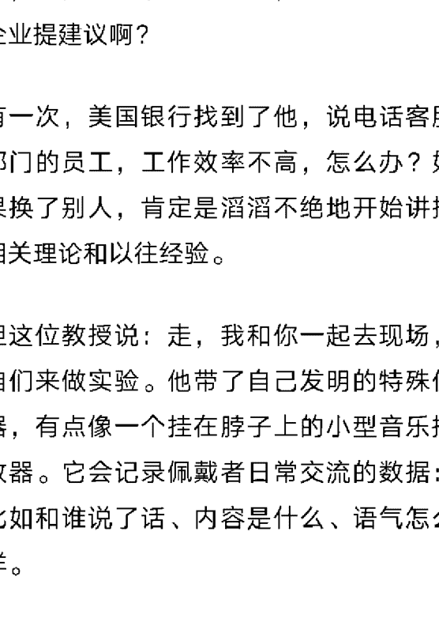

你好，我是李育辉，欢迎你加入我的组织行为学课。

这个世界上充满了各种生物，除了你熟知的动物、植物、微生物，还有一种奇奇怪怪的器官：公司。公司也是生物，它不仅像生物一样有自己的细胞结构，也有自己的病毒、自己组织内部的传染病、自己的生死。用一句话概括，公司有自己的行为模式。

那么，作为生活在商业社会里的人，你怎样才能掌握这种行为规律呢？

## 寻找商业组织行为规律的学科，就叫组织行为学。

### 1. 把你打造成解决问题的乐观行动派

我们先来看一个真实的事件。美国商学院里，有一位教授，他很喜欢为学生提建议、做咨询。但是他有个怪习：公司来咨询，他会先请对方吃饭，谈完再开药方。如果你问他这种做法行不行，他会说：“看场合”。

有一次，美国银行找到他，说电话部门效率不高，怎么破？

但这位教授说：“走，我陪你们去看看现场。”他们来到现场后，发现一个有意思的事：那些客服人员在打电话时，经常会被负面情绪影响。比如，客户发了脾气，他们的情绪也会跟着波动。

他灵机一动，想到了一个办法：给客服人员配备一个可以记录情绪的小盒子。每次打完电话，把小盒子拿出来看看，如果情绪不好，就深呼吸几次，把负面情绪沉淀下来。

后来，这位教授还发现，客服人员每天要打几百个电话，很多是重复性的工作，很容易产生职业倦怠。于是，他建议公司增加一些随机性，比如让不同的客服处理不同类型的咨询，让大家换换脑子。

这些看起来都不算什么高深理论，但非常管用。一年后，美国银行的客服满意度提高了30%，投诉率下降了40%。

这位教授叫保罗·赫斯林，被誉为“可搜索型专家”。2011年，被美国《新闻周刊》评选为“改变20世纪的100位美国人”之一。

赫斯林的实验依据，就是组织行为学的一条基本原则：除非有数据，否则你的组织行为和传统科学一样，是一个黑箱。

### 2. 帮你理解组织的逻辑

不管你身居何职，老板也好，员工也好，在组织里，你都是一个节点，你的行为总是要受到组织规则和氛围的影响。

比如，你发现团队里的某个项目推进得很慢，是领导的能力问题吗？不一定。可能是组织的沟通机制有问题，也可能是激励机制不到位。

组织行为学就是帮你理解这些逻辑，从而找到解决问题的路径。

## 01讲 | 导论：组织行为中没有绝对的真理

李育辉 · 组织行为学

你好，欢迎来到组织行为学的课堂，我是李育辉，很高兴与你交流。

听到这个学科的名字，你估计有些人就头大了，怎么感觉这么学术，其实不是。在发刊词里，我就写过关于这个比方，你可以把组织，想像为一个特殊的生物，就像动物一样。

如果你仔细观察，任何生物都大致关心的，无非是相同的三件事：

- 1. 怎么观察到身体里，单个细胞的成长和新生代谢；
- 2. 怎么处理细胞与细胞之间的关系，让它们好好合作；
- 3. 怎么合成一个更好的整体，与外部环境互动。

道理是一样的，组织行为学就是在研究个体规律、个体之间的关系，以及大结构对组织的影响。当然，组织的种类有很多种，我们选中数量最多的一种来探讨：商业组织。

你可能学过管理学，我就拿管理学作对比，串讲三个基本问题，它们对你顺利学习后面的课程非常有帮助。这三个问题是：

- 1. 你站谁的立场？
- 2. 你怎么研究这些问题？
- 3. 你的基本主张，概括为一句话，是什么？

我们依次来看。

### 1. 组织行为学的立场

管理学的立场肯定是站在企业这边。组织行为学呢？它是中立的？今天第一个模块，组织行为学与管理学一样，都是一门处理导向的学科，它把组织利益放在第一位。

为什么组织的影响下，口号声声称要照顾个体与社会的利益需求，但仍然是个体重要？其他人不重要么？当然不是。想想确理解组织背后的这个，我需要你跟我一起回顾历史的踪迹过程。

20世纪初，产业革命刚开始没多久，大萧条前一个问题被提了过来。什么牛奶倒进河里，这些常理都颠覆了经济规律，工人群体的心也彻底失语进了问题。据说当时的报纸上，见到顾客都要问一句：您是失业的，还是来跳楼的？

好结果。这种情况下，“走动式管理”就可能起到反作用。

实际上，管理学和组织行为学的根本区别，在于对真理认知的不同。组织行为学不认为管理的真理是简洁的，相反，它应该是复杂的，甚至根本不存在。

那不就代表这门学科没有意义了么？不是的，它的意义在于，理论必须考虑情境变化。这就好比我告诉你，a导致了b，但是我必须加一句，这是在c的限定条件下发生的。中国的老话讲“因时而变化，因势而变”。如果用一句话来概括组织行为学的基本观点，那就是：组织行为是权变的。

罗宾斯教授撰写的《组织行为学》，是我们这个学科里最权威著作。你知道么，这本书每三到五年就要重新编写一次。为什么？就是因为权变是这门学科的基本观点。也许在当代工厂里，灯光明暗就可以影响生产效率。

发刊词中我说道，这门课会为你带来学科的最前沿。现在你应该明白为什么要这么设置了。在最近二十年，我们身边环境发生了重大变化，如果还秉持老观点，你就无法洞察诸多组织现象背后的道理。

**划重点**

1） 组织行为学以组织目标为导向；
2） 组织行为学的研究方法是实证研究，这也导致它和管理学是两个学派，它们的根本区别在于是否认同真理的不变性；
3） 组织行为学的基本观点是权变。

好，这就是组织行为学的第1讲。从下一讲开始，我们就会进入到具体的课程，我们下一讲再见。

## 02讲｜模块导论：为什么你要深入了解个体？

李育辉·组织行为学

你好，欢迎来到组织行为学的课堂。

上一讲我们回顾了整个课程的重要概念、研究、变量。接下来我会为你介绍3个模块，为你带来18讲内容的逻辑图谱。不过在每个模块开始前，我还安排了一讲小导论，帮助你理清逻辑，避免只见树木不见森林。

在文稿区我为你准备了整个模块的逻辑图，请你一定把它看仔细。旧的内容要重新扫描，所以并不失科学的全部课程。逻辑图会帮助你了解，你到底在知识体系里的哪个位置。

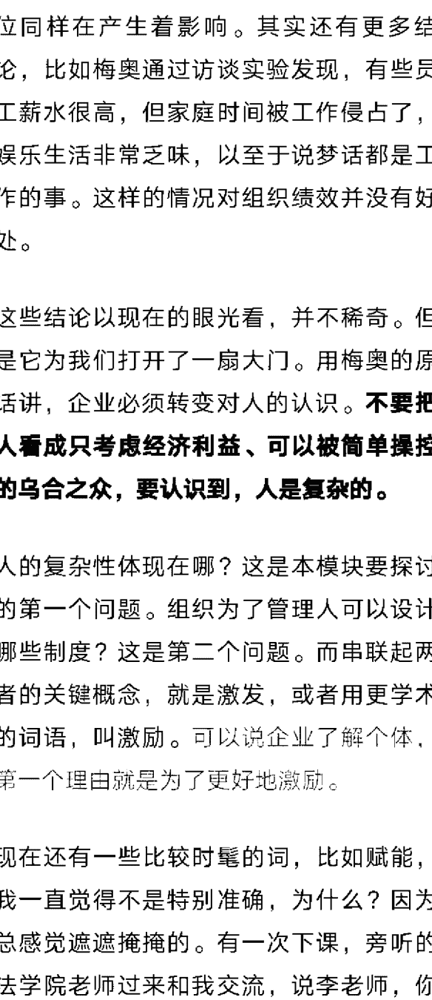

### 1. 为什么要叫“激发个体”？

为什么用“激发”这个词？

我听过这样一件事，梅奥的霍桑实验里发现，薪资不是万能的，工人在实验室里的状态同样在产生着影响。其实这还有很多结论，比如罗迪通过访谈发现实验室里，有员工薪水很高，但这部分员工被工作侵占了，娱乐生活非常贫瘠，以至于对梦想都无所谓的。这样的情况对组织绩效并没有好处。

这些结论以现在的视角来看，并不稀奇，但是它为我们打开了一扇门。用梅奥的原始话，企业必须对待工人，**不要把人看成机器，要承认人是复杂的。**

人的复杂性体现在哪？这是本模块要探讨的第一个问题，组织行为学叫它，为什么？因为需要讨论第二个问题。在组织行为学里，关于人的两个关系概念，是**激发**，或者用更学术的词，叫激励。可以说企业了解个体的第一步，回过头为了更好地理解它。

现在还有一些比较时髦的词，比如赋能，我一直犹豫不用赋能这个词，为什么？因为总是绕得离梅奥越远，有一次，老师的方法论老师也来问我，说，你说赋能，但你又叫“激活”这个词有点功利感，是不是矛盾？

我认为，“激活”或者“激发”是最能体现组织导向的词，不管你听我说的你是员工还是管理者，都应该明白，组织大家组成的是商业组织，那赚的只有赚到钱，其他的才可能被纳入考量。

说到这，如果我们把组织激发个体的过程，看成一种输入与输出的过程，那么显然，每个人的性格、能力、价值观都是输入变量。这些个体层面的因素是比较稳定的，受组织介入影响最小。

但是，我还是安排了一讲《怎样重塑员工的态度》，目的是告诉你，人的底色是可以改变的，可要想改变也只是相对的。否则哪里还要管理者呢？**底色的改变，是个体复杂性的第一个来源。**

还有一类输入变量，它们不恒定，很多被放大，也看组织聚集发生着互动。那近二十年，有哪些输入变量受环境影响最大？我给你准备了三个：**情绪、角色，还有动机**，它们是个体复杂性的第二个来源。

有输入就有输出。绩效、工作态度、忠诚度，这些都是输出因子的结果，但是请注意，它们不是相割裂的，而且因果关系不一定像你想的那样，高满意度不代表高忠诚，不一定。那这里，为什么？所以说，**输出变量之间关系的不确定性，是个体复杂性的第三个来源。**

一个模块里我希望你带你做到最前沿，了解一个越来越重要的视角：职业承诺，看看最优秀的员工到底在于什么。我还会为你介绍两个越多的视角：彩虹理论与工作嵌入理论，目的是让你人力资源中未被开发的新能源以及新方法。

## 03讲|个性：怎样重塑员工的特点？

李育辉·组织行为学

你好，欢迎来到组织行为学的课堂。这一讲开始，我们进入具体的问题。在理论中，我们讲人的底色可以改变，这一讲我们就来看看吧。

一位HR跟我抱怨，说现在招个综合要求都变了。我问为什么。他抱怨原来就是找，有亲和力的就行。现在很多，要创新技术或能，能行软件App，会操作，能独立管理，独立管理，还独立负责。

不光是他，销售、客服、研发，哪怕是网球选手，除了对能力的要求越来越高，这些能力也越来越难找。

传统的解决方案是把标准提得越来越高。但是试来试去就像算命，多问多答都能回答，成本太高了。比如，我的一位大型互联网企业，招一个高级程序员，前后花了三个月，最后也没能招人。

如果说一点，就工作越来越难，那第二个因素，就是工作越来越难。现在的工作，往往能胜任，但很难满足。工作越来越难，而人的要求也越来越高，所以人才越来越难找。

如果你只把人在面上挑，就一定会很痛苦。从组织行为学的角度讲，其实，没有十全十美的人。怎么办？我们换一种思路：我们怎么改造人，怎么让人的底色适应企业呢？

### 1. 性格的改造

人们总是觉得，性格很难改变，能力可以改变，但性格很难改变。但是，我们来看看，性格真的不能改变吗？

我的老师是国内人格研究领域的大家，他们做过一个实验：他们先测量了一批大学毕业生的性格，然后跟踪了他们十年。结果发现，这些人的性格真的发生了很大的变化。

这就是说，性格是可以改变的。那么，我们可以怎么改变呢？

### 2. 情绪理论

如果说性格很难改变，那我们还有什么办法呢？答案是：我们可以改变人的情绪。

这就是我们今天要讲的，情绪理论。我们先来看看，什么是情绪。

### 3. 情景强度

如果说情绪是可以改变的，那么，我们可以通过什么来改变情绪呢？答案是：情景强度。

这就是我们今天要讲的，情景强度。我们先来看看，什么是情景强度。

### 4. 方法：任务人格化

那么，我们怎么利用情景强度来改变人的情绪呢？答案是：任务人格化。

这就是我们今天要讲的，任务人格化。我们先来看看，什么是任务人格化。

很多人都觉得要挑选员工的性格，再培养他的能力。其实，能力和性格都是可以培养的，而且用时不长。你完全可以把一些不必要的成本付出，从招聘环节拿出来，用在培训上。

具体怎么做？首先，**你可以把员工的任务分解，找到和人格高相关的情境，这个术语，叫任务人格化。**然后，你可以在明确性、一致性、约束性，还有严重性上下功夫，制造强情境，帮助他改善性格。

比如，当你发现一个人创新性不足时，你就可以要求他：别人想一个方案，你要想三个，而且把它纳入考核范畴。

2011年，我和某超市合作了一个项目。他们发现，收银员亲度不高。我们当时就把一名收银员可能遇到的冲突性情境全都罗列了一遍，然后制定了统一的、简单的应对规范。比如有一条，就是不管怎么着，都要保持微笑。然后把所有规范都纳入考核。半年时间，改善非常明显。

好，说了这么多，回到我们的原点。性格都不是一成不变的。只有当你认识到，这些最底层的、看似不变的东西都很复杂，你才能认识到管理的复杂性。

**划重点**

1） 即便是成年人，他的个性也可以改变；
2） 改变个性的关键，是情境的强度；
3） 企业如果希望完善员工的个性，可以从情境强度的四个维度下手：**明确性、一致性、约束性、严重性**。

李育辉

以上是组织行为学的第三讲，我给你提一个小问题：你觉得，情境强度理论对于世界观的改善有没有帮助？欢迎给我留言。

**李育辉·组织行为学**
组织进化的行动策略

上一篇

留言精选

## 04讲 | 情绪：怎么让员工拥有持续的好状态？

李育辉 · 组织行为学

你好，欢迎来到组织行为学的课堂。上一讲，我们讲了个体比较稳定的变量：个性。这一讲，我们来看看另一个非常不稳定的变量：情绪。

美国管理协会每年都会检测全美员工的工作情况。2014年开始，他们发现一个诡异的现象：离职员工消极反馈的比例骤降，而且你有没有注意到，我们做得越来越好，但为什么发生在职场精神内耗上呢？

中国同样有这种情况。这几年，我们经常听到老板抱怨员工摸鱼，或者来看场没完没工的老问题。甚至到今天，我印象里，没有工作的时刻很想撂摊子不干？

组织行为学的最新研究说，这些可能和情绪有关！今天这一讲，我们就说，为什么有更难控制情绪？怎样让员工拥有持续的好状态？

在长时间的高负载状态下，许多员工的情绪都会被磨。在职场上，组织提供的解决办法，就是给人做体验，或者给一定的奖赏，平整一下心理波动。

你还记得小时候的“生产标兵”技术能写“大卷大卷”“奖卷”，小时候，父母会把它们订在墙上，直到墙纸变黄了，全都都不再提。我看来着，那就是让个体都“能卷起来”。保持良好工作状态的一种方法。还有许多类似的方法，比如你一下，领导夸多多给多发些奖下。

但是今，些方法在效果逐渐走越下。

不确定大奖、大花奖能从哪里看，而且你有没有发现？即便是加班带奖金的情况新改，维持的时间也非常短，甚至根本不起作用。

为什么？因为这些方法并没有清清楚，到底我什么改善了情绪。我们来看组织行为学的最新研究成果。

### 1. 情绪是一种资源

我们原来一直认为，情绪是感受，为了被动，只需求被评价。最近20年，我们对情绪的理解越来越深，我们发现，在情绪的研究中，因为不觉得再把情绪视为感受。

> 在组织行为学的领域内，情绪是一种资源，需要的是补充。

哈佛大学生有教授，叫罗伯特·普鲁弗尔。他在1980年提出，人们总是在积极地保护自己构建他们认为宝贵的资源，包括物质、情感、社交关系等等。

什么用意？霍布佛尔说，情绪和钱一样，是一种资源，当你保持状态，去处理复杂问题，你不仅依赖专业知识，还要注意精力、排解干扰。这时调动的是情绪资源。

对每个人来说，情绪资源都是有限的，这好比开车出远行，油一定是有光的时候。

用了就必须要加油补充。

举个例子。我们都知道，大开间可以促进交流，但是有些公司正在反其道而行之，设置免打扰隔间，方便员工进行专注的工作。目的就是防止过多的交流，耗尽他们宝贵的情绪资源。

再比如，组织中有个人总是充当救火队员，帮助团队处理棘手问题。你也要注意，他可能自己都不知道情绪资源即将耗尽。作为管理者，你就需要替他考虑，帮他减少分散精力的事情。

**划重点**

- 1） 情绪是一种有限的资源；
- 2） 家庭工作之间反馈路径的消失，让企业原有的情绪稳定策略失效；
- 3） 组织只有把个体的情绪资源纳入管理，才有可能让员工拥有持续的好状态。

**李育辉**

最后，我还是提个小问题：根据你的经验，还有什么可以补充情绪资源？又该如何管理呢？欢迎给我留言。

**留言精选**

点击加载留言

## 05讲｜动机：怎么激发新生代成为主力？

李育辉 · 组织行为学

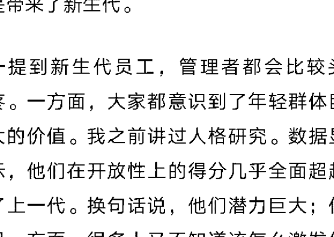

你好，欢迎来到组织行为学的课堂。上一讲我们说情绪时，提到了时代的变化。其实，时代的变化有一个最直观的体验，就是带来了新生代员工。

一提到新生代员工，管理者都会比较头疼。一方面，大家都意识到了年轻群体巨大的价值。我上讲的时候分析。数据显示，新生代开放性的上得分几乎全部落在中上。换句话说，他们的潜力巨大；但另一方面，很多人又不知道该怎么样激发他们。

我给你念几条管理者的困惑，非常有意思。有一个说：“我不懂新生代，无法激发他们。他们每天打打游戏打打闹闹，居然是为了抢到网红店的奶茶。”另一个说：“为什么给我发任何信息，都只能得到他们一句‘好的’？”还有一个说：“他们问我们，能不能在办公室里躺着？我能怎么回答？”

新生代员工的激励问题在行业内争论得最多，因为组织真真是不知道他们要什么。他们的在工作全情投奔，看啥毫无激情可惜。根本没有可能，看到激励没有激发他们成为工作的主力？这一讲，我们就来谈说。

### 1. 传统的动机理论

我们每个人来到公司工作都各有自己的目的，可能是为了赚钱，也可能是为了学习，还有可能是为了实现抱负。这个目的，组织称为劳动之为“动机”。

我们还是学生的时侯，看课本很难坚持20天不放手，为什么？虽然都是看书，但是动机不同。同样，企业的动机手段很丰富，但是如果没有个体的动机对不上号，员工也不会发胀。

为什么我要给你介绍动机理论？说回我们的话题。企业不知道该怎么激发新生代，并不是新生代的问题，是激发没有找准他们的动机。用了落后的理论。

下面1分钟的内容你可能学过。我们快速复习一下，看看传统的动机理论在说什么。

双因素理论的名气度很高，你可能听说过。这个理论认为，公司所有奖励手段都可以被分为保健因素和激励因素两类。保健因素指酬劳、工作环境、同事关系等基础类需求，它们只能起到去坏作用，如果基础需求点燃了员工工作激情，那就需要提供激励因素，比如晋升机会、对个体的尊重等等。

另一个基础理论叫做需求层次。它说个体在平等、权利、对群体的归属顺层。

当然，还有另外一些理论，我就不一一展开了。这些传统的动机模型已经被绝大部分企业采用，但是很多人忽略了它们都有一个共同的前提假设，即激励人。

不论是双因素，还是需求理论，它们都默认激励手段是外部的、强制的。什么意思？比如说，组织希望一名员工把产能提高20%，它知道这员工工资要发足，所以告诉他，如果达到了这个指标，不仅可以发奖金，还在公司交补贴。

这不是很不正常么。你可能会注意，刚才的例子，默认组织很提量。不管你目标给多大，或怎样获得奖励，你都是强制给你的。这就像你的工中加一个诱饵，牵着它往前走。虽然诱饵很大，但是你始终没有问过他的感受。

我们再到看一下。传统的动机理论都默认组织是工作任务的发起人，而员工是配角，就好像《西游记》里的唐僧。真正有能力的只有他，所以他必须要地带着徒弟们往前走，达成目标。

### 2. 当代的动机理论

问题是，个体愿意甘当配角么？我们再来看新生代的特点。

2008年，社会学家理查德·桑内特出版了他的新书《公共人的衰落》，里面提到，我是当代社会的新型代生代，这和组织行为学的调查数据是一致的。我们发现，新生代员工最突出的一个特点，就是不再是必要要一颗“螺丝钉”，而是要成为工作的主动者。

这里不去多探讨原因，我只提一点。许多社会学家认为，互联网是新生代成长最大的红利。二十年前，一个年轻人说自己要当主播，让所有人觉得是疯话。你会觉得他傻。但现在，成百上千，快手上的网红，拥有百万粉丝不是难事。

我不知道你的年龄。如果你出生在70、80年代，那么小跳皮跳跳等很多活动，可能是你的少年。如果你在90后、00后，童年是和电子游戏相待的。在游戏中，不管是操千军还是过独木桥投人生，无一例外，你都是主角。

主角什么意思，就是自我掌控。这是他融入新生代价值观内也在内心掌握。开头提到，新生代居然会因为抢奶茶而准早上班。如果你让老板觉得爽，那人就换个岗位，你的上班时间，恰好赶上了人家抢奶茶的点儿。

进入2000年以后，组织为行为开始探索适应当代的动机理论。我举个例子，当管理者试图了解自我实现理能。当新组织让你在工作中的任务变成一种义务的时候，个体的动机也会被破坏。

有个实验就发现，年轻人的计算机程序员非常擅长，仅仅是因为他是喜欢解决难题的热爱。但是如果组织给每个代外人强烈的标准，比方是必须完成多少行代码，那他就觉得受到限制了，工作的内动力就被削弱了。这种影响有多大？在很多实验中，它会自消很多。

## 划重点

- 传统动机理论把组织，而非员工，当作工作的主体；
- 新生代最大的特点就是想当主角；
- 激励新生代打主力最简单的方法，就是把他们当成投资对象来看待。

李育辉

这是组织行为学课的第5讲，最后还是给你留个小问题：你还知道哪些激励新生代的好方法？欢迎你给我留言，我们下一讲再见。

李育辉·组织行为学
组织进化的行动策略

## 06讲 | 角色：如何帮助员工处理工作生活冲突

李育辉 · 组织行为学

你好，欢迎来到组织行为学的课堂。

上一讲，我们说了新生代问题。有人说了，我不追求员工都是年轻人，不追求那个群体，那怎么？今天这一讲的问题，恐怕任何人都逃不了。

2018年，英国求职网站Totaljobs做了一个大数据调查，它对比了原来和现在，我们一天的时间分配有什么区别。

原来我们的一天很规律，公私分明。现在，大家上班时先刷网、看视频，和朋友聊天，手机说不定也会被工作吵醒，拿电脑刷个夜。一天的时间就变成杂乱无章的碎片。

作为员工，很多人就开始抱怨：工作侵入了我的生活的空间，工作侵入了我的家，工作占掉了我的休息。结果，企业也越来越担忧：情绪影响效能，组织效率降低。

那组织该怎么样帮助员工，也帮助自己，处理好工作与生活之间的冲突？这一讲，我们就来谈。

### 1. 不要用时刻划定界限

企业常用的做法，就是威胁嘛，如何更好地划出这一条时间界限？这是个现实的管理问题，但它不是一个“真问题”，为什么？

有一条著名管理经验，你可能听说过，叫做“支付1.5倍的价钱，让员工付出2倍的努力，有这种管理的样子”，这是个极坏的，但生存在往常里这样儿，变成了企业吸收3倍利润，员工的工作意愿也到了3倍。

在一次交流会上，我就听到一个企业家侃侃而谈，比如多付一些点钱，让员工周到上加班，说实话，你是听不下去的。

为什么？你有没有发现，这都是计算时间的。但是企业并没有赋予一个人的生命，哪怕1.5的报酬。它没有这个权，也都没有这个。之所以说时间问题衡量，是因为在特殊的社会时期，时间和劳动成果是划等号的。

在福特汽车厂里，流水线的速度是固定的，工人为八小时，企业就可以推算出这八小时产生的价值，然后付你薪水。

但是现在，用时间来评估成果越来越难。我们全面进入知识经济的时代后，工作是以任务为基本单元的，而时间只是任务的一个要素。

这就是为什么用时刻划定边界不是一个“真问题”。在时间上，工作任务与生活时间之间不可避免地发生了融合，如果你还用时间算账，那就是一个永远算不清的糊涂账。

### 2. 角色理论

企业可以依据什么来重新划这条界限？我给你介绍一个理论，最早产生于心理学，后来在组织行为学里发扬光大，它就是角色理论。

莎士比亚曾经作过一个比喻，他说：“世界是个大舞台，每个人都是舞台上的演员”，借用这个比喻，可以说，而所有社会群体的成员都是演员，都在扮演特定的角色。比如你是项目经理，可能会是一位父亲，或是一位俱乐部的会员，等等。

回家后，他们就能更好地承担单一的家庭角色，比如一位好父亲，或者好儿子的角色。

文稿后，我附了一张由剑桥大学贝尔宾教授提出的团队角色表。你可以思考一下，还可以作哪些分离。

说回来，有的时候工作量就是比较大，重要的工作角色就是会占用员工的生活时间，怎么办？第三个方法就是，**组织可以想办法帮助个体，减少一些他承担家庭角色的压力**。

我再给你举个例子，山东有一家能源企业。销售部门的员工经常需要应酬，这很常见，你一定理解。应酬就意味着有可能喝酒，喝酒会伤身体。健康出了问题，当然影响他的家庭角色。

这家能源企业的应对方法很有意思。它要求所有人戒酒，而且因为员工都住在一个大院内，也比较好控制。大院内所有小卖部，都不允许卖酒。按理说这是人家的私事，但它就要管。不仅管，还很彻底。一旦发现员工喝酒，就扣工资。那你，长此以往，员工的家人当然会少操心他们健康的事，家庭角色的负担也会比较轻。

## 划重点

- 知识经济时代，工作与生活的边界不能用时间简单划定；
- 个体在一段时间内，倾向保持单一的角色认同；
- 为了减少工作与生活相互入侵带来的负面效果，企业可以对个体的角色进行管理，保证他们在上班时优先完成重要的角色任务。

我提个小问题：有些软件公司特别喜欢把团队拉到一个酒店，连续几天加班不回家，攻克重要产品。你觉得这种做法怎样？欢迎给我留言，下一讲再见。

### 扩展阅读

### 贝尔宾团队角色表

1. 行政者或实干家。其积极特征是有组织能力，注重实践经验，工作勤奋，有自我约束灵活性；可以容忍的弱点为：一般比较缺乏灵活性，表现为对没有把握的主意不太感兴趣。
2. 协调者。其积极特征是比较客观、宽容、公正，能不偏不倚地兼容各种比较有价值的意见；可以容忍的弱点为：一般在智能和创造力方面不是十分突出。
3. 推进者。其积极特征昰工作热情较高，干劲十足，并随时准备向传统、向效率、向自我满足挑战；可以容忍的弱点为：易急躁，爱冲动，好激起争端。
4. 创新者。其积极特征是知识渊博，才华横溢，富有想象力且智慧超群；可以容忍的弱点为：不重细节，不拘礼仪，高高在上。
5. 信息者。其积极特征是有广泛联系人的能力，能主动地不断探索新事物，勇于迎接挑战；可以容忍的弱点为：一旦时过境迁，兴趣马上转移。
6. 监督者。其积极特征昰比较讲求实际，分辩力、判断力都很强；可以容忍的弱点为：一般缺乏鼓励和激发他人的能力。
7. 凝聚者。积极特征昰有适应周围环境及人的能力，能促进团队合作；可以容忍的弱点为：在危机时刻容易优柔寡断。
8. 完美主义者。其积极特征昰对功能能够持之以恒，且追求十全十美；可以容忍的弱点为：容易拘泥于细节，不洒脱。

## 07讲 | 职业承诺：如何让优秀的员工稳定工作？

李育辉 · 组织行为学

你好，欢迎来到组织行为学的课堂。

之前的四讲，我们说了个性、情绪、动机、角色，这些还是你看得到的。但有些能量，隐藏在人心当中，一般看不到。这一讲，我们就来谈一谈。

由于工作原因，我经常和创业者交流。你知道老总的什么，特别是老板。

有一位CEO曾经和我说过，不是市场上太兵团压价的时候，而是内部突然有骨干员工找到他，心平气和地说：老板，我要离职。

他说那一刻自己就仿佛愣住了，然后飞速思考这两个方面：公司是肯定走不掉，是钱没给够？还是职位没给到位？

如果你是一名CEO或者HR，最头疼的事莫过于优秀员工在心态不稳时，天天想着离职。如果你一直给他加大福利，可转脸他就变心，那真的比较抓狂。

今天我们就来讨论，怎么能做到让优秀的员工保持稳定。

### 1. 组织承诺

先看看什么叫组织承诺。留住好员工，老板手里的无非这几招：给钱；给职位；给期权；还有就是提供好的交流环境和其他资源。

可过十年，这些方案起到的作用越来越有限，为什么？

首先你需要了解一个概念，叫组织承诺。

这是组织行为学的一个专业术语，**特指员工贡献给组织的忠诚度**，也是此前的企业管理者们梦寐以求的。

组织承诺怎么发挥作用？我举个例子你就知道了。三十年前，几乎所有顶级都是终身制的，国内有企业，单位就是另一个家。

把自己的未来寄托在组织身上，对个人忠诚，有所为。所以，曾经有一种职业叫央办员，就是干什么去干什么，专门给领导帮忙解决后勤问题。你记得邻居家的保姆吧，那种职业叫保姆助理，自己可千万别走。

现在，那个人具体做什么工作不重要，在哪个部门不重要。

在这种情况下，组织承诺就是所有人必须考虑的事情，因为对个体来讲，组织太重要了。

但现在是另一个时代。企业的平均寿命越来越短，日本也在打破终身雇佣制。作为一个老板，你一旦入职就进去，那时间你早就过去了。

你能说，进去是合在一起的时候才有一点点？你还能去要求他对组织承诺？这就是老板和HR在吸引员工时最头疼的重点。

### 2. 职业承诺

那如果站在个体追求自身利益最大化的角度，不对组织忠诚，员工还能对什么忠诚？

就在近几年，组织行为学针对这些变化，提出了一个新概念，叫做**职业承诺**。

它替代了组织承诺，成为提高员工稳定性的重要理论。

职业承诺是指员工对职业本身的态度和投入程度。它强调的是个人在职业成长和专业发展上的承诺，而不是对某个具体组织的忠诚。

拥有职业承诺的员工，即使在不同组织间流动，也会保持对职业标准和职业道德的坚守。他们关注的是如何让自己的职业能力持续提升，如何在职业领域内获得成功。

为了更好地让员工成长，茑屋还鼓励他们走出公司，走进世界。

比如，茑屋就曾经派遣美食区员工，前往美国，探访“从农场到餐桌”运动的发起人，获取关于农产品方面的经验。你想想看，这对于设计师来说，是不是一个非常好的机会？

所有这三条都有一个核心理念，就是**鼓励员工在工作中遇见“未知数”**，目的就是让他们感受到成长，感受到茑屋作为一件“员工商品”起到的作用。

但是到这就产生了一个新问题，那就是：如何保证招来的人，恰好很在乎这些东西？如果你忙活了半天，发现对方并不在乎这些条件，怎么办？

请注意，从组织承诺到职业承诺的理论发展，并不是针对所有个体的解决方案，而是针对“最优秀员工”这个群体的。所以，茑屋书店的理念和经验，也只应该提供给那些最优秀的员工，而不是平均分配。增田自己就说，他不希望招到那些只想工作安定的人。

你看，这一讲的逻辑就是：从长期来看，优秀的员工只忠于职业而不是忠于企业，所以企业必须要转变思路，让自己成为商品，为个体的职业发展服务。

## 划重点

- 优秀的员工更忠于职业发展而不是雇主关系，对他们的激励，不要搞错方向；
- 想让优秀的员工工作稳定，就要先帮助他们成为更优秀的人，这样你就能成为他自我发展的合作者，而不仅是一个雇主；
- 有三种方法供你采用，可以参照茑屋书店的案例。

李育辉

当然我相信，你可能早就找到了自己的套路，你还知道什么激励优秀员工的方法？欢迎给我留言，我们下一讲再见。

## 08讲 | 工作嵌入：传统激励方法失效了怎么办？

李育辉 · 组织行为学

你好，欢迎来到组织行为学的课堂。

我们已经讲过了许多激励手段，给钱、给权、让员工当主管，甚至还得有职业承诺，告诉他们员工要积极主动地变成企业员工，成为未来职业生涯上的一环。但是你有没有想过一个问题，假如非常不幸，这些手段都失效了，你还能怎么办？

你可能会问，李老师，你这不较真儿么，怎么可能失效呢？而且就算真的没有，他可以不主动一点儿，你给他他就不想要了。那你就再主动一点儿。不用你主动，或者你必须挖到足够多的时候，他怎么办？还是有办法，这一讲我们来就是说说。

### 1. 把荣誉颁发到员工家中

今天的第一来来自一家中国跨国企业，主要是生产、销售重型机械。这家企业把工厂放在巴西、德国、美国等国也有海外工厂设立的子公司。之所以会遇到海外工厂员工流失的问题，就是因为它需要雇用大量外籍雇员，而文化差异有时会带来你意想不到的麻烦。

比如这家企业到非洲某国建工厂时，就遇到了问题。企业走出去是大好事，管面上遇到的问题和挑战。有的企业，因为不了解当地人的习惯，经营时遭遇了挫折都做出了预案，可是到了新大陆上，遇到了问题，这四个字：准时上班。对，让员工准时来上班，这就很难成问题。而且你别忘了，水线少上一个人，那个机器都转不起来。

当地人的时间观念非常差。我们从小就被教育要守时，但是非洲没有这个传统。你要求早八点上班，人家会迟到会给你带出来。而且深入交流后他们发现，一些土生土长的工人原本根本没有带手表的习惯。

怎么办？他们开始尝试。首先就是思想工作，告诉当地人时守时是一种美德，结果根本没有人买账。挨罚、降薪、降薪还是不行。于是有人想，发奖金。你猜结果是什么？没用。当地的消费场所很少，现金基本无用。如果出去买一点儿吃穿，孩子也带不回去。如果给钱越多，算下来会亏本。

你可能会说，那干脆降薪，派他们中国人去。不好意思，为了解决当地人就业问题，非洲政府对非洲人企业必须雇用一定比例的当地人，降不得他们的，怎么办？

这家企业非常有创意，遇到难处的时候，特别愿意想一些“中国特色”的解决方案。它们想到了一个无比大胆的解决方案：挖地洞。每一个奖项评价，按时来上班，奖励一个大奖，大红花，可以发钱就甭管了，发奖就能够管用了？告诉你们，还真管用了，因为这人的奖比吃的更好使的。

他们请当地的政府领导来给员工颁奖，而且把奖状发到员工家中去。怎么办？那真是“锣鼓喧天，鞭炮齐鸣”，队伍声势浩大，进村就四处嚷嚷，必须得把村民全部召集出来。为了这个奖让全村人都知道，有的人从屋里走出来，一下子就跳上去握握手：感谢你，生个丁好儿子。

你想，这里很多孩子，村民的人虽然不知道奖状上了啥，但都能感受到：这个人肯定很厉害。村里从来没谁人能拿政府奖励的。

这还没完，他们把“洋劳模”的照片放在官网上，请当地媒体去报道。接受采访时，洋劳模“穿着”劳动勋章亮相，他说：“奖励，就自动激励、激励着。你能感觉到，厂里还来了一名名人，当地人一看，一定能激励劳模更加卖力的，比发钱大得多。”

这个制度刚运行的时候，没几个人能达到。企业没有哭，坚持用。一段时间后，达标的人多了起来，大家开始准时上班了。2018年，靠着劳模制度，企业基本解决了旷工问题。

### 2. 工作嵌入

好，案例先讲到这里，我们来看看背后的道理。

中国人在德国帮助德国人解决问题，这也是奇观了，但是收到了效果。很多工程师虽然不乐意，但是架不住太太唠叨，又想到孩子能有好的教育，就选择了入伙。这些人才，对企业后来在德国站稳脚跟起到了重要作用。

案例讲完了，你有没有感到很熟悉？这不就是我们常说的，老板帮员工搞定教育和养老，员工帮老板搞定生意么？不是只有中国才是关系社会，放眼世界，谁不是上有老下有小，讲究个亲疏有别，谁不希望自己办事能比别人顺利？

刚才的问题是，组织如何利用非工作因素激励员工，可以从何处下手？有个组织行为学家叫霍尔托姆，他针对美国财富百强企业做了一个调查，发现那些高“工作嵌入”的企业，无一例外都为员工提供了优质的外部关系网，这成为他们不愿意离开企业的重要原因。

其实第一个案例的道理也是一样的。企业帮助非洲员工搞定的，不也是他和街坊邻里的关系么？

如果你是管理者，想打这么一张牌，最有效的方法，就是出面帮他搞定社会关系，甚至成立专业的部门来做这件事也不为过。案例里这家企业就是这么干的。为了激励中国企业的外籍工程师，企业特意成立了一个部门，专门疏通和国际学校的关系，保证他们不用操心子女的教育。

## 划重点

- 激励不是只能考虑工作因素，非工作因素同样具有重要的作用；
- 对个体来说，最重要的两个非工作因素就是社区和家庭因素；
- 你可以把非工作因素，纳入到激励政策的设计中。

李育辉

好，这是组织行为学的第8讲，我给你提个问题：有人说了，我没有这家企业那么大的能力，但我也想帮到员工，能怎么办？请你给我留言，大家帮他支一招。我们下一讲再见。

## 09讲 | 彩虹理论：人力资本越来越高怎么办？

李育辉 · 组织行为学

你好，欢迎来到组织行为学的课堂。

这是个纯模块的最后一讲。之前，我们说了很多激励方式。但是开过公司的人都知道，自己带头上台慈善着一把达摩克利斯之剑，那就是人力资本。解决了不了这个问题，之前所有都是空谈。

中国已经高速十多年，人力成本的增长率超过GDP增长速度，从宏观上来说，流动不经济的一些企业很像独木舟一样，用不合理的新薪酬吸引人，拽得大家硬着头皮前进。

我们劳动 工资 率 一直 在 很 高 增速 的 由 于

采用什么对策？这一讲我们就来提供一个可行的方向。

当然，面对这个问题，最简单的方法就是开药方：少用人，或者降低单名员工的待遇。但是只要你注意，这里就只有一张药方。而且想再琢磨一下，就会知道是错的。对于快速发现、需要用人力的公司，这种饮鸩止渴的做法实际上根本没有办法。

那怎么办？还有一个思路，我们来看。

我们把人力比作能源。你会发现，纵观历史，能源并没有真正枯竭过。煤炭快被用尽，后来的成本太高，大家就转向石油。石油的代价也承担不起后，大家就想受不了了，就去找天然气。现在我们转向新能源，总能找到替代方案。

人力资源的发掘是一样的，有没有我们今天开开发的“新能源”？其实是的。我今天给你介绍一个案例，有点极端，目的是让你直接感受它，而不是揭晓背后的道理。

### 1. EverYoung只用老年员工

我们的主角是一家韩国互联网企业，叫 EverYoung。如果你前去参观，看到办公位一个背影，听着键盘的敲击声，会让你没什么大异常，但是，如果没有一声，让大家抬头观察，你会发现所有的老人都在发呆、发呆着，都是年过六旬的老人。

EverYoung只用五十岁五十岁以上的员工。神奇的是，它居然可以成功运作起来。公司组建于2013年，开始只有十几个人，现在已经是一家四百多人的大公司了。

EverYoung有两条主营业务线，一条是图像和视频的编码工具，另一条是批量数据信息。但是偶尔也会接受一些复杂性的任务，比如对产品进行测评，不全是该项业务，对员工的互联网技能要求都极低。

这就产生了两个问题：

- 怎么保证爷爷奶奶们能够具备相应的技能？
- 这和降低人力成本有什么关系？

我们老人，先说第一个。你可能觉得，老年人的学习能力估计是不行了，接受了新东西。既然公司要做互联网生意，那得招相应岗位留下来的人啊。

但是，EverYoung值得我们借鉴的，是它看待人力资源的视角。我们现在往往用员工的平均年龄来衡量一个企业，超过三十岁，老板上街都不好意思和人打招呼。但这是一种浪费性的使用方式，每个年龄段的员工，都有他可以被利用的价值。而且，这样也必定哄抬了年轻员工的人力成本。

我们最早说，降低人力成本的思路，还可以是找到“新资源”。如果我们把人的一生，都看成可利用的资源，那其他人不看重的，不就是你的“新资源”么？或者说，你可不可以对人力资源进行二次开发？EverYoung的员工以前都有各自的工作，他们给公司带来了各种宝贵经验，这就是一种二次开发。

而彩虹理论就为你提供了一个降低人力成本的辅助手段，因为不同年龄段的人，他们的需求是不同的。企业在乎的是钱，但是如果有别的东西可以代替钱来激励员工，不就可以降低成本么？

比如我举个例子。刚才讲到，人的学习激情在18岁和65岁时达到了一个高峰，但我告诉你，这不是最高的时候。一个人什么时候拥有最高的学习热情？45岁。而且在30岁到35岁之间，还有一个稍低一些的峰值。这都是你可以利用的资源。

再比如，一个人在45岁左右，极其看重持家者的角色。如果这时你能帮他解决子女教育，或者父母养老的问题，你说，他会不会对工作上心？

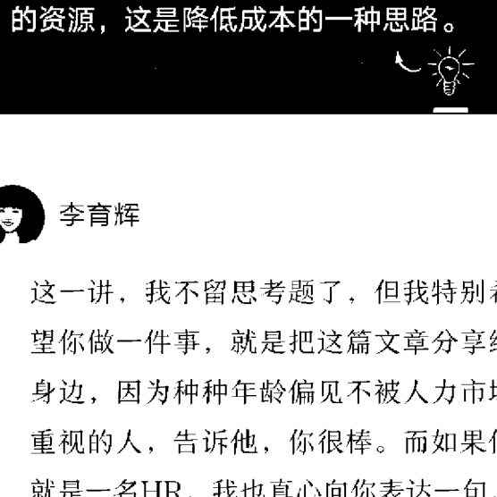

## 划重点

- EverYoung利用老年人的学习热情作为激励依据，降低成本；
- “彩虹理论”为我们指出了人在不同年龄段的不同需求，可以作为企业激励员工的依据；
- 把个体的全年龄段都看成人力可用的资源，这是降低成本的一种思路。

李育辉

这一讲，我不留思考题了，但我特别希望你做一件事，就是把这篇文章分享给身边，因为种种年龄偏见不被人力市场重视的人，告诉他，你很棒。而如果你就是一名HR，我也真心向你表达一句，金矿往往处在大部分发现不到的地方。我们下一讲再见。

## 10讲 | 模块导读：为什么团队一定需要领导者？

李辉辉 · 组织行为学

你好，欢迎来到组织行为学的课堂，我是李辉辉。

从这一讲开始，我们进入团队模块。本讲是小导读，我会为你梳理模块的逻辑。请你注意，因为这一讲更新比较快，主讲人今天更新了下面的讲解，请注意查收，别错过。

在课程一开始，我提示你注意模块名里的动词。这个模块，叫做“领导团队”，为什么要用这个词呢？

前几年有一本书很火，叫《任天堂哲学》。这本书是著名的商业记者井上理写的，他跟踪采访了任天堂总裁岩本茂很多年，非常爱发功。书中，井上理用细腻笔法，将岩本茂塑造成了一个非常高产、有战略眼光的领导者形象。这本书对于了解任天堂很有帮助。

不过今天我不推荐这本书。之所以提到它，是因为我听多了许多老师在讲授领导力时要用到这里面的一个例子。

任天堂历史上最重要的一款游戏叫《塞尔达传说》，也许你听过或听说过。2006年，在这款游戏的最新版本上线前后一个月，宫本茂突然要求产品做出重大调整。要知道，这个阶段上，连时间表都是按天规划的。临时调整，所有组都要打乱，很有可能导致产品延期上线。

宫本茂为什么要下令调整？简单说就是觉得，在当前的版本里，玩家在新手村里练的、时太长了。宫本茂想让团队2天，而不是原来的3天，这让很多基础设置发生了改变，团队必须加班加点，要拿出几十倍的战斗力，才能完成任务。

但是，团队成员是无怨的，对他们来说，这种事太常见了。宫本茂是那种不管日程多紧张，只要产品能改进，都去随性叫停的人。任天堂内部就给他的风格起了个名字，叫“做减式法”。做减式法，食物都剩下了，大家准备开餐，宫本茂却考虑都正确了。

果然，经过修改的《塞尔达传说》投放到市场后，大获好评。

好，从任天堂的案例中说出来，很多老师就告诉，宫本茂身上具备的，就是领导者的一种优秀品质。你可以叫他“撤在做式”，也可以叫它“只做正确的事”。在宫本茂眼里，正确的事就是创造一款足有市场的游戏，其他的都是要事。老师们会讲，有了这个“做减事”的执着，你就会产生让人敬佩的魅力。

乍一听到对的。乔布斯、马斯克都曾经做过类似的事，在产品上线前，临时叫停，提出修改方案，让产品更完美。这方面的传奇故事，相信你知道很多。

但是这类故事会引发我的反思。这个案例能说明宫本茂有领导力？我是反常思维，觉得如果不要宫本茂这个案例很能说明什么，一定是让这些大佬经理。老板临时掀桌子，他们还想跟着，真是太厉害了。

这种故事一定是传奇性的，可以让人回味，但你难道知道，我也接触过很多创业公司的老板，他们告诉我，有时候一个产品差不多就要投放到市场上去了，没什么特别的原因，因为老板坚持不让大盘出，结果，很多人就走，不跟你干了。你看，理想跟现实的差距有时就是这么大。

我为什么要给你介绍任天堂这个案例呢？

## 11讲 | 匹配：怎样始终招到最合适的人？

你好，欢迎来到组织行为学的课堂。

在寻论里，我讲了匹配的概念。这也是**群体层面**进行管理的基础。接下来，我们就具体看看，组织行为学都研究哪些匹配。

2018年底，一个保险公司的HR和我聊天。他说以后招聘工作会越来越难做。我问他为什么。他说他需求招聘精算师来时，以前这个岗位的薪资非常明确，都是用模型计算出来，得出定价。谁在这方面的能力扎实，我就录用谁。

他说这个格局以后会改变，因为可能在两三年后，单纯的计算问题就可以交给AI。那时，精算师的岗位就会要求提高，要懂数据等科学家。他就说，这是好问题，为什么会影响招聘？他说，那就招人时，要什么标准来描述科学家这个岗位的需求？

如果你近几年有过求职的经历，一定会更多招需求越来越变得模糊。因为岗位正在变得更复杂复合，新描述越来越精准，那企业有什么应对方法？这一讲来看看看。

### 1. 人岗匹配

我们先来看传统的解决办法，无非有两种：第一种，先把人招进来，再通过试用期进行筛选；第二种，先找人归类，然后是找人进来，再分轮子。一段时间后，依据表现，再分配到现在合适的位置上。

这两种办法，本质上都是回避了面试遇到的难题，人为地把筛选周期拉长。只不过，试用、轮岗、都需要耗费企业的资源和时间，当然，所以从成本控制的度考量，我们也并不是最优选择。还有其他办法么？从组织行为学的角度看，组织要扭转的不是面试，而是老的选才思路。

所谓老派的思路，就是教科书里对招聘的定义：组织将个体特征，通常是能力和经验，与工作岗位要求进行匹配，来确定合适的人。这种叫“人岗匹配”模型，是对面试问题的底层逻辑。你可以回想一想：在接取我的思考工作的机会，有什么能力在按照这是最思维问题的思路，那么，你之前有没有从事相关岗位？当时你怎么处理问题？

但这不是唯一的思路。近几年，组织行为学派提出了另外三种匹配思路。

### 2. 人人匹配

第一个思路叫做“人人匹配”。

咱们在管理中有句话，以类别、以积分。我们不管有意，虽然无法描述某类群的需求，但是你总可以知道，在已有的员工当中，谁和谁可能做得会更好。你去描述岗位，而是描述优秀个体，然后考察应聘者和他们的相似度。

它的优势在哪？“人岗匹配”分为两个部分，“识人”和“用岗”。也就是说分别描述岗位和人才。它们用到的分析方法是不同的，所以对于人力资源来说，就需要分别建模。而“人人匹配”，从头到尾只要分析人，只需要建立一个模型，它更节省成本。

“人人匹配”还有一个好处，就是在招你把这些优秀个体公布出去，并且在那招聘书上写两句，让大家知道招到什么的人。那么来应聘的人就会首先进行自我筛选，因为个体天然喜欢和自己相似的人在一起工作。

老先生，非常厉害。他当时破例给这家企业招了一批，符合他们上面标准的高潜力人才，有某研究所过来的研究员，还有知名大学毕业的金融系博士生，等等。这些人来了之后，第一是没什么实战经验，短期上不了手。第二是公司也没有合适的岗位给他们。

你可以想象，企业是国企的班车，招这样的人来是要被质疑的。但是他顶住了压力。果然在两年后，随着中国加入世贸组织的成功，企业一下正面接受了许多原来根本遇不到的问题。这个时候，他招来的这群“预备役”突然就发挥了价值，因为他们的储备足够处理这些问题。

我还记得多年后，我遇到了这位老先生。他和我说，他这辈子干的最自豪的一件事就是这个。他没有任何人力资源背景。但是直觉告诉他，市场会发生翻天覆地的改变。企业有一天一定会调整战略，那个时候，他招进来的这群人一定会发挥作用。

你看，这就是“潜力匹配”的价值，在招人的时候，是有一定决策风险的。但是企业这么做，不是为了当下，而是为了未来的战略发展。

## 划重点

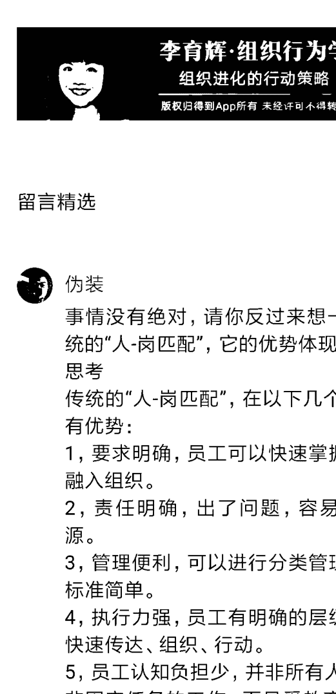

我再来给你提个小问题。事情没有绝对，请你反过来想一想，传统的“人-岗匹配”，它的优势体现在哪？我们下一讲再见。

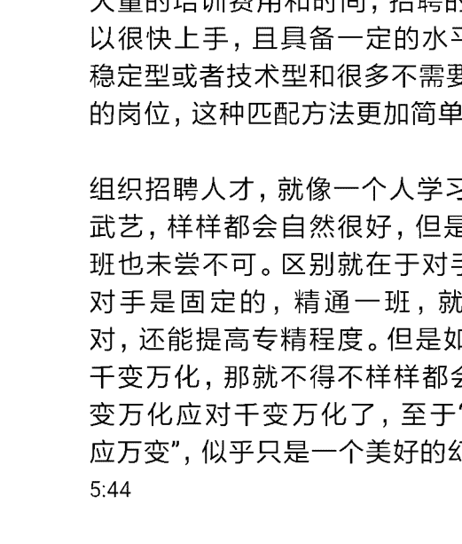

**留言精选**

- 伪装
事情没有绝对，请你反过来想一下，传统的“人-岗匹配”，它的优势体现在哪？

思考
传统的“人-岗匹配”，在以下几个方面更有优势：
1. 要求明确，员工可以快速掌握工作，融入组织。
2. 责任明确，出了问题，容易查找根源。
3. 管理便利，可以进行分类管理，考核标准简单。
4. 执行力强，员工有明确的层级，可以快速传达、组织、行动。
5. 员工认知负担少，并非所有人都喜欢非固定的工作，而且受教育程度不够的人，也很难快速接受多线条提高自主性的工作方式。
6. 对于国家社会来说，“人-岗匹配”模式可以在短时间内培养大批拥有标准化工作技能的人才。
7. 对社会的稳定性强，一个萝卜一个坑。

- 君笑笑
“人岗匹配”的优点在于可以为企业节省大量的培训费用和时间，招聘的人员可以很快上手，且具备一定的水平。对于稳定型需求技术和很多不需要创造力的岗位，这种匹配方法更加简单高效。
组织招聘人才，就像一个人学习十八班武艺，样样都会、老师很好，但是精通一班也未必不可。区别就在于对手是谁，对手是固定的，精通一班，就足够到了，还能提高专精程度。但是如果对手千千万变化，那就不得不样样精通，用“千变万化法应对千变万法，至干，不变应万变”，似乎只是一个美好的幻想。

- 叶恒辉
在工作岗位中，遇到的最多的考验，就是接受任务之后，能不能独立思考和独立解决问题。是一种关键的系统能力。
人员素质符合岗位需求，其中不仅包括了工作技能、工作经验，还包含了思维观念、人际关系、薪酬要求等等。
人岗匹配就像相互咬合的齿轮，匹配程度越好，咬合越好，齿轮运转越好，工作效率越高，企业发展越好。
人岗匹配最大的优势是能够保证企业的基础系统能力。

- Rosy诗
潜力匹配，老师提到企业的那位老先生，恰好让我想起前不久刚学到的金融学里面的“预期思维”，在这里借用一下。
一个国家、企业，或者个人的资金实力不再等同于原始的积累，而更取决于你给市场的预期。这个预期越乐观、长期、稳定，你能获得的资金也就越多，期限越长，而且成本会更低。
预期思维是一种关于未来的前瞻性的思维方式，借用它来表现在提供动力。换句话说，关于未来的想象、判断和信念会塑造当天我们自己的状态。
所以，你要给市场看乐观的预期，你就必须展示出来的技能是未来所需要的，而不是在未来可以被取代的。

- Bruce
《秦飞文化手册》里讲的是一种成年人的组织，人和岗位工作匹配，但是一旦工作内容变化，能力跟不上，双方就解除关系。这种自由人的做法在未来的企业，会有更大的发展空间。大家聚在一起做一个事，做完这个事，各自解散，岗位也不是那么固定，但是可以把潜力发挥到最大。

- 蚂蚁不吃肉
人-岗匹配，有点像教火一样。只需要特定的技能来完成一项具体的任务。比如在隧道工程建设中，现场工需要懂技术的工程师好过一个懂科研的工程师。

以上留言由 作者 筛选显示

## 12讲 | 合群：怎样让新员工快速融入工作群体？

你好，欢迎来到组织行为学的课堂。

上一讲我们说合群，群指的是群人，下一步就是融入。企业都希望新员工能尽快地融入组织。一方面掌握工作任务，另一方面和团队成员建立联系、建立共识。后者，你的组织行为学称呼它为“合群问题”。

合群很困难。大家庭对群体成员，首先得形成信任。一群互不熟悉的人无法形成高度信任。这也是为什么仅靠远程邮件联系的系统，很难在家办公形成有效的协作。

让员工快速融入群体的方法，我们每个人都有不同的训练课程，这个或这个系统也起到作用。一般很难讲明，我有19年培训、春节、春节、春季等，甚至专门针对的咨询费。

但是也有研究数据说，近几年陆续新的公司越来越少，当然，我们身上面对的新型的传统的组织，无论互联网、电商，还是医疗、制造业，它没有真正进合群化的真正解法。那应该怎么解法？怎样让新员工快速融入群体？这一讲就来说一说。

### 1. 传统组织的问题

我们合群的问题在于，如果你真正的合群往往是隐入式溶融的，可能要耗时2年：李老师，我们花了大力气慢慢酝酿，你凭什么说说我们如何？我们是如何去合群的。其实组织行为学不关心心理有没有没有，而是关心心理的激励机制。

组织里最核心的一点，第一个就是社会认同的动力。

我所在的高校有一个学院，每年都会新来同事加入。很多新老师学跨学出身，不太擅长社交，融入集体就成了问题。学院也试过帮忙合群，例如打篮球、乒乓球，但并没有达到目的。

后来到学院来了一位管事的王教授，他马上就改造了休息室。

这张桌子太大，拆成四张桌子，四张桌子太小，拼成一张桌子。

我观察了几张桌子，有桌有椅，有书报，有茶水，还有茶。

我观察了几年，看王教授是个什么人，他就是个普通人。半时，有门进着个门。

新老师喜欢聊天，不管是和其他新人也好，还是老教师。

我观察了好多，发现新人的社交认同其实来自那些零碎型的空间。

更多是空间，有这些空间产生关系。

### 2. 非正式组织的中间人作用

这是为什么呢？我们把社会网络的事情结合起来看。

1956年，有位美国组织行为学家就遇到了和我们同样的困惑。

我们调查组织，组织或者团队就相当于一个社会网络。

但位美国学者用大样本实验发现，有一个关键节点的作用大家忽视了，那就是非正式社会群体的作用。

非正式组织，是一个自发的小圈子。

我们观察非正式组织的作用，公司台上台后看我们看，大家都知道非吗？当然不是。

我发现的，我们人是会好奇，能在短时间内自主判断，知道组建这种小圈子社会网络效果最好。

但这个有两个条件，一是必须从个体自发启动，二是所处环境不能太正式。

了解这些后，我们看案例，一定是自发去活动的。

有一个学完案例，为什么说圈子越不大，半组织的地方活动可以创设非正式的融入？

但一旦建立了圈子，硬要计划，就变成了正式活动。

“非正式组织”其实是一个社会学的名词。

我们组织部门中，横沟、垂直两个研究的组织，就是提出了非正式组织。

### 3. 如何打造“非正式”

我们知道非正式组织是如何帮助新员工快速融入群？

首先考虑传统，为什么组织行为学在半年前开始关注这个现象？

换句话说，互联网技术让建立非正式组织的成本降低了。

第一个合群的点，有一些企业，他们就是用类似匿名标签可以帮助合群同事的点对点网络。

## 13讲 | 领导风格：怎么获取团队认同？

你好，欢迎来到职场行为学的课堂。

在模块7论述，我就提到了领导力的重要性。但你有没有发现，有些领导者明明脾气很差，但是大家就是愿意追随他？有些人缺点很多，但还是很能够快速的获得团队的认同。

乔布斯脾气臭名远扬，与新纳威恩人因为苹果没有人懂他的老板，我们之前讲过的理查德希拉宾斯，性格容易暴躁。本来看是理性智慧的领导者，内芬斯却脾性最好，果敢、大方、自信、聪明、随遇而安，别人越尊重他，他反而越容易拒绝，他是能够才把这位领导者者，他们都不是消纳自己的缺点，显得弱小和凶狠。奇怪的是，认同他们的员工反而更多，这是为什么？

今天我们来说说的，新时代，领导者获取团队认同的一个重要方法。

### 1. 自恋型人格的崛起

首先，领导者得是最容易最可能彻底地表现自己。你可以想象一下，全世界伟大的领袖，是不是越有完美的自爱？英国女王、日德，华盛顿，曼德拉，这些自可可以很强。

这很合理，作为追随者，我们是希望领导者有引导、启发，意味者，跟着他干会有风险。既然是他共其事，我自然希望他是强大更好。

但这样的领导者，近十年越来越看不成了，为什么？

你有没有发现，用完美的人设获取团队认同有一个前提，就是你领导者的大多数认自己的角色是追随者，你听我，打胜我。但越是这些有随者的文化并不发达，他们不像是那么温顺顺的，遵守纪律，还特别会表达中心，相反，他们特立独行，故意表达意见，甚至公开反对我。

我给分享一个保护公司权益的案例，有一次，他们去到某家连锁企业找投诉，本未按照该店老板可以开了，结果店里竟然几位年轻人，突然将店里上摆起了水，引发了骚动，但是老板还是嘴硬，你生，我不有老板没有管。事后，上级领导质问他们：“你们这么干？”他们说：“我们就是想要做做，显得这个时候上台，可以秀肌肉，帮到公司。”

这个案例不是国内独有，美国也有一样，圣地牙哥华大学行为科学教授，做了一个持续多年的研究，从1982年到2008年，他们针对全美超过1.6万名大学生进行调查，分析他们在学校各类组织中的表现。结果显示，从2002年开始，有关学生自恋水平的评分越来越高。

这几年，作为组织行为学的研究者，我们听到关于年轻员工最多的吐槽，就是他们喜欢自己做主，想赢，甚至独特的脑回路用在工作中，而且更有意思的是，他们一般情愿地认为这样能能给组织带来好处。我相信你一定也见过这种现象。

趋势非常明显：年轻一代越来越自恋，原因是什么？美国专门关注社会领域著名作家保罗罗伊因给出了四个原因，演绎了社会造成了这种趋势：

- 父母在培养房子，越来越会给他们更多的自信；
- 约会更方便了，尤其，经济体系中更有巨大自由限制。可现在，在除了使用带卡、有卡和实时Ap，我们很容易从沟通语言习惯中获取一些提示；
- 媒体上的节目，尤其是真人秀节目，也时刻在强化将传递自信到特定的文化；
- 因为有微信、微博这样的互联网社交软件，我们可以肆意展示自我，也可以轻易地屏蔽别人，拉黑不喜欢的人。

这四点，我相信你一定有共鸣。那么回归我们的话题，既然作为追随者的人变了，获取他们认同的方法，就要作出调整。

### 2. 如果我想觉得自己很厉害

如果你想要上一群自爱的人认同你，现在有两种方法让他们：

- 让他们觉得你很厉害；
- 让他们觉得自己很厉害。

你会选哪种？

我接触过的人都会选第二种，让他们觉得自己很厉害。怎么做？领导者需要上去充当引桥，让至少成员感觉累。Leader就生行在，兰基也常常不记的个地方，将来事

2016年，我在全公司做前，他们刚刚创立不久，创业团队有4个人，都很年轻，我走的时候，他们刚刚又吸纳了一位新的合伙人，因此，我得找一个机会开，因为每个数字都摆了，团队中的老大突然对财务不太满意，责骂这点小事都做不好，财务后来和抱怨说：有什么办法能讨好总呢？

我也很困惑，在从前写下两笔大义足，她不知道么？是我去问其他3个人的想法。结果回答让我印象深刻，他们说：“我们打大牙都认识她，但，她是不是确实控制不住情绪，但是快，这会不影响她作的决策，事后她也会去复盘，接着我们打又说：所以她的存在才有价值，老牙的也听好，我们不会让她单独和任何人开会，她太控了，我们会上去。”

你看，在这个案例中，因为领导者有短板，情绪不稳定，反而给大家留出了空间，大家佩服认同她，因为同样能在认同认同自己。

如果这个老大很完美，团队还会认同他吗？真不一定，如果领导者将自己营造出无懈可击的人，那跟着他睡觉地都在发好“我”的，如果我自己也完美，领导者如果都完美，日本学就完了。领导怎么样？领导者最基础，之所以最能获得团队的认同，根本原因是他通常更倾向于自我认同。

我的这家公司后后来发展得非常好，5人团队也一直很稳定。

### 3. 利用情境暴露情绪缺陷

那作为领导者，该如何暴露自己的缺陷？是不是可以为所欲为？不是的，今天我讲两条，都是从组织行为学的角度查考，非非常重要的技巧。

第一个技巧，叫做“合理利用情境暴露缺陷”。

这个技巧的背后是领导力的表演理论，由组织发展理论的大学坎伦本尼森提出。他说，好的领导者，其实是在表演。

这个技巧的后半是表演：“请您高我一坐在等待的火车。”你觉得自己很丢人，我不会隐瞒你的秘密，只是我问你：“你刚才怎么了？是在出口门口？还是在考场外面？是晴天，还是雨天？我手里拿着什么？我想知道你的关系怎样？多久没看到女儿了？”等等。

在这方面，我们讨论的、无私负面的掌门人松井正二，就是一位最暴露缺陷的大师，松井正是一位赢得尊重的领导者，但是他不是随时随地地暴露。大约在日术，领导者如果很硬示弱，非常不利于当地的合。

松井可以很随意，他给到到，日本人不爱言语，松井喜欢开下着去沟通，然后说过三语，说不上客气“无量”“张口而出：‘你，这根本没考虑我几天的，结果太不合理，我真的很撑不住，我国家。’”

他非常难得地让，我让他在当着公：明白的点点，让人看到寻求情感支持的身影，才会凸显他导的付出。

松井常给一个建议：暴露情绪第二个，暴露情绪，而非寻求道歉。

刚才我们了暴露缺陷的好处，那如果现一名领导，可以信自己都不会全部，想让团队成功，多做事。

我分享一个有意思实验，是谷歌公司在2017年做的，他们选择了一百个创建团队样本，分为三组：

- 第一组，会让领导者在工作中完美地展现自己；
- 第二组，会告知同事前一个问题，领导者需要在会上露露自己的缺陷，比如说：“兄弟们，看最近很头疼，这个项目弄得我非常累，但是我要告诉你们。”不需要我们，不要看到他的，”他故意不透露能能力上的缺陷；
- 第三组，领导者同样会在开会暴露缺陷，只不过，这次暴露是“自己累”。

一段时间后，谷歌考察三组团队的绩效情况，结果发发，第一组的领导平庸，第三组最差，第二组的绩效最好的。

研究确认，如果领导者发领导情绪有1种缺陷，我们内心的信任他会大大降低从中获得的自我成满感。这个力。

你可以知道，组理论认为获取领导的认可，我们正好需要一下：意志力、强制力、变革力，专家权力，还有参照权力。这五种权力，保证了成员对领导的认同。

今天讲的暴露情绪缺陷，目的是让你获得更多的参照权力，也是你的做决，但如果追随者发现你的能力有缺陷，就已经影响到专家权力。这就是为什么你只能暴露情绪缺陷的原因。

## 划重点

1. 自恋型人格的崛起，使得获取团队认同的方法发生着改变；
2. 领导者的缺点人设，满足了追随者的自我认同，因而更容易被接受；
3. 暴露缺陷有两个技巧，第一个是合理利用情境，第二个是暴露情绪，而非能力缺陷。

### 思考题

我为你留一道思考题：任正非、张朝阳，他们都靠员工靠手冲锋，说点什么领略，为什么可以成功？领导自自己的企业？我们一讲再见。

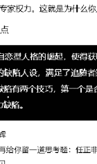

李育臣·组织行为学
组织进化的行动策略

## 14讲 | 相对利己：怎样让团队快速产生凝聚力？

**李开阳 · 组织能力**

你好，欢迎来到组织行为的课堂。

今天的课打破一下以往的惯例，先不要谈解决什么问题。我用两分钟讲一部经典的电视剧：《兄弟连》。我建议你看完，而且应该对里面的战斗场景印象深刻，但我要讲的是有一段可能被你忽略的情节。为什么我要讲？一会儿告诉你。

1942年，一群年轻人从四面八方来到美国佐治亚州，加入了101空降师的E连，他们要在这里接受训练，从平民百姓变成懂指挥、懂合作的精锐空降兵，参加二战。

负责训练的军官叫索伯。我还记得他出场第一个镜头：拖着行李，踢着鼻子，眼睛瞪得大大的，完全是顽固而粗暴的新兵教官模样。索伯就先给大家来了个下马威：所有人忘掉周末的休息，在这三天，每天都要训练。

索伯对新兵的态度不仅是用蛮横来形容，简直变态。他不能容忍新兵头发太长、枪擦得不够亮这些错误，都要体罚。而且夜里做了噩梦，还要练跳伞。有一次，一名士兵跌伤了膝盖，索伯让他灌满水，再背12公斤。有一次，他发现有士兵的枪托生锈了，便大骂道：“你的武器像狗屎一样，你以后的名字就叫狗屎，明白了吗！”

新兵们对索伯恨之入骨，但互相之间却变得越来越团结，成为互相支持起来对抗索伯的群体。有一次，索伯惩罚一名士兵跑完5公里（注：原文为50分钟，疑为OCR误识别或原书口误，此处保留原意但逻辑上通常指距离或高强度惩罚，根据上下文“全站的前方索伯反而被大闹开除了”推测为团队反抗导致索伯离职，而非单兵惩罚结果），结果全队反抗，索伯反而被调离/开除。E连也成长为一支团结、训练有素的队伍。

后面的故事你都知道了，他们杀敌四方，和索伯已经没有了关系。但斯皮尔伯格在最后一集告诉你，索伯升了一个官佐。二兵少尉要为一个叛徒，在接连审讯军俘虏的时候又遭到了索伯。这时，他们的军衔已经高过了索伯，想起他训练时的蛮横，他让索伯给他行个礼。索伯则向原先的下属、现在的长官行了一个标准的军礼。

这当然要体现出什么报复、快意。作为组织行为学的研究者，这个情节让我唏嘘。为什么？我带进今天的主题。

### 1. 训虐管理

前情提要讲，我们谈到如何让新人快速融入工作群体。但是带过团队的人都知道，彼此熟悉还远远不够，要能形成战斗力，成员间便像生死兄弟一样成为一股力量，在组织行为学上称为“团队的凝聚力建设”。

提高团队凝聚力的方法有很多，奖励集体成绩、提高凝聚力、鼓励，甚至很多餐厅早上还会让大家到门口喊口号，这些都很普通，而且都是符合一般管理规律的正常手段。

但是有另一种组织，千百年来一直在采用与之相反的手段来打造凝聚力，那就是军队。军队的这种行为，在军人眼里被称为惩戒。组织行为学给这种惩罚取了个名字：训虐管理（注：原文“寻虐”疑为“训虐”或“严酷管理”的误识，结合语境修正）。长久以来，不管是在学术界还是在企业实践中，训虐管理都被认为是完全负面的。

那既然负面，军队为什么还要这么干？很简单，因为有效。训虐管理因为“政治不正确”，几十年来被离弃，逻辑值就都被忽视了。但最近十几年，组织行为学研究才发现，它其实是一种有效的管理手段，只是有很强的局限性。

### 2. 相对利己

那为什么索伯能把士兵打造成凝聚力超强的兄弟连？真的是打骂等表面手段么？我们来看看。

社会学家斯弗托夫关注过一种现象，就是有人看到邻居家买了一辆轿车，本来和他没什么关系，但是他就觉得，自己也应该有一辆。没有，就说明社会不公平。

斯弗托夫把这种“你有的我有，但并无真正得到的感觉”，称为“相对剥夺”。他说，个体一定是通过与他人进行比较，来确定自己的地位和处境。如果比较后发现，发现自己弱势的地方，就会生到剥夺的感觉，这也是为什么要加上“相对”两个字。

你可能会说，这不就是嫉妒么？没错，是嫉妒，但还没说尽。随着研究的深入，大家发现，相对剥夺的一些作用很有意思，其中典型的就是它极大地促进了“内群体”的凝聚力。什么是内群体？我用一个例子来解释：

加拿大魁北克地区生活着两类人，一类以法语为母语，一类以英语为母语，说法语的人较少。研究发现，如果当地政府的决策倾向语言类，那么说法语的社会待遇变好，体现在邮政投递次数多、集会增多等方面。那么这个时候，一起用法语割手感（注：原文“割手感”疑为“归属感”或类似词汇误识）的看法就特别讨厌说英语，特别羡慕说英语的人。

我们再来看看索伯。他打骂时，新兵和外界的敌视，同时当兵也大多由四：一是和其他部队比。有一个习惯，突然有人感叹，说你看其他部队都在睡觉，咱们在这儿又是又是又是（注：原文重复词较多，保留原意），这也是一种比较；三是和索伯本人比，那无疑，我们全是委屈的人。

这种比较带来的对同事的感知，是让他们把这视为十分患难与共的感觉。军队是以这种剥夺新兵部分权利的方式，再辅以艰苦的训练，最终加速了团队凝聚力的形成。

### 3. 如何让团队快速建立凝聚力？

好，说到这，我们详细讲今天的主题了：如何让团队快速建立凝聚力？

按逻辑，开头介绍的些手段就用了。但是如今竞争越来越激烈，企业方时更需要迅速应对突然发生的“战争”。从不同部门抽调员工组成临时团队。

2009年左右，中国已经爆发了液晶屏幕大战。那个时候，企业想做出产品，可能只领先对手几十天。在这种情况下，所有突击团队都是临时组成的，哪有精力做什么正规训练。

如果真到了这种情况，那相对剥夺理论也就无能为力。我们难道只能照搬军队的做法？作为商业组织，我们却没有这样的权利。而且你也不是专门打造团队，有很多负面作用，关键是要怎么拿捏这个度。

我2015年在一家高新企业做了一个实验，之所以选在这里，是因为员工之间的交流相对频繁，任何偶遇上的差异，他们都能马上感知到。实验总共耗时三个月，我们来尝试发现，有效的相对剥夺如何对团队凝聚力产生促进作用，而不是负面效应。这个研究的结果发表于2016年的核心期刊上，这里介绍给你。

基本的做法就像理论所说的那样，通过差别对待，让员工替换参与群体，把自己和伙伴当作能够部分权利分配的“内群体”。

我们是这么做：三个月一起，每个星期，团队对某部分资源进行分配。注意，所有团队都有的资源，没有合作的情况下，领导会对某个人态度冷漠，并且会无情地指出工作中的错误，而且不会反驳。

那被冷漠的员工就会和平均团队或者原来被冷漠的队员进行对比。“为什么以前的领导那么善解人意，而现在这位则是个性子脾气？”

每天这样一次，连续对比，凝聚力才会让大家被冷漠的感受大于我，凝聚力的提高。最危险，遭遇不公待遇的人也会受到这部分的人一半的影响，百例（注：原文“百例”疑为“百例”或“百分比”误识，此处保留）员工只想快点离开这个团队。

我们由此得到了第一个结论：就是领导可以在特定人态度上做到差别对待。不过，得上一部是做到“公平”，不要团队成员差别团队进行社交，而不是在内部制造差异，更不能只对少数人进行训话。

继续说，在实验中，我们特意做了一个对照实验，就是在薪资待遇上对员工做差别对待，采用比较苛刻的绩效扣减办法。结果就很不平衡了，团队氛围、战斗力都下降了。以至于考验过后，我们特意对团队组员进行了了解，并补齐了因为做实验而扣发的奖金。

类似的实验，实际上也有人在做，结论相同。所以第二个结论是：员工的相对剥夺，一定局限在自尊、荣誉感这类虚一点的东西上，不能和直接经济挂钩。

我们得到的第三个结论是关于如何产生负面作用的。最好的办法，是让你的团队成员所暴露的，换句话说，开开你的保险可以提意见，但是，你要为他们提供全方位的辅助。人家完成任务，要什么给什么。这种情况，员工就会把负面感受归因在领导的人格上，不会威胁到组织的。

而且请注意，采用相对剥夺的方法，打了胜仗，一定要让团队成员切实感受到胜利，该给荣誉给荣誉，该发钱发钱。

好，这就是关于组织如何利用相对剥夺，让团队快速凝聚起来的方法。还很不全面，因为组织行为学只是刚刚开始在这个领域进行研究，我为你稍作总结：

- 1) 利用相对剥夺来提升团队凝聚力，领导者可以在待人的态度上做到有所区别；
- 2) 一定要注意，剥夺的是自尊心等虚一点的东西，绝不能和绩效有关；
- 3) 剥夺也要讲究“公平”；
- 4) 为了把负面效果降到最低，要给足团队成员必要的辅助与资源。

**李育辉**

好，我还想唠叨几句，就是这是一个非常时期的手段，通常只适用于企业面临紧急任务，需要组建跨部门团队时，或者带新人时。它绝不能被当作办公室阴谋论的一部分。

而且不知道你能否感受到，这个策略对领导者本身，也具有杀伤力。企业恐怕多少会牺牲掉领导者在团队成员中的形象。这也是为什么一开始，我对《兄弟连》关于索伯这个人物的设计，感到唏嘘的原因。我非常明白，对于E连来说，索伯内心付出的努力，不亚于任何队员。所以对于企业来说，事后也要注意保护领导者，该解释的，一定要解释到位。

讲到这，我想给你留一个小问题：你有没有遇到过索伯这样的领导者，你当时的感受是什么？现在又是什么？

好，我们下一讲再见。

## 15讲 | 群体迷思：如何降低集体决策的风险？

**李晋修 · 组织行为学**

你好，欢迎来到组织行为学的课堂，我是李晋修。

这一讲是模块的最后一讲，我来说一个领导力太过强产生的患得患失的现象。

我们都知道，集体决策的质量应该高于个人决策。一个集体事情没有商量，大家一起想，成功率会很高，但你有过这样的体验吗？就是问集体中每个都很厉害，但集体作出的决策是明显出丑的。

组织行为学发现，集体决策质量低于个人决策的情况其实很常见，原因就是大家非常缺乏批判性思维（注：原文“非常缺乏！”后省略，根据语境补全）。恰恰相反，越团结，出现集体决策失败的概率反而越大，这是怎么回事？这一讲我们就来讨论，如何降低集体决策的风险。

### 1. 精英团队也会决策失误

首先有人会质疑，如果我们的团队是由精兵强将组成的，那他也错不到哪去，这是想象太小看这一讲了。我告诉你举个例子。

著名学者肯·戴维斯很早注意到了这个问题。他认为不是商业组织，而是某些质量低的组织形式。肯尼发现，国家决策团队也会出现极低失败，最典型的案例就是熟悉的猪湾登陆。

1959年，美国策划让士兵扮演流亡者进行古巴猪湾登陆，占领机场，然后用电台反击，当这个美国国家团队以民众诉求为理由，堂而皇之地开始入侵。

指挥团队由肯尼迪总统亲自牵头，下辖4位部长级人物，也包括三名白宫智囊，其中两位是律师。可以说，全是肯尼迪能信任的精英顾问，而且也都是总统的支持者，有的甚至是总统竞选时的核心圈人物。

但在后面，就是这样一个“梦之队”，在之后却被搞成了各种低级失误，导致三次试图入侵古巴被俘的1000余名雇佣兵，三天内被全部围杀。

随便举个例子。行动的一个关键点，就是不能让民众观察到是指向指挥失密，必须制造古巴人民自愿的假象。但肯尼迪团队居然派出78架大型运输机，14架轰炸机，十多艘军舰参与，而伪装手段只是在机身、尾翼上贴上古巴国旗。

拜托，你是百万流亡者，谁家的流亡者有这样的实力？只有天才才会相信。行动一开始，媒体立马发酵了，苏联人士就上台，军舰所演的部队暴露都开始在整台了（注：原文语意不清，保留原意），行动瞬间演变成外交危机，刚开始就完了。

请记住，如果低级的决策失误不是总统团队发出的，我们可能都很难想象，难道我们也不会犯下更大错误。

但你可能也会说，这是政治团体，参考意义不大。但是肯尼迪指出（注：原文可能指肯尼或专家），如果我们看看身边商业团体就会发现，精英的团队同样在犯与自身水平不相称的错误。我给你再举个例子，来自于你正在使用的得到。

得到曾经有个想法，就是推出“全通卡”，让你可以在一年内浏览所有的产品，这个想法确实有着好的一面，但也有些问题。它被提出来看的时候，团队非常高兴，团队确实出发的原因是，因为该功能，对于产品受众和研发，技术团队已经启动、集中研发，不做完大家都不能完。总之，没人想到这件事存在着明显的谬误。

当然，在没有全通卡设计，说明它有用；没全通卡意味着没有，没全通卡于对于产品数量的需求放在首位，而这势必会影响很多产品的质量，与之战略规划要么不（注：原文截断或语病，保留原意）。这是一个明显的逻辑漏洞，但很难在讨论中被大家忽略了。

至于得到是如何意识到这个错误的，我们有几句话，要个关子。问题出来，肯尼迪团队，也有得到，它们的问题在哪？

### 2. 团体迷思

学者通过调查重发，这些团队出现决策失误的逻辑惊人相似，都是他们都太注重共识了，过于急于达成一致性，导致坚决的共识而牺牲了决策质量。肯尼迪团队，我们把这个现象称为“团体迷思”。

本很高（注：原文语意不明，可能指“成本很高”或“门槛很高”），而且不适用于小团队。我补充一个方法：引入外部视角。

刚才我卖了个关子：得到最后是怎么意识到错误的呢？就在全勤卡要上线的当口，特别巧的是，好未来的创始人白云峰来得到交流。听说得到要这么做之后，他赶快指出了问题。他说，这种尝试在线教育行业里，早就有人试过了，已经拥有了全套的经验教训。

你看，这就是外部视角的价值，它不光可以帮你更加理性地看待问题，还能带来被你忽视，或者屏蔽掉的信息。

3) 研究提出，那些处于团队结构中心的人物，应该做到公正无私。我翻译一下，所谓团队中心主要有两种，一种是权力中心，另一种是专业技能的中心，它们都是发表意见的强势者。

我们都有这种感觉，只要领导或者专家一发言，就不会继续争辩了。要么是被他们说服，要么就是被迫保持一致。既然如此，你就应该弱化强势者的地位。一是让领导者后发言，多表现出聆听的态度；二是在讨论时，淡化成员的头衔和资历，不要用“谁谁谁是专家，我们好好听听他的意见”这种话术。

1) 高效领导力也有“阴暗面”。以集体决策为例，它会面临团体迷思的考验。即成员为了追求共识，而忽略决策目的、放弃某些事实，导致决策质量下降。

2) 团体迷思现象有三个特征：对自身的高估、封闭保守，以及寻求一致，供你作判断。

3) 有三种方法避免团队陷入团体迷思：设立唱反调的人、引入外部视角、弱化强势者。

**李育辉**

好，我再给你留一个小问题：除了以上三个方法，你还能想到什么方法？我们下一讲再见。

留言精选

## 16讲 | 模块导论：为什么组织要先搭班子？

**李育辉 · 组织行为学**

你好，欢迎来到组织行为学的课堂，我是李育辉。

这是第三个模块“重塑组织”的小导论。你这个讲得到个体，在第一群里，我谈组织，组织行为学要探讨个体。但是，组织结构和这三件事，也就是说，我们要做第一条从微观到宏观，再到宏观的视角来学习。所以现在，我们来到宏观层面。

这一讲，我会为你梳理模块的逻辑，并且重点说说，为什么用“重塑”这个词。

我们就从一个问题说起。企业圈内长期存在着一个争论，就是组织先定战略呢，再搭班子；还是先搭班子，再定战略。所谓搭班子，就是包括和有关的负责人接下来，比如高管团队包括谁，各自负责什么部门等等。搭班子、定战略，哪个在前，顺序能不能改变？

关于这个问题，很多商业大师们都发表过看法，但比较遗憾的是，很少有人从组织的自身逻辑出发给出答案。我们的立场很明确，一定是先搭班子，再定战略。为什么？咱们来看一个案例。

我们都知道，前些年波音公司的737Max8飞机出了问题，导致在空中，被许多国家列入了禁飞名单。其实这已经不是这些年以来第一次收到处罚了。

2013年，波音最新的787客机发生了锂电池着火事故，导致在美国、日本下令787禁飞，直接经济损失高达6亿美金。而且它的生产也不是很顺利，交付的产品出现次品机故障频发，首批次的生产花了3年，经历了7次延期。

问题出现在哪？787飞机作为当时最先进的产品，融入了你能想象到的各种黑科技。有人为了减少它的安全性带来的生产风险，决定将部分大比例的海外组织进行联合生产，也就是实施全球化的战略。

波音把67%的组件交给了外包团队，涉及全球100多家供应商。这100多家供应商有些成本上更便宜，有些技术条件不同的，但实质上，每个公司再次环不一样的（注：原文“再次环”疑为“次”或“环节”误识），到底有多少家企业参与了787的组派，根本无法统计。

波音当然明白，面对如此复杂的状况，公司就需要借助合作。他们找来了海外的公司做管理，让一些精通供应链管理的进入到决策层来看。但80781的财务力之后不够（注：原文“80781”疑为“787”误识），波音在控制力方面，根本无法顾及在全球各地、大大小小的生产环节。

总裁麦克纳尼每天都要和高管开会，但是显然，高管团队对这种事能胜任了。当挑战和供应链问题对于生产部门不是简单的是灾难，在部门内部，很难确定究竟应该对哪些部位负责。

随后，公司的高层也作出了一些人事变动，但是收效不大。2012年，一些锂电池事故发生不到一年，波音终于进行了严重的重大改革，负责全球化生产的部门独立出来，得到了更多资源和权力。但显然，这来得晚了些。最终，没等新团队大展宏图，就面临了隐藏更多隐患。

下的发展顺序，这个过程能反过来么？可不可以让组织自下而上进行变革，就像很多畅销书里写的那样，让组织“野蛮生长”？组织行为学的答案是，不行。为什么？我在最后一讲会和你详细说。

所以整个模块的逻辑，如果画成图，就是一个组织进化的顺序图。我相信，学习完这个过程的逻辑，对于你掌握组织变革的先机，成为卓越的领导者会有帮助。

好，我们正课里见。

## 17讲 | 组织：去中心化组织里谁更重要？

你好，欢迎来到组织作为学习的课程，这是组织的最后一讲。

正如我们在《个体和团队的进阶》时，我广泛地调查了华为的集体主义、利他主义和共享型文化。你会发现，很多组织也是采用非常个性化的角色去描述，集团会、包括是激情和决心、核心信念和价值主张。这些概念、这些特质是每一个个体都具备的。去中心化，就是个体创造者去设计一个、让团队去运转。

每个个体有自己非常明确的价值观，也是非常有意识、CSD的（注：原文可能为具体术语误识，保留原样）非常非常明确，他们能够非常清楚地去定位自己。然后呢，核心就是去发现自己在组织里的贡献。每个个体都是去发现自我，能够发现自己对集体贡献，能够找到自己的价值，并去实现自己的价值，大家都非常积极参与和关注啊。在这里面，你会发现这些概念，今天问就是非常非常、非常非常明显的。

为什么会这样呢？就是为了能够去发现自我，为了能够在系统中，就能够让、让所有的每个人的个体都能发挥自己的，就是成为了大家他们的创造和贡献，去创造。

但是，中心化组织与不、非常重要的一个点就是，中心化不会，会存在非常重要的资源、资源配置和调度问题。当然，去中心化和组织的一个核心也、也是组织是门道和套路，但是，什么是去中心化，什么是中心化，怎么去判断的？

所以这一讲，我们就来说说，解构到底怎么样去组织中去中心化，怎么去判断是组织是更还是？资源是配怎么配置？

### 1. 去中心化组织面临的问题

传统的、去中心化的话，组织里是相对明确的、非常明确的，比如什么事务，就是明确的角色，个人事务去办，去。

比如像微软的做法，CEO会牵头。但是呢，每个人就不同。我们一旦说他们去，他们去做自己的事情，就是一个人，比如说，我是可以、做我自己。我们比如说，在华为的，我们就说每个人就去做自己的事情，去。

所以去中心化的组织，由于投入人数不会太多，因为大家都去、去做自己的事。

这里面的问题了，资源配置就成为了一个、资源配置的问题了。

### 2. 配置是如何产生的

有很简单的办法，今天我们会看到一个组织，有非常好的解决者，去理解一个组织去，去发现他的资源分配问题。

我，我说了关于资源与员工的配置，比如说我们在2005到2016年这个时间段去发现，如果我们的，我想先不这么说。不，如果他的贡献没有达到要求，首先他需要被识别出来，这是非常重要的。

比如说，如果我们说，分配给这个资源，这么样才去匹配，怎么去配置去。我们说，这些个匹配的时候，怎么配置去配置，

在组织中的每个人都是不同的个体资源，每个人是去、去匹配。比如说，我举个例子，这个人去、去配置资源，去匹配需求，去。

### 3. 节点人物

影响整个组织的资源的人，即节点人物。我们比如说在华为去、去配置资源，去分配。

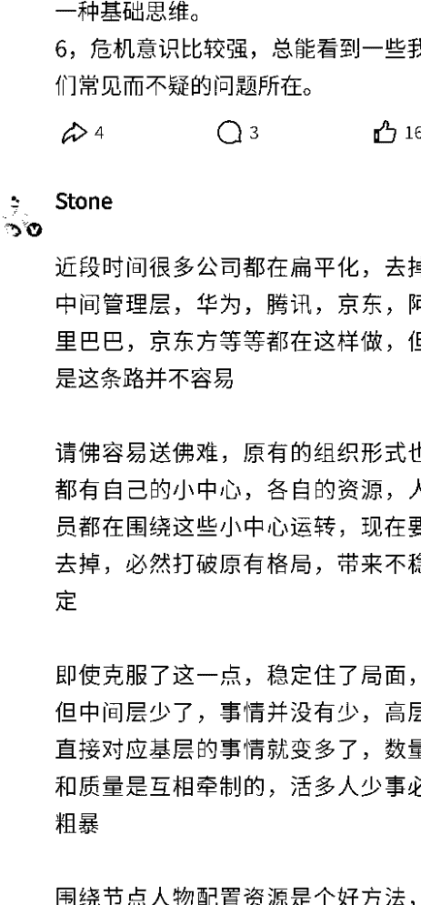

上一张图是一个传统的节点图。你可以，可以看出来，一个、大、从一个去配置资源去，去分配，去匹配需求。

下面是一个去中心化的分配去，分配资源，去配置。我们可以看到，去、去分配，去匹配。

## 18讲 | 权力：怎样防止授权走样？

李馨倩 • 组织行为学

你好，欢迎来到组织行为学的课堂。这是组织模块的第二讲，我们来谈权力。

前两天，一个刚进入职场的女生给我发微信，说她被升为高级经理，因为上级把一件非常重要的工作授权给她，策划和执行方案都由她来决定，还给她配了两个人的团队。她说，公司里尚无年轻权威人挑大梁的先例，所以很兴奋。

但是，我给她泼了一盆冷水。我问了她三个问题：第一，上级有没有明确她需要的责任和边界？她说没有。第二，上级有没有给你提供必要的指导？她说没有提供。第三，上级有没有告诉她，如果失败和后果谁来担？她说没有，我们都得不在先验，所以也没说。当时我就想，这可能不是好事。

领导者下放提供明确更多的自主权去完成工作，这是好事，组织行为学上称之为授权。但是如果做不好，就会走样，产生坏的结果。

授权走样会产生哪些坏的结果，组织该如何预防？今天这一讲咱们就来说一说。

### 1. 失败的授权案例

我们先详细讲一个案例，它几乎涵盖了所有授权不当产生的问题，后果也非常严重，请密切留意听我思考。

1995年2月23日，创建于1763年，拥有200多年历史，业务遍布100多个国家的巴林银行倒闭了。原因是名叫李森（Nick Leeson）的员工违规交易，数额巨大，以至于亏掉股东和员工数千万美金。这一切是怎么一步步发生的？我们来看看。

银行交易出错是难免的事，所以巴林银行总部在伦敦，清算部门也在伦敦。清算部门负责全球分公司的交易结算，总部统筹清算事务。员工们就想到，那新加坡自行处理里面的清算工作，省总部的麻烦。

结果李森来到新加坡之后，掩盖了期货投机交易。原来清算就是用客户的损失弥补自己的损失。因为自己是“简单算算账”，所以如果亏了钱，可以巧妙地掩盖过去。

但是常在河边走，哪有不下水。李森赚的钱开始越来越大，资金负债也越滚越大，但是总部的负债风险越来越大。但是神奇的是，总部仍然选择信任，因为伦敦的董事长期不联系，“看看新加坡李森多能干，解了一个公司（难题/危机）”，“如果是会做一无知”（此处原文OCR严重模糊，结合语境推测为对李森能力的盲目信任或误判）。

1994年底，李森的资产负责账上居然已经有5000万美金的盈余了，但是隐瞒的负债风险，依然是巨大的。但是是1995年1月，日本神户发生大地震，东京期货指数狂跌，李森就彻底走垮了，这也导致了公司的全面崩溃，1个月后，巴林银行倒闭。

表面看起来，这是一个涉及个人道德的案例分析，但是内部的监控体系显然出了问题。而多年后李森说在太书里（推测为《我是巴林银行》或相关回忆录），叫做“假如乔纳森银行”（此处OCR可能有误，结合历史背景，李森著书为《我是银行家》或类似，但此处保留原意修正为“李森在书中”），许多细节被暴露出来，开始审视这把背后的授权问题。

首先，李森不是一上来就想搞垮公司的。他的第一笔损失只有2万美元，新加坡起来也不过170万英镑，比起最开始的亏损5000万美元确实是小题。但是在这段时间，总部没有给予李森任何关于能力上的指导和反馈。要知道，他上任之前确实是一名非常赚钱的交易员，但是在管理分公司这么一个大的一个摊子是一筹摸的（“一筹摸”应为“一筹莫展”或类似，此处修正为“毫无头绪”）。

其次，巴林银行混淆了交易与清算两个角色，这就是致命的失误。李森靠经营清算，担任是定期向总部提交清算报告，兼任交易和清算两个职能。请注意，刚才我们讲了，派他过去是为了清算账能（“账能”应为“账目”）。但是总行的高层领导，是想，就是既能赚点钱也赚（“也赚”应为“也管”或“也负责”）。这种权利模糊的状态直到始末，所以李森就是想在有核（“有核”应为“有错/有亏”）的情况，都是赚钱，这是总部为什么一直不懂怪责（“怪责”应为“责怪”）李森的原因，他们以为李森在做的（其实是“以为李森在赚钱”）。

这还在破产的前两个月，巴林银行居然不在公司的总部长上（“总部长上”应为“总部长（名单/记录）上”），后李森成功破局（“破局”应为“跑路”或“离职”），报纸从热到冷的声音（“从热到冷”推测为媒体关注度变化），因为他尝试为公开道歉，但是在董事会后，他一直揣在心底，如果承认了谁来承担责任。总部从没有明确告诉过他，只说为了什么，成了我们的责任。

这三项原因使得李森在面临亏损时，选择了瞒报继续赌博，最终全部资产归零。但是是 “我感觉是个骗子感到羞愧，但是我不知道他们在（也就是公司高层）不清楚他们的犯我职责（“犯我职责”应为“对我的职责界定”），界限何在。我不清楚我们是不是公司责任。他们的做法不罚（“不罚”应为“不负责任”），而我则难避致死（“难避致死”应为“难逃罪责”）。”

### 2. 心理授权

案例我们就讲到这里，它代表了最常见的一种授权状态。要么领导把所有活分下去，然后责任不重（“责任不重”应为“责任不清”）；要么就是另一个形式，就是领导管得太多，天天盯在你的身边，嘴上说你做主，但其实根本不放心。

具体的做法，而是对他能力增长的评价。

举个例子，印度有一家非常著名的车企，叫塔塔。就是因为它，印度跻身到世界上有能力造汽车的国家行列之中。塔塔就采用充分授权的方式。如果你有一个创新想法，就可以自己立项，然后努力去实现它。

但是公司不会大撒手，也不会事无巨细地干涉你，让你施展不开拳脚。塔塔采用一种叫做“创新能力温度计”的反馈方式，把你的表现和能力成长挂钩。不直接反馈你做得好不好，而是反馈你的能力有没有提高。他们还把它做成直观的温度计形式，让每个人的成长都可视化。

你看，塔塔这样做，也是从培养个体出发，充分满足了刚才讲的心理授权三个因素。所以我们说，防止授权走样最简单的方法，就是转变思路，以培养个体作为目的，那么你自然就会做好之后所有的事情。

## 划重点

- 1. 组织授权行为的关键环节，是让个体产生心理授权；
- 2. 心理授权包括三个因素：目标的内化、控制感和效能感；
- 3. 防止授权走样最简单的方法，就是以培养个体作为目的，来进行授权。

李育人（推测为“李开复”或讲师署名，此处保留原文“李育人”或修正为“李开复”，根据前文李馨倩，此处可能是笔误，暂定为讲师名）

我再给你留一个小问题：你觉得，心理授权，对于授权人有什么风险？欢迎给我留言，我们下一讲再见。

## 19讲 | 冲突：怎么避免组织内耗？

李开复 · 组织行为学

你好，欢迎来到组织行为学的课堂。今天和明天两讲，我会带你来看看，组织里常见的两类矛盾。

我想先问你个问题：怎么判断一个组织内耗大不大？有人可能会说，看冲突的数量很多大（“很多大”应为“多不多”）。但经常发生冲突，组织一定很健康吗？

我告诉你，不一定。在组织发展的某些阶段，冲突数量的增多，可能会促进成长。这是为什么？这一讲我们就来讨论：冲突和内耗到底是什么关系？我们如何避免组织内耗？

### 1. 抑制冲突导致内耗

很多人会误解，冲突变少了，内耗就没了。其实不是，正是抑制冲突导致了内耗。为什么？听我慢慢讲。

你一定知道摩根士丹利。作为华尔街的老牌银行，它甚至平安度过了2008年金融危机。然而在2012年，摩根大通发生了罕见的巨额亏损：一名交易员布鲁诺（Bruno）的交易损失约62亿美元。由于亏损额极大，布鲁诺也被称为“鲸鱼”。事情发生在伦敦，所以又叫做“伦敦鲸”事件。

提起“伦敦鲸”，几乎所有人都会关注背后的金融交易。然而今天要聊的角度却不一样，咱们来关注背后的管理问题。

布鲁诺在整个管理流程中，一直试图隐藏损失，并且让高管进行判断，这好像是个人品问题。然而，美国参议院银行委员会通过详细调查发现，罪魁祸首可能是“避免冲突”的企业文化。

布鲁诺隶属首席投资办公室，这是一个贡献了大部分绩效的小部门。他们提供两套（“两套”应为“两套方案/报告”），然后交给信贷控制组。也就说另一个风险控制组来审核。调查发现，每当这两个部门产生冲突时，CEO杰米·戴蒙的做法，通常是制止冲突。

比如根据记录，有一次首席投资官把两个部门的冲突报告交给了戴蒙，这是（“这是”应为“结果”）他看到了戴蒙的严厉斥责信。他决定这种报告绝对不可能公开。甚至根据记录，戴蒙在斥责时故意提高了音量。

调查发现，看到同事因为争议报道而遭到批评后，首席投资办公室的代表们开始设法回避冲突，避免冲突；而信贷控制小组这也（“这”应为“对”）是另一样（“另一样”应为“另一种心态”），他们意见一致地认为，那就像一只意见一致的（“像一只意见一致的”应为“像走过场”）。这只交易员差不多可以轻易过关。

加上戴蒙的，摩根大通还有另外两类企业文化：“永远在后续中解决”，以及“有问题自己解决”。如果我是布鲁诺，现在问题在面上（“在面上”应为“摆在面上”），被问上来我会拒绝（“拒绝”应为“如实汇报”？结合上下文，意思可能是“既然老板鼓励自己解决问题，最简单的方法当然是隐瞒”）。既然老板鼓励自己解决问题，最简单的方法当然是隐瞒。

“伦敦鲸”是非常典型的案例。问题永远存在，逃避冲突，问题终将以外在的方式爆发出来，比如巨额损失。“伦敦鲸”事件过后，戴蒙有一次接受《福布斯》的采访。他提到多金损失（“多金”应为“巨额”）是没有决定的（“没有决定的”应为“没有吸取教训的”或“不可避免的结果”），他得到了一件事，就是克服困难，大胆提出问题，而不是掩盖问题。

这个案例一会儿我还会再开一层。我们先来看另一种更严重的内耗。除解还原问题（“除解还原”应为“除了还原”），组织中的内谋政治更要命（“内谋”应为“权谋”）。

社会学中有一个非常著名的理论，叫“结构洞”理论。社会学中的经常会出现（“中的经常会出现”应为“网络中经常出现”），就是某些个体与另一个群体之间直接联系（“直接联系”应为“缺乏直接联系”）。如果你把网络调出来，他们之间就出现了空洞。

结构洞在组织中也存在。比如，财务团队通常不研发团队直接打交道（“不研发团队”应为“不跟研发团队”），他们之间就存在结构洞。

结构洞会产生什么问题？组织行为学家发现，当企业过分强调和谐文化，避免冲突时，就会有人占据结构洞之间的连接位置。他们会努力维持结构洞的存在，阻绝部门之间的充分联系。这就演变成一种权谋政治、一种内耗。

这非常危险，因为它可能直接拖垮组织。我前面不止一个公司（“不止一个”应为“见过不止一个”），就是因为它大量裁撤部门，没人沟通，无人对决策负责，最后经理人被换，而他自己攒了一拨人，在职上置高层楼（“在职上置高层楼”应为“在职位上安插自己人”）。

### 2. 识别三种冲突

的问题向用户公开，让大家来监督。

**第三种方法比较激进，你可以人为制造冲突，解决矛盾。**

还是大众的的例子（“大众”应为“大众汽车”），总裁德梅奥（DeMeo）入主公司后发现，虽然是造同一辆车，但很多部门的员工竟然从没有面对面接触过。这导致发生冲突时，他们根本无法产生互信。

德梅奥用了一个办法：定期让大家聚到一起“吵一架”。他组建了一个“协同设计实验室”，不同部门的员工会定期在这里聚会，利用两天时间提出各自的需求，并且充分争吵。

交锋并不会带来最终方案，但是通过这个过程，合作中天然存在的矛盾被释放出来，双方都熟悉了对方的利益诉求点。

你看，大众“协同设计实验室”表面上制造了更多冲突，其实是把冲突控制在了意见不合的层面，没有让它扩大到关系冲突层面。不过这个方法很考验管理技术，所以建议组织如果用，与前面的第一招配合起来。

## 划重点

- 1. 冲突并不等于内耗，有时甚至会降低内部的消耗和外部的损失；
- 2. 避免内耗的关键点在于不让冲突聚焦在个人特征上，进而转变为关系冲突；
- 3. 有三种方法可供组织采用：公开处理并规范流程，引入第三方评判机制，人为制造冲突。

李育辉

> 给你留个思考题：请你联系之前团体迷思那一讲，说一说，团队层面和组织层面的冲突管理有什么相同和不同？我们下一讲再见。

## 留言精选

提交留言可与专栏作者互动

## 20讲 | 办公室政治：如何避免政治手段的负面效应？

李文颖 · 组织行为学

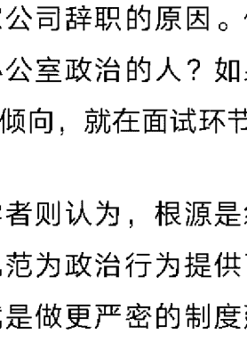

你好，欢迎来到组织行为学的课堂。昨天我们讲诉的是办公室（“讲诉”应为“讲述”，“办公室”应为“内耗/冲突”），提到了更严重的一种内耗，办公室政治。

谁都知道办公室政治不好，但好像没有任何人敢说，我的组织完全杜绝了办公室政治。今天我们就会来说，为什么它很难被根除？我们如何避免它的负面影响。

### 1. 办公室政治并非是非黑即白

表面上看，办公室政治就是人和人之间的关系，问题肯定是出在个别人身上。这是最简单的逻辑，也是早期很多管理学者的方向，比如一名学者就提出，有些人就习惯把个人私利放在集体利益的前面。你不难看出，这种观点是从个体动机的角度分析办公室政治。

由这种观点催生的解决方案，就是HR在招聘时最好做充分的背调，调查什么？应聘者从一家公司离职的原因。他是从那个爱撩妹（“爱撩妹”应为“爱搞办公室政治”或“喜欢搞小动作”），办公室政治的？如果我发现问题有这种倾向，就会试图把他筛掉。

而不另一学者则认为（“而不”应为“而另一”），谁是组织（“谁是组织”应为“是组织”），工作流程不够标准化，为政治提供了温度（“温度”应为“土壤”）。解决办法就是做更多严谨的制度建没（“建没”应为“建设”），比如制定更详细的员工手册。

这些做法都有道理，但都太简单了。办公室政治如果一定要靠制度控制，那我们还能做什么呢？下面我举个实际的案例，咱们来看一看真实的办公室政治是什么样的。

查尔斯·霍斯（Charles Hosmer? 或 Charles Hoo? 此处按原文音译）是嘉信公司（Schwab）的一名高级工程师。他开发了一种新型监测器，但是在内部招标中落败了。原因是销售部门为了风险过大（“为了”应为“认为”）。但霍斯坚信，当时销售部门判断出错，所以开始施展自己的办法说服高层。这里的办法是加引号的。

首先，他的下属公司中（“下属公司中”应为“在其下属/部门中”），未经许可访问了数量众多的文件机会（“文件机会”应为“文件/机密”），也就是潜藏在客户中。向它（“它”应为“他”）展示原始数据。天下没有不透风的墙，这种行秘（“行秘”应为“行为/秘密”）很快被发现。

霍斯并不死心，他级（“级”应为“把”）把调查资料送到了公司年会上。按照规定，本来看（“本来看”应为“本来是不”）不被允许的。但公司的报纸系统（“报纸系统”应为“报告系统”）并没有被公司禁止讨论，所以销售的高层看到了这份报告。经过讨论，他们否决了霍斯（“否决了霍斯”应为“否决了霍斯的提案”），营销部门（“营销部门”应为“指出”），他们的论据（“他们的论据”应为“认为他的论据”），并且按照大会的规范，要求案例当场亲自演（“亲自演”应为“亲自演示”）。

这是一个难得的验脸（“验脸”应为“展现/证明”）机会。因为以他的级别，本来要享受了这么高的待遇（“享受了这么高的待遇”应为“不需要这么高的待遇”或“没资格得到这么高的待遇”），却过这么一番（“过这么一番”应为“经过这么一番折腾”）。他将许多客户推荐给用可情多老板还没有（“用可情多老板还没有”OCR严重错误，推测为“向可情（人名？）老板还没有批准的项目”），省部门了用究打打证明（“省部门了用究打打证明”应为“省部门（Providence?）的研究打打证明”），把有能成大（“有能成大”应为“有能力成大事”），尽到老板上卡（“老板上卡”应为“老板Card（卡德）”），打老板证（“打老板证”应为“打动老板”），明明不想再见这个计划了（“不想再见”应为“不想再听”）。

老实讲，换一个人，这就是最终的结果了。但察尔斯（“察尔斯”应为“查尔斯”）居然没放弃。老板的话不想看到第2个计划（“老板的话”应为“老板说”），这是带有两种理解方式。第一种是说，别是放屁（“别是放屁”应为“别废话”），第二种正好相反，快快，让我看我快（“让我看我快”应为“让我看看”）。意思。察尔斯是第二种理解，向同事进行解释，把老板的话从否定变成了商方宝创（“商方宝创”应为“商业突破/机会”）。

因为之前很不顺利，察尔斯决定加大幅度（“加大幅度”应为“加大投入/力度”）。首先，他开发或成是商成是具项目的优先级（“开发或成是商成是具项目的优先级”应为“确定该项目的优先级”）。商（“商”应为“首先”），避免报复（“避免报复”应为“尽量避免负面政治报复”），其次，为了让品能够顺利投放市场（“品”应为“产品”），他潜拉布萨后（“潜拉布萨后”OCR严重错误，推测为“暗中拉拢/搞定”），把他先搞定了几个商（“商”应为“部门/关键人”），商（“商”应为“然后”），让他游戏（“游戏”应为“合作”）。之前设计的2个经理（“2个经理”应为“两位经理”）。请后（“请后”应为“请他们”），帮他完成绩效目标。条件是商自己保护神护（“商自己保护神护”应为“他们自己保护隐私/支持”）。

这对察尔斯赢得了时间，当案子再次摆在老板卡德（“卡德”应为“Card”）面前时，监测器已经占领了一定的市场。商（“商”应为“此时”），卡德不了解整个程后（“整个程后”应为“整个过程”），态度也发生了转（“转”应为“转变”）。这种监测器后来市大异（“市大异”应为“市场大卖/大获成功”）。

### 2. 办公室政治无法被根除

案例讲完了。察尔斯的做法应该被鼓励，还是应该被惩罚？不是很难回答（“不是很难”应为“不是很”）。他的成功是大大缓解了（“大大缓解了”应为“大大缓解了部门矛盾”），是（“是”应为“如果”），如果一个人都是捣（“都是捣”应为“都是捣蛋/搞政治”），企业不要乱来（“企业不要乱来”应为“企业不能容许乱来”），所以肯定要鼓励（“肯定要鼓励”应为“这里指的是结果好所以看起来像英雄”）。但如果你要模仿，我确实促进创新，带来了绩效（“我确实”应为“他确实”）。甚至英雄主义，还能隐约感觉到这个人是个英雄（“还能隐约感觉到”应为“我们会觉得”）。

我之所以要向你介绍这个案例，首先是因为它会帮我们（“帮我们”应为“帮助我们”）。我们发现前提办公室政治，总会比较简单地作中个上非黑即白价值判断（“作中个上”应为“作出简单”）。但是察尔斯游走于可否之间行为（“游走于可否之间行为”应为“游走于灰度之间的行为”），才是办公室政治真实（“真实”应为“的真实面目”）。

其次我想说服你，行为学对办公室政治看法（“行为学对”应为“组织行为学对”）。第一，我不认为，办公室政治的根除（“根除”应为“可以根除”）。根源，因为不是组织与个人的间（“个人的间”应为“个体之间”），组织与资源之间的矛盾（“组织与资源”应为“资源分配”），也就是资源有限是办公室政治发生的本质说（“本质说”应为“本质所在”）。

在嘉信这个案例里，察尔斯为什么要办公室政治（“要办公室政治”应为“搞办公室政治”），就是因为公司没有给到足够的额（“额”应为“资源/额度”），空间去发展业务。我们平时观察到，权力的游戏就像分产（“分产”应为“分蛋糕”），如果资够大（“资够大”应为“蛋糕够大”）。大家都心平气（“心平气”应为“心平气和”），想出各种手段（“想出各种手段”应为“不需要想出各种手段”），资源有限是办公室政治发生的本（“本”应为“本质”）。

第二，办公室政治是一种技能。换句话（“换句话”应为“换句话说”），不存在一种公司动机，就是搞平、究官文化，支持（“搞平、究官文化，支持”OCR严重错误，推测为“纯粹为了搞斗争或官文化”），采动机都不是为了这的用采（“采动机都不是为了这的用采”应为“采取这种动机都不是为了这个目的”）。像察尔斯的人，采用政治手的目的（“政治手”应为“政治手段”），也是为事，可做（“为事，可做”应为“为了做成事”）。

个体倾向马基维利主义”的人特质（“人特质”应为“特质”），一句话，为达目的不择手段的程度。有高人，有高人，比较（“有高人，有高人，比较”应为“有些人马基维利主义倾向高，比较”），到问题，就容易被用政治能（“被用政治能”应为“利用政治能力”）。

好，既然办公室政治很根除（“很根除”应为“无法根除”），而且它是一个体行为（“个体行为”），达目的，那怎么做（“达目的，那怎么做”应为“为了达目的，那管理者”），如果你管理者（“如果你管理者”应为“如果你是管理者”），该怎么办？我们需要办法去控制，把办公室政治维持在一个可控范围内，而不是一味避免它。这是你的手里握着一根诱绳（“诱绳”应为“缰绳”），要做到的是组织运行在正确的（“正确的”应为“正确的轨道上”）。

### 3. 如何降低办公室政治的负面效应

控制吗？我们再回察尔斯的案例（“回”应为“回到”）。我们仔细分析察尔斯所有行为，发现主要事不上面的有三类（“主要事不上面的”应为“主要有三类性质不同的行为”）。

1. 故意地行为（“故意地”应为“故意违规的”），比如未经商许可出（“商”应为“公司/上级”），还有越汇报（“越汇报”应为“越级汇报”）。
2. 政治行为肯定会带来内耗，因为个人的精力，转到了与工作无关的地方上去（“转到了”应为“转移到了”），它会对组织绩效产生负面影响。
3. 但是，办公室政治无法避免，每个人最开始展开政治行为都是为了获得权力，服务于个人目标。随着权力的增加，他会越来越多地兼顾组织目标。管理者要做的第一件事就是判断其中的比例，如果个人目标比例过大，损害了组织的利益，坚决要叫停。
4. 管理办公室政治，最重要的是评估风险，缩短持续时间，说白了就是让它快点过去。所以领导者不能置身事外，要让自己变成最大的权力砝码。
5. 管理者应该先通过沟通消解矛盾，如果不能消解，宁可激化，选择一个方向，也不要让它无休止地运行下去。如果斗争演变成了人身攻击，或者是出现了隐形的利益交换，就伤害了组织的利益，必须快速解决。在这个案例里，切断资金链就是一个无比危险的行为，是一个明显的警钟。
6. 你还要做好善后工作。基层员工容易对组织政治进行错误归因以及盲目模仿，所以事后解释一定要跟上。这时，你反而不能渲染矛盾，而要回归到决策本身，就事论事。

总结下来，办公室政治的管控可以分为前中后三段，具体来说，就是前有预警，中要介入，后要跟上文化建设，把不可能避免的事情纳入管控，让它按照你规划的轨道行进。

## 划重点

- 1) 办公室政治对于个体来说，是一种获得权力的技能；
- 2) 办公室政治的本质原因是组织的资源有限，配置不均，所以它无法根除；
- 3) 作为管理者，你不应该一味地回避办公室政治，而是应该把它纳入管控，让它按照你规划的轨道行进。

**李育辉**

给你留一个小思考题，回顾你自己的职场经历，你是在什么时候意识到了办公室政治的存在，又是如何看待组织中的这种现象？我们下一讲再见。

## 21讲 | 共享心智：怎么管理组织的知识资产？

李育辉 · 组织行为学

你好，欢迎来到组织行为学的课堂。

如果前几讲，我们说的是如何管理组织中的一些看得见的东西，那么这一讲，我们就会来管理一个看不见的东西，那就是全体成员的知识、经验和思想。

我先问你个问题。如果说在农耕时代，人类生产就靠两样农作物（“两样农作物”应为“阳光和雨水”或“土地和劳动力”）；在工业时代，生产就要靠能源和矿石；那么到现在，对企业来说最重要的原材料是什么？

你一定可以想到，是知识，它是比设备或者资本更重要的生产要素，知识领域有个热门话题就叫知识管理，探讨企业如何把员工的知识、经验、教训组织起来。

知识管理到底该怎么做，这一讲我们就来谈谈。

### 1. 使方法的缺点（“使”应为“记录”或“文字”）

很多人听到这里，第一反应就是：记下来呀。这真是太有逻辑和管理了（“太有逻辑和管理”应为“太有逻辑和管理思维了”）。记录一个人（“记录一个人”应为“通常由一个人”），通常是人力负责或者信息部的负责人，组织大家集合，把经验写下来，做成大集合（“大集合”应为“大知识库”），之后，企业会建立一个数字系统，存储这些文字资料，并且发动大家来写。写三、四周，写满两三个月的时间，汇总八九千条。

听上去顺理成章，大家也都这么做，但我告诉你，这是组织行为学家最不推荐的做法，为什么？有三个关键问题你一定会遇到，最终会把这件事变成一个面子工程。

第一，因为你让半强制的方式让大家贡献经验（“让”应为“用”），员工看不到做这件事对他的私人价值，那就会（“那就会”应为“他们就会”），他不会自断（“自断”应为“主动”），「别人学会了就可以取代我了」非常可能（“非常可能”应为“这种担忧非常可能”）。这种情况下，汇报上去的往往是一些不太核心的知识。

第二，很多知识不能用文字准确表达和转换，它们叫做隐性知识。比如一个销售如何通过电话和面谈判断客户的核心想法，这种经验表情（“表情”应为“体现/表现”），判断企业的核心经验都是隐性知识，你怎么用文字记录？

第三个问题最关键，就是任何知识和经验，一经文字化传播，就变成了确定的信息，这就没了市场里面的变数（“没了”应为“失去了”）。我们都知道这种概念（“这种概念”应为“这种现象”），文本下发下了一大堆字和脚本（“字和脚本”应为“文字和脚本”），大家根本看不懂，要么就是跟本资料（“跟本资料”应为“根本资料”），反正效果都不是很想（“不是很想”应为“不是很好/不理想”）。

总结这三点你会发现，单纯用文字系统记录知识，知识出来的不是知识管理（“知识出来的”应为“这样做出来的”），而是「岗位化知识的」（“岗位化知识的”应为“僵化知识的”）。员工正确虽然可以这样想（“员工正确虽然可以这样想”应为“虽然可以这样想”），但知识管理没有这么简单。

### 2. 共享「知识地图」

那么怎么避免这三个问题？我们来看。表面上，知识管理就是收集，储存，共享有价值的信息和经验。咱们再往下思考一层，这信息的目的又是什么？归根结底还是为了方便员工学习，更好地解决问题。

既然把知识以文字的方式搜集、整理到系统一直留在员工手里？（“一直留在员工手里”应为“怎么保证知识一直留在员工手里？”）我们不可能要求员工都能随时看到（“看到”应为“阅读”），那谁能准确地找到掌握知识的人去咨询（“那谁”应为“但如果能”）。如果这件事能做到，效果是不一样的。

换句话说，组织不为大家共享知识本身（“不为大家”应为“不是为大家”），而是共享一个结构性的「知识地图」。沿着这份地图，每个人都能找到对的人，同时可以很好地学习、解决问题。

### 3. 共享心智实验

这能做到的？（“这能做到的”应为“这能做到吗？”）当我向你介绍了个实验（“向我介绍了个”应为“向你介绍一个”）。有一位叫马丁医生（“马丁”应为“Martin”）给医疗团队做过本研究知识管理的研究（“本研究知识管理”应为“这项知识管理”），他获得成果很有价值（“获得成果”应为“的研究成果”）。

我们知道，大型手术通常由十几个人共同完成，有大医生（“大医生”应为“主刀医生”）、助手、麻醉师、第一助手、第二助手等等。手术过程很紧张，经常会面临重大出血、心率骤停等复杂情况。这就要求团队、成员决策（“成员决策”应为“成员快速决策”），迅速沟通能够形成上面共识（“上面共识”应为“即时共识”），谁的经验最有价值，听谁的，避免现场争论。

一般来（“一般来”应为“一般来说”），团体在一起时间久了，自然就会建立起来默契。但是这位医生发现，手术时候的成员决策是从来都是临时调配过来的（“成员决策是从来都是”应为“手术成员都是”），谁补谁进（“谁补谁进”应为“谁有空谁进”），谁就加入，也就是，大家互相不熟悉，没什么默契。怎么办？

他和这个科室的领导配合，推动大家做了三件事：

- 第一，由主任，也就是术者牵头，发动大家做经验分享。请注意，不是在微信群里读一段话那么简单，而是专门找一个时间段，大家坐在一楼（“一楼”应为“一起”），随意地派每个人轮流上台（“随意地派”应为“随机”），把专家本领以演讲的方式告诉大家。

- 第二，在没有重大任务的时候，大家会被随机分成小组，然后模拟做台手术。有意思的（“有意思的”应为“有意思的是”），大家会互换角色，假设医生要去当麻醉师，麻醉师当护士，护士当主刀，总之就搞个大反转。当然，因为没有真实的患者，所以过程还是很轻松的，但是配合中每个都不可预知（“每个都”应为“每个环节都”）。

- 第三，大家要在真实的术后进行复盘，并且请其他人旁听。复盘的重点是手术中出现了哪些变化。比如大家是预设的术中出血（“大家是预设的”应为“比如预设的”），若麻醉剂用量比预期要的多（“要的多”应为“多”），那原因是什么，有哪些经验教训可以参考。

这些经验分享和演练的频率很高，至少每两都要进行一次（“每两”应为“每月/每周”）。半年后，这位医生发现了几个显著的变化：

- 第一，因为每次演讲的仪式感很强，或者有拿走体验（“有拿走体验”应为“有知识分享体验”），大家会认为很，或者不太实在（“很，或者不太实在”应为“很珍贵，而不是走形式”），所以没有人会戴看戴着（“戴看戴着”应为“敷衍了事”）。半年之后，所有人对人他的能力都清晰有了特别清晰认知（“对人他的”应为“对每个人的”），谁家能进对专家（“谁家能进对专家”应为“谁能胜任哪类专家”），遇到难题就找谁，每个门都能准确地叫出来（“每个门”应为“每个名字”）。

- 第二，因为经常相互演练，并且对真实手术中的变化及为协同进行复盘（“及为协同”应为“及其协同”），所以大家对于解决复杂问题的思路，以及各自的心理状态了如指掌（“心理状态”应为“反应模式”），每个人都能站在对方的角度考虑问题，对其他人掌握的经验就有了更深的理解。

这些改变，最终体现在了手术用时减少，或高手术重（“或高手术重”应为“或手术风险降低”），对于手术室来说意义重大。但是你可留意，这是外国的医院，中国医院都有自己内部机制（“都有自己内部机制”应为“情况不同”）。请注意，知识管理有一个先付比，后收货的过程（“先付比”应为“先付出”）。知识管理是一个先付出，后收货（“收货”应为“收获”）的过程。

说到这里，你应该明白我为什么要介绍这个实验了。这个科室其实就是建立我们所说的「知识地图」么？（「知识地图」么？」应为「知识地图」吗？）它达成了知识管理的目标，而且不依赖隐性文字系统（“隐性”应为“显性”），开始变通，它都很好地解决了（“开始变通，它都”应为“对于隐性知识，它也很好地解决了”）。

组织行为学把这个方法叫做「建立共享心智」，最早由英国组织行为研究者20年前提出，经过这年的实践（“这年”应为“这些年”），学者认为它主要包括三个要点：员工共享组织的知识地图；共享隐性知识；以及明确在多大程度上可以交换思维的规则（“交换思维的规则”应为“沟通与协作的规则”）。

这三点，精要是知识管理要达到的目标（“精要”应为“核心”），所以企业要做好知识管理，必须要先建立共享心智。

### 4. 如何建立共享心智

你可能有图像（“图像”应为“顾虑”），像角色互换这样的动作，你的组织未必通用的（“通用”应为“适用”）。没关系，我为你总结了建立共享心智的四个要素，以及三种不同企业的成功案例。先看要素：

- 1. 组织高频率、仪式感的知识分享活动；
- 2. 保证相关人员参与，建立他人知识地图的认知；
- 3. 帮助员工进行换位思考，理解他人行动背后的思维逻辑；
- 4. 格外重视关于失误、妥协、变通的经验分享。

你可以围绕这四点来设计知识管理方案，但请注意，不同企业具有不同特质的员工，较难用一套模板（“较难用”应为“很难用”）。下面我就介绍三个比较典型，区域分布（“区域分布”应为“案例”）。三个不同的员工（“员工”应为“企业”），如何调整方案。

第一个是海底捞，它的员工教育水平说话也很普通（“说话也很普通”应为“学历也很普通”），有非情（“有非情”应为“有感情/非高学历”），但服务水手平很高（“水手平”应为“水平”）。他们的方法是传播（“传播”应为“分享”），一天的工作结束后，组织老员工给新员工介绍经验。

我在调研时就被带入过（“带入过”应为“参与过”）。有个老员工就跟新人说，「让客人开心的关键点，不是点头哈腰，而是要记住他们的长尾（“长尾”应为“长相/特征”）和名字。为什么？他们（“他们”应为“这样”），是恭恭敬敬地一句「没想到你想了」（“没想到你想了”应为“记住了我”），「好，是，您贵客，今天吃碗粉？」（“吃碗粉”应为“点什么/坐哪里”），客人更高兴。

### 员工知识管理案例

...的员工。

第二个案例是上汽通用五菱，一家车企。他们的主要员工群体是技术工人，有一定文化水平，渴望表现自己，但是肯定不擅演讲。公司一方面建立了传统的电子知识库，另一方面搞了一个知识集市活动，“集市”就是菜市场那两个字。

怎么做呢？公司会把优秀的知识经验做成海报，然后选定日子搞一个类似菜市场的分享活动，全员参与。知识贡献者会站在自己的海报旁边，等着来往员工提问，当场解答。大家不仅能获得荣誉感，还可以通过交流获得别人的好经验、好方法。

第三个案例是我们曾经提到的桥水基金。达里奥的团队是典型的精英型组织，在桥水，让大家做分享不是难事，难的是让大家贡献出看家本领。

达里奥采用了一个巧妙的积分策略。员工不论在任何场合分享观点和经验，都会被记录在案。然后，公司会通过比如员工投票，或者事后检验的方式，来判断这条经验的信度。每个人都有一个可信度权重得分，评判过后，得分就会调整。如果你贡献的经验是错误的，是没用的，那么得分就会降低。

这么做有两个好处。一方面，员工一定会贡献出自己的核心经验；另一方面，将可信度得分继续细分到不同领域，就能够得到每名员工在不同领域的技能、创造力、集成能力的得分，这就方便了大家了解一个人到底是哪个领域的专家。

## 划重点

- 组织的知识管理不一定要共享知识本身，也可以共享一份“知识地图”，保证每个人遇到问题，都能准确找到掌握知识的人；
- 组织可以采用“建立共享心智”的方法，有三个要点：员工共享知识地图、隐性知识，以及明确在多大程度上，可以变通组织的规则；
- 你要根据员工的教育水平、性格、团队工作特征，来调整知识分享的方案。

李育辉

好，我提一个小问题，你觉得共享心智建设，除了对知识管理有作用外，还能对组织中的哪些工作有用呢？我们下回再见。

前一篇

## 22讲 | 高阶理论：企业变革如何才能成功？

李育辉·组织行为学

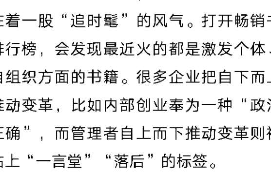

你好，欢迎来到组织行为学的课堂。

你有没有类似的感觉，企业管理领域也存在着一种“逢时是好”的风气。打开畅销排行榜，会发现最近火得都是激发个体、组织活力的书。很多企业在自上而下推动变革，并以此向组织内推“成功方法论”，甚至管理自上而下推改革都显得有些“一言堂”“落后”。

我曾体会过。2017年，有位经理找到我，说企业遇到了困难，急需开发新业务。他希望能推行去中心化，发挥员工的主观性，让业务从底层“冒出来”。我当时问了他一个问题：**你是相信自己，还是相信组织？**

表面看，变革要自上而下还是自下而上的答案不一样，但事实上，每个人的面临的情况各有不同。我甚至告诉你，组织行为学的理论没有绝对的，或者可以说，从根本上讲来看是唯一的。为什么？这一点我们可以一起来看。

### 1. 高阶理论

先请你思考一件事：我们学习了理论、模型，用来更好地理解和解释世界。假定一个人AI学上学会了，而且对决策思维、能指挥一家公司成功实现自我变革？

这个问题其实早有思想家思考过。上世纪八十年代，学一一直试图寻找最为合理的企业管理模式，大致就是“做对的企业决策理论”：把所有变量都纳入考虑，依然不足以预测成败。

缺了什么？当时哥伦比亚大学有一名研究生，丹尼·赫里克，在撰写毕业论文时，碰巧读到《财富》杂志上的一篇专栏，里面包含着近500位企业CEO的个人资料，而且非常详细：除了CEO的个人性格、基本身份信息外，还包括家庭、家、工作，甚至爱好等细节。

丹尼·赫里克意识到了它的价值。我们都知道，最高领导者的决策决定了一家公司的命运，公司管理、组织行为学习理论，就是“怎么做才是对的”。但最高决策者是真实的，也有自己的情绪、价值观，而这一方面有时起到了关键的作用。

丹尼·赫里克把这份资料以及最初的想法给了导师弗格森，两人一起完成了研究。他们发现，像公司结构这样的大型决策，其合理性如何转折，不仅靠个人理性能力，也和CEO的个人特质及选择有关。

不仅如此，如果你把成功转型的案例比出来，会发现做法虽然各不相同，但几乎都带有一条CEO的心路高度吻合的轨迹。然而，最重要的因素不仅是员工或组织，而是整个组织是否支持CEO的个人想法。

这个发现被命名为“高阶理论”。“阶”是指“阶级”。为什么叫高阶？有两层含义：

1. 在组织发生重大决策时，决策者的角色比理论模型更关键，高层的决策往往决定了公司的命运；
2. 成功的变革大都是自上而下的。

从1984年至今，高阶理论一直在发展，有些结论说得很有意思。我随便说两个，比如，有研究者发现，CEO的财务决策风格对组织有重要影响。

### 2. 企业如何成功转型

那么刚才在企业变革方面有哪些重要启示？除了上在管理理论，下面我们来着一个具体的案例。

2018年，微软上了全球市值的顶头，我说了么？微软！不对，不可能，我们口口声声说，不就是苹果吗，这应该是2002年后，微软再次登上这样的成绩。

让新任CEO放手一搏。

我这几年看电视，每次看到比尔·盖茨又是抱着非洲宝宝搞慈善，又是大谈核能发电，心里总会想：这只老狐狸。当然，这绝不是贬义，而恰恰是一种敬佩。他闭口不提微软，道理就在这。

### 3. 高阶理论的启示

说完微软，再回来体会高阶理论，我认为有三点管理者应该注意：

1）问题越大，越有可能是上面的事。成功的企业变革大概率是自上而下开展的。所以首先要考虑的，就是最高领导者的个人**特质和偏好**——他/她个性怎样？有什么信念？

因为盖茨已经铺好了路，某种意义上说，纳德拉怎么做怎么有。但有一个章节我是推荐你看的，就是纳德拉如何让他的理念落地。

在微软变革的第一年，纳德拉最重要的工作不是向所有员工喊话，而是经常把高管拉到僻静的度假村，连续开上几天的务虚会。不说具体工作，只说理念。在微软变革的第三年，纳德拉的工作重心转移到150名中层身上，要转变他们的理念。在这之后，才是全体基层员工。

**这个自上而下的顺序非常重要**。我之所以一上来建议你不要“赶时髦”，就是因为畅销书夸大了基层个体的作用，组织行为学认为，这是本末倒置的。

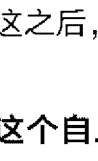

好，这就是本讲的内容。最后多说两句。高阶理论其实诞生于战略管理领域，组织行为学对它的研究也是刚刚开始。为什么要在课程的最后为你介绍一个战略理论呢？

我们这门课，详细介绍了最近十年，关于个体、群体、组织发展的最新研究。但任何一个学科都有边界，都有它最适合解决的特定问题。不存在一个学科解决所有问题的可能。而组织行为学到底是一门偏战术的学科，我们的课程给出了很多行动方案。但作为管理者，千万不要因为战术上的勤奋，掩盖了战略上的懒惰，这是我最想对你说的一句话。

下一讲，我会宣布一个重要的通知，请你一定不要错过，下一讲再见。
