## 祖鲁法则


---


---

# 序
# 大象不會疾奔

首先，尋找順風，我的意思是聚焦一個展望非常好的領域或類股。

祖魯法則說明集中投資的重要性，想精通整個投資天地沒有好處，聚焦一個比較小的領域，成為該領域專家有用多了。

我總是聚焦小型股和微型股，原因很明顯，首先，沒有多少人研究這種股票，因此可以撿到更有價值的便宜貨。第二，這種股票的表現大致上比大型股好多了。事實上，五十年來，微型股的表現勝過大盤8倍以上。

我在本書裡，說明我1992年所用的投資方法，後來我略加改進，但方法大致相同。

首先，尋找順風，我的意思是聚焦一個展望非常好的領域或類股。如果你在錯誤的時刻投入錯誤的行業，你一定會虧錢；如果你在正確的時機投身正確的行業，想不賺大錢也很難。

有一個方法可以保證你投入展望良好的行業，就是一定要確定你打算投入的類股和個股表現比前一年的大盤強勁。我對這一點總是詳加查證，確保市場沒有什麼還未公布的可怕消息。

祖魯法則集中投資的重點之一是聚焦成長股。剛才說過我非常喜歡小型股，為了說明這一點，我編了一句「大象不會疾奔」的話。我買股票時，也尋找比較便宜的股票，這一點是靠著比較預估本益比和預估成長率而得知，理想的情形是預估本益比遠低於成長率。例如預估本益比15倍的公司如果年度成長率為30%，就很有吸引力，如果年度成長率只有5%，就很沒有吸引力。

只看一年的成長率沒有用，至少要有兩年的歷史成長率和兩年的預估成長率。三年的歷史成長率和一年的預估成長率也可以接受，低於這個標準就不足以判定是真正成長還是受挫後復原。

另一個重要標準是確保沒有一位以上的董事在賣股票，否則無論統計顯得多麼吸引人，我都會大倒胃口；相反地，如果有多位董事一起買進，一定是非常利多。執行長和財務長買進應該特別注意，他們對業務狀況應該一清二楚，也總是善於看出業務狀況，然後把錢花在刀口上。

大約八年前，歐沙那希（James O'Shaughnessy）寫了一本很有趣的書，名叫《華爾街錦囊妙計》（What Works on Wall Street），分析四十年來各種不同特性股票的表現，發現遵循一種有理的標準，如根據強勁的現金流量或前一年的相對強弱，你的表現應該會超越大盤不少。想到這一點，那麼綜合運用多種合理的指標選股，顯然會好多了。

我希望你喜歡《祖魯法則》，祝你運用這些原則投資成功。台灣股市成長股特別多，我敢說我在書中提出的原則用在台灣股市會很有效。

願原力與你同在！

史萊特

---

## 前言
### 當個祖魯專家

> 集中力量、發動攻擊，達成目標。

我一個兒子對股市有興趣，他看了很多很多相當高深的美國投資書籍後，問我是否能夠推薦一本類似的英國書籍，我想了又想，到書店裡找了又找，頂多只找到入門書籍而已。市場力量通常會開始填補缺口，因此我決定寫這本書，我毫不懷疑很多人會跟著這樣做。

我的目的是讓你知道怎麼成為成功的投資人，我的問題是，我不知道：你是不是具有雄心壯志的新手營業員、了解很多投資基本原則的會計師或律師、還是從事大不相同的行業、或是在產業界服務大半輩子已經退休的人。我不希望讓了解基本原則的人覺得厭煩，因此我要假設你跟投資業多少有點關係，或是你已經看過第二十章的投資相關辭彙解釋。不管是哪一種情形，你都應該已經知道普通股、特別股和可轉換公司債的差別；了解受益比、股利率和資產價值的意義；也清楚配股和現金增資新股的影響和意義。

投資有很多方法，也有很多領域，我在後面的章節裡，會詳細向你解釋其中一部分東西：

### 小型積極成長公司
投資圈通常不研究快速成長、總市值介於500萬到1億英鎊的公司，因此這種股票經常特別有吸引力。

### 轉機股與景氣循環股
受到衰退環境或其他特殊因素沉重打擊的公司，通常都準備反彈回升，從事景氣循環產業的公司和最近更換經營的公司也屬於這種類股。

### 借殼上市股
借殼上市股是另一種令人深感興趣的投資工具，這種公司規模經常很小，但是股票已經上市，經營無足輕重的單調業務，業務規模不大，偶爾擁有一些現金。入主借殼上市企業的企業家通常是希望走後門，讓自己的公司借殼上市，因為他們的公司可能歷史太短，或是因為其他缺點，不能透過比較正常的管道上市。英國有很多成功的小型借殼上市股，有些借殼上市股聲名狼藉，包括韓森（Hanson）、威廉斯控股（Williams Holding）、勃利派克（Polly Peck）和帕克菲爾德（Parkfield）等公司，搭借殼上市股投資列車可能很刺激。

### 資產股
我有一些朋友只投資總市值低於公司清算價值的股票，這種價值型投資人會等待機會，例如等待併購案出現或經營階層換人，以便活化資產，提升公司獲利潛力，這時這種股票會開始上漲。

### 領導股
金融時報100種股價指數（富時100，FT-SE 100 Index）成分股規模通常令人安心，很少徹底倒閉，市況不好時，要賣掉也容易多了。然而，投資圈會深入分析這種股票，因此要找到真正的便宜貨難度提高。我希望告訴你一些選擇標準，提高你投資英國領導股的績效。我也發現，我的標準用在美國和大多數外國股市中，也極為有效。

如果你需要研讀辭彙解釋，請你現在就看，我急於告訴你怎么用我稱為「祖魯法則」的方法，賺一點錢。你不會把時間花在公債、特別股、債券和日本股市上，會集中精神，注意五種投資普通股的賺錢方法，最後選擇一、兩種適合你特性的方法。

我是在內人看過《讀者文摘》上一篇討論祖魯人的文章後，把這種方法叫做「祖魯法則」。她從那時起，對祖魯人的了解就比我深入，如果當時她向本地圖書館借借所有跟祖魯人有關的書籍來看，她應該會比瑟瑞（Surrey）地區大部分人都更了解祖魯人。如果她決定到南非訪問，在祖魯人的茅屋裡住上半年，研究南非一所大學裡所有跟祖魯人有關的文獻，她應該會變成英國的祖魯人權威，也可能成為世界性權威。重點是今天祖魯人的歷史和風俗習慣是很明確而狹隘的知識領域，內人必須投入不成比例的時間和精神，最後變成大家公認的專家。研究這種高貴的民族可能不會獲利，但是另外有很多專門領域可以研究，也可以在財務上得到很高的報酬。

我現在打算告訴你怎麼在投資上，運用祖魯法則，你會像蒙哥馬利（Montgomery）元帥和拿破崙一樣，靠著集中力量、發動攻堅，達成目標。

---

## Chapter 1
### 股市贏家之道

> 為了競爭，你需要培養優勢。

投資跟任何遊戲沒有不同，勝利遠比失敗有趣多了，運氣和技術都有影響。差勁的玩家經常抱怨自己運氣不好，但是就像著名的高爾夫好手布萊爾（Gary Player）說的一樣：「你越努力，運氣越好。」已故的保險大師雷特曼（Elmer Letterman）換一種說法：「運氣是準備遇上機會。」讓我告訴你怎麼為投資做準備，變成贏家。

大富翁遊戲中運氣的成分很高，如果你不會丟骰子，你走在紙板上，可能必須繳交金額驚人的稅負，最後坐進牢裡，你的對手卻奪走所有精華土地。然而，這種遊戲中有一些小小的技巧成分，玩久之後，高明的玩家贏的次數會比較多。我現在分析一下其中的技巧，淺藍色的房地產，包括本頓維爾路（Pentonville Road），尤斯頓路（Euston Road）和天使區（Angel Islington），租金報酬率最高，達到 159%，相形之下，最差的地段租金報酬率只有 101%。橘黄色的地段租金報酬率第二高，包括懷恩街（Vine Street）、馬博羅街（Marlborough Street）和鮑烏街（Bow Street），報酬率有 141%。計算報酬率時，是把買下所有三塊橘黄色土地和在上面蓋旅館的成本加在一起，得到 2,060 英鎊，再拿來跟三棟旅館的全部租金 2,900 英鎊相比，所得到的數字。乍看之下，淺藍色的地段似乎勝過橘黄色的地段，但是懷恩街、馬博羅街和鮑烏街是我最喜歡的地段，其中有另一個重要原因，就是你的對手比較可能落在這些地方。首先，「機會」卡片中有一張是「退後三格」，這點表示他們從某一格裡往後退，會退到懷恩街。其次，橘黄色的地段和監獄的距離，都是擲一次骰子的數字可以到達的地方，這點表示其他玩家出獄時，比較可能落在這些地方。第三，「機會」的卡片中另外有兩張卡片，一張要求玩家「前往馬里波恩車站（Marylebone Station）」，另一張要求玩家「前進到帕摩爾（Pall Mall）」。你的對手抽到這種卡片，會越過淺藍色的地段，停在某些格子上，下一次再走，就可能落在橘黄色地段上。

玩大富翁的另一個原則是：一旦取得相同顏色的所有土地，要儘快在上面建築，即使要把其他不完整的地段拿去抵押。例如，如果你把河岸街（Strand）拿去抵押，對手每次停在海灘上，你只損失 18 英鎊的租金，但是抵押所得 110 鎊中的 100 鎊，可以用來在鮑烏街多蓋一棟房子。沒有蓋房子的土地租金為 14 鎊，蓋第一棟房子後，租金會增加為70鎊，讓你多賺56鎊，蓋了第三棟房子後，租金收入的差別會增加到350鎊之多，因此你在維持適度的現金準備之外，應該把所有不完整的土地拿去抵押，用抵押所得迅速蓋房子。

你參與投資遊戲前，應該確定自己已經學到必要的技巧，也要確定自己能夠承擔其中的風險，我強烈建議你先投資自己的住宅或公寓。1992年6月時，英國房地產市場陷入停頓，但就是因為這個原因，當時買房子遠勝過幾年前房地產熱潮高峰時。以長期投資來說，幾乎沒有什麼投資比買房子更好，其中還有一個很大的好處，就是你可以愉快地住在自己的房子裡，即使每年通貨膨脹率達到5％，進價10萬英鎊的房子通常也會跟著通貨膨脹上漲，以人的正常壽命來說，房價會在70年間增值到超過300萬鎊。實際的算法更超值，因為大部分人會取得可負擔的抵押貸款，因此淨投資的報酬率會大為增加。此外，自用住宅沒有資本利得稅，貸款利息還有某種程度的租稅抵減。你在利用這些優惠前，不該投資股市。

你也必須確定已經撥出一些錢，作為子女學費、生病和苦日子裡的不時之需。你拿來投資股票的錢，必須是不必突然提用的閒錢。

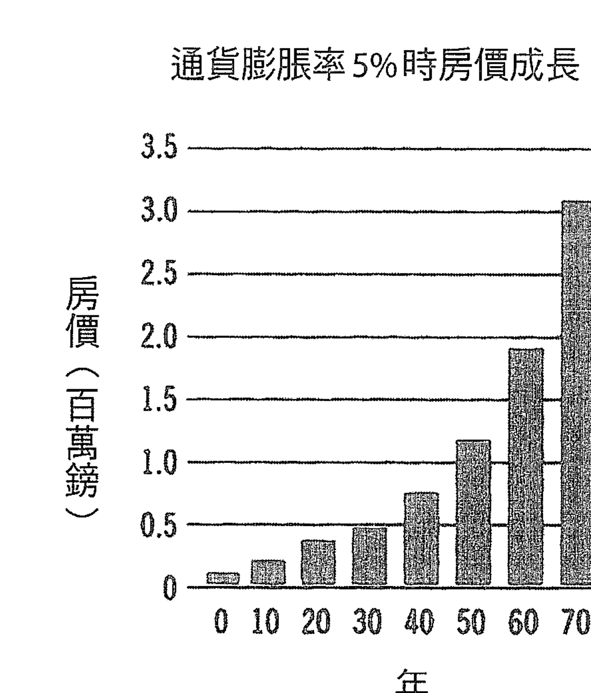

參與投資遊戲時，你的主要問題是要對抗專家。他們吃喝玩樂都想到投資，比你更容易接觸可能投資的公司，掌握更多一般資訊，經常收到經紀商所發的通訊和投資建議，此外，營業員為了爭取業務，會對投資機構提供最好的服務和最有利的條件。

因此你一開始就處在相當不利的情況中，投資的確有成功的方法，但是除非你準備每週花幾小時在投資上，否則你沒有希望成功。我建議你平均每天至少要花半小時，希望你期待和享受這30分鐘。

為了競爭，你需要培養優勢，因此我要鼓勵你參考幾個觀念。首先你必須找到專家研究不足的市場利基，多數大券商、專業投資人和投資機構，把分析技巧用在總市值超過5億鎊的大公司。這樣做的原因很明顯，如果券商能夠提出買賣一檔領導股的好理由，投資機構可以大量交易，週轉率也可能很高，為券商帶來龐大的手續費收入。投資機構喜歡領導股，是因為領導股的市場性比較好，投資機構要獲利或停損時，通常可以用很好的價格大量買賣。

投資基本上是利用無知來套利，成功的投資人認為自己知道其他投資人不完全了解的資訊，領導股幾乎沒有什麼大家不知道的資訊，因此在這個市場部門中，幾乎沒有什麼無知可以用來套利。通用電器（General Electric）、葛蘭素（Glaxo）、和卜內門化學（ICl）每年是幾千、幾百份券商通訊中探討的主題，相形之下，一些比較小的股票根本沒有人做文章，另一些股票只有一、兩家券商研究。大部分大券商沒有時間和金錢研究小型股，因此你在這種研究相對不足的股市區隔中，比較可能找到便宜貨，也比較可能找到一些無知用來套利，這個領域可能是你的利基。

你比專家占優勢的第二個因素是：專家通常必須投資龐大的資金，很多專家管理幾十億英鎊的資金，想像一下，你只需要管理5億英鎊，會碰到哪些問題：

1. 你會發現投資小型股，要取得足夠的股數很難，後面的章節會說明這一點是重大的妨礙。
2. 你必須至少把投資分散在兩百檔股票上，可能還要分散在更多的股票上。等你選到第一百檔股票時，吸引力顯然不如你選擇的第五十檔股票，比你選擇的第十檔股票吸引力又少多了，和你選擇的第一檔股票相比，吸引力更是不知道少了多少。把這種情形跟你可以集中精神，管理平均由十檔精選股票構成的小型投資組合相比，後者真是占了絕大的優勢！
3. 如果你是管理超過兩百檔股票投資組合的機構經理人，你投入的個人知識影響力會少多了。大部分的工作日裡，你都會在倫敦金融區裡忙碌不堪，而不是走出去，睜開眼睛，張開耳朵注意、觀察。如果你是個人投資者，你會擁有優勢，你可能注意到森寶利（Sainsbury）開了好幾家新超級市場，或是愛利克森商店（Alexon）特別擁擠。你可能聽說在地方交易所上市的工程公司又進用了100個人，或是某一位朋友對新買的電腦很滿意。一旦你開始從自己投資組合的角度思考，這一類的資訊可能是很重要的線索。這種個人知識的優勢在投資機構的投資裡，會稀釋得很厲害，在你自己的投資組合裡，卻會有重要的影響。

打敗專家競爭的另一個利器是在你選擇的利基市場中，運用祖魯法則在投資上。我會告訴你五種不同的方法，建議你精通其中一種。首先，我們要看看看用什麼方法，投資規模小、過去盈餘成長率高、未來很有潛力，而且市場評價似乎不正確的公司。我投資這種股票獲利最多，因此我會詳細說明這種系統。前十章應該可以幫助你了解投資天地，以便進展到探討轉機股、借殼上市股和資產股的各章，然後你應該能夠判斷哪一種方法最適合你的天性。投資資產股和小型成長股需要耐心，這種股票和投資借殼上市股與轉機股不同，不會立即感受到痛苦和快樂。投資外國股市和英國領導股是不同章節的主題，我會列出一些改善投資績效的標準。

現在我們更深入地看看比較小型的成長股，你要找的是市場似乎沒有適當評估的股票，有時候，市場對這種股票不熱衷很有道理。你的技巧會讓你了解哪些公司值得更高的評等，哪些公司不值得。你的預期當然不可能總是正確，但是你做出真正好的選擇時，資本利得會讓你吃驚，會遠遠超過你偶爾犯錯造成的損失。

成長股會上漲，在上漲過程中，讓你賺到龐大的資本利得，其中有兩個基本原因。第一個原因是盈餘成長率本身，如果股價是盈餘的 10 倍，在下列算式中，盈餘成長 25%，如果其他條件不變，股價自然會上漲大約 25%。接著股價上漲的第二個原因會發揮作用，公司公布業績之後幾個月內，市場很可能會重新評估這種股票，給予年成長 25% 的公司至少 20 倍的本益比，而且很可能給予高很多的本益比，本益比的變化會使你的獲利從 25% 提高為 150%。

```
( 100 + 25 ) × 20/10 = 250
減去原來的投資       100
獲利                 150
```

投資小型股成功的另一個因素是：一般說來，大象不會疾奔。過去一年多的情形是例外，美國和英國有不少大象大力衝刺，小型股卻落在後面。過去三十七年來，浩威證券公司的小型股指數（Hoare Govett Small Companies Index）有二十七年打敗金融時報綜合股價指數（FT-A All-Share Index）。過去十年裡浩威小型股指數落後大盤 6%，1989 到 1991 年間，小型股的表現都很差，是有史以來連續三年落後大盤，這點反映投資機構在英國市場的主導力量增加，也反映投資機構偏愛領導股。經濟衰退時，小型公司的營運風險無疑會比較高，然而，我相信潛在的報酬會遠超過風險，只要小心選擇，今天中小型公司甚至更值得購買。

寫到這裡時，英國最成功的森寶利公司股票總市值大約為 80 億鎊，未來一年多的時間裡，經營階層會發現這麼龐大的總市值很難倍增。公司的歷史本益比已經高達 18 倍，大部分投資機構已經買夠了森寶利的股票。小型股在新投資人的熱心支持下，上漲空間比較大，投資人的熱情增加時，股價也會上漲。例如後面會常常談到的 MTL 儀器公司（MTL Instruments）未來一年裡，股價上漲 1 倍毫無困難。1991 年 2 月，這檔股票價格為 124 便士（100 便士等於 1 英鎊），本益比為 11 倍，總市值為 2,170 萬鎊，一年後，這檔股票漲到 275 便士。MTL 的 1990 年獲利比前一年成長 20%，1991 年的盈餘似乎也會有相同幅度的成長，歷史本益比經過重新調整，從 11 倍增加為 16 倍，果然到了 1992 年 2 月，總市值從 2,170 萬鎊增加到超過 4,800 萬鎊。


### 給投資人大展身手前的建議：

- 決心每週至少撥出三小時，研究你的投資。
- 選定最適合你個性的投資方法前，看完本書。
- 選定利基市場後，你要儘量變成這個特殊投資領域的專家。傳奇性的美國投資大師巴菲特說過，投資人不見得要懂得超過一樣以上的東西，但是確實要懂得這一點。

現在我們要深入研究我投資小型成長股的方法。

### 第二章 小型成長股

理想的企業是能夠讓你依靠，年復一年每股盈餘都成長的公司。

1959年時，我擔任AEC公司（AEC Limited）的商業部門主管，經常到海外出差，有一次，我出差到西班牙，得了濾過性病毒造成的病，後遺症影響了我好幾年。我開始覺得自己可能無法再從事這麼勞累的工作，因此我認為只有一個解決之道，就是我必須累積一些資本，掌握另一個所得來源。

我选定股票投資一點也不讓人意外，股票是我在保持現有工作時便於管理、又可以賺錢的嗜好。唯一的問題是怎麼在我選定的專業領域中，變成高明的專家。

當時英國有兩種投資週刊，一種叫《證交所報導》（*Stock Exchange Gazette*），另一種叫《投資客紀事》（*Investors Chronicle*），現在兩種雜誌已經合而為一。我決定應用後來我稱為「祖魯法則」的方法。首先，我買了這兩種刊物過去兩年的所有過期雜誌，在柏恩茅斯（Bournemouth）養病期間，一頁一頁地詳細閱讀。我相信過去的股市贏家有一些共同的特性，如果我有後見之明，應該可以根據這些特性，發展出一種公式，我敢說自己能夠賺到錢。

我很快就發現，盈餘呈現上升趨勢、本益比（當期盈益率）似乎也相當便宜的股票，表現大幅超越大盤。有一些公司沒有這樣的表現，因此找出原因，想出額外的標準協助我建立安全網很重要。

隨後的一年裡，我考驗自己的系統，然後才付諸實施，結果極為成功。市場處於多頭階段顯然也有幫助。成功之餘，我開始對一些朋友提供投資建議，也為禮蘭（Leyland）和AEC兩家公司的經理人，組成小小的投資俱樂部。我也對我的老闆史多克斯（Donald Stokes）和另一些同事提供投資建議。我像得到新玩具的小孩一樣，寫信給《週日電訊報》（Sunday Telegraph）採訪主任勞森（Nigel Lawson），他認為我的想法有道理，要我每個月寫一篇專欄，用「資本家」（Capitalist）的筆名發表。

勞森在第一篇文章發表時，寫了下列簡介：

> 今天《週日電訊報》倫敦要開版榮幸地推出一位新專欄作家——「資本家」。這是英國和海外幾家著名產業公司董事的筆名，他在閒暇時間裡，發展出一種十分成功的投資新方法。他在第一篇專欄中，會說明他的方法，為他的投資組合選擇頭三檔股票，並在後續的文章中，進一步為投資組合增加股票，而且評估投資組合到當時為止的進展。

我在那篇文章中解釋說，我尋找的股票是擁有高於平均水準的盈益率（用今天的話來說，等於低於平均水準的本益比），加上高於平均水準的成長展望，我也列出了九個重要的投資標準。今天回頭來看很有意思，因此我直接從這篇文章中引用這些標準：

1. 股利率至少有4％。
2. 股本盈利過去五年內，至少有四年成長。
3. 股本盈利過去四年間至少必須倍增。
4. 董事長最新的聲明必須樂觀。
5. 公司必須擁有合理的流動性。
6. 公司必須不受特殊因素傷害。
7. 股票必須擁有合理的資產價值。
8. 公司不應該由家族控制。
9. 股票應該有投票權。

這個系統很成功，1963到1965年間，資本家投資組合增值68.9％，同期內，大盤指數只上漲3.6％。

此後市場狀況不斷變化，我也增加了二十七年的投資經驗，我原來的標準當然也經過修正、改善和增加。下面我大致根據重要性，列出我今天的標準，加上一些註解，然後在後面的章節中詳細說明：

#### 過去五年內，每股盈餘至少有四年成長

這個標準沒有改變，除了必須考慮意外的發展外，都應該找盈餘每年至少穩定成長15%的股票。「穩定」兩個字剔除了景氣循環股。

如果最近的盈餘成長率可能因為新因素而大幅提高，使歷史盈餘的重要性降低，那麼比較短的記錄也可以接受。

#### 和成長率相比，本益比不高

不要為未來的盈餘付出過高的價格，要找跟盈餘成長率比較後較低的本益比。要衡量你花錢買到多少價值，有一個簡單的方法，下一章會詳細說明。

#### 董事長的聲明必須樂觀

如果董事長悲觀，盈餘可能不再成長。要屏息等待董事長的聲明和半年報的結果。

#### 強勁的流動性、高現金流量、低債務

要找能夠創造現金、自行融通本身需求的公司，避開資本密集、總是需要很多錢購置新機械的公司，更糟糕的情形是需要以高出很多的成本、更換舊機器的公司。資本支出當然很重要，但是有些公司根本就是在吃現金，有些公司卻把現金吐出來。

有兩個方法可以檢查流動性，第一個方法很簡單，看看公司是否擁有正現金餘額，注意資產負債表中的透支和短期債務，你要找的是淨現金。第二個方法是分析帳目，判定現金流量，你會學到怎麼判定，同時只要記住，你要找的是能夠創造現金的公司。

#### 競爭優勢

理想的企業是能夠讓你依靠，年復一年每股盈餘都成長的公司。這種可靠性通常來自競爭優勢，競爭優勢則來自著名品牌、專利權、著作權、市場主導力量或利基事業中強大的地位。

可口可樂與健力士（Guinness）是擁有強大品牌、主導市場的典範企業；MTL儀器是本質安全（intrinsic safety）利基市場中的領導公司，產品包括防爆設備。石油公司購買安全設備、防止油井爆炸時，對於價格應該不會太囉嗦。禾美攝影國際（Photo-Me International）和能多潔（Rentokil）是擁有強大品牌和明顯利基的兩個例子。

你要找的企業是不在過於擁擠的市場中經營，利潤率不會被激烈競爭侵蝕的公司。重點在於公司供應的產品或服務不容易取代，後起之秀很難打進這種行業。有一個方法，可以很快了解公司在所屬產業中的相對強弱，就是了解公司的稅前盈餘率和資本報酬率。

#### 有題材

你希望股票有題材、有新東西、有最近發生的事情，例如：觀光旅遊業中，古德曼（Harry Goodman）的國際休閒公司（International Leisure Group）倒閉是新因素，對戶外之主（Owners Abroad）和空中旅遊（Airtours）兩家公司來說，會從這家主要競爭對手倒地不起中，得到很大的好處。又如皮森（Psion）生產的新掌上型電腦在美國的電腦展中橫掃全場。公司新執行長從葛蘭素或韓森之類非常成功的公司空降而來，是最可靠的題材之一，因為這種好處會長久持續。哈欽斯（Greg Hutchings）從韓森公司投效湯金斯公司（F. H. Tomkins），就是明顯而且非常成功的例子。所有這些題材都是未來盈餘可能大幅增加的原因，投資人也可能根據這種題材買進股票。

#### 總市值小

大象不會疾奔，你應該偏愛總市值介於 1,000 萬鎊到 1,500 萬鎊的小公司，在大部分的情況下，總市值的上限爲 1 億英鎊。

#### 相對強弱高

有時候，股票的基本面很有吸引力，表現卻不好，其他投資人可能在知悉你所不知道的問題後賣股票。你的營業員應該能夠提供你下面這種技術圖表，讓你了解所選擇股票的相對表現。如果股票的表現不如大盤，你應該採取紅色警戒。買進股票時有一個快速、可以反覆檢驗的經驗法則，就是確定你選擇的成長股，價格離開過去兩年的最高點不超過 15%。

**森寶利 1991 年 1 月至 1992 年 6 月走勢圖**

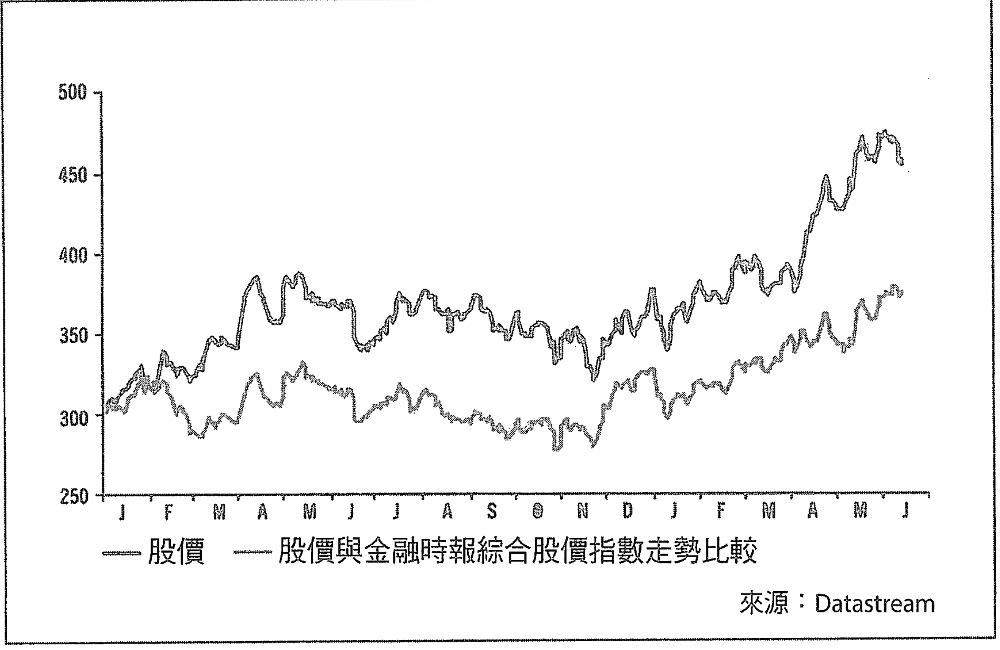

#### 股利率

如果發放的股利隨著盈餘成長，股利率可以遠低於我最初設定的 4%。有些機構或基金拒絕投資不發放股利的公司，我們選股時不急於排除這種公司。

#### 合理的資產狀況

英國蓬勃成長的公司中，股價接近或低於淨值的公司很少。雖然你應該歡迎資產雄厚帶來的安全感，請記住，淨值經常不可靠，資產價值可以輕易高估，強大的品牌在會計上價值可能接近零。

#### 經營階層持股比率高

關於董事個人財務狀況，你會希望他們持有公司比較高比率的股份，實際參與的金額相對不重要。你要找的是具有「企業主心態」，會照顧你的利益的經營階層。避免仍發行讓經營階層擁有額外投票權股份的公司。理想的情況是經營階層大約擁有公司 20% 的股權，這樣他們會有強烈的動機，卻不能阻止併購案。

上述所有因素中，最重要的因素無疑是第二項相對低的本益比。下一章你會看到很多其他標準，讓你以這種基本要求為準，建立保護性的安全網。

進一步深入研究前，我要舉出一個例子，讓你了解 1991 年初有什麼股票符合我的標準。前面提過，MTL儀器是產銷油井、鍋爐間與化學工廠安全設備的成長公司。我們看看這家公司1991年3月的統計報表：

**投資者紀事**

**MTL儀器**

**電子防鏽設備業**

**價格含義**

- 股價：150便士
- 總市值：2,630萬鎊
- 1991/2年最高價：150便士
- 最低價：118便士
- 股利率：2.5%
- 本益比：11倍
- 淨值：無資料
- 淨現金：470萬鎊

| 年度<br>(截至12月) | 營業額<br>(百萬鎊) | 稅前盈餘<br>(百萬鎊) | 每股盈餘<br>(便士) | 每股股息<br>(便士) |
| :--- | :--- | :--- | :--- | :--- |
| 1987 | 7.5 | 1.79 | 6.8 | nil |
| 1988 | 9.3 | 2.31 | 8.6 | 2.67 |
| 1989 | 11.9 | 3.08 | 11.3 | 3.20 |
| 1990 | 14.0 | 3.77 | 13.7 | 3.73 |
| 變化（%） | +18 | +23 | +20 | +17 |

投資人報導最後評論日：1990年9月28日，52頁

MTL似乎年化一年輕鬆成長，1990年業績最好的部分是供應北海石油平台所需設備，這部分業績大約占英國營業額的一半，占總營收的三分之一左右。新增的澳洲與紐西蘭國外業績表現優異，公司已經開始在印度生產，業績也有優異表現，利息收入從21.6萬鎊增為74.3萬鎊，對獲利也有幫助。

預測公司1991年也會有「優異進展」，公司的初步聲明列出最近新推出的不少產品。今年營運成長可能放慢，但是公司似乎決心維持實質12%的銷售與獲利報酬率。這檔股票顯然不貴。

##### 1. 每股盈餘持續成長的五年記錄

每股盈餘的成長情形如下：

| 1986 | 1987 | 1988 | 1989 | 1990 |
| :---: | :---: | :---: | :---: | :---: |
| 5.1 | 6.8 | 8.6 | 11.3 | 13.7 |

單位：便士/年

你很容易可以看出來，盈餘每年成長超過 20%。

#### 2. 和成長率相比，本益比不高

以 150 便士的股價來說，和 1990 年的盈餘相比，本益比為 11 倍，1991 年的預估本益比為 9.5 倍。從 1983 年起，每股盈餘複合成成長率超過 20%，1990 年的成長率為 21%，而且公司決心在 1991 年內，創造 12% 的「實質」成長。1991 年 3 月時，通貨膨脹率為 8.7%，因此可以看成成長率至少有 20%。

#### 3. 董事長的聲明樂觀

董事長在聲明中說，他「深信 MTL 會繼續創造優異的成長」。券商的預測、新產品的發展和市場擴大也支持他的看法。

##### 4. 強勁的流動性、高現金流量、低債務

MTL 的財務狀況絕佳，擁有 470 萬鎊的淨現金（等於總市值的18%），而且業務具有創造現金的強大力量。

#### 5. 競爭優勢

MTL占有英國市場的60%、世界市場的25%，可以穩當地說，在製造本質安全設備的利基產業中，占有強而有力的地位。

#### 6. 有轉機或題材

除了公司的創新政策和大家日漸接受本質安全設備的需要之外，沒有新的東西。不過，公司在所有其他標準上，表現都很優異，這一點不值得擔心。

#### 7. 總市值小

MTL的股價為150便士，總市值為2,630萬鎊，小到一直被投資機構忽視。

#### 8. 相對強弱高

150便士的股價屬於歷史高檔區。

#### 9. 股利率

公司從1988年開始配息後，股利穩定增加，歷史股利率為2.5%，可以接受。

#### 10. 合理的資產狀況

每股淨值為 52 便士，略微超過股價的三分之一，本身不是很 有吸引力，但是就成長股而言可以接受。

#### 11. 經營階層持股

董事、家族和員工持有 55.5% 的股權，價值超過 1,450 萬鎊。董事顯然可以阻止併購案，但是他們的確抱著「企業主心態」。

你可以看出來，這家公司很符合我大部分標準，主要的例外是「新產品」。一年後的 1992 年 3 月，這檔股票從 150 便士漲到 295 便士，創造的資本利得高達 97%。相形之下，同期內大盤指數表現差勁，漲勢不到 5%。MTL 盈餘增加有助於漲勢，但是主要因素是本益比的變化。

MTL 非常符合我大部分標準，因此選擇起來很容易，你選擇股票時，可能不是每一項標準都符合，做決定時可能會感到困擾。你必須知道哪些標準你最看重，哪些標準比較不重要。因此，我們現在要從我提出的粗略大綱，進一步深入了解每一項標準。

### 第三章 盈餘、成長率與本益成長比

本益成長比是衡量工具，也是很重要的投資工具，不要低估這個比值的價值。

公司盈餘指的是普通股每股的稅後盈餘。如果公司的盈餘為每股10便士，本益比為10倍，股價應該是1鎊；如果本益比為20倍，股價應該是2鎊；如果本益比為50倍，股價應該是5鎊。盈餘年成長率與預測的未來成長率是決定本益比的主要因素。本益比是你打算付出多少錢、以及別人在你之前付了多少錢，購買未來成長的指標。

盈餘是推動股價的動力，如果動力不足或熄火股價會下跌。下一頁的兩張表顯示過去十五年來，葛蘭素和韓森兩家公司盈餘和股價之間的密切關係。毫無疑問，每股盈餘成長率和股價表現息息相關，不過兩者之間的關係可能長時間混亂。

很少公司能夠維持超過30%的年成長率很多年，最值得購買的便宜貨通常都屬於15至25%年成長率的級距。如果你能夠找到持續以20%年率成長的股票，這種股票幾乎都是高價股。即使你必須付出30倍的本益比去買，五年內，每股盈餘應該會增加150%，如果股價不變，本益比應該會降為12倍。事實上，如果所有其他因素不變，這種股票的本益比應該還是會維持20多倍的高檔，因此你的投資至少會翻1倍。你也應該記住，在沒有通貨膨脹的環境中，本益比通常比較高，在利率較低時，年度複合成長率20%的股票吸引力明顯多了，而且和大多數其他投資方式相比，的確會很有利。

**葛蘭素 1977 至 1992 年股價與每股盈餘走勢**

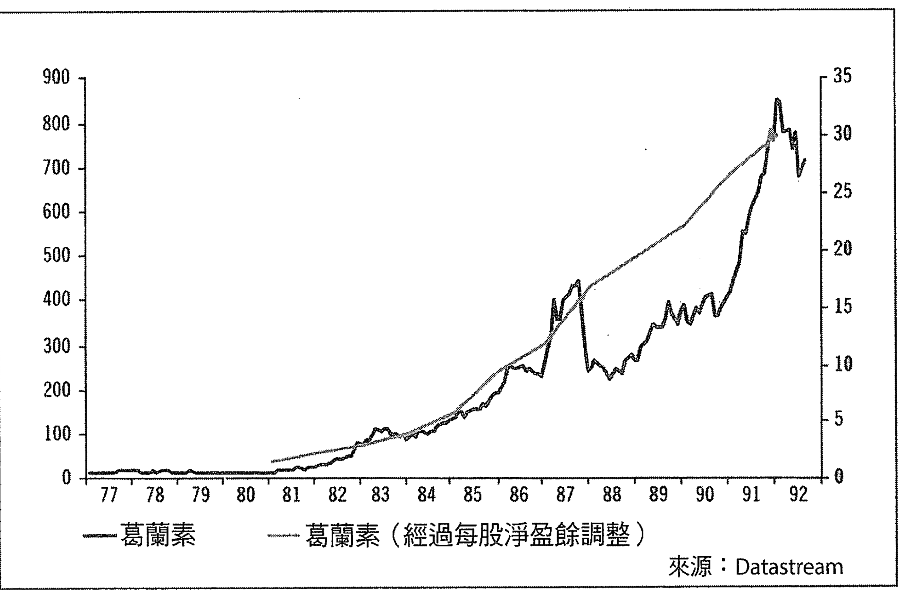

**韓森 1977 至 1992 年間股價與每股盈餘走勢**

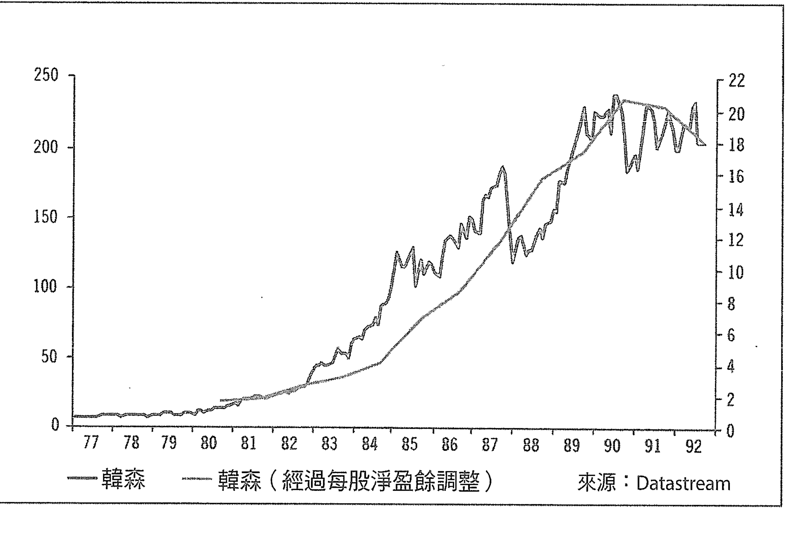

我們現在評估金融時報普通股價指數（FT Ordinary Share Index）每股盈餘成長狀況，這個指數每年的複合每股盈餘成長率大約為 10%，平均本益比大約為 11.7 倍。

#### 金融時報普通股價指數

| 年度 (截至12/31) | 封關指數 | 歷史本益比 | 每股盈餘指數 | 每股盈餘年度成長率（％） |
| :--- | :--- | :--- | :--- | :--- |
| 1981 | 529 | 12.84 | 41.2 | - |
| 1982 | 589 | 10.95 | 53.8 | +30.6 |
| 1983 | 773 | 13.00 | 59.5 | +10.6 |
| 1984 | 945 | 10.35 | 91.3 | +53.4 |
| 1985 | 1123 | 11.25 | 99.8 | +9.3 |
| 1986 | 1272 | 11.76 | 108.2 | +8.4 |
| 1987 | 1408 | 11.09 | 127.0 | +17.4 |
| 1988 | 1447 | 9.44 | 153.3 | +20.7 |
| 1989 | 1916 | 11.10 | 172.6 | +12.6 |
| 1990 | 1687 | 10.18 | 165.7 | -4.0 |
| 1991 | 1837 | 16.70 | 110.0 | -33.6 |

來源：Datastream

高成長股票這麼受歡迎，高於平均年度盈餘成長的複利效果是重要因素，以下是我們要找的一些典型成長率狀況：

#### 投資100英鎊的複合成長率

| | 10% | 15% | 20% | 25% | 30% |
| :--- | :--- | :--- | :--- | :--- | :--- |
| 期初資本 | £100 | £100 | £100 | £100 | £100 |
| 第1年 | 110 | 115 | 120 | 125 | 130 |
| 第2年 | 121 | 132 | 144 | 156 | 169 |
| 第3年 | 133 | 152 | 173 | 195 | 220 |
| 第4年 | 146 | 175 | 207 | 244 | 286 |
| 第5年 | 161 | 201 | 249 | 305 | 371 |
| 第10年 | 259 | 405 | 619 | 931 | 1379 |
| 第15年 | 418 | 814 | 1541 | 2842 | 5119 |
| 第20年 | 673 | 1637 | 3834 | 8674 | 19005 |
| 第25年 | 1083 | 3292 | 9540 | 26470 | 70564 |

每股盈餘每年持續高成長的公司顯然是理想的投資，如果你能夠用低於大盤平均值的本益比買到這種股票，就是找到了無價的珍寶。如果本益比高於大盤平均值，但是和成長率相比仍然不高，你還是找到了罕見的寶石。請記住，成長股股價會上漲只有兩個基本原因，一是盈餘成長，二是市場提高這家公司的本益比，本益比的變化經常遠比盈餘成長重要多了。

為了避免付出離譜的價格，我建議你利用下列對照表，評估你考慮購買的任何股票的本益比：

1. 公司的歷史本益比顯示，其他投資人認為這種水準正常。
2. 所屬產業的歷史本益比。你願意多花一點錢，買高於平均水準的公司，但是不願意出高得離譜的價格。
3. 市場整體平均本益比是另一個比較標準，你知道你想買的公司高於平均水準，但是不打算為這種差異付出太多錢。
4. 避開本益比超高的股票，因為有太多的事情可能出錯，一出問題，跌勢會很慘。我先潑你一盆冷水，讓你看看過去大家最愛的一些股票今天的情形。


#### 過去的超高本益比股票

| 美國 | 本益比 | 本益比 |
| :--- | :--- | :--- |
| 公司名稱 | 1972年12月 | 1992年5月 |
| 索尼（Sony） | 92 | 12 |
| 拍立得（Polaroid） | 90 | 9 |
| 麥當勞（McDonalds） | 83 | 18 |
| 百特醫療產品（Baxter International） | 82 | 17 |
| IFF（International Flavors） | 81 | 24 |
| ADP（Automatic Data Processing） | 80 | 26 |

| 英國 | | |
| :--- | :--- | :--- |
| 公司名稱 | 1968年7月 | 1992年5月 |
| 蘭克公司（Rank Organisation） | 46 | 22 |
| 通用電器（General Electric） | 27 | 12 |
| 特易購（Tesco） | 43 | 14 |
| 韓森 | 27 | 12 |

你可以看得出來，所有這些大家過去極度看好的公司仍然存在，但是本益比已經逆轉，在經常過度高估企業展望的美國尤其如此。

你根據我的三個標準，評估你選擇的股票後，我建議你另外採取一個很重要的步驟。本益比經常可以直接跟預估成長率相比，年成長率15％的公司當然應該得到15倍的本益比；年成長率20％的公司應該有20倍的本益比，其餘以此類推。把成長率除以本益比，會得到本益成長比，算出這個比率的目的是要找到本益成長比遠低於1的股票。

我們看看幾家領導公司的例子，能多複製合年度成長率大約為20％，因此對這種績優公司而言，大約20倍的預估本益比很有道理。聯合利華（Unilever）平均每年成長率大約為11%，因此本益比較低，大約為11.5倍，兩家公司的本益成長比大約都是1。另一檔股票的本益比可能為30倍，年度成長率只有20%，本益成長比因此遠高於1，達到1.5，這檔股票顯然很貴。相反地，另一檔股票年成長率為20%，本益比只有10倍，本益成長比為0.5，的確很有吸引力。我們的目標是預估本益成長比不超過0.75，最好是低於0.66。用更簡單的話來說，我們希望未來的預估本益比不超過成長率的四分之三，最好是低於成長率的三分之二。

你應該還記得前一章提到的MTL公司，1991年3月，這家公司的預估本益比大約為9倍，預期年成長率為20%，預估本益成長比為0.45，很有吸引力。

在比較低的成長水準上，例如年成長率介於12.5至17.5%之間，本益成長比公式很有用。在比較高的成長水準上，你可以把本益比略微提高，原因在於盈餘複合成長率特別高。

我們看看甲乙丙三家小公司，假設開始時，三家公司的股價都是100便士，年度盈餘年成長率分別為15、20和25%，股價會跟著盈餘年成長率上漲：

| 年度 | 甲公司（15%） | 乙公司（20%） | 丙公司（25%） |
| :---: | :---: | :---: | :---: |
| 1 | 115 | 120 | 125 |
| 2 | 132 | 144 | 156 |
| 3 | 152 | 173 | 195 |
| 4 | 175 | 207 | 244 |
| 5 | 201 | 249 | 305 |
| 10 | 405 | 619 | 931 |

單位：便士

你可以看得出來，買丙公司的股票，賺的錢會比投資甲公司或乙公司多，這種情形是假設三家公司都維持同樣的本益比。丙公司的本益比當然可能下降，例如五年後，從25倍降為低於20.4倍，或是十年後降為16.6倍，這時投資丙公司賺的錢，會比投資乙公司少。

我建議你遵照我的經驗法則，第一步總是先比較本益比和成長率，本益比應該低於成長率的四分之三。你要找預估本益成長比低於0.75的股票，或最好低於0.66的股票，但是成長率居高不下，以及符合所有其他標準時，你可以略微變通一點。

請記住，其他條件不變時，本益成長比為1的股票仍然是便宜貨。過去五十年來，你如果買本益成長比為1的大盤指數，應該會得到極高的報酬率，但是你對大盤沒有興趣，你想找價格絕對便宜的最好股票。找到這種股票，會保證你有最高機會創造資本增值，同時得到重要安全保障。前面我們已經看到，本益比很高的股票跌幅，可能較本益比低的股票深多了。

本益成長比是衡量工具，也是很重要的投資工具，不要低估這個比值的價值。我再舉一個例子，證明本益成長比在實務上多麼好用。1990年12月，《分析師雜誌》推薦家庭綜合保險（Domestic & General）。

##### 家庭綜合保險集團

家電傷害險
英國總公司
倫敦溫布頓

##### 股市資訊

| 項目 | 內容 |
| :--- | :--- |
| 股價 | 363p |
| 已發行股數 | 6,779,702 |
| 總市值 | £24.6m |
| 1989/90年價位 | 178-365p |
| 金融時報100種股價 | 2,159 |
| 綜合股價指數 | 1,039 |
| 類股 | 綜合保險 |
| 金融時報精算指標 - 綜合保險類股 | 647.9 |
| 歷史本益比 | - |
| 歷史股利率 | 6.6% |

##### 最近記錄與預測
單位：千英鎊

| 年度(截至6/30) | 1989 | 1990 | 1991(e) | 1992(e) |
| --- | --- | --- | --- | --- |
| 營收 | 14,420 | 20,932 | 30,000 | 36,000 |
| 稅前盈餘 | 2,388 | 3,996 | 4,600 | 5,400 |
| 稅負 | 902 | 1,245 | 1,656 | 1,944 |
| 每股盈餘（便士） | 21.5 | 31.37 | 42.8 | 50.3 |
| 每股盈餘成長率（%） | 43.9 | 45.9 | 36.4 | 17.5 |
| 本益比 | 16.9 | 11.6 | 8.5 | 7.2 |
| 淨股息（便士） | 8.25 | 10.5 | 13.0 | 15.5 |
| 毛股利率（%） | 3.1 | 4.2 | 4.8 | 5.7 |
| 淨值（便士） | 88.7 | 93.6 | 100 | 110 |

本益比只有 8.5 倍。歷史本益成長比與預估本益成長比都非常有吸引力，分別為 0.58 與 0.42。

兩個數字的計算很簡單：

| 指標 | 計算 | 結果 |
| :--- | :--- | :--- |
| 歷史本益成長比 | 11.6 / 20 | 0.58 |
| 預測本益成長比 | 8.5 / 20 | 0.42 |

到 1991 年底，這檔股票已經從 363 便士，飛躍上漲到 1,000 便士，本益成長比從 0.42 提高為 1.18——以這麼傑出的成長股在接近會計年度結束時的水準來看，股價仍然不貴。1992 年的預估本益成長比至少會下降 20%，降為 1 以下，仍然相當有吸引力。請注意，股價從 363 便士漲到 1,000 便士的漲幅中，70%（446 便士）出於地價的變化，也就是出於本益比的變化，而不是出於每股盈餘的成長。

你可以從上述計算中看出來，預估未來成長率是重要因素。過去的成績是歷史，但未來必須有最樂觀的期待。董事長在年報和半年報中對未來展望的說法，有助於釐清事實。董事長的「身體語言」也很重要，如果董事長發出謹慎小心的說法，就要特別注意。此外，如果股息固定增加，有一年只是維持不變，就應該小心在意。

經紀商對未來盈餘估計的共識很可能是最可靠的指標。營業員的評估共識重點在於，這些資訊通常以分析師的訪問為基礎，應該可以讓你明確地掌握一家公司未來的獲利潛力。你偶爾會失望，但是有時候可能會相當驚喜。

你也應該注意新聞界，對董事長在股東會上的說法有什麼評論，也要注意董事長在一年裡對分析師或對新聞界的談話。如果有什麼重要發展，你的營業員永遠應該告訴你，但是並非所有的聲明都正式向證券交易所公告。大部分券商都有剪報服務，你偶爾應該向營業員查證，看看你是否漏看了《投資客紀事》、《金融時報》、其他報紙和股市投資雜誌上刊載的東西。

如果你投資一家每年穩定成長的公司，你關切的重點應該是成長率是否放慢，沒有多少投資比投資失去成長動力的成長股還糟糕，董事長變得比較不樂觀，或是不能達成營運目標的跡象，幾乎都可以確定是賣掉股票的好理由。

英國公司很少發布季報，因此我們必須依靠半年報評估進展，看看盈餘成長率是否有任何變化。做最後判斷前，我們首先必須考慮下列重要因素：

- 有些公司具有高度季節性，例如食品業領導廠商費爾派克（Farepak）總是申報上半年虧損，全年的業績要看耶誕季銷售成敗而定，你其實只能比較今年和前一年的耶誕季業績，不必擔心上半年的虧損。另外很多公司上半年的業績一向遠超過下半年，這點不表示他們成長放慢，他們的業務類似費爾派克，但是沒有這麼極端。我們用保留態度處理這種狀況，只拿目前半年的業績，跟上一年同期比較，拿目前年度的業績跟過去年度比較。
- 有些公司景氣循環的特性特別高，這種股票不是真正的成長股，第十一章會特別探討這個問題。有些循環延續好幾年，因此在循環上升期間，盈餘增加看來可能像是成長，實際上卻只是從前一個循環中復甦。營建業、汽車產銷業、木柴與鋼鐵工業是景氣循環產業明顯的例子。
- 嚴重經濟衰退期間需要另加考慮，我們尋找的利基公司會輕易熬過這種狀況，大部分利基公司每年的每股盈餘會繼續成長。然而，在衰退極為嚴重期間，應該容許成長率略微降低。

你要找的是年度複合成長率超過 15% ，預估本益成長比不超過 0.75 ，最好是低於 0.66 的股票。這種股票很少、很難找，但是如果你要組成板球隊，你希望隊中有一些像包譚（Botham）和古琦（Gooch）之流的明星，不只是普普通通的球員。因此要有耐心，繼續尋找真正符合標準的股票。

請記住，在理想的狀況下，你希望找到最近盈餘成長率加速的公司，如果公司換了新經營階層，新經營階層又創造了兩、三年的大幅成長，低於五年的記錄或許也合於標準。關鍵在於尋找仍然處在蓬勃成長期間的公司。

要找成長速度遠超過一般水準的公司，新股市場可能是可以找到很多成果的地方。以電腦軟體供應商賽捷（Sage）為例，1989年12月，賽捷以每股130便士的價格上市，預估本益比只有7倍。我在賽捷上市後，注意到這家公司，一年後，在《投資客紀事》對賽捷的評估中，發現這檔股票很便宜。

下面要深入評估賽捷，你很快就會看出有關的統計多麼符合我的標準：

##### 1. 每股盈餘持續成長的五年記錄

每股盈餘成長如下：

| 1986 | 1987 | 1988 | 1989 | 1990 |
|:----:|:----:|:----:|:----:|:----:|
| 2.6 | 4.3 | 6.7 | 12.6 | 19.2 |

單位：便士/年

1990年是公開上市的第一年，但是雜誌刊出五年的記錄，先前幾年的業績也可以在公開說明書中找到。

雖然1990年的盈餘成長率不如過去三年，對於像賽捷這種規模的公司來說，50%的成長率仍然很驚人。

#### 2. 和成長率相比，本益比不高

賽捷股價為203便士，以1990年的盈餘計算，本益比不到11倍，以1991年的預估盈餘計算，本益比不到9倍。雖然年度成長率可能降到比較能穩定維持的25%，這檔股票顯然還是很便宜，歷史本益成長比只有0.44，預估本益成長比更是低得驚人，只有0.36。

##### 3. 董事長的說法樂觀

1990年12月，賽捷董事長說：「本年度頭兩個月，我們已經超越自己的內部目標，雖然經濟環境惡劣，我們深信1991將是繼續成長的一年。」你幾乎不能再多做要求了。

##### 4. 強勁的流動性、高現金流量、低債務

賽捷公司的現金流量強勁，擁有550萬英鎊淨現金，等於公司總市值的17%，輕易地符合這項標準。

#### 5. 競爭優勢

雖然整體狀況很困難，賽捷公司靠著成功的策略配合高水準的廣告，表示公司能夠繼續提高市場占有率與利潤率。賽捷大約占有英國小企業軟體市場的 40%，在美國市場也繼續成長，在第三世界與東歐國家也有很多機會。

##### 6. 新題材

賽捷公司的主要對手飛馬公司（Pegasus）碰到財務困難，有助於賽捷提高英國市場的占有率。

#### 7. 總市值小

以 203 便士的股價計算，賽捷總市值為 3,310 萬鎊，很有吸引力。

#### 8. 相對強弱高

對照賽捷和金融時報綜合股價指數的走勢圖，可以看出賽捷的相對表現顯然很有力。

#### 9. 股利率

4.6% 的股利率讓人很滿意。1990 年第一次以上市公司身分配發股利。

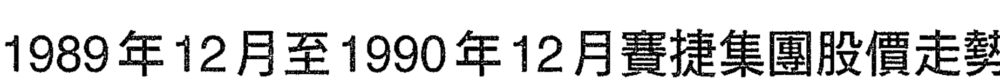

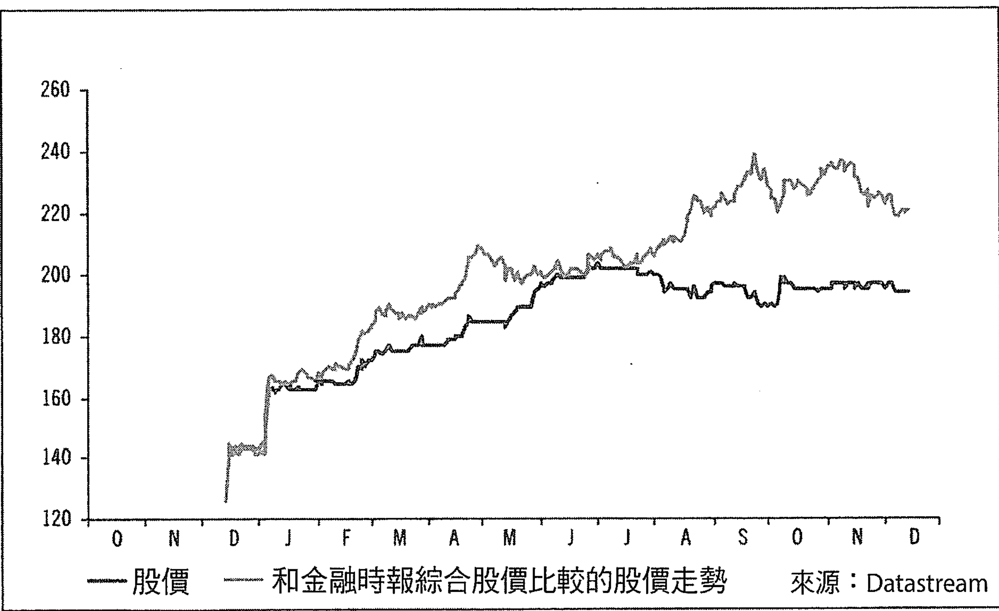

#### 10. 合理的資產狀況

有形資產微不足道，但是擁有 550 萬鎊的淨現金，公司也擁有寶貴的智慧和財產。

#### 11. 經營階層持股

董事擁有 37% 股權，價值超過 1,200 萬鎊，具有企業主心態。

1990 年 12 月至 1992 年 5 月間，賽捷股價從 203 便士漲到 469 便士，漲幅 131%，同期內，大盤指數上漲 25%。1991 年內，賽捷超越自己的預測，盈餘成長 33%，令人十分滿意，但是公司本益比大幅提高，才是股價上漲131%的主要原因。購買時預估本益成長比越低，本益成長比急劇提高的空間越大。賽捷、家庭綜合保險與MTL儀器的例子顯示盈餘成長與本益比倍數變化配合，發揮效用，為精明而有系統的投資人提供極高的利潤，你可以看出這套系統的運作多麼成功。

買快速成長股，判斷本益比是否過高，另外有一個很重要的因素，就是購買的時機。我們回頭看看MTL儀器，假設你在一個月前投資這檔股票，1991年2月的股價為124便士，到1990年12月為止，最近一年申報的每股盈餘為11.3便士。因此，你等於付出11倍的歷史本益比，也等於用1990年的9倍預估本益比，買進這檔股票。一個月後的1991年3月，公司宣布1990年的業績，你應該從半年報的成果中，知道公司的盈餘會非常高，但是1991年2月時，很多投資人仍然根據歷史本益比評估這檔股票，大家預測下一年，也就是1991年的營運樂觀，分析師因此信心十足地預估盈餘會再成長20%。經過幾週後，市場開始根據1991年的預估本益比，評估這家公司，認為股價遠比你買進時便宜多了。接力賽時，棒子交出去後，注意力會轉移到下一位運動員和下一階段——從注意歷史本益比，變成注意預估本益比。

在會計年度（或半年）快要結束時，購買快速成長股，通常可以得到一次性的獲利，因為市場在吸收前一年的營運成果、消化下一年甚至會更好的消息時，會做出調整。新聞界和券商會助長這種過程，整合一年內，新聞界和券商很少談到相對沒有名氣的公司，這種公司只有在宣布營運成果時，才會重見天日。

##### 重點摘要

你要找的股票應該具有下列特點：

- 過去五年的每股盈餘複合成長率大約為 15% 以上。如果最近盈餘加速成長，也可以接受比較短的期間，更好的是還有換新經營階層這類明確又持續性的優勢。
- 和成長率相比的本益比很有吸引力，目標是預估本益成長比不超過 0.75，最好低於 0.66。換句話說，預估本益成長比不應該高於預估未來成長率的四分之三，最好低於三分之二。
- 和公司的歷史、業界平均值與大盤平均水準相比，本益比要有吸引力。
- 董事長的年度和半年聲明必須樂觀，股利政策必須能夠配合這種樂觀氣氛，市場的獲利預測共識也必須樂觀。

應該記住的其他重點包括：

- 成長股的股價會上漲，完全是因為盈餘成長和本益比倍數的變化，後者經常比前者重要多了。
- 避開本益比高得離奇的股票。
- 考慮半年營運成績時，特別注意季節性因素，記住某些股票上半年業績一向比較好。
- 注意處在復甦期間的景氣循環股和成長股的差別。景氣循環股是後面章節中會探討的另一種投資系統策略。
- 快速成長股經常可以在宣布年報或半年業績前不久，以有利的價格買進，隨後大家的注意力會從歷史本益比，轉移到預估本益比上。

## Chapter 4 會計花招

有些會計師可能認為，會計是十足的科學，有些會計師則認為，資產負債表和損益表的呈現，藝術成分比較高。

我在上一章裡，深入說明我投資積極成長股策略的頭三個標準，為了讓解釋儘量簡單，以免你分心，我沒有指出公司的盈餘可能不像表面所顯示的一樣。現在我們要進行微調，必須看看輕易接受年度盈餘報告表象的危險。

### 會計花招

有些會計師可能認為，會計是十足的科學，有些會計師則認為，資產負債表和損益表的呈現，藝術成分比較高。雖然會計師公會近年努力提高會計標準，毫無疑問地，聰明的財務長說明自己公司的營運成績時，仍然有相當大的彈性。有些行業比其他行業更容易發揮財務上的創造性，但是在大部分行業裡，創造性的做法都有很大的空間。

財務申報協會曾經發表聲明，指出會計不但應該真實而公平，也應該提供資訊，財務申報協會也表示，任何壓力都不應該促使企業利用投機性的財務手法，虛飾帳目，這番認知值得稱道，但是實施起來卻極為困難。

各種會計團體，包括會計準則委員會、財務申報協會、財務評估小組和緊急問題專案小組等，都努力改善標準，因此你看到本章時，這些內容可能已經有點過時，我只能大概說明現狀，讓你根據一套帳目，評估企業盈餘成長的真相時，知道會碰到什麼問題。

會計花招最簡單的例子是：提供勞務的發票可以在會計年度結束前後不久發出，因此利潤會隨著做決定的人一時之間的心念變化，跟著減少或提高。

再看一個例子，一家營建業者在會計年度結束時，帳上有一棟沒有賣掉的房子，房子可能是在會計年度上半年，以10萬鎊成本蓋的，預估售價可能為20萬鎊。根據保守的會計做法，年底列帳時，這棟房子應該以成本或市價孰低列帳。到了本會計年度的第一天，這棟房子可能以公司完整開價的20萬鎊賣出，忽然之間，10萬鎊的利潤會列在本會計年度，而不是列在上一會計年度。這種做法沒有什麼不對的地方，房子要賣掉之後，才賺到錢，但是一天的差別會造成年度獲利大不相同。你很容易可以看出來，很多企業家急於維護公司每股盈餘成長的記錄不中斷，會盡一切力量，在獲利不好的年度把這棟房子賣掉。相反地，如果


#### 1. 研究發展費用

公司業績很好，未來的展望比較不明確，這位企業家可能刻意把房子延後幾天賣掉，把利潤轉到未來比較困難的年度。我只用一棟房子來說明這一點，但實際上可能有很多棟房子。在某些行業中，幾百萬鎊可以用這種手法，輕易從一個會計年度，轉移到另一個會計年度。

準備金是可以把利潤移轉到另一年的地方。假設我們這位企業家過去一年業績很好，希望略微降低公司的盈餘，他評估應收帳款時，只要決定對壞帳準備採取極為保守的觀點，就可以達到目的，除非他犯了公開而且明顯的錯誤，不然會計師不可能質疑他的慎重。同樣地，他可能主張對庫存與在製品的價值，提列更多的準備金。這些簡單的例子顯示，利潤可以在有意或無意間，從一個年度轉移到另一個年度。

會計師簽證報告中的任何註釋，可能都是公司會出問題的徵兆。公司建議換簽證會計師時，也應該注意，尤其是從著名的會計師事務所，換成默默無名的小會計師事務所時，更應該警覺。這些都是明顯的警訊，比較難以察覺的警訊要靠研究若干企業在其他會計項目中，採用創新的處理方法，才能看出來。

涉及明確的計畫、計畫結果在技術和商業上的可行性，可以相當確定的評估時，研發成本可以延後列在未來的會計期間。否則所有研發成本都應該在發生的會計期間提列。

這是第十三號會計實務準則列出的處理原則，目的在於儘量防止企業在不同年度之間，操縱研發成本的提列。然而，連這樣的定義可能也不夠精確，「技術可行性相當確定」的說法，為「相當」的意義提供了爭議空間。想要提高或壓低利潤的企業家，可以輕易操縱最後的看法。

#### 2. 廣告費用

1992年6月時，沒有任何會計實務準則或其他明確的指導原則，規定廣告費用的處理方式。正常保守的會計做法是在費用發生時提列。大公司為新產品支出的廣告費用分幾年提列，同樣也是可以接受的做法。財務長的意見極為重要，財務長接下來要說服會計師，相信他的看法正確。任何不尋常的處理都應該在會計帳中揭露。不同的公司針對這個問題，經常有大不相同的會計政策，因此投資人應該很小心地閱讀會計帳中的詳細附註。

#### 3. 匯率變動

勃利派克最喜歡利用外匯交易提高獲利，因而臭名滿天下。勃利派克會以年利率7%的成本，借貸強勢貨幣如瑞士法郎的大量資金，再以非常高的利率，例如20%的利率，投資弱勢貨幣，每年13%的利差就當成利潤，列在帳目中。另一方面，這一年裡，弱勢貨幣貶值，例如貶值15%，但是這一點會列在資產負債表的資本減損項下。年報的會計政策項下有一個附註，說明「會計年度開始到結束期間，匯率變化對子公司淨投資的影響，以準備金的方式處理。」這種事情事後很容易看出來。

#### 4. 組織調整費用

緊急問題專案小組已經建議：組織調整成本將來應該以特別項目呈現，從每股盈餘中扣除，除非組織調整費用起源於公司某個特殊事業處，大到足以自行編製會計帳目的部門。過去組織調整費用可以當成特別項目提列，不影響每股盈餘。

集團企業和併購公司（有一陣子我還經營過一家！）利用比較早的規定，為未來的組織調整成本，提列巨額準備金，這種準備金列在特別項目下處理，因為是為未來的成本提列，顯然不能從當年度的扣除，也難以在未來的個別年度中分配。為未來的成本提列過高的準備金，效用當然是增加未來的營收獲利。未來很多費用可以輕易列在組織調整項下，從準備金中扣除，而不是從那一年的利潤中扣除。

#### 5. 存貨估價方法

在通貨膨脹期間，「後進先出法」比「先進先出法」保守，方法改變會在會計帳中註明，你應該慎重注意這樣做的影響。

#### 6. 折舊方法改變

有些方法的折舊速度比較快，因此要注意公司是否改變折舊方法，公司的獲利是否因此明顯增加，在折舊方法改變的那一年裡，這種事情應該很容易看出來。

#### 7. 出售固定資產

出售固定資產的盈虧是公司正常營運的一部分，如果出售的金額特別大，應該當成特別項目處理。現在大家認為，出售一種事業或部分事業引發的盈虧，也應該當成特別項目處理，應該在計算每股盈餘時列入考慮。你必須自行判斷是否把這種盈虧，當成公司相關年度真正盈餘的一部分。

#### 8. 利息資本化

利息通常要從利潤中扣除，但是偶爾特定的計畫，利息成本會加在資金成本上，利用這種方法，可以美化資產負債表中的資產價值和損益表中的利潤。顯然其中有相當大的濫用空間，尤其是衝過頭、急於取信銀行和債券持有人的不動產公司。

#### 9. 根據獲利能力支付併購價金條款

企業經常以支付頭期款的方式，從事財務併購，隨後的幾年裡，再根據獲利比率，用股票或現金分期付款。未來的債務通常不會清楚列在帳目中，也不會列在每股盈餘的計算中。如果最後付款日到期時股票劇跌，可能造成很嚴重的稀釋，在這種情況下，任何巨額現金債務可能也難以取得所需要的融通資金。

延後考慮的潛在債務會列在會計附註、財務承諾、負債或類似的名稱項下，你一定要提高警惕！

#### 10. 改變會計年度起迄日

改變會計年度起迄日後，年與年之間的盈餘成長率會相對難以比較，大部分公司這樣做，都會有很好的理由，但是偶爾公司的動機可能比較不清楚，你必須注意這種可能性。

你關心的重點是設法確定公司每股盈餘的年度成長率，特別和例外費用都會弄皺一池春水，使分析變得格外困難。所有這些事情幾乎都是經營事業成本的一部分，罷工或巨額的意外呆帳可能列為例外，但是罷工和呆帳其實是企業界很常發生的事情。

你接受每股盈餘數字前，必須詳細查對每一個特別項目，看看是否應該剔除任何利潤。你也應該看列為特別費用提列的項目，以免任何一項會加回去，提高獲利。

根據財務申報揭露提案列出的新作帳建議，特別項目應該會變得很少。會計師業也建議大幅改變損益表的格式。如果這項建議變成新標準，集團帳目中就必須分別列出，繼續營業部門和停止營業部門的業績、畫分併購與異常項目，幾乎取消所有的特別項目，解釋準備金的變動，揭露收益投資。特別項目當前的定義是，企業正常營運活動之外的罕見活動或交易。財務申報揭露提案另外提出一個重要的建議，就是每股盈餘的計算應該扣除特別項目，特別項目應該在損益表正文中揭露。也有很多公司用不同的方法計算和揭露每股盈餘，只要計算和揭露基礎持續一貫、解釋清楚、符合財務申報揭露提案建議的呈現方式，也未嘗不可。換句話說，董事可能是設法呈現當年度真正的盈餘狀況，前提是要正確解釋自己的做法。

這一切對投資人有什麼意義？遊戲規則已經緊縮，但是同時你必須自行判斷每股盈餘和成長率。特別項目有多特別、例外項目有多例外，應該是你經常要問的問題。將來每股盈餘會扣除的特別和例外項目，這些項目也要清楚解釋。你的任務會變成判斷是否有任何這種項目應該加回去或剔除掉，以便更清楚地看出成長展望。

美國投資大師葛拉漢（Benjamin Graham）認為，會計師把例外項目分配在好幾年期間時，應該盡最大力量，做出判斷。這樣每股盈餘跟個別年度的關係應該會大為加深，成長率應該會比較容易計算。葛拉漢也建議拿最近三年經過調整的平均盈餘，跟五年或十年前任何一段，三年期間經過調整的平均盈餘比較。這樣有助於稀釋特別和例外項目的影響。平均法的确有用，用在集團企業和其他積極併購的公司時尤其如此。

要查核盈餘，最可靠的指標是公司同一年度的現金流量。以1991年為例，卜內門化學的營業利潤為10億英鎊，營運現金流量高達15億鎊。相形之下，英國航太（British Aerospace）的稅前盈餘和例外項目為1.54億鎊，營運現金流量為負0.95億鎊。勃利派克也值得一提，這家公司在年終會計帳中，列出稅前盈餘增加 44%，達到 1.61 億鎊，但是國民西敏銀行（County Nat West）用新的現金流量表方式計算，發現勃利派克的營運現金流高達 1.29 億鎊，主因是營運資本大幅增加 2.88 億鎊。帳上如果有錯誤的重大差異時，你就知道有人用高明的方法在作假。

不管你還做什麼別的事情，都要睜大眼睛，注意我所提到的虛增盈餘方法，查核現金流量，而且要從頭到尾，細讀年報和會計帳目。請記住，附註中可能含有你需要注意的重大資訊。

#### 可轉換債券

計算每股盈餘時，都應該考慮可轉換債券、進行轉換的債券和特別股，以及實際執行的選擇權和認股權。如果這些東西占發行在外股票的比率低於 10%，就不值得煩心，避免你的思慮混亂，我會建議你不要理會。債券的轉換會讓公司節省一些利息支出。認股權或選擇權的執行會為公司帶來新的現金，盈餘應該會略微稀釋，但是不足以讓你擔心。

公司偶爾會發行巨額可轉換債券，這時可轉換債券一定會扭曲獲利狀況，因此不能忽視。例如 1990 年 4 月，戶外之主公司從英國航空（British Airways）手中，買下紅翼度假（Redwing Holidays），發行 1,725 萬鎊可轉換債券，籌募併購所需資金。到 1990 年底，戶外之主發行的可轉換特別股金額超過 2,700 萬鎊，以每股 65 便士的轉換價格計算，1991 年 4 月到 2000 年間，應該會轉換成略超過4,170萬股的普通股（100單位轉換債權轉換成153股普通股）。要計算最大的稀釋程度，你必須假設所有轉換債都會轉換，因此，你必須把特別股轉換的另外4,170萬股，以及選擇權轉換的595萬股，加在這一年裡平均發行的總股數上，這一來，股數增加的比率應該略低於40%。

要大略知道這種情形對每股盈餘會有什麼影響，你只要拿預測的稅後盈餘除以新的總股數。然而，為了得到比較精確的結果，你應該考慮可能的股息或利息方面的節省，因為轉換後，公司不必再發特別股股息或公司債利息。

還好，公司通常都會替你計算，所有選擇權和可轉換公司債都列在實收資本額項下的會計帳附註中，或是列在類似的項目下，轉換收入再投資的可能影響會列在每股盈餘項下。

你可以看出來，因為轉換有壓低未來每股盈餘成長率的效果，稀釋的程度可能很嚴重，可轉換公司債轉換後發行的股數如果超過股本的10%，你就應該進行必要的計算，估計影響。當然，轉換價格越低，可轉換公司債越可能轉換成股票。

#### 租稅

公司經常會提前列計稅務損失，以便沖銷當期獲利，這樣可能導致利用稅務損失的年度稅務費用低得不正常，每股盈餘的成長是根據稅後盈餘計算，因此稅務費用應該經過調整，恢復正常水準，以便獲得真正的實況。設在經濟特區和愛爾蘭的公司，經常都享受租稅優惠，得到資本補助。有些工程與租賃公司的巨額資本支出也會降低稅務費用，如果稅務優惠不可能再度發生，你應該把稅務費用調整到正常水準。

以正常稅率33.3％的公司來說，如果稅前盈餘為1,200萬鎊，稅後盈餘為1,000萬鎊，表示稅務費用因為某些原因，降為只剩下16.7％。如果這種例外的低稅務費用是因為一次性狀況所形成，你就應該從1,200萬鎊的稅前盈餘中，扣除33.3％，得到經過修正後的盈餘800萬鎊，再根據這個數字，計算每股盈餘。

你必須區別固定繳交較低稅賦的公司，以及從一次性事件中得到好處的公司。

我們現在可以開始討論我的第一批保護性標準，這些標準加在一起，會在你買的任何股票下方，形成安全網。

##### 重點摘要

- 1. 會計師業正在進行內部整頓，但是會計花招總是有發揮餘地。
- 2. 你必須刻意閱讀財報和會計帳中的詳細附註，也要閱讀董事長的聲明，要從頭到尾，閱讀你所选定公司寄來的所有文件。要注意警訊，尤其要注意會計師簽證報告中的意見，以及公司打算更換簽證會計師的提案。
- 3. 每股盈餘將來呈報時，必須扣掉特別和例外項目，公司必須清楚說明這兩種項目。你的任務是決定這些項目是否應該加回去或剔除掉，得到比較真實的公司成長展望狀況。
- 4. 睜大眼睛，注意我提過的虛增盈餘方法，你最好的查核方法是比較營業利潤和營運現金流量，兩者之間如果有龐大的差距，就代表其中可能有會計花招在作祟的警訊。
- 5. 可轉換公司債、選擇權和認股權總額超過股本的 10%時，要用稀釋程度和可能的利息節省，調整盈餘數字。
- 6. 碰到喜歡併購的公司時，要研究帳目中的附註，確保根據「獲利能力支付併購價值條款」中，延後考慮的債務不會變得過高。
- 7. 如果當年稅負因為非經常事件而減少，要根據正常的稅務費用，調整盈餘。

## Chapter 5 流動性、現金流量與借貸

### 這家公司是不是真正的賺錢機器？

我可以把這章簡單地稱為「強而有力的財務狀況」，但是我希望強調流動性、現金流量和借貸是三個很重要的明確因素。

流動性指的是可以輕鬆轉化成現金的資產。這種資產通常包括短期貸款、債權（減去債務）、債券、有價投資，當然也包括現金。簡單來說是「沒有痛苦或困難」。經濟嚴重衰退期間，債券變現的難度比你想像的高多了（你可以問任何一家銀行），但是我們現在是根據財務氣候正常為基礎進行討論。

如果公司擁有大量現金餘額，沒有債務，財務狀況顯然強而有力。如果這種強而有力的流動性來自內部成長，就應該視為絕佳的初步證據，證明這家公司是高明的賺錢機器。

現在我們看一家運氣比較不好的公司，這家公司的現金餘額為100萬鎊，債務卻有500萬鎊。我們假設這100萬鎊不是來自最近發行的現金增資新股，或是來自其他類似性質的籌資。關鍵問題是：債務的急迫性有多高，這家公司是不是真正的賺錢機器？在會計帳目中，負債會區分為一年內到期的債務，和比較長期的債務。這家公司可能有 100 萬鎊的透支，還有公司用主要不動產抵押得來的 400 萬鎊。如果抵押貸款屬於短期貸款，你或許會決定改為研究另一家公司，但是如果抵押貸款是長期貸款，你應該繼續評估下去。

要檢查公司健全與否，另一個有用的方法是研究「速動比率」，速動比率指流動資產減去庫存和正在進行的業務後，和流動負債比較的比例。我喜歡找流動資產減去庫存後，至少是流動負債 1.5 倍的公司，但是如果其他條件都很合適的話，我也接受比較低的速動比率（可能低到 1：1）。速動比率越高越好，你會在第十三章探討「價值型投資」時發現，葛拉漢的信徒主要標準是：尋找股價低於每股流動資產淨值的公司。近來這種公司很少，但是強勁的流動資產淨值是非常合宜的投資標準，能夠強化你的安全網。

另一個有用的標準是公司整體負債對股東權益比率。這裡的股東權益是指普通股的資產淨值。這個標準看起來很簡單，但是請注意，專業投資人對於「資產淨值」和「整體負債」的意義，有很多不同的解釋。根據某些標準來看，我的方法相當嚴格，我只接受有形資產，因此我會把資產負債表中的總額減掉商譽；計算負債總額時，我會把所有超過一年到期的負債和銀行透支加在一起，再加上任何短期貸款、分期付款和融資租賃債務，然後減掉多餘現金，把得到的總額用占有形淨資產的百分比表示。下面我用 1992 年 5 月上市的工業控制服務集團（Industrial Control Services Group）作為例子，說明我怎麼計算。

首先看看暫編資產負債表（請參閱次頁），上面顯示公開承銷後的淨資產為 1,711.6 萬鎊，減去 47.2 萬鎊的無形資產，得到有形淨資產的金額為 1,664.4 萬鎊。現在減掉所有超過一年到期、必須繳息的債務 635 萬鎊（656.4 萬鎊減 21.4 萬鎊的應計項目——這個數字包括抵押貸款、若干融資租賃和分期付款債務）。然後看一年內到期的債務，減去銀行貸款本期應繳利息 6.4 萬鎊、605.4 萬鎊的銀行透支、100 萬鎊的其他貸款和 33.1 萬鎊購買合約的分期付款，這些金額加總起來，會得到 744.9 萬鎊的數字，你應該從這個數字中，減掉暫編資產負債表中 610.4 萬鎊的現金，再減去股票承銷後償還賣方的 100 萬鎊。得到的數字是 34.5 萬鎊，把這個數字和一年以上到期的債務 635 萬鎊加在一起，會得到「整體負債」669.5 萬鎊，負債對股東權益比率的計算方法如下：

$$\frac{6,695,000}{16,644,000} \times 100 = 40.2\%$$

我對成長公司所定的上限是 50%，因此這個數字剛好可以接受。

### 工業控制服務集團暫編資產負債表

| 項目 | 1991年11月30日 | 資本重組 | 承銷 | 暫編總金額 |
| :--- | :--- | :--- | :--- | :--- |
| **固定資產** | | | | |
| 無形資產 | 472 | - | - | 472 |
| 有形資產 | 12,282 | - | - | 12,282 |
| 投資 | 695 | - | - | 695 |
| | 13,449 | - | - | 13,449 |
| **流動資產** | | | | |
| 庫存 | 6,684 | - | - | 6,684 |
| 借方（債權） | 20,183 | - | - | 20,183 |
| 銀行存款與手頭現金 | 379 | 125 | 5,600 | 6,104 |
| | 27,246 | 125 | 5,600 | 32,971 |
| **貸方（債務）** | | | | |
| 一年內到期債務總額 | 23,553 | - | (1000) | 22,553 |
| 流動資產淨值 | 3,693 | 125 | 6,600 | 10,418 |
| 資產總值減流動負債 | 17,142 | 125 | 6,600 | 23,867 |
| **貸方** | | | | |
| 一年以上到期債務總額 | 6,564 | - | - | 6,564 |
| **準備金** | | | | |
| 遞延稅項 | 225 | - | - | 225 |
| **小額利息** | (38) | - | - | (38) |
| | 6,751 | - | - | 6,751 |
| **可運用資產淨值** | 10,391 | 125 | 6,600 | 17,116 |
| **資本與準備金** | | | | |
| 實收資本 | 4,500 | (1,192) | 682 | 3,990 |
| 股本溢價 | - | 210 | 5,918 | 6,128 |
| 盈虧 | 4,946 | (250) | - | 4,696 |
| 資本準備 | 3 | - | - | 3 |
| 資本償還準備 | - | 1,357 | - | 1,357 |
| 無形準備 | (1,959) | - | - | (1,959) |
| 準備金增值 | 2,901 | - | - | 2,901 |
| | 10,391 | 125 | 6,600 | 17,116 |

#### 貸方：一年內到期債務

單位：千英鎊

| 項目 | 1991年5月31日 | 1991年11月30日 |
| :--- | :--- | :--- |
| 本期銀行貸款利息支出 | 60 | 64 |
| 其他貸款 | - | 1,000 |
| 銀行透支 | 3,149 | 6,054 |
| 應付股息 | | |
| 融資租賃與分期付款債務 | 186 | 331 |
| 營業債務 | 7,323 | 6,129 |
| 記帳合約付款 | 1,154 | 2,478 |
| 其他債務 | 920 | 479 |
| 本期公司稅 | 1,386 | 1,731 |
| 其他稅項與社會安全成本 | 1,249 | 1,351 |
| 應計項目與遞延收入 | 3,920 | 3,774 |
| | 18,825 | 23,553 |

銀行透支由集團總資產以第一順位固定與浮動利率抵押權擔保

#### 貸方：一年以上到期債務

單位：千英鎊

| 項目 | 1991年5月31日 | 1991年11月30日 |
| :--- | :--- | :--- |
| 五年內償還變動利率銀行貸款 | 119 | 77 |
| 變動利率抵押貸款 | 4,000 | 4,000 |
| （二十年內以養老保險保單(保險金清償)） | | |
| 五年內償還變動利率抵押貸款 | 1,400 | 1,400 |
| 融資租賃與分期付款債務 | 485 | 873 |
| 五年內償還之其他變動利率貸款 | 1,000 | - |
| 應計項目與遞延收入 | 303 | 214 |
| | 7,307 | 6,564 |


你不必太擔心自己必須計算負債對股東權益比率，《投資客紀事》的公司業績評估中，採用跟我類似的方法，總是會強調這個數字。

我們的理想是尋找擁有淨現金的成長公司，因此請記住，任何債務已經是讓步的開始。如果都能圓滿符合其他投資標準要求，我們可以容忍最高 50% 的負債對股東權益比率。

你偶爾會在無意之間，受到營建業者之類的公司誤導，不能分辨這種公司在履行重大合約之前收到的巨額準備金。例如我記得惠受公司（Whesso）在 1991 年發行新股，募集海外併購所需要的資金。當時公司雖然好像擁有強勁的現金部位，董事會卻正確地告訴股東，說公司的大部分現金不能自由運用，因為都是顧客為了重大合約預付的保證金。

我們現在要從公司的現狀，推遲到研究公司未來的現金流量，首先我們必須說明這個名詞的定義，現金流量是公司在會計年度中創造的淨資金總額。要計算淨現金流量，你必須把不需要現金支出的項目，加回到淨營業利潤中，其中主要的項目當然是折舊。

相反地，關係企業列為股東權益的保留盈餘，必須從淨營業利潤中扣除。例如，如果我們評估的公司持有一家關係企業 20% 的股權，這家關係企業賺了 1,000 萬鎊的稅後盈餘，這個集團的年度淨利數字應該包括按比例分配到的 200 萬鎊獲利。然而，關係企業可能只發放獲利的四分之一，作為股息，因此用現金來說，這個集團只收到 50 萬鎊的股息。保留的 150 萬鎊必須從獲利中扣除，以便代表這一年集團的營運淨現金流量。

會計準則委員會為了方便投資人，已經發出新的準則，規定要用現金流量表，取代舊的資金來源與運用表，現金流量表把現金流量畫分成不同的類別，希望根據現金流量的經濟原因，畫分成不同的來源，未來的現金流量項目包括：營運活動淨現金流量、投資報酬與融資支出、稅項、投資與融資。其中有非常多的數字，因此我們要注重其中最重要的一點：營運活動的淨現金流量和營運活動產生的利潤，不應該有很大的差異。森寶利公司在 1992 年 3 月 14 日截止的年報中，非常清楚說明營業利潤和營運活動的淨現金流量彼此符合。森寶利的集團現金流量表如下：

集團營業利潤與營運活動淨現金流量配合調整 單位：百萬英鎊

| | 集團 | 1992年 | 1991年 |
|---|---|---|---|
| 營業利潤 | | 667.7 | 585.0 |
| 員工分紅 | | (49.4) | (44.0) |
| 折舊費用 | | 135.6 | 120.2 |
| 存貨增加 | | (1.5) | (52.3) |
| 債務減少或增加 | | 4.7 | (9.7) |
| 債權增加 | | 31.7 | 109.2 |
| 營運活動淨現金流入 | | 788.8 | 708.4 |

你可以看出來，營業利潤為 6.677 億鎊，其中要減掉 4,940 萬鎊，作為零售員工分紅計畫的費用。然後要把為折舊所提列的巨額資金 1.356 億鎊加回去，因為折舊雖然是根據利潤提列，卻沒有吸收現金。剩下的調整跟營運資本規定有關，包括庫存的增減、債務與債權。

最後的結果是金額 7.888 億鎊、相當健全的營運活動淨現金流量，和 6.677 億鎊的營業利潤相比，顯得相當有利。很多公司的報表和帳目不像森寶利這樣列舉得一清二楚，報表和帳目越不清楚，你越應該警覺。你要特別注意重要的數字，營業利潤超過營運活動淨現金流量時，你幾乎可以確定其中一定有會計花招在發揮作用。

為什麼現金流量這麼重要？首先，現金流量可以作為查核標準，了解營業利潤與盈餘是否符合目標。第二，因為自由現金流量是公司擴張所需要的資金來源。我說的「自由現金流量」，是指扣除股息與資本支出後的現金流量。森寶利或特易購之類的食品零售業者，是擁有絕佳現金流量的典範企業，兩家公司開設新超級市場時，需要的資本很少，店面可以用租的，店內的食物由供應商用記帳的方式供應，超市從開幕日起，就可以收到可以支配的現金。以麵包為例，是由麵包廠以記帳的方式供應，一、兩天內就賣掉，得到現金，幾週日後——有時候是幾個月後，才由超級市場支付積欠麵包廠的貨款，超級市場在這段期間裡，可以利用這筆現金。到了會計年度結束時，超級市場賺到的現金利潤要用來繳稅、發放股息、清償債務，當然也要用來開設新的超級市場，以便創造進一步的成長，唯一的問題是，過度擴張和過度建設會使競爭變得極為激烈，以至於產生價格戰，不過這種情形通常都不會延續很久，大家何必破壞好事？

我以前一直都不清楚，為什麼投資與併購大師高德斯密（James Goldsmith）爵士這麼重視保衛爾（Bovril）和嫣美（Marmite）的品牌，為什麼他早年投資賺大錢時，特別重視英國聯合供應（Allied Suppliers）與美國大聯盟（Grand Union）之類的食品零售公司。我現在已經了解他的思維，我希望讓你知道怎麼投資這種公司，怎麼投資擁有競爭優勢、資本報酬率很高、現金流量強勁、又不會被不利的資本支出吃掉的公司。

資本支出可以分為兩大類，第一類是置換老舊、狀況不佳、需要修理或已經陳舊過時的資產，如工廠和機械。這樣做比較像是維持現狀，是維持競爭力的必要成本。第二類的資本支出進取多了，額外增加的全新工廠加上最現代化的設備，代表真正擴張所需要的東西。你會發現有些企業如鋼鐵公司，每年都要投資工廠和設備，他們的股東很少獲得益。

擁有非常強力企業關係的公司比較幸運，可以投資新產品、新科技和新事業，這一切應該都有助於增加而不是維持年度獲利而已。

##### 重點摘要

- 理想的公司擁有很高的淨現金流量，現金餘額龐大，沒有負債，衰退期間尤其如此。
- 我們規定的負債對股東權益比率上限為 50%，而且只有在所有其他標準都符合時，才容許這麼高的上限。
- 流動資產淨值減去庫存和進行中的業務後，和流動負債之間的速動比率應該至少有 1：1，最好有 1.5：1。
- 睜大眼睛，注意工程營建公司遭到扭曲的現金部位，這些公司經常收到顧客預付的高額保證金。
- 永遠要研究公司的現金流量表，特別是要一再查核營業淨現金流量，至少要等於營業淨利潤，最好是比較高。如果其中有不正常的重大差異，代表公司用會計花招作帳。
- 應該避免純粹為了維持生存，必須大量投資資本設備的公司，能夠產生大量可自由運用的現金流量，用在擴充未來盈餘的公司，吸引力大多了。

## Chapter 6 轉機與題材

好的題材是強而有力的催化劑，有助於股價上漲，市場喜歡好題材，新事物會增加題材的味道和趣味性。

公司有轉機或題材是非常受歡迎的特點，卻不是投資時絕對必要的標準。擁有葛蘭素和吉百利食品（Cadbury Schwepes）之類強大品牌的公司，以及像能多潔一樣，在利基市場中地位穩固的公司，即使沒有提供任何新的東西，都會年復一年，繼續創造不斷成長的每股盈餘。這種公司可能在一系列產品或服務中，增加新的東西，卻都不是特別不同的東西，不是能夠促使盈餘飛躍增加的東西。我知道自己選股時，可能找到另一檔像葛蘭素或能多潔的成長股，選擇股票時，只要公司符合我大部分投資標準，並不堅持要選擇能夠從新事物中得到好處的公司。然而，我找到擁有所適當基本面因數、又有題材優勢的股票時，真的會胃口大開。因此，新事件或新產品，在說明獲利潛力提高和股價相對強弱的原因之外，經常是證實這種趨勢的絕佳附帶獎勵。

足以對股價產生重大影響的新因素主要有四種：

- 新經營階層。
- 新產品或新科技。
- 整體產業的新事件，包括新法規。
- 新併購。

新經營階層是最重要的因素，原因很簡單——傑出的新經營階層可能具有長遠而持續的影響。如果能力高強的新經營者掌控公司，他們的努力可能在未來很多年裡，都會創造優異的成果。

這方面有很多大家熟知的例子，韓森（James Hanson）和懷特（Gordon White）進入懷爾斯集團（Wiles Group）董事會，以及韓森公司前高級經理人哈欽斯加入湯金斯公司，是其中兩個例子。懷爾斯集團後來改名韓森集團，隨後的二十八年期裡，營業額從不到 200 萬鎊，飛躍成長為 110 億鎊；哈欽斯加入湯金斯公司的九年裡，公司營業額從 600 萬鎊激增為 14 億鎊。這些經營階層改變的好處持續很多年，到今天仍然持續。

皮森公司的新掌上型電腦，在 1991 年美國的主要國際電腦展中，是得到獎項的明星產品，對皮森未來的銷售額和利潤，應會有重大影響。然而，在進步快速的電腦工業中，總是有競爭者發展出更好產品的隱憂，這種產品很難得到專利，關鍵因素是領先時間的長短，像皮森這樣的公司必須打鐵趁熱。你必須能夠分辨專利新產品，和容易被市場力量取代產品之間的差異。

新產品或新科技的好處也可能持續。例如，葛蘭素在 1980 年 10 月，推出治療潰瘍的新專利產品善胃得（Zantac），到 1991 年，善胃得的銷售額達到 16 億鎊。善胃得推出時，大家很難預測善胃得會暢銷全世界，但是 1983 年善胃得獲准在美國銷售後不久，打破了美國所有新藥的記錄，明智的投資人應該可以得到驚人的資本利得。目前善胃得的銷售已經走平，但是仍然繼續為葛蘭素創造龐大的利潤。

有時候，新產品可能極為成功，卻因為新產品在集團中比較不重要，對公司的盈餘幾乎沒有什麼影響。我敢說索尼確實從隨身聽中得到好處，但是隨身聽的成功沒有改變索尼已經極為龐大的獲利。相形之下，任天堂從新電玩產品成功中得到的好處，顯而易見。你的任務是用最好的判斷，判定一種新產品是否會十分成功，評估這種產品對公司的盈餘可能有什麼影響。這樣做並非總是很容易，因此我建議你，只考慮在公司業務中明顯占重要地位、是核心業務、對公司未來盈餘會有重大影響的產品。以美國的拍立得公司為例，這家公司推出二十世紀最好的新構想之一——立刻可以沖洗出來的相片。公司後來發明了彩色版的拍立得，因此在 1960 年代，公司股價飛躍上漲很多倍。大部分人都知道，拍立得推出了新產品，這種產品是公司業務重要的一環，未來很多年裡，公司的盈餘都會從中得到好處。

考慮新產品時，另一個重點是分辨流行一時和可能長久流傳的產品。在玩具業中，芭比娃娃已經暢銷了五十年，但是溫布頓環保動物（Wombles of Wimbledon）早已被人遺忘。忍者龜是最新的流行，但是我對這種玩具不會有很高的評價。

產業界的新事件當然包括主要競爭對手倒閉。古曼的國際休閒集團倒閉，使戶外之主、空中旅遊和觀光旅遊業的其他業者日子變得比較好過。北海發現石油，對很多海域石油平台供應商、以及亞伯丁市的不動產與服務業有利。戰爭會造福國防工業。政府改朝換代，可能影響醫院未來的支出水準。垃圾處理與環境清潔的新法律，可能對相關產業的公司有著深遠的影響。英法海峽隧道的開通已經對法國北部和英國南部的不動產，形成重大的影響。德國統一強力刺激消費者需求，為西德大部分產業，尤其是汽車製造商，帶來好處。此外還有幾百個這樣的例子。

從現在起，要設法用這種方式考慮各種事件，你看到重大新開發案或產品的細節時，要刻意考慮，判定這種東西是否可能成為長期贏家，考慮這種東西對你現有投資組合中的股票，可能有什麼影響，也考慮這種東西對你正在評估、將來打算選擇的股票，可能有什麼影響。你第一次聽到錄影機時，幾乎可以確定這種產品一定會暢銷全世界，你的問題是選擇會從中得到好處的公司，大部分電器廠商都生產錄影機，因此好處會在整個業界中稀釋掉。除非產品擁有專利，否則通常都是這樣，這一點是你應該謹記在心的重要因素。

像主要競爭對手倒閉之類的新發展，跟新經營階層和專利產品不同，只有短期的影響。其中顯然有持續性的好處，但是主要影響會在第一年出現，這一年盈餘加速成長的情況未來或許不會重複。

新併購案經常對公司的盈餘和地位有重大的影響。韓森併購帝國菸草（Imperial Tobacco）後，立刻變成英國香菸工業的要角，創造數量驚人的現金流量和財務力量。併購前，韓森當然是績優公司，但是併購後，大家對韓森的看法大不相同。

下面我會舉出四種有轉機或題材之類的幾個例子，附上圖表，說明其對股價後來有什麼影響：

### 1. 新經營階層

#### 1. 英國瓷土
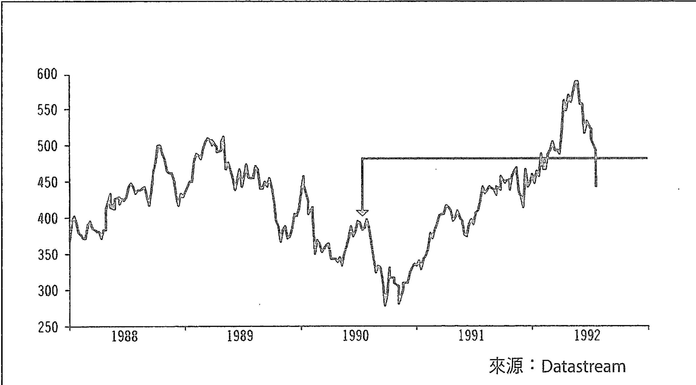
來源: Datastream
1990 年夏季，狄爾 (Andrew Teare) 出任公司執行長後，對公司的業績有著深遠的影響。狄爾後來處分總值 1.1 億鎊的非核心資產，專注核心業務，並且以 3.1 億鎊併購美國一家瓷土公司，到 1992 年 6 月，股價比 1990 年秋季的低點上漲 1 倍。

#### 2. 科隆集團
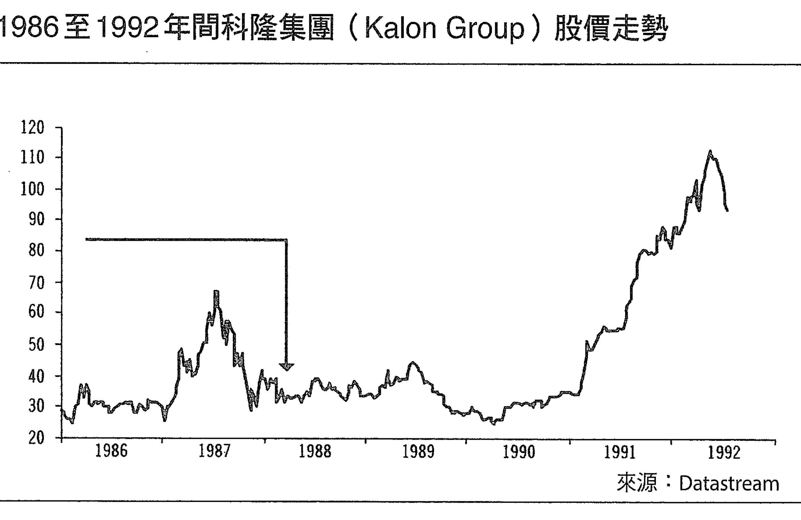
1988年2月，軒尼詩（Mike Hennessy）從迪克森公司（Dixons）跳槽，出任科隆集團總經理後，止住了公司的虧損，清償1,700萬鎊的債務。1988年間，英國碰到經濟衰退，科隆集團的每股獲利和盈餘卻激增近150%，上一會計年度結束時，公司擁有1,280萬鎊的淨現金。

#### 3. 威爾集團
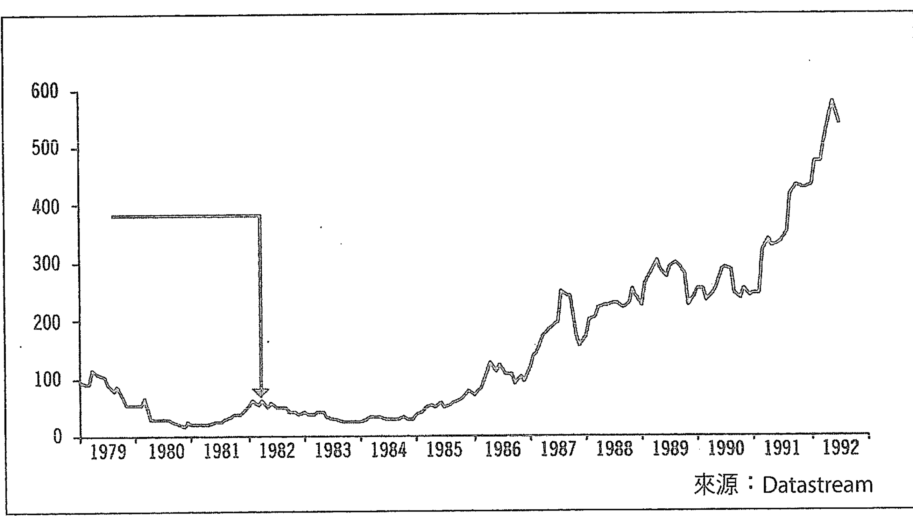
來源: Datastream
1980年代初期，威爾集團每年虧損1,000萬鎊，看起來好像會變成那次經濟衰退的受害者。1982年，賈立克（Ron Garrick）出任總經理後，裁掉了兩個核心部門和若干員工。近年獲利穩定成長，1991年獲利超過3,000萬鎊，過去五年內，股利增加了3倍。

### 2. 新產品或新科技

#### 1. 衛爾康
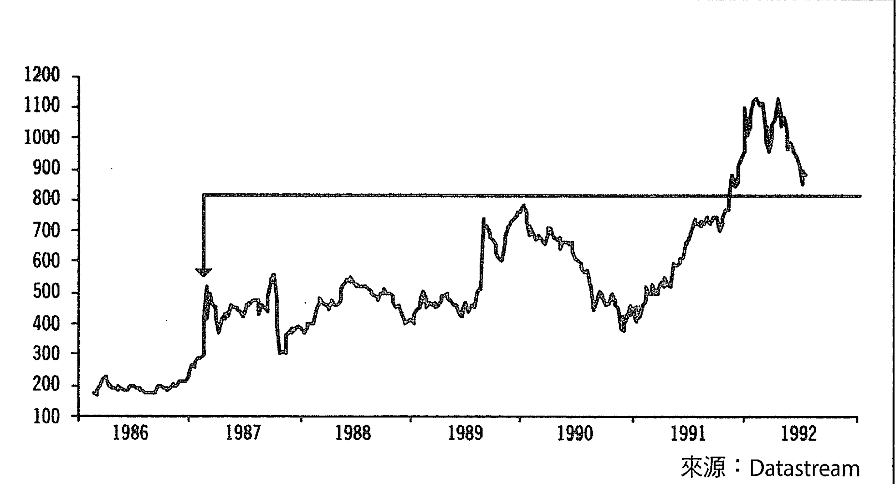
來源: Datastream
公司開發治療愛滋病的立妥威（Retrovir），在1987年3月上市後，獲利飛躍成長，立妥威的利潤率很高，預測未來很多年裡，銷售額都會繼續成長。

#### 2. 瑞卡爾電訊
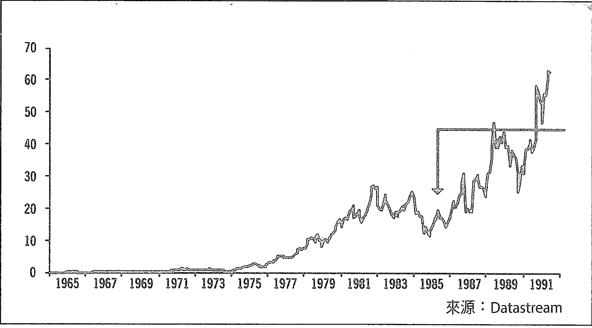
來源: Datastream
公司 1985 年創設的沃達豐（Vodafone）事業極為成功，造成瑞卡爾的股價飛躍成長，沃達豐在 1991 年 9 月單獨上市，成為總市值 35 億英鎊的公司。

#### 3. 微軟
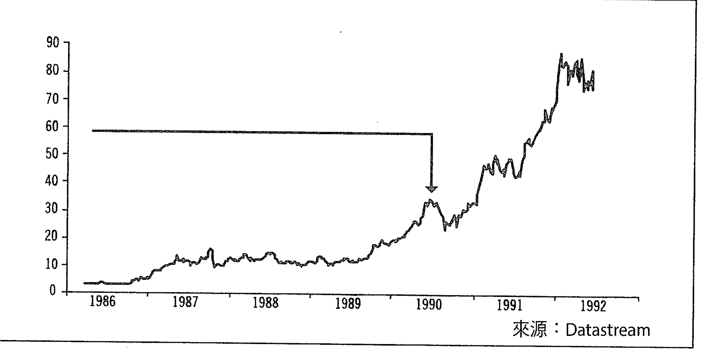
來源: Datastream
在那斯達克上市的美國微軟公司，於 1990 年 6 月推出備受歡迎的視窗第三版軟體，掀起了電腦工業革命，兩年後，微軟的總市值增加為 200 億美元。

### 3. 整體產業界中的新事件

#### 1. 賽捷集團
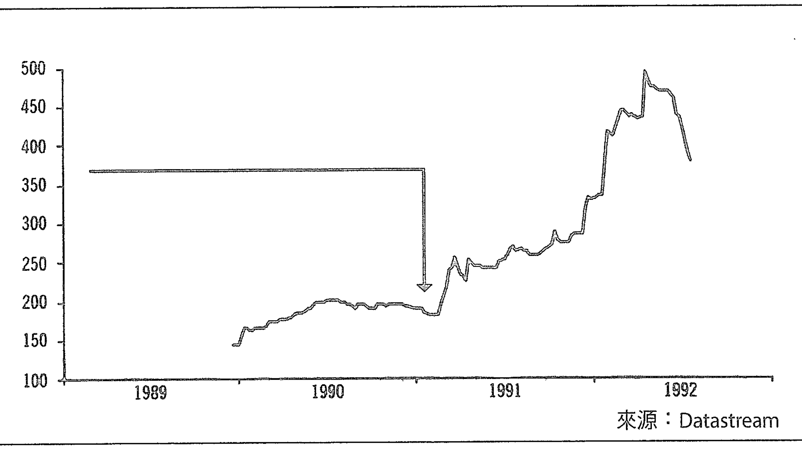
來源: Datastream
這家集團的英國主要競爭對手飛馬公司財務困難，協助賽捷奪得小企業會計軟體市場的74%，以及整體小企業軟體市場的43%。

#### 2. 攀嶺集團
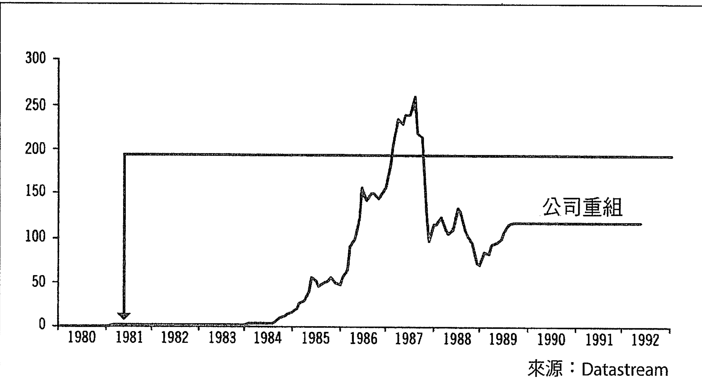
來源: Datastream
1981 年，攀嶺集團以 77,500 美元，買下銳跑公司（Reebok）大筆股權，隨著運動鞋變成流行飾品，加上美國女性風靡銳跑特殊設計的有氧運動鞋，這筆股權的價值變成超過 7 億美元。銳跑股權很快就變成攀嶺的主要資產，這種新消費趨勢對攀嶺的股價有著驚人的影響。

#### 3. 森寶利
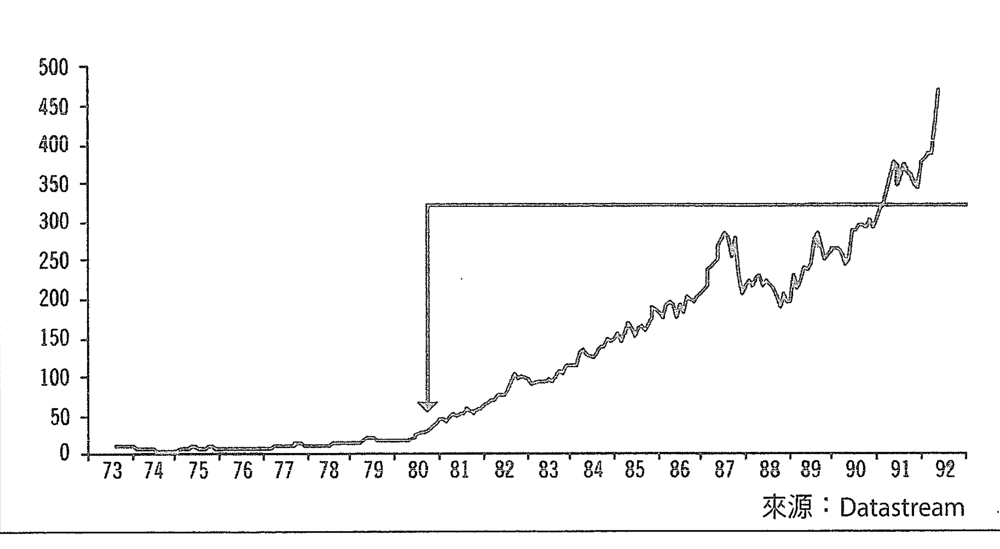
來源: Datastream
1980年代初期，消費者到市外和大賣場採購的趨勢加速發展，使森寶利和特易購之類的公司從規模較小的公司手中，奪得更高的市場占有率，也促使這些大公司快速成長，另一個副產品是利潤率提高。

### 4. 新併購

#### 1. 健力士
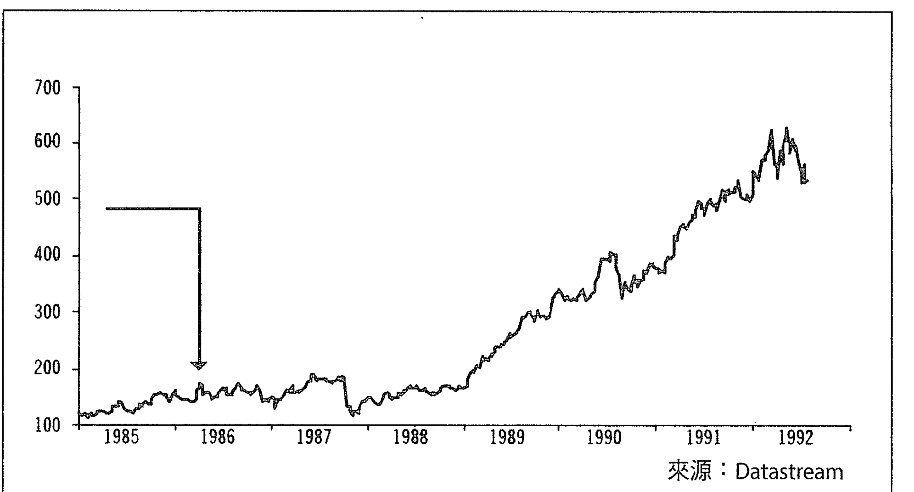
來源: Datastream
1986年，健力士完成引起爭議的併購案，併購釀酒公司（Distillers），強化了健力士的品牌，使健力士擁有世界最美的品牌組合。1992年6月，健力士的總市值超過120億鎊，遠高於併購前的不到10億鎊，股價也上漲了300%。

#### 2. 湯金斯
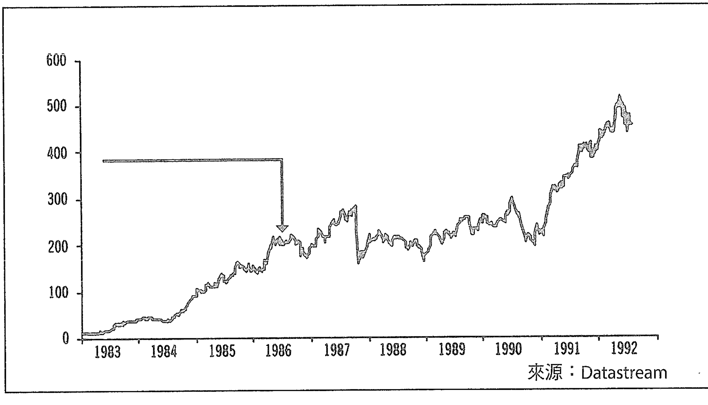
來源: Datastream
1986 年夏季，湯金斯以 1.92 億鎊，惡意併購佩樂哈特斯里公司（Pegler-Hattersley），變成主要的掠奪者。在 1987 年截至 5 月，湯金斯的稅前盈餘增加 4 倍，增為 3,010 萬鎊，銷售額從 6,300 萬鎊，增為 2.7 億鎊，每股盈餘躍增 70%。到 1987 年 9 月，湯金斯的總市值增為 3.6 億鎊，準備進一步進行一系列的併購，變成總市值高達 14 億鎊的公司，也成為金融時報 100 種股價指數的成分股。

#### 3. 雅閣集團
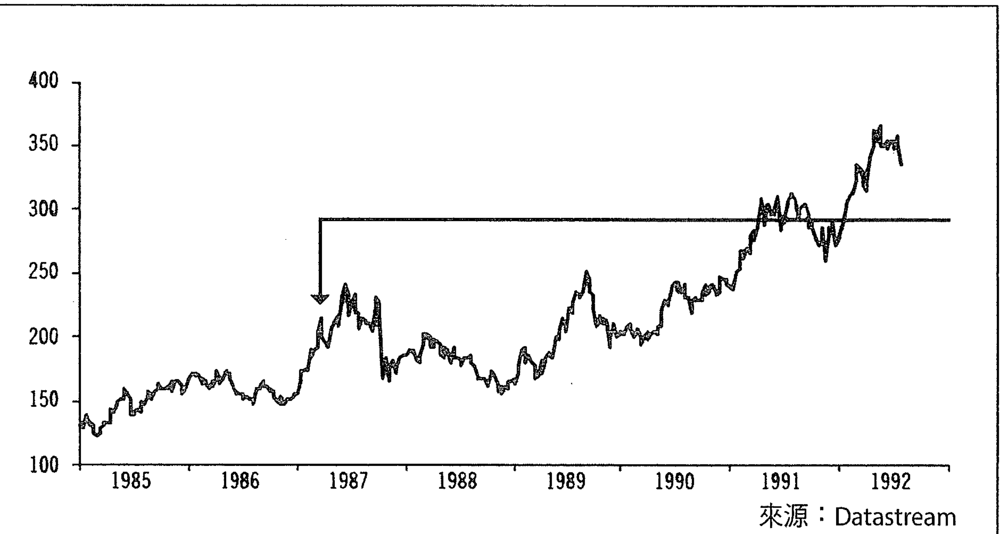
來源: Datastream
雅閣集團併購釀酒公司失敗後，專注食品零售業務。1987年2月，雅閣出價6.8億鎊，併購喜互惠公司（Safeway），使雅閣大躍進，成為頂尖的超級市場業者。雅閣的總市值從第一次出價併購釀酒公司前的7億鎊，增為1992年6月的39億鎊，營業額增加1倍以上，增為50億鎊，稅前盈餘增加將近5倍。公司雖然碰到1987年的股市崩盤和1988年的股價動盪期間，股價卻比購買喜互惠公司前上漲了75%。


看出新事物還有另一種好處，股票的題材會變得有趣多了，也比較容易產生聯想，促使市場加速接受這檔股票。股價的基本面支持越少，越需要有良好的題材，激發未來盈餘成長的希望。如果目前的盈餘不能支撐股價，未來盈餘成長的希望有時候是支撐股價唯一的原因。

1992年6月，泰勒（Bernard Taylor）和美德華（Medeva）公司的題材可能用下列方式，從券商口中，傳達給一般客戶：

泰勒原本是葛蘭素公司的執行長，幾年前，他加入規模很小的美德華公司，隨後，美德華推動了若干高明的併購，買下美國一些銷售藥品的公司和學名藥廠商，現在美德華是疫苗的最大供應商，很快可能會再推動另一次大型併購案。以美德華本益比來說，不管公司買下什麼公司，都會使美德華的資產和每股盈餘大增，股價可能大漲，總之，美德華是正在成形的另一家葛蘭素。

你得承認這個題材非常好，很多人似乎也相信美德華，因此，到1992年6月，美德華股價漲到總市值大約5.25億磅，歷史本益比增加到超過30倍。你可以說我跟不上時代，但是如果我要買醫療健保股，我寧可選擇歷史比較悠久、又沒有債務、每年成長超過25%，歷史本益比只有20倍的安華國際（Amersham International）。美德華必須創造很高的盈餘成長率，才能跟這家續優公司相比。你必須避開高得離譜的本益比，像美德華這樣的

公司可能會成功，但是如果這種公司碰到暫時性的挫敗，底下沒有安全網，股價會崩潰。

說明美德華的股市，使我略微偏離了主題，因此我要再強調一次，新事物的額外好處是股價題材容易解釋，市場很快會接受。好的題材是強而有力的催化劑，有助於股價上漲，市場喜歡好題材，新事物會增加題材的味道和趣味性。

題材也是你查核股票時的重要標準，如果你買一檔基本面過得去、但是有好題材的股票，你必須不斷查核現狀是否沒有改變。題材一定會變成未來盈餘大幅成長的希望，你必須持續不斷地參考原始題材，評估每一種新發展，如果情勢大幅惡化，趕快賣掉。

看到這裡，你應該會驚訝地發現，我的投資策略中很多標準彼此密切相關，就好像坐骨連接大腿骨、大腿骨連接膝蓋骨一樣。新事物經常是股票在市場中表現相對強弱的原因，也是盈餘加速成長、未來成長率預估改善和本益成長比提高的原因。有時候，我深入評估一檔股票時，會發現造成基本面改變的新事物是在一年多前發生的。例如 1991 年時，我看上惠受的股票，因為這家公司的預估本益比只有 7 倍，每年盈餘成長率大約為 15%，公司擁有強而有力的流動性，而且似乎準備擺脫重工業，轉型到比較有吸引力的儀器工業。惠受公司剛剛買下 MTL 儀器公司的義大利競爭對手，我更詳細評估這家公司時，發現公司在幾年前，任命了新總經理和財務長，這就是造成盈餘、未來成長展望

以及公司給人的整體觀感改變的新事物。

因為我的投資策略中重要標準彼此之間緊密相關，你可以看出一種標準會證實另一種標準，如果盈餘加速成長、股價表現出相當強的相對強弱，你可以預期其中一定有原因。

##### 重點摘要

- 1. 公司有轉機或題材很受歡迎，卻不是絕對必要的標準，尤其是公司符合我的其他標準時。
- 2. 對股價產生大影響的新因素主要分成：新經營階層、新產品或新科技、新併購案或整體產業中的新事件，包括立法在內。
- 3. 新經營階層是其中最好的要素，因為新經營階層的影響可能既深且久。
- 4. 新的產品、事件和併購案對相關公司必須有足夠的重要性，才能大幅提高未來盈餘。
- 5. 必須分辨短暫流行的產品和可能長久流傳的產品。
- 6. 業界競爭對手倒閉之類的新事件，可能只限於影響一、兩年的盈餘，新法律的影響可能就長多了。
- 7. 新事物的另一個好處是為股票提供現成的題材，協助市場接受這檔股票，而且可以當成注意公司未來發展的方法。在現有基本面因素不佳時，好題材最重要，因為題材協助創造的成長希望是推動股價上漲的動力。
- 8. 看到有關重大新發展、新產品或新事件的訊息時，要刻意思考這些東西對你現有投資組合的影響，也要刻意思考這些東西對未來股票選擇的影響。
- 9. 新事物經常是絕佳的證據，證明情況符合我的其他標準。例如，新事物經常是造成盈餘加速成長、預估成長率提高、本益成長比降低、以及股票在市場中表現很強相對強弱的原因。新事物經常是拼圖中缺少的那一塊。

## Chapter 7 競爭優勢

競爭優勢是特別的東西，難以打敗，也難以模仿。

競爭優勢是另一個極為重要的標準，你必須徹底了解。

想像你找到一家夢幻般的公司，業績似乎每年成長 20%，本益比只有 10 倍，本益成長比很有吸引力，只有 0.5。你找到以這種速度成長的股票時，幾乎可以確定將來的某一個時間，本益比至少會提高到 20 倍，本益成長比會上升到 1 倍。然而，在股市特別狂熱期間，本益比可能輕易升到 25 到 30 倍。因此你必須了解，隨著越來越多投資人知道這家公司每年穩定創造 20% 的盈餘成長，本益比一定會提高。未來五年內，盈餘會從每股 10 便士，成長到 25 便士，如果到時候本益比提高到 20 倍，股價應該會漲到 500 便士。和這檔夢幻股原始 100 便士的股價，以及 10 倍的本益比相比，增值幅度高達 400%——如果盈餘繼續每年成長 20%，這檔股票就好比是印鈔鈊照。你可能認為，要經過四、五

年，本益比才會升到 20 倍以上，但是你知道，這種事情只是時間問題而已，不是會不會升上去，而是什麼時候會升上去。

我們回頭看看盈餘每年必定成長 20% 的重要條件。這個假設必須有盡可能最多的證據支持。我知道你會評估券商的預測共識、整個產業的展望、公司過去的記錄和董事長預測，但是你也應該運用另一個重要的標準，你應該設法確定公司的競爭優勢，競爭優勢會支撐你的盈餘成長預測，提供你希望找到的預測可靠性。

競爭優勢是特別的東西，難以打敗，也難以模仿。如果你住在小鎮裡，你希望擁有下列企業中的哪些企業？

- 1. 有三十年歷史，本地唯一的報紙。
- 2. 方圓 40 英里內唯一的本地砂石廠。
- 3. 供應零組件給主要汽車廠商和英國其他類似顧客的機械公司。
- 4. 有五十年歷史，沒有主要競爭對手的本地建築與裝潢公司。

我的問題當然很複雜。別人應該不可能再創辦報紙，跟現有的本地報紙競爭，大部分鎮民一週應該只想看一份本地報紙，鎮裡的需求應該不足以支持兩份報紙。砂石廠也是幾乎難以競爭的對手，另一座砂石廠的設立許可應該很難拿到，本地大部分的

鄉鎮民代表會應該不希望在自己的門前，再看到一座礙眼的砂石廠。而且砂石的售價中，運輸成本佔的比率極高，遠地的砂石廠應該不會加入競爭。

機械公司卻大不相同，汽車廠商對零組件的供應價格會有定見，這家機械公司的老闆會盡最大力量討價還價，但是最後決定權掌握在顧客手中，而且這家公司的產品沒有品牌，又毫無特殊的地方，汽車廠商總是可以找到另一家供應商。你可以看出機械公司和報社的不同，報社要提高廣告費容易多了，砂石廠也可能如此，只要供應價格維持在另一個地區砂石廠無法競爭的水準就成了。

建築裝潢公司幾乎不值得深入考慮，幾十年來，這家公司可能沒有碰到激烈的競爭，但是威脅總是存在。手藝精良，剛剛從其他工作退休的本地人可能變成裝潢工人，可以靠著殺價，跟原有的裝潢公司競爭，又靠著做工精良的名聲，很快得到推薦，爭取到其他顧客，你還來不及眨眼，可能就會有朋友加入他的陣營，立刻成立裝潢公司。

你很容易可以看出來，在這個小鎮裡，前兩家公司擁有競爭優勢，而且是明顯的競爭優勢。現在我要告訴你，怎麼看出本國和國際上市公司的競爭優勢。

公司可能靠著擁有一個以上極為著名的品牌，創造遠勝過競爭對手的優勢。你很快就會想到，可口可樂是世界上最著名的產品之一，其他例子包括雀巢和索尼。這三家公司長年都供應

品質優異的產品，而且靠著持續不斷的大量廣告，在大眾心目中強化了品質優異的形象。英國的吉百利食品，健力士、馬莎百貨（Marks & Spencer）是明顯的例子，他們的品牌名稱本身就是極為重要的資產，使其他公司很難跟他們競爭。

如果可以選擇，你應該比較希望投資擁有明顯競爭優勢、勝過其他企業的公司，比較不願意投資處在明顯不利地位、容易遭到其他企業攻擊的公司。你當然也比較喜歡體質強健、不容易受到傷害的公司，不喜歡容易受到傷害的公司。像吉百利、健力士和馬莎這樣的公司擁有強而有力的事業關係，比較不容易受到傷害，而且別人幾乎不可能跟他們競爭。相比之下，沒有這種事業關係的企業，如小餐廳、服裝店、建築裝潢公司和一般機械業者，就很容易受傷。幾乎每一個人都可以用少少的資本支出，幾乎不費吹灰之力，就可以創立事業跟他們競爭，因此這些企業倒閉率很高，獲利率也經常遭遇極為沉重的壓力。

傳奇性的美國投資大師巴菲特總是尋找擁有優異事業關係的公司，可口可樂、吉列（Gillette）和迪士尼全都合乎這個標準。1991年，巴菲特投資健力士公司。他用別人難以模仿的口氣，摘要說明這個重要層面的投資哲學：

> 事業關係的考驗是擁有很多錢的精明人想嘗試時，可以做的事情。如果你給我10億美元，也給我全美國最優異的50位企業經理人，我可以在企業界和新聞界興風作浪。如果你說：「去把

華爾街日報打下來」，我會把 10 億美元交還給你。

現在假設你給我同樣多的錢，叫我破壞奧馬哈國民銀行（Omaha National Bank）或奧馬哈主要百貨公司的獲利能力，或是改變他們的市場地位，我可以讓他們很難過。在這種過程中，我或許不能替你創造多少成就，卻可以讓他們很難熬。即使競爭者不善於創造報酬率，也可能造成不少傷害，是企業面臨的真正考驗。

有些企業四周有很大的護城河，護城河裡有很多鱷魚、鯊魚和食人魚，這些就是你希望擁有的企業。用我早年的經驗來說，你希望擁有的是，連全副武裝的維斯穆勒（Johnny Weismuller）也不能越過護城河的企業。有些企業就是這樣子。

我喜歡巴菲特樸實的風格，我可以明確看出他的意思，不過我認為他把這個比喻說得複雜了一點。全副盔甲或許可以擊退鱷魚、鯊魚和食人魚，但是連好萊塢的人猿泰山，都會發現要游過護城河時，鎧子甲造成的妨礙太大了。

專利產品也有類似的競爭優勢。我提過華爾康大藥廠靠著治療愛滋病的專利藥品立妥威，賺到很多利潤。專利通常維持十六年，但是等到專利到期時，品牌名稱和產品接受度經常已經變得極為堅固，競爭者只能稍微侵蝕獲利能力而已。

著作權維持五十年，可能非常有價值，布蘭森（Richard Branson）把維京唱片公司（Virgin Records）賣給索尼 EMI（Thorn EMI），得到 5.5 億英鎊，說明擁有著作權唱片的價值。影片圖書館現在的價值也越來越高，因為全世界的有線電視和衛星電視不斷成長，加上今天要製作類似的影片成本大增，大量新興廣播公司也迫切需要更多產品。

政府法規有時候會讓企業得到事業關係，創造獨占和寡占事業，電力公司有線電視公司是最好的例子。但是這種企業有一個問題，就是通常受到嚴密的管理，以免顧客遭到無理的漲價傷害。

巴菲特對這一點也有話要說：

> 如果我擁有奧馬哈唯一的自來水公司，如果我沒有主管機關管理，我會經營得很好，你應該找不受管制的自來水公司。

比較不明確的地方是，有些公司光是靠著規模遙遙領先同業，擁有最大主導力量所帶來的地位，潛在競爭者就會發現打進這個行業太難了。《金融時報》和能多潔是英國這方面的好例子。你很容易可以看來，對潛在投資人來說，規模優勢的吸引力不如強而有力的品牌、專利或有著作權的產品，或政府法規保護形成的「事業關係」。對領導公司來說，因為今天企業極為國際化，競爭的風險無疑已經大多了。日本人開始全力發展汽車工業後，通用汽車（General Motors）和寶馬汽車（BMW）就受到威脅，IBM 從 1970 年代初期開始，也陷入困境。

在利基業務中擁有很高的市場占有率，可以獲得不同的競爭優勢。例如，德魯克儀器 (Druck) 是全世界壓力設備的領導廠商。這種公司總是有一種小小的風險，就是大公司可能決定加入競爭，但是大公司要競爭成功，要花的金錢和精神很可能會划不來。隨著這種公司的市場變得越來越大、越來越有價值，這種風險會提高，但是同時這種公司通常會繼續賺到很高的利潤率，成長性遠超過一般公司，也比較可靠。

研究過去十二年不同類股的表現可以得到啟發。下一頁你會發現，擁有專利權和強大品牌的產業，表現遠遠勝過沒有事業關係的產業。

健康與家庭用品類股的投資報酬率最高，我一點也不訝異，這個類股的公司經常擁有受到國際歡迎的專利產品。釀酒、食品製造和食品零售業的排名也高高在上，強大的品牌可以保護和協助這些公司。你會發現工程公司，尤其是金屬加工公司——如果你的預期，排名在排行榜的最底下，因為他們沒有品牌產品或任何事業關係。新公司很容易可以打進他們的行業中，紡織公司表現不佳也不值得驚異。

這些數字可能讓你覺得奇怪，為什麼有人會投資傳統的一般工程公司，投資沒有品牌產品的紡織公司。每種東西當然都有價格，但是我跟你一樣覺得困惑，我也很驚訝，怎麼會有人投資盈餘衰退、本益比沒有吸引力、負債太多和利潤率迅速下降的公司。不過我很久以前就不再擔心這種異常現象，幸好還有人投資

這種公司，切記不要加入他們的陣營，你不必以他們為榜樣，你要找擁有特點、擁有競爭優勢的公司。你要選擇的股票必須滿足很多精選的額外標準，能夠過關的公司不會很多。可口可樂和健力士之類公司的品牌十分清楚的，也很有名，你知道他們的產品，知道這些公司拥有強大的競爭優勢。你看討論選擇領導股和美國股票的專章時，你在這方面的知識會變得很重要。

### 1980至1992年間金融時報綜合股價指數十大類股表現

單位：%

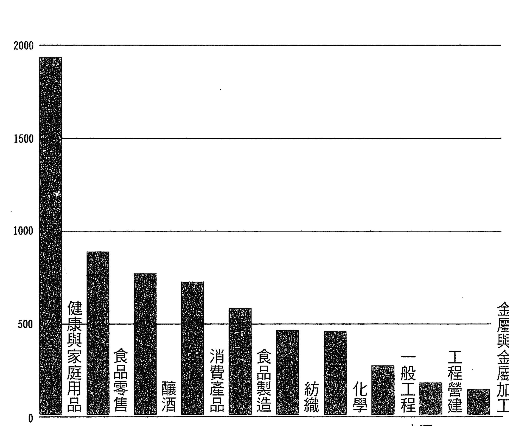

### 1987 至 1991 年間稅前利潤率比較

#### 絕佳

| 年度 | 萬麗素 (Walls) | | |
| :--- | :--- | :--- | :--- |
| | 營業額 (十億鎊) | 稅前盈餘 (十億鎊) | 稅前利潤率 (%) |
| 1987 | 1.74 | 0.75 | 43.1 |
| 1988 | 2.06 | 0.83 | 40.3 |
| 1989 | 2.57 | 1.01 | 39.3 |
| 1990 | 3.18 | 1.18 | 37.1 |
| 1991 | 3.40 | 1.28 | 37.6 |

#### 優異

| 年度 | MTL | | |
| :--- | :--- | :--- | :--- |
| | 營業額 (百萬鎊) | 稅前盈餘 (百萬鎊) | 稅前利潤率 (%) |
| 1987 | 7.5 | 1.79 | 23.9 |
| 1988 | 9.3 | 2.31 | 24.8 |
| 1989 | 11.9 | 3.08 | 25.9 |
| 1990 | 14.0 | 3.77 | 26.9 |
| 1991 | 18.0 | 4.61 | 25.6 |

| 年度 | 能多潔 (Reckitt Colman / GSK) | | |
| :--- | :--- | :--- | :--- |
| | 營業額 (百萬鎊) | 稅前盈餘 (百萬鎊) | 稅前利潤率 (%) |
| 1987 | 174 | 37.6 | 21.6 |
| 1988 | 213 | 50.1 | 23.5 |
| 1989 | 279 | 62.0 | 22.2 |
| 1990 | 309 | 74.7 | 24.2 |
| 1991 | 389 | 94.6 | 24.3 |

| 年度 | 史普靈蘭 (Spring Ram) | | |
| :--- | :--- | :--- | :--- |
| | 營業額 (百萬鎊) | 稅前盈餘 (百萬鎊) | 稅前利潤率 (%) |
| 1987 | 61 | 10.7 | 17.5 |
| 1988 | 85 | 16.6 | 19.5 |
| 1989 | 121 | 24.1 | 19.9 |
| 1990 | 145 | 30.1 | 20.8 |
| 1991 | 194 | 37.6 | 19.4 |

#### 普通

| 年度 | 維特利 (Victaulic) | | |
| :--- | :--- | :--- | :--- |
| | 營業額 (百萬鎊) | 稅前盈餘 (百萬鎊) | 稅前利潤率 (%) |
| 1987 | 51.8 | 6.5 | 12.5 |
| 1988 | 62.9 | 7.6 | 12.1 |
| 1989 | 78.3 | 8.8 | 11.2 |
| 1990 | 99.6 | 11.5 | 11.5 |
| 1991 | 115.0 | 14.3 | 12.4 |

| 年度 | 蘭克霍維斯 (Rank Hovis McDougall) | | |
| :--- | :--- | :--- | :--- |
| | 營業額 (百萬鎊) | 稅前盈餘 (百萬鎊) | 稅前利潤率 (%) |
| 1987 | 1,540 | 118 | 7.7 |
| 1988 | 1,670 | 157 | 9.4 |
| 1989 | 1,790 | 176 | 9.8 |
| 1990 | 1,770 | 131 | 7.4 |
| 1991 | 1,530 | 150 | 9.8 |

#### 不佳

| 年度 | 達格帝 (Dalgety) | | |
| :--- | :--- | :--- | :--- |
| | 營業額 (百萬鎊) | 稅前盈餘 (百萬鎊) | 稅前利潤率 (%) |
| 1987 | 5,000 | 93 | 1.9 |
| 1988 | 4,500 | 100 | 2.2 |
| 1989 | 4,760 | 110 | 2.3 |
| 1990 | 4,630 | 118 | 2.5 |
| 1991 | 3,770 | 111 | 2.9 |

| 年度 | 布頓 (Bridon) | | |
| :--- | :--- | :--- | :--- |
| | 營業額 (百萬鎊) | 稅前盈餘 (百萬鎊) | 稅前利潤率 (%) |
| 1987 | 196 | 7.7 | 3.9 |
| 1988 | 213 | 13.5 | 6.3 |
| 1989 | 305 | 16.0 | 5.2 |
| 1990 | 336 | 10.1 | 3.0 |
| 1991 | 319 | -3.6 | -1.1 |

| 年度 | 英國航太 (British Aerospace) | | |
| :--- | :--- | :--- | :--- |
| | 營業額 (百萬鎊) | 稅前盈餘 (百萬鎊) | 稅前利潤率 (%) |
| 1987 | 4,100 | -159 | -3.9 |
| 1988 | 5,600 | 236 | 4.2 |
| 1989 | 9,100 | 333 | 3.7 |
| 1990 | 10,500 | 376 | 3.6 |
| 1991 | 10,600 | -81 | -0.8 |

比較小型的公司相對可能擁有知名度較低的品牌、專利權和著作權，如果公司持續經營成功，這些東西最後會變得很有名，公司在利基市場中，也比較可能變成龍頭，或是具有強而有力的地位。看出這種特性很難，第一步是縮小選擇範圍。我們知道，除了極少數例外，我們不感興趣的行業包括紡織、重型機械設備，一般來說還有：工程、電器、營建、汽車工業與銀行。你會注意到，我用「一般」這個詞剔除工程和電器業，其他例如紡織業等產業則沒有條件限制，全部剔除。原因很簡單，工程和電器類股中，有很多擁有優異產品的利基公司。常識會告訴你，MTL和德魯克儀器展望良好。然而，還有一個有用的經驗法則，可以幫助你進行研究——如果經營良好的公司，在日漸成長的利基市場中地位穩固，利潤率會偏高，通常會繼續成長；如果利潤率迅速下降，就要小心，公司的營業利潤率如果只有5%，幾乎不容犯錯。除了第五章說明過理由的食品零售業外，7.5%的利潤率是最低基準，10%到20%比較符合我們的要求。公司總是會申報營業額，因此利潤率很容易計算，你可以參考前一頁的例子。

你當然必須為整體經濟狀況保留一點考慮的餘地，但是不必

保留太多，最好的公司會比大多數公司更善於熬過衰退，有些強而有利的利基公司幾乎不會受到衰退影響。葛蘭素、MTL、能多潔和史普靈蘭一直都是絕佳的投資，表現大幅勝過達格帝和布頓之類沒有事業關係的公司。

擁有強勁事業關係的公司通常會創造絕佳的資本報酬率，產業公司的資本報酬率通常比以「人力」為主的公司低多了，例如廣告公司和保險經紀商，如果不考慮商譽，廣告和保險業者可能展現極高的報酬率。如果是小型產業公司，我希望看到20到25%的報酬率。這樣不會高到吸引過多的競爭，卻高到足以創造很多未來的成長。報酬率的計算方法如下：

- 1. 資本是普通股股本、特別股、公司債、債券與其他債務的總和。
- 2. 平均計算會計年度期初和期末的資本。
- 3. 把應付利息和特別股股息加回到稅前盈餘中。
- 4. 拿3.除以2.算出百分比。

我們以科隆集團1991年的報表為例，你看這家集團的資產負債表時，可以看出1991年的股東權益（或淨值）為2,800.2萬鎊，1990年為2,446.3萬鎊，必須加回在這兩個數目上的其他項目，包括短期負債、融資租賃與分期付款、長期負債與準備金。唯一必須納入的短期負債是在「一年內到期債務」項下的「銀行透支與貸款」。在附註 15（其他債務）項下，你會發現融資租賃與分期付款；在附註 16 和 17 中，你會找到長期債務與準備金。

### 科隆集團資產負債表
單位：千英鎊

| 項目 | 附註 | 1991 | 1990 |
|---|---|---|---|
| 固定資產 | | | |
| 有形資產 | 10 | 20,256 | 19,887 |
| 投資 | 11 | 46 | 500 |
| | | 20,302 | 20,387 |
| 流動資產 | | | |
| 股本 | 13 | 13,255 | 13,094 |
| 債權 | 14 | 16,889 | 14,664 |
| 銀行存款與手頭現金 | | 14,607 | 3,643 |
| | | 44,761 | 31,401 |
| 一年內到期債務 | | | |
| 銀行透支與貸款 | | 610 | 243 |
| 營業債務 | | 13,386 | 14,091 |
| 其他債務 | 15 | 20,727 | 11,285 |
| | | 34,723 | 25,619 |
| 流動資產淨值 | | 10,038 | 5,782 |
| 資產淨值減流動負債 | | 30,340 | 26,169 |
| 一年以上到期債務 | 16 | (648) | (589) |
| 債務與費用準備金 | 17 | (1,690) | (1,117) |
| | | 28,002 | 24,463 |
| 資本與準備金 | | | |
| 實收資本額 | 20 | 17,930 | 17,824 |
| 準備金 | | | |
| 股票溢價 | 21 | 296 | 205 |
| 重估準備 | 21 | 4,860 | 4,860 |
| 盈虧 | 21 | 4,916 | 1,574 |
| 股東權益 | | 28,002 | 24,463 |

### 科隆集團財報附註
單位：千英鎊

| 項目 | 1991 集團 | 1991 公司 | 1990 集團 | 1990 公司 |
| :--- | :--- | :--- | :--- | :--- |
| **註 15** | | | | |
| 其他債務 | | | | |
| 融資租賃與分期付款 | 572 | 572 | 437 | 437 |
| 公司稅 | 3,834 | 3,822 | 2,515 | 2,515 |
| 其他稅賦與社會安全 | 3,089 | 3,004 | 1,988 | 1,977 |
| 其他債務 | 552 | 332 | 533 | 263 |
| 應計項目 | 10,887 | 10,673 | 4,624 | 4,507 |
| 股息 | 1,793 | 1,793 | 1,188 | 1,188 |
| **小計** | **20,727** | **20,196** | **11,285** | **10,887** |
| **註 16** | | | | |
| 一年以上到期債務 | | | | |
| 二至五年到期融資租賃與分期付款契約 | 323 | 323 | 264 | 264 |
| 利率 8.25% 等額償還貸款 | | | | |
| 二至五年 | 81 | 81 | 81 | 81 |
| 五年以上 | 244 | 244 | 244 | 244 |
| **小計** | **648** | **648** | **589** | **589** |
| **註 17** | | | | |
| 債務與費用準備金 | | | | |
| 租稅緩課（請參閱註 19） | - | - | 160 | 160 |
| 退休金均值 | 1,690 | 1,690 | 957 | 957 |
| **總計** | **1,690** | **1,690** | **1,117** | **1,117** |

因此計算公式中的資本欄應該像下面這樣：

| | 1991 | 1990 |
|---|---|---|
| 淨值 | 28,002 | 24,463 |
| 短期債務 | 610 | 243 |
| 租賃與分期付款 | 572 | 437 |
| 長期債務 | 648 | 589 |
| 準備金 | 1,690 | 1,117 |
| | 31,522 | 26,849 |

單位：千英鎊

年度平均資本很容易算，只要把兩個總數加在一起，再除以2就可以得出。平均值通常是比較精確的指標，因為年度間資本可能大幅變動。上面的算式裡，平均值高達2,918.6萬鎊。

算式的另一半，是把應付利息與特別股股息加回後的稅前盈餘，以科隆集團的例子來說，這個項目指的是營業利潤917.7萬鎊。平均資本報酬率的計算方式如下：

$$ \frac{9,177,000}{29,186,000} \times 100 \quad = \quad 31.4\% $$

公司盈餘未來的成長率大致來自利潤扣掉稅負和股息後，再投資於業務上。善於創造高資本報酬率的能力，是真正成長股最可靠的指標。例如，能多潔五年平均資本報酬率為53%，葛蘭素也遠高於標準，達到37%。

你應該注意到，我只提到能多潔和葛蘭素的五年平均值，要判斷公司是否極善於運用資本，這個方法可靠多了，趨勢可能很重要，五年平均值通常會淡化會計上的異常。

還有一個有趣的方法，可以研究穩定創造高資本報酬率的股票，就是拿來跟高評等債券比較。如果高評等債券創造20%的年度報酬率，當然會有遠高於票面的溢價。如果你能夠找到擁有絕佳競爭優勢的公司，投資低資本報酬率的股票根本沒有道理。

現在由湯姆森國際機構（International Thomson Organisation）擁有的格拉斯行情指引公司（Glass's Guide），是擁有絕佳事業關係的小企業典範。格拉斯固定每月出版二手車經銷商的行情報導，產品對價格不會過度敏感，對手很難創立跟格拉斯競爭的公司。你應該保持警覺，尋找其他行業中這樣的公司，刻意避開主要產品明顯有遭取代風險的公司。我敢說，過去的瓦斯燈製造商都會支持這個警告。你也要注意非常依賴一家顧客或一家供應商的公司，因為利潤率很容易遭到極度壓縮。產品或服務普遍供應的公司，總是容易看到價格戰，為利潤率帶來毀滅性的效果。例如美國航空業解除管制後，航空公司爆發割喉式競爭，極為著名的公司如環球航空（TWA）和泛美航空（Pan-Am），都被迫聲請破產保護。

我發現，我的投資策略中每一個層面彼此都極為息息相關，讓人特別愉快。一旦你找到擁有競爭優勢、擁有堅強事業關係的公司，你通常會發現公司的盈餘記錄十分完美、成長展望優異、容易預測，也十分可靠，股票在市場中的競爭優勢很強，一個標準會強化另一個標準，把所有的標準放在一起，有助於確保你最後選到強而有力的公司。

要找到擁有事業關係的公司不會太難，但是如果你是最後才看出潛力的人，本益比肯定已經高得離譜。我們要尋找完美的例子，尋找擁有堅強事業關係，股價又合理的公司。

##### 重點摘要

- 1. 公司的競爭優勢會支撐未來的盈餘預估，提高獲利預測的可靠性。
- 2. 競爭優勢有時候叫做「事業關係」，競爭優勢來自很多不同的來源：絕佳的品牌、專利權或著作權、政府法規創造的力量（不過通常也帶來一些管制）、在利基市場中的穩固地位、主導一種產業。以上大致根據遭到競爭的可能性多寡排列，由較小排到較大可能。
- 3. 龍頭公司比較可能擁有絕佳的品牌、專利權與著作權，規模比較小的公司通常擁有具有這種潛力的產品，或是在利基市場中地位穩固。
- 4. 避開過度依賴一家主要供應商或顧客的公司，避開從事競爭激烈產業的公司，也要小心產品可能輕易遭到取代的公司。
- 5. 避開從事一般工程、一般電器、紡織、營建與汽車工業的公司。挑選從事健康與家庭產品、食品零售、食品製造與釀酒公司。
- 6. 用利潤率來比較競爭優勢，尤其是比較利基公司的競爭優勢。以營業利潤率來說，利潤率至少應該有7.5%，最好有10%到20%。避開利潤率很低的公司，特別注意利潤率提高的公司。
- 7. 公司擁有強大的競爭優勢，最可靠的證據是經營階層能夠創造遠高於平均水準的資本報酬率，如果是產業公司，你的目標是每年超過 20%。
- 8. 我的股票投資策略發揮最大功能時，所有的標準都息息相關，如果你找到擁有強大事業關係的公司，公司的資本報酬率可能高於平均水準，盈餘記錄一流，成長潛力可靠，股票在股市中應該表現出很強勁的競爭優勢。

## Chapter 8
### 動能與相對強弱

我喜歡把圖表看成工具箱中的一種工具，而不是看成目標。

大約二十年前，我注意到利用技術圖表的分析專家通常都窮困潦倒，當時我想到的是有一位利用技術分析，投資成果卻很差勁的朋友。雖然我現在也沒認識很多富有的技術分析專家，但是從過去到現在，我確實碰到一、兩位靠著技術分析賺大錢的人，而且從報導中，看到更多發財的技術分析專家，因此我對技術分析的敬意比以前多得了。

技術分析專家大致認為，圖表可以顯示股價的歷史，反映所有投資人的希望與恐懼，基本上是以毋庸置疑的事實，也就是以股價的實際表現為基礎。技術分析師會主張：市場對股票的看 法是不斷變化的幻覺。例如，1985 到 1992 年間，葛蘭素的本益 比在 13.4 倍和 33.8 倍之間起伏，整個期間裡，葛蘭素一直是成長 股，但是股市對葛蘭素價值的看法卻持續不斷的改變。

#### 1985 至 1992 年間葛蘭素本益比

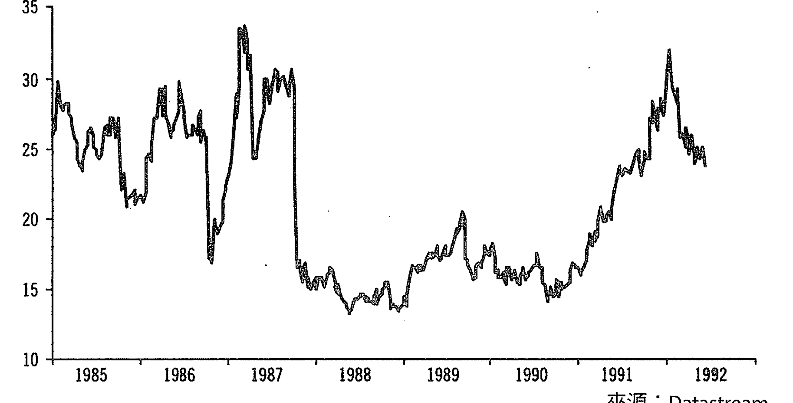

技術分析師也主張：股價上漲和下跌時，可能有趨勢可循，跟著趨勢走比努力預測未來很多年的每股盈餘重要。有經驗的技術分析師評估股票時，能夠建議最好的買點，也就是下跌風險最小、上漲可能性最大的時刻。

趨勢經常會變成自我補強，其中原因不難了解。想像一檔股票從 50 便士漲到 100 便士，然後回跌到 80 便士，卻又再漲到 100 便士，然後再度回跌到 80 便士，接著直接漲到 120 便士。

股價整理期間，在 80 到 100 便士之間起伏，很多投資人急於賣出，最後會降低賣出限價，希望成交，這樣當然會使供應稀釋。同樣地，很多人希望在 80 便士以下買進，最後會在成交價的範圍內，提高買進限價，促使供應進一步竭盡，使股價抬高。隨著股價向上突破，很多投資人會讓獲利累積，很多新買主會提高限價，買進這檔股票。你真正夢想的股票似乎加速上緊你心弦時，沒有什麼東西能像貪心的感覺那樣，牢牢地控制你，你會伸手去搶，會付更高的價格，上漲趨勢會變成自我強化。

我喜歡把圖表看成工具箱中的一種工具，而不是看成目標。圖表會進一步證實我走在正確的道路上，相反地，圖表也會告訴我警訊，有時候遠比基本面的明顯惡化提早很久警告我。

你投資基本面強勁、狀態即將產生變化的積極成長公司時，股票的表現應該勝過整個大盤。你的經紀商一定會訂購圖表資料庫，應該會提供，顯示你選擇的股票對比綜合股價指數相對強弱的圖表。

下頁是1991年1月至1992年6月間四家公司的股價走勢圖。

你可以看出來，MTL和賽捷的優異表現不容置疑，兩檔股票都把大盤遠遠拋在後面。能多潔的表現也很好，但是因為本益比一直維持高檔，因此沒有從本益比的重大變化中得到好處。通用電器走勢一向沉悶，和大盤相比的相對表現一直不好。

有些券商會定期提供投資機構客戶，許多大型公司的詳細相對價格走勢，你也可以訂購走勢圖表。

##### MTL 儀器

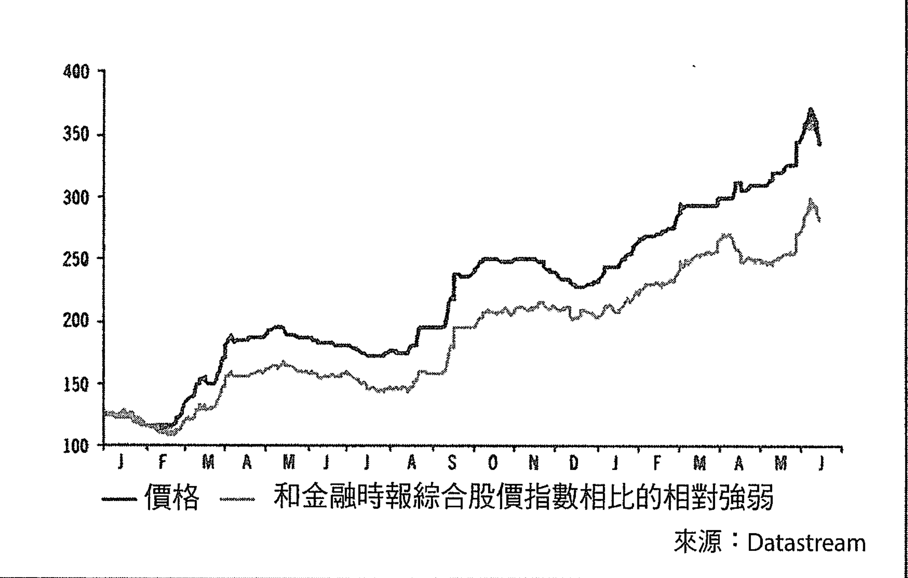

#### 賽捷集團

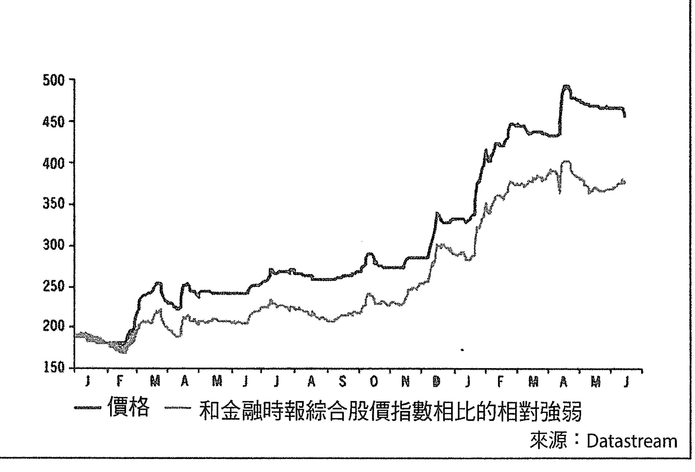

##### 能多潔集團

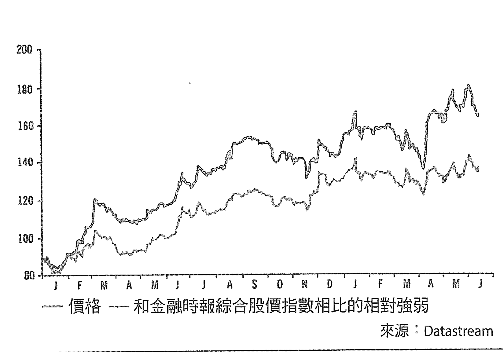

#### 通用電器

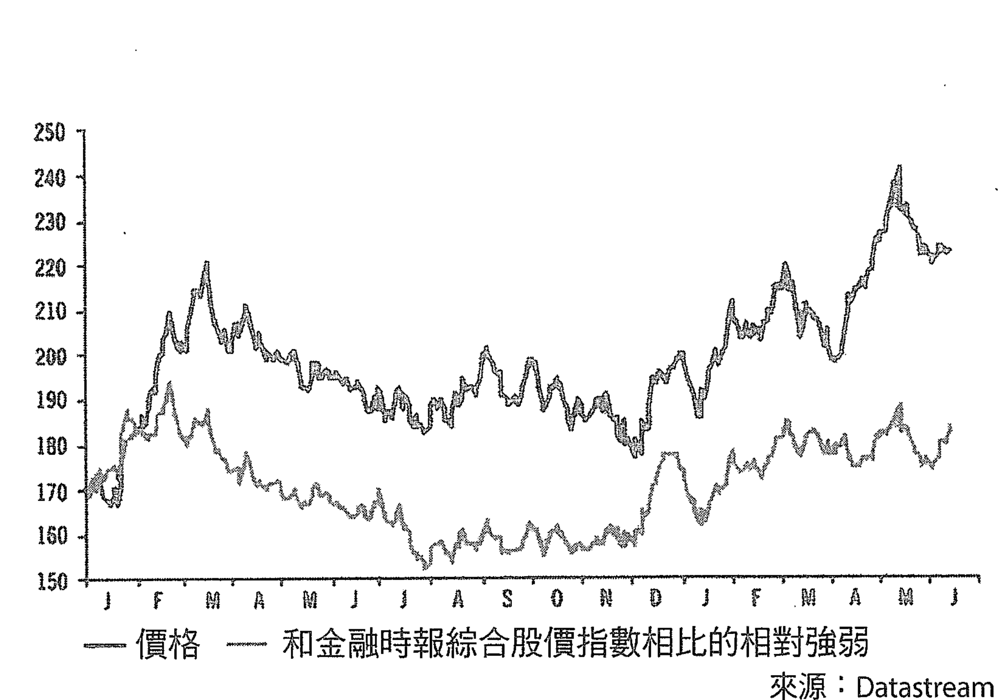

另一個經驗法則是在這種成長股價格跌到高點以下 15% 內，投資這種股票，這點看起來可能矛盾，因為你顯然比較希望用較低的價格，而不是較高的價格買進股票。然而，如果成長股的價格跌到比最高點低 15% 以上，基本面可能有什麼問題，可能有你還沒有聽到的消息用差勁的股價走勢警告你。

歐尼爾（William O'Neil）在大作《笑傲股市》（How to Make Money in Stocks）中，提供了相對強弱很重要的另一個證據。他研究 1953 到 1990 年間，美國五百檔表現最好的上市公司，發現這些股票在價格大漲前，都有極高的相對強弱，平均相對強弱值為 87。換句話說，五百檔股票在買進前的重要期間，平均表現勝過 87% 的相同類股其他股票。

投資資產股時，你不指望這種股票表現相對強勢，而是希望這種股票被人忽視時吃進，如果資產股股價略微下跌，你甚至可能加碼買進。如果是購買成長股，你絕對不應該向下攤平。

我不是技術分析專家，但是我朋友馬博（Brian Marber）是英國最高明的技術分析專家之一，因此我決定請教他，請他針對個股的買進和賣出信號，提供建議。我在第十八章裡，也請教他有關整個大盤的問題。

他現在是馬博公司董事長，也擔任外國證券交易所與股市的技術分析顧問。

下面是我專訪他的詳細記錄：

**作者** 我解釋過技術圖表和評估股票相對強弱的15%規則，你同意我的說法嗎？

**馬博** 絕對同意，我沒有聽過15%的規則，卻覺得的確很有道理。

**作者** 一般投資人有其他簡單、實用的方法嗎？

**馬博** 我喜歡看到股票從底部區突破，但是成長股通常不會形成底部區，只能用相對強弱圖表，找到底部區。

**作者** 你怎麼看待相對強弱圖表？怎麼判斷好壞的信號？

**馬博** 我看相對強弱圖表時，跟看任何其他股票的圖表一樣，尋找型態、移動平均線、趨勢線和動能。一系列越來越高的

#### 從底部區突破——奇飛公司（Kwik Fit）

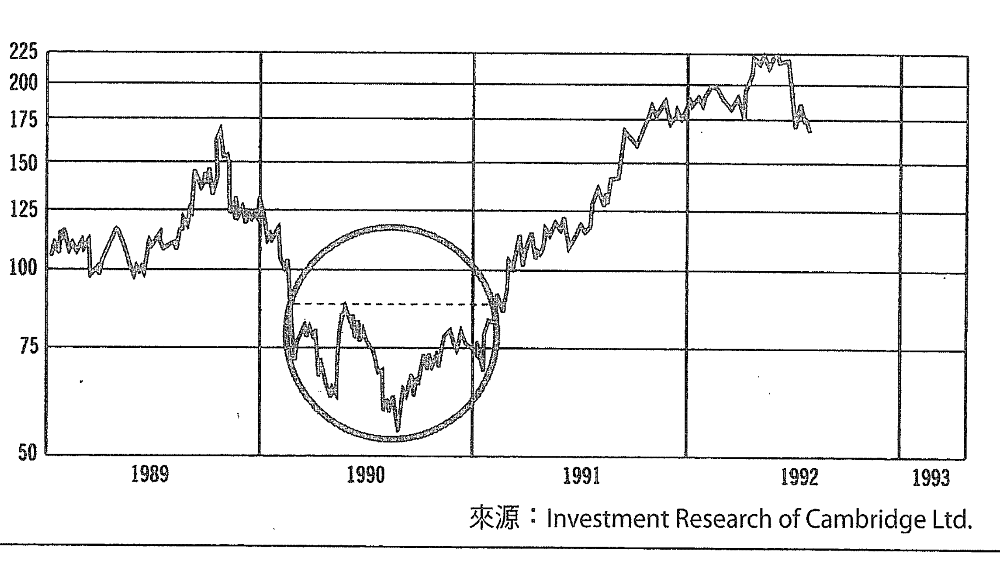

來源：Investment Research of Cambridge Ltd.

高點和低點顯然是好信號，一系列越來越低的高點和低點是不好的信號。

**作者** 我喜歡價格經過長時間整理、看來即將突破、漲到新高價水準的成長股，這種型態有沒有特別的名字，你有沒有什麼標準，幫忙你找到這種股票？

**馬博** 我說過，成長股通常不會有很長的价格整理時間，不過成長股的相對強弱圖表可能會有類似這樣的型態。

**作者** 你怎麼判斷擁有強勁相對強弱的股票是否即將下跌，或是可能下跌？

**馬博** 我認為，要賣掉擁有強勁相對強弱的股票總是很難，但是在相對強弱曲線上升時，當然可能如此，股票圖表本身會形成頭部區——例如頭肩頂、雙重頂或下降三角形。但是在上述每一種情況中，都不可能在市場的頭部賣掉。總之，技術分析專家雖然都喜歡在頭部賣掉，在底部買進，不過技術分析基本上是跟隨趨勢的學問，不可能選中絕對的高點或低點。實情的確如此，我認為技術分析的目的不是要預測市場，因為技術分析師靠著趨勢推論，相當可能在頭部和底部受困。

**作者** 我聽說股價跌到 90 天或 180 天移動平均線下方時，很可能是將來會走弱的信號，是這樣嗎？

**馬博** 不見得。實際上，我用的是 63 日和 253 日移動平均線（季線和年線），而且我發現，股價拉回到低於 63 日平均線

#### 雙重頂──希斯公司（C. E. Heath）

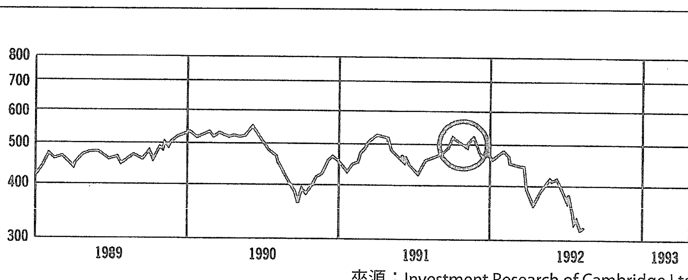

來源：Investment Research of Cambridge Ltd.

#### 頭肩頂──雅歌公司（Argos）

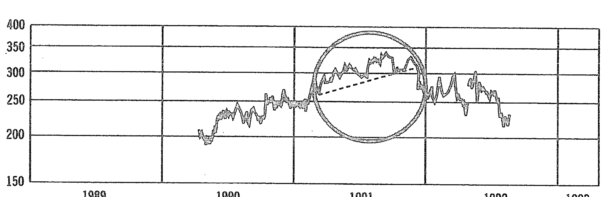

來源：Investment Research of Cambridge Ltd.

#### 頭肩底──英之傑公司（Inchcape）

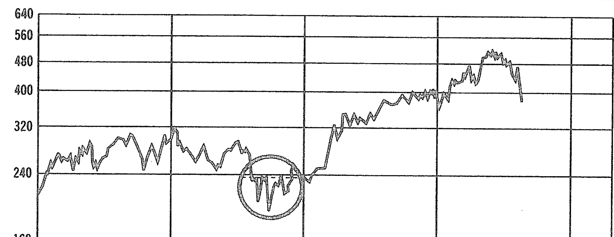

來源：Investment Research of Cambridge Ltd.

後，中期反彈經常很快就會結束。你不能預測碰到63天或90天平均線後，是否會出現反彈，而且只能像這樣規範自己——如果股價跌落63日平均線，然後反彈到這條線上方，且若股價出現反彈新低點，只是證明這檔股票很脆弱。如果股價跌到63日平均線以下，反彈又不超過這條平均線，那麼就可能出現長期弱勢。如果有人不知道哪一種平均線比較好用，這點其實是個人的好惡問題。我喜歡用一年平均線研究長期走勢，因為和比較短期的平均線相比，年線改變方向的次數比較不頻繁。但是也有人用五季平均線，這一點真的是個人好惡問題，你只要覺得好用，就可以用。

**作者** 假設股價向上突破移動平均線，這樣可能是買進信號嗎？

**馬博** 如果股價向上突破移動平均線，就是好信號，但是如果平均線本身往下走，平均線或這條線的兩邊可能變成壓力區，阻止股價進一步前進。

**作者** 股價是否必須跌破移動平均線一段期間，或是只要跌破一、兩天，就足以成為確認信號？

**馬博** 跌破一段期間通常勝過只跌破一、兩天，但是有時候，跌破一天就夠了，尤其是大跌時。

**作者** 量很重要嗎？

**馬博** 我在倫敦股市成長，倫敦股市過去只提供個股相當短期的成交量，我的事業生涯大部分期間裡，都得適應沒有量的

情況，因此我不是量方面的專家。我會說，技術分析師在預測外匯匯率方面，比預測股市成功多了。在外匯市場上，除了國際貨幣市場（IMM）外，當然都沒有成交量的數字。因此，既然技術分析師在外匯市場上，沒有量的資料也能繼續生存，因此我覺得，量在研判股價走勢圖方面的價值會大幅降低。

另外有一點，或是說另外有一個笑話，可以說明我對量的態度。一位營業員打電話給客戶說：「我有好消息和壞消息。」客戶回答說：「告訴我壞消息。」營業員回答：「我們用50便士買的股票跌到3便士了。」顧客回答：「好消息是什麼？」營業員說：「這檔股票下跌的成交量很低。」股票低量時可能下跌，低量時也可能上漲。前者理當是好消息，後者理當是壞消息，但是兩種情況都不能改變股票波動的事實。

**作者** 移動平均線預測股市波動的方法會不會太慢了？有沒有更具有預測能力的方法？

**馬博** 移動平均線的確很慢，是驗證指標，而不是預測指標。另一方面，動能經常領先市場。

**作者** 你是指變動率嗎？

**馬博** 對，變動百分比。

**作者** 投資人從哪裡可以取得顯示移動平均線的圖表？

**馬博** 很多公司都會出售移動平均線的圖表。

**作者** 每個人都聽過頭肩型態，這種型態一直都是利空信號嗎？

**馬博** 不見得。頭肩型態可能在市場的頭部和底部出現，在底部出現時，叫做頭肩底。也有頭肩整理型態，在這種情況下，市場向一個方向波動，然後停頓下來，形成一種型態，再繼續向同一個方向前進。

**作者** 還有其他大家熟知的信號嗎？例如，雙重底意義重大嗎？

**馬博** 雙重底意義重大，而且像頭肩型態一樣，讓投資人可以精確計算股價的走勢。至於其他信號，三角形的確經常以反轉和整理的型態出現。

**作者** 投資人要買積極成長股時，應該注意什麼跡象、信號或型態？

**馬博** 要找陡峭上升的相對強弱線和絕對價格曲線。

**作者** 想來要在資產股、轉機股或景氣循環股中找型態，應該大不相同，你可以深入說明一下嗎？

**馬博** 資產股、轉機股或景氣循環股形成底部區的可能性大多了，例如會形成頭肩底或雙重底。我記得在1970年代初期的嚴重空頭市場中，歐布萊特威爾森公司（Albright & Wilson）形成了很大的雙重底，而且在大盤繼續往下走時，突破這種型態，形成多頭走勢，這檔股票當然也顯示強勁的相對強弱。

#### 雙重底(1973)——歐布萊特威爾森公司

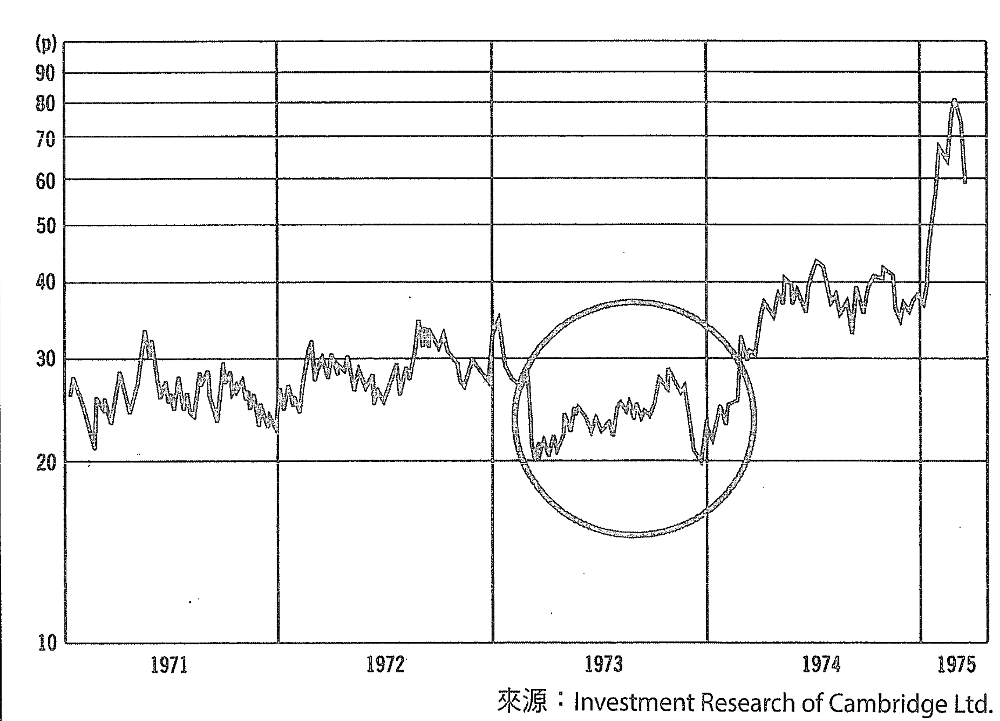

**作者** 說相對強弱在多頭市場中最好用，在空頭市場中卻可能有危險，是這樣嗎？

**馬博** 是的。每一種東西在多頭市場中都比較好用，在空頭市場中都可能可能有危險，忽視價格圖表本身總是有危險。在空頭市場中，股票可能展現強勁的相對強弱，股價卻下跌，不過跌勢沒有大盤那麼嚴重。在這種情況中，相對強弱會變成積極的誤導信號，價格圖表應該可以幫助投資人避免最可怕的陷阱。

**作者** 你對技術圖表，尤其是積極成長股的技術圖表，還有其他大方向的提示或建議嗎？

**馬博** 積極成長股在技術圖表上，會清楚呈現陡峭上升的曲線，這種趨勢線存在時間越久，趨勢線中斷時的情形會變得越重要。例如，大家認為，波塞頓（Poseidon）是1970年初的積極成長股，股價走在原始上升趨勢線上很長一段時間，上升趨勢一中斷，這檔股票因為在上漲期間，沒有任何長久的整理期，缺乏任何近期支撐，股價無處可走，只能回跌到起漲區。

**作者** 波塞頓這檔股票我記得很清楚。

馬博最後說了一個跟相對強弱有關，帶有警告意味的故事。有一天，一位外科醫生走到醫院十樓的安寧病房，病患們驚訝地看著他打開窗戶跳下去。下墜途中，醫生感覺非常良好，相對摔到地面時的感覺來說。病房裡其中一位病人已經被宣告必死無疑，看見醫生跳出窗戶時，他覺得自己比醫生好多了，然而幾天後，這位病人還是死了。其中的教訓很清楚————依賴相對強弱非常好，前提是過程中不會死亡。

我們只是浮光掠影一般，探討技術分析的一些想法，如果你對這個主題還有興趣，《股票趨勢技術分析》（*Technical Analysis of Stock Trends*）是這方面的傑作，我在第十六章的推薦書目中會詳細介紹。同時，我建議你採用資料庫裡的相對強弱圖表和我的15%規則。也請記住，當你買了股票之後，如果股票表現疲弱，你應該注意股票的相對強弱。價格變化可能會對你發出警訊，警告即將到來的壞消息。

#### 波塞頓

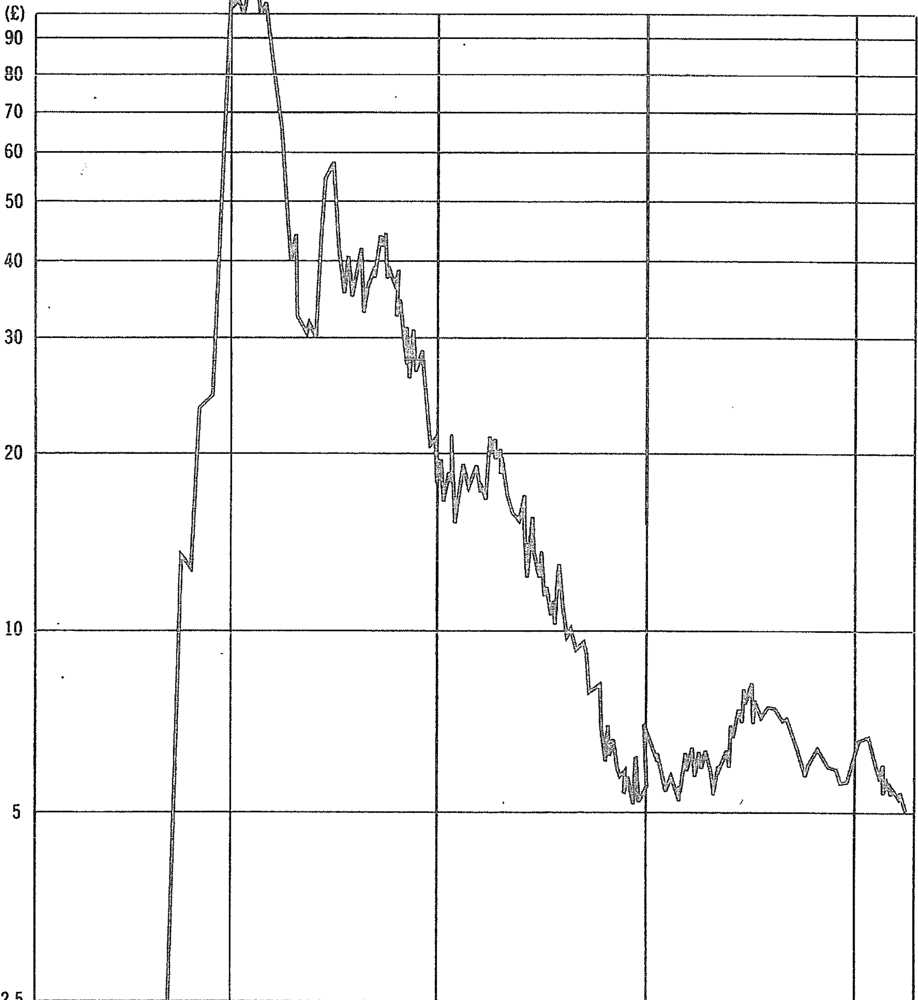

來源：Investment Research of Cambridge Ltd.

## Chapter 9
### 庫魯法則的其他標準

我的建議是：一看到初歩出問題的跡象，就把股票賣掉。

前面幾章裡已經說明過，選擇小型積極成長公司的主要標準，本章要探討其他標準：

#### 總市值小

大象不會疾奔是事實，小型公司未來的成長空間遠超過大型公司，也是事實。用百分比來說，總市值不到200萬鎊的懷爾斯集團，成長潛力遠遠超過總市值高於100億鎊的韓森集團。今天一些很小的公司會變成明天的韓森、葛蘭索和湯金斯。

雖然我前面提過總市值1億鎊的限制，如果我所有的其他標準都符合，我很樂意把限制提高為2億鎊以上。1億鎊的限制比較像是個人的喜好，而不是絕對必要，不是刻在石碑上的戒律。

#### 股利率

我喜歡發放股息的公司，大部分投資機構也需要從投資中，得到持續不斷的收益。發放股息和預測（如果有）在某種程度上，也確認經營階層對未來有信心。理想的公司股利大致上會配合盈餘穩定成長。

你找到年度資本報酬率為20%的公司時，你實際的情況會很好，尤其公司選擇保留盈餘。因此，如果你領到的股息不多，只要理由充分，你不應該擔心。如果是經營良好的公司，未來盈餘和資本價值的成長會來自盈餘（減去發放的股息），再投資回公司裡，以極高的報酬率運用。

公司股利減少是大事，對股價會有嚴重的不利影響。等到股息減少的消息宣布時，大部分的傷害都已經形成。幸運的是，你通常會得到某種預警，讓你知道股利受到威脅。我的建議是：一看到初步出問題的跡象，就把股票賣掉。

#### 合理的資產

後面探討價值型投資的專章裡，會詳細研究資產問題。投資成長股時，資產的重要性有限。斯貝賀（Speyhawk）和羅斯豪（Rosehaugh）之類的不動產公司似乎擁有龐大的資產價值，卻在經濟衰退中化為流水。1992年6月，斯貝賀才在最新的財務報表中，沖銷了2.05億鎊的不動產價值。相反地，吉百利和聯合利華之類擁有強大國際品牌的公司，卻只在財務報表中，呈現真正價值的一小部分。

凡是穩定積極成長的公司，本益比通常都高於平均水準，股價會遠高於資產價值。公司的資本報酬率越高，成長率和本益比越高，股價和資產價值相比的溢價也越高。在某些時刻，超級成長股的有形資產幾乎會變得無關緊要，如果能多潔的資產只代表股價的一小部分，真的很重要嗎？沒有人會關心每股資產淨值，只要公司擁有足夠的營運資本，不過度舉債，擁有相當強勁的資產負債表，大家也不可能關心每股資產淨值。你只需要知道你選擇的公司妥善經營，就會以高於平均水準的速度增長。

#### 經營階層持股比率高

我喜歡董事持股多到足以讓他們具有「企業主心態」，但是不會多到讓他們擁有控制權，能夠輕鬆掌握全局，將來可以阻止併購。重點是重要董事必須擁有可觀的股權，我喜歡不少董事持有相當高的股權，財務長如果不在其中，我總是會比較擔心。

董事賣出持股意義重大，財務長把1.5萬股的持股賣掉1萬股，顯然值得關切。創辦人或大股東賣掉一點股票，不會讓我擔心——他必須有錢過日子。然而，如果他賣掉一半持股，我就會很緊張。我喜歡看到一位以上的董事買進股票，尤其是積極負責公司經營，領取公司薪水的董事買股票。

現在你已經更了解投資小型積極成長股的所有標準，接下來我們要探討你應該為每個標準賦予多少比重。

## Chapter 10
### 為標準評分

選擇成長股時，判斷和感覺的成分遠比計算的成分多得多。

我要再度列出選擇小型積極成長股的標準，再評估這些標準的相對重要性：

1. 過去五年裡，每股盈餘至少有四年成長。
2. 和成長率相比，本益比不高。
3. 董事長的聲明樂觀。
4. 擁有強勁的流動性、高現金流量、低債務。
5. 擁有重大競爭優勢。
6. 有轉機或題材。
7. 總市值小。
8. 相對強弱高。
9. 股利率不低。
10. 合理的資產狀況。
11. 經營階層持股比率高。

第一個標準很重要：五年記錄是下一年盈餘成長的後盾，會協助公司處在比較有利的地位，進而促成本益比的狀況改變。然而，投資人對於五年記錄不必絕對拘泥，如果最近有顯而易見的來源，促使盈餘成長率急劇升高，比較短期間也可以。從盈餘成長率暫時中斷的股票中，可以找到最有利的便宜貨。

以《投資者紀事》雜誌對百勤偉公司（Betterware）1992年業績的評估為例，1989年的稅前盈餘似乎破壞了優異的記錄，但是這一年裡，持續的業務賺了180萬鎊的稅前盈餘，中斷的業務虧損了125萬鎊，稅前盈餘為55萬鎊。此後，百勤偉的記錄就非常優異，到了1992年6月，這檔股票輕鬆證明自己值得享有很高的本益比。還有很多類似的例子，你一定不能讓盈餘記錄的小小變化，阻止你買進絕佳的成長股。四、五年前的情況不是這麼重要，你當然要看五年記錄，但是碰到近期記錄很完美、未來預測很強勁時，你當然要變得很有彈性，這點正是你應該強調的地方。

第二個標準是和成長率相比，本益比不高。本益成長比要低於0.75，最好低於0.66。這個標準確保你，能夠用很有吸引力的價價買進股票，這一點也很可能使本益比狀態發生變化。買進低成本成長比的股票也為投資人提供安全因素。年成長20%、本益比15倍，本益成長比0.75的股票，顯然比年成長15%、本益比30倍、本益成長比2的股票安全多了。

董事長的年度報告和一整年裡的任何聲明，語氣都必須樂觀，否則將來的成長就值得懷疑。如果你發現董事長一向很慎重，你可以接受他只有少許樂觀的預測。任何壞消息或宣布應該會把你嚇跑，改爲尋找另一檔股票。

擁有強勁的流動性、高現金流量、低債務的標準極爲重要，在經濟衰退期間尤爲如此，因此我把這個規定訂爲強制性的標準。不過我也有某種程度的彈性，尤其是在成長率特別高，我可以看出令人不安的流動性狀況很快會因為很高的現金流量消除時，更是如此。

#### 投資客紀事：百勤偉

家用產品流通業  
價格含宮

- 股價：336/便士
- 總市值：1.34億磅
- 1991/92年最高價：338便士
- 最低價：73便士
- 股利率：1.2%
- 本益比：27倍
- 每股淨值：40便士
- 現金淨額：460萬磅

| 年度<br>(12/31) | 營業額<br>(百萬鎊) | 稅前盈餘<br>(百萬鎊) | 每股盈餘<br>(便士) | 每股股息<br>(便士) |
| :---: | :---: | :---: | :---: | :---: |
| 1988 | 21.7 | 1.25 | 2.2 | 1.48 |
| 1989 | 16.2 | 0.55 | 1.3 | 1.85 |
| 1990 | 19.2 | 2.78 | 4.6 | 2.43 |
| 1991 | 28.9 | 4.02 | 7.0 | 3.10 |
| 1992 | 41.7 | 7.04 | 12.2 | 4.08 |
| %變化 | +44 | +75 | +74 | +32 |

投資人報導最後評論日：1991年11月15日，44頁。

百動偉從1989年起表現就讓人驚豔，在英國處於經濟衰退的情況下，最新的數字同樣讓入耳目一新。成長來自核心登門銷售的地區增加，雖然每位顧客平均購買金額從9鎊降爲7鎊，純粹佣金制的業務代表人數卻繼續增加。百動偉集團剛剛打進法國市場，今年不可能獲利，但是長期潛力看好，百動偉從雅芳集團(Avon)挖角一位經理人，負責擴大歐洲業務。這檔股票評等很高，不容易交易，大部分潛力現在已經表現在股價上。

如果一檔股票符合我所有其他標準，只有競爭優勢一項不符合，我通常很快就會發現，這家公司一定擁有我沒有看出來的優勢。強而有力的事業關係或利基業務通常會以相當高的資本報酬率表現出來，我的目標值是每年20%，偶爾我會略微退讓，但是在大部分情況中，這一點是強制標準。

投資人必須了解，頭五個標準是這個系統的基礎，全都是強制性標準。其他標準有助於降低風險，提供進一步的保障。

我們逐一評估剩下的標準，用1到10分的量表評分，以便了解每個標準的相對重要性。你會發現這些標準彼此緊密交織，在已經很保守、只買低成本成長比、強勁財務狀況和擁有競爭優勢股票的SizePolicy下，形成安全網。

#### 有轉機或題材

當盈餘記錄比平常短時，這點很有必要，因為這點有助於說明盈餘急劇成長的原因。這點經常是證實股價進一步上漲、下檔風險降低原因的絕佳好處。

評分：八分

#### 總市值小

總市值小會提高上漲潛力，形成較佳的風險報酬比率。我告訴過你大象不會疾奔後，你可能會驚訝地發現，我把總市值小當成重要的標準，而不是當成強制性的標準。如果我所有其他標準都符合，我會樂於投資比較大型的公司，但是要找到符合規定的大公司不太可能，因為金融時報100種股價指數成分股通常已經被券商和投資機構徹底分析過。然而，在1億鎊至3億鎊的級距中，你偶爾會找到明珠。

評分：七分

#### 相對強弱高

股票相對強弱高，會大幅降低出現意外事故的風險，有時候，股價走勢不利會發出警訊，讓你進入紅色警戒狀態。

評分：六分

#### 股利率不低

股利率總是令人安心的標準，偶爾股利政策可能是將來會出問題的早期指標。

評分：五分

#### 合理的資產狀況

淨值低落的股票顯然比較不可能成為併購目標，碰到艱困時期，應該會進一步下跌。

評分：五分

#### 經營階層持股

知道董事拿自己的錢持有公司很大比重的股權，會令人感到十分安心。特別是他們抱持著「企業主心態」在經營公司，能夠為你保護投資利益。

評分：五分

上述評分十分武斷。這不是一般加總評斷的評分表，只是要讓你了解每個標準的相對重要性。
我現在要把所有標準分成三大類：

**強制性標準**

1. 五年記錄
2. 低成本成長比
3. 董事長的聲音樂觀
4. 強而有力的財務狀況
5. 競爭優勢

**重要標準**

6. 有轉機或題材
7. 總市值小
8. 相對強弱高

**期望的標準**

9. 股利率
10. 合理的資產部位
11. 經營階層持股

頭五項標準沒有什麼退讓餘地，第二大類的三項標準中，如果其中一項很弱、甚至不符合，你或許可以勉強接受，只要所有其他標準都符合。買進股票時，相對強弱是最不重要的標準，買進後卻是評斷股價是否走弱的絕佳方法。

如果其他因素大都符合，最後三個標準可以大幅退讓。你必須永遠記住，選擇成長股時，判斷和感覺的成分遠比計算的成分多得多。接著我們要評估過去一些實際例子。

首先，我們看看券商潘姆爾公司（Panmure Gordon）1992年5月承銷的工業控制服務集團股票，股市同意我的看法，認為110便士的承銷價偏低，5月底，這檔股票以150便士掛牌，潘姆爾顧客的初期投資立刻獲得大約三分之一的利潤，不過不是每個人都是潘姆爾的客戶，因此我們用上市第一天150便士的股價，評估這檔股票，看看是否符合我的標準：

#### 1. 盈餘持續成長的五年記錄

| 1987 | 1988 | 1989 | 1990 | 1991 |
| :---: | :---: | :---: | :---: | :---: |
| 4.2 | 0.4 | 3.2 | 4.5 | 7.3 |

單位：便士/年

你可以看出來，1988年是重大退步，但是此後盈餘強力回升，近年也強勁成長，這不足以當作五年成長的記錄，但是1992年度上半年的業績已經公布，讓人很滿意，幾個月內，全年業績會再公布，此時就會符合五年記錄的標準，雖然應該忽略作為第一年的1988年。

#### 2. 和成長率相比，本益比不高

截至1992年5月31日的年度預測盈餘為9.1便士，和前一年的7.3便士相比，增加1.8便士，年度成長率為25%。這裡我們會碰到一個小問題，9.1便士的每股盈餘必須向下調整，排除出售子公司貝利公司（ICS Bailey）50%股權的影響。公開說明書中清楚指出，貝利對工業控制服務集團450萬鎊的稅前盈餘預測貢獻為119萬鎊，賣掉50%股權後，其中一半會喪失，使預測的稅後盈餘從294萬鎊降為254萬鎊，經過調整後的平均加權股本每股獲利降為7.7便士。然而，預測中沒有考慮出售貝利公司50%股權會得到的現金收益，而且公開說明書在這麼接近會計年度結束時預測的獲利通常很保守，因此我覺得為了計算本益比，採用8便士的每股盈餘，能夠讓我安心。

因為工業控制服務集團會計年度的最後一個月是5月，評估時，採用1993年度的預估本益比相當合理。在安全系統市場不斷成長時，你可以合理預測未來幾年內，年度成長率應該會繼續維持25%，因此每股盈餘會從8便士提高為10便士，以150便士的股價計算，1993年度的預估本益比為15倍，因此，預估本益成長比是用15（預估本益比）除以25（成長率），得到的數字為0.6，很有吸引力。

#### 3. 董事長的聲明樂觀

你已經從承銷文件中知道，截至 1991 年 11 月 30 日的半年獲利十分符合目標，在「展望」的項目下，你看到「董事會相信未來的成長潛力很完美」。你也注意到，規模超過 7.5 億鎊的安全系統市場每年大約成長 10%，而且英國已經宣布多項新發電計畫，應該會對這家公司有利，加上最近的記錄，這一切就很足夠。

#### 4. 擁有強勁的流動性、高現金流量、低債務

股票承銷後，有形資產淨值超過 1,660 萬鎊，銀行透支、分期付款、融資租賃合約債務和抵押貸款減去手頭現金後，得到的總值略微超過 690 萬鎊，因此淨負債大約為 40%，速動比率為 1.15 比 1，都不是很有吸引力，但是還過得去。

#### 5. 競爭優勢

在不斷成長的安全工業中，工業控制服務集團是技術方面的領袖，已經為英國瓦斯（British Gas）、英國石油（BP, British Petroleum）、艾克森（Exxon）、殼牌（Shell）、雪夫龍（Chevron）和道達爾（Total）之類的重量級客戶，安裝了重要的安全設備。營業利潤占 1991 年營業額比率略微超過 10%，這一年的資本報酬率超過 25%。

#### 6. 有轉機或題材

1992年的海域安全法（Offshore Safety Act）授予衛生安全主管機關新的管理權，也提高了違反海域安全規定的罰金。

#### 7. 總市值小

以150便士的價格計算，總市值略低於6,000萬鎊，相當符合我們的限制。

#### 8. 相對強弱高

如果上市掛牌價和承銷價的比率可以作爲判斷依據，這檔股票未來應該有極強的相對強弱。

#### 9. 股利率

以150便士計算，股利率為3.2%，可以接受。

#### 10. 合理的資產狀況

淨資產略低於總市值的三分之一，不太有吸引力，但是還能讓人稍稍安心。

#### 11. 經營階層持股

承銷後，所有董事擁有超過60%的股權，並不理想，但是可以接受。


經過評估後，工業控制服務股票是買進標的，符合我投資策略中大部分標準，尤其預估本益成長比很有吸引力，只有0.6。

既然談到安全業務，我們回頭看看MTL儀器，看看這家公司股價大漲，從1991年3月的150便士，漲到一年後的295便士，又繼續漲到1992年5月的340便士後，是否符合我的標準。

過去五年裡，MTL的盈餘複合成長率超過20%，1991年的每股盈餘為16.6便士。1992年5月間，兩家券商對MTL儀器1992年盈餘的預測共識為18.3便士，成長率略微超過10%。以共識預測的數字和340便士的股價為基準，預測本益比為18.6倍，以10%的成長率計算，本益成長比很高，達到1.86，因此這檔股票顯然是賣出標的。

然而，我認為MTL是續優公司，過去的記錄很優異，應該假定這家公司無辜。我相信券商的預測會像過去一樣，相當保守，1992年的每股盈餘比較可能達到19便士，使預估本益比變成17.5倍，成長率變成14.5%，這樣會使本益成長比從1.86降為1.20。我認為，無論時機好壞，像MTL這樣的絕佳成長股應該都是長期緊抱的股票，但是根據樂觀假設計算出來的預估本益成長比1.20，很可能無法通過我的標準考驗。比起即將像MTL過去一樣，發生本益比倍數變化的其他成長公司，MTL股價高達340便士，的確不是買進標的。另一方面，MTL是我永遠願意繼續評估，等待更好時機重新買進的典型成長公司。

我們看看另一家叫做維特利的股票。維特利的產品是你經常看到堆在路邊、等待施放的黃色管子，瓦斯和自來水公司是這家公司的主要顧客。近年來，維特利的盈餘成長記錄十分完美，1992年3月6日《投資客紀事》的文章就是證據。

### 投資客紀事
#### 維特利
塑膠管與零件廠商
價格含宜

- 股價：769便士
- 總市值：1.68億鎊
- 1991/92年最高價：769便士
- 最低價：403便士
- 股利率：2.5%
- 本益比：18倍
- 淨值：172便士
- 現金淨額：970萬鎊

| 年度(12/31) | 營業額(百萬鎊) | 稅前盈餘(百萬鎊) | 每股盈餘(便士) | 每股股息(便士) |
| :----------- | :-------------- | :---------------- | :-------------- | :-------------- |
| 1987         | 51.8            | 6.5               | 21.9           | 10.0            |
| 1988         | 62.9            | 7.6               | 25.2           | 11.3            |
| 1989         | 78.3            | 8.8               | 28.8           | 13.0            |
| 1990         | 99.6            | 11.5              | 34.9           | 16.0            |
| 1991         | 115.0           | 14.3              | 42.5           | 19.6            |
| 變化%        | +15             | +25               | +22            | +23             |

投資人報導最後評語日：1991年8月25日，35頁。

因為英國各地自來水公司增加資本支出，維特利又創造了另一年的絕佳業績。公司是水管、接頭與零件龍頭廠商，78%的產品銷售給不受經濟衰退影響的自來水與瓦斯工業。去年維特利「完美牌」高性能新管線出貨增加，水公司同意簽訂比較長的三年合約。利潤率提高半個百分點，增為12.2%，公司利用強勁的現金流量，清償了所有債務。券商今年預估公司獲利至少有1,550萬鎊，本益比因此降為16倍，在自來水公司繼續增加支出之際，這種倍數相當合理，但是從比較長期的觀點來看，維特利必須設法多角度經營，才能維持動能。股價漲到空前新高，但仍然是一具價值的股票。

這個產業不容易受經濟衰退影響，現金流量強勁，但是預測未來獲利只有1,550萬鎊，表示成長率正在放慢。更近期，1992年4月，《估計目錄》指出，十家券商的共識獲利預測值為1,590萬鎊。以這個數字為準，獲利比前一年的1,430萬鎊增加160萬鎊，成長率為11%。考慮1,590萬鎊的稅負後，預估本益比大約為16倍，用16倍的預估本益比除以11%的成長率，得到的預估本益成長比高達1.45，實在太高了，維特利雖然是完美的股票，但是以我們的系統來說，沒有足夠的安全空間。

現在我建議我們重新研究賽捷集團，看看經過這麼驚人的成長後，這家公司今天是否符合我們的標準。你應該還記得，賽捷股價為203便士時，是我們的買進目標，到1992年5月，股價已經漲到469便士。以高出很多的價位來說，應該買進、持有還是賣出賽捷？為了換換口味，這次我要列出1992年5月號《估計目錄》的摘要，其中提供了我們做判斷所需要的大部分資訊。

#### 賽捷集團

- 面值：5便士
- 股價：477便士
- 總市值：9,600萬鎊

業務：開發與出版個人電腦用企業軟體，銷售電腦文具與材料。

| 券商 | 評等 | 預測日期 | 1992年9月 稅前盈餘 | 1992年9月 每股盈餘 | 1992年9月 每股股利 | 1993年9月 稅前盈餘 | 1993年9月 每股盈餘 | 1993年9月 每股股利 |
| :--- | :--- | :--- | :--- | :--- | :--- | :--- | :--- | :--- |
| BZW | 買進 | 14/4/92 | 8.7 | 29.1 | 9.00 | 10.0 | 33.1 | 10.00 |
| 國民西敏 | 買進 | 24/4/92 | 9.0 | 30.2 | 9.00 | 10.5 | 35.0 | 10.50 |
| 麥西森 | 續抱 | 30/3/92 | 8.1 | 27.0 | 9.00 | 9.1 | 30.5 | 10.00 |
| 潘姆爾 | 買進 | 10/2/92 | 8.4 | 29.3 | 9.25 | - | - | - |
| 瑞銀菲立普 | - | 23/4/92 | 9.0 | 30.9 | 9.00 | 10.5 | 36.2 | 10.00 |
| 華寶 | 續抱 | 5/3/92 | 8.5 | 30.2 | 9.00 | 9.4 | 33.5 | 10.00 |
| 懷斯貝 | 長期買進 | 24/4/92 | 9.0 | 30.1 | 9.50 | 10.1 | 32.8 | 10.40 |
| 共識預測值 | | | 8.7 | 29.5 | 9.11 | 9.9 | 33.5 | 10.15 |
| 和前一年相比的百分比變化 | | | +31 | +16 | +13 | +15 | +13 | +11 |
| 預估本益比與股利率共識值 | | | 16.1 | 2.5 | | 14.2 | 2.8 | |

##### 1991年9月截止年度

- 稅前盈餘：6.6
- 每股獲利：25.5
- 稅務費用：29
- 淨股利：8.05
- 本益比：18.7
- 股利率：2.2

##### 股價比較

- 一個月：+2%
- 三個月：+17%
- 一年：+90%

##### 主要股東

- 懷爾：13.44%
- 戈曼：10.51%
- 雷佛：7.78%
- 摩根葛倫菲集團：4.26%
- Fmr公司：4.12%
- 富蘭林頓集團：3.22%
- 標準人壽公司：3.18%
- 諾威治聯合人壽：3.04%

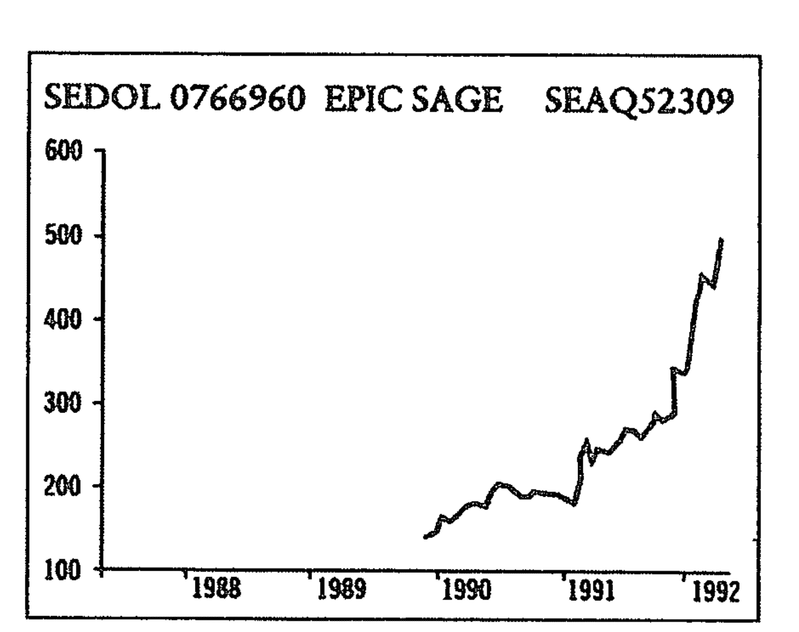

##### 重要公告日期

- 半年報：14/4/92
- 年報：10/12/91
- 會計帳目：27/1/92
- 股東會：20/2/92

你可以看出來，近年的驚人成長似乎已經放慢，券商對1992年9月截止年度每股盈餘共識預測值為29.5便士，因此這一年度的成長率為16%。然而，4月宣布的半年報業績讓我得到不同的結論。1991年內，上半年每股盈餘為11.6便士，下半年為13.9便士，整個1991年每股盈餘為25.5便士。1992年上半年每股盈餘成長25%，達到14.5便士，原因在於最近併購的美國德易公司（DacEasy）第一次貢獻完整的半年獲利。我認為下半年的盈餘至少會成長20%，達到17.4便士，1992年的每股盈餘會增為31.9便士。你可以看出來，我預估的31.9便士超過所有券商的預估，因此我以30.9便士的最高預測值作為計算基礎，用469便士的股價計算，得到的1992年度預估本益比略微超過15倍。

券商對賽捷1993年每股盈餘的共識預測值為33.5便士，成長率為13%（在衰退期間十分完美，但是對賽捷而言並非如此）。賽捷在4月宣布半年報業績後，券商預測的1993年度平均每股盈餘提高為34.3便士。然而，我相信，就像前一年度一樣，瑞銀菲立普斯公司（UBS Philips & Drew）預測的最高值36.2便士，可能比較正確。你會發現，對於特別傑出的成長股，尤其是像賽捷之類資本報酬率遠超過100%的公司，推定他們沒有問題，通常會得到好處。

這些數字要怎麼處理？預測的1992年度每股盈餘最高值為30.9便士，1993年為36.2便士，成長5.3便士，預估成長率為17%。1992年度的預估本益比為15倍，因此1992年度的預估本益成長比是用15除以17，得到的數字大約是0.9。根據我們的系統，不是買進標的，但絕對是續抱的股票，尤其是考慮換成本後，更應該續抱。而且在203便士買進這檔股票，到這時還沒有賣出的股東，可以享受每股大約100便士的政府無息貸款的好處，也不必繳交賣股獲利的資本利得稅。

賽捷的會計年度結束日期為9月30日，如果股價維持不變，市場會開始用1993年度大約13倍的預估本益比來看賽捷，1993年度賽捷的預估成長率為17%，這樣1993年度的本益成長比會變成0.76，吸引力增加，正好也符合我們系統規定的買進標準。我在第三章用MTL儀器的例子說過，如果你好好安排買進時機，經常可以在市場對快速成長股的看法從歷史本益比的觀點，變成用預估本益比來看時，用很便宜的價格買到股票。這種方法唯一的問題是：你等待股票增值時，損失的時間比平常多，而且你要賭兩年的獲利，而不是只賭一年，如果你等待前一年的業績公布後，你只冒預測獲利的風險。然而，如果你過去錯過像賽捷這樣的股票，準備冒兩次預測獲利的風險，這種方法有時候會讓你有機會上車。

我們看看美體小舖（Body Shop），這家傑出的成長公司經常成為新聞焦點，也為勇敢的投資人帶來很高的報酬。如果你在1984年公司上市後，立刻買進這檔股票，你的買價應該比承銷價高出50%。這檔股票上市時，預測本益比為24倍，表示你的進價是預估獲利的36倍。上市後，這家公司發行過幾次配股和現金增資股，但是你的投資應該會賺到超過60倍的報酬。這檔股票的本益比總是很高，和大盘相比，股價似乎總是很貴。然而，用本益成長比計算，這檔股票經常都是相對便宜。畢竟以預估年度成長率經常高達50%的基準來說，預估本益比36倍表示本益成長比為0.72，符合我們系統規定的範圍，問題當然是相信50%的年度成長率可以維持一段時間。

##### 1984 至 1992 年間美體小舖股價走勢

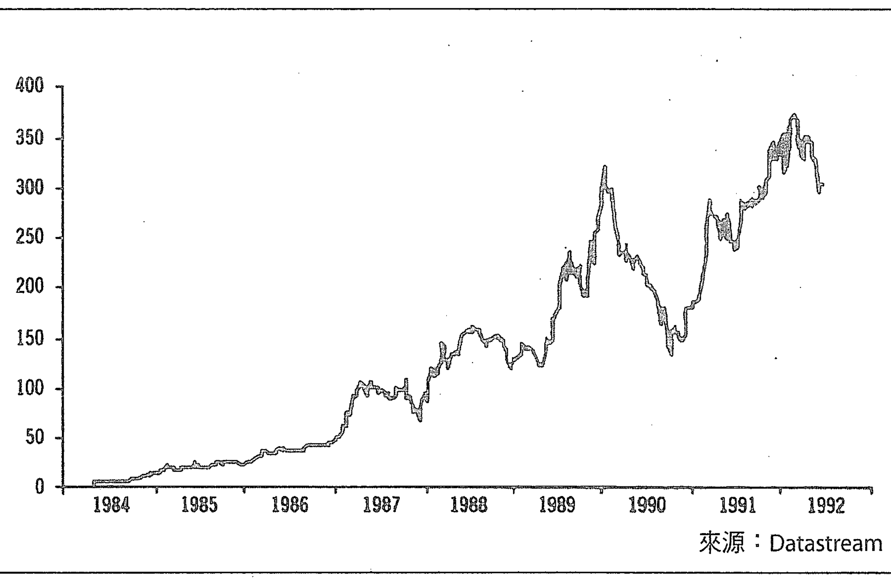

#### 美體小舖國際公司

- 票面：5便士
- 股價：278便士
- 總市值：5.2億鎊

業務：透過自有店面與加盟店，研發、生產與零售以天然材料為基礎的護膚、護髮產品與相關項目。截至1992年2月29日，該集團在英國經營210家店面，在國外經營517家店面，國際銷售通路增加148家，平均員工總數為1,926人（1991年度為1,844人）。

| 券商 | 評等 | 預測日期 | 1993年2月 稅前盈餘 | 1993年2月 每股盈餘 | 1993年2月 每股股利 | 1994年2月 稅前盈餘 | 1994年2月 每股盈餘 | 1994年2月 每股股利 |
| :--- | :--- | :--- | :--- | :--- | :--- | :--- | :--- | :--- |
| 畢森 | 買進 | 28/5/92 | 32.95 | 11.4 | 2.00 | 40.0 | 14.5 | 2.40 |
| 卡爾 | 買進 | 30/6/92 | 32.0 | 11.4 | 2.00 | - | - | - |
| 國民西敏 | 買進 | 25/6/92 | 31.5 | 11.2 | 2.10 | 42.0 | 14.9 | 2.70 |
| 富來明證券 | 續抱 | 1/6/92 | 33.0 | 11.4 | 1.70 | 40.0 | 13.8 | 2.20 |
| 吉羅森垂 | 續抱 | 1/6/92 | 32.0 | 11.4 | 2.00 | 38.0 | 13.6 | 2.40 |
| 浩威 | 股價高估 | 28/5/92 | 31.5 | 11.1 | 2.00 | 38.0 | 13.5 | 2.45 |
| 詹金寶 | A3 | 29/6/92 | 32.0 | 11.0 | 2.00 | 41.0 | 14.3 | 2.50 |
| 佳信 | - | 26/6/92 | 32.0 | 11.3 | 2.00 | 37.0 | 13.0 | 2.25 |
| 野村 | 續抱 | 28/5/92 | 31.5 | 11.1 | 2.00 | 39.0 | 13.9 | 2.50 |
| 潘姆爾 | 買進 | 3/6/92 | 33.0 | 11.5 | 2.10 | 42.0 | 15.0 | 2.70 |
| 皮爾韓特 | - | 13/2/92 | 34.0 | 12.0 | 2.25 | - | - | - |
| SGST證券 | 續抱/買進 | 29/6/92 | 31.1 | 11.0 | 2.00 | 40.2 | 14.2 | 2.40 |
| 華寶 | 續抱 | 1/6/92 | 30.0 | 10.3 | 1.90 | 35.0 | 12.0 | 2.30 |
| 威廉斯 | 買進 | 28/5/92 | 34.5 | 12.4 | 2.20 | 47.0 | 16.8 | 3.00 |
| 共識預估值 | | | 32.2 | 11.3 | 2.02 | 39.9 | 14.1 | 2.48 |
| 和前一年相比的百分比變化 | | | +28 | +29 | +26 | +24 | +25 | +23 |
| 預估本益比與股利率共識值 | | | 24.6 | 1.0 | | 19.7 | 1.2 | |

| 1992年2月截止年度 | 數值 | 指標 | 數值 | 股價比較 | 數值 |
| :--- | :--- | :--- | :--- | :--- | :--- |
| 稅前盈餘 | 25.2 | 本益比 | 31.6 | 一個月 | -2% |
| 每股獲利 | 8.8 | 股利率 | 0.7 | 三個月 | -19% |
| 稅務費用 | 34 | | | 一年 | +12% |
| 淨股利 | 1.60 | | | | |

##### 大股東

- 麥格林：27.97%
- 羅迪克：13.87%
- 羅迪克夫人：13.76%

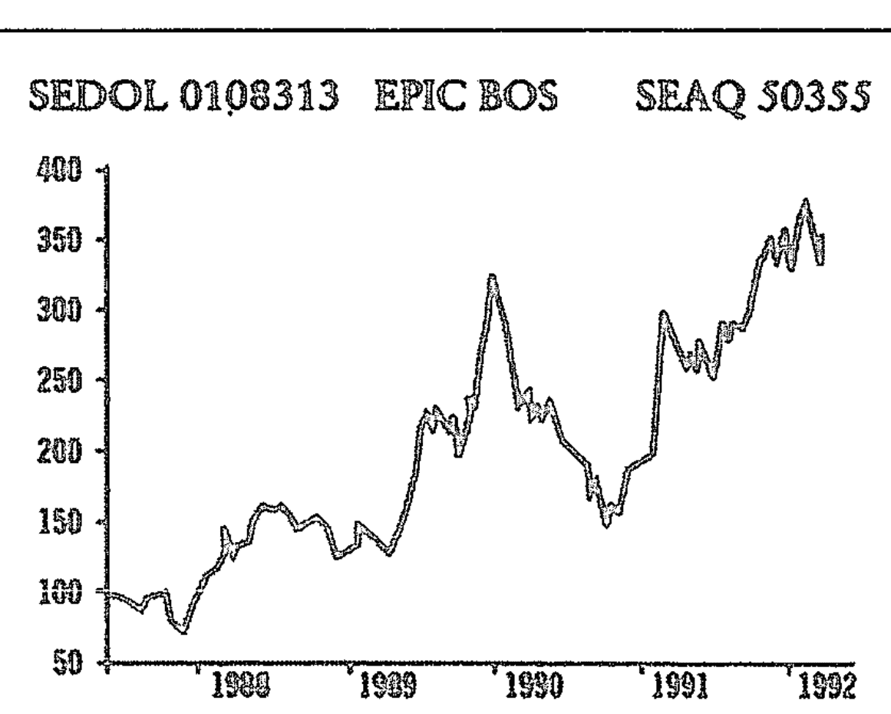

##### 重要公告日期

- 半年報：12/11/91
- 年報：27/5/92
- 會計帳目：10/6/92
- 股東會：30/6/92

過去的事情很容易了解，我們看看1992年7月美體小鋪的狀況。《估計目錄》指出，以278便士的股價為準，下一年度共識預測成長率為29％，根據這個數字計算，預估本益比為24.6倍，預估本益成長比是用24.6除以29，得到比值0.85，以主要的超級成長股來說，還相當有吸引力。

美體小鋪的特點是成長率超高，因此本益比很高。如果你買進這檔股票，董事賣出若干持股、偶爾有不好的消息流傳時，你會覺得不安。然而，大致上說來，在1990年前成長暫時走緩前，你應該不會看到本益成長比高出1.2很多。

買進美體小鋪之類的股票有一個隱憂，就是如果成長突然停止，股價會大跌，大家會爭相出脫。另一方面，如果不冒一點風險，你不可能指望賺到60倍的利潤。

美體小鋪是80年代的新股，賽捷比美體小鋪後進多了。兩檔股票從上市開始，就都是極為傑出的成長股，是你期望擁有特點、能力和續航力的意外驚喜。

新股市場中有很多機會，我已經提過工業控制服務集團，另一檔新股是1992年3月底，英國大選前後，由羅斯齊公司（Rothschild）承銷上市的英國資料管理公司（British Data Management）。這家公司似乎具備成為超級成長股的條件，因此我建議我們一起深入分析這家公司的數據。學習我的系統很有價值，因為要證明股票值得買進，你預測未來成長率和本益成長比時，需要發揮一點創意。

英國資料管理從事儲存管理以及商業、石油探勘資料的流通業務，在快速成長的油氣探勘市場中擁有40%的市占率，也擁有英國石油之類重要的大型公司顧客。收費以年度儲存為基礎，客戶要求取回文件時也要收費，這種服務很進步，當然是以電腦為基礎。

這檔股票承銷時碰到大選前的不確定形勢，因此承銷案相當失敗，公司以125便士的承銷價上市後，在承銷價下方有氣無力地遊走了一陣子。不過我們要以承銷價為基礎，用保守的眼光評估這家公司的統計數字。

從承銷文件，你就可以看出來，這家公司的會計年度在六月結束，根據董事會預測的獲利238萬鎊計算，每股盈餘為10.9便士，不過，後來盈餘預測提高到11.4便士，如果你依照程序進行調整，以此取代一開始會計年度發布的預測，我們現在來看看最近的獲利與每股盈餘成長記錄：

##### 1992年6月30日截止的年度盈餘與獲利預測
單位：千英鎊

| 項目 | 董事會預測 | 暫編財報預測 |
| :--- | :--- | :--- |
| 息前稅前盈餘 | 3,500 | 3,500 |
| 應付利息淨額 | (1,120) | - |
| 稅前盈餘 | 2,380 | 3,500 |
| 稅費 | (490) | (850) |
| 稅後盈餘 | 1,890 | 2,560 |
| 加權股數 | 17,262,398 | 23,262,398 |
| 每股盈餘 | 10.9 | 11.4 |
| 以承銷價計算的本益比 | 11.4 倍 | 11.0 倍 |

##### 業績與獲利預測
單位：千英鎊

| 項目 | 1989 | 1990 | 1991 | 1992 上半年 | 1992 全年 |
| :--- | :--- | :--- | :--- | :--- | :--- |
| 營業額 | 8,131 | 11,155 | 12,679 | 6,203 | |
| 息前盈虧 | (253) | 989 | 2,306 | 1,466 | 3,500 |
| 應付利息淨額 | (221) | (1,291) | (1,166) | (687) | (1,120) |
| 特別非經常性項目 | (1,257) | - | - | - | - |
| 稅前盈虧 | (1,731) | (302) | 1,140 | 779 | 2,380 |
| 稅費 | 311 | - | 45 | 10 | (490) |
| 稅後盈虧 | (1,420) | (302) | 1,185 | 789 | 1,890 |
| 每股盈餘（便士） | (9.3) | (2.0) | 7.8 | 5.3 | 10.9 |

我們需要預測1993年的業績與獲利，才能確定這檔股票是否符合我們最重要的標準，也就是符合未來高成長率和本益比不高的標準。我們不能輕易放過這家公司，因此必須自己估計和猜

測。1991年獲利比1990年增加1倍以上，1992年獲利比1991年成長50%以上，1992年上半年度的獲利為146萬鎊，預測全年的獲利為350萬鎊，兩者的差距超過200萬鎊，把這個數字乘以2，會得到400萬鎊，考慮未來半年的成長，我們可以穩當的再加上50萬鎊，估計1993年度的獲利為450萬鎊。

我會用同樣的方式，估計1994年度的獲利大約應該有550萬鎊。我知道我沒有考慮上半年業績中可能的季節因素，也知道我的方法很粗糶、勉強可用，但是因為我喜歡這家公司，認為這家公司擁有絕佳的未來成長潛力，因而覺得安心。

我們現在看看承銷文件，會看到預測的1992年度獲利為350萬鎊，每股盈餘為11.4便士。你可以從獲利記錄中看出來，公司早年有很高的虧損，因此產生可以轉期到將來沖抵未來獲利的稅損，暫編財報預測的85萬鎊稅務費用低到不正常，而且1991年業績的稅務費用幾乎等於0。只要把名目利息節省的112萬鎊加在獲利上，就可以估計出1992年度的稅務費用增加了36萬鎊。正常的稅務費用大約為三分之一，這裡應該表示要額外繳交37.3萬鎊——很接近36萬鎊的數字，清楚顯示稅損已經用完，未來公司必須繳交正常的稅務費用。

如果我們假設正常的稅務費用，占1992年度暫編財報獲利350萬鎊的三分之一，就會得到大約233.5萬鎊的淨利，公司上市後，發行在外的股數為23,262,398股，因此每股盈餘幾乎正好等於10便士（我想不通承銷文件為什麼不把這種事情徹底說明白）。以1993年度來說，我們估計的450萬鎊獲利減去正常三分之一的稅負支出，得到的稅後每股盈餘數字大約為13便士，以1994年度的550萬鎊獲利計算，得到的稅後每股盈餘大約為16便士。

我們現在回頭計算本益成長比，因為我們極為接近會計年度結束時間，公司又快速成長，我打算利用1993年度的預估本益成長比來計算。公司預估的每股盈餘為13便士，承銷價格為125便士，因此預估本益比大約為10倍，下一年的成長率大約為22%，因此，預估本益成長比可以用10除以22，得到很有吸引力的0.45。

其他標準都很符合：公開發行後公司不會有負債，在業界的地位穩固，資本報酬率高達22.5%，讓人很滿意。新一回合的北海開採執照已經在1992年3月宣布。公司2,910萬鎊的總市值很小，股利率為4.25%。因為資產價值低於淨值，淨資產大約等於股價的三分之一，經營階層擁有大量剩餘持股。唯一不符合的標準是相對強弱很低，然而這一點很容易就知道，是大選影響市場人氣的結果，因此我認為這個缺點的意義不大。

我已經深入研究過英國資料管理公司，因為你可以看出來，我必須自己做一些研究，才能了解這檔股票是否真的值得購買。其中有異常稅務費用的問題，但是更重要的是，「編造」獲利預測和估計未來成長率的方法。時間會證明我的估計是否正確，如果沒有意外，我可以肯定地說，時間會證明我的預測相當保守。

最需要了解的一個重點是：要找到跟成長率相比本益比很低的股票很難。你每年研究《投資客紀事》、券商、投資雜誌和一般讀物的推薦，會找到幾檔這樣的股票。你也會在價格經常低於正常行情的新股中，找到一些絕佳的投資標的。然而，像英國資料管理這樣的公司，有時候你必須略微研究，才能決定這檔股票是否符合我們的選股系統標準。新股尤其如此，新股經常在會計年度快要結束時上市，你可能必須瞻望好多個月，預測股票未來的狀況。你必須研究數字，必須比正常情況多冒一點風險，這樣你才能夠先發制人，打敗其他投資者，等到別人完全了解這檔股票的吸引力時，你很可能已經賣出。

你應該注意到，我除了絕對必要的標準外，對大部分的其他標準相當不重視。一旦具有吸引力的本益成長比出現，董事長的預測（或是編造的預測）樂觀，公司擁有有力的財務狀況與高資本報酬率，我對這種股票就很熱心，也多少會說服自己，說自己可能錯誤。奇怪的是，大部分其他標準通常都會符合，這一點其實不值得訝異——如果一家公司擁有競爭優勢，又有一些新事物出現，你本來就應該預期盈餘成長率會特別高。

疲弱的相對強弱本身應該不會讓你退縮，但是股價的任何弱勢應該會警告你，注意可能出了什麼問題。如果是地位穩固的成長股，令人失望的資產淨值不值得擔心，只有在好幾個非必要標準不符合時，你才應該開始擔心。這些標準加總在一起，會形成安全網，如果好幾條線磨損或不見，安全網才可能破裂。

### 第十一章 景氣循環股與轉機股

市場在公司重振時，時常誇大好轉的希望；在公司沉淪時，又過分誇大公司倒閉的恐懼。

大部分公司都會從經濟好轉中獲利，在經濟走弱時受害。然而，真正優秀的成長股即使碰到嚴重經濟衰退，通常也會說法讓盈餘成長。有些擁有強大事業關係的公司似乎不受四周的愁雲慘霧影響，令人嘖嘖稱奇。循環股受害的程度遠超過其他類股，建築與營建公司、鋼鐵公司、汽車製造商與經銷商無法對抗趨勢，頂多只能希望在下次循環的最高峰時，能夠超越前次高峰，在谷底時，狀況勝過上次的谷底。

這種股票真讓人緊張，但是如果你的時機掌握得宜，從中也可以賺到很多錢，要這樣做，你必須徹底了解景氣循環。我們以住宅營建業為例，循環走到谷底時，若干倖存者會因為競爭減少而受益，開始轉危為安，會發現精華區土地和勞工都比較容易取得，因此也比景氣繁榮時便宜多了。建造中的住宅應該會比較少，因此正在銷售的房價對建商會比較有利，可能帶來比較健全的利潤率與利潤。其他企業家知道機會來了，會創設營建公司，或是擴張現有的營建業務，加入勞工與土地的競爭，成本壓力會開始增加，有些建商會借錢囤積土地，土地變得越來越難以取得，也變得越來越貴。很快地，住宅營建業就出現產能過盛，若干住宅建商開始殺價，希望維持市場占有率，因為價格下跌、成本增加，利潤率受到侵蝕，銀行擔心貸款出問題，查封更多小型公司，迫使這些公司破產。比較有企業精神的若干建商可能認為，別的地方可能有更好的機會，競爭降低，價格壓力下降，利潤開始提高，循環從頭再來一遍。

#### 1971至 1986年間吉凱恩（GKN）股價與稅前盈餘

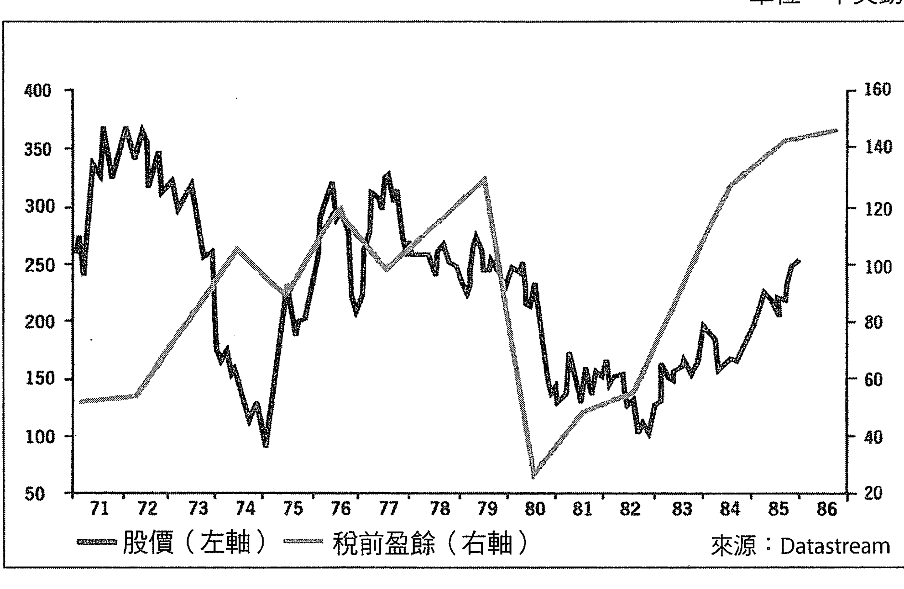

顯然利潤開始上升前是買進時機，狀況明顯改善時是賣出時機。應該了解的重點是景氣循環股在接近循環最高點時，絕對不應該有很高的本益比和很低的股利率。我們看一看典型的景氣循環股吉凱恩，看看這家公司的獲利和股價怎麼受到前兩次景氣循環的影響。

你顯然希望掌握買進時機，在循環接近底部時買進，但是你也希望確保自己選擇的股票不會沉淪。如果你投資不太可能繼續生存，卻讓大家吃驚，竟能熬過衰退毫髮無傷的公司，你應該會得到極高的利潤。風險越大，潛在的報酬越大，風險比較高的公司在循環底部時，通常借了很多錢，錢用光時，命運大致就要看銀行和債主的臉色了。

下面有一些方針，應該可以幫助你選股：

- 1. 全國知名的公司生存機會比較大，原因是大家比較不願意讓這種公司倒閉，這種公司是我們社會中重要的一環，因此銀行、債券持有人和其他債主可能放寬一點，希望幫助他們。這樣做有時候是為了避免得到逼迫企業倒閉的罵名，有時候是真心希望幫助這種公司。
- 2. 著名的公司通常都已經吸引能力高強的券商，也吸引一些強而有力的投資機構，他們比較可能協助公司發行新股，籌募重整費用。你必須確定代理這家公司的券商是大券商。
- 3. 尋找擁有著名品牌和其他堅強事業關係的公司。特別要注意經常擁有高資本報酬率的公司。
- 4. 經營階層的能力顯然極為重要，如果掌控公司的依舊都是保守派，你應該更小心。經營階層改變，能幹的人出任董事長或執行長，對公司的前途顯然是好預兆，也會使你的投資成功機會提高。
- 5. 注意有沒有主要競爭對手倒閉，這種事情總是很好的跡象，你選擇的公司最後應該會因此得到比較大的市場，享受更多的利潤。
- 6. 尋找資產價值超過市價的公司。經濟復甦時，這種資產應該會協助公司創造盈餘。同時，資產可能吸引掠奪者的注意，留心公司遭到併購的可能，你應該偏愛持股分散、沒有人握有決定性股權的公司。
- 7. 像平常一樣，你不能避免一番小小的計算。碰到景氣復甦時，券商的共識預測值是多少？上次循環高峰時的本益比是多少？掌握了這兩個數字，你很容易可以算出自己的潛在上涨獲利，對於可容忍借貸限制（請參閱第八點）達到極限的公司來說，上涨潛在獲利至少應該有100%，可能還要高出很多。
- 8. 「借貸」這個神奇的字眼使我想到了另一個重點，你應該定出負債總額超出淨值多少的限制，換句話說，借貸不應該超過100%。

碰到符合所有標準的罕見狀況時，100%的限制可以放寬，但是如果這樣做，你應該期望超過100%的潛在上漲獲利，額外的風險必須由額外的報酬展望沖銷。

- 9. 未來一年盈餘成長或轉虧為盈的預測絕對必要，虧損可能造成你希望避免的可怕風險。
- 10. 時機最重要，如果有人從摩天大樓的頂樓窗戶中，丟下一個保險櫃，如果你從三樓的窗戶探頭出去，想要接住保險箱，一定會受到嚴重的傷害。要等到你真正確定循環已經觸底時才行，你要尋找最早的變化跡象，尋找慘澹景象後的第一批好消息，這樣你會多付一點錢，但是把這種錢當成額外的保險費成本。
- 11. 你希望你選擇的股票從景氣回升中，得到驚人的利益，因此你必須儘可能確保公司熬過經濟衰退，主要的基礎結構安然无恙。券商的共識獲利預測值會用數字反映這種情形，但是還有幾個進一步的特別指標可以參考：
    - (1) 確保公司的產能維持不變，主要的工廠沒有賣掉。
    - (2) 尋找營業額大致維持，只有利潤率下降的公司，這點是利潤率可能迅速恢復的絕佳指標。
    - (3) 注意公司是否大幅降低過成本，你希望你選擇的公司 在景氣回升時精實有力。
    - (4) 尋找擅於創造現金的公司，如果稅損可以沖抵未來的獲利，短期債券可以很快清償。
- 12. 考慮景氣循環股時，董事持股的交易很重要，在接近循環低點時，看到很多董事買股票，顯然會讓人很興奮，董事可能犯錯，但是他們應該知道內情。
- 13. 在公司發行新股時買進，可能是參與景氣復甦很好的方法，你會得到很大的優勢，可以研究公司發給股東的最新資料，看出董事怎麼處理自己的持股，知道公司還有多少負債，而且立刻可以掌握公司未來的獲利展望。
- 14. 最重要的是，你要找在非衰退時期，是自己所屬產業主力的公司。這一點最好的指標是營業額與總市值的比值，凡是超過5倍，都是相當便宜的標的。

涅克斯（Next）是個好例子，1985年時，涅克斯的營業額為1.46億鎊，總市值為1.95億鎊，營業額和總市值的比值為0.75。到1990年12月，總市值跌到2,400萬鎊，但是預測營業額可以達到8億鎊，營業額和總市值的比值變得非常有吸引力，達到33倍，後來這檔股票從1990年12月的6.5便士，漲到1992年6月的95便士。

你什麼時候應該賣掉景氣循環股？如果你持有成長股，或許可以享受長途奔馳，但是如果你持有景氣循環股，你的目標價格通常比較受限制。你看到新聞界或券商研究報告指出，這家公司是成長股時，當然應該立刻賣掉。到了復甦第二年，公司預測的本益比升到過去最高本益比的75％時，也應該賣掉。基本上，你要在大家公認已經熬過衰退，現在的營業狀況遠勝過去時賣股票，不要等到一定會出現的競爭增加，成本再度開始上升，和需求即將走平時賣股票。你操作時，要設法維持很大的安全空間，因此要早早在景氣循環達到高峰前賣股。

#### 1985 至 1992 年間渥克斯股價走勢

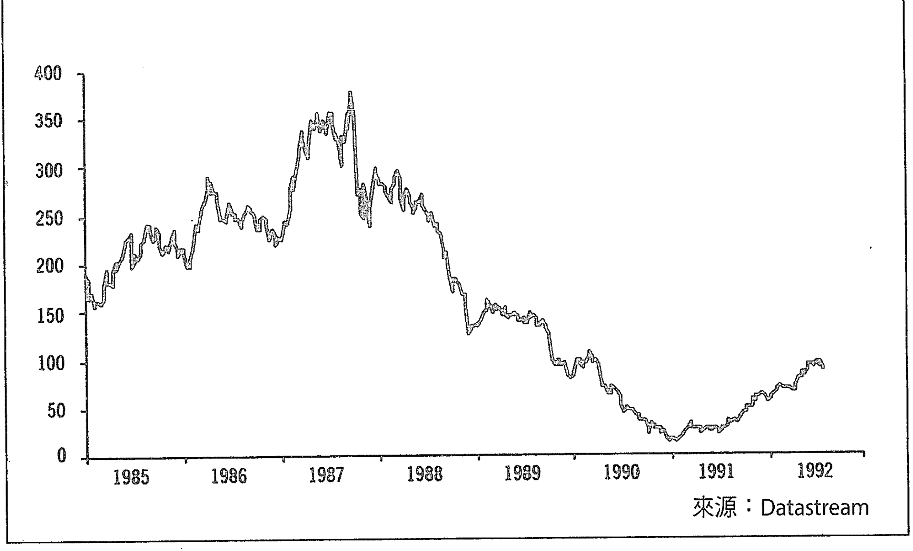

雖然我不喜歡訂賣出的數學公式，但我會建議，除了負債很高的情況（你在這種情況中，冒了很大的風險，希望得到不成比率的報酬），否則股價上漲1倍時，你至少應該考慮賣出。

接下來要談比較困難的問題——怎麼減少虧損。請記住，你是在認為景氣循環會好轉的情況下才買股票，如果這種情況沒有出現，景氣循環仍然往下走，或是你十分失望，你顯然必須重新評估景氣狀況。就像我的投資系統中其他標準一樣，如果題材嚴重惡化，要立刻賣出。股價下跌難以解釋時，要從股票的本質來評估，這時會變成比較像是判斷和感覺的問題。我在第十七章探討投資組合管理時，會更深入說明這個問題。

我很少投資景氣循環股，因為我覺得上漲利潤似乎限於一次性的利得，然而，如果你擅於掌握時機和選股，還是可以賺到龐大的利潤。

渥克斯是很好的例子，值得更深入的研究。雖然大家很容易錯過在股價跌到6.5便士的低點時投資，但這檔傳奇性的股票後來還有很多次買進機會。渥克斯跟零售業的大部分同業一樣，在1980年代下半期過度擴張，以驚人的速度增加連鎖店數目，而且涉足信用融資與郵購業務。到1988年12月，渥克斯集團發出警告，說「盈餘即將大幅下降」，過去的零售業明星戴維斯（George Davies）被迫辭職。

到1990年12月，投資人幾乎陷入絕望狀態，公司嚴重虧損，又有兩檔可轉換公司債即將以1.5億鎊贖回。到1991年3月，涅克斯把葛拉坦（Grattan）賣掉，得款1.67億鎊，加上賣掉另一些小規模業務，終於償還了所有債務。這時，涅克斯相當符合我們大部分標準：

- 1. 涅克斯是著名的公司，要是倒閉，會十分轟動。
- 2. 涅克斯的代理券商很有名，也很有影響力。
- 3. 涅克斯是完美的品牌。
- 4. 大衛瓊斯（David Jones）和沃夫森勛爵（Lord Wolfson of Sunningdale）已經取代戴維斯，兩個人都是很能幹、以財務為重的人才，決心恢復涅克斯的財務健全。
- 5. 主要競爭對手如波頓（Burton）也遭遇相當大的壓力。
- 6. 賣掉葛拉坦後，負債不再是問題。
- 7. 公司已經不再虧損，券商争相預測公司的獲利會改善。
- 8. 公司決心重振核心業務，關掉很多店面，改善庫存控制，產品線也徹底調整，商業流程週轉率降低，利潤率巨幅改善。
- 9. 營業額與總市值的比值仍然很高，即使賣掉了葛拉坦，預測的營業額仍然高達4.5億鎊，以30便士的股價計算，營業額與1.1億鎊總市值的比值超過4倍。

買進涅克斯最明顯的時機是在賣掉葛拉坦，倒閉的恐懼消除時，你應該有好幾月的時間，可以用25便士到30便士的價格，買進這檔股票，到1992年6月，你的投資至少會變成3倍。

轉機股跟景氣循環股和資產股差別不大，多年來受到忽視、惡化到倒閉邊緣的資產股會變成轉機股。經營不善的景氣循環股在循環谷底時，經常會變成轉機股。經營不善的成長股碰到意外的慘劇時，也可能變成轉機股。

轉機股沒有明確的定義，我用轉機股形容我覺得即將起死回生的公司，是那些遭到誤導、打擊和迷失，甚至生存能力有問題的公司。市場在公司重振時，時常誇大好轉的希望，在公司沉淪時，又過分誇大公司倒閉的恐懼，投資機構和其他股東爭相拋售，經常使股價超跌。

選擇轉機股的大部分標準，和我建議選擇景氣循環股的標準相同，很多轉機股跌到谷底時，受困於本身狀況惡化的影響，有時候跟公司的基本業務關係比較小，跟經營階層和公司方向的變化關係比較大。真正差勁的經營者可能造成任何公司倒閉，真正高明的經營者可以很快導正一切。你不希望浪費寶貴的時間，拿寶貴的金錢去冒險，等待新經營階層上任。經營階層的重大變化（你希望會變得更好），通常是絕佳的買進信號，但是有時候，情形會進一步惡化，然後才會好轉。

例如，我們看看著名的英國瓷土公司（English China Clays），這家公司因為某些難以解釋的原因，決定從十分優異的核心業務多角度經營，也把好聽的名字，改成難聽的縮寫名字——ECC。成功經營拉格比集團（Rugby Group）很多年的新執行長狄爾（Andrew Teare）在 1990 年 7 月 1 日走馬上任，公司在 5 月時，宣佈要併購美國的喬治亞高嶺土公司（Georgia Kaolin），狄爾決定利用這次併購案，強化核心業務，處理過去所有多角化經營的事業。1991 年 9 月，公司宣布計畫逐漸從英國住宅營建部門撤退，同時在核心的瓷土業務中，推動合理化計畫。其他變化包括遷移總公司，推出範圍廣大的獎勵經營階層計畫，在十八個月內賣掉十家公司，也把員工總數從 1.38 萬人，降為 1.08 萬人。1992 年 2 月，公司發行新股，償還在美國發行的一些奇怪融資債務。一個月後，董事會宣布稅前盈餘成長 50% 以上，也建議公司名字恢復較具知名度的「英國瓷土」公司。

1990 年 7 月，這家公司的股價為 414 便士，歷史本益比為 9.2 倍，預估本益比大約為 18 倍。到 1990 年底，因為公司受到營建業可能衰退的憂慮影響，股價非常弱勢，跌到 275 便士。然而，到 1992 年 7 月，重整的好處完全展現出來時，股價漲到 555 便士。

另一種轉機股可能從出乎意料的可怕財務狀況中出現，或是從慘劇中出現，美國聯合碳化物（Union Carbide）在印度博帕爾（Bhopal）的工廠爆炸事故就是例子。我建議不要投資發生無法估算的事故，可能成為無底洞的轉機股。博帕爾事故毫無疑問會促使慘劇受害者的親戚，提出比率難以想像的求償，我不知道目前的狀況如何，但是我猜想，可能要經過很多年，全部的財務影響才會清楚。

同樣地，如果有人對大香菸公司提出控告，成功要求賠償二手菸造成的健康損害（例如跟吸菸的人在同一个辦公室裡，因此罹患癌症而死亡），影響會難以估計。碰到這種事情，我建議你讓事情塵埃落定後，才拿你的錢去冒險，不要到水底摸魚，你可能因此溺斃。

你可以從渥克斯和英國瓷土的例子裡看出來，如果能夠找到有希望的景氣循環股或轉機股，尤其是在新經營階層接手時，會賺到很大的利潤。其中當然有風險，因此投資在這種股票的錢，絕對不應該超過投資組合的10%，我說過的安全標準應該也有助於保護你。

令人高興的是，賣出轉機股的時間很清楚，就是公司已經起死回生，賺到豐厚的利潤時，投資機構不再以擁有這檔股票為恥，開始審慎投資，券商的共識預測獲利遠高於去年，甚至可能有一些評論出現，說這家公司逐漸被人認定是成長股。不要貪心，把股票賣回給市場，你的投資很可能至少已經賺了100%，或可能還更多。

### 第十二章 借殼公司

投資借殼股比較像藝術，比較不像科學。

我曾經把巨型公司比喻成大象，說「大象不會疾奔」，主要原因很清楚，非常大型的公司，例如總市值 100 億鎊的公司，規模要增加 1 倍，要辛苦很多年。默默無聞的小公司規模要加倍容易多了，總市值只有幾百萬鎊的借殼公司要加倍，甚至更容易。我一直想為借殼股尋找一個比喻，對照我所述大部分時間總是安步當車，只偶爾衝刺的大象股。到現在為止，我所能找到最好的比喻是跳蚤，跳蚤可以躍過超過本身高度 200 倍的東西，等於人能夠跳過聖保羅大教堂。現在我們看看正在行動中的跳蚤，看看借殼股怎麼運作，你怎麼做才能從這種過程中獲利。

借殼股是很小的公司，通常經營規模很小、平凡無奇、無足輕重的業務，最重要的是，借殼股已經在股市掛牌交易。企業新秀入主借殼股，目的只是要讓自己的公司走後門上市。企業新秀

自己的公司歷史通常太短，或是有其他缺點，不能走比較正常的道路，在股市中掛牌交易。舊經營者通常會在很短的時間後迅速退出，而且賣掉跟新經營者主要業務比較沒有關係的原有業務，讓新經營者有效地控制整個公司的董事會，得到借殼上市的機會。這種股票的價格經常會大幅上漲，因為大家寄望公司會大舉出擊，然後公司會用高漲的股票推動若干併購案，股價會再度上漲，因為市場預期公司會有更多行動，這種過程一再持續，形成最完美的借殼上市遊戲。民間投資人可以在第一時間，或是在不久之後，參與最早期的新股發行，或是在市場中買進，從中獲利。

投資人必須了解，對早期的股東來說，推動併購的借殼股可能是極為優異的投資。以處在景氣狂熱期間的房地產公司為例，假設這家公司發行在外的股數是100萬股，股票在未上市興櫃（Unlisted Securities Market），以50便士的價格交易，總市值為50萬鎊，公司的淨值可能只有25萬鎊，另外100%，總共25萬鎊的溢價就是希望因素，希望有人會利用這家公司借殼上市。

企業新秀把自己價值200萬鎊的不動產業務，灌進借殼公司，換到400萬股，結果公司變成上市不動產公司，擁有225萬鎊資產，發行在外股數增為500萬股，因此用嚴謹的算術來說，如果股價維持50便士不變，總市值會提高為250萬鎊。然而，隨之而來的名聲很可能會把股價抬高到100便士，公司的總市值會增為500萬鎊。這種情形對我們所說的跳蚤來說，只是一次很小的跳躍，因為原始借殼公司流通在外的股票只有100萬股，而且其中很多牢牢掌握在信徒和支持者手中，在市場中流通的股票可能只有20萬到30萬股，這些股票通常會在比較高的價位上，迅速賣給新信徒。借殼上市操作成功的關鍵是需求很大，超過相對有限的供應，微型公司是最好的借殼上市股，原因就在這裡。

這時，我們這家借殼上市公司假設動用250萬鎊的淨值，推動一些重大併購案，併購的方式是用不動產作為擔保借到的100萬鎊貸款，其餘資金靠著發行150萬股籌來，新股由公司的代理券商發行，承購的都是朋友、相關企業人士與投資機構。增發150萬股後，流通在外的股票增加，但是這些股票跟早期的情形一樣受到限制，很多新股落在朋友和相關企業人士手中，他們會把這些股票當成長期投資持有。

這些操作會提高每股淨值，整個過程可以分為三個明顯不同的階段：

| | 第一階段 | 第二階段 | 第三階段 |
| :--- | :--- | :--- | :--- |
| 發行股數 | 100萬股 | 500萬股 | 650萬股 |
| 淨值 | 25萬鎊 | 225萬鎊 | 375萬鎊 |
| 每股淨值 | 25便士 | 45便士 | 58便士 |

第三階段的淨值增加了150萬英鎊，就是用取得的250萬英鎊資產減去100萬英鎊的遞延貸款。每股淨值從25便士增長為58便士是個重大發展，通常會讓人覺得以250萬英鎊推動的併購案物超所值，尤其如果能取得新開發計畫的許可。

我先舉不動產業借殼上市公司的例子，是因為淨值比盈餘容易了解。事實上，盈餘狀況會使借殼操作更好理解，因為未來的盈餘估計基本上是期望，可能實現也可能不會實現。以一家產業公司的類似例子來看，因為市場給予產業公司獲利的本益比較低，公司發行股票的本益比會升高。我們假設一樣的初始借殼公司，擁有價值25萬英鎊的資產，每年可以孳生2.5萬鎊的現金利益，借殼的企業新秀同樣把自己的公司變成400萬股，但公司擁有200萬英鎊的資產，每年有30萬英鎊的稅前盈餘。市場預期將來會有併購交易，而且對於公司核心業務前景看好，股價再度上漲1倍，漲到1英鎊。接著同樣用250萬英鎊，併購另一家公司，新併購的公司每年稅前盈餘為40萬英鎊，賣方同意其中100萬英鎊延後付款，餘額以發行每股1英鎊的150萬新股作抵，三階段的策略會變成下面的樣子：

| | 第一階段 | 第二階段 | 第三階段 |
| :--- | :--- | :--- | :--- |
| 發行股數 | 100萬股 | 500萬股 | 650萬股 |
| 每年稅前盈餘 | 2.5萬鎊 | 32.5萬鎊 | 62.5萬鎊 |
| 每股稅前盈餘 | 2.5便士 | 6.5便士 | 9.6便士 |

上面的計算中沒有考慮稅負，因為小型公司適用的稅率不同，而且我也不希望把問題複雜化。我從每年獲利中減去10萬鎊，作為貸款利息。每年62.5萬鎊的稅前盈餘是2.5萬鎊加30萬鎊加40萬鎊減10萬鎊，得到的結果。你很容易會了解，因為新業主接管了這家借殼公司，又推動第一次併購，每股稅前盈餘從2.5便士，急劇增為6.5便士，最後增為9.6便士，股東的每股稅前盈餘幾乎增加了4倍。此外，因為在相同的產業中推動更多的併購案，將來會有推動合理化的可能，甚至在某些例子裡，會用重組公司以徹底改善，這表示其中有很多新希望，這點正是高本益比的素材。

你應該知道，大力推動併購的公司也可能用會計花招提高獲利。例如，公司可以提列併購成本，把資本轉變成未來的營收獲利。另一個簡單的手法是借殼公司會為併購來的業務多付一點錢，把分期付款安排成無息貸款的樣子，這樣可以把每年的稅前盈餘增加10萬鎊。喜歡大肆併購的公司經常做這種事情，因此請記住，他們的獲利經常不像表面所顯示的一樣，不過沒有多少人會看會計帳中的小字。

投資借殼股比較像藝術，比較不像科學，要判定公司是不是借殼股，或者只是很小的掛牌上市公司，大致上是看法的問題。重點在於，不管誰把本身的業務灌進這種公司，一定都會控制董事會，他們的基本動機是得到走後門上市的機會。如果能夠在借殼公司中找到有價值的資產，有時候他們會繼續發展原有的事業，不過這只是意外之財，不是他們推動交易的主因。

《牛津字典》裡借殼公司的定義之一是：「因為在證券交易所的地位，成為併購目標的不重要公司」。另一個比較相關的意義是「只是近似的外貌」。

為了讓你更了解過去二十年來借殼上市公司的吸引力和風險，我們看看四家著名的借殼上市公司，看看他們在市場上的表現如何。

#### 1964至1991年間韓森公司股價走勢

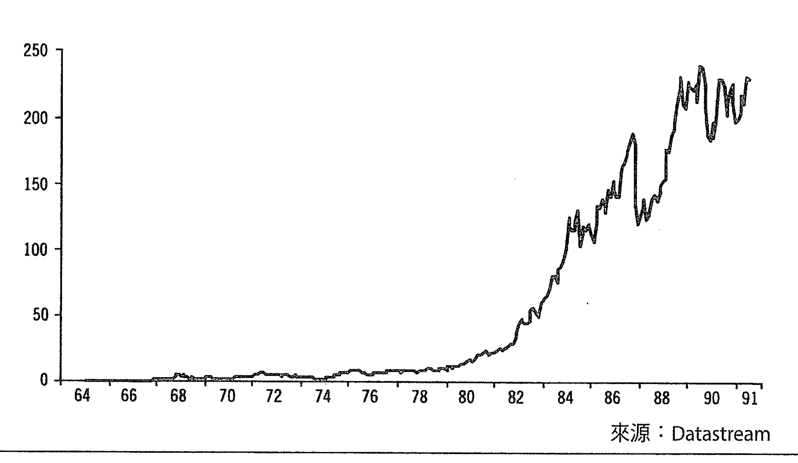

#### 1978至1992年間威廉斯控股公司股價走勢

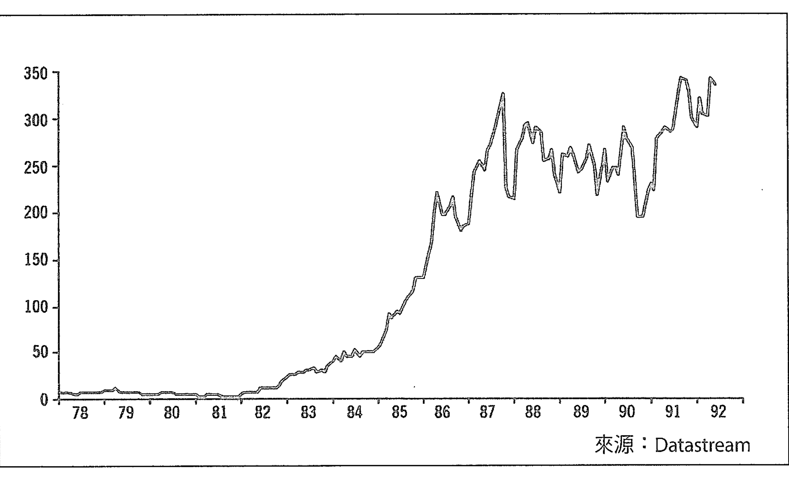

#### 1980至1991年間勃利派克國際公司股價走勢

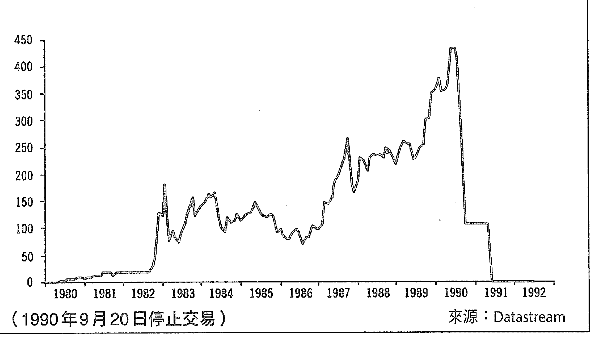

#### 1981至1991年間派克菲爾德公司股價走勢

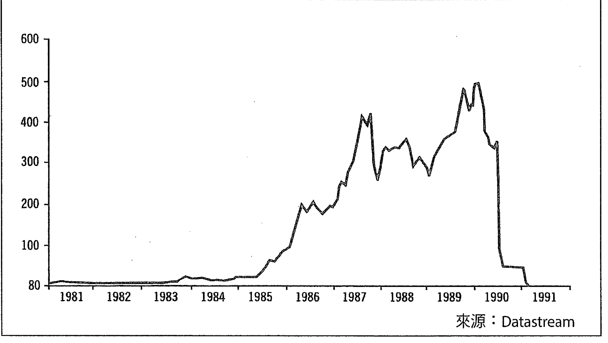

借殼公司的發展可以分成四個明顯不同的階段，你可以在任何一個階段投資：

- 1. 公司等待交易案，但是看不出跟交易案有關的任何蛛絲馬跡時。
- 2. 謠傳公司要推動交易案，投機開始時。
- 3. 公司宣布推動交易案，公司恢復交易時。
- 4. 新經營者經營了幾個月，甚至更久，開始展現意圖時。

對大部分投資人來說，前兩個階段太模糊、太危險，你很可能在不知不覺中，投資很快會倒閉的艱困公司，否則你也可能必須等待很久，新經營者才會出現，取得公司的控制權。因此，我建議你只注意後面兩個階段，這樣你投資時，就會確定公司已經被人當成借殼公司利用。你會知道新入主企業家的名字和背景，確定他的目標和公司的基本面，很多不確定的事情都會消除。

新經營者把新業務成功灌進借殼公司後，股價一定會停止交易六個月左右。在這段期間裡，公司會準備公開說明書，說明交易的細節，通常也包括發行新股、籌募資金。借殼公司恢復交易時，大家通常不會重視公司的基本面，恢復交易的價格通常跟停牌前的價格有關，例如，如果公司股票的basic價值為5便士，停止交易時的價格是8便士，你很可能聽到大家說，這檔股票「看來具有10便士的價值」。以借殼公司來說，資產和每股盈餘之类的基本面因素通常比較不重要，大家會把大部分的注意力放在新經營者身上，注意他過去的經營記錄、背後的支持者，以及他可能靠著併購、合理化和偶爾會推動的轟動交易，創造什麼成就。

企業家要加入借殼公司，還有一個方法，就是靠邀請的方式。有效控制董事會的大股東，可能邀請著名人士出任公司的執行長，不久之後，公司會發行和承銷新股，讓新人有機會買到可觀的股權，新人應該也會得到認股權，作為酬勞和激勵。

為了讓你徹底了解取得借殼上市公司控制權的方法，下面要說明最近三件借殼上市的操作過程：

#### 克拉克食品（Clarke Foods）

美國企業家克拉克（Henry Clarke）和他的家人，有效地控制了葉爾佛頓投資公司（Yelverton Investment），他把這家小投資公司變成善於創造現金的借殼公司。1991年，他從聯合理昂公司（Allied Lyons）手中，買下產銷冰淇淋的席爾斯當公司（Hillsdown Holdings）和里昂梅德公司（Lyons Maid）。雖然這家公司還沒有開始創造營業利潤，卻在一夜之間，變成英國高品質冰淇淋領導廠商。公司宣布跨足冰淇淋產業前，股價為39便士，到1992年，已經漲到大約150便士。

#### 梅多克斯集團（Maddox Group）

1992年2月，比爾曼（Hugo Biermann）和艾斯金（Julian Askin）把兩家固網電話公司的業務灌到巴斯範德公司（Pathfinders），換得現金與股票，取得公司26%的股權，把公司改名為梅多克斯集團。這兩個人曾經把湯姆森電話線路公司（Thomson T-line）從營業額90萬鎊的公司，壯大成事業集團，然後以超過1.8億鎊的價碼，把公司賣給立博集團（Ladbroke）。他們宣布入主巴斯範德公司後，股價漲到12.5便士，但是到了1992年6月，市場等待公司宣布另一件交易案時，回跌到8便士。

#### 沃夫德爾（Wharfedale）

1991年12月，沃夫德爾宣布以布蘭頓爵士（Sir Gordon Brunton）為首的新經營階層要加入公司，布蘭頓曾經擔任湯姆森國際機構執行長十六年，在任期間，把這家公司的年度營業利潤從接近零，提高為超過5億鎊。新經營階層的其他成員包括陶德（Peter Totte），以及擔任大東電報局（Cable and Wireless）集團總經理的歐文（Gordon Owen）。

同時，公司表示，計畫以12.5便士的價格，發行225萬鎊的新股，償還沃夫德爾公司過高債務中的一部分。新經營階層在1992年3月的股東會上，說明整頓公司的計畫，也詳細報告降低成本與合理化的進展。公司股價一度漲到24便士的高點，但是到1992年6月，市場等待公司進一步的發展，股價回跌到16便士。

你可以看出來，這三家公司的股價都因為公司有nouvelle發展的希望而變化。相形之下，一般的公司如果發行新股，可能純粹依據基本面計價，根據成長率、當期每股盈餘、預測、本益比、資產價值、股利率與流動性之類的因素定價。你很快就知道，我幾乎不可能告訴你指導原則，讓你判斷借殼公司的價值、選擇適當投資標的，納入你的投資組合。我說「幾乎」不可能，是因為我要試著提出一些原則：

- 1. 最重要、第二重要和第三重要的事情是新經營階層的背
景，要找幹才、找重量級董事加入羽翼級公司的例子，注
意他們過去的輝煌成就，作為你對公司未來寄予厚望的基礎。公開說明書中應該會列出新經營階層的詳細資料，而且新聞界和雜誌界對著名的人物，通常都會有很多報導和評論。

公司的新執行長以前可能沒有經營過自己的公司，可能是在另一家著名的集團服務過很多年，一群高手是最好的預兆之一。

哈欽斯加入湯金斯公司前，擔任韓森信託公司（Hanson Trust）英國企業發展部門主管。他出任湯金斯公司執行長時，股價為12便士，總市值為600萬鎊。到1992年6月，股價漲到略低於500便士，總市值高達14億鎊。即使把發行現金增資新股和配股的因素考慮進去，湯金斯的股東到現在為止，還是賺到驚人的資本利得，而且哈欽斯仍然有優異的表現。

泰勒加入美德華公司前，擔任葛蘭索公司執行長，當時美德華的股價為80便士，到1992年6月，也就是不到三年後，股價漲到220便士，上漲175%。韓森和葛蘭索顯然是頂尖人才的搖籃，但是還有其他類似的借殼公司，你可以看出對你非常有利的可能性。

我花這麼多時間，說明借殼公司需要頂尖的經營階層，是因為這個標準的重要性遠超過其他標準，如果新經營階層絕對是一流人才，其他標準的重要性應該可以大為降低。

- 2. 這個原則是 我第一個標準的重要附屬標準，我喜歡看到新經營階層購買公司可觀的股權。借殼公司幾乎總是這樣，但是要密切注意董事的買賣狀況，把董事大幅賣出當成跟著照樣大賣的明確信號，幾乎不必理会相關的解释。

- 3. 因為借殼公司未來的進展大致上要新股發行的情形而定，公司的股務代理券商、投資銀行與投資機構的能力如何，是重要的考慮因素。一流的新經營團隊通常會吸引廣大支持。

- 4. 注入借殼公司的業務必須有獲利與每股盈餘成長的記錄，不動產公司當然是例外，要適用不同的考慮因素。如果新執行長相當默默無聞，他過去經營業績的記錄經常是你判斷他過去成就唯一的依據。

- 5. 併購案完成後，要確定借殼公司因此得到的每股盈餘，足以為公司提供合理的起步基礎。你不能用本益成長比因素，衡量你付出的價格，對借殼公司，你必須採用比較廣泛的觀點，但是在付出的價格中，你要設法避免為希望付出太高的代價。

你應該擔心的是高出實際價值的溢價金額絕對值，而不是擔心溢價比率。這當然是對小型借殼上市公司有利的另一個原因。例如，一家借殼公司的稅後獲利為20萬鎊，而且這種公司的正常本益比為15倍，公司的總市值應該是300萬鎊，然而，因為其中涉及新執行長確實精明能幹的希望因素，本益比可能高達25倍，公司的總市值可能增為500萬鎊，多出的200萬鎊代表溢價66.7%。但是實際上，你不應該重視溢價的比率，而是應該重視必須由價值填補的200萬鎊「熱空氣缺口」，因為公司的本益比高，又得到有力的支持，缺口應該不難填補。現在我們把這種情形，跟總市值5,000萬鎊、真正價值只有3,000萬鎊的公司比較，雖然溢價比率相同，要填補2,000萬鎊的熱空氣缺口，對新經營階層來說卻困難多了，尤其是他們也必須擔心流通在外的股數多出很多。

- 6. 你從上面的比較，立刻會了解小型借殼公司，也就是總市值100萬鎊，基本業務價值50萬鎊的公司可能是寶石，溢價達到100%，但是熱空氣缺口只有50萬鎊。我非常喜歡小公司，喜歡開始時總市值低於1,000萬鎊的借殼公司，越小越好，請記住我們說的跳蚤。

看看華沙爾（Wassall）的歷史，可以得到很多啟發。韓森公司的重要經理人米勒（Christopher Miller）、透納（Philip Turner）和迪隆李德公司（Dillon Read）的經理人羅波（David Roper），一起加入華沙爾的董事會。公司立刻發行現金增资新股，投資機構爭相搶購，韓森公司買了20%的股權，這三位經理人各自買了價值100萬鎊的股權，以新股發行價格125便士計算，這家公司的總市值超過1,800萬鎊。

成功借殼公司的大部分條件都具備了，最重要的是，有三位非常精明能幹、記錄優異，又得到強力支持的企業家。股價飛躍上漲，公司推動了幾件併購案，併來的公司大部分都經過成功重整和合理化。經過兩股配一股的配股後，1992年6月180便士的股價背後有盈餘的強力支持，和1988年9月發行新股的125便士相比，股價在四年內上漲116%，對一般的工業公司而言，漲幅非常大，但是對成功的借殼公司來說，卻普普通通。經營階層非常能幹，而且我敢說，將來也會有優異表現，他們沒有犯錯，只有第一步走錯，從太大的殼、太高的價格開始。記住我的建議，避開很大的借殼公司，堅持只選跳蚤，大象不會疾奔。

- 7. 我喜愛低價股。公司的股價超過1镑後，經常會喪失借殼公司的特性。我們都知道，股票的價格其實沒有差別，擁有4股名目價值25便士的股票，跟擁有1股1镑的股票相同。然而，股票變得比較「重」，股價漲到1镑以上後，新聞界和券商比較可能認真看待這種公司，會分析公司的基本面。借殼公司靠著未來的希望和少許神秘性大發利市，借殼公司是即將出門旅行的股票，不是即將到達目的地的股票，因此從投資觀點來看，到達時間應該儘量延後。我喜歡價格介於5到10便士的借殼公司，其次的選擇是低於15便士的股票，然後是20便士，再過來是25便士，股票越小，越可能像跳蚤。

超低價借殼公司的問題是內外盤價的差距，這是不要找低於5便士股票的原因之一。以3便士的股票來說，買進價格很可能是2.75便士，賣出價格很可能是3.25便士，造市者會得到高達0.5便士的差價，等於16.7%。雖然有這種缺點，我還是喜歡低價的借殼股。8便士的股票可以在幾小時內，輕鬆漲到10便士，隔天再漲到12便士，等於上漲50%。很少有80便士的股票能夠在48小時內，漲到120便士，8鎊的股票在六個月內，要漲到12鎊很難，更別提在幾天內漲上去。5便士到50便士的借殼股很有吸引力，因為1鎊的第一個重大心理關卡距離還很遠。即使股價以2、3鎊的高價交易，真相揭露的時刻還是可以延後，但是股價越變越重，便開始喪失借殼股的基本特性之一。以3鎊的價格來說，會被視為是認真經營的公司，從而仔細研究。

- 8. 避開沒有完全上市或沒有在興櫃市場掛牌の借殼上市股。就你的目的而言，在櫃檯報價、由人工撮合交易的低價股不夠好。投資機構像躲避瘟疫一樣避開這種股票，你幾乎不可能快速買進或賣出。

- 9. 最後的標準是公司的流動性。和大公司相比，投資借殼公司的風險顯然高多了，在經濟衰退期間，借殼公司要借錢比較難，也比較可能用光資金。你開始時，至少要確定公司擁有淨現金餘額，或是可容許的債務。

良好的投資組合管理，可以降低投資借殼公司的高風險。不要被「5便士只是權利金」，和「你最多只損失5便士」之類的話欺騙。如果你投資5便士，全部虧掉，就是這筆投資的錢完全虧掉。這種事情很容易發生，而且必須預期投資借殼公司，比投資地位穩固的公司更常發生這種事。

要管理借殼公司構成的投資組合，第一個原則是：至少要把投資分散到十檔股票上，最好每一檔股票的金額相同，如果你願意，可以多投資幾檔股票，但是絕對不要低於十檔。

第二個規則是：和你的成本相比，股價下跌40%時要停損，這個限制看來似乎很高，但是造市者要賺的價差可能占10至15%，而且借殼上市股流通性很低、震盪激烈。你不希望因為短暫、微小的震盪就賣掉你小心選擇的投資，但是到達40%上限時，要明快停損，新總經理可能死亡或跑到另一家公司去了，或是另外有一些重大的不利發展。毫無疑問，你確定題材變壞時應該立刻賣掉。

第三個原則最難，就是要讓利潤成長。我們決定利潤應該成長到多高前，先想像由十檔借殼上市股構成的投資組合，看看這個投資組合在一年期間的績效數字：

| 公司 | 期初投資（鎊） | 虧損（%） | 獲利（%） | 期末價值（鎊） |
| --- | --- | --- | --- | --- |
| A | 1000 | 40 | - | 600 |
| B | 1000 | - | 60 | 1600 |
| C | 1000 | - | 30 | 1300 |
| D | 1000 | 40 | - | 600 |
| E | 1000 | - | 250 | 3500 |
| F | 1000 | 40 | - | 600 |
| G | 1000 | - | 150 | 2500 |
| H | 1000 | 60 | - | 400 |
| I | 1000 | - | 350 | 4500 |
| J | 1000 | 100 | - | - |
| | 10,000 | | | 15,600 |

H公司股票突然下跌，我們錯過了在虧損40%時賣出的機會，J公司遭到停止交易，後來倒閉，因此我們虧光了這一家的投資。E公司、G公司和I公司是真正的贏家，I公司尤其如此。

以十檔精選的股票來說，我通常預期有三檔大贏家、四檔小贏家、三檔輸家。為了保守起見，我假設有五檔輸家，其中一檔的虧損可能超過我們的預期。在賺錢方面，我假設我們有五檔贏家，其中三檔平均獲利250%，我們能夠賺這麼高的利潤，是因為讓利潤累積。大部分的虧損都有一定的限制，因為我們會在股票跌得更慘前砍掉。

我們在一年裡的平均獲利為56%，是非常不錯的績效。即使我們在五檔輸家中虧掉全部的投資，平均獲利仍然有34%，令人滿意。會有上面這種平均獲利，要歸功於讓獲利累積的策略，沒有其他原因。想像如果我們採用直覺策略，在股價暴漲時緊抱著輸家，情緒緊繃祈禱股票回升，因為害怕股票會消失而草草抱回一些利潤，我們一定會虧損。

什麼時候應該賣出獲利，沒有能簡單依循的原則。我經常在股票替我賺到很多錢，而且處在空前高峰時賣出獲利，但是你可能會發現，這樣做在心理上很難。我有一個簡單的建議，就是讓你的獲利累積一年，當然，如果題材變化，就另作別論。最重要的是讓你的小小跳蚤盡量跳到最高，給你的跳蚤一年時間，讓跳蚤證明自己可以表現得多優異，有時候你會十分驚喜。

一年時間到了以後，要評估基本面，評估每一檔股票真正的價值，新聞界、券商和投資雜誌對這些股票有什麼看法？你現在會買這檔股票嗎？預估盈餘、本益比和背後的資產狀況如何？是否計畫發行大量股票，有沒有董事在賣出？這些都是你要問自己的問題，如果這檔股票投資很成功，公司一定已經不再是借殼公司，應該純粹根據公司的特性，跟同一類股的其他股票比較，像評估任何其他投資一樣。

請記住，讓盈餘累積和停損還有額外的好處，會使你的稅負降到最低。從某方面來說，這樣好比政府借給你一筆無息的租稅貸款，只有在你實現獲利時才要還清，投資借殼公司時，這一點可能是特別需要考慮的因素，但是租稅因素絕對不能壓倒股票應該賣掉的強烈感覺。

你可能會說，可以只賣一半的持股，得到龐大的利潤。我不喜歡一半正確、一半錯誤，但是有些人認為，這樣會比較容易鼓起勇氣，讓剩餘的利潤繼續累積。他們這麼擔心的事情到底是什麼？龐大的獲利落袋為安是很大的享受，因此做這種決定絕對不要太煩惱，投資跳蚤股應該是很有趣的事情。

### 第13章 資產股與價值型投資

很多人認為，「價值型投資」只是指折價買進資產，事實上，價值型投資的範圍更大。

以資產股為重的投資人對短期盈餘並不是非常感興趣，他們認為，如果公司擁有適當的資產，資產最後會創造出盈餘。如果現任的經營階層不能創造盈餘，新經營階層或掠奪者會來發揮資產的價值。

判定公司真正的資產價值不容易，近來尤其如此。過去你可以依靠資產負債表上低估的主要不動產之類的重大資產，在經濟衰退嚴重的環境裡，情形經常正好相反。1992年6月，斯貝賀剛剛宣布沖銷高達2.05億鎊的資產，這檔股票在1991年高峰時，高達140便士，消息宣布後，跌到2.5便士。這檔股票崩盤前，成交價已經比上次公布的淨值低87%，投資人顯然知道上一回的會計帳目靠不住。

這種高估的情形怎麼可能發生？方式有很多種。個別不動產估價時，可能根據其他類似建築物主人收到的租金為基礎。然而，在某些例子裡，可能要對新租戶提供龐大的誘因，例如幾年免租金，代付租戶改裝辦公室的費用。同時，不動產價值暴跌的狀況下，高負債的缺點也會更明顯。

另一項難以估價的資產是工廠和機械，以正常經營的公司來說，價值可能很高，但是如果工廠關閉，機械必須賣掉，得到的錢可能低得可笑，經濟困難時尤其如此。迪巴菲特在這方面都碰到問題，他決定關閉早年併購的新貝德福（New Bedford）紡織廠時，經營階層希望機械能夠賣到好價錢，因為機械的帳面價值為86.6萬美元，後來他們很吃驚，這批機械在公開拍賣中，只賣得16.3萬美元。

品牌的價值很難估算。有些公司的資產負債表中，幾乎不列計品牌的價值，有些公司卻列計幾億鎊的價值。大部分公司的資產負債表不列計品牌的價值，少數列計的公司這樣做，通常都有特別的原因，例如 RHM 公司列計品牌價值，是因為碰到併購威脅。

對於併購得到的商譽和無形資產應該怎麼處理，這方面的會計規則還在研議當中，一般建議是在第一年份裡，從準備金中提列虧損。同時，從投資人的觀點來看，關鍵是要確定你評估的品牌本身很有力量，將來會繼續為公司提供持續不斷的獨立營收。

商譽是另一個棘手問題，我建議你計算你有興趣公司的淨資產價值時，把商譽剔除掉，這樣你的估價至少會持續一貫，較為保守。

投資資產股時，要找淨資產至少超過目前股價50%的公司，你要儘量再三查證淨資產的計列很精確，但是請記住，這樣做不容易。

還有一些保護性標準必須符合：

- 負債總額不能超過淨值的50%。
- 公司必須有適度的盈餘，不要買嚴重虧損的公司，不管公司的資產多麼雄厚。
- 公司的基本業務必須相當有吸引力，必須有明顯回升的可能性。例如，要避開造船公司。

看到執行董事買股票是很重要的額外誘因，這點不是強制性的標準，卻是絕佳的指標。

擁有好幾個不同部門的公司對掠奪者特別有吸引力，理想的公司是集團中有一個部門嚴重虧損，幾乎吃掉公司其他部門的全部獲利。掠奪者即使必須以等於奉送的方式，擺脫差勁的部門，也不必花多少時間，就能為虧損的部門找到買主，隨之而來的轉虧為盈經常很可觀。

我對資產股不是太熱衷，我比較喜歡注意成長股、借殼上市股和轉機股。我在史萊特．渥克公司（Slater Walker）服務時，通常可以主動安排資產股的發動，近來我像其他投資人一樣，必須長時間苦苦等待，成長股和轉機股的速度讓人滿意多了。

寫出傑作《智慧型股票投資人》(Intelligent Investor)的葛拉漢是美國「價值型投資」的鼻祖，價值型投資不能跟資產股投資混為一談。葛拉漢最成功的投資公式是：以低於公司淨流動資產價值三分之二的價格買股票，淨流動資產必須減去過去的所有費用，而且不能計算公司的任何固定資產，例如不動產、工廠、機器、品牌與商譽的價值。換句話說，購買的資產可以折價變成現金，公司的其他財產一文不值。葛拉漢建議在股價漲到淨流動資產減去過去所有費用的價格時，把股票賣掉，因此這個公式發揮效用時，獲利應該是50%。葛拉漢發現，從1946到1976年間，這個方法產生的複合年度報酬率超過19%。

很多人認為，「價值型投資」只是指折價買進資產，事實上，價值型投資的範圍更大，基本觀念是尋找跟股價相比，擁有龐大安全邊際的價值股。

葛拉漢提出幾種不同的投資方法，但是他的基本原則總是不離購買價值。我們評估他其他觀念前，你必須了解，遵循我說明過的其他系統，也是一種價值型投資方式。

你根據低本益比和隨之而來的低本益成長比，購買積極成長股時，就是以折價購買成長展望，你的錢買到的價值高過買進整個大盤。同樣地，你在轉機股剛剛開始發動時投資，或是在循環開始向上時投資景氣循環股，就是以遠低於公司全部潛力的折價，買進股票。

股票的市價和背後的基本價值大不相同。「價值」總是主觀的東西，資產價值多少，總是有很多不同的見解，未來的盈餘會有多少，也是看法紛紜的事情。這是葛拉漢第一種系統中專注淨流動資產的原因，淨流動資產可以轉變為現金，是價值不容置疑的資產。葛拉漢認為，市場價格會依據真正的價值，雖然經常毫無道理或毫無節奏的波動很長一段時間，但是最後價值會贏得勝利。長期而言，股價會配合每股盈餘、股利、現金流量和淨資產波動，這是了解葛拉漢其他投資方法必須知道的背景。

葛拉漢第二著名的系統是購買，具有盈益率（盈益率是本益比的倒數，例如，本益比8倍的股票盈益率為12.5%）不低於最高評等債券殖利率2倍的股票。如果這種債券的殖利率為10%，表示買進的股票本益比只有5倍。此外，葛拉漢運用額外的保護性原則，堅持公司的負債總額不得超過有形資產淨值。葛拉漢分析過去三十年的資料後斷定，這種方法也會產生19%的複合年度報酬率，遠超過同期內大盤的整體報酬率。

葛拉漢的第三個方法是：買進股利率不低於最高評等債券殖利率三分之二的股票，他再度堅持，目標公司負債不應該超過價值，這種方法的年度複合報酬率幾乎相同，達到18.5%。

葛拉漢的方法有一個重要的特點，就是每一檔合乎規定的股票都必須購買，不允許個人好惡。葛拉漢用三種方法買進的股票，都在股價上漲50%或經過兩年後賣出，看哪一種情形先出現。如果公司停止分派股利，他也會把股票賣掉，如果是以盈餘為基礎的股票，盈餘下降到目前行情，比假定買進價格高出50%時，也會把股票賣掉。

葛拉漢是最有系統的智慧型投資人，喜歡折價買進資產，以低本益比買進股票。然後在他選擇的股票下方，加上債務有限與有形資產淨值形成的安全標準，作為保護網。在我買進積極成長股的系統中，我準備付出的本益比比葛拉漢的標準高，但是我把這一點跟預估成長率結合，而且利用低本益成長比，尋找我心目中的價值股，因此用其他標準，架設了更完整的安全網。

巴菲特是葛拉漢的學生，卻修改了葛拉漢的方法。投資人必須了解，葛拉漢計算時，完全不考慮商譽和品牌之類無形資產的價值。相形之下，巴菲特尋找擁有優異的一般價值，與強力事業關係的股票，最好還有十分強而有力的品牌支持。巴菲特基本上是要找成長股買進和持有，葛拉漢要找有明顯和立即價值的股票，在股票上漲50%後賣掉，巴菲特喜歡等待個十年左右，賺幾千百分比的獲利。

運用葛拉漢最著名的系統有一個困難的地方——股票的市價不能超過淨流動資產的三分之二，淨流動資產還要扣除過去的所有費用，也不能計算其他資產的價值——長期而言，很少股票符合這種高得離譜的標準。如果葛拉漢今天還活著，他可能主張你根本就應該退出市場幾年，等到你尋找的物超所值買進機會出現。葛拉漢的說法可能正確，但是我的問題是，我會等到極為心煩意亂。

### 第14章 領導股

領導股的缺點之一是經常有很多人研究，股價通常比較貴。

大公司和小型的公司沒有兩樣，你在大公司裡不會找到借殼上市公司，卻會找到很多成長股、景氣循環股、轉機股和資產股。買賣領導股的好處之一，是安全性毫無疑問地大多了。大型股歷史比較悠久，更像是社會結構的一環，因此比較不可能因為缺乏資金或意外事故而倒閉。此外，大型股市場的流動性高多了，如果是小型股，你會常發現市場突然萎縮到只成交1,000股，內外盤差距很大，如果是領導股，你要獲利或停損時，應該總是能夠成交。

領導股的缺點之一是經常有很多人研究，股價通常比較貴。下一頁刊出1992年6月號《估計目錄》針對兩檔股票所做的研究摘要，一檔股票是 MTL 儀器，另一檔股票是通用電器，針對通用電器進行研究和發表報告的券商有十八家，關心 MTL 的券商只有二家。這麼多券商研究通用電器，得到的共識預測值應該會比較可靠，但是過度曝光加上流通性比較高，通常會造成績優股的本益成長比升高。

領導股的另一個缺點當然是大象不會疾奔，但偶爾會衝刺，如果你打算投資領導股，你應該尋找即將脫離象群的公司，你可能會問怎麼判斷，答案很簡單，應該運用評估小型股的同樣原則投資領導股。以本益成長比來說，你必須把上限略微擴大，因為你找不到多少檔領導股的本益成長比低於0.66或0.75。為了簡化公式，我建議把上限提高為1，也就是預估本益比不應該超過預估成長率。

#### MTL 儀器集團

面值10便士

股價356便士

總市值6,300萬鎊

業務：主要業務是設計、生產與行銷電子防儀儀器與設備，用在危險環境工業程序中測量與控制。該集團也生產電氣與電源安全設施和氣體分析設備。生產主要在英國進行，也在印度生產，供當地銷售之用。產品大約行銷50個國家。

| 券商 | 評等 | 預測日期 | 稅前盈餘 (1991/12) | 每股盈餘 (1991/12) | 每股股利 (1991/12) | 稅前盈餘 (1992/12) | 每股盈餘 (1992/12) | 每股股利 (1992/12) |
| :--- | :--- | :--- | :--- | :--- | :--- | :--- | :--- | :--- |
| BZW | 買進 | 5/3/92 | 5.1 | 18.5 | 3.85 | 5.7 | 20.6 | 4.30 |
| 畢森 | 買進 | 28/5/92 | 5.0 | 18.1 | 3.90 | 5.6 | 20.2 | 4.50 |
| **共識預測值** | | | **5.1** | **18.3** | **3.88** | **5.7** | **20.4** | **4.40** |
| 和前一年比較的百分比變化 | | | +10 | +10 | +14 | +12 | +11 | +14 |

*預估本益比與股利率共識：19.5倍，1.5%*
*預估本益比與股利率共識（次年）：17.5倍，1.6%*

**截至1991年12月股價比較**
稅前盈餘 4.6 本益比 21.4
每股獲利 16.6 股利率 1.2

**股價比較**
稅務費用 37
淨股利 3.40
一個月 +4%
三個月 +13%
一年 +65%

**大股東**
- 哈奇恩 10.37%
- 羅烏 8.97%
- 陶爾 7.36%
- 貝瑞特 6.96%
- 席拉利 6.65%
- 柏吉特 5.72%
- 歐達 5.70%

**重要公告日期**
- 半年報 12/9/91
- 年報 5/3/92
- 會計帳目 1/4/92
- 股東會 1/5/92

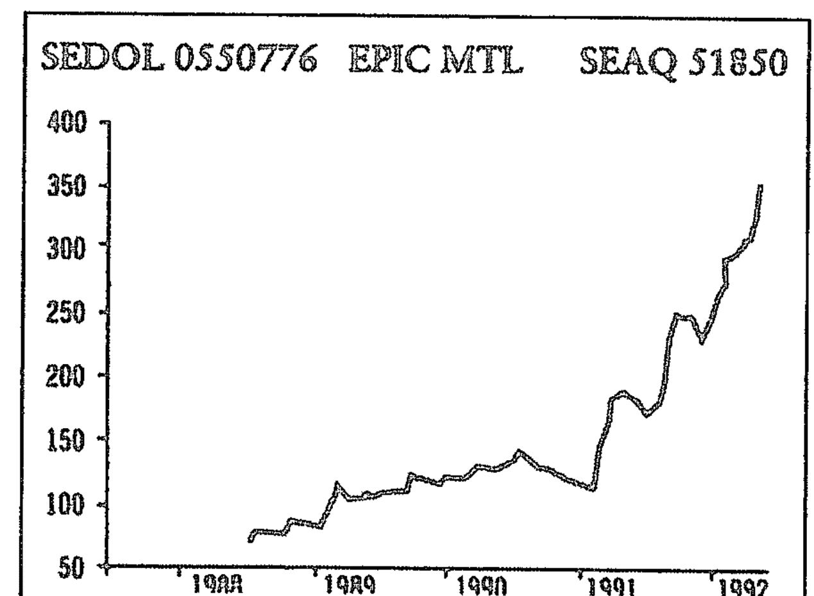

#### 通用電器

面值5便士

股價222便士

總市值：59.93億鎊

業務：生產電子、電器、發電設備與系統，業務分為11個部門：電子系統、電力系統、通信、消費產品、電子測量、辦公室設備與印刷、醫療設備、電子元件、工業設備、流通與貿易及其他業務。

| 券商 | 評等 | 預測日期 | 稅前盈餘 (1992/03) | 每股盈餘 (1992/03) | 每股股利 (1992/03) | 稅前盈餘 (1993/03) | 每股盈餘 (1993/03) | 每股股利 (1993/03) |
| :--- | :--- | :--- | :--- | :--- | :--- | :--- | :--- | :--- |
| BZW | 買進 | 30/3/92 | 820.0 | 18.4 | 9.40 | 860.0 | 19.7 | 10.06 |
| 查爾斯史丹利 | B1 | 13/1/92 | 840.0 | 18.8 | 9.50 | 900.0 | 20.0 | 10.00 |
| 國民西敏 | 續抱 | 24/4/92 | 815.0 | 18.4 | 9.30 | 845.0 | 19.4 | 9.70 |
| 里昂信貸 | 買進 | 1/4/92 | 820.0 | 18.7 | 9.60 | 870.0 | 19.8 | 10.20 |
| 吉羅森華 | 買進 | 26/5/92 | 830.0 | 19.0 | 9.50 | 865.0 | 19.7 | 10.00 |
| 浩威 | 低估股價 | 22/4/92 | 810.0 | 18.3 | 9.25 | 835.0 | 19.0 | 9.25 |
| 詹金寶 | B3 | 27/4/92 | 820.0 | 18.4 | 9.50 | 865.0 | 19.7 | 10.00 |
| 佳信 | 買進 | 24/3/92 | 840.0 | 18.7 | 9.50 | 920.0 | 20.9 | 10.30 |
| 雷曼兄弟 | 3M | 20/5/92 | 835.0 | 19.1 | 9.25 | 917.0 | 21.0 | 9.90 |
| 日興 | 長期買進 | 4/12/91 | 840.0 | 19.1 | 9.30 | 900.0 | 20.5 | 9.80 |
| 野村 | 續抱 | 28/5/92 | 815.0 | 18.6 | 9.40 | 855.0 | 19.9 | 9.80 |
| 潘姆爾 | 續抱/買進 | 3/6/92 | 830.0 | 18.8 | 9.55 | 890.0 | 20.1 | 10.20 |
| SGST證券 | 加碼 | 2/6/92 | 850.0 | 19.3 | 9.60 | 900.0 | 20.7 | 9.90 |
| 薩羅門 | 買進 | 23/4/92 | 830.0 | 18.6 | 9.25 | 870.0 | 19.8 | 10.00 |
| 史密斯紐克 | 買進 | 24/1/92 | 830.0 | 18.9 | 9.40 | 855.0 | 19.6 | 9.70 |
| 瑞銀菲立普 | 買進 | 10/4/92 | 830.0 | 18.3 | 9.60 | 880.0 | 20.1 | 10.10 |
| 華寶 | 加碼 | 7/4/92 | 820.0 | 18.6 | 9.50 | 860.0 | 19.6 | 9.90 |
| 威廉斯 | 續抱 | 2/4/92 | 855.0 | 19.2 | 9.20 | 910.0 | 20.1 | 9.80 |
| **共識預測值** | | | **829.1** | **18.8** | **9.43** | **877.0** | **20.0** | **9.93** |
| 和前一年比較的百分比變化 | | | +1 | +1 | +2 | +6 | +6 | +5 |

*預估本益比與股利率共識值（1992）：11.8倍，5.7%*
*預估本益比與股利率共識值（1993）：11.1倍，6.0%*

**截至1991年3月股價比較**
稅前盈餘 817.6 本益比 11.9
每股獲利 18.6 股利率 5.5
稅務費用 35
淨股利 9.25

**股價比較**
- 一個月 -0%
- 三個月 -1%
- 一年 +3%

**大股東**
| 保誠集團 | 7.04% |
| :--- | :--- |
| 非立普基金經營階層 | 3.01% |

**重要公告日期**
| 半年報 | 4/12/91 |
| :--- | :--- |
| 年報 | 2/7/91 |
| 會計帳目 | 5/8/91 |
| 股東會 | 6/9/91 |

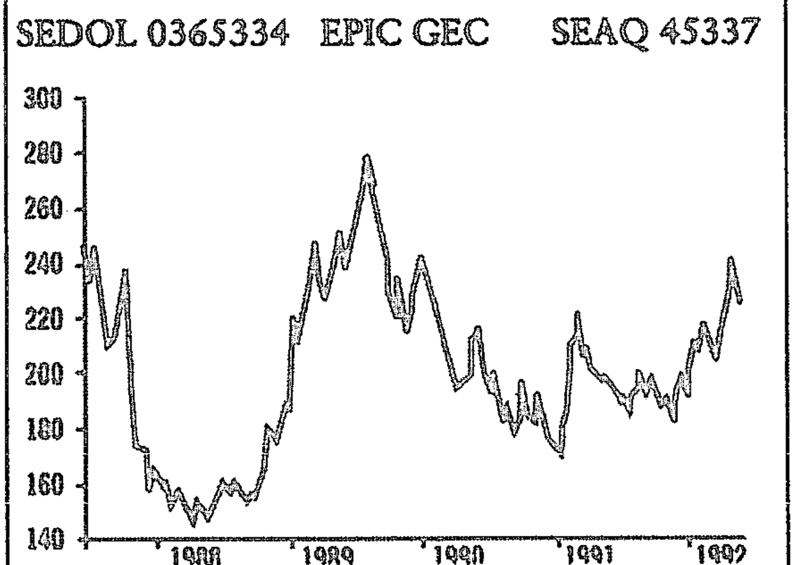

我喜歡總市值低於1億鎊的成長股，金融時報500種股價指數大部分成分股都遠超過這個數字。然而，為了說明我投資領導股的方法，我暫時要把注意力，放在1992年6月的金融時報100種股價指數上。

下頁所示的績優領導股需要分類和詳細分析，我們首先找出超級成長股，選擇標準不是根據公司的名聲，而是根據公司近年的實際表現，選擇的標準如下：

- 過去五年每股盈餘複合成長率15%。
- 至少有四年正成長。
- 去年每股盈餘至少成長15%。
- 每年分派股利，過去五年未曾減少股利。


#### 1992年6月18日金融時報100指數成分股一覽表

| 公司名稱 | 截止日期 | 1987 | 1988 | 1989 | 1990 | 1991 | 1992 |
| :--- | :--- | :---: | :---: | :---: | :---: | :---: | :---: |
| ABBEY NATIONAL | 12/91 | - | - | - | +16.7 | +9.3 | - |
| ALLIED-LYONS | 2/92 | +34 | +17 | +14 | +4 | +8 | - |
| ANGILIAN WATER | 3/91 | - | - | - | - | +7 | - |
| ARGYLL GROUP | 3/92 | +7 | -1 | +17 | +25 | +27 | - |
| ARJO WIGGINS APL | 12/91 | - | - | - | - | -25 | - |
| ASSD. BRIT.FOODSBA A | 9/91 | +20 | +2 | +14 | +21 | +13 | - |
| BAA | 3/92 | - | +30 | +36 | +21 | -44 | - |
| BANK OF SCOTLAND | 9/92 | +21 | +15 | +29 | +13 | -44 | -23 |
| BARCLAYS | 12/91 | -71 | +296 | -54 | -13 | -39 | - |
| BASS | 9/91 | +22 | +12 | +22 | +9 | -1 | - |
| BAT INDS. | 12/91 | +1 | +20 | +21 | -64 | +34 | - |
| BET | 3/92 | +19 | +13 | +16 | +11 | -35 | - |
| BLUE CIRCLE IND. | 12/91 | +22 | +19 | +5 | -23 | -36 | - |
| BOC GROUP | 9/91 | +39 | +22 | +11 | +4 | -15 | - |
| BOOTS | 3/92 | +9 | +7 | +18 | +20 | -3 | - |
| BOWATER | 12/91 | +34 | +26 | +26 | -8 | -2 | - |
| BRIT.AEROSPACE | 12/91 | -100 | - | -9 | +63 | -56 | - |
| BRIT.PETROLEUM | 12/91 | +139 | -20 | +60 | -1 | -76 | - |
| BRITISH AIRWAYS | 3/91 | +7 | +7 | +22 | +42 | -43 | - |
| BRITISH GAS | 12/91 | - | -3 | +8 | -4 | +34 | - |
| BRITISH STEEL | 3/92 | - | - | - | +1 | -47 | - |
| BRITISH TELECOM | 3/92 | +25 | +10 | +10 | +10 | +13 | - |
| BTR | 12/91 | +11 | +23 | +27 | -11 | -10 | - |
| CABLE & WIRELESS | 3/92 | +9 | -5 | +35 | +20 | -3 | - |
| CADBURY SCHWEPPES | 12/91 | +30 | +23 | +8 | +2 | +7 | - |
| CARLTON COMMS. | 9/91 | +35 | +49 | +34 | -16 | -33 | - |
| COATS VIEYLLA | 12/91 | +26 | -41 | -7 | -20 | -6 | - |
| COMMERCIAL UNION | 12/91 | +7 | +3 | +9 | -91 | -100 | - |
| COURTALDS | 3/92 | +28 | +6 | -12 | +16 | +6 | - |
| ENG. CHINA CLAYS | 12/91 | +22 | +27 | +5 | -46 | +24 | - |
| ENTERPRISE OIL | 12/91 | +74 | +5 | +61 | +14 | -19 | - |
| FISONS | 12/91 | +14 | +21 | +22 | +18 | -21 | - |
| FORTE | 1/92 | +22 | +16 | - | - | +3 | - |
| GENERAL ACCIDENT | 12/91 | +7 | +25 | -43 | -100 | - | - |
| GENERAL ELEC. | 3/91 | +5 | +9 | +14 | +5 | -7 | - |
| GLAXO HDG. | 6/91 | +42 | +15 | +14 | +21 | +12 | - |
| GRANADA GROUP | 9/91 | +21 | +2 | +23 | -28 | -47 | - |
| GRAND MET. | 9/91 | +18 | +24 | +15 | +16 | +7 | - |
| GT.UNVL.STORES | 3/91 | +24 | +11 | +4 | +5 | +4 | - |
| GUARDIAN RYLEX. | 12/91 | +6 | +44 | -41 | -100 | - | - |
| GUINNESS | 12/91 | +6 | +25 | +33 | +24 | +11 | - |
| HANSON | 9/91 | +34 | +11 | +18 | -2 | -11 | - |
| HILLSDOWN HDG. | 12/91 | +38 | +22 | +17 | -19 | -24 | - |
| IMP.CHM.INDS. | 12/91 | +24 | +13 | -1 | -33 | -16 | - |
| INC H APE | 12/91 | +48 | +31 | +6 | -15 | +21 | - |
| KINGFISHER | 1/92 | +25 | +9 | +17 | +11 | +1 | +0 |
| LADBROKE GROUP | 12/91 | +28 | +34 | +24 | +14 | -40 | - |
| LAND SECURITIES | 3/92 | +14 | +11 | +10 | +16 | +22 | - |
| LASMO | 12/90 | - | -42 | +176 | +35 | - | - |
| LEGAL & GENERAL | 12/91 | +6 | +86 | +3 | -43 | -44 | - |
| LLOYDS BANK | 12/91 | -100 | - | -100 | - | +5 | - |
| MARKET & SPENCER | 3/92 | +22 | +19 | +7 | +12 | +4 | - |
| MB·CARADON | 12/91 | +30 | +16 | +12 | -25 | -4 | - |
| NAT.WSTM.BANK | 12/91 | -39 | +116 | -71 | -25 | -41 | - |
| NATIONAL POWER | 3/92 | - | - | - | - | - | - |
| NFC | 9/91 | - | - | - | +4 | +7 | - |
| NORTH WEST WATER | 3/92 | - | - | - | - | +207 | - |
| NORTHERN FOODS | 3/92 | +13 | +10 | +10 | +7 | +16 | - |
| PEARSON | 12/91 | +25 | +7 | +25 | -13 | -24 | - |
| PEN.&ORN'TL.DFD | 12/91 | +11 | +21 | +21 | -35 | -22 | - |
| PILKINGTON | 3/92 | +288 | +7 | +2 | -7 | -61 | - |
| POWERGEN | 3/92 | - | - | - | - | - | - |
| PRUDENTIAL CORP. | 12/91 | +35 | +31 | +19 | -53 | +0 | - |
| RANK ORG. | 10/91 | +25 | +28 | +2 | -4 | -41 | - |
| RECKITT & COLMAN | 12/91 | +20 | +23 | +10 | +12 | +1 | - |
| REDLAND | 12/91 | +29 | +20 | +38 | -12 | -41 | - |
| REED INTL. | 3/92 | +18 | +15 | +1 | +9 | -16 | - |
| RENTOKIL GROUP | 12/91 | +24 | +38 | +24 | +21 | +27 | - |
| REUTERS HOLDINGS | 12/91 | +34 | +23 | +36 | +14 | +9 | - |
| RMC GROUP | 12/91 | +38 | +39 | +17 | -18 | -36 | - |
| ROLLS-ROYCE | 12/91 | - | +20 | -0 | -20 | -51 | - |
| ROTHMANS INTL.' | 3/92 | +30 | +16 | +19 | +23 | +22 | - |
| RYL.BK.OFSC'TL. | 9/91 | -17 | +132 | -31 | +5 | -71 | - |
| ROYAL IN.HDG. | 12/91 | -33 | -15 | -40 | -100 | - | - |
| RTZ CORP | 12/91 | - | - | +18 | -19 | -25 | - |
| SAINSURY J | 3/92 | +21 | +23 | +17 | +24 | +20 | - |
| SCOT.&NEWCASTLE | 4/91 | +11 | +11 | +14 | +20 | +17 | - |
| SCOTTISH POWER | 3/92 | - | - | - | - | - | - |
| SEARS | 1/92 | +12 | +9 | +12 | -18 | -27 | - |
| SEVERN TRENT | 3/91 | - | - | - | - | +2 | - |
| SHELL TRANSPORT | 12/91 | +13 | +3 | +46 | -7 | -43 | - |
| SIEBE | 3/91 | +13 | +36 | +16 | +15 | -19 | - |
| SMITH & NEPHEW | 12/91 | +14 | +11 | +11 | -10 | -7 | - |
| SMITH,WH GP.'A' | 5/91 | +20 | +18 | +13 | +10 | -2 | - |
| SMITHKLINE BHM.A | 12/91 | - | - | - | +14 | +21 | - |
| SUN ALL.GP. | 12/91 | - | - | -15 | -100 | - | - |
| TATE & LYLE | 9/91 | +35 | +23 | +29 | +11 | +16 | - |
| TESCO | 2/92 | +40 | +19 | +13 | +21 | +27 | +14 |
| THAMES WATER | 3/91 | - | - | - | - | +24 | - |
| THORN EMI | 3/92 | +50 | +40 | +17 | +11 | -19 | - |
| TOMKINS | 4/91 | +71 | +42 | +35 | +21 | +0 | - |
| TSB GROUP | 10/91 | +62 | +45 | +13 | -34 | -100 | - |
| UNILEVER | 12/91 | +15 | +3 | +30 | +8 | +7 | - |
| UNITED BISCUITS | 12/91 | +14 | +15 | +5 | +2 | +5 | - |
| VODAFONE GP. | 3/92 | - | - | - | +91 | +42 | - |
| WELLCOME | 8/91 | +33 | +38 | +29 | +18 | +25 | - |
| WHITBREAD' A' | 2/92 | +9 | +14 | +13 | +18 | +11 | - |
| WILLIAMS HDG. | 12/91 | +31 | +32 | +10 | -24 | +1 | - |
| WILLIS CORROON | 12/91 | -26 | -37 | +33 | +17 | -18 | - |

一百檔成分股經過上述四個標準評估後，只剩下七家公司，包括能多潔、羅絲曼（Rothmans）、森寶利、泰萊（Tate & Lyle）、特易購、英之傑與衛爾康。

有幾家著名的成長股沒有通過標準，因為在去年的經濟衰退環境中，15%的每股盈餘成長標準太高，如果我們把去年的每股盈餘成長上限降為12%，葛蘭索公司就可以勉強通過。如果過去五年的複合成長率標準降為每年12%，那麼可以再增加四檔股票，包括雅閣集團、英國聯合食品（Associated British Foods）、英國電信（British Telecom）與蘇格蘭紐卡索（Scottish & Newcastle）。不幸的是，複合成長率23%的路透公司（Reuters）和複合成長率19.5%的健力士公司都沒有通過，完全是因為去年申報的每股盈餘達不到標準，兩家公司申報的1991年每股盈餘分別為9%和11%。我們會把這兩家公司納入，還加上成長強勁，但是記錄期間比較短的沃達豐和史克必成（SmithKline Beecham）。

很多著名公司沒有通過我們的標準，例如馬莎和湯金斯，兩家公司去年的盈餘只略微成長，韓森公司去年的盈餘略微下降。

我們的最後名單只包括十六檔股票，也就是金融時報100種指數成分股中大約六分之一股票入選。請記住第七章競爭優勢的說明，注意這十六檔股票的共同特性。其中五家從事食品零售與生產，兩家是釀酒業者，三家是擁有專利產品的大藥廠，羅絲曼擁有絕佳的國際品牌，能多潔擁有非常強而有力的事業關係。

我們要用1992年6月號《估計目錄》中的股價和未來預測，看看這些績優公司的預估本益成長比，是否符合我們已經提高的1倍限制：

##### 雅閣集團

1993年3月截止的年度內，共識每股盈餘成長率預測值為11%，以350便士的股價計算，預估本益比為13.1，本益成長比為1.19

##### 健力士

1992年12月結束的一年內，共識每股盈餘成長率預測值為11%，下一年度為13%，以608便士與1992年度12%的平均成長率計算，1992年度的平均預估本益比為15.4倍，本益成長比為1.28。

##### 能多潔

1992年12月截止的年度內，共識成長率預測值為21%，下一年度為19%，以179便士的價格計算，1992年度的預估本益比為23.9倍，1993年度為19.9倍，以平均20%的成長率計算，未來一年平均預估本益比為21.9倍，本益成長比為1.10。

##### 羅斯曼

1993年3月截止的年度內，共識成長率預測值為9%，以1,100便士的價格計算，預估本益比大約為11.9倍，預測本益成長比為1.32。

##### 森寶利

1993年3月截止的年度內，共識成長率預測值為13%，以475便士的價格計算，預估本益比為16.6倍，本益成長比為1.28。

##### 泰萊

1992年9月截止的年度內，共識成長率預測值為1%，1993年9月截止的年度為10%，平均為5.5%，以392便士的價格計算，預估本益比為11倍，本益成長比很高，達到2。

##### 特易購

1993年2月截止的一年內，共識成長率預測值為9%，以281便士的價格計算，預估本益比為12.8倍，預估本益成長比為1.42。

##### 衛爾康

1992年8月截止的一年內，共識成長率預測值為24%，下一年度為23%，以971便士的價格計算，1993年度的預估本益比為21.8倍，預估本益成長比為0.94，根據我們的系統，顯然是買進目標。

##### 葛蘭索

1993年的共識成長率預測值為15%，以771便士的價格計算，預估本益比為19.7倍，預估本益成長比為1.31。

##### 英國聯合食品

1992年9月截止的一年內，共識每股盈餘成長率預測值為負31%，忘了這家公司的吧。

##### 英國電信

1993年3月截止的一年內，共識盈餘預測值下降，忘了這家公司。

##### 蘇格蘭紐卡索

1993年4月截止的一年內，共識成長率預測值為9%，以467便士的價格計算，預估本益比為12.5倍，預估本益成長比為1.39。

##### 路透

1992年12月截止的一年內，共識成長率預測值為11%，1993年12月截止的一年內為13%，以1,190便士的價格計算，預估本益比為18.5倍，根據平均成長率計算的本益成長比為1.54。

##### 沃達豐

1993年3月截止的一年內，共識每股盈餘成長率預測值為11%，以383便士的價格計算，預估本益比為19.1倍，預估本益成長比很高，達到1.74。

##### 史克必成

1992年度的共識成長率預測值為13%，1993年度為15%，以924便士的價格計算，平均預估本益比為15.8倍，本益成長比為1.13。

##### 英之傑

1992年12月截止的一年內，共識每股盈餘成長率預測值為17%，下一年為14%，以505便士的價格與平均15.5%的成長率計算，1992與1993年的平均預估本益比為15倍，本益成長比為0.97。

上述十六檔股票中，大部分股票的價格已經充分反應，我們再度看看這些股票的本益成長比分配：

| 代碼 | 股票名稱 | 說明 |
|------|----------|------|
| 0.94 | 衛爾康 | 低於1.0 |
| 0.97 | 英之傑 | |
| 1.10 | 能多潔 | |
| 1.13 | 史克必成 | 介於1.00與1.20之間 |
| 1.19 | 雅閣集團 | |
| 1.28 | 健力士 | 介於1.20與1.35之間 |
| 1.28 | 森寶利 | |
| 1.31 | 葛蘭索 | |
| 1.32 | 羅斯曼 | |
| 1.39 | 蘇格蘭紐卡索 | |
| 1.42 | 特易購 | |
| 1.54 | 路透 | 超過1.35 |
| 1.74 | 沃達豐 | |
| 2.00 | 泰萊 | |
| -    | 英國聯合食品 | 不適用 |
| -    | 英國電信 | |

根據為未來成長率付出的價格計算，我們只勉強找到衛爾康與英之傑兩檔股票似乎是便宜貨。衛爾康會納入，原因之一很可能是衛爾康基金會打算賣出價值30億鎊的股票，有些造市者可能賣出這檔股票，打壓股價，希望將來以比較低的價格回補。我們把預估本益成長比的限制降為1.20後，投資組合可以擴大包括五檔股票。我很高興看到能多潔是最先入選的股票之一，這檔股票一直是我在金融時報 100 種股價指數中最喜歡的股票之一。我們如果把限制降為1.35，還可以再納入四檔股票，使整個投資組合增加為九檔股票。

我敢說，你一定會注意到，上述九檔股票中，除了英之傑外，都擁有強大的競爭優勢，都屬於大家喜愛的產業。你應該也會預期這些股票的資本報酬率比平均水準高很多。

看看下列細節：

### 1987 至 1991 年間的平均資本報酬率（%）

| 指標 | 數值 |
| --- | --- |
| 衛爾康 | 26.53 |
| 英之傑 | 26.29 |
| 能多潔 | 53.34 |
| 史克必成 ＊ | 43.73 |
| 雅閣集團 | 26.67 |
| 健力士 | 23.51 |
| 森寶利 | 22.60 |
| 葛蘭素 | 37.12 |
| 羅斯曼 | 26.48 |

＊ 史克必成的平均資本報酬率只有 1989 至 1991 三年的記錄

繼續探討前，我們要先說明四個重點：

1. 股價、公司業績、預測值與行情不斷變化，我只能告訴你 1992 年 6 月的大致狀況。
2. 我所用的算術很粗糙，沒有詳細評估公司的負債、期中業績和類似的因素，我的目的只是要說明基本觀念。
3. 我們目前處在很嚴重的經濟衰退期，很多原本應該納入的續優公司，去年的業績和明年的展望都受到不利影響。然而，像這樣的考驗時刻會讓超級成長股脫穎而出。
4. 這樣的評比意在選擇持續成長的股票，無疑會錯過很多很值得購買的復甦股與轉機股。

九檔最優質股票明年的平均預估成長率為14.8%，平均預估本益比大約為17倍，金融時報100種股價指數成分股的平均預估本益比，要看你認定的預估成長率而定。1992年6月中，金融時報100種股價指數的歷史本益比為16.5倍，費森斯公司（Fisons）發表令人失望的業績、英國工商總會（CBI）發表6月的經濟評估報告後，我估計明年的平均盈餘成長率最高可能只有5%。很多主要的券商目前都抱著這樣的看法，如果這種看法正確，這個指數的預估本益比大約為15.7倍。你很容易可以看出來，以明年可預期的14.8%平均盈餘成長率，購買前九檔已經考驗、平均預估本益比17%的股票，遠比以更低、更不可信的5%盈餘成長率，購買預估本益比15.7倍的金融時報100種股價指數成分股來得划算。換句話說，我們這些地位穩固的超級成長股溢價微不足道。

我對於得到這種結論極為驚訝，因此我再三評估金融時報100種股價指數，剔除大量的金融公司與本益比很高的復甦股，以及本益比很低的公用事業股。最後的結果相同，這些超級成長股似乎仍然是相對的便宜貨。雖然如此，我卻覺得這九檔股票的價格很貴，這一點完全是市場造成的。1992年6月，股價指數距離空前高峰不到10%，經濟展望卻仍然悲觀，如果你買賣頂尖的一百檔股票，你必須習於支付高出很多的本益成長比，換取更好的流動性和額外的安全性。我很有耐心，買進本益成長比低於0.66的小型公司股票意願強多了，有時候，你根本不能買賣，但是只要你投資所用的錢沒有其他用途，在我看來，投資本益成長比低很多的小型公司，獲得較高的風險報酬比率，似乎是更好的方針。

指數中的前一百檔股票相當特別，因此我們用同樣的方法，分析第二大公司（第101到200大公司），看看是否能夠找到有吸引力的便宜貨。符合五年複合成長率15%，去年成長率又達到15%的股票只有冰島超巿（Iceland Frozen Foods）、登喜路（Dunhill）、摩里森（W. Morrison）、史普靈蘭、快速儲蓄（Kwik-Save）和美體小舖。冰島超巿的預估本益成長比為0.85，史普靈蘭為0.87，美體小舖為0.90，三家公司的資本報酬率都很高。

我只是從尋找具吸引力成長股的觀點，分析第二大公司股票。指數中當然有很多轉機股、景氣循環股和資產股，第十一章提到的英國瓷土公司現在已經納入金融時報100種股價指數，就是最近出現轉機的絕佳例子。五百大公司股票中另一家比較不著名的公司是安莘國際，這家公司在1992年6月公布業績前大約一個月，引起我的注意。這檔股票的股價為483便士，宣布每股盈餘後，股價暴漲44%，總市值約為2.5億鎊。安莘國際的業務包括生命科學研究、健康照護、工業品質與安全保險。安莘國際只有70萬鎊的少少債務，券商對1992/93年稅前盈餘的共識預測值為2,470萬鎊，因此明年的成長率為20%。然而，券商的預測是在優於預期的業績公布前做的，我注意到《標準晚報》（Evening Standard）中指出，有一家券商已經考慮把安莘國際1992/93年度的稅前盈餘預測，提高為2,650萬鎊，使這檔股票的預估本益比變成16.5倍。稅前盈餘從2,070萬鎊成長為2,650萬鎊，等於增加580萬鎊，成長率為28%。如果我們保守一點，假設成長率為25%，本益成長比就是0.66（16.5/25），剛好符合我選擇小型公司的系統。

安莘國際是1980年代表現優異的股票，經過連續四年的獲利衰退後，在卡斯特爾（Bill Castell）領導下，由重視成本、商業方法的新經營階層經營，已經轉弱為強。因此，盈餘成長的一部分可能來自一次性的改善，然而，以這種規模和素質的公司來說，這檔股票對我相當有吸引力。

從預估本益成長比的觀點來看，你準備投資的公司規模越往下走，越符合便宜貨的條件。我們在百大股票中，只能找到兩檔股票符合我們的標準，本益成長比又低於1。在第二個百大公司中，我們找到三檔本益成長比更有吸引力的股票。再往下走，我們會找到預估本益成長比0.66的便宜貨安莘國際，再往下走到第二個千大股票，你可以找到預估本益成長比為0.45的英國資料管理公司，以及預估本益成長比為 0.60 的工業控制服務公司。在不同的本益成長比範圍內找股票，多少類似尋找平價古董，如果你在龐德街（Bond Street）的商店裡買古董桌，你付的價錢當中，有一部分代表倫敦精華商業區的租金。然而，如果你購買的收藏品有重大瑕疵，龐德街商店退錢給你的可能性，高於尤斯頓車站（Euston Station）附近偏僻小巷裡的小型古董店。毫無疑問地，小型公司的股票風險比較高、流動性比較低，這種情形反映在你支付的本益成長比上。我認為，這種情形經常使便宜貨的價值變得令人無法抗拒。

如果你對復甦股有興趣，你應該看歐席金斯（Michael O'Higgins）寫的《打敗道瓊指數》(Beating the Dow)。他的投資系統基本上是在每年開年時，選擇道瓊工業股價指數（DJIA）三十檔成分股中股利率最高的股票，再選擇其中五檔價格最低的股票（他說比較低價的股票通常總市值比較小，小公司漲幅比率通常超過大型公司。他沒有說大象不會疾奔，但是我們知道他的出發點）。歐席金斯主張，過去二十年內，如果你遵循他這種簡單的系統，賺到的平均年度報酬率應該會超過 20%，相比之下，道瓊工業指數的平均年度報酬率只有 10.92%。柯根（Philip Coggan）拿英國的股票，做過類似的測試，結果刊在《金融時報》上，他發現，從 1979 年起投資 10,000 鎊，股利再投資，到 1992 年初，會成長為 13 萬鎊以上，同樣的金額投資在金融時報綜合股價指數上，股利也再投資，會成長為 81,540 鎊。股利再投資是重要的條件，因為這種系統選擇的股票都具有高股利率。

如果你決定專門投資大型公司，我建議你只投資五百大股票，下一步是為你想找的股票，定出投資標準。例如，如果要投資資產股，要找股價低於淨值、沒有過多負債或當期虧損的公司；如果要投資景氣循環股，要找營業額超過總市值5倍、資產淨值占股價80%以上、負債不超過淨值100%的股票。然後你應該要求已經對你刮目相看的營業員，為你選擇的公司進行分析。你選擇的少數股票通過檢驗後，你應該看報紙剪報、研究年報和《估計目錄》雜誌對這些公司的預測，確定這些公司符合你所有安全標準。

你會發現，這種方法遠勝過你隨心所欲地買股票。五百大股票中，很可能藏了寶石，你可以確定的是，不做研究，你不可能找到藏起來的東西。

# 第15章  
外國股市

身為祖魯法則潛在信徒，很可能更應該先在自己的後院裡，成為一種投資方法的專家。

我投資積極成長股的系統用來投資美國股票特別好用，拿來投資其他外國市場也很好用。美國和英國有一些重大差異，包括美國的會計標準比英國嚴格多了，每季要發佈一次財報，成長公司比較多，投資管理的複雜程度也不同。

你開始投資美國前，必須擴展閱讀習慣。《華爾街日報》是媲美《金融時報》的好報紙，每天都必須看。《價值線》（Value Line）是十分優秀的週刊，也是必看的讀物，這本雜誌要是在英國發行，也會極為成功。《價值線》的分析師每週大約深入分析與評估兩百家公司，做出及時安全投資表（Timeliness and Safety），列出每檔股票詳細的統計數據，說明每季盈餘成長、資產負債表、淨值、股價走勢、相對強弱和分析師的詳細評估。《價值線》及時投資表上精選推薦的股票，表現年復一年大幅超越大盤。

《價值線》除了個股外，也針對自己評估的所有股票，刊出進一步的統計，強調高股利率股票、善於創造高現金流量的股票、對淨值折價最大的股票、最低本益比、最高資本報酬率和高成長的股票。真是投資分析師的樂園。

我記得幾年前，我在對資產價值折價和本益比特別低的股票欄中，找到價位為68美元的塞拉尼思（Celanese），塞拉尼思每股也擁有28美元的現金，是貨真價實的寶石。大約一年後，公司被德國的化學巨擘赫斯特公司(Hoechst)以每股245美元的高價併購。

《巴隆》（Barron's）也是十分出色的週刊，大致上和英國的《投資客紀事》相等，但是《巴隆》的文筆比較辛辣，幽默感也直接多了。《巴隆》除了在美國投資方面引導你之外，也可以幫助你更了解全球觀點。在這方面，另外一本書有幫助的雜誌是多倫多的《銀行信用分析師》（Bank Credit Analyst），這本極為出色的月刊刊出詳細的統計，也刊出世界市場與外匯趨勢的評論，特別提到華爾街和美元。

你可以利用我的系統，輕鬆研究《價值線》每週的評估，你應該不會理會分析師針對及時安全投資表中所列股票的評論，只運用我的標準，自行計算本益成長比。一旦你做出結論，再用《價值線》的評等，比對你的結論。你會驚訝地發現，你選擇的股票經常是及時安全投資表中評等很高的股票。如果《價值線》的安全評等很低，你一定要小心，要再三查對你的數字。很可能會發現公司的借貸很高，或是有其他大問題。總之要記住，你不一定必須立刻投資，你可以等到下一週或下個月，同時繼續尋找絕對是真正寶石的股票，絕對不要為投資而投資。

當然你需要十分精通美國股票的營業員，你的英國營業員很可能可以替你處理股票買賣，但是你必須確定自己也能夠得到某種程度的回應，以及得知重大發展。雖然你不能期望得到太多幫忙，但是絕對要避免跟郵局打交道。你會需要某些指引，例如，評估股票價值時，你必須小心注意美國股市的三種特殊性質：

#### 退休後醫療債務

過去美國經理人和工會談判時，可能很大方，利用股東的資金，增加員工和自己退休後的醫療福利。1992年前，你在會計帳中，看不出這種福利造成的債務記錄，現在這種福利必須從獲利中扣除，有些大公司為了彌補過去的損失，未來幾年內會提列數十億美元。

#### 退休基金赤字

由於新法規的關係，今後公司的退休基金赤字必須在一定的年限內，從獲利中提列，對某些公司來說，這筆費用可能很龐大。

#### 環保署

美國人對企業造成的環保傷害，反彈一向很厲害。近年美國制定了不少環保法規，又有環保署負責制定標準，實施環保法規。凡是因為過去的環保傷害遭到損失的人，都可以控告造成傷害的公司，甚至超越公司，控告股東。凡是勞埃德保險社（Lloyd's）的會員都知道，美國法官通常都反企業，會裁定巨額的損害賠償。

這三種相當新的發展加在一起，表示很多大家認為體制健全的美國公司，都背負了龐大的潛在債務，這種債務甚至可能影響某些公司未來的生存能力。

有些投資人因為新興市場流動性不足、震盪幅度劇烈和外匯風險，避開印度、泰國和墨西哥之類的新興股市，但是你應該注意到，新興市場的投資績效即使經過風險調整後，仍然遠超過美國與歐洲。原因之一是開發中國家的經濟成長速度遠超過美國、德國、日本和英國之類比較成熟的經濟體，投資某個國家股市時，高經濟成長率是完美的背景，這種背景通常會促使個別公司賺到比較高的盈餘。新興市場表現比較好的另一個原因，是投資圈對這些地方的研究通常都不足，就像成熟市場中小型公司經常被人忽略一樣。評估每一個市場時，都要根據這個市場的優缺點來研究，特別重視政治穩定、經濟背景、基本價值、外匯風險與可能的投資機會等重點。

麥嘉華（Marc Faber）博士在《榮枯與厄運報告》（*Gloom, Boom and Doom Report*）月刊中，針對新興市場的生命循環，提

出了很有趣的摘要說明。他說：

首先，股票處於胚胎期。然後進入青少年期，成長很快速（多頭期），在這個階段裡，股票很容易碰到意外事故（崩盤）。到後來，市場成熟後，會失去一部分精力和波動性，變得疲勞，最後會死亡（空頭市場）。幸好股市在死亡之後通常都會新生，會像輪迴轉世後的生命一樣，展開一段和前一個循環性質大不相同的新循環。

現在我們看看他對每一期的說明，他的想法很值得研究，因為這種想法也透徹說明了所有市場的多空循環，說明了從大家對股票不感興趣的階段，進展到瘋狂的階段，然後回到投資人再度拋棄股票的階段。麥嘉華博士摘要說明他令人興趣盎然的研究時清楚指出，投資人的目的當然是要在第0期或第1期，進入相關的新興市場。他指出，在第1期和第2期間，個股的價值可能輕易上漲 20 到 50 倍，然後進入下一期的高風險區。

#### 新興市場生命循環

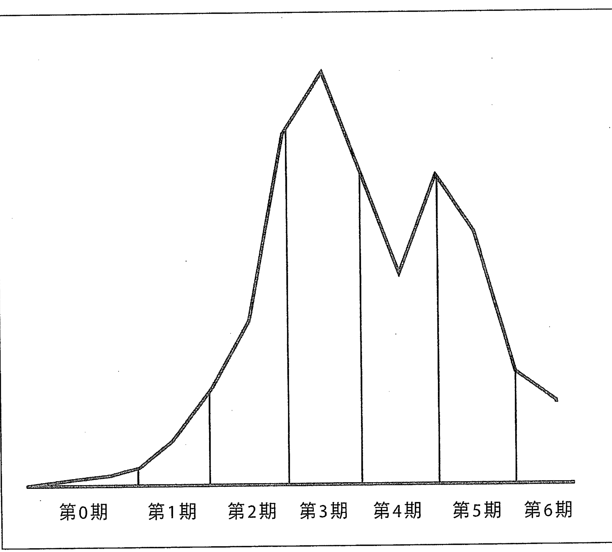

### 第 0 期

#### 事件

- 經濟長期停滯，或實質緩慢萎縮。
- 實質國民所得走平，或是下降若干年。
- 資本支出很少，國際競爭地位惡化。
- 政治與社會狀況不安定（罷工、高通貨膨脹、持續貶值、恐怖主義、邊界衝突等等）。
- 企業獲利低迷。
- 沒有外國直接投資或基金投資。
- 資本外逃。

#### 徵兆

- 觀光旅遊不振（不安全）。
- 旅館住宿率只有 30%，好幾年來沒有新建旅館，現有旅館逐漸變差。
- 晚上宵禁。
- 股票交易所成交量極低。
- 股市橫盤好幾年，或是略微下跌。
- 股票的實際價值低估到了可笑的程度。
- 沒有外國基金經理人來拜訪這個國家。
- 新聞一面倒都是負面消息、沒有外國券商設立分公司、沒有人推出國家型基金、長期沒有券商發布研究報告。

#### 例子

- 1980 年代的阿根廷。
- 1970 年代以前的中東。
- 第二次世界大戰後到 1980 年代末期的共產國家。
- 1990 年前的斯里蘭卡。
- 1980 到 1985 年間的菲律賓。

### 第 1 期

#### 事件

- 社會、政治與經濟狀況開始改善（新政府、新經濟政策、外部因素、重大發現、重要商品價格上漲）。
- 流動性改善，原因是出口增加、資本匯回以及外國直接間接投資增加。
- 未來獲利展望大幅改善。
- 現金餘額與財富增加。
- 消費、資本支出、企業獲利與股價開始急劇上升。

#### 徵兆

- 股價突然開始上漲。
- 觀光旅遊業好轉。
- 外國企業家對合資事業與其他直接投資開始感興趣。
- 旅館住宿率升到70%。
- 若干外國基金經理人開始投資。
- 宵禁解除。
- 稅法改變，鼓勵資本形成，吸引外國投資人。

#### 例子

- 1990年後的阿根廷。
- 1985年後的泰國。
- 1973年後的中東。
- 1984年後的墨西哥。
- 1978年後的中國。
- 1988年後的印尼。

### 第 2 期

#### 事件

- 失業率下降、工資上升。
- 擴大產能的資本支出飛躍增加，大家認為經濟狀況的改善可以永遠持續（錯誤的樂觀）。
- 外國資金大舉流入，把股價推升到高估的程度。
- 信用迅速擴張，導致實質資產與金融資產劇烈上漲。
- 不動產價格上漲好多倍。
- 新發行的股票與債券數量升到空前高峰。
- 通貨膨脹加速，利率開始上升。

#### 徵兆

- 商業首都看來像是巨型的建築工地。
- 旅館住滿外國企業家與基金經理人，施工中的新旅館很多。
- 國際新聞報導的消息都很有利。
- 外國券商出版大量很厚、很看好的國家研究報告，外國券商分公司紛紛開幕，推出很多國家型基金。
- 研究報告越厚、越多分公司開幕、越多基金推出，越接近第2期的末期。
- 處於第2期的國家通常會變成大家喜歡的旅遊目的地。

#### 例子

- 1987到1990年間的泰國。
- 1987到1990年間的日本。
- 1978到1980年間的科威特。

### 第 3 期

#### 事件

- 過度投資導致不少經濟部門產能過剩。
- 基礎建設問題與信用過度擴張，以新貸與不動產價格上升的形式表現出來，形成強大的通貨膨脹壓力。
- 企業獲利成長率放慢，某些產業的公司獲利開始下降。
- 震撼導致股價突然全面意外暴跌（震撼包括利率急劇上升、大型弊案、企業倒閉或若干外部震撼）。

#### 徵兆

- 很多連棟公寓、住宅計畫、新旅館、商業大樓與購物中心完工。
- 商業首都看起來像是「繁華的城市」，出現多彩多姿的夜生活與嚴重的交通壅塞。
- 經常會有一座新機場啟用，第二座新機場開始規畫。
- 規畫與開發「新市鎮」。
- 不動產與股市投機客得意洋洋，暴賺夜總會，他們白手起家的故事變成新聞界的大消息。
- 股市與不動產市場變成大家討論的題材，散戶與投機交易熱絡，大部分都是靠融資交易。
- 本地人開始積極投資自己毫不了解的國外資產（藝術品、不動產、股票、高爾夫球場等等）。

#### 例子

- 1990年後的泰國。
- 1980到1981年間的新加坡。
- 1990年的日本。
- 1990年的印尼。


#### 事件
- 1. 信用成長放慢。
- 2. 企業獲利惡化。
- 3. 很多產業的產能過剩變成問題，但是整體經濟表現仍然優異。大家認為經濟減緩只是暫時現象。
- 4. 股票經過初期劇跌後回升，錯過第 1 期與第 2 期股市上漲的外國投資人資金大量湧入市場，利率開始下降。
- 5. 因為大量新股滿足需求，股價無法漲到新高峰（賣方是比較了解情勢或缺現金的本地人）。

#### 徵兆
- 1. 連棟公寓價格超過本地人的購買力，現在開始在國外打廣告。
- 2. 商用不動產價值與租金開始走平或下降。
- 3. 入境觀光客人數減少、低於預期，旅館空房率上升，開始打折。
- 4. 券商繼續推出看多的分析報告。
- 5. 政治與社會狀況惡化（政變、強而有力的反對黨領袖、罷工、社會不滿、犯罪增加等等）。

#### 例子
- 1. 1991 年上半年的日本。
- 2. 1991 年的泰國。
- 3. 1930 年代初期與 1973 年秋季的美國。

### 第5期

#### 事件
- 信用緊縮。
- 經濟狀況嚴重惡化，但是社會與政治狀況惡化更厲害。
- 消費明顯減少或下降（汽車銷售、住宅與家電銷售量下降）。
- 企業獲利劇降。
- 股市進入漫長而嚴重的下跌趨勢，外國人開始退出市場。
- 不動產價格劇跌。
- 第3階段時屢屢成為新聞題材的「大型業者」破產。
- 公司短缺現金。

#### 徵兆
- 辦公大樓空置，旅館空房率很高，很多建築工地停工或無法完工。
- 券商裁員或關門。
- 研究報告變薄，第2期和第3期內溢價銷售的國家型基金現在折價銷售。
- 國家不再是大家喜愛的旅遊目的地。

#### 例子
- 1992年的泰國。
- 1982到1983年的新加坡。
- 1931年與1973年底的美國。
- 1992年初的日本。

### 第6期

#### 事件
- 投資人放棄股票，和高峰期的第 3 期水準相比，成交量大幅下降。
- 資本支出下降（錯誤的悲觀）。
- 利率進一步下降。
- 外國投資人對任何新投資失去胃口。
- 貨幣走弱或貶值。

#### 徵兆
- 消息變得很不利。
- 外國券商終於翻多為空。
- 航班、旅館與夜總會顧客稀少。
- 計程車司機、商店老闆與夜總會女服務生告訴你，他們的股票投資虧損了多少。

#### 例子
- 1932 年與 1974 年底的美國。
- 1974 年的香港。
- 什麼時候的日本？
- 什麼時候的泰國？
- 什麼時候的印尼？

麥嘉華博士在1992年6月號的雜誌中，刊出一張財富噴泉圖，希望根據新興市場國家的經濟發展與繁榮水準，為新興市場分類。噴泉的比喻十分完美，因為水從比較高的平台往下流，就像資金從物價水準高的富國，流向物價水準低的窮國一樣。噴泉底部的國家仍然處於第0期，只要吸引外國直接投資人的經濟與法律基礎建設形成，隨時可以升到第1期。

像阿根廷之類的國家可能迅速從其中一期，進入另一期。十八個月前，阿根廷可能還在噴泉下方，六個月前，已經升到第一個水盤，1992年6月時，已經升到更高的水盤。麥嘉華博士認為，今天擁有穩固的股市，卻仍然處在第1期的新興市場國家非常少。像巴西、哥倫比亞和阿根廷等少數國家可能仍然處在第2期，但是這些國家接近第3期時，崩盤的風險會增加。很多國家已經到達第4期或第5期，沒有必要急匆匆地搶進。

精確地在適當時間投資新興市場，會賺到很多錢，請記住，國家的選擇可能比股票的選擇還重要。《銀行信用分析師》發行了一本新雜誌，叫做《新興市場分析師》（Emerging Markets Analyst），應該可以幫助你做出正確的選擇。麥嘉華的雜誌也偶爾會強調很有吸引力的投資機會，然而，你身為祖魯法則潛在的信徒，很可能更應該先在自己的後院裡，成為一種投資方法的專家。

#### 財富噴泉圖

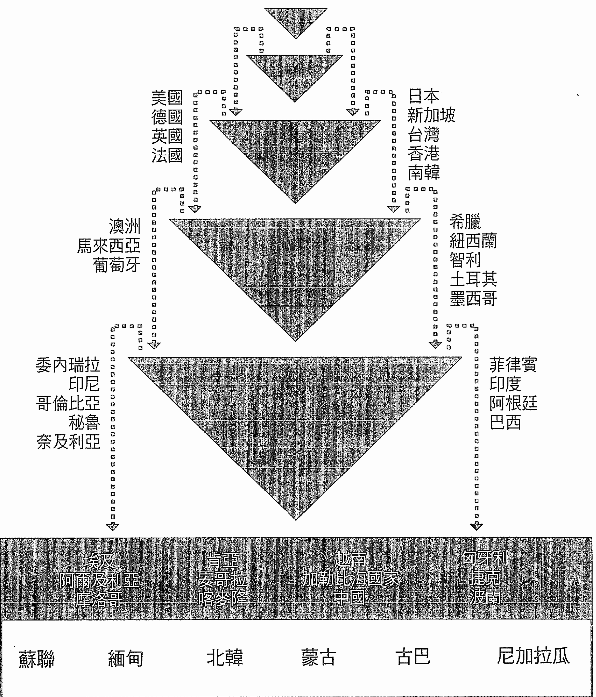

### Chapter 15 外圍股市

### Chapter 16

#### 投資盟友

我要的是事實，而且希望控制自己的幻想。

你必須找到好營業員幫忙你投資。多數比較大的券商会集中精神，服務投資機構、投資信託、單位信託和其他大型投資人，有些券商不接受初期投資組合總額不到10萬鎊的散戶。然而，有很多券商沒有最低金額限制，樂於協助最初投資組合總額低到1萬鎊的散戶。

券商買賣股票的手續費可能有不同，要看交易金額和客戶的重要性而定。只要券商提供良好的服務，你不應該抱怨每次交易，券商都向你收取最高的手續費率，你希望券商熱心、熱切地協助你，服務品質遠比手續費率重要多了。

你必須記住，不太重視手續費的券商營業員反而不自然。你交易越頻繁，營業員短期內賺到的手續費越多，但是我可以立刻向你保證，大部分營業員都會想到客戶的長期利益，不會只為了賺手續費就遊說客戶交易。你應該找重視價值、不重視報價的營業員。

你也必須小心自己有喜歡的股票，不斷向你報明牌的營業員。我要告訴你一位叫做丹恩的美國營業員的故事。他很熱衷推銷一檔叫做新奇產品公司（Widgets Inc.）的小型股，這檔股票在那斯達克股票掛牌，交易很稀少。他建議一位新客戶，以每股2美元的價格，買了5,000股，這檔股票果然漲了1倍。客戶打電話要買股票，丹恩回答說：「你一定是瘋了，這家公司擁有一種新產品，遠勝過原來的新奇產品，而且剛剛跟一家領導廠商簽了授權合約，你應該加碼買進才對。」客戶聽了他的話，用每股4美元的價格，又買了2,500股。

幾週內，這檔股票又漲了1倍，客戶說：「非常感謝你，你替我賺了很多錢，現在請你把我的股票全部賣掉。」

「你一定是瘋了，」丹恩說：「你知道我告訴過你的那家製造商吧，那家製造商要買下新奇產品公司，幾週內消息就會宣布，如果是我，我會加碼買進。」

「再替我買1,000股。」客戶回答。

幾週後，併購案雖然沒有發生，這檔股票卻漲到每股16美元，客戶高興極了，打電話給丹恩，丹恩還沒有開口，客戶就下了指令：「我現在要求你把我的股票全部賣掉。」

「賣給誰？」丹恩回答說。

很多散戶的問題是覺得自己最初的投資金額太小，對營業員來說太不重要，因此不敢多做要求。這樣說當然沒錯，但是不管散戶的投資金額多小，都可以而且應該要求營業員，提供最低水準的資訊。隨著散戶的投資金額增加，可以漸漸地要求營業員提升服務水準。下面我要說明散戶可以合理要求的最低服務水準：

- 1. 營業員的口頭或書面建議應該附有當期本益比的細節、股利率、每股淨值、總市值、過去的盈餘成長記錄、券商預估的未來成長率共識值、預估本益比、債券與券商認定的買進理由。如果你提出要求，營業員應該拿出股票的資料摘要表、相對強弱資訊與董事股票交易細節。
- 2. 交易委託應該以雙方同意的限價成交。
- 3. 成交後，如果有任何重大的新發展，營業員都應該通知你，例如董事的股票交易、公司的聲明和股價劇烈波動的細節。

隨著你們的關係發展，你變成大客戶後，你要是對任何股票有興趣，應該期望營業員提供股票的相對強弱圖表，如果有必要，也要替你拿到公司的年報和半年報。你的營業員也應該能夠提供過去六個月的剪報、其他大券商最近發行的刊物。除非你讓營業員賺到足夠的手續費，值得他為你提供特別待遇，否則你不能期望這種服務。你應該把自己的要求，限於索取你很可能投資的公司。你顯然不能用幾百個假問題，磨光營業員的耐心。

我過去打過交道的營業員當中，有的人喜歡打電話告訴我：「英國瓷土看起來很好，諸佛韓森公司要出價併購英國瓷土。」或是說：「特易購週三要發布業績，大家認為業績會比預期好，這檔股票看起來很便宜。」我痛恨這種股票明牌，這種明牌比一無是處還糟糕，這絕對無益良好的資金管理。營業員告訴我一檔股票看起來很好時，我立刻要求他提供本益比、資產價值、過去五年的記錄、成長率與券商共識預測值的細節。我要的是事實，而且希望控制自己的幻想。如果你也這樣做，營業員很快就會知道，你是少數徹頭徹尾只重視已知事實的怪人。一旦你和營業員建立了互動模式，營業員可以在你管理自己的投資時，變成寶貴的盟友和助力，而且也應該如此。重要的是，一開始你要明白表示自己會繼續投資下去。

你每天、每週和每個月閱讀的東西，是幫助你投資的另一種助力，你不應該低估你精通或有興趣領域的技術性和產業雜誌的重要性。你偶爾可能會注意到，某種新產品或新發明特別暢銷，你可以比一般市場人士更早利用這種資訊。要了解財經消息，最低限度你每天必須看《金融時報》，加上另一份好的日報，每週要看重要的週日版報紙和《投資客紀事》。《金融時報》是世界上最好的報紙之一，要投資英國股市，《金融時報》絕對是不可或缺的投資工具，即使你沒有時間每天細讀《金融時報》，也一定要看週末版，週末版會摘要說明主要市場一週的波動狀況，還有許多高於一般水準的絕妙文章。

我每天看很多份日報，也看大部分的週日版報紙，此外，我訂了《艦隊街通信》雙週刊（Fleet Street Letter），也訂了《股市投資人通信》週刊（Investors Stockmarket Letter），我也訂閱《低價股指南》（Penny Share Guide）和《低價股焦點》（Penny Share Focus），後兩本雜誌都是專攻小型公司的月刊。《經濟學人》每週出刊，是了解世界經濟與財政發展大勢的絕佳刊物，我特別向你推薦最後幾頁，上面的財金指標會列出一週與一週之間世界股市的表現比較，也會列出貨幣供給統計、世界利率、貿易帳、準備金、匯率、工業生產、國民生產毛額、國內生產毛額、零售銷售額、失業率、消費者物價、躉售價波動情形與工資上升幅度之類，以週為基礎的資料。

過去兩年來，我也訂閱《分析師》，這本雜誌每個月針對投資系統與投資方法，刊出很多有趣的深入探討，也刊載出色的公司介紹，以及小型成長公司的詳細評論。

我在探討美國股票那一章裡，提過《華爾街日報》、《巴隆》和《銀行信用分析師》，這些刊物都有助於提供全球性的投資大勢。我發現《銀行信用分析師》特別善於判定主要市場趨勢，尤其是華爾街的趨勢。《價值線》也是投資美國股票不可或缺的工具。

要即時了解市場大勢，大量閱讀很重要，就這點而言，《榮枯與厄運報告》是另一本有趣的雜誌。這本雜誌由麥嘉華博士發行，他經常過度悲觀，但是在開始覺得有點樂觀時，他的說法有助於讓我冷靜下來。

我也訂閱《估計目錄》，這本雜誌刊出券商對未來盈餘的共識預測值，也詳細說明有哪些券商針對相關公司發表書面報告。還有《董事動態》(Directus) 之類的出版品，特別強調董事的股票交易，但是除非你自己進行大量交易，否則你可以透過營業員取得這些資料，至少可以取得你特別感興趣的幾檔股票。

結束跟投資有關的閱讀前，我要向你推薦美國十本影響我投資思維的好書：

1. 《智慧型股票投資人》(*Intelligent Investor*) ——作者葛拉漢。巴菲特認為，這本投資經典是「歷來寫得最好的投資書籍」。這本書的主題是「價值型投資和有系統投資方法的優點」，不容易看，也看不快，但是充滿了啟示性與發人深省的觀念。
2. 《證券分析》(*Security Analysis*) —— 作者葛拉漢與杜德（David Dodd）。這本投資經典在第五版時徹底更新。這本書很難看下去，但是針對資產價值、現金流量與盈餘的評估原則和技術，做了極為詳細的說明。
3. 《異常流行幻象與群眾瘋狂》(*Extraordinary Popular Delusions & the Madness of Crowds*)——作者馬凱（Charles Mackay）。1841 年初版，是群眾心理學的經典傑作，讀起來很有趣，是我最喜歡的書籍之一。
4. 《金手指》(*Midas Touch*) —— 作者崔恩（John Train）。詳細說明巴菲特採用什麼策略，以成為美國最著名的投資大師，很容易看，也很有趣。
5. 《金融怪傑》(*Market Wizards*) —— 作者徐瓦格（Jack Schwager）。專訪商品市場與股市的頂尖交易專家，專門探討他們的方法與態度。
6. 《彼得林區選股戰略》(*One Up On Wall Street*) —— 作者林區（Peter Lynch）是美國最成功的基金經理人，這本是很容讀的絕佳好書。
7. 《股市趨勢技術分析》(*Technical Analysis of Stock Trends*) —— 作者愛德華茲（Robert Edwards）與馬基（John Magee）。本書是技術分析的權威之作，但是很不容易讀，只適合真正有心的投資人。
8. 《新股市大亨》(*New Money Masters*) —— 作者崔恩。這本書很有可讀性，說明索羅斯（George Soros）、林區與羅傑斯（Jim Rogers）之類投資大師極為成功的投資策略。崔恩的前一本書《股市大亨》(*Money Masters*) 也很有價值。
9. 《股票作手回憶錄》(*Reminiscences of a Stock Market Operator*) —— 作者李費佛（Edwin Lefevre）。這本書是傑西．李佛摩（Jessie Livermore）早年縱橫市場歲月的有趣記錄，說明不要和市場對抗，隨著大勢走十分重要。
10. 《打敗道瓊指數》—— 作者歐希金斯與湯恩斯（John Downes）。本書深入探討道瓊30種工業股價指數成分股，詳細說明買進不受歡迎的股票，報酬率遠勝過大盤指數的方法。

如果你不是專業投資人，你可能會發現，我推薦的一些書很不容易讀，因此我建議你，先看比較容易、有趣又有啟發性的書。為了讓你循序漸進，你可以試著先看《彼得林區選股戰略》，接著看《金手指》和《打敗道瓊指數》。如果你要運用祖魯法則，精通投資，你無可逃避，必須進一步研究。

### Chapter 17

#### 投資組合管理

「早早停損，累積利潤」，
這件事情說起來容易，做起來卻很難。

和擁有巨額資金必須操作的投資機構相比，操作小規模投資組合的散戶擁有很大的優勢。投資機構必須把資金分別投資在高達兩百檔股票上，有時候甚至還要投資更多檔，而散戶的投資組合中，很可能最多持有十到十二檔股票，我自己則是操作十二到十五檔股票，但是偶爾會降到八檔。

為什麼投資十檔股票比投資一百檔股票占優勢？你選擇的第一檔股票顯然遠勝過第十檔，第十檔顯然應該又遠勝過第一百檔。第二，你投資組合中的股票越少，越容易專心注意所有股票，祖魯法則在這裡再度得到印證。

在進行最初的確實查核後，我總是針對投資組合中的少數股票，設法做一份注意事項表。我當然會閱讀跟所有重大發展有關的東西，注意董事的股票交易，我也注意零售銷售額。下面我要告訴你一個最近的例子，就是皮森公司推出新的掌上型電腦後，碰到一些麻煩問題，必須收回不少產品的故事。我對這檔股票有興趣，每次我出門購物的時候，都會利用機會，到迪克森（Dixons）電子產品專賣店，假裝是有興趣的顧客，問店員皮森的產品銷售狀況如何，皮森的產品是不是有什麼問題，他們願不願意推薦更好的東西。

最近皮森碰到一些進階的技術性問題，造成有些電腦會喪失時間的記錄。我的營業員的一位朋友是電腦迷，買了更新版的產品，他現在很滿意，說新產品沒有其他問題。我也請一位當電腦顧問的朋友，替我買最新型的第三代掌上型電腦，加上適當的軟體，進行嚴格的測試，他告訴我的評估意見相當有利。

我急於確定初期的問題是不是科技突破和產品加強過程中正常的一環，或者是產品可能有持續不斷，而且代價高昂的特殊問題，結果讓我安心。如果我的投資組合涵蓋一百檔不同的股票，我應該不可能采用這種親力親為的做法。

你可能覺得我擁有特別的優勢，能夠查考我投資組合中的一家公司，事實上，你會驚訝地發現，你很可能最多只要隔一、兩個人，就能找到能夠告訴你答案的人。我记得我在讀蘭公司服務時，董事長布萊克勳爵（Lord Black）說過，國家攝影展覽館要他去照相，他對攝影師說，他很驚訝地發現，他認識照相館每一面牆上掛著的照片中的名人。攝影師笑著回答說：「他們全都這麼說。」世界很小，只要打一通電話，就可以找到能夠查證不同領域重大新發展的人。如果你真的想要查證一家公司的什麼問題，你很快就會找到一個人，認識另一位能夠回答你問題的人。你也可以試試看打電話給公司的主任祕書，說你是股東，希望澄清可能讓你擔心的一些事情，有些主任祕書確實很樂意幫忙，但是他们當然會避免告訴你任何「內線消息」。

要得到你所投資公司的資訊，還有一個很容易的方法，就是參加股東會。你會發現，參加股東會是有趣的經驗，有助於你了解公司。股東會的安排是否井然有序？董事長和執行長是否讓你印象深刻，是否妥當地回答問題？會議氣氛高昂還是低迷？這些都是你應該自問的一般性問題，如果你有什麼特殊問題得不到答案，你總是可以站起來，質問董事長。

剛才我提過「內線消息」這個可怕的字眼，這是不斷變化的灰色地帶。從投資人的觀點來看，重點是應該避免利用未公開且後來證實足以影響股價的消息，如公司未來的業績增減，或是即將遭到併購之類重大發展的資訊。根據還沒有公布的獲利變化訊息買賣股票，是違法的行為，因此你顯然最好避開以這種資訊為基礎的明牌。併購消息的內線交易味道更濃，因為所涉及的各方有義務，在協議經股東大會同意後立即公告（或併購者單方面決定具體條件時）。

研究大家都可以得到的券商共識預測，或是研究全國零售銷售狀況後，認定一家公司的表現可能沒有這麼好，跟從董事那裡得知公司的獲利下降，中間有很大的差別。根據一家公司的資產嚴重低估，斷定這家公司將來可能遭到併購，和知道一家企業集團即將併購這家公司，兩者之間也有明顯的不同。根據未發布的價格、敏感資訊進行買賣，是違法行為，根據大家都可以得到的是事實做出判斷，再據以行動，才是公平而合法的遊戲。

投資組合管理方面有一句老話：「早早停損，累積利潤」，這件事情說起來容易，做起來卻很難。巴菲特曾經用非常奇妙的方法，說明你為什麼應該遵循這種做法，他舉的例子是：把他研究所每一位同班同學未來一生能夠賺到的錢，都賣給他。我們把這個例子用在英國，假設一班有二十個人，也假設你可以用一定的金額，買下所有同學一生賺到的錢。十五年後，你評估自己的情形，其中兩位已經死亡，兩位中了毒癮，有一位得了愛滋病，一位關在監牢裡，三位失業。剩下的人當中，有一位是牧師、三位是會計師、兩位是律師，一位是警探，還有一位是演員，剩下的三位真正賺到了大錢。展翅高飛的三個人當中，有一位已經是產業領袖，另一位是重要的金融家，最後一位即將成為大公司的執行長。如果你必須用不同的價格做幾樣買賣，你會留下已經出局的人、表現不錯的人還是展翅高飛的人？我知道你的答案是什麼。

另一個比喻是：馬場主人用每匹馬2.5萬鎊的價錢，買進十匹一歲幼馬，然後很快就看出來其中七匹是劣馬，有兩匹相當有潛力，最後一匹絕對是明星馬，是成功的頂尖賽馬，可以賺到很多獎金和龐大的育種費。馬場主人必須降低訓練成本和養馬支

出，以籌募一些資金，他應該賣掉哪些馬？當然是先賣毫無希望的七匹劣馬，如果有必要，再賣有潛力的兩匹馬，他應該靠明星馬累積利潤。

深入研究同班同學和賽馬兩個比喻，很容易看出來什麼時候應該停損。賣掉出局的人和沒有希望的劣馬，原因是他們的題材改變了。你買進同班同學和一歲馬時，對其中一些人或馬匹抱的希望，可能比對其他人或其他馬匹高，但是你希望所有的人和馬都會成功。然而事實很明顯，失敗者粉碎了你的希望。

你應該還記得，第六章談「轉機與題材」時，我指出股票的題材是必須再三查核的重點，你必須持續不斷，用原來的題材和每一種新發展比較。以成長股為例，如果你發現股票的股利只能維持，而不是像過去一樣不斷增加，你就必須提高警覺，注意成長可能放慢。如果好幾位執行董事大量賣出新股，如果董事長的聲明變得更慎重，如果股票的相對強弱很差，如果你欣賞的執行長突然離職，如果資產負債表上的債務增加驚人，如果你聽到產品有大問題，如果你注意到公司大舉作帳，其中任何一個因素都足以讓你相信題材已經改變，當初買進的原因不再存在，這檔股票已經變成賣出標的。

可能的不利因素當中，唯一值得稍微懷疑的是，擔心股價的相對強弱很差，有時候，這種情形會不明不白地憑空出現。如果股價下跌，理論上，你可以用比最初買進價格低很多的折價，買進更多當初以相同題材吸引你的股票。然而，我的建議是絕對不要攤平。

股價表現差勁時，我會查證是不是有投資機構大量賣出，如果我能夠為股價下跌找到合理的原因，我會繼續持股續抱，否則持股會變得寢食難安。你現在很可能已經知道，我是個緊張的投資人，很容易擔驚受怕，我痛恨虧錢，偶爾會只因為股票的價格走勢讓我害怕，就把股票賣掉。

這其中沒有公式，你必須自己下定決心，如果你要為顯然不知道原因的虧損，訂出停損限制，我建議為成長股、轉機股和景氣循環股，訂出25%的停損限制，為借殼上市股訂出40%的限制。公式其實不能解決問題，每一檔股票都必須根據本身的優缺點考慮，判斷和直覺會發揮很大的影響力。

相形之下，如果一家公司的題材嚴重惡化，我會立刻賣掉，速度很重要，因為你總是希望排在失望的擁護者隊伍中的第一個。股票可能已經大幅下跌，遠低於你的買進價格，但是這點無關緊要，總歸是要停損，停損會讓你覺得如釋重負，投資組合的展望也會大幅改善。

我認為，停損很容易，理由很明顯，因為決定什麼時候獲利落袋顯然是最困難的事情。股票在不同的時間裡，可能是買進、續抱或賣出的標的，你會買進，是因為股票符合你所採用的投資系統標準。股價上漲後，這檔股票會變成續抱的標的，不再是買進標的，但是時機還沒有成熟到變成賣出標的。轉機股、景氣循環股和資產股賣出時機成熟的速度比成長股快，原因很簡單，因為其中通常都有一次性的獲利可以掌握。

一旦每個人都看出轉機股的轉機，一旦景氣循環股從經濟好轉中大幅受益，一旦資產股漲到比較符合基本價值的水準，股票就應該賣掉。你當初買進時寄望的狀況變化已經完成，現在應該尋找擁有相同初期潛力的另一檔股票，設法重複這種投資過程。

成長股可能大不相同（借殼上市股基於類似的原因也一樣），如果你經過很長一段時間的嘗試與錯誤後，找到一些優異的成長股，能夠以每年 20% 的超高成長率，創造每股盈餘，你一定不能輕易放掉這些股票，這些股票可能是你賺到驚人利潤的門票，你可能找到了另一檔嬰兒期的葛蘭素或韓森。

成長股的股價賣出時機開始成熟時，還有兩個原因，讓你考慮延長「續抱」的時間。第一個原因是換股的費用，你賣掉原有的股票，買進新的股票時，負擔的印花稅、交易手續費和造市者賺的差價加總起來，依據股票流通性的不同，可能要耗掉高達 5 至 10% 的成本。

第二個因素是資本利得稅，我已經解釋過，在實現大筆獲利時，等於實現最高可能達到 40% 的資本利得稅，這樣等於把同等金額的無息貸款還給政府。如果你繼續讓獲利累積，政府實際上等於借給你獲利的 40%，資助你無息購買股票。好好考慮一下，你讓獲利累積得越多，政府借給你的錢越多。

如果你以 0.75 以下的本益成長比，買進一檔成長股，盈餘一年成長 20%，本益成長比從 0.75 提高為 1.00，你會賺到 60% 的資本利得。如果公司繼續表現優異，看來像是長期贏家，我會繼續再抱一段期間，等到本益成長比升到1.2。換成用本益比的角度來看，這樣等於用15倍的本益比，買進年成長率20%的股票，在本益比升到24倍時賣出。經過一年後，20%的成長率加上本益成長比的變化，應該會使你的錢增加將近1倍，你可以忍痛跟這檔股票「揮別」。回頭想一想，或許我應該說「再見」，因為找到這麼好的續優股，你應該繼續關注這家公司，等待更好的買回時機。

你必須記住，市場經常會對超級成長公司過度寄予厚望，真正優異的公司可以對抗本益比很高的壓力，每年繼續創造20至25%的盈餘成長，因此最後基本面會趕上來，配合股價。其他令人失望（或許只讓人略為失望）的公司股價會崩跌，原有的擁護者會爭相出售持股。

你操作時，應該在累積超級成長股的獲利和合理、安全的狀況之間，求得適當的平衡。要說明這一點，最好的方法或許應該說：在景氣循環股、轉機股和資產股得到肯定時，就要賣掉，但如果是超級成長股，應該等到大家競相崇拜時才賣掉。

至於借殼上市股，我在第十二章裡建議過，你應該讓獲利累積一年，再評估整體狀況。要評估的基本面因素通常很少，你經常必須注意新的經營團隊，給他們足夠的時間好好表現。

你的投資組合構造如何，要看你採用的投資系統而定，我通常以成長股和借殼上市股為重。你必須做的另一個重大決定是在你開始覺得悲觀時，應該抱著多少現金。如果你的投資組合是用閒置資金買的，你可以繼續百分之百的投資。多頭市場是在大家憂心忡忡時上漲的，你的悲觀看法很可能錯誤。你可能輕易地決定賣股求現，隨後又在錯誤的時機再度全力投資。然而，偶爾增加現金部位可能讓你比較安心，如果是這樣，我建議你持有的最高現金比率為 50%。

要保護你的投資組合，還有一個方法，就是在期貨市場放空金融時報 100 種股價指數，也就是放空整個大盤，或是買進「賣出選擇權」。光是這個題目，我就可以再寫一章。金融時報 100 種股價指數涵蓋很多景氣循環股和公用事業股，因此這種技巧不見得能夠為可能表現差勁的所有成長股，提供足夠的保障。另一方面，金融時報 100 種股價指數通常可以用延期交易的方式放空（為未來的賣出日付息）。期貨市場有時候讓人膽戰心驚，你想要避險的股票經常激烈波動，讓人難過。我建議把選擇權和其他衍生性商品的交易，留給很有經驗的投資人去操作。

選擇權是另一種逐漸壯大的投資工具，到 1992 年 6 月，有六十六家大公司提供選擇權交易。如果你投資大型股，選擇權經常可以提供你相當大的操作槓桿，為你減少幾個百分點的風險。這個題目很專業，你必須另外研究。

我說明過的每一種投資方法都有安全因素，這樣應該有助於保護你，免於遭到龐大的損失。在嚴峻的空頭市場中，幾乎所有的股票都會下跌，但是用有系統的方式買進的股票，表現會遠勝過大部分股票。事實上，空頭市場即將來臨最可靠的指標之一是：你會發現非常難找到股票符合你的選股高標準。你必須賣掉投資組合中的很多股票，因為這些股票已經達成你的目標，也都已經反轉下跌了。

關於安全因素，我要冒著被嫌囉唣的風險，再度強調安全因素，適用於我們評估過的所有投資系統。要根據低本益比與低本益成長比買進成長股，和整個大盤相比，這兩種因素可以提供明顯的保障。此外，成長股也必須符合其他嚴格的標準，這些因素加在一起，會形成安全網。

轉機股和景氣循環股，應該在接近底部時買進，這時你有很好的理由希望情勢會好轉，或是景氣循環會復甦，這樣是另一種明顯的保障。如果是轉機股，在公司轉危為安、賺到不錯的利潤時，就應該賣掉。如果是景氣循環股，在大家普遍認定公司已經熬過衰退，營業狀況也比過去好時，就應該賣掉。

如果是資產股，應該在股價對可變現價值嚴重折價時買進，在其他投資人了解和充分反映這種價值後賣出。在這種情況中，你的保障是資產的折價和額外的安全標準。這種股票當然可能下跌，但是至少你是在相當低的價位買進，下檔風險比較小。

要為借殼上市股尋找保障比較難，你的主要安全因素是選擇擁有頂尖經營階層的公司，加上少許熱空氣缺口，和合理的流動性。如果你以投資借殼上市股為重，卻開始覺得很悲觀，即使你的資金是閒置資金，我也會建議你把現金部位提高到 50%。借殼上市公司在空頭市場中，表現通常很差，因為這種股票的股價，大部分是建立在對未來的期望和希望上，而且這種股票的市場可能突然萎縮，流動性變得不佳。

##### 重點摘要

- 1. 你的投資組合不應該超過十二檔股票，你必須用閒置資金買進。任何一檔股票的最低投資金額是 10%，最高金額是 15%。
- 2. 買進後，要確實維持親力親為的做法，你認識的人當中，有人會認識其他人，其他人又認識有助於回答你投資問題的人。你自己也可以變得很積極。
- 3. 獲利要累積，虧損要停損。
- 4. 大家比較願意累積獲利，原因包括換股成本，以及賣出時的資本利得稅負。你買進的股票累積獲利時，政府等於無息把資本利得稅負借給你。
- 5. 轉機股、景氣循環股和資產股獲利的時機，是大家普遍肯定轉機、景氣循環大步推進，或是股價已經升高到更接近資產價值時。
- 6. 成長股賣出獲利的標準應該比較高。獲利繼續以年率 20% 成長的金雞母應該繼續緊抱，抱到本益成長比升到 1.2 時賣出。即使是這樣，你很可能還是會後悔，因此要繼續關注這家公司，等待更好的買回時機。
- 7. 借殼上市股，獲利應該累積一年，好讓新經營階層有機會好好表現。
- 8. 題材惡化到你不再考慮買進時，所有股票都應該停損。
- 9. 如果股票的相對強弱很差，股價明顯不明不白地下跌時，你要找營業員查證市場狀況。如果你找不出原因，就必須運用自己的判斷和直覺，決定是否停損。如果你打算採用自動停損機制，我建議轉機股、景氣循環股和成長股的停損上限是虧損25%，如果是借殼上市股，我建議股價下跌40%時應該停損。
- 10. 你投資組合中的股票，可能是運用前面章節中所說，不同投資系統選出來的，但是每檔股票你最好都要運用粗魯法則。
- 11. 節省資本利得稅，尤其投資你希望長期持有的積極成長公司時。
- 12. 如果你覺得空頭市場即將來臨，要把現金部位提高到50%，除非你投資組合中的股票是用閒置資金買進的，無論情勢好壞，都可以投資下去，不必理會。如果是借殼上市股構成的投資組合，在市場大勢看起來有危險時，你一定要把現金部位提高到50%。
- 13. 選擇權、放空和其他衍生性商品的操作，只適合經驗豐富的投資人。
- 14. 我所說明的系統中，都有安全因素，不管是在有利或不利的市場狀況中，應該都有助於你的投資組合創造優異表現。

## 第18章
### 洞悉多空訊號

多頭和空頭市場的信號就像錢幣的兩面。

即使我能夠告訴你一些簡單的原則，讓你知道怎麼預測空頭或多頭市場，這個方法很快也會自行失效。隨著越來越多人採用我的成功公式，市場也會逐漸調整，因此到將來的某一個時點，這公式會變得沒有用。

我設法預測了1973至1974年和1987年的兩次空頭市場，在這兩段期間裡，我的時機都拿捏很好，但是我低估了最後跌勢的嚴重性，太早回補我的空頭部位。著名的美國市場技術分析大師葛蘭碧（Joe Granville）用十分貼切的說法，摘要說明了市場難以預測的特性：

空頭市場絕對不會事先約定來拜訪你，不會在白天到你門前按電鈴。空頭市場會像小偷一樣，在夜裡出現，在大眾安心地沉睡時，從後門偷偷溜進來。

我打算告訴你，怎麼辨認多頭市場的頭部和空頭市場的底部，但是不管你抱著什麼看法，你應該至少把50％的閒置資金投資在市場中。你要冒著誤判趨勢的風險，而且你應該記住：選股的重要性遠遠超過時機的選擇。不動產專家說過，投資不動產最重要的三件事情是：地段、地段、地段。投資股票很像投資不動產，只是關鍵的字眼是：選股、選股、選股。可口可樂是說明這個重點的最好範例，可口可樂在1919年成為美國的上市公司，

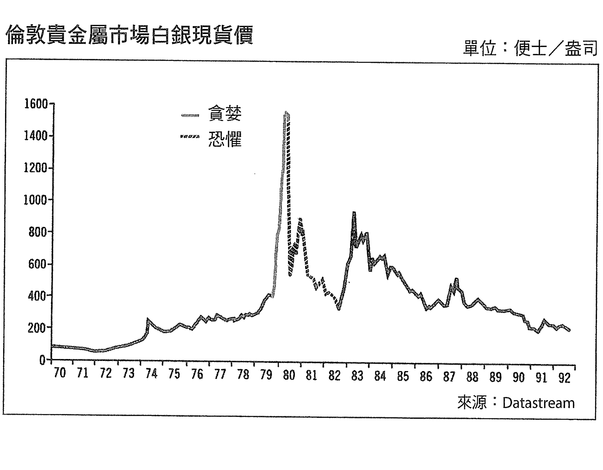

承銷價為每股40美元，隔年糖價劇烈上漲，可口可樂的股價跌破20美元。此後，可口可樂碰到很多次戰爭、極為嚴峻的空頭市場、經濟衰退、蕭條和糖價進一步大幅上漲。原始的40美元投資經過所有的盛衰榮枯，成長到每股高達180美元的水準。顯然結論是要選擇適當的超級成長股，無論情勢好壞都不離不棄。群眾心理會把市場推升到遠遠超過基本面價值，貪婪會把市場推升到令人目眩神搖的高峰，完全超過實際的基本面價值，恐懼會把市場推向另一個極端。

公司股價大致會配合盈餘與每股資產價值波動，但是偶爾幾年裡，股價和價值可能大幅背離。我記得1970年代期間，史萊特．渥克公司曾經投資自稱打算在澳洲發現大鎳礦蘊藏的波塞頓公司。我替我們旗下一家公司，用略低於每股1澳元的價格，買了3萬股，隨著股價上漲，我在10澳元賣掉1萬股，20澳元賣掉1萬股，最後1萬股以30澳元賣掉。我認為自己賣出的時機很恰當，卻看到股價漲到100元以上。隨後的耶誕節裡，營業員告訴我，另一家叫做北方富林德斯（North Flinders）的公司和另一家澳洲小公司，在波塞頓的鎳礦蘊藏附近，發現鎳礦。三家公司的股票飛躍上漲到極高的水準，以至於我心中想到，全世界，更不要說澳洲是否可能有足夠的鎳，足以支持三家公司的總市值。我心裡有點惱火，知道自己太早把3萬股的波塞頓賣掉，因此決定放空北方富林德斯公司，幾天後，我被迫回補空頭部位，因為這檔股票再度上漲1倍。幾個月後，波塞頓股價暴跌到大約4澳元，北方富林德斯公司再度變成默無聞的公司。這個故事的重點是：在基本面上，我絕對正確，但是我的時機糟透了，如果你有意改變疾奔而來的牛群方向，你必須等到牛跑累了，否則的話，你可能被牛群踩在腳下。狂潮的力量確實很強大，很長一段時間裡，會完全漠視基本面價值，最安全的方法是等到狂潮明顯開始洶氣的時候。

我刻意用「狂潮」這個字眼。在團體裡，大家的情緒和觀念會開始向同一個方向走，個人有意識的個性會消失，大家喜歡做「流行」的事情，也希望大家看到他這樣做，例如在「流行」的餐廳吃東西，看「流行」的戲劇，能夠說自己看了「流行」的書。根據勒龐（Le Bon）在他著名的傑作《烏合之眾》（The Crowd）一書中的說法：「毫無疑問，集體心理形成的時間相當短暫，卻呈現非常明確的特性。團體會變成……在心理上不一致的群眾，群眾會變成只能用意象的方式思考，只有意象能夠打動群眾。」立刻可能發財之類的意象容易了解，吸引力遠超過一些無聊，甚至可能讓人相當難過的基本面因素，像立刻發財這麼強而有力的意象，足以驅使群眾背離正常狀況，進入瘋狂的地步。

馬凱在傑作《異常流行幻象與群眾瘋狂》一書中，舉出了密西西比陰謀（Mississippie Scheme）與南海泡沫（South Sea Bubble）的例子。鬱金香狂潮（Tulip mania）一直是我最喜歡的故事。17 世紀初期，很多荷蘭人迷上收藏鬱金香球莖的習慣，甚至到了有錢人如果沒有收藏罕見的鬱金香球莖，就證明品味很差的地步。希望擁有鬱金香球莖的熱潮感染了荷蘭中產階級。到1636年，罕見鬱金香球莖的需求增加到極高的水準，以至於很多大都市的證券交易所裡，都設立了買賣鬱金香球莖的正規市場。隨著價格持續上漲，很多投機球莖的個人突然變得非常富有，各階層的人開始把辛苦賺來的錢，變成鬱金香球莖，鬱金香狂潮開始橫掃全國。

你大概會覺得奇怪，為什麼荷蘭人讓自己進入這麼脫離現實的狀態，一位不幸的水手應該跟你一樣覺得驚奇。他從商店裡偷了一顆鬱金香球莖，以為是洋蔥，幾小時後，就跟著早晨的鯒魚一起吞到肚子裡。這種鬱金香球莖叫做「永遠的奧古斯都」（Semper Augustus），當時的價值大約是 3,000 荷蘭盾（Florin），這筆錢足以供應這位水手同船上所有船員一年多的伙食。這個可憐的傢伙因為重罪被關進監牢裡，有好幾個月的時間，可以好好思考鬱金香球莖的事情。

經過一段時間後，有些保守的富人開始有點疑慮，不再買球莖，還開始賣掉一些球莖。憂慮的心理蔓延，信心喪失，價格暴跌，再也沒有回升。在狂潮高峰期間，一顆「永遠的奧古斯都」鬱金香球莖價格高達 5,500 荷蘭盾，暴跌 99% 後，價格低到只剩下 50 荷蘭盾。在很多極端的狂潮中，泡沫破裂後，投資人大約損失掉 90% 的投資。

金融狂潮的循環很容易了解：

- 1. 大家受到立刻發財的意象吸引，形成了在財務和心理上一致的「群眾」。
- 2. 大家看到自己想看的東西——混雜著現實與幻想的東西在心裡，形成意象。在大家有興趣的新領域中，少數獲利極大的例子出現，成為人人可以賺到這種利潤的象徵。
- 3. 這個領域公認的專家敦促群眾往這個方向前進。
- 4. 群眾開始出現不理性的行為，開始變得盲目，對危險視而不見，忽視基本面因素和所有傳統的價值標準。整個發展過程，價格持續快速上漲，自給自足式的過程鼓勵越來越多買主參與。
- 5. 就像新幻燈片放進投影機一樣，在財務上吸引萬眾一心的意象突然改變。
- 6. 恐懼取代貪婪，泡沫破滅，在接近頭部投資的人慘賠。

整個過程中最令人驚異的特點是：大家永遠不會從過去狂潮中所犯的錯誤學習，主要原因當然是難以抗拒萬眾一心的吸引力。因此有一件事情很重要，就是你必須了解金融狂潮不只是學術界的課題，不只是像鬱金香狂潮之類，很多年前發生在其他蠢人身上的事件，今天的人還是一樣愚蠢。1987年，公用事業股熱潮升到高峰時，日本政府推動獨占事業日本電信電話公司（NTT）上市，承銷價為每股160萬日圓，等於本益比170倍，股利率為0.3%。日本電信電話漲到天價318萬日圓時，本益比大約等於340倍，一家日本電信電話公司的總市值超過整個德國股市。

後來日本的泡沫忽然破裂，日本電信電話是這種萬眾一心狂潮的主要例子。到了 1992 年 6 月，這檔股票跌到 58.1 萬日圓，以 1993 年的獲利計算，預估本益比為 67 倍，預測公司 1994 年的獲利會進一步下降，這檔股票看起來仍然很貴。

另一件時間比較接近，但是沒有這麼極端的例子發生在倫敦的房地產上，時間是 1980 年代末期。1988 年時，我的小兒子說的話讓我刮目相看。當時他剛剛高中畢業，等著上大學，在空檔期間，到一家商品經紀商的交易室工作。有一天晚上，他回到家，信心十足地宣布，英國住宅不動產的好景幾乎要結束了。他說：「人人都在談論踩在不動產的樓梯上，說自己到現在為止賺了多少錢。大家甚至想像不到房地產會向另一個方向走。」他說對了，我真希望自己當時更用心聽他的話。

市場處於多頭或空頭階段，有很多方法可以檢驗。例如：多頭狂奔時，股票的本益比通常會升到歷史性高峰，價格遠遠超過淨值。此外，投機的氣氛濃厚，很多價值有問題的新股紛紛上市。但是你必須了解，熊是很狡猾的野獸，而且每個市場循環和過去的循環都有微妙的差異，要是熊這麼容易辨認，一切就太簡單了，熊準備出來困住你，因此你可以確定大部分人都看不到熊出沒。請你牢牢記住這個警告，同時我要告訴你，過去多頭市場頭部和空頭市場底部出現前，有哪些比較傳統的信號。你很快就會看出來，多頭和空頭市場的訊號就像錢幣的兩面。


#### **多頭市場頭部的跡象**

**現金是垃圾**

1992年4月初，美國一大群基金經理人提出這種共識看法，也編出這句話。在這種情況下，投資機構持有的現金部位很低，對市場來說，這點顯然是危險信號。

**價值難尋**

整體市場平均本益比接近歷史高檔，平均股利率很低，股價會遠遠超過淨值。如果你遵照我的系統，你應該已經賣掉很多股票，而且符合你標準的股票很少。

1992年6月，我們針對英國大型股所做的分析，證明金融時報100種股價指數中，便宜貨難尋。和過去的價值標準相比，美國市場無疑處在很高的水準上。

#### 空頭市場底部的跡象

**現金是王**

到了空頭市場底部，大家一致認為現金是最好的資產，因此投資機構的現金部位通常處在很高的水準。

**價值易尋**

整體市場平均本益比接近歷史低檔，平均股利率很高，股價會遠遠低於淨值。

1975 年 1 月，空頭市場見底時，金融時報普通股價指數跌到 146 點，是 1954 年 5 月以來的最低點，平均本益比不到 4 倍，股利率超過 13% 。

##### 技術分析信號

技術分析專家馬博告訴我，多頭市場頭部偶爾會出現頭肩頂、雙重頂、三角形和旗形。他比較喜歡運用的指標是動能推力指標（Momentum Thrust）。例如：市場所有股票中，超過75%的股票站在長期均線上時，如果比率跌至75%以下，就是重要的信號。1992年6月底，倫敦股市就出現這種信號。

另一個比較有預測能力的重要指標是估波指標（Coppock）。估波指標通常會發出很好的買進信號。

##### 利率

利率通常即將上升，或是已經開始上升。

##### 貨幣供給

廣義貨幣供給在多頭市場轉折時，通常會萎縮。

##### 投資顧問

投資顧問會一致看多。

##### 技術分析信號

馬博告訴我，空頭市場底部偶爾會出現頭肩底、雙重底、三角形和旗形。如果超過 25% 的股票站在長期平均線上，而且比率反轉回升，動能推力指標就代表市場即將回升。

空頭市場底部時，你要注意估波指標是否上升，估波指標上升通常是強烈買進信號。

##### 利率

1981 至 1982 年空頭市場底部時，美國長期債券的殖利率高得嚇人，達到 15.23%。

##### 貨幣供給

廣義貨幣供給在空頭市場轉折時，通常會擴張。

##### 投資顧問

投資顧問會一致看空。

##### 新股

募資股、現金增資股和新上市股通常很多，素質會下降，大家追逐低評等的股票，把股價炒到離譜的水準。1992年6月時，英國的新股市場看來可能會變得更熱絡，但是美國的新股市場已經有很濃厚的泡沫意味，投資人變得比較慎重，新股市場將開始冷卻。

##### 內部人交易

內部人賣出買進的比率通常處在高點。但是這裡要特別指出，內部人的操作並不總是對的——他們也是萬眾一心群眾中的一名。

##### 對消息的反應

多頭市場逐漸做頭的早期跡象之一，是股票碰到利多消息不漲。公司可能發布絕佳的業績，卻發現公司股價下跌。市場變得精疲力竭，好消息已經被人消化，市場上的購買力所剩無幾。

##### 新股

新股寥寥無幾，創立私人企業，並且把企業壯大到足以公開上市規模的企業家，正等待市場好轉，以便為自己的事業賣到更好的價錢。

##### 內部人交易

內部人賣出買進的比率通常處在高點。但是這裡要特別指出，內部人的操作並不總是對的——他們也是萬眾一心群眾中的一名。

##### 對消息的反應

空頭市場逐漸做底的早期跡象之一，是股票碰到利空消息不跌。公司可能發布慘澹業績，卻發現賣方無力，跌無可跌。

##### 市場領導股改變

多年以來，製藥公司一直是市場的領導股，葛蘭素之類的公司已經確立市場領導股的地位。集團企業是1960年代市場的最愛，金融與不動產公司是1970年代的最愛，石油公司是1970年代末期的最愛，領導股發生重大的改變，經常是市場方向改變的前兆。

多頭市場做頭期間，投資人通常會放棄安全的成長股，改為大量買進景氣循環股。

##### 聚會話題

多頭市場高峰時，股價通常是雞尾酒會和晚宴中的主要話題。美國紐約的計程車司機，會自動說明自己投資組合的詳細內容，提供自已對市場的看法。

##### 媒體評論

接近頂部時，報紙和電視通常會比較重視股市，表現出一副樂觀的樣子。和價值相比，如果股價顯得過高，大家會宣稱「這次不一樣」，投資人會因此忽視警告危險即將來臨的少數看空文章。

##### 市場領導股改變

多年來，不受歡迎的類股忙於建立穩固的技術基礎，可能開始展現生氣，可能表示這些類股或許是下一個多頭市場領導股。例如：黃金與其他資源股已經失落多年，世界所有上市金礦股的總市值加起來，還不如葛蘭素的總市值，因此只要有少少的買氣，就會再度引發黃金股熱潮。

空頭市場到底時，成長股會變得一文不值，本益比會暴跌。

##### 聚會話題

大家的情緒低迷，以至於大部分人認為，擁有股票沒有什麼道理，沒有人願意在空頭市場時討論證券交易所的事情。

##### 媒體評論

新聞界和電視的評論減少，反映大眾興趣缺缺。偶爾出現的少數看多文章不受重視（原因很可能是認為寫這種報導的記者精神錯亂）。

##### 美國的其他指標

美國另有很多頭部指標，比在英國容易得到：

1. 買賣權比
   買賣比率越高，金融市場投機氣氛越濃。
2. 零股指標
   零股投資人買賣的股數低於一張100股的零股，理論認為，他們消息比較不靈通，如果他們熱烈買進，很可能是站在錯誤的一方，市場即將修正。
3. 放空比率
   和證券交易所的成交量相比，如果放空比率很低，經常是多頭市場即將下跌的跡象。空頭是專業投資人，應該知道自己在做什麼，但是他們也屬於心理一致的群眾。
4. 共同基金
   1992年初，美國投資人因為利率下降，把儲蓄從貨幣市場基金移出，每個月把70億美元的資金，投入積極型共同基金。共同基金業發現只要描繪過去十年美國股市的可觀報酬率，吸引投資人注意，就很容易吸引這些儲蓄。大部分共同基金把手頭現金中的80%到100%，投資在股市裡，因此這麼龐大的資金湧入共同基金，必須投入市場，促使股價漲到驚人的高峰。如果大眾的幻想破滅，開始大規模贖回，多頭市場就會落幕。

##### 美國的其他指標

相對在美國比較容易找到的底部指標：

1. 買賣權比
   賣權比率越高，金融環境氣氛越悲觀，在這種情況下，很有可能反彈。
2. 零股指標
   如果零股投資人大量賣出，或許是預示空頭市場可能即將結束的利多信號。
3. 放空比率
   市場上有大量的空頭部位時，空頭市場可能急劇下跌，只要稍有好消息，空頭就會迅速回補，空頭買回時，價格會急劇上漲，造成空頭恐慌買進。
4. 共同基金
   共同基金贖回減緩，到了比較正常的水準，投資人的資金流動開始悄悄回升，提供穩固的基礎，助長股價大幅上漲。在這種金融氣氛中，經理人會覺得悲觀，大部分共同基金都擁有大量的現金餘額，以便滿足未來的贖回。市場會變得賣超，因此很少的買氣就會對股價有重大的影響。

下面還有一些有關多頭與空頭市場的說明：

1. 多頭市場的持續期間通常比空頭市場久。
2. 多頭市場要花很多年時間營造，然後花很長的時間，從貪婪造成的嚴重高估市況，變成重大空頭市場，這時大家的普遍恐懼會造成股價嚴重低估。
3. 在嚴峻的空頭市場中，可能有很多錢在很短的時間裡蒸發。從 1964 年以來的七次空頭市場中，股價平均下跌 34%，持續期間平均為 57 週，但是在 1973 至 1975 年的大空頭中，股價跌幅高達 73%，經歷極為不快的 136 週。
4. 多頭市場似乎經常維持四到五年，這點可能跟選舉週期有一點關係，不過其中有很多例外。
5. 我認為，多頭市場的重大修正，和迷你空頭市場實際上沒有不同。我猜想，純粹的技術分析派專家會主張：1987 年的大崩盤後，市場回升，而且超越前一次的高峰，表示多頭市場仍然安然無恙，因此 1987 年的崩盤只是一次重大修正。

重大的空頭市場不同，至少會延續九個月，有時候可能長達兩、三年。在空頭市場期間，悲觀情緒瀰漫，你真希望自己避到別的地方去。

6. 1980 年代期間，全球市場似乎同步波動，1987 年大崩盤後的日子裡，某一天下午華爾街股價可能劇跌，衝擊隔夜的東京盤，東京盤進而打壓隔天早上倫敦的開盤價。但是不到五年，日本股市腰斬一半以上，華爾街和倫敦股市卻漲到空前新高。總之，沒有一個主要國家能夠單獨獨飲欷向榮。如果世界經濟陷入嚴重衰退，毫無疑問，每一個主要股市都會受到影響。然而今天看來，即使世界若干主要股市陷入跌勢，很多個別股市上漲的空間反而會增加。
7. 空頭與多頭市場都分為好幾個階段，股價通常在第一階段，經濟狀況仍然有利時劇跌。

到了第二階段，經濟狀況惡化，但是市場變成賣超，接著會發生「傻瓜反彈」，反彈的力量大到足以說服大多數投資人認為市場已經觸底。第三階段裡，經濟消息變得十分差勁，投資人恐慌，不計價格賣出。隨著跌勢惡性循環，市場嚴重下挫，到投資人放棄對未來有所希望時，第三階段才會結束，為變成下一次多頭市場的跳板做好準備。初步有利跡象是股票碰到利空消息不再下跌。

這一切看起來都讓人覺得很沮喪，但是你必須了解，市場可能上漲，也可能下跌。請記住，惡性空頭市場不論本質好壞，幾乎會帶著所有的東西沉淪，因此不要想對抗趨勢，要等到暴風雨平息。

##### 重點摘要

1. 閱讀日報、週報、投資雜誌與通訊，你應該能夠掌握市場的脈動。
2. 你已經了解各種警訊，現在必須自行判斷市場的狀態。
3. 如果你看多，把你的閒置資金全部投資下去；如果你看空，把 50% 的閒置資金投下去。
4. 把你的投資組合從 100% 減到 50%，要留下比較有防禦性的股票。你賣掉滿足投資目標的股票時，這種情形應該會自然發生，如果是成長股構成的投資組合，要保留本益成長比較低的股票，只要成長繼續支撐股價，你不會在乎本益比居高不下。
5. 除非你是專業投資人，否則不要考慮放空股票，你非常可能正確掌握了基本面因素，但是時間拿捏卻糟糕至極，請記住前面提到的北方富林德斯公司的例子。
6. 除非你經驗豐富，否則要避免選擇權和其他衍生性商品。這種金融工具擁有投資的所有吸引力和缺點，融資比率極高，你可能賺很多錢，也可能把所有的投資虧光。
7. 最重要的是，不要讓空頭市場把你嚇得撤出長期投資，放棄你精心選擇，仍然表現優異的超級成長股。請記住可口可樂一股從 40 美元變成 180 萬美元的故事，也就是在一般人的一生中，從 1,000 鎊，變成 4,500 萬鎊，這種情形正是投資的真諦。

### Chapter 19
#### 改善投資績效的十大祕訣

花越多精神注意你的股票，你會越「幸運」，你的投資績效會越好。

你大概聽過牛津大學教授伊恩雷托（Ian Little）的名字，他在 1962 年，寫了一篇探討盈餘難以預測的論文，名叫《混亂的盈餘成長》（Higgledy Piggledy Growth）。他主張盈餘的預測不可靠，很多英國大公司的盈餘趨勢在預測未來盈餘方面沒有用。

雷托受到批評後，修改了研究，但似乎仍然證明盈餘自有一套隨機漫步的走勢，顯示過去和未來成長率之間沒有關係。換句話說，雷托的意思是：在快速變動的世界，產業、經濟、政治與競爭情勢不斷變化，使我們預測未來時，幾乎不可能把過去當成可靠的指引。

我喜歡雷托，跟他見過幾次面，他的論文很嚴謹，但是我不同意他的結論，因為他的結論和可口可樂、葛蘭素、衛爾康與能多潔等公司的記錄衝突。

雷托的基本主張也可以轉一個彎，讓你了解另一個重點。如果大家都認為預測未來的盈餘很難，那麼你一定會同意用有系統的方式，買進擁有絕佳成長記錄、符合嚴格選股標準，又內建安全因素的股票占有優勢。如果你不能依靠盈餘預測和趨勢，那你為什麼要把錢賭在本益比較高的股票上？如果你不知道未來的盈餘會有什麼變化，或許你應該小心行事，以目前的盈餘和已知的事實為標準，買進看起來很便宜的股票。至少你應該想辦法用自己的錢，買到有價值的東西。

第十四章針對金融時報100種股價指數的分析顯示，表現最好的公司全都擁有由強力事業關係構成的競爭優勢，這些公司股票優異的資本報酬率就是證明，情形很清楚，這種公司表現優異絕不是巧合，他們本來就可能會有優異表現，他們的成長絲毫沒有紊亂的地方。

採用有系統的投資政策也會有好處，這樣你評估自己的投資績效時，就有參考標準。如果對自己的成績不滿意，你可以修正系統。只要專心一致，運用你的投資方法，你應該會越來越精通自己選擇的方法。

有系統的方法的確有用，這點不容置疑，還有一些細節，例如選擇正確的系統，由適當的人操作，這些是基本的先決條件，如果有這些條件，成果可能十分可觀。我可以用自己的投資經驗、我在報上建立的「資本家」投資組合的績效、美國教授藍格能（Marc Reinganum）的研究，以及葛拉漢衆多信徒多年來明確的投資績效，支持這種說法。常識也告訴我，如果我跟主張隨機漫步的人，或和以丟飛鏢心態投資的人比賽，我靠著買進精心選擇、具有額外重大安全因素的股票——如本益成長比比較低的股票，或是買進經營階層能力高強、流動性強而有力的借殼上市股——我的贏面太多了。我也認為，投資成長股和借殼上市股時，有系統的累積獲利和停損的道理不容置辯，而且親力親為的投資方法總是勝過隨意的投資。

前面的章節裡提過一百多個重點，因此任何摘要說明勢必會捨棄大部分的重點。我冒著失之過簡的風險，在結束本書時，要向你建議十個非常廣泛、非常基本、應該可以幫助你改善投資績效的原則：

1. 選擇適合你個性的投資系統，全力運用。不管你選擇什麼系統，基本因素一定都是你選擇的股票，必須能夠提供你安全邊際——由你的系統嚴格標準產生的安全因素。
2. 每週至少撥出三小時，把祖魯法則運用在你選擇的系統中，以便成為小市場區隔中的專家。大部分時間要用來分析，永遠要從頭到尾研讀你所選擇公司的財務報表，用你從成功和錯誤中學到的東西，修正和改善你的系統。
3. 從你擁有的資源中，拿出你不急用的閒錢來投資，你的目標是避免被迫過早賣出。

   隨時都要把 50% 到 100% 的閒置資金投資下去。你認為展望特別悲觀時，可以減少 50% 的投資組合，讓自己覺得安心一點。如果是投資借殼上市公司，氣氛很悲觀時，一定要把現金部位提高到 50%。
4. 選擇了解你的目標、熱心幫助你的營業員，營業員可能是寶貴的盟友。
5. 最多投資十二檔符合你投資標準的股票，我建議的最低檔數是十檔，每檔股票最多投資 15% 的資金。
6. 如果你採用投資中小企業成長股的投資系統，你的目標是要找出少數超級成長股，無論漲跌長期擁抱，因此選股遠比選擇投資時機重要多了。要買低本益成長比的股票，不能超過 0.75，最好是低於 0.66。

   你要找的公司應該擁有堅強的事業關係、資本報酬率優異，而且能夠創造很多現金。此外，你必須確保你選擇的公司，符合前面章節詳細說明的其他標準，足以提供你適當的安全保障。

   選股時，永遠要注意公司的營業利潤和淨營業現金流量能否配合，請記住，現金是唯一不容質疑的資產，也請記住，投資時，應該先看下跌風險。
7. 買進股票後，要保持真正親力親為的作法，如果你對什麼公司有任何疑惑，你很快就可以透過關係，找到能夠為你解答問題的人。你要主動積極地注意你的投資組合。
8. 投資成長股時，如果市場陷入瘋狂，使你投資的本益比升到離譜的程度，應該賣掉。如果是投資小型股，本益成長比升到大約1.2左右時，應該計畫出脫，但是隨後要密切注意續優成長股，希望找到更好的機會買回來。
9. 累積利潤的反面是停損，股票的題材改變，股票不再符合你的買進標準時，應該賣掉，還有其他賣出信號，例如董事大舉出脫持股。你在這方面必須紀律嚴謹。
10. 如果是投資轉機股、景氣循環股和資產股，你的投資目標比較有限制，一旦群眾承認公司已經轉危為安，景氣循環大幅好轉，或是股價能反映基本資產價值，你通常會發現股價已經上漲，讓你賺到相當可觀的利潤，到了可以賣出獲利的程度。

借殼上市股需要不同的方法，這種股票有很多方面和成長股類似，但是有些借殼上市股永遠不會成功，完美的經營階層、金融機構的強力支持，和合理的流動性是重要標準。

前面的章節已經告訴你投資知識技術的背景，讓你了解本益成長比、競爭優勢、會計花招、流動性與相對強弱等重要課題。你越了解投資基本因素，你的判斷可能越好，越可能培養出市場的敏銳度和財務上自保的直覺。你必須應用祖魯法則，你越研究投資、越思考投資、越跟真正了解這個課題的人談話，花越多精神注意你的股票，你會越「幸運」，你的投資績效會越好。

### Chapter 20
#### 投資的精算

注意財務報表中的重要數字。

大部分投資辭彙解釋都列出一系列定義，因此不容易研讀。我喜歡用說明一家虛構公司的方式解釋，你會在說明中，看到一般常見的名詞和說法。然後，如果你還有疑問，我會再度說明比較重要的定義，同時加上一些你可能感興趣的辭彙解釋。

我們要把這家公司叫做好感公司，假設這家公司经营健康食品業務，發行在外股數有1,000萬股。好感公司的股票公開上市，市場行情為每股1英鎊，因此公司總市值為1,000萬鎊（1,000萬股乘以1鎊）。

假設好感公司的基本淨資產（商店、各種設備、存貨和債權減去債務）的價值為700萬鎊，每股淨值為70便士（700萬鎊除以1,000萬股）。本會計年度稅前盈餘為100萬鎊，有效稅率為33%，因此稅後盈餘為67萬鎊（100萬鎊的稅前盈餘減去33%的

#### 公司稅與財務指標

好感公司的盈餘67萬鎊也叫做公司的淨利，每股盈餘為6.7便士（67萬鎊除以1,000萬股）。因為好感公司的股價為1鎊，因此本益比為15倍（15乘以6.7便士約等於100便士）。每股100便士的股價和每股6.7便士的盈餘的比值，叫做本益比，因此好感公司本益比為15倍。

如果好感公司決定每股配發2.1便士的股利，計算好感公司股票的股利率時，要先把好感公司假定已經繳交的所得稅加回去（假設基本稅率為25%），得到的答案除以股價，就是股利率。下面分為兩段，列出計算方式：

$$ \frac{2.1 \text{ 便士} \times 100}{75} = 2.8 \text{ 便士} $$（即股利總額）

因此股利率為：

$$ \frac{2.8 \text{（股利總額）}}{100 \text{（股價）}} \times 100 = 2.8\% $$

如果股價從1鎊漲到2鎊，股利率會降為：

$$ \frac{2.8}{200} \times 100 = 1.4\% $$

好感公司的每股盈餘為6.7便士，原本可以配發比較高的股利，然而，董事會決定採取保守的股利政策，因此股利保障倍數為 3.2 倍（6.7 便士的每股盈餘除以 2.1 便士的股利）。

##### 《金融時報》股價行情表資料

《金融時報》的股價行情表，會刊出好威公司的下列資料：

**1992 年**

| | 股價 | 最高價 | 最低價 | 總市值 | 總股利率 | 本益比 |
| :--- | :--- | :--- | :--- | :--- | :--- | :--- |
| 好威公司 | 100 | 140 | 75 | 1,000 萬鎊 | 2.8 | 15 |

如果好威公司需要進一步籌募資金，董事會可能安排現金增資，給予所有現有股東認股權，例如股東可能每四股可以認購一股，認購價格為 80 便士，這樣的現金增資應該可以籌募到 200 萬鎊（1,000 萬除以 4 乘以 80 便士）。

如果董事會有疑慮，認為所有股東不見得都會接受現金增資認購權，董事會可能決定透過券商或投資銀行（擔任併購、發行與其他財務交易的專業銀行）承銷現金增資股，承銷商會安排保險公司、退休金基金之類的投資機構，也可能安排若干私人客戶，購買好威公司現有股東不願意認購的股票。券商或投資銀行辦理股票承銷，會得到承銷費，其中一大部分會轉給同意認購其餘股票的投資機構和私人顧客。

好威公司經過一段期間的發展後，股價可能漲到 10 鎊之多，這時董事會或許會認為公司股價太高，如果股價大幅降低，發行股數增加，股票的流動性會更好。為了促成這種比較美好的狀態，公司可能安排一股配一股，也就是現有股東每持有一股，可以無償配股一股。這樣原來持有一股的股東會變成擁有兩股，公司發行的股數會加倍。用嚴格的算術來算，配股後，股價應該會降為 5 鎊，因此從某方面來說，股東並沒有變得比較富有。然而，無償配股（股票分割）經常伴隨著分發股息，而且通常只有正在擴張的公司才會這樣做，配股後，股票看起來會比較便宜，因此表現經常勝過整個大盤。

##### 融資與債券

董事會在公司擴張期間，可能不希望增加發行股數，稀釋好感公司的股本，因此董事會如果需要更多資金時，可能決定向公司的往來銀行借錢，或是發行有擔保公司債募資。有擔保公司債是貸款的一種，通常由公司特定的資產，如工廠和機械作為擔保，這種公司債通常採用固定利率，公司支付的債息要從利潤中支出，如果公司虧損，債息會使虧損增加。如果公司拖欠有擔保公司債的利息，債券持有人有權任命破產管理人進入公司，接管作為擔保品的資產，目標是要把資產賣掉，清償債券持有人。如果是這樣，或是公司清算，債券持有人會遠在其他債權人之前，優先從拍賣擔保品資產所得中得到清償。

可轉換公司債的條件不如有擔保公司債那麼嚴格，不以任何資產作為擔保，碰到清算時（通常任命會計師作為清算人，負責處理和結束公司），可轉換公司債持有人的債權優先順序，會落在有擔保公司債債權人後面，但是優於普通股股東。可轉換公司債債息通常低於有擔保債券，也要先從打算發給股東的股利中扣除。可轉換公司債持有人，因為保障性和利率都低於有擔保公司債，因此換得在未來特定日期，把可轉換公司債轉換為普通股的權利。可轉換公司債經常在併購時發行，以避免大家對併購所用的股票價值產生太多爭論，同時對被併購公司的股東，提供比較優惠的殖利率。

可轉換特別股是另一種更不嚴格的投資標的，過去大家把特別股看成企業資本的一部分，但是現在如果特別股定有贖回日（清償日），特別股會被當成負債。公司清算時，可轉換特別股股東的資本清償順序優於普通股股東，但是落在有擔保公司債、可轉換公司債、公司債和其他債權人之後，可轉換特別股股東的股息要在支付所有其他利息後，才會配發。

如果好感是大公司，還會有其他方法可以籌資，例如發行無擔保公司債。碰到清算時，無擔保公司債的清償順序落在擔保公司債之後，但是優於可轉換公司債與其他債權人。無擔保公司債不能轉換為普通股，安全性也不如有擔保公司債，因此通常享有比較高的利率，只有十分強而有力的公司，可以發行無擔保公司債，這種債券對一般投資者沒有吸引力。

沒有轉換權利的特別股也不受投資機構歡迎，因為好感是小公司，投資機構如果沒有得到分享未來利潤的權利，不會特別喜歡特別股。碰到清算時，特別股的資金償還順序優於普通股股東，而且特別股固定的股息必須在發放普通股股息前配發。有時候，特別股會設計成累積特別股，意思是任何年度通過的股息可以累積。公司因為重大的重整，或是因為好運起死回生時，累積特別股有時候可能變得很珍貴，因為積欠的股息必須在公司開始再度獲利時發放。

像好威之類的小公司幾乎可以確定一定是在未上市證券市場交易，這裡其實是次級市場，在這裡交易的公司規模通常小多了，必須符合的掛牌規定也沒有公開上市那麼嚴格，尤其是只要符合有兩年營運獲利的記錄，就可以在這裡交易。

能多潔、葛蘭索、森寶利和涅克斯都是公開上市公司，意思是這些公司必須符合證券交易所訂定的所有掛牌上市標準，這些股票的任何交易都會刊在交易所的正式記錄表上。

如果你想買好威公司的股票，你首先必須在券商營業所裡開立帳戶（券商擔任你買賣股票的代理人）。一旦營業員認識你，就會接受你的電話委託，如果你決定以每股100便士的價格，買進1,000股好威股票，你會問營業員1,000股的價格，價格可能介於98至102便士，這點表示造市者（擔任自營商、為自己的帳戶買賣股票的公司）準備以102便士的價格（賣出價格或外盤價）賣出1,000股好威股票，以98便士的價格（買進價格或內盤價）買進。事實上，你的營業員也會問其他造市者，希望替你找到最好的買進或賣出價格。買進和賣出價格的差距叫做價差，在上面的例子裡，價差為4便士。

交易完成後，你的營業員會寄給你成交通知單，上面除了列出你買進股票的價格外，也包括 0.5% 的印花稅和營業員的手續費。手續費可以商量，介於 1.65% 到 0.5% 以下，是多是少，要看你的交易金額而定，然後你會收到券商寄來的交易明細表，經過一段時間，你會收到 1,000 股的好感公司股票。

好感公司會計年度結束幾個月後，公司會公布前一年營運的自結獲利、稅負和股息（全年度營運成果等主要資訊要向證券交易所申報，而且通常會刊在隔天的新聞媒體上）。幾週後，你會收到公司的年報，年報會把枯燥的細節用美化的方式表現出來，通常也包含未來年度營運狀況的預測或指引。

##### 1992年合併資產負債表

我們看看好感公司的年報，1992 年 5 月發布的合併資產負債表如下（合併集團內所有公司的營運成果，以便呈現全貌）：

**1992年合併資產負債表**

單位：千英鎊

| 項目 | 金額 |
| :--- | :--- |
| **固定資產** | |
| 無形資產 | 500 |
| 有形資產 | 5000 |
| 投資 | - |
| | 5500 |
| **流動資產** | |
| 庫存 | 8500 |
| 借項 | 1000 |
| 手頭現金 | 2000 |
| | 11500 |
| **貸項** | |
| 一年內到期金額 | 7000 |
| 淨流動資產 | 4500 |
| 總資產減流動負債 | 10000 |
| **貸項** | |
| 一年以上到期金額 | 2750 |
| **準備金** | |
| 租稅緩課 | 250 |
| 轉投資（少數持股） | - |
| | 3000 |
| 可動用資產淨額 | 7000 |
| **資本與準備金** | |
| 實收資本額 | 2500 |
| 盈虧 | 4500 |
| 股東權益 | 7000 |

根據英國1985年公司法，固定資產必須分為下列三類呈現：

- **無形資產**：通常包括品牌、著作權、商標與商譽。這種資產通常相當模糊不清，但是經常很有價值。
- **有形資產**：指企業為獲利而持有的資產，因此通常是非賣品。固定資產包括土地、建築物、工廠、機械與汽車。在好感公司的例子裡，應該包括自有與租用的商店，以及各種設備。正確的細節會列在詳細的財務報表附註中，附註也會顯示折舊金額（要另外提撥，以便涵蓋最後資產重置的金額），折舊要提列，以便得到淨值。
- **投資**：基本上指打算持有，不準備轉售的長期投資。

流動資產包括現金與任何其它資產，如庫存與借項，這些項目是在正常營業過程中，最後會變成現金的東西。如果是製造業公司，第一項的庫存應該在附註中分為現金、在製產品與成品三類。借項也應該分成營業借項、其他借項與預付款項，進行略微深入的分析。現金是不必進一步說明之資產。

貨項必須分為兩項顯示，一項是一年內到期金額，另一項是一年以上到期金額，嚴謹的財務報表附註通常會詳細說明第一項。好感公司的貨項包括：銀行透支、營業貨項、應計與延後收益、其他貸款與應付股息。

流動資產與流動負債的差額就是淨流動資產。接下來還有總資產減去流動負債的總額，好感公司這個項目為1,000萬鎊。從這個總額中必須減去下列項目，得到公司可動用資產淨額：

- **貨項**：一年以上到期金額。財務報表附註中會詳細列出這個項目。好感公司這個項目總額為275萬鎊，包括長期銀行貨款（如果有的話）、抵押貨款、融資租賃貨款與分期付款合約及其他長期貨款。
- **準備金**：為可能發生的債務或損失而保留的任何金額。好感公司的這個項目只有25萬鎊的租稅緩課。
- **轉投資**：代表在非百分之百持有的子公司的資產比率。好感公司沒有這個項目。

因此，可動用淨資產總共為700萬鎊（1,000萬鎊減300萬鎊），股東透過持股，擁有這些資產。公司發行的普通股數為1,000萬股，票面為25便士，因此實收資本額為250萬鎊。好感公司的情形和很多其他公司一樣，股東的原始資本投資已經因為歷年盈餘（450萬鎊）的再投資而增加。

##### 1992年合併損益表

截至1992年5月31日止的年度合併損益表也很簡單，在每一個主要數字背後的財務報表附註中，通常都有一個解釋比較詳細的相關數字，例如營業額會有詳細的分析，另外還有一個附註，會顯示營業利潤，同時說明營業利潤已經扣除董事酬勞16萬鎊、會計師簽證費用4萬鎊，與其他相關項目。

**1992年合併損益表**

單位：千英鎊

| 項目 | 金額 |
| :--- | :--- |
| 營業額 | 6000 |
| 營業成本 | 3000 |
| 毛利 | 3000 |
| 銷售費用 | 1200 |
| 管理費用 | 750 |
| | 1950 |
| 營業利潤 | 1050 |
| 應收利息 | - |
| | 1050 |
| 應付利息 | 50 |
| | 1000 |
| 稅負 | 330 |
| 本會計年度獲利 | 670 |
| 轉投資 | - |
| 股東可分配獲利 | 670 |
| 建議配發股息 | 210 |
| 提撥準備金金額 | 460 |
| 每股盈餘 | 6.7p |

還有一種現金流量表。我在第五章中，解釋過確認公司的營業利潤大致符合營業活動淨現金流量的重要性，你很快就會學到怎麼注意財務報表中的重要數字，忽略那些比較無關的項目。

如果你看完上述定義後還有任何疑問，我建議先看一本投資入門書籍，尤其注意其中評估股票價值的章節。

##### 與上市股票價值評估有關的定義

- **股利率**：計算方式是用年度股利總額除以股價。如果公司配發的股利總額為每股收益 10 便士，股價為 100 便士，股利率就是 10%。如果股價漲到 200 便士，股利率會降為 5%。股利率可以分為歷史與預估股利率，歷史股利率是根據去年的配息計算，預估股利率是根據董事會預測的未來一年股利計算，股利通常一年配發兩次，期中股利是在半年結束後配發，期末股利是在全年度的會計報表結算後配發。股利率是根據公司在某一年內配發，或計畫配發的股利總額而得。
- **總市值**：公司發行股數乘以股價就是總市值，總市值是不斷變化的數字。
- **本益比**：指目前股價除以每股收益得到的倍數，根據去年每股收益計算得到的倍數叫歷史本益比，根據預測餘額計算得到的倍數叫預估本益比。
- **每股收益**：指公司可分配普通股股東的稅後餘盈，計算方式是用稅後餘盈除以發行股數，得到的就是每股收益。
- **淨值**：指公司資產總額減去所有長短期負債、準備金與費用後的金額。
- **每股淨值**：指公司淨值除以發行股數得到的數字，每股淨值跟以資產為基礎的不動產公司和共同基金關係特別密切。

##### 股市一般名詞定義

- **空頭**：對市場展望悲觀，認為股價會下跌的投資人。
- **多頭**：對市場展望樂觀，認為股價會上漲的投資人。
- **套利新股股東**：指申購新股，申購成功後打算迅速賣出獲利的申購人。
- **買權**：買進股票或商品的選擇權。
- **賣權**：賣出股票或商品的選擇權。
- **績優股**：地位穩固、備受投資圈尊敬的頂尖公司。
- **金融時報股價指數**：英國有兩種主要的股價指數，一種是金融時報100種股價指數，成分是百大股票；另一種是金融時報綜合股價指數，成分是七百家頂尖公司。金融時報綜合股價指數基礎比較廣泛，最能反映實況，但是媒體比較常用金融時報100種股價指數。
- **承銷**：在股市安排新股發售，邀請大眾申購的方法。
- **私募**：透過券商或投資銀行，對投資機構與私人顧客發行股票，以便在股市掛牌上市的方法。
- **借殼上市公司**：通常指資產微不足道，但是擁有在證券交易所掛牌優勢的普通小公司。企業家經常會把自己的事業，灌進這種借殼股，取得從後門上市的機會。這種企業家本身的公司大都因為歷史太短，或是因為有其他缺點，不能用正常方式上市。
- **技術分析專家**：技術分析師認為，股價歷史圖表以股價在市場上的表現作為基礎，反映所有投資人的希望與恐懼，因此是唯一不容置疑的事實。技術分析師認為「趨勢是你的朋友」，而且可以根據圖表過去的圖形，預測未來的波動。技術分析師的相反詞是「基本分析專家」，基本分析專家認為公司基本淨值以及盈餘的記錄和趨勢，在決定股價的未來走勢方面比較重要。
- **半年報**：公司向證券交易所與股東申報的會計年度上半年營運成績。
- **選擇權**：買賣股票或其他證券的權利（沒有義務）。認股權通常授予公司董事和重要經營階層，目的是要用額外的誘因激勵他們。
- **認購權證**：買進公司股票的選擇權（通常為長期）。

##### 祖魯法則

**買進飆股不求人，英國股神史萊特轟動金融圈的經典投資祕笈**

*The Zulu Principle: Making Extraordinary Profits From Ordinary Shares*

- **作者**：吉姆．史萊特
- **譯者**：劉道捷
- **主編**：李映慧
- **助理編輯**：劉于嘉
- **總編輯**：陳旭華
- **電郵**：ymal@ms14.hinet.net
- **社長**：郭重興
- **發行人兼出版總監**：曾大福
- **出版**：大牌出版／遠足文化事業股份有限公司
- **發行**：遠足文化事業股份有限公司
- **地址**：23141 新北市新店區民權路108-2號9樓
- **電話**：+886-2-2218 1417
- **傳真**：+886-2-8667 1851
- **印務主任**：黃禮賢
- **封面設計**：十六設計
- **排版**：極翔企業有限公司
- **印刷**：成陽印刷股份有限公司
- **法律顧問**：華洋法律事務所 蘇文生律師
- **定價**：350 元
- **初版一刷**：2015年8月
- **版權聲明**：有著作權 侵害必究（缺頁或破損請寄回更換）

*Originally published in the UK by Harriman House Ltd., www.harriman-house.com*
*Complex Chinese language edition published in arrangement with Harriman House Ltd., through The Artemis Agency.*

**國家圖書館出版品預行編目資料**

*祖魯法則：買進飆股不求人，英國股神史萊特轟動金融圈的經典投資祕笈／吉姆．史萊特 (Jim Slater)著；劉道捷譯。--初版。--新北市：大牌出版：遠足文化發行，2015.08 面：公分 譯自：The Zulu principle：making extraordinary profits from ordinary shares*

ISBN 978-986-5797-48-5 (平裝)

1. 證券投資 2. 投資分析

563.53 104011030
