# The title "神笔文案" appears to already be in Chinese. However, based on the instruction to translate the title and the provided examples (which translate English phrases into Chinese), it's possible there was a misunderstanding in the prompt or the input was meant to be an English title that *corresponds* to this Chinese phrase, or perhaps I should just output the translated version of an English title that results in this Chinese phrase.

Wait, looking closely at the input:
`## 要翻译的标题`
`神笔文案`

If the input is already Chinese, and I am asked to translate it *to* Chinese, the output should simply be the Chinese text itself, or perhaps the user made a mistake and meant to provide an English title.

However, in standard LLM behavior for translation tasks where the source and target are the same language, or if the input is a "title" that is already the target language, I should just output the title.

But let's re-read the prompt carefully. "参考示例，翻译指定的图书标题到中文" (Refer to examples, translate the specified book title into Chinese).

If the input `神笔文案` is the *title*, it is already Chinese.
Is it possible the user *wants* me to translate `神笔文案` into English? No, the instruction says "translate... to Chinese" (翻译...到中文).

Maybe the user *intended* to paste an English title but pasted the Chinese one by mistake? Or maybe this is a test case where the input *is* the English title translated? No, "神笔" is not an English word.

Let's look at the examples again. They map English phrases to Chinese translations.
The input is `神笔文案`.
"神笔" means "Magic Pen" or "Divine Brush". "文案" means "Copywriting" or "Drafting".

If I assume the user *made a typo* and actually wants to translate a title *like* "Magic Pen Copywriting" or if this is a trick question:
If the input is already the target language, the translation is the input itself.

However, often in these prompts, the "specified title" is the English one. If the user provided "神笔文案", perhaps they are asking for the *standard Chinese translation* of a book with a similar English title? No, that's guessing.

Let's consider the possibility that the user *actually* wants to translate the Chinese title `神笔文案` into... wait, the instruction is strict: "translate... to Chinese".

If I strictly follow the instruction "translate [神笔文案] to Chinese", and [神笔文案] is already Chinese, the output is [神笔文案].

But what if the user meant:
Input: `Magic Pen Copywriting`
Output: `神笔文案`

And they pasted the output by mistake?

Let's look at the structure.
`## 要翻译的标题`
`神笔文案`

If I output `神笔文案`, it satisfies "only output the translation".

Alternative interpretation:
Is "神笔文案" a known book title?
There is a book called "The Art of Copywriting" or similar.
There is a book "神笔马良" (Kong Rande).

If the input is `神笔文案`, and I must output Chinese, the output is `神笔文案`.

However, sometimes these prompts are generated where the *English* title is expected as input. If I assume the input *is* the English title, but it's in Chinese characters... that's contradictory.

Let's assume the standard case: The user wants the Chinese translation of the provided title. If the provided title is already Chinese, the translation is identical.

But wait, looking at the examples, they are patterns.
Maybe the user wants me to *generate* the Chinese translation for a book called "God Pen Copywriting"?
"God Pen" -> 神笔
"Copywriting" -> 文案

So `神笔文案` is a valid Chinese title.

I will output `神笔文案`.

One edge case: Is "神笔文案" a specific English book?
"Magic Brush Copywriting"? Unlikely.

Let's consider if the user meant to ask for the translation of **"Magic Pen"** or something similar, but pasted the Chinese.
Given the constraint "only output the translation", and the input is Chinese, the safest and most logical output is the input itself, as it is already in the target language.

However, if this is a test of the model's ability to handle non-English inputs in an "English to Chinese" translation task, usually one might return an error or just pass it through.

Let's double check if "神笔文案" is the Chinese name of a specific English book that follows one of the patterns.
For example, if the English title was "The Copywriting Playbook", the translation would be "文案攻略书".
If the English title was "Magic Pen: A Guide", it might be "神笔指南".

But the input is explicitly `神笔文案`.

I will provide the title as is.

神笔文案

## 前言：新手学会，老手豁达

亲爱的同学：

恭喜你，报名参加《神笔文案》秘训课程。

我敢保证：通过两天的学习，在课程现场，你就能写出一封杀手级的销售信！

如果你已具备写作经验，那么这次课程，让你的写作水平更上一层楼——提升1倍，2倍，3倍……甚至比我写的还要好——更能打动人心，更有吸引力，更能促进顾客回应。

《神笔文案》课程，是我花了16年的时间，投入大量资金学习，实践……然后又用了4年多时间“提炼”和总结出的一套撰写销售信的有效系统。

我曾经给一些培训老师、企业，写过报纸、杂志广告，宣传册，广播广告，电视购物文案的策划，网络销售信等。后来，我开通了6个网站，开始用销售信的方式，在网上销售产品，卖过钛金手链，能量吊脖，化妆品，培训课程，书籍等。

仅仅为我自己写的销售信就多达40多封，不是普通文章，是纯粹的销售信。据了解，我是目前国内唯一一位给自己的产品写销售信最多的人。毫不夸张地说，我还算有一定的实战经验吧！

这次课程的很多内容，我从未在任何一本书或者营销通讯里公开过，它们非常有效。我敢打赌，只要你听话照做，认真的学完这两天的课程，一定比我写得好。

一旦你掌握了这套方法，你再写引流文案，成交文案，后端销售文案，还是系列的连环信，都能轻松自如。

现在，让我们开始吧！

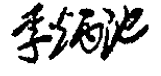

直接营销导师
合赢岛创始人
“神笔文案”主讲师

## 第一课 消费者购买行为

在你撰写销售文案的时候，除了遵循写作的一些步骤外，你需要了解人们的特定兴趣和行为模式。知道顾客的行为模式，并做了充分准备，你就能够大大增加销售成功率。

### 10 大购买行为

下面是我在撰写销售文案经常遵循的 10 个要素。当你构思你的销售材料的时候，时刻记住。

- 1、人们不喜欢垃圾信息。锁定你的目标顾客群，针对他们想要的，在标题里给他们一个理由，当人们看到你的文案的时候就有兴趣阅读。
- 2、人都是怀疑论者。他们不相信你说的，因此你必须给他们一个或多个理由来证明你所描述的是真实的，案例说明，视频演示，现身说法，朋友推荐，售后保证等。
- 3、人很容易感到迷惑。如果你让他们感到迷惑，你就会失去他们。所以，你要把你展示的所有东西，都描述清楚。
- 4、人们喜欢做比较。强调你的独特卖点，为什么你跟别人的不一样。
- 5、人们会担心他们做了一个错误的决定。你要使用证明，给他们做出承诺。
- 6、人们想避免风险。通过零风险保证，售后来降低他们的风险。
- 7、人们总想付出更少，获得更多。塑造产品的价值，提供赠品。
- 8、人是懒惰的（或者说至少不想采取行动）。你要把订购流程简单化。
- 9、人一般是拖拉者。你应该给他们一个现在就必须采取行动的理由。否则，他们就会一直拖延下去，不再回头。
- 10、人们想要的东西，就想立即得到。在你的销售文案里，告诉他们发货的具体时间。比如，今天就会发货，或者明天就发出，走顺丰快递，大城市隔天就能到达。如果这样承诺，也会增加你的订单。

记住：**人们总是在变动着**。 （换手机号，微信号，从这个家搬到那个家，跳槽，离婚和结婚。）经常跟客户保持联系，确保你的数据库不断的更新。

## 第二课 写作 3 原则

这 3 个原则决定了你是一位普通的文案创作者，还是能成为顶级的文案创作者。

### 第一个原则：写读者感兴趣的，而不是我感兴趣的

- 1)
- 2)
- 3)

#### 违背此原则的 3 个常见例子

**例一：**

爱美女士家中必备产品====超音波美容仪！！

据国际的美容杂志调查，很多国外女性在美容方面做出的最大一笔投入，就是购买美容仪。可见美容仪器，已经逐步走进了发达国家的个人消费品的行列！时尚的中国女性也不能落后啊！！马上行动起来，把自己的美容仪搬回家，在自己家中享受专业的美容护理！！

拥有私人的美容仪好处就是，使用方便不用像去美容院一样还要预约，最大的好处是避免交叉感染，这点很重要的！！

——以其出色的护理效果、简便的使用方法和可靠的品质保证成为越来越多专业美容院和个人家庭使用首选的护肤圣品。

皮肤会随着年龄的增长而逐渐老化，皮肤要健康，最简单有效的方式，不是单靠涂抹保养品，也同样需要运动来使细胞组织充满活力。

通过1兆赫超音波机械的压缩及伸展，形成每秒100万次的细胞振颤按摩，7如同千百万双手在为您进行按摩。肌肤深层的细胞组织在高速振动及多种波形作用下迅速升温，并在体液中形成无数小气泡，包裹体内毒素、废物和打散、粉碎皮下多余脂肪，最终排出体外。具有增强细胞活性、通透性，紧实肌肤、改善肌肤问题，燃烧脂肪、瘦身等多重功效。

**例二：**

经过一段时间的筹备，我们的海藻米粉近日就要面市了，除了我们在公司的门店，我们的微信商城也将于近日开通，以感谢各位朋友的关注。

这次到货的产品有1.3MM和0.9MM两种规格，可以适应不同习惯的朋友们的需要。为了既更好地保留海藻米粉的营养成分，又保持天然海藻的独特鲜味和柔软爽滑的口感，我们在这里和大家分享海藻米粉的烹调经验。

- 1. 将海藻米粉和冷水一起入锅，文火煮开，不时加以搅拌，煮开后3-5分钟，可以看到汤水变白，米粉柔软，即可出锅。不同于传统米粉或面条用开水煮烫后出锅的方法。
- 2. 将出锅的米粉过一遍凉开水并滤干，放置在方便的地方。
- 3. 根据准备的食材，进一步加工成炒米粉、凉拌米粉或汤粉等，即可食用。
- 4. 如果用于火锅，可直接将干米粉加入火锅中烹煮，煮开后等米粉变柔软即可食用。
- 5. 不能使用大蒜头作为海藻米粉的调料，以免破坏海藻的保健成分，降低海藻米粉的保健功效。
- 6. 在海藻米粉的开发生产过程中，我们经过合理的计算，精心配制了海藻的成分和含量，在分享我们产品的人群中，“吃出健康”已成为现实。如果坚持每天食用海藻米粉不少于一次，您很快（10天左右）就可以感觉到您的皮肤、血压、血糖和消化系统每天都在发生的悄悄的变化。

接下来的日子里，我们愿与大家共同分享我们的产品和体验。

**例三：**

**一封销售信**

2016 07 ____________

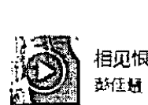

相见恨晚
彭佳慧·释放我的头

专业女士健康文胸，男女私密内裤行实就是80后宝宝妈妈语。因为专注，所以专业！一直从事健康私户内衣，对于女性乳房的健康保养非常重视，所以建议天下女士一定要关爱和重视女人的第一胸部，我个人并不主张只重视内在美注重外在美，我希望每个女人在精致的外表下也能拥有一颗丰富的内心，我希望每个女人在舍得花几千块买护肤品的同时也能有时间到美容院定期保养你的身体，我也希望每个女人在一身光鲜亮丽的衣服里面有一套健康而舒适的内衣。

那么问题来了，什么样的内衣既健康又舒适？

#### 写下你的感悟

### 第二个原则：我要让读者感受到，我的文案像跟他私下交流一样

- 1)
- 2)
- 3)

#### 《539 档案》销售信例子

**例一：**

企业老板/文案撰稿人请注意！

### 一个从来不懂写文案的人
却撰写出了杀手级的攻心文案
并使文案转化率提升了 600%
产品销量增加了 2000%

> 如果你想要让自己的文案水平达到像盖瑞·哈尔波特，约翰·卡尔顿，丹·肯尼迪，约瑟夫·休格曼…这些人一样的高度！并且，让你的广告文案效果，产品销量，利润能够迅速提升 100%，300%，甚至 2000%…那么，从现在起，你也能做到！

亲爱的朋友：

你是否看了很多教你如何撰写文案的书籍，或者参加了某些知名老师的文案培训课程，却依然无法写出打动人心的文案？

**例二：**

企业老板/文案撰稿人请注意！

### “非常强大...
不管**你**卖的是什么
它几乎都能够促使顾客成交！”

亲爱的朋友：

从2016年开始，不管**你**销售的是什么产品，也不管**你**使用了哪些渠道，哪些推广工具、**你的**企业要盈利多少，客户要增加多少...最终都取决于**你**“传递销售信息”这一部分。

什么意思呢？

为了让**你**能够真正明白，并加深**你**的印象，我们先看两封特别的信（3分钟就能看完），一封信可能会让你开心，另一封可能会让你气愤...

#### 写下你的感悟

#### 第三个原则：消除自我

- 1)
- 2)
- 3)

要想写好销售文案，你必须除掉你心中最大的敌人：

##### 卡尔普斯的研究数据

约翰·卡尔普斯，《测试广告的方法》一书的作者，他是直接营销领域最著名的文案撰稿人，他分析了在100个广告文案中效果最好的标题，来确定这些标题中，哪个词出现次数最多。结果如下：

- “你”出现了 31 次
- “你的”出现了 14 次

然后是 “如何” “新” 等词，这些词出现的次数就比较少。

##### 李炳池对 120 封经典文案研究的惊人结果

《539 档案》，我推出的一个重磅产品，里面包含 539 遍经典的广告文案。我研究了其中 120 个标题。

结果？

- “你” 出现的频率最高，44 次
- 然后是 “你的”，出现了 19 次

然后是 “如何”，“谁”，“新” 等词。

那销售信正文呢？这些销售信的撰写方法和别的不一样吗？我们接着往 下看。

我选取了其中比较短的8封销售信：共计8930字中，平均每封1100多字。根据出现次数递减，依次是：

- “你”出现了405次
- “我”出现了158次
- “你的”出现了143次
……然后就是“谁”（97次），“我是”“我愿意”“我将”（92次）等词，出现次数相对少得多。

结论：在一篇销售文案中，“你”出现的次数最多。而我出现的就少得多。可见，在撰写销售信时，你要用好“你”这个词。而不是，一直谈我，我怎么样，我的产品如何。

那么，是不是出现“我”就代表自我呢？**当然不是**。

##### “我”这个词，在什么时候比较重要？

##### 一封连续50年刊登的经典销售信秘密

这是一封经典的销售信，在50年前，就刊登在报纸和杂志上，至今仍在刊登。

这个文案的效果如何？如果没有效果，这则广告就会被放弃。大多数这种类型的广告，存活时间不超过一年。所以，这则用了50年的广告，可谓是空前绝后！

##### 在瑞典高速火车上的一次奇怪经历……

1. 我走进我能找到的第一个空车厢。我不知道已经有人在那里了，一个看不见的人，他的谈话使我整晚睡不着。

2. 火车驶出车站。我看着斯德哥尔摩的灯光，越来越远，越来越黯淡。我在肩膀上裹了一条毯子，正准备躺下，翻翻睡觉时，我看到了对面睡铺的一本书，是上位乘客留下的。

3. 我拿起来，打开读了几行。5分钟后，我还在阅读，完全被吸引住了。这本书就像是一位老朋友为了揭露秘密的宝藏，专门为我写的。

4. 实际上，我从中得到的启发是，每个人都被赋予了一种神奇的记忆力，能够执行复杂到难以置信的任务，但是很少人知道如何使用这个神奇的工具。这本书解释说，即使是天赋最差的人也有很强的记忆能力，并引用了一个人的例子，这个人智商虽然不高，却只读一遍，就能记住世界上100个最大城市的名字，以及他们的人口数量。

5. 很难相信，我40岁的迟缓大脑，却能回忆起那些冗长的数字，日期，地点和名称，这些都是我上大学时的噩梦，尽管我那时候很年轻，记忆力还比现在好。我决定来看看这本书中说的，是否真的那么有效。

6. 我从公文包里拿出时间表，用书中规定的方式用心开始阅读。这份时间表中包含有瑞典100个火车站。

7. 令我惊讶的是，只阅读一遍之后，我就能够按照列表上的顺序，复述站名，而且还可以倒背如流！我甚至能记得每个城镇或城市在列表中的确切位置，即，哪个城镇是第27号，84号，或36号，这些名字深深地刻在了我的脑海里。

8. 我惊奇地发现，我竟然拥有如此不可思议的力量，我用剩下时间，去尝试了更多的实验，每一个都比上一个更加困难，但是我却依然感觉不到它已经达到我的记忆力极限。

9. 当然，我没有一直跟着做那些有趣的实验。第二天，我就开始利用我新发现的这个能力，我很快就能以难以置信的准确性记住我读到的、听到的、看到的东西（包括乐谱，我只见过一次面的人的名字和面孔，他们的地址、电话号码，还有我所有的预约等）。我甚至四个月内就学会了一门外语（法语）！

10. 如果说，我这一生获得了某种程度的成功和幸福，那么，我把这一切都归功于这本书，这本揭露了我的大脑是如何工作的书。

11. 我相信你也希望能够利用这个神奇的精神力量，这是你最珍贵的财产，用它来获得生活的成功。本书的作者W·R·伯格，非常乐意送你一本《永恒的成功定律》，书中介绍了他的整套方法，里面会告诉你更多他的发现，我在这封简短的信中，无法全部一一说明。任何想提高记忆的人都能领取。

领取地址：XXXXXXXXXX
E·道利尔

下面用“自我度量表”（一个简单的条形图，来说明“我”和“你”的使用频率）来分析一下这个广告（“我”用红色条形表示，“你”用黑色或蓝色条形表示）。先用铅笔下划线画出与“我”相关的词，然后用另一种笔画出“你”相关的词。最后计数在“自我度量表”中标注。

#### 自我度量表（见教学实物图）

##### 李炳池自我度量表

| 段落 | 你 | 我 | 段落 | 你 | 我 |
| :--- | :--- | :--- | :--- | :--- | :--- |
| 第1段 | | | 第18段 | | |
| 第2段 | | | 第19段 | | |
| 第3段 | | | 第20段 | | |
| 第4段 | | | 第21段 | | |
| 第5段 | | | 第22段 | | |
| 第6段 | | | 第23段 | | |
| 第7段 | | | 第24段 | | |
| 第8段 | | | 第25段 | | |
| 第9段 | | | 第26段 | | |
| 第10段 | | | 第27段 | | |
| 第11段 | | | 第28段 | | |
| 第12段 | | | 第29段 | | |
| 第13段 | | | 第30段 | | |
| 第14段 | | | 第31段 | | |
| 第15段 | | | 第32段 | | |
| 第16段 | | | 第33段 | | |
| 第17段 | | | 第34段 | | |

◎ 按你比我：第23次 你33 我24
◎ 按我比你：第32次 我25 你22

你/我的比率 ____________

分析结果：

1.
2.

#### 如何创建自己的“自我度量表”

你可以以上面说的广告为例，把你写好的销售文案，用“自我度量表”检查。在电脑上，你可以用下划线实线或虚线标示（手写的可以用铅笔），计数所有有自我迹象的词，包括标题、正文：

- 我
- 我是
- 我愿意
- 我已经
- 我的
- 我们
- 我们愿意
- 我们已经
- 我们是
- 我们的

#### 一家邮购公司的销售信案例解析

现在，我们阅读一家邮购公司的销售信案例，重复上面的过程：用铅笔下划线标示和自我相关的词语（我及其衍生词）。

一家邮购公司的销售信例子

**亲爱的读者：**

> 如果我们可以在我的办公室，舒舒服服地坐在扶手椅上，面对面交谈就好了！

> 我们可以一起喝喝咖啡（我冲泡的咖啡非常美味！），你可以抽支烟，我们可以谈谈你的企业，以及我如何能帮助你的企业发展。

我是一个销售专家，更确切地说，我是增加销量的专家。我的工作是为公司出谋划策，如何增加客户的人数和产品的销量。

我为什么有资格做这件事呢？

首先，我创立并管理公司20年，从当初的白手起家，到一家拥有员工200人的公司。

我说的这个公司，是一个直邮邮购公司！

这意味着我的客户，购买我的产品的人，只有收到一封信和一个目录，就是这封信和这个目录，以及一个简单的订单，必须说服人们用自己辛苦赚来的钱向我购买。

我每年都能售出一百万件产品（诸如服装，首饰，以及其他礼物等，每件产品的平均价格是8美元，我的毛收入每年平均800万美元！）

我连续做了20年，几乎都是回头客，他们都非常满意，每年都会继续订货。

他们非常满意……甚至有些兴奋！

为什么？

因为我的企业建立在两个原则：

**一笔交易就是一笔交易。**

**一个客户是很多笔交易。**

这就是为什么我想让你成为我的客户，因为我知道你会和其他所有人一样非常满意。

但是，这次我提供给你的不是珠宝之类的产品。不是的，我将向你展示如何寻找自己的客户——比如，如何倍增销量，如何销售更多、更多的产品。我只收取你通过我的方法赚到的钱的一部分。唯一的条件就是，你要快速行动。

尽可能快地和我联系吧。每个领域，我只能接收一位客户，一共也只接收几位客户，而且终生服务。

因为，很显然，我的客户只有对我的服务非常满意，才会成为回头客！如果他们回来了，说明他们赚到了很多钱。

为什么不赶快抓住为数不多的名额，利用这些“赚钱的点子”，并证明你有正确的心态，成功的天赋呢？

因为心态和天赋也是不可缺少的——我只和成功人士合作。

想一想……打一个电话能花多少钱？我的第一次咨询完全免费。期待你的来电。

读者不愿意听到你的自我，他们愿意听到自己的自我。因此，分析的第2步，就是用另一种颜色的笔，划出强调读者自我的词：

- 你
- 你愿意
- 你已经
- 你是
- 你的

对你今后写的每封销售信，都做这样一个分析。做完后，仔细一段一段地统计所有的“你”。然后，把“你”用黑色或蓝色条形在“自我度量表”中标识。把“我”相关的自我迹象的词，用红色条形标识。最后，统计出你/我的比例。

#### 如何一次性永久地除去“自我”这个敌人

作为文案撰稿人，你必须培养的第一个品质就是——同理心。“同理心”的字面意思是“顾及别人的感受”。只有顾及别人的感受，才能消除自我。怎么能实现同理心呢？下面是对我很有效的几个方法。

##### 1. 利用一切机会和各行各业的人交谈

打车时，你可以和出租车司机交谈。你可以和保洁阿姨，保安，快递员，售货员……和所有你恰好遇到的人交谈。倾听他们的心声，尝试理解他们的观点，他们关心的事情，还有他们面临的问题。做这些事情时，你必须阻止你内心那个总是爱评判别人的声音。要接受别人。

##### 2. 多样化阅读

阅读浏览量大的文章，发行量大的报纸，杂志等。

##### 3. 在内心塑造一个写信的对象

想想他们每天的安排，他们的工作，他们喜欢参加的娱乐活动。设想你就是他们。

##### 4. 如果可能，邀请社会不同阶层，不同文化水平，不同职业背景的人阅读你的销售信

用心听他们的评价，不要立刻否定他们的看法；相反，在确定是否应该同意他们的观点时，尝试去接受他们的观点。

##### 5. 和别人交换看法

记住，当你和别人交换看法时，你们两个人都会受益。你不会有损失。相反，如果你愿意，你可以坚持自己的观点，或者你还可以根据别人的看法，调整自己的观点。此外，在讨论过程中，通过不同角度看问题，能让你从一个之前从没想过的角度看自己。

##### 6. 在谈话过程中，尝试总结别人告诉你的东西，并询问你的总结是否正确

这是建立同理心的一个很棒的方法。

##### 7. 记笔记！

当顾客有某种想法，或某种心情，用了某个词，或某句话时，写下来，因为这样的小事情，很容易忘记。他们对你撰写标题非常有帮助——回忆这样的句子和想法，能让你立即回到你试图接触的人——潜在客户的身上。

#### 不谈论自己，不代表忘记你是谁！

同理心，或者说是站在潜在客户的角度看问题的能力，是优秀文案撰稿人的一个主要品质。但这还不够：你还必须能够巧妙地表达你的同理心，用一种能够说到客户心里，让他采取行动的方式去表达你的同理心，说服犹豫不决，摇摆不定的顾客尝试你的产品或服务。怎么才能做到这点呢？

前面说不让你谈论自己，并不意味着你应该忘了自己的身份。相反，运用自己的情感经历，还有对自己影响很大的事件，个人关系等，增加你文案的影响力。下面是一些方法：

1. **表达你的个性**

   不要掩饰自己。记住，你是在给一个人写信，而不是给一群人写通知。

2. **使用叙述风格**

   比如：“在很多农村，农民依然很贫穷，因为他们没有钱购买种田需要的工具……”这种描述就很弱。你可以写“今天早晨醒来，我一直在想那些贫困的农民；我愿意把我家里的锄头，铲子，拖拉机送给他们……”

3. **分享亲密的感觉**

   不要害怕谈论恐惧，爱，痛苦的遭遇，担忧等。把他作为一个老朋友，用心的去交流。

4. **为展示中的要点寻找一个相对应的图**

   如果有必要，你可以插图。每个图要清楚说明你要表述的意思。

5. **以积极的方式表述你的观点**

   不要说可能，也许，大概，应该是等。你要用肯定的语气，清楚地表述自己的想法：你必须告诉人们你内心深处，确信自己的产品或服务是优质的，你都在使用。所以，你的潜在客户也应该购买。

#### 写下你的感悟

#### 写下你的感悟

#### 写下你的感悟

#### 写下你的感悟

### 第三课 充分准备

准备什么？准备我们必须了解的内容。如何去了解？就要做些市场调研。市场调研，这个词我们再熟悉不过了。但是，它是一切的基础，也是大多数最容易搞砸的地方。想要写出有说服力的文案，就要从这一步开始。

最好的调查是实地考察，人员访谈，资料收集等。

#### A、了解竞争对手

有市场就有竞争者，有竞争说明就有市场。如果你不了解市场，你就无法把生意做好。

##### 了解竞争对手的7个策略

1. 找到买过竞争对手产品的客户，询问他们的体验感受
2. 如果在线下门店或者商超，问购物出来的顾客他们的体验感受。
3. 成为竞争对手的客户，亲自购买他们的产品来体验——或者找人帮你向竞争对手购买。
4. 从他们投放的广告、网站、新闻通讯、报纸、公众微信等你能找到的任何渠道收集竞争对手的信息。
5. 准备好你要问的问题，打电话给你的竞争对手（微信或QQ聊都可以），了解他们的销售信息。
6. 贿赂竞争对手的工作人员，他们将会告诉你很多令你惊讶的信息。（这个策略要谨慎使用。）
7. 如果产品或者原料有相同的供应商，可以跟供应商交谈，了解竞争对手的信息。

**练习：**

1) 竞争对手的产品优势是什么？（包装好，价格低，款式新，功能多，赠品多……）他们的独特卖点是什么？

2) 竞争对手的服务如何？它们的体验如何？你如何做得更好？

3) 竞争对手的产品定价如何？价格高/低，高/低的解释理由是什么？

4) 竞争对手的产品劣势是什么？你如何来改善？

#### 写下你的感悟

#### B、了解目标顾客

你要了解目标顾客想要什么。他最大的恐惧是什么？他最担心的是什么？在生活中他的第一问题是什么？这个问题来源于哪里？

如果你不知道你的顾客正在寻找什么，你就不可能写好销售文案。

要明白，人们购买产品或服务的唯一原因，是他们觉得拥有该产品或服务的好处超过他所花的钱。

##### 蛀牙案例

有蛀牙的成人和儿童的福音

**你的蛀牙是不是越来越多了？**

来自：玛格丽特·希金斯
著名记者，普利策奖获得者

你是不是经常蛀牙？

其实，很多人都像你一样！

美国95%的人都有蛀牙。每年，新得蛀牙的人，远超过医生能治疗的人数。

这就是为什么你看到的新发明会和我一样兴奋。它对成人和儿童都适用，几乎可以让蛀牙减少一半。

大多数蛀牙发生在牙齿的“弱点”上——牙齿表面薄弱的地方。如今，科学家们发现了一款新的牙膏，加有氟化亚锡的佳洁士牙膏——可以巩固牙齿表面的“弱点”，减少蛀牙——这种成分是其他牙膏中都不包含的。

> “听起来非常不错，”我说“但是，你怎么知道佳洁士能防止蛀牙呢？”

**练习：**

1）你要卖给谁？他们在哪里？

2）他们想要的是什么？

3）他们的最大问题是什么？担心，恐惧，渴望什么？

#### 写下你的感悟

#### C、了解你的产品（特征和好处）

你的产品也是有特性的。它的特征是什么样的？什么颜色，什么包装，大小如何，成份如何？能帮助人们解决什么样的问题，它能给人们带来什么样的好处？

你必须了解这些，你才能让你的产品发挥优势。

##### 特征

**一些产品的特征可能包括：**

- 在制造过程中使用的材料
- 包装或者储存使用的材料
- 成分
- 包装分为大包装盒和独立小包装
- 新鲜，密封，等等。
- 颜色
- 尺寸
- 功能
- 速度/效率
- 额外附件
- 选项
- 组成部分和每部分的功能
- 装配
- 用法说明
- 担保/保证
- 使用弹性
- 耐久性

一些服务的特征可能包括：

- 服务时长
- 购物选择——在家购物，店内样品展示，网站
- 递送方式
- 安装
- 售后保障
- 联系方式：电话，微信，QQ，电子邮件，店面或者办公地点
- 维修
- 设计
- 免费咨询
- 提醒服务的频率
- 担保/保证

对于一个企业，特征的清单可能包括：

- 客户服务
- 经营理念
- 任务
- 担保/保证
- 营业时间
- 购物选项
- 奖品
- 证书
- 免费电话号码
- 地点
- 供应品
- 培训流程

**练习：**

你的产品有哪些特征？请详细描述。（特征：外观，包装，内部结构，气味，颜色，大小，尺寸，形状，成份，功能……）

1)
2)
3)
4)
5)
6)
7)
8)
9)
10)
11)
12)
13)
14)
15)
16)
17)
18)

#### 写下你的感悟

#### 写下你的感悟

##### 好处

从你的角度来看，好处可以帮你把产品销售出去。所以，好处从哪来？不是凭空猜测，好处来源于特征。好处是特征给人带来的情感上的满足。

- 我是在卖一辆车，还是在卖刺激，舒适，或一个驾驶者的乐趣？
- 我是在卖化妆品，还是在卖年轻，漂亮，皮肤有弹性？
- 星巴克是卖咖啡，还是在卖一种体验，休闲方式？

让你的产品抓人眼球，除了根据你的特征带来的好处以外，你还需要使用下面这些问题来激发你的文案创意。

**抓人眼球的好处提炼法**

- 这款产品能解决什么问题，为谁？
- 这款产品销量稳定，持续多久了，为什么？
- 这款产品特别适合哪类使用者或者场合？
- 你通常会发现它在哪里被使用？
- 这款产品是因为没有什么，而使得它优于其他同类产品？
- 这款产品兼具什么和什么？
- 用户在使用时的感觉是怎样的？
- 这款产品配合什么使用最好？
- 生产这款产品都做了哪些测试？
- 为什么需要多个这样的产品？
- 它的价格为何如此合理？

无论这款产品有多么普通，无论它和其他同类产品有多么相似，你的创造力都可以让它脱颖而出，并告诉购物者“买我！”现在做练习，使用上面的提示和产品的特征属性，想出至少十几种不同的方式来让你的产品吸引潜在客户。

**练习：**

产品或服务有哪些显在的好处？有哪些隐藏的好处？哪个好处是其他竞争者所没有的，只有你有？（写出你的产品6-12个好处，以及最大的一个好处，你的USP。）

1)
2)
3)
4)
5)
6)
7)
8)
9)
10)
11)
12)
13)

#### 写下你的感悟

#### 写下你的感悟

### 第四课 制定顾客无法拒绝的提议

我们在前面已经知道，你的顾客想要的是什么，然后，你要把它最想要的与你的产品建立连接，你的产品正好能帮助他解决这个问题，正好是他最佳的选择。

如何让顾客知道你提供的价值呢？第一，塑造产品的价值；第二，制定强有力的提议。

塑造产品的价值，就是告诉顾客：为什么你的产品好，为什么你的产品物超所值，为什么你的产品跟别人的不一样，为什么现在必须买（或者注册，关注你的微信……等等）？如果现在不买，就会错失这个机会……使客户感觉到买到你的产品是一种荣幸。

**必知公式：**

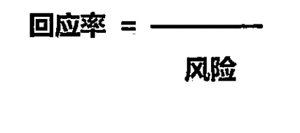

如果感知价值上升，风险保持不变，那么你的回应率就会上升。如果风险上升，而你的感知价值不变，那么你的回应率就会下降。

但是，假设你的感知价值上升，你的风险下降，那么你的回应率呢？当然会像火箭一样上升了！

#### 提高感知价值的元素

##### 1、独特卖点法

什么是独特的卖点（USP）？只有你能提供，而别人无法提供的那个好处。

比如：你的产品品质高，价格高，因为你比其他同类产品使用寿命能延长2倍。你的艾灸产品效果好，回头客多，除了原材料的品质高外，最关键的是你有独到的配穴手法，其他艾灸商家是不具备的。这就是独特的卖点。

你可以从你的服务，你的产品原材料，你的产品工艺，你的产品功能，你的产品种类……等等，方面来提炼。只有你有，而别人没有，你的价值就会提升。

##### 2、品牌故事法

讲述你的品牌历史，理念，你的个人传奇经历，等等。比如“本店已经营120年”。“每位员工都至少跟随30年以上……”“你过去如何落魄，后来通过学习，实践………经过多少困难挫折，最终成功的故事！”

##### 3、外包装法

顾客第一眼看到你的产品是什么样子，决定了他 的感知价值。外包装是你的产品品质一部分，包装设计大家都明白，只要肯花钱，请专业的包装设计公司，都能帮你设计制作出精美漂亮的外包装。

##### 4、工艺用料法

描述你的产品用料不是市面上普通的原料，而是通过严格筛选，只有一个特殊地方才能产出这种原料。其它辅助原料“只采用有机植物，纯天然 料”或者“只采用最新鲜的第一道工序下来的原材料”。

而且，你的制作工艺非常独特，拥有全球专利技术，生产都是封闭式作业，严禁外人参观，产品都是秘制的。

##### 5、价格描述法

人们有种观念是“一分价钱，一分货”，你的产品价格高，人们会认为你的价值也高，这是人性。你要告诉顾客为什么你的产品价格高的原因，因

为是原材料特殊，还是工艺不同，还是功能不一样等。

#### 6、功能效果法

你的产品有特殊的功效，是其他同类产品无法比拟的。使用你的产品，能够更直接，更快速，更方便，更轻松的得到想要的效果。

比如“只要你正常饮食，一周就能减肥 10 斤”、“只要你参加“神笔文案”2 天的课程，你就能学会撰写杀手级的销售文案，否则，倒赔你 1000 元。”

#### 7、比较法

用你的产品跟大家耳熟能详的高端同类产品做比较。你的产品效果，跟他们的一样，或者比他们的还要好，而且你还有提供额外的超值服务。那你的价值就会迅速提高。

#### 9、名人效应法

告诉顾客你的产品有很多知名人士，明星大腕在用，或者当地政府指定采购，或者某知名企业指定用品，某些大型活动都使用你的产品等。

#### 10、附加值法

只要购买本产品，就会获得额外赠送的超值礼物。只要购买一个，就会送另一个（买一赠一）；只要整套买，就能享受 7 折优惠（捆绑销售）；

总之，塑造价值你最好能够制造稀缺性，唯一性，尽可能数字化，量化，用事实数据，来证明其有效性。

#### 塑造价值例子

##### 1、工艺材料

1. “你只需要投资3万元，用两天的时间，就能学到李炳池花了16年时间，投入350万元，向全球50多位顶级的广告文案大师学习，并经过4年的锤炼，才总结出来的“神笔文案”写作秘诀。你在任何书籍或课程中都无法找到。”
2. “你知道这一瓶玫瑰精油要经过多少工序吗？88道工序。你知道这88道工序要费多少朵玫瑰花吗？999朵。这些花还要与阿尔卑斯山的天然雪水融合在一起。如果你亲自去采玫瑰，亲自炼精油，经过88道工序要花费七七四十九天的时间，这要花费多少成本……”

##### 2、品牌故事、高价格、工艺材料、特殊功效和高端服务客户

“依云矿泉水距今有200多年的历史，它产自法国阿尔卑斯山山脉地质岩层5000米以下，在整个加工过程当中没有经过任何人类的手指头。它蕴含58种微量元素和矿物质，可以补充人体流失的营养和所缺乏的能量。它行销全球54个国家，只卖给五星级以上的酒店，卖给像你这样有身份的客人……”

##### 3、综合塑造

“这款围巾分3段，中间这段是产自韩国的上好高山麻，这种麻只在经纬度：37° 28’ N/126° 37’ E的地方生长，这意味着全世界只有一块地方生长，而且每5年只产1次，每次只能产不到半两上好的麻。用它制作的衣物冬暖夏凉，而且服贴度和柔韧性使所有原料不能比拟的。

两边是产自新西兰全世界最好的水貂，在它们成年毛色最好的时候被宰杀，用它们头顶上那一小块皮。一个水貂只有一个脑袋，而它要用189块水貂头皮才能做成，上面没有一根杂色，水珠子掉上去就会自动滚落下来。

这条围巾完全采用纯手工缝制，因为你知道的，机器加工流水线作业容易贬值，而手工做的有一种人文化的关怀在里面，有收藏的价值和升值的空间。它要花一个好的师傅9个月的工作日才能亲手缝制一条出来，全世界现在能达到这个水准的师傅只有 5 位，而且他们平均的年龄都有 70 多岁了。其中有 4 位都已经退休，还有 1 位今年年底之前也宣布退休了。

这个版是全世界最知名的设计师阿玛尼设计的，他光设计一个版，光版费都要几十万美金。可问题是，当他把这个版设计好之后，只生产了 3 条就把版给毁掉了，也就是说，现在绝版，只有 3 条了。

其中有一条被阿拉伯的王子收藏了，还剩下最后两条，被我收藏。我当时之所以能从生产商手里抢到这两条围巾的经销权，是因为越战的时候，我曾经冒着生命危险救过他一条命，出于 20 多年来友谊的因素，他才忍痛把这两条围巾让给我。

不瞒你讲，其中一条已经被英国总理夫人给收藏了，平时她都不舍得带出来，我只见她用过一次，就是 2008 年奥运这个千载难逢的时刻她带出来秀了一次，平时她都是珍藏在最宝贵的衣橱里，偶尔摸一摸都很高兴了。

还剩最后一条，本来今天晚上李嘉诚的二儿子李泽楷的太太要过来看的，但我没想到你会来，而且你们的眼光都很准，一眼就看到我最值钱的宝贝。

不过我觉得我们真是有缘啊，而且你很幸运，你比李太太早来 30 分钟，正好她还没有来得及交定金。老实讲：我也不舍的把它让给别人的，毕竟我也不缺钱，能给子孙们留个传家宝也是好的，不过说实话如果你实在想要的话，你愿意出多少钱呢？”

#### 降低顾客风险的元素

- 1. 提供最有力的零风险保证。
- 2. 提供免费的或者低价的续费保证。
- 3. 提供免费试用。
- 4. 提供低价，大众都支付得起的付款方式。
- 5. 提供一个按效果付费的方式。
- 6. 先用后付款。
- 7. 售后跟进服务。
- 8. 获得快速，高额的投资回报率。
- 9. 用事实数据，或客户使用证明，来证明产品或服务的效果。

在你的提议里结合以上这些元素，会立即增加顾客对你产品或服务的回应率。使用越多的元素来增加你的产品的好处，降低产品的风险，那么你就会获得越高的回应率。

#### 如何降低产品的风险

为了降低产品的风险，你必须想清楚，顾客在考虑要不要购买产品时会思考的几个问题：

- 1. 这个产品值这个钱吗？（价格）
- 2. 如果我不喜欢这产品的话可以退货吗？（保证）
- 3. 如果这个产品出现问题我能得到帮助吗？（保修）
- 4. 这个产品真的有用吗？（效果）

#### 如何制定强有力的提议

什么是提议？就是你提出的某种主张，做出的承诺，你要给顾客带来哪些价值，提供什么样的帮助，解决什么样的问题，间接或直接要求顾客采取行动的简短陈述。

比如：你提供给顾客某种解决方案、让顾客觉得没有任何风险，做出的零风险保证、强调某种赠品、赚钱佣金计划、特殊优惠政策、产品数量有限，稀缺性、呼吁立即行动等，都属于提议。

你的提议要：（1）引入注目；（2）完全可信。

很多商家制定的提议太夸张或者不具体，以至于让人看起来，觉得不真实。因为，消费者总是相信，一分钱，一分货，天上不会掉馅饼。所以，你要：

- 1、提供客户见证和实际案例
- 2、说出原因。解释说明为什么你的产品或服务，比其他竞争对手的产品或服务更好的具体原因。
- 3、给顾客灌输“产品稀缺”的信息
- 4、告诉他们要做什么

#### 制定提议必须考虑的问题

你的保证够吸引人吗？

你的保修够吸引人吗？

你的产品特色和它们能带给客户的好处结合得紧密吗？

你是否往里面加了一些“产品稀缺”的信息？

你是否已经消除了价格障碍？

你是否有让人立即下订单的诱人理由？

#### 常用提议样板

##### A、利用价格优势的提议

- 买一送一；
- 第二件商品半价；
- 达到一定数量享受折扣；
- 第一次购买享受特别折扣；
- 较老的产品打折；
- 顾客自己出价；
- 消费满多少元就有赠品；
- 在生意清淡的日子/月份/季节里打折；
- 周年日，纪念日，节日特惠
- 为客户推荐而来的顾客打折；
- 推荐一位，获得折扣，或赠品，或奖励
- 价格对比策略，原价 200 元，现在 120 元；
- 前 15 位购买者享受半价优惠；
- 提前预定，享受特惠，过期恢复原价
- 儿童/老年人免费；

##### B、利用福利的提议

- 如果你在 24 小时内下单，便可免费获得 XXX；
- 老客户可以免费获得 XXX
- 购买 N 件产品，那么第 N+1 件便可以免费获得；
- 免费获得其他商家的奖品；
- 填写客户反馈（无论是正面的、还是负面的），便可以得到赠品；
- 获得特别抽奖的资格；
- 下单后即可抽大奖；
- 所赠礼物是以任何价格都买不到的；
- 消费满 X 元，便可以包邮；
- 免费送货到家；
- 免费获得下一年的通讯；
- 优先顾客免费进入高端收费群；
- 对推荐他人来消费的顾客提供奖品；
- 收集优惠券/收据，可换取奖品；
- 免费运送；
- 免费提供售后信息；
- 在一堆奖品选项中，可任意挑选 2 件；
- 在某些特定的情况下，免费更新或升级。

##### C、利用付款条件的提议

- 提前支付，或者在某一截止日期之前消费，可享受打折优惠；
- 信用卡按月自动支付；
- 在 2016 年 10 月之前订阅免费；
- 每月只需支付 X 元；
- 试用 30 天后，再付款；
- 分期付款，按月支付，零利息；
- 可租用，无需购买；

##### D、利用保证的提议

- 保证你满意，否则便给你退款；
- 如果你不满意，我们双倍退款；
- 将通常的担保时间加倍；
- 保证无论如何，都不会有任何问题；
- 如果有任何损坏，便可以退货；
- 在生效之前不需支付任何费用；
- 如果问题反复出现，便将钱退还给你；
- 如果退货，我们会免费帮你把问题解决掉；
- 如果你可以证明自己尝试过但没有效果，我们便将钱退还给你；
- 如果退货，不会问你任何原因，立即给你退款，你还可以保留赠品；

##### E、利用组合套装的提议

最有力的销售提议之一，便是将一系列有吸引力的产品或服务打包定价。这种方式的秘诀在于：将你的客户们感兴趣的东西集合到一起，增加高感知价值，鼓励他们进行更多消费

无论是咨询顾问、律师、会计师、零售商，还是其他类型的企业家，都应该考虑一下这种销售提议，并给这样的捆绑促销活动取一个特别的名字。

例如，世界滨海度假胜地——墨西哥坎昆，“坎昆欢乐行”套餐包括：酒店住宿六晚，一日两餐，普通客机票，两小时直升机旅行，一小时巴士巡游，两本旅游书籍，一份免费的“坎昆热线”订阅，赠送两次按摩。

我发现，如果给某种组合套装起一个好听易记的名字，人们就会特别喜欢。

有时，套装会让顾客感觉到就像一份礼物一样，有特别的吸引力。

#### 测试你的提议

1. **测试一切：你的价格、提供的保证、甚至是销售文案的具体措辞**
   例如：下面这几种相同的销售，每种却都能产生不同的情绪影响：
   - 带一位朋友来，你们都可以享受半价服务；
   - 现在订购的话，你带来的朋友可以享受免费服务；
   - 带一位朋友来，你不需要再多花一分钱。

2. **先测试最重要的因素**
   例如：在你为定价应该是 295 元，298 元还是 299 元而犹豫不决之前，先测试一下定价为 195 元，298 元，398 元，甚至是 498 元的时候销量如何。很多企业老板都震惊地发现，有的时候，在他们提高了价格之后，销量反而增加了。（感知价值会随着价格的提高而提升。）
   另一方面，以较低的价格可能多销售，可能会使总收益提高。

3. **记住：只有实实在在的测试才是合理的**
   有些人认为，直接问现有的某些客户，看他们更喜欢哪一种销售方式，这样做，比小范围发给一些顾客来测试销售，能够节省时间和钱。然而，那样做根本就没什用。因为，人们所说的，跟他们实际会掏腰包做的，这两者之间的关系很小。

4. **不断测试**
   当某种提议似乎很有效的时候，你应该在各个地方稍微改进一下，然后看看细小的改变是否会产生巨大的影响。通过详细地记录，你可以对每种改变之后的销售额进行比较，这是很有意义的。

### 练习：

你的提议是什么？为什么（理由和原因，让顾客完全可信）？

1. 
2. 
3. 
4. 
5. 
6. 

#### 写下你的感悟

### 第五课 让你的标题起作用的秘诀

如果你从现在开始认真听我讲，当这讲课程结束之后，你撰写并修改的标题，将会带给你超高反应率。

我说的是超高反应率！而不只是引起了注意。

这是因为一般标题，和能带来超高反应率的标题之间的差距，往往非常微小，非常微妙，有时就在于一个词的选择和位置。

这有点像某些特定化学反应中的化学催化剂：尽管剂量只有一点点，但是它却能带来化学师追求的相对剧烈的反应效果。另一方面，如果没有这点催化剂，你可能用更大量的能源，药物以及材料，却依旧无法获得你想要的结果。

- ※ 销售信能否成功，50%取决于标题！
- ◎ 为什么 90%的撰稿人无法在事业上飞黄腾达

#### 新手写的标题（X）

- 1、在我们的熟食店里，一站式轻松购买你的所有美食！
- 2、发现如何让你的家居环境更漂亮
- 3、现在，你也有能力去创造……
- 4、你是幸运儿之一！
- 5、致所有公司领导：如果你想继续做个无名人士，那么请不要读这封信。
- 6、德商网络科技：终极解决方案。解决你重复出现的问题

#### 一定要牢记标题唯一的定义

- 一句话/一个短语；
- 做出承诺，引起好奇心

#### 专业撰稿人是如何让自己的标题取得成功的？

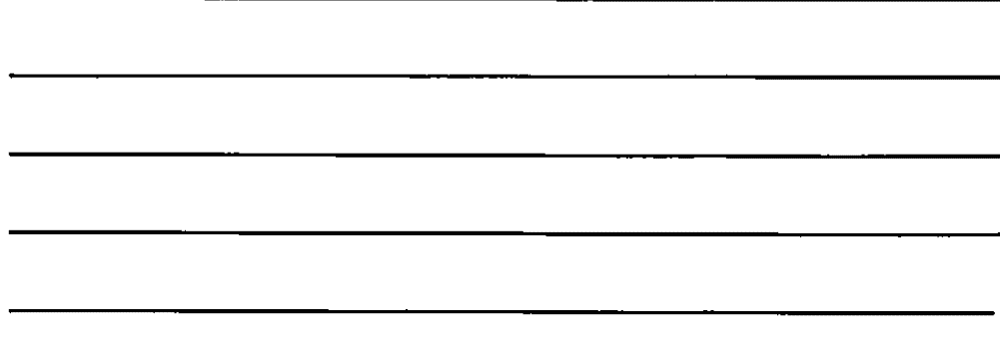

#### 《读者文摘》中的标题公式

- 如何……
- ……七步骤
- ……的10个方法
- 新的科学发现……
- ……的秘诀
- 为什么……？
- 当……会有什么后果？
- 你应该……？
- 你是……？
- 怎么能……？
- ……的一种肯定有效的方法
- ……指南

#### 《读者文摘》中出现频率高的标题类型

##### 健康类

健康是经常反复出现的一个话题。下面是一些例子：

- 停止吸烟
- 保持身材的3个小秘密
- 关于阳痿——你应该知道的
- 如何对抗压力
- 保护自己不感冒
- 变苗条的7个方法
- 你能选择孩子的性别吗
- 终于——抗癌食谱诞生了
- 战胜病毒

##### 自我完善类

- 更好地思考的7个方法
- 摆脱你的双下巴
- 唤醒你的童真
- 如何让你的声音更好听
- 成功的秘密
- 充实你的大脑

##### 孩子类

- 没有大学文凭，如何成功
- 从学习中，你学到了什么？
- 特殊学校的缺点和优点
- 你确定了解自己的孩子吗？
- 当孩子变成熊孩子时
- 一个青少年眼中的教育

##### 夫妻类

- 永远相爱
- 配偶和情人
- 揭露男性性行为
- 什么让男人变得性感？
- 关于爱的 20 个建议
- 你应该把一切都告诉你爱的那个人吗？
- 什么让女人变得有吸引力？
- 为什么男人不和他们的妻子说话？

##### 工作类

- 找工作策略
- 为什么老板们都像奴隶一样工作
- 加薪会发生什么变化？
- 网络时代的生活
- 找工作 7 步骤
- 如何变成领导
- 职业：快速起步，快速发展

##### 金钱类

- 学习撰写自己的愿望清单
- 如何把钱收回来
- 汽车保险的迷雾
- 减少你的收入所得税

#### 专业人士最喜欢的方法

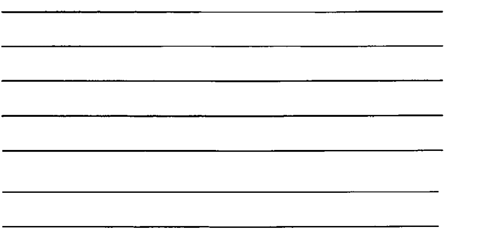

#### 畅销书的秘密

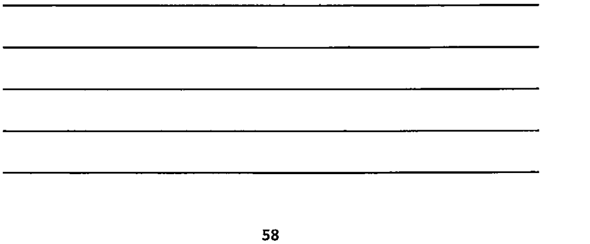

#### ① 世界上著名的标题

下面是已经 50 年的经典标题，平均每个广告都投入了数百万美元。

- 当我坐在钢琴前时，他们笑了，但是当我开始演奏时……
- 使这个农民一年损失 20000 美元的一个小错误……
- 你能在这张图上找出它的 10 个装修错误吗？
- 经常做伴娘，却从未成为新娘……
- 给丈夫似乎永远不会省钱的女人的建议——来自一个已婚女人
- 为什么有些食物会在你的胃里“爆炸”
- 一个孩子的生命对你来说值 5 美元吗？
- 我是如何在销售中从失败走向成功的
- 如何在 5 分钟内完成圣诞节购物
- 我是如何用 25 美元开启新生活的
- 怎样才能拥有令人骄傲的厨艺
- 送给那些想撰写文案——却不知从何开始的人……
- 送给那些看起来比实际年龄大的人……
- 你应该上周就回复这条广告的 53 个理由
- 我没有时间去上 大学，所以我在家通过阅读来学习……
- 7 天让你学会弹吉他，否则退款！
- 克服暴饮暴食的 7 个方法
- 给所有 一天也不想工作 的人
- 给那些想要 在五年内经济独立 的人的一个警告
- 医生不舒服时，他们会这样做
- 彻底摆脱金钱问题
- 我是如何在一夜之间提高记忆力的
- 我是如何通过一个疯狂的想法赚大钱的
- 如何赢得朋友及影响他人
- “无所不知”的男人可以不用看这一页
- 变富有的最好方法——如果你很懒的话
- 甚至耳聋的人也能听到这种低语
- 人们喜欢你的秘密原因
- 还有谁想让自己看起来像电影明星的？
- 已婚女性免费——其他人需要支付 20 美元
- 如果这不是你喝过的最好的洋葱汤，你可以得到双倍退款！
- 这 5 种皮肤问题，你想治疗哪种？
- 送给那些 35 岁，或 35 岁以上，依旧感到不满足的人
- 一次偶然的事故是如何让我没有变成秃头的
- 直到你在国际计算机大会上看到一款引起轰动的电脑之前，千万不要买电脑
- 如果你是位小心谨慎的汽车司机，你可以少买些保险
- “给你，卡罗尔，再给你 1000 美元。我现在赚的钱很多，不信吗？”
- 是什么让一个女人变得有魅力？这里介绍两个非常有趣的诀窍

##### 标题家谱

在撰写销售信中，通常长标题比短标题更有力。下面是一些最常见，最有利的标题类型：

###### 简单的标题

这种标题类型就是直接简单，开门见山，写下好处。你需要做的只有一件事，告诉潜在客户，他们具体能从中得到什么。简单的标题是最好写的，因为，它就是你的产品最大的好处。

只需一周，帮你减重10斤

###### “如何”标题

这种标题被频繁用来销售信息产品，因为它们能直接切中要点。

- 如何赚钱
- 如何克服自卑
- 如何提高你的阅读能力

###### “折扣”标题

这种标题就是告诉人们，你的产品或服务在打折。在写折扣标题时，一定要告诉人们你为什么给出这么棒的折扣价的原因。

所有商品 5 折——因仓库调整需要清货腾出空间

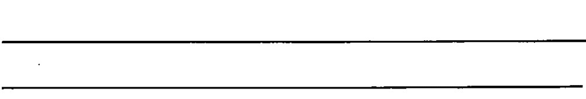

###### “新闻”标题

人们为什么读报纸？浏览各大门户网站？是为了看广告？当然不是。人们是为了看新闻。所以，在标题中加入新闻价值。新闻标题最适合用于全新的产品，或者做某事的革命性新突破。

新发现！一种能一次性永远摆脱疲劳的方法诞生了！

革命性捕鱼法——因为捕的鱼太多，被一些地方政府所禁止

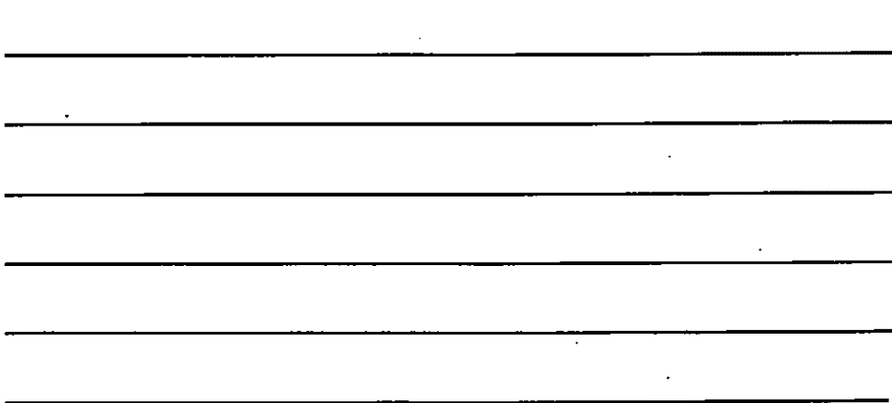

#### “保证”标题

在标题上直接写上你的保证或者提议，通常能够增加反应率。

教会你写销售文案，否则倒贴 2000 元

保证一周减重 10 斤，否则全额退款，不问任何问题！

#### “证言”标题

证言是满意客户给予的真实评价，因此，证言带给新的潜在客户的第一印象是满意，能够增加你的产品可信度。

> “李炳池老师指导我的一封销售信，回应率足足增加了 3 倍！
> 开始时，我也怀疑，但是仅仅过了三周……”

#### “问题”标题

你需要问能够吸引读者，为了找到最终答案，继续读下去的问题。问题对于目标顾客吸引力尤其大，甚至要比你直接公布信息吸引的读者都多。问题标题的目的是让读者迅速思考自己的问题，或者开始考虑自己的处境。

一旦把你的问题和自己联系起来，他们就想寻找答案（如果你给他们提供了答案，他们就会来尝试）

### 你是不是想……？

### 你是否知道如何……？

### 你是否因为晚上睡不着觉，而烦躁，焦虑？

我建议你在自己的文案中使用这种标题。它的效果非常好，不过前提是，你一定要非常清楚潜在客户在想什么。

### “问题&解决方案”标题（亦称作“引起惊慌”标题）

这种标题比较棘手，但是用的好，可以非常强大、有力。这种标题会让潜在客户走出舒适区，让他们为自己现在的处境感到痛苦。然后……你提供给他们解决方案。

有时，人们会把这种标题看作消极标题，但是不管怎样，它有效。如果使用得当，恐惧带给人的激励是最有力的。

人们通常害怕失去以下东西：

- 性
- 吸引力
- 朋友
- 年轻
- 金钱
- 健康
- 工作
- 地位

#### 家人/家

除了这些常见的恐惧，你的目标市场可能还有其他害怕的东西。（比如，年轻人害怕失去同伴的认同感。）

如果你的产品或服务能够满足潜在客户的需求，那么你可以选择利用恐惧来激励人们走出舒适区。让潜在客户看到自己的问题所在。然后，向他们展示解决问题是多么简单。

**不要让偏头痛再折磨你！  
打电话给 XX 医生，他将帮你永远解除痛苦**

如果你了解潜在客户，那么解决问题标题将是你最有力的标题。在解决问题标题中再加入危机感。

使用“立即”、“最终”以及“终于”这样的词语。

下面的标题模板，列举了所有种类的标题。每种都有自己的功能。*将帮你撰写出属于你自己的有力标题。*

### ◎ 标题模板——填空即可撰写出强力标题

根据自己的情况，使用恰当的描述、表达、动词或好处填空。每个标题模板下面附有例子。

#### 如何（______）

如何（拥有、获得、取得、从……中获利，消除，摆脱等）（你的产品的最大好处）

- 如何消除偏头疼！
- 如何每年多赚 100 万！
- 如何赢得朋友及影响他人
- 如何在一夜之间提高你的记忆力！

#### （______）的秘诀

（你的产品的最终好处）的秘诀

- 撰写强力标题的秘诀！
- 生男孩的秘诀
- 过目不忘的秘诀

你还可以把“最终好处”插入其他的模板中。在下面的空格中填上你的产品的最大好处。

#### （      ）的完整方案

#### （      ）的完全指南

#### 轻松、快速、快乐地（做某事）并赚钱

#### 好处堆叠

如何获得（好处 1），（好处 2），以及（好处 3）。在短短的（时间段）保证见效，否则（全额退款，双倍退款，免费，等）

如何在舒服、不受紫外线伤害的情况下，拥有自然的棕褐色皮肤，六个月保证见效——否则免费！

如何在三场会议后，让你拥有更多空隙时间，却赚得比以前更多的钱——保证！

好处堆叠模板适用于你能想到的任何情形。以上提到的所有元素并非都要用到。比如，你的产品可能只有两个好处，而不是三个。那你就用两个。或者，你不需要加上时间元素。或者保证也不适用于你的产品，那么你可以不加保证。

你可以随意发挥，根据自己的情况来使用这个模板组织信息。

#### 不用再（主要的痛苦或焦虑）

这个（鲜为人知的）方法能够帮助你（迅速&轻松，极其简单地）（可达到的终极好处）

你的头发不用再乱糟糟的了！

这个方法已经经过证明，能够让你整周都保持完美的发型！

根治小孩儿尿床！来自欧洲的一个神奇科技，

只要一周，便可让孩子不再尿床！零风险试用——98.7%的成功率！

#### 如何/保证

如何快速&轻松（可获得的终极好处）100%保证！

如何轻松舒适地在两周内写本书？100%保证！

如何在两天内学会写销售信？100%保证！

一周内掌握视频编辑技巧！几分钟内找到专业人员的内部秘密，

轻松搞定视频！保证满意！

这个模板中，也可以不写“如何”，可以暗示，比如最后一个例子。

#### 不管……快速获得好处

在（具体的时间段内）（拥有，获得，享受，成为，等）好处。保证。不管（你的年龄、身体状况、银行存款、能力水平，等）

不管你的厨艺如何，从此每天都能享受到美食

28 天，讲一口流利的英语——100%保证——即使你从未上过英语课！

#### 解决问题

用这种（某种极其简单或神秘的）鲜为人知的（秘诀，解决方法，补救法，治疗方法）（打败，克服，嘲笑，掌控）一种（主要问题或焦虑）

一位绝望到几乎要离婚的家庭主妇
发明了一个简单的三步公式，帮你永远摆脱没钱的烦恼

一位著名的演说家透露的新方法，两分钟就能帮你克服演讲恐惧

#### 发挥想象力

想象一下。你是一个（比如说，一个有“梦想”的人。艺术家，身价千万的企业家，自媒体人，电脑技术员，等）。

想像一下，你参加《神笔文案》课程后，

成了一名顶级的文案撰稿人

想像一下，你的书登上了畅销书排行榜！

#### ……的方法/……的原因

（具体的数字）种（产品的最大好处）的方法

3种解决你头疼的自然疗法

7种帮你节省日常开销的简单方法！

为什么你应该（主要的警告或好处堆叠）（具体的数字）种的原因

为什么你应该立即考虑家里水质的9种原因

为什么使用我们的广告服务不仅省钱，还能帮你赚更多钱的47种原因

#### 问题解决者

（把潜在客户的问题写成一个疑问句）。这种（已经证明的，经过时间考验的，100%安全的，有保证的）方法能帮你（可获得的终极好处）。

不知道如何撰写销售信？
李炳池完全可以教会你，否则倒贴 2000 元

总是无法摆脱满身的赘肉？
现在你可以享受你喜欢的美食，却仍然保持良好的身材了！

#### 如果，那么

如果你（描述潜在客户想要的东西或需求），那么我们会为你提供（好处1），（好处2），（好处3）

如果你的车太破了，你想换辆新的
那么这个免费报告将告诉你，如何买到最合理价位的车，如何不被宰！

如果你在寻找办公用品
那么我们这里品类齐全——价格绝对低的让你惊讶！

#### ※ 标题跳板

这是撰写优秀标题的一个新方法。我从一位顶级的文案撰稿人那里得到了它。他告诉我，他认为这是他“创造力的关键”——没有它，他会崩溃……

这个方法是使用《标题创造表》。它基于和创造力相关的心理过程，我们的大脑就像一台用来生产答案的机器。唯一的问题就在于：问对问题！换句话说。“精心设计的**问题，是答案的一半！**’这点尤其适用于标题。

#### ◎ 《标题创造表》

下面的练习就是使用“标题创造表”，一个指引你找到促进读者购买因素的方法。你还会看到一些需要你完成的标题。对你的每款产品，至少在“创造表”中填写出两个，写下任何你能想到的。稍后，你从中选出最好的标题。

### 练习：

请按照课程上的提示，根据下面的《标题创造表》做练习，撰写出你的标题。

#### 标题创造表

| 产品 | | |
| :--- | :--- | :--- |
| 这款产品/服务能为我做什么？ | | |
| | | |
| 它将如何帮助我满足生理需求？（身体对食物、水、空气、住房、性的需求） | | |
| | | |
| 它将如何帮助我满足安全需求？（对人身安全、生活稳定以及避免痛苦、威胁或疾病等的需求) | | |
| 它将如何帮助我满足社交需求?（爱情、友情，归属感） | | |
| 它我如何帮助我满足尊重需求？（认同感，受到尊重与肯定） | | |
| 它我将如何帮助我满足自我实现需求？（发挥潜能、实现理想） | | |
| 它和我的贪婪有什么关系？ | | |
| 它和我的愤怒有什么关系？ | | |
| 它和我的嫉妒有什么关系？ | | |
| 它和我的暴食有什么关系？ | | |
| 它和我的性欲有什么关系？ | | |
| 它和我的傲慢有什么关系？ | | |
| 它和我的懒惰有什么关系？ | | |
| 它将如何帮助我克服我的孤独或恐惧？ | | |
| 它将如何帮助我维护自己，成为一个更强的人呢？ | | |
| 它将如何帮助我克服我的罪恶感？ | | |
| 它将如何给我更多的信心，帮助我克服内心信念不辜负我的潜能？ | | |
| 简而言之，我能从这款产品或服务中节省，或赚得，或实现什么？ | | |
| 它怎么能帮我消除或减少风险，忧虑，损失，错误和各种各样的其他负面因素？ | | |
| 是什么让我好奇的必须阅读你的销售信？让我好奇的想知道更多！ | | |

如何

我是如何成为……

我是如何……

为什么……

揭露……

还有谁……

这……

是什么……

什么方法……

当……

在……

多少……

是的，你也……

你……

免费……

新……

我是……

现在……

最终……

……秘诀

警告……

我们在寻找……

你是否曾经……

你是否……

你是否见过……

你的……是否……

找出……

得到……

摆脱……

你应该知道……

接受……

挑战……

- 学习……
- 重新得到……
- 掌握……
- 有……
- 发生……
- 赚钱……
- 改变……
- 成为……
- 问……
- 使用……
- 听……
- 做……
- 拥有……
- 提高……
- 揭示……
- 让你自己……

选择……

尝试……

赢得……

节省……

生活……

获取……

不要让……

想象……

7 步骤

10 个方法

你的指南

关于……的最新……

（名人名字）……

#### * 最终确定标题注意事项

撰写理想标题的关键在你自己。你一定要去写，写，写，不停地写。直到那个精彩的标题出现。把你没有用到的标题用作副标题或者段落标题，这样可以为你节省时间。

另外，强势词语产生强势效果。用在广告标题中的两个最具价值的词应该是“免费”和“全新”。虽然“免费”不能经常被用到，但是如果下功夫“全新”肯定能够被经常用到标题中。

其他能够产生较好效果的词还有：如何做、现在、宣布、推出、就在这里、新品上市、一个重要决定、改进、惊人、感动、值得注意、革命性的、令人吃惊的、神奇的或不可思议的、特价、抢购、轻松、简单、强有力、希望、挑战、建议、实情、对比、折扣、赶快、还有……最后机会。永远将销售承诺融于标题之中。并尽量将这些承诺表述得详细、吸引人且完整。

要做到这一点需要用较长的详细的文字描述，从中透露出它的新闻价值、教育意义和信息价值的特色。有调查显示大多数带有消极意义的广告标题不会产生什么效果——除非你希望用这些消极性的词汇产生出不令人不快的结果，否则不会也根本不会产生任何积极的预期效果。

人们总是希望在生活、行为、工作、或者在业务，甚至是彼此的关系网中获得更多的利益、结果、好处、快乐或价值。他们总是希望避免生活中遇到的或持续不断的痛苦、不满、挫折、平庸及不愉快的事情。

避免使用盲目的标题——即那类不阅读或听取全文就无法了解内容的标题：因为如果标题不能立即引起潜在客户的注意，客户是不会聆听、阅读或是注意你、你的广告、信件或销售宣传中余下的内容的。

#### 写下你的感悟

#### 写下你的感悟

#### 写下你的感悟

### 第六课 黏性开头（起始段）

在整个销售文案中，除了标题是第一重要外，第二重要的就是起始段，或者说第一句话。有时我会花几个小时，甚至几天去思考最重要的第一句话。

第一句话，可以起到抓住注意力+激发兴趣的作用。抓住注意力的重点是：紧扣标题，要迎合你刚刚标题所讲的内容展开。不要让目标客户有种受骗的感觉，否则，用户会关闭你的网页。第一句话，还要起到承上启下的作用，让用户很自然的阅读第二段。

#### ◎ 撰写起始段常用的 6 种有效方法

它们可以让你的起始段发挥最大威力。

##### 1、讲述一个令人震撼的故事

###### 1）盖瑞·亥尔伯特的一封销售信开头

如果你想快速赚很多钱，这将是你读过的最令人兴奋的消息。

我叫盖瑞·亥尔波特，前段时间，我身无分文。我的企业几乎破产，我甚至连房租也付不起了。事实上，我不止是破产，我绝望了。

突然有一天，我萌发出了一个“疯狂的想法”，撰写一种销售信（不是连环信），让人们给我送钱。

###### 2）《华尔街日报》的一封销售信开头

25 年前的春天，在一个晴朗的下午，两个年轻人从同一所大学毕业了。这两个人有着很多相似之处。

他们成绩优异，英俊潇洒——这使得他们在同届毕业生中显得出类拔萃一对未来都充满了雄心壮志。

如今，这两个人同时回到母校参加 25 周年校庆。他们还是像从前一样，如此的相像。两个人都拥有幸福的婚姻生活，都有三个孩子。而且，毕业以后都在美国中西部的同一家公司工作，一直工作到如今。

但是，现在在两人之间却发生了唯一一处不同的地方。那就是他们中间一个人成了这家公司的一个小部门经理，而另外一个人却成了这家公司的大老板。

到底是什么原因，让他们有了这种差异？

###### 3）销售“煤气报警器”的销售信开头

2015年12月27日，周日。早上三点。一个女人，她的脸上充满了痛苦，叫醒了旁边熟睡中的丈夫。

她从柔软的席梦思床上痛苦地起来，一阵阵儿恶心想吐，拖着疲惫的身体，她走进了厕所。她的丈夫不一会儿就醒来了，满身是汗，喘着粗气。他挣扎着站起来，朝着紧闭着的窗户走去，但是在他还没到达窗户前，就倒在了地上。

女人绝望地做了最后的尝试，伸手想拿起手机，拨打120。但是她太虚弱了，倒在地上，失去了知觉。

在阴暗处，煤火投出诡异的光芒，还向房间散发着微薄的温暖气息。

第二天，房间里的两具尸体才被发现……

###### 4）乔·卡伯著名的广告——“懒人致富”的销售信开头

我过去常常拼命工作。一天工作18个个小时，一周工作7天，但是，我并没有赚到大钱。直到我的工作时间减少——少很多之后。

注：在销售文案中，最常用的有6种故事类型，详情见“附七”。

##### 2、问一个问题

- 1）“你知道吗？在移动互联网时代，文案越来越重要”
- 2）“你知道吗？真正的营销是可追踪和衡量的，对于每一分钱都是可测量的。”
- 3)“如果我能帮你在 10 天减重 10 斤，你是否想了解这种方法？”
- 4)“你还记得吗？”
- 5)“你还记得你第一次参加课程是什么时候吗”

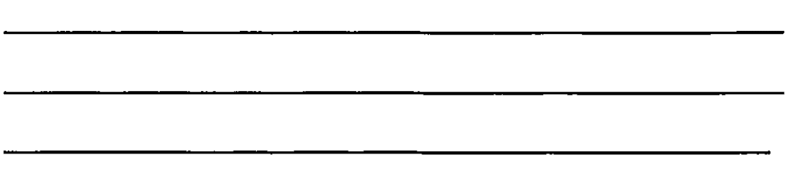

##### 3、透露一些信息

1）透露给你一个消息，李炳池老师在讲完“如何通过信息产品致富”后，他下一步会推出“信息企业家退休计划”课程。

2）从长远看，大盘正在处于牛市前期的调整，中期很快就会到来，牛市中后期才是最赚钱的时刻。

记住一点，进入牛市中期以后大盘会有剧烈的震荡，每天 100 多点的震荡很正常。不要被剧烈的震荡赶下车。更不要在牛市里频繁操作，因为你无法去预测走势，坚定持有就行。

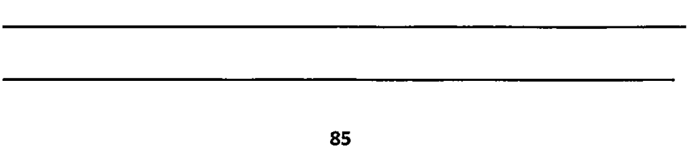

##### 4、提出存在的问题

1）你要在一群人面前讲话。突然你喉咙发干，嗓子发紧，你的思绪开始变得混乱。观众盯着你——你的脸通红，赶紧扭过头。

我们每个人在第一次演讲时，都会这样……

2) 你看了很多文案写作的书，但是在你下笔写的时候，脑子却一片空白。

##### 5、总结问题！

1) 一款神奇的软件终于问世了，只要你输入你的产品数据，竞争者情况，就能帮你制定出：如何与竞争者区隔……如何制定战略……如何引流，如何营销……

2) 如果你想让自己的高血压降低，性能力提升，夫妻关系和睦，那么下面这则信息，你不能不看……

##### 6、使用证言

我有个忏侮。我爱吃。我抵抗不住美味的小零食。问题是，我必须控制我的体重。

想象一下，为了尽量不吃太多，我曾经经历了多少折磨……日复一日地抵抗着诱惑……

没错，我是说曾经经历的事，因为现在这些都不存在了——我找到了解决问题的方法！

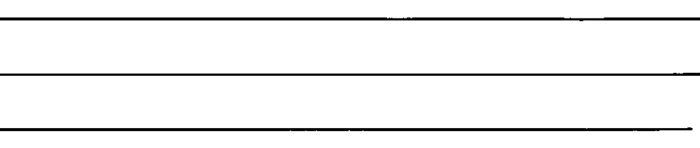

##### 如何形成自己的体系

你可以把 2 种或 3 种方法组合起来使用，甚至创造一个自己的方法！这是没有限制的。

然而，有个黄金法则，那就是测试，做更多的测试！

成为一个伟大的文案撰稿人，并得到理想的结果，唯一的方法就是尝试，然后对你的方法进行测试，来看它的反应效果。

例子：教会你写销售文案，否则倒贴 500 元

文案的重要性，无需再赘述。

如果连我这个初中生（作文考试从未及格），都能写出让产品大卖的文案——我坚信，你也一定能！

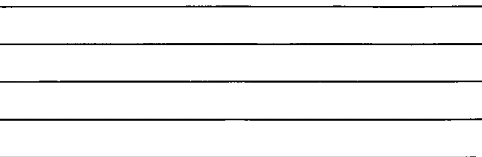

#### * 开头第一句的注意要点!

- 1、紧扣标题
- 2、激起读者的兴趣
- 3、激发读者的好奇心，让他们想知道为什么
- 4、制作悬念
- 5、承上启下
- 6、尽量简短，一句话能完成更好。
- 7、开门见山，不多废话

#### ※ 125 种黏性开头模板

- 1、如果……, 那么……
- 2、坦白的说，我很困惑...
- 3、在查看我们的记录时，我发现你...
- 4、你可以帮我个忙吗？
- 5、你想试试做这个实验吗？
- 6、这是个绝佳的好机会！
- 7、我之所以写信给你，是因为...
- 8、你还在为...担忧吗？
- 9、你会每星期额外花费 500 美元吗？
- 10、你认为怎样一天赚 1000 美元？
- 11、老实说，我困惑于...
- 12、我迫不急待的写信给你...
- 13、请放下手中的事情，花几分钟的时间来阅读这封信...我保证你不会后悔！
- 14、我写这封信给你是因为我个人原因，过去我很少写这样的信，但是我认为很有必要让你知道这些。
- 15、给你一个机会...
- 16、想象一下，六个月后的今天
- 17、我想告诉你关于...
- 18、帮个忙好吗？我们需要你配合参与一个重要的调查
- 19、你是白痴吗？
- 20、你是不是为（产品/服务）花费了太多的钱？
- 21、面对现实吧，...
- 22、是的，确实是...
- 23、我真的生气了！我再也不会这样做！
- 24、这是一封你从未收到过的信（或这是一封我从未写过的信）
- 25、请原谅我的鲁莽，但我敢以 XXXX 元打赌，你的生意会比现在赚的钱更多。
- 26、你或许已经发现了这个（根据产品种类）邀请函和你以往收到的不同。
- 27、没有炒作，没有恳求，没有华而不实。这就是我们吸引人们注意的方式，注意这个重要的，无与伦比的报盘。
- 28、你可以合法的“贿赂”我们\_\_\_\_参加我们的\_\_\_\_吗？
- 29、你/朋友，为什么非得让我们发这个信息给你？这是我们第二次，也是最后一次联系你，这封信发给你后，你的名字将会从我们的邮寄名单里删除。
- 30、你是否想过为什么有些人在理财方面很“有一手“？
- 31、如果你能关上办公室门以防干扰，并给我十分钟的时间，我将非常感激，并且将给你介绍一个简单，行之有效的办法，帮助你轻松的获得显著的
商业优势，金钱，成功，力量和幸福，没有一点（任何）风险。
- 32、这或许是你最幸福的一天，你是少数几个被挑选收到私人便签的人之一
- 33、大约四星期以前，你联系我们谈论合并的事情，我们给你寄送了一个免

费宣传手册，但是还没有收到你的回信。

- 34、如果你曾想过为自己写书或通讯，或者想象过拥有自己印刷公司后的样子，那么你肯定会对这封信感兴趣。
- 35、如果你对自己或你的企业开发巨型（或中等）现金流感兴趣的话，这将是你所读过的最激动人心的信息。
- 36、从来没有比这更简单，便宜的方法能达到使面色光滑，干净，漂亮的效果。
- 37、有素质的人一眼就可以被认出来。
- 38、事实上无论你是谁，男女老少，富有或贫困，我可以很容易的举例证明你们的生活品质都不太理想。我希望你们能给我一个机会，以便让我为你们介绍一种方法，这个方法可以很容易、方便的，让你过上一种全新的生活，让你充满活力，精力充沛，并且让你拥有对生活 and 成就更加成熟、高端的认识。
- 39、当一个人在农场做帮工式的工作时，每个月收入才 200 美元，现在跳槽到首月就 4000 美元的职位上时—这只说明他幸运吗？
- 40、我们向（公司名）致敬
- 41、这是错误的，有些有糟了，错认为 3500 高声扬声器是（生产厂商名）15 个中最好的 3-维扬声器系统之一。
- 42、（公司名）碰到麻烦了，我们的（产品）被来自四面八方的客户疯狂的抢购着。我们 24,000 个生产员工根本不够，于是中止了广告，可是订单量仍然持续的增长。
- 43、“利用”我们，“幸”我们吧！这是一个被我们副总裁，我们会计师们和我老婆否决了的推广活动，这个活动对你来说绝对是个好买卖，（确实是），保证你会从我们赚赚钱。（DAK）
- 44、如果你对未来...越来越严重的通货膨胀... 恶化当今经济形势的因素感到很担心，我有一个好主意，你应当好好考虑考虑。
- 45、读过此信的人不必再往下看了，那些满足于当前所取得的进步和状态的人也不必再往下看了，这不是为他们准备的。

- 46、如果你工作很努力，比你期望的还要卖命…你将会为这个突破性的（什么）感兴趣。
- 47、我发现了一个很重要的东西，感到非常兴奋，并且想马上和你分享。所以我坐下来花宝贵的时间给你写这封长信。现在请花几分钟读一读。
- 48、我和我的编辑们长时间工作，熬夜，甚至牺牲周末，经过 12 个月坚持不懈的努力，终于把收集了（年数）的最伟大，最好的赚钱秘密装订成了一套套装。
- 49、如果你有 ……，这将会是你所读过的最令人开阔眼界的信。
- 50、请允许我介绍自己，我是（你的姓名），你们可能并不认识我，但是当你读完这封信时，你肯定会因为认识我而感到高兴。
- 51、我知道你很忙，你要读的东西都多读不过来，然而这就是为什么我想 …
- 52、我的名字是 DENIS WAITLEY（你的姓名），我恳求你，不要再等待事业的成功，（或不要让你的人生再等待某事！）(Denis Waitley Lead &Succeed)
- 53、最近我用一个简单有效的点子赚了一大笔钱，我想和你一起分享。(Nightnagle Conant)
- 54、我写这封信息让你赶快抓住和利用这个机会，这是我所推广的最不同寻常（或稍纵即逝）的赚钱好机会，这是个行之有效的机会，并且已售出 30%。（Nightnagle Conant）
- 55、正如我所承诺的一样，我给了你一美元…如果有了你允许，我还将保证送你一个小礼物。（以后还会更多），现在，我唯一的要求的就是让你读完这封信。（Bottom Line）
- 56、如果我给你一个比你现有的销售方法更有效的营销策略，你会感兴趣吗？
- 57、自称“无所不知”的女人们不必读这封信，因为那些自以为是的女人们，非常满足于自己容貌，化妆品，并且认为人们在 1886 年就已经退出了专利局的舞台“因为所有东西包括即将要发明的东西都已经发明了”，她们不会对此有一丝的兴趣。（Robert Collier）
- 58、你愿意帮我个忙吗？我会赠与你一个（小礼品名称）作为交换

59、我写这封信给你是因为我听说了人们关于你们公司的议论
60、首先，我想给你一样东西，让你明天就赚钱
61、随信附上的凭证是值钱的，所以只限于你本人使用，是不可转让的，并且它只在你收到信后的十天之内有效。如果你用不到它，请撕掉它，因为它只发到被挑选的有限几人手中，有了它就可以以 66% 的折扣价格获得当今最热门，最成功和最伟大的书。（Robert Collier）
62、请允许我（或在绝密的情况下），我将送给你一本由美国出版商发行的最重要，最有意思的书之一。（Men's Health）
63、如果我们自费送你一套（产品名称）试用一星期——你会试用吗？
64、谁幻想过这样一个精致的（香之名称）——沁人心脾的芬芳缠绕着你，让你感觉好像置身于天气晴朗的法国，在一个花园里浪漫的呼吸着自然的芳香，-----谁会相信如此精妙绝伦的香水只售（低价格），或不到一盎司就可以买到。（Robert Collier）
65、如果你正想购买————千万 不要！
66、我们的“优惠”活动之一就是让客户和朋友每隔一段时间来拜访一次
67、50 年一遇的大改
68、男人的衣柜里有一些特别的东西——领带，衬衫，西服——这是他们最喜欢穿的，因为穿起来他们感觉状态最好。这也是你的感觉——一旦你穿上（产品名称）后。
69、作为我们的特别客户，在接下来的几天里我将为你送上非同寻常的（产品名称）
70、如果你允许，我将给你送上一个免费的（产品名称），上面带有刻着你姓名的 24 克拉的金叶子。
71、你渴望有一件真皮大衣，但是经济条件确实不允许你这样做——你抵制着诱惑，因为购买它对你来说显得实在太奢侈了……现在你将很兴的发现，其实这已经是普通的大众消费了…（Robert Collier）
72、这是一种好方法，可以把（产品的好处）带到自己的家。

- 73、在接下来的几天，我将带着我的祝福送给你一个...
- 74、如果你认为我随信附上的（美钞）能换取你一分钟的话，考虑一下认真读读这封信
- 75、友好的你，可以帮我一个忙吗？
- 76、我需要你的帮助
- 77、这里有一美元钞票-------是的，是真钞----干净，崭新的。读完这封信，如果你愿意就保留它，但是我认为到时你不会那样做。这就是原因：（Robert Collier）
- 78、应你的要求，我很高兴为你寄去一本广为谈论的小书，不过需要你花费20美分------把随信附上的卡片回寄给我们。
- 79、你想看到从1美元涨到60美元---8美元涨到500美元-----在下个月之前吗？让我告诉你如何做到：
- 80、可以给我一点你的信息吗？----只需要你的身高和体重
- 81、我来做个预测...
- 82、我要把它说出来，不然我要疯了！
- 83、你也看到了，我在这封信的顶部附上了一个（便士，美元），原因有两个：我有一个重要的事情要告诉你，所以我要用一个方法来抓住你的注意力。因为我所要写的和钱有关，我想一个小的“金钱诱饵”会特别合适。
- 84、我有一个税收问题，我想成为受益人，而不是国税局的...
- 85、过去我工作非常努力，18小时/天，7天/周，但是没赚到钱，只到我做得少了-----赚的更多了。（Joe Karbo）
- 86、我是（你的姓名），一个（职业），我不是一个专业的广告撰稿人，但是我所要和你分享的是非同寻常、很有作用的，所以我想自己写给你看，请原谅本人拙劣的文笔。
- 87、老实说，（社团名称）的大门并不是对每个人都敞开的。
- 88、这个私人邀请只是给屈指可数的几个人的，包括你。我希望你能接受我

- 89、如果证券投资每 12 个月可以盈利 50%，你会感到开心吗？
- 90、（杂志）的出版商让我挑选出少量的几个广告和营销专业人员，给他们一个订阅特价，你就是其中合格人之ー，我已把你名单递交过去。（Ad Age）
- 91、你将会有一桩绝无仅有的好买卖一一为你自己或你的宠物---你只要**在 10 天之内把随信附上的卡片回寄就行**
- 92、我们给个小团体（团体名称）成员随信附上了礼品卷，你就是其中之ー
- 93、随信附上的礼品卷-----一个特别的馈赠----已经给挑选出的一些人邮寄出去了。随时可能收回，所以赶快利用这个机会-----现在就使用吧！
- 94、每天早上，一些有地位和影响力的人总是会收到一些不寻常的印刷物。
- 95、这封信是短小精筒的，我们从来不会故弄玄虚。
- 96、很多人总是拿和你不相干和你不需要的东西来浪费你的时间，相信我**不是这样的**。
- 97、这可能是你所读过的最让你吃惊的新闻了
- 98、我看着她，好像她疯了一样
- 99、如果钱没有问题，你会买〈你的产品名称〉
- 100、花时间相相亲，见见一些新的有意思的单身（汉/女），然后发展发展感情，每年这似乎变得越来越难了。
- 101、如果你想写点东西，并让它出版，我想给小孩和年轻人写书和小说是最好的方式了。（儿童文学协会）
- 102、那些你曾经阅读过的一些专业读物似乎都跟不上今*当商业书籍的脚步了（管理书籍概*）
- 103、美国三分之一的---都错了吗？
- 104、**这里是成为一个白手起家的百万富翁的两个基本条件，我想你已经具备了其中之一（Hume & Associates）**

- 105、我能想象出你是什么样的一个人
- 106、曾为一个好的----是很容易的事情，出乎意料的简单
- 107、不要成为------下手的目标，吉姆（目标客户的名字）
- 108、首先，问你三个简单的问题，如果我们：
- 109、在你的经济条件下，很难找到质量好，供货又及時的（产品/服务）
- 110、一庄大买卖对你来说很重要吗？（营销力量）
- 111、如果你是一个敢想敢做的人，那么接下来我们所要谈论的可以给你带来巨额财富和巨大的成功。
- 112、美国传统词典把“游击队员”定义为“在独立的小组中，有着强大的能动性的高效率”的人员，对于我来说，销售人员的定义也是这样的。
（Nightingle Conant）
- 113、请收下这张支票并享受三个月的无限（服务）———一个价值（$$$）美元的礼物！（AOL）
- 114、我给你预订了价值 XXX.XX 美元的免费奖品，读完这封信，看看免费获得它们是那么的容易。这是个限时报盘，所以赶快行动，抓住这个千载难逢的好机会。（Carl Galletti）
- 115、我写这封信是为了告诉你一个...
- 116、我原以为到现在为止你已经收到我的回信了
- 117、我国家在家办公的小企业有好几百万个，其中 400,000 个拥有同一个成功的秘诀，当你读完这封信的时候，你将会成为第 400,001 个。（家庭办公信息技术）
- 118、过去 20 年来，（人名）曾精确的预测并规避了每一个熊市风险，没有一个错误的预警，现在她的系统已经显示了一个新的全部抛售紧急信号。当然，我想你可能已经知道了大众媒体上发布的抛售信号，但在这封信中，我想告诉你一些媒体没有报道的新闻...（飞利浦出版社）
- 119、Ssshh...亲爱的朋友们，这些是拥有一切的秘诀（FC&A）

- 120、记录显示，你是我们最重要的客户之一，这也是我写信给你的原因，老实说，我需要你的帮忙。（底线）
- 121、这个世界变了，而且会继续改变着，但是很多“可怜虫”还没有注意到…
（TAIPAN）
- 122、毫无疑问：购买 XXX 是一个明智的决定
- 123、我是（姓名），X 年来我一直从事市场投资调研工作，不管过去任何时候都没有比现在更觉得这是一个充满机遇的时代…然而也充满着挑战
- 124、如果你拥有的是道琼斯股票，甚至是知名的共有基金，或任何和“市场指数”联系在一起的投资形式，今天我要告诉你一个很重要——甚至紧急的信息。
- 125、如果你对 XXX 很关注，这封信就是为你写的。

### 练习：

请写下 3 种与你的产品主题相关的，引起兴趣或好奇的起始段

- 1）
- 2）
- 3）

#### 写下你的感悟

#### 写下你的感悟

#### **写下你的感悟**

### 第七课 陈述产品的好处

大家已经列出了自己的产品特征和好处，但是你不能只是生硬的表达，不然，无法让顾客产生共鸣。如何陈述这些好处是有技巧的，你要刺激顾客的感官，直接将你的产品好处灌到顾客的头脑中。

如何做到呢？通常有3种方式：段落描述，子弹头，编号列表

#### 3种段落描述例子

段落描述，用一段话来陈述你能为顾客提供的好处。

##### 1. 《吸金广告》销售信中的段落描述好处

> 无论你销售土豚还是脆甜饼干，都不重要。因为 **在这些能快速翻阅的书籍中**，将 **教给你——如何挖掘你的潜在客户的想法**，像高薪酬的 **消费者心理学家** 一样；像非常 **娴熟的广告文案大师** 一样，知道（并使用）该行业的所有技巧，去影响消费者，让他们去阅读自己的广告，并掏出钱包，做出回应。

这不是让你非得相信我的话。看看你的垃圾桶，你没有打开就扔进去的那封邮件，里面有多少废话？你确实打开了，却读 **了前面几行，就扔进桶里**。有多少电视广告已说服你购买？有多少电子邮件已劝服你花钱？有多少网站已令你无比厌烦？

##### 99%的广告都卖不出东西

##### 2、盖瑞亥尔伯特 4 小时研讨会中的段落描述好处

但是，这并不是你将学到的所有内容。直邮只是本次研讨会上将会展示的大量实用信息中的一小部分。下面是你在这场气氛热烈的 4 小时研讨会上，将学到的其他内容的一个示例：

- 如何让你的报纸或杂志广告给你多带来 750%的利润！不管你目 在，或者想要做多大篇幅的印刷广告，你的做法很有可能都是错误 的。真正聪明的营销人，已经找到了一些真正高超的方法，不用扩 大广告篇幅，或增加广告成本，就能让广告“吸引力”剧增。

如果你怀疑自己的广告没有带来足够的新用户，或者更糟糕的 是，受众根本不读你的广告。亥尔伯特说他都能够向你展示，如何 立即扭转局面，让你利润剧增——不用在广告篇幅上多花一分钱（有 时候，还能极大降低你的成本）！凯西优质家具使用这个策略，月 利润增加了 2 倍多，即使在丹佛市，他们的店受到经济衰退竞争的 影响。

你需要这个重要的信息！还有……

如何确保人们在读别人的黄页广告之前，先读你的广告！你是 不是也和许多企业一样，必须依赖黄页广告，来寻找你的顾客？大 多数广告商不知道怎么样把黄页广告威力发挥到最大。但是，本研讨 会，将向你揭示 3 个展示广告的方法，让你立刻把竞争对手从你的 利基市场里扫出去。

##### 3、《终极文案撰写系统》销售信中段落描述好处

这种段落描述，我们通常作为连环子弹头的前奏，和在正文中塑造价值，以及最后呼吁行动时的描述。

《终极文案撰写系统》包含非常简单（却非常关键）的操作方法，并且可以帮助你加深记忆，巩固每一步。

跟我一起来吧！我将向你展示这个非常有条理，有威力的系统。

- 你的成交率将会大幅提升。
- 你的电子邮件将会让你的销售额剧增
- 你的印刷广告的销售力将会极大增强
- 你的视频将会更有效地说服顾客采取行动

你把销售信息传递给潜在客户需要或想要做的一切……包括面对面销售，点击付费广告，社交媒体……你说服潜在客户购买你的产品所需要的一切……这个你所知道的最著名，最富有的营销人或者顶级文案撰稿人都使用的文案撰写方法，系统中都包含了。它包含了你需要的所有策略，技巧以及隐藏的“魔力”……

- 你将得到确实有效的具体秘诀（从未公开过）……
- 你将学到对你有效的具体方法……并……
- 教你真正把这些秘诀用到实践中！

我带给你的这个系统，简单，证明有效，步骤非常清晰……只需你按照步骤操作你就可以获得成功。

- 不管你从事哪个行业

##### 7 种子弹头描述例子

子弹头，即对于产品的特征和好处进行简洁的、描述性的说明。“子弹头”是页边空白的排版标记……在这种情况下，标记就是一个“小圆点”◎，看起来就像是弹孔一样。所以叫做“子弹头”。有时我会使用“复选框”☑。一些作家会使用字母（A，B，C 等等）或者数字（1，2，3 等等）来列出这些描述性的声明，这种用复选框、字母，或数字的方式就是编号列表。

1、透露秘密型

◎ 什么时候该用长文案？什么时候该用短文案？（长、短文案，要根据你的目的，你的渠道，你的产品价位来定，而不是自认为用短文案或长文案。）

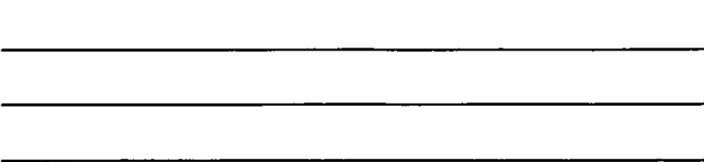

2、神秘型

◎ 写销售文案的真正秘诀（我的独家秘笈，仅这一招价值 100 万。这是让你超越我的秘密，我会全部传授给你。）

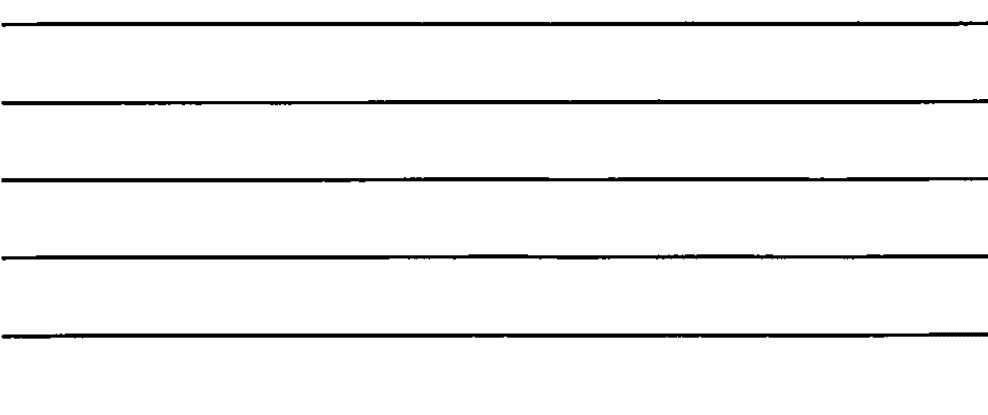

##### 3、视觉型

“当你用手轻轻拆掉包装上的蓝色丝带，然后打开精致的长方形红木盒子，里面躺着的是一瓶已保存了 5 年的贵腐酒。（这种酒已成为藏品，在香港拍卖会上，一瓶都拍到了 5 万元。）”

##### 4、听觉型

“提升写作的水平，你要多阅读经典的文案，可以大声朗读出来。或者用手抄写。（1、强化记忆；2、了解作者的用词，逻辑，顺序等。）”

##### 5、触觉型

这种面膜具有真丝的光泽和丝滑柔软的手感、优美的垂坠性、天然透气性、抗静电等优异功能，让肌肤享受丝般柔滑细腻的敷膜感受。（敷在脸上你几乎感受不到膜的存在。这是无纺布无法达到的效果。）

##### 6、特征与好处结合型

它是用质量最好的织物制造的（特征），当你每次穿上它的时候，看起来都会非常漂亮——即使在洗过上百次之后也依旧如此（好处）。

或者，你可以把它反过来说……

- 你每次穿上它之后，看起来都会非常漂亮——即使在洗过上百次之后也依旧如此，因为它是由质量最好的织物制造的。
- 看起来依旧像你购买时那样好——即使在洗过 207 次之后——它是由波斯生产的质量最好的手工织物所制造的。
- 如何站在客户的角度思考问题——90%的人都无法真正换位思考（这是一个大的秘诀，有 3 种方法可以帮你真正了解客户，按照客户的角度、语言来写作。）

##### 7、好处+证据型

1周内，你将会减掉至少10斤的脂肪，并且身体会更健康。（已经过80多例肥胖者的成功减重，并得到了XX权威减肥机构的认证。）

如何使用廉价的小分类广告，一天赚高达10000美元！（一个加利福尼亚州的商人，就是这么做的……全国还有许许多多的人，都利用这个简单的策略，每天赚大笔大笔的钱。）

注意：在一个子弹头中不要有两个主语，或者描写两种内容。只要一种就可以了。子弹头开头用动词也是非常好的选择：

促进顾客行动的4种手段（会让顾客坐立不安，不购买就睡不着觉。）

透露给你撰写销售信的3个原则。能让你的文案吸引力比原来增强2倍。

### 练习：

- 1、请用段落描述，认真写下你的产品或服务能带给顾客哪些重要好处。
  1)
  2)
  3)
  4)

- 2、请认真写下你的产品或服务能带给顾客哪些重要好处，用子弹头描述，每种类型至少写3个。

##### A、神秘型

- 1)
- 2)
- 3)

##### B、透露秘密型

- 1)
- 2)
- 3)

##### C、好处+证据型

- 1)
- 2)
- 3)

##### D、视觉型

- 1)
- 2)
- 3)

##### E、听觉型

- 1)
- 2)
- 3)

##### F、触觉型

- 1)
- 2)
- 3)

##### G、特征与好处结合型

- 1)
- 2)
- 3)

#### 写下你的感悟

### 第八课 用证据支持你的承诺

拿出证据，就是增加顾客对你的信任度，证明你说的都是真的。

如果你的读者已经花时间阅读你的销售文案了，那就意味着，他想要得到你在标题中所承诺的好处。但是，在他做出购买决定之前，你还必须解除他的担心和顾虑。因为，你的潜在客户不想犯下任何错误。

他们担心自己买贵了，担心产品是不是会像你说的那么好，担心你会不会发货给他们，担心出了问题是不是有保障，是否能退换货等等。而这是你必须克服的一个主要障碍。你的读者想要相信你的提议，但同时也认为，它们有可能不是真的。

因此，无论你提出什么提议，你都要记住，读者需要你来“证明它。”

他们希望你所说的都是真的。他们是这样想的，“它不可能是真的，因为它实在太好了。但是，如果它是真的会怎么样呢？哦，我希望它是真的。如果它是真的话，那实在是太棒了。”他们想让你说服他们，你在文案中说的都是真的。

所以，你就要证明你说的。这个证据可以来自客户见证，数据结果，统计数字，新闻报道，引述其他权威的文章信息，名人代言等。

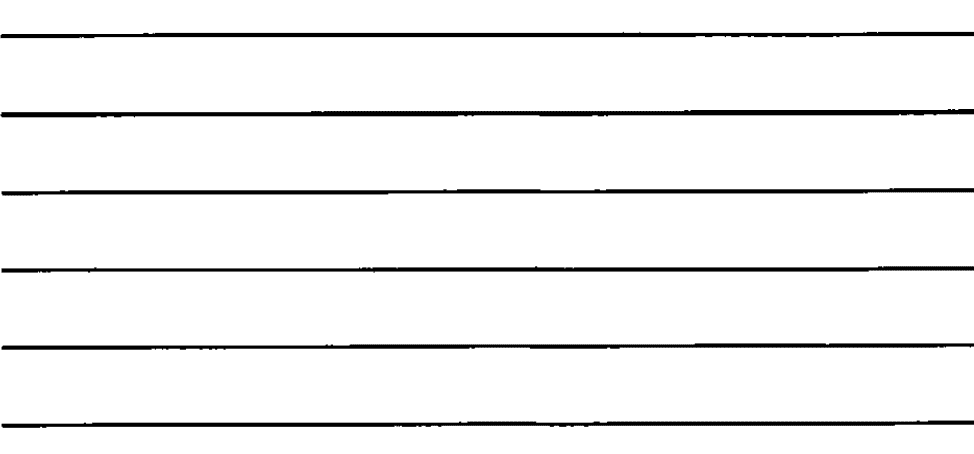

#### ◎ 用证据来证明你说的——重复证明！

你可以利用任何你想用的证明方法，但是你的证明，顾客也会产生怀疑，你必须解决证明中顾客心中的疑问。你必须重复证明。

比如，你的证明是，你跟顾客的微信聊天截图，这种证明作假手段太多，如何证明你说的证明是真的？顾客心中想知道：

- 我怎么知道这个证明是真的？

这时，你就需要说明这个证明的经过，类似子弹头里的好处+证据模式一样。在证明的后面附加一句话，是什么情况下做的证明？为什么要给你做证明的原因。

比如：一个客户说使用了你的产品一周瘦了10斤。如果是文字证明，你可以括弧，在里面说明这个客户是在什么时候使用开始的等等。如果是图片，在图片下面括弧说明（这个客户是在某月某日使用产品第8天就发来了回馈）。

通过这种描述，就增加了可信度。

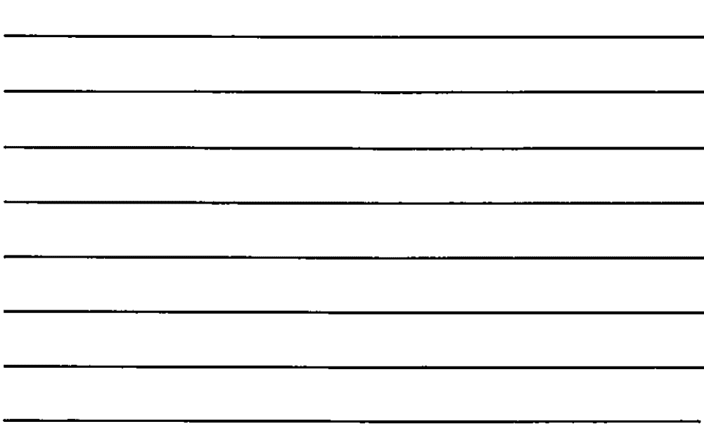

神笔文案 练习手册

#### ◎ 可利用的各种证据

你要不断寻找新的方法证明你所说的，比如：

##### A、零风险保证作为证明

这个产品有效，证明如下：

> 如果产品没有效果，我不仅全额退款给你，还会给你额外补偿200元，作为你花费时间和精力试用我们的产品。

##### B、统计数字作为证明

针对去年使用我们的产品的客户做了调查，调查结果显示：

- 98%的人表示满意
- 83%的人表示对业绩有提升效果
- 87%的人开始回购。

有时，你可以将统计的数字画成图表，将更有助于顾客的了解。

##### C、其他证明

以下资料可帮助你增加说服力：

- 客户名单
- 自己的从业经历
- 过去的声誉及资格
- 财务方面的参考资料
- 拜访过的城市或国家数目
- 所有服务过的客户总数

#### ◎ 多少证据才足够？

证据无所谓足够或太多的问题。总之，多多益善准没错。

所以，尽管放心大胆地去收集见证，而且越多越好，这可是无与伦比的致胜秘诀！

#### ❋ 获得客户见证的7个秘诀

##### 秘诀#1：趁热打铁

尽可能快地和客户索取见证，如果可以，就在客户购买你的产品当时或者一周内，或者客户刚刚使用过你的产品或服务时就索取。

##### 秘诀#2：说出重点

每次都要让顾客在证言中说出你的产品最大优势，或者说你的独特卖点。比如，你的卖点是提供出色的服务，当天完成安装，保证全额退款，那么要求顾客证实这些卖点。

我个人的最大优势就是善于通过写销售文案来帮助客户，那么客户见证就需要与这个相关。比如：

> "在写作和市场营销方面，李炳池老师给了我很多方法和建议，我们的企业按照他的方法和建议，每年以40%的速度递增。有关市场营销和写作方面的问题，他都给了我们完美的、最佳的解决方案。"——北京博思天宇文化交流有限公司 总裁 高朝良

##### 秘诀#3: 详实具体

要求顾客在见证中具体说明，获得的好处或利益，避免笼统、概括。如果你提供的是前所未有的出色的服务，那么要求客户具体写出你是怎么做的，对他的具体帮助是什么。比如：

> *通过李炳池老师提供的策略，使我的一个产品在一个月之内销量增加了2.5倍。并且，他指导过我的一封销售信，让我们的转化率从2%上升到6%，足足翻了3倍。我非常感谢李老师的指导！他是真正的直复式营销实战家！* —迈远电子（上海）商务有限公司 CEO 高杰杰

##### 秘诀#4: 索要照片

拍下客户使用产品前、后或者使用中的照片。附上客户的照片，信任度会加强。照片能让见证的效果加倍。

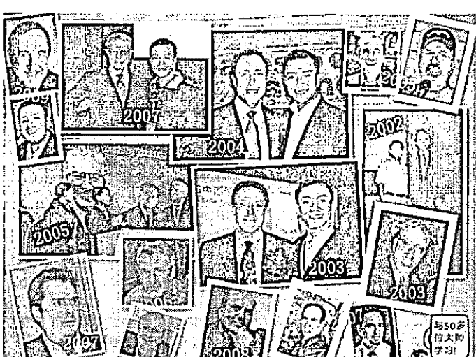

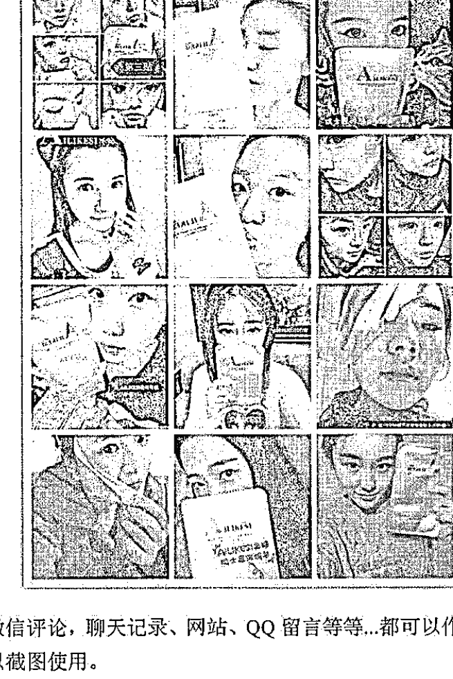

客户的微信评论，聊天记录、网站、QQ留言等等...都可以作为你的见证来源，你可以截图使用。

> 陈可礼 06/26/2015 - 16:58
>
> 很爱用，我已经从你这里学会撰写销售信。

> 姚松林 12/13/2014 - 12:40
>
> 你好 我是做电子方面的 不知道有什么营销策略 请大师指点

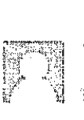

**古诺 08/19/2013 - 13:12**
精彩精彩

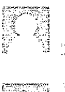

**吕特徽 07/12/2013 - 13:55**
太精彩了，很值得学习！

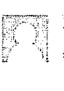

**重庆-钱敏如 06/09/2013 - 17:57**
很精妙的方法，值得学习。

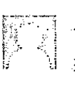

**周学杰 05/19/2013 - 08:45**
好策略好方法我真在用。

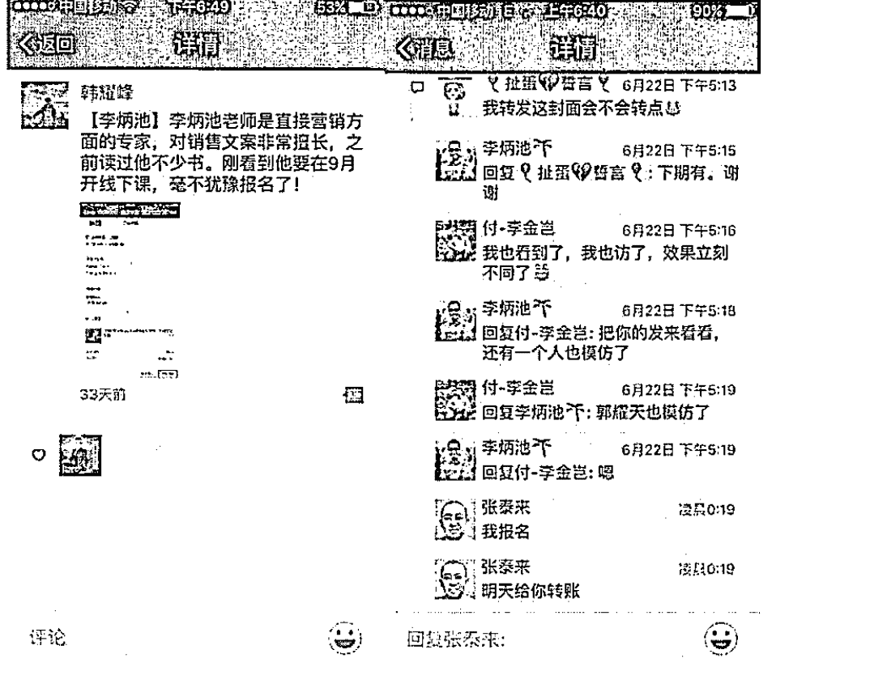

神笔文案 练习手册

<微信(1)> 张泰来

<发现> 朋友圈

- *我一直就是你的粉丝，关注你很久了*
- *aaa会员-张宇谈 李炳池老师是我人生中遇到的一贵人之...我一直在付出，我相比自己有些惭愧，所以我认为更加扩大格局，把学老师，中国顶级文案撰稿人隆重推荐给大 1. 点开关注学老师，你会损失很大。*
- *一直没机会当面请教，这次可以如愿了*

收起

免费回答你在营销文案中困扰你的问题（第一期）？ 限20...

1分钟前

- *我很谦虚，好学，你是*

李炳池

- *我跟你买了很多书，有些是我自己买的，有些是让我同事帮着定的，早就加倍的赚回了投资，非常受益。一直想找个机会当面谢谢，这次终于成行了。*

Sherry 群主

学死不护短，等于衰老十三年 太可怕了

<微信> 贺丹

<微信> 贺丹

- 师父：徒弟想做一个文案通过微信的朋友圈，和学生家长分享招生...
- 师父：你徒弟的朋友圈太杂来自世界各地北京的比较少，这个文案主要是给学生家长分享，目前有200多个学生家长可以直接看到这个消息...
- *“神秘权威人士分享只需25分钟就能写出标准硬笔字的靶心秘诀”*
- 师父：这个标题根据您的经验，还应怎样调整会更有点击率呢
- “家长们请注意：国内权威人士即将分享--只需25分钟，就能让孩子写出一手漂亮的硬笔书法字！详情 请马上联系XXX”
- 你的朋友圈都是什么类型的人，他们都想知道或解决的事是什么？
- 如果单纯从这个标题来说
- 师父：... ... ... ... ... ... ... ... ... ...

做截图对话一定要真实，现在很多微商使用软件做假证明，这是对它们的人格不负责，客户都不是傻子。最好的客户见证就是使用视频见证，如果是视频那就更有说服力了，但是很多客户不太愿意录视频，你可以找到喜欢视频见证的客户。

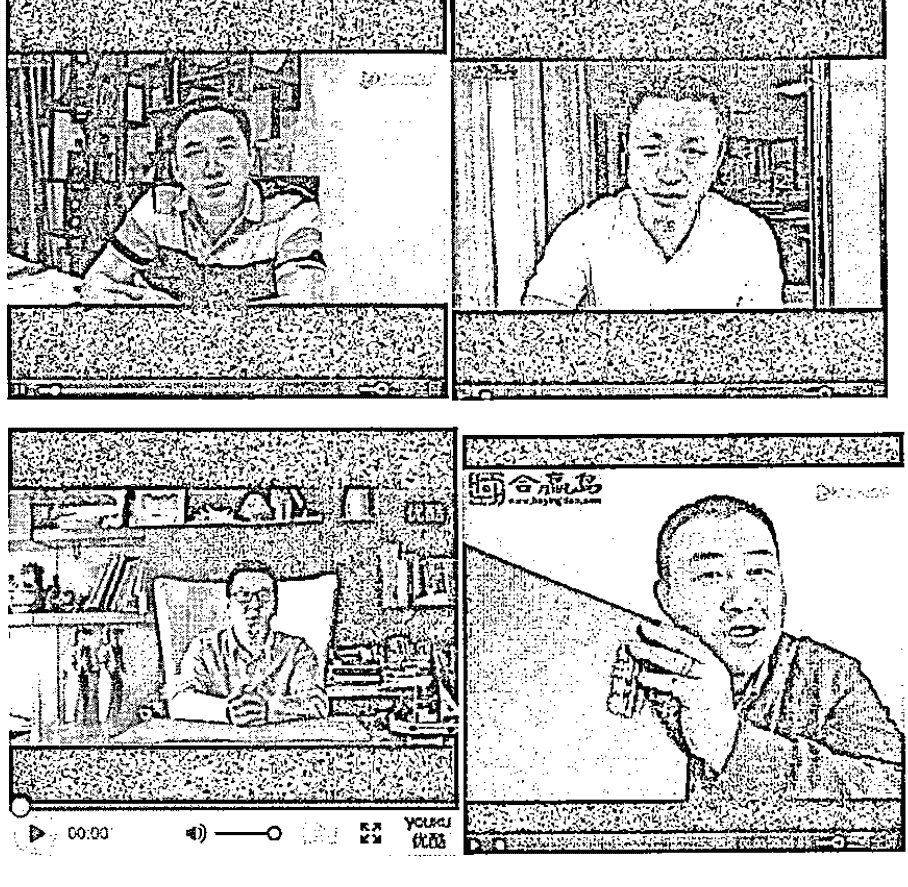

##### 秘诀#5: 真诚感谢

感谢客户，允许你使用他们的证言评论。让他们知道正是像他们这样的见证，帮助企业才能不断发展。

##### 秘诀#6: 署名详细

在客户做见证时，除了真实的姓名，城市以外，你要询问他们是否可以写上他们在哪家公司，担任什么职位等。这样可以增加证言的可信度。如果能够写上邮箱或者微信号可信度会大大增加。

##### 秘诀#7: 起草见证

客户有时比较忙，或者想要拖延。给他们打电话，告诉他们说你知道他们很忙，但他们的见证对你真的很重要。说明为了节省他们的时间，不让他们过于麻烦，你替他写了一份见证，请他确认下，看哪里是否需要修改，如果没问题就直接署名使用。

注意，见证语言风格要有变化，不然就知道是你自己编的。

#### 客户见证脚本

有的客户可能不知道如何写，那么你可以把这个脚本发给他，写完后，你再编辑下发给他确认。

亲爱的XX：

感谢你使用我们的产品/服务，因为你的证言评价，对我们的事业发展帮助会非常大。所以，恳请你把你在使用产品后的感受写给我们。

1. 使用我们的产品/服务后，对你有哪些帮助？（解决了哪些问题，改善了什么，效果如何等）
2. 我们的产品/服务你最满意的地方是什么？
3. 我们的产品/服务你觉得哪些地方还需要改善？
4. 是否可以留下你的邮箱地址或者微信号？如可以，请写下，谢谢！

你的姓名__________ 所在城市__________
公司名称____________ 职位____

感谢你的支持！

XXX（你的名字）
XXX（职衔）

### 练习：

请准备好5个客户对你的见证。

**客户见证#1：**

**客户见证#2：**

**客户见证#3：**

**客户见证#4：**

**客户见证#5：**

#### 写下你的感悟

### 第九课 超级赠品

使用赠品是增加产品附加值的重要策略之一。

要把赠品看作是“额外的一度”。什么意思呢？就是说：要在标准气压下把水烧开，需要100度。在你烧到99度的时候，水是烧不开的。

当潜在客户在阅读你的销售信的时候，就相当于水烧到99度的情况。你需要找到一种方式来获得那额外的一度，从而把水烧开——即，达成这笔销售。

而你的赠品，就相当于那“额外的一度”，在顾客采取最后一步行动之前，给他一个意外的礼物，可以消除他最后一分钟的犹豫，达成交易。

#### ◎ 赠品的3种类型

1. 引流赠品 为了获取潜在的客户，使用免费的礼物来吸引他们，这种礼物我称作引流型赠品。
2. 成交赠品 为了促进顾客下单购买，增加产品的附加值，这种我经常在销售文案中使用，被称作是成交赠品。
3. 锁客赠品 不告诉客户你有赠品，当客户收到你的产品之后，突然发现有一个特别棒的额外礼物。这种额外的礼物通常会让学生感动，对你的好感油然而生，再次购买你的产品几率会非常大。这种礼物，我把它称作锁客赠品。

#### ◎ 选择赠品的2个标准

1. 你的赠品品质要好，而且必须与销售的产品相关联，有互补性。它是产品的补充，或者能让产品更有用。最好能够让顾客意想不到。
2. 低成本，高感知价值。

### 练习：

写下你的赠品是什么？然后，用简短的文字描述赠品的价值。

- 赠品#1：
- 赠品#2：
- 赠品#3：

#### 写下你的感悟

### 第十课 零风险保证

如果你无法提供保证，那么1000个顾客中你或许只能够得到10个客户。但是当你提供一个保证，你或许就可以获得20个客户。假设在这20个客户当中，有2个或是3个要求退款，那么，即使你把钱退给了他们，你还是多获得了17到18个客户，这和原来相比还是多赚了。有了这些保证，销量会上升，而退货带来的成本是微不足道的。

现在，很多商家都开始提供7天或30天的保证期。在销售文案中给顾客一个满意的保证，不满意全额退款这种保证，这只是最基本的要求。

在更多的情况下，你需要做出更多、更好的保证。保证购买你的产品或服务没有任何风险，用上它可以让你提议更加有吸引力，在顾客做决定时，能够放心购买。

#### ◎ 更多更好的保证

##### 弗兰克・科恩的电子书零风险保证

“请下载我的电子书阅读吧。如果你不喜欢它的话，就请发电子邮件给我，我会把你所支付的钱全部退还给你。我这样做是要承担一定风险的。我不能迫使你把电子书还给我。当你下载电子书之后，我并无法将它从你的电脑中拿回来。因此，你大可先订购我的电子书，然后要求退款，把我丢至一边。不过我相信，你不会那样对我的。”

##### 诺德斯持龙 (Nordstrom) 的完全零风险保证

“凡诺德斯持龙的产品，不管你买了多久，不管你使用了多久（使用痕迹有多重），你都可以随时退货，得到全额退款。”

#### 制定保证必知的3件事

1. 
2. 
3. 

#### 常用的3种保证方式

1. 全额退款保证
2. 部分风险保证
3. 比零风险更好的保证

#### 8种零风险保证例子

下面列举出了一些强有力的词语和句子，可以为你的保证注入活力。

- 我向你保证
- 比零风险还要好
- 你一定获益
- 无条件的退款保证
- 给你全额退款，不问任何理由
- 我本人担保
- 你不可能有任何损失
- 30天之内免费检查
- 无问题、无争议，保证退款
- 铁一般的退款保证
- 100%当场全额退款
- 110%“放血”保证
- 对你来说，完全无风险
- 100%，无争辩返款
- 110%无异议，无问题，“不会讨价还价”的承诺
- 不会有任何犹豫迟疑，保证退还你的每一分钱

下面是我写过的，以及认为相对较好的一些零风险保证例子。你会发现，每个保证都有自己的标题，标题构成了80%的保证。

##### 例1：100%比零风险更好的保证

我以自己的人格担保，如果你踏踏实实努力的去尝试把这些销售信运用到你的业务当中，你将会在60天之内至少增加收益10倍以上。千真万确，如果不使用这些销售信模板，你不可能增加10倍的额外收益。

你可以用两个月的时间去证明这些销售信模板的可行性。如果你不是100%的满意，直接告诉我们，我将立即无理由的返还你的全额付款，并且你可以毫无顾忌的保留赠送给你的免费礼物，以作为我为你带来的麻烦做补偿。

##### 例2：125%不问你任何原因的退款保证

我们公司有一个政策，对所有的书和软件都有一个无条件退款的保证。如果你觉得我的书和软件包并不如我所说的那样，不是很满意，我们将给你全额退款，不问任何理由。我们干这一行已经25年了，是国内最大的几家公司之一，你完全可以相信我们。

##### 例3：60天铁一般的退款保证

恭喜你购买本产品，为了让你放心，随套装额外赠送了你一片试用装，你可以先体验试用，如果不满意，直接退回套装即可。即使你用了套装的产品，也没关系，只要剩下的包装完好，在60天之内，告诉我们，我们会立即把未拆封的产品原价全部退给你。对你来说，订购XXX，你没有任何风险。

##### 例4：365天 100%退款保证

你所投资的每一分钱，在365天内，如果你有任何不满意或感觉此套装无效的话，我们不会问你任何理由和原因，直接原款退给你！而所有赠品一律归你所有，以感谢你的付出。这也是我们非常相信此“杀手销售信写作”套装的巨大价值，给你的有力保证！

##### 例5：“我方承担所有风险——终身保证”

我告诉你…如果你诚心试用我们的产品，我愿意承担你的所有风险。我们提供无条件的100%终身保证，让你更轻松的做决定：

任何时候，如果你对 XXX 不满意，我将让快递到你家门口，拿走这个产品，并返还你全额付款及快递费。不仅如此，你还可以保留价值 500 元的免费礼物，而且我们依然是朋友。

##### 例6：有了我们铁一般的 100%退款保证，你不会有任何损失

我们用零风险、无理由的 100%退款保证来确定你的满意度。如你有任何的不满意，不管是什么原因，在一年之内请尽管联系我们（退回产品），我们将 100%退还你的金额，不会有任何纠纷和麻烦，你甚至不用多费一点口舌，因为我们会应你的要求马上行动。

如果你是一位聪明的生意人，你不会在对方没有给你合理保证，物有所值的情况下就投入 X 元。这里情况一样，可以先做试用，再决定是否需要此产品。如果对你来说没什麽用，或者说得更具体点，如果不能为你节省金钱、时间和精力，不能改变你的人生，你也不必有任何担忧，因为有了我们铁一般的保证，你可以拿回你所投入的每一分钱。所以说，你只会有收获，而不会有任何损失。

#### 例 7

### “100%保证，你不会有任何损失”

本套装提供 90 天退款保障。因为它符合本网页上的每一个承诺。然而，如果你觉得你无法使用这些先进的十亿美元秘诀（霍普金斯正是依靠这些秘诀，才得以迅速而轻松致富），那么你只管开口。我们会立即为你礼貌退款。

但是，如果你确实热衷于直接营销，这份材料会让你兴奋不已，你会立即使用它，努力取得属于你自己的直接营销财富。你会爱死它的！

#### 例 8

### “155%铁的保证，你不会有任何损失”

成千上万像你一样的人买了文森特·詹姆斯的《12个月从0到100万》。他们购买后都非常兴奋，所以我愿意为你提供 155%的退款保证：

如果你真正按照本书的方法在一年内没有成为百万富翁，那么请你回信给我们，并将你在致富过程中所作的尝试做一下描述，我们会退还你买这本书所支付的每一分钱。而且，给你的特别礼物你还可以继续保留。

#### 练习

如何让顾客购买产品无风险？请写下你的零风险保证：

标题：
正文：

#### 写下你的感悟

### 第十一课 重申提议&呼吁行动

在销售文案中，最常见的错误之一就是忽略了去提醒消费者下订单。很多企业费尽心思为其产品编造精彩的故事……去勾起消费者最初始的欲望……觉得这样就可以了，他们永远都不尝试去达成交易，这让人感到很惊讶。

#### 呼吁行动黄金法则

1. 总结你的主要好处（现在订购，你将得到什么……）
2. 再次让读者放心（重申零风险保证/售后）

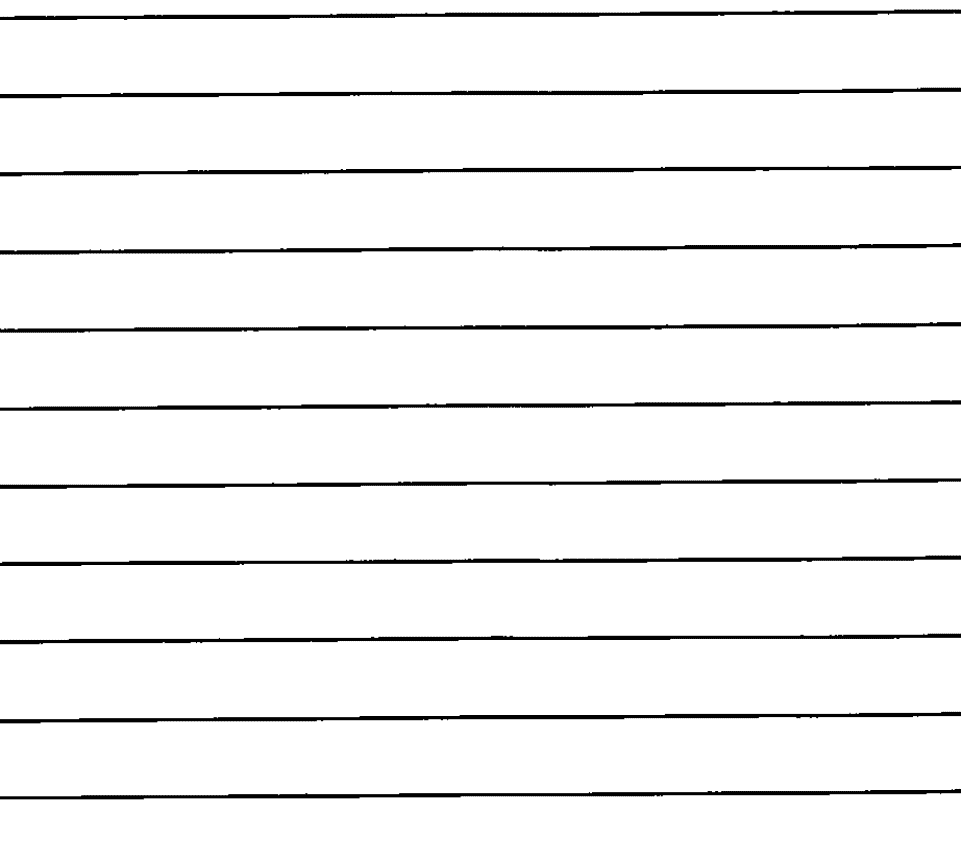

#### 呼吁行动公式

价格
↓
不要错过这样的机会
↓
1.这么做 2.那么做 3.填写……点击按钮……提交
↓
多一天，你就会损失……
↓
立即行动
↓
如果不立即行动，你可能就会忘记
↓
如果你在……之前回复/下单，就可以免费获得超级礼物！

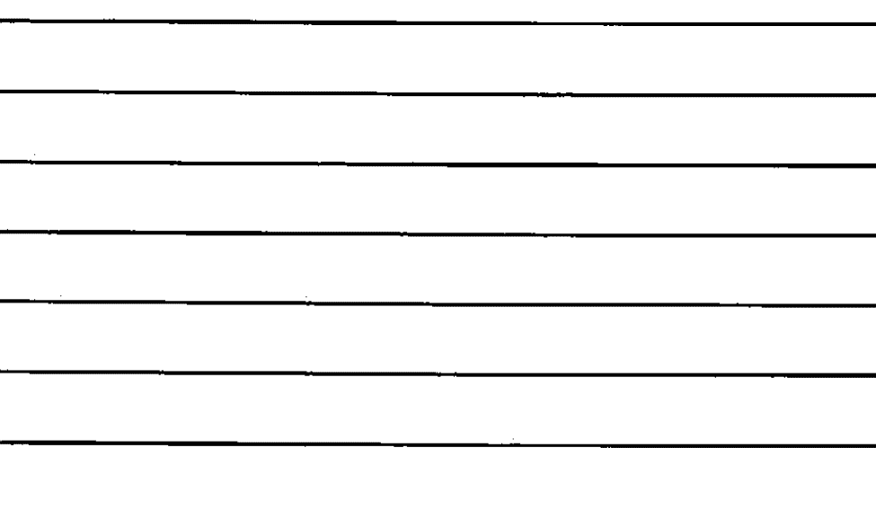

#### 呼吁行动 "关键词"

- 今天
- 不要错过（这样的机会）
- 快速
- 尽快回复（你的订单表）
- 抓紧
- 抓住这次（特殊提议）特价
- 你回复得越快，……越快
- 尽快
- 尽快申请
- 立即行动
- 立即回复
- 我明天能收到你的回复吗？
- 不要再等待了
- 在机会还没消失前，抓住……
- 快速行动
- 确保你具备……资格
- 不要再犹豫不决，抓紧行动吧
- 我想感谢你这么快就回复了

#### 呼吁行动最有效的5种策略

##### 1. 设定截止日期

不要在迟疑不决，抓紧做决定吧。很遗憾，如果你在2016年8月28日零点之后，再下订单，我就不能保证能为你寄出这款XX了。所以，不要再等了！这确实是一个千载难逢的好机会！

这个380元的特别优惠价（比680元的定价低了300元）是有时间限制的。只有你在48小时内预定，才能享受到380元。48小时候后恢复原价680元。

##### 2. 设定一个时间段

我会有30天的推广期，为的是可以更好地为你服务，也为了让我的助理XXX不会突然因为太多的订单而工作量过大。如果你在接下来的3天内下单，我将会非常高兴地送你一份特别礼物——一个高性能的XX，以表达我的感激和友情。所以，抓住这次有限的机会，今天就下单吧！

这份手稿只提供给提前预定的99人，3日之内预定（10月5-7日），只需300元/人（纸质版）......相当于你请一位好朋友出去吃饭饭的价格。也就是说，核算下来每个广告文案撰写秘诀还不到7元！

注：10月8日之后预定499元，如果人数达到99人，立即停止。

##### 3. 紧急事件……

如果顾客不采取行动，你会取消掉刚提供的所有或很多好处，比如：

- 仅限一定数量的客户（或产品数量有限）；
- 很快就会缺货，或即将涨价；
- 特价活动（产品发布日，试订圆等）。

紧迫性是所有销售文案的必须要素。你不希望读者想：“好像我没有必要立即购买，我可以稍后再处理，或许下周再说也行。”你永远不希望读者看完你的销售文案，先去忙别的，忙完再做决定。

##### 4. 如果顾客快速回应，就能获得免费礼物

如有任何问题，请随时微信我（微信号：zixun8），或者拨打我办公电话：010-85561009 最好今天报名，还能节省 1100 元 …前 10 位报名，还可获得 盖瑞·哈尔伯特 的 29 篇经典文案！先到先得！！

##### 5. 不及时回应，可能造成一定的损失

如果顾客不快速回应，或放弃你提供的极其诱人的提议。会有什么损失。

比如，你在销售文案上注明了截止日期，你要解释如果在截止日期，你还没有下单或者你要他采取的某种行动，会有什么损失或者后果。当然，你的陈述不能太夸张，否则你说的紧迫性就会失去可信度。

#### 呼吁行动样板

1. 为了你好，我建议你*在我们断货之前，赶快行动！它将永远改变你的生活。所以现在请点击这里马上下单。

2. 我建议*你抓住这个难得的好机会，你可以*免费试用 30 天，来看看（产品名）是不是让你变得更加强壮和有力。赶快点这里免费申请吧！

3. 不要相信*我的话，但要相信自己的判断！请点击这里申请，没有任何风险，我真诚的期待着与你合作。

4. 立即行动吧…今天最后一天申请了。你不会有任何损失…反而会获得很多意想不到的礼物，我敢和你打赌。你要做的就是，*点击这里抓紧申请！！

5. 你能获得 XXX 的优惠时间只有一个。那就是现在。预定的最后日期就是今天——4 月 30 日。很遗憾，这个日期之后收到的订购款都将被退回（除非你是打全款 3800 元，1-9 号是全款，11 号统一发出，以后不再销售）。我建议你*今天尽快完成订阅，享受这次优惠待遇！

我敢保证，此次订阅！保证你将获得一次终身难忘的经历，未来几十年内都将受益匪浅！不要错过，立即*点击这里订购。

6. 本书是一本行销工具，正如文案特詹姆斯说的：*我的咖啡桌上就摆着这本书。每个星期我都要参考。你必须马上下单！*现在，这本伟大的工具书正式发出为 9 月 30 号，正式发出订购需 980 元。今天预定（24 小时内订购，而且不对外销售，只有 VIP 客户有资格预定）只需 680 元。

7. 如果这套资料不能像我所承诺的一样，不能让你的营销和广告文案撰写能力提升至少 3 倍，那么我们就没理由拿你的钱。你有 90 天的试用期。在这 90 天里，只要你使用了其中的方法而没有收获，没有让你感觉物超所值，你只需寄回本套资料，我们不会问你任何原因和理由，100% 返还你订购时的金额。

但是，如果你真正热衷于营销，我相信，这套资料会让你兴奋不已，你会喜欢它的。

而且，订购非常容易……你只需点击这里！

行动吧……现在就点击这里！

8. 不要错失良机，价格随时可能会上调，现在只需人民币 120 元，你将发现这个《终极销售指南》为你带来的价值将会是你所投入的 N 倍。另外，马上行动的人，还可以获得 2 个超值的免费礼品。现在就点击这里，立即获得吧！

#### 强调拥有之后的美好感觉

在呼吁顾客采取行动时，你可以告诉顾客，当他拥有你的产品后，能够带来哪些好处的美好画面（情景体验），这样更能够促进他们回应。

常用的模板：

1. “当……的时候，你会有……的感觉”

当你使用 XXX（产品名）一个月之后，你会发现小肚子上的赘肉都消失不见，变得更性感，难道这不是你想要的吗？趁今天优惠，赶快微信支付订购吧！

2. “如果……，你就能……”

如果你现在汇款订购 XX（产品名），不仅能获得免费的超级礼物，而且明天你就能体验到 XX 带给你富有弹性、水润的肌肤……

#### 练习

1. 写下你能促进顾客采取行动的提议（比如，数量有限，时间限制，赠品有限...）
2. 写下你要顾客现在必须行动的原因：

#### 写下你的感悟

### 第十二课 附言（P.S.）

当你写好产品，赠品，保证，并且呼吁行动后……你的销售文案就完成了吗？当然不是。除非你加上我最喜欢的两个字母P和S。也就是附言。

不管你信不信，附言是标题和起始段外读者最有可能阅读的部分。事实上，泰德·尼古拉斯和其它一些直接营销专家都已经证明：一个有力的附言可以增加一倍甚至两倍的回应率。

用附言来强调你销售信中的主要好处，再次强调你的提议，提醒你的读者这个交易没有任何风险，立即下单还会有一个超级礼物赠送，或者激励潜在客户在有限时间内马上行动，否则会错失这个机会等。

我的每封销售信，几乎都有附言，像这次课程的销售信附言（见下面）：有数量限制，人数18人截止报名。并且塑造了此次报名的价值，如果错过等到第二届价格就更高，这也是机会。并且说出了联系方式，让读者有信任感。同时，马上报名还有上千元的优惠，而且还强调了赠品。在短短的几行字，陈述了对顾客来讲非常有价值的信息。

**P.S.记住，为了保证效果，本课程只招收18名学员（额满即止）。** 第二届再开，还不知道什么时候，价格会涨到12800元，或更高。趁现在还有名额，赶快报名吧！

**P.P.S.如有任何问题，请随时微信我（微信号：zlxun8），或者拨打我办公电话：010-85561009 最好今天报名，还能节1100元…前10位报名，还可获得盖瑞·哈尔伯特的29篇经典文案！先到先得！！**

#### 附言样板

1. 记住，你将获得上面所承诺的所有东西——包括克劳德·霍普金斯的第三本书……他宣传此书的广告……罕见的克劳德·霍普金斯 70 多则广告集锦……还有……霍普金斯的对手詹姆斯·沃尔特·汤普森的书籍和广告——都是免费的。用整整 90 天的时间来验证这份宝贵的广告秘诀金矿。然后，你再亲自评价，这是否和我们说的完全相符。

但是赶快！价格可能会随时上涨……所以……马上点击这里

2. 记住，我们承担所有的风险。如果收到（产品名）你不满意，无论什么原因，尽管寄回给我们，拿回你的全额付款。你绝对不会有任何损失，现在就点击这里订购。

3. 不要犹豫，赶快申请，只出售 30 份，售完立即停止！

4. 《盖瑞艾尔波特时事通讯》（电子期刊）每隔 10 天发布一期，每期只通过邮件发送给已订阅过上期的客户，不在网上公布。订阅人数限制为 1000 人，超过立即停止。如果你想获得盖瑞的更多“核心”秘密，请马上开始获得“如何在 30 天内成为优秀的文案撰稿人”这一期吧，仅需 38 元！点击这里订阅，当日发出。

5. 乔·卡伯的这封销售信，在数年内登上了几百本杂志，它已成了销售信中的经典之一。今天你拥有“懒人致富”，还可以获得有世界顶级营销大师乔·苏格曼讲解这封销售信的撰写方式（电子报告，价值 50 元），可以让你学到撰写销售信不为人知的方法。

6. “罗伯特科利尔信书”如果不是所说的那样，我们 100%承诺保证，365 天不管任何原因，只要你感觉不满意，我们全额退款给你，赠品你还可以继续保留。请你把握这次机会，此书随时可能提价。

7. 记住，为了保证效果，本课程只招收 18 名学员（额满即止）。第二届再开，还不知道等到什么时候，价格会涨到 12800 元，或更高。趁现在还有名额，赶快报名吧！

8. 立即预定（2月8日发出），你就可以获得一份价值非常高的免费礼物——我的一本249页的电子书《直接营销秘诀》——我的营销通讯精华版。马上点击“合赢店”预定。

9. 我不能保证，这个页面永远存在。也就是说《营销内幕笔记：亚伯拉罕营销指导手册》可能随时停止销售。如果你是一位创业者，企业老板，杰的粉丝，请现在回复我的微信——李炳池（LBC333），告诉你的邮箱地址和真实姓名、联系电话；注明：我要订《营销内幕笔记：亚伯拉罕营销指导手册》一份。

10. 马上订阅！不要再犹豫，小心错过！

11. 如果你不符合资格，就请你不要填写申请表，我们只招纳符合条件的人。还有一个很重要的事情：我们有权对入岛费的价格随时上调。《信手拈来，一夜间改变你的广告》赠品可能会随时取消。因此，请你在这个促销活动依然展开的时候，赶快申请加入——点击这里申请！

12. 只要你拥有了《539档案》——世界顶尖大师私藏的539篇经典文案，你不需要再购买其它任何文案范本，模板等。现在，你只需要轻松抄写，改编，复制，粘贴即可——帮你赚钱，帮你省钱，帮你成为顶级的文案撰稿人！

13. 《如何战胜癌症》将会在很大程度上提升你的生活品质。这本书原价50美元，现在你只需花29.97美元，并且还有一年的退款保证，购买此书对你来说没有任何风险。另外，还会赠送你5个免费报告，你可以毫无顾虑的收下它们。现在就订购吧！

14. 注意，这样的机会在2016年是唯一一次，请赶快行动，截止日期是8月28日。

15. 记住，这个190元的半价活动只在3天之内有效，之后你必须支付原价380元，不要错过机会，马上行动吧！

#### 练习

请认真写下你的附言，是强调好处，稀缺性，时间紧迫性，数量限制，还是赠品或者风险保证？或是其他…根据自己的提议来撰写。

PS:

PPS:

#### 写下你的感悟

### 第十三课 如何撰写杀手级销售信

当你前期准备的足够充分，你写作起来就很容易。一篇优秀的销售文案，实际上就是组合、编辑的过程。

只要你学会写长文案（比如：销售信），再写短文案（比如：引流文案，朋友圈文案），就会很简单。长文案是一切的基础。相反，会写短文案的人，不一定就能写好长文案。

#### 经典销售信常用公式

- 标题
↓
- 问候语
↓
- 起始段
↓
- 主题文案
↓
- 证据
↓
- 解释你的提议（消除疑虑）
↓
- 超级赠品
↓
- 给出最好的保证
↓
- 重申提议，呼吁行动
↓
- 结束语
↓
- 撰写附言

#### 写作速成法

##### 标题

标题就是你的钩子。它的任务有两个，第一个，抓住潜在客户的注意力；第二步让对方有兴趣打开你的销售页；如果标题无法让对方打开，你的内文写得多么有吸引力，都没有意义的。所以，你应该投入 80%的时间。撰写很多标题……10 到 50 个……然后通过测试选出最好的。（同时，保留其余那些有效的标题。后期可用作副标题，或者段落标题。）

##### 问候语

称呼，开始与人建立第一印象的称为。几乎所有的个人信件都有一句问候语，既是最有效的销售信是个人与个人之间的交流，这也是你需要加上个人风格的一种好的方式。如果单独发，就直接称呼对方的姓名或者职衔，比如：亲爱的施郎。美国专家研究发现，有读者姓名（即个性化）信件，比没有的要增加 13-64%的回应。销售中，能提升 327%的业绩。退订率降低 42.8%。通常我们都是群发，问候语比较稳妥的用“亲爱的朋友”。

##### 起始段

撰写一个“黏性”开头，黏住读者——紧接着标题就是开头，它的作用是继续引起顾客的兴趣或好奇，促使顾客进一步阅读你的文案。你可以用一句话，一个故事，一个问题，或者一个证言开始，具体采用哪种？根据你的产品读者情况来定。（如果你能够让读者读完350个字，他们就很有 possibly 读完整封销售信了。）

##### 主题文案

陈述产品好处，提议——这里，你将为你的提议注入情感因素，因为人们购买产品时是感性的，之后他们才会理性分析自己的决定。使用具体事实，描述画面，解释产品好处如何帮助到他们，进行对比，以及好处，好处，好处，塑造价值，来和潜在客户建立情感联系。

##### 证据

用证据来支持你的承诺——潜在客户没有理由相信你的承诺，因此，用可靠的信息来支持你说的话。这个证据可以来自证言，数据结果，新闻报道，引述，名人代言，等。

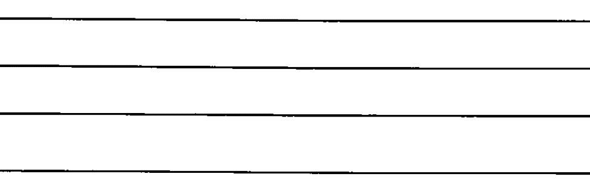

##### 解释你的提议（消除疑虑）

如果你的提议听起来太好，让人不敢相信它是真的，那么告诉你的潜在客户为什么它是真的。解释你在做什么，为什么如此重要。为什么你的价格优惠。为什么顾客必须立即购买。详细说明如何能得到它。

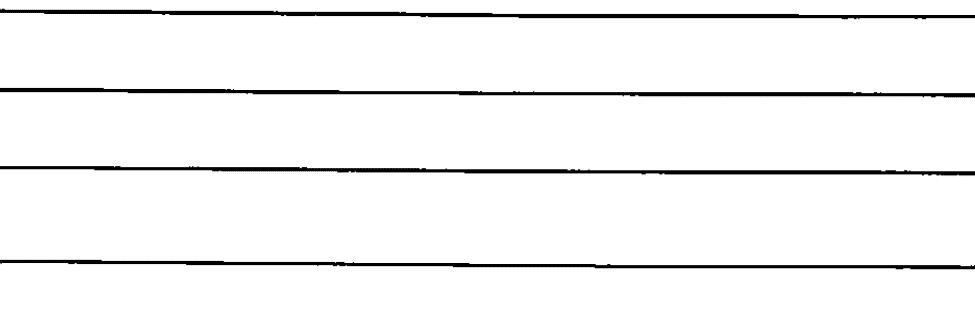

##### 超级赠品

在顾客采取最后一步行动之前，给他一个意外的礼物，可以消除他最后一分钟的犹豫，达成交易。这个礼物可以是产品的补充，或者让产品更有用。

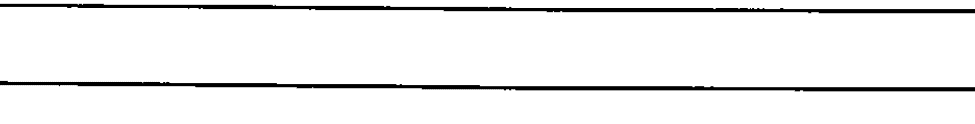

##### 给出最好的保证

尽可能提供最强的保证，符合你的长期利益。如果你为潜在客户移除了任何潜在风险，那么你的销量会大幅提高。

##### 重申提议，呼吁行动

总结如下：你必须要求他们立刻采取行动。如果你想要他们打电话，那么告诉他们立即拿起电话，拨打 XXX-XXXX。不要靠运气。确切地告诉告诉他们一步步该做什么。告诉读者如果他们现在不采取行动将会失去什么。

### 结束语

结束语意思是要说的都已说完了，在这儿表示我的敬意。一句祝福语，然后签名。我常用的是：祝你成功、祝你好运、祝福、真诚的，这种用法主要用在纯粹的销售信上，如果你的文案前面没有使用问候语，结束语也可以不用。

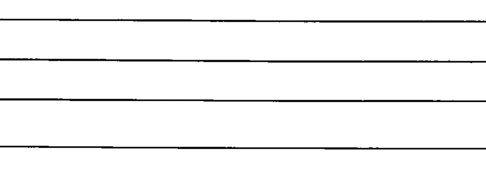

##### 附言（PS/特别提醒）

除了标题，附言是一封销售信中阅读率最高的了。附言中应写“要求”（你想要他们做什么）并重述你的主要好处。一条优秀的附言能够极大地提高顾客反应率。

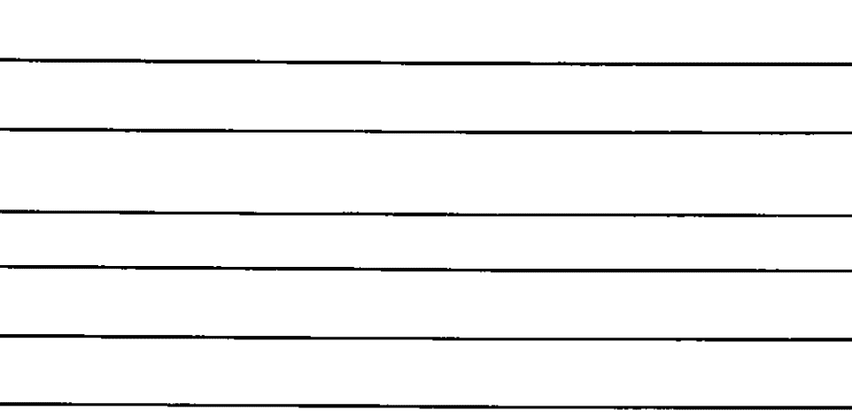

#### 练习

现在，开始撰写你的销售信。按照下面列出的步骤，把你前面做的练习，套用、组合即可。

标题：

问候语：

起始段：

##### 【主题文案写作提示：】

1. 陈述产品的好处，你的提议。揭示秘密，带给读者重要的好处。或者描述潜在客户的主要问题，陈述问题的解决方案。

2. 介绍自己，“我是谁？你为什么应该听我讲？”，从平房到富有，从失败到成功的故事。体现专家权威，建立信誉。比如：关于自己亲身经历过的痛苦、愤怒、挫败等等，列举出这些你的痛苦经历，然后再说出你的产品解决了你的这些痛苦。当然同样的，也可以解决顾客的痛苦。

3. 陈述问题的根源，击中潜在客户的要害

4. 提醒潜在客户你的产品可以解决他的问题

5. 子弹头（好处、好处列表）

6. 再次陈述解决方案，帮顾客想象拥有产品好处的美好景象

7. 使用段落标题，把长段落分开。

**主题文案：**

### 主题文案：

证据：

解释你的提议：

超级卖点：

给出最好的保证：

重申提议，呼吁行动：

### 结束语

撰写附言：

### 李炳池 24 小时法则

### 无情的编辑

编辑，事实上比写作还痛苦，因为写作通常就像自我放纵，而编辑更像是动手术。要把你辛辛苦苦写的很多内容，无情的删减掉，精简。但是，要想让你的销售信，变得强有力，就必须动这个手术。

### 如何让你的读者从头读到尾

你的文字，乃至你的整页文案，都必须具有“可读性”——要一眼看去简洁明了，而不是晦涩难懂，令人畏惧的大篇文字。没有什么比一大片密密麻麻的文字，更能阻止读者阅读了。

在销售信正文，你可以采用我们之前说过的方法，来吸引读者注意力，比如：

- 问一个题；
- 透露一些令人兴奋的消息；
- 总结你之前说过的内容。
- 一个强有力的承诺。读者会好奇你将如何信守承诺……将继续往下读！
- 任何不寻常的，或引人注目的想法，任何有趣的，让人想了解更多的事……

如何把这些激动人心的消息，引入到你的正文中，让读者愿意继续阅读下去？你可以采用连接词——转换句的方法。比如，你可以采用这些短句，来激发读者的兴趣：

### 激发兴趣转换句

- 还不止这些……
- 它甚至比……
- 等一下，最好的还在后面……
- 但是首先，你应该知道一些事实……
- 现在我将向你展示为什么……
- 现在，最重要的部分来了……
- 现在你将明白为什么……
- 但是，还有一件事你必须做……
- 你可以问自己……
- 你肯定已经知道……

但是，仅仅激发兴趣还不够！你还要吸引读者想继续阅读下一段！在段落的后面（或页面的结尾）。用一句引起好奇的话——引起好奇转换句，让读者继续阅读。下面举些例子：

- 而且，最重要的是……
- 还有更多……
- 现在，我要向你证明它的真实性……
- 我还要给你一个惊喜，事实上……
- 在接下来的几个月里使用这种设备，你将节省……

当你写完后一个段落时，在关键时刻，保留一些重要的信息，通过转换句，把重要的信息放到下一段（或者下一页），让读者继续阅读（或者，只能翻页才能看到）。如果你激发起了读者的好奇心，他们就会继续阅读！

使用转换句，使人们能够轻松阅读。常用的词还有：

- 事实上
- 由于
- 因此
- 立即
- 比如
- 接下来
- 无论谁
- 另一个
- 因此
- 相反
- 既然
- 最后
- 此外
- 第二点
- 当然
- 另一方面
- 终于
- 上述情况也适用于
- 实际上
- 在这里
- 此时
- 尽管
- 而且
- 同样
- 再说一遍
- 换句话说
- 就是
- 这样了
- 或者
- 更多转换句，见附一

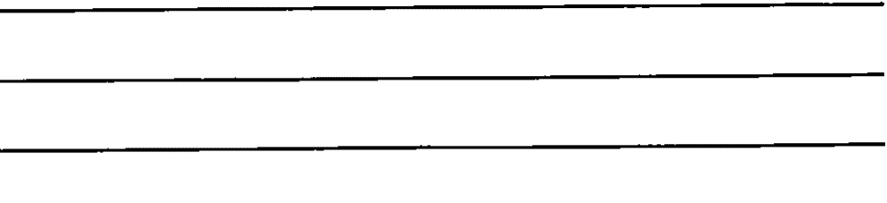

### 哪些因素阻止人们继续阅读？

句子越长，读起来越费劲。句子越短，读起来越容易。

### 版本 A

当我们对 12 名患有尿道炎（一种痛苦的尿道疾病）的男性进行检查后发现：在排尿时，以及排尿后，他们的感染没有加重，也没有引起任何可能导致疼痛的伤害。然后，我们为病人口服普通维生素，连续 4 天、结果如何？所有症状均得到缓解。

还有一位病人，是个杰出的商业女性，为了缓解背部疼痛，她已经做过 3 次手术。当我们被召集到医院时，她已经在医院里了，准备再次进行另一个更大的手术，在脊髓处做个切口，隔离疼痛的神经。但是，在进行这次重大手术之前，她的医生想要尝试不一样的方法（也就是我们下面描述的自然愈合法）。幸运的是，它成功了！如今，她已经恢复健康。走路或者站着，都不会感觉疼痛，不用吃药，再也不会疼得无法入眠，她已经完全恢复了正常生活。

在你购买这本不可或缺的书之前，读读所有这些真实案例！它对你有何帮助？在很多方面都会有帮助！你自己去看看吧！第一例患者，是多发性硬化症，由卡斯罗博士治疗，这位病人病情已经严重到无法起床，穿衣服，甚至无法自己吃饭。

经过一段时间的自然疗法治疗（下面描述的疗法）后，没有服用任何药物，现在她又可以照顾自己了，能够不拄拐杖，不借助任何外物自由行走了。

在 3 个星期一 1 个月的时间（有时候时间长一些，有时候时间短一些）内，他接诊的膀胱炎病例，治愈合成功率在 85 - 90%。这只是开始！你还没听说过这些惊人的案例：一位患有严重头晕的女性，几乎无法站立。她的血液中甘油三酯的水平也很高。在经过 3 周专门为她定制的饮食调整后，她的甘油三酸酯水平下降了 50%，再也没有头晕过。

### 版本 B

当我们对 12 名患有尿道炎（一种痛苦的尿道疾病）的男性进行检查后，我们发现：在排尿时，以及排尿后，他们的感染没有加重，也没有引起任何可能导致疼痛的伤害。然后，我们为病人口服普通维生素，连续 4 天。

结果如何？所有症状均得到缓解。

还有一位病人，是个杰出的商业女性，为了缓解背部疼痛，她已经做过 3 次手术。当我们被召集到医院时，她已经在医院里了，准备再次进行另一个更大的手术，在脊髓处做个切口，隔离疼痛的神经。

但是，在进行这次重大手术之前，她的医生想要尝试不一样的方法（也就是我们下面描述的自然愈合法）。幸运的是，它成功了！

如今，她已经恢复健康。走路或者站着，都不会感觉疼痛，不用吃药，再也不会疼得无法入眠，她已经完全恢复了正常生活。

在你购买这本书之前，读读所有这些真实案例！

它是一本不可或缺的书！它对你有何帮助？在很多方面都会有帮助！你自己去看看！

第一例患者，是多发性硬化症，由卡罗博博士治疗，这位病人病情已经严重到无法起床，穿衣服，甚至无法自己吃饭。经过一段时间的自然疗法治疗（下面描述的疗法）后，没有服用任何药物，现在她又可以照顾自己了，能够不拄拐杖，不借助任何外物自行走了。

在 3 个星期—1 个月的时间（有时候时间长一些，有时候时间短一些）内，他接诊的膀胱炎病例，治愈成功率在 85 - 90%。

这只是开始！

你还没听说过这些惊人的案例：

一位患有严重头晕的女性，几乎无法站立。她的血液中甘油三酯的水平也很高。在经过 3 周专门为她定制的饮食调整后，她的甘油三酯酸水平下降了 50%，再也没有头晕过。

根据戈尼博士介绍，更自然的饮食和生活方式（见下文）能对心脏病治疗带来惊人的结果。患者……

**结果：**版本 B 比版本 A，更容易阅读

### 你的一段应该多长？

答案：避免过长的段落。例如，销售信中，如果一个段落超过 6 行——或者超过 160 个字——都被认为是过长。有时候，一句话，几个词，都可以作为一个段落。

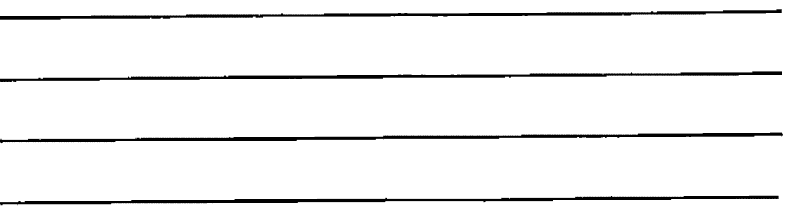

### 段落太长，如何拆分段落？

通常，一个段落包含一个观点。因此，拆开它，就意味着破坏统一。但是每一个观点都是建立在一组较小的观点上的，所以，你可以利用它们从一个段落过渡到另一个段落。

通常，我会根据长段落中，每一句话结束，来拆分。这样比较容易来划分。如果你想学习更精准，专业的段落拆分练习，课程结束后，咨询微信：zixun8，索取段落拆分练习文章。）

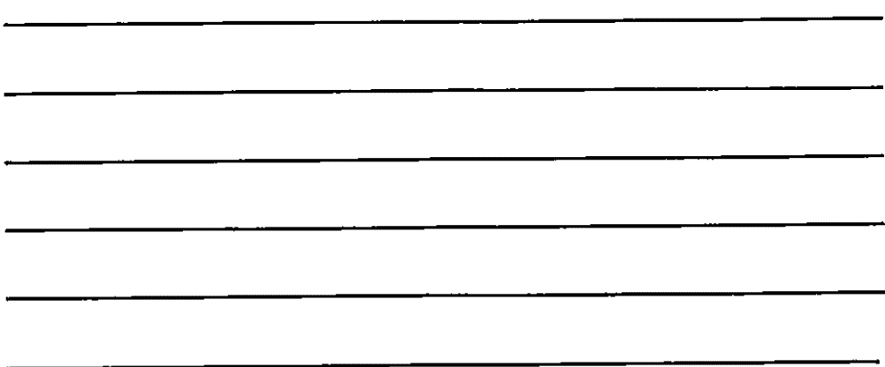

### 你的一句话应该多长？

答案：印刷专家迈尔斯·阿尔伯特·迪克，和唐纳德·G·帕特森发现，句子少于 22 个字符（英文），或者多于 112 字符（英文），文章的阅读速度都会降低 5%。（中文字符是多少个？不过，每句话的字数你不可能挨个去数。你记住这个规则就行：句子尽量可能的短，多短？阅读舒服就行。）

### 不要担心一个段落只有一个句子

约翰·卡尔普斯，伟大的文案撰稿人，给出这样的建议：“如果你有一个重要的句子，你想加以强调，你可以把它作为一个单独的段落，夹在两个长段落之间，让它脱颖而出。”

### 口语用词的影响

听周围人说话……你会发现，他们使用的句子都很短。广播和电视也是这样。句子越短，越容易理解。人们越能理解你的观点，他们就越会和你想的一样，越容易被说服去做你想让他们做的事情。

总之，段落应该短，每一行，每一个句子都应该尽量短。

### 让你的字，词，句或段脱颖而出的技巧

在重要的词或段下：加粗 下划线 标红 背景标黄 文本框

在文案中，用加粗、下划线强调关键词语，有助于吸引读者继续阅读。但下划线不要太多，否则将失去它的效果。

你用下划线标注的词语，应该像一个迷你标题。要让读者仅通过阅读下划线的词语，就理解你的整个提议，下划线标注的内容通常是句子的一部分，而不是整个句子。

所以，你完全可以根据自己的意愿合理使用这个方法……

标红的词，或句子常用在段落标题，或者突出价格上。文本框主要用在特别的说明。比如：

### 掏心话

在我刚开始写作的时候，也很痛苦，我需要帮助，我需要借助某些东西，这样才不至于让我感觉面对的是*一张白纸*。

因此，我从书里，课程中，其它文案中，看各种各样的要点、步骤，来提高自己。

我一遍又一遍地读伟大的*玛罗德·雷普金斯*的著作。研究*鲍勃·斯通*和*大卫·莫格威*，*尤金·斯瓦茨*，*维克多·斯瓦布*，*罗伯特·科利尔*，*黛瑞·艾尔波特*，*泰德·尼古拉斯*等等，这些前辈们的写作方法和经验。

然后，我不断的写作，试错，纠正……*这些东西就像融入我的血液一样*……数年之后，终于*有了自己的理论体系*。

（文本框）

### 汇款账号

“神笔文案 1.0”密训课原价 5 万元。本屆 9900 元，48 小时内报名只需 5800 元

6 月份报名，仅需 6900 元；

6 月份报名，仅需 7900 元；

7 月份报名，仅需 8900 元；

8 月份报名，仅需 9900 元。

1、支付宝支付：
支付宝账号：yougou@189.cn
户        名：李炳池

2、微信转账支付(微信号：zlxun8  户名：李炳池 )

3、银行转账
户        名：李炳池
工行卡号：6222 0802 0001 8485 923
开 户 行：中国工商银行股份有限公司北京建国路支行

4、微店报名（支持信用卡）：点击左下角‘阅读原文’

注：使用不同大小的点、星号、箭头、图标等，突出显示。

### 你应该使用哪种字体？

在一封销售信中，字体的改变不要超过 2 种。宋体字更容易阅读。标题，或者当你的文案很短时，可使用“黑体或微软雅黑”。

### 其它窍门

1、尽量不要用（一个，那个，那些，这些等）作为一段的开始。

2、去掉正文中“那，这”等多余的词，否则会削弱句子的威力。

3、一句里重复的词，可以试着用同义词来替代。

### 练习：

现在，开始给你的初稿动手术（手术时长：30 分钟）

#### 写下你的感悟

### 第十四课 如何判断销售信的质量？

学会使用《李炳池销售信检查表》来检查，分析你的销售信质量。

销售信检查表可以帮你审核销售信，也可以审核别人的销售信。你只要把表填完，得出总分即可。

然后，改写，不断尝试提高你的分数。任何时候都可能有更大的提升空间。你的经验越丰富，你得到高分的速度就越快！你的销售信质量会越来越高。

### 《李炳池销售信检查表》

#### 写下你的感悟

### 第十五课 如何成为顶级的撰稿人

- 1、阅读经典的文案，比如：《539 档案》
- 2、抄写
- 3、观察、融进生活
- 4、博览群书
- 5、收集素材（放进种子文档案）
- 6、灵感小本
- 7、写、写、写
- 8、神笔文案潜意识输入

#### 写下你的感悟

### 附一：226 个转换连接句

- 1、看一些例子，你将发觉…
- 2、将这些添加到…
- 3、毕竟…
- 4、而且…
- 5、尽管…
- 6、你被我说对了吧？
- 7、猜猜怎么了？
- 8、正如我所说的…
- 9、你看这个：
- 10、现在你可以…
- 11、那么现在…
- 12、这只是我们所为你准备的小部分
- 13、当然了，这只是个开始…
- 14、这只是开端
- 15、然而并不仅仅是这些
- 16、结果呢？
- 17、然而这只是冰山一角
- 18、那么如果我可以…会怎么样呢？
- 19、当我们忙于…的时候，…
- 20、可是、然而
- 21、哦！是的，我们不要忘记了…
- 22、还有，...
- 23、不管怎么样，...
- 24、无论如何，...
- 25、我们疯了吗？
- 26、结果...
- 27、正如我所曾说的，...
- 28、如我所说的，...
- 29、既...又...
- 30、正如你可能记得的，...
- 31、继续阅读，我将告诉你关于...
- 32、在那时，...
- 33、回归到这封信的主题
- 34、相信我，...
- 35、首先、第一，...
- 36、更好的是...
- 37、但是在我们讨论这些之前，...
- 38、但更棒的是，...
- 39、但还有更好的，...
- 40、但请不要误解我...
- 41、但别把我的话不当一回事...
- 42、但尽管如果你要去...
- 43、但首先警告一下：
- 44、但首先给...介绍一下
- 45、但首先，让我给你...
- 46、但这是最重要的一部分！
- 47、但是我有一个更好的主意。
- 48、但是我可能扯得太远了
- 49、但是你可能不太了解，让我告诉你这些是如何产生的：
- 50、但请继续阅读
- 51、但让我回到开头，继续讲这个故事
- 52、但让我们假设…
- 53、但所有这些有点滑稽
- 54、但这有一个难点——这确实很讽刺
- 55、但是，这有一个问题
- 56、但是，这只是故事的一半
- 57、但是，还有一件事情
- 58、但是，…
- 59、到现在为止，可能还有一些问题没回答你…
- 60、到现在为止，你可能在想…
- 61、顺便说下，…
- 62、考虑这个事实：
- 63、那可能是真的吗？
- 64、尽管你可能听说过…
- 65、你是否具备资格？
- 66、不要担心…
- 67、实际上，…
- 68、最后，…
- 69、首先，…
- 70、第一，...
- 71、鉴于所有这些原因，...
- 72、举个例子：
- 73、举例说明：
- 74、首先，一开始，
- 75、老实说，...
- 76、你是否碰到过这...
- 77、见鬼、该死，...
- 78、下面就是答案：
- 79、这里是详细内容
- 80、这只是...的一个范例
- 81、这里有一条线索：
- 82、你将看到这是多么简单...
- 83、还有更多...
- 84、这里就是证据：
- 85、事情是这样的：
- 86、令人担心的是：
- 87、这个秘密是：
- 88、这就是其它...
- 89、这就是...的目地：
- 90、你是一个你...的机会
- 91、我是怎么做到的？
- 92、----需要花多久？
- 93、如何？
- 94、然而，...
- 95、我可以一直讲下去...
- 96、我认为你应当可以...
- 97、我想再告诉关于...
- 98、我敢打赌，你肯定以猜到了下面将要发生什么
- 99、我将告诉你如何
- 100、对不起，但是...
- 101、我告诉你...
- 102、不可能？
- 103、一会儿，我将告诉你如何才能...
- 104、简单地说
- 105、除此之外，...
- 106、再者，...
- 107、无论如何，...
- 108、不管怎么样...
- 109、本质上，...
- 110、事实上，...
- 111、简而言之，...
- 112、总而言之，...
- 113、接下来，我将向你展示...
- 114、确实，...
- 115、（产品/服务）真的值（XXXX 美元）吗？你自己做个判断：
- 116、很简单：
- 117、请好好考虑一下：
- 118、继续阅读，你将知道答案
- 119、让我来解释我的意思
- 120、让我解释一下
- 121、让我给你证明——无风险！
- 122、我再次说明，...
- 123、让我和你分享一个秘密
- 124、我们假设一下，你...
- 125、说实在的，不管怎么说，...
- 126、让我们仔细看看：
- 127、让我们看看：
- 128、同样地，...
- 129、听着，还有很多，更多
- 130、听，...
- 131、看看我的下一个要点
- 132、看看这里就足够了
- 133、看，...
- 134、别弄错：
- 135、之后还有更多，至于现在，...
- 136、呆会还有更多内容，但首先...
- 137、比这更重要...
- 138、等会还有更多——但首先，让我给你们看看...
- 139、此外，...
- 140、最重要的是，...
- 141、我的意思是：
- 142、我的问题也就是你的机会
- 143、我的一种强烈的感觉是
- 144、不用说，...
- 145、现在考虑一下发生了什么...
- 146、现在看看这个：
- 147、等一等
- 148、现在，仔细聆听这个：
- 149、现在，在我继续之前，...
- 150、现在，下一步是：
- 151、当然
- 152、很好，...
- 153、另一方面，...
- 154、必须注意的一个要点：
- 155、另一个要点：
- 156、或者，如果你更愿意...
- 157、请理解，...
- 158、并且，...
- 159、继续阅读，寻找答案
- 160、记住，...
- 161、第二，...
- 162、亲眼看...自己去看...
- 163、所以这补充了：
- 164、那么我问你...
- 165、让我总结和复习...

### 附一：写作开头列表
#### 166、那么我开始…
167、这就是为什么…
168、那么你觉得是什么…
169、那么，这些意味着什么呢？
170、那么为什么我写信给你呢？
171、一些特性：
172、听起来都很熟悉？看看…
173、说法有点不同…
174、还有一个好处：
175、设想…
176、令人惊奇不已的是…
177、看一看：
178、这说明…
179、这是对的，…
180、这就是为什么…
181、底线是…
182、最终事实：
183、…的答案
184、唯一一个问你自己的问题是…
185、…的秘密
186、…的解决方案
187、诀窍是…
188、事实上，…
189、然后他投下了一枚“炸弹”：
190、然后它让我震惊了...
191、还有一件事，
192、考虑一下这个：
193、这个例子会让你很震惊
194、这不仅仅是我的看法
195、于是、因此...
196、长话短说...
197、更糟糕的是...
198、问题是...
199、如实的说，...
200、直到现在，...
201、最后一个至关重要点是：
202、等等，还有更多...
203、有什么证据？
204、那么你呢？
205、我所谈论的是...
206、意思是...
207、归根结底...
208、意义在于
209、这对你来说有什么价值？
210、还有、此外...
211、有什么内幕？有什么陷阱？
212、我之所以写信给你是因为...
213、谁不会欣然、抢着接受这？
214、我为什么这么做呢？
215、我为什么这么说？
216、我为什么写信给你？
217、这对你来说有用吗？可能没有用。
218、记住这些，这里是...
219、说完这些，...
220、最糟糕的是...
221、是的，这是事实！
222、是的，...
223、你知道，...
224、你看，...
225、你开始...
226、你将很乐意知道

#### 附二：冲击力词汇列表

在我的事业发展过程中，我曾揭露过很多写作秘诀，这些秘诀能够立刻提高撰写销售文案的能力。比如，其中一个秘诀是，学习世界顶级销售员的销售方法，然后将那些实用的策略转化为文字。

还有，**以对话的形式撰写销售信**——与那些刻板的吹牛大咖、一直使用华丽词藻的人区分开来。然后，在撰写过程中，你要摒弃大量的形容词，使用本身就能讲述故事的“行为动词”。

使用行为动词来改善我的销售文案——慢慢演变成一种我所说的“关键词”的艺术。有的时候，它们是传达行为的动词；有的时候，它们是有极大价值的名词；有的时候，它们是一些有趣的短语（或者是一些名言古句的化用），能够抓住读者的心不放手。

关键词，是指本身 *带有一种情感冲击力* 的所有词汇。人们在阅读任何一个好的关键词时，心跳都会微微加速，旧时的回忆会在他们的脑海里汹涌，或者，至少他们身体的某一小部分会有所反应。

就拿“羞辱”这个词举例。所有人在读这个词时，都会对它有一个本能的反应。每个人在某种程度上都受到过羞辱。因此，当在一则标题中说，“一位 ‘超重 70 斤，患有关节炎，一瘸一拐’ 的老高尔夫球员，在他例行出席会议上，羞辱了年轻的、过分自信的高尔夫球专业选手……”这样便创作出一幅真实的情景，其中承载了一个引人入胜的故事。

下面的大部分词汇都是行为动词。其中有一些带有巨大的情感冲击力，而另外一些只是会勾起你的回忆或感觉。但是，没有一个单词是无聊的——**优秀的销售文案的第一准则，就是绝对不能让你的读者感到无聊**。

例如，“他沿着街道走”中的“走”这个词，不会让人产生太多的感觉。而如果把它换成“旋转着跳舞”或“缓慢行进”或“小碎步走”或“匆匆走过”，你就能够在读者的脑海中创造一个具体的影像。

在你的销售信中即便只使用几个精心选择的关键词，也能立即提高读者的兴趣。它们是优秀的、简洁的、认真的、*有吸引力的销售信*的基础。

这些关键词是从我的“种子文档库”里挑选出来的，里面包含了很多大师级人物经常使用的词。这份关键词的清单是不分先后顺序的。当你感觉自己写的东西千篇一律时，可以读读这份清单找找灵感，看看它们是否能够改变一些事情。

- 白热化
- 紧急的
- 内部消息
- 使残废
- 控制，支配
- 难以置信地
- 毁灭性的
- 使震惊
- 撕裂
- 焕然一新
- 恶毒的
- 邪恶地
- 有效的
- 有效的
- 不稳定的
- 洞见
- 优势，优越性
- 耀眼的
- 巨大的
- 遗忘的策略
- 抓住就跑
- 拖累的
- 踢打和尖叫的
- 未开发资源
- 颤抖的
- 非常有价值的
- 挖掘
- 爆炸性的
- 爆破
- 深水区
- 重要的，决定性的
- 重病特别护理
- 积极地，活跃地
- 忙碌的
- 巫术
- 闪电战
- 秘密的
- 被迫的
- 挤满的，塞满的
- 亲密的
- 精英
- 死亡标记
- 半成品的
- 非常明显的
- 尊重
- 害怕
- 威胁
- 街头恶棍
- 恐惧的
- 幸存
- 品尝，品味
- 立即地
- 极其恶毒的
- 大爆发
- 受控的
- 无声的
- 开发
- 加热
- 爆发力
- 记下，拿下
- 脆弱的
- 伤员，伤兵
- 盲点，盲区
- 被忽略的
- 强有力的
- 又惊又喜的
- 全部上交
- 折磨人的
- 中立
- 巨型的
- 粉碎
- 头昏的
- 可怕的，噩梦似的
- 造成，使遭受
- 大量的
- 牛市
- 高效率的，精炼的
- 超现实的，不真实的
- 巴顿将军
- 黑暗小巷
- 提高价格
- 肮脏的
- 骨头嘎吱响的
- 心慌意乱的
- 卑鄙手段
- 礼貌
- 日常的，例行的
- 大量基金的
- 罚款
- 收缩
- 抢劫的
- 东西，材料
- 意外之财
- 忽视的
- 存钱备用
- 有利可图的
- 扣除
- 聪明地伪装
- 捐献
- 冒险的
- 捷径
- 立即地
- 更多零用钱
- 运气不好
- 副业
- 收缩，减低
- 大量敛财
- 稀有的
- 不会失去
- 精神创伤的
- 震惊
- 使人炫目的
- 使不动的
- 没有想到的
- 无助的
- 攫取，霸占
- 庞大的
- 每一分钱
- 免税的
- 巨大的
- 平稳地，平滑地
- 触摸
- 发生
- 低估，看轻
- 严重的问题
- 隐形资产
- 享受，款待
- 大部分都错过的
- 吞食
- 指定的
- 必读的
- 扭伤，编织
- 有价值的
- 踢开，支付
- 变化，突变
- 简单解决办法
- 忽视
- 奢侈
- 处理，处置
- 好到不真实
- 心灵手巧的
- 迷惑的
- 巨痛的
- 战斗
- 前线战壕
- 财产
- 工具
- 不干涉的
- 内部信息的稳定流
- 无风险
- 严格地
- 捣蛋，兴风作浪
- 赌博
- 头奖
- 履行额外职责
- 秘密武器
- 冷处理
- 使你进入更高等级
- 罚款，罚金
- 开始
- 将平常数量加倍
- 勾销，销账
- 欢乐假期
- 隐藏的财富
- 心领了
- 噩梦
- 诚实的漏洞
- 假设
- 不合理的
- 立即收集
- 年复一年地
- 有魔力的
- 鲜为人知的
- 摆脱困境：脱身
- 跳跃
- 藐视常识
- 建议
- 使它合法消失
- 疏忽的
- 鲁莽的
- 忽视，不理
- 跳到下一层
- 没有麻烦
- 高级的
- 即使你之后决定
- 额外花费
- 证书
- 详细审查，监视
- 不得不解决
- 庇护收入
- 离岸的
- 机会
- 你欠的一部分
- 躲避，躲闪
- 忽视
- 打包走人
- 窃听
- 秘密清单
- 卑鄙手段
- 账面损失
- 摆脱困境
- 立即有价值的
- 否则你就会错过机会
- 转移
- 意外的
- 秘密的截止日期
- 谈判
- 甜心交易
- 心里战术
- 毁灭性的
- 离开
- 拒绝任何粗暴
- 险恶的税收陷阱
- 私人瑞士账户
- 山姆大叔
- 忽视
- 友好型税收
- 零税收
- 罚金
- 现金充裕
- 收缩
- 爆炸
- 研究，调查
- 逃走
- 促进，增加
- 在一小时之内
- 绝对的，完全的
- 原始的，主要的
- 精确
- 比你想象得更快
- 焦躁的
- 直接影响你
- 回到一个人的口袋里
- 忏悔
- 不满的
- 铁壳
- 慷慨的
- 更强的
- 没有什么可以
- 底线
- 你的公平份额
- 悟性，理解
- 惊人的
- 骇人听闻的力量
- 专家分类
- 按摩
- 肌肉记忆
- 信心
- 技巧
- 绝对诚恳地
- 先进的
- 发现
- 责
- 改变某人的生活
- 令人惊异的
- 目标
- 特殊的，特定的
- 解决，想出
- 最深的祝福
- 挫折
- 纯粹胡扯
- 胡说，废话
- 清除雾霾
- 打赌
- 使具体化，使有形
- 通过艰难困苦而学到
- 由寒微发迹
- 大部分
- 科学地；系统地
- 定做的
- 有效的
- 试车
- 高尔夫天堂
- 细节
- 允许
- 跳跃
- 领土，领域
- 相信
- 自我
- 准的
- 懒散的
- 突然地
- 吓得要死
- 改革
- 不花一分钱
- 好莱坞制造
- 极好的
- 乐意的，自愿的
- 掏空你的钱包
- 漫画
- 创造
- 滋味，少量
- 感人的
- 认真地重新考虑
- 欺骗，傻瓜
- 检查
- 喷沫枪
- 击倒，打破
- 热心的
- 像啄木鸟一样
- 可怜的，悲哀的
- 阴影
- 可怕的错误
- 业余的
- 幸运的
- 坦率地
- 渗出，泄露
- 未取得比赛资格
- 专业建议
- 不可能的
- 得过且过，混日子
- 踌躇
- 公众
- 市民
- 永远
- 严肃的，严重的
- 理解
- 倾注我们的心血
- 按照你的节奏来
- 迫切想知道的
- 处理它，掌控它
- 卑下与龌龊
- 可怕的事情
- 优雅艺术
- 方案，剧本
- 自制的
- 餐桌
- 必须的
- 令人十分震惊
- 遗忘的
- 特殊机会
- 胡扯
- 不知道；秘密地
- 调情，不认真考虑
- 犯大错
- 显示，透露
- 外人
- 巨大的
- 毁坏了的
- 分享，份额
- 一文不名，身无分文
- 选择
- 新兴都市
- 尽情地，纵情
- 暗示，线索
- 反感，不满
- 听好了
- 始终如一的
- 无压力的
- 拼命
- 经授权的
- 借口开河的技巧
- 真见鬼
- 不深刻，不周详
- 付款，还账
- 细微差别
- 慷慨的
- 拿到台面上说
- 错失良机
- 增加一个微小的优势
- 迷惑
- 怀疑的种子
- 迅速蔓延
- 出色的
- 策略，战术
- 不清楚
- 金钱与道德的界限
- 保证，确保
- 害怕得发抖
- 生吞活剥他们
- 令人震惊的窥视
- 完全合法的
- 连接，关系
- 一批
- 无情的
- 成功，胜利
- 狠角色
- 不为人知的秘密
- 面对
- 喊饿
- 白手起家，从头做起
- 知情人士透露的内部信息
- 知道问题关键之所在
- 极其丑陋的
- 偷窃，撇掉，欺诈
- 渴望的，热切的
- 精明的
- 不满的
- 凝视千里之外
- 行骗，欺骗行为
- 废话
- 古怪的
- 恐吓，威胁
- 全宇宙最好的
- 打喷嚏
- 秘密会议
- 压碎
- 库存的
- 哇！噢！
- 绝对免费的
- 急不可待的
- 试穿；试试看
- 致命的
- 世界舞台
- 售罄的
- 名誉，声望
- 疯狗般的
- 不高兴的
- 受欢迎的，很吃香的
- 选择参加或退出
- 胆战心惊
- 完全失去信任
- 正品，原装货
- 零风险
- 口头宣传
- 猎头
- 处于极度兴奋中，崩溃
- 专家模式
- 揭露的
- 尊重和敬畏
- 久经沙场的
- 第一次窥视
- 先睹为快
- 冲击波
- 所谓的
- 金融机构包
- 消灭，忘掉
- 抛头露面的
- 盲目自信的
- 互殴
- 生与死
- 深入敌后的
- 消除，排除
- 要求
- 残废的
- 例行公事地
- 天才
- 拿走所有的钱
- 可怕的
- 显著的，惊人的
- 吻合一致的
1. 残忍的
2. 乞求的
3. 著名的
4. 突击队
5. 挖掘
6. 全新的
7. 废弃的，老式的
8. 惊人的
9. 裁军，缓和你
10. 流入
11. 如魔法般地
12. 人人，每个人
13. 射击
14. 撒谎的混蛋
15. 大懒虫
16. 十月惊喜
17. 无意中发现
18. 现金
19. 遍及全世界的
20. 无需努力赚大钱
21. 受到威胁的
22. 六块腹肌
23. 激怒
24. 乱要价的
25. 坚持，强调
26. 不断地
27. 胆敢
28. 供娱乐用的
29. 破碎的，坏掉的
30. 障碍，阻碍
1. 职业自毁行为
2. 上堂的
3. 锁定，冻结
4. 获得走后门的机会
5. 启示，揭露
6. 令人心寒的细节
7. 核心集团
8. 热爱
9. 有力的座位
10. 令人苦恼的
11. 共享财富
12. 深入地
13. 使困窘
14. 羞辱，使丢脸
15. 可怕的
16. 使人摇头的结果
17. 来看看，查出来
18. 我自己的钱包
19. 麻烦
20. 完全可信的
21. 连环出击
22. 不费力地
23. 令人兴奋的
24. 变胖的部位
25. 绑架，诱拐
26. 强迫的
27. 特别的
28. 遍及全球的
29. 过于时尚的
30. 弹药
1. 糟糕的一天
2. 不如意的一天
3. 感觉像一只老虎
4. 轻轻松松赚十块钱
5. 别相信我
6. 非常侥幸的
7. 十足的废物
8. 过线
9. 疯狂的
10. 悲喜交加中
11. 赶上，抓住
12. 履行诺言
13. 非常热的
14. 禁止吸烟
15. 无痛的
16. 原始的
17. 急切地，渴望地
18. 全盘招供；坦白交代
19. 巩固地位
20. 试车
21. 短短一个下午就能搞定它
22. 冷酷的事实
23. 一个新的既定事实
24. 伤害
25. 事实核查
26. 保释
27. 稳操胜券
28. 敲打，敲击
29. 无聊的
30. 假装，不懂装懂
- 失常的
- 不正确的
- 改善，增进
- 嘲笑
- 热身
- 放松一下
- 剧烈地；引人注目地
- 反直觉的
- 相信
- 骗子
- 陷阱
- 丰富的
- 弄坏的
- 难以置信的
- 抓住窍门
- 适当的
- 止痛药，杀手锏
- 正直的
- 无礼的，轻率的
- 自然的
- 判断
- 迟钝的尝试
- 使苦恼
- 力量，效力
- 突袭，猛扑
- 咕噜咕噜声
- 游行，阅兵
- 不诚实；背信弃义
- 喜欢
- 私人的
- 解决方案
- 主要缺陷
- 敏感的
- 最终结果
- 把他们逼疯
- 速读
- 测量，估计
- 中风
- 消沉
- 优势
- 暗示，线索
- 付出代价
- 错误的！
- 面对
- 引起尖叫
- 得到报应
- 羞辱你的对手
- 新秀
- 野兽，畜生
- 轻松打败
- 证明这一点
- 空运的
- 觉醒力
- 发射，发动
- 榴弹炮射击
- 惊人的
- 欲望
- 最大限度
- 不敢相信的
- 同……开玩笑
- （故意）触人痛处
- 剜掉，拄掉
- 迷人的
- 磨损，践踏
- 神秘的
- 生物化学
- 绝大多数
- 主要问题
- 有勇无谋，更令人痛苦
- 悲惨的
- 技巧，窍门
- 独家新闻
- 解决它
- 拆除，毁坏
- 完全精通
- 荒诞的，疯狂的
- 敢，胆敢
- 生气，不高兴
- 多年以前
- 华丽的，灿烂的
- 骇人听闻的
- 严重的疾病
- 十足的新手
- 撒谎的混蛋
- 奋斗的
- 笑得腰臀部疼
- 不能输
- 妨害，破坏
- 欲望
- 空的，无意义的
- 储备，储存
- 包裹
- 亲自地；个别地
- 期限
- 无懈可击
- 居然这么容易
- 使一些人伤心
- 十亿分之一秒
- 奖金
- 令人满足的
- 短期工作
- 收集
- 冷水公寓
- 品味；喜爱
- 啤酒罐
- 安装；任命
- 尝试
- 高度专注的
- 怀疑的
- 开放思维
- 试车；试验
- 巨大的
- 大老板
- 节奏，韵律
- 大量的
- 大男孩
- 吓出一身冷汗
- 盗版的
- 有关的
- 充分利用
- 威胁生命的
- 巫婆
- 能力，力量
- 自大的，傲慢的
- 专家
- 说服
- 胡扯的
- 财富；运气
- 尽管，不管
- 最近的
- 太想知道
- 小部分
- 一切都是错误
- 激情，热情
- 最终的，终极的
- 捣砸
- 大煞风景
- 疯子
- 扭曲的
- 引其行动
- 冷若冰霜
- 走开，离去
- 有勇气的
- 泰然自若
- 紧急事件
- 歇斯底里的
- 危险的
- 定居，安定下来
- 决定的
- 敲，打，敲击
- 金钱地带
- 识别；承认
- 粗暴的，可恶的
- 搜索出来
- 强烈的，紧张的
- 谣言，传闻
- 邪恶的
- 要求，声称
- 一派胡言
- 关闭，住口
- 自大的，骄傲的
- 扰乱脚步
- 快速提升
- 心态
- 放松
- 个人的和保密的
- 被宠坏的
- 最高机密；只给你看
- 胆量
- 即兴的
- 破碎的；极度疲劳的
- 忍耐的
- 时刻准备着
- 投降；服从
- 合同
- 严峻的，严厉的
- 一眨眼的功夫
- 边缘的
- 含糊地说
- 强迫，压榨
- 传说，传奇
- 枢纽，关键
- 烧钱镜头

- 阴暗角落
- 不了了之
- 积极调整
- 流干
- 闪光的
- 富裕；赚钱
- 依靠，依赖
- 爆发，爆炸
- 伤害，损害
- 嘲笑我
- 能人；高手的
- 懒惰的
- 解释，说明
- 耐心地
- 倾倒，推翻
- 动摇，摇动
- 喋喋不休
- 把它转出来
- 幸存
- 潮湿的角落
- 沉思
- 手下留情
- 不光彩的
- 永远沉默的
- 英雄与恶棍
- 无用和欺骗
- 畏缩
- 受到严重冲击
- 预备，瞄准，射击
- 湿透的
- 生气
- 腹背受敌
- 面对，遭遇
- 疼痛的
- 吹走，驱散
- 同……开玩笑
- 你当然会这样
- 减去，扣掉
- 重要的，决定性地
- 把握重要性
- 终于把它搞定
- 自大的，傲慢的
- 大师
- 秘传的
- 该死的谎言
- 引诱，诱惑
- 减少
- 诱导，引起
- 漂白
- 漆黑一片
- 优势；利益
- 不公平的优势
- 它的底部
- 激昂旋律
- 极其丑陋的
- 华而不实的
- 交付，发表
- 致使，提出
- 分离的
- 爆发，爆炸
- 爱凑热闹的人
- 龙卷风
- 证明，证据
- 独有的，排外的
- 避免，躲避
- 挑拨离间的问题
- 大错特错
- 手提，负担
- 漫步，漫游
- 灾难
- 浑身湿透的混乱
- 使湿透；滂沱大雨
- 创造
- 毁灭的，荒废的
- 金融地
- 事实，真相
- 老鼠药
- 偷偷地看
- 腼腆的
- 放肆的，无拘束的
- 试车，试运转
- 狂热的
- 专心的
- 托词，借口，诡计
- 犯了一次大错
- 无辜英雄
- 伤心的
- 很多的
- 缓慢移动
- 麻木状态
- 莽撞之人，继续做梦
- 还有你骑的马
- 不可爱的
- 温和的
- 神秘骑士
- 蜗牛邮件
- 关系网
- 本质的，固有的
- 古怪的行为
- 缺失的环节
- 死亡；宿命
- 生死斗
- 残酷的命运
- 瓶中精灵
- 潘多拉的盒子；灾难之源
- 冷淡的
- 起泡沫的
- 泡沫
- 流浪者；无价值物
- 耀武扬威；胜者为王
- 脑细胞
- 涡纹图案的
- 沙沙声
- 放松，不要生气
- 天才，天赋
- 自寻烦恼者
- 争论，吵嘴
- 纠纷，乱作一团
- 刺痛，使激动
- 狂喜
- 偎依，使舒适温暖
- 放在架子上
- 不整洁的，凌乱的
- 救星
- 垮了的一代
- 流浪汉和酒鬼
- 可怕的
- 漂亮的
- 成熟的
- 饱经风霜的
- 粒状的
- 贫困潦倒的
- 压倒性胜利
- 不苦恼的
- 不义之财
- 关键时刻
- 言过其实的
- 珍贵的
- 倦怠的
- 液体的
- 透明的
- 像天鹅一样自由翱翔
- 发烫的额头
- 神经过敏的
- 怯懦者与狡猾者
- 非法传销，金字塔骗局
- 可怕的，悲惨的
- 胡说；废话
- 净化
- 吸毒窝点
- 蹦蹦跳跳
- 废金属
- 击倒；停工
- 讽刺之语
- 安慰
- 补充
- 嘲弄
- 大捞一笔
- 季风季节
- 流尽鲜血
- 缺口
- 混蛋
- 使能够
- 使失去能力
- 下降
- 将……给我
- 大腕，拔尖的
- 阴冷的，荒凉的
- 沉闷的，枯燥的
- 难以忍受的势利小人
- 傲慢的，自大的
- 爱抚，拥抱
- 投资
- 大量的
- 敬意，尊敬
- 做得过火
- 主场球队
- 家伙，小子
- 嘲笑，冷笑
- 假装
- 深厚的
- 信用，贷款
- 愚蠢的，固执的
- 混日子；游手好闲
- 傻瓜
- 极好的
- 专业名望
- 抢夺；夺得
- 窜逃
- 抛弃他们
- 呕吐
- 身材瘦长的
- 赎回，赎金
- 不定的
- 愚蠢的
- 真菌
- 变形，变化
- 不男不女的人
- 巨额
- 拥抱
- 华丽的
- 无可辩驳的证据
- 麻木的
- 越狱
- 人工地
- 粗糙的
- 怪人的
- 痛打；严责
- 使惊呆；使昏迷
- 仁慈；怜悯
- 混乱；废墟
- 偷窃；扯掉
- 生气
- 炫耀，卖弄
- 使变白，漂白
- 盲目的，瞎的
- 刺耳的
- 像市区一样宽广
- 神经细胞
- 烧坏；不再热衷
- 挑选出，分类
- 渴望，向往
- 擦伤
- 相反的；对立的
- 公布于众的
- 朦胧的，有阴影的
- 熏制，香蕉
- 傻瓜
- 不定的
- 唾沫飞溅
- 消除，镇压
- 遗弃，放弃
- 轻视，贬低
- 像战利品一样带走
- 戏剧女皇；喜欢小题大做的人
- 豆腐渣工程
- 招牌球员
- 准备好可以开吃了
- 最后的机会
- 斑马
- 醉酒的
- 侦探
- 幽灵，鬼魂
- 壁垒，路障
- 迎合，怂恿
- 上等的，极好的
- 秘传的
- 痛饮
- 鸭子；（英）宝贝儿
- 是我的荣幸
- 迅速地大量赚钱
- 错误的行为
- 无说服力的活动
- 整理好的细节
- 误食
- 妨碍的
- 精神抖擞者
- 第二扇门背后的
- 极好的故事
- 打架；一决雌雄
- 金融禁令
- 宁为玉碎不为瓦全
- 一部糟糕的恐怖电影
- 被包围的
- 完成的，做了好好的
- 湿透的
- X 光线视角

#### 附三：短文案写作公式

##### 1. PAS——问题+煽动+解决方案+呼吁行动

我在写短文案的时候，经常使用这种公式。

如果你看过《吸金广告》，你应该对“利用恐惧心理赚钱”这个原则不陌生。里面所例举的几个例子上都是按照 PAS 公式来描述。这个公式的具体步骤如下：

首先你要提出事实，陈述一个问题，并让顾客承认问题是存在的。然后你提出解决方案。

例如：

每个家庭里，实际上藏有很多的细菌。（提出事实，你的家里应该也有细菌）

你的家是一个藏污纳垢之地，里面藏着数百种细菌。（提出问题）

当孩子在厨房地板上爬来爬去、将塑料玩具塞进嘴里的时候，细菌正伺机感染他。

别笑！你知道一个细菌的细胞在 24 小时内就能分裂形成 800 多万个细胞吗？用肉眼无法看见的各种微生物能导致形形色色的疾病，包括从脚癣、各种皮肤病、链球菌性咽喉炎、肺结核、尿道感染以及其他许许多多的疾病。（进行煽动）

来舒牌喷雾消毒剂，它能杀死家里一般接触表面上 99.9%的细菌。每罐仅售 5 美元。（提出解决方案）

你可以到附件商店购买，或者马上打电话 XXXXXX 订购！（呼吁行动）

我还曾看到“联邦快递”做的一个广告：

包裹没有到达？（问题）

公司职员陷入困境（煽动）

我早该叫“联邦快递公司”来的！为什么搞得大家团团转？（解决方案）

简短三句话就清晰表达出了 PAS 这个公式的效果。

我们再看一个例子：

一个肺有3亿个肺泡，80个Pm2.5微粒可以堵死一个肺泡，我们生活的环境Pm2.5是1155单位，一年堵死三千万个肺泡！3年堵死三分之一个肺！

【提出问题】

所以预测几年后中国将会肺癌井喷，并不是耸人听闻！建议雾霾天气孕妇和儿童都不要出门了，冒着生命在工作的同志们，保重！（不要把雾霾不当回事儿，一级致癌物）【煽动】

别怪我没告诉你XXX胶囊可以清肺部雾霾啊！XXX是含在嘴里的净化器！

【解决方案】

为了自己和家人的健康，请赶快备用XXX，扫下面二维码即可购买。【呼吁行动】

你只要按照PAS公式，根据你所销售的产品来设计即可。

##### 2. 神秘感+好处+呼吁行动+稀缺性

神秘感能掀起别人的好奇心和探索欲望！好处是顾客夜不能寐，渴望获得的东西。这个公式可以使用在标题中，也可以使用在短文案中。举例：

很少有人知道的减肥技术，你无需运动和节食，就能月减15-28斤！想了解详情，马上加微信：zixun8（此技术只传授给200人）

神奇的短文案撰写技术，让你写的文字发到朋友圈就能收到钱！想要学的朋友，马上加微信：zixun8（仅限100人）

鲜为人知的艾灸疗法，只需艾灸几个特殊穴位，保你1周之内精力旺盛！有想提升元气，增强精力的朋友请微信：zixun8（每天只辅导10位）

##### 3. 解决方案+证明+稀缺性+呼吁行动

解决方案，给顾客带来的好处和结果。通过客户见证实例来证明其效果。限量发行，限量销售，名额有限…打造稀缺性，然后呼吁行动。

5种减重新方法，永不反弹！邻居王阿姨仅使用其中一招，1周就减掉了7斤，至今身材依然那么苗条。如果你想知道这5种震撼减肥法，请加微信 zixun8，她会根据你自己的情况，告诉你具体减重方案。由于她本人每天只能服务5个客户，所以请赶快加微信 zixun8 预约。

##### 4、客户见证式销售信公式

使用客户见证分享，能够让新顾客感觉更加真实，信任感更强。我们看下面这个公式，其中的“我”代表“客户”。

1) 我是谁？
2) 我有什么问题，造成了什么样的影响？
3) 我使用了哪些产品或方法，最终还是放弃了，为什么？
4) 我为什么选择 XX 产品，作为解决方案？
5) 我使用 XX 产品后，得到了什么样的结果？
6) 我使用 XX 产品后，现在情况如何？
7) 我的最终结果怎样？获得了哪些好处？
8) 我愿意推荐给別人，为什么？

举例：

我叫李红。

结婚 5 年了一直没有怀上宝宝，整个人很憔悴，家里人非常着急。

到医院检查后，发现有子宫肌瘤，医生开了很多药，吃了几个疗程并没有多大变化。

有一天，不经意在荔枝电台看到“艾灸治百病”的一个电台，随便听了几个节目，发现艾灸有这么多的神奇效果。抱着试试看的态度，我就加了素素老师的微信。

通过她给我诊断分析，艾灸了3个月，到医院检查子宫肌瘤没了。我太开心啦！

上周又去检查我怀孕啦！

现在皮肤也比原来有光泽，老公说我现在气色很好，比原来也更有精神了。

非常感谢素素，我真心的希望有类似我这种患者的姐妹，可以到荔枝电台听她的讲座，或者你可以加她的微信839156789

感恩，素素老师！

##### 其它短文案范例

免费报告—揭示惊人的购房秘密

保证让你买的XX房子，无需支付高额贷款利率！

马上加微信：XXXX，全天24小时，都可以咨询索取。

~~~~~~~~~~~~~~~~~~~~~

如何以超低价购买别墅

打电话给000-0000听免费的录音

你可以随时拨打，24小时恭候。

~~~~~~~~~~~~~~~~~~~~~

你想知道北京最好吃，价格最低的餐馆吗？

因为我知道一些“北京的秘密”，你只需阅读这篇文章，就可了解。详情加微信：XXX，即可看到。

亲爱的朋友：

你知道有一种整形技术可以使你看起来年轻15岁吗？

这是真的，如果你想了解的话，只需关注微信：XXXX，你就会知道所有的答案。

真诚的，

XXX

~~~

亲爱的朋友：

你是否想要了解一个惊人的秘密，可以帮助你以很便宜的价格买到二手汽车？

如果你想知道的话，你所需要做的就是拨打电话(000) 000-0000然后你将听到一段免费的录音，告诉你如何得到一个让人不可思议的极低价格。

真诚的，

XXX

~~~

亲爱的朋友：

因为你是牙医，所以我给你写这封信。我的名字叫约翰·琼斯，我在安妮镇这里拥有一家约翰餐馆，我决定下个月每天对每位来我这里吃晚餐的牙医提供免费的葡萄酒与美食。你想要知道为什么吗？这是一个非常特殊的原因。如果你想知道原因的话，当你来到餐馆之后我再告诉你。

真诚的，

约翰·琼斯

~~~

亲爱的朋友：

你好像错过了我们展示最新产品的精彩展厅，可能你太忙了，因此脱不开身。由于你是我们最重要的客户之一（而且我们也知道你对跑车青睐有加），所以，我向你介绍几款将在下月中旬开始发运的极致跑车。

我认为其中有一款新型号跑车，肯定会让你和你夫人感兴趣，那就是巴塞罗那汽车制造厂所生产的新型 Aero。如果你想仔细观察一下这款卓越的跑车，并进行试驾，请在 2 月 21 日之前给我打电话 000-00000。如果你三月份非常忙，我也可以将 Aero 开到你家或办公室，以便你亲自过目，进行试驾。

真诚的，

xxx

~~~~~~~~~~~~~~~~~~~~~~~

你知道吗？女人偷情后会在身上留下六个痕迹，如果你知道这六个痕迹是什么，就能一眼看出女人是否有偷情（有科学依据哦！）。男人女人是因该要知道！

由于内容过于隐私，不宜公开。想知道就猛戳“阅读原文”获取答案。

~~~~~~~~~~~~~~~~~~~~~~~~~

“我是一美术专业的学生，我是怎么用微商完成了自己买房买车的梦想！下面我将开始一步一步的讲解自己的摸索经验……现在，你只需关注微信XXXX，即可收听。”

~~~~~~~~~~~~~~~~~~~~~~~

“这台XXX空调多少钱？”

“现在我们在搞活动特惠2999元”

“啊？那么贵啊？能再优惠一点吗？”

“现在天气也不热，我再考虑一下”

几天后，气温38度……。

“快！这空调我买了，优惠不优惠无所谓，只要今天给我装好！”

“抱歉，你看上的这台因销售火爆，无货了，而且现在安装需要预约到三天后！请你见谅！”

这就是过几天后的日常对话，所以想买空调的亲们，还不速度来抢？XXX店等你来！！！

学会这三大秘诀，让你在微信与微友轻松建立信任。

下载链接：xxxxxxxxxxxxxx 密码：xxxxxx

我将透露给你一个很少有人知道的财富秘密：

1997 年，史玉柱参透了“文案的秘密”，所以从负债 2.5 亿快速翻身成为了亿万富翁……

在国外有一个人，叫盖瑞海尔波特，40 年前他仅写了一封 350 字的销售信，不可思议的获得了 730 万个客户，销售额达 1.75 亿美金。

这一切核心的共通关键，就是写一封能“卖货”的杀手级文案！

如何快速参透文案的秘密呢？

我这里刚好有一份绝密的资料，可以帮你参透文案的秘密，如果你感兴趣，请回复 1，我发资料给你。

内容太震撼，颠覆了我的三观！我正在荔枝微课听李炳池老师讲《下笔有钱》课程，稍后我会整理笔记，把这节课做成电子书。这个笔记内容至少可以帮我带来 10 万以上的收入。如果你想获得这本电子书，仅需 199 元。看了之后，你觉得不震撼，立即还你 200 元。长按二维码，之后给我私信。一小时后发给你。

如果你想获得威力无比的世界级文案模板，范例，帮助你轻松的即可改编，成为你的杀手级文案……推荐你订阅有史以来最经典的广告文案集锦《539 档案》，详情见：http://dwz.cn/4C52bv

#### 附录四：鲜为人知的 AIDA 详解

让我们来谈谈 AIDA 公式。

所有的广告文案撰稿人，没有一个不知道 AIDA。而真正掌握住其中要领的，我敢打赌，10 个人中，9 个人并不完全清楚其中的真正内涵是什么，是哪种因素牵引着顾客一直往下走，最终购买你的产品。而整个购买过程，是按照一定的心里作用和逻辑顺序完成的。

接下来，我会一步步教给你。

A. I. D. A. 它最初起源于直邮广告，是大多数文案撰稿人长久以来赖以生存的撰写公式。当人们撰写长篇销售文案或销售信的时候都会使用它。

虽然一些文案撰稿专家会推荐很多种文案模版，但整个流程最终都是围绕 AIDA 公式展开的。比如，“李炳池销售信号图”，（详情见 http://libingchi.com）。AIDA 适用于几乎任何篇幅、任何类型的文案。所以，当你下次撰写文案的时候，脑海里一定要记住它。

那么什么是 A. I. D. A 呢？它代表什么？它又是如何发挥作用的呢？

你肯定之前就只知道这个公式——A. I. D. A:

- Attention 注意（吸引注意）
- Interest 兴趣（引起兴趣）
- Desire 欲望（刺激欲望）
- Action 行动（促使行动）

它们每个都是文案撰写过程中需要考虑的一个步骤。让我们惊讶的是，它们每个步骤也正是顾客购买过程中需要经历的不同阶段，从吸引读者的注意力到最终达成交易。人们的购买过程需要经历：

- 需求认知
- 信息搜索
- 评估备选方案
- 购买决策
- 购后评价

由于 A.I.D.A 是基于购买过程的,你需要了解每个顾客在做出购买决定之前所经历的过程。那样,你就可以明白 A.I.D.A 是如何直接影响顾客的购买行为的了。

根据购买行为(较高的资金投入、时间投入等)中的“风险”大小不同,购买过程也随之变化,有的很慢,有的很快。就拿你自己来说。

当你购买一盒口香糖或者一瓶饮料的时候,连一秒钟都用不了(大多数时候是这样),你就可以做出决定,然后买下它。但是当你购买一台新电脑的时候,从“需求认知”到做出“购买决策”之间就需要花费较长的时间了。购买一座房子或者一辆新车花费的时间就会更长。

让我们分析一下这两个过程中的每一步,看看它们是如何运用于你的文案写作中的。

就下面的这个例子而言,为了获得尽可能详细的信息,我们将会为“普通”女人撰写一篇较长的文案,这些人都是在 DISC 行为模式测试的四个因素中稳定性比较高的人。

(DISC 理论首先在 20 世纪的早期出现, WilliamMoulton Marston 教授,心理“测验器”的创始人,他基于其个人激励的理论创建了 DISC 的行为因素分析方法,并在其书中一TheEmotions of Normal People 加以构建,这是迄今为止,为数不多的将心理学运用于心理健康的尝试。从此之后,DISC 这四个字母一Dominance(支配型),Influence(影响型),Steady(稳健型),Compliance(服从型)便广为流传。)

##### 购买过程——A.I.D.A

##### 需求认知

比如,顾客怀孕了,她正计划着为将要出生的宝宝购买宝宝用品。从育儿网站,或者杂志等相关信息中,她了解到她需要为宝宝购买一款汽车安全座椅,来确保宝宝的安全。她“认知到了”对这款产品或服务的“需求”。

然而，我们的产品是要和汽车安全座椅结合在一起使用的。这些小宝宝的妈妈们还不了解我们的产品……她们自然也就无法意识到她有这方面的需求。

为了销售我们的产品，我们必须创造她们对这款产品的需求。

需求一般都是基于马斯洛需求层次理论的，包括：

- 生理需求——吃、穿、住之类的基本需求。
- 安全需求
- 情感和归属感的需求
- 尊重需求
- 自我实现的需求——自我完善，自我发现等。

##### A=引起注意

引起注意这一环节的重要性通常体现在标题或起始段开场白上。它的目的是要引起顾客的注意，告诉顾客已知的需 求，抓住顾客的注意力，这样他们才可能继续阅读你的文案。

你可以通过多种方式吸引顾客的注意力。就像我在《信手拈来，一夜间改变你的广告》里谈到的那样，你可以：

- 解决顾客的问题
- 用数据来引起顾客的注意力
- 巧用案例
- 巧妙提问
- 制造神秘感
- 提出不同观点
- 建立联系
- 直接给出最终结果
- 通过对比，突出与众不同
- 提供折扣或赠品

你也可以走情感路线。顾客购买过程中最常见的情感问题，也是和马斯洛需求层次理论直接相关的。它们包括：

- 恐惧
- 内疚
- 虚荣
- 特立独行
- 贪婪
- 气恼

下面我们将讨论在文案撰写以及顾客购买过程中，标题以及起始段开场白是如何实现顾客的需求认知，并引起顾客注意的：

###### 70%的婴儿死亡，是由于儿童汽车安全座椅安装不正确造成的

> 你将如何确保孩子的安全？

父母不应该经历丧子之痛。尤其是当这种痛苦完全可以避免的时候。然而，大多数父母没有花时间去正确安装孩子的儿童汽车安全座椅——将孩子置于了遭受重伤甚至死亡的危险之中。

现在有一种已经被证明，可以帮助家长每次都能够正确安装儿童安全座椅，确保孩子安全的装置。你永远都不必担心孩子坐在车里会有危险了。这个装置 100% 有效，大多数业内权威人士也证明了这一点。

假如你就是小孩子的家长，并且经常开车。那么这个标题以及文案肯定会引起你的注意。你也意识到了，上面的文案恰好利用了摆数据，巧提问，以及恐惧感这三个引起顾客注意的方式。

你明白它是如何引起家长的注意，如何创造需求的吗？你注意到它在起始段开场白中是如何抓住顾客的吸引力的吗？然后呢？

然后，我们就进入了下一个阶段，引起家长的购买兴趣，诱使他们去获取更多的信息（这也是 AIDA 模式以及购买过程，这两个过程接下来的步骤）。

这时候你会问什么问题？可能是“这款产品是什么呀？”“它是如何发挥作用的呀？”“谁使用过，或者谁做过测试了？”以及“我怎么能买到它？”

这正是你要在“引起注意”以及“需求认知”部分要达到的目的。你想要抓住读者的注意力，让他们把感情投入到你的文案中。你想要他们发自内心地问些相关问题，并做好阅读下去的准备。

#### 信息搜索

在信息搜索过程中，我们的准妈妈将会搜索详细信息来丰富她这方面的知识，从而减轻焦虑，增强信心，让她对即将做出的购买决策感到高兴。

一般来讲，人们花越多的时间来了解你的产品或服务，他们就越可能购买它。为什么呢？因为他们对你的产品或服务表现出了兴趣（A. I. D. A 模式的下一个阶段）。

同样，他们和销售代表的个人接触越多——他们就越觉得自己“了解”这款产品或服务——他们也就越有可能做出购买决定。

男人和女人的信息搜索时间有所不同。从 DISC 行为模式测试来看，不同的行为模型的人，信息搜索花费的时间也不同。

- 支配型和影响型做决定花费的时间要比稳健型和服从型短。
- 长期以来，女人购买一款新产品或服务花的时间比男人要长。

#### I=诱发兴趣

吸引了顾客的注意之后，你就应该开始诱发他们的兴趣了。

你曾经有没有见过小男孩儿用饼干诱惑小妹妹的场景？他是怎么做的？他把饼干举起来，一边晃一边露出得意的笑容，来吸引妹妹的注意力。大多数情况下，他还会舔舔嘴唇，揉揉肚子或做一些其他小动作，让妹妹感觉他有她想要的东西。

同时，那个小妹妹在做什么呢？她对这个饼干越来越感兴趣，在想如何才能得到那个饼干呢？

你写的文案也是如此。你通过在顾客面前挥动某种东西（比如强有力的标题或文案）来吸引他们的注意力，然后引发他们思考如何才能得到你手上的东西。

吸引了顾客的注意后，让我们再强化一下他的需求，从而诱发他对产品的兴趣。

让我们揉揉肚子，舔舔嘴唇，让顾客知道我们产品绝对是很棒的！

我们的文案开头应该这么写：

> 70%的婴儿死亡，是由于儿童汽车安全座椅安装不正确造成的

你将如何确保孩子的安全？

父母不应该经历丧子之痛，或者是让孩子受重伤。你想想，孩子遭遇了严重的车祸事故后，医护人员告诉你说：“如果儿童安全座椅正确安装的话，这一切本来是可以避免的。”这时候，你会有多心痛。

然而，大多数父母没有花时间去正确安装孩子的儿童汽车安全座椅——将孩子置于了遭受重伤甚至死亡的危险之下。

现在，有一种已经被证明可以帮助家长每次都能够正确安装儿童安全座椅，确保孩子安全的装置。你永远都不必担心孩子坐在你的车里会有危险了。这个装置 100%有效，而且大多数业内权威人士也证明了这一点。

现在，让我们插入一个证明，来进一步诱发顾客的兴趣。

“我想，我也是众多没有认真考虑如何正确安装儿童汽车安全座椅这个问题的人中的一员。当我发现我的宝贝过去一年都坐在不安全的汽车安全座椅上的时候，我被吓坏了。

如果我们发生了车祸——即使是一场小车祸——我的孩子就肯定会受伤。购买儿童汽车安全座椅固定装置是我做出的最棒的投资。最近我去做了座椅安全检查，以非常高的分数通过了检查！我感觉我做了我能做的一切，来保护我可爱的宝宝免受伤害。”——XXX，XXXXXX

我们再加个段落小标题，说明儿童汽车安全座椅固定装置的好处，进一步抓住顾客的心弦。

##### 你可以高枕无忧，再也不必担心孩子受到伤害了！
##### 汽车座椅可以保护他……保证！

根据儿童安全座椅监管部门称，大多数家长都意识不到孩子的安全座椅——事实上，不安全！

当做安全座椅调查的时候，该监管部门得到的普遍反映是：“我从来没有想过我的安装是否正确。”以及“我原以为我的安装方法是正确的！”

如果有这么多家长安装儿童汽车安全座椅的方法都不正确，很明显是厂家的安装说明书里没有说清楚。不要把孩子的生命置于危险之中。

正确安装吧——第一次就把它做好，以后每次都做好！

现在，有了儿童汽车安全座椅固定装置的帮助，以后孩子坐你的车时，只要系上安全带，肯定会 100% 安全。

这个神奇的工具将会给你带来信心，让你相信你的孩子坐在车里是受保护的：

- 按下按钮就可以快速安装儿童汽车安全座椅
- 准确调控压力按钮，从而根据孩子的体重调节安全带长度。
- 把座椅固定好，确保它绝对安全、稳定。
- 确保你的孩子坐在安全座椅上的时候绝对安全。
- 让你绝对放心，即使儿童安全座椅安装的时候出现故障，这种自动防故障装置也会确保你的孩子不受伤害。
- 简单便携——这样不论你的孩子坐在哪辆车里——你都知道安全座椅是安全的。

> “当我发现自己怀孕的时候，我的朋友都一直说儿童汽车安全座椅固定装置不错。我在宝宝购物清单上写下的第一件商品就是儿童汽车安全座椅固定装置。我曾经咨询过很多安全专家，他们都认为这个工具是唯一能够帮助正确安装儿童汽车安全座椅的自动防故障装置，是唯一能够保护婴儿和小孩儿的工具。”——XXX, XXXXXXX

你有没有感觉到，随着我们一项一项地列举儿童安全座椅固定装置的好处，引起兴趣的气氛也越来越强烈？作为家长，你的兴趣能否驱使你弄清楚如何购买这个装置，以及购买这个装置需要多少钱？

好！接下来肯定会是这样子的。同时你也应该注意到这个文案没有花多少笔墨去说明该产品的特点，而是着重说明了它的好处。到目前为止，我们还没有谈及这款装置究竟是如何发挥作用的。

此外，我们还会提供更多的信息。在购买过程的信息搜集阶段，我们完成了激发顾客了解我们的产品或服务详情的任务。

我们下一个任务就是，在购买过程中顾客“评估备选方案”的阶段刺激顾客的购买欲望，我们的产品或服务就会成为顾客的首选。刺激欲望通常在诱发兴趣阶段就开始了，因为在你诱发读者的兴趣的同时，也正是在刺激他们的欲望。

#### 评估备选方案

在评估备选方案阶段，妈妈们通常会判断产品或服务的哪些特点或好处对她来说是重要的。她会开始对我们，以及我们的竞争对手提供给她的信息进行衡量。如果有一些绝对性的因素——比如，她的车内空间小，和车的颜色是否匹配，她的开支预算少，仅有 X 元，等等。这些因素在“评估备选方案”阶段都会产生影响。

#### D=刺激欲望

刺激欲望阶段，我们就要开始情感攻势了：“我一定要拥有它！”。

还记得那个在妹妹面前挥舞饼干的小男孩儿吗？他先是诱惑她……让她知道那个饼干非常美味，让她止不住地流口水……然后他怎么做的？通常，现实生活中，他会大声喊：“我不给你！”但是我们就要反其道而行之。我们的技巧更高超，我们告诉顾客：“你可以拥有它！”

刺激欲望阶段我们的文案就要渐渐奔向主题了，把信息以及情感结合起来，进一步强化顾客对我们的产品的“需求”。

“如果世界上每位有车的家长，都拥有一套儿童汽车安全座椅固定装置，婴儿死亡率将会大大降低。”——《汽车杂志》

如你所知，汽车杂志如果没有充足的证据来证明，新兴科技确实对小孩子有帮助，他们是不会发表任何评论的。

儿童汽车安全座椅固定装置非常荣幸得到了汽车杂志的认可！

儿童汽车安全座椅固定装置兼备了创新性和实用性。该装置经过多年的官方认可的独立实验测试，拥有了最新的科研成果。然而，如果你像大多数家长一样，想在使用之前和你的宝贝一起看看这款装置的现场演示，也是合情合理的。

你只要点击这里，就可以观看视频演示，它将向你展示这款装置是多么简单，有效。

你可能去安全座椅安装检查机构检查过你的座椅。非常好！你可以确信你的汽车座椅安装是正确的……只是暂时的。

如果你想要把安全座椅移到另一辆车上呢？当你把它安装在另一辆车上——不同的安全带，不同的座椅大小，不同的车型的时候，你如何做到让你的安全座椅真正安全呢？但是使用了儿童汽车安全座椅固定装置，你就可以做到！

不要等到你的孩子受了重伤甚至出意外的时候，才发现就是这么简单、便宜的一款装置就可以救你的孩子，才追悔莫及。不要像那些家长一样事后才说：“我原以为我的安装方法是对的。”

##### 你可以坚信
##### 只要XXX元，就可以确保孩子的安全

不管你去哪里，不管你开的什么车，不管你多久移动一次儿童安全座椅……一定要确保每次都能够正确安装。

由于我们的目标顾客包括在 DISC 行为模式测试中属于稳健型的雌性，我们可以肯定，我们已经提供了不同寻常的信息来刺激她们的欲望。

我们的文案中包含了主流媒体《汽车杂志》的证明，来证明我们的产品有效。它称赞说我们的产品拥有“儿童座椅安全行业的最新科技，”同时之后还说明“经过了多年测试。”妈妈们也观看了视频演示，确实看到了儿童汽车安全座椅固定装置的操作方法，看到了它是如何保护自己的孩子的。

她觉得自己已经做好了点击“立刻订购”的准备。但是什么又让她犹豫了呢？不管你是否相信，大多数消费者需要人们告诉他去购买，他才会购买。他们需要引导。这就是 A. I. D. A. 模式的最后一个阶段，也是购买过程中的最后一个步骤。

#### 购买决策

在购买过程中的购买决策阶段，妈妈们已经准备行动了。她们将结束调查并准备购买。

#### A=促使购买

当你把顾客带向购买这一环节的时候，一定要继续跟进。为他们提供需要购买的最后几条理由。你可以提供保证或保修服务，让顾客安心。你还可以利用“免费”这个词的威力，提供一些赠品等。如果顾客接受，那么交易达成。

由于我们是和 DISC 行为模式测试中稳健型的人打交道，我们就需要刺激他们去立即采取行动。

记住：稳健型和服从型的人做出购买决策的过程很漫长。我们需要温柔地“推”她一把。

所以，现在让我们为文案的撰写收尾吧，让顾客变成我们的客户。

##### 试试儿童汽车安全座椅固定装置吧，绝对零风险！

马上订购儿童汽车安全座椅固定装置，只要 XXX 元，30 天内免费试用。如果你发现它操作起来并不快捷——最重要的是——并不能确保儿童安全座椅的正确安装，我们将会立即全额退款。

##### 当你立即订购，你还可以获得一个特别礼物！

《汽车杂志》社承诺，只要你购买儿童汽车安全座椅固定装置，你就可以免费订阅该杂志半年。然而，他们说随时可能取消这个活动，所以现在赶快行动吧。

即使你认为儿童汽车安全座椅固定装置不适合你，你也可以免费订阅该杂志半年，就当作是我们给你的礼物。

你知道自己为确保孩子的安全，做出了最重要的投资决定，你会睡得更香。

##### 请点击这里，立即订购！

P. S.（略）

看到这个文案是怎么写了吧？它就是根据一般顾客正常的购买过程而写的。一步一步，从吸引注意——引起兴趣——刺激欲望——促使行动，和他们的需求认知、信息搜索、评估备选方案以及购买决策，整个购买过程完全一致。

A. I. D. A. 模式以及购买过程为你撰写文案提供了一个精彩的方案。

然而，如果你回头想想购买过程你会发现，其实它有五个主要阶段，但是 A. I. D. A. 模式只有四个阶段。购买过程的最后一个阶段是“购后认知失调”或者说顾客的后悔情绪。这时候你的保证或者保修服务就起作用了。

#### 购后评论（顾客的后悔情绪）

通常，当我们购买了一款很重要的产品，或者一款我们不是很熟悉的产品之后，我们常常会有认知失调的现象——我们担心自己做出的选择不是最好的。我们担心自己会因为不喜欢这款产品或服务被搞得心烦意乱。

我们在文案中写明白保证，就可以克服顾客的这种心理。

#### 保证

通过为我们的产品提供零风险保证，我们增强了新妈妈们信心，让她坚信，她需要投资购买这款可以保护自己的孩子的产品。知道自己不满意就能够退货，并拿到全额退款，这肯定能达到她的期望值，从而很有可能会购买它。如果她后悔购买了这款产品，她就可以采取一系列行动。

我们在前面已经说过，为任何一款产品或服务撰写文案之前，一定要先考虑几个因素。首先是你的目标受众：你的文案是写给谁的。了解目标受众的需求，了解他们的交流方式，生活方式以及其他一些因素，都是你在下笔之前“必须”弄清楚的。

缺少某一个环节，就有可能让顾客走掉。是否理解了这一点决定着你的文案撰写的成败。

#### 附五：盖瑞·亥尔波特一封经典书籍销售信

*想快速赚钱？试试这个……*

### 来自俄亥俄州的
#### 一个绝望书呆子的神奇赚钱秘诀

亲爱的朋友：

如果你想快速赚很多钱，这将是你读过的最令人兴奋的消息。

我叫盖瑞·亥尔波特，前段时间，我身无分文。我的企业几乎破产，我甚至连房租也付不起了。事实上，我不止是破产，我绝望了。

突然有一天，我萌发出了一个“疯狂的想法”，撰写一种销售信（不是连环信），让人们给我送钱。

当时，我住在俄亥俄州，朋友们对我的这个想法嗤之以鼻。他们认为这是一个大笑话。他们说，我在做梦，说我没有“常识”。事实上，一个朋友甚至说我只是个书呆子，说我的想法很愚蠢，他觉得我很可怜。

是吗？我不在乎。我依旧认为我的想法不错，我把我的些信打印出来，并寄了出去。你猜怎样？人们*真的*开始送钱给我了。我用那些钱寄出了更多信，赚到了更多钱。我又用这些钱寄出了更多的信，又赚到了*更多的钱*……

以此类推。

结果如何？简单来说：在我结束之前，就那一封信，带来了……

### 超过 7300000 封回复

你想想：超过 7 百万人给我回信，而且每个人都寄来了一张支票（给我妻子的账户），或现金。我卖的是什么？事实上，这不重要。你也知道，魔法不在产品里，*而在信中*！

你有东西要销售吗？如果有，你就可以用我在销售信中使用的“疯狂想法”，撰写自己的销售信，销售你想销售的任何东西。

### 谁需要这个秘诀？

- 你是一个需要更多潜在客户的销售员吗？
- 你是一个即将离婚，需要赚更多钱的家庭主妇吗？
- 你是否经营着一家家具店，餐馆，汽车经销店，热狗摊，或其他公司，你希望看到顾客盈门？
- 你是不是一位制造商，想卖很多很多的小零件，以至于你必须让多数人轮班，才能保证需求供应？
- 你是不是一位营销顾问，希望自己总能有新想法，新技巧，从而更好地服务客户？
- 你是不是一位医学博士验光师、牙医、脊椎指压治疗师，临床医学家，或其他类型的卫生保健专业人士，希望看到你的候诊室坐满新病人？
- 你是否有个想销售的房子？有很多想销售的房子？或车？或船？
- 你有什么想销售的东西吗？咨询服务？实体产品？你自己？

如果上面的任意一个问题，你的答案是“是”，你就应该试试我的“疯狂的想法。”在我的新书中，你能看到所有关于这个想法的内容，这本新书就是……

### 如何在最短的时间内，赚最多的钱！

听着：很多年前，我想做一个销售员。所以，我找到了一个上门推销百科全书的工作。我一直坚持做这份工作，直到我做的已经非常棒了。但是，有个问题，一晚上，我只能上门拜访40家。所以，不管我工作多努力，我挣的钱总是很有限。

此外，上门销售，是一个非常艰难的谋生方式！

所以，我一直在不停地寻找，直到我想出了一个“疯狂销售信想法”，

这是我第一次用这样的方法，我把它称为“远程控制销售”。

远程控制销售，使用了我研究的另一个秘诀“杀手广告”，几乎是*强迫*地让人们购买你销售的任何东西。而远程控制销售需要你做做的是，不用亲自拜访客户……*甚至不用和他们通电话，就能销售*几乎任何东西*

这些“杀手广告”的“远程控制”销售秘诀，任何人都可以使用。即使是家庭主妇，学生，或者没有工作的人。如果你有自己的生意（或者*你想做生意*），这些方法能为你赚到很多很多的现金，你甚至都来不及把它存到银行。我没有开玩笑。比如，我的“疯狂销售信想法”，就带来了……

#### 每天20000多张支票！

顺便说一句，每天收到这么多支票，意味着你必须雇佣30个全职人员，来帮你存存款。但不管怎么说，在你阅读我的书时，学到的东西不只只有我的“疯狂销售信想法”。不，*那只是第一章！*你还会学到很多东西，下面我说一些示例：

- 如果你还没有产品，那么怎么找到一款你不用投资一分钱，就可以销售的产品！（见11页）
- 如何获得足够的钱供你周转……而且不用借！（见19页）
- 如何请电影，电视明星帮你销售你的产品和服务！（见21页）
- 一个神奇的秘诀，把当地报纸变成你的私人金矿（见29页）
- 如何得到大量想送钱给你的精准客户的姓名地址！（见37页）
- 如何撰写成本低的明信片，让人们纷纷送钱给你！（见41页）
- 如何零成本…甚至不用花邮费，每周寄出多达100000封信（见53页）
- 如何使用976电话号码，让人们付费听你的广告！（见57页）
- 如何以秘密的方式利用电话黄页，赚一大笔钱！（见65页）
- 如何利用成本低廉的小分类广告，每天赚多达10000美元（见71页）
- 如何零成本让你，或你的产品在有线电视上得到专题报道（见89页）

还有许多许多。包括如何，（如果你还没结婚）使用远程控制营销找到你的梦中情人，如何免费得到世界上最昂贵的礼物（我曾经花 2500 美元购买过一个），如何避免嫉妒你的成功的人，给你制造的法律纠纷和诉讼，等等。

好了，就说这么多吧。空间不够了。但是，不管怎样，我希望我给出的信息，足够说服你做出购买我的新书，并立即阅读的决定。

但是，请……

### 把你的支票或汇票兑换日期推迟 30 天！

我的新书价格和你得到的价值来比，非常低。但是，尽管如此，我还是不想收取你的一分钱，直到你读了我的书，并且真的觉得它很好。这听起来是不是很奇怪？不管怎样……我想要你对待我的方式那样对待你！

换句话说，在你允许我兑换你的支票或汇票之前，我觉得你应该能读到我的新书，这是你应得的。

下面是订购方式。你只要在网上写下你的姓名地址，以及“最多的钱”几个字，并把它和你的支票或汇票（兑换期限延迟 30 天），19.95 美元，加上 3 美元手续费（一共 22.95 美元）邮寄到：

埃弗雷特&劳埃德公司
208 部门
5701 跨海高速，4 号楼
马拉松，佛罗里达 33050

就这么多了。一经收到你的订单，我就会立刻把书寄给你……

### 以一级邮件的方式！

你会立刻收到我的书，你将有很多时间阅读并检验它。如果你不是 100% 满意，只要把它退给我，我就不会兑换你的支票或汇票，不问任何问题。

你想要更快的服务？如果这样，你可以使用信用卡，通过电话订购……

你依旧享有30 天的免费体验保证，之后我才会扣除你的费用！电话是：

(800) 327-0028

顺便说一句，支票或汇票抬头请写埃弗雷特&劳埃德公司，寄现金可不是个好方法。谢谢。

### 关于盖瑞·亥尔波特

亥尔波特先生，在全美国的赚钱“训练营”做指导，许许多多的都愿意支付 5000 美元，参加他 3 天的研讨会。他已经帮助数百人赚了数百万美元。盖瑞的咨询费十分高昂，他的客户也都非常有名。

有人因为他的一个赚钱方法，就给他支付了高达 600000 美元的咨询费，他的客户包括霍华德·拉夫（著名的财务顾问）欧内斯特和托瓦·博格宁，罗伯特·G·艾伦（《无所不能》的作者），以及因主演“王朝”和“达拉斯”而闻名的杰弗里·斯科特。

最棒的是，通过阅读本销售中介绍的亥尔波特先生的新书，你就能学到他威力十足的赚钱秘诀！

#### 附六：价值 10 万元的销售信模板

XXX【目标受众的称呼】请注意了：你永远不用再受 XXXX【某种烦人的问题】之苦了！

“你将会发现，你可以轻松快速的获得【重大的利益】保证你再也没有【烦人的问题】，得到你【想要的结果】”

亲爱的 XXX【目标受众的名字】：

如果你想要逃脱【某种困难】而获得【某种利益】的话，那么，这将会是你读到的最重要的消息。

因为我将要告诉你，如何得到【他们想要的结果】，从而为你带来【某种利益】。你将不必再去处理那些【你的顾客们在解决难题时通常要面对的问题】，便能够得到【他们想要的结果】。

但在这之前，我想给你讲一个故事，让你知道我自己是如何克服【某种烦人的难题】的……

【记住：在这个地方，你要特别神情并茂地讲述你要解决的问题或者你要完成的“心愿”。你要确保这个故事大概在 250 个字之间。如果超过这个数字的话，那么你肯定就在过多地谈论你自己了……

然而，销售信必须把重点放在顾客身上！如果你要讲述的并不是发生在你自己身上的故事，那么，你可以利用其他有过相似经历的人，作为案例研究。总之，无论如何，你都必须要讲述一个故事！！！因为，人们都特别喜欢听故事。通过这个故事，你将可以很快地吸引他们的注意力！！！】

在亲身经历过这样的【某种问题】之后，我决定要对其做出一些努力和改变！！！

【此处，你要谈论在问题解决之后，你的生活得到了怎样的改善。一定要列出各种利益。此处还不需要介绍产品……只要让潜在客户们有一个宏观的感受，在问题解决之后他们将可以获得什么样的利益，从而来打动他们。】

在我自己可以【解决难题，收获某种结果】之后，我决定……

我要将这种【解决难题】的能力告诉每一个人！

因此，我决定把自己研究多时【多长时间】的【某种难题】总结出一个简单的解决方案来，使大家都不再受到【他们试图解决的难题】的困扰。

只要你买了我们的产品【此产品的名称】，你就将获得所有的技巧和秘诀，使你可以解决【他们试图解决的难题】。

【产品名称】将可以使每一个人在面对【他们试图解决的难题】的时候，都不再受那些【常见问题的困扰】。

购买此产品，你将会获得【此处罗列出顾客将可以得到的东西……包括尺寸，包装、长度等。总之，要尽可能地多描述一些细节，因为潜在客户是无法看到或者触摸到你的产品的！】

而你将会获得的这些东西，都是我们【此处讲述你们自己创作这个产品所投入的时间和精力。这样做可以提高你们产品的价值！】。

你要知道，我非常为【产品】而骄傲。因为，你在使用【产品】之后，将会得到【某种重大的好处】。此外，你还可以获得【列举更多的好处】。

听起来特别好，对吧？

但是，不能只听我一个人自说自话，以下是来自全国各地的顾客对于【产品名称】的评价。

【插入客户的证词】

【插入客户的证词】

【插入客户的证词】

要获得【某种好处】的话，你可以利用下列这些有效的秘诀：

- (子弹)
- (子弹)
- (子弹)
- (子弹)
- (子弹)
- (子弹)

还有很多……

好了，那么，要永远地解决【他们要消除的问题】的话，费用到底是多少？

要知道，很多人在解决【某种难题】的时候，花费了【过高的费用】。更不用说他们不撞南墙不回头所浪费的无数时间了。

还有，其实你可以购买售价在【某花费】和【某花费】之间的其它产品，但是，最终你会对其效果失望的。

请一定要相信我，因为曾经我也走过那样的弯路！

然而，我的【插入产品名称】售价绝对不会那么高。你只需要支付【产品价格】这样一个低价，便可以得到你需要的一切，足以让你【解决某难题】，并获得【某些利益】。

你要知道，相较于你在【列举他们所做的根本无助于解决难题的事情】上所白白浪费掉的钱，你将会节省【钱数】。你购买我们产品所花费的钱数，也就相当于你随手在【列举他们平日里一些琐碎的花费——像是星巴克的一杯咖啡，等等】上花的钱。

因此，你为何不把这些钱用于【获得某些好处】上呢？

相信我，当我【此处描述一下你自己在上述故事中所经历的情况】的时候，我多么希望自己已拥有【你产品的名字】啊。那样的话，我就会节省大量的时间，不需要经历各种失败的试验，便可得到【某些利益】。

那么，我的目的是什么呢？为什么要把这么好的资源拱手让人呢？

答案真的非常简单。我想把这种解决【某问题】的能力教给每一个人【有这种需求的人】，包括你。没有它的话，我就不可能得到【某些利益】！

实际上，为了能够更加吸引你，我们还提供：

##### 3 大额外礼物

如果你现在立刻购买的话，你便可以免费获得价值【钱数】的【某几种】赠品！

免费赠品 1：【描述一下这种赠品是什么，并告诉大家其价值】

免费赠品 2：【描述一下这种赠品是什么，并告诉大家其价值】

免费赠品 3：【描述一下这种赠品是什么，并告诉大家其价值】

是的！只要你今天购买我们的【产品名称】，你就可以免费获得价值【钱数】的【某几种】赠品。限时抢购，我随时都可能取消——所以，今天赶紧行动起来吧！

我知道，你对于是否能在短时间内获得【重大的好处】是心存怀疑的！

这很正常……因为我曾经跟你一样！在我经历【描述一下你故事中所说的那种痛苦】之前，我也有相同的感觉。

正因为如此，我才会向你提供下面这种 100%零风险的保证：

##### 100%零风险保证

我可以当面保证，如果你在【保证时期】之内，没有【得到某种好处或者解决某种难题】的话，请告诉我，我一定会立即给你退款。我们不会有任何问题——也不会跟你进行任何争论！

我觉得，我这样做已经是相当公平合理的了！

这意味着，你可以无偿试用【产品】，而风险由我来承担。你自己来看它对你到底有没有用。如果没有用的话，我诚心恳请你来把之前付的钱拿回去！

但是，我相信，你很快就可以【解决难题，得到某些好处】。如果我不是确保【产品名称】可以产生【某些好处】的话，那么我就不会花费那么多的时间和精力来创造它了。

如果不花钱购买【产品】的话，你真的就是得不偿失了！

##### 现在，你有两种选择：

- 要么，你就得面对和忍受【他们拥有的难题以及影响其生活的痛苦】；
- 要么，你就要在今天，在此刻，购买【产品】，这样你便可以得到【某些利益，以及使用这种产品之后生活将会得到的改善】。

选择权在你自己的手里。

请你想像一下，【使用丰富多彩的语言，具体地描述一下，在他们使用了你的产品之后，其生活将会得到怎样的改善，以及他们的痛苦将会如何消失】。

只要你采取行动，购买【产品】，你就可以立刻【解决这个难题】。

因此，趁着你的脑海对这个产品印象还很深刻的时候，今天马上订购。

之后，你就等着【获得他们想要的重大利益】吧！

真诚的，

（你的名字）

P.S. 还有一个很重要的事情：根据需求量的大小，我有权对【产品】的价格进行调整。还有，价值【钱数】的【某几个】赠品可能会取消，变为单独出售。因此，请你在这个促销互动依然展开的时候，赶快订购【产品】吧！

P.P.S. 请想像一下，【描述一下他们想要得到的重大利益，以及他们的生活将会变得多么美好】。我们所创造的【产品】，可以使你尽可能地【解决问题，收获利益】。最棒的地方是，我无偿提供【保证】，没有用的话就可以退钱。所以，今天赶快订购吧！

#### 附七：最常用的 6 种故事类型

故事是引起读者兴趣的另一种强大的勾魂手段，在所有故事类型中，其中有 6 种故事类型常被用于销售文案中：

##### 1、“成功+失败+东山再起”故事类型

模板：当初，（我很成功，或者赚到了很多钱……），感觉我的人生棒透了！朋友、邻居都非常羡慕。但是，（因为某些原因失败了）。后来，（扭转乾坤，败败为胜……）。

- 在我 23 岁时，我赚到了人生的第一桶金，感觉我的人生棒透了！朋友、邻居都非常羡慕。但是，好景不长，由于我的自负和不爱学习，仅仅一年多的时间，又让我回到了原地，赚到的钱都被吐了出去。后来，通过 XX 的指点，经过反思，我从新调整心态，从 0 开始……如今，我拥有了自己的房子和车子……

如果你没有自己的故事，你可以举跟你的主题相符的其他人类似的“成功+失败+东山再起”故事。

##### 2、“失败+成功”故事类型

这种故事类型是很多电影，小说里常用的手法。

模板：当初，（我是什么情况）；现在，（我又是什么情况。）

- 当初，我每天起早贪黑，累得死去活来，拼命努力工作……但是，我并没有赚到多少钱。直到我参加了“神笔文案”课程后，我才知道如何通过文字赚钱。现在，我每天轻松在家就可以开展我的生意！
- 当初，我很胖，身高 163，体重却 160 斤。后来，我使用了 X 方案之后，直到现在已经体重依然保持在 100 斤，我太高兴了！

##### 3、“透露秘密”故事类型

这类故事常被用于推广课程，新产品推广等。

模板：我告诉你一个（关于某事……）大秘密！如果你想知道，那么请继续往下读……事情是这样的，在X年X月X日，（讲述你的经历过程）

- 我告诉你一个大秘密——我是如何在短短的3个月赚到了100万，如果你想知道，那么请继续往下读……

事情是这样的，在2016年11月28日的下午，我跟一位老师在咖啡馆私下交流，他的一句话，让我脑洞大开。接下来的3个月，我就创造了奇迹。

##### 4、“第三者”故事类型

这类故事通过讲述客户使用产品前后的真实感受，来引起读者的兴趣。

模板：你知道吗？（客户名字）原来（是什么不太好的状况），使用我们的产品之后，（在短短的时间，就得到了如今这么好的结果。）

- 你知道吗？王女士去医院看病的次数已经记不清了，都成了中药罐子，天天喝中药……后来在她的朋友推荐下，才知道了我们的产品。她使用不到3个月，就怀上了孩子。

##### 5、“新发现”故事类型

这类故事适合功能性产品，课程，研究配方等。

模板：我发现一个（新产品），太神奇了！你也许不相信，当我（第一次使用某产品/参加某个课程，就获得了惊人的效果），当初我也不相信会有如此效果，但事实说服了我，你一定要（了解，或试试看）。

- 我发现了一个新产品，太神奇了！你也许不相信，当我第一次把它戴到眼上，仅仅15分钟，眼睛的酸胀，疲劳感一扫而光。刚开始，我也不相信会有如此效果，但事实说服了我，你一定要试试“XXX眼罩”。

##### 6、“对比”故事类型

这种对比故事，属于“正反”两种事物的比较，从而增强其中一种的力量。

模板：为什么（使用同一款产品，或者参加同一个课程），有的人（获得了效果），而有的人却依然（没有作用，或原地踏步）？因为第一种人，（行动力强）。而第二种人（幻想，每天找借口，拖延）......

- 为什么买了艾灸产品的人，有的人气色饱满，越来越健康…….而有的人面如土色，依然无精打采的样子？因为第一种人，每天按照老师的指导，认认真真艾灸。而第二种人每天找借口：工作太忙了，又要带小孩......他们从未好好艾灸。
- 《华尔街日报》的一封销售信对比故事（见83页）

#### 写下你的感悟

#### 写下你的感悟

#### 写下你的感悟

#### 写下你的感悟

#### 写下你的感悟

#### 写下你的感悟

#### 写下你的感悟

#### 写下你的感悟
