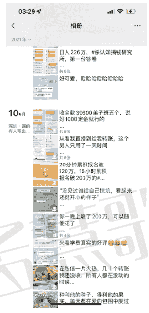
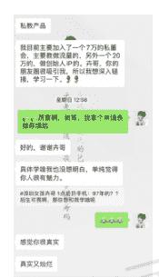
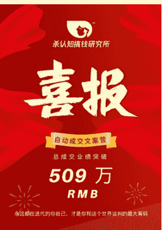
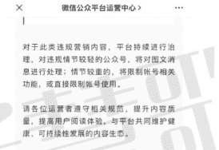
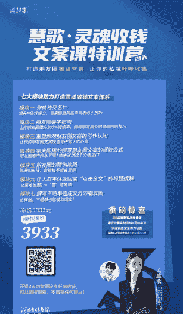
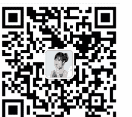
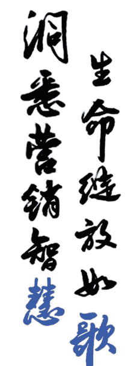

# 私域IP创富宝典

# 作者简介

**孟慧歌**

慧歌商业私塾创始人
高价 IP 营销顾问
私域发售累计 9 位数

25 岁以前是内蒙古包头 18 线城市月入 2700 的小财务；

25 岁以后是年入 7-8 位数的私域营销专家。

擅长批量发售，高价营销，个人操盘超过 20 场都破百万的私域发售，最高单场 600 万 +，靠不到 1 万的私域好友，累计收款破亿。擅长小流量、大变现。

令人发指地热爱讲课和育人，最高记录从上午 10 点讲到第 2 天早上 5 点半，20 小时不睡不累，授课累计超过 7000 小时。

连续写原创朋友圈 7 年从未断过一天，哪怕家里有红白事，每天 3-8 条，累计输出几百万字。

过去 6 年，带过千人销冠团队，10 天拿到过品牌全国销冠后，冠军再没换过人。

打榜冠军（蝉联），6 个月时间，三次获得个人品牌界传奇人物剽悍一只猫 的产品增长冠军，荣获剽悍年度功勋人物奖，剽悍顶级贡献人物奖、剽悍人气霸王奖。

私域发售（To C）：深耕私域 7 年，靠不足万人的私域好友数，用自有流量批量发售累计收款 9 位数。

操盘企业（To B）：2 个月 GMV 从 0-2 千万，从无人知晓到成为行业 top 前三，打出行业头部品牌力。

人生大志：成为生命教育领域里的“一代宗师”。

23 年 3 月完成品牌升级，由“深圳女孩卉哥”正式更名为“孟慧歌”，洞悉营销智慧，生命绽放如歌。致力于用自己的营销智慧，助力他人谱写生命之歌，做一名影响他人生命更美好的商业老师。

帮助更多人启迪心智，兼具通天达地的能力，找到生命的意义。

# 我能帮到谁？

## 洞悉文案力

高价值交-卖得更多

1、孟慧歌-灵魂收钱文案课特训营：¥5933 / 期（21天）
2、孟慧歌-养成系IP文案课特训营：¥7933 / 期（14天）
3、孟慧歌-高价值成交高手营：¥19833 / 年（年度学习社群，含两届文案课）

术道+心态开悟，夯实高价文案，IP基本功，学会高价值社群，批量发售。
洞悉人性底层码，让客户追着你的付款，适合想要让产品卖得更多的你！

## 打造营销力

个人品牌-变得更快

1、孟慧歌-高价IP商业闭门会：¥26333 / 2天2夜
线下2天+线上3年，揭秘私域层级逻辑，打开商业觉知，贯通高价转化美道
2、孟慧歌-高价IP锻造班：¥59833 / 180天
慧歌老师手把手教学，围绕公私域全生命周期闭环，真正沉浸辅导上手慧帮你学习脱胎换骨，适合想要在自媒体赛道上做到高价年产品，拥有高净值用户，被铁血锻造，适合让自己变得更快的你！

## 绽放生命力

生命教育-活得更好

**孟慧歌商业私塾：¥153333 / 2年（成为孟慧歌的亲学生）**
成为慧歌的亲学生，探索生命的意义，发生生命的改变，提高生命的质量，同时系统学习文案力与营销力的所有产品，助你完成财富大突破，思维认知大升级，让你天赋放大、变得更快、绽放生命力！

## 升级商业模式

商业模式-转化更优

1、孟慧歌-线上一对一语音商业咨询：¥19333 / 小时
适合已经完成个人品牌的从0-1，要完善线上产品设计和商业模式，从1-10品牌升级、撤离私域或变码化率，希望有点石成金之力的你！
2、孟慧歌-品牌营销咨询（个人&企业）：63万 / 年
适合企业想要更多线上端口碑及业绩，优化营销模型，亦有或创始人有IP打造需求，想要通过互联网精准获取高价值用户，提高企业几倍利润的你！

**慧歌独创生命力**
>>>洞悉文案力，打造营销力，绽放生命力<<<
**助你遇见更高版本的自己！**

# 我可以为你提供

**文案力：**发圈就收钱的养成系朋友圈文案

连续写原创朋友圈7年从未断过一天，写了几百万字的独家方法论，学了就能写，写了就收钱。

连接我，送20000字《不销而销的文案宝典》电子版

**产品力：**ToC 6位数高客单价产品打造体系

从599到153333，做商业IP两年付费课程涨价百倍，用户满意度反而越来越高，被用户追着付款。

擅长挖掘并放大他人天赋，做出你专属的课程产品和售卖模式，把对的产品卖给对的人。

**营销力：**1万私域变现1个亿的私域营销闭环

私域资深玩家，朋友圈、社群、公众号、视频号直播，全套闭环的被动成交体系的设计，用户经常加V就自动付款几十万十几万。

线上：擅长私域发售，做过上百场发售，超过20场不低于百万的个人发售。

线下：不用会销，沉默付款，可以达到90%的成交率，单场营收均破百万。

擅长不销而销远离喧嚣的卖法，不但高价成交，还要高级成交，卖，不难，卖的得体丝滑，很重要！

## 一、私域 IP 定位力<明定位定江山>

### 【001】如何定位做好一个变现的私域 IP?

**001 和好比，我要“差”**

我做 IP 不是想做好，我的思路是做差，这个差不是四声差，而是“差异化”。因为做最好很难，但做到与别人不同，才有辨识度。

**002 卓越？不，你要非凡**

不要觉得自己不错就挺好，坏就坏在了这个不错上。对做 IP 而言，不错远远不够，必须让别人觉得你极其优秀，像明星一样瞩目。

**003 领域第一人**

大多数人无法做到像明星一样，这个时候差异化就来了，可以找准自己的领域做细分赛道的第一人。初入知识付费领域，我就给自己定位是专业的朋友圈文案培训指导老师。也正是如此，当初持续深耕，将我的 IP 形象和文案进行了强绑定，占据了这个赛道头部心智。（当然，今天来说这个就很普遍了，竞争也大，所以现在我的定位是全域流量增长顾问和私域 IP 商业顾问，主打公域和私域联合这个点。）

**004 做不到第一，就做不同**

但是初入文案培训赛道，有太多人教文案了，很难可以做到领域第一，于是当时的我又做了一个差异化打法——私域 IP 实战梳理。找我不但教你写文案，还帮你定位打造私域 IP，进行实战答疑。

**005 宁可精细，不要宽泛**

其实社群、直播、销售、一对一、短视频等等板块我都会，但当时我只选了朋友圈这个细分作为切入点，为什么？是因为越精细的定义用户范围，市场份额增长就会越快。

**006 选择基本需求**

不要在某一方式上专业，因为这样行业一旦没了，你就没了。要基于人性需要的基本需求，比如哪天朋友圈没了，但是文案技能是通用的。越是基础需求，这份技能越是不会让你没饭吃。

**007 为他人解决问题**

时不时问自己用户需要什么，可以给 Ta 解决什么问题，当你找到别人无法解决的痛点而我们却能做到时，你就拥有了定价的权利。

**008 学会展示**

在各个场合都要展示我做的这件事情，因为再牛逼的人都需要营销，你的名气才能决定你的经济价值。

**009 拥有定价权**

当你掌握了其它人不具备的能力，那么就拥有了课程的定价权，这关系到我们的课程到底是几百块的收费，还是几万块的收费。

**总结：想要做好 IP 一定要做好差异定位，冠军思维，争做赛道内的第一人，在细分领域做精做细，培养出无法被替代的核心竞争力，在各个场合都要展示自己的擅长点，因为只有你不可被替代，并且被人看到，才能使得自己变得越来越贵。**

## 二、私域 IP 内容力<狂输入猛输出>

### 【002】积累私域 IP 的内容力万能路径——学会读书

这篇笔记的关键词是“内容输入”。

打造 IP 过程中很重要的一个板块是内容力，所有 IP 做到后面都会面临内容枯竭的问题，我尝过多种方式积累内容力，最后我发现读书才是快速积累内容力最高效的方式。

那么读书笔记怎么写更有效？

我的习惯是，我喜欢看完书去找我跟这本书里的共性，和我没做到的地方。所以我的读书感悟几乎都是以我自己的案例来去做的思考，而不是单纯的读书笔记。

将每一本书把里面的观点都为我所用，找到里面很多跟我有共性的地方，我就可以趁着读书把我的学习心得整理成框架式的的东西，在整理的过程中我又再一次内化了，就能知道哪个环节做得好与做得不好。

最关键的是，这些文字将会成为我们在未来社群做分享、发朋友圈、写知识星球，成为我们的内容地基建库，真正实现一鱼多吃、一稿多用，我要让我的时间可以被复利，让我的文字价值可以被复利。

如果是做 IP 打造，记住，不论你学什么，说什么，听什么，做什么，最后的落脚点，一定要在你自己要打那个 IP 点上（像我怎么绕都绕在了私域上）。

如果只是写一个读书笔记，那没有什么特别的价值，因为最多你就是收集了几个金句而已。还是那句话，知识如果不能拿来为我所用，那就是无效知识，你认同吗？

### 【003】爆款朋友圈文案秘籍

写文章，写书和写朋友圈底层逻辑都是一样的，我做 IP 最早切入的赛道就是朋友圈自动成交文案，我靠它教了上千名付费学员，收了几百万，分享一些文案的创作经验给你。

**001 人设要有真实性/瑕疵感**

一定要有真实感，优点/缺点/弱点都要展示出来，真实接地气，这样人设会更加有魅力，而被更多人喜欢和信任，人们讨厌虚假和过于完美。

**002 谨记写文的初心是利他**

要有价值/干货/思考，让人有所感悟，有所收获，而不是个人秀场，这样的发心会让你更容易写出好的东西。

**003 懂得营销是利他**

文案被更多人看到，这样才可以帮到更多的人，那你就必须要提前计划好，如何获得更多的曝光。

**004 没有案例=没有灵魂**

必须要有真实案例，可以是你的学员反馈、客户好评等等...

好处是：

- ①让别人觉得你很强，你帮到很多人，而不是自卖自夸。
- ②增加读者的真实和信任感。
- ③满足人性的期望感，看到类似的人、事成功了，读者会有信心，进而最终成功。

**005 吸睛标题助力你拥有 100% 完读率**

开头标题很重要，不知道怎么写可以把文章的中心思想，要解决的问题放在最前面，用户看到了 Ta 好奇关心的问题，就会看完。

**006 灵感爆棚，切记给它“冷静期”**

才思泉涌写的长文章，不要立刻定稿发出去，给 24 小时冷静期，再回来看看哪里不通顺，把觉得多余的话都删掉，这样更容易写出爆款好文章。

**007 多用连接词，读者会偷偷爱上你**

因为…但是，不但…而且，所以…就，多用这些连接词，你的朋友圈读起来会更加通顺，完读率会更高。

**008 多用五感写文章**

这样写出来的才会有场景感，读起来很有诱惑力。

**009 与他人一定要有所关联**

文案一定要与他人有关联，可以是同样的经历，也可以是好奇的事件，能够收获的成长等等，用户只关心与他有关的事。

**010 好的排版会让读者爱上你**

切勿密密麻麻的文字，恰到好处的留白/分段，会让用户读起来更不累。

## 三、私域 IP 布局力<善布局抓人心>

### 【004】写朋友圈，要有“势”，更要有“剧”

这篇笔记的关键词是“连环朋友圈”。

你还在发圈售卖你的产品，有一件事说一件事，说完结束？然后奇怪为什么精心写的文字发出去连个水花都没有？

那是因为你的朋友圈“势”不够，想要有“势”，一定要多写连环圈。

先来说说朋友圈连环布局的好处是什么。朋友圈超过 3000 人会有限流，可触达人数也就是 20%。

也就是说，日常发圈我们都是随缘看、随缘发，但如果要搞一场大型的活动，一定要去多发圈，只有数量够了，才会触达到潜在用户。

同时连载圈的另一种魅力是，只有连载圈发的好，大家才会对你这个活动关注度更高。

也就要有“剧”，把连环圈写成电视剧。比如无意中看到你的 一条圈，不知道你在搞什么，好奇感兴趣的点头像去看 一下，然后发现你的圈环环相扣，和看电视剧一样，有因有果，有过程，看的津津有味，就拔不出来了。

你的连环圈要把事件从 1 到 10 说的清清楚楚，Ta 一 下就知道你要搞什么了，这时候，你的成交进度条就 从 0，直接拉到 50-60%，甚至直接收钱了。

### 【005】学会在筹备期创造需求

这篇笔记的关键词是“活动筹备期”。

很多人搞活动是默默地筹备，筹备完了之后想一鸣惊人。但我分享给你一招，绝对有用，那就是不要浪费你的筹备期。

人性天然有窥私欲，有好奇心，每个人都在搞活动，都在卖产品。观众很喜欢看养成记的东西，而且会有参与感，你要让用户与你一起成长。

灵魂一问：短短几天活动，我根本没仔细看你 的广告，我为什么要购买你的产品，而不是买其它人的? 因为你的价格低？不，有更低的，因为你的内容好? 不，我都看不见你的活动，我怎么知道你的课程好、产品好？

但如果你把你的活动筹备期的一点一滴都发在了朋友圈里面，很多人在过程中会从不关注，到关注，到好奇，到想来参与，到最后为你付出的所有细节所打动，为你付费。

这里举个例子，先拿办婚礼举例，小 A 和小 B 都要结婚。小 A，默默筹备三个月，突然有一天发朋友圈，配上几张结婚照片。一堆人惊了一下，这就结婚了？赶紧跳出来点个赞恭喜她，热度很高，可惜持续了一天，结束。第二天大家已经忘了这件事了。

小 B，从开始准备结婚领证那一刻开始，在朋友圈写连载。如何选酒店，如何选婚纱，怎么选的婚纱摄影馆，她跟她老公因为糖纸的颜色选择发生了冲突，闹了不愉快，给伴娘买伴娘服买小了，酒店撞期了，中间的所有小确幸跟所有小烦恼全部都记录了下来。

然后她结婚当天，一定比小 A 更受世人关注。因为，前者你的婚礼与我无关，后者我从 0-1 见证了你的婚礼，感觉我陪你一起结了场婚，甚至我在围观时陪你时心情的跌宕起伏。

还有我的美容院装修养成记的例子，我早年做实体店开美容院，装修的时候，就是把我美容院如何从一个毛坯房装到一个很温馨、让每一位女生都很想来样子的所有过程，记录在了朋友圈。

结果我刚试营业开始，就非常多的人想来我店里面办卡做脸，很多人过去根本没有去美容院的习惯，人生第一家美容院就是来我家了，就是因为我的全记录，创造了用户的需求（此处参考各大很火的娱乐节目，素人打造，超级女声等等）。

对，不是激发，是创造。

如果你的潜在用户不多，更要注意私域的精细化运营！将一点一滴都同步在朋友圈，这种非广告的植入，比广告成交价要大 N 倍，又真实，又有料，对你难度也不大。

不用每天愁去哪里讲出高认知的表达，做好你自己就够了，平凡、也可以瞩目。

连环朋友圈，一波接一波，势能一点一点拉满，越接触越期待，一点一点拉高期待值，还可以从不同角度阐述，吸引好友翻朋友圈。

### 【006】鸣笛期——引发关注

这篇笔记的关键词是“活动鸣笛期”。

一场活动从开始到结束有 5 个阶段，鸣笛期，预热期，预告期，发售期，累势期。

鸣笛期的核心目的是引发群众的好奇和重视，在 Ta 面前微微展示下你纱巾下的美貌，但又若隐若现，想看又看不到那种。

比如，我会在我星球发售活动开始前大概 1-2 周在朋友圈预热，说我即将马上就要搞一个事情，已经在筹备了，非常的值得期待。同时在直播间说我马上要发售一个新产品，价格有多低，干货有多干，从来没这么干过......

因为我的客单价一直都不低，突然要卖一个几百块的东西，很多人就会好奇，因为和我过往不一样，就会有好奇反差感，想知道我到底在搞什么，人性永远不能忍的是好奇心。

营销的本质就是了解人性，放大人性的需求，满足人性的需求。你卖产品，我真的对你没有兴趣，但是如果你要做一个我很想知道的事情，我就会持续关注你。

这就是为什么八卦永远都是人们最喜欢讨论的话题，因为未知，没有真相，没有答案，都在揣测。

### 【007】预热期——持续吸引

这篇笔记的关键词是“活动预热期”。

用好活动预热期，可以让更多的人可以看到和重视，持续吸引，产生好奇。预热期的核心是要把鸣笛期的内容再反复的强调。

比如我在知识星球发售的开始阶段就不断表示，我过去只收 6 万 10 万 15 万的学员，还从来没有出过这种客单价低的产品。然后把所有准备物料的细节，大家开会的细节透露一点点截图出来，说这次会换个新玩法，就是围观这场发售你都是值得的...

啥新打法？怎么打？卖什么？她为什么要这么做？观众满脑子都是这些问题，早就忘了 Ta 可能原本不需要或者没打算关注你的产品。

一旦你开始让观众思考，那么你就赢了！

### 【008】预告期——全套秀肌肉

这篇笔记的关键词是“活动预告期”。

你的产品能解决用户怎样的问题？你马上要发售的这款产品大概的价格区间（看情况预告，有的产品适合保持足够的神秘）。

你在做这场活动中做了哪些准备的工作？你要几号的时候做这场产品的发售？让所有的人都来关注你的直播，或者是进入到你的社群，错过会有什么样的损失？你的活动海报倒计时？你的成交主张是什么？赠品是什么？

把以上这些，都以故事的方式写在朋友圈，让大家知道你在搞事情，只要能够让大家对你持续关注就可以了。

### 【009】发售期——火力全开

这篇笔记的关键词是“活动发售期”。

你的产品要开始发售了，把发售过程中的所有工作细节写出来，你没看错，不是写你收了多少钱，也不是写你卖多少钱，是你发售过程中的工作细节。

群里面你讲公开课的时候学员的反馈（客户证言好评，你错过太可惜了）。

你拉了几个群进了多少人（活动很火爆，大家很感兴趣，你还不来？）。

你直播的场观、GMV（大家都在看都在买你还在等什么？）。

你在过程中团队开会、齐心协力的团队精神。（这样的团队的产品，你还有什么不放心的？）。

你的产品涨价倒计时（再不购买你就要损失很多了，人类的厌恶损失情绪)。

把它按照你的时间进度，像连续剧一样写在朋友圈，通过活动过程中的势能，制造场域的额外成交。如果你的势能很强，那么在这个过程中，你非常有可能因为场内的势能，而影响到场外也有人给你付费。

### 【010】 累势期——这才开始

这篇笔记的关键词是“活动累势期”。

都以为活动结束就结束了？错，活动结束才是开始！

想要不浪费这次活动的势能，就要趁着势能最强的时候继续滚势能，而不是戛然而止。所以这个时候不能松懈，要加把劲。

活动结束后的成绩宣布（我们这一场仗打得很漂亮！）。

陆续在交付大家的收尾动作，比如赠品比如奖励（我们是靠谱且守承诺的团队）。

大家购买产品/课程后的好评截图（看，没买的你错过很多，下次一定不能再错过了）。

做一场拆解活动继续吸引注意力，把交付的过程持续展示。（这次高下次低，这次低下次高，一定要反着）。

下个月，就可以再做一款高阶产品或者低阶产品的发售了。

展示期倒计时→成果展示铺垫圈→海报圈→建群圈→证言圈→价值圈【滚雪球】→后续……

## 四、私域 IP 转化力<懂运营促成交>

**【011】私域如何承接公域来的流量，实现高效率转化？**

公域是修罗场，私域是避风港。在公域的 IP 形象还没有被大众所广泛接受时，其实在公域上是很难直接成交高客单的，这个时候就需要将公域流量引流到私域进行助推。

**001 如何开启话题**

被动：通过私域分享的内容，在思想层面上让别人对你有认知
主动：分享自己专业领域知识，吸引一群种子用户

**002 销售底层思维**

熊猫白猫抓老鼠都是好猫，除了掌握基本的销售谈单话术，更要了解背后的销售思维，客户为什么要买我们的产品？我们能交付什么价值？

**003 销售结合兴趣**

销售方法并不是千篇一律的，每个人适合的销售方法是不一样的，根据自身特点，做自己擅长且感兴趣的事。

## 004 解决信任问题
与客户链接首先要解决信任问题，信任是成交的第一前提。个人 IP 影响力自带成交值，让别人觉得你真诚、专业、三观正。

## 005 产品天然刚需
好产品的标准是天然存在非常大的刚需，能解决大多数人的痛点问题。

## 006 向外传递价值
不断向外传递思想价值观，开公益课，用能力吸引更多人认可，被动影响别人，让别人对我们产生信任值，进度条慢慢拉满。

## 007 展示过往经历
写一篇公众号，介绍自己的个人经历和背景故事，凸显专业性。用自己的过往履历，反映出目前项目选择的严谨性。

## 008 凸显个人价值
不仅要让用户为产品本身的品牌买单，更要让用户为我们的价值而买单。

## 009 学会差异交付
用自己的擅长能力，做好额外交付，形成独属于自己的差异化打法。新的赛道不是说要 从 0 开始，而是借助过往成绩助力你拿结果。

## 010 多晒客户证言
朋友圈作为展示窗口，通过客户证言晒结果，晒厉害，解决信任问题，让别人自动付费。

**总结：** 公域来的流量或多或少对我们或者我们的产品有一些基本的认知与兴趣，想要转化公域流量，首先**需要解决的就是信任问题，信任是成交的第一前提，** 真诚不夹带私利的沟通交流，展现我们的专业程度与过往的履历，多晒客户证言，以及凸显我们能提供的价值，可以将信任的进度条慢慢拉满。

## 【012】用超级符号打爆个人品牌
超级符号是做 IP 必备战略要点，如果你要做个人品牌，下面我的文字你一定得看。

### 001 打造超级符号体系
我们要学会用超级符号做 IP，收集信仰，产生认同，最后影响消费。

### 002 多用通俗易懂的话
专家说不如俗话说，越简单的表达越容易被人理解，越容易被人记住，越容易被人传播，任何时候完读率很重要。

### 003 简单利于传播的名字
一个好名字自带 IP 力和传播力，比如我之前的 IP 名字是“深圳女孩卉哥”，深圳女孩代表一类人群（搞钱/通透），卉哥代表性格有男孩的爽朗属性，合在一起和我个人性格很吻合，容易理解，好传播好记住。

### 004 视觉符号
我的 IP 色是蓝色，视频号背景图，头像颜色，朋友圈背景图，都是蓝色，时间久了大家看到蓝色就想起孟慧歌。

### 005 嗅觉符号
闻到臭味就是榴莲，闻到肉香味就是烤肉，甚至古时候的皇宫嫔妃都有一款自己独有味道的香囊，只要一闻这个味道就知道是谁。重复的味道，形成重复的记忆。

### 006 听觉符号
比如做短视频每次相同的背景音乐、结束固定“叮”的一声或者一句 slogan，都是形成听觉记忆继而辅助个人品牌的一种方式。

### 007 语言符号
用语言来影响记忆，比如我的 slogan 是，“永远都在迭代的你自己，才是你和这个世界谈判最大的筹码”，它的属性和我个性依旧吻合，经常发会形成人设记忆。

### 008 营销的本质是重复
重复的颜色、表达的 slogan、声音、开场白，重要的话说三遍加强记忆等等...营销的本质是重复，IP 也需要营销打造，找到重要的板块重复去展示，久了就形成了个人属性 IP。

### 009 多用金句利于传播
好的金句会让人想传播，多传播就会带来影响力和 IP 力。

### 010 符号用好 IP 无忧
只要把以上超级符号细节做好，你离被别人持续快速记住就不远了。

很多人做个人品牌会忽略超级符号的作用，但事实上这种想好就能用，用了就有效，且效果明显的视觉锤/语言钉等等，恰好是快速可以被他人记住的 IP 利器，你一定要重视哦!

**总结：** 打造私域 IP 最重要的一点就是被别人记住，能否做成大 IP，很大程度上在起名字的那一刻就决定了，一个好的名字自带 IP 力和传播力，除此之外还可以借助一些视觉与文字符号和我们自己的 IP 形象产生深度绑定，抢占用户心智。

## 【013】IP 要学会营销但不要说服
设计好环节让客户追着你，而不是你追着客户，那么以下这几点很重要，你可以品品。

### 001 羊群效应
人是羊群效应，很喜欢扎堆，大多数人不具备独立思考的能力。如果你想更好的销售，那么让更多的人扎堆在你想要的那一层面，其它人就会尾随而来。这里举个例子，有一些餐饮店刚开业的时候，会专门找一些托在门口排队，让你感觉这家非常的火爆（淘宝的刷单也是这个逻辑）。当然造假我们是不要做的，但是如何可以营造一个让别人觉得火爆的场，就是你成功的第 1 步。

### 002 损失厌恶
人性天生就是厌恶损失的，只要能抓住人性不喜欢失去这件事，就可以把营销做得很好。比如，“如果你 XX，你就会失去什么”，“涨价倒计时 XX 天”，

人有多讨厌损失厌恶呢？就比方说，如果一个群里大家待遇是一样的，这时候，发布了一个消息，有人因为没有及时看群错过了，别人有他没有。他就会内心有失落感，他真的需要这个权益吗？不一定，但是别人有他没有，他就会不开心，不开心就会滋生情绪。所以如果你们带学员或者给客户好处，就一定要提前说好规则，提前约束好条件，并且尽量一碗水端平。

### 003 简化决策
越繁琐的决策会降低消费者的购买率，反之则会提高，每增加一个步骤就会提高流失率，所以，给客户选择成本越简单越好。能今天立减 1000，就别必须要做完 10 个环节才可以减 1000。

### 004 巧用证言
要想办法让第三方为你代言，而不是自吹自擂。比如我带学员卖产品给客户，不要说自己说自己多牛逼，要发学员的反馈截图，别人的发声远远比你自己发声有力量和说服力。

### 005 简约力量
用词能简约就不繁琐，使用过度专业浮夸的言词，容易产生信息偏差。相反，简洁易辨，会更容易利于正确的信息传播，更具备说服力。

### 006 跨行交流
日常有朋友是做其它行业的，也可以多跟他聊聊他行业的事情，三人行必有我师，跨行业非常容易碰撞出火花。想下为什么我喜欢招不同行业的学生？让你们去多听其它和你们赛道不一样的人的问题，也是因为，这个过程能给你带来的启发也是很大的。

### 007 标新立异
为产品去起一个标新立异的名字，会增加项目产品的好奇心和吸引力，毕竟人们永远为新鲜买单。比如，我做过一个系统，起名 PDCA 私域赋能系统（听起来就很炸）。

### 008 多维倾听
个人的决策很容易一叶障目，再去做任何大型决策的时候最好多去听下面人/客户的声音。这样，你的营销决定才有可能最大化的不发生偏差。也就是，多做市场调研。人不打无准备之仗。

### 009 链接生人
多去和陌生人打交道，会有助于打开自己的思路跟视野，帮助自己更好的去了解人性需要什么。比如没事，打车的时候可以跟司机聊聊当地的风土人情，和卖衣服的导购聊聊最近商场的业绩，和导游聊聊行业情况。我以前很多灵感都是来自我吃饭看这个餐厅的营销环节，或者是去买一杯奶茶都可以学到很多东西。

### 010 志做甲方
做营销我们要多学学奢侈品的营销法，传统说顾客就是上帝，但事实上，当你的专业够强，你也可以是上帝。客户追着你付款和合作的时候，你销售后会越轻松。但是很多人以为听别人的与自己没有关系，也不愿意参与，你根本不知道，这个环节中你能够收获到的价值有多大（像是每周的答疑或者是直播连麦，真的很有意义的）。其实好的营销不是说服，是潜移默化在你根本就不知道的情况下，已经完成了所有动作，达成了目的。

**总结：** 如果把这 10 条都品住了，你会发现，你的成交率可以提高 200%，能够做到 7 条到 8 条以上的，你的业绩不会差的，如果你没有做到，那么你就动脑子思考一下，为什么没做到，接下来可以怎么做到。等你都做到那一天，再回过来看我这个分享，会很有意思的。

## 五、私域 IP 形象力<树形象惜羽毛>

### 【014】情绪感知，争论永无赢家，珍惜 IP 羽毛
我原本非常喜欢正面解决问题，也是一定要正面的去迎战，而不是避而不谈。因为避而不谈很容易让别人认为你错了，你弱了，你不行，并且会有很多误会的诞生。

但是最近我发现并不是所有的事情你都要正面应战的，不要把生命中那么多宝贵的时间浪费在跟人吵架争论上，习惯性闭嘴，你会发现你的人生会顺利很多。

### 001 争论无赢
虽然我一直都非常熟悉人性的弱点，但是很多时候会一叶障目，最近读书 + 别人的经验 + 自己的亲身经历，我彻底顿悟了一个道理，那就是......

普天之下赢得争论只有一个方法——那就是避免争论。

### 002 接受分歧
一定要明白一件事，如果两个合作伙伴总是意见一致，那么另一个人就没有存在的意义。所以请对不同意见的人心存感激，Ta 可能会帮你避免犯错。（其它角色同理）

### 003 忽略本能
人的本能是在不利于自己的时候，下意识进入戒备模式，如果你在遇到这种情况下，这个时候一定要保持冷静。警惕我们的本能直觉反应，因为它会呈现一个糟糕的你，而非状态好的你。

### 004 控制情绪
要学会分歧时控制自己的情绪，这个时候你可以仔细观察对方是否易怒，因此你可以判断 Ta 是否值得你合作。

### 005 先听后说
一定要让对方先把话说完，避免反驳跟争辩，建立起沟通的桥梁是至关重要的，抢话会导致场面陷入焦灼。

### 006 求同存异
听完对方不同的想法之后，不要先否定，先在自己认可的部分找到相同的点，再看不同的点如何可以有共存的地方。

### 007 诚恳让步
在能够让步的时候让步，在该认错的时候认错，不要计较对错，要看的对方大局。这会减少摩擦。

### 008 重视表达
学会谢谢对方，不论争执为何，对方既然愿意花时间和你 battle，就证明 Ta 是真心想做这件事或者想要和你深入连接的人。争做那个先示弱的人，也许会化敌为友。

### 009 冷静思考
遇到分歧的时候思考一下自己是否该提建议，建议是否真的能解决问题。如果还是会跟对方产生更大的摩擦，那就建议不做。（哪怕，你认为对方是错的，你的是对的，毕竟，你改变不了别人，只能改变自己，执着追求真理，你失去的可能是对方）

### 010 学会闭嘴
一个人发火的时候，另一个人必须听着，否则那不叫沟通，那叫噪音。冤冤相报，了无尽时，唯有爱方能终结怨仇。这是我准备贴床头每天读一遍的话。

最后，在争吵的过程中，应该从自我觉察这个层面多去思考一下，毕竟感到痛苦的一方，才需要去调整和改变。如果你没有办法解决，让对方听你的，按你的思想走，那么你就只能适应对方，并且想办法调整出一个合适的处理方法。很多时候赚钱也好，人际关系也好，性格也好，回到根本是能量两个字，核心其实都是自己的内在能量，和外在能量你只要搞定能量这事，就不可能有赚不到的钱和搞不定的人，还是那句话，做好一个人，品牌就来了。

### 【015】那些能让私域 IP 越来越值钱的习惯
提到习惯以及带来的好处，第一个反应是，我 6 年如一日的不断更发朋友圈，让我拥有了持续赚钱的能力和改变人生的命运。

### 001 简单听话照做
那时并不懂什么叫做 IP 影响力，有人告诉我每天最少要发三条圈，你的坚持稳定 = 别的人觉得你靠谱，才会给你付费。

自那以后 6 年无断更，不论家里红白事、生病发烧，听话照做让我拿到了很好的结果。

### 002 环境比源动力更重要
我是有惰性的人，做事情不容易坚持，加入了一个很正能量的圈子，每天看他们内卷成那个样子，比你优秀的人比你还努力。彼此激励，反而坚持下来了。

### 003 改掉坏习惯，节约时间
做内容输出，是非常占用时间的，我最爱看的电视剧小说都被我放弃了，节约了时间就有了时间写文案。

### 004 水滴石穿，坚持是最大的能量
开始不会写，写两条改两条，后来写得多了有感觉了，每天稳定三条、5-10 条逐渐加量，会发现，坚持的能量比你想的大。

### 005 先完成，再完美
我很多学员觉得写的不好，不敢发，想要等练好的时候再发，但事实上如果你不发出去永远都不可能写好。

### 006 正反馈，有动力
因为坚持发朋友圈，在微信只有 2000 好友的时候，就累计变现千万，不断尝到了正反馈的甜头，促使我更愿意发。

### 007 习惯会拥有正复利
坚持写圈后，内容力开始变得更强，连续几万条圈的输出，让我拥有了很好的写作能力，并因此链接了更多认可我价值观的人。

### 008 习惯叠加
写圈后，慢慢养成了习惯，开始把文字分享到社群、公众号、短视频里，同一个内容多次复利使用，同时养成了习惯叠加，好处更多。

### 009 习惯重复枯燥的动作
成功最大的威胁不是失败而是倦怠，想要成为优秀的人，必经之路就是无休止反复，同样的事情坚持 6 年，从无厌烦。

### 010 掌控习惯，掌控人生
当你可以掌握自己的习惯，且不会掉队的时候，你的人生就归你了。

## 六、私域 IP 学习力<爱学习勤迭代>

### 【016】怎么做一个有复利的私域 IP，收获 1 年顶 10 年的成长速度？
永远都在迭代的你自己，才是你和这个世界谈判最大的筹码。

### 001 永远迭代
我的 slogan 的内核是永远迭代，时刻进步，这个精神决定了你的人生是一年顶半年，还是一年顶十年。

### 002 读书锻炼
作为普通人，一定要多读书，健身 = 锻炼身体，读书 = 锻炼大脑。想要一年顶十年，大脑必须时刻迭代运转，而读书提升思维，是最快的捷径，没有之一。

### 003 写作思考
我是靠笔杆子改变人生的，我认为写作对普通人来说，至关重要，尤其是做 IP，多写就会多思考，思考输出都会让你更优秀。

### 004 付费意识
最快的迭代方法就是付费，花钱买别人的经验，花钱买别人的圈子，花钱给自己省时间。最后你会发现，能花钱解决的问题都不是问题，而帮你节约下来的时间以及获取的经验，会让你的人生开了加速器。

### 005 时间管理
时间就是你的命，要让时间更值钱，最好的方式是学会筛选。选择对的事，选择对的人，然后坚持去做，让投资回报率变高。

### 006 强者思维
向强者靠近，以强者的标准要求自己，像强者一样活着，拥有强者思维，只有这样，你才会真的成为一个强者。

### 007 能量状态
远离负能量的人，向牛人靠近。

你一定要相信，你的状态决定了你的人生。

### 008 背后夸人
当面夸人不一定为真，但背后夸人一定不为假。说人是非者，必是是非人。同样，背后夸人者，必是良善人，成长，与做人密不可分。

### 009 第一思维
不去追逐平庸的机会，但重要的机会一定要抓住。要么不做，做就要争第一，我一直是这样习惯的人，后来我发现，这给我带来的最大的好处是，你会越来越强。

### 010 人生复利
做好以上，人生会拥有复利，何为一年顶十年？就是努力让你一年成长抵过 10 年，做事有多维度回报。

加油吧少年，让我们一起拥有一年顶十年的大脑和思维。

**总结：迭代能力是 IP 持续升级的关键，读书写作是锻炼 IP 内容输入输出重要的方法，时间是我们的命，IP 一定要管理好自己的时间花销，学会筛选，选择做对的事，同时培养付费意识，花钱买人的时间，多靠近牛人，并在背后夸人。**

## 七、私域IP表现力<好口才擅沟通>

### 【017】如何提升直播间表达力？
“说服是用一种更好的思想改变人们的世界观”。演讲不但可以用在舞台上，还可以用在直播间，一切可以让你公开表达，影响他人的地方。

**001 打破框架，重新建立你的框架**
演讲的核心，是说服，说服的核心，是要让听众认为 Ta 过去的思维是错误的，而相信你的。把你的思维装进 Ta 的大脑里，建立新的思维框架。

**002 你的直播间该讲什么？**
① 前言——明确要讲的主题
② 背景——为什么你讲的这个问题很重要
③ 内容核心——绘声绘色的描述你的重点
④ 实践意义——用它会对听众有什么好处
⑤ 结论——收尾，让听众回去执行

**003 学会铺陈**
铺陈是一种很重要的战略策略，在直播间不要干扁的讲出你的观点，可以用一种更合理的比喻或语言策略让你的结论更合理。

### 004 如何铺陈
比如我线下 IP 课开场就做了一个连接小游戏，让学员举手朗读和表达我准备的文字，该内容需要当事人与其它学员发生连接，然后用游戏引发学员思考，我为什么要这么做。最后结论：不发声 = 不发生，如果你连身边同学都没有连接，那你怎么可能做出 IP 影响力？继而引出课程主题。线下和直播间逻辑一样。

### 005 干湿结合，沉迷其中
一场直播，要的绝对不仅是逻辑干货，更需要一些其它的润滑剂。比如故事，生动的例子，一些幽默的言辞，有干有湿，观众沉迷其中不可自拔。

### 006 没有 ppt 要优于 ppt
ppt 或者配图只展示很难描述的东西，比方说需要图片展示，需要案例论证，需要特别说明，除此之外，无需使用。它只是辅助，不是核心。

### 007 付出即收获，利他即利己
讲干货中可以植入软广而非强推，要享受分享的价值，给予的同时，收获就在前方。

### 008 理清你的主线，不要跑题
罗列好你直播想传递给观众的方向和内容，全程围绕主线讲。比如：私域的理念，私域的价值，私域的用户画像等等……都围绕私域。一旦东一杵子西一棒子，不聚焦，就很容易让观众抓不住重点而离开。

### 009 多连接多互动多上墙抽奖
多与观众互动，多送礼物，让场域热起来，有助于自己不紧张。

### 010 请用好开头和结尾
一个吸睛的开头和一个有灵魂的结尾，会让你的直播演讲意犹未尽。以前线下演讲一场辐射几十到几百人，如今线上直播，一场几千几万几十万人，互联网时代的红利，也是表达者的红利。线下做粘度，线上做影响力，如果要做自媒体，直播必不可少。

**总结：提升直播间的表现力，其实本质还是人际沟通力，直播间好比线上的公开聊天室，首先需要梳理好自己表达内容的逻辑框架，框架乱了，东讲一句，西拼一句，容易让人摸不着头脑，自然也就难以吸引别人停留，然后通过话题内容以及一些直播间的运营设计来抓取别人的注意力，更加重要的是要多站在别人角度思考，别人肯定不来看广告的，少一些营销，多一些价值输出，干湿结合，才能让观众深度沉迷其中。**

## 八、私域 IP 影响力<强感知占心智>

### 【018】通过复刻讲稿来提升私域 IP 影响力
当你没有足够多的内容力，如何快速提高内容力和影响力的方法，分享给你，那就是复刻讲稿

#### 001 善用费曼学习法
为什么要讲稿，那就一定要说《费曼学习法》，就是把自己学过的东西再讲给别人，可以演讲可以文字，通过以教为学的方式，达到提高自己知识储备量和内化知识的目的

#### 002 如何获取讲稿的内容？
可以选择读书的方式，也可以把别人的分享/听到的课程/学到的直播干货等归纳一遍，复刻出来读完了再通过讲述的方式让知识真的成为自己的。

#### 003 讲稿的场域有哪些？
用社群、朋友圈、直播间或者线下演讲等方式，达到提高影响力的目的。

#### 004 如何确认讲稿的核心内容
以一本书/一场直播/一个主题思想/一节课程等的中心

思想核心为出发点，开始扩散，整理出你最感兴趣的东西，设好大小框架，然后去讲，一本书可以分享十几篇甚至几十篇。

#### 005 如何让讲稿更有吸引力？

多去看电影，看你感兴趣的人的直播，听好的演讲，看社群里那些让你觉得拍断大腿的分享，多去观察她们说话的节奏，语气，文字表达方式，模仿学习，提高表达能力。

#### 006 如何给比你优秀的人讲稿？

错位竞争，每一个人都有不擅长的领域，三人行必有我师，在 Ta 不擅长的领域你就是比 Ta 优秀的。

#### 007 多互动，挖取用户真实需求

不论是讲稿还是输出，除去自己擅长之外，还要去讲用户想要的，多跟用户互动，在互动中你可以看得出来，哪个角度是 Ta 感兴趣的。

#### 008 不断拓展认知边界，锁住粉丝用户

不要只读自己感兴趣的书，看自己感兴趣的直播/课程，要多拓展认知边界，多去读各行各业多领域的，这样讲稿的维度，逻辑，延展面以及举的案例都将会有丰富多彩。

#### 009 事后复盘

每次讲稿完之后都根据用户的反应，做复盘，下次精进。

#### 010 找到最适合自己的场域，提高权重

通过多次各场域的讲稿，慢慢你会找到自己擅长的场域，比如你擅长用讲的还是擅长文字输出。有可能是社群的反馈好，也有可能是直播间反馈好。找准给你正面反馈最多的场域，然后加大在这个场域讲稿的权重，在擅长的场域里发光发热。

最后，给你分享我今年要完成的践行清单，我给自己立了个 flag：一年做 333 次分享，你也可以给自己列个小目标。每天强输入一小时，然后整理出三个讲稿的小分享，先文字社群朋友圈，再直播间表达/线下演讲等。这样按照流程去做，坚持一两个月，你会发现效果不要太好。个人影响力最核心的硬核实力，就是内容力。不能生产内容的人，是做不了超级个体的。

## 九、私域 IP 决策力<理战略果断决断>

### 【019】私域 IP 做大做强的关键一步———— 学会断舍离，先做减法

平心静气的面对一个现实，拒绝别人，勇于说“不”，学会断舍离，也是一种财富智慧。

#### 001 灵魂拷问

每个人都会感觉到生活有不堪重负的时候，比如我有段时间压力很大，做的都是我不喜欢且没正反馈的事，那么这个时候我问自己一个问题，我是正在垮掉还是有所突破？

#### 002 抽丝剥茧

“难走的路才是上坡路”，这仅仅是我们在面临成长过程中给自己打的鸡血。这并不意味着当我们看到问题，接触问题，并且任由问题恶化下去，也不是说把问题合理化为好事。

#### 003 不要逃避

遇到让你头疼的现状问题，感觉到痛苦这个时候，它不是告诉你要成长，而是要让你利用痛苦理清思路。你不能忽略痛苦的存在，因为它会帮你找到更好生活的方向。

#### 004 学会复盘

这时你可以开始做一个练习，把占用了你 20%的时间，但带给你 80%负面情绪的活动和人写下来。

#### 005 恐惧设定

请认真思考，如何停止让你自己焦头烂额的事情发生，最糟糕的情况是什么？你怎样才可以挽回损失？

#### 006 思可行性

你停止这件事情，会给你带来的好处，坏处又有什么？如果要停止这件令你痛苦的事，那么在尝试的过程中如何确保成功？把它全部都列成清单。

#### 007 开始执行

给自己定一个假期，这段时间不再做这件让你痛苦的事情，转去做一些其它积极让你开心的事情，比方说，锻炼，阅读，写作，旅游。

#### 008 确认结果

时间到了之后来确认，这件事情对你真正的损失到底有多大，这时你可能会发现，原来你没有那么需要一定要做它。

#### 009 勇于说不

以上是对于一件让你痛不欲生的事的处理方法，你也去试一下，勇于说不，敢于断舍离。

#### 010 都是虚妄

我们以为的大量的烦心之事，其实可能从未发生过。

那都是我们自己给自己制造出来的，我们需要摆脱出一些原本真的不重要的东西。

财富智慧不只是得，还有舍，敢舍才有得，不能害怕失去，你才能拥有更多。

总结：不管多大的私域 IP，本质上是鲜活的个体，也会感到疲倦，多件事情一起处理会分割精力，一定要学会断舍离，做减法，聚焦最重要的事情。

## 十、私域 IP 应对力<觉冷静速应对>

### 【020】做 IP 的路上，遇到黑粉应该怎么处理？

不管是做自媒体，还是做 IP，一定会有人不认可我们，被人“骂”也时有发生，这个时候应该怎么办？

#### 001 找对重点

关注那些理解你的人，他们才是你的阿基米德杠杆。有多少人不理解你都没有关系，关键是有多少人理解你。

#### 002 寻找铁粉

哪怕你是为了所有人去为他们好，最后也会发现，培养打动你的前 100-1000 个真正的粉丝，他们才会成为你最强大市场的营销力量。有了他们，其它一切水到渠成。哪怕成百上千的人都不理解你，他们理解你就够了。

#### 003 习惯对抗

你身边一定会有至少 10% 的人，都会用各种各样的方法，把所有事都搞得好像是在针对 Ta，都是你的错，你对此要有心理准备，把它当做一道数学题来处理，那不是你的问题，是人性。

#### 004 遇到批评

当你遇到黑粉的批评的时候，你该怎么办？把它当成空气，你不是人民币，做不到每个人都喜欢，不要让自己陷入焦虑中。

#### 005 正式回应

如果必须回应，那么要谨记不要过分道歉，平常心表达就好。

#### 006 不要试图让所有人喜欢你

如果对方不想讲道理，那你就无法让对方讲道理。不要试图让所有人都喜欢你，这意味着你在逃避艰难的决策，在逃避那些需要面对的不好的声音。

#### 007 坦然接纳

如果你想改变，那你就欣然接受，被别人否认的批评。活着活好，就是对憎恶你的人最好的报复。

#### 008 内心强大

你需要在乎喜欢你作品的少数人，而不是讨厌你作品的多数人。做一个强大而非脆弱的人。

#### 009 别内心戏

学会做自己，而不是内心的演员。很多时候，别人对你的否定来自于你的揣测，其实没有那么多人不喜欢你，要给自己自信，做好自己，足已。

#### 010 被误解是表达者的宿命

为什么明星网红 IP 会被骂，而普通人不会？因为被误解是表达者的宿命，当你开始对外发声表达观点，并进行传播的时候，就一定会遇到不理解你的观点和不接纳你的观点的人。

总结： 我们不是人民币，肯定做不到让每个人都喜欢，遇到黑粉，首先不要让自己陷入焦虑中，坦然接受，别想太多，与其关注黑粉，不如把关注重心放在那些喜欢我们的铁粉上。

## 十一、私域 IP 财富力<思利他敢谈钱>

### 【021】做 IP 千万不能避讳赚钱这件事

你懂得谈钱，钱才会涌向你。学会拥抱它，而不是推开它。

#### 001 让赚钱有意义

以前赚钱是为了生存，2016 年创业后是为了帮更多人致富，当赚钱的意义发生改变后，源动力也变的不一样，反而赚的越来越多了。

#### 002 不要羞于谈钱

很多人不好意思跟别人谈钱，有很大卡点，我们要明白赚钱的核心是为了解决别人的问题，并不是要从别人兜里掏钱，大方谈钱，接受你对它的欲望，坦然面对它。

#### 003 学会时刻展示

人都是健忘的，你以为别人认识你，其实并不是，所以要学会时刻展示自己的擅长力，让更多的人记住你。

#### 004 多花才能多赚

我很喜欢给别人付费，我经常说一句话，如果你从来不给别人付费，那你很难赚到钱。每一次付费给别人，你都会收获对方是什么点打动你的，你反而更容易赚到钱。

#### 005 学会链接牛人

如果你学会“抱牛人大腿”，那么你的成功会事半功倍。很多成功的人 Ta 都有一个共性，那就是曾经有过贵人帮助。

#### 006 多混付费社群

我去年大概花了近百万付费链接牛人和社群，因此收获到了很多优质的人脉，资源，信息，我的成功与它密不可分。

#### 007 和优秀人喝茶

听君一席话，胜读十年书。多和优秀的人喝茶聊天，会帮助你打开非常多的思维，助你更好的成功。

#### 008 送礼拥有人缘

这两年我大概送出上千份礼物，而且每一份礼物都是我亲自挑选很有意义的，被学员称之为送礼的天花板，它给我带来了非常好的口碑和人缘。

#### 009 口才好加速器

锻炼你的好口才，它会成为你收费的加速器，我在直播、语音、线下的时候跟别人交谈，经常会吸引来很多人给我付费。

#### 010 打造强大背书

学会打造一个强大的背书，很多人不知道你是谁，但 Ta 会因为这个背书而对你有所关注，很多机会会因为在这个背书而给你。

**总结：在做 IP 的路上，千万不能避讳赚钱这件事，赚钱的核心是为了解决别人的问题，并不是要从别人兜里掏钱，大方谈钱，接受你对它的欲望，坦然面对它。巧妙地学会借势，学会交谈，学会链接，学会付费，给学员真诚提供价值，不断积累提升我们的口碑，这是你人缘越来越好的秘密武器。**

### 【022】从 18 线城市的小财务，“杀”出来 IP 创富心得

分享给你一些我从 18 线城市的小财务，杀出来改变命运一条路的真相经历

#### 001 学会向宇宙下订单

很小的时候，我每天睡前躺在家里的床上，都会给自己许下愿望，希望家里可以换个大房子，更大的电视，每年出去旅游… 这样的“白日梦许愿”，却是向宇宙下订单，心有所想，才能有达成所愿的那一天。

#### 002 要学会拥抱“欲望”

把渴望拥有的东西，具象化留在每天都能看到的地方（比方说做成梦想相册），多去想象自己拥有它后的样子。

#### 003 清晰每一笔收支

上大学开始，我养成了每笔收支记账的习惯，十几年来，我清晰知道钱的出入，每个月明细也让我更有动力多去赚钱，和节约不必要投入。

#### 004 开源而非节流

与其它朋友都在省钱相比，我很早就开始去寻找开源的方法，机缘让我开始了副业，赚了远比省钱多万倍的财富。

#### 005 理性消费

我从小都会去考虑一笔钱支出是否是有意义的，哪怕赚再多钱，不该花的钱坚决不花，每段时间都会看个人账本，自省复盘。

#### 006 把钱分成三份

50%用于储蓄，40%完成梦想清单，10%用于消费，这一点我做的不到位，每年 1/3 以上的收入会被我拿来去消费和投资大脑，但是这帮我创造了更多的收入，以后还是多要在储蓄上下功夫。

#### 007 要有配得感

你拥有的财富和努力，都是你辛勤所劳，心态决定状态，状态决定结果，要有自信。

#### 008 靠近财富永动机

跟会赚钱的人在一起，你才能够拥有掌握财富的秘密，从我开始靠近比我赚钱多的人后，我的财富就一直在越来越多。

#### 009 永不说“试”

心锚之所以会影响一个人的成功，是因为当你埋下的那刻，答案就已经有了。比方说我从来不会说试试看，我要不说“没问题交给我”，要不我就会说“这个事做不了，需要先解决什么问题”

#### 010 长期主义

坚持，恒心，毅力，都是与财富博弈的有力武器。

**总结：没有人天生会有钱，普通人一般没这个命，但那些后来慢慢变得有钱的人往往都不会轻易认命，他们敢于向宇宙下订单，然后付出像疯狗般的执行力，并保持理性的头脑，不短视拥有长远的眼光，并永不放弃，坚持长期主义，最终他们成功了。**

### 【023】线上变现千万的 IP 财富心法

我算是一个从穷人思维转为有钱人思维的素人典型，思维决定结果，靠它变现千万，如果想创富，首先要了解人性，和你分享一些我的创业经历。

#### 001 只做能力半径内的事

一定要做能力半径以内的事情，当你可以找到你的长板，把它和正确的业务结合起来，你就能赚到很多钱。比如，我很喜欢写东西，就把朋友圈文案和 IP 当作为主变现路径，果然，赚到了比以前多很多的财富。

#### 002 从需要到想要到敢要

大多数人穷，不是因为能力不够，是因为不配得感作祟，先想要，再敢要，向宇宙下订单，它会回馈你。

#### 003 接纳你自己

你是一切的根源，本自具足。

#### 004 大胆寻求帮助，多取经

一定不要闭门造车，要多去向优秀的人寻求帮助取经，只有多跟有钱人大脑碰撞，你才能越来越有钱。

#### 005 别人的麻烦是你的财富

很早之前朋友就说我应该去做营销公关，因为总在不断的处理突发情况，后来我发现，我解决的每个问题都会换来更多价值，赚更多钱。

#### 006 摆脱穷忙的陷阱

我有很多学员每天忙的停不下来，但是又没有产出，但事实上，我们要的不是一直忙，适当停下来思考一下阶段性要什么，反而会更高效。

#### 007 制造稀缺性

我很喜欢用限时限量，人都是厌恶损失的，所以一旦稀缺性上来，大家都会很紧张，快速付费，它会让你的产品更好卖。

#### 008 一句话说出你的卖点

能一句话阐述出卖点的产品，才是符合推广逻辑的。

#### 009 超值交付感

好的口碑需要好的交付感来承接。我一直崇尚一个价值观，一定要给客户付费 10 倍以上的价值，客户会帮你转介绍，大佬会帮你推荐。

#### 010 劣币驱逐良币

负能量的员工他会影响环境场，优秀的人遇到后无法发挥价值就会离开，劣币驱逐良币，一定要保护好有价值的员工，给他提供安全舒适的环境。

**总结：财富是一种创造，达到目标本身不是重点，重点是在赚钱的过程中，你变成了什么样的人。**

## 十二、私域必备技能-产品销售信

### 那个晒了6年单的我，决定不发收钱圈了

亲爱的需要在私域/营销/文案/能量上有大突破的你：

我是你的朋友孟慧歌，我想，你可能很需要我，尤其是这半年有大突破的我……的新型朋友圈文案写法，不晒单还具有成交力的文案写法、能量文案写法、高级圈文案写法…

所以，我来了，因为我知道，我接下来要说的这件与你息息相关的事，你一定很感兴趣

众所周知，我这半年的战略定了很久了

核心三个词：交付交付交付，基本功基本功基本功，不发售不发售不发售。每个词说三遍，以正重要性。

所以，最初我本来是不打算写这篇文章的，因为写作文的时候你应该就知道...我要开始卖东西了...

但是团队人反复讲需要有这么一篇说明文，我想了想，还是提笔了......所以，这不是一篇卖东西的小作文，而是一篇写给有缘分的你的见证文。

所以，接下来你可以把 5 分钟的时间交给我吗？对，只需要 5 分钟，我想来给你讲一个小故事

### 一句话改变了我 6 年的坚持

众所周知，我做 IP 起家是靠教【朋友圈被动成交文案】，在教别人之前，我发了几万条原创朋友圈，在朋友圈变现千万。

市面上很多都说，朋友圈是私域成交里用来种草和曝光的，而我却不这么认为，我的朋友圈一直都是用来成交的。

我很少和客户你来我往地撕扯，只要 Ta 和我对话超过三句还在咨询没有进入主题或者购买产品，我就再见说拜拜了（特别声明不是势利噢，而是一个社恐、还是时间宝贵的社恐最后的倔强）

基本 80% 的学员和粉丝都是加了我微信没说过话，过段时间就主动给我转账了

一细问，理由都是：我看了你的朋友圈，喜欢你这个人，想上你的课、买你的产品...而且都是 5 位数起的

### 孟慧歌课程体系产品全介绍

▲点击蓝字，查看原文

比如这个私信，就是报名咨询 15 万私塾课程的，然后你就知道了，过去几年，我靠朋友圈获得了千万级的财富，我靠 Ta 破了无数圈子，我让很多有影响力的人第一次听说我，都是来自朋友圈。

也感谢朋友圈，在我没有多少流量的时候，就助我收入喜人，是我最大的影响力杠杆。

并且，由于太多人心水我这个能力，我把 Ta 变成了课程，也帮助了无数人在朋友圈这个细分展示端口里，实现了被动收钱的能力（私域普通人变现最短的路径就是朋友圈）

而想要发圈带来成克力，都知道，一定要晒单，晒收入，就和淘宝用户会看你的成交单数而放心给你付费一样。

客户购买你产品有个很重要的核心：你卖得好不好？

而晒单，是最直接的展示。

万事有好有坏，虽然我也知道晒单的弊端，比如会让人误会，觉得你不高级，比如会被嫉妒你的人盯上，比如会激发人的恶意...

但，好处更大...

所以权衡利弊的我，就开发了一套让人不讨厌的晒单成交文案圈写法，让别人爱上你的凡尔赛晒单法，中合了这个弊端。并靠该课程在去年创收上百万，一场训练营学员收款 509 万。

### 震惊，14 天 Ta 们创造了 509 万+业绩？？？

▲点击蓝字，查看原文

然后你知道的，我在舒适区遨游的不要太开心噢，每天发圈收 💰 收到手软，经常有人给我转账我**没收到，过期了**......然后继续重新转账...

沉迷收钱中不可自拔...

直到有一天，我听到了一句话，这句话让我 2022 年这一年几乎没有再发过收钱晒单圈...

那句话是：

**如果你赚了很多财富但是没有捐赠，还拿出来展示，是会伤害很多人的。**

轻飘飘一句话说出来，却重重地击在了我的胸口上。我只从用户的角度想过，如何让人看到我们的成交圈不讨厌连接我们。却从未想过，晒它可能会伤害别人。

这句让我灵魂一振的话，使我陷入了深思。作为一个希望可以像礼物一样走进每个人的生命里的我，**终极梦想是影响起码 1000 万人可以改变人生，越过越好。**

而一个给自己默默定下这样目标、拥有这样使命的我，怎么能允许自己的言行去伤害那些看我圈的陌生人呢？

我秒懂了这句话背后的含义，确实，我们应该传递美好，而不应该给他人制造焦虑。

我突然发现，那天之后，我就写不出成交圈了，不会写了 😥...

尤其，因为 YQ 当下，市场角度和国家角度也在悄无声息地发生着改变。Dang 的指向告诉我们要传递正能量，要低调。

微信整个生态的整改，Ta 的边界，无数信号都在向我们透露一个信息，未来不只是炫富被警告，普通晒单也是有很大的风险的。

等到被迫整改时，不如现在提前布局。毕竟，未来我们是一定要坚定不移地跟着 D 的政策方针走的。

想到这里，我决定要把朋友圈写法大迭代了！不但自己改变，还要把这套不晒单的成交圈打法分享出来，让你我一起提前布局。

走老路永远看不到新风景，人与人之间拉开差距就是在谁提前先知先觉布局的那个瞬间。

我这些年每一次都能够快速拿到结果的原因，都是因为提早做了别人还没做的事情，抢占了时机。

虽然这次的迭代我会全面推翻我去年的很多表达、认知，以及行动，又一次的打自己脸...狠狠地抽的那种打

但是，这个打脸让我很开心，因为，它会帮你赚钱赚得更多，而且，是让你开心地搞钱，没有卡点的搞钱，美好的搞钱。

而这，大概率会成为你在这个越来越卷的私域和 IP 的赛道，再次杀出重围的绝杀杀手锏。

私域越来越卷，就需要你越来越差异化、精细化运营，从朋友圈文案切入，无疑杠杆最大。

★学完它， 你会突然醒悟，原来过去没人给你付费是因为这个原因...

★ 学完它，你会知道，原来靠能量发圈，比靠文笔、晒单发圈，更有成交力

- ★ 学完它，你会知道，有时候不需要太多方法论，只需要掌握这一个心法，就可以让客户追着你付款了。
- ★ 学完它，你会知道，原来搞营销事件的时候，如果加上这套发圈模型，可以轻松让你的里程碑事件轻松 double 业绩。
- ★ 学完它，你会知道，让比你能量还高的人给你付费，原来可以很容易。

本次 4.0 版本慧歌灵魂收钱文案课究竟有哪些惊喜呢？

## 惊喜迭代①：教学方式升级

### 改变型教学，让你真正行动起来

改变了以往教学模式，采用全新的讲课＋训练营＋改变型教学，首次把我好评如潮的线下闭门会的教学方式用在线上，激发每个人的觉知和创造力，沉浸感参与感获得感会更强。

（所以严格限制人数，保证教学质量，只会收 20 人）

## 惊喜迭代②：教学内容升级

### 轻松学会如何不晒单，还具有成交力的高级发圈法

今年私域越卷，越需要新的营销方式展现形式，让你的朋友圈变得高级起来，去吸引更优质的用户。

（就几天时间，我发了几条非营销的朋友圈，还吸引了近 30 位客户了解、购买了不同的课程和圈子，都是 5-6 位数客单价的，GMV 预报名破 10 万）

本训练营总共 17 天，手把手教你如何拿来即用的、各种灵魂收钱的朋友圈文案的方便法门、工具路径。

轻松把你的朋友圈从路人圈提高 N 个 level，帮你提高私域收钱能力，小白学了都能立刻上手的那种。

## 无风险承诺

如果你听完第 1 节课或者开课 3 天内，觉得没有任何收获，可以全额退费，不需要任何理由，我们还会为你准备一份精心准备的礼物。

快，感兴趣就不要犹豫了，可直接按住图片识别二维码报名👇

扫码报名后记得加管家微信，👆👆👆我们在社群训练营相遇💙

孟慧歌

2022.11.24

以上是我一封销售信小作文的实战模板，卖的是我的王牌课程——慧歌·灵魂收钱文案课特训营。

它也是私域里必备的一项技能——成交小作文，如果你拥有它，你将不再愁客户从哪儿来，为什么不给你付费等问题。

## 十三、结语——孟慧歌想对你说

感恩看到最后的你，如果你看完这份宝典，觉得很有启发，想学习更多的私域、成交文案和 IP 相关的知识，想要围观我的灵魂收钱朋友圈，可以加我的个人微信。

（每天只会通过 13 人，如果添加，请一定要记得写一份如何与我相识的通过语，我喜欢真诚的连接，期待连接走心的你）

扫码关注孟慧歌朋友圈

扫码关注孟慧歌公众号

WEALTH CREATION CLASSIC

智慧哥

洞察营销智慧 生命绽放如歌
