# 移动平均线交易：七大误区

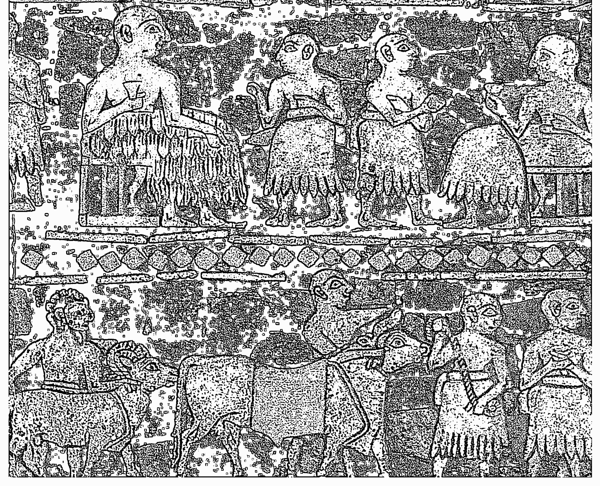

# 客廳珍藏叢書：這本書值得我們放在客廳財庫位上！

**KINGS-BOOKS**

---

> The love of liberty is the love of others; the love of power is the love of ourselves.------Hazlitt, “Political Essays”
>
> 愛自由即愛他人；愛權勢即愛自己。——海斯利特，〈政治散文〉

---

## 七大錯誤觀念

股市達人孫叔熬，買進之後要熬

> I expect that Woman be the last thing civilized by Man. ------
> George Meredith, The Ordeal of Richard Feverel
>
> 我認為最難以被男人馴服的，非女人莫屬。——梅雷迪斯，《理查.費弗瑞爾的痛苦經驗》

在慢牛市時，股市緩步上升，但要大漲恐怕不易，「股市可以往上走，但不要期望走太快」；如果有新股上市，屆時大盤可能「只長胖不長高」——就是市值增加，但指數卻不會上漲；至於「小熊」階段則是緩步下跌。

### 障礙反而促成成功

我生命中的所有重大成就，都是因為我知道某個人——通常是任何人，無論是她的妻子、朋友，或是工作上的夥伴，都能做得比我好。

成績優異的學生不太可能，甚至不可能瞭解到這樣的一個概念；優等生總是覺得能憑一己之力把所有的事情辦好。……

如果不是因為我的學習機會（障礙），讓我很明顯的知道自己需要別人的幫忙，或許，我也會像其他人一樣的誤以為自己能辦到一切的。——保羅.歐法拉（Paul Orfalea）

「我們都做過愚蠢的理財決定，不過如果還誤以為自己行為是正確的，就會不斷犯錯。」

《華爾街日報》2004 年 11 月 24 日公佈了投資最常犯的七大大錯誤觀念；專家分析，這些錯誤觀念都屬於「投資惰性」，想賺錢不能以逸待勞，只要做好資產配置，就可以少走一些投資冤枉路。

根據《華爾街日報》的報導，七大投資錯誤觀念包括：

1. 花錢找藉口；
2. 存錢拖時間；
3. 對於投資報酬率有過高的期待；
4. 希望能打敗大盤；
5. 投資房子，愈大愈好；
6. 貸款金額成數，愈高愈好；
7. 懊惱錯過投資好時機：並且永遠在懊惱錯過投資好時機。

華爾街日報說，花錢是讓你變得更更有錢的動力，但是，「如果不挥霍的話，你會更有錢」，投資的關鍵，還是在於節制開銷。另外，許多人計劃「從明天開始」存錢，不能從今天開始，因為現在還有更大的需要：包括買房子、支付孩子的學費，「這樣看起來似乎頗明智，但事實上，等到孩子大學畢業後才開始存錢，就太晚了」。

華爾街日報根據芝加哥 Ibbot-son Associate 的數據，發現自 1925 年以來，S&P500 指數，每年漲幅都達到 10.45%，但如果想依賴賺取這樣的投資報酬率，將無法賺到足夠的錢，因為股市投資報酬率的很大一部分是來自於豐厚的投資收益率和本益比不斷提高，「現在的環境，股票投報率要達到歷史平均水準，將是困難重重」。

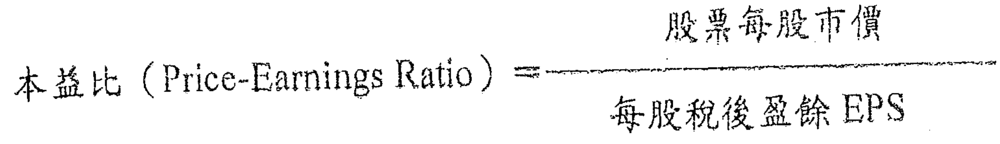

目前是投資股市的微利時代，不能賺大錢，但也不會大賠，不要去猜想到底會賺幾%，「這樣沒有意義」，寧可把期望值降低，報酬率超過 6 到 7%，就算是賺到。

一般人大多認爲，成功的股票投資就是要選到能打敗大盤的股票和股票基金；不過，在實際市場操作中，長期能打敗大盤的機率是很低的。試圖打敗大盤的努力註定會失敗，因為這樣的交易成本很高；在投資交投活躍的管理基金時，也要支付高昂的管理費用，會拉低投資報酬率的。

《華爾街日報》指出，根據現在普遍的觀點，投資房地產是只賺不賠的買賣。所以許多家庭開始使用多數的資金購買更大的房子，如果買房是鎖定房屋成本、省下房租，還是個不錯的途徑；但如果是爲了發財而買大房子，結果很可能讓你失望。 ／ 2004/11/25

### (1).花錢找藉口

這意思是說，想要亂花錢，就不斷的找一些似是而非的藉口，例如「對自己好一點」等等。金錢的鐵律是這樣子的，金錢總是從智商低的人那裡流向智商高的人那裡。

成功的人總是在找原因，失敗的人都在找理由！

### (2).存錢拖時間

存錢不積極，總是拖來拖去的！結果是阮囊羞涩，總是沒錢！只有智商高的人————才能儲蓄；智商低的人的特點之一，就是每月花光光，自古以來就是這麼流傳，所謂的「今朝有酒今朝醉」，就是他們創下的名言。

> Making a mistake.is only half as bad as making an excuse for it.------Ron Butler
>
> 做錯事卻設法辨解，它的過失是倍於有錯。——隆.布特勒

**※．時間價值（Time value）**

「時間價值」也是資本主義的核心要義之一；這是說：金錢具有時間價值；也就是說，現在得到的金錢——在本質上，是會比未來得到的金錢，具有更高的價值！俗諺語也有說：「二鳥在林，不如一鳥在手」就是！

> A bird in hand is worth two in the bush. ------ Western Proverb
>
> ∕二鳥在林，不如一鳥在手。————西方諺語

至於要計算「二鳥在林」的價值，就必須利用適當的折現率。換句話說，如果投資人預期報酬率是每年 10%，那麼顯然就會拒絕接受一年後的獲得 109 英鎊的開價，但不會拒絕現在獲得100 英鎊！

至於一年之後可獲得 110 英鎊，或是現在獲得 100 英鎊則是毫無差異的；但是卻會接受一年之後獲得 111 英鎊的開價——因為這顯然是比現在的獲得 100 英鎊更爲有利可圖。

時間價值（Time value）也稱爲「投機價值」（speculative value）。

### (3). 對於投資報酬率有過高的期待

英國政治思想家帕克（Edmund Burke）曾說過：「政客都是在做無本生意。」而今天的台灣人民則成了政治賭徒的道具！

**· 〈阿提拉的油〉**

借用一則在大陸作家王力雄新書裡讀到的老寓言。寓言的主角叫做阿提拉；這是一則維吾爾寓言說——

阿提拉奉老婆之命拿碗去打油。碗裝滿後，油還剩一點，店家問剩下的一點油要放在哪裡？阿提拉把碗翻了過來，要店家把剩下的油放在碗底的凹槽裡。這個阿提拉捧著倒過來的碗回家，老婆問，其他的油呢？於是，阿提拉又把碗一翻。

王力雄用「阿提拉打油」比喻別的人物的昏庸愚昧。

### (4). 希望能打敗大盤

股票市場是一個集資的地方，充滿狡詐、欺騙、謊言，逢高就是大戶倒貨的時點，應及時殺出，不必久留賭場。

**※· 零股理論（Odd-Lot Theory）**

「零股理論」的思維是，只要看看最笨的那個人（傻瓜）在做什麼——然後在證券市場上做與那個人相反的事情，大約就是正確的。聰明的投資人將這種「零股理論」運用到股市之中。因此，只要有外行的投資人開始買進零股——非常少額的股票時，就是正確的「賣出」的時機了！反之亦然。

這種「零股理論」甚至是發展出專屬的指數：就是用「零股賣出／零股買進」的比例來表示。

但也有研究發現，購買零股的人，並不是人們所認爲的那麼愚蠢。另外，共同基金大量出現之後，也削弱了零股理論的基礎；理由是很多三流的投資人——後來都是透過共同基金投資股市。

### (5).投資房子，愈大愈好

大豪宅的投資，最後都是賠錢了事！地段好的點例外。問題就出在，房子只是拿來辦公或是居住而已，那麼大的一筆的資金投進去，就等於是套死在牆壁上面了！

中國人經商從政，最忌諱的就是好大喜功。

# 德國法律嚴格 防範炒房

德國大概是國際房地產投機客最後才會考慮的殺戮戰場，因爲德國法律對於房地產價格炒作罰則很嚴，若因炒作房價被起訴，情況嚴重的還可能成爲刑案。

德國憲法明定德國是福利國家，所以，照顧民衆而且讓人人能夠安居是重要的政策。

在德國，擁有自己住宅的住戶只占全國住戶的 42%，租屋的住戶佔 58%；而年輕人和年輕家庭租屋居住的比例更高達 70%。

德國政府對租屋者有法令上的保護，也鼓勵人民購買住宅。各級政府都有計劃的推動興建住宅，有些是專供租用。購屋者向銀行貸款，可以獲得長期固定的低利率優惠。

過去 10 年德國的房價一直很穩定，也和德國防範房地產投機的措施有關——

- 為了防範土地開發商或是投機客炒作房價，德國稅法對於土地和房屋轉手所徵收的稅金很高。
- 如果買主（買方）發現購入的價格過高，可以提出告訴。
- 房價如果高於「合理價格」20%，就被認定是「高價格」，售者（賣方）可能會被處以最高可達 500 萬歐元的罰金；
- 如果被判定是高於「合理價格」50%，則房屋的交易會常被成刑事問題處理。 /2011/03/08

### (6).貸款金額成數，愈高愈好

貸款最後也是要歸還的，並且還得一直不斷的繳交利息，這是十分不利的行爲，十分不智的做法。

### (7).懊惱錯過投資好時機

股市低迷的時機常常有，但是高點噴出行情，也是說來就來；投資人是很容易錯過時機的。並且，永遠在懊惱錯過投資好時機；最忌諱的是，因爲懊惱而孤注一擲。

### 定期定額投資（dollar-cost averaging）

> If Jack's in love, he's no judge of Jill's beauty. - - - - - Western Proverb
>
> 情人眼里出西施。——西方諺語

在股市低迷時節，投資人可以用「定期定額投資」（dollar-cost averaging）的方式買進績優股，或是收取現金的高配息股。

### 當天上掉下黃金時

全球證券市場上每個月都上演著大漲大跌的把戲；那些推升的人，大多是先知先覺的大股東等人；證券市場上每個月也都上演著大跌的把戲，嚇得散戶無厘頭的倉惶逃生；其實，在大跌與大漲之間，是有黃金屋的。

例如，在無厘頭的大跌日之中，買進跌幅最深的績優股，然後在一週之內拉回賣掉、或是在大漲之日再賣掉，是可以賺到錢的；因為它是天上掉下的無厘頭黃金，所以也不會像金融海嘯那般的重；重點是你能不能接得住而已。

### 巴比倫首富 The Richest Man In Babylon

理財的智慧：在理財範疇之中，很多時會知易行難。而《巴比倫最富有的人》（*The Richest Man In Babylon*）就是這樣的一本書。《巴比倫最富有的人》是一本投資學上的經典著作，由 George S. Clason 著作的；第一版早在 1926 年已經面世了。它雖然是一本舊書，但書中所談及的智慧卻是歷久常新。

巴比倫是古代世界的四大文明古國，但現已不復存在了。作者以故事的形式寫作，背景設定在巴比倫繁榮昌盛的年代之中，用寓言的形式，去介紹基本理財的原理，並以黃金代替現代的貨幣。

全書共有十一章，介紹怎樣透過一些有效的方法，去累積自己的財富？書中提出一個有效的方法，就是把每月收入的十分之

一儲起來，留待將來之用。透過時間的增長，把這些開始時——看似不重要的小錢，怎樣變成重大的財富。這個就是先付給自己（Pay Yourself First）的原理。

要累積財富並不在於知道有多少投資理論，而是要有決心及實行起來。如果由少年開始實踐這個方法，會比年老之時才實行的效力大得多。全書只有一百多頁，文字比較簡易及容易了解，原因之一，這是一入門書籍，給予大衆看的；其次是這本書的前身，其實是銀行及保險公司所派發的理財小冊子。因為這些小冊子大受歡迎而且易讀，因此最後才結集成書。

書中有些章節的題目相當吸引，例如有《七項治療瘦小荷包的方法》與及《黃金的五項定律》，單看題目已覺得有趣。

而七項治療瘦小荷包的方法，包括——

- ①.每月把收入十分之一儲起來；
- ②.控制消費；
- ③.通過投資令財富增長；
- ④.防止財富損失；
- ⑤.擁有自己的物業；
- ⑥.保證未來收益；
- ⑦.增加自己的賺錢能力。

這些方法是簡單而常見的，但亦屬知易行難。

這則巴比倫最富有的人的故事，看似簡單平常，但在幾千年前巴比倫人已經懂得理財致富之道，這些原則到現在還是一樣可以適用。

根據巴比倫出土的陶磚土記載，巴比倫最有錢的人叫做阿卡特，很多人羨慕他的富有，因此向他請教致富之道。

阿卡特原來是在擔任雕刻陶磚的工作；有一天，來了一位有錢人歐格尼斯來向他訂購一塊刻有法律條文的陶磚；阿卡特說：他願意灑夜雕刻，到天亮時就可以完成；但是唯一的條件是歐格尼斯要告訴他致富的秘訣。

歐格尼斯同意這個條件，因此到天亮時，阿卡特完成了陶磚的雕刻工作，歐格尼斯兌現了他的諾言，他告訴阿卡特：

「致富的秘訣是：把你賺的錢中有一部份要存下來。」

「財富就像樹一樣，從一粒微小的種籽開始成長，第一筆你存下來的錢就是你財富成長的種籽，不管你賺的多麼少，你一定要存下十分之一。」

一年之後，當歐格尼斯再來的时候，他問阿卡特是否有照他的話去做，把賺來的錢省下十分之一。

阿卡特很自信的回答，他確實照他的方法作了，歐格尼斯就問：「那存下來的錢，你如何使用呢？」

阿卡特說：「我把它給了磚匠阿盧瑪，因爲他要旅行到遠地買回非利人稀有的珠寶；當他回來的時候，我們將把這些珠寶賣很高的價格，然後平分這些錢。」

歐格尼斯責罵說：「只有傻子才會這麼做，爲什麼買珠寶要信任磚匠的話呢？你的存款已經泡湯了！年輕人，你把財富的樹連根都拔掉了，下次你買珠寶應該去請教珠寶商，買羊毛去請教羊毛商，別和外人做生意！」

就如同歐格尼斯所說，磚匠阿盧瑪被非利人騙了，買回來的是不值錢的玻璃，看起來像珠寶。阿卡特再次下決心存下所賺的錢的十分之一；到了第二年，歐格尼斯再來的時候，他又詢問阿卡特錢存的如何？

阿卡特回答：「我把存下來的錢借給了鐵匠去買青銅原料，然後他每四個月付我一次租金。」

歐格尼斯說：「很好，那麼你如何使用賺來的租金呢？」

阿卡特說：「我把賺來的租金拿來吃一頓豐富大餐，並買一件漂亮的衣服，我還計劃買一頭驢子來騎。」

歐格尼斯笑了，他說：「你把存下的錢所衍生的子息吃掉了，你如何期望他們以及他們的子孫能再爲你工作，賺更多的錢？當你賺到足夠的財富時，你才能盡情享用而無後顧之憂。」

又過了兩年，歐格尼斯問阿卡特：「你是是否達到夢想中的財富？」

阿卡特說：「還沒有，但是我已存下了一些錢，然後錢滾錢，錢又滾錢。」

阿格尼斯又問：「那你是否還向磚匠請教事情？」

阿卡特說：「有關造磚的工作請教他們能得到很好的建議。」

歐格尼斯說：「你已學會了致富的秘訣。首先你學會了從賺來的錢省下錢，其次你學會了向內行人請教意見，最後你還學會了如何讓錢爲你工作，用錢賺錢。你已學會如何獲得財富，保持財富，運用財富。」

## 金錢的五大金科定律

早在數千年前的巴比倫人就指出：成功的人都是善於管理、維護、運用創造財富。致富之道在於聽取專業的意見，並且終生奉行不渝。這一則古老的智慧當中，蘊含著金錢的五大金科定律。

金錢的第一定律：金錢是慢慢流向那些願意儲蓄的人。每月至少存入十分之一的錢，久而久之，也可以累積成一筆可觀的資產。

金錢的第二定律：金錢願意為懂得運用它的人工作。那些願意打開心胸，聽取專業的見解，將金錢放在穩當的生利投資上，讓錢滾錢，利上加利，將會源源不斷創造財富。

金錢的第三定律：金錢會留在懂得保護它的人身邊。重視時間報酬的意義，耐心謹慎的維護它的財富，讓它持續增值，而不是貪圖暴利。

金錢的第四定律：金錢會從那些不懂得管理的人身邊溜走。對於擁有金錢而不善經營的人，一眼望去，四處都有投資獲利的機會，事實上卻處處隱藏陷阱，由於錯誤的判斷，它們總是敗掉金錢的。

金錢的第五定律：金錢會從那些渴望獲得暴利的人身邊溜走。金錢的投資報酬有一定的回收，渴望投資獲得暴利的人常常被愚弄，受騙，因而失去金錢。

## 達文西密碼

> 我們要小心別讓冒險犯難的精神失去了，像是對知識的飢渴，或是果斷的去探究我們本身能力的極限。——美國總統雷根（Former President, Ronald Reagan）

2004 年時，《達文西密碼》這部小說稱霸美國暢銷書排行榜，駁斥或聲援的相關書籍也在市面湧現。這種「達文西熱」，在十九世紀後期的歐洲也出現過。但是，2004 年前後的達文西熱和十九世紀的熱潮，正好成爲對比：二十一世紀對人類淪喪信心，便將達文西視爲探索宗教的路徑，從世俗回歸信仰；十九世紀的歐洲卻對前景樂觀，便將達文西視爲發掘人類潛力的跳板，從信仰奔向世俗。

達文西可能樂觀也可能悲觀，可能入世也可能出世。正因爲達文西曖昧，不同時空得以讀出不同奧祕，所以達文西密碼之類的書籍不會絕後也不空前。

1910 年，佛洛伊德即出版了《達文西童年記憶》，試圖解開達文西的密碼。佛洛伊德是以解碼出名：不過他通常面對活生生的病人；這一回他卻要遙想達文西這位無法見面的古人。他認爲達文西「有病」，而且病灶就在他的性心理；當然，對於佛洛伊德來說，任何人的病都與性及心理有關；也就是說，古來畫家必有風流軼事，可是達文西這位大師中的大師反而沒有緋聞。這謎團該如何解釋？

佛洛伊德認為：達文西要不是「無性人」，不然就是「同志」。

達文西可能是同志：佛洛伊德刻薄的指出達文西手下的弟子都只有姿色而沒有才華，可見大師重色而不重才。

將達文西解讀成同志的說法，在當時引起軒然大波，也為後世留下刻板印象：同志是有藝術天分，同志是有戀母傾向；又如，將蒙娜麗莎的微笑讀作達文西母親的微笑等等「成見」。

不過，佛洛伊德這番解讀仍有參考價值：不管它是对是錯，它都釋出那個時代的歷史氣味：在當時，人們熱衷性學，同志學者現身，並提倡同性戀等於「第三性」。佛洛伊德顯然要和「第三性」理論打擂臺。

而達文西也可能未必是同志，而是個無性人。佛洛伊德說，達文西是個通才的研究者，什麼都研究，卻不研究性和心理——佛洛伊德專門研究性和心理，但這兩個領域竟然被達文西冷落，佛洛伊德怎能罷休。在這點上，佛洛伊德提出的說法，可能比上一段的同志理論更具廣泛影響力——他說，人在處理棘手的性慾時，可能：

一是，完全不理；
二是，拚命意淫；
三是，將性慾「昇華」為求知慾。

達文西屬於第三類：他只要知識，不要性——他是戒除色慾的修士德。佛氏曾寫信給榮格（當時兩人還沒有開翹），說：「我發現了一個和達文西一模一樣的病人，但是這個病人並沒有達文西的才華……」

佛洛伊德的「達文西密碼」，是三面照妖鏡：照出了達文西的歪影、佛洛伊德本人，以及那一段歷史。如今，《達文西童年記憶》讀起來像是讓人悵惘的志怪小說：那個異想天開的「現代性」，早就恍恍惚惚，過去了。

## 三個重點密碼

本書的論點之一是，富翁是「將性慾昇華爲致富慾望的人」；信不信由你；如果沒有這一個層面，你很難理解富翁的緊繳財富的慾望的——原來，它是由性慾轉化昇華而來的；因此，我們將本書定名爲《移動平均線密碼》。

本書的密碼之說，並非空口白話，而是將重點擺在五日均線，這是第一個密碼；再來，移動平均線與乖離率的結合運用，這是第二個密碼；再來，移動平均線與 RSI 的併聯使用，是第三個密碼。

事實上，光是三個密碼的運用，互相支援，就足以致富的！

## 富者愈富，弱者益弱

有錢的人愈有錢，賺錢的公司愈賺錢；相對的，弱者益弱；市場資金是選擇「汰弱留強」的，因此，弱勢者會更加弱勢的；如果你買的股票便宜但弱勢，擺久了，也是不會富貴的。

## 項羽與劉邦

「人棄我取、人取我予！」巴菲特就是利用類似這樣的投資哲學，而在股市崩跌的時候大膽買進持股，賺進財富的；而在中國被稱為「商聖」的陶朱公，也是中國道德經商的鼻祖，他信奉的是「人爭我予、人棄我取」的理念而致富。

看來，人棄我取，中外商道都是這樣子的。

在大跌的環境中，很多人會非理性的拋售股票，導致股價超跌；而超跌也就是投資買點浮現的時刻；當股市大崩跌，人心惶惶、出清手中持股之際，並不是股神大撿便宜的時刻。股神是耐心的等到冷場時的人心渙散了才進場的。

股市的漲跌本就是常態，有漲就有跌，有人賺錢就有人賠錢，只是每個人都想成為贏家。 只是，你是市場中的項羽？還是劉邦？

人要留在自己的能力圈內；例如，韓信本來是在項羽麾下，但因多次向項羽獻策而未獲採用，之後他投靠到劉邦陣營，被劉邦重用，助漢滅楚，逼項羽於烏江自刎；楚漢之爭自此告終；劉邦一統天下！

識時務者為俊傑！劉邦賺到錢，他的 IQ 高；項羽傾家蕩產，他的 IQ 低。

## 【市場先生的報價】看盤的重點：市場即時行情

| 項目 | 數值 | 項目 | 數值 | 委買價/量 | 委賣價/量 |
| --- | --- | --- | --- | --- | --- |
| 華亞科 3474 | | | | 14.75 | 168 |
| 開盤 | 15.40 | 漲幅 | -5.75% | 14.70 | 720 |
| 買價 | 14.75 | 振幅 | 4.15% | 14.65 | 329 |
| 賣價 | 14.80 | 最高 | 15.40 | 14.60 | 2286 |
| 成交 | 14.75 | 最低 | 14.75 | 14.95 | 564 |
| 單量 | 65 | 漲跌 | -0.90 | 15.00 | 2469 |
| 總量 | 28912 | 均價 | 14.92 | 委買/賣差 | 224 |
| 昨量 | 19966 | 金額 | 4.31 | 盤後交易張數 | 65 |

*注：原表中“委買/賣比 1.07”及“委買/賣差 224”在OCR原文中位置較混亂，上表根據數據邏輯進行整理。*

## 【價漲時的八種成交量】老手在夾縫中也能生存

### 夾縫之中生存

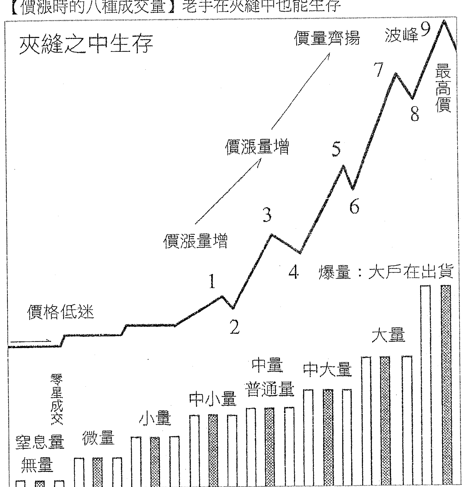

八種成交量由小到大分別是：「無量」（零星成交，只有 1 或 2 張，或者是 0），也可能是股東自己的左右手的買賣；「微量」是不到 10 張；「小量」是不到 100 張；「中小量」是不到 500 張；中量是 1000-2000 張；「中大量」是 2000-5000 張；「大量」是 5000-10000 張；「爆大量」是平日平均量的 5-10 倍，也可能多達十萬張；這還要依個股的資本額的大小論定的。

## 【價跌時的八種成交量】

股市賺的錢，是煎熬得來的。

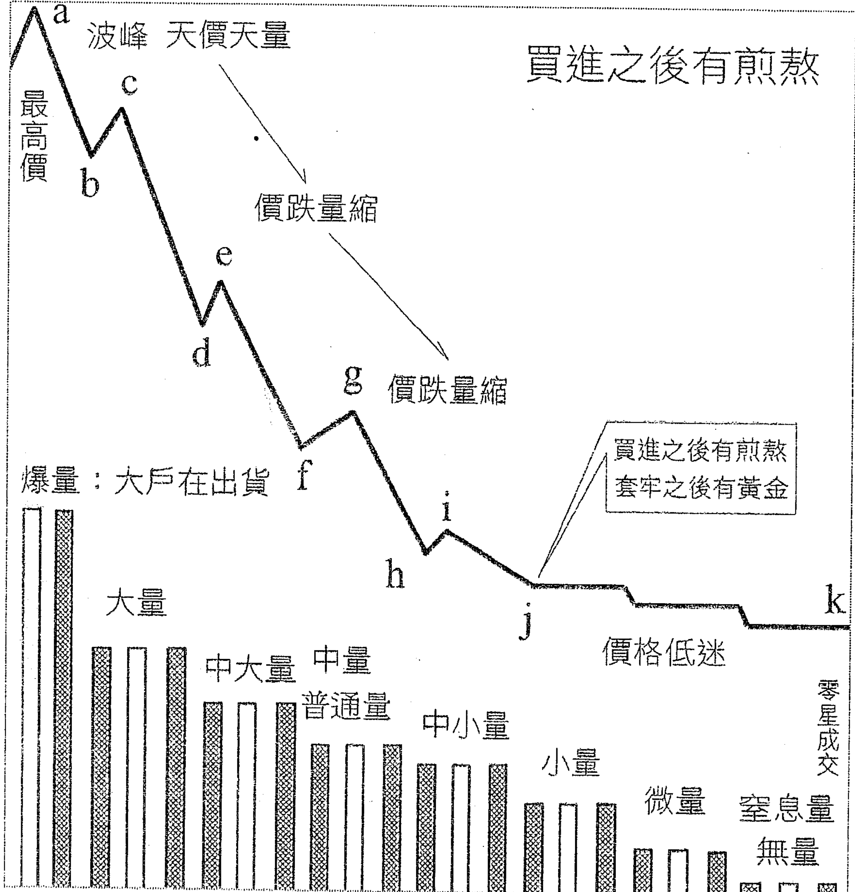

散戶投資人一定要謹記在心的是，當價格高，市場爆大量，High 到最高點時，最樂觀的時候，一定要把股票出清，剛好賣在最高點；平常的波段操作則是「量大時賣出，量小時補回」；依照成交量的大小操作，都是賺錢的。小型股的籌碼容易操作，大型股大多籌碼分散，漲幅有限；市場上的作手也是撿低價的小型股操作——以投機獲利的。

## 拜金女塔特雅娜

賺錢的密碼在移動平均線，可惜世上有很多人不懂得這個切入點，而想一些歪點子要謀財，結果是自誤誤人；看來，她們應該讀讀《移動平均線密碼》！

英國《獨立報》2004 年七月 14 日報導，自稱「拜金女」的卅三歲德國名媛塔特雅娜·葛塞爾 2004 年六月十三日在法庭上坦承她雇用偷車賊——偷自己的車詐領保險金，以倒貼新男友，沒想到偷車賊，竟然砍死自己的老公。

這宗發生在 2003 年一月的謀殺案轟動一整個德國，主嫌塔特雅娜是德國最知名的「人工美女」，全身上下動過廿多次整形手術，替她動刀的正是她親夫——76 歲的整形醫師葛塞爾，也是本案被害人。

常在德國報紙、雜誌與電視節目露面的塔特雅娜在紐倫堡法院首度出庭時表示，她一手策畫偷車案詐領保險金，因為她從事二手車買賣的新男友貝克財務吃緊，已欠債十萬歐元。她說：「我對丈夫死亡感到遺憾。我策畫這起詐領保險金案，因為我財務狀況吃緊。」

2003 年十一月五日時，葛塞爾獨自待在紐倫堡別墅時遭兩名搶匪用斧頭砍傷，在医院躺了三個月不治去世，案發時塔特雅娜正和六十一歲的男友貝克在西班牙馬貝雅度假。檢方原本以爲塔特雅娜謀害親夫想繼承遺產，後來才發現是一宗曲折的詐騙保險金案。警方已證實塔特雅娜並未殺夫，砍死葛塞爾醫師的兩名兇手將在 2004 年稍後受審。

此案讓德國八卦小報爲之瘋狂，除了案情離奇，更因爲被害人是德國知名整形醫師，而主嫌塔特雅娜除了整形廿多次，還是名滿德國的「拜金女」。她在媒體上到處吹噓，表示擁有十三件貂皮大衣、五百雙名牌鞋，每個月光是家中雜支就要五萬歐元，還在蒙地卡羅、馬貝雅及巴拉圭擁有別墅豪宅。媒體調查，發現這些說詞多半是吹牛。

檢方原本懷疑她謀害親夫想繼承兩千四百萬歐元遺產，後來發現葛塞爾醫師財產只有五百萬歐元。

塔特雅娜對法官說，她財務拮据，信用卡又彼丈夫沒收，才會想出詐騙保險金的下策。她雇用一名羅馬尼亞籍偷車賊竊取停放在紐倫堡自宅的賓士五百轎車，打算向保險公司詐騙失竊理賠金。沒想到偷車賊卻和她丈夫發生衝突動手行兇，使詐騙案變成謀殺案。

塔特雅娜是否供出全部案情有待進一步調查，因爲檢方發現葛塞爾醫師似也共謀詐騙保險金，電話通聯紀錄顯示他在喪命前打了多通電話給車商，表示要爲妻子買部新車。

涉案的還有一位卅三歲檢察官，他是塔特雅娜的前男友，據說他協助策畫詐騙計畫，但他矢口否認。這起案件 2004/6/13 首度開庭。

## 麥克.貝利 2-2-2 選股法則

如果有正確的選股手法，就應該遵守紀律，守而勿失。《列子》書上有一則寓言——

列子學習射箭，練到經常中靶的程度。就去向關尹子求教。

關尹子問說：「你明白你能夠經常見中的原因嗎？」

列子答說：「不明白。」

關尹子說：「那還不行。」

列子回去，又練了三年；再去求教於關尹子；關尹子又問：「明白射中的原因嗎？」

列子說：「明白了。」

關尹子說：「可以了；但要記得『守而勿失』。」

《列子》這本書又評論說：舉凡國家的存亡，或是個人賢愚不肖，也都同樣的道理。

麥克.貝利（Michael Berry）是亞利桑那大學數量分析博士（PhD in quantitative analysis from Arizona State University），曾任教於維吉尼亞大學（the University of Virginia，at the Darden School of Business），在 1980 年代曾與投資大師戴維.卓曼（David Dreman）一起研究財務行為學（behavioral finance），並管理卓曼小型價值股基金，也曾任職位於威斯康辛州密爾瓦基市的核心地基金公司（Heartland Advisors），負責中型價值股的投資組合，核心地基金公司美國具代表性的價值投資基金之一。

長久以來，價值型投資及成長型投資方式，孰優孰劣的爭論一直沒有論斷，核心地基金公司舉出一些實證，證明價值型投資的績效優於成長型投資，如自 1982 年至 1997 年的 15 年間，美國成長型基金平均報酬率為 13.6%，而價值型基金的平均報酬率為 14.6%。

麥克.貝利也研究自 1937 年至 1997 年的 60 年間，不管市場多空，低本益比的股票平均表現都比高本益比的股票優異，因此，麥克.貝利認為長期而言，成長型投資是輸家，他也奉勸投資人勿以追求成長股為目標（There is no reason for an investor to go growth），麥克.貝利發展出一種簡易的選股標準，稱為「2-2-2」法則。

麥克.貝利的選股標準，基本上以挑選價值股的規則，加上一小部份成長性的考慮。麥克.貝利（Michael BERRY）投資操盤的重點在於——

1. 個股本益比必須在大盤本益比平均值的二分之一以下。
2. 公司盈餘成長率必須是市場平均水準的兩倍以上。
3. 股價對帳面值價比必須小於 2。
4. 公司預估本益比≤大盤平均預估本益比÷2
5. 公司預估盈餘成長率≥市場平均預估盈餘成長率x2
6. 最近期股價帳面價值比≤2

如果以上三項條件都符合，則該個股是價值型投資適合買進的標的。

## 移動平均線的類型

————沒聽說過的公司股不買，不知道公司產品的也不買

> Hatred is by far the longest pleasure; men love in haste, but they detest at leisure. ----- Lord Byron
> 憎恨顯然是最持久的快樂；男人在倉促中談愛，在悠閒中生厭。————拜倫 (1788-1824)

投資不是賭博，而是一種經濟行爲，只要努力就會有收穫，這是日本股神是川銀藏先生說的話。

交易人因爲持股時間的長短，可以分成幾種————

- 「當日沖銷交易人」（day trader）：當天或幾天之內進出。
- 波段交易人（Swing trader）：在幾個星期或幾個月內進出。
- 「數十年交易人」（decades trader）：像是巴菲特的那種持股數年或數十年之久的投資人。

### 依時間長短的分類

短天期的移動平均線，可以分成：5 日移動平均線、10 日移動平均線、12 日移動平均線。

中天期移動平均線，可以分成：
1. 20 或 24 日移動平均線：月線，也被看成是技術線的多空指標，相當的被技術分析師們所重視。
2. 30 日移動平均線；
3. 60 日移動平均線：「景氣線」或是俗稱為「生命線」。

長天期移動平均線，可以分成：
1. 120 日移動平均線：半年線；
2. 240 日移動平均線：年線

### 依時間功能的分類

#### 日線

如前一節所述的三種移動平均線：短天期的移動平均線、中天期移動平均線、長天期移動平均線。

#### 週線

- 6 週移動平均線
- 13 週移動平均線
- 26 週移動平均線
- 52 週移動平均線
- 75 週移動平均線
- 104 週移動平均線
- 208 週移動平均線

就華爾街股市的經驗來看，股市的長期走勢可以參考 10 週與 30 週的互動關係。當 10 週均線由上向下穿越 30 週線，而 30 週均線正處在下降的狀態時，代表主要趨勢向下的訊號。同樣的道理，在 10 週均線由下向上穿越 30 週均線時，而 30 週均線正處在上升的狀態時，這是代表主要趨勢向上的訊號。

如果 10 週均線向上穿越下降中的 30 週均線，或是 10 週均線向下穿越上升中的 30 週均線，都不能算是有效的訊號。

# 月線

- 6 月移動平均線
- 12 月移動平均線
- 24 月移動平均線
- 72 月移動平均線
- 120 月移動平均線
- 132 月移動平均線

# 年線

年線分別有：1 年移動平均線、2 年移動平均線、6 年移動平均線、10 年移動平均線、11 年移動平均線、

# 中國到底有多大？

在 2004 年四月博鰲亞洲論壇上，中國大陸的改革開放論壇理事長鄭必堅在演講中，以數學上的乘除加減，討論中國的和平崛起。他說：

> 乘法題是：無論看似多麼小的因而可以忽略的經濟和社會發展難點，只要乘以 13～15 億總人口，那就成了一個大規模的、甚至可能是超大規模的問題。除法題是：無論絕對總量多麼可觀的財力、物力只要除以 13～15 億總人口，那就不僅不會是多麼大的，而且會是相當低的，甚至很低很低的人均水準了。加法題是：如果亞太經濟加上 13 億人口這樣的大市場且迅速增長的中國經濟，將產生多麼巨大的增長潛力。減法題是：如果亞太市場減去這個 13 億人口的中國市場，將出現多麼巨大的市場真空。

看來中國的動能倒是真的巨大無比的，說她是巨龍是很貼切的。

# 【移動平均線的類型】典型的金湯匙價漲量增型態

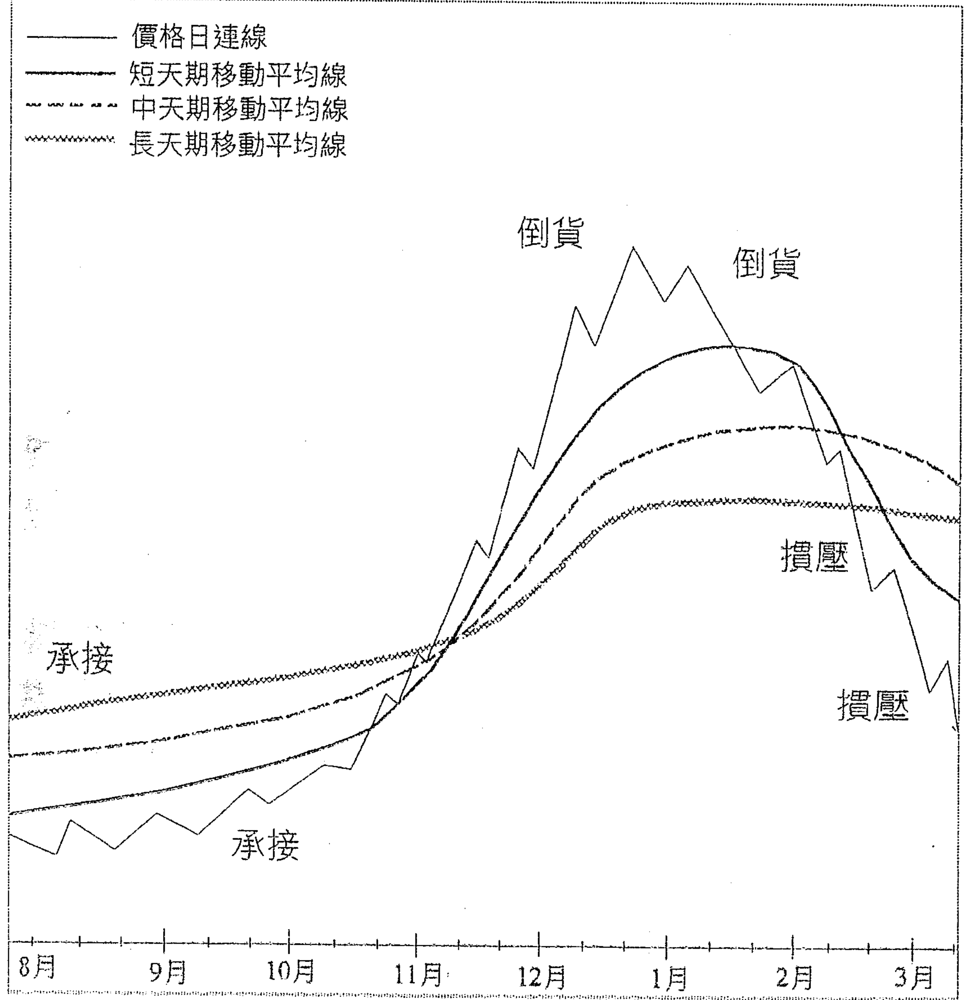

堅持大盤低點時入市，也不進進出出。大夕在低迷時承接進貨，高點時出貨倒貨，價格崩跌時再損壓，以讓散戶吐出持股。

> After forty, men have married their habits, and wives are only an item in the list, and not the most important. ------ George Meredith

四十歲以後，男人就和習慣結了婚，妻子只是其中一項，而且不是最重要的一項。——梅瑞迪斯（1828-1909）

# 掌握最佳甜蜜點

老手的字典之中沒有「追」，只有「等」

> Strange to say, what delight we married people have to see these poor fools decoyed into our condition. ------- Samuel Pepys

說來奇怪，我們已婚的人，看到可憐的傻子被引誘陷入我們的情況時，會有幸災樂禍的感覺。——山繆爾·佩皮斯（Samuel Pepys 1633-1703）

有打球經驗的朋友都知道，最佳甜蜜點（Sweet point）就是用最少的力氣，而發揮最大的威力；那麼，投資的甜蜜點又在哪裡呢？通常它就在基本面或技術面的轉折處。像是基本面上的本業重大突破，或是轉投資的大獲全勝。在技術面上，則是像島狀反轉，或是突破趨勢線，或是打底完成的站上頸線。

經驗老到的專家認為，相對於甜蜜點，也有所謂的「死亡線」（dead line）；一旦價格碰到了死亡線，就要立即停損的。只有掌握最佳甜蜜點，並且能避開死亡線的人，才是真正的大贏家。

尋找買低賣高的「最佳甜蜜點」。股市界常言：股市總是在悲觀時落底，在半信半疑中上漲，在最樂觀時崩盤——

曾經建會公布的景氣對策訊號在九分到二十三分，就是「否極泰未來」的時期，通常是台股投資的最佳甜蜜點。景氣對策訊號總計有五種。中長期投資人只要掌握「買藍賣紅」，就等於掌握了買低賣高的大原則。

- M1b 年增長率大於 M2 高於十個百分點：股市過熱

從貨幣缺口判斷回撤「買藍賣紅」原則，可提供長期投資人的進出點參考。當 M1b 年增長率大於 M2 時，代表定存資金大量轉入活存，股市資金動能澎湃，有利多頭；然而，如果 M1b 年增長率大於 M2 高於十個百分點，卻又是股市過熱的重要跡象；這時大戶獲利了結的賣壓也將湧現，股市回撤風險相當高。

- 掌握超級多頭行情

掌握超級多頭行情時機在判斷股市趨勢上，從葛蘭碧(J. Granville)移動平均線八大法則。當五條平均線，即年線、半年線、季線、月線與 5 日線全部交叉向上，這種趨勢將進一步帶來可觀的錢潮，此時股市將有超級多頭行情出現。相對的，如果該五條均線交叉向下，又是代表崩盤行情的一觸即發。

- 居高思危，進行出脫的拔檔

用 M1b 這個衡量股市資金動能，藉以判斷大多頭與大空頭：通常是當 M1b 年增長率如果超過 20%，將迫使央行祭出緊縮銀根動作，難免影響市場信心，因此 M1b 年增長率超過 20%時，短、中線的投資人最好居高思危，進行出脫拔檔。

成功的老手的字典之中沒有「追」，只有「等」；投資其實很簡單，挑好的股票之後，一直等到股價便宜之後進去買就對了；然後就是等它上漲而已！

# 多頭排列：火速進場買進

【圖：多頭排列】

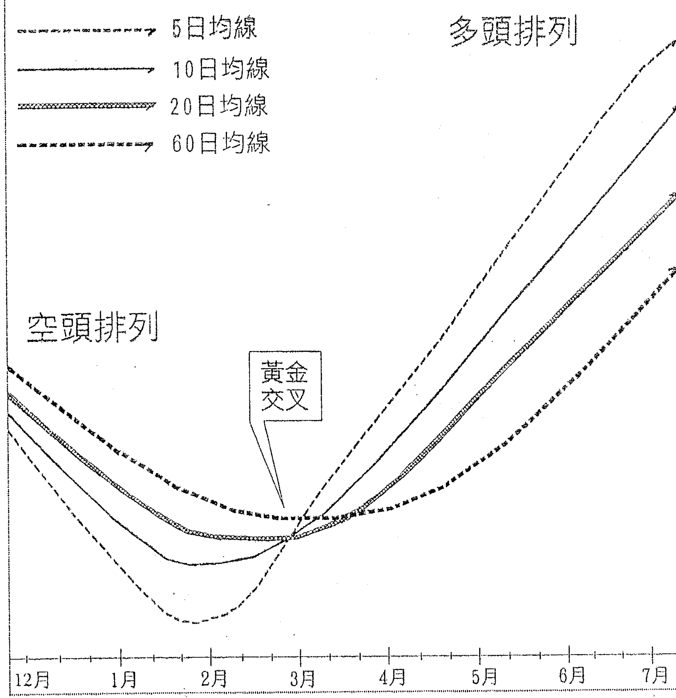

在多頭排列之時，要站在買方，長線保護短線，順勢操作。

人生最重要的事，就是要遠大的目標；同時要有達成目標的能力與體力。————歌德（德 Johann Wolfgang von Goethe）

當 5 日、10 日、20 日、60 日、120 日、240 日等平均線，由上而下按照次序排列時，稱爲「多頭排列」，是買進的時機。

當長天期平均線向上移動時，就表示目前投資是處於上漲趨勢（Trend），是一個多頭的行情。這時，即使是短天期平均線向下移動，可能也只是短暫的回檔罷了！基本上，股價上漲的趨勢（Trend）並沒有改變。

「多頭排列」是融資買進的最佳時機，這時是順勢操作。

但是，如果股價與短天期平均線，相繼都跌到中長期平均線的下方，而且長天期平均線也有反轉向下的跡象，那麼，這時的盤勢可能會跟著反轉向下！

# 大空頭與大多頭

當 60 日季線（俗稱生命線）滑落 240 日年線時，就是大空頭市場（bear market 熊市）的來臨，股市會有一段大跌的日子。相反的，如果 60 日季線（俗稱生命線）向上穿越 240 日年線時，又是大多頭市場（Bull Market 牛市）的來臨，股市會有一段上漲的日子。

一般說，如果遇到大多頭或是大空頭來臨時，放空與做多的投資人都會大膽的做上一段，先賺一筆再說。

# 空頭排列：火速賣出離場

【圖：空頭排列】

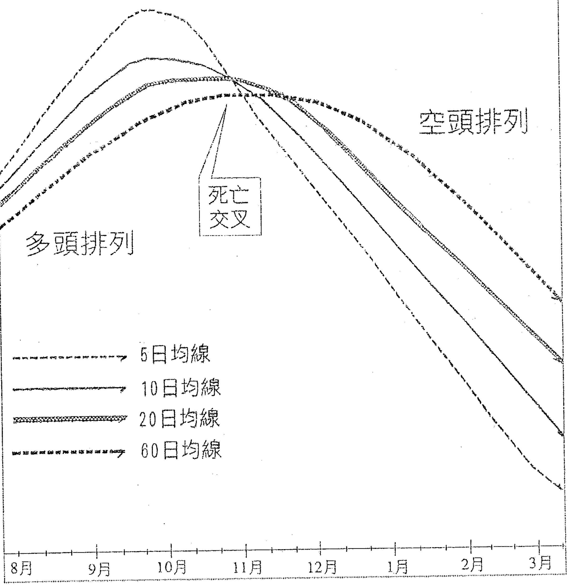

在空頭排列之時，要站在空方，長線保護短線，順勢操作。

> If a man could have half his wishes, he would double his troubles. ----- Benjamin Franklin

假如男人的一半的願望可以如願，那麼他的煩惱就會加倍。——富蘭克林

當 5 日、10 日、20 日、60 日、120 日、240 日等平均線，由下而上的按照次序排列時，稱為「空頭排列」，是賣出的時機。

當長天期平均線向下移動時，就表示目前投資是處於下跌趨勢，是一個空頭的行情。這時，即使是短天期平均線向上移動，可能也只是短暫的反彈罷了！基本上，股價下跌的趨勢（Trend）並沒有改變。

「空頭排列」是融券放空的最佳時機，這時是順勢操作；股市中的名言說：做多與放空，都能賺到錢；只有做錯方向的人會虧本。

但是，如果股價與短天期平均線，雙雙重回中長期中期平均線的上方，而且長天期平均線也有反轉向 上的跡象，那麼，這時的盤勢可能會跟著反轉向上！

# 混沌不明的盤整排列

當股市的 5 日線與 20 日線，或是 10 日線與 30 日線糾纏在一起的時候，這是屬於一種橫向整理的時候，多空的意向不明，這時運用移動平均的這種順勢交易系統，就顯得訊號錯亂反覆，雖然時常買進賣出，卻而難以獲利。

> Let men tremble to win the hand of a woman; unless they win along with it the utmmost passion of her heart. ------- Nathaniel Hawthorne

男人如果僅僅獲得了女人結婚的許諾，會緊張不安的；除非他同時贏得了女人的芳心。——霍桑（1804-1864）

# 市場先生

- 1. 市場僕人 市場先生是你的僕人，而不是你的嚮導。
- 2. 市場與上帝 交易市場就像上帝一般，幫助那些自助者。但是和上帝不同的是，交易市場不會原諒那些不知道自己在做什麼的人。
- 3. 參考值 如果任何一個人準備去做任何一件蠢事的時候，股市在那裡，僅僅是作一個參考值而存在。當我們投資於股票的時候，我們也是投資於商業。
- 4. 股市不存在 對我來說，股市是不存在的。要說其存在，那也只是一個讓某些人出醜的地方。
- 5. 替死鬼 如果你不能確定你遠比「市場先生」更加瞭解你的公司並能夠正確估價，那麼你就不能參加遊戲。就像他們在紙牌遊戲中說的那樣，「如果你不能玩上 30 分鐘，而且不知道誰是替死鬼，那麼你就是替死鬼。」
- 6. 不指望市場 我從未指望在股市中賺錢。我會設想股市在隔天關閉而在 5 年後開市。
- 7. 有效市場 相信有效市場投資就好比在打橋牌時認為不需看牌一樣……如果市場總是有效率的，我將會流落街頭，沿街乞討。

# 投資與投機

- 1. 本質與現象 如果你是投資者，你會考慮你的資產——即你的企業——將會怎樣。如果你是一個投機者，你主要預測價格會怎樣而不關心企業。
- 2. 價值投資多餘 我們認為那個術語『價值投資』是多餘的。如果『投資』不是尋找至少足以證明投入的資金是正確的有價值的行爲，那什麼麼才算『投資』呢？有意識地爲一檔股票計算價值並希望它馬上可以按更高的價格賣出——應當被列爲投機。
- 3. 投資更容易 我一直覺得受基本原理的支配來估算權重，要比受心理學的支配來估算投票容易得多。
- 4. 遊戲籌碼 許多基金經理不把注意力放在上市公司未來幾年的業務發展上，他們關注的是其他基金經理在未來幾天內幹什麼。對他們來說，股票僅僅是遊戲中的籌碼，就像強手遊戲中的幾個棋子。
- 5. 致命危險 衍生合約的想像空間，和人類的想像力一樣無邊無際，或者有時可以這麼說，和瘋子的想像力一樣沒有邊際。這些金融衍生產品是金融領域的大規模殺傷性武器，隱藏著致命的危險。
- 6. 荒島交易 我總是在想，假使一條乘著 25 個經紀人的船出了事，他們掙扎著游到一個荒島上，沒有獲救的希望。爲了儘量過得好點，他們開始發展經濟。我想，他們會不會分出 20 個人來生產食物、衣服、住房等，而另 5 個人坐那兒永遠無止境地對那 20 人還沒生產出來的產品進行交易呢？
- 7. 內部消息 有了足夠的內部消息，再加上 100 萬美元，你可能會在一年內破產。
- 8. 危險時分 華爾街會把任何東西賣給投資者；當投機看起來輕易可得時，它是最危險的。

# 移動平均線的收斂

股市賺的錢，是煎熬得來的

在遙遠的地方，太陽的光輝使我最為嚮往，即使我不能到那裡去；但是，我相信當我舉目眺望那種美景之時，我也能夠朝那個光芒萬丈的方向進行。——羅莎.美夷.渥爾庫特（美）

一般說，在激烈的價格走勢發生以前，經常會有一段逐漸趨於狹幅的交易區間。這種價格波動的減緩，代表的是買賣雙方的力量呈現著一種緊張的平衡。一旦這種緊張的平衡被打破，價格就會因為先前蓄積的動能（momentum），而展開大幅的走勢。市場老手獲利的關鍵，就是找出「移動平均線的收斂」的線形來！

動能（momentum）是由市場大戶的買進所致；當外資、自營商、投信基金、市場派作手、董監事等大戶——持續的蒐集籌碼，加碼買進之時，動能就會不斷的累積，最後是像火山一般的噴發。相對的，如果像是散戶一般的螞蟻雄兵、衝鋒陷陣，那好光景是不會長久的，很快的就會崩盤掛了的。

類似以上的這種情況反映在移動平均線上時，呈現的是數條均線逐漸的「收斂」或是「交匯」在一起。均線的收斂暗示市場在這之後，可能發生重大的走勢。

# MA 低檔交匯

當多條移動平均線 MA，例如 5 日、10 日、20 日、60 日、120 日的移動平均線，在低檔交匯、或是密集在一起，而且都是向上揚升；那麼股價可能隨時會變盤暴升。

尤其是當股價以「長紅 K 線」突破多條交匯的移動平均線時，可以看成是買進的訊號。

# MA 高檔交匯

相對的，如果多條移動平均線 MA，例如 5 日、10 日、20 日、60 日、120 日的移動平均線，在高檔區交匯、或是密集在一起，而且都是向下滑落時；那麼股價可能隨時會變盤向下崩盤爆跌！

尤其是當市場價格以「長黑 K 線」滑落多條交匯的移動平均線時，可以看成是獲利了結的賣出的訊號；或是空頭放空的進場時刻。

# 婚姻是男人最適合的狀態？

> Marriage is the best state for man in general ; and every man is a worse man, in proportion as he is unfit for the married state. -----Samuel Johnson

一般來說，婚姻是男人最適合的狀態，而其差勁的為人，和他們對婚姻的不適程度是成正比的。——山繆爾.強生（1709-1784）

# 黃金交叉與死亡交叉
Golden Cross & Dead Cross

即使斷了一條弦，其餘的三條弦，還是要繼續的演奏的；這就是人生。——艾默生（美 Ralph Waldo Emerson）

曾任英國首相多年的伯麥斯頓在議會講過的經典名言：「我們沒有永遠的盟友，我們沒有永遠的敵人，永恆不變的只有我們的利益。」

法國總統戴高樂（Charles De Gaulle）說過：「名副其實的國家、沒有朋友，只有利益。」

在證券市場上到處是散播「假內線，真坑殺」的人，投資人沒有朋友，只有利益！相信移動不均線，千萬別信什麼內線！印證產品與服務，別只看財務報表。

移動平均線的穿越中，最著名的是「黃金交叉」與「死亡交叉」；其它的糾結纏繞，通常只是被看成是橫向整理，不對買賣出發出訊號。

## 黃金交叉（Golden Cross）

在「移動平均線」的應用上，還有同時使用兩條不同天均線作爲研判工具的理論。當短天期的均線由下往上穿越長天期的均線時，稱為「黃金交叉」（Golden Cross），尤其是兩均線都呈向上揚的走勢，這是確立漲升波段的開始，股價續漲的可能性大增，很多人主張這是買進的良機。

我們可以幽默的說，在「黃金交叉」之後買進持股，可能會撿到一筆黃金財富的！

【圖：黃金交叉與死亡交叉】

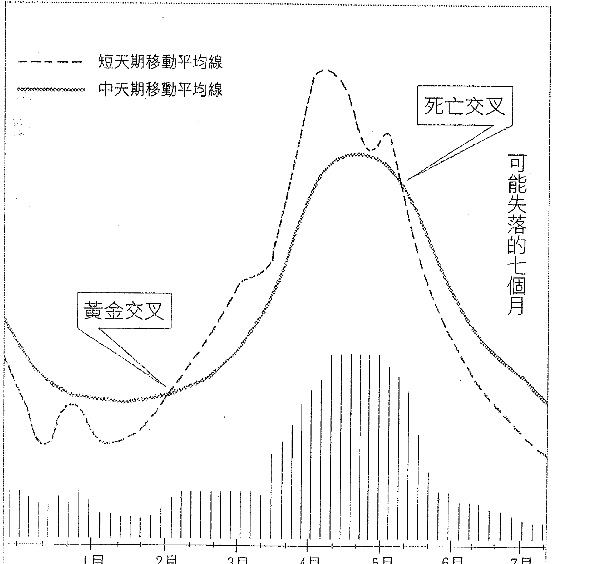

# 死亡交叉（Dead Cross）

………………………………可能失落的七個月，你能熬得過去嗎？

當短天期的均線由上往下穿越長天期的均線時，尤其是兩均線都呈向下滑落的走勢時，稱為「死亡交叉」（Dead Cross），這是表示將會展開一段跌勢，股價續跌的可能性大增，很多人主張這是賣出的時機。

黃金交叉與死亡交叉的使用，會因為均線天期的不同而有不同的含義。一般說，愈長天期的均線所形成的黃金交叉或是死亡交叉，它的影響的時間愈長。例如，半年線與年線如果形成黃金交叉，基本上是表示空頭市場的結束：未來數年內，或者有股價有機會呈倍數的漲幅。如果只是 5 日、10 日的平均線所形成的黃金交叉，那麼股價可能只有一成到兩成的漲幅。

哈伯（H. H. Harper）在 1926 年寫了一本非常傑出的書《投機哲學》（The Psychology of Speculation）。哈伯將這種需要不斷察看價格的現象，稱為「價格跳動病」（Tickeritis）。他認為：

> 價格跳動病的患者，就好像是陷入昏迷的傷寒病患一樣，他們無法採取理性而鎮定的行為！

其實很多的投資人都有過度交易的毛病在。如果投資人依照黃金交叉與死亡交叉進行交易，就能避免這樣的「價格跳動病」！

「外交，就是用最優雅的辭令說出最骯髒的事情。」這是美國著名作家戈登堡在 1930 年代說過的話。股市投資也是這樣子，那些贊勸一般人進場的搳客，都只說好的一面，刻意的忽視「死亡交叉」的坑殺散戶。

# 投資怎麼會失利？

失敗的投資人總是一錯再錯，不知悔改；即使是輸到身無分文時，也不能進行自我的省思。相對的，成功致富者的座右銘是：從失敗之中吸取經驗；用正面的態度去面對失利，再捲土重來。

套牢之後，是相當的煎熬，你得面對可能失落的七個月。

# 等待轉機，逢低進場布局

股市達人孫叔熬操作股票，要熬，但比法人還要高明，他們堅持採取「危機入市」策略，例如——

- 當日本失落的 10 年，股價下跌，在認定日本企業股票本益比更合理時，就進場去買。
- 當美國次貸風暴危機時，老手判斷約一年半全球海嘯衝擊就會見底；因此，2009 年 2、3 月全球股市仍在下跌時，孫叔熬不但不急於出脫股票，反而是冷靜的逢低加碼進場。到了金融海嘯隔年（2010）的 2、3 月，台灣經濟很可能就呈 V 型或小 U 型的反轉。

當然，也不會在每一次在買進之後，都馬上反轉向上的；很多達人也經歷那種冷凍庫的煎熬的。

股海不變的道理就在危機入市！冷灶進場。股市達人從不曾爲股市大跌而恐慌，或睡覺作惡夢、輾轉反側的難以成眠。

# 智慧領航家的航海地圖

股市達人孫叔熬，4-9-18 三重穿越法

> 神考驗眾人，有時是透過財富，有時利用貧窮。考驗富人是否對需要幫助的人伸出援手，考驗窮人則看他是否滿足、認命地承受所有的苦難。——猶太教法典 (The Talmud)

「三重穿越法」（triple crossover method），在期貨市場中非常的流行。常見的是 4-9-18 天的移動平均組合。

這一個觀念首先是由亞倫（R. C. Allen）在 1972 年的著作《如何在商品市場累積財富》（How to Build a Fortune in Commodities）中提出來的。亞倫稍後又在 1974 年的著作《如何運用 4 天 9 天 18 天移動平均在商品市場獲利》（How to Use the 4-day, 9-day, and 18-day Moving Average to Earn Profits from Commodities）進一步的延伸這一技巧。

在期貨市場中，許多商業圖形公司，都提供這組 4-9-18 天的移動平均；也有很多繪圖軟體把三重穿越法的預設值，指派為 4-9-18。

不過，筆者將這種 4-9-18 操作模式改良為 3-7-21 的方式，發現更為有效，獲利更佳。

# 【三重穿越法】

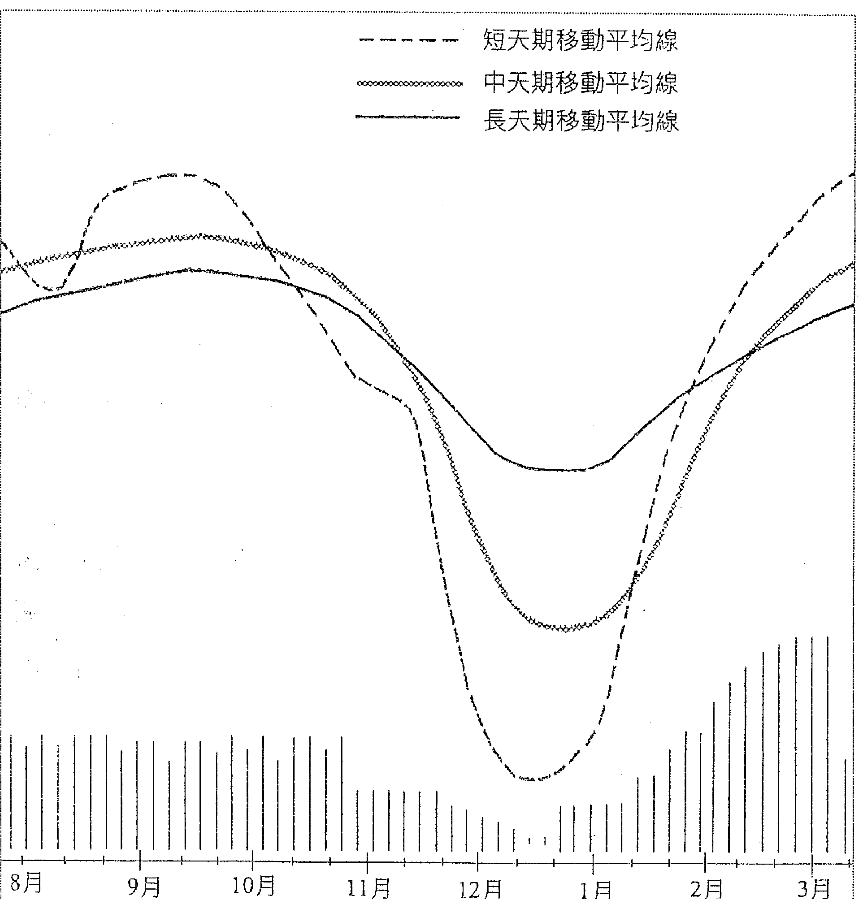

# 3-7-21 天移動平均的運用

愈短期的均線愈是敏感，它的位置愈是靠近價格的走勢。在這三條均線中，3 日均線最能夠反應價格的走勢，其次才是 7 日與 21 日均線。

在上升的趨勢中，這三條均線的排列順序是由下而上的，3 日線在最上，7 日居中，21 日均線在最下方朝上。在下降的趨勢（Trend）中，這三條均線的排列正好相反，3 日線在最下，7 日居中，21 日均線在最上方朝下。

在趨勢（Trend）反轉的時候，3 日均線向上穿越 7 日與 21 日線，這是買進的良機。在這之後的修正或整理期間，三條平均線的位置，可能會互有更動，但只要是上升的趨勢維持不變，是可以繼續持有多頭的部位。

當趨勢（Trend）反轉下降時，最敏感的 3 日線會向下穿越 7 日線與 21 日線，這是賣出的訊號。有些交易者在 3 日線穿越 7 日與 21 日線時，作為多頭平倉的部位。而在 7 日線穿越滑落 21 日線時才建立空頭的部位——俗稱「放空」。

## 持有三檔股票就很足夠的

查理·孟格（Charlie Munger）認為：「我覺得：我就像是玩撲克牌的人；只要手上的牌非常好，我就會大舉加碼。」他說：「如果能真正的掌握少數公司未來股價的可能走勢，其實持有三檔股票就很足夠的。因為能完全瞭解這少數的公司的狀況，就算短期股價波動也不會對我有心理上的影響。大家也都認為我最能克服股價波動的心理障礙，這也就是為什麼我堅信自己的投資操作方法。」

> Married men are horribly tedious when they are good husbands, and abominably conceited when they are not. ----- Oscar Wilde
> 已婚男人如果是好丈夫，就令人乏味得生厭；如果不是好丈夫，則又自負得可惡。——王爾德（1854-1900）

# 【三重穿越法】

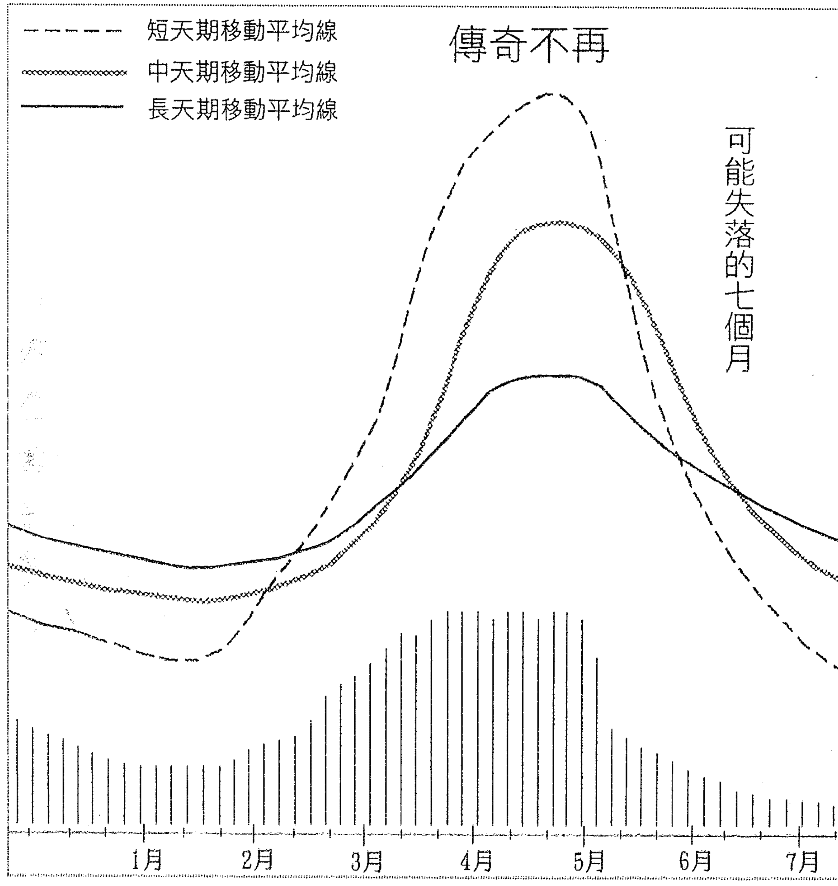

# 5-10-20 天移動平均的運用

4-9-18 天移動平均的運用之外，另一個常被運用的天數是「5-10-20 天移動平均的運用」。

雖然許多人包括華爾街人士，都密切注意巴菲特的一舉一動，但他自己卻謙遜地說：『我曾刻意地注意自己的「一舉一動」，不過實在是不怎麼樣。』

巴菲特曾說過一個故事：他的朋友在看到他的一次重大投資失誤後，問巴菲特說：「雖然你很富有，為什麼這麼笨呢？」

有人問巴菲特預計什麼時候要退休，他回答：「大約在我死後五到十年左右」。（Retirement date: About 5 to 10 years after I die.）

有人問巴菲特死後，其所投資的公司會有什麼影響，他回答：「可口可樂短期間的銷售量可能會爆增，因為我打算在陪葬的飛機裡塞滿可口可樂」。

對於波克夏唯一的奢侈品——個人專機，巴菲特說：「只要我一死，波克夏的帳面盈餘立刻可增加一百萬，因為查理·孟格無視於我希望與之同葬的心願，隔天一定馬上把飛機處理掉。」

巴菲特說：「有生之年我都會繼續經營波克夏，之後我可能會透過降神會來工作。」

巴菲特在 1985 年結束波克夏紡織部門營運時，又解釋道：

「一隻能數到十的馬，是一隻了不起的馬，卻不是了不起的數學家，同樣的一家能夠合理運用資金的紡織公司——是一家了不起的紡織公司，但卻不是什麼了不起的企業。」

(A horse that can count to ten is a remarkable horse - not a remarkable mathematician. Likewise, a textile company that allocates capital brilliantly within its industry is a remarkable textile company - but not a remarkable business.)

對於完全市場效率學說，巴菲特是完全不能認同的，他反而感謝那些相信這種鬼話的機構投資人，讓他能夠占盡便宜，他說：「我們實在欠提出這種理論的學者太多了，就好比當我們在參加橋牌、西洋棋或是選股等鬥智的競賽中，對手卻被教練告知思考是白費力氣的一件事。」

巴菲特說：「人們習慣把每天短線進出股市的投機客稱之為投資人，就好像大家把不斷發生一夜情的愛情騙子當成浪漫情人一樣。」

短期股市的預測是毒藥，應該要把他們擺在最安全的地方，遠離兒童，以及那些在股市中的行為——像小孩般幼稚的投資人。

(Short-term market forecasts are poison and should be kept locked up in a safe place, away from children and also from grown-ups who behave in the market like children. )

巴菲特說：「我想我不會投資黃金，因為我看不出將這種金屬從南非的地底挖出，再把它放到福克斯堡的金庫中有何意義。」

(that's dug up out of the ground in South Africa and put back in the ground at Fort Knox.)

在購併〈國際乳品公司〉時巴菲特說到：「我們把錢擺在吃得到的地方。」

(In making the acquisition of Dairy Queen, he said, We have put our money where our mouth is.)

在購併 General RE 公司後，賣掉其所持有獲利不菲價值四十六億美元的美國零息公債後，債券仍持續大漲時，巴菲特淡淡地表示：「我們投入的早，不過賣得更早了一點」。

(Unloaded highly profitable $4.6 billion zero coupon U.S. Treasury position this year, but the Treasury zeroes kept climbing in price. I got in early, and I got out early, he shrugs.)

有一回巴菲特在地上看到一毛錢，他彎下腰撿起這枚硬幣，當時所有在場的人都驚訝不已，只見他說：「這是另一個十億美元的開始。」

巴菲特反對股票分割配股，他甚至半開玩笑地在朋友的生日賀卡上寫到「祝你活到波克夏分割股票之時。」

(Berkshire's stock, which Buffett wouldn't dream of splitting-he sends birthday greetings to friends that say, May you live until Berkshire splits.)

有一位哥倫比亞大學的學生問到巴菲特關於投資美國航空的原因，他說：「對啊!我的心理醫生也問我相同的問題。」

在成功撮合首都公司與 ABC 合併後，巴菲特說：「我擔心恩師葛萊姆會從棺材裡爬出來為我這一投資計畫喝采。」

1950 年代巴菲特花了一百五十元去上卡內基課程，他說這麼做「不是為了讓我在演講時膝蓋不會發抖，而是要學會如何在膝蓋發抖時，還能繼續演講。」

有人質疑巴菲特的投資策略只是運氣好而已，他講了一個有關「機率」的故事回答它們：「一群豬共有 128000 隻，分別來自全世界各農場舉行丟銅板比賽，投出正面的晉級，投出反面的淘汰，經過九回合後，只剩下 250 隻豬晉級，有人認為那 250 隻豬——只是運氣好而已」

巴菲特接著又說：「如果你發現晉級的 250 隻豬，有 200 隻全是某農場來的，那你就必須問：那個農場喂豬的飼料有沒有特別之處。」

## 【多頭大嘴出行情】人人都是股神，大家都沒有賺頭

### 快牛市

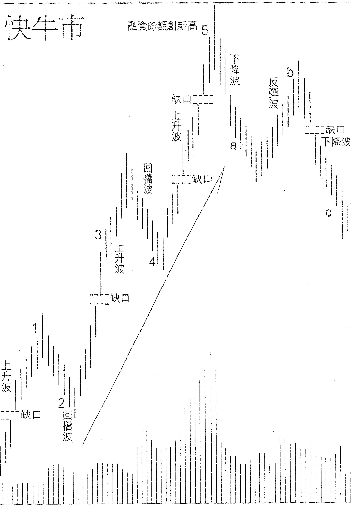

### 【高檔波動盤整】市場向上波動揚昇，或是下降走低？充滿挑戰

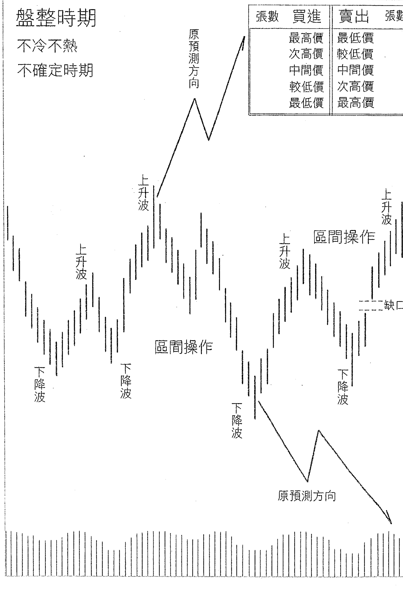

### 【熊市】股市可以分成：快牛市、慢牛市、小熊市、大熊市

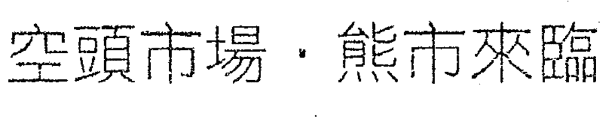

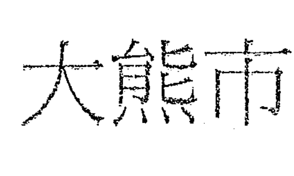

| 階段 | 描述 | 特徵/動作 |
| :--- | :--- | :--- |
| 大盤重挫200點 | 下降波 | 缺口、騙線一日行情 (a) |
| 反彈波 | 反彈 | (b) 政府護盤一張嘴 |
| 大盤重挫200點 | 下降波 | 缺口、騙線一日行情 (c) |
| 反彈波 | 反彈 | (d) 政府護盤一張嘴 |
| 大盤重挫200點 | 下降波 | 缺口 (e) |
| 第一隻腳 | 上升波 | 1. 回檔波、2. 上升波、3. |

### 【黑暗時期的低檔波動】

以前未遇的狀況，會不會更壞？

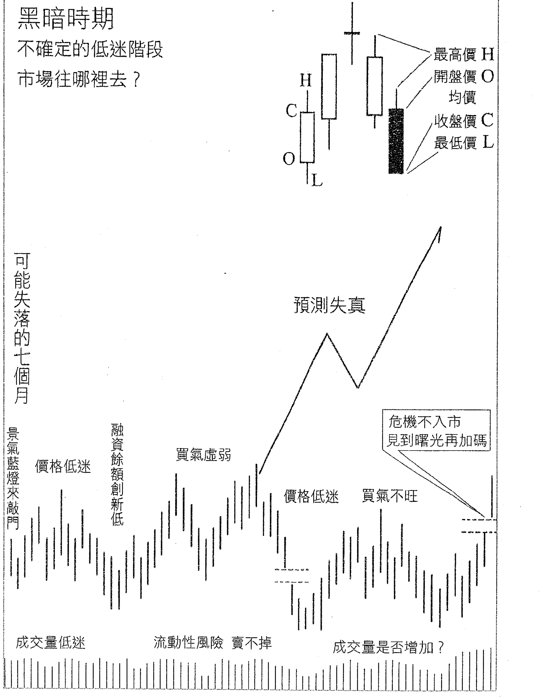

# 移動平均線與擺盪指標

股市達人孫叔熬，每週引頸企盼。

怒火像最快的馬車一樣的飛奔，懂得控制憤怒的人才是好車伕。其他人只知道拉住韁繩，他們沒有真正的力量。——法句經（Dhammapada）

ADL、ADR、OBOS、TAPI、OBV 等都具有「領先指標」的功能。但是移動平均線卻是個「落後指標」；它要在趨勢（Trend）反轉一陣子之後，才會發生訊號；所以說它是一種落後市場的行為。移動平均線是一個平滑化的工具；藉由數字的平均，產生平滑曲線，使讀者容易看見潛在的趨勢（Trend）。

## 移動平均線

移動平均線往往得和其它技術指標配合運用。這主要是因為價格走勢——往往會呈現長期的橫向走勢。在這種橫向的整理走勢中，移動平均線會持續的產生錯誤的穿越訊號。就以 1946-1949 年間的華爾街股市的空頭行情來說，就出現有許多錯誤的穿越訊號。

移動平均線基本上是屬於「順勢交易」的性質，因此特別適用於趨勢（Trend）明確的行情中。在橫向的波動市場中，移動平均線的表現很差。不過，橫向整理的市場大約是占市場交易時間的長達 1/3-1/2 長，這是不能讓人忽略的。

但在那十分令人沮喪的橫向盤整之後，籌碼交換到少數人手中，之後，通常會出現有新的明顯的走勢；而投資人在新一波走勢中的獲利，常常大於橫向整理中的交易損失。

## 擺盪指標（oscillator）

所謂的「擺盪指標」（oscillator）可以填補移動平均線這方面的不足。

在沒有明顯趨勢（Trend）的橫向市場中，價格在水準狀區間內擺動；這種市況非常的不適合順勢交易系統，卻非常的適合擺盪指標。「擺盪指標」的使用者能在這橫向市場中捕捉「低買高賣」的機會，並且進一步的獲利。

常見的「擺盪指標」有：相對強弱指標的 RSI、隨機指標的 KD 值、威廉氏%R 指標、MACD 發散指標等。

## 人們如何得到真正的智慧？

查理·孟格（Charlie Munger）透過全方位的分析模式，幫助投資人得到真正的智慧。

> 查理·孟格認為：「由於目前社會講究分工，反而將思想設限了；例如，商科教授在堂上絕對不會引述物理學學理，而物理教師也不會提到生物學；生物老師不會提到數學，數學課也不可能教心理學。所以我們應該打破『學科間的藩籬』，用全方位的思維，將各種學理統合起來。」

查理·孟格（Charlie Munger）又說：「人的思考是運用各種模式；我們如何比別人更有智慧，那就是要找出最基本有效的思考模式；因爲它可使我們考慮得更多元、更全方位。」「你只要掌握幾個重點觀念就好，不需要专精各種學科的。」

# 葛蘭碧進出 9 原則

第九法則，股市達人孫叔熬，要熬，熬熬待補就賺。

## 【長線型的葛蘭碧進出八大法】太陽既會升起，就會下山

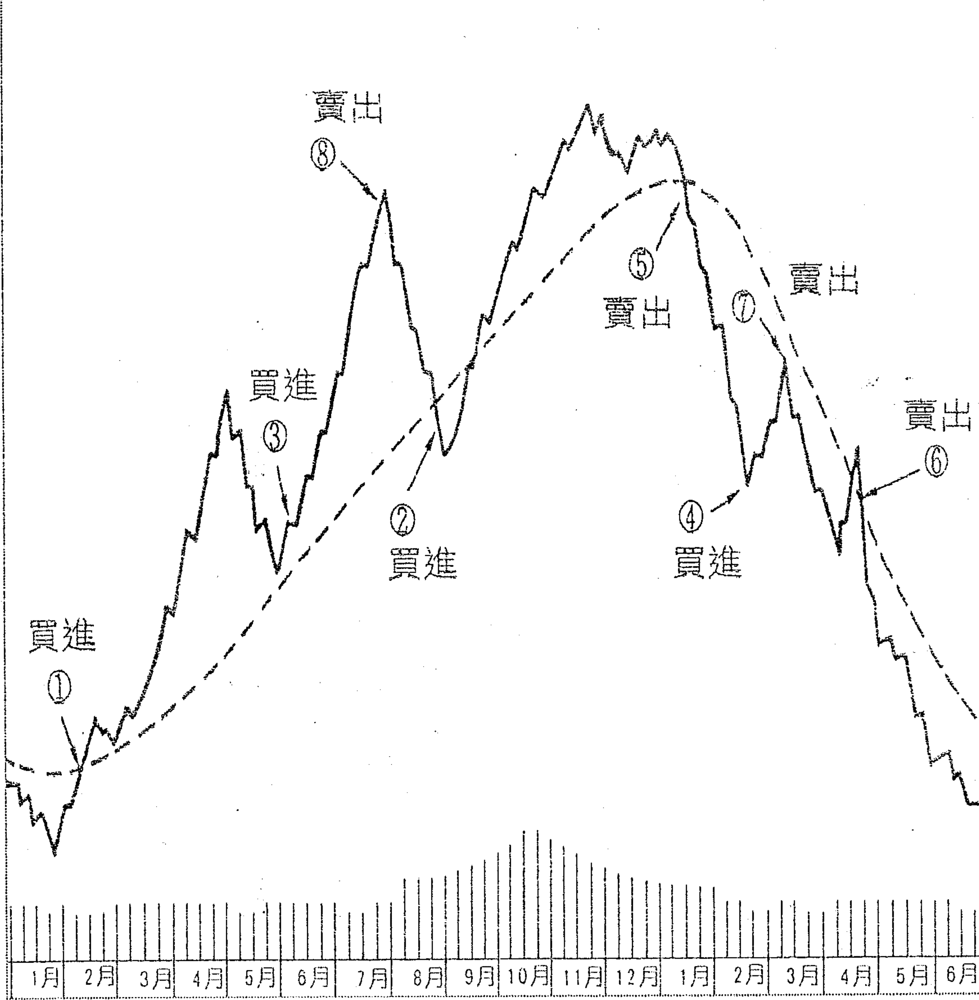

「移動平均線」(Moving Average)是由葛蘭碧(Granvile Joseph)在 1960 年提出的。它是把一定期間內的股價加以平均，常見的有 5 日、10 日、20 日、60 日、120 日、240 日的平均線。

「移動平均線」的形成，是根據當期的收盤價或收盤指數，和前 N 期（日、週、月）的收盤價，經過簡單的算術平均而來。

「移動平均線」具有一定的支撐或阻力作用，這是一項廣泛分析的工具。

### 進場買進的四個時機

- (1) 移動平均線從下降趨於平穩，而且股價從移動平均線的下方向上突破時，如附圖中的 1 處。
- (2) 股價處在移動平均線的上方，後來股價是下跌了；雖然滑落移動平均線，但很快的彈升到平均線的上方，而且這平均線還是呈現上揚的走勢。如圖中的 2。
- (3) 股價位於移動平均線的上方，而後股價下跌；但是未滑落移動平均線，就已反轉上升。如附圖中的 3。
- (4) 股價與移動平均線都處在劣勢，而股價處在移動平均線下，突然暴跌，一時距離移動平均線很遠，乖離過大時。如圖中的 4。

### 「放空」賣出四個時機

- (5) 移動平均線從上升趨於平穩，而且股價從移動平均線的上方向下突破時。如圖中的 5，這是賣出的最佳時機。
- (6) 股價在移動平均線的下方，而後股價上升，雖然突破移動平均線，但很快的又跌回移動平均線之下，而且移動平均線還是呈現下挫的走勢時，如圖中的 6，這時也是一個賣出的時機。
- (7) 股價在移動平均線的下方，後來股價上漲，但是並沒有突破移動平均線就已反轉下跌，如圖中的 7，這也是一個不錯的賣出時機。
- (8) 股價與移動平均線都是處在漲勢，而股價位在移動平均線的上方，突然暴漲，距離移動平均線很遠，乖離率過大時，如圖中的 8，也是個很好的賣出的時機。

## 【中期的葛蘭碧進出八大法】太陽既會昇起，就會下山

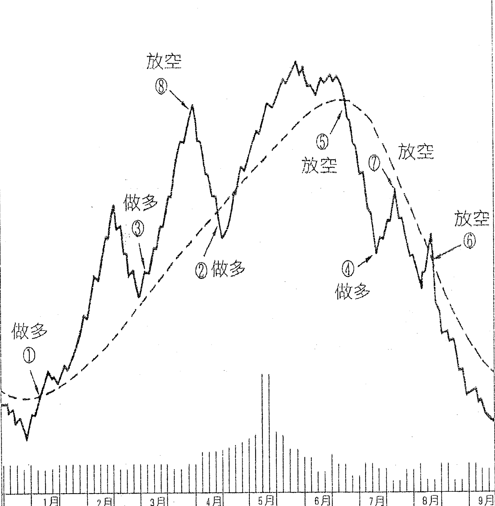

## 【短線的葛蘭碧八大法則的成交量】十分樂觀，爆量之後下跌

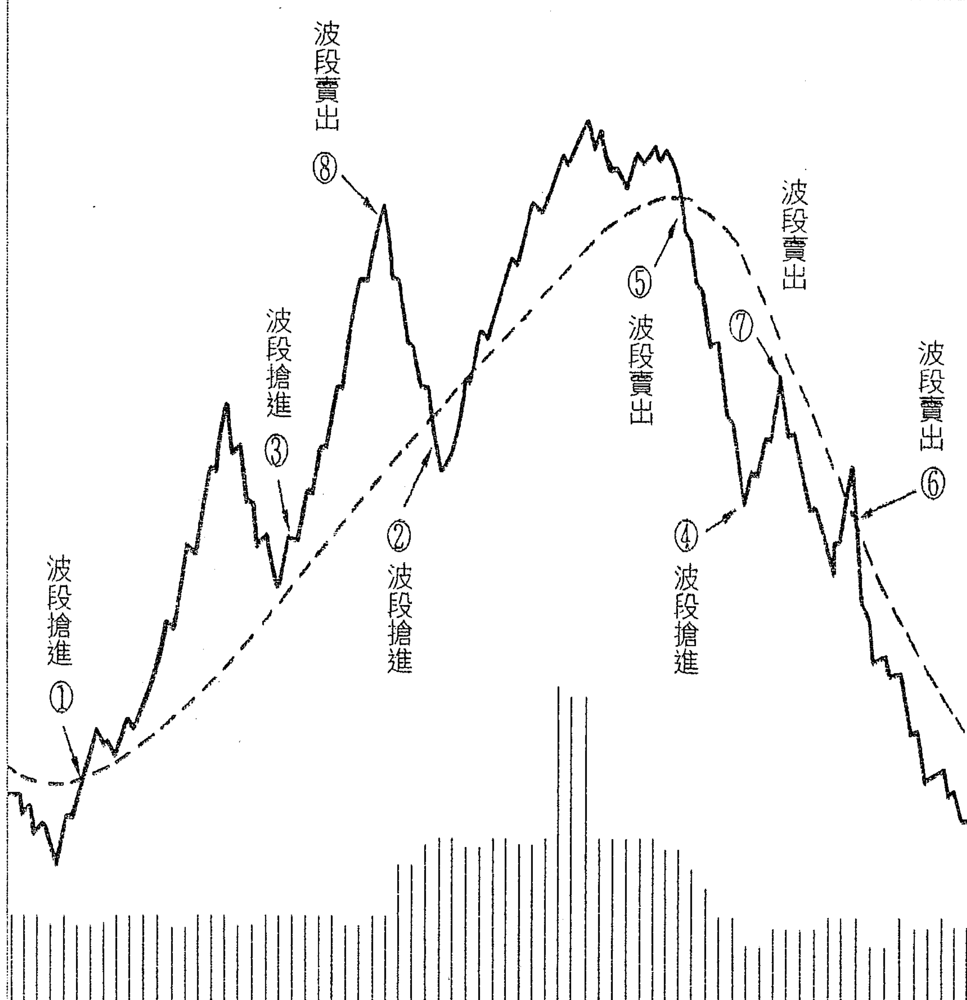

實際上，葛蘭碧的進出八原則，經過股市的實證結果，公認 1、2、5、6 等最實用。3、7 兩點在運用時風險較大。

> “What is the use of a book,” thought Alice, “without pictures or conversation?”-------Carroll, Alice’s Adventures in Wonderland
> 「一本既沒有圖畫，又沒有對話的書，有什麼用呢？」愛麗絲想著。——卡洛兒，《愛麗絲夢遊仙境》

## 【葛蘭碧八大法則的前半年】等了很久，太陽才昇起，看回不回

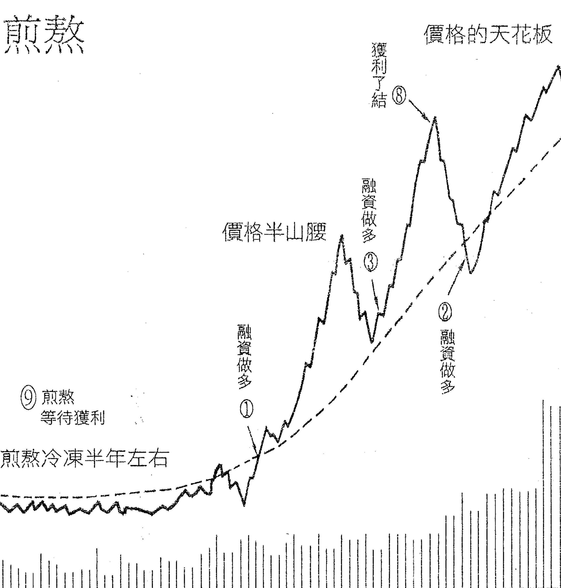

在低迷了半年之後，市場大盤慢慢有了起色；這是因为在本益比偏低時，大戶已經進場撿了便宜；籌碼漸漸的集中到少數造市者的手裡；他們正在伺機發動漲勢。做股票的散戶的能夠致富，中實戶的變大戶的關鍵就在這裡；你必須要有經驗與直覺，還要選對了股，有的股票休息整理半年還不夠的。第九招是煎熬成富翁，買進之後不可能第二天就上漲的，要熬才會有得的。

## 【葛蘭碧八大法則的後半年】太陽下山，利多不漲，利空頻傳

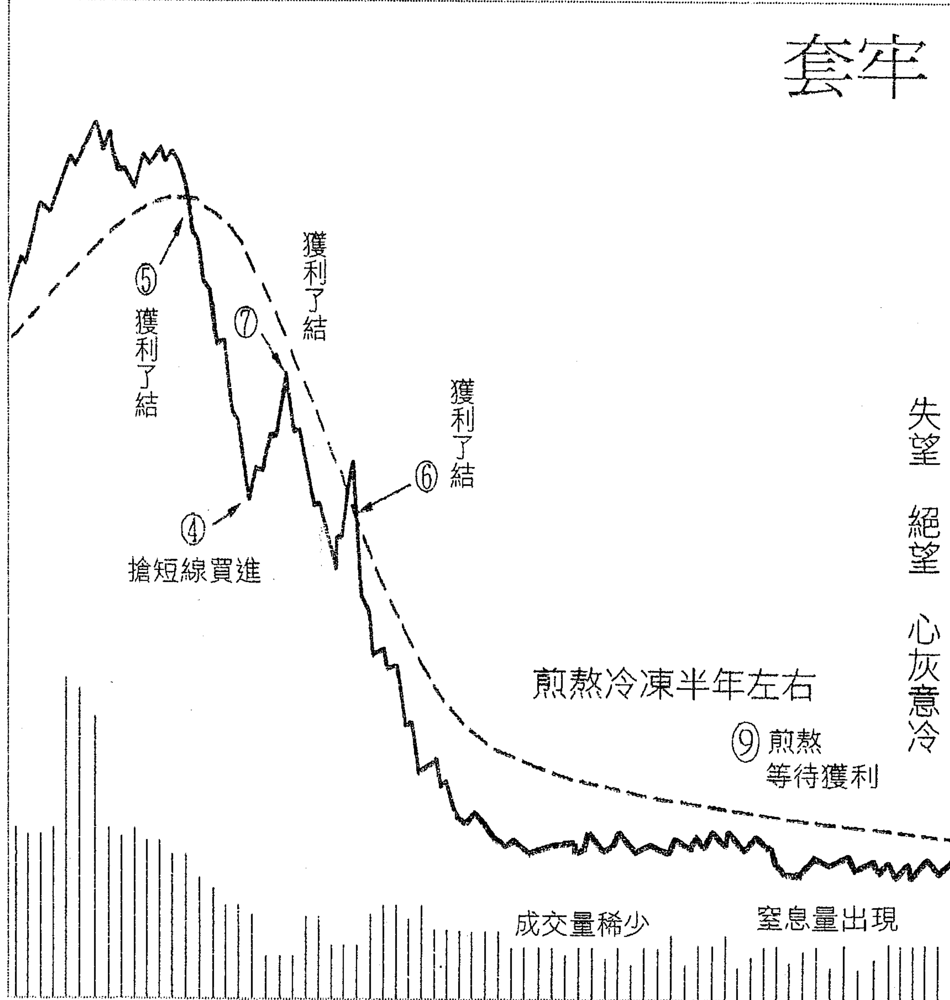

太早進場買進的結果是虧損，熬不過去只好認賠了。有資金壓力，或是限期獲利的人將要虧大了。股市達人孫叔熬太早進場了，只好熬，熬熬待補就賺；熬不過去，就輸了；不過，如果你買進的是那種有配現金的個股，是熬得過去的；相對的，如果買進的是沒法度配現金的股票——通常是熬不過去的！搶短線買進，因為失去了「長線保護短線」的順勢，因此是高手的做法。

> Stretnth does not come from physical capacity. It comes from indomitable will. -----Jawaharlal Nehru
> 力量並不是來自體力，它是來自於不屈不撓的意志。———雅瓦哈咧·尼赫魯 二十世紀印度政治家，印度第一任首相

## 不必火中取栗

市場之中瀰漫著很多的迷湯，像是「火中取栗」之類的話就是。

富貴穩中求就好了！不必講什麼「富貴險中求」的話！有的公司的業績忽上忽下，看似得了躁鬱症一般，通常這種股票的下一步都是打入全額交割股之列。

便宜的股價，並不能保證公司不會倒的。

市場之中，有一派人愛看趨勢，還有一派愛看價值。但是看趨勢有一個缺點就是，愈會漲的個股，你就愈樂觀；愈會跌的個股，人們就愈悲觀。

相對的，如果你是看價值投資的人，愈跌你就愈覺得便宜了，愈漲你就覺得貴了！

## 三支股票護一生

撿對了績優股，三檔股票的波段操作，加上填息填權，就能讓自己的退休金豐厚的。市場上的個股那麼多，怎麼研究的完？熟悉那幾檔股票，像是台灣的中鋼、台積電、中華電、台塑四寶，就夠自己好好退休的了！

# 美女生女兒機率高

女性常常抱怨美男子越來越難找，英國研究顯示，這可能是真的，因爲美女比較可能生女兒。

英國每日郵報報導，倫敦政治經濟學院教授金澤智分析 1 萬 7000 名 1958 年 3 月在英國诞生的嬰兒，並追蹤他們的生活。老師會在受試者 7 歲時記下他們的外表吸引力，接著在 45 歲時詢問他們的孩子性別。

刊登在美國生殖醫學雜誌的研究顯示，被記錄爲有吸引力的受試者，第一胎生男或生女的機率相當，但那些較沒吸引力的受試者大都生下男嬰。換句話說，美女比長相普通的人更有可能生下女兒。

金澤智認爲，父母生下的孩子性別，會因受惠自哪一方的特質而定。女性在美麗這部分受惠較男性多，所以美女會生下女兒。個性堅決且好強的夫妻較有可能生下男孩，因爲上述兩點是男性常有的特質。

這項研究引發各界輿論，美國哥倫比亞大學統計專家格爾特曼分析 1995 年至 2000 年的時人雜誌前 50 大性感人物的資料後，得到生男比生女多的相反結果，其中最著名的是辣媽維多利亞與足球金童貝克漢生下 3 個兒子的例子。／2010/12/01

投資人常常抱怨被低估的價值股，愈來愈難找；這也是真的；好股怎麼會便宜呢，那要等很久，遇到有危機發生時；並且，還有很多人在等，因此，便宜的時候也很短暫。

## 股價與移動平均線

> 股市達人孫叔熬，要熬，熬得過去就賺

> Heaven grants us patience with a man in love ! ------ Rudyard Kipling
> 與戀愛中的男人相處時，願上天賜給我們耐心！---吉卜林（1865-1936）

台灣華隆集團的一位元老說：「每個人該賺多少錢都是天上註定的，該你的跑不掉；不歸你的，就算是搶到手，有一天也會離開你。」這是一段耐人尋味的話。第一，這是有錢人講的話，意思是說他天生就該這麼有錢！第二，這是宿命論的話，好像是說人的有沒有錢，是命中註定的，不努力也會有錢，努力也會沒有錢！

類似的這種話，是沒有多大意義的；但是股價與移動平均線卻有非常大的意義，它讓使於你的錢跑不掉，也讓不屬於你的錢落袋為安，這就是移動平均線的妙用！移動平均線常與每日的股價繪製在一起，方便投資人瞭解股價的平均走勢，幫助投資人「順勢而為」。當市場股價持續地上漲時，移動平均線將落在市場指數線的下方，這是因為移動平均線是市場過去較低價格與當日較高價格的平均值，所以當日的移動平均值一定低於當日的市場即時價格。

## 支撐與壓力：進場買進

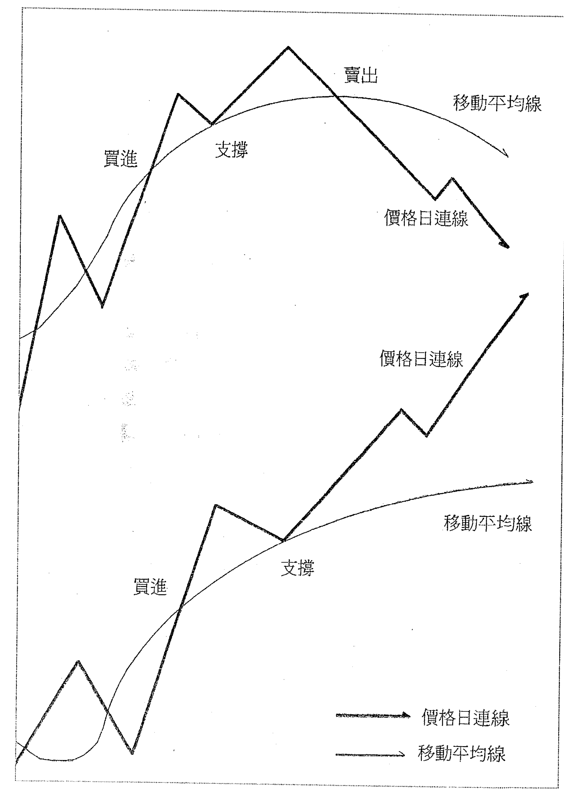

相對的，當市場股價持續地下跌時，移動平均線將處在市場指數線的上方，這是因為移動平均線是市場過去較高價格與當日較低價格的平均值，所以當日的移動平均值一定高於當日的市場價格。

### 支撐或壓力

移動平均線對於股價，具有一定的支撐或壓力作用，這是一項廣泛被使用的分析工具。

當股價從移動平均線的下方向上突破後，平均線也開始向右上方移動；當股價回跌到平均線附近時，會產生支撐的力量，再度提升。

相對的，當股價從移動平均線的上方方向下突破後，平均線也開始向右下方移動；當股價回升到平均線附近時，會產生阻力，表示賣方的力量大於買方。

### 30 週平均線

在多頭市場中，當日指數上升幅度高於卅週線的 10% 以上時，可能會產生中期「回檔」；這是因為兩者背離（divergence）幅度愈大，拉回的壓力愈大的關係。

在空頭市場中，當日指數上升幅度低於卅週線的 10% 以上時，可能會產生中期「反彈」；這是因為兩者背離（divergence）幅度愈大，拉回的壓力愈大的關係。

## 支撐與壓力：賣出離場

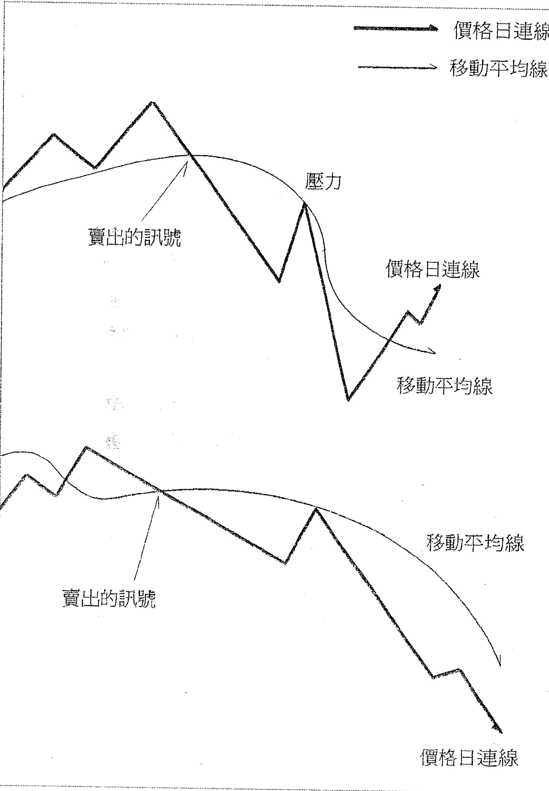

## 看得懂 K 線圖：買進的訊號

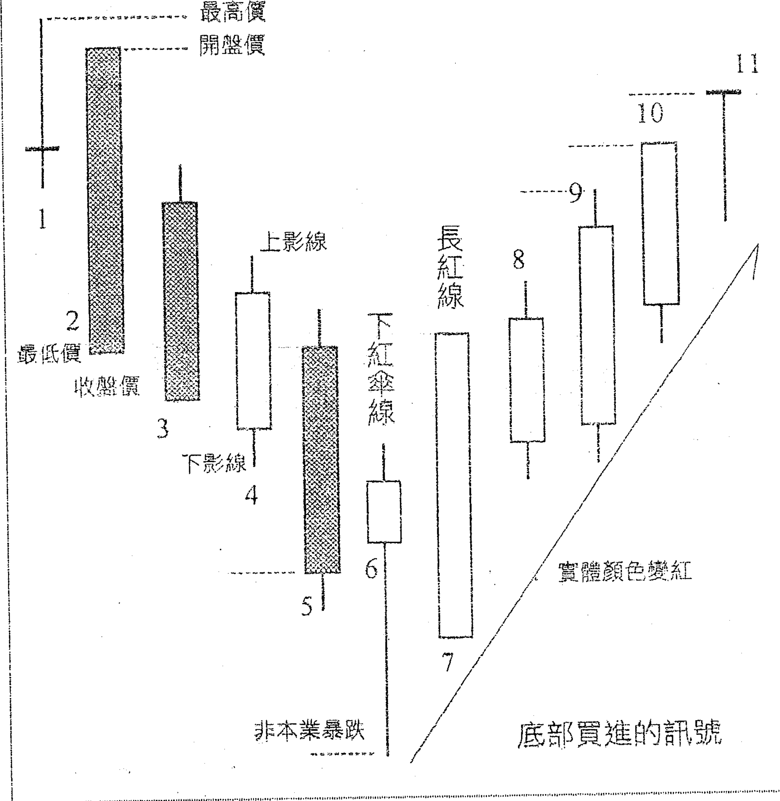

K 線圖包括實體與影線。「實體」分成紅色實體與黑色實體兩種。紅色實體是收盤價高於開盤價，而黑色實體則是收盤價低於開盤價。K 線圖有四價，包括開盤價、收盤價、最高價、最低價；四價相同是漲停板或跌停板的表現，或稱「四值同一線」。

「影線」又有上影線與下影線兩種。「上影線」的端點是該一時間內的最高價；「下影線」的末梢是該一時間的最低價。

## 看得懂 K 線圖：賣出的訊號

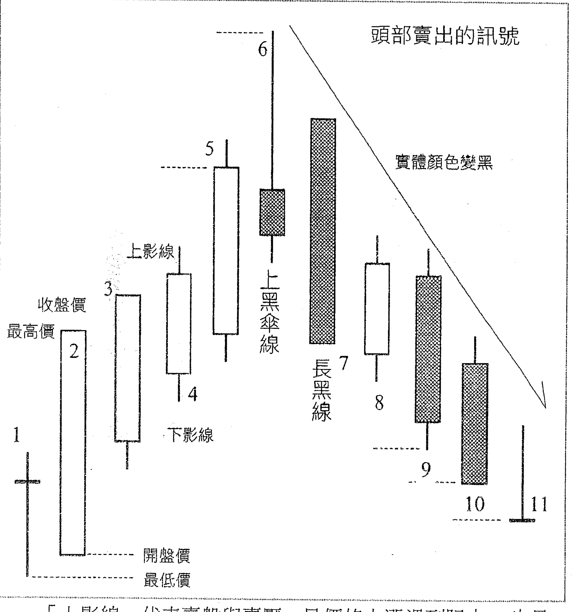

「上影線」代表賣盤與賣壓，是價格上漲遇到阻力，也是一種續跌的暗示；「下影線」則是代表買盤與價格的支撐，在價格下跌之後有人進場買進，因此是一種抗跌的暗示。異常突出的下影線，宛如是探底樁，應進場買進。異常突出的上影線，像是避雷針，應賣出離場。低檔的長紅線有如太陽的升起，是進場買進的訊號；相對的高檔的長黑線有如烏雲的降臨，是賣出的訊號。

# 單一移動平均線的運用

> 他們說審判日就要降臨，神會憤怒；但好的神，只會帶來好事，不要害怕，結局將充滿歡愉。——波斯格言

投資人利用股價與單一移動平均線的關係，是最普遍的一種方式；因為作為買進或賣出的訊號，它提供的非常的明確。

## 交易訊號的產生

如果價格 K 線由下而上的穿越移動平均線，就是代表「買進」的訊號；如果收盤價由上而下滑落移動平均線，那是代表「賣出」的訊號。或者是說，價格在移動平均之上，則是做多；價格在移動平均之下，則是放空。

一般說，投資人的操作金律如下：

- (1) 如果該日收盤價超越前 N 天期的平均價，那麼就補空而做多，或進場買進績優股現股。
- (2) 如果該日收盤價滑落前 N 天期的平均價，那麼就翻多而做空，或賣出持股，出場休息。
- (3) 要注意的是，這 N 的參數的設定與系統的敏感度息息相關。如果 N 設定得很小，那麼這是一種快速系統；快速系統可以在小型的波動走勢中獲利。例如期貨市場上常用的 4-9-18 日三種均線，或是股價的 5 日均線，那麼系統不斷的與均線纏繞在一起，容易發出趨勢（Trend）反轉的訊號，當然錯誤的訊息（whipsaws）也很多。
- (4) 如果你把 N 參數設定得很大，這就屬於一種慢速系統；它在明顯的走勢中可以獲利。例如 N=30，那麼錯誤的訊號可以降低，但卻又延誤了進場／出場的時機。

一般說，移動平均的期間長度 N，應該是市場循環長度的一半；循環是指由谷底到谷底。例如，如果循環長度是 28 天，也就是說，從谷底到谷底的時間是 28 天，那麼應該採用 14 天的移動平均。

為了避免無謂的誤判，這些交易人還注意到移動平均線的發展方向必須與穿越的方向相同，這才是有效的突破。

雖然快速系統與慢速系統，各自適用於不同的市況；不過根據統計投資顯示：在大多數的情形下，慢速系統的表現優於快速系統。

## 股價與短期均線

> 兩個股價指數必須互相確認（confirmation）！
> （The Two Average Must confirm.）——道氏理論

如果投資人採用的是非常短期的均線，例如 5-10 天的移動平均線，那麼價格會與均線緊靠在一起，經常發生穿越的現象。這樣的性質實在是有利有弊。因為太過敏感的短期均線，使得交易訊號發生的頻率明顯的提高，因此而誤判下注的機會也大。同時，交易人所付出的交易佣金也會大幅的增加！

相對於「長期均線」來說，「短期均線」比較容易提供「假訊號」，但也能夠提早發出訊號；換句話說，移動平均線愈敏感，它就愈能夠「及時」的提供訊號；不過，也可能發生參差反覆的情況。

## 假訊號是天敵？

> 假訊號——是順勢交易系統中的天敵！

快速交易系統中，行情經常出現某種大幅的趨勢（Trend）走勢的交易訊號，但又立即折返，忙煞了交易人，這是使用順勢系統的夢魘。而在短期快速交易系統中，這種現象時常發生，所以稱作是「反覆」（whipsaw）。

# 投資怎麼會失利？

失敗的投資人總是對自己當前的投資策略深信不疑，不知變通。相對的，成功致富者的座右銘是：十分警覺，一旦發現情況有變，立即調整策略，與時俱進。

> Men who do not make advances to women are apt to become victims to women who make advances to them. ----- Walter Bagshot

不向女人展開追求攻勢的男人，很容易成爲主動的女人的受害者。——白芝浩（1826-1877）

## 股價與長期均線

**【K 線的動能與強弱關係：紅線】**

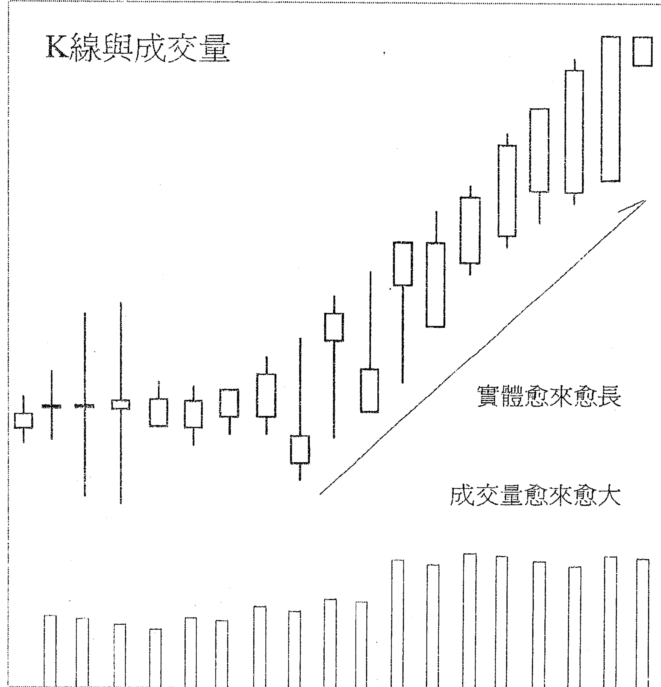

在預測趨勢（Trend）持續發展的過程中，中長期移動平均線似乎比較理想；它的缺點在，如果趨勢一旦反轉，相對的順勢的操作者——也必須吐回比較多的獲利。

長期的移動平均線比較遲頓，因此，在趨勢發展中，比較不會因爲股價的往覆穿越而發出雜音。但在趨勢反轉的時候，它的反映遲頓就變成了缺點了！

我們可以下這樣的結論：只要趨勢是持續發展的，長期均線表現得比較理想，而在趨勢反轉的時候，短期均線表現得比較理想。

也有人認為單一均線存在著種種的缺點；如果是兩條均線的話，就比較理想！

不過本書的作者，建議在股價反轉的可能時候，採用一種 K 線對應股價穿越的方式，就比較不會造成誤判或反覆操作的情景！這理由存在於 K 線有強勢弱勢，也有觀望的線形。而股價只有採用收盤價的觀察方式，資料是比較不足。

強勢的線形包括白色實體長的 K 線，或是中紅線。

觀望的線型如十字星、紡錘線、高浪線、傘狀線等。

弱勢型如中黑線與長黑線等。

成交量基本上是與實體的大小成正比，實體愈長，成交量就愈大。

> If men know how women pass the time when they are alone, they'd never marry. ------ O. Henry

假如男人知道女人獨處時是如何打發時間的，那麼他們絕不會結婚的。——歐·亨利（1862-1910）

**【K 線的動能与強弱關係：黑線】**

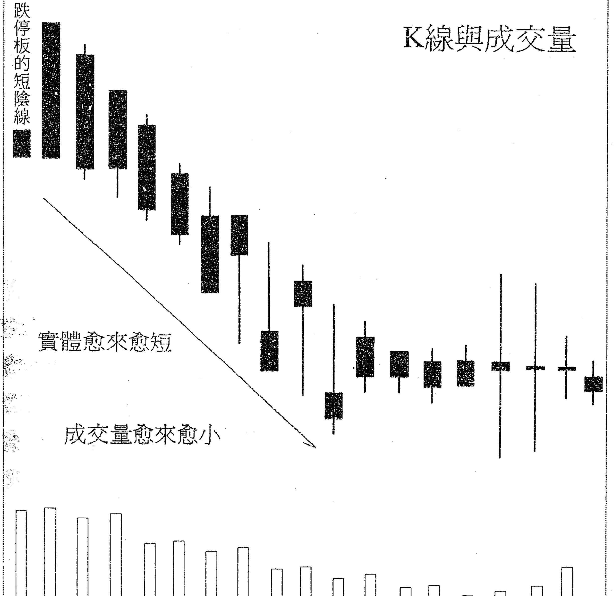

成交量與交易區間的大小成正比；交易區間愈大，成交量愈大。價格下跌的日子，成交量都是減半的；低迷時節的成交量稀少；推升時的成交量瞬間就是倍增的。

喊價的人多，價格的波動幅度就愈大。喊價的人少，價格的波動幅度就愈小。不是嗎？

## 在正確的時點買進或賣出

李佛摩爾（Jesse Lauriston Livermore）反覆不斷的強調：「重點不在於你買得有多便宜，而是在正確的時點買進或賣出。」操盤手必須持續的關注股價的變化；耐心的等待趨勢發動之後才進場；並且在趨勢結束之後就退場。

## 股價超越 5 日平均線

如果當日收盤價穿越 5 日平均線的是漲勢的「中長紅線」，那就當然的敲進。

如果當日收盤價穿越 5 日平均線的是觀望的線型，那就暫緩下注。因為這可能只是一種雜音。

如果當日收盤價穿越 5 日平均線的是跌勢的線型，那可能只是一場假突破（premature breakout）罷了，多作交易無益，所以暫緩進場。

融資融券投資人，在股價超越 5 日平均線時，回補先前放空的空單，或是進場買進建立新的多頭部位。

### 確認與背離

股價與 5 日平均線一起上揚，兩者互相「確認」（confirmation），可以進場買進績優股。

如果股價上揚，而 5 日平均線下挫，這是形成所謂的「背離」（divergence），不宜進場買進績優股。

五日平均線的走勢，在線形圖上最爲陡峭，並且都用小虛線表示，很容易描出來；如果你是市場的新手，請用彩色筆描出這一條線，它將保佑你的財富於不墜！

**【股價超越 5 日平均線】**

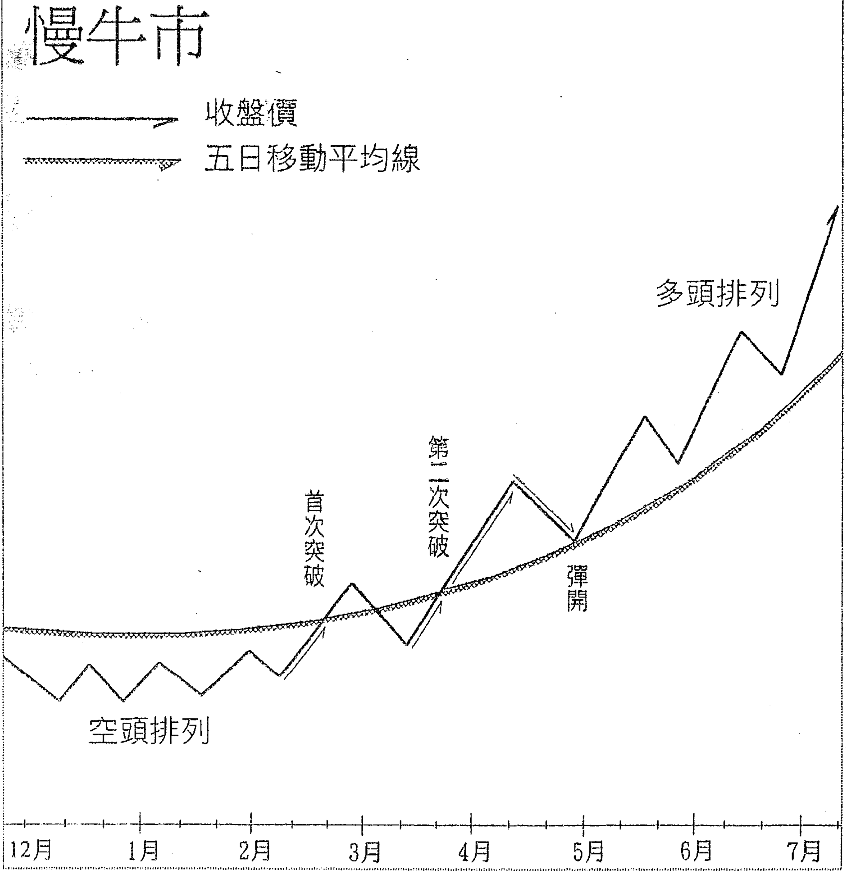

- 首次突破：有時只是測試而已！
- 第二次突破：大多是大跌或大跌的前奏曲。
- 「彈開」：表示多頭走勢經得起考驗。
- 多頭排列：是指收盤價一直保持在五日移動平均線之上的線形排列。

## 股價滑落 5 日平均線

> 不要為自己的過錯感到尷尬，瞭解錯誤能帶來最好的教訓，這是最好的自我教育的方法之一。——卡萊爾 (Thomas Carlyle)

如果當日收盤價滑落 5 日平均線的是白線漲勢的「中長紅線」，可以稍作觀望，或是參考其他的指標。

如果當日收盤價滑落 5 日平均線的是觀望的十字星線型，那就停損出場。

如果當日收盤價滑落 5 日平均線的是下跌的「中長黑線」，股價即有可能一瀉而下，應立刻停損出場，並且休息一陣子。

融資融券的投資人，在股價滑落 5 日平均線時，回補先前做多的多單，或是進場賣出放空，以建立新的空頭部位。

### 確認與背離

股價與 5 日平均線一起下跌，兩者互相「確認」（confirmation），可以賣出持股。

如果股價下跌，而 5 日平均線上揚，這是形成所謂的「背離」（divergence），不宜賣出持股。

**【股價滑落 5 日平均線】**

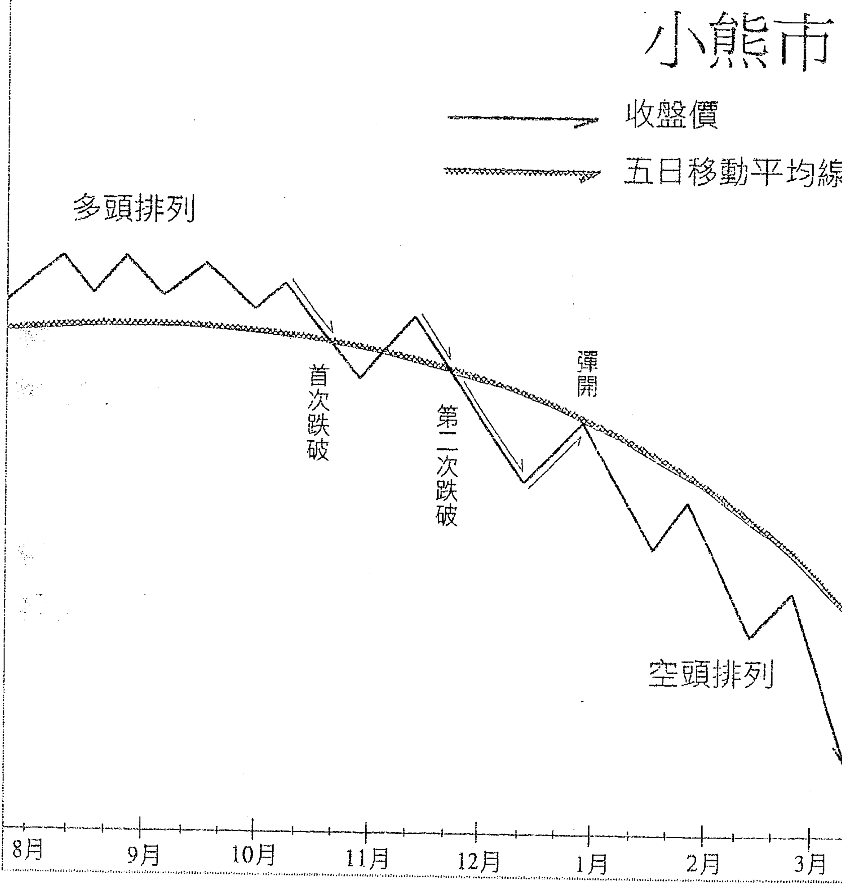

- 首次滑落：有時只是測試而已！
- 第二次滑落：大多是有效的大跌波的前奏曲。
- 「彈開」：表示空頭經得起考驗。
- 空頭排列：是指收盤價一直保持在五日移動平均線之下的線形。

## 股價超越 10 日平均線：買進

> 敵人會以憤怒回報你的憤怒，會讓你吃苦頭，但最大的傷害仍然是存在心中的忿恨所引起。如果你的心能夠原諒與忘卻別人的冒犯，你獲得的快樂將超過你的父母或所有的家人所能給予的。——法句經

10 日平均線比 5 日平均線的走勢來得平緩些，很容易識別。10 日平均線比 5 日平均線還來得穩定可靠！比較不會發出額外的雜音！

如果當日收盤價穿越 10 日平均線的是漲勢的「中長紅線」，那就當然的敲進。

如果當日收盤價穿越 10 日平均線的是觀望的十字星線型，那就暫緩下注，提防它是一場誤判吧。

如果當日收盤價穿越 10 日平均線的是下跌的「中長黑線」，那可能只是一場「假突破」（premature breakout）罷了，這時多做多錯，多作交易無益，是可以暫緩進場的。

融資融券的投資人，在股價超越 10 日平均線時，回補先前放空的空單，或是進場買進建立新的多頭部位。

有人想要撿便宜，但因行情已經發動了而不敢再進場；還有的人在市場行情反轉了，不願意認錯小賠，然後就是因為小錢沒有停損而賠了大錢。

## 停損？股價滑落 10 日平均線

> 聰明人尋求智慧，瘋子才認為他已找到智慧了！——波斯諺語

如果當日收盤價滑落 10 日平均線的是漲勢的「中長紅線」，那就暫緩下注。

如果當日收盤價滑落 10 日平均線的是觀望的十字星線型，那就當然的敲進。

如果當日收盤價滑落 10 日平均線的是下跌的「中長黑線」，那應該是斷然的賣出。

融資融券的投資人，在股價滑落 10 日平均線時，回補先前做多的多單，或是進場賣出放空，以建立新的空頭部位。

嚴格的執行停損，是投機客的護身符！說到這個紀律的執行，則是牽涉到人性的弱點的問題。

那些因爲股市操作致富的大師，大多能逆著人性、挺身而爲；大部份的盲目，都牽涉到人性的恐懼與貪婪上。

> To be wise, and love, exceeds man's might. ----- Shakespeare

要有智慧，又要懂得去愛，實在是超乎人的能力。——莎比亞（1564-1616）

## 確定看錯了才停損

> ——是投機客必備的護身符

**【收盤價超越 20 日平均線】**

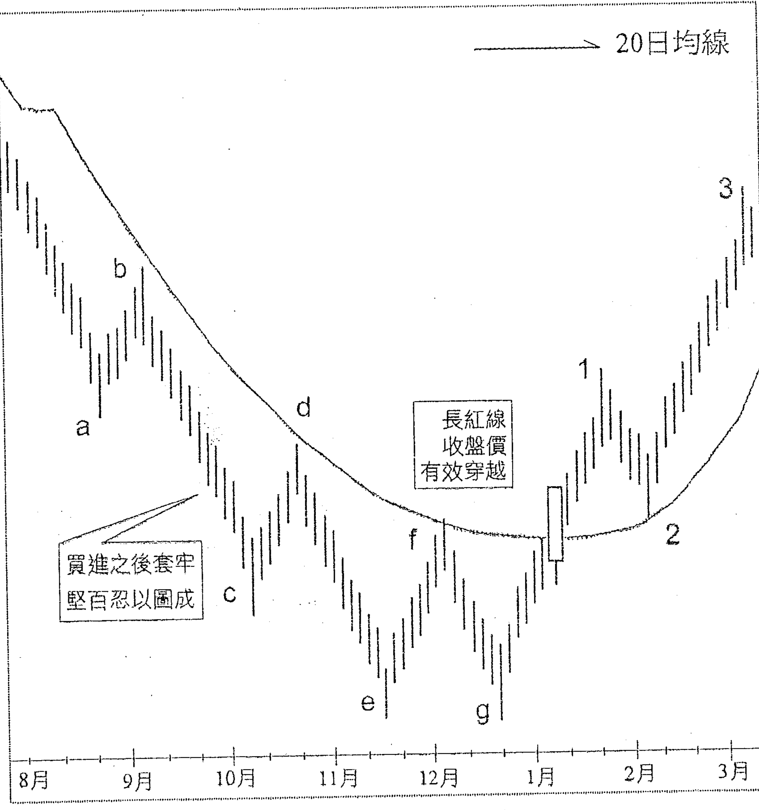

20 日平均線是多空指標線，被投資人看成是趨勢（Trend）走多或走空的指標！

如果當日收盤價穿越 20 日平均線的是漲勢的「中長紅線」，那就當然的敲進。市場老手會抱緊他的持股，等待市場的持續漲升，以獲取更大的利潤。

如果當日收盤價穿越 20 日平均線的是觀望的十字星線型，還是進場買進續優股。

如果當日收盤價穿越 20 日平均線的是下跌的「中長黑線」，那可能只是一場假突破（premature breakout）罷了，多作交易無益，可以再觀望看看。

融資融券的投資人，在股價超越 20 日平均線時，回補先前放空的空單，或是進場買進建立新的多頭部位。

長期以來，股市有一句名言：「會做股票的人只是徒弟，會賣股票的人才是師父！」

什麼時候應該停損出場呢？

李佛摩爾（Jesse Lauriston Livermore）大師說：「每當情況不像應該出現的那個樣子時，我就退出不玩了。這種事沒有什麼好爭的；一定是有什麼事不對勁的。我可以在以後再找原因的；但是，眼前的當務之急，是在發現錯了的時候，要趕快退場。」

很多人都有這個經驗，是第一批部位進場時，是多頭剛剛發動攻勢的時候；這時人們難免有追逐強勢股，或是有追高看錯的時候；通常，如果在進場後三天內——市場未有新的漲勢出現，就應該考慮停損出場的。

還有就是，如果漲勢到了滿足點時，也可以獲利出場的。

多麼奇怪啊！很多惡棍都是靠奉獻宗教利益，或是藉著高尚的道德觀，或是對祖國的愛，來掩飾他們的骯髒行為。

> ——海涅（Heinrich Heine）

**【收盤價滑落 20 日平均線】**

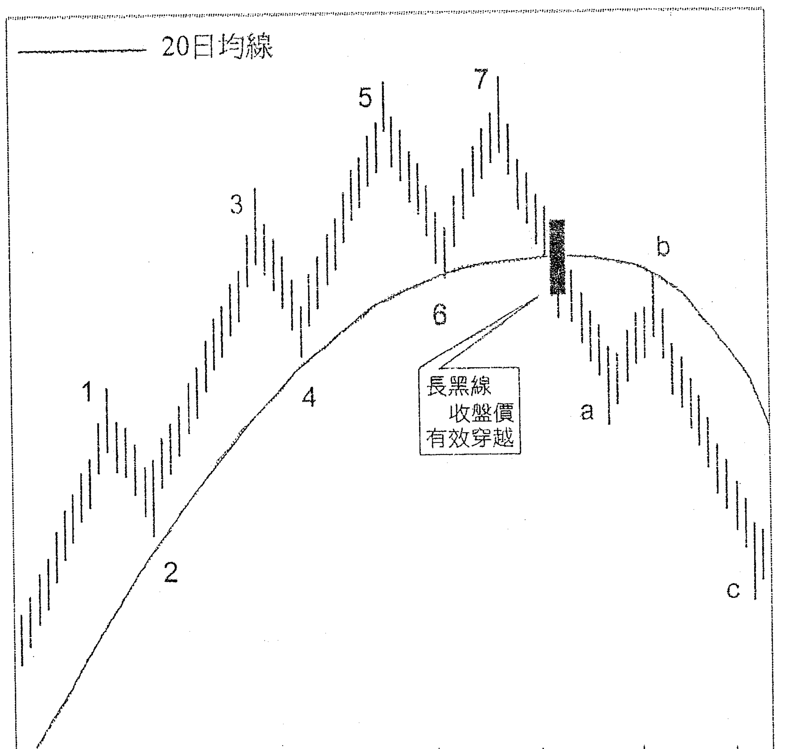

如果當日收盤價滑落 20 日平均線之下的是雖然漲勢的「中長紅線」，可稍作觀望。

如果當日收盤價滑落 20 日平均線之下的是觀望的十字星線型，但是仍然以賣出爲宜。

如果當日收盤價滑落 20 日平均線之下的是下跌的「中長黑線」，那麼必須斷然的賣出。

融資融券的投資人，在股價滑落 20 日平均線時，回補先前做多的多單，或是進場賣出放空，以建立新的空頭部位。

### 確認與背離

股價與 20 日平均線一起下跌，兩者互相「確認」（confirmation），可以賣出持股。

如果股價下跌，而 20 日平均線上揚，這是形成所謂的「背離」（divergence），不宜賣出持股。

## 波克夏公司是非常傳統的地方

查理·孟格（Charlie Munger）曾經說過：「波克夏公司是非常傳統的地方，我們也努力的維持著這些傳統。我不認爲傳統意味著迂腐；我欣賞的是那些蘊含在傳統中的真理；例如是簡單的數學運算、基本的動物本能、基本的恐懼與從人性特質去預估可能的投資行爲模式。」

> A man must be a fool who does not succeed in making a woman believe that which flatters her. ----- Honore de Balzac

假如男人不能讓女人相信他的甜言密語，那麼他一定是一個笨蛋。——巴爾鋘克（Honore de Balzac 1799-1850）

## 賺錢，才能加碼

看錯，只能縮手不動

> When a man has married a wife he finds out whether her knees and elbows are only glued together. - William Blake

男人娶妻後，才能發現她的膝與肘是否緊緊相黏在一起。——威廉·佈雷克（1757-1827）

李佛摩爾（Jesse Lauriston Livermore）要大家換個角度來思考——當你買了股票之後，開始漲了，這至少表示你買對了！正確的事，不應該任意的否定的，而是要持續的做下去。因此，李佛摩爾說：「在初次交易之後，除非第一筆交易有獲利，否則就不要做第二筆交易。可以先退出市場，在場邊觀望。操作成果好壞，有一大部份是取決於起步時間的是不是恰到好處。」

買對了，就可以逐級加碼；例如，每漲 5 元就加碼一筆（或 1 張）；如果一路強勢，就一路的加碼；但是在漲幅超過 10% 之後而陷入盤整之時，就停止加碼了。市場老手的加碼張數，是以不超過原始部位，要維持正金字塔的成本架構。

## 股價超越 60 日平均線

**【收盤價超越 60 日平均線】**

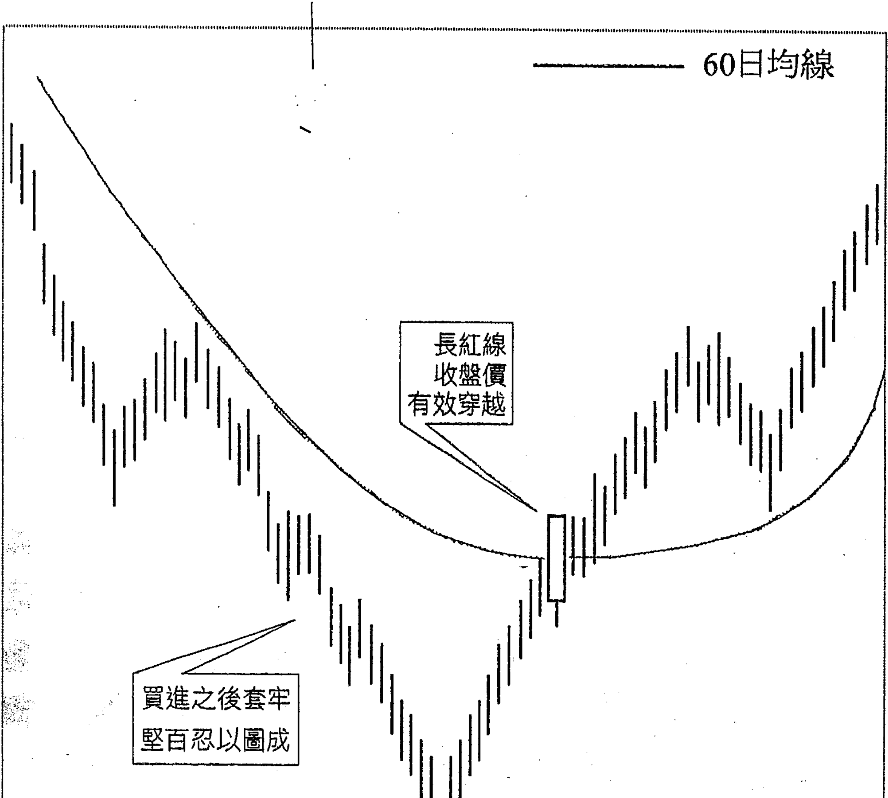

如果當日收盤價穿越 60 日平均線的是漲勢的「中長紅線」，代表漲勢的猛烈，那就當然的敲進。

如果當日收盤價穿越 60 日平均線的是觀望的十字星線型，代表市場走勢猶豫觀望，那就暫緩下注。

如果當日收盤價穿越 60 日平均線的是下跌的「中長黑線」，那可能只是一場假突破罷了，多作交易無益，所以暫緩進場。

經驗老到的投機客會緊抱「空單」，等待市場的探底，以獲取更大的利益。

融資融券的投資人，在股價超越 60 日平均線時，回補先前放空的空單，或是進場買進建立新的多頭部位。

**【收盤價滑落 60 日平均線】**

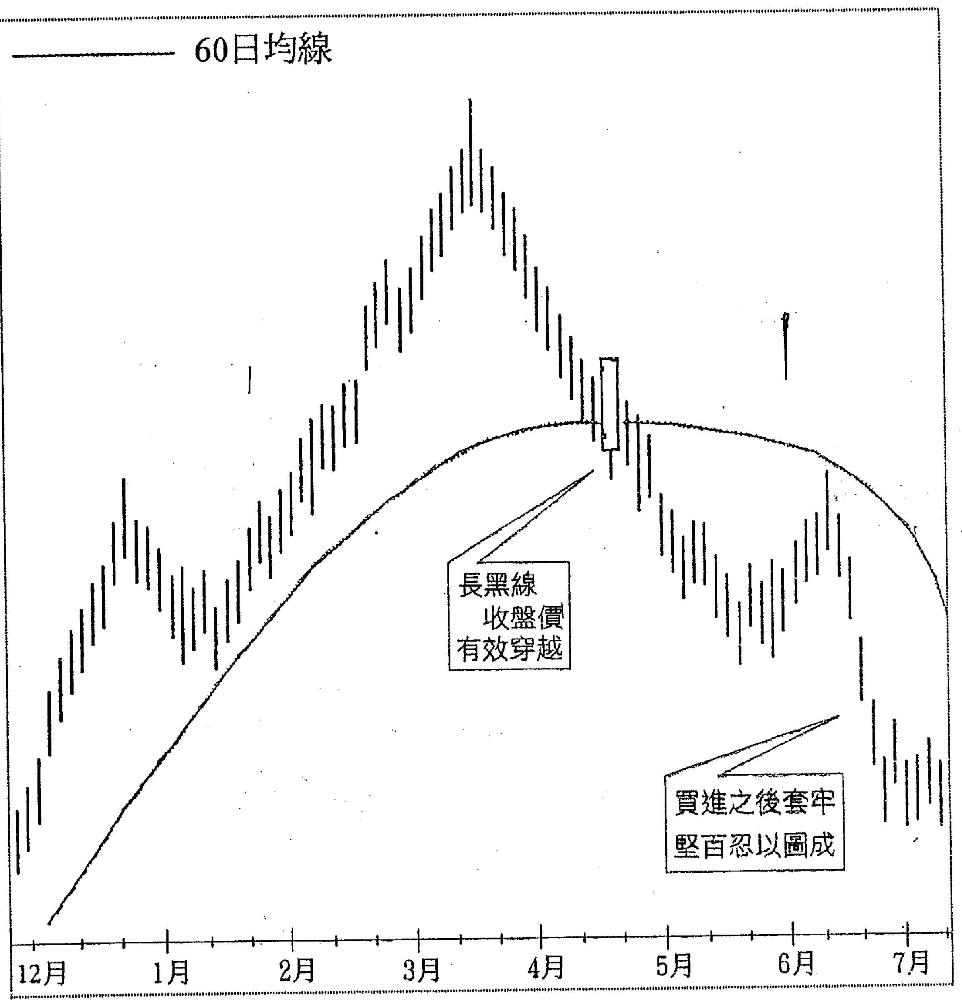

如果當日收盤價穿越 60 日平均線的是漲勢的「中長紅線」，那就當然的敲進。

如果當日收盤價穿越 60 日平均線的是觀望的十字星線型，那就暫緩下注。

如果當日收盤價穿越 60 日平均線的是下跌的「中長黑線」，那可能只是一場假突破罷了，多作交易無益，所以暫緩進場。

融資融券的投資人，在股價滑落 60 日平均線時，回補先前做多的多單，或是進場賣出放空，以建立新的空頭部位。

### 確認與背離

股價與 60 日平均線一起下跌，兩者互相「確認」（confirmation），可以賣出持股。

如果股價下跌，而 60 日平均線上揚，這是形成所謂的「背離」（divergence），不宜賣出持股。

> Some do long for pretty knacks, And some for strange devices. God sends me what my lady lacks, I care not what the price is. ----- Anonyomous

有些人渴望獲得純熟的技巧，有些人渴求獲得奇謀，上帝如果能將我鍾情女子所缺乏的東西賜予我，一切的代價我將不計。——佚名

## 獲利了結之後：縮手不動

在對的時間做對的事

### 【收盤價超越 120 日平均線】並非買了的隔天就得上涨

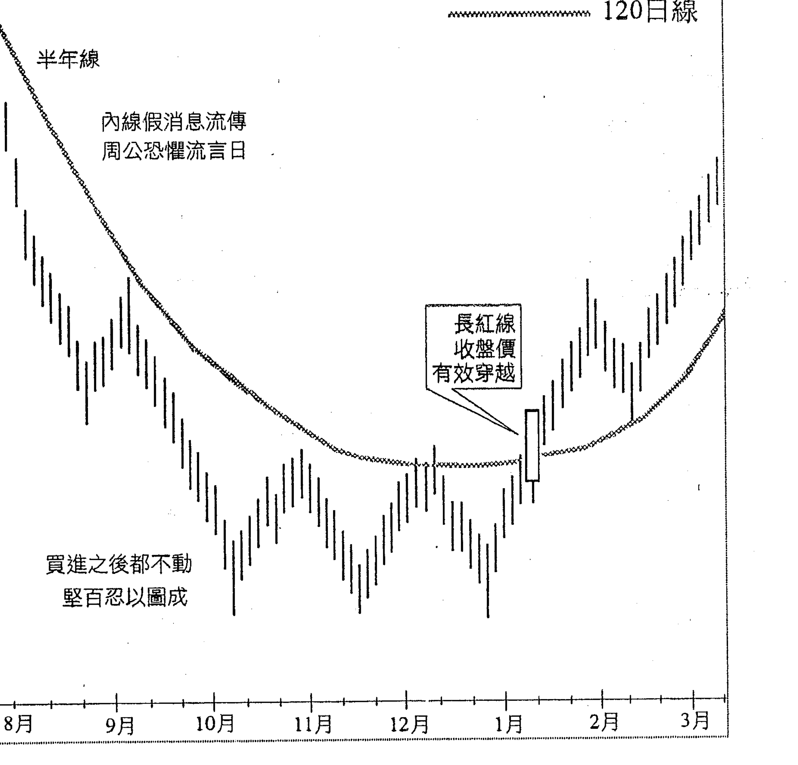

如果當日收盤價穿越 120 日平均線的是漲勢的「中長紅線」，那就當然的敲進。

如果當日收盤價穿越 120 日平均線的是觀望的十字星線型，那就暫緩下注。

如果當日收盤價穿越 120 日平均線的是下跌的「中長黑線」，那可能只是一場假突破（premature breakout）罷了，多作交易無益，所以暫緩進場。

融資融券的投資人，在股價超越 120 日平均線時，回補先前放空的空單，或是進場買進建立新的多頭部位。

### 確認與背離

股價與 120 日平均線一起上揚，兩者互相「確認」（confirmation），可以進場買進續優股。

如果股價上揚，而 120 日平均線下挫，這是形成所謂的「背離」（divergence），不宜進場買進續優股。

想要賺到大錢，掌握好發動點進場，只能算是第一步而已，第二步就是**李佛摩爾**（Jesse Lauriston Livermore）所說的獲利了結之後，縮手不動。他說：

> 在華爾街打滾這麼多年，賺進了、也賠了數百萬美元之後，我要告訴你這一件事——我能夠賺得大錢，絕不是靠我的想法，我的能賺進大錢，總是靠我的縮手不動的，懂嗎？縮手不動！

> 看對市場沒有什麼了不起；你總是發現，多頭市場之中，很多人早就做多；空頭市場之中，很多人早就放空；可是，他們為什麼沒賺到什麼錢，就是因為他們雖然有頭腦，卻沒有縮手不動。

那些人從年頭做到年尾，都不休息，形同賭客；前面賺了，後面又輸了！特別是在獲利了結之後的「縮手不動」，顯得是格外的重要。

### 【收盤價滑落 120 日平均線】

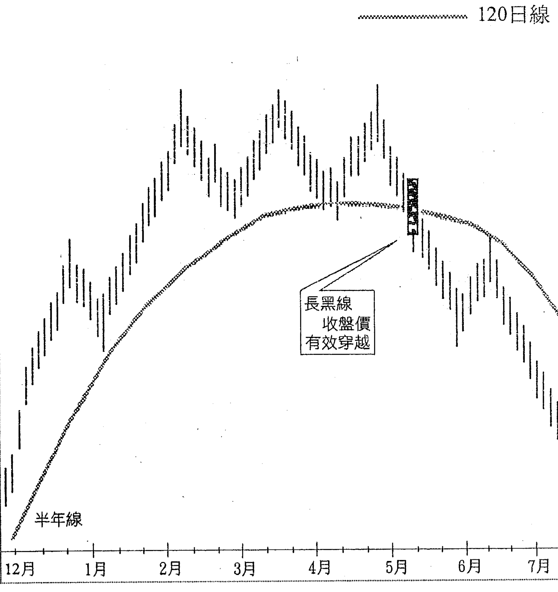

如果當日收盤價穿越 120 日平均線的是漲勢的「中長紅線」，那就當然的敲進。

如果當日收盤價穿越 120 日平均線的是觀望的十字星線型，那就暫緩下注。

如果當日收盤價穿越 120 日平均線的是下跌的「中長黑線」，那可能只是一場假突破罷了，多作交易無益，所以暫緩進場。

融資融券的投資人，在股價滑落 120 日平均線時，回補先前做多的多單，或是進場賣出放空，以建立新的空頭部位。

### 確認與背離

股價與 120 日平均線一起下跌，兩者互相「確認」（confirmation），可以賣出持股。

如果股價下跌，而 120 日平均線上揚，這是形成所謂的「背離」（divergence），不宜賣出持股。

> Man is not made for defeat. A man can be destroyed but not defeated.
------Hemingway, The Old Man and the Sea
人並不是生來給打敗的。人可消滅，但打不敗。——海明威《老人與海》

> His passions make man live, his wisdom merely makes him last.
------Sebastien Chamfort
男人的熱情使他活著，而智慧僅使他苟延殘喘。——康福特

## 創新高的個股

賺錢老手喜歡一年內創新高的個股；理由是強者恆強。這種創新高的個股比較容易持續的漲；背後的支撐是在股價創新高之後，賺錢的人多，套牢的籌碼相對的少。

長線投資人在價格一高之後，就不再追漲；但是投機客是以賺取差價爲目的，與投資客不同；他們在乎的是上漲機遇的把握，價位高低——並不太在意。

## 股價超越 200 日平均線

### 華爾街所重視的移動平均線

華爾街的分析師，十分重視 200 日平均線！市場價格穿越 200 日平均線時，被看成是多頭市場的指標！

如果當日收盤價穿越 200 日平均線的是漲勢的「中長紅線」，那就當然的敲進。通常它的突破幅度是比較大的；突破的幅度愈大，將來的漲勢就會愈大。

如果當日收盤價穿越 200 日平均線的是觀望的「十字星線型」，那就暫緩下注；重點在於收盤價是否站穩在 200 日均線之上的。

如果當日收盤價穿越 200 日平均線的是下跌的「中長黑線」，那可能只是一場「假突破」罷了，多作交易無益，所以暫緩進場。不論如何，這是一個重要性質的測試與宣誓；市場會一再的挑戰的。

### 【股價超越 200 日平均線】

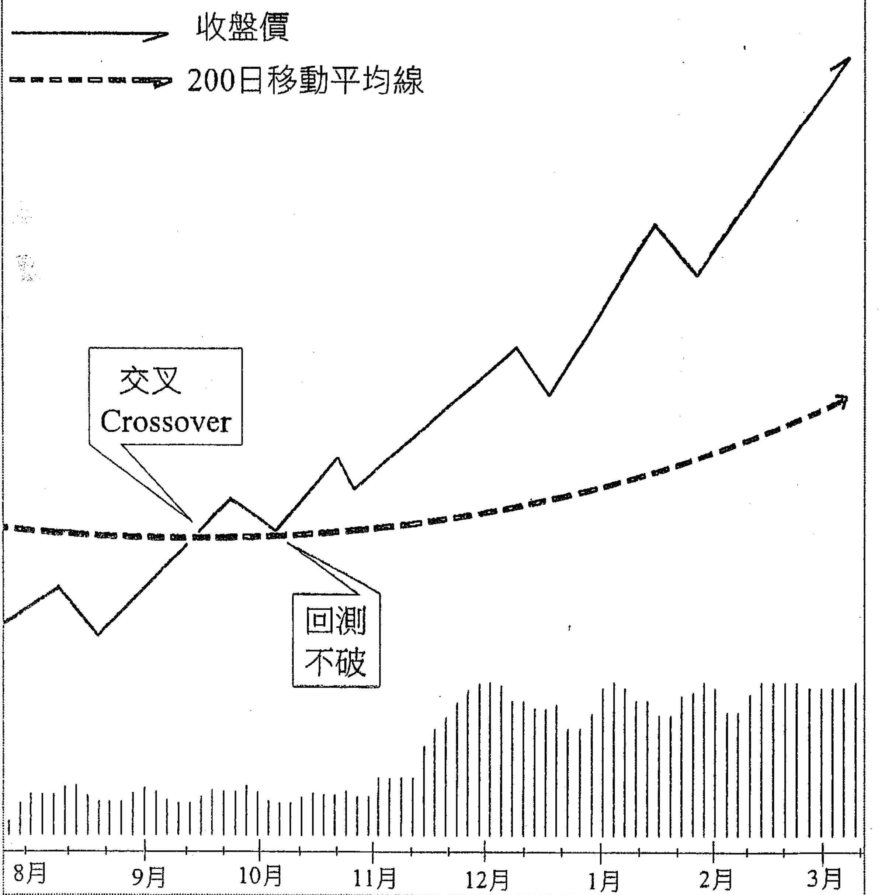

融資融券的投資人，在股價超越 200 日平均線時，回補先前放空的空單，或是進場買進建立新的多頭部位。

## 股價滑落 200 日平均線

每個人快樂的程度恰與他帶給別人的快樂相等。——邊沁（Jeremy Bentham）

華爾街的分析師，十分重視 200 日平均線！市場價格滑落 200 日平均線時，被看成是空頭市場的指標！

如果當日收盤價滑落 200 日平均線的是漲勢的「黑 K 線」，那就當然的賣出放空。通常它的突破跌幅是比較大的；突破的幅度愈大，將來的跌勢就會愈大。

如果當日收盤價滑落 200 日平均線的是觀望的「十字星線型」，那就暫緩下注；重點在於收盤價是否持續在 200 日均線之下的。

如果當日收盤價滑落 200 日平均線的是白色的紅線，那可能只是一場「假跌破」罷了，多作交易無益，因此暫緩進場。不論如何，這是一個重要性質的測試與宣誓；市場會一再的挑戰的。

> Most men employ the first years of their life in making the last miserable. ------ Jean de La Bruyere

多數男人都浪費年輕的光陰，去製造年邁時的痛苦。——拉布耶

### 【股價滑落 200 日平均線】

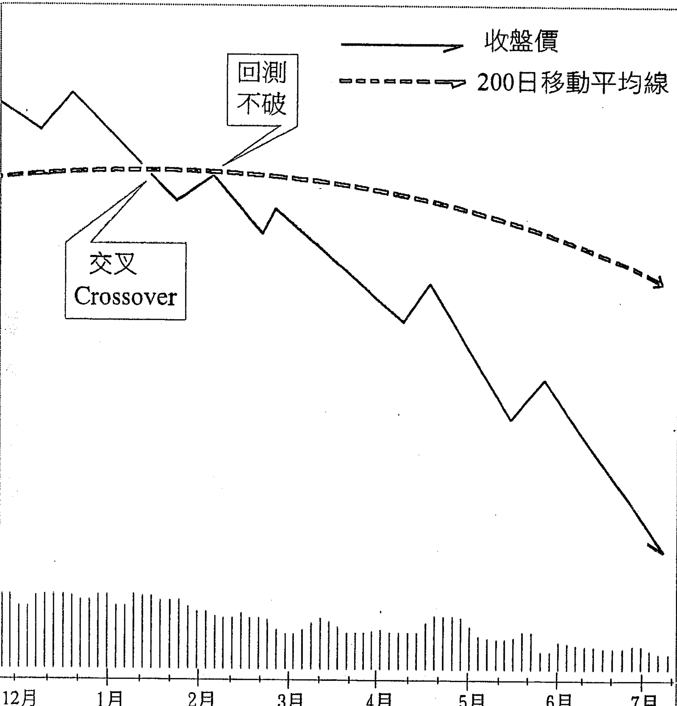

融資融券的投資人，在股價滑落 200 日平均線時，回補先前做多的多單，或是進場賣出放空，以建立新的空頭部位。

## 5 日平均線（週線）

### 5 日平均線超越 10 日線：黃金交叉

> 人愈是分析自己的內在，愈是感到自己的卑微；這是智慧的第一個教訓；人先要謙卑，然後才會變得聰明。——恰寧。

5 日線超越 10 日線是「黃金交叉」的一種，線型發出買進的訊號。

本書的作者，認爲的這是「主升段」的開始。主升段是上漲四段中的第二段，也是漲勢、漲幅最大的一段！

上漲的四階段分別是：
- (1)初升段
- (2)主升段
- (3)再升段
- (4)末升段

投資人在這時買進股票，大多穩賺不賠；如果是遇到大多頭市場的來臨，那麼還有相當大的獲利空間。

### 童年的經歷，大腦的痕跡

拜現代科學之賜，人們看得見大腦內在工作的情形，才瞭解大腦是——凡走過必留下痕跡；生活中發生的每一個事件，都改變了大腦神經迴路的連接。人們常有一些說不出原因的偏好或恐懼，那可能是童年記憶的痕跡。

大腦特別對性命交關的經驗，記得最清楚；只差那麼一點就死亡的恐怖經驗，都會使人這強烈情緒記憶的神經迴路聯結超強，就是所謂「一朝被蛇咬，十年怕草繩」。

在茫茫的股海之中，連老水手都會感到害怕與恐懼；其實，你就緊緊的抓著線索就對了。

### 【5日線超越10日線：黃金交叉】

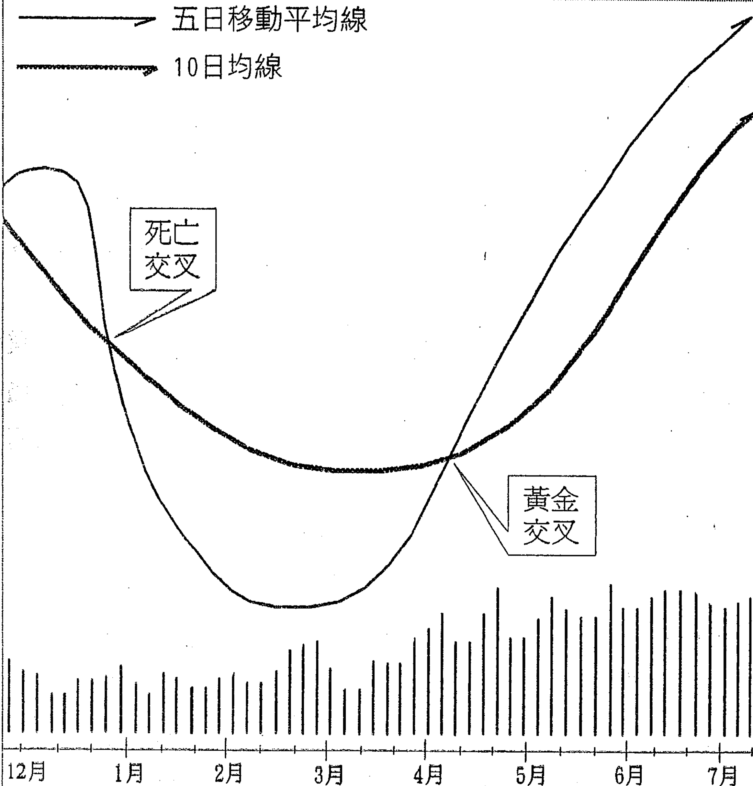

> The woman one loves always smells good. ------ Remy de Gourmont  
自己鍾愛的女人，總是芳香的。——古蒙（1858-1915）

### 5 日線滑落 10 日線 : 死亡交叉

> 水不會停留在山頭，而是朝山谷流；同樣的，真正的美德不會停留在一心爬得比別人高的人身上，只停留在謙卑的人身上。——猶太教法典。

5 日線滑落 10 日線是「死亡交叉」的一種，線形發出「賣出」的訊號。

同時，這也是「主跌段」的開始

價格下降三波段，分別是：
- (1)初跌段
- (2)主跌段
- (3)再跌段
- (4)末跌段

機敏的投資人大多在這時斷然的賣出股票，以保住先前的獲利。

短線的投資人尤其是在這時必須有所動作。

持有高價股的人，這時應該賣出爲宜。

如果是持有相當低價的股票，可以略爲觀望。

#### 確認與背離

5 日均線與 10 日均線一起下跌，兩者互相「確認」（confirmation），可以賣出持股。

如果 5 日均線下跌，10 日平均線上揚，這是形成所謂的「背離」（divergence），不宜進場繼續加碼。

### 【5 日線滑落 10 日線：死亡交叉】

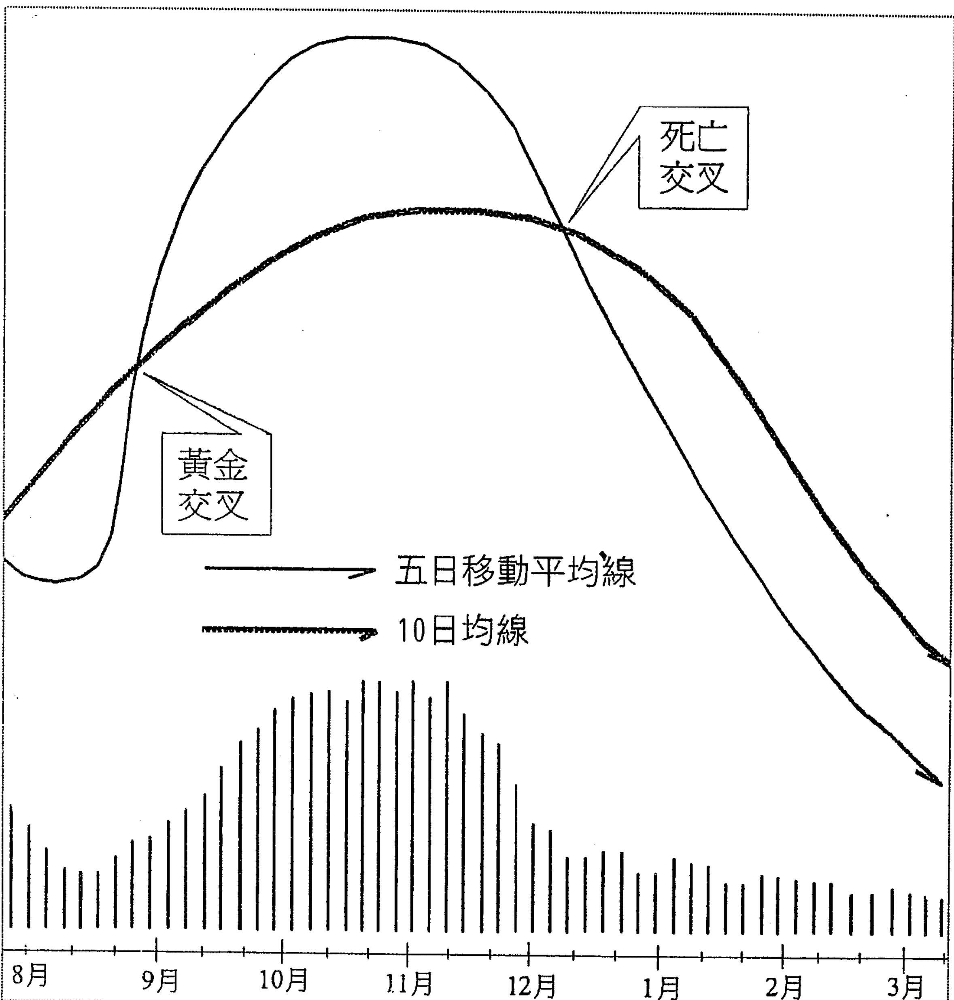

> The measure of a man's real character is what he would do if he knew he would never be found out. - Thomas Macaulay

衡量男人真正性格的準則，是看他在知道永遠不會被發現的情況下，會做些什麼事。—麥考萊（1800-1859）

## 5日線超越 60日線：黃金交叉

履⾏責任與滿⾜個⼈樂趣是兩回事。責任有⾃⼰的法則，即使我們設法將責任與樂趣混在⼀起，兩者還是會⾃⾏分開。——康德

### 【5⽇線超越 60⽇線：⾦⾦交⼗】

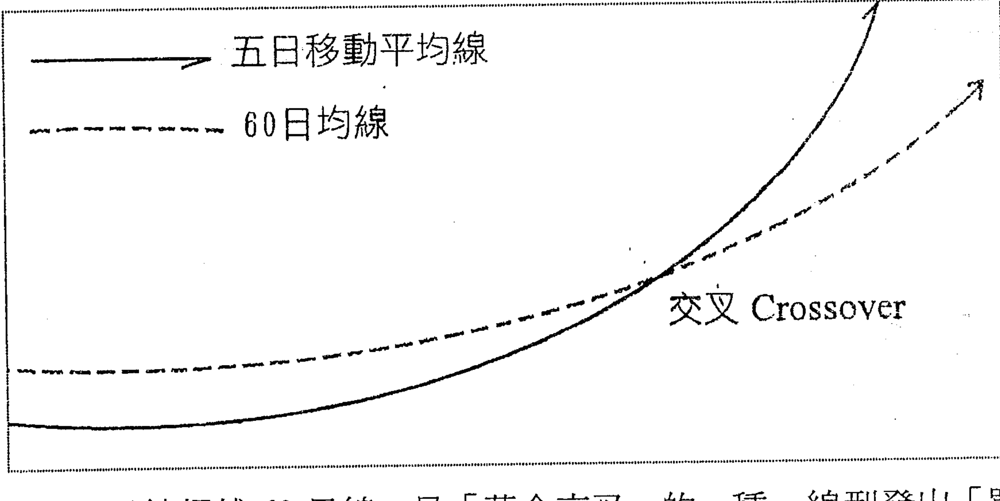

5⽇線超越 60⽇線，是「⾦⾦交⼗」的⼀種，線型發出「買進」的訊號。這是上漲第⼆波的「再升段」的⾏情。

5⽇線穿過 60⽇線，表示漲勢已經開始⼀段時⽇；但是強者恆強，買進還是會賺錢！

> 他就像⼀隻公雞，認為太陽升起的⽬的，只是為了聽牠啼叫！——艾略特（George Eliot, 1819-1873）英國作⼠

## 5 日線滑落 60 日線：死亡交叉

> 如果神能活在我們之間，而永恆也存在，一切都將不同。我們能夠區別善與惡、光明與黑暗，絕望也會消失的。——伊拉斯莫斯（Erasmus）

### 【5 日線滑落 60 日線：死亡交叉】

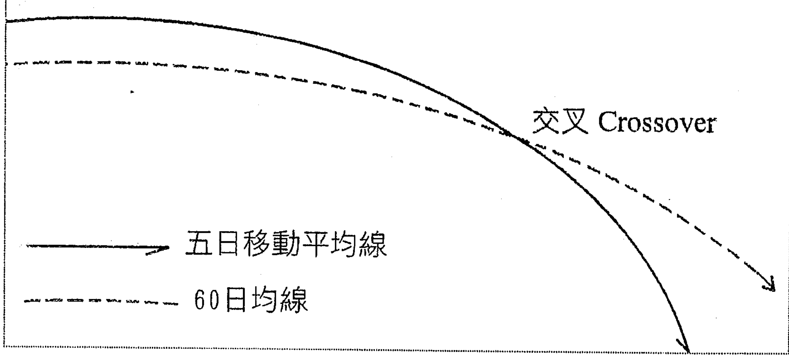

5 日線滑落 60 日線，是「死亡交叉」的一種，線形發出「賣出」的訊號。空頭市場將要來臨，投資人應斷然的賣出手中的持股，不要猶豫。

一般說，這是下跌第三波的「再跌段」的下降。

太陽既會昇起，就會下山；下山之後的黑夜，月亮會躍然而起，起而代之，成爲世界的主角。這是大自然的運行之道；景氣循環也是這樣子，股市也是這樣的週而復始，只是有人「抄底」了，有人「斷頭」了。

## 5 日線超越 120 日線

> 人只有過著敬神的生活，才能讓神高興。外表信仰虔誠的人，如果生活中不能保持善良、清明與謙卑，他便是以虛偽的態度事奉神。——康得

### 【5 日線超越 120 日線】

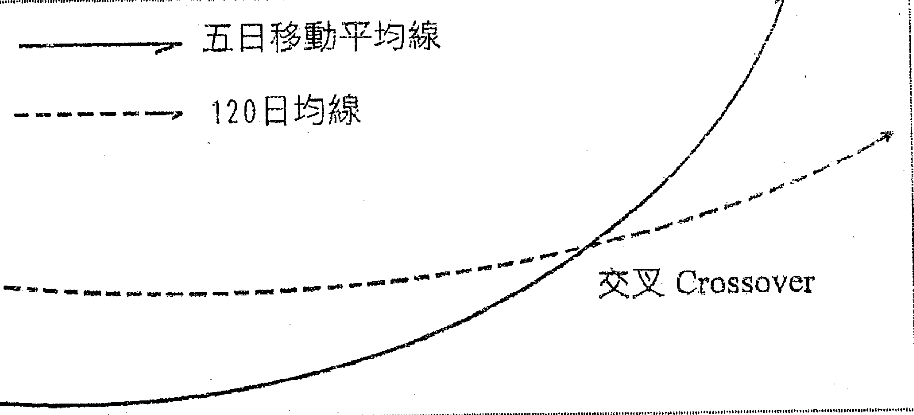

5 日線超越 120 日線，是「黃金交叉」的一種，線型發出買進的訊號。120 日線就是半年平均線，可見這時漲勢已經發動一段時日。投資人要注意的是，這是上漲第四波的「未升段」的開始；漲勢已經有一些時日了！雖然跟進的人還很多，氣勢如虹，但是後面的肉頭確實是有限的，這一點不能不估量在內。

## 5 日線滑落 120 日線

### 【5 日線滑落 120 日線】

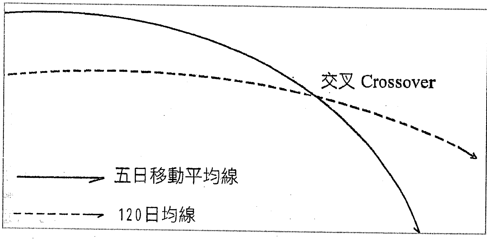

5 日線滑落 120 日線，是死亡交叉的一種，線形發出「賣出」的訊號。

這時股價逐漸走下坡。同時，這也是股價下跌的第四波的「未跌段」的開始。

## 巴菲特：2011 年景氣好 將大舉併購

波克夏公司董事長巴菲特 2011/02/26 在給股東的 26 頁信件中說，他預期今年景氣比去年更好，打算大舉併購，以追求更高報酬率。對於外界期待的交棒計畫，股神說目前有多位執行長人選，他還會再找一兩名投資經理人，但主要操盤手仍是他。

巴菲特開宗明義就向股東報告成績，波克夏在他領導下，A 股和 B 股去年每股帳面價值增加 13%；過去 46 年來，帳面價值從 19 美元成長到 95,453 美元，年複合成長率達 20.2%。

接著他用將近一頁的篇幅，說明去年收購北伯靈頓鐵路公司（BNSF）的收穫豐厚，連他自己都很意外，他形容這樁砸下 260 億美元的收購案，是「2010 年的亮點」。

股神說，會進行「更多重大收購案」，助公司拓展。到去年底為止，波克夏的現金部位已超過 382 億美元。他說，未來的投資重心會在美國；今年 80 億美元的資本支出，有 20 億美元會投入美國。

2010 年 8 月就滿 80 歲的巴菲特，也觸及各界關注的接班計畫。他除了是波克夏的執行長兼董事長外，也是投資長，負責公司超過 1,500 億美元的投資組合。他曾經說過，他過世後，他的工作將一分为三。

巴菲特在信中說，如果找到對的人，公司也許會再增聘一或兩位投資經理人，經理人的薪水將視績效表現而定。但他仍無意減少他現在的工作量，他說「只要我還是執行長，就會繼續管理波克夏絕大部分的資產。」

巴菲特再對股東做心理建設，強調波克夏未來的獲利不會再像過往那麼輝煌，他說公司近幾年的表現，跟標普 500 指數比起來只是「差強人意」，現在管理的資本龐大，很難再有突出的表現。在他掌舵這 46 年中，波克夏僅八年的表現不如標普 500 指數。

他對美國前景抱持一貫的信心，鼓勵大家儘管世局充滿不確定性，但這一路上多少凶險，美國人還不是都走過來了；政客和所謂權威們不斷呱嗒，美國面臨多可怕的問題，但他們都忽視一個最重要的確定因素：人類潛力無窮，而美國的制度正能開發這些無盡的可能，「美國的好日子還在前方。」

巴菲特預估，美國房市大概會在一年左右開始復甦，波克夏也因此加快在房市相關的支出和收購。但他比較不看升利率，表示利率雖然終究會升到足以爲公司投資收益貢獻正常的成長，但這個情況恐怕不會太快出現。 ／2011/02/27

## 巴菲特稱將加強企業併購

股神巴菲特掌舵的波克夏哈薩威公司（Berkshire Hathaway），2011/02/26 上午公布巴菲特每年例行致股東信。股神表明，伯海公司今後將加強併購，以維持非保險類產業成長。

巴菲特說，2010 年伯海公司亮點，是買下北伯靈頓鐵路公司，表現結果比預期更好，今後併購將加強進行。 ／2011/02/27

## 股神釋財報利多

股神巴菲特今天發布眾所期待的年度信函，向波克夏哈薩威公司的股東報喜，表示公司第 4 季獲利激增 43%，至於各界關注的接班問題，他仍多所保留，未提明確人選。

巴菲特（Warren Buffett）表示，併購柏林頓北方聖塔菲鐵路公司（Burlington Northern Santa Fe）的交易，使波克夏公司（Berkshire Hathaway）去年的獲利表現亮眼。

他說，加上遯生性商品等方面的投資獲得 14 億美元帳面收益，使得第 4 季淨利達 43.8 億美元，比前一年同期的 31 億美元成長近 5 成，每股獲利由前一年的 1969 美元增至 2656 美元。同時期波克夏公司的營收成長近 20%，由前一年的 302 億美元增至 362 億美元。

巴菲特在這封 26 頁的年度信函中也談及敏感的接班問題，但沒有透露太多新訊息。他已經 80 高齡，但至今沒有明顯接班人選，投資人都期待這個問題能趕快獲得答案。

他只表示，原先提出的交班計畫並無重大改變，去年秋天延攬的投資經理人柯姆茲（Todd Combs）將先負責 10 億到 30 億美元間的投資金額，公司以後也許會再網羅 1 或 2 位經理人。

他又說，他還擔任執行長時，將繼續管理公司的大部分資金。波克夏公司的資產總額達 1580 億美元。

巴菲特在信中未提及誰可能接任執行長，但表示有些很好的人選。其中最常獲提及的是中美能源控股公司（MidAmerican）的董事長索科爾（David Sokol），巴菲特在信中也對他頗為稱道。

一如往常，巴菲特也發表對經濟的看法，認為美國最好的時光還在後頭，希望美國人樂觀以待，他並預估美國房市可能在大約 1 年時間內開始復甦。而由於波克夏公司坐擁多達 380 億美元現金，將找尋併購的機會。/2011/02/27

## 我「收購」的槍已上膛！

股神巴菲特 2011/02/26 公布其眾所矚目的年度致股東信函，明白表示他將在今年發動大規模的收購攻勢。他說：「我們獵大象的槍已經上膛，而我扣扳機的手指也在發癢。」

巴菲特表示，他的波克夏哈薩威公司去年每股淨值增加 13%，主要是拜其去年初所收購的百靈頓北方聖塔菲鐵路公司（BNSF）業績表現優異所致，這也使得他決心繼續發動收購攻勢。

他表示，波克夏哈薩威公司去年底有 380 億美元現金，意味著在「獵大象」的時侯有足夠的彈藥。他在信函中說道：波克夏哈薩威需要更多大型 (major) 收購案，以增加非保險事業收益。他並且在信中強調「major」一字。

不過，每股淨值增加 13%，增幅還落後標普 500 指數去年上揚 15.1%。巴菲特一向是以擊敗此一指標，做為波克夏哈薩威的目標。

分析師表示，波克夏哈薩威公司在巴菲特帶領下，過去 46 年中，有 38 年擊敗標普 500 指數，然而其遭到挫敗的幾年中，有一半都是在過去 10 年間所發生的（2003 年、2004 年、2009 年與 2010 年），使人不禁有廉頗老矣的憂慮，同時也突顯出去年營收高達 1,360 億美元的波克夏哈薩威公司，由於規模益趨龐大，經營難度也越來越高。

巴菲特在長達 26 頁的信函中雖然觸及最受股東關注的接班問題，然而卻也模糊帶過。他表示，去年稍晚所聘僱擔任波克夏哈薩威策略長的康姆斯會繼續管理 10 億到 30 億美元的投資組合。外界大都猜測康姆斯是呼聲最高的人選。然而巴菲特同時表示，波克夏哈薩威還會再增加到一兩位經理人來幫助他。

不過巴菲特同時也強調，只要他是波克夏的執行長，他就會繼續管理該公司的投資組合，大有暗示他還不會退位的味道。在美國經濟方面，巴菲特表示，美國房市大概會在 1 年左右復甦。而波克夏 2011 年資本支出將由去年的 60 億美元增為 80 億美元，所增加的部位都將投資在美國本土。在巴菲特在公布其信函的同時，波克夏也公布了該公司去年第四季在 BNSF 的挹注之下，獲利較 1 年前成長 43%。／2011/2/27

## 20日移動平均線（月線）

（多空指標線）

> “Home, Sweet Home” must surely have been written by a bachelor. ----- Samuel Butler
>
> 〈甜蜜的家庭〉的這首歌，一定是單身漢寫的。——山繆爾.巴特勒

20 日移動平均線，因為不長不短，所以就成了技術分析的「多空指標」；這意思就是說，20 日移動平均線上揚，就代表股價的趨勢（Trend）向上，而 20 日移動平均線下跌，就代表股價的趨勢（Trend）走空。它是短線投資人從事波段操作的多空指標，買進賣出常常是以它的依歸。

一般說，如果股價滑落 20 日平均線，表示目前的技術面已經轉壞，投資人手中的持股可以考慮暫時出脫。

相對的，如果股價突破（Breakout）20 日平均線，表示技術面已經轉好；投資人的持股可以續抱或是加碼買進。

當 20 日移動平均線由平向上走時，技術面是由空轉多，中期的行情看好。

當 20 日移動平均線由平向下彎時，技術面是由多轉空，中期的行情看壞。

### 谷底反轉的研判

當股價從下向上突破 20 日移動平均線時，投資人可酌量買進；如果是以「紅K線」作突破時，更應買進。

當股價站上 20 日移動平均線時，而 20 日移動平均線是由水準的向上走時，投資人的持股可以增加。

當股價站上 20 日移動平均線，而 20 日移動平均線是向上以 45 度角的上揚時，投資人可以加碼買進。

當股價加速上漲，尤其是明顯的走 45 度角上揚時，股價是有一大波段的行情可期待。而當股價出現「正乖離」的最大時，投資人可以出脫持股；等到拉回 20 日移動平均線，並且 20 日移動平均線同步上揚時才可介入。

### 高檔反轉的研判

當股價由上往下滑落 20 日移動平均線時，投資人應將持股減碼。如果股價是以「黑K線」滑落時，投資人更應減碼。

股價在 20 日移動平均線之下，而 20 日移動平均線由水準走勢轉向向下時，投資人的持股可再減碼；或是酌量的放空。

股價在 20 日移動平均線之下，而 20 日移動平均線呈 45 度角的下滑時，投資人可以出清手中的持股；或是擇機放空。

如果股價加速的下滑，尤其是呈 45 度的快速陡降時，投資人應在股價的「負乖離」最大時，進場搶反彈的機遇；等到反彈到 20 日移動平均線，而 20 日移動平均線趨勢（Trend）仍然下彎時，再行出脫手中的持股。

> The most beautiful thing we can experience is the mysterious. It is the source of all true art and science.------Einstein, "What I Believe"
>
> 我們能體驗的最美好的東西——是神秘的事物；它是所有真正藝術和科學的來源。——愛因斯坦，〈我的信仰〉

## 20 日線超越 60 日線

> 如果你認為在不斷求知的道路上可以稍作停留，你就大錯特錯了！我們接受的生命不是要讓我們來讚美的，而是我們不斷找尋藏在我們身後的新真理。——米爾頓（John Milton）

20 日線超越 60 日線，是「黃金交叉」的一種，線型發出「買進」的訊號。市場老手會抱緊他的持股，等待市場的持續漲升，以獲取更大的利潤。

20 日線穿過 60 日線，股價進入「再升段」的階段。可以買入持股。經驗老到的投機客會緊抱「買單」，等待市場的探底，以獲取更大的利益。

### 確認與背離

20 日均線與 60 日均線一起上揚，兩者互相「確認」（confirmation），可以賣出持股。

如果 20 日均線上揚，而 60 日平均線下挫，這是形成所謂的「背離」（divergence），市場有雜音，混亂之中，價格的走勢不明，因此，不宜大舉進出。

【20日線超越60日線】

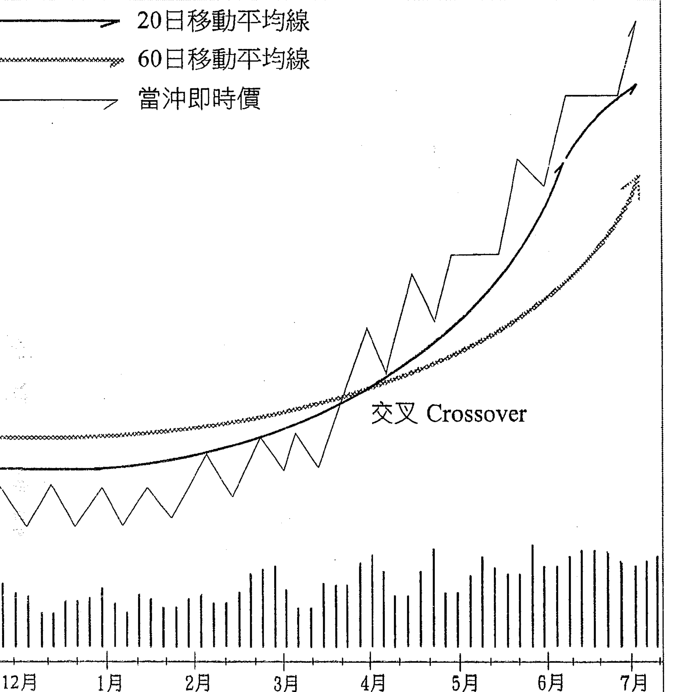

買進高價股，不必害怕；強者才能恆強。

> A good husband is never the first to go to sleep at night or the last to awake in the morning. ------ Honore de Balzac
>
> 一個好丈夫，絕不會晚上最先睡覺，早上最晚起床。——巴爾袮克

## 20日線滑落 60日線

> 傳達真理的惟一方法是親切地說出來，只有可親的人說出來的話，才會被聽進去的。——梭羅

20日線滑落 60日線，是「死亡交叉」的一種，線形發出「賣出」的訊號。

這時股價已經下跌進入「再跌段」的階段。

20日線滑落 60日線時，股價的跌勢已成，後面常常還有一段跌勢呢？經驗老到的投機客會緊抱「空單」，等待市場的探底，以獲取更大的利益。

### 確認與背離

20日均線與 60日均線一起下跌，兩者互相「確認」（confirmation），可以賣出持股。

如果 20日均線下跌，而 60日平均線上揚，這是形成「背離」（divergence），市場有雜音，混亂之中，價格的走勢不明，因此，不宜大舉進出。

### 掌握主流股

新手不懂市場「主流股」的觀念，常常會去挑那些潛伏型、漲得較少的個股；而對於已經漲了一段，或是創新高的個股，出於居高思危，怕買貴了而敬謝不敏；可是，令新手扼腕的是，漲起來的股票愈會漲，還沒漲的股票，總是間風不動；就那麼一點點資金，押在上面，不動也是枉然。

【20 日線滑落 60 日線】

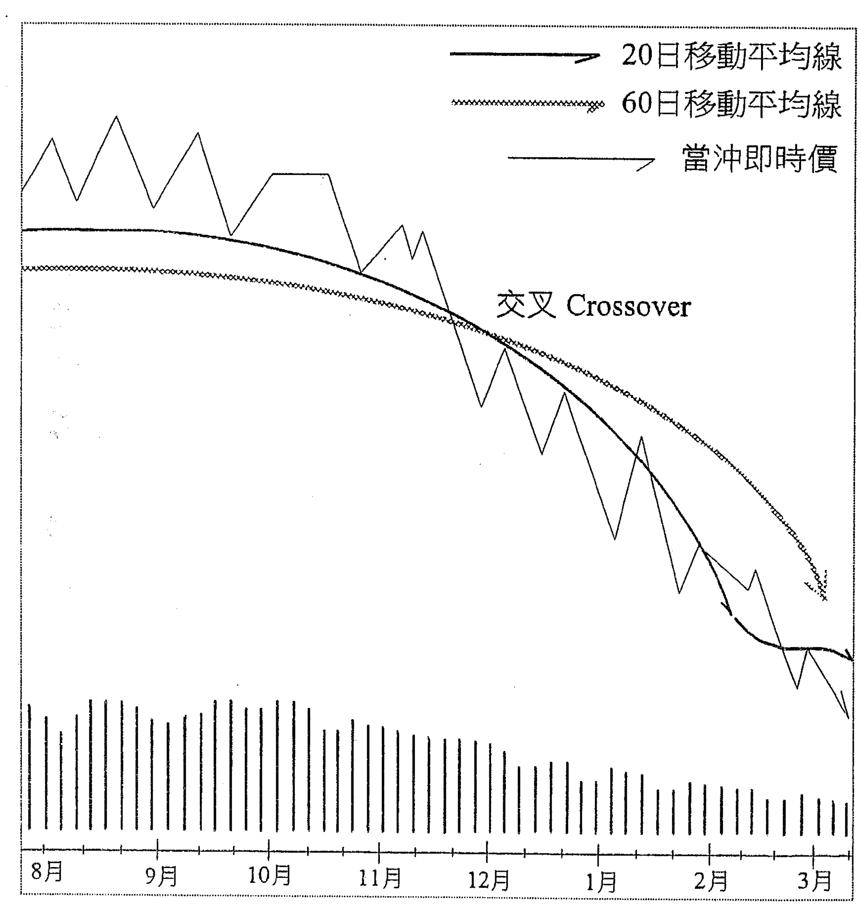

操作成功的關鍵，是在於「發動點」的掌握。

## 即時價超越 20 日線

> 我們太過於習慣相互說謊，以至於也開始欺騙自己。——拉侯許弗柯（Francois de la Rochefoucauld）

即時價超越 20 日線，是「黃金交叉」的一種，線型發出「買進」的訊號。市場老手會抱緊他的持股，等待市場的持續漲升，以獲取更大的利潤。

即時價穿過 20 日線時，股價進入「再升段」的延伸波的階段。經驗老到的投機會緊抱「買單」，耐心的等待市場的下一次的探底，以獲取更大的利益。

### 確認與背離

即時價與 20 日均線一起上揚，兩者互相「確認」（confirmation），可以賣出持股。

如果即時價上揚，而 20 日平均線下跌，這是形成「背離」（divergence），市場有雜音，混亂之中，價格的走勢不明，因此，不宜大舉進出。

> After forty, men have married their habits, and wives are only an item in the list, and not the most important. ------ George Meredith
>
> 四十歲以後，男人就和習慣結了婚，妻子只是其中一項，而且不是最重要的一項。——梅瑞迪斯（1828-1909）

## 即時價滑落 20 日線

> 要想請求神的援助，必須學習如何在自己身上找到援助。神不會改變我們，我們必須藉著接近祂來改變自己。大家都請求祂來援助，彷彿必須幫助我們，但到最後卻是我們求助於自己。——盧梭（Jean Jacques Rousseau）

即時價滑落 20 日線，也是「死亡交叉」的一種，線形發出「賣出」的訊號。

即時價滑落 20 日線，股價逐漸進入下跌的「再跌段」的延伸波的階段。

### 確認與背離

即時價與 20 日均線一起下跌，兩者互相「確認」（confirmation），可以賣出持股。

如果即時價下跌，而 20 日平均線上揚，這是形成「背離」（divergence），市場有雜音，混亂之中，價格的走勢不明，因此，不宜大舉進出。

> 愚人應該少開口；但是，如果他知道這一點，他就不笨了！——沙迪

## 第五號屠宰場

- We cannot always build the future for our youth, but we can build our youth for the future. 我們不能總是為我們的青年造就美好未來，但我們能夠為未來造就我們的青年一代。——富蘭克林·羅斯福（Franklin Delano Roosevelt）

德裔美國作家馮內果（Kurt Vonnegut，1922~2007）說：「善，沒有理由戰勝不了惡；只要天使們——能像黑手黨那樣組織起來。」只是，散戶們是烏合的貪婪之眾，他們也不算是天使；他們總是被董監事們屠宰。有人類比說證券市場是地球上最大的賭場，也算是對啦，但其實也是一個最大號的屠宰場。

- 《冠軍早餐》——以虛構的科幻作家 Kilgore 的許多荒誕的短篇小說和他的遭遇，對人類的生存狀態進行冷嘲熱諷，但在戲謔中充滿著作家嚴肅的真誠。他是以後現代主義的創作手法著稱，描寫了作者本人「進入小說干涉結局」的場景。全書充滿著馮內果的個人風格，堪稱該風格的代表作。
- 《囚鳥》——以一個人的遭遇串起美國 20 世紀中期各個重大事件，包括麥卡錫主義、水門事件等，揭露美國社會的黑暗一面。
- 《第五號屠宰場》（1969）——黑色幽默的類科幻作品，以二次世界大戰中遭盟軍轟炸的德國城市德勒斯登（Dresden）的慘狀擬題；在社會上引起爭議，曾多次遭禁；後來――成爲黑色幽默的反戰作品中的經典。
- 《時震》被馮內果本人聲稱該書爲封筆之作。寫的是時間突然倒回了十年，而所有人不得不把這十年裏發生的事情一模一样的再做一遍。《冠軍早餐》中的 Kilgore 再次在這裡出現，用他的短篇小說爲作者「代言」。

散戶大眾進場之後，很快的就被套牢而變成「囚鳥」，之後再時「時震」一下，就認賠殺出。如果還不肯出場，將變成董監事的「冠軍早餐」，遇到虧損減資的公司時，還要被送進「第五號屠宰場」的。

因此，選擇成交量大個股，隨時可以進出的；選擇有配現金的個股，才不會變成董監事的早餐的。買進的時點，可以跟著移動平均線進出的。

- No man can sever the bonds that unite him to his society simply by avverting his eyes. He must ever be receptive and sensitive to the new ; and have sufficient courage and skill to novel facts and to deal with them .
人經過努力可以改變世界，這種努力可以使人類達到更新的、更美好的境界。沒有人能夠閉目、不看社會現實就能割斷自己與社會的聯繫。他必須敏感，隨時準備接受新鮮事物；他必須有勇氣與能力去面對新的事實，解決新問題。——富蘭克林.羅斯福（Franklin Delano Roosevelt）

## 多頭上漲的階段

> 只有言辭勝過靜默時，才可以開口。——阿拉伯諺語

### 下飄旗形（Flag）：平行四邊形

> 除非曾親經歷相同的處境，否則絕不要責怪你的鄰人。——猶太教法典。
>
> 要在很多事情上寬恕別人，但不要在任何事上寬恕自己。——西魯斯（Publilius Syrus）

「修正的下跌旗形（Flag）」是一種上漲的連續型態（Continuation pattern）。

股價在上升的過程當中，出現一個平行四邊形的整理形態；而原先上漲最多的波段，就好像是一根旗杆；整理區間的漲跌幅，都未能超出旗杆的最高與最低價，它就稱為「上飄旗形」。相對的，在下降過程中出現的旗形整理，就稱為「下飄旗形」。

在股價上升或下跌的行情途中，旗形（Flag）是一種比較常見的整理形態。在股價下跌的過程中，有時候都會見到下降旗形的整理形態。

下降旗形的結構是由左上往右下延伸的區間軌道；在這軌道之間形成一波比一波低的盤整格局。

因為是區間的整理，所以投資人只能隨機應變，在軌道內操作，來回賺取股票的差價！

旗形原先急速上升或下跌的行情，可看成是整個旗形的旗桿；通常整個旗形完成之後的繼續上升或下跌的行情，至少會相等於旗桿的幅度。

【修正的下跌旗形（Flag）】Continuation patterns

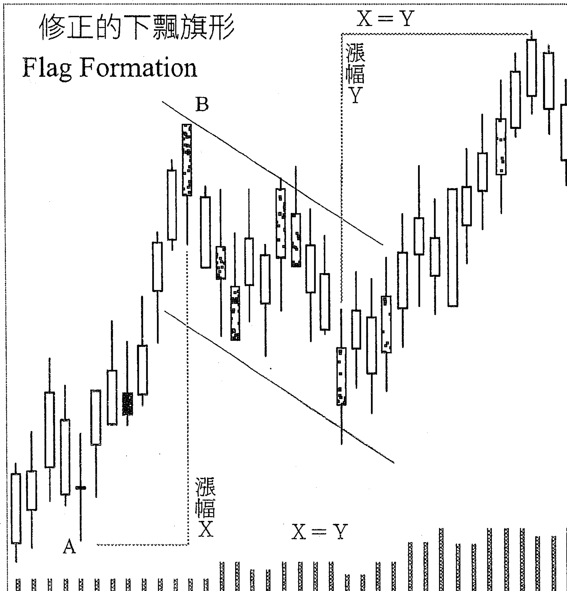

### 上升菱形修正

【上升菱形修正】Continuation patterns

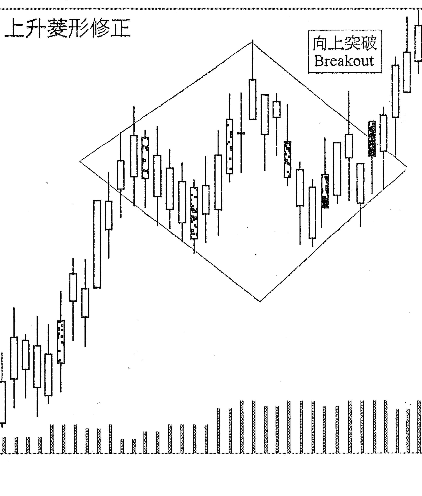

理想存在你身上，阻撓實踐理想的障礙也同樣存在你身上。你已經擁有創造理想自我的所有材料。——卡萊爾

「上升菱形修正」是一種上升的連續型態（Continuation pattern）。

菱形修正圖形，類似某種狀態的「三重頂」、或是「三重底」的形態；因為它的形狀類似鑽石，所以又稱為「鑽石修正」。

不過，它的「頸線」不像其他圖形的橫直線，而是呈V字形線。

菱形修正圖形，很少出現在底部反轉，通常都出現在中級下跌前的頂部、或是大成交量的頂點。

菱形修正，其實是由一個「對稱三角形」和一個「縮小三角形」合併形成的。

在菱形修正內的股價波動忽高忽低，動盪激烈，所以它是顯示市場走勢非常的不穩，是一種大起大落的市場型態。

菱形修正圖形的時間持續，可大可小；它是一種合乎宇宙自然的地震震波的模型；只是一般華爾街的分析师並不瞭解它的準確度而已！

### 騙線：向下楔形修正

【向下楔形修正】Continuation patterns

下降角度陡又急
很像是一種騙線

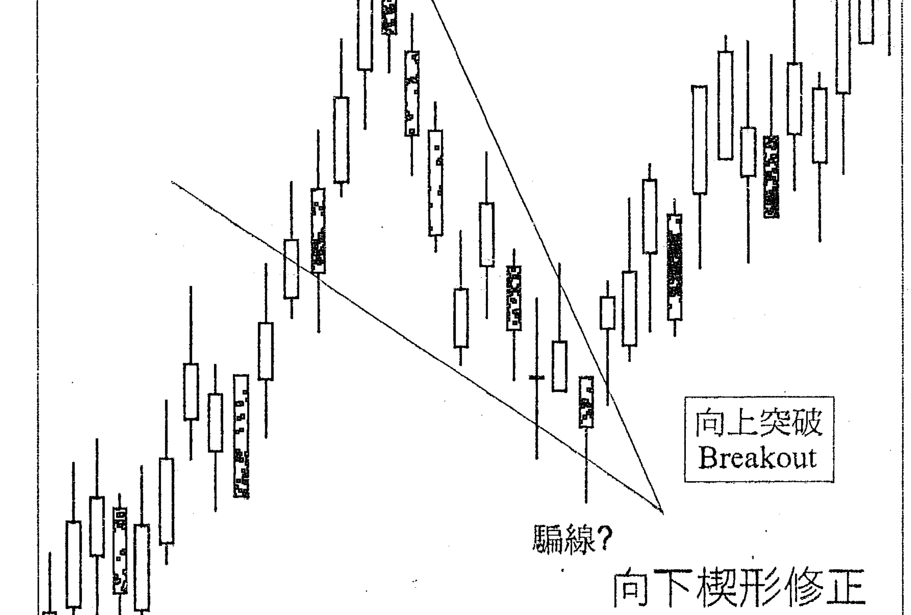

向上突破
Breakout

向下楔形修正

> 不斷聆聽人談論自己的人，絕對找不到內心的寧靜。——拉布瑞耶（Jean de La Bruyere）

「向下楔形修正」是一種上升的連續型態（Continuation pattern）。「楔」原來是指插入木樁或空洞中，作固定作用的上平下銳的木楔。楔形走勢是指股價在兩條逐漸收斂的直線間移動，從平而轉向尖的緩慢移動格局。

當兩條逐漸收斂的直線向上傾斜時，稱之為上升楔形；兩條逐漸收斂的直線向下傾斜時，稱之為下降楔形。

當股價在上升楔形走勢時，每一個上升波幅都比前一個來得微弱，而且成交量也是遞減；這就表示買方力道不強，只是因爲賣方一時的力道也是有限的情況下，股價因而緩慢上升！如果，股價緩慢的上升到某一頂點，股價無法繼續突破，成交量又明顯的萎縮時，股價就會轉入另一下跌的行情中。

### 很像是一種騙線

這上升趨勢中出現的向下楔形修正，因爲下降的角度陡急，所以很像是趨勢的改變；有的投資人以爲市場已經要從上升趨勢改爲下降波動的了；他們很緊張，就將持股賣光了！

但是，在向下楔形修正走完之後，市場神奇的叉回到多頭的走勢，讓那些過敏的投資人氣得跳腳。

### 上升軌道線：牛市的特徵

【上升軌道線（channel line）】Continuation patterns

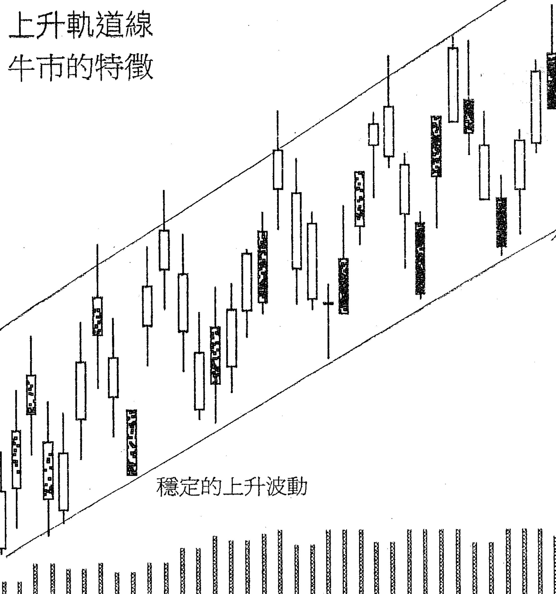

> 生命的正途只有一條，我們早晚都要在這一條路上相逢。
> 這一層共識明確地嵌在我們心上，路則又寬又容易找到。
> 神就站在路的盡頭，召喚我們走向祂。看到有人錯失生命的正途，走到另一條路是很痛苦的事，因為另外一條路是死亡之路。——果戈理

「上升軌道線（channel line）」是一種上升的連續型態（Continuation pattern）。在多頭市場之中，一波是比一波高；在空頭市場之中，是一谷比一谷低；這也是道瓊理論的精華，請參看《道氏理論K線》一書。

軌道線（channel line）也是技術分析的重要工具。在上升的行情中，高點與高點相連，低點與低點相連，就成了上升軌道。軌道可以作為投資人的參考：股價通常都在這一軌道內運動，有的精明的投資人，就在軌道區間內「低買高賣」，賺取差價！

股價如果在軌道內運動，可以這樣的理解：這一段時間內，沒有特殊的利空或利多消息，大盤顯得有點兒沉悶；大部分的投資人操作趨向保守，常常是逢高就出脫持股，逢低又進場補回。

一般說，軌道線最理想的角度是 30 度；太陡峭的軌道線常常無法持久，隨時都有反轉的可能。

在軌道線圖形的操作上，原則上，是逢壓力線就賣出股票，遇到支撐線就買進股票，來回操作。

### 戀愛墳墓讓人套牢

——————買進、套牢、煎熬、心死、最後是賺錢

我說：愛情是遊戲，婚姻是工作；愛情約會是在玩的，愈是幼稚的人愈愛玩，愈不喜歡嚴肅帶壓力的工作。

買賣股票的金額龐大，不是兒戲；選股是眾裡尋她千百度，看上了，才買進的；可是之後，實在是讓人失望透頂的。

文學家錢鍾書在《圍城》一書之中，藉著男主角方鴻漸表達他對於婚姻的看法：「結婚以後，你總發現你娶的不是原來的人，換了另一個人。」

不過，就像《傅雷家書》所說的：「對於終身伴侶的要求，正如對人生的要求一樣，不能太苛。」

買賣股票也是這樣子；即使你所買進的是績優股，你一樣得飽受煎熬；不能在廚房忍耐的人，都會虧損出場約。

證券市場上的贏家，是屬於耐性十足的人！

許多過來人回憶說：在經歷痛苦煎熬的「養套殺三部曲」之後，死不認賠的人，竟然也能翻倍賺錢的。

## K 線的頭部型態

> No man is an island entire of itself. ----- John Donne
>
> 沒有男人是一座完全屬於他自己的孤島。——鄧恩（1572-1631）
>
> 兩個靈魂結合在一起，在彼此的工作、成就與不幸中相互支援，直到最後告別的靜默時刻降臨，這是何等美妙的事。——艾略特（George Eliot）

頭部型態是屬於最可靠的原始反轉型態。

在多頭市場的末期，因為作手或大戶出貨的最後階段，時常會出現一些反轉的型態。

從出貨的時間快慢來區別：以 M 字頭（double tops）和天井型（invert true）最快；頭肩型（head-and-shoulders）和圓頂型（rounding tops）的時間較慢。

不論是 M 字頭、天井型、頭肩型、或是圓頂型，這些都是多頭市場要結束的徵兆。

伍克夫（Peter Wyckoff）是 1960 年代華爾街的著名分析師；他認為：「市場中最嚴重的虧損，來自於無知的人們買進價格嚴重高估的股票！」

中文的投資學上有「勢不可用盡，福不可享盡」的說法，通常投資人在頭部的階段最是好玩，每天都能盡興而歸，但要提防的是有一天可能會「敗興而歸」！

> Men lose more conquests by their own awkwardness than by any virtue in the woman. ----- Ninon de Lenclos
>
> 男人失去戰利品，是爲自己的笨拙，而非女人的美德。——李克羅

# 頭部盤整：價格的天花板？

打底百日，頭部三天

## 【頭部盤整：價格的高原？】

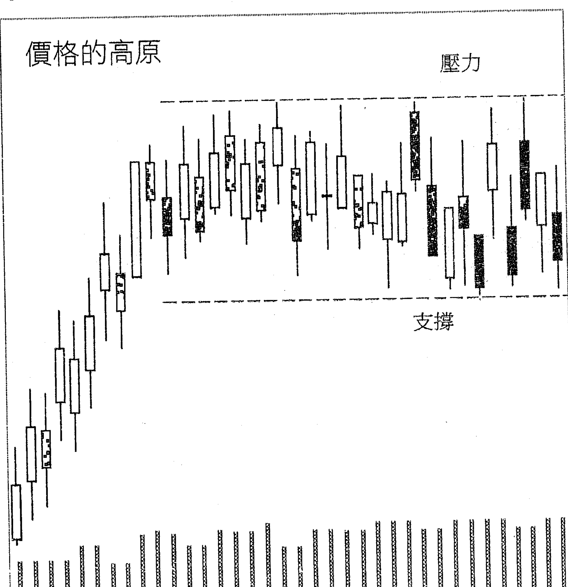

不僅要談論美好的生命，更重要的是去做好事。——猶太教法典

通常，盤整是一種橫向的整理，時間長短不一定！不過，屬於頭部的盤整時期，是比較短的；來得急，去得快！

頭部盤整，是股價在支撐線與壓力線之間，來回運作。

伍克夫（Peter Wyckoff）是1960年代華爾街的著名分析師；他認為：「如果一個市場部位，主要是依賴著希望，應立即賣出！」

純粹是靠心理因素支撐的行情竄升，很難逃過傾倒的財務重力法則！不合理的高價，或許可以持續經年，但究竟還是得反轉，就像地震突然到來一樣；大震來得愈突然，行情愈瘋狂，產生的後遺症愈多！

在土崩瓦解的過程中，不顧一切的「築夢者」中，很少有人有足夠的機智，能預期反轉，而沒有遭到嚴重的損失！

# 市場往何處去？

市場往何處去？有時是高還要更高，強者恆強；不要天真的以為市場就要下跌的了！

> The burden of this world is too great for one man to bear, and the world's sorrow too heavy for one heart to suffer. — Wilde, "The Young King"

這世界的擔子太重了，一個人承擔不起；這世界的悲傷太沉重了，一顆心承受不了。——王爾德《年輕的國王》

# 尖山頂（突兀型態）

V Top or Spike Tops Pattern

## 【尖山頂（突兀型態）】上漲遇到價格的天花板

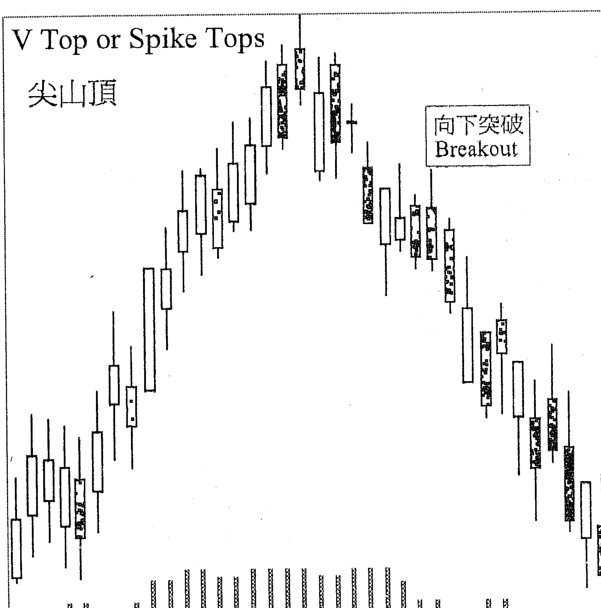

尖山頂（spike Pattern）活像是個△尖山形，也有的人稱之為「島形反轉」。是在急速上升、急速下降的強勢行情結束時，比較容易看到的反轉形態。

尖山頂（突兀型態）是最難處理的行情反轉排列之一；因為它的整個結構呈 V 形或△形，幾乎沒有任何的過渡時期。這種急劇變動的型態發生在過度延伸的行情末端，因為突發的利空或利多而導致行情的突然反轉。識別△形的反轉，在日線圖與週線圖上，成交量的暴增，可能是唯一的警訊！

在實際的市場中，推測投機股或題材化為泡沫的個股，比較容易產生有這樣急劇的反轉型態。

# 突兀高點

突兀高點（spike high）是否為本波股價漲勢的頭部呢？通常有下列幾項條件足以強化它的頭部的機率：

- (1) 是當天的高價顯著的高於之前與後續幾天的高價。
- (2) 一般說，突兀高點的收盤價大多收在當天的低價附近。
- (3) 而在突兀高點發生之前，大多曾經出現有顯著的漲勢。

> We have chains, though no eye beholds them; and we are slaves, though men call us free. — Wilde, “The Young King”

> 我們鎖鏈在身，雖然沒人見到；我們身爲奴隸，雖然人們認爲我們自由。——王爾德《年輕的國王》

# 雙重頂 (Double Top Pattern)

## 【雙重頂 (Double Top Pattern)】上漲遇到價格的天花板

雙重頂 (Double Top Pattern) 是屬於常見的反轉型態，它發生的頻率僅次於頭肩形態，而且非常容易辨識。就基本性質來說，雙重頂與三重頂相似，唯一的差別在於峰位的數量是三個與兩個罷了！成交量型態與目標價位的衡量方法也大多類似。

股價在經過一段的漲升到 B 點，這是第一高峰；之後，多少都會回跌（可能落在 C 點），成交量跟著縮小；然後再跟著上升到另一個高點 D 點，這是第二高峰；之後，在這一高點之後，股價可能就開始下挫，完成了雙重頂。

雙重頂 (Double Top) 的形状，活像是英文的字母 M，所以我們也稱它為「M 字頭」。

通常，M 字頭的主峰並不明顯；兩個波峰的高度是相當，在嘗試著向上突破時，遭遇到賣壓；在第二高峰之後，成交量是一波比一波的低，這是表示買盤的力道逐漸枯竭了！雙重頂的主要特色之一，是第二個頂的成交量遠低於第一個頂。

一般說，股價的跌幅必須在頸線價格的 3% 之下時，M 字頭才算是確立的；否則可能只是盤整而已！

任何價格型態的規模，都是重要的參考；雙重頂的兩個峰位之間的時間差距愈長，型態愈是高大，那麼它反轉的可能性就會愈高。以上的這樣的一個評語，大體上適用於大部份的價格排列。

大多數的雙重頂，它們的兩個峰位之間至少要跨越一個月的時間，甚至是兩三個月。在某些長期的週期圖或月線圖中，雙重頂的型態可能涵蓋數年之久！

雙重頂（底）的排列，可能延伸成三重頂（底），甚至是四重頂（底），或是更複雜的排列。

## 反彈的逃命線

M 字頭的最後一段，被稱爲是「逃命線」——因爲這是股價的可能的最後一次高點的反彈，價格逼近頸線，但無法超越頸線；這時，不走就要重度的套牢了！經過逃命線之後，觀望的投資人大多是以套牢收場。

> 你哭著來到人間！但周圍的人爲你的誕生歡欣。你必須善加把握生命，在你離開世界的時候，讓別人圍著你哭，而你卻含笑離去。——印度格言

## 標準型態的變型

投資人在市場上遭遇的例子，往往與教科書上劃的標準型有所不同。雙重頂的兩個頭部的位置不必全然相同，它的兩個峰位的價格未必完全相同；如果第二峰位稍低於第一個峰位，那應該不構成識別上的困難！但是，如果第二峰位稍高於第一峰位，就比較麻煩了！因爲這是屬於繼續走高的峰位，上升趨勢（Uptrend）似乎仍在發展中。爲瞭解決這個問題，投資人大多求助於濾網的原則。

## 3% 貫穿準則

第二峰位如果貫穿第一峰位 3%以上，就已破壞了雙重頂的型態了！

## 兩天法則

第二峰位連續兩天的收盤價都穿越第一峰位，這才算是有 效 的穿越。那也是壞了雙重頂的型態了！

# 【價格回歸基本面】像拋物線一般的下墜

# 只會漲、不會跌的神話

## 頭肩頂型態 Head and Shoulder Top Pattern

## 【頭肩頂 Head and Shoulder Top Pattern】 上漲遇到價格的天花板

頭肩頂
Head and Shoulder Top pattern

市場價格呈現出一個「山」字型，而成交易量是依序的遞減，這是構成頭肩型的標準的特色。

頭肩頂（Head and Shoulder Top Pattern）是最常見的頭部型態，它是由多翻空的反轉類型；它是最著名與最值得信賴的反轉型態，其它許多的反轉型態，基本上是頭肩型排列的變形。

在市場的上漲趨勢中，一系列持續上揚的峰位與谷底逐漸喪失動能；價格漲勢趨於平坦，買賣雙方的力量大體上是處於平衡的狀態。一旦「出貨」階段完成之後，價格滑落橫向交易區間下線的支撐，就出現了新的下降趨勢（Downtrend）！

在股價創下一個高峰之後，下一波遇到阻力，未能持續的創下新高點，並且成交量也顯然因爲投資人的居高思危，而依序減碼；因此，分析師以爲：這是一種典型的下跌的訊號。

市場行家將兩個低點價位連成一條直線——就是頸線；一旦價格向下跌破這一條頸線，加上後來的反彈無法突越這一條頸線之時，這是代表原爲支撐的線，已轉變成爲阻力線的，股價的跌勢，這時就已經被確認了！

### 頭肩頂的成交量

一般說，右肩所形成的成交額如果下降，那麼這種頭肩頂的可靠性，就更爲準確的了！市場的操盤人的獲利關鍵在於——是否能準確的猜中之後的走勢；如果能夠猜中，配合大的買單，就是致勝的關鍵。

這頭肩頂型態在完成之後，向下滑落頸線之時，它的成交量不一定會擴大；但日後繼續下跌時，成交量就會擴大。

### 頸線（Neckline）

在整段股價的走勢中，左肩折點與右肩折點連成一線，就是所謂的頸線；頸線可能成水準線，或是向上或向下傾斜！不過，大部分的頭肩頂排列的頸線都呈稍微的向上斜伸。如果頭肩頂的頸線向下傾斜，這是價格弱勢的表現。

在價格滑落頸線的過程中，成交量應該放大；可是，在這一頭部完成的最初的階段中，成交量顯著放大並不是絕對必要的條件。在股價滑落頸線時，投資人應立刻停損出場，保住先前的獲利！要確保投資人的獲利，留往青山，尋找另一個機會，就得避險停損。

美國股市的專家威廉·歐尼爾在《笑傲股市》一書中語重心長的說：股票虧損 15%時，就得立刻停損，並且出場休息。市場行家以爲，其虧損超過 10%時，就該離場的了！做股票的人，都知道操盤的原則是「慢慢獲利，快快停損！」

在完成頭肩頂的型態之後，都還有一次的反彈波動；可是反彈的高點仍未能向上突破頸線的壓力的話，這是最後逃命的機會，有的分析師稱這是「逃命線」；市場老手建議，這時可將手中持股全數出脫的。

# 只會漲、不會跌的神話

1980 年代末到 1990 年初的日本泡沫經濟時期，充滿著各種房價、股價「只會漲、不會跌」的神話。這種神話創造出不少令人咋舌的記錄；例如，在 1985 到 1988 年短短三年之間，東京商業房產價格上漲二倍，中央區上漲三倍。全日本的房地產總值從 1985 年的 1004 兆日圓，增值到 1990 年的 2389 兆日圓。這個數字是當時全美房產價值的四倍；可是，日本的國土面積，卻只有美國的廿五分之一。

在最高峰時，東京的房產價值，就抵過全美國的房產價值；皇宮周圍房產價值就超過整個加州。

泡沫的結果呢，泡沫經濟破滅，房價與股價持續下挫。十年之間，日本房價下跌五到七成；股價是腰斬再腰斬，從近四萬點跌到一萬點。

美國在 2008 年金融海嘯前，也充斥著房價只漲不跌的神話，銀行房貸可以超過目前價值，「因為一定會漲嘛！」

那種只要會簽名，即使無穩定工作、收入的人，都可以貸款，這點跟日本泡沫經濟時倒是很像。在 2002 到 2006 年之間，美國房價平均漲了 50%。結果，金融海嘯一來，眾人紛紛沒頂，房價較高時期下挫二到三成以上。

有人嘴硬的說兩岸三地房市——只會量縮不會價跌。這是缺乏說服力的。房價決定因素，其實不外供需兩方強弱。資金寬鬆、利率走低、民間普遍預期房價會持續上漲，不論自住者、投資者、短期投機客，紛紛加入購屋行列，當然會推升需求，直接間接的造成價格持續上漲。資產泡沫也在熱烈的追求中形成，一直要到最後無以為繼時，才會崩盤破滅，直速反轉向下。

> 環顧左右，世上的人都想些什麼？他們什麼都考慮到，除了最重要的事。他們想到跳舞、音樂與歌唱；他們想到房子、財富與權力；他們嫉妒富人與國王的財富，但他們從未想到身而為人的意義。——巴斯卡

# 三重頂（Triple Top Pattern）

## 【三重頂（Triple Top Pattern）】上漲遇到價格的天花板

> 攻擊是為了撤退，拉抬是為了出貨！——台灣的雷伯龍
> 最完美的人，是不計較好壞地去愛鄰居的人。——穆罕默德

三重頂（Triple Top Pattern）是屬於頭肩頂的變形，但相當罕見。主要的差別是在三重頂有三個峰值。

對於某些價格究竟是屬於三重頂還是屬於頭肩頂，技術分析師常常有著不同的看法；不過，這些爭議只有學術上的價值，事實上，三重頂與頭肩頂的意含非常相像。

每一個峰值的成交量通常都會遞減；但是如果向下突破應該伴隨著巨量。當價格向下突破三個峰值所夾的兩個谷底的連接支撐，三重頂的排列就告完成。

- 超漲高價倒貨，超跌大戶進補

市場為何漲了再漲，看回不回？

市場又為何跌了又跌，該回不回？

證券市場因為大戶的炒作而超漲，大戶的擠壓而超跌；「超漲」的目的，是要以不合理的高價倒貨給散戶大眾；擠壓而超跌的目的——是要散戶吐血認賠，吐出持股，方便大戶撿便宜的承接股票。

> 可能與不可能之間的差別，在於一個人的決心。——湯米·拉索達

> 人的內心的激情——有如蜘蛛網，起初只是外來的訪客；然後變成固定的賓客；最後更是喧賓奪主的當起主人了！
> ——猶太教法典

# 圓型頂（Rounding Top Pattern）

碟形頂（Saucer Top）

——高原最後還是會崩落的！

## 【圓型頂（Rounding Top Pattern）】上漲遇到價格的天花板

圓型頂（Rounding Top）與碟形頂（Saucer Top）的區別是依照它們的弧度大小；弧度平滑的，我們稱爲「碟形頂」；弧度深圓的，我們稱爲「圓形頂」。從經驗上看來，「圓形頂」發生的機率高於「碟形頂」，理由是價格頭部的時日比較不容易長久，所謂「打底百日，頭部三天」是也。

「圓形頂」的特徵，就是股價變動的走勢，呈現弧形的走勢；同時，成交量也隨著弧形的走勢而增減。乍看之下，還以爲它是一種橫向整理（sideway trend）呢！

「圓形頂」的股價，在到達頂點之後，空頭並未明顯的使力，股價的下降，是呈緩步下跌的情況！多空之間的買賣都顯得意興闌珊。

在經驗裡，股價滑落頸線之後，會有小幅的反彈；不過，隨後就是一瀉直下了！

圓形頂與圓形底是兩種比較少出現的反轉型態；它也是一種較慢而逐漸改變方向的价格變動型態，它的交易活動緩慢而且量小，我們比較難以確認（confirmation）它的型態何時確立，因此，圓形頂與圓形底比較不可靠。

「弧形頂」的形成，是股價經過一段上升之後，遇到壓力；不過，多頭氣勢還在，股價呈現緩步向上的走勢，每日的漲跌幅逐次的縮小！

「碟形頂」的價格勢，其實就約略等同於一種價格的「高原」！不過，從高價股最後會因地心引力而下降的定律來看，股價不可能長久的處在高原區，圓型頂與碟形頂最後都會應驗了「盤久必跌」的這句話！

# 套牢還賺錢：空頭下跌的階段

持續探底，告別富裕流感

## 上飄旗形（Flag）：平行四邊形

> 生命不是讓我們無所事事、閒散度日的；不，生命是一場奮鬥，也是一趟旅程。善，應對抗惡，真理對抗虛假，自由對抗奴役，愛對抗恨。生命是一項運動，要沿著人生的道路實踐那些以神聖的光輝啟蒙我們理智與心生的觀念。
> ——馬志尼

「修正的上飄旗形」是一種空頭下降的連續型態（Continuation pattern）。上升趨勢中的旗形是下飄的，下降趨勢中的旗形是上飄的。

在股價上升或下跌的行情途中，旗形（Flag Pattern）是一種比較常見的整理形態。在股價緩慢上漲的過程中，经常可以看到上漲旗形的整理圖。

上升旗形是由左下往右上延伸的區間軌道。在軌道間形成一波比一波高的盤整格局。

旗形原先急速上升或下跌的行情，可看成是整個形的旗杆；

通常整個旗形完成之後的繼續上升或下跌的行情，至少會相等於旗桿的幅度。

在旗形完成之後，它的繼續上升或下降的價格的漲跌幅，往往相當於旗杆長度的漲跌幅。

「旗形」與「三角旗形」（Pennant）是在一波趨勢明顯的走势之後，價格呈現逆勢的整理，當然，它們是屬於連續型態。

## 【修正的上飄旗形】 Continuation patterns

# 下降菱形修正

## 【下降菱形修正】 Continuation patterns

> 石頭掉到花籃上，倒楣的是花籃；花籃掉到石頭上，遭殃的仍是花籃；無論如何，花籃都註定該倒楣的。——猶太教法典

「下降菱形修正」是一種下降的連續型態 (Continuation pattern)。

下降菱形修正，類似三重頂、或是三重底的形態；因為它的形狀類似鑽石，所以又稱為「鑽石修正」。

不過，它的頸線不像其他圖形的橫直線，而是呈 V 字形線。

菱形修正圖形，很少出現在底部反轉，通常都出現在中級下跌前的頂部、或是大成交量的頂點。

## 【套牢】有價值的股票，套牢久了還是會賺錢的！

# 騙線？向上楔形修正

## 【向上楔形修正】 Continuation patterns

這下降趨勢中出現的「向上楔形修正」，因爲上升的角度陡急，所以看來很像是趨勢的改變；有的投資人以爲市場已經要從

下降趨勢轉爲上升波動的了；他們很緊張，於是就進場買進大量的持股！

可是，在向上楔形修正走了沒多久之後，市場又神奇的回到空頭下跌走勢，這種類似洗三溫暖的冷熱感覺，讓那些猜錯方向的投機客氣得跳腳。

當兩條逐漸收斂的直線向上傾斜時，稱之爲上升楔形；兩條逐漸收斂的直線向下傾斜時，稱之爲下降楔形。

當股價在下跌楔形走勢時，每一個下跌波幅都比前一個來得微弱，而且成交量也是遞減；如果，股價緩慢的下跌到某一低點，股價幾乎停住不動，後來成交量有大量的增大，股價就可能會反轉向上。

當股價走勢處在楔形整理中時，投資人必須得注意下列幾點：

1. 上升楔形出現後，股價可能緩步走高；下跌楔形出現後，股價可能緩步走低。
2. 不論是上升或是下跌的楔形整理，當它出現反轉突破時，多半只是小段的漲跌幅而已！
3. 成交量的萎縮與放大，往往就是楔形走入反轉的訊號。

> Call no man unhappy until he is married. — Socrates
> 直到男人結了婚，你才能說他不快樂。——蘇格拉底（西元前 469-前 399）

## 下降軌道線：熊市的特徵

【下降軌道線】 Continuation patterns

我們都是這個世界的過客，不論你向東、向西、向南、向北走到哪裡，都會有人守在那兒對你說：「這是我的財產，你必須離開！」當你拜訪世上的其它國家歸來時，你會發現沒有任何一片自由的土地可供你的妻子生下你的孩子，可以讓你駐足，並且在土地上工作，或是讓你的孩子在你走到人生盡頭時，埋下你的遺骨。——拉梅奈

「下降軌道線」是一種下降的連續型態（Continuation pattern）。

在下跌的行情中，高點與高點相連，低點與低點相連，就成了下跌軌道。軌道可以作為投資人的參考：股價通常都在這一軌道內運動，有的精明的投資人，就在軌道區間內「低買高賣」，賺取差價！

## 別買進「殭屍股」，套牢之後還是會賺錢的

買進股票的人，套牢是家常便飯的；只要是選對了股票，套牢之後，耐心的等，還是會賺錢的！重點在於這種飽受煎熬的錢，很多人不能忍受的。

「殭屍股」還是有限制的，比如說多年以來——本業不賺錢，無法配股配息的個股，不管你套牢多久，可能都解套無望的；實際上，很多人在持有殭屍股多年之後，並未得到解套；還有的是被大減資的，三張換回一張的所在多有。

> Men are so made that they can resist sound argument, and yet yield to a glance. ----- Honore de Balzac

男人生來都能抗拒聲音上的爭辯，卻總是屈服於眼睛的一瞥。——巴爾劄克

## 危機入市：抄底

股票上漲又不是第二天就會發生的；抄底之後也還是有煎熬的

## 【 V 字形底（Spike Bottoms Pattern）】

戰勝自己，要比在許多戰役中打敗千百人更值得驕傲；在戰場上獲得勝利的人，仍可能在下一場戰役中被擊敗的；但戰勝自己的人，則已獲永遠的勝利。——法句經

V 字形底 (Spike Bottoms Pattern)，又稱爲島形反轉，是和反 V 字形的尖頂相對的。V 字形底是在急速上升、或是急速下降的強勢行情結束時，比較容易看到的反轉形態。

V 字形反轉的特徵是：當股價進入加速上升、或下跌時，不斷的空跳，常常伴隨著一個「竭盡缺口 (Gaps)」，在短時間之內就反轉了！反轉的形態，又快又急；反轉之後的走勢，也是相當急劇。

由空翻多的 V 字形反轉，常出現一根長紅，配合巨量。

## 突兀低點

突兀低點 (spike low) 是否爲本波股價跌勢的谷底呢？通常有下列幾項條件足以強化它的頭部的機率：

- 1). 是當天的低價顯著的低於之前與後續幾天的低價。
- 2). 一般說，突兀低點的收盤價大多收在當天的高價附近；
- 3). 而在突兀低點發生之前，大多曾經出現有顯著的跌勢。

如果你想向你的聽眾說明若干事實，不要動怒，也不要說些不容氣或辱罵的話。——艾匹克蒂塔

## 雙重底：危機入市（double bottoms Pattern）

### 【雙重底（double bottoms Pattern）】

雙重底（double bottoms Pattern）與雙重頂（double tops Pattern）正好是相對的。雙重底有如英文的 W 字，所以就稱為 W 字底。股價經過長期的下跌後，跌到了 B 點附近，接著會出現反彈回到了 C 點的部位；然後又是一波的下跌，下跌到 D 點附近，然後可能是止跌回升的開始，形成有效的雙重底。

從第二波的谷底回升時，成交量會逐步放大；如果要順利的突破（Breakout）頸線，那就得有比較大的成交量配合才行！

## 雙重底不是反轉向上的訊號？

雙重底不一定就是反轉的訊號；關鍵在從右底上攻頸線時的成交量有沒有放得夠大，突破頸線的幅度必須超過頸線市價的3%以上，才算是有效的突破。

完成雙重底的最小上漲幅度，至少要達到波谷與波峰之間的距離，也就是說，h1 的長度值要等於 h2 才行！

W 形底兩度探底的支撐點水準大致相同，而股價與成交量經常出現同步的現象——就是價跌量跌、價漲量增，這表示市場已逐漸洗清浮額，買盤的力道正在逐步增強中。W 形底是標準的底部價反轉形態；有很多的技術分析師建議：在 W 形底確認後，股價將反轉上揚，這時投資人應儘速買進股票！

任何價格型態的規模，都是重要的參考；雙重頂的兩個峰位之間的時間差距愈長，型態愈是高大，那麼它反轉的可能性就會愈高。以上的這樣的一個評論，大體上適用於大部份的價格排列。大多數的雙重底，它們的兩個谷底之間至少要跨越一個月的時間，甚至是兩三個月。在某些長期的週期圖或月線圖中，雙重底的型態可能涵蓋數年之久！

## 頭肩底型態：危機入市

【頭肩底 Head and Shoulder Bottom Pattern】

頭肩底（Head and Shoulder Bottom Pattern）與頭肩頂正好是相對的形態。它的左肩是股價在長期的下跌後，成交量逐漸的減少，並且出現反彈，這是左肩的部分。股價繼續跌落到 D 點的新低位，然後迅速反彈到 E 點。CDE 點組合成頭部。第三次的下跌，可能跌到 F 點的類似左肩的低點，就開始反彈回升了！

要確認是頭肩底的形態，必須注意的是：突破頸線的幅度必須超過市價的 3% 以上；並且，必須配合成交量的擴增，才是有效的；要不然，可能只是一個「騙線」而已！

頭肩底的突破，理論上，股價的回升的最小幅度 h2，至少應該是頭部低點到頸線的距離 h1。

價格常會因爲本身的重量而下跌，可是在市場的底部，價格需要透過明確的買進力量才能推升，這就必須要有較大的成交量才能推動新的多頭市場。換句話說，市場的行情不能依賴慣性而上漲；只有需求超過供給時，買方的積極程度才會超過賣方，從而價格才能上漲。

頭肩頂反轉向下滑落頸線之時，成交量不一定有明顯的變化；可是，頭肩底完成時的價格的向上突破頸線之時，就需要較大的成交量來推升股價。

如果缺少足夠的成交量，那麼能量的累積不足，市場會在波動之後，繼續在低檔區持續籌碼的集中整理，等到累積足夠的能量時，價格才能向上推升。

「頭肩頂」的經過時間大多比較短；又因爲價格線路起伏畢露，所以它的型態都比較明顯。相對的，「頭肩底型態」的持續時間比「頭肩頂」要來得長很多，小型股的時間比較短，這底部的價格如果用宏觀的 K 線圖來看，是比較平坦的；有的線圖——因爲是只看底部的局部，K 線反而被放大，因此也是曲線畢露的。

## 三重底（triple bottoms Pattern）

危機入市，中國股民說「抄底」

> 我向老師學習很多的東西，也從朋友處學到很多事物；但從學生處學到的東西更多。——猶太教法典

三重底（triple bottoms Pattern）是頭肩底的變形，相當罕見。

當價格穿越三個谷底所夾的兩個峰位的連接壓力時，三重底的排列就告完成。

三重頂與三重底，只是頭肩頂或頭肩底的簡單變形，兩者的性質相同。

## 成交量必須放大？

在三重底的完成與突破向上的過程中，成交量的放大是屬於必要的條件。

- 利多利空坑殺入

上市櫃公司所發佈的利多與利空，目的大多是要坑人用的——就是要坑殺散戶；否則他們那些董監事也不必那麼勤勞。就像 2009 年金融海嘯時，百業蕭條，一片蕭殺之氣，這時有某大公司經理還說：「景氣還要再壞三倍」；結果是小股東都被嚇到賣股離場；可是，那些股票被誰接走了呢？答案自然就是那些放話的人。董監事常常勾結三大法人，一起拉抬股價，坑殺新手投資人。

## 【三重底（triple bottoms Pattern）】

市場鐵律之一，就是成交量忽高忽低的個股，都有一個看不見的手在操作；這種股票的價值大多不高；只能算是投機股。

> If you are ever in doubt as to whether or not you should kiss a pretty girl, always give her the benefit of the doubt. ------- Thomas Carlyle

> 如果你懷疑該不該去吻一個美女，就讓她常常享受這種懷疑吧！——卡萊爾（1795-1881）

## 圓形底型態：危機入市

Rounding Bottom Pattern

【圓形底（Rounding Bottom Pattern）】

仔細聆聽，不要說話太多，有人問你問題時，回答要簡短；有時不知道如何答覆別人的問題時，不要恥於承認；不要為爭辯而爭辯，也不要誇口。——蘇菲 ( Sufi 回教神秘教派 ) 格言

「圓型底」 ( Rounding Bottom Pattern ) 與「碟形底」 ( Saucer Bottom Pattern ) 的區別，是依照它們 K 線排列的弧度大小；弧度淺的，我們稱爲「碟形底」，弧度深的我們稱爲「圓形底」。

從經驗上看，「圓形底」發生的機率低於「碟形底」，理由是價格頭部的時日比較不容易長久，所謂「打底百日，頭部三天」是也，而在低迷之後，時日常常很久。

圓形底的特徵，就是股價變動的走勢，呈現凹弧形的走勢；同時，成交量也隨著弧形的走勢而增減，多空之間的買賣都顯得興闌珊。

圓形底的底部的成交值，非常的小，盤整的時間也拉得比較長。不過，當圓形的底的股價逐步突破頸線時，上攻的力道轉趨兇猛。

圓形底的上升行情，是屬於爆發性的，來得急，漲的快，常常是一氣呵成，中間很少出現回檔整理。圓形頂與圓形底是兩種比較少出現的反轉型態；它也是一種較慢而逐漸改變方向的價格變動型態，它的交易活動緩慢而且量小，我們比較難以確認它的型態何時確立，因此，圓形頂與圓形底比較不可靠。

## 谷底盤整：市場往何處去？

危機入市，中國股民說「抄底」

【谷底盤整】線形逐漸變小之中

> 我們是這個世界的暫訪客，我們受過教育後，就被召喚到不同的地方，然後離開人世。但人類的一般教育不斷的延續，非常的緩慢，但從不間斷。——馬志尼

下跌盤整，是股價在支撐線與壓力線之間，來回運作。

盤整是一種橫向的整理（sideway trend），時間長短不一定！盤整的趨勢（Trend）是平行移動的，這種平行移動的趨勢，有時候長達數月，有時候甚至是在一年以上。

谷底的盤整，通常也不會太長，從最低點，很快就回來了！當然得參酌經濟情勢研判了！

# 市場往何處去？

下跌之後的低檔盤整，有可能弱者恆弱，價格還會再低；因此，市場老手是靜待價格分曉之後，再行進場的；如果價格往下突破，就採取觀望的態度；如果價格向上突破的話，就大膽的進場買進的。

基本上，市場價格是曲線前進的；與一般人的邏輯思考不同；要抓住市場前進的方向，比想像中的難；最重要的是你的綜合國力要強，綜合知議要強，有關政治的、經濟的、社會的脈動，尤其是對於公司的內部的財務消息要瞭如指掌才行。

## 碟形底與潛伏底

Saucer Bottom Pattern

——告別富裕流感

【碟形底（Saucer Bottom Pattern）】

不要絕望；如果你發現無法達成所有想完成的美事，不要為此失望。如果你跌倒，要試著站起來，努力克服面前的障礙；要直搗問題的核心、事情的本質。—奧理喀

「碟形底」是一種橫向的「整理型態」（Consolidation pattern）。在整理的時間夠久之後，都會賺錢的。世界上著名的富翁，都是在這種線形時買進續優股的。

「碟形底」（Saucer Bottom Pattern）是一種發展非常緩慢的橫向走勢；技術分析師很難判斷它完成型態的訊號，也很難估計排列完成後的目標價位。「碟形底」通常是誕生在「週線圖」與「月線圖」的長線觀察中，它的涵蓋的時間，有的往往長達數年之久。

## 潛伏底型態

「潛伏底」是圓形底的一種修正型式，它的底部幾乎是靜止盤旋的狀態，拉出一個「長又平」的底部型態。價位長久顯得沉悶。

潛伏底，大部份是出現在少數市場流通籌碼不多的個股中；這時因爲被看壞或忽視，因此成交量稀少。

有的市場老手喜歡尋找這種低迷已久的潛伏底個股；理由很簡單，靜極思動；它蟄伏久了，地牛最後總是會翻身的。市場老手認爲，大型股的蟄伏久了，會有上漲，但漲幅有限，重點是投資人押注的方向押對了！小型股則是在潛伏之後會出現驚人的漲幅的。

## 【潛伏底的突破】績優股的將來，蓄勢的動能爆發

潛伏底型態是價格的長期在低檔的橫向整理；它的持續時間不定；就個股來說，是有愈來愈長的趨勢。潛伏得愈久，它的相對的爆發力是愈大。很多市場的老手，看成是日後價格大漲的訊息！並且認爲它的威力驚人。

## 【潛伏底的突破】雞屁股的將來，又跌了一屁股了

部份市場的新手，受困於文字障，誤以爲低檔潛伏的價格走勢，必然要反轉的；其實這是一種錯誤而又危險的概念；有相當比例的證券的價格潛伏，最後是愈潛愈低的。

有的潛伏底價格曾經略爲向上，然後又愈潛愈低的！事實上，很多證券的宿命就是這樣子的！

## 【對稱三角形的預見眼光】 Continuation patterns

「對稱三角形」可能只是一種連續型態（Continuation pattern）。對稱三角形是一種朝向右邊收斂的圖形。在證券價格的波段整理期間，上檔的壓力線逐步增強，下檔的支撐線也同時墊高；整個看來，線形的波動幅度是愈來愈小，呈現出一種收斂的三角圖形來。

成交量在整個收斂的過程中，也是相對的遞減；即使是在向下突破之時，也沒有大量的成交量出現；這時就更會出現下降行情了！

如果收斂的結果是呈現向上突破時，並且夾帶著大的成交量，這不是下跌的行情，而是上升或回穩的行情，是可以買進的。

對稱三角形，也是橫向盤整的重要圖形。它的前途不明，特別是需配合成交量來作觀察。

對稱三角形的結果，常常是在成交值放大的同時，向上突破；而在成交值縮小時，向下滑落。

## 北柏林頓鐵路大賺 巴菲特眼光神準

股神巴菲特的柏克夏公司收購的北柏林頓鐵路公司轉身一變成爲金雞母，上月底發出股利 10 億美元，柏克夏自收購柏林頓後獲得股利 22.5 億美元，股利成長速度是收購前的 3 倍。

北柏林頓鐵路公司自 2010 年 2 月納入巴菲特旗下後到上月底共發出股利 22.5 億美元，遠高於之前 13 個月的 7.72 億美元，巴菲特爲了收購柏林頓融資 80 億美元，事實證明這是一筆值得的投資。分析師指出，巴菲特買下柏林頓顯示鐵路交通大有可爲，隨著景氣回溫，其他公開上市的鐵路公司也相繼加發股利、買回股票。

美國最大的聯合太平洋鐵路公司 ( Union Pacific Corp. ) 2010 年獲利 27.8 億美元，發出股利 6.02 億美元、買回 12.5 億美元的股票，2009 年該公司發出股利 5.44 億美元、沒有買回任何公司股票，第二大的柏林頓 2009 年也沒有買回公司股票。

身兼柏克夏董事長與執行長巴菲特去年底增加現金持有部位至 382 億美元，創 2007 年底來最高紀錄，去年公司獲利成長 43% 爲 24.6 億美元。收購鐵路公司一案不但是柏克夏 2010 年的「重點」，更被巴菲特稱爲一場全部押注在美國經濟上的「豪賭」，柏林頓今年將增加資本投資 35 億美元，高於前兩年的 2.6 億、31 億美元。／2011/3/10

## 【下降三角形（Right Angle）】 Continuation patterns

不要僅僅因為生命艱苦，就期待死亡。落在雙肩的負擔會協助你實現命運的，要卸載負擔的唯一方法，就是找到合適的生活方式來實現自己的命運。——艾默生

「下降三角形」可能是一種下降的連續型態（Continuation pattern）。

「下降三角形」（Right Angle）是證券價格在波段整理期間，下檔的支撐價格呈現水準的連線，這表示多頭的力量守一特定的價格；但它的上漲的高點卻是一波比一波低，而形成下降的連線，這表示空頭略爲佔了上風。

在買盤與賣盤的拉鋸的過程之中，市場的成交量不大；即使是向下的突破，成交量也不會放大；通常是只有在剛突破的幾天內會略有增加，可是又會馬上的減弱下來。

一般說，下降直角三角形是股價下跌的訊號——

- 當價格波動移向三角形右側的尖端時，成交量是會縮小，在股價向下突破的過程中，成交量應該出現大量。
- 如果成交量沒有在突破下限時增加，股價仍會下降。
- 股價在突破直角三角形後，股價變動的最小幅度，應該至少是三角形頂點到底邊的垂直距離。
- 向上突破時，如果出現大的成交量，那麼股價可能會反轉向 上的；這時，投資人是可以進場買進的。

## 【上升三角形（Right Angle）】Continuation patterns

> 工作或工作的過程本身，是對我們最重要的事，工作的報酬反而是在其次。果真如此，你便能取悅創造你的上帝。但如果報酬對你的重要性高於工作本身，你便是報酬以及創造報酬的魔鬼的奴隸。你聽命的甚至是最低、最微不足道的魔鬼。——魯斯金

「上升三角形（Right Angle）」可是一種上升的連續型態（Continuation pattern）。

上升三角形，是由一條水平的壓力線，與一條上升的支撐線所構成。股價就在這一區間內盤整波動；它的幅度是愈來愈小，最後的可能是向上突破壓力區，少部份轉入其他的圖形整理。

一般說，上升三角形是股價上漲的信號。

當價格波動移向三角形的尖端時，成交量是會縮小，而股價突破上升時，成交量應該要放大；如果成交量沒有在突破上限時增加，應該要注意的是，這可能只是一個假的突破；很可能在不久之後，又拉回原來的型態內。

波段發展兩個月之後，在上升走勢的末端出現「上升三角形」，表示價格即將反轉向上。

波段發展兩個月之後，在下降走勢的末端出現「上升三角形」，表示價格即將反轉向下。

> 每一種肉體的勞動，都能讓人變得更高貴。如果你不教導孩子勞動技巧，等於是教他去搶奪別人。——猶太教法典

> In war, the strong makes slaves of the weak, and in peace the rich makes slaves of poor.------Wilde, “The Young King”

> 戰爭時，強者奴役弱者；和平時，富者奴役貧者。——王爾德《年輕的國王》

## 乖離率：失落的七個月

# 乖離率BIAS的理解

自信是做大事的第一個必要條件。
——撒母耳·強森（Samuel Johnson）

股價在大漲表現過後，往往陷入長時間的整理，七個月是平均來看；在整理期間，痛苦的套牢族逐漸不堪忍受，而將股票認賠殺出；大戶逐漸地以低價取得這些股票，儲蓄了來日上漲的動能。

「乖離率」（Deviation Ratio），簡稱 BIAS，是描述價格與某種天期的移動平均線相距的遠程程度。這 BIAS 指的是相對的距離。這乖離率的計算公式與參數如下：

$N日乖離率 = \frac{\text{當日收盤價} - \text{N日移動平均價}}{\text{N日移動平均價}} \times 100\%$

如果我們用字母與符號來表示，就是如下：

$BIAS(N) = \frac{C_n - MA(N)}{MA(N)} \times 100\%$

在上述的公式之中，分子是價格（股價的收盤價）與移動平均價的絕對距離，它是可正可負的；在除以分母之後，就得到相對的距離。

另外要注意的是，移動平均價是一元時的相差 0.1 元，與移動平均價為 10 元時的相差 0.1 元，是不同的，這時除了考慮絕對距離之外，還要考量相對距離的。

# 乖離率的參數

在乖離率 (BIAS) 的公式中，含有參數的項目只有一個，就是移動平均線 MA。因此，MA 的參數，也就是乖離率 (BIAS) 的參數——也就是說，乖離率的參數，就是移動平均值的天數 (參數)。分析師用 12 天期做爲移動平均線的話，那麼乖離率也就是 12 日乖離率的了。

這參數的大小選擇，最先是影響到 MA，其次是影響到乖離率 (BIAS)。通常，參數選得愈大，就是允許價格遠離均線 MA 的程度愈大。這也就是說，價格在遠離均線 MA 到了一定的程度之後，它就會回頭的了；而這一個遠離的程度，是隨著參數的變大而變大的。

投資人選擇參數，大概都不會與習慣觀察的移動平均線的日期一模一樣；避開同樣的日期，也可能讓投資人多一個角度觀察市場的型態變化吧！

舉個例子來說，如果參數設定爲 6 時，BIAS 到了 5%時價格就該回頭的了；但是，如果參數設定爲 12 時，乖離率 (BIAS) 可能得到 8%時才會回頭的！

# 鑽研經濟的股市達人

「股市悲觀的時候，會太悲觀；樂觀的時候，又會太樂觀！」股市達人的休閒活動就是閱讀國外《財星》、NEWS WEEK、富比士等財經類雜誌。有一陣子，他的休閒活動幾乎投入在鑽研世界好公司的股票。

股市達人從國內外財經雜誌中找出個別企業的展望介紹，並且收集各公司的詳細資料；包括過去的成長趨勢、獲利本益比、及財務狀況等！這個達人做足了功課，認爲具有成長性、展望不錯的公司，才會投入資金。

收集全世界好公司的經營獲利狀況，成了股市達人的唯一嗜好；也因爲分批承接，大多順利，因此不斷累積財富。

# 乖離率 BIAS 的理解

# 【乖離率 BIAS 的理解】

「乖離率」（Deviation Ratio），簡稱 BIAS，是移動平均線的最佳拍檔。只要是承認移動平均線重要性的人，都很難拒絕乖離率的瞭解和應用。

通常，股價在距離移動平均線太遠時，就會向平均線靠近，但是距離多遠才會向平均線靠近，並沒有數據的表達說明；乖離率的數據正好彌補了這一功能的不足。

「乖離率」的英文縮寫是 BIAS，直譯成中文大約相當於「偏離」、「歪斜」的意思；中文的被翻譯成乖離率是可以接受的，而且也已經統一並且通行了！

股票的「乖離率」就是股價與當日平均值的乖離程度；這乖離程度，除以平均值的百分比就是「乖離率」。

# 「收盤價」偏離「股價移動平均線」的比率

我們可以用一個更學術的方式來說明：乖離率就是股票的「收盤價」偏離「股價移動平均線」的比率，也可以這樣的說：乖離率就是股價（或加權指數）與平均股價（或平均加權指數）之間的差距程度。

$N日乖離率 = \frac{當日指數或收盤價-N日平均指數或平均股價}{N日平均指數或平均股價}$

我們可以進一步的簡化理解為：

$乖離率 = \frac{(收盤價-移動平均價)}{移動平均價}$

乖離率的主要功能，是在輔助移動平均線的觀察。乖離率的計算理念就是在測定平均線與股價之間的差距。有人說：「乖離率是移動平均線的最佳拍檔。」

股價移動平均線有各種天期的移動平均線；所以，股票的乖離率也有各種天期的乖離率。股票收盤價格與 10 日移動平均線的比率就是「10 日乖離率」。

基本上，股價的乖離率有趨向於零的特性，也就是說股票的收盤價格應在它的移動平均線的上、下一定範圍內移動。當乖離太大時，會有自動拉回的現象而改變為反向的移動，這樣的循環往復，形成亂中有序的日月移動所構成的中長期的發展趨勢。也就是說，如果股價偏離移動平均線過多時，股價還是會回歸到移動平均線。

所以，乖離慣性與零軸，就可以用來判斷股票的買賣時機。

# 與其它技術分析的聯繫

技術指標的運用之中，多會考慮與其它技術分析的聯繫，相互參照，減少自己研判上的盲點。例如，在使用 RSI 的指標之時，分析師都會運用到形態學的頭肩形、頸線、雙重頂等結果，或是像「切線理論」中的支撐線與壓力線等分析手法。

同樣的道理，BIAS 乖離率的運用，也應該配合形態學的理解的。

《移動平均線密碼

# 正乖離與負乖離

【正乖離變負乖離】

人們很容易被你所堅信不疑的信念，和你深深的情感所說服，它們的影響力遠勝過你學習到無數的知識，或是各樣的邏輯的學問。
——邁可·裡玻博士 (Dr. Michael Leboeuf)

乖離率可分成「正乖離」與「負乖離」。

股價在平均值之上，它的乖離率是正的；股價在平均值之下，它的乖離率是負的；如果股價與平均值相當，那麼乖離率就是零。

當股價在移動平均線上時，乖離率是正數，這時的漲勢兇猛；股價距離移動平均線愈遠，乖離率值也就愈大。當股價跌近移動平均線時，乖離率值也就向零靠近。

股價一旦跌落移動平均線下方時，乖離率就自動轉成負數；股價跌得又急又凶，就會離移動平均線愈遠，這時的負乖離值也就愈大。當股價回升接近移動平均線時，乖離率就又接近零了！如果這時股價向上突破移動平均線，負乖離就又轉成正乖離了！

乖離率大於零，稱爲「正乖離」，這表示價格是處在平均線的上方，圖形是呈多頭的走勢。乖離率小於零，稱爲「負乖離」，這表示價格是處在平均線的下方，圖形是呈空頭的走勢。

當乖離率趨近於零，並轉爲負數時，表示股價滑落支撐線，可能下跌一段；所以當正乖離率轉爲負乖離率時，就應該賣出股票。同樣的道理，當負乖離率趨近於零，並轉爲正數時，表示股價衝破支撐線，可能繼續上漲一段；所以當負乖離率轉爲正乖離率時，就應該買進股票。

# 【負乖離變正乖離】

波動的空頭走勢時是負乖離，在跳空向上之後，轉爲正乖離。

> We only live once -- but if we work it right, once is enough.
> ------- English Proverb 我們只有活一次；但如果不自此生，一次就已經足夠了。——英國諺語

# 當沖分時線的乖離率

【即時價的乖離率】

當我已逝時，歷史很可能會談到我的過去；不論它如何地描述；我都希望它是紀錄我最能激起你希望的那個部份，而不是引起你深深地恐懼的那一個部份，超越你心中一切猶豫不定的疑念。
——美國總統雷根（Former President, Ronald Reagan）

在當日沖銷中，也可以成功的運用乖離率賺錢的！

如果設定「五分鐘移動平均線」已經形成頭肩底，這時配合乖離率的使用，勝算是相當大的。負乖離率在最大之後的開始縮小的時點，就是進場買進的最佳時機。

當「五分鐘移動平均線」由下向上突破「10分鐘移動平均線」時，就是當沖進場買進的好訊號。

因此可見，乖離率的時間運用，是可大可小的；小到分時線的運用，大到週線與月線都可以搭配。

生命既不是受苦，也不是歡樂；只是我們必須做的事業；我們必須誠實地經營這一項事業的，一直到生命的終結。
——托克維爾（Alexis de Tocqueville）

Some cunning men choose fools for their wives, thinking to manage them, but they always fail.
----- Samuel Johnson
有些精明的男人，認為笨女人易於駕馭，便娶而為妻；但結果卻往往不如人意。
——山繆爾．強生

# 【即時價的乖離率】

如果設定「五分鐘移動平均線」已經形成頭肩頂，這時配合乖離率的使用，勝算是相當大的。正乖離率在最大之後的開始縮小的時點，就是進場放空，或是獲利了結出場的最佳時機。

當「五分鐘移動平均線」由上向下突破「10 分鐘移動平均線」時，就是當沖進場賣出的好訊號。

# RSI 的交叉

雞蛋籃砸了，全都墜地了！

一個人必須去切斷一種想法，總認為說他出問題的原因，都是出自他周邊的環境；在信心與道德的範圍裡，他必須再次學習去操練他的自由意志，這是他應負的個人責任。
——亞伯特.舒維特仕博士（Dr. Albert Schweitzer）

相對強弱指標 RSI，可應用短週期快速 RSI 與長週期慢速 RSI 線所產生的黃金交叉，與死亡交叉，用來解讀與研判市場的買賣時機。

# 黃金交叉

當短天期 RSI（像是 6 日 RSI）在 50 以下區域，由下向上突破長天期的 RSI（像是 12 日 RSI 或 24 日 RSI）時，就稱為「黃金交叉」。

這 RSI 值在多空分界線 50 之下，6 日 RSI 與 12 日 RSI 的交叉向上，是市場價格轉強的顯示。當 RSI 突破 50 的多空分界的關卡時，表示短線操作的由空轉多；因此 6 日 RSI 與 12 日 RSI 所產生的黃金交叉，同時也是短線操作的進場「買進」的訊號。

# 【RSI 的黃金交叉】

我們的思想可以帶我們上天堂或下地獄，端視這些思想是好是壞而定。這些事不是發生在天堂或地獄，而是在現世的生命中。
——馬洛利 (Lucy Malory)

# 死亡交叉

當短天期 RSI（像是 6 日 RSI）在 50 以上區域，由上向下滑落長天期的 RSI（像是 12 日 RSI 或 24 日 RSI）時，就稱爲「死亡交叉」。

這 RSI 值在多空分界線 50 之上，6 日 RSI 與 12 日 RSI 的交叉向下，是市場價格轉弱的顯示。當 RSI 滑落 50 的多空分界的關卡時，表示短線操作的由多轉空：因此 6 日 RSI 與 12 日 RSI 所產生的死亡交叉，其實，也是短線操作的進場「賣出」的訊號。

# 【RSI的死亡交叉】

市場觀察家建議：應用黃金交叉做爲買進的時點，應用死亡交叉做爲賣出的時點。

# 【迷你裙裙襬指數】

# 莫誤信以往的歷史

投資組合（portfolio）專家伯因斯坦（William Bernstein）的觀念是——

過去幾年發生的事，通常會給人們最深刻的印象；並且讓他們以爲同樣的情形會持續下去；其實不然。在 1990 年代的大型成長股表現亮麗，不但不代表相同情形可以維持下去，反而是代表它比較不可能再發生了。投資人最好是每隔一段時間就評估不同類別的股票與債券的表現。

## RSI 的趨勢

> 天下沒有一種努力是零失誤，零缺點的。——所多爾.羅斯韋特（Theodore Roosevelt）

# 【RSI 上升趨勢線】

就像市場價格一般，RSI 指標也有趨勢的呈現，並且可以算準價格走勢的趨勢。

市場行家一致認為，適當週期的 RSI 指標的趨勢，是擺盪指標之中的一個十分有效的工具。

分析師多在 RSI 線形的低點與高點，連接劃出切線，藉以找出上升支撐線與下降壓力線來。

當然，這切線的斜率，是反映出市場的多空主導力量的轉強，或是示弱的；它們可以用來研判相對應的 K 線的走勢的強弱。

接下來，如果趨勢線被突破了，也是研判市場價格反轉的關鍵時點。

### 上升趨勢線（uptrend）

在 RSI 走勢圖形的低點與低點之間，連接出逐步走高的一條連線，就是 RSI 的「上升趨勢線」。

RSI 上升趨勢線，其實也是一條支撐線。它的斜率向上，代表多頭的主導力量強力。

如果上升趨勢線的斜率在 45 度以上，是表示上升趨勢的強勁；如果上升的斜率在 45 度之下，是表示上升趨勢的較弱。

#### 修正上升趨勢線

如果之後的 RSI 上升趨勢線的角度愈來愈陡，那麼就得在「原始上升趨勢線」之外，另外再畫出新的一條「修正上升趨勢線」來。

# 趨勢反轉的研判

這 RSI 的波動，是因爲比大盤指數（或個股）的波動敏感，因此，RSI 趨勢線，往往比 K 線的趨勢線更早偵測出支撐與壓力的所在，或是更能更早的預知漲跌反轉。

當 6 日 RSI 折返而滑落上升趨勢線，是代表指標的上升趨勢已經發生了反轉；這時對應的 K 線的高點，就是壓力點，可能也就是本波段的最佳「賣點」。

就投機客的立場來說，當 6 日 RSI 折返而滑落修正趨勢線時，就是出場時機了！

部份學者以爲，當 6 日 RSI 折返而滑落原先趨勢線時，是要出清持股或部位的時點。至於是否要反手放空，則是一個見仁見智的問題。

# 查理.孟格（Charlie Munger）

巴菲特向來是被看成最偉大的投資者；不過，波克夏公司幾年來優異的表演，並不單單是巴菲特個人的功勞而已；波克夏公司的副總裁——查理.孟格（Charlie Munger）也是居功厥偉的。如果你曾經參加過波克夏的年會，或是詳讀《傑出投資人文摘》（Outstanding Investor Digest），或許也可以體認到查理.孟格的智慧的。

巴菲特回憶說：「我是在 1960 年遇到查理.孟格的，並且告訴他，雖然學習法律是一項不錯的嗜好；但是，如果你從事別的行業會更成功的。」

查理.孟格當時剛從哈佛大學法學院畢業，並且在洛杉磯開業，業務看來是蒸蒸日上的。但是，後來巴菲特還是說服了查理.孟格轉行從事投資證券；相對的，查理.孟格也是不負眾望的；他的投資天分可以從——買進股價被低估的股票看出來。

查理.孟格也是依循著葛萊姆的選股策略，只挑選那些低於公司內含價值的個股；並且願意接受操作績效變動較大的挑戰。

# 下降趨勢線（downtrend）

# 【RSI 下降趨勢線】

在 RSI 走勢圖形的高點與高點之間，連接出逐步走低的一條連線，就是 RSI 的「下降趨勢線」（downtrend）。

RSI 下降趨勢線，其實也是一條壓力線。它的斜率向下，代表空頭的主導力量強勁。

如果下降趨勢線的斜率在 45 度以上，是表示下降趨勢的強勁；如果下降的斜率在 45 度之下，是表示下降趨勢的趨緩。

# 修正下降趨勢線

如果之後的 RSI 下降趨勢線的角度愈來愈陡，那麼就需在「原始下降趨勢線」之外，另外再畫出新的一條「修正下降趨勢線」來。

# 趨勢反轉的研判

通常，這 RSI 的波動，是因爲比大盤指數（或個股）的波動敏感，因此，RSI 趨勢線，往往比價格 K 線的趨勢線更早偵測出支撐與壓力的所在，或是更能更早的預知漲跌反轉。

當 6 日 RSI 折返而突破下降趨勢線，是代表指標的下降趨勢已經發生了反轉；這時對應的 K 線的低點，就是支撐點，也可能就是本波段的最佳「買點」所在。

就投機客立場來說，當 6 日 RSI 折返而突破修正趨勢線時，就是出場時機了！

部份學者以為，當 6 日 RSI 折返而突破原先趨勢線時，是要出清空單或部位的時機。至於是否要反手做多，則是一個見仁見智的問題。

> A wise man sees as much as he ought, not as much as he can.
> ------Montaigne
> 聰明的男人只看應該看的，而非所能看的。——蒙田 (1533-1592)

# 股票炒作手法 XYZ

- 股票的基本價值
  - 股票的基本價值 = 預估每股盈餘×本益比
  - 本益比（Price-Earnings Ratio）= 股票每股市價 / （預估）每股盈餘
  - 當股票基本價值＞股價時；投資建議是買進該一股票。
  - 當股票基本價值＜股價時；投資建議是賣出該一股票。

# 最重要的是人格！

> “Is not commercial credit based primarily upon money or property?”
> “No sir, the first thing is character.”
> ------- J. Pierpont Morgan, to the House Banking and Currency Committee
> 難道商業信用主要的依據——不是金錢或資產嗎？議員大人，不是；最重要的是人格！——J. P. 摩根，於眾議院銀行與貨幣委員會聽證會的發言，1913年。

散戶大人們，那一隻個股的老闆是誰？無名小卒嗎？有業績嗎？如果你不想擁有它十年，那你就不必摸它一下的！因為，「最重要的是人格！」，沒有人格的老闆的目的是坑殺散戶，而不是與散戶分享現金股利！

## RSI 型態分析

凡事豫則立，機會來臨前的充分的準備；遠強過有了一個好機會，卻還沒有準備好。——懷特尼·楊（Whitney Young, JR）

相對強弱指標 RSI 也經常發生有類似「價格型態」（Price pattern）的圖形。這種 RSI 的型態波動，因爲敏感而快速，所以都能比商品或個股提早預報，而且常常早一步突破頸線，而爲操盤者在獲利了結出場提供了可貴的線形參考。

### 底部 RSI 型態

在下降波的下跌走勢之中，市場價格屢屢創下新低；在超賣區所出現的底部型態——像是頭肩底、雙重底等，都是市場分析師的可貴的參考圖形；一旦 RSI 指標向上突破底部型態的頸線之時，投資人就可以考慮進場買進的。

> We act as though comfort and luxury were the chief requirements of life, when all that we need to makes us really happy is something to be enthusiastic about. ----- Mrs. William Orsi
> 我們總是認爲，舒適與奢侈是人生的主要條件；其實，我們真正需要的，並且真正能使我們幸福快樂的，是生活中的一些可以使我們專心致志的事。——威廉·奧塞夫人

### 【RSI 頭肩底】

當 RSI 在底部 20 附近，形成頭肩底型態時，一旦右肩向上突破 20，並且突破頸線之時，應該迅速的進場買進。

市場分析師以爲，在 20 之下形成頭肩底型態，表示多頭逐漸進場，買盤恢復活力，推測價格將有彈升。

### 頭部 RSI 型態

在上升波的上升走勢之中，市場價格屢屢創下新高；在超買區所出現的頭部型態——像是頭肩頂、雙重頂等，都是市場分析師珍貴的參考線圖；特別是，一旦 RSI 指標向下穿越頭部型態的頸線之時，投資人就可以考慮進場放空的。

### 【RSI 頭肩頂】

當 RSI 在頭部 80 附近，形成「頭肩頂型態」時，一旦 RSI 向下穿越 80，並且滑落頸線之時，應該迅速的進場放空。

市場分析師以爲，在 80 之下形成「頭肩頂型態」，表示空頭逐漸進場，賣方恢復活力而主導市場，推測價格將有大幅的彈跳滑落。

## 巴菲特獲利 22%

1956 年葛萊姆解散了他自己的投資公司之後，巴菲特回到了故鄉，與朋友合夥設立了一家投資公司。一開始，公司總共募集了十萬五千一百美元，其中只有一百美元是巴菲特出的。巴菲特爲自己定下了每年要超越道瓊工業指數漲幅的 10%的目標；結果，巴菲特的表現是遠超過自己所定下的目標。十五年之中，巴菲特每年的平均報酬率都高於道瓊工業指數，漲幅達到 22%。又因爲公司的年年獲利，到了 1965 年時，公司的資產價值已經高達 2600 萬美元。

巴菲特從 1957 年到 1969 年的投資績效是相當的出色，公司的年平均報酬率超過道瓊工業指數的漲幅 22 個百分點；更可貴的是它的獲利呈穩定成長，很少有之大起大落的現象。公司的標準差比道瓊工業指數的標準差還要低，這表示公司的報酬率波動很小。巴菲特則是維持他一贯低調的語氣說：「不論從什麼角度來衡量，公司的獲利表現——應該是讓人很滿意的。」

## 【甘氏矩陣圖】35 元價格起漲點順時針螺旋擴大波動

| | | | | | | | | | | | | | | | | | | | |
| :--- | :--- | :--- | :--- | :--- | :--- | :--- | :--- | :--- | :--- | :--- | :--- | :--- | :--- | :--- | :--- | :--- | :--- | :--- |
| | 307 | 308 | 309 | 310 | 311 | 312 | 313 | 314 | 315 | 316 | 317 | 318 | 319 | 320 | 321 | 322 | 323 | 324 | 325 |
| | 306 | 241 | 242 | 243 | 244 | 245 | 246 | 247 | 248 | 249 | 250 | 251 | 252 | 253 | 254 | 255 | 256 | 257 | 326 |
| | 305 | 240 | 183 | 184 | 185 | 186 | 187 | 188 | 189 | 190 | 191 | 192 | 193 | 194 | 195 | 196 | 197 | 258 | 327 |
| | 304 | 239 | 182 | 133 | 134 | 135 | 136 | 137 | 138 | 139 | 140 | 141 | 142 | 143 | 144 | 145 | 198 | 259 | 328 |
| | 303 | 238 | 181 | 132 | 91 | 92 | 93 | 94 | 95 | 96 | 97 | 98 | 99 | 100 | 101 | 146 | 199 | 260 | 329 |
| | 302 | 237 | 180 | 131 | 90 | 57 | 58 | 59 | 60 | 61 | 62 | 63 | 64 | 65 | 102 | 147 | 200 | 261 | 330 |
| | 301 | 236 | 179 | 130 | 89 | 56 | 31 | 32 | 33 | 34 | 35 | 36 | 37 | 66 | 103 | 148 | 201 | 262 | 331 |
| | 300 | 235 | 178 | 129 | 88 | 55 | 30 | 13 | 14 | 15 | 16 | 17 | 38 | 67 | 104 | 149 | 202 | 263 | 332 |
| | 299 | 234 | 177 | 128 | 87 | 54 | 29 | 12 | 3 | 4 | 5 | 18 | 39 | 68 | 105 | 150 | 203 | 264 | 333 |
| | 298 | 233 | 176 | 127 | 86 | 53 | 28 | 11 | 2 | 1 | 6 | 19 | 40 | 69 | 106 | 151 | 204 | 265 | 334 |
| | 297 | 232 | 175 | 126 | 85 | 52 | 27 | 10 | 9 | 8 | 7 | 20 | 41 | 70 | 107 | 152 | 205 | 266 | 335 |
| | 296 | 231 | 174 | 125 | 84 | 51 | 26 | 25 | 24 | 23 | 22 | 21 | 42 | 71 | 108 | 153 | 206 | 267 | 336 |
| | 295 | 230 | 173 | 124 | 83 | 50 | 49 | 48 | 47 | 46 | 45 | 44 | 43 | 72 | 109 | 154 | 207 | 268 | 337 |
| | 294 | 229 | 172 | 123 | 82 | 81 | 80 | 79 | 78 | 77 | 76 | 75 | 74 | 73 | 110 | 155 | 208 | 269 | 338 |
| | 293 | 228 | 171 | 122 | 121 | 120 | 119 | 118 | 117 | 116 | 115 | 114 | 113 | 112 | 111 | 156 | 209 | 270 | 339 |
| | 292 | 227 | 170 | 169 | 168 | 167 | 166 | 165 | 164 | 163 | 162 | 161 | 160 | 159 | 158 | 157 | 210 | 271 | 340 |
| | 291 | 226 | 225 | 224 | 223 | 222 | 221 | 220 | 219 | 218 | 217 | 216 | 215 | 214 | 213 | 212 | 211 | 272 | 341 |
| | 290 | 289 | 288 | 287 | 286 | 285 | 284 | 283 | 282 | 281 | 280 | 279 | 278 | 277 | 276 | 275 | 274 | 273 | 342 |
| | 361 | 360 | 359 | 358 | 357 | 356 | 355 | 354 | 353 | 352 | 351 | 350 | 349 | 348 | 347 | 346 | 345 | 344 | 343 |

## 尋找個人術業有專攻的投資標的

知名投資專家的「末日博士」（Dr. Doom）麥嘉華（Marc Faber）指出：「假如你生活在一個小鎮之中，應對當地的不動產市況略知一二，但是對於網路設備巨擘思科（Cisco）、搜尋引擎霸主雅虎（Yahoo）或軟體大廠甲骨文（Oracle）所知有限，請將個人資產設備投資在自己熟悉的領域的標的上。」

## 【甘氏角度線】波浪理論，波動前進，反覆操作，圖謀致富

35 元的證券價格的起漲點，在 41 元時會遇到第一次的阻力點而折返。價格首度折返下降，可以順勢當沖放空。如果能夠突破的話，在 48 元區位還會遇到阻力。55 元是下一個阻力區位；價格遇阻力都有折返的現象。「折返日」就是當沖放空的日子，價格先升後降。如果能再突破的話，那麼下一個阻力點在 63 元區位的地方。

## 【甘氏矩陣圖 35 元價格下跌點】——反時針螺旋縮小波動

| | | | | | | | | | | | | | | | | | | | |
| :--- | :--- | :--- | :--- | :--- | :--- | :--- | :--- | :--- | :--- | :--- | :--- | :--- | :--- | :--- | :--- | :--- | :--- | :--- |
| | 307 | 308 | 309 | 310 | 311 | 312 | 313 | 314 | 315 | 316 | 317 | 318 | 319 | 320 | 321 | 322 | 323 | 324 | 325 |
| | 306 | 241 | 242 | 243 | 244 | 245 | 246 | 247 | 248 | 249 | 250 | 251 | 252 | 253 | 254 | 255 | 256 | 257 | 326 |
| | 305 | 240 | 183 | 184 | 185 | 186 | 187 | 188 | 189 | 190 | 191 | 192 | 193 | 194 | 195 | 196 | 197 | 258 | 327 |
| | 304 | 239 | 182 | 133 | 134 | 135 | 136 | 137 | 138 | 139 | 140 | 141 | 142 | 143 | 144 | 145 | 198 | 259 | 328 |
| | 303 | 238 | 181 | 132 | 91 | 92 | 93 | 94 | 95 | 96 | 97 | 98 | 99 | 100 | 101 | 146 | 199 | 260 | 329 |
| | 302 | 237 | 180 | 131 | 90 | 57 | 58 | 59 | 60 | 61 | 62 | 63 | 64 | 65 | 102 | 147 | 200 | 261 | 330 |
| | 301 | 236 | 179 | 130 | 89 | 56 | 31 | 32 | 33 | 34 | 35 | 36 | 37 | 66 | 103 | 148 | 201 | 262 | 331 |
| | 300 | 235 | 178 | 129 | 88 | 55 | 30 | 13 | 14 | 15 | 16 | 17 | 38 | 67 | 104 | 149 | 202 | 263 | 332 |
| | 299 | 234 | 177 | 128 | 87 | 54 | 29 | 12 | 3 | 4 | 5 | 18 | 39 | 68 | 105 | 150 | 203 | 264 | 333 |
| | 298 | 233 | 176 | 127 | 86 | 53 | 28 | 11 | 2 | 1 | 6 | 19 | 40 | 69 | 106 | 151 | 204 | 265 | 334 |
| | 297 | 232 | 175 | 126 | 85 | 52 | 27 | 10 | 9 | 8 | 7 | 20 | 41 | 70 | 107 | 152 | 205 | 266 | 335 |
| | 296 | 231 | 174 | 125 | 84 | 51 | 26 | 25 | 24 | 23 | 22 | 21 | 42 | 71 | 108 | 153 | 206 | 267 | 336 |
| | 295 | 230 | 173 | 124 | 83 | 50 | 49 | 48 | 47 | 46 | 45 | 44 | 43 | 72 | 109 | 154 | 207 | 268 | 337 |
| | 294 | 229 | 172 | 123 | 82 | 81 | 80 | 79 | 78 | 77 | 76 | 75 | 74 | 73 | 110 | 155 | 208 | 269 | 338 |
| | 293 | 228 | 171 | 122 | 121 | 120 | 119 | 118 | 117 | 116 | 115 | 114 | 113 | 112 | 111 | 156 | 209 | 270 | 339 |
| | 292 | 227 | 170 | 169 | 168 | 167 | 166 | 165 | 164 | 163 | 162 | 161 | 160 | 159 | 158 | 157 | 210 | 271 | 340 |
| | 291 | 226 | 225 | 224 | 223 | 222 | 221 | 220 | 219 | 218 | 217 | 216 | 215 | 214 | 213 | 212 | 211 | 272 | 341 |
| | 290 | 289 | 288 | 287 | 286 | 285 | 284 | 283 | 282 | 281 | 280 | 279 | 278 | 277 | 276 | 275 | 274 | 273 | 342 |
| | 361 | 360 | 359 | 358 | 357 | 356 | 355 | 354 | 353 | 352 | 351 | 350 | 349 | 348 | 347 | 346 | 345 | 344 | 343 |

價格或指數的反時針螺旋縮小波動，當遇到角度或波段轉折點、或特殊數（如質數）時，預估會有障礙停留！如果有所「攔破」向下的話，將會持續下跌，繼續向內圈的格子縮小的走！

價格或指數的順時針螺旋擴大波動，當遇到角度或波段轉折點、或特殊數（如質數）時，預估會有障礙停駐！如果「突破」向上的話，就能繼續挹進上漲，繼續向外圈的格子擴大移動！

## 【甘氏角度線】高手才能賺錢；除了經驗，還是經驗

35 元的證券價格的下跌點，在 30 元時會遇到第一次的支撐點而折返。如果多頭低擋不住的話，在 25 元區位還會遇到支撐。20 元是下一個支撐區位；價格遇支撐都有折返的現象。

如果價格再度跌破支撐的話，那麼下一個支撐點在 16 元區位的地方。始跌的斜率的高低，決定跌幅的大小；這是不是另一個暴跌的先聲呢？

## 賈伯斯的三個故事

————————賈伯斯到史丹福大學的畢業典禮演說全文

賈伯斯（Steve Jobs）是電腦業界的標竿人物，他從小被加州一個工人家庭收養，只讀了一個學期的大學。1976年，二十一歲的他與史帝夫．沃茲尼亞克合作，在自家車庫裏成立了蘋果公司。

1983年，賈伯斯邀請約翰．史考力出任蘋果執行長，並推出第一台麥金塔電腦，引發很大的回響。但不到一年即遇上電腦產業的蕭條，史考力接管了公司，將賈伯斯趕出蘋果。

之後，賈伯斯創立NeXT電腦公司與皮克斯動畫工作室，推出全球第一部3D立體動畫電影《玩具總動員》，十一年後被迪士尼收購，賈伯斯因而成爲迪士尼的董事會成員與最大個人股東。

隔年，蘋果電腦收購NeXT，賈伯斯重回蘋果掌管大權，推出iMac，令陷入財政困難的蘋果起死回生。之後又推出iBook、iPod、iTune等產品，廣受好評。

2004年，賈伯斯罹患胰腺癌，開刀治療後恢復健康，身爲虔誠佛教徒的他，也對生死有更深刻的體會。

下面是賈伯斯到史丹福大學的畢業典禮演說全文，2005年6月12日在美國加州帕羅奧多市——

我很榮幸今天能來到全球第一流的大學，與你們一起參加畢業典禮。我從來沒有從大學畢業，這是我第一次離大學畢業典禮這麼近。今天，我想要告訴你們三個我的人生故事。沒什麼大不了的，只是三個故事。

第一個故事，是關於「串連人生點滴」。

我在里德學院（Reed College）讀了六個月後就休學了，但之後我仍然偶爾去學校上課，過了大約十八個月才真正離開。那麼，我為什麼休辦休學呢？

故事得從我出生之前講起。我的親生母親是個年輕的未婚研究生，她決定讓別人領養我。她認為領養我的夫妻都該有大學學歷，於是為我準備好一切手續，好讓我一出生，就能過繼給一位律師與他的妻子。但是，當我出了娘胎，他們卻在緊要關頭決定自己其實想領養一個女孩。就這樣，排在候補名單上的我的父母，在那天半夜接到了一通電話，問他們：「我們有個意外出世的男嬰，你們想要他嗎？」他們說：「當然。」後來，我的親生母親發現養母並沒有從大學畢業，養父甚至連高中文憑都沒有，於是她拒絕在收養文件上簽字。幾個月後，我父母承諾將來會讓我上大學，她的態度才軟化下來。

就這樣，十七年後，我果真上了大學。然而，我天真地選擇了一所幾乎跟史丹佛一樣昂貴的學校，我那藍領階級的父母，幾乎把所有積蓄都花在我的學費上。六個月後，我看不出讀大學的價值何在。我不知道這輩子要做什麼，也不曉得大學如何能幫助我找到答案。所以，我決定休學，並堅信船到橋頭自然直。這個決定在當時確實令人驚心膽跳，但回首前塵，那卻是我

這輩子做過最好的決定之一。休學之後，我再也不用上自己沒興趣的必修課，開始去聽比較有意思的課。但這件事一點也不浪漫。我沒有宿舍，所以得睡在朋友房間的地板，靠回收可樂瓶的五先令（約當新台幣三十元）退瓶費買吃的，每個星期天晚上得上走七英里的路，穿越市區，到禮讃克里須納神廟（Hare Krishna temple）吃頓大餐。我熱愛這種生活。許多我循著自己的好奇與直覺而踏上的岔路，後來都成了無價之寶。讓我給你們舉個例子：

里德學院當時開設了或許是全國最好的書法課程。整個校園內的每張海報，每個抽屜的標籤，都有美麗的手寫字。由於我休學了，不必修一般課程，便決定去上書法課。我學會了襯線字體（Serif）與無襯線字體，學會了以多樣化方式呈現不同字母組合的間距，學到了造就美妙版面設計的要素。這種優雅、具有歷史感與藝術感的微妙形式，是科學無法捕捉的。我覺得它很迷人。

我從未期待這些東西能在我的人生中發揮任何實際作用，然而，十年後，當我們在設計第一台「麥金塔電腦」時，這一切突然重新浮現在我腦海中。我們把這一切都納入麥金塔系統的程式設計，那是第一台能做出美麗版面的電腦。如果我當年沒在大學上過那一門課，麥金塔就不可能有那麼多樣的字體，以及字母間距協調勻襯的字型。而且，微軟視窗系統是模仿麥金塔的，因此可能沒有任何電腦會有這些功能。當然，我在大學時，是不可能預見這些點點滴滴會如何串連起來。不過，事經十年，當我再回顧過去，一切就變得非常非常清楚了。

同樣地，你們無法預先串連人生的點滴，你們只能在回顧時將它們串連起來，因此，你們必須相信這些點滴，總會以某種方式在你們的未來串連。你們必須相信某些事情——你們的勇氣、命運、生命、業（Karma）……因為，相信這些點滴終於未來串連起來，會讓你有自信去依循你的內心，即使它引領著你，離開一般人已走爛了的陳腐道路，你都不會失去自信。

## 我的第二個故事，是關於愛與失去。

我很幸運，在很年輕的時候，就發現自己喜歡做的事情。我二十歲時，就和沃茲合作，在我父母親的車庫創辦<蘋果電腦>。我們拚命工作，十年後，蘋果電腦已經從兩個窩在車庫裏的小夥子，成長為一家價值二十億美元、員工超過四千人公司。我們推出最棒的作品？——麥金塔，而我才剛邁入人生的第三十年頭。然後，我被解雇了。

## 你怎麼會被你自己創辦的公司解雇呢？

隨著<蘋果>的日益成長，我們聘了一位我認為非常有才華的人，請他和和我一起經營公司。頭一年，事情進展得很順利，然後，我們對未來的願景開始出現分歧，最後發生了爭執。在我們爭執的過程中，我們的董事會站在他那邊，所以，三十歲時，我出局了，而且是非常公開地出局。我成年後的生活重心全部消失了，這真是毀滅性的打擊。

有好幾個月的時間，我真的不知道該做什麼。我感覺自己弄丟了傳到我手上的接力棒，讓上一代的企業家們失望了。我和大衛·普克（David Packard，惠普公司的共同創辦人）及鮑伯·諾宜斯（Bob Noyce，英特爾 Intel 公司創辦人）見面，試圖向他們道歉，因為我徹底搞砸了。我是個眾所皆知的失敗者，我甚至想過要逃離矽谷。然而，某些事慢慢讓我醒悟過來——我依然熱愛我所做的一切，在 < 蘋果 > 的形勢變化絲毫沒有改變這點。因此，我決定從頭來過。

我當時沒看出這點，但事實證明，被蘋果解雇是我所經歷過的最棒的遭遇。成功的沉重感，被再度從零開始的輕鬆感給取代了，每件事情都不再那麼確定。它釋放了我，讓我進入我人生中最有創造力的一個階段。

接下來那五年，我創辦了一家叫做 NeXT 的公司，又創辦另一家叫做皮克斯 (Pixar) 的公司，還愛上了一個不可思議的女人，她後來成為我的妻子。皮克斯後來製作了世上第一部電腦動畫劇情長片——《玩具總動員》(Toy Story)，它也是當今世上最成功的動畫製片廠。在某個奇特的形勢變化下，蘋果買下了 NeXT，我重新回到蘋果，我們在 NeXT 發展的技術成了蘋果目前振興公司的核心技術，而羅倫 (Laurene) 和我也共組了美滿的家庭。

我非常確定，如果我沒被蘋果解雇，這些事完全不可能發生。這是一帖味道糟透了的藥，但是，我想，病人應該需要它。有時候，人生會拿磚塊砸你的頭，但不要太喪失你的信心。我相信，唯一支撐我斷走下去的是，我熱愛我所做的事。你們必須找出自己究竟熱愛什麼，對工作如此，對戀人也是如此。你們的工作將會占去你們生活的很大一部分時間，要想獲得真正的滿足，唯一的方法就是從事你們相信是偉大的工作；而要從事你們相信是偉大的工作，唯一的方法就是熱愛你們從事的工作。如果你們還沒找到自己愛做什麼，繼續尋找吧，不要停下來。—如一切只關乎於心，當你找到答案時，你一定會知道的；而且，就像所有偉大的關係，它只會隨著時間的流逝而愈變愈好。

## 我的第三個故事，是關於死亡。

十七歲那年，我讀到一段語錄，內容大概是這樣的：「把每一天都當作是你生命中的最後一天來過，總有一天，你會輕鬆自在的。」這句話令我印象深刻，從那刻起，過去三十三年來，我每天早上都會看著鏡中的自己，問：「假如今天是我生命中的最後一天，我會想做我今天即將要做的事嗎？」每當連續好多天答案都是否定的，我就會知道我必須有所改變了。

「記得我很快就會死」，這句話幫助我當人生面臨重大抉擇時，能做出正確決定。因為幾乎每件事——所有外在的期待，所有榮耀，所有對於難堪或失敗的恐懼——在面臨死亡那刻都會消失，只留下真正重要的東西。記得你將會死去，是我所知避免落入「你擁有可能失去的東西」的思維陷阱的最佳方法。你早已是赤身裸體的了，沒有理由不依循自己的心。

大約在 2004 年左右，我被診斷出罹患癌症。我在早上七點半做了一個掃描，檢查結果很清楚地理呈現我的胰腺長了一個腫瘤。我甚至不知道什麼是胰腺。醫生告訴我，那是一種幾乎無藥可醫的癌症，我應該活不過三到六個月了。我的醫師建議我回家，把我的事情安排妥當，以醫生的密碼來說，他的建議就是「準備死吧」，而這意味著：你必須試著在短短幾個月內，告訴你的孩子們你以為可以在未來十年內告訴他們的事；你要確保搞定了每件事，好讓你的家人好過些。這也意味著向大家告別。我整天都在想那個診斷結果。當天晚上，我做了一個切片檢查，他們從我的喉嚨裏伸進一個內視鏡，穿過我的胃，深入小腸，然後在我的胰腺中置入一根針，從腫瘤內取出少許組織細胞。我被打了麻醉劑，不過，我的妻子當時也在現場，她告訴我，那些醫師看到顯微鏡下的組織細胞時，個個都哭了，因為那是一種相當罕見的胰腺癌，可以透過手術治癒。我做了手術，現在我已經康復了。

這是我最貼近死亡的時刻，希望這也是我未來數十年內最貼近死亡的經驗。經過這一切之後，我可以更確定地跟你們說：沒有人想死。即使是想上天堂的人，也不想搭乘死亡列車抵達那裡。然而，死亡是我們共同的宿命，沒有人能逃過這個宿命，而且也理當如此，因為死亡很可能是生命獨一無二的最棒的發明，它是生命改變的原動力，它清除老一代的生命，為新一代開道。此刻的新一代是你們，但在不久的將來，你們會逐漸變老，並且被清除掉。很抱歉講得這麼戲劇化，但這話是非常真實的。

你們的時間有限，所以，不要浪費時間活在別人的人生裏。不要被教條困住——這等於是活在別人思考的結果裏。不要讓他人意見的噪音淹沒了你們內在的聲音。最重要的是，要有勇氣依從你們的心與直覺，從某個角度來看，它們早已知道你真正想成為什麼樣的人。其他一切都是次要的。

我年輕的時候，有本神奇的刊物叫做《全球目錄》（The Whole Earth Catalog），那是我這一代的聖經之一。這本刊物是一個名叫史都華.布蘭德（Stewart Brand）的傢伙，在離這裡不遠的門羅公園（Menlo Park）創辦的，他以自己詩意的感受賦與這本刊物生命。那是 1960 年代晚期的事了，當時，個人電腦與桌上型電腦尚未誕生，所以，這本刊物全都是用打字機、剪刀與拍立得相機製作而成，它就像某種書面的 Google，比 Google 早了三十五年問世；它很理想主義，充滿了靈巧的方法與偉大的見解。

史都華與他的團隊發行了幾期《全球目錄》，然後，當這本刊物完成了它的使命後，他們發行了最後一期。當時是 1970 年代中期，我正處於像你們這樣的年紀。他們最後一期的封底，有張清晨鄉間公路的照片，那是某種夠有冒險精神的人可能會在那裏搭便車的路。照片下面有一段話：「保持饞渴。保持愚昧。」 (Stay Hungry. Stay Foolish.) 那是他們停刊的告別辭。保持饞渴，保持愚昧，我一直以此自許。

現在，在你們畢業、展開新生活之際，我祝福你們能夠做到這點。

保持饞渴。保持愚昧。(Stay Hungry. Stay Foolish.)
非常感謝大家。

> “I have many beautiful flowers,” he said, “but the children are the most beautiful flowers of all.”———Wilde, “The Selfish Giant”

> 「我有許多美麗的花，」他說：「但這些孩子是所有花中最美麗的。」——王爾德《自私的巨人》

## 金錢・快樂・性

買進、套牢、煎熬、心死、最後還是賺錢

> 如果你的目標是登陸月球，至少現在你可以做的是，先登陸月球周圍的群星之間。——比爾博士（Dr. Norman Vincent Peale）

金錢買不到愛情及快樂，只買得到性——這似乎是老生常談。不過，2004 年六月，有英國兩位經濟學者提出一份名爲「金錢、性愛及快樂：一項實證研究」的報告，探討三者關係。

達爾茅斯學院的布蘭奇·博勞爾教授，及華威克大學的歐斯華教授表示：報告是針對這類题目的首度嚴謹研究，而所得到結論是：以往說法可能得修正，因爲「金錢似乎可以買到更多快樂；不過，卻買不到更多性愛。」

這兩學者從 1990 年代初期以來，就針對一萬六千多名美國民衆分析他們的性愛生活及快樂程度之間關係，受訪者指出自己從一到十的快樂程度。結論並不令人訝異——「性愛活動越積極的人，通常也越快樂。」

同時，這兩學者根據民衆從事性愛所得到快樂，來計算這種快樂的金錢價值。他們並估計，將性愛次數從一個月一次增加到至少一星期一次，等於在銀行多存五萬美元。

另外，一個能長期維繫的婚姻所提供的快樂，等於一年花費十萬美元才買得到的快樂。也就是說，一個單身漢跟一個已婚男士其他工作、教育條件都相等的話，前者需要每年多獲取十萬美元，才能享有跟後者一樣的快樂程度。另一方面，離婚所帶來情緒耗損，代價等於一年六萬六千美元。

歐斯華教授指出，這份研究最令人感到意外的結論可能是：收入愈高的人，並不會有愈多性愛，也不會有愈多性伴侶。他說：一般人都認爲，金錢可買到任何東西。然而報告指出，「好的性愛與壞的性愛，在金錢的價值上有天壤之別」，花錢找妓女的男人都表示，自己相當不快樂。

歐斯華表示，立場保守、贊成婚姻的人會喜歡這份報告的結論：已婚人士比單身者多出三成性愛活動，而且也快樂許多。他進一步表示，跟研究結論對照，電視影集《慾望城市》當中諸多兩性觀點顯然有誤。

## 最好的投資常常就是你沒做的那個

知名投資專家的「末日博士」（Dr. Doom）麥嘉華（Marc Faber）指出：「想要找到能夠增值數百倍以上的絕佳投資標的，簡直就像是在大海撈針一般。大多數所謂的『當紅炸子雞』、『非買不可』或『千載難逢的投資良機』，到了最後都成爲黃粱一夢，甚至是災難一場。投資人必須審慎的評估，考慮到風險與潛在的報酬率，然後深思熟慮的做抉擇，這樣才能降低風險的。」

Faith that the thing can be done is essential to any great achievement. ------Thomas N. Carruther

相信事情必然有成就，是所有偉大事功的必要條件。——湯瑪斯.卡魯特

Teas in the listener's eyes are the finest possible reward for any singer. -------Andersen, “The Nightingale”

對任何歌唱者來說，聆聽者眼中的淚水是最好的報酬。——安徒生《夜鶯》

## 青蛙效應

19 世紀 1 ，美國康乃爾大學做過一次著名的煮青蛙實驗；經過精心的策劃安排，他們將一隻青蛙丟進煮沸的油鍋裡，這隻反應靈敏的青蛙在千鈞一髮的生死關頭，突然用盡全力，一下子躍出了使牠葬身的油鍋之中，而跳到鍋外的地面，安然逃生。

半小時之後，牠們使用一個同樣大小的鐵鍋；這一回在鍋裡放滿了冷水，然後把那只死裡逃生的青蛙又放到鍋裡；這隻青蛙鍋裡面觀樂的來回的遊著；接著，實驗人員悄悄的在鍋底用炭火慢慢加熱。

青蛙不知究竟，悠然的在水中享受著「溫暖」，等到牠察覺到鍋裡的熟度已經使牠熬到受不了時，必須奮力一才能活命之時，一切為時已晚；牠欲躍乏力，全身癱瘓，呆呆地躺在水裡，終於葬身在熱鍋裡面。

在現實社會的生活當中，突如其來的外在刺激，或是強敵往往能使人奮起，發揮意想不到的潛力，而慢慢地腐蝕，卻往往使人防不勝防，終於一蹶不振。

當生活重擔壓得我們喘不過氣時，挫折、困難堵住了四面八方的通路之時，人們往往能發揮意想不到的潛能，殺出重圍，開闢出另一條活路來；但是，如果是在貪圖享樂或是志得意滿、維持功名的時候，人們反而可在會在陰溝裡翻船的。

## 伯頓．墨基爾

進行投資是種樂趣，以你的才智與廣大投資群體抗爭，並發現它們正以高於你工資的增長率遞增是件令人興奮的事，而學習在金融投資形式中出現的產品、服務和創新的新的概念也是件夠刺激振奮人的事情。一個成功的投資人通常是個考慮周全的人，能用天生的好奇和有理智的興趣進行工作以賺取更多錢財。——伯頓．墨基爾

當股票價格跌得很低時，即使認爲是投機的證券也具備了投資的性質，因爲用他們的話說，你支付的價格，已經可以爲你提供巨大的安全餘地。——羅傑．Ｆ．默里

切記，只是爲保本，你的投資必須產出相等於通貨膨脹的收益率。——伯頓．墨基爾

> Writers are well-known for their powers of invention and imagination. -------Andersen, “The Nightingale”

作家以創造力和想像力聞名。——安徒生《夜鶯》

## 經史子集出版社 圖書目錄

## KINGS-BOOKS

電話：(02)8992-3333 傳真：(02) 2996-9333

郵撥帳號：19457601 經史子集出版社

電子郵件信箱：kings.books@msa.hinet.net

轉帳帳戶：國泰世華銀行 025-03-001410-6 經史子集出版社

地址：新北市 新莊區 中正路 300 巷 10 弄 2 號 5 樓。

### 【理財投資致富】

- B00.K線賺錢致富............380元
- B01.賺錢聖經塔木德........350元
- B02.尋找下一支飆股.........380元
- B03.索羅斯投資啓示41則...380元
- B04.股票線路圖形...........380元
- B05.金湯匙翻倍K線.........380元
- B06.K線圖小解讀...........380元
- B07.K線圖大趨勢...........380元
- B08.K線波段操作...........380元
- B09.NZUL安全投資.........380元
- B10.巴菲特39控股基金.....380元
- B11.K線圖技術指標.........380元
- B12.K線波浪理論...........380元
- B13.K線價量關係...........450元
- B14.頂尖操盤手加碼........380元
- B15.股票技術分析..........600元
- B16.葛萊姆投資學..........600元
- B17.融資融券多空操作.....380元
- B18.期貨與K線圖..........600元
- B19.高級K線分析..........450元
- B20.杜拉克投資學.........580元
- B21.股票易經學..........600元
- B22. 巴菲特28帖藥方......380元
- B23.酒田戰法K線圖........400元
- B24.移動平均線MA.........380元
- B25.本益比市值王.........380元
- B26.墨比爾斯投資15則.....380元
- B27.道氏理論10哥.........380元
- B28.卡斯托蘭投資學.......600元
- B29.艾略特波浪理論.......400元
- B30. 日本陰陽線 …… 600元
- B31. 31倍數法則總是贏 …… 380元
- B32. 技術分析大師 …… 380元
- B33. K線十字星 …… 380元
- B34. 放空比較賺 …… 380元
- B35. 日本酒田戰法 …… 450元
- B36. 麥哲倫基金操盤手41訣 …… 380元
- B37. 巴菲特價值投資法 …… 380元
- B38. 40歲就賺到退休金 …… 380元
- B39. K線鐘擺理論 …… 380元
- B40. 啞鈴式六大投資 …… 380元
- B41. 期貨與選擇權 …… 350元
- B42. 散戶操作軍規31條 …… 380元
- B43. EMBA投資金律 …… 380元
- B44. 本間K線88法 …… 380元
- B45. 祕傳陰陽K線 …… 380元
- B46. 當沖即時線 …… 380元
- B47. 艾略特波浪29則 …… 380元
- B48. 三大法人酒田戰法 …… 380元
- B49. 黃金比率價值線 …… 380元
- B50. K線當日沖銷 …… 380元
- B51. 上影線與下影線 …… 380元
- B52. 量價關係發現 …… 380元
- B53. 蘇黎世輪動金律 …… 380元
- B54. 新酒田法價量 …… 450元
- B55. KD值隨機指標 …… 380元
- B56. 羅斯最操盤21手 …… 380元
- B57. 哈佛最高報酬率 …… 380元
- B58. 費伯納西預測模型 …… 450元
- B59. 高級酒田戰法(上) …… 380元
- B60. 高級酒田戰法(下) …… 380元
- B61. RSI與乖離率 …… 380元
- B62. 威克夫32投資準則 …… 380元
- B63. 保力加通道 …… 380元
- B64.開盤168法..........400元
- B65.黃金交叉與死亡交叉...380元
- B66.當沖K線圖譜.........380元
- B67.%R威廉指標...........380元
- B68.成交量與未平仓量.....450元
- B69.酒田戰法當沖.........380元
- B70.新艾略特波浪理論.....450元
- B71.阪田法K線成交量.....450元
- B72.酒田戰法煉金術.......380元
- B73.當沖量價走勢圖.......400元
- B74.擺盪指標MACD.........450元
- B75.甘氏角度線.............400元
- B76.指數漲跌幅預測.......380元
- B77.費伯納西大模型.......450元
- B78.波浪理論動量分析.....450元
- B79.指數期貨技術分析.....380元
- B80.股票期貨當沖.........380元
- B81.箱形K線理論...........380元
- B82.理財莫非定律.........380元
- B83.最新技術指標.........380元
- B84.強力陰線陽線.........600元
- B85.甘氏螺旋矩陣.........600元
- B86.K線射擊之星.........380元
- B87.紡錘線羅生門.........380元
- B88.天價與天量...........380元
- B89.蓋謂君八大法則.......380元
- B90.65天K線價格型态.....380元
- B91.本間宗久翁日線圖.....380元
- B92. K線型態變化76.......380元
- B93.移動平均線密碼.......380元
- B94. K線獲利停損 …… 380元
- B95. 西點軍校33兵法 …… 380元
- B96. 趨勢線賺賺錢致富 …… 380元
- B97. 五輪書K線兵法 …… 380元
- B98. 騙線：三陰三陽 …… 380元
- B99. 養套殺三部曲 …… 380元
- B100. K線之王：三猿金泉祕錄 600
- B101. 巴菲特投資學 …… 600元
- B102. 巴菲特投資長747 …… 380元
- B103. 巴菲特執行長CEO 380元
- B104. 巴菲特+x=致富模式 380元
- B105. 巴菲特概念股 …… 380元
- B106. 巴菲特第一桶金 …… 380元
- B107. 巴菲特投資鑽石10% 380元
- B108. 巴菲特科技股 …… 380元
- B109. 巴菲特25年的錯誤 …… 380元
- B110. 巴菲特能力圈160 …… 380元
- B111. 巴菲特投資心理學 …… 600元
- B112. 巴菲特4x12準則 …… 380元
- B113. 巴菲特23個答案 …… 380元
- B114. 巴菲特20次投資神話 380元
- B115. 巴菲特第7筆生意 …… 380元
- B116. 巴菲特投資心理學 …… 380元
- B117. 巴菲特46股東會 …… 380元
- B118. 巴菲特大預言7x7 …… 380元
- B119. 股市争霸戰 …… 380元
- B120. 股神巴菲特三冠王 …… 380元
- B121. 智慧書+巴菲特 …… 600元
- B122. 影響巴菲特的8個智者 380元
- B123. 巴菲特2600年的公式 …… 380元
- B124. 易經易中大學透 …… 380元
- B125. 績優股房地產 …… 380元
- B126. 坦伯頓心法22訣 …… 380元
- B127. 第一馬太量價操作 …… 380元

### 【企業經營管理】

- E01. 世界第一商人 …… 350元
- E02. 猶太商法兩大公理 …… 350元
- E03. 塔木德三條修練 …… 350元
- E04. 猶太第一黃金律 …… 350元
- E05. 塔木德管理學 …… 350元

### 【神相觀人術】

- Z01. 中國相術要訣 …… 600元
- Z02. 面相宮位格局 …… 350元
- Z14. 達摩五官總論 …… 350元
- Z15. 觀相次序要訣 …… 350元

| Z03. 祕傳面相口訣 ... 250 元 | Z16. 陰陽五行相法 ... 350 元 |
|---|---|
| Z04. 知人知面又知心 ... 350 元 | Z17. 人像禽獸形 ... 350 元 |
| Z05. 女相觀破術 ... 350 元 | Z18. 面相小部位 ... 350 元 |
| Z06. 摸骨神相要訣 ... 350 元 | Z19. 面相大部位 ... 280 元 |
| Z07. 人心觀破術 ... 350 元 | Z20. 氣色與天羅 ... 350 元 |
| Z08. 中國手相學 ... 600 元 | Z21. 祕傳頭面十字 ... 350 元 |
| Z09. 高明相學口訣 ... 250 元 | Z22. 體相與塑身 ... 350 元 |
| Z10. 聲相定榮衰 ... 280 元 | Z23. 人不可貌相 ... 350 元 |
| Z11. 斑痣紋痕毛髮 ... 350 元 | Z24. 改變面相的祕法 ... 350 元 |
| Z12. 中國人相學 ... 600 元 | Z25. 太乙照神經註解 ... 400 元 |

Z13. 富貴福壽妻財子祿 ... 350 元

## 【玉器珠寶鑽石】

| G01. 寶石的合成與鑑定 ... 280 元 | G07. 天珠印章石 ... 380 元 |
|---|---|
| G02. 鑽石 7C 與黃金 ... 600 元 | G08. 古玉紋飾器形 ... 280 元 |
| G03. 紅寶石藍寶石 ... 280 元 | G09. 翡翠玉石鑒賞 ... 280 元 |
| G04. 祖母綠與水晶 ... 280 元 | G10. 變石與貓眼石 ... 280 元 |
| G05. 翡翠與古玉 ... 280 元 | G11. 最新寶石學 ... 600 元 |
| G06. 珍珠珊瑚碧珀 ... 280 元 | |

## 【氣功祕密瑜伽】

| Y01. 小周天氣功 8 段 ... 380 元 | Y11. 中國內丹功 ... 350 元 |
|---|---|
| Y02. 大周天氣功 12 段 ... 380 元 | Y12. 抗 SARS 氣功瑜伽 ... 350 元 |
| Y03. 氣功煉形調身 ... 350 元 | Y13. 氣功導引按摩 ... 350 元 |
| Y04. 氣功呼吸調息 ... 350 元 | Y14. Yoga Sutras 瑜伽經 ... 600 元 |
| Y05. 氣功靜坐調心 ... 350 元 | Y15. 無上瑜伽密：《哈達瑜伽經》 5 部 ... 600 元 |
| Y06. 百病氣功療法 ... 600 元 | Y16. 丹鼎氣功 ... 350 元 |
| Y07. 氣功房中術 ... 380 元 | Y17. 如何修證神通 ... 380 元 |
| Y08. 止漏睡眠臥功 ... 350 元 | Y18. 道教養生氣功 ... 600 元 |
| Y09. 氣功男女丹法 ... 350 元 | Y19. 西藏密宗氣功 ... 600 元 |
| Y10. 道家房中術 ... 380 元 | |

## 【醫藥保健智庫】

| M01. 經絡與穴道 ... 600 元 | M06. 中醫學入門 ... 350 元 |
|---|---|
| M02. 中醫經絡學 ... 600 元 | M07. 中醫基礎理論 ... 350 元 |
| M03. 奇穴奇經八脈 ... 350 元 | M08. 中國傳統醫學 ... 400 元 |
| M04. 經絡穴道組配 ... 350 元 | M17. 中國自然醫學 ... 400 元 |
| M05. 中醫學入門 ... 350 元 | |

## 【其它】

| H01. 八字的緣與命 ... 600 元 | H03. 易經樂透彩券 ... 350 元 |
|---|---|
| H02. 星座萬年曆 ... 280 元 | |
| X00. 占星術樂透彩 ... 350 元 | |
| S01. 口才演說思辨 ... 280 元 | S02. 拉比口才聖經 ... 350 元 |
| Q01. 人際關係塔木德 ... 350 元 | V01. 政治細胞塔木德 ... 350 元 |
| P01. 塔木德心理學 ... 350 元 | R01. 塔木德經 ... 600 元 |
| W01. 作文修辭引證 ... 280 元 | W03. 塔木德格言 ... 350 元 |
| W02. 作文聖經塔木德 ... 350 元 | W04. 千金難買早知道 ... 350 元 |
| U01. 堪輿與風水 ... 600 元 | U04. 帶羅盤看風水 ... 380 元 |
| U02. 羅盤白話解說 ... 380 元 | U05. 羅盤紫白飛星 ... 380 元 |
| U03. 羅盤分層圖解 ... 380 元 | U06. 中國羅盤五十層 ... 600 元 |
| F01. 易經六十四卦 ... 380 元 | F02. 白話易經 ... 380 元 |

## 【英語 100 分系列】

| A01. 金玉良言永不過時 ... 350 元 | A11. 生活不在於握有好牌 ... 350 元 |
|---|---|
| A02. 想像力比知識更重要 ... 350 元 | A12. 財富像海水 ... 350 元 |
| A03. 考驗一個人的勇氣 ... 350 元 | A13. 直到後悔取代夢想 ... 350 元 |
| A04. 完美主義寸步難行 ... 350 元 | A14. 成功是一分天才 ... 350 元 |
| A05. 這不是錢的問題 ... 350 元 | A15. 寬恕但不能遺忘 ... 350 元 |
| A06. 不築牆而橋 ... 350 元 | A16. 世界的極限 ... 350 元 |
| A07. 過去的事情 ... 350 元 | A17. 見識非凡寧遭人妒 ... 350 元 |
| A08. 墜入情網許多次 ... 350 元 | A18. 有勇氣不回頭看海岸線 ... 350 元 |
| A09. 為何被蚊子咬 ... 350 元 | A19. 無名氏牆上塗鴉 ... 350 元 |
| A10. 另一側是錯誤的 ... 350 元 | A20. 不請自來的忠告 ... 350 元 |

《愛的故事》是 1970 年代賣座的文藝經典小說。劇情是描寫一個富家子被勢利的雙親逼迫，不准他和一個麵包師傅的女兒交往。富家子後來不願家人的反對，和這名女子結婚；並且自力更生完成學業。但在初步執業律師的時候，心愛的妻子卻罹患絕症而撒手人寰。書中的名言佳句有：「如果相愛是永遠不用說抱歉，那麼政治就是你必須不斷地說抱歉。」

> 世界是你們的，也是我們的，但歸根結底是你們的。你們青年人朝氣蓬勃，正在興旺時期，好像早晨八、九點鐘的太陽，希望寄託在你們身上。

——毛澤東

# KINGS-BOOKS 感謝您 購買這本書

聲譽永垂不朽的文學家艾默生說：「我們如果有緣份，就勢必再相會。」透過這本書，我們已經相會！如果有緣份，我們還能再相會！

- 書名：移動平均線密碼：七大錯誤觀念
- 作者：Fridtjof Nansen 南森
- 發行人：黃素珍
- 總編輯：胡楊林 主編：李宗文 編輯：汪治平 黃敏龍
- 校稿：張于珍 游曼莉
- 封面設計：黃秋燕
- 出版者：經史子集出版社
- 登記證：行政院新聞局局版台業字第 758 號
- 地址：台北縣新莊市中正路 300 巷 10 弄 2 號 5 樓
- 電話：(02) 8992-3333 傳真：(02) 2996-9333
- 郵撥帳號：19457601（經史子集出版社）
- 電子郵件信箱：kings.books@msa.hinet.net
- 印刷者：強峰印刷股份有限公司
- 版次：2011 年 10 月 31 日第 3 版
- 定價：380 元

Copyright © 2011 No part of this book may be reproduced in any form without the written permission of Kings-Books, Inc.

版權所有 翻印必究 All rights reserved.
