# 穷人卖力富人借力

## 第一章

更新观念：
穷人卖力难致富，富人借力赚大钱

富人与穷人的一大差异是，富人懂得借力，知道什么时候信任他人，依靠他人的力量，能在恰当时冒险，敢于承担打开财富之门所带来的风险。因此，穷人或许很少会失败，但他们也不大可能会成功；富人或许有跌落深渊的时候，但同样，他们也能抓住攀登财富巅峰的机会。

穷人想要蜕变，想要改变命运，远离贫穷，首先要能从心态上进行转变，跳出“只相信自己，只依靠自己”的思维牢笼，懂得信任他人，依靠他人，借助他人的力量来构建自己的优势资源，抬高自己的起点，增强竞争力，进而抓住致富的机会。

归根到底，想迅速致富，就一定要学会借力，而不是自己卖力。否则，拥有再高的学历、再多的个人技能也很难致富。只要你善于借力，无论你自身条件有多差，都一定能成为富人，实现梦想。

### 01
穷人变身富人的捷径：借力生财

富人与穷人的一大差异是，富人懂得借力，知道什么时候信任他人，依靠他人的力量，能在恰当时冒险，敢于承担打开财富之门所带来的风险。

很多穷人都曾抱怨过，自己哪怕付出120%的努力，也不及富人稍微动手指头赚得多。确实如此，穷人奋斗一辈子所能抵达的终点，也许都远远不及富人曾经站立的起点。但值得注意的是，并不是所有富人生来就是富人，这个世界上有很多富人，他们曾经也是辛劳的穷人，他们曾经也站在低起点，仰望那些站在云端的富人。

从赚钱的能力和途径方面来说，富人拥有的资源绝对是穷人望尘莫及的。一个身家数千万的女老板曾谈起过她其中的一次赚钱经历。她通过朋友认识了一个富商，有一次这个富商在进行一项生意的投资，却因为某些意外导致资金周转不灵，这位女老板便将自已名下的一处房产在银行进行了抵押，借贷出了一百万元给这个富商应急。一个月后，除了按时归还本金外，富商还给了女老板十五万元的利息作为酬谢。

### 穷人卖力 富人借力

一个在二、三线城市从事普通工作的人，月收入大概三四千元，累死累活，不吃不喝，一年也就能有三四万元的收入。也就是说，一个普通上班族大概需要辛劳四年左右才能赚到这十五万元。可是女老板呢，去银行办个手续，签个字，一个月以后，十五万元轻松到手，期间还有大把的时间去做其他事情。可见，穷人越来越穷，富人越来越富，并不是没有道理的。

但穷人并非没有成为富人的可能，比如上面提到的这个女老板，她并不是一个含着“金汤匙”出生的富二代，她也曾是一个普普通通的上班族，只不过运气好一些，是在一个效益不错的国企上班，薪资待遇也曾令人很羡慕。

在这名女老板三十六岁的时候，该企业进行了一次大改革，开始频繁地进行各种考试和考核，旨在提高员工们的个人素质和 工作能力。在这种情况下，女老板感到心力交瘁，她生平最怕的事情大概就是背书考试了。于是，几个月后，她主动提交申请，办理了“内退”。

那个时候，她其实并没有多少积蓄，一时之间也不知道能干什么。机缘巧合之下，她得知一个朋友找到机会，打算开挖煤矿，但是资金方面有些问题，经过一番权衡，她一咬牙，东拼西凑地向身边的亲戚朋友借了一笔钱，投资给了这个开挖煤矿的朋友。后来，通过这一冒险的投资行为，她赚到了人生的“第一桶金”，从而开始了她的投资、经营之路。

如今，年近五十的她身家已数千万元，与那些笑傲商海的大亨自然没法比，但在这样的三线城市，也算得上是个富婆了。而她曾经的同事们，如今大多也已经在企业里熬到了做领导的资历，月入过万估计是没问题了，但与她相比，有着相当明显的差距。

这位白手起家 的女老板从能力上来说，强过她曾经的那些同事吗？未必。毕竟当年她之所以选择“内退”，完全是被各种考试和考核逼的，而挺过那些考试和考核，甚至晋升为企业领导的同事难道不比他厉害吗？

从起点上来说，她的出身也是普通家庭，没有任何特殊背景，和她的同事们并没有什么不同。那就是选择方向上的问题了？或许吧，如果没有当年的“内退”，可能现在的她依然只是一个普通的上班族，能不能进入领导层还真不一定。但值得注意的是，当年选择“内退”的不止她一人，可那些人里如今能像她一样成为富人的，一个也没有。

作为一名没有特殊技能也没有雄厚背景的普通人，她究竟靠什么发家致富的呢？其实关键就在于一个字——“借”。

没有人脉没有资源没有机会怎么办？借！女老板发家致富的第一桶金是来自对朋友煤矿的投资。煤矿的机会是朋友找的，而资金的缺乏则让女老板有了“可乘之机”。但女老板那时候也没有资金啊，怎么办？同样是借！通过向亲戚朋友借钱，从而抓住了这次千载难逢的机会，于是，“第一桶金”到手了。

与富人相比，穷人有着一生的劣势：信息少，人脉窄，缺乏资金支持。这些都是穷人在赚钱方面的“硬伤”，但这些“硬伤”却并非不能改变。就像这名女老板，她缺少赚钱的信息，但她认识的人里有人能获取到这样的信息；她缺乏人脉，但她认识的人里有已经建立起来的可用人脉；她缺乏资金，但她可以通过其他方式来筹集，不管是向银行贷款，还是向亲戚朋友借贷。解决了这些问题，弥补了这些劣势，她自然就能够抬高自己的起点，像有钱人一样去赚钱，直至成为名副其实的有钱人。

很多穷人干得又累又苦却依然成不了富人，就是因为他们不懂得去借力，他们只相信自己，只愿意依靠自己。但一个人不管能力还是资源都是极其有限的，在这些有限条件下，怀抱着劣势的穷人又凭什么去和拥有着优势的富人竞争呢？

相信绝大多数人在人生路上都曾遇到过各种各样的机会，就像女老板遇到“朋友开挖煤矿正好缺乏资金”这样的机会一样，但很多人在这些机会面前都选择了放弃，因为他们认为自己并没有足够的资源或资本去抓住这样的机会。

客观来说，这样的机会很显然都是伴随着不可预知的风险的，挖煤矿未必都能赚钱，投资未必都有回报，借贷出去的资本也未必都能收回来。正是因为有着种种不可预知的风险，于是很多人便放弃了这场可能带来成功的冒险。但也正因为如此，很多人都与财富失之交臂。

富人与穷人的一大差异是，富人懂得借力，知道什么时候信任他人，依靠他人的力量，能在恰当时冒险，敢于承担打开财富之门所带来的风险。因此，穷人或许很少会失败，但他们也不大可能会成功；富人或许有跌落深渊的时候，但同样，他们也能抓住攀登财富巅峰的机会。

穷人想要蜕变，想要改变命运，远离贫穷，首先要能从心态上进行转变，跳出“只相信自己，只依靠自己”的思维牢笼，懂得信任他人，依靠他人，借助他人的力量来构建自己的优势资源，抬高自己的起点，增强竞争力，进而抓住致富的机会。

### 02
学会借力，你自身条件再差也能致富

想迅速致富，就一定要学会借力，而不是自己卖力。否则，拥有再高的学历也很难致富。只要你善于借力，无论你自身条件有多差，都一定能成为富人，实现梦想。

每当高考来临之际，除了大量对考生的祝福与激励外，互联网上也总会流传着不少“恶搞”的考生寄语。今年，互联网上有一则流传甚广的给考生们的留言是这么写的：“高考后，考上大学的同学要和没考上的同学多联系，以便大学毕业后好去他们的公司打工；考上名校的要和考上二本的搞好关系，他们就是家乡未来的领导；考上二本的也要多和考上大专的联系，他们没准儿就是你们孩子未来的老师……”

这则看似“恶搞”的段子却也从某个侧面反映出了中国一些奇特的现象：高学历者为低学历者打工，低学历者领导高学历者干事！

古人云：“万般皆下品，惟有读书高。”一直以来，我们也都说“知识改变命运”，只有好好读书，将来才会有大出息。但现实却一次次告诉我们，拥有高学历，未必等于拥有成功通行证，即使你头上冠着“博士”头衔，也可能要对只有初中甚至小学文化程度的老板“俯首听命”。

这种现象按世俗的眼光来看的确非常奇怪。一个有知识有文化的人，难道还比不上一个大字不识几个的人？那些低学历的老板凭什么来领导那些有着傲人学历的高材生？

这类现象看似奇怪，其实又非常正常。从人性角度说，人类都具有惰性，很多高学历者在选择工作方面往往都有较大空间，尤其是某些专业性人才，他们凭借着自己的高学历和专业能力，往往轻轻松松就能找到一份好工作，享受着平常人所望尘莫及的丰厚年薪。此外，各种福利保障也让他们无需担心退休以后的生活。在这种优越环境中，很多高学历者都不愿意放弃现有的舒适环境而迈出较有风险的创业步伐。须知，风险与收益是成正比的，这也就使得很多高学历者往往难以有更大的突破与跨越。

低学历者则不同。在工作方面，他们的选择面非常狭窄，且收到的报酬也不够丰厚，很多低学历者甚至只能从事一些低收入的体力劳动。在这种情况下，低学历者想要改变自己的命运，只能不断寻找机会，不断想办法。他们会通过丰富的社会阅历和敏锐的商业嗅觉，凭借过人的胆量和较高的情商，在冒险中寻求突破，努力创业，直至拥有自己的公司，创造出一方天地。

高学历者要给低学历者打工，其中一个原因恐怕就是古人说的“生于忧患而死于安乐”吧。可见，真正造成这种奇特现象的并不是学历本身，而是由于学历高低的 不同所造成的环境的不同，从而促成了这两个群体的人在心态上的差异。一个人成功与否，富有与否，和他的学历是没有必然联系的。心态与选择才是决定其命运的根本原因。

此外，高学历也并不意味着高能力。学历高，只能说明你在某个方面具备一定的特长，或具有较强的学习与应试能力。一个企业，无论主要从事哪方面的生产或销售，都必然会涉及到多个领域的知识和能力。作为一名

## 第一章 更新观念：穷人卖力难致富，富人借力赚大钱

高学历者，你可能在某个特定的领域里有着平常人难以企及的优势，这也许能使你成为企业运转中不可或缺的一环。这样的你就如同某台机器中的一个重要零件，但真正能够让这台机器以及你这个“零件”发挥作用、产生价值的，却是背后那个操控机器的人。

有一位企业家在应邀给某大学的学生们演讲时，讲过这么一个故事：

从前有个穷人，因为贫穷总是吃不饱也穿不暖。一天，他在佛祖面前哭泣，控诉老天的不公平。就在这个时候，佛祖出现了，问穷人说：“你说这个世界不公平，那么你倒是说说，要怎么样才公平呀？”

穷人哭着说道：“这样吧，要么你让我和富人变得一样有钱，或者让富人变得和我一样穷，如果以后我们的生活还是有如此大的差距，我就绝对不会再去埋怨了。”

佛祖答应了穷人的请求，把当地最有钱的富人变得和穷人一样穷，但同时分别给了穷人和富人每人一座山。

佛祖对他们说道：“这座山里有煤矿，你们可以挖煤去换钱。但你们只有一个月的时间，一个月后这两座山都会消失。”

穷人很高兴，看看富人瘦弱的身板和自己强壮的胳膊，心中想着，这不正是自己翻身做富人的大好机会么！于是，穷人开始干劲十足地干了起来，每天天不亮就起来上山挖煤，然后拉到集市上去卖，天黑才拖着疲惫的身体和换来的钱心满意足地回家睡觉。

富人就苦了，他平时没干过重活儿，也掌握不到挖煤的窍门，第一天下来，连穷人一半的煤都没能挖出来。第二天，富人很早就起来了，却没有上山，而是去了集市，用头一天卖煤换来的钱雇回了两个身强力壮的穷人，并指挥他们挖煤、卖煤。这一次，有了两个强壮的劳动力，富人挖到的煤多了不少。之后，换来更多钱的富人又雇了更多的劳动力……

一个月后，富人已经开采完了整座山的煤矿，拥有了一大笔资金。他利用这些钱开始投资做买卖，不久之后变得比以前更加富有了；而穷人呢，一个月的时间里，仅仅开采了整座矿山的一个角落罢了，当佛祖收回矿山之后，穷人挥霍完了手中的钱财，又回归到了贫穷的状态。

单从挖煤这一技能来说，穷人远远胜过富人，他身强力壮，懂得如何能又快又好地挖出煤矿，这是富人比不上的。富人深知自己在这方面的劣势，因此他雇用了在这方面有优势的人来替自己工作，借助他们的力量来为自己谋取财富。于是，明明缺乏劳动优势的富人却因此“拥有”了胜过穷人数十倍甚至上百倍的劳动能力，自然也就获取了比穷人多了数百倍甚至数万倍的财富。

低学历的老板们就像故事中的富人一样，他们在某些方面的确缺乏知识和能力，但他们能够通过借助不同领域的高学历人才的知识和能力来为自己做事，从而获得比单独打拼的高学历人才更强大的能力。

当然，值得注意的是，高学历并不是阻碍我们走向成功、实现富有的原因。假如将人比作一辆车的话，能力就如同发动机，学历就好像油门，经历则是燃油。没有燃油，发动机不过只是摆设罢了；不给足油门，发动机则难以发挥最佳效果。而车的性能高低，主要就是取决于发动机。可见，人是否能够成功，心态是关键，心态对了，高学历就能成为促使你通往成功、实现富有的巨大助力，甚至能把低学历的老板们远远甩在身后。

归根到底，想迅速致富，就一定要学会借力，而不是自己卖力。否则，拥有再高的学历也很难致富。只要你善于借力，无论你自身条件有多差，都一定能成为富人，实现梦想。

### 03 越富越喜欢借钱，越穷越不敢借钱

银行的钱主要都借给了富人，而银行的钱来源于储户们的储蓄。在这个社会上，哪些人最喜欢储蓄？穷人，越穷的人越痴迷于储蓄。

每次听老人说起旧社会，几乎都会提到不少关于穷苦农民给地主干活儿，向地主借粮食被刁难、被压迫之类的事情。而在现代社会，却出现了这样一个非常有趣的现象：越是有钱的富人越喜欢借钱，越是没钱的穷人越不敢借钱。

富人到底有多爱借钱？据一项调查显示，在整个东亚地区，除了非常不喜欢借钱的日本人之外，那些拥有100万美金以上的净资产的人中，平均负债占据了他们总财富的四分之一左右。也就是说，一个拥有100万美金以上财产的人，可能背着至少25万美金的负债。这个比值还是相当惊人的。

在旧社会，穷人向富人借钱或借粮，往往是出于生存的需要。他们需要用到这些东西来维持生计，但他们没有东西，所以只能硬着头皮去向富人借。而现在呢，富人明明很有钱，为什么偏偏还那么喜欢去借贷呢？这大概是许多穷人都想不通的问题。

中国人普遍不喜欢负债，不管是向亲戚朋友还是向银行或者某些金融机构借钱。对他们来说，这样做是有巨大压力的，所以他们通常不到迫不得已的情况下是不会开口借钱的。对大多数人来说，负债是一种沉重的压力。我们这里所说的大多数人，其实都是穷人。

穷人不喜欢借钱，这其实不难理解。对穷人来说，钱这种东西是很重要的，并且极不容易得到。欠别人钱，通常会令穷人感到坐立难安，心里总觉得自己对别人有亏欠，有时候甚至会觉得在对方前途连头都抬不起来。因此，他们往往很难开口向别人借钱，即使迫不得已欠了债，也会想方设法地将钱尽快还清，毕竟无债才能一身轻嘛。

富人与穷人的想法、观念完全不一样。从心态上来说，富人虽然很爱钱，但并不会将钱看得很重。对他们来说，钱是一种工具，是一种资本。他们借贷，是为了扩大手中所拥有的资本，从而赚到更多的钱，获取更多的财富。正是心态的不同，使得富人与穷人对“借贷”这件事情有了截然不同的想法与态度。

那么，“借贷”这件事情对财富的积累究竟有多大影响呢？举个例子，如果现在有个机会摆在你面前：你只要投入100万元的资本，就很可能赚到200万元。但问题是，你现在手上没有资金；而幸运的是，你可以向别人或向银行借贷来这100万元的资本。你敢借吗？

众所周知，任何投资都是有风险的。如果有人告诉你，某项投资高收益、零风险，绝对不会赔，那么你可以放心，这绝对是骗局。投入100万元，赚200万元，这绝对是充满吸引力的机会。但问题是，假如这项投资失败了，那么你将从此背负100万元的巨债。对一个穷人来说，这绝对是天文数字。于是，在这种巨大的压力之下，很多穷人都放弃了这一机会，同时也放弃了一次改变命运、踏入富人行列的机会。

而富人与穷人最大的差别就在于，对富人来说，机会远远比钱财更可贵。在富人看来，钱恐怕才是最不值钱的东西，他们所拥有的财富绝大部分都是实物性的资产，比如房地产、工厂、材料、设备、品牌……除了生活费用、应酬费用以及生意运转所需的流动资金外，富人很少会留一大笔现金在手里。富人不喜欢储蓄。当某个需要投入资金的赚钱机会摆在眼前时，富人通常会选择借贷，借别人手中所拥有的钱财来作为自己赚钱的资本。

银行的钱主要都借给了富人，而银行的钱来源于储户们的储蓄。在这个社会上，哪些人最喜欢储蓄？穷人，越穷的人越痴迷于储蓄。

前面说过，中国人普遍不喜欢借钱，这就使得很多穷人手中缺乏发家致富的资本。有时候哪怕遇到了千载难逢的机会，也会因资本的匮乏和潜在风险所带来的压力而选择退缩。这样一来，穷人积累财富的方法就只剩下储蓄了。

对很多穷人来说，未来是缺乏保障的，他们需要尽可能多的储蓄，来预防未来可能产生的某些必要开支。穷人会产生这样的不安全感，与中国的社会情况有着非常密切的关系。中国目前在养老、医疗、教育、失业等方面还没有建立起完善的社会保障体系，这让众多中低收入阶层的人有着极大的不安全感，他们只能自己想办法，通过增加储蓄来给自己一份保障。此外，中国人普遍追求稳定的心态也让很多人热衷于储蓄。对他们来说，与其它投资行为相比，储蓄是风险最低的。

但从经济学角度来看，人民币对内连年贬值，把钱放在银行的结果就是钱越来越不值钱。因此，穷人再怎么省吃俭用，储蓄的数字也只能缓慢增长，甚至都赶不上物价的上涨速度。而富人呢？他们从银行借来了穷人的钱，将其变成了能够赚到更多钱的资本，让自己的财富成倍地增长。这也就是为什么穷人总是越来越穷，而富人则越来越富。

当然，并不是所有的投资都值得冒险，无论面对多高回报率的投 资，在下决心之前都应该做好风险评估，盲目投资除了让你买个教训外，对 你的人生或事业都不会有任何帮助。没有经过风险评估的冲动性投资只不 过是一种不负责任的赌博行为罢了。

总之，穷人想要改变自己的命运，首先就要从观念和心态上做起，摆 正对钱的态度，用正确的观念去认识钱。要认真对待每一分钱，又不能沦 为钱的奴隶。钱是一种资本，只有合理利用，借助钱的力量，让它发挥出 最大的价值，才能为我们创造更大的收益。

### 04 穷人只节流，越节越穷；富人会花钱，越花越富

一味的节省能为你带来的财富极其有限，只有不断开拓新的 赚钱渠道与方法，提升自己的赚钱能力，才可能脱贫致富，跨入 富人行列。

最近听到朋友L抱怨，说同学聚会时见到了大学时候的室友A小 姐。A 小姐是个花钱“大手大脚”的人，从来不懂得节俭，有时候看到喜欢 的漂亮衣服，哪怕没有了生活费也会借钱去买。当年临近毕业时，A小姐还曾 向朋友L借过钱去学开车考驾照，还去买了一款照相机。但就是这么一个完 全不懂得节俭的人，几年后相见时，却光鲜亮丽，有着体面的工作，存款听说比省吃俭用的朋友L还要多得多！

很多人都曾有过像朋友L这样的抱怨与困惑。他们勤劳节俭，辛辛苦苦算计着生活中的一分一毫，从来不敢乱花钱，兢兢业业地工作，老老实实地存钱。可到头来，为什么反而过得不如那些看似花钱如流水、根本不懂节俭的人呢？那些人的起点并不比自己高，为什么就能找到更好的工作，拥有更多的机遇呢？

之所以有人存在这样的困惑，实际上是因为他们将“赚钱”与“花钱”看成了一种对立关系。在他们的思维模式里，一个人想要积累财富，拥有更多的钱，就一定要不停地攒钱，杜绝一切所谓“不必要”的花钱行为。但事实上，很多时候，会花钱，花对钱，反而能帮你赚来更多的钱！

想要积累财富，不外乎是做好两个方面的事情，一是“开源”，二是“节流”。所谓“开源”，指的就是想方设法地寻找赚钱的机会与渠道，或不断提升自己赚钱的能力；而所谓“节流”，顾名思义，指的就是尽可能地做到不乱花钱，将不必要的花费省去。当收入提高，支出减少时，手中的财富自然会越来越多。

在现实生活中，很多人为了积累财富，往往会在“节流”方面下苦功夫，却忽略了更为重要的“开源”。要知道，一味的节省能为你带来的财富极其有限，只有不断开拓新的赚钱渠道与方法，提升自己的赚钱能力，才可能脱贫致富，跨入富人行列。而很多时候，想要做好“开源”，就必须“会花钱”。

什么才叫做“会花钱”呢？总结起来其实就是两个字——投资。

有这么一个故事，说有一次上帝来人间考察的时候遇见了三个穷人， 见他们十分可怜，便动了恻隐之心，想要帮助他们发家致富。于是上帝给了他们一人一袋金子，并约定一段时间后再来探望他们。

到了约定的时间，上帝再次造访人间。他先拜访了第一个人，这个人现在已经是镇上最富有的人。见到上帝后，他十分激动，满怀感激地送还了上帝十袋金子。原来当初这个人从上帝手中得到金子后，便打算投资，于是买下了一座山种植果树，却没想到无意中发现金矿，摇身一变，成了坐拥金山的金矿老板。

上帝紧接着又去拜访了第二个人。第二个人虽然不如第一个人那么成功，但也是个收入颇丰的小老板了，拥有着一家属于自己的水果店，而这个水果店，正是用上帝当初给他的那袋金子置办起来的。在他勤奋经营下，这家水果店生意蒸蒸日上，现在已经筹备着在临街开分店。见到上帝光临，第二个人同样十分开心，热情地款待了上帝，并满怀感激地送还了上帝五袋金子。

告别第二个人后，上帝又拜访了第三个人。令上帝意外的是，与前两个人的境遇完全不同，第三个人直至今天也依然是一副衣不蔽体的穷苦样。上帝疑惑地询问他说：“这些日子你用那些金子做了什么？为什么你依旧如此贫穷？”

这个人看着上帝，无奈地说道：“我已经十分节省了，可您给的金子实在太少了，没过多久就被我花没了，要不这次您再多给我点儿……”

财富只有在流通中才能显示出它的意义。当你把钱死死守住，舍不得动一分一毫时，这些钱实际上是没有价值的，只有当你能够灵活地将它们调动起来，让它们发挥自己应有的价值时，钱才会越来越值钱。

中国有很多人在对金钱的理解上都存在着一定的偏差，他们总是追求保 底、稳妥、保障。他们将自己小心翼翼攒下来的积蓄放到银行，自己则继续为了养家糊口而奔波劳碌，他们看着存折上缓慢增长的数字就能心满意足。

但事实上，他们的行为与故事中的第三个人并没有什么区别。当钱不能发挥它应有的价值时，随着时间的流逝，等待它的只会是一次又一次的贬值，而一味“节流”的穷人，也只会随着手中钱财的贬值而变得越来越贫穷。

富人则不同，对他们来说，钱不过就是一种赚钱的工具。他们从不会 对它小心翼翼，与其将它小心地珍藏在某个地方，富人更愿意让它进入市场，变成资本，从而拓宽财富渠道，让更多的财富滚滚而来。因此，在现实生活中，我们会发现，富人往往比穷人更喜欢“负债”，银行的借贷业务所迎来的多数的客户也都是富人，而非穷人。

除了以钱生钱的理财投资外，投资的另一个方面就是自我投资。让朋友L艳羡不已的大学室友A小姐就是一个懂得自我投资的人。

从朋友的描述中可以知道，A小姐是一个非常注重形象并乐于学习的人。她愿意花钱打扮自己，买漂亮的衣服；愿意花钱去学习新的技能，比如考驾照；也愿意花钱去培养一些兴趣爱好，比如买相机等。A小姐所做的一切都是在花钱，但很显然，这些钱都花在了能有所回报的事情上。

在毕业之初，朋友L与A小姐踏入社会的起点基本上是一样的。然而 在之后的数年之中，朋友L所做的事情就是埋头工作，赚钱存钱，她所站的位置高度基本上没有太大的变化。但A小姐不一样，她一直都在投资自己，让自己变得更加美丽动人，让自己拥有更多的技能，她在这些方面所花的钱，实际上都是在提升自己的起点，提升自己所处的高度。正是这种自我 投资，让她与朋友L逐渐拉开了距离，最终她站上了更高的发展平台。

可见，“节流”永远不可能成为致富的方法，只一味“节流”的人， 只会 “越节越穷”。当你不断降低自己的生活品质和要求时，实际上也是在无形中将自己的起点与位置不断拉低，过分的 “节流” 只会成为你未来发展的阻碍。所以，请尽快学会如何 “开源”，如何去投资理财和投资自己。

### 05 穷人有社交恐惧症，富人借社交获得更多赚钱的信息

> 现代信息获取的方式很多，但想要获得最新最有价值的信息，最关键的还是必须建立起高价值的人脉。而这恰恰是绝大多数穷人做不到的。

富人赚钱永远比穷人容易，这是毋庸置疑的。那么，与穷人相比，富人最大的优势到底在哪里呢？有人说是钱，毕竟钱是最直接的资本，有钱你能买到最先进的设备，能招募到最优秀的人才；也有人是地位，地位高你就能知道很多别人不知道的东西，轻易拿到别人抢不到的机会……

要一条条列举清楚富人所具备的优势，可能列举三天三夜也说不完。富人具备太多的优势了，有时候他们甚至只需要动动嘴皮子，就能赚得比穷人力工作、拼命卖力付出所得到的还要多得多。但究其根本，富人之所以赚钱更容易，是因为他们能够获得比穷人更多的信息。

自古以来，不管在哪个领域，信息向来都是制胜的关键。在战场上，获得的信息越多，获胜的把握越大。比如了解战场的自然情况，就能够做出相应的布置，利用原本就存在的优势条件增强军队战斗力；获取敌人的行军布阵信息，就能及时做出相应调整，找出对方的破绽和薄弱点。在政治上，信息同样至关重要。当你能够准确把握民意、顺应民意时，你就能相应地获得广大民众的支持，从而引导民意，所谓“得民心者得天下”说的就是这个意思。在商场上，信息更是最宝贵的资本。先一步获得信息的人就能先一步抓住商机，占据有利地位，成为最大获益者，赚到巨额的财富。

富人之所以处处比穷人强，最重要的一点就是他们能够获得比穷人要多得多的信息。以炒股为例，无数怀抱幻想的小股民炒股，主要靠的是听各种专家的分析，看各种与股票有关的新闻，或者依靠一些炒股软件等。这些东西实际上都触及不到股市的根本，小股民们实际上根本不知道，这支股票究竟为什么今天会涨，为什么明天会跌。也就是说，在股市里的小股民们，更多的是凭借运气在赚钱。

“股神”巴菲特，相信大家并不陌生。人人都知道巴菲特炒股很厉害，对股市的动向把握得简直如有神助，但很多人却并不知道，在巴菲特的办公桌上，每天都会摆放着来自无数公司的运营情况的分析甚至资产数据等。巴菲特的炒股“神技”，正是建立在对这些信息的了解与分析之上的。他可不是个凭借运气“混饭吃”的主儿，所以，穷人永远成不了巴菲特，抛开智力、天赋等方面的因素，仅仅是对信息的获取这一条就已经让无数股民望尘莫及了。

现代信息获取的方式很多，但想要获得最新最有价值的信息，最关键的还是必须建立起高价值的人脉。而这恰恰是绝大多数穷人所做不到的。

在我们周围，如果你仔细观察，一定会发现，越穷的人往往就越恐惧 社交行为。而穷人对社交行为的恐惧主要有两方面的原因：一是钱财不宽裕；二是心理自卑。

社交就意味着要花钱，这是毋庸置疑的。尤其是在现代社会，不管是同学、朋友之间的聚会，还是人情之间的往来，都离不开一个“钱”字。你去别人家拜访，总不好意思一直两手空空吧？你和别人出去吃饭，总不能老让别人付钱吧？你和别人约着出去培养感情，也总不能每天都避免免费公园吧？对穷人来说，这些社交花费往往会成为一种负担。于是，在这种经济压力之下，穷人不可避免地开始对社交感到恐惧。对于绝大多数穷人来说，有时间，宁愿待在家里，也不想出去“乱花钱”；有聚会，宁愿找理由推掉，在公司加班，也不想去凑热闹。

心理自卑也是引起穷人“社交恐惧”的一个重要原因。在生活中，我们发现，能够长期保持良好关系的两个人，在家庭背景和经济条件等方面通常是“门当户对”的。正所谓“人以群分”，这是有一定道理的，两个站在同一高度的人，往往才能更理解对方，也才能更好地与对方进行交流。如果一个人平台太高，一个人平台太低，那么在交往的过程中，必然难以和谐。

很多穷人都喜欢和富人交往，究其原因，除了可能缺少共同话题，存在经济压力之外，还有一个非常重要的原因就是心理上的自卑。在某大型情感节目中，有一期节目来了一对家庭背景和经济条件悬殊的情侣。女孩家里条件不错，从小娇生惯养；男孩来自农村，从小打上了“贫穷”的烙印。这两个年轻人在大学相遇并相恋了，但在一年相处之后，男孩坚决要和女孩分手。

作为女朋友，女孩是体贴的，她知道男孩家庭条件不好，所以主动承担 起了更多的经济支出；她知道男孩生活不容易，在男孩每次送她礼物之后，总会偷偷把钱塞进男孩的钱包里。但就是这些充满爱意和关怀的举动，让男孩感到痛不欲生，他觉得女孩看不起他，嫌他穷。最终，感情就这样莫名其妙地走到了尽头。

很多穷人都和男孩一样，敏感自卑，尤其在富人面前，更是表现得无所遁形。因此，许多穷人往往会不自觉地画地为牢，将自己一直禁锢在穷人的圈子里，远离富人。似乎只有这样，才能保住自己脆弱的自尊。但这样一来，穷人其实也就限制了自己的平台和上升空间，失去了建立有用人脉的机会，从而失去了更好的、获取信息的平台，最终失去了成为富人的一切机会。

在这个社会上，资源的分配是极其不均的，富人拥有的永远比穷人多，富人做事情永远比穷人便捷。这是人人都明白的道理，既然如此，穷人为什么不考虑去“借助”富人的资源来改变自己的命运呢？想要成为富人，你就应该大胆地多与富人交流，多与富人接触。真正自强的人，从不会因为对方的强大而退避三舍；真正有骨气的人，也绝不会因为对方的优秀而感到自卑。

如果你想成为富人，就请学会战胜因穷而引发的社交恐惧症，勇敢地踏入富人的圈子。只有当你敢于与优秀的人为伍时，自己才可能成为他们中的一员。“好风凭借力，送我上青云”，这是一种智慧，更是一种志气。富人就如同这“好风”，懂得借助“好风”的力量，穷人才能平步青云，踏上财富巅峰。

### 06 穷人用“知足常乐”作为懒惰、不思进取的借口

> 野心和欲望是推动人类进步的动力，只有当你对生活不满意，当你强烈地希望改变自己的命运时，你才会不畏艰辛，不怕辛劳地去拼，去做，去改变，去创造！

“知足常乐”这句话大家都知道。它劝导世人，只要懂得满足，就能感到幸福、快乐。确实如此，人生的许多烦恼与悲苦，其实都源于与他人的攀比。因为眼睛总盯着别人拥有而自己没有的东西，反而忽视了自己真正拥有的一切。幸福其实就是一种心情，它不是一个可以具体衡量的指标，也没有一个明确的规定或标准，不是一种通过比较而得来的胜利。

懂得知足的人了不起。但在生活中，很多人却把“知足常乐”当成了不思进取的借口，当成了懒惰的“精神毒品”。

有个没什么文化的农村妇女，几十年前和腿部有残疾的丈夫离开农村到附近的县城居住，住的房子是丈夫父亲的，在一条老街的胡同里。房子条件在当年还算可以，但以现在的生活水平来说，就实在寒酸了些，没有厕所，连洗澡的地方也没有。

在亲戚的帮助下，腿部有残疾的丈夫在家附近摆了个小摊，给人擦鞋修鞋。那位妇女则做起了全职家庭主妇，每天在家煮煮饭，洗洗衣服，带带孩子，偶尔去帮丈夫看看小摊。那个擦鞋补鞋的小摊就是全家唯一的经济来源。这样的状况持续了几十年。在这几十年里，这一家人的状况几乎没有什么改变。

这对夫妻一共有三个孩子，如今都已长大成人。大儿子年近四十却一事无成，整天打打零工，偶尔还会回来和父母争抢这处生活了数十年的老房子；二女儿嫁人有了儿子，成天被老公打，却始终唯唯诺诺，连“离婚”两个字都不敢提；三女儿在外漂泊多年，同样一事无成，嫁了个外县的男人，日子过得紧巴巴的。

这对夫妻是笔者的亲戚，在数十年的接触中，对于这个家庭，给人最直观的感受莫过于鲁迅先生所说的八个字：“哀其不幸，怒其不争！”

从客观条件来说，这个家庭的确是不幸的，令人同情的。腿部有残疾的丈夫，从自身条件来说，比起四肢健全者，的确缺乏竞争力。没有什么文化的农村妇女，在县城里也根本找不到什么体面的工作来改变全家人的命运。加上三个嗷嗷待哺的孩子，面对生活的重压，他们也确实不可能有时间或精力来做任何“自我提升”，让自己拥有成为富人的条件或潜质。

但这个家庭的不幸真的只是由客观条件造成的吗？恐怕不尽然。要知道，在现代社会，哪怕是一个小康家庭，都鲜少有妻子会做全职家庭主妇的。从主观方面来说，很多现代女性都希望能和男性一样，拥有自己的事业或职业，不愿意只把自己局限于家庭这个小环境里；从客观方面来说，巨大的经济压力也是让不少女性外出工作的重要原因。

其实这对夫妻还是有可能改变命运，脱离贫穷的。这位妻子虽然没什么文化，却炒得一手好菜，平日里在家做的咸菜或一些小食品也令人赞不绝口，曾有亲戚朋友建议她出去摆个小摊，用这一手艺赚点钱。但她拒绝了，理由是：太累，挣不了几个钱。

和这对夫妻住在同一个院子里的还有几户人家。其中一户是一对母女，那位母亲同样来自农村，丈夫很早就去世了，独自带着女儿过日子。那位母亲平时主要是在一个幼儿园里帮人做饭，闲暇时就自己炒些香瓜子和板栗之类的坚果，在家门外的街口支个小摊。天长日久的，竟还在小县城里出了名，不少人觉得她炒的坚果特别好吃，逢年过节还会有人来提前“预订”。靠着这个不起眼的小生意，这个同样来自农村，同样没有文化的女人，愣是把女儿供成了大学生。

后来，这家人搬离了那个破败的小胡同。女儿大学毕业后考上了公务员，在新城区买了一套新房，嫁了一个在银行上班的男人。

这对母女的故事说不上有多么传奇多么励志，但在那个院子里，却被不少人津津乐道。毕竟，在那样的一个环境里，培养出了一个大学生，考出来了一个公务员，能让左邻右舍都有一种“鸡窝里飞出金凤凰”的感觉吧。

两个同样来自农村，同样没有什么文化，同样没有什么特殊才能，生活在同样环境里的女人，在生活面前却展现出了两种全然不同的姿态。生活给了她们同样的一手烂牌，她们却打出了完全不一样的人生。

在现实生活中，相信你一定听过类似这样的话：

- “我穷，但我快乐呀！”
- “我没钱，可我一点儿也不羡慕有钱人。”
- “钱根本不重要，开心才是最重要的。”

……

的确，有钱未必会获得幸福，有钱未必就活得快乐。但扪心自问，当你因为钱而忙碌奔波时，当你的父母头发花白却还在辛苦劳作讨生活时，当你的妻子挺着大肚子却还要为明天的生活发愁时，当你的孩子羡慕地看着别人身上穿着的新衣服时……你真的还能问心无愧地说出“知足常乐”这四个字吗？你真的快乐吗？

如果你所拥有的一切根本就“不足”时，“知足”难道不是一种自我欺骗吗？知足常乐是富人的“心灵鸡汤”，是告诫富人，指引富人寻找幸福的路牌。作为一个穷人，一个什么都缺少的人，你有什么资格去“知足”？

知足常乐不是不思进取的借口，野心和欲望也不全然就是洪水猛兽。法国媒体大亨巴拉昂在去世前曾用一百万法郎的奖励给世人留下了一个谜题：“穷人最缺乏的是什么？”最后，一个9岁的小姑娘猜中了答案：穷人最缺乏的是野心，成为富人的野心！

野心和欲望是推动人类进步的动力，只有当你对生活不满意，当你强烈地希望改变自己的命运时，你才会不畏艰辛，不怕辛劳地去拼，去做，去改变，去创造！就像那个供女儿上了大学的母亲，她做帮厨，支小摊卖坚果，为的就是改变自己穷困的生活，改变自己女儿的生活，而她做的一切，对她的女儿必然也有着巨大的影响。

丈夫腿部有残疾的那位妇女，肯定也曾经抱怨过命运的不公，也羡慕过别人的富足，但即使如此，她对自己所拥有的一切，很可能心中也曾经是“满意”的，而这种“满意”从某种程度来说，也对她的孩子们造成了巨大的影响。不管是一事无成的大儿子，还是唯唯诺诺的二女儿，或者碌碌无为的小女儿，他们身上都有一个共同的特点——缺乏创造生活的欲望和改变命运的野心。

贫穷是由多种原因造成的，但大部分人生之所以停滞不前，往往就是因为缺乏追求财富的欲望与野心。切记，不要总用“知足常乐”来作为你不想奋斗、害怕失败、懒惰成性的借口，更不要让这四个字成为你的“精神毒品”。要知足常乐，首先你要富有。

### 07 远离“仇富”心理，借富人之力助自己致富

> 当你拥有相应能力时，富人就会将自己拥有的优势资源借给你，让你成为他投资的对象。当你们成为利益共同体时，你离改变命运，远离贫穷，跻身富人行列已然不远。

曾有人感慨，在中国，做个富人也挺不容易的。你要是个特别有钱的大富豪，人人都盯着你，比如哪里一有灾情就等着看你捐钱。没捐？找骂，为富不仁，没有同情心和社会责任感；捐的少？同样找骂，这么有钱怎么那么抠门儿呢。哪怕说今天心情好，买了个限量版跑车或者奢侈品包包，发个微博都能找骂——又在炫富呢？

你要是个普通的富人，同样过得不容易，虽然没有全国十几亿双眼睛盯着，但身边盯着你的人并不少。上门找你借钱，不借？找骂。抠门儿、小气、不讲义气……一大堆诉辞都来了。上门找你帮忙，不帮？同样找骂。为富不仁，没有良心……总之，骂出来的意思都差不多。哪怕出去吃个饭，你不主动结账都有可能招来别人背后对你的闲话与非议。

这大概就是社会上普遍存在的一种心理：仇富心理。

所谓“仇富”，真正仇的当然不是“富”，而是富人。人人都想富，怎么会去仇“富”呢？真正有仇富心理的人，所仇的其实是“凭什么他就比我富”。因此，有仇富心理的，通常都是穷人。因求而不得而仇，因羡慕嫉妒而仇。

仇富的人对富人总是存在某种偏见，认为他们的财富来得都不干净，认为“为富”必定和“不仁”联系在一起。不可否认的是，在富人中，的确存在一小部分人，他们的财富是来路不正的，他们通过践踏规则、践踏道德来获取财富，成为富人。但理性地说，这种现象并不是普遍的，如果以偏概全地给所有富人都打上“不道德”的标签，那对富人而言是非常不公平的。

富人之所以能成为富人，一定有着自己的过人之处，也一定有着值得别人学习或借鉴的地方。但很多时候，仇富心理却会蒙蔽人们的双眼，让他们看不到富人身上的优点，甚至可能把这些优点都曲解为缺点。

俗话说，“近朱者赤，近墨者黑”，试想，如果你因为仇富而将一切富人都看作是不好的，从而不愿意与他们为伍，那么会如何呢？很显然，你只能朝着与他们相反的方向越走越远，陷入贫穷的深渊。千万不要小看环境对人的影响，当你与什么样的人为伍时，你也很有可能成为什么样的人。

一个很残酷的现实是：在这个社会上，越富有的人赚钱就越容易，越贫穷的人赚钱就越难。

富人拥有更雄厚的资本、更广阔的人脉、更多的项目、更快捷的信息获取渠道、更宽广的视野……富人的确具备太多的优势了，如果一个穷人和一个富人去竞争同一个机会，那么除非这个穷人拥有极好的运气或不凡的智慧，否则通常情况下，穷人是无法竞争得过富人的，毕竟资本和能力的差距就在那里。

因此，作为一名穷人，你有两种选择：

- 第一，避开与富人的竞争，去和其他穷人一起争抢富人不要的资源；
- 第二，借助富人所拥有的优势，提高自己的起点和竞争力。

两种不同的选择，其结果都是显而易见的。在这个社会上，大多数的资源都掌握在富人手中。如果你选择避开富人，和穷人去争夺富人不要的资源，那么就意味着，你将和一个庞大的群体去竞争，争夺稀缺的东西，而你所付出的艰辛和努力，或许根本无法得到相应的回报，毕竟资源太少，竞争太激烈，怎么想都是一笔极其不划算的生意。

但如果你能借助富人的优势，那么一切就都大不一样了。这意味着你拥有了比大多数穷人都要高的起点，甚至可能拥有能够和一部分富人竞争的资本。这样一来，你既可以以更大的优势去和穷人竞争少数的资源，也能够去和一部分富人争抢穷人或许一辈子都无法触及的资源。

但有仇富心理的人显然是不可能与富人为伍的，他们只会选择第一条路，永远在贫穷中苟延残喘，对富人心怀怨忿与不满。可见，仇富心理除了会让你陷入贫穷的恶性循环之外，并不能为你带来任何好处。这是一种因嫉妒或不甘而产生的负面情绪，并不是你所认为的“嫉恶如仇”。

“仇富”心理没有任何好处，但“媚富”心理同样不值得提倡。当阿里巴巴在美国上市，马云超越王健林成为中国的首富后，网络上一大群把王健林的儿子王思聪称为“老公”的人，立马转过头去，纷纷管马云叫“爸爸”了。当然，对大多数网友来说，这是一种调侃和逗趣，但事实上，这其实也讽刺了社会上存在的一种与“仇富”相反的现象——“媚富”。

在现实生活中，媚富的人也很多。相信你身边一定也有这样的人：面对穷亲戚时，架子摆得跟权贵大人物似的；一遇见有钱或有权的人，立马装得跟孙子似的。每个人心中对财富都有所渴望，这是非常正常的，但如果为了获得一点点的“施舍”就抛离自己的尊严，那么终将沦为金钱的奴隶，即使获得了物质上的富有，在精神上也只能是“卑躬屈膝”。

一个抛弃自己尊严的人，是永远不会获得别人尊重的。对于“媚富”者，富人也许会大方地“打赏”其一些好处，但绝不可能将其视为合作伙伴，帮助其身富人行列，站上与他相同的位置。

无论是“仇富”还是“媚富”，归根结底其实都是心态的问题。当你因自己的贫穷而感到自卑，无法在富人面前抬起头时，往往就容易产生对富人的仇恨或谄媚心理。要知道，贫穷或富有并不是衡量一个人的价值的唯一标准，贫穷不意味着你就低人一等，富有也并不意味着你就高人一头。

这个世界上本就不存在绝对的公平，甚至就不存在公平。从每个人出生的那一刻开始，不公平就已经产生了。有的人生而富有，有的人生而贫穷；有的人天生头脑聪明，有的人天生智慧不足；有的人拥有出众的外貌，有的人则平凡无奇。这些都是人生的极大不公平，但这些都不应该成为衡量一个人的价值的标准。

不管是穷人还是富人，在人格上都是平等的，在价值上也是相当的。贫穷不是一种罪恶，更是一种缺陷，只有当穷人明白这一点，接受这一点时，才能以平等的心态去和富人相处，去向富人学习、取经，提升自我，进而成为让富人认可甚至佩服的人。

天下熙熙，皆为利来；天下攘攘，皆为利往。当你拥有相应能力时，富人就会将自己拥有的优势资源借给你，让你成为他投资的对象。当你们成为利益共同体时，你离改变命运，远离贫穷，跻身富人行列已然不远。

### 08 富人与时俱进，所以财源滚滚

几乎每一批富翁都拥有与时俱进的思想，都能走在时代的前沿；几乎每一批穷人都习惯于固步自封，偏安一隅。这种思想观念与心态的差异，决定了富人与穷人截然不同的际遇与命运。

美国有钱人非常多。在美国，“有钱人”的概念不仅局限于华尔街的大亨或好莱坞的巨星。有人做过一项调查，发现美国的百万富翁里，60%以上的人都在经营一些十分常见且平凡的生意，比如开干洗店，或者做电焊工等。那么，这些从事平凡工作的人，到底是如何成为富翁的呢？

一家美国投资公司曾做过统计，他们发现，全世界花钱最厉害的就是美国人。但有趣的是，美国人所积累的个人平均财富也超过了世界上任何一个国家居民的个人平均财富。换言之，美国经济的特点就是：储蓄少，消费高，投资多。

中国经济的特点与美国正好相反：储蓄多，消费低，投资少。

中国人崇尚节约，热爱储蓄。但现实却是，很多中国人都很穷，节约和勤劳并没能让大多数人致富。节约的中国人为什么没有高消费的美国人有钱呢？仅仅是因为国民收入水平的不同吗？曾有一名中国学者带着这样的疑问走访了不少美国学者，而他得到的答案是：“美国人虽然在生活中消费得很厉害，却在生产成本上节约；中国人虽然在生活中节约，但却在生产成本上浪费。”这其实就是“开源”和“节流”的问题。

美国人更注重“开源”，他们对于储蓄并不热衷，虽然也会拿出一部分钱存入银行，但更多的收入则会被他们运用到投资上，比如购买证券或投资房地产。中国人则不然，大多数中国人都会选择“节流”的方式来积累财富，因此他们更喜欢储蓄，虽然储蓄所得的收益微乎其微，但胜在稳定，因此，中国居民的储蓄率一直都很高。

在财富的积累过程中，资金实际上就是一种生产成本。资金的意义只有在流动中才能体现出来。将资金存入银行实际上就是一种生产成本的浪费，因为存入银行的资金除了变成存折上的数字之外，是没有任何意义的。资金只有合理地流动起来，才可能创造收益，带来更多的财富。

中国人普遍缺乏理财意识，而这正是造成中国人热衷于储蓄的重要原因之一。中国自古以来就是一个农业大国，国民经济发展也主要是以男耕女织的小农经济为主。虽然如今中国已经步入现代化进程，并已经开始与国际接轨，但普通百姓的经济思想并没有多大改变。在他们看来，积累财富的方式依旧是非常单一的：努力工作，获得报酬，将节省日子后的剩余报酬存起来。

在这一点上，美国人完全不一样。在中国还处于闭关锁国时期，美国就已经展开了工业革命，并进入了资本主义社会，这使得美国民众在理财方面的理念显然要比中国民众先进得多。他们了解并热衷于接受一切新的理财方式和投资手段，对他们来说，任何一项投资都比储蓄能更好地利用“钱”这一资本来获得更多的财富。

中国有句谚语说：“撑死胆大的，饿死胆小的。”从改革开放之后中国经济的发展轨迹来看，这句话确实非常有道理。从改革开放至今，中国民众至少拥有六次以上可能一夜暴富的机会，很多人抓住了，蜕变成了中国第一批富人；但更多的人却错过了，至今依然是社会底层辛苦奔忙卖力工作的穷人。

我们不妨列举一下这六次机会，都是哪六次：

- **第一次**是在20世纪80年代初期，那些被国营经济拒之门外的人成为了中国第一批个体户，那时候这些人也被称为“投机倒把分子”。但就是这些人，率先成为中国第一批“万元户”。
- **第二次**是在20世纪90年代初期，股票刚刚发行，但绝大部分人对这一新事物并不了解，因此很少有人敢去接触。那时候为了推销股票，政府甚至强行要求各个单位的领导干部都必须购买股票。后来呢，几乎所有股票一上市都开始疯涨，那些被强制购买股票的人，一夜之间都莫名其妙成了百万富翁。
- **第三次**是在20世纪90年代中期，继股票之后，期货出现了，又一群胆大的人从怀揣几百块钱的穷小子摇身一变成了百万富翁。当然，也有很多人贪心不足，没有见好就收，从百万富翁赔成了穷光蛋。
- **第四次**是在20世纪90年代末期，股市迎来了大幅度的上涨，那时候的社会观念普遍认为炒股就是一种“不务正业”的行为，很多炒股的人都被 人看不起，但就是那些人，在股市中收获了巨大的财富。
- **第五次**是在2000年初，互联网时代来临，对于这个新东西，依旧很多人都没兴趣了解，也不敢触及。但在那个时期，不管是开网络公司还是买网络股，甚至开网吧的人，赚个千八百万并不是难事。
- **第六次**是在2000年到2007年之间，房地产市场大热。那时候房价还很便宜，一部分人开始炒房炒楼。但同样，依旧有非常多的人因为种种原因并没有投入其中，毕竟那时候房地产市场发展的前景还并不是那么清晰，而现在呢，看看飞涨的楼价，穷人再想投入其中，恐怕已经不可能了。

这些机会，你赶上了吗？抓住了吗？

每一次新机遇的到来，都会造就一批富翁，而能够成为富翁的，都是胆大的。因为只有胆大的人才敢于并乐于接受新事物，只有胆大的人才敢于并乐于去冒险，也只有胆大的人才能真正做到与时俱进，走在时代的前沿。

当经商活动刚刚出现时，许多人都不敢去尝试，敢于下海经商的人都赚钱了。
当股票刚刚出现的时候，许多人都认为是场骗局，但率先进入股市的人都赚钱了。
当马云说互联网能改变人们生活的时候，许多人都说他是骗子，而现在马云成了首富……

几乎每一批富翁都拥有与时俱进的思想，都能走在时代的前沿；几乎每一批穷人都习惯于固步自封，偏安一隅。这种思想观念与心态的差异，决定了富人与穷人截然不同的际遇与命运。

任何一次财富的缔造，都必将经历一个过程，先知先觉的人往往能成为经营者；后知后觉的人往往会成为跟随者；而那些不知不觉的人则只能成为消费者，为别人贡献自己的财富。

切记，人生比勤奋和努力更重要的，是抓住财富发展的趋势，四两拔千斤地赚取巨大的财富。怎样才能抓住财富的趋势，让自己财源滚滚呢？与时俱进，胸怀胆略，借力成事。

### 09 任人唯贤的富人事业发展，任人唯亲的富人事业失败

亲缘关系是上天赐予我们的第一道人脉关系网，但并非牢不可破。任人唯亲的富人，所看重的就是亲缘关系的可信性。但无数事实告诉我们，这种可信性有时候最不可信。

2012年，70岁高龄的美的集团创始人何享健正式卸任集团董事长职务，把辛苦打下的江山交到了职业经理人方洪波以及外姓管理团队的手中。这证明了何享健十几年前所说的话：“美的不会做成家族企业。”

在中国，子承父业是一件非常正常的事情。往大了说，封建社会的皇帝在传承帝位时必定是要从自己的儿子里选继承人的，再不济，也得是自己的直系亲属；往小了说，哪怕是普通老百姓家的几元钱遗产，只要有儿子，也肯定传到儿子手里。

在很长一段时间里，即使何享健曾数次表示过，不会将美的做成家族企业，但媒体却一直盯着何享健的独生子何剑锋，只要他一有动作，大家便会猜测，这个“太子爷”是否将“回归”美的，成为正式继承人。

事实证明，何享健的确说到做到，为了让方洪波这样的人才有充足的

发展空间，何享健甚至从来没有让何剑锋进入过美的集团的管理层。而如今，方洪波已经是美的名副其实的集团董事长兼总裁了，何享健用实际行动向世人表明，在美的，绝对没有“任人唯亲”这一说法。

在一次采访中，何享健曾说过，他最不喜欢的是那种殷勤地帮他开车门、提包、擦鞋的人，他最喜欢的，是那种真正能够给他创造业绩、给他提意见的人。这种对人才的重视，正是美的集团能够成功的重要原因。

人才在美的是相当值钱的。一个子公司的总裁，身价至少在年薪千万元以上，而事业部总经理的年薪也不低于百万元。除了值钱之外，更重要的是，人才在美的有极大的管理权和发展空间。以集团事业部总经理为例，他们不仅拥有产品研发、采购、生产和销售等环节的全部权利，还拥有一部分美的集团的财政权。此外，一个总经理还拥有大概上千万元的投资审批权。难怪不少同行都曾感叹说美的的职业经理人“活得更像老板，而不是给别人打工”。

这样一个有钱有权有发展的地方，哪个有才之士会不想去呢？而一旦网罗了各个领域的有才之士，美的又何愁不能发展扩张呢？任人唯贤成就了今天的美的，也成就了何享健的传奇创业道路。

在上古时期，部落首领的传承主要采取的是“禅让制”，即通过才能和业绩来选择领导人，于是出现了尧、舜、禹等多位伟大的明君。直至禹死后，其子启夺位，创立夏朝，开启了世袭制。自此，领导人的传承成为家族性的传承，也就是封建社会的“子承父业”，最终，夏朝在暴君桀手中走向灭亡。纵观历史的发展，哪一个王朝的开端不是由伟大的君主所创建的？哪一个王朝的灭亡不是由昏庸的君主所导致的？而那些昏庸无才的人，之所以能够登上那至高无上的宝座，仅仅是因为他们有个“皇帝爹”。

亲缘关系是天生注定的，正所谓血缘浓于水，亲缘关系的确能将两个原本独立的人牢牢捆绑在一起，形成某种意义上的利益共同体。但很多时候，如果不能跳出亲缘关系的限制，那么很可能会对你事业的发展造成极大阻碍。曾经独步天下的“王安电脑”正是因无法跳出“子承父业”的落后观念的陷阱而最终走向倒闭的。

在20世纪80年代，“王安电脑”可谓无人不知，无人不晓，就如同今天的苹果公司一样，而其创始人王安博士也成为海外华人白手起家的创业榜样。1986年，在众多董事和高管的反对声中，王安博士一意孤行，任命36岁的儿子王烈担任公司总裁。在王安博士看来，这个决定是很正常的，子承父业嘛，自己是公司老板，那当然应该给自己的儿子提供一个机会，让他来继承自己的事业。

结果，这个决定让许多追随王安许久的高管们都纷纷离去，而事实也证明，王安博士的儿子并没有扛起公司大旗的能力。1988年，王安电脑公司亏损额高达4.24亿美元，当时正病危的王安博士只好让儿子辞职，聘请当时知名的经营专家爱德华·米勒来力挽狂澜。但可惜，这个曾一度辉煌灿烂的创业神话最终还是破灭了。

无论是美的集团的成功，还是“王安电脑”的失败，都在告诉我们，任人唯亲绝对是阻碍发展的重要因素。但在现实生活中，任人唯亲的例子实在数不胜数，而出现这种情况的原因，有的是抹不开“面子”，有的则是信不过“外人”。

在许多私营小企业中，能够担任重要职位的，通常都是老板的亲戚。

比如出纳一职，虽然不是管理层，但因为是管钱款的，所以交给“外人”老板会不放心。但有趣的是，往往把账目弄得不清不楚，然后浑水摸鱼的，还就是这些管理钱款的“皇亲国戚”。

对这些“皇亲国戚”来说，自己和老板是有亲缘关系的，即使哪天东窗事发，大家都是“一家人”，他也不会把自己怎么样。而对老板而言，他们也不傻，知道这些亲戚背地里肯定不是那么“干净”，但同时，他们也觉得，总归是自家人，再怎么也比“外人”信得过。

正是因为抱有这样的思想观念，所以通常这些小企业往往都很难做大做好，因为在这种地方，真正有才能的人既没有发挥才能的空间，也没有发展、提升的空间。而缺少人才的助力，加上亲戚的“各怀心思”，除了维持基本的收支平衡，赚点小钱之外，又怎么去谋求发展呢？

亲缘关系是上天赐予我们的第一道人脉关系，但并非牢不可破。任人唯亲的富人，所看重的就是亲缘关系的可信性。但无数事实告诉我们，这种可信性有时候最不可信。

放眼那些成功的企业，完全的家族式管理几乎已经不存在了。不管是企业还是个人，想要谋求发展，必须具备相应的能力。而想要具备这些能力，就必须懂得任人唯贤，亲近有才能的人，借助他们的力量来创造更大的收益。

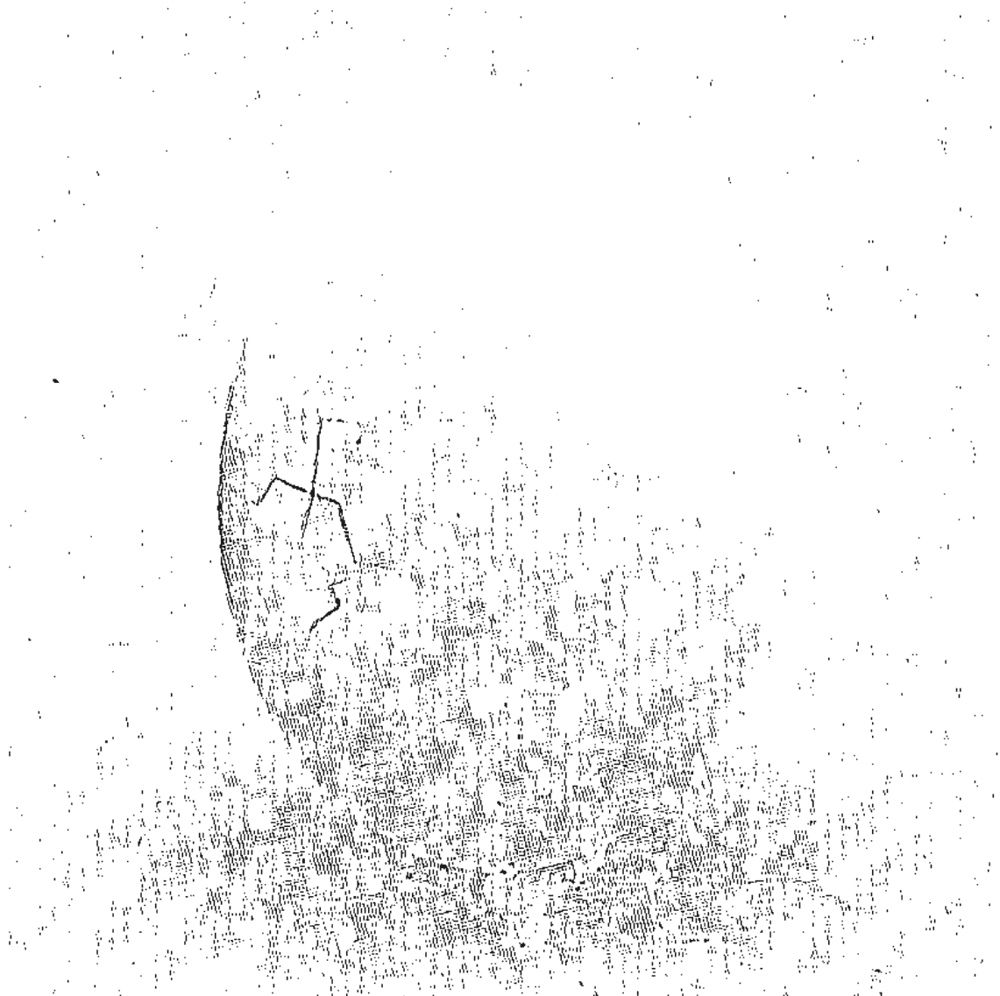

## 第二章

## 锻炼眼光：穷人埋头卖力失良机，富人巧借眼光寻“宝藏”

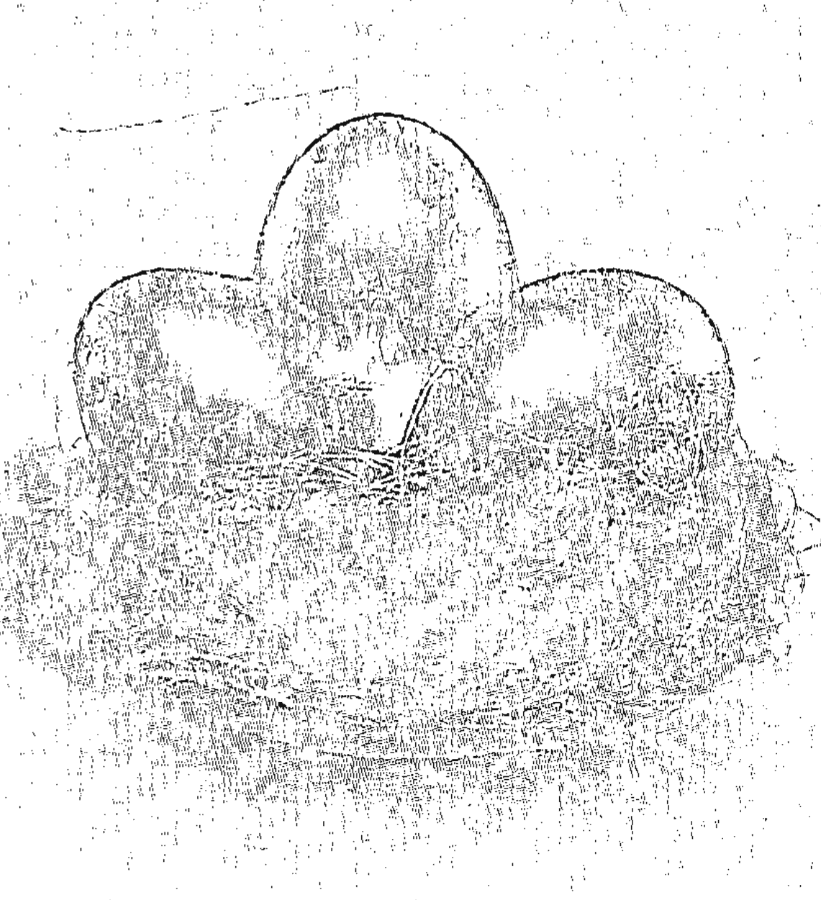

曾有记者问世界首富、微软创始人比尔·盖茨：“您如此迅速地获得惊人的成功，究竟有什么秘诀？”盖茨答道：“在很多人看来，微软的成功在于技术、人脉或者市场营销，这些都很重要，但最重要的是，我拥有好眼光。”

拥有好眼光，更容易发现当下和未来的“大宝藏”。视野越开阔，越能看到更多壮丽的风景。这个世界上努力拼搏的人很多，为什么很富有的人并不多？就是因为努力却不富有的人只知道埋头苦干，“闭起眼”来卖力，结果让自己的付出事倍功半甚至一文不值！富人则经常借自己或别人的眼光，去发现当下的商机，去寻找未来的发财趋势，所以富人能不断赚钱。勤奋是可贵的，努力是值得提倡的，但前提是，先发挥自己的眼光，去寻找正确的方向和“宝藏”。怎样才能让自己拥有好眼光呢？需要不断锻炼，不断实践。

### 01 借眼光觅商机，埋头苦干不如抬头巧干

想要走得远，首先要能看得远；想要爬得高，首先要能看得高；想要成就一番事业，首先要能“抬起头”，让你的视野变得更加广阔，眼光变得更加敏锐。

在传统观念里，“埋头苦干”一直是受人称颂的品质。经常有老一辈的人告诫后辈，想成就事业，就要有埋头苦干的精神。然而，现实生活里从来不缺埋头苦干的人，但埋头苦干的人却很多都没能成就一番事业，很多都是劳而无功，甚至跻身“穷忙族”。

在我们身边，有不少一直任劳任怨埋头苦干的人，或许你也是其中一个。不管是在工作岗位上，还是在日常生活中，这些人一直勤勤恳恳，本本分分，不贪功，不冒进，也不要小聪明。他们是可靠的伙伴，是勤奋的员工，但通常来说，他们却鲜少能成为获得最高回报的劳动者。

不得不承认，在当今社会，埋头苦干已不再是致富的法宝。

这是一个信息爆炸的时代，一个前所未有的充满机会的时代。在以前，守好门前的一亩三分地也可能致富。但如今，你的眼光，你的谋略，你的选择——一切都可能改变你的命运，带你走上致富的康庄大道。

这也是一个“压力山大”的时代，一个几乎各行各业都呈现出饱和状态的时代。在改革开放初期，只要胆子大，赶上下海经商前几波浪潮的人，几乎都能轻松成为万元户。但如今，万元户已经不值钱了，下海经商也不再那么容易。无论你从事什么行业，都将面临前所未有的压力和挑战——你做的事业，别人也在做，你能获取的信息，别人也能知道。在这样的时代背景下，想要致富，不再只是勤劳、坚持就可以。

上海东方卫视的综艺节目《笑傲江湖》的某一期来了一位在街头卖彩虹圈的选手，一个彩虹圈10块钱，他最多的一天卖出过4万多块钱的业绩。这个业绩是相当惊人的，这意味着他一天卖出了4000多个彩虹圈。这可能吗？

刚开始，对于这个成绩，评委们普遍认为是添加了水分的。但当这个小贩展现出自己玩转彩虹圈的“十八般武艺”后，评委服了——确实相当吸引人。

一个小小的彩虹圈，谁都能卖，不只是在街头，就是在路边的小商店里，大概随处都能见到。贩卖彩虹圈，哪怕你再勤劳，再苦干，从早上天刚亮就开始走街串巷，一刻也不停歇，又能卖出多少个呢？顾客凭什么就要选择在你这里购买呢？

这个小贩很聪明，他贩卖的不仅仅只是彩虹圈这么一个寻常的东西，他贩卖的，是精彩的表演以及玩转彩虹圈的方法。就是这一点让他在众多小贩中脱颖而出，鹤立鸡群。这就是发家致富的核心竞争力。

这种远胜于同行的竞争力，源于这个小贩的眼光。换言之，他能看到自己想靠彩虹圈赚钱，需要什么样的关键能力。然后自己努力去发展这项能力。当他发挥这项能力去促销彩虹圈时，所有的同行都望尘莫及。

日本最成功的女企业家之一的夺田千代乃被称为“搬家状元”。她曾和丈夫经营运输业，在遭遇1973年的“石油危机”后破产。就在夺田千代乃为生计发愁，对未来感到迷茫的时候，她看到了报纸上一则不起眼的新：日本每年的搬家开支高达400亿日元，其中大阪市每年都有高达150亿日元的搬家开支。

在那个时候的日本，专门的搬家公司并不多，这一行业可以说还存在很大的空白。就是这么一则寻常的新闻，却让夺田千代乃嗅到了商机，她敏锐地意识到，随着现代社会的发展，人口流动性将会越来越大，而搬家开支这个数据只会越来越大，这将发展成为一门非常赚钱的行业。在这一想法的推动下，夺田千代乃拿出了自己所有的积蓄，办了一家专业的搬家公司。这就是眼光，一则寻常普通的新闻，人人都能看到，但未必人人都能从中发现商机。

眼光准了，发展方向对了，接下来还要面对无穷无尽的挑战。当搬家这一行业欣欣向荣地发展起来时，越来越多的人投入其中，竞争也随之越来越激烈。那么，夺田千代乃是怎么从竞争中脱颖而出的呢？

首先，她给自己的搬家公司取名为“阿托搬家中心”。取这个名字不仅是因为它顺口又好记，更重要的是这个名字是以“a”开头的，这就使得她的公司名字始终会被排在电话联系薄的最前端，当客户需要寻找搬家公司的号码时，能首先跃入客户眼帘，成为他们的“首选”。

其次，她定制了一种全封闭式的搬家专用车，安全可靠，更重要的是保护隐私。显然，对大多数人来说，不管是出于隐私的需求，还是安全的考虑，都抱着“财不露白”的心理，因此在有选择的情况下，顾客当然更愿意选择安全、封闭的搬家方式。

此外，考虑到日本高层住宅居多的情况，夺田千代乃还定制了专门的搬家吊车，直接将装有家具的集装箱从窗口送入住宅。除了这些，夺田千代乃还额外推出了许多附带项目，比如帮助顾客定制与邻居打招呼时所需的礼品，以及清洁打扫、处理废品等服务。正是这些细节和服务，让阿托搬家中心成为日本最有名的搬家公司，深受顾客喜爱。

如今，只具有勤劳这一种品质是难以致富的。搬家人人都能做，但不是只要任劳任怨、从早到晚出卖苦力就能获得顾客的认可。

这个世界上努力的人很多，聪明的人也不少，但只有将二者结合起来，才能让我们获得更大的收益。勤劳是必须的，但绝不能“埋头”。在商业上，把一件事情重复做上一百遍一千遍只能让你熟练，而不能让你成功。只有当你在做的过程中不断思索，不断改进所总结出来的东西，才能叫作经验，才能推动你走向致富。

想要走得远，首先要能看得远；想要爬得高，首先要能看得高；想要成就一番事业，首先要能“抬起头”，让你的视野变得更加广阔，眼光变得更加敏锐。埋头苦干不如“抬头”巧干，唯有眼光加上谋略，才能让你的努力获得最大的收益。

### 02 眼光好才能发现并抢到未来最大的财富

无论在哪个行业，真正赚到大钱的，永远是走在前面那10%的人。市面上流通的财富就那么多，只有眼光好、能正确判断趋势的人，才能抢先发现并赚到未来最大的财富。

某一年，某地柑橘价高，但凡种植柑橘的果农都赚了个钵满盆满。次年，由于当地众多果农纷纷改种柑橘，导致供过于求，柑橘贱卖，果农损失惨重。这样的新闻我们并不陌生，年年都换着地方播报，层出不穷。

这样的事情听着傻气，其实有很多人一直在做。人人都想致富，但遗憾的是，大多数人并不具备致富所需的所谓“天赋”，没办法迅速准确地窥见致富的机会，于是只能尾随那些抓住财富尾巴的人，试图在他们的足迹的引领下推开致富的大门。

这样的想法原本没有错，借鉴学习富有者的成功经验，可以让我们在致富的道路上少走弯路。但很多人错就错在，把借鉴变成了纯粹的模仿和复制。

许多盲目的创业者都有类似的情况：看到某个人做某个行业特别赚钱，不管三七二十一，赶紧也跟着去做；看到某种商品特别畅销，不管三七二十一，赶紧也去进一堆来卖。结果呢？类似于果农的情况产生了，盲目跟风者往往不太可能赚到大钱。

这个行业确实很赚钱，但业内的成功者已经是该行业的佼佼者，揽聚了这一行业的大部分财富，作为一个跟风者或者说纯粹的模仿者，你凭什么去抢夺别人已经抓在手里的财富？这一商品确实畅销，但业内成功者已经打响了口碑，满足了大部分对这一商品有需求的顾客，那么，跟风者、纯粹的模仿者，又凭什么来抢夺成功者已经“征服”的客户群呢？

当下的财富已经有主了，一穷二白的你是不可能与手握庞大资源的成功者们相抗衡的。纵使你能够做出一个与腾讯QQ一般无二的通讯软件，难道你就能打败已经拥有数以亿计用户资源的马化腾？纵使你能创立一个与淘宝功能相仿的交易网站，难道你以为就能让淘宝的千万商户流向你的网站？毋庸置疑，答案是否定的。

眼前看得见的财富虽然诱人，但已成了别人的囊中之物。你也想有属于自己的财富，就必须把眼光放宽，放远，看到我们真正能赚来的钱，正在未来等着我们。只有那些还没有被人发现的财富，才可能成为真正属于你的东西。

就像炒股，当你看到股票“噌噌噌”往上涨的时候，的确非常诱人。但你这个时候再去追，就非常危险了。炒股最理想的情况，当然是低买高卖，而要做到“低买”，你就必须拥有对未来走势的判断能力。

赚钱也一样。在当今社会，有钱的人始终是少数。无论在哪个行业，真正赚到大钱的，永远是走在前面那10%的人。市面上流通的财富就那么多，只有眼光好、能正确判断趋势的人，才能抢先发现并赚到未来最大的财富。

正如俗语所说的“富人思来年，穷人思眼前”，富人之所以能富，是因为他们有着高瞻远瞩的目光，他们的目标是赚取潜藏在未来的巨额财富；穷人之所以穷，往往因为他们只看得到富人口袋中的金子，只会想着如何千方百计去分一杯羹，却忽略了真正拥有金山银山的藏宝之地。

美国百货业巨子约翰·甘布士在发家致富之前曾是一家织造厂的技师，当时美国陷入经济大萧条，许多工厂和商店纷纷倒闭，都在低价处理所有囤积如山的货品。甘布士看准这个机会，将自己所有积蓄都拿了出来，低价收购了不少货物，并租了一个很大的仓库来储存这些货物。

甘布士的做法受到了众人的嘲笑，人人都在想方设法地把手里的存货清理出去，这种时候，大概只有傻子才会购进这些根本无法卖出去的货物吧！甘布士的妻子也对丈夫的做法感到难以理解，虽然她始终支持自己的丈夫，但也陷入了深深的忧虑之中，毕竟这是夫妇二人所有的积蓄。

又过了一段时间，由于始终找不到买主，为了节省储存成本，许多工厂只好将囤积的货物纷纷运走焚烧。看到这种情况，甘布士的妻子几乎陷入绝望，但甘布士却依然不动声色。

几个月后，美国政府终于展开了救援行动，大力支持地方经济发展。随着经济的复苏，加上此前许多货物都被焚烧，市场上货品供不应求，物价开始逐渐飞涨。甘布士看准这一机会，将手中的存货全部抛售，赚到了他人生的第一桶金。正是这第一桶金，成为甘布士从事百货业的启动资金，也让他打开了成功的大门，直至成为全美举足轻重的“百货大王”。

正是超乎寻常的眼光和远见，让甘布士从危机中窥见了潜藏在未来的财富。当人人都想着如何止损，尽可能争夺眼前极其有限的财富的时候，只有甘布士以独到的眼光看准了未来庞大的财富，更重要的是，那些财富无人与他争抢。谁才是最大的赢家，结果显而易见。

曾经有一名记者在采访微软创始人比尔·盖茨时问他：“您如此迅速地获得惊人的成功，究竟有什么秘诀？”盖茨回答说：“在很多人看来，微软的成功在于技术、人脉或者市场营销，但事实上这些都是表象，要说我成功的秘诀，其实很简单，就是拥有好眼光。”

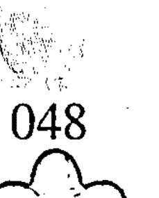

的确，如果缺乏好眼光，比尔·盖茨未必会从哈佛大学辍学去创建微软，他可能会成为一名科学家，也可能会成为某个科技公司的技术人员。

很多时候，当我们以渴望且羡慕的目光紧盯着富人口袋里的财富时，当我们感慨自己缺乏金钱、人脉、关系时，当我们盲目跟在成功者身后使劲奔跑，与千军万马一起挤着过财富的独木桥时，或许应该抬起头，拓宽一下自己的视野，朝未来看一看。

其实，我们想要的财富并不在眼前，我们要做的事情并不是和千万人一起去争抢眼前那些有限的财富，而是应该将目光放到长远的未来，放到没有人发现的地方，去挖掘那些潜藏着的巨大的宝藏！

### 03 好眼光要与现实资源结合起来才能致富

再美好、再伟大的理想，再独到、再先进的眼光，都只有建立在现实的基础上才能实现长远的发展。而做事业，最现实的问题无疑就是资金和客户群。

据财经媒体报道，2014年年底阿里巴巴集团市值超越了沃尔玛，达到了2506.74亿美元。阿里巴巴集团创始人马云也跻身新一代“国民爸爸”的行列，被广大网友或追捧或调侃。

马云到底有多牛，看看淘宝网就知道了。这一网上交易平台几乎改变了一大半中国人的购物习惯，甚至还把“双十一”、“双十二”变成了“举国欢庆”的购物节日。不断攀升的交易额也一度占据着各大媒体的版面，引发一波波购物狂潮。阿里巴巴的巨大成功，令马云富得流油，功成名就。

在众多行业里，能够先发现商机先入行的，通常比较容易成功。如改革开放以后的经商潮，但凡胆子大率先下海经商的人，按老一辈的说法，就是“闭着眼睛都能赚钱”，因为那个时候市场饱和度低，许多地方商品都呈现出供不应求的状态，只怕买不到，不怕卖不出。再如股市，股市刚兴起那会儿，胆子敢进去炒股，大部分也都轻松就赚了，不像现在，股民可谓“水深火热”。

马云的成功与他较早接触互联网有着极大的关系。马云第一次接触互联网是在1995年，那是他第一次踏上美国这片陌生而先进的土地。马云去美国原本是去“收账”的——他被杭州市政府雇用做了英语翻译，去和一个美国商人谈合作修公路的事。

在美国期间，马云前往西雅图拜访了他在杭州电子科技大学的同事、外语教师比尔·阿霍，并在这里见识到了此前阿霍就曾数次和他提到过的“互联网”。

那个年头，电脑是名副其实的“奢侈品”，一台中等配置的电脑大约要1000美元，而在大学做老师的马云，工资每个月大概也就100多元人民币。互联网在那个时候更是个稀罕物，许多人根本不知道这个东西究竟是什么。

马云在阿霍的女婿工作的网络公司的电脑上敲下了他与互联网“对话”的第一个单词“beer”，当各国啤酒品牌的介绍出现在屏幕上时，马云的心情简直难以形容，但他很快就发现，这些啤酒品牌里，没有任何一个是来自中国的品牌。他又尝试在网络上搜索了一些关于中国的信息，但几乎都是“零”。这让马云敏锐地意识到，在中国，互联网领域有着巨大的空白，而这个巨大的空白背后，藏着的是无限商机。

敏锐的眼光让马云成为中国互联网的领军人物，也让他念出了“芝麻开门”的魔法，打开了“阿里巴巴”的财富大门。但仅仅是入行早就成了马云吗？当然不是。事实上，与马云同期“触网”的大有人在，比马云更早“触网”的人也不少，但马云却只有一个，其他人都没有成为“马云”。

早在马云刚与互联网接触的时候，中国第一家互联网公司“瀛海威”就已经诞生了，该公司的创立者是张树新。在那个人们还普遍对互联网极其陌生的年代，张树新就已经设计出了一个五脏俱全的互联网世界，她将“邮局”“论坛”“咖啡厅”“游戏城”等多种服务都放置进了公司的上网客户端，试图建造出一个完美的互联网世界。

张树新的理念非常超前，她曾经做了一个名为“新闻夜总汇”的项目，那个时候，什么搜狐、网易、新浪之类的还连影子都没有。她甚至还试图让她的互联网公司发展电子购物项目，并发行了中国最早的虚拟货币“信用点”。而那个时候，马云的阿里巴巴还没有出现。

在马云还是个“互联网新人”的时候，张树新已经是中国的“互联网偶像”了。要说入行早，马云远远比不上张树新，但最后的结果是，瀛海威失败了，阿里巴巴崛起了。张树新离开了她一手打造的“互联网世界”，马云则站上了中国互联网的巅峰。

究竟是什么成就了马云呢？眼光——基于现实基础上的眼光。

张树新做瀛海威是在做一种理想，她试图创造一个成熟完美的互联网世界，而这个世界主要是面向老百姓的，任何一个普通人都可以通过瀛海威的客户端进入这个世界。这个想法放到今天非常平常，因为互联网已经进入我们生活的方方面面。但在当时，老百姓对互联网这个东西是非常陌生的，没有多少人明白或者接纳这个东西。或许正如张树新自己所说的，瀛海威之所以失败，是因为它太“新”了。

马云与张树新不一样。马云做互联网是做事业，做商业。马云创建的第一个互联网项目叫做“中国黄页”，简单来说就是收集了大量各种企业的信息，将其汇总到网页上，方便网民来进行浏览、查找，这就好像是一个企业广告版的百科全书。后来的阿里巴巴、淘宝、天猫从本质上来说，其实与“中国黄页”相类似，相当于一个产品信息的“集合”。可见，马云与张树新最大的不同在于，马云做互联网是要为企业、为商业服务的。

再美好、再伟大的理想，再独到、再先进的眼光，都只有建立在现实的基础上才能实现长远的发展。而做事业，最现实的问题无疑是资金和客户群。有了资金，你的事业才能正常运转；有了客户群，你的事业才能可持续发展。

可见，想要成功，除了拥有精准独到的眼光和坚持不懈的努力之外，还必须考虑时代的进程。许许多多的创业先行者之所以在时代的浪潮中丢盔弃甲，既可能是因为缺乏长远的眼光或卓越的能力，也可能是因为过于追求理想化而忽略了现实的基础。

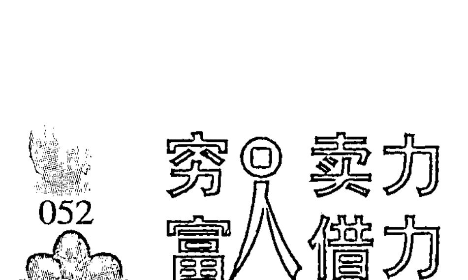

### 04 眼睛多看未来的财富，少看当下的金钱

很多时候，将你的命运拉向贫穷的，往往不是你的坏运气，而是你短浅的目光，以及充满局限性的眼界。

“那个某某某，读书的时候，学习成绩远不如我好，凭什么现在混得那么好？”

“单论能力，那个谁谁谁什么都不懂，能混得这么好，纯粹是靠运气。”

“想当年我比某某某强多了，就是当初一念之差没选对行业，否则……”

类似这样的抱怨你在生活中一定听到过。俗话说“谋事在人，成事在天”，不可否认，人的成功和致富是受到多种因素影响的，运气也是其中一个因素，有时甚至可能是非常关键的因素。世界上确实存在一些幸运儿，出门抬手就能招来出租车；世界上也肯定会有一些倒霉蛋，出门不带雨伞就一定会下雨。但事实上，这个世界上大多数人的运气都相差无几，大多数富人并不比大多数穷人幸运很多，大多数穷人也见得比大多数富人倒霉很多。

笔者曾采访过某地一位报社老板熊总。熊总虽然在富豪排行榜上排不上号，但在当地也很有影响力，在大家眼中算得上是名利双收的人物。

谈到自己的发家史，熊总表现得非常自豪。他年轻时读书读得还算不错，但更重要的是他打得一手好乒乓球，于是凭借着这个技能成了省级运动员，一路顺顺利利地进入了政府机关，在文化部门任职。那时，政府机构的职位是妥妥的铁饭碗，比现在的还要铁得多。

那些年，正值改革开放初期，许多胆子大的人纷纷下海经商。熊总身边许多胆子大又没有啥好出路的朋友都去经商了，结果一个个还真赚了不少钱。逢年过节的时候，这些人全都出手阔绰得很。

看到这种情况，熊总内心很不平衡。他身边的这些朋友有几把刷子他还能不清楚？读书也好，打球也罢，他当初可是甩了这些人几条街的。可是现在，这些人怎么赚钱都比自己多那么多？

于是熊总很快就下定了决心：辞去自己的工作，下海经商。

当时，对于这一决定，熊总身边的人没有一个支持他。亲戚朋友轮番上阵劝阻他。一个是未知的充满了风险的未来，一个是稳稳当当的旱涝保收的“铁饭碗”，正常人想一想都知道应该选哪一个啊！但熊总是个说一不二的人，不但没有听从亲戚朋友的劝阻，还逼着自己老婆和自己一块儿辞职了，下海经商。

在成立报社之前，熊总卖过种子，卖过化肥，做过电器生意……一步步地，他终于走到了今天，获得很多都没拥有的财富。按熊总说的，那个年头，还真就是“撑死胆大的，饿死胆小的”。

很多时候，人生的一个选择很可能就此决定了你往后的命运。穷人总以为富人是因为运气好，才能猜对命运给予的最佳选项。但事实真的如此吗？再回过头看看熊总的经历，当他站在命运的十字路口时，他的选择真称得上是“一意孤行”了，身边没有任何人支持他的决定，没有任何人认为他的决定是正确的。难道仅凭“运气”二字就能成为支撑他“一意孤行”的理由？恐怕不然。

亲戚朋友们之所以会反对他放弃稳定的“铁饭碗”职位，显然是因为他们眼中看到的，只是熊总手中已经握有的东西——优渥的工资、不错的福利、稳定的职位。但熊总和他们看到的不一样。他看到的不是已经拥有的这些，而是更远的未来，他放弃手里拥有的这些东西，是为了搏一个更长远更有发展前途的未来。这就是穷人与富人在眼界方面的巨大差别。

站在命运的十字路口时，穷人的眼睛总是盯着钱。哪条路最安逸，能赚到的钱最多，就选择哪条路。但穷人可能没想过，人人都往好走的路上去挤，那么最终当人满为患的时候，这条路又会变成什么样呢？

现在，我们再回过头去好好想一想，能力不如你的某某某，真的完全是靠运气才混得比你风光，过得比你好吗？当你面前有一个可以让你“更上一层楼”的机会时，你有没有因为舍不下已经握在手里的“钱财”而放弃它呢？

很多时候，将你的命运拉向贫穷的，往往不是你的坏运气，而是你短浅的目光，以及充满局限性的眼界。

要知道，大家都看得见的财富早已“名花有主”了，比如王思聪的万贯家财，比尔·盖茨的微软帝国。还有一些当下的财富，即使还有让你争抢的机会，你的竞争对手也绝不会少。人人都盯着的那一块“肥肉”，你又能分到手多少呢？所以，眼睛只会盯着钱的人，往往很难赚得到大钱。

穷人总是习惯把“钱”当作终点，富人则总是将“钱”作为起点。在穷人眼里，钱的意义就是，能买到漂亮的衣服、美味的食物、可以给自己带来好面子的各种消费品，支付各种各样娱乐活动所需的费用，支付生活中的一切消费，让生活变得更轻松富足，无忧无虑。在富人眼中，钱的意义则是，能提供更多的资源，能带来更好的机遇，能推动事业更长远的发 展，能开创更广阔的未来。

如果你想要成功，想要成为站在世界金字塔上层的富人，就一定要记住，财富永远不是人生的终点。不要总是埋着头向“钱”冲去，而应抬起你的头，用你的双眼去展望来未，发现未来的财富；去看向更高更远的地方，那里有真正属于你的财富与成功。

### 05 眼光与定位结合，才能实现你的财富梦想

> 永远不要把梦锗当成梦想，永远不要想当然地认为你应该做与富人相同的事情。想富有，就一定要发挥自己良好的眼光，去找准自己的定位。

如今，越来越多的人知道这样的道理：天下没有白吃的午餐，天上不会掉馅饼。尽管如此，依然还有无数人梦想着“不劳而获，坐享其成”，不付出努力就能让好运降临，能不费一丝一毫的力气就将自己的命运彻底颠覆，脱离贫穷，成为富人。

穷人的世界里有三大“终极愿望”，称得上是穷人们共同的“梦想”。第一，某天某个极为有钱的远房亲戚死了，留下一大笔遗产给自己继承，于是他马上从一穷二白的穷人摇身一变成为腰缠万贯的富人；第二，某天兴致一来，买了一张彩票，数字顺序全对，中了！顿时，钞票从天而降，他马上跻身富人的行列；第三，走在路上，一不小心，踢到了一个神秘的黑皮箱，周围还没人看见，一打开，满满的钞票，一不小心就变成了有钱人！

很多穷人会做这类白日梦也不奇怪，这三大好运气，不管哪个成真了，做梦都能笑醒。不得不说，尽管我们内心深处知道，免费的午餐和天上掉的馅饼几乎是不存在的，但若是真有，谁又能拒绝呢？人人都会做白日梦，这很正常。怕只怕有的人错将“梦”当成了“梦想”，结果沦为幻想的俘虏，永远只能在梦里发梦。

很多时候，穷人和富人的差距，就是梦与梦想的差距。

有一个卖化肥的女老板，算不上巨富，但身家也有几千元。她有一个关系不错的女性朋友陈小姐，是在超市做出纳的。在那种普通的小城市，做出纳工资一个月大概也就两三千元，在地方上不算收入太低，当然也不高。

可能是看到女老板赚钱好像挺容易的，陈小姐就动了心思，也想去卖化肥。正好那段时间，陈小姐上班的那家超市因经营不善打算结业，于是陈小姐就投入到女老板“麾下”，打算在化肥事业上开创自己的“第二春”。

毕竟是挺好的朋友，女老板亲自出马，带着陈小姐上山下乡去推销化肥，亲力亲为地教她怎么和农民交涉，怎么介绍公司的产品等。化肥的利润其实不高，一化肥利润最高也就是几块钱，而陈小姐作为代理，推销出一包化肥，大概也就只能拿到几毛钱的提成。这和陈小姐最初的想象差得太远了。坚持了不到一个星期，陈小姐就“丢盔弃甲”，离开了女老板的化肥公司，在一个小饭店找到了一份新的出纳工作。

类似于陈小姐这种情况的人在现实生活中其实非常多。笔者一个表哥，三十五六岁的年纪，是做电焊工。以前在国营工厂里上班，收入一般，福利一般，后来厂里不景气，工作越来越少，在家赋闲了很长时间。在此期间，有亲戚给他介绍了一个工程，他却因为嫌钱太少，宁愿继续闲着也不接那个项目。现在，那位表哥依然是每天懒懒散散，游手好闲。

其实，无论是陈小姐，还是笔者的表哥，相信你都能在身边的人中找到他们的影子。这样的人比比皆是，抱怨着挣钱难，但给他们挣钱的机会，他们却又看不上小钱；抱怨着找不到机会，但把机会放在他们面前，他们却又嫌弃机会太小，微不足道。

陈小姐看不上推销化肥的微薄利润，却没想到，女老板的千万身家，正是这一包包化肥微薄的利润积聚而成的；做电焊工的书哥看不上收入较少的小工程，却不曾客观地审视一下自己，是否具备拿下大工程的技能和本领。

很多时候，穷人之所以穷，不是因为他们缺少赚钱的手段或技能，而是他们总异想天开，望着更高更远的地方，不屑于将能力和技能用到眼前那些触手可及的小机会上。对于这类人，这样的形容很恰当：还没得到拍电影的机会，却想着直接登上奥斯卡领奖台；还没走到山脚下，就盼着欣赏“会当凌绝顶，一览众山小”的风景。

梦想可以远大，可以让所有人都觉得不可思议，但绝不能脱离对自身的准确定位。身无分文的人，可以梦想成为亿万富翁，但前提是他能为此制订出切实可行的办法，能找到一条依靠自己双腿就能登上“山巅”的道路。如果只是一心想靠着“找上门”的机会，或从天而降的好运气，那么这仅仅会是一个梦，而不会成为梦想。

很多时候，梦与梦想的距离，就是穷人与富人的距离。富人明白“不积跬步无以至千里”，穷人却只想一步登天；富人明白“不积小流无以成江海”，穷人却只盼着天降甘霖，滔滔财富绵延不绝。所以，一定要让你的眼光与你的定位结合起来，这样才能真正实现你的财富梦想，而不是在做梦。

人贵有自知之明，只有先自知，看清楚自己所站立的位置，看清楚自己手中所拥有的资源，才可能从实际出发，让自己所拥有的一切发挥出最大功效，找到适合自己的真正可行的致富道路。

当然，“自知”不代表自卑，也不代表盲目自信。“自知”是要能够站在客观的角度，中肯地对自己作出评价，并接纳真实的自己。只有当你了解了真实的自己，接纳了真实的自己，才能真正看清楚你与梦想之间还有多远的路要走，也才能真正看清楚，究竟要从哪一条路走，才能通往你梦想的大门。

梦之所以虚无缥缈，正是因为做梦的人不曾去认真思索，如何才能将梦变成现实；梦想即使再不可思议，只要能在现实的基础上搭建起连接的桥梁，就存在着实现的可能。

世界上每一天都发生着不可思议的事情，世界上每个人都有创造奇迹的能量。重要的是，当你试图向梦想靠近时，你是否真正看准了自己的定位，是否真正明白，自己究竟能做什么、不能做什么。

永远不要把梦错当成梦想，永远不要想当然地认为你应该做与富人相同的事情。想富有，就一定要发挥自己良好的眼光，去找准自己的定位。在不同的起跑线上，穷人与富人的终点线也始终存在着不可逾越的差距。只有当你先赶到富人的起跑线前，你才有资格努力去让自己像富人一样富有，像富人一样成功。

### 06 富人总能擦亮双眼，寻找一切致富机会

富人总能擦亮双眼，四处坏顾，寻觅一切能帮助自己成功致富的机会，他们知道，想致富，不但要努力追求远方的宝藏，也要挖掘和收获道路两旁的宝藏。

能够白手起家跻身富人行列的人，大多数都曾从事过多种不同的工作。能够从一开始就投入一个行业一直发展到最后的往往只是少数。例如，马云在投身互联网行业之前曾是大学里的英语老师；李嘉诚在投身地产行业之前，曾做过钟表店店员和推销员，曾通过制造和销售塑胶花赚了很多钱。

世界总是处在变化与发展之中。今天兴盛繁荣的行业，明天就可能走向衰落；今天不起眼的事情，明天可能会带来巨大的商机。而富人之所以能成为富人，就是因为能适应并紧跟世界的变化与发展，用过人的眼光紧盯并把握住了创造财富的机会。

我们总能听到穷人自嘲，说自己没有赚钱的天赋。那么，赚钱是一种天生的才能吗？也许有一些关系。但科学研究也表明，除了一小部分天才和那些天生存在某些缺陷的人外，绝大部分人就赚钱的“才能”而言，其实先天差距并不大。而造成穷人与富人之间巨大差距的，更多是眼光、视野、思维、观念等方面的差异。

新奥燃气的创始人王玉锁在做燃气生意之前曾做过不少小生意，他卖过葵花籽、卖过啤酒、卖过女士泡泡纱背心，甚至在一家塑料厂做过一段时间的业务员。但这些生意都没让他赚到什么钱。

1986年春节前后，王玉锁在生意又一次失败后，揣着身上仅有的100块钱，决定再拼一把，于是他去租了一辆车子准备去跑运输。没想到，他到租车的地方后遇到了一些意外的麻烦，车没租成。就在茫然无措之际，他突然想起了之前曾听人说过，倒腾燃气能赚到钱，于是，他直奔任丘，决定做燃气生意。

幸运之神终于开始眷顾王玉锁。在任丘，王玉锁遇到了一个老相识，这个老相识正好是做燃气生意的。通过老相识的牵线搭桥，王玉锁很快就投入到了燃气生意领域，并掘到了自己的第一桶金，多年后，他甚至成了中国有名的“燃气大王”。

纵观王玉锁的创业之路，我们发现，他进入燃气行业完全称得上是“误打误撞”。他既不是这方面的专家，对这一行业也称不上有多么热爱。选择这一行业与他选择之前所有行业的原因都差不多，只是认为也许能赚得到钱，于是去放手一搏。但就是这样的“误打误撞”，让他抓住了成功的机会，最终成就了自己的事业。

北京某集团的董事长袁总，曾就读于中国政法大学，毕业后分配到了中国建设银行工作。为了脱贫致富，他在1992年毅然辞职，然后筹集了20万元的资本注册了一家实业发展公司。

面对激烈的市场竞争，在资金、资源都不足的情况下，他将目光转向了大专院校和科研院所的大量科研成果，决定从那些经过高等院校认证和鉴定之后就束之高阁的科研成果中寻找“宝藏”。

他先是一家一家地上门访问各个企业，记录下这些企业对哪些类型的科研技术有所需求，然后又一 家一家地上门去找各个大学以及研究机构，花钱将有关的科研成果买断，之后再将这些科研成果卖给有需求的企业。

在做“科技推销员”的过程中，他也一直在留意为自己寻找有潜力的项目，并最终相中了一个名为“小黑麦”的基因工程项目。该项目的核心内容是通过对种子的基因进行排序，从而提高粮食的产量和质量。在相中了这一项目后，他立刻将之进行了产业化。“小黑麦”成为了他的实业发展公司的第一个实业项目，并迅速取得了成功，为他赚到了人生的第一桶金，并为此后他的实业发展公司的发展壮大提供了坚实的基础。

袁总的创业道路和王玉锁其实很像。在创业之初，他 和王玉锁一样，并没有一个明确而坚定的发展方向。袁总之所以将目光投向各个院校的科研成果，更多是从自己公司条件的局限性考虑的。他知道自己资本少，又缺乏人脉和资源，根本不可能去和别的大公司争抢已经有名气或得到权威机构确认的科研成果，他只能另辟蹊径，从沙子中“淘金”。

对袁总来说，与“小黑麦”的相遇既是偶然，也是必然。“小黑麦”项目不是他唯一或必须的选择，只是在合适的机会下出现了，于是他才选择了它。换言之，无论是王玉锁还是袁总，在创业致富的道路上，都是通过“边走边看”的方式，才最终找到了那条正确的道路。

我们听到过许许多多关于坚持梦想，最终走向成功、逆转人生的励志故事，也被无数在追梦道路上披荆斩棘的故事所感动。我们总以为，走向成功的唯一途径，就是坚持去做某件事情，哪怕撞得头破血流也绝不“悬崖勒马”。

坚持的确是成功的必备条件之一，唯有坚持才能让我们克服困难，迎来风雨后的彩虹。但值得注意的是，在这个世界上，并非所有的坚持都有回报，若前方真的是万丈深渊，坚持往前走，只会让你摔得粉身碎骨。

世界上并不缺少吃苦耐劳、具有坚持不懈精神的穷人，他们的坚韧与勤劳有时甚至远远超过了许多富人。但他们却始终追不上富人的脚步，究其根源，就是因为他们只懂得埋头向前，而不懂得因势利导，结果在错误的道路上越走越远，浪费了很多时间、精力和资源，结果劳而无功。

在追求财富的路上，穷人只知道埋头向前，以为一直走到终点，就能获得无穷的宝藏，却没有首先看看终点是不是有可能存在着宝藏；而富人总能擦亮双眼，四处环顾，寻觅一切能帮助自己成功致富的机会，他们知道，想致富，不但要努力追求远方的宝藏，也要挖掘和收获道路两旁的宝藏。

穷人易做劳而无功的坚持，不知道先找出“宝藏”可能存在的地方，然后朝着那个方向努力；富人在追求财富的路上，习惯于擦亮双眼寻找离自己不远的致富的机会。所以，穷人尽管也付出了很多，却依然受穷；富人因为做的是有用功，所以在努力了之后，财富会迅速增长。你希望做哪一种人呢？

### 07 穷人眼光狭窄越来越穷，富人视野广阔越来越富

那些视野狭窄、目光短浅、只懂坐井观天的穷人，往往只能在“井”一样小的世界里，度过自己看似安稳实则灰暗、庸碌、失败、不幸的一生。

美籍华人科学家崔琦在1998年因在量子物理学领域的巨大贡献而荣获了当年的诺贝尔物理学奖。崔琦出生在河南宝丰县肖旗乡范庄村的一个普通农民家庭，在村里上完小学后就去 了香港上中学，之后考上了美国的大学。崔琦是1958年去的美国，而他的父亲则于1959年河南大饥荒时饿死了，他的母亲在1964年前后也在贫寒交迫中去世了。

在参加一个访谈节目时，主持人曾问崔琦：“假如那一年你没有选择外出读书，会发生怎样的事情呢？”当时，崔琦痛苦地回答：“假如当年我没有外出读书，后来没有出国，那么我的父母亲很可能不会这样死去。”

确实，如果没有离开村庄，没有去香港，没有去美国，也许崔琦还有机会改变自己父母亲的命运。但与此同时，他的命运也会随之而改变，他也许永远成不了诺贝尔奖得主，因为在当时的中国，在他生长的小山村，他并不具备走到这一高度所需要的视野，也不会有如此崇高的理想。

在信息闭塞的年代，对于小山村里的人来说，最远最繁华的地方大概就是县城了，而对于小县城的人而言，能够到达省城，似乎已经足够了不起。对于省城的人来说，或许可以将渴望放到更大更繁华的城市，比如北京、上海、广州、深圳这样的一线城市。视野的不同决定了理想高度的不同，同时也决定了人命运走向的不同。当然，从情感上来说，对崔琦而言，如果命运给予他再一次选择的机会，他很可能会毫不犹豫地选择留在自己父母的身边，而不是赢得诺贝尔奖。

无论如何，视野和眼光确实决定了人们的命运。人之所以对某样东西产生向往，往往建立在对这一东西有一定了解的前提下。为了了解，知道它好，才会产生想要获得的想法。如果你甚至不知道世界上存在着这种东西，或者说你对它根本一无所知，你又怎么会萌生出想要获得的想法呢？

有一位青年教师去边远山区支教时，曾问他的二十几名学生，他们最大的人生理想是什么。当时，一个女孩子回答说，她的理想是成为村里的会计；一个男孩子则回答说，他的理想是能让家里的地长出全村最多的粮食。

后来，这位青年教师在村里连接了互联网，让孩子们通过网络看到了外面繁华的世界。在潜移默化的影响下，孩子们的理想也发生了相应的变化。那个想要成为村里会计的女孩子现在想要下山，去城里的大公司做一名会计；那个想要种出最多粮食的男孩子现在则想要成为村长，他想组织村民们一起修一条路，一条通往山下、通向繁华城市的公路。有了公路，村里出产的农作物就能直接卖到城里去，城里的好东西也能直接运回村里来。

对这些孩子来说，即使拥有了想要冲出小山村，与繁华大城市接轨的理想，也未必都能实现；但如果连这种理想都没有，那么他们这一辈子就只能局限在这个小小的地方，看着头顶这片小小的蓝天了。

自古以来，人们都知道，勤劳能够致富，但却很容易忽视人视野与眼光的开拓。埋头苦干能改善的只是生活，真正决定你命运的，是你的视野。就

像跑步一样，并不是你跑得越快，跑得越久，跑得越辛苦，就能跑到你真正想到达的地方，你选择的跑步前往的方向才是决定你能到达哪里的最关键因素。选错了方向，你可能辛苦一世，才发现自己一直是绕着圈跑的；选对了方向，你可能只需要辛苦一阵子，便能看到全然不同的风景。

勤劳是难能可贵的精神，但“遮住眼睛”地苦干的勤劳，却永远不可能改变你的命运。视野的广度决定了命运的高度，世界总是处于不断变化之中，唯有拥有广阔视野与锐利眼光的人，才可能具备对未来发展趋势的前瞻性。那些视野狭窄、目光短浅、只懂坐井观天的穷人，往往只能在“井”一样小的世界里，度过自己看似安稳实则灰暗、庸碌、失败、不幸的一生。

比如以前，进入国企对人们来说就意味着捧上了“铁饭碗”，一辈子都吃穿不愁。轻松的工作，优厚的待遇，让大部分顺利进入国企的人逐渐沉沦在安逸之中，除了埋头工作以外，几乎对外界信息一无所知。然而，随着改革开放的进程加快，随着国企改革的推动，许多“铁饭碗”都在猝不及防之间就被打碎了，“下岗”成了很多老国企员工的躲不开的命运，他们辛苦一世，换来的只有少得可怜的退休金。

当然，也有的国企一直发展到现在都呈现出一派欣欣向荣的景象，依然为员工提供着优厚的薪资待遇，依然有不少人挤破了头地想要进入其中，谋求一份安逸和稳定。但这种安逸和稳定能够持续到什么时候，同样还是取决于时代的发展，一旦它不再适应逐渐放开的市场竞争，那么总有一天，这些沉沦于安逸与稳定的人也终将失去庇护，迎接不幸的到来。

不过，也有一部分与众不同的人，他们从不为安逸与稳定停留，他们总是看着更高更远的地方，他们总是盯着时代发展中所产生的一切新事物。当其他人纷纷拥向安逸稳定的国家“庇护所”时，他们却选择勇敢“下海”，与风浪搏击，在时代的浪潮中“淘金”。他们可能是中国最先下海经商的人，也可能是成为最早进入股市的人，也可能是最早投入到房地产业的人，也可能是最早进入互联网行业的人……最终，这部分人成为了最有可能进入社会财富最高层的、占据社会总人口0.5%的富人群体！

现如今，依旧有不少人前赴后继地追求着各种“铁饭碗”。公务员考试、事业单位考试，这些形形色色的岗位，哪怕待遇不算优渥，每年也有许多人挤破了头地在争抢。但谁又知道，这“铁饭碗”究竟还能“铁”多久呢？

时代一直在前进，世界一直在变化，今天你眼前的利益，到了明天或许就会灰飞烟灭。埋头苦干的人也许能通过自己的努力改善一下生活，但至多也仅仅是能从贫穷到小康。唯有开拓视野，走到时代的前沿，看清未来的发展方向，发现财富的趋势，你才可能从根本上改变自己的命运，跻身富人行列。

## 穷人随波逐流求稳定，富人想方设法找“钱”途

与其踏上一条轻松但平庸的路，还不如选择那条荆棘丛生却有着远大“钱”途的路。而正是这种冒险精神，让富人与穷人逐渐拉开财富的差距，直至最后天差地别。

我们总听说人生有无数种可能性，但看看我们身边，大多数人都有着极其相似的人生轨迹。年少时上学读书，经过层层考试的筛选，最终一部分人高考落榜后进入社会工作，另一部分人则考上层次、等级不同的大学。毕业后，有的继续读书深造，有的从此踏入社会找工作。随后就是结婚、生子，然后孩子再继续这样的循环……

很多时候，大多数人的大生都是随波逐流的，别人做什么自己就做什么，甚至来不及思考自己为什么要走这样的路，要做这样的事。例如很多人其实一直没弄明白，自己读书到底为了什么；很多人也弄不明白，自己当初为什么会选择这样一份工作；甚至有时候也弄不明白，自己为什么一定要结婚生子，组建家庭……这些事情似乎是人生必须经历的，如果不经历这些，人生仿佛就会变得不完整。

有人曾说过，我们就像是生产线上制造出来的产品一样，绝大多数人的人生都大同小异。人生的无数种可能，只在少数人身上得到了实现。而这些实现了无数种可能的少数人，通常就是处于社会金字塔顶层的成功人士、富有人士。

人生的道路上埋藏着许多财富，穷人们总是习惯于一个跟着一个地朝前走，于是，无数人都争抢着同一条路上有限的财富；富人则不同，他们往往能跳出穷人的定势思维，将眼光和视野转向更多的地方，去发现更多的道路，从而挖掘到了穷人们都不曾发现和挖掘的巨大宝藏。这就是为什么富人看似没有穷人那么努力勤奋，却总能拥有比穷人多几千倍、几万倍甚至几百万倍的财富的原因。

为什么大多数人都习惯于跟随在大众盲目地朝前走呢？究其根源，主要是为了求“稳”，而之所以要求“稳”，则是为了规避风险。

我认识一个年轻人，做IT方面工作的，他毕业那会儿曾放出豪言，要成为中国的“比尔·盖茨”。这个年轻人也确实很优秀，一毕业就进入了一家外企工作，深得老板器重。但工作了几年之后，正当事业如日中天之时，这个年轻人却被父母逼着辞职，回家考了公务员。进入的部门还算不错，但收入各方面与外企自然是比不了的。

现在，这个年轻人过得还算不错，有车有房，工作稳定轻松，羡煞了不少旁人。当然，和“比尔·盖茨”早已不具备可比性了。

如今，每当周围的人夸赞这位年轻人有出息时，他的母亲依然还会无限骄傲地提起当初自己“英明果断”、逼迫年轻人辞职回家考公务员的决定，这位老太太常常挂在嘴边的一句话就是：“你瞧瞧，当初还不乐意，要不是我逼着你回来考公务员，你现在的日子能过得这么舒心吗？”

也许确实不能。如果没有辞职回家考公务员，也许这位年轻人现在还在大城市里漂泊，也许事业停滞不前，依然兢兢业业地继续自己的打工生涯；也许甚至可能穷困潦倒，面临失业；但还有一个可能，就是他已经奔跑在成为中国的“比尔·盖茨”的道路之上。

选择“稳当”，的确规避了不少风险，但同时也埋藏了许多原本可能已经近在眼前的机会。

和这位年轻人有类似经历的人很多。每年考公务员和事业单位的人都数不胜数，哪怕仅仅是一个环卫工人的职位，只要能入编制，众多高学历的人才也能争抢得头破血流。对很多人来说，争抢这些职位，未必就是因为自己热爱这份工作，也未必就是没有更多更好的选择。他们只是为了寻求“稳当”，在他们看来，进入编制就得到了一种保障，可以让自己在长久的未来都“衣食无忧”。当然，代价就是，放弃了一切可能让自己成就非凡事业的机会，扼杀了为自己创造可观财富的一切可能。

纵观那些成功的企业家，有谁是通过稳稳当当的工作来发家致富的吗？没有！与穷人不同的是，对于那些富人来说，稳定往往正是最可怕的。稳定意味着自己的人生开始逐渐趋近于平直的线，不管是向上还是向下的角度都变得越来越小。稳定意味着你人生的可能已越来越少，你几乎已失去了创造奇迹的机会。稳定，浇灭了激情，谋杀了梦想。

当穷人只懂得一股脑儿地往前走，随着大流寻求稳定和内心的安全感时，富人却在寻找着一个又一个的挑战与机遇。绝大多数富人在没有致富之前都认为，与其踏上一条轻松但平庸的路，还不如选择那条荆棘丛生却有着远大“钱”途的路。而正是这种冒险精神，让富人与穷人逐渐拉开财富的差距，直至最后天差地别。

力帆控股有限公司董事长尹明善55岁才开始创业，身边的亲戚朋友都纷纷劝阻：都已经一把年纪了，安安稳稳过一辈子多好，为什么突然要冒这么大的险呢？要是把自己的积蓄都赔进去了怎么办？

但尹明善没退缩，硬是卯着劲儿把公司办了起来，主营业务是做摩托车发动机。在此之前，对于摩托车，尹明善是完全的外行，甚至可以说是一无所知。当时，重庆有两大摩托车品牌：嘉陵和建设。尹明善琢磨，自己不懂不要紧，可以“抱大腿”啊。比如可以从建设集团的维修部购买摩托车配件，自己再组装成发动机，然后卖出去。这样一来，除去成本，每卖出一台发动机，还能净赚差不多500多块钱呢！

于是，尹明善真的就靠着这种方式把公司给做了起来，等到建设集团发现自己被“坑”了的时候，尹明善早就已经顺利用赚到的钱开发出了属于自己公司的技术和各个零部件的替代品，真正占据了摩托车行业的一席之地。

尹明善的埋头朝前走了55个春秋，如果一直走下去，那么今天恐怕没有多少人能叫出他的名字，他大概也只会成为一个普普通通的退休老人，在家养养花、逗逗鸟。但他却选择了另一条路，选择让自己的人生多一种可能。在做出这个选择的时候，许多关心他的人都是反对的，谁都知道，这是一个充满了危险的选择，一不小心，或许就会让他倾家荡产，将55年来所有积累的东西输得一干二净。

但尹明善知道，世上没有十全十美的事情，机遇总与风险并存，巅峰前方必有深渊。选择机遇就意味着与风险同行，攀爬巅峰就意味着时时要冒着坠入深渊的危险。但如果为了躲避风险而选择稳定、踏实的人生之路，那么同时也就意味着放弃了攀爬巅峰的机会，放弃了创造奇迹、收获巨大财富的可能。

于是，尹明善做出了众人都不看好的选择，最终，他创造了令人惊叹的财富奇迹。如今的力帆集团已经是中国最大的发动机生产企业之一。从2007年起，力帆集团又开拓出了一项新业务——开始制造汽车。仅是汽车的销售，2007年当年的销售收入就已高达4.6亿美元。

从尹明善身上我们看到，人生有着无数种可能，但前提是，你要能抬起头，用你的眼睛去发现这无数种的可能。如果你只盯着站在你前方的背影，只跟随着前方的人盲目向前走，那么你的人生就如处于生产线上的产品一般，只会有一个枯燥乏味、已经被设定好了的方向和过程。

# 第三章

## 借用资本：穷人卖力挣钱储蓄，富人借钱倍增财富

穷人与富人最大的差别是，对富人来说，一切都是资本；对于穷人来说，要么是财产，要么是负债。资本越用越多，财产越花越少，越用越缩水，负债越多越拖人后腿，让人活得苦累。这就是为什么穷人赚再多的钱也富不起来的原因；这也是富人刚开始什么都没有，但却能越来越有钱的原因。

穷人喜欢卖力工作，然后把挣到的钱存到银行里。富人喜欢借钱生钱，把借来的钱作为资本投资，然后把赚来的钱继续投入到会盈利的项目里去。正因为借钱“生”钱的“甜头”非常大，所以富人都喜欢借钱。富人在还没富有的时候，也不会努力花费自己的时间去换取金钱，他们更倾向于想办法借钱去抓住机会，尽快赚到自己的第一桶金，开创属于自己的事业。因此，如果你注意观察一定会发现，在现实中，富人其实比穷人更喜欢“负债”。要远离贫穷，尽快致富，就一定要练好借钱这门本事。

### 01 富人借来“第一桶金”，化机会为财富

富人从来不会花费自己宝贵的时间去换取金钱，他们更愿意想办法去借钱来抓住创业的机会，尽快赚到自己的第一桶金，开创属于自己的事业。

要致富，离不开对机会的把握。要把握机会，离不开最起码的资本和实力。例如，在很多商机面前，如果你有最基本的资金或者你能借来必需的资金，你就能迅速抓住机会，化机会为财富。这种资金，有时候又叫“第一桶金”。

“第一桶金”的概念，源自美国一个家喻户晓的民间故事。故事的主人公叫亚默尔，是一个很普通的农夫。19世纪中叶，美国加利福尼亚州发现了金矿，一时间全美掀起了“淘金热”，农夫亚默尔也怀抱着美好的憧憬加入到了淘金队伍之中。

在追寻“黄金梦”过程中，亚默尔注意到，由于矿场气候十分干燥，很多淘金者的日子过得相当艰难，例如，他们经常喝不到水。他甚至听到一些饥渴难耐的淘金者抱怨道，自己恨不得用一块金子去换一碗清水。

于是，亚默尔灵机一动，放弃了淘金，转而开始在矿场卖水。当源源不断的淘金者孜孜不倦地寻找金矿时，亚默尔则开始挖井掘水，然后把水卖给这些淘金者。当众多淘金者辛辛苦苦却徒劳无获时，亚默尔已经靠着卖水事业赚到了自己的“第一桶金”，从此走上了致富之路。

在这次淘金热里，大多数人没淘到什么金，只有极少数人淘到了他们的第一桶金——用金矿换来的财富。亚默尔也淘到了自己的“第一桶金”——用水换来的财富。这就是美国广为流传的关于“第一桶金”的故事。

如今，我们常常说的“第一桶金”其实已经是一个广义的概念，它所指的不仅仅是钱，也包括人脉、地位等多个方面。例如，当你的生活走向一个重要的转变，你获得了一个非常向往的机会时，也可以说你掘到了人生的“第一桶金”。如对著名主持人杨澜来说，能够进入中央电视台成为主持人就是她收获的人生的“第一桶金”；又如当你通过某些方法，获得了能够真正开始自己事业的第一笔钱，这笔钱也可以称之为“第一桶金”。

但不管“第一桶金”究竟具体指的是什么，可以明确的一点是，在我们的从业生涯中，不管是找工作还是创业，第一桶金都非常重要，堪称我们命运至关重要的一个转折点。第一桶金是我们获得成功的最重要的资本，因此，如何赚取人生的第一桶金，也是现在众多年轻人最为关注的问题。

刚大学毕业的李想一直怀抱着一个创业梦想，但横在梦想之前的最大的现实问题是——钱。年迈的父母辛劳一辈子，也只不过攒下了微薄的养老金，李想实在开不了口向家里寻求资金支持。为了筹集创业的第一桶金，他每天早出晚归，穿梭在城市的大街小巷，但即使如此，除去生活所需，他存下的钱也所剩无几。

有好几次，李想看中了几个非常有发展前途的商机，但最终都是因为资金问题而不得不放弃。不少他曾经看中的项目，去做了的人现在都赚了大钱，但李想却依旧只能攥着微薄的工资，遥望着不知还有多远才能触及的创业梦想。

像李想这样的年轻人非常多，他们家境普通，有想法有干劲，但偏偏就是缺少资金支持，只能数次与机会失之交臂，眼睁睁看着别人挣大钱。他们可能同时做几份工作，在生活上都十分节俭，但却始终赚不到足够的资金来启动自己的创业梦想，于是，太多的年轻人都在感慨，这人生的第一桶金怎么那么难赚啊！

难赚吗？确实，钱不好赚。如果钱好赚的话，世上又怎么会有这么多穷人呢？穷人不都是懒惰的，相反，许多穷人十分勤劳，十分能吃苦，但这并没有什么用，光靠卖力是挣不来人生第一桶金的。

很多怀抱着创业梦想的穷人去工作的目的就是为了赚钱，累积自己的创业资本。但现实是，鲜少有工作能够在极短时间内让你累积到足够的创业资本，且机会总是一闪而逝的，绝不会为任何人停留，即便当你终于累积到足够的资本，也未必还能等来合适的机会。

富人和穷人最大的不同在于，富人从来不会花费自己宝贵的时间去换取金钱，他们更愿意想办法去借钱来抓住创业的机会，尽快赚到自己的第一桶金，开创属于自己的事业。因此，如果你注意观察，一定会发现，在现实中，富人其实比穷人更喜欢“负债”。

娃哈哈集团董事长宗庆后创业的第一桶金来自于“儿童营养液”。

那年，宗庆后被组织安排到浙江舟山填海滩，一去就是整整15年。回到杭州之后，宗庆后成了一所小学的校工，一干就是近十年。

对于清贫安稳的生活，年近四十的宗庆后并不满意。1987年，宗庆后和两位退休教师一起，通过各种方法，借了14万元，组办了一个经销部，主要负责给附近的学校派送文具和棒冰等。

在这个过程中，宗庆后发现，很多孩子都有食欲不振和营养不良的情况，这让家长们十分头痛。宗庆后敏锐地感觉到，这是一个巨大的商机。1988年，在宗庆后的提议下，经销部开始给一些工厂加工口服液。积累了一定经验后，1989年，娃哈哈营养食品厂正式成立。很快，他们开发并推出了解决孩子不愿意吃饭等问题的娃哈哈儿童营养口服液。投放市场后，该产品一炮而红。到1991年，创业仅三年的娃哈哈营养食品厂产值已突破亿元大关。

试想一下，年近四十的宗庆后如果没有借来那14万元的创业资金，而是依靠他做校工的微薄工资，他这一生还能有创业的机会吗？如果没有尽早创业，宗庆后能有发现儿童食品市场这一商机的机会吗？即便发现了，他能率先抓住这一商机吗？

富人擅于“借”，穷人却总指望自己“攒”。于是，富人借到了资本，借到了机会，从而为自己筹措到了成功的砝码。而穷人呢？攒走了机会，攒走了岁月，最后握在手中的，也只剩下那些省吃俭用挤出来的微薄积蓄。

富人与穷人不同的行为模式实际上正是不同的心态与思维导致的。在穷人眼中，不管是金钱、人脉还是权利等，统统只不过是财产罢了，借来的，挥霍完了，总担忧着还不上；而对富人来说，不管是金钱、人脉还是权利等，都是能够用来创造收益的资本，借来了，就能利用它赚取更多的东西，归还上只不过是早晚的事儿。

穷人总试图靠自己卖力去赚到第一桶金，却往往在时间的赛跑中输掉了机会，输掉了事业；富人则总想方设法去借来第一桶金，以便帮助自己尽快抓住机会，从而为自己创造财富，创造未来。

### 02 穷人“借米”改善生活，富人“借米”改变命运

想要成为富人，首先要选择富人的生活方式和价值体系。这意味着我们必须在生活上更加自律，节制自己的欲望，哪怕再饿，也要将借来的“米”用来“开店”，让它变成能够创造收益的资本。

要是突然中了一千万元大奖，你会怎么花？通常，很多人会先拿出一部分来大肆挥霍，比如去吃某些特别高级、平时都舍不得吃的料理，或者去某个地方旅游、购物。然后，买房子买好车。接下来，再拿出一部分来购买一些平时自己舍不得买的东西，如高级的时装、背包或者手表、首饰等。另外，当然还要拿出一部分来孝敬父母，让他们也能享享福……最后剩下的，有的人会选择存在银行里头吃利息，也有人会打算做个投资规划，比如买基金、保险或者投资股票等。

这是很多人经常会玩的“游戏”，虽然这是白日梦，但在这个白日梦的时候，倒也能为生活带来几分乐趣。

但在玩这个“游戏”的过程中，我们发现，很多人对于这笔“横财”的分配都是极为相似的，几乎都是先大肆挥霍一番，然后再进行一些能够有稳定收益或回报的投资。当然，会玩这个“游戏”的，鲜有富人，毕竟对于富人来说，一千万大概还不至于让他们欣喜若狂。可见，在面对突如其来的“横财”时，穷人们的处理和分配方式似乎有着极大的相似之处。

无论富人还是穷人，遇到高兴的事情都会想和亲近的人分享庆祝，这是人之常情。例如有了升职机会，总会想着请同事、朋友吃个饭；做成了某个项目，会想着给自己来点奖赏，给家人带份礼物。这些都是非常正常的事情。不同的是，在对于额外收益的分配上，有的人会将这些收益变成用于挥霍的财产，用来提高生活质量；有的人则更倾向于将这些额外收益变成资本，用来提升自己的能力，或增加自身的优势。通常来说，前者往往在经历一时的快乐与挥霍后，人生依然不会有任何改变；后者则往往因为提升了自己的能力，站上了更高的平台，从而走上截然不同的人生道路。

上述所说的前者往往是穷人，后者往往会成为富人。

在现实中，很多人习惯于将自己的失败或贫穷归咎于社会不公或个人运气不佳。的确，社会是不公平的，每个人的运气也是不一样的。从出生那一天开始，这种不公平就已压在了我们头上。有人出生那一刻是一无所有的，而有人从出生的那一刻起，就已经站上了别人哪怕奋斗一生也可能抵达不了的人生巅峰。

但这不是我们成功或失败的全部原因，要知道，这个世界从来不缺白手起家的富人，也从来不缺从巅峰掉落，变得一贫如洗的富N代。可见，你究竟能成为富人还是穷人，并不完全是由你的际遇或运气来决定的。

有人曾提出过这样一个假说：在一个系统里，通常有富人也有穷人。假如我们将系统内的财富平均分给每一个人，会出现怎样的结果呢？可以想象，这种财富的均衡并不能维持很长时间，可能不超过一小时，这种均衡就会被完全打破，最终，穷人还是会变回穷人，富人会再次成为富人，一切都将回到初始状态。

对于这个假说，很多人也许并不赞同，虽然我们无法真的以一个完全条件下的模拟实验来证明这一点，但在现实中实际上有很多事例可以证明，这个假说是成立的。成功是有着某种惯性的，总会光顾某些特定的人群。例如曾对中国许多企业家产生过重大影响的褚时健，生产烟草能成为“烟王”，种橙子也能成“橙王”；而新闻中那些因为好运气中了彩票大奖的穷人，即便拥有巨额奖金，也都鲜少能做成什么事业，数年之后无不销声匿迹。

出现这样的结果实际上并不奇怪，即便手中握有相同的财富，不同的生活方式和价值体系选择也终会造就全然不同的结果。例如有的人在得到财富之后会拿着财富去下馆子，而有的人在得到财富之后，却会利用这些财富来开馆子。于是自然而然，下馆子的人手中的财富会源源不断地流入开馆子的人手中，久而久之，财富均衡的局面就被打破了。下馆子的人在挥霍完手中的财富之后依然还是穷人；而开馆子的人在赚取到那些财富之后，则又成为了富人。可见，真正决定穷人与富人命运的，是他们全然不同的生活方式与价值体系。

对大多数穷人而言，改善生活是他们努力的目标，因此，一旦得到财富，穷人首先想到的是提高自己的生活质量。但对大多数富人而言，改变命运还是他们的终极目标。因此，哪怕再饿再苦，他们也愿意将得到的财
## 03
穷人不懂借钱之道，富人掌握借钱的本事

想要致富，远离贫穷，你一定要练好借钱这门本事。怎么借钱？不妨向像冯仑一样的借钱高手多加学习。

财富人人都爱。在追求财富的路上，想要成为最后的赢家，就必须拥有比别的竞争者更大的优势。但通常情况下，很多穷人的起点都是差不多的，没有背景、没有资金、没有人脉。如何才能迅猛地从众多普通人中脱颖而出呢？很简单，一个字——借！

“借”对于任何一个试图改变自己命运的穷人来说，绝对是一门必备的方法。通常来说，财富，不管是有形的还是无形的，都是越集中就越能创造更大的财富，这是亘古不变的商业法则。换言之，就是当你越有钱的时候，你越容易赚到钱；你越没钱，就越难赚到钱。再广而言之，当你地位越高时，你就越容易往上爬；当你地位越低时，想要往上爬就越难。这就是最令穷人们感到痛不欲生的“马太效应”。

在这个社会上，我们必须承认并正视一个残酷的现实：强者愈强、弱者愈弱。强者本身就拥有比弱者更大的优势和更多的资源，因此，在强者面前，弱者几乎是没有竞争力的。而当强者拥有越多，变得越强的同时，弱者也在因为得到的越少，甚至失去的更多而变得越来越弱。

因此，弱者想要变强，仅依靠自身的力量几乎是不可能的，这也是为什么我们会不断强调“借”的重要性。通过借助强者所拥有的资源，弱者能够迅速提升自己的竞争力，从而获得更多的机会、更大的成功。

当然，“借”这件事，说得容易，做起来却很难。能够从别人手中借到资本，绝对是一种本事。

对于大多数穷人来说，最需要借的资本其实还是钱。很多穷人在创业之初最缺乏的东西，说到底就是资金，这大概是全天下创业者们的共同之处吧。而借钱绝不是一件容易的事，其难度与你所做的金额大小成正比。万通投资控股股份有限公司董事长冯仑就说过这么一句话：“谋人钱财，其难度仅次于夺人贞操。”可见，能够从别人手里借到钱，绝对是一项大本事。

人们通常都很难真正了解自己究竟有几斤几两，不过只要一旦涉及到“借钱”这件事，就很容易找到自己的定位了。金钱不是证明个人价值的唯一的东西，但绝对是最能够真切反映你个人价值的东西。你能借到多少钱，从某种意义上反映出了你在别人心目中到底值多少钱。

在一部电视剧里有这样一个年轻人，他热衷于交际，有四部手机，里面存了上千个电话号码和邮件地址，大街上随便遇到一个人，几乎都和他有过交集，或一起吃过饭，或一起喝过酒，或一起参加过某个聚会。在他看来，这些东西就是他最宝贵的资产——人脉。但后来，当他因为欠高利贷而被追债时，他一个一个地拨通这些号码，却连一分钱都借不到！

一个人真正的价值和本事在他风光无限的时候往往是看不真切的，只有当他落难之际，能借到多少钱，借到多少人脉，借到多少援助，才能反映出他个人真正的身份和本事。就像剧中的那位年轻人，即便拥有再多的他人的联系方式，也终究一文不值，因为这些并不能真正成为他“变现”的资本。

说到借钱的本事，冯仑绝对是个中好手。在他的创业过程中，他借到过不少钱，从两三万到一千多万，他都成功地借到过。那么，借钱这件事这么难，为什么冯仑偏偏能成功，甚至无往不利呢？

对于借钱这项“本事”，冯仑总结了两大关键点：

- 勇于弯腰
- 诚实守信

冯仑曾在采访中分享过两次自己在创业过程中的借钱经历。一次借的是十万块钱，对方提出需要一个人来做担保。那时候冯仑刚从机关单位出来，还有些心高气傲，毕竟当初自己是在公家单位上班，怎么也算得上是个庙里的小神，哪需要低头去干那些求人的事儿啊。可现在实在没办法了，必须求人了。到了这个时候，他才发现，人生不可能一直“站着”，总有需要“弯腰”甚至“趴下”的时候。

冯仑“趴下”了。他请人吃饭，求人帮忙担保。那时候冯仑还很穷，请客吃饭都是在自己家里请的。到了晚上需要住宿的时候，冯仑寻思要让对方住得好一点，便咬咬牙去酒店开了个房间。当时冯仑因为兜里没钱，还厚着脸皮让对方先把钱垫上了，然后自己第二天去找人借来了房费，在退房结账的时候把这账给结了。最后，那个人帮冯仑做了担保，让冯仑借到了这十万块钱。

冯仑分享的第二次借钱的经历里，他借的更多，足足要借五百万元。答应借钱给冯仑的人向他提了一个要求，让他帮忙做一件事，这就相当于用做事来换这借钱的人情了。按照约定，冯仑立马去把这事给做了，做得令对方非常满意，所以就借到了这五百万元。因为这一次的经历，对方看到了冯仑的诚实守信，后来又借了一次钱给冯仑。这一次，他借给冯仑的是一千三百万元。

可见，冯仑借钱的本事，秘诀还真就是这么简单：弯腰，守信。

许多人害怕向别人开口借钱，一方面是不喜欢给别人添麻烦，另一方面则是放不下自己的自尊心，怕丢面子。但实际上，人与人之间的人际交往不就是如此吗？有来有往，才可能长期维持彼此的关系和感情。所谓“求”，其实就是一种交流，你用你能够付出的东西，来换取别人对你的付出，其实谁也不亏欠谁。

中国有句古话说：“好借好还，再借不难。”这说的其实就是个“信”字，答应了别人的事就一定要做到，答应了什么时候还钱，就一定要分不少地还上，这就是“信”。你有了信用，诚实守信，别人才会相信你，对你放心，才可能心甘情愿地把钱借给你。

天下没有白吃的午餐，你向别人借东西，总需要有一定的付出。这种付出，可以是金钱，可以是劳动力，可以是人情，也可以是别的其它东西。

人与人之间的关系其实就是如此，只要你还生活在这个社会上，就不可能撇开一切人情世故，真正做到“独善其身”。

向别人“借”并不意味着你就矮人一截，也不代表你就没有了自尊，关键是你得调整好自己的心态。总之，想要致富，远离贫穷，你一定要练好“借钱”这门本事。怎么借钱？不妨向和冯仑一样的借钱高手多加学习。

## 04
穷人买“负债”，富人买“资产”

同样的东西，利用得当，负债也能成为资本；利用不当，哪怕是资本也可能变成负债。因此，想要成为富人，就要懂得如何将负债变成资产，把消费性的支出变成资产性的消费。

有四个姑娘，在同一所大学毕业，去了同一家企业做实习生。

- 第一个姑娘喜欢读书，在学校的时候就是有名的“学霸”，她把赚来的工资基本上都投资到了学习上，比如报读语言学习班，购买学习资料，寻找合适的进修途径等；
- 第二个姑娘爱漂亮，穿衣、打扮、保养占据了她生活的大部分时间，因此她赚来的工资，基本上都投资到了昂贵的保养品、漂亮的衣服、饰品等方面；
- 第三个姑娘喜欢旅行，爱四处走走看看，拍些照片，写点儿文字，所以她赚来的工资，基本上都留着做假期时候的旅费；
- 第四个姑娘很爱美食，是一枚“吃货”，但凡新开的餐馆，没吃过的美食，都想去试一试，所以一到发工资时，就是她满足自己饕餮之欲的时候。

起点基本相同，工作和收入情况也相差不大的四个姑娘，按照各自的生活和消费习惯发展下去，却可能走上完全不同的道路。爱读书学习的第一个姑娘可能会继续深造，拿到更高一级的学位，最后从事教育工作，或者换一个发展平台，成为事业型女子；爱漂亮的第二个姑娘可能会吸引到一大批追求者，然后她会从中找到一个事业有成的男人，嫁为人妇，成为被丈夫宠爱之人，但久而久之，也可能被丈夫喜新厌旧，最终移情别恋；喜欢旅行的第三个姑娘可能走遍大江南北，用照片和文字记录下不少东西；而“吃货”姑娘呢，则很可能在尝遍各种美食之后不可避免地发胖了……

当然，这些未来的发展只是众多可能中的一个。但从中我们也可以看到，人的命运轨迹往往取决于不同的选择，即便拥有同样的起点，也会因不同的生活或消费选择而踏上完全不同的道路。

很多穷人总是认为，他们之所以成不了富人，是因为他们没有更好的起点或运气。但实际上，穷人与富人的最大差距并不在于起点，而在于生活与消费的选择上。同样是花钱，同样是消费，穷人的钱总是越花越少，富人的钱却往往越花越多。这是因为，富人花钱买的是“资产”，而穷人花钱买的却是“负债”。

所谓“资产”，是指那些买了之后能帮助你生财，让钱继续源源不断进入你口袋里的东西；而所谓“负债”，则是指那些你买了之后用一次就没有了，甚至可能会源源不断地从你口袋里掏钱的东西。比如上面我们所提到的几个姑娘里，把钱花在读书学习、自我充值上的姑娘，她花钱购买到的知识就是她日后创收的资本，这些知识就能称为“资产”；而“吃货”姑娘呢，她花钱购买食物，食物吃进肚子之后消化完就没有了，不能为她创收，这其实就是我们所说的一种“负债”。

资产和负债很多时候未必就是两种不同的东西。有时候，即使进行的是同一种消费，也会因为使用者的不同使用方式而具有不同的性质。例如房子，购入一套房子，它既可能成为你的资产，也可能成为你的负债，而这一切都取决于你对它的使用方式。

大多数中国人对房子都有一种莫名的执着，对他们而言，拥有属于自己的房子才能拥有安全感，房子就是“家”的象征。因此，很多人哪怕没有钱，也会想尽办法去贷款买房，因为买了房子才能安心。

也许你会说，按照如今的行情，房价基本上是只涨不跌的，因此购买房子当然就是购置资产！如果你真的这么认为，那么确实应该修正自己的观念了。当你通过贷款买下一处用于自己居住的房产后，你将会开始面临源源不断的支出，每个月你所赚取的收入中将会有一部分用来还贷，这个周期可能长达十余年，甚至几十年；此外，你还需要为这处房产缴纳各种管理费用、修缮费用等。换言之，这个房子将会从你的口袋里不停地往外掏钱。很显然，它将成为压在你头上的负债！

但如果你买来这所房子不是自己居住，而是用于出租，并且它所带来的租金在缴付贷款之后还能有所剩余，那么这所房子就变成了资产，因为它能为你创收，让钱源源不断地滚进你的口袋里。

买车也同样如此。如果你只是为了图自己方便而去购买一辆车，那么这辆车并不会为你创收。于是，这辆车实际上就变成了你的负债，因为它不仅不能为你带来收益，反而还需要你不断花钱去保养照顾；但如果这辆车有了其他用途，成了你的生财工具，那么它就成为你的资产。

很多时候，穷人之所以穷，正是因为背上了许多负债，却不懂得将这些负债变为能够赚钱的资产。在穷人的资产负债表中，负债总是远远大于资产的，因此，他们总是疲于奔命，无论付出多少努力，都只能眼睁睁看着口袋里的钱越花越少。富人则完全不一样，在他们手中，一切东西都能变成资产，为他们创造收益，因此富人的财富往往就像滚雪球一般，越滚越大，越花越多。

罗女士就是一位十分擅长将负债变成资产的人。早年间，罗女士所就职的企业开发了一处别墅区，并给予员工们一个极大的优惠：该企业的员工只要拿出大约50万元，就能买下该别墅区里的一幢别墅。

当时，罗女士和她丈夫都还只是该企业的普通员工，两人也根本没有多少积蓄，50万元对他们来说其实是一笔巨额款项。但尽管如此，罗女士还是坚持东拼西凑，找人借到了这50万元，为了这件事，罗女士没少和丈夫吵架。

在罗女士的丈夫看来，这幢别墅就是一项“负债”。一方面，家里一共也就四口人，根本不需要住这么大的别墅；另一方面，购入别墅之后，从装修到维护都是一笔巨大的开支，他们根本承受不起这些花费；此外，就当时的平均收入水平来看，即使想转手把别墅卖了赚钱，也未必能找到买家。

罗女士的想法却和丈夫的完全不同。在她看来，这幢别墅根本就是能够赚大钱的“资本”。一方面，作为企业的员工，他们能够以不到市价一半的低价购买到这幢别墅，这本身就是一个稳赚不赔的买卖；另一方面，这幢值钱的“不动产”完全能够变现为巨大资本。

罗女士也确实这么做了，她利用别墅做抵押，向银行借贷了一百万元，随后用这笔钱和一位相熟的煤矿老板合作，赚到了自己人生的“第一桶金”。而到了现在，随着该地区经济的飞速发展，房价也开始不断上涨，尤其这个小区作为该地唯一的一个独幢别墅区，房价更是翻了好几番。罗女士这幢当初以50万元价格购入的别墅，如今市价已经涨到了700万元。

同一幢别墅，在罗女士丈夫眼中是“负债”，在罗女士眼中却成为能够创收的“资本”。可见，同样的东西，利用得当，负债也能成为资本；利用不当，哪怕是资本也可能变成负债。因此，想要成为富人，就要懂得如何将负债变成资产，把消费性的支出变成资产性的消费。

## 05
穷人借不良“负债”结果更穷，富人借良性“负债”所以更富

> 穷人想要致富，就要懂得合理利用良性负债的杠杆作用，扩充自己手中的资本，学会借鸡生蛋，获得扩大化的收益。

什么是富有？在大多数穷人看来，富有大概就是有钱的意思。确实，我们说一个人富不富有，衡量的标准就是这个人有多少钱，有多少资产。但很多穷人其实一直没有明白，“富人”并不仅仅是一个简单的“钱多”的概念。通常来说，“钱多”只是富人成为富人之后的一个结果，“富人”真正的内涵是，他是一个由财富规划和分布构成的极其复杂的组合。

简单来说，一个富人所拥有的资产是非常多样化的，它包括了不同的产业与资本间的相互支持，涵盖了个人的能力、人脉以及许多无形的资产，比如个人信用、企业品牌效应等。这些复杂且多样化的东西共同构成了富人的财富帝国。而在富人的财富帝国中，最大的资本其实是“负债”。

很多穷人可能不明白，负债不就是欠钱的意思吗？富人那么有钱，为什么还会欠钱呢？但在现实生活中又确实如此，银行最大的贷款客户永远是富人，越有钱的富人越喜欢向银行借钱。

中国有句古话叫“无债一身轻”。没有人喜欢负债，负债不仅会给人带来经济上的压力，更会给人带来心理上的压力。试想，如果你手里的钱都是你自己的，那么你花的时候就不会有什么压力，反正都是自己的钱，哪怕被人骗了，也牵扯不到别人的利益；可如果你手里的钱都是借的，就完全不同了，你花的时候肯定会格外小心，因为一旦出了什么差错，不仅仅自己损失，还可能损害到别人的利益。

富人为什么喜欢负债呢？负债能为他们带来什么好处？举个例子，假如你做某项生意或者投资，年收益率大概是10%，当你手里有10万元的资本时，做这项生意或投资一年大约能有1万元的收益。试想一下，如果你手中的资本多了9倍呢，如果你有100万元，你是不是就可以一年赚10万元了？有1000万元呢？就能一年赚100万元了。可问题是，很多时候你手里所能够掌握的资本是有限的，可能就只有那区区的10万元。怎样才能迅速扩大资本，去赚更多的钱呢？当然就是靠“借”了。

因此，富人喜欢负债，乐于负债，因为负债对于他们来说，是能够带来经济收益的资本。与所能带来的收益相比，负债所产生的一些压力其实也就不算什么了。穷人与富人在赚钱能力上的差异，其实很大程度上就是所拥有资本的差异。当拥有同一回报率的投资时，投入资本少的，自然也就赚得少，投入资本多的，收益自然也就比较高。

- 穷人们积累财富的轨迹通常是：努力工作——获得报酬——消费——储蓄。
- 富人们积累财富的轨迹则是：努力工作——获得报酬——更努力地想办法借钱——利用负债获得更多的资本——轻松致富。

我们能看到，穷人致富的方法，其实就像是饲养了一只老母鸡，每天等着它下蛋，然后把这些蛋慢慢积攒起来，这就是穷人的财富。但如果你只有一只老母鸡，那么不管你饲养得多么精心，它所能下的蛋是有数的，每天只能下这么点儿，你再怎么努力也无法有更大的突破。

富人则不同，他可能也只拥有一只老母鸡，但他不会把所有赚钱的希望都寄托在这只老母鸡身上。他会想尽办法去和别的拥有鸡的人借鸡，甚至开办起一个养鸡场，让千千万万的鸡来为自己生蛋。当拥有的鸡越多时，富人自然能得到越多的蛋。在这样的情况下，富人的养鸡场一天所能够获得的蛋，可能就已经超过了穷人的那只老母鸡一年甚至十年所生的蛋。

所以说，穷人如果不能想办法获取更多的资本，那么即便奋斗一生，大概也不如富人轻轻地动一动手指头赚的多。

当然，我们需要注意的是，负债也分好坏，不是所有的负债都能成为致富的资本。好的负债可以起到加速器和财务杠杆的作用，但坏的负债只会让你成为金钱的奴隶，深陷贫穷的旋涡。那么什么是好的负债，什么又是坏的负债呢？

- 如果某些负债能够为我们带来更大的收益，那么这种负债就是好的，我们称之为“良性负债”。
- 如果某些负债并不能为我们创收，只是纯消费性的负债，那么这种负债就是不好的，我们称之为“不良负债”，比如信用卡或者车贷等，这样的负债只会带来支出，而不能带来收入。

现在很多年轻人的观念已经和老一辈的有了巨大的差别，他们并不恐惧负债，甚至热衷于负债。但很多时候，这些人的负债往往都是不良负债，因为这些负债无法转变为有效的资本，因此，很多年轻人只会在负债中越来越穷，沦为金钱的奴隶，这种人常常被称为各种“奴”，如卡奴、债奴、房奴、车奴等。

需要提防的是，即便是能够带来收益的负债，一旦超出了自身所能承受的极限，对个人或家庭生活会造成不良影响，甚至让人无法保持健康的生活，那么这种良性负债也很可能会变为不良负债。以住房负债为例，国际通行的法则是，以每个月还款额度不超过家庭月收入的28%为宜；而如果是消费性的负债，则每个月还款额度要控制在月收入的20%以下，越少越好。

负债并不是一件可怕的事情，甚至负债还可能成为你实现梦想的捷径。但利用负债进行超前消费、过度消费甚至盲目消费等，就绝不值得提倡！这样的负债只会让你在经历短暂的享乐之后，陷入更加困苦的境地。

穷人想要致富，就要懂得合理利用良性负债的杠杆作用，增加自己手中的资本，学会“借鸡生蛋”，获得扩大化的收益。只要控制好风险，规划好负债，就一定能从“负翁”变成一名真正的富翁！

## 06
穷人借钱当赌本，富人借钱当资本

对富人来说，他们宁愿向银行借钱，负债经营，以更雄厚的资本来赢得市场竞争，也不愿意将自己所拥有的资本孤注一掷，搏个“一本万利”。

穷人手里的财产很难变成资本，因为很多穷人都缺乏野心和冒险精神，他们舍不得把自己所拥有的财产拿出来，让它变成资本。因为资本是有风险的，它或许能为你创造更多的财富，但也可能“打个水漂”就这么没了。所以，很多穷人宁愿把手里的资源拿去挥霍、浪费，求得一时的享乐，也舍不得将这些资源变成资本。

还有另外一些穷人，他们却又恰恰相反，太“舍得”把自己拥有的资源抛出去，急切地想把自己所拥有的一切都变成能一夜暴富的资本。一夜暴富，确实令人神往，但可能吗？这是一个已经逐渐趋向成熟的市场经济社会，一切经营都在向理性化发展，一切财富都需要一步步慢慢积累。作为一个缺乏原始资本又缺少经营经验的穷人来说，一夜暴富只不过是一个存在于幻想中的美好的梦罢了。

“传销”这个词大家应该都不陌生，即便没有接触过，也必然在众多新闻报道中窥见过传销的影子。但是在今天，在许许多多人对传销并不陌生的这个年代，依旧还是有很多人深陷传销组织，不仅把自己所有的积蓄都赔了进去，还用各种方法把身边的亲戚朋友都骗了，让他们也损失惨重。

很多人可能以为，会相信传销骗局的人大多是受教育程度比较低、缺少社会经验的人。但事实上，在传销组织中，从来不缺少有着高学历的大学生，甚至硕士生、博士生，也不缺少那些已经在社会上摸爬滚打过大半辈子的长辈。这些人并不愚笨，也都不完全是没有社会经验的年轻人，他们到底为什么被骗呢？

以一个已经被曝光的传销项目为例，这个项目叫做“1040阳光工程”。进行这个项目的组织者称该项目是一个国家秘密项目，是由中央进行操盘来秘密运作的，目的是为了带动中国经济的发展，让一部分胆子大

## 穷人卖力  
## 富人借力

的人先富起来。要参与这个工程，你需要在入伙时交纳 69800 元的份额费用。根据规定，在入伙后的第二个月，“组织”会退还你 19000 元钱，也就是说，你参加这个项目的实际投入为 50800 元钱。

入伙之后，你的任务就是成功发展 3 个下线，你所发展的这 3 个下线又分别再发展 3 个下线，当你这条线发展到 29 个人的时候，你就能晋升成“老总”，每个月领工资了，等你成功领够 1040 万元，就会从“组织”出局，这样你的资本运作就完成了。

换言之，这个项目，你只要实际投入 50800 元钱，等你成功的时候，你就能赚到 1040 万元。一夜暴富啊！

很多被这个传销组织欺骗的人都不明白这个项目具体到底是做什么的，很多深陷其中、坚信自己很快会收获巨额财富的人都不清楚这个项目到底是通过什么方式来赚钱，来让人入伙的人得到如此高昌的回报的。他们到底为什么会对这个骗局深信不疑呢？归根结底还是一点：对一夜暴富、一本万利的渴望。

但凡有生意经验的人，通常都不会轻易去碰自己不了解的东西，哪怕真打算要进入一个自己不了解的新领域，也势必会先对其做一些了解和调查的工作，比如研究目标客户群的特点，了解行业发展的趋势等。

你想要依靠一个东西赚钱，想在某个领域里谋求发展，怎么能对其一无所知呢？假如你是一个企业的管理者，如果你连该企业的具体运作方式都不清楚，那你要如何去管理员工？假如你是一个售卖商品的推销员，如果你连你的产品都不会使用，连你的产品的特点都说不清楚，你凭什么去说服别人购买你的产品？

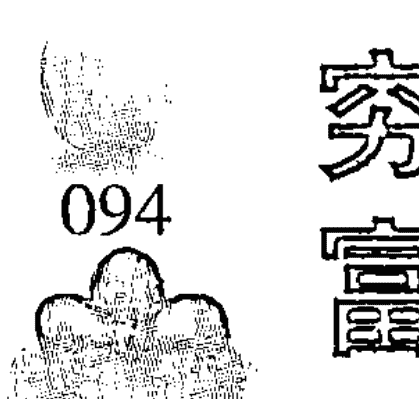

这个道理很浅显，也很容易明白。很多人不明白，并非因为不够聪明，而是因为被欲望蒙蔽了双眼，以为自己真的是那个被选中的“幸运者”，可以接得住天上掉下来的“馅饼”。

很多人以为传销里的“一本万利”的“本”是资本，但实际上，这个“本”不过是赌徒的“赌本”罢了。

追寻财富是一场冒险，而不是一场赌博。冒险的人在展开冒险之前会做充分的准备，他们知道自己将踏上一段什么样的旅程，他们明白自己的目的地在什么地方，他们会预估风险，会为即将遇到或潜藏的危险制定一系列的方案。这场冒险可能会成功，也可能会失败，但这种风险在很大程度上是可控的。

但赌博的人不同。对于赌徒来说，他根本无需去做任何准备，因为成功或失败都完全掌握在别人手中。赌徒凭借的，只是运气和一次次怀的侥幸心理。赌徒想要成为富人，概率比中彩票的还要低得多。

富人赚钱，追求的是“万本万利”，他们很清楚，回报与风险永远是同步增长的。因此，比起寄希望于高回报，富人更倾向于扩大自己的资本。这也是为什么很多富人明明很有钱，却依然不断地向银行贷款，以此来扩充发展自己企业的原因。

对富人来说，他们宁愿向银行借钱，负债经营，以更雄厚的资本来赢得市场竞争，也不愿意将自己所拥有的资本孤注一掷，搏个“一本万利”。

在财富的道路上要敢于冒险，但绝不能盲目冒进。当你被“高回报”蒙住双眼时，前方很可能就是万丈深渊。永远不要把资本错当成赌本，更不要借钱当赌本。须知，世界上没有那么多的赌王，有的只是一个个跳入深渊且不自知的赌徒。

### 07 紧抓不放的叫财产，敢收敢放的才叫资本

不管拥有多少财产，如果不改变自己的财富思维，终有一天还是会变为穷人。反之，不管拥有多少资本，拥有和富人一样的财富思维的人，终有一天能成为富人。

玩过“大富翁”的人都知道，在这款游戏里有一个道具叫做“均富卡”。当你的对手都比你有钱的时候，使用这个道具是一件极其开心的事情，因为这个道具的功能，就是将所有参与游戏的玩家手中的现金都集中起来，然后再平均分给每一位玩家，这样一来，大家就共同富裕了。

但玩过这个游戏的人也会发现，这张“神卡”并不能真的帮助你取得最终的胜利，虽然你分到了富人手中的资金，然后你拥有了和他们一样多的金钱，但那些土地、房产、加油站等能够赚钱的东西，依然还属于富人。几轮过后，贫富差距依旧会显露出来，该是别人口袋里的钱，终究还是会回到别人的口袋里的。

可见，能够决定你最终成为穷人还是富人的，不是你手中紧握着多少财产，而是你拥有了多少资本。财产再多，终究会有挥霍完的一天；资本再少，却总存在着增值和扩展的机会。

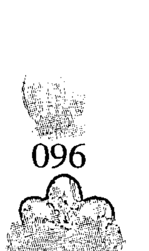

穷人与富人的差距，其实就是财产和资本的差异。穷人手里拿着财产，富人手里却握着资本。不管拥有多少财产，穷人如果不改变自己的财富思维，终究有一天还是会变为穷人。反之，不管拥有多少资本，拥有和富人一样的财富思维的人，终有一天能成为富人。

说到这里，很多人可能会困惑：什么叫财产，什么叫资本呢？它们之间有什么区别？事实上，财产和资本并不是特指两种不同的东西，比如一笔钱，在某些人手中，它就仅仅是财产，因为拥有它的人除了花费它之外，不会利用它去持续创造价值；但在某些人手中，这笔钱就成为资本，他们利用它去创造收益，让它除了消费之外还拥有了更大的价值。

生活中很多穷人都认为，自己的贫穷更多是由外界客观存在的因素所导致的。比如自己生来就不是富二代，甚至可能必须背负沉重的家庭压力；或者认为自己生来运气就不好，总是摊上霉运；又或者认为社会很不公平，总是助长小人气焰，却灭了好人威风等。总之，他们似乎总能找到各种各样的理由来证明自己的贫穷并非是自己造成的，而是社会或某些不可抗力所造成的“悲剧”。

当然，穷人之所以成为穷人，的确有很多原因，不管是出身、个人运气或者社会环境等，都是构成贫穷的重要因素。这些因素会让你的致富道路走得比别人更艰辛，但这并不意味着你人生通往“富有”的道路会被阻断。真正阻碍你成功、将你一次次拖入贫穷困境的，不是出身，不是个人运气，也不是社会环境，而是一直缠绕你的“穷人思维”。

让我们先来看一看一些真实的新闻报道：

威利·亨特，一位美国中产阶级，有着一份体面的工作和一个幸福的家庭，在所有认识他的人眼中，他都是一个非常不错的家伙，对工作认真负责，是一个好领导、好员工；对家庭十分照顾，是一个好丈夫、好父亲。

1989 年，威利·亨特的人生发生了巨变：他赢得了 310 万美元的密歇根州彩票大奖，摇身一变成了有钱人。可令人意外的是，就在这份大幸运降临到他头上之后的两年时间里，威利·亨特的人生却迅速跌入了深渊：妻子与他离了婚，他也失去了孩子的监护权，工作方面也频频失利，更可怕的是，他居然还被告谋杀未遂……

这笔意外降临的巨额财富没有让威利·亨特获得更大的幸福，反而毁灭了他的人生。因为在拥有这个大奖之后，威利·亨特迷失了，他开始毫无节制的生活，变得堕落且缺乏自控力，甚至开始吸食毒品可卡因。而正是这一切，让他走上了万劫不复之路。

艾维连·亚当斯，这是一个来自新泽西州的、被幸运之神眷顾的小伙子，他连续两年中了彩票头等奖，累计一共获得了奖金 540 万美元！这样的好运气真是令人叹为观止。但就是这样一个拥有世界上绝大多数人想都不敢想的好运气的年轻人，最后却因为过度挥霍和沉迷于赌博而失去了一切，成为了一个流离失所的流浪汉。

佛罗里达州的一对夫妇在 1990 年中了 1300 万美元的巨额彩票大奖，欣喜若狂的他们开始疯狂消费，购买了豪华的房子、高档的汽车还有各式各样的珠宝首饰。在无节制的挥霍之下，不到十年，他们的经济状况就陷入了窘境，甚至变卖了一切能够变卖的东西，最后还因偷税而身陷图圈。

类似这样的新闻不胜枚举，以上只不过冰山一角。在这个世界上确实存在十分幸运的穷人，他们的运气甚至比很多富人都要好得多。他们接住了“天上掉下的馅饼”，吃到了人人都羡慕的“免费午餐”，他们有一夜暴富的神话，但尽管如此，在短短数年或十几年间，他们却几乎都再次回到了贫穷的原点。

出现这样的结果并不奇怪，因为这些人都缺少将财产变为资本意识和能力。他们宁愿挥霍无度地去享乐，也没有冒险一搏的勇气和野心。而

国内众多权威媒体都曾报道过一个普通农家子弟的传奇的创业事迹，这位农家子弟名叫陈伟，来自四川。

1996 年冬天，高中毕业的陈伟离开了学校，和老乡一起到上海闯荡。他做的第一份工作是在工地上当建筑工人。但这份工作陈伟做的时间并不长。第一年春节回家之后，陈伟向父亲借了 500 块钱，决定只身一人去北京闯荡闯荡。

在北京，陈伟做过搬运工，也做过饭馆服务员，还张贴过小广告。很快，他就有了一万多多元的积蓄，这在当时对于陈伟来说可是一笔“巨款”。但陈伟并不满足，他想自己做一番事业，于是便拿着自己所有的积蓄，又向朋友借了一些，开了一家中介公司。然而，就在公司刚走上正轨之时，陈伟的父亲病了，陈伟带着自己所有的积蓄一共 5 万多元回家乡给父亲看病。

半个月后，陈伟回到北京，他的中介公司已经不行了。第一次创业就这样走向了失败，陈伟花光了所有的钱，还欠下了一笔广告费。无奈之下，陈伟只得再次去找工作，变回了一名给别人打工的上班族。

后来，陈伟进入一家大型房地产公司跑业务。敢闯敢拼的他因为业绩出色，很快就升任了副总，在业内也开始小有名气。不久之后，一个做房地产开发的老板相中了陈伟，拿出 60 万元来让陈伟给他筹备房地产公司。

少年得志让陈伟不免有些狂妄自大，听不进别人的劝告，于是毫不意外地，公司再次倒闭了。陈伟顿时从天堂又一次跌入到了地狱。他带着自己的全部财产一共 500 元钱离开了北京，“逃”到了广州。

在这里，陈伟再一次创业，这次他成了一名擦鞋匠。陈伟发现，在广

州，一个擦鞋小摊一天的平均收入大概在 80 到 150 元之间，仅仅一条街上就大概有二三十个擦鞋摊。可见，“擦鞋”这项生意是很有市场的。更重要的是，很多人都因觉得擦鞋这事很“低档”而不愿意做这个生意，这个生意市场有着很大的一片空白。

于是，陈伟借到两万元钱之后，再次开始了创业，将“擦鞋”变成了一项规范性的生意，并在短短四年时间里打造了一个产业多元化的大型国际连锁集团企业，缔造了属于他自己的创业传奇。

上述的这些得得失失、成成败败启示我们，紧抓不放的叫财产，财产不会自我增值，总有花光的一天；只有敢收敢放的，才叫资本，资本有着无限增值的可能。

陈伟的成功就在于，他把自己手中的一切都看作是资本，而不是财产。需要的时候，他可以毫不犹豫地收回来，比如给父亲看病。有机会的时候，他也能毫不犹豫地放出去，抓住一次次商机，开创属于自己的事业。

如果你也希望像陈伟都样成就属于自己的财富传奇，就一定要懂得如何对手上的资本收放自如，而不要把自己财产守得死死的，更不要随意挥霍自己的财富。

### 08 借别人的信用去借钱，用借来的钱建立自己的信用

> 在追求财富的路上，在创业过程中，缺少资本并不要紧，只要你善用自己的头脑，就一定能像路维格一样，通过一个“借”字，为自己赚来亿万财富。

在这个世界上，金钱虽然不能买到所有东西，但我们不得不承认，大部分东西是钱可以买到的，而大部分的麻烦也是钱能够解决的。在现实生活中，真正压在我们头顶上的大问题其实只有一个，那就是——如何才能够赚到钱！

用钱赚钱远远比卖力赚钱要容易得多，而且要多得多多。很多时候，富人只需打一个电话，就能赚到穷人一整年的收入。

任何想要创业的人，都免不了要先准备创业的资本，而资金就是创业的一个必不可少的资本。但对于穷人来说，赚钱可不是一件容易的事。穷人想要完全靠工作来为自己筹集第一笔创业资本更是难上加难。更重要的是，对于创业者来说，机遇是一闪而逝的，当你发现了一个好项目，一个有发展潜力的商机后，如果不果断出击，抓住机会，可能就会落入别人手里，而你只能扼腕叹息，无可奈何。

其实，很多白手起家的成功企业家，他们创业的第一笔资金通常都不会完全只靠自己的工作收入来筹集。与其用五年、十年的时间去攒一笔创业资金，不如学会如何在一天之内就借到这笔资金，从而迅速增强我们的竞争力和成功率。

美国“造船大王”路维格就是个“借”中高手。路维格在创业之初也是一个一无所有的穷小子，对于命运的安排路维格并不接受，他也想像那些有钱人一样，做出一番惊天动地的事业。

路维格打算买下一艘货轮，然后把货轮改装成油轮，因为载油比载货的利润更高。可是买货轮需要钱，路维格并没有钱。如何才能得到这笔钱呢？按部就班地工作，然后积攒工资？不，如果是这样，那么可能终其一生，路维格都只能是个穷小子。他可能一辈子也没办法赚够买货轮的钱，于是他决定向银行贷款。

路维格拜访了纽约的多家银行。他告诉银行，他拥有一艘老油轮，并租赁给了一家石油公司。他向银行承诺，只要银行愿意批准他的贷款，那么他将会把租契交给银行，这样银行就能直接每个月从石油公司收取租金来作为他贷款的还款。

这样的想法似乎有些荒唐，但细细分析下来却又觉得挺保险。毕竟虽然路维格本人并没有什么可靠的信用，但那家石油公司却不同，那可是家大公司，在信用度上还是有非常有保障的。最后，有一家银行批准了路维格的贷款，路维格也利用这笔钱成功买下了一艘货轮并改装成油轮租赁了出去。

成功做完这件事后，路维格并不满足，他需要更多的资本，他想做的可不仅仅是局限于一艘油轮的生意。于是，他用同样的方法又借来了另一笔款，买下了另一艘货轮……这样的方法简直令人拍案叫绝！一无所有的路维格通过巧妙的“借”，在很短的时间内，就获得了很多人奋斗了一辈子都无法拥有的财富。

路维格的做法确实非常聪明。作为一个没有任何资产和可靠信用的穷人，在向银行借款的过程中，他巧妙地把自己和一家值得信赖的石油公司“捆绑”在了一起，银行或许不能信任他，但银行却能信任那家石油公司。因此，通过向石油公司“借”信用，路维格成功获得了贷款。而通过成功向银行“借”资金，路维格又成功获得了属于自己的资产——油轮。

在拥有了数艘油轮后，路维格并没有满足，他又有了一个更绝妙的想法：现成的船可以用来借钱，那么待建的船是不是也能用来借钱呢？

经过一番思索，路维格完善了自己的想法：他打算设计一艘船，在投入建造前，就去寻找愿意租用这条船的人。这样一来，在船建造之前就能拿到一份租契，这份租契就能作为向银行借款的抵押。银行批下贷款之后，就能利用这笔贷款来造船了，之后，船的租金就能用来还银行贷款，等贷款还清，这艘船就能真正属于路维格自己。

这个想法确实绝妙，路维格相当于提前利用船能带来的收益去买下船，如此一来，他只需找到愿意租赁的人，和愿意借贷的银行，就能在不投入任何资金的情况下拥有一艘船，还有比这更令人激动的事情吗？

这一想法再次获得了银行的认可，毕竟路维格已经是他们的老客户，他已经建立起了自己的信用。更何况，除了自己的信用，路维格还“绑定”了别人的信用。

于是，路维格从一个试图利用油轮进行运输来赚钱的运输商，一跃成为了一个能够自己进行油轮设计和制造的制造商。巧妙的借贷方式让路维格从一个一无所有的穷小子，迅速成长为美国著名的“造船大王”。

路维格缔造船业帝国，关键就在于一个“借”字。他先是借来别人的信用去向银行借钱，然后再通过借钱来一步一步建立起自己的信用。这启示我们，对于一个穷人来说，阻碍他成功的，绝不是资金的缺乏，也绝不是运气的好坏，而是有没有致富的思路和行动的勇气。

相比于富人，穷人的确缺少优势资源。缺少该怎么办呢？借啊！对穷人来说，要靠自己的努力累积一定的创业资本，可能需要五年、十年甚至更久，但如果是“借”，可能只需要一个月、一个星期甚至一天！

在追求财富的路上，在创业过程中，缺少资本并不要紧，只要你善用自己的头脑，就一定能像路维格一样，通过一个“借”字，为自己赚来亿万财富。

### 09 有些信息，是比金钱更值钱的资本

> “物以稀为贵”，信息也如此。只有获取别人无法轻易得到的信息，或比其他人更早更快地获得信息，我们才能将这些信息变为值钱的资本。

想要赚钱，你首先必须要有资本，“空手套白狼”是绝对行不通的，这个世界上没有那么多愚蠢的“白狼”等着你去“套”。说到资本，很多人第一时间想到的就是金钱。这很正常，对于大多数穷人来说，在创业之初，最缺的大概就是金钱了。

金钱是创业所必须的资本，这一点毋庸置疑。但值得注意的是，在我们的创业资本中，还有比金钱更重要也更“值钱”的资本，比如信息。赚钱是一件非常理性的事儿，不管你从事什么行业，只要你的目标是赚钱，你就必须理性起来。

你可以有自己的想法，可以有自己的偏好，但只要你想想赚钱，这些就得得靠后，你必须根据市场和客户群的需求来制定你的发展方向和做事风格。而你从何处得到市场和客户群的需求呢？这些自然都来自于信息。

A 小姐在朋友眼中绝对称得上是一名的“投资大师”，只要跟着她投资，一准儿能挣钱。例如几年前，A 小姐贷款买了一处位置较为偏远的新区开发区的房子，那个地方虽然山清水秀，但距离市区可不近，在那儿买房，根本就是给自己添麻烦。但没想到，没过多久 A 小姐买房的那个小区附近开发了一个大型水上度假村，一时间房价飞涨，A 小姐买的房产还没交房就涨了快三分之一。

又如不久前，一路低迷的股市总算迎来了春天，看着形势一片大好，众多股民的热情又燃烧了起来。A 小姐平时也有投资股票的习惯，自然也乐滋滋地再次入市。可就在股市呈现出一片欣欣向荣景象的时候，A 小姐突然把手里所有的股票都抛售了。周围的人还没有反应过来 A 小姐的行为，股市就再次遇冷大跌了，结果不少人再次被套牢。

A 小姐这“未卜先知”的能力着实令人佩服，这也让她成为了众人的“理财顾问”，周围的亲戚朋友，谁想做投资都要来问问 A 小姐的意见。

众所周知，商场向来瞬息万变。算命先生大概可以帮你卜个吉凶，问个前程，却没依法帮你预测商场上的趋势走向。那么 A 小姐为什么能“未卜先知”呢？其实，这很大程度上要得益于 A 小姐的职业。

A 小姐是一名律师，做这份职业，如何经营维系自己的人际网络是

极其重要的，并且律师这个职业所接触的人也是各种各样的，上至达官贵人，下到贩夫走卒，都可能成为 A 小姐的客户。A 小姐所谓的“未卜先知”，实际上都来自平日与这些客户交往过程中的信息。很多时候，一条有用的信息实际上就是一个宝贵的商机。

网络上有这么一个段子，说新浪和腾讯在聊天。新浪说：“我们起步早！”腾讯回答：“我有 6 亿 QQ 用户。”新浪不服输，说：“我们明星很多！”腾讯答：“我有 6 亿 QQ 用户。”新浪又说：“我们质量高！”腾讯答：“我有 6 亿 QQ 用户。”新浪继续说道：“我们引导舆论！”腾讯答：“我有 6 亿 QQ 用户。”最终，新浪无言以对。

这虽然是个笑话，但其实也很直观地反应出，对于腾讯来说，它最具竞争力、最值钱的东西不是任何一项产品，而是它庞大的客户群。6 亿用户，这意味着腾讯拥有了一个极其庞大的信息数据库。通过这个庞大的客户群所搜集到的信息，显然要比任何产品、任何服务都更加值钱。这 6 亿 QQ 用户就是腾讯最宝贵的资本。

社会就像一个金字塔结构，越是有钱有权的人，就站在越高的地方；而站得越高，自然也能看得越远，获取的信息当然也就越多，这就是为什么越是有钱、有权的人，赚钱就越容易。

在通讯不发达的古代，获得信息量越大的人，所占据的优势就越大，不管是商场还是战场都是如此。经商的人通过信息的获取，可以掌握市场动向，从而将商品运送到有需求的地方；而打仗的人通过信息的获取，可以掌握敌人的动向和战情的发展，从而制定相应的御敌之策，抢占先机。

在通讯发达的今天，比起获取信息，如何筛选并提取有效信息显得更重要。

## 第四章 投资人脉：穷人圈子窄缺人脉，富人借人脉聚财脉

### 01 富人借贵人之力，迅速成功致富

贵人是我们追求财富、成就大事过程中不可或缺的帮手。很多时候，我们感到力不从心，付出的努力始终无法获得相应的回报，往往就是因为生命中少了贵人的鼎力相助。

有一首歌是这么唱的：“三分天注定，七分靠打拼，爱拼才会赢……”确实，无论做什么事情，都是“谋事在人，成事在天”的。即便你付出了努力与汗水，也未必就能得到上天的眷顾，获得最后的成功。但如果不肯努力、不爱打拼，那是一定不会赢的。

在追求财富、奔向成功的道路上，我们唯一能掌控的就是那“七分打拼”。但现实告诉我们，即使我们能掌控这七分努力，也不是只要付出就能有相应回报的。有的人可能付出了十二分的努力，却只能收到七八分的回报；有的人只付出了七八分的努力，却收获了十二分的回报。这一差别的关键在于，很多人忽略了“七分打拼”中一个十分重要的环节：贵人相助。

在我们攀登人生高峰的时候，总会遇到一些困境和瓶颈。想要脱离困境，突破瓶颈，我们往往需要借助一些外力，而愿意给我们提供这种外力的，就是我们所说的“贵人”。贵人未必一定要“贵”，但贵人一定会对我们的生命和事业造成重要的影响。他们可能是在我们迷茫无助时伸出援助之手的“益友”，也可能是失望彷徨之际推着我们越过成功门槛的“良师”。

自古以来，但凡能够成就大事或发家致富的人，除了有着过人的聪明才智外，还有着贵人的相助。例如秦庄襄王嬴异人，原本只是秦孝文王一个不受宠的儿子，还被送到赵国当了人质，却因为遇到了吕不韦这个贵人，从而改变了自己的命运；又如刘邦，从个人能力来说，他远不如“力拔山兮气盖世”的霸王项羽，但他凭借着广交朋友的本事，结交了一大批能人异士，最终在这些“贵人”的帮助下，扫平诸侯，一统江山，坐上了龙椅；再如三国时的刘备，他能“白手起家”，与孙权、曹操等人形成分庭抗礼之势，绝对离不开关羽、张飞、赵云、诸葛亮等人的鼎力相助。

贵人是我们在追求财富、成就大事过程中不可或缺的帮手。很多时候，我们感到力不从心，付出的努力始终无法获得相应的回报，往往就是因为生命中少了贵人的鼎力相助。成功之路就像是一条河流，而贵人之力就如同徐徐清风。当我们逆风而行时，往往需要付出更多的力气，才能推动小船在河流中艰难前行；当我们顺风而行时，只需安坐船头，就能在河流中乘风破浪。

北京山西商会副会长、酒仙网董事长郝鸿峰在讲述自己是如何走向成功的时候，着重提到了他生命中至关重要的四位贵人。

郝鸿峰大学学的是工商管理，当他怀抱着远大的理想前往太原后才发现，现实远比他想象的更加残酷。没有关系、没有背景，想要找到一份像样的工作几乎不可能，无奈之下，这个大学生只好干起了酒店保安和客房服务员这样的工作。半年之后，为了搏一搏自己的前程，郝鸿峰终于决定创业。

早在大学时期，郝鸿峰其实就已经有过一次创业经历。那时候他突发奇想，打算做旧书回收生意，也就是从废品收购站低价买回别人卖出的旧书，然后再把这些书一本一本卖出去。想创业就必须要有创业资金，当时还是穷小子的郝鸿峰自然拿不出这个钱来。就在这个时候，郝鸿峰的第一个贵人出现了，他就是郝鸿峰上铺的兄弟、“富二代”徐磊。

徐磊费尽口舌才从父母那里要来了两百万元的投资，然后兴致勃勃地准备和郝鸿峰在事业上大干一场。但最终，这一事业却以失败告终了，两百万元只用了半年就赔没了。虽然这一创业经历以惨败结束，但好兄弟徐磊对郝鸿峰的信任和支持，还是成为了郝鸿峰在此后遭遇人生困境时的激励与温暖。

郝鸿峰的第二次创业是发小报、贴传单。他找到了太原的一家保健品代理公司，与该公司的老板达成协议，帮该公司发小报做宣传。该老板承诺，每发出一份小报，就给他三分钱。郝鸿峰雇用了十几个流浪汉，开始了他的发小报生意。没想到，在郝鸿峰不辞辛苦地发出了一百多万份小报之后，原本应该结算的三万元款项却缩水成了大约七千多块。郝鸿峰数次找老板索要欠款，却被一次又一次地拒之门外，甚至还被那个老板恐吓威胁。第二次的创业就以这样辛酸的方式走向了失败。

在走投无路之际，郝鸿峰遇到了生命中的第二位贵人，一个姓翟的老板。

郝鸿峰是个非常讲义气的人，在哪儿都能与人结交。李忠鹏是郝鸿峰在发传单过程中结识的朋友，当他知道郝鸿峰走投无路时，便给他引荐了太原一个食品厂的老板，这个老板就是郝鸿峰将其列为生命中第二个贵人的翟老板。

翟老板的食品加工厂实际上就是一个简陋的小楼，雇了七八个妇女包饺子，当时生产的都是“三无产品”——无品牌、无渠道、无卫生质量保证。那个时候，这一生意做得十分惨淡，翟老板大概也是无人可用了，当即就“大方”地承诺，让郝鸿峰和李忠鹏分别出任食品厂的“老总”和“副总”职位，没有底薪，赚的是他们从厂里拿饺子，然后卖出去之后的差价。

在推销饺子的过程中，郝鸿峰很快发现了商机，那就是他迅速开辟了饭店这一新渠道，并迅速占领了市场。仅仅用了七个月的时间，他就让这个“三无产品”有了自己的名字——“乐田园”。在郝鸿峰的带领下，乐田园很快成为太原销售量最高的饺子，甚至超过了思念、三全等国内饺子大品牌。

就在乐田园取得巨大成功的时候，翟老板却开始“夺权”了。乐田园可以说是郝鸿峰一手做起来的，手下的人也几乎都只认郝鸿峰，而不知道翟老板，这让翟老板非常不高兴。最终，这个贵人成为又一次让郝鸿峰“下岗”的人。

但此时，郝鸿峰已经不再是当年那个一文不名的穷小子了。离开乐田园的他很快遇到了生命中的第三个贵人程凤仪，山西洪润酒类商贸有限公司的副总经理。

在程凤仪的引荐下，郝鸿峰开始踏入酒类代理行业，并成功发展成为了山西最大的酒类代理商之一，同时顺利当选了北京山西商会副会长。这在许多人眼中已经是莫大的成功了，但郝鸿峰心中却有了更大、更远的追求：他要做中国第一的酒类流通企业！那时候，业内的“中国第一”是金六福，一年能销售30个亿。

为了实现这一看似遥不可及的梦想，郝鸿峰决定用知识充实自己——前往清华大学上EMBA课。在这里，他接触到了电子商务。那时候，上电子商务课程的老师叫朱岩，他被郝鸿峰视为生命中的第四个贵人。正因为有他的帮助，郝鸿峰打开了电子商务的大门，“酒仙网”也终于应运而生。

给予无限信任和支持的兄弟，走投无路之际为你打开机遇之门的上司，因欣赏而大力提携你的恩人，为你打开新视野、新领域的良师……正是这四个贵人成就了郝鸿峰的成功。

人生最难得的大概就是这十个字了：“人贱心不贱，身贵人不贵。”郝鸿峰正是因为做到了这一点，才能不断遇上贵人，最终改变自己的命运，成为富人。

### 02 即使生意惨败，富人也能借力于人脉迅速东山再起

在史玉柱顺风顺水的时候，这些人脉的重要性也许还不能凸显出来，但当他落难之际，他所经营的这些人脉就成了他的救命药，成为扶持他再次登上巅峰的强大助力。

“今年过节不收礼，收礼只收脑白金！”就算你不认识史玉柱，也一定听过这句广告词。作为中国商界最具争议与传奇色彩的人物之一，史玉柱的人生经历比小说还精彩，堪称跌宕起伏。早年，凭借着“巨人汉卡”和“脑黄金”，史玉柱获得了巨大的成功，在1994年初当选了“中国十大改革风云人物”，并于次年被美国《福布斯》杂志列为中国内地富豪的第八位。

在灿烂夺目的辉煌过后，1996年，史玉柱兴建的巨人大厦资金链断裂，为了弥补这一空缺，史玉柱将其保健品业务方面的全部资金都调配给巨人大厦，这一错误决定加上后期的管理不善，使得史玉柱的巨人公司盛极而衰。到1997年，巨人大厦正式停工，巨人公司名存实亡。史玉柱从中国的传奇富翁摇身一变，成了全中国负债最多的“负翁”。当时，他的负债高达2.5亿人民币。

一个迅速崛起的传奇就这样破灭了。如果故事只停留在这里，那么可能到了20年后的今天，就不会再有人记得史玉柱与巨人公司了。

生活常常给世人演绎峰回路转的故事。就在所有人都认为史玉柱倒了，巨人公司完了的时候，经过数年蛰伏，史玉柱带着“脑白金”强势回归，席卷了整个中国的保健品市场。“今年过节不收礼，收礼只收脑白金”的广告词家喻户晓。

2009年，《福布斯》杂志全球富豪排行榜中，史玉柱再次榜上有名。他不仅早已还清了当年的巨额欠款，还以15亿美元的身价位列全球富豪榜第468位，在中国大陆富豪榜上位列第14位。

任何成功都不会是一种偶然，史玉柱也不例外。在历经失败，跌入谷底，甚至成为“中国首负”之后，史玉柱能在数年后东山再起，甚至取得了比曾经更加辉煌的业绩，他靠的是什么？除了靠他个人的努力和卓越的商业头脑，史玉柱还离不开他自己最重要的资本——“他们”。

先说第一个“他们”。

当史玉柱从巅峰跌落谷底，身负巨额欠款之时，他决定回归到自己当初起家的保健品行业，从头再来，重新创业。我们知道，创业是需要资金的，没有资金，你拿什么创业？但现这个时候的史玉柱，头上顶着天文数字的欠款，哪里还有资金啊？想要向银行贷款也基本上是不可能的。那么，史玉柱重新创业的资金从哪里来？

这个时候，人脉的重要性就凸显出来了，他的朋友们借给了他50万元。正是这50万元，成为当时脑白金的运作资金。这就是我们所说的第一个“他们”——在困境时向史玉柱伸出援手的朋友。

再说第二个“他们”。

据报道，在2007年，史玉柱东山再起之后，曾邀请了一些朋友组织了一个名为“战胜挫折，走向成功”的座谈会。在这个会上，他数次提到，自己非常感谢“泰山会”。

“泰山会”全名为泰山产业研究院，是1993年成立的，它的会员主要是中国具有影响力的知名企业家们。“泰山会”可以说是中国最知名也最神秘的大型商会了，史玉柱也是其中的成员。

史玉柱和“泰山会”的关系称得上是“生死之交”。在巨人公司未遭遇危机之前，史玉柱就通过“泰山会”的一位元老级人物的介绍加入了“泰山会”。而在巨人公司第一次垮台之后，史玉柱就成为了“泰山会”的重点“帮扶对象”。正是因为有了这些贵人的扶持，史玉柱才能在那么短的时间里东山再起。

最后说第三个“他们”。

在史玉柱东山再起的过程中，和他一起做脑白金的主要干部都是之前在“老巨人”时期就追随他的左膀右臂。脑白金的营销团队中，有三分之一的分公司经理都是曾追随史玉柱做“脑黄金”的员工。

中国有句古话叫“树倒猢狲散”，当一个人处于辉煌时期，自然会有人追随他，崇拜他，聚拢到他身边。但当一个人跌落到低谷时，如果还有人愿意追随他，崇拜他，在他身边坚定不移地支持他，那这个人必然有着令人佩服的能力和个人魅力。而追随他的这些人，也必然会成为他人生命中最宝贵的资本。

史玉柱就拥有这样的资本。在“老巨人”时代，史玉柱的身上是有光环的，他是很多年轻人的“梦想”，很多年轻人的榜样，他迅速创造的财富神话曾吸引了很大一部分人的目光。当“老巨人”轰然倒下后，一些人选择离开，一些人被迫离开。还有一些人，依然围绕在史玉柱身边，成为他东山再起的重要力量。正是这第三个“他们”——追随着史玉柱的员工，为他的再次崛起打下了坚实的基础。

我们看到，这些让史玉柱能够东山再起的“他们”，不管是朋友、贵人还是员工，其实都是史玉柱的人脉。在史玉柱顺风顺水的时候，这些人脉的重要性也许还不能凸显出来，但当他落难之际，他所经营的这些人脉就成了他的救命药，成为扶持他再次登上巅峰的强大助力。

人脉是需要经营的，它不可能凭空出现。你必须先付出，才能得到回报；你必须先经营，才能收获好处。

- 从朋友这条人脉来说，维系这条人脉关系的主要是感情。感情就像植物一样，需要阳光，需要雨露。只有当你时时照看，它才会越长越好，开花结果。若是长期缺少阳光与雨露，那么生命力再强的植物也有枯萎的一天。

- 从贵人这条人脉来说，你想得到贵人的扶持，身上一定要有某些让贵人欣赏的特质，必须能给予贵人们相应的回报。在史玉柱的案例中，能有资格加入“泰山会”的都不是一般人，都在某些方面有着过人之处。而“泰山会”成员之间的帮扶其实也是相互的，比如当四通集团打算从IT电子行业转行做保健品时，史玉柱也曾给过极大的支持和帮助，甚至表示，愿意“出任四通CEO，年薪只要一块钱”。

- 从员工这条人脉来说，作为一个领头人，当你光芒万丈的时候，自然不会缺少支持者和追随者，但使这些支持者和追随者真正折服的，未必要你本人，很可能只是你身上的光环。一旦你身上的光环没有了，这条人脉很可能就断了。想要长久让这条人脉持续下去，你就要用个人的能力和魅力去征服他们，让追随你、支持你的人看到你与众不同的地方，你令人钦佩的地方。只有当他们追随你、支持你是因为你这个人时，是因为你的能力、见识、思想等时，你才算真正掌握了这条人脉。

以上这些，史玉柱都做到了，且做得相当漂亮。正是这些宝贵的人脉资源，让史玉柱能够从“中国首负”再次成功登上人生巅峰，缔造了又一个传奇的财富英雄的故事。

人脉资源对史玉柱东山再起所起到的决定性的作用，启示我们，无论什么时候，我们想成为富人，都必须不断经营自己的人际，即使获得了成功，也不能停下来，如果还没成功，就更不能停。须知，拥有了足够广的人脉，即使你失败了，也能很快反败为胜。

### 03 富人默默经营人脉不求回报，人脉回报却很丰厚

富人都知道，人脉经营就像在播种，你播下的种子不一定每一粒都能发芽，但你播下的越多，到收获的季节，必然会得到越多。

在晚清乱世中一枝独秀的“红顶商人”胡雪岩曾说：“要成大事，先要学会做人；而会做人，即是善于在交往中积累人缘。若能做到圆通有术，左右逢源，进退自如，上不得罪于达官贵人，下不失信于平民百姓，中不招妒于同行朋友，行得方圆之道，人缘大树枝繁叶茂，那成大事一定不在话下了。”胡雪岩强调的“人缘”，其实就是我们今天说的“人脉”。

也许是因为许多成功学都在强调人脉所能带来的好处，因此有相当一部分人对人脉的积累存在严重的误解，总是将人脉与金钱直接地联系在一起，带有极强的功利性。这也是社会上总存在着一种人，常常带着极强的目的性和功利性在与人交往的原因。

人脉其实就是一种人际交往，但很多人把这个概念看得很特殊。在这些人眼里，人脉就像是一场生意，在建立之初，就要考虑到其所能带来的回报。因此，这些人在建立人脉关系时，常常会考虑的一个问题就是，这条人脉是否能够为自己带来利益、权势等显性资源。

人脉的贵重不只是与金钱或权势挂钩的。好的人脉，能为你带来的好东西数不胜数。一个对你有益的朋友，能够在生活上给予你良好的引导和及时的帮助，我们说这就是好的人脉，虽然这位朋友未必能帮你平步青云；一个能在思想和感情上给予你慰藉和帮助的人，同样也是你的好人脉，他未必能为你带来巨额财富，却能让你的人生、事业更上一楼层。

如果你将人脉看作是一种功利性的东西，与任何人交往都带着明确的目的，必然会成为别人眼中的“势利眼”。试想一下，你会愿意和一个“势利眼”交往吗？会愿意为一个“势利眼”提供帮助吗？己所不欲，勿施于人。

“有心栽花花不开，无心插柳柳成荫。”这是人脉关系中十分常见的一种现象。有时候，当你带着极强的目的与别人交往时，未必能得到自己想要的东西；但有时候，你无心的举动反而能给你带来意想不到的收获。

有一个小伙子叫维克多，他们家经营着一间非常古老的杂货店。维克多从父亲手中接过杂货店经营权成为名副其实的老板的那一刻开始，就渴望着有一天能把这家店发展壮大起来。他也确实一直在寻找机会。

有一天晚上，维克多正在店里清点账目，一位衣衫褴褛、面黄肌瘦的年轻人突然出现在门口，正在往店里张望。热心的维克多赶紧迎了出去，礼貌地询问年轻人说：“请问有什么可以帮你的吗？”

年轻人有些窘迫，踌躇许久才小声地说道：“我从墨西哥来，想在美国找工作，但已经两个月了，却一直没找到合适的工作……我父亲年轻时也来过美国，还在你店里买过东西呢，就是这顶帽子……”

说着，年轻人指了指头上戴着的一顶破旧的帽子，帽子上印着的标记都有些看不清了，但维克多还是认出，那确实是他店铺的标记。

年轻人又接着说道：“我现在没钱回家，而且很久没吃过一顿饱饭了，所以……”

虽然眼前这个人与自己没有任何交集，充其量不过是曾经光顾过自家小店的一名顾客的儿子，但维克多却觉得，自己既然有能力，就应该给予他一些帮助。于是，维克多热情地把这个年轻人请到了店里，让他免费饱餐了一顿，还资助了他一笔返回祖国的路费。

这件事很快就被维克多忘掉了，这毕竟不过是他人生中许多次对他人展现出善意的其中一次而已。十几年后，维克多的杂货店在他的经营下越来越兴旺，并且在美国开了许多家分店，成了一家中型连锁店。对此维克多并不满足，他的梦想是要让这家连锁店成为一家国际性连锁店。但如何才能将生意扩展到海外呢？维克多一直毫无头绪。

就在这个时候，一家墨西哥的大企业突然主动来和维克多接洽，想与维克多的连锁店展开合作，让维克多把生意扩展到墨西哥去。这简直是“天上掉馅饼”的大好事啊，维克多欣喜若狂地前往墨西哥与该企业的负责人进行商谈。见到这个人时，维克多才发现，他竟然是多年前那位曾在他店门口徘徊的墨西哥年轻人！

人生真是充满了各种意想不到的巧合。很多人将维克多的发迹归功于令人羡慕的“好运气”，是啊，如果不是运气好，维克多又怎么能在十几年前就阴错阳差地给自己的未来铺好了路呢？但是是否有人想过，这种好运气到底是从何而来的？

假如维克多没有一颗乐于助人的心，那么当年即使那个年轻人出现在他面前，他也未必会向年轻人提供帮助。要知道，在向那位陌生的年轻人表达善意时，维克多可从没想过，自己的这一举动会为自己带来什么回报。毕竟当时那位年轻人只不过是一个一无所有的流浪汉，帮助他回到祖国，除了损失一笔路费和一顿晚餐外，维克多很可能什么回报都没有。可维克多依然做了，正因如此，他才抓住了冥冥之中的“好运气”。

富人都知道，人脉经营好像在播种，你播下的种子不一定每一粒都能发芽，但你播下的越多，到收获的季节，必然会得到越多。很多带有极强功利性去经营人脉的人却不懂得这一点，他们小心而吝啬地选择着那些能够为自己带来好处的人脉，在付出之前就已经计较好了回报。这样的人又怎么可能真正建立得起一张良性而长久的人脉资源网呢？

有这样一个笑话。从前有个很笨的人，他到店里去买煎饼吃，当他吃到第六个半煎饼时，感觉自己饱了。这个人非常懊悔且生气，给了自己几个耳光。他说道：“早知道吃这半个煎饼就能饱，我应该先吃这半个煎饼啊！前面六个煎饼不是白吃了吗？这浪费了我多少钱啊！”

我们都知道，没有前面六个煎饼的铺垫，又怎么可能因为吃下这半个

煎饼就饱了呢？这个道理非常浅显，恐怕三岁小孩都能明白。但在现实生活中，很多人却始终不明白这一点。当他们眼中只盯着既得利益，带有强烈目的性和功利性去与人交往，试图建立“有用”的人脉资源时，他们与那个吃饼的笨人又有什么区别？

质变是由量变引发的，愚蠢的人只看得到“质变”的结果，却忽视了“量变”的过程，从而割裂了“质变”与“量变”之间的关系，于是总想着越过过程，直接抵达终点。但人脉的积累绝不是一蹴而就的，你想要得到那宝贵的“半张饼”的人脉，往往需要先铺垫好前面的“六张饼”，否则就算你得到了，这“半张饼”也无法发挥你想要的功效。

## 穷人的 人脉观：为求安全感，筑起“围城”圈起自己

“围城”之中，除了安全还有圈禁。当你为自己筑起一道围墙时，你所阻挡住的，不仅是危险和麻烦，还有无限的机遇与可能。

中国人是非常喜欢谈人脉、讲关系的，从古至今都是如此，更有不少成功人士指出：“人脉关系就是生产力。”但现在，很多有志青年都不屑于经营人脉，不喜欢谈人脉，甚至认为，这种“人脉关系”下的社会运作是一种充满负能量的“弊端”。

之所以有人会产生这样的想法，是因为社会上的确存在着许多与“人情关系”紧密相连的不良现象。但如果仅仅因为看不惯这些不良现象，就将“人脉关系”视作一种下作或低劣的联系，那就非常偏激了。

社会就像是一张交错的大网，由各种各样的关系构建而成。你在这个社会中生存、做事，就不可避免地需要与人交往，需要去触及或调动各种各样的人际关系，这是一种非常正常的现象。与人建立关系本身并没有什么对错，重要的是你利用这个关系去做什么，利用这个关系去得到什么。人应该摆正自己的心态，要知道，求人未必可耻，孤独也未必光荣。

很多人常常抱怨，认为自己一事无成就是因为缺少好机会，没有好运气。他们并没有反思为什么自己会缺少机会，为什么别人能得到机会，只是归咎于运气吗？当然不是！

我们都曾使用过圆规画圆，以一个点为中心，圆规永远都走不出半径之外的距离。很多人的生活其实就像是这个圆，人际交往状态就像是这个圆规，在一定半径之内，不停地环绕，却始终无法走出这个圈子。但我们知道，半径再大，圆的大小始终都是有限的，与圆之外能够无限延伸的世界相比，圆充满了局限性。

那些抱怨缺少好机会，没有好运气的人，实际上就是被自己所画的圆给圈禁起来了，他们能接触到的，永远只是圆内小小的世界，他们并不知道，自己只要突破这个圈子，只要往外走一走，就有无限的机会与可能在等待着他们。

罗小青自从大学毕业后就很少和从前的同学、朋友联系了，一方面是因为工作确实很忙，实在没有多少时间、精力再去进行这些“无谓”的交际；另一方面也是一种自卑心理在作祟。

读书时的罗小青是班里的优等生，是众人仰望的对象。毕业之后，带着宏伟志愿的她踏入社会才发现，原来这里和学校是全然不同的两个世界，不是所有努力都能获得高分，不是认真踏实地做题看书，就能得到赞赏。

工作上的不顺利和生活中的不如意都让罗小青倍受打击，每当看到朋友圈里“晒”的各种幸福，她更感到无地自容。好强的她不愿意让任何人看到自己的落魄，因此越来越不愿意和曾经的同学、朋友联系。

一次，罗小青大学时住在同一个宿舍的舍友结婚，也邀请了罗小青，架不住对方三番四次热情邀约，罗小青只得​不情不愿地答应了。这时候，罗小青已失业快三个月，生活的挫败让她对未来再也不抱任何希望，她决定，参加完这场婚礼后就回老家，找个普通的工作，找个凑合的对象在一起，结婚生子。

机遇的降临总是毫无预兆，你永远不知道，生活给予你的好运会在什么地方等着你。因为参加这场婚礼，罗小青遇到了一个刚回国的老同学，这位老同学打算在国内自己创业，当他听说罗小青已经辞去了之前的工作，便非常热情地向她发出了邀约，希望她能得到自己的公司帮忙。她马上答应了。

多年以后，当罗小青终于在大城市获得了自己梦寐以求的一切时，总会回想起当年的那场婚礼：如果当时她没有去参加，她可能已经灰心失望地回到了家乡，过上了与她所期望的全然不同的生活。但那场婚礼，那个工作机会，却让一切都改变了。

“围城”之中，除了安全还有圈禁。当你为自己筑起一道围墙时，你所阻挡住的，不仅是危险和麻烦，还有无限的机遇与可能。就像罗小青，为了保护自己脆弱的自尊心，她把自己隔离了起来，自以为这样就能安全无虞。但事实上，这种安全是虚假的，当你耗尽了“围城”中的资源时，再不打开“城门”，只会让自己“弹尽粮绝”。

生活中像罗小青这样的人有很多，他们可能生活得并不如意，但他们却又始终没有勇气走出自己的生活圈子。他们总是会有这样那样的害怕。害怕什么呢？害怕别人看到自己的不如意，害怕别人知道自己的挫折与失败，害怕可能会受到更大的伤害，于是选择不断远离人群，试图让自己至少在别人眼里活得春风得意。

但生活是真实的，失败不会因为被藏起就变作成功，不幸不会因为不被人看见就消失殆尽，穷人不会因为远离富人就能对自己的贫穷甘之如饴。“围城”带来的安全感是虚假的，是一种可悲的自我欺骗，更是一种让你陷入恶性循环的自我束缚。

想要走出一个圆，就要找到一个切点，通过这个切点画出一条切线，切线的那一端就能无限延伸出去。同样，当你想要改变自己的生活，改变自己的命运时，就必须找准一个点，打破那个禁锢你的“围城”，推倒阻碍你的“围墙”，走到外面的世界去。很多时候，只有走出去，你才能寻找到无限的可能；只有走出去，你才能获得人生的蜕变。

人脉就像是一座让人终生受用的金矿，编织你的人际网络，就好像是在进行矿藏的开发，你所编织的网络越大，你能开发到的矿藏就越多，你于是也就会越发富有。与人交往就像在播种，播下的种子越多，你所能得到的也就越多。

所以，请从现在开始，走出“围城”，编织你的人际网络吧！当你编织起来的人际网络越大，属于你的矿藏就开发得越多。请从现在开始，就播种你的人际种子吧，播得越多，你以后的收获必定越多，待这些种子开花结果时，你想不成为富人都难。

### 05 穷人社交圈单一，富人人脉圈多样化

事实上你的人脉究竟能为你提供多少帮助，不在于你彻底融入了哪一个圈子，而在于你能接触到多少你所处的圈子之外的人。

什么样的人脉关系是最好的？富人用行动告诉我们：“门当户对”的、能够利益共享的、能双赢的、具有发展潜力的人脉关系是最好的。因此，富人在挑选合作伙伴时，往往考虑的是对方的实力以及诚信等多方面的情况。

穷人则用行动告诉我们：越熟的人脉关系越好。因此，穷人在挑选合作伙伴时，往往会从身边的人开始考虑，比如亲戚、朋友、同学、同事等。

俗话说“多个朋友多条路”，对于穷人来说，谈钱谈关系谈背景都不太实际，因为他们都没有啊，因此，穷人最爱谈“感情”。人人都有感情，富人有，穷人也不缺，这大概是穷人身上唯一可以“取之不尽用之不竭”的“资源”了吧。于是，不管在什么事情上，大多数穷人都只能以“感情”为筹码。想借钱？打感情牌——朋友、亲戚，咱们谁跟谁啊！想找关系？继续打感情牌——老同学、老邻居、远方表亲，当欠你们个人情呗！

问题是，感情这种东西有深有浅。感情深的，我帮你可以不计利息；感情浅的，咱该怎么办还得怎么办。于是，穷人发现了，感情这种资源，越熟的人越好用，在越熟的人面前，价值也就越高。

有趣的是，世界知名社会学家、斯坦福大学教授马克·格兰诺维特却告诉我们，越熟的人脉关系可能越没用。

在20世纪70年代，格兰诺维特曾专门研究了居住在波士顿近郊的一些人的找工作的途径，这些人里面有专业人士、技术人员以及经理人员等。格兰诺维特一共走访了282人，并从中随机选取了100人进行面对面的访问。经过调查，格兰诺维特发现：在这100人中，有54人是通过个人关系得到了现在的工作的。

这个情况很符合社会的发展情况，当很多人还在绞尽脑汁如何写好简历、如何表现自己的时候，他们所看中的工作岗位很可能已经被那些有人脉关系的人占据了。这其实很正常，对于面试官来说，如果供你选择的两个人在能力上并没有太大差异，那么何不选择那个和你有某些联系，能够成为你人脉关系中环的人呢？

但在进一步的深入研究中，格兰诺维特却发现了一个极其有趣的情况：

在靠个人关系找到工作的人群中，有16.7%的人所依靠的“关系”是经常见面联系的，频率大概每周至少两次；有55.6%的人所依靠的“关系”是偶尔才会联系的，频率少于每周两次，但至少每年一次；此外，有27.7%的人所依靠的“关系”则是一年也不到一次的那种。

这个情况很有趣。在所有的人脉关系中，那些与你保持亲密联系的人，似乎远远不如那些不经常联系，不在你当前社交圈内的人要来得“有用”。对于这一现象，格兰诺维特的解释是：通常来说，与你经常混在一起的人，干的事情和脑子里的想法与你出入不会很大，那么这就意味着，你所找不到的关系或想不到的事情，他们很可能也找不到、想不到。反而是那种与你不在一个社交圈，有着较弱联系的人，才更有可能会告诉你一些“新鲜”的事儿，为你带来一些新的机会。

按照传统的思维，当我们需要帮助的时候，往往会率先向与我们关系更为亲密的人求助。但现在，这一结论却告诉我们，事实上你的人脉究竟能为提供多少帮助，不在于你到底融入了哪一个圈子，而在于你能接触到多少你所处的圈子之外的人。

为了进一步验证这一结论，2010年，三个美国研究人员研究了2005年几乎整个英国的电话通讯记录，这份记录涵盖了英国90%的手机和99%左右的固定电话通话记录。通话记录可以粗略反映出人们的大致社交网络状况。当然，他们并不知道机主的具体经济状况，但根据英国政府所搜集的每个小区的经济状况数据，基本上可以知道哪些地区属于富人区，哪些地区属于穷人区。在经过强大的数据分析和对比之后，这三位研究人员发现，越是富裕的小区，人们的社交圈“多样性”就表现得越发明显；越是贫穷的小区，人们的社交圈就越显得单一。

虽然如此，但在现实生活中，许多人尤其是穷人，在寻找合作伙伴时，通常还是会考虑从亲戚或朋友中优先选择。尤其是中国人，搞家族企业，或者亲戚朋友合伙创业之类的事情非常普遍。对于人们来说，从熟人中选择合作伙伴有两大吸引力：一是不容易上当受骗，毕竟大家都是知根知底的人；二是比较有默契，相互也比较了解。

2012年6月，来自哈佛大学商学院的研究人员发表了一篇名为《友谊的代价》的论文，该论文以3510名进行风险投资的商人为依据，通过分析他们在1975年到2003年之间所参与过的一共11895个风投项目，得出了一系列的数据。

第一组数据表明：当两个人均毕业于名校时，他们发生合作的几率比普通人高8.5%；而当两个人来自同一大学时，他们发生合作的可能性则会增加20.5%；如果两个人是同一种族，那么他们合作的可能性会增加22.8%。

可见，更加熟悉或亲密的关系对于人们来说确实存在着吸引力，比起陌生人或完全没有共同点的人，人们更愿意和自己相熟或有着相似点的人进行合作。

第二组数据则表明：在两个风险投资合作者中，如果有一个毕业于名校，那么投资成功的可能性会增加9%；如果两个合作者都毕业于名校，那么成功率则能提高11%；但如果两个搭档曾经是旧同事，那么投资成功的可能性反而会下降18%；如果是校友则会下降22%；如果是“族人”，则会下降25%之多。

可见，两个人搭档组合，其所发挥的能力总和与两个合作者的个人能力是成正比的，但与合作者之间的亲密程度，却是成反比的。最为完美的合作搭档，应该是一个从未与你在同一个公司工作过，并且和你不是一个大学，更不是你的亲戚朋友的高学历者。

## 第四章 投资人脉：穷人圈子窄缺人脉，富人借人脉聚财脉

## 05 人脉的本质：你越有价值就越有人脉

真正的人脉，不是你认识了多少人，而是你能号召多少人。

永远不要高估自己的人脉关系，看似无往不利的“交际花”，其实只不过是“牛人们”用来解闷找乐的“工具”罢了。

有个年轻人毕业以后一直找不到满意的工作。正在一筹莫展之际，他的表哥站了出来，邀请他和自己一起创业，开一个家政公司。当时，表哥有一份比较稳定的工作，并不想辞职，于是提出，他负责出资金，让年轻人帮他管理公司，并且还说，公司上半年的业务早就“敲定”了。

这简直是“天上掉馅饼”的好事啊！不用出钱，还不用自己出去低声下气地拉客源，直接就能做老板，当个管理层，这种好事怎么能拒绝呢？年轻人兴致勃勃地答应了。

在筹备公司之初，表哥还特意带着年轻人去见了“包下”公司上半年业务的几个“客户”。这些客户其实都是表哥的哥们儿。在饭局上，这几个哥们儿都表现得非常热情，拍着胸脯表示，一定支持他们的新公司，只要公司开起来，这半年的家政业务，直接找他们就可以。

没想到，当年轻人如火如荼地开展创业工作、成功把这家公司注册下来后，那些哥们儿都找不到人影了，说好的上半年的业务自然就打了水漂。当他找这些人时，这个说家里的房子还没装修好还不需要家政服务，那个表示前一阵子刚请过家政服务现在暂时不需要，还有的直接连电话都不接了……

理想和现实的巨大差距让年轻人心灰意冷，原本做家务就不是他的理想，他之所以答应和表哥一起做这件事，也是因为似乎可以“坐享其成”。最终，这个家政公司注册不到一个月就直接关门了，清洁用品也低价甩卖了。

现实中这样的事情并不少，在平时拍着胸脯说可以为你两肋插刀的人，可能当你开口向他借两千块钱时，他就能从你的生活里消失得无影无踪；在饭桌上和你推杯换盏、觥筹交错，高呼着相见恨晚的人，你一旦真的开口求他帮忙，可能情分就此终结……

很多时候，“人脉”云云，不外如是。你以为的“友谊宣言”，可能只是随口寒暄；你以为的一见如故，不过是虚情假意；你以为的“两肋插刀”，大约就如镜花水月。人这一生，真正能和你拼感情的，也就那么几个老朋友；真正能陪你“上刀山，下火海”的，也就这么几个老兄弟。在没有坚实感情基础的情况下，“人脉”是否真能成为人脉，主要还是要看你本身究竟有多强。

很多人对人脉有一种误解，以为认识的人越多，人脉就越广。于是很多人开始频繁出入于各种饭局、牌局、聚会等，和不同的陌生人勾肩搭背，推杯换盏，高喊着“感情好，一口闷”……可最后呢，哪怕“闷”到不省人事，第二天天一亮，还有谁记得你是谁？

社会就像是一个圆锥体，你建立人脉关系的难度，就是你离所处锥体平面圆心的半径长度。当你爬得越高时，你所处的平面圆就越小，你建立人脉关系就会越容易。如果你处于底层，那么你所处的平面圆半径就会非常大，不管你认识多少人，存了多少手机号码，你建立人脉的难度也不会减弱。

人生一世，能够靠拼感情而建立的人脉也就那么有限的几条。当你踏入社会后，决定你有效人脉关系的，最终还是你的实力水平。天下熙熙，皆为利来；天下攘攘，皆为利往。“利”无疑正是维持人与人之间长远关系的硬指标。人与人之间的交往讲究“礼尚往来”，你指望别人为你提供帮助，你就必须具备相应的能够为别人提供帮助的能力。须知，除了你的父母，这个世界上没有谁会为你无条件地付出。

如果你只是一个普普通通的人，那么即使你在周杰伦的签售会现场与周杰伦说过话，他的婚礼也不会邀请你去参加；即使你天天旁听马斯金的制度经济学，他也不会邀请你共进晚餐；即使你在马云的公司里工作，他也不会成为你的“干爸爸”……

决定你与一个人是否能够“一见如故”的，不是你们是否处于同一个圈子，也不是你们是否认识同一群人，而是你们的实力水平是否“门当户对”。

有一家卫视的某一栏目曾做过这样一期节目，主题是“马云与周星驰的对话”。从身份上来说，马云是个电商大鳄，周星驰呢？名副其实的“喜剧之王”。按理来说，他们俩的圈子离得很远，毫无关系。马云不可能和周星驰去谈电子商务，周星驰和马云说喜剧大概也说到一块儿去。但在那期节目中，这两个同样优秀、同样站在行业顶端的男人，却真的是相谈甚欢。

英雄惜英雄，不是因为有多少刻骨铭心的交情，也不是因为有多少秉烛夜谈的共同语言。惺惺相惜，不过是因为双方实力对等，“门当户对”；不过是因为能够在对方身上看到自己的影子。友谊未必需要以实力作为基础，但“人脉社交”必定是建立在实力之上的。你的价值决定了你在社会中的位置，同时也决定了你的人脉网。

穷在闹市无人问，富在深山有远亲。对于弱者，许多自以为是的“人脉”最后都被证明不过是一厢情愿的交往；当你具备雄厚实力时，哪怕一场偶然的会面，也会成就一段坚实的“友谊”。

真正的人脉，不是你认识了多少人，而是你能号召多少人。永远不要高估自己的人脉关系，看似无往不利的“交际花”，其实只不过是“牛人们”用来解闷找乐的“工具”罢了。

岭深常得蛟龙在，梧高自有凤凰栖。价值决定人脉，想要建立强大的人脉关系网，首先要把自己变成一个有价值的人。毕竟，十块钱的人民币设计得再漂亮，再有艺术感，也不如一百块的人民币受欢迎。

### 07 经营人脉关系的第一法则：公平交换

想要建立和维护好人脉关系，想要让人与人之间的交往健康地发展下去，就必须讲究“公平交换”，无论是物质上还是情感上，都一样。

《教父》是一部经典的黑帮题材电影，讲述了以维托·唐·柯里昂为首的黑帮家族的发展过程，以及维托·唐·柯里昂的小儿子迈克·柯里昂如何继任父亲之位，成为下一任“教父”的故事。

在影片一开始，一个西装革履的殡仪馆老板站在柯里昂面前，讲述着自己的遭遇。他的女儿被新交的男朋友和另一个男人酗酒暴打，当他报警把那两个混蛋起诉到法庭之后，法庭判了那两个家伙有期徒刑三年，但却是缓刑！面对这不公正的对待，殡仪馆老板感到痛心疾首，于是他来了，站在这里，向柯里昂寻求帮助，希望对方能为他主持公道。

殡仪馆老板甚至大方地表示，无论柯里昂开价多少，他都愿意出，只要能让那两个人得到应有的惩罚，他愿意付出任何代价。

故事发展到这里，倒是颇有些像一个有钱人打算付钱给黑帮，让黑帮来帮进行复仇的戏码。令人意外的是，柯里昂拒绝了他的要求。拒绝的理由是什么？

“我们相识多年，这是我第一次来找我帮忙。我记不起你上次是何时请我到你家喝咖啡了，何况我太太还是你女儿的教母。我明白地说吧，你从来都不想要我的友谊，却怕欠我人情！”

“我怕卷入是非！”这是殡仪馆老板的解释，他只想过普通的生活，与柯里昂家族来往，实在太危险了。

那么，柯里昂是不是真的拒绝为殡仪馆老板复仇呢？当然不是，他紧接着提出了自己真正想要的“条件”。柯里昂说道：“我理解你，你在美国发了财，生意做得很好，生活也过得很好。有法律保护你，你并不需要我这种朋友。但是，你现在来找我，柯里昂阁下，请求你帮我主持公道。但你对我却一点尊重都没有，你并不把我当成朋友，你甚至不愿意喊我一声‘教父’。”

故事发展到这里，很多人应该都明白了，柯里昂并不是拒绝帮助殡仪馆老板主持公道，而是他真正想要的东西，殡仪馆老板没有给他。事实上，柯里昂虽然是黑手党，常常干违法的勾当，但他同时也是许多弱小平民的守护神。对柯里昂来说，从那些弱小者身上，他想要得到的不是金钱，而是尊重与爱戴。而这实际上也是柯里昂家族发展的根基，柯里昂是那些弱小平民的守护神，反过来，这些弱小的平民也是柯里昂的支持者。

最后，殡仪馆老板还是向柯里昂表达了友谊和尊重，他亲吻了柯里昂的手，并恭敬地称他为“教父”。最后，柯里昂说了这样一句话：“将来，我或许需要你的帮忙，可能不会有那么一天。但在那天到来之前，收下这份公道，作为小女的结婚之礼。”那一天是柯里昂女儿结婚的日子。

世间最昂贵的回报不是金钱，是人情。金钱用完也就完了，但人情有时候可能就是你的救命药。

有哲人告诉我们，当你想要某样东西时，你要先学会付出。就像农民种地，必须先播种，付出辛劳去照料打理，最终才能收获果实。与人交往也是如此，你希望别人给予你什么，你就应该先付出什么，而不是张嘴就去索取。

殡仪馆老板想要柯里昂的帮忙，就必须先付出柯里昂想要的东西：友谊与尊重。而柯里昂想要得到众人的支持与爱戴，同样也必须付出，去为这些人捍卫“正义”和“公理”。在现实生活中，很多人却想不明白这一点，总在抱怨别人的不好，却从不想想，自己又为别人做过什么。

想要建立和维护好人脉关系，想要让人与人之间的交往健康地发展下去，就必须讲究“公平交换”，无论是物质上还是情感上，都一样。你希望别人对你付出情感，那么你也必须付出自己的情感，若是长久得不到回应，再深的情感也终究会有枯竭的一天。当你希望从别人手中获得某些

利益时，你同样也要给予别人相同价值的利益，没有人会无条件甘愿“吃亏”一辈子。

有这么一个词——挟恩图报。大概意思是说，仗着自己对别人有点小恩小惠，就强迫别人不断报恩。在现实生活中这样的人其实很多，为你做了一些事情，就能天天挂在嘴边，好像你只要稍微对不起他，就成了忘恩负义、大奸大恶之徒。面对这样的人，再多的恩最终也只会变成仇。

施恩是建立人脉关系最直接也是最有效的方法。在中国人的观念里，恩情是非常值得重视的，故而常有“恩重如山”、“滴水之恩当涌泉相报”等说法。但值得注意的是，说法归说法，即使是“恩情”，也应讲求一个“对等性”，总不能你的“滴水之恩”，当真要让对方“涌泉相报”。

就像柯里昂，他希望殡仪馆老板以尊重和友谊来换取这次帮助，因此他拒绝了殡仪馆老板起初打算给他的钱。换言之，如果他接受了那笔钱，开出了一个价码，那么他就没资格再去索取其他东西，因为这个价码和他所提供的帮助已经完成了一次“公平交换”。

无论是穷人还是富人，在建立和维护人脉关系时都应该记住，以“公平交换”为第一准则。滴水之恩滴水来报即可，不要让金钱毁了人情，更不要用“挟恩图报”的方式毁了自己辛苦建立起来的人脉关系网。

再亲的兄弟也要明算账，再好的朋友也要恩怨分明，我敬你一尺，你还我一尺，唯有建立在公平基础上的感情才能常来常往，持续永存。

### 08 主动寻找贵人帮扶，更易达成财富目标

想富有、成功，就必须与富有者、成功者交往；想与富有者、成功者交往，最好首先具备对方感兴趣的价值。更重要的是，你要主动去寻找能帮扶你更快达成目标的贵人。

中国历史上出现过很多传奇的、后人熟悉不已的女人，如惑乱天下的妲己、一笑倾城的褒姒、沉鱼落雁的西施和王昭君、闭月羞花的貂蝉和杨玉环……这些故事中的女主角都有一个共同特点：倾国倾城，魅力非凡，让无数英雄竞折腰。

近些年，中国也有这样一位传奇的女人，同样令无数“英雄”竞折腰。她虽然同样魅力非凡，但见过她的人都知道，她的魅力并非源自倾国倾城的容貌，她也并非是那中凭借着出众外表让“英雄”们拜倒在她石榴裙下的女人。她的名字叫邓文迪。

我们先来看看邓文迪的传奇“履历表”：

邓文迪原名邓文革，江苏徐州人，曾是徐州排球队的主力队员。邓文迪家境不错，高二时因父母工作调动而举家搬迁广州。大学就读于广州医学院临床医学系，在学校成绩一般，但极擅长体育和社交，是跳交际舞的高手，曾担任学生会体育部部长一职。

1987年，18岁的邓文迪结识了一对美国夫妇——切瑞夫妇。切瑞夫妇非常喜欢邓文迪，便帮助她获得了美国留学签证，邓文迪由此得以进入洛杉矶的加州州立大学北岭分校就读经济学。

在美国留学期间，邓文迪一直住在切瑞夫妇家中，并开始与切瑞先生有了非同寻常的密切交往。在发现这一情况之后，切瑞太太很快让邓文迪搬离了他们家。但不久之后，切瑞先生也离开了家，和邓文迪开始了同居生活，并迅速和切瑞太太离了婚。

1990年，切瑞先生和邓文迪正式结婚。切瑞成为了邓文迪的第一任丈夫，那时候邓文迪年仅21岁，而切瑞已经53岁。

这段婚姻仅仅维持了4个月便陷入了危机。切瑞很快发现邓文迪其实有另一个男朋友，那个人叫沃尔夫。两年七个月后，邓文迪和切瑞正式离婚。这时，邓文迪拿到美国绿卡仅仅7个月。

1993年，邓文迪从加州州立大学毕业，之后她便进入了耶鲁大学学习。据说在此期间，邓文迪的学费主要是由男友沃尔夫承担的。但邓文迪和沃尔夫的关系也只维持到了1995年，此后，由于沃尔夫要前往北京工作并定居，两人的关系便宣告结束。

耶鲁大学要求学生们在就学期间必须有实习经历，于是邓文迪决定去香港看一看。在飞往香港的飞机上，邓文迪有幸坐在了默多克新闻集团董事布鲁斯·丘吉尔身旁，当时丘吉尔前往香港是为了担任Star TV的副执行官。在这短暂的旅程中，邓文迪成功为自己争取到了一个Star TV实习生的职位。

据一位邓文迪在Star TV实习时的同事描述，当时大多数实习生都在忙着学习，邓文迪却不同，她正忙着结识许多人。她经常会悄悄走进某些重要人物的办公室，然后落落大方地自我介绍，并与他们交谈。

从耶鲁大学毕业之后，邓文迪正式进入Star TV。很快，她便成为了一名拥有8万美金年薪的音乐频道的业务开拓负责人，并开始在中国大陆建立广泛的人脉关系网。

在邓文迪的经历中，最传奇的莫过于她与传媒大亨默多克的婚姻。关于邓文迪与默多克结识的故事有众多版本，最广为人知的一个版本是说，在1997年的时候，邓文迪知道公司要举办一个只有高层才能参加的周年晚宴。当时，邓文迪的职位还没达到能够参加这个晚宴的级别，但当她知道公司总裁默多克也将会参加这个晚宴后，便直接不请自来了。在晚宴上，她径直走向默多克，主动向他介绍了自己。

不久后，默多克与邓文迪的恋情便引起了满城风雨。1999年，默多克正式与当时的第二任妻子离婚，并在离婚17天后迅速和邓文迪结婚。当时，邓文迪30岁，而默多克已经68岁。

和默多克的婚姻让邓文迪成为全世界家喻户晓的人物，但这段轰轰烈烈的婚姻并未获得善终。2013年11月20日，默多克与邓文迪正式协议离婚。据闻在默多克接受《浮华》杂志采访时曾透露，他与邓文迪离婚的主要原因是邓文迪与英国前首相托尼·布莱尔之间的绯闻。当然，布莱尔始终坚决否认他与邓文迪之间有任何不正当的关系。

邓文迪被誉为“中国最传奇的女人”之一，但同时她也是一个存在着巨大争议的名人。有人认为，她实在太“有机心”“有手段”了，她利用婚姻和男女关系达成了自己某些极具功利性的目的。但也有人认为，没准人家确实是真爱呢。

但不管怎么说，邓文迪的成功和富有的确与她强大的人脉关系网密切相关。如果没有切瑞夫妇，她不一定能顺利前往美国留学；如果没有第一段婚姻，她指不定什么时候才能拿到绿卡；如果没有遇到布鲁斯·丘吉尔，她未必能顺利获得Star TV的实习机会；如果没有认识默多克，她未必会成为家喻户晓的人物……

比邓文迪漂亮的女人数不胜数，但未必能获得比她更大的成功，拥有比她更多的财富；比邓文迪聪明的女人也绝不在少数，但未必能如她这般风情万种，魅力非凡。且不管邓文迪的经历究竟是出于本心，还是具有明确的目的性，她的成功绝对与一路上有各种贵人的帮扶是分不开的。

她总是能在最短的时间里打动别人，并获得对方的欣赏与喜爱，其出色的社交手腕可见一斑。更重要的是，她的确极具才华。毕竟如果本身不是那么优秀，她又怎么可能让无数有财有权有见识的男人为她痴迷呢？又怎么可能在Star TV获得认可，并最终获得默多克的青睐呢？

可见，人脉决定了你能站上多高的位置，而你自身的能力则决定了你的人脉关系。想富有、成功，就必须与富有者、成功者交往；想与富有者、成功者交往，就必须首先具备对方感兴趣的价值。更重要的是，你要主动去寻找能帮扶你更快达成目标的贵人。

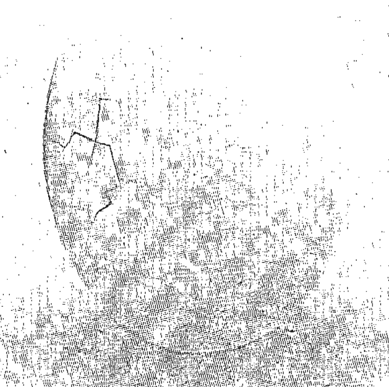

# 第五章

## 选对平台：穷人站错平台受穷，富人借对平台发财

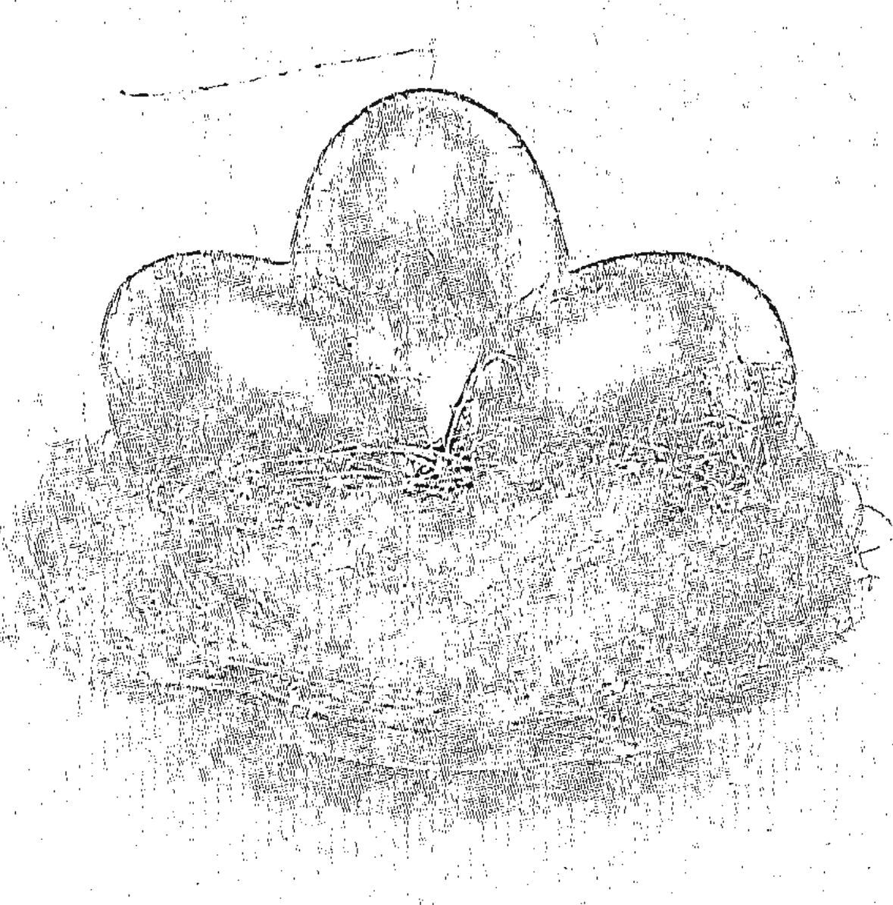

爬山时爬得越高，能看到的风景就越远，遮住视线的东西就越少。社会就如一座大山，站在山脚下时，目之所及的地方大概就是一亩三分地，可能灌木和大树都是遮挡你视线的障碍物。你站得越高你的视线就会越清晰，看到的东西就会越多，你能看到哪里有什么农作物，哪里有什么水果，哪里有到什么地方的道路。同理，当你选择待在一个小平台上时，哪怕再有能力，做得再好，也只能局限于一片小天地；而当你选择站上一个更高更大更好的平台上时，你的未来就有了无限的可能。

富人所处的平台往往高于穷人，在相同付出的情况下，平台越高，越容易赚钱。而越有钱、有地位的人，往往站得越高，故所能控制的资源也越多，所能看到的信息也越广。平台决定了视野与资本，而视野与资本又决定了一个人的思维，思维则最终决定了一个人的财富与高度。所以，想成为富人，想不断增加财富，必须想方设法地向更高的平台迈进。

### 01 想致富？请往人多钱多的平台去

想变得更优秀，就必须向着更优秀的平台迈进；想变得更有钱，就必须向更有钱的地方攀爬。

平台对一个人事业的发展究竟有多重要呢？举个例子，假如你很擅长写文章，如果你把文章写在自己的日记本里，通常只有你自己能看到，不管你写得有多好，对你的生活和事业都没有任何帮助；如果你把文章写到公司的公告栏里，你的同事和上司就能看到，然后会了解到你的这一特长，如果上司欣赏你的才华，你也许能够因为这一技能而获得升职加薪的机会；如果你把文章投送到某些刊物上，你的文章一旦被选中，你将会获得相应的稿费，甚至还有下一次约稿的机会；如果你把文章发表到网络上，那么将会有更多的人看到你的文章，假如很多人喜欢你的文章，就会转载它，身为作者的你将积累起一定的人气……

这就是平台的作用。当你做一件事情时，在不同的平台上，所起的作用和所收到的效果会有着显著的差异。一个人想要成功致富，首先就是找到一个能够让自己发挥才能的平台。试想，如果你有聪明的头脑、过人的才能，你擅长金融、语言、绘画、运动等，你在哪一个行业都能取得极大的成功。但如果将这样的你放到一个荒无人烟的岛屿上，你还有可能成为一个成功人士吗？显然不可能。缺少了平台的支持，你的才能、天赋都无从发挥。

人位于越高的平台，所能获得的机会就越多，能够致富、可以成功的几率就越高。假如你生活在发展落后的农村，你可能只有通过种地这么一种方式来维持生计。毕竟落后的大环境摆在那里，你很难凭借一己之力去改变它。至于种地，即使你力大无穷，一年到头能解决温饱，然后略有盈余就不错了。

如果你从农村到城市，那么只要你有一技之长，或者甚至不需要有一技之长，只要肯卖力气，你一个月赚个三两千块也不成问题。这个可能是你在农村种地数月，甚至数年才能达到的收入水平。

大多数行业的发展同样需要平台的支撑，例如与时尚有关的行业。如果你所从事的工作或你的才能主要与时尚相关，平台的作用就更重要了。毕竟在穷苦落后的小山村，你是不太可能开展时尚工作的，一方面，这里的人不具备与你同等的时尚欣赏力与接受度；另一方面，这里的消费水平也根本不足以支撑你发展时尚事业。就像人人都知道香奈儿好，但你不可能把香奈儿卖去贫穷得连饭都吃不起的地方。大环境的限制是我们无法通过努力去改变的。所以，想致富，请尽量往人多钱多的地方和平台去。

人多意味着机会多，劳动力也多，容易实现高效的社会分工。每个人的能力都是有限的，无论做任何事情，如果所有环节都只能靠个人的力量去完成，那么工作效率一定是非常低下的，所创造出的价值自然也十分有限。

钱多则意味着经济发达，不管做任何事情都更容易创造经济效益。例如一个歌星，他在经济发达的大城市办一场演唱会，通常至少有几百万元的收益；但如到经济落后的农村去表演，恐怕想赚几千块都不容易。

有这样一个故事。相传玄奘法师刚入佛门时就在法门寺修行，法门寺是当时香火鼎盛的名寺，香客如流，名僧汇集。由于香客众多，法门寺应酬繁忙，玄奘虽苦苦习经，却也时常感到力不从心。更重要的是，法门寺里厉害的僧人实在太多，玄奘不过是其中最普通的一个。

有人就劝玄奘说：“法门寺太有名了，许多有名的僧人都到这里修行，你想在这里出人头地实在太难，倒不如转到稍微偏僻一些小寺庙去，这样一来，你的才华很快就会显露出来。”

玄奘想了想，觉得这话说得很有道理，于是就去向方丈辞行。方丈明白了玄奘的意图后，就问他：“你是愿做烛火还是愿做太阳啊？”

玄奘思忖片刻后坚定地回答：“我愿做太阳！”

方丈点点头，示意玄奘跟自己走。方丈先是把玄奘带到了距离法门寺不远的一个山头，这个山头树木稀疏，只种着三两棵松树和一些乱糟糟的灌木。方丈指着这些松树中最高大的一棵对玄奘说道：“你看，这棵树是这里所有树中最高大的，你看它能用来做什么？”

玄奘看了看那发育不良、弯弯曲曲的树干，回答道：“只能做烧火的薪柴吧！”

方丈又带着玄奘到了法门寺后一片郁郁葱葱的树林里，这里的树木棵棵挺拔，遮天蔽日。方丈看着树林问玄奘说：“你认为，这里为什么每一棵树都能长得如此高大挺直呢？”

玄奘想了想，回答道：“因为它们要争着去承接阳光和雨露啊！”

方丈郑重地对玄奘说道：“这些树就如芸芸众生，它们生长在一起，为了争夺更多的阳光和雨露，争先恐后，奋力地向上生长，于是棵棵都成了栋梁；而那些零零星星、三三两两立在灌木丛中的树，因为没有其他树和它们争抢阳光雨露，最终它们就成为了薪柴！”

玄奘听了，心中顿悟，打消了离开门寺的念头，潜心苦修后，终成一代名僧。

法门寺就像是一个优秀的平台。在这里，虽然竞争激烈，压力巨大，但在与那些优秀的人进行竞争的过程中，自己也能得到非常大的提高和进步；而那些偏僻的小寺庙则像是一个较为弱小的平台，在那里，虽然可能过得更轻松，显得更优秀，但天长日久，对于自身的进步与提高却不会有太大帮助。

想变得更优秀，就必须向着更优秀的平台迈进；想变得更有钱，就必须向更有钱的地方攀爬；想摆脱贫穷的“纠缠”，就请迈开步子，到人多、钱多的地方与平台去，那里有无数的机会在等着你。

### 02 付出相同，平台越高者越富有

富人所处的平台往往高于穷人，在付出相同的情况下，平台越高，越容易赚钱。社会就像一个金字塔，越有钱、有地位的人，站得越高，故所能控制的资源也越多，所能得到的信息也越多。

在电影《少林足球》中有这样一幕：星爷和达叔找到二师兄，邀请他出山踢球，二师兄却连正眼都没给他们一个，一直按着计算器，激动地喋喋不休地重复着下面这几段话：

“……一秒钟几十万上下的，喂，现在什么价位啊？……”

“我一秒钟几十万上下，无缘无故跟你们几个废物去踢球，不好意思啊，你知道我这人就这么直的……”

“我靠！我一秒钟几十万上下，会和你们去吃杂碎面？……”

从此，“一秒钟几十万上下”成了网络流行语，风靡了整整一代人，每次提起都令人忍俊不禁。很多人大概都把这句话当作是炫富的天方夜谭，但事实上，虽然同样是一天24个小时的时间，但每个人的时间价值都是不一样的，对于有些人来说，一秒钟确实值几十万元上下，甚至几千万元上下。

如果时间能够用金钱来衡量，那么很显然，富人的时间永远比穷人值钱，因为在单位时间内，付出相同的情况下，富人赚的钱永远比穷人多。

从资本上来说，富人所拥有的资本远远超过穷人，在资本回报率相同的情况下，拥有雄厚资本的富人自然赚钱要比只拥有微薄资本的穷人多得多；从信息获取渠道方面来说，富人的社会地位往往是高于穷人的，他所能获得的信息自然也比穷人要更多，不管是来自政府方面还是商界方面的能够带来利益的信息，富人都能率先获得，由此迅速做出应对，赚取利润，这是穷人所无法企及的；再从信用价值上来说，不管是借贷还是寻找合作关系，富人通常都比穷人要容易得多，毕竟富人所拥有的资源要远远超过穷人，这些资源为富人的信用价值提升了很大一部分分数。因此，无论做什么生意，无论是金钱还是人力，富人往往都比穷人更容易达到目的。

以上种种条件，其实归纳起来就一点：富人所处的平台往往高于穷人，在付出相同的情况下，平台越高，越容易赚钱。社会就像一个金字塔，越有钱、有地位的人，站得越高，故所能控制的资源也越多，所能得到的信息也越广。你所站的平台决定了你的视野与资本，而你的视野与资本又决定了你的思维，你的思维最终决定了你的财富与高度。

前一段时间，互联网上曾有很多人讨论这样一个问题：“一流大学与二流大学到底有什么差别？”

师资上，一流大学确实要比二流大学更强。但即使是二流大学，也有着很多优秀的导师和雄厚的资金支持，因此这方面来说，差距其实不会特别大；

学习环境上，一流大学的学习氛围确实要比二流大学的强一些，但如果你是个自制力特别强、特别有上进心的人，那么即使在二流大学，也不见得就不能好好学习。

那么，最大的差别是什么呢？其实就是一个平台高低的问题。一流大学为你提供的发屇平台比二流大学更高，进入一流大学就意味着你会拥有更多的机会。你可以到北京大学去看看它的通知栏，每周大约有多少个讲座，会请到多少位名人来进行交流演讲；再随便到北京任何一所二流大学去看看它的通知栏，每周又有多少个讲座，能请到多少位成功人士来和学生们学习、交流互动。比较之下，你会有清晰而直观的体会。

在现实生活中，我们会发现，很多时候，越成功、社会地位越高的人，似乎就越努力，危机意识也更重。例如我们常常会看到一些关于明星、政要或者企业家忙碌于各种事情和活动的有关报道，今天在横店拍戏，明天可能就出国补镜头；今天到北京开会，明天可能就去纽约参加某个活动；今天到日本学习，明天可能就到国内某大学演讲……似乎有什么东西在追赶、逼迫他们不断去做事情似的。

再看看我们身边很多普普通通的人，今天上8个小时的班，太累了，下班回家后在沙发上一躺，电视一开，今天可能就完结了。或者晚上一个电话，匆匆外出，和朋友唱唱歌，喝喝酒，微醺小醉，回到家往床上一躺，又是一天完结了。

看，穷人似乎比富人要活得安逸。

前面我们说过，当你所处的平台越高的时候，你所能接触到的机会，所能触及到的资源也就越多，你的视野也会愈加广阔。比如你有一千万元财富，你会看到有一亿元财富的人是怎样生活、怎样做事的；你有一亿元财富，你会看到有十亿元财富的人是怎样生活、怎样做事的。

但如果你所处的平台很低，那么你所能接触到的机会和资源就会非常少，你的视野相对也会狭窄得多。比如你每个月领着三千元的工资，你可能只会看得到领着五千元月薪的人是什么样的，而这两千元的差距，不大也不小，能让你心生羡慕，却未必能激励你不断向前迈进，不断提高自己。

可见，平台越低，竞争意识就越薄弱，人也越发容易变得安逸、懒散，不思进取。

此外，平台的高低同时也决定了回报率的高低。我们所处的平台其实就像是表演的舞台一样，当你在一个普通的小剧团的舞台上表演时，你演得再好，再努力，哪怕成为该剧团的台柱子、主角，能看到你成绩的，也就是台下那百十号观众；但如果你站上悉尼歌剧院的舞台，那就不一样了，无论你的成功还是失败，无论你的努力还是懒惰，都会被无限放大，全世界都能看到。

这其实就像是普通人和明星的对比。一个普通人在路上摔了一跤，没有人会关注，顶多身边的亲戚朋友会问一句疼不疼；但如果是一个明星在路上摔了一跤，那就不同了，马上会有一大票的“粉丝”出来嘘寒问暖，甚至可能延伸到关心一下，这里的路面是不是不平整，负责管理的政府机构是不是没有尽心尽力等。

在综艺节目《爸爸去哪儿》里，常常会出现让明星去街上向别人“借”东西，或者叫卖农产品，以此来“筹集”餐费的环节。如果是一个普通人去做这些事情，肯定不太容易，但明星去做，效果就完全不同了。一筐普通的瓜果，你站在那里卖，一天下来也未必能卖完；可明星站那里一卖，那就不一样了，几分钟可能就会引起疯抢。

这启示我们，想要成为富人，想要不断增加我们的财富，我们必须想方设法地向更高的平台迈进。无论你的能力有多强，无论你有多么优秀，如果没有足以承载梦想的平台，那么你的强大和优秀也只能停留在孤芳自赏的阶段，你想成为富人的梦想，也只是在梦里想一想而已。

### 03 拒绝向更高平台迈进的穷人永远受穷

当你选择待在一个小平台上时，哪怕再有能力，做得再好，也只能局限于一片小小的天地内；而当你选择站上一个更高、更好的平台上时，你的未来就有了无限的可能。

在热播的网络电视剧《余罪》里，男主角余罪的理想就是做一名普通的片儿警，能给摆小摊的父亲撑腰。有趣的是，当有更好的工作机会和晋升……

升空间摆在他面前时，他却依然执拗地抱持着这个小小的理想，从未想过去寻求更大的发展空间，获得更大的成就，去改变自己的命运。

很多人都不明白余罪的执拗，要说只是单纯地想为父亲撑腰，想让父亲轻松一些，那么争取更高的职位，站上更高的平台，不是更好吗？且不说剧中人物究竟为何有这样的想法，在现实生活中，像余罪这样拒绝向更高平台迈进的人，其实并不在少数。

俗话说，“人往高处走，水往低处流”，按照正常的逻辑，每个人都是渴望成功的，因为这是最能体现自我价值的方式。但同时，每个人也都知道，成功需要付出代价，任何机遇实际上都伴随着风险。往前一步，可能是平步青云的天梯，也有可能就此落入万丈深渊。于是，在代价与风险面前，很多人望而却步了。

某制糖企业曾经属于国企，后因改制而承包给了个人。为了拓展业务，承包该企业的老板决定扩大生产，在别的地方建立一些分公司。大家都知道，新厂筹备最缺的是人才，与其去外面招收一批毫无经验的新人，倒不如先把公司中原本有经验的人才分散出去一批去建设新厂。有了这个想法之后，老板很快就在公司内部进行了公开“招聘”，鼓励有意向前往新厂的员工踊跃报名。

很显然，这是个机会，作为新厂的第一批工作者，只要未来新厂有所发展，那么这些工作者就会是元老级的人物。但问题是，新厂是否能成功呢？这是有风险的。再者，大部分员工的家都已经安在这个地方了，去建设新厂，就意味着要背井离乡，不管是生活条件还是工作条件，显然都不不会有现在这么安逸和舒适。

在经过激烈的心理斗争后，大部分老员工都选择继续留在原先的工作岗位，只有一小部分人决定前往新厂，去开创新的未来。

数年之后，该企业由于经营不善陷入了困境，一年里大概只有三四个月能进行正常的蔗糖生产工作。在这样的情况下，员工们常常都只能拿到几百元钱的最低生活保障金，生活变得很艰难。

而此前那批出去建设新厂的员工，大多数都早已升到了管理层，不少人在这几年之间都积累了一笔不小的存款。当公司日渐衰落之际，有的人选择了离开，利用这笔存款去做些小生意；也有的人选择继续留下，毕竟做过企业的人都知道，只要公司还能坚持下去，领导层往往是不会受亏待的，真正受害的，永远都是底层员工。

古人早已说过：“生于忧患，死于安乐。”当人处于忧患之中时，往往能考虑得更加长远，未雨绸缪，因此当危机降临时，反而更能应对得当；而当人处于安乐之际，却因为为一时的安逸和满足，降低对危险的警觉性，一旦危机降临，往往会被打个措手不及。

但人性都是向往安乐的，谁不想一辈子无忧无虑，自由自在呢？因此，推动人们选择改变，选择奋斗的，往往是对现实的不满，是对未来的忧患，是欲望的不满足。因为不满足，因为有更高、更远的追求，所以才会去冒险，去改变。如果一个人对自己的生活感到非常满意，对自己的状态也感到非常享受，那他是不愿意去改变的。

于是问题来了，为什么满足现状，拒绝向更高平台迈进的人，往往都是穷人？按常理来说，富人的生活必然比穷人更富足，更有保障，为什么富人却选择进步，而穷人往往更愿意选择原地不动呢？

实际上，这个问题搞错了一个因果关系。穷、富不能决定一个人是否上进，是否愿意拼搏，但一个人是否上进，是否愿意拼搏，却往往决定了富、穷。也就是说，并不是穷人不能向更高的平台迈进，也不是富人才愿意去更高的平台，而是人的性格和行为方式决定了他们最终的位置。

意选择不断进步，而是因为穷人拒绝向更高的平台迈进，缺乏进取之心，穷人才会一直穷下去；因为选择不断进步，不断提高，富人才能成为富人，并一直富下去。

拒绝向更高平台迈进的人，总结起来不外乎几个原因：

#### 一、畏惧风险，害怕失败

机遇与风险往往是并存的。很多穷人拒绝改变，拒绝进步，未必就是因为对自己目前的生活感到很满意。他们也想像那些有钱人一样生活，他们同样渴望证明自己，渴望成功。但问题是，成功道路上的风险，他们并不想背。因此，为了远离风险，他们宁愿选择保持现状，至少此刻这里是安全的。

#### 二、懒惰，贪图安逸

奋斗就意味着艰苦，想要进步，就必须牺牲享乐的时间。而大多数穷人往往都有同一个毛病：懒惰。对于他们来说，今天能吃饱，任务就算完成了，宁愿找个地方钓钓鱼，躺在沙发上看看电视，也不愿意多花些时间和精力去提升自己。正是因为有有这样的一种心态，所以他们永远只能停留在贫穷的起跑线上。

#### 三、被“宁为鸡头，不做凤尾”的观念支配

宁为鸡头，不做凤尾，意思是说，宁愿在一个小的地方当带头人，拥有自主权，也不愿意去大的地方做“尾巴”，受人支配。做“鸡头”的确轻松，想往哪儿去就往哪儿去，想朝哪儿走就朝哪儿走。可“鸡头”再怎么牛，始终还是“鸡头”。做“凤尾”难，有时可能还憋屈，想去的地方去不得，想看的风景看着不着，但“凤尾”却有翱翔九天的机会，这是“鸡头”穷极一生也不可能做到的事情。

当你选择待在一个小平台上时，哪怕再有能力，做得再好，也只能局限于一片小小的天地内；而当你选择站上一个更高、更好的平台上时，你的未来就有了无限的可能。

也许今天你只是“凤尾”，但怎么知道明天不能成为“凤头”呢？可如果你一直是“鸡头”，那么不管十年、二十年，你始终都只能是个“鸡头”。

### 04 借对平台，创业才会成功，穷才能变富

平台决定了视野，视野影响了思维，思维则决定了你的贫富、成败。站在大学这个平台上的年轻人，在没有踏入社会这个平台的情况下，就贸然加入创业大军，成功率非常低。

雷军这个名字你可能没有听过，但“小米”手机你一定知道。现在在我们身边，在亲戚朋友圈里、在擦肩而过的路人手上，总能看到一些人在用“小米”手机。继“苹果”手机后，“小米”手机也成为另一款随处可见的“街机”。

小米科技有限公司是在2010年4月创立的，小米手机则是在2011年8月正式面向公众销售的。而截至2013年8月，小米科技的估值已经超过了100亿美元，才用了3年多的时间。这一惊人的成长速度让小米成为手机市场里的又一个传奇。

在小米手机出现之前，苹果手机一直是许多年轻人梦寐以求的，哪怕它高昂的价格也没有让人们望而却步，许多年轻人哪怕不吃不喝，也要攒钱买一部苹果手机，甚至还出现了许多类似于“卖肾换‘苹果’”之类荒诞无比的事情。

小米手机的横空出世改变了这一切，它就如同价格低廉的苹果手机，时尚、智能，拥有操作简单、有趣的系统。很快，小米手机就以“价格低廉的智能手机”这一定位横扫了亚洲市场，并在全球范围内引领起以大众所能接受的低廉价格生产出功能强大的电子设备的潮流。

据市场研究机构IDC所公布的数据，在2014年第三季度，小米手机在全球智能手机市场份额中已经跃居第三名，仅次于苹果和三星。而在中国市场，小米手机的市场份额已超过了苹果手机，成为了中国最大的智能手机生产商。

而成就“小米”的人，就是雷军。

成功的道路上，总免不了要经历失败的教训，即使如雷军这般厉害的人也是如此。在带领“小米”崛起之前，雷军也曾有过惨败的创业经历。

雷军是湖北仙桃人，曾就读于武汉大学计算机系。大学期间，雷军读到了一本叫《硅谷之火》的书，这是一本讲述盖茨、乔布斯早年创业传奇的书。这本书对雷军影响非常大。那时候，《硅谷之火》点燃了雷军的梦想之火，他告诉自己，总有一天，他要写一套软件，让这套软件在全世界每一台电脑上运行；总有一天，他会创办一家公司，让这家公司成为世界上最“牛”的软件公司！

盖茨和乔布斯都是大学期间创业成功的，雷军认为，自己同样也能够如此。于是，怀抱着一个梦想，大四的时候，雷军急匆匆地和三个朋友一起创办了三色公司。

创办这个公司，更多是源自当时的热血。实际上，那个时候他们甚至从未理智地探讨过关于开办公司的各种实际事项，比如怎么投钱、经营什么、怎么赚钱、谁说了算等。公司一开，四个好朋友就兴致勃勃地每人分了25%的股份，平起平坐。

很快问题就来了，四个人持有的股份都相等，权利大小都差不多，人人都能当家做主，这就意味着，人人不能当家做主。于是，几乎每件事情都要花费大量时间去反复讨论，即便如此，有时也难以得出一个结果，甚至连总经理都改选了两次。

由于对公司的发展和产品都没有一个清晰的定位，因此三色公司什么活儿基本都做，业务范畴很宽，卖过电脑，做过“山寨”软件，连打字印刷的活儿也接。

“山寨”汉卡是当时三色公司的“主要业务”，通过这一软件，他们也小赚了一笔。但随后不久，有一家规模更大、资本更雄厚的公司把他们又给“山寨”了，而且人家资本雄厚，有条件更大规模地生产同类型产品，并且能把价格压得更低。于是，仅仅半年的时间，三色公司就倒闭了。

三色公司的失败让头脑发热的雷军冷静了下来。他意识到，中国的大学教育与美国的大学教育是有着相当大的差别的。客观来说，中国大学在素质和实力的教育上相对还比较薄弱，中国大学生在没有任何实际经验的情况下贸然创业，不仅成功率很低，甚至还可能耽误到自己的学业，有些得不偿失。

大学顺利毕业之后，雷军进入北京一家研究所工作，空闲时间就在中关村寻觅机会。1992年初，雷军加盟金山公司，这一年他22岁。雷军在金山一共待了16个年头，在这期间，他推动金山完成了IPO的上市工作。2007年，雷军正式辞去金山CEO的职务。2011年，雷军又回到金山，出任董事长一职，正式接管金山软件。就在雷军回归之后，“小米”终于横空出世了，把雷军的事业推向了顶峰。

在硅谷流行着这样一个笑话：河里翻了一条船，从船里掉下水的，一半是斯坦福的学生，一半是正在创业的人。如今，这个笑话似乎也能移植到中国。在这个年代，中国的创业热情同样也被完全点燃，加之网络上各种80后、90后创业成功的案例被传得沸沸扬扬，让许多人都产生了一种感觉：创业似乎是一件很简单的事，轻轻松松就能让你一夜暴富。

带着这样一种不健康的创业意识与思想，许多人就和雷军当年一样，没有考量任何实际问题，就头脑发热地加入了创业热潮。但其实创业的风险是很大的，在没有任何实际经验的情况下，即便聪慧如雷军，勤奋刻苦如雷军，也只能被难以预料的困难和问题打得落花流水。

正如雷军所认识到的，中国国情与美国有着较大差别，教育模式上也有着很大不同。中国大学这个平台与社会这个平台其实是有较大差距的。我们知道，平台决定了视野，视野影响了思维，思维则决定了你的贫富、成败。站在大学这个平台上的年轻人，在没有踏入社会这个平台的情况下，就贸然加入创业大军，成功概率非常低。

就如雷军的三色公司，这是一个站在大学平台上的创业者贸然展开创业的典型事例。小米之所以能取得如此巨大的成功，那是因为有雷军在金山整整16年的沉淀作为基石。就像盖房子，地基打得稳当，房子才能盖得高，盖得稳，否则终有一天会迎来大厦倾塌的悲剧。

雷军的故事告诉我们，穷人要成为富人，也必须学会选择平台，在正确的平台上创业，并且不断向着更高的平台迈进。

## 05

#### 股市是穷人的赌局，富人的生意

富人所处的平台要比穷人多得多，富人所能获得的信息和所拥有的资本数量都远远要超过穷人。因此，穷人不是不想看趋势，而是因平台不高、能力不足而看不到。

有富人曾指出，对于穷人来说，股票就像一场合法的赌博，每个人都怀着一夜暴富的期望，却没有任何人能真正掌控这场赌局的发展方向。穷人在股市里赚钱，拼的其实全是运气。

对于上述这种说法，很多股民大概都会举双手反对。如果炒股真的是拼运气，那这么多的财经专家和股评人要来干什么？这么多的股市分析和股票讲解又有什么用？大概没有任何一个股民会承认，自己其实就是个“赌徒”，因为他们始终相信，股市是有可掌控的规律的，只要掌控住这个规律，就一定能赚大钱。

那么，股票到底算不算生意？当然算，但那只是针对富人而言的。看看世界著名的“股神”巴菲特，仅仅靠运气，他可没那么容易成为“股神”。

于是说到这里很多人就不明白了，股票到底是一场碰运气的“赌博”，还是一场拼尽全力“厮杀”的生意呢？上面其实已经说得很清楚，股票是穷人的“赌局”，是富人的“生意”。

许多小股民在进入股市之初，最先学的通常是看K线图，无数的炒股教程都在教你，怎么去看这个图，怎么通过这个图来了解当前大盘的情况，甚至对之后的情况做出预测。于是，小股民都以为，只要把这个东西学通透了，看明白了，就能掌握股市的规律，预测股票的涨跌，赚钱岂不易如反掌。

K线是什么？它其实就是一种统计，是根据记录与分析每个股票周期性的涨跌而绘制出来的。K线图分析和星座分析原理差不多，且都属于统计学范畴。

很多人觉得星座分析特别准，这是因为星座分析所列举出来的东西都具有普遍性。如星座上说，处女座的人往往特别吹毛求疵，追求完美，这不是来自于什么神秘的占卜或测算，而是在调查众多处女座的人的特点之后所得出的一个具有普遍性的结论。股票K线图的分析其实也如此，它具有普遍性，是从已经产生的股市涨跌记录中所找到的一些规律。

这种普遍性的规律都有一个特点，那就是从大方向上来说，通常是对的，但是无法用在细微的分析上。也就是说，这种通过对结果的统计而分析出来的规律，往往只适用于大样本，而无法对特定的个体样本做出准确而详细的分析或预测。

买过股票的人都知道，我们买股票，买的是股市中的特定个体，而不是购买整个股市。

“股神”巴菲特被美国人称为“奥马哈的先知”，但谈及股市时，巴菲特最常说的一句话却是：“我从未见过能够预测股市的人，现在没有，将来也不会有。”

### 穷人卖力，富人借力

美国《财富》杂志1999年曾发表过一篇由巴菲特先生撰写的谈及股市问题的文章。在文中，巴菲特这样写道：“在伯克希尔，我们通常只专注于分析个别公司的价值，很少去管整个股市的涨跌，至于要预测股市下礼拜、下个月或是明年会怎样，那更是不敢想。”

连“股神”巴菲特都多次强调股市根本无从预测，其他人又有谁敢拍着胸脯说自己有本事能掌握股市规律，并预测股市的涨跌呢？

巴菲特能成就“股神”之名，离不开其过人的商业头脑，更离不开股市的重要信息。事实上，他所能获得的可供他分析的信息要比我们一般人多得多。正如他所说的，他专注分析的，并非股市的走向，而是“个别公司的价值”。

一个公司具有多少价值，确实是可以分析出来的，但这涉及到许多方面的数据，如该公司的财务状况、发展潜力、产品或服务等情况。巴菲特正是通过对这些实实在在的信息分析和预测，来描绘出该公司未来的发展趋势的。而一个公司的股票究竟会呈现出一个怎样的状态，通常与该公司的发展情况也都是相吻合的。可见，所谓“先知”的能力并非来自“神秘学”或无法解释的“直觉”。

但对于一个普通人来说，无论上述的哪一项数据，我们都不可能轻易得到，就算得到，也不具备足够的分析能力。平台的高低直接决定了信息获取的不均衡。因此我们才说，对于穷人而言，股票就是一场“赌博”，一场看着结果，却自以为看到了规律的“赌博”。而任何具有“赌博”性质的活动，都是不可能让你改变命运、脱贫致富的。

曾有人说过，富人与穷人在做事上最大的差别是，富人看的是趋势，穷人等的是结果。因此，富人往往能够走在财富的前头，轻轻松松赚大钱。穷人则只能追在财富的后面，辛辛苦苦抓住一点财富尾巴。

富人与穷人在眼界和分析能力上是存在一定差距的，但归根结底，富人所处的平台要比穷人高得多，富人所能获得的信息和所拥有的资本数量都远远要超过穷人。因此，穷人不是不想看趋势，而是因平台不高、能力不足而看不到。

要改变这一劣势，穷人就要懂得向富人“借”。借助富人的资源，借助富人的平台，从而获得更大的优势，来弥补自己“天生”的不足。

至于那些存在“赌博”性质的高风险投资，还是秉承“小投怡情，大投则免”的原则比较好。毕竟很多时候，即使是站在高平台上的富人，在这一投资领域也常常会“马失前蹄”，更何况是只能依靠运气来“赌”的普通老百姓呢。

## 06

### 富人牵着“流行”走，穷人追着“流行”跑

只有站在一个很高的平台上，你才不会被流行牵着鼻子走，反而还能引领流行，借流行来为自己赚大钱，让自己迅速致富。

“流行”是个很有趣的词，它能帮助你赚钱，也能替你花钱。在流行面前，大部分人都是缺乏判断力的。比如很多年轻人，张口就是流行的网络用语，但他们却未必能说出这一网络用语是如何形成的，怎么演变成了现在所表达的意思。他们喜爱这种表达方式，往往只是因为它很“流行”，使用它能让自已看起来很酷，很时髦。

在穿衣打扮方面，流行的引导性就体现得更为淋漓尽致了。每一年，不管是服饰还是妆容都会有一些所谓的“流行元素”，这些“流行元素”往往会成为许多年轻消费者的“着装指南”或“妆容指南”。如某一年流行“动物纹”，在大街上，你一定能看到许多身着各种豹纹、斑马纹之类服饰的女孩子；又如某一年流行“低裆裤”，只要你出去逛一趟街，你遇到的十个人里，至少会有一个人穿着“低裆裤”。

很多时候，人们疯狂地追逐流行，并不一定是自己喜欢或适合，他们所追逐的，仅仅是流行本身所具有的“时髦”“新潮”等含义。流行这个东西，利用好，就是绝佳的赚钱工具；不小心被迷惑了眼睛，就只能被它“牵”着走了。

2013年，许多大城市的各大超市的货架上都出现了一些“卖萌”的可口可乐，在经典的红色包装上，出现了各种不同的网络流行昵称，有的可乐瓶包装上印着“天然呆”，有的印着“高富帅”，也有的印着“吃货”“月光族”“喵星人”……可口可乐的“集体卖萌”瞬间引发了广泛讨论。许多超市都反映，换成这种有趣的包装之后，可口可乐的销量明显有了提高。可口可乐还是那个味道，还是那个配方，更重要的是，价格没变，可“卖萌”可乐的容量比原先还少了100mL呢，怎么销量反而还增加了呢？这其实就是流行所带来的附加价值。

但流行究竟是怎样出现的，又是如何界定的？其实世界上并不存在一个机构，像颁布法律那样，出一个公文，来向大家宣告一下，今年我们将要流行什么。那流行到底是谁来规定，谁来缔造的呢？

回想一下我们获悉流行的渠道，其实不外乎就那么几种：电视、网络、杂志等，归根结底，它们都是——媒体。

美容杂志、时尚节目、服饰网站……每天都有无数篇文章在告诉我们，今年流行什么样的妆容，今年必须要有什么样的元素，今年各大品牌新出了什么款式的服装……这些东西充斥在我们的生活中，成为很多人交流的谈资或炫耀的东西。

娱乐新闻中，每天都有各种各样明星的照片，今天穿什么样的衣服可以上头条，化什么样的妆也能上头条，还有背的包包，戴的首饰等，就像一篇篇巨幅的活广告。记得有一次，女明星汤唯素颜挤地铁的照片上了新闻，结果第二天，她身上穿的那款外套立刻成了淘宝“爆款”商品。

许多电视剧的热播也能成为流行的载体。如之前热播的韩国电视剧《太阳的后裔》，除了把宋仲基变成无数女人的偶像，把宋慧乔再次推成无数男人心中的女神之外，剧中宋慧乔背的那款牛皮包也趁势热卖了一把，到处有人求购，“盗版”产品也迅速出现。

流行就是这么缔造出来的，它没有一个标准，也没有一纸公文，但它无疑是具有可控性的。一部深入人心的电视剧可以引领流行，一个妆容精致的女明星可以引领流行，甚至某个名人的一句话也能引领流行。

对于富人来说，流行是赚钱的工具；对于穷人而言，流行却只是消费的動力。因为富人所处的平台比穷人要高得多，他们能够看到流行背后的许多东西，甚至能够“制造”流行，引领流行，这些都是穷人做不到的。

也许你会说，看看那些明星，他们难道不是一直在追着流行跑吗？当然不是，真正追着流行一直跑的，是那些盲目的大众。看看那些明星，他们身上的每一个关于“流行”的投资实际上都是他们赚钱的资本。他们具有引领流行的能力，那么就意味着他们本身具有商业价值，这一价值就是

他们赚钱的本事。他们利用流行得到“粉丝”的追捧，而“粉丝”的追捧就是他们长期在这一行业生存下去的资本。

越是喜欢追着流行跑的人，其实越缺乏判断力和对自我的认知能力。他们根本不知道什么东西适合自己，也不知道自己真正喜欢什么，他们追流行，只是因为大家都在追，大家都喜欢，他们以为那样的就是好的。

很多缺乏赚钱头脑的人在赚钱、投资方面也特别喜欢追流行，比如在微商被炒作得沸沸扬扬，很多人一看，大家都在做，于是不管了解不了解，不管有没有具体的想法，都一股脑儿地去追流行了。不可否认，做微商确实有成功的，如果没有成功案例，微商也不可能火到这种程度。但更多的人做微商，事实上都失败了。

任何一个新兴的行业在最初的时候，由于市场饱和度低，呈现出供不应求的状态，通常都是能赚到钱，能富一批人的。但这个行业究竟能否长久发展下去，还需要进行理智的研究与观望。就以微商这个行业来说，到目前为止，这一行业还缺乏一个成熟的管理模式，因此混迹微商圈的可谓鱼龙混杂。其中或许的确有值得投资的产品，但同时也充斥着各种各样的虚假宣传和“三无”产品。而现在，正是微商发展最火热，但同时也最危险的时候，缺乏规范性的管理已经让微商圈有些“臭名远播”了。

不管是生活，还是创业，不管是消费，还是赚钱，一味追流行是不可取的，流行的未必就是好的，流行的也未必就是适合你的。更重要的是，流行的东西往往昙花一现，追逐流行的人，永远只能跟在流行的屁股后头猛花钱。

怎么样让自己尽可能少追着流行跑呢？如何让自己成为引领流行、让流行帮助自己赚钱的人？尽快让自己往更高的平台走，尽量站到更高的平台上。只有站在一个很高的平台上，你才不会被流行牵着鼻子走，反而还能引领流行，借流行来为自己赚大钱，让自己迅速致富。

## 07

## 为什么穷人有发财梦，却找不到发财路

在追求财富的路上，对于买彩票、炒股、做传销这些陷阱，一定要远离。怎么远离？努力让自己不断站到更高的平台上，不断增强看人的能力，不断提升看懂事物本质的本领。

在通往财富的道路上，充斥着大大小小的陷阱和骗局。这些陷阱与骗局的主要受害者，是中低收入人群。这些人的共同点是：心中都有一个“发财梦”，现实却是无法找到“发财路”。

在中国，穷人最容易陷入三种发财骗局。

- **第一种：买彩票。**

彩票其实就是一种抽奖，是一种完全靠运气的东西。国家最初发行彩票，主要是为了筹集资金来做一些公共设施方面的建设。但发展到现在却产生了这样一种现象，那就是一大批穷人都把买彩票当成了一种“投资”，认为这是一个巨大的发财机会。

买彩票本不该被称为“骗局”，但由于大多数穷人的错误认知，这项原本有着良好目的的活动却成为中国最大的发财“骗局”。

越穷的人对买彩票这件事热情度越高。据2015年的一项统计数据显示，在中国，彩票购买率最高的地区是云南、甘肃、西藏和宁夏等地，而彩票购买率最低的地区则是上海、江苏、湖南和山东等地。从这个分布可以看出，经济越不发达的地方，人们反而越喜欢买彩票。

许多经营“彩票站”的老板都有类似的体验：商场开在越繁华的地方就越赚钱，但彩票站选址却最好在穷人扎堆的地方。而在生活中，如果注意观察，相信大家也能发现，最喜欢且经常聚集在彩票站的人，从穿着打扮上就能看出，经济条件都不会太好。

中国彩票事业研究中心也针对彩民做过一项调查，结果显示：有80%的彩民认为自己社会地位较低，处于社会底层，购买彩票就是想一夜暴富。

何其可笑，又何其可悲！彩票给了穷人们一个“发财梦”，但同时也让很多穷人沉迷其中，不可自拔，在浪费光阴的同时也在不断地损失金钱，最终只能在这种恶性循环中苦苦挣扎。

- **第二种：炒股。**

股票买卖原本是一种正常的商业投资行为，企业通过发行股票来筹集资金，股民则通过购买股票来进行投资，股票购买成功，股民就相当于成为了该企业的小股东。企业做得好，股东所获得的收益自然就高；企业做得不好，股东的收益自然就低，甚至可能亏损。

但现在很多股民，尤其是散户，他们在股市做的事情实际上已经不再是单纯的投资了，而是变成“炒”股票。

炒股和买股完全是两种不同的概念，买股是一种按照客观规律来进行的投资，炒股却是试图在股票无序的涨跌中“押宝”，以赚取差价的“赌博”。如世界知名的“股神”巴菲特，他买中石油股票，是因为按照他的估算，中石油股票价值至少在1000亿美元，而当时的市值仅为350亿美元，有着极大的上升空间，他的购买行为实际上就是一种理性的投资。但多数的小股民不一样，他们购买某一只股票，不是因为看了该公司的财务报表，或认为这家公司有发展前途，他们常常是根据所谓的“大盘分析”来进行股票买卖的。

据中国证券投资者保护基金公司的一项调查显示，在热衷于股票投资的小股民中，有大约81.16%的人平均月收入在6000元以下。而平均月收入在10000元以上的人，往往不怎么热衷于股票投资。

- **第三种：传销。**

其实彩票和股票都算不上是真正意义上的“骗局”，传销才是个真真切切的骗局和陷阱。

很多人对传销并不陌生，即使从没有过相关的经历，但也都从各种新闻报道中看过不少关于传销的种种。但即使如此，今天依然有一大批义无反顾地投入到传销组织里去，进行传销活动，并坚定不移地认为，这项“事业”一定能实现自己的“发财梦”。

这三大“骗局”其实都有一个共同点：投入小，回报高，容易实现一夜暴富。这几乎满足了所有穷人对财富的美好幻想。而容易陷入这些“骗局”的穷人们，也都有一些共同点：

首先，掌握信息少。

富人通常不会陷入这些发财“骗局”，因为他们有着相对较高的平台和相对可靠的消息来源，他们很容易就能分辨出这些“骗局”中所存在的谬论。

但穷人不同，穷人通常很难有相对可靠的信息来源。比如像农民工就很容易看到一些类似于都市小报上所刊登的极不负责任的“中彩故事”等，而较少关注一些权威媒体的报道。因此，热衷于购买彩票的农民工确实不在少数。

传销骗局往往很喜欢和政府扯上关系，动辄就标榜自己所做的是一个政府设立的“秘密项目”。对很多穷人来说，政府的形象是“高不可攀”的，穷人也 没有什么与政府动作相关的消息渠道。因此，很多怀抱着“发财梦”的穷人总会 对这种“天上掉馅饼”的好事抱着“宁可信其有”的态度。

其次，被“发财梦”迷了心。

我们多次强调过，在赚钱资本方面，穷人与富人相比是“先天不足”的。穷人缺少资金、缺乏机会、缺少人脉，这些都让穷人在追求财富的道路上举步维艰。很多富人动动手指头就能轻松做到的事情，穷人可能付出了一切也未必能做到。

但穷人心中也有“发财梦”，当他们无处宣泄这种渴望时，突然有人告诉他们，说做某件事情不需要资本、不需要人脉甚至不需要个人能力就可以以小博大，一夜暴富，那么即使他们在理智上存有怀疑，恐怕感情上也会不由自主地去相信，把这个虚假的希望当作自己发家致富的救命稻草吧。

最后，不懂及时止损。

无论是买彩票、炒股还是做传销，很多人在“疯狂”一段时间后，其实内心也都会产生一定的怀疑和犹豫。但在这个时候，人们会产生一种非常奇怪的心理——为了挽回之前的损失而宁愿增加新的损失。

这其实是一种赌徒心理。很多赌徒在输钱的时候，输得越多就越不甘心，总想着不断追加成本，想要把之前的损失“搏”回来。但现实却是，几乎没有任何一个赌徒成功赢回过自己输掉的东西，在赌桌上，他们的结局通常只有一个：输得倾家荡产，妻离子散，一无所有。

可见，穷人容易陷入财富“骗局”，最关键的原因就是他们身处的平台太低，缺乏可靠的消息来源和对市场规律的正确认知，从而形成了“盲点”。正是这些“盲点”，让他们无法看清“骗局”背后的不合理性和危险性，结果让自己损失惨重。

在追求财富的路上，对于买彩票、炒股、做传销这些陷阱，一定要远离。怎么远离？努力让自己不断站到更高的平台上，不断增强看人的能力，不断提升看懂事物本质的本领。

## 08

## 选择最适合自己发展的平台去追求财富

最好的发展平台，其实是最适合自己的那一个。每个人有不同的性格特点以及知识技能储备，只有选择一个最适合自己发展的平台，才能更好地追求财富，迈向成功。

大学毕业后，究竟应该在大城市打拼，还是回小城市发展？这恐怕是每一位面临毕业的大学生心中最大的纠结。

我们已多次强调过平台的重要性，而单从客观条件来看，大城市这个平台显然要比小城市“高大上”得多，那么，这是不是意味着每一个想要谋求发展，获得财富的人，都应该义无反顾地奔向大城市呢？在回答这个问题前，我们先来看看两个年轻人的不同经历。

小A来自湖南的一个小县城，父母在当地机关部门工作。早在小A还在上学时，他父母就已经为他的人生做好了规划：大学毕业后回家乡考公务员，然后结婚生子，安稳地度过一生。

高中毕业后，小A考上了上海的一所大学。当他站在这个繁华的大都市中时，猛然发现，原来中国竟然有这样一个精彩纷呈的城市，这里的繁华、包容、自由和多样化深深地吸引着他。在这里的四年，不仅改变了小A的生活习惯，也完全改变了他原本对未来的规划。

大学毕业后，小A不顾家人反对，毅然决然地留在了上海，为自己的梦想打拼。他努力工作，升职加薪，然后离开公司自己创业，并遇到了一个情投意合的上海女孩。

在小A32岁那年，他终于在上海郊区买下了一套400多平方米的别墅，把父母接了过来。在同一年，小A和他深爱的女孩结了婚。在上海，他收获了自己的事业、爱情与自由。

再来看看小K。

小K的情况和小A有类似之处。小K来自河南的一个小县城，父母是个体户，家里经营着一家小超市。

高中毕业后，小K考上了北京的一所大学，毕业后同样和小A一样，倔强地选择留在了大城市。

但北京的生活并没有如小K所期待的那样有意思。每天早上，天还没亮，他就要匆匆出门，挤上如同沙丁鱼罐头般的公交车，从燕郊赶往位于国贸的公司上班。每天支撑着小K离开温暖被窝的，是他对成功的渴望。

可事实上，小K也描述不出来，他心中对于“成功”的定义到底是什么样的。他也根本不知道，自己应该怎样去获得心中所渴望的“成功”。

在北京，小K又忙又累，每天的生活都充斥着单调的工作和无尽的空虚与寂寞。很多时候，小K不知道自己每天都在忙些什么，也不知道自己工作的意义究竟是什么，他只是听从着上司的吩咐，如同机器人一般，完成一个又一个上司下达的命令。

毕业整整五年，小K先后换了三份工作，却依旧不知道自己究竟想要什么。在这座大城市里，他举目无亲，甚至没有一个可以真正交心的朋友。他把青春挥洒在追求“成功”的路上，却连“成功”是什么样子都不知道。

两年前，小K终于放弃了“北漂”的生活，回到了自己的家乡。回到家乡后，他成功考进了当地一家待遇不错的事业单位，工作之余就帮父母一块儿打理小超市，甚至还成功地开了一家分店。去年，小K和单位里的一个女同事结了婚。现在的他，已经有车有房，有妻有子，生活比在北京的时候要幸福得太多了。

有人说过这样一句话：生活不是为奋斗，但奋斗为的是生活。

小A选择留在了大城市，最终收获了事业与幸福；小K离开了大城市，最终同样收获了事业与幸福。可见，最好的发展平台，其实是最适合自己的那一个。

每个人都有不同的性格特点以及知识技能储备，只有选择一个最适合自己发展的平台，才能更好地追求财富，迈向成功。比如小A，他是一个目标明确、敢想敢做的人，在大城市这个充满了机遇和挑战的地方，他才能充分发挥自己的才能，创造自己的价值。

小K却不同，他选择留在大城市，很可能是出于一种“从众”心理，他没有清晰的目标和规划，甚至根本就不知道自己留在大城市到底是为了什么。真正适合他的，反而是节奏平稳的小城市。也只有回到那里，小K才能真正找到自己的生活目标，实现自己的人生价值。

在选择自己的发展平台时，一定要和自身的实际相结合。大城市有大城市的好处，小城市也有小城市的优势。在大城市，你会拥有更多的机会，更广阔的见识；而在小城市，熟悉的人脉就是你铁打的资本。哪一个平台更适合你去发展，除了要考虑你个人的能力、学识、性格特点，还必须考虑你所从事的行业。

假如你是一名IT工作者，那么很显然，只有大城市才有供你生长的沃土；但如果你打算成为一名“化肥大王”，那么当然得往乡下跑，城市可没有你的目标客户群。所以说，适合的才是最好的，不管是在大城市还是小城市，只要利用好你手中的资源，有目标地去奋斗，都必然能有收获成功与财富的一天。

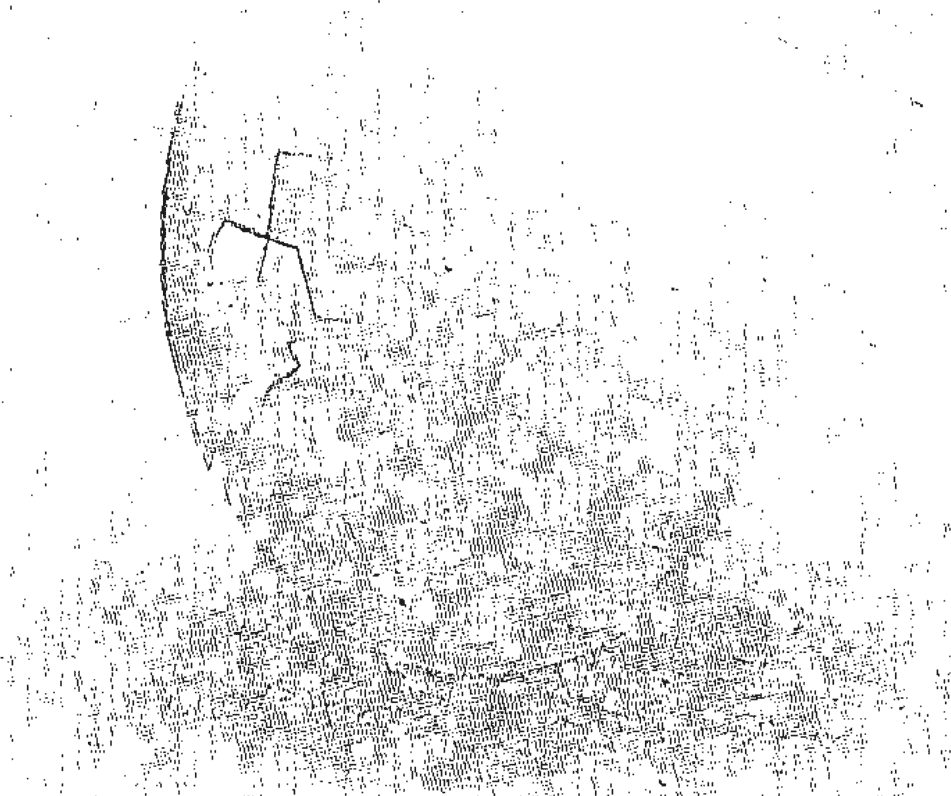

# 第六章

## 恪守信用：穷人缺“信用招牌”难借力，富人靠信用借力获厚利

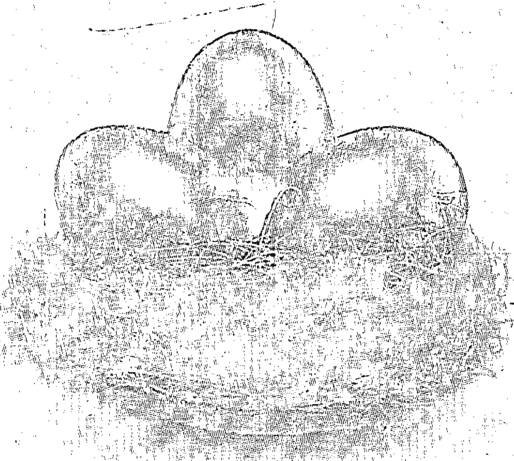

信用其实是每一个人都与生俱来的一项重要资本。只是些人不恪守信用，结果就把自已这项很重要的资本丢失了。如今，作为一项重要资本，信用已和我们的工作、生活产生了密切联系。良好的信用不仅能让我们取信于人，赢得更多助力，还能为我们创造可观的经济效益。

无论你是生意人还是上班族，想让你的事业获得持续性成功，首先依靠的是你一直恪守的信用，依靠的是你始始如一地兑现你曾经的承诺。如果失去信用，如果不守承诺，你的生意或事业即使曾经非常成功，往后也会很快失败。

砸自己的“信用招牌”，无异于自断致富之路；没有良好的信用作为支撑，即使你有过过人的能力，也很难在社会上立足。越穷的人，越要懂得重视自己的信用，越要学会借力于自己的“信用招牌”，因为这是帮助你改变命运、脱贫致富的唯一资本。

### 01

#### 始终恪守信用，兑现承诺，才能把生意做大

> 你要让你的生意获得可持续性的成功甚至越做越大，首先依靠的是你一直恪守的信用，依靠的是你始终如一地兑现你曾经的承诺。

已故中国台湾著名企业家、台塑集团创始人王永庆曾被誉为台湾“经营之神”，他于1954年筹资创办台塑公司，历时三年建成投产。到1984年，台塑集团在王永庆的领导下全部资本额达到了45亿美元，公司年营业额也高达30亿美元，是当时台湾地区生产毛额的5.5%。

取得了巨大成就的王永庆出身其实相当贫寒。王家祖籍福建安溪，几代人都以种茶为生。在王永庆9岁那年，他父亲因患病只能卧床休养，为了生活，王永庆开始与母亲一起挑起了生活的重担。

15岁那年，王永庆小学毕业后就到茶园做杂工，后来又辗转到了台南南部的一家米店做学徒。经过一年的学习打拼，王永庆大致摸清了米店的经营方式，然后他做出了一个非常重大的决定：自己创业开米店。

父亲知道王永庆的心思之后，东拼西凑，向别人借了200元钱，给王永庆做开店的启动资金。米店虽然顺利开了起来，但生意却始终没有起色。

经过考察分析，王永庆找到了米店生意不好的两大原因：一是因为在王永庆米店隔壁，有一家规模非常大的日本米店，与这家米店相比，王永庆的小店显得十分寒碜，不具备任何竞争优势；二是因为早在王永庆开米店之前，城里就已经有很多家老字号米店了，这些米店拴住了相当一部分老顾客。

发现了这些问题后，王永庆决定另辟蹊径，想方设法树立起自己的竞争优势。他开始挨家挨户地上门推销大米，并免费给顾客掏陈米、洗米缸，为顾客提供别的米店所没有的附加服务。

在推销过程中，王永庆发现，由于当时大米加工方法落后，每家米店所出售的大米几乎都掺杂着为数不少的米糠、沙粒和石子，虽然这给顾客造成了很多麻烦，但毕竟是普遍现象，买卖双方也就都不太在意了。但王永庆却从此处找到了一个重要的“突破点”。

为“创造”自己独有的优势，王永庆发动两个弟弟和自己一起，把大米中的米糠、沙粒和石子等杂物一点一点地捡出来，然后才把新米上架售卖。一段时间之后，城里几乎所有主妇都传遍了，说王永庆店里卖的大米质量好、杂质几乎没有。一时之间，王永庆的米店生意迅速红火了起来。

尝到甜头的王永庆并未感到满足，他决定要继续下功夫，在把这些顾客牢牢拴住的同时，继续发展更多新客户，只有这样，米店才能持续不断地发展壮大下去。

那个时候，商家还没有“配送服务”这一说，顾客买了米都是自己扛回去的。对于年轻人而言，扛一袋大米并不算什么事儿，但对于那些上了年纪或身体较弱的妇女来说，这就非常不方便了。于是，王永庆开始实行“送货上门”服务。他把大米扛到顾客家里后，还帮他们清洗米缸，掏出陈米，再把新米倒进去，完全实现了“一条龙”式的服务。

王永庆还细心地记下了每个顾客家中米缸的容量，问清楚了顾客每天大约消耗多少大米，据此，他就估算出了这户人家下次买米的大概时间。于是，每当顾客家中的大米快吃完时，王永庆就主动地把大米给送来了。这一方面省去了顾客的麻烦，另一方面其实也变相地“掐断”了顾客去别的米店进行消费的可能。

凭借着精细、务实的服务，王永庆的米店生意愈加红火起来，经过一年多资金和人脉的积累，他创办了自己的碾米厂。正是这小小的米店生意，开启了王永庆的创业传奇，为他日后问鼎台湾首富的事业打下了第一道坚实的基础。

不是所有的成功都必须轰轰烈烈，像王永庆，他的成功就是从每一粒米，每一项普通而细致的服务开始的。正是这些别人不屑一顾的小细节，成为王永庆独树一帜的优势和资本。更重要的是，即使在打响招牌、生意红火之后，王永庆为顾客提供的附加服务也从未间断过。正因如此，王永庆的小店才能一直不断发展壮大，牢牢拴住顾客资源。

大家是否发现，在现实生活中，很多新店在开张之初，为了吸引顾客，打响名声，往往都会做得十分认真，无论产品质量还是服务质量都达上乘。但时间一久，当建立起一定的顾客基础，生意开始好转之后，大部分店的产品和服务质量都会开始呈下降趋势。因此，很多新店在迎来一段时间的红火期之后，往往会走向衰落。

王永庆的成功最关键的一点不是他为顾客提供了多少服务，而是他能一直将这些服务贯彻下去。对于王永庆来说，提供附加服务是为了提升自己的竞争优势，从而争抢顾客资源。但同时，在向顾客提供这些服务的时候，也就相当于向顾客做出了一个承诺：只要你选择我，你就能够拥有这些便利。

而王永庆也确实一直信守对顾客的承诺，不管生意做得多大，他都始终专注于每一个小细节，为顾客提供最好、最方便的服务。试想，如果王永庆和现在的很多店主一样，利用附加服务达到吸引顾客、打响名声的目的之后，就逐渐抛弃了这些附加服务，或降低服务标准，那他还有可能成为“台湾首富”王永庆吗？现实中的很多案例其实已经给出了答案。

有个睿智的母亲曾对自己即将出嫁的女儿说过这样一句话：“孩子你要记住，到了婆家以后，如果一件事情你干了三次，那么这件事情就是你这一辈子都必须坚持去做的。”

我们每做一件事情，往往都怀着某一种目的，可能是为了获得某些回报，可能是为了讨好某些人。但无论为的是什么，我们只要去做了这件事情，就相当于给了对方一个承诺。比如当你求某个人帮你忙的时候，你可能会通过某些殷勤的举动去打动他，但如果对方因为你的殷勤帮了你的忙后，你立马就收起这种殷勤，转身就走，那和欺骗有什么分别呢？

一门生意的成功，关键不在于你能在短时间内吸引多少客户，获取多少资金，而是在于你是否有本事奠定起持续交易的条件与基础。毕竟真正成功的生意是具有可持续性的，昙花一现的辉煌在湮灭过后也只能留下失败的灰烬。

你要让你的生意获得可持续性的成功甚至越做越大，首先依靠的是你一直恪守的信用，依靠的是你始终如一地兑现你曾经的承诺。如果失去信用，如果不守承诺，你的生意即使曾经非常成功，往后也会很快失败。

## 02
## 维护好“信用招牌”，更容易借钱赚钱

越穷的人，越要懂得重视自己的信用，越要学会用好自 己 的 “信用招牌”，因为这是帮助你改变命运、脱贫致富的唯一资本。

如今，信用作为一项重要资本，已经和我们的工作、生活都产生了密切联系。良好的信用不仅能让我们取信于人，还能为我 们创造可观的经济效益。

湖北嘉鱼县潘家湾镇东湖村是湖北有名的“信用村”。一般来说，银行都不太敢贷款给农户，因为很多农户的信用意识并不强，贷款给农户，很容易产生坏账、烂账。但东湖村的农户例外，潘家湾镇信用社为该村农户推出了农户联保贷款，不仅给了农户们极为优惠的贷款限额、还款期限和还款利率，还为农户们实现了完全零抵押贷款。

众所周知，无论干什么事情，资金都必不可少。农户们也是如此，每年无论是种地、养猪还是养鱼，都需要启动资金，资金越多，所能发展的生产规模也就越大，收益也就会越高。因此，信用社给农户们的贷款可以说帮助他们创造了极大的经济效益。

为什么东湖村的农户能够得到如此优待呢？信用社为什么愿意以如此优惠的条件给这些农户办理贷款呢？

在2003年之前，东湖村农户的人均收入大概只有550元左右，为了生活，大部分村民都选择了外出打工这条路。

就在2003年，留守家乡的村民谢国强首次向银行申请了贷款，所贷数额并不多，仅仅两千块钱，因此贷款很快就顺利办了下来。第二年，谢国强按时还贷之后，又向银行申请了3000元的贷款。由于之前那一笔贷款信用记录良好，银行很快就批下了这笔贷款……谢国强就用这样的方式，逐年增加向银行的贷款数额，用于扩大自己的资本，用以发展生产。几年时间，他就成为村里的“种植大户”。

看着谢国强的日子越过越好，不少外出打工的农户纷纷回乡，效仿谢国强的发展方式，也开始向银行贷款。

久而久之，农户们越来越深刻地感受到信用带来的好处，按时还贷几乎成为全村人的一种习惯。为了让农户们享受到更多的优惠，同时也为了保住大家好不容易建立起的“信用招牌”，东湖村党支部开始对农户们的信贷进行统一管理，党支部副书记黄文龙就是这项“服务”的主要负责人。

在这十余年间，农户们也曾发生过一些意外，但无论多么艰难，他们都从未有任何一个人拖欠过贷款。如在2012年，一位经营养猪场的村民因猪瘟爆发而损失惨重，眼看还贷日期临近，这位村民便是砸锅卖铁，东拼西凑把钱如期还上了。这位村民表示：“借钱就得守信用，不然明年谁还敢借给你呀！”

党支部副书记黄文龙的有力“监管”也是该村缔造“到期贷款收回率100%”良好信用的重要原因之一。2013年，一位农户在成功申请到10万元的贷款后，便动了心思，打算把这笔钱以较高的利息转借给一个远房表哥。黄文龙得知这一消息后，立马阻止了该村民，硬是把这笔“高利贷”给拦了下来，防范了可能出现的贷款风险。

正是在全村人的共同努力下，东湖村才拥有了这块能够为村民带来巨大收益的“信用招牌”。

如今，该县信用社已累计向东湖村村民发放了超过一千万元的贷款，现在的东湖村也早已不是当初那个贫瘠的小村子了。现在，村民们都已经盖起了小洋楼，有些人的院子里甚至停着价值几十万的小轿车，这样的生活是他们曾经想也不敢想的。

活在这个世界上，你想要得到，就要先付出。无论做任何事情，你都必须有相应的资本，有了资本的投入，才可能获得利润的回报。找工作如此，创业如此，与人交往同样如此。如果你自身不具备任何值得别人欣赏的优点，就不要指望做成任何事情，交到任何朋友。

对于缺乏资金，缺少资产，又没有背景关系的穷人来说，信用是他们唯一能够透过自己的努力获得的资本。

当你缺乏“起跑线优势”的时候，想要成功，最直接有效的方法，就是向那些拥有“优势”的人去借势，借他们的资源，借他们的人脉，借他们的平台……但你凭什么让别人肯把这些好东西心甘情愿地借给你？你必须拥有值得他们肯定和欣赏的资本。而信用就是穷人所能拥有的第一笔资本。

砸自己的“信用招牌”，无异于自断致富之路；没有良好的信用作为支撑，即使你有超人的能力，也很难在社会上立足。越穷的人，越要懂得重视自己的信用，越要学会用好自己的“信用招牌”，因为这是帮助你改变命运、脱贫致富的唯一资本。

## 03
## 信用是最值钱的创业资本

信用到底有多值钱？对富人来说，信用能帮助富人永保富贵，财富源源不断而来；对穷人来说，信用是帮助穷人脱离穷命，远离贫困的最重要的资本。

从前有个国王，他的女儿已经到了出嫁的年龄，他决定把女儿的终身大事交给万能的主来决定。于是，国王站在城堡上，召集来了王国里所有的未婚男子，并对他们宣布，谁能接到他抛出的绣球，谁将成为公主的丈夫。

万万没想到，这个绣球落到了一个贫穷小伙子的手上。国王很不高兴，但已经说出去的话又不能反悔，于是他想了一个主意，试图让小伙子知难而退。

国王对小伙子说：“你娶公主总需要付出一些像样的聘礼吧！如果你能在半年之内找到一颗红宝石、一颗黄宝石和一颗蓝宝石，那我就为你们举行婚礼。”

小伙子答应了国王的要求，他决定前往千里之外的太阳城，去向太阳神索要三颗宝石。

经过第一个城镇的时候，小伙子在一家饭店吃饭，店主得知他要去见太阳神，便请求他说：“你若见到太阳神，能不能帮我问一问，为什么我后院的井里没有水？”小伙子点点头答应了。

经过第二个城镇的时候，小伙子在一户人家借宿，这家主人听说他要去见太阳神后，也请求他说：“你若见到太阳神，能不能帮我问问，我家院子里的千年老树为什么枯萎了？”小伙子也热心地答应了。

即将抵达太阳城的时候，前方出现了一条河，一位渔夫好心地把小伙子渡过了河。渔夫得知小伙子要去见太阳神，也急切地请求他道：“你若见到太阳神，能不能帮我问问，这条河里为什么没有鱼？”小伙子同样欣然答应了。

小伙子终于见到了太阳神。太阳神对小伙子说道：“你历经千辛万苦来到这里，我可以回答你三个问题，或者送给你三件宝物。”

小伙子一听愣住了，如果没有三颗宝石，他就不能迎娶公主；但如果选择三颗宝石，那他岂不是要失信于人了吗？

思索片刻后，小伙子果断地说道：“我希望您能回答我三个问题。”

得到了太阳神的回答之后，小伙子离开了太阳城。

回到河边后，小伙子告诉渔夫，河里有一只大乌龟，只要把它捉出来，河里自然会有鱼。渔夫果然从河里捉上来了一只大乌龟，乌龟嘴里含着一颗红宝石，渔夫便把红宝石送给了小伙子作为答谢。

回到来时经过的第二座城镇后，小伙子到借宿的那户人家，告诉他说，有一条大蛇藏在树洞里，把蛇捉出来，树就会活过来。主人果然从树洞里捉出了一条大蛇，蛇洞里放着一颗黄宝石，主人便把黄宝石送给了小伙子作为答谢。

回到来时经过的第一座城镇后，小伙子找到了饭店老板，告诉他说，后院的枯井里有只青蛙，把青蛙捉出来，井里就会有水。饭店老板果然在井里捉出了一只大青蛙，并发现井里还有一颗漂亮的蓝宝石，于是饭店老板把这颗蓝宝石送给了小伙子作为答谢。

小伙子回到皇宫，把三颗宝石献给了国王，并向他讲述了一路上遇到的事情。国王真诚地扶起了小伙子，然后对他说道：“你信守承诺的品格远比宝石更珍贵，万能的主果然为公主选了一个好丈夫。”

在人生道路上，我们时常会面临一些两难的抉择，就像小伙子面对太阳神的时候那样。他寻找太阳神，原本为的是迎娶公主所需要的三颗宝石，但在途中，因为一时的热心，他对别人许下了三个承诺，愿帮他们向太阳神询问三个问题。在许诺的时候，小伙子并不知道，实现这些诺言，是以那三颗宝石为代价的。

我们在生活中也常常会遇到这样的情况，本以为只是举手之劳，却在给别人许下承诺后才发现，要兑现这个承诺，可能会使得我们自己的某些利益受到损害。这种时候，两难的抉择就出现了，我们到底应该选择牺牲自己的利益，还是选择放弃自己的承诺呢？

有人说，我们并没有义务要为别人去牺牲，愿意帮你是情分，不愿意帮你也不过是做好自己的本分罢了。小伙子答应帮助这些陌生人，完全是出于自己的好心，而不是自己理所应当去承担的义务。况且，在答应帮助这些人之前，小伙子并不知道自己需要付出怎样的代价，所以说，即使他毫不犹豫地选择向太阳神索要那三件宝物，又有什么错呢？

的确，小伙子并没有义务非要牺牲自己的利益去帮助别人。但要注意的是，无论有没有这一义务，小伙子都已经向别人许下了承诺。从他许下承诺的那一刻开始，他就已经押上了自己的信用，不管他以何种原因拒绝履行这一承诺，他输掉的都是自己的信用。

那么，信用到底有多值钱？对富人来说，信用能帮助富人永保富贵，财富源源不断而来；对穷人来说，信用是帮助穷人脱离穷命，远离贫困的最重要的资本。

举个例子，如果有个人邀请你和他一起进行某项投资，并保证说，这项投资包赚不赔。你兴致勃勃地答应了，结果，钱一投进去，不但没有赚到钱，还让你赔了个精光。这时候，这个人就对你说了，投资嘛，都是有风险的，他也没想到会是这样的结果，反正大家都是自愿的，就这么算了呗。你会怎么想？以后这个人如果再来找你，你还会继续信任他吗？

很多事情，道理上说得过去，不代表情理上说得过去。而在我们生活中，情理往往有时候比道理更加重要。就像故事中的小伙子，即使他选择要那三颗宝石，从道理上也是说得过去的，但与此同时，他也将失去别人对他的信任与支持。而当小伙子选择牺牲自己的利益来兑现自己的承诺后，他却意外地收获了那颗珍贵的宝石。

人生中很多事情其实都是如此。当你为眼前的小利益而失信于人时，你以为得到了好处，但其实已经失去了更加珍贵的东西。而当你为兑现自己许下的诺言而牺牲掉自己的某些利益时，你看似是吃亏，但其实你已经得到了更值钱的东西。

### 信用是商业之基石，富人的发展之本

无论做人还是做事，都应谨记“守信”二字。人无信不立，业无信不兴，国无信则衰。无论是个人、企业还是国家，诚实守信都是其生存与发展的基石。

20世纪90年代初期，当电子商务企业开始兴起时，亚马逊就已经成功确立了其在行业内的领导地位。如今，在倒下了无数电子商务企业，又兴起了无数电子商务企业后，亚马逊依旧牢牢把握着它的领先地位。

亚马逊能够在群雄林立的电子商务领域里取得这样的成功，且一直占据着领导地位，肯定有很多方面的原因。但亚马逊的成功，最重要的原因还是：它始终坚持以信誉作为发展之本，以让消费者感到满意为最高原则。

1994年夏天，杰夫·贝索斯在辞去华尔街的工作后，突然萌生了一个想法：创立一家能够利用互联网技术来进行销售的零售公司。这个想法成型后，贝索斯很快就投入了实施，一个位于西雅图郊区的车库成为了他的第一个办公场所。正是在这里，亚马逊开始了它的辉煌之旅。

在筹备了一年之后，亚马逊迎来了历史性的一刻，它售出了该公司历史上的第一本书，此后，全世界都见证了它作为一家图书销售网站的崛起。

以销售图书起家的亚马逊并没有满足贝索斯的雄心，他相信，当人们熟悉了在线购书的模式之后，必然还会愿意通过类似的方式购买更多其他的商品。而人们的购买体验则会大大丰富亚马逊研究消费者需求的数据信息。假如有人对其所购买的商品发表评论，那么这些评论还能成为其他顾客的参考。

在进行线上销售的推广过程中，贝索斯还发现了该产业内的一个良性循环：低价格通常能够促进销量的提升，从而吸引更多的客户和商家；而高销量又能反过来刺激价格的下跌。也就是说，只要公司能够始终将客户的利益放在首位，从中进行调节和控制，那么这一良性循环就能持续不断地发挥效用，为公司带来增长。

于是，“始终坚持让消费者感到满意”成为了亚马逊公司的经营理念和本原则，甚至为了贯彻这一理念而不惜牺牲公司的短期利益。但不得不说，这种牺牲显然是值得的，正因为亚马逊一直以来都信守着对顾客的承诺，将客户体验放到一切利益之上，才换来了客户对其长期的忠诚，从而牢牢掌控住了其在行业里的“霸主地位”。

一个常年在亚马逊购物的网友分享了自己一次真实的购物经历。他认为，这个经历能够很形象地说明，为什么在众多的购物平台中，他始终是亚马逊的忠实客户。那是几个月前发生的一件事，当时他通过亚马逊的线上商店租了一部电影。

有过在线观看视频经验的人都知道，几乎所有在线视频都存在一个共同问题，那就是当你经常对影片进行暂停、开始、快进或快退等操作时，往往会导致播放器崩溃，于是你只能重新启动，再观看一次。

这样的问题其实根本称不上问题，无论是由提供在线视频观看的网站服务器而导致的，还是由个人网络连接信号不稳定而导致的，大概都不会有多少人在意，毕竟大家已经习惯了这种情况。

令人意外的是，几天之后，他突然收到了一封来自亚马逊的邮件，邮件的内容是这样的：

“您好，

我们发现您从亚马逊视频租借了一部电影，但该影片却未能为您提供优秀的观影体验。

我们感到十分抱歉，为了弥补这一过失，我们将为您提供影片全额退款，一共2.99美元。款项已经退到您的账户中，请注意查收。

……希望我们还能够继续为您提供服务。

——来自亚马逊视频点播团队”

这封邮件让这位网友感到十分震惊，连他自己都没在意的问题，可亚马逊居然“注意”到了，甚至还对他做出了补偿。他说道：“我在想，或许曾经苹果、谷歌也‘注意到’过，它们所提供的在线视频点播服务并没有为我提供优秀的观影体验，可问题是，他们从来没有因此而向我道过歉，更别提全额退款了！”

客户第一，亚马逊从来都不只是嘴上说说而已，它曾以这个口号和服务理念在众多电子商务企业中脱颖而出，赢得了客户的喜爱。更重要的是，在这数十年的发展历程中，它一直信守着这一承诺，始终贯彻这一理念，将客户体验永远放在一切利益之上。

信誉一直是亚马逊发展之本，这也正是为什么亚马逊能够成为世界上最成功的电商企业之一，并且一直牢牢占据行业领先地位。

自古以来，不管哪行哪业，任何一个成功者在谈及自己的成功秘诀时，都会着重提到“守信”二字。信誉是商业之本，许多有名的商人都是靠着“诚信”二字，最终才走上成功之路的。

晚清著名的“红顶商人”胡雪岩就曾数次强调过诚信经商的重要性。他认为，人有诚信才能立世，无诚信则会失世。正是因为奉行这一理念，胡庆余堂自建立之初就一直奉行着“戒欺”的经营理念和准则，主张“采办务真”、“真不二价”。因此直至今天，胡庆余堂仍然是有名的国药老字号。

小胜凭智，大胜靠德。聪明才智固然能够为你带来好处，但如果想要获得长远的成功，更重要的还是必须具备优秀的道德品质，如守信用，重承诺。

在现实生活中，有些商家为了获得眼前的短期利益，常常会用“欺哄瞒骗”的方式来进行商品销售。很多人大概都有过类似的经历：去某个水果摊上买水果，明明挑的都是又大又好的，可拿回家一看，不知什么时候，好的水果被人给“掉包”了，变成了次品！

这是不诚信商家的“杰作”。这一“以次充好”的“杰作”确实能让商家在这笔生意中获得一些利益，但从长远来看，遭遇欺骗的顾客将不会再光顾这样的商店，并且还可能将这件事情广而告之，如此一来，商家无形中就损失了许多“潜在客户”。

无论做人还是做事，都应谨记“守信”二字。人无信不立，业无信不兴，国无信则衰。无论是个人、企业还是国家，诚实守信都是其生存与发展的基石。

## 05
## 许诺不践诺，会摧毁你的信用

人如果不能践诺，就不要轻易许诺。一个失信的谎言所带来的伤害，往往要比它带来的短暂好处多得多。践诺可贵，信用无价，做人要诚信，做生意更要诚信。

南京的周先生通过某网络平台购买了价值八千多元的茶叶。周先生把买到的茶叶送去质检后，却发现质量根本不合格，这些茶叶是假货！周先生愤怒地联系了该商家，要求商家按照承诺，赔偿他八千万元！

原来，该商家为了吸引顾客，在卖茶叶的网络页面上打了一个醒目的广告，上面承诺“假一罚万”。既然如此，那么周先生购买了八千多元的“假茶叶”，按照承诺，商家应该赔偿周先生八千多万元。

这一事件在互联网上一经报道，便群情鼎沸。很多网民力挺周先生，支持他和商家死磕到底。周先生的诉求虽看似夸张，但从法律角度来看却是完全合理的。商家既然利用这一承诺来吸引客户，就应该做好承担该承诺可能会带来的一切赔偿及诉讼问题。

最终，商家在尴尬的沉默和回避中撤下了广告。周先生也表示，之所以向商家索赔，并非真的指望他们能实现承诺，赔偿八千万元巨款，只是想给他们一个教训。这个闹剧最终不了了之。

类似“假一罚万”这样的宣传广告在市面上并不少见，许多商家为了

### 恪守信用：穷人缺“信用招牌”难借力，富人靠信用借力获厚利

让消费者相信自己卖的东西质量绝对有保证，常常会打出一些十分夸张的旗号，比如“假一罚万”“骗人死全家”等。大多数消费者对这此承诺都会采取一笑置之的态度，他们很清楚，这样的广告并不能带来任何质量上的保证，而商家在打出这一旗号时，其实也都没有真往心里去。

但值得注意的是，这种过度夸张的宣传其实就是一种虚假广告，它已经形成了对消费者的欺骗与伤害，是要承担法律责任的。虽然卖假茶叶的商家已经撤下了“假一罚万”的广告，但撤下广告，并不意味欺骗就不存在。

正所谓“人无信不立，业无信不兴”，一个人如果没有诚信，久而久之，就不会有任何人相信他、支持他，这样的人是很难在社会上立足的；一个企业如果没有诚信，久而久之，必然恶名远播，再难和消费者建立信任关系，而一旦失去消费者的支持，企业又何谈经营，何谈发展呢？

曾有人问过巨人网络公司董事长史玉柱一个问题：“在领导者应该具备的素质里，哪一个是更重要的？”

当时史玉柱是这么回答的，他说：“是‘说到做到’。只要你承诺了，几月几日几点钟要做完什么事，那你就一定要做完。完不成，不管什么理由，都一定会遭到处罚。往往越没本事的人，找理由的本事就越高。我们现在干脆就不问原因了，只要是你部门的事情你就得承担责任，不需要解释。所以现在大家都说实话，不揣浮夸了。”

古语有云：“一次不忠，百次不用。”人要建立起信用不是件容易的事儿，但要摧毁它却非常简单。只要你有一次未能实践自己的诺言，就很难再让别人对你保持信任了。承诺是严肃且贵重的，当你无法践诺的时候，永远不要轻易对别人许诺。你许下诺言却做不到，既伤害了别人，又在摧毁自己的信用。

轻易许诺的人，是不重视承诺的人。因为不重视，所以才轻易承诺，毕竟由始至终他都没有把自己的承诺当回事儿。你哪天来和他较真，他还会觉得你矫情。

一个人对承诺的态度，所折射出来的，其实正是这个人的品格与德行。对一个有品格有德行的人来说，承诺就是他的尊严。如果一个人连自己的尊严都不重视，那么他还有什么脸面和资格去赢得别人的尊重和信任呢？

有位初创型企业的老总为了提升员工们的斗志，鼓舞员工们的士气，每次开会他都会高喊许多不切实际的空口号，如“我们公司3到5年内就要上市”“等公司上市后，每个员工都会分到一部分公司的股票，人人都做老板，人人都成百万富翁”等。

起初，这些“空头支票”确实激起了一些没有什么工作经验和社会经验的新员工的工作热情，他们一个个摩拳擦掌，跃跃欲试，想马上去大干一场。但时间久了以后，由于看不到任何“成为百万富翁”的希望，也根本看不见公司能够上市的迹象，很多员工都不再把老总说的话当一回事儿了，甚至有些员工还把那些所谓的“远大愿景”看成了笑柄。

在做老板的人里，有些特别喜欢给下属“画大饼”，爱对下属说，你只要在这里工作，未来就能如何如何，怎样怎样。一方面，老板给下属“画大饼”，未必就带着欺骗的目的，没准儿他自个儿真的觉得能实现呢；另一方面，老板给下属“画大饼”，其实主要也是希望能通过“未来收益”留住下属，并激励下属朝着那个远大的目标进行奋斗。

但这种方式很容易适得其反。想象一下，当你走在路上又累又渴的时

## 06

## 穷人缺乏保护个人信用记录的意识

由于穷人对自已的信用状况缺乏应有的重视，故而常会出现盲目消费、过度消费等行为，结果就超出了自己的还款能力，甚至可能因此导致恶意欠款，致使个人信用产生不良记录。

2006年1月16日，个人征信系统正式运行。从此，我们的个人信用报告成为了我们的“经济身份证”。从此，任何不良的信用记录都会与我们生活的方方面面相挂钩，贷款、就业、升职、出国等人生大事都将直接受到我们个人信用记录的影响。

随着互联网时代的到来，针对人们的信用也有了一套数据化的评估系统。根据考核你的消费习惯、购物习惯，以及是否按时交纳水电费、燃气费或电话费等方面的讯息，每个人的信用都能具象化为一个数字，这个数字就是对你个人信用的评分。而这个评分，在你进行某些经济行为，比如办理信用卡、贷款等的时候，是有重要参考价值的。此外，当你成功办理信用卡或贷款之后，是否按时进行还款也将成为考量你信用情况的重要依据。

换言之，在今天，信用已经不仅与你个人的道德品行相挂钩，信用还是你在经济行为中不可缺少的重要资本。然而至今为止，很多穷人还不明白，自己的信用记录究竟有多么重要。

我们知道，与信用状况相关的经济行为，基本上都是通过银行来进行的，办理贷款就是其中最典型的一项。一个人如果信用记录上存在信用问题，那么银行基本上不会考虑同意这个人的贷款申请。

前文我们提到过，最喜欢向银行贷款的是富人，富人群体才是银行主要的贷款客户群。因此，大多数富人对自已的信用记录是非常重视的，毕竟这直接影响到他们是否能够顺利地从银行获得贷款。穷人则不同，穷人通常因为各种各样的原因而不喜欢借贷，加之穷人本身能够用来作为借贷抵押的东西就非常有限，因此，穷人很少会向银行申请贷款。也正因为如此，在生活和工作中，穷人很少能真切体会到信用的重要性。

在这种情况下，信用卡的发明对于穷人来说就变成了-把“双刃剑”。一方面，信用卡能帮助穷人解决暂时的金钱危机；但另一方面，由于穷人对自已的信用缺乏应有的重视，故而常会出现盲目消费、过度消费等行为，结果就超出了自已的还款能力，甚至可能因此导致恶意欠款，致使个人信用产生不良记录。

刚从大学毕业的小波就遭遇过类似的信用问题。

大学期间，小波曾在一次校园推广活动中办理过一张信用卡，但办卡之后几乎就没怎么用过。毕业后小波进入一家公司上班，然后结识了同样是公司新人的小张，两人很快便成了好朋友。

不久之后，小张离开了公司，自己出去创业了，小波和他依旧保持着密切的联系。众所周知，创业之初，钱往往是最大的问题，小张也不例外，常常为了资金问题“跑断腿”。

一次，小张好不容易和一位他游说了好久的客户搭上线，要请对方吃饭，但一摸口袋，兜里的钱已所剩无几，有几笔业务的款项至少也要一两个星期才能收回来。无奈之下，小张只好开口向小波借钱。

作为好兄弟，这点忙自然不能不帮。但小波这个月已经和女朋友说好要去旅游，兜里的钱也都花得七七八八了。就在这个时候，小波突然想起了自己那张几乎没怎么使用过的信用卡。小张请客户吃饭，去的都是高级餐厅，肯定能刷信用卡呀！于是，小波大大方方地把自己的信用卡借给了小张。由于小波平时不怎么使用信用卡，这件事情很快就被他抛诸脑后了。

几个月后，小波和女友商量结婚买房的事情，双方家长都表示愿意给他们凑个首付，剩余的就让年轻人自己贷款去。没想到的是，好不容易把房子都看好定了，可小波的信用记录却出了问题，不能办理贷款！

小波和女友顿时傻眼了，自己什么事也没干过，信用怎么会出问题呢？结果一查才知道，原来是那张借给了小张的信用卡，有一笔欠款已经拖了三个多月没还了。

通常，信用记录一旦产生污点，将会被保留5年，而银行在对客户进行信用评估时，往往会参考其近两年的信用状况。也就是说，有了这一信用污点的小波，如果还想贷款买房，恐怕得把计划至少延迟到两年以后了。

不管是小波还是小张，显然都并没有认识到信用记录的重要性。小波轻易就把自己的信用卡借给了别人，而小张呢，显然并没有把按时还款的事情放在心上。结果，一件慷慨助人的好事，却变成了一个长在心头的疙瘩。

像小波和小张这样的年轻人很多，他们可能因追赶潮流或追求超前消费而办理信用卡，却因为不懂得正确使用而莫名其妙给自己的信用记录抹了黑。

还有的年轻人，在尝到信用卡带来的超前消费的“甜头”后，为了追求“潇洒”度日，甚至可能会申请多张信用卡，但自身却又缺乏足够的还款能力。结果最后，不得不拆东墙补西墙，沦为“卡奴”。更有甚者，在无法填补信用窟窿的情况下萌生歹意，犯下了后悔终身的罪行。

而这种种悲剧的发生，归根结底，其实还是因为大部分穷人都缺乏良好的信用文化，对自己的信用记录缺乏重视，以致在捅了信用窟窿之后，只能不断想办法去填补，把太多的精神和力气浪费在了原本可以避免费的事情上。

这启示我们，如果你想成为富人，就必须形成重视自己个人信用的意识，把个人信用看得和自己的生命一样珍贵。只有保护好自己的信用，才能从银行里借得到钱，才能借银行的钱来发展自己的事业。

## 07

## 信用缺失，是穷人掉进贫困陷阱的关键原因

穷人应该比富人更加重视自己的信用状况，因为富人除了信用之外，还有很多其他的资本，如金钱、人脉、背景等。而穷人除了信用，其他能够改变自己命运的资本就几乎没有 了。

最近，一场 “女大学生裸贷” 风波把一个新兴的互联网线上社交金融平台推上了风口浪尖。这个主打 “向熟人借款，人脉变钱脉” 口号的 “借贷平台” 在引起人们广泛讨论的同时，也揭露了社交金融背后乱象横生的信用缺失的问题。

对大多数人来说，开口借钱是一件挺不好意思的事情。为了解决这种尴尬，一个线上借贷软件应运而生。它为人们提供了一个借钱的平台，并采用单向匿名方式来避免熟人在金钱往来过程中的尴尬。

简单来说，这个平台的运行模式是这样的：想要借钱的人要发布自己的实名信息，这样你的好友就会看到这一信息，知道你有想要借钱的诉求。愿意提供借款的人则会以匿名的方式出现，向你提供借款，并从中赚取一定的利息。

这种模式的好处于，借款人不会知道借钱给自己的人到底是谁。而提供借款的人也能 “隐藏” 自己的身份，这样一来，熟人之间也就不会因为开口借钱，或是收取对方利息而感到尴尬了。

然而现实的情况却是，通过这一平台进行借贷行为的，往往都是陌生人。

女大学生是这一借贷平台上较为“受欢迎”的借款人，放贷人通常会要求她们手执身份证拍裸照来作为借款的“抵押”，如果不能按期还款，放贷人就会以公布其裸照等方式作为威胁。某些放贷人在无法顺利收回贷款的情况下，便会在各个群里出售手中所持有的女大学生的裸照或视频，以此来赚钱。

通过这个平台来借钱，大部分的利息实际上都高得吓人。据一名女大学生透露，在今年年初的时候，她通过这一线上借贷平台第一次借了500元钱，周利息高达30%。这一平台的借贷协议规定，凡是借贷期限在一年内的借款，产生的利息不计入本金重复计算利息；而如果是期限超过一年的借款，那么前一年所产生的利息是要计入下一年度本金中计算利息的。此外，借款人还款逾期3天，那么从第4天开始，除了正常约定的利息外，还要支付一定的罚金。

在借款之前，借款人就已经知道利息有多高，也知道计息方式有多么苛刻，对于一个没有稳定收入，甚至还没有收入的女大学生来说，基本上是不可能按期还款的。那么，为什么还有那么多人愿意以打“裸条”的方式来进这种借贷呢？因为很多年轻人在借贷之前，根本没有考虑过还款问题。甚至他们可能根本就因为打定主意不还款了。更令人感到悲哀的是，许多通过这个平台借钱的年轻人，借钱只是为了挥霍和消费而已。

通过发生在这个线上借贷平台上的各种事情，我们发现了一个非常严重的问题，那就是穷人的信用缺失。

穷人之所以穷，归根结底是因为他们负债太多，却没有资产。负债指的不一定是欠款，任何会在经济上对你造成拖累的，都可称其为“负债”。例如很多女人喜欢买衣服、买化妆品、买玩具、买香水等，如果她们所购买的这些东西并不能产生新的经济价值，那么这些东西其实都是负债。

很多女大学生进行高利息借贷，其实都是为了购买一些生活中可有可无的东西，以此来满足自己的虚荣心。但问题是，这些东西并不能产生新的效益，它们只会随着使用次数的增加而逐渐贬值。因借贷而产生的高利息又使得负债成本不断加重，双重作用下，穷人只会陷入更穷的境地而无法脱身。这就是一个处于恶性循环下的“贫困陷阱”。

一个人如果重视自己的信用，那么他是不会轻易陷入“贫困陷阱”的。为自己的信用情况着想，他也绝不会去借贷一笔自己能力范围之外的借款。因此，在现实生活中我们看到，虽然富人比穷人更热衷于贷款，但通常来说，富人的信用度比穷人要高很多很多，因为他们几乎很少会出现逾期还款的情况。

当然，一方面来说，富人比穷人要有钱得多，自然也很少会落入如穷人那般的经济窘境；但另一方面来说，这也说明富人是绝不会轻易借贷超过自己还款能力的借款的。毕竟好借好还，再借才不难。

穷人应该比富人更加重视自己的信用状况，因为富人除了信用之外，还有很多其他的资本，如金钱、人脉、背景等。而穷人除了信用，其他能够改变自己命运的资本就几乎没有了。

作为穷人，当你开始重视自己的信用时，你才会认真地控制自己的消费习惯。也只有当你真正明白信用的重要性时，你才不会陷入难以逃离的“贫穷陷阱”，才不会被欲望和诱惑所支配。当你理解了信用是你最大的资本时，你才会学习怎样利用信用这一资本，去让自己变成富人，远离贫穷。

## 感情用事容易使人信用缺失

想成为富人，一定要学会理性待人，理智做事，绝不能感情用事，否则损失金钱与财物事小，损失信用与名誉事大，损失亲情与友情更令人追悔莫及。

1797年3月的一天，新婚燕尔的拿破仑陪同妻子约瑟芬一起访问卢森堡第一国立小学。在动情的演讲过后，拿破仑为这所小学献上了一束价值3路易的玫瑰花，并当场宣布说：“不仅是今天，在未来的日子里，只要法兰西存在一天，每一年我都会派人到贵校献上一束玫瑰，以此作为法兰西与卢森堡友谊的象征！”

之后不久，拿破仑就陷入了对俄战争的困境之中，此起彼伏的政治难题也接踵而来，疲于应付这一切的拿破仑早已把对卢森堡第一国立小学的承诺抛到了九霄云外。

没想到，在1984年底的时候，卢森堡突然旧事重提，要求法国政府兑现当初拿破仑所说的“每年都会赠送玫瑰花”这一承诺。当时拿破仑献上的玫瑰花价值3路易，卢森堡要求法国政府以1798年为始，以每年3路易易作为本金，5厘复利计算利息，来偿还拿破仑所欠下的“诺言”费用。如果不能清偿这笔费用，法国政府必须在各大媒体上公开承认拿破仑是个言而无信的人。

为了拿破仑的声誉，法国政府只好决定偿还这笔费用。没想到计算出来的数字令人震惊：从1798年至今，那个3路易的许诺，如今已经累计高达1375596法郎！这甚至比当时法国全年的教育经费还要高。

最终，经过多次磋商，法国政府与卢森堡第一国立小学终于达成了个双方都相对满意的协议：

- 第一，法国政府将立即出资为卢森堡第一国立小学兴建一座教学楼，该校学生将来只要有意愿前往法国留学，一切费用都由法国政府提供；
- 第二，从此以后，无论是精神上还是物质上，法国政府都将对卢森堡的中小学教育事业给予无条件的支持。

一个感情用事许下的承诺，为法国政府带来了意想不到的沉重负担。也难怪后来拿破仑会告诫人们：不要轻易许诺，因为承诺会变成不可自拔的错误。

客观来说，人都喜欢承诺，既喜欢对别人承诺，也喜欢别人对自己许下承诺。承诺本身就是一种标榜自我和取悦对方的行为，我许下承诺，是想向你证明，我有能力实现某件事情；而我之所以要向你证明这一点，其实是为了取悦你。每个人都有感情用事的时候，当情感达到一定的饱和度时，就需要以一些行为来宣泄，而许诺就是最简单也最有效的一种行为方式。

喜欢承诺的人其实往往是最不懂承诺的人。古人说“一诺千金”，一千斤的金子，在今天换算成人民币，那就是上亿元啊。试想，谁会舍得随随便便就把上亿元送给别人？所以说，真正懂得“一诺千金”的人通常是很少许诺的，因为他们知道，诺言真的很值钱。

丁军和刘强不只是一对好哥们儿，还是同一个乐队的搭档。丁军是吉他手，刘强是主唱。混迹演艺圈，除了要有真才实学，个人际遇也非常重要，丁军和刘强似乎都缺了那么一点点。

在多年打拼无果之后，丁军决定在闯荡演艺界的同时也去开展一些副业，一方面帮衬帮衬补生活，另一方面也是想给自己留一条退路。考虑许久之后，对时尚有着敏锐触觉的丁军决定创立一个自己的服装品牌。

起初，丁军没有告诉任何人这件事情，而是自己暗地里埋头苦干，毕竟他对这次创业并没有百分之百的把握，如果过早“昭告天下”，失败的时候未免也太丢人了。可没想到，丁军设计的服装居然大受欢迎，他很快就开了第一家属于自己的实体服装店。

在乐队中，刘强是丁军最好的兄弟，也是给予丁军帮助的人最多的人。丁军知道，其实一直以来，刘强的日子也过得挺艰难，于是就萌生了想要帮助兄弟一起脱贫致富的想法。他把自己经营服装店的事情告诉了刘强，并热情地邀他入伙，做第一个加盟商。

一开始，刘强比较犹豫，他对服装这个行业没有多少了解，更重要的是，他本人对时尚并没有多少兴趣。但丁军拍着胸脯向他保证，一定会尽自己所能帮助他经营店铺，兄弟俩一起实现“共同富裕”。最后，刘强动心了，成为丁军的第一个加盟商。

起初，丁军的确非常热心，从开店选址到店面装潢，再到经营策略的制定，几乎全程手把手地教刘强。但日子久了，丁军也要照顾自己的生意，也就没那么多时间再来指导刘强了。更何况，虽然是“加盟商”，但也不能事事都指望着自己去给他摆平吧？自己的生意还是得自己上心才行啊。

于是渐渐地，丁军就不太关心刘强分店的经营情况了，有时候刘强找他找得多，就干脆直接找借口把刘强给打发走。

刘强本身就不是块做生意的料，对开服装店兴趣也不大，没有了丁军的指点和帮忙，更是两眼一抹黑，根本不知道该怎么办。就这样，没过多久，刘强的分店就支撑不下去了，所有投入的钱也都打了水漂儿。眼看着丁军的店生意蒸蒸日上，刘强心里怎么都不是滋味，总感觉丁军“坑”了他。

而丁军呢，他也很委屈啊。当初他好心让刘强入伙，不也是想着为他谋条出路吗？谁知道现在却搞成了这个样子，连兄弟都做不成了！原本是件好事，却毁了一段感情。

丁军与刘强的矛盾，追根究底，实际上就是由丁军的信用缺失导致的。在邀请刘强做加盟商的时候，丁军因一时的感情用事，许下了一个单方面付出的承诺。而刘强也是因为丁军的这个承诺，才下定决心投入到服装行业的。

丁军在许诺的时候根本没有进行任何理性的思考，也根本没有做好背负和兑现这一承诺的准备。直到真正开始去做的时候，他才发现，要实现这个承诺，是存在很多问题的。一方面，单从时间和精力分配上来说，他就很难做到两头兼顾；另一方面，长久的单方面付出，总会有心理不平衡的一天。于是，这个诺言最终变成了谎言。而信用的缺失，也使得这对好兄弟就此分道扬镳。

在生意场上，最难能可贵的品质就是信守承诺。任何一位成功的商人和通过自己的努力致富的富人，都是不会因一时的头脑发热或感情冲动而轻易许下承诺的。许诺就必须践诺，当你无法做到对别人承诺的事情时，你所丢失的不仅是面子，还有他人对你的信任。

这启示我们，想成为富人，一定要学会理性待人，理智做事，绝不能感情用事，否则损失金钱与财物事小，损失信用与名誉事大，损失亲情与友情更令人追悔莫及。

## 第七章

## 经营团队：穷人单枪匹马卖力，富人借团队之力创富

穷人单枪匹马卖力，每天忙碌不堪依然富不起来。富人组建团队为自己赚钱，所以能轻松创造巨额财富。例如，富士康公司有100万名员工，只要每个人每天为公司赚100块钱，那么公司股东们的财富就增加1亿元。富士康老板郭台铭占公司股份大概是14%，那么他每天的财富就增加1400万元。他并没有不眠不休地劳作，甚至他睡大觉，公司也正常运转。这就是借力于团队创富的惊人回报。

世界首富、微软创始人比尔·盖茨说过：“一个人永远不要靠自己花100%的力量，而要靠100个人每人花1%的力量。”一个人卖力工作，每天24小时不眠不休，累死累活地赚钱，也远远不如借力于一个24人的团队，每天只干两个小时所能创造出来的财富要多。更何况，没有完美的个人，但通过优势互补，却可以打造完美的团队。所以，想致富，必须学会借力于团队。

## 01

### 富人组建团队赚钱，穷人单枪匹马卖力

富人们十分热衷于组建队伍，借团队的力量来帮助自己成就大事业，实现大目标。组建队伍有助于资源的优化，从而起到节约成本、提高效益的作用。

谈到富人与穷人的区别时，我们常常发现一个现象：富人无论自己多么的精明能干，手下都有一个团队，这个团队可能与他的事业有着直接关系，也可能与他的事业没有直接关系，但这个团队是必不可少的。事实上，富人们十分热衷于组建队伍，借团队的力量来帮助自己赚取大财富，成就大事业，实现大目标。

现代社会中，不管你是做什么工作的，必要的人脉与渠道都是必不可少的，一支队伍说明了什么？说明了这支队伍当中有许多有着不同特长的人，每个人的手中都掌握着自己的渠道与人脉，大家互相协作，取长补短，做起事情来往往能事半功倍。

“股神”巴菲特创业初期公司的规模一直不大，甚至最小的时候还不到20人，但是这些人却能为他带来巨大的效益。因为这些人不但可以帮助巴菲特分析更多的信息，让他从中寻找获利的机会，更是为他带来了广泛的人脉与机会。这其中，他重要的合作伙伴同时也是他生活中的挚友查理·芒格，就为他的公司做出了巨大的贡献。

查理·芒格具有巴菲特所没有的谨慎多疑，但有时候又会展现出巴菲特所不具备的冒险精神。正是查理·芒格，让巴菲特在生意当中少遭受许多损失，而收购加州最大的糖果公司“喜诗糖果”更是由查理·芒格一手促成。这笔收购让巴菲特赚了很多钱。

没有任何人是十全十美、全知全能的。有句老话说得好：“人多力量大。”一个人做不到、想不到的事情，往往两个人、三个人甚至更多的人就可以将其做到。

无论是谁，在生活和工作中都难免会遇上一些麻烦。俗话说得好：“当局者迷，旁观者清。”当你身陷危机、无法找到出路的时候，往往你身边的人更能帮你摆脱危机，撤出泥潭。这一点，世界上许多知名富豪与政客都深有体会。

当年克林顿风流成性，陷入到宝拉·琼斯的性骚扰案和莱温斯基的性丑闻案，如果不是他的妻子希拉里一直为他发声，保护了他的形象以及他的私人顾问贝内特在私下里不停地运作，克林顿早就被弹劾成功了。

2016年参加美国总统大选的希拉里也有一支完整的团队帮助她运作相关事宜。有些人帮助她经营克林顿基金会，有些人帮助她应付媒体，甚至还有专门负责润滑团队关系的人。可见，一支完整的团队是多么重要。这一点，任何富人都非常明白。而任何一位想要成为富人的人，同样要懂得组建一支团队的重要性。

# 第七章 组建队伍

组建队伍有助于资源的优化，从而起到节约成本、提高效益的作用。

“股神”巴菲特不仅在股票与数字方面有着超越常人的天赋，在组建队伍上也很有心得。尽管有人说他有些不近人情，但实际上他在年轻时就是一个非常擅长组建队伍的人。巴菲特从小就对经商很感兴趣，从小他就开始经营自己的各种事业，一美分一美分地积累自己的财富，等到他上大学的时候，手中已经有了几百美元。

在这个时候，巴菲特认识了一个朋友，这个朋友非常擅长修理机器，尽管此人在经商方面一窍不通，但是巴菲特还是和他交上了朋友。正是这个朋友帮助巴菲特赚到了人生中真正意义上的第一桶金。那段时间里，巴菲特负责收购破旧的游戏机和报废的汽车回来，他的朋友则负责用自己的手艺将其修好，随后在巴菲特的经营下，巴菲特手中的几百美元很快就翻了数倍。

钢铁大王安德鲁·卡内基更是深深地明白组建起一支队伍的重要性，他曾用100万美元的年薪为公司聘请了一位名叫舒瓦布的首席执行官。即使是在现在，在顶级企业当中能获得这样高薪水的人也没有太多，更何况这件事发生在1921年！

但卡内基本人觉得很值。他之所以愿意花如此重金去聘请舒瓦布，主要是因为舒瓦布本人拥有着广泛人脉和丰富的资源。聘请了舒瓦布，就相当于自己的公司也可以借用舒瓦布的人脉和资源，来为自己的企业赚大钱了。

组建队伍有利于风险的分担。一个人的力量毕竟有限，而且相对于充满了风险的暴利来说，富人更倾向于低风险、赚取稳定的利润。如果一项生意有着巨大的、难以承受的风险，那么不妨组建起一支队伍，让队伍中的其他人来分担风险。尤其是在创业过程中，分担风险的情况就更加常见了，创业者往往会找更多的团队和个人来分担创业过程中所能遇到的风险，从而在整体上提高企业的抗风险能力。

如今，越来越多的公司开始团结起来共同开发项目，不少创业者在创业成功以后，都选择将自己的企业并入更大的企业，这就是一种分担风险的手段。小公司可以大公司为靠山，以规避创业时期所遇到的资金不足、缺少销售渠道等风险。而大公司有着更多的资源，拉小公司入伙，可以有效地技术与资源进行利益最大化的分配。可见，组建队伍，合作互补，这是一件双赢的事情。

富人喜欢组建队伍，穷人多是自已单枪匹马作战，这就导致穷人哪怕是有好的点子和创意，也难以保证自己的利益。一旦有竞争对手有类似的创意，同时有着更加广泛的人脉与资本，那么单枪匹马的穷人即使有再好的创意也无法转化成收益。人多力量大，带着队伍看似蛋糕被人分走了，但实际上是让自己的利益获得了更加切实可靠的保障。

### 02 借助团队的力量，更容易赚到巨额财富

唯有把自己融入到到一个优秀的团队之中，借助团队的力量，你才更容自己达成自己的目标，赢得自己想要的财富，实现自己的梦想。

近年来，我们身边很多人都喜欢玩网络游戏。一款好的网络游戏，在角色设置方面讲求平衡与互补。也就是说，无论你选择哪一个职业的角色，其综合能力方面的差异都不会过大，但同时每个角色又有着各自擅长或不擅长的技能。

网络游戏中通常会设置许多难度不等的关卡，对于简单的关卡，玩家自己一个人也能轻松通过，但如果是难度较大的关卡，就需要组队进行攻关，才能通过。

游戏中的组队也是很讲究的。通常来说都会尽可能涵盖所有职业的角色，每个角色在团队中都有明确的分工。例如防御力较高的玩家通常负责吸引火力；具有治愈技能的玩家则主要负责给团队“补血”；擅长近距离攻击技能的玩家通常负责打头阵；擅长远距离攻击技能的玩家则主要负责殿后……

对于某些难度较大的地图，再怎么厉害的玩家也不可能凭借一己之力通关，而如果组成团队，那么团队中的玩家可能只要中等操作水平，就能相互配合，轻松过关。

这就是团队的力量。有的时候，凭借一人之力，可能一辈子也难以做到；但如果依靠团队，却能轻轻松松就达成。

海尔集团是一个极其讲究团队合作的企业。

1994年4月5日，海尔集团总裁张瑞敏接到了一个德国客户打来的电话，该客户要求海尔必须在两天之内将他们预订的货物发出，否则将取消这一订单。

张瑞敏接到这个电话的时候已经是星期五下午两点了，也就是说，如果要满足客户的要求，那么海尔就必须在今天之内把货物发出。当时海关、商检等有关部门的下班时间是下午五点整，换言之，要顺利完成这张订单，海尔只有三个小时的时间，这几乎是不可能的。

但对于海尔来说，将不可能变为可能一直都是他们在做的事情。

为了尽可能地争取时间，在张瑞敏的指挥下，海尔人充分发挥了优秀的团队配合精神，采取齐头并进的方式，调货、报关、联系船期等工作同时展开，抓紧每一分钟，尽可能使每个环节都实现“无缝对接”。

当天下午五点半，德国客户接到了海尔的发货通知。德国客户感到十分震惊，事实上他都已经做好取消订单的准备了。

海尔公司奇迹般的崛起正是因为它拥有这样一支强大的团队。海尔公司相信：“人的价值高于物的价值，共同价值高于个体价值，共同协作的价值高于独立单干的价值，社会价值高于利润价值。”

正是这样的企业文化，最大限度地调动起了每一个员工的积极性，极大地增强了团队的凝聚力，从而创造出了许多别人眼中不可能实现的奇迹。团队的力量何其强大！

著名篮球明星迈克尔·乔丹曾说过这样一句话：“一名伟大的球星最突出的能力就是让周围的队友变得更好。”

如今一提起篮球，人们依然还是会想到乔丹，想到芝加哥公牛队，想到由乔丹率领的“梦之队”！乔丹的伟大，不仅在于他出色的个人能力，更在于他的团队领导力。在那个无比辉煌的时代，站在乔丹背后的，还有罗德曼、科尔、库科奇、皮蓬、格兰特、朗利等同样优秀的球星。正是这群优秀的人组成优秀的团队，成就了芝加哥公牛队的“篮途霸业”。

时代需要英雄，但更需要伟大的团队，因为只有伟大的团队，才能铸就时代的辉煌。即使如钢铁侠、绿巨人、蜘蛛侠等超级英雄，也需要团结在一起才有足够力量对抗邪恶，保护地球。

建设一个团队不是一件容易的事。团队和群体不一样，不是只要把一群人机械地组合在一起就能称为团队的，更不会是优秀的团队。一个真正优秀的团队，应该有共同的奋斗目标，其团队成员之间应该相互依存，相互影响，形成某种心照不宣的默契，从而才能很好地配合协作，实现团队力量最大化。

一滴水，无论如何精心呵护，也总会有干涸的时候。要让它不干涸，只能将它放入江河湖海之中。一个人，无论再怎么优秀也只不过是一滴水而已，一滴水的力量始终是有限的；但一个团队，它可能成为河流、可能成为湖泊，甚至可能成为大海。

人应该自立自强，但自立自强并不意味着要把自己孤立起来，并不是要让你只依靠自己的力量去做事情。只懂得依靠自己的人，哪怕再苦再累，付出得再多，也难以在激烈的社会竞争中脱颖而出。

唯有把自己融入到一个优秀的团队之中，借助团队的力量，你才能更容易达成自己的目标，赢得自己想要的财富，实现自己的梦想。

### 03 能让团队不断全力以赴赚大钱的，是共同利益

未来、理想、情怀、感情，无可否认，这些东西的确能在精神上给予人们极大的激励，但能够长久维持合作关系的，归根到底还是人与人之间的共同利益。

在中国众多企业中，华为集团的员工被公认是最“拼”的。因为在华为，你拼命的程度，是可以直接反映在薪资收入上的。因为每个在华为工作的员工，几乎都持有公司股份，享受公司分红。

任正非绝对堪称中国企业家中对员工最慷慨的老板，作为华为集团的创始人，他仅仅占有公司 1.4% 的股份，其余 98.6% 的股份都是开放给员工的。除了不能表决、出售、拥有股票之外，所有持有公司股份的股东都可以享受分红及股票增值所带来的利润。

通常，大部分企业给员工的工资都是较为稳定的，因此大部分员工其实对公司的经营状况并没有太多感同身受。只要公司还能继续经营下去，他们还有一份工作，能够按时领工资，对于普通员工来说就已经足够了。至于公司今年究竟是赚是赔，大部分员工其实并不关心。

和这些传统企业相比，华为最大的不同就在于，他们将员工与企业的利益捆绑在了一起。作为企业的股东，公司每一年的盈利状况都是直接与员工的收入情况相挂钩的。公司经营得好，盈利多，员工年底能收到的分红自然就多；公司经营得不好，利润缩水，员工年底的分红也会减少。这样的一个好处就是，每一位员工都会自觉地把自己看成是老板，像老板一样去操心公司的经营状况。这就是华为能够培养出最“拼”的员工和“拼”的团队的原因。

任正非之所以会想到这样的管理方式，源于他的成长经历。任正非出生于贵州一个贫穷的家庭，家中有兄弟姐妹 6 人。作为家中长子，任正非很小就已经学会为父母分担责任，照顾弟弟妹妹了。

据任正非回忆，在他上高中的时候，家里日子过得特别艰难，为了充饥，甚至只能上山去挖草根来煮着吃。那时候，家里偶然得了一个馒头，父母亲都是将馒头切成 9 等份来分着吃的，力求让每个孩子都能有口食物。

为了保证每个人都能活下去，任正非家一直实行非常严格的分餐制，每个人每一顿所吃的食物都有严格限定。即使是每天都要工作十几个小时的父母亲，也是按照这种严格的制度在进食的，绝对不会多吃一口。

在这样的成长背景中，任正非心中深深植入了一个信念：“要活，就大家一起活！”而这一信念也成为日后他在创业过程中一直坚持利益共享的基础。

人与人之间最牢靠的合作关系是什么？有人说是血缘，有人说是感情，但实际上是利益。世间几乎所有的背叛行为都是在利益驱使下发生的，可见，两个人想要长久地进行合作，不管是靠血缘的联系还是靠感情的约束都不靠谱，真正具有可控性的，是双方共同的利益。

一个团队要促成合作，首要条件就是团队成员之间要形成共同利益。如前往西天取经的唐僧团队，无论是孙悟空、猪八戒还是沙和尚，他们跟随唐僧前往西天取经都不是无条件的。

孙悟空曾因大闹天宫而被佛祖压在五行山下，而答应保护唐僧前往西天取经则能让他离开五行山，重获自由；这是孙悟空可以从中得到的利益。但问题是，得到自己想要的自由之后，孙悟空未必会遵守承诺。于是脱不下的紧箍儿被戴到了猴子头上，掌握紧箍儿的唐僧由此得到了能够辖制孙悟空的能力。

猪八戒和沙和尚都没有紧箍儿，一方面是因为这二人性情不如猴子那般暴烈；而另一方面则是因为他们其实才是和唐僧有着一致的共同利益的人。猪八戒和沙和尚都曾经是天上的神仙，因为犯了错才被贬下凡尘。去西天取经其实就是一个将功抵过的过程，也是一个重回天庭的机会。因此，他们不需要紧箍儿的束缚，便会自然而然地在共同利益的驱使下与唐僧紧密“结盟”。

# 穷人卖力 富人借力

很多公司的老板都喜欢和员工谈未来、谈情怀，但却偏偏不谈钱。这样的公司通常是很难留住人的。未来和情怀确实要谈，毕竟生活除了柴米油盐之外，还需要诗和远方。但一个人，你要他有心情去读诗，去向往远方，首先必须给他生存的保障。要是连饭都吃不上，哪里还有闲情逸致去想这些。

华为的崛起是相当迅速的。1987年，任正非以21000元为初始资本创立了华为。而到2013年的时候，华为的年营收就已经超过了349亿美元。能够取得这样惊人的成绩，作为华为的领头人，任正非自然功不可没。但一个企业的崛起，绝不是依靠个人的努力就能完成的，华为的成功在于它拥有一个敢闯敢拼的团队，这个团队是由7万余名将自已当成老板看待的员工所组成的。

凡是经历过创业的人都知道，自己创业和给别人打工，感受是完全不同的。自己创业，再怎么苦怎么累，都是在为自己赚钱，付出的多，收到的回报就多，即使再辛苦也甘之如饴。但给别人打工却不一样，再怎么苦怎么累，你都是在为别人赚钱，你所能得到的回报是很少的。华为的管理方式却彻底打破了这种创业者与打工者心理上的差异，共同利益的捆绑让员工们能够以创业者的心态来面对这份工作，自然也就能够付出百分之二百的努力。

所以，奔跑在追求财富路上的你，想要建立和维持一个稳定的团队时，除了谈未来、谈理想、谈情怀、谈感情外，绝不能忘记谈利益。未来、理想、情怀、感情，无可否认，这些东西的确能在精神上给予人们极大的激励，但能够维持长久合作关系的，归根到底还是人与人之间的共同利益。

### 04 从“穷忙族”变身为“富闲族”，靠借团队之力

当付出与收获始终难成正比时，当你感觉自我价值难以真正实现时，当你忙得一塌糊涂却始终穷困潦倒时，请告诉自己，是时候改变了！怎么改变？借助团队的力量。

一周工作超过54小时；一年内没有加薪；三年中不曾升职；薪水低，积蓄少，看不见未来；无力置房产；内心空虚，缺乏安全感……这些都是“穷忙族”的真实写照。

“穷忙族”是近年来新出现的一个词汇，来自于英文单词“working poor”，原本指的是那些工作忙碌，薪水不多，始终无法摆脱贫困的人。但如今，“穷忙族”的队伍正在不断壮大，那些因生活空虚而陷入连续消费，之后又不得不继续忙碌工作的人群，也被归入“穷忙”一族。

三年前，林越大学毕业之后就进入这家房地产公司工作，当时开心得不得了，摩拳擦掌，准备在这个平台上一展宏图。然而，这三年来，林越却一直都做着内容差不多的琐碎工作，就像是公司里的打杂人员一样。每天加班到深夜更是家常便饭。用林越的话来说，就是“忙得像狗一样”。

即使工作如此忙碌，林越每个月的收入依然没有任何起色。虽然已经工作了三年，可她却一分积蓄都没有，平时赚的钱也仅够生活开销，有时候有个头疼脑热也根本不敢去医院，就怕花钱。

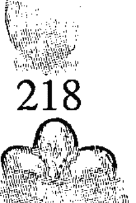

林越感觉自己根本看不到未来，不知道自己每天到底都在忙些什么，也不知道这份工作究竟有什么意义。她觉得，在这份工作中，她的付出与回报完全不成正比。

和林越有类似经历的年轻人不在少数，他们虽然都有稳定的工作，但内心却根本没有安全感。他们每天忙得几乎没有时间休闲娱乐，却始终赚不到钱。他们忙忙碌碌，却不知道自己每天都在忙些什么。

很多人不知道自己怎么会走到了如今这一步，自己究竟是怎么沦为“穷忙族”的。

其实，忙本身并没有什么错，忙说明你有事情做，你在努力奋斗。但很多人错就错在没有自己的想法和主见，只是盲目地去忙，最终才导致忙而无果。天长日久，忙来忙去，连自己都不知道自己究竟在干什么了。“穷忙”一族就是这么沦陷的。

“穷忙族”通常有这么几个特点：
- 没有清晰的职业规划
- 没有自我增值的意识
- 没有改变现状的决心

因此，想要结束“穷忙”，就必须从以下三个方面开始着手：

#### 一、根据自身特点，制定合适的职业规划

每个人都有不同的性格特点和兴趣爱好，在选择职业发展方向之前，我们应该先对自己有深层次的了解。

在对自己有了充分了解后，应该根据自己的职业发展特点，为自己制定一个清晰的职业规划，并按照这个规划认真地去执行。

很多年轻人在择业时，往往会迷恋高职位和高待遇，他们往往会因为面子和虚荣心而盲目追求一些看似体面的职业或岗位，却忽略了自身的特点和能力，这样不但不能对自己的职业生涯有所帮助，反而可能“拖后腿”，将工作变成了一种“穷忙”。

#### 二、重视自我增值和自我提升，增强竞争力

无论从事什么行业，能力才是硬道理。不同的能力会为我们带来不同的发展，只有不断提升自己的能力，更新知识结构，我们才能在竞争中立自己的优势，从而实现每个阶段的职业发展目标。

比如良好的沟通能力、与人合作的能力以及有条理的计划能力等，几乎是所有工作都需要培养锻炼的能力。需要注意的是，任何能力都不是一蹴而就的，而是通过我们在学习和生活中逐渐积累而成的，比如阅读，或参加某些培训活动等。

#### 三、敢于改变，创造机会

很多“穷忙族”之所以无法摆脱穷忙的窘境，往往就是因为惧怕改变。一方面，来自经济方面的压力让他们不敢轻易改变自己的职业；另一方面，他们并不确定改变之后会迎来什么，是更好还是更坏。

大部分“穷忙族”没能摆脱穷忙，并非因为他们缺少才干，而是因为他们把自己放到了一个错误的位置上，以至于无法集中精力、全力以赴地把自己的能力发挥在合适的工作上，使得大好的时光就这样浪费在了各种无谓的事情上。

互联网上曾流传过这样一句话：“我们人很多，但机会很少。”

这可能也是所有穷人的心声吧。在这个社会上，穷人的数量远远超过了富人，但穷人所能获得的机会，却远远少于富人。于是，越来越多的穷人加入了“穷忙”大军，以高消费的方式来为自己寻求优质的生活和美好的未来。因此，虽然怀抱美好的渴望，但“穷忙族”却始终无法实现自我救赎，更看不到成为富人的曙光。

“穷忙族”想要结束“穷忙”生涯，迈入“富闲”一族的行列，唯有学会借助团队的力量。绝大多数时候，“穷忙”都是由做事效率低下所导致的。如果你感觉自己一直在忙却越忙越穷，就一定要尽快学会向别人求助，寻求合作，借助团队的力量。

人能够吃苦、愿意吃苦是件好事，但人并不是为了吃苦而生的，人之所以愿意吃苦，是希望有一天，自己收获的一切配得上自己曾经受过的苦难。

因此，当付出与收获始终难成正比时，当你感觉自我价值难以真正实现时，当你忙得一塌糊涂却始终穷困潦倒时，请告诉自己，是时候改变了！怎么改变？借助团队的力量。

### 05 各司其职，团队更高效，更能创造财富

各司其职，才能让团队更有效地运转，发挥出更大的威力，创造出更大的成果。想要借助团队为你赚取巨额财富，成就伟大业绩，就必须学会让团队的每个成员都各司其职。

21世纪最贵的是什么？是能赚大钱的人才。撑起一个公司是什么样的员工？是能赚大钱的员工。能够帮助你的团队赚大钱的是什么人？是业务冠军，骨干精英。但是，想要撑起一个公司，让团队向前发展，仅靠这几个人才是不够的，无论什么样的企业或团队，都唯有让团队内部的人员各司其职，才能够让团队正常、高效地运转起来。

网络上曾经流传过这样一则故事。在一次面试当中，一个面试者提前来到了面试的办公室。他看见办公室的地面上有不少垃圾，于是他就将办公室打扫得干干净净，结果在面试当中因为这一点，他赢得了面试官的好感，从众多面试者中脱颖而出。

这则故事流传甚广，甚至不少人将其归结为细节决定成败，多做一点事情，就能离成功更近一步。而现实是否这样呢？无论是我自己还是其他公司的人力资源部门的负责人，都给出了同样的答案，那就是这样的行为并不会赢得面试官的好感，甚至还会引起一些人的恶感，因为他的手伸得太长了。

举个例子来说明一下各司其职的重要性。孙博是一家国营钢铁厂的工人，下班以后发现每天和他一起下班的同事还有工作没有做完，于是他就帮同事一起干了起来。结果一个操作不当，手臂骨折。尽管企业规定这属于违规操作，但企业还是承担了他的医药费。他的行为不仅让自己受伤，更给企业增添了麻烦。

企业雇用员工，更多的时候只是为了让员工做好自己的本职工作，只要每个人都能做好自己的本职工作，企业就可以正常运转。如果需要一个员工做更多的工作才能够让企业正常运转，那么企业中必定有一个不称职的员工，又或者企业本身已经存在问题。

许多时候，员工为了表现自己，会去做自己职务之外的事情，以突显自己的能力。这样的行为在许多小企业会赢得老板的青睐，但是在一个十分完善的企业当中，经常会出现好心办坏事的情况，并且会破坏员工之间的关系。

邓丽是一个怀揣梦想的毕业生，她坚信只要自己够勤奋，很快就能够出人头地。刚刚毕业，她就进入一家杂志社，成为一名文字编辑。实习期间，邓丽的工作并不多，每天她都能早早地完成工作。

抱着积极向上的心态，完成自己手头工作后，她就开始关注其他同事的工作，不管是美术编辑还是主编的桌旁，总是能看见她的身影。开始时她的行为还给主编留下认真好学的印象，后来的一件事情却让主编改变了对她的看法。

那天由于公司的网络出现了问题，邓丽就将稿件装在优盘里去找主编。主编刚好有事不在，她就自作主张地将文件传到了主编的电脑里。传完文件以后，她突然发现要发给广告商的杂志样刊文件已经做好了，而市场部那边正因没拿到样刊而发愁呢，于是她就顺手将杂志样刊拷贝出来，交给了市场部的主管。

尽管邓丽的行为没有什么过错，但是却引起了主编的反感。从此以后，邓丽每天都有写不完的稿件，并且其中绝大部分稿件都不会被采用。她也明白是那件事情让自己成为主编的“眼中钉”，但是她到最后也不明白是为什么。

各司其职是非常重要的，每个人在企业当中都有自己的位置，如果你做了别人的工作，那么就会有一个失去自己的位置。哪怕你并不够资格威胁到对方的位置，但是在职场当中，位置就是饭碗，看紧一点准没错。

从企业的角度来说，各司其职有利于建立健壮的奖惩制度。反之，则会降低员工的积极性。某补习学校就因为违反了员工各司其职的规则，流失了大量的员工。因为该补习学校有数个校区，教师补课的时候经常要在各个校区之间往来，时间十分紧张。教师的工作就只有补课，

打扫卫生的事情学校雇了专门的保洁人员。

后来由于保洁人员辞职，管理人员决定由上课教师自行打扫教室卫生。由于时间仓促，教师们打扫卫生经常很不干净，并且经常有忘记锁门关窗、关灯等情况出现。在出了数次问题以后，管理人员决定建立新的惩罚制度，如果有教师卫生打扫得不干净，或者忘记关灯、锁门等情况，就要进行罚款处理。

一时间教师们怨声载道，本来打扫卫生就不应该是教师负责的事情，如今还要因本职工作之外的事情被罚款，实在是太委屈了。但是规定就是规定，教师们开始在打扫卫生这件事情上花费更多的时间，于是上课迟到的现象开始频频出现。于是学校又增加了关于教师上课迟到的罚款条例。

这个规定出台以后，教师们在讲完课后，将面临着一个两难的境地：要么好好打扫卫生交迟到的罚款，要么早早地去上课，交打扫卫生的罚款。三个月后，几乎所有员工都辞职了。

各司其职的时候，企业就建立起了良好的秩序。原本的秩序被破坏以后，员工则会非常迷茫，对企业会造成混乱。

每个人都有自己的专长，在企业的构成当中，员工们就像是一颗颗螺丝钉，组成了企业这台大机器。每颗螺丝钉都有自己的用处，少了哪一颗都不行。一个钉子一个坑，有几个坑需要同一个钉子，那么机器肯定会出问题。

对于企业老板或团队负责人来说，如果员工能够各司其职，那么工作将变得有条不紊，老板或团队负责人也会轻松许多。这就如同法国将军戴高乐一样，24岁的戴高乐就在一次演习中担任军长，而他的对手正是他学习的学院的院长。

在他带领的军队在演习中击败了学院院长带领的军队之后，院长心怀不忿地讲述了战场上每个地方的细节，并且挑衅一样地询问戴高乐是否知道战场上某个营的伤亡情况。

戴高乐不卑不亢地对院长说：“我是一个军长，我只知道跟军长有关的事情，如果您想知道那个营的情况，请你去问我们的营长。”

各司其职是一种美德，对于个人来说，代表着肩负起了责任，代表着不插手别人的事情。对于企业来说，各司其职代表着井井有条，代表一切都能正常运转。对于一个企业来说，一个全能的人才可能十分重要，但如果能为他找到一个最合适的位置，那么他更能发挥自己的特长，创造出更大的成果。

各司其职，才能让团队更有效地运转，发挥出更大的威力，创造出更大的成果。想要借助团队为你赚取巨额财富，成就伟大事业，就必须学会让团队的每个成员都各司其职。

### 06 选对合伙人与团队，就能加快致富的步伐

要成为富人，最好的途径是创业。要创业成功，就必须选对合伙人，组建好核心团队。只有选对合伙人、组建好团队，才能从合伙人与团队借力，加速我们致富的步伐。

在电影《中国合伙人》中有这么一句“忠告”：“千万别跟最好的朋友合伙开公司！”其实对这句话我们并不陌生。在现实生活中，有无数例子似乎都印证了这一点。和最好的朋友“合伙”，往往发展到最后会变成——与最好的朋友“散伙”。

最好的朋友真的不能成为最好的搭档吗？在回答这个问题之前，我们先来看看，和最好的朋友合伙创业，究竟存在哪些“危险”。

#### 危险一：缺乏“优势互补”

中国有句古话：“物以类聚，人以群分。”你最要好的朋友，必然与你有很多共同点。

我们知道，人与人在交往过程中是会彼此产生一定影响的，通常来说，经常在一起的人久而久之都会培养出一种默契，你一说出前半句话，他大概就能接你后半句话。这种默契，实际上是思维方式和思维习惯上的雷同。

一个好的团队，是要能实现优势互补的。就像打网络游戏，一个队伍中，既要有输出，也要有补给，缺少任何一方，都将削弱整个团队的战斗力。而和最好的朋友一起合伙创业，最可能存在的劣势就是相互之间缺乏优势互补，因为你们彼此之间太熟悉了，这种熟悉通常会发展成为一种相似。

当然，如果你和你的好朋友本身就是以一种互补的形式建立的交往，那么就不存在这个问题了。就像电影《中国合伙人》中的三个主人公一样，成东青是一个充满激情的“土鳖”；孟晓骏是一个有留学经验的“海归”；王阳是一个具有美式思维的“美国通”。这三个人虽然是好兄弟、好哥们儿，但不同的性格特点和知识结构都能形成很好的优势互补，从而能在团队中各司其职。

#### 危险二：亲兄弟，难以“明算账”

合作伙伴之间有几点一定要分得清清楚楚：责任、权利、金钱。

很多好朋友共同创业，最后之所以闹得分道扬镳，情分不再，往往就是因为这三点分不清楚。

生意是一项理性活动，如果把复杂的感情牵扯其中，难免会产生分歧和矛盾。很多好朋友在合伙创业之初，总认为彼此之间交情很深，因此很多事情都不太在意。因此，在合作初期，大家都没有建立起相对完善的合作规则，比如签订商业秘密协议、制定财务分配规则等。

感情本身就是变化无常的，今天我可能因为某件事情对你心怀感激，明天我也可能因为某个举动就对你心生不满。依靠感情来作为维系的合作关系，通常都不会长久。

但人往往容易对自己的感情抱有一种盲目的信任，加之很多人也会因抹不开情面而无法和自己的“亲兄弟”真把账算明白，算清楚。于是，在日后的合作中，当分歧出现的时候，很可能因为缺乏一个清晰明确的规章制度而闹得不欢而散，甚至对簿公堂。

#### 危险三：创业理想与现实差距太大

很多缺少实际创业经验的人往往容易把创业想象得太美好，太热血。但事实上，创业绝对是一件需要耐得住寂寞的事情，只有历经“九死一生”的人，才可能迎来最后的成功与彩虹。很多人都是怀抱着美好的创业愿景投入创业，却在遭遇失败与挫折之后崩溃退出的。

两个人合伙创业，一定要做好共同进退的心理准备，如果两个人不能一条心，那么当失败与挫折降临的时候，团队必然脆弱不堪。因此，不要对创业抱有过多的幻想，在踏上这条路之前，先确定自己是否能够承受其中的压力与痛苦。

从以上几点可以看出，最好的朋友不一定就无法成为最好的搭档，前提是必须能把生意和情感完全分开。生意归生意，以合作伙伴的形式去相处，把一切该清算的资产都算清楚，再把一切应该建立的规则都完善起来。如果能做到这几点，最要好的朋友，也能成为最优秀的搭档。

选择合作伙伴对于创业是否能够成功是至关重要的。那么，在选择合作伙伴的时候，哪些问题是需要考虑的呢？

- 良好的道德品质。正所谓“小胜凭智，大胜靠德”。一个有着良好道德品质的人，才懂得在创业初期为伙伴提供理解、包容、支持以及信任。
- 达成一致的理念。作为一个团队的成员，达成理念方面的一致是非常重要的，否则就算当下不说，以后也会成为争执的根源。
- 互补性强。一个优秀的团队，其成员之间的关系应该是相互依存、相互补充的，这种互补主要体现在工作能力、背景、性格以及社会资源等方面。
- 踏实肯干。很多人以为创业一定是件轰轰烈烈的事儿，但实际上创业有时候比你想象的要无趣得多。决心自己创业的人，一要能吃苦，二要踏实肯干。选择搭档也是如此，绝不能与那种不切实际、不肯埋头认真做事的人为伍。

要成为富人，最好的途径是创业。要创业成功，就必须选对合伙人，组建好核心团队。只有选对合伙人、组建好团队，才能从合伙人与团队借力，加快我们致富的步伐。

切记，好的合作伙伴、核心团队会让你在追求财富与成功的道路上如虎添翼，不好的合作伙伴、核心团队会将你拉入失败的深渊。因此，挑选合作伙伴、核心团队成员时一定要慎之又慎，绝不要被感情蒙蔽了双眼。
