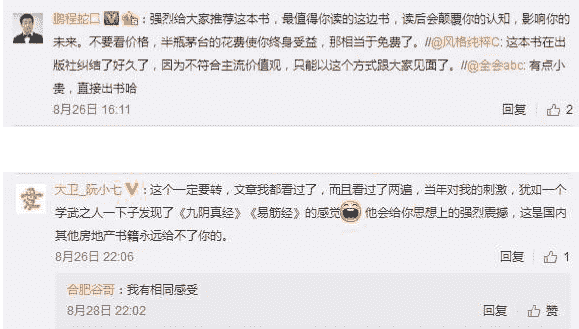
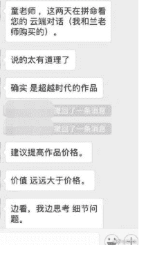
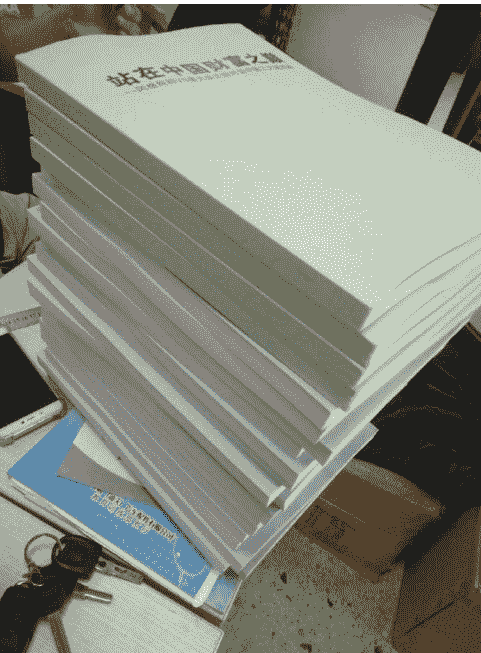
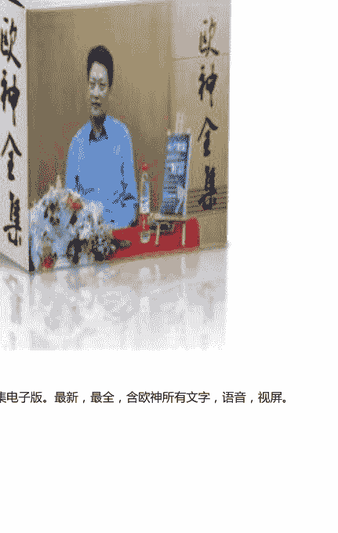

# 站在中国财富之巅——风格纯粹VS童大焕云端对话中国三大城市群

### 内容和作者简介

### 内容简介

书名：《**站在中国财富之巅——风格纯粹 VS 童大焕云端对话中国三大城市群**》

简介：

当代中国的城市化像社会层面的地壳运动一样迅速改变中国和中国的财富版图。大城市迅速隆起，小城市和乡村迅速陷落。与此相关的财富洗牌比人类史上任何时代都剧烈。它只与智慧有关，和传统的权力、出身、背景没有任何关系。

2015 年底，中国大城市化理论的领军人物童大焕受到未曾见面的上海网友风格纯粹邀请，通过网络，以几乎每天一篇来回的紧密频率，隔空对话，历时一月有余，其后断续补充，云端对话中国三大城市群。对当下中国正在发生的、影响每个人财富和命运的最剧烈、最广泛、最深刻变革——城市化以及背后的经济变迁进行了全面系统的深刻梳理，成为洞察当下中国社会经济变迁的最重要著作，可谓一出世便成经典。是研究城市化、房地产投资、中国社会经济群体命运变迁绕不过去的一部作品。

大学无线电通信专业、无任何经济学科班背景的童大焕，被经济学背景的风格纯粹称为“你很像米塞斯（20世纪著名的经济学大师，卓越的自由主义思想家。奥地利学派第三代掌门人，朝圣山学社成员。被誉为是“奥地利学派的院长”。2000年被美国《自由》杂志评为“自由至上主义的世纪人物”。）”

而风格纯粹本人，到底是什么种身份，至今成谜。只知道他是商业经济学天才，25岁即掌管过百亿资产。

好马配好鞍，好思想必须配高端。没有价格识别信号的领域，结果常常就是黄牛毁弃，瓦釜雷鸣。因此，我们打算给最好的思想匹配定价，打破图书按纸张厚薄卖的传统，将本书定价为698元。这是对高层建筑高端思想的高贵定价，也是在信息过剩时代，一个强烈的、识别优劣的市场信号。

2016年4月14日

### 作者简介

**作者一：风格纯粹**

一个在经济学领域寻找天空故事的人，敏感并接触各类资本市场的波澜起伏并感悟人生的人。一个奥地利经济学派的忠实信徒。一个深爱自由的人。自由之上，再无价值，是他的座右铭。也是一个读懂了康德哲学的人。喜欢远离人群，独处的人，深信理性是这世界上最高的道德和善的人。也是一个自由奔跑在金庸故事里的人，喜欢风清扬：有着盖世的武功，世人见过的不多，但江湖里有他动人的传说。风格纯粹在云端对话，用他的文字，刻画了自己的模样。诉说着他是谁。

“我对于云端对话，最大的感受是一段网上的碰撞，一段高山流水的友情。留给我们这个时代的背影，一段我们不计后果的真诚思考。”

至今仍是谜一般的存在，和另一作者童大焕也尚未谋面。

**作者二：童大焕**

男，1968 年生于福建长汀，1990 年毕业于中国人民警官大学科技系，现居北京。当今国内最活跃的时评人之一，视角独特、文笔犀利。笔触及时政、财经、法律、教育诸领域，对城市化、房地产、中国宏观经济等有深入而独到的研究，是国内少有的楼市“春天派”和“鬼城派”双体合一的矛盾统一体，中国大城市化理论领军人物之一，资深城市化和房地产研究专家，具有丰富的楼市投资实战经验。对中国房地产和城市化的深刻洞见和观点屡被市场验证，尤其是对于政策和趋势具有精确的预见性，如《限购恐将催化三四线城市房价》、《我为什么敢说谁当总理谁降准》、《只有房地产才能救中国》、《泡沫是消化泡沫的唯一办法》、《经济越下行，一线城市越坚挺》等诸多篇章一再被时间应验。

曾被评为 2006、2008 年度“百位华人公共知识分子”、2009 年度“中国百大公共知识分子”，2009 年度被腾讯网评为“年度致敬之教育评论家”，2013 年度“中国百位意见领袖”点评“他从公安大学的理科生，活生生‘扭曲’成了‘文科’专家，他对于中国消费经济的深入观察，让他成为广大民众消费选择的意见领袖”。微博《中国，请停下你飞奔的脚步》获南方周末 2011 中国传媒年度致敬。

著有《俯仰天地间》、《江湖上的中国》、《冰封的火焰》、《中国钥匙》、《买房的革命》、《世纪大迁徙——决定中国命运的大城市化》、《2020 我们会不会变得更穷》、《穷思维富思维》、《定位中国——认清我们的时代和时代中的我们》（本书卖到了洛杉矶华人书店）、《中国城市的死与生—走出费孝通陷阱》、《中国大城市化共识》（主编）、《世界越来越陡峭》、《站在中国财富之巅——和风格纯粹云端对话中国三大城市群》（待出）等书。《世纪大迁徙》获和讯网 2011 年度 15 大财经图书奖。

曾任中国青年报编辑、中国保险报评论主笔，现为重庆邮电大学移通学院大焕城市化战略研究院院长，北京大焕智库咨询有限公司、大焕财智书院、大焕雅赏创办人。

## 代序一 风格纯粹：说说我和童大焕老师的故事

风格纯粹 2016 年 5 月 6 日~6 月 9 日

说说我跟童大焕老师的故事吧。我跟他是在腾讯|微博相遇，当时的我，满目张望，不觉得有人比我牛逼，不觉得有任何可能有人比我懂房地产。那时的我，热衷于跟萧翰老师谈文化呢。偶尔看看一些大神的表演而已。有一天，有人@了我，转了童大焕老师的微博，其实，我当时是很没礼貌的，进去就调侃了他，然后他跟我辩论，嗯，这个故事就是这样，我们很快互粉了。这是我见过最有逻辑的房地产专家，然后就到了谈论房地产，谈论中国经济。其实，在腾讯微博，很长一段时间，我不谈论这个话题的，觉得没意思，觉得没人懂。这就是云端故事的开始。

云端对话啊，其实也是一个即兴的东西。当时我啊，调侃童大焕老师，咱说说中国城市化啊，一人一篇，不打草稿，即兴而来。嗯，就这么开始了。没有任何的提纲，就是瞬间的彼此不知的开始，其实，我准备写什么，童老师不知道。他写什么，我也不知道。云端对话就是这么来的。

前些日子，我把我跟童大焕老师的云端对话，给了一些我私人做经济学研究的名家朋友看，说我们是在网上彼此不知道，没有提纲写的，他们一直不信，还认为是噱头。

但是，我的所有完整看过云端对话的专家朋友，都一致认为：我跟童大焕老师的云端对话，逻辑严谨，格局宏大，仿佛出自一人手笔。这就是高山流水的秘密！

> 【童大焕：这实在是因为我们胸中有气象，才会有笔下行云流水！自夸也是必要的！】

我不记得是谁说了，说我遇到童大焕老师，因为我一个城市化高山的比喻，说是科学遇到神学。我很感动。我遇到童老师就是这感觉，我说他很像米塞斯。就是这感觉。

如果把城市化比喻成一座美丽的高山的话，我是沿着经济学的逻辑走到这的，董老师一直在这山上植树造林，搞绿化。至今我也不知道他怎么来到这的，我遇到他，这座山就已被他搞的很茂盛了。然后我就坐下来跟他聊起了城市化这回事，所以，来的方向不一样，角度几乎完全不同。

【童大焕：比喻很奇特。我走的是“群众路线”：人应该到哪里觅食？为什么会到那里？】

在微博上，在网上，我不在乎很多，我压根也没把很多人放在眼里。关于中国经济，关于城市化，这对我而言，就是一个经济学的逻辑，我私人在房地产上有很大的投资，朋友也很多，仅此而已。我玩这一套，在网上就是奇遇，遇到了童大焕老师而已，我们就扯开了这个话题，我这人做事认真，答应了，就做到极致

【童大焕：很早以前我就有一个“峰峰相望”的意象。互联网全面打开了人类的视窗，然后就奇遇风格纯粹，把对话命名为“智慧在云端握手”。】

房地产的秘密，不在房地产里，也不是那些板块轮动说、热点说的那些人理解的。他的全部秘密就在于城市化里，在那些能清晰看清城市繁荣和衰落的逻辑里，一个城市，跟一片森林一样，也有着荣枯，死去，新生。城市从来是一个有机的生命体。不是钢筋混凝土的建筑群。

正确的投资当然离不开充分利用金融手段，但看到一些人喊着大额信用卡比爹妈还亲的时候，不免毛骨悚然。楼市是一个长周期的交易，这种拿着股市短炒投机的心态，把杠杆加到了如此疯狂的地步，真是恐怖。投资必须考虑你的财务状况和现金流。一个国家出现经济危机，本质上就是债务危机。一个人也是这样。

这世界上，试图跟我谈房地产的人太多了。我没有任何兴趣。遇到童大焕老师，我最开心的是我们一直不谈论房地产，但我们全部的内容都指向了房地产。这种高山流水的感觉，那就是知音的相视而笑。

> 【童大焕：酒逢知己干杯少，话不投机半句多。楼市投资味如何，城市化里定风波。】

我跟@童大焕 老师，云端对话还有一篇文章，如果你把全世界的珍宝，全部带到只有你一个人的星球，价值几何？大答案是零。因为没有人跟你交易，那么价值就是零。这是财富的秘密。离开了人，谈论财富毫无意义。我是康德的粉丝，康德说：人是这个世界的目的。

> 【童大焕：我 2013 年 8 月 28 日成立重庆邮电大学移动通信学院大焕城市化战略研究院，开宗明义就是“我们的志向，是建立起以人为尺度的分析方法和数据库，提供以人口流向和城市发展自有规律为导向的政策和投资建议，以不辜负这个巨变的时代。”】

记得最早认识童老师那会，我读过他一篇回忆性的文章，谈及他考上大学，广播里叫他去拿通知书的情景，他当时在田地里种水稻。但我以后从未再次见到他诸如此类的文字。他一直呼吁离开农村。我佩服童老师，不仅仅是他的学识，而是他把情怀深埋起来，而不让它泛滥。让理性之光照耀人性！@童大焕

> 【童大焕：确有此事但记不得哪篇文章了。】

我也忘记那篇具体的文章了，只记得那篇文章，有一句：大焕，到镇上拿录取通知书。我仿佛看见了一个少年，从此奔向了超级城市。并有了远大的未来。从此与众不同。

> 【童大焕：2016 年 6 月 8 日，我发了篇文章《空城是业主、开发商和政府无知共振的结果》，认为发改委《长江三角洲城市群发展规划》排排座，吃果果，“像这类拿着圆规和尺子丈量地图的几何学家们主导编制的城市规划，不管它是国家级还是宇宙级，都建议真正用心研究城市化和房地产的人们尽量少看甚至完全无视，否则你不知道哪一天让自己或自己的读者掉进了类似于河北曹妃甸和天津 ‘星耀五洲’ 的楼市陷阱。倒是这两天，华为技术有限公司创始人、总裁任正非在全国科技创新大会上的发言你不能不看，因为他虽然不研究城市化，但比谁更懂城市化，他讲话中提到的科研的方向、制造业的方向，恰恰代表了未来城市化的方向！”于是有了风格纯粹下面的话。】

任正非可能是中国唯一真正具有创新精神的企业家。他对产业具有深邃的思考。其实，城市化的本质就是聚集对产业的效率提高，聚集而富有创造力，聚集而富有复杂多样的商业形态。城市化的本质就是为产业而来！而不是为房地产而来！房地产只是城市化的一个自然产品。

如果我们能明白福特的 T 型车，这种流水线作业方式，是如何深刻改变了工业化。那么我们就明白，城市化的本质就是一种组织的变革，是在这个角度上深刻改变了人类的生产效率。

福特发明的 T 型车，这种流水线的生产方式，把工业化送上了巅峰，他的伟大意义远远超过蒸汽机的发明。这种组织的变革让人的生产方式，发生了革命性的突破。而城市化，尤其是超级城市化，本质上就是一种人类在全部生产，生活方式上的组织变革，让全社会的分工越来越细，这是一场人类社会的组织革命。

简单说房地产这回事的话，如果一个城市聚集创造财富的能力超过房地产上涨的速度，那么这个城市的房地产价格可持续。如果房地产价格上涨的速度长期高于城市创造财富的能力，那么这个城市一定衰落。逻辑上：高房价不一定意味着产业的转型，有可能导致城市的衰落。为房地产而房地产的城市化思维，是陷阱！

从庙堂到草野，我们从不会站在现实和逻辑的角度思考问题，而是站在愿望的角度强行论证问题。长三角在地理位置上，底部就在南京、扬州一线。而现实，南京、扬州与上海互动也不大了。也就是长三角越来越聚集。之所以把安徽划进来，这个逻辑跟把珠三角扩大到云南的思维一样，是一种区域平衡的愿望！

所以，财富本质上是一种思维方式。你能理解多少，最终决定了你财富有多少。有时候，你拥有的财富，只是别人暂时寄存在你那里的，最终别人会拿走的。这是我的原创，好像最近很多人也这么流行说了。

【童大焕：今天有网友（教育幽默电影）问侯：“童老师节日愉快！我看了您的思想，感慨很多！我常对朋友们说，您的思想之所以正确深邃，是因为您是内生的、从实际出发的，悟出了大道，然后得出正确结论。而经济学家们是用理论套现实，所以总是不准。对您佩服至极！”我回复曰：“谢谢知我者也！端午快乐。”】

【童大焕：我尤其喜欢这位读者朋友关于我“思想内生”的评价。内生这个词非常准确，我自己未必能概括出来。我读书少（读书慢），思考多，每一个问题都贴着大地的呼吸。不唯书，不唯上，不唯众，不唯心（仅凭愿望），只唯实，独立不迁，避免无知共振。愿一生坚守书生与行者本色。】

## 代序二 童大焕：大踏步迈进 “世界无人区” ！

## 童大焕—2016 年 10 月 14 日星期五

今天我想和大家谈一谈未来世界的 “无人区” 探索。

先要和大家分享一下我这几年研究城市化和房地产的心得。

- 2010 年出版《买房的革命——观念战胜高房价》，打开城市化研究这扇窗
- 2011 年出版《世纪大迁徙——决定中国命运的大城市化》，从此闯进大城市化研究领域的“无人区”，提出的超级大都市理论和结论一再被后来的事实所验证（尽管一再与政策和人们的愿望相左），也有越来越多的共识者。那种巅峰体验，真的是无比美妙。

在《世纪大迁徙》一书里，封面上开宗明义写了很多字：

- 传统的、过去几十年延续至今的城市化路径经不起历史和现实的检验，它需要重新定位，甚至需要“改邪归正”；
- 百万人口以上的大城市在当代中国发展最快；
- “高密度大城市化”具有“拯救中国”的战略意义；
- 是到了应该彻底反思中国的城市化战略的时候了。

之所以能够一直站在相关领域的最前沿阵地，甚至时有“四海无人对夕阳”的空旷与寂寥，有几个经验：

1. 保持独立思考，把一个个小问题想清楚，比博览群书重要百倍。

我想的问题很简单：人会往哪里去？为什么会往那里去？这就是我思考城市化的全部内容。我把它称为“大道至简”。

我不博览群书，更不晒书单。城市化乃至未来世界的发展逻辑都在发生巨大变化，抱残守缺、墨守成规那是自找死路。关于城市化的书籍，至今只看了《城市的胜利》、《落脚城市》，都是在我写完上面两本书之后才看的。《美国大城市的死与生》，虽然在写上面两本书之前就已经摆在书架上，但是现在也还没有读完。

> 巴菲特说得很好很逗：“如果历史会简单重复，那么最富裕的人应该是图书馆管理员。”

2. 建立自己成体系的系统性的知识和思维方式，碎片式的百科全书会害死我们自己。现在是个信息过载的时代，一个人如果不想被信息淹死，必须抛弃大量似是而非的信息。想要在相关领域有所建树，尤其要在该领域建立健全自己的系统性思考。

有人什么都看，好像很谦虚好学，博览群文，却没有自己的逻辑和定见。我对他们说：我很担心你是什么人的东西都看，也不管对方有没有公信力。结果变得无所适从，最后一再延误时机。看东西太多而没有自己独立的“大道至简”的思考，随便一个冠名什么经济学家的也都信。那么怎么办呢？

尤其要抛弃最有诱惑力的阴谋论。识别阴谋论的办法只需一招：在阴谋论里，都有一个若隐若现全知全能的全能神在安排和左右一切。但在现实生活中，这个全能神根本不存在！他们自己往往焦头烂额左右为难！我一位弟子说得好：“本来是庸医把人给治坏了，阴谋论者认为他是神医，是故意让人病到这个程度的。这本身是没有自信的体现。阴谋论只体现在马后炮上。”

3. 敢于向“无人区”冲刺。那里才有你没见过的无限风光！

技术驱动的世界，正在前所未有地急剧变化中。城市化和互联网，像车的双轮、鸟的两翼，史无前例地鼎新中国和世界！

不管是城市化，还是互联网运用，还是其他高科技领域，都在迅速向“无人区”迈进。只要你的思维是建立在上述两大原则之上，是建立在保持对人和新生事物的强烈好奇之上，那就勇敢地坚持你自己，勇敢地面向未来，勇敢地面向未知。而不是时时、事事都讨教他人。这是你皎然出尘、不“泯然于众人矣”的前提条件。古今之成大事业大学问者，独立思考独立决断是必修之功课。那种到处去征求他人意见的，十之八九一生一事无成，因为世上庸众总是大多数。

4. 把关注焦点从人类几千年未变的对权力的过度关注中解放出来，转移视线焦点，保持对世界前沿企业和科技的敏锐，尤其是保持对那些站在“无人区”的世界最前沿企业的敏锐和关注。

14亿人口的中国，目前就已经有这样的企业：

2016 年 5 月 30 日，全国科技创新大会在人民大会堂召开，华为总裁任正非作了 2000 字的发言。谈到未来，任正非说，未来二、三十年人类社会将演变成一个智能社会，其深度和广度我们还想象不到。如果不能坚持创新，迟早会被颠覆。作为通信领域的领军企业，华为也感到“寂寞”。任正非称，华为“正在本行业逐步攻入无人区，处在无人领航、无既定规则，无人跟随的困境”，“已感到前途茫茫，找不到方向”。

还有一家大名鼎鼎的企业也正迅速攻入更深更广的世界无人区。

北京时间 2016 年 10 月 13 日晚，阿里巴巴集团在香港召开年度股东大会，会前阿里巴巴集团董事局主席马云发布致股东公开信。在信中，马云明确提出，阿里是一家解决社会问题的公司。未来 30 年，互联网对各行各业的冲击将更加猛烈，电子商务虽然是变革的先声，但也在迅速成为一个旧的概念，阿里巴巴将以数据作为新资源、计算作为新技术，引领新零售、新制造和新金融的变革。

在近 2000 字的股东信中，马云并未谈及半年来一路飘红的股价和上涨的业绩，却着重阐述了阿里与商家、合作伙伴乃至社会经济的关系，显示阿里早已将自己定位为互联网时代的商业基础设施提供者。

马云在信中写道，“我们正在构筑的是未来商业的基础设施，包括交易市场、支付、物流、云计算和大数据，这几个元素正在赋能商家与企业；我们要做的不是仅仅让商家与互联网连结，而是让商家与未来的高效率的商业模式相连结。”

马云在公开信中同时确认，全球化依然是阿里巴巴的三大战略之一，阿里巴巴基础设施提供者的形象将是超越国界的。阿里巴巴思考和构建的未来商业基础设施，将服务于全世界中小企业和普通消费者的全球化。

公开信说：

> “如同历史上每一次技术革命一样，前二十年技术革新，后三十年应用革命。未来三十年，数据作为新能源，计算作为新技术，会先后引发新零售、新金融、新制造和新文化的变革。
>
> “阿里巴巴思考和构建了作为未来商业文明筑基的五大基础设施：交易市场、支付、物流、云计算和大数据——服务于全世界中小企业和普通消费者的全球化。
>
> “阿里巴巴是一家为解决社会问题而生的公司。二十年后，我们希望能够服务全世界 20 亿消费者，赋能 1000 万家赢利的企业，创造一个亿的就业机会。这是一次新的，更艰难的开始。”

那些将个人命运、企业命运和人类命运紧密联系在一起的思考和创新，早已经超出了“赚钱”的境界。他们的一切思想与行为，以及由此积聚而来的巨大资本与财富，都是在为解决人类未来面临的问题而存在，都是“社会共有”的宝贵财富。这样的“无人区”探索，一开始的孤独寂寞，必将换来的是“应者景从”之境界。

前面没有参照，后面蜂涌来者。这便是“无人区”探索的巅峰价值。

### 1 地球上不存在京津冀城市群
#### ——风格纯粹 VS 童大焕·智慧在云端握手之 1

**大焕按：**

从今天（2015 年 12 月 5 日）开始，两个未曾谋面的网友——上海@风格纯粹和北京@童大焕 隔空对话，漫谈三大城市群的城市化问题。历时一月左右。感谢互联网，让智慧在云端握手。今天这是开篇。我们只管随心所欲地谈，这个时代能够接受多少我们的观念，随它去。

**风格纯粹：**

@童大焕 童老师，咱一个一个城市群谈，时间一个月。咱争取把这个话题谈出独到的见解，如果有决策层采取，当是你我读书人此生的无憾。我会把我自己认为重要的回复采取传播的方式，调侃采取评论的方式，便于你查阅。这个长微博，我本来写的很多，但是只好这样了。多了发不出。剩下的我们互动吧。

##### 风格纯粹 2015 年 12 月 4 日：

##### 存在着京津冀或者环渤海这个城市群吗？

我们首先看城市群的定义，1957 年，法国地理学家戈特曼首次提出了大都市圈概念，用以概括一些国家出现的大城市群现象。这些大城市群往往具有以下特征：区域内城市高度密集，人口规模巨大，城市间具有建立在分工明确、各具特色、优势互补基础上的密切的经济联系，是一个国家和地区经济最活跃、最重要区域。从这个定义来看，华北或者环渤海这个城市群是为制造的一个臆想的概念。它是政府计划经济思维延伸到城市群的一种规划和愿望。从名字来看，一会环渤海，一会京津冀，一会把山东，东北划进去，一会又划出去，就说明了这个概念只是纸上的文字游戏。事实上不存在这样的一个东西。

整个华北或者北方，没有重商主义的传统，北方的每一个城市，基本上都是北京的模仿者，他们没有产业互补的这种商业逻辑。所以，都是一个个孤岛。没有形成事实上城市群。他们的产业体系基本上都是强势国企主导的。城市之间的区别仅在于城市权力的大小，国企资源的多少而已。华北或者北方的这些城市，基本上都是按照权力的逻辑成长起来的，而不是按照商业的逻辑，这是跟长三角，珠三角这两个真正的城市群完全不同的地方。

北方人热衷于做官，做公务员，或者去一个事业性的单位，退其次，进垄断国企。这几乎是他们的信仰。北方缺少商业精神。经济的发展几乎完全依赖于地方政府的主导。

所以，北京在整个北方更加的聚集资源，就是这个原因。环境贫困带的出现是缺少商业精神，权力主导的必然结果。权力当然比市场更有效率，更快速的集中资源。这就是北京的房价飞涨的原因。

京津冀一体化也好，环渤海城市群也好，这些变来变去的概念，只会是纸上谈兵，没有任何鸟用！北京就是聚集，他的周围没有城市群，他是一个孤岛。

那么问题来了，既然整个华北或者说北方，每个城市都是北京的模仿者，为什么只有北京繁荣，别的城市包括天津，都在衰落呢？很简单，北方的这种强势国企主导的投融资体制，注定决定了他的无效率，不可持续。北京的问题是因为那些垄断央企，和中国集权的财政体制，这些强势国企其实都是财富的毁灭者，而不是创造者。1995 年中国财政收入占 GDP 的 16%，而 2013 年这个数字就飙升到了 37%，这是北京繁荣的秘密。不是他有效率。

##### 童大焕 2015 年 12 月 4 日：

##### 城市根本的竞争力在于商业精神和高度集聚

风格纯粹一针见血地提出了一个问题：和中国中部、南部的长三角、珠三角城市群相比，京津冀或环渤海城市群根本不存在！这个观点我高度赞成，过去也认为北京只会单极化发展，周边的天津和河北只会被不断吸附。根本原因和风格纯粹的观点相同：北京周边的这些省份，商业文化的传统极不发达，在计划经济洗礼下又更加形成对权力经济的极度依赖。

在此情境下，环北京贫困带的形成是必然的，华北地区雾霾比华东、华南地区更严重也是一个必然的历史阶段——除了气候地理原因外，华北地区重霾来自三个合力：北京限制人口流入导致缺乏经商传统的周边河北等地人更加依赖于国有重工业，北京及其周边就像一口锅，形成烟囱包围北京态势；北方大都是强势国企，腐败型投资为 GDP 而 GDP，视法律为无物，环保法形同虚设；总想把人往郊县赶的落后的城市规划理念和实践导致职住分离严重，对汽车的过度依赖严重加剧雾霾天 PM2.5 浓度。

1949 年以来，漫长的计划经济时代全中国权力中枢的地位成就了最初的北京。但是城市一旦发展到一定规模、有了一定条件，就将脱离权力的束缚，像滚雪球一样自由发展。就像孩子长大后不听父母使唤。北京也一样。2010年全球人口正式宣布一半以上进入城市生活，开启了崭新的人类城市时代。从此开始，服务业超越农业和工业，成为GDP和人类生活的主导产业，加上20世纪80年代以来“资源的诅咒”（资源越丰富的地区发展进步越慢）在全球范围内不论国家、制度和地区普遍适用，服务业的最根本依赖——人的智慧这一无形资产，远远超越农业时代的土地和工业时代的矿产等有形资产，越来越像脱缰的野马一样摆脱权力的控制，城市和经济自由生长的时代就宣告到来！

在此情况下，北京拥有全国最好的高等教育、传媒、出版等资源，同时又有比其它两大城市群更加包容的民间文化传统（画家村的出现当为标志），以及全国最好的与世界相连的交通体系，北京的商业精神和创新力量势不可挡。

加上城市发展自身的幂次法则和万有引力定律，北京对周边乃至全国的吸附能力会越来越强。甚至正是由于其单极化发展态势，它比长三角的核心城市上海、珠三角的核心城市香港更具吸附力。在城市化时代，吸附和集聚本身就是生产力！它会产生核聚变一样的创造能力！

也因此，“京津冀一体化”或者“京津冀协调发展”的梦想和规划必然失败！在长三角这样整个大城市群都具有强烈商业文化传统的环境下，2003年起上海用了十多年时间建设5大郊区新城，尚且半死不活；北京试图向外转移产业和人口的努力只会更加失败。事实上，其计划经济时代，权力更能随心所欲地控制资源，尚且没有能力建设好“卫星城”计划。在进入不受权力控制的自由市场经济时代，权力的这一梦想更加会落空。交通等基础设施的完善与便利，只会减少北京吸附周边地区的阻力。就像风格纯粹在《我为什么坚决看空三四城市的房地产》一文中提到的一个事实：“日本在田中角荣时代，跟中国政府一样，认为东京人口密度太大，也做了大量的基础设施的投资，本来的目的是增加便利性，疏散东京人口的压力。结果：东京的人口更加密集，加速了日本小城市的衰落。”

也正是因为这一切合力的结果，北京当仁不让地于 2015 年 8 月被经济学者智库评为中国大陆最宜居城市；全球最宜居城市是墨尔本。宜居是综合结果，重要性我认为依次是就业，治安，自由度，互相服务便利程度，医疗服务先进便捷程度等。哪些因素最有价值且最难改变或改变成本越高，哪些因素就最具决定性。雾霾、交通拥堵都非重要因素。水资源短缺说则纯粹是缺乏独立意志和独立思想的所谓专家学者迎合上意的一个谎言。

宜居与否的最直接指标是：人口规模 + 人口机械增长率，这是一个又一个自由人一人一票用脚民主投票的结果。我估算北京的人口规模在大陆北上广深四大核心都市中是最大的，官方公布数据是到 2014 年底 2100 万，但我估计不会下于 4000 万；就像深圳的数据官方公布是 1062 万，实际达到 1800 万。北京的公布水分应属全国最多，因为其受到严控人口的政策指令压力也最大，甚至不得已启动了史无前例的试图以限制流动儿童上学权利的方式来达到根本不可能的人口控制目的！

小资和没脑文青中文考发神经做白日梦的地方常被误为最宜居之地，一是因为“离群索居”便于梭罗们扬名立万，人海茫茫中则谁也不认识他们；二是因为前几类人有话语，而普罗大众多是沉默的大多数。

2015 年 12 月 3 日下午，本人接受日本 NHK 电视台采访，关于流动和留守儿童，关于城市化。我说中国整个社会从决策层到专家学者到普通民众，双脚已经进入城市，头脑仍然留在乡村。一切都不是利益问题而观念问题。当下中国社会最缺乏的是智慧。一小时采访，他们说讲我讲的清晰明了，直率。我讲想清楚了就一定敢讲并且能讲透彻。

##### 风格纯粹 2015 年 12 月 5 日：

譬如大饥荒，发生了河北、山东人大规模的闯关东事件。从这个文化的角度，研究京津冀或环渤海这个区域，具有很好的视角。

### 2 城市未来由商业精神决定
#### ——风格纯粹 VS 童大焕·智慧在云端握手之 2

##### 风格纯粹 2015 年 12 月 5 日：再谈环渤海这个伪城市群

上一篇长微博谈到环渤海这个城市群不是一个真正的城市群。这个长微博分析环渤海可能的变迁。

首先我们提出一个概念，决定一个城市成长的动力是什么。我的答案就是商业。是商业的繁荣才最终决定了一个城市的繁荣和发展。从这个角度而言，商业精神最终成就了一个城市。没有商业精神的地方，就不会有文化，也不会有发达的文明。本质上，这个世界的美好是商人成就的。

从商业精神的这个角度看，环渤海的这些城市更像一个城邦，而不是现代意义上的城市。这些城市的人们追去的是不自由的财富，而是对权力的依附。他们追求的是依附于体制或者说权力，来获得保障。

从这些城市的整个产业来看，基本上都是强势而无效率的国企主导。也基本上是重化工企业主导，高耗能，高污染的企业。这就是北京雾霾，整个环渤海都处于严重污染的原因所在。整个渤海湾，也基本上污染成一片死海了。就是这个缘故。地方政府是当地发展经济的主要力量。各个城市，产业雷同，大同小异。一句话：官员干了商人的活，这就是本质原因。

我不知道儒家文化本来的面貌，历朝历代的统治着为了统治的需要，曲解篡改，这是一定的。山东的 GDP 差不多在全国能排到前三位，可是山东人均收入，可能连前 15 名都排不到。就是这种强势而低效的国企主导发展的原因。

整个北方区域的人们，基本上处于农业思维的状态，缺少进取的商业精神，不到万不得已，是很难离开故土的。在国外，你可以随便就遇到江浙人，福建人，广东人，他们遍及四海，北方人是很少的。就是这个缘故，缺少自由不屈的商业精神。环渤海区域，或者北方人，他们的迁徙更多的是因为读书，做官的原因。仔细观察，环渤海的这些城市，人们在家乡谋生发生困难，譬如就业机会突然减少，首先选择的是临近的城市，除非远方的城市有亲友，帮忙安排一些生活的后顾之忧。这跟温州人，福建人，广东人赤手打天下是有着本质的区别的。

从商业精神这个角度，我们看见了北方依然处于一种农耕文明的状态下，表现是：故土难离。

那么我们可以思考环渤海这个区域未来的变化了，结论就很容易得出来，先放开北京不谈，就这些区域的城市，包括天津，在这种强势而无效率的国企主导的经济活动下，注定是无效率的。赶上好的环境和经济周期，就过度投资，无效而又惊人的浪费。生活在这些城市的人们，又缺少商业精神。经济活力一定很差，贫穷是不可避免。

我的结论很清楚：除了北京，这些区域的城市，我一个都不看好！没有未来的城市，谈论房价毫无意义了。

我会找时间，再写一篇长微博，专门谈这个区域的城市北京，这个让人们嫉妒，爱恨交加，五味杂陈的千年帝都！

##### 风格纯粹 2015 年 12 月 5 日：

童老师，咱就这样，一个一个城市群撕开来，从各个角度谈。剖析中国城市化未来的面貌。至目前为止，咱没有分歧。我会再找时间专门写一篇微博，谈论北京。

童老师，等我在写完这个区域最重要的城市北京，然后我们探讨这个区域怎样改革管理体制，或许可能的变化，但是文化的改造是非常难的。我们尝试一下吧。

##### 童大焕 2015 年 12 月 5 日：

我们就这样用漫谈的形式切入。文化影响城市发展这一块，以前只是略有提及，没有较详细论述。正好借此讨论深入之。

##### 风格纯粹 2015 年 12 月 5 日：

嗯，我们认真的剖析每个城市群内在成长的逻辑，最后，我们做个总结。一个一个来，最后，我们争取解读出中国城市化内在的规律，做一个总的总结。不急，我们慢慢来。

其实，这十年房地产的繁荣，造就了太多的胡扯的专家，就像股票牛市里的分析师，喊对了而已。我希望跟童老师好好探讨，争取做到最深刻的勾勒出中国城市化最真实的规律。

##### 风格纯粹 2015 年 12 月 5 日：

高山流水琴三弄，明月清风酒一樽。

##### 童大焕 2015 年 12 月 5 日：

云端智慧频握手，北上人间断有情的。

##### 童大焕 2015 年 12 月 6 日：城市的未来由商业精神决定

说得很好！商人才是世界文明规则的最终制定者！城市的气质和未来由商业决定！这里的商业，既包括传统的商场、购物、餐饮等消费与服务，更包括现代写字楼人流密集的智慧与脑力劳动。在现代社会，后者智慧流才是城市高

度与房价峰值的决定性力量。城市的创新需要智慧的浓度与密度，有了足够的浓度与密度，才会像核聚变一样爆发出巨大的能量。

越有商业精神的族群和地区，人口迁徙的半径越远。京津冀三省，除了北京，天津和河北跟东北三省差不多，都是高度依赖国企。因此，东北衰落的今天，可能就是河北和天津的明天。浙江人、广东人、福建人不管在什么条件和环境下，足迹都遍布全世界，他们的资金、观念和人口返乡潮，也直接像龙卷风一样吸引了其它省份的人口向这些地方集中。进入21世纪以来，北京，上海、浙江、江苏，广东，福建6省市，吸纳了全国88%以上的跨省流动人口！今后，由于幂次法则和万有引力定律的作用，这样的比例还会提高，速度还会加快。这些吸纳人口很强的省份，基本上不需要依靠什么国家优惠政策，却像高能磁铁一样，散发出迷人的超强吸附力。这是商业理念的胜利。

相反，河北和天津有点像扶不起的阿斗。过去十多年胡温时代，是1949年以来政府最有钱的时代。这个时代，政府在河北天津投下巨资，但成效却并不显著。伴之以首钢2万人整体搬迁、十年投资3000亿元的河北唐山曹妃甸，最终沦为鬼城。甚至于为了要不要继续支持曹妃甸，河北省差点就和工商银行全面闹掰。而距离天津45公里左右，被整个天津地区人们视为希望沃土的海滨新区，也最终只能成为一座物流城而已。虽然其人均GDP和总人口都远远超出上海浦东新区，但它的房价，迄今只是一万元出头。而浦东新区，基本上是四五万元起步，陆家嘴金融中心则早已是八万稀松平常。这和您说过的“山东的GDP差不多在全国能排到前三位，可是山东人均收入，可能连前15名都排不到。就是这种强势而低效的国企主导发展的原因”如出一辙。不管人们如何从情感上不能接受高房价，但高房价就是城市核心竞争力的重要、直观指标——没有高收入的人群，根本支撑不起高房价。

一个人、一座城，只有自己有无充沛的造血功能，才能不断成长壮大，靠输血是永远不会有前途的。健康人从来不需要外在输血，需要输血的都是病人。城市也一样。没有造血功能的人和城市，谁来重视都没有用。当年坊间有言：邓深圳，江浦东，胡温曹妃甸。说的就是领导的重视程度。但事实上深圳和浦东都只有政策没有钱，却发展起来了，一个是因地缘优势，二是因为商业文化优势。而曹妃甸尽管当时9常委无一缺席都高度关怀，并且真金白银投入3千亿元，但由于选错了地方，不符合城市化自身集聚的规律，加上商业文化的匮乏，最终只有沦为鬼城一途。

城市，从来都有自我生长的逻辑，而不是靠人造可以造得起来。

尤其是当城市告别了农业时代单纯的军事和行政以及小手工业功能，进入商业发展远远超越工农业的时代，城市发展的商业逻辑就将把权力逻辑甩到十万八千里之外！一骑绝尘！

### 北京只与全世界最繁荣之地频繁互动
——风格纯粹VS童大焕·智慧在云端握手之3

#### 风格纯粹2015年12月6日：我来谈谈北京这个城市

京津冀或者环渤海的核心城市北京，最近因为严重的雾霾，广受世人瞩目。就像我前一篇长微博说的，根本不存在环渤海或者京津冀这个城市群一样，其实，北京根本不是这个区域的核心城市，只是地理上的错觉而已。北京其实是全国的核心城市。他与京津冀这个区域其实在经济和产业联系上，其实最小。就像古代的帝都一样，京杭大运河的开通预示着，他与当年最富庶的江南反而经济上互动的更加密切。哪里经济繁荣，哪里经济发达，帝都就与哪里互动的密切。

我们的很多专家学者，逻辑性极差，总是把眼睛看到的一些表面现象当成原因，胡乱联系。误导了决策层。譬如人口问题，这些专家把北京的拥堵和污染归为人口，然后出台了一系列限制人口的问题。有数据计算，北京的一系列人口的限制措施，大约让北京的GDP损失了2万亿以上。北京的拥堵问题不在于人口，而在于城市管理。这个问题似乎又是专家刻意回避的问题。人口密度大，反而能让交通更有效率，目前全国的地铁系统只有上海申通地铁处于盈利水平，就是高密度的原因，上海在解决公共交通问题上，才可以持续的投入，事实上上海目前也是中国最大的地铁网。很快就会全球第一。北京来本也可以做到这样，但是政府管理过低的票价，导致地铁系统亏损累累。

北京的第二个问题是城市规划，尽管北京的马路气派开阔，但是其实北京的道路规划是不合理的，譬如纽约道路用地大约能超过 30%，北京只有 17%左右。

再就是水资源问题，这个问题我很少说，跟童大焕老师互动，看到他反驳一些专家关于北京水资源短缺的时候，我偶尔也就是跟他调侃一下，我不认为这个问题值得反驳。全世界研究水资源，都是把一个国家或者地理上的作为一个水资源计算来比较，没有任何真正严谨的专家会把城市的水资源来比较。全世界所有的大城市都是依赖于外来水资源。这个简单的道理，就像所有的城市都依赖于外来的粮食一样，哪个大城市的粮食是自给自足的呢？

概念的混乱，逻辑的混乱，我看到媒体上的一些专家喋喋不休，我常常为他们的学识无语。

严格的说，北京也不是一个因市而城的城市，他是一个靠权力聚集的城市，是这个体制下网络天下精英而成就的都市。是大政府，小市场的产物。北京只正部级的强势部门，包括党政军，各种行业协会，中央级的媒体，各大科研单位，央企总部，应该不下 200 个吧？具体的数据，我没数据，这些强势部门哪个不是天量的预算呢？哪个不是规模浩大呢？中国集权的财政管理体制，加上分税制改革以来，中央拿走大头，北京事实上是中国的资金中心，不仅仅是权力中心。权力，审批是北京繁荣的所有秘密。依然记得湛江市长拿到宝钢湛江钢铁项目狂吻批文，在网上疯传的那张照片。依稀记得民航总局一个处长反腐被抓，媒体透露出他怒斥某省副省长，而对方陪着小心的故事。

譬如北京事实上也是全国的文化中心，电影，电视剧，音乐的中心，为什么呢？审批啊，你在上海试试，只审批这个环节你要跑多少趟北京啊。再说北京的宋庄这件事，宋庄是全国文明的画家村，我想到了深圳也有个类似的，不同的是北京是积聚了一群真正的艺术家，深圳贡献了全世界著名油画的仿制品。为什么？市场啊，巨大的礼品市场在北京啊！

说到人口，北京的官方公布的人口是 2100 多万，这个数字肯定是假的。童大焕老师估算大约是 4000 多万。就按照 4000 多万这个数据，北京的整体的人口密度也不高。上海官方的数据就是 2800 多万，事实上最少也有 3500 万，但是上海的面积只有北京的三分之一多一点，上海面积 6000 多平方公里，这还包括了中国的第三大岛屿---崇明岛和一些不知名的无人岛。北京是 16000 多平方公里。总体上人口密度，北京是不如上海的。但是，你要仔细分析，如果把北京三环内的人口单独拿出来，那这个密度瞬间惊人。原因在于这个大政府，小市场的体制，几乎所有的强势单位几乎都集中到了三环内的这个区域。

从这个角度而言，你北京都没有一体化呢，竟然想到了京津冀一体化，能不让人无语吗？

先写这些，早上以飞快的打字一气呵成，找个时间我再继续这个千年帝都的分析。

#### 风格纯粹 2015 年 12 月 6 日：再谈北京

我的前三篇长微博分析了，不存在环渤海或者京津冀这个城市群，也不存在北京是京津冀或者环渤海的核心城市这个大家从没有质疑过的错误事实。北京是全国的权力核心，是这个体制网络全国精英形成的超级都市。他不是靠市场形成的，他是这个体制，权力跟市场的博弈形成的。是市场向权力低头形成的超级都市。北京跟京津冀，或者环渤海的各个城市没有产业互补。哪里繁荣，帝都就跟哪里经济互动。他的产业自成一体，他像一头超级巨兽，吃完东西，诞生了一系列的生物链一样。京杭大运河尽管今天失去了航运的功能，但依然诉说着北京这个城市不变的本质：哪里经济繁荣，这条运河就挖到哪里。这就是北京繁荣的本质秘密。

北京作为一个政治权力中心，在这个体制下当然成为资金的分配中心，是中国这个体制，大政府、小市场的产物。从没有环渤海或者京津冀这个东西存在，这完全是想当然的一个概念，就像一粒钻石放到沙漠里，他的形成与这些沙子毫无关系一样，他只是因某种原因落在那里而已。北京也不是环渤海或者京津冀的中心，他就是北京！

北京的人口密度并不高，但是北京单独考虑三环内的区域的话，密度是惊人的。这就是权力更容易聚集的结果。权力当然比市场有效率。讨价还价这种市场行为当然比不直接拿着就走痛快一样！从这个角度，可以分析北京的拥堵，环北京区域的高污染，环京贫困带了，一点都不奇怪。（找个时间，在这个具体问题上，我会再发博，跟童老师直接现场互动）

我现在想提出的是一个构架，中国事实上只有两个城市群，长三角，珠三角，再加上一个北京。这是中国兴衰，城市化最关键的区域，问题和机会只会出现在这三个地方的。这是中国城市化问题和经济区域规划最最关键的东西。

就像最早我认识童老师，他说珠三角的龙头在香港，而不是深圳、广州，这种见识，当时就让我一见如故，成为好友。长三角的龙头是上海。

我把北京称为大政府的代表，把上海称为市场的代表，香港称为宪政的代表。目前的中国经济改革，在这三个区域最典型的代表了，政府战略的混乱，也就是：政府，市场，宪政。这三者关系的处理的混乱不堪。这是我跟童大焕老师相约隔空对话中国三大区域城市化问题，我认为最重要的框架性的提出。这是中国经济未来改革的方向。

今天这个长微博阐述一个概念：北京，以上海为核心城市的长三角，以香港为核心城市的珠三角。他们分别典型的代表了政府权力，市场，宪政，这三个市场经济要素，都不可或缺，但是目前我们管理当局的认识混乱，战略管理混乱，造成了一系列的重大失误。

今天先把这个概念阐述清楚，关于京津冀，关于北京，关于环渤海，针对一些具体问题，我还会跟童大焕老师继续隔空对话，发出这个微博，就想阐述我整体性的框架性思考。

会继续在京这一带谈论，一周多后，我们会转入下一区域：长三角！

先提出这个框架性的概念，我认为是必要的。

- **风格纯粹 2015 年 12 月 6 日：** :童老师，这一个月，工作之余，我会致力于这个话题的讨论，争取一个多月，咱可以整理出来整体性的东西了。

- **童大焕 2015 年 12 月 6 日：**

是的，届时争取出版。

- **风格纯粹 2015 年 12 月 6 日：** :就像我们最早的用意，希望我们对城市化的思考，能贡献给这块土地上的人们。贡献给我们无论走到哪，都挚爱的国家。

- **童大焕 2015 年 12 月 6 日：**

是的。因为重视它，才会执着地关心它。

*童大焕 2015 年 12 月 6 日至 7 日：这是中国知识分子丧失真知的时代*

中国有句古话：旁观者清，当局者迷。今天（6 日），风格纯粹提出的几个大框架大判断，对于我这个 1997 年就开始独立研究城市化的人来说，仍然有一种惊心动魄震撼灵魂之感，比如这些判断：

> “北京是全国的权力核心，是这个体制网络全国精英形成的超级都市。他不是靠市场形成的，他是这个体制，权力跟市场的博弈形成的。是市场向权力低头形成的超级都市。北京跟京津翼，或者环渤海的各个城市没有产业互补。哪里繁荣，帝都就跟哪里经济互动。
>
> “就像古代的帝都一样，京杭大运河的开通预示着，他与当年最富庶的江南反而经济上互动的更加密切。哪里经济繁荣，哪里经济发达，帝都就与哪里互动的密切。
>
> “全世界研究水资源，都是把一整个国家或者地理上的作为一个水资源计算来比较，没有任何真正严谨的专家会把城市的水资源来比较。全世界所有的大城市都是依赖于外来水资源。这个简单的道理，就像所有的城市都依赖于外来的粮食一样，哪个大城市的粮食是自给自足的呢？
>
> “有数据计算，北京的一系列人口的限制措施，大约让北京的GDP损失了2万亿以上。北京的拥堵问题不在于人口，而在于城市管理。
>
> “我现在想提出的是一个构架，中国事实上只有两个城市群，长三角，珠三角，再加上一个北京。这是中国兴衰、城市化最关键的区域，问题和机会只会出在这三个地方的。这是中国城市化问题和经济区域规划最核心的东西。
>
> “我把北京称为大政府的代表，把上海称为市场的代表，香港称为宪政的代表。
>
> “今天这个长微博阐述一个概念：北京，以上海为核心城市的长三角，以香港为核心城市的珠三角。他们分别典型的代表了政府权力，市场，宪政，这三个市场经济要素，都不可或缺，但是目前我们管理当局的认识混乱，战略管理混乱，造成了一系列的重大失误。”

“京杭大运河”，穿越千年的迷雾，直抵北京的核心本质！北京，只跟全世界最卓越的地方发生联系，跟河北、天津没有关系。北京只与全世界最繁荣之地频繁互动！这无可指责！就像朋友要交换彼此能量相当、志趣爱好见识不相上下的朋友一样。

权力、市场、宪政三个大框架定位两大城市群加一个北京，令人醍醐灌顶

对于资源和拥堵问题高层建筑的清晰判断，则足以令无数“专家”羞愧得无地自容。是的，全世界最卓越的城市都是通过最卓越人才的集聚，然后生成长长的生态链，让全世界的资源为它所用。水资源也不例外。全世界没有一座卓越的大城市，是靠自身的资源来支撑。

在水资源和环境等问题上，没有任何一个城市可以关起门来独立解决。中国的环境和水资源问题，更应该放在全国的视野上来解决：中国的地势西高东低，中国的大江大河多是从中西部发源，而中西部恰恰又靠近内陆，相对干旱。因此，在大河下一江春水向东流的同时，人口也本应一江春水向东流，加速生态告别中西部，吹响向东部大城市自由聚集的集结号，以保护中西部脆弱的生态环境！甚至有可能，因此而将 1949 年以来因不许农民进城、乱砍滥伐而人为增加的 300 多万平方公里荒漠化土地逐渐恢复为绿洲。

同理，北京和天津、河北的关系，也不应该是今天以邻为壑的试图不断把人从北京“疏导”出去，而是应该以海纳百川之姿态，敞开怀抱迎接外来人口的到来，让他们接受与世界接轨的北京现代文明的洗礼，积极参与北京城市的社会分工和财富共享，同时减少他们对北京周边生态环境与水资源的污染与破坏。海纳百川，有容乃大。有此容量的北京，不仅水资源问题、雾霾等环境污染问题可以相当容易地迎刃而解，甚至根本不需要南水北调。南水北调工程也不可能真正获得成功。

当北京敢于以海纳百川之姿态迎接周边的河北、天津人民乃至全国、全世界人民的时候，北京会变得更加富裕繁荣，它周边的河北、天津以至包括北京在内的整个华北地区也会变得山更绿、水更清、天更蓝！

北京一系列人口限制措施，大约让北京的 GDP 损失了 2 万亿元以上。北京的拥堵造成的损失也在每年 700 亿元。造成拥堵的根本原因不在于人口太多，而在于城市规划和 管理理念太落后。人口集聚是城市和服务业发展的前提条件和自然规律，试图控制人口和试图把人往郊区外面赶（北京 51% 的人口居住在五环外）的城市理念又造成巨大的职住分离群体，道路更漫长，拥堵时间更加剧。北京 CBD，只有 3% 左右的人口职住能够统一在附近。

北京已经在酝酿收取拥堵费。这是对的，也是解决城市拥堵、降低 PM2.5 排放量，以及实现道路公平使用的唯一办法。所谓公平使用，就是最需要它畅通的时候，不论是谁使用，它都能畅通！这并非意味着有钱才有权利使用道路，而是意味着最需要道路畅通的人们能够实现畅通的需要！比如，穷人需要救命的时候，他会不舍得那点拥堵费吗？但是如果没有畅通，不论穷人富人，你就是愿意花一百倍于拥堵费的代价，也不可能使它瞬间变得畅通，那时，也许只有把命搭在拥堵上。

当然拥堵费还远远不够。城市规划理念必须完全更新，改变商务区白天很热闹、晚上是鬼城；居住区晚上很热闹、白天是鬼城的畸形城市生态，实现职住合一的完美城市构建。我们必须完全告别害怕人多集聚的落后观念。人多、高密度集聚本来就是城市文明的基本特征，只有头脑还留在农业社会的人才害怕人口集聚。

我甚至设想，我们应该大量建设一平方公里的摩天大楼社区，容积率达到 15 到 20 以上，底层是公共绿地、公园、便利店，以及学校、医院、体育官等公共生活空间。职住混杂，人们可以在这里居住，办公，生活。用步行的方式就可以轻松解决在社区里的一切生活。除了警车和救护车，汽车完全没有必要。社区与社区之间，公交和地铁相连。更远的交通，通过轨道、公交等进行。

电梯战胜汽车，是未来城市的方向。

真正的低碳环保，是人远离自然，把自然还给自然，把生活留在城市。

我在想，作为一个城市研究的“局外人”，风格纯粹为什么每每在关键要害上一针见血？旁观者清固然然是一个原因，但作为“局外人”的独立性恐怕才是真正的根本。而独立性，恰恰是智慧和真知发生和发展的根本。

今天的中国，正处在由乡村向城市、计划向市场、工农业向服务业全面转型的紧要关口，迫切需要知识分子站在时代的塔尖上拨云见日照亮方向。但是中国知识分子整体上有愧于这个巨变时代，他们就像李敖总结的中国知识分子五病“拙于谋生，急于用世，昧于尽忠，谮于真知，疏于自省”，这种委琐又无知的形象真是入木三分。应该把“谮于真知”放在最前，而“谮于真知”的根本原因就在于缺乏独立思想和独立人格，越是谮于真知，又越发导致独立人格的丧失。

尽管自 2013 年 4 月以来，中国大陆各种“智库”风起云涌，但目前最为普遍的实际情况是，“很多体制内智库已经习惯了为政府出台后的政策作合理化阐释，而不是提出独立立场的政策研究成绩。”我把他们称为“第二宣传部”，连古代的门客都不如。领导人日理万机跨越各种行业，任何人都非全能，合格门客至少要为主人提供他所看不到的视角和专业见识。然而，今日中国，多少智库只是领导的应声虫和马屁精，甚至更进一步，专事揣测上意曲意逢迎的活计。

民族和国家的落后首先表现为精英的落后，精英的落后又首先表现为知识分子的落后。

### 超大都市支撑中国超级大转型
——风格纯粹 VS 童大焕•智慧在云端握手之 4

#### 风格纯粹 2015 年 12 月 7 日：

一个国家，一个城市，甚至一个人，都应该从事自己擅长的领域，从事自己有比较优势产业，这就是国际贸易的意义，城市群的意义，社会分工的意义。

找时间，我会再找时间继续北京和环渤海这个话题。

#### 童大焕 2015 年 12 月 7 日：

如果只限于局域，就失去了更为宏大的国际分工和视野。京津冀一体化某种程度上是刻舟求剑，人为破坏社会的自然分工。

#### 风格纯粹 2015 年 12 月 7 日：京津冀一体化与产业转型

我在前面几篇长微博提出，京津冀或者环渤海这个城市群是不存在的。北京也不是这个区域的核心城市。他是中国的权力中心。北京的产业与这个区域没有互补性，他是因这个体制大政府小市场的产物。是市场向权力低头，这个体制网罗天下英才而形成的超级都市。他在经济上，反而与以上海为核心的长三角，以香港为核心的珠三角互动更密切。

中国的经济改革目前的困境，恰恰体现在这三块区域各自代表的：政府，市场，宪政（或者法治）这三者矛盾而混乱的关系的处理。是这三块区域互动的矛盾和困境。这才是中国经济目前面临的真正本质问题。看到媒体上，一些狗屁专家，出入庙堂言之凿凿而不得要领；看到一些狗屁智库，在媒体上皇室之言，而毫无惭愧之色。我常常震惊我们这个国家缺少真正的知识和思考。这也是我们这块土地上所有悲观的原因。这也是激励我无名无利，而跟我网上的好友——童大焕老师相约谈论这个话题的原因所在。这是我们俩都衣食无忧、只因家国情怀而隔空对话这个话题的初衷。

北京的污染问题，恰恰是限制人们进京导致的。无数学者和政府的管理层，一错再错，出台了极端错误的一些政策。人群高密度的聚集，让城市更有效率，更有创造力。诞生新的产业，激发新的创造力。你把京津冀的人们限制进京，这个区域又没有经商的传统文代，都是地方政府主导的发展经济模式，他们不从事高耗能、高污染的重化工行业还能干什么？如果你把这个区域进一步打散，把他们变成一个个个村庄，他们只会种地和一些简单的手工业。毛时代，中国经济
济不就是曾经这么被摧毁的吗？北京雾霾，不是很正常吗？环京贫困带的出现有什么奇怪的？

我常常看到媒体上一些专家，言必称中国经济转型，怎么转型？没有超级城市化，会有什么样的转型？没有高密度的人群聚集，会有什么产业？在一个村庄，你就只能种地，还能干什么呢？在一个小城市，你就只能发展简单的工业。全世界最繁华的都市一定要有很高密度的人群，一定是大城市。就是这个道理。只有聚集，你才能诞生新的产业，创造新的需求。你才能修建有效率的交通基础设施。拥堵？我也去过农村，那条泥泞的乡间小道，你敢说不是另一种拥堵？

这些年，看到政府一会儿出台这个产业规划，一会儿出台那个产业规划，我常常不解。我对领导不感兴趣，忍不住上网查查他们的教育背景。产业都能由政府规划，政府都能知道哪个产业该振兴，哪个产业该扶持，我基本上都已经气晕过去了。这要怎样的无知和狂妄才能做出这些东西啊。这遍地规划的工业园区，遍地长着荒草的空置厂房，政府还没觉得脸上有耳光在抽吗？

就像我在前一篇长微博分析的，北京其实人口密度并不高。你北京都还没一体化呢，竟然想到了这个昏招搞京津冀一体化。北京的问题是如何解决大政府的问题，是限制政府权力的问题，是解决政府、市场、法治的问题。应该让政府更有效地管理。做政府该做的事情。

我的答案很简单：让人们迁徙自由，允许人们用脚投票，京津冀就一体化了，北京就污染少了。就这么简单。

我常常思考 1994 年开始搞的分税制，中央拿走大头，出发点肯定是搞区域平衡，所谓的转移支付。问题的困境在于：有效率吗？合理吗？这就像一个富人跟穷人，你非要逼着一个会赚钱的富人来分给穷人去作为资本赚钱，他一会儿就亏光了，你为什么不在把钱留给富人，让他去创造更多的财富呢？

以，全世界文明的国家，只是给穷人有保障，而不是保障他有财产。就是这个道理。

依然是农耕文明的思维方式，依然是那种不求人的思维方式，甚至有一种受虐狂的思维方式。一个国家，一个城市，甚至一个人都应该从事自己比较优势的产业，这就是国际贸易的好处，这就是产业分工的好处，这就是城市群的好处，这也是人类进入文明最重要的标志：不是学会了使用劳动工具而是学会了交换，然后有了社会分工，导致整体社会效率提高的原因所在。简单一句话：做自己擅长的事情，不擅长的事情通过花钱买别人的劳动获得。这就是文明的全部意义。

我曾经跟童大焕老师微博互动，我问童大焕老师：如果中国形成三个一亿人口规模的超级都市，中国经济还会有问题吗？产业转型还会困难吗？这个话题让我们曾经感慨过很久。

结论：京津冀，或者环渤海经济发展的出路在于超级城市化，中国经济的转型也要在超级城市化这个思路上来解决。北京的污染问题，解决的唯一出路在于敞开怀抱拥抱自由进京的人们；环北京贫困带的解决，依然是敞开北京的大门。这才是京津冀诚实的一体化！

在微博上，我无数次跟童大焕老师说过这样一句话：中国的繁荣需要萧条为背景，就像中国经济这十年的辉煌，最终让乡村萧条一样。我们的产业转型，必然让一些城市萧条。这是必须面对的事实。

我们必须走向超级城市化，这是中国经济转型，再一次腾飞的唯一路径。

#### 风格纯粹 2015 年 12 月 7 日

《初出城留别》
朝代：唐代，作者：白居易。
原文：朝从紫禁归，暮出青门去。勿言城东陌，便是江南路。扬鞭簇车马，挥手辞亲故。我生本无乡，心安是归处。

#### 童大焕 2015 年 12 月 7 日

强！从这个意义上说，古代这些诗人比今天的无脑文青强多了。

#### 风格纯粹 2015 年 12 月 7 日

分享一首我最喜欢的现代诗《我不是》：

我不是驯良的温鸽，
怎忍心你的抚摸！
我是滴血的杜鹃，
令你在血光中思索。

我不是妩媚的花朵，
怎甘心你的攀折！
我是山野的刺枣，
教你在贫瘠中育果。

我不是吉他的轻乐，
怎陪伴你的欢乐！
我是爆冬的沉雷，
摇醒你酣睡的生活。

假如你不是浅薄，
就会在痛苦中寻我。

我愿在误解的重轭下，
耐心地把你等待……

#### 童大焕 2015 年 12 月 7 日

作者是谁？

#### 风格纯粹 2015 年 12 月 7 日

这是《山坡上的中国》里的一首著名的诗，这本书已经是禁书了。但我无数的日夜，常常喜欢听着音乐一遍遍读这首诗。

#### 童大焕 2015 年 12 月 7 日：超级大都市才能支撑中国超级大转型

中国社会已经进入了一个全新的时代！它在全面自主地转型，但我们绝大多数专家学者、领导干部和老百姓都不知道这个转型关键在哪里，一边嘴里喊要转型，另一边却在不由自主地阻碍转型！为什么？因为他们的身体已经进入 21 世纪，头脑却还留在 20 世纪；双脚已经踏进了城市，头脑仍然留在乡村！自由市场经济已无可逆转，他们却还是农业思维，还是计划经济思维！

但是时间由不得这些落后于时代的人们。城市化+互联化+金融化=自由市场化正在以千年来有的大革命之势涤荡这个极度封闭和保守的中国。顺之者昌，逆之者晕头转向。

中国当下的产业境况，是真实城市化率不足 40%，但工业化率却高达 47%；而世界平均水平是 26%的工业化率对应 50%以上的城市化率；发达国家和地区是 20%以下的工业化率对应 80%以上的城市化率。中国是城市化拖后腿，而工业化严重过剩，必须去过剩产能化，才能有蓝天碧水，也才能有中国制造和服务业真正的转型升级。

而工业去过剩产能的前提是服务业高度发展。服务业高度发展的前提是人口高度集中——不论是高端人口，还是低端人口，都要集中才能增加就业机会，都要集中才能促进社会分工和专业化。

现在大量制造业不景气，就是这种市场去产能化的自然过程。我们的“区域均衡”发展和“区域一体化”幻想和实践，却是在破坏社会的自然分工，破坏市场自然调节的去产能化。他们不是在淘汰落后产能，而是在转移甚至新建落后产能！同时在破坏社会自然分工中的微循环。

比如，中等城市的工业制造业不景气或者用机器人取代人工以后，大量农民工被迫回乡，但他们很快面临回乡无地可种、有地也不会种、会种也养不活自己的困境，于是当然就重新回到都市。是回到县城还是大城市呢？县城开个小店或者开个黑车，只能苟活；市里也许一月能挣个一两千元；到大都市，开个滴滴和UBER，平均收入可能就在六七千元；煎个烧饼，摆个麻辣烫，一天营业额600元以上。就在我任职的重庆邮电大学移通学院——这里充其量是重庆的一个地级市，大学城周边的夫妻小夜摊，最高一天毛收入可达5千元你信不信？你说，他们最终会去哪里？

比如，你把北京动物园、大红门服装批发市场强行搬到河北，那个市场还在吗？没了。市场死了，但人呢？人不死，还在北京！

你再古今中外从来都没有的手段——通过限制进城人员子女入学的方式驱赶人口，他们会被赶走吗？请让事实来告诉你：

2015年10月29日财新网发布的一则新闻说，北京大学中国教育财政科学研究所博士宋映泉主持的一项长达五年的跟踪调研显示：行政当局试图以关闭打工子弟学校、或迫使非京籍学童回老家就学以控制北京人口的“教育拴人”手段，非但难以奏效，还显著影响流动学童的学业前景和上升渠道，并对其身心发展带来长远负面影响。在10月27日于北大召开的“弱势群体儿童教育及公共财政投入政策研讨会”上，由北大中国教育财政科学研究所、中国科学院农业政策研究中心、香港大学和美国斯坦福大学等机构学者组成的研究团队，公布了他们这一调研结果。这项跟踪了 5 年的研究表明，在打工子弟学校被迫关停后，失学儿童和其父母留在北京的比例不降反升，但继续升学、向上流动的可能性却大幅下降。根据调查，在学校被关停后，只剩 6.3% 的流动儿童有机会接受高等教育。

低端服务业因为人口聚集而产生就业，产生分工。一栋摩天大楼下一个擦鞋摊，一个水果摊或者一个快递员都可以养活全家甚至让全家过上非常幸福的生活；把高楼的人分散到乡间，这一切机会将不复存在！

人口密集的地方，24 小时便利店可以成为流浪汉温暖的家，千年不灭的灯光和人影同时也是确保城市治安良好的一双双眼睛。但若在偏僻的乡村，离群索居金碧辉煌、有山有水的好房子，迎来的可能是强盗和烂仔！

低端服务业是如此，高端服务业同样需要人口聚集。1990 年代互联网刚刚兴起的时候，人们以为从此城市将没有存在的必要。但是今天，从国际上看，美国硅谷和印度班加罗尔这两个世界最著名的 IT 产业基地，仍然是人口密集、房价高昂的地方！中国大陆，京东 8 万人，阿里巴巴 3 万人，腾讯 3.6 万人，百度 3.5 万人，美团加大众点评约 3.2 万人，万人级的中国互联网公司应该够十根手指了。这些公司，这些人，都集中在哪里？

智慧的碰撞在哪里，他们就在哪里！他们不在乡村，而是在城市，尤其是，在大城市！阿里巴巴前不久刚刚启动北京和杭州双总部！他们要向人口集中处再集中！

工业时代，一个 3 万人的企业，需要多少土地，多少厂房，制造多少污染，创造的仍然大部分是低收入就业机会。今天的城市化和互联网时代，几栋“手可摘星辰”的摩天大楼，几万人就装进去了，每天创造的产值和获得的收入，与工业时代隔着多少世纪？与农业时代隔着多少世纪？

### 不论是人与人之间，还是区域与区域之间，都永远不要再做平等和均衡发展的美梦了！不，那不是美梦，那是人类灾难的源泉！

天才的米塞斯其实早就击穿了公平的幻觉。他居然敢说：财富和收入的不平等是大众幸福的原因，而不是任何人不幸的原因。哪里有较低程度的不平等，哪里就必然有较低的大众生活水平。“财富和收入的不平等是市场经济的一个基本特征，正是这样的措施使得消费者有至高无上的权力去迫使所有从事生产的人遵从他们的命令。它迫使所有从事生产的人在为消费者服务上尽最大努力，它使竞争产生效果。服务消费者最佳的人将赚钱最多，并积累财富。”换句话说，消费者无时无刻的钞票民主投票，投给了最有利于促进他们生活水平提升的人。

在市场民主经济中，“商业的扩大没有削弱而是改善了其他人境遇。百万富翁为百姓提供他们之前得不到的产品以获取财富。如果法律阻止他们致富，那么普通的美国家庭不得不放弃许多小器具，和那些现在看来很平常的设备。这个国家享有有史以来最高的生活标准，因为几代人的时间中没有试图追求‘平等’和‘再分配’。财富和收入的不平等是大众幸福的原因，而不是任何人不幸的原因。哪里有较低程度的不平等，哪里就必然有较低的大众生活水平。”

风格纯粹也说得非常好：“我常常思考 1994 年开始搞的分税制，中央拿走大头，出发点肯定是搞区域平衡，所谓的转移支付。问题的困境在于：有效率吗？合理吗？这就像一个富人跟穷人，你非要逼着那个会赚钱的富人拿出来分给穷人去作为资本赚钱，他一会儿就亏光了，你为什么不把钱留给富人，让他去创造更多的财富呢？所以，全世界文明的国家，只是给穷人有保障，而不是保障他有财产。就是这个道理。”

这些日子，Facebook 创始人扎克伯格承诺将他们手中 99% 的 Facebook 股份（约 450 亿美元）捐赠给以自己及太太姓氏为名的慈善机构“Chan Zuckerberg”，用以发展人类潜能和促进儿童平等。这个消息引得中国大陆多少人牙根痒痒，恨不得逼迫大陆所有商人都把他们的财产捐出来。我想说的是：你懂个屁！

扎克伯格捐出的只是股权，能放在慈善池的只是股权收益。股权收益用于投资教育和医疗，仍然是要按市场商业规律运作的，不是免费午餐！而这个股权收益放在慈善池有两个好处：一是有利于股权整体传承；二是有利于收益免税。与其说美国的商人们热衷于慈善，不如说美国的商业社会通过慈善免税手段进一步缩小了政府的经济权力，让更多的钱能够由更能为人类创造贡献的商人来支配！这才是清醒、明智的美国！这也正是美国之所以独步全球的秘密之一！

对于边远落后区域、对于穷人的发展，正确的思路也不是把富裕地区的资源拨一部分过去，把富人的钱拿一部分出来分给穷人，而是让贫困地区的人、让穷人参与到富人的经济活动和社会分工中来，先富不知不觉地在观念、财富等方面引领后富，而不是先富恩赐后富！当代中国农民为什么特别困苦，根本原因就是他们进城还不够彻底，参与的社会分工不够，专业化程度不够！劳动是不创造财富的，只有交易才创造财富。劳动很多时候是在浪费资源破坏环境，有交易的劳动才是为人类造福、为人类所需！

人往高处走，水往低处流。这是千古不易的真理，也是经济增长的秘密。从 2014 年开始，中国巨变的秘密钥匙全都在超级大都市里！人们难忍避之不及纷纷离去的地方，必然萧条；人们趋之若鹜八方来朝的地方，必然超级繁荣！是的，正如风格纯粹所言：

> “我们必须走向超级城市化，这是中国经济转型，再一次腾飞的唯一路径。”

风格纯粹还说：“中国的繁荣需要萧条为背景，就像中国经济这十年的辉煌，最终让乡村萧条一样。我们的产业转型，必然让一些城市萧条。这是必须面对的事实。”

要我说，这事情关键看你抱什么态度。有一则寓言，说有一位慈母，生了两个女儿，一个卖雨伞一个卖布鞋。这位母亲天天愁眉不展，天晴时担忧卖雨伞的女儿，下雨时担忧卖布鞋的女儿。有人说，你为什么不换一个思路呢——天晴时多想想你卖布鞋的女儿，下雨时多想想卖雨伞的女儿。

果然，下雨天晴的事实并不以我们的意志为转移，但是这位慈爱的妈妈却每天笑逐颜开了！

城市化也一样啊！大城市化不以任何人的意志为转移，但它真的是以乡村萧条和穷人困苦为代价吗？非也！更多的人离开了乡村和小城市，是因为他们在大城市的生活更美好——表面上有人看他居住条件变差了或者暂时变差了——就像北京那群宁可市中心住地下热力井也不愿意回到郊区乡下住有天有地农房的人们——但是他们的生活一定是更好了，内心一定更有希望了！与此同时，古老的乡村没有了人，表面上是“萧条”了，事实上自然环境变好了！这是人和自然的双赢啊！

#### 风格纯粹 2015 年 12 月 8 日

感谢赵老师的鼓励。我是受童老师的鼓励写这些的。问赵老师早上好！

#### 风格纯粹 2015 年 12 月 8 日

米塞斯在他的巨著《人的行为》说：人类社会是否能够生存，取决于人们在多大程度上理解经济学，并遵循经济学的告诫；人类可以不遵循经济学，但最终倒霉的是人类而不是经济学。早上好，童老师，我们今天继续这个话题。

## 不要人为破坏五方杂处的城市社会生态系统

——风格纯粹 VS 童大焕·智慧在云端握手之 5

### 风格纯粹 2015 年 12 月 8 日：北京的逻辑困境

这几天我跟童大焕老师，一起每天一人一篇的方式，在环渤海或者京津冀一系列的问题上达成了共识，至今没有分歧。今天我继续北京这个话题。

北京或者京津冀，甚至整个北方区域，最大的问题在于政府太胖了（这当然也是整个中国体制的问题，到我们谈到长三角的时候，依然会触及这个话题），胖到把市场都挤扁了。可以毫不夸张的说，这些区域的政府各级官员，本身就是商人，只不过他们是最不合格的商人而已，政府取代了市场。民间有无数的段子和各种声音指责政府官员的腐败，和各种问题。当然有道理，但仅仅是从政府官员的辛苦这个单一的角度而言，我相信各级官员是非常辛苦的。这个简单的道理呢，就像我跟童老师去摆摊卖煎饼果子，我们可能起早贪黑，搞的全身都是，现场一片狼藉，但是，我们最终也做不好煎饼果子，买了的顾客大骂我们黑心，又贵又不好吃，我们还特别委屈，钱真的也没赚到。这个比喻可以形容整个京津冀或者环渤海区域的产业状况。

当整个区域的产业是以官员主导的，强势国企为主体的投融资体制，这一定不符合商业的逻辑。让专业的人去做自己专业的事情。官员去做提供公共产品和服务的事情。

我想到了北京为了治堵，强行关闭北京大红门批发市场和动物园批发市场的事情。当时我看了这个报道，有点震惊。什么叫高端产业？什么叫低端产业？繁荣的就是高端产业，活不下去的就是低端产业！当年政府规划的光伏产业是高端产业吗？都死光了。那些天量投资的风电，是高端产业吗？我看也没发出多少电来嘛，债务违约，银行坏账，麻烦还不够吗？什么叫高端产业？什么叫低端产业？让市场去选择，让市场去回答！这是多么简单的逻辑！

北京甚至提出了高端人才，低端人才这个概念，我更加目瞪口呆。记得我在微博上曾经跟一个大 V 调侃，他说：这个世道，有才华的人贫穷，有能力的人无奈。大约是这个意思吧。我回他：谋生就是基本的能务，卖不出去的才华不是真正的才华，那是装逼！他把我拉黑了。回到人才这个话题，什么叫人才呢？在市场经济下，让市场来选择吧，跟企业一样，繁荣的都是好企业，再高大上，不赚钱的企业都是烂企业。人也是这样，你在这个城市活的风生水起，那就是人才！你满腹经纶，一日三餐都成问题，你一定不是人才！刘强东当年在中关村也只是一个柜台卖点电子产品，按照北京政府强行搬迁批发市场的这个逻辑，他应该离开北京，典型的小商小贩，绝对的低端人才！但是，市场选择了他，今天赫赫有名的京东，谁再敢说刘刘强东不是商界精英呢？

强行迁走大红门、动物园批发市场等这些政府认为的低端产业，强行驱逐政府定义的低端人群，为此不惜关闭一些民工子弟学校，为此不惜严格控制外来人口的女子入学，为此不惜出台一系列根本不在乎人的权利的政策，可以说，北京为了治堵，无所不用其极。北京不堵了吗？有效果吗？我看无数的专家继续在媒体上出谋划策，下一步谁该离开北京。我有点无语。

北京继续拥堵，北京继续更加严重的雾霾，一点好转的迹象都看不见，愈发严重。终于，他们想到了北京政府，北京政府都被迁到通州了，如果继续拥堵，继续雾霾，难道迁都不会是你们最后的选项吗？所以，就是因为我看透了的政府的这个逻辑，我预测中国迁都不可避免。

我们为什么不明白城市的逻辑呢？

北京的问题就是政府太胖了，胖到得了巨肥症。减肥吧！

### 风格纯粹 2015 年 12 月 8 日：北京政府迁到通州

今天早上我发了一篇长微博，可能被腾讯屏蔽了，我@了童大焕老师很多次，他竟然也没收到。我只私信他用邮件的方式发给他了。这篇长微博会出现在童大焕老师的博客上，也会在他的微博上看到他发出的链接。

这篇长微博提出的是整个北京或者环渤海城市的问题，其实归根到底是政府如何解决权力边界的问题。李克强总理提出权力清单问题，让权力在阳光下运转，我觉得他看到了问题的实质。让我着实兴奋了一阵子。可是我看到北京以及京津冀继续这样的非他性城市化，看到媒体上的专家，依然在胡说八道给政府出谋划策，我突然觉得在中国，城市化的逻辑需要更多人来研究，来提出。

城市本质的意义就是因市而成，世界上哪个伟大的城市不是海纳百川呢？不是因包容而繁荣呢？城市化本质上就是多样化的包容。这就是城市化的逻辑：自由的选择！这也是经济繁荣的秘密，自由创造财富。邓小平的改革开放繁荣的秘密，不就是给予了人们更多的自由吗？我解读邓小平理论，就是两个字：自由！给市场自由，给人们自由！邓小平作为改革开放的总设计师，他的伟大之处，他从没有设计改革的路径和蓝图。这正如哈耶克说的：市场的自发秩序。但邓小平的描述是：摸着石头过河。我从来对这一论述充满敬意。而不是无脑愤青那样庸俗化的调侃。

城市化的本质其实是：人类行为的结果，而不是人类行为的设计！城市不是设计出来的，城市是自由的生长出来的。伟大的城市从来是海纳百川，舒缓而磅礴。

权力像一头困兽，终于我看到了新闻：政府决定把北京市政府搬迁到通州了。我想到了大红门批发市场，和动物园批发市场，我看不懂为什么搬迁，问过童老师，这是真的吗？童老师当时回答我：基本上已经定了。我不知道，北京市政府算低端产业还是算低端人群。本来想调侃，我竟然没有任何心情。

#### 风格纯粹 2015 年 12 月 8 日：

非常感谢！诺贝尔经济学奖得主、美国经济学家斯蒂格利茨断言，21 世纪对世界影响最大有两件事：一是美国高科技产业，二是中国的城市化。我跟童老师会在剖析北京，以上海为核心的长三角，以香港为核心的珠三角，他们分别代表的政府，市场，宪政，从这三个角度剖析出中国城市化运动的原动力和逻辑困境。

### 童大焕 2015 年 12 月 8 日：

非常感谢！一起为这个巨变时代提供最好的思想资源！

#### 风格纯粹 2015 年 12 月 8 日：

我们一起努力。

#### 风格纯粹 2015 年 12 月 8 日：

在理性缺少的地方，人们讨厌的常常不是谎言，而是说谎者的平庸和拙劣，如果他能表现出足够的技巧，人们就会为他的技巧喝采。人们恨的也不是阴谋，而是阴谋的不高明和不精彩，如果阴谋能玩出眩目的花样，人们就会为他的花样鼓掌。这就是道德沦丧的起点：人们不再关心事实，只关心他的话儿好不好。

#### 童大焕 12 月 8 日：不要人为破坏五方杂处的城市社会生态系统

我常常说，1949 年以来，当代中国城市化的最大问题，不是无病呻吟里的“乡村沦陷”，不是拥堵和高房价等“城市病”，不是 18 亿亩耕地保护，不是“还有谁来种地”，不是所谓“资源承载力极限”等伪问题，而是我们的政策一直和规律较劲；整个社会，从专家学者，到领导干部，到吃文字饭的记者编辑、文艺老中青，再到普罗大众，观念进步跟不上城市化的步伐！

观念跟不上也就算了，无为而治至少还能被时代的历史推着走拉着走，偏偏个个都信心爆棚，对自己的计划经济思维和残缺不全的“理性”有着极端致命的自负，一个个要推着城市化的车轮向乡村化的方向走！这种无知无畏，越无知越无畏，也可堪称世界罕见的中国一景了。

在伟大的自然和伟大的社会面前，人类渺小得就像一粒尘埃，人类认知万事万物规律的理性能力又是尘埃中的尘埃。对理性致命自负之下的计划经济，让人类吃尽苦头，持续 35 年的计划生育也给今天的中国大陆人民留下无穷无尽的后果，现在就是重复多生也回天乏力了！

年轻的时候，我常常对着山涧里日夜不停哗哗流淌的山溪水浮想联翩：这些水是从哪儿来的呢？每天这么大的流量，它和大地雷雨之间，究竟有着多么亲密又复杂的联系？如果是用计划经济的思维与力量，我们用 100 万人天天 24 小时一刻不停自下而上舀水，也是无法保证它一座山的溪水奔腾不息的吧？！

同样，在城市化问题上，如果没有 1958 年户籍管理条例导致长达 30 年以上的时间农民无法进城，也不会导致我们的土地开垦和土石方搬运水平远远高于世界平均水平，并由此导致建国后 300 多万平方公里土地荒漠化！三分之一国土面积啊！这真是国在山河破的悲伤局面啊！俗话说病来如山倒，病去如抽丝，破坏容易恢复难，有些甚至是永远无法修复了！

即使到今天，如果我们不是愈揣愈勇地要坚持控制特大城市人口规模，也不会有那么多妻离子散，不会上亿规模的流动儿童和留守儿童，同样也不会有那么多一手房时极其火爆二手或入住时极其萧条的空城鬼城。

正因为人类和人类理性的极度渺小，我们才需要市场经济，才需要让自由市场来决定性支配资源。为了避免计划经济、计划生育、计划城市等各种整体性的计划行为给人类社会带来系统性的风险，我们必须把政府的权力关进法治的笼子，必须让公民个体的自由和权利得以伸张！

但我总是不明白，我们一边高喊要让市场决定性支配资源，一边却连公民自由进城都要限制，产业自由发展都要限制。

前些日子，我用毛笔写下几个字：“只有自由主义才能救人类。”自由主义，指的是个体自由。只有个体自由才能最大限度地达成人与社会、人与自然、人与人的平衡与和谐。很多人视自由主义为洪水猛兽，以为自由便是无边无际无法无天。其实真正的自由主义有两大边界：一是自然和社会边界——一个人的自由以不侵犯他人的自由为前提条件；一是法律边界——对个体而言，法无禁止即自由，法有禁止即禁区。对于政府权力而言，则是法无明令授权即禁止。

风格纯粹说，米塞斯在他的巨著《人的行为》说：人类社会是否能够生存，取决于人们在多大程度上理解经济学，并遵循经济学的告诫；人类可以不遵循经济学，但最终倒霉的是人类而不是经济学。

这话说得多好啊！早在 2000 年，诺贝尔经济学奖获得者斯蒂格里茨就说过：21 世纪影响人类进程有两件大事：一是以美国为首的新技术革命，一是中国的城市化。这两件大事其实在中国同时碰撞。可是偌大个中国，13 亿多人口，包括十数万房地产开发商，却没有几个人，能够守住一张平静的书桌，不被权力、利益和民粹所左右，认认真真，踏踏实实，研究一下城市化这个改变每一个中国人命运的重大社会现实与理论问题！

这么多年我研究城市化，只研究一个东西：人往哪里走？他们为什么要往那里走？背后有什么逻辑和规律？

正是无数个体的自由流动，构成了城市化自身的规律与逻辑！滴水成涓，万涓成河，大河奔涌，曲折到海，没有任何力量可以改变它！中国的城市化情形，如千年前宋代杨万里诗所言：

> 万山不许一溪奔
> 拦得溪声日夜喧
> 到得前头山脚尽
> 堂堂溪水出前村

无论是就业还是买房，我都一再告诫我的粉丝、读者们：跟着走！最大的借力是借势，跟着大众的潮流走，跟着人口流动的方向走。唯独不是跟着政府的规划走，也不是跟着开发商走，更不是跟着你自己的感觉走！

城市是一个自由人自发组成的复杂的社会生态系统。在这个生态系统里，有高山必有深谷，有大树必有微生物。他们互相依存互相滋养互相补充。那些把参与城市分工的各类人等分为高中低端的专家学者和决策者们，不知道如何看待以下几个随手拈来的基本事实：

做饭是不是低端行业？扫地是不是低端行业？如果是，要不要把这些行业都清除出城市，让城市只剩没有服务员、没有门童、没有厨师、没有菜市场的空壳的高级宾馆！我想，那样的城市，只要两天就会臭气熏天人天捂鼻而过恨不能迅速逃离！

某日在东三环，和滴滴司机聊天，他说你看外面搞建筑的，擦玻璃的，做饭的，洗衣的，咱们开车的，哪一行能够转移得出去？哪一行也一时一刻都离不了！

一个普普通通的滴滴司机都能明白的社会经济常识乃至普通生活常识，我们一堆又一堆如过江之鲫的“专家学者”们居然不懂？出尽各种馊主意要“清理低端人口”、“转移低端产业”！真是斯文不如扫地！这些专家学者该被首先被作为垃圾人口——而不是“低端人口”被清理出城市才好。

城市作为一个超级复杂的社会生态系统，正是各种业态各种人口互为补充，在貌似乱而无序的空间里形成了严丝合缝的紧密、有机联系。平时你看不顺眼的流浪汉，也许正默默无闻地成为这个城市无所不在的保卫治安的力量——即使他们的初衷并非如此，但客观效果却是这样。如果我们有很多人看不惯他们的肮脏与污秽，那也不是赶走他们，而是应该尽量通过一系列措施和手段，让他们勤洗澡，至少在仪容仪表上变得更体面、更有尊严。我们对待贫民窟，亦当同理视之。贫民窟作为进城低收入人群的起跳板，不是因为城市的不公制造了这些贫民，而是因为城市的机会源源不断地吸引了来自全国乃至世界各地的贫民来此落脚，寻找在城市发展的上升空间与机会！那些害怕城市贫民窟的政治洁癖症候群，应该到香港的重庆大厦和深水埗去好好体验几个月“底层人士”的喜怒哀乐再来做研究、写报道、做决策。

城市的创造力不在于整齐划一。整齐划一往往意味着创造力和生命力的中止甚至衰竭。旅美学者薛澜在《城市的迷惘——城市贵在乱》（2014-11-16 09:11:26）一文中甚至认为：

> “美国城市最近的复兴，正在重新塑造城市思维。混杂，而非整洁，正在成为城市发展的核心概念。”

> “简·雅各布斯在《美国大城市的生与死》中痛斥：现代化的拆迁、改建，把城市的功能过分理性地分门别类：这里是购物区，那里是办公区，另外一块地方是居住区……城市原生的文化生态完全被破坏，自然形成的混杂性丧失。许多城市病，就是这种现代运动直接产物。”

> “中国最近三十多年疾风暴雨般城市化，遵循的也是这样的逻辑。大规模的拆迁，使老城区面目全非：一栋栋整齐的摩天大厦拔地而起；公路宽阔笔直；购物中心、办公楼、住宅区判然可分；城管在不停地清理摊贩，不惜引起一系列社会冲突……如此的城市设计和管理，按说应该把一切都安排得有条不紊。然而，我们得到的是什么样的城市呢？拥堵、污染、高房价……”

> “明尼苏达大学商学院的教授 Kathleen Vohs 最近在《纽约时报》上写了一篇文章指出，过去那种单间办公室已经过时了。现在的办公室，流行的不仅是分享空间，而且还要分享办公桌，使得办公空间显得混乱拥挤。事实证明，这样的环境反而更能创造效率。城市也是如此。一个办公区、住宅区、购物区井然有序、逻辑清晰的整洁型城市，往往创造着亦步亦趋、水清不养鱼的环境。混杂的城市反而动力十足。用传统中国的例子讲，帝都那种棋盘格子式设计，虽然严整威严，但远不如江南那种三教九流、五方杂处、水道街衢凌乱的市镇更有活力。明清时代的北京，虽然吸进了全国的民脂民膏，但不论是从经济和文化上的创造力，都比不上人口相当的城市苏州。”

> “美国在 1946-1964 年期间出生的‘婴儿潮’一代，他们是在战后中高产郊区长大的一代，习惯于整洁安静的环境，如今步入退休年龄，似乎应该遵循‘落叶归根’的原则，在郊区安度自己优裕的晚年。美国在战后确实也形成了这样的常规：退休人员往往迁居到佛罗里达等幽静、遍布高尔夫球场的地方。”

> “然而，恰恰是这代步入退休的‘婴儿潮’，成为向城市回流的先锋。《华尔街日报》2013年夏发表一篇长篇报道，记述了‘婴儿潮’一代是如何涌入城市。有调查显示：2000-2010 这 10 年间，‘婴儿潮’一代有一百万人移居到 50 个最大的城市半径 5 英里（8 公里）的范围内；同时，他们中同样数量的人口，从距离这 50 大城市 40-80 英里（64-128 公里）的远郊迁出。这种迁移的代价是巨大的。过去往往是只有富裕的家庭才住得起郊区。如今房价逆转。市内的房价，以每平米计算，价格比郊区高 40%-200%。在纽约、波士顿这样的大城市，则会高出更多。迁居市内，意味着更高的房价、更小的居住面积。退休人员没有进城工作之必要，没有通勤之忧虑。他们付出如此高昂的代价涌进城市，究竟是图什么？如果从《华尔街日报》采访的几个人的现身说法上看，他们几乎都有一个共同特点：喜欢城市嘈杂的生机，把过去自己居住的外郊桃源称为死寂的地方。”

请我们的城市“决策师”、“设计师”、“规划师”和各路专家学者编辑记者们，手下留情，把五方杂处的城市社会生态系统还给城市，把城市的生机与活力还给城市！归根结底一句话：

把自由还给城市！

### **土地是全中国人民的共同诅咒**

——风格纯粹 VS 童大焕·智慧在云端握手之 6

#### 风格纯粹 2015 年 12 月 9 日：

万山不许一溪奔，拦得溪声日夜喧，到得前头山脚尽，堂堂溪水出前村。（手势符号——赞）

#### **风格纯粹 2015 年 12 月 9 日：土地是财富之母？**

传统经济学认为，土地、资本、劳动。这是经济学的三要素。很多人包括很多专家，读书不求甚解，就想当然把这三条像公式一样，到处套用，知识老化。看到土地排在最前，甚至喊出了土地是财富之母这句话。再加上中国是一个悠久的农耕文明，农耕思维，这句话非常容易被接受。

土地是财富之母吗？我很少看电视剧，突然想起了一部电视剧《大染坊》。这部电视剧还是我参加渣打银行组织的一个会议上听说的。听他们说，在上个世纪初，渣打银行就在山东的周村没有分行，我好奇，就在网上搜了看完了。陈六子是做印染的，跟他的财务老吴说过这么一句话，给予了我极深的印象：老吴，过年你回去告诉你爹，别再买地了，地越来越不值钱。别有点钱就知道买地。那是上个世纪初啊，这句话让我有点震撼。

之所以把这个话题放在京津冀这块区域来谈，是因为这块区域缺少商业精神，依然处于农耕思维的状态下。包括政府的高层官员，依然处在这种思维的状态下。18亿亩土地红线，还有什么基本农田保护区。就是这种思维典型的产物。大家缺少理性和完整的经济学知识，竟然觉得这种政策是对的。

先说一个简单的问题，人们为什么会挨饿？我的回答是：人们之所以挨饿不是因为缺粮，而是因为贫穷。香港不生产一粒粮食，香港人饿死了吗？我们在上个世纪大饥荒的时候，饿死最多的是种粮的农民，而不是北京上海的市民。我一直非常奇怪国人的战争思维，要是中国粮食不能自给自足，万一发生战争怎么办？我的回答是：只要有利润，就有人供应。当年战争年代，霍夫乐不就是给解放军提供药品挖到了第一桶金吗？只要有足够的利润，上海的淮海路也会种上粮食。这就是市场的秘密。按照同样的逻辑，为什么一块土地做别的更赚钱，你非要强行变成农田来保护呢？

长期以来，我们的教育和宣传，一会说护士是白衣天使，多么高尚。一会说教师是辛勤的园丁，多么无私。一会说农民辛勤劳作，多么伟大。搞的整个社会价值认知乱糟糟，都像怨妇一样。一个社会是有劳动分工的，每个人按照自己的比较优势从事自己擅长的领域，这跟道德、高尚、伟大有一毛钱的关系吗？苹果手机利润很高，难道我们的国产手机尤其是那些倒闭的手机厂，是因为道德高尚而不去做吗？同样的逻辑，农民之所以贫穷，你为什么说他们伟大呢？这就是免费的好话忽悠人而已。

检讨我们的知识结构，那些我们想当然认为正确的知识，不是天然的正确答案。只有缺少理性和知识的人才整天靠感觉来判断事物。我常说一句话：你看到水中的筷子是弯曲的，那是你的错觉。眼见为实这句话，也是缺少理性和逻辑的无知昏话！

淘宝的本质其实就是出租虚拟的摊位，最早马云也是因为义乌小商品市场获得的启发，土地在哪？财富之母在哪呢？如果把淘宝的千万卖家在现实中开店，这需要多少土地啊！2012年，我看到数据分析阿里巴巴的网上交易额每年以几倍的速度增长的时候，我跟朋友说：别投资商铺了。抓紧卖掉吧。一铺养三代很快就变成了三代养一铺了。

随着经济的发展，人们只会更加聚集，土地一定会闲置的越来越多，你根本不用保护，很快就会发现很多土地上长满荒草而废弃。值钱的永远是那些人们聚集的区域土地，不是所有的土地都值钱。前些日子澳大利亚有人出卖一块比我们江苏省面积还大的土地，要价也不过10亿美元而已。多么便宜，竟然也没发现成交的后续报道。我知道国外最贵的豪宅早已超过10亿美金的价格了。

土地早已不是财富之母了。但是我们的决策者，不懂城市化的逻辑，依然是农耕文明的思维，出台了一系列的错误政策。包括强拆，包括新农村建设，乃至被推崇的重庆的地票制度。如果我们能有完善的经济学知识，如果我们的学者有足够的智慧资源提供给决策层，我们这块土地上，有多少的灾难根本不会发生。

记得我在微博上曾经跟童大焕老师互动，我说：我常常思考这几年发生的一些恶性事件，包括平度，临沂事件，就是这种万恶的地票制度的产物。你不用血拆，那些土地上的建筑物，不用很多年就会消失。如果我们懂城市化的逻辑，如果我们知道根本不需要农田保护这件事，如果我们知道一些基本的经济学知识。

这块土地上的灾难，我们血腥的城市化，如果我们有智慧，知道一些知识，根本不可能发生！譬如：土地是财富之母，这句话就是一句无知的话！

#### 风格纯粹 2015 年 12 月 9 日：

给人们以自由的选择，给市场以自由的交易。这块土地上处处和谐而繁荣。

#### 童大焕 2015 年 12 月 9 日：

整个社会都陷入了“土地的诅咒”之中。

#### 风格纯粹 2015 年 12 月 9 日：

尤其这些年，尤其是北方，关于血拆的恶性事件屡屡发生，还都是在小地方，我觉得在京津冀或者环渤海这里谈论土地，有意义。童老师您说呢？

#### 童大焕 2015 年 12 月 9 日：

可以的。有意义。

#### 风格纯粹 2015 年 12 月 9 日：

唉，有些知识，如果我们的决策层能理解，这个社会很多的灾难就绝不会发生。中国这块土地其实是地球上最适宜居住的地方之一，我们哪里有什么天灾，都是人祸！

#### 童大焕 2015 年 12 月 9 日：

是的。归根结底，还是整个社会的知识结构和接受新事物能力太差，对知识的尊重程度太低。领导不可能全知全能。

#### 风格纯粹 2015 年 12 月 9 日：

非常感谢您的鼓励。是因为看到这块土地上太多的人祸，看到太多的知识分子或者因为缺少知识，或者因为缺少良知一再忽悠决策层，我跟@童大焕 老师相约定用一个月时间谈论中国城市化这个话题。

### 童大焕 2015 年 12 月 9 日：土地是全中国人民的共同诅咒

我和风格纯粹是不是隔山隔水但是脑电图相通的知音？不见面却心相通。我们都觉得土地问题非常重要，确切地说，不是土地重要，是关于土地的观念问题非常重要！对这个问题的观念落后拖死了一代又一代中国人，今天还在拖整个中国的后腿。

2015 年 12 月 8 日上午，我也在微博和微信上发布了一条消息：【大焕观念测试题来了！】回答以下 4 个问题，答案只有“是”或“否”：
1. 土地是财富之母；
2. 生产才创造财富，交易不创造财富；
3. 黄金是天燃的货币；
4. 人口增长资源有限，石油、金属等资源价格扣除通胀因素会越来越贵且短缺。
（遵从内心，答是的零分，答否的 25 分。总分 50 以下观念落伍，75 分基本合格。）

现在读者朋友们也可以开始测试，看看自己能得几分。

这篇文章只谈土地，不谈其余。

人类漫长的农业时代，土地是财富之母的说法基本靠谱。在那些民以食为天的幽暗岁月里，生存的第一要义是吃，粮食的生产直接决定了人们的生死繁衍，甚至直接决定人口数量。量化历史研究证明，土豆、玉米、大豆三种农作物的引进，直接带动了中国的人口增长。我还小的时候，农民不能进城，只能土里刨食，故乡大大小小的沟渠边都被开垦出一尺宽度的耕地，种上大豆或者蔬菜，温饱却仍然是一个近乎奢望的梦想，农人们辛苦终年，一个个面黄肌瘦。

但是，人类从农业时代进入工业时代、社会从农业社会进入城市社会以后，事情发生了 180 度转弯式的变化！工业革命在短短 180 年左右时间里，使人类的城市化率由几千年维持在 3%左右的水平，迅速提高到 50%以上，发达国家超过 90%；人均 GDP 也由 1800 年增长 50%，迅速提高到 180 年增长 8 倍！

接下来，城市化+互联网的时代，服务业的产值远高于工业，工业产值远高于农业，是一个全球性的规律。土地的重要性、资源的重要性占比越来越低。不是不再需要农民种地，也不是不再需要工人生产工业品，而是不再需要那么多人脸朝黄土背朝天靠天吃饭，也不再需要那么多工人从事工业生产！社会分工越来越细越来越专，农业和工业，也都成为一件非常专业化的事情。

美国，世界第一大农业国，但农业产值只占 GDP1.2%：农民更少，只占总人口 1%。

换句话说，美国的富裕幸福，就在于 99%的人从农业、从土地中解放出来，成为没有生产资料的自由民！

中国包括农林牧副渔业在内的第一产业总产值是多少呢？根据国家统计局数据，2014 年占全国 GDP 总额的 9.17%。同志们朋友们兄弟姐妹们，这 9.17%我估计是终端市场得价格哦，真正落到农民手里的，三分之一都不到！

扪心自问，设身处地想一想，农民不进城，怎么活？那些一再嚷嚷“建设新农村”、“土地是农民最后的保障”的，不是无知，就是无德甚至是无耻。为什么说无德甚至无耻，是因为他明知知道土地养不活农民，却想把他们牢牢捆绑在贫瘠的土地上！也不知安的是什么心，其实对整个社会，包括对于出谋划策的这些人，一点好处都没有！茅于轼先生说很多人看不清自己的利益所在。正是如此。

如果土地可以自由交易，慢慢集中一部分到真正的专业大户和资本家手里，平均一个家庭耕种几百亩上千亩土地，不需要任何人来“建设”和“反哺”农村，他们自己都会把它建设成田园诗。你以为田园诗是那么好写的？先带几百上千万资金来说！你以为安徽碧山的猪栏酒吧是一个穷屌丝和连自己都养不活的文青可以向往的？我可以告诉大家，他们一栋房子改造费用就超过 100 万元，600 元一晚接近城市五星级饭店的折后价格，针对的客户群体还全都是来

自城市那些吃饱以后有闲情逸致的怀乡者。没有城市的滋养，他们分分钟都活不下去。

不要以为土地自由交易以后就会变得值钱。除了城市化需要用到的土地，其它的全都会不断贬值！不要以为他们也可以拿来盖房卖，尽管盖，看多少空城鬼城最后连鬼都不住。

今天是 18 亿亩耕地保护制度无形中抬高了城市征地的价格，也抬高了农村征地的价格。前者，占补平衡相当于让他要征两份地——城市周边征一份满足城市化所需，远处农村征一份宅基地用来复耕（把农民迁上楼）满足“占补平衡”所需。被用来占补平衡的土地，则因为政府指定性征用而具备一定程度的垄断性，无形中也抬高了价格：县城占补平均 7 万元左右一亩，市域占补平均 14 万元左右一亩，省域占补平均 20 万元左右一亩。这就是所谓地票制度。

如果土地价格和市场化全放开，自由买卖自由交易自由抵押，除了城市征用的土地，其它土地平均价格绝对不会超过 5 万元一亩！

但就是这不到 5 万元一亩的土地，平均到每个家庭不足二三十万元的越来越贬值的资产，却牢牢地捆住了农民的手脚和自由，制度安排下不能自由变现，情感心理上也舍不得放弃，所以在城市赚了一点钱，还是抠抠巴巴地拿回农村盖一年里大部分时间给老鼠住的房子，自己却在城市住老鼠窝，连老人孩子都无法接到城市来居住，形成世界上规模最庞大的“背井离乡，妻离子散”群体！

这二三十万元多吗？很多人在城里开个小吃摊一家人一两年就能挣那么多！但就是这二三十万元永不能变现、且越来越贬值的死资产，却把整个中国的注意力、观念牢牢地锁定在了农村！土地成为上至天子下至庶民 99%以上的全中国人民头脑上的一个打不开的枷锁，就像 20 世纪 80 年代开始的“资源的诅咒”一样，中国全社会陷入集体无意识的“土地的诅咒”中无以自拔！

这个土地诅咒也从潜意识中抬高了人们观念中的土地价格和对未来的预期，这也是导致很多大规模承包地上不断出现农民盗抢、城市征用土地过程中不断发生血拆的部分原因。

这是多么愚昧的一个群体！多么愚昧的一个时代！关键是在于整个社会都是一个这样的“集体无意识”下的愚昧的“望乡”群体！

魂兮归来矣，

乡村不可栖，

城市有新天，

土地断舍离。

魂兮归来矣，

乡村不可栖，

城市有自由，

土地去他的！

魂兮归来矣，

乡村不可栖，

我有双手兮，

幸福在手里！

魂兮归来矣，

乡村不可栖，

我有智慧兮，

资源不可依！

### 1994 年，中国开始坠入威权不威陷阱

——风格纯粹 VS 童大焕+智慧在云端握手之 7

#### 风格纯粹 2015 年 12 月 10 日：北京和京津冀的反思

这几天连续的 6 篇长微博，谈到京津冀一体化的不可行，谈到北京治堵和雾霾的本质的问题原因，谈到北京不是京津冀或者环渤海的核心城市。谈到超级城市化才是中国经济转型的唯一路径，谈到知识的不足，譬如对土地问题的认知错误，是导致很多本不应该出现的恶性事件的原因。等等，本篇微博，试图针对北京和京津冀或者环渤海做一个框架性的反思。

北京不是京津冀或环渤海这个区域的核心城市，他就是北京，就像一粒钻石恰巧因某种原因落在沙漠里，他与周边的这些沙子没关系，只是因某种原因落在那里一样。他与京津冀其实在产业上基本上没有互动，更谈不上一体化存在的任何逻辑基础。

本篇长微博，试图站在冰冷的现实的角度，寻求可能的变革路径，而不是像一些热血的民主人士站在理想的角度进行天堂般的反思。我站在现实的大地上叩问答案。

问题一：中央和地方政府的关系处理。其实北京市政府最终决定迁到通州，已经通过事实展现了北京这个超级城市问题的终极原因。就像前几篇长微博谈到的那样，这个区域缺少商业精神，本质上就是权力之间的逻辑关系展现在城市之间的问题上。不是市场的竞争和博弈，而是权力运转的逻辑结果最终体现在这个区域上。

1）中国这么大的一个国家，如何治理的问题。这是我提出中央政府和地方政府关系的初衷。世界上像中国这么大的国家，完全采取政治、经济、社会资源一切由中央高度控制，是绝无可行的。长期以来，新加坡一直是官方热衷研究和 学习治理的典范，但我们忽略了一个基本的事实，新加坡只是一个城市，它很小。像中国这么大的国家，光是信息不对称就是一个灾难性的问题。别说一个国家，像全世界那些跨国公司，也全部是采取分权的治理模式，也就是扁平化治理模式。就是因为一家公司大到一定程度，就面临着信息的高度不对称问题。而解决这种信息不对称就是适当的权力下沉。

2）关于分税制，中央 1994 年开始的分税制，我认为是国家治理的一个极大倒退。就像我前一篇长微博分析的那样，他的初衷是搞区域平衡，但是，他极大地扭曲了市场配置资源的功能，他通过权力强行分配资本流入到无效的区域，造成了惊人的浪费。这个简单的道理就像我说过的那样：你把擅长营商的人的资本强行分给不擅长的人去投资，不是匪夷所思吗？我建议重新分配中央和地方的财政收入关系，把更多的收入留在地方财政，同时加大他们的事权。没人反思过西部大开发这些年天量的投资，到底效果如何吗？

3）削弱一些部委具体事务的权力，让他们更能从宏观政策上加强中央的领导。把一些资源下放到地方政府。譬如清华、北大，我搞不明白沿这些学校为什么一定要放到教育部管理，而不下放到北京市政府来管理。教育部直属中央，难道北京市委市政府就不直属中央了吗？这些年来，一会儿大部制改革，一会儿部委合并，改来改去，各个部委越来越臃肿，都有了自己巨大的部门利益，这种治理模式，真的加强了中央的领导权威了吗？我怎么看意见政令都不出中南海了？不削弱各个部委的具体微观的权力，机构改革就是绕圈子，这也是这些年来大部制也好，部委合并分离也好，的逻辑困境。

4）关于央企和国企改革，我常常见媒体上一些专家，言必称关系到国计民生的领域必须国资控制，我一直搞不明白，这个世上哪个经济领域不关系到国计民生，石油关系到，电信关系到，军工关系到，难道卖大米的，擦皮鞋的就 不关系到国计民生？我建议中央尽可能减少央企，第一步先下放到地方政府，然后逐渐民营化。因为这样资本更有效率。前些日子，轰轰烈烈的混合所有制，搞得股市相关概念股一飞冲天。我一直嗤之以鼻。怎么可能？如果有关决策层就是 不放心完全民营化，担心重大问题失控，譬如像李嘉诚那样的事件，你完全可以在股权设置上，采取金股的设计模式，也就是国家用非常少的股权，可以在重大问题上的一票否决。何乐而不为呢？用很少的国家资本就控制了社会资本，而又让资本更有市场的效率。

5）中央政府和各个部委，再加上规模庞大的央企，内部之间就形成了一系列的博弈，削弱了中央的领导权威，导致一系列问题，甚至达到了政令不出中南海的程度。怎么没人彻底反思这个事情呢？各个部委，各个央企事实上形成了某种利益集团，对中央的政策采取了一系列博弈的行为。这就是目前的困局。导致地方政府也参与了这一系列的博弈。温总十年大力度清理驻京办而毫无成效，原因还用分析吗？这不是明摆着的吗？

**结论**：从财政上、事权上界定中央和地方政府的关系，是解决目前北京拥堵的根本关键所在。北京是一个因历史选择形成的超级都市。他目前的拥堵问题正是这种因权力形成而又因权力的运转陷入困境的一个悖论。我看见很多媒体上的专家，一会儿迁都，一会儿建立双都的各种奇葩建议，我很无语。作为学者，不学无术，头疼医头，脚疼医脚，完全不得要领。可以毫不夸张的说，如果北京迁都，整个华北就陷入跟西北同样的境地，北京的未来就是西安！就像这个城市，因体制网罗天下英才而汇成这个超级都市，也会因这个体制而带走。没有第二个可能！

问题二：北京的雾霾。整个京津冀是一个缺少商业精神的区域，他是靠国企为主的投融资体制，各级地方政府主导的经济发展模式。是北京关上了大门，导致这个区域不能聚集，而被迫从事一些重化工业，导致的环境污染带。如果北京敞开胸怀，采取超级城市化这个战略，这个区域必将减少污染，产业也必将得到转型。

问题三：鼓励民间智库，建立思想市场。我们的官方智库搞的越来越像宣传部，只是揣测上意。国家建立购买民间智库研究的模式，而不是目前跑部钱进的垃圾研究模式。让市场竞争。我们的很多政策，如果能对问题有一个清晰的认知，我们会出台一些导致全社会灾难的政策吗？多少的浪费，多少的出发点是好的政策导致了无尽的灾难，至今依然在发生。譬如：就像我前一篇微博分析的土地问题，如果政府对土地问题有一个清晰的理解，我们还会出台 18 亿亩的土地红线吗？还会有这么多不必要的血拼吗？类似的东西很多。不再赘述。

**本篇提示**：我之所以把中央跟地方政府的关系，在京津冀这个区域提出，是因为这个区域的特殊性，这个区域本质的问题就是首都在这里。他成就了北京的繁荣，也导致了目前的困境，就像一枚硬币的两面一样。

风格纯粹 2015 年 12 月 10 日：

童老师，我觉得我们俩是这世上罕见的合作对话，从一开始，我们从没有提纲，或者策划，甚至我们连私聊都没有，就这么漫无边际的对话，如此默契。我自己想想都很奇怪。

#### 童大焕 2015 年 12 月 10 日：

这就是互联网加速创造、让智慧和知音在云端握手的奇迹。完整对话将是当代中国最好的经济学和城市化著作。

#### 风格纯粹 2015 年 12 月 10 日：

如果告诉别人我们这快一周末，所有的话题都没有经过预先的讨论、预先的安排，我们甚至没有见过面，就是这么做心照不宣的讨论，会不会没人相信？

#### 童大焕 2015 年 12 月 10 日：

不知道啊。有人会信，但多数人恐怕不信。

#### 童大焕 2015 年 12 月 11 日：1994 年，中国开始坠入威权不威陷阱

1994 年的分税制改革和 1998 年国企改革、城市住房私有化和城管制度正式确立这三项制度改革，对此后的中国影响深远。朱总卸任的时候，南方都市报曾约我写过半个版的评论，评价他的任职情况。我着重分析了他在副总理时期推行的分税制和总任上 1998 年直接推动的三项改革。记忆中，除了城市住房私有化改革我至今持肯定态度之外，其它几项至今做的都是负面或相对负面评价。

城管制度确立极大地恶化了城市底层的生存空间，激化了底层民众和同样出身底层的城管之间的冲突与矛盾。这个且放下不表。

分税制不仅使朱后任的胡温时代成为当代中国历史上政府、尤其是中央政府最有钱的时代，而且严重削弱了地方政府的财权，也中断了改革开放以来国退民进的步伐，重启了国进民退的脚步。政府财政收入占 GDP 的比重因此于 1995 年触底后迅速反弹，到 2011 年就回到了 1978 年的水平。如果做成一个柱状图，以 1995 年为界，1978 年以来财收占比的逐步下降和 1995 年以后的逐步上扬几乎形成一个对称图形。

1998 年国企改革抓大放小、减员增效，无补偿或极低补偿下裁员 3200 万，真金白银投入当时两年的财政收入，把濒死的国企救活一批，赋予他们资源性、基础性行业的行政垄断地位，中国社会的贫富差距由此迅速拉大，国企从四个方面掏空社会基础：一是质次价高的垄断服务，二是 8% 的国企员工连年拿走 55%-60% 的全国工资总额，三是不断以亏损换涨价和财政补贴，四是国企高层的假公济私。

表面上垄断国企和富中央穷地方有助于威权政治。但事实正好相反！庞大的巨额垄断资产和官员（国企领导人也是官员而非企业家）极其有限的任期形成尖锐冲突和反差，导致相关官员不仅短期行为盛行，而且通过各种手段明修栈道暗渡陈仓，一手通过行政垄断手段掠夺式化私为公，把老百姓的钱装进国企口袋；一手通过各种跑冒滴漏甚至大规模收购破烂资产等手段偷盗式化公为私。为此形成“国企和地方请客，中央和百姓买单”的局面。而经济寡头的形成又势必要向政治寡头领域渗透和转化，全面激化和恶化政治博弈空间。

因此，本届中央政府事实上面临的是国企空洞化、地方债亏空、官员腐败盛行等一系列天字号超级大难题。可以毫不夸张地说，当下中国领导人面临的国内境况，不论在政治上还是在经济上，都堪称 66 年来最困难的时期。没有之一。

与此同时，是权力部门化，部门利益化，利益法制化。国企和部门联手，形成顽固的垄断利益集团。政令不出中南海，貌似一切尽在掌握，其实威权根本无威也无权可言。朱总上任当年给贪官留 100 口棺材的豪言壮语，越到后来越成为让人哭笑不得的笑话。人们调侃说，是百姓被装进了棺材而不是相反。

这个内部自身的逻辑转换，是控制型威权治理的内部必然逻辑和结果。只有彻底回归市场，“谁家的孩子谁抱走”，才能真正使社会机体活力重现、权力运行有权有威。

66 年来，90% 以上的中国人变成了口号治国、概念治国的牺牲品，失去了最基本的思考能力，以为威权真有权威，以为“国有”真是国有、“公有”真是公有，以为决心、口号和概念就是抵达彼岸的桥梁，失去了洞察口号和概念外衣下面事物自身运行规律和逻辑的基本能力。

思想自由市场方面，我们也应该走出智囊部门化的误区，形成资政、决策、执行三分离的制度。政府部门本来应该是执行机构，如今变成了政策制定和执行合一的机构，权力部门化、部门利益化、利益法制化，甚至绑架中华民族的整体利益和长远利益就几成必然。各种智慧机构沦为部门利益的帮凶和吹鼓手也自在情理之中。比如在计划生育方面，人口、生育率等关键数字都被部门所操控和发布，大大延误了全面二胎放开的时间。

中国的城市化同样一直处在威权管制的陷阱中！雾霾和拥堵，都是这种威权管制的直接副产品！

比起城市的拥堵和雾霾更可怕的，是我们头脑中害怕大城市化、害怕城市人口高度集中的思想雾霾！这个思想雾霾直接导致了清理“低端产业、低端人口”、害怕贫民窟、驱赶小摊贩等等洁癖；这个思想雾霾也直接导致了城市交通拥堵和城市的天空雾霾笼罩！以北京为例，高端生产性服务业自身的创新和效率要求，使企业高度集中于半径 13 公里范围内，但是北京坚持不懈往外疏散人口的决策，却使一半以上的人口居住在 15 公里以外的五环之外！在上班和居住之间，形成越来越远、越来越依赖汽车、越来越拥堵、越来越雾霾的怪圈！上海的情形也完全一样。我们今后谈长三角的时候还会再涉及。城市中产把拥堵责任归结于公交不发达或道路不够用。但研究已经证明，在无节制的汽车使用面前，越多的道路只会引来更多的车辆！如果不能有效地让道路畅通起来，则再多的公交也只能趴在路上动弹不得！

至于城市雾霾，刚刚有几个臭钱买得起几辆破车就开始炫耀、又在网络言论上占据主导权的城市中产阶级始终不承认雾霾的罪魁祸首是汽车尾气。但事实就是。1943年7月26日清晨，美国洛杉矶有史以来第一次遭受到雾霾的攻击，这里的居民们以为这只是偶然的天气现象，他们不知道他们面对的将是一场长达半个世纪的雾霾战争。

此后情况变得越来越糟，出现雾霾的天数越来越频繁，居民中开始出现恐慌。洛杉矶市长弗彻·布朗 (Fetcher Bowron) 信誓旦旦地宣称四个月内一定永久消除雾霾。很快政府关闭了市内一家化工厂，他们认定化工厂排出的丁二烯是污染源。但之后雾霾并没有缓解；此后政府又宣布全市 30 万焚烧炉是罪魁祸首，居民们被禁止在后院使用焚烧炉焚烧垃圾。可是这些措施出台后雾霾没有减少，反而越来越频繁了。政府立刻失语了。在那些雾霾严重的日子里，学校停课，工厂停工，人们涌向医院接受治疗。医生们普遍怀疑雾霾是这些疾病的根源。人们想尽办法却找不到雾霾的罪魁。

加州理工学院的荷兰科学家阿里·哈根斯米特（Arie Haagen-Smit）通过分析空气中的成分发现，雾霾的罪魁祸首实际上是汽车尾气。汽车尾气中的碳氢化合物和二氧化氮被排放到大气中后，在阳光紫外线照射下，发生光化学反应，产生含剧毒的光化学烟雾。

此后对雾霾的宣战针对汽车和汽油，很快奏效！

北京雾霾罪魁祸首同样应该是汽车，并辅之河北周边因人口不能及时城市化就业而导致的过度依赖重工业。

有人会说，雾霾到来时，汽车单双号限行，并没有改变雾霾的状况啊？这个怎么解释？请参考上述科学家的结论——在雾霾业已形成的情况下，减少汽车使用充其量只能减少新的雾霾增量，并不能让原有雾霾消失。

我清楚地记得这一天：2015 年 12 月 1 日，北京重度雾霾，但车程 2 小时外距离北京西三环六里桥 100 公里左右的河北徐水大午集团却能看见些许阳光。那天下午，司机载着我们要 3 人从大午集团回京，越进入北京城市中心，雾霾越是浓得化不开。它充分说明，北京的城市雾霾同样具有很强的内天性，足以印证当年加州理工学院的荷兰科学家阿里·哈根斯米特的精准判断。

中国一直试图控制城市人口密度，一直试图控制超大城市人口规模，一直试图把人往城市郊区赶的威权主义，带来的结局同样是在越来越拥堵的交通、越来越浓重的雾霾面前束手无策、坐以待毙！

因威权而无威！

一个不知道认错悔改的民族，一个多数人嫉妒的国度，在规律面前从不认错的权力，要把人类带到哪儿呀！

### 世上没有第二个 66 年一直和城市化作对的愚蠢国家

——风格纯粹 VS 童大焕·智慧在云端握手之 8

#### 风格纯粹 2015 年 12 月 11 日：城市化的敌人 ----- 农耕思维

城市文明本质上是商业思维。但长久以来，我们悠久的农耕时代，农耕思维深入国人之心，即使身居庙堂高位的人，依然能看到他身上深深的农耕思维惯性。从庙堂到草野，农耕思维无处不见，可谓渗入国人士魂深处。从国家在城市化战略上一系列的政策，到民间老百姓生活、工作、置业等一系列的本能反应上，无不是这种思维本能的反应和惯性。

从国家层面的角度而言，新农村建设，到就地城镇化，到如今的山东轰轰烈烈开始的农村社区化，也就是村庄合并；从 18 亿亩耕地红线控制，到基本农田保护区的规划，无不着处透着这种农耕思维。整个中国，从庙堂到草野，你突然发现，我们的思维依然停留在农耕时代。尽管今天很多人居住在摩天楼占全球一半的中国城市，但头脑依然是站在田间地头思考的一群人！这就是我们的城市化一直如此血腥和荒诞的原因。应了那句话：这个世界上，无知是最大的恶！在城市化问题上，无知表现得如此淋漓尽致！

教科书上说，人类直立行走，学会了使用工具，是人类区别于动物的标志。这句话是纯粹胡扯。很多动物，譬如猩猩、猴子，都会使用简单的工具。学会了交换，才是人类进入文明的标志！有了交换，才有了社会的分工，每个人从事自己具有比较优势的工作，才有了全社会劳动生产率的大幅度提升。

中国 2001 年加入 WTO 是中国本世纪最重要的事件，也是中国这十年经济繁荣的本质原因。因为参与了全球产业分工，从事我们具有比较优势的产业。这就是国际贸易的秘密。

我见过很多从事国际贸易研究的教授，他们竟然说，国际贸易的秘密在于互通有无，一个国家把自己生产过剩的东西，参与国际贸易，获得自己短缺的东西。我简直目瞪口呆，这种理论在中国的大学竟然堂而皇之的写在教科书上。

自人类进入工业革命以来，人类的生产活动就是为交易而生产，为利润而生产。这就是经济的秘密，从不为自己的使用而生产，一点也不考虑自己。这种理念，导致了全社会更精细的分工，劳动生产率获得了空前的提高。有数据表明，工业革命以来，人类生产的财富，才得以大规模的提高，在工业革命以前溯及到 1 万年前，人类的财富在这漫长的光阴基本上是没有增长的。

我们国家人口众多，人均耕地很少，尤其优质的耕地更少。在农业这个领域，我们不具有比较优势。可以说我们这是劣势产业，不具有竞争力。你再分析，如果一个农村的农民，没有能力进城打工，就是种地的话，基本上是赤贫状态。可以说，农民是最大规模的变相失业群体。为什么政策一而再、再而三的把农民限制在土地上呢？我们享受了打开国门、参与全球贸易的分工，获得了极大的经济繁荣的这十年，怎么依然不明白这个秘密呢？

人们之所以挨饿，不是因为缺粮，是因为缺钱！大饥荒的发生，往往不是天灾，而是人祸！是不给人们自由的结果。无一例外！粮食整体上是全球过剩的产业，是这个世界上最不缺的东西。所以，粮食很便宜！

只有互惠互利的东西，才是最可靠的朋友。这就是国际贸易最终带来了世界和平的原因。

#### 风格纯粹 2015 年 12 月 11 日

我观察过国内的企业，尤其是北方的企业，恨不得什么都自己做，所谓的肥水不留外人田的这种农耕思维模式。导致企业效率极差，产业分工不明确。体现在政府管理层面，恨不得每个部门都有车队、食堂、保洁，一应俱全。为什么不去购买专业的服务，又好又便宜呢？这就是典型的农耕文明的思维。

从政府到学者，从媒体到民间，都喊着经济转型。怎么转型？当中国经济参与全球产业分工，我们靠人口红利在全球产业分工最低端的产业链获得了比较优势。在今天人均 GDP 接近 1 万美元的时候，再加上人口老龄化、人口红利的消失，我们不具有这个产业分工优势了，这就是目前经济困境的本质原因。

那么出路在哪里呢？大城市化、超级城市化，人口更加集中，才会让我们诞生新的需求、新的创造、新的产业，才让我们全社会的生产更有效率。这是中国经济转型的唯一路径。你现在把中国像毛时代那样打散成一个个村庄，再搞一次上山下乡，我们的产业就是种地，回归农业社会，没有第二种可能！

无论朝廷还是民间，言必称：像中国这么大的国家，不能依赖于进口解决粮食问题。这句话，就是典型的农耕思维。只要有需求，全世界的耕地都会因中国的需求而长出茂盛的农作物！知道全世界依然有多少优质土地无人耕种吗？这个数据是惊人的——无限多！

我的故乡在北方，常常听到他们讲，谁谁赚他们钱了，不够朋友。我常开玩笑，我喜欢朋友赚我的钱，because 我有赚钱的价值，我会很高兴。我不喜欢免费的东西，那个在我看来更贵，无休止的人情往来，不是更贵吗？还有，我见很多人喜欢买那种我说不上名字的泡沫箱种菜，我很奇怪，为什么种菜？他们说，吃的时候方便。我很奇怪，又浇水，又施肥，方便个鸟！我想吃，到楼下菜店，几分钟就买回家了。哪个方便？这就是国人的农耕思维。

从庙堂之上，到草野之间，整个中国社会处于一种农耕思维的价值认知状态，这是我们在城市化问题的认知上，如此愚昧的本质原因。也是经济转型只会停留在口号的原因，也是经济下滑找不到解决问题的原因。

### 童大焕 2015 年 12 月 11 日

我用哈耶克《通往奴役之路》的一段话结束本篇微博：

1. 使一个国家变成地狱的东西，恰恰是人们试图将其变成天堂的努力。
2. 如果一个人不需要服从任何人，只服从法律，那么，他就是自由的。
3. 金钱是人类发明的最伟大的自由工具之一。只有金钱才会向穷人开放，而权力永远不会。
4. 愿意放弃自由来换得保障的人，既得不到自由，也得不到保障。

我的计划是京津冀和北京 10 篇，长三角 10 篇，珠三角 10 篇，然后整体的反思和检讨中国城市化和房地产 10 篇。按照这样的计划，大约 40 天结束这个话题。至今在京津冀和北京的问题上，未涉及到房地产这个话题，我认为城市化不等于房地产，所以，明天会对京津冀城市化做一个总结，后天论述这个区域的房地产。童老师对这个建议看法呢？

不固定非要几篇，想到哪里写到哪里。先集中谈一个月。沉淀一小段时间，看哪里还没有说或者还没有说透的。如何？就像我平时写文章一样，经常是写完了文章再来定标题。

### 童大焕 2015 年 12 月 12 日

#### 世上没有第二个 66 年一直城市化做对的愚蠢国家

看不见未来的人是没有未来的。一个只会回头张望、不懂得真正展望未来的国家是没有希望的。

在城市化问题上，当代中国人的愚蠢绝对是独步全球的！66 年来我们的政策一直在和城市化唱反调：

- 1958 年户籍制度严厉禁止农民进城；
- 知识青年上山下乡；
- 大小三线建设；
- 乡镇企业和小城镇建设成为国策；
- 西部大开发；
- 东北振兴；
- 就地城镇化；
- 新农村建设；
- 大中城市房地产限购限贷；
- 从计划经济时代的“卫星城”到市场经济时代的“郊区新城”建设，再到今天的“京津冀一体化”或曰“京津冀协调发展”；
- 严格控制超大城市人口规模；
- ......

国家的转移支付一而再、再而三地投入到低效率的对农村的输血工程中，有限的资源不断浪费在“区域均衡发展”的乌托邦美梦里，而不是用来保障公民的进城自由与权利！

明明是大量转移支付的投资最后都变成了无效投资，我们的文人、学者、专家却还在抱怨政府：把资源都吸到城市了，没有给农村应有的关照。拜托我们能不能睁开眼睛看一看，世界上数得出几个政府，会像中国政府一样，66 年来屡败屡战，百折不挠，可谓九死而犹未悔，花那么多钱进行这些逆城市化、反城市化的无效投资！

进城农民工在城市里省吃俭用活得像狗一样，也要省出钱来回乡盖一栋中看不中用的大房子，为此不惜“妻离子散”忍受一家人长期两地分居的痛苦。政策对流入人口的权利剥夺，加上流动人口自身的“望乡”情结，共同制造了中外历史上规模最大的留守儿童、留守妇女和留守老人群体。

见过愚蠢的，没见过像中国人这样愚蠢的！

这篇文章实在写得兴味索然。干脆偷懒，把我前些日子写的一篇《农民不进城被“剥削”将永世困困潦倒》摘录一部分，作为本文结尾：

还有一个说法，农民苦农民穷农村衰败，是因为青壮年农民都进城了，被城市榨干了青春和血汗，年老时剩了个人渣又回到乡村。

但是另一个事实却清清楚楚明明白白地告诉我们：那些今天能够在老家盖得起房子的，大多数都是那些进城打工、积极主动被城市“剥削压榨”的农民，反而是那些留在当地、没有家人进城打工的人们，通常活得苦兮兮、傻哈哈的。

宏观经济数据也告诉我们，农民不进城，不至于再像上世纪 58、59、60 年一样，短期内饿死 3700 万人，但只占 GDP 总额 9.17%（2014 年）的第一产业产值，是无论如何无法养好 60% 以上的农民的。

再来看我多次提到的 2014 年 2 月 20 日《南方周末》《写真》版《为了“幸福”的母亲》中报道的例子，那些长期近乎与世隔绝、一辈子走不出村口那棵树、年现金收入只有一两百元、粮食不到 1000 公斤的贫困母亲，她们在全国的数量可能达到数以千万计。多年来她们过着“日出而落日落而息，帝力于我何有哉”的生活，勤劳但格外困苦，没有“不道德的开发商”赚走她们一分钱房租，没有“不道德的政府”收她们一分钱税（2006 年 1 月 1 日已经开始全面取消烟草税之外的一切农业税种），甚至政府每年还给补贴，遥远的城市居民也没有“吸星大法”吸走她们身上的一滴血汗，可是为什么，她们却过得那么苦那么穷？

为什么？沉迷于田园诗的文人型知识分子是给不出答案的。中国的传统就是文人治国、章节治国，理想主义夸夸其谈，以为靠空洞的道德说教和华美的辞章，就能富民强国，尤其对经济规律和知识彻底无知，重农抑商一直成为中国社会的奇葩传统。

事实上，从上述分析我们可以基本得出一个结论：当代中国农民苦农民累农村凋敝，主要原因不是城市有什么吸星大法吸掉了农村的精髓、灵魂与财富，而是农村土地和城市户籍没有开放，导致农民从财产到人身无法完全融入以城市为主构建起来的自由市场，没有进入现代工商社会，参与深度社会分工。

越是封闭，越是半自给自足的人生，越困苦。这几乎是一个基本的经济规律。偏远地区农民的劳动没有进入交易，没有为社会创造价值，所以，他们也没有得到市场的回报。

流动产生财富，交易创造价值。我们很多人头脑里都残存着“生产才创造财富”的陈旧观念，这也是“重农抑商”的传统“农药残留”！我们应该及时彻底地清除这个“农药残留”，树立“商业、交易比生产更伟大”的理念！如果生产和创造的物质和精神产品，不能进入社会交易，或者即便进入交易也无人问津，那么这种生产和创造，除了满足自己的需求之外，就不能称之为为社会创造了价值和财富，甚至有可能是在制造垃圾。观念和艺术有时会有一个漫长的滞后接受过程，比如凡高的画生前只卖出一幅，任志强、董藩和我等关于房地产的观点，等等，这个姑且放一边。从这个意义上，我们可以说：

市场交易是衡量物质性商品生产创造的惟一指针。

任何自给自足的生产生活模式都是前途黑暗的，只有彻底砸碎捆绑在中国农民身上的财产不自由、迁徙不自由，以及中国人观念不自由的枷锁，让中国农民积极主动地融入城市、积极主动地接受城市的“剥削压迫”，中国的农民才有希望，中国的农村才能真正复活。

今后如果谁还要说：中国从来就是个农业社会，农业文明是中华文明的摇篮和根！

那么我要毫不客气地对他说，世界上哪一个人种不是从农业社会走来？你的前世还只是一枚受精卵呢？要不要也回去？

是的，正如风格纯粹所说，漫长的农业文明，上万年间财富增长都是停滞的，工业文明才带来了财富的爆发式增长。陈志武领衔的量化历史研究证明，工业革命前从公元零年到 1800 年这长达 1800 年农业文明里，人均 GDP 只增长了 50%，但工业革命后到 2000 年短促 180 年里，人均 GDP 增长了 8 倍！

与此同时，人类的城市化率由农业时代几千上万年徘徊在不到 3%，到 180 年时间迅速超过 50%，发达国家早已超过 80%。

乡村没有田园牧歌，城市才能让人类生活得更美好！

### 城市自由才是人类最好的朋友

——风格纯粹 VS 童大焕·智慧在云端握手之 9

#### 风格纯粹 2015 年 12 月 11 日

我是奥地利经济学派忠实信徒。在我的世界里，它几乎是我的信仰，它阐述了我人生的价值观：自由之上再无价值！

#### 风格纯粹 2015 年 12 月 12 日

对我而言，不讨好政府和权贵，跟不讨好大众是一脉相承的逻辑。在这个话题上，我用我认为恰当的方式，追寻城市化事实的真相，而不顾及其他。所以，那些醉人的心灵鸡汤段子，在我看来，跟一些专家舔菊朝廷一样恶心！

**风格纯粹 2015 年 12 月 12 日：**

《城市才是自由的天堂，自然的乡村只有奴役》我今天想用这个标题，做一个京津冀和北京这个区域城市化的总结，明天论述一下这个区域的房地产。在这个区域我的话就谈完了。如果童老师认为还有谈的，您先写出来，我来呼应。怎么样？

**童大焕 2015 年 12 月 12 日：**

我过去说得太多，不知从何说起。因此还是你先主导。

**风格纯粹 2015 年 12 月 12 日：**

那好，我就继续班门弄斧，继续这一周来的方式。斧子扔出去危险，你负责把斧子接住。

#### 风格纯粹 2015 年 12 月 12 日

##### 让城市之间自由竞争成长

###### ---关于北京和京津冀区域城市化的总结

之所以在这个区域谈及这个话题，是因为长期以来的计划经济模式和本区域的人们根植于骨髓的农耕思维，导致了一系列的问题。

首先谈一个大家习以为常的概念：自由。卢梭说：人人生而自由，而枷锁无处不在。这句话很有美感，但也是带毒的心灵鸡汤。人生来是不自由的，婴儿生下来就需要父母的关照。远古的人类最早选择的是奴隶社会制度，就是这个道理。自由是一种能力，意味着独立，而不是依附。

漫长的农耕文明和长期以来的计划经济模式，导致这块土地上的人们深深的奴性，依附成为一种本能。譬如，北京的拥堵，无数的北京人喊着让外地人滚蛋之类的话，奴才做久了，先做一步，慢慢有了主子的感觉了。浑然不知道自由的秘密在于：你的自由以不能伤害别人的自由为边界。

长期以来的计划经济模式，政府取代了市场，建立起庞大的国企系统，无效而浪费。之所以能继续运转，就在于纳税人支付他们的亏空。这个区域的人们又缺少经商传统，权力可以肆意的伸向市场，哪个民间资本敢做长期打算呢？这就是中国经济投机盛行的原因。做短期行为。你招商的时候，可以通过权力漫无边际的跟我许诺，你让我滚蛋的时候，也可以肆意妄为。就是这么一个简单的道理。商人不傻，是这世上最精明的一个群体。农民都懂得在田间地头种植快速生长的树木，而不做长期打算，因为过几年这地又不知道承包给谁了。何况这些精明的商人呢。所以要取消市场进入的各种限制，像习总说的那样，把权力关进笼子里。

体现在城市化这个问题上，政府依然是这种计划经济思维的模式，北京适合多少人，谁可以留在北京，哪个产业适合北京，哪个产业该离开北京，哪些人可以进城，哪些人要留在农村，哪些产业该扶持，哪些产业该振兴，哪些产业该淘汰？专家们也很牛，马上就能做出判断，然后滔滔不绝，我听着跟狗叫没区别。没有市场的交易，我连一瓶没上市的矿泉水确切的价格都不知道。他们真是神一般般的存在。

最近出台了房地产去库存化的政策，美其名曰：鼓励农民进城。按照这个体制下地方政府的血拆逻辑，最后的结果一定不是城市化，而是鬼域化。为去库存而去库存。市场经济的秘密就在于每个企业或者个人都必须为自己的行为负责。企业投资失败，就必须破产！个人投资失败，就必须失去财富。这就是公平正义！在错误的地方盖房子的房地产商，为什么就不能破产呢？有了瑕疵的工业品，工厂的处理就是废品，错误的房子就一定要卖掉？不能拆除？就因为它贵？波音飞机贵不贵？产品有了问题，难道也要坚持飞上天？所以，市场经济天然是自由而正义的，计划经济天然是侵犯他人，要流氓的。

我们需要怎样的城市化？让农民，也让所有的人迁徙自由。我们需要怎样的产业？让市场来决定。把农民的财产权还给农民，允许他们自由的交易，这在目前，我认为比给他们一点补贴购房更有价值。更有利于真正的城市化。

北京能容纳多少人口？让自由迁徙的人们用脚来投票。政府需要做的是根据人口的多少投入多少公共产品。针对人口的规模，如何提高自己的管理水平，优化自己的管理队伍。而不是按照自己的管理能力和方便程度来决定人口的多少。人民的需要是政府存在的意义；而不是因为政府的存在，人民需要保持多少规模（来适应政府），一如计划生育的荒诞政策。

放开户籍，让人们自由迁徙。管住权力，不乱伸向市场。北京有多大，让人们自由用双脚决定。产业如何转型，也让市场来决定。这样，京津冀就真的一体化了，产业也就真的转型了。这个世界就真的和谐了。

没有人们自由的迁徙，没有自由的市场，京津冀一体化只会是权力的一体化，永不会是真的城市化。

江西蔡江涛V：但符合实际情况。感谢微博，让普通人也有幸遇到专家。

#@风格纯粹：这本书在出版社纠结了好久了，因为不符合主流价值观，只能以这个方式跟大家见面了。

#金舍abc：有点小贵，直接出书站

现在，我们把这部两个人的心血之作命名为《站在中国财富之巅——风格纯粹VS童大焕云端对话中国三大城市群》，奉献给对此感兴趣的读者。文稿一共收录了49个回合的对话，以及两篇序言和若干篇副篇，一共34万字左右。

我们不打算免费公开整部作品，而是采取需要的读者付费698元的方式，向我们购买这部作品，原因有三：

1. 好的作品、好的思想观念通常是超前于时代的，接受的人本来就少，思想市场上从来都是“上士闻道，勤而行之；中士闻道，若存若亡；下士闻道，大笑之。不笑不足以为道。”我们不想热脸贴人冷屁股，所以通过适当的价格筛选“上士”，筛选那些对前沿知道有好奇心和求知欲的人们。任何一种价值观和方法论的胜出，一开始往往都不是通过改变他人来实现的。而是因为这种价值观和方法论，更符合规律和时代的需要，从而在竞争中自然胜出。是自然胜出和市场赢家的示范效应，淘汰了一些不顺应时代的，也引发了一些人发自内心的自我改变。
2. 作品再好，付出一定的代价才更知道珍惜，才不会束之高阁；
3. 作品内容，紧扣当下正在进行的城市化运动，得其精髓者，必将在房产投资领域领先一步，把许多同时代人甩到身后。

(现在 PDF 只占 1/4, 全部 310 页。)

全集一共收录了 49 个回合的对话，以及两篇序言和若干篇副篇，一共 34 万字左右。

为方便大家阅读和学习，现推出全集实体书，A4 高清打印装订版，98 包邮。加微信：18086518036，给到地址，联系人，电话，大概俩天左右快递到。

现在打印技术非常高，为高清打印。A4 纸大小，310 页。

纸张包装也很好，会给你带去良好的阅读体验！！买的朋友没有一个不满意！

另外，随书还赠送大量资料,含任志强，董藩，余英，欧神全集等。

赠送欧神全集电子版。最新，最全，含欧神所有文字，语音，视频。
