# 算股高手的惊人财富

## 推薦序：投資成長型股票，獲利不再難如登天

暢銷書《我的操作之旅》作者 羅仲良

會認識喬泓是因為 FB 社團的聚會，從交談和後來觀察他 FB 上的文章，發現他的投資邏輯有很多都跟我很類似。因為投資理念接近，所以一些他買過的股票，如佳格、美利達、寶雅、儒鴻我也都有買過，只是其中好幾檔股票他都賺得比我多很多。以前不了解原因，看了他寄來的書稿後我才了解。原來他是從英國投資大師「祖魯法則」的作者吉姆·史萊特身上學到如何運用「本益成長比」這個簡單客觀的工具來計算一檔股票的合理價值，並評估買點。

除了吉姆·史萊特之外，其他投資大師諸如華倫·巴菲特、彼得·林區、安德烈·科斯托蘭尼、威廉·歐尼爾等人的投資理念、策略也對他幫助甚大、影響甚深。站在巨人的肩膀上！難怪他能全程緊抱持股，寶雅獲利一倍以上、美利達獲利 350%、儒鴻更是知名代表作，獲利 560%！創下近 6 年在股市平均年化報酬率繳出 40% 以上的佳績！

他也因為在股市裡的傑出績效，由一個只能做對自己而言沒熱情的工作的小美工，變成不為錢煩惱、時間又完全自由的專業投資人。我在工作上一樣賺不了大錢，也找不到熱情，工作上有時更會被追著做一些不喜歡的事，我選擇脫困的方法和喬泓一樣，是以基本面投資成長型股票，買股票後不可能每次都順順利利、無風無浪的一路上漲，所以除了對股價變動方向要判斷正確之外，還必須擁有足夠強大的持股信心，才能熬過持股過程中的風風雨雨，抵達獲利了結的彼岸。

基本面持續成長，錢越賺越多的公司，除非股價過於高估，否則股價必定會上漲。「人是英雄饒是膽」，買這種賺大錢、有能力持續配發豐厚股利的股票。因為有基本面做強力後盾，即使股價越漲越高，心理上仍會覺得相當的踏實。但我在技術分析裡找不到一種方法可以提供類似基本分析這種必定會上漲的持股信心，所以我選擇以技術分析為輔助、基本分析為主的操作模式。

存股投資法因為有穩定的現金流，所以也是一種能提供強大持股信心的投資策略。但由於我的本金不算大，薪水也不高，對我而言在現實考量上會有種緩不濟急、遠水救不了近火的感覺。而一些衍生性金融商品，獲利難度又超高，以我自己當過營業員的經驗，股票客戶裡大概 10 個有 9 個賠錢，但至少還有 1 個客戶賺錢；但期權客戶裡，沒有一個人是賺錢的！包含我在內都是賠錢。所以對某些人而言，以基本面投資成長型企業是少數可以翻身的路之一。

那到底要怎麼以基本面投資成長型企業？喬泓在書中簡單明瞭的介紹了好幾位投資大師的核心投資理念、策略並介紹相關著作，方便讀者們做延伸學習，並把他在台股的交易經驗和這些投資大師的觀念揉合後，在書中跟讀者們分享。

從買進前的選股到最後的賣出，都提出一些合理易懂的評估方式，相當值得各位讀者當作參考！「投資你所了解的，了解你所投資的」，跟著喬泓用基本面投資成長型股票，讓你在股市獲利不再難如登天。

## 推薦序：青年啊，要立志、並勇於冒險！

今周刊主編 謝富旭

曾經看過一部內容感覺很「匪夷所思」的日本漫畫，事隔多年，故事在講什麼，已經不記得了，但它的標題卻深深烙印在我的腦海：「嘻！！男塾年輕人啊，要立死志！」。

我一直深深認為，一個國家要強盛、一個年輕人要活出精彩活潑的生命，最重要的前提之一就是：勇於立志，並且付諸行動、勇於冒險！這幾年，台灣的經濟情況每下愈況，社會瀰漫著低迷、甚至是一點絕望的氣氛。年輕人不敢作夢了，甚至連最基本，也是很基本的「發財夢」都不敢作。

這幾年，我在雜誌做過不少理財與投資題，也做過一些理財與投資行為問卷調查發現，現在台灣的年輕人最主要的理財做法是「放定存」，比例一直高達 4 成以上；其次是「當包租公或包租婆」，比例也大概維持在 3 成上下，大約僅有 1 成的年輕人認為投資股票是主要的投資致富管道。

這顯示我們的年輕人的理財與投資心態極為保守，甚至比中年人或老年人保守許多。造成這種現象，大環境因素固然是主要原因；不過，令人憂心的是，當一個社會，連年輕人不敢作發財夢、不敢冒險，經濟的活力難免一點一滴地流失中，導致台灣走向「日本化」（日本年輕人投資股票的比重也很低）的可能性愈來愈高。

喬泓給人的第一印象是謙恭有禮、個性很溫和的人，就像時下絕大部分具有文青氣息的年輕人一樣。然而，套句時下年輕人的話，他一點也不「假掰」。喬泓除了立志當一個漫畫家之外，他毫不掩飾他想透過股票投資致富發財的渴望！除了吸收投資大師的智慧之外，據我了解，他也勤於參加朋友的投資研究聚會，藉同好的彼此交流，長知識、增見聞、精進自己的投資方法。

雖然絕大部分父母會告誡子女，要專心工作，不要投機、不要「玩」股票。但是，我一直鼓勵周遭年輕一輩，甚至當我兒子滿 18 歲時，我也會這麼鼓勵他：當你存到一小桶金時，可能是 20 萬、30 萬，在嚴守停損與虧損上限紀律的前題下，要勇於投資！

因為，年輕最大的本錢就是時間啊，如果你可以像喬泓一樣，找到自己的方法、找到自己的儒鴻、鼎翰，耐心等待豐收時間，如同上一輩靠台積電與大立光投資致富一樣，將減少好幾年為錢奔波、煩惱的時間，為自己生命爭取到更多空間。

這是一本告訴你如何投資成長股而達到財富自由的書，更是一個年輕人冒險犯難、勇於追求致富夢的最佳寫照。裡面有成功的喜悅，更有失敗的寶貴教訓，在這裡，衷心推薦給你。

## 推薦序：投顧老師害我賠錢，喬泓的法則讓我財富大成長！

平面設計師 方仁煌

我跟喬泓兄是大學同學，因為我們都很熱愛設計，因此成為無話不談的好朋友。如果不是因為喬泓的關係，讓我有機會接觸到股票投資，我到現在可能還只會把錢存在銀行、白白錯失用錢賺錢的機會。

但我的投資一開始也並非一帆風順，常常因為看了電視的投顧節目道聽塗說，買在高點卻又賣在低點，也賠了不少錢，深覺這樣下去不是辦法。只好厚著臉皮打電話向喬泓兄請教，可能因為我們是朋友關係，他不但知無不言，還推薦我看投資書，開始讓我慢慢理解什麼是投資，並且建議我可以考慮以成長股為主的投資方法。

後來有一次我在 60 幾塊也跟著買進儒鴻，但當時還太嫩了，還不懂如何分析一檔股票的價值，在 70 幾塊就賣出了，之後只能眼睜睜看著儒鴻股價一路漲到 400 元！後來我才明白，並且學會本益成長比公式預估未來股價。此後，我的績效就開始漸入佳境，最近幾年獲利都有二位數的成長！讓我除了設計的本業收入外，每年額外增加一份不少的收入。

## 推薦序：認識喬泓之後，我的手上都是強勢上漲股，終止每年都賠錢的噩夢！

機場地勤人員 黃如龍

在還沒有認識喬泓之前，曾經我以為股票投資，就是依照電視所說的，就不會有錯了！但是後來我才發現原來是自己誤會了意思！因為我對股票投資的方法沒有很認真的去學習及研究，一直以來我都是跟著電視財經節目所講的，跟著進場買股票，結果就是讓我自己慘賠！

直到後來認識了喬泓，他教導我如何用正確的態度及方法、如何研究股市的走向及公司的未來性發展，現在的我開始學會用正確的態度來學習投資的方式、開始學會以潛力成長股為主的投資法，以這間公司獲利能力及未來發展潛力為主軸。

漸漸的，我的手上都是強勢上漲股，而我的投資績效開始有了轉變，沒有再用錯誤方法去買股票，讓我擺脫過去每年都虧錢的窘境！現在的我，投資觀念更加穩固，讓我做任何投資決定，不會有所猶豫！很謝謝喬泓，耐心的教導我，讓我開始對自己的投資有了信心！

## 推薦序：在喬泓的幫助下，我和老公重新認識股票，開始獲利！

品牌插畫師 蔡宜庭

曾經我告誡自己千萬別碰股票！尤其當我老公因為股票而賠錢時，更加深認定了我當初的想法沒有錯！

但是因為實在看不過去老公一直陷在虧損的泥淖裡，於是我決定去請教喬泓。我跟喬泓認識快十年了，我們是在創意市集擺攤認識的，那個時候我就發覺到他常常趁沒人的時候，一個人在攤位上默默看著我看不懂的財經書，所以當他後來成為專業投資人時，我也就不會感到意外了。我跟我家老公只要有經過林口，就會去跟喬泓聊投資，有時候突然遇到不懂之處，也會透過 Line 發問。

喬泓會告訴我們正確的投資觀念：「一個好的股票概念、其實可以讓自己的財富更不同！」他給了初學者的我所應該具備的正確投資態度、而不是盲目聽信明牌，卻不去做功課；他讓我知道把錢放在對的地方，絕對比放銀行定存來的好得多！再來就是藉著基本面、本益比的挑選，選擇富有未來成長性的標的！我和老公開始在這些技巧的幫助下，重新慢慢認識股票、並且順利擺脫虧錢的泥淖、開始獲利！

## 推薦序：股票資歷 20 年，常常住套房，「喬泓法則」讓我每年都賺到二位數的報酬率！

企業主管 關素霞

我股票投資資歷超過 20 年，過去大部分買進的股票要不是親友介紹就是財經節目推薦的，若有賺總是賺零頭，一旦賠錢便捨不得賣，只好住套房，而結果總是賺少賠多！長時間累積下來總共虧損多少，連我自己也算不清楚了。

我跟喬泓是以前的同事，認識有十年了，有一次偶然在今周刊看見他的專訪，得知他在股票投資有自己獨到的方法後，便陸續找機會請教他，在半信半疑的情況下，他建議我出清手上已套牢許久的股票（竟然超過 20 檔！），而把資金改採取集中持股，並以成長股為主要的投資策略。

之後，從 2013 年開始，我的投資績效開始明顯轉好了，最近 3 年的平均年化報酬率也有二位數的表現，遠勝過大盤的表現！即便是 2015 年大盤指數跌了 10%，我依舊能繳出接近 10% 的正報酬！我的心得是只要用對方法，想從股市獲利並沒有你所想像的難。

## 導讀：唯有財富自由，才能不需要為錢工作、才有機會選擇想要的人生！

陳喬泓

2013 年 9 月某個晚上，我參加今周刊主辦的投資理財講座，《今周刊》發行人謝金河在講座中談到那年台股大漲的股票，其中包括儒鴻、美利達、寶雅……等。當時儒鴻已從年初的 106 元漲到 250 元、美利達從 130 元漲到突破 200 元大關、寶雅則從 75 元漲至 150 元，很碰巧這些股票我都有。

接著他問台下的聽眾，有買過儒鴻的請舉手，現場有不少人舉手，之後他再問，現在手上還有儒鴻的請舉手，幾乎所有人都把手放下，除了我以外。

我是在 2012 年 2 月以每股 52 元的價位開始買進儒鴻，直到 2013 年 10 月，股價衝上 300 元大關才開始陸續獲利了結，波段最高賣在 392 元，光儒鴻這檔股票，獲利就將近 6 倍！那年結算總投資報酬率高達 133%，連同 2012 年投資報酬率 90%，兩年合計總報酬率超過 300%，算一算從 2008 年金融風暴之後，短短 6 年來在股市上累積的總獲利就超過千萬元！

人生的際遇往往是充滿驚奇而且無法預測，從沒想過有一天我會成為專職投資人，並以投資股票為終生志業，甚至有機會出書跟大家分享我的投資獲利法則。

2006 年剛踏入股市的時候，我只是一個領著死薪水過日子的上班族，既沒有身家背景、也不是哪一所名校財經系畢業的高材生，有的只是單純想要靠投資股票達成財富自由、提高生活品質的美夢。

我還記得出社會的第一份工作，是在一家電子工廠做一個小美工，雖然不是領 22K，但 32K 的薪水在物價高漲的年代，想要存錢買房根本是天方夜譓！

有一次意外在書店看了羅勃特·清崎的《富爸爸，窮爸爸》後，我才恍然大悟，對自由的定義完全改觀，我發現若想要自由人生，唯一的辦法就是讓自己財富自由！唯有財富自由，才能不需要為錢工作、才有機會選擇想要的人生！經過評估之後，我覺得像我這種沒學歷、沒背景的一般上班族，想要單靠自己的力量來翻身根本是難如登天，除了中樂透之外，只有透過投資獲利才有機會得到想要的「自由」！

找到目標之後，我拿出戶頭僅有的 3 萬元存款，並說服家人跟我一起合資共籌到 20 萬元，在 2006 年開始我的投資生涯。但過程並非一帆風順，雖然前兩年碰上台股多頭行情，順利累積不少獲利，並陸續把工作所得投入股票市場中，但卻在 2008 年遇上金融風暴導致的全球股災，不但把先前的獲利全部吐回去，帳面上的虧損甚至高達近百萬！我這才發現股票投資並不如自己所想像的那麼容易，如果想要靠投資來翻身，就不能不了解自己的缺點和問題來尋求改進。

經過深刻反省之後，我終於清楚認知到自己的投資能力是不夠的！初嘗甜頭就以為自己很有投資天分，以致一不小心就淪為巴菲特口中的「裸泳者」，因此我決定開始大量閱讀股票投資的相關書籍、努力學習國外投資大師們的投資觀念，再慢慢重新塑造屬於自己的投資風格、找出成功率更高的獲利法則！

經過研究後，我發現聚焦成長股是最可行的辦法！因為絕大多數會呈現長期上漲的股票，最主要的原因就是稅後淨利逐年成長，只要能夠找出市場裡最具成長性的公司，投資就能無往不利。

這個方法我稱為「成長飆股投資術」，它的優點是「時間短、報酬高、風險小」！讓我在短時間內追求高額獲利的報酬率，而且創造高利潤的同時，風險卻比標榜高報酬的融資、期貨或權證等風險還要來的小得多！根據我開始實施這個投資法則之後的 6、7 年間的績效來看，它的失敗率很低，幾乎每年都能夠打敗大盤，並創造優異的績效！

本書主要內容是教讀者們找出具備大漲強勢潛力股的方法，我毫不保留的公開自己獨創的投資策略、分享影響我至深的 10 位投資界大師的投資觀念、公開我賺取數倍利潤的個股實戰操作，以及推薦我所看好、值得加碼投資的口袋名單！

自從開始使用我獨創的算股、選股法則之後，漸漸的，我的投資績效越來越好，即使 2011 年發生歐債風暴、大盤指數大跌 21.2%，但我依舊繳出接近 10% 的正報酬率、近 6 年的平均年化報酬率高達 40%、總獲利超過千萬元、個人資產翻了 6 倍，從當初只有 3 萬元存款的人變成千萬身家，只花了 6 年的時間就達到！

而創造高獲利的背後，憑藉的是我渴望達成財富自由的決心，以及每天不間斷看書自學、勤作筆記的成果，這本書可說是我在投資的路上累積 10 年的賺錢精華！如果連原本是個投資門外漢的我都能財富翻倍再翻倍，相信用我的方法你也一定辦得到！

希望這本書能夠帶給同樣正在投資道路上修煉的你，不论是策略面或是心靈上的一點啟發，這樣就能讓你在無數個夜晚熬夜寫作的我，感受到它的價值。

期待大家都能在投資這條道路上精益求精，共勉之。

# Ch 01

## 勤練「喬治法則」，年賺40%不是夢

投資股票需要想像力，想像力越大，實踐夢想的可能性也就越大。

喬哥，聽說你最近出書，來分享你的投資心得吧？

投資股票其實沒有想像困難，我當初一進場就開始獲利...

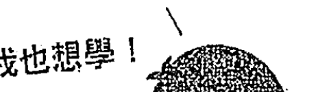

但過程也並非一帆風順，尤其在08年金融風暴時慘賠了近百萬...

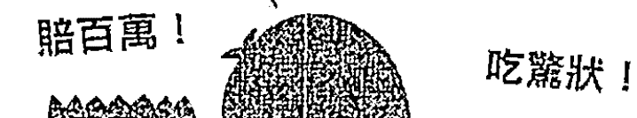

人呢...？我還沒說完呀～我之後有賺更多回來呀～

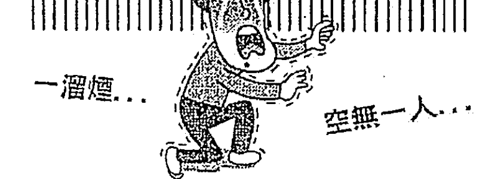

人生的際遇往往超乎自己的想像。若能坐時光機回到 10 年前，然後問我未來的志向，我一定會毫不猶豫的說：「我想要成為平面設計師。」至於投資是什麼？股票又是什麼？當時真的離我非常遙遠，完全想不到現在會靠投資股票資產不斷翻倍，成為一個專職的投資人。

這一切的改變，如果認真探討原因，我想最主要的動力，是一直渴望獲得人生的「自由」，可以選擇做自己喜歡做的事、不用再為錢工作！而若想達到這個目標，就必須要達到財富自由！像我這種沒家世、沒背景、學歷也只有一般的平凡年輕人，生長在台灣這個社會，唯一翻身的機會就只有靠投資了。

當我有這個領悟之後，我就把工作以外的所有時間全部用來研究股票，透過大量閱讀國內外投資書籍，從多位大師身上吸收獨特的投資精華，慢慢建立自己的投資策略，而這也讓我在遇到金融海嘯慘賠後，有能力從灰燼之中重新站起。

像我這樣的投資門外漢，雖然從未上過一堂投資理財的課程、28 歲之前甚至連股票要怎麼買賣都不懂，不過，透過自學和勤作筆記的方式，近 6 年創造成平均年化報酬率達 40%、總獲利超過千萬元的成绩，也達到財富自由的目標。

如果你跟我之前一樣，不過是小資族、小美工；如果你過去投資績效總是賠多賺少、不太理想，或是想投資卻不知道該從哪裡入手，那你翻開這本書就對了，希望我的故事可以帶給你一些投資和獲利上的啟發。

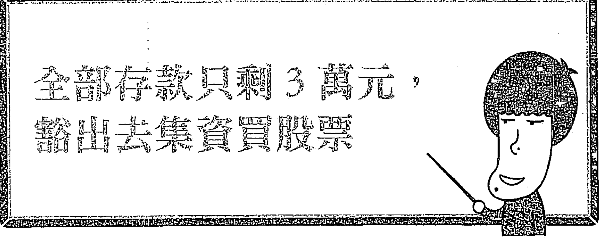

一般人總以為投資是有錢之後才能做的事情，這其實是很嚴重的誤解！因為即使是全球第二大富豪的「股神」巴菲特，一開始投入股市的資本也不過 100 美元而已，雖然當時的 100 美元比現在大很多，但也絕非天文數字，而我第一次投入股票市場時，口袋只拿得出來台幣 3 萬元。

我記得當時是 2006 年，剛退伍不久，對未來充滿想像，但遇到大環境不景氣，求職過程並不是很順利，投了數十封履歷，好不容易才在一家電子公司找到一份美術設計的工作，雖然不是領 22K，但 32K 的薪水扣除日常開銷與家用，能存下來的錢實在不多。加上日復一日做著相同模式的工作，實在與理想中的設計工作相差甚遠！我彷彿可以預見到，自己持續待在這裡 10 年、20 年後，工作熱情消磨殆盡的模樣。

在經過審慎思考之後，我直覺需要改變，但在現實生活的壓力下，也只能持續上班，直到有一天逛書店看到一本書，書名叫做《鄭弘儀教你投資致富》，在好奇心的驅使下，隨手翻到一段話說：「一個人要致富有兩個撇步，一是投資自己，一是投資理財。」而投資理財致富的祕訣就是投資股票，只要把握低點買、買好股票、波段操作的原則，每年投資獲利輕鬆超過 20% 不是難事，加上運用複利就能讓財富越滾越大。我站在書店，心裡有前所未有的感受，「投資」兩個字第一次浮現在腦海中，感覺像有個開關被打開。直覺告訴我，這或許有一搏的機會！

我開始花時間在投資上，一方面研究股票如何買賣，一方面想辦法說服家人出資合夥，畢竟我身上只有3萬元，買1檔股票就超出預算了。因為父母都是一般的受薪階級，從來沒有買賣過股票，所以跟家人談的時候，還是會怕他們覺得靠股票獲利的想法太異想天開，畢竟股市上上下下的，常常聽到某個人因為投資股票而損失慘重的社會新聞。沒想到當我提出集資投資的請求時，他們居然一口就答應，放心把錢交給我這個門外漢，實在是讓我感到相當意外！只能說有時候家人比你自己更信任你，如果當初沒有他們的支持，也可能就不會有後來的成績了。

就這樣，我成功說服家人一起投資，加上我僅有的積蓄3萬元，總共集資20萬開始我的投資生涯。

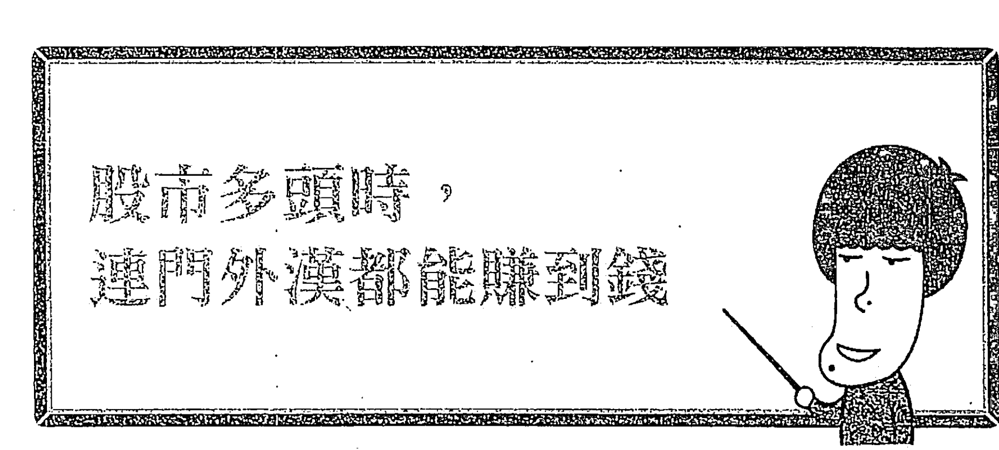

我是在 2006 年年初，台股大盤指數大約在 6500 點附近進場的。雖然只看了幾本入門的財經書，加上很有限的資金，但是不曉得為什麼，對未來充滿了信心，現在想起來，還真覺得不可思議。頗意外的是，我並不像有些人繳了很久的學費之後才體會到獲利的滋味，反而是一開始買股票就體會賺錢的美好。

我記得我當時第 1 檔股票買的是工具機的亞歲 (1530) ，當時全球經濟表現不裕，尤其是中國大陸的經濟以二位數的速度成長，而工具機是工業生產源頭的產業，自然雨露均霑。大部分工具機產業的股票，獲利都較前些年增加不少。

而為什麼眾多工具機股票中，我那時會選擇亞歲？現在回想起來，我自己也不是那麼清楚。當時我一心只想賺價差，如果買進的股票有 20% 以上的漲幅就心滿意足了。況且亞歲的獲利不差，技術線型看起來也不錯，所以我在 51 元附近下單買了 1 張，想不到剛買進隔天就開始漲，接下來幾乎是天天漲，才短短不到 1 個月的時間，股價就上漲了 25% ！讓我喜出望外。

我至今還是記得很清楚，在獲利了結的那個晚上。我泡在浴缸裡，沉醉在股票獲利的喜悅之中，心想之後只要重複低買高賣的模式，在股市賺錢根本是小菜一碟！持續幾年之後不就發達了？我暗自竊喜，認為自已找到致富的神祕通道，殊不知其實運氣占了很大的成份。

其實剛進到股票市場的新手，通常都會有新手的好運（是不是有點像賭場），股票之神（如果有的話）通常會讓你先嚐點甜頭，等到有一天你自得意滿的時候，它就搖身一變成爲偉大的羞辱者，極盡所能地重重羞辱你、打擊你。只是當時我是個初出茅廬的菜鳥，哪懂得這些道理？再加上 2006、2007 兩年是緩步走揚的多頭市場，很自然的會把運氣誤以為是自己的實力。

## 只想賺 20%,
卻錯過 800% 漲幅！

沒多久之後, 我就辭掉美工的工作。雖然我覺得投資致富是一條可行的道路, 但我還不至於天真到以為現階段就能靠投資過活, 畢竟手上的資本有限, 加上我對創作依舊充滿熱情, 既然找不到可以發揮所長的工作, 不如就來自創品牌吧。當時街頭正流行創意市集, 只要你的產品夠屌, 以少少的錢, 不用大量生產, 都可以擺攤販售創作的商品。而因為活動時間主要是在假日, 平日我就能自由的調配工作時間。所以週一到週五, 我的作息就變成早上看股票, 下午做設計工作。

自從買了第 1 檔股票享受到獲利的滋味後, 我的選股信心大增, 陸陸續續買進多檔股票, 絕大部分都是市場熱門股, 包含電子股的法力成 (6239)、矽品 (2325)、超豐 (2441)、京元電 (2449)、欣詮 (3264)、瑞軒 (2489), 原物料股的第一銅 (2009)、允強 (2034)、東鋼 (2006), 太陽能股的合晶 (6182)、嘉晶 (3016), 營建股的華固 (2548)、興富發 (2542)、皇翔 (2545)……等等。

雖然並不是所有股票的操作都很順利, 但在多頭市場下, 獲利並不是太困難。我秉持波段操作的原則, 如果買進的股票有 20% 以上的波段漲幅就獲利出場, 然後另尋新標的。而若買進之後不漲反跌，我也不會急著出脫，而是等到股票漲回原本的價位，才會考慮換股，指數在 2006 年上漲接近 2 成，說真的，想買到下跌的股票還真不容易。

若問我投資初期印象最深刻的股票是哪一檔？我會毫不猶豫的回答：合晶。2006 年油價暴漲，各國政府、企業無不積極找尋替代能源，太陽能股頓時成為市場當紅炸子雞！茂迪 (6244) 股價飆上 985 元天價、益通 (3452) 股價來到 1205 元，是當年的新科股王，跟這幾年被戲稱「四大慘業」真是不可同日而語。

身為股市新鮮人的我，自然忍不住跟著追逐市場最熱門的話題，但看來看去，覺得茂迪跟益通股價都太高，實在下不了手，最後找到一檔跟太陽能材料沾上邊的矽晶圓材料供應商合晶，股價才 30 出頭，準備搭上太陽能股的上涨順風車。

想不到進場後，股價卻一動也不動，整整橫盤整理了 1 個多月，股價一樣還是在 30 元上下跳動，我開始感到不耐煩，看看手上其他的股票都已經表態，唯獨只有合晶不漲，一時間動了想賣的念頭，於是按一按鍵盤，不到 1 分鐘，合晶就從我的投資組合內消失了。

之後故事的發展，我想大家應該都猜得到了！隔天一早開盤就大漲，盤中直奔漲停，而且正好不偏不倚發生在我賣出股票後的第 1 個交易日。但如果只是 1 天的大漲，那也就罷了，那天居然是波段大漲的起點，漲勢整整超過 1 年，還來到歷史最高價 268.5 元，如果從起點漲算起，有近 8 倍的漲幅。

## 加碼搶賺萬點行情，
卻慘賠百萬！

當大家都持有滿手的股票，能買的、想買的全都買了，你還能把股票賣給誰呢？

接下來的 2 年，我用相同的模式操作，賺取波段價差。我會選擇本益比不高的股票，大致了解一下基本面，只要每股盈餘（EPS）比去年成長、市場上傳出利多消息、線型不差，我就會考慮買進，採短線波段操作，平均持股時間 1 到 2 個月，很少超過半年。

而如果買進後股價都沒有反應，就會換股操作。如果以現在的角度來看當時的投資方法，確實有很多地方值得商榷，但正好碰上多頭行情，指數從我進場到 2007 年 10 月，足足漲了超過 3300 點，漲幅高達 51%。在這樣的時空背景下，只要你堅持做多，加上不要犯太離譜的錯誤，我想大部分的投資人都可以賺到錢，這並不代表你是萬中選一的投資高手，其實只是運氣好碰上多頭行情罷了！

不過當時哪裡會明白這個道理？加上手風正順，買什麼漲什麼，帳面獲利數字越來越多。我的直覺告訴我要好好把握這次機會，於是不但繼續把工作所得投入股市，另外還說服家人加碼投資。到 2007 年第 4 季，加權指數來到 9859 的時候，我累積投入股市的資本已經接近百萬元，而帳面獲利超過 60 萬。

到了 2007 年 10 月，那時候我印象很深刻，每個人都在期待萬點行情，整個股市彌漫著一股欣喜若狂的氛圍。財經台時不時會看到影視明星、綜藝主持人暢談買了哪支股票賺錢的訪問、又有多看好台股後勢……加上 2008 年要舉行總統大選，當時的民進黨執政失利，國民黨極可能重新拿回政權，大家對未來充滿希望，放眼望去幾乎找不到利空，整個市場一致看多。

不只是分析師看好，連政府官員都站上一線看多台股，有喊 1 萬 5000 點的、也有喊 1 萬 8000 點的、甚至連 2 萬點都有人喊，可見當時市場有多狂熱，而我也是其中一份子，唉～其實這是很明顯的「撿鞋童理論」，當全市場的人都看多、當大家都持有滿手的股票，能買的、想買的全都買了，你還能把股票賣給誰呢？

我內心篤定台股必上萬點，若到時候沒賺到就虧大了，於是幾乎把所有的資金全部壓在股票上！

結果是萬點還沒站上，就先碰上百年難得一見的金融危機，美國次貸風暴引爆一連串金融機構倒閉潮，蔓延到全世界，而我只能眼睜睜看著指數一路從 9000 點跌到 8000 點、7000 點，然後再下探 5000 點，最後甚至跌破 4000 點，無止盡的一路下殺。

從未遇過這種情況的我，每天一早睜開眼睛，就是面對股價大跌、股票市值一天比一天減少、帳上損失一天比一天慘重，卻不知道該如何處理？本來覺得台股只是漲多拉回，市場很快就會回復平靜，等發現勢態嚴重時，大盤已經跌破 7000 點！這時想賣卻覺得已經跌這麼多了，應該不會再跌了吧？但不賣又看著帳面數字的虧損越來越嚴重，內心實在無比煎熬。

因此我索性不看盤，任憑股市持續探底。一直到 2008 年 11 月，指數來到最低的 3955 點。我記得那一天晚上開車聽著財經節目的廣播，主持人及來賓瀰漫著極度悲觀的言論，整個世界就像窗外的天空一樣，看不到一絲絲光亮。

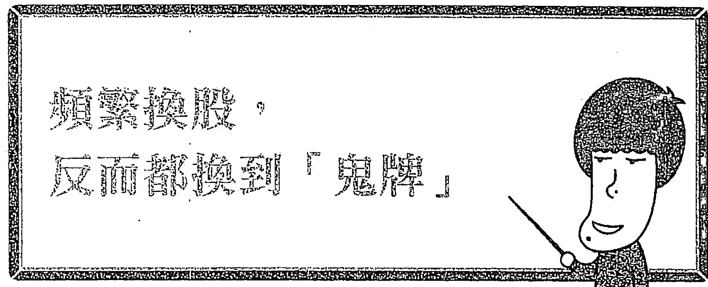

4 年的深度學習帶來獲利改變，有種拿到財富自由入場券的感覺。

之後，等股市慢慢開始反彈後，我才重新回頭檢視持股，最慘的時候，股票市值少了近百萬！可是當市場開始走強的時候，我的股票表現卻遠遠不如大盤。深究原因才發現我當時持有的都是景氣循環股，像允強 (2034)、東鋼 (2006)、奇美電 (3481，後來改名為群創)、四維航 (5608)……等，都是鋼鐵股、航運股、消費電子股。而因為不斷重複換股，結果換到最後都只剩還沒大漲的景氣循環股。這就像撲克牌的抽鬼牌遊戲，抽到最後剩下没人要的那張「鬼牌」。

景氣循環股的特性是股價波動性極大，在景氣好的時候往往有不錯的表现，但若遇到景氣反轉的時候，則跌的比什麼都要來得快，容易大漲也容易大跌。雖然我當時沒能厲害到在 9500 點就把所有的股票出脫，但最起码我没有心灰意冷地把所有股票認賠殺出、然後從此告別股市！而是放著不管它（雖然也不是什麼高明之舉），但至少還保有一線生機，等待翻轉的機會來臨。

在這過程中，我一直在思考，是不是有哪個地方錯了？股市真的能致富嗎？是我運氣不好遇到百年難得一見的金融風暴，還是只是我的方法不對？而我所具備的知識似乎不足以提供我一個滿意的答案，若我還想繼續在股票市場上生存下去，就非得找到一種能夠長久持續獲利的模式，而不是一次空頭行情就讓先前好不容易累積的獲利瞬間化為烏有。

很多人都會把碰上股災當作是運氣不好，但我不這麼想，其實換個角度看，我很慶幸在剛進到市場前幾年就遇到百年難得一見的金融風暴，見識到短短幾個月股票現值蒸發超過五成的滋味。如果晚個幾年，內心只有「在股市賺錢很容易」的想法，結果投入過多的金錢，也不懂得風險控管，後果會更不堪設想。在進入市場短短 2 年就遇到股市崩跌的洗禮，讓我更能體會在市場裡長期獲利實屬不易，更要時時刻刻保持謹慎的態度。

在不可知的未來，市場一定還會接二連三再次出現重挫，波動向來是市場的常態，雖然我不敢說之後遇到股市大幅崩跌時內心不會受到一絲影響，但畢竟我已經有過 2008 年的寶貴經驗，也靠自己的力量在絕望中重生，我相信在股票市場中，經驗是無價的，而能夠有效管理自己的情緒、不因為恐懼而影響了該有的理智、做出錯誤判斷的人，才會是最後的贏家。

總結我從 2006 年集資 20 萬投入股市開始，至 2007 年底加碼 80 萬（工作收入及家人加碼）至 100 萬元，期間陸續獲利約 60 萬，合計為 160 萬，2008 年金融海嘯時一下子虧了將近百萬元，帳面資本只剩下大約 60 幾萬，2009 年股市反彈，年底總結手中資本又累積回到原本的 100 萬左右，等於我花了近 4 年的時間投入股市，投資報酬率卻是 0！前 4 年沒賺也沒賠，純粹學到經驗而已，我明白如果我繼續用一樣方法操作股票，未來的績效肯定也不會好，想要靠投資達成財富自由就真的是一場夢。

就像巴菲特說：「退潮的時候，才知道誰在裸泳。」若只想憑運氣，投資之路是沒有辦法走的長長久久，唯有加強自身的投資能力，才有機會在股票市場成為一個常勝軍。大跌讓我領悟到自己在投資知識上的不足，也開啟了我對學習投資知識的求知慾望。

於是我開始看書找答案，雖然那個時候投資失利，但自創品牌的業績卻蒸蒸日上。在時間不多的情況下，我利用工作的空檔大量閱讀投資相關書籍。以前早上我都會看盤買賣股票，後來我就把看盤的時間省下來，帶一本書到連鎖速食店，點一份早餐，看 2、3 個小時的書。我廣泛蒐集市面上所有找得到的投資大師著作，包括巴菲特、彼得·林區、吉姆·羅傑斯的書，另外我也讀證券分析、投資心理學、經濟學、歷史書、人類學、名人傳記、行為學……等，連商業雜誌、報紙的財經版也不放過！我就是像一塊海綿似地，盡可能吸收所有跟投資相關的知識。

就這樣持續了 3、4 年的時間，我不斷地吸收學習、筆記下所有的投資重點和各家致勝秘笈，而這段時間的充電學習，也為我日後研發出獨創的「成長飆股投資術」奠下基礎，也開啟了投資獲利開始翻倍飆漲的契機。我當時雖然還沒有賺到半毛錢，但卻有一種拿到財富自由入場券的感覺。

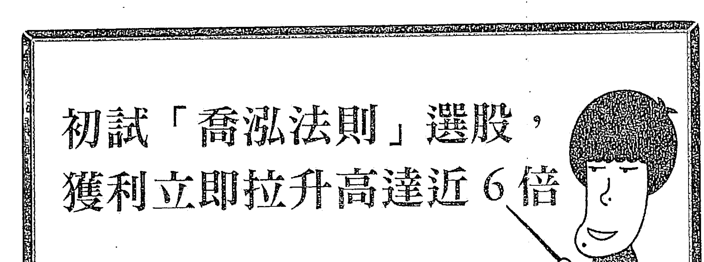

不要預設股價上漲空間，當一檔股票的獲利持續創高時，千萬別輕易賣股。

雖然花了整整 4 年的時間，沒能從市場中賺取半毛錢，但往好處想，也從中累積不少的投資經驗，加上透過閱讀國外大師的著作，發現絕大部分獲取高額報酬的原因，是因為他們都投資成長股！威廉・歐尼爾在《笑傲股市》中列出 100 檔美國史上最強飆股，這些長期大漲的股票都有一個共同的條件，就是公司的長期獲利成長性極佳。絕大部分能夠不斷上漲的股票，最主要的因素都是獲利表現一年比一年優異，當然也有少數公司沒有獲利，股價卻持續高漲，這就是所謂的本益比行情，不過這些股票不是我鎖定的投資標的。

於是我明白，若我想要長期打敗大盤、獲取高於市場的平均報酬率，在沒有融資融券、不投資高風險的衍生性金融商品的前提下，投資具成長潛力的個股，會是最適合一般投資人的首選。

只是通常具備高成長的股票，本益比向來不低，因此要在股價合理的範圍買進投資，有其難度。所以我試著利用找出業績成長率的共通條件，運用一些選股指標系統化的篩選。

當時是 2009 年第 4 季，金融風暴的陰影逐漸淡化，指數從底部反彈至 7500 點附近，我順勢把手上一些跌深反彈的股票通通出清，並用部分資金買進統一超 (2912)，最主要的原因是看中統一超的長期成長性。

若是以前，統一超這種類型的股票我是不會買的，獲利雖然穩定但沒什麼火花，股價也盤整一年多，股價都在 75 元上下游走，以預估 2009 年稅後盈餘 3.8~4.0 元來計算，本益比不算低。但我看中的是 7-11 在台灣龍頭地位，加上持續積極展店及改裝大型店舖，並積極進軍海外市場，如果能順利複製台灣的營運模式，長期成長動能無慮。

買進後，股價盤整打底了 5 個月，在 2010 年 4 月開始表態上攻，到了 9 月，統一超的股價站上 120 元以上的關卡，我在 12 月以股價 132 元左右出清持股，原因是覺得股價過高，總計統一超盤整持股 1 年時間含配息獲利將近 8 成。雖然從事後來看，我過早出清統一超的持股（2015 年統一超股價波段高點 259 元），難免覺得可惜，但我也因此學習到不要預設股價上漲空間，當一股股票的獲利持續創高時，千萬別輕易賣股。

有了投資統一超的經驗後，使我的投資信心大增，如果用之前的方法來操作，我最多賺 3 成，而現在有機會賺超過 5 成、甚至 1 倍以上，更加深確定我今後以成長股為投資主軸的決定是對的。

後來我更研發出一整套、2 個招式步驟來挑選成長強勢股的計算法，試圖找尋一些具關鍵意義的指標，以本益成長比公式、股東權益報酬率、營業毛利率……等，我稱之為「10 個選股核心法則」和「進場前的 6 個篩選條件」，組成一套完整的「成長飆股投資術」，並運用這個策略陸續在 2010 年買進佳格 (1227)、 2011 年買進美利達 (9914)、2012 年買進儒鴻 (1476)、寶雅 (5904)、2013 年買進葡萄王 (1707)、2014 年買進鼎翰 (3611) 及豐泰 (9910)……等，創造超過 5 成至倍數的獲利，並且在儒鴻一役創造超過 560% 的投資報酬率！至於這是怎麼辦到的，就請你繼續看下去。

# Ch 02 我的投資勤學筆記：10 位投資大師教我的賺錢心法

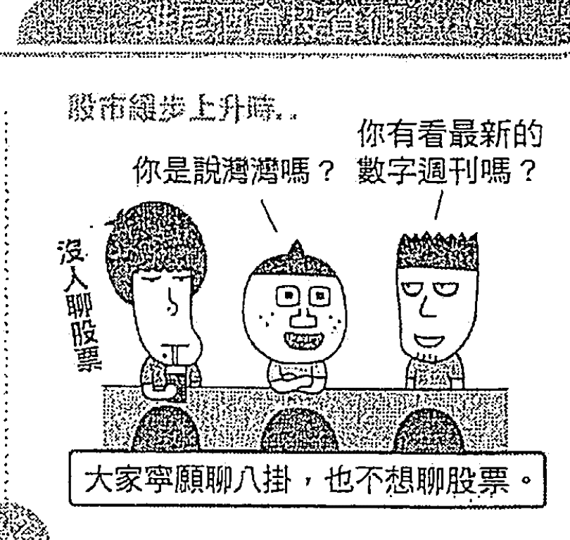

朋友A會跟我說股票很危險，然後轉身跟其它人聊NBA。

大家寧願聊八卦，也不想聊股票。

大部分的朋友手上都有一、二檔股票，討論話題離不開股票。

大家都圍著我，場面熱絡，告訴我 不應該錯過那一檔股票。

在股票市場中，賺錢的方法有百百種，有些人喜歡價值型投資，有些人擅長研究技術面，有人只追逐強勢股，也有人只買跌深股，有人喜歡存股法，也有人熱愛短線進出……每一種方法都有各自的擁護者，也都有高手可以創造驚人的獲利。

我的投資風格則是聚焦中小型成長股，主要著重在基本面選股。但其實我剛開始投資的時候，也毫無風格可言，說是基本面選股，其實對公司財報根本不是一知半解，技術面更不用說了，充其量只懂一些皮毛而已。而且我持股的時間通常都不長，波段若有 20% 獲利時就會考慮賣出，跟許多散戶一樣，主要是配合技術線型找出適當的進出點，吸引人的地方是不需要花費什麼時間來練基本功，只要學會看線型就可以買賣；缺點是如果眼光不夠精準，長期累積下來的交易費用會吃掉大部分的利潤。

投資說穿了，其實就是用一個好觀念取代一個壞觀念。每個人的投資邏輯都是由好幾個觀念組合而成的，當身上錯誤的觀念越多，長期來看，在市場上成為贏家的機會就越少。就如同身體裡的好菌越多，壞菌就會越少，自然就會越來越健康的道理是一樣的。

我從 2008 年金融風暴大挫敗之後，透過大量的閱讀，學習大師們的投資哲學，才發現我原本的投資方法是如此不堪一擊！因此開始慢慢吸收正確的投資觀念，取代原先錯誤的投資觀念。我在這些大師們身上學習到很多不同的投資思維，有些觀點甚至是我之前從來沒想過的，但我尽可能的吸收能夠理解的一切知識，留下適合我的投資方法，再進一步重組，逐步成為我獨有的投資方式！這過程就像拼圖一樣，一塊一塊地拼湊出屬於自己的投資風格。沒有任何一位投資人會跟其它人的投資模式完全一樣，而擁有自己的觀點，對於投資能否成功來說，顯得格外重要。

所以，我將在這個篇章介紹影響我最深遠的 10 位投資界大師，他們讓我重新看待投資這門學問，形塑出我的投資風格。雖然這 10 位大師不一定全部都聚焦在成長型股票投資，但是他們的投資哲學點出了投資的不同面向，讓我有機會能夠從金融風暴的谷底中重新出發，並從 2010 年至 2015 讓自己的投資組合資產翻了 6 倍！（同時期加權股價指數累積只上漲 1.8%）

## 1 吉姆·史萊特
→運用本益成長比找出被低估的股票

> 「大象不會疾奔，雷射光束強過散彈槍，聚焦小型成長股，並運用本益成長比公式，算出合理股票買賣點。」

吉姆·史萊特（Jim Slater）是英國著名的投資大師，1964 年創立史萊特·渥克證券，擔任董事長，以併購方式快速成為股市呼風喚雨的金融集團，但在 1978 年因金融風暴及融資過度破產，從一個億萬富翁變成「負百萬富翁」，背負 90 萬英鎊的債務。致使他離開市場長達 17 年之久。直到 1992 年撰寫《祖魯法則》復出江湖。並運用《祖魯法則》提出的本益成長比重新翻身，在 1997 年賺得比破產前更高的財富！

有機會知道吉姆·史萊特，是看了台灣投資界赫赫有名的呂振團隊－呂宗耀及張獻祥合著的《投資者的修練》的介紹，才有機會進一步研讀。而我從《祖魯法則》中學習到一幅股票合理本益比的計算方式，也就是「本益成長比」這個概念。我認為談到成長股的買賣時機點及合理的本益比計算方式，沒有一本書寫的比《祖魯法則》更清楚，他的投資方法特別適合一開始資金不多的散戶投資人。

### 聚焦小型成長股，核心投資法

「大象不會疾奔，雷射光束強過散彈槍，聚焦小型成長股，並運用本益成長比公式，算出合理股票買賣點。」史萊特這幾句話道出《祖魯法則》聚焦小型成長股的核心投資法。因為大多數的法人機構都把目光集中在中大型龍頭股、資產股身上，加上持有的資金部位龐大等等因素，沒有多少人會花心力研究小型股，因此更有機會揀到有價值的便宜貨。

此外，根據史萊特的統計資料顯示，過去50年來小型股的表現遠勝大盤足足有8倍以上！因此他建議應該選擇市值介於3000萬到2.5億英鎊（約新台幣12億至100億）的公司投資，而且只選擇少數表現優異的企業，不要持有一籃子的股票。

很多人為了分散風險而持有一堆股票，但資金分散到2、30檔自己並非很了解的公司上，未必有分散風險的效果，在他另一本著作《超越祖魯法則》也提到，資金只有5萬英鎊（約新台幣200萬）的散戶，持有的股票檔數在10到12檔左右比較恰當，但不是要將資金平均分配在12檔股票，而是越看好的股票投入的資金比重應該越高。

至於該如何計算合理的進場價格，史萊特提出「本益成長比」概念，這是《祖魯法則》最核心的觀念，也是另一位投資大師彼得．林區推崇的方法。

本益成長比＝本益比÷預計每股盈餘成長率

本益比＝股價÷每股稅後盈餘

本益成長比主要是用來計算公司的合理股價。分子的本益比代表的是公司每賺1元，你願意付出的成本，這可以顯現出你對這家公司未來成長性的看法，如果一家公司的每股稅後盈餘為 1 元，股價為 10 元，本益比就是 10 倍，表示當公司賺 1 元時，你願意用 10 元來買這家公司的股票；如果公司的每股盈餘沒變，股價為 20 元，本益比則為 20 倍，而股價為 50 元時，本益比則為 50 倍。在正常情況下，本益比是越低越好，因為這代表你付出的成本比較低。

另外，本益比經常可以直接跟預估成長率相比，年成長率 15%的公司當然應該得到 15 倍的本益比；年成長率 20%的公司應該有 20 倍的本益比；因此，把成長率除以本益比所得出的本益成長比如果遠低於 1，表示股價遭到低估，就是可以考慮買進的標的。

買進預估每股盈餘成長率高於本益比的公司，你要找的是年複合成長率要超過 15%，預估本益成長比不超過 0.75，最好低於 0.66 的公司。假設有一家公司的本益比為 10 倍，預計年複合成長率超過 20%，那本益成長比就是 0.5，低於 0.66，所以就值得買進。重點在於與盈餘成長率相比，本益比要有吸引力。

### 12 項選股條件，找出便宜飆股

從本益成長比公式出發，史萊特列出幾個選股的條件：

- 1. 預估本益成長比不高於 0.75，低於 0.66 更好。
- 2. 每股盈餘連續 5 年成長。
- 3. 和成長率相比本益比不高。
- 4. 公司董事長的說法樂觀。
- 5. 流動性強勁、現金流量高、負債低。
- 6. 公司有競爭優勢。
- 7. 有轉機或有題材。
- 8. 市值低 2.5 億英鎊（約 100 億新台幣）。
- 9. 與大盤相比相對強勢。
- 10. 股利率超過 3%。
- 11. 淨資產達總市值的 1/3 以上。
- 12. 經營階層持股比重高。

第 1 個條件的重點是本益比相對於成長率要很有吸引力。以預估本益成長比不應高於預計未來成長率的 3/4，最好應該低於 2/3 的條件來看，這種股票不多見，但這才是最有機會產生股價爆發力的股票。

而第 2 個條件顯示出未來公司的成長性，可以以此判斷公司是否處在比較有利的位置，但他指出不必絕對拘泥連續 5 年這個條件，如果發現有公司在未來明顯出現盈餘成長率急劇升高的機會，其中有 1、2 年盈餘成長率中斷也可以接受，而且這種股票反而是最有投資價值的便宜貨。

至於第 3 個條件可以確保用很有吸引力的價位買進股票，因為如果之後盈餘成長率表現不如預期，股價修正帶來的投資衝擊相對較小。

董事長的年度報告和不同時間的談話，語調都必須樂觀，否則將來的成長就值得商榷。流動性強而有力、負債低、現金流量高的標準是史萊特覺得是至關重要且不容妥協的條件，尤其是公司經歷經濟衰退期間，高槓桿的公司所面臨的風險相對大許多，因此這個規定為強制性的標準，其餘的條件也都應該列為選股標準來評估。

我覺得聚焦小型成長股的投資策略是相當適合散戶的投資方法，一來靈活度與報酬率都比存股派略勝一籌，所需的資金也不用那麼大，而風險又比投資權證、期貨，或單純技術分析投資來得小。只要確實以《祖魯法則》提到的本益成長比公式進出股票，風險可以得到控制，獲利有機會極大化。當然，從吉姆·史萊特的人生經歷來看，就算因為投資破產，背負高額負債，只要有紀律的投資、不融資買股票、不過度借貸，把握住機會，仍然有辦法東山再起。

### 史萊特給我的啟示

- 1. 用本益成長比公式計算公司的合理股價，學會判斷一檔股票正確的進出時機點。淨利年成長率 10% 的公司，合理本益比為 10 倍，以此類推。買進本益成長比低於 0.75 的公司，低於 0.66 更好，在高於 1.2 時考慮賣出。
- 2. 資金少的投資人，應該把目光集中在成長股，根據過往資料顯示：小型股的報酬率遠勝過大型股。在不使用融資、不投資衍生性金融商品的情況下，投資成長股是在有限的風險控制中，尋求最大的投資報酬率。
- 3. 集中持股，聚焦少數表現優異的企業，能夠讓有限的資金發揮最大的效能！史萊特建議資金約 200 萬的投資人，持有約 10 到 12 檔左右比較恰當，而我會建議不要超過 10 檔，理想狀況是 5 至 8 檔。如此一來，只要抓到 1、2 檔大漲的股票，即使其它股票都沒漲或小跌，整體報酬率也會在水準之上。不要為了無謂的分散風險，而持有一籃子的股票，那只会使報酬率變得很平庸。

## 2 查理·蒙格
→投資股價合理的卓越企業

> 「你必須弄清楚自己有什麼本領。如果要玩那些別人很擅長、自己卻一竅不通的遊戲，那麼，你注定一敗塗地。」

查理·蒙格是波克夏·海瑟威公司副董事長，另一個有名的角色則是股神巴菲特的左右手。蒙格於 1948 年取得哈佛法學博士後，自營事務所，擔任房地產律師。並在 1965 年放棄法律的專職，專心致力於管理投資事業。兩人在 1959 年相識以來，即成為親密的朋友和投資夥伴，並共同創造波克夏的投資傳奇。

一開始接觸到查理·蒙格，是在書店翻到《窮查理的普通常識》這本書。那時是 2011 年，美國金融風暴前腳剛走，景氣復甦才帶動股市 V 型反彈沒多久。相較於衆多投資書直說能有多快速賺錢，這本書不但自曝其短說自己窮，還說裡面沒有什麼了不起的知識，只有普通常識，這讓我好奇地馬上拿起來翻閱，結果成為我最愛的投資書之一。

### 瞄準甜美好股，用力揮棒

《窮查理的普通常識》不同於一般的投資書，不談技術分析，也沒有投資實戰教學，而是收錄蒙格的演講稿、談話與名言，蒙格認為，比起投資策略，生活中的普世智慧更為重要。

他拿大聯盟選手泰德·威廉來舉例，威廉是大聯盟過去 70 年來唯一在一個賽季打出四成打擊率的棒球選手。他的技巧就是把打擊區劃分為 77 個棒球大小的格子，只有當球落在最佳格子時才會揮棒。

同樣的道理，股票投資人可以把公司表現看成一個一個格子。大部分的時候，什麼也不用做，只要看就好。每隔一段時間，就會出現一個速度很慢、路線又直，而且又落在紅中的甜美好球，那麼就全力揮棒，如此一來就會有很好的投資績效。而一般投資人共同的問題就是揮棒太過頻繁，導致當出現一記好球時，卻無法全力出擊，長期投資績效自然會很糟糕。

從棒球的打擊哲學出發，蒙格發展出他的選股理論：

- 1. 容易理解、有發展空間、能在任何市場環境下生存的主流行業。
- 2. 產品、市場、商標、員工、社會趨勢等指標都呈現出企業擁有競爭優勢及可持續獲利的能力。
- 3. 企業的真正價值比目前的市場價值高。

第一個條件就是蒙格著名的「能力圈」理論，他認為應該要把投資領域侷限在簡單而可以理解的產業中，蒙格認為：「關於投資，我們有三個選項：可以投資、不能投資、太難理解。」而容易理解、有發展空間、能在任何市場環境下生存的主流行業就是「可以投資」的公司。不難想像，能通過第一道關卡的公司並不多。

至於目前很熱門的生技股就會直接被歸為「太難理解」而不可投資。他說：「你必須弄清楚自己有什麼本領。如果要玩那些別人很擅長、自己卻一竅不通的遊戲，那麼，你注定會一敗塗地。要認清自己的優勢，只在能力圈裡競爭。「如果你確實有能力，就會非常清楚自己能力圈的邊界在哪裡；如果有一點疑問，就表示已經在能力圈外了。

### 學習等待，出現合理股價才投資

找出投資的能力範圍後，接下來就要評估企業的競爭優勢與持續獲利的能力，這包括企業內部以及外部因素，像是產品、市場、商標、員工、社會趨勢等指標都是參考的重點。

蒙格特別重視持續穩定獲利的能力！他認為一個企業的競爭優勢就是企業的「護城河」，這是保護企業不被入侵的無形壕溝，越優秀的公司，護城河越深。這些護城河不斷加寬，為公司提供長久的保護，例如波克夏長期持有的可口可樂、吉列等等，就是屬於護城河極深，能夠歷經數代而不衰的企業。

最後一個條件，蒙格會計算整個企業的真正價值，並考量在未來股權稀釋等等的情況下，比較是否低於目前的市場價格，對此，他提出著名的「3 大」投資原則：

- 1. 股價合理的卓越企業，勝過股價便宜的平庸企業。
- 2. 股價合理的卓越企業，勝過股價便宜的平庸企業。
- 3. 股價合理的卓越企業，勝過股價便宜的平庸企業。

看起來 3 大原則其實只有 1 大原則，但這個原則重要到要強調 3 次！因為只投資股價合理的卓越企業，所以投資人要集中投資，這意味著投資的標的只有 10 家，而不是 100 家或 400 家！總結來說，蒙格只投資自身能理解的公司，並學會等待不輕易出手，一旦發現一流的企業出現合理或便宜的價位，要把握住機會，集中持股下大注，並且持股長抱，長期累積下來必獲取比絕大多數投資機構更優異的投資績效。

《窮查理普通常識》裡有一句經典謠語是這麼說的：「手裡拿鐵鎚的人眼中，世界就像是一根釘子。」這個意思是人往往會站在自身的角度看事情，大多數人試圖以一種思維模式來解決所有問題，而這個思維往往只來自某個專業學科。雖然最好的、最實用的智慧，往往來自於基礎的學術知識，但有一個極重要的前提：必須以跨領域的方式來思考，才能洞察問題本質。而想要跨領域思考，廣泛涉獵各種知識就很重要。蒙格曾說：「我這輩子遇到的聰明人（來自各行各業的聰明人）沒有不每天閱讀的，沒有，一個都沒有。巴菲特讀書之多，我讀書之多，可能會讓你感到吃驚。我們的孩子都笑我，他們覺得我是一本長了兩條腿的書。」

對我來說，我覺得蒙格不單只是偉大的投資者，更是一位偉大的智者，他把投資從一般認知一口氣拉升了好幾個層級；把原本只是單純的金錢遊戲，提升為富含哲理的一門藝術，並運用他的智慧把複雜艱深的知識轉化成簡單易懂的常識。每當我無法判斷是否該投資一檔股票的時候，我就會想起書裡的内容，想想如果是蒙格碰到同樣的情況，他會怎麼做？通常答案就能迎刀而解。

- 1. 投資最重要的事情，就是先認清楚自己的能力，界定自身的「能力圈」範圍，只投資自己能理解的事物，如果要玩別人很擅長、自己卻一竅不通的遊戲，那注定會一敗塗地。
- 2. 想成為優秀的投資人，就不該頻繁進出股市，必須學會等待。就像一個優秀的打擊者，只有當球落在絕佳的位置才全力揮棒。而一般投資人的共同問題就是揮棒太過頻繁，導致當正中直球出現時，反而無法全力出擊，長期累積下來的績效自然不如人意。
- 3. 想在股票市場成為長期贏家，沒有什麼比閱讀更重要。市場充滿各式各樣的變數，新經濟、新產品也不斷推陳出新，唯有透過持續閱讀充實自己、保持開放的思想，才能有機會在投資市場成為一個常勝軍。

## 3 約翰·坦伯頓
### 在全球尋找被低估的便宜好股

> 「行情總在絕望中誕生，在半信半疑中成長，在憧憬中成熟，在充滿希望中毀滅。」

約翰·坦伯頓是坦伯頓集團創辦人，1937 年就進入華爾街工作，投資資歷超過 70 年。坦伯頓創建全球最大、且最成功的坦伯頓共同基金集團，到 1992 年和富蘭克林基金集團合併為止，光是坦伯頓的全球成長基金就累積獲利高達近 200 倍。被《錢雜誌》譽為「20 世紀全球最偉大的股票與基金投資人」。

坦伯頓 1912 年出生於美國田納西州南部農業小鎮溫徹斯特（Winchester），4 歲時就知道自行種豆，拿去鄉間小商行賣豆賺取價差；8 歲就會在國慶日前一個月預購煙火玩具，賣給同學賺零用錢；11 歲時就立志要做有錢人；大學就讀耶魯大學經濟系時，對股市有濃厚的興趣，因此立志要成為一位能賺大錢的投資顧問；畢業一年後進入華爾街工作，開啟他超過 70 年的投資生涯。

### 便宜貨投資哲學，賺取超額利潤

坦伯頓有個有名的稱號，叫「便宜股獵人」，這來自他的價值型投資法哲學，只選擇價值被低估的便宜貨，賺取超額利潤。

1939年，第二次世界大戰爆發，全球情勢緊張，市場一片悲觀，當時在曼哈頓洛克菲勒中心辦公室裡的坦伯頓，聽到德國入侵波蘭的消息，於是他向老闆借了1萬美元，大舉買進他認為價值被低估的股票104檔，這之中有34家公司甚至面臨破產，後來證明他的研判精準，4年後，本來的1萬美元變成4萬美元，投資報酬率超過3倍。雖然在當時看來，坦伯頓的操作手法感覺像在冒險，實際上他在之前就對準備買進的公司做了完整的研究。經此一役，坦伯頓的名號迅速傳遍華爾街，也成為日後開設投資公司專業的定心丸。

坦伯頓另一個重要的投資觀念則是全球化布局。坦伯頓說：「如果你要找最好的便宜股，你不會只在加拿大找，這似乎是人盡皆知的常識。只在加拿大找，是可以找到一些，或者，如果只在美國找，也可以找到一些，但為什麼不每個地方都找呢？40年來，我們一直這麼做，我們在全世界的任何地方找。」

坦伯頓自己就有一個例子，有次他去日本旅行，看到日本急速朝向工業化的驚人發展，那段期間美國的股票本益比約為19.5倍，日本股市的本益比卻只有4倍，但日本經濟的平均成長率是10%，美國經濟則平均約4%。換句話說，日本經濟擴張的速度是美國經濟的2.5倍，但本益比換算起來股價卻只有美國約1/5。所以一回美國，坦伯頓就先以自有資金投入市場，直到1960年，日本市場外國人管制取消後，坦伯頓成長基金才正式投入。直到1980年代末期，日本股市大漲，本益比來到了30倍以上，坦伯頓成長基金才開始出清日股。到了1988年，他預言日股將腰斬，沒想到幾年內就跌了60%，坦伯頓不只在投資日股中大獲全勝，還能精準研判日股進出時點，讓人嘖嘖稱奇。

### 8 大投資金律，成為市場贏家

約翰·坦伯頓可說是全球最具智慧的投資大師之一，雖然已於 2008 年以高齡 96 歲時辭世，但他留下的投資哲學及人生智慧，仍讓許多投資人欽佩與學習。透過他著名的 8 大投資金律，可以一窺價值投資法的操作關鍵：

- 1. 趁別人垂頭喪氣時買進，趁別人貪得無厭時賣出。
- 2. 用 20 分錢就能買到 1 塊錢的東西，才是不錯的便宜貨。
- 3. 不犯錯的唯一方式就是不投資，但這是最大的錯誤。
- 4. 每樣東西都要用現金購買。
- 5. 最貴的四個字是「這次不同」。
- 6. 買公司的價值，而非買市場趨勢，也不是買總體經濟前景。
- 7. 未來無法預測，不管你多謹慎或做多少研究。
- 8. 在恐慌時買進股票並抱牢 5 年，獲利可期。

「多頭市場因為悲觀情緒而誕生，因為疑慮交加而成長，因為樂觀情緒而成熟，因為亢奮狂喜而死亡。極度悲觀瀰漫時，正是買進的最好良機，而極度樂觀洋溢時，正是賣出的最好良機。」

這句坦伯頓的名言是華爾街的經典語錄，充分展現出坦伯頓的投資策略。如果你能在 2008 年美國金融風暴發生後，大家在沮喪賣股的時候，反手買股票並長抱幾年，如投資金律第 8 點所說的，獲利至少倍數計算，只可惜人們往往會因極度恐懼而不敢出手買進，反而是反向把手中的持股全數殺低，最終成為輸家。贏家與輸家的關鍵，實際上就在於有沒有領悟坦伯頓的 8 大投資金律。

另外，坦伯頓的全球化佈局概念也提醒我們，不要只著眼在台股投資上。台北股市的上市櫃股票全部約 1500 檔，台灣的 GDP（國內生產毛額）約 4700 億美元，佔全球 GDP 的比重不到 1%。因此該把視野擺在全世界，鎖定有全球競爭力的公司，像是全球晶圓代工龍頭台積電 (2330)、光學鏡頭廠股王大立光 (3008)、世界自行車大廠巨大 (921) 等。而當台股加權指數來到 9000 點以上時，想尋找具全球競爭力且本益比不高的公司相對難度提高許多，這時就可以從美股、港股或陸股等其他市場尋找投資標的，畢竟池子變大了，釣到大魚的機會也就自然提升。

在我心目中坦伯頓不僅是一位投資大師，更是投資人的精神導師。透過坦伯頓的投資法則，我們知道趁別人垂頭喪氣賣出時買進、趁別人貪得無厭大買時賣出，這需要極堅強的意志，最後才有機會獲得極大的報酬，如果能在大家都不敢買，股價在低檔的時候，用便宜的價格買進具全球競爭力的企業，你的投資就成功了一半。

### 坦伯頓給我的 3 個啟示

- 1. 身為價值投資人，目標就是要尋找訂錯價格的商品。找到有 1 元價值的公司，卻可以用 0.5 元買到。只要能買進公司價值高於市值的股票，等待市值高於價值的時機賣出。在持有的過程中，別去管市場趨勢，也别理會總體經濟，只要能做到這一點，就能成為市場的長期贏家。
- 2. 投資目光要放眼全球，台灣只佔全世界 GDP 不到 1%。因此投資要佈局全世界。假使初期因為資金有限，無法佈局全球，也應該把焦點放在台灣上市櫃裡具備世界競爭力的企業。
- 3. 在大家害怕恐懼而賣出時買進，然後趁大家瘋狂搶進時賣出，只要能做到這一點，投資已經成功了一半。

## 4 吉姆·羅傑斯
### 放眼世界，找出趨勢大膽下注

> 「成功投資者的方法，通常是什麼也不做，直到看到錢放在那裡，才走過去把錢撿起來。」

吉姆·羅傑斯是傳奇避險基金「量子基金」的共同創辦人，天生就有創業精神，5歲就在棒球場上兜售汽水和烤花生。英國牛津大學畢業後，開始在華爾街工作。1970年與金融巨鱷索羅斯共同創立量子基金，10年獲利高達40倍以上，在37歲時就賺到足夠一生花用的財富。

之後，羅傑斯離開量子基金，並實現環遊世界的夢想。第一次是1990年花了1年10個月，騎著摩托車環遊超過50個國家，總行程1萬4700公里；第二次則是在1999年，駕駛改裝吉普車，以3年的時間環遊116個國家，並打破金氏世界紀錄。

在遊歷的時候，羅傑斯也沒忘記尋找投資機會，他發現中國將是21世紀的新強權，不過他不只是砸錢投資中國，還決定近距離觀察中國的發展，因此羅傑斯與妻女移居新加坡。

### 洞悉經濟、政治、社會因素的影響

羅傑斯不像很多投資大師，從尋找具爆發潛力的股票出發，他感興趣的並不是某個企業的下一季獲利是否亮眼，他從趨勢著眼，從經濟、政治、社會因素來看某個產業或某檔股票在未來是否有機會出現大幅轉變。他說，當預測的商品和價格之間存在的差距越大，潛在的獲利就相對越多。基於這樣的觀點，羅傑斯多次憑著敏銳的觀察力，創造極優異的報酬。

例如在 1973 年中東戰爭爆發時，羅傑斯深入研究戰爭的原因，他發現中東國家的電子裝備非常強大，而這些裝備大多是蘇聯提供，而另一方面以色列的裝備大多則來自美國政府，因此追根究柢，這場戰爭實際上是兩大軍事強國在相互較勁，美國為了不輸給蘇聯，肯定會提高國防預算，這讓製造先進國防技術的公司有接到大單的機會。

於是羅傑斯發掘到 2 檔有潛力的公司，一家是製造飛機和設計導彈的「洛克希德」，另外一家為美國著名的軍火生產商「E系統」。在美蘇冷戰期間，這些軍火商因為沒有國防部的訂單，股價縮水到只剩 2 美元及 0.5 美元。羅傑斯發現機不可失，於是大買這兩家公司的股票，持股沒多久，股價就從谷底掙扎向上狂飆，分別漲到 120 美元及 45 美元，獲利高達數十倍。

### 透過旅行尋找投資標的

另外，羅傑斯也因為對旅行的熱愛，透過兩次世界旅行找尋投資標的。他說過：「要在全球情勢中獲利最好的方法，是一哩、一哩的看世界。」所以他到中國實地考查，親身了解中國長期經濟成長的爆發力，不只將大筆的資金押寶大陸股市，更身體力行舉家移居新加坡，讓兩個女兒從小開始學習中文。

從羅傑斯提出的 12 個智慧箴言，更能體會他的投資哲學：

- 1. 不要讓別人影響你。
- 2. 專注於你所愛。
- 3. 普通常識並不是那麼普通。
- 4. 將世界納入你的眼界。
- 5. 研讀哲學，學會思考。
- 6. 學習歷史。
- 7. 這是中國的世紀，去學中文。
- 8. 認識真正的自己。
- 9. 認出改變，擁抱改變。
- 10. 面對未來。
- 11. 反眾道而行。
- 12. 幸運女神只眷顧持續努力的人。

簡而言之，就是放眼世界，腳踏實地的去探索，藉由獨立的思考判斷，找出趨勢以後大膽下注。

而我也試著從吉姆·羅傑斯著眼「趨勢」的思考方式，找出台股具潛力投資標的，例如，看到老年化社會的來臨，發掘出受益的保健食品大廠佳格(1227)、葡萄王(1707)；嗅到運動風氣日益盛行，進而注意到高階自行車大廠美利達(9914)、運動機能成大廠儒鴻(1476)，運動鞋代工大廠豐泰(9910)等，都是利用「趨勢」而獲取豐厚獲利的例子。

通常一個趨勢的形成，短則數年，長則數十年，投資要成功，往往就是順勢而為，而非逆勢而行，當大家不再用光碟存取資料，租片也不再上百視達，而是透過雲端儲存及上網看電影，首當其衝的就是銥德(2349)、中環(2323)等製造光碟片的廠商，像銥德股票從最輝煌時一張350元跌到最低3元不到，走著長達10年以上的長空趨勢，期間只要想攤平或搶反彈，都會碰的一鼻子灰。

其他例子像是過去大家很推崇的定存股中鋼（2002），受大陸的鋼鐵產能過剩的影響，股票出現長空走勢，連跌6、7年，即使2015年指數重回萬點大關，中鋼股票卻只有金融海嘯前的高點54元的一半不到。

此外，我也從羅傑斯環遊世界、投資世界的精神中，趁短期的旅行、閱讀及看電影來找出趨勢商機。我會在出國時，會刻意去逛當地的超市，或是在飯店看電視廣告，藉此了解當地正流行的商品，像統一（1216）就是我在大陸逛超市所得到的靈感，雖然台股中標榜中概股的企業很多，但真正能在大陸立足且賺到錢的公司卻不多，我在昆山超市裡看到滿滿統一泡麵及飲料的貨架，促使我回台灣後進一步研究統一並買進股票，創造不錯的獲利。

### 羅傑斯給我的啟示

- 1. 投資最重要的就是觀察出一個長期趨勢，並從中找出對應的商品。一個趨勢的形成短期數年，長則數十年，投資要成功就必須順勢而為，非逆勢而行。忽略短期的財報是否亮眼，也別太在意市場的短期波動。
- 2. 旅行是找尋投資靈感最好的辦法，雖然我們無法像羅傑斯一樣環遊世界，但可以透過旅行、閱讀培養投資的底蘊，加深思考的廣度。
- 3. 中國未來的長期發展仍舊看好，想要有好的投資績效，不能不思考中國，找出13億市場所產生的巨大商機。

## 5 彼得·林區
### 跑一趟購物中心，找出值得投資的明星股

> 「從生活、逛街、購物中發掘十壘安打的股票。」

彼得·林區是美國投資史上十分傳奇的人基金經理人，1977年至1990年掌管麥哲倫基金13年間，資產規模從1800萬美元飆升到140億美元，平均以每年成長75%的驚人速度，成為當時全球最大的股票基金。而其實間的投資績效更是令人咋舌，平均年報酬率接近3成，13年總報酬率達2800%！被《紐約時報》譽為「20世紀十大頂尖投資大師」。

林區出生於美國東部麻省紐頓市（Newton），父親是波士頓學院的知名數學教授，在林區10歲時因為生病死於癌症，因為不忍母親辛勞，10歲的林區開始當起送報生、11歲當桿弟，拜在高爾夫球俱樂部工作所賜，讓他從小就有機會接觸到有一錢人客戶、18歲時獲得專門提供桿弟的獎學金，順利進入波士頓學院就讀，半工半讀完成碩士學位。

高爾夫球俱樂部裡主要都是上流富裕人士，而林區服務的其中一位客戶喬治·蘇利文先生，正是當時富達基金公司的總裁。在幫蘇利文先生捎了多年球袋之後，林區在大四那年的暑假進入富達基金公司實習，開始拜訪公司，研究分析股票，更開啟了他日後成為頂尖投資大師的基石。

### 10 倍獲利的股票就在身邊

彼得·林區與其於其他投資大師最與眾不同的地方，在於總是從生活周遭發掘出值得投資的明星，可說是生活投資家。只要想要找投資靈感，林區二話不說就會開車前往離住家約 25 哩的柏林頓購物中心。購物中心裡有食衣住行娛樂各產業的商品，是眾多上市公司競爭廝殺的地方，林區認為，與其花大量的心思看券商法人的報告，或者上網搜尋公司新聞訊息，還不如親自跑一趟購物中心，花時間多逛逛、親眼瞧瞧。

1977 年，林區仍是富達公司的證券分析師時，他發現妻子卡洛琳非常喜歡漢斯（Hanes）公司生產的蕾格絲（Leggs）絲襪。雖然林區在全美各地拜訪紡織廠，計算他們的獲利率及本益比，但都沒有卡洛琳提供的資訊來得詳盡，因為蕾格絲的主要通路在雜貨店及超市，而非百貨公司及專賣店。漢斯公司的內部調查提到，女性消費者平均 6 個月上一次百貨公司，但每週會逛超市及雜貨店 2 次。因為這樣的策略，換算下來等於一般消費者購買蕾格絲絲襪的頻率是一般品牌的 12 倍！因此林區研究之後，把股票推薦跟富達的投資組合經理們。結果，沒多久的時間，漢斯的股價就大漲 6 倍之多，之後被聯合食品公司所收購，這也打響了林區的名號。

在華爾街的術語中，「十壘安打」代表買進的股票上漲 10 倍。這個說法是從棒球術語借來的，打棒球頂多就是擊出全壘打（四壘安打），而十壘安打等於是兩支全壘打再加上一支二壘安打，聽起來相當不容易，但若能成功找出 1 檔投資，則獲利驚人。而最適合尋找十壘安打的地方，往往是從住家附近開始，一般人或許會以為十壘安打一定都是一些奇奇怪怪不知名的小型股；

事實上，有很多漲幅超過 10 倍的股票大家都耳熟能詳，例如，Dunkin Doughnuts 甜甜圈連鎖店、沃爾瑪百貨、玩具反斗城、麥當勞……等，都是出現在生活周遭的知名企業，其它還有像是人手一支蘋果手機、出差時吃到的 chili's 辣味餐廳、大人小孩都愛到 Gap 去買衣服、朋友們都開 Volvo 汽車……等。不管是你喜愛的餐廳或者是熱愛的球鞋品牌，只要多留意日常生活的細節，其實都是熟悉而容易了解的產業，這些都是很好的投資標的，長期下來也都能創造數倍以上的獲利。

### 從雞尾酒會中判斷股市多空

另外，林區也從雞尾酒會賓客的互動中，觀察出市場人氣和大盤的關係，這就是著名的「雞尾酒會理論」。

林區把股市行情分成 4 個階段：

- 第一階段：沒有人預期到將觸底反轉，股市開始上揚
  當林區表明自己是基金經理人的時候，酒會上的客人會告訴他股票市場有多危險，然後再轉身跟牙醫聊天。
- 第二階段：股市已經上漲 15%，但還是沒有什麼人注意到
  酒會上的客人都跟牙醫聊天，但沒有人願意跟基金經理人談論股票。
- 第三階段：股市漲幅已達 30%
  對股票有興趣的人會整晚圍在林區身邊，沒有人理會牙醫，酒會來賓多少都已買了 1、2 檔股票，大家熱烈討論股票。
- 第四階段：酒會中大部分的客人都圍著林區，告訴他應該買哪些股票，連牙醫師也會來告訴他不應該錯過哪支股票。

至於持股多久最合適，林區從經驗中判斷，若買到 1 檔飆股，持有 3 年左右的時間，投資報酬率最佳。

把林區的選股策略運用在台股上，讓我發掘了統一超 (2912) 這檔股票，在 2009 年我還租房子的時候，因為樓下剛好有一間 7-ELEVEN，我每天至少會上門光顧 1 次以上，早上去買個三角飯糰或報紙、中午買國民便當解決一餐、下午再來杯咖啡或買瓶飲料，還能繳帳單、寄物、取網購商品、用 ibon 買演唱會門票，加上 24 小時營業，我的生活幾乎離不開它，它滿足我最多元、最即時的需求。

深入研究之後，我發現統一超比我想的還要好，那時台股剛經歷金融風暴，幾乎所有股票都自前波高點重重摔了一跤，統一超的股價也從 120 元下跌到最低不到 70 元。不過，2008 年的淨利卻沒有因為金融海嘯而明顯的下滑，原因是統一超以內需市場為主，主要販售小額民生消費品，較不受外在景氣不佳所影響，加上統一超持續維持展店計劃，也積極前進大陸，EPS 有望逐年成長。因此我在 70 元附近開始買進統一超，在 2010 年 10 月統一超 130 元上下時出清持股，含配股配息獲利達 8 成。但其實之後統一超的股價還是一路上漲，到 2015 年時最高來到 250 元，如果按照林區持股 3 年的方式操作，獲利會更好。

### 林區給我的啟示

1. 最棒的投資靈感來自於生活周遭，與其花大量的心思看公司硬邦邦的年報，不如把重心放在觀察日常生活中的細微變化。需要靈感的時候，不如親自跑一趟購物中心，裡頭充滿各式各樣的商店，花時間多逛逛，說不定下 1 檔十壘安打的股票就在其中。
2. 從「雞尾酒會理論」來觀察出市場人氣與大盤關係，當在酒會現場大家對投資話題冷淡時，代表股市正處於低檔；相反的，當酒會現場大家整晚聊股票，並連牙醫師也告訴你不應該錯過哪支股票時，代表行情已經過熱，隨時有反轉的風險。
3. 找到飆股後，持有 3 年的獲利最好。3 年為一個長波段，介於短線進出及長期抱股之間，適合運用在成長股的投資上。

> 「我們只要把重點放在少數的績優公司，我們就是核心投資人。」

華倫．巴菲特是波克夏．海瑟威公司董事長，應該是目前最有名的投資人。從 25 歲以 100 美元起家合夥投資事業起，13 年後身價 2500 萬美元，投資年複合成長率超過 30% 以上。1964 年巴菲特取得波克夏經營權，讓公司的每股淨值從原先 19 美元增加到 2003 年超過 5 萬美元。這意思是說，如果在 1964 年投資 100 美元，到 2003 年會成長至 26 萬 3600 美元，等於成長超過 2635 倍！巴菲特迄今個人財富超過 470 億美元，長居《富比士》雜誌所公布的全球富豪榜前五名。至今，巴菲特仍是歷來《富比士》前五名富豪中，唯一在「財富來源」欄裡填進「股票投資」的人。

巴菲特出生美國東部小鎮奧馬哈 (Omaha) ，祖父在當地經營一家雜貨店，巴菲特從小就展現做生意的頭腦，5 歲時就在祖父經營的雜貨店攤地攤兜售口香糖，11 歲開始在父親的證券公司工作，同年他頭一次以每股 38 美元買進城市服務 (Cities Services) 的股票，但在 40 美元時就脫手，不料隨後股價一路上漲至 200 美元，讓他明白投資績優企業並長期持有的重要性。

在就讀大學期間，他讀到班傑明．葛拉漢的名著《智慧型股

### 投資哲學與核心投資法

票投資人》，深深被書上的投資觀念吸引。隨後，巴菲特進入哥倫比亞商學院，在葛拉漢的指導下拿到經濟學士學位，巴菲特不諱言指出，自己的投資風格深受恩師葛拉漢的影響。葛拉漢幫巴菲特建立投資的思考基地，如安全邊際理論，而另一位投資大師菲利普·費雪則給予巴菲特可行的方法學，使他有能力判斷哪些投資標的可以長期投資，所以巴菲特才會說：「我有 85% 像班傑明·葛拉漢，其餘的 15% 像菲利普·費雪。」

當然，巴菲特的重要合作夥伴查理 · 蒙格對他也有很大的影響，他曾經說過：「班傑明·葛拉漢曾經救我買便宜股票，查理讓我改變了這個想法，這是查理對我真正的影響，要讓我從葛拉漢理論的侷限中走出來，需要一股強大的力量，查理的思想就是那股力量，他擴大了一個人的視野。」

#### 股價終會反映企業價值

巴菲特採取的投資策略是所謂的「核心投資法」。這個方法是指投資在長期穩健獲利的企業上。因為他認為，如果企業營運狀況良好，加上經營者又有智慧，長期來看股價終會反映企業價值，因此巴菲特並不關心股價走勢，他只在乎企業是否有強而有力的護城河，同時評估該企業管理階層的實力與企圖心。

巴菲特的核心投資法有幾個特色：

- 找出一流的公司

  找出簡單且容易了解、長期表現傑出、經營團隊穩定、有核心競爭力的公司，並以合理的價位買進。

- 集中持股，少就是多

  在有把握的時候要敢下大注，把注意力集中在少數幾家一流公司上，而不是持有一籃子的股票。

- 減少投資組合週轉率

  長期持有，獲利就能以複利增加，若是採取頻繁的買進賣出，不僅無法改善投資組合的報酬率，還必需面臨繳稅的問題，增加交易成本。

- 不理会市場波動

  記住市場是興奮與沮喪交替產生的場所，如果你徹底了解投資的企業，就不用理会股票市場的每日漲跌。

- 有耐心持股長抱

  你買的是一家公司，而不是股票，保持投資組合不變至少 5 年（可能的話，越久越好）。

#### 高股東權益報酬率才是好股票

至於該如何判斷哪些是值得投資的公司呢？巴菲特會注意股東權益報酬率 (ROE)。

股東權益報酬率主要是衡量公司替股東賺錢的效率，股東權益越高，代表公司利用自有資金賺錢的能力越佳。他不贊成許多分析師重視每股盈餘這個指標，因為他認為，每股盈餘只是一個煙霧彈，像是有些公司會保留前一年的部分收益來增加股本，這時每股盈餘年成長 10%，而市值同時加大了 10%，並沒有什麼好稀奇的了。所以巴菲特主張：成功的經濟管理績效，是獲得較高的股東權益報酬率，而不是只在於每股盈餘數字的持續增加。

這樣的選股判斷，巴菲特把大部分的投資放在少數績優的公司，如可口可樂、吉列、美國運通、華盛頓郵報……等，買進後就持股長抱，不積極交易，甚至有時候長達數年都沒有買賣，也不理會大盤指數，過程平淡到讓人想打哈欠，但靠時間累積下來的複利卻是獲利驚人！

在市場上流傳一些巴菲特的投資名言中，仔細思考更能體會這種核心投資法的內涵，像是：

- 只有在潮水退去時，才會知道誰是沒有穿褲子的人。
- 別人貪婪時我恐懼，別人恐懼時我貪婪。
- 我的第一條投資原則是永遠不要虧損，第二條是牢記第一條。
- 如果你不打算持有1檔股票10年以上，那麼你連10分鐘也不要擁有。
- 市場是你的僕人，而非你的嚮導。
- 股票從短期看是投票機，而從長期看則是體重機。
- 长久以來股市分析師的唯一價值，就是保住那些算命人士的飯碗。
- 時間是優秀企業的朋友，卻是平庸企業的敵人。
- 安全邊際是投資中最為重要的概念。
- 我們只要把重點放在少數的績優公司，我們就是核心投資人。

對巴菲特來說，投資很簡單，就是找到有核心競爭力的企業，以合理的價格買進並長期持有。隨著企業營運蒸蒸日上，你的投資報酬也會水漲船高，不理会大盤漲跌、不隨便賣出，讓時間發揮複利的力量。

其實持有 1 檔股票就像養 1 個小孩，每檔股票都需要細心照料，如果你持有 10 至 20 檔以上的股票，等於是養了一屋子的小孩，結果不但會讓自己疲於奔命，對於每檔股票的了解及掌握度也會下降，照顧不來的結果，最終就會反應在投資報酬率上。况且，若你在 20 檔股票中找到 1 檔飆股，績效也會被其它 19 檔表現平庸的股票給拖累，這也是我從巴菲特投資哲學上學到的概念。我也發現，我投資績效最好的時刻，持股居然只有 3 檔！因此之後不管我的資金有多少，持股都維持個位數，而核心持股約 3 到 5 檔。

#### 巴菲特給我的啟示

- 以成為一位核心投資人為目標，只把注意力集中在幾家一流公司上，並長期投資、深入了解公司的經營狀況，找出 5 到 10 家有長期競爭優勢且股價合理的公司，你根本不必去理會人云亦云而分散投資。
- 重視股東權益報酬率，股東權益報酬率越高，代表公司利用自有資金賺錢的能力越佳！股東權益報酬率長期平均在 15% 以上，且呈現成長態勢的股票，是持股首選。
- 降低投資組合周轉率，頻繁的交易不會讓你的績效變得更好，只會徒增交易成本。永遠要記得巴菲特的名言：「如果你不打算持有 1 檔股票 10 年，那麼你連 10 分鐘也不要擁有。」

## 威廉·歐尼爾

> 利用 CANSLIM 法則，找出強勢股
>
> 「大行情存在大矛盾中。」

威廉·歐尼爾是美國最著名的成長型企業選股大師，同時也是華爾街最資深、最成功的投資老手，他採用自創的「CANSLIM」系統投資法，短短 18 個月就以 5000 美元的資本，獲取高達 20 萬美元以上的獲利！ 30 歲就在紐約證交所買下交易席位，創下最年輕擁有交易席位紀錄；同時期在洛杉磯成立威廉·歐尼爾公司，服務世界各地 600 多個頂尖機構投資公司。歐尼爾亦是《投資人商務日報》和它的姐妹網站 Investors.com 的創辦人。

### 購買上漲潛力無窮的股票

1933 年，歐尼爾在奧克拉荷馬市（Oklahoma）出生，當時正值經濟大蕭條尾聲，美國的經濟正逐漸好轉，他半工半讀念完大學後進入空軍服役，1958 年退役後投身證券業，從此展開他長達 50 年的投資生涯。

一開始，歐尼爾也像其他一般投資人一樣，四處打聽明牌，買進報章雜誌推薦的低價股或低本益比的股票，試了幾次後，他發現這些方法並不能提高投資績效，也不夠降低風險。

直到當了1年營業員後，歐尼爾發現1檔崔佛斯（Dreyfus Fund）的小型基金，報酬率是其他同性質基金的2倍。這讓歐尼爾很好奇，於是開始研究崔佛斯基金相關歷史資料及其投資方法，他發現，那檔基金持股約100檔股票，這100檔股票的線型走勢都相當雷同，都是在股價回檔打底完成，又創下波段新高才進場買進，他從這項研究中有了重大發現：就是要購買上漲潛力無窮的股票，遠勝過買進跌到谷底的便宜貨。

這些研究改變歐尼爾先前對股票的看法，他花更多心思研讀過去美股40年來8次市場循環，並找出那些年報酬率前100檔股票的基本面及技術線圖，試圖找出這些領先股的共同點。透過持續測試及累積操作經驗，漸漸整理出一套投資策略，並利用電腦程式設計出一套選股系統，就是1984年提出的「CANSLIM」法則，而這其實是強勢股的選股策略，並以此選股系統進行投資，創造多次獲取高額報酬的成功戰役。

### CANSLIM 的 7 個法則

CANSLIM 這 7 個英文字母分別代表選股的 7 個條件：

- C：當季每股盈餘（Current quarterly earnings per share）：至少年成長 20% 以上。
- A：年獲利成長（Annual earning increases）：近 3 年獲利都成長的公司。
- N：新產品、新管理、新高價（New products, New management, New highs）：挑有新產品、新管理階層或股價創新高的公司。
- S：籌碼供給與需求（Supply and demand）：流通在外股數少、股本小的公司。
- L: 強勢股或落後補漲股（Leader or laggard）：挑選走勢比大盤強勁的股票。
- I: 法人認養（Institutional sponsorship）：至少有 2 家法人投資的股票。
- M: 市場走向（Market direction）：判斷大盤走勢，確定多頭才進場。

歐尼爾發現，如果企業出現爆炸性地獲利成長，一定會伴隨股價大漲，所以如果當季每股盈餘比前一年同期成長達 20% 到 50% 以上，才有機會成為飆股，溫吞的 8% 或 10% 成長並無法構成飆股的條件。

不過，不管是哪一家企業，偶爾都會出現某一季獲利特別好的情況，並不足以說明這是 1 檔優質的股票。歐尼爾研究 1980 到 2000 年所有的潛力股，發現在大漲前，有 3/4 的企業在過去 3 年的年度淨利，至少都出現高達 30% 左右的成長，有些股票甚至過去 5 年都是正成長。堅持 3 年淨利都得成長的標準，會幫助你快速過濾掉 80% 的股票；而聚焦過去記錄優良、3 年淨利正成長的股票，是絕對不能退而求其次的條件！

除了獲利，研發一項新產品、引進新的管理階層或新的創意、新的做法，則是使股價持續有好表現的動力。歐尼爾研究發現，有超過 95% 的飆股都至少有一項上述的創新，這些創新都會使獲利大幅成長，又或是可以提升毛利、降低營業費用，是股價得以狂飆的後盾。

再來從籌碼面來看，股本大的股票自然比較難上漲，因為要有非常大的買盤，才足以拉抬這家企業的股價。換言之，小型股比較有成為飆股的條件。此外，歐尼爾還指出，若發現有正在公開市場買回股票，而管理階層持有大量自家股權的企業，而且符合 CANSLIM 的選股條件，就是首選標的。

另外，歐尼爾也認為，在多頭市場中，主導盤勢上漲的是活力十足且持續創下新高價的強勢股，弱勢股看起來相對安全，但常常是沒有潛力的墊底股。

至於法人認養這個條件，則是籌碼面必須關注的焦點，畢竟這些大型投資人占市場成交比重 5、6 成以上。如果有法人機構的支持，股價才有支撐的力道。

最後別忘記整體市場的走向，就算是非常優秀的強勢股，碰到大空頭市場，也很難有好的表現。歐尼爾認為這是最重要的條件，因此每天都要花時間研究大盤走勢，藉由解讀市場的指標來研判整體市場的方向。順勢而為，與市場逆行不會有任何好處。

在這 7 個條件下，大約只有 2%的股票會完全符合選股條件，以台股上市加上櫃約 1500 檔股票來看，約莫只有 30 檔左右的股票符合條件，一方面代表選股的難度不低，另一方面則表示不輕易出手。買進後，嚴格執行 7%停損的風險控制策略，可以迫使自己在看錯方向時停損出場，並把多出來的資金加碼在上漲的強勢股，讓虧損有限，而獲利可以無限延伸。

大部分散戶喜歡落後補漲的股票，最主要的原因是心理因素，怕買在高點住套房，喜歡買低價股、低檔股，覺得抱起來比較安心，但很多不敢買的強勢股股價頻創新高，而手上的股票，不是沒什麼漲，就是持續破低，看似很矛盾，但大行情總是伴隨「大矛盾」之中，大立光 (3008)、為升 (2231)、和泰車 (2207)等，當初覺得股票創新高下不了手，之後回頭看，才知道那是起漲點，長期來看，股價一定會反應公司的獲利能力，忽視獲利成長性的結果，就是錯失股票漲幅超過 10 倍的機會，就像儒福，因為大家先入為主認為紡織股是夕陽產業，而忽視它的獲利成長性，錯失股票漲幅超過 10 倍的機會。

### 歐尼爾給我的啟示

- 買進強勢股，而非期待落後補漲股。挑選族群裡表現最優秀的股票，因為長期來看，股價會反應公司的獲利能力，只要買進的時機正確，就能享受股票上漲的樂趣。記住，別投資弱勢股，即便那些股票看起來很便宜，因為公司體質不佳，買進弱勢股很難讓你得到回報。
- 買進年度淨利成長的股票，資料顯示，在大漲前，有 75% 的公司在過去 3 年的年度淨利，至少都出現高達 30% 以上的年成長，有些公司甚至過去 5 年都是正成長！長期淨利成長與股價上漲呈現超乎緊密的正相關，買進至少 3 年淨利正成長的股票，是不能退而求其次的條件。
- 一檔股票是否會漲？籌碼的供給與需求決定一切。一家公司流通在外的股票有 100 億股跟一家公司流通在外僅 1000 萬股比起來，要拉升後者的股價比起前者相對容易許多，因為它的供給量較小。在所有條件都相同的情況下，如果要在上述兩檔股票中選一檔，通常小型股的股價表現會比較優異。

## 安德烈・科斯托蘭尼

> 研究投資人心理，判斷市場行情

> 「證券市場的漲跌，完全取決於一件事，就是看傻瓜比股票多，還是股票比傻瓜多。」

在歐洲，安德烈．科斯托蘭尼如同巴菲特般受人推崇，他投資股票、債券、貨幣、期貨等商品，更以投機者自居。35歲就賺足財富、50歲開始寫作，將自己的證券交易經驗與理論，寫成一本又一本實用的投資書籍，1991年出版的《證券心理學》更是德國大學經濟學課程必讀書籍，被譽為「本世紀金融史上最成功的投資者」。

1906年科斯托蘭尼出生於匈牙利布達佩斯的一個猶太家庭，父親是工業家，從小家境富裕，13歲隨家人移居維也納後，在家庭及外在環境的耳濡目染下，著迷於歐洲各種貨幣的匯率變化，進而利用不同的貨幣操作匯差賺取利益，靠套利交易賺進生平第一桶金。從此深受投機所帶來的刺激與風險所吸引，至此長達80年沒有停歇。

科斯托蘭尼在大學時主修哲學及藝術史，也熱愛音樂，年少時曾立志要當散文作家。因此造就不同於他人的思考角度。科斯托蘭尼曾說過：「比起科學，股票投資像是一門藝術。」他深知在投資決策的判斷上，歷史和哲學顯然要比統計學和數學更有用。21 歲因為父親的關係，在其友人門下當實習生，正式踏入證券業，但他的投資生涯並非都是一帆風順，期間曾經因為看錯行情而破產 2 次。之後順利翻身，在不到 35 歲就賺到相當於 400 萬美元的財富，達成財富自由的目標。

### 固執型投資人才是贏家

科斯托蘭尼一生共有 13 本著作，不過最為人熟知的還是以心理學、投資邏輯、分析市場方向為主題的書籍，他說：「股市短期的漲跌有 90% 受心理因素的影響，大眾心理的反應對市場的走向有極重要的關鍵因素。股市心理學是一門極具敏銳觸感的學問，幾乎稱得上一門藝術了。」

人與狗理論是科斯托蘭尼用來描述經濟和股市的幽默說法。有遢過狗的人就知道，在與狗散步時，狗會先跑到前面，再回到主人身邊；接著又跑到前面，發現自己跑得太遠，又再折回來。整個過程中，狗就這樣反覆來回奔跑，雖然同時抵達終點，但你可能只走了 1 公里，狗卻來來回回跑了 4 公里。這就像經濟和股市一樣，經濟像人慢慢的走，但股市已經在漲跌間來來回回，但長遠來看，股市的漲跌還是要回歸經濟基本面，雖然過程中有可能出現完全相反的走勢。股市往往像個酒鬼般，聽到好消息哭，聽到壞消息笑，令人難以捉摸。

對於市場上的投資人，科斯托蘭尼也有一番解讀。他投資人分為固執型和猶豫型兩類，猶豫型投資人是熱衷短線操作的玩家，固執型投資人則會在眾人搶購股票時從容賣出，當大家心灰意冷不要股票時大膽買進。長期來看，只有固執的人才是證券市場的勝利者，他們的獲利是由猶豫型投資人支付。因此，想要當成功的固執投資人，應該要與大眾的行為相反，只有搞懂市場漲跌的道理，並具備金錢、想法、耐心、運氣 4 個要素，才能在「槍炮戰火中買進，在悠揚音樂中賣出」，成為最後的勝利者。

### 從雞蛋理論看大盤位置

至於市場的走勢判斷，科斯托蘭尼則有一套雞蛋理論，他發現無論是股票、債券、原物料或是貴金屬，在任何的投機市場，每一次行情的大漲或大跌，都由三個階段構成：

#### 科斯托蘭尼雞蛋理論

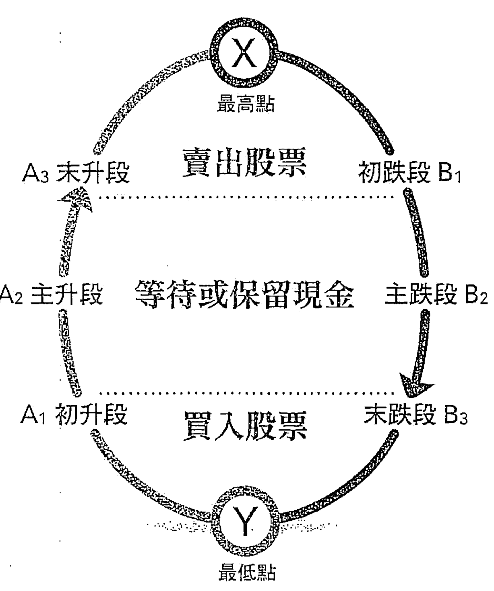

- A1＝修正階段（成交量小，股票持有人數量很少）
- A2＝調整階段（成交量和股票持有人數量持續增加）
- A3＝過熱階段（成交量異常活躍，股票持有人數量大增，在X 點達到最高）
- B1＝修正階段（成交量小，股票持有人數量逐漸減少）
- B2＝調整階段（成交量增加，但股票持有人數量繼續減少）
- B3＝過熱階段（成交量很大，但股票持有人數量少，在 Y 點達到最低）

科斯托蘭尼以美國股市 1982 年至 1987 的多頭行情，和隨後1987 年 10 月 19 日黑色星期一道瓊指數大跌 508 點為例，說明股市漲跌循環過程，其實台股也符合相同的觀察。

就以 2003-2008 年的台股為例，2003 年 SARS 剛結束，成交量極低，散戶不管價格多低的把手上股票認賠殺出，使得籌碼集中在少數特定人手裡，這時屬於 A1 修正階段，正是長線投資的好買點。到了 2006 年，雖然每天的成交量還是不到 1000 億，但行情有慢慢加溫的態勢，市場也逐漸活絡，適合持續作多，處於A2 階段。

到了 2007 年下半年，市場開始異常火熱，每個人都對未來充滿信心，連從未買過股票的人都 被周遭氣氛所渲染，想一夕致富，每天的成交量高達 3000 億以上，融資水位也來到新高，10月到達 9859 點最高點，這時是 A3 過熱階段。

接著市場走勢出現反轉，B1 修正階段從 2007 年年底開始，有人逢高開始倒貨，成交量明顯比最高點時少，指數也從高點下跌近 25％。一直到 2008 年年初，指數從 7500 點開始反彈，有人看多也 有人看空，成交量增加，籌碼在此進行換手，但事實是股票從固執型投資人手上換到猶豫型投資人手上，這是 B2 的調整階段。

最後到了 2008 年下半年，股市進入主跌段，市場瀰漫悲觀氣氛及恐慌性賣壓，大家開始不計成本殺出股票，成交量越來越少，在最低量時出現指數最低點，市場循環來到 B3 過熱階段，當出現最低點 3955 點時，又回到 A1 階段，固執型投資人再次進場，準備展開新一波多頭循環。

我喜歡用科斯托蘭尼的理論來判斷大盤目前的位置，雖然我深信即使不具備猜測大盤漲跌的能力，只單純靠選擇一流公司長期投資，一樣可以達成財富自由，但若遇到像 2008 年金融海嘯規模般的系統性風險，指數波段跌幅重達 6 成，所有股票皆無一能倖免，若能提前預防，適度減碼或出清持股，對於資金有限的散戶投資人，無疑是加快致富速度的好辦法。

在他的著作《一個投機者的告白》裡，我最喜歡的一段話是當初科斯托蘭尼剛出社會，到巴黎證券交易所實習時，一位經驗老到的長者對他說：「年輕人，我現在教你一些非常重要的東西。你看看周圍，這裡的一切都取決一件事，就看這裡的傻瓜比股票多，還是股票比傻瓜多。」這條金律成為我判斷市場的準則，證券交易全都取決於供給和需求，行情趨勢主要看買股票的人是否比買股票的人急迫，如果股票持有人迫於心理或物質壓力，被迫出脫持股，而資金持有人雖然想買，卻無購買壓力，行情就會下跌。反之，若是資金持有人迫切尋找股票，而股票持有人並沒有心理或物質上的壓力出售股票，行情就會上漲。所以之後，每當台北股市出現劇烈的漲跌波動，我總是會在心裡暗自問自己一個問題：「現在是傻瓜比股票多，還是股票比傻瓜多？」

## 科斯托輔尼給我的啟示

- 別想單靠閱讀圖表預測市場未來走勢，技術分析雖然看起來像是一種科學方法，卻無法帶來知識。交易市場從來不是理性的，股市就像是個酒鬼般，聽到好消息哭，聽到壞消息笑，令人難以捉摸。
- 長期來看，只有固執的投資人會是證券市場最後的贏家，他們的獲利是由熱衷於短線操作的猶豫型投資人支付。投資要成功，就必須當固執型投資人，在眾人搶購股票時從容賣出，當大家心灰意冷時大膽買進。
- 運用雞蛋理論判斷大盤目前的所在位置是否過熱或是冷清，每一次行情的大漲或大跌，都由三個階段所構成：修正階段、調整階段、過熱階段。正確的判斷目前所在的階段，適度加碼或減少持股，對於資金有限的一般投資人，無疑是加快致富速度的好辦法。

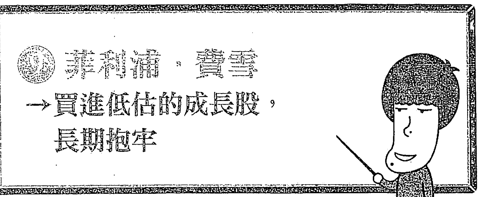

「如果當初買進股票時，過程都做的很正確，則賣出股票的時機，可以說永遠不會來臨。」

成長股價值投資策略之父菲利浦·費雪是教父級的投資大師，也是現代投資理論的開路先鋒，廣受美國華爾街推崇和敬重。他在 1958 年出版的《非常潛力股》直到今天還是金融專業人士必讀的教科書。

費雪 1907 年生於舊金山，父親是個醫生。從小費雪就對股票的股價變動充滿興趣。上小學時，有一天下課，費雪去探望祖母，恰好遇到一位伯父正在與祖母談論未來經濟的景氣對股票市場的影響，他感覺像是發現一個全新的世界，沒過多久，費雪就開始學習買賣股票，並且小有斬獲。

1928 年，費雪從史丹佛大學商學院畢業，5 月就在舊金山國安盎格國民銀行擔任證券統計員（即後來的證券分析師），開始投資生涯。1931 年創立投資顧問公司 Fisher & Co，代客操作，一直持續到 1999 年接近 92 歲高齡才退休，在將近 70 年的投資生涯中，創造出 20% 以上的平均年化報酬率。

### 好公司必須符合的 15 個要素

費雪的投资哲學在尋找價格被低估的成長股，不過他不像一般以成長股為投資標的的投資人，選擇找尋短期成長的股票賺取波段價差，他專注在找尋有機會在未來幾年能增值數倍的股票，或是在更長的時間內漲幅更大的股票，因此他會買進成長股後，長期抱牢。

他最著名的投資戰役就是長期持有德州儀器與摩托羅拉兩支股票。他在 1955 年買進德州儀器，到了 1962 年漲了 14 倍，雖然之後暴跌了 80%，但後來又再度創新高，比 1955 年的股價高出 30 倍。另外，他因為看好通訊事業的發展，大量買進摩托羅拉的股票，費雪持有 21 年，摩托羅拉的股價也從 1 美元上漲到 20 美元，加上股利後淨賺 20 倍。而同個時期，標準普爾 500 指數只漲了 7 倍，無怪乎巴菲特會說：我的投資方法 85%來自葛蘭姆，15%來自費雪。

至於一家公司需要具備哪些特質，才能有有可能讓股價創造數倍的漲幅呢？他提出投資人應該關心的 15 個要點，這些條件主要是企業經營面為主，再加上一些公司的政策與執行效率的要點，包括：

- 公司的產品或服務，在未來是否有充足的市場潛力？
- 管理階層是否有決心開發產品或製程，進一步提高銷售潛力？
- 研發成果是否帶來優異的效益？
- 銷售組織的能力是否高人一等？
- 獲利率高不高？
- 有維持或提高獲利率嗎？
- 勞資與人事關係好不好？
- 高階主管關係是否良好？
- 是否有足夠的管理階層可以處理事務？
- 成本分析和會計記錄是否夠好？
- 與同業相比，產業競爭地位是否突出？
- 有沒有短期或長期的盈餘展望？
- 公司會為了成長大幅增資，而讓現有持股人的利益受損？
- 對於業績，只報喜不報憂？好的時候口沫橫飛，有問題時三緘其口？
- 經營階層是否具備誠信正直的態度？

如果上述的問題的答案大多數都是肯定的，表示這家公司是很好的投資標的。除了從公開資訊與法人研究報告來了解公司是否符合這些條件之外，費雪特別鼓勵投資人找熟悉公司的人閒聊、打聽消息，例如接觸公司的員工、供應商、客戶、同業等，藉此了解公司的營運發展，費雪發現這樣得到的資訊非常精準。另外，如果還有不清楚的地方，也可以透過參加股東會直接對管理階層提問，或聯絡公司發言人尋求解答。

### 投資人都該遵守的 10 不原則

另外，費雪還提了 10 個不該投資的條件，包括：

- 不買處於創業階段的公司。
- 不要因為 1 支好股票在店頭市場就棄之不顧。
- 不要因喜歡某家公司年報的語調，就去買該公司的股票。
- 不要以為公司的本益比高，就表示未來的盈餘成長已經大致反映在價格上。
- 不要為交易價格錙銖必較。
- 不要過度強調分散投資。
- 不要擔心在戰爭陰影下買進股票。
- 不要過分在意膚淺的金融統計數字。
- 買進真正優秀的成長股時，除了考慮價格，不要忘了時機因素。
- 不要隨群眾起舞。

除了注意選股的方法，費雪也提出賣股的理由。關於何時該賣股票，市場上有一套說法，即是總體經濟變差了、股市空頭來臨了，就必須趕緊出脫持股，不然會損失慘重，但費雪認為賣股只有3個理由：是一開始就買錯了，這時就要勇於坦誠自己犯的錯，當機立斷認賠殺出；二是公司經營發生變化，經營業績大不如前；最後一種情況則是換股，賣出目前持股，轉進展望更佳的股票。費雪會給股票3年的觀察期，要是過了3年，股票的表現一直沒有比市場好，才會出脫持股。費雪認為符合換股的情況不常出現，必須在有十足把握的情況下，才能有所行動，如果當初買進股票時，過程都做的很正確，則賣出股票的時機永遠不會來臨。

費雪挑選具備成長潛力的公司，接著長期持有的做法啟發了巴菲特，也對我很深的影響。他提醒我要想盡辦法了解公司的經營狀況、加強了解公司經營管理的各個面相，將投資放在少數幾家徹底了解的公司，只要公司競爭力一直存在，不輕易出脫成長潛力股，就能在控制風險下取得最大的獲利。

### 實戰給我的啟示

- 挑選具備成長潛力股的方法，先從優良普通股的 15 個要點著手，如果一家公司符合絕大多數條件，便可能是一檔潛力股。再透過找人閒聊，進而了解公司經營管理層面，並且避開投資人 10 不原則，在風險被控制的情況下創造獲利極大化。
- 賣出股票永遠只有 3 個理由，第一是原始買進動作即犯下錯誤、第二是公司營運狀況大不如前、第三是換股。別去管市場分析師的說法，如果當初買進股票的過程都很正確，則賣出股票的時機永遠不會來臨。
- 買進一檔股票至少持有 3 年，用 3 年的時間來觀察一檔股票，要是過了 3 年，這檔股票表現一直沒來得比市場好，才會考慮出脫持股；但如果沒什麼事情改變對那家公司的看法，就該繼續持有下去。

## 10 納西姆·塔雷伯
### →警覺稀有事件，培養快速因應的技巧

> 「在機率的觀念下，賺大錢的人可能只是運氣好的傻瓜，而賠錢可能只是運氣不好罷了。」

納西姆·尼可拉斯·塔雷伯是著名的風險管理大師，有超過20 年市場交易員經驗，代表作《黑天鵝效應》研究極端世界中不確定性下的決策，與《隨機騙局》、《反脆弱》兩本著作並稱為解決風險與隨機問題的「不確定」三部曲。

雖然塔雷伯有多年的市場交易員經驗，卻極少著墨自身的投資經歷，一般人只知道他之前是債券交易員，利用危機入世的方法，賺取高額利潤。不過，塔雷伯過人之處並不在於提出一般性的投資策略，而是以更廣泛的視野、更具哲學性的論證，試圖解決潛藏在市場與生活中的機率陷阱。最為大家熟知的，就是黑天鵝效應。

### 認識黑天鵝效應，將傷害降至最低

在過去的世界裡，人們相信世上所有的天鵝都是白色的，這完全符合實證現象，但是當在澳洲發現了第一隻黑天鵝，過去的認知瞬間瓦解。塔雷伯用這個例子告訴我們，只從觀察或經驗學到的事物有嚴重的侷限，而忽略黑天鵝事件可能會漏失良機，甚至會造成無可避免的災害。

像是 Google 的快速崛起帶來網路市場的大幅改變就是正面的黑天鵝事件，而 911 恐怖攻擊事件和 311 日本大海嘯則是負面的黑天鵝事件。這些事件都有三種特性：一是不可預測性，這是指超乎經驗的預期之外，感覺極不可能發生的事卻發生了；二是高衝擊性，不管是對於市場或者人心的波動，都帶來極大的衝擊；最後則是事後諸葛，一旦發生之後，我們會傾向編造出某種合理的解釋，讓事件看起來不如實際上那麼隨機，好像應該預測得到。

在這樣的情況下，塔雷伯認為，黑天鵝幾乎潛藏在任何一件事背後，自從人類在好幾萬年前脫離更新世、走向工業革命，世界就變得越來越複雜，想透過研究企圖預測事件的走向變得極其困難。既然黑天鵝事件的發生難以預測，塔雷伯提出的解決之道，是我們必須去適應這些事物的存在，而不是天真的去猜測，應該專注在反知識上，盡量讓自己暴露在黑天鵝事件中。只有對這些稀有事件有所警覺，才能在事件發生後快速因應。舉例來說，如果是運用在投資方面上，來自未知事物的報酬通常大到不成比率，在稀有事件上的投資，若看錯方向，損失甚小，但一旦事件發生，收益卻很大。

為什麼黑天鵝事件會造成這麼大的影響？塔雷伯在《隨機騙局》中用簡單的機率與期望值概念來說明。塔雷伯以華爾街證券交易員約翰為例，約翰從商學院畢業後做「高收益」債券交易，最主要的操作方法是買進廉價債券，賺取中間的利差，利差雖然不大，但他透過槓桿效應加大獲利倍數，每年穩定幫雇主創造豐厚的收益，因此在極短的時間內升任主管，同時享有優渥的獎金分紅。

不過誰沒有料想到，到了 1998 年，高收益債券突然暴跌，所有的獲利瞬間化為烏有，過去累積的獲利卻在短短幾天內全部吐回，讓銀行損失 6 億美元以上，他的財富也因此銳減超過 9 成，最後的結局只能被迫離開市場。

塔雷伯認為，如果從機率的角度來看，就可以了解約翰為什麼逃不過黑天鵝事件？其實這就像一個賭局，賭 1000 次裡面有 999 次可以賺到 1 元，但另 1 次則會賠上 10000 元，如果單筆單筆交易來看，大部分的時候都是賺錢，但從期望值來看，每次的賭局其實是賠了 9 元。所以如果只單純看事件發生的機率（99% 會賺錢），而不注意事件的長期期望值（平均每次會虧 9 元），就會受到黑天鵝事件所傷害。

在機率的觀念下，賺大錢的人可能只是運氣好的傻瓜，而賠錢可能也只是運氣不好罷了。大家常低估運氣在現實生活中的重要性。如果找來無限多數量的猴子，讓牠們坐到電腦前敲打鍵盤，就機率而言，遲早會出現一位大文豪。

| 事件 | 機率 | 結果 | 期望值 |
| :---: | :---: | :---: | :---: |
| A | 999/1000 | $ 1 | $.999 |
| B | 1/1000 | $.10000 | $.10 |
| 合計 | | | $.9.001 |

每個人都想在股票市場找到一種可以長長久久、穩健獲利的模式，但如何了解你現在使用的投資策略是否恰當，能讓你高枕無憂？從機率的角度來看，賺大錢的人可能只是運氣好的傻瓜，而賠錢的人可能也只是運氣不好罷了。除非我們能檢視自身系統是否夠完備，只做期望值是正數的投資，避開負期望值的投資標的，當未來出現新的黑天鵝事件時，就有能力把傷害降至最低，甚至能從中取得商機。

### 給最難搞的投資者的忠告

- 別忽視稀有事件的出現，儘可能適應這些事物的存在，並設法從中獲利。
- 別掉入投資市場的機率陷阱，在機率的觀念下，賺錢有可能只是運氣好而已，賠錢也可能只是運氣不佳罷了，分辨獲利是來自於實力或只是單純運氣？想辦法增加自身的投資能力，才是提升獲利的不二法門。
- 重新檢視投資風險，避免負期望值的投資，只做正期望值的投資，才是成為市場長期贏家的唯一辦法。

# Ch 03
## 「成長飆股致富術」，運用2大招式，賺多少自己算出來！

如果能確實遵守算股招式，就很有機會選到獲利大幅成長、且價值被低估的股票，創造出500%以上超強報酬率的回報！

前一章簡單介紹影響我最深的投資大師，以及我學習到的投資觀念，從中可以發現：大多數的投資大師主要的選股策略都是看公司的基本面，即使有用到技術分析，通常也只當成輔助工具。

投資大師的投資績效或許高不可攀，但他們的投資觀念一定要學起來。在我吸收學習了所有投資大師的精華概念、加上這幾年的股市經歷，我獨創並歸納出一套鎖定成長股的投資策略，我稱之為「成長飆股投資術」，用這個方式挑選出來的股票，創造出5成至倍數以上的獲利，平均年化報酬率40%，即使2011年發生歐債風暴，大盤指數大跌21.2%，但我依舊繳出接近10%的正報酬！

而我所研發出來的選股法，之所以會聚焦在成長股，是因為成長股有幾個優勢：一是相較於定存股，報酬率夠高，能滿足長期獲利的條件；另外與期貨、選擇權、權證等衍生性金融商品相比，風險卻是低許多。因此我覺得「成長飆股投資術」，是一種可以創造高於平均市場獲利、風險卻相對有限的投資策略。

「成長飆股投資術」是為了控制風險、提高選股準確度，共有2個招式步驟來計算出最值得投資的股票：第一步是，「10個選股核心法則」來精算、挑出適合投資的股票。我相信如果能確實遵守這樣的選股策略，就很有機會選到獲利大幅成長，而且價值被低估的股票，創造出500%以上超強報酬率的回報！

第二步則是，用「進場前的6個篩選條件」再確認一次是否是值得下手的潛力飆股。用第一步計算、挑選出來值得投資的股票之後，接下來這幾個進場的篩選重點，能讓你再次檢視投資的股票是否是有潛力的成長股？我認為進場前再次確認這些重點，可以加深你對公司及自己判斷的信心，進而耐心等待股價飆升，不輕易脫持股，也更不容易失手誤判。

# 「成長飆股投資術」精算招式 1：10 個選股核心法則

## 法則 ① 本益成長比低於 0.75

本益比是很多投資人慣常選股的投資方式，你也許常常聽到一些似是而非的說法，像是因為是高科技股所以享有 30 倍的本益比；或是生技股正夯，所以 40 倍本益比也不算貴，不然就是紡織股是夕陽產業，所以 10 倍本益比合理，但真的是這樣嗎？

前面提過，本益比是股價除以每股稅後盈餘後得到的數字，白話一點來說，就是本金跟收益之間的比例。假設 A 公司的每股稅後盈餘（收益）為 1 元，股價為 10 元（本金），本益比就是 10 倍，如果 B 公司的每股稅後盈餘也為 1 元，股價為 20 元，本益比就是 20 倍。在正常的情況下，本益比越低越好，因為這代表收回本金的速度越快。本益比若為 10 倍，代表 10 年可回本，換算下來等於是 1 年獲利 10%，如果本益比 20 倍，則代表你 20 年才能回本，等於是 1 年獲利 5%。

但是別忘了，一家公司的獲利成長性有高有低，如果是一個前景看好的公司，未來獲利看好，大家自然會想搶進，市場通常會先行反應，股票也就水漲船高，本益比也會跟著拉高。因此，1 檔股票會有高本益比並不是因為產業的關係，而是因為公司有高獲利成長性。

所以在考量獲利成長性下，我認為，如果一家公司平均獲利成長率為 15%，那合理的本益比應該是 15 倍，如果平均獲利成長率為 20%，那合理的本益比則為 20 倍，如果平均獲利成長率為 30%，那麼 30 倍的本益比也不算貴。

為什麼獲利成長率對本益比的影響至關重要？這裡可以舉一個例子：假設現在有兩檔股票的每股盈餘相同，都賺 1 元，A 公司股價為 15 元，所以本益比是 15 倍，預估未來 5 年平均獲利成長率有 10%。B 公司股價同為 15 元，本益比也一樣為 15 倍，但未來 5 年平均獲利成長性有 30%，未來 5 年的每股盈餘與本益比（假設股價維持 15 元不變）變化會呈現如下面的表格：

| | A公司 | A公司 | B公司 | B公司 |
| :--- | :--- | :--- | :--- | :--- |
| | 盈餘 | 本益比 | 盈餘 | 本益比 |
| 第1年 | 1.1 | 13.6 | 1.3 | 11.5 |
| 第2年 | 1.21 | 12.4 | 1.69 | 8.9 |
| 第3年 | 1.33 | 11.3 | 2.2 | 6.8 |
| 第4年 | 1.46 | 10.3 | 2.86 | 5.2 |
| 第5年 | 1.61 | 9.3 | 3.72 | 4.0 |
| 總計 | 6.71 | | 11.77 | |

如果同樣都投資 5 年，可以發現 A 公司 5 年的累積每股盈餘是 6.71 元，B 公司是 11.77 元；也就是說，B 公司的獲利足足比A 公司多了 75%，而本益比也因獲利成長而降低，在股價都是15元維持不變的情況下，A公司的本益比到了第5年剩下9.3倍，B公司則只有4倍。前面說過，在正常的情況下，當本益比過低的時候，股價會跟著反應，推升到合理價位，因此，B公司未來的股價成長潛力自然會比A公司來得大。

因此，我們不應該以本益比作為買進股票的考量，而該改用本益成長比。這裡我們再次複習前一章提過的本益成長比公式：

本益成長比＝本益比 ÷ 預計每股盈餘成長率

就如同《祖魯法則》作者吉姆·史萊特的建議，我認為本益成長比在1時是合理的股價，當低於0.75時就可以考慮買進，如果低於0.66時更是買進良機，至於超過1.2時就該考慮賣出。

所以在每股盈餘成長率20%的情況下，合理的本益比應該是20倍，這時的本益成長比剛好是1，如果本益比低到15倍以下，就是買進股票的時機，這時本益成長比低於0.75；而如果本益比來到25倍以上，也就是本益成長比在1.2以上，就該考慮賣出。

這樣你是否會自行計算合理的股價了？之後如果有外資喊出某某公司目標價上看XXX元的時候，請拿計算機出來簡單的計算一下，就會知道那支股票是否真的有那麼高的價值，還是這只是外資刻意哄抬股價準備出脫罷了？

### — 財富自由入場券 Tip —

本益成長比的公式可以用來評估成長股的股價是否合理，是高估還是低估。如果本益成長比等於1為合理股價，低於0.75就可以考慮買進，低於0.66更是買進良機，如果超過1.2則可以考慮賣出。

## 法則 ② 未來 1 年預估本益比低於 15 倍

第 1 個核心法則強調的是在考量未來獲利率的情況下看待本益比，第 2 個核心法則則是盡可能選擇價值被低估的股票。

未來前景看好的企業通常享有較高的本益比，可能有 20 倍、甚至 30 倍。既然我們鎖定未來獲利持續增加的企業，本益比自然不低，但如果能選擇本益比低於 15 倍甚至接近 10 倍的公司，到時候萬一的預估錯誤，企業獲利不如預期或市場大幅回撤，就可以有個保護傘，讓損失降到最低。至於為什麼會選擇 15 倍以下的本益比？主要是在正常的情況下，台股的平均本益比約為 15 至 25 倍左右，選擇低於市場平均價位的股票，在一開始就取得優勢，萬一企業獲利不如預期，損失相對有限。

未來 1 年的預估本益比可以用下面的公式計算：

> 預估本益比=股價 ÷ 預估當年每股盈餘

這個公式與前面提到的本益比公式最大的差別，就在於分母是預估當年每股盈餘，因為股價會及時反映經營情況，因此只有最新預估的每股盈餘數字才會對股價有所影響，這也是找到低本益比股票的關鍵。

看到這裡，可能有人會很納悶，如果是本益比越低越好，那我只要買本益比低到只有 3 倍或 5 倍的股票，豔不就可以簡單賺大錢了？然而事實上，在正常的情況下很少有 3 到 5 倍本益比的公司，會有如此便宜的公司出現，大致上只有三種情況：第一種情況是大空頭，例如像 2008 年金融海嘯，很多股票都跌到本益比 8 倍、5 倍，市場會營造極度悲觀的氣氛，只會讓你想不計損失的出清手中持股，完全不會有想買進股票的念頭，但這時其實

才是買進股票的好時機。

第二種情況是，公司一次認列業外收益，例如出售固定資產，像是賣土地或賣廠房，或者像潤泰全（2915）或潤泰新（9945）因為 IFRS 財報的判定，喪失對高鑫零售的控制權，必須一次認列收益，導致當年稅後淨利大幅衝高，本益比甚至不到 2 倍。但像這樣突然有額外收益認列的公司，股價有可能會因為一時的利多而有所反應，但通常只是短期現象，畢竟認列的數字只是美化帳面數字，並不會增加配息，因此對於長線投資者並不具備任何吸引力。

第三種情況是，企業雖然有獲利，但因為市場投資人看壞後市，導致本益比偏低。舉例來說，就像前幾年的營建股，明明獲利表現都不差，但股價就是不會漲，導致一些績優的營建股本益比只剩 7、8 倍左右，因為大家覺得房地產有過熱的疑慮，即使股價相對便宜，依舊乏人問津，因此本益比低不代表價值就一定被低估，只能表示現階段市場願意給的價格不高。

而未來 1 年預估本益比低於 15 倍，是在一般的情況下，我們可以接受的最高本益比，假設估計 A 公司今年可以賺 2 元，而 A 公司的股價為 30 元，預估本益比為 15 倍，如果你做足功課，確定這家公司未來獲利會大幅成長，平均每年有 20% 以上、甚至 25% 以上的成長，那相對於 15 倍本益比就顯得相當便宜，自然可以買進。

只有一種例外的情況可以買進本益比超過 15 倍以上的股票，那就是你非常確定公司平均每年獲利成長超過 30% 以上，不過這種公司非常少，可以說是鳳毛麟角，所以除非你對公司的產業景氣都瞭若指掌，否則很容易買在相對高點。

總而言之，我們的目標是買進一年內預估本益比 10 倍左右、最高不超過 15 倍、而未來平均獲利成長率超過 15% 至 25% 的公司！用更簡單的話來說，就是買進未來獲利成長率高於本益比的公司，用 10 倍本益比買平均獲利成長率超過 15% 的公司，或用 15 倍本益比買進平均獲利成長率超過 20% 以上的公司，如果你可以花一點時間，找到符合以上條件的公司，買進並持股長抱，長期下來，將可以創造優於大盤的獲利。

### 財富自由入場券 Tip

- 選擇未來 1 年本益比預估 15 倍以下，平均年獲利成長達 20% 的公司，這時的本益成長比在 0.75 以下，當企業獲利成長不如預期而下修本益比的時候，就有很好的保護傘，不會因為市場急殺而損失慘重。

## 法則 ③ 股東權益報酬率 15% 以上

第 3 個法則是從巴菲特的投資哲學而來。我認為雖然每股盈餘很重要，但是股東權益報酬率也是相當重要的指標，從股東權益報酬率的表現可以觀察公司運用自有資金的能力，也可以發現企業在思考經營策略時，是不是把股東的優先順序擺在前面，因此身為投資人，更要注意股東權益報酬率的變化，因為這代表股東實質投入的金額所得到的報酬率。

股東權益報酬率的計算方式為：

- 股東權益報酬率＝稅後淨利÷股東權益
- 股東權益＝資產-負債

股東權益報酬率越高，代表企業運用自有資金獲利的能力越好。簡單來說，假設企業扣掉負債後，自有資金為 10 元，當年獲利為 1 元，股東權益酬率就等於 10%，若獲利為 3 元，則代表股東權益酬率 30%，表示公司運用 10 元的自有資金，可以賺到 3 成的獲利。因此如果股東權益報酬率持續上升，代表企業獲利的品質越來越好，而股東權益報酬率成長的原因，可能來自於毛利的上揚、營業成本控制得宜、營收的增加……等，這都會使得稅後淨利增加。

選擇股東權益報酬率在 15% 以上的股票，最主要的目的是欲獲取高於市場的投資報酬率。股東權益報酬率年成長 15%，代表公司淨值年成長 15%，股東權益報酬率年成長 20%，就代表公司淨值年成長 20%，而對於以成長潛力股為目標的投資人，追求的是長期年化報酬率達到 15%、甚至 20% 以上。當一檔股票的股東權益報酬率每年都能成長 15% 以上，意味著這家公司的營運表現比其它九成公司來的優異，而且具備提高股利的能力，自然股價的表現也會比股東權益報酬率只有 8% 或 10% 來的好。

不過，在觀察股東權益報酬率的數字需要注意，因為股東權益是資產減去負債，如果企業的負債比很高，超過 50%、甚至 60% 以上，那股東權益自然就比較小，股東權益報酬率的表現相對就會很亮眼，但實際深入了解了會發現，這其實是因為企業以高財務槓桿操作出來的，背後可能隱藏過度舉債投資的問題。

舉例來說，假設 A 公司的總資產 100 萬，負債為 40 萬，因此股東權益為 60 萬，如果稅後淨利是 12 萬，那股東權益報酬率為 20%。

假設隔年 A 公司將負債提高到 50 萬，但總資產與稅後淨利依然不變，分別是 100 萬與 12 萬，這時股東權益降低成 50 萬，而股東權益報酬率卻因此升高到 24%，這等於公司靠著舉債讓股東權益報酬率提升。這告訴我們，雖然股東權益報酬率是很重要的指標，但也別忘了搭配負債比的變動一起觀察，如果股東權益報酬率的提升是來自負債增加，而不是獲利的提高，那麼當景氣反轉，可能導致企業無法應付還債的要求，會有相對高的營運風險，自然也會增加投資風險。

另外也要注意幾個特殊現象，例如：是否有罕見的處分土地資產、有價證券、匯兌收益等，這些因素都會造成短期股東權益報酬率提高，但這些動作對企業的長期獲利表現並沒有太大幫助。

所以，擁有優異的股東權益報酬率，代表企業運用自有資金的能力高於業界平均水準，也代表企業經營方針首重股東長期利益，長期來看，應該投資股東權益報酬率平均在 15% 以上的股票，而且至少近 3 年維持平穩的表現，如果股東權益報酬率高於 20%，或是獲利持續成長，那就更棒了。另外，請注意在觀察股東權益報酬率的同時，務必連同負債比一同檢視，負債比最好不要超過 50%，並且在股東權益報酬率增加的同時，還能維持平穩的表現。

根據我的經驗，股東權益報酬率的表現與股價呈現明顯的正相關，有時候相關性甚至不亞於每股盈餘成長與股價的相關性。密切注意股東權益報酬率的變化，當每年或每季都呈現顯著的成長時，可千萬別輕意賣股。

## 法則 ④ 近 5 年平均稅後淨利正成長

觀察一家企業最直接且最重要的獲利指標非稅後淨利莫屬，而想要了解稅後淨利，就一定要學會看懂損益表。

### 台積電簡易合併損益表（單位：億元）

| 項目 | 104 年 | 105 年度 |
| :--- | :--- | :--- |
| 營業收入淨額 | 8435 | - |
| 營業成本 | 4331 | - |
| 營業毛利 | 4104 | - |
| 營業費用 | 904 | - |
| 營業利益 | 3200 | - |
| 營業外收入 | 362 | - |
| 營業外支出 | 58 | - |
| 稅前純益 | 3504 | - |
| 稅後純益 | 3066 | - |
| 每股盈餘（元） | 11.82 | - |

損益表呈現企業從營業收入到最後產出每股盈餘的整個過程，我們以台積電(2330)的簡易損益表為例（見上表），第 1 列是營業收入，在 2015 年為 8435 億元，扣除非第 2 列的營業成本 4331 億元後，就會得出第 3 列的營業毛利 4104 億元。

接著再扣除第 4 列的營業費用，包含推銷費用、管理費用、研發費用等，共 904 億元，就會得到第 5 列的營業利益 3200 億元。

然後加上第 6 列的營業外收入，包括投資收入、股利收入、處分資產利得、匯兌收益……等 362 億元，再減去第 7 列的營業外支出，如利息支出、投資損失、處分資產損失、兌換損失……等 58 億元，就會得到第 8 列的稅前淨利 3504 億元。扣除所得稅費用（若有少數股權，則在扣除少數股權淨利），可以得到第 9 列的稅後淨利 3066 億元，這個數字就是企業當年的實質獲利，最後除以加權平均股本之後，就會得到每股盈餘 11.82 元。

了解每股盈餘的計算方式，目的是要了解企業真正的獲利來源，避免因企業用配發股票股利及減資等手段，產生失真的數字，掩蓋企業真正的營運現況。如果以錯誤的營運指標來判斷是否投資，風險當然很大。

至於為什麼要以近 5 年平均稅後淨利正成長作為指標？主要是因為大部分的成長股都是中小型股，中小型股常會因為某個特殊的事件，導致獲利出現急速變化，所以如果過去 5 年的淨利都能成長，而且平均年成長在 10% 以上，代表這樣的公司經營相對穩健，而不是只是剛好搭上順風車，獲利突然暴增的公司。在這樣的條件下，轉機股、景氣循環股、熱門題材股、新上市櫃股都不會是我們選擇的標的。

當然，過去的績效不能代表未來的獲利，但是過往的歷史資料確實可以推論出一些端倪，以我的經驗觀察，過去表現良好的公司，未來持續有好表現的機率大於過去表現二、三流的公司。因為這個條件，更能確定我們投資的是成長股，而不是轉虧為盈的轉機股。

也許有人會問，為什麼不能只看每股盈餘就好，一定要了解獲利的來源呢？我們就以華碩（2357）2008 年至 2011 年的財務數字為例。

### 華碩(2357)2008~2011 年稅後淨利及每股盈餘（單位：億元）

| 項目 | 2008 | 2009 | 2010 | 2011 |
| :--- | :--- | :--- | :--- | :--- |
| 稅後淨利 | 164 | 124 | 164 | 165 |
| 每股收益 | 3.88 | 2.94 | 7.72 | 21.99 |
| 股本 | 423 | 424 | 213 | 75 |

單看華碩的每股盈餘數字，你會看到 2009 年只有 2.94 元，到 2010 年成長到 7.72 元，2011 年更一口氣彈升到 21.99 元，看起來華碩的獲利能力突飛猛進的成長，應該是買進的標的吧！但是如果進一步檢視稅後淨利的表現會發現，2008 至 2011 年的獲利並無明顯成長，那為什麼每股盈餘會大幅彈升呢？原來 2010 年與 2011 年華碩都大幅減資，2010 年的股本比 2009 年減少了一半，剩下 213 億，2011 年更一口氣減資到只剩 75 億，與 2009 年相比剩不到 1/5。這種以減資，而非獲利面成長來創造每股盈餘數字的股票，自然不符合成長股的選股條件。

投資股票首重未來成長性，獲利前景越是看好，市場上給予的本益比就會越高。因此不管企業過去的經營績效有多好，只要未來成長動能緩解或獲利大幅衰退，伴隨著預期獲利的減少，市場給予的本益比下修，股價勢必會遭遇修正。因此，買進未來獲利可望增長的公司，是「成長腦投資術」最核心也是最重要的鐵則！

> — 財富自由入場券 Tip —
> 利用損益表觀察企業的稅後淨利，選擇買進近 5 年平均稅後淨利正成長的公司，避開過去淨利大起大落的企業，可以大幅減少踩地雷股的機會。

## 法則 ⑤ 預估至少未來 3 年稅後淨利年成長 15% 以上

投資股票首重未來成長性，而未來成長動能越好，股價上漲的動能也就會越強。上面有提到，買進獲利可堅持續成長的公司，是投資成長股最核心、也是最重要的鐵則，因此我們選擇買進預估未來 3 年稅後淨利能夠年成長 15% 以上的公司，如果年成長 20% 以上更好。台股上市櫃公司過去 5 年平均淨利成長率只有 5%，而選擇 15% 以上的成長率，勝過台股絕大部分的公司，是成長飆股投資策略最重要的條件之一。

只是該怎麼預估未來獲利卻是最困難的事，畢竟這是還沒發生的事，誰也說不準，我的建議是從了解的產業來選擇投資標的，因為只有深入了解一個產業，才有辦法評估待在這個產業的公司有沒有獲利前景。如果你從事資訊科技產業，自然會比較了解電子產業未來趨勢的發展，那就比較容易預測電子股的未來獲利情況；又或者你是在生技公司上班，清楚整個產業的脈絡，那你對相關產業的判斷就會比其他人要有利的多。

當然，也許你像我一樣，所處的產業沒什麼可以投資的公司，還是可以從日常生活的變化找出有用的資訊，鎖定生活周遭的產業來投資。我的經驗是，通常會以傳產股為主，雖然台股成交量大半來自於電子股，但電子產品生命週期較短，較不容易有長期穩健的成長趨勢，因此我個人偏好傳產股。傳產股的獲利相對比電子股穩定，只要趨勢不變，也比較容易預估未來獲利。就以統一超 (2912) 為例，7-ELEVEN 是台灣最大的連鎖超商，大街小巷都可以看到它的蹤跡，長期以來的獲利表現也一直很穩定，稅後淨利從 2006 年的 38.2 億成長到 2014 年的 90.9 億，即使是面臨 2008 年金融風暴，市場一片哀嚎，但它的表現幾乎未受影響，當年亦有 35.2 億的獲利，是穩定中又具備成長性的代表股。

要預估統一超的未來的獲利成長性，我會用簡單的推估方式。舉例來說，假設統一超全台有 1000 家門市，而公司計畫每年要多開 200 家分店，如果毛利率及營業費用不變的情況下，可以預期統一超商的稅後淨利會有 20% 左右的成長。但事實上，如果物流的管理得宜，在分店越開越多的情況下，會因為規模經濟而提升毛利率，營業費用也會下降。

當然，統一超商在台灣的分店已經超過 5000 家，市場已經趨於飽和，這時就可以考量統一超商在海外的拓點情況，以同樣的方式來推估。其它也適用這種模式來思考的公司還包括寶雅 (5904)、王品 (2727)、瓦城 (2729)、大車隊 (2640)、全家 (5903)、F-大洋 (5907)、遠百 (2903)……等。

另外，也可以細心觀察近期流行的趨勢，這也是找出未來具備大漲潛力股的不二法門，例如近年來大家很重視休閒養生，跑步、瑜珈變成時尚的運動，你會看到很多 Facebook 上的朋友分享參加馬拉松比賽或騎自行車的影片，這樣的風氣一旦形成，往往都會延續好幾年的熱潮，那相關企業的股票就值得留意，例如做運動機能衣布料及成衣代工的儒鴻 (1476)、聚陽 (1477)、東隆興 (4401)、銘旺實 (4432)；運動鞋代工及相關產業如寶成 (9904)、豐泰 (9910)、百和 (9938)、三芳 (1307)；或全球自行車龍頭廠巨大 (9921)、高階自行車廠美利達 (9914)、全球最大自行車鏈條廠桂盟 (5306)，甚至於生產保健食品的葡萄王 (1707)、佳格 (1227) 等，在這一波休閒養生熱潮中都有不小的漲幅。

一開始只是單純從「健康」這個點發想，就可連結出相當多相關產業，並發掘產業裡相對具備競爭力的個股，這就像肉粽原理，抓到一個就能拉出一整串。從生活觀察趨勢是「常識」，從趨勢中尋找投資標的則為「知識」，看出投資標的未來的展望則需要「想像力」。

一個趨勢的形成，少則幾年、多則數年以上，正好呼應巴菲特的一句名言：「如果你沒有打算持股 10 年，那連 10 分鐘也不要持有。」但畢竟不是每個人都能成為巴菲特，加上台灣市場畢竟與美國市場的規模差異甚大，而我們所設定的選股策略是以中小型股為主，因此若能找到未來 3-5 年平均獲利成長率超過 15% 的企業就很足夠了，只要對產業有一定的了解，自然有辦法找出符合這個條件的股票。

### 財富自由入場券 Tip

我們無法預估短期股價的表現，但從長線的角度來看，獲利持續大幅成長與股價表現習習相關。在日常生活中找到趨勢，以有系統、合邏輯的預測方式，找出未來 3 年稅後淨利年成長至少 15% 以上的個股，就能搭上賺錢的順風車。

## 法則 ⑥ 毛利率至少 15% 以上，且持續向上

毛利率可以看出一家企業的競爭力，如果毛利率越高，代表企業的獲利能力及控制成本的能力越強。毛利率的計算方式是：

- 毛利率 = (銷售收入 − 銷售成本) / 銷售收入 × 100%

通常公司經營的項目或生產的商品具備利基性，又或是市場上的強勢商品，那毛利率的表現通常就越好。如果具備長期平均毛利率 15% 以上，而且持續向上的公司，這表示這家公司在市場上的影響力越來越大，未來的成長性自然會越大。

雖然我們首選高毛利的公司，不過要注意的是，毛利率的比較是相對性的，而非絕對性的。不同產業的毛利率差異極大，比方說生產隱型眼鏡的廠商，平均毛利率超過 40%，而生產筆記型電腦代工廠整體毛利卻不到 5%，因此拿鴻海（2317）與聯電（2303）的毛利率相互比較，並沒有太大的意義。代工廠鴻海雖然毛利率不到 7%，但競爭力及規模卻是同產業裡數一數二，反觀半導體廠聯電毛利率雖然有接近 20% 的表現，但與同業台積電接近 50% 的毛利率相比，馬上就相形遜色。所以在運用這個條件時，記得要在同一個產業裡，找出毛利率表現相對突出的公司。

我的建議是從高毛利率的產業去尋找投資標的，因為那代表所屬產業有自身的優勢，高毛利率代表產業有技術門檻，或是屬於獨佔產業。而且相較於低毛利的產業，比較有能力避開惡性競爭所導致的削價後果，因此我把選股的最低毛利率條件設在 15%，低於 15% 的產業如果一下碰到削價競爭，經營狀況就很容易惡化，股價自然很容易往下走。

另外，這個條件也可以讓我們避開景氣循環股，所謂景氣循環股是指營收及獲利容易隨著景氣循環而產生波動的個股，景氣好的時候表現出色，但一遇到景氣低迷時，業績也會瞬間掉落谷底！像是鋼鐵、塑化、造紙等原物料股，或是航運股、營建股、證券股，都很容易受到景氣影響，毛利率也會因此波動劇烈，就以萬海 (2615) 這個典型的景氣循環股為例：

### 萬海 2008 至 2013 年的毛利率變化

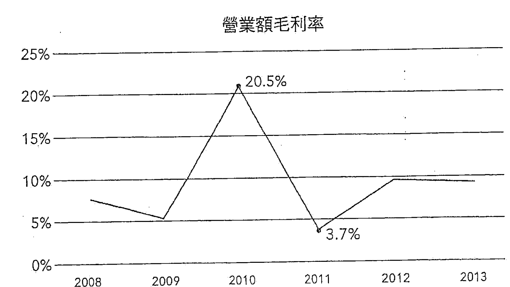

從圖中可以發現，萬海航運的毛利率波動極大，最高為 2010 年的 20.5%，最低則為 2011 年的 3.7%，毛利高低點相差近 17%。在 2008 與 2009 年因為遇到金融海嘯，毛利率只剩個位數，到了 2010 年全球景氣復甦，爆衝到 20.5%，但隔年又爆發歐債危機，毛利率一瞬間掉到谷底，2012 到 2013 年因為經濟情勢回穩，又拉升到接近 10% 的水準。如果你在 2010 年發現萬海，並對它 20% 的高毛利率心動而買進的話，很有可能買在波段高點，要一直到 2014 年底油價崩跌，才有機會解套！其實不光是萬海，幾乎大部分航運股的毛利率情況都很類似，如果利用毛利率在 15% 以上這個篩選條件，就可以避開這種難以預估後市的個股。

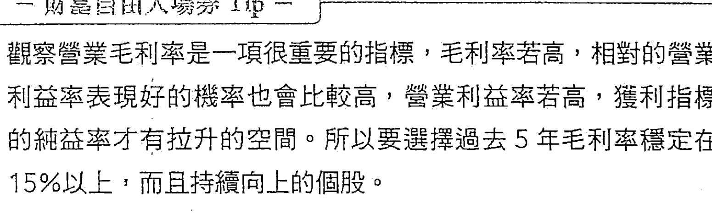

## 法則 ⑦ 負債比率低於 50%

負債比率指的是企業總資產裡負債的佔比，計算方式是：

- 負債總額 ÷ 資產總額 × 100%

簡單來說，如果負債比的數字是 30%，代表負債佔總資產的 3 成，如果是 50% 則表示負債佔總資產的一半。會考量負債比率，主要是衡量企業永續經營的能力，因為當企業出色的獲利能力來自大量舉債及過度的槓桿操作，可能會因為一時對市場判斷錯誤而遭遇危機。企業擁有強大的獲利能力就像是一把鋒利的劍，而穩健的財務狀況，就像是一面防禦力十足的盾。每增加一點負債，就好像削弱盾的防禦率，如果防禦出現漏洞，不管獲利的鋒芒多麼突出，還是很有可能因為防守不利，只能承受黯然失敗的命運。

因此我們除了關注企業獲利能力的好壞，也同樣關注企業的負債比率，我們希望企業的債務越少越好，負債比率最少要低於 50%。我們想投資的是企業的獲利能力及資產，而非負債，高負債比相對代表高利息的支出，也代表營運上的高度風險！但不表示我們要求公司一定要無負債，一家高成長的公司會因為看到潛在商機而舉債投資，所以我們該投資的企業是小心掌握資產、股東權益與負債比例的公司，不因過度舉債而陷入經營危機，但也不應該全無舉債而放棄企業發展的機會。

不過，每個產業的屬性不同，負債比率也不盡相同，例如台灣兩大超商統一超及全家在 2015 年度的負債比率分別為 65.2% 及 79.8%，如果只看負債比率會覺得高的離譜，但深入了解就會發現，因為零售超商業每天都有大量的現金流入，加上開給廠商

### 財富自由入場券 Tip

選擇負債比低於 50% 的股票，可以避開企業突然遭遇危機的風險，增加持股的信心。

## 法則③ 股本低於 30 億

祖魯法則有提到：「大象不會疾奔」，意指股本太大的企業，因為成長動能趨緩，獲利無法大幅增長，因此股價很難一飛沖天，而且以美國股市 1926 年到 2006 年的數據顯示，以大型股為主的標準普爾 500 指數的年平均報酬率為 10.26%，而小型股的年平均報酬率則為 12.21%，約高出 2 個百分點，這告訴我們中小型股的長期報酬率平均勝過大型股，長期累積下來，差距可不算小。

以台股來看，每年漲幅最大的前十名個股裡，幾乎絕大部分都是中小型股。以 2015 年上市櫃的 10 大飆股來看，股本最高的只有 24 億，甚至有 7 檔股票都在 10 億以內，因此對一般資金有限的散戶投資人來說，追求以較短的時間裡尋求更大的報酬，股本小、獲利成長性高的中小型股當然是首選。

前面提過，大多數的法人多著墨在與大盤連動的大型權值股，而我們的目標是追求優於大盤的投資報酬率，所以應該要專注在找尋被忽略的中小型股，況且每 1 檔佔權值的大型股，同時間都有好幾家研究機構注意公司的最新動態，並發表最新投資報告，撿到便宜價位的機率相對較低；反觀小型股，因為股本比較小，較不受法人的青睞，每天的成交量也比較少，挖掘冷門好股、飆股的機率相對較高。

### 2015 年上市櫃前 10 大飆股

| 代號 | 公司 | 全年漲幅 | 股本(億) |
| :--- | :--- | :--- | :--- |
| 3205 | 佰研 | 952% | 2.86 |
| 6238 | 勝麗 | 376% | 4.38 |
| 4426 | 利勤 | 359% | 9.12 |
| 4529 | 旭海 | 212% | 7.90 |
| 3552 | 同致 | 188% | 8.43 |
| 3234 | 光環 | 153% | 10.38 |
| 1464 | 得力 | 149% | 24.43 |
| 4137 | F-麗豐 | 122% | 7.95 |
| 3685 | 政翔 | 117% | 8.00 |
| 1536 | 和大 | 116% | 23.50 |

至於股本 30 億這個條件，只是一個概略的定義，如果看好一家股票，深入研究發現企業的所有條件都符合其他的選股法則，還是可以全力買進，只是股本太大，股價的推升速度可能會慢一些。

但要注意 2 點：雖然小型股上漲的速度較快，但如果遇到修正行情，波動也來的比大型股劇烈。再來，很多小型股的當日成交量不到 100 張，可能會有買不到或賣不掉的情況，所以如果想投資成交量太低的股票，還是要小心謹慎。

## 法則⑨ 經營階層持股多

從經營階層持有公司股票比例的多寡，可以看出對自家公司是否具有信心。我偏愛董監及大股東持股相對高的公司，代表經營階層對公司未來的營運看好，在正常情況下，如果經營階層持有自家公司的股票比例很低，我不會考慮買進。因為一家企業營運狀況的好壞，管理階層通常是最先知道，如果管理階層持股很低，或者有出場持股的情況，那可能代表經營團隊對公司的未來營運前景缺乏信心，如果連經營階層都不想持有自家公司的股票，那身為一般投資大眾的我們，又有什麼理由押寶公司的未來？

投資股票的目的無非就是獲利，當你持有的個股營運表現越來越好，公司的價值自然也會跟著水漲船高，不管是透過股利的提升或帶動股價的推升，都會讓股東的投資獲利增加。當然，公司高層也了解箇中道理，除非他不好看自家公司的未來發展，否則正常情況下，肥水不落外人田。站在小股東的立場，我們希望與經營階層是生命共同體，經營階層持股有比重高的公司，代表經營者在為公司做決策時，他思考的不單單只是股東的利益，更包括他自身的利益，在這樣的情況下，經營者的利益與小股東的利益就如同蘆花捲一般緊密的連結在一起。

因此我偏好買進經營階層及大股東加起來持股最少超過 20%以上的個股，且近期董監事、大股東並無明顯出現持股轉讓的情況。持股過程需密切注意大股東有無交易動作，若發現大股東或管理高層有賣股動作，通常是個警訊，我會緊張地去仔細了解賣股原因：這只是單一個案嗎？如果是持續且數量不少的股票出脫，那可能有重大事件發生。若不是看壞公司營運，就是股價可能漲多了，或是有還沒見報的突發事件準備發生，總之十之八九不是好事，要準備隨時出脫持股。

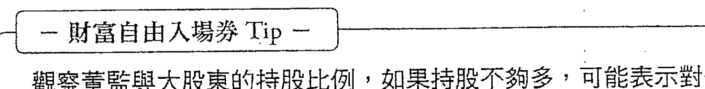

觀察董監與大股東的持股比例，如果持股不夠多，可能表示對公司的經營缺乏信心，就不是值得投資的標的。

《算股高手》的驚人財富翻倍術！

## 法則⑩ 融資比例低於 5%

融資就是借錢買股票。當投資人看好未來股票會上漲，但因為手上的資金不夠多，於是繳交部分保證金，向授信機構用借款的方式買股票，之後再伺機高價出脫持股，賺取低買高賣的價差。好處是用一樣的錢可以買到更多的股票，但缺點是需要付利息、有時間壓力，而且若看錯方向股價大幅下跌，可能會因為券商要求補足保證金被迫提早賣出股票，讓原來繳交的保證金血本無歸。

根據台股的歷史經驗顯示，融資是用來衡量散戶進場、行情是否過熱很重要的指標，每一次台股接近萬點時，融資必定來到相對的高點，而每一波行情能否破底重生，也要靠融資斷頭出場，散戶心灰意冷的離開市場，才會開始觸底反轉。

不光是大盤，從個股的角度來看也是如此，很多股票從高檔往下墜時，融資也是一路向下攤平，像宏達電（2498）在 1300 元時，融資只有 1 萬張左右，當股價開始向下修正，融資反而一路增加，一直到跌破 200 元時，融資最高超過 8 萬張，股價跌了 8 成，融資幅度卻增加了 7 倍，等於外資把股票都倒給了散戶，股價就此一蹶不振。

### 宏達電融資一路增，股價卻一直跌

根據我的經驗，有大漲潛力的股票，買進前融資比例通常不會太高，大致上不會超過 5%，而且在股票開始起漲時，反而會因為法人機構買盤的推升，讓融資呈現一路遞減的現象。

至於融資使用率很高的股票，比較常出現暴漲暴跌的情況，所以最好的方式就是盡可能避開融資過多的股票，因為真正具有長線上漲潛力的個股，籌碼都相對安定，即使法人看好 1 檔目前融資過多的股票，在他準備大力買進之前，也會想辦法先把融資給趕出來，等籌碼趨於穩定後，股票才會大漲。

### 2011-2013 年宏達電股價週線圖

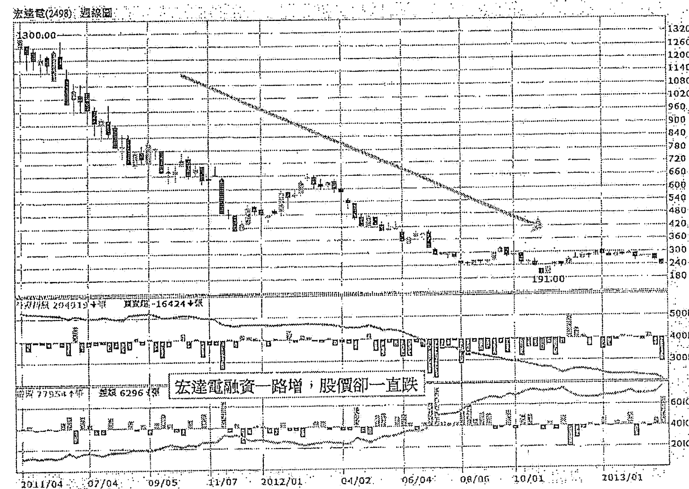

資料來源：富邦綜合證券股份有限公司

### 儒鴻因為外資敲進，融資減、股價大漲

就以紡織股儒鴻 (1476) 為例，儒鴻的融資在 2008 年 2 月爆增，當時股價約在 30-40 元區間，之後融資開始大減，股價卻一路反向推升，同時期外資強力做多，呈現典型的外資買、融資減、股價漲的長多走勢，股價一路看漲不回，從 2010 年 8 月 1 股約 35 元漲到 2015 年 4 月 424.5 元，漲幅超過 11 倍，是台股近年來漲勢最熾熱的個股之一。

因此選擇買進融資比例相對少的公司，避開股價短期因為炒作而帶來的劇烈波動，若股票上漲的同時，融資呈現緩步遞減，則代表漲勢可能沒有結束，就可以持股續抱並找機會再加碼。

### 2010-2014 年儒鴻股價週線圖

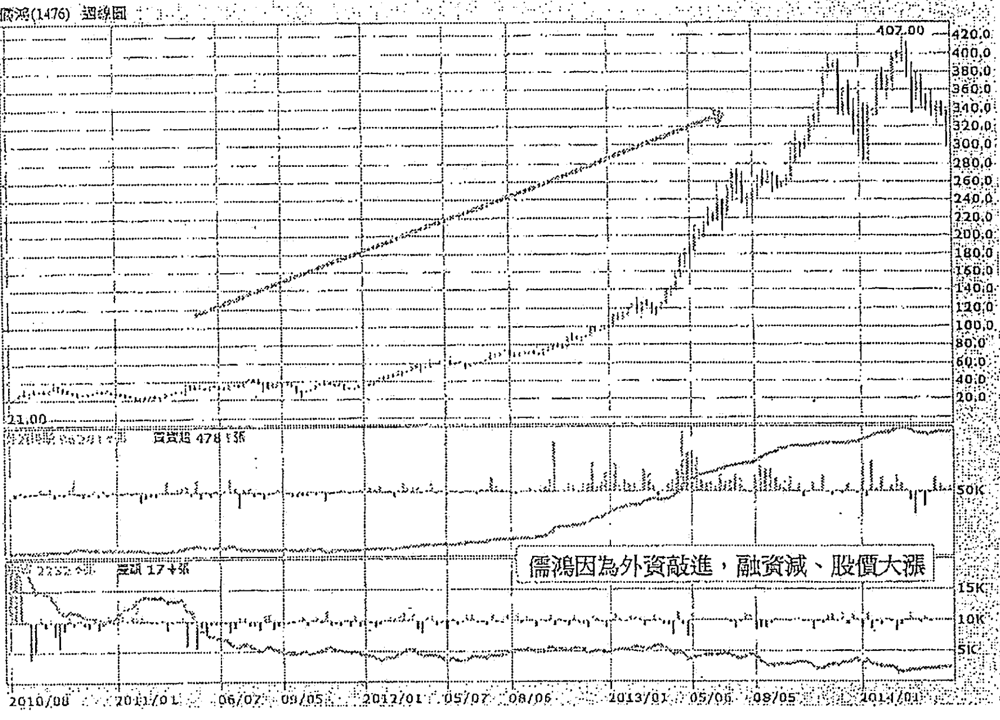

資料來源：富邦綜合證券股份有限公司

### 財富自由入場券 Tip

選擇融資比例低於 5% 的股票，因為融資高代表籌碼相對不穩定，短線操作的氣氛濃厚，而且往往突然無預警暴跌。如果是外資一路買而融資一路減的股票，通常會走長線多頭行情，很少有例外。

## 「成長飆股投資術」精算招式 2：進場前的「6 個篩選條件」

以上，「10 個選股核心法則」的精髓已經介紹完了，這全部都是我在這些年累積出來的實戰經驗，若能把這些要點牢記在心並且融會貫通，相信一定會顯著的幫你提升投資績效！基本上，具備上述要件的股票，在任何時候都不會超過全部股票的 5%，意思是說，同時具備所有條件的個股是少之又少，若能找到滿足 7、8 個條件以上的，就可以考慮買進了！但是當機會來臨時，發掘到 1 檔能夠符合所有條件的股票，請務必全力做多！並且千萬不要中途下車，因為你很可能發掘了 1 檔十星安打的超級股票！

當你正為發掘到 1 檔具備成長潛力的個股而感到興奮時，請先靜下心來，問自己下面這幾個問題，如果答案是清楚而肯定的，通常進場後都不會有太大的問題；但如果答案是否定或不確定，甚至有一絲絲的猶豫，那可能就不是理想標的，有可能是你並沒有很了解這家公司，或者之前的樂觀看法太過一廂情願。

當你對公司的掌握度不足時，如果股價上漲，你會覺得做了一個正確的投資決定，但若遇到股價下跌，你可能就會信心動搖，懷疑做了一個錯誤的決定。在信心不足的情況下，你很難意志堅決的與你選擇的股票一起走下去，你可能在中途就會先行落跑，而結局就是很難賺取大波段獲利；而即便你具備挑選飆股的眼光，但若不具備持股信心並抱牢也是一場空。

以下這 6 個進場前的篩選條件，能讓你再次檢視投資的股票是否真的是有潛力的成長股？我認為進場前再次確認這些條件可以加深你對公司及自己判斷的信心，進而耐心等待股價飆升，不輕易出場持股。現在就來看一下到底有哪些重要的下手前篩選條件？

### 條件①：公司的業務是否簡單好懂？

巴菲特說過，企業只有分 3 種，看不懂的、很難理解的與簡單易懂的。看不懂的不要碰，很難理解的也盡量避開，只專注把目光放在能理解、簡單好懂的企業身上即可。所以，我建議鎖定的投資標的業務性質越簡單越好，賣自行車的就專心製造自行車、代工運動鞋的就把運動鞋做到最好，不要明明賣 3C 產品，卻跨界投資觀光業，然後又跑去入股賣水餃的餐飲業，看似企業規模越來越多元，實則獲利卻不增反減，不但沒有多角化經營，反而成為彼得．林區口中的「多覺化經營」。

再來要避開本業不賺錢，但轉投資一大堆的企業，或是產品或業務性質很複雜、超出理解範圍的公司，如果你不理解，自然也不會知道企業真實的經營狀況，更遑論判斷這個企業的成長性。就投資而言，有時候只作一件事，不做超過自身能力範圍的事，反而是最難的事。

就以國內兩大電子家電通路的策略做例子，或許能更清楚看出這個條件的重要性。

#### 燦坤近 5 年獲利大幅下滑 (單位：億元)

| | 2011 | 2012 | 2013 | 2014 | 2015 |
| :--- | :--- | :--- | :--- | :--- | :--- |
| 營業收入 | 293.61 | 287.98 | 246.62 | 233.84 | 229.80 |
| 稅後淨利 | 10.76 | 7.45 | 4.73 | -0.41 | 2.57 |
| 每股盈餘 (元) | 6.43 | 4.45 | 3.11 | 0.66 | 1.79 |

#### 全國電近 5 年獲利穩定發展 (單位：億元)

| | 2011 | 2012 | 2013 | 2014 | 2015 |
| :--- | :--- | :--- | :--- | :--- | :--- |
| 營業收入 | 126 | 149 | 147 | 159 | 165 |
| 稅後淨利 | 4.58 | 5.42 | 4.16 | 4.27 | 4.34 |
| 每股盈餘 (元) | 4.62 | 5.47 | 4.19 | 4.30 | 4.37 |

因為網路商店、電視購物的普及，一般傳統實體通路受到很大的衝擊，國內二大電子家電通路燦坤 (2430) 與全國電子 (6281) 的營運也受到影响，但兩大企業採取的應變方法卻截然不同。燦坤走多角化經營的模式，除了轉投資旅遊業外，更由旗下燦星文創進軍目前最熱火的餐飲市場，採取如王品集團的多品牌經營方式，只是隔行如隔山，看起來成效不佳，近 5 年來雖然營業收入都有維持在 200 億以上的水準，但稅後淨利卻從 2011 年的 10.76 億衰退到 2014 年甚至虧損 4100 多萬，每股盈餘更從 2011 年的 6.4 元，到 2014 年居然只剩 0.66 元。

相對而言，全國電子的營收從 2011 年的 126 億增加到 2015 年接近 165 億，稅後淨利也都維持在 4 億以上。在同樣的時空下，採取分散多角化經營的燦坤竟然沒有預期的成效，而專注本業的全國電子卻穩健經營，並在服務品質、企業形象、商品價格……等下足功夫，兩相比較之下，經營的能力馬上高下立判。2016 年 4 月，燦坤宣布退出非核心餐飲事業，等於承認過去的多角化經營實際上是多慘化經營，能否扭轉過去幾年經營不當的虧損，仍待觀察。

### 條件②：公司的現金流量是否良好？

除了注意公司的負債比例是否過高外，關注公司的現金流量是否維持正向，自有現金是否充足也同樣重要。要了解公司的現金流量，就要看現金流量表，主要分為 3 大項：

- 1. 營業活動現金流量：這是看企業營運所創造的現金流量。可以觀察是否跟稅後淨利相當，並呈現逐年遞增的態勢，若發現營業活動的現金流入比當期的稅後淨利減少很多，那就要從財報找出現金都跑去哪裡了。
- 2. 投資活動現金流量：這主要是看固定資產及其他資產的投資增減。一般來說，從企業固定資產的投資金額多寡，可以概略看出公司對未來營運是否保持樂觀，原則上最好是淨流出為主。
- 3. 融資活動現金流量：這包含現金增資、支付現金股利、新增或償還借款、發行公司債等，透過檢視這個項目，可以觀察企業是否有過度舉債的情形發生。

檢查 3 大現金流量後，最後別忘了看現金流是否為正數？也記得檢查近幾年的期初現金約當現金與期末現金約當現金，是否也呈現淨流入的態勢，如果出現持續淨流出，那麼很有可能因為周轉不靈而面臨倒閉風險，因此這是買進股票很重要的考量條件。

我就以大立光 (3008) 與益通 (3452) 的現金流量表，來說明公司現金流量是否良好的判斷方式：

#### 大立光近 8 年現金流量簡表（單位：億元）

| | 2008 | 2009 | 2010 | 2011 | 2012 | 2013 | 2014 | 2015 |
| :--- | :--- | :--- | :--- | :--- | :--- | :--- | :--- | :--- |
| 稅後淨利 | 32.42 | 24.86 | 40.44 | 51.99 | 55.78 | 96.1 | 194.38 | 241.57 |
| 來自營運之現金流量 | 44.44 | 29.45 | 43.02 | 66.34 | 57.42 | 113 | 196.88 | 292.41 |
| 投資活動之現金流量 | -18.74 | -7.91 | -22.52 | -20.85 | -16.03 | -51.6 | -54.72 | -71.98 |
| 理財活動之現金流量 | -12.53 | -13.97 | -12.44 | -15.13 | -26.4 | -23.02 | -37.19 | -68.70 |
| 本期產生之現金流量 | 13.39 | -7.47 | 7.92 | 30.68 | 14.8 | -38.99 | 105.98 | 151.12 |
| 期末現金及約當現金 | 35.17 | 42.64 | 50.56 | 81.24 | 96.04 | 135.03 | 241 | 392.12 |

從大立光 (3008) 的現金流量表來看，這幾年大立光的獲利能力非常驚人，來自營運之現金流量每年均呈現正流入，而且流入的金額一年比一年大；而投資活動之現金流量部分則因為營收規模的放大，所需設備、廠房的支出增加，呈現淨流出的態勢；另外理財活動之現金流量則因為每年固定支付現金股利而呈現負數。整體來看，大立光自身的獲利能力就足夠維持整個公司現金的運作，使得整體現金流量呈現正數，期末現金及約當現金逐年增加，這代表大立光從營運方面賺取的現金用來支付資本支出及配發現金股利綽綽有餘，並且還有大量現金餘額，如此優異表現，也把大立光推向股王寶座。

#### 益通近 8 年的現金流量簡表（單位：億元）

| | 2001 | 2002 | 2003 | 2004 | 2005 | 2006 | 2007 | 2008 |
| :--- | :--- | :--- | :--- | :--- | :--- | :--- | :--- | :--- |
| 營業收入淨額 | 13.33 | -42.76 | -58.35 | -45.04 | -18.59 | -16.08 | -.14 | -8.31 |
| 投資活動之淨現金流入 | -5.76 | -7.56 | 4.92 | 1.59 | 1 | 0.49 | 3.34 | 13.64 |
| 資本支出與購置固定資產、無形資產等之淨現金流出 | -84.23 | -19.82 | -9.98 | -3.07 | -0.81 | -2.57 | -5.82 | -3.32 |
| 處分固定資產、無形資產等之淨現金流入 | 76.04 | -35.21 | 5.84 | 5.3 | -17.65 | 3.33 | 0.44 | -2.9 |
| 自由現金流量 | -14.83 | -7.2 | 1.67 | 3.82 | -17.83 | 0.3 | -2.05 | -7.41 |
| 營業活動之淨現金流入 | 7.12 | -14.33 | 16 | 19.81 | 1.98 | -2.28 | 0.23 | 7.64 |

相較於大立光，2008 年的股王益通的現金流量表呈現兩樣情。來自營運之現金流量差異很大，雖然 2008 年的稅後淨利呈現正數，但來自營運之現金流量卻為負數，可見營運之現金流量無法呈現穩定的淨流入；再看投資活動之現金流量方向，可以看出從資本支出都是負數，可能是產能過剩或者已無大量資金進行投資。接著看理財活動之現金流量，益通已連續 6 年配發不出現金股利，加上償還銀行借款及公司債，讓益通的現金流量更加雪上加霜，只能透過不斷的現金增资向股東籌措資金，但即便如此，長期來看，自由現金流量都是負的，使得每年結餘的期末現金及約當現金越來越少。2008 年因為自由現金流量是 -14.83 億元，

使得期末現金及約當現金只剩 7.12 億，到了 2014 年期末降到最低，只剩下 0.23 億，2015 年現金流量增加 7.41 億，讓期末現金及約當現金回穩，如此的起伏不定，對照股價表現，並不意外。

### 條件③：公司是否擁有過人的競爭優勢？

一家企業能夠長期在市場上生存，至少都具備一定的經營能力。若不單只是追求穩定生存，還要比一般公司更具成長爆發力，這樣的企業非擁有過人的競爭優勢不可。

有能力長時間獲利持續成長的企業，一定擁有強大的競爭優勢，而且對手及後進者必定難以複製及模仿。全球半導體代工龍頭廠台積電的先進製程技術及股王大立光獨步領先的光學鏡頭技術，各擁有近 50% 左右的毛利率，為技術上的優勢；國內超商雙雄統一超及全家合計全台店數佔比超過 8 成，規模經濟已然成形，其它競爭者難以撼動其地位，是為規模上的優勢；連鎖餐飲企業龍頭王品集團，旗下有十餘種風格迥然不同的餐飲品牌，員工人數超過 1 萬 5000 人，但你到不同的門市點相同的餐點，味道幾乎相同。不同品牌的每家分店服務人員的服務品質也幾乎都一樣好，足見公司在管理上下了很大的功夫，這就是管理上的優勢。

企業擁有過人的競爭優勢如同股神巴菲特所說的「護城河理論」，意指企業想要持續歷久不衰，至關重要的是要擁有競爭對手難以攻克的競爭堡壘，護城河越寬代表企業根基越穩固，越能不斷的持續取得成功。偉大的企業必須有偉大的護城河，因此巴菲特長期持有可口可樂及吉列，他說可口可樂是世界上最富影響力的品牌，全球市場佔有率、品牌巨大的吸引力、價格公道與銷售管道，使他們擁有強大的競爭優勢，使企業的經濟城堡周圍形成一條既寬又深的護城河。選擇買進擁有一流競爭力的企業，如同在堡壘周圍築起一道堅實的圍牆，若能長期持有必能獲得巨大的成功。

## 條件④：管理階層是否低調且認真打拚？

默默打拚，行事作風低調且專注本業的企業老闆，不會花時間在炒股票、製造話題上，甚至以假消息坑殺股東。在台股具備這樣風格的企業經營者有巨大董事長劉金標、豐泰董事長王秋雄、儒鴻董事長洪鎮海、葡萄王董事長曾盛麟……等等，他們都在自身的領域默默耕耘數十載，並讓長期投資的股東們獲取豐厚的回報，卻鮮少曝光在螢光幕前。建議小心避開把時間花在搏新聞版面上的老闆，太熱衷政治、太多花邊新聞、常上娛樂影視版，或富二代行事風格奢華高調的企業經營者，這些企業主不務正業的居多，自然不會為股東著想。

### 條件⑤：管理階層是否有良好的誠信記錄？

當你讀完 1 檔股票的財報數字，並對公司的近期表現很滿意時，先別急，你需要再花點時間，查看公司管理階層過去的誠信表現如何？ 21 世紀是網路的世界，只要在 Google 上輸入所有想要了解的人事物，就能得到相當多的資訊。我認為只有個人的操守良好、做事有誠信的企業經營者，才會為員工、股東與客戶著想，不會為了製造漂亮的財務數字而偏離正道，或是遊走在法律邊緣，就算一切行為都合法，也會嚴重破壞公司形象。

想想頂新集團的例子就知道，因為黑心油品事件衍生出拒買頂新、味全產品的消費者運動，連帶衝擊公司的經營和形象，股價也因此破底。所以不管公司的財報數字有多迷人，只要對公司管理階層的誠信態度還有疑慮，就不該貿然把資金投入。

### 條件⑥：經營者對未來業績成長感到樂觀？

觀察經營者對自家公司未來營運態度樂觀與否，是判斷公司未來業績很重要的一項考量，這是《祖魯法則》的選股建議。從經驗來看也是如此，如果經營者對未來營運表示樂觀，通常之後的表現都可以期待，而且若是作風保守低調的老闆說出的話，可信度就更高。

看報章雜誌的訪問是判斷這個條件是否成立的好方法，不過最好還是當面觀察，若能親自拜訪公司或是在股東會時直接詢問，近距離第一手從經營者的說話語氣、肢體手勢、應對態度等做最真實的解讀，透過字裡行間，進而判斷經營者對未來業績的看好與否。只要經營者對未來業績成長表達出樂觀的看法，基本上都是加分的。

## 3 個最好的賣股時機

當你費盡心力終於找到 1 檔符合條件的股票進場，到底什麼時候才是合適的出場時機？市場上普遍有一種看法，認為若未來經濟展望變差，就應該要脫持股；但指數是所有股票總合表現得出的結果，如果你挑到的是 1 支成長股，除非碰到金融海嘯等系統性的風險，不然股價通常不會與大盤指數連動。長期來看，你只要找到具備長線動能的公司，並且維持一定的成長性，就不太需要理會大盤的漲跌。對好股票而言，每一次市場的不理性下跌，不但不是脫持股的好時機，反而是提供新一波絕佳買點的機會。

因此，唯有下面 3 種情況，才需要脫持股。

### 時機 ① 公司展望變差

會出現這種情況，有極大的可能是因為原始買進的決策就錯了。你可能在某个計算環節出了差錯，或許是該檔股票在過去幾年的表現極為出色，符合選股策略裡的部分條件，也有可能是因為股價的急速上漲，讓你对公司的未來展望過度樂觀，誤把 1 檔平庸的股票認為是成長股，導致買進後公司營運不如預期，股價沒有表現。這個時候，不用計較股價帳面是獲利還是虧損，應該要盡快脫持股。

另外一種情形是當你買進股票後，公司的獲利表現都令人滿意，股價也持續反應營運的利多，直到有一天，突然出現足以撼動公司未來獲利的利空，這個變數有可能會讓公司未來的成長動能不再，這個時候就不應該繼續戀棧，把握手中的獲利儘速出場。但需要注意的是，你必須審慎評估這個突發事件對公司未來的營運到底會產生多大的影響？是只會在當下受到影響？還是未來都會受到衝擊？如果對公司有長遠的影響，你唯一能做的就是盡快賣股票，若只是單一事件，只是影響公司一季或一年的營收表現，反而應該趁利空逢低買進。

舉例來說，我在 2014 年年初，因為看好慢跑風氣的盛行，買進全球運動品牌龍頭 NIKE 的主要代工廠豐泰，進場之後短短 3 個月，就發生了越南排華暴動，當時讓所有在越南設廠的台商都產生極大的恐慌，所有在越南設廠上上市的櫃公司，股價也相繼出現重挫。而豐泰在越南的產能佔營收比重接近 5 成，在這一波排華風暴中，股價也從波段高點 91 元一口氣下跌 15%，只剩 77 元。當然市場漫延悲觀氣氛，但如果有仔細注意公司營運高層的說法，會發現這件事影響豐泰的營收很有限，絕大部分都是心理層面的問題，事後從財報上證實對公司獲利影響幾乎是微乎其微，所以那個時候反而是進場加碼的時間點，等到半年之後，外資法人發現豐泰的價值，開始大量買進，股價就呈現一路上漲，波段最高來到 212 元。

相對來說，從事精品門市裝潢的 F- 紅木 (8426) 則是反面的例子，因為過去幾年的獲利表現相當優異，我在 2014 年年初以 65 元買進。當時月營收與前一年相比都呈現強勁的成長。股價波段最高來到 95 元，但在全球最大的精品銷售地區大陸頒佈禁奢令的情況下，使奢侈品的銷售大不如前，連帶使從事精品門市裝潢的 F- 紅木訂單頓時減少許多，從月營收可以很明顯察覺成長開始趨緩，股價一路走跌，我在 52 元附近把所有持股出清。之後公開的第三季財報，F- 紅木的稅後淨利大減 75%。之後業績也不見起色，股價一路崩跌，波段最低點在 2015 年 8 月出現，跌到 18.8 元。

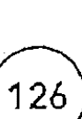

同樣是利空消息，但影響層面不同，操作策略也不相同，如果負面消息帶給公司營運長遠的影響，一定要盡快脫。

### 時機 ② 股價漲幅超過預期

投資股票最令人興奮的事情，莫過於股價的上漲，而投資成長股的獲利，最主要的來源來自資本利得，也就是所謂的「價差」。當你買進的股票，經過數個月或數年的等待，終於上漲至超越原先設定的目標價，這個時候到底要不要獲利了結？如果是長線價值投資人，會選擇持股續抱，因為對打算持股超過 10 年以上的人來說，差別不大；但對成長股投資人來說，還是要選擇在適當的時機獲利出場。最主要的原因是要保持資金的靈活度！當股價上漲超過設定的目標價，代表你運用有限的時間換取極佳的報酬率，可以把它當成是成功執行一次任務，所以賣掉有獲利的股票，將資金抽離，繼續尋找下一檔具成長潛力的個股，或加碼已經持有、但股價卻還沒反應的股票。

至於股價是否超漲？可以用之前提到的本益成長比公式計算，不過還是要注意，很多時候股價的超漲都是伴隨某些獲利大幅成長的利多消息產生，因此這時應該要重新檢視公司的經營情況，如果只是單純市場買盤推升股價達到目標價，那我會選擇賣出股票落袋為安，等股價拉回再伺機進場。

#### 時機③換股操作

賣出股票時機的3個條件裡，難度最高的是換股。投資成長股的原則，基本上就是持有市場裡最具未來成長潛力的個股，因此每隔一段時間，我會搜尋檯面上是否有其他未被發掘的成長潛力股，然後再跟自己手上的持股做比較，看哪一檔更有成長力道，再決定是否換股。會決定換股，主要是想把資金做最有效率的運用，畢竟一般投資人的資金並不多，應該要想辦法讓資金發揮最大的價值，增加投資報酬率應該是每個投資人都要努力追求的目標。

過去的經驗告訴我，完美的換股操作很有難度。當你發掘到一檔極有潛力的股票，打算換掉手上表現平庸的股票時，常會發生賣出的股票開始上漲，而換來的潛力新秀表現不如預期。有過幾次市場的教訓後，我會選擇盡量減少換股，與其事後換股，不如在原始投資時，就認真做好功課，有相當把握時再進場。

股神巴菲特有一段話我非常喜歡，他說：「想像你有一張卡片，上面有十個圈，代表你一生只有十次投資機會，每當你做了一個投資決策，就要在小卡上打上一個洞，直到打滿十個洞，就不能再做任何投資決策。」這是說在做每一個投資決策之前，都應該要深思熟慮，小心謹慎方為上策。

賣出股票的條件中，換股操作最難，除非有顯而易見的原因，否則應該減少換股。我覺得在計算2檔股票之後，若有超過3成以上的溢價空間，方可考慮換股，若只有1至2成的空間，我會傾向保留原持股。只有盡可能在進場前做好詳細研究，買進市場上最具潛力的股票，才能減少換股的次數。

# Ch 04

## 我的致富祕笈：「成長飆股投資術」實戰演練，6 年輕鬆晉身“千萬俱樂部”！

前一章我已經把「成長飆股投資術」講得很詳盡了，這一章我將直接示範如何把「成長飆股投資術」運用在台股的實戰操作上、分享案例，讓你們更清楚該如何算股、挑股，輕鬆翻倍賺。

從 2009 年開始，我用這套方法陸續買進正新 (2105)、統一超 (2912)、佳格 (1227) 等，之後又操作美利達 (9914)、儒鴻 (1476)、寶雅 (5904)、葡萄王 (1707)，直到最近的豐泰 (9910)，雖然大部分都是傳產股，但也有少部分 的電子股，像是飛捷 (6206)、振樾電 (8114)、鼎翰 (3611) 等，都有不錯的獲利。我並不是要吹噓每一一次的選股眼光都很精準，但說真的自從使用「成長飆股投資術」來精算股價、選股挑股之後，我的投資之路才算是真正開始「賺大賠小」，我有時候也會看錯股票，但即使看錯某 1 檔股票，我也能抓緊時機停損出場，不至於造成大損失。

接下來，在介紹這套選投資術的實戰操作之前，有一點要請你們務必牢記：成為投資贏家的重點，不在於看對的次數，而是看準的時候有沒有勇氣下大注？如果沒有下大注的決心，就算選到對的股票，也只是賺得小小的報酬，也違背了投資成長股的初衷。

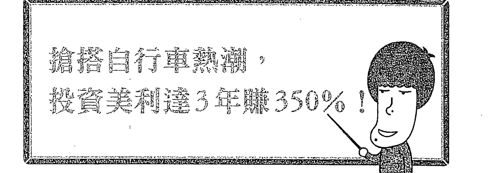

我在 2011 年開始買進美利達，但早在 2008 年就開始注意到自行車概念股，起先是發現週遭的親朋好友都陸續加入騎車行列，周日二日空間時，大伙就相約去郊外騎車，逐漸形成一股風潮。於是我在 2009 年買進自行車龍頭股巨大（9921），那個時候雖然已經懂得要挑選績優股，但欠缺評估股票合理價位的能力，因此我在 70 元買進，到 85 元左右就獲利出場，雖然波段也有 1、2 成的獲利，但賣出後內心隱約感受到有些不太對勁，但也說不上來，明明有獲利，內心卻沒有什麼喜悅，可能是潛意識知道自己賣掉一隻金雞母。果不其然，巨大從我賣出的那天之後，就一直上漲，一直漲、漲不停，到了 2014 年底，巨大的股價最高來到 290 元，此後再也沒看過二位數的股價。

巨大給了我很大的啟示，它證明 1 檔有價值的個股，只要獲利規模持續成長，股價就會一直不斷的上漲，跟大盤走勢幾乎完全沒有關聯。若一開始只打算獲利 20% 或 30% 就停利是很可惜的，因為你限制了自己的想像力！這樣的教訓讓我在發現同樣是自行車概念股的美利達時，有了不同的操作方法。

## 2008 至 2014 年巨大月線圖

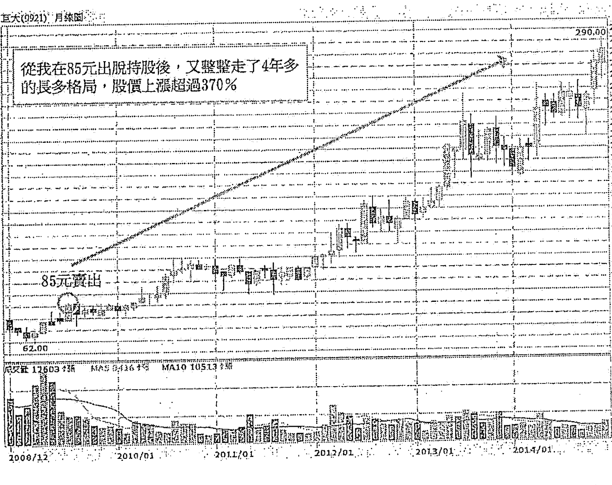

資料來源：富邦綜合證券股份有限公司

我的投資靈感大部分都來自於生活，有時候也會利用電腦設定條件來篩選股票，例如股東權益報酬率 15% 以上、過去 3 年現金股利達 1 元以上、股本 30 億以下、營收較去年同期成長 15%……等，然後再從中尋找未被發掘的好股。這樣的好處是不用大海撈針，但如果把篩選條件訂得太嚴苛，結果可能只會出現 2、3 檔股票，有時甚至 1 檔也沒有，這樣反而失去篩選股票的意義。

美利達就是我用電腦篩選出來的股票之一，於是我开始研究自行車產業，發現這裡頭大有學問，光是車型就有好幾款，有爬坡專用的登山車、競技用的越野車、競速用的公路車、代步用的城市通勤車等等，車架的材質也分碳纖維、鋁合金；變速裝置也越做越精密。而一般初級的入門車款最少近萬元起跳，好一點的進階車款價格數萬元不等，若是專業水準等級的高階車款甚至6位數起跳。

研究之後我發現，自行車不再只是一般通勤的代步工具，反而因為油價高漲，在節能環保及運動休閒兩大因素下，進階成為一種生活態度。雖然美利達營業規模只有巨大的 1/3 左右，但策略上並不如巨大採取廣泛多樣的產品路線，而是把生產重心擺在高階自行車上，專攻高單價車型。此舉有利在市場上與其他廠商做出區隔，並有望提升產品毛利率。美利達還有一個利基點就是：深耕大陸市場超過 10 年，有機會隨著中國經濟成長、一般民眾所得收入提高與休閒意識抬頭而激發的 10 億消費力，推升營收大幅成長！若這個推論成立的話，那美利達未來數年、甚至10 年的成長動能無慮，後勁非常值得期待。

接下來的步驟，就是套用「成長飆股投資術」的選股法則，看看美利達是否符合我們的選股標準：

## 用「10 個選股核心法則」檢測：

### ① 本益成長比是否低於 0.75？

2011 年年初的時候，美利達的股價約在 54 元左右盤整，2010 年每股稅後盈餘為 5.04 元，2011 年第一季稅後淨利較去年同期成長約 15%，加上 2010 年下半年基期較低的情況下，2011年稅後淨利有望較去年成長約 20%、甚至更高，若股本維持 24.7億不變，則預估 2011 年每股盈餘為 6.04 元：若以年初時 54 元的股價來計算，本益比約為 9 倍，預估未來平均稅後淨利成長率為 20%，得到的本益成長比為 0.45，低於 0.75，可見股價明顯被低估。

本益比 = 54÷6.04=9
本益成長比 = 9÷20= 0.45

### ② 未來 1 年預估本益比低於 15 倍？

2011 年年初美利達的股價為 54 元，前面又預估 2011 年美利達每股盈餘達 6 元的水準，換算下來預期本益比為 9 倍，嚴重低於市場平均水準。

### ③ 股東權益報酬率 15%以上？

美利達過去幾年的股東權益報酬率表現相當優異，平均有 20% 以上的水準，2010 年則為 20.7%，高於我們設定的 15% 以上的水準。

#### 美利達 2006-2010 年股東權益報酬率

| 年度 | 2006 年 | 2007 年 | 2008 年 | 2009 年 | 2010 年 |
| :--- | :---: | :---: | :---: | :---: | :---: |
| 股東權益報酬率 | 18.5% | 29.4% | 23.7% | 19.8% | 20.7% |

### ④ 近 5 年平均稅後淨利正成長？

美利達近 5 年的稅後淨利除了 2007 年大幅成長外，之後 3 年呈現持平的走勢，總體來說還是維持不錯的穩定度。即便遇上了 2008 年金融風暴，美利達還是能繳出 11.89 億成績，顯示美利達的獲利受景氣波動度相對較小，表現穩健。

#### 美利達 2006-2010 年稅後淨利

| 年度 | 2006 年 | 2007 年 | 2008 年 | 2009 年 | 2010 年 |
|---|---|---|---|---|---|
| 稅後淨利 | 7.33 億 | 13.31 億 | 11.89 億 | 11.27 億 | 12.49 億 |

### ⑤ 預估未來 3 年稅後淨利年成長 15% 以上？

以中國經濟高度成長的態勢，加上持續看發高階自行車市場的情況來看，預估未來 3 年稅後淨利成長平均應該有 20% 以上的表現。

### ⑥ 毛利率至少 15% 以上，且持續向上？

美利達的毛利率在過去 5 年約在 12% 至 15% 之間，雖然未達到我們設定的目標，但在持續開發高階自行車市場及大陸市場的加持下，應該有機會進一步改善。事實證明之後幾年的毛利率也逐年上升，2011 年 14.2%、2013 年 16.2%、2014 年 17.9%。

#### 美利達 2006-2010 年毛利率

| 年度 | 2006 年 | 2007 年 | 2008 年 | 2009 年 | 2010 年 |
|---|---|---|---|---|---|
| 毛利率 | 14.4% | 15.4% | 15.3% | 12.7% | 12% |

### ⑦ 負債比率低於 50%？

美利達的負債比剛好接近 50%，勉強符合條件。

### ⑧ 股本低於 30 億？

美利達當時的股本為 24.7 億，低於 30 億，符合我們選擇成長飆股的条件。

### ⑨ 經營階層持股多？

公司董事及大股東持有自家的股票達 37%，超過 1/3，合乎條件。

### ⑩ 融資比例低於 5%？

融資比例不到 3%，顯示籌碼相對安定。

#### 美利達的 10 個選股核心法則檢測

| 選股條件 | 美利達 |
| :--- | :--- |
| 本益成長比低於 0.75 | O |
| 未來 1 年預估本益比低於 15 倍 | O |
| 股東權益報酬率 15%以上 | O |
| 近 5 年平均稅後淨利正成長 | O |
| 預估未來 3 年稅後淨利年成長 15%以上 | O |
| 毛利率至少 15%以上，且持續向上 | X |
| 負債比率低於 50% | O |
| 股本低於 30 億 | O |
| 經營階層持股多 | O |
| 融資比例低於 5% | O |

美利達在 10 個選股核心法則裡，除了毛利率低於設定目標，其餘的 9 項都符合選股標準，符合我們買進的標準。

## 進場前的「6 個篩選條件」：

- ① 公司的業務是否簡單好懂？

美利達專注於自行車的研發製造與生產，自行車成車占營收高達 91%、自行車零件占營收約 9%，公司除了自有品牌「Merida」，另為持股約 35% 的美國「SBC」、以及持股 51% 的德國「Centurion」設計代工自行車，公司業務全部以自行車為出發點，相對單純。

- ② 公司的現金流量是否良好？

檢視美利達的現金流量表，來自營運的現金流量持續穩定增加，扣除購置固定資產為主的投資現金流量，以及支付現金股利後，每年所產生的現金流量多為正數，從 2004 年的期初現金 6.28 億增加至 2010 年的期末現金為 13.04 億，顯示美利達的現金流量良好且自有現金充足。

- ③ 公司是否擁有過人的競爭優勢？

美利達主要以生產高階自行車為主，與市場有所區隔。加上在大陸市場佈局多年已經經濟規模，且有自己的品牌，比起其它同業，更具競爭優勢。

- ④ 管理階層是否低調且認真打拚？

董事長曾崧柱為美利達創始人曾鼎煌第二代，在接棒前，已在自家企業磨練許久，行事風格認真打拚，而且低調，鮮少接受媒體訪問。

- ⑤ 管理階層是否有良好的誠信記錄？

公司從過去以來一直維持良好的誠信，無重大不良的記錄。

- ⑥ 經營者對未來業績成長感到樂觀？

董事長在年報中表示，在預期全球景氣回溫，訂單需求增加，並積極拓展大陸市場及擴廠增加新產能的情況下，未來的營運不黯淡。

經過通盤分析後，我的結論是可以買進，並且有成為核心持股的條件，以當時 54 元左右的價位，預估本益比不到 10 倍，即便評估有誤，下檔風險也有限，但若評估正確，則有獲利翻倍的機會。

### 美利達 2010 年 5 月至 2011 年 5 月週線圖

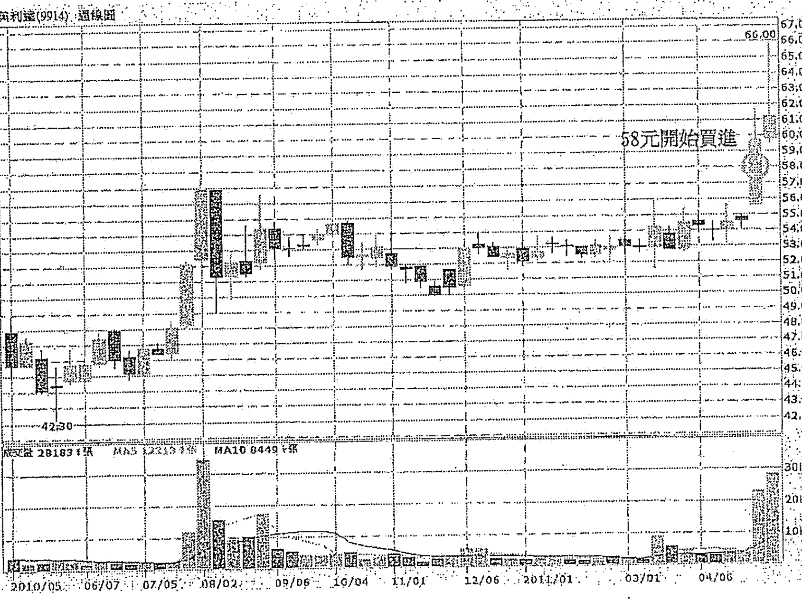

資料來源：富邦綜合證券股份有限公司

於是我從 58 元的價位開始買進，從線型來觀察，一根紅 K 棒突破過去數個月的橫盤整理格局，代表長多可期。一般散戶愛撿便宜，不喜歡買創近期新高的個股，怕追高殺低套在高檔。但其實所有具備大波段行情的股票，都是一直重復創新高，而這些股票的共同點，就是有很強的基本面做支撐，所以當買進後股價創高，代表之前的推論正確，應該更需要大力加碼。

### 美利達 2010 年 5 月至 2012 年 2 月週線圖

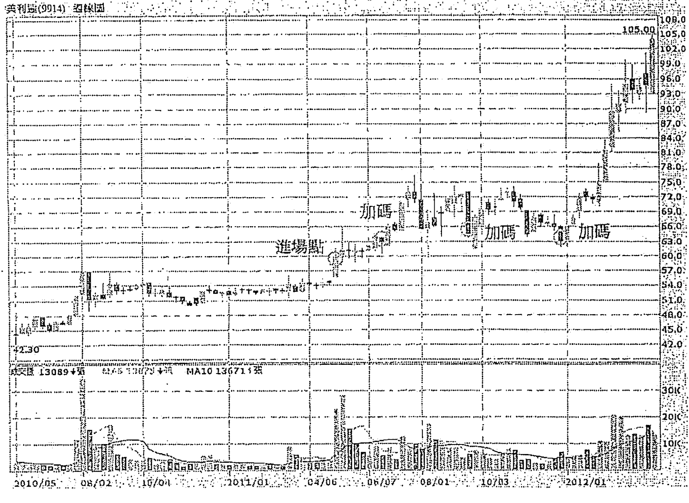

資料來源：富邦綜合證券股份有限公司

雖然股價在 60 至 75 元之間橫盤長達 8 個月之久，不過美利達股價從未跌至 2011 年 5 月初向上突破的紅 K 棒，因此只要股價一有拉回就逢低加碼增加持股。

之後，在 2012 年 2 月中向上突破 75 元的關卡後，就一路呈現多頭格局，持續上攻，連續上漲好幾年；到了 2012 年，股價漲到 100 元，公布的企業獲利還持續在成長，不管從營業利益率、稅後淨利及每股盈餘來看，都呈現明顯的成長，除了 2012 年第 2 季因為保留盈餘的關係，而被課較高的稅率而導致淨利下滑，但此因素應為單一事件，只影響單季表現，並不影響美利達的後勢發展。因此沒有賣出股票的理由。

### 美利達 2011 年及 2012 年單季獲利能力比較

| 年度 | 2011 1Q | 2011 2Q | 2011 3Q | 2011 4Q | 2012 1Q | 2012 2Q | 2012 3Q | 2012 4Q |
| :--: | :--: | :--: | :--: | :--: | :--: | :--: | :--: | :--: |
| **營業利益率** | 4.93% | 7.40% | 6.68% | 9.21% | 8.05% | 9.28% | 10.35% | 8.36% |
| **稅後淨利（億元）** | 3.77 | 3.69 | 5.17 | 5.52 | 5.01 | 3.60 | 6.91 | 7.74 |
| **每股盈餘（元）** | 1.52 | 1.49 | 2.09 | 2.23 | 2.02 | 1.26 | 2.43 | 2.72 |

當美利達股價來到 100 元時，若用原始買進價位 58 元來計算，已有接近 8 成的獲利，確實會讓人興起獲利了結的念頭，但我預估美利達 2012 年每股盈餘有機會賺超過 8 元，若用 8 元來計算，本益比不到 13 倍，稅後淨利成長率如果還是以 20% 來計算，本益成長比只有 0.65，表示美利達即便已經上漲至 100 元，股價還是低估的範圍，因此我打定主意持續抱。

一直等到 2013 年第 3 季，股價來到超過 200 元的歷史高點，如果淨利成長率一樣維持 20%，計算出的本益比已在 20 倍以上，本益成長比超過 1，若淨利成長率剩下 15%，則本益成長比會高於 1.33，股價已經明顯不便宜了！因此我選擇從 200 元、210 元、220 元一路達高獲利了結，總計持股 3 年，加計含配股配息，合計總獲利超過 350%！

### 美利達 2010 年至 2013 年月線圖

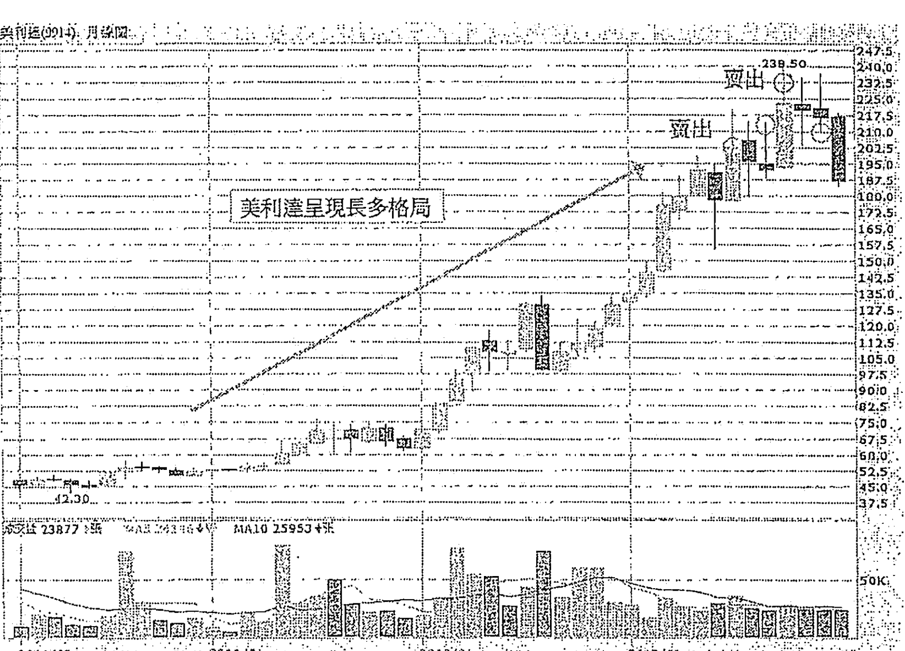

資料來源：富邦綜合證券股份有限公司

從 2010 年 5 月股價 58 元開始買進，至 2013 年 9 月股價來到 202 元開始賣出持股為止，股價出現 3 年多的大波段漲勢。

### 美利達 2009 年至 2013 年的獲利表現

| | 2009 | 2010 | 2011 | 2012 | 2013 |
| --- | --- | --- | --- | --- | --- |
| 營收(億元) | 152 | 167 | 201 | 243 | 253 |
| 純益(億元) | 11 | 12 | 18 | 23 | 29 |
| 純益率 | 4.55 | 5.04 | 7.33 | 8.17 | 10.21 |

〈總結〉從美利達 2009 年至 2013 年的獲利表現來觀察，營收、稅後淨利、每股盈餘都逐年成長，尤其是每股盈餘的彈升更是驚人，從 2009 年的 4.55 元到 2013 年已大幅成長至 10.21 元。年年成長的表現，讓股價具備大漲的動能，不管獲利成長性或股價表現在所有股票裡都名列前茅。我後來賣出美利達，但並不代表看壞公司未來的營運，只是單純覺得股價已不便宜，未來上漲空間有限，把資金抽離找尋更好的投資機會，或先保留資金，等待股價拉回再找機會買進，這些都是合理的選項。

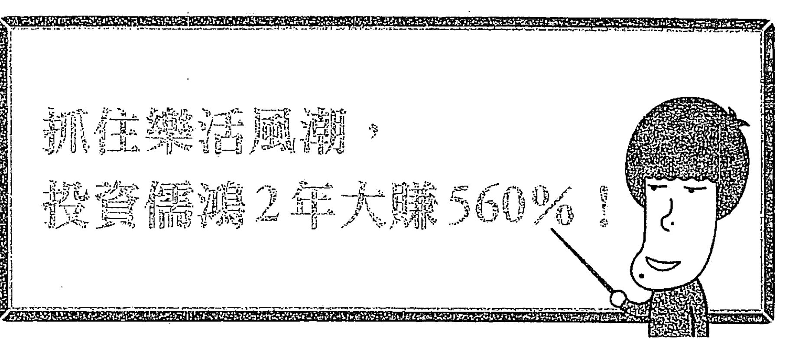

若以股票漲幅及投報率來計算，儒鴻是我的代表作。一開始買進儒鴻的想法很簡單，因為生活水準提高，現代人吃的越來越好、也越來越多，吃的多就會發胖、就會想要身體健康又可以維持身材，自然就要靠運動。我會注意到這檔股票，是因為我發現周圍的女性友人，不約而同的開始報名瑜伽課程，畢竟保持美好的體態是女人的天性，而且做瑜伽可以在室內吹著冷氣空調，不用曬太陽。有了這個念頭後，我把台股所有上市的紡織類股全部看了一遍，赫然發現當時最炙手可熱的加拿大專業瑜伽品牌 LuLuLemon 是儒鴻所生產的，於是我開始研究這家公司。

1977 年成立的儒鴻，一開始是以針織布起家，直到近幾年才開始跨足成衣代工，從上游的布料做到下游成衣，成為一貫化垂直整合紡織廠。客戶都是世界知名品牌，產品都以運動機能性為導向，因為從事布料研發超過 30 年，因此每年有能力研發 3000 種以上的布料，配合近年來開始流行的運動時尚風，且當時主要的客戶 LuLuLemon 正快速崛起，營運大幅擴張，除了身為 LuLuLemon 的核心供應商，加上獨步市場的布種研發能力，都讓儒鴻的後勢不看淡，近年來營收與獲利呈現雙雙走揚的態勢。

尤其當一般人認為紡織業是夕陽產業時，儒鴻董事長洪鎮海卻很有霸氣的說出：「儒鴻是科技紡織股，不是夕陽產業，除非大家都不穿衣服！」這番話，可見洪董並不把儒鴻當傳統產業，而是把公司當高科技業來經營，看得出經營者對未來經營滿具信心及野心。我當時一邊研究，內心有個聲音告訴我：遇到如此具潛力的成長性、且股價嚴重被低估的股票真的不多，非要好好把握住機會不可！因此我運用第三章提到的「成長飆股投資術」來檢視這支股票。

用「10 個選股核心法則」檢測：

- ① 本益成長比低於 0.75 ？

從 2011 年前三季度每股盈餘 4.11 元估算，我認為 2011 年的每股盈餘應該有 5.5 元的實力，當時的股價在 52 元，所以本益比為 9.4 倍。另外，如果扣除 2008 年因為金融海嘯大環境不佳的因素，2007 年到 2011 年前三季度，儒鴻的稅後淨利每年都呈現成長，平均年稅後淨利成長率有 37%，但我用保守的 20%淨利成長率來預估，計算下來的本益成長比僅有 0.47，大大超過我所設定的 0.75 買進目標，是很明顯的進場訊號。

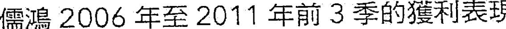

| 年度 | 2006 | 2007 | 2008 | 2009 | 2010 | 2011前三季 |
| :--- | :--- | :--- | :--- | :--- | :--- | :--- |
| 營收(億元) | 57.99 | 60.43 | 67.09 | 61.94 | 85.41 | 75.23 |
| 稅後淨利(億元) | 3.35 | 3.34 | 1.93 | 3.77 | 7.64 | 8.41 |
| 每股盈餘 | 2.33 | 2.01 | 1.02 | 1.95 | 3.83 | 4.11 |

本益比 = 52 ÷ 5.5 = 9.4
本益成長比 = 9.4 ÷ 20 = 0.47

- ② 未來 1 年預估本益比低於 15 倍？

當時的股價約為 52 元，預期當年的每股盈餘有 5.5 元的水準，計算下來本益比不到 10 倍，股價明顯偏低。

- ③ 股東權益報酬率 15% 以上？

儒鴻 2010 年的股東權益報酬率高達 22.8%，2011 年前三季平均高於 26%，因此我預估 2011 年的股東權益報酬率有機會超過 25%，高於我們所設定的 15% 以上，代表儒鴻的獲利能力極其優秀。

- ④ 近五年平均稅後淨利正成長？

過去 5 年儒鴻的稅後淨利平均年成長超過 35%，表現相當優異，即便與檯面上一流的成長企業相比，也毫不遜色。

- ⑤ 預估未來 3 年稅後淨利年成長 15% 以上？

在公司持續擴廠，且持續增加新客戶；毛利率與營業利淨率逐步提升下，預估儒鴻可望維持過去幾年的成長力道，預期未來稅後淨利年成長有 20%、甚至 25% 以上的水準。

- ⑥ 毛利率至少 15% 以上，且持續向上？

儒鴻的營業毛利率過去平均在 20% 之上，2010 年為 23.8%，超過一般紡織股的水準，顯示儒鴻擁有一流的產業競爭力。

### 儒鴻 2006-2010 年毛利率

| 時間 | 2006 年 | 2007 年 | 2008 年 | 2009 年 | 2010 年 |
| :--- | :--- | :--- | :--- | :--- | :--- |
| 毛利率 | 21.1% | 21.2% | 18.8% | 24.8% | 23.8% |

- ⑦ 負債比率低於 50%？

儒鴻的負債比只有約 40%，符合少於 50% 的條件。

- ⑧ 股本低於 30 億？

儒鴻的股本為 21 億，低於 30 億，是符合絕佳的中小型成長股條件。

- ⑨ 經營階層持股多？

公司經營階層加上大股東持有自家的股票超過 37%，占股本 1/3 以上，符合選股條件。

- ⑩ 融資比例低於 5%？

融資比例只有 2.5%，代表籌碼相對穩定。

### 儒鴻的 10 個選股核心心法則檢測

| 選股條件 | 儒鴻 |
| :--- | :---: |
| 本益成長比低於 0.75 | ○ |
| 未來 1 年預估本益比低於 15 倍 | ○ |
| 股東權益報酬率 15% 以上 | ○ |
| 近 5 年平均稅後淨利正成長 | ○ |
| 預估未來 3 年稅後淨利年成長 15% 以上 | ○ |
| 毛利率至少 15% 以上，且持續向上 | ○ |
| 負債比率低於 50% | ○ |
| 股本低於 30 億 | ○ |
| 經營階層持股多 | ○ |
| 融資比例低於 5% | ○ |

（遇到 10 個條件全部都吻合的機會不多，遇到這種情況要大膽買進！）

## 進場前的「6 個篩選條件」：

- ① 公司的業務是否簡單好懂？

儒鴻是從布料到成衣一貫化垂直整合紡織廠，台灣為研發運籌中心，主要負責接单，銷售市場以美歐為主，生產基地則分散於台灣、大陸、越南、柬埔寨與賴索托等地，是許多世界知名品牌商長期合作的專業供應商。主要客戶有：LuLuLemon、Under Armour、Nike、Adidas、Gap、Columbia 等。

- ② 公司的現金流量是否良好？

過去幾年儒鴻的營收三級跳，連帶使來自營運之現金流量大增，現金股利的配發也 1 年比 1 年多，但因為產能大增，需要大量購買固定資產，因此資本支出也相對較高，但因為公司獲利能力實在太優異，加上每年固定折舊的現金也不少，持續有穩定的現金流入。

- ③ 公司是否擁有過人的競爭優勢？

儒鴻成立於民國 66 年，公司專注在製造彈性針織布料及機能性成衣，主攻高單價、利基型的運動機能服飾，每年約可開發 3000 種新布料、每天可開發 150 款新樣衣，提供客戶一次性購足服務。由於儒鴻在品管部分採用電子科技化管控，產品良率高，深獲客戶信賴與依賴，所生產的布料可賣到其他同業的 5 倍售價！目前台灣同業大多是生產短纖，長纖的技術多半不是儒鴻的對手，技術門檻有 5 年的差距。

- ④ 管理階層是否低調且認真打拚？

董事長洪鎮海為儒鴻的靈魂人物，從 24 歲開始進入染整廠、26 歲自行創業，到現在已超過 40 年的歲月，一路走來秉持學徒精神，不斷學習、不斷打拚。

- ⑤ 管理階層是否有良好的誠信記錄？

根據我的觀察，管理階層一直維持絕佳的誠信記錄，公司發佈的新聞消息或對未來營運的評估，不刻意隱瞞亦不誇大其詞。

- ⑥ 經營者對未來業績成長是否樂觀？

在業績說明會上，董事長對公司未來營運充滿信心，並預估營收可望雙位數成長。

《總結》經過通盤研究後，我在 2012 年 2 月以每股 52 元的價位開始買進，當時大盤指數大約在 7700 點附近。買進之後，很幸運的並沒有遇到橫盤整理的情況，而是一路緩步上漲，雖然不是每天漲停，但卻是慢慢漲、漲不停，若把日線圖拉長來看，走勢如同山的形狀，我的經驗裡，如果出現像爬山般的走勢，通常後勢都不看淡，最怕 90 度角的噴出行情，往往來得快去得也快。加上我在投資前有做足功課，對公司的基本面有信心，所以在上漲的過程只要有拉回，就持續加碼，於是從 60 元、70 元、80 元……順勢一路佈局，最後買到超過我所有資金的 5 成！

### 儒鴻 2011 年至 2012 年週線圖

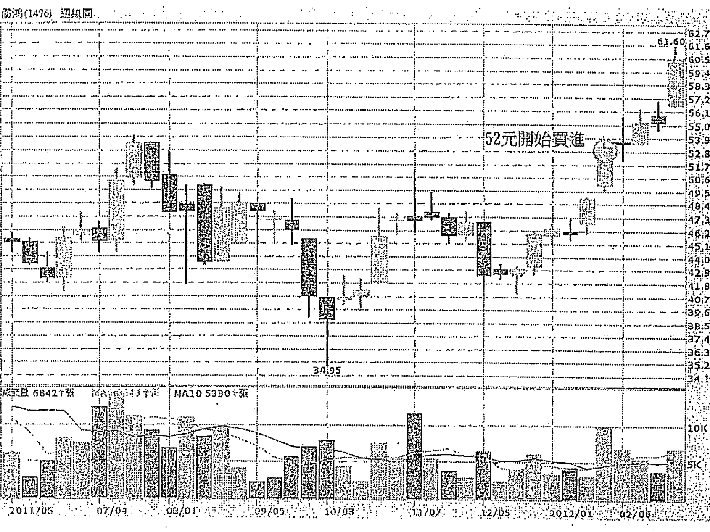

資料來源：富邦綜合證券股份有限公司

我會將儒鴻推薦給周遭的親朋好友，建議他們買進。有個朋友聽了我的建議，也覺得儒鴻不錯，在 60 元的價位買進，但漲到 70 元就忍不住獲利出場。當遇到 1 檔價會被低估的成長股，沒有打算長期抱牢是很可惜的一件事情，只要賣掉就可能再也買不回來。就連我在紡織業上班長達 30 年的老爸，也是在股價突破 100 元整數關卡時，便把股票全數出清，他不認為紡織股能漲到多少，所以 60 元買進後，漲到 100 元就賣出，把 60% 的獲利落袋為安，當下看起來似乎是個正確的決定，只是後來當他發覺自從賣出的那天開始，股票再也沒有回到二位數，而是屢創新高之後，先前獲利了結的喜悅就變得蕩然無存。所以投資時最重要的一點是：只要公司獲利持續增加，而且成長的幅度大於本益比，就要緊緊抱牢不放，千萬別隨便賣股票！因為最後回頭來看可能會讓你後悔莫及。

在買進儒鴻之後，只要經過運動或戶外機能有關的服飾店，我就會不自覺的進到店裡逛逛，伸手去感受一下衣服的材質，翻開衣領查看成份標及生產基地，借此了解一下紡織產業的最新流行脈動。有時候看的太入迷，還會引來門市小姐的側目，畢竟超過 185 公分的身高，在女性貼身瑜珈專區內翻來翻去，畫面實在有點太過詭異，但投資一家公司之後，就需要隨時注意相關的新聞報導，也不該錯過公司經營者每一次的專訪內容，因為資料越多，越有助於讓投資畫面更加清晰，判斷的準確性自然就會提高。

### 儒鴻 2009 至 2013 年的營運表現

| 年 | 2009 | 2010 | 2011 | 2012 | 2013 |
| --- | --- | --- | --- | --- | --- |
| 營收 (億) | 61 | 85 | 106 | 135 | 181 |
| 稅後淨利 (億) | 3.7 | 7.6 | 11.8 | 17.9 | 27.3 |
| 每股盈餘 (元) | 1.95 | 3.83 | 5.60 | 7.75 | 10.91 |

如果持續關注儒鴻的獲利，可以發現營收、淨利及每股盈餘每年都呈現大幅成長，營收從 2009 年的 61 億成長到 2013 年的 181 億，增加 2 倍，而稅後淨利則從 3.7 億一口氣成長到 27.3 億，增加超過 6 倍，每股盈餘更是從原本只有 1.95 元只花 4 年的時間就爆增到 10.91 元。如此強勁的成長動能，別說是在紡織族群，即使跟所有的上市公司相比，也絕對是名列前茅的續優生！股價當然也跟著反應，呈現一路走升的長多格局。從週線圖可以很清楚看到，因為股價一路上漲，所以任何拉回都是買點。加上在上漲的同時，外資法人持續買超，而代表散戶指標的融資反而呈現一路遞減，籌碼面相對安定，更加深股價上漲的力道。

### 儒鴻 2012 年 6 月至 2013 年 4 月週線走勢圖

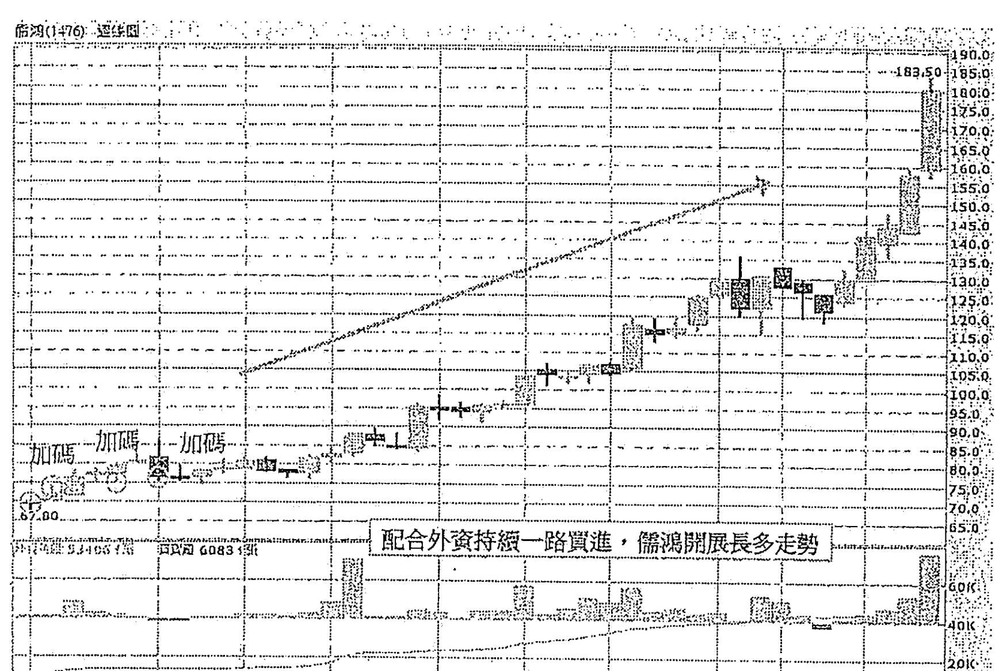

資料來源：富邦綜合證券股份有限公司

我一直到 250 元左右才開始小量減碼，並且在 350 以上大幅賣出，最高賣在 392 元。因為股價到了 300 元以上，本益比已經超過 25 倍，若獲利成長不能持續維持高檔，本益成長比很容易就超過 1。加上我從月營收觀察，獲利成長有趨緩的情況，毛

利率也較前一年同期少了 3%，加上越南工廠營業費用的提高，預期會侵蝕淨利。如果儒鴻未來的平均獲利成長率是 20%，2014 年預估每股盈餘為 12 元左右，如果股價是 350 元，本益成長比計算出來為 1.45，就應該要賣出！

### 儒鴻 2011 年底至 2014 年週線圖

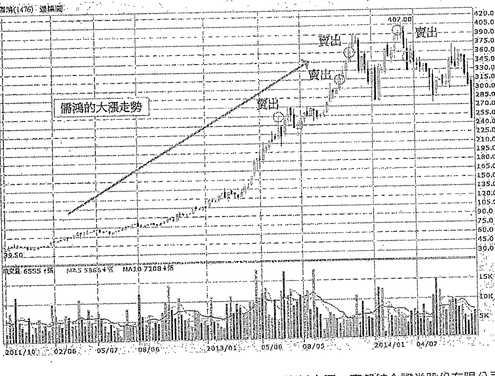

資料來源：富邦綜合證券股份有限公司

我在 2014 年 5 月把儒鴻的持股全數出脫，之後股價從 400 元反轉向下修正，一路順勢跌到波動最低 212 元，跌幅高達 47%。主因是財報數字不如法人機構的預期，加上股價漲高了，一且有不利因素，外資倒貨的力道比誰都狠，股價馬上遭遇到嚴重的修正。總計儒鴻持有時間從 2012 年 2 月到 2014 年 5 月，共 2 年 3 個月，合計投報率超過 560%。

## 瞄準冷門股，投資寶雅 1 年半賺 1 倍

2012 年是適合投資佈局的一年，當時剛歷經歐債風暴沒多久，總體經濟表現疲弱，GDP 一直不斷往下修，市場氣氛低迷，很多好公司的股票都乏人問津。於是在買進儒鴻沒多久之後，我又注意到了 1 檔過去表現一直很優異的股票，就是上櫃百貨股寶雅。

寶雅是南部起家的個人美妝生活用品連鎖店，因為瞄准的消費者是年輕女性顧客，所以店面外觀多了一分時尚感，店內則主打女性美妝商品，種類五花八門，從日韓流行彩妝、進口流行飾品、生活百貨、五金用品、休閒食品……等，應有盡有。但又與屈臣氏或康是美等藥妝店不一樣的地方是：寶雅的實體店面更大上許多，賣場坪數達 1500–2000 坪，且商品種類多達 4 萬項。

嚴格說來，跟寶雅性質較相同的連鎖通路是美華泰、名佳美，但美華泰與名佳美的分店都不多，不過寶雅在 2011 年底的全台總店數已經有 64 家，可以說是美妝生活用品連鎖店的獨占品牌。但或許是因為寶雅大多在中南部或北部二線城市展店，而台北市就只有一家民生店，因此沒有受到法人機構的注意，甚至根本聽都沒聽過，但如果跟住在南部的女性友人聊到寶雅，幾乎大家都曾去消費過，有的甚至還是會員，證明寶雅在南部是相當火熱的美妝生活賣場。

用「10 個選股核心法則」檢測：

### ① 本益成長比低於 0.75 ？

2011 年寶雅的每股盈餘為 3.76 元，根據公司發佈的新聞顯示，未來將持續加快展店的步伐，且大部分集中在中南部及二線城市展店，租金相對便宜，有些新展店的門市甚至不到 1 年即可回本並開始賺錢，加上正在興建大型的商品集貨中心，都有助提升營收及毛利率，長線獲利看好，若 2012 年稅後淨利成長率達 20%，則每股盈餘有機會拉升至 4.5 元以上。若以 4.5 元來計算，以當時 50 元的價位，預估本益比為 11 倍，若未來稅後淨利成長率維持 20% 水準，計算出的本益成長比為 0.55，是值得買進的標的。

本益比 = 50 ÷ 4.5 = 11
本益成長比 = 11 ÷ 20 = 0.55

### ② 未來 1 年預估本益比低於 15 倍？

寶雅的股價 50 元，我們預期 2011 年每股盈餘有 4.5 元的水準，本益比為 11 倍，低於 15 倍。

### ③ 股東權益報酬率 15% 以上？

過去幾年寶雅的股東權益報酬率都在 15% 以上，2010 及 2011 年則都超過 20%，高於我們所設定的 15% 以上預期目標。

寶雅 2009 至 2011 年的股東權益報酬率

| 年度 | 2009 | 2010 | 2011 |
| :--- | :--- | :--- | :--- |
| 股東權益報酬率 | 15.8% | 20.1% | 20.78% |

### ④ 近 5 年平均稅後淨利正成長？

寶雅過去 5 年的稅後淨利平均年成長為 21%，遠遠大幅超越近 5 年平均稅後淨利正成長的條件。

### 寶雅 2007 至 2011 年獲利表現

| 獲利 | 2007 | 2008 | 2009 | 2010 | 2011 |
| :--- | :--- | :--- | :--- | :--- | :--- |
| 營收(億元) | 61 | 85 | 106 | 135 | 181 |
| 稅後淨利(億元) | 2.5 | 3.08 | 2.69 | 3.26 | 3.36 |
| 每股純益(元) | 1.95 | 3.83 | 5.6 | 7.75 | 10.91 |

### ⑤ 預估未來 3 年稅後淨利年成長 15% 以上？

百貨業的營收成長來自於展店及提高單店營收及毛利，從財報上來看，寶雅過去幾年做的不錯，使得過去 5 年的稅後淨利平均年成長為 21%，根據公司發佈的消息，未來將持續加快展店的步伐，預估寶雅可望維持過去的成長力道應該不是太大的問題，有機會年成長 20%，超過我們設定年成長 15% 的目標。

### ⑥ 毛利率至少 15% 以上，且持續向上？

寶雅在 2009 年至 2011 年的毛利率為 28.3%、30.3%、32.6%，已站穩 30% 大關，並且逐年走高，代表內部有嚴格進行優化毛利的動作。

### 寶雅 2007-2011 年毛利率

| 年份 | 2007 年 | 2008 年 | 2009 年 | 2010 年 | 2011 年 |
| :--- | :--- | :--- | :--- | :--- | :--- |
| 毛利率 | 28.2% | 28.0% | 28.3% | 30.3% | 32.6% |

### ⑦ 負債比率低於 50%？

寶雅的負債比 45%，符合預期。

### ⑧ 股本低於 30 億？

寶雅的股本為 8.9 億，屬於小型成長股。股本符合我們低於設定 30 億的選股條件。

### ⑨ 經營階層持股多？

董監事加上大股東持有自家的股票超過 51%，超過 1/2。董事長陳建造為寶雅第一代創始人，而總經理則是引進電腦化系列管理規則的第二代陳宗成，整個經營高層及大股東幾乎都是自家人，很典型的家族企業，顯示籌碼相當集中在自家人手裡，籌碼集中的情況下，股價較容易拉抬。

### ⑩ 融資比例低於 5%？

融資比例只有 1.8%，代表籌碼相對穩定。

### 寶雅的 10 個選股核心法則檢測

| 選股條件 | 寶雅 |
| :--- | :--- |
| 本益成長比低於 0.75 | ◎ |
| 未來 1 年預估本益比低於 15 倍 | ◎ |
| 股東權益報酬率 15%以上 | ◎ |
| 近 5 年平均稅後淨利正成長 | ◎ |
| 預估未來 3 年稅後淨利年成長 15%以上 | ○ |
| 毛利率至少 15%以上，且持續向上 | ○ |
| 負債比率低於 50% | O |
| 股本低於 30 億 | O |
| 經營階層持股多 | O |
| 融資比例低於 5% | O |

進場前的「6 個篩選條件」：

- ①公司的業務是否簡單好懂？

  寶雅為美妝生活雜貨專賣百貨，主要以女性消費者為主，營收來自於全省門市的商品銷售，營運模式相對單純。

- ②公司的現金流量是否良好？

  過去幾年來自營運之現金流量逐年增加，現金股利也逐年提升，在不過度舉債的狀況下，寶雅帳面上的現金越顯充沛。

- ③公司是否擁有過人的競爭優勢？

  跟其它同業比起來，寶雅全省門市已達 64 家，具規模經濟；管理階層率先導入電腦化管理，加上興建中的大型物流中心，有助提升毛利率及降低營業費用。長期來看，只會更拉開與同業的競爭距離。

- ④管理階層是否低調且認真打拚？

  寶雅為家族企業，董事長陳建造與總經理陳宗成為父子關係，行事風格低調且專注於事業打拚，鮮少受訪。

- ⑤管理階層是否有良好的誠信記錄？

  寶雅成立於 1997 年，管理高層一直維持良好的誠信記錄，無負面消息。

- ⑥經營者對未來業績成長語調是否樂觀？

  從公司發佈的消息顯示，未來幾年會更積極展店，預計在 2016 年底全台總店數將達到 150 家以上，顯現公司內部不僅僅只想安於現狀，對公司發展遠景深具企圖心。

《總結》我在 2012 年 5 月以 50 元左右的價位開始買進寶雅，若從技術線型來看，這時是回檔打底後再創新高，一般人可能不敢買創新高的股票，但現在再回頭來看，50 元反而是寶雅的起漲點，而非高點，但對我來說，本益成長比只有 0.55，是值得進場的價位。

### 寶雅 2011 年至 2012 年 5 月週線圖

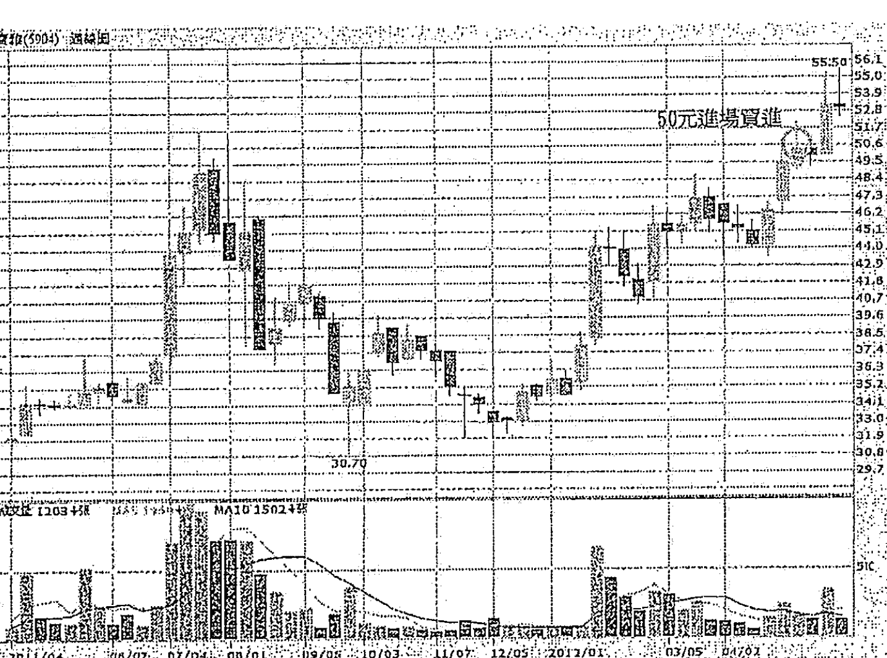

資料來源：富邦綜合證券股份有限公司

進場之後，寶雅的股價先是在 50 元附近盤整了近 2 個月，期間我陸續買進增加持股，最低買在 49 元，到 7 月股價終於表態，攻上 60 元整數關卡後，從此股價一路上漲，再也沒有看到 5 字頭的價位。

### 寶雅 2012 年 5 月至 2013 年 4 月週線走勢圖

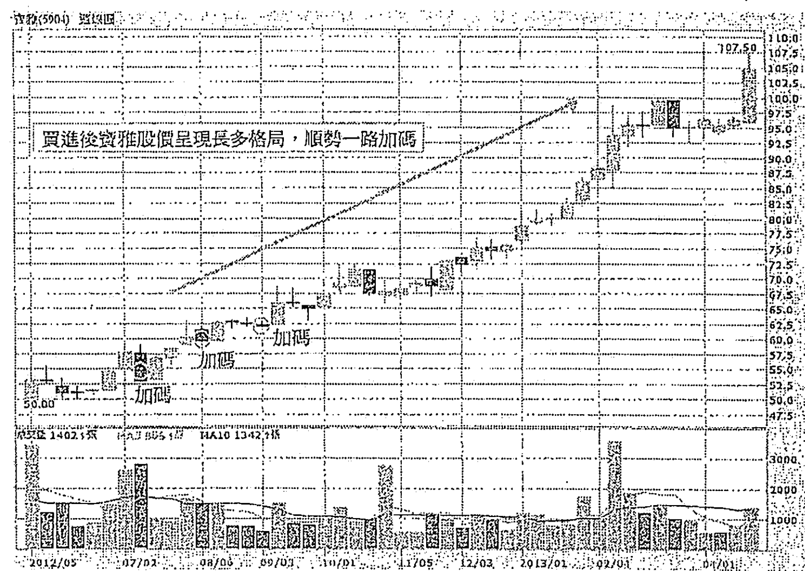

資料來源：富邦綜合證券股份有限公司

2012 年寶雅的營運表現也蒸蒸日上，展店的速度照計畫進行，桃園的物流集貨中心也在規劃行程裡，加上日圓貶值的助力，都讓財報上數字愈來愈亮眼。從營收數字、毛利率、營業利率進一步觀察，都可以很明顯的看出這一家公司的營運往好的方向在前進。

我一直抱到 2013 年的 4 月寶雅股價來到 100 元整數關卡，才開始出脫持股，最高賣到 162 元，賣出的理由並非看壞寶雅的成長性，而是短期的漲幅過大，短短 1 年多的時間，股價上漲超過 2 倍，我當時預估寶雅的稅後淨利成長率為 20%，預計 2013 年的每股盈餘有 5.7 元的水準，若股票來到 120 元以上，算出來的本益成長比則超過 1，若股票來到 160 元以上，本益比則來到 28 倍的水準，計算出來的本益成長比則為 1.4，股價已經變得太貴了，而且算一算持有寶雅時間不到 1 年半，總獲利超過 1 倍，比我預期的還要好，就把部位全部出清。

### 寶雅 2012 年 5 月至 2014 年 1 月週線圖

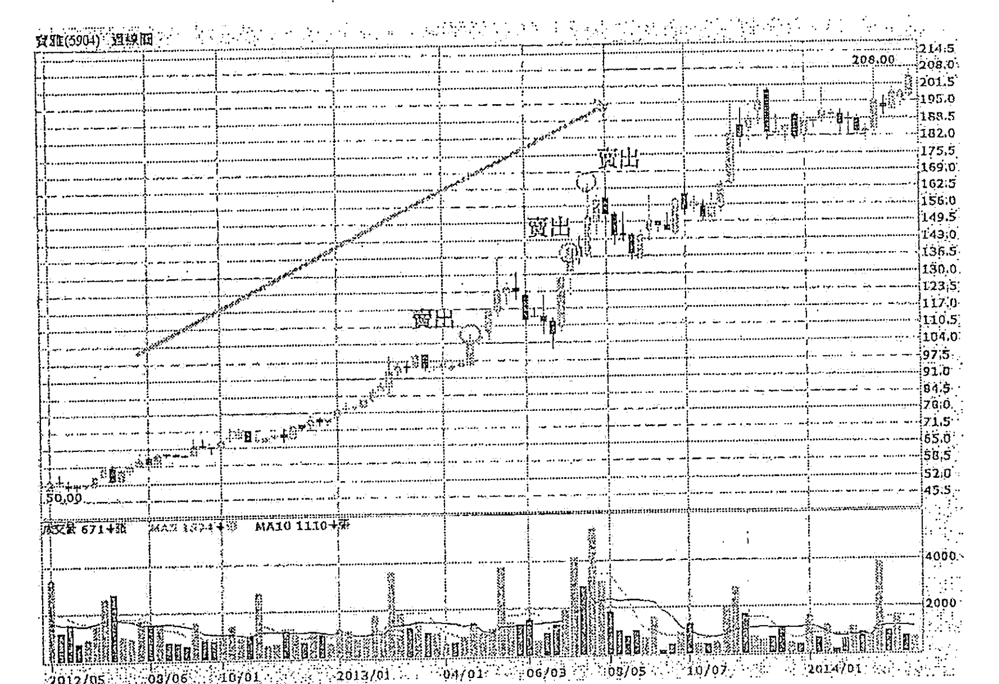

資料來源：富邦綜合證券股份有限公司

在賣出之後，寶雅先是拉回到 135 元附近，之後就一路上漲，到 2015 年股價已超過 300 元整數大關，表現的比我預期的還要好，這是我低估寶雅的獲利能力。而且用本益成長比來看，股價變得有點高；再者，我也將資金挪移到其他股票，並沒有資金能夠再加碼。

這呈現出本益成長比公式的侷限，但事實上也沒有任何一種方法可以百分百確定萬無一失！也沒有人有本事買在最低、賣到最高，賺得最大的報酬，重點在於在可控的風險下賺得最大的報酬！對我來說，當時寶雅的股價已經高到我認為風險太大，與其繼續持有，還不如把心思放在專注尋找下一檔潛力股！

# Ch 05

## 《算股高手》私藏股名單：10檔價值最可能被低估的冷門股、黑馬股大公開！

投資就是買進獲利成長最好的公司，就如同選美比賽，我們只選擇最亮眼的佳麗...

好像有道理...

就像這兩張照片，我們只選林至玲，千萬不要選枝安婌...

我這樣解釋，你明白嗎？

哇！好可愛～

這傢伙不只投資有問題，審美觀問題更大...

無言以對...

我好想跟右邊這位美女交往喔～

想在股市中獲取高於市場的平均報酬，最好的方法就是買進未來業績能夠大幅成長、且股價被低估的公司，差別只是在於當指數只有 6000 點時，符合條件的公司多一些，而當指數超過 9000 點時，合乎條件的公司就會少一些。

當我開始撰寫本章節時，台股在經過連續 3 年的上漲後，在 2015 年的 5 月站上萬點，之後開始顯得後繼無力。加上面臨油價大跌、紅色供應鏈、出口衰退、景氣低迷等議題的衝擊，一口氣下跌至 7023 點，跌幅接近 3 成。總計 2015 年台股指數下跌 10.41%，年底收盤指數為 8338 點。

我記得我 2006 年剛進到股票市場的時候，指數約在 6500 點左右，若只是單純看指數，等於指數近十年來只上漲 28%，雖然加權指數只具備統計意義，完全不能代表個股，但心中還是充滿無限感慨：10 年可以讓很多公司物換星移！智慧型手機品牌大廠宏達電(2498) 從 1300 元跌到 50 元，只花不到 5 年的時間；而原本不起眼的紡織股儒鴻(1476) 從 10 元漲到 500 元，超過 50 倍的投資報酬率，卻也只用了 7 年，即使過程中大盤有時呈現空頭走勢，也阻擋不了儒鴻多頭強勢的格局。

但像儒鴻這種維持多頭走勢的股票是少數，大部分的股票還是躲不了空頭市場所伴隨而來的股價下跌，尤其是基本面差的公司，股價下修的幅度很驚人。遇到空頭市場時，投資人會因為受不了虧損而惶恐不安。但換個角度想，空頭下殺是蘊釀著下一波多頭漲勢的開始，大部分的公司經過空頭市場的洗禮，整體市場本益比的下修，更有利於從中发掘被錯殺或被低估的股票。

記得在 2008 年金融風暴及 2011 年的歐債危機，幾乎所有上市櫃公司的股價都面臨重挫，現在事後回想，當時所有股票都極為便宜，只是沒有人敢進場。

2016 年市場普遍對未來感到悲觀，出口連續衰退、景氣持續低迷，加上新舊政權的交接，從台股融資餘額只剩下不到 1500 億，顯示投資人對未來相對保守，選擇觀望不進場。2016 年台股是否持續修正或者是能夠浴火重生？說實話，我也沒有絕對把握。但沒有人能夠百分百預測市場未來走勢，我只知道要在股市長期獲利，不需具備預測市場漲跌的能力，把重心放在專注於研究公司基本面的好壞，買進被低估的成長潛力股，就能創造出長期打敗市場的好績效。

在投資組合方面，我通常維持 5~6 檔股票，我喜歡集中持股，至於持有幾檔算集中？這沒有標準的答案，主要在於資金的多寡，加上你對持股公司的了解程度。我不建議持有一籃子股票，一方面是你很難同時掌握這麼多公司的營運狀況，容易疲於奔命，另一方面是即便投資組合中有 1 檔大漲的股票，也會因為持股占比太少，無法帶動整體的投資績效，與其持有一籃子股票，倒不如直接投資 ETF，即省時又省力。我的做法是把資金集中在少數幾檔熟悉、且具備未來成長潛力的股票，另外會篩選 10 至 20 檔股票觀察，準備未來有機會再伺機進場。

而接下來介紹的 10 檔潛力飆股，都是我精挑細選、列入觀察名單內的股票，它們符合成長飆股中某些部分的條件，或許在未來某個時點有機會成為飆股。之所以跟大家分享這些股票，並非報明牌，也不希望讀者在不經過思考的情況下買進，而是希望藉由下面的分析能讓各位更清楚了解這套「成長飆股投資術」的選股邏輯，之後能實際運用在股票投資上。

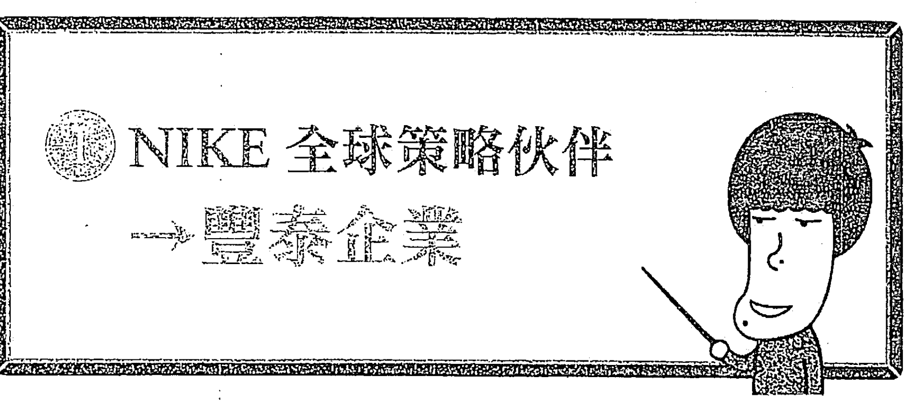

## 豐泰小檔案

- 成立時間：1971 年
- 董事長：王秋雄
- 股本：59.6 億
- 負債比率：48.1%
- 董監事與大股東持股比例：53.9%
- 主要營收比重：運動鞋 80%、休閒鞋與運動器材 11%、鞋類零售與生活用 6.5%、高爾夫球製造銷售 1.5%

### 近 5 年業績表現

| 年度 | 2011 | 2012 | 2013 | 2014 | 2015 |
| :--- | :--- | :--- | :--- | :--- | :--- |
| 營業收入(億元) | 356 | 368 | 381 | 476 | 547 |
| 純益(億元) | 14.3 | 16.8 | 22.9 | 30.8 | 42.3 |
| 純益率(%) | 16.2 | 19.2 | 19.5 | 20.5 | 21.1 |
| 每股純益(元) | 15.5 | 18.6 | 23.8 | 29.1 | 34.1 |
| 現金股利(元) | 2.76 | 3.14 | 4.12 | 5.33 | 7.02 |

豐泰 (9910) 是 1971 年成立的老牌企業，主要客戶為全球最大運動品牌 NIKE，是 NIKE 運動鞋第二大供應製造商。豐泰並於 1992 年在台灣成立 NIKE 亞洲研發中心，與 NIKE 的夥伴關係更為緊密。豐泰總部在雲林，工廠遍及中國、越南、印尼與印度等亞洲國家。2015 年運動鞋出貨超過 8 億雙，其中越南產能占 52%、印度約占 19%、中國約占 16%、印尼地區約占 13%。豐泰 80% 的營收來自 NIKE，另外 20% 來自替 Salomon 代工的山鞋、替 Converse 代工的休閒鞋，以及替曲棍球廠商鮑爾 (Bauer) 代工的溜冰鞋、守門球頭盔、球棍、手套等。

從財報資料觀察，可以很清楚發現豐泰是一家穩健成長型企業，稅後淨利從 1994 年只賺 3.22 億至 2015 年 42.3 億元，成長超過 12 倍，且過去 20 年從未有一年面臨虧損，獲利呈現平穩的階梯式成長。若看近 5 年的稅後淨利成長率，平均每年成長超過 18%。而股東權益報酬率在 2009 年之後，都持續 15% 以上，高於市場水準，2012 至 2015 年分別是 18.6%、23.8%、29.1%、34.1%，呈現驚人的上揚幅度，通常股東權益報酬率能夠逐年大幅成長的企業，股價都具備長期上漲的實力，豐泰的表現也不例外。

我在 2013 年 7 月注意到豐泰，當時股價在 50 元附近。因為臉書的朋友不約而同地開始熱衷慢跑，積極參加各大馬拉松賽事，而我也跟上流行，買了一雙功能與外型兼具的跑鞋加入大家的行列，參與的同時，當然也不忘尋找搭上這波潮流的公司。後來我在台股中找到寶成 (9904)、豐泰、F-鈦齊 (9802) 這 3 檔股票。寶成的獲利雖然還算穩定，但股本太大，營收與淨利想要大幅成長的難度太高；F-鈦齊是新掛牌的公司，主要

從事的是戶外休閒鞋的代工，運動鞋占營收的比例只有 2 成，上市還不到 1 年，可供研究的資料相當有限；只有豐泰符合成長潛力股條件，不過因為當時手上並沒有多餘資金可以加碼，所以一直觀察到 2014 年 2 月，股價站上 70 元之後才開始陸續買進。

觀察豐泰的前景因為受惠全球運動風潮之盛行，最大客戶 NIKE 訂單穩定成長，加上新開發 Salomon 登山鞋、converse 休閒鞋等訂單，積極佈局越南及印度、印尼有成，豐泰營運動能可望持續向上，隨著泛太平洋策略夥伴（TPP）有機會通過，到時候越南出口至美國的關稅可望減免，可直接受惠。豐泰 2015 年每股盈餘為 34.1 元，股票在 150 元以上高檔盤整，已經超過 1 年的時間，本益比 20 倍左右，已不算便宜，可以持續關注公司獲利表現，等待機會再伺機進場。

## 2 跟隨美國成長腳步 →福興工業

### 福興小檔案

- 成立時間：1957 年
- 董事長：林瑞章
- 股本：18.85 億
- 負債比率：30.3%
- 董監事與大股東持股比例：48.7%
- 主要營收比重：金屬門鎖 69.5%、五金商品 30.5%

### 近 5 年業績表現

| | 2011 | 2012 | 2013 | 2014 | 2015 |
| :--- | :--- | :--- | :--- | :--- | :--- |
| 營業收入（億） | 43.2 | 50.1 | 58.8 | 70.7 | 79.9 |
| 稅後淨利（億） | 3.19 | 3.86 | 5.81 | 5.08 | 7.96 |
| 毛利率（%） | 15.7 | 17.1 | 16.2 | 19.2 | 22.6 |
| 股東權益報酬率（%） | 8.4 | 9.7 | 13.9 | 11.5 | 16.6 |
| 每股盈餘（元） | 1.69 | 2.05 | 3.08 | 2.70 | 4.22 |

福興工業 (9924) 創立於 1957 年，是全球最具規模的門鎖製造廠，月產能可達 350 萬組，外銷占總營收比例接近 95%，其中美國、加拿大、墨西哥等北美市場占外銷總額超過 6 成，亞洲、中南美、歐洲合計約占 3 成，紐澳市場約 5%。主要生產基地在台灣的岡山及大陸上海，產品種類包括商用門鎖、家用門鎖、電子鎖、關門器、鎖閘及防火門鎖等，並積極開發各類新產品，包括觸控系列、密碼鎖以及重型圓柱型平把鎖，並擁有超過 500 項以上各式專利認證。公司策略以多品牌方式經營，專注於中高階市場，目前仍以傳統機械型門鎖為主，占營收 50% 以上。另外旗下有 100% 持股的子公司合興工業，主要產品是自動關門器，與福興的門鎖產品有所區隔。

福興成立將近 60 年，過去獲利成長雖然沒有驚人的表現，但穩健營運超過一甲子並不是件容易的事，從公司公佈的資料發現，過去數十年從未有一年有過虧損紀錄，資產負債表顯示公司也沒有長期負債，加上多年來負債比率都保持在 20-30% 的優質水準，或許是因為公司深知自身所處的產業類受景氣影響甚鉅，使得經營高層採用比較保守、穩扎穩打的經營模式。

公司股本為 18.85 億，符合小股本的要求，董監事及大股東持股超過 48%，接近一半，近 5 年的稅後淨利年平均成長約 10%，2011 年至 2014 年的毛利率都在 15% 以上，而且逐年上揚，到 2015 年第二季已成長至 21.97%，表現不俗。股東權益報酬率過去幾年平均只有 10% 出頭，低於設定目標，股東權益報酬率偏低的一部分原因是來自於負債比率偏低，影響財務的槓桿表現，使得資產報酬率與股東權益報酬率呈現的數字差異不大，但 2015 年營運績效明顯向上攀升，全年股東權益報酬率來到 16.6%，創近年來新高，達到我們設定 15% 以上的目標。

雖然這些年全球景氣疲弱，但美國相對於中國、歐洲等主要市場的表現相對較佳，福興受惠於北美景氣復甦，獲利有望持續走高，從年報可以發現，公司樂觀看待未來 2–3 年成長趨勢。營運利多包括：門鎖材料如銅、不鏽鋼、合金等成本下跌，有助於提升毛利率，加上營收主要以北美為主，若美元持續強勢，對營收、匯兌收益也都正面看待。而高毛利的電子式門鎖、開發智慧型居家門控產品開發成功與否，是下一個有機會拉高獲利的關鍵因子。

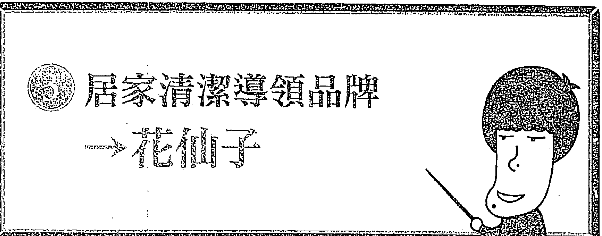

### ——花仙子小檔案——

- 成立時間：1983 年
- 董事長：蔡心心
- 股本：5.35 億
- 負債比率：36.5%
- 董監事與大股東持股比例：62.9%
- 主要營收比重：芳香消臭類 36.4%、驅塵潔淨類 34.3%、除濕類 17.1%、廚具 10.8%

### ——近 5 年業績表現——

| 項目(%) | 2011 | 2012 | 2013 | 2014 | 2015 |
| :------- | :--- | :--- | :--- | :--- | :--- |
| 銷售成長率(%) | 12.5 | 13.5 | 15.2 | 15.9 | 19.8 |
| 純益率(%) | 0.96 | 0.85 | 1.99 | 1.14 | 1.46 |
| 毛利率(%) | 45.7 | 45.5 | 44.8 | 46.0 | 45.3 |
| 股東權益報酬率(%) | 12.9 | 10.9 | 22.9 | 11.5 | 14.3 |
| 資產週轉率(次) | 1.80 | 1.60 | 3.76 | 2.14 | 2.73 |

花仙子（1730）創立於 1983 年，是台灣清潔用品大廠，旗下品牌包括去味大師、克潮靈、潔霜、驅塵氏等，都擁有極佳的市占率。其中，去味大師在芳香除臭產品排名第一，相關產品市占率逾 5 成；克潮靈亦是除濕類排名第一，相關產品市占率約 7 成。另外，花仙子在 2014 年 11 月買下帝凱公司的 51% 股權，帝凱旗下品牌包括市占第一名的好神拖與清潔用品嘟嘟嘟。

花仙子積極採取多方經營策略，目前除了台灣，在中國、泰國、馬來西亞也積極深耕品牌。另一方面，台灣廠、中國廠、泰國廠則從事專業代工，營收比重分別是芳香除臭類 36.4%、驅塵潔淨類 34.3%、除濕類 17%、廚具 10.8%。以地區來看，台灣的營收約占 83.7%、海外市場占 16.3%；此外，花仙子亦取得美國「康寧餐具」及「美亞鍋具」台灣區獨家代理權。

進一步觀察公司的財報，花仙子的股本為 5.35 億，屬於小型股。經營階層加上大股東持有 63% 的股票，籌碼相當集中，過去幾年毛利率一直維持在 45% 的水準，表現不俗，加上公司沒有長期負債、財務結構穩健，最近几年盈餘配息率都超過 7 成，是一家值得長期持有的優質企業。唯獨股東權益報酬率低於設定標準，除了 2013 年因為業外收益大增高至 22.9% 以外，其餘時間多在 10% 左右，不過 2015 年的股東權益報酬率拉升 14.3%，2016 年有機會進一步超過 15%。

花仙子 2015 年的營收因為合併好神拖的效益而顯著成長，加上產品組合與行銷策略調整帶動營利率轉佳下，獲利大增。2015 年稅後淨利年成長 28%，單季獲利創下歷史次高，未來成長動能來自於海外市場的銷售。好神拖在大陸具有專利及商標權，能否透過電視購物及網路銷售創造銷售佳績？以及花仙子在大陸及東南亞等佈局能否開花結果？成為花仙子的營運能否更上一層樓的關鍵。

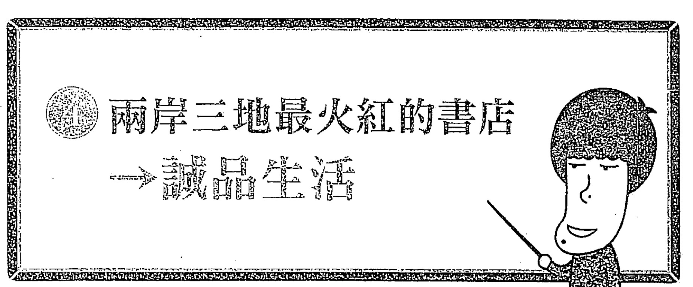

### 誠品生小檔案

- 成立時間：2005 年
- 董事長：吳清友
- 股本：4.51 億
- 負債比率：65.5%
- 董監事與大股東持股比例：74.1%
- 主要營收比重：通路事業 75.8%、餐飲事業 24.2%

### 近 5 年業績表現

| 指標 | 2011 | 2012 | 2013 | 2014 | 2015 |
| :--- | :--- | :--- | :--- | :--- | :--- |
| 營收(億元) | 93.2 | 105.9 | 34.2 | 35.1 | 38.2 |
| 純益(億元) | 2.19 | 2.82 | 3.01 | 3.69 | 4.21 |
| 現金流(億元) | 23.2 | 23.8 | 42.0 | 45.1 | 45.8 |
| 現金流股利 | 30.7 | 33.4 | 28.2 | 25.3 | 26.8 |
| EPS(元) | 5.35 | 6.89 | 6.72 | 8.17 | 9.12 |

誠品生活(2926)成立於 2005 年，是從誠品集團獨立分拆的子公司，主要業務包括通路事業和餐旅事業，營收比重分別為 75.8% 及 24.2%。通路發展以複合型書店、複合商場為主，至 2015 年底，台陸港總共有 46 個據點；餐旅事業則代理進口歐美廚房、洗衣房設備，及咖啡、餐、美食、葡萄酒、瓷器精品等銷售。海外市場部分，目前有香港銅鑼灣店、香港尖沙咀店，及大陸旗艦店「誠品生活蘇州」。預計至 2016 年底，總店數將突破 50 家。

進一步觀察公司的經營數字，近五年的稅後淨利分別為 2.19 億、2.82 億、3.01 億、3.69 億、4.21 億，除了 2012 年因為金融海嘯而下滑以外，其他時間均以年平均 20% 的速度成長，維持長期成長態勢不變。2015 年營業毛利率為 45.8%、股東權益報酬率為 26.8%、董監事及大股東持股超過 7 成，籌碼極度集中。負債比率較高，達到 64.3%，但通路主要是收現金，所以高於一般產業的負債比是正常的。2011 至 2015 年的每股盈餘為 5.35 元、6.89 元、6.72 元、8.17 元、9.12 元，2016 年可望賺 1 個股本。

誠品生為誠品集團的子公司，股本只有 4.51 億，屬於小型股，於 2012 年掛牌上櫃。因為上櫃的時間不長，能研究的資料相對有限，原則上，上市櫃沒多久的股票我盡量不碰，因為之前有過不好的經驗，使我对新掛牌的公司會提高警覺。但誠品生比較不同的地方在於，誠品書店我常上門光顧，甚至還是誠品卡友。誠品於 1989 年在台北市仁愛園環開設第一家 24 小時不打烊的書店以來，到現在超過 25 年，在台灣幾乎每個人都去過誠品書店，更是海外觀光客來台必定會造訪的景點之一。雖然誠品生掛牌時間不長，但因為相對熟悉公司的營運模式，所以不會有太大的疑慮。

近幾年來，誠品生開始加強海外佈局，從 2012 年在香港的銅鑼灣店開始，到 2015 年底，大陸的第一家誠品旗艦店落腳在蘇州，目前共計有 3 家。2016 年預計再開誠品上海店，預估至 2016 年底，誠品總店數將突破 50 家，成為推升誠品生獲利成長的主要動能。

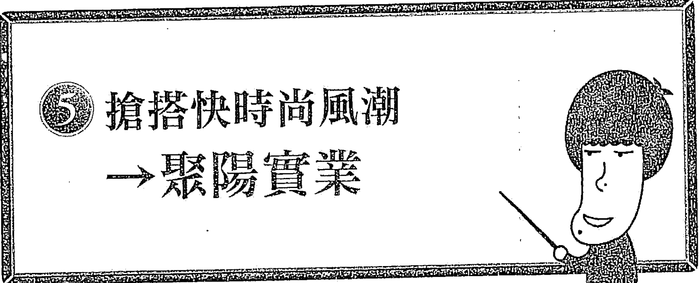

## **⑤** 搶搭快時尚風潮 →聚陽實業

### ——聚陽小檔案——

- 成立時間：1990 年
- 董事長：周理平
- 股本：19.8 億
- 負債比率：32.7%
- 董監事與大股東持股比例：25.4%
- 主要營收比重：成衣 98.5%、布料 1.5%

### ——近 5 年業績表現——

| | 2011 | 2012 | 2013 | 2014 | 2015 |
| :--- | :--- | :--- | :--- | :--- | :--- |
| **營業收入 (億)** | 151 | 158 | 179 | 208 | 233 |
| **稅後淨利 (億)** | 11.1 | 11.7 | 13.4 | 17.0 | 21.5 |
| **毛利率 (%)** | 20.8 | 19.9 | 19.9 | 21.7 | 23.6 |
| **股東權益報酬率 (%)** | 27.1 | 25.9 | 26.8 | 25.3 | 25.2 |
| **每股盈餘 (元)** | 6.92 | 7.17 | 8.02 | 9.62 | 10.9 |

聚陽實業（1477）成立於 1990 年，以平織成衣起家，產品以快時尚流行為主。主要的客戶有 Kohl`s、Target、GAP，各佔約 20%，Fast Retailing 占 7%，其他客戶 Under Armour、Polo Ralph Lauren、A&F 合計占比約 3 成。服務據點在台北、上海及巴黎，主要負責接單。生產基地則遍及印尼、柬埔寨、越南、中國大陸、菲律賓及台灣。其中越南產能約占 33%，長線可望因跨太平洋夥伴協定（TPP）簽訂而受惠。2011 年轉投資聚益實業、2013 年投資越南南方紡織，增加布種的研發能力，朝布料到成衣一貫化生產大廠邁進，另成立自有品牌 fiso，搶攻台灣網購市場。

聚陽的股本為 19.8 億，從 2011 年至 2015 年的稅後淨利成長接近 1 倍。股東權益報酬率除了 2008 年因為全球景氣低迷而掉到 9.16%，過去十年都在 20% 以上。資產報酬率也都維持在 15% 以上，顯示負債結構良好，2015 年負債比例只有 32.7%。董事事及大股東持股超過 25%，融資比不到 2%，外資則占籌碼接近 4 成的比例。2015 年全年營收為 233 億，較去年呈現兩位數成長，稅後淨利 21.5 億，較去年成長高達 26.4%。

聚陽為專業成衣代工大廠，主要幫國際各大品牌代工，主要客戶來自美國，比重約 8 成。受惠於快時尚風氣的盛行，成衣品牌大者恆大的趨勢不變，身為專業代工大廠的聚陽在經濟規模上具有一定優勢，加上生產地分散，產區多元化都有助於降低生產成本。2016 年公司將把主力放在功能性運動休閒產品為主，運動休閒服飾因為布料單價高及品質要求嚴格，可望拉升毛利率，2015 年占營收比重已經從個位數成長至 12%，預估 2016 年可望增加至 18%。且看好 TPP 效益，對越南再加碼投資，將新增廠房，定位為高階功能性產品旗艦廠，總投資金額從 1100 萬美元至 2740 萬美元。

聚陽是我喜歡的企業類型，亦是我的潛力飆股口袋名單。2011 年我選擇儒鴻作為核心持股，並沒有選擇聚陽，因為相較之下，當時的儒鴻獲利成長性更高。但機會不等人，當我把儒鴻獲利了結後，聚陽的股價也慢慢水漲船高，因此錯過進場的好時機。之後，只能眼睜睜看著股價從 140 元一路上漲至 300 元。聚陽是1 檔具備長期成長潛力的個股，若持續維持高度的成長性，本益比下修的空間就有限，預估本益比若降至 15 倍左右，就是相對合理的進場時機。

## 全球高級房車供應商 →皇田工業

### 皇田小檔案

- 成立時間：1983 年
- 董事長：周幼珊
- 股本：7.5 億
- 負債比率：48.3%
- 董監事與大股東持股比例：49.4%
- 主要營收比重：汽車窗簾 96.5%、庭園工具 2.7%

### 近 5 年業績表現

| | 2010 | 2011 | 2012 | 2013 | 2014 |
| :--- | :--- | :--- | :--- | :--- | :--- |
| 營收(億元) | 19.6 | 21.2 | 26.9 | 31.1 | 37.2 |
| EPS(元) | 2.92 | 3.22 | 5.27 | 5.85 | 6.57 |
| D/E(倍) | 36.5 | 38.8 | 41.9 | 40.8 | 40.7 |
| 流動比(倍) | 29.1 | 28.2 | 38.1 | 34.3 | 33.9 |
| ROE(%) | 3.90 | 4.32 | 7.04 | 7.81 | 8.77 |

皇田工業 (9951) 創立於 1983 年，為全球第二大、大中華地區最大的汽車遮陽簾生產製造 ODM 廠，全球市占率約 10%～20%，僅次於德國 Bosch (市占率約 70%～80%)，公司產品包含天窗遮陽簾、後窗、側窗、固定式遮陽簾。銷售市場以大陸、美國、歐洲為主。除在台南設有製造廠外，於大陸昆山及美國亦有設廠，並於德國、韓國各設有營業據點。目前已是許多全球知名車廠合格供應商，透過供應鏈提供產品給全球知名車廠，包括 AUDI、BENZ、BMW、LAND ROVER、VOLVO、VW、FORD、GM、HONDA、HYUNDAI、LUXGEN、MITSUBISHI、NISSAN、PEUGEOT、PORSCHE、TOYOTA 等。

從皇田的財報數字進一步觀察，公司過去獲利表現良好。2010 年至 2015 年的稅後淨利成長態勢相當明確，平均年成長高達 30%，2015 年營業毛利率為 40.7%、股東權益報酬率為 33.9%、負債比為 49.3%、董監事及大股東持股 49%，幾乎是將近 5 成了。股本只有 7.5 億，所有條件均符合成長飆股的選股條件。自然股票也不寂寞，2012 年股價還不到 30 元，配合淨利大幅成長，股價一路走長多格局，到了 2015 年年底，股價一度上漲至 190 元，以 2015 年每股盈餘 8.77 元來計算，本益比來到 22 倍。

皇田是我喜歡的企業類型，股本小、有點冷門、在市場上不太受到關注，主要生產的商品為汽車窗簾，不是一個令投資人興奮的產品、沒什麼話題性，也讓人容易忽略。但如果你有花一點心思研究皇田的財報，就會發現這是一家非常優異的企業，只是單純以汽車窗簾為主要產品，獲利成長性居然可以如此驚人！

至於未來的成長關鍵，在於持續擴大市占率，除現有客戶外，越來越多車廠以中國大陸為生產據點，並在地化採購，有助皇田大陸地區接單；同時，皇田墨西哥新廠即將在 2016 年完工投產，可望正式挹注業績，有助於營收進一步成長。

### 裕融小檔案

- 成立時間：1990 年
- 董事長：陳國榮
- 股本：26.7 億
- 負債比率：88.4%（2015 年）
- 董監事與大股東持股比例：69.9%
- 主要營收比重：應收受讓利息收入 73.32%、推廣報酬金收入 25.92%

### 近 5 年業績表現

| | 2011 | 2012 | 2013 | 2014 | 2015 |
| :--- | :---: | :---: | :---: | :---: | :---: |
| 營業收入(億) | 82 | 101 | 140 | 156 | 168 |
| 銷售純利(%) | 9.8 | 11.6 | 13.6 | 15.1 | 14.2 |
| 毛利率(%) | 39.8 | 41.5 | 35.5 | 39.2 | 40.6 |
| 股東權益報酬 | 19.1 | 20.2 | 19.4 | 18.1 | 14.6 |
| 每股盈餘(元) | 4.16 | 4.94 | 5.68 | 5.90 | 5.36 |

裕融企業 (9941) 成立於 1990 年，為裕隆集團所屬汽車融資公司，也是台灣第一家汽車融資上市公司。主要營業項目為新車分期付款、中古車貸款仲介，及車輛租賃等汽車專業金融服務領域。於 1999 年 12 月正式掛牌成為上櫃公司，2001 年 9 月成為股票上市公司，是台灣唯一消費性金融上市公司。2010 年進軍大陸，已在蘇州與杭州設立租賃公司，大陸業務則包括裕融租賃、格上租車、裕國融資租賃。裕融租賃主要是設備租賃為主，客戶多為中小企業，目前業務以 CNC 新機台租賃為主；2014 年成立的裕國融資租賃公司則從事新車、中古車分期融資。服務據點遍及華東、華南及華中地區。

從財報數字觀察，裕融股本約 26 億，董監事及大股東持股將近 7 成。2011 年至 2015 年的稅後淨利為 9.8 億、11.6 億、13.6 億、15.1 億、14.4 億，公司每年預期獲利目標是成長 5% 至 15%，屬於在平穩中追求成長的穩健型企業。2015 年營業毛利率達 40.6%、負債比率因為產業別關係偏高，為 88.6%，但公司連續 15 年配發穩定的現金股息，平均配息率超過 80%，顯示公司資金動能無慮。雖然獲利成長性並不算特別突出，但公司過去 20 年來，幾乎每年都能穩定獲利及穩定配息，光憑這一點，就比市場上大多數的公司來得優異，是 1 檔具備長線投資價值的好股票。

2015 年獲利 14.4 億元，每股稅後 5.32 元，較 2014 年下滑，主要是受到人民幣中間價走貶，致大陸公司因美元借款而產生未實現匯兌評價損失，因此 2015 年全年認列約 3.08 億台幣帳面損失；不過，裕融為搶攻大陸汽車融資及潛力極大的中古車市場，攜手裕隆在浙江申設的汽車金融租賃公司，已於去年獲得審批通過，目前設置進度均依計畫進行，預期將在 2016 年第二季開業。

在臺灣汽車市場趨於飽和的情況下，裕融未來的成長動能在於大陸。目前大陸以裕融租賃為主，服務中小企業客戶，以租賃CNC機台為主要業務。在2016年底順利取得大陸汽車金融租賃特許執照許可後，可望推升裕融2016年的營運，加上大陸汽車金融業務和擴點的效益，及明年在臺灣推出換車減稅方案的帶動下，預期人民幣不再出現重貶的情況下，可樂觀看待未來裕融的獲利成長表現。

## 8 電動車也不可或缺的零件
→胡連精密

### 胡連小檔案

- 成立時間：1977 年
- 董事長：張子雄
- 股本：9.7 億
- 負債比率：29.6%
- 董監事與大股東持股比例：27.7%
- 主要營收比重：連接器 90.3%、其他零件 9.6%

### 近 5 年業績表現

| | 2011 | 2012 | 2013 | 2014 | 2015 |
| :--- | :--- | :--- | :--- | :--- | :--- |
| 營業收入（億） | 24.6 | 24.3 | 27.8 | 32.3 | 33.9 |
| 稅後淨利（億） | 3.94 | 4.20 | 6.13 | 7.77 | 8.01 |
| 毛利率（%） | 34.1 | 34.9 | 39.1 | 42.1 | 43.9 |
| 股東權益報酬率（%） | 17.7 | 17.6 | 20.6 | 21.3 | 20.5 |
| 每股盈餘（元） | 4.56 | 4.75 | 6.91 | 8.00 | 8.25 |

胡連精密 (6279) 成立於 1977 年，總公司設於汐止，另有在南京廠、深圳廠及越南廠。胡連為專業汽車端子製造大廠，主要商品為端子、模具、端子壓軸機等製造加工，主要應用在連接器、汽機車、電子、通訊、相關零件等領域。銷售市場以大陸為主，占比高達 5 成以上，其次為亞洲市場占 3 成，主要客戶以比亞迪及長安汽車，各占營收約 1 成，東風日產與奇瑞汽車則合占 1 成。另外公司積極往複合式端子、點焊端子、保險絲盒、繼電器等高附加價值產品開發。公司目標希望在 2020 年打入全球前十大車用連接器廠之中。

胡連從上市櫃以來從未一年有過虧損，長期負債也趨近於零，表示公司營運風格是在極穩定下追求成長。2011 年至 2015 年的稅後淨利持續成長，平均年成長超過 15%，維持極佳的成長性。2015 年股東權益報酬率為 20.5%、毛利率為 43.9%、董事及大股東持股超過 1/4、負債占總資產不到 3 成，股本只有不到 10 億，表現均符合成長飆股的選股要件。

隨著汽車智慧化發展趨勢帶動下，目前已有多國通過強制安裝 TPMS、倒車影像等車用安全配備，加上電動車對連接端子規格的提升，都有助於推升胡連營收成長及毛利率的提升，不過因為營收有一半來自於中國大陸，2015 年第二季中國車市陷入庫存調整，營收動能明顯轉弱，但隨著庫存去化順利，加上 2015 年 9 月底祭出車市激勵措施。營收也出現止跌回升。

展望 2016 年，胡連最大動能仍來自中國大陸，因大陸政策對小型車的持續激勵，整體車市年成長率可望優於去年；此外，胡連開始取得吉利汽車的全車系訂單，加上主力客戶比亞迪及長安分別靠新能源車及 SUV 車款，銷售長紅，該公司在兩家客戶的車種滲透率最高，而且也跟進客戶切入輕卡等商用車供應鏈，今年胡連來自大陸車廠的貢獻成長將優於過往。簡而言之，大陸車市是否能持續成長？及公司如何進一步提升大陸市場的市占率？是攸關胡連營運能否維持長紅的關鍵因素。

## 9 引領行動支付風潮
→飛捷科技

### 飛捷小檔案

- 成立時間：1984 年
- 董事長：林大成
- 股本：14.6 億
- 負債比率：18.1%
- 董監事與大股東持股比例：45.3%
- 主要營收比重：工業電腦 87.9%、電腦周邊產品 11.5%

### 近 5 年業績表現

| | 2011 | 2012 | 2013 | 2014 | 2015 |
| :--- | :--- | :--- | :--- | :--- | :--- |
| 營業純益(億元) | 30.5 | 35.7 | 40.6 | 47.4 | 52.1 |
| 每股純益(元) | 5.38 | 6.09 | 8.60 | 9.59 | 10.16 |
| 負債比率(%) | 33.3 | 31.4 | 32.7 | 32.1 | 34.4 |
| 研發經費比率(%) | 22.5 | 22.9 | 26.2 | 24.3 | 23.1 |
| 員工人均純益(萬元) | 5.91 | 6.07 | 7.38 | 7.25 | 7.02 |

飛捷（6206）為台灣最大POS（Point Of Sales）系統設計製造商。成立於1984年，公司主要產品為POS、PPC（Panel PC）+MPC（Medical PC），其中POS與PPC主要應用領域為餐飲、百貨與零售業，現階段營收占比分別約為75-80%與12-15%，所生產的POS全製程皆一條龍自製完成。營運模式主要是透過各地系統商出貨與爭取標案為主，目前營收占比分別為美洲40%、歐洲40%、中國約2-3%、其它15-17%。為了因應逐年成長之營運規模，工廠遷入華亞科技園區，並擴充生產設備，增加產能，目前總產值已為國內最大，也進一步提升各項專案接單及OEM/ODM訂單競爭力。

飛捷 2011 年至 2015 年稅後淨利連續 5 年正成長，平均年成長率超過 10%。2015 年的營業毛利率 34.4%、股東權益報酬率達 23.1%、每股盈餘為 7.02 元，負債比例只有 17.8%、董監事及大股東持股 45.3%、融資占股本比例不到 1%；而外資持股占比達 24%，籌碼相對安定。符合成長飆股的選股條件。

受惠智慧零售、行動支付時代的來臨，加上耕耘醫療與自動化應用的工業電腦市場，飛捷也推出醫療與特殊規格的工業控制用Panel PC（PPC）產品。產品多樣化的結果，使得獲利逐年成長。2014年上半年正式出貨的支付功能收銀機（PTS）及行動POS（Mobile POS）等新產品占2015年營收約3%比重，加上高毛利的Panel PC營收占比逐年提高，隨著打入美國醫療應用與自動販賣機應用客戶，預計2016年營收占比達17%。

飛捷所生產的產品，具備客製化、少量高毛利的特性，屬於利基型商品，較不受紅色供應鏈的衝擊，屬於藍海市場。2016年的成長動能來自於美國市場市占率的加持、POS新單效益提升、醫療應用及 All in One 機種，預料能為 2016 年營收帶來顯著的挹注。但值得注意的是，歐洲為飛捷的第二大市場，歐洲所面臨的景氣衰退，加上 2015 年巴黎發生恐怖攻擊事件，是否直接影響公司後續的營運表現，則需要進一步觀察。

## 10 波音公司認證的製造商
→千附實業

### 千附小檔案

- 成立時間：1982 年
- 董事長：張瓊如
- 股本：11.8 億
- 負債比率：34.47%
- 董監事與大股東持股比例：33.0%
- 主要營收比重：航太及光電半導體 41.87%、製鞋機台 26.93%、管路及系統整合 26.58%、海水淡化 3.98%

### 近 5 年業績表現

| | 2011 | 2012 | 2013 | 2014 | 2015 |
| :--- | :--- | :--- | :--- | :--- | :--- |
| 營收(億) | 22.68 | 21.50 | 24.57 | 29.67 | 30.85 |
| 稅後淨利(億) | 1.20 | 1.53 | 1.87 | 3.51 | 4.12 |
| 報酬率(%) | 19.31 | 15.31 | 21.66 | 24.72 | 29.93 |
| 投資組合報酬率(%) | 5.04 | 6.43 | 7.52 | 13.28 | 14.36 |
| 每股盈餘(元) | 1.02 | 1.30 | 1.63 | 3.04 | 3.53 |

千附實業(8383)成立於 1982 年，提供高科技產業廠務系統工程服務，於 2006 年合併全球著名製鞋機製造商——全鋒實業。全鋒成立於 1976 年，原為千附的關係企業，擁有自有品牌《全鋒 Chen Feng》，具備機械、電控、自動化和系統整合的設計研發能量，並於 1986 年投入航太精密加工行列，成為國防部航發中心的衛星工廠，於合併後並將精密加工核心技術深耕為關鍵零組件整合製造服務，不僅成為重要航太精密零組件供應商，也是許多知名光電和半導體設備商主要零組件供應商。

進一步觀察財報數字，千附最近 5 年的稅後淨利呈現連續正成長，2012 年至 2015 年分別成長 27.5%、22.2%、87.7%、17.3%，平均年成長高達 3 成以上。每股盈餘從 2011 年只賺 1.02 元，一口氣攀升至 2015 年的 3.53 元，成長超過 200%，而毛利率及股東權益報酬率亦呈現大幅的上揚。負債比例不到 35%，且沒有長期負債，財報結構良好。董監事及大股東持股 33%，外資持股達 2 成，融資比例低於 5%，籌碼安定。2016 年前 3 個月營收達 7.98 億，較去年同期成長 24.2%，今年獲利成長可期。

早在好些年前，因為研究水資源概念股，注意到千附這檔股票，不過當時從財報中觀察發現，千附的獲利表現並不特別突出，因此便打消買進的念頭。直到最近因為製鞋機的題材，才重新進一步研究。千附業務布局均衡，客戶結構堅強，主要業務包含管線工程（客戶為台積電），航太精密零件生產（客戶為漢翔、洛克希德馬丁），製鞋設備（客戶豐泰、寶成），及跨界水資源領域，於澎湖設置海水淡化廠。2015 年製鞋事業營收比重達 31%、而毛利率較高的精密儀器營收已占 45%，兩項占比合計逾 75%，已成為主要業績來源，而廠務工廠另占 20%，水資源僅 3-4%。

千附的主要客戶，如製鞋業的豐泰、航太工業的漢翔、晶圓代工的台積電……等，營運持續正向發展。公司持續看好精密科技和製鞋機業務，預料將成為未來營運持續成長的動能，加上近年來縮減毛利率較低的公共工程專案業務，透過產品組合的轉型調整，使產品毛利率逐年攀升，有助整體營運表現。千附近 5 年營收成長達 36.0%，稅後淨利卻大幅成長 243%，最主要的原因來自於產品組合的調整推升毛利率，使營業利益率大增，每股盈餘大幅成長。毛利率是否持續成長，是千附未來獲利能否大幅成長的關鍵因素，雖然 2016 營收展望佳，但需要進一步觀察產品組合及毛利率的走勢。

# 後記

## 拿到「財富自由」入場券之前

終於到了最後一個章節，你是否已經迫不及待準備進場、打算運用「成長飆股投資術」的選股策略來找寻下一檔飆股了？讓我在最後一個階段，給準備大展身手的你一點小小叮嚀。

想要應用「成長飆股投資術」的方法，一開始可以先試著從生活周遭找寻投資靈感，看看朋友家人們最近都在熱衷什麼事物？例如，馬拉松比賽越來越多人參加，大家都搶著報名，觀察到這點，就可以留意運動鞋、運動衣、機能布料、健身器材……等相關的廠商。如果沒有想法，可以運用電腦軟體篩選，把想要的條件輸入，比如股本小於30億、本益比小於15倍、最近3年稅後淨利年成長10%、近3年股東權益報酬率均超過15%、近1年營業毛利率大於20%……等，設定的條件越多，篩選的條件就越嚴格，就能從台股1千多檔股票中篩選到只剩數十檔的股票，然後再1檔1檔細心檢視。

當你發掘到1檔看起來不差的股票時，先別急著出手。運用第3章的「成長飆股投資術」的10個選股核心法則來檢視，如果符合大部分條件，就可以考慮買進，如果全部的條件都符合，就可以當成核心持股！將資金大幅重押。但如果只符合一半的條件，則不符合買進標準，但可以納入觀察名單。要注意的是，這10個選股法則中，有一些法則特別重要，例如第1個：「選擇本益成長比低於0.75時買進」，就是不可動搖的條件！即使其它9個條件都符合，但本益成長比高於0.75，也不該買進！

第2重要的法則是：「未來1年預估本益比低於15倍」，除非你極度看好的股票未來稅後淨利成長率可望大於25%以上，這個條件才可以忽略；不然的話，在本益比高於15倍的情況下買進，風險都會太高。

檢視完選股法則，選到難得一見的潛力飆股之後，也别忘了做最後的檢視，問問自己：公司的業務是否簡單好懂？投資看得懂的公司，碰到股價跌的時候，你會放膽加碼、漲的時候你不會急著出脫。

接著要觀察經營者對未來業績成長是否感到樂觀？如果是一個誠信紀錄很好的經營者表示未來業績會持續成長，未來真的成長的機率就會很高，也會增加持股的信心。

請記住，忽略短期市場的漲跌，把目光放在公司的長期發展！買進股票後總免不了會遇到股票下跌的情況，單純只是因為股價下跌而賣出股票並非是好決定，除非是公司未來的營運出現狀況，否則單純的股價下跌或遇到市場發生系統性風險，都不是出脫持股的絕佳選擇。只要能確定手上的股票營運狀況不變，都不要輕易賣出股票！所以用現股買進就非常重要。在遇到空頭市場的襲擊，個股跌3、5成是很平常的一件事，如果你是用現股買進，只要確定手上股票的競爭力沒變，總有一天，股價一定會表態；但如果你是用融資買進，碰到股價急速下跌，受迫於融資追繳及斷頭的壓力，很容易造成血本無歸。

因此我從一開始投資股票到現在，從來不使用融資，因為我很清楚我的能力範圍，使用融資雖然可以加速獲利的腳步，但伴隨的風險實在太大，如果真的想要用融資來加大獲利的槓桿，我的建議是：除非你有顆強勁的心臟，加上十足的把握，並且嚴格做好停損的動作，不然用現股買進成長潛力股還是最好的、低風險投資策略。

即便你在買進股票之前，把1檔股票研究得很透徹，也不能保證就能如你所願的上漲。能夠影響股票漲跌的因素非常多，而身為一個投資人，只能盡自己的努力作好功課。投資沒有100%一定獲利的事，只能說，盡可能在勝算較大且風險相對較小的情況下進場。

從股票的投資結果來看，只會出現 4 種情況：決策品質好但獲利、決策品質好但虧損、決策品質不好但獲利、決策品質不好但虧損。不管你的決策品質好與壞，在股票市場上都是有獲利的可能，即使是朋友報明牌的股票，遇到多頭市場或是運氣很好時，也能讓你大賺一筆；而相反的，花時間細心研究所買進的股票，碰到市場氣氛不佳的時候，卻可能出現帳面虧損。

這就是投資股票有趣的地方，它不像其他專業工作，一看就知道表現，例如在美國 NBA 職業籃球界，你打的好不好，上場就知道，如果不夠格，根本連上場的機會也沒有，就算後天再怎麼苦練，如果先天身體的條件不好也於事無補。但投資股票就不一樣了，不管你是擁有豐富投資經驗的經理人，還是昨天才剛開戶的股市新鮮人，上市櫃 1 千多支股票大家都可以買進，全部一視同仁。你有可能花了 1 個月的時間認真研究台積電 (2330) 後，覺得台積電的產業龍頭地位、經營能力、公司誠信……等各方面，都符合你的標準，所以你買進。而你的隔壁鄰居可能正好在電視上聽到投顧老師說台積電不錯，所以也進場買進。完全不一樣的思維卻產生一樣的結果，這就是投資有趣的地方。

但是，若把時間軸拉長來看，只單靠運氣在投資市場長期獲利幾乎是不可能的事。因為長期來看，好運氣與壞運氣會互相抵消，所以身為成功的投資人，每個決策動作都會深思熟慮，正因為買賣股票很容易，才更需要在下單前先想好所有會發生的情況。謹慎做好每一個投資決策，讓運氣的成份降到最小，才有機會在股市中獲得長期的成功。

我覺得投資股票很像打高爾夫球，高爾夫球看似與別人競爭，實際上更像是挑戰自己。相同的是，想獲勝都需要極強大的心理素質，每一場高爾夫球有 18 洞，每打 1 洞就像是在股票市場投資 1 年，一場球打完就好像在股票市場經過 18 年；而標準桿就像是大盤的年度報酬，而投資的首要目標就是要打敗大盤，打出平標準桿以上的成績，然後再想辦法突破自己的記錄。最理想的狀況就是每洞都打出低於標準桿的成績，就像是投資人都想要創造出每年超越大盤的績效。但每個人總是有失手的可能，不是把球打進沙坑、就是偏離球道。如果是高手，會先穩住自己的情緒，並且即使修正錯誤。但如果是心理素質不夠強的人，可能就會越打越差，而輸掉原先贏面很大的一場球賽。

投資是一條很漫長的道路上，想要在股票市場長期屹立不搖，除了需要具備投資知識，還要有強大的心理素質。技巧能夠讓你打場好球，而好的心理素質能夠讓你在逆境時不會被打敗，並提供你源源不絕的正面能量。

而增加自己的實力，最好的辦法就是不斷的閱讀！就如同我從眾多投資大師的書中學到的投資觀念一樣，一點一點地吸收投資大師的思想精華、選股策略，避開曾經犯錯的陷阱，再從市場的歷練中，找出長期獲勝的致富祕訣。

很感謝你購買本書，並且很認真的讀到最後。不管你是從未投資過的新手，或者是在股票市場打滾多年想要精益求精的投資老手，都希望這本書的內容能夠帶給你一些投資啟發。世界上不會有完全同樣投資策略的兩個人，我知道每個在投資領域上獲得巨大成功的人，都是很有主見的人。所以，如果你也想成為成功的投資人，最重要的事，就是多吸收別人成功的投資方法，然後從中找尋摸索適合的方式、建立自己的投資策略和風格，相信很快就能成為財富自由、人生自由的投資人！

# 「10 個選股核心法則」 檢測表

| 選股條件 | 標準 |
| :--- | :--- |
| 本益成長比低於 0.75 | |
| 未來 1 年預估本益比低於 15 倍 | |
| 股東權益報酬率 15% 以上 | |
| 近 5 年平均稅後淨利正成長 | |
| 預估未來 3 年稅後淨利年成長 15% 以上 | |
| 毛利率至少 15% 以上，且持續向上 | |
| 負債比率低於 50% | |
| 股本低於 30 億 | |
| 經營階層持股多 | |
| 融資比例低於 5% | |

# 進場前的「6 個篩選條件」檢測試

| 篩選條件 | 符合 |
| --- | --- |
| 公司的業務是否簡單好懂？ |  |
| 公司的現金流量是否良好？ |  |
| 公司是否擁有過人的競爭優勢？ |  |
| 管理階層是否低調且認真打拚？ |  |
| 管理階層是否有良好的誠信記錄？ |  |
| 經營者對未來業績成長感到樂觀？ |  |

# 喬泓的私房推薦書目

## A: 進階閱讀

| 書名 | 作者 | 出版社 |
| :--- | :--- | :--- |
| 祖魯法則 | 吉姆・史萊特 | 時報出版 |
| 超越祖魯法則 | 吉姆・史萊特 | 大牌出版 |
| 與查理的普通常識 | 查理・蒙格 & 彼得・考夫曼 | 商業週刊 |
| 坦伯頓投資法則 | 洛蘭・坦伯頓 & 史考特・菲利普 | 麥格羅・希爾 |
| 資本家的冒險 | 吉姆・羅傑斯 | 商周出版 |
| 彼得林區征服股海 | 彼得・林區 & 約翰・羅斯查得 | 財信出版 |
| 彼得林區選股戰略 | 彼得・林區 & 約翰．羅斯查得 | 財信出版 |
| 彼得林區學以致富 | 彼得・林區 & 約翰．羅斯查得 | 財信出版 |
| 勝券在握：股市奇才華倫・巴菲特的投資策略 | 羅伯特．海格斯壯 | 遠流出版 |
| 巴菲特的核心投資法 | 羅伯特．海格斯壯 | 商周出版 |
| 笑傲股市 | 威廉・歐尼爾 | 麥格羅．希爾 |
| 一個投資者的告白 | 安德烈．科斯托蘭尼 | 商業週刊 |

## A. 進階問題

| 書名 | 作者 | 出版社 |
| --- | --- | --- |
| 非常潛力股 | 菲利普·費雪 | 寰宇出版 |
| 隨機騙局 | 納西姆·尼可拉斯·塔雷伯 | 大塊文化 |
| 黑天鵝效應 | 納西姆·尼可拉斯·塔雷伯 | 大塊文化 |

## B. 進階問題

| 書名 | 作者 | 出版社 |
| --- | --- | --- |
| 富爸爸窮爸爸 | 羅勃特·T·清崎 & 莎朗·L·萊希特 | 致富館 |
| 華爾街的傳奇·股票神童 | 司徒災恩 & 史迪芬·里凡史東 | 世茂出版社 |
| 股市之神：是川銀藏 | 是川銀藏 | 時報出版 |
| 肯恩費雪教你破除 50 個投資迷思 | 肯恩·費雪 | 財信出版 |
| 大賣空 | 麥克·路易士 | 財信出版 |
| 散戶投資正典 | 傑諾米·席格爾 | 麥格羅·希爾 |
| 快思慢想 | 丹尼爾·康納曼 | 天下文化 |
| 漫步華爾街 | 墨基爾 | 天下文化 |
| 第三種猩猩 | 賈德·戴蒙 | 時報出版 |
| EQ | 丹尼爾·高曼 | 時報出版 |

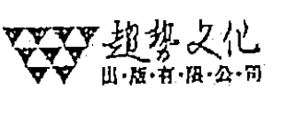

## MANAGER 03
### 《算股高手》的驚人財富翻倍術！

學會這 2 招抓牛大飆股，
連口袋只剩 3 萬塊的門外漢都能 6 年賺千萬、年獲利 40% UP！

- 作者／陳喬泓
- 總監／馮淑婉
- 主編／彭子源
- 攝影／林政億
- 漫畫／陳喬泓
- 封面設計／李涵硯
- 內頁設計／無私設計 洪偉傑
- 編輯協力／Selena、熊愛玲、陳安宜
- 攝影協力／陳玟晴
- 行銷企劃／文華智樂公司
- 出版發行／趨勢文化出版有限公司
- 地址：新莊市新莊區思源路 680 號 5 樓之一
- 電話：8522-5822
- 傳真：85-211-311
- 讀者服務電話：8522-5822#66

### 國家圖書館出版品預行編目 (CIP) 資料

> << 算股高手 >> 的驚人財富翻倍術！：學會這 2 招抓牛大飆股，連口袋只剩 3 萬塊的門外漢都能 6 年賺千萬、年獲利 40% UP！／陳喬泓著．－初版，－新莊市：趨勢文化出版，2016.06；公分．－（Manager；03）
> ISBN 978-986-85711-9-8（平裝）
> 1. 股票投資 2. 投資技巧 3. 投資分析
> 563.53 105009702.

- 出版日期／2016 年 6 月 27 日 初版一刷
- 法律顧問／永然聯合法律事務所
- ISBN／978-986-85711-9-8
- 本書定價／300 元
- Printed in Taiwan

有著作權 翻印必究
如有破損或裝幀錯誤，請寄回本店更換
