# 我今天遇到了一款很坑爹的保险产品

紫竹张先生

经济-金融-投资，点击右边按钮关注我 

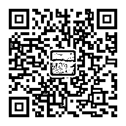 

今天我去银行办事，也许是看到我们带着孩子吧，银行里就有人向我们拼命的推销一款针对宝宝的保险产品，我粗略的看了一眼产品，特别坑爹，于是就礼貌的回绝了，不过宣传单我带回来了，带回来的目的是给大家都看看，免得以后自己被坑。

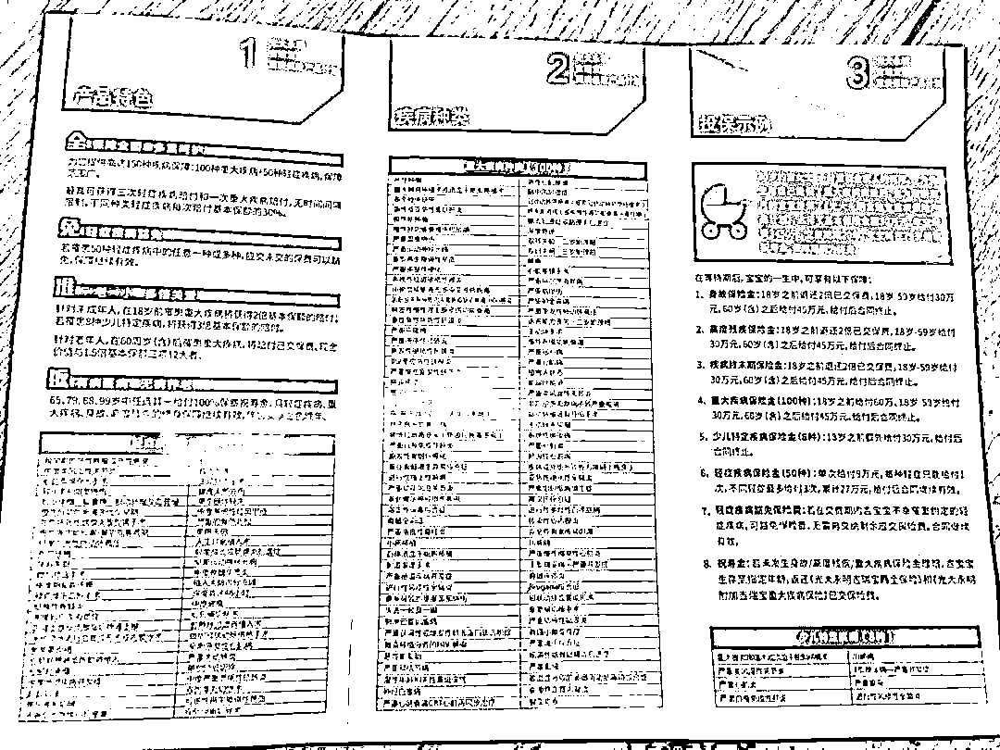

这个图片有点模糊，我下面放大给大家看。先简单描述这个产品，这个产品针对幼儿推出，年龄越大，年收费越贵，最便宜的就是 1 岁以下的幼儿，每年收费 3450 元，连交 20 年就可以完成合同，对孩子进行终身保障，一辈子中，列出 150 种重疾，只要碰上其中一种，就给予赔付，如果一辈子都没事，那么在 79 岁的时候还可以领取祝寿金，把你 20 年交的 6.9 万元退给你。

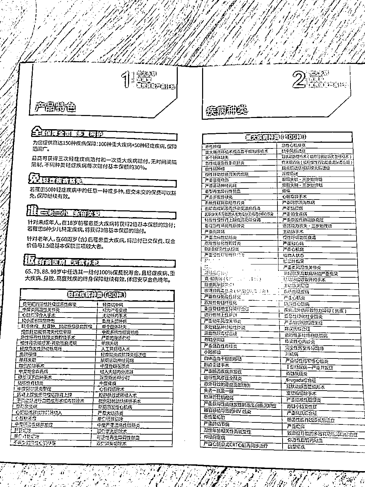

这个事情本来是挺好的，关键这里的赔偿金额太坑爹了，这里所列的病，所谓的 50 种轻症，摊到普通人头上，都是天塌下来的大病。而后面列的 100 种大病，那可是真正的大病，要么是罕见的重疾让你终身缠绵病榻，要么就是九死一生的大劫，这里面的病摊上一个，人生基本就完了。

但是这些病都有一个特性，非常稀有，都不是常见病，这里的病染上一个，就是你整个家族都去医院反复探望才能略表安稳的那种重大家族新闻，你可以回顾一下你身边的亲戚，或者你朋友的亲戚圈，有几个人能碰上如此罕见的病症，其概率非常低。

但是你说了，我保的就是这种稀有但是性质恶劣的大病啊，这才是保险的意义。这话倒是没错，但是这里我们要看看假设你非常不幸的染上这里面病其中之一，你会得到多少赔付。

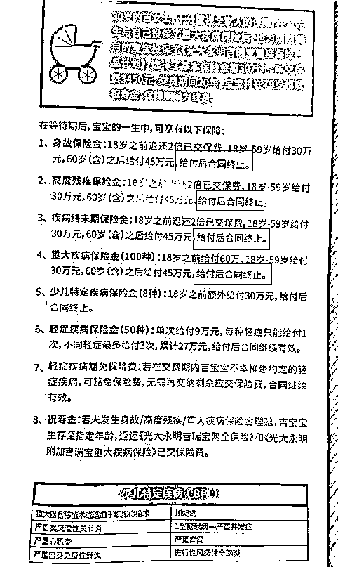

看到没，这里列出了 8 种你会得到赔偿金的情况，无论哪一种，你能得到的极限赔偿金，18 岁以前 2 倍赔偿金，18 岁~60 岁，最多 30 万，60 岁以后，最多 45 万，然后合同就会强行终止。

换句话说，在 18 岁之前，投保者得这种病的概率超过 50%，保险公司才会亏，而这里面病，相当多的都是中老年病，幼儿能得的本来就不多，其综合得病概率，我怎么看，都应该低于 20%，甚至更低，因为我身边上百个亲戚，没有一个听说过染上里面的这种病症的。这里面的病都是特别稀罕的病，染上一个绝对家喻户晓，不可能不知道。

而 18~60 岁这一档就更坑爹了，30 万，这是几十年后的 30 万了，我想知道 30 年后的 30 万能干啥，还能看个感冒吗？1980 年，北京的人均年收入大概是 100 元，今天是 12 万元。今天的保单承诺赔 30 万，相当于 1980 年承诺赔偿 300 元，等到 2010 年你病发了，得了重疾，拿这 300 元，你觉得你能干吗，够一天的医疗费不。

至于 60 岁以上那一档就不谈了，60 年之后，那 45 万估计只够吃一顿早餐了，至于治病就别谈了。

至于 78 岁返还 6 万元的祝寿金，忽略不计忽略不计。。。78 年后差不多都快 2100 年了，这家公司还在不在那都不好说呢，就算还在，6 万元能买包餐巾纸就不错不错的了。

所以说，这个保险并不能够真正保你重疾无忧，基本上最坏情况发生了，也只打算赔你 30 万左右，而且那些花里胡哨承诺几十年后的等等都是没用的，而他也不能在你病发后让你能安心治病。如果单纯从经济效益上讲，100 亿保险金交上去，最终拿出来赔偿的金额，有可能 10 亿都不到，主要这里面拖的时间实在是太长，几十年后，经过通胀率的冲刷，看起来你是赚了，实际上你是亏了，更何况这款产品打着幼儿的旗号，硬生生把时间拖到了几十年之后，本来赔付率就低，再加上通胀，实在坑爹。

那么是不是所有的保险都不能买呢，不是的，有些保险是真的有用。我可以告诉大家什么样的保险适合购买。首先我们要知道保险的本意是什么，保险的本意是保障你的家庭不被天降横祸给击垮，给你一个复活的希望。

那么你家庭最脆弱的节点在哪里，是你家的孩子吗？肯定不是，如果你家的孩子得了重病需要钱来治疗，大人赚钱给他治就是了，除非这个病实在花费太高，但是像保险这种付出去 10 块按平均概率只能拿回 3 块治病钱的情况来说，给幼儿投重疾险是一个血亏不赚的事情。

那么谁是最脆弱的节点，是你家的经济支柱，我举个例子，一家三口，男方年入 50 万，女方年入 10 万，养育有一个宝宝，这是一个传统意义上的幸福之家。那么谁倒下了会对这个家造成毁灭性打击，很明显是年入 50 万的男方，这个家会瞬间陷入窘境。

那么在这种情况下，应该对谁进行保险，很明显是这个男方，那么应该在哪些险种进行保险，很明显是那些能让这个男方丧失经济收入的大事上。如重疾、死亡等。大家想靠保险发财是不可能的，想占保险公司便宜也是不可能的，保险公司的精算师是什么水准，大家又是什么水准，自己心里没点数吗？

所以，保险应该买给家里的经济支柱，险种应该买重疾、死亡等能让经济支柱坍塌的事件上，而且不买捆绑险种，只买单纯的险，一些貌似很好的险种，都是保险公司耍的小把戏，其实对你而言意义不大。而针对幼儿的一切保险，都是坑爹，讲真，最大的保险就是你生个二胎。。。每年花的养育钱，你就当交保险费了，你觉得养男孩子是建设银行花钱，那你生个招商银行嘛。

\~~~

今天 AB 的 WXH 宣判了，判刑 18 年，罚款 105 亿，AB 帝国掌门人落幕，一辈子的辉煌就此归零，这事比较敏感大家都知道，我也就一笔带过，免得不知道啥时候碰黄线了，而且这事要么说的很深，触及政治，要么就泛泛而谈没啥意思，我今天就不说了。 

\~~~

美股的苹果股价再创新高，前一段时间苹果股价连续下跌大家都知道吧，说苹果不行了，利润下降，市场占有率下降，创新能力不足，苹果 X 卖不出去等等，说啥的都有。

苹果 CEO 一怒，2017 年的盈利，只拿出几十亿分红，其余 1000 亿美金，全部回购流通股来表达管理层对股价的信心，于是苹果股价是这么走的。

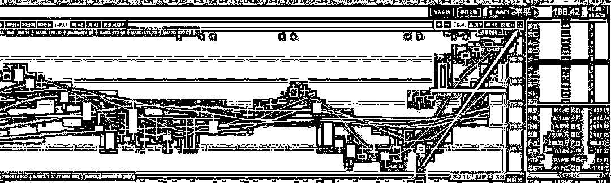

一路向上不回头，直接突破新高，而且还在涨，平均日交易量在 50~70 亿美金左右，也就是说管理层每天拿出 10~20 亿美金去单边买入，就足够打破多空平衡引发剧烈上涨。按照 1000 亿美金的预算来看，管理层能连买 100 个交易日，也就是半年。。。。

实在太恐怖了，羡慕美国的小散，希望中石油啥时候拿利润拿出来回购下股份呗。

\~~~

今天三大指数收小阳线，再度获得睡后收入，我曾说过，进入 5 月之后，下跌趋势终结，改为上涨趋势，阳多阴少，阳肥阴瘦，此观点半个月前我就提出，一直不改，这也就是我 5 月如此淡定持股的原因，最近几天，天天都有睡后收入，躺着赚钱。

而且今天这根小阳线，具备的意义很大，今天是周四，周四是很容易产生黑周四现象的，也就是容易诱发下跌，概率较大，但是今天却收出小阳线，使得整体图形，再进一步。

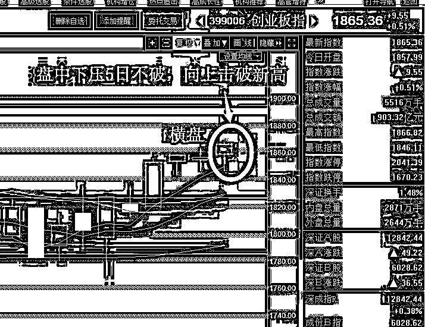

在前几天的中阳突破后，创业板一度休息了二天，处于明显的横盘状态。今天盘中曾经一度下跌，接触 5 日均线，然后引发了剧烈反弹，直接刷新了前二天的新高，这就让图形变的非常的舒服好看，趋势更加明显的向多头靠拢。

而今天的收盘价，上证 3174，创业 1865，离我制定的第一步高抛位上证 3200.创业 1886 附近咫尺之遥，只差 1%左右，说跳一下就到了，可以说第一步高抛实现的概率接近 95%以上。

创业板其实 1900 才有压力，但是下方 1886 附近有个缺口，尊重一下缺口，补了我们就出一点货，而且离我指定的 4 月理论回调极限 1786 已经有百点涨幅之多，在熊市里尤为难得，差不多 6%了，所以这个位置，我愿意出一点货，就算后面一口气涨到 2000 甚至更多，我觉得都是值得的，更别提，突破 2000 的概率实在是太少了。。。

至于上证，我没有精确的去测点位，我对这货比较失望，粗略的大致一个 3200/3250/3300 分批出货就差不多了，懒得去详细管他。。。

大概就这么多，虽然接近了第一步高抛点位，我们也随时会进行第一次高抛，但是整个 5 月，上涨是主基调，高抛的原因是涨幅太大，开始逐步收肉了，并非看空后市行情，我可不是那种非要底部一口气买满仓，顶部一口气卖空仓，觉得自己是神的蠢人。我看到 2000 点，1900 附近就开始逐步减仓了，我炒股的核心是按照概率做事，有多大的概率向上涨，我就留多大的仓位，很明显涨的越高，继续上涨的概率越低，那么我就随着上涨概率的降低而逐步降低我的仓位，等价格下跌，跌的越深，上涨的概率就越高，我再随着上涨概率的变高而逐步加大自己的仓位。

炒股就这样，很简单，熟悉之后，可以堪称是睡后收入。

今天给大家通知一个粉丝福利，有券商通知我说近期为了短期冲量，决定开启万 1.7 的优惠佣金活动，由于太低不敢公开宣传，所以想降低自己佣金利率的小伙伴可以扫描下方二维码加开户助理 zisedegu33。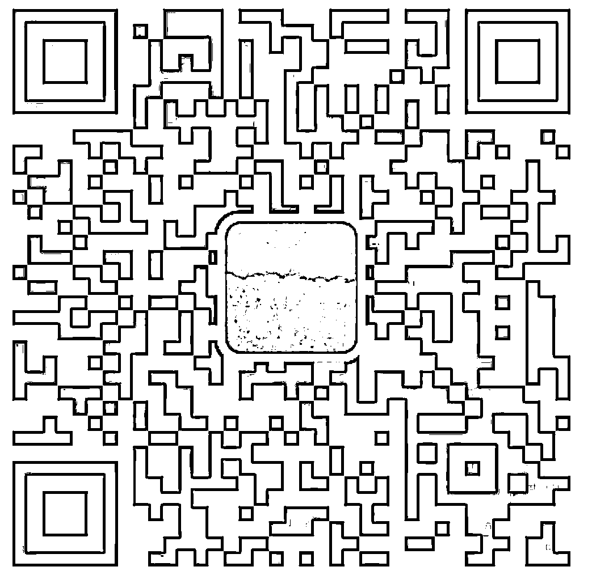

**时间有限，机会难得，先来先得。**

# 女人最喜欢看什么样的文章

紫竹张先生

经济-金融-投资，点击右边按钮关注我 

 

昨天整个自媒体圈被量子云给刷屏了，这家位于深圳的公司卖给了 A 股上市公司，交易作价 38 个亿，而我在研究这家公司的数据中意外的发现了一个有趣的事情，那就是女人最喜欢看什么样的文章。

这家公司能估值 38 个亿，是因为他们总共运营了 1000 个公众号，其中第一大公众号卡娃微卡拥有粉丝数 1566 万人，这么多公众号要保持日更，怕不得几千人进行内容创作吧，但是并不是，按照这家公司披露的财务数据，这家公司总共 100 人，其内容生产部门，只有 50 人。

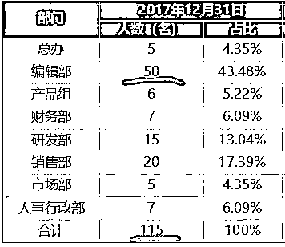

接近 1000 个公众号，总共 50 人负责，差不多平均一个人要负责 20 个号，而且其大号不是一天一篇，而是一天八篇文章，一个头条七个次条。对于我这种一日一更的人来说，也就是其生产效率大概是我的 100-160 倍，直接把我碾压成灰灰。

一个人一天要更新差不多 160 篇文章，这数据好像不对吧，按照个个都是短篇，每篇 1000 字计算，别说他原创，就算让他对着书打字，一天打 16 万字也不可能啊。其原因非常简单，这是一家纯粹的自媒体公司，他们的套路是不原创，直接从网络进行搬运和简单加工改写，所以可以达到一天百篇以上的战绩，按一天 10 小时工作制，一小时能产出 10~16 篇，几分钟就一篇，这快餐简直太有效率，和原创精品根本那是两码事。

但是这些营销号的文章呢，就是有人喜欢看，以其第一大公众号卡娃微卡为例，过去几天，其头条标题为：

*5 月 7 日：你见过老公哭吗？网友们的经历让人泪崩……*

*5 月 6 日：头胎才 14 个月就被逼着生二胎：没分寸的婆婆，中国女人心中永远的痛*

*5 月 5 日：被小姐妹毁掉的中老年妇女*

*5 月 4 日：穷养妻子的男人没有未来*

清一色鸡汤，而且是毒鸡汤，熟读这些毒鸡汤的女人会认为不认识口红色号的男人就是不爱自己，不管这个男人多么赚钱多么顾家多么洁身自好，离婚是最佳选择。而实际上，这些看似站在女性角度来攻击周围一切的毒鸡汤，是诸多女性公众号吸粉的不二法宝，他们根本不管这些内容是真是假，有用还是没用，是能帮助女性更好的生活还是更差的生活，只要能吸引眼球，吸引流量，他们就直接发送这样的文章。

而且更恐怖的是，这种文章已经形成了工厂化流水式生产，这些企业把女性的弱点和喜好挖掘的清清楚楚，可以每天机械式的生产类似的毒鸡汤，他们笃定，只要是这样风格的文章，女性一定喜欢。

这是多么可怕的一件事，这种女性鸡汤号的壮大，一半是不负责任的鸡汤文制造商的责任，另一半恐怕就是女性自己的原因了，如果拒绝阅读，拒绝关注这种公众号，而转而看一些理性、客观分析现实的公众号（比如我），这种毒鸡汤也不会那么泛滥。

老实说，这种文章套路我也能轻松的写出来，写出的鸡汤保管让别人像打了鸡血一样亢奋，可惜我责任感很强，我宁可写那些客观描述现实但是女性并不怎么喜欢看的文章，理性分析是我的特色，就算增粉慢我也认了。

* * *

  

我今天还看到另外一个事，韩国媒体抱怨都城首尔房价太高了，高到什么程度呢，**高到首尔人不吃不喝 9 年才能买一套房**，还特地强调说，9 年只是平均值，如果要在首尔中心瑞草区和江南区买房，那更是要高达 21 年和 18 年。

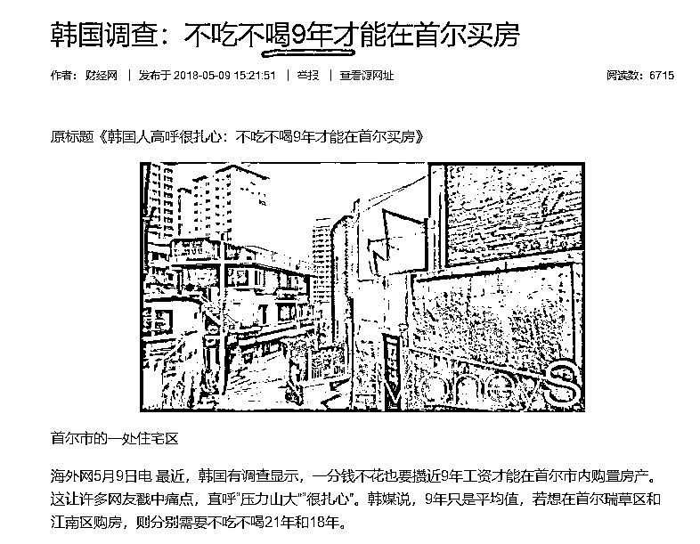

听起来好像韩国人民已经处于水深火热之中了，韩媒声嘶力竭的控诉高房价，我顺手百度了一下北京的人均工资，按照 2017 年冬季的统计数据额来看，月薪高达一万元。

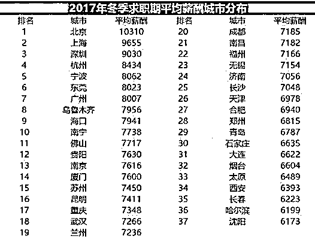

当然，这个数据刚一出炉，就有好多北京人喷说自己被平均了，自己的收入扯了祖国大腿了。这个我们先不管，姑且算这个数据是真的，而且再姑且算这个数据是税后收入，没有扣税，没有扣五险一金，拿到手就是一万。

那么在这个数据下，北京人 9 年不吃不喝可以攒 100 万，21 年不吃不喝可以攒 252 万，100 万想在北京五环买房？252 万想在北京二环买房？做梦吧你，付个首付都不够。相比脆弱的韩国人民，北京人的神经简直太坚韧了，韩国人民必须向我国学习，别没事乱喊乱叫，50 年不吃不喝买套房还差不多。

除了北京人，今天南京人也闹新闻了，南京一小区的业主，嫌弃自家小区涨的慢，呼吁大家都提价，大家联手把挂牌价从 2 万提升到 3 万。

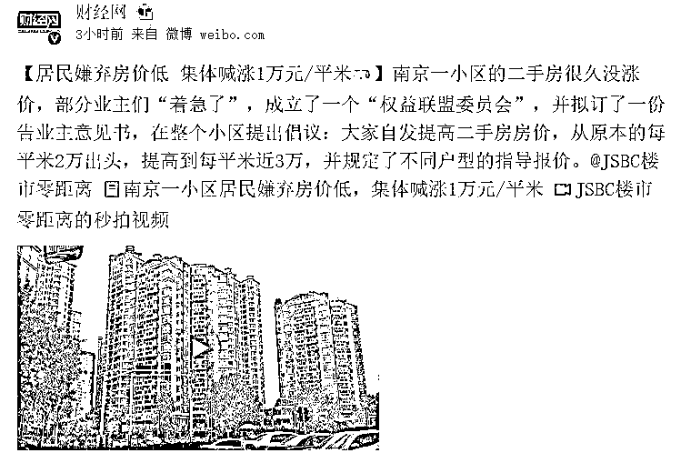

这种事情在房市里是个稀罕事，简直是在搞笑，可以博大家一乐，其实在股市里，这种事很常见，我们经常在某股的股吧里听到有小散呼吁，大家都不卖，这股就会涨停，到时候大家就都能卖个高价，这样大家都赚钱。

听起来好像是那么回事哦，如果大家都不卖，那么卖盘就消失了，一点买盘进来就能把股价推的很高。理想很丰满，但是现实很骨感，不管股吧多么热闹，小散多么团结，只要价格上去了，必然有人偷偷的卖，我自己赚一点钱走就行了，你们玩你们的涨停去吧，我不后悔，所以价格也就上不去。。。

南京这套小区是一样的情况，有很多业主闻风而动，有人听闻了这件事之后就去中介门店要求涨价 20 万，我不管是响应号召真心为了小区谋福利也好，还是想自己趁机多卖点钱也好，总之是有人涨价了。但是还有很多人，趁着其他人涨价的时候，原价不变，快速脱手，当地的小区中介接受媒体采访的时候表示因为小区体量较大，低价急售的房源依然有很多，‍经过买房人的理性选择，该小区最近一周的成交单价，依然保持在 21000 元出头，简单的说，我撤退，你殿后。。。

\~~~~

今天**又炸一个传销骗局平台“云联惠”**，其骗局的核心套路就是弄了一个商城，搞购物返点，购物多少多少时间之后全额返还，我很久很久之前就说过，类似于这种购物全额返款的所有平台，全部是骗子公司，一律不靠谱，没有例外。

我曾列举过很多这种骗术，都是那种没有正经收入，而靠一些奇奇怪怪的噱头给予回报的公司，基本都在评论区，大家看了之后要记住。

还有一点就是很多人曾留言问，身边的朋友 XX 深陷某庞氏骗局不可自拔，问我怎么办，我的回复也一律是找几篇类似的骗局文章发给他，他能醒悟最好，不能醒悟的话，就劝他不要再追加投入了，其他也没什么好办法，有的人着迷了是叫不醒的，没办法救所有人，但是能救一个算一个。

\~~~

今天三大指数收于横盘，上证指数跌 0.07%，创业板跌 0.06%，等同于不涨不跌，这个走势就是横盘，是非常健康的一种走势。在这波突破之后，即便创业板回调 2%，他都处于所有重要均线之上，还是多头趋势。

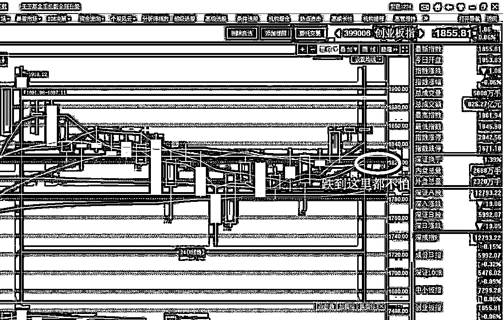

跌到 1816 我都不怕，都是直接淡定睡觉型的，离这里足足 40 个点，有什么好怕的，整个 5 月，基本就是睡后收入，睡一觉之后自己的市值就涨了，在 18 年整体去杠杆的熊市背景之下，5 月的难得的好时光，要珍惜，5 月我的确是越涨越卖，但是就涨一点我是不卖的，我还想多赚点。

今天的股市其实并没有太大波动，上上下下都属于微弱震荡，最终收盘也是横的不能再横了，而各版块也没有什么特别出彩和特别倒霉的，振幅过弱也没有做 T 价值，我今天自己的小 T 上下挂单都没有成交，就这么干瞪眼一天，躺着过去了。

不过躺着睡觉耗时间也有他的好处，这种上涨的趋势中，躺着过半个月，就能获得不少的睡后收入，过了 5 月，恐怕上半年都不会有什么好行情了，珍惜 5 月。

# 深圳房价连跌 18 个月了

紫竹张先生

经济-金融-投资，点击右边按钮关注我 

今天看到一个新闻，说深圳房价已经连跌 18 个月了，还配了一张房价走势图，我看了之后，果真吓人，单边下跌趋势。

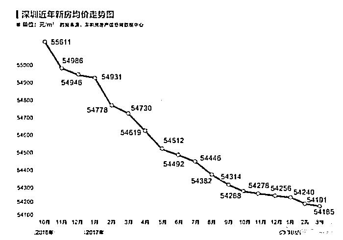

这里就要不得不说起论坐标轴单位选取的重要性了，如果把横坐标轴换成年的话，那么这里只是个小回调，换成了月，看起来就好吓人。

深圳房价的最高点出现在 2016 年 9 月份，均价是 61600 元，然后在 2016 年 10 月推出史上最严厉的“深八条”以来，当月均价下跌了 5999 元，随后连跌 18 个月。不过也就是第一个月下跌的最深，其余 18 个月，累计每平米也就下跌了 1500 元。

3 月份的时候其实就有个新闻，说当月深圳房价相对于 2 月，每平米暴跌了 6 元钱，网友细心的算了一下，一平米省的钱够买一个肉夹馍了。。。这种走势其实不算下跌，只能算横盘。深圳的房价和其余三大一线城市的走势高度类似，都是自 2016 年 10 月之后就陷入了横盘微跌行情。我在 2016 年 10 月的时候曾经写过《中国的房价什么时候会崩盘？》，就曾分析过未来一线城市的走势就是横盘微跌，预估时间是 3~5 年。当时唯一的不足之处就是我坚定的认为炒房只应该买一线城市，其余的房市风险太大，只有刚需才值得买，投机就没有价值了，还不如买一线靠谱。结果这一轮在一线城市买不到或者买不起房子的资金恐慌性蔓延到全国城市，导致大部分城市都跟随一线涨了一倍。

为什么没有任何一个城市突破这一轮一线城市的涨幅，因为下面的跟风城市都是跟着龙头城市上涨的，龙头才涨一倍，其余哪个城市敢涨一倍以上，到点了就涨不动了。而实际上，深圳的房价是横盘微跌，而不是一字横盘，证明深圳的房价还是有被挤出的趋势的，如果是像成都那种硬控一手房价导致万人排队，房子出来就抢空，那属于一字涨停板，就算横盘也不能说明这个价格是合理的，而类似深圳这样，一手房随便买，价格还坚定不移的微微下跌，那才是真正的横盘。不过这里也可以侧面说明，如果大家所在城市的房价，这一轮上涨只要是已经实现涨幅翻倍的城市，基本都可以视而不见了，他们永远滞后于一线城市的涨跌，一线城市的今天，就是他们的明天，无论是上涨，还是下跌。

\~~~

今天还要科普一下分红的知识，最近又有股票分红了，分红后好多股民蒙圈了，说自己的股票前面出现了一个 XR，然后市值直接缩水了几千块钱，不知道自己触犯了哪个天条，过来请教。

其实是这样的，除权之后，你的股票是价格会直接减去分红的钱，所以导致总市值缩水，而分红的钱，所以如果分红总共分给了你 3000，那么你的市值会直接减少 3000，这样才会让你总市值平衡，不会引来套利行为。但是按照惯例，分红的钱会延迟一天才会打到你的账上，这样就导致除权当天，你有 3000 元莫名其妙的飞走了，不过不用怕，第二天就飞回来了，你的账上会莫名其妙的多出 3000 元的现金。

当然，中国有个红利税，持股不满一年的人分到的红利，会抽取 20%的税收，也就是有 600 元被生生抽走了，这一点对散户非常不友好，对于持股的大机构非常友好。这个税收本来是所有人都收取的，后来对长期持股的机构给予减免，本意是为了鼓励长线投资，结果现在变成了散户的怨声载道，这一点就没办法了，不过分红总归还是好事，如果某个企业连续高分红，我还是宁愿买这种企业的。

\~~~

今天蓝筹白马全面爆发，奋起直追，最后三大指数全红，在昨天的突破基础上，再度向上拔高了一截。

这个走势是非常健康的，实际上今天收小阴线，横个二天，都健康，收到这样的小阳线，当然更健康，我整体的操作，当然是重仓持股不动，这走势图形不拿着不动还干嘛。

至于大势分析，我昨天花了接近 2000 字单独分析了股市部分，该说的基本都说透了，原因、逻辑、以及未来展望，该说的基本都说了，今天就不继续重复啦，总之，回调波段已经结束，5 月就是大麻袋收钱的日子，阳多阴少，阳壮阴弱的格局已经成型。

哦对了，上证今天已经上涨到了 3161，我之前预设的 3200/3250/3300 各减仓 1 成的计划没有变。而创业板我暂时打算在 1886 附近减仓 1 成，然后看看是否做 T，还是不做就一路上行，越涨越减，一直减到预估的 2000 点顶部为止，这个到时候再看。我的重心放在创业板上，上证这一波很难突破 3300，这一波的上涨，是因为连续多日筑底，加上白马的业绩地雷已经被连续引爆清除，市场没有后顾之忧导致的，正好顺势把仓位给减下去。

其他的暂时没什么了，今天事情多，少写一点，就这样了哈，今天下面多翻点留言上墙。

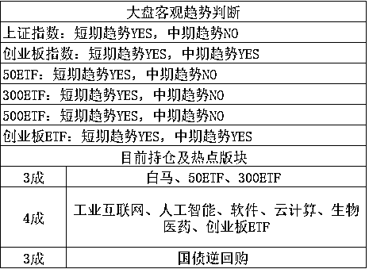

# 4 月重仓抄底，迎来 5 月的上涨

紫竹张先生

经济-金融-投资，点击右边按钮关注我 

 

今天，市场发动一根中阳线，三大指数全面突破 20 日均线的压制，形成了一副明显的上涨姿态，创业板 5 月涨幅已经达到了 2.6%，上证指数也跟随上涨，数月来，首次突破 20 日均线。

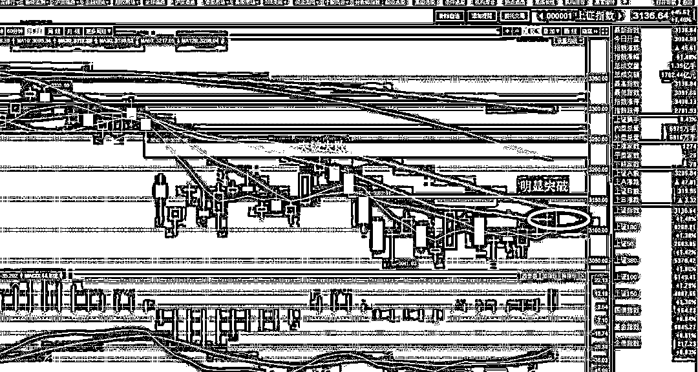

而对于创业板来说，今天一根中阳线，站在了所有均线之上，下方的均线全部转化为支撑线，这根中阳线可以说标志着 5 月上涨的开启，而能预兆多空能量的 MACD，也首次翻红。这一切，在回调周期接近 24 个交易日的前提之下，可以说基本预示回调即将结束，上涨即将开启。

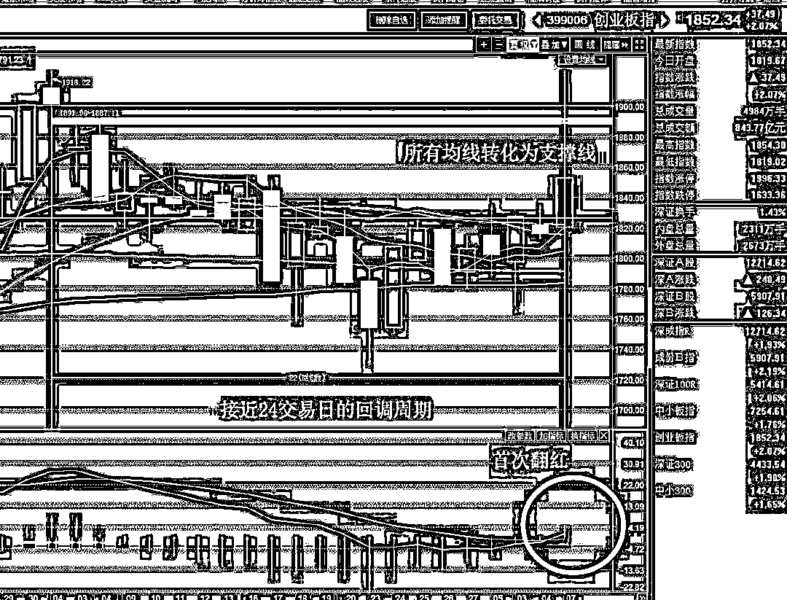

在 3 月末的拼命拉升中，我一路减仓，在 3 月末 4 月初几乎把创业板的仓位几乎都减没了，我疯狂看空，创业板接近 1900 点的时候，我曾说过绝无可能收盘站稳 1900 点，冲顶就应该空仓，否则打赌吃鼠标，我从未如此坚定的看空过，我认为整个 4 月都是下跌的，不可能涨。当时国家队和我开了个小玩笑，收盘硬拉到 1900 点整，一丝不差，如果能岔开 1 个点，我直接就封神了，可惜了我当时的一块巧克力，被我捏成了鼠标状。但是我的结论是没有错的，1900 点就是顶，然后整个 4 月都在狂跌。

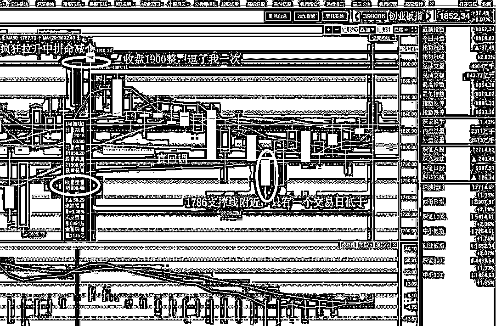

在 4 月初，持币不动，就等下跌，然后在 4 月的中下旬，我提出回调大概应该持续 24 个交易日左右，结合五一的因素，应该在 4 月底之前，完成加仓，不求买到最低点，按照分批加仓的原则来做，我预设的合理回调点位大概是 1786 附近，实际走势，整个 4 月只有一个交易日是低于 1786 的，那一天是 4 月 23 日，遭到了中美贸易科技战中兴被制裁等大型黑天鹅，可以说这个点位制定的是非常合理的，因为超大黑天鹅是预测不到的，而我们提前制定的抄底策略才是正常的大概率炒股行为。

到 4 月底，把仓位提升到了重仓，坚定的看好创业板，同时认为上证也会跟着上涨，五一节假日，安心持股过节。在假期里，美股狂跌，假期之后，美国贸易代表团访华，诸多利空，一概不理，大 A 股自有国情在。四月我的口号是看跌，但是越跌越买，五月我的口号就是看涨，但是越涨越卖，这个口号我给大家重复强化不亚于半个月了。

那么 5 月什么时候卖呢，今天刚来一根中阳线，很多人就沸腾了，说我挣钱了，好开心，要不要赶紧卖掉止盈落袋。这就有点不对了，布局了一个月，才赚二三个点就要撤退，那还布局干嘛。我这里分析这一波上涨可能的见顶区间。

首先，1900 点是肯定挡不住的，在 3 月底那一波的上涨里，我打赌说 1900 点一定过不去，而这一波，我认为 1900 点是大概率直接被突破的，道理很简单，整个 4 月的回调，其实走势非常坚韧，回调速率极为缓慢，向下跌破 1800 点日子没有几天，基本都是靠贸易战等利空给砸下去的，如果没有这些黑天鹅，搞不好 1800 都跌不破。而今天创业板收盘已经 1852 了，刚刚起势，如果突破到 1900 附近就跌下去了，那顶多只能算个横盘，而且做个双头，会变得非常难看，那 4 月还不如一口气跌下去算了，不会有那么多买盘来这里布局的。

突破 1900 之后，我认为这一波创业板很难突破 2000 点，首先千整数关口那就是雄关，上证跌破 3000 点很难，创业突破 2000 点也很难，我怎么看，一口气涨那么多直破 2000 点，都悬乎，能回调再破，就很不错啦，而且涨到 2000 估计要耗费一个月左右，那就到 6 月了，6 月本来就缺钱，就算不跌，疯牛狂奔破千级别雄关，我怎么想那都概率有点小。。。所以，创业板我的打算就是在 1900-2000 区间，分批清仓，把仓位给降下来，5 月份是 4 月布局的收获期，越涨越卖，一波龙虾肉等收割，我第一波的计划是 1886 附近，这个位置我们大概已经赚了 5%了，个股的话大部分都 10%，而且这里有个缺口，可以进行第一步收割，我打算先减 1 成创业板，然后期待可能性的小回落再买回，估计会回踩一下 1856。如果买不回也没事，这部分已经赚到手了，剩下的在 1900-2000 区间内慢慢出，根据形势来，突破之后这里哪里是顶不好说，一步步来，到时候再看。五月清仓之后，6 月底我会看情况再买回来。

而对于上证指数来说，无脑出售，3200 之上开始卖，3200/3250/3300 附近各减 1 成，敢冲 3300 我就敢清仓上证，别看今天贵州茅台大涨 6%，18 年的风头不会在上证指数，当然暴跌也不会，所以筑底的时候我死命拿，冲高我就敢卖，跌不慌，涨不贪。

总的来说，在横盘筑底阶段，别说大阳线了，一根中阳线，千军万马来相见，今天这一根中阳线直接打开了局面，明后天不管是小阴线还是横盘，都属于上涨趋势，就算中阴线，也顶多打回横盘而已，而现在是 5 月初，做多资金已经开始蠢蠢欲动了，5 月收获的希望已经开始出现，虽然总基调是越涨越卖，把我们 4 月布局埋伏的筹码卖给那些追高的人，但是也别急着卖，一点一点的出，因为上涨不言顶，顶部不好测，只能大概预估，但是我这人有个特性，逃顶功夫是抄底的二倍以上，从 15 年股灾过来的人都知道我这个习惯，三次股灾全部高位精准逃顶，比抄底功夫高多了，所以不用担心坐电梯，高抛完全没问题，我甚至都有一丝追求精准高抛的贪念，如果是分批高抛，那把握性更大了。这一波做完，安心等下一个波段的埋伏和收获，如此反复。

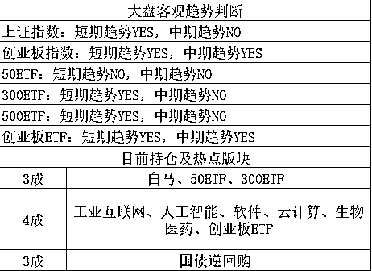

 

# 中美经贸磋商，美方谈判代表狮子大开口

紫竹张先生

经济-金融-投资，点击右边按钮关注我 

 

本周五，中美代表在北京开始进行经贸磋商，周五夜间离开北京，与其说这是过来谈判的，不如说这是过来下通知的。而我方对这次谈判下的结论是双方进行了坦诚、高效、富有建设性的讨论。  

1、双方均认为发展健康稳定的中美经贸关系对两国十分重要，致力于通过对话磋商解决有关经贸问题。

2、双方就扩大美对华出口、双边服务贸易、双向投资、保护知识产权、解决关税和非关税措施等问题充分交换了意见，在有些领域达成了一些共识。

3、双方认识到，在一些问题上还存在较大分歧，需要继续加紧工作，取得更多进展。双方同意继续就有关问题保持密切沟通，并建立相应工作机制。

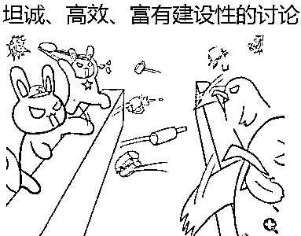

这个典型的外交辞令，直白的翻译过来就是双方互不接受对方的态度，在某些领域达成了一些共识，但是没有谈妥，在一些问题上存在较大分歧，连共识都没有。而坦诚、高效、富有建设性的潜台词也很直白，坦诚就是有话直说，高效就是双方直接开干一天回国，建设性就是谈不成。

美国鹰来去匆匆，到底来北京谈了什么呢，根据目前已经披露的资料，我们可以看到美方简直是狮子大开口，开出的条件任何人都根本无法忍受。我把美方要求汇总如下：

美方要求中方要缩减贸易逆差 2000 亿美金，特朗普之前开价 1000 亿美金大家认为是狮子大开口是把，现在直接开价 2000 亿美金，中方要进口价值 2000 亿美金的美国商品，或者减少对美国的出口来实现这 2000 亿美金的逆差缩减。

关于这一点，胃口实在太大了，之前特朗普发推特开价 1000 亿都被认为是疯了，现在倒好，直接开价 2000 亿，这根本就是漫天要价，等着落地还钱，打个 5 折还剩 1000 亿呢。你以为这就完了吗？远远不是，美方的其他要求还有：

1、中国应立即停止对中国制造 2025 的政策支持。

2、中国应废止以市场换技术的政策。

3、中国应加强知识产权保护与执行。

4、中国应对美国开放外资市场，并应在 7 月 1 日之前，给出负面清单（也就是不允许美国投资的领域清单）。美国会检查这个清单并提出优化方案。

5、中国应移除在非关键领域的关税壁垒，在所有非关键领域，中国对美国商品的关税不能高于美方关税。

6、中国应接受美国与欧盟仍然不承认中国在 WTO 体系内是“市场经济国家”的定义，中方不反对。

7、中国应接受美国与欧盟仍然不承认中国在 WTO 体系内是“市场经济国家”的定义，中方不反对。

8、美国将审查中国对美敏感领域投资，如中国制造 2025 的那些领域。对于美方的限制，中国不得反对、挑战、报复。

9、美国将对自己认定的关键领域（如中国制造 2025 相关的）增加进口限制和特别关税，中国要接受这个条款。

10、还有更离谱的呢，每隔 3 个月，中美应开会，美方会检查中方进展，如果美国认为中国不够配合，没有完成上面的条款，美国会单方面对中国产品增加关税或进口限制，加到自认为足够的程度，中国理解美方的行动，不作出报复，不找 WTO 投诉。

这些条款直接把我给看傻了，这是啥东西啊，我都懒得评论这些条款哪些是合理哪些是不合理的了，如果是我去谈判，我估计都懒得开口和对方讨价还价，因为实在是太离谱了，换成我代表中国谈判，我谈的结果，估计也就是双方进行了坦诚、高效、富有建设性的讨论，其他没了。有些网友对此的评论很合我心意，那就是这种条约应该带着航母过来谈。

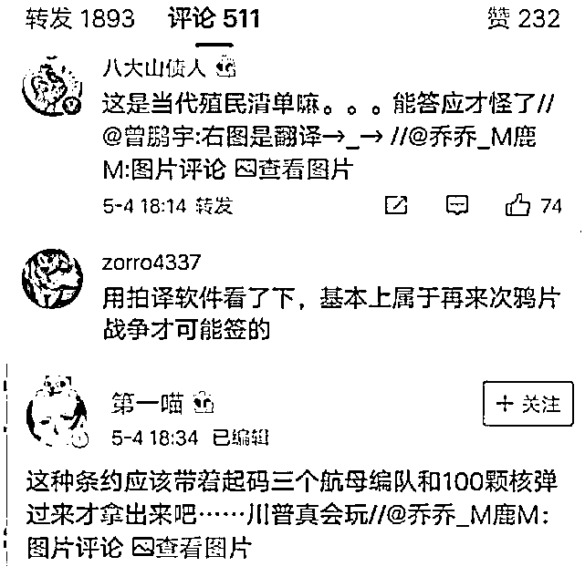

而美国人也没有任何谈的诚意，来的时候就已经提前通知了美国代表只呆一天，我周三的时候看到这个行程安排，就知道美国是来下通知的，压根没想过认真谈，而美国代表的态度也是异常的强硬。

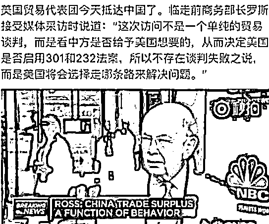

简单的说就是，要么接受我的条款，要么贸易战开打。而实际上，就像上面网友说的，这种条款除非带着航母编队过来，否则是绝无可能同意的，也就是美国必然要启动 301 法案针对中国。

既然美国知道肯定谈不拢，那为什么还要特意派代表来北京转一圈呢，就为了蹭几瓶茅台喝？肯定不是的，我个人认为，特朗普这么做的原因，很有可能是他根本没打算短期结束贸易战，首先贸易战谈个很好的结果就很难，中美互相依存谁也离不开谁，但是如果谈不了很好的结果，下一任选举特朗普就肯定要下台。

在美国，所有政客的行为都是为了争取选票，只要能拿到选票，无所不用其极，那么特朗普把贸易战打的轰轰烈烈，所有选民就会把希望寄托在特朗普身上，贸易战打的时间足够长，过程足够艰辛，吸引的眼球和注意力才会越多。特朗普必须表现出一副为了美国制造业选民的利益拼了命的态度，已经为了获得最终战果遇到的 N 多困难，才能让选民把他视作希望之星。如果一二个月就结束了贸易战，那么特朗普的努力也太不值钱了吧。

所以，从这个条款我们可以推算出特朗普未来的政治方针，那就是贸易战会是一个长期、艰巨的拉锯式战斗，上次我预计的是半年，现在看来可能半年还未必结束的了。

# 人民日报对这次谈判发表社论:中方绝不拿核心利益做交换，回绝美方漫天要价。这一次，我支持人民日报，就和美国按半年的时间计划去慢慢打吧。

* * *

  

周五夜间，美股大涨，道琼斯指数大涨 1.39%。纳达克斯大涨 1.71%，美国代表只是带来了一份谁都认为不可能执行的声明而已，并没有任何成果带回家，所以我并不认为美股大涨是因为美方谈判代表过来狮子大开口一通要价，而是他自身要涨。

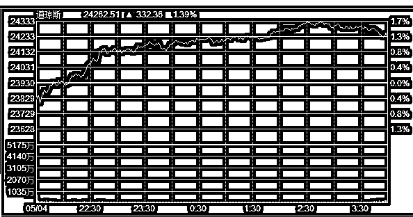

那么对于 A 股来说，周四的深 V 阳线之后，周五在不清楚美方代表会开什么条件的观望心态之下，走出了横盘小阴线整理，我感觉还是非常健康的。

在整个四月里，我们越跌越买，在四月底结束之前完成了加仓，仓位直接从轻仓提升到了重仓，非常看好 5 月的反弹，而从整体走势来看，最弱的上证指数已经跌不动了，连续多次向下试探 3050 点都被打回去了，有人死守 3000 雄关，而更强的创业板在四月的回调里，几乎没怎么回调，跌的非常少，只跌了 5%，相对于上证来说非常强悍了，而目前在诸多重要均线之上，对于一个还处于回调期状态的指数来说，非常之强悍。我们回过头里去看一下整体的走势，与其说他是在回调，不如说是振幅略大的横盘。

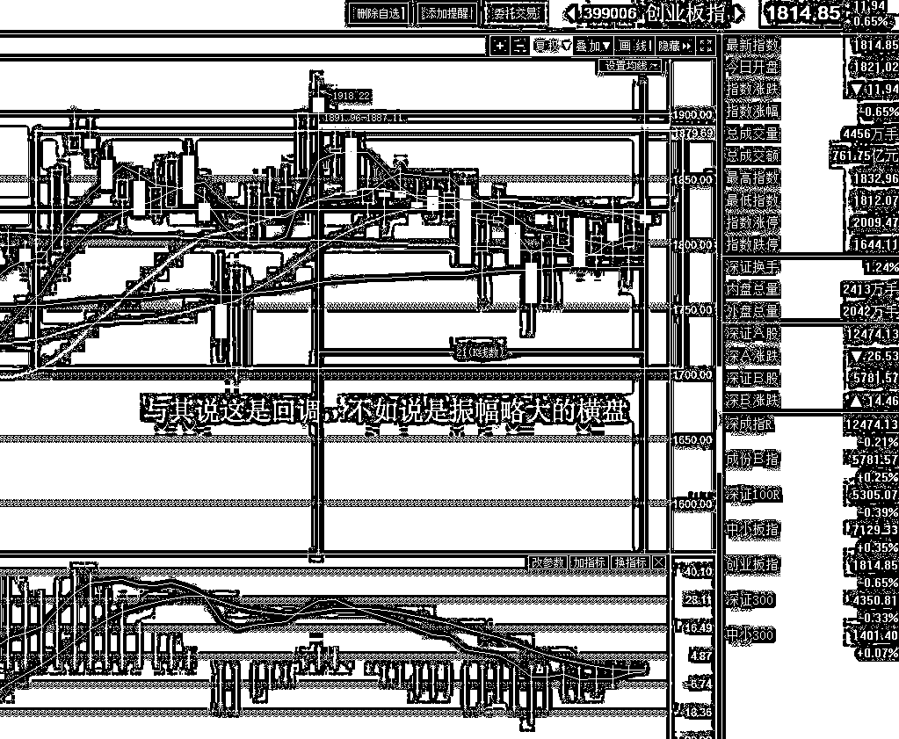

而对于一直拖累创业板的白马蓝筹来说，在业绩地雷陆续引爆之后，还稳住不跌的，那基本就暂时摆脱风险了，等所有的地雷陆续都引爆了，那么压在大家身上的枷锁估计也就打开了。我个人认为，随时可能开展一轮上涨行情，现在的图形明显已经筑底，向上突破是随时可能发生的事情。

这一波向上，在 1850 附近盘亘那么久，所以一旦突破，1900 是挡不住的，只是突破时间可能很长而已，所以我们向上暂时不卖，而向下有恐慌性低吸机会，就要大胆再度吃货，我 4 月份一口气把仓位提升到 7 成，始终留有 3 成子弹，就是因为预期的底部实际上比这个是要低很多的，但是他始终不跌让我很烦恼，4 月底之前一定要把仓位提升起来，否则踏空风险是远大于套牢风险的。如果有一次超大黑天鹅能把上证击破 3000 点，顺带把创业板给拖下去，那个时候就是满仓的机会。

但是目前看起来几率是非常小的，横盘时间越长，向上的概率越大，因为回调的时间已经高达 21 个交易日了，但是没事，在 18 年这种弱势行情下，7 成已经足够重仓了，没有天大的便宜，轻易不满仓。

对于下周，我是非常看好的，一句话，重仓持股待涨，涨起来之后，才考虑什么点位高抛，4 月越跌越买，5 月越涨越卖。

\~~~

**今天发一个招聘广告****，**由于平时事情太多，时间精力不足，所以我打算招兼职创作人，能够帮我处理一些文案问题，要求爱读书、有一定知识储备，热爱财经和投资，在财经领域有自己独到的思想和看法，如果内容质量非常好，可以升级为内容合伙人，参与核心内容的创作与管理。

有兴趣的小伙伴以任意话题撰写一篇文章，和个人简历一起发送到邮箱 723791931@qq.com。

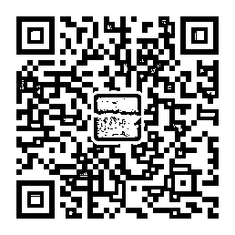

憋说话，扫我，瞄~

  

# 成都抢房事件的反思，如何才能实现房住不炒

紫竹张先生

经济-金融-投资，点击右边按钮关注我 

房住不炒是中央定下的政策基调，是各地政府的红线所在，其含义简单明了，房子是拿来住的，不是拿来炒的。但是近日的成都抢房事件，对房住不炒的中央政策构成了严重的挑衅，我们今天来分析一下这个事情。

成都的新房摇号中签率低到了个位数，每个楼盘开盘，动辄都是数万人认购，挥舞着钞票冒雨排队，而推出的房源，一般仅仅一二百套。如成都高新区西苑项目，一共 229 套，申请的有 12705 人，中签率只有百分之一点几。

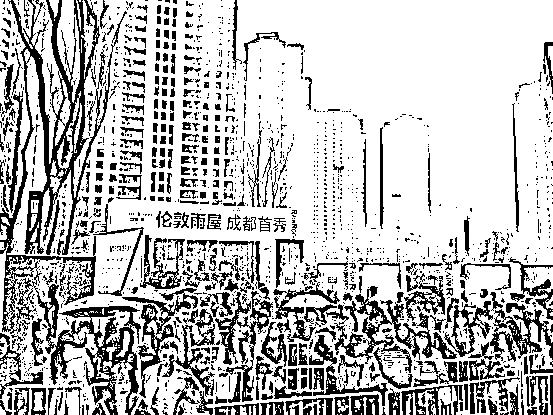

为什么会产生这么热火朝天的抢购，因为这个楼盘带精装均价 14000 元-16000 元/平米，而附近的二手房均价都在 2.7 万到 3 万左右，新房一般都比旧房贵，所以等同于这个楼盘打了 5 折，买到手直接赚一倍，这种直截了当无风险的赚钱机会，当然会引发抢购。当地居民把自家房源挂二手房出售，然后去排队抢购新房，抢新房的都号称是刚需，都符合刚需的一切政策条件，而且这些刚需甚至都愿意全款，但是实际上，他们全都是伪刚需，真正的刚需躲在角落里捏着连首付都不够的钱包瑟瑟发抖呢。

为什么新房的开盘价定的这么低，5 折简直是太离谱了，能 3.2 万以上开盘的，非要 1.6 万以下开盘。每一个给新房限价的城市都会引发排队摇号，但是折价率基本都是 20%左右，这就已经有明显套利空间了，但是没有一个像成都这么离谱的，居然折价 50%，这种超高折价率带来了什么效应呢，就是下面这个帖子所说的效应。

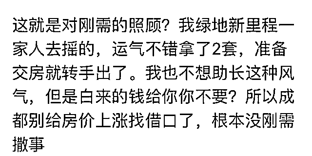

这是赤裸裸的炒房，买房就是为了转手卖了赚钱，就算限售都没有用，因为这些人都是成都本地人，都有老房子，买了新房转手卖老房，规避一切政策和烦恼。。。成都的疯狂程度，恨不能把家族里能动弹的全部拉过来，爷爷奶奶齐上阵去摇号，都是刚需，都缺房！

这种行为明显已经不正常，整个成都已经被扭曲了，为什么政府会设定如此之低的新盘限价，这就要从 2016 年 10 月中央全面调控楼市说起了，那年国庆，中央紧急调控楼市，连下十三道金牌，十一月，16 个城市在国务院领了军令状，房价环比上涨不得超过 2016 年 10 月份这一红线。

这道红线，北上广深都严格遵守了，因为这些一线城市已经翻倍了，但是其余的城市就很难受了，尤其以成都为例，在二线的省会城市里，他是起涨最慢的一个，2016 年 10 月的时候，成都的房价根本就还没开始涨。但是等一线城市严控市场，房价见顶之后，资金开始慢慢外流推升二线城市，于是成都被迫一路限价，二手房则一路上涨，涨到今天，双方的价格差距达到了一倍之多。2016 年 10 月，成都中心区域的最高房价就是 1.6 万一平米，所以今天成都中心区的新房价，一律不得超过 1.6 万，这就是 1.6 万价格尺度的由来。

当年签军令状的 16 个城市，只有四大一线城市无所谓，其余的二线城市，如武汉、南京等，后来的价格相比 2016 年 10 月都有不同程度的上涨，因为资金从一线蔓延到二线需要时间，所以这些城市全部出现了一手房限价的行为，其原因就在于当年签署的军令状，房价不允许超过 2016 年 10 月的红线，二手房控不住，就硬控一手房，至于这个价格是不是荒诞就先不管了，先应付过去再说。

限价带来套利，套利带来抢购，二手房无人问津，一手房挤破脑袋，很明显限价这东西纯属自欺欺人，而这些大胆抢房的人，其核心勇气来源于房价永远不会跌这一个信仰。

中国的楼市已经太狂热了，房价泡沫已经很大，对比曾经房价突破地球极限的日本东京，经历了房地产泡沫破裂的痛苦之后，如今的东京人已经不敢怎么炒房了。我刚搜索了一下东京的房价，大概相当于北京二三环这个位置，一个二三十年房龄，外表略破旧但是里面精装的小独栋，其报价相当于人民币 5~6 万元一平米。而北京同样的地段，老破旧都敢要 8 万元一平米。如果再结合日本超高的人均收入，那么北京的泡沫更加的凸显严重。

在 1989 年，东京的地产泡沫曾经令人目瞪口呆，卖到 6 万人民币一平米，注意那是按照 1989 年的人民币汇率来计算的。1989 年的 6 万元和今天的 6 万元，那是二码事。为什么 30 年之后，曾经狂热炒房的日本人不敢炒房了呢。

那是因为日本人被房地产伤的太深了，被整怕了，一朝被蛇咬十年怕井绳，日本的地产现在非常健康，运行的非常平稳，这几年飙升的房价，也基本都是外国人（中国人）跑过来买给推升起来的。本国人那是彻底的刚需，炒房行为几乎绝迹，就算房价那么便宜，很多年轻人宁愿租房也不愿意买房。

为什么年轻人宁愿租房也不愿意买房，很大的原因就是日本房价常年上涨过于缓慢，手里的钱不管干什么，增值都比买房地产划算，这个时候，很多人就宁愿租房都不愿意买房。这个道理换到中国也一样，只要打破地产永远涨的神话，那么很多刚需立刻就不会买房了，我说的是真正的刚需，马上就要结婚的，不是那种伪刚需，就连这种真刚需，都未必会去买房。

要真正实现房住不炒，什么调控都是没用的，包括压房价最有效，立竿见影的上浮利率行为，都没用。真正最有效的措施就一个，就是中国房价来一场杠杆坍塌式的大跌，一定要跌到一部分人杠杆断裂，一定要跌到一部分人跳楼自杀。

只要跌到这个程度，你会发现，本来满屏幕的刚需立刻就不见了，本来全部惜售的房子马上源源不断像洪水一样涌出来了，你会发现北上广突然像变魔术一样变了好多套房子在出售砸盘。这里有一个非常明显的例子，2015 年股市杠杆断裂，崩塌式下跌，很多人爆仓，血本无归，还有人跳楼自杀。而在股灾之前，股市里的股票供不应求，人人抢购，杠杆 1 倍会被人耻笑的，发财是都是 3 倍 5 倍杠杆，敢 10 倍杠杆买股票的才够竖一下大拇指，卖盘被打的稀里哗啦，敢卖就有人买，谁卖谁 SB，直接给你买涨停，越高越买，大家都抢购的才说明这个票是好股票嘛。

但是杠杆断裂之后，千股跌停，没人抢购了，买盘一夜消失，原本都捂着不卖的股票一夜之前全涌出来了，什么价值投资，什么科技发展，都一边去，赶紧卖掉才是王道。这一波大清洗之后，股市杯弓蛇影，再也没人敢疯狂做多了，买股票之前都想一想，这个股票是不是真的有价值，是不是真的好票，是不是我真的需要去买他，所以，今天的中国股市，和当年的日本楼市一样，像个死鱼一样趴在了地上。

到了房地产，道理是一样的，中国地产要实现房住不炒，急需对“刚需族”进行一波大清洗，只有崩跌一次的市场，才能把伪刚需给甄别出来，才能让本来可买可不买的人，不至于被迫去买房。

但是当前的政府，不敢这么做，要去杠杆，弄崩房地产很简单，但是弄崩之后还能不能控得住就是个很大的问题了，国家队连救股市都麻烦，体量大于股市一个数量级的楼市，一旦硬着陆崩溃了，那根本不是政府能救的。

所以政府的唯一办法，就只有拖，用限价令这种掩耳盗铃的办法去拖，这种办法看起来可笑，但是地方政府也是没办法，已经给中央下了军令状了，中央政府也是没办法，北京已经翻一倍了，不能再涨了，再涨就真崩盘了，至于卸杠杆清洗伪刚需，那是万万不敢的，国之重器，万一玩坏了，谁负的起这个责任。

当前政府走的是另外一条路，就是拖时间，弄个三五年不涨，很多投机客就会被利息给拖垮，这些投机客的杠杆高的可怕，远不是 3 倍能限制住他们的。这种拖的办法对投机客是绝杀，2014 年的时候很多囤房一族就扛不住了，被迫逐渐出货卖房来回笼现金流，因为利息实在付不起了。但是对于伪刚需则效果不大，伪刚需是在投机和刚需的身份里来回切换的。还有一些是真正的刚需，但是这些刚需如果不是涨个不停的房价，他们原本是不打算买房的，日本、欧洲、美国就有一半以上的人是一辈子租房的，宁可租房也不买房，因为买房不划算，他们才是真正的房住不炒。

中国要实现自己的房住不炒，地产价格是绝对不能只有上涨和横盘二条路的，必须有惊心动魄的下杀，楼市必须有风险，大家炒楼的时候才会谨慎，不然谁考虑风险啊，借够钱就买，跌了就去政府大楼闹事，多简单。

当然，有剧烈下跌的楼市，其控制难度会急剧增高，但是这样的楼市才是健康的楼市，如今这种上涨+横盘的楼市看似可控，但是等增长到某一个临界点的时候，会把所有风险一口气给释放出来，那个时候的后果会非常严重。

期待一次下杀，全国楼市都安静了，成都这种闹剧也不会再看到了，全国会真正的房住不炒，不过按照中国的现状，政府是不敢这么玩的，我估计是看不到了，未来的三五年，只能按照横盘考虑，所以房住不炒也只能是个口号。

只要楼市无风险，大家入市就一定不会谨慎。 

 

长按上方二维码关注我

# 生几个孩子最符合经济学原理

紫竹张先生

经济-金融-投资，点击右边按钮关注我 

 

今天周五，收盘之后打算说点杂谈，正经的大文章周六发，周日到周四交易日发文章，能让我想轻松愉快的随便说点啥的估计也就只有周五了。

今天说的是，生几个孩子最符合经济学原理。首先，在现代社会中，生孩子肯定是巨亏的，把一个孩子抚养到经济独立按 20 年计算，至少要花费 50 万+一套首付。。。而指望小孩养老回本，那是别指望了，他不给你啃出六个钱包，掏空全家族祖祖辈辈的钱去买房就不错了。

这种坑爹货生 1 个就够多了，还用讨论生几个吗？生小孩会明显降低生活质量，同时自己付出的投资基本看不到收回的希望，**从经济的角度来看，生小孩是一个比买中石油还坑爹的投资**。

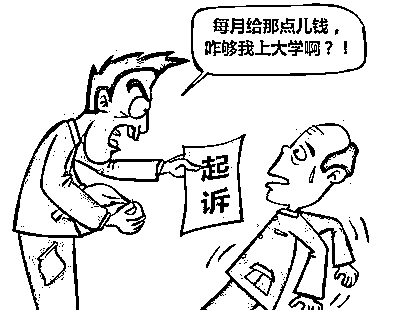

**但是如果不生孩子的话，那么我们挣钱的意义是什么呢，**年轻时还好说，等到了五六十岁的时候，就感觉人生一点追求都没有了，了无生趣。而且处于物种繁殖的角度来说，人类天生是喜欢生育后代的，或许有人不喜欢生育后代，那么这种人的基因一定会随着时间化为飞灰，留下的都是愿意生育后代的，所以**虽然是亏货，但是从基因延续的角度来说，我们必须生育一个孩子。**

那么只生育一个孩子是否能保证我们的基因延续呢，并不一定，无论再好的医疗，再全面的保护，也挡不住意外的发生。据第五次人口普查资料推算，中国有大约 3.91%的人活不过 18 岁，5.1%的人活不过 30 岁。足足 3.9%的人活不过 18 岁，各种原因都有，这个概率就很吓人了，正常来说 18 岁以下的孩子是没有后代的，也就是说每 25 对夫妻，就有一对面临失独危机，这就很吓人了**，大概是你们一栋楼里，就会有 2 户人家失独！**

如果只生一个孩子，那么有大概 3.9%的概率无法成年，也不能给你带来孙辈作为基因补充，虽然是小概率，但是这种小概率一旦出现是非常致命的，能给你的生活带来毁灭性打击。对付这种小概率出现但是损失巨大的事情，最适合的莫过于买保险了，买保险是专门解决这样的困扰的。

但是很不幸，养孩子这东西就不是从钱的角度考虑的，而是从基因延续的角度考虑，如果从钱的角度考虑，那么一个孩子都不应该生。所以保险完全不能解决这个问题，如果孩子不幸死亡了，那么不管保险赔付多少钱，都无法解决这个问题，如果钱能解决这个问题的话，不生孩子能获得的钱更多。

所以，这个时候就要上另外一道保险了，我能想到的唯一保险，就是生二个娃。。。其保险费很高，保费大概是 50 万现金+一套首付，但是他可以把你失独的风险，降低到万分之 16，也就是一万对夫妻，才会有 16 个遭遇此不幸。

这个概率勉强可以接受，也许你不信，家里孩子保护的那么好，怎么会活不到成年，哪怕是万分之一也不能接受啊，概率不应该是 0 吗？

其实现代社会的成活率已经非常的高了，刚解放的时候国家做过人口普查，那个时候，中国人活不过 18 岁的概率高达 50%以上，人口的平均寿命仅为 35 岁。大家可以询问自己解放前出生的叔叔阿姨辈，他们那一辈，每一对夫妻平均会生育七八个小孩，其中活下来的，一般就三四个，其余全部因为各种原因挂掉了。

**为什么古人十四五岁就必须结婚了，因为着急啊，**至少要生 4 个孩子才能保证人口不缩减，要生 6 个以上才能维持人口正增长。按照怀孕+哺乳+备孕耗费一年半时间来计算，6 个孩子需要连生 9 年，这 9 年里，妇女一直处在怀孕、生产、哺乳、再怀孕的流程里，堪称生育机器。

按照这种极限算法，才勉强够繁衍用，因为夭折率太高，如果中间但凡出现什么意外，拖上那么几年，比如中间生个病耽误了怀孕什么的，那么恐怕时间就不够用了。还有一个就是这个平均年龄的问题，实际上大城市里，活到四五十甚至六七十的并不少，平均年龄定在了 35，因为 20 多岁因为种种原因挂掉的其实是很多人的，每次生孩子对妇女来说都是鬼门关，这不是开玩笑的，6 个孩子没那么好生，所以，古代的妇女生育对家族的贡献是非常大的，这一点回头展开说。

其实女孩子生育能力最强的就是十五六岁，男孩子也一样，大概二十三岁左右吧，然后就开始慢慢下滑了，到了 30 岁之后，你会发现，生育难度急速上升，怀不上的人特别多。在古代，30 岁还能抱上的孩子，称之为中年得子，宠爱的会不得了，因为 30 以上真的会很难生育，别相信什么现代食物激素多所以导致生育率下降的鬼话，生育率下降最关键的一点就是生育年龄大幅度提升了，好多城市里的人都是 30 多才开始生孩子。我可以明确的告诉大家，也就幸好现代医疗条件好，饮食条件好，那些 30 多岁的人还能怀上孩子，要是摊到古代那种恶劣的条件，30 岁以上还想怀孕，只能去求送子观音了，运气好会送你一个，难度堪比摸彩票。

然后扯回话题，生孩子，按理说是生的越多越安心，但是生育成本实在是太高了，多了实在生不起，生一个的话，4%的概率又有点吓人，所以**我认为生 2 个最经济划算**。

这里需要进行声明，我不是给二胎政策打广告，我今天只是科普数据，科普一堆数据，都是国家公布，网络可查的。养育孩子的成本有了，夭折的概率也有了，到底生几个划算，根据各家情况可以心里掂量一下，能生 2 个还是生 2 个，如果实在负荷不起，至少也生 1 个，没有孩子的话，赚钱真的没什么意义了。

长按上方二维码关注我

# 如何评价一次性购买 133 个车位的长沙业主

喜欢我的都关注我了~ 

这几天，媒体纷纷报道湖南长沙冒出的一个土豪，她一次性豪掷 600 多万打包购买了某小区 133 个车位，然后把车位锁上，直接每个加价 3 万在小区出售，而且只卖不租，引起了巨大的争议。

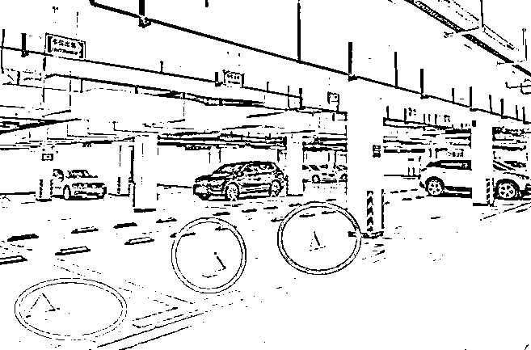

先看看详细背景，今年 4~6 月，这个小区业主进行了车位集中选购，当时购买车位开发商给予优惠，第一个车位 7 万元，第二和第三个车位 4 万元，打包价 15 万元三个车位，平均价 5 万元一个。

车位卖出了一部分，但是并不多，今年 7 月，有人发现，该小区 9 栋地下一层的所有停车位一天之内全部售空，经了解发现，不止 9 栋楼下，整个小区共计 133 个车位被一位吴姓女子买下。

这位土豪买下车位之后，立刻全部上锁，禁止其他业主停车，然后挂牌出售，只卖不租，且加价三万，引发部分业主巨大的不满。

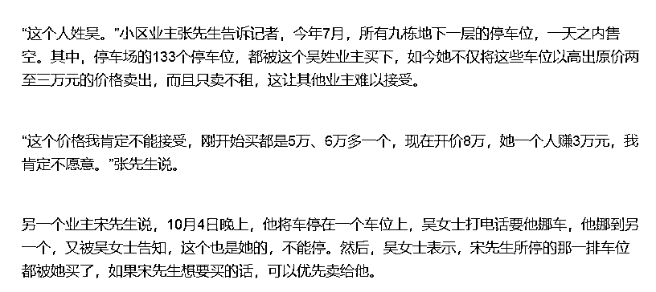

这个不满的原因，主要来源于心态失衡，前几个月公开发售的时候 5 万一个都不愿意买，这才几个月就要 8 万一个，要是买了吴女士的车位，那感觉就像吃了苍蝇一样恶心，感觉自己智商被侮辱了，但是如果不买，又害怕后面车位被卖空之后没有车位可买。还有一个小原因就是当初买房的时候，开发商赠与业主免费停一年车位的优惠，这个优惠是针对没有卖出的车位可停，已经卖给私人的车位，自然不能免费停，原来可以很爽的免费停的业主变的非常不满。

囤积大量车位的吴女士是否涉及囤积居奇，是否涉及炒作车位，是否涉及违法，立刻激起的网民的热烈讨论。

法律和感情的冲突 

吴女士这事，从法律上是没什么可说的，明显的不违法啊，买车位这个事情法律上并不禁止，他和买房子是两码事。

但是从感情上，很多民众非常痛恨囤积大量房产吸血的炒房者，他们找不到人可以骂，正好吴女士大量购买了车位并涨价出售，于是直接就把吴女士大量购买车位的行为等同于大量购买房产，找了一个靶子然后开骂。

实际上，市场经济下，任何商品都不应该有任何行为的限购，买卖自由，你喜欢大米，你买一万吨都是你的自由，别人只会惊叹你为什么这么有（sha）钱（mao），绝对不会嫉妒你家有一万吨大米。

但是什么时候大量购买大米有罪呢，那就是战争和饥荒年代，这个时候如果有人恶意囤积大量的大米然后高价出售，是会被政府严格打压和处罚的。政府控制购买大米的行为是违法自由市场准则的，但是在特殊情况下，是有利于社会稳定和发展的。

而房子，也是因为触发了民生领域特殊情况，所以才引来政府一系列的限制措施的，房地产市场并不是一个自由市场，大家怎么骂政府高价卖地都可以，但是他的一系列管制措施，的确遏制了很多有钱人入场炒房。

但是车位就不一样了，没有房子住，你可以说你活不下去了，要露宿街头，但是你没有车位就活不下了，这怎么看都是有毛病的，政府不会在这上面多加管制的。对自由市场干涉的越多，经济越糟糕，这是谁都知道的道理，房子只是个例外。

而实际上，该小区的车位是非常充沛的，吴女士虽然买了 133 个车位，但是依然谈不上囤积居奇。

物业的潘经理对记者说，小区 7 栋到 11 栋的地下车库，第一层共计 470，第二层也差不多，合计 900 多个车位。按照这个数据可以类推出，1~6 栋也差不多这个数量的车位，我不知道还有没有 12 栋，就算没有，这也逼近 2000 个车位了，吴女士的 133 个车位虽然看起来多，但是还是没有办法影响市场，只能说是个大买家而已。

开发商表示，吴女士一口气吞下 133 个车位后，目前依然还有 300 个车位可以租售，如果大家觉得吴女士的价格贵，欢迎来开发商这里购买。另外开发商还表示，吴女士购买的价格比集中选购阶段的业主购买价要贵，每 3 个车位大概要贵 5000 元左右。

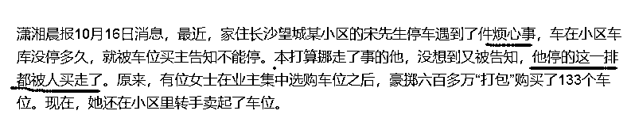

看完这些信息后，我真的对那些“愤怒”的业主表示无语，不清楚你们在愤怒个什么，无非就是想占点小便宜没有得逞而已。什么叫“他停的这一排都被人买走了”，意思就是他一直没有买车位，以前老是在占别人的车位停呗。

开发商那还有 300 个卖不掉呢，你怎么不去买。。。

从经济学上分析吴女士的行为 

上面是一次正常的口水对喷战，没啥好说的，这事几乎没什么辩论的余地。我今天想谈一谈的其实是，吴女士这种行为能否获利。

从表面上看，吴女士以 5 万的均价拿下车位，转手 8 万一个出售，肯定是暴利啊，这还用问吗，如果法律不管吴女士的话，那吴女士就是投资大师，膜拜的偶像。

我只能说，你们想的太简单了，吴女士的这种行为压根不赚什么钱，而且是很冒险的行为。首先，开发商那里的车位不是 5 万元一个，你回头再仔细看看，如果你只买一个，那么价格是 7 万元，如果你一次性买 3 个，打包价 15 万，这样才能算出来均价 5 万一个。

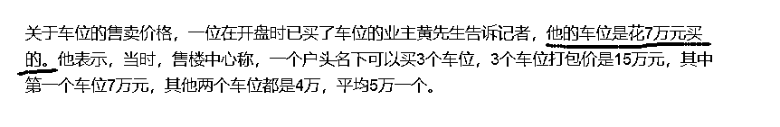

也就是说，如果你去开发商那里买一个车位，那么成本是 7 万，去吴女士那里买，成本是 8 万，如果你一次性向吴女士打包购买，那么肯定也会有相应的降价，不可能 3 个车位打包要你 24 万的，可能只有 6 万一个，打包 18 万。

赚 1 万也很多啊，难道不是吗？当然不是了，你想的太简单了。你看的是标价，而不是实际成交价。如果吴女士立刻卖掉了这 133 个车位变成了现金，那才算赚到了暴利，否则都不算。

把买来的货物卖掉才叫商业行为，否则叫收藏行为。。。我去淘宝买几万件商品，直接加价 50%挂上去，是不是我就发财了？当然不是，你这批货全部会砸你手里，亏死你，不信你去试试看。

吴女士这里也是一样，她的利润和她脱手的时间成正比，每多持有一年，她的成本都会增加。正常的商业融资率大概是 10%以上，这里面是包含了风险溢价的，也就是说，她一年不加价 10%，做这个事情毫无意义。

如果吴女士购入的这批车位，以均价 5 万买入，均价 6 万卖出，陆陆续续卖了 3 年的话，那么她是铁亏的。

另外还有最重要的一点是，车位的价格其实是个房价呈高度正比关系的，只不过是因为不能贷款没有杠杆率，无法吸引职业抄家而已。很多人会有这样的印象，小区里的车位不买，过几年就涨疯了，所以车位也是必涨的。持有这种印象的人，你可以看看你们小区那几年的房价，和车位上涨就是前后脚的关系啊，房价不涨车位肯定不会涨，房价一涨，车位很快就会涨。

所以，房子的租售比达到了 70 倍，靠租金 70 年才能回本，车位也差不多，因为没有杠杆的原因，租售比低了一点点，也低不到哪去。

很多人说，租车位多好啊，把买车位的钱拿出去存理财，都比买车位强，性价比太差。说完这话之后，转身就去售楼处排队抢性价比更差的房子了，这是大脑分裂症吗？

而大家都知道，租售比 70 是非常不正常的，因为最低的房贷都有 5%利率了，而你的出租收益只有 1.5%，换成这世界的任何一种投资品，让你以 5%的成本去购买，回报率只有 1.5%，你都会骂那个人失心疯了。

但是偏偏房子，你觉得没有任何问题，因为你押注房子一定还会涨，只要年涨幅高于 4%，抵消掉 5%的成本，你就不会觉得亏，一旦房子停止上涨，你就会大亏特亏。

而车位，其实也是一样，开着十几万的车，用着几十万的车位，在大城市非常普遍，而车位的租金其实并不高，投资回报率非常低，比房子好，但是也只有大概 2%左右，你存银行理财，都比这个强，但是为什么人们还是要买车位呢，还是因为赌它上涨。

所以，吴女士的这次购入行为，是在赤裸裸的赌她小区的房价上涨，如果房价没涨，反而下跌，车位的价格一定跟着下跌，这批车位砸手里几年没出货，那就别谈暴利了，不亏钱就不错了。

囤车位和囤房子是两码事，二者的区别大概相当于和平年代囤粮食和战争年代囤粮食的差距，完全不可同日而语。

更别提，我认为她这个阶段囤车位，可能根本挣不到钱，吴女士就算把价格标到 100 万，那也是她自己的事，如果不能成交，那就只能收藏起来玩一玩了。

大概就是这样，我今天写这个文章，不是告诉你们囤车位无罪，而是想告诉你们，这个阶段不适合囤车位，过一段时间在考虑吧。

觉得此文的分析有道理，   
对你有所帮助， 请随手转发。 

长按下方图片，识别二维码，即可关注我

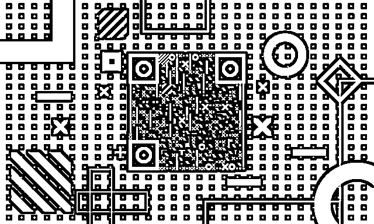

近期精彩文章回顾（回复“目录”关键词可查看更多）

华为员工都这么穷，怪不得拼多多能火 | 房价跌 20%就会全面崩盘，地产杠杆远比你想的要脆弱 |  为什么碧桂园的质量那么差 | 清醒点，放弃全面开征房产税的幻想 | 央行和财政部隔空掐架，我支持央妈 |中国土地制度源自香港，但是香港却是劏房密布 | 为什么中介哄抢租赁房源，因为贩毒都没它来钱快 

# 丹东房价一夜暴涨说明了什么

紫竹张先生

经济-金融-投资，点击右边按钮关注我 

 

最近几天丹东房价刷屏了，前几天朝鲜宣布要和平发展经济之后，被围追堵截的炒房资金突然找到了一个宣泄口，那就是丹东。丹东是距离朝鲜最近的中国城市，有人把他类比当年香港和深圳的关系，如果朝鲜改革开放，很明显丹东的房价是一个利好，所以，丹东的房价起飞了，2 天之内暴涨 50%，从 3500 元飞升到 5500 元每平。  

看到这里，我想起了 4 月份刚被冰封的海南房价，海南也是在中央出台利好政策之后，一夜沸腾，到处抢房，然后紧急出台多个政策才勉强冰封住。这些房价暴涨的事情，说明了中国的房市已经出现了和股市完全一致的炒作现象，这是典型的炒概念，炒题材，中国的房产市场，已然资本化和投机化。

其实投机资金的数量并不多，以丹东为例，这个小城市每天的产权办理速度只有 200 多户，每套房子的单价也就 5000,这就是一个标准的小盘股，突然被巨大利好给拉涨停，这就是无量封涨停啊，几天时间当地政府就反应过来了，能交易的房产没有多少套。

但是这种完全类比股市的现象值得我们深思，海南出利好了，海南版块概念直接涨停，海南房价也跟着涨停，丹东出利好了，房价也直接涨停。**这种速度的上涨完全是股市类投机资金的手笔了，**绝对谈不上刚需、自住这类话题。这和中央的“房子是拿来住的”是完全背道而驰的，可以说是对中央政策赤果果的挑衅。

所以，这些地区的房价一定会被限制住，海南直接套用当地缴纳 5 年社保才能买房的政策就让海南楼市一夜冰封，因为海南本地人才多少资金，海南又不是北京，一旦没有外地人的参与，少了资金，别说房子本来就有泡沫，就算这些房子真值这个价，一时半会他也涨不上去，因为钱不够多。要是当地人觉得不值这个价，那就更涨不上去了。

我个人是明确反对去海南啊，丹东之类的炒房的，海南我之前说过，今天我就说丹东。丹东这个地方算不算利好，算，应不应该大涨，我觉得按股市的预期算，他也该涨一半。但是他容量太少，承受不了多少买盘，而且一定会出台限制性政策，否则地方政府无法向中央交代。在和专业炒房团的大佬抢吃的时候，还要承受地方的限制性政策，我觉得划不来，尤其是**朝鲜开放也不是 100%的**，这里面也会承担一定的风险，如果朝鲜明确要 100%的像中国那样开放，丹东房价翻一倍都是值得的。

但是这里面的风险还真的是有的，朝鲜不可能像中国那样开放，邓爷爷那样的伟人是很少有的，中国改革开放等于否定了大半的政体，以至于**苏联和朝鲜都称 1978 年的中国为修正主义，**意思就是我们私自修正了社会主义的定义，修正主义不是什么好词，和叛徒的意思差不多。。。

但是就是这种修正主义，让中国发展神速，朝鲜如果要获得中国的速度，也要否定自己大半的政体，当年中国的毛主席刚刚过世，国内无人能大权独揽，哪怕邓都不行，元老太多，这也是改革的前提条件之一。对比**朝鲜目前金将军如日中天，大权独揽的威望，朝鲜要彻底改革开放，难**。朝鲜更可能的是那种不改政体，只打算吸钱的改革，这种改革效果很差的，中国改革初期尝试过，别说外资，连华侨都不敢来几个。

总之，我不建议去丹东炒房，这个是结论。另外海南和丹东的炒房热，说明当前的房市还没被压制死，如果把政府的调控手段称之为温和调控逐步冷却的话，那么现在只是从沸水压制到了 90°左右，仅从海南和丹东炒房热来看，我就可以大胆断定，整个 2018 年，我们不可能拿得到便宜的房贷，一定是基准利率上浮的，恢复下来至少等 2019 年再说了。基准利率上浮 20%和下浮 10%的利率导致的利息差距是很恐怖的，**30%多的差距。每年别人还 10 万利息，你就要还 13 万。。。**

\~~~

据新闻报道，今天早上，美国贸易代表团将抵达北京，按照预定计划，将在周五和中方会面，并在周五夜间离开北京。

按照这个描述，好像谈判的时间只有一天？这个速度能谈个什么出来，是来例行通告美方态度的吧，稍微有一点分歧，那都不是一天谈得拢的，毕竟这都是动辄上千亿美元的生意，明天一天的谈判，我觉得顶多就是交换一下双方的态度，互相表个态，如果是正儿八经的谈判，应该是谈不拢就不走那才是正常的行为，不会预设离开日期的。

所以，今天早上处于对贸易黑天鹅的担忧而引发的再度跳水，在创业板杀跌到-1.8%之后，直线反弹，到了收盘，反而涨 1.4%，其中应该有一半的原因，应该是解除了对谈判的担忧。虽然不知道明天的谈判结果会怎么样，但是仅仅从这个谈判时间来看，爆不出太大的黑天鹅，小的让步可以接受，大的让步不可能美方过来喊一嗓子，我方就同意了，多没面子，至少也拉锯 N 天才有可能同意，那么仅仅一天的谈判时间，是不够的。

而在早上的时候，其实是很危险的，急速下杀是非常恐慌的，但是出于对近期筑底的信心，这里我们是坚定持股的，如果没有坚定的信心，早上说不定就被洗出去了，因为真的很吓人，长期横盘之后突然剧烈下杀，特别说一些老手。但是如果信心坚定的话，早上是个难得的日内 T 机会，今天的振幅真的很大，一天之内生吃 3%的涨幅很容易。

今天上午的这个下杀，具有明显的洗盘效果，对于回调末期来说，这种底部震荡的越厉害，则底部越扎实，如果能有个放量长阴然后下影线，那就预示一波上涨阶段 100%的即将开启。在上一次的顶背离之后，这一波的回调阶段是 24 个交易日左右，本来觉得结合一个五一假期的转折因素，可能会提前个几天，如今看，是提前不了了，不过已经度过了 20 个交易日了，就算五一的向上转折能量没有逆转过来，他也就只剩四五个交易日左右了。

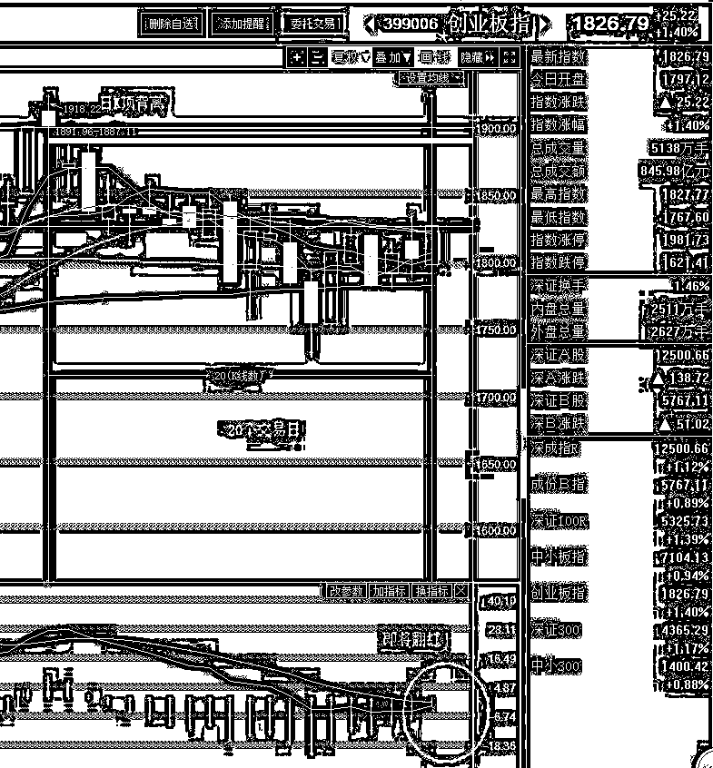

而与此同时，MACD 也即将翻红，这个时候明天来中阴，也只是打回到继续横盘的状态而已，别说涨，哪怕是横盘，也能顽强的向上一步步慢慢拉红，那么在回调的末期，只要这个一翻红，很有可能由创业板带头的一波上涨阶段就再度开启了。

这一波的领头羊明显是创业板，蓝筹白马刚一个又一个的雷，股市不相信什么超跌反弹，而他们也不是超跌，去年涨那么多了，今年这只算是一个回调而已。不过即便不是他们领涨，跟着小盘一起普涨还是很正常的，这一点信心是很足的，因为上证的筑底也快结束了。

总之，整个 5 月，来黑天鹅只是暂时休息一下，没黑天鹅分分钟就会向上蹿，外围这几天跌的的确很惨，美股这回还在跌，跌的还挺多，-1.2%了，但是我国自有国情在，顶多一个低开而已，以前你涨那么多的时候也没见 A 股涨啊，现在 A 股跌辣么久了，怎么也该反弹一下了，有利空消息，也就顶多压制几天吧。

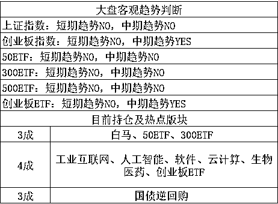

长按上方二维码关注我

# 分红知识科普扫盲

前几天有人问我一个问题，是关于分红问题的，说问了好多地方都没有满意的答案，想让我说说。他的意思是，上市公司是把分红的利润打到了证券公司的账户上，然后证券公司打到我们账户上，但是同时账户上的股价被除息了，所以我们并没有拿到好处。但是当初我们的钱是实实在在的打给证券公司的，那么从现金的角度，这部分钱到底去哪了？  

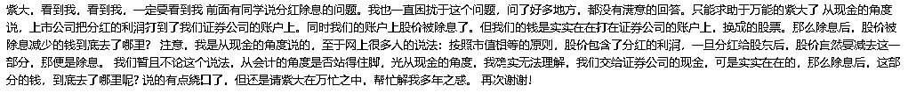

我先说一下流程，假设某公司说每股分红 1 元钱，你持有 1 万股，那么上市公司会把 1 万元打给证券公司，证券公司会打给你。但是与此同时，你的持仓股价会每股下调 1 元，导致你总市值还是不变，这让很多人非常的困惑，钱到底哪去了，如果摊上要交红利税的时候，你会发现分红还不如不分红，让很多散户感觉到很亏。

其实并不是这样的，首先，上市公司的盈利分红，这笔钱是结结实实从上市公司划出来了，这笔钱也结结实实的打到你的账户了，这 1 万元现金你可以立刻提走，这就是你的分红。然后我说说为什么要出息，把股价下调 1 元，因为如果不这么做的话，会引发相当多的人在股东登记日大举买进股票，一拿到分红就卖出股票，引发股市的剧烈波动。而至于股价是高是低，其实根本无所谓，按照现行会计制度，公司的所有权是按照股数来定义的，假设该公司总股本为 1 亿股，你持有 1 万股，那么你就持有万分之一的该公司，至于股价是 1 块还是 1 万块，你都是持有万分之一的公司，只要公司价值不变，你的权益就不变。所以，除息减掉那 1 元钱，只不过是为了防止股价剧烈波动而已，一般来说只要公司价值不变，后面都会涨会来了，称之为填权。

很多人对填权不敏感，呵呵一笑，你逗我呢，反正我只看到分红我没拿到什么好处，我等了一星期都没填权，没怎么涨啊。之所以你这么认为，是因为 A 股分红的公司太少，大家没感觉，其次分红的股息太低，很多时候年化都是 1~2%，也就是假设公司基本面不改变的情况下，你等一年填权，也就填 2%，你当然感觉不出来了。

这个时候，我们可以举个极端的例子，假设你持有某股票，股价 100 元每股，你持有 100 股，花费 1 万元买入。第二天上市公司宣布，我们每股分红 99 元，于是 9900 现金直接入你账户了，你高兴啊，花 1 万块买的东西，才几天就拿回了 9900，这比卖军火还暴利啊。这个时候股价显示还是 100 块，但是今年的分红已经结束了，不可能再分红了，你心里想的会是什么？直接摁着跌停卖啊，能卖多少是多少，卖的都是赚的，等明年快分红的时候我再买回来，于是股价连吃 N 个跌停，跌到了 1 块钱每股，这个时候大家才是平等的。

这种涨跌走势明显不符合该股的基本面走势规律，于是证监会规定，你拿走这 99 元分红的同时，你持股的股价直接变为 1 元/股，这样你就没有卖出的动力了。那么你是不是亏了呢，假设这家公司未来一年基本面不好不坏，也就是我们都预期这家公司明年还会分红 99 元，你说这家公司的股价会是 1 元吗？不会，他会在明年分红日之前，再度涨回到 100 元，这个时候你就真正的赚到了 9900 元利润，这个回涨的过程，就叫做填权。要在一年之内涨 100 倍，这个股会是天天涨停，这个填权你看起来就明显了。

虽然数值举的非常极端，但是原理是一样的，分红是 A 股上市公司的反哺股东的少数渠道之一，**只有分红存在，A 股才不是赌场**，才是一个真真正正的投资市场，所以我们应该大力支持上市公司分红，同时也要普及分红的常识，分红就是分红，现金是真真切切打到你的账户的，这笔资金没有凭空蒸发，也没人贪污，想清楚道理就好。

* * *

  

说到上市公司反哺股东，我前一段时间举了国外的例子，A 股还处在分红阶段，而且分红还是很稀罕的，美股已经全面进入了盈利回购股份的时代，回购股份已经是全面普及，不分红不回购的公司直接被卖到退市，这才是健康的市场。比如前一段时间，美国人质疑苹果公司的业绩增速放缓，认为苹果的股价应该下调。苹果公司的管理层为了维护自家公司的股价，显示自己的信心，今天宣布了盈利的分配预案，决定从盈利里拿出 1000 亿美金用于回购并注销自家的苹果股票，并且上调 16%的股息，在回购股票的同时，分红 130 亿美金。

看完这个新闻我在想，这也就是美国了，宣布这种新闻苹果才涨一点点，**要是中石油宣布这样的新闻，明天我就挂涨停板抢**，预估 10 个涨停一字板起步走。

* * *

  

**今天还要说一个地雷，明天复牌的天业股份**，88 亿市值，说是 52 亿资产去向不明，简直就是第二个保千里，直接把上市公司掏空的只剩一个壳了，听说中小股东到处维权。

对于这种事情，维权肯定是要维权的，不过不要做太大指望，希望很小。如果你恰好倒霉有这个股，我给你的减少损失的第一建议是连夜挂跌停，然后准备半个月以上的天天挂跌停，如果运气好还能跑出来，算你幸运，就是减少损失了，然后你再慢慢的去搞维权的事情，真正维权成功拿到钱的希望渺茫到微乎其微，虽然事实很残酷，但是我陈述的是事实，碰到这种事，先挂跌停跑路才是上策，虽然挂跌停你也很难出去，但是出去的概率，是绝对比维权拿到钱的概率要大上很多倍的。

~~

我上周五刚说过，每天要杀一匹白马，今天这事轮到东阿阿胶了，开盘直接闪崩跌停。。又是因为业绩不符合预期，换句话说这种业绩不配他的涨幅，涨太多了。未来一段时间，全面回避各种白马股，如果非要买，建议买已经披露业绩的，至少这个雷已经爆过了。

今天开盘之后，直线冲高，涨幅喜人，创业板涨了 1.5%，然后诡异的下杀，到了中午的时候知道原因了，刘鹤邀请美国谈判代表团 5 月 3~4 号来中国进行谈判，也就是明天或者后天，中国没谈出什么成果，把美国代表团拉到中国来灌点茅台就能谈出好成果了？我觉得不太可能，估计市场资金也是担心再碰到几个黑天鹅，于是暂时就不敢拉了。

从新闻看到这个消息的时候，已经中午啦，那个时候指数都翻绿了，我琢磨了一下，也就是个美方代表团来华谈判，开启谈判只是增大了黑天鹅的概率而已，并不是什么黑天鹅。何况，4 月的时候那么多真正的黑天鹅都没砸死，就是再吃一二个小黑天鹅又怎么样，于是我就很淡定的不动。

不动的结果，就是下午再度下杀之后，尾盘给拉起来了，于是局面又回到了假期之前那种跌下去有人拉，涨上去有人砸的胶着局面。对于这个局面，只需要一根中阳线就能破局，虽然今天被打下来了，但是我觉得只要熬到美国代表团走人，应该就没事了。

**我个人对这种震荡走势，并不担心，**因为整个 3 月和 4 月的下跌已经说明了一件事，最危险的时候已经过去了，下跌这东西只会越跌越慢，不存在越跌越快这种事，这是违反股市定律的。

那么在那么长时间的回调之后，至少我们可以排除了大暴跌的担心，那么只要没有大暴跌，就可以耐心持股，整个 18 年是练技术的，所以心态也不那么着急，每一波都安稳的吃点碎肉，以稳定小额盈利为主，千万不能慌，这么窄幅的震荡，只有波段操作才有戏。

感觉还有好多想说的，但是时间到了，今晚多翻几个留言上墙吧。

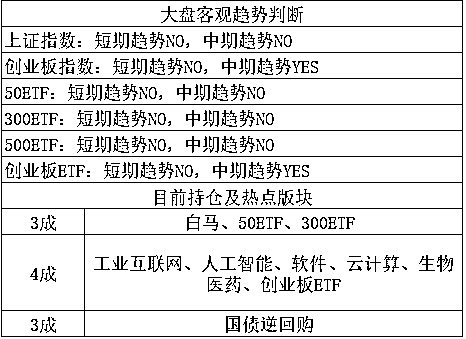

长按上方二维码关注我

# 一转眼就开市了，假期都发生了啥？

紫竹张先生

经济-金融-投资，点击右边按钮关注我 

 

时间过的好快。一转眼就开市了，按理说这个五一，有休市了四天时间，但是就是感觉特别快，产生这种感觉的原因，可能是因为这四天过的特别平静，资本市场没有什么太大的新闻，大家都去关心广西的**东北花臂哥偷香蕉事件**了。

偷香蕉事件我们有空再谈，说说假期发生的事情，假期基本没事，**美国忙着和欧洲打架，没空理会中国**。美国对欧盟的钢铝关税豁免是 5 月 1 号到期，法国和德国都去谈判请求续期，而且要求的续期额度是永久性。

哎，**我都不知道欧盟哪来那么肥的底气**，到期的关税豁免，是不是要求再续一年，而是直接要求永久豁免，搞的我一度以为这不是美国四处挑事，而是欧洲开始对美国发起贸易进攻。。。

特朗普当然不会同意，他现在全球到处点燃贸易战火，试图谈出点成果给美国选民交代呢，怎么可能会放掉嘴里的肉。特朗普要求欧洲主动放弃掉 10%的市场份额让给美国，然后我再谈谈关税豁免延期的市场，至于永久豁免，那是不可能的。

这事现在还在扯，美国已经把对欧盟的钢铝关税豁免延长到了 6 月份，看这个架势特朗普是一定要拿一点好处的，不然绝不放手。

至于对**中美的贸易谈判**，今天上午中国明确表示拒绝特朗普的二项贸易请求，第一个贸易请求是要求中美逆差缩小 1000 亿美金，这部分逆差中国希望通过购买美国高技术产品来实现，美国希望购买石油等基础产品来实现。第二点是要求中国政府官方禁止向人工智能等高端制造领域进行补贴和扶持。

这件事有二点看法，**第一点是美国实在太过分了**，类似这种方案估计提都不敢对欧盟提，就小心翼翼的要求降低钢铝 10%的份额都被明确拒绝了，中国的实力还是太弱了，特朗普对中国的贸易提案简直就是狮子大开口，对比起来对欧盟的贸易战就算赢了也只是开胃小菜而已，中美才是主战场。

**第二点就很奇葩了**，美国居然要求中国扩大对美初级产品的进口来弥补这 1000 亿逆差。我们从小到大被灌输的都是发达国家通过向发展中国家倾销高级工业产品，发展中国家只能向发达国家出售初级产品，这里面存在剪刀差，发达国家利用这个剪刀差不断的收割发展中国家的血肉。

按照这个理论，目前的现状是中国请求美国来剥削自己，美国不同意，然后美国要求中国来剥削美国，不然我跟你急？

首先传统的剪刀差理论肯定是没有错的，中国自己现在都在把一些低级制造业转移出国了，美其名曰对外投资，其实就是耗时耗力污染环境还不挣钱，索性挪到国外更穷的国家去赚一点人力和环境红利钱。那么唯一能解释这一点的，就是中国现在已经足够强大，强大到和美国相差无几，对于差不多的对手，比如德国和意大利之间，是不存在剪刀差一说的，双方都只想挣钱，同时不加强你科技树就行，中美目前就是这么个情况。

中国和美国的差距已经缩小到大概是德国和意大利的差距了，想想都有点小激动，争取早日缩小到德法之间的差距吧。这次的贸易战，弱还是弱，被欺负还是被欺负，不过**从一些小细节，可以看出来中国已经比以前强大太多了**。

* * *

  

由于假期的主要战斗是美国和欧盟展开的，所以对中国影响不大，美股连续下跌，到了今天晚上还在跌，这肯定是个利空，如果单独**看美股的走势**，节后要完。

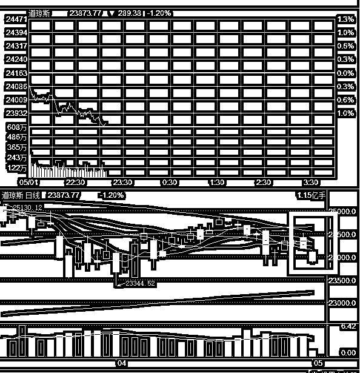

但是**我们看一下港股**，很奇怪，在 4-30 日，也就是本周一的交易日里，港股奇怪的大涨，而且是异常强势的跳空高开+全天高位强势横盘。

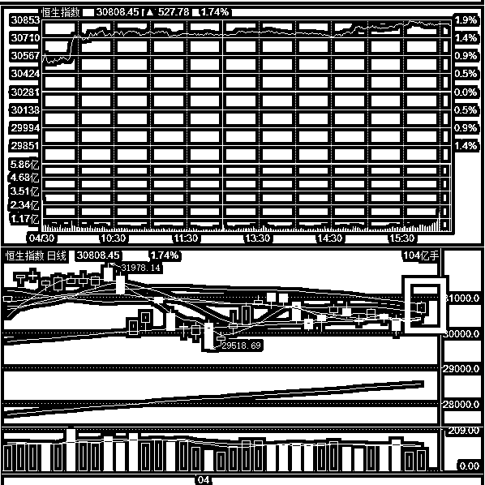

在周一开盘之前，美股是大跌的，开盘当天，日本也没怎么涨，**香港股市突然这么莫名奇妙的暴涨肯定是有原因的****，**我个人估计，是打算对 A 股造成一定的影响，这种阳线会明显的对市场人气造成影响，毕竟，相对于欧美市场来说，港股对 A 股才是联系最紧密的，欧美对中国的影响，其实都是通过对香港股市产生影响之后，才侧面对 A 股产生影响的，因为外资很难参与 A 股，但是可以参与港股。

今天五月一号，香港放假没有开市，但是我个人认为，足够对冲掉美股连续大跌的影响，按惯例美股大跌 A 股是要低开的，但是我认为明天可能低开的不会很多。

在这种行情下，我认为对我之前的战略判断干涉不会太大，节后的走势很明显比 4 月强势，上行概率大，**我个人偏向于多头**，持仓已经说明一切，在五一节前完成了预设的加仓动作，大仓位过节，不惧怕假期利空震荡，足够说明态度啦。

四月的走势是非常难受的，非常弱，各种利空黑天鹅漫天飞，隔三差五就冒个黑天鹅砸一下，密度之大瞠目结舌，不过四月总算是熬过去了，趁机加点仓，四月执行越跌越买的策略，五月执行的是越涨越卖的策略，这是总策略，至于细节策略，也就是什么点位卖过一段时间会告诉大家的。

长按上方二维码关注我

# 夏天驱蚊的几个小绝招

紫竹张先生

经济-金融-投资，点击右边按钮关注我 

今天休息一下，因为平时的精品课程打磨时间太慢，反复优化导致 7 到 10 天才能堆出一篇，正好趁假期推进加速下，不过今天也有东西给大家看，去年夏天的时候我写了一篇关于如何驱蚊的方法，非常实用，今年夏天又到了，大家可以温故而知新。 

过了五一之后，蚊子开始逐渐活跃，从南方开始向北方蔓延，到了六月份的时候，全国都应该笼罩在蚊子的阴影下了，这个时候说防蚊还是比较合适的。

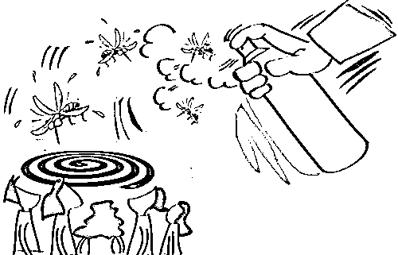

常规家庭对付蚊子的方法，有蚊香和杀虫气雾剂二种。对于高层住户，房屋密闭性较好，蚊子也较少，纱窗就足够防蚊了，通常对于零星进入的蚊子，全房喷杀虫气雾剂即可。对于低层用户，5 楼以下，尤其是对于那种开放性较大的房屋，蚊子进入渠道较多。比如你在 1 楼，即便你住的是别墅，也很难逃脱蚊子的魔掌，你开一次门，就能进几只蚊子，而房间里只要有 1 只蚊子，你一个晚上都别想睡好觉了，所以通常采用蚊香进行长时间的驱蚊。

今天给大家介绍的是**新兴的驱蚊方法**，很多人应该已经知道，但是更多的人应该不知道。

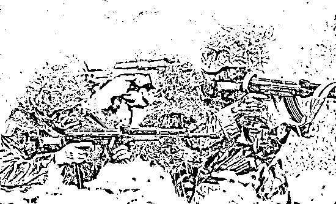

10 年前，英国特种部队为了解决野战部队在野外丛林被大量蚊虫叮咬的问题，发明了驱蚊水，只要喷在迷彩服上，可以保证 8 小时蚊虫退避，我国到目前为止，都把这项物资作为野战部队和铁道工人的标配物资。从 3 年前开始 广泛进入民用领域，野战部队的最初发明，效果良好，但是不能喷皮肤，只能喷在衣服上，弱毒。目前已经研发出了宝宝用品，虽然效果略弱，但是无毒，是可以直接喷在宝宝皮肤上的那种，价格也便宜，淘宝大概卖一二十块，不过还是建议喷在衣服上比较保险。喷了之后有什么效果呢，你带孩子出去玩，去热带丛林地区，别的孩子被蚊子咬的满头包，你家孩子身上干干净净一个红包都没有。驱蚊水，最适合的情况，就是户外运动，尤其是去蚊虫多的野外进行运动，备上一瓶，你会舒服很多很多。

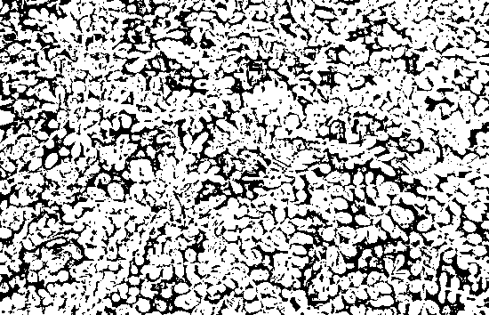

除了驱蚊水，这世界上还有一种东西叫**驱蚊草**。记住是驱蚊草，并不是猪笼草和捕蝇草。猪笼草和捕蝇草专门灭杀苍蝇之类的飞虫，但是对蚊子无效，因为他吸引不来蚊子。而驱蚊草，始终释放一种让蚊子厌恶的气息，一株没多少用，但是如果有个十几棵，这一片区域蚊子是不会来的，驱蚊水就是以驱蚊草为灵感进行研制的。

驱蚊草对于高层用户没什么用，**对于别墅用户特别有用**，别墅的庭院里种上一小片，效果非常好，淘宝也有卖，非常廉价，就是邮费而已，大概是 8.8 包邮送 500 粒种子那种价格。。。

最后，祝大家五一快乐，节后发生的大概率是好事，不用操心。 

长按上方二维码关注我

# 吃烤肉是人类文明进化的源动力

紫竹张先生

经济-金融-投资，点击右边按钮关注我 

现在的健康专家呀，越来越不像话了，居然反对人类吃肉，甚至说吃烤肉对人类是有害的。过量吃烤肉当然是有害的，那是因为你吃太多，适当吃烤肉是有益且必须的。烤肉在人类文明进化史上具有伟大功绩，难道他们不知道，如果没有烤肉，人类文明不可能进化到如今这个程度嘛，人类是必须适当吃烤肉的，这也是为什么你吃烤肉的时候感觉那么好吃的原因，这是基因决定的。  

首先，人类是从猿猴进化来的，整体基因和身体结构基本都是为了素食准备的，这也是素食健康论的主要证明材料，但是人类的进化过程出现了一点小小的意外，那就是烤肉，今天我就先从素食基因的角度进行一步步的推翻证明。

01

  

首先从食物抵达的第一站开始说，牙齿。人类的牙齿是典型的素食者牙齿，人类的犬齿非常的薄弱，就靠人类这幅牙口，也就只能吃水果了，假设现在给你一只兔子或者牛羊，首先没有现代工具的话你就很难打死他，就算我帮你打死之后，你能直接生吃吗？估计咬破皮都困难，不信你咬一口牛皮给我看看，人类和虎狼之类典型的肉食者发达的犬齿出现鲜明的差距。

看看老虎这牙口，一口破皮，二口碎肉，犀利异常，再看看人类的牙口，和吃草的牛马差不了多少。

其次看食物抵达的第二站，胃部。人类的胃液酸度明显是为果蔬类准备的，典型肉食类动物如虎狼等胃液酸度都是人类的十倍以上，只有达到那么高的酸液浓度，才能有效杀灭生肉中含有的各种寄生虫和细菌。

人类吃肉，就算费劲千辛万苦把生肉直接撕开咽下去了，到了胃部，你直接就染上了猪肉绦虫，而老虎该吃吃该喝喝，猪肉绦虫到了老虎的胃里，直接给融成渣，别说感染老虎了，尸骨都找不到了。

最后看看食物抵达的第三站，肠道。人类的肠道又是天然的果蔬类肠道，其肠道的长度远远短于草食类牛羊的肠道长度，但是又远远长于肉食类的肠道长度。为什么牛羊需要那么长的肠道长度，因为草类太难消化了，单靠胃部消化不了，所以他们的胃部就是个糅合道场而已，主要靠肠道内的有益细菌帮忙分解植物纤维，所以需要很长的肠道。而对于虎狼之类的肉食动物而言，肉类是极易消化的，胃部就能把肉基本分解完毕，肠道直接吸收就好，不用你再度分解了，肠道的任务就把食物残渣尽可能快的排出体外，因为肉类残渣是有毒的。对于人类而言，如果擅自食用生肉，肠道的长度过长排不出去，熬过胃液而不死的细菌，极有可能在肠道大量繁殖导致致命性的疾病。

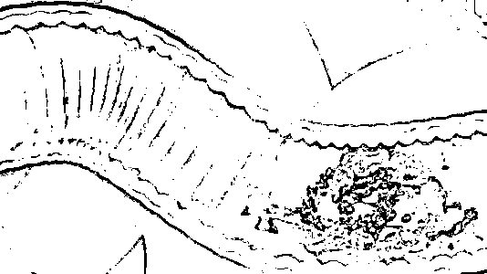

02

素食主义者和营养专家说了，对啊，就是这样的啊，人类天生就不应该吃肉，就是应该吃果蔬，这才是祖传的，基因决定了我们必须吃素。这里就要谈到人类和猴子的区别了，为什么人类最终从猴子进化成了人类，而猴子过了几亿年依然是猴子，就是因为猴子只吃果蔬，而人类吃上了肉。

演化至今，人类已经成了必须吃肉的种族了，如果长期不吃肉，人类会患上奇怪的疾病，虚弱无力，发育不全等。有个成语可以显著的说明这一点，叫面有菜色，长期吃素的人，就会面有菜色，明显和正常人红润的面色不一样，如果是从小就荤腥不沾，那极有可能影响发育，引起发育不良。

人类一个典型的素食基因种族，为什么会产生面有菜色这种奇葩的成语，你见过有人用面有菜色来形容猴子和牛羊吗，这就要从火种说起了。

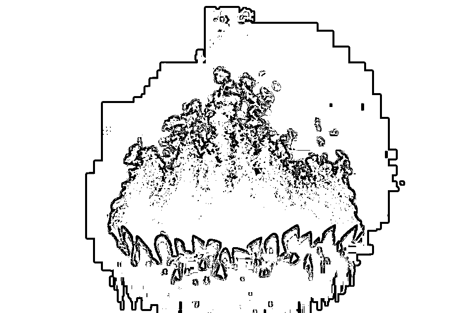

03

为什么说火种是人类文明的源泉，奥运使用的是圣火而不是圣水，这是非常有道理的，人类第一次接触烤肉，一定是来自于雷电引发的森林大火。大火之后，个别猿猴（未来的人类）在里面发现了烧焦的动物尸体，这份被火烤熟的尸体完美的解决了上面几个问题。

首先，动物已经被烧死了，猿猴不用冒着受伤感染的风险去打死牛羊了。然后，皮毛等防御层已经被烧熟了，一撕就开，而不是用力都咬不开的尴尬局面了。最后，火焰彻底灭杀了肉类里面的细菌和寄生虫，同时让蛋白质得到了初步分解，让人类的胃液也能完成消化工作。

就这样，有个猿猴吃到了人类历史上的第一份烤肉，这是他的一小口，但是却是人类的一大口。从这一口烤肉开始，人类文明进化迈出了极为关键的一步，那就是开始吃烤肉！

一旦人类掌握了吃肉的方法，让自己的身体能消化吸收肉类，吃肉的人类和吃素的人类身体差距就明显的开始出现分化。吃肉的人类明显更强壮，大脑发育更健全。这些武力强大且更加聪明的猿猴很明显的成为了统治者，也就是君主，咳，不对，是猴王。这些猴王具备了更多的交配权，他们的后代也都继承了他们的基因，越来越有利于消化烤肉。

进化至今，人类已经从纯素食基因，进化成了一种奇葩的基因混合体，那就是人类体内有几种氨基酸是无法自身合成的，必须从肉类中取得，缺少这几种氨基酸，会严重干扰人体发育，导致肌肉发育不良，甚至能影响大脑智力的发育，简称面有菜色。而同样的氨基酸，人类的亲戚猴子和猩猩，都能通过食用果蔬进行自身合成，不需要吃肉。

很明显，这是人类进化时的一种缺陷，人类的体格、爪、牙、消化系统都明显不是为了捕猎动物准备的，而人类的基因居然不吃肉会缺乏必须氨基酸，这明显是不对的。产生这种基因误差的原因，应该是远古的某只猿猴种群由于基因突变，特别擅长吃烤肉，他们进化的非常聪明强壮。但是基因突变的同时，也产生了基因缺陷，这个基因缺陷导致的氨基酸缺乏无法自身合成，原本是致死性质的，至少也是个虚弱无比应该被淘汰的个体，由于这个种群特别擅长吃烤肉，最后保留下来了。

看，不吃烤肉，你就会被自然进化给淘汰掉！

04

  

现在强大的种群诞生了，这个种群会用火烤肉，但是基因缺陷导致他们必须每隔一段时间就要吃肉来补充氨基酸。这下麻烦了，森林大火不可能年年都有，想等大火之后去火场里捡尸体这种事只能靠碰运气，但是肉不能不吃，要是一年不沾荤腥，这个本来强壮无比的种群就反过来还不如普通吃素的隔壁部落，下场只能是被灭族，男猴子被杀光，女猴子被抢走传承别人吃素的基因。

自身的基因缺陷迫使这个种族必须不停的吃烤肉，为了找到烤肉的原料，他们被迫从果树上爬下来对动物进行捕猎来获取烤肉的基本原料，也就是生肉，**如果猎取不到生肉，他们的下场就是灭族**。

于是，这个种族首先采集树枝来维系火种，自家的火是绝对不能灭的，不然猎取了生肉还有啥用，谁生吃谁死啊。在用树枝烧火的时候，有人发现部分树木的枝干，如果用火进行适当的烤一下来减少里面的水分，能烤的非常坚硬，顶部削尖后制成的木矛，能够穿透动物皮毛，对动物有效造成杀伤力。于是这群人就拿着木矛对小动物进行捕猎，拥有木矛为武器的人类，和兔子山羊干架还是一杀一个准的，碰到了老虎狮子，也能自保，不被杀的太惨。

木矛的攻击力实在是有点弱，最多也就欺负兔子山羊，一头野猪都能干掉原始人派出的木矛精英小队，木矛连穿透野猪的毛皮防御都非常困难，野猪顶人倒是一击必杀，没几个人扛得住野猪的一次冲撞。后来人类尝试把石头给磨成武器的形状，石头哪有那么好磨的，磨出来的不规律的形状威力也不大，所以石斧武器诞生后给人类的提升并不大。

为了吃烤肉，人类再度向烤肉的源头，也就是火焰进行求教，有人发现，某些石头在火焰的炙烤下会软化，等停止灼烧的时候又会再度硬化。这下不得了啊，必须给诺贝尔奖啊！

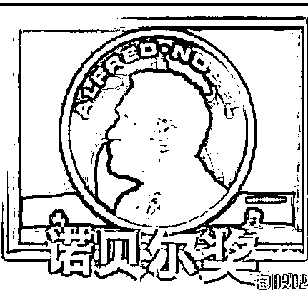

石头要是被烧软了，那就好办了，你硬的时候我拿你没办法，软的时候还不好修理你吗，想捏成什么形状就捏成什么形状。于是，人类用这种软化的石头，制成了非常锋利的石制武器，其锋利程度是普通石头怎么都不可能磨出来的。

为了把这种武器和普通石制武器进行区分，人类把这种能被烧软的石头所打造的武器，称之为青铜器。有了青铜器加持的人类，成为了真正的地球主宰，青铜剑在手的人类，能轻易对老虎狮子这种顶级食物链主宰造成致命的伤害。从此人类进阶为地球主宰，至于山羊这种货色，也犯不着用木矛慢慢扎了，一剑毙命。

没有不得不去吃烤肉的基因缺陷，人类就不会那么着急的去猎杀动物，吃点香蕉桃子不也生活的挺好的嘛，一样吃得饱。正是因为这种基因缺陷的种群不断的试图去冒险猎杀动物，他们才发明出了木矛、发明出了石斧，最终发明了青铜剑。几千年之后，小气的人类最终把当初那群在树上舒服吃香蕉，看他们笑话的亲戚们给关进了动物园。

所以，人类进化成了现在这个样子，没有肉食者的强壮体魄，没有肉食者锋利的爪子，没有肉食者能轻易撕开皮毛的牙齿，甚至连肉食者用来消化肉类的肠胃系统都没进化出来，但是偏偏必须要吃烤肉。

正是因为吃烤肉的需求，人类才成为了万物之灵，站立在地球之巅。吃烤肉这东西，往小了说是满足你口舌之欲，往大了说是为了人类文明的进化。所以，为了人类文明的飞速进化，为了自己不被关进动物园，我们必须要吃烤肉。

所以，在人类文明的进化史上，没有什么难点是一串烤肉解决不了的，如果有，那就来二串。

长按上方二维码关注我

# 区块链和虚拟货币的前生今世

紫竹张先生

经济-金融-投资，点击右边按钮关注我 

最近区块链再度火起来了，在一个区块链大会上，中国大妈蜂拥入场，而且平时问我买币是否可行的朋友也增多了起来，今天我就谈一下区块链和虚拟货币的前生今世，来帮助大家剖析他的本质。  

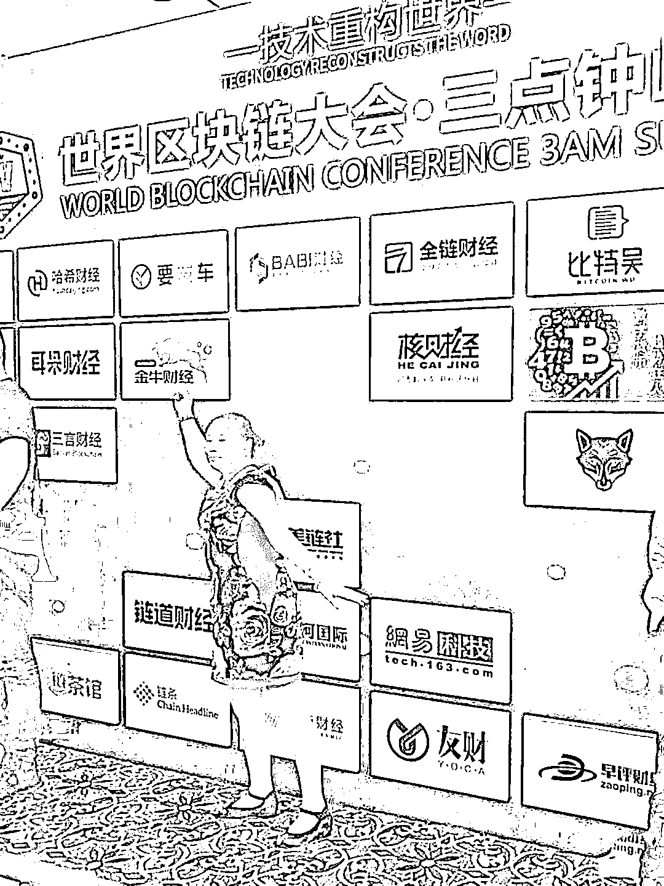

其实，我是在 2014 年左右就知道比特币的，当时在中国了解比特币的人并不多，至少普通工薪层和中国大妈并不知道，当时对比特币的定义和旗帜是成为一个去中心化的货币来取代全球的法币，成为未来的世界币。经过我强大的金融专业知识素养来分析，比特币取代全球法币的概率无限接近于 0，一个号称要取代法币的东西被我认为取代法币的概率就是 0，那么他的价值也应该为 0，现在看来，应该是有什么东西限制了我的想象力。

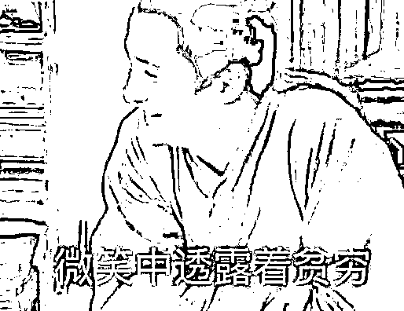

但是我的认知其实没错，比特币的确没有取代法币的可能性，各国央行从来没有把比特币看成是竞争对手，支撑比特币上涨的另外一个东西，那就是炒作泡沫和另类的庞氏骗局。

这里首先要给大家科普一下区块链和虚拟货币的前生今世，很多人说区块链好，好在哪不知道，只知道买虚拟货币就能赚钱，所以好。后来虚拟货币跌了，就开始说虚拟货币不行，但是技术无罪，区块链技术是好的。

比特币的概念起源于 2009 年，一位叫中本聪的人为了打破各国央行疯狂发行货币灌水的铸币权，发明了比特币的概念，各国法币是一个中心化的货币，权利集中在央行手里，他想发多少就发多少，而比特币是一个去中心化的货币，没有一个人有权利干涉比特币的发行，他就固定那么多数量，以这个特质来对各国央行法币进行挑战。

既然确立了这个目标，那就要解决二个很重要的问题，比特币又不能从天上掉下来，既然是去中心化了，那么谁来负责发放初始的比特币呢，你发还是我发，谁都想发发行权弄到自己手里，但是如果某个人或机构具备了发行权，不就是一个另类的央行嘛。第二个问题是，比特币是纯电子化的货币，如果有黑客入侵篡改了数据怎么办，没有中心进行备份，一旦黑客攻击，可能直接连痕迹都找不到了。

为了帮比特币实现这个目标，中本聪发明了区块链技术，区块链技术本质上是一种记账方式，比特币进行交易的时候是需要一个账本的，在一定时间段内如果有任何数据变化，系统中每个人都可以来进行记账，系统会评判这段时间内记账最快最好的人，把他记录的内容写到账本，并将这段时间内账本内容发给系统内所有的其他人进行备份。这样系统中的每个人都了一本完整的账本。

比特币的初衷是让全球的计算机都在业余时间贡献出自己的算力，然后通过这个算力把比特币成功的平均分发出去，等全球的每个人都拥有一定数量的比特币之后，他们自然就开始进行流通交易了，从而解决了比特币的初始分发问题。而通过把比特币账本在所有人进行备份的基础上，除非黑客的算力超过了全球算力集合的 50%，否则他就不可能修改比特币账本，从而难以抹去，达到去中心化的效果。

听起来好像很美好的东西，那为什么我之前就直接判定他不能取代法币呢，因为这些比特币所具备的特质其实并不特殊，总量恒定、去中心化，其实早就有一个东西做到了，那就是黄金。黄金的数量是基本恒定的，每年新挖掘的黄金数量和数千年来挖掘的总量相比微不足道，至少比现在每天挖出的比特币数量要少的多。其次黄金是去中心化的，没有央行能凭空制造黄金。最后黄金是各国人类千年以来的公认硬通货，根正苗红，远远比比特币背景深厚。

那么黄金取代了央行的法币吗？没有，金价死死的趴在地上呢，如今的金价也就是比矿山的挖矿价格高那么一点，就是一种普通的金属而已，只不过价格贵一点，称之为贵金属。。。既然黄金都没能干掉法币，各方面能力都远不如黄金的比特币，凭什么来干掉法币。

但是干不掉法币没关系，这玩意概念新啊，可以炒作，当这个世界上只有 100 万人认可比特币的时候，他的价值是 1，那么当 200 万人认可比特币的时候，他的价值就是 2，这个定律是非常守恒的，也是诸多泡沫炒作的一贯定价规律。所以在只有中本聪一个人知道比特币的 2009 年，币价接近于 0。在极少量人知道比特币的 2011 年，1000 个比特币才买来了一个披萨。在不少计算机人士知道比特币的 2014 年，币价 800 美金。在各国媒体疯狂报道，大妈跑步入场的 2017 年，币价飙升到 2 万美金一枚，当币价飙升到最高点的时候，砖家和大妈跑步入场。

比如在 2014 年说送他比特币都不会要的郎咸平，2018 年宣布参加区块链大会，多么讽刺。而在报纸大量曝光，砖家大妈入场之后，比特币的价格已经直接腰斩都不止了。

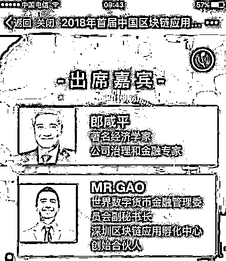

所以，虚拟货币就是一个概念炒作而已，他唯一的价值恐怕就是依托匿名性来进行黑道非法交易而已，比如毒品和军火买卖的时候可以避免现金交易且不留痕，很安全且方便。如果把这个东西定义为比特币的价值所在的话，那么炒币的人，都是在赌世界黑帮势力越来越强大，非法交易越来越多，这个道德上是个悖论。

至于区块链技术，他原本就是给比特币服务的底层架构，所谓去中心化和匿名性并不是什么特大的进步，谁都能和区块链沾个边，只要沾个边就能发一个自己的 XX 币。比如在虚拟货币中比较有名的区块鸡货币，就是有区块链卖鸡为现实应用的，这款区块链技术可以把每只鸡给追根溯源，确保不可篡改，让每个人都能吃上放心鸡。这款算是良心币了，至少还有一个说得过去的股市。很多区块链技术就是天上飘，甚至就是纯粹的空气币，连个故事都懒得编了，傻子太多，骗子不够用了。

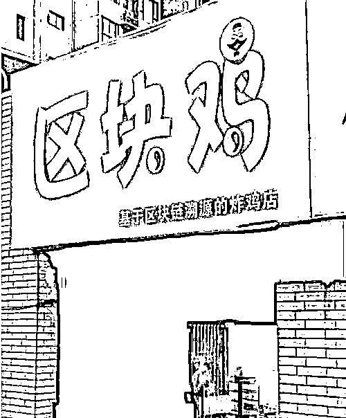

但是这款给鸡肉追根溯源的技术，你怎么保证养鸡场老板报给你的数据是真的，他滥用激素了会自己写在记录里吗？所有的区块链所谓去中心化，不可篡改且追根溯源的东西都有这个问题，那就是如果没有一个中心进行核查和甄别，你根本无法保证上传的数据是真的，但是如果有这么一个中心进行核查和甄别，那又谈什么去中心化呢，我们直接让政府来做这个事就不好了吗。

而现在所谓的比特币去中心化特质可能也没了，有技术专家发明了矿机这个东西，利用显卡进行挖矿运算，其算力是同价格主机的上万倍，简单高效粗暴，除了运算挖矿啥都不会的矿机诞生了，其存在的意义就是挖矿。

这种矿机诞生后是不是节约资源了呢，不是，他疯狂的繁殖，目前世界上几乎所有的比特币算力都是矿机弄出来的，而三大矿场巨头掌握的算力已经远不止全球的 50%算力了，理论上，只要他们联合起来，他们就是中心，有权利修改所有的比特币账本。

而即便他们不联合，疯狂繁殖的矿机也在令人目瞪口呆的消耗人类的能源，因为比特币是一种军备竞赛，是一个囚徒困境。假设全球所有人都不挖比特币，那么我只要打开我家的个人电脑随便挖一下，全球所有的比特币都是我的。但是如果邻居也开了一台电脑，那么我付出同样的算力和电能，只能获得一半的比特币，如果邻居开了一台矿机，提供了大约我一万倍的算力，那么 99.99%的比特币都是他的，我只能拿个零头。

所以世界上的矿场都疯了，你拿一万台矿机，我就拿二万台，一直到硬件的成本+电源成本+承担的风险=挖矿卖出的收益为止。人类在 17 年为了挖币付出的电能达到了 300 亿度电，大约相当于人类总耗能的千分之三。。。

既然这玩意这么多缺点，也没什么优势，那他怎么会炒的那么高。二万美元其实不高，中国的兰花曾经在从 10 块钱一盆炒到了 100 万元一盆，藏獒曾经从 100 一条炒到了 1000 万一条，这些都是泡沫，藏獒甚至连涨 10 年，所以比特币即便不符合经济规律，也不耽误他瞎几把乱炒，中国人既然愿意买 1000 万一条的藏獒，二万美金买一下比特币怎嘛了。 

2013 年，中国大妈抢购黄金，号称打垮华尔街的壮举震惊世界，这些抢黄金的大妈如今赚钱了吗？看看黄金月 K 图：

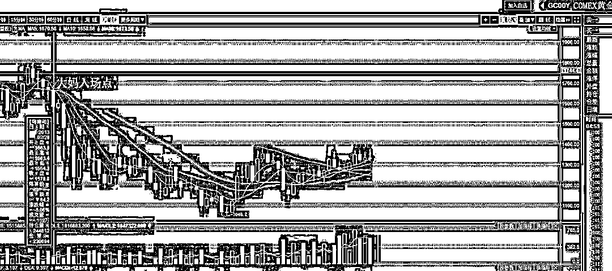

而如今，这些大妈又来抢购虚拟货币了，你觉得是央行聪明，还是大妈聪明。不管这玩意的炒作是炒 5 年还是 10 年，除非你创造了真正的价值，降低了社会成本，否则出来混总是要还的，而对于比特币这种不降低社会成本，还虚耗电费增加了社会成本的东西，也就是个巨大的投机品种而已，当大妈都入场的时候，差不多也就到头了。

长按上方二维码关注我

  
点击阅读原文查看更多 

# 白马跌停潮，谁是好孩子，谁是坏孩子。

昨天格力跌停，今天伊利跌停，每天都倒下一个白马龙头股，引发白马跌停潮，这是为什么呢？

今天收盘之后，市场流言说：动物园的草不多了，过去一年里全喂给白马了，所以园长决定每天杀一只白马，好省点草料喂给马上入圆的独角兽。

哈，这当然是个段子，其实白马倒下的最根本原因是，不符合预期，也就是股价对不起他们自己编写的故事。以格力电器为例，很多人说是因为董明珠宣布要做芯片才跌停的，别的公司说自己做芯片都会涨停，而格力说自己要做芯片就跌停的原因，是因为格力真的要去做芯片。。。

其实事实不是这样的，格力就算做芯片，也是空调上面的普通芯片，技术含量很低，投入也不大，格力跌停的最关键原因是，他 11 年来首次没有分红。很多人不服气了，A 股很多公司从上市到现在几十年从来没分过一次红，这种垃圾公司都没有跌停，格力这么多年分了那么多红，一次不分就跌停，这不是鼓励坏孩子吗？

有一个著名歪理，就是好孩子和坏孩子理论，好孩子次次考 90 多分，有一次考试考了 80 多分分，被家长老师好好的训斥了一遍。一个坏孩子，次次不及格，有一次突然考了六十多分，家长老师大为称赞。这个歪理告诉我们的道理是，天天做好事的人，有一次不做好事就会被人骂，天天做坏事的人，有一天不做坏事了，就会被交口称赞，事实真的是这样吗？

肯定不是，我们以连续 11 年高额分红，今年首次不分红的好孩子格力来看，时间拉回到 2006 年，从 06 年开始，连续 11 年，格力的股价呈现单边上涨不回头的走势，和之前 N 年的底部横盘萎靡不振形成了鲜明的对比，08 年股灾，15 年股灾，对格力来说，都只是上涨途中的一个回调而已，活脱脱的美股走势。如果 06 年买入 100 股格力持有不动，如今仅仅通过分红除权，成本都被打到了-5.5 元以下，对应今天 44 元的股价，简直恐怖，对这 11 年来的格力股价他们的口号是，没有最高，只有更高。

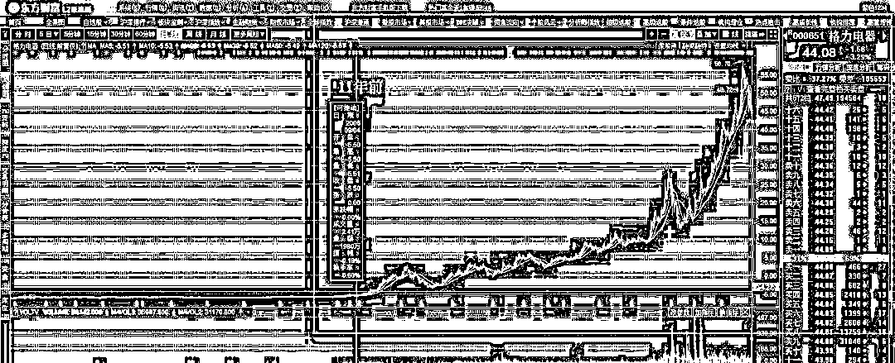

格力在这 11 年里玩了什么高大上的概念吗？没有。做了惊天动地的重组并购吗？也没有。法宝就是空调卖的很好，业绩年年增长，年年给股东高分红而已。所以，市场已经对格力这种好孩子给予了足够多的奖励，如果没有高业绩高分红的支撑，格力的股价就是飘在天上的无根之水。那么当高分红这个根基被抽走之后，格力的股价当然要吃跌停，这完全符合市场逻辑，预期你高分红，但是没有，那必须杀跌。

我们举例另外一个极端，玩概念，玩重组并购的大哥乐视网，从 12 年开始股价也曾是一路飙升，但是他的起飞借助的是创业板大牛市，借助的是概念泡沫，由于始终没有高分红的支撑，别说 11 年暴涨了，3 年之后就崩盘了。

这就是典型的坏孩子，格力电器仅仅只是不分红就会吃跌停，而乐视网经过大量利空，连续暴跌之后，如今别说愿意分红，只要乐视网发个声明说明年能还清所有欠款，实现企业盈利，乐视网至少 5 个涨停起步走。

这是市场在奖励坏孩子吗？并不是，因为乐视网的股价已经反映了预期，格力电器的股价也反应了预期，持有格力的回报绝对是大于持有乐视网的，市场已经奖励了好孩子，而且预期好孩子明年会做出更好的业绩，所以才会给今天这么高的股价估值。

说到业绩增长，就要谈一谈今天跌停的伊利股份了，昨天说格力跌停，其实只跌了 9%，加上今天的跌幅才算一个完整的跌停，伊利今天就牛了，完全跌停且全天封死，跌停板上放量买单入场都没能撬开，对于一只白马股而言，这种闪崩的走势完全不符合他的身份，蓝筹白马本身就是低波动稳健的代名词啊。

格力是因为不分红导致是跌停，伊利也是因为不分红吗？不是的，伊利今年决定 10 股分红 7 元，不算多，但是也不少啦，他跌停的主要原因是 17 年归属于股东的净利润只有 60 亿元，同比增长 6%。

要是乐视网，别说 60 亿了，给 0.6 亿净利润都能吃 5 个涨停，但是对于伊利就不行了，今年利润增速仅仅 6%，和去年比几乎没有增加？那你去年股价 17，今年 30，你觉得合适吗？伊利股份 06 年以来的走势是这样的。 

经分红除权，06 年的持股成本低到了-0.6，如今股价 26，虽然比格力差了一大截，但是也是赤裸裸的长牛股了，但是他并没有泡沫，分红虽然不多，但是年年业绩高增长，支撑伊利高股价的并不是年年高分红，而是年年都要高增长，这就是预期。今天预期破灭，自然要吃个跌停。  

白马的问题并不是自身做的不好，而是去年涨的太高，按照 17 年白马爆发式的涨幅来倒推他 17 年的业绩，白马必须做到理论上的最佳业绩和最佳表现，才配得上他 17 年的涨幅，只要没达到这个最佳预期，那么就是不符合预期，就会一泄如注。。。他们还是比垃圾股强很多，但是垃圾股跌透了，股价过低，白马股涨多了股价过高，所以就导致垃圾股只要没利空就会涨，白马股必须出大利好才不会跌的现状。

这方面看到极致，就是上证和创业的区别了，去年上证一直涨，创业一直跌，今年就会反过来，所以就是我一直不愿意加仓上证的原因，3 成封顶，再怎么看筑底我都不买，拉高 3200 之上就开始分批出，创业逢低就买，上限 7 成，至今为止，效果不错。

上周末我和大家对本周的分析是，本周是节前最后一周，预估是总体横盘，涨了就会有人卖，跌了就会有人买，无非就是有重大消息的时候，振幅会大一点而已，原话如下。 

本周五天已经走完了，走势基本完全符合预期，唯一意外的就是，本周创业板连吃几个黑天鹅，各种莫名其妙的利空汹涌而来，所以本周收出了很长的下影线，不过最终还是收涨于 1805，周涨幅 1.28%，上证指数周涨幅 0.35%，基本横盘。

本周创业板的走势就是涨了看空，跌了看多，周一因为钱荒暴跌，周二三无理由暴涨，周四美国调查华为加格力跌停引发暴跌，周五再无理由暴涨，阴阳线都有点长。

不过我们可以发现的是，下跌都是有理由的，而且理由很充沛，并且都是市场预料不到的突发黑天鹅利空，但是上涨都是莫名其妙的，周二创业板收涨 3%，周五创业板收涨 1.37%，你说出啥利好了么，没有，莫名其妙的就涨了。

我对整个 18 年的看法是利空的，十年一轮回，今年很难有什么好行情，所以始终谨慎参与，以练手为主。尤其对于白马股，我向来的看法就是，价值投资只是投机口号，投机概念之一而已，没有什么价值投资一说，那个涨幅实在太不切实际了。公司是好公司，但是好公司只有搭配低股价的时候才是好股票。。。

但是对于创业板就不一样了，创业板有没有业绩，没有，是好企业吗，不是，就是投机而已，和价值投机差不多。但是从技术上来看，他跌不动了，那就可以买一点试试看。

创业最近不管是 1900 回落，还是整个 4 月的回调，还是本周的强势横盘，都非常符合预期，那么按照预期，5 月的时候，创业板会有所表现，不然对不住那么多利空都没砸死的创业板。

创业板拉上去之后怎么办，涨一截卖一截，创业板发动局部牛市几乎不太可能，不符合监管层价值观，不过涨一段还是可以期待的。至于上证就当压舱石放那吧，不做指望，不然一点仓位都没有也不合适，放着吧，上证再差，也不至于跌破 2850 股灾最低点吧，要是这个低点都破位了，还谈什么注册制和 IPO 啊。。。至于加仓他那是不可能加仓的，除非监管再呼吁我们价值投资，那我跟风。

五一放假之前，收个关门红，然后 IPO 的数据是 2 家 15 亿，监管这是让大家安心过节，大家可以舒服的度过自己的假期了。

\~~~

马上五一了，祝大家节日快乐，阖家欢乐，今天没操作，就不发持仓图了。

长按上方二维码关注我

# 董明珠宁可拿 100 亿买理财都不愿意分红

01

昨天晚上和大家说格力电器业绩增长 45%，净利润 224 亿元，但是居然宣布不分红，而与此同时，格力拿出 100 多亿去买了理财产品，董明珠宁可拿 100 亿买理财都不愿意分红，严重低于市场预期，因为他一直是价值投资的好孩子，市场预期他是一定高额分红的，也在股价上提前给予了溢价估量。然后今天格力直接就跌停开盘了，巨量成交 171 亿，**收跌-9%，无数机构资金出逃，格力的股东喜提跌停一个**。

很明显，**分红是格力维持和刺激股价的重要方式**，如果格力和大量垃圾股铁公鸡一样不分红，格力不可能维持如今的 2700 亿市值。格力的事情先不谈，我们谈一谈，A 股的历史，和过去大股东刺激股价的招数有哪些。

首先来到 1990 年，中国股市诞生，当时的背景是很多国企濒临破产，嗷嗷待哺，银行实在承受不了输血的任务，这些国企已经穷到连利息都付不起，拒绝继续贷款。国企向中央诉苦，再给我几个亿，不，几千万就行了，我就能把企业盘活。

中央也没钱啊，也不敢让银行继续承担这个风险，这些国企都和无底洞一样，最后到底能不能活谁也没个数。于是就设立了股市，为了保证国企的公有制属性，只拿出一小部分股份向公众发售，确保国资绝对控股权。

当时的情况是，民众拿真金白银认购国企的股份，国企拿钱回去救命，至于让出去的股份，那只是名义上给了民众而已，国资具备绝对控股权，企业怎么运转，小股东不可能有发言权。小股东认购的股份是可以流通的，而国资为了保证国企的绝对控股权不允许国企的股份流通，也就是股价涨跌和大股东一毛钱关系都没有，跌成 0 也无所谓，涨上天也没关系，所以分红，做业绩刺激股价什么的，更是不可能有。当时的股市现状是，国企从股市拿了钱回去就完全不管股市了，股市的钱就是白送的，国家用这笔钱保住了国企，也规避了风险，就算这国企破产了，按照股份制的原则，也是散户自己负责，国家无责，这笔钱连利息都不用付，多好的事情。而民众认购的股份，就是赌场的筹码，他们压根没指望过拿分红，也没指望这企业做大做强，就瞎 JB 炒呗，价值投资，笑话，这就是股市的第一阶段，赌场阶段。

 

02

然后我们谈谈股市的第二阶段，分红阶段。后来 A 股这种长期堪比赌场的行为让高层实在无法忍受了，企业上市就是为了圈钱，回馈股东根本就没在考虑范围之内，小股东对企业毫无影响力，大股东也无法从股价涨跌中受到影响，二者呈现绝对割裂，唯一产生联系的时候，就是 IPO 圈钱的那一刻。

所以，后来发动了**股权分置改革**，允许大股东的股份进行上市流通，而原先不能流通的股份，则应对流通股给予一定补偿来获得流通权，最终目标是实现大小非全面流通，大家的利益一体化。股权分置改革大幅度增加了市场的流通筹码，被视作巨大利空，每一次尝试性推进，都引起了股市的剧烈下跌，比现在的注册制还要恐怖。但是等全部执行到位的时候，也就是 2005 年正式宣布，股市触底回升，从 1000 点暴涨到 6000 点，开启了 3 年大牛市。

大股东的筹码可以交易了，股价涨他会受益，股价跌他会受损，这个时候大股东就开始正视股价了，小股东虽然还是很难干涉公司决策，但是至少双方的利益有的时候是有共同点的。这个时候大股东做市值管理，刺激股价的手段主要有分红、高送转、产业并购玩重组、员工兜底增持等等。其中唯一真金白银拿出来的，只有分红，其余都是玩虚的，这是股市的第二阶段，已经诞生了一批茅台啊，格力啊这种开始愿意分红的好企业，被统称为蓝筹白马，其余都是垃圾题材，只玩虚的不分红。

但是这个分红也是很讲究的，如果一个企业当初让出去 10%的股份，圈了 20 亿，多年累计分红 100 亿现金，是不是股东超赚呢？不是的，因为 90%的股份持有在原大股东手里，这 100 亿分红，90 亿是给了大股东，10 亿才是给了散户。而当初从散户手里圈走的钱，就有 20 亿，这根本不算巨额分红。所以现在网上很多分红表，对应的圈钱数量和历年累计分红数量的对比，都是有问题的，能对比的只有当初 IPO 发行的股份所分到的红利和当初 IPO 圈钱的对比。而不能忽略这个股份数量的差值，其中最凸出的典型，就是中石油，90%以上的股份都是国资持有，历年累计分红 3500 多亿吧，当年只募集了 500 多亿，分红总数看起来高达募资数的 7 倍左右，当中石油的股东是不是爽歪了？肯定不是，如果你当初 IPO 的时候认购了 100 万中石油股份，现在累计分到你手中的红利绝对不是 700 万元，零头都没有，不信你可以试试。问君能有几多愁，恰似满仓中石油。

030~~~~~~

然后我们就要提到股市的第三阶段了，中国目前连第二阶段分红提振股价都还只能少量推行，第三阶段就更不谈了，但是可以给大家介绍一下，大小股东权益天然不平衡，小股东很难对公司决策产生影响，大股东天然能控制公司，但是分红的时候却是按比例进行分红。极端的例子如 A 股的保千里，大股东能掏空上市公司 60 亿资产，小股东都别说干涉了，连察觉反对都做不到，小股东的股份投票权犹如废纸，但是分红的时候却是一样的分，这显然不公平。

为了平衡分红的时候大小股东的利益冲突，在美国最流行的做法并不是分红，而是回购股份，企业把盈利拿出来，并不分红，而是直接回购本公司的流通股然后直接注销，这必然会推升股价。而股价的上升对所有股东都有利，对于交易频繁的小股东来说更有利，对于交易流通困难的大股东来说，他能控制公司而小股东很难控制公司，也算一个权利的平衡，而且回购股份还可以免交红利税收。

由于美股强大的退市制度，已经形成了良币驱除劣币的氛围，别人都回购股份，你不回购，投资者就不买你家的股票，跌到一定程度整个公司的股东都受不了。这个时候，美股就进入了股市的第三阶段，**回购股份是刺激股价的重要手段，而是不是 A 股这种少量回购玩个花头概念**，美股那真的就是动辄几亿几十亿美金的回购，回购之后直接注销股份，等同市场上突然出现了几十亿的买单然后永久锁仓，你说股价涨不涨，比分红刺激有效的多，也公平的多。

对于 A 股来说，如果退市制度不健全，注册制不落地，无法驱除劣币，别说第三阶段了，第二阶段都还没完善呢。董大姐说的一句话是至理名言，我就是 5 年不分红，你们又能把我怎么着，要是可口可乐的总裁，借他十个胆子他也不敢对媒体这么说。

**所以 A 股任重而道远啊，未来要走的路还长着呢。**

040~~~~~~

  

谈谈今天股市吧，今天格力电器跌停，盘中遭遇 171 亿的巨额卖单，连绵不断的抛售让大量的抄底买单入场却始终拉不起来股价，深交所都着急了，发文质问分红方案是否符合股东利益。

监管的态度很明显，要的是风平浪静，**别给我惹幺蛾子**，董明珠这么个搞发引发了格力股价的巨幅动荡，而格力又是指标主要成分股之一，还有一个示范的连锁反应，监管不生气才怪。正好，今天凌晨，美国宣布对华为启动调查，引发了市场对贸易战扩大的恐慌，华为和中兴不一样，华为没上市，但是华为的很多供货商都上市了，中国软件今天在港股大跌 20%

于是大小盘齐跌，监管层更生气了，反正这个锅格力背定了，**当年要不是监管层罩着，董明珠早就被野蛮人给撵走了，如今居然不顾大局引发资本市场剧烈动荡，那还了得**。

在监管层的施压下，董明珠服软了，**昨天刚宣布不分红了，今天晚上立刻宣布，18 年会进行中期分红，**分不分红小股东甚至机构都没有建议权，只能靠监管插手，市场力量无法干涉，这说明中国离成熟的资本市场，还有很久的路要走呀。

我在周末的时候说过，本周属于横盘，不会跌，也不会涨，顶多碰上黑天鹅的时候振幅大一点而已，本周一开盘，剧烈下跌，盘中一片恐慌，我晚上坚定看多，五一节前不可能大幅下跌，要是非理性杀跌，我不介意把逆回购的子弹库都调出来。周二剧烈反弹，全面普涨，创业板更是大涨 3%，我开始看空，敢涨就敢卖，节前不适合大涨，1840-1856 我会卖出，周三冲了一下没冲到位，周四的时候由于格力不分红导致价值蓝筹股普跌，美国制裁完中兴之后今天凌晨宣布调查华为引发小盘股普跌，导致一片绿油油。

其实，就算昨天格力分红了，今天早上美国也不调查华为，也最多向上冲一点点，后面还是会跌，我对此有充分的信心，最多也就 1840 上面一点吧，这波没冲上去也无所谓，这位置我只打算卖 1 成的，也就是小 T，做不做都那样，4 月我们的任务就的月底之前，低位吃饱筹码，目前的拉升都是假拉升，真正的拉升，在 5 月。

创业板 4 月在 1900 点冲击失败后，向下跌的时候跌的如此缓慢，中间美国玩科技制裁，对以科技创新为主题的创业板构成如此之大的利空压力，也没跌多少，整整一个月，跌的幅度可以说非常少，至少比我 4 月初的预期要少，后来我都被迫提升底部高度来吃货，要是以前的创业板，4 月初的时候就跌成渣了，一地便宜等你拿。如此强势的对待利空，当跌不跌，一旦利空消停了，你说 5 月向上概率大还是向下概率大。

明天就周五了，节前最后一个交易日，**我的态度很明确，重仓过节**。

\~~~

哒哒哒，今天仓位没动，小 T 没做成，不过走势既然符合大势，我们更安心，这都是碎肉，大肉在后面。

长按上方二维码关注我

# 给妇女增加收入其实是害了他们

首先，感谢戳次条文章的，戳次条的都是真爱，关于楼市杠杆分析和六个钱包买房的，请戳头条，今天话唠停不住了。

首先我要说的是今天看到的一个新闻，河南新规要求给女职工必须发卫生费，至少 50 元，该办法规定，不得因女职工结婚、怀孕、生育、哺乳等，降低其工资、福利待遇；在孕期，女性怀孕不满 3 个月且妊娠反应严重，或者怀孕 7 个月以上的，不得安排其从事夜班劳动；孕妇难产的，可以增加 15 天产假；用人单位给女职工每月至少发放 50 元卫生费。

听上去好像好好哦，给女职工增加的可是实打实的福利，其实，这个福利看起来是对女生好，实际是凭空加重了女生负担，会导致更多的女性失业。如果政府真的对女生好，想增加女性收入，应该直接进行财政补贴，只要企业雇佣妇女，每个月政府出钱补贴女生 50 元，如果女生有产假，产期工资，政府来出，直接从税收里进行转移支付。

现在这种，政府不出一分钱，瞎出政策，你让企业多发 50 元企业就老实的多发 50 元啊，原来某女生工资是 A 元每月，现在会增长到 A+50 元每月吗？不会，每个月到手工资会变成 A-50，加上补贴 50，正好是 A 元。如果政府不允许，那么明后年男同志涨薪 100 元，女同志涨薪 50 元，正好打平了。

还不准？哇政策这么严格的啊，没有漏洞钻，要求男女同酬甚至女生更高酬，同时女生还有这么多福利，真麻烦，我不招女生了还不行吗。招了女生不给福利是违法的，不招女生总不违法吧，要么你政府来发工资啊。

市场经济自有他的规律，同一层的员工付出=收获，没有任何一个老板会有性别歧视，他们看待每一个员工，都是从产出来衡量的，私企老板会因为一个平庸员工是男的，另外一个优秀的不得了的员工是女的，就让那个平庸男当领导，简直是笑话，老板都是一切向钱看。

现在招工的手歧视女性，完全都是这些莫名其妙的女性优待政策所导致的，女性优惠政策越多，企业主越不愿意招女性，就算招来了，也是 10 分才能只给 7 分工资，因为你的另外 3 分工资，都体现在产假等杂七杂八的优惠里了，男员工没有这一条，所以能给 10 分工资。

所以，这种表面的女性优待政策，其实一点优待都没有，该拿的钱一分没有多拿，相反，是在给女性挖坑，对那些优秀的女员工，是大大的不公平。

鼓励女性生育，鼓励女性就业，就算要补贴，也一定是把企业的钱先整体征收上来，提升企业整体税负，然后再定点由政府补贴给女性，虽然从根子上来说都是企业出钱，但是这个激励是完全不一样的。

缺点也有，企业的整体税负已经很高了，再提升，企业受不了，于是政府只能喊喊这种不要出钱，实质上毫无作用的口号了。

\~~~~

我昨天晚上刚举过小龙虾入侵个例子，今天就爆新闻了，小龙虾价格再次起飞，部分涨幅达 60%，资本入局搅动千亿元市场。

老实说，去年的小龙虾就已经很贵了，四五年前吃龙虾还是个很便宜的，适合大排档吃的东西，去年龙虾这东西已经被摆到了饭店上面，装修的还特别好，动辄二三百一盘，超级贵，如今居然告诉我部分涨幅高达 60%，你的意思是今年要卖三四百一盘？

小龙虾被吃到这个份上，真的是要吃绝种了啊，爱护小龙虾，从我做起，拒绝吃龙虾，放生大自然，吃的人少了，有利于降价方便以后拼命吃。。。。 

  

~~

今天热点散乱，东一锤西一锤，创业板收盘再度上涨 0.7%，收盘 1820 附近，强悍的不得了，周一的大跌不仅留个长下影线，被全部收复了，而且涨幅甚至把上周的总跌幅也全部收复了，周一的钱荒引发的下跌，简直是诱空。

今天创业板 1820，只要再涨一点，就到 1840-1856 了，我还是会卖的，但是有可能本周都到不了，因为本周不适合大涨，也不适合大跌，周一的大跌给了空头一个大大的教训，哭惨了，如果短期上涨过多，多头也会被教训，大家都这么认为，所以涨到这个点位有点难，如果二三天内到不了，那就放假了。。。

不过，对于节后，我还是非常乐观的，你想啊，整个 4 月，创业板始终在回调，从 1900 点开始向下调整了足足一个月，到了 4 月底，居然还在 1800 点上方，尤其是中间有大半个月，他是在 1850 附近晃荡的。

如此强势，愣是不跌的创业板，你见过吗？至少去年一年没见过，去年，甚至前年，创业板那可是爹不疼妈不爱，就一个字，跌，以及反弹后继续跌。。。

今天还有一个重磅新闻，格力业绩增长 45%，净利润 224 亿元创历史新高 ，但是拒绝分红，一分钱都不分，身为价值投资的龙头，居然不分红，你是鼓励投资者去炒差价吗？为什么董明珠今年不分红呢，因为去年和中小股东闹崩了。

他们的矛盾暂且不提，我觉得董明珠这话非常有问题，我就是 5 年不分红，你又能拿我怎么样，中国股东的地位可见一斑，就是没地位，这也是过去很多年，价值投资的大公司不受资本待见的原因。这里面，保险的野蛮人入侵才是激活的重要钥匙，因为野蛮人有能力掌控公司，对公司董事长构成了重大威胁，野蛮人的确是搅乱了资本市场，这是坏的一面，但是好的一面我们也必须要看到，没有野蛮人的威胁，这些上市公司实控人真的是无法无天，无人能治。董明珠还算好的，只是不分红显示股东无权而已，类似于保千里这种，实控人掏空上市公司 60 亿资产，小股东们也是无能为力，无法监管。

不提了，格力电器拒绝分红，利好题材概念股，就是那种没啥业绩的，就瞎炒概念赚差价的题材股，大部分聚集在创业板，所以利好创业板。

今天实在写太多了，不能再说了，要收笔了，其余的明天说，创业板再涨 1%，就先卖个 1 成，这波抄底已经很爽了，4 月越跌越买加仓任务圆满完成，剩下的就是越涨越卖。 

\~~~

没什么要说的，表格没动。 

长按上方二维码关注我

# 六个钱包买房真的合适吗，论杠杆牛市的兴起和崩溃

**紫竹张先生**

**经济-金融-投资，点击右边按钮关注我** 

01

  

今天被六个钱包刷屏了，央行货币政策委员会委员樊纲用六个钱包的言论，把自己挂在了舆论的风口浪尖上，喷他的口水可以化成太平洋，那么他到底说了什么呢。

樊纲在一个节目里回答观众“**年轻人应该买房还是租房**”的提问时表示，年轻人结婚如果买房买不起，可以把你父母、你爷爷奶奶，姥姥姥爷，你妻子的父母，爷爷奶奶，姥姥姥爷这六个钱包合在一起，如果这六个钱包能帮你凑够首付的话，那么最好还是买房子。

六个家庭，12 个人的多年积累，拿出来给孙辈凑首付，这就是鼎鼎大名的六个钱包，真是倾三代之力凑一个贵族，不，是凑一个首付。然鹅，这位砖家，为什么说是砖家呢，因为他在 2015 年 12 月，这一轮房价翻倍暴涨的前夕，曾公开呼吁，年轻人不应该拿父母的钱买房，他之所以这么说，估计是因为那个时候房价已经 5 年不涨，然后泡沫还没挤干净，价格还是虚高。 

还是这个人，在这一波房价翻倍暴涨，泡沫在原来就没挤干净的基础上直接翻了个倍的情况下，居然让年轻人拿父母的钱买房了，不仅呼吁年轻人拿父母的钱买房，还呼吁拿父母的父母的钱，对象父母的钱，对象父母的父母的钱，整个家族榨干最后一滴血，掏空六个钱包来买房，简直是赤裸裸的高位接盘啊，还是在国家严控房价，大型调控的背景下，这位砖家的脑洞，我只能说 666，不然我还能说什么。

02

今天我讨论的重点并不是六个钱包，而是**如今房价的泡沫到底是怎么吹起来的**，很多人有这种疑惑，在北京，哪怕是郊区的小破房子，首付至少百万起，而且不能有贷款记录，至于去市区买，百万简直做梦，300 万起。而一个大学生起薪 20 万已经算是中国学生中的绝对精华了，5 年之后薪水涨到 30 万以上就算不错了。一年攒十几万属于非常省吃俭用了。

那么问题来了，就算是这么精华的学生，他凑够 100 万的首付都非常困难，这种人当刚需买婚房都难的话，中国的所谓刚需都是哪来的？中国人都那么富裕了吗，怎么跑出来这么多富贵的刚需，百万，几百万的首付都是天上掉的吗？

这里就要提一下杠杆的魅力了，在杠杆环境下，多头是越打越强的，一直打到泡沫崩盘为止。如果一个人 10 年前花了 30 万首付购置了一套总价百万的房产，现在翻了 3 倍，300 万卖出去，扣除银行贷款 70 万，净赚 200 万元，到手 230 万现金，拿出 200 万购置一套 600 万的房产，不是问题。

这就和房租类似，很多人觉得大城市的租金一个月六七千甚至八九千很贵，但是这种人的租客，大部分都不是刚毕业的学生，而是有自己的房子，不过距离工作地点很远而已。他们把自己的房子五六千租出去，再六七千租一个自己满意的房子，付出的差价只是 1000 元，所以他们觉得六七千的月租并不贵，如果他们自己的房子租不掉或者无房可租，六七千的租金那是真的贵。

对于购房一样，很多刚需付出的都是差价而已，卖老房子买新房子，但是要注意的是，住房是有杠杆的，还是以我上面的例子，当年用 30 万首付购置的百万标价的房子，如今 300 万卖出去，他这 10 年又攒了 50 万，那么他是不是买的 350 万的房子呢。

并不是，仅仅到手的 230 万现金，用 3 倍杠杆就可以撬动 750 万的房子，如果加上这十年 50 万的储蓄，那么 280 万现金他可以购买一套 840 万标价的房子。

这个人其实没什么钱，收入也不太高，一年也就攒个 5 万块钱吧，如今购置一套 840 万标价的房产轻轻松松，不需要砸锅卖铁，而且是唯一住房，彻底刚需。实际上属于他自己挣的钱就是十年前的 30 万，以及这 10 年里攒的 50 万而已。

这就是杠杆的魅力，有了杠杆的参与，假设中国整个房地产市场价值 100 万亿的话，每上涨 10%，就能产生 10 万亿的盈利，这部分盈利提取出来后，可以化作 20~30 万亿的买入资金，重新入市作为买盘推动房价继续上涨，而很多人看到这么多买盘汹涌入市全部惜售，100 万亿的存量筹码中，最多 10 万亿愿意出售，对决 20~30 万亿的买盘完全不是对手，于是供不应求，市场火爆，我把这一套称之为多滚多的杠杆奥秘，和杠杆崩塌时候的多杀多相对应。

03

  

为什么我对这一套这么熟悉呢，因为 2015 年的股市就是这么玩的啊，股市的杠杆是 3~5 倍，只要股市一直在涨，就会有源源不断的浮赢出来，惜售不惜售无所谓，涨到你惜售，出来的浮赢再乘以 3~5，就算原本是势均力敌，但是如今敌方兵力增加 3~5 倍，你空头怎么打的过。

那么股市是怎么崩盘的呢，去杠杆，证监会主席看到涨的太好了，大势已成，所谓牛市不言顶，涨多少都是合理的，决定清理场外不受控的配资，保留场内配资即可。结果短期内卖盘（被清理的配资账户）超过了买盘，造成了短期下跌 20%以上。15 年大牛市都翻倍上涨了，跌个 20%算个啥，正常回调！牛市不言顶！

是这样吗？还真的不是，因为有很多配资账户是无法被监控到的，杠杆太高，3~5 倍，跌 20%就彻底爆仓被强平了，本来在杠杆牛市里，是多滚多，多头不断的把浮赢化作新的账户。如今一旦短期超跌，本来按技术该反弹的，结果变成多杀多，配资账户不想卖但是被强平，本来是纯多头的，如今作为纯空头直接摁着跌停砸。越跌，爆仓的账户越多，一直跌到无底深渊，等整个牛市的大势被逆转之后，所谓兵败如山倒，大家都不相信还有牛市的时候，还想再玩多滚多那就不可能了，于是牛市终结，中央大计泡汤，不得不重启楼市拯救经济，肖刚引咎辞职。

楼市的原理是一样的，如今看到人人惜售，买盘汹涌，到处都是挥舞的钞票，部分政府限价新盘甚至全款才能买，支撑整个楼市的，至少 50%的资金都是银行的钱，而另外 50%，谁也说不清到底是借了多少人的，很多人的首付并不是自己的，亲朋好友甚至现金贷都去借，整体来看，我估计 60-65%的楼市资金属于借贷资金。

那么，当全国楼价普遍下跌 20~30%的时候，就非常非常的危险，这个时候有一部分房主，实际上已经是负资产，爆仓了。但是只要你还还得起月供，银行是不会收回这套房产强行拍卖的，这一点比股市好。如果大家的楼市梦还没有碎，很多人是还能咬牙支撑个三五年的，期待时来运转的一天，毕竟如果把房子卖了，那就真的一无所有了，留着房子还能留个梦，这一点在股市里表现的淋漓尽致，股票套牢了，拿 10 年不动留给孙子，何况房子，割肉没那么容易的，所以国家特别喜欢卖给刚需。

国家最怕的就是炒房族，或者伪刚需，他们其实也是散户，套牢了也不会卖的，但是他们过度使用杠杆，他们的月收入不足以偿还月供，买那么贵的房子，完全是指望房价继续上涨。一旦房价下跌，跌穿到负资产，他们抗不了几年就崩溃了，一旦断供，银行就被迫收回房产拍卖，那个时候就可怕了，多杀多，房价会跌到无底深渊，跌多少都是有可能的。

在中国，纯粹的炒房客已经被国家严格限制了，这类人破坏力最大，可惜如今被限制的无处施展。但是这种伪刚需，只留 3~5 年的现金流备月供，一旦 5 年不涨，家庭资金彻底断流，月供不是不想供，是实在找不到钱了。

03

  

我还是以上面那个能买得起 840 万房产的“富豪”为例，他每年只能攒下来 5 万元，购置这套房子需要向银行借贷 600 万，如果房价再翻倍，他就轻松暴赚 840 万元，从一个屌丝一跃成为千万富翁，但是这 600 万的月供是多少大家算过没。 

我给他按照月供最低的 30 年等额本息来计算，利率也不上浮了，就按基准利率算，他每个月需要偿还银行贷款 3.2 万元。他们家庭一个月只能攒 4000 元，一年才 5 万，他一个月上哪还 3 万多远。  

为了打这一仗，他一年的储备金需要 36-5=31 万元，储备 5 年，他需要预留 150 万元资金当月供，或借或预留或找高利贷都可以，只要 5 年内涨了，他就熬过去了，熬不过去，资金链断裂，一旦断供，这套房子就会被依法拍卖。扣除拍卖折价、税费等，哪怕房价原地不动，这户人也是一夜返贫，如果在这期间，房价下跌了 10%，加上税费，这户人直接就破产了，如果是因为 20%以上的跌幅，这户人可以跳楼了。

这就是伪刚需，这种人特别的多，小户换大户，大户换豪宅，房地产 20 年的大牛市，近 20 倍的涨幅，催生出相当多的这种伪刚需，用一点点启动首付，加上杠杆，催化出了如今巨无霸级别的庞大地产牛，这种人已经被贪婪蒙蔽了双眼，20 年的经验告诉他们房价只会涨不会跌，而且他们也会日益增加的家庭财富证实了这一点，受过家庭财富几何级增长膨胀刺激的人，基本上不会按月收入来制定自己的月供，都是超额设定，把卖房钱预留个几十万就可以拉。

一旦房价下跌或者横盘太久，3~5 年之后，这批人一旦撑不住断供了，中国房价会有巨大的问题，中国目前的房价过高，导致首付是个很大的问题，但是并不是最大的问题，仅仅月供，很多人已经承担不起了。

**我对房价一贯的看法就是，一轮翻倍已经到顶，必须横盘，横盘 3~5 年之后，必须要涨。**因为任意阶段，回撤不能超过 20~30%，否则极易引发最顶部买入的人爆仓，这批人很少，甚至说相对于总量来说极少，但是他们的卖盘如果控制不好，抵消了买盘，一旦引发多杀多，房价会杠杆杀杠杆，整个中国经济就完蛋了，所以一轮房价翻倍就已经很多了，不能再涨了，不然容易失控。

而最佳的房价控制手段，是只有横盘和上涨二种走势，每上涨一轮，就会引发整个楼市总市值一个飞跃的增长，其中额外产生的浮赢，加上杠杆的威力，会产生数倍的买盘来重新托住房价，这样的房价操盘，才符合国家利益。不过横盘太久，容易引发一部分人月供断流，这也非常危险，所以 5 年基本算一个极限，必须要拉一下。所以这就是我在 16 年底提出的结论，中国房价在一波翻倍暴涨之后，未来会横盘 3~5 年，然后开启下一波。

这样涨到什么时候是个头呢，一直到泡沫自然破裂为止，目前股市的最高纪录，是涨到过 100 倍的 PE，楼市涨了 20 年，都没涨到过这个纪录值之上，目前的 PE 是历史最高，也就是 70 倍 PE，就是说你在北京买一套房，收租金的话，大概 70 年可以收回成本。

中国楼市从来没整体崩盘过，所以对于楼市的大盘，无法测顶，按照股市的经验来看，如今这个价位基础上，再涨 50%，就会直接崩盘。如果拖 3~5 年不涨，经济收入上来了，房租提升了，整个楼市的泡沫就下去了，假设房租上涨 50%，那么楼市的 PE 就会下降到 50 倍左右，这个泡沫还算行，再涨一倍才会破裂。如果房租上涨 100%，那么楼市的 PE 会降低到 30 倍左右，和如今股市的 PE 都差不多，30 倍的 PE 其实是非常良好的，除非金融危机，否则一定是控得住的，释放几个政策就拉起来了。

现在，大家知道，为什么政府在严控房价，坚决不允许房价上涨的同时，突然对提升房租那么有兴趣了吧，**一切都是有原因的**。

\~~~

一不小心写的实在太多了，今天话唠，写了 4000 多字，其实我还想写今天关于妇女增加收入的分析，小龙虾大幅涨价的分析，还有市场分析的，要是都写，不知道有多长了，拆分到次条去写吧，否则文章实在是太长了。。。请戳我今天发的第二条文章，戳次条文章的都是真爱粉，记得转发哦。

长按上方二维码关注我

# 诬告碰瓷必须严惩，否则中国谁还敢扶老人 | 紫竹张先生

喜欢我的都关注我了~ 

热心青年扶老人反被诬陷，被迫赔偿巨额医药费这种事深得“民怨”，被吐槽已久，但是我没有想到的是，这个被媒体诟病如此之久的顽疾，依然没有引起司法系统的重视，甚至连基层民警都不认为老人碰瓷敲诈有什么不对。

近日，一位热血青年在街头扶起一位老人后，被老人敲诈勒索，要求赔偿巨额医药费。

幸运的是，事发路段恰好有监控视频，在交警的协助下调取后，我们发现，扶老人的黑衣青年在前面骑车骑的好好的，骑红色电动车的老人从后面直冲出来自行摔倒，黑衣青年下车扶老人，然后被直接反咬一口，老人向警方指控，是黑衣青年撞倒自己的。

扶老人的黑衣青年，在老人报警后，被迫反复前往交警大队配合调查，严重影响工作，而老人的家属在交警队直接破口大骂，尤其是在得知涉事路段由于修路无法提供监控视频时气焰更加嚣张，吃定这个小青年了。

幸好在交警队王警官的努力之下，调取了附近一家钢材店的监控视频，视频中很清晰的还原了事实真相，老人是自行摔倒，黑衣青年是被冤枉的，老人诬告青年，涉嫌敲诈勒索罪。

但是这个时候老人认罪了吗？别说认罪了，连道歉都没给一个，老人妻子还恬不知耻的说:“既然你是好人，就好人做到底，再去医院看望下我老公吧，如果你想要出名，我帮你叫记者，找电视台。”什么叫恶人嘴脸，我想这就是了。

而当热血黑衣青年气的想起诉他们的时候，诬告者无所谓的说，那你就起诉好了。

气不过是吧，气不过那你就去告啊，诬告者有恃无恐，就是吃定诬告你成本极低，诬告成功收益极大，失败了也无所谓。

黑衣小青年不信邪，真去找律师了，还是社会经验浅薄啊，律师告诉他，起诉费用大概 4000，收益不明，几乎没有反诉要求赔钱成功的，大概率最后只能捞一个道歉，你还要不要告啊。

小伙子想了想，还是算了。但是如果他被诬告成功了呢？按以前的案例，少则赔偿几万，多则赔偿几十万，一辈子都算毁了。

如果赔不起，那么你会付出更大的代价，甚至会丢掉工作。

你看看，讹人诬告多爽，简直是一本万利的买卖，成功了收益无限，失败了最多就是给个道歉。

在整个事件的处理过程中，王警官其实是很负责的，在交警大队监控不足的情况下走访附近店铺获得证据。但是对这个案件的态度却让我很心寒，王警官认为扶人的行为是值得称赞的，但是如果要起诉诬告他的老人，就有点过了。。。

请问哪里有点过了？莫非王警官认为诬告是理所应该的事情？其实这也表明了大多数基层警官的态度，几乎没有人把碰瓷、诬告当回事，也从来没人把老人的这种行为当成是敲诈勒索，基层警官特别喜欢调停，以和和气气为第一重任，而不是贯彻法律，肃清歪风邪气。

1**调停也要分情况**

扶老人被诬告和肇事者撞到老人拒不认账，其实都是被人深恶痛绝的事情，所以对于扶老人这件事，我们要客观的进行看待。

首先，在事发路段没有监控，也没有目击证人愿意作证的情况下，老人很难证明自己被人撞了，扶人者也很难证明自己被冤枉了。在这种情况下，基层警官和稀泥，有所不妥，但是我也不会说他什么，毕竟这的确不好说。即便真的是冤枉扶人者，后面给个道歉，也不会激发大面积的民众反感。所以在这种情况下，谁扶老人谁倒霉，只能认栽，因为有一定的概率，老人是真的被人撞到了但是对方不认账。

但是在另外一种情况下，有监控视频可以还原事件经过时，基层警官就不应该和稀泥。如果双方确实发生了碰撞，那就按责任划分，55 开或者 37 开或者全责，这都是属于交通事故的范畴。

但是，如果是老人自己撞上来的，或者双方明显还隔老远自己摔倒的，这就要另当别论了。这种情况下，在警方弄清事实之前，其实老人心里就很清楚到底是谁的责任，但是他揣着明白装糊涂，为了获得大笔钱财而故意诬告别人，搏一搏收益，万一警方弄不清楚事实自己就发财了，所以这就已经脱离了交通事故的范畴了，属于敲诈勒索。

《中华人民共和国刑法》第二百七十四条规定，敲诈勒索罪是指以非法占有为目的，对被害人使用威胁或要挟的方法，强行索要公私财物的行为。老人自行摔倒反咬扶人者一口，然后依靠公权力威胁或要挟扶人者赔钱的行为完全符合敲诈勒索的法律定义。

为什么老人的诬告行为触发的是敲诈勒索罪而不是诬告罪，因为法律定义的诬告陷害罪是指捏造事实，作虚假告发，意图陷害他人，使他人受刑事追究的行为。老人的诬告行为完全符合条文里的所有定义，除了里面的刑事追究这一条，所以不能算诬告罪。

现在国家法律对这方面的处罚之轻已经到了令人无法容忍的地步，甚至已经滋生出了碰瓷一族，专业诬告，以敲诈勒索来谋生。敲诈成功则满嘴流油，敲诈失败则轻飘飘道歉，基层民警完全置之不理，来钱比诈骗抢劫都快的多，而且几乎没有风险。

如果老人的索赔金额是 20 万，那么当找到充足的证据证明他是故意敲诈之后，至少也应该让老人赔偿 200 万以上，才能勉强压住敲诈勒索之风，才能让中华民族重拾互帮互助的传统美德。因为很难证明老人是恶意敲诈勒索，需要详细的视频，以及老人最开始满满的恶意，证明的条件非常苛刻，如果不能证明，那么警方只能和稀泥，扶老人的热心人只能赔钱。扶老人不仅是应该的，而且是必须的，一个老人摔倒了，应该数十人冲上去帮忙，而不应该像现在这样如避蛇蝎。

现在的法律有问题，故意敲诈勒索的老人必须被严惩，如果考虑到老人本身负伤，又年老体弱很难起诉，那么就应该是谁主张谁举证，老人要想让他人赔偿，必须自行举证，拿出明确证据。

至于真相大白后给扶人者的误工赔偿，谈这个真的没意义，因为对这种负伤的老人，警方没办法行政拘留，也没办法罚款，不管法律规定多少误工赔偿，都是个虚数，有本事你去起诉好了，法院判赔就判赔呗，你让法院找我们执行吧，反正我不给，大家看谁耗的过谁，不管法律怎么规定，都极其难以执行，其实这也是基层民警明知不妥但是视而不见的原因之一。

鉴于这种执行难的情况，要么以敲诈勒索罪严惩诬告的老人，要么就严格要求老人举证，否则不会给予老人任何赔偿。如果不这样处理，没有哪几个中国人敢去扶老人，传统美德荡然无存。

敲诈勒索失败之后，轻飘飘的来一句“那你起诉好了”，这是法律的悲哀，也是中国人的悲哀，更是我们的悲哀，因为你和我终归都会老去。

\~~~~~

微信改版了，没有标注星标的用户以后收到推送，不会凸显头条，所以大家加个星标，以后更容易看到文章。

觉得此文的分析有道理，   
对你有所帮助， 请随手转发。 

长按下方图片，识别二维码，即可关注我

近期精彩文章回顾（回复“目录”关键词可查看更多）

华为员工都这么穷，怪不得拼多多能火 | 房价跌 20%就会全面崩盘，地产杠杆远比你想的要脆弱 |  为什么碧桂园的质量那么差 | 清醒点，放弃全面开征房产税的幻想 | 央行和财政部隔空掐架，我支持央妈 |中国土地制度源自香港，但是香港却是劏房密布 | 为什么中介哄抢租赁房源，因为贩毒都没它来钱快 

# 带个苹果入境为什么被严厉处罚

今天，美国一女子从法国旅游回国的时候，在飞机上空姐发了她一个苹果，可能她当时不饿吧，没有当场吃掉，随后下飞机的时候节俭的她不想扔掉，就随手塞进行李中打算回家再吃，注意哦，她当时连苹果的封装都没有拆掉，上面还带着航空公司的包装袋。

但是当她下飞机准备转机的时候，被海关抽查，发现了这个苹果，海关工作人员认为她的申报清单里没有这个苹果，所以涉嫌携带“未经申报的农产品”，属于严重违法行为，被海关罚款 500 美元，并取消了她全球入境许可资格。该乘客觉得自己比窦娥还冤，向媒体控诉并且已经向法院提出申诉。

首先，一个苹果而已，还是航空公司送的，如此严厉的处罚确实有点过度了，没收之后随便罚点款意思一下就好了。然后，我今天要给大家科普一下，这名海关判罚该乘客私带生鲜入境严重违法是否恰当。

这名海关说的是对的，没有申报的苹果携带入境，的确是彻头彻尾的私带生鲜入境，只不过性质很轻微而已，但是本质是一样的。而对于全球绝大部分国家，包括我国，都是严禁携带生鲜入境的，什么苹果香蕉啊、宠物小乌龟啊，都一律不允许入境，甚至中国的月饼，都无法带出国，不信你可以带一次试试。

为什么这么做呢，主要是因为检疫的问题，以中国为例，16 年中国深圳海关罗湖口岸，累计截获有害生物达 172 种 1.2 万批次，其中绝大部分，都不是恶意携带入境，都是从无知乘客身上截获的。这种有害生物入境之后，会对中国国内的生态环境造成巨大的破坏，而实际上，地球之大，国境线之宽，想要彻底杜绝某种有害生物入境是绝对不可能的。但是有没有有害生物入境是一回事，多少数量入境又是另外一回事。

除了极少数天赋异禀，上帝垂青的无敌物种能够迅速的膨胀种群规模之外，99.9%的有害生物物种，想要从少变多，是有一个非常漫长的时间，这个时间足够本国人不断的去削弱它。以巴西龟为例，是典型的有害物种，破坏国内环境，但是我们并没有确切的感知到中国国内环境被巴西龟破坏多少，那是因为他的种群数量还不够大，如果没有立法限制，有人一口气从国外进口几十万只巴西龟给放生了，你说这恐不恐怖。其实立法针对的主要是这种行为，对于乘客携带的那么几只生物并不看重，也不认为有什么过大的危害，但是所谓积沙成塔，防微杜渐，既然法律已经立了，也认定该生物有害了，那么能少一点就少一点，既然乘客被查出来了，理所当然的没收并且进行处罚。

目前中国境内，除了个别例如**水葫芦这种入侵无敌物种无解之外，其他的都好解决**，就连鼎鼎大名，在外国被称为无敌入侵物种的小龙虾，都被中国人吃的一干二净，现在甚至都需要养殖才够吃了，只要能吃的东西，在中国都形不成气候，无论它多牛逼。

\~~~

今天还有个事，**澳门举办区块链大会**，举办大会也就算了，居然在开幕式上邀请**邓紫棋演唱她的成名曲《泡****沫》**，我也是醉了，这帮区块链的组织者心态如此肥大的嘛，还是如此有恃无恐了，心里知道，没必要说出来吧。

* * *

  

今天股市迎来暴涨，上证上涨 2%，创业上涨 3%，满屏红，找绿的都难，标准的普涨大阳线。

我在周末的时候说过，本周估计是横盘，不会涨到哪里去，也不会跌到哪里去，多头空头都心存忌讳。而周一开盘直接单边下跌，到了尾盘才有护盘行为，让很多人心里有打鼓了，我昨天说我看到下跌心里是非常踏实的，因为我笃定他不会跌哪去，随时会大涨，这个位置因为黑天鹅的因素已经跌到正常回调之下，但是我也不追求买到最低点，分批加仓已经差不多了。而这次黑天鹅下跌的因素，周末是完全看不出来的，就算周一也只是猜，我猜的原因，是市场缺钱，资金紧张，是从国债逆回购的利率看出来的，数值高的异常。

而对于这种缺钱，我是非常不以为然的，因为央行刚宣布定向降准，明天周三就会正式实施，再怎么缺钱也不会这个节骨眼缺钱啊，刚放水。据我猜，可能是央行觉得自己放水了，这几天没有执行 MLF 放水操作，到期就收回资金，没有再度投入市场，可能度没把握好，导致这几天的临时资金紧张。

周一大家搞清楚情况之后，今天市场就回归原样，再度暴涨，在消息面一片风平浪静的情况下，周一暴跌，周二暴涨，这是很不正常的，所以我的猜测应该没有错，八成就是利率在作怪。

而昨天正好也触发了 60 分钟底背离，二个一叠加，今天才涨的那么欢快。今天这么一涨，加上明天降准落地，我们就不用太操心缺钱的问题了，后面市场还会按照正常的节奏走。

后面的节奏怎么走，那自然是本周横盘，顶多因为某些黑天鹅导致振幅大了一点而已，但是终归还是要回到轨迹。一个多月前我在强调 1900 点过不去，甚至不惜打赌吃鼠标，巧克力鼠标我都捏好了。。。1900 点下来之后触发顶背离，然后我整个 4 月都在强调，处于回调周期，周期大概 24 个交易日，也就是一整月，故中期看多创业板，但是短期看空，不跌不买，等了足足大半个月，才给到机会买进，看到的回调最低点是 1786，因为 1781 是缺口，实际最低单略低吧，不过是因为诸多黑天鹅的因素，这些黑天鹅不可测，不可控，我当时也说了不奢求买最低点，分批买进即可，我看好的并不是这些小幅波动，而是最重要的一点我要在 4 月底之前完成分批逢低加仓，然后等下一轮上涨波动，那就是 5 月后。

当前这个任务完成的差不多了，4 月底之前，我最多在 1840-1856 区间高抛 1 成，五一放假前买回。上证无视，五一后他会跟着涨的，等到位了高抛就是。 

\~~~

今天没啥好说的，昨天我没动，预设的仓位我已经吃够了，所以我今天也没动，这个 T 虽然肉够，但是他是黑天鹅引起的，这个缺钱的原因到现在都没有新闻出来，靠猜，所以我也并不可惜。

* * *

要想做好股票，除了刻苦钻研，提升专业水平之外，一款好的工具也是非常重要的武器。普通股民的对手很多是武装到牙齿的专业机构。所以，工具就是武器，武器越好战斗力就越强。   

今天就给大家推荐一款免费的**智能机器人选股工具——彩贝财经 APP**，这款 APP 最厉害的地方就是通过大数据和先进算法，帮助大家解决买卖点及选股的问题，对散户来说简直是炒股利器！ 

而且这款 app 是大网易的团队出来做的，从产品设计和功能上也能看出**一脉传承的专业水准**。这里简单给大家介绍他们的**3 个重磅功能**：

**1、智测大盘**

这个是根据消息、技术、资金多维实时监测，计算机智能分析大盘多空强弱，而且直接给出评分和操盘建议。比如今天早盘，他们的智测大盘评分一直在 67 分左右（看下图），操盘建议是：**“多头格局，有所作为**”。市场趋势、资金动向监测一目了然，每天开盘之后，可以参考下这个指标。

**2、智能组合**

他们家机器人做的组合，最大的好处就是没有人的情绪化，没有恐惧和贪婪，机器人按照量化系统和模型跑，**收益率和胜率相当优异**，作为参考工具还是很不错的。

组合选中的股票，买点、持股周期、卖点提示很清楚，完全更得上！机器人也不能做到每只股票都涨，但跑的最好的“**飞越未来**”和**“次新股精选**”等组合**近一年的收益都很高**，可以说非常厉害了！

**3、智能选股**

相对智能组合，智能选股功能更像一个精选股票池的概念，有不同的选股模型，每天开盘后机器人会根据模型因子精选 1-2 只牛股。比如这个“**价值领涨”，早上选的新安股份，提示的入选价是 14.43 元，中午收盘涨停！**另外，如果你看好这只股票，就可以点跟买，他们家的机器人会帮你监测这只股票的卖点，并会消息提醒，这个还是很人性化的设计。

工具好不好用我说了不算，试试就知道了，**长按识别二维码或者点击“阅读原文”****，**就可以下载了。

# 听说清华副校长都供不起房贷了？

紫竹张先生

经济-金融-投资，点击右边按钮关注我 

今天看到一个新闻，被刷屏了，哇哈哈董事长宗庆后透露，西湖大学校长施一公之所以请辞清华大学副校长，主要还是因为收入太少。这位学科领军人物，清华大学每年给 48 万年薪，但是施一公有两个小孩，都在上学，一年要花 60 万，施一公自己还在北京贷款买房，需要还房贷，小孩上学费用，加上家庭日常开销，清华这点薪水远远不能解决生活所需，房贷都到了还不起的地步。所以他来到了西湖大学。  

马上就刷屏了，连清华副校长都供不起北京的房贷，我等屁民怎么能供得起，北京房价大大的有问题。但是后来我琢磨了一下，这个新闻有点问题，首先施一公即便真的还不起房贷，那也不是真的没钱，二个小孩上学的花费一年都要 60 万，别出国，留在中国上大学，二个小孩一年 10 万绰绰有余了吧，一下 50 万就省出来了，还不够房贷吗？

其次，施一公敢于以一年 60 万的成本送小孩去上学的同时还背着北京房贷，说明他的收入绝对不止明面的 48 万，到了这种高级别的领导，如果说只有死工资，那我是不信的，中国特色国情嘛。

再次，就算施一公真的缺钱，他也不会因为钱而去西湖大学当校长，明面工资能给多少，不可能给太多的，到了这种级别的人，不会怎么缺钱，做这个决定一定是有多方面因素考量，单纯从钱考虑，太 low 了。

除开这个新闻，最近最火的就是海南房价的新闻，我上周其实就想写的，那个时候海南大面积抢房，政府限价，开发商封盘，但是我发现写这个的公众号文章全被和谐了，我就没敢写，今天我略微提一下吧，因为有人问了我这个问题，关于海南房价，下面这个图表达的最清楚。

这个图火在雄安，如今海南概念再度拉出来用，说明人们把海南房价类比雄安房价，那么海南炒房团的命运如何，我们可以直接类比雄安炒房团嘛，在政府的严格打击下，至少我现在还没听说谁在雄安炒房挣大钱的，政府直接封了流动性，买不进，卖不出。。。

其实，我们从股市里的海南概念板块，也能略窥一二，股市和楼市其实有相似性，只不过楼市因为大势为牛市而走势为增强版而已。

海南利好政策出台之后，海南概念板块次日一字涨停，和海南楼市高度相似，抢购但是买不到，区别就是楼市是大牛市，后面还能冲一下所以政府要压制，股市直接就泄了，连续暴跌。。。

最近中兴被制裁，美国芯片引爆全民痛点之后，对高房价多年积累的不满直接爆发了，简直是全民讨伐高房价和茅台之流，不过我还是维持之前的观点，这一波翻倍暴涨之后，已经结束了，需要休息 3~5 年，大横盘，北京的房价走势其实就可以预告其他 2345 线城市的未来走势，货币化棚改只是短期刺激，不会影响最终大势。

02

关于股市，我昨天晚上说了，本周预估是横盘，五一前最后一周，不太可能大涨，也不太可能大跌，大横盘的概率大，顶多是有消息爆发的时候，波动幅度大一点而已。

今天开盘，股市单边杀跌，创业板一度最多盘中跌 3%，到了尾盘抄底资金入场护盘，到收盘，上证跌 0.11%，创业跌 1.67%，上证倒没怎么跌，创业今天盘中的振幅倒是挺大的。

周末没什么消息，我琢磨了一下，可能是资金面紧缺的原因，国债逆回购的利率连续 3 天上扬，显示市场资金紧缺，我没想到今天他居然还缺钱。

至于为什么资金紧缺，我到现在都没找到原因，新闻报纸上一片风平浪静，什么原因都看不出来，据（券商中国）报道，今天银行间市场隔夜回购利率最高成交到 18%，15%以内资金被一抢而空。“现在资金不是紧，是超级紧，到尾盘都还有不少机构没借平，违约的不少。”一位券商人士表示，近几日资金面紧张已达到罕见程度，大多数市场参与者都没有料到缴税会带来如此显著的影响，市场期望降准落地能给资金面带来转机。

券商也没料到这几天资金面会如此紧张，没到季度尾，也不是年尾，也没过节，哪来的资金紧张。。。不过国债逆回购昨天的尾盘，和今天的尾盘，都有资金狂砸，注入流动性，想来也不会有太大的问题，只是短期紧缺，而且有资金在维稳。

对于股市的影响，今天是下行的，但是只要资金不持续紧张，我觉得没什么太大的问题，央行前几天就宣布了定向降准，很快就会落地，而且资金持续紧张的话，非常有可能在近期展开 MLF 操作注入流动性。

所以今天盘中最低跌 3%的时候我都很淡定，我非常相信我的判断，本周是回调的最后一周，依然处于弱势很正常，但是非理性杀跌也不会跌太多，毕竟他是最后一周，同时叠加五一，五一假期会压制多头的欲望，也会压制空头的欲望，没有重大黑天鹅很难改变这一点。

昨天我和大家说过，在这最后一周里，上涨，我们就卖出，估计不会大涨，下跌我们不买入，因为仓位买的差不多了，不奢求买最低点。至于说非理性杀跌，今天跌这么一点点还不够格，3 成仓操作国债逆回购这几天收利息倒是挺爽，不要认为无法对冲，因为股市在本周末，会回到横盘原点的，而五一之后，上涨的概率很大。

这是我的大势分析，至于说技术面，那就更安全了，今天触发了 60 分钟底背离。总的来说，我很淡定的持股不动，在这轮回调波段的尾部慢慢吃货，下一个上涨波段才能慢慢减仓，我也不奢求减最高点，涨一点我就卖一点，分批出货，和跌的时候分批买入是一样的。

\~~~

鉴于最近趋势很弱，不明显，很多人不清楚临界点的重要性，我决定暂时删除临界值，只标注短中期趋势，等波动异常剧烈需要盘中决断趋势的时候，我再重新贴临界点，至于创业板的中期趋势，最多拖到五一附近，不涨就会变 NO。

# 4-23 大盘分析

今天一不留神写多了，就当一篇大文章发了，本来是拆成二段的，现在拆成二篇文章，这篇是市场分析部分，前面还有一篇大文章，请戳主页第一篇文章。

受到中兴制裁发酵等一系列影响，周五的时候市场再度暴跌，芯片一家独大，资金涌入芯片抱团取暖。

这个周末，中兴制裁，茅台躺枪，全国都在喷茅台，为啥喷茅台呢，因为欧美市场也一直涨，也是买蓝筹，不过区别是美国的漂亮 50 是芯片、汽车产业，是苹果、亚马逊、谷歌，是特斯拉，而中国是茅台、格力电器、万科等，茅台作为蓝筹龙头，你说该不该喷。。。

这轮回调周期，起源于 4 月 2 号，就是 1900 点，我还清晰的记得，那一次我认为短期冲刺太快，一周创业暴涨 10%，冲不远了，1900 之上处处抛压，打赌收盘不会高于 1900 点，不然吃鼠标。

然后 3 月 30 号周五收盘，故意拉倒 1900 之上，最后集合竞价阶段拉上去的，收盘 1900.48，害的我周末还用巧克力捏了个鼠标外形，捏的可难看了。。。与其说是鼠标不如说是豆腐块。让收盘价刚好拉到 1900 之上，估计是为了吸引市场做多情绪，引导一下做多资金，可惜还是不行，周一开盘冲了一下就迅速大跌。 

在这一波下跌刚开始的时候，没人知道会跌多少，跌多少都有可能，所谓下跌不言底嘛，所以严格轻仓，顶多跌 100 个点我买 1 成，有本事你跌个 600 点那我服你。但是仅仅跌到 1836-1856 区间就获得了强大的支撑，不知道什么人在买买买，在经历过半个多月的不跌之后，形势就变了，因为回调周期有限，日 K 顶背离最多回调 24 个交易日，误差不会特别大，这个不敢说 100%，80%以上的概率都会这么走，这是多年总结出来的。那么大概就是持续到 4 月底，过了五一就要转势。

在后面剩余时间不多的情况下，就不敢跌 100 个点买 1 成了，跌 100 个点，我直接买了 3 成，先打够仓位再说，手里还捏着 3 成子弹，等非理性暴跌。这一波跌到这个位置差不多就是理性回调的区域附近了，但是如果小概率出现非理性暴跌，那也没什么，除非大牛市，否则一定留一部分子弹等大型黑天鹅，只有大的黑天鹅导致的大型非理性暴跌，才能在非牛市里赚大钱，如果在弱势里不等大暴跌捡便宜，那基本赚不到什么大钱，因为并非牛市，而如果始终仓位过轻，那也没什么意思，也容易错过上涨，这就是仓位控制的原理。

而对于下周而言，叠加二个因素，第一，他依然处于回调周期内，虽然是回调的最后一周，但是毕竟还没结束，所以不宜上涨。第二，下周是五一放假的最后一周，按惯例，节前通常不会暴涨暴跌，多空都不敢，越长的假期越不敢。

所以，我认为下周的波动不会很大，涨一点就会有人卖，跌一点就会有人买，涨不多，跌不深，震荡吧，区别无非就是有大消息的时候，震荡力度会大一点而已。

所以，对于下周的看法，我认为向上很难超过 1836-1856 区间，我打算 1840 附近减仓 1 成。向下我们仓位已满，觉得 1781 附近其实就差不多了，合理回调的仓位已经加足，剩下的都是等非理性暴跌的备用子弹，所以向下不打算加仓，除非高抛的那 1 成仓位变成了子弹，这里很可惜上周四的时候我定的点位是 1846-1856，实际最高 1839，否则我就可以顺利高抛一次，下周就可以随便低吸了。。。

至于上证，证监会下一次宣布价值投资之前，基本没救，不管怎么筑底都不加仓，只要涨起来就抛，这一个大格局我始终坚持不改基调。

~~ 

对于创业板而言，这次一个月的回调也差不多了，如果五一之后不能直线反弹，中期趋势可能会转 no，如果转了 no，即便不赚钱我也会开始减仓来控制仓位。

# 核武危机告诉我们，科技兴邦、炒房误国

 

近日，朝鲜最高领导人金正恩宣布，朝鲜从 21 日起将不再进行任何核试验和洲际导弹的发射，废弃朝鲜北部核试验场。只要朝鲜不受核威胁挑衅，朝鲜绝对不使用核武器，不泄露核武器和核技术，集中全部力量发展经济，并将与周边国家和国际社会积极展开紧密联系和对话。

然后，特朗普立刻发了个推特，称这是巨大的好消息，期待和金正恩的见面，并且将此推特置顶。 

中国外交部也立刻发布声明，朝方有关决定有助于进一步缓和半岛局势，有助于推动半岛无核化和半岛问题政治解决进程。我们祝愿朝鲜在发展经济，提高人民生活水平的道路上不断取得成果，支持朝方通过对话协商同有关各方解决各自关切，改善相互关系。（央视）

看起来好像是中美联手，朝鲜立刻让步，无条件宣布停止核试验并废气核试验场，朝鲜核武危机得到巨大缓解，是一个巨大的好消息。但是等一下，我们想一想，以前朝鲜是一个无核国家，就算再怎么做核试验，他也没有实战的核武器，对中美这种核大国构不成任何威胁。但是现在朝鲜成功进行核爆试验，成为了有核国家，手里捏着核武器，就算以后不进行核试验了又怎么样，以后谁还敢随便欺负朝鲜，逼急了玉石俱焚。至于说停止核试验，废弃核试验场，中美等大国现在也不进行核试验了呀，这丝毫不影响中美等国的核武能力。  

01

         

朝鲜核武危机持续好多年了，每一次朝鲜进行核试验，都会引来严厉的制裁，别说美国，中国都要制裁朝鲜，中国需要的是一个可控的无核朝鲜，而不是一个有核的、不可控的朝鲜。但是今年这次朝鲜核试验，并没有引来任何制裁，相反在核试验结束后立刻得到了中国最高领导人的接见和会谈，然后美国最高领导人也非常期待和朝鲜的会谈。

今年的核试验有什么特殊之处呢，居然没有对朝鲜发起更严厉的制裁还对他这么友好，很简单，因为朝鲜这次核爆成功了。核试验成功之后，不管你承不承认，朝鲜就是一个有核国家了，再怎么制裁他也不可能退回到无核国家的行列，在这种前提下，朝鲜宣布自己放弃核试验，全力发展经济，已经是最好的结果了。

**回顾一下历史，新中国成立后还能仰仗苏联，和苏联关系破裂后四面受敌，美苏皆是敌人的情况下简直是和全球为敌，和朝鲜的处境何其相似。**这种情况下，中国勒紧裤腰带，忍受全部的制裁，硬生生的发射了二弹一星，奠定了中国的大国根基。正是因为有二弹一星作为威慑，中国改革开放后才敢裁军，然后全力发展经济，这才形成了今天中国的辉煌。朝鲜的所作所为，完全就是在复制中国啊，只不过出于国力和人才的限制，没有二弹一星，只弄出了最关键的核弹而已，不过这也够了，这足够支持朝鲜后续的裁军，释放劳动力减轻国家财政负担，全力改革开放发展经济，成为一个小中国。不管我们如何讨厌金正恩，仅从朝鲜国家角度来说，这个八零后无愧于明君称号，政治智慧和手腕极高，并不是一个好欺负的对手。 

而对于美国来说，朝鲜拥有核武器，他是比中国还难受的，因为朝鲜和美国属于敌对国家，美国曾明确宣布三大邪恶轴心国，就是伊朗、伊拉克和朝鲜，朝鲜如今核爆成功，美国也不敢说他的邪恶轴心了，相反要全力拉拢，不然特朗普也不会那么欢迎金正恩访美并且把推特置顶，特朗普一定是脸上笑嘻嘻，心里 MMP。

说到**三大邪恶轴心国**，伊拉克已经被灭了，朝鲜如今有了核武器已经没办法灭了，就只剩下伊朗了，伊朗也在不断核试验，可惜还没成功，所以他现在依然是邪恶国家并且没有资格和平发展经济。

**说到伊朗，就不得不提到中兴通讯了，**这个在最近几天非常热门的名词，中兴被美国制裁，禁止出口芯片导致濒临破产的原因就是因为中兴通讯违规向伊朗出口源于美国的产品和技术。美国向伊朗全面禁运，中兴向美国购买产品和技术，然后偷偷转卖给伊朗，美国能不生气吗？

在美国，政府没有掌握确凿的证据是不敢贸然对企业下封杀令的。否则，相关的利益资本会将政府告上法庭，使其决策无法执行，造成政府的公信力下降。向中兴禁运会严重伤害中兴的美国芯片供货商的利益，中兴在 16 年被禁运就是中美大企业合力解除的。但是中兴在被抓住违法时说谎，在缓刑时说谎，在观察期时又说谎。在美国这种极其注重诚信和合规合法的国家里，这简直无法忍受，所以这次中兴的制裁很难解除，因为中兴在美国法院里已经信用破产了。

**中兴是中国企业，和美国的冲突为何说他违法，原因很简单**，美国宣布对伊朗为敌对国家，全面制裁并禁运，如果一家美国企业偷偷向伊朗出售这种高端产品和技术，这是什么行为？在任何国家，这都属于卖国行为，公司负责人会被直接抓到军事法庭。美国公司这么做属于卖国违法，外国公司这么做，美国会怎么判案，肯定只会比本国公司判的更重，这毫无疑问，不可能说外国企业做这种事反而无罪。所以说之前三番二次给中兴缓刑，真的是中美大资本家合力干涉美国司法的结果了，涉及利益太大所以美国也不敢随便判案，但是数次挑战了美国红线，他真的受不了了，悬在中兴头上的达摩克利斯之剑终于砸了下来。 

02

这次**对中兴的制裁，别说持续 7 年，几个月中兴就得全面停产，**因为核心技术和产品全是美国的，没有这些核心芯片，整个产品线全部瘫痪，库存的芯片只能供应一个月使用。那么既然中兴已经接近停产边缘了，中兴会暴跌然后退市吗？还真不会，有好事者算了这么一笔账。

中兴目前在深圳湾总部的土地价值 36 亿，深圳科技园 18 万平、西丽工业园 50 万平、张江 12.5 万平、天津 73 万平、成都 5 万平、廊坊 2000 亩、河源 3000 亩、南京 1300 亩及市区 12 万平、重庆 150 亩、西安 2000 亩，还有一个三亚开发中心，总的土地价值超过 500 亿。

而工业用地和住宅用地在 13 年的价格就是 10 倍以上差价，16 年住宅用地飙升了一倍，工业用地价格上涨很少，那差不多就是快 20 倍的价差了，也就意味着，如果中央给个政策，允许改成住宅用地，土地价值估计能飙升到 5000~10000 亿以上。

乖乖，只需要一个政策，公司净资产轻松突破万亿，A 股还是有一定溢价的，按市净率 2 倍来算，中兴市值也应该是 2 万亿，要是按照高科技企业市净率 10 倍 20 倍那种，简直不敢算。

中兴的危机根本不算什么，中央都不需要出钱去救，一个政策，中兴的市值马上就能从一千亿突破到二万亿，中兴的危机不算什么事，没有什么危机是是卖一块地解决不了的，如果有，那就卖两块…

对于中兴而言，做做产品线就能发财，做房地产更能发大财，实在犯不着去研发花钱不讨好的芯片。做芯片是不可能做芯片的，这辈子都不可能做芯片，投入又高，回报又少，靠房地产生活的好滋润，地价一年时间就翻倍，就算把土地租出去，一年都有几十亿收入，才不要辛苦做研发呢。售楼小姐和中介，个个都是人才，说话又好听，哪个不比做芯片强。 

03

全国资本都去做房地产，没有人愿意扎实搞研发的结果，就是整个中国强大的外表，被一颗芯片给扒的精光，厉害了我的国还没几个月呢就变成了皇帝的新衣。而朝鲜勒紧裤腰带搞科研弄出了核武器，一下子跃居强国之列，整个朝鲜羸弱可欺的外表，也一下被掀开，露出了里面狰狞的爪牙。

这就是典型的科技兴邦、炒房误国，希望经过这一次朝鲜核爆和芯片禁运的鲜明对比，国人能醒悟过来，让中国早日实现强国之梦。

\~~~ 

今天一不留神写多了，就当一篇大文章发了，本来是拆成二段的，现在拆成二篇文章，后面的市场分析部分，我今天发次条，请戳主页下面第二篇文章。

紫竹张先生

房产-金融-投资，点击右边按钮关注我 

# 房价大跌 70%才能消除泡沫，所以他才不可能下跌

自中央提出“房子是用来住的，不是用来炒的”核心思想定位之后，我国推出了土地拍卖中加入自持比例条款的限制，简单的说就是当拍卖价达到上限的时候，谁喊的自持年限长，这块地就给谁。  

这是堪比经济适用房、90 平米房型限制之后的又一新发明，如果严格执行，那自然是对百姓有利。如果开发商买到的土地都拿来自持，只能靠租赁回款，那这块地产，当然是拿来住的，不是拿来炒的。但是很可惜，**自从土地自持拍卖制度执行至今，没有一个地产商是老实执行的，都在试图以租代售，绕开政策和监管。**

01

本周，万科在北京海淀区的翡翠书院项目涉嫌以租代售，遭到监管问询，**为什么定义他是以租代售呢**。这块地是万科在 16 年北京房价最高点拍卖取得，承诺 100%自持租赁，70 年不得出售，按照大家的理解，那么这块地的商品房落成之后，就应该是开发商负责装修好，然后出租给北京的白领，按月收租对吗？正常人和监管层的理解恐怕都是这样的。

但是实际操作并不是，这个小区 2020 年才能建好，但是今天是 18 年，开发商的资金就顶不住了，开始预租，注意是预租而不是预售，就是 18 年把租赁的权利卖给你，2020 年你才能开始租，而且要求 18 年就一次性交 10 年的租金，并不是按月收租。

你 tm 是在逗我吧，谁还没见过租房啊，哪家的房子出租的时候开这么霸道的条款，租赁市场上，年付都是一个对房东非常有利的条款了，半年付和季付的居多。如果是房产中介公司一次性签下 10 年的毛坯房然后自己装修出租，那租金会非常的低，大概是正常租赁价的一半都不到，而且交付使用后还有几个月的免租期，拿来装修用，这算是行规吧。

那么翡翠园这个项目是不是租金特别低呢，毕竟一次交 10 年的钱，而且 2 年后才能交房**，中间还有个时间窗口的折价效应**。虽然这么多不利条件，如果租金特别低，给的免租期也很长，那么一次性签下也未尝不可。

然鹅并不是，开发商给出的条件是，预租的价格是 90 平米三居室的月租金为 1.5 万至 1.8 万元，180 平方米以上的复式四居室月租金为 3 万至 4 万元，我看了一下，这个价格，大概是同区域正常租房的 2 倍以上。

**有木有搞错，我一次性支付 10 年的房租给你，而且 2 年后才能交房，装修还要 3~6 个月，**按照行规，租价应该是正常价格的 40%才对，你居然比可以拎包入住且没有装修异味的房子租的价格还高，而且高一倍！有木有天理啊。

而且，租 10 年一次性缴款高达 180-480 万元，能一次性拿得出 480 万的人，只是为了租 10 年的房子？会有人愿意这么做吗？肯定没有，所以**万科在私下里一定签署有****阴阳合同****，监管层说他涉嫌以租代售是非常合理的**。

02

为什么万科会开这么离谱的条件，远远超出市场正常租金，他没办法啊，他成本太高，他必须开这么高的价格才能抵消成本，转嫁的成本，消费者无法接受他也知道，那就只能靠背地里以租代售绕开监管来获得这部分溢价，让**万科老老实实租房子，那是不可能的！**  

为什么不可能，这是由房地产的资金成本决定的，我们知道，地产行业的资金来源通常都是银行的表外资金。嗯，这个名词太专业了很多人可能不懂，我先来解释一下什么叫**表外资金**。

银行吸收公众的存款，然后把这个存款加价贷给企业，这个叫表内资金，这个表指的就是资产负债表。这个表内存贷款，是受到央行严格监管的，存款利率被限制，贷款利率也是被限制的。

那么银行就想出一条合法绕开监管的做法，我不吸收存款，我销售理财，这不是存款，而是代客户理财，这就绕开了存款法规。这个资金经过信托等通道后，会层层加价然后卖给地产商，其实等同于贷款，最终地产商拿到的贷款价格，一般在 8%以上。这就叫表外资金，因为不体现在银行的资产负债表里，所以不适合存款监管条例。

那么地产商以 8%以上的资金成本拿到贷款，如果老老实实出租，那么租金回报率必须在 8%以上才能保本，但是仅仅保本是没有资本愿意做他的，冒风险还不赚钱，有病啊，所以 9~10%的投资回报率才能吸引资本入驻，这个是最起码的经济学道理。

所以万科绝对不可能老实出租，他必须以租代售，否则利息压力会直接拖垮他，但是住房出租回报率 10%那是绝对不可能的，如果中国住房租赁回报率真的有那么高，那中国房价绝对不存在泡沫，那么为什么他明知自持物业出租行不通，还要去拍这块地呢。

原因很简单，赌，赌政府不会用力调控，赌房价会继续上涨，赌几年之后他以租代售绕开条约，监管会视而不见。

万科有病吗，敢这么赌，胆子也太大了吧。你还别说，他有这种心态，才能发展到目前这么大的规模，在过去的 20 年里，没有这种敢赌心态的地产商，都被大鱼吃小鱼给吞并了，活下来的，都是这种疯狂的赌徒，而且只是一块地而已，即便赌输了，万科也就是小伤，而不会出什么大事。

如果一个投资品，A 告诉 B 买了之后，长期持有 20 年，B 能发大财，但是 A 自己不愿意持有，甚至一年都不愿意持有，你说是 A 有问题，还是 B 有问题。很明显，是 A 有问题，如果这玩意这么挣钱，为什么你不自己拿着长期持有。

但是在过去的 20 年里，A 和 B 都没问题，都发了财，区别只是 A 发大财，B 发小财而已，这是大牛市的功劳，在大牛市里，涨，一直涨，怎么都挣钱，人人都是股神。A 和 B 的关系，很类似于不断减持的大股东和散户，牛市里二者都没错，散户也挣钱，但是熊市里，散户就傻了。

03

  

那么什么样的价格，中国的住宅才真正的具备长期投资的价值，有一个很明确的标尺，那就是出租回报率一定是要大于贷款成本的，这是最低线要求。

我用 5%的利率贷款几百万购买了一套物业，承担了风险，同时我也不是做雷锋的，我是要追求利润的，那么我的售价肯定要比我的成本要高吧。5%可以看做是我的进货价，那么我的出货价，一定是在这个基础上上浮 1~2%。

所以，中国住宅市场真正的具备租赁自持的长期投资价值，出租回报率必须在 6~7%，这个时候才具备投资的最低价值，那么一线城市目前的出租回报率是多少呢，普遍都在 1~1.5%左右，这代表，一线城市的房价要暴跌 70%才能回归到合理的价格。

那么民众为什么愿意如此之低的回报率去购买，很简单，预期房价会继续上涨，外加投资渠道实在狭窄无处可以投资。这个房价上涨的预期抵消了出租回报率，如果民众预期每年房价都会涨 10%以上，那么加上出租的 1%，也可以接受呀，还是挣钱的。

对于物业价格上涨预期不高的商业地产，其出租回报率，就是 6%左右，为什么如此之低，因为国家为了商业健康发展，商业用地很便宜，商业价格也被压制的很低，并且严厉打击炒作，这让价格上涨预期不高，所以市场给出了 6%的出租回报率。

所以，如果人人都预期房价不会继续上涨，那么出租的回报率，要提升到 6-~7%才能吸引民众长期持有，要提升到 9~10%才能吸引地产商长期持有。而租金的上涨受制于民众的真实收入水平，暴涨是不可能的，尤其是在扩大供给量的基础上暴涨更加不可能，所以如果要让民众承诺永不出售房产，无法获得房产增值的利润，那么房价要在目前基础上大跌 70%，如果要让地产商承诺永不出售房产，无法获得房产增值的利润，那么房价要在目前的基础上大跌 90%。

中国房价可能会下跌那么多吗？不可能的，真跌那么多，地方政府和民众都会疯掉，这属于房产泡沫硬着陆。那么什么叫软着陆呢，房价不变，不刺破泡沫，通过经济的发展，民众收入的提升来慢慢增加租金收入，租金上涨 4~5 倍，房价不用跌，也不存在丝毫泡沫了。

我擦，租金涨四五倍，你要逼死白领上班族吗？很显然，工资收入不涨，租金是涨不了那么多的，把民众工资收入提升四五倍，这很有难度啊。

04

  

的确有难度，所以政府也很头疼啊，故彻底消除地产泡沫是绝对不可能的，因为政府做不到，四五倍太难，一二倍努力一下还能做到。所以他必须要维持一定的地产泡沫，也就是让人们有房价继续上涨的预期，让这部分预期来弥补租赁收入的不足。

如何维持这个预期，那就是每隔一定时间，让房价涨一波，同时控制房价在每个阶段都不出现大幅的下跌，让人们不知道房价什么时候上涨会结束，只能预期他过几年还会继续上涨，只能这种行为在股市里，称之为坐庄。

只要市场上大家都预期过几年还会涨，房产的抛压就会小很多，只要大部分人都自住，都不卖，筹码被锁定，那么控盘其实并不困难。所以政府绝对不会允许每一波上涨，涨的过多，这样会大幅度增加他未来控盘的困难程度，政府也绝对不会允许每一波下跌，跌的过深，一旦触发崩盘，后果是他无法承受的。

出于这个大势的经济原理的理解，我才判断中国房产在这一波 100%的翻倍上涨后，政府一定会真心压制房价，不会让他一波上涨太多，会持续几年的横盘，至少 3~5 年后，才会考虑第二波的上涨，甚至可能更久，看中国经济是否恶化了，经济越好，越不需要房地产。

中国的房价需要下跌 70%甚至 90%，才能消除泡沫，回到合理价值投资的区间，正是因为需要跌那么多，所以他才不会跌，因为政府不敢，继续上涨当然更不敢，那只会加大控盘的难度以及加速泡沫的破灭，所以唯一的出路，就是继续横盘，长期的横盘，让时间来磨灭泡沫实现软着陆，就算最后控不住了，多拖几年时间，泡沫也会略小一点，炸的时候受伤会轻一点，这就是地产绑架。

紫竹张先生

经济-金融-投资，点击右边按钮关注我 

**友情注释：所有的赞赏都会进入我们家领导的零花钱账户。。。**

# 我是紫色的股，我改名了

今天先给大家说个事，那就是我改名了，我原名紫色的股，改名为紫竹张先生，改名原因我前几天已经说过啦，那么为什么我今天会再强调一遍呢，因为我原来以为，改名的时候系统会自动发布一条通知给大家，然后所有人就会知道我改名了，难道不是这样吗？  

真不是，因为**我昨天收到了这么一条留言**。

简直是天雷滚滚，直接把我雷的里焦外嫩，这位兄弟直接刷新了我对公众号的认知。。。所以我觉得我今天有必要特地发一条改名正式通知。另外我对这位兄弟犀利的眼神也深表敬佩，只要文风不变，不管我换什么马甲都能被认出来啊。

所以，我今天直接以改名为文章标题，希望这样的话，能够简单粗暴无歧义的做一次正式通知。另外，我几乎每天都会更新，更新频率非常稳定，所以大家每天都能看到原创，这个是非常需要毅力的，希望大家每天点赞支持。

* * *

  

本周大事特别多，我简单的和大家梳理一下，上周末，海南概念爆出巨大利好，多项政策落地支持海南发展，很明显周一开盘，海南概念版块一定会受到游资和散户的大力追捧。

当时我把海南和雄安做了横向对比，都属于政策性地区利好，雄安无论是利好的实质性，还是牵动的目光，还是事前的保密行为，都远远超过海南概念，但是雄安的结局是见光死，连续壮观的一字板后，套死了无数的游资和散户在山顶上，雄安概念完美的解释了什么叫要么买不到，买到就是坑。

而这句话我也送给了海南概念，直接警告海南概念就是**要么买不到，买到就是坑**，周一海南概念全体封一字板，周二就开始大面积炸板暴跌，然后连续暴跌一周，龙头海峡概念本周直接暴跌 40%之多，而且今天再度封死跌停，预示下周还要跌，估计要腰斩才稳得住，追一字板的，亏的骨头都没了。

随后，**在周二，突发黑天鹅，美股宣布制裁中兴通讯**，禁止对其出口 7 年，对于高度依赖美国芯片的中兴来说，别说 7 年，7 个月就破产了。这种制裁引发市场对中美贸易战延伸到技术战的担忧，导致中国科技股大幅下跌。

在这个黑天鹅之前，创业在 1900 点遇阻回落，触发顶背离，但是在 1826-1856 附近长期横而不跌，我们仓位长期只有 1 成，一直苦苦盼跌，日 K 顶背离回调是 24 个交易日，持续到 4 月底为止，越接近 4 月底，希望越渺茫，我在周末定下计划，即便本周不跌，我也会加仓 1 成，下周再加仓 1 成，价格条件不满足，时间条件满足了，我也会加仓。

所以这个黑天鹅给了我们一个难得的机会，如果没有这个大利空，有没有机会那么低的位置吃到还真不好说，同时，制裁中兴给了我们一个非常好的切入机会，那就是芯片概念股触发一个套利机会，没有大资金提前潜伏，没有人能预料的到美国会有芯片制裁这一招，所以芯片不会开盘一字板，那样主力吃不到货，导致周三的芯片套利空间很大，同时成功概率极大，粗略估算 9 成把握是有的，这样的套利机会几个月才能出现一次。 

随后在周三，触底反弹，反弹强度非常惊人，同时芯片股全体涨停。然后周四我们预估因为创业依然处于回调周期之内，所以不会冲太高，估计 1846-1856 就要止步，因为之前横盘期就没突破过这个位置，所以要减仓，而芯片股周四明显还要冲高，那么二天之内的涨幅就太大了，应该减仓。

周四的时候，创业见顶回落，高点 1839，差一丝，估计有人抢跑，芯片收长上影线。回到正常区间，这个时候我们的对策就是持股不动了，7 成仓在哪里都是重仓了，涨我会卖，跌我不会加仓。

有人会问了，那你还有 3 成仓打算什么时候用，**我的回答是，除非大牛市降临，否则这 3 成仓我基本都不会用**，始终做国债逆回购，他们的唯一作用，就是等非理性杀跌。大家知道股市并不是纯理性的，情绪化挺严重，不然不会有大牛市和大熊市这一说。等突然非理性暴跌的时候，3 成仓就可以捡便宜了，这就是他的作用。

而本周五，中兴董事长殷一民开发布会，说美国的禁令可能导致中兴通讯进入休克状态，同时在发布会上大打爱国牌，把中兴的未来和民族情绪进行绑定，这说明情况已经很严重了，**中兴很有可能搞不定美国，如果真的禁运，中兴还真要完蛋**。受此刺激，今天大盘全体回调，同时芯片股再次冲高。

至于下周，很明显，处于回调的最后一周，24 个交易日即将过去，没几天了，我们的策略很简单，无惧最后洗盘，拿好筹码，回调了那么多个交易日都不跌，可想而知后面会怎么涨，越靠近回调的末期，越不敢卖，因为随时可能涨。

在这个全中国都被芯片掐住喉咙的档口，阿里巴巴宣布全资收购中天微，宣布讲自主研发打造“中国芯”，其实芯片不是拿钱能烧出来的，不然国家早烧出来了，几十个亿对国家而言算什么。不过**阿里这波蹭热点，蹭的 666，**这爱国主义宣扬的，**马云不愧是政治智慧最高的中国企业家**，芯片明显会受到国家扶持，这个时候收购芯片企业，不仅可以赚钱，还能爱国，二全齐美。

本周汇总大概就这么多，其他的我们周末聊。

\~~~

**在中国，不只是股票，任何一种投资，都离不开对经济形势的判断和对国家政策的正确解读。**我会常看像《财经》，《第一财经周刊》，《证券市场》这些权威财经杂志，来作为获取重要信息的来源。而像上述的那些老牌杂志社，深入中国经济二三十年，对中国经济和国家政策都有着极为老道的分析和见解，并且政府的经济指导有时也会通过他们向外传递，被投资者当成重要的「战略信息库」。

所以在这里我给大家推荐一款我经常用的**「名刊会」**，里面除了刚提到的那些杂志，还有更多财经、时政类别等。作为一个金融投资者，这些都是不可或缺的。名刊会里订阅了 150 本国内知名杂志的版权，以电子渠道进行销售。

以下是**前 50 种**杂志的列表，如果其中有你喜欢的一本杂志，那么成为会员就已经值得；如果有两本或三本，就可以偷着笑了，而且杂志都是正版，与各大杂志社紧密沟通，第一时间更新上架：

而这款 APP 会员的价格也很公道，作为紫竹张先生的粉丝可以享受限时 65 折（128 元)的价格。这种资讯，对一个投资者来说相当重要，但是价格比你操作股票的手续费还低。

**【紫竹张先生公众号粉丝专属】**

**原价 198 元/年 **

**只需 128 元/年（6.5 折）**

** 限时优惠（4 月 20 日至 4 月 30 日) ** 

**订阅名刊会，享受的 5 大会员权益： **

**会员权益 1：畅享 150 本热销杂志，只需 1 本杂志的钱。**

收录的杂志，都是从龙源期刊网的 3000 种签约杂志中精选出的 150 种。 

**会员权益 2：历史期刊数据库，往期杂志也可以看。**

可以搜索到任意话题的资料，而且绝对够深度。 

**会员权益 3：特色听名刊，专业播音员精选文章诵读。**

开通了“听名刊”的频道，在驾车等不方便阅读的时候可以打开听文章。 

**会员权益 4：专栏定制+特色栏目，推送各个领域的好文章。**

根据实时事件和读者反馈，会定制相应的专题专栏。 

**会员权益 5：文章个人收藏，也可以分享给好友。**

分享给其他喜欢阅读的知己，收获彼此的精神共鸣；好文收藏到自己的剪报里，形成自己的知识体系。 

**会员客服服务：**你有任何问题，都可以拨打客服电话（01056276931） 

**有兴趣的话可以扫描下面的二维码，订阅 「名刊会」** 。 

 

使用名刊会，可以关注「名刊会阅读服务」公众号，也可以下载 APP，但是如果你想**65 折**订阅「名刊会」，**只有通过本篇推文的订阅二维码或者点击左下方“阅读原文”，才可以获得杂志特权的优惠哦！**

# 在北京租房需要一次性缴纳 480 万，房都租不起了

今天，万科遭到监管问询，问询原因是其位于海淀区的一个叫翡翠书院项目涉嫌以租代售，2016 年，万科通过拍卖取得项目，100%自持租赁，不得出售。迫于资金压力，该项目现在启动预租，注意是预租不是预售，这个房子 2020 年才能建好，装修还要半年时间，但是现在就开始预租啦。  

预租的价格是 90 平米三居室的月租金为 1.5 万至 1.8 万元，180 平方米以上的复式四居室月租金为 3 万至 4 万元，是不是很贵？还有更贵的呢，那就是这个房子不接受月租，只接受长租，要求一次性付清 10 年的租金，必须一次性支付给地产商 180 万-480 万元。

也就是说，就算是这么离谱的租金，都不能满足地产商的胃口，他们要求一次性回款，一次性支付 480 万只为了租 10 年？会有人愿意吗？肯定没有，这必然有私下承诺，以租代售的可能性非常大。

不这么搞没办法啊，假设一个月租金 3 万到 4 万，按月出租，假设都能租出去，开发商是不是赚肿了？并不是的，万科翡翠书院涉及的两块地总地价是 109 亿元，装修和建安成本大约 50 亿元，目前投入的总成本已有 159 亿元，如果按照 90 平米 1.5 万租金一个月，180 平 3 万租金一个月来计算，投资回报率大概只有 2%~3%左右，而开发商的贷款资金成本，至少也在 8%左右，这是血亏啊。别说租 70 年，7 年就给租破产了。

然鹅，这个租金也是远超市场正常租金的，北京房地产中介行业协会会长李文杰表示，万科以成本反推租金，无非是要把高昂的拿地成本和建设成本转嫁到承租人头上，实现企业的利益。但是这种反推出来的租金水平已经完全偏离了市场实际，该做法显然背离了国家的政策方向，而且，这么高的租金定价给周边房主租金报价也带来不必要的干扰，不利于区域住房租赁市场平稳发展。

那么如果按照市场正常的租金出租，投资回报率有多少呢，1%左右，万科拿着 8%的资金成本去开发一个投资回报率 1%的物业，不搞以租代售只有巨亏一条路。那么当初万科为什么敢拍这块地呢，很明显，试探下政策底线，万一政策给个口子，别人不敢拍自己敢，那自己就赚大了。

其实自持物业就是个伪命题，以租代售是必然选择，去年“中国铁建理想家”项目对外宣传“企业自持商品房租金一次付 10 年押金要付 20 年”比万科这个还离谱，被有关部分多次约谈。但是万科没办法，他也只能这么弄，只要还有一丝希望，都不可能正常出租的，出租只有死路一条。为什么租金那么低，房价那么高，地产商如果正常出租只有死路一条，居民买来出租就没事呢，很显然这就是牛市的功劳了，这里面的损耗是很大的，分摊到居民头上，然后牛市一冲，就给抹平了，否则这个东西必然是玩不转的，这就是为什么楼市公认存在巨大泡沫的原因，他不符合经济学原理。

今天简单的说到这，这个话题其实可以扩展成大文章的，我打算周六写，土拍中的自持租赁就是个伪命题，能够成交完全是疯狂的地产商在牛市里的冲动行为，如果达到真正的租赁价格平衡，北京房价要下跌 70%以上，我周末会进行详细数据分析。

* * *

今天，人民日报发文力挺芯片股，称中国制造“缺芯少魂”，中国强大离不开自主创“芯”，并称：“可以预见，从现在开始，中国将不计成本加大在芯片产业的投入，整个产业将迎来历史性的机遇。”

在这番言论的刺激下，芯片股今天继续上攻，我昨天告诉大家，芯片这一轮炒作，昨天简直是一步到位，今天冲高就跑，结果今天大幅冲高后，尾盘迅速跳水，分化严重，预估明天会更严重，今天落袋的人舒服了。

不过对于芯片版块我还是有话说的，我今天让大家冲高就卖，并不是不看好他，而是非常看好，但是他短期涨的实在太多了，芯片本身并没有太大的基本面支撑，造芯片是非常非常费钱的，吃力不讨好，成本特别巨大，而且成功概率很小，一旦失败就是几亿美金打水漂，就算成功，还没一年呢，外国的新一代产品又出来了。计算机行业有个摩尔定律，每 18 个月，性能会翻一倍，18 个月啊，才一年半。。。这导致芯片国产化非常的困难，别说抄袭困难，就算能抄，刚破译出来上了新生产线，对方的更新生产线已经落地了，一条生产线的建设也是要不少的时间的。

所以，在很长时间里，芯片国产化是一个美好的梦想，实际落地非常困难，转化成业绩就更难了，我本来就是打算当概念炒一炒的，直接涨停超预期，今天再拉高先出了再说，更何况，我认为今天创业板会冲高回落，那更加不能留芯片。

至于后面怎么办，很简单，后面还会涨，等回调到位继续吃回，下一波创业板上攻，芯片明显还是要跟随的，大概 4 月底 5 月初开始。

对于创业板，前天大幅加仓，昨天舒服的吃到大涨之后，我认为创业板又将来到压力位，4 月底之前，创业板很难有明显的大涨，所以逢压力位卖一点是没有错的，以前我不敢卖，因为我持仓太低，如今兵强马壮，手头大量仓位，就有卖的资格了。

卖的价位，我定在了 1846-1856，我认为大概这里附近，差不多会遇阻回落，然后今天最高点冲到 1839，只差一点点，突然跳水，估计有资金抢跑。

这么点差距，没啥好改口的，实盘我自己也没卖，筹码珍惜我不想乱动，于是就不动了，明天我还是定 1846-1856，不进入这个区间附近，我也不打算卖，就算一直持股不动到 4 月底，也是不错的选择。

此外还有一个利好消息，今日创业板 ETF 再次获得大额净申购，华安创业板 50ETF 今日份额增加近 4 亿份，年初以来规模扩大逾 19 倍。资金持续涌入创业板，手里好不容易有点仓位，不拉高那就算了，不过如果拉高到区间内，记得要坚决卖一点，因为创业整体还在回调周期内，就差那么几天了，但是依然处于周期之内，所以冲高就会有压力。

* * *

坚瑞沃能去年预报是盈利，然后今天突然业绩变脸，净利亏损逾 36 亿，总市值也才百亿，亏那么 3 次，公司直接就归零了。。。这个案例告诉我们，散户炒股不能盯着表面的业绩报表来看，A 股里搞腾挪战术的上市公司实在太多了，利用会计做账，把业绩使劲的集中在几年里，造一个非常好看的业绩报表出来，套现之后，再制造一个巨大的亏损，把利润给抹掉，把账做平。

在这做账的一进一出中，上市公司本身运行没什么影响，只是报表进行处理了一下而已，但是大股东赚的盆满钵满，至于高位接盘的散户，真是可怜呐。

\~~~

昨天没有任何动作，差一点就减仓了，被人抢跑了，明天再看看吧，拉高到位我就卖，如果 3~4 个交易日我还没有机会卖出的话，我就不打算卖了，因为回调周期快结束了，怕买不回来。上证临界点下调 20 个点。

紫竹张先生

经济-金融-投资 

# 绝地大反击，芯片股掀起涨停潮

昨天突发大利空，美国制裁中兴，对中兴下达出口禁令，在关键的芯片部位上高度依赖美国的中兴极有可能破产，这个时候我们才突然发现，原来我们引以为傲的国内科技龙头，样板企业中兴华为，居然这么的脆弱，美国不卖你芯片你就得完蛋。。。

处于对美国对中国科技制裁打击面扩大的忧虑，昨天创业板暴跌，因为创业板的核心灵魂就是科技股，不过这也给我们带来了一个机会，大家可以知道，我等跌很久了，差不多半个月了吧，创业仓位一直是 1 成，简直不能忍，每次看到了高抛的机会我都不敢动，就 1 成卖啥卖，但是创业日 K 顶背离都死活不跌，让我也不敢高位买，我对创业的评判词就是短期回调，中期看涨，啥都好就是价格有点高，就这么忍了半个月昨天一个黑天鹅终于给了一次买入的机会，于是果断加仓，收盘仓位提升到了 4 成，加上压舱石上证的 3 成，达到了 7 成仓位，这下有仓位可以机动了，冲高我也敢卖了，4 成不高不低，具备中等操作空间，跌可买，涨可卖。

芯片是中国每年进口的第一大商品，美日欧合计进口额达到 2000 多亿美金，而且这玩意还不是说外国求着卖给中国，是中国求着去买，别人心情不好还给你来个禁运，给钱都不卖，卖你芯片不是剥削你，是在帮你，中国你要搞清楚自己的身份。

这怎么能忍，我昨天晚上给大家做了分析，中央提倡新经济，倡导新科技，在和美国打贸易战的时候被芯片给掐死了喉咙，必须让步去救中兴，这口气怎能忍得住。后续必然大力扶持国有芯片，原来扶持力度就很大了，但是后面肯定更大。在这个科技兴国的档口，证监会也绝对不敢提价值投资引导资金去蓝筹，肯定是继续鼓励科技股。我昨天晚上分析完中兴通讯的现状后，特地让大家精选国产芯片替代股，这些列表网上早已做好，百度随便一搜就是，鉴于我大 V 的特性，只能告诉大家搜索渠道，不便直接贴个股列表。

和预期一致，今天芯片股爆了，而且爆的是超预期，昨天我让大家精选国产芯片概念股，选出那些做芯片比较厉害的，而不是擦边的，但是今天芯片实在太热，开盘的时候没涨多少，但是收盘几乎全部涨停，资金涌入太多以至于整个板块涨 7.5%，就算只是擦个边的，给芯片做点基础服务的公司都涨停了，简直壮观，今天买入芯片股的，都不用选股了，**闭着眼睛吃涨停**。

而且这还不是一字板，绝大部分的股，开盘涨幅都在 1%左右，收盘净吃 9%，而且全天封死，鸡犬升天，大面积一起涨停，明天很显然会继续上涨，这是一口大肥肉，昨天的全力分析得到了硕果，要知道我几个月才会在公众号里公开看多某个版块或者个股的，没有 9 成把握，我不想没事找喷，公开带你们买买 ETF 就行了。

而对于我连续看空的海南概念股，要么买不到，买到就是坑，昨天追板的人买到了宇宙深坑，龙头股海峡股份今天低开-8%，然后瞬间跌停，全天居然是无量跌停，几乎没有成交量，看这个势头，**明天还要暴跌**！

**我滴个神啊，昨天追板的已经吃了 22%的大面了，**今天根本没给逃命的机会，再吃 10%亏损，看这个走势明天显然还要暴跌，不管吃多少跌幅出局，这都是绝对重伤了，一口气回到解放前。对比芯片股，一进一出，跳楼的心都有了。

对了，对于芯片股，我的看法是，今天全体涨停，明天必然冲高，大幅拉高后，可以考虑出局落袋，我不认为芯片版块能连拉 2 个涨停，就算明天再封板，后天也得回落，所以安稳期间，明天不等涨停，逢高就减，芯片吃十四五个点涨幅就够啦，要那么多干嘛。

这个判断的另一面，是大势判断，我昨天果断大幅度抄底创业板，判断是正常回调状态下，创业板差不多补了 1781 的缺口就差不多了，昨天黑天鹅，散户情绪崩溃，导致今天极限低点略微低了一点，但是大体是非常精确的，我的策略在黑天鹅之前就制定好了，那就是分批买入，以防买不到。

说实话这个分批买入是非常重要的，首先如果没有昨天凌晨中兴这个黑天鹅，真有可能买不到，你看这么大的利空，今天触底也直接强反弹，没有这个利空，能跌多少，花多长时间跌到那还真不好说。其次，我是提前好多天就制定的硬性买入条件，给很多散户有了足够的时间去分析合理性，到了点位他们敢买，如果不提前那么长时间说，突发暴跌的时候，普通散户你敢买吗？你的形势分析判断能力和买入的勇气有那么足吗？大部分人是没有的，所以 1900 他们敢买，跌到 1786 他们反而不敢买了，等反应过来，瞬间就飞上去了。

这是我下跌敢买的判断，和这个判断我同时说的，是日 K 顶背离会持续接近一个月，4 月底才会彻底结束回调，在这之前，创业板连续大涨的概率是比较小的，很困难，鉴于我们现在仓位吃的饱饱的，4 月份的买入额度都用完了，明天拉高到 1846-1856，我会卖出 1 成，这个大势判断，也是我认为芯片概念虽然好，但是不会连续暴涨的原因所在，不如等回调几天，下周在逢低买进不迟，我个人还是比较看好芯片的，他本身就在新经济概念里面，下一波创业板上涨，他肯定还是冲锋在前，但是连续涨停，尤其是在创业板不适合暴涨的基础大势下，不太可能。

说说消息面，**今天有二家公募基金率先下调中兴通讯的估值，下调幅度达到 2 个跌停，**哎不知道爱国吗，居然说的那么明显，我灌输正能量的文章都被连封 2 篇差点被永封账号了，建议直接永封这二家公募，和谐第一嘛。

还有个新闻是关于贸易战缓和的，他的标题是**：“特朗普对中国做出重大让步！同意就 301 征税与中国进行磋商！”**

**这个新闻我不太想评论，**特朗普同意就制裁问题和中国进行磋商居然成了重大让步，这个标题的意思是要告诉我之前中国连谈判的资格都没有吗。这新闻我不适合评论，要么有违本心，要么被和谐。

* * *

**今天我进行了改名，从紫色的股改名成****紫竹张先生****，**改名酝酿一个月啦，大家给的建议里，评分最高的就是紫气东来，的确是非常好的名字，不过这个名字使用的人实在太多了，因为名字确实好啊，现在还流行用本名的，不过一般都是 3 个字的好听，我的名字是二个字的，直接当公众号的名字不好听，就改成张先生。

另外紫是要保留的，都形成品牌了，那么中间就只差 1 个字了，这个字我希望体现的是财富+知识，这才能最大程度的体现我公众号的特色，有人问什么字这么神奇，居然能体现这么多元素，还真被我找到了，那就是竹，中国古人用竹简记录文字，古人又云书中自有黄金屋，这个书，也是用竹简组成，所以竹可以代表知识+财富，另外，紫竹也挺好听的，于是就这么用啦。

在改名的 48 小时提交期内，我把所有平台都注册了一遍紫色的股和紫竹张先生，确保没有抢注的。有很多人问怎么是张先生，我说我一直是男的啊，他说你注册信息是女的，这点我要解释一下，我比较懒，我**所有平台的账户都是我老婆代为注册的，我就是喜欢写写东西而已，**实际上前几年，写这些东西纯属兴趣爱好，公众号的价值就是 0，这几年才突然具备价值了而已，我老婆一直说有旺夫相，**我在很多平台都是不小的 V**，这方面有赖于我老婆每天代发我写好的东西，要是我可能就不发了，平台太多精力不足。

所以，**注册主体是妹子，但是实际****上我是个****美男子****呀**。

* * *

昨天按计划进行了加仓，仓位飞升，明天如果再拉高，创业 1846-1856，我打算减仓 1 成，因为快接近 4 月底了，不知道还有几次低吸机会，所以不会多减，1 成够了。

紫竹张先生

经济-金融-投资 

# 今天凌晨，美国宣布制裁中兴

今天凌晨，美国商务部宣布了对中国科技龙头中兴通讯的激活拒绝令，将禁止美国公司向中兴通讯销售零部件、商品、软件和技术 7 年，一直到 2025 年为止。  

中兴通讯被制裁的表面原因，是中兴违规向伊朗、朝鲜出售美国科技产品，这些被美国制裁的国家，为了获取相关产品，通常都会找一些外国公司代为购买，然后偷偷运回本国，中兴想赚这个中间费，但是做事不周密被美国抓住了证据，在 2016 年被美国宣布制裁，但是随后宣布达成谅解协议，暂缓制裁，然后在今天凌晨，突然宣布重新启动制裁禁运。

而这次贸易战阶段，先制裁俄罗斯，然后制裁中兴，时间点敏感，很明显是故意的，甚至美国官员自己都直言不讳的指出，美国的真正考量是要遏制中国制造业升级，拖慢《中国制造 2025》这一强国战略。

那么这个禁运制裁对中国的影响有多大呢，很大，中国的通讯行业是绝对主力龙头就是中兴和华为，5G 技术研发的主力军，中国的目标是要在 19 年实现 5G 的商业化落地，这将大幅缩小中国和美国的技术代差。而中兴的产品，元器件 20~30%依赖进口，其中的核心高端芯片高度几乎全部依赖美国进口。

如果没有这些美国元器件，中兴别说 5G，连 4G 产品也造不出来，目前纯国产化，中国刚进化到 3G 产品，只有 3G 能实现纯国产不依赖进口。这怪中兴研发力度不够吗？并不怪，产业分工向来都是行规，中兴是负责通讯研发的，芯片都是给专业的芯片公司来做，中国的国产芯片技术实在是不够，看看这个市场占有率。

国产芯片市场占有率惨不忍睹，这可不是国家不保护，如果有哪家厂商实现高端芯片国产化，国家立马能塞一大堆订单给你，关键都是阿斗，扶不起来啊，而对于企业而言，在商言商，美国芯片加上关税，性价比都比国产的高一大截，甚至有时候根本不是价格的问题，而是就算愿意高价买国产货，你也达不到那个性能。做不出达标的产品，那就基本不谈降低成本的问题了。

所以，一旦中兴被美国断货，中兴就算高价想买国产货，也买不到，这种货色甚至日本和欧盟都造不出来，在这方面，美国是绝对技术优势，那么中兴将会陷入供货合同危机，没有足够的产品提供给供货商，整个链条有断裂的可能，即便挺过去了，也很难达成国家下达的 19 年 5G 落地的目标，自身难保的时候哪还有精力高速发展。

那么中兴能够通过其他中国公司向美国进口然后转给自己吗？当美国是瞎子么，中兴如此庞大的公司，需求的元器件是一个海量的数字，这么多元器件从美国出关就非常困难，皮包公司根本没资格购买，否则对伊朗朝鲜的制裁还有什么意义，所以如果中兴能够正常的出货，那么美国一定会追查到底是谁在买，谁运货给中兴的，然后中国又多一家被制裁的公司。。。

如果中兴就地解散，重整进另外一家公司，倒是可以规避制裁，但是这么大的公司，这么大的品牌，哪是说重整就重整的，花个二三年平衡各方利益再正常不过了，还是拖慢了研发 5G 的进程，最后美国想要的效果是一样的。

看到这里，大家知道中国的芯片很弱了吧，那么国家知道吗？知道，国家基金 60%的资金主要投向芯片制造领域，誓要用举国体制堆出一个超级芯片制造商挑战美国的技术优势，而美国也在千方百计的维护自己的优势，尽可能的拖延中国进化的脚步，制裁中兴就是为了让中国有钱都无法投资，毕竟有些科技优势，巨额投资可以加速，但是并不能无止尽的加速，是有极限的，而制裁可以显著降低这个极限的天花板。

受美国商务部对公司激活拒绝令的影响，中兴通讯 A 股、H 股在 4 月 17 日早间相继发布停牌公告。而英国也来掺和一脚，今天上午，英国国家网络安全中心发出新的建议，警告电信行业不要使用中兴的设备和服务，让中兴雪上加霜。

因为中兴在 A 股上市了，有持有中兴的人问我应该怎么办，咳，关于这个问题，我只能说这是对中兴业绩的明显利空，至于其他的就不太方便评论了，毕竟中兴是爱国龙头，只适合唱多，社会主义和谐第一。

对于股市的影响，可以考虑在科技股里，再精选细分一些国产芯片替代公司，因为受此消息刺激，国家一定会再度加大对国产芯片的扶持力度，免得以后再受制于人，对这些公司构成利好，至于个股名单，网上铺天盖地都是，高端芯片叫光芯片，搜索光芯片概念股就行，我不适合列这个表单，但是网络大量已经列好啦，直接网络查询即可。

* * *

而对于股市的影响，我们可以看到，由于担忧对中兴制裁只是一个突破口，后续会对中国科技股产生大面积制裁，所以中国科技股产生了重挫，导致今天创业板单边下杀，收跌超过 3%，收盘于 1783，已经达到我昨天说的补仓点位。

就在昨天早上大幅冲高的时候，还有人喷我踏空，今天直接单边暴跌那么多，恐怕这些人没想到吧，昨天我重点分析了这一点，本来创业板就是回调周期，看好，但是就是要等他跌了才补，否则不踏实，今天 1806/1786 分别加仓 1 成，顺利完成整个 4 月的加仓计划，后面就可以静观其变了，如果是正常回调，就差不多了，如果是不正常回调，那就要等他大幅下杀后再上剩余 3 成。

对于创业板而言，轮技术面的话，早该跌了，轮消息面，昨天晚上啥也没有，今天的异常暴跌，还是科技股带头杀跌，很明显美国制裁中兴的消息要背这个锅。

但是对于大势而言，我们可以看到，当初 4 月 3 号创业板日 K 顶背离成型的时候，他就应该是下跌的，当时我认为他应该直接下去补掉 1781 的缺口，但是至今已经半个月有余，他始终没有跌，而且还多次冲高，这让我创业板的仓位一直非常非常的轻，1 成仓等跌真的很难受，万一他不跌就麻烦大了，没有足够的机动仓位，涨了我也不敢动，只能不动。

这也就是我制定了下跌分批补仓计划的原因，不多加点仓位，实在太尴尬了，回调周期预估是到 4 月底结束，我认可的普通回调极限是 1786，如果有重大利空刺激多跌一点，我还可以继续补，重仓过五一不是问题，但是如果不跌，那就麻烦了。

今天的利空导致的创业板暴跌，正好是一个补仓的机会，顺利把创业仓位从 1 成提升到了 4 成，至于上证的 3 成，形态筑底反弹，但是我一直看空，不加仓，拉起来就卖，但是始终阿斗一样拉不起来，现在还是原计划，拉起来就卖，已经筑底这么久了，等等吧。

至于今天 3100 的破位，不是问题，3100 这里隐约就有人护盘，今天收盘破位之后，央行立刻发布通知，下调部分金融机构存款准备金率 1 个百分点，新加坡的富时 A50 直线暴涨 2%，但是我的策略还是等拉高卖，3200 之上逐步减仓，3200/3250/3300 附近各减 1 成。

创业板我就比较踏实了，目前仓位够了，拉高我就有卖的资格了，之前啥仓位都没有，动都动不了，至于因为美国制裁连续暴跌不太可能，我更认为是个黑天鹅，因为这不是全面制裁，只是制裁中兴一家而已，中兴之前本身司法上有瑕疵，更多的应该是属于美国对中国的威慑和警告，试图在其他领域拿到更多好处而已。

更何况，中国的科技股呀，本质上来说并不怎么看业绩，题材概念大一点，如今美国全力打压中国的科技股新经济，中央全力扶持科技股新经济，证监会是必须要支持科技股新经济的，而不能支持蓝筹白马把资金再向传统经济导，在这个大形势变化之前，证监会开口鼓励价值投资之前，上证越涨越卖，创业越跌越买是大趋势，按这个趋势操作即可，区别就是多少卖，多少买而已，而我们目前制定的分批计划，已经最大程度的规避了风险，不试图买最低，但是也大幅的降低了踏空风险。

对了还有海南概念，周末海南概念爆出了重大利好，周一直接封一字板，整个板块涨幅 9.5%左右，几乎都涨停了，我连续二天反复强调，这个版块，要么买不到，买到就是坑，这句话今天应验了，坑到什么程度呢，简直是巨坑、血坑，看看海南概念龙头股之一的海峡股份。

开盘追一字板的，昨天买不到，今天顺利买到了心仪的股票，但是这个票，涨停开盘，跌停收盘，封死跌停预示明天还会继续下跌，对于那些不听劝执意追高的人，今晚默默吃下这碗大面，雄安都不行，更何况海南还不如雄安。

要么买不到，买到就是坑，这句话特别适合这种概念版块。

\~~~

今天按计划进行了加仓，创业板加仓 2 成，总持仓最近几天从 4 成，直线飞升到 7 成，目前吃饱了，打算休息一会，暂时不管什么走势都不打算加仓了，拉起来，我再考虑减部分仓位做 T。

紫色的股

经济-金融-投资 

# 汽车关税降低后，老百姓买车能便宜多少钱

我们知道，最近中国已经宣布未来会大幅度降低汽车关税，汽车关税的税率会从 25%降低到 15%或者 12.5%，降低了好多，那么我们买进口汽车能便宜多少钱呢？

很多人会有这种感觉，100 块的进口车，关税 25%，那么售价就是 125，现在少了一半的税收，那么 115 就买到了吧，便宜 10 元，是这样吗？那说明你对现有税收体系并不了解，关税真的不算大头。

以一辆报关价 30 万元的 4.0 排量的汽车为例，那么国外经销商拿 30 万元走人，接下来国内经销商需要缴纳多少税费呢，需要缴纳关税 7.5 万元，12.5 万元排量消费税，8.5 万元增值税，装卸运输费等不算，国内经销商拿到手的成本价就 58.5 万元，经销商总要赚点吧，这价格就嗖嗖的上去了，70 万起步。如果购买的是低排量的车，消费税会低一点，但是和报关价相比轻松翻倍还是很正常的。

这一波假设最终宣布关税降低，根据税费计算原则，消费税等也会同步降低，公式如下：

*关税=关税价格×关税税率*

*消费税={（完税价格+关税)/（1-消费税税率）}×消费税税率*

*增值税=（完税价格+关税+消费税）×增值税税率*

公式很烦对不对，直接看最终数据吧，假设关税下调到 15%，那么这辆车的关税为 4.5 万元，同时消费税会降为 11.5 万元，增值税降为 7.8 万元，总税费为 23.8 万元。相比关税下调前，总共节约 4.68 万元，终端售价大概从 70 万起步，降低到 65 万起步左右。

没省太多，消费税占据如此大的比例，大家没想到吧，今天给大家科普一下，看完之后大家就会知道为何国外车售价那么便宜，国内会贵那么多，真不仅仅是关税的问题。不过 5 万元的成本减少是实实在在的刺激，肯定会增大进口量。不过现在贸易战，我还是鼓励大家少买进口车，看中国外品牌可以买合资车。

为什么合资车就可以买，因为合资车里，国资占据的收益太大了，以宝马为例，他如果想在中国合资建厂，政府会给予关税全免的政策，对应的消费税增值税都会降低很多，但是要付出的代价是，这个厂的一半收益，都归中国所有，因为国资占据一半的股权，另外所有的生产线，技术文件，管理模式，机密资料都在中方伙伴面前暴露无遗，因为中方是占股大于 50%的大股东，自然有权利查看一切文件，这就是鼎鼎大名的以市场换技术，中国靠这个条款飞跃了好长一段科技树。

最后号召大家买国产车和合资车，坚决不买外国车，因为被封的帖子记录会永久保存，被封次数太多估计就直接上黑名单了，所以现在赶紧改善印象，通过这种爱国号召给自己加点分减少一点黑名单概率。

 

**......**

今天最大的亮点就是海南板块，受到周末巨大利好的刺激影响，今天全面高开，高开到什么程度呢，大面积一字板。对于这个版块，我的态度和昨天是一样的，要么买不到，买到就是坑。。。

这个版块是游资最爱，类比雄安概念，游资必上，而去是无脑上，但是当年的雄安那么大的题材和概念，拉了那么多一字板，游资冲进去之后也是高位接盘死的一塌糊涂，现在海南的题材明显没有雄安大，里面潜伏的资金还那么多，雄安潜伏的人还比较少，种种比较下来，真的风险大于收益，不建议无脑追一字板。

今天创业板低开 1816，随后大幅高走，证明创业板逢低就买的策略是正确的，周五的时候 1826 就吃了 1 成，今天就有人问，是不是吃少了，踏空了呀，我昨天直接满仓就好了。今天上午涨的太快太猛，小白有如此感觉很正常，下次可要记住了，炒股不能如此极端，以及如此贪心。。。

因为刚看到这个留言没几分钟，指数飞流直下，从+1.5%直接被砸到了-0.5%，再度回到了 1816 的支撑位，然后再次反弹，尾盘收于 1838

我的原计划就是创业板 1826/1816/1806 分别吃进 1 成，把上证的仓位越涨越卖给调过来，但是上证没有高抛成功，3200 就熄火了，导致如此吃货仓位有点重，就改成 1826 吃 1 成，1806 吃 1 成，1786 吃 1 成，因为我预估的调整极限大概就是 1786。 

但是今天看起来，调整的可能比预想的还要轻，但是我暂时并不打算追，因为上证太弱了，比预想的还要弱，这已经从 3200 又回到 3100 点支撑位了，今天收到 3100 的支撑反弹，但是反弹绵软无力，收盘才 3110，这个收盘价，创下本波段新低。。。

不过我并不担心上证，崩盘是不可能的，无非就是这个地方盘整多久反弹而已，我不会减仓，但是也不会加仓，总策略就是涨了就卖，减仓之后，就可以大幅度的调仓创业了，创业的加仓会更大大胆奔放，现在，就拖时间呗。

上证我不担心他崩，而创业非常的强，我也不担心他飞，回调期还没有完全结束，他涨上去压力非常大，我觉得还是有一定的低吸机会的，目前总仓 5 成，仓位有点多，创业的价格死活不下去，导致我也不敢奔放加仓，反正，本周是必须逢低再加 1 成的，因为回调期最多下周结束，不会持续太久，除了分价格阶段加仓之外，为了防止不跌，我还会分时间加仓，不一定非追求买最低。

**......**

另外说一下 P2P 平台的知识，任何人推荐的平台，甚至你自己亲自去考察过的平台，能保证 3 个月不出问题，就说明他考察的已经非常到位了，所以一定要分散投资，同时经常考察其公司信息，考察一次可以管用 3 个月，如果考察感觉不妥，就及时更换平台。比如团贷网，去年我考察的时候就认为他没啥问题，不过一年之后，最近和很多业内人士的聊天，感觉这家平台可能存在一些问题，虽然未必会有啥事，不过肯定是有点隐患的，如果有人投资这家平台，可以考虑先换一下。

对于这种考察法，需要庞大的业内人脉来获取内部资料，其实还有一个个人适用的粗略试探秘诀，在这家存钱做理财的同时，用家人的账号注册一下，每半个月贷款个一二百元什么的，利息没多少钱，主要试探他的放款速度，放款快速则应该没什么事，放款速度某一段时间和以前相比突然减缓，那么就建议把资金从这个平台转移到另外一个平台。

大概就那么多，分散多平台投资，经常亲自考察其公司信息，以及贷款速度侦测法都是可以尝试的渠道。

\~~~

创业的软件今天表现非常好，目前持仓 2 成，后面还会继续加仓，鉴于最近横在 20 日均线不走了，反复贯穿磨损，所以临界点提升 20 个点到 1856。

紫色的股

经济-金融-投资 

# 排名前十的长租公寓爆仓了，房东租客损失惨重 | 紫竹张先生

喜欢我的都关注我了~ 

8 月中旬的时候，我写的一篇《为什么中介哄抢租赁房源，因为贩毒都没它来钱快 || 紫竹张先生》刷爆朋友圈，捅破了中国长租公寓蕴藏的巨大风险，由于被强制限流转发不予显示，最后止步千万阅读。

在这篇文章里，我详细的揭露了长租公寓诱使不明真相的租房者签下租金贷，一次性收取租客一年甚至几年的租金，然后自己按月付给房租，空手套白狼获得了大量的资金，这完全是利用租客的个人信用在诈骗现金，一旦资金链断裂，后果不堪设想。

房屋租金之所以狂涨，和长租公寓不惜代价抢房源密不可分，而长租公寓之所以敢亏钱抢房源，就是因为房源可以套现，以充沛的现金流来维持规模扩张。

当时我想的是，提前揭露这个问题，可以在风险还没有完全膨胀起来之前消弭于无形，整个行业会更健康更规范，不至于最后暴雷的时候，满大街都是上访维权的业主和租客。

但是在我发这篇文章的第二天，杭州鼎家长租公寓就应声跑路，人去楼空，4000 余租户租金被卷走，我以为后面的长租公寓都会痛改前非及时消除风险，没想到我低估了这个行业的泡沫程度，他们挪用的租金数量之大，像吸毒一样已经到了停不下来的地步了。

今天又看到一个震惊的消息，寓见长租公寓资金链断裂了，广大业主和租户维权无门，这个可不是一般的资金链断裂，银行的公告都贴到门口去了。

在银行的公示贴到门口的同一天，网上已经开始到处曝光寓见公寓资金链断裂，开始大面积拖欠房东租金导致租客被房东上门收房的新闻。

寓见公寓无力支付给房东租金，给出的解决办法是把租约转移给青客公寓，由青客公寓重新签约 5~8 年。房东当然不同意，他们又不傻，这事情的核心是租约的事情吗？这事情的核心是寓见公寓你还欠租客一大笔租金呢，青客当然愿意承接你的房源，但是他们肯定不会承接你的负债，你这个负债窟窿之大，没有人承受得起。

房东们现在唯一想做的事情，就是赶快把租客赶走，收回房子重新出租来降低自己的损失。

但是租客也冤啊，他们很多人已经在寓见的恶意诱导之下，签下租房贷，一次性付款一年的租金出去，金额达到四五万元。

你以为这是最惨的，不，还有一次性付两年的人出来发帖维权了。

寓见公寓可不是什么小虾米，是赫赫有名的长租公寓，前十的头部玩家，排名高居第七，他这次一爆仓，带来的是整个行业的惊天动地。

而寓见公寓本身，也是一个明星项目，是由小米旗下的顺为资本领投，2017 年持有的房源就高达二万间以上，里面的每一个房东和房客，都是这次爆仓事件的受害者，他们损失惨重。

1**法律层面上租客完败**

长租公寓倒闭了，房东和房客该怎么办呢，首先我们理一下顺序，这个事情首先是房东和长租公寓签长约，一般是 5~8 年以上，长租公寓改造后承诺按月支付给房东租金，然后加价出租赚取利差。

然后公寓方会和租客签短约，通常是一年左右，按理说也应该是按月付钱，因为租客没钱，几乎不可能有租客同意直接提前支付一年的租金出去。

所以这个时候公寓方就开始下套了，告诉租客不仅可以月付，而且可以支付一个月租金甚至免押金，这对租客很有诱惑力，因为很多房东要求他们押二付三或者押一付六，动辄数万的金额对他们的资金具有巨大的压力。但是实际上，公寓方诱使他们签下了租房贷，以他们的名义直接贷款数万元，然后一次性拿走。

当大家都守约的情况下，这种玩法一点问题都没有，甚至可以说是盘活了经济，解决了问题，但是当长租公寓把提前收取的租金挪做他用的时候，一旦出事，问题就来了。

从法律意义上说，当长租公寓暴雷的时候，房东是绝对优势方，从法律层面上如果打起官司，这里面涉及四个主体，要分别进行三场官司。

这四个主体分别是：房东、公寓方、租客、租房贷资金方，涉及的三场官司分别是房东和公寓方签订的租赁合同，公寓方和租客签订的转租合同，租客和资金方签订的贷款合同。

在这三场合同里，房东和公寓方签订的租赁合同，房东完胜，合同约定按月支付租金，公寓方断掉了租金，房东自然要收回房子，没有问题。

在公寓方和租客签订的转租合同里，租客应按月交租，享有租赁权利，租客没有违约，公寓方是违约方理应赔偿，但是公寓倒闭了啊，主体都不复存在了，所以租客应该找公寓平台的麻烦，而不是找房东的麻烦，房东和租客没有任何一份法律意义上的合同。

在租客和贷款方签订的贷款合同里，租客必须要还款，这个没话说，在法律意义上贷款方的钱是给予租客你这个人的，租客要负担还款的责任。

理清之后大家可以看到，从法律意义上说，租客是最大的受害者，所有的损失，租客一个人全扛。

2**实践操作中租客还有救**

但是房东也别高兴太早，这只是从法律层面上说，实际上基本不会这么操作。因为法律对租客的保护是很严格的，自古以来就有买卖不破租赁的法律传统，也就是说业主卖了自己的房子，如果里面是带租约的，就必须等到租约到期才能赶走租客。

但是法律没有考虑到，当长租公寓诞生后和租房贷一结合，产生的巨大法律漏洞应该怎么办，按照现有的法律条文，处处针对租房者，而实际上租客是社会中的最弱势群体，而且在整个事件中，还是遵纪守法没有任何恶意的人，执法者绝对不会硬性驱赶他们。

所以，当以前零星出现中介卷款跑路的事件时，租客只能自认倒霉，但是当大规模卷款涉及数千人甚至数万人流离失所的问题时，执法者就不会去僵硬执行法律条文了。

在法律上，业主是有权利拿着房产证直接找开锁公司把租客的东西全部扔到楼道里的，但是如果数万个业主都这么干，产生的社会动荡绝对是政府和整个社会都无法接受的。

现在公寓平台捅出一个天大的窟窿后倒闭了，还剩下三方活着，房东、租客、贷款方，目前所有的损失全在租客头上，但是租客无力负担，而这里面实力最强的就是贷款方，而实际上贷款方心里也都是很清楚这笔钱的流向和用处的。

所以实际操作中，最有可能的操作方案，就是贷款方负担一大部分损失，剩下的一小部分损失房东和租客均分，所以租客不用如此慌张。

3**房东和房客应该怎么做**

但是我这里所说的方案，必须政府这一级的力量出面才有可能实现，贷款方绝对不愿意承担这个损失，所以房东和房客不能内战，应联合请求政府的支援和仲裁，这不是法院能处理的事情。

这个损失是一定要有人出来抗的，全部推给最弱势的租客是最常规的做法，但是当租客人数多到一定程度的时候，这就不现实了，相反，租客的权益是会被最大程度保护的，因为维持社会稳定的需求。

1、在已经爆仓的公寓平台里，受害的房东和租客，我这里没有什么好办法，债务黑洞已经掉下来了，现在无非是把谁塞进去填黑洞而已，要么是贷款方填，要么就是房东填，要么就是租客填，没有什么好办法。

所以唯一的行动方案就是立刻联合报案，确定损失，这么做当然不是指望还能从公寓平台的破产清算里拿到多少钱，虽然债权高于股权，但是但凡长租公寓还有钱，都会想尽办法续命不会停止支付租金的。报案的唯一目的，就是为了下一步的请求政府援助，出面施压从而让贷款方来填这个坑，免掉租客的贷款。

这不是什么好办法，但是这是目前唯一可行的办法，死马当活马医。

2、对于那些还没和任何长租公寓签约的房东和租客，对于房东，签约的时候一定要在合同里注明自己的租客只允许按月或者按季付款等，绝对不允许出现租客付了一年的钱而自己只能按月收钱的事情，不管租客的钱是自己出的还是贷款出的，都蕴含巨大的风险在里面。

而对于租客，请千万长点心，除非直接付钱给房东，给中间方钱时必须一月一付，否则都潜伏风险，无非是风险爆发的时候你是亏一季度的钱，还是亏一年的钱而已。

3、对于那些在其他还没爆仓的长租公寓里，房东和租客现在只能干一件事，烧支香祈祷自家的长租公寓没事，如果不幸爆仓了，请参考第一条。

大概就这么多，我曾在 5 月底的时候预测过 P2P 暴雷潮的出现，建议无脑撤出所有的 P2P，过半年之后再看看风头，而今天我预测长租公寓的暴雷潮，很有可能随着寓见公寓的倒台而连锁出现，过去几年上了高杠杆的长租公寓，全得遭殃。

不过唯一的缺点就是，P2P 我还可以提前喊话让你们紧急撤出，这个长租公寓完全没办法撤退，只能闭着眼等命运的裁决，不过攻略我都写给你们了，虽然不能完美解决问题，但是总归可以解决一部分问题，在没出事之前，只能多点几根香。。。

而对于那些还没租房的人，请千万仔细阅读本文，知晓厉害关系，租房合同不能乱签，一定要看清楚里面有没有贷款陷阱。

  
觉得此文的分析有道理，   
对你有所帮助， 请随手转发。 

长按下方图片，识别二维码，即可关注我

近期精彩文章回顾（回复“目录”关键词可查看更多）

华为员工都这么穷，怪不得拼多多能火 | 房价跌 20%就会全面崩盘，地产杠杆远比你想的要脆弱 |  为什么碧桂园的质量那么差 | 清醒点，放弃全面开征房产税的幻想 | 央行和财政部隔空掐架，我支持央妈 |中国土地制度源自香港，但是香港却是劏房密布 | 为什么中介哄抢租赁房源，因为贩毒都没它来钱快 

# 今晚说一件大事

今天晚上说一件大事，并不是叙利亚遭受真正战争攻击了，而是今天下午的时候，我连收二条提醒，不知道哪路大佬路过我的文章给审核了下，直接有二篇文章被删除了。

最近处于敏感时期，我也知道，我最近的文章**谈的全是正能量**，非正能量的很多内容我都故意忽略不谈的，就算是被删除的这二篇，我仔细反思了下，这二篇也是正能量，没看出有啥违规的地方，尤其是谈特朗普乱发推特那一篇，全篇清汤寡水的就是单纯的批判了下特朗普，也被判违规了，我感觉我好冤枉。

这说明了一个问题，那就在原来已经很严格的审核标准上，又再度提升了严格等级，但是关键的是这个审核标准是不公布的，我们并不知道说什么会触犯天规，说什么不会，这就很郁闷了，今天这二个文章因为说了啥被判触碰黄线我不清楚，那红线的标准我也不清楚，要是哪天不小心碰了红线直接把我给永封了才真是******冤******啊，所以大家再加一下我的后花园微信号吧，这个号平时是沉寂状态，不会发送任何信息，唯一的作用就是万一将来小概率我碰了红线被永封了，这个号还能复活一下和大家继续聊天。

事技术的高低，也就是击落导弹的能力，远远比战争本身更重要。  

导弹轰炸后，俄罗斯的第一反应不是威胁报复美国并实质性的调兵遣将，而是开始炫耀自己反导系统的强大，美国第一反应不是宣布要进一步扩大战争规模扫平叙利亚，而是在和俄罗斯就击落导弹的数量狂打口水战，这就足够说明这一场叙利亚危机顶格也就是地缘政治危机了，双方就是掰掰手腕而已，局部冲突不会上升为真正的战争。

那么，对于 A 股，我认为就没啥影响，影响一天的走势就不得了了，无视之，还是继续按大趋势走吧，上周被特朗普耍的够呛，再不敢偏离趋势按美国消息做判断了。

\~~~~~~

周末还发生了一件趣事需要谈一下，广州一位医生谭某写了一篇文章叫《中国神酒，来自天堂的毒药》，称鸿茅药酒不是酒，是药，且含有多种有毒成分，谭某的公众号总共有 5 位粉丝，经朋友圈散播后总共有 2000 阅读，是小小小小小 V，鸿茅药酒怒了，直接报案凉城公安，称给公司带来了七八十万的退货，产生了巨额损失，于是凉城公安连夜出发，跨省逮捕谭某，关押了 3 个月。然后本周末这件事不知道被哪个医药界大 V 知道了，写了一篇帖子质疑凉城公安，同时用铁的证据，证明鸿茅药酒他的确是有问题的，谭某说的一点都没错。

然后好了，整个医药界所有的 V 都沸腾了，火力全开把鸿茅药酒炸成了飞灰，连其他领域的大 V 都开始参与批判，攻击鸿茅药酒的文章总阅读，我感觉都快破亿了吧，本来没啥人知道鸿茅药酒不好，但是这下全国人民都知道鸿茅药酒就是毒酒了。

不知道鸿茅药酒会不会后悔当初滥用公权力擅自抓人，如此只手遮天的事情发生在法制社会，太高看自己的力量了吧。

\~~~

对于这一波的海南新政策，我周五已经谈过了，今晚再强调一下，虽然宣布了诸多重大利好，但是这些好政策和曾经的力度比，都差了点，而以前的政策并没有让海南带来质变，这一次也不会。

对于股价的短期刺激影响，我的看法是，要么买不到，要么是个套。从诸多资金长达半年的潜伏来看，后者的概率还要大于前者。。。

创业板自动 4 月初触发日 K 顶背离以后，按照技术规律，一直到 4 月底，走势都不会强硬，但是根据更大的基本面，我们应该越跌越买，趁机补仓，周五尾盘击破 1826，趁机加了 1 成，持仓达到 5 成，后面我打算再 1806 和 1786 分别再加 1 成，能加多少算多少，再然后的仓位，我就要等彻底逆势才会加了。

至于上证指数，我并不操心，反正已经很久收盘没破 3100 了，就这么横着呗，拉上去我就卖，拉不上去我就拿着，我并不认为他有大问题，当然我也不认为他最近会有大出息，机会还在创业板，可惜位置有点高。

对于创业板炒作的方向，最近证监会沉寂了下来，什么都不说了，所以暂时还是只能按新经济炒，他们强创业才会强，其实和创业板是命运共同体，大家要随时关注证监会的言行，他们令旗一挥，赶快切换板块，不需要犹豫。

周五全天，三大板块都属于高开低走，非常的挫伤人气，而周末又爆出叙利亚战争正式爆发的事件，虽然周末 IPO 只发行 2 家，30 亿规模，还有海南利好，但是并不足以对冲。IPO 并不是特大利好，其实等于没有利好，而海南的利好见光死的概率怎么看都是要大那么一丢丢的。

但是我坚定的认为，更大的基本面上来看，创业板的下跌就是加仓的机会，创业板 ETF 引来机构的持续大额申购就是明证，而上证就算了，无论怎么看企稳，看反弹，我都始终秉着拉升就卖的原则，绝不加仓。

今天就写那么多了，最后再贴一次二维码吧，大家都加一下，我希望这个号会永远沉寂永不启用，因为他启用之时，就是大号被永封之时，被封的那几篇看到的人都算赚了，因为以后都看不到了。

# 我们能永封内涵段子，为什么不能永封幼儿园

 

近日，济南再度出现一起高度恶性的虐童事件，一名 4 岁幼童腾腾（化名）在幼儿园被老师拖进开水房，出来后孩子大腿、臀部、后背、会阴大面积烫伤，目前男童全身裹着纱布，靠每日输血和输电解质维持生命。  

孩子父亲事后描述，烫伤的创面就像剥了皮的兔子，令人不忍直视，幼儿园的监控显示，当天上午 10 点 08 分，由于早操时在地上打滚，腾腾在排队回教室的时候被班主任虞海波，拖进了开水房，再出来的时候，已是大面积烫伤，奄奄一息。孩子母亲懊悔不及，痛苦说自己不配做孩子妈妈，因为出事前几天已经有了预兆，在此之前，孩子已经连续三天表示不想上学，还说过几次，老师打他。可腾腾妈妈却忽视了孩子几次递来的求救信号，认为只是孩子调皮被老师教训，身为一个家长的善良让她相信老师，而继续送自己的孩子去上学，从而导致了悲剧的发生，毁了孩子的一生。

对于这种恶性虐童事件，这几年频频爆发，并不罕见，在 2017 年，被媒体直接曝光的虐童事件就有 20 起以上，其中比较著名的有：携程亲子幼儿园虐童事件，温岭教师颜某虐童事件、金色摇篮幼儿园虐童、三色幼儿园虐童事件等。

有问题的幼儿园一个接一个的曝光出来，对幼童造成了终身性的严重伤害，但是最终都是只处理了涉事教师，而并没有处理相关幼儿园。我曾经分析过为什么幼儿园虐童事件频出，其中一个非常关键的因素就是人，幼儿园招聘的教师素质太低，素质低的原因是因为开的工资太低，无法吸引足够的优秀人才。

很多人无法理解，收费高达 5000 元一个月的高档幼儿园，怎么可能让一个老师平均管理 10 个以上的孩子，而每个老师的薪酬居然低到 3000~5000 左右，你没看错，有的幼儿园开价只有 3K 一个月，5K 的算顶配了。**那些幼儿园难道不知道这么做会导致教育和照顾质量变差吗？难道他们不知道那些持证的幼师才是真正合适的照顾者嘛？**

他们知道，但是他们不想付那么高的薪水去招聘持证幼师，能用 3K 的工资招到人手糊弄过去，为什么要花费 1W 的月薪去招聘优质幼师，资本家考虑的是利润最大化，低薪幼师搞出了事怎么办？开除，然后写个检讨就是，和平时节约的工资成本比起来，这么做明显是划算的。

在教育机构隔靴搔痒的处罚导致幼儿园普遍缺乏敬畏之心，都抱着多赚一天是一天的心理从而使腾腾成为了下一个牺牲品的同时，我们可以看到，前几天，监管部门强硬的直接永久封禁了一个估值百亿的产品“内涵段子”及其公众号，没有给任何检讨、整顿的机会，直接斩立决，吓的各大网站纷纷连夜自行整改，**抖音为了防止出事直接把评论都给关了**。

**人民日报是如此评论的：长期以来，一些互联网企业抱着“一边写检讨一边挑战底线”的想法，在政府一再禁止下不断地发布传播低俗不良信息，严重影响社会风气**。归根结底，就是因为以往政府的处罚还不够重，罚款、约谈与企业因此获得的巨额利润相比可谓微不足道，自然无法形成震慑。要杜绝企业的这种资本取向，唯有增大其违法成本，让投资者发现挑战底线将会血本无归，才能引导他们在决策中有所顾虑。

这段话说的一点都没错，只有让投资者发现当监管动手的时候，有概率让他产生无法忍受的重大损失，才能让其收敛，这在美国有一个专有法律名词，惩罚性赔偿。我们曾看到，美国一些消费者因为一些“小事”向美国企业索赔几百甚至几千万美元，在我们看来不可思议，近乎敲诈勒索的行为，居然得到法院的支持，其背后的逻辑就是“惩罚性”赔偿，用来震慑其他企业，杜绝类似行为，这是在法律监管欠缺的时候，最好的保护人民的办法。

**同理，当幼儿园恶性虐童事件发生的时候，我们必须针对性的永久封杀一家幼儿园**，并且支持幼童家长的巨额索赔金要求，直接把一家幼儿园罚的倾家荡产，整顿幼儿园市场的最好办法就是开放牌照吸引大量资本流入，同时严格监管鼓励其优胜劣汰，这样才能培育出成本低、服务好，把家长的需求当成上帝的需求的幼儿园。

我国的娱乐市场监管已经严到变态的程度，骷髅模型过于恐怖不利于青少年身心健康要整改，给它的模型长点肉就健康了，射击类游戏角色被命中后喷出红色的血液过于血腥，改成绿色的就不血腥了，更别提广电总局对影视作品的监管力度如果放到股市，中国的上市公司早被罚的全军覆没了。

与其把监管的精力放到这些事情上，不如多下点力气去监管下和群众生命安全高度相关的食品、幼教行业，以幼教为例，类似于腾腾这种足够毁他一生的事情，假设你每天送自家孩子去幼儿园都有十万分之一的概率碰到，你每天晚上睡得着觉吗？每天辛辛苦苦挣钱不就是为了下一代能健康成长吗？一旦碰到了一次这样的事情，直接把整个家庭都给摧毁了。

我们无法甄别哪些是好老师，哪些是坏老师，监管机构也无法甄别哪些幼儿园是遵纪守法，哪些幼儿园是浑水摸鱼的，但是如果偷工减料的幼儿园不被驱逐出市场，那么他们就会把遵纪守法的高成本幼儿园给逼破产，所谓劣币驱逐良币，而**监管层的一个最重要的职责，就是消灭劣币**。

我们的确很难甄别谁是劣币，但是劣币自己知道，那么在监管层没有好办法的时候，谁出事就重罚谁，罚到具备杀鸡儆猴的效果，让其他人都心寒自己整顿的地步，才能最大化的降低这种恶性事件的概率。

**在美国，虐童是非常严重的罪行**，只要你怀疑附近的某个孩子可能受到了虐待，你就有义务向监管部门举报，如果你没有举报，随后爆发了事件，你就要受连带惩罚责任，包括罚款或者监禁甚至可能承担民事责任。看到没，别人虐待了儿童，你仅仅是没有提前举报，你受到的惩罚，可能就不亚于国内真正的施暴者，惩罚力度简直太变态了。对幼儿教师，美国要求门槛也很高：本科以上学历，持有资格证，通过背景考核，上岗后也要经过严格的综合培训和定期考核。如果被发现有招聘不合格幼师的幼儿园，轻则罚款，重则关闭。相比之下，中国对幼童的保护实在太弱了。

**相比娱乐 APP，幼教行业对我们的生活影响更为重要，**我们既然都知道为了有效震慑其他娱乐平台，必须增大其违法成本，挑战底线将会血本无归才会让其决策的时候产生顾虑，那么我们为什么不能让挑战我们底线的幼儿园血本无归，这样才能让他们决策的时候产生顾虑来保护我们的孩子，我们不要求幼儿园能教出什么天才，能有多高的教育质量，但是我们的底线是绝对不能突破的，那就是不能虐童！

面对这种有可能毁掉一个家庭终身幸福的事情，谁都不知道会不会落到自己头上，所以每一个中国公民都不应该保持沉默，而应该发出自己的声音，让监管看到人民的需求，我们迫切的需要增大幼儿园的违法成本，我不希望再看到恶性虐童事件，我们可以永封内涵段子，为什么不能永封一家幼儿园。

紫色的股

经济-金融-投资 

# 特朗普的最新推特直接刷新底线，你需要了解一下

昨天，我已经和大家说过特朗普在 24 小时内发布的 12 条推特，直接让叙利亚化武危机对世界股市的影响产生了大幅波动，否认之前要即将发射导弹的话，让俄罗斯和美股全面高开，直接刷新了人类对大国总统的三观，从未见过如此脸皮厚和不在乎个人信用形象的美国总统。  

但是今天，特大嘴再度发布了一条推特，直接刷新了认知的底线，用朝令夕改都不足以形容这件事的荒谬程度，我觉得大家需要了解一下。

《跨太平洋伙伴贸易协定》简称 TPP，是一项非常重要的经贸组织协定，是奥巴马的重要谈判成果。在特朗普上任的第一天，直接宣布单方面退出这个协定，理由是美国在里面很吃亏。。。。

好吧，你说吃亏就吃亏吧，美国在这个经贸协定里到底吃亏还是受益，的确是错综复杂的，你要硬说美国吃亏，也不太好反驳。但是，在亲自退出而且是上任第一天就高调宣布的东西，一年之后，重新宣布研究加入，这是个什么意思，做人不要面子的啊，何况是大国总统，这种事情既然已经做这么绝了，后面就算要认错也是拉扯一个新的，换汤不换药的经贸组织啊，不能说重新加回，脸都被打肿了啊。

在这种情况下，自己证明自己去年推出 TPP 是对美国经济不利的总统，我不知道美国选民现在心的到底是个什么滋味。在这种情况下，白宫新闻秘书桑德斯今天还宣布：中方提出的开放措施不足以阻止特朗普总统考虑对来自中国的 1500 亿美元进口产品征收关税。

简单的说，中国前几天给的让步和好处，美国不满意，还要更多好处，怕不怕谈崩，不怕，谈崩之后，过了一年，让经济顾问研究一下如何重新和中国和好就行了，面子什么的，无所谓啦。

津巴布韦的总统，是这么评价特朗普总统的

很黄很暴力，我就不多评价了，不过心情和他是差不多的，我现在已经把特朗普的推特当段子看了，股市坚决不能根据他的话进行推断，否则简直咋死的都不知道，现在就是按股市原趋势走，他的话也顶多影响一个开盘价，一切还是以美国官方文件为准，那个至少还能管一年吧，不像现在只管一天。

\~~~

今天，领导在海南发表了重要讲话，宣布建设自由贸易试验区和中国特色自由贸易港，发挥自身优势，大胆探索创新，着力打造全面深化改革开放试验区、国家生态文明试验区、国际旅游消费中心、国家重大战略服务保障区。海南要努力成为新时代全面深化改革开放的新标竿，形成更高层次改革开放新格局。

说来奇怪，海南这个地方，改革开放以来就没少给优惠政策，给的政策其实不亚于深圳，但是始终半死不活，无法跳出旅游城市的局限性，而对于今天放出的大型利好消息，我看了一下今天的海南板块，-3.4%

在中国，国家级利好消息是无法保密的，散户肯定不知道，但是大机构大资金肯定是知道，今天跌那么多有点不正常，所以我感觉下周，海南高开低走的概率，比高开高走的概率是要大上许多的。

* * *

关于股市部分我就不评论了，最近每天都在抽时间打磨课程，力争做到绝对精品，非常耗精力，预估耗时非常长，所以也很累，周末再说。

~

创业板今天加了 1 成仓，后面的继续待命，越跌越买，但是因为是全 no，所以总仓位会进行妥善控制，上证还是原计划，涨起来就卖进行调仓。 

紫色的股

经济-金融-投资 

# 全球股市都在特朗普的推特中瑟瑟发抖

**炒股这么多年，第一次见到特朗普这样的总统，也第一次见到特朗普这样的总统+推特的组合威力，**最近十几天，全球股市都在特朗普的推特中瑟瑟发抖，每天的第一关注点都是特朗普今天发了啥，对明天有啥影响，整个技术走势受此干扰非常大，也是醉了。  

在过去的 24 小时内，特朗普总统发布了足足 12 条推特，真是惭愧，我自己再各大网站发的短微博公众号之类的合计起来都没有 12 条，特总统这才是标准的网红啊。

还记得昨天的叙利亚化武危机吗？昨天下午特朗普发布推特，让俄罗斯准备好，因为美国的导弹即将抵达。而俄罗斯则发誓要击落任何所有发射向叙利亚的导弹。昨天的推特原文是：“美国和俄罗斯的关系从未如此糟糕，并警告莫斯科做好准备，美国对叙利亚涉嫌使用化学武器的导弹打击随时即将到来。”并声称：“俄罗斯发誓将击落所有射向叙利亚的导弹，做好准备把俄罗斯，因为导弹要来了，是精良、崭新且聪明的，你不该和用毒气杀害自己人民并以此为乐的畜生为伍”

握草，别说是大国总统，就算是街头两个普通人对骂，说到这个份上那都属于撕破脸了，对于大国政治家而言，不管实际关系多恶劣，大部分时间的场面上都是你好我好，不到最后时刻都不会撕破脸，不然为什么书上都说政治家是笑里藏刀，那是政治家所必须的素质。

这位美国总统倒好，还没咋样呢，都比开战还开战了，如此严厉的措辞，以前只有日本偷袭珍珠港，或者美国 911 恐怖袭击的时候才会使用，那是真的急眼了。

而昨天美国总统这种狠话都放出来之后，你知道今天他又说了啥嘛？他发了一条推特：从未说过对叙利亚的打击将在何时开始，可能很快也可能很久之后。

你在逗我吧，既然你今天要这么说话，昨天你干嘛要放那种狠话，就算是为了谈判施压，也没有这样 24 小时不到就改口的吧大国总统的信用和体面还是要的吧。这位总统的脑神经回路真的是奇葩一朵。。。

受这条推特影响，美股跳空高开然后高走，俄罗斯股市更是大涨 4%，现在已经有网友建议 FBI 调查特朗普是不是通过推特操纵股市牟利了。。。全球股市都在特大嘴的阴影中瑟瑟发抖，谁都不知道他明天会说啥，对于这样的总统我也很无奈，只能尽量的取综合中值考虑去规避他发言的剧烈影响，如果跟着他的节奏走股市，骨头渣都不剩了。

\~~~

中央军委今天上午在南海举行隆重阅兵仪式，在于炫耀国威，震慑外敌，敏感时期不宜评论过多，一笔带过，对于股市的影响，足够对冲叙利亚危机缓和对军工带来的不利影响。

* * *

  

今天最热的主题板块是泛金融狂欢，其炒作逻辑是中国即将进行的金融开放改革，有人说进行改革不是利空金融板块吗？的确是利空，但是要看利空谁，利空的主要是正牌银行，那些有垄断嫌疑的金融机构，对于这些机构而言，进行开放是妥妥的利空，这一点没有问题。但是对于泛金融而言，那就不一样了。

什么是泛金融，这名字好听，其实就是金融系统的杂牌军，那些民营的金融机构，就是给银行大哥干苦活累活的，泛金融的大哥大就是支付宝，也只敢做银行不要的小额客户，银行一威压，立马认怂退步，绝对不敢碰银行的饭碗，这就是所谓的泛金融。

那么银行业进行改革开放，不管怎么改，哪怕只改一点点，都是对他们构成利好，都允许外资进来吃饭了，本土资金难道不允许，这是不可能的。

* * *

  

对于大盘，昨天我和大家的判断是，上证指数经过筑底之后开始反弹，预估是可以补缺口的，我们的策略是看多，但不会追高，反而会在补缺之后，分批卖出，3250-3300 大幅减仓进行调仓换股。对应的，我们会 1806-1826 逢低加仓创业板，首先是创业中期看多，其次是因为 ETF 获得了大额申购，这些昨天都分析过了。

今天的走势，创业板非常强势，最低点没有击破 1826，全天大部分时间都是红的，尾盘才跳水，收盘 1826.89。这一点符合昨天的预期，或者说比昨天的预期要强，我昨天的判断逻辑是因为估计上证在近期几天会补缺，担心卖出之后仓位过轻，所以打算提前布局创业，所以才一口气打算 1806-1826 加仓 2~3 成的。

但是今天上证的走势就有点弱了，刚走二步又要休息下，没有一口气上攻，首先上证只是短期反弹，大势不改这个是预期内的，但是短期没有迅猛上攻，那我们的计划就要修改修改了，修改的逻辑是，不担心上证迅速补缺口，我开始卖出导致仓位过轻，这样我就有足够的时间去等创业板慢慢下跌了。

所以，我决定 1806-1826 区域，择机加仓 1 成，其余的等一等，等局势发生改变，或者上证接近减仓区域，再动手。 

~

继续全 no，我估计明后天就有机会进行创业的首次加仓，然后就是分批进行上证的冲高减仓和创业的逢低加仓，直到一轮波段走完。

紫色的股

经济-金融-投资 

# 俄美在叙利亚掐起来了，美国宣布将进行导弹袭击

今天，发生了一个重大事件，俄罗斯和美国在叙利亚问题上掐起来了，美国官方宣布必将对叙动武，而俄罗斯表示将会全力阻止美国，战争一触即发，让我们来看看事件经过。  

今天上午 10 点，联合国进行了叙利亚化武问题表决，英法美否决了俄国的提案，俄国否决了美国等 9 国提案，中国支持了俄国提案，中国对美国提案弃权。美国常驻联合国代表黑莉表示，历史将记录此刻，不管安理会是否履行其责任，美国都将对叙动武。俄罗斯黑海舰队宣布所有舰船进入一级战斗警戒状态，预计 24 小时内美国将对叙动武。

下午，特朗普发布推特，让俄罗斯准备好，因为美国的导弹即将抵达。而俄罗斯则发誓要击落任何所有发射向叙利亚的导弹，双方就在这掐上了。相对应的，俄罗斯股市再度大跌，而这次美股期货也跟着大跌了。

这个所谓的叙利亚化武危机到底是个什么东西，我来给大家说一下，其实这个危机并不是今天爆发的，2013 年就开始了，当时叙利亚搞内战，在政府军即将扫清反对派的时候，反对派指责政府军使用化学武器，引发几千人的伤亡，引来欧美国家的强烈指责，然后欧美决定立刻向反对派输送武器进行支援，插手叙利亚内政，经过调查之后，认定化学武器是有的，但是究竟是何人释放的就不清楚了，没有任何证据能够证明是政府军释放的。

而这一次又是什么原因呢，这一次是因为叙利亚政府军和反对派之间爆发了惨烈的东古塔战役，在持续一个多月的战斗之后，伤亡近二万人，反对派崩溃，通过和平谈判，一部分反对派武装和家属同意撤出战场，乘坐大巴前往土耳其控制区，还剩下几千名武装分子继续战斗。然后，反对派武装又开始举报政府军使用化学武器了，还没开始调查，美国政府表示使用化武必须得到制裁，直接进行武力干涉。

事实很明显了，政府军脑袋被踢了才会在占据绝对优势的时候使用化学武器，但是这个并不重要，就好像萨达姆所谓的化学武器，把萨达姆灭了都没找到一样，只是个由头借口而已。其真实的原因，是因为叙利亚是俄罗斯的睾丸，其战略意义相当对台湾和朝鲜对于中国大陆，或者韩国和日本相对于中国一样，是绝对不容许外来势力干涉的。

美国要插手叙利亚，俄罗斯必然反对，就好像美国要插手台湾或者朝鲜一样，中国是不可能不反对的，但是既然叙利亚已经乱了，就好像朝鲜已经分裂为朝鲜和韩国一样，美国也是绝对不允许叙利亚重新统一的，就好像当年朝鲜差点灭掉韩国的时候，美国也是直接武力干涉。

所以，这就是一场乱战，美国不允许叙利亚政府军消灭反对派，因为叙利亚就是美国遏制俄罗斯的棋子。而俄罗斯希望叙利亚政府军消灭反对派，把美国插进来的眼中钉给拔掉。双方的平衡点，就是叙利亚重归原样，政府军继续和反对派维持平衡，打的热火朝天但是谁也灭不掉谁。

我对叙利亚危机的判断，是打架肯定要打架的，话都说到这份上了，美国不射点导弹炸一炸是绝对不可能的，俄罗斯也会维护自己的面子插上一脚，但是规模应该限制在打架上面，而不会全面开战。俄美都清楚，叙利亚就是双方的棋子而已，争的是面子，属于地区性冲突而已，大家不用过于在意，对于全球局势来说影响不会太大。

对于我们来说，当然是好事，转移了美国的注意力，加上中国已经让步，贸易战短期内就不会再起波澜了，而同时我们也要看到，美国今年上蹿下跳，一会惹这个一会惹那个，根本不安分，说明全球的局势今年是很不稳定的，08 年至今已经 10 年，量化宽松已经到了尽头，美国现在急需找到一个肥羊来承担他的损失，就好像 97 年亚洲金融危机一样，亚洲被美国薅了羊毛，损失的财富让美国安然无恙的顺利度过那一个 10 年，中国本轮危机做的看似强硬，其实还是在韬光养晦，只要不被美国薅羊毛拿来祭天转移损失，中国其实并不怕什么。

~~

今天在博鳌论坛上，易纲表示，中国不会以人民币贬值来应对贸易争端，这个需要关注一下，排除了本币贬值的可能性，毕竟前几天放这个风，本来就是给谈判桌增加筹码来威胁美国而已，并非真心想贬值。

* * *

  

今天上证指数继续冲高，收盘站稳 3200 点，这一点符合预期，前几天就说过了，上证是筑底反弹形态，既然盘亘了那么久打底，不可能就涨那么一点点就熄火，至少也要补掉上面的缺口，这是最起码的。

而创业板就有点异常了，主要异常表现为，今天上午出现了一次 1%的迅速拉升，盘中最高上涨 1.2%，这就有点异常了，毕竟我们之前分析过，创业板中期还是看多的，但是短期内应该比较疲软。

到了大概 10 点多的时候原因找到了，证券时报发布新闻，4 月 11 日，规模最大的易方达创业板 ETF 份额历史上首次突破 60 亿份，达到 60.55 亿份，较上个交易日增加了逾 1 亿份；紧随其后的华安创业板 50ETF 份额达到 48.86 亿份，较上个交易日增加逾 1.7 亿份，规模也创历史新高；规模第三的广发创业板 ETF 份额为 4.77 亿份，较上个交易日增加约 0.8 亿份。

**大家可能不太理解这个 ETF 净申购是什么意思，我来给大家解释一下，**ETF 的全称是一篮子股票，也就是这个基金经理负责给你按创业板权重成分股的比例配置资产，让基金的净值和创业板的走势几乎完全吻合，这就叫 ETF。这个基金申购之后，是可以拿到二级市场按份额出售的，这就是我们平时所购买的所谓 ETF。

而这个基金被净申购之后，基金就要拿这个钱去机械化的按比例购买各种指数成分股，虽然规模都不大，这些 ETF 合起来大概也就给创业板增加不到 10 亿资金的净多头。但是这里面存在二点，第一这是纯净多头，创业板每天成交近千亿，但是里面的资金大部分都是多空相抵的，10 亿净多头足够把指数生生打高一截才能维持新的多空平衡，我觉得 0.5-1%的幅度是有的。第二，这些净多头的申购，表达了市场的信心，他只是一个缩影，侧面反映了整个市场的资金在变多，这个是很重要的。

所以，**我对市场的判断有三点**，第一点是叙利亚危机会对全球股市产生一定的影响，但是这个影响不会太大，可以无视并趁机取利。第二点是，上证指数目前依然在维持强势，预估会继续冲高，直到补缺为止，自 3100 起飞，我会在 3256-3300 区域分批抛货，希望这个时候创业板能多跌点，不然我也不敢补，如果抛了上证创业板没法补，那也很尴尬，仓位太轻不是好事。第三点是，创业板 ETF 获得大额申购，预估的回调最终底部会抬高，抬高到多少不太好说，但是鉴于上证冲到抛货区域的概率比较大，所以我决定在 1806-1826 区域逢低分批吃 2~3 成，这样的话，我才敢卖上证，不然举个例子，万一我逢高把上证卖的只剩 1 成，创业也只有 1 成，这个时候小概率事件发生了，创业 1800 点就顶住了，就是不跌了，那就很尴尬了，后面的操作就很被动，不会像现在这么舒服。 

~~

今天没啥好改的，最近这个客观趋势表格挺没啥用的，上证马上短期要翻 YES 了，我却要卖，创业却要分批低吸，和本身用法相违背，这是因为最近局势波云诡谲，趋势用法不是很好用，但是这个表格早晚会有大用的，那就是大趋势降临的时候。。。我现在只能用主观判断去修正，但是这个表格也是我的重要参考之一。 

**另外****今天推荐二个小伙伴****，都很有自己的特色，可以关注一下。**

**小飞大侠**，见微知著，从小处着手，捕捉资本新动向；角度新颖，于大处着墨，洞察市场新变幻。从业超过五年，行文洋洋洒洒、通俗易懂；功底扎实，对市场有独到的见解。小飞大侠，每晚带给你不一样的投资理财新启发，值得关注。

可长按识别下方二维码关注：

 

**般若海子**，10 年金融从业经验，对于市场消息有着新颖的见解；自创一套交叉象限交易体系屡屡在市场中获得奇效，每晚复盘跟踪，中期趋势与短期交易相结合，帮你抓住市场的脉搏。

可长按识别下方二维码关注：

# 贸易战要中场休息了，中国宣布自己获得了重大胜利

今天，随着老大在博鳌上的发话，中美贸易战得到了极大的缓和，估计要中场休息了，同时中美的媒体，都宣布自己获得了重大胜利。  

我们首先看看博鳌到底发生了什么事，今天，大大发言，中国将大幅度放宽市场准入，去年年底宣布放宽的银行、证券、保险行业外资股比限制的重大措施要确保落地，同时要加快保险行业开放进程，放宽外资金融机构设立限制，扩大外资金融机构在华业务范围，在制造业方面，目前尚未开放的汽车、船舶、飞机等少数行业已经具备开放基础，下一步要尽快放宽外资限制特别是汽车行业的外资限制，同时，汽车关税将会大幅度降低，中国不以追求贸易顺差为目标，真诚希望扩大进口，促进经常项目收支平衡。。

这估计就是前天特朗普语气突然放缓的原因所在吧，这么多东西足够他拿回去给国内的选民交差了，中美贸易战不打了，对美国经济无伤，同时前几任总统都没有拿到的好处，他出手拿到了，妥妥的政绩，当然需要动用媒体大吹特吹一番，宣布自己获得了重大胜利。

但是，中国媒体也宣布自己获得了重大胜利，官媒宣布，中国一直处在改革开放之中，今天宣布的所有改革措施，都是过去就已经宣布但是还未落实的政策，还有已经制定好，但是尚未宣布的政策，就算没有中美贸易战，这些政策也是会宣布的，开放市场对中国自己而言是有益的，是深化改革的，而扩大进口，是拿无用的美元去换取民生物资，可以平抑物价降低通胀，也是有益国民的。简单的说，这些东西是本来就要实施的，不值钱，如今只是拿来做顺水人情，同时熄灭了这波贸易战的战火，中国没吃亏，在这波谈判中得到了重大胜利。

我在这一波贸易战刚打的时候就说过，双方一定互相喷的热火朝天，过一段时间之后，中国略微让步，给特朗普个台阶下，然后双方都宣布获得了重大胜利，这事就算结了。

如今贸易战还没签协议，也就是没彻底结束，只能算中场休息，不过双方的媒体就已经开始玩这一套了，大家感受下即可，挺有趣的。这一波最终中国的谈判到底是胜是负，如今下定论还过早，因为全部是口头开放，实际的协议还没签订，具体的措施还看不到细节，要看到最终条款才能定，只要中国不让步太多，就算大获全胜。

为什么这么说呢，因为中美经济实力差距太大，正面硬怼是不可能的，中国最终必然让步，区别只是让多少而已，只要不让太多，就算完胜。这和谈判实力无关，和经济实力成正比，相比弱小的俄罗斯，中国已经很硬气了，看看俄罗斯，美国压根都不和他谈，直接制裁，一制裁就崩了，股市断头式下跌，连嘴硬的机会都没有，至少中国这一次在嘴上是丝毫不弱于美国的，改革 30 年来头一次，以前都是抗议抗议完事，可以说中国这次的强硬态度已经标志了自己实力的增强，这已经属于胜利。

* * *

  

今天，广电总局责令今日头条永久关停内涵段子等低俗产品，同时暂停今日头条的下载 3 周，**幸好今日头条没上市，如果上市了，2 个跌停再说，重大黑天鹅。**

不过我还是支持广电总局的整顿的，一些小视频类的软件，的确很有趣，里面 99%的内容虽然社会意义不大，但是娱乐效果还是有的，具备价值，但是这些视频平台的审核把关能力太差，有那么 1%的确是扰乱视听，格局低俗，导向不正，对社会产生重大不良影响。如未成年妈妈爆红网络，如赞美冰毒的天佑，如经常露点涉黄的大小女主播等等，这些东西当然支持查封他。

* * *

  

今天海南版块集体跌停，昨天最火的二个版块是海南版块和北斗版块，我昨天晚上特地给大家分析过，海南版块一致性预期太强，太多的人都知道 4 月份会开大会了，这并不是秘密，而北斗虽然也有一定预期，但是相对而言就突兀很多，估计有见光死的可能性，所以昨天晚上判定二者都是概念性炒作，但是海南价值不大，北斗相对而言会强很多，不过鉴于创业板的不稳定因素，不建议追高。

结果今天直接就见光死了，而去是在大大还在海南发言的时候直接打跌停。。。正常来说见光死也没这么个死法，这么走的原因，和创业板今天上午暴跌有直接关系。

今天上午，创业板直线大跌，直接导致妖股万兴科技和七一二炸板暴跌，其中妖王万兴科技从涨停一路被砸到收盘-6%，导致大批妖股跟随炸板，关于妖股的炒作，我的建议是 5 日线为生死线，妖股的特性就是一路涨，一旦不涨基本就死，所以收盘破 5 日就走，不破 5 日就拿着，这么无脑操作，成功概率是有个七八成的，妖股波动性太强，没有什么必胜的办法跟随，5 日线为准，相对而言是比较靠谱的一种方法了。

而随着海南概念的跌停潮，妖股的炸板，个股全面熄火，创业大跌的同时，今天蓝筹白马崛起了，全天飘红，收盘上证大涨 1.66%，一个月始终萎靡不振的大盘，今天终于重振雄风了一把，而今天盘中最低跌了-1.6%的创业，收盘也给带起来了，到了收盘只跌了 0.33%，也还算好，这一切又和昨天晚上分析的一模一样。

既然已经验证了判断，那么理应继续持续下去，上证依然看筑底反弹，创业依然看回调，同时，在操作策略上，维持上证逢高卖出的打算，我会在 3256-3300 区域分 3 批出清，同时调仓换股到下跌的创业中，创业今天跌到 1811 就止了，只差一点点就可以进行第一次回补了，有点可惜，继续等等吧。

* * *

**最近身边很多朋友都在用的“换手率 App”又免费升级开放了很多游资内部功能，我觉得非常实用，比如说，有一个对于踏空资金非常值得看的东西，最强风口！**

**“换手率 App”独家免费开放国内游资专用涨停板操盘指标，每日最强涨停板风口！实时 AI 自动学习展现当日全部涨停板个股中包含最多涨停板数量的题材概念板块，同时展现最强板块中的最强龙头股！涨停板最强风口详细包含板块实时主力资金净流入、板块启动时间、板块一字涨停板数量、板块自然涨停板数量，最强风口领头羊、龙二、龙三！我们必须集中注意力研究当日行情最突出的那些股票！涨停板就是当日行情最突出的那些股票！如果你不能从领头的活跃股票上赢得利润，也就不能在整个股票市场赢得利润！正如女神们的衣服、帽子以及珠宝的时尚总是随着时间推移而变化，股票市场也会不断抛弃过去的领头羊，新领头羊将取代旧领头羊的位置！短线交易你需要时刻保持涨停板盘感！**

**今天“换手率 App”涨停强度有 53 个涨停板，其中有 43 个自然涨停板，10 个一字板，今天什么板块才是最强的涨停板呢？一季报业绩预增！很多业绩预增个股在昨晚预增消息的刺激下，今天出现涨停潮！这个板块在“换手率 App”的 AI 算法中有自动龙头股标志，如果市场情绪好，明天还会出现连板！哪只龙头股，可以下载“换手率 App”免费查询！ **

**最近很多包括小米之类的独角兽都有传闻要在香港上市，加上腾讯在港股创造的传奇，港股持续升温！换手率 App 最新版已经免费支持港股 Level-2 行情，感觉非常不错！****“换手率 App”满足了一切对短线妖股挖掘指标的需求！“换手率 App”最近确实特别火！很多国内一线顶尖龙虎榜席位游资操盘手都在用！专业炒短线妖股非常有盘感！确实很好用！“换手率 App”是目前市场上当之无愧的短线之王！国内最火最热的短线涨停板妖股题材基本都提前发现在“换手率 App”！老铁们可以长按识别图中二维码免费下载“换手率 App”！也可以应用商店直接搜索下载“换手率 App”免费挖掘潜力股！**

**最后说个秘密，我很早就特邀入驻“换手率 App”了！老铁们猛戳左下角【阅读原文】，也能下载“换手率 App”！立刻下载“换手率 App”！在自媒体栏目搜索关注我“紫色的股”，祝老铁们 4 月份把握赚钱行情。**

# 俄罗斯被贸易战打出原形，相比之下中国简直太强大了

大家都知道，随着中国几十年的改革开放发展，曾经的大哥俄罗斯已经被中国超过了，但是超过的幅度大家可能不太清楚，只是感觉中国比俄国强，但是强多少，估计强的有限吧，这应该是大多数中国人的认知。

但是这轮贸易战，打出了俄罗斯的原形，俄罗斯的军事实力还不好说，但是经济实力实在是太弱了。特朗普和中国狂打贸易战，中国寸步不让，不管 30 亿还是 500 亿还是 1000 亿，一律跟，有多少怼多少，出这么大的事，中国股市风平浪静，几乎没什么波澜。但是当特朗普休息了一下，大嘴向俄罗斯开炮的时候，第一轮炮火打击，俄罗斯就直接跪了，大家看看今天的俄罗斯股市走势，截止 10 点的数据，俄罗斯股市下跌 12%，另外在港股上市的俄铝公司暴跌 50.43%，市值跌去 355.44 亿港元。

和这个狂霸的数据一比，中国的熔断简直是太温柔了，那么俄罗斯是遭到了怎样的制裁才被弄的这么惨呢。

美国财政部 4 月 6 日宣布，将对一批俄罗斯个人和实体实施制裁，制裁名单中，包括 7 名俄罗斯商业领导人和他们拥有或控制的 12 家企业，以及 17 名俄罗斯高官，此外还包括一家俄罗斯国有武器进出口企业及其下属银行。其中，就包括俄铝的大股东欧柏嘉。

这份新的制裁措施标志着华盛顿对俄罗斯的打击大幅升级，对此，俄外交部发表声明说美国这么做是在出昏招，是不可能收到意想之中的效果的。而俄驻美大使馆也指责美国对俄罗斯的这一制裁是在摧毁全球自由贸易和经济融合发展。

这个言论好熟悉啊，20 年前中国被美国揍的时候，好像就是这么抗议的，纯口头抗议而已，一点反击的措施都不敢说，不像这次的中国，只反击，不抗议。而俄罗斯的股市，也直接反应了他的经济实力，在欧美市场非常平稳的时候，自身大幅度断头式暴跌。

网友评论这一轮贸易战，王老吉和加多宝打架，打的热火朝天的时候回头一看，不小心把和其正给弄死了。

* * *

俄罗斯的事情暂且放到一边，他跌那么惨的唯一效果就是衬托中国这一轮贸易战的强大，他的股市暴跌并不会干扰到中国股市，目前唯一能对中国股市产生影响的，就是美国股市，美股今晚表现平稳，上周五暴跌之后，今天收复部分失地，总体来说，还算良好，所以外围不会对明天的股市产生重大影响。

而昨天晚上，我们预估的是，虽然行情不太好，但是如果今天继续下跌，会开始逐步增仓，毕竟创业已经暴跌百点之多，买一点，不过分，先补 1 成，再跌再补即可，毕竟这里是支撑位。

今天开盘，三大指数小幅低开，随后迅猛拉高，但是仅仅拉升 2 分钟之后，剧烈跳水，开盘的时候波动异常剧烈，这也预示了全天的资金分歧是非常之大的，暴跌之后，又迅速拉高，但是收盘之后还是回落，开盘 15 分钟的走势，基本就是全天波动的缩影。

而实际上，10 点半之后的那一拨拉升，是非常诡异的，当时日本和香港的指数都出现了突然拉升，原因不明，A 股不明就里的跟风拉升了，我们可以看到日经指数在今天盘中的突然拉升。

而实际的原因至今没有明确说法，貌似是美国那边口气又缓和了，贸易战减缓之类，但是这个不重要了，因为我 A 股一般还是按照自己的节奏走。

什么节奏呢，那就是今天上午剧烈跳水的时候，最低点 1816，和昨天说的 1800 附近还差一步，所以就没动手，很可惜，估计有人抢跑了，我之前感觉的是差不多下跌百点了就该买了，没想到这个百点是从极限高点 1918 开始计算的。。。不过话说回来，我上次说不可能一口气突破 1900，赌收盘价不会高于 1900，结果来个假突破忽悠我的账还没算呢，实际上也没站稳 1900，次日开盘直接就掉下去了，那天收盘还故意刚好拉到 1900 整，真是醉了。

好了这个不谈了，创业板今天再次收盘低于 20 日均线，日 K 顶背离继续确立，加上 MACD 翻绿，形态并不好，实际上，今天必须大阳线才能有一线希望向上反转，否则日 K 顶背离之下，1800 都很难最终挡住，1800 既然今天还差 16 个点，我就没动，由他去。

而接下来，我的看法依然和昨天一样，跌下来我依旧会接，1 成 1 成的补，但是如果不跌的话，那就继续不动，看谁耐心好，美股今晚的确大涨，但是对 A 股的大势影响并不明显。何况今天 A 股还宣布人民币贬值了。

根据新闻报道，中国正在考虑使用人民币贬值来应对当前与美国的贸易争端，知情人士表示，考虑的贬值方式可能是循序渐进的，而非一次性的，以降低对金融市场的冲击。知情人士表示，一些高级官员正在评估人民币贬值对出口、相关公司行业和经济的影响，并对不同的贬值幅度产生的影响进行分析。

而人民币的汇率应声下跌，这个政策的确有可能是在恐吓美国，但是的确也是有可能执行的，不过如果执行，那么中国的楼市股市会双双受损，中国积累了天量的国际投机资金，一旦结束升值，这些投机资金会大量流出，带来的基础货币损失，会让中国的货币政策非常的被动，如果引发了经济剧烈动荡，可能得不偿失。

对于中国股市，我的看法非常明确，蓝筹中期看跌，短期看筑底，创业中期看涨，短期看回调，操作上，蓝筹拿死不卖，等涨了就卖，创业逢低就加仓，但是不追高，就这样。

另外简单评价下今天最热的二个版块，海南版块和北斗版块，首先可以定性，二者都是典型的概念性炒作，怎么上去的，将来还会怎么下去。在这二个版块的比较里，海南版块的预期性太过一致，因为几乎所有人都知道今年 4 月会在海南开会，这不是秘密，估计有见光死的可能性，所以其持续时间估计会比北斗短，鉴于创业板的不稳定因素，暂时都不建议追高，只建议回调买进，其中北斗预估会优于海南。

* * *

  

创业板短期翻 no 了，不过明天如果跌到位了，我会考虑吃货，毕竟仓位不够嘛，至于上证预期的筑底反弹，我觉得目前的仓位够用了，就不动了。

紫色的股

经济-金融-投资 

# 这几天要是不休市，中国股民能给震傻了

 清明假期，全球股市一天一巨震，幸好中国休市了，要不然中国股民能给直接震傻了，小心脏都给震出病来。

A 股停牌当天是暴跌收盘的，周三的时候上证指数倒是很坚挺，但是创业板一根中阴线直接打穿 20 日均线且确立了日 K 顶背离，显示投机性资金对清明假期贸易战消息面的走势很不看好。

但是戏剧性的一幕发生了，周三夜间开盘，贸易战紧张局势得到缓解，欧美股市从接近-2%的大幅低开，收盘+1%以上，低开高走收出巨大阳线，如果次日 A 股开盘，很显然会跟风补涨，周三卖出的人要是不想心碎，开盘就得回补。

回补了之后会发生什么呢，**一天之后，美国宣布了 1000 亿美金的新制裁措施，这一下全球又傻了，纷纷下跌，**周五收盘，美股暴跌 2%以上，你说这可真是刺激，暴涨暴跌全部因为特朗普的一张嘴，要是 A 股开盘，估计要被玩死，大家不用看技术面了，也不用看监管层了，每天晚上就是扔骰子猜特朗普了，真是风云变幻。

一开始中国宣布 500 亿美金制裁措施的时候，美国突然哑火，美国一官员表示暂时没有新的针对中国的贸易措施，中国很多媒体欢欣鼓舞，我的朋友圈甚至出现了贸易战美国求和这种文章。。。

当时我还在纳闷，美国那么强的实力怎么刚开战就求和了，特朗普退一步就是万丈深渊他不知道吗？后来反应过来，**估计是美国没有料到中国敢一开始就那么强硬的回击，没有做好预案，被打蒙了**。

为什么这么说呢，因为一天之后，特朗普宣布 1000 亿美金的新贸易制裁措施，之前估计是没有做好预案，压根没想到中国会那么出牌，而特朗普宣布 1000 亿后，中国商务部再度回应，如果美方公布了新增 1000 亿美元的征税产品清单，中国将毫不犹豫进行全力反击。

之前 30 亿跟了，后来又跟了 500 亿，如果这 1000 亿中国还跟了那代表什么大家知道吗？代表中国底牌尽出，我给大家看个数据，2017 年中国对美出口额增长 12%，是 4297 亿美金，美国对中国出口额增长 15%，达到 1539 亿美金。也就是中国对美国实现全面产品封锁，也只有 1539 亿美金的牌可以打，如果是 30+500+1000 的话，那只剩 9 亿了。。。而美国可以打的牌，高达 4297 亿，接近 3 倍。

而中国说的话，又不可能反悔认怂，美国真出了 1000 亿，中国必须跟，所以我这里给中国出个策略，重复制裁，目前的制裁是加征 25%关税，对于某些特定的商品，可以二次征税嘛，再加征个 25%，最后打到底，你加 25%，我加 75%就是了，反正战火超过 500 亿之后，就已经伤筋动骨了，桌子都已经打碎了，后面都是打面子了，既然是打面子，收 25%关税也是没人买，收 75%就是拉，不就扯平了。。

* * *

  

贸易战对股市的影响其实没那么大，首先对中国经济是切切实实有巨大影响的，但是 A 股并非经济的晴雨表，向来都是赌场，**这次贸易战引起的全球剧烈动荡，对于 A 股而言，更多的是跟风资金进行短期炒作，属于全民娱乐。。。**

而对于整体 A 股的走势来看，我们可以发现，上证指数在经历连续的暴跌之后，始终没有反弹，弱势尽显，但是在前一段时间因为贸易战产生的巨大跳空向下缺口之后，虽然没有短期剧烈反弹回封缺口，但是出现了明显的盘底征兆，相比上一波的 V 型底，这一次的横盘底，才是我们所熟知且认可的底部，所以中长期来看，上证已经不行了，但是短期来看，由于抗跌明显，所以短期走势反而可能强于创业板，在同样的假日预期下，周五的收盘跌幅足以说明一切。

而对于创业板来说，毫无疑问，这一波出尽了风头，直接扭转了强弱预期，28 转换可以确认来袭，这一波必须要做创业板，不过由于短期涨幅太快，投机盘太多，周五确立了日 K 顶背离，所以短期走势应该明显偏弱，正如同我上周创业板暴涨的时候说的，创业什么都好，就是一周上涨了足足 10%，太吓人了，所以宁可踏空也不愿意追高了，结果本周一开盘之后再 1900 之上追高的，全部套山上了，假日期间也过的不安宁，一天一个惊喜，然后接一个惊吓。。。

这一波日 K 顶背离，跌到哪不知道，跌多少也不知道，因为外围波动的太厉害，不过我觉得 1800 附近先来 1 成是很划算的，剩下的我打算越跌越买。没错，我的策略就是，短期上证强，但是我没打算跟，我手头有仓位，等他涨，涨起来我在卖。创业短期弱，但是中期看好，我现在仓位也轻，所以我打算越跌越买加重仓位，我会分 3~5 批进行买入，除非股灾，否则不会出什么事，大牛市的概率虽然不好说，但是股灾的概率几乎没有，这点把握还是有的。

至于版块，我之前说的很明确了，我就听党的话，党说炒啥就炒啥，你说新经济好，我现在就炒新经济，哪天你再提价值投资好，我转手就卖了满仓蓝筹，就这样。。。

* * *

上证临界降低了 10 个点，创业降低了 10 个点，不过最近消息面刺激过于剧烈，所以客观趋势模型不太好用，主观的修正比较重要，1800 附近这个支撑估计扛不住，但是出于分批回补的原则和支撑位的尊重，这里回补 1 成是很合适的，毕竟自高点已经下跌百点了，怎么也值 1 成了。

紫色的股

经济-金融-投资 

# 外卖和电商必将统治未来

近日，电商大佬阿里以 95 亿美金的代价，全资收购外卖平台饿了么，如此大手笔的现金收购案轰动全国，电商开始全面布局外卖是大势所趋，因为外卖和电商必将统治未来，因为他们都有一个相同的特性，那就是降低了交易成本。  

比如**小张是一个烟民**，香烟对他来说是刚需，现在下班回家，在卧室里刷手机，这个时候烟瘾上来了，必须要买香烟，现在知道他楼下售楼部的香烟卖 10.5 一盒，而出了小区步行 15 分钟可抵达的大型超市里，只卖 10 块钱一盒。这个时候小张认为，如果是顺路购买就算了，如果不是，为了五毛钱特地花费半个小时来回跑一趟只为买烟，不划算，于是小张决定在楼下的售楼部购买香烟，这半个小时的时间价值，就是这个香烟的成本之一。

有人可能觉得香烟的例子不够贴切，那就用**菜场的例子**，每个大小区附近，都有一个菜场，但是每个城市，都有一个大型蔬菜批发市场，菜场里的菜，其实都是菜贩子每天去批发市场里批来然后零售的，如果你能花费 2 个小时跑到郊区的批发市场里，你每天买菜的花费至少降低 30-50%之多，每天节约小几十块钱不是问题。为什么没有人这么做呢，因为如果花费如此之久的时间去买菜，把同样的时间拿来做其他事，所赚的钱远不止那么多，所以整个城市的居民，都是去门口的菜市场买，而不是扎堆去批发市场购买。

我们购买一件商品，除了所直接付出的金钱之外，还需要付出的时间，就是我们额外的交易成本，而外卖和电商，降低的就是这部分成本。

对于外卖而言，如果**我们想吃 800 米开外某家店的美食**，我们明确的知道这家店就在这里，来回半小时就可以买到手，但是这个时候外卖平台提供了另外一个选项，花费 3 元钱，请更专业的人送过来你是否愿意，半个小时你做什么工作，所赚都不止 3 元钱，而娱乐休息时间虽然不赚钱，但是本就是人生所必须，他的价值并不亚于工作时间。

而对于更远的外卖，比如 3km，5km 之外的，虽然配送费提升到了 5 元，8 元，但是价值更好算了，因为这些地方步行抵达要花费整个半天时间，几乎是不可能选项，如果乘坐交通工具前往，即便是最低的公交车，来回也要 4 元票价，如果是的士那么是 20 元起步价，如果是私家车，那实际保养成本是数倍于的士，有些城市动不动还贴罚单。。。

所以，**仅凭这个时间成本和路程成本，外卖就是有价值的，他降低了社会总成本，**更别提网络下单能够有效降低店面的租金成本，随着越来越多的人选择网络下单，店铺所需的面积会越来越小，平摊到每份食物上面的成本也会越来越低，这是大势所趋。

而**对于电商来说，他能降低的交易成本就更多了**，首先是时间成本，很多人在网络选购的商品，如果去商场了找，不仅需要花费往返成本，还要花费大量的选购时间，因为很多小商品并不好找。其次是他能降低商品的直接成本，由于网络具备直销功能，很多人可以只比出厂价略高的代价买到货，这就很厉害了，因为在过去的商品流转环节里，从厂家到消费者手里，单价 50 以下的小商品，其价格可能都会增加 2~3 倍，越小的商品，价格增加越多，因为这些商品是需要平摊商铺租金和人员工资的，举个例子，一个玩具店月销量 1000 件玩具，每个月店铺租金一万元，人员工资一万元，那么每件玩具在进价基础上就要增加 20 元，如果算上各种税费和水电费，估计要 25 元出头，剩下的才是利润。。。

所以，未来电商会统治大量的模板化小商品，网下购物唯一的出路就在于增强购物体验，因为逛街，试穿这些东西是电商很难提供的，网下的商场必须让这些东西的溢价超过网购所节约的交易成本，才能吸引消费者。

还有另外一个知识点，那就是人和人的交易成本是不同的**，**确切的说，他们的时间成本是不同的，**对于退休的老太太而言**，我们经常可以看到，他们为了便宜几块钱，宁可花费的大量时间到遥远的某商场购物，这是因为老太太已经退休，他的时间很多，他节约的时间并不能拿来产生其他价值，当她不需要带孙子和跳广场舞的时候，她为了几毛钱的菜价能和小贩磨上半小时。。。而**对于年轻人**而**言**，有讨价还价的时间不如抓紧时间多挣点钱，这就是区别。

**人类的进化史就是交易效率不断提高的历史，而外卖和电商异曲同**工，都是降低了人类的交易成本，提升了人类的交易效率，现在很多白领每天中午连楼下近在迟尺的快餐店都不愿意跑了，都是点外卖当午餐吃，因为他们觉得中午哪怕抓紧时间多休息 20 分钟，都值那几块钱配送费。所以，外卖和电商必将统治未来，并非个人喜好倾向，而是他降低了整个国民的交易成本，增加了经济运行效率。

此处理应插入一条外卖广告，这样才是一个完美的自媒体文章，然鹅并木有，所以给自己做个广告，如果你看完此文觉得学到了一点经济学知识，那么请多点个赞。 

**友情注释：所有的赞赏都会进入我们家领导的零花钱账户。。。**

紫色的股

经济-金融-投资 

# 国家在努力的帮你实现财务自由，你有什么理由不帮国家

很多人的梦想都是实现财务自由，所谓的财务自由就是可以不用再上班了，不用为钱发愁，每天做自己喜欢的事情。关于财务自由的标准众说纷纭，但是有一定是固定的，那就是财产性收入必须覆盖掉你的日常生活开支。  

我们都知道，普通百姓的收入分为财产性收入和工资性收入，所谓财产性收入，就是你每天躺在家里玩手机吃外卖也能获得的收入，所谓工资性收入，就是你必须每天上班才能获得的收入，一旦辞职立刻归零。大力提升人民的财产性收入，不仅是普通人民的梦想，也是国家的期望。

但是很不幸，让每个人都大幅度提升财产性收入来实现财务自由，是一个永恒的伪命题，是永远不可能实现的。

为什么这么说？很简单，从财务自由的标准看，如果人人都财务自由，那就是一个人人都不干活的社会，躺家里都有大量的财富到账。这可能吗？不可能，假设现在全中国每个人发 200 亿，都存银行，每个月利息到账一亿，大家都不用干活了吗？不会的，每个人都不干活，那社会产品从哪来，那个时候，街头的煎饼，恐怕每个售价都会超过一亿。。。

所以，从整个社会的宏观角度来考虑，是永恒的只能有少数人实现财务自由，这部分人通过财产性收入来实现脱产，他们能够脱产，依赖于其他人在努力的干活，不存在所有人都脱产，干不干活全凭自愿的乌托邦社会。如果全国人都脱产，你一个人干活供养我们全国人，你说好不好啊=。=

但是，如果地球上不仅仅只有一个中国，还有大量的其他国家的话，那么是有可能实现大部分中国财务自由或者相对富裕这种程度生活的。社会分工依然是明确的，全人类社会是一定需要那么多工作者的，但是由于国际化分工，这些低端劳动者，并非一定是要在中国境内，完全可以是一些穷国，中国通过财产性收入来购买他们的产品，实现本国的富裕生活。

这种理想中的中国人生活，在过去的几十年里，美国人就是这么做的，美国通过把一些低端的辛苦工作转移到中国，然后通过对中国投资等来获得财产性收入，利用这些收入再来购买中国的产品，从而实现大部分美国人财务自由或者相对富裕。我们可以看到，过去几十年里，在美国哪怕是一个蓝领工人，生活的都会比中国最顶尖的 TOP10%的精英人物要富足，他们的 8 小时工作制，他们的下午茶可不是天上掉的，是一定有人把苦活累活替他们做了。

而对于美国政府而言，美国人通过海外投资获得了大量的财产性收入，再加上美元霸权，让美国人过上了全球其他国家都羡慕不已的生活，这种生活好到什么地步呢，一个美国经济学家曾经说过，如果让中国人也过上和美国人一样的好生活，那对全球来说都是一场灾难。

在生产效率极大提升到机器人可以替代人类完成一切工作之前，脱产者永恒的只是少数，等你成为万元户的时候，你会发现百万富翁才是财务自由的标准，等你成为百万富翁的时候，你会发现北上广一套房都要近千万。。。无论你有多少钱，金字塔尖的那批人总是比你更有钱，所以你只能永恒的给他们干活，这是社会定律。

而如今，中国走出了美国当年的路子，那就是输出人民币，输出资本，试图把苦活累活转嫁给其他不发达国家，让全国人都拥有更多的财产性收入，在家庭总收入里面，工资性收入占据更低的比例。

一带一路就是输出人民币输出资本的开路先锋，如今的石油人民币结算更是动了美国的禁忌，国家做的这一切，都是为了中国人更加富裕，即便不能实现人人躺床上点外卖的共产主义，也要实现人人都相对富裕的社会主义。

在世界资源有限的前提下，中国人富裕了美国人就遭殃了，某国可以实现单独富裕，但是在整个人类的种族中，脱产者恒定依然是定律，所以美国发动了贸易战，试图压制中国的崛起，在历史上，一旦某一国的 GDP 达到了美国的 60%左右，美国都会不惜一切的去压制他，以免对美国霸权构成挑战，第一个是苏联，第二个是日本，如今是中国。

中国在过去的几十年改革开放中，积累了大量的财富，这些财富，严格意义上来说都属于工资性财富，都是属于给美国人打工赚来的，而且中国又属于储蓄型社会，然后国家通过房子把群众的财富再转移出来建设国家实现产业升级，所以在改革开放中得到的大量好处，分到百姓头上的有限。

但是一旦产业升级成功，中国成为第二个美国，中国就可以向亚非其他第三世界国家复制当年美国的路子，这个时候大量中国人才能真正的享受财富，实现财务自由或者相对富裕。美国在成为世界霸主之前，给英国人也打了近百年的工，历史都是在不断的轮回。如果产业升级失败，那有可能就是当年的亚洲四小龙，几十年积累的财富被掠夺一空，用来巩固美国下一个十年的辉煌。

如今，在这场贸易战中，国家的努力搏击就是为了避免几十年积累的储蓄被掠夺，并试图建立人民币霸权，让财务自由不再是极少数中国人的专属，国家在努力的帮你实现财务自由，你有什么理由不帮国家，这场贸易战我们能做的很少，但是多购国货这种小小的支持，还是做得到的。

我们过去给美国打工的目的是未来不再给美国打工，而美国一定会千方百计的阻止这一切，中国最好永远是血汗工厂，别搞产业升级，别搞人民币霸权，几十年让美国收割一轮，那大家还是好朋友，但是中国人愿意吗？肯定不愿意。

而无论是古代还是现代还是近未来，脱产者的诞生从来都离不开一家几代人的努力。而脱产国家则离不开一个国家国民至少一代人的牺牲，为了大家的未来，诸君同勉。

**友情注释：所有的赞赏都会进入我们家领导的零花钱账户。。。**

紫色的股

经济-金融-投资 

# 如何让你的长辈信你，而不相信鸡汤

喜欢我的都关注我了~ 

每个人都有一二个家族群，要么叫“相亲相爱一家人”，要么叫“幸福一家人”，这些群里的长辈很喜欢转发文章，但是谣言和鸡汤密布，身为子女或者说晚辈，经常试图规劝这些长辈不信谣、不传谣，鸡汤偶尔可以喝一口，天天喝就没意思了。  

  

但是这些长辈们压根不理你，每天依然我行我素，久而久之你就放弃了，那么你想知道如何才能让长辈们相信你吗？

为什么你的长辈不信你 

你的长辈不信你而相信谣言和鸡汤，很多人把这个问题归结为长辈们食古不化，不能接受新事物，这是非常错误的。

如果是因为不能接受新事物，那为什么你的长辈们对那些新型保健产品如此趋之若鹜，还有那些新型骗局，你听都没听说过的东西，他们就中招了，被坑了钱都无怨无悔。

他们不相信你的根本原因，是因为你在他们眼里永远是小屁孩。在你父母和你叔叔、舅舅的眼里，你是他们从小看着长大的，在过去的几十年里，你各方面的能力都一直远远不如他们，所以即便你长大之后能力和见识都反超了父母，他们的印象也依然很难扭转过来。

你听说过第一印象很重要吧，你给别人形成了第一印象之后，要过很长时间，花费很大代价才能扭转过来。那么你在你长辈的眼里，何止第一印象啊，那是几十年的印象，要想改变，难如登天。

哪怕你成长为了医学博士和主治医师，在他们眼里你都是那个穿着开裆裤到处乱跑的小屁孩，你说话的可信度，远远不如街头那个卖狗皮膏药的“神医”。

你和你长辈之间的代沟，除了长期印象对你形成的蔑视以外，还有一个原因，那就是对网络常识的无知，经常有人因为在家族群里@了某长辈，然后被痛骂一番。

按微信的规矩，@之后会直接出现全名，而不会出现姑姑、叔叔等敬称，直呼其名，这会捅马蜂窝的。

总之，你在你长辈眼里，做啥啥不对，别挣扎了，认命把，他们爱发鸡汤就让他们发吧。

长辈爱鸡汤和谣言的根源 

但是，我这种人怎么会这么容易屈服呢，我一定要把那些长辈的观点给扭转过来，在动手之前，我要知己知彼，知道这些长辈们为什么爱鸡汤和谣言。

其实原因很简单，那些在你看来很可笑的鸡汤、谣言和无聊视频，在你爸妈等长辈的眼里，既不无聊，也不可笑，因为这些东西对他们来说很新奇，互联网的世界比他们以前接触的老旧世界要精彩太多，在他们刚刚步入互联网世界的前几年，什么都是好的。

不信你可以想一想你刚接触互联网的前几年，你都干了些什么蠢事。到处找聊天室，QQ 群疯转自己刚学会的特效表情，硬拉着好友来偷菜，自己弄个 QQ 空间，里面贴满了好文章吗？不，你贴的也全是鸡汤励志文。

你以为你干的事比你爸妈更有出息？你只不过比他们早步入了互联网世界几年而已，现在你看的文章太多了，智商已经进化了，再回头看这些东西已经腻歪的快吐了，但是你爸妈他们没有腻歪啊。

对于你父母而言，他们看了一辈子读者，在他们眼里，“10 个良好的习惯”、“民国十大才女”、“年轻人必看的 18 条忠告”、“老中医教你不花一分钱治疗颈椎病”这些文章比读者要精彩太多，他们碰到这么“好”的文章，当然第一时间想转给自己最亲爱的人啦，那个人是谁啊，别跑了，就是你。

这些文章，你曾经也经常点开看，现在你只是接触到了更高层的文章，对这些垃圾文章看腻了而已，你父母现在的样子，就是五六年前你的样子，没什么区别。

如何改变你的父母 

那如何才能让你父母的品味变得和你一样呢，早点脱离这些低级趣味，这个问题其实也很简单，你当年是怎么脱离这些低级趣味的呢？还不是靠那些更高级的文章，如果你一直接触的都是这些鸡汤，你的审美和品味，还是那个样子。

所以，当你父母兴高采烈的转发给你一篇让你不忍直视的鸡汤/谣言之后，别忙着打击和顶撞他们。他们的行为是很幼稚，但是你小时候不一样幼稚？现在不过是强弱颠倒了而已，你小时候干了蠢事你父母怎么对你的，你现在就应该怎么对他们。

所以，你应该先假意顺应你的父母，先哄着他们，千万不要说“这东西很无聊”，“这东西很没营养”，“你怎么老转发谣言啊”等等，快速扫一眼，然后发个大拇指表情就可以啦，如果你电话里顺口再表扬一下你父母，他们会更高兴。

然后你要怎么做呢？你要在朋友圈和你的爸妈群里，用比他们更猛烈的速度，转发更多优质的文章扔进群。

相信我，你长辈们都有自己的智商和辨别力，他们只是不擅长互联网搜索而已，只要他们读多了好文章，吃惯了好东西，再回头看那些鸡汤和谣言，他们自己都会感到腻歪。

你在互联网上当年是怎么进化的，他们就会怎么进化，你多转发好文章给他们看，他们的进化速度丝毫不会亚于你。

比如紫竹张先生的文章，平时多转发一点给他们看，很快鸡汤和谣言就会绝迹了。

觉得此文的分析有道理，   
对你有所帮助， 请随手转发。 

长按下方图片，识别二维码，即可关注我

近期精彩文章回顾（回复“目录”关键词可查看更多）

华为员工都这么穷，怪不得拼多多能火 | 房价跌 20%就会全面崩盘，地产杠杆远比你想的要脆弱 |  为什么碧桂园的质量那么差 | 清醒点，放弃全面开征房产税的幻想 | 央行和财政部隔空掐架，我支持央妈 |中国土地制度源自香港，但是香港却是劏房密布 | 为什么中介哄抢租赁房源，因为贩毒都没它来钱快 

# 战火重燃，这一次的贸易战是动真格的了

在上一次特朗普悍然开启贸易战，全球暴跌，然后中美瞬间坐上谈判桌贸易战熄火的乌龙之后，本周贸易战重燃战火，而且看起来，这一次的贸易战是要动真格了，炮火全面升级。

本周一凌晨，中方突袭式贸易制裁清单，作为对前期美国钢铝制裁的回应，并且宣布贸易谈判应该是互利双赢的，是互相协商，而不是一方凭借大国地位压迫式的要求另一方答应不合理的条件。

中国不会无缘无故说这种话，都在谈判桌上谈一个星期了，突然这么做，这是谈崩的节奏，很明显是美国开的价码中方无法接受，但是讨价还价的时候对方又异常强硬，于是就先跳出来，在谈判桌外施压，这种事一般都是强势方做的，有实力才能这么搞啊，就也就是所谓的弱国无外交的原因，谈僵了别人场外一施压你就得怂，还谈什么判，别人说啥就是啥吧，所以这次中国首先施压，有点意外。

随后，美方当然不会怂，美国不欺负别人就不错了，怎么可能会被别人欺负，立马做出反制措施，开出了 500 亿美元的清单，宣布进行第二轮制裁。

然后中国说，美国有清单，中国也有清单，中方将以同样规模金额强度回击，也就是等量互换制裁！厉害了我的国，自从改革开放以来中国选择猥琐发育以来，从来没有这么硬气过，等量贸易制裁啊，就是当年的苏联也不敢和美国这么玩吧。

在美方列出清单 12 个小时之后，中方列出清单，清单包括美国的大豆、汽车、化工品等 14 类 106 项商品，加征 25%关税，实施日期将视美国政府对我商品加征关税实施情况，另行公布。也就是说，500 亿的清单我已经列出来了，暂不执行，美国什么时候执行他的清单，我这边就立刻执行。

看到这个清单的第一眼，我就知道中美双方已经谈崩了，为什么这么说呢，因为这个清单上出现了飞机、汽车和大豆。这三样和其他 103 样区别很大吗？是的，他们的区别很大。

这三样产品是贸易战中我们的王牌，对于特朗普的打击是最大的，同样制裁 100 亿，有些产品的制裁纯粹是伤自己，痛苦的不仅是中国，还可能是特朗普的反对者。因为美国是选举制，所以我们要针对性的选择特朗普的票仓进行打击，也就是谁支持特朗普，我们就打击谁，反对特朗普的贸易金额再大，我们也不能制裁，否则只是便宜了敌人。又因为美国是州选举制，赢家通吃，如果 A 选票是 51%，B 选票是 49%，那么 A 将获得 100 张选票，所以在某些特朗普优势很小的州，进行该州产业的精准打击，收效特别大，如果是某些特朗普选票超过 70%的大优势州，对该州的产业进行打击，特朗普的选票多一点少一点，他都无所谓，我国自身白白受损而已。

根据智囊的分析，我国拥有的底牌里，对特朗普威慑最大的，就是飞机、汽车和大豆，这三个堪称是我国的王牌。大家都是打过牌的，知道王牌甩出去的时候，那肯定不是在互相试探阶段，开局都是出个 3，而不是直接上王炸，现在我国王炸已出，那就说明中国根本就不想谈了，直接掀桌子了，美国必须服软，不让步那就别谈了，大家来互相伤害吧。

今天下午 4 点 30 分，国务院新闻办答记者问，关于贸易战的问题，说了很多，我总结为几句话：如果坚持要打，我们奉陪到底，如果愿意谈判，大门是敞开的。

那么特朗普会不会公开服软呢，绝对不可能，这并非中美实力的问题，而是特朗普的政治根基的问题，特朗普不同于历史上所有的美国总统，他是以搅局者的身份上台的，一个纯粹的商人，不遵守政治潜规则，这是因为他本质上是一个革命政治家，他上台的基础是依靠全球化贸易失意者的支持，他代表的是体制外人群，美国人民拥护他上台，就是让他去打碎原有规则，打碎原有制度的。

所以我们可以看到，特朗普做事天马行空，体制根本约束不了他太多，而他的政治基本面决定了他必须打贸易战，不仅是和中国打，日本、英法德等盟友一样要打，否则他在政治上就无法生存。成功的革命家必须践行自己的承诺，因为他本身就是挑战既有体制而去的，如果不能践行自己的承诺，失去了原有的支持者，他将里外不是人。

例如，十月革命后，俄国局势动荡，物资严重不足，为了筹措足够的粮食维护自己的支持者城市工人和前线士兵，列宁不顾所有人的反对，派遣武装队对农村进行强行征粮，宁可农村饿殍满地，也要维持城市稳定，就是为了保证自身政治基础的稳定。列宁这么做肯定是有问题的，但是政治上是没问题的，而且充分凸显了他一个革命政客的睿智，那就是政客必须首先对自己的支持者负责。

对于特朗普来说，他的支持者就是全球贸易化的失意者，他的反对者才是贸易化的受益者，他推行的每一个政策，都是在奉承支持他的选民，践行他当初的选举承诺，特朗普是现有政治制度的挑战者，如果再失去自己的原有支持者，他会瞬间被扫地出门。

所以特朗普不可能公开服软，一旦他退缩一步，后面就是万丈悬崖，他要维持一个贸易战胜利者的形象，但是中国直接图穷匕见，硬干的话，把桌子都打碎了，特朗普一样要下台，毕竟美国选民要的是生活改善，而不是经济大战。既然王炸已经甩出，这件事就不太可能善了，我估计贸易口水战会持续很久，指望短期内得到妥善解决是不可能的了，时间上，我觉得还是半年左右，为什么这么说呢，因为国际惯例就是半年，以前都是这么谈的。

目前的贸易战，进退维谷尴尬的是特朗普，他的确是作为政治搅局者上台的，他的商人思维有时候有奇兵之效，但是真正从政之后，还是政治经验是第一位的，从商和从政，总归是不一样的，这次特朗普就是吃了政治经验不足的亏。

这次的贸易战，我是看好中国的，虽然经济实力弱了一点，但是在实力接近的时候，政治智慧就很重要了，论政治，我国明显是完胜美国的，原因你懂的。

紫色的股

经济-金融-投资 

# 独角兽的七大姑八大姨都来认亲拉

今天有个好玩的事情，动力电池独角兽宁德时代宣布将于周三上会，今天引领了一波宁德版块的上涨，为啥说是宁德版块？一个股票怎么能形成版块？还真有这个版块出炉了，一天形成一个版块，够速度，够奇葩。

那是因为，宁德时代的上市引来了一堆认亲戚的，七大姑八大姨都来了，亲戚太多了以至于形成了一个版块，包括但不限于：

东方精工声称宁德时代是公司持股 5%以上的重要股东。

深圳能源表示，公司直接持有长城证券 3.94 亿股，占比 14.11%，和宁德时代间接有关系。

水晶光电、越秀金控、科华恒盛、华西股份和天华超净等则表示它们通过子公司间接持有宁德时代股份。

海源机械、新界泵业、雪莱特、江苏国泰、天赐材料、天齐锂业、合纵科技、正业科技和杉杉股份对外披露它们和宁德时代存在业务合作往来。

以上，全部是以上市公司公告形式出炉了，蹭热点这叫一个快啊，有过业务就算自己是概念股了，要是按亲戚关系算，这是七大姑的堂妹的表亲那种八竿子才打的着的亲戚啊，全来认亲了。

效果还挺显著，这边发公告那边就涨，这种不要自家做什么业绩，也不要花一分钱就能拉升股价的好事，哪家上市公司会拒绝，所以现在独角兽概念股越发庞大，今天一天之内又冒出几十家。

这种拉股价的手法，和大股东兜底员工增持是一个套路，都是收智商税的，中国缺智商的散户太多了，泡沫无疑，且难以形成持久力，基本都是炒几天就走人了，如果非要参与的，注意时间和节奏，无论对错里面最多呆 3 天。

* * *

  

今天还看了个新闻，**美团打车进攻上海，7 天之内鲸吞了滴滴打车 30%的市场份额，滴滴打车怒而要搞滴滴外卖反制**。。。

我前一段时间就分析过，这种纯粹靠资金堆砌的公司，难以获得暴利，护城河太容易被冲垮了，垄断之后，收点略高于普通收益的钱就够了，有点油水，但是又让竞争对手不舍得烧钱抢市场来挣这个钱，这就足够了。

否则，就会出现滴滴打车这种，往昔辉煌轰然倒塌，7 天被抢了 30%市场这也太恐怖了。。。

~~

昨天感冒的话题需要补充一下，什么时候喝热水即可，什么时候应该吃感冒药。

当你感到头疼难受想睡觉的时候，当然喝热水，只要你睡得着，直接睡啊。如果你流鼻涕、鼻塞，又难受又睡不着，这个时候就要感冒药出马了，感冒药的作用就是让你拥有一个好的休息，这样才能更有利于身体。

刚得了感冒就吃感冒药，以为感冒药能杀感冒病毒是不对的，但是鼻子都彻底塞住睡不着觉，还只喝热水不吃药不看病，这也是错的。

如果更严重，发高烧，或者得了支气管炎等并发症等，建议直接去医院就诊。

这才是真正的感冒治疗分级图，别刚感冒就去医院，也别重感冒了还不去医院，昨天觉得说的不够透彻，今天再补充一下。

* * *

  

然后聊股市，上周五高开高走强攻站稳 1900 之后，即便按照惯性，今天也会进行冲高，我个人已经属于那种打算看着他涨的心态了。想着创业冲高能顺手拉一下上证，我心里也舒服点，结果，今天的走势比预期的要弱很多。

创业板直接高开低走，随后数次反抽，最高也就是 1918，虽然涨的也算很不错了，但是相对于上周五气势如虹的收盘价来说，今天的冲高就有点少了，何况中间上证还拉了一次，上证一拉创业就尿，完全没有比翼齐飞的美感。

为什么这样呢，因为昨天深夜，中国正式宣布对美国进口的 128 项产品加征 15%或 25%关税，针对美国此前对进口钢铁和铝产品加征关税的回击，正式落地。这项制裁措施 4-1 日深夜宣布，4-2 日立刻执行，这个时候中国的谈判代表团正在美国谈判呢，如此强硬的措施，很显然是谈判桌上出了啥问题，中国在示威，没有第二个解释了，这个举措让贸易战的阴影再度笼罩全球，所以今天的拉升力度明显的小多了。

不过，贸易战这东西，给全球玩了一次二面刷，我并不打算过多考虑他的因素，如果真爆发当然是利空，但是特朗普实在太奇葩了，不可以常理揣度，但是总归来说，创业板短期涨太多了，具体的分析我昨天晚上已经说过，涨就看着他涨，上证也能起来，4 成仓并不低，跌下来，那就不客气了，大幅加仓。

目前的走势，上证日 K 底背离已经确认，创业日 K 顶背离处于半确认状态，只需要一根中阴差不多就确认，唯一破解办法就是加速上涨，否则就得下去。而今天是第一天，创业板没有大涨，周二不好受，但是可以确认的是，周三不会大涨。为什么这么说呢，因为周四就休市了，下周一才开盘，四天的假期，并不算短了，周一刚开始闹谈判矛盾，假期里谈判修复了还好说，要是谈的更不愉快了，那就惨了。。。

所以，我的策略依然是，看多创业板，不看好蓝筹，但是目前没有太多好机会，所以就采用守候战术，有机会时就动一动，没机会我就一动不动。

\~~~

发文的时候，美股纳斯达克跌 1.7%，今天的操作依然是一动不动，如果美股下跌拖累创业板下跌，然后诱发顶背离成型，那就很舒服了，明天收盘起来看情况吧。

趋势交易表格今天没有什么要修改的

紫色的股

经济-金融-投资 

# 春夏交替之际，谨防感冒

今天中招了，得了感冒，所以今天写的短一点。。。

周末本来是有很多新闻的，但是今天都略过不写了，就科普下感冒常识吧。首先，春天和秋天的换季时分，由于忽冷忽热，是感冒的天然高爆发季节，预防办法倒是有，古人已经告诉你了，春捂秋冻，这个办法就是规避忽冷忽热的，这个办法能够有效降低感冒中招概率。

但是这只是降低概率，做好保暖措施并不能让你免疫感冒，因为感冒病毒是世界上变异率最高的病毒，每年都会出现大量的变种，东南西北各不同，其变种数量并不亚于计算机病毒的数量，而且优胜劣汰之下，每年总能变出一个非常强势的变种突破相当多人的防御，来达到自己的毒生辉煌，这也就是感冒疫苗这东西研制成本非常昂贵，而且有效时间非常之短，年年都要注射新疫苗，感冒疫苗获得了世界上研发过程最简单、平均成本最昂贵、疫苗效果最差，存在感最弱的多项称号。

还有一个小常识，那就是感冒是无药可治的，由于感冒病毒的强变异性，没有任何药物能对感冒进行针对性的治疗，研发新药的周期是 10 年以上，感冒病毒一年就能变种好几次，这游戏怎么玩。。。

你一听，不对吧，药店卖的那么多感冒药难道是我眼花了？这世界上所有的感冒药，其药效都不是针对感冒病毒的，是针对你自己的身体的，这个药吃进去，感冒病毒不会受到一丝一毫的伤害，但是这个药能缓解你因为感冒带来的本能免疫反应，就是鼻塞、流涕、咳嗽、喷嚏、发热等症状。既然没有感冒药能消灭感冒病毒，那么我们的感冒是怎么好的呢。

**答案就是：它自己好的......**

感冒被医学界定义成没有特效药，但是自愈率极高的疾病，所以一切的治疗方案，都是辅助你的免疫体统，而所有的感冒药，都是降低免疫体统生效时候的不适反应，让你在轻松愉快中免疫消灭感冒病毒，仅此而已。

换句话说，这个感冒药你吃和不吃，感冒好的时间都是一致的，看你的免疫系统运作的情况，但是感冒药能够有效降低身体的不适程度，也是非常有意义的，有利于身体的自我恢复，以及防止高烧等造成额外伤害，所以感冒药该吃还是要吃的。

那么有没有什么独家秘方能够提升免疫能力，更快的消灭感冒呢，还真的有，那就是热水。白开水具备让身体发汗、补充体内水分，促进新陈代谢，有效提升免疫力，是唯一能对感冒病毒进行遏制的神器，是治疗感冒的第一神药。

所以，当你感冒很难受的躺在床上的时候，如果你的男朋友端来一杯热水告诉你，把这个喝了吧，喝点开水就好了。别忙着揍他，因为。。。

他说的是真的！

* * *

  

 周五让大家指定话题，结果房地产类以碾压性的优势获得了第一，我没想到写了那么多地产类的大家的热情还是那么高，地产真是永不退色，是当前中国最大的热点和话题入口。。。

周五夜间，欧美没有开盘，休市一天，在创业板大涨的情况下，IPO 没有加速，反而减速，数量依然是 3 家，但是金额降低为 16 亿，按这个势头监管层是要固定每周 3 家，让大家适应，并不想过多的干涉市场，不过这么少的金额，短期肯定是利好。

而周五全天，创业板高开高走，单边上涨，形态是非常的强势，在周末并未出很大利空的情况下，下周继续冲高一段是毫无疑问的，所谓惯性。

创业板和新经济是我非常看好的，是唯一的短期和中期全部 YES 的版块，3 月份我逃顶 2 成，说白了还是个意外，我原计划是打算做 T 的，后来全球风云变幻，黑天鹅来袭所以导致看起来是逃顶了，暴跌的时候，我虽然并不敢抄底，打算再看看能不能多跌点，但是也绝对不割肉，因为我觉得中期趋势是 YES 的人没有一次性被打死的，想多跌点，无非是当时贪了点，谁都知道这种破位大阴线不可能一夜翻转，怎么都要跌一段，鬼知道特朗普就是和你玩过家家的，贸易战说打就打，说停就停，我之前预计贸易战打不起来，那也是双方互相僵持互喷口水一段时间啊，这个时间再短也不至于短成这样，大战一夜消弭。。。破记录了。

那么在今天，创业板依然是我最看好的，站稳压力线没有买回是因为上证和深证都处于 20 日均线之下，是一个局部行情，而且老实说，4 成仓位并不算低了，极限也就 7 成，而且创业是非常舒服的一直挣钱，尤其是春节前拿的 3 成底仓。

而越涨仓位越轻，本来就是对的，越涨仓位越重，我觉得在 18 年是非常找死的一种行为，所以看多创业，但是我并不打算追高，我只会越跌仓位越重，创业板什么都好，就是短期涨太多了。。。

所以，我的措施就是底仓不卖，一动不动，但是并不打算追高，如果创业继续连续拉高，他的抛压会非常不稳定，随时可能爆发，而获利盘在任意时刻都有可能涌入蓝筹玩一波，到时候我会选择高抛蓝筹。

高抛蓝筹之后，把仓位从 4 成降下来，才好去追高创业，4 成仓位之后贸然追高，只能对不能错，后续机动力很弱，所以我不会轻举妄动，毕竟这不是真正的牛市，只是局部行情。

下周只有 3 个交易日，然后是清明节，我目前的计划就是持仓不动，一股不卖，虽不加仓但是也不会冲高卖出，找个机会调仓换股。

之前意外暴跌我不慌，如今意外暴涨我也不贪，我老老实实挣自己那点小钱就行了，我的策略很简单，始终呆在市场里，大横盘和下跌行情的时候，以保本和微盈利为主，活到牛市，别人都熬不住了或者死了，我还在，然后牛市带我飞。。。

**多年股市的精髓告诉我，从不指望在非牛市赚大钱的人，才能真正的吃到牛市的大钱。**

* * *

 

上证的临界点下降了 10 个点，创业的临界点上升了 10 个点，这一波没有用客观趋势交易，所以错过了周五的 3%，不过也因为是没用，否则上周五暴跌之后，本周一开盘就应该全部割出来了，割肉之后暴涨 8%，周二收盘之后突破临界，有勇气追回来的人估计没几个，鬼知道贸易战会不会突然又变卦，然后反过来再收割一遍。。。

趋势交易表格是很有用的，但是大环境剧烈波动的时候，要用更宏观的方法去判断进行补充修正，不能僵硬使用。在没有外力干涉的前提下，他是非常好用的，以后你们会知道的。

 新读者输入 QS1 查看表格用法

紫色的股

经济-金融-投资 

# 钻石营销骗局和房地产的相似性

我们都知道，钻石营销是二十世纪最经典的营销案例，其天才般的营销手法成为了教科书，那么我们今天就来看看，中国房地产的营销，有哪些是汲取了钻石的营销精华。

我们先来看看钻石的历史，钻石在被发现之后一直是皇室和贵族炫耀的宝石之一，因为钻石非常稀有，产地固定且产量极低，只能用作皇家特供，这个时候的钻石，按照物以稀为贵的经济学原理，其昂贵的价格是有支撑依据的。

但是在十九世纪末期，南非神奇般的发现了一座巨大无比的钻石矿，其储量是全球原储量的十倍之多，这些钻石如果全部开采出来，别说皇室，连工薪族都能买得起钻石饰品，钻石的价格会大打折扣。

这个时候，英国一个叫戴比尔斯的公司用极大的魄力，买下了这个巨大的钻石矿，之后利用钻石市场的垄断权，慢慢的控制出货量来控制钻石的价格，最高的时候，戴比尔斯公司控制了全球 90%的钻石出货量，妥妥的垄断级别。

但是这个时候还有一个问题，那就是因为钻石的产量毕竟上来了，不管你如何垄断矿场，最后总归是要出售获利的，这些钻石一旦售出进入了市场，就有可能被二度出售，如果购买了钻石的人要出售掉，钻石的价格体系也会崩溃掉。

这个时候要稳定钻石价格，你除了要把不值钱的钻石高价卖给别人之外，还必须做到让购买你钻石的客户，心甘情愿的不再出售手中的钻石，自动帮你锁仓，听上去是不是不可思议，属于不可能完成的任务？

戴比尔斯做到了，他利用钻石代表美好和永恒，而爱情也代表美好和永恒，利用“钻石恒永远，一颗永流传”这个鼎鼎大名的广告词让钻石=爱情，让不值钱的钻石立刻获得了所需要的所有属性，那就是高价卖出+客户锁仓。

钻石的确不值钱，但是为了爱情，人类可以耗费很多精力和金钱，别说送花，有些女人测试男人都是看看是不是敢跳河送命。。。在这个时候，钻石虽然要花费几个月的薪水，但是鉴于其对爱情的效果不亚于跳一次河，和送命比还是便宜多了。然后，钻石代表了自己神圣的爱情，就算离婚女人都不会轻易售出手里的钻石，留在手里，至少比保留的那些照片信件有意义的多。

就这样，地球人类对于钻石的需求被大大的提升了，戴比尔斯公司创造了奇迹，他人为的提升了一个商品的需求，钻石开采已经持续百年之久，价格依然非常坚挺，他不是在营销市场，他是在创造市场。

钻石的价格在八十年代还遇到了另一个强力的挑战，那就是苏联的巨型钻石矿藏，该矿藏储量为数万亿克拉，可以供人类使用 3000 年，如果这个矿藏全部开采出来平分给全人类的话，每个人都可以分到好几千克拉。。。

戴比尔斯吓尿了，老子把市场培育的再牛 X，也经不住你这么砸盘啊，这个时候另一场经典的营销战开始了，给苏联钻石量身定制行业标准，今天大家听到的，什么净度啊，4C 啊这些标准基本都是这个时候出炉的。简单的说，苏联的钻石拥有的特质，一律是差的，自家钻石拥有的特质，一律是好的，苏联钻石是工业级，自家钻石是宝石级。既然无法阻止苏联钻石进入市场，那就竭尽全力的降低他的价值，然后签订攻守同盟共同瓜分市场。

后来，人类发明了人工钻石的合成方法，能够直接合成高达 18 克拉的钻石，这下价格该崩盘了吧。还是没有，戴比尔斯一边直接收购了人工合成钻石的技术并销毁，一边进行大量的营销，宣称钻石这东西只有天然的才能代表爱情，使用人工合成钻石是对爱情的亵渎，人工钻石只配拿来当工业钻头用，并且给每颗钻石都配发了产地证书来实现这种价格支撑。

最后，在这种惊天地泣鬼神的营销之术下，价格本应早就崩盘的钻石，至今价格依然坚挺，成为全球最重要的宝石。

钻石的历史讲完了，我们来看看中国房地产的历史，中国是没有房地产的传统的，社会主义经济体制之下，不存在私有财产，自然也没有房产的概念。中国房地产行业是 1987 年在深圳进行的首次土地拍卖，但是中国地产始终都是一个非常小众的市场，别说成为国家经济支柱，连卖袜子的产值都比不上。

为啥，住房包分配啊，房屋租金又便宜，等国家分房子啊，干嘛花那个冤枉钱去买房子，拿国家分的房子不仅免费，还根正苗红，花钱买房子贵不说，万一文革重来，那不傻眼了。

为了解决这个问题，扶持房地产成为中国经济支柱，政府在 98 年宣布全面终止福利分房。同时，住房分配货币化正式开始。从此，地产踏入腾飞之路，各地政府卖地卖到手软，地皮收入占据财政的半壁江山，政府患上了卖地依赖综合征之后，抛出了很多不亚于钻石的营销神技，我们来看一下相似之处。

首先，中国的土地全部是国有的，在 1987 年首次地皮拍卖之前，中国的私人土地储备就是 0，政府具有绝对垄断权，比戴比尔斯的 90%还要高上那么 10%，为了防止突然大量出货砸崩市场，政府就必须主动控制出货量，不能一口气放太多土地出去，所以我们可以看到，中国的土地拍卖是有配额的，政府不进行拍卖，有钱你也买不到地。

然后，政府要让居民去买房子啊，要让居民相信房地产是有价值的，这一点倒是很简单，直接取消福利分房，宣布住房分配货币化就可以了，钻石在最初的时候也是具备很高价值的，真正困难的，是后面大量的供给涌现后，如何消化掉。

随着多年的土地出售，居民手里积累的大量的房子，一旦这些居民纷纷出售手中的房产，房屋价格瞬间就会崩溃，卖地皮给民众并不算难，难的是让他们心甘情愿掏出巨额财富后主动锁仓，不会再抛售给市场。这一点，戴比尔斯公司利用的是钻石=爱情来进行锁定的，而我国地产，是利用房屋=刚需来进行锁定的。众所周知，丈母娘需求是中国地产价格最大的支撑，结婚如果没有一套房，会遭到所有人的鄙视，在多年的各种宣传中已经潜移默化的形成了中国婚姻文化，政府也最喜欢把房子卖给刚结婚的小两口，所谓的首套房，因为首套房是几乎不可能卖掉的，除非家庭经济天崩地裂的，这是天然的锁仓，这套房子会一直持有到他们老死为止，等他们老死了，这套房子也基本没有什么居住价值了。大量的刚需帮政府把大量的房产给锁死了，让每年源源不断卖出大量地皮的同时，地产价格一直维持在高位，没有房子，谈什么爱情，多么美妙的营销手法。

其次还有政府对待竞争对手的态度，当地产暴利出现之后，国内各地涌现出各种的违建房、小产权房等，对于这种房产，政府是直接以房产证来打击的，哪怕房屋质量是一模一样的，有房产证的，就是受国家保护的，就是好房子，没房产证的，就不是好房子，就不能代表爱情，你家男人真的爱你，会给你买小产权房吗？那都是残次品，是工业级钻石，出门还是要低人一等的，至少得买 2 套才能抵得上一套有房产证，有证的房子才是宝石级钻石，买 2 套的价格算算还不如直接买一个产权房呢，算了还是买个带房产证的吧，那是国家颁发的珠宝产地证明啊。

到了今天，中国的地产价格是明显具备泡沫的，这一点毋庸置疑，但是如果你打算结婚，和你的女朋友商量首付的用途的时候，不管你把中国经济分析的多透彻，告诉你的未婚妻如果咱们先租房，把第一桶金投在其他项目里会获得多少多少收益，用来买房是多么傻逼的一种行为，那才是真正的傻逼。因为你的未婚妻只需要盯着你的眼睛说一句话就能让你哑口无言：“是的，这很傻，但是你就不能为我傻一次吗？”

为了爱情，连河都愿意跳，买个房算什么，怎么也比钻石有点价值，那就买吧，只要三代之力还买得起，就只能买，必须买，买了你还不能卖，卖了就离婚！卖房子支持老公创业这东西为什么能写进新闻写进小说，就是因为它罕见啊！

全文终

\~~~

PS：今天主要是以历史和经济的角度分析房产，知道大家肯定最关心的还是房价什么时候跌或者什么时候涨，房地产税什么时候会出之类，我以前写过 N 多地产文章，所有的领域基本都覆盖了，后台回复目录即可查询，不过这里我还是直接贴一下结论。

中国历史上的唯一有效压制房价的一次调控是《关于加强商业地产信贷管理的通知》一文，对于贷款的二套房，首付不低于 4 成，利率为基准利率的 1.1 倍，严格控制银行开发贷，项目资本金不达到 35%不给放贷。出炉之后立竿见影，房价直接下降，除此之外历次调控全部是空调，这告诉我们，只有紧缩银根，不让银行的钱进入地产领域才能真正降房价，其他都是扯淡。

所以这一波房贷利率不断的上浮，是一次真正的调控，政府没跟你开玩笑，我依然维持之前的看法，二三年之内地产价格不会涨，那么什么时候会结束呢，我最关心的指标，就是银行利率，什么时候利率下浮，我觉得就差不多离下一波上涨就只差 1~2 年了，为何这么说，可以参考的是，上一次的下浮利率，是 2014 年 9 月 30 号的央行文件，而暴涨，始于 2015 年底，间隔一年，可供参考，所以不用怕买不到，普通散户就是反应慢。。。

房地产税什么时候开征，也可以告诉大家，我的判断是根本征不了，都是在放风，现阶段，你让已经缴纳土地出让金的商品房再缴纳房地产税，涉嫌双重收税不说，还会立刻引起房价崩盘，如果你说后续的土地免费赠送，不收土地出让金，只按年征收房地产税，首先还是会引起房价崩盘，另外政府脑袋有病了才会到手的钱不拿，把钱留给下一任。

唯一有希望的，是中国第一批房屋 70 年产权或者商住房 40 年产权到期之后，不再缴纳土地出让金，因为一次性收取太贵了，普通居民绝对不可能承受的起，这个时候每年征收个 1.5%的房产税就水到渠成了。

没啥要补充的了，祝大家周末愉快。

**友情注释：所有的赞赏都会进入我们家领导的零花钱账户。。。**

紫色的股

经济-金融-投资 

# 创业板本周上涨 10.11%，打碎一地眼镜

今天，创业板再度大涨，收盘于 1900 整，至此，本周创业板暴涨 10.11%，如此涨幅刷了 2 年的新高，即便从 1 月 1 号开始计算，创业板的一季度涨幅也达到了 8.43%

和创业板大涨所对应的，就是一季度公私募机构净值普遍下滑，回撤幅度还不少，机构哀鸿遍野，就在今天收盘之后，还有一家上市公司宣布自己一季度由于市场波动炒股亏损了 9 亿元，一看就知道他们的持仓还没有切换过来，还在玩价值投资。

我之前认为创业板会涨，看好新经济以及新经济代表的创业板的，但是短期不会收盘高于 1900 点，今天说一下当初为什么这么判断。首先就是短期涨幅，如果收盘高于 1900，代表周涨幅达到 10%以上，这种级别的暴涨已经 2 年没有过了，全球又加息又贸易战的，欧美市场一副死样，而且 1900 还是标准压力位，不敢期望。

另外，创业板一旦收盘价高于 1900 点，就会触发潜在顶背离，这个时候要么连续上涨，把 MACD 也拉出新高，顶背离要素就不存在，估测一下，大概是要一口气涨到 1980-2000 点，中间不能出现中阴线，只要走势弱了一点，就会形成创业顶背离，到时候创业顶背离，上证底背离，还都是日 K 级的，那就有意思了。

我们可以看一下，去年 7 月创业板的上一波连续大涨突破 1900 触发顶背离之后的走势，几乎一样，都是一波大涨+一个浅回调然后就直接再创新高。。

最后，还有月 K 图，创业板的月 K 图呈现大波动型，2011 年 1 月到 2013 年 1 月的整整 2 年里，从未高于 20 月均线，之后上破 20 月均线开启牛市。

2013 年 1 月到 2016 年 1 月的整整 3 年里，从未低于 20 月均线，之后下破 20 月均线，中间仅有 2016 年 3 月出现唯一例外，然后从 2016 年 3 月到 2018 年 3 月，从未高于 20 月均线。

看时间倒是挺对称的，232，今年 3 月的确可能变，但是如果变了，那就是说以后都不会低于 20 月均线了，这就有点屌了，不就是开启大牛市的意思，所以我之前说，如果收盘高于 1900 点，那就有可能意味着开启牛市，20 月均线的价格是 1901，我为了取整，直接说了 1900，这个概率是很低的，属于牛熊之判，在走出来之前，当然默认维持原趋势，也就是不会上破。

结合以上这么多，大家可以自行判断一下其概率有多低，当然，临界值是 1901，不是 1900，不过就冲今天这么猛的单边走势，这 1 个点并不是什么问题。我在前几天就感受到了凶猛的势头，不过我的补救措施就是不再售出手里的剩余仓位，宁可冲高回落也一动不动，因为仓位不够我折腾拉，总体而言 4 成仓位还是可以的，而且也一直看好创业板，没什么问题，不过就是逃顶一半仓位之后没有及时抄底，想多贪一点，冲高的时候又减了 1 成，导致创业板仓位反而少了。如今也只能嘲笑一下始终重仓白马或者下跌割肉的了，哎，真是没想到创业会涨这么猛，我是看好新经济和创业，但是说实话，我真没料到他能涨那么快，因为身边很多机构还是很看好蓝筹白马的。。。

今天这个 1900，是 2 点 57 分集合竞价最后一刻才拉上去的，颇有故意的意思，不过我之前说过，如果收盘高于了，要吃巧克力味鼠标。。。收盘后一堆人凑热闹，虽然这么低概率的事情都被我碰上了，但是既然说了就要去做，我收盘之后就去淘宝搜了，本来以为淘宝卖这玩意的肯定很多，结果**居然没有卖的**！旁边的蛋糕店我经常逛，**也是没有卖的**。

我本来做的预案是要买一个，拍个吃的照片的，结果没得卖，后来我就拿了一块巧克力试图手工切出来一个，但是动手做出来的东西实在是惨不忍睹，过于难看，这玩意哪怕是照片放出去都严重有损形象。咱也不是娱乐主播，我连直播间号码都没注册呢，就不玩这些蹭热点的东西了，把时间浪费在这些事情上还不如多写点好东西呢。要不这样，我把那块被我捏的惨不忍睹的，看起来有那么一丝鼠标韵味的巧克力今天当宵夜吃了。然后给大家一个指定明天选题的机会，我在工种号下面会做一个投票，得票最高的选项，会是明天的选题，你们要我谈啥我谈啥，当直播了。

上了 1900 之后咋办，我周末再说，今天就不谈了，接下来是你们的选票时间，哪个得票最高，明天就写哪个领域的精华文。

紫色的股

经济-金融-投资 

# 融创董事长孙宏斌为何公开对媒体说自己是傻 X

今天孙宏斌在融创中国的业绩发布会上，火力全开炮轰乐视网，彪出了很多金句，自从辞职乐视网董事长卸掉枷锁之后，简直升级为了孙大炮，让我们看看今天新鲜出炉的金句有哪些。

金句 1：乐视是一个失败的投资，165 亿都亏损，计提为零了，这不是壮士断臂，而是断头了。

点评：融创内部直接已经把乐视网目前的股权，归算为 0 价值了，免得以后在会计那里纠缠不清，亏那么多了不在乎算的多亏一点了。

金句 2：乐视网这样，我能怎么办呢，我再借他 100 个亿，我傻 B 啊？

点评:这是真的，孙宏斌今天真的对着镜头说出了傻逼二个字，这么高身份地位的人在公开场合那么说，可以说是很大炮了。

金句 3：贾跃亭造车“让我投是不可能的”

点评：完全理解，不解释。

金句 4：谁愿意接盘乐视，我打折卖给他，可以现价 9 折卖。

点评：很多人听到 9 折就激动了，今天有人告诉我说他愿意 9 折接 1000 股。我知道他的打算，估计是想做个套利，9 折接了我直接市价成交，怎么都有赚头。实际上，孙宏斌属于超过 5%的特定投资者，他的股票如果你接了，按现有减持规定，是会直接锁定半年不能交易的，哪怕你只有区区 1000 股，半年之后的乐视网股价，你觉得会是多少？会只有区区 9 折吗？

* * *

今天还看到一个比较好玩的截图，顺便贴给大家，这些剽窃别人的太可恶了，我自己每周的文章就被铺天盖地的人剽窃，被剽窃的简直是不计其数，举报都举报不过来，原文复制的还好识别一些，有点还删删改改销毁罪证，所以我是很赞同保护知识产权的一切新闻的，另外**大家以后看到了其他平台抄袭我的，可以顺手帮忙举报一下**。

~~ 

今天的股市走势是比价奇葩的，首先看开盘，昨天晚上美股的科技股是大跌的，蓝筹几乎没怎么跌，而昨天的减税很明显主要针对有实业的蓝筹股，毕竟业绩越好的，减税受益越大，只靠概念甚至亏损的，你税收减成 0 他也无所谓，无税可减。

结果今天一开盘，居然是创业板大幅高开，高开幅度接近 0.8%，真是醉了，外围利空，只有一个减税是利好，啥利好都能联系到创业板头上，然后创业板高开高走接震荡，上触 1860 压力位然后回落，上证就是直线下跌。等上证跌破 3100 点的时候，一股明显的救市资金出现了，蓝筹直线爆拉，今天又多只蓝筹白马振幅相当惊人，从低点开始出现了直线拉升。然后把暴跌的创业板给救回来了，收盘给拉红了。

我之前说过，上证的支撑位在 3100 点，创业的压力位在 1860-1876。今天今天出现了这么一件搞笑的事情，今天上证下破支撑位 3100，引发剧烈反弹，属于探底回升，而创业板被 1860 给压制，高开高走突破失败，属于冲顶回落，二个极端不同的走势，今天同一天出现了，这股市花样玩出了新高度。

不过对于我们而言就比较舒服了，之前的操作里，看好创业，但是创业只剩 1 成，仓位少的我在 1860 附近想抛都不敢抛，而不看好的上证因为坚信缺口会回补始终持有。现在主要持有上证，而今天主要涨的就是上证，资金从中小创急速流入蓝筹白马。今天早上直接高开高走冲击 1860 的时候还有人说我过几天就要去淘宝订购巧克力鼠标了，今天一个资金反向流入，这概率就剧烈降低了，没有点把握的话我是不会轻易说的，短期创业突破 1900 的概率是挺低的，感觉怎么也要先蹲一波蓄个势。

目前上证指数回踩第二只脚，出现明显的筑底趋势，回补缺口有望，不过我仓位始终在里面，这一波创业是吃到肉了，从天天 T 到减仓，玩的很爽。上证始终一动不动净挨打了，所以在下跌的时候我没有减仓，但是现在我也没有加仓他的打算，等补了缺口，回到成本线我出了再说，我个人还是倾向于等资金流入推高蓝筹，创业失血之后，我去抄底创业。

道理很简单，炒股跟党走！去年证监会提倡价值投资，只有价值投资的股票允许涨，其他的谁涨就窗口指导谁，迫使资金流入蓝筹。那个时候每隔一段时间，官方就会发声提倡一下价值投资四个字，你看今年元旦之后，官媒上你还见得到这四个字吗？没有了，今年天天挂在嘴边的是新经济，而新经济主要集中在创业板，我被教训了一年之后学乖了，以后我的股神不是利佛摩尔，也不是巴菲特，更不是公私募和国家队，而是证监会，证监会爸爸让我炒啥我就炒啥，说向东走我绝对不向西走，当一个彻底的良民。

所以，等下一次官媒上提到价值投资四个字的时候，我立刻就会把仓位转移到蓝筹白马，而现在，我的仓位就集中在新经济，以及新经济代表的创业板，无非就是等回调而已。

目前我的策略是，上证的缺口在 3242，我打算在 3240-3256 区间，高抛所有的上证仓位，而创业板，我会在 1780 进行首次低吸，吃 1 成，这个是直接盘中吃，因为这里有个缺口，而且仓位很少，无所谓。然后再跌我再吃，计划跌 1%我就吃 1 成，不过是盘后决定，次日开盘搞。

PS：最近打听了一下出书的事情，真是典型的费时费力不讨好，怪不得书店里的书都是普通知识的格式化介绍，我不想出这种价值不高的东西，所以**我决定直接做个网络教程算了，打算做一个精华知识合集，做到新手老手都有很大收获那种，目标很高，所以我需要时间来打磨**。

对了，今天尾盘的时候国债逆回购出现剧烈飙升，最高点达到**年化利率 22%，妥妥的高利贷，无风险的**，这种好事，几个月才能碰到一次，平时大家每天没办法盯盘的可能会错失这个机会。所以可以点击下面**阅读原文**开个户，里面有个券商服务群，平时碰到这种机会，会直接在群里提示的，而**佣金统一设定为万 2**，鉴于公开宣传万 2 会被证监会划定为恶意低价绕乱市场，和券商同时出现一旦被举报要被严厉处分，所以必须从助理微信转一圈，把万 2 和券商开户链接进行隔离。

* * *

总结：今天蓝筹和题材进行转势之后，很多人开始抛出二套预案，如果蓝筹上攻会如何，如果题材下跌会如何，我就一套预案，蓝筹涨了我就卖，88，创业跌了我就买，理由很简单，证监会很久没提价值投资了，一旦开金口，例如今天晚上这样有启动征兆，官媒再开个口，我立刻把创业清仓，集中所有现金，重仓直接买入蓝筹，现在不是，所以上去我就卖，创业跌了我就买，力捧新经济。  

PS：新经济有啥好的，能说说吗？我也不太清楚到底哪好了，不过上头说他好，他就好，炒股要听话，别捣乱。

 新读者输入 QS1 查看表格用法

紫色的股

经济-金融-投资 

# 重磅！房地产实行三价合一，房产投机的人倒霉了

 今天房地产出了一个重磅新闻，深圳出台重磅地产政策，**实行数据互联**，三价合一是**专治阴阳合同**的，那些购买二手房投机的人要倒霉了。

、

三价合一是什么意思，简单的说，就是二手房交易时涉及的银行贷款评估价、实际成交价、国土局计税评估价这三个价格将不再割裂，而是同步一致。

这么做有什么好处呢，在之前，不少二手房的买家会尽量做高评估价，这样可以多批贷款，但是等到了房地产登记部门提交的备案上面，为了少交税费，又会尽量的压低成交价，这就是所谓的阴阳合同。在之前，中介甚至可以帮客户做到 1 成甚至 0 首付购房，这么低的首付放大了房地产的风险，有违中央方针，给经济带来了极大的不稳定性。

执行三价合一之后还有一个特点，那就是银行评估价、实际成交价和国土局计税价里，实际成交价是不能确定的，因为买卖双方很可能搞阴阳合同，那么政府目前倾向的是按银行评估价和国土局计税价里，按低的取。原因有二个，第一个是这样可以大幅度减少银行发放的贷款，压制房价并且降低市场风险，第二个是可以降低名义房价。

而评估价格，通常是市场价是 7-8 成，一个市价 300 万的房子，首套房可以 3 成首付，但是如果价格只给你估 210 万的话，你只能贷出来 210\*0.7=147 万，你需要自付 153 万首付，这就直接提升到了 5 成首付，而之前，经过中介的暗箱操作，有可能你只需要付 30 万甚至 0 首付就能搞定。

这中间差距可就太大了，如果是 1000 万甚至更贵的房子，那就更离谱了，对于二手房的交易来说，绝对是个坏消息，而二手房价格降温，对于一手房也不是啥好消息。

当然，这个作用力并不是特别猛烈，而是一个比较温和的药方，效果和之前的上浮基准利率差不多，并不足以导致地产垮台，但是短期进行降温，不可避免，而按照上头目前的意思，深圳开头，这个政策有可能很快推广到全国。

对于这个政策的效果我进行评估的话，大概是贷款利率从上浮 20%增加到上浮 30%的样子，不过是精准打击二手房交易，对于解决目前很多城市的一二手房倒挂，是很有帮助的，我怀疑就是针对这个才出台这项政策的。

今天其实还有一个更重磅的新闻，吴小晖被起诉诈骗 652 亿，职务侵占 100 亿，这个惊天数字是妥妥的全球第一金融大案，后面是否有来者不清楚，但是肯定前无古人。

 这个事情吧，本质上还是个郑智问题，无非就是当官的按贪污处理，从商的按诈骗处理，所以这个话题虽然大，但是我无法拓展描述，分分钟可能就碰红线了，如果是按照新闻通报的复述一遍，我觉得大家看新闻就够了，今天审判现场的进度几乎是被刷屏了，每半小时就有新闻弹出来汇报一下进度，大家看看新闻就行了，官媒报道的文案一定是审查过的没问题，其他的我今天就不展开评论了。

对了，昨天碰到一个好玩的事情忘了和大家说了，据说中国某教授发明了猪脸识别技术，称在菜市场扫一扫猪头，就能得知该猪所有的信息资料，能有效的帮消费者分辨出这个猪的品质，是有机绿色猪肉还是普通猪肉，目前正在申报专利。

我想问的是，我已经很多年没在菜市场看到猪头了，如果肉铺就剩一个猪腿的时候不知道能不能扫一扫，或者肉铺那挂一个绿色有机猪头实际上卖给我普通猪肉，不知道能否分的清楚。

还有一个比较重磅的消息，中国又降税了，从 5 月 1 日起，制造业的增值税率从 17%降低到 16%，交通运输、建筑、基础电信服务等行业及农产品等货物的增值税税率从 11%降至 10%，预计全年可减税 2400 亿元。另外还有把企业小规模纳税人门槛从 50 万上调到 500 万，以及对装备制造等先进制造业、研发等现代服务业符合条件的企业和电网企业在一定时期内未抵扣完的进项税额予以一次性退还，合计减税 4000 亿。

没的说，利好，但是对大盘的整体趋势影响不大，但是这里面点名的几个行业，估计会炒一波，主要集中在制造业，自行注意即可，利好算中等偏大，期望值也不要太高。

* * *

为啥呢，因为今天多只妖股集体炸板，炸板高达 50 家，其中一小半股票打板的游资当天亏损高达 10%以上，最狠的一个 603712 当天亏损 17%，游资今天元气大伤，损失惨重，满屏幕的吃面。

今天虽然指数跌的不多，但是出现二个极端，第一个极端就是白马跌的特别多，大面积的击破年线，连茅台都跌了 5%，第二个就是游资股跌的特别多，换句话说，最稳的和最激进的，今天都死的挺惨，高不成低不就的，今天反而没太大事。

昨天美股暴跌，导致今天 A 股低开，创业低开 1.36%，然后直接高走，拉升速度特别快，直接冲到 1856 然后回落了，收盘翻绿。还记得昨天晚上我们制订的高抛区间是多少吗？没错就是 1860-1876，今天的高点极度接近区间。

但是我没有卖，今天又是一动不动，为啥呢。因为我底仓太少了，创业板仅仅 1 成仓，如果今天高抛了那 1 成，我就空仓了！在看好创业板的时候怎么也得留点底仓吧，不然总感觉怪怪的，要是一点创业底仓不留，我觉得不太合适，如果他今天接近 1876 回落的，我肯定就卖了，制定的计划要执行，但是 1856，还差一丝丝才进 1860 呢，我就不打算卖了，后面跌了都不后悔。如果我今天持有的底仓是 6 成 7 成，其中创业有个 3 成 4 成，接近 1860 压力位的时候突然变弱，先卖个 1 成出去心里是毫无压力的，今天我肯定跑了。

从指数来看，创业明显比上证强太多了，风口继续在创业是毫无疑问的，单看创业本身，今天的走势已经很强了，尾盘妖股批量炸板，都没把他给炸到 20 日均线之下，不过就我个人意见来看，创业板受游资等短期激进资金的影响是很大的，加上大环境不稳定，所以短期不按照趋势做，按照越低越买，越高越卖来做，是比较合适的。而现在创业板的走势，要么上要么下，先冲再直接下的概率有点小，底仓太少不敢动，所以剩下的 1 成干脆不抛了，就放着吧，如果上的话择机抛掉上证的，再移仓过来都可以，跌的话就更开心了，我下一波要多多加仓创业板，免得拉高之后我不敢动。

总结：经过今天盘中的思考之后，我决定剩下的仓位都不动了，上证向上补了缺口才会卖，这几天怕是不可能了，要等一段时间，创业板向上就不卖了，向下会不断加仓，大概就这个思路，今天尾盘炸板太多，就算有减税利好，我也觉得短期不稳定因素太多，蓝筹白马的形态也实在太差，差的吓人，所以适当谨慎是好的，虽然创业板短期中期全部 YES，但是不建议追高，可以多看几天，再定策略。

当然，如果创业板疯了一样直冲 1900 的话，我宁可空仓也会直接砸灭他，本周创业板站上 1900 的概率无限接近于 0，我可以赌上一块巧克力味鼠标，因为那是在美股暴跌的时候发动 A 股大牛市的征兆，怎么看都太玄乎。 

 新读者输入 QS1 查看表格用法

紫色的股

经济-金融-投资 

# 滴滴打车遭遇危机，挑战者接二连三的出现

今天我打了个车，意外的发现，销声匿迹很久的补贴烧钱大战又开启了，有人狂砸现金挑战滴滴打车，烧钱额度惊人。  

前几天看到美团打车正式开启下场挑战我还没啥感觉，因为我平时打车很少，都自己开车，但是今天偶然打了一辆车，正面再感受了一下几年前的那股烧钱大作战，觉得还是有必要说一说的。

打了出租上车之后，在行驶的途中，**师傅拼命的推荐我下载一款叫嘀嗒出行的软件，说可以便宜我 9 块钱车费，**我懒得费那个事就拒绝了，但是师傅太热情了，最后架不住就下了，当然也有一部分原因是行驶途中有二十分钟那么长，闲着也是闲着，9 块也是钱啊。

下了之后就和师傅闲聊，师傅说，这款软件是这几天刚开始烧钱补贴的，他也是今天才开的，我算是他第一单，下软件之后客户可以免 9 元，然后会奖励司机师傅 12 元，这是首次下载，以后司机用这个软件接乘客的话，每天首单是奖励 15 元，然后是 12 元，剩下的都是 10 元每单。他几个同事前几天开的，每天都额外赚好几百，很爽。这个烧钱额度惊呆我了，就算只在大城市推广，这也很烧钱啊，这补贴力度堪比当年滴滴。

我们都知道，滴滴烧了很多年的钱，烧掉的人民币可以绕地球三圈，每天打的 2 块钱上班就是滴滴搞出来的。后来滴滴打败了大部分竞争对手，成为了亚洲最大的独角兽，获得了市场支配权之后，取消了所有的补贴，开始对司机的收入进行抽成。

按理说，滴滴平台拿了投资人的钱，巨额亏损那么多年，如今终于一统天下，开始赚钱回血，是很正常的，不过滴滴似乎抽的有点多，回血的速率之快，让滴滴的估值瞬间暴增，顺利获得了很多融资，在账上还有几十亿美金没动的情况下，今年 4 月还获得了 55 亿美元的融资。

这下可把很多竞争者嫉妒坏了，滴滴平台的原理很简单，几乎没有什么技术护城河，无非就是靠天量资金的不断燃烧吓阻了很多竞争者，如今补贴消失之后，马上就有很多人蠢蠢欲动了。

先有美团打车，后有嘀嗒打车，滴滴好不容易刚灭了竞争对手，稍微一放松立马就有人冲进来变成新的竞争对手了，开弓没有回头箭，这 2 家一旦入场，不烧个几十亿血战一场是不会走的，不然前期烧的几亿全部白烧了。

如果滴滴打车已经上市的，就冲这些竞争者入局，少说跌个 20%，不过这也侧面说明一个问题，真正的独角兽创业公司，还是要靠技术垄断，单纯靠钱砸出来的独角兽，盈利能力堪忧，你不赚钱那没事，一旦你赚钱了，马上就会有新资金冲进来要分一杯羹，这就很尴尬了。连滴滴打车都这样，技术含量更低，纯靠资金堆积的共享单车，我更不看好，要么始终不赚钱，一旦赚钱速率超过普通投资，马上就有跟风资金做出下一个 XX 单车。

* * *

贸易战这东西结束了，双方都到谈判桌上了，今天还都宣布自己已经获得了谈判优势，一定会为国民谈出最有利于本国的条件。我估计最后谈判结束的时候，双方都会宣布自己获得了谈判的胜利，咳，这是套路。当然，实际的最终谈判结果，一定是中国要吐出一点利益，毕竟经济实力差距摆在那里，有多大的经济实力，就有多大的谈判能力，谈判技巧可以获得一点小利益，但是不可能逆转乾坤。

不过从这件事，我们可以看出一点东西，我周末和大家说，预计的是肯定打不起来，拖个半年就会重回谈判桌，这在历史上是有案例可查的，一般不会过于扩大化，但是僵持一段时间是必须的，谁都不愿意主动低头。但是股市一暴跌双方立马开始谈判了，耗时仅仅 1 个交易日，简直是史上最快贸易战媾和，带来的后果就是股市暴涨暴跌，直上直下，全球股民都在玩过山车。

不过**贸易战和平解决对大家都是好事，尤其是不用担心民生领域的涨价了，也不用刻意多买点米面肉储备在家了，可以天天吃新鲜的了=。=**

* * *

  

今天创业板再度出现暴涨，跳空高开 1.1%，然后高开高走，收涨 3.6%，普涨，收盘百股涨停，上证都跟着涨了 1%，满屏红，非常和谐。

从昨天的低点开始计算，昨天收盘的时候已经反弹了 5%，今天再来个 3.6%，合计 8.6%了，创指数已经回到了 1844，和上周我们减仓的区域已经差不多了！

之前，我们持有 3 成上证做压舱石，创业持仓 4 成，上周三把创业减仓 2 成，周五的时候打算继续减仓，但是一个黑天鹅突然暴跌，直接低开焖杀，不给任何减仓机会，我也就顺手做了个 T，吃了开盘反弹的差价之后，继续维持原仓位不动，毕竟我手里还有 5 成子弹，创业板的中期趋势可是 YES，一口气被弄死基本是不可能的。暴跌之后，其实我感觉还是挺不错的，毕竟在这种突发黑天鹅面前，还逃了一部分仓位，后面再跌一点抄个底，爽歪歪。

周一开盘之前定调，贸易战不会持续发酵太久，会重新谈判的，中国让一点利益，给特朗普一点台阶，这事就算平了，所以收盘价 3100 之下，有一点点企稳征兆，就要开始增仓。

结果周一破了 3100 一瞬间，创业板就立刻开始带头起飞了，周五低开我还做了个 T，周一我就一动不动，因为大国争端，怎能如儿戏，周五才开战，你 TMD 周一就停战了？在逗我吧，我已经尽量低估贸易战的影响，但是没想到这么低，这么短的时间就结束了。我觉得如果说周五的贸易战暴跌是黑天鹅的话，出乎市场意料，那么周一的突然暴涨，也算黑天鹅，绝对也是出乎市场意料。今天，创业板把缺口给补了，顺便还弄出了一个向上的岛形反转，你说逗不逗。

鉴于昨天已经反弹了 5%，而且气势如虹，我觉得今天差不多能回补掉 1814 的缺口，鉴于可能的抢跑因素，提前一点，昨晚预估的是 1790-1806 吧，也不多卖，只卖 1 成，持仓从 5 减到 4，以防连续冲高，创业仓位实在太少了。结果今天直接高开到 1800，涨 1%，我开盘就给卖了 1 成，后面就目瞪口呆的看着他发疯一样的涨，昨天到现在已经涨了 6%了啊哥哥，你不休息下？结果收盘涨到了 8.4%

今天收盘之后，发现和上周高抛的位置已经相差无几了，创业板几乎收复全部失地，只有上证软绵绵的在下面。我们这一波操作，高抛是对的，今天开盘略微减仓其实也是对的，就的低吸的时候犹豫了一下，根本没想到贸易战结束那么快。目前可惜的是，创业仓位太少了点，只有 1 成了，再卖就没了，不够机动灵活。

所以，根据今天的图形，我轻易不会再卖出创业板了，只会择机等低吸，而上证的仓位等回补了缺口会基本放弃掉。不过我还是认为这一波是冲不破 1900 的，明天冲击 1860-1876 区间，我会提前逃跑再减剩下的 1 成，我觉得我接的回来。

这属于典型的左侧猜顶，不属于趋势的右侧交易，不过鉴于最近一段时间大环境特别混乱，特朗普把国战玩成了过家家，我觉得我还是谨慎点好，暴涨之后逐步减仓我觉得还是更踏实一点。

~~

中期趋势就是厉害，创业板第一个翻 YES，我这里上证持仓 3，创业持仓 1，并不代表我不看好创业，而且恰恰相反，非常看好创业，至于为什么仓位不对头，好像反过来了，我这一波实盘就是这样的操作的。。。我也是很迷醉，特朗普实在是耍人，不过顶部减了一点仓，暴跌后一股不卖，周五做了个 T，还算有点小小成就。

PS：下一波我不打算要压舱石了，真是废。。。 

 新读者输入 QS1 查看表格用法

紫色的股

经济-金融-投资 

# 中国宣布禁止进口一样商品，美国人恐慌了

今天有一个新闻挺有趣的，涉及**贸易战里中国对美国的首场胜利**，不过内容有点上不了台面，但是想了想，还是和大家说一下，毕竟这是首个禁止进口的商品，让美国宣称本国一个重要行业遭遇了被摧毁的风险。

这个商品，是废料，中国是全球最大的废料买家，但是已向 WTO 表示，将停止接收废塑料和废纸等洋垃圾。美国废物循环利用协会称，该禁令将摧毁一个支撑着 15.5 万个工作岗位、每年对中国出口废料金额达 56 亿美元的行业。美国上周五夜间对 WTO 表示，中国执行此项禁令，已对全球金属废料供应链造成根本性破坏，采用过度的贸易限制措施，有违其 WTO 的义务。并表示要求中国即刻停止实施这些举措，并以符合金属废料贸易现有国际标准的方式加以修正；

中方代表同意考虑这些意见，但同时表示，每个国家都有责任处理掉自己产生的废物，中国人口众多，中方必须限制废品的进口，保持国内环境的清洁。

这个新闻挺逗的，第一次大国争端的局部胜利，以拒绝废料进口实现，**如果美国继续惹怒我们，我们将停止进口你的垃圾，让整个美国垃圾遍地，这场景想想都有点小激动呢**。

美国的废品，出口到中国，收了大概 56 亿美金，中国处理这些垃圾的确能提取很多有用的物资，但是带来的巨大的环境污染。美国山清水秀，中国雾霾遍地，以前是中国没办法，太穷，如今中国有钱了，足够保护环境了，恰逢贸易战，我觉得洋垃圾这种东西，是第一个要坚决禁止进口的，**中国在去年 7 月就宣布要禁止洋垃圾进口了，但是一直不执行，文件上显示始终是待定，今年贸易战的关键节点突然抛出来要立刻执行，**我觉得也是故意的，不过这个故意弄的好，我是强烈支持，哪怕只能恶心恶心老美，也可以的。而且这是直接禁掉了 56 亿美元的行业，比之前对 30 亿美元农产品征税要厉害太多了。

美国觉得贸易逆差过高，要求中方缩小，中国表示很多高精尖的设备都想购买，价格好商量，美国不卖，出口禁令，给多少钱都不卖。但是对于洋垃圾，中国不想要，美国却强迫中国购买，哪有这种道理。

而中美之间，目前已经坐在谈判桌上开始谈判，以求避免贸易战，受此影响，这个时候美股已经上涨了 2%之多，贸易战威胁大减。

* * *

乐视网在昨天孙宏斌疯狂唱空攻击下，今天早上宣布紧急停牌，没有欣赏到预料中的跌停秀，被停牌避险了，不过停牌之后，依然是死路一条，孙宏斌都唱空到哪个份上了，不跌都有鬼了。。。

~~

今天**游资大佬孙煜**因为炒作**贵州燃气、天华院**遭上交所限制交易三个月，自 2018 年 3 月 26 日至 2018 年 6 月 25 日不得买入和卖出在本所挂牌交易的所有证券，账户直接被冻结。

这个就厉害了，对于游资来说是很伤的，游资连停牌都怕，更怕这种股票实际在交易，但是自己却不能交易的情况，等于任人鱼肉啊，贵州燃气还能炒几天不好说，但是 3 个月后肯定是一地鸡毛，这个毫无疑问。

据说是因为首次警告大额买单封涨停要求撤单的行为后，孙煜不思悔改，3 月 8 号继续盘中大单拉升，被系统检测到，直接被判处极刑，这种惩罚对其他游资来说都有一个威慑作用，简单的说就是要听话，警告之后还不听话，我是有办法治你的。**朕给你的，你可以拿着，不给的，你不能硬抢**。

* * *

昨晚我们对周一做出的判断是周一大概率是要跌的，但是底仓不要轻易卖，留着，因为大概一个月内我觉得是会回封缺口的，做好仓位控制，价格越低，仓位越重。等杀下来，让后续的子弹捡个便宜。什么时候算便宜呢，预估收盘 3100 之下，只要有一点点企稳征兆，我可能都考虑增仓。

结果今天一开盘，直接低开到 3117，离 3100 只有一步之遥，我当时想，低开那么多，收盘估计要落在 3100 之下的，希望盘中强一点，那明天直接开始增仓，要是弱，还得等几天。

低开之后继续剧烈跳水，9 点 39 分，直接击破 3100，见到了日内最低点 3091，然后引发了抢跑。9 点 40 分开始，创业板开始一波惊天地泣鬼神的暴力反弹，从-2%跌幅，到收盘居然有 3%的涨幅，如果大盘击破 3100 的瞬间抄底创业板，那么日内指数涨幅会吃到 5 个点，而个股自最低点涨幅超过 10 个点的高达七八百只，15%的有几十只，甚至天地板 20%的都有几只，全天涨停超过 50 家，简直吓人。

周一会跌我预料到了，周一跌倒 3100 会有支撑我也预料到了，不过我的交易体系都是以收盘价为准的，要通过大量的观察才能下结论。所以我今天的操作就是丝毫没动，开盘没有买，收盘也没有卖。不过昨晚对缺口的分析，认为缺口必补，底仓不割肉，反而要越跌越买的判断，应该帮助大家免于恐慌。

按照剧本，这里是要震荡阴跌的，一旦收盘低于 3100，我马上就要考虑增仓，无非是根据盘中强弱情况决定补仓的仓位和时间而已。而今天创业板惊天暴涨之后，我又根据新形势改策略了，因为明天创业板一旦向上冲一冲，创业板的缺口就被补掉了，补了之后理应减仓然后再观望处理，所以我决定这里减仓一成，剩下的继续看看，区间大概是 1790~1806.

为什么今天暴涨的是创业板而不是上证，这里是中期趋势的威力了，上次有人问我，临界点是以短期趋势为基准的，那中期趋势有啥用呢。这个时候大家就看出有啥用了，中期趋势为 YES 的指数，第一波暴跌是死不掉的，回血会很迅速，所以可以大胆做多。中期是 NO 的，那就不好说了，谨慎做多。

这一波，我们加仓、减仓、做 T，吃肉基本都来自于创业，如今第一波反抽的还是创业，压舱石上证在那里一动不动，净挨打了，我上次和大家说过打算仓位分配比例是 46 开，下一波我打算 37 开了，上证操作起来不舒服。

不过看好创业归看好创业，明天我还是要卖创业 1 成，而上证我不打算动，因为大环境不稳定，但是我不认为他会股灾，所以谁涨的多我卖谁，不涨的就拿着不动，上证的缺口还是要补上的，只不过需要的时间久一点而已。

明天创业板冲高被我们卖掉是大概率的，卖掉之后，跌下来，还会加仓创业板，高点抛了不少创业，目前仓位有点少，仅有 2 成，机动力不足。而上证的 3 成就一动不动吧，向上反抽补掉缺口之前没有太多想法。

~~

今天没有割肉，也没有加仓，一动不动的一天

紫色的股

经济-金融-投资 

# 孙宏斌辞职后开始曝光乐视所有老底

周日下午 2 点，孙宏斌在辞职后首次对乐视网问题进行正面回应，称辞职董事长之后，很多问题就可以合法合规的谈了，以前什么都不能说感觉很憋屈，如今可以和中小投资者一起骂，然后对乐视网的老底进行了大曝光，我来给大家逐一汇总下。

**1、辞职原因。**

孙宏斌说自己提前卸任乐视网董事长的原因是要对散户负责，乐视停牌之前只要 18 万散户，但是复牌之后居然有 33 万散户，机构全跑光了，而且很明显有人在炒作，很多散户声称是因为看好孙宏斌才买入的，所以干脆辞职，以免将来散户亏了，他付不起这个责任。

点评：这点我完全理解，孙自己持股才 5%，股价上涨他只有 5%的好处，跌下来他负全责都骂他，这种冤大头的事情换谁都不愿意做。

**2、乐视网具体的困难是什么**

孙宏斌：极度缺乏资金，已经资不抵债，版权摊销、利息每年都要 20 多亿，赚的钱都不够覆盖利息，怎么做都很困难，现金流也没有，利润也没有。

点评：老孙说到底就一个意思，乐视网没救了，完蛋了，反正我是救不了。

**3、乐视网危机能解决吗**

解决乐视网的危机需要百亿以上的资金，而且需要钱合理合规的进来，如果没有外援资金进场，仅靠乐视网自己变卖核心资产是远远不够还债的，乐视网很有可能已经是负资产，且现金流已断，要么破产重整，要么就只能退市。

点评：这句话的意思就是对乐视网估值是 0，把壳价值，各种金融牌照价值都算上也是负资产，只有破产和退市二条路选，这可真够狠的，一口气要把乐视网砸到底啊。

**4、对乐视网的小股东有什么想说的吗？**

孙宏斌：不要瞎炒，要看基本面，现在我也是散户，我也投资失败，以前我是董事长说什么都违规，现在辞职了可以和小股东一起骂。孙宏斌说，自己最想对乐视投资者说的话是“如果挣钱了，祝贺你；如果亏钱了，跟我没关系，别骂我，我还想骂人呢，因为我比你亏的多”

点评：我辞职了，我也亏很多，乐视网将来如果跌了和我没关系，概不负责别找我，要是我这么唱空他，他居然还涨了，那算你运气好，大概就这个意思。

**总结：孙的持股太少，这次报道一出，堪比核武器级别的唱空，**足以说明孙的意图就是希望乐视网跌，暴跌，目前的价格他是远远不满意的，否则不至于这么唱空，他可能希望的是腰斩再腰斩，然后他再以白马骑士的姿态杀回来接收大部分股权，那个时候你让他去维护股价，他可能才有动力。

* * *

周五的 IPO 是 3 家 26 亿，我本来以为全球金融市场剧烈动荡，监管层会呵护一下市场，没想到一点没减，量还增大了，我就纳闷了监管层哪来的那么大信心，这么笃定 A 股安稳无忧的，利空不解释。

周五晚上，美股横盘了很久，然后尾盘剧烈跳水，继续暴跌，收跌 1.77%，这也是利空不解释。。。

周末还有个消息，公布了独角兽的名单，名单太长我就不列了，估计 A 股沾亲带故的又会趁机蹭下概念，但是对大盘没啥好处，覆巢之下焉有完卵。。。

**周末消息面汇总，明显偏空。**

* * *

  

周五的时候我们知道，贸易战全面爆发，全球股市都大幅暴跌导致 A 股同步暴跌。其实提前几天的时候我们就已经感知到危险了，我在周二就进行了适度减仓，并在周四晚上说，鉴于大环境的不稳定，且靠近临界点，要么暴涨要么暴跌，所以周五的时候还会再进行略微减仓。

减仓的逻辑是什么，周五一根小阴线所有指标就会全部转 NO，且大环境变差，但是在大环境变差的一堆理由里，贸易战只是一笔带过，大家可以看周四的文章，只花了一小段。因为根本不曾预料过特朗普会出那么重的手，按照常规政治逻辑，贸易战都是先打很长时间口水战，最后才慢慢动手的，哪有上来就掏刀子的。

所以这超过预期的东西直接就引发了全球股市的暴跌，从暴跌的幅度看，包括美国在内的投资者，都认为这是超预期的利空行为。

所以就以我的预计大盘的轨迹，是大概率向下，但是向下之前会有个小阴线击穿支撑位，然后才会慢慢向下，绝对不是这么一步到位的暴跌，这是黑天鹅级别的股灾级暴跌。

那么事情已经发生了，我们接下来应该怎么做呢，首先，保留的 5 成子弹有了大用，跌下来就是机会，但是千万不要乱打出去，一旦提前抄底耗尽了子弹，再跌下去那可就真没啥办法了，只能无脑不动等解套了。而周末的消息总体明显偏空，所以下周一，我的计划是按兵不动，暂时不抄底，等形势稳定。

那么有没有可能一跌不回头呢，我的看法是不会，我们看看大盘，出现了一个典型的岛形反转图形。

什么叫岛形反转，以一个跳空向上的缺口，后面接一个横盘，然后以一个跳空向下的缺口结束，中间的那个横盘像不像一个海洋中的岛屿，这就是岛形反转，中间那个横盘越宽大，则岛形反转的力度越强烈，一般来说，中间有 2~3 根横盘的岛形反转，就已经足够强大了，会引发大跌。

而这一次，中间横盘接近一个月，构筑了一个巨大无比的岛屿，如果这个跳空缺口不补，一路向下跌，那么这种级别的岛形反转，足够让大盘直接腰斩，2008 年曾经出现过这种级别的岛形反转，后果是从 3300 一路跌到了 1600.

那么这次会跌那么多吗？如果真跌那么多，那股市几乎就崩溃了，是扎扎实实的系统性风险，股市这东西，不涨就不会跌，不跌就不会涨，已经连续 2 年压制股市的上涨了，涨一个监管就砸一个，当时挺讨厌的，但是现在则有好处了，那就是股市很难暴跌，因为始终没怎么涨。

加上国家队的资金是始终存在且待命的，既然这样的话，那这个缺口就必须要补上，只要把这个缺口回封了，那岛形反转就不存在了，这种持续向下的压力就不存在了。

故，我个人认为，等局面稳定之后，有可能会触发一轮级别较大的反弹，至少这个缺口是要回封掉的。而在局面稳定之前，强烈看空，管好自己的手，暂时不要补仓，所有趋势都转 no，全球股市都暴跌，各种支撑全被打穿，要么横盘稳定多天，要么继续暴跌，一步杀到位，否则的话，谁敢入场。

所以做个总结的话，那就是周一大概率是要跌的，但是我的意见就是底仓不要轻易卖，留着，因为大概一个月内我觉得是会回封缺口的，做好仓位控制，价格越低，仓位越重。而周一我们的子弹不要轻举妄动，等机会，看看到底能杀多深，让我们后续的子弹捡个便宜货。

预估收盘 3100 之下，只要有一点点企稳征兆，我可能都考虑增仓，当然目前这个是预估，要等实盘看盘之后再定。

紫色的股

经济-金融-投资 

# 回顾百年历史，揭秘香港高房价的根源

喜欢我的都关注我了~ 

 

大陆的房价很高，但是世界上房价痛苦指数最高的地方并不是中国大陆，而是中国香港。冰冻三尺非一日之寒，香港的高房价是有历史原因的，而且可以追溯到百年之前。

鸦片战争后，英国人逐渐获得了香港和新界等地，香港远离英国本土，英国想开发香港，但是又不愿意投钱。于是港英政府把主意打在了土地的头上，打算靠土地获取建设资金。

香港的土地，英国并不将其出售，而且采用批租的办法进行拍卖，和我国目前的土地拍卖制度雷同，这一点并不是香港抄袭大陆，而是大陆抄袭香港，因为香港一百多年前，就开始这么拍卖土地了。

由于香港所有的土地只有港英政府有权利拍卖，那么作为一个绝对垄断者，港英政府有充足的动力，为了赚取最大化利润而慢慢的拍卖土地，争取拍出最高价格，所以，香港的土地卖了一百多年，卖到香港都回归了，只卖了一点点土地，到今天，尚有 8 成土地待售未开发。

但是一直到 1984 年以前，香港的房价都未出现过于离谱的上涨，战争时期，香港人口出现巨幅增加，1946 年的香港人口是 60 万，1949 年激增到 186 万，到了 1959 年暴增超过 300 万。人口增速恐怖，港英政府的批地速度也很恐怖，因为政府有维持社会治安稳定的需要，不会过于竭泽而渔。

这一切，终止于 1984 年。

1**撒切尔折戟中国**

按当初清政府和英国签署的协议，新界的租期，会在 1997 年到期，而新界的面积占据全香港 92%的面积，一旦新界被收回，香港岛和九龙半岛根本不可能独立存在。

所以，1979 年开始，英国政府就不断的派遣专员前往中国，试图摸清中国政府的底牌，1997 年之后，应该如何处理香港问题。英国一开始的诉求是，希望中国政府能继续把新界租给英国，条件好商量，英国可以给予中国一定的代价，比如中国最急需的外汇或者物资。

但是在邓小平的示意下，外交部断然回绝这一提议，主权问题没得商量，随后英国轮流派遣多名高官前往中国，带来的所有建议，均被驳回，外交部翻来覆去就一句话，主权问题不容许商量。

1982 年 9 月 23 日，撒切尔夫人访华，这个时候的撒切尔夫人刚带领英国打赢了马岛战争，从阿根廷手中夺回了二国争议多年的马尔维纳斯群岛。携大胜之余威，铁娘子来者不善。

撒切尔此番，以香港的经济为筹码向中国施压，她表示愿意将主权交还给中国，但是中国没有治理资本主义地区的经验，贸然接管香港，会对香港的经济造成灾难性的打击，不如由英国代为管辖，这样可以维持香港的稳定。

而邓小平明确表示，中国有办经济特区的经验，抛出了一国二制来解决香港的资本主义制度问题，收回香港后，维持原制度 50 年不变，港人治港，以此拉拢香港土著对抗英国人。

同时中国不仅要求收回新界，还要求收回香港岛和九龙半岛，因为割让香港岛和九龙半岛的条约是清政府签订的，新中国在 1949 年就明确宣布不承认这一条约。

撒切尔夫人不怀好意的说，如果谈判不成功，香港出现了巨大灾难怎么办。邓小平回答：“中国政府在作出要收回香港的决策时，已估计到了可能出现的各种情况。如果在 15 年的过渡时期内香港发生严重的波动，中国将被迫重新考虑收回香港的时间和方式，如果说宣布要收回香港就会"带来灾难性的影响"，那么中国政府要勇敢地面对这个灾难，做出决策”。

撒切尔夫人离开人民大会堂的时候，面色凝重，忽然，一脚踩空，然后跪倒在地上。

虽然首战失利，但是撒切尔夫人不是那么容易服输的，随后中英进行了艰巨卓绝的下一轮谈判。中英的第二轮谈判历时 14 个月，在北京共举行了 22 轮正式会谈，和无数轮非正式接洽。英国的胃口和条件被一点点压缩，最终基本同意了中国的条件。

1984 年 12 月 19 日下午，中英联合签署《关于香港问题的联合声明》，正式确认中国将于 1997 年 7 月 1 日对香港恢复行使主权。

2**中英联合声明的小漏洞**

看完了上面这段历史，我们会对邓小平领导下的中国取得的成就感到骄傲，这是新中国建国以来最大的外交胜利。但是在这段中英联合声明里，有那么一个小小的漏洞。

在谈判的时候，中国政府非常担心英国政府在 1997 年之前，把香港搬空掏空，留给中国一片废土，所以多次警告英国政府，如果敢于乱来，中国将提前出兵收复香港。

大动作不敢搞，小动作慢慢搞也不行，谈判中，中国对于英国未来 13 年对香港的治理，提出了种种要求和限制条件，以防英国人透支香港的根基换取短期利益，这些限制条款事无巨细、包罗万象，其中有一个条款就是，在过渡期（1984 年－1997 年）香港政府每年拍卖的土地，不允许超过 50 公顷。

中国政府的思路很明确，1997 年之后香港就不归属于英国了，英国政府有很强烈的动机大量拍卖土地，崽卖爷田不心疼，等香港回归之后，大量的土地已被拍卖，会对中国造成很大的损失。

不得不说，这么考虑是很有道理的，也足够体现出中方谈判团的睿智和谨慎，不给英国政府留一丝漏洞。

但是智者千虑必有一失，这个条款，直接诱发了香港地价的暴涨，十多年里，香港地价上升了 20 倍，房价当然也跟着上涨了 20 倍。市场供给被强行限制，当然会引发供需不平衡，再加上资金瞅准机会恶意炒作，价格就开始一飞冲天，制造出了巨大的楼市泡沫。

3**楼市绑架了香港政府**

这个漏洞，在几年之后房价刚开始腾飞的时候，就立刻被中英双方发觉，但是双方谁都没有出手解决这个问题。

从中方的立场来看，顶多就是英国多收一点卖地钱吧，至少土地都还在，绝对不可能为了打压地价让英国人多卖土地的，那简直是在卖国。

从英方的立场来看，找中国重新谈判要多一点土地额度是根本不可能的，消息放出去后，还有可能引发地价下跌，索性不闻不问，甚至还暗中助推让地价飙升的更高，这样自己才可以多收一点卖地钱。

就这样，香港房价一路飙升，全民炒房，一直到 1997 年香港回归。

香港回归之后，高房价问题是第一个要解决的问题，香港人民房价痛苦指数全球第一，整个香港怨声载道，人人都在诅咒高房价。发生这种事情，那是因为香港处于英国政府治下，回归祖国后，怎么还能让这种事情发生。

于是，新上任的第一届香港特首董建华，推出“八万五建屋计划”，提出的执政目标是每年供应不少于 85,000 套住宅，希望 10 年内全港七成的家庭可以自置居所，轮候租住公屋的平均时间由 6.5 年缩短至 3 年。董特首想做一个利国利民的大好事，但是事情的发展，却和他想的不一样。

董特首的八万五计划，大幅度提升市场供应，叠加 97 年金融风暴，立竿见影的打掉了香港的房价，而且是腰斩再腰斩那种，直接打三折出售，香港的房价终于恢复正常了。

但是香港人感激董特首了吗？没有，大量的香港人一辈子的财富都在房子上面了，房价下跌简直是要了香港人的老命，董特首让房价下跌，得罪了全体香港有产阶层。

那些诅咒香港房价暴跌，无法忍受香港高房价的人一夜之间全部消失了，舆论风向改成了拯救香港中产阶级，拯救香港经济。

2003 年，在部分中产阶级的炒房客跳楼之后，香港人爆发了大规模示威游行，要求政府出面维护房价。董特首的八万五，在香港收获了骂声一片。

无论怎么看，董特首上任之后立刻打压房价，都是好事，也应该会得到香港人的拥护，当初的主流媒体也一片欢呼。但是等房价真的跌下来之后，一切就瞬间变了，八万五计划成了董特首的政绩污点和一辈子的笑料，甚至八万五这个词，在香港都成了董特首的外号。经济和政治，有时候就是这么奇妙，不过这些短视的香港民众，很快就付出了代价。

既然爆发了大规模游行要求涨价，那就涨呗，香港政府的供地立刻 180°大转弯，从加速供地变成了几乎不供地，然后香港的房价开始触底反弹，并收复 97 年的最高点，涨到今天，已经涨成了这幅模样，上天了。

董特首对民心民情之所以会发生如此之巨大的误判，纯粹是因为香港人已经被房价给绑架了，董特首刚上任的时候，打压房价是政治正确，香港人也认为他们需要打压房价，但是等房价真的大暴跌之后，香港人突然发现，他们不需要低房价，打压房价成了屠夫行为，拉升房价反而成了政治正确。

香港的房价本来是市场经济，但是在 1984 年的一次乌龙之后，十几年暴涨了 20 倍，在如此巨幅的暴涨之后，香港人被房价给集体绑架了，政府也被绑架了，所有人都憎恨高房价，但是所有人都小心翼翼的维护着他，没有人愿意去戳破这个美丽的泡沫。

香港的土地制度和大陆极度类似，处境也极度类似，而且大陆被绑架的程度可能更大、更广。如果中国无法壮士断腕解决这个问题，不敢正视问题的话，那么这个拥挤的香港住宅楼，可能就是中国人未来的归宿了。

香港电视剧里，主角住的所谓“千尺豪宅”，其实只有 90 平方米而已，在香港人眼里，富裕不过如此，高房价限制了他们的想象力，希望我们的未来，不会变成这样。

觉得此文的分析有道理，   
对你有所帮助， 请随手转发。 

长按下方图片，识别二维码，即可关注我

近期精彩文章回顾（回复“目录”关键词可查看更多）

华为员工都这么穷，怪不得拼多多能火 | 房价跌 20%就会全面崩盘，地产杠杆远比你想的要脆弱 |  为什么碧桂园的质量那么差 | 清醒点，放弃全面开征房产税的幻想 | 央行和财政部隔空掐架，我支持央妈 |中国土地制度源自香港，但是香港却是劏房密布 | 为什么中介哄抢租赁房源，因为贩毒都没它来钱快 

# 载歌载舞，百人退房团当街庆贺

喜欢我的都关注我了~ 

2018 年的楼市里，碧桂园无疑是最出名的房地产商，因高周转出名之后，它就成为了全国媒体的众矢之的，因为这个“快”，碧桂园已经被网民黑成这样了。。。  

我也写了 N 个碧桂园的帖子，不过今天的主角却不是碧桂园，而是碧桂园门前的一群退房者，虽然他们退碧桂园的房子会拿出很多看似正当的理由，但是他们的所作所为我实在是看不下去了，所以我今天站碧桂园这一边，发帖批判这些贪婪且无赖的房闹。  

首先，我们看一下这个今天刚拍摄的小视频，退房团当街载歌载舞进行庆贺，看这个高兴劲估计是退房成功了，一眼扫过去就看到了大几十人，实际闹事人数应该百人左右。

他们拿出的标语中，出现频率最高的是“骗子”、“违规”、“退房”，按理说遭到了严重的欺诈，他们应该会很伤心，即便维权成功也应该是愤愤不平，但是你看他们妖娆的舞姿，哪里有一点伤心的样子，快高兴到天上去了。视频的背景是碧桂园售楼处，我暂时没搞清楚是哪个地方的，但是这群退房者肯定不是其他楼盘退房成功了特地跑碧桂园门口拍个视频，所以这个退房案例应该也是碧桂园的。  

房闹大军 

房闹并不是今年首创，虽然过去 20 年里房地产处于单边大牛市，但是在极其有限的几年回调里，如 2008 年、2011 年，2014 年，2018 年，不管之前涨多少，哪怕涨几万，回调个几千元，房闹大军就会立刻出现，然后不断的要求退房。

2018 年的房闹案例，仅仅写入我文章的案例就有很多，包括但不限于：

北京通州某楼盘，数十名业主身穿统一印有“退房”字样衣服的老业主，要求退房，时间是 6 月份。

进入 9 月，首先开始退房的就是杭州滨江的未来海岸小区。

进入 10 月，退房开始从零星案例，演变成退房狂潮，仅仅碧桂园就有江西上饶、安徽太和和今天刚出的这个摇摆舞退房楼盘，这还只是碧桂园一家被爆出来的，其他房地产商经过友好谈判妥协的肯定更多，图片太多，只取一个贴一下。

房闹大军建立于 2008 年，兴旺发达于 2018 年，今年的房闹大军来势特别猛，特别凶。而这些自称为刚需的房闹，其实都是假刚需，从某种意义上来说，中国甚至不存在刚需这个群体。

买 5 套房的“刚需” 

要买五套房才能满足“刚需”的基本要求这个诡异的说法，已经兴起好几年了，一套自住、一套改善、一套给孩子当婚房、一套给父母、一套学区房，合计五套。

听起来似乎很有道理，好像的确是需要，但是仔细想想全是诡辩，按这个逻辑去考虑，你家里至少需要 14 辆车，你一辆车，你爱人一辆车，你孩子一辆车，你 4 个父母每人一辆车，为了单双号需要准备双份，合计 14 辆。

但是即便是非常有钱的人，也不会购置如此之多的车辆，他们不会因为自己具有这个需求，就一定要去无止尽的满足它。按需分配已经被历史证明是不科学的，因为人的需求和欲望都是无止尽的，物质再充沛，都不够用。

在大城市里，有人可以拿出几百万甚至几千万去买房子，也不愿意花几十万买一辆车，因为他们心里很清楚，买房是能保值增值的，未来是可以抛出去赚钱的，而买车是纯粹的损耗，赚不到钱。

所以，买房和买车都是为了满足自己的生活欲望，但是买房是“刚需”，买车就不是“刚需”，这不是很可笑吗，这里面的唯一区别就在于很多人买房除了住之外，还有坐等涨价卖出获取暴利的需求。不知道有多少人，买房的目的里面，有 90%的因素是期望靠这套房子成为剥削者，从此可以靠着从无房者身上吸血过着不劳而获的日子。

例如江西上饶的退房大军里，就有一位一次性购买五套房的人，口口声声坚称自己是“刚需”，这让那些租房都租不起的刚需作何感想。

真刚需买房是为了住的，买了之后直接腰斩，他们也无所谓，而但凡你还在意价格，你就不会是刚需，你里面必然夹杂了投资的目的，你在意的比重越大，你投资的比重也越大。鉴于目前房价之高远远超过普通中国人的消费能力，没有一个中国人能把他看成普通消费品，绝大部分人买房需要掏空六个钱包，不可能不在意价格，所以从这个角度来说，中国没有刚需。  

中国目前的所谓“刚需”，房价大跌就立刻开始“维权”，哭诉自己可怜，要求退房；房价大涨就立刻开始沾沾自喜，到处吹嘘自己多么有眼光，多么有魄力，掏空了六个钱包和 60 张信用卡，冒着跳楼的风险买的房，活该自己发财致富，那些怕风险不敢买房的人活该一辈子当穷人。

甚至房价不涨，这些“刚需”也不满，用尽各种手段要求涨价，南京 10 余小区发出“涨价倡议书”，合肥还有小区成立“房价指导委员会”，试图禁止低价卖房的行为。

  

这种房地产乱象，真是房价暴涨时代的黑色幽默。。。

房地产刚兑必须被打破 

中国金融体系的种种乱象，都来源于刚性兑付，让投资者丧失了风险意识，一味的追求高利润，最后是劣币驱逐良币，垃圾债横行，风险不断累积直到最终一次性爆发

而中国楼市的种种乱象，其实也都来源于刚性兑付，如果不打破，那么购房者就会丧失全部理智，一味的追求利润而忽视风险。而风险永远不会消失，只会转移，无非就是最后谁来买这个单而已。

为什么说中国楼市有刚性兑付，那是因为绝大多数购房者都相信，开发商不会允许房价下跌，银行也不会允许房价下跌，政府也不会允许房价下跌，而即便房价下跌了，自己只要去闹事，也能拿到补偿。自己购房只有利润，没有风险，这不是刚性兑付是什么，如此稳赚不赔的买卖，投机资金当然趋之若鹜，你说不让他们去他们就不去了？

从表面上看，购房合同没有承诺房价不会下跌，但是整个社会给予房价的隐形担保实在是太多了，例如 2008 年万科带头降价的时候，就曾遭遇了监管层的多次约谈和特殊对待，当时的确制止了房价的下跌，加上后来的四万亿救市，给予了后来的购房者一个极强烈的暗示，那就是政府不会允许房价下跌，跌到一定程度一定会采取手段的。实际上，他们的判断是极为靠谱的，现在没有一个人敢说房地产暴跌的时候，政府不会采取手段，我也不敢，怎么看都是大概率的事情，所以我看空地产也只敢说横盘，绝对不敢判断说暴跌。

即便是房价面临极大压力的今天，我们对地产的调控依然是“稳”字当头，既要防止大涨，也要防止大跌，这本身就是隐性担保的一部分。

在极端狂热的投机市场中，大众会不断的提出各种匪夷所思的理由来让自己相信这么做可以一夜暴富，人们会相信各种投机奇迹，在泡沫中，人类本性的贪婪和健忘的弱点会发挥到最大。

退房潮的另外一个原因就是，“大闹大解决，小闹小解决”的懒政思维根植于我们的社会土壤之中。所以炒房者理直气壮的对开发商进行道德绑架并以集体闹事的行为诱使政府前来维稳对开发商施压，这一招屡试不爽。在我看来，这是另一种形式的隐性担保，对中国房价上涨的刺激作用，并不亚于货币化棚改。

要赌可以，请愿赌服输，又想学贼吃肉，又不想挨打，这是不可能的事情，契约精神必须被尊重，利润必须和风险同在。像这种通过集体闹事退房成功后当街载歌载舞的视频，我实在是看不下去了。

觉得此文的分析有道理，   
对你有所帮助， 请随手转发。 

长按下方图片，识别二维码，即可关注我

近期精彩文章回顾（回复“目录”关键词可查看更多）

华为员工都这么穷，怪不得拼多多能火 | 房价跌 20%就会全面崩盘，地产杠杆远比你想的要脆弱 |  为什么碧桂园的质量那么差 | 清醒点，放弃全面开征房产税的幻想 | 央行和财政部隔空掐架，我支持央妈 |中国土地制度源自香港，但是香港却是劏房密布 | 为什么中介哄抢租赁房源，因为贩毒都没它来钱快 

# 贸易战里的大国争霸：宁可不要 GDP，也要发展高精尖

中美刚刚爆发了贸易战，美国和中国都互相执行了贸易制裁，二大国的贸易争端直接引发了全球股市暴跌，但是我们对比了一下双方的贸易制裁清单，会发现一个非常有趣的事情。

如图所示，美国对中国征税的领域，全部是高精尖的工业产品，而中国对美国征税的领域，全部是农业产品和一些低附加值的初级产品。网友对此评论说，看完之后，我才发现这是**特朗普带着一个农业大国，向一个工业大国发起了贸易挑战**。

但是实际上，中国和美国的工业实力肯定是反过来的，这是公认的事实，正常来说，应该是美国制裁中国的低附加值产品，中国制裁美国的高附加值产品，**为何会反过来呢**。

因为贸易战归贸易战，贸易战里也隐含着大国争霸，并非纯粹的经济因素。实际上，**美国这一次对中国的征税领域，全是从中国的强国战略《中国制造 2025》白皮书上直接抄来的，**简单的说《中国制造 2025》要大力发展哪个领域，本次就制裁你哪个领域，就是要拖慢你发育，能拖几年就拖几年。

所以，这些高精尖的领域，中国不可能和美国对着制裁，能想出的贸易反制，就是一些初级产品领域，因为这些领域虽然美国无所谓，但是中国也无所谓，这些初级产品发生了贸易争端，**只会损伤中国的 GDP，但是不会损伤中国的硬实力**。

* * *

大家可能奇怪了，GDP 不就是硬实力吗？实际上不是这样的，**GDP≠实业，实业≠硬实力。**

首先和大家说说为什么 GDP≠实业，产生 GDP 的方式有很多种，但是未必都是由实业带来的，比如在香港，服务业非常发达，同样是理个发，可能要比内陆不发达城市要贵三四倍，所以仅仅理发行业，就会直接提升三四倍的 GDP 贡献度。而香港发达的商业，给里面的各种品牌支付了各种溢价，都会导致 GDP 的提升，这种 GDP 提升的是城市的软实力，会让香港人过的更加精致幸福，但是如果碰到战争，犹如精美的亭台楼阁，并没有太大用处。

我举个例子，**香港的 GDP，有大陆的 20%之多，但是假设到了战争年代关门单挑，5 个香港能打的过大陆吗？**别说 5 个，15 个也不行，你本土产多少粮食？本土产多少钢铁？飞机大炮工厂的产能是多少？

那些大家很是看不起的钢铁厂、加工厂等高污染低附加值的产业，里面的那些设备，等到了战争突然爆发的时候，那是你花钱买都买不来的，滚滚的钢铁洪流能直接碾压无数个类似香港这样的金融城市。

这也就是为什么近些年中国的资金在金融和地产领域空转，中央非常讨厌，非要迫使他们回流到不挣钱的实业里面去，因为真到了比拼大国实力的时候，北京的金融民工再多，高楼大厦再宏伟，还不如河北那些脏乱差的钢铁厂好用呢，当年抗日的时候喊出的实业救国口号，可不是白喊的，为啥没人喊金融地产救国。

* * *

**故 GDP≠实业，然后我们来讨论下为什么实业≠硬实力。**

因为实业分很多种，河北的钢铁厂算实业，航空超级合金工厂也算实业，而实际上我们知道，改革开放以来我国顺利成长为世界第一工厂，美国的产业转移占据了主要因素，**美国放弃了很多实业，把这些工厂转移到了中国，**中国因此获得了很多投资，也获得了很多技术，这样才从一穷二白成长到了如今这种巨无霸的国家。

那么美国转移到中国的是什么实业呢？美国放弃的实业全部是低技术含量低附加产值高污染高耗能的行业，就好像河北那些钢铁厂、电解铝这些行业一样，那些真正高精尖的产业，是绝对不可能把工厂搬到中国来的。

高精尖科技有什么威力，还是以河北的钢铁厂举例，你拿河北的钢铁厂的产品造出的坦克，去横扫非洲那些穷国，或者香港这种空有 GDP 但是没有什么实业的金融城市，那是轻而易举，但是真正的大国对决，那就是一堆破铜烂铁了。

因为**真正的大国对决，可不是比 GDP**，最终都是以战争来作为最终体现，真正的战争里，一架最新的五代战机，横扫二战时期的普通战机几百架都没有任何问题。二战时期的飞机需要视距内才能发动机枪扫射攻击，而现在的战机能让对手连人都看不到就被导弹凌空打爆了，飞机多有用吗？

就好像当年清朝僧格林沁带着五六万步骑兵，八里桥一战，以 10 倍的兵力差距，毫不畏惧的冲向英法联军的步枪战阵一样，全军溃败，死伤三万多人，英军死亡 2 人，法军死亡 3 人，清朝从此士气被彻底打崩。

**落后产能和高精尖产能的区别，就好像清朝大刀的产能和英法联军火枪的产能差别一样，**数量多意义是不大的。普通钢铁厂再多，也没啥用，无非就是靠污染换就业，仅此而已，能用于五代战机发动机的超级合金，那样的钢铁厂才是大国实力的真正体现。中国别说五代战机发动机的金属不达标，连四代战机的发动机金属都有点问题，耐久性特别低，飞一段时间就得整体换发动机，中国战斗机的发展目前受制于发动机质量不行，而发动机质量不行的一个最大短板就是金属质量不行。在高精尖的合金始终造不出来的同时，河北的钢铁厂铺天盖地，号称全球钢铁产能一半在中国，中国产能一半在河北，这种低技术的钢铁厂，只能民用，对于大国实力帮助有限，美国如果缺这种钢铁，分分钟就能修几百个低级钢铁厂，他现在只是因为他高污染低附加值所以放弃掉扔国外生产了而已，但是最顶级的合金厂，一律放在美国国内，中国多次试图购买技术或者收购股份，都以国家安全为名直接驳回，简单的说就是给多少钱都不卖。

* * *

**故实业≠硬实力**，能用于大国争霸的实业部分，才是真正的核心竞争力，宁可放弃一万吨普通钢铁，如果能换来一吨高科技合金的产能，那简直都是太划算了。

所以中国近些年拼命推行产业升级，推工业 4.0 计划，出《中国制造 2025》白皮书，就是要不惜一切代价发展自己的高科技产业，提升自己的硬实力。而这些产业升级，才是真正的威胁到了美国的地方，美国可以把普通钢铁让给你中国生产，但是高端的合金一定是要保证垄断权的，如果这个优势丧失了，那么美国的霸主地位就真的是被挑战了，一旦枪杆子出了问题，所谓的美元霸权，金融帝国不过是一个笑话而已。

* * *

我举个例子，1987 年爆发过一起震惊世界的**东芝通敌案件，日本东芝机械公司被彻底搜查，所有高管被逮捕**。

这是为什么呢，因为 1981 年，东芝机械和苏联人串通，以向苏联出口二轴联动数控机床的名义，狸猫换太子，偷偷向苏联出口了四台九轴五联动大型数控螺旋桨铣床！

这种机床有什么用呢？不就是卖了 4 台机床嘛，有什么大不了的，犯得着把东芝上下的高管抓了个遍吗？都是数控机床有什么区别呀。

这种九轴五联动大型数控螺旋桨铣床可以通过一套复杂完备的算法和精准的控制系统完成复杂曲面的数学建模和高精度加工，非常适合加工核潜艇所需要的高性能螺旋桨。不要说在苏联，就是在西方世界，也是高精尖的技术。苏联为了这 4 台机床，向东芝支付了 37 亿日元的天价费用，但是实际上，这几台设备根本就不是金钱可以衡量的。

因为螺旋桨加工精度水平落后，苏联的大国重器核潜艇对美国的威胁一直很有限，其噪声水平巨大，比西方的无声潜艇差距简直不可以道理计。资料记载：当时苏联建造的“阿尔法”级攻击核潜艇，当它在挪威海域活动的时候，引起的水声振荡有时甚至可以被设在大西洋另一侧的百慕大群岛的美国海军水声监听站探测到！

苏联认识到，如果不解决这个噪声问题，将来打起仗来，无论制造多少潜艇，都只能是纸老虎，因为潜艇只要一旦被侦测到，离死就不远了，被人发现的潜艇就是个死潜艇。

但是苏联的机床加工精度始终达不到美国的标准，所以苏联得到这几台机床后，如获至宝，拉到军事基地里秘密大量生产，以年产量 16—18 个的速度生产螺旋桨，供应苏联海军最新型核潜艇。

几年之后，苏联的潜艇实力得到了飞速提升，鸟枪换炮，美国海军发现不对劲了，以前的苏联潜艇侦测起来简直太容易了，在海底航行的时候发出的巨大噪音简直是在鸣笛前进，200 海里之外就能被美国海军舰艇上的普通声呐轻易发现。

在 1986 年爆发了直布罗陀海峡事件，美国和苏联的核潜艇直接相撞，直接原因就是苏联潜艇实在太安静了，美国的声呐楞是没侦测到，当然苏联的声呐也没侦测到美国潜艇，所以双方都没发现对方的存在，最后直接一头撞在一起了。

这下美国人火大了，几十年来都是美国潜艇碾压苏联潜艇，只有我在你面前隐形，哪有你在我面前隐形的道理，于是下令彻查此事，到底是为什么在几年之内苏联潜艇发生了如此天翻地覆的变化，不查清此事，美国人睡觉都不踏实啊。

这一查，就把东芝给查出来了，加上线人报案，美国掌握了充足的证据是日本通敌，于是日本首相被迫向美国道歉，同时严厉制裁东芝公司。

人也抓了，钱也罚了，但是这 4 台设备是已经到了苏联手里了，就是这四台机床，把这个苏联的军工水平和国家实力提升了一整个台阶，从此美国的监听优势荡然无存，苏联潜艇和寂静的大海融为一体，再也难以轻易的被侦测到。

区区 4 台精密机床，有如此巨大的威力，东芝公司偷偷出口这些设备，最终是以日本首相的国级别道歉来收场的，你说高精尖技术在大国争霸里的地位到底如何。

所以，不仅仅这些尖端技术出多少钱美国都不卖，而且你自己研发他也不乐意，趁着这次贸易战，顺手打压一下，能拖几年就拖几年，只要我技术始终领先你几年，保持一个领先优势那就足够了。所以我们可以看到，美国如果全心全意要发起贸易战，限制中国的低端产品是威胁最大的，能直接动摇中国的经济和就业人口，但是美国偏不，我就限制你的高精尖产业，低端产品你继续造，那个没关系。

所以，在这次贸易战的同时，我们也要看到这是一次大国争霸的碰撞，中国的高精尖技术目前和美国比，还有相当大的差距，落后一代都不止，这么大的技术代差情况下美国都产生危机竭力打压，这正说明我国的发展策略是正确的，就是应该产业升级，宁可不要 GDP，也要发展高精尖。

**友情注释：所有的赞赏都会进入我们家领导的零花钱账户。。。**

紫色的股

经济-金融-投资 

# 美国挑起贸易战，中方霸气宣布 30 亿美元反制裁措施

今天凌晨，美国总统特朗普签署总统备忘录，依据“301 调查”结果，将对从中国进口的商品大规模征收关税，并限制中国企业对美投资并购。特朗普在白宫签字前对媒体说，涉及征税的中国商品规模可达 600 亿美元。

而在之前的吹风会上，特朗普曾表达了贸易战的思想，中国商务部曾表示，中方绝不会坐实合法权益受到损害，必将采取所有必要措施，坚决捍卫自身合法权益。所以世界就已经预料到了，中美之前会掀起大的贸易争端，故特朗普签字的那一刻，美股直线暴跌，到收盘居然跌了 3%。

而随后，中方直接霸气宣布 30 亿美元的反制裁措施，宣布对美 30 亿美元的产品加征关税，含 128 项产品列表，直接开启了贸易战的对抗模式。于是，今天开盘，亚太股市吓尿了，日本股市在 A 股开盘之前，就已经暴跌了 3.8%，全球股市皆绿，而且都是暴跌模式。

首先，为什么特朗普非要挑起贸易战，贸易战是不是通过损害中国的利益来让美国获利。答案是贸易战的确会损害中国的利益，但是并不能让美国获利，美国一样受损，是一个**经济上双输**的结果。

那么既然是经济上的双输，为什么特朗普坚持要开战，很简单，为了他的**zz 利益**，总统竞选的时候特朗普就曾以制造业回流作为竞选口号，很多大工厂主也都是特朗普的竞选大金主。

要知道，贸易战对中美二国是双输，但是对于制裁的对象行业来说，则是局部有利，比如特朗普制裁中国的钢铝行业，直接导致中国黑色系期货价格大幅暴跌，而**中国制裁美国农产品，直接导致中国的农产品行业今天大幅度涨停**，就是这个道理。

那么由于贸易战受益的行业，自然会支持特朗普开启贸易战，这些人的选票，则是特朗普开战的重要动力。

那为什么中国不让一步，而是果断的和美国正面对抗呢，因为特朗普开的制裁条件只是第一步，**区区 600 亿美金，这是一个试探**，如果中国此时让步，那不仅不会息事宁人，而且会刺激的美国得寸进尺的疯狂扩大制裁范围。

道理很简单，美国宣布制裁你，你立马怂了，美国说啥就是啥，那么好欺负的话，就说明特朗普的制裁政策是对的，为美国人民谋取了巨大的福利，是诸葛亮再世，如果特朗普不这么冒险一搏，这些利益中国永远不都不会吐出来给美国。那么为了进一步扩大战果，不仅不会放松制裁，反而会马上就宣布你 6000 亿美金的商品都违规，也要征收关税，一直到试探到你底线为止。那么整个贸易战，特朗普受益最大，美国大企业主受益其次，甚至美国人民也受益，中国人损失惨重。

那么，为了不让事态进一步扩大，不让贸易战进一步失控，中国就会第一时间**以战止战**，在第一时间宣布了反制裁措施，足以证明**这个新闻稿是早就写好的**，就等特朗普宣布贸易战然后我们这边直接宣布了，美国开启贸易制裁我们必定受伤，只有让美国也受伤，才能换取和平。为什么选取农产品作为反制裁惩罚对象，因为我们进口的主要产品几乎都是农产品，这方面美国有得天独厚的优势，很多农业州也正好是特朗普的票仓，精准打击，对一个政客，讲美国全民亏损还是盈利是没有用的，只有他的票仓受损了，他才会真正重视。

中国外交部强硬回复中美贸易战，中方不想跟任何人打贸易战，但是如果有人非逼着我们打，我们一不会怕，二不会躲！

**为什么美国宣布对中国 600 亿商品征收关税，中国只宣布对美国 30 亿商品征收关税呢**，是因为中美经济关系的不对等，说实话，中国经济相对美国还是弱，依附性还是强一点，真开启贸易战，是没办法等量的互相伤害的，只能说你伤我 1000，我伤你 300，这已经很不错了。这次宣布的 30 亿商品，只是一个警告，表达中国不害怕贸易战，有骨气。同时留底牌，比如美国仅仅大豆去年向中国出口就有 139 亿美金，大豆向来是农业州最重要的出口产品，这是中国的底牌之一，这一波还没掀开的原因是还没到彻底撕破脸的时候，如果特朗普进一步扩大贸易战范围，中国还有余力继续跟进，区区 600 亿，中国的确有能力第一轮就宣布对美国 600 亿进口商品等量制裁，但是如果这么做了，后续就没有什么牌了，那就只能干看着特朗普在政治上纵横捭阖了。

所以，这就是我国今天直接硬怼美国霸权，寸步不让，但是惩罚性商品金额只有 30 亿美金的缘由，这种做法在政治上是完全正确的，而且给自己留有的余地和底牌颇大，特朗普若是再进一步，我国必然也再进一步，这是特朗普完全预计的到的结果，这样就会让特朗普很难受了，如果征收惩罚性关税没有获得想要的政治成果，或者反而在政治利益上面得到了损害，那么特朗普显然就不会再继续扩大贸易战了。

而既有的贸易战，就是双方已经开口的部分，那是必须持续下去的，**少则半年多则一年，然后以中国略微让步，给美国一个面子收场，这也是 zz 潜规则**。

* * *

神仙打架，凡人遭殃，昨夜贸易战的风波引发了全球股市暴跌，美股跌 3%，日本跌 4.5%，香港跌 2.45%，所以我大 A 股，今天也跟着跌了 3%

昨天我们对局面进行了分析，三大指数都接近了临界点，近期不是暴涨就是暴跌，综合大环境因素来看，向下的概率大，所以暂停公开带大家做 T，而且打算有上拉机会就从 5 成底仓缩减到 4 成，我在任意情况下都会保留 3 成底仓免得手生，所以趋势没有破位的情况下，4 成已经很低了，等趋势破位那一天，我再减到 3 成。

而昨天晚上外围跌那么惨，而且今天 A 股肯定是低开，低开之后由于趋势向上，大概率直接反抽，打算做个 T，盘中拉高再慢慢减仓，我原计划是这么打算的，鉴于接近临界点，而且注定低开，这也是我昨天判定向下破位概率大的原因。

但是木有想到黑天鹅这么大，贸易战的规模也影响力超乎预料，加息都没弄崩全球股市，特朗普一个命令，全球股市都吓崩了，A 股开盘之前，日经指数就已经是暴跌 3.8%的状态了，A 股如果平开或者小幅低开一定是直接抛压重重的，结果干脆直接就上证低开 3%，创业低开 3.8%，低开之后如预计的有反弹，创业板反弹了 2%左右，然后由于彻底破位，继续下跌，整个市场已经是恐慌了，我是上午 11 点就感觉到恐慌气氛了，可惜了，我今天开盘习惯性的做 T 去了，一买一卖，仓位冻结了，毕竟中国不是 T+0，导致今天没办法减仓，索性就不动了。

按照原计划，如果没有大环境的剧烈波动的话，是有一个缓慢的破位过程的，今天只要收阴，就会破位，然后就可以按部就班的走了，结果来个直接一步到位。。。

暴跌是有感觉的，而且认为是大概率，并且也做好了准备，提前几天也开始逐渐缩减仓位预备风险，部队已经开始撤退，而且未来还打算再撤 1 成的殿后部队，如果看到收盘破位情况严重，极限情况可能会撤 2 成，留 3 成底仓 7 成子弹就够了。

可惜下跌来的速度太快，直接一步到位了，殿后部队直接活埋没给撤退机会，现在的情况是，趋势彻底破位，但是由于下跌速度过快，已经没有破位走人的价值了。。。这里已经接近二次探底的区间了，下周再过几天，就可以抄底了。。。

由于趋势向上，一次是打不死的，昨晚也说了等二次探底之后，我还要加仓，给二次探底的机会，是要做大 T 的，那可比这每天做小 T 爽太多了，小 T 都是碎肉，大 T 才是大肉。

那么接下来的几天里，暂不动弹，这里只需要整体大环境一稳定，A 股马上就可以进行抄底，而且估计稳定时间只需要几天。

* * *

昨天说，今天一根小阴线就会全部转 NO 了，可惜直接来了跟超级大阴线。。。新读者输入 QS1 查看表格用法

紫色的股

经济-金融-投资 

# 未来 3 年要加息 8 次，美联储加息计划刚刚公布

今天凌晨 2 点，美联储宣布最新利率决议，上调利率 25 个基点，利率区间由 1.25-1.5%上调至 1.5-1.75%。

美联储自 2015 年 12 月启动本轮加息周期，至今已经加息六次，加息启动之前，美国利率是 0-0.25%，放水放到了极限，等于送钱。2 年零 3 个月后，如今是 1.5-1.75%，而根据新任美联储主席鲍威尔的现场致辞，预计 2018 至 2020 年加息次数分别为 3 次、3 次、2 次，与去年 12 月公布的点阵图对比，美联储官员暗示的 2019 年和 2020 年的加息节奏变得快了一些。

利率决议一出，美元应声暴跌，加息明明支持强势美元，为啥美元会跌，**因为市场预****计鲍威尔属于鹰派，按照市场预估，18 年的加息次数应该是 4 次，如今少于预期，所以美元开始暴跌**。

按照点阵图，目前已经加息 6 次，未来 3 年还要加息 8 次，扣掉今天的这一次，那么累计是 13 次，加息周期历时 5 年之久，利率会从 0-0.25%提升到 3.25%-3.5%。

那么这会对经济造成什么影响呢，我们应该对比上一轮加息周期，上一次的加息周期是 2004.6-2006.7 余额，在 2 年的时间里，连续进行了 17 次加息，每次加息 25 个基点，把基准利率从 1%上浮到了 2006 年 6 月的 5.25%

**加息的原因是为了遏制房地产泡沫的疯狂蔓延，这么狂野的加息直接刺破地产泡沫了吗？**没有，次贷危机从 2006 年 3 月，大概加息到 4.75%的时候就开始酝酿了，但是仅仅是酝酿酝酿，地产价格几乎丝毫不跌，次级贷款正常运转，一直到 2007 年 8 月份，才开始总爆发，一朝崩盘。大家应该都看过电影《大空头》吧，里面全力做空次贷的几个基金经理，以为 06 年就会崩盘，结果拖到 17 年 8 月，差点被拖到资金链断裂。

所以，经济航母的惯性远超我们想象，治大国如烹小鲜这句话说起来很容易，真做起来，是很难的。如果 04 年美联储不开始疯狂加息，美国地产泡沫不知道会膨胀到什么地步，毕竟加息 17 次都没挡住他的步伐，但是加息速度过猛，最终还是引爆了经济，最终演变成金融危机。

所以这次他学乖了，提前布局，用 5 年慢慢加息，然后反复放风，每次加息都把自己未来 3 年的加息计划公布一下测试下市场反应，市场一旦暴跌，死给你看，马上就改口修正计划。

而我国也已经针对这个情况，提前遏制了地产的价格，而且中国自己到现在还没有跟随加息过，所以我认为中国地产因此崩盘的概率不大，美国加息对中国地产的影响，始终是建立在美国加息逼迫中国加息，中国加息才是实质传导到房地产的作用力。

但是在美国年年加息的大环境下，你**指望地产还能产生暴涨，我觉得是不太现实的事情，**不跌，维持横盘，真的已经很强了，政府其实是在护盘。

* * *

所以，**加息对中国股市的影响并不大**，甚至从某种程度来说，还算是个小利好，**中国对此唯一的反应就是上调国债逆回购的 7 天期利率 0.05%，仅此而已。**

那么什么是今天影响股市最大的事件呢，我们可以看到，今天创业板盘中被打到 1814 点后完美反弹，又吃了一口 1%的反弹碎肉，走势完全符合预期，我们昨天预计的是 1806-1820 区间之内会触发反弹。

但是我们同时可以看到，上证指数走势不符合预期，或者说白马蓝筹走势不符合预期，今天蓝筹白马股纷纷暴跌，拖累上证指数收跌 0.53%，动用了其他指标股才把指数对冲上来的，对于压舱石来说，这个挺过分了，因为他一个月来就没怎么涨，也没怎么跌，今天居然没压住。

从盘中走势看，蓝筹全面走弱是因为港股腾讯的原因，腾讯昨日发布了异常靓丽的业绩报表，日赚 2 亿，每股盈利同比增长 97%至 2.206 元，这是一种什么样的增速，这是养眼到爆炸的增速。

所以我们可以看到，9 点 30 开盘的时候，蓝筹都有一个小幅冲高的过程，因为如果腾讯受到业绩刺激大涨的话，对所有蓝筹都是一个龙头带动作用。但是我们可以看到，9 点 30 分一开盘，腾讯股价低开 2.3%，全天放量暴跌，到收盘成交 322 亿，收跌 5%，对比平时放量约 3 倍。

322 亿的成交量，在 A 股都算巨无霸了，整个香港今天的成交量才 1500 亿，1/5 都在腾讯上面，业绩这么好的情况下产生如此暴跌，发生了什么？鬼知道发生了什么啊，大资金砸不可能无缘无故的，自己也跟着先跑了再说吧。所以恒生指数开盘冲高 1%，然后收盘被砸的-1%

对应的，**A 股昨天刚有个****中国平安****，业绩靓丽但是高开低走套了一批人，今天又来个****腾讯****，业绩更养眼，走的更过分，低开低走全天暴跌**。那么其他蓝筹会怎么走？要是业绩差，直接暴跌，要是业绩好，业绩最好的几个股走势也就这鸟样，还能好哪去。

受此影响，今天白马蓝筹全面暴跌，业绩预估越好的跌的越惨，对今天的大盘构成了沉重的抛压，影响非常之大，中小创的反弹有个前提，蓝筹白马不能轻易乱动，你可以不涨，但是不能暴跌，那是定海神针。

今天的创业板从 1814 完美位置反弹，拉升 1.4%左右到了 1841 就掉下来了，也是这个原因，我昨天说吃一点点反弹肉就撤退，本来是预防美股加息出幺蛾子的，没想到是腾讯出问题了，今天买入之后，看到蓝筹全体暴跌，心里发慌，拉一点点我就 T 掉了，只吃了大概 0.6%就跑了，因为蓝筹跌的太瘆人了，尾盘创业连续下跌，我估计考虑的都和我差不多，都是看蓝筹行事的，蓝筹跌一点是利好，暴跌就不是利好了，真的会影响市场多空情绪的。

腾讯为什么今天暴跌，是因为腾讯最大股东 NASPERS 要减持最多不超过 1.9 亿股，价值 830 亿港币，大概占总股本的 2%左右，NASPERS 是腾讯最大股东，持股 33%，多年来一直锁仓。

这 33%的股份是哪买的呢，是 01 年从李泽楷和 idg 手中买的，当时花费大概 4000 万美元，李泽楷出手的时候已经爆赚千倍，但是如今 NASPERS 只是把这 33%其中的 2%套现，就价值 106 亿美元。。。

从今天交易量来看，出完还早，还得好几天才能稳定呢，别人减持是别人的自由，不过会对这几天的盘面产生影响，今天创业板 1814 点开启反弹，如果不是蓝筹跌那么惨，不可能只反弹到 1841 的，而且尾盘也不会跌，蓝筹跌和昨天的平安和今天的腾讯有直接关联。

* * *

还有个消息必须要重视一下，近日，富士康工业互联网股份有限公司 IPO 申请获得证监会发审委审核通过，富士康工业互联网股份有限公司拟面向公众发行占总股本的 10%，募集资金总额 272 亿元。

**独角兽富士康终于上市拉**，哪怕 IPO 就是 1 家，募资金额也高达 272 亿元，这**抽血有点厉害了**，而且对应的，富士康上市的第一天，这盘子的流通盘就是 272 亿，总市值是 2720 亿，这可怎么炒，这盘子大的炒不动啊，指望富士康涨太多是不可能的，盘子实在太大。

当然，富士康首日破发也是不可能的，这可是钦点的独角兽第一股，要是首日破发出现在他身上，那可真是搞笑了，脸面何存呢。所以估计应该仿照当年的农行上市，有一个幕后的绿鞋机制，特地安排一批资金确保他不出幺蛾子。

但是即便他不可能破发，巨大的抽血效应也是肯定存在的，272 亿的新股啊，以新股的巨大换手率来说，这股一天成交个 50~100 亿简直太轻松了，**对蓝筹股构成利空**。

* * *

今天晚上美国会宣布贸易策略，欧美股市担心贸易战爆发，预计**美国将在今晚向 WTO 起诉中国，**可能会征收高达 500 亿美元关税，而中国也曾表示，如果美国这么干，中国不排除向美国的大豆征收惩罚性关税，如果双方都这么做了，那有可能爆发全面贸易战。

所以为了避险，今天欧美开盘全部大幅下杀，不出意外，明天 A 股也是低开。

* * *

而对于整个股市来说，三大指数都接近临界点了，今天顺利的在指定的位置再 T 了一把，明后天我就不打算那么干了，暂停做 T，维持底仓不动。

因为这 T 做的很顺利是有前提条件的，大环境稳定，按技术走，所以屡屡高抛低吸，每波的底部和反弹的幅度都差不太多，但是像今天这种，一连串的大事件爆发，还去预测 T 就是自己找虐了，大环境极度不稳定的时候，多看少动。从大面上说，明天低开反弹的概率极大，但是我打算自己做做就行了，这一波不带你们做了，盘中修正的概率极大。

总体而言，股市接近临界位置，就像我昨天说的，未来的一段时间内，不是暴涨就是暴跌。而从目前的种种新闻来看，趋势目前依然是向上的，但是全是利空，所以综合对冲，向下的概率应该还偏大一点，我觉得是 46 开，向下 60%概率。

不过鉴于趋势是好的，一波倒 V 顶翻转也是非常困难的，所以我不会盲目杀跌，目前仓位控制的挺好，上证 3 创业 2，总仓 5，我打算有上拉机会就缩到 4，各减个 0.5，没上拉机会就拿着不动，等二次探底之后，我还要加仓，给二次探底的机会，是要做大 T 的，那可比这每天做小 T 爽太多了，小 T 都是碎肉，大 T 才是大肉。

有上拉机会就全部减掉行不行，不行，炒股就是炒概率，估摸了下跌概率是 60%，你就得持有 40%的仓位，这样才不会进退失据，而且除非极端股灾情况，轻易是不会空仓的，建议大家最低也要持有 30%的仓位，否则很快就失去股感了，我国庆的时候曾一周不看盘，回来之后感觉大盘的分时图和我是二个世界的，非常陌生。。。

**总结：**三大指数的临界点明后天都会触及，如果大环境是风平浪静，这个时候应该是满仓杀入的机会，破位就走，不破位就享受大反弹就是，很安全。但是如今利空满地走，建议等等看吧，先忍几天。

今晚利空满地走，但是趋势向上，综合起来估测明天是低开反弹，就不带你们公开做 T 了，没有大概率把握的这种碎肉迷你 T，我通常是不会公开说的，一般 1~2 个月我才会有机会公开带一次，这次连续三四次反复刷碎肉，是机缘巧合才有的，不是每天都有的，没有大概率把握的事情轻易不要做。 

上面是我的主观判断，下面的客观趋势表格大家也看到了，全线接近临界点，明后天只需要一根小阴线，有可能全部从 YES 翻到 NO。 

新读者输入 QS1 查看表格用法

紫色的股

经济-金融-投资 

# 震惊！紫色居然要求他的粉丝做这种事情

**我今天有 2 个想法，**第一个想法是总有很多人问我有没有入门级的书籍，回头我打算自己写一本试试，**我觉得我说的会比所有人都透彻**。第二个是我有改名的想法，感觉很多大 V 的名字都比我起的霸气或者接地气，我这当初随便起了一个，但是暂时想不出来啥好名字，好头疼，**大家有没有啥好的建议**。 

\~~~~~~

乐视网昨天冲击涨停，开盘涌出的二百万卖盘直接就吃了，全天出现 491 万手买单，视基本面，监管警告于无物，游资说，有钱真的是可以为所欲为的。

乐视网的基本面是一个连董事长都没有的公司，整体巨亏，已经亏的只剩内裤了，乐视网本身就是靠概念和 PPT 里塑造的美好未来活着的，贾跃亭走了之后，就什么都没了。孙宏斌来当白马骑士接盘，现在也走了，那还有什么。当然 A 股的壳是有价值的，但是乐视网即便如此暴跌，市值还剩下 234 亿呢，什么壳能要这么贵。

乐视网短期做出什么业绩那是不可能了，七大子公司几乎全军覆没，唯一能指望的就是自救行情，自救的手段就是拉涨停，利用涨停的制度性漏洞来获取溢价，监管已经叫停一次，今天破板还拉涨停，真的是无视监管层呀。。。

其实**有一个股和乐视网很像，那就是重庆啤酒**，2011 年疫苗双盲试验失败，连续跌停，很多机构都活埋在里面了，从 81 跌到 28 的时候徐翔接盘，觉得连续暴跌，差不多了，也被活埋，然后在 18 附近二度接盘拉升，最后拉到 39，获利解套走人。

当主力顺利跑路之后，这个票就开始回归真正价值了，经过 2 年的无限阴跌，最后跌到了 10 块钱。。。就算是当初最低点 18 抄底的，也又吃了个腰斩，39 那接了徐翔盘的散户，亏 75%

乐视网如今就是典型的游资大户被套，疯狂自救，里面的公私募机构认命了都已经出局，连掌舵的老司机孙宏斌都认命出局了。。。但是里面还有相当的游资大户已经深度被套，他们就在里面封板自救，最后是他们吃散户回血，还是散户吃他们发财，结局显而易见，最后他的跌幅不会比重庆啤酒少哪去，监管层再三示警，不是白示警的。

\~~~~~~

昨天和大家说了**ST 华泽**，预计要吃 50~60 个跌停，今天复牌，毫无悬念的吃了第一个跌停，但是出乎意料的是，第一天居然有 221 万元的买入，这个股已经那么红火了，几乎所有的人都在说这个股要跌停，**这种情况下还有人买入，可以说是真的需要补充智商了**。

\~~~~~~~

昨天盘中做 T 是不是爽爽的，昨天晚上和大家说，创业板已经从横盘空间的下缘，也就是 1816-1826 区域，连续反弹到了 1860 的上方，接近横盘空间的上缘了，我周一的时候给大家制定的横盘空间的上缘是 1860-1880,因为我们不想参与 1900 的破壁之战，而且根据我们的分析，这一轮突击八成是要失败的，那么在突击之前，我们让一点空间，提前卖出，等回落再买，等下一轮凸凸，岂不是更安全。

这个图是我周日晚上发的，预测了本周初的走势，昨天晚上还再度强调了一次，所以我昨天让大家今天早上开盘随便冲高一下，就可以开始收肉了，把这一轮下跌到横盘空间下缘的多次抄底的 T，全部收掉，横盘空间上缘可以保留趋势底仓，但是做 T 的那部分仓位，应该全部走人了，谁也不知道横盘哪天结束，选择方向之前，都是大仓按趋势走，小仓按横盘做最为稳妥。

昨天晚上这么说了之后，今天开盘就涨，股市全红，一片普涨，祥和无比，倍给面子，上午在 1870 附近给了 2 次跑路机会，下午还给了一次。跑完之后，从 1876 点，非常接近 1880 了，突然开始大规模跳水，涨幅从+0.64%一口气暴跌到-1.86%，收盘居然是 1829

跌那么多是什么概念，瞬间就是 2.5%的跌幅出来了，1829 这个位置吧，几乎就是我们划定的横盘空间的下缘了，本来以为今天高抛之后，要看他们冲击一下 1900 的，我们等他冲击失败，过几天再慢悠悠的接回来，谁知道一天之内就完成了从 1880 的横盘上缘的附近直接掉到了下缘的附近。

虽说横盘区间做做 T 只是打发下无聊的时光，收点蚊子腿的肉，练练手感而已，大头还是趋势交易，但是这么给力的送钱也实在是太爽了。

这一次的 T 判断，基于 3 点，首先是我们认为 1900 是很难突破的，其次是我们认为周一周二是闭幕式，红是超大概率，所以下缘跌不破。第三是因为今天晚上美联储新掌门人会第一次对货币政策进行表态，加息可能是大概率，所以我连 1900 都不想等，1880 之前就提前一步撤了。

**这三点综合导致这几天我们买了就涨，卖了就跌，狭窄空间里居然 T 出了波段的肉感觉，**这一切都是拜郑智因素所致，所以玩经济的人，郑智要学好，准确判断郑智意图，就能大概率获胜，当 2 个大的郑智事件叠加到一起，还都判断出了市场的反应之后，那就是大概率\*大概率，2 个 90%的把握叠加一起，就是 99%的把握，基本等于预测未来的感觉。

因为把握性大，所以今天高抛的时候，看情况太舒服，于是顺手多减了点，不仅仅是拿来做 T 的仓位抛光了**，底仓也都多额外减了 2 成，**今天收盘归属于国债逆回购现金部分，明天开盘估计我是要补回底仓的。另外做 T 的部分，也会全部再买回来。

今天尾盘暴跌如此之多，收盘 1829，明天轻松就会进入 1816-1826 的横盘区间下缘的，这里面，我觉得可以再次 T 买入了，这个区域的支撑是非常强力的，鉴于今天尾盘的暴杀，看空人数骤增，我决定略微下浮一点，1806-1820 左右吧，差不多就是 20 日线附近，买入之后，应有反弹，这一波反抽之后，就是迎接方向选择的时候了，要么暴跌击破支撑位，要么暴涨突破天花板，所以我们会在吃一点点反弹肉之后，继续撤退，等反向明朗了再进去。

至于大盘，横的不能再横了，当压舱石放那调节仓位吧，没有 T 的价值，放那等着就行了。

新粉丝输入**QS1**关键词查看表格用

紫色的股

经济-金融-投资 

# 震惊，大家的个人隐私是这么被泄露的

昨夜美股大跌，领跌的股票就是脸书，也就是 Facebook 公司，一夜之间市值缩水 60 亿美金，这一惨案的原因是因为纽约时报在一篇报道中爆料称，剑桥分析公司（Cambridge Analytica）通过一定的手段，在 Facebook 平台上获取了高达 5000 万以上的用户资料，要知道美国总人口才 3 亿，1/6 的的人口总量呀，堪称爆炸性新闻。  

更过分的是，这些被泄露的私人信息，被人用来经过大数据分析后，辨别这些用户的性格和喜好，精准推送针对性文案来影响他们，以便帮助特朗普当选总统，立马就把性质变的更恶劣了。

他们搜集了这 5000 万用户发表了什么帖子、阅读了什么帖子、对什么帖子点过赞等。进而推导出了这些用户的性格、喜欢，政治倾向等，然后针对性的发送信息来影响他们的投票结果，进而帮助特朗普赢得选举。

看完这个新闻之后我的第一反应是美国人的技术真厉害，居然能用这么少的信息能分析出这么多用户数据，然后居然脑洞大开的拿来干扰选举。第二个反应是，搜集的这些用户资料，对于中国公司来说，不是常规操作嘛。。。仅仅是点赞和阅读了哪些内容而已，真是大惊小怪，要知道我国连身份证号、电话号码，都是成筐成筐的进行出售的。

中国的各大网络公司，你叫的上名号的，哪个没有搜集这些信息，只不过利用率没有美国人那么高效和创意十足而已，美国的 Facebook 本身没有泄露用户数据，是 Cambridge Analytica 利用漏洞来间接获取用户的数据，而且是极少量的数据，仅仅只有浏览过哪些帖子，对哪些帖子点过赞这些数据，都引发了地震造成全国一致性批判，股价暴跌，引发重大危机，中国的信息安全相对而言，还有很漫长的路要走啊。

其实，每天精准的对我广告营销，根据浏览习惯在下面卖卖东西我也就忍了，毕竟有时候的确需要，但是那些连身份证和电话号码都出卖的个人隐私就不能忍了，骚扰电话一个比一个烦，希望中国早点进步吧。

**\~~~~~~**

\*ST 华泽明日复牌，这家公司已经停牌高达 503 个交易日，而这家公司目前已经亏的接近负资产了，整个公司已经渣都不剩了，明日复牌后，预计会迎来 A 股有史以来的最长跌停记录。

有机构此前直接将他的估值砍到了 0.55 元，而停牌之前他的收盘价是 12.5 元，按此计算，**\*ST 华泽连吃 61 个跌停才能跌到目标价位**，一个月 20 多个交易日，整整 3 个月每天就在数跌停。。。我就算这家机构有点夸大，而且是严重夸大，给他少算十个二十个跌停，那也都很壮观了。。。

**\~~~~~~**

昨晚美股暴跌，我和大家说，如果没有惊天绝地反击这种意外的话，收盘注定暴跌。那么对应的，我国 A 股就会迎来一个低开或者开盘下杀，美股跌那么惨，A 股的低开幅度不会小。

但是很巧合的是，今天是一个很重要的日子，闭幕式，今天无论如何是不适合暴跌收盘的，那是严重的郑智不正确。那么如果 A 股低开个 1%，收盘-2%来迎接闭幕式，像话吗，怎么管理经济的。

所以昨天和大家说，今天的低开是一个很好的盘中 T 机会，买入之后，拉高一点就卖出，是很舒服的一件事情。

今天大盘和创业都低开 0.8%左右，我以创业为例子，开盘买入之后，当接近翻红的时候，就差不多可以卖出了，大概有个 0.6%的利差吧，这个是很舒服的操作。至于后面下午的大反弹，那是另外一波盘中操作了，和开盘买入，稍微拉高之后卖出是两码事。

开盘买入的逻辑，是低开 0.8%，这个时候下杀概率就非常小了，收盘不可能是暴跌收盘的，所以如果还迅速下杀，那还可以再加一波，反抽之后逐渐卖掉，反正不挣钱不走。

而暴跌之后的拉高，按惯例是只吃一小段肉的，通常不会再翻红后卖，一般低于 1%的肉，否则那就不叫 T 了，叫波段操作了。

今天下午的拉升很霸气，明天可以继续观望一天，鉴于今天尾盘很强势，明天开盘还会有一个简短冲高，但是冲的估计不会太多，距离 1900 也很近了，所以明天早上，前几天做 T 买入的可以零碎的全部出掉拉，顺利收肉，剩下的就看冲关 1900 的成败了，按照我们的观点，第二次冲击失败概率是很高的，如果他冲击失败，下来之后我们再抄底就是。

至于非做 T 的仓位，严格遵循趋势交易，我觉得底仓是没必要动的，既然趋势那么好，底仓是必须保留的，顶多是横盘震荡区间内，因为接近了横盘震荡的上缘，所以做 T 方面略微谨慎一下，这样无论怎么走，我们都很舒服。 

**\~~~~~~**

适当的资产配置是所有家庭都需要的，今天推荐“**友金所**”，给大家做资产配置的时候多一个选择，让自家的鸡蛋多一个可选择的篮子。它是一款稳健型的理财产品，之前已经推荐过，效果不错。

友金所属于上市公司用友网络（600588）旗下的理财平台。用友是亚太本土最大的管理软件提供商，旗下有 2 家上市公司，实力毋庸置疑。

“友金所”安全运营超 3 年，投资人数超过 138 万，投资交易额突破 296 亿，为用户累计赚取收益 22 亿，本息均全部返还给用户，从未有过逾期纪录，声誉良好，属于一线平台。

【**推荐理由**】最大理由是安全，可以长期信赖；从收益率上来看，历史年化收益 6.2%—12%，中等收益，几乎没有额外费用；对于新手用户，推荐选择年化 12%新手标，一个月到期，100 元起投，限额两万元。用满 2 万的限额，性价比最高。

**粉丝福利：**通过文末“**阅读原文**”：注册送 166 元投资红包；3 月 25 日前，**投资 2 万，送 50 元话费。**（可投新手标）；3 月 28 日前发放。  

友金所已开通上海银行存管，是少数的几个开通第三方银行存管的理财机构，不过并不是上海银行的卡才能投资，支持 16 家主流银行卡的充值。

点击“阅读原文”，立马注册抢 166 元投资福利+50 元话费！

↓↓↓

# 今晚木有标题

今天没有啥标题，也不能每天都有一个有趣的核心主题呀，偶尔总是有日子平淡的，今天的确感觉没啥可以特地说的，所以今天大家多留言吧，我会多精选几个上墙并回复的。  

\~~~~

**乐视网昨天百万封单封死跌停之后，今天再度封死跌停**，而且是接近二百万手，开板不知道什么时候，乐视这个股票真的是人间悲剧，第一波连续跌停还好说，这一波连续跌停真的是不作不会死。

有一个段子说，乐视网这个票，好似一辆开往火葬场的车停了下来，一堆人争先恐后的上车，都以为自己能提前下车，结果他们上车人数过多，把司机给挤下车了。

孙宏斌看起来是白衣骑士，人家目前持股才 8%啊，犯得着为了乐视网把自己的融创都搭进去嘛，自己在里面玩命，其余 92%的人等他抬轿子，还不如直接下车算了。。。

\~~~~

**大东海上了热门，荣获 A 股第一奇葩股**，大东海上市 20 年，淋漓尽致的展示了 A 股所有的保壳战术，ST、\*ST、S\*ST、S ST，乃至中国只有少数几家公司享有过的 PT 的帽子，大东海轮换着戴了 20 年。

身为垃圾股之最，整个公司就是三亚的一个酒店（仅有 198 套房），在几十年没啥业绩的情况下居然屡屡保命，楞是不退市，且市值还成功维护在 36 亿，简直是价值投资莫大的讽刺，前几天还再度摘帽，股价收获 2 个涨停。

而且，他当初上市还涉嫌造假上市，上市之后被挪用几乎全部资金，公司被掏空，屡屡被证监会警示，然鹅，并没有太大卵用。

让我们**欣赏一下大东海 20 年来的反复摘帽和带帽的旅途**，真是难为他了，666，这种毫无盈利能力的空壳公司，他不铁公鸡怎么可能呢，这种公司留在 A 股反复玩弄退市制度，始终挣扎在退市边缘，真的是耻辱啊。

**\~~~~**

今天上午，开盘跳水，蓝筹跳的尤其多，直接打到 3256 警戒线附近，然后拉起，比较亮眼的是创业板，单边拉升，临近中午收盘涨接近 2%，一片红，新经济涨的尤其好，而昨天刚和大家报警+吐槽过的独角兽概念，今天沦为毒角兽。

到了下午的时候，题材股开始小幅回落，而上证开始拉起来，蓝筹带头，今天主要动用中国平安这只股来调节指数，到了收盘，全红。

这种走势，结合周五的诡异下跌，尾盘突然砸盘，让我感觉周五的下跌是不是故意的，留出空间确保周一周二是红盘，毕竟大会马上要结束了。

这么说的原因主要是创业板，创业板上周五尾盘的下跌太猛烈了，连我都认为周一至少要向下暴杀一下才会反弹，毕竟有下跌惯性嘛。结果周一开盘根本什么惯性都没有，直接就单边拉升了，拉升的和周五尾盘的单边下跌一样诡异。

如果上周五不砸，反而拉的话，周一周二就非常容易引来抛盘，因为没人认为会突破 1900 之上，所以可能 1880 甚至 1860 就会有人砸，要维持不绿都很难，别说红盘甚至小阳了。而周五一口气下去之后，故意跌一下，这样周一周二弄二个小红盘就非常容易了。

既然他这么玩，就认为他也不认为能突破 1900，也是按横盘做的，消化一下而已，那么明后天，如果再上拉到 1860 之上，我觉得就可以先 T 掉了，没必要等 1900 了，估计这横盘的时间会略有点久，没必要死等，横盘期间就是做 T 的好时候。

另外，今晚欧美暴跌，跌的是相当的惨，如果明天早上起来看到收盘没有拉回去的话，那么明天 A 股很可能有一个低开，巧合的是，明天是闭幕式，大阴线迎接闭幕式怎么都不合适呀，所以明天如果受外围影响低开或者下跌过多的话，也是一个小机会，不过别贪多，这种 T 吃一点点肉盘中就走。

而整体来看，上证已经快横成一条直线了，超级窄幅横盘，我已经不想看了，超级压舱石啊。创业板也是小横盘范畴，不过还算有点看头。

紫色的股

经济-金融-投资 

# 不要把你宝贵的时间，浪费在兼职上

 现在流行兼职赚钱，最常见的兼职就是下班之后跑滴滴，而从另外一方面，我们看到这世界上所有的成功人士都是不做兼职的，那么究竟谁是对的呢。我的意见很明确，如果你想成为成功人士，那么不要把你宝贵的时间，浪费在兼职上。

我们看一个案例，李嘉诚是香港首富，但是李嘉诚会亲自修剪自家的草坪吗？除非某一天他想体验一下劳动乐趣什么的，否则一定是请人来修剪草坪。

李嘉诚请人修剪草坪是因为他有钱吗？不全是，哪怕李嘉诚没钱，他也不会亲自修剪草坪，这里面就要涉及经济学的比较优势了。

假设请来的李四花费 3 个小时就能修理完草坪，而李嘉诚 2 个小时就能修理完草坪，因为李嘉诚聪明，那么李嘉诚应该做香港第一的修草工吗？

不应该，因为李嘉诚做自己的事情，一小时可以赚 100 万港币，而李四不修草坪，去做其他事情的话，一小时只能赚 20 港币，那么帮李嘉诚修草坪的价格只要高于 20 港币，低于 100 万港币每小时，李嘉诚就不应该自己修草坪，而应该花钱请李四来做这件事。

这就是 18 世纪经济学家李嘉图提出的比较优势理论，写在了大学的每一个经济学课本里，贸易的基础并不是绝对优势，而是比较优势。在改革开放之初，中国靠给美国做衬衣做袜子得到了大量的贸易订单，1 亿件衬衣换一架飞机的大单就是这个时候产生的。

美国愿意让中国帮他做衬衣，是因为美国工厂的衬衣生产力低于中国吗？现在的中国倒有底气说这种话，但是刚改革开放之初的时候，中国就算做衬衣，也是做不过美国的，中国衬衣就是质次价廉的代名词，美国造的衬衣才是高档货，实际上那个时候只要是外国生产的，哪怕是一个螺丝钉，从性价比上来说都碾压国内的产品，毕竟都是现代化工厂生产出来的，所以那个时候就有了哪怕月亮都是外国圆的说法。

但是 80 年代中国依然能用 1 亿衬衣换一架飞机，为什么呢，因为那个时候的中国做衬衣烂，但是做飞机更烂，从比较优势来说，做衬衣还稍微好一点。所以哪怕美国在衬衣和飞机生产领域都具备绝对优势，也能和中国产生互相交换的贸易，这样各方都可以获益。

比较优势的核心理论就是，单独一个人或者单独一个国家，其精力和机会成本都是有限的，哪怕你各方面都是全球第一的人才，最聪明的做法也不是四处出击，事必躬亲，而是把有限的时间、精力和资源放在自己最擅长的地方，换句话说就是最赚钱的地方。

做兼职也是这个道理，如果你做本职工作一小时能赚 200 元，兼职跑滴滴一小时能赚 20 元，你的最佳选择不是去跑滴滴，而是集中精力去做好本职工作。李嘉诚如此聪明，我相信李嘉诚就算卖包子跑滴滴都远远比一般人做的好，他为什么不一个人把全中国的事情都做了，因为他一天只有 24 个小时啊，而且没有分身大法，所以他把自己每天有限的时间集中在自己最能赚钱的领域，然后请别人来做其他事情，这一过程，叫社会分工。

社会分工是市场经济条件下，整个社会所有人都充分发挥自己劳动力的最优选择，在帕累托最优条件下，每一个人应该只从事一份工作，而且这个工作会细分到极致，一个机器由 10 万个零件构成，分工到极致的社会，会让一个人会专门负责做其中的一个零件。

那么为什么中国还有人做兼职呢，做兼职只会在一个条件下成立，那就是市场经济失效，社会资源没有调配到最优化。比如你在一个单位，不加班的话每个月赚一万块，每天加班 4 个小时，还是一万块，你的努力，企业没有立刻给予你激励。

这个时候你还会加班吗？不会的。而与此同时，如果你每天花 4 个小时去跑滴滴，一个月能多赚个 3000 块，月入达到了 1.3 万，这个时候你就会选择做兼职。

所以，根据比较优势原理，在市场经济最优化的情况下，每个人都不应该做兼职，应该集中精力做好本职工作，把所有的时间投入到自己获取报酬最大化的领域。但是同样根据比较优势原理，在市场失灵的情况下，在完成本职工作之后，你额外投入的时间给予你的回报，低于兼职获得的收入，那么你就应该去做兼职。

兼职的存在是社会分工不合理的表现，而如果你在做兼职，那么有二种可能，第一种可能是你没有找到自己最有优势的领域，否则的话你应该把所有的时间都投入这个最有优势领域来获取最大报酬。第二种可能是有人钻了社会机制的空子，比如在某些国企或者政府单位或者个别企业的人员，工资固定制所以下班了去做兼职赚外快，但是让他们辞职去专门做兼职的那个领域他们又不愿意，这是为什么呢，因为现有的本职工作给予了他们超过应有价值的回报，其性价比超过本身在市场竞争中能获得的报酬，所以对他们个人而言，做本职拿死工资，下班了去做兼职，才是个体最优化的选择。他们这么做获得了超过自己能力之外的收益，这个社会机制漏洞所赋予的。

我们每个人、每个国家，都有所长，有所短，当每个人都能做自己最擅长的事情的时候，生产就会变的更有效率而在当前中国社会分工还不尽善尽美的情况下，是允许兼职的，看你属于上文中的哪一类了，但是如果你能完美发挥自己能力的条件下，你应该是不存在兼职这一说的，而唯一的一种最适合做兼职的属性是钻社会机制漏洞的那一类，这种也不可能发财，只能小康。

所以，我希望大家的最优选择是找到自己最擅长的那个领域，投入全部的时间，这才是个体最优化的选择，不要把你宝贵的时间，浪费在兼职上。

紫色的股

经济-金融-投资 

  

# 人类和外星人之间真的不可能谈道德吗？

（下面带有几个非常有趣的视频，友情提示 WIFI 模式下观看）

 明天休市，轮休一晚。

今晚我们来聊聊外星人的话题，首先我们要谈一谈这个宇宙里有没有外星人，然后才能谈到外星人是敌是友，首先，外星人是肯定存在的，而且种族可能是数亿甚至数千亿之多，先看看下面这个视频了解一下宇宙有多辽阔。 

银河系就有数千亿颗恒星，太阳只是其中之一，假设 1 亿个太阳系能诞生 1 个智慧种族，银河系中应该存在数千个宇宙文明。

而银河系隶属于拉尼亚凯亚超星系团，内含大约数千个大星系，质量大约是 100 万倍银河系，质量代表恒星系数量，按质量计算，智慧种族数量再乘以 100 万倍，那就是 10 亿智慧种族。

而这样的超星系团，又有数十亿个才组成了目前的可观测宇宙，那智慧种族应该是数百亿亿个。

这么一算，1 亿个太阳系诞生 1 个智慧种族明显多算了，少估算点，数千亿个太阳系才诞生 1 个智慧种族吧，也就是假设整个银河系就我们一家，那么可观测宇宙的智慧种族除以数千，那么会从数百亿亿的数量减少到数千亿，这也很多了，密密麻麻。

你以为这就算完事了？别急，可观测宇宙只是整个宇宙的极小一部分，根据宇宙大爆炸理论，可观测宇宙之外，还有更多的星系。

整个宇宙的大小，大概是目前的可观测宇宙的 150\*10²¹，密密麻麻一堆 0，也就是说，我们刚才推算的宇宙文明数量还要再乘以这么多倍，这个乘法算完之后你会发现，整个宇宙的智慧文明数量，会比整个地球的蚂蚁数量，都要多上好多好多倍，实际上，地球上所有的沙子的数量，都没有宇宙中智慧文明的数量多。

换句话说，智慧文明这东西是很廉价的，之所以我们很稀罕，是因为我们太低级了，连太阳系都飞不出去，一直没见过而已。

那么我们再**谈谈人类和外星文明能不能和平共处吧**，我们假设这么一个情况，你上山砍柴，砍着砍着发现了一条毒蛇，而那个毒蛇也发现了你，你们距离只有 1 米，你一刀就有可能砍死它，而它也有可能咬死你，在这么近的攻击距离之内，你们互相的攻击速度都是一瞬间就能灭了对方，看谁出手快了。

先别谈什么和平共处，看看下图，假设现在你面前有这么一条毒蛇盯着你，你心里方不方，你觉得它是愿意和你学习一下砍柴刀法，还是你愿意和他学习一下毒液制造技术，大家互相学习，和平共处？

如果能缓缓退却，大家互相远离到看不见的地方，那感觉还好一点，但是如果大家疆域接壤，每天都必须距离 1 米之内，你方不方，害不害怕，这个时候，最好的毒蛇，就是死掉的毒蛇，死了我们才能安心。

宇宙中的智慧文明就是这个样子，凡是有能力飞出自己所在的恒星系的文明，都是有能力毁灭整个恒星系的，我们人类的能力只能短暂离开所在行星，只能算是行星级文明，现有的核武器都能把整个太阳系的所有行星地表摧毁几百遍了。

对于能够进行星级旅行的恒星级文明来说，飞船的范围就是自己的领土范围，因为能达到星级旅行的文明，任何一个星球都是能驻扎的，任何一个星球也都是有价值的，没有巨大无比的能量源和海量的金属物质，以及能够在虚空中独自生存数百年的飞船技术，是不可能离开所在恒星系的，如果能达到这个技术水平，那么每一颗星球，都有利用价值。

所以那么当两个能进行星际旅行的恒星级文明相遇的时候，就代表他们领土接壤了，这个时候，彼此都能给对手造成毁灭性打击，肯定是不死不休，人类和毒蛇，向上数一千八百万代的话，那还算是一个祖宗的呢，以宇宙文明的宽度来说，地球人和地球蛇，那还算是老乡，彼此距离那么近，都忍不住要先弄死对方。

而以宇宙中动辄飞行数千年数万年的距离来说，双方的技术能力达到恐怖平衡，互相不敢动手的概率也是极小的，这概率低于亿分之一，数千年前的人类和今天的人类，和数千年后的人类，是一个概念吗？肯定不是。

那么如果人类在星级旅途中碰到了低级文明会怎么办呢？英国人当年踏足美洲的时候，碰到的美洲野牛，是乖乖退回英国，把美洲让给野牛，还是灭了他们呢，答案很显然意见，留下几百个人种关进动物园，然后再宣布这个外星人是珍惜物种，需要保护就行了。

而外星高级文明遇到了我们，结果不会差太远，碾死一个低级文明，不会比碾死一只蚂蚁困难多少。《三体》里面的黑暗丛林法则，和高级文明各种稀奇古怪的打击方式，大家有空可以看一下，真正超脱了恒星级文明，达到了星系级，甚至超星系团级的文明，灭一个太阳系，一个普通公务员随手发射一个粒子就行了，价格可能和一支烟差不多，别人都懒得去观察一下太阳系里是否真正的有文明，感觉可能有，就足够他发射一个粒子去清理一下了，一个个观察太麻烦，露头的文明太多，忙不过来，反正灭一个恒星系很便宜。

而实际上，只要一个文明超脱了行星级，达到了恒星级，能够进行星级旅行的那一刻，就完成了文明的质变，其意义可能和原始人发明了火种差不多，这个时候，这个文明就有能力，像病毒繁殖一样，迅速的从本土恒星系，扩展到几千个恒星系，不管这个恒星系是否和自己原有星球一样，都可以生存，再差能有宇宙虚空差？虚空旅行都过几千年了，能够到行星表面是多么幸福的一件事，有光，有星球能让机器人挖掘金属和制造能量源的矿石，就足够繁衍了。这个时候，唯一能阻挡这个文明扩张的脚步，就只有大星系和大星系之间突然又大了几亿亿倍的虚空距离了，正如同如今二个恒星系之间的距离我们这种行星级文明觉得遥不可及一样，大星系和大星系之间的距离，恒星级文明也觉得遥不可及，再突破一步，那就是星系级文明了，掌握时空虫洞的存在。

而实际上，所有的文明进化到最后，整个宇宙中只会有一个智慧文明存在，其他的智慧文明，要么被灭亡，要么关进动物园，就好像地球人类对待猴子一样，猴子的进化脚步可能只比人类慢一步，可惜了，结局是他进动物园。这个生存游戏就好像最近很火热的绝地求生吃鸡游戏一样，100 个人空投到一个孤岛上，最后只能有 1 个幸存者，大家都潜伏起来，手持步枪，谁先暴露位置谁死。

而整个宇宙的文明竞赛，是数千亿亿亿亿的文明里，最终存活一个超级文明，可能这个时间会非常的长，就好像人类也是进化了几十亿年才统治地球的，但是最终有一天会到来的，我希望这个幸存文明是人类，我对咱们自己的文明还是比较有信心的=。=

好了，还有时间的可以看下面这个视频，是**讲述地球文明进化史的**，看完之后你会发现，诞生一个文明也不是那么的困难，虽然诞生初始生命的条件比较苛刻，但是在银行系几千亿恒星系的基数条件下，就一点都不困难了。

# 暴跌，惨剧人寰的次新股

  

昨天证监会宣布了一个 55 亿的罚款，针对是操纵次新股的大游资，另外对次新股版块进行了风险提示，昨天晚上告诉大家，今天次新股版块承压是毫无悬念的，领导都说这么重的话了，必须得给面子。

今天这个风险提醒兑现了，全天次新股版块暴跌，盘中一度下跌 6%，注意这是整个次新股版块的跌幅，整个板块跌 6%，你觉得持有次新股的人今天是啥感受，齐刷刷的一片跌停啊，今天全天就是次新股拖着整个大盘向下走，等次新股杀的差不多了，大盘奋力拉升的过程。

今天次新股暴跌的太多了，收盘跌幅 5%以上的铺天盖地，就不谈了。今天最吸引眼球的次新股，是养元饮品，虽然他收盘只跌了 3.5%，但是他今天成了媒体热点，因为他盘中破发了。

养元饮品的发行价 78.73，盘中最低价为 78.72，成为最快破发新股，这个价格如此精准，刚好破发 1 分钱，很明显是有人趁着今天次新暴跌故意砸了一下，可惜收盘拉回去了，如果收盘也低于发行价，那就热闹了。

除了盘中破发之外，今天晚上的 315 晚会，养元饮品也被推上了风尖浪口。我们知道，315 晚会专门打击消费民生类造假行为，造假被点名，就算是上市公司，也是点谁谁死，没有被点名了，那就恭喜你了，熬过一劫。

今天晚上，**315 晚会曝光了一些黑作坊利用核桃香精，大批量制造假冒的核桃饮料和杏仁露饮料，我们来看看新闻稿原文**。

315 晚会曝光，“稳定剂，安赛蜜，阿斯巴甜，山梨酸钾，甜蜜素…”各种添加剂+两吨纯净水+核桃香精=市场上热销的一款“核桃花生”。这款产品既没有添加核桃，也没有添加花生，核桃的味道靠的是核桃香精，一罐料汁能生产出 8000 瓶“核桃花生”。除了在产品类型上跟风模仿，有的公司在外包装上也是煞费苦心。产品都和某品牌核桃乳非常相似，“六个纯核桃”只多了一个字；“六仐核桃”、还有“六禾核桃”，只是一笔一划的差别。外观设计，包装色调，构图，代言人形象也是他们模仿的主要内容，让人难以分辨。一些从业者透露，这些跟风模仿的产品，主要是销往一些三四线城市及农村市场。

很明显，315 打击的是假冒伪劣的六个核桃，而六个核桃是养元饮品的核心利润来源，国家出面肃清假冒伪劣的竞争对手黑作坊，按理说应该是利好六个核桃的，根据这个逻辑，养元饮品该涨。

但是，在整个打假视频中，用低廉的成本，黑作坊就可以做出口味几乎一模一样的饮料，这损伤的是整个核桃饮料行业，民众看完这种视频后会对核桃饮料有一种天然的反感。而养元饮品的招股说明书中说，一瓶饮料，最贵的罐头价值 0.55 元，原料成本 0.25 元，加上营销费用总成本 1 元，其他都是利润。就算按 0.25 元算，这个费用也只够买 1/3 个核桃的，更别说六个核桃了。

所以六个核桃今天被媒体热议到风口浪尖，多重因素叠加，令他后续的走势非常难以判断。其实香精勾兑也没什么，大部分饮料不都是香精勾兑，资本考虑的主要是盈利能力，能赚钱就行，盈利能力考量的就是消费市场的大小，民众的感受是第一要素。而 315 打假对他的影响我觉得多空均衡吧，如果走势平稳那我觉得就没参与的必要了，如果因此引发了暴跌，跌的足够深之后，那反而是个参与的好机会，当年伊利股份被三聚氰胺弄的那么惨，这是被直接攻击啊，后来还不是慢悠悠的爬起来了，股市从来不嫌弃谁是烂股票，只要你价格足够低，低于正常价值，那就是好股票。你价值再好，价格太高，远高于正常价值，那你也是坏股票。

对了，和六个核桃一起被打假的，还有杏仁露，也处理了一大批黑作坊，直接受影响股票是上市公司承德露露，其思考逻辑和六个核桃类似。

315 晚会还公布了**珠宝店骗局，赠送奖券，一刮就出一等奖，可以免费领取珠宝，但是要承担 8-18%不等的鉴定费，**听起来是不是很划算，但是标价 5830 的和田玉，实际进价是几十元。。。

315 晚会上面那个记者花了 5830\*0.18=1049 元买到的金和田玉挂件，经过专家鉴定，玉是真的，但是质量在和田玉里是垫底的，金箔也是真的，但是金箔仅有 0.05—0.1 克，所以并普通消费者如果去告的话，是很难告赢的，但是这个挂件在玉石批发城里售价是多少呢，仅仅几十元，为什么敢标价 5830 呢，因为黄金有价玉无价，你怎么扯得清。。。

我这里和大家说一个以前知道的小知识，买玉的话，没有懂行的朋友陪着千万不要乱买，那种大型商场里的玉，都是从各个玉产地批发来的，批发价是多少呢，你把大商场里的玉的标价，减掉一个 0，再除以 3，基本就是玉产地的进价了，而且我说的是真货，质量还是比较中上等的那种，如果更黑心的给你上假玉，那就便宜了，价格低的就没谱了。。。

 

今天，孙宏斌宣布正式退出乐视网之后，融创中国的股价大涨 6%，市值超过 1400 亿港元，**孙宏斌放弃乐视网颇有弃车保帅的意味**，相比他的根基融创中国来说，乐视网真的只随便投投，有点心疼，但是还没伤到肉，如果继续纠缠不清，有可能在坑里越陷越深，无论额外投多少钱都只能看个水花，换谁也受不了啊。

不过他壮士断臂退出之后，乐视网里面的散户就遭殃了，连董事长都没有的公司能产生什么好业绩。。。另外乐视网今天已经公告，公司未形成任何引入投资者增资方案及意向，明天开市复牌。明天复牌之后，走势可想而知。

关于大盘，昨天给大家说了，由于昨天宣布了强监管严处罚，所以今天继续回调是大概率，次新股是承压主力，当回调到横盘整固区间的下缘 1816-1826 范围的时候，记得做下缘买入 T。

今天开盘之后，创业板开始下跌，上午的时候再 1829 获得二次支撑，感觉是有人在抢跑。临近午盘的时候次新股二度暴跌带领创业板再度向下，到下午的时候在 1816 获得密集 N 次支撑，中间只有一瞬间被打到了 1812 然后被迅速拉回来了，在 1816 这里横盘了接近 1 个小时之后，全面启动，拉升接近 1.8%，到了收盘直接拉红了，收涨 0.4%，这个下缘 T 和 1900 的横盘区间上缘 T 做的一样舒服。

很多人问 1816-1826 是怎么定出来的，为什么这里真的就跌不动了，首先我们可以看到，创业板的 10 日线是 1824，而前期的高点是 1826.

其次，EXP 白线是 1813，这是我昨天重点提到的技术指标，所以综合起来就是 1813 和 1823 构成二个支撑线，这二个支撑线都有可能止跌回弹，而我习惯取 6 位尾数，听起来好听，而且追求尾数的个位数精确毫无意义，所以就定为 1816 和 1826 了，而今天实际的最低点，也是在这个附近。

至于为什么这次取 10 日均线和 EXP 白线，而不是取 20 日均线和 EXP 黄线，是因为我觉得不会回踩那么深，至于为什么这么判断，纯粹是盘感来的，每天坚持看盘中的指标股走势，以及感受每一波盘中小拉升的时候，到底蕴含了多少总队的意志，是真拉还是假拉等等，看动用的指标股和参与的资金量和判断，这个就要靠时间练习了，不是几个指标能解决的。

而今天全天，蓝筹白马全面启动，在次新股全面暴跌的时候稳住了局势，起了一个定海神针的作用，我说的压舱石也是这个含义，他这种稳定的特性，特别适合当储备仓位，一方面压舱，一方面治疗手痒，免得一不留神就满仓没仓位做 T 了。

今天创业板触底回升之后，人气大振，短期回调基本结束了，但是我个人认为，1900 的上缘区间，依然压力巨大，1900 之上密密麻麻的全是套牢盘，早晚会冲破的，但是一次冲破比较困难，如果说第一次突击 1900 回落的概率是 90%，那么这次突击 1900 失败的概率应该有个 70%，第三次突击就不好说了，55 之数，就不用卖了，但是第二次突击 1900 的时候，不妨再 T 一次试试看。

创业板的临界点继续提升 10 个点，飞速上升中，上证的临界点继续原地不动。。。

紫色的股

经济-金融-投资 

# A 股史上第二大罚单

今天有一个比较大的消息，证监会通报北八道操纵次新股案 开出 55 亿元史上最大罚单，经查明，厦门北八道集团涉嫌操纵的次新股包括张家港行、江阴银行、和胜股份等，操纵期间累计获利 9.45 亿元。该案目前已经过调查审理和行政处罚事先告知程序，证监会将对北八道集团作出没一罚五的顶格处罚，罚没款总计约 55 亿元。这将成为证监会行政处罚历史上开出的最高额的罚单。  

这是 A 股史上第二大罚单，仅次于徐翔，其核心原因是张家港行，这只票当年炒作的时候动静太大，各路媒体争相报道，至于其他的票，都是给牵出来的，这体现了目前的指导政策思想，可以涨，但是不能涨停，更加不能以一己之力封涨停，不然有一个逮一个。

而今天**乐视网盘中被特停**，也体现了这个指导思想，乐视网在第 11 个跌停开板之后，又跌了 20%，然后开启了一波大佬自救行情，采用的手段也是封涨停，其实乐视网可以涨，毕竟再怎么跌也不能归零退市，最低点跌到了 4 块钱，离当初大家预测的最差情况 13 个跌停板，价格 3.9 左右也差不多了。但是证监会无法容忍的是以大资金连续拉涨停板来吸引市场注意，如果乐视是慢慢涨，市场合力用半年时间慢慢推上去的，再做出点业绩出来，估计他也不会管。

乐视网今天的特停，可能和孙宏斌宣布辞去董事长职务，并退出董事会，完全撒手不管也有关系，人事剧烈动荡的时候业绩是不太可能有了，纯资金推动封涨停炒作也被特停了，没有业绩的情况下，如果不准封涨停，那就难了，现在看看里面当初活埋的一众大佬如何自救吧。

证监会今天向二会代表透露，已经成立专门关于四新类企业创新型经济业态的专家委员会，对全国独角兽企业进行把关，目前已经统计的结果是，资产 10 亿美金的 100 家左右，20 亿美金的不超过 50 家，接下来准备分批推进 A 股上市。

四新类企业倒是没话说，支持新经济，但是这 150 家巨无霸就有点吓人了，最差的也是 10 亿资产，要是上了 A 股，市值分分钟跑到三五百亿啊，个个都是小二线蓝筹级别的，也不知道打算 IPO 几个，希望速度慢一点，再新经济，再独角兽，也经不起这么抽血。毕竟不管你是独角兽还是独角龙，IPO 就是 IPO，换个名词定向注册制啊这是。

**在全国仅有一个独角兽富士康的时候，独角兽概念也就炒成这个样子，如果大批量上市，估计也就没得炒了，毕竟物以稀为贵。**对于一级投资市场倒是重大利好，风投获得的股权，一旦上市马上身价倍增，可惜那投资门槛都是十亿级别的，我们也参与不了。

**霍金今天去世了，物理学界的重大损失，**不过霍金给我们带来的，主要是精神层面的不屈，以一个如此残破的身躯，还能获取国际一流的学术水平殊为不易。如果霍金年轻的时候就是健康的身躯，说不定可以达到顶尖物理学家的成就。 

要知道霍金已经无法动弹三十多年了，三十年来没有体力和精力进行任何科学研究了，吃的是之前的老本，30 年前的霍金无比的惊艳，能吃老本那么久足够体现他的实力，但是同样的高智商顶尖物理学家辛苦做了 30 年科研，怎么成就都超过去了，成就反超的全球至少十几个人。

如果霍金在年轻的时候没有染病，30 年来正常的科研学习，一辈子的成就无法预计，属于被半途抹杀掉的天才。

今天证监会还特别发布了一个风险提示，证监会：由于**次新股**普遍具有发行市盈率低、概念新、流通盘小的特点，很容易成为市场炒新、炒小、短线操作的一个集中领域，积聚市场风险和泡沫。证监会调查人员提醒投资者，有效打击次新股炒作等市场操纵行为离不开理性的市场环境。

评论：**短期估计被压一压没悬念了**，都点名了得给点面子。

 

今天三大指数全天绿色震荡，尾盘还有一波次新小盘的狂杀，到收盘，上证下跌 0.5%，创业板下跌 1.68%，前几天我和大家说，创业板 1900 之上密密麻麻全是套牢盘，外加短期冲的太快，先回调整固横盘一下很正常，要注意做 T。

冲 1900 的上缘 T 做了之后，马上就到了横盘区间的下缘 T 了，1900 的确难以冲过去，尤其是一口气连续暴涨的模式冲过去更不可能，但是趋势那么好，要回调太深也不可能，我们是横盘整固做 T，不能指望 T 出太大空间，我们看看下图。

在强多头区域的第一次回踩，通常都回踩到 EXP 白线之上，然后就会停滞，明天的这个线大概是 1816 左右，而 10 日均线是 1826 左右。今天晚上又是罚款又是警告次新股，明天开盘再杀一下非常正常，加上明天是 315，历来 315 都是点名一个死一个，市场噤若寒蝉，等他点完名了才敢动。所以明天开盘下跌概率大，但是如果杀到这个区域，就可以买了做 T 了，拉高之后再卖掉，然后等均线追上来，横盘区域结束。指望回踩到 20 日均线概率很小，毕竟是首次回踩，所以不用等 20 日，横盘整固区域不能指望做太大幅度的 T。

而上证指数，波动幅度太小，这横盘横的连做 T 的价值都没有，波动小于 1%的 T 我以前很喜欢做，后来发现没啥意思。。。所以暂时就继续当压舱石用。

总的来说，上证继续当压舱石，而在整体为横盘整固行情的背景下，今天和明天的下跌给了一个非常好的机会，这个机会不亚于冲 1900 给的 T 机会，横盘的上缘要做 T，下缘也要做 T，由于 EXP 白线追上来的非常快，所以这一波的横盘区间很狭窄，非常的横，极限高点和极限低点差距最大估计也就七八十个点，如果不能卖极限高点买极限低点的话，T 空间也就五十个点，不过这个 T 已经很可以了，你看看上证那个波动率，几乎纹丝不动，做 T 就是送手续费，他的作用不是做 T，第一个是压舱石冲高打新市值，第二个是版块轮动的时候提供调换仓位的基础，核心有操作价值的，还是那 4 成新经济创业板股票，其余都是配角。

把创业板的临界点一口气从 1736 提升到 1756，上证的还是纹丝不动。

紫色的股

经济-金融-投资 

# 通讯基站没有辐射危害，相反它还有美容效果

喜欢我的都关注我了~ 

在中国，好多人都有这么一个印象，家里的 WIFI 是有辐射的，手机是有辐射的，运营商安装的通信基站那辐射更是不得了，而这些辐射，统统是有害于健康的，基站那种级别的辐射能致癌的，会没命的。  

为什么会产生这样的印象，首先任何中国人小时候第一次听说到辐射这个词，基本都会是小学课本上介绍的原子弹，书上清清楚楚的写着原子弹是靠核辐射杀人的，核辐射具备巨大的杀伤力。然后是当你长大了接触到医院后，医院特别喜欢给你拍片子，什么 CT 啊，X 光啊等等，而当你在放射科做这些检查的时候，隔离门上用显眼的大字标志着，当心电离辐射。

电离辐射啊，好可怕啊，医生都清清楚楚的说他有害了，家里的手机、WIFI、电信基站都有辐射，说他们有害，那还有假？压根就没冤枉他们。

看到这里，请自行网络搜索“电磁辐射”和“电离辐射”的区别，电离辐射超过一定剂量后确实是有害的，而且害处还很大，他们是与放射性元素有关，所以给你胸透的医生所属的部门叫放射科。但是电磁辐射不一样，虽然都叫辐射，但是电磁辐射是无害的，实际上整个宇宙电磁辐射无处不在，而经过多国的试验证明，对人体并无危害。

但是广大中国群众不相信啊，他们的直觉和身边的谣言都告诉他们，辐射有害，而且会致命!

拆基站之事层出不穷 

开启民智的群众很少，愚昧的群众太多，在这样的科普背景下，通讯行业的基站和电力行业的变电站就变成了恶魔一样的存在，在这些群众眼里，这些东西杀人不见血，靠近一点就会死于非命，完全没思考过天天和这些设备打交道的工作人员为啥还在活蹦乱跳。

最近，四川省成都市郫都区的华邑阳光里小区出现了一件奇葩的事情，小区内外手机信号突然减弱甚至消失，中国电信、中国移动、中国联通三大运营商联手中断了这个小区的基站运作，并且拒不受理该小区的网络信号投诉，于是这个小区内大量业主手机信号瞬间减为 1 格甚至是 0 格。

而这个基站，是当初小区内手机信号特别弱，应广大业主的要求，物业沟通了很长时间之后运营商才终于同意出资在这里设置的。那为什么花钱设置了之后又要中断呢，原来设备进入小区之后，有部分业主认为这东西是强致癌物，不断的故意破坏基站设备，剪断了大量的电缆，运营商修了剪，剪了修，不胜其烦，干脆直接关闭了基站，不劳烦你剪了，我直接关闭它行吧。

而信号减弱后，其他大脑正常的业主都炸锅了，纷纷指责这些无知愚昧的业主是老鼠屎，坏了小区的一锅汤。

但是那些搞破坏的业主可不服，继续在业主群里鼓动无知群众拆除基站，有人说这是物业拿业主的生命为代价赚黑心钱，为什么别的小区没有基站，就我们小区有，我们小区会成为辐射小区、癌症小区！

拜托，别的小区没有基站只有你们小区有，那是你们物业负责好嘛，很多小区的信号差的要死，就希望自己小区能有基站呢。

还有人直接在业主群散布谣言，说北京有活生生的例子，因为安装了基站，整栋楼很多人都得癌症了，而且离基站越远，居然辐射会越大！愚昧到这个程度也真是够了。

这位谣言制造机很明确的说，安装了基站的北京某小区，整栋楼很多人都得癌症了，而且很明确的说，距离基站越远，辐射反而越大。假设他说的都是对的，那中国移动将会是世界上最牛逼的大规模杀伤性武器，安装一个基站，抵达美国辐射会放大万倍，小区内只是大面积得癌症而已，美国是整个国家都没了。

辐射的科普知识 

看到这些可笑的谣言有如此之大的市场，而很多人都被其蒙蔽，我觉得我就很有必要进行一次深度科普了。

首先，日常生活中我们能接触到的电磁辐射基本都是无害的，我再强调一遍日常生活中的电磁辐射都是无害的。地球上最大的电磁辐射源就是太阳光，而头顶的那个灯泡，你做饭使用的火焰，也在产生电磁辐射。大自然中的万物，只要不是零下 273 度这种绝对零度冻结了分子级别的震动，都会产生电磁辐射。电磁辐射和核辐射的那种电离辐射，虽然都叫辐射，但是他们是两码事。

由于中国的社会文化背景，很多人都恐惧辐射，所以中国对电磁辐射制定的国家标准非常之严格，中国规定电磁辐射的安全标准是 40 微瓦/平方厘米，而美国的国标是 600，欧盟的国标是 450。

换句话说，在你能接触到通讯基站的任何地方，如果运营商没有做隔离设备且检测到电磁辐射达到 40 微瓦/平方厘米，运营商则涉嫌违反国家标准。

而实际上，在很多小区内检测到的电磁辐射，基本都在 0.1 微瓦/平方厘米以下，翻 400 倍都没超标。

中国企业什么时候这么好了，居然做出这么严格标准的产品，做家具的不是天天甲醛超标吗？之所以会有这样的差异，那是因为电磁辐射和甲醛不一样，电磁辐射的本质是能量逸散，辐射越大，能量损耗越大，不仅对信号质量会产生严重的影响，而且会大幅增大运营商的成本。

所以压根不需要国标压制，运营商恨不能没有逸散辐射，直接 0 损耗把信号传输到你手机里。

假设电磁辐射是有害的 

说了这么多科普知识，你将信将疑对吧。没关系，我们先假设电磁辐射是有害的，而且是能致癌的。

在这种假设下，你就更要跪求运营商建立基站了，为什么呢？因为你的手机他自己也有电磁辐射，当小区信号不好的时候，你的手机会自动增大天线功率寻找更远的基站来建立通讯联系，一直达到他本身的功率上限为止。

当基站就位于你身边，和基站和你距离有几公里远的时候，你手机释放的辐射量，会有几倍甚至几十倍的差距，而这玩意是贴着你的脑子的，假设辐射有害，那些小区内没有基站的人早就完蛋了。

所以如果你认为辐射有害的，请千万保护好你们小区的基站，一旦那玩意停电了，请立刻把你们的手机扔出窗外，否则你分分钟会因为巨量辐射而死于非命。

对了，国外为了验证电磁辐射是否有害，曾专门做了一个实验，把电磁辐射强度增大到几个 T（比美国的国标大几十万倍），然后扔了一只实验室的青蛙进去，这只青蛙活的好好的，一点事都没有。而如果是做 X 光的那种电离辐射，增大几十万倍强度，人进去瞬间就融化了，连致癌的机会都不会给你的。

对了，你家的 WIFI 的所谓辐射，和手机辐射是一个道理，别天天买什么仙人掌去防辐射，简直是滑稽，植物能吸收辐射它也是一个大谣言。植物是能吸收二氧化碳，但是电磁波和光是一个等级的，植物能吸收它？让它拐弯？你家植物是属黑洞的吗？

中国其实是个营销大国，很多东西换一个名字效果就大不一样了，同样是电磁辐射，弄点磁石放在鞋底，就可以当养生鞋大卖，喜气洋洋的过年送爸妈。但是小区里弄个基站就不行，也是电磁辐射，居然会被当成致癌物。

所以我这里建议三大运营商对全国的小区通讯基站进行大改名，叫基站太难听了，有辐射呢，好可怕。建议在基站头上加一个小红灯，然后改名叫红外理疗养生仪，因为美容院的红外理疗养生仪就是靠电磁辐射加热皮肤的，辐射量比基站要大了几千倍，而且还要收费，做一次理疗很贵的。

现在多好，移动电信联通三大运营商联手把红外理疗仪送进小区，24 小时服务群众，免费做养生保健，如果你有幸住的和基站近一点，还能获得全身美容效果哦。

觉得此文的分析有道理，   
对你有所帮助， 请随手转发。 

长按下方图片，识别二维码，即可关注我

近期精彩文章回顾（回复“目录”关键词可查看更多）

华为员工都这么穷，怪不得拼多多能火 | 房价跌 20%就会全面崩盘，地产杠杆远比你想的要脆弱 |  为什么碧桂园的质量那么差 | 清醒点，放弃全面开征房产税的幻想 | 央行和财政部隔空掐架，我支持央妈 |中国土地制度源自香港，但是香港却是劏房密布 | 为什么中介哄抢租赁房源，因为贩毒都没它来钱快 

# 没标题，低调发夜报

今天的 EH 上，宣布了大量的重磅级政策，国务院正部级机构减少 8 个，副部级机构减少 7 个，保监会走了铁道部的老路，彻底成为历史名词。。  

保监会消失的正式通告是：将中国银行业监督管理委员会和保险监督管理委员会的职责整合，组建中国银行保险监督管理委员会，作为国务院直属事业单位。**一行三会从今天开始，成为了一行二会**，今天有很多吃瓜群众争相前往保监会大门口拍照留念，以后摘牌了想拍照都没了。

**一行三会的合并是大势所趋**，中央定调，证监会早晚也会合并进去，现在不合并唯一的解释只能是现在的证监会主席干的太好，上头认为他非常称职，暂时不想给他挪位置，要知道证监会主席是一个非常难做的位置，股市成立二三十年来，就没见过一届不挨骂的证监会主席，除非你有本事让股市永远涨，只要下跌，不管什么原因，必然挨骂，抛开别的不说，现在的股市被治理成这个样子，至少中央是很满意的。

所以刘主席目前业绩斐然，暂不合并也是理所当然，毕竟古人云宁为鸡头不为凤尾，等刘主席高升之后，估计才有可能合并。网络神段子，保监会被银监会成功并购，证监会保壳成功。 

除此之外，还有很多其他的重磅政策，但是统统没有引起媒体关注，今天各路媒体直接刷屏的新闻居然是一个 EH 的美女记者，一个 10 秒的美女记者表情包碾压的所有财经大新闻，视频、照片、内幕八卦我都有，但是这位女记者半小时内就直接被吊销记者证了，挺惨的。外加这种不得体的行为有损二会威严形象，所以我就不大写特写了，提一下，大家自己去八卦搜索就行了，她的各种类型的表情包现在是铺天盖地，并不难以找到。

昨天告诉大家，市场进入强阻力区域，创业板 1900 上方密密麻麻的全是套牢盘，外加短期上涨过快，短期压力极大，整体趋势是向上的，但是短期整固一下走势，等一下均线的可能性极大。

今天开盘之后，小票迅速跳水，上证翻红，靠蓝筹撑一下场面，而后在小票的一片跳水声中，创业板突然拉起，从-1%拉升到+0.5%，然后又缓慢回落，到了收盘，三大指数基本都收跌 0.5%左右，全天群妖乱舞，多只股票试图制造热点均没有成功，散乱不成体系。

这个跌幅很正常，昨天已经基本判定短期冲刺过快过猛，1900 不可能一口气突破，肯定要整固一下走势，从今天的走势看，下跌最深的时候居然都没有补掉周一的跳空缺口，预估整体走势是弱回调，回踩到位之后才发起第二轮攻击。这个时候适合做 T，昨天刚说过，不怕回踩，浅回踩做 T，深回踩就是送钱。。。

新经济是创业板这一轮上涨的核心灵魂，新经济的版块走势这一轮也明显强于整体走势，蓝筹白马只能当压舱石用，带头领涨的还是新经济，这几天很多人问我持仓里为什么没有新经济的版块，这个问题简直。。。所以我今天正文里说一下，新经济是一个概念，并没有直接所属的版块，不过领导已经给了明确的定义，那就是**工业互联网、人工智能、软件、云计算、生物医药这几个版块，这个就叫新经济**。

今天夜间，**特朗普在推特上宣布，解除美国国务卿的职务**，这矛盾得有多深啊，美国很注重个人体面的，辞职和罢免是截然不同的两码事，大家看美国电影的时候都见过这样的场景，国会拒绝某人的辞职，坚持要罢免他，虽然都是下台，但是意义是完全不一样的。

至于罢免国务卿对美国经济的影响，暂时还看不出来，对他俩为啥闹矛盾成这样并不清楚，所以不下评判，不过可以通过美国股市的走势来看看，如果明天早上起来美股收盘还是风平浪静，那就和我们没太大关系。

总体来说，最近一段时间，是整固横盘为主，可以顺手做做 T，别闲着，突然深跌的概率微乎其微，而随时都可能再次突击 1900 之上来反复磨损套牢盘，这种行情最适合 T 了。

没什么要补充的，创业板的临界位置飞速提升中，上证原地不动。。。

紫色的股

经济-金融-投资 

# 刚刚，千亿圈钱计划宣布

今天收盘后，农行宣布拟以非公开发行方式发行不超过 274.73 亿股 A 股，募集资金规模不超过 1000 亿元，将全部用于补充核心一级资本。简单的说，就是要进行定增，募资一千亿元，这么大手笔的圈钱抽血计划立刻就把我震惊了，赶紧去看公告。

看了之后发现这么几点，首先定增的价格是过去 20 日的平均价格打 9 折，看似是 9 折，但是由于整体蓝筹股的走势是强烈冲高之后大幅回落，所以这个定增价格，我粗粗一算貌似比今天的收盘价还高，而且高不少，具体的还要等落地才知道，但是肯定是溢价定增没跑了。

其次，非公开发行的发行对象共 7 名，分别为汇金公司、财政部、中国烟草总公司、上海海烟投资管理有限公司、中维资本、中国烟草总公司湖北省公司、新华保险。清一色国企成员，里面没有私募或者个人投资者，这些定增对象的钱很大可能就不是从股市里抽出来的钱，而是其他渠道的钱。另外这些定增对象都是长期持有者，不像一些个人投资者和私募，解禁期一到就立刻急吼吼的卖出变现，对股市构成沉重抛压。

所以总体来说，好像还算个利好，另外这 7 个定增对象都是国企，都是能赚钱但是不能吃亏的主，赚钱的时候没问题，赚多赚少都行，一旦亏钱那就不行了，**如果他们认为农行未来会有大跌，是不可能这个时候巨额定增的**，所以我认为农行未来要想出现 20~30%这种级别的大跌，是不可能的，以蓝筹去年的涨幅来看，如果这个级别的跌幅都不会出现，那整体就是横而不跌的格局了，至少这 7 家国企以千亿资金表达了他们的这个态度。

对了今天新华社发了一篇报道，谈养老难题，标题是：个人养老投入成趋势。关于这个议题，我以前曾经发过长文，就不重复表达观点拉，一图表达，其他不多说。 

  

今天个股简直和疯了一样，跳空高开然后疯狂上涨，创业板盘中一度攻击 1900 点，前几天还在看 1800 点年线位置能否有效突破，今天直接就上去摸 1900 了。

我们能明显看到，1900 的压力位是明显大于 1800 的，老实说，我曾经认为 1900 就是上涨的高点，而且可能要花费一二个月时间才能达到，1900 之上是层层叠叠的套牢盘，如果 1900 之上的区间被突破，打开 2000 点雄关，那么可以说，整个 18 年以小票为尊，价值投资靠边站。

创业板涨成这个样子，是明显的 V 型反转，就算不称尊，小票强于大票也会成为未来一段时间的趋势，毕竟过去二年里，小票跌的太惨了。要是近看本波段，现在创业板已经强悍的连 5 日线都不破了，而且短期之内严重超涨，可以预期，明后天冲高回落等一下，整固一下走势，等一下均线的概率比较大，可以盘中做做 T，但是要注意买回，连 5 日线都不破的时候贸然轻易不要减仓，只做 T，今天冲击 1900 点的时候涌现出大量抛盘，毕竟 2 天时间从 1800 之下嗖的一下冲到了 1900 之上，速度简直太恐怖，上面这么强的压力区卖一下很正常。所以今天 1900 点回落了，但是回落之后大家可以看到，整个下午都是横盘支撑，连早上的跳空缺口都没回补，这明显都是早上高抛的资金在做 T 买回仓位，就做了 1%的 T 就开始买回了，说明这批资金有多么不愿意放弃手中的筹码，这种情况只是在去年价值投资的时候看到过。

今天早上冲击 1900 点是 10 点 22 分，然后一直回落到 11 点左右开始企稳，随后一直横盘，这种横而不跌预示后面还会有冲高，反复冲击套牢区域测试抛压。另外我们还应该看到，小票开始回落之后，10 点 32 分上证指数就直接启动了一波涨势，一直涨到了 11 点，小票止跌之后，上证立刻停止上涨。

这说明上证的蓝筹，是被当成定海神针来使用的，单边拉升蓝筹不可能了，今年的主题曲是新经济，蓝筹维持不跌就好，但是在小票的回落中，上证一般都跳出来涨一下，我建议大家也持有一部分蓝筹当压舱石，利用好这里面的关系顺手做做利差，偶尔调动一下仓位，是很舒服的。

当前创业板趋势属于完美多头趋势，所有均线开始扭头向上，短中期指标已经翻多 N 天了，目前连 20/30 日均线在图形上都能看出明显扭头了，每天的收盘价连 5 日线都没破，唯一能看空的理由缺点居然是短期涨太多了。。。强多头趋势，只能看多，不用怕回踩，这里浅回踩只能做做 T，深回踩就是送钱。

紫色的股

经济-金融-投资 

# 谈谈我对房地产税的看法

本周末，监管层 LSY 对股市发表了重要意见，周五下午收盘后，LSY 在出席人大会议后，回答了记者的提问，对诸多问题作出了回应，其中最重要的我列举出来。

首先，明确表态支持新经济，LSY 表示，限于当时特定的时间窗口、制度环境和市场容量，一些主体在中国、有特殊股权结构安排的新经济企业选择到境外上市，对提高企业的规范运作水平、提高企业质量以更好地服务境内居民来说，是好事情。但国内投资者没有享受到它们增长的成果，是一个历史的遗憾，“在新时代，这个遗憾就不能再发生了。”他说。

这句话一出，不多说了，新经济至少短期内是没啥事了，该炒继续炒，我觉得比独角兽靠谱多了。

然后，表态对资本市场充满信心。“我对未来五年充满信心。”在回答媒体“如何看待未来五年资本市场的发展”的提问时，LSY 如此表示。

这句话没毛病，身为监管层一把手，对资本市场充满信心是理所应当的，中国股市二十多年来，不管股市牛熊，历届证监会主席在任何时刻都是对股市充满信心的，没有一个说对股市感到悲观的，否则就是政治不正确啊。所以，我也对资本市场充满信心，不过和官方的充满信心是二码事=。=

LSY 总共对 7 个问题进行了表态，我觉得值得谈一谈的就这二个，另外，周五的时候 IPO 总共是 3 家，17 亿元，基本属于底线发行，属于利好。另外，周五美股大涨，涨幅相当可观，其中纳达克斯科技股创出收复全部失地并创出历史新高。

外围的上涨能支撑大盘股，而新经济又受到监管层明确表态支持，新经济版块的个股上涨能有力的支撑创业板，所以估计短期之内二者都处于强势状态。

人大会议上还有几件事，第一件事就是房产税，这几天好多人问我了，我也在评论区的翻牌回复了，现在想一想还是再公开说一下，关于房产税我的态度很明确，今年人大只会是放风测一下市场态度，不可能推行，要落地最少也是 3 年后的事情了。

理由也很明确，今年的主旋律是去杠杆，防金融风险，因为今年是 18 年，87/97/08 年都出事了，今年防风险明显比什么都重要，杠杆哪是那么好去的，去杠杆的过程一定是经济痛苦无比的过程，全国都在竭尽全力的去杠杆。而房产税这东西，是降房价的王牌炸弹，房价又是全国经济的命根子，就算是经济形势非常好的时候，推房产税也是胆颤心惊。官方的治国能力再怎么差，也不会在 18 年这么敏感的时间点上，整体经济去杠杆的时候，不负责任的推出房产税。

推出房产税的良好时机，是整体经济平稳健康的增长，其他经济领域的杠杆去到了谷底，这个时候其他领域加杠杆，地产领域推房产税去杠杆，互相对冲影响。同时还有一个前提，ZZ 卖地的收入损失应该小于推出房产税的预期税务收入，所以我才会说，3 年之内都不太可能落地，18 年的概率接近于 0，但是放风还是要的，给以后的落地做做铺垫。

对了还有一件事，据媒体报道，个税起征点或提升到 5000 块，从 3500 提升到 5000，这件事我是强烈反对的，不是反对提升，而是提升的太少了，5000 块有什么用呀，全是工薪税，真正收入高的老板一堆合法避税的手段，看起来年年没收入，公司账目不挣钱，但是人家就是有钱富的流油。。。

**我个人看法，至少 7000 以上，一万才算靠谱，**因为政府是很难很难才去调一次税务标准的，这次要不是民怨沸腾，政府压根不会搭理这件事，所以不趁机提高点标准，下次再想改，那又是五年八年后的事情了，最好一次性定到一万以上，这样好歹三五年之内还有用，就这个货币发行速度，真的不够用。

所以呀，我帮大家呼吁一下，也算为大家谋福利，大家没事也呼吁呼吁，虽然力量小，但是积沙成塔，也许就缺那么一根羽毛，最后个税起征点标准就抬上去了。

紫色的股

经济-金融-投资 

# 史上最牛逼的公司是什么样子的

  

当今世界上，有很多非常牛逼的公司，比如苹果，一年的利润总额高达四五百亿美金，超过新加坡一年的财政收入。比如沃尔玛，旗下公司员工 230 万人，和中国人民解放军总人数相当。比如微软，他让创始人比尔盖茨富可敌国。这些都是很伟大的公司，但是他们和人类历史上最牛逼的公司相比，那就远远不如了。

人类历史上最牛逼的公司，当属东印度公司。东印度公司创立于 1600 年，由一群商人所组成，是民营公司，公司创立之初，共有 125 个股东，资金为 7.2 万英镑。随后，公司利用手头的几条船往返于印度和英国，老老实实做贸易，积累自己的原始资产，扩大自己的船队，这种远洋贸易，一做，就是一百多年。

这一百多年里，东印度公司不仅仅是打下了自己百年老店这种信用那么简单，多年的积累也给他带来了巨大的资产，这让他拥有了庞大的船队，并且有钱雇佣一些军事力量来保卫自己的商队了，东印度公司的武装商船可是鼎鼎大名的。

这种积累到了一定的地步，引发了质变，随着东印度公司在印度贸易的深入，和印度封建势力爆发了激烈的冲突，于是在 1757 年，英国东印度公司 32 岁的雇员罗伯特·克莱武，率领由 900 名英国人和 2000 名印度雇佣军组成的军队，击溃了由 2 万骑兵、5 万步兵组成的印度军队。驰骋南亚、中亚的印度骑士，在这场战役中，一败涂地，**开创了公司征服国家的先河**。

这一战之后，东印度公司直接占领马德拉斯、加尔各答和孟买。在这里设立了三个管区，各设一名省督管辖，同时开始逐渐侵占印度其他地区，印度沦为东印度公司的殖民地。东印度公司在印度疯狂进行殖民掠夺，训练了大批武装力量，除了抢劫孟加拉国库外，1799 年，攻陷迈索尔首府时，又抢劫了价值 1500 万英镑的王室珍宝。

为了扶持公司的发展，加速对印度的侵蚀，英国政府先后将交战，媾和、司法、行政等诸多国家才能拥有的权力给予了东印度公司，**东印度公司最终占领了印度几乎全部领土，成为了印度实际上的统治机构，和国家无异，并直接负责英国对亚洲的一切事务**。

占领了印度之后，东印度的公司的目光就瞄向了亚洲最大的国家，中国。攻打中国这种事东印度公司还没有想过，他毕竟是个公司，赚钱才是他的第一目的，就算是打仗，那也只打有利可图的仗。

但是当时东印度公司的普通商品在中国并没有销路，而中国的瓷器和茶叶却非常受到欧洲人的欢迎，**东印度公司在中国最赚钱的商品是什么呢，是鸦片**，鸦片给东印度公司带来了巨额的财富，并直接逆转了白银贸易逆差的问题，中国的白银源源不断的通过鸦片流入到了东印度公司手中。

清政府一直禁止鸦片入口，又在 1799 年重申禁烟，但东印度公司仍从孟加拉透过贸易商和中介走私鸦片到中国广州等地，到了 1838 年，东印度公司每年走私进入中国的鸦片数量高达 1400 吨，清政府不得不对走私者处以死刑，并派出钦差大臣林则徐监督禁烟。

这次禁烟是玩真格的，力度非常大，给东印度公司造成了巨大的损失，于是东印度公司怒了，这次禁烟直接引爆了 1840 年的鸦片战争，清政府一败涂地，并最终割让香港岛。

至此，东印度公司达到了它的巅峰时刻，它的统治地区包括印度、缅甸、新加坡和香港，世界五分之一人口受它的统治，直接管辖的武装力量有 30 万人，是当时英国本土军队的两倍。

东印度公司的其他事迹还有在英法战争中出钱出力协助英国击败法国，并最终将拿破仑关押在东印度公司占领和统治下的圣赫勒拿岛上。在印度的横征暴敛曾导致连年饥荒，仅 1770 年的孟加拉大饥荒就饿死了一千万人，约占孟加拉人口的三分之一。**东印度公司在美国的茶叶垄断性倾销导致了波士顿倾茶事件，并最终引发了美国的诞生**。《泰晤士报》评论说：在人类历史上它完成了任何一个公司从未肩负过，和在今后的历史中可能也不会肩负的任务。

东印度公司为了股东的投资利益，覆灭印度，正面击败清政府，成立的二三百年里，给股东带来了无尽的财富，每年发的财务公告都是靓丽无比，股东大会都是在分钱的祥和声度过的，**在伦敦的交易所里，东印度公司的股价每年就一个字，涨。**这样的公司才是 A 股需要的好公司啊，这才是真正的独角兽，不知道什么时候这样的好公司能在 A 股上市呢？

看完了觉得有启发的，顺手点个赞吧

  

紫色的股

经济-金融-投资 

# 今晚给你们看个好东西

今天，创业板全面启动，以横代跌完成横盘消化之后，几乎没有回调的情况下再次向上突破，于是在今天盘中，用之前的午评号发了紧急通知，在原有 3 成底仓的基础上，再次加仓 1 成，依旧加仓工业互联网、人工智能、软件、云计算、生物医药等创业板版块。  

我之前就说过，创业板的图形好看的不得了，唯一的缺陷是短期涨太高了可能会有个回调，而本次起爆，是创业板熊了一年半之久之后的第一次起爆，之前全部都是蓝筹白马、价值投资，谁买创业板谁 SB 的风气，所以首次突破的时候没有严格遵循客观趋势，因为主观上首次起涨肯定默认他是假的，必须等他涨出气势来才能确定价值投资的资金转移到他这里了。而今天暴涨的原因也已经明确了，今天的 IPO 又是 3 家，17 亿元，非常温柔，足以支撑下周的强势，而支撑创业板上涨的核心力量新经济版块，今天依旧非常强势，只有生物制药略拖后腿，不过医药版块都是属于防御版块，比如前几天其他 4 个版块不涨横盘的时候，他涨的是非常欢快的。

而今天下午，既然都加仓了创业板，那可以预计这股力量足够支撑上证指数完成那微微一跳突破压制线，于是顺手加了 3 成白马股，这 3 成是当压舱石用的，毕竟现在蓝筹和题材还是平分秋色，既然他的客观压制线被突破，怎么也要买一点，至于剩下的 3 成依旧国债逆回购进行无风险套利，等机会。

后来想了想，我还是编写一个表格吧，以后每天的正文写我的主观看法，以表格形式列客观看法，下面这个表格如同机器人一般描述客观走势，不带主观看法，这里给大家讲一下他的用法。

短期趋势，指的是日 K 级的趋势，看多标注 YES，看空标注 NO，属于趋势派的右侧交易，后面会标注他的临界点，当原趋势为 YES 的时候，如果收盘低于临界点，则会翻空。而中期趋势，则是周 K 级的右侧，中期趋势翻多，一定是滞后于短期趋势翻多的，操作上看短期趋势即可，那么那么中期趋势有什么用呢，当短期和中期趋势都看多的时候，突然暴跌的概率几乎就没有，任何异常下跌，都是送钱的机会，可以强烈看多。当短期趋势和中期趋势一个是 YES 一个是 NO 的时候，那就未必，需要谨慎看多。

客观趋势适用于剧烈波动的股市，波动越剧烈，其效果越好，如果波动非常缓慢，那么这么做基本等于在送手续费，所以我会以主观看法进行补充，但是纯客观的描述，我觉得还是有必要的，而且这个表格一目了然，我觉得很好用，以后就可以集中精力写正文了，不必每天都重复一遍。

我在表格里标注了上证指数，创业板指数，50ETF，300ETF 和创业板 ETF 的趋势，我觉得已经够用了，以后如果有需要的，我再加上去。

其中，**50ETF 的购买代码是 510050，300ETF 的购买代码是 510300，创业板 ETF 的购买代码是 159915。**

至于国债逆回购，是一个无风险操作，除非国家崩塌，其可以认为是现金使用，不过每年比起纯现金不动，可以多弄 3~4%的收益率，关于国债逆回购的操作方法，我曾单独写过文章，可以点击《谈国债逆回购》

列表如下，以后每天放末尾。

紫色的股

经济-金融-投资 

# 刚刚，区块链遭遇了史诗级攻击

 

昨天晚上，也就是 3 月 7 号北京时间深夜 10 点左右，全球区块链遭到了毁灭性打击。昨夜，全球第二大的虚拟货币交易所-币安的大量客户账户被黑客盗取，虚拟货币交易所被黑客攻击不是一次二次了，日本的虚拟货币就曾多次被窃取，这次币安的客户也是遭到窃贼光顾了吗？你太小瞧这次攻击币安的黑客了，这次他们进行的是一次史诗级的复杂金融攻击。

为什么不简单的提币走人，因为自从日本的虚拟货币交易所多次遭到黑客攻击窃取比特币之后，全球的交易所屡屡升级安全措施，想简单的提币走人已经没那么简单了，这次攻击币安，黑客们已经预料到了无法提币走人的结果，而事实也正如他们所料，大批账户异动之后，在 2 分钟之内，币安平台就触发了自动预警，把所有账户锁死，禁止提币。

只要禁止了提币，所有的货币就还在平台里，别管窃取手法多么高明，你一分钱拿不走，等事后理清了头绪物归原主就是。币安的安全措施做的很到位，无愧币安这个称呼，可惜道高一尺魔高一丈，这种安全措施，在攻击之前黑客已经预料到了，并直接做了二手准备。

在攻击开始的第一时间，所有被黑账户开始疯狂抛售他们手头持有的各种代币，数字货币被市价即时币币交易成了比特币（比特币就等同于虚拟货币世界里的现金，虚拟世界执行币币交换），然后，他们用这些到手的比特币，疯狂拉升一种冷门货币叫维尔币，1 个小时之内用到手的 1 万个比特币把维尔币拉升了接近 110 倍。

按照正常的逻辑，这个时候应该把提前潜伏的维尔币高位卖出套现然后获利离场了对不对，因为交易对手不可查，无法区分良民和恶徒的卖出，混淆在一起了。但是实际上，黑客在这方面只是略作布局，大量的利润是来源于全球大大小小成百上千家交易所提前挂好的空单和多单。

是的，在全球上规模的交易所里，黑客以 20 倍的杠杆，提前挂好了大量币种的空单，包括比特币。而虚拟世界的币值是传导的，币安上各种代币和比特币大规模的暴跌，肯定会影响到其他交易所的散户心理，甚至有些机构本身就在用机器人软件做套利，等下跌到一定幅度，直接平掉空单获利退出，这样就根本不担心币安平台的禁止提现的手段了，不管你有多强的安全措施，统统无视。

据业内人士估计，如此大规模的账户控制，肯定不是一夜攻破的，应该是黑客通过木马获取了密码之后，引而不发，缓慢积累到了一定的账户规模后，经过多交易所空单布局，一次性进行大规模收割。这种攻击手法已经不单单的是黑客偷钱了，利用了复杂的金融手段，不仅抓住了币安客户账户的网络安全漏洞，还充分利用了目前虚拟代币的交易规则和交易漏洞，事了拂衣去，完全没人能追查到这次攻击是谁发起的，谁是获利者，此次攻击开创了黑客攻击的先河，堪称虚拟货币世界的史诗级攻击。

号称安全性最高的虚拟货币，频频出现黑客攻击事件，各类频发的 ICO 也遭到政府打击，区块链任重而道远啊，经过攻击后，目前全球数字货币价格正在持续下跌中，而策划此次史诗级攻击的幕后主使者，现在估计正在开庆功宴。

* * *

富士康今天发审会，毫无悬念获得了通过，而且是全票通过，从报审到通过仅仅只用了 36 天，创下 A 股记录，那些排队 N 年的情何以堪。

贴一个今天富士康上发审会的段子：**发审委：“嗯？”，富士康“嗯？”，发审委：“通过！”**

* * *

今天全天震荡飘红，最后白马发力，到收盘，上证涨 0.51%，深成指涨 1.05%，创业板涨 0.45%，很巧的是，昨天冲击上涨压制线失败，全军收缩绿盘报收，今天三大指数的涨幅，基本上刚好覆盖昨天的跌幅。

总体来看，三大指数都处于横盘震荡区间内，都有拒不回踩第二只脚的征兆，外国股市经过一轮快速杀跌后，直接踩出了第二只脚，目前也基本企稳了，给大家看一下英国的图形，这就是典型的 W 底，如果 A 股也能走出这样的图形，那就太舒服了。

明天是周五，又到了新一轮的 IPO 发布日，明天晚上发布的 IPO 数量非常关键，如果发的少，那么创业板有可能以横代跌，而上证指数又可能直接向上破位。

创业板的走势其实是很漂亮的，短期趋势和中期趋势全部转多了，现在就等一波回调就直接加仓了，而且小回调即可，不需要太大回调。而上证指数虽然走势不是很漂亮，但是这一波到现在么没怎么涨，价格较低，所以只需要周五收阳线，那么只涨 0.01%，周末的消息不是很差劲，下周一有可能开盘就能买。。。而现在手头持有的新经济股票，基本不用动，现在走势依然很强，暂时看不到趋势逆转的征兆。

短期而言，更有投机价值的，还是上证指数，而不是已经形成上升趋势但是还未回调的创业板，如上图所示，暴跌之后，始终在下面横着的，5 日，10 日，20 日即将重合在一起，一旦选择向上突破，短期会非常舒服，所以这几天重点关注上证指数能否突破向上压力线，估计周五或者下周一就能见分晓，要求很低，二天累计涨跌幅为正，就算向上了。

紫色的股

经济-金融-投资 

# 上涨压制线差一点被突破

   

今天上午开盘，上证指数一路上冲，创业板一路下滑，出现典型的二级分化，其中上证指数直接冲破了 3300 上涨压制线并坚持到了 11 点，随后扛不住了开始下滑，最后收跌 0.55%，3300 得而复失。

为什么说 3300 点是上涨压制线呢，我们看看下图。

我们知道，春节之前有过一波丧心病狂的暴跌，而我们差不多在 3450-3480 附近就分 2 波跑路了，第一波跑路是遵循的上证指数的 20 日均线被击破，第二波跑路是遵循的 50ETF 的 20 日均线被击破。第一波是纯被动的跑路，本质上是不想减仓的，因为上证虽破位，但是 50 和 300ETF 非常强势甚至还在创历史新高，所以当时还看多，第二波是被动+主动减仓，指标显示空头，主观也看空，在这二波减仓里，20 日均线都占据核心地位。

于是春节前的伤心病狂的暴跌就这么躲过去了，躲过去之后，并没有轻易抄底，第一波有超跌反弹是肯定的，但是第一波的超跌反弹向来都是刀尖舔血的事情，还是等缓慢筑底再上比较好。至于创业板，创业板自从 17 年下半年就开始看风格转换了，最后还是买 50 和 300ETF，所以创业板的反弹更不会参与，等他哪一波引领风骚了再说吧。

这就是当时的判断逻辑，在这个逻辑下，我们等了很久很久，如今上证指数终于再次触碰到了这根线，这根线之前是支撑位，下跌的时候支撑力强大，所以破了要跑路，如今就是上涨压制线，上涨的时候抛压沉重，所以突破要买入。

当初暴跌的时候，下方 3200 处是留有一个巨大的缺口的，天然具备强大的吸引力，前一段时间国外天天跌，都死活不补缺口，国外稍微好一点就试图突破 3300，那么可以判断，一旦缺口被补足，就会引来超多的抄底盘，这种抄底盘的力量有可能支撑大盘根本不补这个缺口，要补这个缺口只能依赖国外大跌的力量来干涉，否则很难了。

今天突破 3300 点，但是得而复失，收盘没有站稳，所以需要继续等待，但是没关系，已经等很久了，不在乎多等这一会了，而突破失败后，抛压并不是很大，回撤的非常慢，只是被重新打回横盘区间而已，从盘口走势判断，这里回撤休息一段时间后，还会重新向 3300 发动攻击。

对于创业板而言，这一波走的是扬眉吐气，直接逆转了过去的疲软形象，创业板的上涨甚至对蓝筹构成了吸血效应，虽然没有直接把蓝筹给吸崩，但是目前来看，和蓝筹算是平起平坐的地位了，而创业板的指数，短期指标和中期指标，已经全部转入多头了，尤其是有着新经济的大旗帜，给予了明确的炒作方向。

全部转多归转多，但是创业板这一波涨的太多了，短期之内回调压力是非常明显的，看多，但是不追高，这个时候追求开始的时候就重仓压创业板已经没意义了，从目前来看，暴跌之后精准重仓抄创业板的大 V 几乎没有，重仓持有创业板的几乎都是常年重仓创业板，一路跌下来不知道亏多少的，这一波反弹也只能是勉强回点血而已。这一波做的最好的就是顶部减仓跑路，甚至顶部减仓跑路，底部精准接飞刀买回到重仓也很少，因为这一波属于 V 型反转，非常罕见，从概率上说，是极低的，接这个飞刀死的概率是远大于抄底成功的概率的，炒股就是炒概率。。。

从目前来看，创业板的图形明显比上证指数好看很多，趋势即将逆转，我们在图中可以看到，EXP 白线即将上穿黄线，而在过去一年多的时间里，这个指标有效的指出了创业板的中期趋势，加上我们的主观判断，所以判断中期趋势转多，并且抄底区间提升到 1750 附近，也就是交叉点。

而上证还处于逆转的临界，所以下一波反弹的走势，创业板会强于上证，开头谁强，谁就会强一整波，这是规律，所以这一波的仓位分配比例可能是 46，甚至 37 开，创业板仓位占大头。

不过目前来看，创业板短期涨太多，看好他，但是就等回调一下，创业板是典型 V 型反转，已经很难回调到踩第二只脚的区域了，略微回调，可能就会再度加仓。而上证蓝筹目前没有仓位，即将濒临突破上涨压制线，这一段时间他都没怎么反弹，所以有可能是先买他，具体先买谁，那就看是创业板先回调到位，还是上证先突破压制线了。

紫色的股

经济-金融-投资 

# 个税降低能有效降低房产泡沫

紫色的股

经济-金融-投资 

这几天最热的热点就是降低个人所得税，各路大腕纷纷表示要提高个税门槛，**从董明珠喊价 1 万开始，一路抬升标准，目前已经被曹德旺喊到 3 万了**。

目前的个税起征点是 3500 元，按照这个标准，工薪族几乎无人不征税，个人所得税的本意是劫富济贫，富人多缴税，穷人少缴税，但是到了中国反过来了，大部分个人所得税都是由底层工薪族缴纳的。造成这种状态的第一个原因是起征点过低，3500 的门槛在当前足以把大部分工薪族都覆盖进去了，其次是富人基本上都有合法避税的渠道，结果导致了**个人所得税国外是富人为主，而我国是穷人为主，沦为了工薪税**。

既然个人所得税已经偏离了本意，成为了工薪税，那么降低个人所得税就是降低工薪阶层的税负，也就是变相提升了工薪阶层的收入，不管是把门槛提升到多少，都是好事，都是收入提升，无非是提升多少的问题，而工薪阶层收入的提升，能直接降低房产的泡沫。

我以前阐述过一个道理，房租的收入，和这套房子周围 5km 范围内的人群收入成正比，都是一套老破旧，北京的租金就会比天津的贵上很多。只要工薪的收入提升了，北京的租金一定会跟着提升，如果工薪的收入不提升，你房价就算翻 10 倍，租金也是纹丝不动，租金是一种纯市场化的博弈结果，同时也不附带任何户口、学区等附加价值，是一个很好的经济晴雨表。

而**房租的提升，在房价不变的前提下，能直接降低房产的泡沫**，现在北京的租售比太低了，70 年的房租才等价于一套房子，年化收益 1.5%不到，用 5%的贷款买的房，投资收益只有 1.5%，买房人脑子有病吗？没病，无非是预期房价会持续上涨才额外给出的溢价而已，一旦这个市场预期消失，租房收益就会一路上升到 5%市场才会稳定，如果市场预期房价会节节下跌，就会给出反溢价，到时候租房收益提升到 7%，8%才会有人接盘。

租房收益从 1.5%提升到 5%，收益率是提升 3 倍，也就是假设市场所有人都预期未来房价不涨不跌，房价会直接暴跌 70%才能回归合理的价格区间，如此大的跌幅很明显会直接触发房灾，政府是绝对无法容忍的。但是如果在房价不变的基础上，房租上涨一倍，那么泡沫就会被挤掉一半。目前的房租水平已经是不堪重负了，很多人都是被高昂的房租活生生的挤出大城市的，在工薪收入不变的基础上，房租上涨一倍的结果也是灾难性的，当然由于房租是市场博弈的结果，他根本也无法上涨那么多。

所以，**工薪的收入上涨会导致房租水平的提高，进而会降低房产泡沫水平**，有人问如果房价跟着涨那不就白忙活了。放心房价涨不了，政府想让房价上涨是需要费很大劲的，但是想让房价跌那真是分分钟的事情，只不过很多手段没动用而已，政府只是想让地产听话别惹事。

* * *

在多日的萎靡不振后，上证指数今日咸鱼翻身，今天开盘，上证高开，然后惯性低走，依然靠创业板撑大局，和近几天来的走势一样，然后，逆袭的时候到了，上证指数居然全线上升，蓝筹逆袭，创业板直接掉下去了，到了收盘，上证上涨 1%，创业板上涨 0.1%

今天的走势反应了二点，第一点，上证在第一轮的超跌反弹之后，理应下跌，但是下跌幅度缓慢，在外围多日回调的基础上，连缺口都没补掉，甚至昨天外围刚刚企稳，今天还趁机上涨。第二点，上证指数和创业板存在严重的轮动效应，创业板并未成为龙头风口，顶多是平分秋色。何为龙头风口，假设创业板是龙头风口的话，那应该是创业板大涨的时候上证小涨，创业不涨的时候上证猛跌，去年上证当龙头风口的时候创业板就是这么表现的。而现在的情况是，二者出现较为明显的跷跷板效应，你强我弱，你弱我强，这表示二者目前地位基本等同，存在争抢资金的情况，地位逆转成为附属还未实现。 

从图中我们可以看到，3200 那里有个很明显的大缺口，按理说对大盘是具备强大的吸引力的，3150 那里也有一个小缺口，这就是我把二次探底的区间设定为 3150-3200 的原因。在上证没有回踩之前，一直只能 3 成底仓炒一炒官方指定的新经济四大板块。  

而如今，在外围下跌+创业板吸血的情况同时存在的时候，最低点探到 3228 后就停止下行，今天居然还能上窜，逼近 20 日均线外加 MACD 翻红，这表示他有一定概率在未来几天接过创业板的旗帜，毕竟从目前的种种迹象来看，创业板并未逆袭，只不过是从一个完全的附庸，变成了和上证平起平坐的存在，那么创业板目前领涨了一段时间，完全有可能休息一下，被暂时接力。

这种概率并非一定，不过完全值得先拿 3 成去试试，毕竟止损线好设定，买入线就是止损线。而创业板暂时不打算追高，因为创业板的普涨机会并不存在，他的上涨主要是被新经济和创 50 给拉起来的，玩新经济的 3 成依旧继续玩，毕竟只要创业板回踩，一定是一堆人抄底。看好新经济概念的版块，至于独角兽概念版块，不打算追逐，独角兽属于典型的一步爆到位的，无法形成持续接力效应。

对于上证而言，我建议以 3300 为买入位，**如果明天中午收盘站稳 3300，我觉得就可以搞了**。以总队的脾气而言，明天站稳 3300 是大概率的事情，所以也可以明天开盘择机买进，等收盘再说，冒的风险也不大，0.5%都不到，无所谓，另外这 3 成只做蓝筹，50 和 300ETF 成分股为主。另外 3 成仓位始终沉淀在新经济版块高抛低吸，虽然创业板可能的回踩会波及到他们，但是我认为是 T 的机会而不是减仓。

* * *

  

**最近大盘赚钱机会很多！宣布一个喜讯！我也入驻了“换手率 App”自媒体，盘中偶尔会在“换手率 App”的“紫色的股”昵称中发布观点。欢迎老铁们下载“换手率 App”就可以关注我，紫色的股，2018 年我们一起寻找交易的机会！**  

**老铁们可以长按图中二维码免费下载“换手率 App”，紫色的股在“换手率 App”等你！**

  

**第一步：打开“换手率 App”点开底部“自媒体”栏目；**

**第二步：在“自媒体”栏目右上角发现大师搜索“zsdg”；**

**第三步：进入“紫色的股”的主页，点击关注。**

**“换手率 App”最近确实特别火！身边很多国内一线顶尖龙虎榜席位游资操盘手都在用！满足了一切对短线妖股挖掘指标的需求！专业炒短线妖股非常有盘感！“换手率 App”确实很好用！“换手率 App”是目前市场上当之无愧的短线之王！国内最火最热的短线题材基本都提前发源在“换手率 App”！**

 

**猛戳左下角【阅读原文】，也能下载“换手率 App”！与国内一线顶级龙虎榜席位游资一起并肩作战，用“换手率 App”潜伏涨停板，2018 年赚大钱！**

# 新经济板块继续热炒

紫色的股

经济-金融-投资 

美国、欧洲、日本、香港近期的股市都表现萎靡，在全球的一片回调声中，A 股非常坚挺，可以说是扬眉吐气了一回。  

今天开盘，三大指数集体冲高，随后回落，一度全部翻绿，然后在新经济和次新股版块的引导之下缓慢翻红，其中新经济和次新股都和创业板隶属关系较大，所以截止收盘，上证指数上涨 0.07%，创业板上涨 1.34%

今天的上涨版块里，新经济版块涨幅遥遥领先，稳居前列，官方钦点的版块有生物医药、云计算、人工智能、软件，工业互联网，按照涨幅排行顺序，今天的排行为工业互联网、人工智能、软件、云计算、生物医药，版块涨幅是工业互联网 4.78%，人工智能 2.35%，软件 2.03%，云计算 1.93%，生物医药 0.95%，可以看到，除了生物医药稍微拖后腿之外，其余的涨幅都非常的靓丽。（股票软件不同，版块定义的涨幅可能都略有不同，但是不会差距很大）

这已经是**新经济概念连续三天的强力上涨了，在前几天刚提出新经济概念的时候，我就说过，这个版块是钦点的，完全可以热炒一波**，独角兽概念我都没这么说，但是新经济概念我这么说了。这是因为新经济概念是一个普适概念，没有明确指向，所以不会一次性暴涨太多，给了市场接力的机会，但是又是中央意志，所以上涨概率极大。而独角兽概念非常明确，市场预期已经完全透支，的确也是中央意志，但是很容易产生一步到位的上涨，参与意义不大，同时没有市场接力，很难炒作。

比如今天一开盘，独角兽概念股直接一字板开盘，所有的换手全部是涨停板完成的，而最大的受益股，也仅仅是参股概念而已，消息曝光前也连续拉升过，再来个一字板，参与意义不大，独角兽形成热点炒作的概率，比新经济版块低的多，风险也大，因为其虽是好票，但是透支严重。

除了新经济和独角兽之外，今天次新股涨幅也喜人，不过**次新股号称散户绞肉机，波动性异常剧烈，**散户非常不适应，我向来不推荐散户参与次新股博弈，所以一直略过不谈。

而对于大盘，今天的红盘是创业板带起来的，但是全部缩量，我个人依然维持前几天的判断，大盘整体处于超跌反弹的尾部，二次回踩可买入，但是暂时不追高。短期之内，大盘没有可以参与的价值，唯一可以炒作的，就是新经济概念。

这里的大盘见底，指的是普涨，当大盘见底的时候，而局部版块的参与，比如新经济、独角兽等，只有当大盘暴跌的时候会受到影响，大盘上涨或者不涨的时候他们都会按自己的节奏上涨，其中**独角兽概念我只是看热闹，并不看好，而新经济我持续看好**，过去几天我都看好，而从今天的盘中走势来看，余势未消，估计还可以再炒几天。

尤其是这个时候，整个大盘已经基本确立底部，一旦下跌，就是二次探底，抄底盘会非常的多，跌也跌不深，新经济版块即便受大盘影响下跌，很快也会弹起来，一直到新经济板块自身发生了弱势为止，判定其弱势的信号，是这个版块在连续上涨后的某一天，在大盘没剧烈波动的时候，版块自己突然发生了剧烈盘中跳水，那基本就差不多可以脱离炒作，出去观望下一个热点风口了。

做个总结：大盘整体等待二次回踩，回踩区域上证暂定 3150-3200，创业板暂定 1726-1736，普涨机会没有到来，不追高，未来几天回调几率很大。但是新经济版块，今天没有盘中走势依然强悍，估测没有结束，我依然认为可以炒几天，独角兽概念和次新股概念，虽然也很强悍，但是我不打算炒，让给更有把握的人去玩吧。

对了说一个好玩的，这几天的新闻就是各路记者采访 XX 总裁，然后出现了各路的：**只要政策允许，XX 愿意回 A 股**。我想说这样的采访有意义嘛，有哪个去国外上市的不想回 A 股的，谁不知道 A 股溢价率全球第一。

# 富士康要上市了

紫色的股 经济-金融-投资 

2 月份的时候市场在传言富士康要上市了，而且要插队上市，上市会很快。当时尚且不知道这个所谓的快到底是多快，别人排队三五年，插队的话，三五个月能上市算快马加鞭吧。

结果今天传出消息，富士康 3 月 8 日开始上会，只用了区区一个月就上会了！上会之后，离上市那也就十几天了！至于上会的成功率，那还用问嘛，都已经如此特事特办了，哪个不开眼的会否决掉他，肯定是 100%的通过率。

**富士康是一个超大型代工企业，算是加工领域的独角兽**，但是并不算高新技术的新经济，富士康的上市，其属性更多的偏向于白马蓝筹股，因为其结构稳定，未来不确定性小，行业成熟，多家投行，目前正在紧急洽谈各行业独角兽准备推荐上市。

富士康算是钦点的企业，其上市不仅仅是 IPO 的问题，也涉及的大国竞争的因素，所以并不能表示 zjh 的意思。不过从种种迹象来看，监管层更倾向于让各行各业的独角兽上市，宁可让今天的阿里插队上市，也不愿意让 10 年前的阿里上市。

这并不是懒政，而是 10 年前的阿里真的没人能看出来他今日会如此辉煌，风险投资尚且看不出来，发审委就更看不出来了。不符合上市要求的亏损企业强行上市，在美国没什么问题，自然有一堆机构盯着他打算做空牟利，在中国就不行了，就会沦为圈钱和利益输送的渠道。在中国，上市就会一夜暴富，来钱远远比好好做企业要快，这是谁都知道的秘密，**连哇哈哈的掌舵人都被污染了**。

从前的哇哈哈掌舵人算是一个优秀的企业家，想做出一家伟大的企业，但是逐年衰退时候，如今也不能免俗，走入了老套路，那就是感觉自己不行了，那就上市吧。  

这就是中国现状，我也不怪他，因为中国几乎所有的企业都是抱着这样的心态，如果感觉自己的企业好，前途无量，那就死不上市，让自己的规模做的更大，赚的更多。如果感觉自己企业开始走下坡路了，就赶紧上市，能圈一笔算一笔，不是所有的企业都是这幅德行，但是绝对是大部分企业都是这幅德行。

而从周末发的消息看，发展四大行业的新经济是 zy 定调，zjh 出政策配合，但是依旧没有放弃价值投资的打算，以独角兽上市的模式展示其支持。

但是价值投资归价值投资，原有传统行业的估值基本被透支了，现在的价值投资已经沦为题材炒作，而不是真正的价值投资，因为他不存在什么价值洼地了，没有成长性，就只值那么多 PE，所以我个人认为，未来的一段时间，将是四大行业引领的新经济，和价值蓝筹股之间的跷跷板效应，此起彼伏。

此起彼伏这个效应，在上周的最后三天，表达的非常到位，小盘股如火如荼的时候，大盘股萎靡不振，大盘股稍微露出一点反弹意思，小盘马上就跳水。总体来看，本轮超跌反弹，小盘股为主导，总体交易没有放大，依然为存量博弈，所以当小盘股起来的时候，大盘被压制严重。

上周五，开盘低开，上证指数继续萎靡不振，全天都是绿色状态，而创业板再次表演低开高走，冲击速度特别猛烈，这一绝活在过去的一段时间里已经反复表演过了，但是周五没有创造奇迹，高走之后迅速回落，止盈盘较多。

所以，我对未来一段时间的预期是轮动预期，虽然支持四大行业新经济，但是指望创业板一骑绝尘狂炒垃圾股题材股，也是不太现实的，这并不符合证监会大方针，相对而言，独角兽还是比较受喜欢的。另外，创业板在 18 年的涨幅，可能和上证等同或者超越，但是有一点切记，并不是所有 300 开头的股都会普涨，正如同不是所有 600 开头的都代表上证一样。当初有 50ETF 和 300ETF 来帮大家无脑选蓝筹白马。创业板倒是没有，我这里给一个简单的帮助，那就是锁定生物医药、云计算、人工智能、软件，工业互联网反复高抛低吸的炒，或者直接买 159915 创业板指数基金即可。

整个 18 年，是去杠杆的年代，轻易不追高，上证的底部低吸区域目前估测为 3150-3200，创业板的低吸区域目前估测为 1700-1720 附近。

* * *

为迎接狗年的到来，华宝证券为大家准备了旺旺大礼包，准备好姿势，好好接住。**华宝智投新春大版本升级发布，各种新功能，炫酷得不要不要的**。  

交易模式便捷到让您怀疑人生，这一次在交易这块可谓是动足了心思：

买卖界面**支持分时图查看**，很多软件只能在个股页查看分时图，而华宝智投还支持在买卖页面查看分时图，更准确的把握投资时点。

**多交易账号快速切换**，如果您有几个交易账号需要操作，在买卖页面即可随时切换，方便快速投资。

**支持快捷转账**，即在买入页面帮投资者预估资金缺口一键转入并委托，不用自己返回手动计算资金缺口，及时投资。

**行情更加完善助您精准决策**

个股行情**支持左右划动切换个股及新增夜色模式**，看行情更加简单方便，黑白屏随心切换。

沪深行情榜单新增**量比、市盈率**等指标更加完备，查看行情榜单一目了然。

**更完备的功能让您欲罢不能**

交易查询频道增加了**已清仓股票盈亏复盘查询功能**，方便投资者随时回顾历史操盘，进行复盘总结，认识过往的自己才能更好地前行。

**理财产品让您“财高八斗”**

**活期宝**——支持 T+0 取出，账户闲置资金自动转入等功能，让您账户收益时时刻刻不停歇。

除去上面提到的，华宝智投还更新了很多新功能，**扫描下方二维码**或阅读原文即刻体验，让您在狗年投资旺旺旺。

注：理财产品信息以最终产品公示页面及相关法律文件为准。文中涉及的个股不代表推介，图例中的信息只是展示，具体以软件实际操作为准。 

 

# 滴滴软件也能拿来炒房，劳动人民真聪明

喜欢我的都关注我了~ 

今天出门有事，叫了一辆滴滴快车，结果在和司机闲聊的过程中发现这位司机大哥是一个拆二代，家里有 7 套房，每年收租达到 50 万。他之所以出来跑滴滴有二个原因，第一个原因是在家里太无聊了，每天出来拉几个小时打发下时间，第二个原因是滴滴软件居然可以拿来炒房，他靠这个软件来每天监测武汉的房价，简直太神奇了。

首先做一个免责声明，这个不是滴滴的广告贴，是一个客观陈述日记贴，老粉可以知道，以前滴滴出负面新闻的时候，我喷滴滴的帖子不是一个二个了，是一群。而为什么我出门还用滴滴，这就涉及一个用户习惯的问题了，用惯了就懒得换，只是不敢拿滴滴出远门和走荒野了，白天在大城市里走我还是没啥心理负担的，我还是个男的。这种路径依赖的用户习惯，从某种意义上，让滴滴有能力涉嫌垄断。

好了言归正传，我们首先来看一下，这位滴滴大哥的炒房逻辑。

滴滴热力图 

当时我打车到武汉青山区，这位司机一听青山区就开始吐槽，说以前武钢在的时候，青山区到处都是打车订单，武钢倒了之后，滴滴热力图上青山区都快成白色区域了，订单特别少，拉客人去青山，很多时候都是空车回来的。

我当时就问，热力图是啥，这位司机大哥马上就来劲了，说热力图是个好东西，他当年就是靠热力图分析的武汉房价，果断把汉口的房子卖了在光谷买的房，结果房租收益比以前的邻居高好多，然后洋洋得意的给我秀他的收入，说他把拆迁款和拆迁房收入的钱，在光谷买了 7 套房，年入租金 50 万。

滴滴热力图是司机端的一个界面，系统把打车密集的地方标记为红色，打车越多，红色越深，这个软件推出的目的，是方便司机了解目前打车需求巨大的地方。然后这位拆二代司机大哥当时一门心思想找租金高的地方多买几套房子，以后靠租金吃饭，自己也不懂金融软件和工具，就打上了这个软件的小心思。

这位大哥向我展示了他保存的手机截图，早上 7 点的时候，很明显青山区是一片空白，而光谷区出现深红色。

然后他还给我展示了除高峰期外的一张图，下午 2 点，图中显示打车需求最密集的地方，还是光谷，另外白沙洲区域也上榜了。青山区依然一片白色，汉口地区一般般。

我问司机大哥为什么不去白沙洲买，司机大哥说他跑到白沙洲特地进行过考察，白沙洲的用车需求主要是因为那边新建了大量住宅，但是却没有通地铁，公交覆盖的密度也不够，所以产生了大量的需求，和光谷那边地铁发达公交发达却依然有大量用车需求的情况没法比。

司机大哥据此判断，光谷是武汉打车需求最大的地方，所以经济也是武汉最活跃的地方。他们家当年拆迁房是在汉口的，他根据自己的研究成果据理力争说服了爸妈，把分来的房子都卖了跑到光谷买了 7 套房，都改造成独门独卫的单间那种租出去。同等资产的情况下，租金收益明显比汉口高一截，从此他成为了家族英雄。

光谷的奥秘 

这位司机大哥的判断是没有错的，他根据热力图得出目前光谷经济最活跃的结论是对的，不过他这种分析办法是落后的，因为等热力图显示出来这里具备大量打车需求的时候，也表示该地区的经济已经成型，他此时选择，是比普通人快一点，但是比正常的分析办法，要慢很多。

光谷为什么领先于武汉经济，青山为什么垫底于武汉经济，汉口又为什么不温不火，这都是有道理的。

光谷经济之所以发展这么快，和政府的规划有很大关系，十几年前，武汉市政府就明确了光谷新技术开发区的地位，所有的高新技术企业，全部用优惠政策引入光谷区域，而且重点引入电子软件行业，试图打造中国的硅谷。

而恰好，最近几年软件行业大爆发，IT 男虽然苦逼，但是个个穿金戴银的，光谷经济自然也跟着腾飞，那么原来在这片区域买房子的人，都跟着享福了。

这位司机大哥还告诉我一个好玩的事，光谷那边最好租的房子，位于光谷软件园附近，一套房子离开软件园 100m，则月租金少 100 元，可谓寸步寸金。

青山之所以垫底，那自然是因为经济支柱武钢集团倒塌了，整个青山其实都是围绕武钢这一个企业转的，武钢没了自然整个区域的经济都崩了。

而汉口之所以不温不火，那是因为汉口代表的是传统商业经济，在电商的冲击之下，谈不上崩塌，但是发展速度肯定明显迟缓与光谷很多。

这位司机大哥靠热力图炒房，没有问题，不过迟缓很多，那么最好的投资买房办法是什么呢，不是根据热力图，是根据行政规划图。

行政规划图明确未来的发展方向在哪个区域，优惠政策向哪些区域倾斜，哪些区域就会值得投资。

有人会问了，政府让企业去光谷，企业就一定去光谷？他们会这么听话吗？当然不会，政府没这么万能。

但是当政府全力以赴发展光谷区域经济却依然失败的时候，可想而知，其他区域的经济也好不到哪里去。武汉市和杭州市相比，很明显武汉市的软件经济完败，光谷没有成为硅谷，杭州阿里大厦附近，更像是中国硅谷。但是在武汉市内进行竞争排序的话，不管武汉市整体发展的好还是坏，光谷的经济增速都会领先于武汉市其他区域。

所以对于全国任何一个城市的居民来说，直接跟着行政规划走是最保险的事情，涨的时候会比别的地方多涨点，跌的时候会少跌一点，而很多普通工薪族其实并不清楚这个规律，他们都是按自己的心情去购买。。。

那么专业的炒房族知不知道这个奥秘，那当然知道啦，这个在专业投机客眼里是很基础的知识，压根都谈不上奥秘。不信，你看看宣布雄安新区的时候，有多少人冲进去抢房子了，北京人是全国最懂行政规划威力的一群人，没有之一。这套战术唯一的风险就是遭遇政府强行干涉，几乎没有啥大问题，完全是在赚那些不懂政治工薪族的智商税。

而位居中间的，就是那位开出租的司机大哥了，虽然不懂金融，也没有分析工具，但是靠自己的聪明才智，巧妙利用周围一切可以衡量经济的东西来做出判断，虽然慢了一点，但是依然比普通人要快，这是劳动人民的智慧，值得赞叹。

排在末尾的，就是那些后知后觉或者干脆没有知觉的普通人了，买房完全看这个房子长的漂亮还是不漂亮。。。

知识不是万能的，但是很多时候，知识还是有点用的。

\~~~

最后插播一个知识，我个人使用发现，很多时候使用滴滴快车，有时候会长达 5 分钟都没有响应，这个时候我直接取消订单，然后选择滴滴优享，10 秒之内就会有司机接单，这种事情我尝试至少 3 次了，屡试不爽。

我不知道是啥原因，不瞎猜了，怕滴滴告我诽谤。

觉得此文的分析有道理，   
对你有所帮助， 请随手转发。 

长按下方图片，识别二维码，即可关注我

近期精彩文章回顾（回复“目录”关键词可查看更多）

华为员工都这么穷，怪不得拼多多能火 | 房价跌 20%就会全面崩盘，地产杠杆远比你想的要脆弱 |  为什么碧桂园的质量那么差 | 清醒点，放弃全面开征房产税的幻想 | 央行和财政部隔空掐架，我支持央妈 |中国土地制度源自香港，但是香港却是劏房密布 | 为什么中介哄抢租赁房源，因为贩毒都没它来钱快 

# 注册制延缓二年，利好 or 利空?

本周末，对股民而言最大的新闻就是宣布注册制延缓二年，众所周知注册制是对股价是利空行为，那么延缓注册制就应该是对股市的利好行为，真的是这样吗？  

首先我们要知道为什么注册制是利空，这个很简单，注册制让新股很容易的就上市，抽血速度过快，供大于求，引发市场迅速下跌，这个逻辑很好理解，从这个角度出发，注册制延缓应该是利好。

然后我们看看本次注册制被延缓的根本原因，按照规定，2018 年 2 月 28 日之前，必须完成注册制，没剩几天了，无法按时完成注册制已经是板上钉钉的是，就算不宣布延迟，我们也知道三天之内一定是不可能推行注册制的，这种大势看的一清二楚。

其实目前的 IPO 速度，是远远超过欧美等实行注册制的股市的，去年 A 股是按照平均一天一家的速度上市的，而注册制大国美股的新股上市速度是多块呢。自 2001 年以来，美国纽交所和纳斯达克市场平均每年退市公司数量合计超过 400 家，平均每年上市的企业有 150 家左右。注意啊，这个是平均值，实行注册制的美国，上市公司的数量是在逐年萎缩的，而不是增加。

所以 A 股目前不是注册制，胜似注册制，而且 IPO 速度是远超注册制的，那一个名义上的注册制有什么意义呢？是非常有意义的，当前 IPO 存在严重的堰塞湖现象，几百家公司在排队等候 IPO，这个是注册制最大的障碍。如果目前没有一家公司在排队，实行注册制毫无影响，说不定还没有现在的 IPO 速度快，但是如果是几百家在排队，那么一旦开放注册制，这个堰塞湖瞬间能形成洪峰制造大灾难。

所以，**推行注册制的前提就是消除掉堰塞湖**，所以近期一段时间，发审会把标准一提再提，让过会失败率飞速提高来吓阻排队者来减少排队数量。本周五，证监会发布并购重组审核新规，宣布 IPO 被否的标的，至少运行 3 年以后才可筹划重组上市，也就是不准你买壳了，构成对壳股的重大利空，也是减少堰塞湖的有利手段。除此之外，注册制是和退市制度捆绑在一起的，没有退市制度，只谈注册制，那也是灾难。

所以，**在堰塞湖和退市制都还差很多的时候，谈注册制是很不现实的**，2-28 日近在咫尺，谁都能看出来注册制不可能按期完成，这个不需要官方通告。那么，市场已经知道了注册制肯定是延期的，无非就是延期多久而已，这个时候有以下选项。

延期 1 年，延期 2 年，延期 3 年。。。延期 N 年，宣布取消注册制。这么多选项里，你觉得哪个是最利好的，哪个是最利空的？肯定是取消注册制最利好啊，或者直接延期个几十年，而最利空的，就是延期一年，没有比这个更坏的选项了，因为按照目前的排队数量，统统按照 17 年的速度狂发新股，也无法在一年之内清理掉堰塞湖，宣布延期一年实行注册制，就代表政府要采取极端手段强行搞定，这会引发市场的巨大动荡。而第二个选项就是二年，说白了，二年能把注册制落地，也很勉强，需要证监会的不懈努力，清理掉堰塞湖，且建立退市制度。

所以，宣布延期二年实行注册制，基本已经是市场预期的最坏结果了，代表政府不改初衷，依旧是把推行注册制列为第一要务，没有丝毫减缓或者取消注册制的打算。故，**宣布延期二年实行注册制，属于市场目前能预期到的最坏结果，没有比他更差的结果了，那自然不是意外利好，而是利空**。

* * *

而周五的时候，除了注册制延期之外，还有 AB 的事，对股市基本没影响又比较敏感故略过不提。外围的话则是美股大涨，涨的挺凶的且突破均线压制。

单从外围来看，属于利好，从注册制来看，属于韭菜认为是利好但是机构认为是利空，所以周一可能是个高开或者冲高，随后低走的概率比较大。

而从周五的走势我们也可以看到，连续多日的无量上涨之后，周五的时候盘面已经发生了分化，上午惯性冲高，中午的时候曾有一次剧烈跳水，收盘的时候又拉回，但是已经出现了疲软的姿态。

从总体来看，我认为这一波筑底的概率大，毕竟走的挺强，但是多日无量，一口气 V 型反转，实在困难，暂时不敢这么认为，故本次回踩第二只脚，不观望，直接买进，等候回踩。

从盘口来看，春节之前，一度创业板和题材股有独领风骚的征兆，但是还没让人兴奋 2 天，就直接萎了，节前就已经能判断出来风口依然还在蓝筹，蓝筹断崖式下跌，依然比题材强势，这就很可怕了。而节后，第一个交易日，题材就带头跳水，毫无带头大哥风范，更是佐证了判断，周五的时候，几乎一天都是绿的，跌跌不休，弱势姿态已经明显的不能再明显了。

总结：目前股市处于弱势阶段，出现筑底征兆，暂时不宜参与，观望最佳，仓位为轻仓，底仓参与即可，参与方向为蓝筹，暂时依旧回避题材，28 转换依旧需要等待。

# 听说主力都困在海南岛了

大盘在节前的几个交易日里，大幅度缩量，节前交投清淡是行规，可以理解，节后一般就恢复正常了，但是今天是节后的第一个交易日，成交量依然非常萎靡，市场谣传机构主力的负责人都困在海南岛了。

这个段子的起因，是因为海南岛这几天的机票价格，暴涨 10 倍，所有交通工具全部人流爆满，从而导致价格节节升高。机票其实没涨多少，只不过是因为经济舱一抢而光，高级头等舱还留几个位置但是航空公司不打折，按原价出售。把原价的头等舱的价格，和经济舱，还是打折的经济舱相比，那当然是直接翻 10 倍了。。。

据媒体报道，**海南飞东北的机票，需要 2 万多元一张，**可以去欧洲玩了，而岔开这几天高峰期的话，节后北京到海南的机票，最低只要 500 多元一张，这种恐怖的差价当然引发媒体关注了。

但是实际上，我认为这是正常的市场调节，所谓的二万多的头等舱，其实总共也就几十张票而已，不管谁买了这个票，最后都是只有几十人能坐这个航班走，无非是张三走还是李四走而已，按 2000 卖的确很便宜，但是绝对是一秒扫光，然后黄牛加价 2 万出售，与其让黄牛赚这个钱浪费社会资源，还不如让航空公司赚这个钱摊底总成本，这样平时我们还能做一做廉价航班。

什么叫平时的廉价航班，那种北京飞海南只要 500 快的，就叫廉价航班，绝对是低于成本价的，要是一直这么飞，破产那是早晚的事。为什么卖那么便宜，没人坐啊，航空公司只能把价格压制到非常廉价的地步来吸引客户，要是空飞损失更大，这个时候没人吐槽他低于成本价出售机票了。。。

**只要不是垄断行业，我都支持市场经济来调节供需，**如果是垄断行业，那我支持行政定价，因为他们不存在市场竞争，如果自由定价那是赤裸裸的剥削。

当然，主力肯定是不会被区区机票困在海南的，这只是个段子。

* * *

今天还有一个焦点就是乐视网突然拉涨停，然后百万封单封死，市场纷纷震惊，乐视网都能涨停还有什么垃圾亏损股不能涨的。

今天的涨停，主要还是乐视网里面闷杀的大佬太多了，而且亏损实在太厉害了，碰一个消息他们就会自救，这个消息是**股权重整方案**，今晚这个消息直接被乐视网给**辟谣了**，剩下的消息就是周五开临时股东大会了。。。可以预估，由于里面大佬密布，未来很久，乐视网都会有妖气，但是毕竟图形太差，消息面上孙宏斌已经放弃想一砸到底推倒重来，所以不会给什么好消息。业绩上嘛，业绩这东西就不在乐视网的基因里面。所以我认为短期不参与，等过一二个月稳定了图形，倒是可以适当参与。

明天是乐视网的大事，是孙宏斌正式掌舵下的乐视网召开的第一次临时股东大会，就多个议案进行表决，这是乐视网复牌后的第一场股东大会，这家公司命运走向也将初见分晓。

对于表决啥我并不太关心，因为我只看不买，不过从棱镜镜头爆的新闻里面，其他内容我都忽略了，里面有一句话我倒是挺感兴趣的，就是 2017 年招商银行对贾跃亭相关股权的冻结后，孙宏斌和贾跃亭进行了长达两天的会议，两人达成相互妥协的方案：**贾跃亭极不情愿地辞去董事长，孙宏斌极不情愿地担任董事长。**

这就比较逗了，贾跃亭非常不情愿辞职，想继续干董事长，但是不让他干，孙宏斌懒得当董事长，但是逼着他干，这画面真的很有趣，造化弄人啊。

* * *

今天 A 股冠绝全球，高开高走，开盘上涨 1.3%，收盘上涨 2.1%，开市的同时，港股低开低走，开盘下跌 1.1%，收盘下跌-1.48%，日本一样跌，欧美昨天也跌，只有 A 股今天红，还是普涨级。

今天开盘，由于高开太多，个股直接开始跳水，不过蓝筹死死的顶住了，创业版一度差点翻绿。在创业板跳水的同时，大盘稳稳的运行，蓝筹普涨，稳如磐石，后面创业板又拉了回去，然后全天平缓运行，高位横盘，到了收盘，实现全红普涨，开门红。

这个开门红是很好预计的，春节期间外围普涨，足够刺激 A 股一个阳 K，我昨天也说了，如果今天盘中有急速下杀机会就是无风险送钱机会，除了这种走势外，其他的走势，都不存在无风险送钱，都是机会和风险同在的，整体处于空头区域的时候，宁愿等，也不愿意冒风险参与，一点底仓玩玩就够了。下杀敢参与因为今天按理是不会跌的，当然，今天出现 1.5-2%阴线的概率也是很低很低的，所以昨晚的判断是观望为主。

今天开盘，直接开 1.3%，太高了，更是没参与，这个区域买入，除非你判定收盘一定收 2%以上，这概率也是很低的，虽然今天收盘的确 2%以上了，但是我也会告诉大家，今天收盘收那么高，是小概率事件。

收那么高之后会带来什么结果，会对多头产生刺激作用，节前的疯狂暴跌，这里恐怕会告一段落了，虽然还处于空头区域，横盘做底的概率大幅提升了，再次踩出第二只脚的时候，参与的抄底资金会非常多。

目前跳空大涨，但是缩量，而且缩量很严重，直接形成尖底大幅度上攻的概率不高，回踩第二只脚的概率很大，也就是俗称的 W 底，我目前估计第二只脚的落地区域在 3106-3156 附近，回踩不破将会真正筑底，当然那是目前的判断，后面还要进行每日修正，因为从今天强悍的走势来看，明天是肯定不会出问题的，要回踩那也是下周的事情了。

对于策略进行修正，不确定是否有三浪杀跌，等回踩第二只脚的时候进行试探性买入，做好止损位，应该问题不大，**目前依然底仓参与，重点依然集中在蓝筹，**题材今天一开盘就率先跳水，哪有这么做老大的，要做带头大哥，等下一轮吧。

# 春节结束了

今天是假期的最后一天，明天春节正式结束，股市也开始了，春节期间时间虽然长，但是并没有太多的重大新闻，外围市场也很平淡，总体来说，春节假期外围普遍上涨，但是都属于小涨，总体涨幅大概在 1~2%之间。  

至于其他的消息，基本没有了，核心重点就是看本周五证监会是否继续 IPO，因为节前他说了，只是因为春节期间才终止的，并非中断。所以综合来看，**节后第一天来个小高开概率较大，总体偏阳**。

但是很明显，这么点利好，还能高开一下，是没有追的意义的，**我并不打算追逐，相反，这里急剧下杀我倒是有兴趣吃一下，**因为就从外围的形势判断，涨多少不好说，不过短期几天内太可能下跌太深，所以唯一的无风险套利机会，就是异常大跌。所以这里唯一能判定的好机会就是大跌的时候果断吃货，除此之外，其他都不好说，收益风险差不多的时候就是看运气，那就没必要参与。

同时，从节前题材股爆发一下就没后劲，以及春节期间香港的国资股再度领涨的情况来看，目前还是蓝筹为主，题材虽然是超跌再超跌，一时半会还是难成气候，至少目前是看不出来他有带头大哥的气质的,虽然我也很希望 28 切换，题材起来了才有普遍赚钱效应。

那么既然目前的重点还是聚焦在蓝筹身上，我们就要以上证指数为准，标的选择以 50 和 300ETF 为准。

大盘虽然节前暴跌了一轮，超跌反弹触发中，加上春节利好，节后保持个稳定或者小阳问题不大，但是我们可以很轻易的看到，目前属于空头区域，很明显的空头区域，波段性上涨机会目前是没有的，所以追涨是很危险的行为，不管他一波涨多少。

所以，我的判断就是，节后只要出现**日内中大阴线**，1.5%-2%那种，直接盘中就可以吃，博个反弹是大概率的，其余所有走势，没有大概率赚钱的把握，55 开就不错了，所以就只能不参与。

# 都市和农村的婚姻市场走入了二个极端

都市和农村的婚姻市场，虽然都是男婚女嫁，但是走入了截然不同的二个极端，**都市结婚，房子是绝对大头**，基本必须要有；汽车其次，有最好没有也行；彩礼这东西，基本就是象征性的。其婚恋核心的核心就是房子，动辄几百万上千万的房子就是这么顶起来的，婚嫁走入了一个极端，万千青年为了婚房而痛苦。

而农村的婚姻市场却走入了另外一个极端，彩礼是绝对大头，不是基本必须要有，是绝对要有，区别只是五万八万，还是十万二十万而已；汽车其次，有最好没有也行；房子这东西，有肯定是有的，自家在农村建的房子，在我看来就是象征性的了，因为都是出去打工，根本不住。婚嫁走入了极端，那就是**彩礼是绝对重心**。

农村和都市的婚嫁重点，几乎是完全反过来的，到底谁更先进文明呢，在我看来谈不上孰优孰劣，纯粹是限于自身环境做出的最佳选择而已。

对于都市人来说，为什么那么侧重房子，因为房子承载了都市的一切，只要有房子，在都市的生活成本并不比农村高太多，吃穿花不了几个钱，都市生活成本高昂，很多人被迫离开都市，很大的原因就是负担不起房租，如果房租是免费的，随便找一份什么工作，肯定是饿不死的。更别提很多城市把房子和户口、学区进行挂钩，没有房子，小孩上学都是个大问题，户口也很难上。

所以房子是必须要有的，**只要有了房子，小两口就有了在都市立足的资本**，具备了成家的基本条件，没房子并不是说不能生活，只是生活的很困难而已，所以在都市里，房子是绝对重心。

**至于为什么汽车是可有可无的，而彩礼只是象征性的，那是因为房子实在是太贵了**。大部分普通家庭男方凑够房子的首付，都要倾尽三代之力，家庭储蓄基本耗尽。汽车属于生活改善品，有的话最好，没有的话也并非不能过，而彩礼要来有什么用呢，与其要彩礼，不如让男方买一个更大的房子。。。

所以都市的婚姻标准配置是，男方出首付买房子，女方出装修和汽车，彩礼象征性，然后房产证上写二个人的名字。这种配置是男女双方博弈的结果，并非女方不想要有房有车长的又帅，上来就把几亿资产送自己名下的男神，而是你找这种男神只有在梦中才可能；男方也并非不想要美丽温柔多金，家里几亿资金巴巴的送给男方当事业起步金，长的祸国殃民还言听计从，每天在家炖汤等自己回家的女神，而是你找这样的女神也就是在做梦。大家都现实一点，取一个平衡点，就是我上面说的标准配置了，男女配对成功率最高。

* * *

农村的婚姻市场又是另外一种极端了，农村青年分二种，第一种属于精英派，衡量标志就是能否在县城买房，不管是打工打成了包工头，还是在都市企业里上班，都算，当然还有超级精英，就是能在都市里买房的，那属于农村里的人中之龙，概率极低，已经算是都市人了，略过不谈。**我们考虑的是第二种，就是普通农村人，不管是本地生活还是外出打工，大部分农村青年属于这种**。

这类人的婚恋现状就是常年跟随父辈在外打工，每年春节回家都是一次结婚的机会，结婚速度有多快呢。年前刚认识女孩子，年后就结婚了，全部闪婚，然后女孩子随着刚认识的新丈夫外出打工。如果男女在春节的一个月里没有婚嫁成功，那只能等第二年再重新认识其他异性了。闪婚速度快，没有感情基础，彩礼费用高昂，离婚率高就是目前农村婚恋的现状。

造成这一切的首要原因，就是贫穷，农村收入太低，为了获得更好的收入，农村人被迫外出打工，他们不能像都市人一样，生于斯长于斯工作于斯，他们必须离开故乡，到很远的地方讨生活，都市的房价对他们来说就是天文数字，不管他们在都市打工二十年还是三十年，最终都是要回到老家的。不管对于男孩还是女孩来说，都是找一个老家的伴侣最放心，他们没有扎根都市的可能性，就不存在都市男女那种生于天南海北照样结婚的底气。

由于他们都是外地打工，那么对于他们来说，异性见面的机会只有春节这一次，过了春节各奔东西，想相亲难如登天。所以在这一个月里，男女都是快马加鞭的见各种相亲对象，争取在最短的时间里，找到一个合适的对象。

找到了对象之后怎么办，是不是像都市里一样，谈恋爱谈个三五年，慢悠悠拖到二十七八岁才结婚。怎么可能呢，要是谈个二年后面闹掰了，年龄都大了不好找对象了，这个损失谁负责，尤其是对于女孩子而言，因为农村女孩子一无所有，年龄就是她们的最大优势。

所以，一旦双方看对眼觉得可以谈了，马上就男方就要开始给女方买衣服、手机什么的，随后就要立刻定亲，交十万二十万的彩礼，这样女方就放心了，可以慢慢谈恋爱了，因为男方反悔成本就太高了。女方放心了男方不放心啊，彩礼送给女方了，慢慢谈恋爱，年后各奔东西去打工，女方在外面找其他人了怎么办，怎么能让男方安心呢，那就只能直接结婚，把自己嫁过去，年后跟着男方一起出去打工，双宿双飞，这样男方才愿意掏大笔的彩礼出来。

我们可以看到，彩礼在农村男女的取信过程中是非常重要的，农村的婚姻都是闪婚，一个月内从素不相识的陌生人到同床共枕的伴侣，中间的核心纽带就是彩礼，彩礼交到了女方手上，女方才愿意相信男方是打算认真谈的，女方把自己嫁过去了，男方才愿意相信女方是愿意认真谈的。所以博弈的结果就是略过恋爱步骤，直接结婚，大笔的彩礼一手交钱一手交人，活脱脱的像卖女儿，但是实际上这就是农村无奈的现实。至于为什么是男方出彩礼而不是女方出，那自然是因为农村男多女少，城市男少女多的现实，以及农村妇女地位低下的原因。这也是博弈的一部分，和中国传统文化没什么关系，中国传统文化的确有男方送彩礼的规矩，但是也有女方送嫁妆的规矩啊，是彩礼多还是嫁妆多那就完全是婚姻市场博弈出来的了，南方有很多富裕都市的婚姻，女方的嫁妆都是男方彩礼的双倍，而很多贫困农村，彩礼要耗掉男方几十年的积蓄，女方的嫁妆就一点家电被子而已。

所以，在打工时代，彩礼在农村婚姻中提供的纽带作用是怎么强调都不为过的，当然，如果男方能昭显自己强大的经济实力，比如在县城甚至都市买一套房，或者有极高的学历及高收入工作，彩礼大减甚至不要都可以，贫困农村的女方找到了乘龙快婿的确是可以象征性给彩礼的，甚至不要彩礼，直接领证都有，这种现象和高额彩礼是同时存在的，不过属于极度稀有事件。

因为大部分的男方，只是普通的打工者，他们昭显实力的方式就是拿出十几万的彩礼，修一个农村小楼房，买一辆国产小汽车，这就属于农村婚恋市场的顶配优质男，别看农村男多女少，达到这个标准的男方也是不愁娶的。

但是即便是这样的顶配优质男，也不可能把彩礼标准降低，因为现在钱多只能说明你家现在的储备多，几年之内能日子不会太差而已。大家都是打工的，前途一目了然，只要肯吃苦，收入不会差太远，没有高额的彩礼，是无法让女方安心的。相反，一个重点大学毕业生+都市政府/国企的正式编制，只要这个男方愿意娶，

随便给一点彩礼都能干脆利落的击败十几万彩礼的对手，如果还能有套房，倒贴都可以。。。理由也很简单，这种人的前途是不好说的，而且就算混的再平庸，也不会比打工的差，稍微提个几级，就甩的不止一条街了。

* * *

都市和农村的婚姻市场走入了二个极端，都市重视房子轻视彩礼，农村重视彩礼轻视房子，**都市先恋爱后结婚，农村先结婚后恋爱**。这种截然相反的状态是由中国现状决定的，是人民所自发决定的，都市丈母娘要房子谈不上多高尚，农村丈母娘要巨额彩礼也谈不上多低俗。

人类的适应性是很强的，什么样的社会状态就能孕育出什么样的婚姻规则，大家觉得现在都市和农村的婚姻规则奇怪吗？其实还算好，我可以告诉大家，**如果到了战乱年代，那个时候被扭曲的婚姻市场，才真的是光怪陆离。**

所以，我听说农村的男青年要准备巨额彩礼，而且是一个月内就闪婚，性质接近于买老婆，我并没有歧视他们愚昧落后，而是对农村男女抱有深深的同情，他们都是很无奈的，如果他们能在老家里安居乐业，这些奇闻都不会出现。

# 谈谈我老家的房子

老家是一个中国典型的四线小县城，春节回家考察了整个县城的地产，小小的一个县城，感觉简直就是中国地产的缩影，非常的具有参考价值。  

原先，县城的城区是很小的，属于中国典型县城，30 年前看着是挺好的，现在看起来是破破烂烂的，工商业也不多，在市里排名中等偏下，就这么四平八稳的混日子。但是**七八年前，城北地区发现了一个特大煤矿，从此经济步入快车道。**

一个特大煤矿能带来多少经济价值，是非常轻易的估算的出来的，县里豪气冲云，我们要超前规划，要给后来人的发展留下空间。于是大笔一挥，把城南划做新区，要在城南建新城，彻底甩掉老破旧的形象。

**首先就是修路**，城南新区的面积是老城区的四五倍，统统上大马路，老城区基本都是双车道，主干道才是四车道。新城区是 4/6/8 配置，最低四车道起步，主干道统统是八车道，刚修好的时候周围全是荒地，在上面开车感觉就是私人马路。

修路是要钱的，县里财政上借了很多钱，既然路修好了，赶紧卖地回款才是正道。于是开始扩张之路，紧临老城区的几块地卖的非常顺利，价格也高，但是刚刚扩张一倍的距离之后，地就卖不动了，开发商给的价格比 zf 预期的最低价差距是很远的。和新区土地卖不动同时发生的是，老区房价嗖嗖的上涨，人气爆棚，压都压不住，开发商挤破头都想拿一块老区的地，宁可花大代价拆迁都不愿意买新区的地，zf 很尴尬。

理由很简单，曾经的老城区，直径 2km 画一个圆，基本能涵盖 80%的区域，再偏远的也有，虽然户口也是县城的，不过都被“城里人”鄙夷的称之为“城外”，意思就是比乡下强，但是比城里差，因为太荒凉了，主要是学校、商业区都在城里，那份鄙夷的劲头可以媲美上海人鄙夷外地人。

新城区直接扩张了 2km 之后，建设是需要时间的，再向南的新地块，就算规划再好，也会被认为是城外，被判定为荒凉之地，因为那里确实也很荒凉，四五年内，都注定是荒地。这种地块买下来，开发商风险太大。

但是 zf 急啊，新城区的基建工作是一口气全部做好的，投入了巨资，这些地都得卖掉，等第一批地块的开发商建成，引来人流再慢慢向外拓展，zf 等不了，于是出了个新招数。那就是把新城区征收来的土地里，划拨几块地出来，把全县的 zf 部门及所有学校全部搬迁，搬迁到整个南区新城的中央区域。

对于老县城人来说，规划中的南区新城中央区域，是很远很远的，远到让人无法容忍，在大城市里的人可能觉得四五公里的距离就是刚起步嘛，很近。但是对于习惯于步行和自行车的县城人来说，四五公里简直感觉就是出城回一次乡下了。

zf 为了提升地价及安抚民心，大幅度的抬高学校的标准，学校建的非常漂亮，绝对是按照一流标准来修建的，这学校放到省城里都不掉价，zf 的办公大楼当然也是非常雄壮漂亮的，这个略过不谈。

zf 建好了学校之后，以行政命令让所有的幼儿园、小学、中学全部搬入新区，距离过远上学困难怎么办，zf 开通专线，以班车上下学。那学校真的很漂亮，普通县城人哪见过这么漂亮的学校，就算是出去“见过世面”的打工者，也对这学校赞不绝口，老城区的确没什么土地了，学校拓展不开，zf 在新区建这么漂亮的学校，是为民造福，远就远点，值。

学校落成之后，学生入住之后，人口就来了，这么多学生，加上他们的家长，这得多少人口？加上已经落成的学校和缓慢建设的 zf 大楼足够表达 zf 开发新区的决心，于是南区地块价格暴涨，开发商抛弃了老区开始哄抢新区地块，这个时候 zf 开始不急不忙的拍卖地块了，学生入住之前和之后南区地块价格差多少大家知道吗？是十倍，而且一开始的还是基准价流拍，后来涨了 10 倍依然抢。这方面 zf 还是很睿智的，先集中资金修学校，把学生带过来制造人口，zf 楼只打了个地基表达决心，卖了地块回笼了钱款再慢慢修。

今年春节我回家去看的时候，整个南区已经基本建设成型了，光中型小区就有接近 20 个，全是新楼盘，放到省会都不算掉价那种，楼盘的数量多的让人感到恐惧。我很怀疑这些房子能不能卖的掉，因为这些房子足够把整个县城的人都装进去。。。但是被人告知，这些房子全部都卖掉了，而且是以哄抢的模式给抢光的，只不过都还没交付，目前整个新区，交付使用的小区，仅有两家，还是刚交付几个月的，至于买家，大部分都是外地打工的，他们在北上广买不起房子，也看不上老家的老破旧，这种新房子质量上乘，还是学区，他们的小孩可以送回老家上学，自己老了也能回老家住，最适合那种在北上广小有成就，但是买不起房的人群。

这就是目前老家县城的现状，经济高速发展，新区规模五倍与老城区，建设的非常豪华漂亮，只看新城区的新房子，完全不亚于省会城市，所有的房子都卖光了，只不过 90%的房子都还没有交付。

**这是一个典型的四线县城这几年房地产大跃进的现状，**我觉得几乎是整个中国的缩影，这些房子都已经卖掉了，库存已经成功去除，银行不存在风险了。自从学校从老城区迁出后，由于人口流失，老城区的房价戛然而止，这几年全国普涨，老城区房价原地踏步丝毫未动。新城区由于 zf 的支持和人口的流入，房价飙升。

现在新城区全是新房子，虽然卖掉了但是还没有交付，到了晚上形同鬼蜮，但是这并不是问题，新城区的房子毕竟是漂亮的房子，住在新式电梯房里是绝对比老破旧舒服的，人类追求舒适生活是一种本能。

可以预见的是，现阶段新城区房子都还没入住，等都交付使用之后，业主必然让他们的父母从老城区迁出，搬入新房子，一方面是生活舒适了，一方面是可以照顾孩子上学，从幼儿园到高中毕业，业主人在外地打拼，孩子要在老家呆上好多年，肯定要交给老人照顾。

所以，新城区不愁没人，只是时间问题，而**老城区会持续失血，人会越来越稀少，而新城区会越来越人声鼎沸，**至于房价，虽然都在一个县城，但是一旦老人搬去新城区照顾孩子，老城区的房价就会持续承受抛压，地产牛市的时候涨的慢，熊市的时候跌成鬼。

一个县城的人口流动，能够带来冰火般的分化效果，大城市和小城市之间的人口流动，也是一样的道理。

# 春晚收视率下降是不可逆转的趋势

这几年春晚的收视率一直在下降，昨天大年三十刚看了春晚，正好谈谈这个话题，我认为春晚的收视率下降是一个不可逆的趋势。

好多人说春晚的收视率逐年下降是因为节目老化，新鲜感不足，天才演员的江郎才尽等等，其实并不是，我个人的看法是，春晚不是几个天才导演和天才演员能解救的，本质上属于电视时代的终结，正如同手工业社会里，再天才的手工师傅，也无法拯救整个手工行业，他是无法和机器时代对抗的，因为那属于时代的趋势。

平心而论，春晚的质量是很高的，不管是歌曲、舞蹈还是小品，都是国内甚至国际顶尖水准，在春晚舞台之外，是很难看到如此高质量的作品的，集合在一起，那更是难得。如果没有外力干扰的话，我肯定是目不转睛的看完的，我不怀疑春晚的实力。

但是偏偏，干扰是存在的，而且很多，地方卫视那个就不谈了，毕竟也是电视节目，无非就是尺度比春晚宽一些所以精彩一点，春晚只要尺度放宽立马就能反超，毕竟最顶尖的人才都在春晚上面，但是春晚作为国家门面，只是为了精彩而放宽尺度，未必是好事。

最大的干扰，来自于电脑和手机，尤其是手机，手机的精彩无处不在，很多人看春晚的时候只是象征性看春晚，人在心不在，只是为了陪爸妈才看的，全程很难抬头，大部分时间都在刷手机玩，很多人宁愿花半小时去抢马爸爸的一块钱红包，都不愿意花半小时看含金量十足的春晚，手机就是年轻人的第二生命，即便是除夕+春晚，都很难竞争。

这不是春晚的错，也不是导演或者演员的错，我上面说过，就算出现几个天才导演或者天才演员，也只能短期内提振春晚人气，缓缓下跌依然是不可逆趋势。我举个例子，我已经几年时间不怎么看电视了，脱离了工作电脑，基本就是手机的天下，脱离了手机，那就是只剩下睡眠时间了。电视在家里基本就是个装饰品，还有老人来的时候开给他们看看。

整整一年的电视节目，那么多电视台，里面的精华加起来绝对是远远超过春晚的，但是看的时间微乎其微，而且不是个例，越年轻的人看的越少，只有在没手机玩的时候才会被迫去看电视。

如今电视和手机的关系，让我想起了几十年前农村唱大戏的，每逢年关，乡村里如果有扎台唱大戏的，那可热闹了，十里八乡的都赶过去看，受苦受累受冻那都不是事，就为了去看戏。是因为他好看吗？的确很精彩，但那是因为当时还没有电视机，等到农村普及了电视之后，唱戏这个国粹从江湖霸主的地位，逐渐式微，不管是黄梅戏还是京剧，观众都大幅度减少了，远没有旧社会一统江湖的盛况了。

电视机成了娱乐界的霸主，饭后看电视成为了家庭的主要娱乐，这一切持续了几十年，一直到智能手机的出现。这是一个神奇的东西，能够胜任电脑的大部分娱乐功能，不谈工作，仅从娱乐方面说，就是个掌上电脑，网络世界的精彩完爆电视机，电视有的功能手机都有，手机有的功能电视没有，这仗没法打。

如今我们还看春晚，更大的原因无非是想陪爸妈聊聊天，至于上面的节目，我认为能把电视机旁刷手机的头勾引的抬起来看一下的节目，都是顶呱呱的，已经很了不起了。

电视机取代了舞台成为了过去几十年的娱乐载体，而春晚作为电视机时代的最强娱乐精华集合体自然称霸江湖几十年，而手机正在挑战电视机的娱乐载体霸主地位，正如同当年电视机挑战舞台戏剧一样，这个过程是时代进步的趋势，是缓慢但是不可逆的，我并不认为春晚收视率下降是导演或者演员不行，他们个人的力量违逆不了大势，败，非战之罪也。

春晚的确非常优秀，集阳春白雪和下里巴人精华之大成，但是想全身心投入的看完春晚是越来越难了，哪怕去影院看一部电影，都比看春晚专注，这不是春晚的错，是时代进步所不可避免的缓慢趋势。

# 最后一个交易日就不折腾了

昨天，美式四万亿计划被通过，特朗普宣布美国 1.2 万亿美金基建计划，抄袭中国的创意，这个消息导致昨天美股大涨，进而诱发了 A 股今天早盘的上涨。

不过这个东西的实际效果我昨天晚上实际就已经分析过了，效果肯定是有的，不过要是说像兴奋剂那种效果是不太可能的。有一个缓缓的释放过程就很不错了，因为美国和中国不一样，美国推这个计划那就真的纯粹只是一个刺激计划，而中国当年推四万亿，除了这些基建计划的刺激作用之外，更多的体现了国家意志，所以才止跌的那么迅速。

今天创业板全面熄火，虽然全红，但是个股涨幅一般般，蓝筹又开始启动了。全天出现冲高回落姿态，盘中上证最高涨幅 2%，到了收盘还剩 1%，创业板最高涨幅 1.2%，到了收盘涨幅 0.03%，勉强挂红，盘中几度翻绿。

那么观望结果也出来了，前几天都是题材主涨，到了今天直接改蓝筹，这并不是啥好事，因为前二天涨的并不多，然后题材就不行了，要换蓝筹接力。题材本来就没有优势，长期下跌趋势+官方始终压制，唯一翻身的希望就是赚钱效应远超蓝筹。但是刚涨 2 天就被蓝筹接力，赚钱效应根本谈不上压制，如果只是相似或者略高，那么不好意思，一定会被证监会给打死，价值投资才是主流，除非迫不得已，否则绝不会放弃的。

另外一个不好的点就是，没有龙头领涨，轮涨，尤其是大跌之后的轮涨，说明这里只是一个超跌反弹，未来如何走很不好说，超跌反弹是非常危险的，肉是有的，但是飞刀也很多，风险收益比太低，不划算，就好像前几天说的乐视网和保千里跌停开板千万不要抢是一样的。

这种连续跌停开板，是会有反弹的，但是 90%的概率都不是最终底部，所以第一次开板的反弹不是一个零和博弈，是一个负和博弈，参与的人是游资和散户，那么谁能安然退出，当然游资的概率大，这一点是显而易见的。

乐视网是反弹最凶猛的，当天从跌停到收盘+5%，参与抢筹的浮盈 15%，但是有几个人能把利润带来呢，次日直接跌停开盘，成交减半，然后连续下跌，今天又收跌 6%，大家看看成交量就知道了，开板第一天参与的资金怎么算他都是总体亏损的，就算这几天的卖单全部是开板日买入的都是，更别提还有一部分卖单可能是原有套牢盘，那样的话参与开板的资金亏损更大。除了乐视网之外，还有一个保千里也是超跌反弹，这个就更不谈了，直接活埋，看看 K 线图和成交量就知道惨烈状态。

* * *

今天的市场明星其实不是蓝筹，也不是题材，更不是冲高回落，而是一个次新股，养元饮品，他的主营业务大家也很熟悉，那就是六个核桃，这家上市公司只卖这个，靠这个大单品活着。

一个卖饮料的有啥好关注的，当然有，那就是他上是第二天直接被砸了个跌停。上市首日大家都惯性涨停，他也不例外，但是今天是上市第二天，直接跌停了，而且是早盘就封死跌停。

我分析了一下原因，首先是发行价过高，高达 78.73 元，这么高的发行价导致散户中一签的收益特别高，第一天账面浮盈就三万多，这对很多很多市值才十几万的散户心灵冲击是非常大的，至于 浮盈比例，那都无所谓了，要的是净收益。其次，是这个股市值特别高，流通市值 43 亿，总市值 549 亿，就股要是拉一倍，那市值就千亿了，单看流通市值也百亿了，太难了，靠六个核桃是绝对撑不起来的。

不过，即便是这样，这个股第二天直接跌停也是出乎很多人意料之外，看今天换手率就知道了，18%，也就是说至少 82%的人还没有跑出来，都等着继续数涨停板呢。这个股被称之为最有可能上市破发的股票，因为他的不利条件太多了。当然，如果上市几天就破发了，那是对 IPO 的打脸，不到迫不得已，都会有人去救的。

* * *

对了，明天是最后一个交易日，很快就过年了，记得别忘了点逆回购。至于大盘的总结，我觉得就没啥好总结的了，明天大部分资金都已经进入休假状态了，能有大波动才会见鬼呢，既然不会有大波动，那么横盘概率大，以总队的习惯，加上春节给领导图个喜庆，拉红盘的概率比较大，参与价值不大，不如等年后再说，毕竟春节期间时间太长，看看假期新闻再说吧。

# 价值投资引发股灾

本周五，A 股出现了惊世骇俗的大暴跌，上证指数盘中下跌 6%，收跌 4%，这种跌幅是妥妥的股灾级，因为这种程度的跌幅，只有股灾的时候才遇到过。  

至此，利用蓝筹股操纵指数达成安稳发 IPO 的新政被击破，正是因为长期的硬性拉抬蓝筹来控制指数，才会导致清算的时候蓝筹集体性恐慌，从周五我们可以看到，当小票下跌的时候，拉升蓝筹可以造成亏钱但是不亏指数的结局，但是当蓝筹股集体暴跌的时候，就没有任何一种力量还能护盘了。所以，周五的时候收出了一根巨大的跳空阴线，把整个 K 线形态给彻底砸烂了，消灭了一切幻想。这一轮下跌，很幸运的逃顶了，其中一半是被动逃顶一半是主动逃顶，这里我们来回顾一下。

其实从去年年底，我就感觉风口可能从蓝筹转移到题材股，所以元旦的时候第一次抄底，我建议的是蓝筹题材各一半先试试。元旦后的这一轮上涨刚开始几天，由于明显是蓝筹启动，就断定了这是一波的风口还是蓝筹，当时和大家说的是，风头切换到题材只能等下一波了，这一波依然是蓝筹，仓位只能先转移到蓝筹，个人也看好随时可能风格切换到题材，但是至少这一波不是，那就没必要死扛，先做这一波蓝筹，等下一波趋势切换到题材，我们再做不迟，我当时教大家如何识别风口，就是这一波上涨，谁第一个启动，谁就是风口。

既然这一波主做蓝筹，那自然盯紧上证指数，第一次减仓是 2-1 号，这一天上证指数跌破 20 日均线。我当时给大家说的是，跌的全是题材，蓝筹没怎么跌，50ETF 和 300ETF 走势非常良好，按理说是没必要减仓的，但是收盘低于 20 日均线则减仓是我之前写在大盘分析里的策略，既然说了就要执行，所以强行减仓，一旦某一天收盘站回 20 日均线，则买回仓位。

这个时候，我依然是看多蓝筹的，我认为趋势起来了，破位再走不迟，这里属于尊重计划，被动减仓，并非看跌蓝筹。

而二个交易日后的 2-5 号，收盘上证拉回了 20 日均线，当天晚上我建议大家买回，毕竟站稳均线买回理所当然，但是巧合的是，当天晚上美股大暴跌，收跌 4.6%，跌了 1100 个点，这种跌幅对于 A 股来说都很可怕，对于美股来说更是毁天灭地一样的感觉。要知道这种跌幅是极度不正常的，美国总统特朗普曾经说过如果美股一天跌了 1000 个点，总统都应该被炮决。

当然这是他没当选总统之前数的，现在轮到自己当总统了，自然不会把自己炮决，但是这毕竟反映了美国人的普遍思维，美股轻易是不能大跌的。所以那天早上 7 点，我看到美股这个收盘之后，紧急发了一篇通知，立刻取消加仓，转入全面观望，毕竟之前也是勉强才上 20 日的，摊上那么大的利空，和没站上是没任何区别的。

这个时候我从看多蓝筹，转入了观望，但是并未看空，我觉得蓝筹还是可以持有的，只是减掉的仓位暂时不买回来而已，只要不买题材，这一轮会安然无恙，但是到了 2-7 号，我突然翻空蓝筹，那是为什么呢。

这一天的收盘，蓝筹的旗帜漂亮 50，收盘击破 20 日均线，而且是开盘+2%，收盘-2%这种阴线，表示当天 4%的跌幅是无抵抗的，图中我们可以看到，这一天的早上，50ETF 的价格还在历史最高位附近徘徊，盈利盘非常多，到了收盘击破，我当然翻空，直接看空蓝筹。这一天晚上我告诉大家的是，蓝筹有回调迹象，不能再买了，题材有筑底迹象，但是鉴于处于长期下跌趋势，暂时也不敢买。最终的结论就是蓝筹不能买，题材不敢买，纵观整个市场，没有能买的股票了，所以不知道买什么，完全观望，有异常波动的时候自行做做 T 就行了，没有明显套利机会就别动了，当时的原话是这么说的。

这个判断的逻辑也很简单，这一波属于趋势，而且是属于蓝筹的趋势，既然趋势和风口都是蓝筹，那么蓝筹的旗帜 50ETF 的均线就不可能轻易被击破，我连上证指数的 20 日均线被击破都要减仓，何况 50ETF 的均线被击破，更何况前几天美股刚刚大暴跌，怎么避险都不为过，于是全面看空，蓝筹也不买，题材也不买，就观望，只有异常波动明显套利机会才动手，平时啥都不动。

就这样，意外的把蓝筹给逃顶了，前一半属于被动减仓，后一半属于主动减仓。二次减仓都是有理有据的，我觉得有一次减仓行为都可以了，毕竟减的是人人夸赞的蓝筹，还硬减了 2 次，第二次更是直接看空蓝筹。这种成果来源于对均线系统的严格执行，去年和前年均线系统表现并不佳，那是因为趋势太弱，趋势越强则均线效果越强，今年强趋势降临了，所以均线成果看起来有如神助。

* * *

过去一年里，每周五证监会都会发布 IPO，风雨无阻，但是本周五的证监会新闻发布会，没有任何 IPO，只持续了 1 分钟，面对座无虚席的记者，简短的说了二句话就匆匆退场了。我在去年曾经写过一篇文章，记不清哪天发布的了，每一任证监会主席，都是想狂发 IPO 的，没有一个是想终止 IPO 的，停下来全是被迫的，都是被市场逼的。

所以，利用拉蓝筹控制指数就可以狂发 IPO，并不是刘主席的新发明，也不是解决 IPO 问题的秘诀，能如此顺利的高速发行一年，完全是吃了肖钢主席的历史遗产，一旦遗产耗尽，早晚也会碰到历任主席都碰到过的事情，被迫停止 IPO。如今价值投资被当成一个大题材来炒作，当价值投资的泡沫被吹起来的时候，蓝筹就控不住了，看起来涨的很爽，但是当蓝筹开始下跌的时候，就没有任何力量能再护盘了，价值投资引发本轮股灾，如果资金都在中小创，蓝筹价格还趴在地上的话，暴跌的时候拉拉蓝筹指数马上就稳住了，而不像现在，蓝筹价格都涨上天了，获利盘融资盘一大堆，一旦开始下跌犹如泰山崩顶，谁也不敢去拦截。

* * *

本周末，股民把证监会给骂惨了，直接骂到官微关闭了评论，这一点很好理解，官微做出这种事挺正常的，但是令人目瞪口呆的是，中国股民跑到美国驻华大使馆微博去骂证监会了，引起了潮流，于是各大外国使馆都遭殃了，下面的留言全部都是骂证监会的，这下世界闻名了。

股民的愤怒很好理解，如果证监会恪守裁判本份，超然世外的话，股民技术不精，运气不好，怨不得别人。但是过去二年里，只要不是蓝筹，涨一个证监会打压一个，跌的时候随便跌不予过问。在各个渠道提倡价值投资，明里暗里，威逼利诱所有人去买蓝筹，既当裁判员又当运动员，那么蓝筹就代表了证监会，涨了没事，要是跌了，当然去骂他。

* * *

对了还有乐视网要提一下，他开板之前，我就反复强调，连续跌停的股票，首次开板基本都不是最终底部，这个概率是非常非常高的，至少 90%以上。既然不是最终底部，那么这里就是局部反弹，不仅仅是零和游戏，还是个负和游戏，因为最终还是要再下一个台阶的，所以乐视网千万不能碰。

乐视开板当天，差点打出了天地板，收涨 5%，我依然建议大家千万不能碰，你冲进去死亡概率是 90%，幸存概率只有 10%，结果周五，乐视网跌停开盘。。。

当然，乐视网中途撬开了跌停板，如果是周四跌停买入的话，那是有浮盈的，但是大家要注意成交量，周四的时候买单冲进去了 41 亿，周五的时候买单只冲进去了 24 亿，周四有接近一半的买单没有跑出来，周一显然还要跌。总帐一算必然是亏钱的，那么是游资亏钱，还是散户亏钱，这还用问吗？游资就是最顶级的散户诞生的，普通散户哪里玩的过游资，根本不是一个段位的选手。

* * *

目前大盘严重超跌，这个超跌率已经目瞪口呆了，下周随时触发超跌反弹，但是这种超跌反弹，我不敢带着大家做，效果和乐视网首次开板的超跌反弹差不多吧，负和游戏，比拼的是眼疾手快心狠，适合少数人自由玩玩，不集体带队了。

最后做个总结：短期之内，趋势逆转，依然是蓝筹不能买，题材不敢买，公开集体行动只做向上趋势最安全，下跌反弹，横盘等一律不参与，目前属于典型的下跌反弹，不参与，先看几天，观望一下。

# 十年一轮回的金融危机

自 1987 年美股崩盘开始，每隔十年，全球都会出现一次大型金融动荡，如 1997-1998 年亚洲金融危机，2008 年美国金融危机，被人形象的称为十年一轮回，所以 2018-2019 年多半会出问题，那么究竟是不是这样，我今天要给大家科普一下。在探索这个奥秘之前，我们首先要知道历史上这些事件到底是怎么回事，连历史都不知道的话，谈何预测未来。  

首先我们要解决一个疑问，既然说是十年一轮回，为何是从 1987 年开始计算，1977 年有没有金融危机，如果没有，那这三十年的三次危机完全可以用巧合来解释。

在 1973 年 3 月布林顿森林体系解体之前，世界上是没有金融危机这一说的，因为货币是和黄金锚定的，政府没有超发货币的可能性，如果出现危机，那一定是经济危机，实体大面积破产，工人下岗。而货币和黄金取消锚定之后，政府可以自由发行货币，全球货币泛滥，通胀严重，才给金融危机的存在埋下了种子。

实际上，在 1973 年金本位制度刚解体的时候，政府还是不敢大规模超发货币的，只敢小规模超发，毕竟谁都知道超发货币本质上是在饮鸩止渴，但是 70 年代美国频频爆发经济危机，1969 年 12 月初次爆发，1973 年再次爆发，1979 年又一次爆发，美国再也忍不住了，大规模开启了印钞机拯救经济，于是到了 1982 年美国经济终于彻底摆脱经济危机的阴影，开始欣欣向荣。

这个时候经济学界出现了一种声音，政府是应该且必须主动采取货币手段干预经济的，只要适当的干预，完全可以用有形的手来调节市场，熨平经济周期，理论上完全可以让经济危机永不出现。这是多么诱人的一个口号，要知道经济危机的资本主义制度天生的缺陷，永不可能摆脱，剩余价值在资本家手中的累计是必然会引发经济危机的，经济危机要么死扛，要么就发动战争，没有办法解决。正是因为看穿这一点马克思才发明了共产主义，如果能熨平经济危机，那是多么美妙的一件事情。

所以在 80 年代之后，货币政策的主要任务发生了变化，美联储的货币政策目标从盯住货币供应量的“紧缩”目标，转向了维持国家银行体系稳定的目标。在打击通胀完成后，开始逐渐系统性地引导利率下行。这段话翻译过来就是，我不再紧缩了，我要开印钞机进行通胀了。而事实上，政府采用货币政策主动干预经济，的确可以熨平经济危机，实体经济的破产轮回被终结了，但是另外一个轮回降临了，那就是金融危机。

自印钞机开动，美国摆脱经济危机，1982 年开始，美国股市经历了 5 年大牛市，指数上涨了 200％，1987 年 10 月 19 日美国股市发生了大崩盘。道琼斯工业指数当天下跌了 508 点，下跌幅度达到 22.6％，这是道琼斯工业指数历史上最大的单日跌幅。这次美国股票市场的崩盘导致了全球股市的传染性暴跌，世界主要股票市场中，东京的股市下跌幅最小，仍下跌了 15.6％,新西兰股市下跌达到 40％，香港股市则被迫关闭，重新开启后一堆香港人直接跳楼了。一般认为，国内利率的不断上升、美元汇率的持续下跌、程式交易及投资组合保险行为和国际投资者抛售美元国债等是 1987 年股市崩盘的诱因。

美联储在股市崩盘后，迅速行动起来，宣布降低利率，增加货币供应，1989 年美股收复股灾全部失地，再创新高，然后开启了 18 年大牛市，一直到 2000 年纳达克斯网络泡沫破灭才进入几年的横盘整理时期，一直到 2005 年则开始再度狂飙。

等等，1997 年怎么漏过去了，1997 年 7 月开始到 1998 年 12 月结束，整个亚洲爆发金融危机，亚洲四小龙全军覆没，多年高速发展积累的成果被席卷一空，这一轮标准的金融危机，给亚洲国家的打击非常的惨重，但是对于美国并没有什么打击，相反美国资本从中获利颇丰，从本质上说，97 年理应爆发的金融危机，被亚洲国家独自承受了。

这场危机过后，亚洲国家开始重新审视自己金融体系，弥补漏洞，不再给美国割羊毛的机会。而美国从吃到这块大肥肉后非常激动，认为自己找到了发财的好办法，开始大力发展金融行业，放宽管制，开发大量金融衍生品，为下一轮割羊毛做准备。于是到了 2007 年，由于金融衍生品的过度发展，美国次贷危机爆发，2008 年演变成金融危机，于是美联储再度大幅减息，开印钞机救市，要不然直接断气了。

我们可以看到，根据历史数据，危机基本都是 10 年一次，只不过表达方式和损失的方式各有不同而已。另外，经济周期是确实存在的，所以每隔一段时间总是会诞生一次经济危机，用金融手段抹平了经济周期之后，经济危机没有了，但是金融本身也是存在周期的，所以每隔一段时间爆发一次金融危机也是理所当然的。

金融危机爆发的原因，是因为用金融手段抹平经济危机的本质，是通过降低利率和超发货币实现的。但是低利率和超发货币可以使用一段时间，但是他是不可能永久持续的，毕竟是兴奋剂性质，所以一旦低利率和超发货币开始减速，金融领域就陷入痛苦，一个不小心就会陷入金融危机。

所以金融危机并不单纯的是 10 年整一次，他推迟几年或者提前几年都是有可能的，但是不可否认的是，金融是具备周期性的，每隔一段时间他一定会爆发一次，人类用金融手段消灭了经济周期，但是现在还没找到什么合适的手段来消灭金融周期，所以金融危机代替了经济危机，在金本位解体之后成为人类挥之不去的梦魇。

那么是否有规律可循呢，有，一旦大幅加息通常都代表十年一遇的劫难就要临近了，所以自从去年中下旬开始，我就首先对房地产提出警示，认为几年不适合进行房地产投资，自住刚需就算了，投资房能不买就不买，增值可能性基本没有，之所以判断不下行那是因为地产是国家的命根子，一崩盘全死，所以最终判断是横盘几年消化，概率是非常大的，结论就是不买投资房。

而对于股市就灵活多了，因为流动性高，说卖就卖了，瞬间清仓，美联储加息的毕竟很谨慎，18 年和 19 年触发金融清算日的概率是非常大的，但是只要一天没触发，就不好说，你空仓等半年还没爆发危机是一件挺傻冒的事情，就算最后爆发了，也不能说你对了。另外跌的话也不是一天二天能跌下去的，不管是 87 年，97 年，还是 08 年，下跌都是有一个很长的过程的。

所以经常看我文章的人知道，我从去年中下旬开始，一直到今天足足大半年的时间，仓位都非常谨慎，买的时候非常非常慢，轻易不会买，跑的时候特别利索，只要有一丝危险征兆，感觉可能要回调了，都立马减仓。而且只要破位 20 日均线，不管看多还是看空，哪怕认为不是回调，也都立刻减仓，就是因为这个宏观背景在这里。而股市暴跌是否就赚不到钱呢，未必，15 年股灾赚钱的容易程度，其实是远远超过 17 年的，因为暴跌通常都有强反弹。说实话，老股民喜欢涨，也不怕暴跌，就 tmd 怕不涨不跌，那是非常恶心的。

所以这就是我的结论，金融危机十年一轮回这个说法是对的，金融的确是有周期的，但是未必就是精准的十年一遇，偏差个一二年很正常，但是周期波动是无法被抹平的。对于房市和股市我的意见就是，18 年和 19 年都要回避房地产，他们横盘概率高，度过这二年，就是买入地产的好时机。对于股市，按大趋势做，大家都知道趋势越强均线效果越佳，趋势越弱均线效果越差，那么未来二年，是均线战术的黄金时代。

金融危机十年一轮回，其实后面还跟着一句话，轮回之后爽十年，熬过一次危机不死，后面就会是十年的黄金发财机会，希望能和大家同在。

# 下周一先抗风暴

本周五，IPO 为 4 家 51 亿，中规中矩，没有因本周的下跌而减速，也没有故意加速。**本周末的其他消息主要是美股暴跌，其余的消息和他比起来几乎都可以忽略不计**。

美股不是天天涨吗，都涨了 10 年了，怎么就暴跌了，跌多少算暴跌？看下图，美股周五是这么跌的，收跌-2.54%。

这种程度的下跌，放到 A 股里都能吓死一堆人了，放到涨多跌少的美股里，更是能吓死一堆，要知道美股想看到绿色都挺难，何况是那么大的绿色。

在 A 股里，目前是属于两极分化的上涨，蓝筹涨多跌少，题材涨少跌多。其实美股和 A 股也是属于两级分化的，美股涨多的少，A 股涨少跌多，10 年累计的差距是巨大的。其实可以类比成美股是蓝筹股，A 股是题材股，这样就很方便理解这 10 年来二者的累计差距了。

那么当蓝筹股下跌的时候，题材股都会跌的稀里哗啦的，类比过来，美股下跌的时候，也会给 A 股带来很大的冲击。当然，A 股在上周已经提前下跌，预支了很多跌幅，冲击力会削弱很多，但是绝对还是有冲击的，这一点非常好理解。

所以，下周一的时候，美股的这场下跌风暴会先席卷 A 股，低开是肯定的，消化掉这个冲击是必须的一个过程。

而周五的时候，触发超跌反弹，我们知道，上周蓝筹没怎么跌，但是题材股跌的太惨了，非常容易触发超跌反弹，但是本来是属于题材的超跌反弹，最终演变成了蓝筹收红，题材的超跌反弹是由开盘大幅下跌+尾盘微绿来实现的，特别惨。

这个收盘的唯一结果就是再次强调本轮风口依然在蓝筹，并不能说明什么。另外周五的超跌反弹其实是幅度较大的，如果这样的走势再来一天，估计本轮回调就可以提前结束了。但是由于美股周末暴跌的存在，下周一再来这样走势的可能性不大，概率很小。当然，由于 A 股提前透支的原因，跟随美股崩盘的概率也很低。

正常来说，美股跌 2.5%，A 股直接就吓尿了，崩盘大概率，但是既然上周已经提前预支了跌幅，那么下周如果低开太多或者盘中下杀过度，抄底盘会出来，当然，这种所谓抄底，都是来捡超跌反弹做 T 的，没几个打算真正加仓的。

毕竟，以目前的个股弱势格局，外加境外风暴来袭，下周一能稳住不跌，就算 A 股牛 X，真的很牛了，A 股引领全球向上，美股靠边站，这种好事敢想吗？期望就可以了，暂时距离还很遥远。

所以，下周一以观望+做 T 为主，盘中肯定是剧烈震荡，如果能站稳 20 日均线，那么会买回，否则持续观望。

* * *

周末监管层宣布将对虚拟货币境外交易平台网站采取监管措施，强化监管，排除风险。中国监管层对于虚拟货币的态度是深恶痛绝的，和国外呈现鲜明差距，但是偏偏最喜欢玩虚拟货币的就是中国人。。。

现在国内很多平台、ICO 项目组都搬到国外去了，以人民币计价的交易寥寥无几了，但是依然遭到再度打击，说明监管对于目前的现状仍不满意，要求继续打压。

那么，对于 A 股来说，**区块链题材，下周一会再次遭到打击，注意回避风险**。

* * *

周末美股带来了大风暴，上周 A 股的提前回撤，是不幸，也是大幸，因为有这个提前回撤，美股暴跌风暴给我们带来的影响可能并不致命，但是掀起单日巨震还是非常容易的。

故，明天做 T+观望为主，轻易不加仓，等风暴过去再说，总结完毕。

# 房闹真的是有效的，万科退款了

喜欢我的都关注我了~   
 

房闹，注定是一个会载入房地产史册的词汇，买的房子只能涨不能跌，只要跌了就去闹事让开发商退房或者赔钱。

我以前曾经认为，房闹是违法的，严重有违契约精神，而且如果容忍这种现象的存在，会严重助长投机之风。只要买得起房子就要买，因为只要房价跌了，不仅政府会出手，房地产商也会赔钱，所以买房会成为万无一失的投机工具。

当所有人都这么想的时候，人们会把家中的每一分钱都拿来买房，让房价一飞冲天直到再也无法承受为止，最后一波接盘侠耗尽了力量，然后泡沫炸裂。

但是今天万科却上演了一出房闹的好戏，打响今年楼市降价第一枪的厦门万科白鹭郡楼盘，要给房闹业主们退款退房。。。

万科白鹭郡的历史 

首先我们来了解一下万科白鹭郡这个楼盘的历史，这可是一个明星楼盘，因为他在厦门上演了一次五折大降价，开启了今年国庆节的降价风潮。

当时有 N 多个媒体报道了这件事，毕竟五折甩卖实在是耸人听闻，当时我仔细的算了一下账，把精装啊、车位啊什么的都去掉，那也相当于是 6 折出手。

大降价之后，这个楼盘瞬间被哄抢一空，毕竟直接腰斩啊。当时我曾很纳闷，一口气降价这么多，怎么会没有人来闹事，毕竟这个楼盘 2017 年就开盘了，已经销售一年之久，当时的开盘价是 450 万元，后来还涨价了 50 万。

当时我认为可能是这个楼盘卖的非常差，一年都没卖出去几套，和存量相比微不足道，后来的涨价是虚张声势，用不断涨价迫使别人前来抢购。

但是从今天爆出来的新闻中我们发现，原来这个楼盘万科已经卖出去差不多一百套了，当时只不过这些业主没有反应过来或者说暂时没组织起来而已，而根据爆料出来的内容，万科已经对那些买贵的业主给予了退款或退房的待遇。

万科退房传言的细节 

今天一则小道消息在地产圈流传，说万科白鹭郡给前期高位接盘的老业主，每户退款 100 万，下午大量的媒体疯狂报道此事，并爆出了大量的聊天对话细节，整个舆论都炸锅了。

数量和金额都被曝光了出来，每套 100 万，涉及大概 100 户，金额上亿。。。

而疑似和业主之间互相沟通解决问题的几套方案，也被媒体给爆了出来，方案有多种，很复杂，但是没有脱离退款，息事宁人的核心姿态。

原价 500 万，现价 278 万，业主立亏 222 万，其中取消了精装，值 50 万，取消了 2 个车位，值 32 万，取消了家用电梯，值 15 万，合计 97 万。所以媒体报道说万科给每户补偿 100 万现金，是非常具备可信度的。

万科辟谣了！ 

今天舆论发酵之后，万科下午紧急发布了一个辟谣公告，我当时一看万科居然辟谣都愣住了，这么大的事情媒体没搞清楚就传这么热？仔细看了公告才发现，媒体没传错，10 月 10 号万科的确是在和老业主沟通退款退房的事情。

万科不辟谣还好，辟谣之后这事直接被坐实了。根据公告我们发现，万科以温泉入户技术上做不到为由，愿意每户退款 20 万，如果业主不接受 20 万的现金补偿，那么万科愿意退房。

这简直是个天才级的解释，怪不得因为降价要求退房的时候，那些房闹打出了旗号一般都是承诺的学区没有了，承诺的绿化没有了，精装修质量差等等。我个人觉得以后小区里的树年份不够，也可以成为退房理由。。。

总之，涨了归自己，跌了你退房就行了，理由嘛，这么多退房理由总能找到几款适合你的，把钱给我，我不玩了。

万科退房的影响 

之前有各种房闹，各种退房要求，在我们看来都是非常荒谬可笑的，哪有只能赚不能赔的生意，直接送钱给你好不好。各种楼盘哪怕有些迫于压力私底下退房了，也是羞羞答答的，并没有什么曝光量出来。

而这次的万科白鹭郡，本就是明星楼盘，降价被全国曝光，而这次全体退房的公告又被全国曝光，实际上造成了极为恶劣的影响，那就是全国的房闹人群，会爆炸式增长。以前大家都认为房闹成功率很低，不想去浪费时间，但是现在看来，其实并不低。

而与此同时，这会对其他房地产商造成极为巨大的压力。万科能退房退差价，那碧桂园也能退房退差价，闹得越大，退的越快。而实际上各地碧桂园售楼部承受的压力远大于万科，至少碧桂园已经有好几个售楼部被砸了，万科还没有。

除了万科和碧桂园之外呢？那些中小地产商，他们的资金链更紧张，降价求生的概率更高，他们有很多也会被迫同意退房，全国各地的房闹会星火燎原一样的蔓延开，除非房价停止下跌，全部恢复到最高点原价，但是那可能吗？

万科退房彻底坐实了房炒不住的戏谑之言，买房不用担心跌，敢跌就闹事，不跌就大赚，多么爽的一件事，6 个钱包算什么，这么好的事，60 个钱包也值得去干。

万科这次的事件，不管他的主观意图是什么，客观上他堵死了降价潮，有很多房地产商承受不起退房的代价，就不敢降价，自己的资金链压力只能硬抗，一旦绷不住，持有大量现金的万科将会是最大受益者。

想“活下去”的万科 

各地房地产商都在寒冬中瑟瑟发抖，降价求生，恒大发起全国 8.9 折优惠，碧桂园个别项目打到 7 折。房地产中介的日子也不好过，上海中原地产福利减半，佣金八折，其华东区总裁路成对媒体提出，现在地产中介就是“排队等死，看谁有实力排到最后”，这种剩者为王的判断其实比售楼部被砸更让人心惊胆战。

而在其他同行一片萧瑟的时候，高喊活下去的万科，却活的比谁都滋润，手握接近 2000 亿现金的万科，对崩溃的同行进行了大肆抄底收购。三季度，万科的拿地金额接近 500 亿，相当于恒大+碧桂园+保利+融创四大龙头房企拿地金额总和。

三季度是 7 月，8 月和 9 月，而活下去这个口号是 10 月份打出去的，万科是影视学院出身的吗？还是特地开一次大会讽刺一下其他同行，告诉他们你们快活不下去了？

昨天晚上，华夏幸福发布公告，将自己位于环京区域 33.93 万平方米的住宅用地的部分股权转让给万科合作开发，涉及华夏幸福旗下的 5 家项目公司，土地项目分布于涿州、大厂、廊坊和霸州市，交易价款为 32.34 亿元。换句话说，刚到 10 月，万科又大手笔的花了 30 亿出去了，30 个小意思而已。

那么环京区域是个什么状态呢，这里是这几年下跌的重灾区，近一年的跌幅位居全国之冠，腰斩是非常普遍的现象。以燕京大型楼盘天洋城为例，最高价曾达到 3.5 万/平方米，目前报价 1.5 万/平方米，个别小户型甚至跌到 1 万元/平方米，跌幅到底有多少自己看，我都不忍心算了。

首先我赞扬一下环京区域购房人群的高素质，天子脚下，契约精神浓厚，跌这么惨居然都没有房闹事件爆发，其次惊叹一下鸡贼的万科，等别人都扛不住的时候，拿出现金吃掉别人的土地，慢慢的补充库存。

最后，我谴责万科这样的处理方式，这样做不仅仅是对契约精神的极大不尊重，而且对全国的地产生态会造成极恶劣的影响，会大幅威慑那些想降价的地产商，没有老业主全部退房魄力的地产商是根本不敢降价的。

而这样的处理方案，是对投机者的极大鼓舞，也是对无房人群权利的极大践踏，涨了坐收几百万收益，跌了找开发商退房不亏本，连利息亏损万科都妥帖的给包了，这种稳赚不赔的暴利生意仅仅因为家里凑不够首付就无权享受，收益全被投机客拿走了。

我就问一句话，凭什么啊！

觉得此文的分析有道理，   
对你有所帮助， 请随手转发。 

长按下方图片，识别二维码，即可关注我

近期精彩文章回顾（回复“目录”关键词可查看更多）

华为员工都这么穷，怪不得拼多多能火 | 房价跌 20%就会全面崩盘，地产杠杆远比你想的要脆弱 |  为什么碧桂园的质量那么差 | 清醒点，放弃全面开征房产税的幻想 | 央行和财政部隔空掐架，我支持央妈 |中国土地制度源自香港，但是香港却是劏房密布 | 为什么中介哄抢租赁房源，因为贩毒都没它来钱快 

# 我是如何保证自己不近视的

现代社会近视低龄化，很多孩子很小的时候就戴上眼镜，世界卫生组织称中国青少年的平均近视率高达 70%以上，眼镜这东西一旦戴上再也摘不掉了，所以今天我拿出紫派防近视秘籍给大家，过年的时候给亲戚说说，让整个家族的视力上一个档次。

大家都知道，我是一个上学的时候喜欢看各种书，读书时长远超平常人，毕业了之后就长期对着电脑的人，也爱玩手机，每日对着电子产品的时间也远超平常人，按照正常规律来说，眼镜片早架上去了，但是我一直没有近视，而且视力养护的很好，其中当然是有秘诀的。

想知道如何保证自己不近视，首先要弄明白近视的原理。一些人把近视的原因归结为读书的时候看书多了，总结原因为读书费眼。还有一些把近视的原因归结为电视、电脑、手机等电子产品，认为这些东西才是导致近视的元凶。

网上所有你能查到的资料，甚至官方的口径基本都是这个，但是他是不对的，为什么不对，因为你看完并且看懂了之后，你的近视还在继续恶化，没有任何卵用。把近视的原因归于他们，就好像医生告诉你治病的方法是多运动多休息多吃健康食品一样，看似十分正确，其实啥用没有，因为你根本做不到，就好像你不可能抛弃书籍、电视、电脑和手机回到大森林啃水果吃。

导致人类近视的原因，并不是看书，也不是看电视、电脑、手机等电子产品，以看书为例，看书这东西本质上和看大草原没什么区别，都是一样的耗费眼睛。如果说看树皮和树叶能保护眼睛，把他们造成纸之后就损害眼睛，这是什么道理。

真正损害视力并不是看什么东西，而是看的姿势。

我这里先简单的告诉大家结论，然后告诉大家为什么。看书的时候，一定保持眼睛和书本距离最少 30cm 以上，越远越好，手机同理，电脑最少 50cm 以上，电视最少 1m 以上。然后每隔几个小时，随便换个地方看，改变焦距。

视力这东西太玄幻，我们换一个简单容易理解的东西，眼睛是一个器官，脖子和腰也是一个器官，当你一天 10 个小时固定一个姿势对着电脑的时候，你的腰很快就会腰间椎盘突出，那么你的眼睛近视不很正常，有什么好奇怪的。

那么，长期对着电脑的人如何防止腰间椎盘突出，很简单啊，不能长期维持一个固定的坐姿，哪怕你一个小时站起来稍微扭一下腰，或者走二步活动一下，你腰出问题的可能性都直线降低 90%以上，因为你的腰改变了另外一个姿势，肌肉和骨骼受力稍微转换了一下。那么眼睛也一样，每一个小时，你脱离屏幕，转一个地方看看，随便你看啥，去看水杯也好，去一次厕所也行，反正要改变一下你的焦距，不能是 50cm，只能远不能近，最好就是看窗外极远处，把焦距努力改为 100m 以上，看一小会就行了。

还有看书要提一下，看书如果是坐直了看，对眼睛的伤害是非常小的，但是很多小孩子喜欢趴着看书，书本和眼睛的距离小于 10cm，不近视才怪。这对于眼睛来说是高强度疲劳，比如咱俩都一天需要看 10 小时电脑，都是姿势僵化，都容易出问题，但是你肩上扛着一个哑铃，你说是你先腰间椎盘突出，还是我先，肯定是你先啊，这还用问。同样，躺床上侧卧看书，趴着看但是距离低于 30cm 的，规律总结为二个，第一个就是看任何东西都要维持一个安全的距离之上，如果很近，那么对眼睛负荷太大。第二，每隔一段时间，都要改一下焦距，随便你看哪都行，效果等同于你站起来扭一扭腰。按照上述二个秘诀，你的视力会非常健康，很难近视，哪怕你每天看书或者看电脑超过 10 小时。

那么已经近视的能否用长期看远处的方法矫正回来，很抱歉，近视一旦触发，是永久性且不可逆的，就好像你每天坐办公室坐出了腰间椎盘突出，你说我坚持每天运动 3 小时能否治好，对不起治不好的，他是不可逆的，能缓解就不错了。腰间椎盘突出采用健康的习惯只能缓解不再恶化，但是无法逆转，只能通过手术治疗，手术对身体的伤害当然是非常大，术后如果能坚持健康的习惯那么还能维持效果，如果依然是以前的恶劣习惯，那么就白治了，而且复发非常快，因为你底子脆了。对于眼睛这个器官，是完全一样的道理，只能通过手术恢复，但是对眼睛伤害很大，如果术后没有长期坚持健康习惯，再次近视会非常快，那还不如不治。

那么对于已经腰间椎盘突出但是不采取手术治疗的人，他们是怎么安排日常的呢，除了保持一个健康的姿势之外，他们还会采用物理按摩的手段，经常按摩对腰是有好处的，人也非常舒服。

眼睛也一样啊，很多人眼疲劳、眼干涩第一时间就想到的是眼药水，为啥不试试眼保健操呢，我以切身体会告诉大家，小学教给大家的眼保健操真的是非常有用，眼睛不舒服、疲劳，或者临睡前，试试眼保健操，对于养护眼睛是非常有帮助的。

我对眼睛的保护，其实完全来源于国家统一教的知识，比如正确的看书距离，经常看远处改变焦距，每日眼保健操等。只不过好多人直接当耳旁风了，我常年坚持了下来，所以我用眼强度非常大，但是真的不近视。

科学家总结的那一套的确有用，而且效果非常好，可惜的就是宣传手段实在太烂了，只告诉你要这么做，但是并不告诉你为什么这么做好。而且这东西需要经年累月才能对比出效果。今天我以几十年的实际经历告诉大家，坚持这一套，绝对可以养护眼睛。

拥有一双健康的眼睛是每个人都梦寐以求的，在青少年近视率高达 70%的今天，每一个人都可能是受害者，而且概率很大，我觉得我们都有义务传播正确的理论和方法，让我们身边的人，脱离视力恶化的泥潭，如果自家或者亲戚的小孩还没近视，那么千万要反复叮嘱他，告诉他为什么不能采用错误的用眼姿势，危害到底有多大，希望他们长大之后不再被眼镜所烦恼。

# 股票闪崩带来的暴风雨

今天，题材股的黑色日，全天特点就是闪崩，所谓闪崩股就是那种走的好好的，突然被大单砸到瞬间跌停的股票，闪崩股带来了一场暴风雨，整个市场都在瑟瑟发抖。

截止收盘，市场共有 200 多个跌停，其中闪崩股都有几十个，蓝筹拼命拉升也最终被拖下来了，最终失守 20 日均线。今天市场比昨天还恐慌，恐慌的核心就是今天的闪崩股太多了，闪崩股这种东西是很罕见的，以前出现一个，就立马上头条了，今天倒好，不要钱似的，一出一大片，大家都担心自己的票会不会是下一个闪崩股，管他是不是，卖了再说，于是个股抛压沉重，绵绵不绝，始终拉不起来。

**这些闪崩股的特征是流通股中存在着大批的信托扎堆、业绩估值不匹配、大股东股权质押比例较大。**为什么这么说，首先这种闪崩股是一定和杠杆资金挂钩的，没有杠杆就不存在闪崩，只有当杠杆资金强平的时候，才会出现这种无脑摁跌停的情况。国家最近收紧信托以及场外配资，命令降杠杆，很多高杠杆信托到期之后不允许展期，当市场恐慌的时候，里面的某股资金可能就提前斩仓了，从而引发连锁穿仓。而信托资金，从来都是和大股东高质押挂钩的，股票大面积质押掉，再用信托资金高杠杆买上去维持股价，如此循环，是做市值常见套路。

所以今天出现了大面积闪崩，恐慌蔓延，而大量闪崩股收盘之后直接宣布停牌，停牌的都是一时半会找不到护盘资金需要时间凑资金的，不停牌的是手头还有点资金能抗一下的。这种大量停牌的风潮，让我想起来了 15 年的股灾期间。

没错，目前这种状态，对于中小创来说，和股灾没什么区别了，和蓝筹形成了强烈的二级分化，今天在一片惨绿的状态下，50ETF 依然上涨了 0.67%，300ETF 也只下跌了 0.7%，对比之下，中证 1000 下跌了 4.19%之多。

从这张图我们可以清晰的看到，盘子越小，跌幅越大，盘子最大的 50，昨天上涨 1.24%之后，今天再度上涨 0.67%，而题材小盘股，业绩地雷引爆之后，连续 2 天的走势可以堪比股灾了。今天其实蓝筹是努力上涨拉盘的，但是题材跌的实在是太恐怖了，硬生生的就给拖下去的。

我这一个月至少谈了 7 次，只买蓝筹，题材股扔一边去，至少本轮风格没有切换，前一段时间的上涨，大家无非是涨的多涨的少而已，后来题材还补涨了一段，差距几乎拉平了，但是这二天，当蓝筹一跌的时候，差距立马就凸显出来了。当风口不在蓝筹的时候，比如题材牛市，蓝筹跌不跌无所谓，题材该怎么涨就怎么涨，当蓝筹牛的时候，蓝筹一跌，题材立马稀里哗啦不可救药。

昨天晚上我和大家说，加仓部分的警戒位是 3456，收盘不能低于，否则本轮加仓的依据就失效了，一旦破位，会减掉 3 成，至于其他仓位坚定不动，主观看法依然是上涨途中的回调。总布局依然是一线和二线蓝筹，无视题材股，等下轮风口轮到他再谈切换的事情。

**老实说，单看蓝筹，反弹的非常良好，我主观也不想卖，但是既然昨天说了这句话了，我就会执行，被动减仓，把持有的 50 和 300 蓝筹给减掉 3 成，至于其余的，依然持有不动。**

有很多人不知道 50 的成分股是哪些，其实这些东西百度就可以直接查到，都是公开的，但是好多人还是懒得查，我可以给大家贴一下，当然还有一个更简单的做法，购买 510050 或者 510300，直接买入 ETF 一篮子股票。

图 2

对了，既然都说到这了，给大家**再贴一下白马股**，我各行业都摘一个业绩龙头出来，给股盲一个参考股池，这里都是各行业名气最大的业绩白马，他们今天的走势也是红绿交织，总体基本和 50/300ETF 涨跌幅对等。

对了，**这里的减仓，只针对 50 和 300 蓝筹股，至于题材股不在此列，题材股跌的实在是太惨了，堪称是股灾级暴跌，短期之内可能会有超跌反弹，不是明天就是下周一。**对于不听话买题材股的，鉴于套的太深，当鸵鸟吧，等反弹在出局，但是千万不要看到蓝筹没怎么跌，题材跌的多，就把今天卖掉蓝筹的钱去买题材博超跌反弹图高收益。

我对题材股超跌反弹的态度，这个月也至少说了 3 次，今天说第四次，概不参与，只看不动，这反弹让给别人，坚决不做题材股的超跌反弹，宁愿等蓝筹的上涨回调到位，二者承受的风险不是一个量级的。比如这一波的 3 成尝试性抄底，抄蓝筹和炒个股，其承担的风险这二天大家都看到了。在业绩地雷引发的恐慌远超预料的情况下，如果是 50，这二天甚至是赚的，赚的还挺多，如果是 1000 甚至更低的题材，那跌的简直不忍直视。

今天上证收盘击穿 20 日均线，虽然主观看好，但是依然被动减仓 3 成，把之前抄底的减掉，原始底仓依然不动，现在 3 成底仓+3 成 T 就行了。因为依然看好，所以当下次站回 20 日均线之后，立刻再度买回，买的时候依然买 50 和 300 蓝筹。

看好后市，在手里的 50 和 300 并没有跌的情况下依然减仓，一方面是为了严格遵循计划，毕竟昨天的计划制定了，如果不执行，那和没定有什么区别，先执行了，后面站回 20 日均线，我再纠错买回来就是。另外一方面是严格敬畏均线系统，不管怎么说，破位了，就算手里的没跌，你也要先卖了防一手，等风暴稳定了再买回即可。另外我从今天的走势看，蓝筹拉指数的时候也是在苦苦支撑，到了尾盘，也就是拉了一下把上证跌幅拉回到-1%以内，并没有逆转乾坤的大手笔，所以我预估本轮回调见底是一种降落伞型，而不是弹簧型，这样的话可能还需要几天的缓解时间。

对了，我这里再强调一遍，我文中说了减了 3 成蓝筹，但是千万不要给我把钱拿去买题材博超跌反弹了，那些是被套在里面动弹不得的人享受的，他们跌了 10 个点，弹回去 5 个点又怎么了，千万不要去贪这点便宜，依然趴在蓝筹里，买也是要等下一波买入机会，还买蓝筹。

为什么这么做，因为做风口是最简单的，当这一波风口是蓝筹的时候，就做他，跌的最慢涨的最快，如果蓝筹都跌了，其他股都能直接崩，今天足够体现这一点了。当下一轮风口如果判断是转移到题材了，那么我们会毫不犹豫的抛弃蓝筹全面转换为题材，但是本轮不是，所以本轮继续拥抱蓝筹。

下面我们的计划是按兵不动，3 成底仓不变，2~3 成继续 T，防御状态等暴风雨过去，预估大盘下周就可以反弹回 20 日均线之上，甚至我觉得本轮连 3400 都很难跌破，但是依然站稳 20 日均线再度买入，因为主观看法依然是上涨途中的回调，加减仓不过是严格遵循纪律而已。买入的时候只买蓝筹，无视题材股，等下轮风口轮到他再谈切换的事情。

# 原来扇贝真的会游泳

昨天有人问我獐子岛扇贝是什么个典故，这一看就是新股民，15 年之前的股民是一定听过的，他是 14 年底的最大黑天鹅。  

事情是这样的，2014 年 10 月 30 日晚间，獐子岛发布的 2014 年三季报在市场上引发地震。公司称由于北黄海遭遇异常冷水团，几年前在海里播下的价值 7 亿元虾夷扇贝跑掉了，前三季业绩也因此变脸，由盈利转为巨亏 8.12 亿。这成为了 2014 年 A 股市场最大的一起“黑天鹅事件”，并使包括社保、人寿在内的众多机构纷纷躺枪。

这就是鼎鼎大名的扇贝跑了事件，而这件事在证监会调查之后宣布没有违规之处，不了了之，股民受损自己担着，广大人民群众认为这样的公告是在侮辱自己智商，所以特别出名。而昨天，獐子岛发布业绩快报，扇贝又跑了，2017 年预计归属上市公司股东的净利润为亏损 5 亿-7.2 亿元，**广大股民的反应是，呵呵，骗我可以，请注意次数。**

在 95%人群眼中，包括我，扇贝是一种非常笨重的生物，拖着那么厚的壳，就几块肌肉，一小时能跑 10m 远就算我输，想跑出几十里路无影无踪那是绝对不可能的，但是今天看到一个视频，刷了三观，原来扇贝真的是会跑的，跑的还贼快。

今天这个视频突然大火，也刷新了我对扇贝蠢笨形象的认知，所以我发来给大家看看，虽然扇贝的确具备游泳的能力，但是这并不代表我认为獐子岛没事。整个公司都是卖海鲜的，结果养的海鲜说走就走，说来就来，这伪造业绩也太简单了点，数额太过巨大，公司业绩影响波动太剧烈，这才是重点所在，所以必须支持证监会严查，一查到底，这不是旅行青蛙，蛙儿子说跑就跑了。

不过唯一的温暖点是，**上次扇贝游走了发生在 2014 年 10 月底，典型的牛头，这次扇贝游走发生在 2018 年 1 月底，希望也是牛头。**

* * *

据证券时报报道，**金盾股份**董事长周建灿，于 1 月 30 日 17 时许，坠楼身亡。公司已经申请临时停牌，坠楼原因不明，警方正在调查，上市公司也已经发了公告。

具体什么原因我们先不管，我们看看这家公司的股票 K 线，聊聊会对他的走势产生什么影响，股价长期高位横盘，换手率极低，大部分时间都在日 1%以下，这一切说明该股为一个高度锁仓的股票，其股价的走势并非由二级市场资金自发推动，更多的是由大股东和机构的市值管理决定。

在市值管理中，大股东占据主导权，那么如今董事长自杀，不管实际原因是否是媒体报道的负债，这个股票都有市值管理失控的风险。现在里面绝大部分筹码都是坚信董事长能把市值做上去所以锁仓的，否则换手率不会只有 1%那么低，如果董事长都不在了，那么未来如何谁敢确定，既然不能确定，那么先走为妙。

所以对于这个票里面的散户，**我给的建议也是四个字，先走为妙**。

* * *

昨天晚上给大家说，今天的走势应该是在 20 日均线处盘亘，一根小阴线收盘，轻轻触及 20 日均线，一闪即逝，完成本次回踩动作，周三结束回调，周四开始上涨。

今天大盘全天盘亘在 20 日均线，收盘跌 0.21%，唯一的区别是并不是轻轻触及 20 日均线，而且多次触及，那是因为昨天的大批业绩地雷股对市场的影响比想象的还大，导致了垃圾 题材股大面积恐慌拖累了大盘。

今天上证指数仅仅下跌 0.21%，甚至上证 50 和上证 300 涨的还不少，白马股大面积上涨，但是个股就不同了，普遍下跌，百股跌停，中证 1000 和创业板均下跌 2.5%左右，对应上证 50 今天的 1.24%收涨，二级分化非常严重。

大面积的业绩幺蛾子出现，对于没有好业绩，只有概念的题材股的打击远超想象，中小股票今天不仅是低开，而且是大幅低走，最后能引发恐慌导致了百股跌停。

对于蓝筹和题材股的分析，我这一波反复提醒过，风格切换还没到来，蓝筹白马这一波依然是领涨，不管以后切换还是不切换，至少本轮依然属于蓝筹白马。蓝筹白马是领头羊的区别就是，白马涨的时候，题材会不涨或者小涨，蓝筹回调的时候，题材会死命跌，谁是带头大哥，这个区别是很大的。所以**最近我至少有 6 次以上的提醒，回避题材，一线蓝筹白马或者二线蓝筹，实在不会买可以考虑 50 和 300ETF 直接买入**。

大盘今天收 3480，-0.21%，小阴线，回踩 20 日，基本符合预期，按照剧本，明天不能再跌了，要横盘或者上涨。主观看法是上涨途中的回调，如果收盘低于 3456，则认为主观看法可能有问题，虽然不理解，但是先卖出 3 成，等啥时候站回 20 日均线再买回即可，这样风险最低，其余仓位就不用动了，我觉得还好。明天是周四，传统的周四都很黑，加上今天暴跌，明天开盘跌一下是会的，但是应该不会是黑周四。

**总结：**加仓部分的警戒位是 3456，收盘不能低于，否则本轮加仓的依据就失效了，一旦破位，会减掉 3 成，至于其他仓位坚定不动，主观看法依然是上涨途中的回调。总布局依然是一线和二线蓝筹，无视题材股，等下轮风口轮到他再谈切换的事情。

# 让人看傻眼的巨额亏损公告

今天，乐视网发布了一个惊天动地的公告，让人直接看傻眼，说自己 2017 年亏损 116 亿元，这个公告有什么意义呢，我给大家说，上一次公告说乐视网亏了 16 亿已经震惊了各路机构了，等于一次性把乐视网上市那么多年的利润亏个精光。而这次更牛 X，业绩亏损直接放大到 116 亿，大了一个量级，这个亏损额表示乐视网已经亏成渣了，净资产只剩以前的零头了，太狠了。  

如果按照这个业绩，13 个跌停一点都不多，乐视网上市 10 年的利润才十几亿，今年一口气亏 116 亿，基本说明这个公司只剩个壳了。

为什么会出这么离谱的公告，昨天有眼尖的网友看到孙宏斌点赞了一条“老贾”爆仓的微博，被媒体曝光之后火速取消点赞，我个人认为是孙宏斌已经认套，这一波放弃治疗了，已经被老贾坑到无法挣扎了，既然自己已经没有可能顺利脱身了，索性破罐子破摔，一口气把乐视网砸到底，把里面所有的筹码全部砸爆仓，在很低很低的位置买入加大自己筹码。

于是，把所有能列入或者可能列入的亏损，都在 17 年列进去，趁着老贾还能背黑锅的时候，股价一口气跌到深渊之后，可以甩掉历史的包袱，并且可以给未来预留空间。

于是，惊天动地的 116 亿亏损诞生了，这么小的公司一年亏这么多代表的意义能让乐视股东彻底绝望，要知道茅台这么大的巨无霸才赚 260 亿。。。

鉴于亏损突然从 16 亿放大到 116 亿，乐视网本周是开不了板了，下周再说吧，跌停板上继续趴一会。

当然，还有一条比乐视网更离谱的公告，ST 保千里说 2017 年的亏损额暂时无法确定，有可能亏到负资产，乐视网的净资产好歹还有个零头，保千里直接亏到了负资产，持有一股保千里，实际价值为负，这是个什么概念。。。

对于这种连续跌停板的个股，**我的建议**就是每天晚上坚持提前挂跌停板，运气好的话提前就跑掉了，运气不好的话，第一次开板跑出去了，也不用觉得亏，因为连续跌停的股票，第一次开板的反弹，95%的概率那都不是真正的底，只是略微反弹一下而已。

对了，此外还有几个爆跌的股，贝因美巨亏 10 亿，獐子岛说他的扇贝又出问题了，亏损不明，有人总结如下：

贝因美：亏 10 个亿，服不服

乐视网：不服，我加个零

保千里：亏的数都数不清了

獐子岛：哦，我的扇贝又跑了，嘿嘿嘿

* * *

还有**网宿科技**的事情要说一下，我昨天就想说的，但是忘了，写完了才想起来好像有啥忘了说。

网宿科技周五的时候紧急停牌，谣传说腾讯入股 10%，周末辟谣说完全没有这回事，我对这个辟谣的判断是真辟谣。昨天晚上忘了写，放在评论席里翻出来给大家看了。

**判断真假辟谣**，A 股有一个规矩，就是看公告的措辞，必须是严厉鉴定的措辞，一丝一毫余地都不给自己留的，那就是真辟谣，真没这回事，但凡有一点暧昧的，都属于变相承认，假辟谣。今天说这个，是给大家增长一点知识，真假辟谣是很好判断的，大家下次记得就行。

* * *

今天万科也出了件事，万科独董刘姝威请求证监会命令姚老板卖出万科，理由是其资管计划已经到期，持有不卖严重违反证监会相关规定，请求强制卖出。

这个消息引发万科今天盘中大跌，如果姚老板被迫卖出，哪个只部分卖出，市场也是承受不了的，但是收盘之后，宝能紧急发文，称资管计划早就已经续期，合法合规合理，这个公告一出，**今天抄底万科的有福了**。

* * *

说到抄底，昨天给抄底计划定了区间，**3486-3506**，为什么定这个区间，因为 3506 是一道技术支撑线，3486 又是一道技术支撑线，那么这二个支撑线中间的区域，就是逢低买入的良机。

最强支撑是 20 日均线，大概会到 3470 附近，但是很显然，个股千差万别，不可能按照某一个点去卡死，假如我说 3486 这个点卡死买入所有的股票，显然是不合理的，那么按照一个区间，根据自己的个股情况分别逢低买入，是最合理的。

今天上午，大盘围绕 3506 激烈抵抗，最低点 3503，抵抗了足足一上午，快收盘的时候才被击破。今天下午，围绕 3486 激烈抵抗，数次支撑，全天最低点 3484.66，这些支撑位都是技术支撑位，每一层都有抵抗力，其覆盖区间就是合理的抄底区间，如果炒股是炒概率的话，那么这里概率最大，20 日线是最强支撑，但是估计是一闪而逝，没有给你过多的时间考虑买入。

**今天业绩地雷频爆，估计明天会轻点 20 日均线，但是我预估是很难击破的，**毕竟趋势在，偶尔回调很正常，所以今天在抄底区间内，底仓加到 6 成，结合 3 成做 T 资金，已经有 9 成资金是使用状态，剩下的一点我考虑是年后使用，暂时不动。

那么有没有止损策略呢，有，如下图所示，当 MACD 翻绿的同时，指数击穿 3450，那么本轮加仓的 3 成考虑减掉。因为正常状态下，是不会击穿的，这里会反弹，但是意外击穿，虽然不理解，先减了加仓的再说。至于其他的仓位，依然不动，因为个人主观看好这轮行情，死不了的

对于明天，个人认为是在 20 日线盘亘，一根小阴线，就像我前面说的，轻轻触及 20 日均线，一闪即逝，完成本次回踩动作，明天是周三，那么回调结束，下半周就应该开始上涨，和剧本不符合，那就是出问题了，需要慎重考虑趋势，至于现在，没必要考虑，依然判定为上涨趋势中的回调。

# 今天的中阴是一个加仓机会

今天开盘，上证指数高开高走，其原因很显然是因为上周五的时候美股大涨的刺激原因，而创业板低开低走，这显然也是周末的时候监管层再一次恐吓题材股导致的。  

不过由于早盘的时候上证涨的太好，还想尝试一下普涨的感觉，于是有大资金尝试性拉升了一次创业，9 点 40 分那一波吧，从-0.5%，一下子拉倒 0.5%,收盘之后看图形还不明显，早上的时候看那个分时图，人工痕迹实在是太明显了。这说明 XX 资金还是很敬业的，本周随时会回调的时候，逮个机会还尝试性拉升一次，上次说过把创蓝筹划入二线蓝筹可以逢低买入就是这个道理，至少可以陪着做 t，控创业指数最好用的就是创蓝筹，哪怕题材股不涨，创指数的攀升也能涂脂抹粉，并且能吸引来场外资金，毕竟舆论和大妈真的只看指数，创指数补了短板，牛市就没缺陷了。

随后，指数单边下跌，一直到尾盘才有所抵抗，老实说，下跌的幅度并不多，不知道为啥今天有人觉得跌的惨，甚至有人认为要见顶了，只能见红，一个绿都不能见，再大的牛市也做不到啊。

看完下图，我给大家吃个定心丸，当 MACD 处于大红色的时候，市场之前肯定是拉升过一波，不管是不是上涨趋势，当大红色区域首次下跌到 20 日均价线的时候，一定是有顽强抵抗的，大家可以翻阅历史，就算这里转绿了，是否转势也只是 55 之数，如果下方还是大红色，几乎没有转势的。

换句话说，这里的 20 日是非常安全的加仓点，说他 9 成把握一定不夸大，同时我们需要担心的是跌不到那么深，明天的 20 日是 3465，但是我觉得很难跌到，3486-3506 区域都可以接货，目前是 3 成雷打不动的底仓外加 3 成每天做 T 折腾的资金。做 T 资金就不加了，但是雷打不动的底仓可以加 3 成，这一波加仓完毕应该是 6 成雷打不动底仓+3 成做 T，合计动用 9 成资金。

加仓的版块，券商、地产、创蓝筹，大消费类，当然，前期牛气哄哄的几个蓝筹白马，今天是主跌的，也都可以加，他们还没死，至少这一波不会死。

关于券商有一点需要注意，目前已经有 8 家券商发布了 2017 业绩快报，从目前的结果看，出现了典型的业绩分化现象，由于 17 年股市低迷，成交不活跃，中小券商非常难受，规模效应凸显威力，龙头券商业绩普遍好于中小券商，所以如果选券商股，记得选那几个龙头即可。

* * *

此外巨额解禁股的标杆性股票张家港行是要看一下的，限售股解禁后一字跌停，周五的时候放量开板，疑似大资金吃货。这个股在解禁之前暴涨，解禁之后暴跌，控盘痕迹非常明显，一定是有大资金在里面搅风搅雨的。周五开板后我还以为是护盘资金来了，当天市场也有不少资金跟风。

结果今天大幅度低开，全天暴跌，周五的时候最低成交价是 10.76，今天直接给你 10.71 开盘，盘中最高价也才 10.87，超越昨天最低价的时候聊聊无几，从图中可以看的很明显，昨天的资金可以堪称是全军覆没，所以昨天买入的不是护盘资金，是接盘资金，不明真相跟风的全死。

* * *

另外据万达官网消息，今天腾讯控股联合苏宁、京东、融创与万达商业在北京签订战略投资协议，计划投资约 340 亿元人民币，收购万达商业香港 H 股退市时引入的投资人持有的约 14%股份。

这财团大了去了，340 亿的注资也是大手笔，对万达商业构成重大利好，对国内的大消费领域也构成利好，毕竟代表大资本目前依然看好商业消费领域。

老王最近一年很难过，被迫到处卖项目找钱救命，得罪了国家只是这点惩处已经很轻微了，不过还是差点要了万达的命，幸好商业手腕够高，朋友也够多，到处卖卖卖之后资金链断裂的风险算是没有了，今天再得到这 340 亿的资金，基本算是脱离危险了，恭喜老王，下次春风得意的时候记得低调点，不然给自己凭空找麻烦。

* * *

乐视网今天收获第四个跌停，之前预估是 7~8 个跌停左右，毕竟第一次开板是不会真正止跌的，反弹一波后面还得继续跌，这是惯例，所以本周，乐视网有很大可能开板，是本周的下半周，到时候记得看热闹。

乐视大爆仓引发了市场对于高质押股票的担忧，我这有个图，里面列举了 A 股里质押率最高的股票集合，大家看看，应该有点用，质押率过高的票一旦出事基本都是大事，看看乐视网就知道了，所以贴给大家，稍微警惕一下风险。

# 车票涨价才能让农民工顺利回家

这个标题和前几年的经济老专家的口吻一样，一大群喷子看了标题就准备开喷了，别忙，我怎么可能有那么弱智的思想呢，看完下面再开喷。  

铁路春运期间又到了，持续 40 天的春运，铁路部门是绝对主力，其客运量远远超过公路部门，一辆又一辆的火车发出，确保中国人能顺利回家过年，然后又顺利的返城上班。

春节回家对于绝大部分在外打工的人来说是刚需，但是矛盾出现了，铁路运力不足，假设有 110 个回家的需求，那么只会有 100 个回家名额，不管采用网络抢票制度也好，还是全面涨价压制需求也罢，必须得有 10 个人买不到票，区别只是不同的制度下，这 10 个人是谁而已。

但是实际上，这 2 种制度，都是严重不利于最底层农民工的，首先谈谈网络抢票制度，最有利的就是中产白领阶级，每天对着电脑，开着抢票软件不停的刷，票一放出来一分钟就没了，你让工地的工人怎么跟你抢。而全面涨价制度最有利的是富裕阶层，他们本来只在乎结果，根本不在乎价格，网络抢票制度下他们也懒得抢票，都是直接找黄牛加价购买，因为节约时间啊，在他们看来抢票花费的时间和精力是远远不止那一点黄牛钱的。而农民工就不一样了，价格是阻碍他们回家的第一重要因素，车票钱对他们来说真的不是小钱，如果全面涨价，第一个淘汰出局的就是农民工，他们的回家名额让给了购买力更强的白领和富裕阶层。

换言之，无论是哪种制度，最贫困的农民工阶层都是最受伤害的群体，春运车票紧张，对富裕阶层来说无非是黄牛费的高低而已，对于中产阶层无论是多花几个小时去抢票而已，最后抢票失败，迫不得已了咬咬牙也是掏得起黄牛费的，不会回不了家。每年所谓因为买车票困难回不了家的人，基本都是农民工，比如鼎鼎大名的摩托车千里回家。

那么能否指望中国铁路高速发展，未来会有足够的车辆班次来解决这个问题呢，我很遗憾的告诉大家，永远不可能，无论铁路系统多么发达，都无法解决春运困难的问题。因为铁路客运是一个潮汐式的行为，平时大家都窝在大城市不动，不使用铁路，到了春运期间一窝蜂的使用铁路回家，客运量突然暴增。如果铁路客运量能够完全满足春运需求，让每一个人轻松回家，那么代表的结果一定是大量的车辆在平时闲置，春运只有一个多月，其他 11 个月都闲置，这个经济损失多大？如果在正常的时间段内，铁路运能达到一个经济合理的正常水平，那么春运一定是运能不足的。君不见，高铁开通后增购了很多动车组，运能大增，如果当年的绿皮车还在，这些额外增加的运能，足够让春运轻轻松松。但是由于平时的闲置，无人乘坐，当年的很多绿皮车，全部淘汰出局不再使用，这就导致增购了如此之多的运能，新建了如此之多的铁路，今天我们还是春运困难。

看完之后是不是绝望了，无论怎么搞，春运农民工回家一定困难，而为了表面的平等，白领需要付出大量的时间，金领需要付出大量的黄牛费，给国家资源造成了严重的浪费和内耗。

其实这里只需要解决一个核心问题就能搞定，那就是运能闲置问题，中国铁路并非没有运能，而是如果能满足春运需求，那么其余 11 个月一定是闲置的，车辆的折旧和保养是非常耗钱的，如果开动但是车上没人，那更耗钱。到了年终盘点利润的时候，国家可不管你是不是为了人民解决了春运困难，只会看到你利润大幅度下降了，挨批、换人，所以铁路部门不愿意做。

有没有办法解决，有的，我们来看看新加坡的医疗制度，能给我们提供一些思路进行借鉴。

新加坡的医疗是分级的，无论是门诊还是病房都是分级的，以病房为例，分为 A1、B1、B2、C 级，最贵的 A1 级是豪华单间，要多豪华有多豪华，全部自费，价格 400 新币/天（约合人民币 1900 元），最便宜的是 C 级，9 人间，要多寒掺有多寒掺，价格是 35 新币，并且政府还给报销 75%，超级廉价，确保穷人一定看得起病住的起院。但是付出了天壤之别的价格，病人得到的医疗是一样的，不同等级的病人并没有区别对待，都是混合在一起随机分配主治医师的，以保证医疗公平性。

简单的说，保证大家得到一样的医疗服务，但是为了防止富人搭免费便车，以不同的分级制度来确保，要是富人丢得起那个人，并能忍受 9 人间的嘈杂和不方便，欢迎来 9 人间享受廉价医疗。为什么给穷人准备的 9 人间医疗能那么廉价，就是靠 AB 级的高级病房收取的超额费用来补贴给穷人的，这个道理和廉租房不设置厕所是一样的。

那么以此类推，就能解决春运车辆的成本问题，完全可以把货运车为原型设计一种超长火车，春运专用，大概是下图这个长度规模。

一般的火车大概是 20 节，这种春运专列 100 节起步，二三百节也行，车头就按货运标准来设计，速度当然快不起来，我也不希望他快，80km/时就可以了，里面的设施要多简陋有多简陋，能用就行，极端情况可以考虑取消座位全部是站座，或者零星座位专卖老人孩子，其余大部分是站座。平时拉到干燥的西北地区保养闲置即可，春运的时候养护一下拉出来用，反正闲置的是车厢，金贵的车头平时完全可以拿出去拉正常的货运车皮，春运期间再调过来，至于车票嘛，政府补贴 90%，堪比免费。

这个成本并不算太高，但是也不算太少，毕竟车厢闲置了 11 个月，真轮起综合成本来，比高铁还要贵，政府还补贴 90%，这钱谁出？

当然是有钱人出了，谁坐高铁谁出这个钱，同样的旅程，高铁是 300~350 每小时，春运专列是 80/小时，你 4 个小时就到家了，别人要花 16 个小时，那么自然加价喽，春运期间，高铁价格全面上浮，根据春运人流的紧张程度，每日价格都不同，定价原理参考飞机票，上浮 10~100%不等来调节人流，这部分多收的钱，专款专用，政府不要，专门拿来补贴穷人春运专列的维护成本。

大概就是这个想法，全面涨价是没有任何用途的，运能不会增加一丝一毫，原来多少人回家现在还是多少人回家，只不过是把农民工挡在门外了而已。真正的好政策就是应该分级，弄出一个运载力大、成本低、就算免费有钱人都不愿意去坐的廉价车次出来，专供农民工回家。这种春运专列速度缓慢，乘坐舒适度差，平时是肯定没人坐的，车厢直接找个地方闲置保养，车头拿出去拉货，造成的闲置成本从快捷舒适的高铁乘客里面出，普通二等座就少加点，高铁商务座就多加点，至少把现在的黄牛费要加进去吧，黄牛费可真不低现在。

这种分级制度，才是真正的公平，提供一样的春运到家服务，满足所有人的到家需求，利用速度和舒适度进行人群筛选，让富人多出点钱，补贴给穷人回家。

和珅都说过，救灾粮一定要渗沙子，这样灾民才能活，不然全给贪污了，灾民只有饿死一条路。中国的廉租房里面有了厕所空调以后，全给有钱人通过关系拿走了，真正需要住的人给排除在外，希望铁路春运能吸取这个教训，给真正回家困难的农民工谋点福利。

# A 股第一出轨概念股

今天，红墙股份平开，正常开局，然后直线拉升，最终涨停，红墙股份是一个化工股，卖水泥、粉煤灰和一些化工试剂的，今天在没有利好的情况下突然涨停是因为什么呢。

就是昨天我在评论里贴的这个理由，和昨天的桃色新闻有直接关系，因为这个理由过于乌七八糟，所以就没在正文里提，但是每一次这种轰动金融圈的桃色事件出来，总有相关概念股有所表现。红墙股份，仅仅因为他的名字，就被改成了出轨概念股，纯粹炒作，严重脱离基本面，但是 A 股就是这个尿性，加上这个股里面本来就有一股资金刚潜伏，不是那种纯散户的万人坑。

这种票，之前每一次娱乐圈明星出轨他都有所表现，所以游资定义为出轨概念股了，历次的明星出轨和这次的桃色八卦，都让这个股坐实了**A 股第一出轨概念股**，不过当乐子和知识储备就行了，只能短炒，看后劲的话还是蓝筹靠谱。

* * *

本周，股市继续上涨，而且创业板首次站稳 20 日均线，补上了牛市最后一块短板，他这么一补，消除了隐忧。总的来说，本周的后半周，上涨的速度出现了明显的减缓，冲锋的时候总是有大量的抛盘压制上涨，短途休息一下的概率增大了很多，但是总体走势，非常强悍，大势看涨无疑。

这是妥妥的牛头，而且不仅仅是纯粹靠蓝筹堆指数，本周总体来看，个股也没少涨，甚至本周的个股涨幅比蓝筹还要高。但是我这里需要强调的是，题材股只是补涨，领头的还是一二线蓝筹。

判断谁带头有一个很简单的准则，这一波启动的时候谁第一个涨，谁就会是贯穿整个波段的领头羊，他涨其他人才会涨，他不涨所有人都不行了。那么判断是震荡市还是牛市还有一个准则，带头大哥涨的时候，其他人哗啦啦的跌，那不叫牛市，顶多是震荡市，带不动小弟的大哥不叫大哥，叫自娱自乐。当大哥吃肉，小弟喝汤的时候，才能叫牛市，牛市一定是普涨的，只不过是大哥多涨点而已。

另外，本周涨速减缓，短期回调的概率在增大，但是不要指望回调太深，气势已经打出来了，我上周五就说了闻到了牛市的气息，这周也不会例外，而至于本周下半周的涨速减缓，昨天也说的很清楚，顶多就是做 T 的级别。

* * *

乐视网今天吃了第三个跌停，已经触及了贾跃亭的第一层补仓线，1-23 号的时候深圳有一家重仓乐视网的私募机构人士表示，按照贾跃亭最新一笔的股权质押来计算平仓线的话，除权后大概是 11 元附近，总质押情况不详，是否补仓情况不详，但是大差不差，今天已经触发了强平线，明天再来一个跌停，基本都应该全部触发了。上述机构人士称自己持有的乐视大概是 11 元爆仓，如果股价跌到 10 块，认识的所有朋友都要爆仓。

贾跃亭持有大量的乐视网股票，除非补充保证金否则肯定触及强平线，但是贾跃亭回国补充保证金的可能性趋近于 0，所以我们只能继续数跌停板。

当然，质押的股份很多是非流通股，流通股只是一部分，券商也只能强平能流通的那部分，非流通的属于不良资产了，他们也只能拿着，反正卖也卖不掉。今天乐视网的封单成功的从百亿级降低到了八十多亿，当然，和硬吃了 2 个跌停有很大关系，如果再多一个跌停，同样的股数封死跌停，只有七十多亿了，太惨了。

* * *

周五晚上的 IPO 是 3 家 49 亿，正常量，不过这周 18 家上会企业，只有 3 家过会，14 家被否，1 家取消审核，这个过会率堪称是屠杀级，远远比 IPO 的数量要重要，今年不太可能狂发 IPO 了，慢慢发有可能，证监会主动减少 IPO 的数量，而且是从源头开始减，当然是**利好**。

* * *

对了，今天证监会又发公告了，表示始终保持对操纵行为等各类违法行为的高压态势，字数太多我直接贴图表达。

（点击图片可放大查看）

我翻译成简单的描述就是，瞎炒题材的注意点了，过一段时间挨个收拾你们，可怜最近其实也就那么寥寥几个题材股在大涨，所以大家后面还是听领导话，规避下题材股比较好。

# 牛市的最后一个短板被补上了

今天上证指数没怎么涨，但是创业板放量大阳线，且一口气站稳 20 日均线和 60 日均线，突破了下降趋势的压制线。而更好看的是，今天并非只有成分股涨，而是一次比较像样的普涨，题材个股今天终于涨了。

在这一轮上涨里，上证涨的非常漂亮，深成指涨的也凑合，唯独创业板不仅没涨还跌了，始终弱势，这让牛市蒙上了一层阴影，只有蓝筹涨的股市并不叫蓝筹牛，而叫庄牛。

06 年的那一拨牛市，是蓝筹牛，但是那也不是只有蓝筹张，只能说蓝筹是主涨，题材股是跟涨，但是并非是蓝筹涨个股跌，只能说个股体现不出任何优势。15 年的题材牛里，题材股和蓝筹都涨，但是题材股的涨幅至少是蓝筹的 2 倍，甚至 3 倍。但是 07 年的蓝筹牛里，题材的涨幅只有蓝筹的六七成，08 年跌的时候倒是一点不含糊，跌幅一致甚至更猛。

蓝筹牛里，题材的涨幅弱于蓝筹是应该的，但是并不是说完全不涨，那是不对的。换句话说，今天如果是牛市，创业板的涨幅一定是弱于上证指数的，你可以涨的慢，但是你不能说在别人涨的时候你还跌，那就不正常了。

上周我就预估过，闻到了牛市的气息，而且不像是人造牛，更像是因为赚钱效应而导致的自发现象，这种上涨，当他从上证蔓延到创业的时候，心里就踏实了，毕竟连小弟都涨了。同时，除了确立了牛市之外，还应当利用当前行情轮涨和补涨的规律进行操作。

这波牛市并非疯牛，指数是连续上涨的，但是各带头板块，都是涨一天歇一天，循序渐进的前进，没有某个版块独挑大梁带领全股市进攻。比如今天是创蓝筹和二线蓝筹主涨，但是前几天比较牛 X 的一线蓝筹今天几乎全都是绿的，但是小绿几天之后，后面又会开始上涨，走势是非常适合做 T 的，逢绿买进，大阳卖出，买进其他绿版块，除了恒定不变的底仓之外，2~3 成资金日常做 T 是不能忘的，因为这种行情做 T 是非常舒服的，这个 T 不用日内 T，都是隔日 T，偶尔七八成重仓过夜都是没事的。对于实在不会做 T 的，就把底仓提升的重一点，然后拿着不动就行了。当然，这个版块选择，只能选择一线蓝筹和二线蓝筹，创蓝筹被我归属在二线蓝筹里面去了，记住，目前领涨的版块里都是轮动上涨的，涨多了就卖一点，然后买入暂时处于休息状态的，会非常舒服。

* * *

昨天我们谈到乐视网开启跌停狂潮，有人评论问我什么样的傻帽会去买乐视网，当时我告诉他，就算再烂的股票，大家都知道他会跌停，也一定会有人买，乐视估计今天至少会有几十万资金去买，因为历史上总有这样的傻帽来接盘，所以我建议持有乐视网的股东，直接挂跌停板，运气好前几天就跑出去了，那就等于赚到了。

但是今天乐视网的成交量令所有人都目瞪口呆，不是几十万啊，是 3300 万，就算不看新闻不看分析也不问世事，难道你买入的时候看不到跌停板上那一百多亿的封单吗？简直就是送钱。

有人怀疑这是主力左手倒右手，制造成交量来吸引散户买好让自己出货，我可以明确告诉大家这不可能。乐视网里面被套的机构和大户不计其数，这些人每天都会摁着跌停板卖，谁能排第一那就只能看天命，不是你有钱就能排第一的，假设你是今天排第一的幸运儿，有机会今天跑出去，你会那么无聊的买入自己的筹码倒成交量吗？不会的，因为你知道第一条吸引不来多少资金买入，而一旦过了今天，到了明天你还排第一名的概率是微乎其微的，白白牺牲自己第一条能跑掉的机会来给他人做嫁衣。

制造成交量吸引散户的把戏，只有在小盘股，高度控股的盘子里会出现，绝大部分流动筹码在一家手里才有意义，在乐视网这样群雄争霸的股票里，毫无任何意义。

所以说，今天的乐视网的成交，都是真实成交，全部精神有问题。。。有人编了段子说，今天康宁医院是被冤枉的，证监会否决康宁医院过会的依据是错误的。

这是什么梗，我来给大家解释解释，康宁医院是一个精神病院，很出名，他提交的过会材料里有这么一句，中国人每 3 个人里，就有 1 个人是精神病，审核官员认为有夸大市场容量的嫌疑，直接拍死拒绝过会。从今天乐视网的成交来看，康宁医院的结论并非完全不靠谱啊，还是有一定道理的。

* * *

说到上会被否，昨天 IPO 上会 7 否 6，今天上会 5 过 1，这个通过率简直是惨不忍睹，就差赤裸裸的说，IPO 大门直接关闭了，要知道企业为了推进到上会这一步，少说花费七八千万，一旦失败，不说投资付诸东流吧，起码也是损失惨重，还想冲刺 IPO 的就要好好掂量一下是否划算了。

我感觉这是证监会解决堰塞湖的一个新战术，去年疯狂的 IPO 是开流，但是发现随着 IPO 的发行变得很容易，申请的新企业越来越多，这样下去永远还是堰塞湖，今年开始玩新战术，截源，大幅度增大过会难度，让你们不敢排队。开流截源的新战术，厉害。

* * *

总结：从目前的种种迹象看，上证指数在 3600 点会遇到极大压力，但是仅回调级别，逆转不了趋势，我们应该继续按照多头趋势去做，**暂时没看到趋势逆转的可能，继续趋势看涨，操作如第一部分**。

# 明天开始数跌停板

今天上午，市场就在疯传明天乐视网会复牌，不过消息来源还是“据可靠消息透露，到了今天晚上乐视网出了正式公告，宣布自明日起正式复牌。

图一

这也就代表着乐视网跌停大戏正式开始，堪比美国大片的精彩，陷在乐视网里的机构、散户和融资盘不计其数，股东 18 万人，预计会有 400 亿市值灰飞烟灭，而且里面除了大批小股东之外，还有很多的是大机构以及银行的资金，而乐视恐怖的下跌幅度也导致他们注定损失惨重，中国的随意停牌的制度当初打的是保护中小投资者信息知情权的旗号，这真是一种莫大的讽刺。

其实我们知道，真正的内幕消息，早在停牌之前几星期就被大资金给知道了，等到停牌那一天已经没什么意义了。当然，也有可能在停牌过程中的突发消息是不可控的，比如重组意味失败等等，停牌能拉近大小投资者的信息差距。但是过于漫长的停牌，比如动辄停牌大半年的，其实是严重损害中小投资者利益的。

如果不停牌的话，不管什么惊天动地的突然利空出来，次日直接跌停开盘那种，也最多最多就是 3 个跌停必然开板，而不像现在，预测最乐观的人，都不敢说 5 个跌停之内能开板。而且类似这种连续跌停的个股，第一次开板之后诱发反弹，通常后面都还会有第二次阴跌才会真正见底。明天开盘必然封死跌停板，持有乐视的现在就可以挂单了，万一运气好你第一天跑出去了，也说不准啊。

换句话说，**从明天开始，我们可以开始数跌停板了，这恐怕是资本市场最近最热闹的事情了，堪称万众瞩目，**毕竟是乐视网啊，曾经的第一概念股，鼎鼎大名的 PPT 公司。

* * *

今天上证指数再度冲高，深成指和创业板萎靡不振，冲高的上证指数，显然又是白线远高于黄线。

昨天很多人问我黄线和白线是什么意思，这个问题我多次说过，可能有新来的不清楚，我就再科普一次，白线代表正经的指数，这个指数不是由所有个股的股价组成的，而是单纯的由指数的成分股组成，如果你不属于成分股，那么就代表你哪怕跌成 0，指数都不会动一丝一毫的。例如乐视网，如今已经被调出成分股序列，那么乐视网不管多少个跌停，创业板指数都会纹丝不动，他现在就是和题材股是一个待遇。

那么黄线代表什么呢，代表所有个股的成交均价，不管你是成分股还是普通个股，都包含在内。由于绝大部分股票都不属于成分股，所以我们就可以简单的认为，黄线就表示中小盘题材个股的赚钱效应。

所以后来，我们就把白线当成了蓝筹的走势，把黄线当成了个股的走势，因为他们虽然原始意思是指数和均价，但是和蓝筹及个股走势基本对应。

对于蓝筹股，走势很明显，之前的一年里，也是蓝筹牛，不过很慢很慢，而且有明显的硬拉症状，就是靠政策对个股的围追堵截，以及总队的盘面引导，资金才被迫集中在蓝筹股的。

但是今年元旦后，明显不一样了，从这一段时间的盘面看，已经几乎不需要引导了，蓝筹股形成了自发的上涨趋势，出现了如此强劲的抬头走势，就算不想涨，他也得涨一段，那是趋势的惯性，而不像以前，一松手马上就得掉下去。

当然，这种牛市，是蓝筹牛，而是不是人造蓝筹牛，有真蓝筹牛的趋势，就是市场资金开始自发的向蓝筹聚拢，这是历经了一年的引导最终引起的，这么明显的状态下，我们至少可以判定，本轮风头依然属于蓝筹，而不是中小创，中小创想翻身，等下一轮吧。

这里的不翻身，并不是说他会一直跌，而是说蓝筹大涨的时候他小涨，蓝筹大跌的时候他跟着一起大跌，就好像 07 年一样。

**对于后市的看法我总结为：蓝筹牛市、趋势看涨，一股不卖，回调加仓。**

# 没人愿意生孩子，未来会怎样

 

2016 年是全面二孩政策实施的第一年，出生人口达到 1786 万人，比上一年增加 131 万人，是我国自 2000 年以来新出生人口最多的一年。憋了几十年的二胎资源爆发，带来出生人口的快速增长。  

人口专家纷纷预测，中国的出生人口数量会持续增加，即使是最悲观的人口学家，也认为积攒的二胎红利能够坚持到 2020 年，也就是说即便是最悲观的专家，也认为 2020 年之前，中国出生人口会持续增加。

但是国家统计局公布的数据显示，2017 年全国出生人口为 1723 万人，比上年减少 63 万人，人口增长仅仅持续一年，开始调头向下，比最悲观的人口学家的看法还要悲观，其实就实际效果而言，如果开放全面二胎无法有效刺激人口增长的话，全面开放多胎，其实效果也不是很大。，因为人口出生率向来都是和经济成反比，看看穷国和富国之间的出生率差距就知道了，只要中国持续经济增长，新生儿的出生率下降就是不可避免的，尤其是当前其实是在消耗几十年来累计的储备二胎资源，过了这几年，后面的出生率会更低，所以我觉得计生委这个部门可以取消了，即便硬挺着不取消，过不了几年，计生委的任务也会从查处超生，改为到处鼓励生育了。

换言之，中国人口出生会越来越少，人口总数量走下坡路是难以逆转的趋势，对于我们而言，最大的影响就是养老问题了。

因为所谓的养老金，都只是个数字而已，真正有价值的，是转移支付，当代人把他们的产品和劳务提供给本代的老人，然后当代人老去之后，享受下一代的产品和劳务。这一切都是以缴纳养老金和领取养老金来实现的，但是本质上，养老金是虚的，我们要的是产品和服务。

我们今天提供给老人的，不管是食物、护理服务、生产制造服务，都是不可保存的，我们无法将他们保存三四十年来供自己使用，我们要确保三十年后的自己也能享受这些服务，只能相信一个信用体系，这个体系让我们相信把自己的服务免费提供给老人之后，等自己老去了能享受同样的服务。

这一切，取决于人口结构，如果现在老人少，劳动人口多，那么自然没问题，中国目前的养老金替代率是很高的，退休之后能轻易保持退休前的生活水准。一旦老人多，劳动人口少，养老金替代率就会很低，退休后很难保持退休前的生活水准。毕竟养老金的本质是社会产品的无偿划拨，进行代际转移支付。

取极端考虑，你这一代全国只有一个老人，一亿劳动人口缴纳养老金供他一个人享用，那么这个老人肯定生活的很舒服，当这一亿人老去的时候，全国只有一个劳动人口，那么不管发给你多少养老金，那都是废纸一张，因为这一个劳动人口的产品服务根本不足以供给这么多老人。这就是养老金的本质，代际转移支付，金额多少都是虚的，核心还是看老年人口和工作人口的比例。

那么中国的出生人口节节下降，我们目前的工作人口，老去之后，很显然是得不到当初自己付出的产品服务的，必然有所下降。唯一能解决的，那就是科技爆炸，我们老去之后一个劳动人口能制造的产品服务，如果能两倍于我们这代人，那么即便劳动人口减少了一半，那么我们也能享受和本代老人一样的养老服务。

当然，如果人口不减少的情况下科技爆炸导致生产力翻倍，那我们的生活就更好了，就好像本代老人的养老生活，甚至比他们年轻的时候生活的还要好，因为现在中国的生产力远不是三十年前的中古能比拟的了。

但是，没办法，只能寄希望科技爆炸了，因为中国人口逆转是不可避免的，越富越难逆转，除非中国经济崩盘到处都穷人，但是如果经济崩盘了那后果更糟糕，还不如现在的轨迹呢。

* * *

乐视网复牌基本确定，或下周四复牌。乐视网宣布，将在下周二召开终止重组暨公司经营情况说明会，按 A 股惯例，一旦召开相关说明会，乐视网就失去了继续停牌的理由，由此推断乐视网极有可能是下周四复牌，有多个媒体都对这个时间点进行了报道。

此外，乐视网已终止更名新乐视，并称将继续全力推动与贾跃亭及非上市体系关联方债务问题的实质解决，翻译过来就是说目前的债务问题都没有解决，后面我会继续推动。根据目前的披露，乐视网所有的一系列的挽救措施都宣告失败，没人愿意向里面投钱来挽救沉没的巨轮，而下周即将复牌。

那么投资者们就不需要有什么幻想了，复牌之后，就开始数跌停了，机构预测是累计 13 个跌停板，有点夸张了，不过 7 个跌停左右打开，累计 10 个跌停板的幅度还是很有可能的，看戏就好，连续跌停之后的第一次撬板，切记，成交量再大，单日拉升再多，也不要去碰，因为连续暴跌的股，第一次反弹之后，后面超大概率还要继续跌一段。  

* * *

证监会周五宣布 IPO 为 5 家 67 亿，这个数量和金额和前期相比明显加速了，又回到高速发平时期的水平了，其转变态度很明显和元旦之后的大好行情有关，元旦之前的时候曾经无比的收缩节奏。  

这反应出来目前的 IPO 态度，行情一好我就多发，行情不好我就少发，是维持慢牛走势的第二只手。

对于股市我周五已经说的很清楚了，虽然周末的时候欧美全红，但是依然不改基调，整体来说，股市步入了上行趋势，这一波目瞪口呆的不回头大涨，一时半会是改不了势的。

上证指数明显上涨趋势，但是短期上涨过度，超涨，谨防回调压力，周五的 IPO 已经明显表达了监管层的态度，你要是再疯涨没关系，我继续加大 IPO 就是，一周发 10 家都没关系，反正我的政绩取决于二点，第一个不要暴跌，第二个顺利 IPO，都满足就 OK。

创业板明显疲软，但是短期和上证是反过来的，超跌，有可能发动超跌反弹，但是入场时机非常难以选择，无视最好。

下周初没有明显看好的版块，短期也存在回调可能。但是大势明显是抬头向上了，对所有人都有好处，所以今年上半年的股市，会好做很多。

# 霍尔果斯的税收奥秘

喜欢我的都关注我了~ 

自从影视圈税务稽查风暴开始之后，大量影视明星纷纷注销自己在霍尔果斯的影视公司，这件事经媒体反复报道后，霍尔果斯这个地方也正式印入公众眼帘。 

当年明星既然为了税收纷纷入驻霍尔果斯，那肯定是有道理的，这里面的税收细节奥秘到底是什么呢。  

 

 

 

霍尔果斯开发区

 

 

在回答这个问题之前，我们先看一看霍尔果斯到底在哪，为啥明星们要去这个名称奇葩，距离遥远的地方。

霍尔果斯位于新疆，是中国地图上公鸡尾翼边缘，毗邻哈萨克斯坦，可以说位于新疆最边缘地区了。 

在这个地方，只要你向前走一点点，你就出国了，从哈萨克斯坦采购东西回国记得缴纳关税哦。 

按理说这么偏僻的地方，远离海洋，远离中国经济发达区域，霍尔果斯发展经济会非常困难，它是怎么样和光鲜亮丽的明星扯上关系的呢？这要从一带一路说起了。  

由于霍尔果斯位于丝绸之路，是中国新疆的重要口岸，所以自 2011 年“一带一路”战略提出后，新疆霍尔果斯就被授权成为了新的经济特区，为发展这个经济特区，特批实行免税政策，并提供注册公司快速上市的“绿色通道”。

根据《国务院关于支持喀什霍尔果斯经济开发区建设的若干意见》国发〔2011〕33 号精神，为加强与中亚、南亚、西亚和东欧的紧密合作，各省、自治区、直辖市人民政府，国务院各部委、各直属机构应全力支持喀什、霍尔果斯经济开发区的开发建设。

文件中明确了这些经济开发区的战略地位。 

在扶持政策中，明确写到 2011 年至 2015 年，中央财政对经济开发区建设每年给予一定数额的补助。2010 年至 2020 年，免征 5 年企业所得税，同时还有一系列其他优惠政策。 

除此之外，铁路总公司还立刻兴建了一条高铁线直通霍尔果斯，我以前一个好朋友曾经为了兴建这条线路奉命在霍尔果斯蹲了大半年，我也去过这里，所以和霍尔果斯还是很有渊源的。这里插一个小知识，新疆那边的葡萄特别好吃，完全没有酸味那种，而且价格大概是 2~3 块钱一斤。而新疆的哈密瓜和你平时吃的哈密瓜压根就是二个星球的哈密瓜，口感完全不一样，入口即化，特别甜那种，价格我记得是。。。1 块钱一斤，运出新疆的水果都是很青的时候摘下来的，很难吃。还有西瓜，这个是大路货，但是新疆的西瓜就是好吃一点。。。  

所以，大家以后有机会去新疆玩的话，别光顾着吃羊肉串，那边的水果也要多尝尝，另外最好不要碰新疆大城市的水果，因为在产地区域，越小的地方水果越好吃，不考虑摘青果催熟的问题。

 

 

 

霍尔果斯的税收优惠

 

 

好了跑题了，我们重新捋一下思路，刚才说到免企业所得税了对吧，时效性是 2011-2020，这就是霍尔果斯五免五减半的政策依据。所谓五减半，是在中央扶持的基础上，地方也给予了大手笔的扶持。

据公开资料，霍尔果斯新注册公司享受五年内企业所得税 25%全免（中央拿 60%，地方拿 40%），五年之后地方留存的 40%以奖金的形式全额返还给企业，时效性也是五年。

增值税（中央 50%,地方 50%），和其他附加税（地方留存 100%），地方留存的部分，开发区拿出来按一定比例奖励给企业，奖励规则如下： 

也就是说，你缴纳了 1 亿的增值税，地方会留存 5000 万，这些钱，地方让一半给你，也就是返还你 2500 万。而只要缴纳满 100 万，就能有 15%的返还比例。  

甚至还有个人所得税哦，企业个人所得税（中央分 60%，地方分 40%）的地方留存部分，满 1000 返还 70%，2000~4000 返还 80%，4000 以上返还 90%，收税 2 个星期后打回公司账户。

这些重磅优惠有没有诱惑力，肯定有啊，你看了都心动对不对。但是政策制定之后，没吸引来多少企业，毕竟酒香也怕巷子深，我压根不知道你那边有这回事，你就是税收变成 0 也吸引不来人啊。

所以 2015 年 10 月，霍尔果斯跑到北京开了一次招商推介会，向北京的企业宣传自己那边的好政策，这些优惠政策太好了，好到别人怀疑他的真实性。有某些地方政府以优惠政策吸引招商后关门打狗的先例在，大家都很谨慎，所以响应者仍然寥寥，有一家影视公司经过慎重考虑后愿意试一试，他在霍尔果斯注册了三家公司，那就是霍尔果斯登峰国际文化、霍尔果斯橙子映像、霍尔果斯春秋时代，他们后来出了一部电影，叫《战狼 2》。

2017 年 7 月，《战狼 2》火了，火了肯定赚钱啊，赚钱之后大家发现，原来这个税收优惠是真的啊，居然省了这么多钱。于是霍尔果斯在北京火了，圈内人都知道了，甚至在全国都火了，大家疯了一样跑到霍尔果斯注册公司，霍尔果斯的行政服务中心排队能排到马路上，工商局紧急向其他市工商局借调注册登记用纸，全市的宾馆、饭店长期爆满。霍尔果斯甚至形成了一个奇葩的产业，注册业。以前霍尔果斯只有 2 家财务公司负责代人注册、税收和账目打理，2017 年这样的公司暴增到四五百家，全是新注册的。

由于霍尔果斯过于偏远，98%的公司都是注册来进行财务运作的，只是过个账而已，实际被吸引来的实体公司寥寥无几，可能还没有注册公司的数量多。

 

地区税收优惠的必要性 

 

看到这里大家可能会说，霍尔果斯这不是瞎搞吗？开了这么大的一个税收优惠口子，给国家造成多少经济损失啊。

实际上，霍尔果斯的这个操作没有问题，税收优惠政策是国家常用的一个发展经济的手段，这些税收政策都是出于各种各样的考虑，但是总体都是于国有利的。

比如，我国对外国人士，就经常采用税收优惠吸引他们来中国投资建厂，然后通过种种优惠政策吸引他们把赚到的钱继续投资于中国。表面上看，我国通过大幅度的让利损失了很多税收，但是只要这些钱始终在中国里面打转，那么不管外资赚到了多少钱，那都是表面数字，这些钱在中国开的工厂越多，工人就会越稀缺，普通人的薪水也就会越高，国家的收入也越高。让出去的那点小利和实际好处相比，简直不值一提。

对于地方政府也是一样，地方上有低廉的资源，有低廉的人工，但是就是没有资本愿意过来，因为在大城市开公司可以享受到人才资源和公司资源的双重好处，宁愿贵一点也不愿意去“蛮荒之地”。

所以很多地方，就采用优惠政策吸引资本，有的给土地，有的给返税，就是因为在条件相同的情况下，他们根本竞争不过大城市，那么就只能给予优惠，只要这些企业来到了本地，那就是下金蛋的鸡，可以源源不断给地方提供税收，并制造就业，甚至会以这个公司为中心形成产业链集群公司，让一个地方咸鱼翻身的例子比比皆是。

中央愿意扶持某个地方的时候，就让出一部分中央拿的钱，地方想进行招商引资的时候，就让出一部分地方拿的钱，让企业自行选择在哪里扎根，这在某种意义上是遵循市场经济的规律的，于国于民都有利。

其实除了霍尔果斯之外，很多地方都有各自不同的优惠政策，有些地方只是略逊于霍尔果斯而已，但是和霍尔果斯不同的是，这些地方通常都吸引了实体企业入驻，只要企业落地那么这些优惠政策就是划算的，就达到了实际目的。

而霍尔果斯不一样，这地方实在是太远了，所以出现了大量的空壳企业纯粹是为了过来套优惠的，而地方也知道自家劣势，好不容易打出名气，直接严查空壳公司是不合适的，至少先吸引一部分实际落地的公司过来，再清理空壳公司嘛。

所以，在霍尔果斯空转的企业越来越多，这个泡沫是早晚会破的，无非就是被外力戳破，还是自己挑破而已，仅仅从霍尔果斯本地政府考虑，他们想要的也是能落地带动就业和产业链的企业，而不是那些空壳企业。

不过，人性的贪婪，导致了这一幕黑色喜剧的诞生，影星们纷纷跑步注销霍尔果斯的公司，幽默中带着荒诞。

觉得此文的分析有道理，   
对你有所帮助， 请随手转发。 

长按下方图片，识别二维码，即可关注我

近期精彩文章回顾（回复“目录”关键词可查看更多）

华为员工都这么穷，怪不得拼多多能火 | 房价跌 20%就会全面崩盘，地产杠杆远比你想的要脆弱 |  为什么碧桂园的质量那么差 | 清醒点，放弃全面开征房产税的幻想 | 央行和财政部隔空掐架，我支持央妈 |中国土地制度源自香港，但是香港却是劏房密布 | 为什么中介哄抢租赁房源，因为贩毒都没它来钱快 

# 聊聊中英医疗制度的差异

在全球的医疗体系排行榜里，英国排第一，美国排第十，中国没影，英国人均医疗花费是每年 3405 美元，傲世全球。我原以为英国的医疗水平会完爆中国，直到最近发生了一件事。  

我一个亲戚的儿子在英国留学，一直说英国是免费医疗，夸上了天，然后最近亲戚去英国探望儿子，回来后跟我说，他在英国得了感冒，发烧到 39 度，人都快烧傻了，儿子带着他跑到医院，说要预约，一个星期以后再来，愿意加钱也不行，别人医院没这个制度，后来找朋友托关系联系到了一个正好在当地的华人退休老军医，这才拿到了药。

英国的医保制度叫 NHS，是全球最发达的医保制度，设立之初可以说是比共产主义还共产主义，完全是按需分配，全部免费。医疗机构全部国有化，医生固定工资，患者有病没病随时都可以去全科医生那里报到，只要觉得有必要，随时可以转诊专科医院。直接的结果就是医院爆满，医生不想干活。

后来 NHS 经历了多次改革，改革目的就是为了控制爆炸式增长的医疗费用，让他控制处于一个合理的范围之内，但是改革的唯一结果就是候诊时间越改越长，因为免费这个大原则没有改变。

医生不得拒诊患者，那会涉及违法，只能让患者候诊，为了防止候诊时间太长，NHS 宪章里增设了下面二条，第一条，90%的患者应该在 13 周内获得专科医生诊治，其余 26 周内必须诊治。第二条，手术的等待时间不应超过 18 个月。你没看错，预约一年半哦。

这世界上的医疗制度分为成功的和不成功的，不成功就是非洲那种，压根就没医疗制度，成功的一般分为二种。第一种就是有钱才看得起病的国家比如中美，美国医保仅覆盖少部分人，大部分都是要靠自己买的商业险解决，中国看病不贵但是人均收入很低所以显得很贵，但是这样是没办法的。另外一种就是医疗全免费，但是不管怎样你都很难见到医生比如欧洲和朝鲜。

全免费的医疗制度会带来什么后果，医生一定会让你把有用的治疗都做了，然后患者会觉得反正免费，把没用的治疗也做了，这样会大量的浪费医疗资源导致排队时间气场务必。

而中美这种不全免费的医保制度会带来什么后果，医生一定会让你把有用的治疗都做了，只不过患者要花少量的钱，然后没用的治疗患者就不做了，一分钱也是钱啊，所以中美医疗排队时间都很短。

很多人在中国看病觉得时间长，那是因为没见过英国有多长，感冒发烧预约时间一星期起步，部分医院需要 2~3 个星期排队时间，并非歧视外国人，我在网上看过一个帖子，一个留学生说他的一个英国同学摔断过一次手，骨刺都破出皮肤了，跑到医院急诊，等了六个小时才轮到他。大家以前看过《憨豆先生》吧，，那就是憨豆排队去看病，排在前面的人胳膊掉了，另一只手拿着断臂在等着，喜剧源于生活，这就是英国的一种艺术讽刺。

英国的医疗制度已经是事实上的破产，其破产不在于支付不起费用医院倒闭，而是说有医院也有医生也确实是免费，但是你就是很难看病。举个例子，髋关节置换等非急诊手术目前在英国需要的等候时间平均值为九个月。如果你无法忍受漫长的等候过程，就只能求助于私立医院，到头来免费医疗使用的是你的税费，你无法享受还要额外掏出医疗费，英国的私立医院收费是多少呢，普通医生的诊金是 10 分钟 60 英镑左右，药费和治疗费不算。

中国一些医院的挂号费才几块，十几块，而培养一个能简单看病的医生也至少需要十年，他们的看病付出的诊金，也就医院门口的一杯奶茶钱，这是严重的脑体倒挂，如果医院只有诊金收入，中国的医生都会跑去卖奶茶，所以医院大肆搞一些不必要的检查项目以及药费牟利，也是被迫的。但是中国的监管层对此打击一向很严厉，即便是计算累计总费用，也是很低。

觉得中国看病贵的，可以去美国试试，别管你是感冒发烧还是更小的病，只要你一脚踏进医院大门，你是钱包就凉了，一点不夸张。你去英国是免费的，但是恐怕你还没熬到见医生的那一天，你人就凉了，如果你想快速就诊去了英国的私立医院，你的钱包一样要凉，不会比美国便宜。

综合来说，用美国那一套，中国的人均收入跟不上，美国看病实在是太贵了。用英国的那一套，财政收入跟不上，而且其医疗浪费导致的候诊时间太长一样弊端深重，并非完美。中国目前的财政投入能支撑起目前的医疗覆盖，我觉得真的是中国特色的制度创新了，在目前的人均收入之下，中国人享受的是超额的医疗待遇，有人超额自然有人减额，牺牲的就是中国的医生待遇，希望大家要感激医生。

有人会问，医疗执行市场经济不就行了吗，自由市场包治百病，大家想过没有，自由市场最发达的资本主义国家都没有这么做，是为什么？中国在享受了自由市场带来的爆发式财富增长曾经做过一次医改尝试，把一个医疗水平非常发达的城市所有公立医院全部卖掉改为私立，被评为医疗改革先锋市，十年之后该市的医疗水平倒退了 20 年，群众看病难，而且看病贵，被迫重金重新修建公立医院，中央对这次医改的评语就二个字，失败。

这个事情百度可查，我就不展开了，今天是交易日，一时兴起写了那么多，本来应该是周六写的，再就中国医改这个话题展开下去四五千字止不住，简单的总结就一句话，**欧美医疗看起来美，其实并不很美，中国医疗看起来丑，其实并不很丑。**

* * *

周六再好好展开，下面来看股市，今天的大盘是威武霸气，用三个字形容就是屌炸天，创出新高，比 2017 年的最高点还要高，而且是银行股这种大蓝筹带头冲关，另一方面是小盘股的节节败退，这一轮上涨和创业板基本没什么关系，趴在地底下，已经接近 2017 年的最低点了。

一个超级大蓝筹银行股，一天涨 7%你也就股灾救盘的时候见过吧，今天重现江湖，这是银行股哎，不是游资玩的妖股。元旦之后这一波，所有的蓝筹白马，一二线的，全动了，银行、保险、券商、中字头，还有大消费类，能和蓝筹沾边的基本都要向上突突几下。一波涨势之凌厉都快突破慢牛界限了，让我有一种 07 年大牛市或者 15 年大牛市的感觉。

这里是不是牛市起点，或许不是，但是不可不防，这个位置不敢追高的，但是回调敢满仓，而且加仓线是逐渐提高，因为 20 日均线爬升的太快了，**回踩 20 日必定加仓，而且只加蓝筹，不会选的，510050 和 510300 欢迎你。。。**

目前的走势，上证指数严重超涨，创业板严重超跌，接下来很有可能发生的是上证指数超涨回调，或者创业板的超跌反弹。在这二者之间，我认为等超涨回调的上证比较好，超跌反弹的宁可放弃。毕竟从操作难度上来说，玩进 3 退 2 的趋势，比玩进 2 退 3 的趋势要容易的太多，尤其是普通散户。

元旦后这一波对大盘的判断保守了，看多做多这个判断是对的，但是这个做多的幅度远超预期，一波凌厉上涨简直目瞪口呆，我是按慢牛去预估的，我觉得已经很是高看一眼了，结果他来个疯牛前奏，你能想象半死不活的股市突然就好像吃了伟哥一样嘛？但是对整体行情的判断是对的，毕竟个股这一波完全不赚钱，还会亏钱，清一色是蓝筹在涨。

这就导致操作评分是优良，逃顶之后等了一个多月，元旦前直接开仓进场，但是并不是满分，满分的标准是元旦前直接空仓变满仓，而且只买蓝筹，不买任何个股，这是神仙级操作。不过目前也不敢追高，毕竟这怎么看短期都上涨过度了，而且 20 日线飞速上升，早晚是有回踩的一天。这个时候，继续看多做多，大势也不改，但是只能等回踩 20 日了。

另外，虽然创业板一直跌，但是我这里奉劝大家，不要去碰，再超跌反弹，也直接无视，这一波的风头，不管从哪个角度去判断，都还不属于他，只能等下一波再去判断是否风格转换了。

# 刚刚，出现一个重要利好数据

近日，有一家基金开始募集，募集期为 7 天，结果早上刚开始募集，上午 10 点就超过百亿了，直接引来了监管层电话关注，因为百亿级的募集不管在哪年都是轰动一时上新闻的。到了下午结束，募集金额居然突破了 300 亿，对于这家基金来说等于直接小渔船变大军舰了，然后就果断终止募集了，再募集下去变成航母，证监会就要找人喝茶了。  

募集情况那么好，是和行情分不开的，去年提倡价值投资，蓝筹猛涨，一改五六年来的股市风格，常年重仓蓝筹的公募基金业绩好的流油，自然募集资金轻而易举。但是蓝筹价值投资不是去年才发明的，第一次喊出这个口号，是 2006 年。

那一年，中国首次成立基金，机构化是证监会的推进目标之一，这些机构有持仓限制，都是重仓蓝筹股。那一年，价值投资的口号红遍中国，涨的全是白马蓝筹股，小盘垃圾股扔地上都无人问津。这种价值投资的风潮，一直到中国石油上市为止。

这种情况和去年很像很像，那你应该会问了，那一年创业板是涨还是跌啊。老股民是不会问这句话的，只有新股民才会问，因为那一年还没有创业板这个东西，只有上证指数和深成指数。

07 年的牛市，是蓝筹的牛市，无论是散户还是基金，都在买蓝筹，大家可以请教一下身边的老股民，回顾一下那段历史。当时抢基金都抢疯了，XX 精选，XX 成长，出一个被抢光一个，那个时候的基金经理简直就是被神话了。

然后蓝筹股炒啊炒，迎来了 08 年大股灾，指数从 6100 点跌到了 1600 点，满屏皆绿，大小盘一起跌，四万亿之后反弹了一波，然后迎来沉闷的行情，散户全在大蓝筹啊，都是深度套牢，实在是拉不动，拉升一点，就哗啦啦一堆筹码砸下来给你。

没有赚钱效应，流动性严重缺失，很多个股一天成交金额才几十万，这咋办呢？穷极思变，搞垃圾小盘股，那个时候很多题材股都跌成渣了，迷你盘市值才 10 亿不到，几个大佬凑个几亿就能开干，套牢盘通吃，你卖多少我接多少，翻个倍就走人。于是开启了轰轰烈烈的游资时代，12 年初到 16 年底，那五年是游资和小盘题材股的天下，讲究越小越美。

这种超大规模的基金募集，要么代表牛市的开始，因为新资金正在入场，要么代表牛市的终结，因为韭菜终于入场。有人说这不是无比正确的废话吗？的确是的，但是这的确也是事实。

单纯从募集资金规模，根本不可能判断是牛市底部还是牛市顶部，不过我有另外一套方案可以判定，那就是如此规模的资金募集，市场理应以逐渐加速来回应，如果市场反而节节下跌，那多半就是到顶了，而且这个到顶，不是一个简单的小顶，蓝筹是巨无霸，要么节节上涨可以覆盖一切问题，一旦开始下跌，未来十年都不用再碰蓝筹了，因为里面充斥着散户，而且全是套牢盘，和 07 年的价值投资行情一模一样。

就以目前的行情而言，我倾向于牛市刚开始的概率比较大，因为翻朋友圈可以发现，几乎没什么人聊股市啊，发房市文章光荣，发股市文章可耻，**这个时候出这种一日三百亿的新闻，当然好事概率大。**

* * *

今天的大盘走势比较搞笑，开盘的时候大盘股拼命拉，小盘股和中盘股拼命跌，上证指数上涨 0.8%的时候，深成指和创业板都下跌了 1.8%之多，分化出了新高度。然后，中小盘股拼命拉，大盘股拼命跌，到了收盘，大盘微红盘，深成指下跌 0.7%，创业板上涨 0.7%

从图形上看，由于今天上证指数的先冲后落，收出了金针探顶，如果能是根阴线那就更典型了。创业板收出典型金针探底，这哥俩简直醉了。

但是，上证指数就算是金针探顶，也宁可等他回调再去买，创业板就算金针探底，也不要去碰，他一定是涨的慢跌的快，07 年的牛市行情那群小盘股就是这个样子，鉴于金针见顶的是大盘，未来几天大盘产生回调的概率很大，至于创业板涨不涨都不关我们的事，看看就好。

现在人民大众闭口不谈股市，很明显还不算牛市，那么这个时候大盘走出了牛市的样子，就飞不起来，涨也是走走停停的涨，一直到最后的韭菜蜂拥入场的时候才会加速见顶，所以偶尔有回调不用着急，偶尔横盘几个月也不用着急，不贪不慌即可。

何谓不贪不慌，本周一晚上爆出房地产行业的中央级利好消息，这个消息足够刺激房地产板块被游资爆炒一波，结果周二直接大涨，周二晚上我就说，这种消息游资进来都是喝汤，后面空间不大，万科都涨 8 个点，够了，先落袋，后面虽然大势没坏，但是无风险套利机会没了，后面就算还要涨，现在也得回调整固一下，一口气赚到接近 10%就不贪，落袋后面慢慢做。

图一

然后昨天尾盘券商股诡异拉升，大资金集中买入，明显有资金不希望他跌，强拉价格，我直接断定券商这一波要见底了，并没有因为他尾盘拉升过多而认为他今天要跌。

图二

切换的后果就是，房地产今天全天都是绿的，而券商今天开盘就一路上涨，巅峰时刻整个板块上涨 6%，板块涨 6%是啥意思，代表一半以上的券商股今天上午都冲刺过涨停板。可惜今天买的不能卖，不然就直接涨停板砸了，因为现在市场还没到加速的时候，社会公众还不认可牛市，最多就是慢牛，绝无可能是疯牛，券商今天放量大涨，见底是确凿无疑的，但是一口气封涨停就有点太过分了，要涨也得慢慢来，这就是今天涨停板被撬开的原因，不过就算是这样，整个券商版块今天也是暴涨 3.5%，涨幅位居所有板块第一。

**连续 2 天直接抓住最强板块，**是因为他们俩的痕迹太明显，确定性太高**，**这种机会也是比较少有的，一般几个月才碰到一次，连续二个凑在一块，就更罕见了。其**分析推理过程见上图，A 股少数几种可以不靠内幕发财的途径之一**。

对于这两个版块后面的走势，确定性就不可能有之前那么高了，我只能说二点。第一他们会随大盘波动，第二点，券商应该走的比房地产强一点，理由是地产里埋伏的消息类资金太多，要等他们套现完毕。二者都需要回调再买，不宜追高，因为短期涨幅过大。

* * *

对了，今天比特币暴跌，区块链概念直接跌成鬼，所有版块，跌幅倒数第一的就是他，跌停板上趴了一堆区块链概念股，关于区块链，我示警了好几次了，这里就不谈了，我示警那么多次，政府也警告那么多次，还陷在里面的，那只能怪自己太贪心了。

# 突发大消息！房地产将迎来剧变

今天房地产行业出台了重磅文件，影响深远，全文如下：  

【我国宅基地也将“三权分置”！】国土资源部部长姜大明今天表示，我国将探索宅基地所有权、资格权、使用权“三权分置”，落实宅基地集体所有权，保障宅基地农户资格权，适度放活宅基地使用权。他强调，这是一项重大理论和实践创新。但城里人到农村买宅基地口子不开，严禁下乡利用宅基地建别墅大院、私人会馆。我国将研究制定权属不变、符合规划条件下，非房地产企业依法取得使用权的土地作为住宅用地的办法，深化利用农村集体经营性建设用地建设租赁住房试点，推动建立多主体供应、多渠道保障租购并举的住房制度，让全体人民住有所居。政府将不再是居住用地唯一提供者。

我给大家用通俗的话翻译一下，简单的说就是重庆地票制度的翻版，让农村闲置的宅基地能退出，然后放开城市边缘的农业用地来扩大政府的储备土地，农民的土地也能流入市场。如果在全国范围内贯彻执行，市场供应会加大，会发生增量不增价的情况，利好房地产，毕竟现在土地紧缺，也不准地产商卖高价，那还不如增量来扩大利润呢，只不过发愁手里没地啊。

另外，中央发文，**宣布撤销深圳特区的管理线，也就是说之前关内和关外的区别没有了**，深圳市可以大幅扩展自己的土地储备了。之前，深圳特区就那么巴掌大一块地方，80 年代看起来挺大的，不过由于发展过于迅速，土地早卖完了，和大陆之间有一个长长的隔离墙区分深圳和关外，和香港那边有个海关来区分，剩下的全是海，城市发展陷入瓶颈，实在是变不出土地了，关内关外一字之差，房价都差好远好远。

现在，一纸命令，取消了这道隔离墙，取消的唯一目的，就是帮深圳市合法的获得土地储备，毕竟看看华为，被深圳的高房价逼得只能宣布给旗下人才发福利房，回到 30 年前的福利分房时代了，除了感叹华为福利好之外，侧面也反应了就算是华为的工资水平，一样在深圳待不住，更别谈其他中小企业了，留不住人才啊。深圳如果再不扩大版图，在城市竞争中就被淘汰了。

**所以，房地产会迎来一波利好，其中深圳版块的可能是带头的。**

* * *

今天区块链概念大跌，这个梗我上周说过至少 2~3 次就不再赘述了，不过我今天看到了一则新闻是需要和大家说一下的。

据悉，公安部、最高检、最高法、工信部、央行等部门宣布：将采取联合治理模式，携手更多的政府部门和企业，打击网络黑色产业链力度，共同构建“网络安全共同体”。针对此事，央视援引腾讯安全反诈骗实验室负责人李旭阳的话称，“最近利用所谓的区块链概念搞的代币、虚拟币这一块，我们就发现非常活跃的这种代币有**两千多种**，我们发现这种传销平台已经超过 3000 多家，这类的犯罪因为涉案金额非常大，而且危害是非常大的。”

看到里面的重点没，中国人发明的山寨比特币，也就是区块链代币，有高达 2000 多种！我之前和业内人士沟通过，制造一个比特币同款区块链货币，只需要请几名软件工程师，最多花费一二百万就可以制造出一个和比特币从技术上看是完全一样的货币。

中国境内已经诞生了诸如韭菜币、马勒戈币等等奇葩货币，但是我从来没想到过，这种山寨币居然有高达 2000 多种之多，每一种货币，都需要自己单独的挖矿机，开卖基础货币的时候就等同于融资，这得融多少钱啊！整个 ICO 山寨币体系耗费的人力物力都是以圈来的钱支付的，每一种货币动用的挖矿机也需要耗费大量的资源，简直恐怖。

2000 种山寨币刷新了我的认知，光起个霸气不重复的名字都很困难，怪不得有韭菜币这种东西出现，中国人的创造力和跟风能力可谓全球一流，这里我支持发展区块链技术，但是强力支持政府打击山寨币。

* * *

今天股市出现大跌终结了十一连阳，而且是一次非常惨烈的大跌，到收盘，涨跌比是 1 比 10，创业板下跌 3%，两市近 26 只个股跌停，跌 5%的个股高达 500 家。

今天一开盘，个股就开始全面跳水，但是在漂亮 50 和帅气 300 的支撑下，大盘始终不跌，而且还时有飘红，那个时候创业板的下跌幅度是 1.4%，蓝筹白马一直在拉升。说真的，下午一直到创业板下跌达到了 2%的时候，指数依然纹丝不动，总队依然没有放弃今天收 12 连阳的企图，得蓝筹者得大盘，个股跌一跌算得了什么，现在是见证奇迹的时刻，11 连阳已经诞生，每多一个连阳，都是了不起的成就。

但是当代表题材股走势的创业板下跌到 2%以下的时候，蓝筹扛不住了，前几天指数不跌个股跌，那也是有限度的，最多 1%的下跌，强行收红也说得过去，这都 2.5%的，个股一片深绿，怎么也说不过去了呀，最后被强行拖下水，尾盘大盘开始回撤，个股则人气尽失，继续下跌，到了收盘，大盘下跌 0.54%，创业下跌 2.97%。

今天的创业板完全符合大跌的概念，如果是大盘来这么一下子，我们就可以直接跑步入场了，3%直接就是百点暴跌啊，但是可惜是创业板大跌。元旦之后的第二个交易日我就说过，开头 2 天的上涨决定一切，第一批拉漂亮 50 和帅气 300，那么整个一轮，全部会拉他，至于创业板就靠边站了，所以针对性的，摈弃创业板指数，专看大盘，而个股集中选择一二线蓝筹，50 和 300，题材股将来一定可以咸鱼翻身，我也一直这么认为，但是从开头 2 天的涨势就可以直接判断出，至少本轮行情还不属于他们，漂亮 50 没有死透，行情并未逆转。就算再怎么按照私募冠军魔咒去推论白马股今年会跌，至少这一轮，还得顺着他们的势。

故，今天创业+个股暴跌，但是 50 和 300 没跌，不符合大跌入场标准，至于创业板和题材股暂时没打算去碰，今天的行情只能概括为，总队拼命的拉大盘试图收 12 阳，但是被个股硬生生拖下去了，一直拖到 3%的暴跌幅度才最终把大盘拖绿，可想而知今天总队护盘的意图有多坚决。

硬拉连阳的决心和操盘手法，从上周三开始就已经是赤果果不加掩饰的在盘面上执行了，但是今天既然连阳已破，再这么玩就没意思了，毕竟硬拉也很累，让市场自己慢慢涨才是最健康的。

所以我估计，今天破了连阳之后，既然气势已经打足，11 连阳已经足够了，后面几天总队会放手不管，看看市场自己到底怎么走，反正再怎么他也不会跌哪去，毕竟有 11 连阳打底，形势可控。

那么我们要等的，就是看看大盘的走势情况，风口在 50 和 300 上面，之前说过要么选其中的个股要么买 ETF，也就是一二线蓝筹，本轮不轻易碰题材和创业，所以今天个股大跌，但是 50 和 300 没跌，所以不符合我们的选股标准，还需要等，等这些蓝筹回调一下才可以。

# 这周末碰到了稀罕事

这周末碰到一件稀罕事，属于亮瞎眼睛的那种稀罕。周六刷新闻的时候看到了下面这几张图片，地点是深圳京基 100 大楼的 LED 大屏幕。

第一眼看到就被震慑住了，真有钱啊，滚动播放了接近一个小时，按照京基的价格表，怎么也奔百万花费去了，就为了庆个生日，真有钱。然后想了一下，李泽言是谁啊？我只听说过李嘉诚的儿子叫李泽钜和李泽楷，名字如此相近，出手还这么气派的，一定是李氏族人，可能是李家另外一个我不知道的儿子。作为经济领域人士，这种名字必须记住啊，于是我就去百度了李泽言的资料。

然后亮瞎了，李泽言不是李嘉诚的儿子，尼玛居然是一个卡通人物，是个 2D 的纸片人！一款针对女性的游戏里的男主而已。。。别的李太太只不过是手机壁纸换一下，买几个李泽言装饰品而已，这位李太太直接烧了百万来表达对纸片人的爱慕，真是开眼界了。

* * *

周末，美股再次大涨，美股的这种单边上涨已经突破了中国人的想象力极限，A 股限制了我们的想象能力，对 A 股是小利好。周五，IPO 依然是 3 家，不过融资额增长到 62 亿，比较大，所以属于小利空。二者基本对冲。

另外，中国互联网金融协会发布防范变相 ICO 活动的风险提示，其中点名批评迅雷的玩客币属于变相 ICO，迅雷表示立刻整改，这一新闻导致迅雷的美股股价直接下跌 27%，这一事件说明中国国内目前对于区块链货币的打击是非常严厉的，你做区块链技术可以，但是你几乎 0 成本发行一个区块链货币来圈钱，那就绝对不行。但是现在市场认可的就是区块链货币啊，谁发这种货币谁股价暴涨，因为资本市场知道你能圈到钱，老老实实做区块链技术的，股价反而没什么太大反应。

鉴于中国政府的严格打击，这一波全球区块链题材概念炒作狂欢节，A 股恐怕是要缺席了，央行巨讨厌区块链货币，证监会巨讨厌炒题材概念，二者一叠加，基本玩不出什么风浪了，不太可能成为爆炒热点。

大盘收出 11 连阳，而自本周三开始，整体平均股价就已经有下行的趋势了，只不过是蓝筹硬抗了指数，所以才导致大盘不跌而已。我周五的时候已经分析过，这个 11 连阳是有水分的，但是七连阳或者八连阳的含金量还是有的。

总的策略我们已经定了，那就是下周很有可能迎来一波回调，然后继续上涨，我们的总策略是看回调但不减仓，而且是逢回调加仓。毕竟第一轮整体涨幅并不大，我们是试探，整体市场资金其实也只是试探，从试探结果来看，本轮行情依然属于蓝筹白马，如果说区别的话有，那就是一线超级蓝筹白马的涨幅开始减速，二线蓝筹的涨幅追上了一线蓝筹，说明热度开始扩散。所以总体来说，下一轮我们的目光应该集中在一二线蓝筹，题材概念股，依然没有轮到他们。

那么剩下的还有一个问题，就是回调到哪里加仓，我之前一直说，3356，下面说说为什么。

首先，3356 是 60 日均线附近，而 20 周 K，也恰好是这个位置，就不贴图了，一般来说都是应该回踩 20 日均线买入的，当时是 3336 附近，也是我一开始提出的点，但是在极度看好后市的情况下，当时决定提高到最高的一根。除非你决定回踩 5 日 10 日就买入，否则 60 日真的是最高的一个了。对于连阳来说，决定 5/10 日这种短均线买入，假设是买入的低点，那就代表股市强悍的不像话了，真\*大牛市的走势才会这样，如果不是，不管是震荡还是慢牛，那都应该回踩的更深才合理。

故决定 3356，由于又来了三四天绵阳，所以现在 20 日均线也缓慢爬升，估计到了下周的下半周，20 日也差不多是 3356 了，刚好。

总的来说，春节之前的行情都会很不错，不盲目看多，但是 11 连阳不管是不是人造，都至少帮我们排除了大的风险，保证账户一直是红色状态，问题不大。

# 房价跌多少幅度才会诱发崩盘？

喜欢我的都关注我了~ 

经过长期不懈的调控以及金融去杠杆，沸腾的房价终于出现了平稳冷却的迹象，但是国人对于房价的要求却极为苛刻，只允许涨不允许跌，涨了一倍二倍都没事，个别地方零星刚跌了一点，就立马开始有房价崩盘论出现了。

房价崩盘论的理由非常明确，泡沫涨这么大了，只能涨不能跌，根本不可能横，只要开始有下跌的苗头，马上就要崩盘，而且不会拖太久。我今天告诉大家，房价要跌到什么程度才会诱发崩盘，其实远远比你想的要坚韧，这也就是为什么我说横盘阴跌是大概率的原因。

崩盘的定义 

首先，泡沫高不代表一定会诱发崩盘，这里面没有必然联系，只能说概率大而已。另外，在谈论崩盘之前，我们首先要给崩盘下一个定义吧，到底跌成什么样算崩盘，需要多少跌幅，这个跌幅到底是从哪里开始算。

其实在我看来，这个崩盘的定义大家的看法是不一样的，如果从个体的角度去看，自己付了 100 万的首付买了 300 万的房价，房价跌 30%，对他而言就算崩盘了，因为他的人生开始变灰了。

但是这只是他自己的看法，从这个社会整体而言，崩盘是需要标志性事件的，2008 年中国房价算崩盘吗？那一年房价跌的很惨，但是在座诸位恐怕没人说 2008 年中国房价崩盘了。但是很多人会认为 2008 年美国房价崩盘了，而且崩到直接诱发经济危机。

这中间的区别在哪呢，区别就在于美国出现了房地产几大巨头的崩溃，典型代表就是二房（房地美和房利美）的破产。房地美和房利美是房地产抵押贷款公司，你可以认为他们是某种特殊类型的银行，他们是一个超级巨无霸，连中国当时都持有大量的二房债券，认为他们是极度安全的大型美国公司。

二房崩溃后，美国市场迎来了迅猛的下跌，然后美国政府终于达成一致，开始进行超大规模的量化宽松，大肆印钱。这说明什么呢，说明美国政府认为，房地美和房利美崩溃后，如果政府不印钞票，危机将会迅速蔓延。

所以，假设在政府不插手的情况下，类似二房这样的企业崩溃，将会是大危机的开端。但是政府不可能不插手，而且我们是想提前逃顶，而不是等这些巨无霸都崩溃了才反应过来，因为那个时候，傻子都知道大事不妙了。

但是从这里我们可以得出一个结论，2007 年美国房价下跌其实政府是不管的，房企大量破产其实政府也没管，最终金融机构大面积倒闭，美国政府才最终出手救市的。

所以，如果连房企破产都没出现，那肯定谈不上什么崩盘。

什么条件下房企会破产 

那么什么条件下房企会破产呢，拍下土地之后，预估建成每平米成本价 1 万元，房价暴涨一倍再来个腰斩，房企会破产吗？肯定不会，这才刚回到成本价。。。

小房企先破产，大房企才会破产，毕竟大鱼吃小鱼，要死肯定小的先死。那么达到什么条件下大房企才会破产呢，我们先看看今年上半，各大房企的毛利率。

  

图中我们可以看到，华润置地的毛利率最高，大概是 48%，碧桂园的毛利率 26%，恒大 36%，万科 34%。

毛利率 48%是什么概念呢，卖出 100 亿的房子，土地+建筑的成本是 52 亿，毛利 48 亿，支付税金和人工后，就是净利润。而实际上，中国房企的负债率很多都是超过 80%的，只有 2000 亿的净资产，敢负债上万亿，换句话说他们的杠杆是四五倍。。。

这么高的利润，这么大的杠杆，你现在知道为什么前几年狂加杠杆的碧桂园和恒大可以弯道超车把万科赶下第一了吧，只要看对一次，净资产翻个几倍是很轻松的事情。

假设某房企一万亿资产，8000 亿负债的话，自成本价向下跌 20%，净资产就归零了，属于实际意义上的破产状态，没有奇迹发生的话，离正式宣布破产只剩三五个月时间了。

但是这个成本价，肯定不是狂飙之后的最高价，而是当年他们拿地的价格，房企前一百名的平均毛利率大概在 30%左右。2018 年上半年的价格，再打个 7 折，差不多就是他们的成本价了，这个 7 折的基础上再来个八折，差不多就是巅峰价格的 56%，没来得及逃顶的房企就会实际处于破产状态，因为这个时候按市价卖出全部资产的话，剩余净资产会是零。

如果以 2018 年的泡沫巅峰房价为基准，差不多要跌个腰斩出来才能打崩房企，这个幅度差不多就是 2016 年初的房价基准，如果考虑到净利因素，那差不多相当于 2016 年底，2017 年初的房价水平。

所以，中国的房价不能回到 2016 年以前的状态，如果回到 2016 年以前的价格，大房企都会崩盘，而那些规模很小，整个企业只有几块地，脑子一抽在 2017 年高价拍了一块地的企业，会首先崩溃。

而且，这个价格指的是企业总平均成本价，是全国范围内普遍降价，低于房企成本 20%，会导致房企彻底崩溃。而房企的平均成本经过计算，差不多就是 2016 年的基础上再加个 20%。

个人的套牢，只要不出现严重社会事件，任何国家的政府都不会太在意的，毕竟这只是财富的转移，最后总得有人买单的，个人不买单还能让谁买单？最佳的状态，就是被套牢的所有资金，全是个人的。

政府真正在意的，是价格的下跌，不能影响到大型企业，尤其是银行的运转，这是底线，一旦越线，必然救市。2015 年股灾，如果不是大量银行资金套进去了，也不会出现国家队救市这件事的。

投机者会过的很痛苦 

当房价从最高点跌下去的时候，套在最高点的那个人，伤的是本金，但是对于房地产企业来说，他们只是少赚了一点利润而已，卖出去依然是赚的，甚至对于 95%的不动产业主来说，也只是伤了他们的利润而已，离成本线还很遥远。

要打爆房企，价格必须回到 2016 年之前，而且速度要快，如果给了他们出货的时间，他们手里的现金会越来越多，平均成本会越来越低。毕竟按目前的价格来看，哪怕打折，卖出去也是利润，持仓越来越少，现金越来越多，抗风险能力会越来越强。

所以，这两年购入房产的投机者会过的很痛苦，由于之前这一波上浮的实在是太多，所以不管怎么跌，跌的都是利润，很难伤到本金，所谓的你从 2 万涨到 4 万，跌个 8000 块有用吗？就是这个意思。

而对于更远之前的投机者，就很难打爆了，因为他们的成本实在是太低了，在打爆他们之前，房企已经全死了。

而房企的崩溃，会直接动摇到银行的稳定，而且政府手中还有很多牌没有打，比如限购，比如限贷等等，政府只要时不时的扔几张牌出来做个缓冲，二手房价就不会太过迅猛的下跌，拖的时间足够长，政府的目的就达到了，时间可以消化一切泡沫，无论怎么看，横盘阴跌都是最可能发生的事情，也最符合政府的目的。

故，从种种数据来推断，政府希望房价横盘，也容许房价小范围分批次的下跌，但是当全国总体房价跌回到 2016 年的水平的时候，很大概率会触发政府救市来避免大型房企的破产以保护银行资金。

我上次写过一篇文章，中国房价跌 20%会全面崩盘，里面的依据是有很多房企负债率 80%以上，里面明确说了这个跌 20%指的是房企的成本价，但是那篇文章并没有指明这个成本价到底是多高。所以我今天特地写这一篇文章，给大家算一算房企的成本价到底大概在什么区间。

看完之后你会发现，其实目前持有房产的个人和企业，浮盈都非常大，要跌很久才会打穿他们的成本线，而实际上这种跌幅会远远超过最高点接盘之人的容忍极限，如果真跌到破产边缘政府才出手救市，最高点接盘的人会痛苦到极致。

不过最高点接盘的人的数量，其实是很少的，毕竟中国已经卖了 30 年房子了，很多人压根就没有成本的，但是对于那些房产投机之人而言，这二年最好少碰房地产，政府容忍的底线和你能容忍的底线可能会差距很大，除非你确认你的资金链能够容忍如此之大的回撤，否则不要轻易去赌。

觉得此文的分析有道理，   
对你有所帮助， 请随手转发。 

长按下方图片，识别二维码，即可关注我

近期精彩文章回顾（回复“目录”关键词可查看更多）

华为员工都这么穷，怪不得拼多多能火 | 房价跌 20%就会全面崩盘，地产杠杆远比你想的要脆弱 |  为什么碧桂园的质量那么差 | 清醒点，放弃全面开征房产税的幻想 | 央行和财政部隔空掐架，我支持央妈 |中国土地制度源自香港，但是香港却是劏房密布 | 为什么中介哄抢租赁房源，因为贩毒都没它来钱快 

# 不就是央行降个准，有什么好大惊小怪的

喜欢我的都关注我了~ 

本来今天想讲一点有意思的事情，但是架不住 N 多媒体铺天盖地的报道央行降准的事情，还有 N 多公号发布一些奇谈怪论的文章，实在忍不住了，必须写一篇文章以正视听。这些奇怪的文章主要集中在三个领域，就是股市、楼市和币圈。

股市类的公号纷纷发文弹冠相庆，说央行降准了，对二级市场是个大利好，所以开盘必须涨。

楼市类的公号纷纷发文弹冠相庆，说央行降准了，对楼市是个大利好，打砸售楼处的行为不会再有了，马上房价就会反弹。

甚至币圈的公号都纷纷发文弹冠相庆，说央行降准了，说明经济形势不好，会给虚拟货币带来机会，还是那个结论，马上就要涨！

真是醉了，降个准而已，这些年降的准还少吗，会有啥结果难道自己心里不清楚吗？怎么能整出这么多忽悠智商的结论。

什么是降准和 MLF 

10 月 7 日，中国央行宣布自 10 月 15 日起下调各大银行存款准备金 1%，释放资金部分用于偿还到期的 4500 亿 MLF，除此可再释放增量资金 7500 亿元。

在这简短的新闻里，我们首先要弄懂什么是存款准备金率和 MLF。首先，我们知道银行吸收的存款，是不允许全部贷出去的，假如你吸储了 100 亿，你贷出去 100 亿，那么来个几百万的提款要求你的钱就被清空了，然后诱发挤兑，然后你就完蛋了。

但是出于对利润的追求，银行天然有过度放贷的冲动，无非就是这 100 亿里，我是留 5 亿还是 4 亿而已，只要他觉得还算安全，他就会这么干。

但是平时安全的资金储备，一旦碰到风吹草动，超过了平时的提款金额，就会引发剧烈的金融动荡。国家为了避免这种事，就规定了一个法定的存款准备金率，按照这个准备金率，强行把一部分钱冻结，国家替你们保管，以防发生挤兑。

所以当提升存款准备金率的时候，银行手中能动用的钱就会变少，当降低存款准备金率的时候，银行手中能动用的钱就会变多，这次降低存款准备金率 1%，释放出来的资金大概是 1.2 万亿。

降准的意思，就是在不印钞票的基础上，增加社会上的货币供应，他不同于改变利息，没有增减资金的成本，只是单纯的增加货币数量而已，通常用来缓解钱荒。

那么什么是 MLF 呢，因为改变利率或者存款准备金率的动作都过大，不适合频繁使用，那么央行为了熨平经济波动，更频繁的干涉货币市场，就推出了麻辣粉（MLF）。

MLF 的学名是中期借贷便利，他的主体是央行，对象是商业银行、政策银行等，操作手法是以竞标的方式，各银行拿国债或者各种优质债权抵押，从央行获得现金。这个 MLF 的目的是为了方便央行放水和收水，因为他可以自定数量、自定放贷时间，对货币收放由心。

这次的降准说明里也明确说了，这次释放的货币大概 1.2 万亿，其中 4500 亿直接拿来偿还到期的 MLF 了，释放的增量资金大概是 7500 亿。而被央行收回的 4500 亿，他觉得合适的时候，还会直接拿出来再放出去。

降准是一次预期内的操作 

这次的降准，是一次预期内的操作，压根不是啥突发事件，美国连续加息而中国不跟，利率存在巨大的压力，但是准备金率却常年过高有很大的下降空间，所以降准加息早就在预期之内，现在只不过是实现了一半而已，9 月中下旬，就有媒体进行过如此的报道，媒体可没那个本事预测未来。

而我国在 18 年已经进行过了 3 次降准，都没有引发什么天崩地裂的改变，也不可能引发什么剧变。因为治大国如烹小鲜，每一个动作都小心翼翼的，不敢用药过猛。

降准对经济是不是利好，肯定是，毕竟是放水了，但是有些人解读为中央整体去杠杆的姿态要解除了，要重新开始大放水了，那就大错特错了，按这个逻辑，2018 年中央已经解除 3 次去杠杆了，然后继续去杠杆，这不是和戒烟歪理一样嘛，我已经成功戒烟 300 次了。。。

所以，我的理解是，降准是一个缓冲器和降落伞，整体去杠杆的时候，不至于降速过快，起一个点刹的作用。

对于股市，中国股市历来不跟随经济形势走，我们可以发现，加息周期居然是牛市周期，降息降准的周期居然是熊市周期，不到牛市不加息，不到熊市不降息，前几年经济会议里已经白纸黑字的把股市二个字给删除了，目前股市不是中央的经济会议重心，几乎没有可能为了股市降准。

所以，股市的涨跌会按照原有的趋势和规律去走，该怎么样就怎么样，目前股市涨跌的核心就是 IPO，没有其他。

对于楼市，最近国庆各地的售楼处可热闹了，到处被打砸，新闻都快装不下了，据不完全统计，各地楼盘降价很可观，一次性跌 20~30%的，几乎都诱发了打砸售楼处事件。

那么降准会不会是救楼市呢，当然不是，这种跌幅完全在中央的预期和容忍之内，现在所谓的降价依然是小范围小区域的，的确出现了，但是没有全国性所有城市蔓延，顶多只能算苗头。

如果真的是想放水救楼市，把银行放贷利率降下去就可以了，或者重新批给房企一笔债，马上就生龙活虎拒不降价了，犯不着改变全国的准备金率。

至于币圈我就不想评价了，能发出那种言论的人肯定是个奇葩，玩币圈的自生自灭吧，本来就是个击鼓传花的游戏，而且是被国家打压的游戏。。。

降准的影响 

我们都知道，2018 年的三次降准，都没有啥大的影响，那么这次也不会有。首先，国庆期间，中美关系骤然恶化，主要是特朗普被国内媒体捅爆了之后急于攻击中国转移视线。然后是各地房地产企业终于扛不住资金压力开始回笼资金应对 2018 年的银行还款了。最后外围股市也开始跌，所谓处处冒火。

而且，10 月 15 号，全国大概有 4500 亿 MLF 到期需要偿还，如果在这种经济背景下再抽走 4500 亿，经济形势会更麻烦。所以这次的降准，解决掉这 4500 亿之后，还放出来 7500 亿给全社会，爱去哪去哪，反正楼市调控政策不会松，股市 IPO 也不会停，你们自己看着办吧，全国经济总体不出问题就行。

按照国庆节之前的媒体预期，国庆节后央行会降准，然后加息，这次只是宣布了降准而没有加息，这已经是考虑到不利外部条件，推迟加息的脚步了。

那么降准到底会有什么样的影响呢，这话不应该问我，应该看看历史，这几年降准这么多次了，光 2018 年就已经降准了 3 次，这是第 4 次。发生了什么大事吗？没有，平平淡淡的继续过日子，该怎么样还怎么样。

所以降准根本就不是啥大事，各种利好利空对冲下实际对经济的影响差不多就没有了，国庆堵车对经济的影响可能都比这个大。所以无需过度操心，还是多关心关心怎么从高速上飞回家吧。

觉得此文的分析有道理，   
对你有所帮助， 请随手转发。 

长按下方图片，识别二维码，即可关注我

近期精彩文章回顾（回复“目录”关键词可查看更多）

华为员工都这么穷，怪不得拼多多能火 | 房价跌 20%就会全面崩盘，地产杠杆远比你想的要脆弱 |  为什么碧桂园的质量那么差 | 清醒点，放弃全面开征房产税的幻想 | 央行和财政部隔空掐架，我支持央妈 |中国土地制度源自香港，但是香港却是劏房密布 | 为什么中介哄抢租赁房源，因为贩毒都没它来钱快 

# 纽约时报重磅爆料，特朗普涉嫌逃税 5 亿美金

喜欢我的都关注我了~ 

近日《纽约时报》发布头版头条，重磅爆料美国总统特朗普涉嫌偷税漏税 5 亿美金，总共用了 8 个版面，图文并茂，并贴出了很多重磅证据，我们可以看到，印入眼帘的第一眼不是文字，而是一大堆票据和文件签名，这次纽约时报拿出了大量的铁证来公开指控总统特朗普，直接引爆舆论。  

  

公开指控总统，这可不是小事，要是被证实是污蔑，纽约时报就可以直接关门了。所以纽约时报的这次调查非常之详尽，出动了大量的人力物力，用了一年多的时间，耗资至少在 150 万美金以上，整篇报道可谓是字字千金。 

纽约时报的调查团队，不止是写出了这一篇报道，而且还把素材整理成了一个纪录片，命名为《家族企业：特朗普与税收》，宣布将于 10 月 7 日晚在美国 Showtime 电视台播出。  

这篇报道声称特朗普的父母通过种种手段转移财富到特朗普名下，可查实的规模高达 10 亿美金，按照美国法律 55%的遗产税，特朗普应缴纳 5.5 亿的遗产税，但是特朗普家族实际缴纳 5220 万美金，偷税漏税的金额达到 5 亿美金之多。

调查人员引用了超过 10 万页的公开数据和上万页的机密数据对特朗普父亲数十年的经济活动进行完全调查，要知道特朗普的父亲已经去世 30 年之久了，这个调查活动的难度可见一斑。 

这篇报道证实特朗普的父亲在数十年的时间里，慢慢通过各种手段把财富让渡给特朗普，首先是打破了特朗普宣称自己白手起家的光辉历史，然后通过历史数据累积，证实了特朗普有至少超过 10 亿美金的财富规避了遗产税。  

美国其实很少有超级富豪是按照 55%的遗产税进行缴纳的，美国人也是人，合理避税的方法他们也是不亦乐乎，外加这篇报道使用了大量的重量级证据，可信度极高，如果没有自己掂量清楚，纽约时报也不敢公开指控总统偷税漏税，我个人认为，这事是真的。

其实特朗普自己也知道这个指控很棘手，不好处理，自己摘不清楚。所以最近几天特朗普政权绕开美国媒体的指控，集中全部火力攻击中国，而且是上纲上线的攻击，政治、军事、经济、文化全方位的攻击中国，列出中国的“九宗罪”，就差点没把中国描绘成灭世魔王了。其中公开指控中重点提到了一句，中国政府出资购买美国媒体版面，利用舆论干涉美国内政，其意图很明确，暗示纽约时报的指控是中国政府所为，利用美国人的仇外情绪来摘清自己，缓解自己的政治压力。

特朗普还愤怒的发了个推特，用 Failing（失败的，衰弱的）来形容纽约时报（New York Time）。 

而实际上，这件事根本就是美国媒体自己弄出来的，中国的确是有购买媒体版面的事情，但是发布的都是一些官方文章，像这种纽约时报动用了一个大团队，耗时一年多制作出来的大片，中方不可能会有任何插手，因为这事是瞒不住的，只要被特朗普拿到一星半点证据，就是严重的国际事件，而且会导致中方的谈判处于非常不利的位置。  

那为什么纽约时报会搞这种事情，难道纽约时报和特朗普是死敌吗？你说对了，纽约时报和特朗普还真的是死敌，闹崩好久了。

特朗普之所以能当上总统，根本就不是依赖媒体的支持，而是靠美国去工业化、全球化过程中利益受损的中下层工人的支持才上位的。

实际上，在特朗普和希拉里竞选的时候，美国的媒体和精英阶层，大部分都支持希拉里。这个比例悬殊到什么程度呢，据尼曼新闻实验室的调查，在报刊中，支持希拉里的日报达 229 家、周刊为 131 家；相较之下，支持特朗普的日报只有 9 家、周刊只有 4 家。

鉴于媒体不是自己的朋友，特朗普在竞选过程中就大肆攻击美国媒体，称美国媒体“不诚实”、“报道假新闻”，“恶心和腐败”等。总之，竞选完毕后，特朗普差不多把本来关系就不好的美国媒体几乎都得罪光了。

特朗普就任美国总统以来，依然多次攻击美国的主流媒体，而美国主流媒体对特朗普的负面报道远远超过正面报道。特朗普不喜欢和主流媒体打交道，新闻发布会能不开就不开，有什么消息要公告，直接发推特，反正就是不通过主流媒体发布，懒得和你们这帮“坏人”见面。

而对于那些不得不召开新闻发布会的正式场合，特朗普也经常给那些看不顺眼的媒体下马威，例如 2017 年 2 月 24 日，白宫将《纽约时报》、CNN、《洛杉矶时报》等几个传统大牌媒体拒之门外，不让他们参加白宫的记者吹风会，次日特朗普宣布不参加白宫记者协会晚宴，中断了一百多年的媒体传统。

在特朗普眼里，反正这些主流媒体也不喜欢他，大家都已经撕破脸了，而他也有推特这个舆论传播利器，索性就把主流媒体全部抛弃，压根就没打算缓和关系。

而受够了气的美国主流媒体，自然酝酿着报复，于是，耗时一年多之后，纽约时报的这篇重磅新闻就出炉了。

特朗普会不会感觉自己很冤？会的，因为其他超级富豪也是这么干的，凭什么来抓我小辫子，这是媒体赤裸裸的报复。但是他不敢说是媒体报复他，这样只会把自己推进深渊，所以他只能拿中国当替罪羊，话里话外暗示这个报道是中国指示的，是中国操纵美国内政。但是实际上，特朗普已经和美国媒体闹崩好多年了，这完全是自找的，关中国什么事。

那么特朗普冤不冤呢，其实也不冤，毕竟法律摆在那里，要是说潜规则是怎样那么就应该怎样，那范冰冰也不应该被处罚啊，因为当时的娱乐圈“行规”就是那样的，其他大影星都是这么操作的。

法律就是法律，哪怕潜规则里几十年都是这么玩的，只要被人曝光出来了，就要按明规则办事。

所以，特朗普这次摊上大麻烦了，别拿中国当挡箭牌，我们不背你偷税漏税的锅。

觉得此文的分析有道理，   
对你有所帮助， 请随手转发。 

长按下方图片，识别二维码，即可关注我

近期精彩文章回顾（回复“目录”关键词可查看更多）

华为员工都这么穷，怪不得拼多多能火 | 房价跌 20%就会全面崩盘，地产杠杆远比你想的要脆弱 |  为什么碧桂园的质量那么差 | 清醒点，放弃全面开征房产税的幻想 | 央行和财政部隔空掐架，我支持央妈 |中国土地制度源自香港，但是香港却是劏房密布 | 为什么中介哄抢租赁房源，因为贩毒都没它来钱快 

# 恒大率先降房价，退房闹事的却是碧桂园

喜欢我的都关注我了~ 

房地产有金九银十这一说，但是今年的中国地产在这个黄金时期却处在一片降价风潮之中。9 月初，恒大在全国发起 89 折优惠。

这里，恒大楼盘 89 折起步，还有其他优惠可以反复叠加进行折上折，抢先出货回笼现金的意图已经非常明显。鉴于中国向来都有降价后有人集体退房闹事的传统，我当时就在想，恒大的退房横幅啥时候会上新闻。

结果等了一个月，新闻上没看到恒大，却看到了碧桂园的退房闹事。上海浦东桂园南郡项目出现大规模业主退房事件，碧桂园搞阴阳合同不按上海市政府要求的一房一价政策进行销售。

不过有所区别的是，以前的阴阳合同都是开发商要求涨价，试图绕开一房一价的政府规定，用其他名目多收点钱，而这次碧桂园的阴阳合同，则是以阳合同维持一个表面高价，暗地里以阴合同低于政府规定的价格进行销售，一夜之间将备案均价从 35000 直接降到 28000 至 26000 进行销售。

售楼部也挤满了人

我等了一个月，没等来恒大的退房闹事新闻，结果却等来了碧桂园，这个世界真的是奇妙。

碧桂园上新闻的原因 

之所以会是碧桂园上新闻而不是恒大，那是有原因的，在我看来，主要原因应该有二个。

首先，就是碧桂园最近几个月太热门了，自从碧桂园因为内部发文件倡导高周转以来，拍下土地当天出图，5 个月回款等匪夷所思的目标和计划曝光之后，碧桂园就成为了媒体的焦点。

站在媒体的聚光灯下，一切瑕疵都清晰可见，房地产企业这么多，报道谁不是报道，于是大家都来报道碧桂园了。。。

所以，恒大被退房维权也会报道，但是绝对不会像碧桂园报道的媒体这么多，这么热烈。

其次，是碧桂园这个楼盘降价太狠了，从历史经验来看，如果单次降价 10%以内，一般是不会引发已购房业主反弹的，或者说不会引发大规模闹事行为，毕竟开发商本来就有降价的权利，掉价 10%很心痛，个别人可能跑去闹事，但是要鼓动所有人去闹事是很难的，因为其实这些购房者他们自己心里也清楚自己不占理。

所以这次恒大打 89 折，估计也是有人闹事的，但是人数规模不大，所以至今没有上新闻。不过碧桂园就不一样了，直接从 35000 跌到 26000-28000，这差不多要打 7 折了，等于一夜之间首付归零。而且有很多人是刚买了一个月不到，之前还信誓旦旦的告诉业主自家房子保值增值，一夜之间爆跌 30%，换谁谁都受不了。一旦有人鼓动，极易产生聚众闹事。

比如股市，很多人说股民善良，跌这么惨都没人闹，那是因为股市都是阴跌，每天跌一点点，不显山不露水，半年给你跌一半没了。但是在股灾的时候，股民的心态可没那么好了，天天跌停，天天在网上狂喷证监会的人可不是一个二个，如果股市也能找到“售楼处”，里面也有一个实际能赔钱的人，估计股民早把它给围起来了。

那要是换一种情况，一路上涨的走势诱使你掏空全部家产和你父母一辈子的积蓄买入后，一夜之间暴跌 20~30%呢，然后你还带了 3 倍甚至更高的杠杆。这意味着，第二天起来后，你的人生将变成黑白色。

楼市杠杆太大，远远大于股市，股市绝对没有几个人敢掏空家里每一分钱满仓满 3 倍杠杆，这样的操作赚起来自然很爽，跌起来，也很爽。

所以，开发商降价如果想让民众接受，最好的办法是每个月降 5%，温水煮青蛙，相对而言退房闹事的人会少很多。

但是很可惜，中国的开发商一贯执行的策略的，涨的时候每隔一段时间涨一次，逼你购买，形势不好的时候也硬挺着坚持不降价，怕降价之后越来越多的人观望就不买了。

实在挺不过去的时候，价格一口气杀下去吸引购买人群，不管是慢慢涨价还是后面的一口气杀价，都是围绕着走销售量这个目的。而与此带来的，必然是退房闹事。碧桂园在之前有大量已销售客户存在的情况下，一夜之间推出这么大的折扣房，自然会出问题。

所以，恒大没上新闻，碧桂园上新闻了。

房地产整体下行的格局已定 

恒大和碧桂园都降价促销，已经零零星星的退房闹事的出现，都标志着房地产整体下行的格局已定。万人抢房已经绝迹，现在连稳如泰山的一手房价格都开始松动了。

之前还有人动辄拿出三五十万的“茶水费”去加价抢一手房，现在那些靠命好摇到一手房的人估计还坐的住，这些拿出大量“茶水费”的人估计已经坐不住了，不过也只能哑巴吃闷亏，一点办法都没有。

而各大地产商，在这一波的降价潮出现之前，其实已经开始做二手打算了，多家知名地产商都开始把资金投入到养猪行业。。。

许家印表示，恒大要投资 3 亿首批援建的 200 个农牧业产业化基地，其中就包括 110 个养殖基地，今年直接成立了一个恒大高科农业公司。

而碧桂园就更直接了，成立了一个养猪事业部，这名字起的简单粗暴直接，责任明确。

放着地产不做，跑去养猪，这说明在这里地产大佬的眼里，2018 年买地建房不如买猪仔养猪划算。而好多农村人把家里的猪都给卖了，凑够首付给儿子在县城里买了一套碧桂园，真是可怜。

上一个让我印象深刻的跨界养猪巨无霸，是武钢集团。

房地产市场很难控制 

一降价就闹事，反应出中国房产有相当大的投机性，都是伪刚需，真正只是为了住压根不在意价格的纯刚需几乎不存在。

而房产的价格已经大涨特涨好多年了，调控了很久才算勉强刹住车，金融去杠杆杀了半年，才算真正动摇到了地产商的资金链，最终逼迫他们放弃拍地，并降价出售回笼现金。

实际上地产的降价，才是刚开始，而一轮回调周期绝对没有这么快就结束，漫长的控价阶段是必须的。

实际上，中国的地产真的很难控，再向上涨行不行，不行。现在一线的出租回报比已经跌到了 70 年，这个泡沫非常恐怖了，别说翻倍，再涨 50%都达到 100 倍出租回报率了，懂一点经济的人，都知道这个数字意味着什么，说炸就炸，直接暴跌硬着陆。

中断土地供应，强行维持房价行不行，也不行。直接中断或者大幅减少土地供应，的确能够稳定房价，但是现在地方债务全靠拍卖土地来还，没有卖地收入地方政府马上就会断粮，到时候地方债务资金链一旦断裂，那是比地产崩盘还恐怖的存在。

而房地产税，他也接不了土拍的重担，这个来钱速度差的太远。如果把所有房产价格强行征收 1.5%的税率，那差不多也能和土拍的钱对冲掉了，但是现在的出租回报才 1.5%，你直接收 1.5%的税，房价不暴跌才见鬼呢，房价暴跌了，你这个房地产税，还是收不起来。

你问我怎么办，我怎么知道，15 年这一波地产爆拉，本来就是在赌国运，只要经济持续上行，这些问题他都不是问题，如果不能持续上行，那他都是问题。

地产调控的难度和无奈之处大家也都看到了，不敢涨不敢跌不敢大规模拍地也不敢不拍地，这中间的尺度之微妙，着实考验执政者。

但是最后不管怎么说，地产寒冬他真的来了，像国外那样直接暴跌估计不可能，毕竟是中国特色的地产制度，但是想靠投机房产暴富的人，这几年肯定会很难受。

觉得此文的分析有道理，   
对你有所帮助， 请随手转发。 

长按下方图片，识别二维码，即可关注我

近期精彩文章回顾（回复“目录”关键词可查看更多）

华为员工都这么穷，怪不得拼多多能火 | 房价跌 20%就会全面崩盘，地产杠杆远比你想的要脆弱 |  为什么碧桂园的质量那么差 | 清醒点，放弃全面开征房产税的幻想 | 央行和财政部隔空掐架，我支持央妈 |中国土地制度源自香港，但是香港却是劏房密布 | 为什么中介哄抢租赁房源，因为贩毒都没它来钱快 

# 不尊重知识的朋友，也不会尊重你的时间

喜欢我的都关注我了~ 

朋友之间，难免有互相帮忙的情况，有素养的人会讲究礼尚往来，没有素养的人则喜欢单边占小便宜。对于那些实物和金钱的往来则非常好衡量这一点，但是对于一些涉及知识和时间的领域，则很多时候是老实人哑巴吃闷亏。设计师和出国代购，属于知识和时间领域最典型的例子。

1**设计师的烦恼**

很多设计师，最头疼的事情，就是一个朋友找到自己，让自己帮忙“随便”设计一下，小到 logo 大到建筑设计，都在这个“帮忙”的范畴之内。

如果朋友上门求帮忙，我送他一堆物资或者一笔钱，他会感恩戴德，但是如果我帮他设计，他非但不认为你的帮助值得感恩，反而吹毛求疵，说的时候是“随便”设计一下，但是当你耗时几个小时甚至几天帮他设计完之后，他又觉得这这要改一下，那那要改一下。

饭店打折，大家说：“这个朋友真好”

文具打折，大家说：“这个朋友真大方”

服装打折，大家说：“这个是真够朋友”

设计打折，大家会觉得“这个朋友有点小气”

饭店说：“以后来我这吃饭，全免费！”大家说：“不行！你是做生意的”

文具说：“以后来我这买文具，随便拿！”大家说：“不行！不合情理的”

服装说：“以后来我服装店，全部任穿！”大家说：“不行！哪好意思啊”

设计师：“以后有什么设计就找我帮忙！”大家说：“好的，谢谢啦！”

对于很多月薪上万的设计师来说，设计就是他们吃饭的家伙，他们之所以能获得这么高的薪水，是因为他们的设计真的具备市场价值，是长期的训练得到的技能，为了这个技能他们付出了大量的代价。他们宁可送你一顿饭，送你一套文具，也不愿意帮你“随便”设计设计。

下次找设计师朋友帮你免费设计设计的时候，不如换一个词汇，直接找设计师朋友借 500 块钱，然后找市场上其他的设计师设计，我觉得这样更公平一点。

很多设计师不好意思说我给你 500 你找其他人这样的话，显得对方很没有素质，所以一般采用的托词是自己最近工作很忙没有时间，或者说这个设计很复杂自己搞不定建议另请高明。

如果你是设计师，你这样做之后会失去几个朋友，还有人会说你小气，但是这样的朋友不是真的朋友，早走早轻松，你维系着这样的朋友，纯粹是在给自己找麻烦。

君子之交，凡是提出让对方帮助的时候，必定慎重考虑自己的这个帮助会给对方造成的麻烦和损失，并能礼尚往来，绝对不会轻易占别人一分钱便宜，也不会将别人当成免费劳动力。

2**出国旅游的烦恼**

如果说设计师的问题还只是小众人群的烦恼，那么出国旅游被朋友要求“随手”带点小东西则会被很多人所头疼。

有些人一听说身边有人要出国，不管是旅游还是留学，哪怕已经几年没联系了，都会马上跑过来要求给顺便带点小东西，当你勉为其难的答应后，立马塞给了你一个长长的清单。

更无语的是，当你费尽千辛万苦，冒着被海关罚款的危险回国之后，他还嫌弃包装不完整，磕碰了什么的。

有一个妹子曾让朋友出国代购一个眼影（一分钱都不加那种），拿到之后还一脸嫌弃，这怎么碎了一块啊，还要自己压盘，早知道自己买算了。

对于这种人，我想说的是，你早点自己去商场买好吗，还能七天无理由退换货。

昨天，一位女网友在论坛晒对话记录称自己的大学室友是奇葩，自己不过让她“顺手”代购一点东西，居然没能完美完成。

  

看完了吧，看完了你知道这件事是咋回事了吧，这是最奇葩的吗？不是，最奇葩的是，被老同学拉黑之后，这个女奇葩气不过，自己上网发帖把所有的对话记录都给贴出来了，说自己眼瞎了，气死了，被人坑了等等。

  

大家可以看一看，这就是那些找你帮忙的人的嘴脸，你一家七口出口，休闲的假期全部浪费给她到处选购东西上面了，连铸铁锅都要帮忙买，最后因为多付了七八百邮费就破口大骂。

这说明什么，说明你付出的时间和精力，在她的眼里全是免费的，连八百块钱都不如，她找你帮忙也不是因为看重你，而是觉得终于找到一个机会从你身上占小便宜了，哪怕能占二三百的便宜，她都不介意你遭受二三千的损失。

图中说的很清楚了，我找你代购，就是要你人肉背回来的，这样可以省我几百块钱，至于你会承受什么样的损失，那是你的事情，所以你擅自加了 800 块钱邮费，那是大不敬，我当然选择不要，这批货你自己拿回去卖掉吧。

  

看看这张图旁边那个人的高度，就能猜到这些物品是何等的多，而且里面至少有一口铸铁锅，重量自然不用提，猜都猜的到，这么多东西你让别人给你人肉背回来？你背一个给我看看？别人带着这么多东西，剩下的几天你让别人怎么旅游？

这件事情最大的错，就是这位同学一开始没有明确拒绝她这位奇葩舍友。有句话说的好，舍得为难你的人，往往也不值得你为他们这么操心。

而很多时候，这样的人一般都处于社会的中下层，他们自己的知识和时间不值钱，也会认为其他人的知识和时间都不值钱，几百块的小便宜，在他们眼里非常的多了，因为他们的知识和时间实在是太廉价了。

他们越不重视知识，自己的收入就会越低，自己的收入越低，就越不重视知识，然后形成恶性循环。

而对于我们的朋友圈，那些不尊重知识的人，自然也不会尊重你的时间，这其实不怪他们，因为他们自己的时间也很廉价。

对于这样的朋友，我的建议很明确，敬而远之，把你宝贵的时间节约出来，和那些尊重知识的人多交往交往。

觉得此文的分析有道理，   
对你有所帮助， 请随手转发。 

长按下方图片，识别二维码，即可关注我

近期精彩文章回顾（回复“目录”关键词可查看更多）

华为员工都这么穷，怪不得拼多多能火 | 房价跌 20%就会全面崩盘，地产杠杆远比你想的要脆弱 |  为什么碧桂园的质量那么差 | 清醒点，放弃全面开征房产税的幻想 | 央行和财政部隔空掐架，我支持央妈 |中国土地制度源自香港，但是香港却是劏房密布 | 为什么中介哄抢租赁房源，因为贩毒都没它来钱快 

# 红火的培训市场，是中国教育的耻辱

在中国，有一个新兴的赚钱领域非常红火，2017 年营收达到 4653 亿元，预计 2022 年会达到 7689 亿元的市场规模，是标准的千亿级赛道，各路资本疯狂涌入，前往淘金。

资本抢着布局，家长热情买单，是什么原因催生出了如此庞大的课外培训市场。如果是课外游泳、舞蹈、跆拳柔道、围棋这种“素质教育”，那我还可以理解，因为这些东西不是学校提供的教育服务，课外培训市场红火，只能说明中国教育的强大，强大到所有的孩子都不愁升学，愿意投入大量的课余精力去做这些闲情逸致的事情。  

但是很明显，红火的课外培训市场，并不是由这些内容组成的，的确有一些家长有钱有闲不愁前途，愿意为这些课程买单，但是绝大多数家长都只是花一点钱让孩子体验一把“贵族”生活，真正能让家长不惜血本愿意花大价钱买单的，还是语文、英语、数理化等基础学科，由于这些课程的巨大需求，导致课外培训市场热火朝天。

但是这些课程内容的火爆，让人非常迷惑不解，这些事情不是应该由学校来做嘛？如果学校教的好语数外，那还要这些课外培训机构干什么，如果学校教不好语数外，趁早解散算了，让这些培训机构上位当学校，集中批量教育，成本会大幅度下降。

但是现状是，学校的教育质量还是很好的，很多课外培训机构的老师质量参差不齐，乱象频出，有的甚至把新老师包装成“名师”按照一小时 200 元的费用玩一对一辅导，简直误人子弟。

既然课外培训机构的教育质量并没有碾压常规学校，那为什么他还能这么火，这么多家长趋之若鹜的把孩子送过去。那是因为，现阶段学校提供的教育服务，远远不能达到家长的要求，一方面是教育局拼命的要求素质教育，给孩子减负，一方面是应试教育的巨大压力丝毫不减。

除非全国的高校都被清华北大收编，实现教育领域的彻底平等，大家共产共和，谁都可以上清北，宁可付出教育成果大幅度衰退的代价也要追求教育平等，否则教育的竞争压力就永远不会减少，应试教育的压力就永远存在。

所以，当教育局开始执行素质教育减负的时候，孩子的负担丝毫没有减少，学校的负担却减少了，现在很多学校直接把学校应该负担的任务，直接移交给课外，让家长负责，至于你这个家长是自己亲自上督促孩子学习，还是找课外培训机构帮家长辅导，那就是你家里自己的事了。

就这样，学校提供的教育服务和实际的教育需求之间产生了巨大的断层，一开始还有很多老师想课后赚这个外快，负起课后辅导的责任。但是随着教育局严打教师课后收费培训，这方面很快没人敢做了，成效斐然。

严打的结果，就是这个教育断层出现了市场空白，既然学校老师不敢碰了，那课外培训机构就开始粉墨登场了，虽然他们的平均教育能力是低于学校教师的，但是他们可以合法的去收费培训，如果你不想参加课外培训班，那么请你自己客串教师来辅导孩子。

学过市场经济学的人，都知道专业分工有多么重要，你让一个工薪族来当教师，那必然效率低下，吃力不讨好，这是对资源的巨大浪费。很多家长，宁愿自己加班赚钱，然后付钱聘请专业教师来辅导孩子，因为这样更加的经济实惠。

就这样，原本应该由学校做的事情，转交给了课外培训机构来做，中间伴随着大量的资源浪费和无数苦不堪言的家长。

老师交代下了各种任务要求课后完成，老师不愿意帮你辅导孩子，早早的就让孩子回家，那么要么你家长来辅导，要么就要找培训机构来辅导。

你不舍得花钱找培训机构，要亲自辅导是不是，那就来看看亲自辅导的后果吧，首先，陪孩子写作业，有骨折风险。

然后，还有生命风险。

对了，还有一个孩子妈妈因为辅导孩子写作业，被气到中风了。

要么花钱，要么送命，仔细想一想，还是花钱划算，这就是课外培训机构火爆的原因，因为它可以救命啊。

现在有很多家长因为不堪重负，已经开始送女儿了，希望未来亲家能早点接走当童养媳。。。

这么可爱的女娃娃，要求现在就立刻接走，还宁愿倒贴钱，多大怒气值啊，好歹自己亲生的，淡定。。。  

致未来亲家书的刷屏，表面上是中国家长被写作业折磨的苦不堪言，实际上是学校基础教育的巨大缺位，同样也催生出了火爆的课外培训市场。朋友圈掀起一股送儿送女的狂潮，是学校把教育责任转嫁给家长的直接证据，也说明我国目前教育管理的混乱和不足。

培训市场火爆程度与基础教育的失败程度成正比，中国目前热火朝天的培训市场，是中国教育的耻辱。

\~~~~

今天推荐一位很擅长用最少的钱把自己打扮的最好看的时尚博主哦，大家可以关注一下，每天的干货非常多，我第一次见到能把时尚写成干货的。。。

> 很多人觉得时尚离自己很远，
> 
> 但你都这么有内涵了，
> 
> 外表再上升一点点那不得了。
> 
> 在这里每天听听我胡扯，
> 
> 扯好看的难看的男人的女人的，
> 
> 用最轻松的话语讲最实用的秘诀，
> 
> 相信我，
> 
> 时尚和吃饭睡觉一样简单。

扫描上方二维码关注  

# 论市场经济在国庆堵车里发挥的重要作用

喜欢我的都关注我了~   
 

向我们昂首阔步走来的是某镇救援队，他们整装出发，正在奔赴高速堵车救援第一线。东北大鱿鱼选手一马当先，冲在队伍的最前沿，他们的鱿鱼个大、味美、价格低，是东北劳动人民的骄傲。

然后进入会场的是重庆小面、快乐小柠檬，他们凭借积极的心态参加这次盛会，他们勤奋刻苦，不分昼夜，敢于拼搏，定能在这次比赛中取得傲人的成绩。

最后压轴的队伍是鲜榨果汁，这里要重点给观众朋友们介绍一下这位鲜榨果汁，他采用新鲜水果制成，可以去热解火，当你在高速上堵到冒火的时候，特别需要一杯这样的饮品。

高速堵车不用怕，市场经济来帮你，祝广大的司机朋友们，堵车愉快。

今天写的头条本来是某大学官威事件的，但是正在大面积的被和谐，我已经大幅删减内容，但是感觉还不保险，为了防止意外，请回复“官威”自取。  

  
 觉得此文的分析有道理，   
对你有所帮助， 请随手转发。 

长按下方图片，识别二维码，即可关注我

近期精彩文章回顾（回复“目录”关键词可查看更多）

华为员工都这么穷，怪不得拼多多能火 | 房价跌 20%就会全面崩盘，地产杠杆远比你想的要脆弱 |  为什么碧桂园的质量那么差 | 清醒点，放弃全面开征房产税的幻想 | 央行和财政部隔空掐架，我支持央妈 |中国土地制度源自香港，但是香港却是劏房密布 | 为什么中介哄抢租赁房源，因为贩毒都没它来钱快 

# 你家房子超过 15 年后，银行就不愿意要了

喜欢我的都关注我了~ 

很多人对房子都有这么一个误区，那就是我花一辈子的钱买的房子，那是永恒不变的，这个房子会陪伴我一辈子，等我想卖的时候，他还能卖出一辈子的钱，所以只要买得起，肯定是划算的。  

但是实际上，房子不是永恒的，从本质上来说它是一个消费品，衰老速度虽然慢，但是肯定有。很多普通群众认为房子是恒定的财产，但是银行却不这么看，很多银行都有这样的规定，超过 15 年房龄的住宅，当产生二手房交易的时候，银行不会给予贷款。而超过 20 年的老房子，所有的银行都会拒绝贷款。

我们都知道，房贷的本质，是银行发给你一笔贷款，你拿着这笔贷款给了开发商获得一套房子，但是产权不是你的，产权放在银行做抵押物。所以你拿到贷款的一瞬间，就表示银行认可你这套房子的价值，他觉得这套房子+你的个人信用，足以抹平绝大部分风险。银行要的不是房子，是本金和利息，他愿意把你的房子做抵押物，不管是 5 成贷款还是 7 成贷款，说明**他觉得你的房子能换来这么多钱**。

所以，银行不仅仅给一手房发放贷款，给二手房交易，也发放贷款。但是银行对 15 年以上的老房子，基本不予发放贷款。目前中国大部分银行卡的标准是 15 年，只有个别银行愿意对不超过 20 年的老房子进行贷款，还有几个银行，把标准压缩到了 13 年，比如合肥建设银行。 

这张图是什么意思呢，他的意思就是 2005 年以前的老房子，银行不认，不会发放贷款，你自己爱怎么交易是你的事，银行不收这样的房子做抵押物。  

银行不玩就不玩吧，我自己全款交易不就行了。但是实际上，房价之所以能炒这么高，银行贷款资金功不可没，我曾经写过一篇帖子专门说的是银行杠杆资金的威力，这里不赘述了。简单的说，由于房价 3~5 成首付的规矩，每一轮房价飙升其实都是靠银行杠杆资金成倍激增带来的，如果银行抽走杠杆，房价断然不可能涨这么高。

很多人不知道怎么样才能让股价上涨，我可以很明确的告诉你，大量的钱涌进来，硬生生的把股票买上去，股价就能上涨，股价上涨是靠钱买的，就这么简单。房价也是同理，只有大量的钱入场，房价才能上涨，而这些钱，大部分都来自于银行。

所以，当房子只能全款交易的时候，房价会迎来重大的挫折，我举个例子，北京上海那些动辄上千万的房子，有几个中国人靠资金的工资买得起？没有自己以前炒房赚的钱，以及银行资金的参与，你买一个给我看看？实际上，除非每波牛市最热的那几个月，其他时间，全款房都是极为罕见的。

一套房的故事 

2005 年，北京某小区开盘，以 100 万的价格，卖给张三一套房，张三首付 30 万，从银行按揭 70 万贷款购得此房产。  

2010 年，张三以 500 万的价格将此房产卖给李四，银行只愿意出 5 成贷款，所以李四首付 250 万，贷款 250 万获得这套房。

2018 年，李四将这套房再转手，以 1000 万的价格卖给王五，银行哪怕只给 3 成贷款，也需要发出去 300 万的现金。

到了 2020 年，银行一盘算，你这房子这么老了，各种可能的风险都会有，暂时还没啥事，再过二三十年啥事都可能发生，再发给你长期贷款真的风险很大，银行不愿意干这种亏本生意，所以宁可不做这个贷款生意。

实际上，随着房子年龄的越来越大，银行愿意提供的按揭率越来越小，70%、50%、30%，0%，出现越来越低的趋势，当房龄超过 15 年的时候，绝大多数银行都不愿意提供一分钱的按揭，当房龄超过 20 年的时候，所有的银行都不愿意提供按揭，家里买房已经超过 10 年的同学，可以明天找个银行的朋友问问，如果你把自家住房做抵押贷款，能贷出来多少钱。

房源抵达 15 年门槛后 

   

银行的这种政策没有任何问题，房子本来就是有折旧的，银行为了规避自己的风险对老房子不予贷款很正常，但是对于中国的楼市，就会带来重大问题。

我们都知道，在上世纪 90 年代，中国的楼市是极为幼稚的，实际建造量非常的小。大概是 2001~2002 年开始，楼市才开始步入黄金大牛市，价格飞涨的同时，也刺激地产商大干快上，建设出了大量的房子。

2003 年以后的房子，从 2018 年开始，慢慢的都进入银行 15 年的预警线范围内，他们的房子交易会比正常的房子困难很多。

而实际上，还是有银行愿意对 20 年房龄的房子进行贷款的，金融圈哪怕有一个地方留了口子，资金都会从这个口子狂泻而出，所以其实能对房价产生影响的时间，我们暂定为 20 年。

那大概就是 2023 年开始，逐渐就会有商品房进入预警线内，这个数量会越来越多，因为 2003 年开始中国地产是在加速建设的，地产商的建设能力是一年比一年强的。

当累积的预警房源达到一定数量的时候会发生一件事情，那就是这些房的房主想脱手交易的时候，只能选择全款的买主，而这样的买主是非常稀缺的，如果想要成交，就必须大降价给予让利。

当 20 年的房源找不到银行愿意贷款，被迫全款降价交易的时候，就会震慑 15 年的房源进行降价，因为买主不愿意负担将来无法脱手的风险，而 15 年的房源进行降价，就会震慑 10 年的房源进行降价，以此类推。

一直以来都有人说，中国楼市最大的风险是第一批房子 70 年产权到期后的风险，到时候肯定会大降价，但是我现在看来，老化房源无法贷款的风险，会大大提前与 70 年产权到期风险先行引爆。

我之前曾经给大家说过一个判断，最近二三年房价肯定是不会涨了，横盘微跌，三五年横盘之后，有可能再拉一波，如果拉了那一波，大概率可能就是中国击鼓传花的最后一棒了，在那最后一棒里，除了自己自住的，其他都得脱手。

商品房再怎么好，它也是商品，他会老化会折旧，它不是一个百年不变的永恒宝物，银行的一堆博士精算师，你觉得是他们傻，还是你傻。

大家平时评估自家住房值多少钱的时候，一般都是跑中介假意卖房，看看能挂多高，我这里建议大家，**没事也可以跑跑银行，假意住房抵押贷款，问问银行愿意出多少钱**。

\~~~~~~~~~

今天在网上看到了全国高速大堵车，打开手机导航一看，全国高速几乎处处飘红，放大再看到处都是事故标志，北京、杭州号称是今年最堵的城市，当然也有深圳，深圳这么好客的城市怎么能舍得放你走。

对了，还有人自己在高速上呆一夜了，自己踩刹车踩的袜子都破了，真的是惨。 

对了，你们以为挺过高速这一劫，到了景区就胜利了吗？呵呵太天真了，这就是明天景区的你。 

所以，像我这样洞悉未来的人自然就老老实实躺家里养膘了，估计今天晚上得有人在高速过夜了，为了避免你们在高速上太无聊，我在家吃着西瓜赶篇文章给你们看，祝今夜在高速上玩的愉快。

  
 觉得此文的分析有道理，   
对你有所帮助， 请随手转发。 

长按下方图片，识别二维码，即可关注我

近期精彩文章回顾（回复“目录”关键词可查看更多）

华为员工都这么穷，怪不得拼多多能火 | 房价跌 20%就会全面崩盘，地产杠杆远比你想的要脆弱 |  为什么碧桂园的质量那么差 | 清醒点，放弃全面开征房产税的幻想 | 央行和财政部隔空掐架，我支持央妈 |中国土地制度源自香港，但是香港却是劏房密布 | 为什么中介哄抢租赁房源，因为贩毒都没它来钱快 

# 国庆休息日送大家一个实锤周立波藏毒的大瓜吃

喜欢我的都关注我了~ 

明天是国庆了，提前祝大家国庆节快乐，我今天也休息一下，这些天累的吃饭的时间都快没了。

本来我今天是打算写一个请假通知的，但是晚上的时候突然看到一个爆炸性的八卦新闻，周立波持枪藏毒案被放出实锤视频，周立波的人设彻底塌掉。大家这几天也都纷纷放假了，正好当一次吃瓜群众，来品一下这个超级大瓜。

这次恩怨的起源在于去年的周立波美国持枪藏毒，当时毒品可能是周立波的，也可能是车上友人唐爽的，到底是谁的成了谜团，也出现了巨大的争议。

二人撕了一年半了吧，昨天周立波在微博手撕唐爽，说唐爽在夜总会嫖小姐。。。 

而今天唐爽发布视频反击，说这是他的 2 位女同学聚会欢送老同学回国而已，然后把手里捏了很久很久的王炸视频给放了出来。  

看完这个视频，首先，周立波藏毒一事基本上没得辩了，这种视频放到法庭都会是极具重量的证据，围观群众也不傻，自己看完之后会有自己的判断的。  

其次，是里面的一个小细节，这个视频是唐爽在 2017 年 1 月 24 日拍摄的，当时藏毒案事发刚刚三天，就立刻偷录视频储备证据自保。然后和周立波公开撕了快一年半了，居然始终忍着没有放出这种王炸视频，这个布局真的是远，隐忍力也真的是可怕。

现在很多普通人，如果和别人撕起来，恨不能一口气把自己能打出去的牌全部打出去，他自己觉得这样才过瘾，但是实际上对方被一口气打残之后，只要没打死，5 天之后舆论就会淡化，后面就是你被动挨打的时候了。

而那些绵绵不断始终放牌出去的人才是真正的可怕，你永远不知道他还有多少牌，你也不知道哪里是他的力量极限，就比如这次唐爽放出王炸，在视频里还特意说了一句，我手里还有很多东东，考虑以文字或视频的形式放出去，这只是放的第一部，其实还有一个人也是这么玩的，那就是崔永元。

超强的忍耐力和老谋深算的布局，真正的成功人士基本都具有这个特质，大家可以多学习学习。

最后，祝大家国庆节快乐，趁着假期多陪陪家人。

  
 觉得此文的分析有道理，   
对你有所帮助， 请随手转发。 

长按下方图片，识别二维码，即可关注我

近期精彩文章回顾（回复“目录”关键词可查看更多）

华为员工都这么穷，怪不得拼多多能火 | 房价跌 20%就会全面崩盘，地产杠杆远比你想的要脆弱 |  为什么碧桂园的质量那么差 | 清醒点，放弃全面开征房产税的幻想 | 央行和财政部隔空掐架，我支持央妈 |中国土地制度源自香港，但是香港却是劏房密布 | 为什么中介哄抢租赁房源，因为贩毒都没它来钱快 

# 万科掀起价格战，并公开喊出活下去的口号

喜欢我的都关注我了~ 

今天，万科火了，火的原因是它在秋季例会的墙上打满了标语，而这个标语居然是三个字**“活下去”**。  

看到占据整个屏幕的“活下去”，完全可以猜到它在今天的例会上会说些什么，核心主题已经都贴在墙上呢。而前几天万科董事会主席郁亮也曾公开表示：万科要做的第一件事就是进行战略检讨，以“活下去”为最终目标。  

那么怎么来实现活下去的目标呢，万科也给出了明确的定义，那就是完成 2018 年回款 6300 亿的目标。郁亮表示，这个目标是所有业务的起点、基础和保障。“如果 6300 亿回款目标没有达成，所有的业务都可以停，因为这说明企业没有任何资格和能力做下去。”

什么叫回款，或者说回款 6300 亿是什么意思呢，就是说你拿出 6300 亿的现金，万科拿出 6300 亿的房子，大家交换交换，这个就叫回款 6300 亿。

为了达成这个目标，万科率先在厦门掀起惊爆眼球的价格战，在 9 月 26 日，厦门的“首开万科白鹭郡”开始调整价格，推出 106 套，89-110 平米的联排别墅，中间套一口价从原价 500 万直接降到 278 万，直接打出了**5 折甩卖**的广告标语。

 

据业内人士进行测算，实际的降幅并没有半价那么夸张，因为这套别墅原本是报价 50 万的精装修，现在改成了毛坯，原本车位是赠送的，现在也要花钱买，实际折扣应该是 36%左右，如果考虑到精装修本身是开发商自己弄，实际成本并没有 50 万，那么最终折扣可能会达到 40%左右。  

虽然实际是六折，没有五折，但是相比那些 95 折就喊大降价的开发商来说，这个降幅可以说是惊天动地了。不过这个楼盘降幅这么大，是因为这个楼盘本来报价就虚高，这个小区是 2017 年开盘的，当时报价是 450 万一套，2018 年的时候宣布涨价到 500 万一套，现在直接砍价到 278 万。

掉价这么多，原本买房的业主会不会过来拉横幅闹事，如果真的有人买了，那真的会闹事，我从不高估中国购房业主的素质。为什么万科敢直接砍价这么多，很有可能这个别墅区从 17 年开始就一套都没有卖掉，所以不担心业主前来闹事，否则这促销第三天了，也没看到有业主来打砸售楼处。。。

那为什么 2017 年一套都没有卖掉，标价虚高 2018 年还敢涨价 50 万，很简单啊，越涨越有人买，不涨反而没人买了。你们可以看一看自己周边的开发商，是不是经常玩这个套路，每次只开盘几栋楼，然后每开盘一次都涨价一次。。。

在房地产上行周期，这么玩是没问题的，能大幅度促进销量，同时不至于一次出太多货，保证现金流就可以了，还能享受涨价的红利，但是在地产下行周期，这么玩就是和自己的资金链过不去了，所以万科直接来了一次六折大甩卖。

而实际上，万科喊出“活下去”的口号，并高调掀起价格战，其目的绝对不仅仅是活下去，理由很简单，**越是觉得自己快活不下去的企业，越是要对外表现自己的强大**，这样可以给予银行和投资者信心，不至于被抽贷给弄死。

万科如此高调的宣布自己要“活下去”，这哪里是活不下去的样子，这是在向所有中小房企宣战，明确告诉他们，**你们快活不下去了，只有我能活下去**。

为什么这么说，因为万科从 2014 年开始，就看衰房地产，郁亮喊出地产已经进入白银时代的口号，准备了大量的现金打算收购破产的中小房企，准备了多少现金呢，账面上足足趴了 627 亿现金不动，外面还借着银行贷款，都让这些现金趴着待命。由此还引来了“野蛮人”宝能系的股权收购战，闹出了一系列风波。

2014 年的时候，万科是行业第一，看衰地产准备大量现金过冬，但是碧桂园和恒大却大肆举债加杠杆。结果 16 年掀起一波地产大牛市，万科掉到了第三名，碧桂园和恒大弯道超车，但是万科依然坚定的降杠杆，2018 年中报，万科储备的现金已经飙升到 1598 亿。

另外一个看衰中国地产的人，是李嘉诚，他从 2013 年就开始减仓中国地产，一直到 2017 年基本完成了清仓，而万科则一直在默默的储备子弹，万科的净负债率这几年始终保持在业内最低水平。可以说如果房价崩盘引发行业大佬连锁爆仓，万科应该是最后一个死的。

当然，国家绝对不会容许地产巨头全部死掉，如果死成了那个地步，整个经济都会崩掉，国家只会允许中小房企在一定范围内破产，再多，就会启动救市政策，因为中国最大的地产获益者，很明显是靠土拍赚钱的政府。所以，无论从哪个角度看，万科都不会出事。

然而到了 2018 年，在地产行业一片风声鹤唳的时候，万科携 1600 亿现金，公然喊出“活下去”的口号，然后开始打折促销大肆回收现金，这不是真的活不下去了，而是磨刀霍霍向猪羊，一轮价格战逼死中小房企的资金链，然后趁机低价吃肉扩大市场占有率，让自己重新回到行业老大的地位才是其真实目的。

万科这么玩，有二手准备，第一个是房地产脱离政府掌控，彻底崩盘滑下无底深渊，那么万科真的在“活下去”，而他也肯定是生命力最强的那个。第二个是如果房地产在政府可控范围内深调一波，弄死一批高杠杆投机的房企，完成地产领域的去杠杆，那么万科就会是低位抄底的那个人。只有房地产明年直接再掀起一轮大牛市，万科才会失算，行业排名可能连第三都保不住了。

2014 年的时候万科失算了，踏空一轮大牛市，但是 2018 年这一次，我觉得万科不会失算，趁机反超排名是做得到的，但是我并不认为地产价格会崩，可控范围内深调后反弹是大概率。

所以，万科这个“活下去”的标语，是高调亮给中小房企看的。而对于我们而言，最近二三年消停点，除了刚需房没办法，投资房可以稍微缓一缓，等形势清楚了再看，横盘阴跌是大概率。

其实对于如此高位的房价而言，只要能确认他不会暴涨，不管是横盘还是阴跌，暂时都没有参与的价值，我会一直等到货币政策再次放松的那一天。

持有房产越多的房企，最近几年越要考虑活下去的问题，他们都在回笼现金，那么你呢？

觉得此文的分析有道理，   
对你有所帮助， 请随手转发。 

长按下方图片，识别二维码，即可关注我

近期精彩文章回顾（回复“目录”关键词可查看更多）

华为员工都这么穷，怪不得拼多多能火 | 房价跌 20%就会全面崩盘，地产杠杆远比你想的要脆弱 |  为什么碧桂园的质量那么差 | 清醒点，放弃全面开征房产税的幻想 | 央行和财政部隔空掐架，我支持央妈 |中国土地制度源自香港，但是香港却是劏房密布 | 为什么中介哄抢租赁房源，因为贩毒都没它来钱快 

# 万人抢房的杭州，开始有人拉横幅退房了

喜欢我的都关注我了~ 

杭州，是一个房价暴涨的城市，就在 4 个月前，杭州楼市充斥媒体的字眼还是万人抢房。仅仅几个月后，杭州楼市急转直下，价格出现大幅度的下滑。 

杭州本地报纸钱江晚报对此在做出了专门的报道，为求准确还特地搜集了大量楼盘的成交价进行对比，原始数据很多，我只贴其中 2 个图做个示意。  

均价 2~3 万的楼盘 

均价 3~4 万的楼盘 

原媒体用的标题是崩盘、腰斩等词汇，我观察了数据之后，认为改为大跌比较合适。因为图中的数据我们可以发现，2~3 万的楼盘跌的反而厉害点，3~4 万的楼盘跌的较少，有的还有涨的，而杭州主城区的楼盘均价有 6 万以上的，可以认为那些可能跌的更少。  

但是不可否认的是，杭州的房价的确下跌了，至少是停止上涨了，尤其是我今天看到杭州再次出现拉横幅退房维权的视频后，更是证实了这一判断。下面是杭州滨江区未来海岸二期大降价之后，业主跑来“维权”的视频。 

为什么杭州的楼市突然急转弯，其实我之前多次写过杭州楼市，5 月 30 号的时候就专门谈过杭州万人抢房事件，后来的货币化棚改也拿杭州举例说明过。

杭州这一次的楼市波动，涨跌都是因为货币化棚改，17 年杭州共进行货币化棚户拆迁五六万户，每拆一户几乎都是千万级货币起步，这直接导致了大量的货币涌入了杭州的租房和住宅市场，而杭州大手笔拆迁的规划图更是引来房产投机者的无限遐想。 

图中我们可以看到，杭州政府规划了三大战役，第一战役就是拆掉 567 堡，我们找到了杭州七堡的现状图，可以看到被拆成了一片废墟。 

图中也可以看到，仅仅第一战役就拆了那么大的面积，整个杭州才多大，这么大面积的人口被拆迁，还是货币化拆迁。这五万户居民，自家房子已经被拆成一片废墟，是必须要买房住的，买新房要等二年才能入住，何况还买不到，没办法只能买二手房，于是杭州的二手房被迅速的抢购一空，杭州房价不涨才怪。  

而实际上，今年上半年杭州的楼市已经到了很变态的地步，杭州中心区的房价已经接近上海中心区的房价了，均价 6~8 万一平米。。。杭州没有在经济上超过上海，房价倒是快接近了。

所以，在货币化棚改降温之后，楼市上涨的源动力立刻就消失了，去年各种调控都没有控制住的房价，今年全部熄火了。

当货币化棚改的动力失去之后，不仅仅是万人抢房的杭州房子卖不动了，今天媒体报道，曾出现千人抢房的西安房子也卖不动了。 

而今年 4 月份的时候，杭州商品房的库存仅剩 3 个月了，整个杭州马上就无房可卖了，整个楼市一片沸腾，但是等抽掉货币之后，同样还是杭州，房子马上就没人要了，很多人看着房子很眼馋，就是手里没钱买。  

所以说，房子的问题，本质上就是金融问题，再本质一点说，就是货币问题。房价涨不涨，其实问银行的人就知道了，房贷一宽松，很快就会涨，房贷一收紧，很快就不涨了，房价=货币÷房源。

今年 5 月 30 号的时候，我曾针对杭州万人抢房事件发布过一篇文章《杭州新房摇到立赚一倍，为何政府不愿打开限价》，里面详细的对 5 月份杭州万人抢房的问题根源做出过解释并详细分析，分析的结论就是万人抢房不仅不能表示杭州楼市供大于求，反而预兆着杭州楼市可能就此见顶，因为为了解决库存不足问题，今年上半年杭州政府的土地供应太大了，而货币化拆掉了一大片土地，未来 2 年之内也肯定要入市，所以这批人很可能买在山顶上。

不过反转来的如此之快，是我在 5 月 30 所想不到的，中间所夹杂的变量，就是 6 月中旬货币化棚改突然减速降温了，如果货币化棚改不降温，杭州楼市 2 年之内也一样要反转，而且泡沫会更大。

## 而我在 5 月 30 日的《杭州新房摇到立赚一倍，为何政府不愿打开限价》文末曾警告过他们，不知道有几个看到的幸运儿躲过去了。

## 还在 6 月中旬，预测 P2P 暴雷潮即将开始，建议大家无脑撤出 P2P 领域等半年再来，当时的文章是《一个 800 亿的地雷爆炸了，网贷平台后面可能会连环炸雷》，如今这二个预测都应验了。  

## 如果有兴趣看的，可以点击上面的蓝色字体，回过头去再看一看这二篇文章里面的分析逻辑。

## 很多人想知道之后的房价怎么走，我的判断很简单，当前房价的租售比已经达到 70 了，靠租金 70 年才能回本，所以租金不变的情况下，房价再涨 50%，达到 100 倍的 PE，几乎必然会崩盘。而现阶段直接锁定房价，让他慢慢阴跌消化泡沫，还有可能达到软着陆的效果。

## 所以大家不要指望房价暴涨了，涨上去就崩，不涨缓和几年，还有可能再涨，而实际上政府手中还有很多牌储备着没打，直接崩盘还是有很多子弹可以救场的，所以横盘弱阴跌是大概率。

在这弱阴跌的过程中，影响房价的因素和政策其实很多，但是最关键的一个，就是货币，盯紧他就可以了，如果有什么异动，我会再发文的。  

这里有一款售后评价非常好的按摩披肩，可以点进去看一看，限量 1000 件

觉得此文的分析有道理，   
对你有所帮助， 请随手转发。 

长按下方图片，识别二维码，即可关注我

近期精彩文章回顾（回复“目录”关键词可查看更多）

华为员工都这么穷，怪不得拼多多能火 | 房价跌 20%就会全面崩盘，地产杠杆远比你想的要脆弱 |  为什么碧桂园的质量那么差 | 清醒点，放弃全面开征房产税的幻想 | 央行和财政部隔空掐架，我支持央妈 |中国土地制度源自香港，但是香港却是劏房密布 | 为什么中介哄抢租赁房源，因为贩毒都没它来钱快 

# 为什么全球古人都选择金银作为货币

喜欢我的都关注我了~ 

马克思有句名言，金银天然不是货币，但货币天然是金银。在人类的文明史中，金银一直作为主要货币使用，一直到上世纪七十年代布雷顿森林体系崩溃，美元宣布和黄金脱钩，这才进入了信用货币时代。  

但是这里有一个疑问，世界各地这么多国家，这么多种族，几万年的漫长时间里彼此互不相认，为什么会不约而同的选择金银作为货币，要知道货币的本质只是个中介而已，任何物质都可以成为货币，哪怕只是一张纸。

实际上，世界各地的人类，一开始的时候使用的货币是五花八门的，什么东西都有。例如中国，一开始使用的货币就是贝壳，你会发现在汉字里和货币有关的领域绝大部分都带有贝字旁，如贩贯货购贮账贸贾贿赂赁赃贼贽资赊赔赏赌赙赚赘赠赝等等。

看晕了没，看晕了没关系，因为后来的汉字，统一修改为了金字旁，典型的例子，就是钱。中国不再使用贝壳作为交易媒介了，而是使用了金银，全球几乎所有的人类种族，后来都心有灵犀的统一使用了金银作为货币，哪怕几千年都从未交流过。所以马克思才说，金银天然不是货币，但货币天然是金银。

金银被全球人类不约而同的选中为货币，是具备必然性的。首先我们知道，货币本身要具备一定价值，他才能充当一般等价物进行交换（纸币是因为国家信用注入了价值，所以全部称之为法币）。而货币还必须具备储藏性、稳定性的特点，你拿一堆肉干作为货币，价值的确好衡量，但是这玩意不能放啊，顶多一年就坏掉了，我这有一块 82 年的腊肉，你要不要尝尝味道？

今天我拿中国的货币变迁史来说明一下，为什么全球各地的人类，都会选择金银作为货币。在原始社会，中国选择了贝壳作为货币，贝壳易于保存，相对不易损坏。但是并不是你去水边随便捡一堆贝壳都能当货币的，货币作为一般等价物的一个重要特点就是他必须具备价值，里面要蕴含劳动成果。

贝壳之所以能成为货币，那是因为它是中国古代为数不多的装饰品，戴在脖子上具备美观作用，同时在贝壳上钻孔是非常困难的事情，尤其是在没有金属工具的古代。所以制造出一个合格的钻孔贝壳是非常耗时耗力的，那么理所当然，这种钻孔贝壳是可以拿来交易的。

在商代的时候，人们依然在使用贝壳作为货币，《本草纲目介部贝子》曾明确说：“古者货贝为宝龟,用为交易,以二为朋”。意思就是货币的单位为朋，每朋由两串各有十个或二十个玛瑙贝组成，在学术界，海贝作为华夏先民最早使用的货币已经得到了普遍公认。

不过其实到商代，已经是贝壳货币的尾声了，在商代有各种各样的货币，除海贝外，还有骨贝、石贝、玉贝和铜贝，今天我给大家找齐实物图，饱一顿眼福。

商代海贝，可以明确看到，每一个海贝上面都是带孔的。

这是在陕西西安出图的商周时期的骨贝，可以明确看到，这是骨头上面硬生生钻个孔作为货币。 

这是考古出土的，商周时期的和田玉质贝币，大家可以看到，这简直就是把和田玉打磨成贝壳的形状，然后钻个孔。。。  

连玉都能被仿制成贝壳的形状，作为拥有青铜器的商周，自然也会把青铜给浇筑成贝壳的模样作为货币。 

这个黑乎乎的看不清楚，我们换一个春秋时期的铜贝看一看，大家可以看到，和玉贝一样，模仿成贝壳的形状，然后中间打孔。  

商周之后进入春秋战国时期，青铜货币统治全国，但是样子稀奇古怪，每个国家都要弄一个与众不同的外表，所以不再局限于贝壳形状，啥样子都有，什么刀币、铲子币、珠宝龟贝币一律禁止。 

秦朝统一后，只留下二种货币，一个是上币，也就是黄金，一个是下币，也就是铜钱。铜钱必须是大秦中央统一生产的货币，上写“半两”，重量也正好是半两，所以被人称之为秦半两。 

看到这个大家就很熟悉了，后世所有的铜钱，都是这种样式的，典型的中国铜钱，其中间打孔的传统，就是从贝币那里承袭过来的。  

看到这里，我们会发现，用铜作为货币不挺好的嘛，为什么把铜币称之为下币，而黄金称之为上币呢，黄金具备什么优势呢？

我们都知道，贝壳之所以能成为货币，是因为他打孔之后蕴含了劳动价值，所以他能充当交易媒介，而金属的熔炼，也一定蕴含劳动价值，所以金属当然可以替代贝壳充当货币。

而金属相对于贝壳具有极大的优势，金属相对稳定易储存，金属可以熔炼成各种想要的形状，金属的开采便于受政府控制，所以当中国人具备金属开采熔炼的能力之后，金属货币取代贝壳货币就是必然的结果。

那么在各种可熔炼的金属里，我们需要选出一个美观、稳定、数量不会太多导致泛滥，也不会太少以至于无法日常交易的金属作为货币。

青铜是人类熔炼出来的第一个金属，青铜器是作为国之重器来进行崇拜的，青铜作为货币具有先天优势，但是他却在货币的竞争中失败了，最主要的原因，就是青铜很容易生锈。生锈的青铜不仅不美观，而且很容易损失重量，也许你的毕生财富，储存个几十年之后，一半财富都变成铜锈了，哭死你。

那么后来发明的铁，也是一样的道理，铁更容易生锈，所以铁币只是在中国历史上短暂的出现过，生命力还不如铜币。

银的稳定性就远远强于铜，但是银储藏久了，依然会“生锈”，和空气中微量的硫产生反应导致表面发黑，这种损失远远小于铜和铁，但是依然是有损失的。

但是黄金就不一样了，在各种金属里面，黄金稳定的可怕，你如果用黄金造一个东东出来，哪怕过了一万年，他还是完好如初。而且黄金非常美观，黄金的美是跨越文明的，并不是因为他值钱，而是他纯粹的金色，真的很美。

黄金在稳定性、易携带性，数量适中这几个条件中完美的碾压了其他所有金属，所以人类文明进化史中，不管你是哪里的人类，不管你曾经选择什么作为货币，当你进入金属时代后，最后都不约而同的选择了黄金作为你的货币。之所以会采用白银作为补充，那是因为黄金数量太少，不足以支撑日常频繁交易使用，而铜钱，那更是候补中的候补，黄金为王，白银其次，铜钱最差。

丘吉尔曾说过，黄金这种元素是人类能想到的最糟糕的货币——除了其他所有金属元素之外。

\~~~~

昨天的文章，好多人留言问为什么被删除了，这个就不要问了，那篇文章影响力太大了，然后你懂的。

所以我今天要贴一下我的复活号二维码，如果我不见了，可以来这里找我。

觉得此文的分析有道理，   
对你有所帮助， 请随手转发。 

长按下方图片，识别二维码，即可关注我

近期精彩文章回顾（回复“目录”关键词可查看更多）

华为员工都这么穷，怪不得拼多多能火 | 房价跌 20%就会全面崩盘，地产杠杆远比你想的要脆弱 |  为什么碧桂园的质量那么差 | 清醒点，放弃全面开征房产税的幻想 | 央行和财政部隔空掐架，我支持央妈 |中国土地制度源自香港，但是香港却是劏房密布 | 为什么中介哄抢租赁房源，因为贩毒都没它来钱快 

# 离职能直接影响中国登月的人才，只配待在国企底层？

喜欢我的都关注我了~ 

一直以来，大家都在说国企不注重人才，但是很多人并没有直观的感受，我今天以一个刷屏航天圈的网红工程师在国企的遭遇，让大家感受一下高级人才在国企的生活是怎样的。

西安航天动力研究所，又称航天 601 所，是我国液体火箭动力事业的发源地，使我国成为世界上少数几个掌握先进超低温高性能推进技术的国家之一，可谓是国企中的高科技典范，和那些低技术含量只靠垄断政策保护的国企犹如云泥之别。

按理说，这样的纯靠技术吃饭的国企，应该是特别注重人才的，因为他们的一切都是建立在人才上面的，从某种意义上说，这家国企的人才保护做的怎么样，人才梯队培养的好不好，是影响整个国家的安全和国际地位的。

但是最近航天 601 所的一封公文让这家国企彻底的火了，这个公文简单翻译一下就是，我司研究员张小平跳槽了，当初批准辞职的时候没觉得他有啥了不起，但是他离职之后我们突然发现没有他整个项目都瘫痪了，恳请国家派人把他抓回来继续研究项目。。。

先给大家欣赏一下媒体爆料的公文原稿。

这封公文堪称史上最搞笑的公文，研究所的一个小小研究员，负责最关键技术岗位，是发动机这种最核心部件研发的灵魂人物，具备不可替代的作用，这不是我说的，是公文说的，这简直是用整个体制的信用，给张小平的个人研究能力背书。

既然能力和作用都这么大，那么这种国之栋梁研究所肯定是像掌中宝一样呵护起来吧，你错了，公文中又明确写了，张小平只是个研究员，职称是副主任设计师，这是整个航天 601 所的最底层，因为整个航天 601 所，70%的人都是副主任设计师。

换句话说，除了新来的实习大学生，还有那些领导们，其他的一线基层研究员都是和张小平同级的。这种基层研究员，居然掌握核心科技？他一走整个项目都能瘫痪，而且还是发动机领域？张小平头上有正主任设计师，他不会做项目？正主任设计师头上还有副总工程师、总工程师，这些技术大佬在干嘛，随便选一个研究员指导指导也能把项目推进下去吧。

据爆料，张小平的待遇是 12 万一年，跳槽后加入了北京蓝箭空间科技有限公司，年薪直接达到百万。这次 601 所公开发文要押张小平回去，刷屏航天圈，张小平的能力变相得到整个国家体制的承认，肯定还要加薪升职。

而更搞笑的是，张小平辞职的时候没有遭到任何阻碍，领导直接就批了，估计主管领导压根不懂业务，根本不知道张小平在项目中意味着什么。区区一个副主任设计师，研究所里遍地都是，要走随便走，我这可是国企，很多人想来还来不了呢，还怕没人干活？

等张小平走了一段时间，慢慢发现不对劲了，公文中写的清清楚楚。今年二季度在研制 480 吨液氧煤油发动机的时候出现了“深层次”的技术难题，急需发动机技术专家“集智”以便推进项目，所以发文向国家要人，期望张小平回来。二季度是 4~6 月，出现了重大的问题需要专家，卡住了项目进度，才有了 9 月份的这份要人公文。

张小平从一个小工程师，突然变成了关键人才和灵魂人物，离开他整个中国都受到影响了，他的个人离职居然能影响国家战略，当初项目成功时的邀功表拿出来，我看看张小平排在第几页。

换句话说，如果不是因为项目被卡住了，601 研究所压根不会理会张小平的死活，主管领导也根本不认可张小平的技术能力，如果主管领导知道张小平有这么重要，就冲他今天能发出这种公文要人的紧迫劲头，当初就算闹上中央他都不会放人的。如果张小平没有辞职的话，他在研究所里注定一辈子是底层，根本没机会爬上去，因为你的技术和成绩，领导不认可，也看不到，直到你辞职后整个项目出问题了，领导才会发现你的价值。

更让人心中发寒的是，张小平掌握我国如此核心技术，却给了如此之低的技术层级，按照我国保密法，从我国核心技术部门离职的人有一个脱密期，在脱密期内不允许到外企任职，出境需要原单位审批。脱密期的长短和技术职称直接挂钩，职位越高，脱密期越长，关键岗位一般都是需要八年脱密期的。

但是张小平的技术层级太低了，他最多就是 1 年脱密，有可能连保密层级都沾不上边，因为层级实在是太低了，是最基层。我现在很庆幸他去的还是中国企业，要是他直接合法的跑到外企甚至出国去了，那才真的是呵呵呢。到时候法律应该制裁的不是合法跑掉的张小平，而是不给他升职的主管领导。

而像张小平这样的遭遇，并不是个例，在国企中十分常见，这是国企的特性所决定的，我今天给大家总结一下国企的特性：

国企的第一个特性是没有淘汰制，国企几乎不会开除任何员工，哪怕是一把手想开除一个基层员工都很难，除非出现重大责任事故或者员工触犯刑法等，否则国企就等于铁饭碗。如果员工想偷懒，那就只能养个闲人，你顶多就是不提拔他，除此之外毫无办法。

而这种特性不仅是基层有，领导层也有，国企里还有一个最大特性是领导只能上不能下，只要是当了领导，那就一辈子是领导，哪怕能力不足，混吃等死，也只能把他平级调动到其他部门，有些国企甚至出现了特地成立一个 XX 部来安置这些所谓的“领导”，只给待遇不用干活。这样的养老部门，几乎每个国企都会有。

国企的第二个特性，是政治正确大于业务正确，国企领导层的选拔，第一考虑的不是业务，而是政治是是否过硬，并且经常调动升迁。所以国企领导不需要懂业务，外行领导内行的情况非常普遍。

以上二个特性，导致国企人浮于事，只能上不能下，没有淘汰机制的国企，注定带来劣币驱除良币，能力越差的人，在国企里呆的越舒服，而他们拿的工资，都是从那些能力超强的人头上剥削来的，所以业务能力越强的人，越不希望待在国企。而提拔领导只看政治不看业务，也导致技术大牛几乎不可能被提拔，你不是技术强吗？待在基层老老实实干活最适合你，当了领导哪还有时间研究技术。

以上种种，导致国企成了一个围墙，能力越差的人越想进去，只要进去了，国企会保护他们一辈子。而能力越强的人越想出来，因为只有出去了，他们的人生价值才能得到实现。

刚毕业的时候，是看不出谁强谁弱的，所以大家都想去国企呆，国企代表稳定，代表铁饭碗，哪怕自己能力差，也能活的很滋润。但是锻炼个几年之后，彼此的差距就会非常明显，如果你的技术强到团队不可或缺，薪水能直接翻倍甚至更多，那我建议你还是要跳出国企。

离职能直接影响中国登月的人才，只配待在国企底层，那你呢？

张小平：领导能提点待遇吗？我现在攒个首付结婚都困难。。。

领导：爱干干,不干滚！

张小平：好吧，那我滚了。

领导：嗯，好走不送~

几个月后

领导：你回来！你 TMD 给我快回来！

觉得此文的分析有道理，

对你有所帮助，

请随手转发。

长按下方图片，识别二维码，即可关注我

近期精彩文章回顾（回复“目录”关键词可查看更多）

华为员工都这么穷，怪不得拼多多能火 | 房价跌 20%就会全面崩盘，地产杠杆远比你想的要脆弱 |  为什么碧桂园的质量那么差 | 清醒点，放弃全面开征房产税的幻想 | 央行和财政部隔空掐架，我支持央妈 |中国土地制度源自香港，但是香港却是劏房密布 | 为什么中介哄抢租赁房源，因为贩毒都没它来钱快 

# 公租房到手年入就涨 5 万，这种好事我怎么没有 | 紫竹张先生

喜欢我的都关注我了~ 

从房价暴涨以来，买不起甚至租不起成为了民众最大的痛点，为了达到在不降低房价的基础上安抚民众怒气，我国推出了如经适房、两限房、廉租房等一系列政策，但是由于这些政策天然违背经济规律，所以在引发恶劣社会影响后，这些政策一律以失败告终。

后来，我国又推出了公租房政策，用来慢慢替代之前的几个政策，如经济适用房，很多地方就已经停止执行了，因为来钻漏洞购买的人群实在太多了，经济适用房住的大多是权贵，这不是一个段子，而是事实。。。

而公租房，还没过几年，就走上了它前辈的老路。目前，北京的公租房，只要申请到手，年入立涨 5 万，这让很多辛苦干一年收入还没 5 万的二三线城市人口羡慕死了。

近日来媒体集中报道公租房乱象，北京多个公租房的业主，以极低的价格租来了房子，然后转手高价租出去，什么都不用干，每个月套利四五千元，每个月开着豪车来收租就行看。

他们拿到手的租金就多低呢？一个月仅仅几十块钱，转手就可以四五千元租出去。

他们是如何做到的？首先这套公租房是二房，政府的定价是 2100 元，而市场价是一居室 3500 元左右，二居室 4000-5000 元，但是政府在这么低的价格上还给予了补贴，最高可以补贴 95%的租金，剩下的还能用低保抵扣一部分，所以做到了每月只用缴几十元的壮举。

还有过更分的，直接把公租房改为了民宿，按日出租，一天收费 400 多元，据老板说生意可好了，七八月份全部满租，淡季的话一个月大概租出去 25 天的样子，月入妥妥破万。

而据视频中的中介所属，出租的业主，都住在另外一个小区，这个公租房就是拿来套利的，当记者问这里不是不允许转租的时候，中介很不在意的回答：“他们有门路，不怕查”。

换句话说，不管你在北京干啥的，只要你能搞到一套公租房，转手就可以月赚四五千，年收入妥妥的涨 5 万，这不仅仅是北京的公租房如此，全国各地的都如此，公租房小区经常豪车密布。

法规上明确规定，公租房是给困难户住的，结果小区里不仅有停车位，还停满了私家车，甚至豪车都能连成排，岂不是咄咄怪事。

1**公租房乱象是必然结果**

公租房、经济适用房等一系列所谓的政策房，他们基本都成为有钱有权之人的套利工具，真正有需要的人拿不到，这个道理在无数国家被证明了无数次了。

因为公租房的本质是补贴，政府以几十元的价格，把价值四五千元的东西租给贫困户，这和直接发给他四五千元现金，然后让他去市场找房子住是一个效果，无论怎么换名头，都不会改变他财政补贴的本质。

如果公租房不设门槛，无限量供应的话，那么公租房的需求会变得无限大，一直到商品房的租金价格被拉平到和公租房等同的地步。至于说收入和各种证明，这都不是事，只要你肯花钱，都能做的出来。

这种低于市场价的公租房，本质上就是公共财政出来做补贴。虽然他的本意是把利益输送给贫困阶层，但是实际操作中必然变成把利益输送给中上阶层造成权力寻租，用门槛和权力，来抹平这个差价。任何一个稍有经济学头脑的人，都会得出这样的结论，不信我们看一看 2011 年对公租房的“神预测”，其实一点都不神，大家都知道一定会是这么个结果。

当年经济适用房和限价房为什么设立了重重监管，都没能挡住腐败和权力寻租，黑幕摇号，内部指定等新闻层出不穷，其本质原因就是价格双轨制下存在巨大的利差，这一定会引来权利寻租套现。

2**什么才是真正的公租房**

我上面说了，公租房的本质就是政府想让穷人有地方住，把房屋低于市场价租给穷困阶层，但是不管这个价格再怎么低，你提供的房源始终是有限的，整个北京始终就只能有那么多人住。

所以这是典型的掩耳盗铃，价格再低，有当年的福利分房低？那个价格可是零。但是当年的福利分房让全国人都住上大房子了吗？没有，人均住房面积比解放前还低。如果真心想让穷人住上房子，只有一个途径，那就是扩大供给，建造大量的房源，这样才是真正的人人有房住，否则不管你怎么搞，他一定失败，没有一丝例外的可能。

真正的公租房或者廉租房，肯定不是修建的那些公租房小区，而在于当初被清理的群租房，群租房虽然住房条件差，但是他是真真切切的增大了供给，很多北漂借助群租房，才在北京活了下来。那些喝茶遛鸟吃低保的北京大爷大妈其实并不是社会底层，很多人的财富能超过别人一辈子的打拼所得。什么人才是真正的社会底层呢，那些北漂才是，二袖空空，月月精光，他们不是最需要帮助的社会底层，你说什么才是？

这个道理谁都懂，但是为什么还要坚持不懈的闹腾什么经济适用房、限价房、公租房这些东东呢，我的理解是这些东西根本就不是为了彻底解决穷人居住问题而推出来的，否则也不会清理群租房。这些政策的本质是面子工程，是为了在高房价无法解决的阶段进行社会稳定，他是一剂麻醉药。

不然的话，我就问你一个问题，假设你是执政者，现阶段不允许你大幅增加土地和房源供应，不允许你大幅打压房价，直接发放现金补贴一样会引来套利腐败行为，你会采用什么办法来安抚社会的怨气。

很显然，经济适用房啊，公租房啊是最佳选择，消除穷人的怨气，给他们一个盼头，理论上他们也能住进这样的好房子，不至于让绝望的穷困阶层去闹事。所以每一个政策都能拖好多年，经适房爆出大黑幕就推公租房，公租房这次爆出大黑幕，过几年再推出一个新政策来替代他就是了。他的使命就在于此，所以这个政策其实并没有失败，实际上他是很成功的。

对了，你以为公租房是权贵套利的宝地嘛，并不是，因为一年 5 万实在是太慢了，要论套利大师，当初的经济适用房才是，那是一口气几十万甚至几百万的套利。

每年土拍批地数量翻一倍，不管你建商品房还是公租房都一样，什么住房问题都能解决，从经济学的角度来说，只有扩大供给，才能对价格釜底抽薪，可惜现阶段不敢使用这样的政策。

觉得此文的分析有道理，   
对你有所帮助， 请随手转发。 

长按下方图片，识别二维码，即可关注我

近期精彩文章回顾（回复“目录”关键词可查看更多）

华为员工都这么穷，怪不得拼多多能火 | 房价跌 20%就会全面崩盘，地产杠杆远比你想的要脆弱 |  为什么碧桂园的质量那么差 | 清醒点，放弃全面开征房产税的幻想 | 央行和财政部隔空掐架，我支持央妈 |中国土地制度源自香港，但是香港却是劏房密布 | 为什么中介哄抢租赁房源，因为贩毒都没它来钱快 

# 地球最大泡沫的厦门房价终于跌了

喜欢我的都关注我了~ 

8 月开始，关于厦门房价下跌的消息就不绝于耳，但是也有很多反驳的信息，真假难辨。而最近几天，各路数据终于证实了这一消息，地球最大泡沫的厦门房价，终于下跌了。  

首先我们谈一谈，为什么说厦门的房价泡沫的地球最大。大家都知道，中国房地产有泡沫，这是根据房价和收入的对比来判定的，但是很不幸中国几乎所有的城市，房价都远远超过普通居民的收入负荷能力。中国的房价并不是全球最高的，但是鉴于中国人的平均收入，完全可以认为中国的房价泡沫是全球最高的。

而厦门，则是中国各大城市里面房价泡沫的佼佼者，出类拔萃并远超过同僚，多个渠道，多个媒体，早在多年前，就不约而同的认定厦门房价泡沫为全国最高。我们来看一看房价和收入比值的偏离数据。 

厦门是全国“楼市杠杆率”最高的城市，厦门是全国房价泡沫最大的城市，各大主流媒体和经济学家都曾表达过类似的观点，厦门岛内的平均房价，曾逼近 6 万元一平。厦门身为三线城市，价格却紧追一线城市，仅仅比上海深圳低一档，这简直可怕。  

2017 年 3 月为厦门房价峰值，当时厦门市面在售的房源极为稀少，只有少数大平层，全市无房可售，均价 7 万，二手楼盘最高曾冲到 11 万/平，而岛内整体二手房的均价，则逼近 6 万元。 

那么，厦门的房价为什么这么贵呢，厦门房价的多军有很多理由，其核心理由是厦门岛区域狭小，土地供应不足，但是环境优美，气候宜人，适合整个东南沿海的富豪居住。

但是实际上，这个理由是站不住脚的，厦门岛的确很狭小，但是厦门并不是一个远离大陆的孤岛啊，他和最近的陆地仅仅只有不到 3km 远，但是厦门非常奇葩，岛内全盖满了，房价飙升，岛外全是荒地，房价超低。 

全国都没有这么离谱的现象，厦门的离岸距离并不大，顶多我给他算长江宽度的一倍把，这对于城市内交通来说是没什么过于致命的差别的。唯一能导致房价差距这么大的原因，只能是政府故意把所有的城市资源全部集中在岛内，岛外不进行任何基建投资，导致一片荒凉，所以房价上不去，其目的，就在于炒作地价。 

刚才那个图，很多人可能不知道厦门岛外有多荒凉，我放大卫星图给大家看一看。  

放大之后大家可以很清晰的看到，我和你们说这是荒地，那真的是荒地，荒成农村那种，这仅仅是刚下大桥就这么荒凉了，再远一点那更荒凉。地图会自动显示附近最出名的建筑，整个截图这么大的区域，一个是中山华侨公园，一个是公共厕所，我用地图这么多年，这是我第一次看到有厕所在级别上和公园相提并论的，不知道是这个厕所太大，还是所处的村落太小。  

所以，厦门土地少，这是伪命题，因为厦门市内有大片的荒地，只不过是政府专门卖岛内的地而已，换成股市术语叫炒概念炒题材。因为说道环境优雅，沿海大宅，旁边大片的荒地可以随便开发，拿出一部分出来，厦门房价就会剧烈下降。

厦门的做法，和中国各地政府捂地惜售爆炒地价其实是如出一辙的，只不过厦门玩的更 6 而已。

多年来，厦门政府一直对外界通过各种渠道释放房价必涨的暗示信息，政府利用各种手段来保房价，导致每次全国调控各地房价都下跌的时候，厦门房价都安然无恙，给各路投资人士一个大大的定心丸，这让厦门房市持续升温，最终成为了全国泡沫冠军。厦门的房价和收入呈严重偏离现象，和房租也出现严重倒挂，厦门岛内既然如此之好，富人修养最爱，为什么房租这么对不起房价。厦门全市的 GDP 没有深圳一个区高，增速在福建省内也并不出彩，但是厦门的房价却直追深圳，真是奇怪。

厦门每次土拍，就挂几幅地出去，制造饥饿营销，而本轮厦门房价的暴涨，就是从地王频出开始的，2016 年 4 月厦门首个地王诞生之后，第二天一睁眼，厦门所有楼盘加价 5000 元，从此正式开启了厦门楼市的疯涨之路，地王单价频频刷新，房价也跟着刷新。

我们都知道，散户是无力引发价格剧烈变动的，散户的买卖行为通常都是互相抵消的，纯散户参与的市场，要么慢慢上涨，要么慢慢阴跌，核心特征就是一个慢。而庄家参与之后，通常是暴涨暴跌，因为庄家手中有足够多的筹码和资金来干涉市场，造成价格剧烈波动。任何一地的房价暴涨，都有大资金和政府联手参与的迹象，而厦门做的更加明显而已。

厦门的房价高峰数值出现在 2017 年 3 月份，从 17 年开始连跌不止，从 6 万多哄抢到 5 万没人要的小区在厦门并不是孤例，下面是一篇报道，我们可以看一看里面的房价数据。 

而今年土拍遇冷之后，厦门房价的下跌开始骤然加速。  

这个图里，厦门链家一个中介的信息显示某小区上月初成交价是 4.46 万，而现在的报价是 4.24 万，差价 0.22 万一平米。这个数据看起来好像不起眼，但是这其实是 5%啊，而且只是一个月的时间就降价 5%。另外我们注意到，4.46 万是成交价，而现在这个 4.24 万是报价，从实际经验来说，实际成交价一定是低于 4.24 万的，市场冷暖环境摆在那里。  

全国的房价大体都保持平稳，只是不涨了而已，跌也都跌，但是跌幅很微弱，为什么厦门跌这么狠。其核心原因就在于厦门的房价之前炒的太厉害了，政府一心想抬高地价，做的很成功，但是脱离了经济基本面的爆炒必然会回归本源。其实厦门政府真的没捞到太大好处，地价是上去了，看起来很爽，但是你土拍的地数量也少啊，政府其实从地产市场捞的钱是不多的。

这种惜售虽然看起来是为长远做准备，留着慢慢卖，但是中国房地产不可能永远繁荣，即便政府控盘也没用，当租售比达到 70 的时候，要么经济上行租金提高，要么再涨 50%直接崩盘，这个时候不多卖点地，以后就没那么好卖了。

厦门房价泡沫虽高，但是并不是中国历史上最高，历史上温州房价、鄂尔多斯房价、海南房价，都曾出现巨大泡沫以及随着而来的暴跌，而同期全国其他城市的房价波动并没有那么明显。

温州炒房团炒高全国房价，也把自家的房价炒上了天，2010 年，温州最高豪宅报价超过了 10 万元/平米，当时深圳都没有出现过 10 万元的盘子，而厦门，直到 2017 年的巅峰状态，才有个别楼盘超过了 10 万元。当然，2011 年温州房价泡沫破灭，这个楼盘二手房报价跌到了 5 万元一平。而同期，全国其他城市的房价都是横盘微跌而已，温州在这次房价崩盘之后，始终没有恢复元气，再也不敢轻易出手炒房了，一朝被蛇咬十年怕井绳。

当然，温州比鄂尔多斯还是要好一点，鄂尔多斯的泡沫更大，跌的也更惨。温州只是腰斩，而鄂尔多斯可以称之为是腰斩再腰斩，2012 年的鄂尔多斯，到处都是停工的烂尾楼。

当然，要是说起烂尾楼，那肯定首推海南，1991 年海南房价暴涨，从 1000 多涨到了 8000 多，大家月薪几百块的时候，海南的楼王开盘价破万元，制造了中国楼市最大的泡沫，破裂之后海南房地产公司倒闭了 95%，"天涯，海角，烂尾楼"的奇特景观伴随了海南十几年才借助地产大牛市恢复了过来，如果是熊市，可能三五十年都没办法处理这些烂尾楼。 

所以说，政府对房价的控制力有，但是那是有极限的，中央说调控就是怕全国房价崩盘，个别区域哄抬房价玩脱了，那中央是管不了的。  

在全国房价大体平稳的基础上，海南、鄂尔多斯、温州等都前后崩盘过，这次环京区域的房价也都腰斩过其实也算崩盘。

所以并不是说，全国房价总体保持横盘微跌，之前不管房价炒多离谱都能维持横盘不跌的，房价永远和经济水平相匹配，如果和你对应差不多经济发展水平的城市房价普遍低于你的城市，那不是他们有病，八成是你的城市有病。 

 

觉得此文的分析有道理，   
对你有所帮助， 请随手转发。 

长按下方图片，识别二维码，即可关注我

近期精彩文章回顾（回复“目录”关键词可查看更多）

华为员工都这么穷，怪不得拼多多能火 | 房价跌 20%就会全面崩盘，地产杠杆远比你想的要脆弱 |  为什么碧桂园的质量那么差 | 清醒点，放弃全面开征房产税的幻想 | 央行和财政部隔空掐架，我支持央妈 |中国土地制度源自香港，但是香港却是劏房密布 | 为什么中介哄抢租赁房源，因为贩毒都没它来钱快 

# 冰释前嫌和危险的 14 岁

喜欢我的都关注我了~ 

这几天，冰释前嫌成了热门词汇，而其爆红的根源，在于鲁山检察院发布的一则微博和其公众号文章。 

原来，今年暑假，16 岁的小赵是鲁山县的初二学生，因“一时冲动”强行和 17 岁的女孩小花发生了性关系。这是一起恶劣的强奸案，小花报案后，2018 年 7 月 24 日鲁山县人民检察院批捕小赵，鉴于小赵“主观恶意较小”，检察官介入后强暴者和受害者“冰释前嫌”，于是检察院将对小赵的强制措施改为取保候审，**赶在开学之前释放**了小赵，为表示感谢，小赵的家人给检察机关送来了锦旗，鲁山检察院当成重大功勋发布在自己的公众号上。当然，检察院收到的锦旗只是小赵家人的，小花的家人没有送任何锦旗给检察院。 

检察官是深感欣慰了，小赵的家人也深感欣慰了，但是小花没有深感欣慰，我也没有深感欣慰。据悉小赵的家人拿 8 万元获得了和解的机会，但是这种恶性强奸案，是区区 8 万元可以解决的？尤其是检察官**直接插手**和解过程更是不应该，有**利用公权力暗暗压迫**女孩的嫌疑，如果当成**功勋**发出来，那简直是滑天下之大稽。  

而检察官之所以这么做，是和我国长期优待未成年人的政策分不开的，很多未成年的恶性犯罪行为，都予以轻判甚至不判，你以为强奸罪不了了之就很恶劣了？我们看看鲁山检察院的另外一个“重大功勋”，**故意杀人案**都能庭外和解。 

故意杀人啊，然后居然和解了，杀人犯一点事没有，直接缓刑处理，还能去另外一个高中继续上学，至于死的那个可怜孩子，就没人管了，这个案件，被鲁山检察院认定为未成年精品案件，热烈祝贺。从这个逻辑我们可以看出，只要是未成年恶性犯罪，经检察官调解之后受害人愿意和解，让犯罪嫌疑人直接释放的案件，都是精品案件，应热烈祝贺，而那些把恶性犯罪的未成年人送入监狱的案件，都不是精品案件，不会表扬，说不定还会批评。  

那么到底是受害人重要，还是犯罪嫌疑人重要，是施暴人可怜，还是被施暴人可怜，鲁山检察院能回答一下吗？检察官为施暴者考虑的面面俱到，连他上学时间都怕给耽误了，死去的受害人也是学生，有检察官能考虑一下他们父母的感受吗？ 

这种恶劣的案例给所有人一个暗示，**只要未成年，杀人不犯法**。这不叫**冰释前嫌**，叫**冰冷刺骨**还差不多。 

 

危险的 14 岁 

根据中国《刑法》第十七条规定，已满十六周岁的人犯罪，应当负刑事责任。已满十四周岁不满十六周岁的人，只有犯下故意杀人、故意伤害致人重伤或者死亡、强奸、抢劫、贩卖毒品、放火、爆炸、投毒罪的，才应当负刑事责任。而不满十四周岁的，则完全不用负刑事责任。

简单的解释一下就是，未满 14 岁，哪怕杀人都不负刑事责任，满 14 不足 16，只有犯下零星的几个重罪才会负刑事责任，而在实践中我们看到了，实际尺度比这个还松，16 岁的小赵犯了强奸罪都能放回去继续上学。。。

为什么对 14 岁之下的青少年免于刑责，法律的理由是 14 岁以下的青少年，心智不成熟，无法认识到自己这么做是属于犯罪。

实际上当上世纪 80 年代颁布这个法令的时候，这么做是合适的，那个年代的青少年接触信息的渠道很少，14 岁的时候大多数都是懵懵懂懂，啥都不知道，营养不良导致体力也不足。但是互联网爆炸之后则不一样了，14 岁的青少年几乎啥都知道，有些甚至都知道怎么反侦查！很多青少年不仅知道自己是在犯罪，而且还清楚的知道自己不会被法律所惩罚，心智上已经完成了一个量变，而国家富强后充沛的营养供应，也让这些孩子的体力完全不能按照之前的标准去衡量。

所以，出现了一个新名词，叫**危险的 14 岁**，接近但是不满 14 的青少年是最可怕的，营养充足的今天，他们很多人已经有能力杀人，而且知道自己属于法律漏洞，他们非常的危险。

而实际上，早在 2006 年，就有很多媒体曾提出质疑，并呼吁完善法律，但是很可惜，法律始终没有被完善，12 年前的少年就知道**“我不满 14，我可以杀人”**以及**“我到了 16 岁就不偷了”**，你以为今天的青少年不知道？

而实际上，随着改革开发以来，我国民众进入温饱之后营养的极大丰盛，青少年的身体发育普遍加快 2~3 年，而互联网的出现，让青少年的心智发育也普遍加速 2~3 年。

所以我这里认为，刑法所规定的 14 岁和 16 岁二个门槛，应至少**全部下调二年**，改为 12 岁以下杀人不犯法，14 岁以下小偷小摸不犯法，才勉强算合适，也能起到保护青少年的作用。

 

美国的法律是怎样的 

   

那么，以人权著称的美国，是怎样保护青少年的呢。美国的法律也保护青少年，不过保护的是合法的青少年，对于犯法的青少年保护远远不如我国严格。

美国的 50 个州里，有 37 个州没有规定刑事责任的年龄下限，也就是在法理上你 1 岁杀人都要是负刑责的。而剩下的州里面，也都不是无脑规定 14 岁以下必须免刑责，而是规定若 14 岁以下的孩子不知道他做的是错事，那么他不用负刑事责任。换句话说，如果检察官能证明这个孩子知道他做的是错事，那么他依然要负刑事责任。

**8 岁的女孩**因为在学校更衣室偷拍别人被刑拘，以“传播未成年人色情物品”的重罪起诉，这是一个真实的美国案件，不是开玩笑。

而之前中国三名未成年人在美国霸凌二名女同学，没强奸也没杀人，只是殴打辱骂一下，这种在中国**顶多是派出所批评教育的小事**，被美国法院判**处 6~13 年的重刑**，刑满释放后还会被永久逐出美国。 

那么这个案子是不是最多只能判 13 年呢，不是的，这是三名犯罪嫌疑人和检方达成了诉辩交易，主动认罪，而检方撤销了折磨罪这个重罪指控才最终只判了 13 年的。按犯罪嫌疑人律师的说法，如果不和检方妥协，始终不认罪的话，一旦案件拖到了陪审团阶段，面临的刑罚很有可能是**无期徒刑**。  

中国连强奸杀人都能免于刑事处罚，而在美国殴打折磨同学都能判无期徒刑，**同样是未成年人，差距怎么就这么大**。

我的孩子 16 岁之前肯定是乖宝宝，不会去触碰刑法，所以中国这种纯粹保护恶人的未成年保护法对她只有害处，没有好处，为了保护我家的宝宝，我肯定要强烈反对这种不完善的法律，杀人不犯法的年龄至少也应该降低到 12 岁以下，如果能降低到 10 岁那就更好了。

否则的话，除了那些少数坏孩子，其他所有的好孩子，都会是这种法律的受害者。

   

觉得此文的分析有道理，   
对你有所帮助， 请随手转发。 

长按下方图片，识别二维码，即可关注我

近期精彩文章回顾（回复“目录”关键词可查看更多）

华为员工都这么穷，怪不得拼多多能火 | 房价跌 20%就会全面崩盘，地产杠杆远比你想的要脆弱 |  为什么碧桂园的质量那么差 | 清醒点，放弃全面开征房产税的幻想 | 央行和财政部隔空掐架，我支持央妈 |中国土地制度源自香港，但是香港却是劏房密布 | 为什么中介哄抢租赁房源，因为贩毒都没它来钱快 

# 人体内都发现塑料微粒了，大自然的惩罚从来没放过谁

编辑/怡宝

最近，外媒齐刷刷地报道了：**“人类粪便中首次发现了塑料微粒”。**

在 2018 年欧洲消化医学会的会议上，奥地利环境局提出了这个最新的研究成果。**在志愿者的粪便中不仅发现了塑料微粒，而且塑料种类多达 9 种。**

参与研究的志愿者来自意大利，日本，俄罗斯，英国和奥地利等 8 个国家，从 33 到 63 岁不等。**他们的饮食日志看起来和我们差不多，都吃塑料包装的食物，饮用瓶装水。**

**塑料从污染大自然、对海洋动物造成伤害，到真正开始危害人类，没想到居然这么快。**  

看看四周就会发现，**我们已经被塑料包围了，**矿泉水瓶、外卖塑料袋、塑料盒、一次性餐具、绝大多数的产品包装......

今年 9 月，台风“山竹”过境之后，曾出现满地塑料垃圾的景象。

当时就有网友感慨，**“人类扔了半个世纪的垃圾，大自然不过半天就还回来了。”**

曾有美国学者化验了来自五大洲 14 个城市地 150 份自来水样本，发现高达**83%**的样本带有塑料颗粒。

**值得警惕的是，**如果参照塑料微粒对其他动物的影响，**最小的微塑料能进入血液、淋巴系统甚至肝脏，**绝不仅仅是通过粪便排出体内这么简单。而且，积聚在肠道中的微塑料也可能影响到消化系统。

**从空气到食物，破坏环境给人类自身带来的后果，多像悬在我们头上的达摩克利斯之剑。**

**01 **

**2002 年到 2012 年间，人类产生的塑料垃圾比整个 20 世纪都要多。**

一只塑料袋需要近 20 年才能完全降解，一只塑料瓶则需将近 450 年。

2017 年约有 1400 万吨塑料倾倒入海洋，两年前这一数据还是 800 万吨。

可奇怪的是，99%的塑料垃圾进入海洋后失踪了。

它们去哪儿了呢？

科学家给了两种解释：

第一，他们进入了海洋生物的消化系统里。

第二，它们太小了，无法通过常规途径检测到。

成千上万的海鸟、海龟和其它动物不知道吃了多少塑料。

2015 年 6 月，一只短尾领航鲸搁浅了，人们解剖时发现，它的**胃部塞满了 10 公升的垃圾，它再也吃不下正常食物了，是被活生生饿死的。**

可是这只小鲸鱼**才不到 1 岁，**却吞食了如此之多的垃圾，**可见海域已经被污染成了什么样。**

据统计，全球至少一半的海龟体内有塑料，大约 60%的海鸟曾经吃过塑料碎片，**到 2050 年，这一数字将增加到 99%。**

****  

塑料不仅会导致动物**肠阻塞，溃疡，胃穿孔**，还会产生虚假的饱腹感，导致动物们**停止繁殖，最终饿死。**

就连我国载人潜水器“蛟龙号”，2017 年从**4500 米的深海**带回的海洋生物，**体内都检出了微塑料。**

不得不承认，人类活动的污染已遍布全球各个角落。

**我们听不见动物们的绝望呻吟，直到塑料也进入了我们的身体里。**

**02**

新西兰奥克兰大学的 Ana Markic 博士通过长期调研发现，**新西兰市面上常见的 9 种商业捕捞鱼，其中 8 种鱼经常食用塑料元素。**

美国 5Gyers 研究所的报告也显示，**塑料制品已经进入了人类的食物链系统。**

这就是为什么，在来自世界各地人的粪便中都发现了塑料微粒。

被海洋生物吃掉的塑料，最后重新回到了我们的餐桌，回到了我们的嘴里，胃里，血液里。

而且，**这已经不是吃不吃海鱼的问题了。**

那些焚烧不掉的垃圾，还有很多就在我们身边，在我们赖以生存的湖泊、河流里，土地里。

我国住建部的一项调查数据表明，**中国三分之一以上的城市被垃圾包围，四分之一的城市已没有合适场所堆放垃圾，**垃圾堆存累计侵占土地 75 万亩。

地球拥有自己的循环系统，水、空气、陆地、海洋、动物，**没有一个环节可以独善其身。**

**03**

我之前写过一个投身环保事业的男孩 Slat，他是个天才少年，但他放弃了一份大好前程，**选择了孤独地走上海洋垃圾治理这条艰辛的路。**

他到 Ted 上演讲，**向人们阐释他的海洋清洁概念；单枪匹马创建了 The Ocean Cleanup，**以消除世界上的塑料海洋****为使命。****

****

**他花了整个青春去研究和试验，顶住了无数质疑与嘲笑，终于做成了自己的**海洋清理系统。****

****

这个系统的运行速度比塑料更快，利用速度差捕获塑料。**只要部署 60 个这样的清理系统，**在五年之内有希望清理掉环太平洋垃圾带中一半左右的垃圾。****

而且，他的团队把打捞上来的塑料运到陆地上，**重新制作成塑料制品，循环利用。**

不是每个人都心怀拯救地球的梦想，但从自己开始改变也未尝不可。

比如，世界上还有一些人在身体力行“零垃圾生活”。

有一位纽约女孩叫 Lauren Singer，毕业于纽约大学环境科学系。

四年来，她积累下的不可降解垃圾，仅仅装满了一只 500ml 的玻璃罐子。

她家里储存食材的器具全部是布袋和玻璃罐，没有任何塑料袋或塑料器皿。

外出吃饭时，她会随身携带一块干净的茶巾，拒绝店家的一次性包装。

垃圾围城已经把我们困住了，即便我们是食物链顶端的人类，也无法幸免。

**当那些被我们扔掉的塑料一点点回到我们体内的时候，**是时候意识到点什么了。

**现在不计后果的享受，毫不在意地扔扔扔，代价即使不会报应到自己身上，也会报应到我们的子孙身上。**  

面对数以万计的动物活活死去，你可以冷血地不理不睬。

但是我们的存亡都成为一个选择题的时候，让我们停下来反思下自己吧。

**大自然不一定需要人类，但人类需要大自然。**

生态链上的所有生命，都是一荣俱荣，一损俱损。

你不一定要做到“零垃圾生活”，

但自带购物袋、自带水杯；拒绝一次性餐具，尽量少用塑料袋；选择玻璃罐保存食品；**注意垃圾分类回收；**不购买塑料微珠制品……以及培养孩子的环保意识，都是我们可以做到的啊。

  
**不要把****“对不起”****，变成****“还不起”****，甚至是****“来不及”****。  
**

**我们不是在拯救地球，是在拯救我们自己。**

**您的转发，**

**将会让更多人知道，**

**”塑“命难逃，我们需要行动了。**

**本文转载自每日怡见**

**致力于分析社会热点，科普实用财经。**

**升维思考，降维行动，陪你一起智慧生活，共同成长。**

**扫描下方二维码即可关注**

# 预售制度被取消会对房地产市场带来重大连锁反应

喜欢我的都关注我了~ 

近日，房地产领域一个重磅消息引爆网络，广东省发布通知酝酿取消商品房预售制度！ 

而很多媒体，瞬间挖出了住建部刚发的公函。  

我对比了一下广东省的紧急通知和住建部的公函，大概意思就是住建部向各地问一下：“商品房预售制度有风险，能不能取消啊”。广东省回复说：“有风险，干脆直接取消预售制度只卖现房吧”，然后还发了个紧急通知。。。  

那么我们今天就来理一下资料，商品房预售制度在历史上是如何产生的，执行的过程中对中国房地产市场产生了什么好处，又带来了哪些风险和隐患。

  

商品房预售制度的诞生 

商品房预售制度起源于香港。1953 年，香港住房不足，但需求庞大，香港著名商人霍英东从中发现商机，提出了期房预售方式。由于中国房地产领域的绝大多数政策都是照搬香港而来，所以商品房预售制度也被一并学来。

中国自己的房地产预售制度建立于 1994 年，当年出台的《城市房地产管理法》确立了预售制度并对预售条件、监管作出了原则性规定。目前主要城市的商品房预售面积占总面积的 80%，个别城市甚至 90%以上，大家向周围的朋友打听一下，有几个人有幸买到现房的，绝大多数都是期房。

房地产预售制度的设定是有客观条件的，房地产是一个典型的资本密集型产业，需要耗费的资金非常庞大，但是 1994 年的时候，中国并没有拿得出手的房地产企业，如果不采用预售制度，则地产商回笼资金的速度太过缓慢，从而会拖慢商品房和城市建设的发展速度。

而当时的政策主基调，是进行住房改革，推进商品房市场快速发展，在这种背景下，执行商品房预售制度是很正常的事情。

 

商品房预售制度的好处 

商品房预售制度执行这么多年，对中国的房地产领域建设起到了非常大的帮助，他最大的作用实际上是在杠杆之上，再加了一层杠杆。

我们都知道，地产商拍下土地之后，会将土地抵押贷款，进行下一步的建设，当刚建一小半的时候，就开始预售回笼资金，然后还会拖一笔建设单位的钱。

开发商的钱都是银行借来的，这一点没错，杠杆率很高，但是同时，开发商还有一层杠杆，那就是把还未完成的商品提前预售给消费者，这其实是杠杆+杠杆。所以这种制度极大的提高了开发商自有资金的利用率，高到什么程度呢，高到民间一致认为开发商是空手套白狼，盖楼不需要用自己的钱，要么是银行的钱，要么就是购房者的钱，所以开发商的实际债务，绝对不止明面债务那么多。

高杠杆带来风险，但是也分时候，因为杠杆是一把双刃剑，在过去的 20 年里，中国的房地产市场在飞速的攀升，声音只有一个，那就是涨涨涨。

在地产大牛市里，预售制度的风险被隐藏了，凸显的全部是他的优点，他的优点是什么呢，他最大的优点就是大幅度的增加了地产商的开发效率，在地产商资金不足的早期，带来了充沛的房源供应。只要有地，哪怕开发商手里没钱，也瞬间就能变成房。

所以，预售制度解决了开发商资金不足的问题，导致中国地产商 20 年来从未被缺钱所困扰，看看那飞速攀升了土拍价格就知道了，开发商只愁没地，从来不愁没钱。商品房预售制度对土地拍卖价格的推升，不亚于货币化棚改。

   

商品房预售制度的风险 

那么商品房预售制度有没有风险呢，当然有，而且还很大，商品房预售的本质是杠杆，而杠杆一定是双刃剑，之所以没有大规模爆发问题，只不过是因为大牛市里杠杆只凸显双刃剑有利的那一面而已。

预售制度最大的问题，是地产商如果恶意利用房产预售制度，会捅出天大的篓子。商品房预售制度是先收钱后交货，开发商拿到了全部的钱，但是并没有完成施工，所以全国各地，都存在开发商拿了预售款跑路的事情，还有更恶劣的开发商，甚至在跑路之前，故意一房二卖，套取更多的资金，然后留下一地鸡毛。

而即便开发商遵纪守法老实做生意，他也存在巨大的问题，这个问题在于预售制度打破了一手交钱一手交货的商业模型，而是提前收钱，延后交货，这就对开发商的良心提出了极大的考验。

一个房子的价格，绝对不单单是地段、规划、模型能够推断出来的，房屋本身的质量，内部隐蔽工程建造等都对房屋的使用功能产生重大的影响，这都会影响房价。

但是在预售制度下，只要开发商把房子卖出去了，就毫无动力把后面的施工搞成精品，凑合凑合能用，购房者无法找出大毛病向法院索赔就可以了，再多一分钱的投入，开发商都不愿意做，那都是利润。

交钱之前是爷爷，交钱之后是孙子，这在中国绝大多数领域都存在，房地产当然也不例外。所以，过去几十年，中国开发商建造出来的房屋质量都很粗糙，完全对不起他们的价格。

 

若取消预售制度会产生什么影响 

 随着 20 年资本积累的，现在的开发商普遍不差钱，更善于利用高杠杆，因为在大牛市里，不敢加杠杆的地产商，会从大鱼变成小鱼，而那些疯狂加杠杆的地产商，会从小鱼变成大鱼，然后吃掉其他的小鱼。  

所以现在活下来的地产商，清一色都是喜欢高杠杆的，在大牛市里占尽便宜，但是当房价涨不动之后，就会带来巨大的风险。

如果一家地产商因为杠杆过高，没抗住房价下行的压力而导致资金链断裂的话，那么就会留下一地烂尾楼。你以为房价暴跌后扛着牌子去售楼部要求退房的人很惨嘛？不，那些交了预售款但是碰到烂尾楼的购房者才最惨，连止损都做不到，只能天天祈祷政府想个办法出来堵住这个大窟窿。

但是对于这一家就动辄几十亿，放眼望去全国数百上千家的大窟窿，哪个政府有钱去填，只能指望房价上涨后另外一家开发商来接盘，这对房价上涨的要求，至少也是翻倍，能够覆盖掉之前的成本才行。

所以，在房价下行期间，取消预售制度，是一种典型的防风险行为，和去杠杆的本质如出一辙。对于政府来说，取消预售制度等同于去杠杆，那么对购房者来说这意味着什么呢。

首先，在短期来看，可购买房源会迅速减少，即便是在不缺资金的情况下，预售和不预售，也有一个巨大开发周期的差距，这个周期，一般是 2 年左右。换句话说，如果今天晚上立刻全国执行取消预售制度，那么 2 年之内就不会再有新房源上市了，只有之前取得预售证的人能出手卖房。这么做会带来二个后果，第一个后果是短期房价支撑非常强劲，供不应求导致房价不会下跌，甚至还会略有上升，第二个后果是很多高负债的开发商，原本是按照预售制度做出的还款安排，一旦取消，那么很有可能发生资金链断裂从而倒闭。

然后，就长期来看，在执行现房政策后，开发商对房屋的质量会非常上心，拿到预售款之后就不管不问全凭良心做事的恶习会一扫而空，只有让人震惊的好房子才能卖出好价钱，而不是一个让人震惊的好模型就能卖出好价钱。可以明确预计，如果全面执行现房销售制度，那么造出的房子会是 20 多年来中国最好的房子，他们会极具投资价值，而以前的老房子因为本身质量较差会相应贬值，类似于电梯商品房和老破小的价格区别。

 

我们是否应该支持取消商品房预售制度 

 

商品房预售制度，把开发商的风险转嫁给消费者，而且带来了低劣的房屋质量，那么我们是否应该支持政府**立刻取消**商品房预售制度呢？未必。

因为事情要分二面看，商品房预售制度的确带来了一系列风险，但是他也的确减少了开发商的资金压力，压低了房屋价格，在大环境不变的情况下，预售房一定比现房便宜，因为占用开发商资金的利息，2 年都不止 20%了。

然后，立刻取消商品房预售制度，会带来房源的严重供不应求，这个道理上面也说过，商品房的建设是需要时间的，哪怕不缺资金他也不可能一夜建成。而供不应求的房源市场会立刻推升房价，带来新的金融不稳定因素。

但是，商品房预售制度的历史使命已经完成，中国的城镇化率已经飞速提升，即便还没有到顶，剩余的空间也有限，犯不着使用预售制度来大幅度提供房源，剩下的日子，让开发商慢慢盖房，盖精品房，才是符合社会利益的行为，过去 20 年盖的垃圾房已经够多了，尤其是最近一二年很多房企使用高周转策略赚钱，预售完了管他洪水滔天，对预售制度提出了严正的警告，所以预售制度是**早晚要全部取消的**，他已经不再适合中国现状。

那么折中一下，最佳的策略，应该是先放风看民意，几个月之后推出，给 1~2 年缓冲时间执行，这才是最稳妥的做法。

之前上面说的取消预售制度对房价是一个短期的刺激行为，其实也分情况，如果搞突然袭击立刻执行，那肯定是一个短期的刺激行为。如果是有预告然后给与缓冲期的话，那反而会是一个短期的房价打压行为，因为大量的开发商会疯了一样开发自己手头的土地，赶在大限之前拿到预售证把房源变现。

所以，不管是从控制房价的角度，还是从降低购房者风险的角度，还是从提升购房者房屋质量的角度，我都**支持取消**房地产预售制度，不过是 1~2 年后**延期执行**的那种。

等取消商品房预售制度后，新出的房源质量一定会远远超过现在的房子，羡慕。 

另外这个新闻其实还有另外一层意思，那就是政府认为预售制度开始存在风险了，变相的说明政府人士认为房价开始处于下行通道，至少是不会再上涨了，加上去杠杆的大环境，双刃剑的另外一面开始凸显，所以才会出现这种政府公函。

而这个通告，其实就是房价指示器，他告诉我们，短期而言，房价风险大于收益，房价至少会横盘或微跌个二三年，然后才能再看新情况。

 

觉得此文的分析有道理，   
对你有所帮助， 请随手转发。 

长按下方图片，识别二维码，即可关注我

近期精彩文章回顾（回复“目录”关键词可查看更多）

华为员工都这么穷，怪不得拼多多能火 | 房价跌 20%就会全面崩盘，地产杠杆远比你想的要脆弱 |  为什么碧桂园的质量那么差 | 清醒点，放弃全面开征房产税的幻想 | 央行和财政部隔空掐架，我支持央妈 |中国土地制度源自香港，但是香港却是劏房密布 | 为什么中介哄抢租赁房源，因为贩毒都没它来钱快 

# 办公室鱼缸发洪水了||夜报

 前几天我辛苦给办公室弄了一个超漂亮的鱼缸，放了不少漂亮的热带鱼，结果今天早上一看傻了，当初安装师傅没有拧紧泄水孔软管，导致软管脱落，由于半夜无人，导致水漫金山，所有水全部外泄，漂亮的热带鱼肯定也全部挂掉了。

于是紧急联系维修，修复软管之后重新注水，然后给鱼缸布景，又浪费我半天时间，这里顺便给大家讲一讲大鱼缸的特点吧。

首先，大鱼缸很漂亮，而且并不贵，特别高档，但是实际上并不比室内家具贵太多，安装也很方便，有电就行，进水出水都可以用软管接很远的水龙头即可。

虽然鱼缸不贵，但是鱼很贵，而且是越小的鱼越贵，比如一条银龙鱼，几十元上百元就可以买一条 12cm 左右长度的，看起来也挺气派了，一个大鱼缸放三五条就差不多了，而且长的特别快。

而那些小型热带鱼，单只很便宜，大概 1 块钱一条，体长 2cm，但是放到大鱼缸里和沙粒一样渺小，根本看不到鱼，我给大家做个科普，体长 12cm 的鱼，视觉效果绝对不是体长 2cm 鱼的 6 倍，实际上 60 倍都不止。所以小型灯科热带鱼，要么不放，要么就放一群，150cm 的鱼缸，大概要放上千条。。。而且这种小型鱼特别脆，很容易死。

那既然如此，大家都买大型鱼算了，但是实际上，大型鱼只适合裸缸，就是一个空白玻璃鱼缸，你们可以关注下养龙鱼的，缸里都一清二白啥都没有，如果你想造很多景观在缸里，那就只能用小鱼了，否则会破坏布景，小鱼成群之后，视觉效果其实是远远超过大型鱼的，就是比较烧钱。

哦对了，你觉得买一次鱼就 OK 了吗？不是的，这些鱼经常死，你得死很多回之后才能摸索出经验让他们活的久一点，就算你能保住不死，其实喂食成本也很高，比如那个龙鱼，其实远远比小型鱼便宜，但是喂养费用其实远远比小型鱼高，因为他太能吃了，吃的又精细。

所以，鱼缸不花钱，鱼很花钱，买鱼不花钱，养鱼很花钱，大概就是这么个状态。

另外，家庭内如果要放大鱼缸，请切记不能放在木地板周围，千万不要觉得鱼缸质量好，是品牌缸，就觉得万无一失了，这玩意哪怕一年二年之后漏一次水，都能造成毁灭性的打击，而你完全不能保证你的鱼缸一定不漏水，所以鱼缸请回家之后，默认他将来某一天一定会大漏水一次，如果鱼缸脚下的东东完全不能接受漏水，那就换个地方放，或者不买鱼缸，这是中肯劝告，按最坏的情况打算，不冒这个险。鱼缸一定不放在木地板上，只可以放在瓷砖上，而且周围要有地面排水设施。

 

\~~~~

 

这二天，高层密集发声，连续谈及税费和社保的问题，而且用词一天比一天严厉，今天的用词直接改为了“更大规模”的减税，“更加明显”的降费，“明显降低”社保费率。

相对于昨天的说辞，这里更加强化了一层，不管从哪个角度去解读，这都一定是个利好，而且是一个挺大的利好。 

而今天券商接到通知，要求方便投资者销户，至少应提供和开户渠道一样便利的销户渠道，换句话说，以前网络开户容易销户难的情况，以后就不存在了，网络开户不爽随便就去销户，这对散户来说是一个重大的利好，以前很多人被券商的这个规定给卡的难受死了，唯一可惜的是，这份通知给了券商 5 个月的时间升级软件，增设渠道，明年 3 月 1 日起正式施行。 

这几天没怎么管股市，因为他走的很好看，所以我就不再多说，实际上月 K 已经 6 连阴了，连跌半年，月月跌，天天跌，中间几乎就没有啥像样的反弹过，哪怕 08 年其实也没跌这么惨过，至少那个时候还有过个别大反弹。  

所以，我就懒得动了，等大反弹再跑，反正 18 年都是练手的，牛肯定不是牛，但是我们不能长期脱离市场，还是要经常看一看，反正我对弱市的操作准则很明确，少量钱，然后多看少动，感知市场，等大面积赚钱效应出现，才能引来资金，而外部资金入场，才算牛市。

筑底彻底完成，我觉得需要国庆之后，正常来说国庆节前不会发动大反弹，避开长假不稳定因素，大家都要等一等，但是鉴于频繁发布的减税利好，节前的筑底应该是阳性筑底，这种大利好，多少还是有点用的，不敢涨多，涨一点，然后少跌一点，还是做得到的。

而这里的走势，怎么看都是筑底走势，暂时没看出其他的可能来，至少反弹到 2900~3000，再考虑减仓问题，弱市难操作，但是并没有那么难操作。

\~~~

今天其实 11 点就发了，4000 字的头条呀，审核了 20 分钟然后失败，为防意外，我直接删除了头条不发了，只放次条

可惜了，白写那么久。。。

# 吃一顿饭应该花多少钱？||夜报

喜欢我的都关注我了~ 

昨天下飞机到家都凌晨 2 点了，今天又在办公室处理了一堆棘手的事情，先发一篇夜报体吧，多条新闻点评串起来谈一谈。

首先谈谈标题，也就是今天火热的天价饭局的事情，这件事本来是可以写成头条的，不过今天实在太累了，就委屈到夜报把。

今天最火的就是下面这张图，有人爆出西郊 5 号的一张结账清单，一顿饭高达 40 余万，服务费就 3.8 万。 

服务单显示，共 8 人吃饭，那么人均就是 5 万元。很多人不相信这是真的，但是今天官方已经证实，这张清单确实是真的，有关部门正在核查此事。  

 

而还有网友翻查历史记录，在微博上活捉了饭局当天出来炫耀的一个帖子，也佐证了此事确实为真。 

关于这个新闻我的看法主要有 2 个，第一个是这个世界上真的是有很昂贵的食材的，这个会所不算天价坑人。第二个是富人的交际饭局其实和穷人一样，有时候都带有出血宴请的目的，本质是一样的，只不过档次不一样而已。 

首先看看这里面巨贵的几道食材，其实这里面的东西我都认识，但是都不认识这么贵的，例如这个鲍鱼，我也吃过鲍鱼啊，好像也就几十块一个吧，是挺贵的，但是不至于这么贵吧。8 位客人，每人一只，每只 12800 元，合计 10 万元就吃个鲍鱼，清酒冻半头鲍这是什么鬼，半头鲍比鲍鱼值钱这么多？是不是头少了一半的鲍鱼啊。。。果然是贫穷限制了我的想象力，今天我在朋友圈看到了这么一张图。 

这只硕大无比的鲍鱼，并不是半头鲍，半头鲍的规格大概要比图中的还要大一倍，简直是巨无霸。。。1.28 万一只绝对是市场价，这种鲍稀有无比，会所没坑人。至于图中 5000 元一人的鱼子酱，1.58 万一斤，一条 7.4 斤卖 11.74 万的野生大黄鱼，这都是市场价，童叟无欺。很多人不知道 7.4 斤大黄鱼有多大，大概这么大。 

这个渔民打算以每斤一万元的价格拍卖，这还是沿海渔场啊，要是运到西郊 5 号这种豪华会所，只卖 1.58 万/斤，真的很良心价。  

食材都这么贵，这家会所的内部装修就不提了，要多豪华就有多豪华，超过你想象的奢华。其实对于那些财富超过我们千倍的富豪来说，花 11 万吃一条野生大黄鱼，就和我们花 110 块钱吃一条清蒸鲈鱼是差不多的。

这就引出我的第二个观点了，这么贵的食材，是市场定价的，之所以敢定这么贵，是真的有人去消费，他们既然愿意花钱去消费，那是因为他们确实有这么个需求。

7 斤重的野生大黄鱼，一定比 7 两的黄鱼好吃吗？未必，甚至有可能更难吃，因为肉老了。但是这个没关系，富豪们吃的就是面子，7 斤大黄鱼之所以这么贵就是因为罕见，一般人见不到，这就足够了。

我们普通人在家里吃饭，一家人吃一顿可能成本 50 都不到，但是如果宴请客人，我们经常去餐厅请客，点一桌子菜，其中的主菜基本都是我们自己平时不舍得吃的菜。通常 8 人聚餐，吃个一千块太正常了，好一点的吃 2000 块，这是普通工薪族的消费力，但是请客之人，平时自己出去单人吃饭，舍得花 50 就不错了。

普通工薪年入多少，我算高一点，10~20 万吧，翻个一千倍，大概是年入 1~2 亿的样子。对于那些百亿级的富豪来说，这个速度太慢了，要 100 年才能挣到百亿啊，所以他们的年入都是十几亿甚至几十亿。

所以对于年入破亿的人来说，40 万请人吃一顿饭，大概相当于我们掏 400 块请人吃一顿饭，而且是请 8 个客人吃一顿。。。这真没啥大不了的。

年入破亿很难吗？一定是富豪大老板吗？也不一定啊，很多打工皇帝也都年入破亿，例如目前的冠军张小龙，年薪是 3 亿。。。

年薪 10 万的人花 1000 块请 8 个人吃顿饭，张小龙要掏出 300 万请人吃顿饭才算双方出血程度相同。

所以，那些昂贵的食材，真的是有市场需求的，硕大的半头鲍和硕大的野生大黄鱼，未必多好吃，但是够稀有，足够体现主人和客人的身份，市场经济下这是必然存在的，野生黄鱼的价格多年来都是这么贵，足以证明这是一个源源不断持续消费的市场，只不过今天被人爆出来，远远超过普通人对食材价格的想象，有句话是怎么说来着，贫穷限制了你的想象力。

如果从铺张浪费来看，我老家有些月入 2000 多的人，动辄拿出千把块请客吃饭，一桌子海参甲鱼等，这才是真正的铺张浪费，远远超过自己实际负荷能力。

虽然这个东西严重冲击了普通人的世界观，甚至我自己，如果不是这次新闻爆出来，我连听都没听过什么所谓的半头鲍，不过我能够理解这张清单为什么会产生出来，虽然略有嫉妒，但是并不仇富。

顺便说一下，这个餐厅的老板对检查人员说这顿饭是迪拜人请的，提前一个月准备的食材，但是实际上这个话是很有问题的，迪拜是穆斯林区域，上流社会的有钱人是一定是穆斯林信徒，穆斯林最大的特点就是不吃猪肉。

但是实际上，这份清单里有猪肉，有烟，还有鳄鱼，这都不符合穆斯林上流人士的身份。

\~~~~~

这两天，总理出来发话，密集宣布了很多重要观点，而且是非常重要观点。 

总理强调，各地一律保持现有社保政策不变，确保社保征收政策稳定，在社保征收机构改革到位前绝不允许擅自调整。对历史形成社保费征缴参差不齐等问题，严禁自行集中清缴。在当前宏观经济大背景下，无论如何不能增加企业负担，影响企业和市场预期！  

而今天税务总局也对社保政策作出公告，2019 年 1 月 1 日起由税务机关统一征收各项社会保险费，不得自行组织开展清欠工作。 

二个新闻一对照，基本可以得出目前的局势，那就是中央是的确希望减负的，知道企业的困难，并不想增大税负，所以媒体曝光之后，坚决遏制以任意名义增大企业负担的行为。但是社保转给税务局征缴是既定政策，是不会改动的，依然明年 1 月 1 号实行，但是暂时不会对历史欠账进行催缴，我估计整个经济下行期都不会催缴了，一直到经济好转为止。  

而在今天的夏季达沃斯论坛开幕致辞中，总理更是直接表示，中国政府正在研究明显降低企业税费负担的政策，要更大力度通过减税降费为企业减负，不仅要坚决落实已出台的减税降费措施，还要研究明显降低企业税费负担的政策。 

这个说的就更直白了，降低企业税费负担是主基调，已经出台的要坚决落实，没出台的也要研究继续推出，种种税费，还有继续降低的空间和可能性。  

后面还会出台什么减税政策先不管，至少是有可能，但是目前已出台的，确保执行，不允许各单位以各种名义绕开，以各种手段增大企业负担，这个是 100%的，以官方中正平和，轻易不下论断的发言习惯而言，说这么明确，其实话已经很重了，这表达了政府极大的决心。

对于我们而言，这肯定是好事，有概率继续减税，100%不会加税，当然是好事，欢迎。

\~~~~

前几天我和大家吐槽过果 X 不好用，所以果 X 加后缀的新品我都不想买，这件事情大家还记得吧。第一批新款苹果 18 日到货了，直接跌破官网报价，已经出现黄牛在官网退货的情况。

以 iPhone Xs Max 举例，其 64g 和 256g 版本官网报价是 9599 元和 10999 元，但是终端零售的报价已经变为 9520 元和 10920 元。

怎么说呢，苹果自作自受的，肯定和我一篇文章没啥关系，这玩意性价比真的不行，虽然我不认识半头鲍，但是苹果手机我还是认识的，我还没有那个只买最贵的土豪意识，选一款性价比最高的手机才是常规思路。。。

所以，把苹果新款手机价格喊崩的人不是我 ，这锅我不背。

觉得此文的分析有道理，   
对你有所帮助， 请随手转发。 

长按下方图片，识别二维码，即可关注我

近期精彩文章回顾（回复“目录”关键词可查看更多）

华为员工都这么穷，怪不得拼多多能火 | 房价跌 20%就会全面崩盘，地产杠杆远比你想的要脆弱 |  为什么碧桂园的质量那么差 | 清醒点，放弃全面开征房产税的幻想 | 央行和财政部隔空掐架，我支持央妈 |中国土地制度源自香港，但是香港却是劏房密布 | 为什么中介哄抢租赁房源，因为贩毒都没它来钱快 

# 北京郊区真的好多空地-夜报

喜欢我的都关注我了~ 

今天飞到北京，忙了一下午，没时间搜集太多资讯分析，就谈谈我在飞机上的感受把，我今天飞到北京的过程中发现了一个很有趣的事情，那就是就降落在首都机场的过程中我对地面进行了仔细的观察，发现了一个现象，那就是北京郊区的空地真的很多，很多郊区的高档小区周围全是空地。由于居高临下的进行观察，非常像在看售楼处的模型，所以看的很清晰。

当时在飞机上，等我发现这个现象的时候已经快落地了，手机是关机的，没来得及打开拍照，所以我今天从三维卫星地图上截几个图来给大家看一看大致的情况。

首先，北京五环之内是非常繁华的，我特地把五环给用红笔圈了起来，然后我把我落地的首都机场的位置给大家也标注了出来，我随便举个几个地方给大家做例子，第一个是完全位于五环和首都机场中间的孙河乡，第二个是位于机场更远一点的徐辛庄镇，我觉得这二个地方所在的位置很具有典型性**，能够反映一些东西**。

首先是看看彻底开发完毕的地段应该是什么样子，我截了**三里屯的三维模型图，大概是这个样子的**。

郊区太荒凉，没有人愿意花精力做三维模型图，所以我们只能直接找卫星图。先看看五环和机场中间的孙河，这里有一个地铁 15 号线，在孙河开了一个地铁站，地铁站周边应该是核心繁华区域了把，我在这里截了个图，发现有大片的空地。

而在更郊区一点的徐辛庄镇，这个现象体现的更为明显，卫星图中明显可以看到有数个高档小区已经坐落在了这里，但是周围的空地更多更明显。

实际上如果我们把视角放大的话，可以看到机场下面的徐辛庄镇附近，密密麻麻全是空地，图中红圈区域，都明显是空地居多，建筑很少。

而五环之内，建筑就密集很多，当然并不是完全没有空地了，例如我在五环边上就发现了这么几块很明显的空地。当然，整个五环内类似的地块数量很少，并不多见，而只要离开五环一点点，空地就突然急剧增多，连绵不断。

从这个角度说，北京并不缺地，而且并不是缺生地，就连熟地都不缺，那种已经通水通电通路，基础设施建设完毕的地块，周围的很多高档小区甚至已经投入使用了，还是有很多地块压在手里当储备并未投向市场。

这一控制手段，非常类似香港，我们来看一看香港的卫星图。

可以看到，香港玩的就更过分了，图上连灰色都没有，大片大片的纯绿色，这么多土地宁可闲着也不开发成住宅，确保香港地价稳定，房价不跌。  

北京的郊区，很多地块同样是闲置备用，其目的同样是支撑房价，我们知道，香港区区弹丸之地有那么多人口，还居然把如此之多的土地闲置当成郊野公园，可以看出想让人人有房住是很简单的，只不过这样不符合利益而已。

**一个小区的建造费用有多低，**建安费一般只有 2000~3000 元每平米，很多人不信是把。2014 年的时候，很多县城的现房售价，只有 3000 多元，也是现代化小区，也有电梯，也是 30 层，地价+税费+利润，总共售价 3000 多元每平，这不是孤例，是普遍现象，你可以想想他们的建安成本才多少，你们可以打听下自己的亲戚，14 年的县城是不是这个价格。

都是用钢筋混凝土搭建起来的东西，难道北京的钢筋就比县城的贵，还是说这几年房价涨了，钢筋也跟着翻几倍？肯定不是的，钢筋混凝土依然是这个价格，只不过地价和房价都贵了。

实际上，**愿意掏出 5000 元每平做建安费的小区，已经可以做成豪华小区**的标准了，真的是非常豪华了。

**那北京上海为什么很多小区卖到 10 万一平**，很简单，地价贵啊，北京一套 80 年代的老旧房都能卖 10 万一平，他的售价和他本身的建筑造价会有啥关系，恐怕就只有一毛钱的关系了。

如果北京的储备地块被大量的放出去，那么北京地价必崩，然后房价也必崩，这就没办法实现“可持续发展”了，注意是打引号的。

大概就这么多吧，这个话题就写到这里就够了，反正就是科普下卫星地图的基础资料，再写深了估计我能被抓典型。

* * *

  

**尾部送一个好玩的图。。。真的很好玩，忍不住直接放文末了。**

今天太累了，就不翻评论了，明天还要开会呢，今天的评论由紫嫂翻。

觉得此文的分析有道理，   
对你有所帮助， 请随手转发。 

长按下方图片，识别二维码，即可关注我

近期精彩文章回顾（回复“目录”关键词可查看更多）

华为员工都这么穷，怪不得拼多多能火 | 房价跌 20%就会全面崩盘，地产杠杆远比你想的要脆弱 |  为什么碧桂园的质量那么差 | 清醒点，放弃全面开征房产税的幻想 | 央行和财政部隔空掐架，我支持央妈 |中国土地制度源自香港，但是香港却是劏房密布 | 为什么中介哄抢租赁房源，因为贩毒都没它来钱快 

# 明天我的飞机不会被山竹给吹走吧||夜报

喜欢我的都关注我了~ 

 今天全网都是台风山竹，受到超强台风山竹的影响，广东等地停工、停业、停课、停市、停运，启动红色警戒应急。

很多内陆人无法理解台风的恐怖，大风大浪俺们内陆人也见过，不就是起点风吧，有啥子大不了的，最多把雨伞给吹跑呗，但是实际上，台风登录的时候效果是这样的。 

看完这个视频，你就知道为什么今年警方上街呼吁所有行人回家了，因为这种天气出门真的是会出事的，广东的所有交通全部瘫痪了。 

山竹被称之为今年的台风之王，意思就是今年最强台风，今天 17 时登录广东，登录时中心最大风力为 14 级，超过很多建筑的最大设计抗风能力 12 级，所以视频中出现了部分高楼晃动的镜像。

 台风登陆的短短时间内，部分地区降水量甚至将达到 1204 毫米，气象北京向公众介绍说，这一会下的雨，大概相当于北京 2 年的降水量。。。

而通过这件事，也测出了广东人的口味，台风来临之前，广东市民哄抢超市物资，囤点食品在家里看电视上网吃美食，整个超市食物被哄抢一空，唯独辣椒无人问津。 

当年谁说广东人天上地下无所不吃的，据说连福建人都敢吃，这真的是谣言，今天台风一来测出真金了，有本事你天天吃四川火锅呀。  

今天下午，武汉也开始起狂风了，远隔千里气象都受到了影响，真的很厉害，我明天早上 10 点的飞机，不知道会不会在空中直接被吹跑。。。

不过幸好我的飞机是向北飞的，要是向南飞，真的不敢动了，那是在玩命啊。

今天趁这个机会给大家讲一下我对飞机的看法，飞机很薄，远远比普通人大脑中认为的飞机厚度要轻薄很多。很多人没坐过飞机前，大概认为飞机和火车的厚实度是差不多的，只不过能飞而已。但是你坐过飞机就知道，飞机天然又薄又轻，而且这是设计所追求的目标，并非缺陷。

飞机的学名并不叫飞机，而叫飞行器，你在航空安全条例中到处可以见到飞行器这个词，相对于飞机，这个词更完美的体现出了它的本质，那就真的是飞行器。

什么叫飞行器，就是这个器的唯一目的就是飞行，所有的一切围绕着最大效率的飞行来运作，做那么厚实干嘛。。。所以坐飞机的时候经常感觉飞机在震颤，来阵风飞机都震三震，就是这个道理，航用飞机设计的理念就是在尽量满足安全标准的条件下，尽可能的轻薄来省油，使飞行变得经济有效率。

所以坐飞机挺吓人的，尤其是那种小飞机，更感觉没有安全感，虽然只是心理因素。其实我平时，出行 4 小时以内的距离，我基本都是选择高铁，超过 4 小时的选择飞机，我仔细的计算过候机时间等因素，高铁 4 小时能到的范围内，飞机一点优势都没有，我这次是跑太远了才选择飞机的。

不过好消息是，台风来得快去的也快，一旦登陆，能量衰减的很快，所以我被台风吹飞这种事情，是不会发生滴。

\~~~~

对了还有一件事要插一句，最近苹果发新机了（XS/XR/XSMax）三大版本。很多人又在热议买不买，苹果的三大新款手机我都不建议买。

为什么呢，首先摆明个态度，我不是果黑，实际上我是果粉，当然并不是宗教信仰果，而是思维正常的果粉，我买过很多部苹果手机，果 X 一出炉我就给老婆买了（她升级了我才能升级旧手机。。。）

但是果 X 手机，真的是苹果系列里面性价比最差的一款手机，注意我说的是性价比，而不是性能，他增加的那一点性能真的对不住它的价格。

这里我不摆出什么参数作为证据，仅仅只写一个普通消费者的感受，尤其是那个取消主按钮的设计，真的是反人类。。。

因为买果 X 感觉被坑了，而以前买 6S 等后缀也感觉被小坑，所以条件反射的排斥果 X 后面带一切后缀的产品。

换句话说，XS 和 XR 和 XRMAX，我连试都不想试，虽然里面搭载了我很看中的 A12 芯片，但是我就是讨厌苹果一切带后缀的产品，果 9 再说吧。

\~~~~

今天大概就这么多，明天 7 点就要起床，8 点之前必须出门赶飞机，否则大家就不用担心我的飞机被台风吹走了，因为我连上都没上去。

机场过远，安检时间过长，准点率太差，导致浪费的时间过多，这是他相对于高铁而言最大的劣势。

今天我要早点睡了，大家晚安哈。

觉得此文的分析有道理，   
对你有所帮助， 请随手转发。 

长按下方图片，识别二维码，即可关注我

近期精彩文章回顾（回复“目录”关键词可查看更多）

华为员工都这么穷，怪不得拼多多能火 | 房价跌 20%就会全面崩盘，地产杠杆远比你想的要脆弱 |  为什么碧桂园的质量那么差 | 清醒点，放弃全面开征房产税的幻想 | 央行和财政部隔空掐架，我支持央妈 |中国土地制度源自香港，但是香港却是劏房密布 | 为什么中介哄抢租赁房源，因为贩毒都没它来钱快 

# 毕业生起薪全下调，平安资管全裁员，我们应如何保护自己

喜欢我的都关注我了~ 

前几天，媒体公布了 2018 年的毕业生起薪，本科生一线城市（北上广深）平均起薪 5292 元，二线城市（各地省会）平均起薪 4489 元。  

那么今年的毕业生起薪和 2017 年相比，是上升还是下降了呢，我们来看一看 2017 年的数据。 

根据 17 年的数据对比，一线城市本科生起薪几乎纹丝不动，而硕士生从 7600 元降低到 7100 元。  

所以，根据公布的明面数据，2018 年的毕业生起薪没有像之前一样连年增长，而是出现了罕见的下降。那么这个下降的数据是不是低于真实数据呢，不是的，2018 年毕业生起薪报告的下方评论，网友清一色表示自己拖后腿了，实际收入远远不如公布的数据。 

之所以会出现这种反差，而且反差还很强烈，主要有三个原因：  

**第一：公布的起薪，是含五险一金的。**国家统计局在《主要统计指标解释》中，对工资总额的解释是:工资总额是税前工资，包括单位从个人工资中直接为其代扣或代缴的房费、水费、电费、住房公积金和社会保险基金个人缴纳部分等。

换句话说，你的五险一金全算进工资里了，甚至单位帮你支付的房费水费电费，全都算进工资里去了。所以大家实际感受到的工资，和统计表上的工资，是要扣除这一部分的。

**第二：毕业生吹牛**。大家知道这个毕业生起薪是哪来的吗？是学校报上去的，学校的数据哪来的知道吗？是学生报上去+辅导员“详细”询问的，而很多毕业生报喜不报忧，因为怕丢人，哪怕没拿到那么多工资，也报个四五千上去。但是这可是毕业生自己亲口报的薪水啊，真的不能再真了，但是实际情况大家都懂，所有的学校就业率都是 99%，中国不存在就业难问题，所以这个起薪，肯定是包含水分的。

所以，大家感受到的实际毕业生起薪，是要扣除掉这部分水分的。

**第三：很多人是“被平均”了。**这个就不谈了，人类历史上所有的平均值数据，一定是少量人高于平均值，而大多数人低于平均值。毕业生起薪其实算差距最小的了，但是依然存在这个问题。

因为大多数人都是低于平均值的，所以实际感受到的工资，相比平均工资还是要扣除一截的。

这三重误差一扣除，公布出来的平均起薪就完全符合你的现状了，公布的数据下浮个一二千，差不多就是大多数人实际感受到的起薪价格了。你还真别嫌扣除的数据大，光那个五险一金就不少钱要扣掉。

既然毕业生的起薪开始下降了，那么具备丰富工作经验的江湖熟手，薪资应该还不错吧。但是实际情况就别提了，现在不是说多少工资的问题了，很多江湖熟手连工作都没了，平安保险是大公司吧，平安资管一听就很高大上吧，平安资管里面的员工一听就很牛逼吧，每天谈的都是几十亿的生意，低于 10 亿的项目都懒得看。

前几天，金融圈爆出大新闻，平安资管被一锅端了，30 多个投资经理和资深投研，只留下 3 个人，其他的全部开除，给 2 个月时间找工作。

 

平安资管部的朋友圈截图，一股苍凉的意境破纸而出。 

为什么毕业生起薪下调，平安资管也大幅裁员，很明显是因为整体经济的原因，大环境好，猪都能飞起来，大环境不好，神仙都得趴着。  

很多人天天盼着房价崩，觉得房价崩了自己就能买房了，看看目前的状况吧，这房价还没崩呢，经济也没崩，裁员潮已经开始露出苗头了。如果房价真崩了，经济必崩，经济一旦崩盘，你要么被裁员，要么就是大幅降薪，而房价也是一天更比一天低，这个时候你还敢借几百万去买房吗？银行的钱也是钱，借了是要还的亲。所以我可以保证，到时候你依然不敢买房，甚至可能连吃饭都困难了。

那么碰到经济不太好的时候，我们应该怎么办呢，混吃等死吗？肯定不是的，经济好不好不是我们能说了算了，每个人在国家大势面前都是微不足道的一粒沙子，所以我们只能做好自己，而不能指望靠改变经济大势来改善自己，那是绝对不可能的事情。

那么如何做好自己呢，古代战争告诉我们，活到最后的王者，都是广积粮缓称王，在 18 年这种环境下，你想做任何很激进的事业，基本都是在找死，大家都是在收缩保命，而工作，也是一样。

所以，在 18 年，很明显我们应该以提升自己的能力为主，你买不到好股票没关系，你买不到好房子也没关系，这些投资都是二等投资，一等的投资，是投资自己。如果你提升了自己的能力，那么将来你到天下任何一个地方，都将成为座上宾。

我们知道，有些人干了一辈子，天花板就是月薪 3000，而很多人工作五年十年后，就成为了部门主管，年薪都是三五十万甚至上百万。那么是不是他们靠资历熬上去有那么多的工资呢，实际工资是虚高的。不是的，这些主管带来的价值远远超过普通员工，他们给公司创造的价值是远超他们拿到的薪水的，所以他们无论去哪家公司，他们都能拿到这么高的工资。

衡量你的工资高不高，根本不是看你拿的薪水到底有多少，而是看你创造了多少价值，如果你一个月只创造了 1000 的价值，那么哪怕给你开 1500 的月薪，你的工资都高了。而如果你成为张小龙那样的人，哪怕年薪上亿，这工资也不高。因为微信每年给腾讯带来上千亿的价值，张小龙是第一功臣，年薪上亿一点都不贵。

所以，经济下行期，可以多尝试一些挑战自我的工作，一些富有创造性和高难度的工作，大量提升自己的能力，才是给自己最大的加薪。如果固步自封，不愿意承受高强度、高难度和高创造性工作的人，那么如果经济真的崩盘了，第一个被裁员的可能就是你，因为高管还有降薪这个选择，而你的工资已经无法再降低了。

觉得此文的分析有道理，   
对你有所帮助， 请随手转发。 

长按下方图片，识别二维码，即可关注我

近期精彩文章回顾（回复“目录”关键词可查看更多）

华为员工都这么穷，怪不得拼多多能火 | 房价跌 20%就会全面崩盘，地产杠杆远比你想的要脆弱 |  为什么碧桂园的质量那么差 | 清醒点，放弃全面开征房产税的幻想 | 央行和财政部隔空掐架，我支持央妈 |中国土地制度源自香港，但是香港却是劏房密布 | 为什么中介哄抢租赁房源，因为贩毒都没它来钱快 

# 土地大量流拍后房价一般怎么走

   

最近房地产领域最火的新闻，莫过于对今年所有流拍地块的数量统计，数据显示，今年 1~7 月，全国总共流拍土地 800 宗。

很多人不知道这个数据代表什么，我这里帮大家分析一下，看看这组数据的惊人之处。根据中国指数研究院数据，2010 年以来，百城住宅用地共流拍 2261 宗，其中 2011 年土地流拍 515 宗，流拍宗数最高，2016 年土地流拍仅 80 宗，为近年来最低水平。（数据来自于中国指数研究院）。

大家可以看到，8 年来总共流拍了 2261 宗，今年前 7 个月就占了 800 宗，而第二高出现在 2011 年，全年 515 宗。那么我们还需要留意到的是，今年只统计了前 7 个月的数据，如果按这个速度到了年底，那流拍宗数要达到 1500 宗。。。就算下半年减速，今年的总数据也必定突破 1000 宗。

所以，今年的流拍土地宗数，达到了目瞪口呆的创记录高峰，这个数据简直太惊人了，至少是历史第二高峰的二倍，也可能是三倍。。。

 

而太原市今年拿出 8 块黄金地段打算卖 130 亿，结果别说溢价，底价都没人出，全部流拍，而下方的网友评论也很搞笑，清一色的队形。

 

那么出现大规模的土地流拍之后，房价一般是怎么走的呢，手头还真有一个历史样本可以参考。 

**2011 年曾出现过极度类似的情况**

 

我们都知道，本轮房价暴涨起源于 2015 年下半年，大概 2017 年下半年结束，本次土地流拍数量开始激增，也是 2017 年下半年开始的。

一轮翻倍暴涨之后，突然出现土地大量流拍，地产商不愿意拿土地，这让我们想起了 2011 年，情况极度的类似。

2009 年初，全国土地开始暴涨，基本也是直接翻倍，2010 年，中央全面调控压制房价。从 2010 年底开始，土地流拍数量迅速增加，2011 年全年，土地流拍数量达到历史峰值 515 宗。

大家可以回忆一下历史，从 2011 年初开始，暴涨不休的中国房价戛然而止，陷入慢熊市，缓慢但坚定的下跌，但是跌的不多，可以定义为横盘滞涨，轻微下跌，中间仅仅因为 2013 年央行放水救钱荒而凸凸了一下，然后又迅速回归原样。

而 2018 年这一次，和 2011 年是无比的相似，都是暴涨后被调控然后出现土地大幅流拍，唯一不同的是 2018 年的土地流拍数量，是曾经的历史峰值的 2~3 倍。

之所以会出现如此夸张的数据，在于 2018 年的房价实在是太高了，出租回本周期高达 70 年，要知道以泡沫高涨著称的 2011 年，出租回本周期好歹只有 40 年呢。当年好多人喊着出租年化收益才 2.5%，回本要 40 年，房贷利息 5%完全不能被抵消，所以房价必崩，不知道他们看着今年这 1.5%，70 年回本的房子会作何感想。7 年过去了，房价泡沫没有缩小，反而更大了。 

 

**土地流拍的根本原因是缺钱** 

 

为什么土地开发商最近突然不再拍土地，是因为他们集体看空后市吗？不是的，看空后市的人有，但是绝对还有大量的开发商是看多后市的，就好像股市的熊市一样，无时无刻都有人看空，但是同时也是有人看多买入的，如果所有人都看空，那叫无量跌停崩盘。

而实际上，房价泡沫由来已久，有很多人看空很久了，比如万科曾在 2014 年喊出房地产已经到了白银时代导致错过这一轮地产大牛市等等。万科巨头看空依然不耽误这一轮地产暴涨，这说明地产大佬看空看多其实并不重要，而实际上，很多人并不是不想拍土地，而是想拍，但是手头真的没钱了。

地产商看似很有钱，动辄几十亿几百亿的运转，但是实际上这些钱大部分都不是他的，而是银行的钱，一旦银行收紧银根，地产商马上就要断粮。在 2018 年这种银行普遍全面收紧对开发商贷款的时间里，开发商每天想的根本不是怎么样才能拿下土地，而是怎么样维持自己的现金流来慢慢归还到期贷款。一旦某一笔贷款到期无法按时归还，引发银行的连锁抽贷，这家地产商肯定是死路一条，俗称资金链断裂。

所以，土地流拍的根本原因是缺钱，而不是地产大佬看空还是看多。但是对于普通人而言，关心的并不是地价，而是房价，其实对于房价也是一样，房价涨跌其实根本不在于地产大佬看空还是看多，而在于整个市场是否缺钱。

假设全市场有一亿套房，总共流入地产的货币是一万亿，那么每套房子就是一万元，如果流入地产的货币是 100 万亿，那么每套房子就是 100 万元，这个道理非常简单。所以，一旦流入地产领域的钱减少，房价必然会跌，或者说失去上涨的动能。

你以为银行仅仅是收紧对开发商的贷款吗？其实对于购房者的贷款，他们一样收紧了，银行提升利率，增加首付从 17 年中旬就开始陆续执行了，银根在一步步的收紧，昨天的新闻看了吧，北京连住房公积金都收紧了。 

而这一轮三四线城市房价暴涨的重要催化剂货币化棚改，其货币投放量创下历史新低，8 月仅投放 91 亿，只剩下之前的零头了。 

图片来源：财新数据 数据来源：中国人民银行

房地产早已金融化，而且是过度金融化，1.5%的投资回报率显示房子目前不存在投资价值，赤裸裸的就是一个投机工具，大家买房的唯一目标就是赌房价继续上涨，高位卖给后面的接盘者，没有一个人买房子是想着说靠出租的收益来回本赚钱的。 

 

**一手房的限价导致下跌空间不明朗** 

 

按理来说，如果货币供应出现了短缺，房价必跌无疑，但是从去年开始执行的房屋限价政策，让下跌空间变的极不明朗，我们来看一看深圳的房价走势图。 

我们可以看到，从 16 年 10 月开始，深圳的房价走成了一条直线，比你拿笔画的还直，深圳的房价高度稳定，稳定到了极致。

我上一次看到这种走势图，还是在庄股里面，庄家在卖 1 那里挂了一万手，在买一那里也挂了一万手，导致股价走势出现了绝对直线。

但是房价和股价不同啊，政府只能出政策，可以影响买盘和卖盘，但是自己是没办法亲自下场挂单的，所以房价是极难控制，绝对不可能出现直线走势。

但是如今，他就是出现绝对直线走势图了，那么怎么解释这一现象呢？唯一的解释就是，这和庄家控盘是不一样的，这种走势图应该用黑市限价走势图来解释。

我们都知道，在历史上政府曾多次作出物价管制，你这个东西市场价 100 块，但是政府要求你只能卖 50 块。在这种情况下，价格就被钉死在 50 块那里，由于东西本身价值 100 块，所以绝对不可能跌到 49 块，但是政府不允许涨价，所以价格也不可能涨到 51 块。所以政府不需要挂买单和卖单，价格就会出现永恒的 50 块，从走势图来看就是一条直线。

深圳的房价也是一样，现在的新房都是政府指导价，让你卖多少就得卖多少，所以每个月深圳的均价就是上下几块钱的波动，出现了绝对直线。

这种直线走势图表明，现在深圳的新房存在套利空间，实际市场价绝对是超过政府指导价的，否则不可能出现这种直线走势图。

因为实际价格高于名义价格，所以就算市场缺钱，深圳的这种一手房也不会掉价，就算实际价格从 100 元掉到了 70 元，他名义价格依然还是 50 元，不可能掉到 49 元，就是这个道理。

由于政府限价，所以导致下跌前景不明朗，很多空间都被提前封掉了，但是那些二手房的房价就没那么好运了，房价承压现象很明显。

 

**未来房价会怎么走**

 

首先我们可以判定，房价肯定是不会涨了，你甭管开发商是没钱拿地还是不想拿地，反正他们是不去拿地了，地王的诞生也是一样的道理，你甭管开发商是看多后市，还是钱太多导致去抢地，总之他们是抢地了。

所以，地王的诞生通常预示房价的上涨，因为市场的钱多了，而大面积流拍现象的诞生，通常预示房价的下跌。

所以，未来几年，房价的下跌压力会非常的大。

那么房价会不会崩盘呢，当然也不会，目前的种种现象，都是政府一手出政策压制的，只要他撤销几个政策，房价压力马上就会小很多。

房地产其实不是我们的命根子，而是政府的命根子，所以在弹尽粮绝之前，政府绝对不会容许，也不敢让房价崩盘。

所以最后的走势，会高度类似于 2011 年之后的走势，横盘滞涨，极其缓慢的阴跌，我记得 2011 年跌到 2014 年，3 年多的时间大概跌了 10%都不到。

而这一次，应该也会类似，这是由历史经验和最新的论证得出的结论，唯一的区别就是，这次承受的回调压力至少 2 倍于 2011 年，可能是三倍四倍都不止，70 年回本和 40 年回本，绝对不应该是简单的倍数关系，因为 20 年回本显然是不存在任何泡沫的。

大概就是这样，未来三年的房价走势图已经都标注好了，横盘，而且会阴跌，我估计 20%的回调幅度应该是有的，再多就很难了，因为再多的话，房价就要崩了，政府肯定撤销管制政策来维护房价。

# 北京公积金政策被再次大量修正 | 夜报

前一段时间，北京刚刚修正过公积金政策，大幅降低了公积金的存缴比例，从固定的 12%的存缴比例修正为 5~12%，然后所有的企业，包括华为这样的浓眉大眼的孩子，都立刻修正为 5%。

而今天，北京再度修改了公积金政策，宣布了最新的公积金新政，最新的政策宣布，公积金“认房又认贷”、“缴存额度与缴存年限挂钩”

在北京，公积金每缴存 1 年可贷 10 万，最高可贷款 120 万，换句话说，如果你是刚毕业一年的学生，哪怕你清华毕业进世界 500 强，最多贷款 20 万元。

二套房既认房又认贷，最高贷款额度从 80 万元降低到 60 万元，这个就不谈了，实际含义等于字面意思。

首付比例大幅上升，不再统一 20%，普宅改为 35%，二套非普 80%，实际含义等于字面意思，对于北京动辄 10 万一平的房价来说，35%的首付基本代表普通年轻人可以不再考虑北京买房了，回老家考虑一下吧。

我认为最重要的几点就是上面这几个，其他的都无所谓，简单的来说，随着房价的这一轮翻倍飙升，北京的公积金不仅没有跟随飙升，反而开始压缩，本来房价翻倍后，公积金就明显不够用了，如今再度压缩，当然更不够用了。虽然都是不够用，没啥区别，不过这表明了政府的一个态度。  

之前的一波公积金修改，把缴纳公积金的额度从 12%下浮到 5%，大幅度的减少了北京公积金的收入，为什么愿意把自己的收入降低，很明显是给社保让路，因为社保已经不够用了，在削减公积金的基础上，各地曾零星发生税务局带头催缴社保的事件，这表明政府希望在不超过企业负担极限的基础上，优先以社保为主。

这从侧面也反应一个事情，那就是当前政府的工作中心，并不是房价。

\~~~~~

房地产市场遇冰点，广州多楼盘从 8 月开始陆续开始打折促销，包括但不限于，万科、越秀、保利、金地、时代等房企，通过开盘优惠、推特价单位等手段，开始花式促销。而恒大公寓、办公、写字楼、商铺产品可在 89 折到基础上，额外享受最低 6 折优惠，这意味着接近半价出售。比较热门的市区广钢新城板块，多楼盘推出新优惠。

这样的新闻，不止广州有，其他地区也多有报道，而土地拍卖频频流拍，更是铺天盖地的见诸报端。

这一切都指明了一个现象，房地产增长真的停滞了，今天时间不足，我明天详细分析这个话题。

\~~~

中美毛衣战有新进展，今天商务部向媒体宣布中方确实已经收到了美方的磋商邀请，美国向中国发出邀请，希望中方赴华盛顿磋商，昨天晚上这个消息就开始大面积流传，富时 A50 指数深夜突然暴涨，人民币也突然暴涨。

商务部发言人高峰今天对媒体回应，中方确实已经收到美方邀请，对此持欢迎态度，双方正在就一些具体细节进行沟通。中方认为，贸易冲突升级不符合任何一方的利益。

毛衣战这东西，本来就是边打边谈，打打谈谈，第一轮谈崩之后，打了二三个月，如今开始进入第二轮谈，这是好事啊，至少代表第一轮的战斗已经结束了，我们至少会有一段时间好日子过了，这东西本来就是二败俱伤，看谁熬得住了。

受到这个利好刺激，今天股市大幅高开，但是随后受到熊市惯性砸盘，高开低走，午后一度翻绿，但是随后秀了一个深 V，尾盘大幅拉起来。

仅从这个走势图而言，是非常典型的见底走势，而昨天有大量的蓝筹崩盘，也一定符合熊市末期的见底表示。

熊市末期的见底最大标志，就是抱团取暖的股票开始崩盘，坚挺在整个熊市里的股票崩盘的原因，就是因为其他股票跌的太惨了，估值过于低廉，当抱团取暖的股票不再上涨之后，很多资金就开始偷偷撤出购买其他地板票，这么一进一出，抱团取暖票就崩了。

大家可以研究一下，这个现象是非常典型的，对了，我依然没动，这个底磨了 2 个多月了，我就一直趴着，坚信这里不会崩，随便磨。

\~~~

前几天，有一则新闻刷屏自媒体，继上次砸几十亿收购量子云之后，这次又有人收购自媒体公司了，利欧股份发布通告，拟逾 23 亿元收购微信自媒体内容营销公司苏州梦嘉 75%股权。

公告显示，拟以现金收购苏州梦嘉 75%股权，标的公司的整体估值预计为其 2018 年承诺净利的 12 倍，即整体预估值为 31.20 亿元；此次交易对应的交易金额为 23.4 亿元。苏州梦嘉是一家主营微信自媒体的内容营销公司，在用户数量、客户资源、业务能力等方面是行业领先企业之一，目前已积累约 2.8 亿名订阅用户，为约 2500 家客户提供服务。

我打听了一下，这家公司有 4000 个公众号，流水化批量生产文章，恕我直言，这种公司就是因为前期的公众号红利才起来的，压根谈不上高质量内容，量子云也是 4000 个公众号，50 个小编负责，苏州梦嘉多少个小编？哪怕有 500 个，也是一个人负责 8 个号，他们能生产个鬼出来，我一个人负责一个号都累死了，白天有点事情，晚上就不能保证稳定更新。。。

所以，这种公司看似很赚钱，但是实际上是一种资本化的贪婪存在，他们没办法和读者共赢共存，属于短期套利很厉害，但是长远发展后劲不足。

苏州梦嘉如果有 4000 个人才来负责这 4000 个公众号，那我觉得还可以投资投资，如果不是的话，那真没啥意思，纯粹是利用他们短期套现能力强大来帮上市公司做账做业绩，然后一起收割股民。

我本身就是自媒体+股市的资深人士，这种玩法套路我有充足的资历和身份可以做出鉴定。虽然比起大多数上市公司玩的所谓资产充足，收购这个营销号自媒体公司已经很良心了，但是它依然是个坑，自媒体是新兴领域，会持续辉煌，但是营销号真不是，这已经是下半场了。现在的读者越来越精明了，他们在慢慢进化，已经可以自己分辨出好内容和坏内容了。

\~~~

最后，预告一个事情，下周二我要到外地开会，（保密的那种），周一的飞机，所以周一我尽量保证一篇夜报的内容输出，也可能木有。周二全天开会，晚上 9 点飞机直接回来，这样可以保证次日还有时间写头条，所以周二是肯定完全请假的，先和大家说一下，提前请个假。

# 中国患癌率高达 1/3，平均每个家庭都会出现至少一个癌症患者

喜欢我的都关注我了~ 

 最近十几年，癌症这个词汇越来越多的出现在了中国人面前，被冠以绝症之称，成为了国人第一杀手，那么大家知不知道癌症的一些细节资料呢，比如罹患癌症的概率到底有多高。

根据美国公布的统计资料，37%的女性和 42%的男性会在一生之中遇到癌症，而中国国家癌症中心也发布了类似的数据。中国最新癌症数据显示到 85 岁，一个人患癌风险为 36%，全国每天有一万多人确诊癌症。 

所以综合考虑，认为一个人患癌的概率为 1/3，是比较合适的，换句话说，每 3 个人，就会有一个人得癌症。而即便是再幸运的家庭，双方父母合计 4 人，自己 2 人，小孩 1 人，7 个人全部一辈子都不得癌症的概率，是 2/3 的 7 次方，我替你们算了一下，是 0.09%，换句话说，每个家庭都会出现至少一个癌症患者。  

看到这个数据很多人可能感觉很奇怪，感觉这个数据比日常生活中感受到的偏高，所以这里要做一个解释，癌症虽然是绝症，但是并不是得癌症必死，也不是说你身患癌症的一瞬间就已经离死神不远了，实际上，多年带癌生存才是人类的常态。

很多人觉得癌症不吉利，实在不想谈，以为自己像鸵鸟一样把头埋在沙子里装看不到，癌症就不会找到自己家人了，这是非常幼稚的一种想法。实际上，了解癌症，熟悉癌症，你才会知己知彼，才能知道如何预防癌症，如何应对癌症。 

很多人都在带癌生存 

进行全文科普之前，首先要纠正大家对癌症的恐惧心理，实际上癌症对人类的威胁是非常小的，除了少数恶性癌症，大多数癌症的发展是非常漫长的，动辄要生长一二十年才能对生命构成威胁。

所以在改革开放以前，中国人很少为癌症担忧，因为死于癌症的概率太低了，绝大多数中国人在体内的癌症还没有开始要命之前，就会死于其他原因。当大多数中国人达到小康温饱水平线之后，绝大多数疾病都杀不死中国人，人均寿命大幅度提升之后，癌症的威胁才开始慢慢凸显。换句话说，癌症之所以成为国人的头号杀手，那是因为其他疾病都被中国人给控制住了，否则的话癌症根本排不上号。

我举几个数据，2017 年卫生部发表的数据显示，中国人健康头号杀手为癌症，年死亡人数为 170 万，看起来是很多，但是癌症分好多种，肺癌、胃癌、肠癌、胰腺癌那都叫癌症，林林总总共有数百种，仅仅淋巴瘤就有七八十种类别。

所以癌症其实并不可怕，以头号恶性癌症肺癌为例,这是一种死亡率非常高的癌症，恶性程度在所有癌症里面都是排前列的，中国因癌症每年死亡 170 万人，其中 59 万人属于肺癌，可以说是非常可怕了。但是与此同时，整个呼吸系统，最轻微的疾病是感冒对吧，甚至几乎没人把感冒当病，在医疗体系如此发达的今天，这种不算病的病，每年导致 20 万中国人死亡，整个呼吸系统的各种疾病致死人数累计起来，肺癌根本就不算啥。

所以，死于癌症的人根本就不多，就算把最大的肺癌拎出来，致死人数也不是很多，尤其是在医疗不发达的以前，肿瘤还没长大估计人就没了。从这方面说，你可以认为癌症是一种老年病，因为大多数癌症的发展需要很多年，例如前列腺癌，是一种男性发病率非常高的癌症，有人曾经对一批意外身故身死的 40-60 岁男性尸体进行解剖，发现很多人的前列腺里都出现了零星的癌细胞，概率有多高呢，30%的健康尸体都被检出了癌细胞。

而美国科学家还曾对一批 80 岁左右去世的女性解剖，发现 2/3 的人其实身患乳腺癌，但是这批人里只有 4%的人是死于乳腺癌，而其他 96%都是其他死因，所以她们和前一批男子一样，其实是带病生活，即便身患癌症，也未必死于癌症。那么同样的，有另外一批科学家对 85 岁的男性尸体样本进行了解剖，发现患前列腺癌的概率为 3/4，而前一批 40-60 岁的样本，患前列腺癌的概率仅为 1/3.

所以很多人都常年携带癌细胞而没有任何感觉，绝大部分人在被癌症杀死之前就死于各种其他原因或者疾病，所以医学界研究癌症的重心根本不在于清除所有癌症，而在于把癌症变成慢性病，能和人体共存就可以了。

全国的平均寿命为 74.9 岁，而通过中国的人均寿命图，我们可以看到，中国人均寿命最高的就是北京和上海，高达 80 岁，而人均寿命倒数前三名，则为西藏、云南和青海，其中最低的西藏，人均寿命为 68.17 岁，比雾霾猖獗的北京低 12.01 岁。 

所以，呆在无污染的西藏天天吸纯氧的确对你的健康有好处，但是那并不是决定人均寿命寿命的主要因素，决定人均寿命的核心，是钱和完善的医疗体系。  

如果你是有钱人，天天躺在西藏，还有私人医师服务，肯定能活的更久，如果你是没什么钱的普通人，听我的，天天呆在北京吸雾霾绝对比跑到西藏和云南吸纯氧活得久。 

 

癌症的发病原理 

那么癌症的发病原理是什么呢，究竟是什么导致了癌症的诞生。其实，癌症的产生原理非常简单，分为下面三个原因：

1、基因突变的积累；

2、细胞损伤的积累；

3、端粒的缩短。

看不懂对吧，我给大家解释一下。人体的细胞不是永恒不变的，每时每刻都有老细胞死亡，新细胞替代，那么身体每产生一批新细胞，就会有一定的概率在里面冒出一些坏孩子，这就是所谓的基因突变。

是不是细胞产生了基因突变，造出来的坏细胞就一定是癌细胞呢，那肯定不是，基因突变出来的细胞是千奇百怪的，只有极少数的细胞有能力变成癌细胞，其他的细胞都是变异细胞里的废品，直接被免疫系统给吞噬了。就好像你把软件里的代码取出来，随机选一段代码去掉，然后替换成一段乱码，有极小的概率这个软件会按照另外一套逻辑运转，但是更大的可能，软件会直接报错无法运转，这个概率大概是 99.99999999999%

但是没关系，人活的时间只要足够长，慢慢累积，总能试出来一段完美的代码替换，诞生了一个癌细胞，这就是所谓基因突变的积累。

而细胞损伤的积累就更好理解了，首先，衰老的细胞被自然替换，其突变率是很低的，但是如果是细胞被损伤而替换，因为增大了重生的频率，所以那产生突变的概率就会对应提升，如果是那种反复刺激，反复损伤，就会大幅度的提升得癌症的概率。其典型代表为乙肝病毒对肝细胞的反复损伤，石棉纤维对肺细胞的反复损伤等等。

那么什么叫端粒的缩短呢，这个就比较难懂了，我详细的说一下。首先，按照以上二条的逻辑，人类得癌症的概率应该是线性增加的，活的越久，患癌概率越高，双方呈正比关系。

但是科学家通过实际研究发现，人类得癌症的概率和寿命并不是线性增加，而是指数增加，40 岁之后发病率快速提升，80 岁达到高峰，80 岁老人得癌症的概率并不是 20 岁青年的 4 倍，而是 40 倍都不止。 

从图中我们看到，40 岁之后，发病概率指数级飙升，而 80 岁之后突然开始掉头向下，其原因在于人类的基因。  

人类的细胞是不能进行自我分裂繁殖的，一切死亡的细胞，都是由身体内的干细胞进行分化补充的，干细胞虽然是万能的，但是干细胞也是会衰老的。研究发现，老人体内的干细胞，和孩童体内的干细胞，其端粒有明显的缩短，端粒也被科学家称作“生命时钟”。随着细胞的分裂，端粒会逐步缩短，当缩短到一定程度的时候，细胞就无法继续分裂，就会启动程序性死亡。

干细胞的分裂能力不是无穷无尽的，分裂到一定次数的时候，它会出问题，干细胞衰老的理论目前还没有科学家能够解释清楚为什么，但是所有的研究都证明这是客观存在的。

所以，老人的细胞出现问题的概率，会远大于孩童和年轻人。但是人类还有一种基因，叫长寿基因，有那么一部分特殊的老人，他们能活到百岁以上，科研发现他们体内的多个指标非常年轻，例如血液中的各种生化指标和 70/80 岁的人很类似，而且体内不少物质非常活跃。

所以，普通人类的寿命极限大概就是 80 岁，然后大自然会让你体内自行产生癌细胞来收拾你，但是某些拥有长寿基因的人，其各种生化指标都比别人年轻 20 岁甚至更多，所以 80 岁之后，患癌概率突然下降，因为拥有普通基因的人都被自然淘汰了，剩下的人患癌概率反而下降了。

所以，孩童也会患癌症，但是稀少无比，而等你年龄大了，患癌症的概率相对儿童会出现百倍千倍的增加，这是自然规律。

  

癌症并不一定是绝症 

   

 很多人有一个误区，那就是癌症就是绝症，沾之必死。其实这个是完全错误的，首先，很多人带癌生存很多年都没有发病，其次，多数癌症是可以被治疗的，5 年和 10 年生存率还很不错，个别甚至高达 70-90%

很多人关心癌症，其实并不是真的关心癌症，他们只是关心自己能活多久而已。但是实际上，癌症真的不是什么稀罕的东西，80 岁老人体内几乎一定有癌细胞，男人体内 3/4 带有前列腺癌，女人体内 2/3 带有乳腺癌，而癌症有几百种，你一种都没有的概率是多少？那就是零的概率。

但是这些癌症都没什么，他们发展非常缓慢，需要十几年甚至更长的时间，才能变成恶性肿瘤威胁到你的生命，被医生发现了，也很容易切除治疗，没长成气候之前，还有可能被免疫系统自己灭掉，真是癌生艰难。这种癌症，完全能被普通体检发觉，并被提前治疗，治愈率极高。

而真正让人担心是，是那些特别恶性的肿瘤，众所周知，越恶性的癌症，发展速度越快，有些恶性癌症，从出现一个真正癌变的细胞，到发展到致死阶段，可能只有几个月时间，这种癌症的最佳治疗窗口，可能只有前几个星期，但是这几乎是不可能被检查出来的，而即便检查出来，也很难治愈，只要手术和化疗的时候遗漏了那么一丁点细胞逃脱法网，几个月就能卷土重来，而且由于手术动刀的原因，他们有可能由固定密集状态变成散落状态，换句话说，就是扩散到全身，没办法再救了。

但是这种恶性癌症，其概率是非常非常小的，每年死于恶性癌症的人，并不比肺炎和感冒多，而对于老人来说，与其担心自己身患癌症，不如担心自己得流感，老人体虚，得流感的死亡率真的不比癌症差多少。

而对于那些被确诊为癌症的人，千万要听从医生的指示，有些医生会告诉你，你这个病治不好了，动手术做化疗可能会死在手术台上，建议采用保守治疗，5 年生存率 50%，10 年生存率 30%之类。

你一听立马感到天昏地暗，只有一半的概率能活过 5 年，30%的概率能活 10 年啊，那还了得，那不等于被判死刑了，这医生就是个庸医，是在扯淡。

于是，怕死的你，到处找江湖郎中，这边一个老中医献给你百年祖传秘方，包治癌症，那边一个美国归来的西方神医传给你一套西方最新疗法，都能根除癌症。你信了之后，不好意思你死的更快了，10%的概率能活过 5 年吧，完全看你自己命硬不硬了。

目前美国正在研究靶向药和免疫疗法，已经在部分癌症身上大获成功，但是对于绝大多数癌症来书哦，手术+化疗才是目前根除癌症的常规办法，这种办法对癌细胞杀伤力十分强大，但是病人自己受不了，很多人放疗几次身体就全垮了，没有死于癌症，反而死于免疫系统崩溃的严重感染和各种奇怪的小病身上。

所以，有些癌症不需要治疗，压制到不足以威胁你生命即可，对于 70 岁的老人而言，5 年生存率 50%的疗法已经非常不错了，就算你冒险把癌症给根除了，被严重破坏的身体机能，可能明年就会死于一场流感。

而采用保守疗法，反而可能因为身体放松，免疫力大增，最后 5 年没事，10 年也没事，最后没有死于癌症而死于其他因素的老人，医学史上也是大量存在。

只要没有死于癌症，而是死于其他因素，那某种意义上来说，你的癌症和不存在没什么区别。

 

如何保护自己 

 

 综述以上所有资料，我们可以发现，降低自己得癌症的办法其实是有的，我归纳总计如下：

首先，降低自己细胞受损的概率，换句话说不要让自己的细胞反复受损，尽量降低自己重造细胞的频率和数量。

如果你的细胞永不更换，那其实就代表你永不患癌，但是我们不可能做到永不更换，再怎么小心保护他也会老死，那么就只能尽量减少了。怎么做到呢，其实我有一个好办法，那就是多睡觉，让自己的细胞处于休眠状态，这样会活的久一点。

另外就是减少和各种致癌物质的接触，这些致癌物质通常有二个特点，第一个特点是增加你的细胞突变率，比如放射性物质或者甲醛等。第二个特点是增大你细胞的损伤率，例如乙肝病毒或者石棉纤维，他们是通过反复破坏细胞，加速你的细胞重生率来增大你患癌症的概率的。

最后，随着年龄增长，你体内是一定会有癌细胞的，如果确诊为癌，先看看是恶性还是良性的，如果是恶性的那就认倒霉，那种几个月就能从 1 个发展到 1 万亿的王者级癌细胞，除非靶向药研发出来，否则真没啥好办法。就当自己得了严重流感了，对老人而言其实威胁程度差不多的。如果是良性癌症或者不那么恶性的癌症，不要被吓住了，该吃吃该睡睡，现代医学有大量的办法能让你再活 5 年 10 年甚至更久，能活 10 年，其实就差不多了，到了八九十岁的时候，身体极度衰弱，一点小病都能要命，体内是不是还有癌细胞，其实已经不那么重要了。

认真阅读完本文，可以大幅度降低你患癌症的概率，也许别人的癌症死亡峰值在 75 岁，而你就是 85 岁，生生多活 10 年，多领 10 年养老金。这些知识如果被扩散出去，可能中国的养老金就不够用了。。。

  

觉得此文的分析有道理，   
对你有所帮助， 请随手转发。 

长按下方图片，识别二维码，即可关注我

近期精彩文章回顾（回复“目录”关键词可查看更多）

华为员工都这么穷，怪不得拼多多能火 | 房价跌 20%就会全面崩盘，地产杠杆远比你想的要脆弱 |  为什么碧桂园的质量那么差 | 清醒点，放弃全面开征房产税的幻想 | 央行和财政部隔空掐架，我支持央妈 |中国土地制度源自香港，但是香港却是劏房密布 | 为什么中介哄抢租赁房源，因为贩毒都没它来钱快 

# 紫色后花园将改为紫竹林

今天我打算写一篇医学健康类的文章，这个专业性很强，但是我今天忙到晚上 8 点才回来，这个素材的搜集是无论如何也完不成了，这种题材的文章绝对不是随便写写就完事的，里面各种数据都需要核实，确保不出现任何误差，医学本来就是一门很严谨的科学，要是里面哪个数据出错了，那才让别人笑话呢。  

对了，我原来有一个复活号，以防写的哪篇文章越雷池被封号了好让大家找到我，名字叫紫色后花园，这个号平时处于完全休眠状态，不会发送任何信息以防打扰到大家，只有在特殊时刻才会启动。

但是我现在突然想到，有一个更好玩的办法，我打算把他改名为紫竹林，把我新培养的小紫竹的作品，一些通过我审核的还可以的文章，发到紫竹林里去。

刚开始的时候，肯定作品数量很稀少，也许好多天才有一篇合格的，但是随着小紫竹的数量越来越多，他们的能力越来越强，这个文章肯定是越来越多。

我打算半个月后开始启用这个号，他以后兼备复活号+紫竹林的功能，二维码如下： 

**长按扫描下方二维码即可关注**

# 美国神医被罚 1.05 亿美金

喜欢我的都关注我了~ 

中国有很多神医，宣称自己包治百病，大多数都打着中医的牌子，还有个别打着气功大师的牌子。不管用的哪块牌子，他们都有一个共同点是把自己包装的神乎其神，而且初期证伪极难，等到证明了他是骗子之后，他早就骗取无数钱财，糟蹋不少人命了。

但是神医骗子这东西，不仅中国有，美国也有哦，近日美国圣地亚哥法庭宣布著名美国神医罗伯特欧阳赔偿一名癌症患者 1.05 亿美金。谁是罗伯特欧阳大家可能不清楚，但是他纵横美国的一套理论大家应该很清楚，那就是酸碱体质致病论。

罗伯特认为，人类体内的酸碱程度能代表健康，偏酸体质会直接导致各种疾病甚至癌症的发生，只要能用各种手段把体内的酸性环境改变为碱性，就能包治百病，更能治愈癌症！

我前几天写过中美癌症的治愈率对比，中国癌症生存率大概是 30%，美国是 60%，美国遥遥领先，但是再领先那也只有 60%，还有 40%的人要等死。

美国人也是人，走投无路的时候和中国人一样爱信神医，因为这是他们的最后一根救命稻草，罗伯特让一名求助上门的美国癌症病人放弃化疗，接受他的酸碱疗法，然后罗伯特的治疗方案仅仅是把碱性的苏打水混入注射液给病人吊水。最终导致病人的病情急速恶化，进入到了弥留之际，彻底无可救药。

最终，罗伯特被判罚 1.05 亿美金，当庭承认骗局，其创造的酸碱理论彻底被证明是伪科学。

**1.酸碱理论的危害性**

虽然酸碱理论的创始人已经被美国法庭认定为骗子，但是这个骗子为了骗人创造出来的酸碱理论在中国却依然大行其道。

亚健康会导致体质变酸，体质变酸会导致你得病甚至患癌，这套理论传播之广，传播之深令人震惊，我可以毫不夸张的说，今天的读者几乎都听过这套理论，无非就是你深信不疑，还是将信将疑的区别而已。

这套骗术理论到了中国之后，甚至衍生出了一套新理论，那就是 X 精子耐酸，Y 精子耐碱，所以体质偏酸的人容易生女儿，体质偏碱的人容易生儿子，这套新理论的诞生，真是符合中国特色。。。

这套理论的诞生直接导致不少中国备孕期的夫妇，禁喝可乐，狂喝苏打水，真是荒谬可笑。还有不少人，熬夜太累了导致身体有点不舒服，就天天疑神疑鬼，怀疑自己是酸性体质，天天去搜一些“碱性食物”来吃，深信这种食物可以让自己长命百岁，百病不侵。很多中国人，连醋都不太敢吃了，他们认为醋这种酸性食物，能够导致自己体质变酸，然后生病。

发展到最后的狂信徒，就是那些癌症患者了，这些绝症患者走投无路之际，来路不明的中药秘方，西方“先进”的酸碱理论，什么都愿意信，直接向静脉里注射“碱性神药”，其实就是苏打水，他们却坚信可以治愈自己的癌症。

被这种伪科学害死的人，在中国简直是不计其数，中国的伪科学远远比美国昌盛。

**2.伪科学的特征**

伪科学最大的特征就是难以证实，也难以证伪，这是他和真科学最大的区别。如果是真科学，你能很简单的证明他是正确的，或者是错误的。但是伪科学就不一样了，你很难证明他是正确的，但是你也很难证明他是错误的。

在这种暧昧模糊的领域，最容易诞生伪科学，也是诸多骗子扎堆的地方。例如这个酸碱健康论，你就很难证明他是正确的，因为体制偏酸的人容易生病，体制偏碱的人不容易生病，这无从证实，除非你一针小苏打注射进体内，然后百病全消，这当然是不可能的。

但是，你也很难证伪，酸碱教主声称酸性体质是治病之源，你想证明他是错的，那你需要大量的样本数据说明，体质变酸的人得病的概率并不会高于普通人。证明酸碱理论有多难，证伪它就有多难。

所以，酸碱教主靠这个伪科学大发其财，一直到消耗了太多财富和人命之后，才能被彻底证伪。

除了酸碱体质领域，其实中医也是伪科学盛行的一个地方，不可否认老祖宗的确留下很多很有用的中医宝藏，但是中医的一大弊端压根就不是他能不能治病，而是中医很难证实，也很难证伪，特别容易滋生骗子。

当你吃了一剂中药，病好之后，你无法证明你的病是因为吃了这个药而变好的，搞不好你吃一剂安慰剂好的更快，你也无法证明你的病不是因为吃这个药而变好的，毕竟很多人的确吃了这个而痊愈了。所以，中医成了骗子扎堆，伪科学盛行的一个领域，很多人打着中医的牌子在里面招摇撞骗。

要改变这种情况很难吗？其实并不难，古代的西医，一样骗子横行，和中医一样是一门玄学，甚至可以说连中医都不如。西医能变成一门严谨的科学，和西医的严格的临床实验和科学思维密不可分。

西医认为，一个药能治病，这是最起码的，但是这并不代表他能上市给大众使用，药商需要证明这个药之所以能治病，是这个药里面的哪种成分在起作用，多余的成分有没有一定存在的必要，同时需要严格测试这个药会带来的毒副作用等不良反应。

所以，通过临床试验被允许上市的西药，都被强制要求标明成分，并注明不良反应，告诉公众，这个是安全的，通过测试的，可以信赖的。

但是在中国，很多中成药厂商，为了自身的利益，却带头抗拒这种临床试验测评办法，很多中成药，赚取了无数钱财，至今都没有做过临床试验，不良反应永远是尚不明确。

例如我们所熟知的蒲地蓝消炎口服液，成分倒是写出来的，蒲公英、板蓝根、苦地丁、黄芩，但是吃了这么多年，不良反应和禁忌那里都是空白。

换句话说，我们吃了蒲地蓝消炎口服液，到底是因为吃了里面的蒲公英治好的，还是板蓝根治好的，至今都不是很清楚；如果去掉蒲公英，是不是还能治病，也不清楚；去掉苦地丁，是不是副作用更小，也不清楚。这都是因为至今没有做过药物对比试验，既然没有做过试验，当然不良反应也尚不明确。

不过，因为吃这个药，出问题的人有点多，所以最近药监局直接强制要求注明各医院统计上来的各种不良反应，新闻报道后，股价暴跌。。。

你以为这是个孤例吗？不是的，我们更熟悉的维 C 银翘片，今年 6 月被香港卫生署公开呼吁市民不要购买使用，因为维 C 银翘片由 13 种中西药成分组成，其中有 11 种作用不明，原理不明，只有 2 种西药成分是的确可以解热镇痛的，那就是马来酸氯苯那敏（又名扑尔敏）、对乙酰氨基酚（又名扑热息痛）。

换言之，维 C 银翘片就是用扑尔敏和对乙酰氨基酚这二个西方最常见的感冒药成分，再混合了一堆乱七八糟原理不明的中药和维生素 C，就包装成中成感冒药进行销售，既不是中药，也不是西药，号称中西医结合。而实际上，那些多余的成分，目前没有任何证据能证明他们对感冒起作用，蕴含的毒副作用倒是不少，毕竟是药三分毒。

更过分的是，经实验证实，维生素 C 对感冒毫无作用，因为感冒而大量服用维生素 C 不仅没有益处，而且还具备毒性。过量服用维 C（每日 1~4 克）会引发大量的毒副作用。

现在你知道很多中成药为什么一拖几十年，就是死活不做临床试验了吗？不止是因为怕花钱的原因，而是他们的配方，里面有多种成分可能是根本不需要存在的，如果做了临床试验，那么等于被扒皮示众。蒲地蓝消炎口服液和维 C 银翘片这些我们从小吃到大的中药，都这幅德行，何况那些街头老中医贩卖的所谓祖传中药秘方。

药监局的朋友曾经说过药监局有苦难言，这种未经临床验证，安全性不明确的中成药，想撤掉是做不到的，因为所有的中成药都是如此，加上独特的政治、文化加持，敢动他们就等于动祖传遗产文化，也就等于卖国求荣，高帽子不停的给你戴，让你投鼠忌器，不敢去触碰他们的利益。

现在很多中成药上市，都不需要经过严格的药物临床试验，作用机理和副作用都不是很明确，为了保住自己“中药”的头衔，他们经常在里面添加多种连他们自己都不知道有啥用的中药，而这些成分，都是有毒的，大人的代谢系统完善还好说一点，对于肝肾功能发育不全的儿童来说，这是非常致命的，每年中国都有大量的儿童，因为使用“不良反应尚不明确”的多种成分混制中药而急性肝肾衰竭。

**3.中医骗局**

鉴于带头的那些中药大厂商，都是中医文化的受益者，西药必须进行严格四期临床试验，而中药不需要，这不仅给这些中药厂商节约了大量的成本，还带来了大量的收益可以对抗西药。因为如果严格按照四期临床试验走，绝大多数中成药根本通不过试验，也就无法上市，既然无法上市，那谈何收益。

带头的大哥将整个中医的水给搅浑了，下面的小弟自然开心的不得了，浑水好摸鱼嘛，各种中医骗子就层出不穷，如果说那些祖传的某些中药配方好歹还可以治病，只是副作用很大导致用药必要性不足的话，那么很多中医就是赤裸裸的骗钱了。

例如 90 后美女演员徐婷，患癌症后拒绝医院的治疗，迷信中医才是治癌王道，花费大量钱财四处寻找老中医，最终送命。下面是徐婷冒着剧痛使用放血、拔火罐、针灸等中医疗法。

家人百般哀求徐婷到正规医院治疗，但是徐婷因为之前被长期洗脑，鬼迷心窍，拒绝家人的建议，到最后被迫送到医院去的时候，已经不行了。  

一代佳人，就这么被中医骗子给活活坑杀了，而忽悠他治疗的那些“中医”，却不需要为此负任何责任，如果抓一个典型罚款一亿，相信那些骗子们也不敢如此猖獗的到处骗人。  

真正的科学，没经过严苛无比的试验，绝对不敢说自己对癌症有疗效，而那些伪科学，什么试验都不用做，嘴巴一张就敢信口开河。  

这些骗子们，透支的是中医数千年来来传承的信用值，赚取的是自己盆满钵满的财富，拿出来当枪使冲在前面的，则是那些无知的群众。

真正的中医是有的，但是他们一定能讲清楚这味药为什么能治你的病，里面哪些成分是不可或缺的，带来的可能毒副作用有哪些，治好你这个病的概率是多少等等。

如果什么都讲不清楚，仅仅来一句这个药老祖宗吃了几千年都没事，所以你就大胆吃。那和美国的酸碱教主没有任何区别，无非是大家的披的虎皮不一样而已。

中国也需要抓一个典型重罚一次了，否则中医的名声早晚全部败坏在这群骗子手里。而那些推波助澜传播健康谣言的公众号，也应遭到严格的惩罚，他们是在为虎作伥。要知道，造谣一张嘴，辟谣跑断腿，而这种健康类的谣言，通常需要生命做代价，才能做到证伪，有时候，还需要很多条生命才能填满这个健康谣言挖下的大坑。

不想做这个填坑的牺牲品，你就不要轻信这些谣言，而要坚信科学。

\~~~

严重警告：本文乃科普扫盲文，专治各种健康谣言，转发到谣言密布的家族群，可能会被踢出群哦。

觉得此文的分析有道理，   
对你有所帮助， 请随手转发。 

长按下方图片，识别二维码，即可关注我

近期精彩文章回顾（回复“目录”关键词可查看更多）

华为员工都这么穷，怪不得拼多多能火 | 房价跌 20%就会全面崩盘，地产杠杆远比你想的要脆弱 |  为什么碧桂园的质量那么差 | 清醒点，放弃全面开征房产税的幻想 | 央行和财政部隔空掐架，我支持央妈 |中国土地制度源自香港，但是香港却是劏房密布 | 为什么中介哄抢租赁房源，因为贩毒都没它来钱快 

# 貌美心黑女网红，遛狗不拴绳还殴打孕妇

喜欢我的都关注我了~ 

 今天一则新闻引爆网络，一名拥有 300 万+粉丝的女网红，在小区内遛狗不栓绳，而且遛的是攻击性极强的法国斗牛犬，在法斗飞扑一名**孕妇**时，这名孕妇的丈夫为保护已经怀孕的妻子，用脚踢开了这条狗，引发了网红狗主人的愤怒，这名女网红对孕妇进行了**殴打**和**恶毒辱骂**，导致孕妇处于高危流产状态，目前在医院**急救**。

让我们先来仔细回顾一下事件经过，9 月 7 日晚上，怀孕 32 周的 Y 小姐和丈夫带狗狗散步归来（牵着牵引绳），这个时候突然有一只斗牛犬（**无人牵引**）冲着她飞扑而来。据孕妇所述这只斗牛犬曾经至少飞扑过她三次，因为之前没有丈夫在身边保护只能忍气吞声，丈夫也知道这个情况，这次丈夫在身边，这种斗牛犬还敢飞扑自己怀孕的妻子，不出面保护还敢说自己是男人吗？于是这名丈夫直接挡在妻子面前，并直接一脚把斗牛犬给踢开，丝毫没有考虑过自己万一被狗咬了会怎么办。  

这个时候，旁边那个遛狗不栓绳的狗主人，应该过来道歉了吧，毕竟自家的狗惊吓到了别人，还是个孕妇，并应该对这位英勇的丈夫给予嘉奖。但是并不是，这位狗主人怒了，直接就上来推攘孕妇的丈夫，并**质问**凭什么打她的狗，这位狗主人长这样。 

  

非常貌美，听说颜值即正义，那么这么貌美的女子会心善吗？我们来看一看后续的事态发展。Y 小姐看到这名美女在质问自己的丈夫，就出来解释说自己是一个 8 个月的孕妇，如果老公不保护她，万一她被狗伤到了怎么办。  

你知道这位美女网红怎么回答的吗？她回答说：“**你是孕妇你了不起啊，你是孕妇你就可以踢我家狗了？**”Y 小姐的丈夫看不过去，让她不要指手画脚，她冲上来就打 Y 小姐的老公，Y 小姐的老公不敢下重手还击，只能不断格挡，腿都被这位美女网红给踢肿了。

仅仅踢肿丈夫的腿就消气了吗？没有，这名美女网红直接对孕妇下手了！！！不仅撕扯孕妇的头发，还踢她的大腿，甚至直接**推她的肚子**！！！这名美女网红的妈妈就在旁边，不仅不阻止，还一起下手打孕妇。这个时候保安和周围的邻居都已经过来了，Y 小姐感到肚子特别难受，身体发麻，让老公赶紧送她去医院。

这个女孩看到孕妇身体出问题之后应该停手并道歉，然后赶紧救人了吧。没有，这名美女网红更兴奋了，在旁边恶毒辱骂故意刺激孕妇：“**你这样的人他妈的活该流产，赶紧去死吧，妈逼的你生孩子也没屁眼等**”网红美女的妈妈在一遍一起开骂，孕妇还嘴了几句，这个美女网红又继续冲上来打孕妇，保安就在前面挡着保护孕妇的情况下，这名美女网红依然找到空隙就用手或者用腿插进来打孕妇、踢孕妇。慢慢的 Y 小姐就全身无力倒在了地上，呼吸急促，保安见状赶紧拨打了 120 和 110，那对母女依然在旁边继续辱骂。

孕妇被接到浙二急诊后，医生判断情况危急，由于技术有限，直接把孕妇转到了省妇幼，省妇幼初步检查后立刻送进了产房，然后让丈夫签了一堆病危通知书，然后医生又到产房里，让孕妇自己亲自签了几张**胎儿如果生下来不一定能保住**的病危通知书。 

Y 小姐从昨天开始到现在下体流血不止，医生又给她加了一项**高风险流产**的征兆通知。

当 120 把 Y 小姐紧急送到医院的时候，110 也来到了这个小区处理警情，这对母女依然凶悍无比，竟然拒绝配合警方调查，直接**暴力抗法**，小区里好多邻居都目睹了这对网红母女的袭警事件，最终警方以涉嫌阻碍正常执法将这对母女强制传唤，搞笑的事，被警方拖走的时候，她居然还不忘带上她的法斗狗，甚至从视频我们可以清楚的看到，这只法斗狗是带有牵引绳的，这名女网红故意不牵让法斗狗撒手乱跑。

视频里，那名网红被警方给强制押走的镜头真是令人解气。

 

斗牛犬的攻击性 

首先，在这次的冲突里，孕妇和网红都是出来遛狗的，但是孕妇和丈夫遛狗是栓绳的，是文明养犬，但是这名网红，遛狗是不栓绳的，这已经不属于不文明养犬了，是非法养犬，严重违法各地养犬法律法规，而且遛的是攻击性极高的法国斗牛犬，简称法斗，它是长下面这个样子的。 

看起来很可爱对吧，而且是一种小型犬，体型相当的小，既然是这样的小狗，那危险性应该没那么大吧，恰恰相反，法斗的危险性在所有犬只里，都是排行前列的。你从名字就能看出来，法国**斗牛犬**，斗牛啊。  

斗牛犬属于一种警戒性和攻击性都很强的犬类，是非常优秀的**警卫犬**，这种狗天生就是拿来战斗的，他极其讨厌被栓绳，要让法斗老老实实被你栓绳，还需要经过特殊训练，和那些温顺的犬种完全不一样。 

在 360 百科中我们可以看到，斗牛犬天生就非常厌恶被人栓绳牵着走，而且只要发现远处有让它非常感兴趣的东西，它便会突然撒开腿，以令人难以置信的速度迅速的跑过去，无论主人怎么喊叫都无法止住斗牛犬的攻击动作，所以斗牛犬出门一定要栓绳，这就是一个天生攻击性极强的犬种，斗牛犬、警卫犬这些名称已经非常明确的昭示了这种狗的特性。  

这么危险的狗，你居然敢让它撒手乱跑？扑到人了还拒不道歉？ 

 

网红的泛滥性  
 

   

社交媒体时代来临之后，网红泛滥，理论上人人都可以成为网红，而第一波网红，就是那些天生丽质，拥有漂亮脸蛋和姣好身材的美女。

这些美女什么都不用做，拍几张照片，嘟个嘴卖个萌，就能轻易圈来大批粉丝，这种低门槛导致了第一批成名的女网红素质极低。

第一批吃螃蟹的美女轻易的得到了大量的粉丝，这群女网红拥有了很大的财富地位和社会影响力之后，并没有拥有与之匹配的实力，她们只是脸蛋漂亮而已，肚子里面并没有货，和我这种知识网红不一样，虽然我也可以靠脸吃饭，但是我一般只是炫耀我的知识（莫拍砖，日常吹吹水有助于健胃消食）。

这个实力，指的是知识、素质以及对应的社会责任感，任何得到大量关注的人都必须要承担相应的社会责任，注意自己的言行举止，网红当然也不例外。而这次遛狗不栓绳的女网红，在互联网上自信心膨胀之后，回到现实社会不仅没有收敛自己做出符合自己地位的举动，反而大幅度的扩大自己人性恶的一面。

而对应的，很多知识分子，社会地位越高，越谨言慎行，越小心翼翼，为什么会这样，就是因为他们拥有的知识让他们知道自己手中权力的可怕，并越加慎重的约束自己的言行。

所以，第一批的女网红，是注定要被淘汰的，第二批的女网红一定是德才兼备的，脸蛋又漂亮，知识又丰富才能胜任网红的地位，因为中国美女真的很多。

多到什么程度呢，就算按照中国只有 1 亿年轻女子计算，就算把美女的标准定为千里挑一，中国也会有 10 万的大美女网红。

千里挑一是什么概念你们知道吗？一般的大学一年的招生额也就 1000 多人，其中一半是男生，换句话说，你上大学的时候，大一和大二所有的学院女生集合在一起，选最漂亮的那个，这个叫千里挑一，这已经是非常惊人的美丽程度了，属于那种走到哪都让人过目不忘眼前一亮的大美女。而通常来说，学历越高的男女，平均美貌程度越低，所以如果摊到全社会里去看，这个千里挑一的美女会比你们的校花更漂亮。

这样的美女，有 10 万人之多，之所以你见不到，是因为分散到全社会之后，犹如水入大海难觅芳踪。但是如果借助互联网的力量，这些美女就会呈现在全中国人面前，所以这个社会从来不缺美女，也不缺知识和美貌并存的美女，只不过好多人还没有反应过来对网络呈现自己的美丽和知识而已。这 10 万大美女里，哪怕再千里挑一，也会出现 100 个知识和美貌兼备的极品网红，100 个已经足够用了，你看看明星才几个位置，中国不需要那么多女网红，而如今的第一批女网红，空有漂亮皮囊却无相应的灵魂，顶多只能算一个成精的硅胶。

 

遛狗不栓绳是严重的恶行  
 

 

这次冲突的关键，在于孕妇 Y 小姐和丈夫出门栓绳遛狗的时候，遭遇了遛狗不栓绳的女网红，同样是狗主人，素质差距巨大，遛狗不栓绳，本身就是错，属于违法行为。按现行法律法规，遛狗不栓绳者，警方有权利直接没收其犬并罚款 500~2000 元。

而这次冲突的关键，在于这位女网红没有意识到自己遛狗不栓绳是错误的，她一直认为自己是在正常遛犬，即便扑了别人，只要没咬伤都不算错，而孕妇的丈夫属于无缘无故踢了自家狗一脚，自己没错而对方有错，所以网红怒了。

这位女网红的素质的确是有极大的问题，从她敢于殴打孕妇，甚至袭警来看，她本身就是一个泼妇的类型，不会敬畏任何人，甚至不会敬畏法律。但是如果遛狗不栓绳会被严惩的法律能够彻底落实，让她能多次遭到行政处罚，这次也不会酿成如此之大的悲剧。

孕妇 Y 小姐辛苦怀胎 10 个月，如今被迫早产，家庭一辈子的希望可能先天不足，而且医生还警告有出生即死亡的风险存在。这种人间悲剧，是区区一条斗牛犬赔得起的吗？难道人命真的不如狗命？

各地养犬条例上都白纸黑字的写清了各种规章制度，但就是无人执行，警察也不管，难道这些法律法规唯一的作用就是挂在墙上当吉祥物的吗？

中国各地的养犬乱象，该管一管了，警方应立刻严格执行各地的养犬法规。而我们所有人都应该给自己身边的朋友主动科普相应法律法规和遛狗不栓绳导致的各种悲剧事件，文明养犬，从你我做起。

  

觉得此文的分析有道理，   
对你有所帮助， 请随手转发。 

长按下方图片，识别二维码，即可关注我

近期精彩文章回顾（回复“目录”关键词可查看更多）

华为员工都这么穷，怪不得拼多多能火 | 房价跌 20%就会全面崩盘，地产杠杆远比你想的要脆弱 |  为什么碧桂园的质量那么差 | 清醒点，放弃全面开征房产税的幻想 | 央行和财政部隔空掐架，我支持央妈 |中国土地制度源自香港，但是香港却是劏房密布 | 为什么中介哄抢租赁房源，因为贩毒都没它来钱快 

# 夜报|东方财富闪崩跌停了！

 今天早上一开盘，创业板大蓝筹东方财富直线跳水逼近跌停，当时的图形是这样的。 

灰常牛逼的走势，不计代价的下杀出货，最终封死跌停。 

这种开局走势，根本不是正常的交易，和之前的庄股崩盘极度类似，都是闪崩，大量筹码不计代价的卖出。这肯定是有大量强平单涌出来了，反正有保证金，以最快速度出货为原则，不计代价下砸。  

东方财富肯定不是庄股，这么大的盘子没人控的住，还是一个大蓝筹，但是东财里面的融资盘却是非常的多，出现这种走势只有一种解释，里面有某个大机构被强平了，或者有大量的散户被连锁强平。

现在东财的跌停板上封死 17 万手，价值 1.87 亿元，而今天东财的总成交为 27.39 亿元，这个数据表明，东财今天封死跌停之后，明天必然不会连续跌停，这和以前的庄股盘中闪崩之后会连吃六七个跌停是不一样的。东财明天的走势，极有可能是一个低开就完事了，甚至有可能反弹来弥补今天强平盘打出的部分空间。

而今天东财的跌停导致市场一片恐慌，科技股大跌，大盘也大跌，直接被打出了一根中阴线。而盘后，就立刻有好事者统计了除股灾期间千股跌停之外，历次普通行情下东财跌停后的走势。 

当然，这只是个好事者统计的数据，历史可以参考，但是未必一定有效。而实际上，周一大跌还有一个最主要的因素，就是毛衣站 2000 亿还没着落，特没谱又威胁来一个 2600 亿的事儿，这是一把梭哈的节奏，加上东财自己砸跌停诱导了一下，市场就全面恐慌了。  

而实际上，2700 之下都是空头陷阱，下跌已经很久很久了，8 个月了吧，一次像样的反弹都没有，可以说是单边下跌，这个时间跨度足够久了，可以说随时可能都有一波大反弹，只是不知道啥时候爆发而已，跌不可能无止尽的跌，涨也不可能无止尽的涨，这个道理其实非常明显，只不过实在是没办法，熬不住了而已，这个真的很难熬。

而通常，在漫长下跌的末端，都会有一次诛心的最后大跌，我觉得这一次就算不是，也比较接近了，毕竟连风平浪静的时候，东财居然都能被盘中闪崩给砸跌停。。。

# 当一个国家穷的只剩钱的时候，它的人民一定不幸福

喜欢我的都关注我了~ 

 委内瑞拉是一个最近很火的国家，其货币贬值的速度旷古绝今，一年贬值一万倍那不是传说，而是现实，委内瑞拉的孩子们，从小就**不缺钞票**， 大家不是从小就梦想躺在钞票堆上面嘛，下面这个就是了。

我们可以看到，委内瑞拉穷的就只剩钱了，整个国家没有物资，全是钱，一斤钞票也换不来一斤大米。当一个人穷的只剩下钱的时候，他是很幸福的，但是如果**一个国家穷的只剩下钱了**，它的人民一定是不幸福的。

为什么委内瑞拉通胀率这么吓人 

   

委内瑞拉不知道通胀率如此吓人会有损于经济吗？他知道，那为什么他死活不愿意改呢，因为他没办法改了，他被货币给绑架了。

委内瑞拉前总统**查韦斯**掌权时，认为资本家没一个好人，所以大力推行国有化运动，把所有重要和赚钱的领域全部改为国有，然后再把经济果实分配给底层人民。 

查韦斯的国有化，是彻彻底底的国有化，上到能源交通电力，下到超市和面包房，都属于被国有化的范围，这套国有化方案大受底层群众的欢迎，而私企和外资只能逃出国门流亡海外。当国有化完成之后，查韦斯兑现诺言，开始给穷人**发钱、发面包、发房子、发土地**。  

所有的基层民众都拥戴查韦斯，查韦斯的支持率变得异常可怕，每一次都能轻松连任，看起来委内瑞拉的经济模式简直是完美无瑕。

但是实际上，查韦斯没办法杜绝官员的腐败，也没办法提升国企的效率，所以委内瑞拉的整体经济成果远远低于国有化之前。但是委内瑞拉是一个资源大国，当石油价格高高在上的时候，查韦斯可以通过出售石油获取外汇来购买所需的各种物资填补经济缺口，所以日子还过得下去，民众得到了他们想要的幸福生活，而查韦斯得到了他想要的支持率。

但是当石油价格下行的时候，委内瑞拉的经济就崩溃了，没有石油的巨额盈利，查韦斯没办法填补巨大的经济缺口，但是他不可能收回对民众的福利，由俭入奢易，由奢入俭难，如果查韦斯敢降低福利，他会马上被民众掀翻。

所以查韦斯只有一个选择，那就是偷偷印钞票来弥补缺口，查韦斯的想法很简单，先饮鸩止渴，拖时间，拖到石油价格上涨的时候，国家经济就会恢复平衡。

但是好日子始终没有等来，由于国家经济始终存在缺口，所以委内瑞拉的货币玻利瓦尔始终在逐渐贬值。鉴于委内瑞拉的形势，查韦斯一直到死，都没敢削减民众福利及取消国有化来恢复经济。2007 年，查韦斯推出“强势玻利瓦尔”，用 1 比 1000 的比例，兑换原货币“玻利瓦尔”。

2013 年，查韦斯身患绝症撒手人寰，临走之前他把自己的关门弟子马杜罗扶上了总统宝座，马杜罗和查韦斯同出一脉，天然继承了查韦斯的政治遗产，也继承了查韦斯的历史包袱。 

马杜罗并非没有意识到委内瑞拉的经济炸弹，但是他比查韦斯更不敢取消国有化、降低民众福利，如果他敢于那样做，愤怒的穷人会立刻把他掀翻，因为现在的委内瑞拉，什么都缺，就是不缺穷人。 

所以马杜罗更加依赖的通过印刷货币来续命，哪怕知道这样是死路一条，也是多活一年也是一年，总比现在立刻死了便宜别人好。  

8 月 20 号马杜罗宣布发型全新货币“主权玻利瓦尔”来替代 10 年前查韦斯发行的“强势玻利瓦尔”，多少比例呢，1 比 1 万。。。

但是不管这个货币怎么发，它始终是和全国的商品总量对应起来的，饮鸩止渴是可以的，但是它不可能永久的饮鸩止渴，一旦累积到了某个临界点，民众对货币的信心完全丧失，那结果就只能是经济全面失控，货币成为废纸一张。

我国也出现了通货膨胀的苗头  

 这一波货币放水以来，我国新增的货币量远远超过 GDP 的增长量，委内瑞拉有他不得不印钞的理由，我国也有自己不得不印钞的理由。

在不断的货币供应之下，我国出现了严重的脱实向虚，金融和实体出现了巨大的不匹配。原因也很简单，实体行业拿到钱之后，投到哪里，其收益都不如投到金融行业收益高。于是很多钱进入实体行业后，转手就被拿去买银行理财，然后就沉淀在金融系统里空转，大家都维持一个表面的高收益率，而没有任何实体商品产出，一直玩到最后轰然倒塌。 

为了不让金融系统垮台，我们需要源源不断的印刷出更多的钞票，只要有新的货币供应，银行的空转就能继续玩下去，收益可以用新货币来支付。但是只要空转停止，整个体系就会轰然倒塌，然后我们就会发现，我们手里拿着一堆钞票，但是这些收益并没有变成实体商品，我们变成了第二个委内瑞拉。  

如果只依赖印钱可以解决问题的话，委内瑞拉应该是世界上最幸福的国家，在委内瑞拉成为亿万富翁简直太简单了，但是没有任何意义，因为一杯咖啡都能卖 3000 万元。 

在成为制造业大国之前，我们先成了金融大国，银行业的收入冠绝全球。委内瑞拉穷的只剩钱了，所以人民生活在水深火热之中，但是如果我国富的只剩金融业了，我想我们的命运也不会比委内瑞拉强多少。  

实体制造业，才是国之根基，没有实体做支撑，货币就只是一张纸而已。所以，货币放水可以停一停了，要适可而止啊。

觉得此文的分析有道理，   
对你有所帮助， 请随手转发。 

长按下方图片，识别二维码，即可关注我

近期精彩文章回顾（回复“目录”关键词可查看更多）

华为员工都这么穷，怪不得拼多多能火 | 房价跌 20%就会全面崩盘，地产杠杆远比你想的要脆弱 |  为什么碧桂园的质量那么差 | 清醒点，放弃全面开征房产税的幻想 | 央行和财政部隔空掐架，我支持央妈 |中国土地制度源自香港，但是香港却是劏房密布 | 为什么中介哄抢租赁房源，因为贩毒都没它来钱快 

# 非常抱歉，昨天晚上闹出了大乌龙

非常抱歉，昨天晚上闹出了大乌龙，发布的短消息出现极其严重的错误，我本来想休息的，把短文案编辑好之后发给我老婆，她不知道哪根筋搭错了，复制的时候和 N 个月前端午节的某段文案碰到一起了，直接就发送出去了，其实整整上半段都是 N 个月前某一天的，我也不知道什么条件下才会触发这等乌龙，那段几个月前的文案早都应该已经不见了才对，昨晚理应被发送的原始文案如下：

今天休息一下，不更了，这几天快累趴了，好多事情。我差不多已经连续 4 天没有进行阅读学习了，这几天几乎都是在净输出，我是那种学习能力很强，知识储备很丰富的人，但是我可以很明确的告诉大家，活到老学到老，就算像我这种知识储备的人，如果不学习只单纯做知识输出，最多一个月必定变成人干。

我之所以能每天疯狂输出知识，是因为我每天都吸收了等量的知识，当天吸收的知识，未必当天有用，可能几个月后的某一天突然有用了，但是如果你不吸收这个知识，未来必定断档。

知识储备是一种预防性、提前性的工作，所以需要高度的自律，如果觉得自己最近半个月还有很多东西可以写，就松懈下来不再继续学习，那一定在未来的某一段时间断档或者质量大幅度下降。

知识储备再多都不够用，我从不高估自己的知识储备，只是疯狂提升自己的学习效率和学习时间，希望你也是这样。

出现这种严重的乌龙后，第一时间我想到的就是删除，出现严重瑕疵的东西不能让它存活在这个世界上，老婆挖的坑，我得去填啊。但是很悲剧的是，公众号发送短消息无法被撤回，删除都没用，这是 BUG 一样的存在。

所以这玩意只能永远留在那里，这让有内容洁癖的我简直寝食难安，我有质量完美强迫症啊。所以就算再累，我都感觉睡不着觉，唯一能想到的补救办法，就是连夜赶紧写一个头条发出去，覆盖掉前面的，期望后来的人看不到。

所以我今天就连夜发了头条，现在已经快早上 5 点了，身体真的扛不住了，先晚安了，睡去了。

# 生吃三文鱼，千万小心寄生虫

喜欢我的都关注我了~   
 

三文鱼刺身在我国很流行，这款食物口感非常嫩滑，而且很小资，也是西方发达国家流行的一种吃法，所以哪怕这玩意蘸芥末巨难吃，销量依然不错，很多宴席上都有上这道菜，不少人捏着鼻子吃进去后装作很懂行的赞美道：嗯，味道真的不错。  

一开始，中国的三文鱼全是进口的，都是北欧那边运过来的大西洋鲑，是一种深海鱼类，但是随着近来很多中国人的“创新”，不少国产淡水虹鳟也开始冒充三文鱼在市面上出售，为什么他们能冒充三文鱼呢，因为虽然二种鱼外观上长的完全不一样，但是偏偏鱼肉的颜色和花纹非常相似，只吃鱼肉的消费者很难分辨出来。

国人的创新山寨精神在这里展现的淋漓尽致，由于国产虹鳟鱼远远比进口三文鱼便宜，所以自从有人发现国产虹鳟鱼的鱼肉能以假乱真之后，国产虹鳟鱼就再也不叫虹鳟鱼了，而是改口叫国产三文鱼，面对消费者的时候连国产二个字都省了，直接叫三文鱼。由于国产虹鳟价格便宜一半都不止，所以迅速的占据了大量的市场。

看到这里大家可能会想，国产三文鱼就国产三文鱼呗，我又不崇媚洋外，反正鱼肉长的都一样，拿出去也很气派，至于味道，蘸了芥末这玩意一样的难吃，有什么区别呢。

有，而且区别大了去了，所谓的三文鱼刺身，其实就是生吃三文鱼，鱼肉未经任何加热直接食用。生吃国产虹鳟鱼有极大的寄生虫风险，而生吃真正的三文鱼则没有。

当国产虹鳟鱼席卷中国三文鱼市场的时候，引来很多专家的攻击和质疑，虹鳟鱼行业利益者为了给自己洗地连质监局都请出来了，我们看看下面这个新闻。

看完这个新闻简直想笑，这里只取了几十份样品检测，而且只检测三种寄生虫，因为几十份样品中没有检出这三种寄生虫，就得出所有的国产虹鳟鱼和进口三文鱼均不含寄生虫，所以是安全的结论，简直是荒谬。

实际上，任何海鲜、任何动物，体内都有寄生虫，别说区区虹鳟和三文鱼了，就算精细喂养、一有头疼脑热就有医生诊疗的人类，大街上随便找一个人抓出来，你敢拍胸脯说他体内一定不含寄生虫？

连人类都不敢说体内 100%不含寄生虫，你凭什么敢说虹鳟和三文鱼不含寄生虫？实际上，国产虹鳟鱼和进口三文鱼，体内都有寄生虫，这是绝对不可避免的。

看到这里你可能奇怪了，你反对国产虹鳟鱼冒充三文鱼，说他有寄生虫我信，怎么说所有的海鲜都有寄生虫，既然进口三文鱼体内也有寄生虫，那些生吃三文鱼的欧美人难道不怕死吗？

实际上，任何海鲜体内都含有寄生虫，只有加热才能彻底灭杀所有寄生虫，急速冷冻这个方案，只能灭杀大部分寄生虫，依然会有少量残存。

那为什么大家敢生吃三文鱼呢，因为所有的海鲜，都是海水环境，天生就和淡水鱼不一样，其体内寄生虫生最喜欢的繁殖环境，人类体内无法提供，所以很多沿海居民都有生吃海鲜的习惯，而很多内陆居民，打死也不敢生吃河鱼。

但是单纯的海鲜，依然不够安全，生吃依然具备一定的风险，首先是沿海的浅水海鲜，和人类生活的较近，有些细菌和病毒是可以共存的，很多寄生虫在浅水海鲜体内可以长，在人类体内只是很难长而已，但是并不是完全不能长。

在日本超市，供制成刺身生吃的鱼肉，与供完全加热后食用的鱼肉，基本根本就不会放在一个柜台。鱼类海鲜等产品的包装和柜台都会注明，供生食还是请完全加热后食用。在需加热的鱼类柜台，甚至会有提示：鱼类可能含有寄生虫，但是只要您完全加热了再食用就不会有问题。

那么什么样的鱼肉才能做成刺身生吃呢，是不是检疫特别严格，养殖特别安全的鱼肉呢？不是的，再严格的检疫也不能 100%的排除寄生虫和细菌的风险，要保证彻底安全，只有一种途径，那就是这个鱼肉，来自于深海。

如果说海水鱼还有一定的概率传染人类的话，那么深海鱼类就几乎不会有任何可能，因为深海鱼体内的环境和人体内的环境差距实在是太远了，深海鱼类适应的海水压强，和浅水鱼天壤之别，和人类更是不同。

我们都知道，潜水员深入海底的时候，是不能迅速浮出水面的，如果快速上浮，由于压强改变剧烈，血液及组织中的氮气会形成气泡，这些气泡会因人体内部压强过大而爆裂而导致死亡。。

深海鱼类也是一样，常年生活在深海的鱼类，体内所有细胞已经适应深海压强，如果被人类捕捉，带到水面之上的时候，由于水压的迅速减少，内部细胞几乎全部损害，看起来表面丝毫无损，其实内部已经五脏破裂而死了。故，你不可能在市面上买到活的真正的深海鱼来吃，都是死的，你想吃活海鲜，必须买浅水海鱼，至少也要是浅水深海两头跑的鱼，常年深海生活的鱼，渔民捞出水就死了，再怎么小心都救不了他的命。

所以深海鱼类捕捞船，鱼捞上来的一瞬间直接就塞船上的冰库了，渔民根本就不考虑能不能把它活着带到岸上，因为那是不可能做到的。相反，其他的浅水海鲜，渔民就尽量把它们活着带到岸上，因为售价会贵上几倍甚至十倍。同理，这些深海鱼捞出水之后受不了剧烈变动的压强，它们体内的寄生虫一样受不了，直接就破裂而死了，就算有个别虫卵残存在体内抵抗了剧烈改变的压强勉强不死，转移到人类体内的时候，也根本没有孵化的机会，因为环境严重不合适。

所以说，深海鱼做刺身，是可以生吃的，其他的鱼类，不管检疫再严格，都没人敢生吃。而大西洋鲑，正是深海鱼的一种，深海生长，捕捞出水的一瞬间就死了。但是国产虹鳟鱼是典型的淡水鱼，体内寄生虫的生长环境和鲫鱼并无区别，这根本不是严格饲养环境和严格检疫可以避免的，我生吃他还不如生吃普通浅水海鲜，那个不需要检疫中招概率都低很多。

哦对了，还有一个误区要和大家说一下，就是芥末可以消毒杀菌，这是一个典型的以讹传讹，很多人把生鱼片蘸 3 秒芥末就以为里面的病菌寄生虫死光了，然后就可以大胆的生吃了，简直是无知者无畏，就 3 秒时间，你蘸浓硫酸也不敢说能给彻底杀菌了，能把表面一层灭了就不错了，里面的就别想了，除非彻底加热。所以蘸芥末唯一的作用就是尝尝芥末味道，如果你不喜欢，建议直接生吃，靠他杀菌就别指望了。

国产虹鳟和大西洋鲑的三文鱼称号之争，根本不是王老吉和加多宝之争，我认为就是康帅傅和康师傅之争，国产虹鳟鱼，蹭大西洋鲑热度，放弃虹鳟鱼的名称，对外强调自己是三文鱼，这是严重的欺骗消费者，既然虹鳟鱼这么好，你就和以前一样还叫虹鳟鱼不行吗？为什么非说自己是三文鱼，现在弄的真正的三文鱼都不好意思叫自己三文鱼了，怕掉价，都自称大西洋鲑。

喜欢吃三文鱼的小伙伴们，请仔细阅读此文，下次消费之前请千万问清楚鱼肉是产自深海，还是淡水。没有任何人能保证任何肉类不含寄生虫，唯一靠谱的就是因为环境的剧烈改变内部虫类 100%死亡的肉类，这样的肉类才敢说自己是 100%可生吃。

当产自深海的三文鱼都自称大西洋鲑之后，你还在国内生吃三文鱼只有一个结果，那就是随时可能感染寄生虫。

觉得此文的分析有道理，   
对你有所帮助， 请随手转发。 

长按下方图片，识别二维码，即可关注我

近期精彩文章回顾（回复“目录”关键词可查看更多）

华为员工都这么穷，怪不得拼多多能火 | 房价跌 20%就会全面崩盘，地产杠杆远比你想的要脆弱 |  为什么碧桂园的质量那么差 | 清醒点，放弃全面开征房产税的幻想 | 央行和财政部隔空掐架，我支持央妈 |中国土地制度源自香港，但是香港却是劏房密布 | 为什么中介哄抢租赁房源，因为贩毒都没它来钱快 

# 百度是搜索引擎，还是骗子大本营？

喜欢我的都关注我了~ 

今天，作家六六在百度上查找上海美国领事馆官网的地址，结果翻了不知道多少个都是骗子广告，实在找不到真的，最后不得已上**GG**，在 GG 上搜索出来的第一个就是正确地址。于是六六怒了，公开炮轰百度，直接@李彦宏称“你是做搜索引擎还是做骗子首领？”

百度搜索上海美国领事，全是广告。

谷歌搜索上海美国领事，真身直接出现在搜索页第一条。

在引起热议之后，百度又双叒叕道歉了，然后迅速下架了所有的骗子广告，并宣布对上海美国领事馆官网做品牌保护，换句话说，中国人以后使用百度搜索上海美国领事馆官网，第一眼就能看到真身啦，而不是翻了好几页全是骗子广告。

上海美国领事馆官网借这次舆论风波在百度这里享受了特级待遇，但是其他千千万万和民生相关的领域，依然维持原状态，那就是骗子广告密布，很多中国人都有这个疑惑，百度到底是搜索引擎，还是骗子大本营。

一个月之前，李彦宏公开发言，说百度能再赢一次 GG，长期苦于百度的网民怒了，好事的网民直接翻出了百度的黑材料，怎么翻呢，直接百度。。。

例如，你直接在百度和 GG**搜索雪白**，大概是这个样子

比如说，你百度搜索嫩滑。

当然，这个你们已经搜不到了，只要媒体曝光，那就立刻被和谐掉了。

这些擦边小黄图其实都还好，但是更可恶的是，百度的各个民生领域，普遍是由骗子广告占领，当年魏则西事件轰动全国，但是更多的，则是那些在百度上吃了小亏但是投诉无门的普通人。

为什么百度这么嚣张呢，他不怕受骗上当的网民来告他吗？他还真不怕，我们来看一下百度的免责声明，首先你需要打开“使用百度前必读”，就在主页正下方，但是字体非常小，如果不是我这篇文章，很多人可能一辈子都不会发现他的存在。

打开之后你会发现，百度在免责声明里明确的说，**百度对所有搜索结果的合法性其合法性概不负责，亦不承担任何法律责任**。

百度还闹眼子一样的推出了一个百度信用蓝 V，就是你看到那些打广告的下方有蓝 V 标志的，这个叫百度信誉推广，如果在里面上当受骗，百度负责赔付，蓝 V 是长下面这样的。

我打开看了一下，基本都是那种“性感荷官发牌啦”这种调调，这种网站肯定是骗钱网站，一律杀掉都没什么冤枉的。那么你在里面输了钱，被骗之后，百度会不会赔付你呢，不可能的，百度不会赔付你，这是你自己同意的。我们再回到上面那个界面，免责条款下面有一个网民权益保护计划，里面有加蓝 V 标签的赔付声明，里面清清楚楚的写着。

1、用户明知或应知交易行为本身不具有合法性（包括但不限于涉黄、涉赌、非法产品/信息交易、违法网络兼职、商业信誉作弊等）

4.按照一般理性消费者的判断标准，用户对来自网站经营者的商品或服务风险的判断存在故意、重大过失而导致经济损失的；

6.用户与网站经营者之间因不当宣传、商品或服务的质量、价格、售后服务等引发的消费纠纷，或因网站经营者自身经营不善导致的中止/终止交易、停业或破产倒闭等，导致用户遭受的任何损失；

这里面最狠的四个字就是“不当宣传”，**如果这个广告打的有问题，百度不负任何责任，那全是商家的责任，属于消费者纠纷，请消费者自行和商家解决。**

那请问百度你告诉我，在什么情况下，你们才会赔付，恕我愚笨，按目前的条款看，任何情况下，你们都是无责的，那你还闹眼子一样的搞一个这样的所谓网民权益保护计划是给谁看呢，你是保护网民呢，还是保护你自己呢，我怎么看，这个所谓的“网民权益保护计划”都像是蓝 V 收钱免责声明，所以百度开开心心的给蓝 V 再次收一道钱，而且不用负任何责任。

百度发广告养活自己是天经地义的，无可指责，但是百度理应爱惜羽，对自己的广告严加审核，要知道你放上去的广告，尤其是你放在搜索页前列的广告，很多人因为信任百度而信任这些搜索结果，百度绝对不能以免责条款，一免了之。

你比如我，每天有无数人找我发广告，但是那些有害的，垃圾的广告，我一律弃之不顾，每年舍弃的广告费至少千万，我的标准很严格，这个广告必须是无害的，对粉丝有益的，我才会推，但是按这个标准卡下去，达标的广告可以说是凤毛麟角。

所以我选择了另外一条路，就是盈利很低，吃力不讨好的电商，每天的次条都会放一些电商，我的要求是首先价格必须全网最低，有时候甚至要求比淘宝还低，然后所有的商品都必须发样品来试用，确实物美价廉，对读者生活有益的商品，我才会推。

这个标准卡下去，商家利润就不多了，广告费自然也就寥寥无几了，但是优点是不仅不伤粉，反而对读者有益，很多商品就是读者平时在找的商品，而那些常见的商品，厂家直销甚至比淘宝还要低，还能保证质量，节约了很多人大量的购物选择时间，这才叫互利共赢好嘛。

相反，如果我不加节制的疯狂发广告，甚至头条里都塞满垃圾广告，这是很多自媒体大 V 都做的事，大家会怎么想，这样的确来钱快，但是不可持续，竭泽而渔，肯定很多人痛骂。

但是百度做的，比很多天天发垃圾广告的自媒体大 V，还要过分，任何人的商业模式都讲究互利双赢，单边榨取，必然走不远。

虽然百度现在很强，名列互联网四巨头之一，但是**我认为百度命不久矣**，理由很简单，如果一个天天发骗子广告，只要肯给钱什么都敢发的企业能长久存活，那就不是他有病了，是整个中国有病。

觉得此文的分析有道理，   
对你有所帮助， 请随手转发。 

长按下方图片，识别二维码，即可关注我

近期精彩文章回顾（回复“目录”关键词可查看更多）

华为员工都这么穷，怪不得拼多多能火 | 房价跌 20%就会全面崩盘，地产杠杆远比你想的要脆弱 |  为什么碧桂园的质量那么差 | 清醒点，放弃全面开征房产税的幻想 | 央行和财政部隔空掐架，我支持央妈 |中国土地制度源自香港，但是香港却是劏房密布 | 为什么中介哄抢租赁房源，因为贩毒都没它来钱快 

# 夜报| 今天送粉丝福利，万 1.5 开户

今天给大家推一个福利，万 1.5 开户，堪称全市场最低价，很多人问这个 1.5 是真的还是假的，因为很多人打着 1.5 的旗号，在你开好户之后过个一年，就偷偷的改到万 2.5 甚至更高，否则他们赚不到钱，万 1.5 只是拉客的手段而已。

但是我这里和券商谈好了，必须永远保持万 1.5，说多少就得是多少，如果被我发现偷偷把佣金调高了，我会立刻通知所有人离开，而实际上，如果有人调高，这么多人用，肯定有人立刻发现通知我，而我会立刻发现，券商不会，也不敢做这种杀鸡取卵的事情，毕竟蚊子腿再小也是肉，总比没有好。

所以大家可以放心，这个万 1.5 不是闹眼子的，是真的 1.5，绝不会偷偷改高，这是有信用保障的，所以是粉丝福利。

而实际上，很多人一年交的佣金高达几千块，这可不是一笔小钱。扫下方二维码加开户星球，万 1.5 开户可以在 7\*24 小时都可以，全程约 3 分钟即可搞定。扫描下方二维码查看。

\~~~~~~

今天市场流传一则 2000 亿的谣言，说美国已经通过法案，对中国 2000 亿商品征收 25%的关税，而且是立即执行，吓坏了市场，但是回过神来，可以看出这明显是一个谣言，最大的漏洞，就是这里面写的，立刻执行，各大媒体也立刻给予了辟谣。

甚至商务部也出来澄清这个谣言，不过是侧面辟谣，因为今天商务部的声明中暗指美国 2000 亿美金投票中，9 成参与者是反对的，而不是今天的谣言里声称的 32 比 19.

所以可以断定，今天早上的为谣言，目前已经在互联网上找不到了，被删的一干二净，但是今天上午出现了病毒式传播，并吓坏了市场。

关于 2000 亿这个事，我简单说一下，这事已经酝酿的差不多了，如果最后不执行 2000 亿那肯定是利好直接拉起，如果落地了，那也是利空出尽，股价暂时下跌一截后，后面就没啥利空可担心了，所以不必过于担忧，市场总是会提前反应出来。

大盘如今反复在 2700 盘旋，看今天走势，明天还要下探一下，但是 2700 之下都属于空头陷阱，即便下去，没有几天也会拉起，这里软绵绵的不反弹已经一二个月了，始终趴在那不动，不涨也不跌，这是典型的反弹不是底，是底不反弹，发动牛市是不可能的，发动中期波段给市场来一波续命行情还是会有的。

\~~~

今天我还看到一个新闻，一个餐饮店的店长小王，怀孕之后兴奋的发了一个朋友圈，被领导看到了，当天晚上 22 点 23 分，公司负责人在工作微信群里发言说，要求 10 分钟内上报当月营业额，不发就辞退。由于第二天要早起上班，王小姐睡着了没看到，10 分钟之后，领导在微信群里通知王小姐，你已经被辞退了。

怎么说呢，这典型的是公司惧怕王小姐的带薪产假，以及生产期间带来的店铺管理波动，索性提前随便找个理由穿小鞋辞退。

这就是我前几天发文章说的，女性承担了太多生育的责任，生育会付出巨大的代价，但是社会不认可，企业不认可，家庭不认可，法律还强行要求企业补贴，最终会导致一系列光怪陆离的事情，例如今天这个新闻这样。

# 夜报||企业增负是一种什么样的体验

喜欢我的都关注我了~   
 

今天事情太多，忙了一整天，面试比看简历还花时间。。。实在是没时间写头条啦，于是今天把夜报移到头条的位置上，夜报内容含量不少，但是文体很轻松，写起来比较简单。  

前一段时间，全国的游戏审批都被暂停了，连腾讯都拿不到批文，新华社连发时评文章，关注青少年沉迷游戏问题，呼唤被网友粘住的孩子回到现实社会。本来我还以为真的是要限制游戏呢，虽然游戏本质上和以前的麻将扑克，古代的象棋围棋没啥区别，都是游戏的一种，就算什么都没有，小孩子玩摔泥巴都能玩上瘾，但是这东西还真不好说，毕竟历来反游戏都是占在道德的高地上。爸妈是被扑克牌毁掉的一代，我们是被小霸王学习机毁掉的一代，我们的孩子是被手机游戏毁掉的一代，但是最后都活的好好的。

不过今天看到了新闻，解决青少年网瘾问题的方案出来了，非常的简单粗暴，那是什么呢，征税，国家计划对游戏总量进行控制，出台游戏版号配额和游戏行业专业税进行控制，后者类似于烟草税，税率计划定在 35%左右。

换句话说，王者荣耀的皮肤要涨价啦，计划涨价 35%左右。。。

然后讲一讲各地开始追缴社保的事情，有些小公司甚至被要求补足前 20 个月的社保。最近的几个真实案例，江苏省常州市裕华玻璃有限公司被税务机关追缴 10 年的社保，共 180 万，被强制执行。湖北老河子风向工贸有限公司被追了从 2000 年以来 17 年的社保，并加收滞纳金，也被强制执行。逾期不缴纳的，将会加收滞纳金的数额为每逾期一日加收所欠款额的 2%。

前一段时间说以后社保将有税务局接管，现在一看果然税务局还是比社保局厉害的多，这催缴力度简直是雷厉风行，现在几乎所有的中小企业，社保都是按照最低标准缴纳的，据测算如果按照实际工资缴纳高额社保的话，企业负担直接凭空增加大概 18%，因为社保税率高达 40%左右。

以上海为例，上海“五险一金”个人缴纳 10.5%、企业 31%，一共 41.5%。也就是从 2019 年 1 月 1 日开始，一个 10000 元工资的员工，个人需交纳 1050 元，企业需交纳 3100，一共合计 4100 元。实际上一万元招聘的一名员工，拿工资那天这个员工只能拿到手 8950 元，但企业要付出用工成本 13100 元。之间差额的 4150 元就都被收走了。仔细一算，这笔账很恐怖。

据说现在很多企业，已经不招正式员工了，全部签劳务派遣，把工资转移到表外。。。瓜子二手税，企业多交钱，员工少拿钱，中间商疯狂赚差价，交税量已遥遥领先，现在推出破产服务。。。

怎么说呢，改革是对的，足量缴纳社保也是对的，但是改革也是有时间窗口的，我上次也说过，治国讲究顺势而为，年初国家把增值税降低 1%，已经体现出现在是减税窗口期了，是要给企业减负的，但是实际上，减掉的那一点税负，很快就被成倍的拿回去了，这和时间大窗口背道而驰啊。

企业增负是一种什么样的体验，18 年的下半年，你们很快就会感受到了。

\~~~~

美国警方宣布，刘强东被指控一级强奸，这是美国强奸罪定级里最高的一级，一旦定罪，最低 12 年，最高 30 年刑期。

这里科普一下，美国法律高度保护女性，强奸罪执行的是疑罪从有的态度，也就是说，除非刘强东能拿出证据证明女方属于诬陷，否则法官倾向于强奸罪成立。

在美国的强奸案中，不需要女方体内存在精液，只要有录像证明男女进入了一个私密空间，女方衣服被扯了，身体有轻微伤等，一告一个准，很多在中国完全不是事的行为，在美国就可能被定义成强奸。

所以，在美国玩仙人跳，比在中国容易的太多，知道这次刘强东是怎么出事的嘛，刘强东带队去美国商务合作，行程是 5 天，每天从早到晚都是排满的，而且是全家出动，奶茶妹妹随行，案发时间点是白天，属于行程中的商务活动时间内，女方指控的一级强奸罪，指的是以暴力手段强行性侵。你觉得这事情是不是很玄幻，很多人说这事是预谋的仙人跳，不是没有道理的。

受此事影响，昨日京东股价暴跌 6%，今天再度暴跌 6%，目前有美国股民打算对京东没有及时披露刘强东被捕的信息打算提起诉讼赔偿自己的损失，真是。。。

美国真的是一个很神奇的地方。

\~~~

今天 A 股发起斩妖行动，乐视网和中弘股份双双停牌核查，爆炒的游资被打了当头一棒。

其中，乐视网被游资爆炒的原因是这里面埋葬了太多的大鳄了，而这些大鳄很多就是游资出身，在里面套了天量的筹码无法出局，他们不愿意硬吃巨额亏损，所以时不时的就会给自己爆拉一通回回血，乐视网全年净资产为负，巨额欠债，分红什么的不存在，这里面拉升的主力都是积年老鳄，你觉得散户能赚他们便宜，还是他们赚散户便宜？

而中弘股份，就更奇葩了，中弘股份则因为股价持续低于 1 元，存在退市的危机，如果连续 20 个交易日低于 1 元，那就要被强行退市了，今天 大股东强行护盘，硬拉股价，交易额达到了 6.81 亿元，最终封死涨停，收盘价回到 1 元，暂时脱离了退市危机。

  

这种垃圾股保壳操作，真的是 A 股乱象，以前的停牌核查我都很反感，不过这一次很支持。但是 A 股连续承压始终弱势，和刘主席的强抽血策略密不可分啊，今天有个段子大家分享一下：市场上有个卖鱼的，活的 8 块，死的 3 块。一天，一位主妇蹲在鱼摊前，也不说话，就静静地看着一条鱼喘气。卖鱼的就好奇地问她“你看它干嘛”，主妇平静地说道“我在等它咽气”。——这个主妇就是现在的场外资金。

不过我暂时还是没动，弱势市场不折腾，最近一二个月，就算你从未来穿越回来，对着 K 线图提前操作，也没什么肉可以吃，交易还不够交手续费的呢，耐心持股阶段，忽略小调整，等这一波中期行情走完。

  
觉得此文的分析有道理，   
对你有所帮助， 请随手转发。 

长按下方图片，识别二维码，即可关注我

近期精彩文章回顾（回复“目录”关键词可查看更多）

华为员工都这么穷，怪不得拼多多能火 | 房价跌 20%就会全面崩盘，地产杠杆远比你想的要脆弱 |  为什么碧桂园的质量那么差 | 清醒点，放弃全面开征房产税的幻想 | 央行和财政部隔空掐架，我支持央妈 |中国土地制度源自香港，但是香港却是劏房密布 | 为什么中介哄抢租赁房源，因为贩毒都没它来钱快 

# 男女平等的关键，在于生育价值的认定

喜欢我的都关注我了~   
 

在中国，男女平等是一个争论许久的话题，很多男性抱怨中国是女权社会，很多女性抱怨中国是男权社会，各有各的理，但是实际上，中国既不是男权社会，也不是女权社会，双方产生分歧的根源，在于对女性生育价值的漠视。  

中国是男权还是女权 

很多男性认为，现在中国是女权社会，因为男性备受女性剥削，谈恋爱的时候要处处哄着女朋友，天天挖空心思送礼物送惊喜，结婚的时候要准备车子房子票子，把自己爸妈家底掏个精光，结婚后还处处受老婆气，部分家庭动不动还让人跪搓衣板。

这何止是女权社会，这简直就是奴隶社会好吗？那么他们说的是不是事实呢，是的，而且无可反驳。

但是实际上从古至今在婚姻市场，中国都是男女不平等，而最近一段十几年被放大到这么厉害，那是托男女失调的福，3000 万光棍导致女性价值在婚姻市场水涨船高了而已。

由于男女比例失调，很多地方送现金彩礼之重，令人咋舌，而不怎么要现金的大城市，要求有车有房，那个更贵。。。

但是与此同时，很多女性认为，中国是男权社会，她们的理由是女性在劳动力市场上处处受歧视，很多企业都明里暗里排斥女性。

而最顶尖的社会成功人士里，女性的数量明显少于男性，女性晋升很多时候都有天花板，他们以此来证明自己之所以不成功，是因为受到了男权社会的歧视。这个社会歧视女人，认为女人干不好工作，所以自己的晋升受到了影响，所以自己没有成功。

换句话说，她们认为，如果这个社会不是男权社会的话，自己应该走上人生巅峰，至少成功人士里男女数量也应该是 1 比 1。

听起来好像无懈可击，是那么回事，但是实际上对于上级而言，最在乎的是完成工作，在他们眼里没有男人女人，只有人，一个能出色完成工作的女强人，远远胜过 10 个不能有效完成工作的男废物，管你男人女人，能帮老板赚取利润的就是好人。

但是实际上，很多 HR 在招聘的时候都明里暗里刁难女生，做这种事的很多时候就是女 HR，而企业内部也经常有统一共识，对于有怀孕可能的女生，拒绝提供晋升机会，以防怀孕生产的时候产生管理层动荡。最终的结果是，优秀的女生通常只能和低一档次的男生一起工作 PK，如果晋升了管理层，没有断臂的魄力，都不敢生孩子。

有人曾说，女人想要在事业上成功，要么充分发挥自己身为女性的生理优势，要么就忘记自己是个女人。女性之所以在工作中被企业排斥，最关键的原因并不是智商和工作毅力，而是这个社会把生和育的工作天然交给女性，而企业不愿意为这份家庭工作支付成本。

完全放弃家庭和生育的女性，在职场拼杀起来，丝毫不比男性逊色，但是有几个女性能做出这样的牺牲。

生育价值的认定 

说到这里大家已经差不多看清了，中国既不是男权社会，也不是女权社会，男女价值观的冲突，主要在于生育价值的认定。

男性在职场中占据优势，那是因为他们没有生育的压力，而女性负责家庭内的生育工作，这天然就消耗了她们大量的精力和时间，而生孩子休三个月产假，对企业用工产生的后果无异于男性大病一场住院休养三个月。

如果哪位男性求职的时候说自己几年之后必定会重病一次休养三个月，还要求带薪休养，重病之后不能全心工作，每天要花很多的精力消耗在家里。我相信这位男性一定被很多企业所嫌弃，就算勉强入职，也很难取得成功。

所以，中国根本不是男权社会，女性职场遭遇的困难，完全在于女性需要负担社会上的生育压力，而现行法律要求企业出钱补贴妇女生育，更是加剧了女性就业难，被歧视的状况。

但是与此同时，男人，甚至女人自己，都对生育的价值非常漠视，很多所谓的“女权主义”甚至喊出不当“生育机器”的口号。

这些“女权主义”把辞职回家带孩子的女人认定为“生育机器”，代表她们心目中认定生育是没有价值的，这个女人没有给社会也没有给家庭产生什么价值，她人生的意义就是给男人生孩子育孩子，所以叫生育机器。

企业从来不会因为你是女性就歧视你，如果社会给女人定价真的低了，我开个企业只招女人不要男人不就发财了，人力资源也是各种资源的一种。企业不愿意给女人开高价，就是因为女人承担了生育的重任，有的女的因为自己没有赚钱，只能在家带孩子，就觉得自己低人一等，什么脏活累活全自己扛，这是完全错误的，生育孩子是非常有价值的事情，任何保姆带孩子都不如亲妈带孩子好。

而当整个社会把生育的价值认定为零或者极度低估的时候，女性无论在企业还是在家庭，都会受到严重的歧视。企业认为你消耗了太多精力在生育上面，而家庭拒不认可你的生育价值，而女人的天性让她们天生要生宝宝，而且热爱带宝宝，最后只能自己默默的承担这所有的损失。

所以，逼迫女人放弃生育权全力在职场拼杀的所谓“女权主义”，实际上是“女毒主义”，而呼吁社会重视生育的价值，提升妇女生育的生育地位，然后让女性自由选择是工作还是生育，才是真正的“女权主义”。

生育到底有多大的价值，很大。人类存活很大的意义，就是为了后代，当然也有少量人没有这样的想法只顾着自己这辈子嗨，不过他们的基因肯定是被自然选择淘汰掉的，所以绝大部分人赚钱的意义，就是为了孩子。

从这方面说，你出门挣几个亿，和你在家带出一个优秀的孩子，其价值是等同的，要是只顾着挣钱结果孩子没教育好，带出一个纨绔子弟，把家里的亿万财富挥霍一空，那你赚钱又是为了什么呢。

所以，日本法律规定，妻子全职在家带孩子，哪怕没有任何收入，哪怕所有财产都在丈夫名下，离婚也可以获得所有财产的一半，甚至婚姻期内丈夫的养老金，也有一半直接划归到妻子名下，换句话说，日本法律认为妻子做全职太太，价值意义和丈夫在职场拼杀是等同的。

而仅仅用金钱来衡量的话，一个全职太太带孩子，做家务，其经济价值也是很惊人的。代孕是要 50~70 万的，可以部分参考为妻子生孩子的价值，不过生孩子和代孕还是有很大区别的，值多少钱不好说，我们先不管，先谈谈带孩子做家务需要多少钱。

如果你把孩子送进幼儿园，一个月少则一千，多则七八千，给你配备的幼儿园老师很多都是高中以下学历，一个人要带 10~30 个孩子，我这里问一下，如果你要让幼儿园请一个大学毕业生专职一对一给你带孩子，你觉得一个月大概需要给多少钱？而现在大城市的行情，请一个专职阿姨做卫生做饭，大概是 3000~5000 元不等，这个价格只能请中老年低学历妇女，年轻和高学历的一定请不来。

这么算下来，全职妈妈在家里带孩子、做家务，如果全部用钱来换同等服务，其月薪是妥妥破万的。但是对于中国绝大多数家庭来说，专职在外拼杀的丈夫的收入都达不到这个数值，更别提要分出精力照顾孩子的妻子了，所以很多妻子选择自己照顾孩子而不是请人照顾，是经济合理的选择。

社会应该给生育价值做一个具体的数值认定，妇女生孩子到底值多少钱，带孩子到底值多少钱，是要有一个说法的，如果不好评定，应直接定为和在职场拼杀的丈夫一样贡献值。很多人说谈钱太俗，生育孩子这么高尚的事情怎么能谈钱，但是实际上，如果不予价值认定，社会直接就定义价值为零，而把生育价值评定为零，才是男女种种不平等的关键根源。

生育到底价值多少，很难定价，尤其是每个家庭的女性生育工作，由于其身份地位财力的不同，对不同的家庭价值其实都是不一样的。所以日本的法案其实是很合适的，那就是全职太太的价值等同于全职工作的丈夫，这不仅仅是财产分割时的价值认定，而应该是整个社会公认的价值观，在平时也对家庭主妇给予极大的尊重，这样才能大面积减少男女在社会上的冲突。

因为实际上，整个社会是非常公平的，企业歧视女性，是因为女性和男性相比有生育负担，无法全力工作，这个生育具备价值但是社会却默认他不存在，企业只能以降低工资的手段来进行转嫁平衡。而在婚恋市场上，女人明明做出了生育的巨大贡献，社会却不认可其价值，不会对女性给予奖励，所以女性只能把结婚的负担转嫁到男人头上，来获得对生育的提前补偿。

所以如果生育的价值得到了认定，我相信这些乱象，都会得到降低，男人和女人之间，也不会都这么怨气冲天。

觉得此文的分析有道理，   
对你有所帮助， 请随手转发。 

长按下方图片，识别二维码，即可关注我

近期精彩文章回顾（回复“目录”关键词可查看更多）

华为员工都这么穷，怪不得拼多多能火 | 房价跌 20%就会全面崩盘，地产杠杆远比你想的要脆弱 |  为什么碧桂园的质量那么差 | 清醒点，放弃全面开征房产税的幻想 | 央行和财政部隔空掐架，我支持央妈 |中国土地制度源自香港，但是香港却是劏房密布 | 为什么中介哄抢租赁房源，因为贩毒都没它来钱快 

# 夜报||据说电信和联通要合并了

今天市场爆出一个重磅新闻，中国正在评估联通和电信合并的计划，但是很快中国联通发布通告，说公司注意到媒体关于中国联通与中国电信合并的相关报道，公司不了解相关情况，且并未接获任何相关通知。  

这么温和的言辞，说明这件事并不是空穴来风，高层的确正在评估这件事的可行性，同样根据这份声明，目前可能依然只在评估阶段，离落地确认还有很远的距离。

那么我们来看一看为什么联通要和电信合并，那是因为联通有个鼎鼎大名的外号，叫救不活的联通。

历史上，联通曾多次濒临崩溃，每次国家都出手救他，我简单的归纳了一下，大概救了 5 次。

第一次救联通，把无线寻呼业务直接划给它；

第二次救联通，把网通直接划给它；

第三次救联通，国家把它仅有 2 千万用户的 C 网作价 1100 亿卖给电信还让移动掏了 500 亿；

第四次救联通，国家又把当时最好的 3G 网络 WCDMA 给了联通，让移动痛苦了好多年，4G 时代才勉强追回来；

第五次了救联通，国家估计实在没有什么东西可给了，只好找几个民间土豪哥来赞助下，就是上次 BATJ 注资联通事件，起了个名字就叫做中国联通混改。

救了 5 次，联通依然是稀烂，嗷嗷待哺，真是无奈，有句话咋说来着，烂泥扶不上墙，怎么救都白搭，和以前依赖银行输血续命的僵尸国企一个德行。

为什么会诞生联通，当年中国只有一个电信，电信分拆是国企改革的标志性事件，一拆为三，分别为电信、移动和联通，拆分之前，在中国安装个固定电话都要几千块初装费，拆分之后，资费那不是下降一点半点，那是只剩下原来零头的零头了。

所以，如果联通实在玩不转的话，也最好不要合并，三家竞争肯定比二家竞争强，如果可能的话，卖给民企进来竞争吧。

\~~~

这几天实在太累了，夜报实在是没时间写了，所以停了几天，尤其是我认为最近是磨底的时间，上次和大家说过，所以基本不动，也就没太多好说的。当有时间的时候，自然会恢复的，毕竟夜报的文体很舒服，想写啥就写啥，不用强求质量。

已经 11 点半了，再拖就没时间啦，所以简单说说，从目前的走势图来看，筑底是肯定没问题了，反复夯实，有很大的概率，18 年的连续下跌要结束了，因为下跌的力度很明显是越来越弱的，下面要开始一波不弱的反弹。

先这样，明天见，对了，别买联通，历史上谁买联通谁倒霉，资本市场是有这个传说的，联通是扶不起的阿斗。

# 只要换个工位，你就能当董事长

喜欢我的都关注我了~ 

西安有一家国企，资产达到 1270 亿，这么庞大的公司，成为它的董事长和总经理，或者成为它的董事，进入董事会是不是一件特别风光的事？  

肯定风光啊，没看过电视剧嘛，里面的董事会都是资本暗战，刀光血影，能进董事会的，一定是上流社会的精英。不过现在有一条捷径可以成为这样的人上人，那就是换一个工位，搬到财务总监对面去坐就可以一步登天了。

80 后的董事长和 90 后的董事 

西安这家庞大的国企，名叫西安高新，他最近发布了一则公告，说经过全体股东表决，选举李甜为董事长+法人，赵雪莹、朱玥为董事，同时李甜兼任总经理。

媒体深挖之后发现，李甜只是一位 80 后（84 年），而其余二位新晋董事只是 90 后（93 年和 95 年）而已，这里面有什么不可告人的秘密吗？李甜是某位官二代下来镀金的吗？怎么能升到如此高位，还是说西安高新一下子发掘了三位天才。

结果舆论发酵之后，今天西安高新出来解释，说这三位董事不是什么官二代，只是普通员工，为了证明他们身份普通，没有打招呼等腐败现象，还细心的贴出了她们的工资。

这个工资真的不高，尤其是她们还都是至少本科毕业出来的，对得起这份工资，那既然没有徇私舞弊现象，为什么会选举她们为董事、董事长呢？  

那是因为目前中国现行制度有巨大漏洞，这次事件至少涉及到地方融资平台使用壳公司、法人只是签字机器、以及董事会形同虚设等三个问题。

地方融资平台 

首先，这次的主角西安高新，是一个典型的地方性融资平台，它压根就是一个壳公司，这样的公司在中国多如牛毛，一点都不罕见。

什么叫地方融资平台，那是因为按照中国现行的规定，政府这个主体，只能发行政府债券，没有资格使用多项企业融资工具，地方政府为了获得大量资金来进行基建，就自己注册一家公司，表面上是公司，实际上就是地方政府自己。

有了公司之后，地方政府就可以绕开政府监管，直接以公司的名义发行企业债，这个审批就松多了，还能直接贷款，使用杠杆成立产业基金等等，各种五花八门的融资手段都能用上，操作起来比以前简单太多了。

所以，中华大地上，作为地方政府融资平台的壳公司遍地开花，为什么说地方债规模很难统计，那是因为这些债务都不是地方政府发行的，都是这些壳公司发行的，但是实际上他们都是地方债。

但是当中央统计的时候，从账面上看，这些公司和地方政府一毛钱关系都没有，你查实到这家公司了，会立刻爽快的承认，如果你没有查实到这家公司，那这家公司的债务就和政府没关系。没有地方会积极主动上报这些债务资料的，你让中央怎么汇总这些债务信息，中国那么大，神仙也无法统计啊。

因为这种地方融资平台壳公司的官方身份，它们的实际控制人通常都是政府官员，例如这个西安高新公司，实际控制人是西安高新区管委会财政局的局长，这家公司实际上就是西安高新区管委会财政局直属的公司，而如果再进一步说，实际控制人其实是当地政府。

在各种地方融资平台上面，类似的操作非常普遍，所以对于这样的公司来说，谁当名义控制人压根无所谓，就算表面的实际控制人财政局长，那也是代持代管这些财产而已，你敢挪用这些资产试试，立马就会把你送进大牢。

法人压根没啥用 

这件事引发如此巨大的波澜，其实还和公众的第二个误区有关，那就是对于法人的理解出了问题。

在公众的眼里，法人是什么？那是法定代表人啊，这家公司在法律上的唯一代表人，法人一定是这家公司的老大，整家公司肯定是听法人的啊。

其实你们错了，法人压根没啥用，法人不一定是公司实际控制人，甚至不一定是公司的股东，法人唯一的作用，就是在工商局办理某某手续，法人到场签字，税务局办理某某手续的时候，法人到场签字，需要法人亲自出面办理的行政场合是非常多的。

这就导致一个结果，很多公司的法人，都是公司推出来的一个财务部或者人事部的小姑娘，这个“法人”唯一的作用就是帮老板跑腿去办理各种手续，这种行为和风气蔓延所有公司，国企民企全部不能免俗，只有特别大型的央企，因为法人有特殊意义，会和官位挂钩，可能还算名副其实。

这种现象是如此的普遍，以至于当公司出现问题的时候，办案人员压根不会去找法人，都是直奔实际控制人去的，法人就是个傀儡而已。

大家看新闻的时候，通常都会发现报道是这么写的，某上市公司的大股东和实际控制人打起来了，双方发生剧烈冲突。

看见没，实际控制人和大股东，压根没有提法人一句话，法人就是个签字机器。

董事会也没啥用 

在港台电影里，董事会是刀光剑影的地方，里面的董事争权夺利、合纵连横，精彩程度堪比宫斗。

但是在大陆，董事会就是个摆设，按我国现行法律规定，股份制公司都需要设立董事会，但是实际上，除了上市公司的董事会还有点用，其他类型公司的董事会形同虚设，董事长的话，和法人的话差不多，都是废话。

离谱吗？不离谱，除非上市公司的股份因具备流通价值所以大家都很慎重，普通公司的股份，和玩具是差不多的，别说董事长没啥用，大股东都没啥用，因为股份是可以代持的，代持股份是一种非常流行的行为，普遍到你们不敢想的地步，你把你公司的股份从 100%变成 1%，到工商局跑一趟办个手续就可以了，一点都不复杂。

连股东都没啥用，你说董事会有啥用，至于那啥董事长，你要不要当三天爽一爽，这位置送给你玩一玩。

目前的社会现状是，有事别找法人，也别找董事长，应该去找公司实际控制人，如果不是上市公司，连大股东的话都是废话。

哦对了，这种恶习某些公司上市了也没有杜绝，在这些上市公司里，当了大股东进了董事会，你的话也还是废话，有事还是要去找实际控制人。

国家要求政企分离 

除了上述社会现状之外，还有一个东西是你需要了解的，那就是我国正在推进国企改革，要求政企分离，政府的意图非常简单，既当裁判员又当运动员肯定是不行的，政企必须分离。

这肯定是没错的，但是政企分离哪这么容易，自己手底下的国企，难道还能卖给私人不成，政府想卖，也得能找到人接盘啊。国企的垃圾资产，买了就亏，自然没人愿意买，优质资产，买了之后赚钱又说窃取国有资产，这种事以前发生过很多案例的。

所以政企分离，说起来简单，做起来非常困难，但是你不分离那是违规的，哪怕你是方便融资的壳公司那也得分离。而要能称之为分离，至少你也得做到政府官员不在企业内任职吧，如果企业的法人和董事长都是政府官员，你政企分离个鬼哦。

这次的西安高新公司，只属于当地财政局，按照制度要求，不允许公务员担任企业内任何职务，这就尴尬了，实际控制这个公司的不可能不是体制内的公务员，所以他们就找了几个体制外的小姑娘来当这个董事长和法人，实际目的就是糊弄工商局和上级检查人员的，公司原有的管理体系丝毫不变，实控人仍然是财政局长和地方政府。

为什么我认为实控人是财政局长呢，因为这次媒体曝光之后，地方政府颜面无光，这种事情其实很普遍，但是拿到台面上说就很难听了，往轻了说你是无视法律法规，往重了说你是无视中央精神。

所以地方政府非常果断的在 11 月 5 日凌晨宣布，高新区财政局长王进杰同志违反国家相关规定，擅自变更企业法人和董事，免去局长职务。

看到没，有事找实际控制人。。。

可怜的临时工 

这次被媒体曝光的“官二代”小姑娘，真的很可怜，按照规定，体制内的公务员是不能担任企业职务的，所以这些被推出来当董事、法人的，肯定不是公务员。

在一个纯公务员控制的企业里，不是公务员身份的人意味着什么，意味着他们是临时工啊，没有编制的那种，在上级领导的眼里，谁当董事，谁当董事长，那都是无所谓的事情，为什么这个李甜被指定为董事长+法人，原因很简单，她的工位离财务总监比较近，总监喊她过来签字比较方便，仅此而已。

换个工位，你就能当董事长了，这是一起黑色幽默，虽然不涉及贪污腐败，但是足以折射出中国目前地方操作上的种种不规范之处，以及社会整体风气和制度的不完善，你想当董事长吗？换个工位说不定就可以了哦。  

李董事长，这里有十几份文件，拿去签了，明天送到工商局，然后下楼帮我收一下快递。

  
 觉得此文的分析有道理，   
对你有所帮助， 请随手转发。 

长按下方图片，识别二维码，即可关注我

近期精彩文章回顾（回复“目录”关键词可查看更多）

华为员工都这么穷，怪不得拼多多能火 | 房价跌 20%就会全面崩盘，地产杠杆远比你想的要脆弱 |  为什么碧桂园的质量那么差 | 清醒点，放弃全面开征房产税的幻想 | 央行和财政部隔空掐架，我支持央妈 |中国土地制度源自香港，但是香港却是劏房密布 | 为什么中介哄抢租赁房源，因为贩毒都没它来钱快 

# 因为刘强东，王思聪第一次删了微博

喜欢我的都关注我了~   
 

昨天关于刘强东在美国的性侵案刷屏了，这瓜实在是太大了，不想吃也得吃一点。  

昨天下午，有网友爆料刘强东在美国因涉嫌性侵一位明尼苏达大学的女生，于 8 月 31 号晚上被美国警察逮捕。

这个八卦立刻就在网上燃爆了，很快就有人翻出了明尼苏达州监狱官网的公开查询信息，信息显示刘强东被指控非法性行为，已于 9 月 1 号下午 4 点被保释。

美国的媒体迅速联络了警方，甚至调出了刘强东的囚服照！

很快，京东发表了一份声明，说刘强东先生遭遇了“失实指控”，不过在这份声明下面，王思聪却成了绝对主角，第一时间出来吃这个大瓜。

并且在评论席里，连续发布了二条辛辣的评论，并用抹茶来形容奶茶妹妹，因为抹茶是绿色的。。。

还在朋友圈里发了这个。

但是很快，王思聪的这条微博被自己删除，这是王思聪第一次删微博，王思聪向来天不怕地不怕，没有他不敢怼的人，不管说了啥，从来不删微博，微博官方也从来不敢删他的贴，那他这次为什么要删帖呢。

极大的可能，是老王打电话过来了，小王再牛，也不如老王牛，老王曾多次让自己的儿子宁可多说自己好话，也不要说别人坏话，但是老王的处世哲学，小王却从来不听，始终我行我素，平时惹点娱乐圈的人也就算了，这次惹了互联网巨头之一，老王肯定要亲自出面收拾一下。更何况，今年初京东刚和腾讯、苏宁一起联合入股了万达，京东出了几十亿，怎么也算自己人了。

今天上午美国警方发言人称刘强东被释放不代表无罪，目前的情况是，这起案件没有结束，我们对这起案件仍在调查之中，而刘强东并未被限制出境。

于是，今天晚上 6 点，京东方面宣布刘强东已经安然回国，肯定不在美国呆了，先回国，然后授权律师全权处理了。

这件事，首先京东自己已经明确指出是“失实指控”，而刘强东也确实穿了囚服，说明刘强东是肯定遭遇了指控，然后也蹲了局子，这一点毋庸置疑。

那么是不是性侵呢，我觉得不是，刘强东这种身份地位的人，要什么美女嫩模都是轻而易举的事情，国内富豪圈商务会议最不缺的就是美女，精虫上脑强行性侵，根本不可能。

但是刘强东出轨，那十有八九是真的，我们可以看到，这次是女主角是明尼苏达大学的女生，而奶茶妹妹，也是刘强东留学美国时碰到的女学生，而刘强东在国内形象非常正派，从未传出过任何绯闻，和王思聪换网红女友如衣服的事迹成鲜明对比。

但是从这次事件我们可以发现，刘强东可能对嫩模网红不感兴趣，他可能就是对在美留学的女学生感兴趣，这属于个人爱好，并不是说身份地位高就能免俗的，乾隆阅遍了天下美女，下江南的时候还不是。。。

但是刘强东即便是喜欢在美留学的女学生，也不一定是霸王硬上弓，也未必是交易，可能就是一种类似艳遇的性质，让刘强东觉得自己很有个人魅力，诱进房间里，说不清道不明的时候，很难洗脱自己罪名的。美国对于性侵的定义比国内要严格很多，很多国内连性骚扰都不算的行为在美国都算性侵，这次的新闻，怎么看都像仙人跳做局坑人，如果刘强东真的使用了暴力或者有明确性侵罪证，那美国警方的保释方案不会这么轻，但是既然警方拘捕了刘强东，那么肯定是有明确相关证据的，要想摆平这件事，刘强东估计要大出血一次。

好看的皮囊五千一夜，有趣的灵魂几百万美金一个，强东哥有时候可以多和思聪学一学。

觉得此文的分析有道理，   
对你有所帮助， 请随手转发。 

长按下方图片，识别二维码，即可关注我

近期精彩文章回顾（回复“目录”关键词可查看更多）

华为员工都这么穷，怪不得拼多多能火 | 房价跌 20%就会全面崩盘，地产杠杆远比你想的要脆弱 |  为什么碧桂园的质量那么差 | 清醒点，放弃全面开征房产税的幻想 | 央行和财政部隔空掐架，我支持央妈 |中国土地制度源自香港，但是香港却是劏房密布 | 为什么中介哄抢租赁房源，因为贩毒都没它来钱快 

# 美国强生致癌罚 47 亿美金，中国自如致癌会罚多少？

喜欢我的都关注我了~ 

长租公寓品牌“自如”又出大事了，媒体爆料，有自如的租客在入住后得了急性白血病（血癌）去世。  

37 岁的王某今年 1 月入职杭州的阿里巴巴公司，被定级为 P7 级，入职体检显示各项指标正常。今年 5 月，王某从北京来到杭州，选择了自如公寓进行租住，7 月起，他感觉身体不适，后被确诊为急性髓系白血病，7 月中旬去世。其家属在排除了多种可能性之后，对王某在杭州自如租住的房子进行了检测，发现甲醛含量严重超标，王某的妻子在取得了检测报告之后，将房屋封存。

为防止自如破坏证据，王某的妻子选择了直接起诉自如，她向媒体解释自己身在北京，无法保护现场，只能先进入司法程序来保护证据，所以贴了封条并起诉自如。但是自如在收到传票和律师函之后的第一反应不是积极应诉和善后，而是在 8 月 27 日无视契约精神，单方面宣布解除未到期的租赁合同，并在当天下午强行撕毁封条，进入房间，毁灭证据。目前王某的妻子已经没有现场证据可以使用，只有丈夫的病历资料、房屋检测报告等可以作为呈堂证供，而爆料此事的自媒体，也被自如威胁若不删帖，将立刻启动法律程序提起诉讼。

自如方面的态度是王先生入住后并未对室内空气质量提出疑虑，所以自己只会“本着人道主义精神”对家属进行安抚沟通，并表示自如“尊重”法院裁定，意思就是请家属也应“尊重”法院裁定。

为什么自如这么喜欢法院裁定呢，因为自如遭遇的此类诉讼那不是一个二个了，而是铺天盖地，自如大多胜诉，而且就算输了的案例，也基本上就是赔你几个月租金而已，所以自如特别喜欢法院裁定，呼吁家属尊重法院裁定，因为自如知道他肯定赢。

2016 年，北京有一位自如租客，妻子怀孕的时候住进去的，胎儿六个月大的时候自己得了白血病，不得不引产治疗，自己请来的检测机构进行的房屋检测显示甲醛严重超标，然后他起诉了自如，法院委托二家司法鉴定机构进行甲醛浓度鉴定，但是这二家司法鉴定机构均表示甲醛浓度鉴定太难了，超出鉴定的技术能力，拒绝了法院的委托。随后，法院宣布，没有证据显示自如房屋和租客的白血病存在必然联系，赔偿请求于法无据，不予支持，原告败诉。

有这种法院判决先例在，你觉得这次自如还会怕吗？肯定请家属尊重法院裁定啊，因为法院裁定你这个家属一定败诉啊，都是甲醛超标，都是白血病，有什么不一样吗？而实际上，这些年自如遭遇的甲醛浓度过高导致健康问题的诉讼绵绵不断，大家自己网上一搜就可以了，简直是铺天盖地，租客获得的赔偿基本就是月租减免 100，免一个月租金这种，基本都是看人下菜，能对付过去就对付过去。

在起诉法院败诉后，愿意给多少补偿，那就看自如的心情了，心情好或许会多赔一点，也就是自如在本次声明中的“本着人道主义精神”一说的由来。

1**甲醛是否会导致白血病**

甲醛浓度过高，是否会导致白血病呢？这几天有很多健康类大号出来解释说甲醛导致白血病是很有争议的，没有足够证据表明甲醛浓度超标会导致白血病，职业工人暴露在甲醛环境下目前已经证实会导致白血病，但是现在还没有人做室内装修污染导致白血病的实验，所以没有数据可以证实。工厂甲醛超标和室内甲醛超标的致癌效果不一样，简直是在逗我。

但是实际上，国际公认甲醛是一类致癌物，大家知道什么一类致癌物吗？致癌物分 1~4 级，四级致癌物就是没有任何致癌效果，而一类致癌物就是致癌最强的那一级。

甲醛，和黄曲霉素、砒霜、石棉、六价铬、二噁英、放射性物质、苯等并列成为一级致癌物，然后你和我说甲醛超标无害？那你每天都吸点超标的二噁英试试看什么效果呗。

而甲醛的致癌机制也已经被医学界研究清楚，甲醛可以通过选择性降解参与 DNA 修复的 BRCA2 蛋白导致 BRCA2 基因缺陷的细胞发生 DNA 损伤。换句话说，甲醛会干扰人体的 DNA 修复，从而大大提升得癌症的几率。

甲醛超标并不一定会必然得癌症，但是甲醛超标一定会提升你得癌症的概率，而且长期接触超标甲醛一定会出现不同程度的身体损害，甲醛除了致癌之外，在刺激人体粘膜方面也是一把好手，浓度过高的时候甚至辣眼睛。短时间暴露在> 0.1ppm（约 0.12mg/m3）的甲醛中，有些对甲醛敏感的人就会出现眼睛和鼻咽腔灼热、咳嗽、气喘、恶心和皮肤过敏的症状。

我国早就制定了国家标准，无论根据哪一项国标，都规定室内空气甲醛含量不得超过 0.08-0.12 mg/m3，超过这个限制，甲醛就足以开始威胁人类的健康了。

所以，的确没有证据能够证明租客得白血病一定和甲醛超标有关，毕竟超标甲醛只能提升患癌概率，但是自如你能提出证据证明这个租客得白血病一定和你没有关系吗？肯定也不能，长期接触浓度超标的一类致癌物，有些甚至是二倍、三倍的严重超标，一定会对健康造成影响，在租客人口基数较大的时候，必然有敏感人群因此得癌症死亡。

谈到这里，甲醛和白血病已经成了一个说不清道不明的关系了，租客要起诉自如，非常的麻烦，举证甲醛浓度超标和自家先生得白血病死亡有关，这个难度不是一般的大，概率不等于必然，而法院的判决书里明确的写着，要存在必然联系，才能赔偿。  

不过我们可以看到，一类致癌物里，和甲醛并列的有一个物质，叫石棉，而就在十天前，美国强生公司刚刚因为爽身粉含有石棉被判决赔偿 47 亿美金，我们来看一看美国强生公司爽身粉致癌案。

2**美国强生爽身粉致癌案**

8 月 22 日，美国密苏里州圣路易斯市巡回法院的一名法官确认了今年 7 月 12 日陪审团的决定，22 名女性（6 名已去世）针对强生爽身粉致癌的指控判决成立，判决涉及赔偿金额为 46.9 亿美元。强生公司表示将对此判决结果进行上诉。

这 22 名女性表示，曾长期使用强生的婴儿爽身粉及其他含滑石粉的美容产品，而强生一直知道其产品内含有石棉，但是未对消费者做出警告。而在这次天价判决之前，美国强生已经多次败诉。

强生公司始终坚持认为，经过全面的研究，卵巢癌和滑石粉之前没有关系。而实际上，也的确是这样，石棉虽然是一类致癌物，但是其仅仅是针对肺癌的，下面我给大家说一说石棉的致癌机理。

石棉本身无毒无害，但是石棉纤维非常细小，肉眼不可见，这种纤维被吸入人体后，非常难以排出或者溶解，他会反复刺激肺部造成细胞损伤，通过不断的损伤/修复循环过程中，大幅提升患癌概率，当然，吸入量越大，触发原癌基因的机率就大。经科学家研究发现，石棉纤维在肺液浸润下的溶解速率远远低于其他常用纤维，溶解时间需要 300 年，也就是终身无法溶解，始终沉积在肺部。

目前的科学研究已经证实，石棉纤维会导致肺癌、石棉肺、胸膜和腹膜的间皮瘤，而且潜伏期极长，从吸入石棉纤维到引发癌症，肺癌一般需要 15-20 年，间皮瘤需要 20-40 年。目前，没有科学家能证实，石棉会引发卵巢癌。  

如果这些妇女全部是因肺癌起诉强生，那还好说一点，而这些妇女很多是卵巢癌，这些妇女的起诉理由是她们长期使用含有石棉的爽身粉擦拭下体，而爽身粉中含有石棉这种一类致癌物，自己得了卵巢癌，所以强生公司要为此负责。

而 2016 年美国癌症研究协会发表了一篇论文，关于非裔美国女性的流行病学研究发现，在私处使用爽身粉的非裔美国女性中，侵袭性上皮性卵巢癌的风险有所增加。这篇论文是她们唯一的科学武器，但是这篇论文，也仅仅是说风险有所增加而已。

在这种情况下，强生屡屡败诉，每次败诉都赔偿上亿美金，而这次是一口气对 22 名妇女赔偿了 47 亿美金。

石棉和甲醛同为一类致癌物，但是无论从哪个研究角度出发，石棉导致卵巢癌的概率，一定远远低于甲醛导致白血病的概率，美国强生明知产品含有石棉但仍然继续生产，中国的自如明知公寓甲醛超标但仍然在装修后立刻出租，都是资本黑心的一种表现。

美国强生致癌赔偿 47 亿美金，不知道中国自如致癌能罚多少美金？

3**保护好自己**

写完之后，我后面还要插入一段，那就是如何保护好自己。我们都知道，随着生活水平的提高，人们对室内装修的标准也越来越高，但是这必然导致使用装修材料的增多，所以甲醛对国人的危害也是越来越大。

装修材料含有甲醛的部分，主要是胶水和油漆，而使用胶水的部分主要是家具板材。很多人以为自己的家具是木制的就以为是木头做的，其实中国大多数板材，都是刨花板、密度板等，他们都是靠木粉、木质纤维等原材料靠胶水粘合而成的，整个板材内都含有大量的胶水。这个胶水，学名叫脲醛树脂，由尿素和甲醛聚合而成，会在长时间内释放甲醛。但是这种办法不依赖成材的原木，哪怕你拉一堆树枝过来，给你打成木粉一样黏成合格的板材，成本比真正的实木板材要低太多太多了。

按照粘合剂的使用量进行排名，密度板>刨花板>大芯板>胶合板>多层实木接板>贴面板>实木板，其甲醛含量和对人体的危害也是一路下降，当然，其价格也是一路飙升，他们的切口断面，是长这样的。

油漆暴露于家具表面，挥发很快，而胶水隐含于板材内部，所以挥发特别慢，劣质板材甚至 5 年都依然甲醛超标，所以如果是自住，选一款好的板材是很有必要的。

但是大多数人，是没有能力购买实木家具的，真实木那实在是太贵了，绝大多数人都是买的含有胶水的板材，随着价钱高低，用量多寡不同而已，但是都是含有甲醛的。对于自住用的家具，如何除甲醛呢，我这里给出几点建议。

现在市面上有大量的除甲醛产品，琳琅满目，但是无论哪一种除甲醛产品，都比不过通风散气，甲醛浓度只要不超标，他是无害的，他的危害性和他的浓度成直接正比，所以只要经常通风，家具内含的甲醛并不会构成危害。而实际上，无论哪一种除甲醛产品，都只能部分吸附或者降解甲醛，他们都不如通风除甲醛的效果好。

新装修的房子，最好完全通风 3~6 个月再入住，入住之后也是能通风就通风，实在太热必须要使用空调密封房间的时候，可以购买一些除甲醛的产品放家里，多少能降低一点浓度。

而对于各种长租公寓而言，公寓内使用的家具板材，不说是最差的，也一定是远远低于自住标准的，省钱嘛。所以其甲醛浓度一定超标，这是资本逐利不可避免的后果，这一次北京的王先生突然得白血病去世，我怀疑就是夏天嫌热紧闭门窗开空调，而租住的又是自如刚刚装修好的房子，所以才导致悲剧产生。

故，而对于各种长租公寓的租客来说，如果你住在了公寓刚装修不满一年的出租房内，我建议你买一个风扇，哪怕热死了，你也不能关窗用空调，家具是新的，你的命就是悬的。

觉得此文的分析有道理，   
对你有所帮助， 请随手转发。 

长按下方图片，识别二维码，即可关注我

近期精彩文章回顾（回复“目录”关键词可查看更多）

华为员工都这么穷，怪不得拼多多能火 | 房价跌 20%就会全面崩盘，地产杠杆远比你想的要脆弱 |  为什么碧桂园的质量那么差 | 清醒点，放弃全面开征房产税的幻想 | 央行和财政部隔空掐架，我支持央妈 |中国土地制度源自香港，但是香港却是劏房密布 | 为什么中介哄抢租赁房源，因为贩毒都没它来钱快 

# 昆山“反杀”事件警方通报：电动男属于正当防卫

喜欢我的都关注我了~   
 

昆山“反杀”事件警方通报：于海明的行为属于正当防卫，不负刑事责任，下面我将警方公告截图给大家。  

警方认定于海明属于正当防卫，使用的法律条文正是《中华人民共和国刑法》第二十条第三款，那些嚷嚷电动男是防卫过当甚至定性为故意伤害的“律师”可以歇歇了。

这次昆山警方的处理是正确的，正确到什么程度呢，我们看看网友的评论和点赞数量就足够了。

这简直就是一边倒的碾压舆论，警方处理大快人心，这里给昆山警方点个赞，没有变成第二个南京彭宇案。

我后台很多人留言说我看的准，法律分析到位，比半桶水律师强多了。上面讲完光明的了，然后给大家说点黑暗的现实，如果这次没有舆论介入，如果没有全国人民的声援，我也可以明确的说，这次电动男至少也是个防卫过当，昆山反杀案的电动男是中国第一例使用刑法第二十条第三款无限防卫权无罪释放的案例，你没看错，第一例，这个法律颁布这么多年一直束之高阁的。

那么大概有多少人支持正当防卫呢，我之前的文章末尾，做了一次投票，大概 94%的人支持。

所以，是人民群众的呼声创造了这次奇迹，这是正当防卫法案历史上零的突破，当然，保护电动男，其实就是在保护我们自己，如果不是黑恶势力如此猖獗，人民这次的愤怒也不会这么大。

\~~~~

好了，今天头条划个水，继续请假，总邮件数 1000 多了，不过现在还剩 200 多未读，估计明天早上就搞定了，真的快累死了。我认为的合格人数已经达到 30 多，但是我实际上只预备了 4 个位子，所以我现在也很纠结，只能优中选优，或者等 3 个月之后的第二批。

这里给大家说一说我的筛选标准，年龄大的，异地的，除非有出彩的资质表现，否则都不行。而这个出彩的表现，就是曾经写过爆款文，要知道偶尔出爆款很容易，很多人都做的到，但是经常出爆款就很难了，所以如果连一篇爆款都没出过，那显然离优秀还差的很远。

而之所以年龄大和异地的要设高门槛，是为了他们自己考虑。很多人认为跟我学一段时间之后就能找到成功的捷径，马上就可以登顶人生巅峰，所以一股脑的全来了。

我这里可以明确的告诉大家，文学领域的培养，和体育领域、影视领域的培养是一样的，淘汰率极其之高，尤其是思维这个东西是看不见摸不着的，比其余 2 个领域更难以发掘，基本就看命。

比如现在的文章好，但是你之前受名师教导已经好几年了，而另外一个人比你次一档，但是浑浑噩噩是随笔写的，那肯定后者天赋高，但是我咋知道你之前有没有专业训练过对吧。如果说完全随机选，大概 1%的概率选中好苗子，我利用专业知识细心筛选，概率最高提升到 10%，那也有 9 成的人要淘汰，怎么培养都不适合的那种。

在这种情况下，就要降低培育者的机会成本，越年轻，越是本地，机会成本越低。有句话说，年轻人不惧怕失败，但是中年人不允许失败，说的就是这个道理，越年轻，选择的成本越低，如果你已经在某一行或者某一个单位耕耘五年十年，一旦离开，损失的成本极其巨大。

而异地也是如此，很多人一头冲进北上广，认为自己混个三年五年，赚一笔钱积累点经验，不行再回老家呗，而实际上你在一个城市呆的日子里，你的大多数积累都沉淀在这个城市了，你的很多人脉关系、知识经验，只有在这个城市才有用，离开立刻废一半，跨城的成本也是巨大的，很多年轻人没有这个经验，以为无所谓，等呆了五年十年之后才知道进退二难。所以，选城市，比选单位和工作，要更严肃。

而对于我本人而言，虽然我觉得自己培育能力会很厉害，但是我没有丝毫信心把所有人都培育成才，那是根本不可能的事情，成才概率不仅不是 100%，实际上，能达到 30~50%我都可以自豪的称自己为培育大师了，大部分人不合格，那会是常态，即便他的基础看起来很好。

我不想让任何一个人冒着很大的代价，最后发现他在这一领域天赋不足导致人生损失巨大，所以我只能尽量的降低他们的机会成本，这样才是对他们的负责，我绝对不是那种觉得你还行，就让你收拾包裹直接跨城过来的人，那是极其自私的表现，丝毫不考虑如果你失败可能产生的一系列后果。

大概就这样，我希望的是跟着我的每一个人，都能得到人生的最大提升，所以我的选择标准就是成才概率越高，机会成本越低的人，被选中概率越高，我要对每一个人负责，我不能保证人人成才，我只能尽人事，然后听天命。

觉得此文的分析有道理，   
对你有所帮助， 请随手转发。 

长按下方图片，识别二维码，即可关注我

近期精彩文章回顾（回复“目录”关键词可查看更多）

华为员工都这么穷，怪不得拼多多能火 | 房价跌 20%就会全面崩盘，地产杠杆远比你想的要脆弱 |  为什么碧桂园的质量那么差 | 清醒点，放弃全面开征房产税的幻想 | 央行和财政部隔空掐架，我支持央妈 |中国土地制度源自香港，但是香港却是劏房密布 | 为什么中介哄抢租赁房源，因为贩毒都没它来钱快 

# 今晚得请假了，邮箱爆炸了

喜欢我的都关注我了~ 

前几天发个招募小紫竹培养贴后，48 小时后我打开邮箱，600+邮件。。。这几天我每天都抽空阅读邮件，但是这个邮件是越读越多，我读的没有来的快，现在已经 800+了  

我给大家算一笔账，假设一个文章我 3 分钟读完并且准确领悟其中含义并准确评估他的文采和潜力，大家是不是觉得读的太快了，时间不足以准确评估这个人。

其实我也这么觉得，但是假设按照这个速率去阅读的话，我一个小时只能看完 20 个人，10 个小时才看 200 个人，这是在脑力极度被消耗，中间不能有其他的事情所打扰的情况下。

但是实际上，我一天到晚好多事情，连文章都是抽空写的，每天工作至少 12~14 个小时，很多时候吃饭都要晚上八九点。所以我这两天，每天抽出来看邮件的时间，只有 1~2 个小时，大概每天消灭 20~40 封，但是涌入的，至少 100 封以上。

所以我这里要把条件改一改，不能来武汉的，不能全职的，就算了，暂时不要投了，我真的看不过来，理由我也可以说一下，那就是教育是非常消耗时间精力的，我采用的方式不是批量上课，而是长期面对面的传道授业解惑，告诉你大的方向，领入门之后，日常是解惑为主，所谓解惑，就是你问，我答，这种方式如果异地，那就是你有一个问题，我就要回答一个问题，5 个人问问题，我一天的所有空余时间就没了，而面对面的话，一个人问，其他人都在听，变相的就减少了很多问题，很简单的问题，还可以互相询问解答。

而且最关键的，没有任何一个领域是可以简单的成功的，认为几天就可以找到一步登仙的秘籍，自己随便搞搞就能成功的人，你们注定是失败的，任何领域都是，我从未听说过在哪个领域能兼职兼出大师的，聪明又勤奋的人，才有那么一丝可能成为大师，如果少其中之一，你连那一丝可能都没有。

如果你只是想成为一个小编，而不是想成为一个大师，那我的培养是没有意义的，我就是要培养大量有资质的人，期望从中能出一个大师我就满意了，如果注定成不了大师的，那没有丝毫必要去投入大量的精力和资源去培育，直接招募一个小编多省心，各大网站到处都是。

说到这，我给大家讲一讲我看了海量文章之后的一些感悟，对大家小孩以后的求职和高考作文都有帮助。

对于求职来说，当 HR 收到大量简历之后，真的是不会在每个简历上面投入大量的时间，但是我这里可以给大家提供一个窍门，你的简历越常规化，越标准化，HR 投入的时间就越少。简单的说，如果你给所有人投的简历都一摸一样的话，你不走心，别人也不会走心，扫一眼评估一下就放那里了。而你的简历中特异化的内容越多，就是针对这家企业的自己单独写的内容越多，HR 阅读的时间也一定会越多，相应的，同基础条件下，被选中的概率也会越大。

对于高考作文来说，当铺天盖地的文章需要阅读的时候，高考阅卷老师一定会很疲惫，我记得以前我见过一个文章说阅卷老师只会读标题和每一段的开头，然后就跳过去了。但是我这里的实际经验是，标题是一定会读的，但是内容是随机乱扫，但是给与时间大概只有 15 秒，如果你的标题足够吸引我，我会多阅读 10 秒，如果在这中间我扫到了令我感兴趣的内容，每扫到一截，我会多加 10 秒，让我投入的时间和兴趣越多，相应的评分就一定越高。

我现在还差大概 630 封，每一个 3 分钟，扣除打开/关闭/读简历的时间，留给文章的最多 1 分多一点，但是这种效率下，需要 31 个整小时才能搞定，中间不能有任何休息，始终保持如此高的效率。

但是我这人有强迫症，一定要读完所有的简历，才算了结这个事，然后根据评分，从高到低进行排序。

所以我今天得请假了，我争取一天看完，所有的简历我都会去读，毕竟别人写了，不管他写的走不走心，我都会读完。

觉得此文的分析有道理，   
对你有所帮助， 请随手转发。 

长按下方图片，识别二维码，即可关注我

近期精彩文章回顾（回复“目录”关键词可查看更多）

华为员工都这么穷，怪不得拼多多能火 | 房价跌 20%就会全面崩盘，地产杠杆远比你想的要脆弱 |  为什么碧桂园的质量那么差 | 清醒点，放弃全面开征房产税的幻想 | 央行和财政部隔空掐架，我支持央妈 |中国土地制度源自香港，但是香港却是劏房密布 | 为什么中介哄抢租赁房源，因为贩毒都没它来钱快 

# 夜报| 创投基金税负暴增七成个税，部分基金补税数亿元

喜欢我的都关注我了~ 

今天创投圈迎来重大黑天鹅，创投基金税负暴增七成，部分基金补税数亿元，有机构大佬称行业迎来至暗时刻。  

怎么回事呢，中国税务征管机关就股权转让的指导意见显示，部分地方政府就投资类合伙企业的优惠税率将被更高的税率所取代。这意味着，投资类合伙企业自然人出资人的税负将有所增加。在个人所得税方面，地方政府就“合伙企业转让股票收入分配给自然人有限合伙人”征收 20%个人所得税的方式将被纠正。

创投基金今后将必须按照个体工商户的标准征收累进税，最高税率为 35%，并且还需补交历年的税收。从 20%到 35%，有些创投基金需要补税数亿元。

为什么这么玩，首先是因为创投基金账目清晰，造假困难，因为本来就是风险投资，股权投资别人，如果账目不实，国家不保护，那一分钱摸不着，既然坐实了账目，那么收个人所得税，自然就简单起来，这是中国目前最容易收到富人个人所得税的地方了，其他地方的富人，都没收入的。。。

还有另外一个因素啊，最近几年由于 IPO 的大量上市，创投基金太赚钱了，很多人形容为一级市场吃肉，二级市场喝风。风投大佬天天回家和老婆吹牛说自己赚了大钱，自家老婆信没信我不知道，税务局反正是信了。

这个事件对成功 IPO 退出变现的基金造成了毁灭性打击，对于那些还没来得及 IPO 的创投基金则暂时不需要补税，因为只要不变现，则不计入收入。

我想，这大概表达了另外一个含义？

\~~~~

美国企业听证会结束，高达 95%的美国企业代表反对对中国商品加征关税。

这个话题敏感，不深入，反正美国资本和企业是和中国利益高度捆绑的，现在只是美国中下层人民的选票在吸引特朗普处处刁难中国。

\~~~

市场走势弱，撑 2 天，还是回踩 20 日线了，这一回踩，就代表了示弱，短期内没动，继续拿着，总感觉要有行情，今天很弱的原因，大概率就是工商银行盘后发布的公告，非公开发行优先股，募资金。。。1000 亿！！！

不说啥了，上次 CDR 才搞二三千亿大盘都玩崩了，这次一口气募了 1000 亿，没崩已经很对得起大家了。

既然又继续抽血，那就抽吧，顶多地上再躺几天，铸大底都比较磨人。那些天天抽血的，麻烦看一下不抽血的美股。

# 万税之王增值税 | 紫竹张先生

喜欢我的都关注我了~   
 

在中国，有很多税种，但是主要核心绝对是增值税，尤其是执行营改增，取消营业税改为增值税之后，增值税进一步扩大了管辖范围。可以说在现在的中国增值税独霸天下，堪称万税之王。  

为什么政府这么喜欢增值税，那是因为增值税的特性决定的，中国向来喜欢间接税，不喜欢收取直接税，而间接税里面最容易收取的，就是增值税了。

中国收税其实很困难 

在中国，税务局收税其实很困难，例如企业所得税，企业有太多的手段可以把企业做成亏损的，早年企业都有三套账，一套做成亏损给税务局看，一套做成盈利找银行贷款，一套真实的自己留着。

所以，如果按照企业上报的账本收税，那么收上来的税款就是零，你会发现中国所有企业全部亏损。有人说税务局可以去查账啊，查到账目造假重罚，这话说的就太轻巧了，你去查查账试试？这账哪有这么好查，抽光税务局的会计师又能查几本账，耗时耗力，而且很多支出是根本核实不了的。

所以，在中国，从来都是以票控税，而不是以账控税，尽量降低征税成本，如果你征了 10 亿的税，结果养了一堆会计，征税成本花了 5 个亿，那就搞笑了，这不能证明你法网恢恢疏而不漏，只能证明你无能。而与此同时，另外一个人领导税务局，花了 1 个亿的征税成本，征了 7 个亿，你说谁的政绩高？

而以票控税之后，只要你开了发票，你就有据可查，尤其是金税盘系统上线之后，所有的发票全国联网，开票方和接收方的任何操作均在系统留痕，有任何疑点立刻就会被发现，这就大幅度的降低了征税成本和难度。

很多人教条主义的认为，中国的税收应该等于税基×法定税率，但是实际上中国的税收等于税基×法定税率×征管效率。会计学的课本上教导我们，企业的每一笔支出，哪怕是去买一把椅子，都应该是对公账户打款入对方账户，然后收取对应发票，做到银行流水、发票和账本的三位一体互相对应。

如果真能做到这个程度，那征管效率就会是 100%，所有的应收税款全部一个不落，但是不用想也知道，这种理想的情况肯定不是可能的，如果真这么严格，小微企业一夜全部死绝，哪怕是大企业，也不可能做到这么规范，只能说是相对规范一点。

我举个例子，在中国很多小摊小店，税务局根本不查账征收，也不按票征收，直接估一个定额出来，按这个定额征收之后，就算你缴税了。为什么这么做呢，因为小摊小店根本不记账也不开票，如果不定额征收，那就根本无法征税，如果你为了征税硬要他开票做账，不然就强制关门倒闭，那就和征税的初衷本末倒置了，那也是税务人员无能的表现。

增值税的强大 

那么这里你会说，既然你以票控税，那么我就不开票不就行了，只要我不开票，你还能收我的税？这就要介绍一下增值税了。

增值税作为一个年轻的税种，于 1954 年首创于资本主义法国，在近半个世纪的历程中，它的迅速风靡全球，而中国改革开放后就引入了增值税，然后迅速的喜欢上了他。

增值税最大的好处，就是他是链条税、流转税，流转环节的多个链条互相稽查，导致征税异常的简单，我下面给大家举个例子。

面粉厂 A 销售了 100 万的面粉给面包厂 B，那么面粉厂 A 需要缴纳增值税 16%，先拿出 16 万元给税务局才能获得这 100 万的增值税票，B 拿到了 100 万的票，才愿意打 100 万货款给 A，这个发票叫增值税专用发票，是 A 的销项票，因为是销售所用

面包厂 B 把面粉做成面包之后，以 200 万元的价格卖给经销商，经销商 C 同样要求 B 开具 200 万的增值税票给他，这个时候 B 需要缴纳 200\*16%=32 万给税务局，这也是销项票。但是这个时候，B 拿着当初 A 开给他的 100 万增值税去税务局说这个是我们的成本，是进项。那么这 100 万就属于进项票，附带的 16 万税款，是可以抵扣的，所以 B 实际只需要缴纳 16 万税款就可以了。

这就是增值税里面“增值”二个字的含义，在你这个流通环节，你的货物增值了，你只需要缴纳增值部分的税款就可以了，这里每个环节增值了 100 万，所以每个环节只需要缴纳 16 万的税款，大家只负责自己增值的那一部分。

增值税最大的好处并不是征税清楚，只对增值部分收税，而是上下游链条的互相稽查，我们从上文的例子可以看到，每一个环节在对上游购货的时候，都会要求对方给他开增值税发票，否则不予打款。因为如果对方不开票的话，自己就少了进项票，而你的下游却依然会要求你给他开增值税发票，那么你就自己默默的承担了所有的税款。

所以你会坚决要求你的上游给你开增值税票，而你的上游会坚决要求他的上游给他开增值税票。我们做个假设，面粉那个例子，假设可以交易 5 轮，ABCDE，每轮增值 100 万，那么价格涨到了 500 万，大家全部都不开票，那么成功偷税漏税，所有人都不需要缴税。

但是假设在第四轮卡住了，D 不想冒风险，要求 C 给他开具 300 万的发票，否则不会把 300 万的货款打给 C，那 C 就傻眼了，一个人要承担 300\*16%=48 万的税费，而如果 C 坚持要求 B 给他开票的话，C 原本只需要承担 16 万的税费而已。

所以整个交易链条，只要有一个人不愿意冒这个风险，坚持要求开票，那么整个链条所有的税费都会被激活，一分钱都跑不掉，增值税永远只能转移，而不能被消灭。

正是因为增值税具备这个特性，所以税务局就轻松太多了，根本不用担心企业不开票，企业自查自纠，人人都是小税务员，税务局都无需上门催收，坐在税务大厅里等别人上门交钱开票就可以了，这个征税成本，简直是低到了极致。

增值税的不足 

那么增值税是不是完美无瑕的税种呢，不是的，增值税有很多不足，最大的不足，就是他具备间接税的通病，那就是不够公平。

增值税最大的特点，就是税率固定，所有消费者最终承担的税负都是一样的，不管是你，还是马云，购买一台电脑，所承担的税负是一样多的。

你会纳闷了，这难道不是很公平的事情吗？不是的，这种所有人都税负一样的税种，我们称之为累退税，和个人所得税的累进税特性是反过来的。

个人所得税的特征是，你收入越高，你承担的税负越重，而增值税的特性是，你的收入越高，增值税在你生活中的税负占比越轻，越是低收入群体，增值税占他们消费支出的比例越高。增值税的存在，不利于遏制贫富分化，所以说他“不公平”。而这种不公平，是间接税的通病，如果你要实现公平，那就只能推广直接税，以个人所得税为典型代表。

所以，财政部和国家税务总局就提出过“要逐渐把间接税向直接税转移”，意思就是以后要减少增值税的比重，提高所得税的比重，其核心立意，就是要减少贫富分化。

个人所得税征收极度困难 

但是在中国，国情特殊，个人所得税的征收极度困难，在中国间接税还是比较好收的，但是直接税实在是太难收了。

中国财政收入以增值税为主，美国财政收入以个人所得税为主，美国联邦政府的收入中，企业所得税和个人所得税占据财政收入的比重为 53.6%，其中个人所得税占据 33.1%。

很明显个人所得税在遏制贫富分化上面更有效，这种征税方案有效的遏制了美国的贫富分化，那为什么美国可以收个人所得税而中国不行呢。

那是因为，美国税务系统的电子化领先中国 20 年，信用社会和诚信精神远远高于我国，美国的个人所得税大部分都是富人缴纳，而中国的个人所得税推行之后直接异化为工薪税，主要是中下层人员缴纳，富人全部是亏损，全都没有个人所得，也没有企业所得。

看到这里你会说中国的税务极其混乱，税务人员无能了，放任富人逃税。其实中国的税务体系已经进步太多了，我给你们讲一个小故事。

时间拨回到 20 年前，当时各地的征税工作完全依赖地方税务局，所以地方税务局的权利其实是很大的，当时税法规定，如果企业纳税有困难，税务机关可以酌情予以减免，这个酌情自由裁量权就太大了，减多少，免多少，什么时候减，什么时候免，全是地方税务局自己决定。

而那个时候中国的税务还没有电子化全国联网，地方各管各的，那个时候有一个生意就是倒腾增值税票，因为国家规定出口企业可以出口退税，国家退还 17%的增值税。

这一下就有人钻空子了，去全国各地到处开增值税发票然后卖给出口企业退税，由于各地税务系统没有联通，谁开出去的增值税票，这个钱就算谁的政绩，所以各地税务局争相“抢生意”，当时是 17%的税率，有税务局开价 11%就给票，然后有人开价 6%，还有人开价 3%，最后竟然还有人开价 2%，各地税务工作简直是一片混乱。

价值一亿的出口货物，国家只收了 200 万的税，却要退给出口企业 1700 万的税款，给国库造成了巨大的损失，各地增值税的账本是对不上去的，当年增值税出口退税的骗税案件层出不穷，国家重拳整治之后才有好转迹象。

而即便到了现在，因为国家政策，对不同行业有不同的增值税率，有 16%的，也有 11%的，也有 6%的，还有 3%的，所以即便是增值税，都有很多企业虚报范围，尽量开较低的税率，连增值税都不能做到完美征收，何谈个人所得税。

治理国家要尊重实际状况 

说这么多，是要告诉你们，这个世界远远没有你们想的那么简单，政府也不是神，国家管理起来是很难的。很多人默认政府是无所不能的上帝，征税自然是简单无比，怎么可能让富人逃税，但是实际上，中国的税务体系已经飞速进化了，但是底子太差，和美国税务体系一样是有 20 年的差距，所以中国喜欢增值税，而美国喜欢所得税。

关于名义上管理国家，和实际上管理国家的区别，我们可以参考纪晓岚和和珅的一段对话，清朝的吏治水平远远低于现代中国，贪腐状况比现代要严重太多了，那么和珅在手下贪官遍地，国库空虚，赈灾欠款不足的情况下，是怎么完成皇帝交付的赈灾任务的呢，当然不能靠书本上的管理方式。

看完这个视频，你就知道在历史上，为什么和珅能成为军机大臣而纪晓岚最多算个御用文人。虽然和珅贪腐，但是对于乾隆朝国家治理的贡献，在历史上的确比纪晓岚要高，乾隆并不傻。

而类似的道理其实还有很多，比如廉租房不能建自己的卫生间，而应该用公共厕所，这并不是侵害穷人的利益，相反是在保护穷人的利益，否则的话，廉租房里住的全是权贵。还有就是小微企业的贷款利益，要高于普通贷款，而且是要显著高于才能有效，否则的结果就是小微企业贷不到一分钱，被迫只能找高利贷救急，允许银行以高利率给小微企业贷款，并不是在吸他们血，相反是在保护小微企业。

国家是由人组成的，政府也是由人组成的，所有的政策也都是由人去执行的。所以政策制定都是必须考虑到国家实际状况的，否则就是一纸空文，看起来漂亮，实际上和废纸没区别，因为执行不下去。而增值税，就是目前税务系统最符合中国实际情况的税种，所以才会占据最重要最核心的地位。

而用所得税取代增值税，政府不仅想推，而且已经很用力的去推了，但是结果大家也看到了，橘生淮北而为枳，个税沦为工薪税。中国富人账面没有个人收入，企业账面全亏损，所得压根征不上来所得税。

以直接税取代间接税，以所得税取代增值税，能抑制贫富分化，这是大势所趋，是符合历史的方向的，但是中国目前还做不到。例如个人所得税，如果想强行推广个税来取代增值税，只能有一个后果，富人不仅不交个人所得税，连增值税都不交了，如果同时征收个税和增值税，那中国的税负又过于沉重了。。。

表面上是保护穷人，抑制富人的政策，一旦执行不利，立刻就会变成保护富人，剥削穷人的结果，名义效果和实际效果，有可能完全南辕北辙。

个人所得税，其实才是真正的万税之王，如果他执行起来不走样的话。

觉得此文的分析有道理，   
对你有所帮助， 请随手转发。 

长按下方图片，识别二维码，即可关注我

近期精彩文章回顾（回复“目录”关键词可查看更多）

华为员工都这么穷，怪不得拼多多能火 | 房价跌 20%就会全面崩盘，地产杠杆远比你想的要脆弱 |  为什么碧桂园的质量那么差 | 清醒点，放弃全面开征房产税的幻想 | 央行和财政部隔空掐架，我支持央妈 |中国土地制度源自香港，但是香港却是劏房密布 | 为什么中介哄抢租赁房源，因为贩毒都没它来钱快 

# 紫竹观点：宝马男追砍电动车主遭反杀，应属正当防卫

8 月 27 日，江苏昆山，一宝马车想抢自行车道行驶，并压白线逼停正常行驶的电动车，宝马车主下车之后殴打电动车主，注意是单方面殴打而不是对打，然后回到车内驾驶室拿出砍刀直接当街砍杀电动车主，在砍人过程中因用力过猛，长刀不慎飞出被电动车主捡到然后被反杀身亡，我找到了完整无删减版的视频给大家看一看。

觉得此文的分析有道理， 对你有所帮助， 请随手转发。 

长按下方图片，识别二维码，即可关注我

近期精彩文章回顾（回复“目录”关键词可查看更多）

华为员工都这么穷，怪不得拼多多能火 | 房价跌 20%就会全面崩盘，地产杠杆远比你想的要脆弱 |  为什么碧桂园的质量那么差 | 清醒点，放弃全面开征房产税的幻想 | 央行和财政部隔空掐架，我支持央妈

# 提前入学，是把你的娃往死里坑

以前，在中国的很多地方，都有让小孩提前上小学的传统，要求是 6 岁入学，通常都是 5 岁甚至更早就找人托关系塞进去了，这些人的思维很明确，早 1~2 年上学，预留时间空间给孩子高考复读用，而且如果将来上大学的时候如果自己孩子年龄比别人低，都一副很荣耀的样子，凸显自家孩子很聪明。

而实际上，哪怕到了现在，很多地方的家长依然想法设法把自己家的小孩提前塞进去，甚至不惜剖腹产、伪造户口本年龄、先读民办小学再转学，只为了自家小孩能提前入学。调查表示，有 6 成的民众，希望政策改为弹性入学，好让他们的小孩提前进入小学。

但是我这里可以很明确的告诉大家，提前把小孩送入小学，就是在坑害孩子的未来，还是把你家娃娃往死里坑，我下面具体说说为什么。

1**小孩的智商差异**

很多人估计有这种心态，只要足够努力，你就能成功，不成功是因为你不够努力，丝毫不考虑智商的问题。但是实际上，智商是非常重要的一个考虑因素，越是高分组，智商的因素越重要。

而对于小孩子，他们也想当然的认为，5 岁小孩和 10 岁小孩，上一年学，吸收的知识是一样多的，5 岁小孩如果成绩不如 10 岁小孩，那一定是 5 岁小孩不够努力。

但是实际上，在 0~18 岁的阶段，人类的大脑始终在不断发育，人类的智商也始终在不断提高，在这前 18 年里，如果年龄相差 2 岁，不仅在体能上会有巨大差异，智商上也会有巨大差异。

如果把年龄差拉大到 5 岁，我可以明确的告诉你，10 岁小孩可以把 5 岁小孩当猴耍，至于学习成绩，那更是碾压式的差距。

下面是 2010 年举办的上海运动会青少年组运动会年龄分组表，图中可以看到，10 岁孩子可以参赛，然后在 10~14 岁这一档，每大一岁，就多分一组，在 14~18 岁，每多 2 岁，则多分一组。

这说明组委会认为，12 岁的孩子和 11 岁的孩子同台竞技，是不公平的，所以必须要分开竞赛，每大一岁，都会产生碾压式的体能优势。

既然每大一岁，孩子在身体发育上都会产生碾压式的优势，你以为你的大脑就能一步到位的在 5 岁的时候发育完毕吗？不可能的，你的大脑和你的身体一样，每一年都在飞速的发育成熟，大一岁，你的智商都会提升一档。虽然智商不像体能，是看不见摸不着的，但是这并不妨碍自然发育规律。

2**提前入学小孩悲惨的命运**

所以，那些拼命想把小孩提前一年送进学校的家长，那是在实力坑娃，还自以为是为娃好。你让你的孩子提前入学一年，老师在考试的时候并不会给你加分，相反在考试这个赛场上，你的孩子 7 岁的时候要和 8 岁的孩子对决，9 岁的时候要和 10 岁的孩子对决。

从小学一年级一直到高考，你的孩子一直都在被高年龄的孩子给吊打，但是你的孩子并不知道他是被他爹妈给坑了，而会认为自己智力不如人，自卑、厌学都有可能发生。你的孩子智力要天生比别人高一档，才能抹平这个差距。换句话说，你的孩子本来可以上清华的，被你这么一坑，只能上交大了，活生生的掉了一档。

你知道在赛场上，一个 12 岁的孩子，谎称自己只有 11 岁，非要参加 11 岁少儿组的竞赛，这是什么行为吗？这是标准的作弊，是不公平竞赛。而现在你的孩子在 11 岁的时候，你却非要把他塞进 12 岁组里面去考试，你这算什么，帮你孩子的竞争对手作弊吗？

相反，如果虚报孩子的年龄，别人都 6 岁入学，你非要 7 岁入学，利用提前发育一年的体能和智力优势来进行年复一年的吊打，逐年积累学习优势，我认为这在某种意义上来说，算考试作弊，当然目前国家还没有对应的法规来堵塞这个漏洞，因为那些疯狂的想把孩子提前送入小学的傻家长实在太多了。

我再举个例子，在青春期之前，女孩发育明显比男孩快，体能上一律吊打男孩，智力上依然吊打，一直到青春期结束之后，男孩才算扳回劣势。所以我们可以看到，小学和初中，同年龄女孩绝对成绩碾压男孩，一直到青春期开始，大概是高中左右，男孩才开始慢慢的追回差距。

但是因为高中毕业的时候差不多青春期发育才算结束，所以女孩靠多年累积下来的优势，有很多男孩，直到高中毕业也没追回差距，所以大学里面，女生占比多年来一直超越男生，女生比男生要多了 1/10 左右，也就是 4%。。。

2018 年的大学毕业生，出生年龄应该在 1996-1997 年左右，这段时间全国的男女出生比已经达到了 120：100，差不多算是峰值区域附近，男生天生就比女生多 20%，还有很多农村人有重男轻女观点，资金有限的时候优先供男孩子上大学。

在这种情况下，大学毕业生里，女孩反而比男孩多了 10%，我从不鼓吹什么男性比女性聪明所以顶尖人物都是男人的男权言论，但是我也从不认为女性会比男性聪明。。。

那么为什么大学生里女性占比会明显突出，很明显，是占了发育快的便宜。青春期之前女生占尽优势，青春期开始后男生才开始慢慢追回体能和智力上的差距，女生的青春期一般 10-12 岁开始，16-18 岁结束，某些个体可能拖到 20 岁。男生 12-14 岁开始青春期，18-20 岁结束，某些个体可能拖到 22 岁。

所以，男孩的青春期发育还没完全结束，高考已经结束了，而在小学初中女孩的累积优势，还一直存在，高考成绩不被吊打才叫奇怪呢。如果要追求绝对公平，那么高考不仅要按年龄分组，还要按男女分组。

所以，那些提前把小孩塞进学校专业供给高年龄组孩子吊打的家长，我说你们实力坑娃，把自家娃娃往死里坑，你们有意见吗？

3**小孩的情商差异**

先入学的孩子，除了智商上面吃大亏之外，在情商方面，也会吃亏。如果说智商这东西看不见摸不着的话，那么情商是更加看不见摸不着的，因为连个试卷都没有。

但是，人是群居性动物，一个人的素质培养，很多时候是要靠残酷竞争的，一将功成万骨枯，不仅仅是战场上，学校里也是一样。一个孩子自信心和不惧任何困难这种陪伴一身素质的养成，是需要在考试中一次又一次的战胜同学，以及常年多次获得老师的赞美和表扬。

而那些年龄较大的孩子，明显更听话，理解能力更强，做事更符合老师的心意，所以得到老师赞美和表扬的概率更大，尤其是当他们的学习成绩也明显高出一截的时候，情况更是如此。而国外多个实验都表明，小时候经常得到表扬和鼓励的孩子，未来的成就会更大。

而与此同时，如果你的孩子在学校里考试年年垫底，而且做事也得不到老师的赞美和表扬的话，那么很明显，他和同学之间的差距会一年比一年大，等踏入社会后，那完全就是二个阶层的人了，一个是意气风发自信满满，一个是畏首畏尾充满自卑，所以你的孩子，在情商上也是完全被碾压。

但是他和他的同学，本来智商是一样高的，得到老师表扬的概率也会是一样高的，仅仅因为晚发育了一年，就年年被吊打，最后被整整打落一个阶层，实力坑娃的你，能接受这个后果吗？

很多人提前把小孩送入学，很多是打算给孩子高考复读留时间，但是这个好处其实是不存在的，你的孩子的成绩天花板，在第一次高考的时候就决定了，因为智商的差距，每一年你的孩子都比别人少学一点，自信心也磨损了一点，累积十几年的劣势之后，你居然指望复读一年就能抹平差距，这是不可能的。

根据历史数据，复读的孩子成绩都会提升，但是均是小幅提升，很难有质的突破，而且一鼓作气再而衰三而竭，连续复读的孩子会被彻底摧毁自信，首次复读效果是最好的，再来效果就很弱了。

所以提前入学，除了让你孩子年年被高年龄的同学吊打，做别人的垫脚石之外，我没看到任何好处，这种行为是典型的实力坑娃，但是却偏偏很常见，还有很多家长乐不此疲的这么干，甚至宁愿提前剖腹产也要去坑娃。

如果你或者你的亲戚曾经有过类似的想法，望仔细阅读本文，认真理解每一行的意思。按时入学，不要让你的孩子成为你无知的牺牲品。

提前入学，是把你的娃往死里坑。

觉得此文的分析有道理， 对你有所帮助， 请随手转发。 

长按下方图片，识别二维码，即可关注我

近期精彩文章回顾（回复“目录”关键词可查看更多）

华为员工都这么穷，怪不得拼多多能火 | 房价跌 20%就会全面崩盘，地产杠杆远比你想的要脆弱 |  为什么碧桂园的质量那么差 | 清醒点，放弃全面开征房产税的幻想 | 央行和财政部隔空掐架，我支持央妈

# 夜报 | 纳达克斯又刷新高了

今天的话题都很敏感，所以我点到即止，写多一点都必被删。

首先，是纳达克斯又创新高了，大家看看这个图吧，简直比中国的房价涨的还要疯狂，8046 点最高点今天打出来的，到底是中国楼市有泡沫，还是美国股市有泡沫，这是一个千古难题。。。

然后，今天特朗普称与中国讨论贸易问题时机未到，不予评论，自己看新闻。

国家重拳整治社保，将社保缴费交给税务局监管，预期会大面积的催缴出中小企业应缴但是未缴或者少缴纳的社保。中小微企业解决了全国 80%的就业人口，换句话说，全国 80%以上的人口，喜迎社保缴费上升。

昨天大阳线突破站稳 20 日均线后，我认为这几天会有个震荡回踩，结果今天收了十字星，全天震荡，总的来说，这种十字星走势还是非常强悍的，如果他今天下探到 20 日均线再反弹，那反弹强度就要打个问号了。

故，这一波依然没结束。

# 夜报 | QQ 群散布侮辱遇害女孩言论的滴滴司机被拘留了！

这几天，在乐清女孩打滴滴顺风车遇难之后，武汉滴滴司机群和深圳滴滴司机群均被网友爆出有司机发布侮辱遇害女孩的恶性言论出现，造成严重不良影响。  

今天深圳警方宣布，已经在宝安区某工业园内查获该嫌疑人张某金（男，22 岁），目前已被警方依法行政拘留。

犯罪嫌疑人被拘捕

犯罪嫌疑人侮辱言论如下：

总的来说，抓的好，人人都应该对自己言论负责，哪怕只是 QQ 群，武汉还有一群更过分的，建议武汉警方早点抓捕，注意是一群，不是一个。

不想放太多图了，下面只是一小部分。

\~~~

昨天关于 SG 的文章**被删除了,**不过今天股市的表现，完全符合昨天的预期和判断，折腾了这么久，上周五走势突然开始转强，这明显不对劲，脱离底部是大概率。

今天上市公司们没什么新闻，净看大涨去了，全国一片红。关于股市没啥好说的，还没完，继续等一等。

不过，昨天说的是本周开始轮番上涨冲击 20 日均线，结果今天三大指数全部收大阳线直接击破，简直是 666，明后天极有可能要略微回踩巩固一下。

不过很明显，在这么大的阳线直接击破压力位面前，这都是非常短暂的行为，可以忽略不计。

\~~~

昨天的文章又被和谐啦，怕见不到大家，下面是复活号，如果找不到我，可以去这里看一看。长按下面二维码即可关注

# 私营经济的艰难成长史

喜欢我的都关注我了~   
 

到 2017 年，民营经济为中国提供了 80%的城镇就业岗位，吸纳了 70%以上的农村劳力，新增就业岗位 90%在民营企业，来自民营企业的税收已经占据全国的 50%，部分省份这一数据高达 70%，经济成果不可谓不巨大。  

硕果累累的同时，很少有人会知道，中国的民营经济发展到今天是多么的不容易。

改革开放后为什么你不敢当老板 

自 1978 改革开放后，私营经济迅猛发展，创造了经济奇迹，第一批下海的人更是赚的盆满钵满，这批人是躺着赚钱，你在沿海区域闭着眼睛买，倒卖到内地就能赚大钱。

很多人说，第一批下海的都是没出路找不到工作的人，迫于无奈才经商的，有点出息的人那个时候都不会选择下海，一直到现在，都有人污蔑第一批下海的人很多都是劳改犯、小流氓，他们发财真是老天无眼等等。

现在我们把时钟拨回到 1978 年，回顾下历史，你就会发现，天道有常，一份付出一分收获，那个时候你只敢在国营工厂里当工人也不敢辞职当老板，是有原因的。

1966 年，文化大革命爆发，全国屈死之人无数，资本家已经杀了一轮又一轮了，找不到资本家可以“革命”的时候，家门口种点青菜充饥都能被当成资本主义走狗大肆批斗，这种行为叫“割资本主义尾巴”，资本主义都已经被收拾干净了，只能找一点尾巴来批斗了。

1976 年 10 月，文化大革命结束，邓小平用了 2 年的时间，结束了全国的混乱状态，并以极大的魄力和领导力，在 1978 年 12 月的十一届三中全上，宣布中国进行改革开放，这位船长带领中国做出了改变命运的一次大转舵。

好了，现在改革开放了，允许下海发财了，**你下不下海？愿不愿意拿出家底出来开企业工厂当“资本家”。**

别幻想了，你不是能预知未来的神仙，在当时那个状态，借你 10 个胆子你也不敢这么做，老老实实活着不好吗？赚一份工资够温饱不就行了，下海赚钱当走资派？你是活腻了想去乱葬岗报道吧。文化大革命被称为十年浩劫，这不是说着玩的，**“浩劫”**二个字当之无愧，那是拿累累尸骨奠定的凶名。

800 万盲流下海创业 

文革期间被下放到农村的知青，文革结束后被允许返城，数量高达**800 万**，但是城内无法提供相应的就业岗位，这些在家待业的知青，被称之为“盲流”，没有事做，天天在城里晃荡，滋生出了巨大的社会问题。

政府无法提供这么多的安置岗位，只好让这些人自谋生路，于是中央发布了一个文件，“各地可根据市场需要，在取得有关业务主管部门同意后，批准一些有正式户口的闲散劳动力从事修理、服务和手工业者个体劳动。”

从此，个体户诞生了，这些个体户几乎都是有正式城镇户口，但是没有正式工作的**“盲流”**，那些有正式工作的人是绝对不可能辞去铁饭碗下海创业的。

所以，现在很多人说，第一批下海的人都是找不到工作的“小流氓”，“劳改犯”，这句话有部分是对的，那就是第一批下海的个体化，的确都是找不到工作的人，出于无奈才下海搏杀的，如果找的到铁饭碗，那是没人愿意干这种“低贱”而且可能会“要命”的生计的。

高达 800 万的盲流成为了个体户，里面必然会冒出个别出类拔萃的人，这些人天赋和头脑特别强，很快就脱颖而出，然后他们会选择扩大经营规模，招聘雇工。

你可能会很高兴，这是好事啊，扩大经营规模能促进社会发展，增大税收，招聘雇工能解决就业，多好的事情，这些个体户的精英应该鼓励表扬，他们是中国经济的希望。

那是你从今天的眼光去看，回到 80 年代初期，那些招聘雇工的小老板可不会这么想，因为国家开放了个体户的口子，是为了解决 800 万盲流的就业问题，让你们自谋生路去的，不是让你们当**资本家**的，雇工和剥削，那是可以划等号的，政策一有风吹草动，这些人会第一批被拉到乱葬岗。当时的你，焉知十年之后会不会被秋后算账？

广东农民陈志雄在因承包鱼塘，招募了 5 个雇工，以及临时用工 1000 个工日，广州高德良开办的“周生记太子鸡”有了 6 个雇工，而傻子瓜子的年广久，居然雇佣了高达 12 个雇工。

而 1980 年中央发布的文件里，明确规定“不准雇工”，换言之，这些招聘了雇工的“资本家”全部是违法行为，他们是顶着违法乱纪的帽子生长出来的。后来中央把雇工的限制放宽到 5 个，又过了一段时间放宽到 7 个，但是这都是事后的事情了，在当时，这些人全部都是违法行为，只不过无人追究而已。

一直到 1987 年，中央才对雇工问题解禁，人们才能放心大胆的去雇工。这是在这种背景下，改革初期野蛮生长出来的第一批企业家，通常都充满原罪，如果不敢冲破法律法规的束缚，他们是断然不敢开办企业工厂的，如果敢于冲破法律法规的束缚，那么他们一定充满了各种原罪，敢于突破雇工数量这件事，事后被证明是正确的，但是这并不代表所有突破法规束缚的领域全都是正确的，各种灰色领域简直是无处不在，有些事，那是真的在违法乱纪。

那段时间是中国混沌初开的时间，这些企业家**连身份都是非法的**，做事当然会处处都有问题。

红帽子的黑色幽默 

在那一段时间里，有胆子当年广久的人并不多，绝大多数人想办企业和工厂，但是怕被秋后算账当资本家给处理掉，于是都纷纷想找一顶“红帽子”，来规避专门为资本家准备的投机倒把罪。

什么叫红帽子呢，个体户扩大生产，招募雇工是非法的，但是国有企业、集体企业等扩大经营、招募雇工却是合法的，为了让自己合法合规的生产经营，很多人把自己的企业挂靠到其他所有制经济名下。

今天的台州，99%的企业都是民营企业，这些民企创造了全市 92%的税收和 77.5%的 GDP，可以说台州人的经商嗅觉非常敏锐，但是改革之初，这里依然无人敢于下海经商。

1982 年，陈华根和王华森这二名青年打算用自己的房子做厂房，自己出资买机器进行生产经营，他们决定以大队集体所有制的名义申办企业，也就是说，这个企业法律上是属于大队集体所有的，但是实际上大队没有出一分钱，也没有实际经营。

这种行为就叫**戴红帽子**，戴上这个红帽子，你就不是资本家，但是所有的资产都是集体经济名下，要是你亏钱了那就算了，要是赚钱了，来一个大队干部，分分钟可以把你所有资产收走，再给你安一个贪污盗窃集体财产的罪名。

台州市敢于为天下先，在温社企字（82）第 74 号文件将这种企业特批为“社员联营集体”性质，明确了所有权，正是因为这种创新，浙江才成为了改革后第一批富起来的省份，台州的民企如此发达，不是历史的偶然，而是政策的必然。

但是并不是所有的企业家都如此幸运的，台州市给了你好政策，专门开了口子，其他地方可不是这样。1983 年，吉林省扶余市农民杨雨田组织“运输合作社”，吸收待业青年当雇工，挂在了集体的名下，给自己找了个红帽子。所有的设备、厂房、资金都是杨雨田个人所有，但是 1986 年，有人举报杨雨田“侵吞”集体财产 7 万元，虽然这些钱实际都是杨雨田私人财产，但是名义上的确都是集体的，说杨雨田私吞集体财产一点问题都没有，于是杨雨田惹下了大官司，到处喊冤喊了好多年。  

还有更倒霉的，河北省邯郸市的冯连印，用街道办事处的名义开了一个商店，投入资金进行经营，虽然大家都知道是挂靠，但是还是被法院以诈骗、贪污罪判处死刑，家属处处喊冤惊动高层后终于捞回一条小命，从鬼门关里走了回来。

这些事件，现在看来都是黑色幽默，但是当时的人可不觉得它有什么幽默的地方，**家破人亡这种事一点都不好玩**。浙江省的私营经济全面超越东三省和河北，这和制度改革是有必然联系的，一步慢步步慢，何况某些省份，到现在还在裹足不前，歧视私营经济，处处吃拿卡要。

从历史的经验看，当时哪个省份先拿掉红帽子，给私营经济一个合法的名分，哪个省份就在后来的经济竞赛中领先全国。

搞原子弹的不如卖茶叶蛋的，现在看来很荒谬可笑，但是如果这个茶叶蛋是拎着脑袋去卖的，加上这个**卖命钱**，我觉得卖茶叶蛋的就应该高收入。卖茶叶蛋的搞不了原子弹，所以他没办法去搞，但是搞原子弹的随时可以出来卖茶叶蛋，他当时为什么不敢去搞，这自然是有原因的。

主流媒体只会告诉你一半的事实，另外一半的事实，你要自己在故纸堆里挖掘。

第一批小老板的落幕 

正是因为这种残酷的背景和动荡的局势，第一批干企业开工厂的老板，比拼的不是谁能力强，而是谁胆子大，谁愿意冒着夜不能寐的压力把所有家底投入生产，谁就能发财。

所以，第一批的私营企业主，是注定会退场落幕的，他们的退场方式有二种，第一种是顶不住压力自行退场，第二种是被能力更强的人所取代。

先谈谈第一种，每天做梦都会梦到企业被查封，自己被抓去坐牢枪毙，这种压力不是一般人可以长期承受的，所以很多小企业主，选择见好就收，享受生活。

1987 年，河北省有一个非常红火的私营钢管厂，年产值 200 多万元，热火朝天迅猛发展的时候，老板选择洗手不干，把工厂交给了政府。济南的一个作坊主，赚了点钱，怕政策多变没收财产，赚来的钱丝毫不投入扩大生产，而是大手大脚花钱，几个女儿出嫁，一人给 8 万嫁妆，分散转移财富，80 年代的一人 8 万哦。

所有，那些敢于不断投资扩大生产的私营企业主，真的是把脑袋系在裤腰带上干这事的，他们发财真的是理所当然。因为他们不仅冒着政策多变被收回财产的风险，还冒着经营不善彻底破产的风险，这实在是太难了。

因为第一批的老板仅仅是胆子大而已，实际能力可能并不强，于是到 90 年代，私营经济有了合法的身份证之后，大批体制内的人开始下海，这些人学历高、能力强、见识广，唯一的缺点恐怕就是胆子小，在风向没有明确之前，不敢抛弃铁饭碗冒险第一批下海。

但是这批人下海之后，其管理能力和生产效率根本不是第一批的小老板可以比拟的，在市场经济的优胜劣汰下，第一批 800 万盲流个体户，很快被消灭殆尽了，虽然他们发芽早，但是成长为参天大树的，几乎没有。能够仗着先发优势，赚一个小富的生活，已经很不错了。

看到这里，你还觉得改革开放后第一批下海的人很幸运吗？我觉得他们只是拿了自己该拿的那份钱而已，这是提着脑袋赚来的卖命钱。如果能给他们一份正式工作，这 800 万盲流，当初还愿意下海的，应该百不存一。

私营经济发展到今天，崎岖坎坷，中间有太多次夭折的可能，一直到今天，都有让私营经济退场的声音存在，一篇文章能惊动中央最高层连续发言稳定私营经济的军心，一方面说明中央对于私营经济的重视，一方面也说明体制原因下，私营企业主的信心有多么的脆弱。

什么叫改革开放，就是从纯国有经济里改出来一部分私营经济，几十年的经济硕果告诉我们，**这条路是正确的**，先人费劲千辛万苦才做出了如今的成就，希望大家都能珍惜，不要开历史的倒车。

  
觉得此文的分析有道理，   
对你有所帮助， 请随手转发。 

长按下方图片，识别二维码，即可关注我,每天一篇 10w+

近期精彩文章回顾（回复“目录”关键词可查看更多）

华为员工都这么穷，怪不得拼多多能火 | 房价跌 20%就会全面崩盘，地产杠杆远比你想的要脆弱 |  为什么碧桂园的质量那么差 | 清醒点，放弃全面开征房产税的幻想 | 央行和财政部隔空掐架，我支持央妈 |中国土地制度源自香港，但是香港却是劏房密布 | 为什么中介哄抢租赁房源，因为贩毒都没它来钱快 

# 招聘｜紫竹收徒，十年树人

紫竹决定收徒了，所有知识倾囊相授，所谓十年树人，我决定用 3~10 年的时间培养 N 个小紫竹出来。  

手把手，从最基础的开始教，执行的是有教无类，因材施教的方针，不要看我财经最强，就认为我只能教财经了，实际上我是杂学大师，绝大部分领域都比普通人强，只不过我精力有限每天只能出一篇而已，否则我分分钟覆盖全领域。

为什么呢，因为只要以学习的心态去度过每一天，在疯狂的接触各种信息中，你的水平会飞速提升，你在哪个领域都会是强者。

看到这里，你以为我是要开班授课收学费吗？不是的，我不仅是免费教导，而且还会给你发工资，我和你，是亦师亦友亦员工的关系。

而你的待遇，和你的能力成直接正比，而且无上限，我非常清楚，花一二年时间辛苦教出一个人才，然后这个人才直接辞职跑路的后果，所以我不仅会持续免费教，而且会给你一个永不低于其他公司的薪酬。

所以，虽然我是因材施教，有教无类，但是我对资质的要求是很高的，简单的说，就是你虽然现在水平不足，但是具备非常高的成长性和悟性，我一教，你就会，而不是始终悟不出原地踏步，因为我的时间精力也是非常有限的。

以任意领域任意题材写一篇作品，哪怕你写的是健康类或者鸡汤类都可以，展现你最强的一面给我，我也不会要求你目前的水准直接达标，而是看你的基本功以及你文中展现出的潜力，哪怕是大学生都可以。坐标武汉，如果水平很强直接达标那种，也可以异地，因为远程教导非常麻烦，而面对面的，给一个人讲，其他人都在旁边听着。。。

百年树木、十年树人，人才的成长需要适宜的环境和时间，以及正确的引导，而我这里，全都有，这里有很多学校里没有的知识，以培养为导向，而个人才华，才是伴随一身的重大财富。

如果你感兴趣，个人简历+作品发送到 274078689@qq.com，紫竹小家庭欢迎你。

# 中国上半年各地已公开出生数据汇总

为了提振中国出生人口数量，2014 年中国开放单独二胎，2016 年实行了全面二胎，根据中国人口协会会长翟振武教授与其学生合写的一篇论文《立即全面放开二胎政策的人口学后果分析》，如果中国全面开放二胎，出生人口会飙升到 4995 万人左右。  

但是实际上，2017 年中国出生人口仅为 1723 万人，不仅没有和人口专家预测的那样飙升到 4995 万人，甚至比 2016 年的出生数据 1786 万人还下降了 3.5%。换句话说，当年的人口专家在恐吓我们，提出了一个非常离谱的数据来干扰二胎政策的推行。

那么，2018 年会有多少新宝宝出生呢，我们已经等不及到年底了，先把目前已经公告的各地公开数据汇总一下看一看。

下面，我们来逐个分析列举已经公布的，网络可查的各地出生人口数据。  

   生育率最高的山东数据 

2017 年全国生育率最高的地区为山东，生育数量最高的地区也为山东，但是今年上半年，山东的生育率出现了下降。

山东省烟台市卫计委公告显示，烟台 2018 年上半年出生 26902 人，同比下降 16%左右。

山东省潍坊市公告显示 2018 年上半年出生人口为 64428 人，而 2017 年全年出生 157400 人，折合半年 78700 人，故同比下降 18.1%。

山东省淄博市卫计委召开 2018 年媒体座谈会上透漏，今年前 5 个月，临淄共出生婴儿 1.82 万人，速率不变的情况下估算全年为 4.37 万人，而 2017 年全年临淄出生人口为 5.65 万人。我折算了一下，同比下降达到 23%。

山东省德州市卫计委宣布 18 年上半年出生 35564 人，而 17 年同期的半年数据为 45533 人，同比下降 22%左右。

换句话说，17 年全国出生人口的主力军团山东省，普遍下跌 17~23%左右，如果要拉升出生人口，山东省需要更多的类似二胎的人口刺激政策。

   富裕省份的出生数据 

中国三大老龄化省份，江苏、辽宁、四川，这里面生育形势最严峻的其实就是江苏，因为江苏属于富裕省份，有源源不断的外来年轻人口在输血，这些小年轻生在江苏医院的全算江苏的出生数据，在有输血的情况下，老龄化一路上扬，而出生人口持续下跌。

江苏在 2017 年只出生了 86 万人，这已经很少了，人口出生率低于日本，而且是远低于日本。但是今年出生的更少，根据公告显示，今年上半年江苏共出生 38.3 万人，折算一下，同比降幅是 11%，原本生的就少，现在居然还在下降。

江苏省是中国排前列的富裕省份，这是典型的越富越不愿意生。  

   穷困省份的出生数据 

既然越富越不愿意生，那么穷困的省份出生数据应该还可以把。

我们来看一看贵州省的数据，贵州省是全国 GDP 倒数第三的省份，那么贵州省是不是出生数据继续攀升呢。

在贵州 2018 年度上半年计划生育服务管理工作形式会上，计生委没有直接公布贵州的出生数据，而是提出了上半年贵州省出生人口“稳中有降”,这个词用的很巧妙，大家自己体会下，究竟降多少，我也不知道，但是肯定不是涨的，是降的。

   其他省份的数据 

除了生育率最高的山东，富裕的江苏和穷困的贵州全部下降之外，其他省份的数据如何呢，没公布的不知道，但是已公布的，我们来汇总一下。

**天津：**

今年 1-4 月全市建册孕妇人数降 17%，孕妇怀孕前三个月内去医院完成建册，虽然 1~4 月的建册孕妇，大概要 11 月才能生出来，但是我们可以简单的通过建册人数推测上半年的出生人口，应该也是下降的。

**浙江省金华市：**

2018 年 1－5 月，全市出生 21879 人，同比减少 4779 人，减幅为 17.93%，其中二孩出生 12650 人，减幅为 23.96%。

**福建省惠安县：**

从去年 10 月 1 日到今年 6 月 30 日，惠安县新出生人口为 9672 人，较 16 年 10 月到 17 年 6 月的同比数据，大概下降了 18.7%，卫计委的公告宣布这个数据后，认为生育形势趋于平稳。。。

那么是不是把最差的人口数据给报出来了，后面没披露的全是好数据呢。应该不会，去年的这个时候，媒体上铺天盖地都是报道 17 年前半年的出生人口，以此来证明全面放开二胎政策产生了应有的效果。而今年几乎全体缄默，全网所有公开的数据，都被我上面给搜罗出来了，就这么多，而且今年的新闻媒体，清一色的在提及鼓励生育和奖励生育，甚至还有专家开始提出收取生育基金来进行惩罚式生育，种种迹象表明，没公布的那些，数据好看不到哪去。

   为什么出生人口下滑这么厉害 

为什么出生人口还在下滑呢，因为二胎红利是一次性的爆发的，堆积了很久的二胎需求，在政策放开之后，全部涌现出来了，随后会迅速的回复到正常值。正常值和这个爆发值的数量，很显然是差距巨大的，所以当开始的爆发完成之后，二胎数量迅速下滑是必然的。

但是在二胎数量下滑的同时，一胎数量不仅没有增长，反而更迅速的下滑。本来开放二胎就是为了弥补断崖式下跌的一胎数量，所以一胎继续下滑，结果并不奇怪。

一胎数量下跌的问题根源，在于 1989-1999 年这十年间，中国的出生人口迅速下跌，上一个我上次制的中国出生人口图。

如果没有二胎政策，那么很明显，对应的出生人口应该是这样的。  

在 2014 年，开放二胎对冲人口下跌，2016 年，开放全面二胎再次对冲人口下跌，如今是 2018 年，二胎政策红利已经全部耗尽，全国人口出现了平均 17%左右的跌幅，如果没有新的人口政策，那么很明显就会参考 89-99 年的人口趋势图。  

而实际上，国家已经意识到人口即财富，出生人口节节下跌不仅不会带来人均资源的增加，反而有可能让中国未富先老，断绝强国之路。

所以，新的鼓励生育政策出台来维持人口稳定，是势在必行的。

# 中国土地制度源自香港，但是香港却是劏房密布

上世纪 80 年代，大陆改革开放后引入香港的土地拍卖制度，解决了土地无法流转的问题。从那一时刻起，内地和香港的土地制度如出一辙，大陆和香港在土地方面不是“二制”，而是“一制”。

为什么选择学习香港而不是美欧等国，因为香港的土地状态非常特殊，自香港割让给英国之后，香港的土地就属于英国皇家所有，是英皇的财产。而英皇不卖地，只批租，香港太远，土地出租的权利就由港英政府行使，所以香港的所有土地，都称之为官地，除了一座教堂被授予了永久产权，其余全是租借，没有任何人有私有产权，换句话说，香港也可以说是土地公有制度。

香港本属中国一部分，97 年也要回归大陆，土地公有制的基础上还能建立起资本主义的市场化，这么好的制度，大陆不学香港学谁的。所以，大陆的土地拍卖转让制度几乎是原封不动的照抄香港，直接拿来就用。

1**香港密布的劏房**

香港的房市有一个巨大的特色，那就是劏（tang）房密布，劏，本义是宰杀、剖开。劏房的意思就是把房屋剖开，分割成多个独门独卫的小房间，这种隔断房，其实就是北京的群租房。下图，是一个 150 平的三室一厅被隔断为 18 个独门独卫的单间，这就是劏字的含义。这些劏房的发明，是为了给那些没钱整租的香港中下层居民解决居住问题而用的。

这些劏房，最小仅 1 平米，最大也不过 10 平米，下图是香港一个不足 5 平米的劏房，居住了 4 口人，在这区区 5 平米内，他们要完成睡觉、写作业、休息，以及做饭等诸多功能。。。

你以为把三室一厅劏成 18 套单间就是香港人的极致了吗？并不是，这些狭小的劏房，每个单间的月租金依然高达 8000 港币以上，依然有部分香港穷人负担不起。当横向空间已经被开发利用到极致的时候，香港人瞄向了纵向空间，开始进行纵向隔断。

具体做法，就是在原有劏房的基础上，把一间劏房，隔断出 6 个床位，每间高度不超过半米，长度不超过 2 米，形如棺材，香港人称之为棺材房。

这样的棺材房，只需要 2000 港元一个就可以住进去，在香港公屋的申请轮候时间长达 4.7 年的今天，解决了相当一部分香港穷人的居住问题。

2**为什么香港的房租这么贵**

很多人看到这里，觉得香港的房租真的是吓死人，这种垃圾隔断屋都能租 8000，怎么不去抢，在香港买一套房出租真是要发财。但是实际上香港的房租回报率并不多，甚至可以说相当的低。

那么我们来看一下，全球几个主要城市的房租回报率，可以看出，香港的房租投资回报率仅为 2.24%，全球倒数，仅仅略高于北上广。

为什么香港的房租在如此变态的情况下，出租回报率还这么低，那是因为香港的房价实在是太高了，香港的房价目前为世界第一高，碾压欧美。2016 年 6 月，全球最贵单价记录在香港成交，山顶歌赋山道豪宅以 205 万人民币/平米成交。2018 年 6 月，香港“天铸”楼盘的一个车位以 600 万港元成交。

你觉得上海顶级豪宅 20 万一平米贵吗？你觉得深圳 60 万一个车位贵吗？香港在你后面直接再加一个 0，为什么香港的房价如此夸张，除了收入高之外，土地严重供应不足是一个重大的原因。香港人不是造不起房子，而是买不起地，所以香港人的居住面积异常狭小，你看到的所谓港台巨星买的所谓“豪宅”，很多才 90 平米而已。

那么香港为什么土地供应不足，是不是香港太小了，人口太多了，土地都开发殆尽了呢？不是的，香港的空余土地还非常非常的多。

图中我们可以看到，香港的住宅占地面积，占据香港土地面积的 6.9%，而被保护起来草地和湿地，也就是所谓的郊野公园，占地面积为 66.5%，这些土地拿出 1/10，香港的人均住宅面积立刻就可以暴增一倍。

既然香港有如此之多的土地，为什么不愿意拿出来盖住宅呢，因为香港政府严控土地的供应数量，旨在“少批多得”。香港政府常常规划拍卖一块土地，因为开发商出价“不理想”而收回，来日重新拍卖。

香港政府这么玩，不怕民众强烈抗议吗？结果恰恰相反，香港民众不仅支持政府这么做，而且反对一切扩大土地供应面积的行为。1997 年，香港新任特首董建华提出八万五公屋计划，每年兴建的公营和私营的房屋单位不少于八万五千个，宣布十年内要让香港七成的家庭都买得起房。

在董特首大量新建房源和推出新土地的打击下，恰逢亚洲金融风暴，香港房价暴跌，腰斩之后再腰斩，房价跌了 7 成以上。

香港房价跌了这么多，香港人应该对董特首感恩戴德吧，终于买得起房了。不是的，部分香港中产因为炒房破产跳楼了，然后在 2003 年 7 月 1 日香港街头爆发 50 万人大游行，抗议香港房价下跌，要求港府救市，董建华滚蛋。2005 年，董建华黯然离任，香港在继任特首的带领下，房价开启了一路飞涨的模式，到今天已经翻了五倍。

香港已经购买房产的那部分人，利益和政府严重捆绑，简直是同生共死，香港房价不能跌也不敢跌，所以香港政府只能来大幅度减少土地供应来维护房价。

3**中国房地产的未来**

香港不敢让房价跌，只能让房价涨，所以故意压缩土地供应面积，导致大量的香港人无房可住。但是为什么香港政府放任劏房和棺材房的存在，而北京政府在到处拆除隔断群租房呢。

因为相对北京而言，香港要封闭的多，在房价和房租如此离谱的时代，如果没有劏房的存在，很多香港人就要流落街头，他们无处可去，这是严重威胁社会稳定和安全的。但是北京就不一样了，很多人的老家并不在北京，拆除群租房之后，他们可以选择回老家，或者去上海、深圳等地打工，不至于流落街头形成社会问题。

但是如果你把整个中国大陆看成一个整体的话，一旦全中国大规模的拆除隔断房群租房，底层民众就会无处可去。北京拆除没事不代表全国拆除都没事，就好像香港九龙区域拆几个街道的劏房，并不会影响全香港的租房市场一样。

中国地大物博，土地非常多，但是这里要灌输一个观念，只有用来当住宅的土地，才会对房价产生影响，而且还要再度缩小限定为，能产生工作机会的城市周围用来建造住宅的土地，才会对房价产生影响。其余的地，不管再多，都和你没啥关系，例如新疆无人区的地，给你一百亩，你愿意去那住吗？

所以，当你把范围缩小到一二线城市周围的住宅用地总量的时候你会发现，中国的地并不多，就是一个大号的香港岛。北京就是香港北边的几个街区，深圳就是香港南边的几个街区而已，北京和深圳之间的空白土地，就是香港这几个街区之间空置的绿地，这个布局简直是无比的相似。

一模一样的土地制度，必然会诞生一模一样的土地结果，这个结果会因为大陆和香港的社会现状不同而产生细微区别，但是并不会有太大的差距。

所以我们可以很明确的预测到，如果中国的房价出现腰斩再腰斩这种事，不仅不会引来万民欢腾，反而极有可能引发大规模的上街游行抗议，尤其是那些掏空六个钱包付了首付的人，会疯了一样的冲击社会秩序。

所以，中国在房价出现下跌苗头的时候，政府会很显著的减少土地供应面积来稳定房价，房价可以不涨，但是不能大跌。

而实际上，大城市的聚集效应是经济运行规律的本质，人口会天然的被有优质工作岗位的城市吸引，而人口的流入会进一步的增强这些城市的吸引力，所以大城市会越来越大，最后抽空中小城市的血液。

一二线城市吸引人口流入的能力是天然的，城市聚集是经济且有效率的，发展中国家不可能自断经济效率来强行学习发达国家的小城市体系，就光那个每个小城市都建设完备基建的投资耗费都是无法承受的。

故强行驱赶人口离开大城市治标不治本，人口短暂离开后，依然会慢慢的回来，尤其是在民工进城的第二代甚至第三代，他们的后代已经忘记了自己原始故乡之后，这些人会把大城市当成他们的故乡。

香港人口有很大一部分，是大陆的后裔，港人回大陆，不仅不会被排斥，反而会被当地政府夹道欢迎，至于购房居住那更是毫无问题。那么你看香港房价这么高，这些人有想过回到大陆居住降低房价压力吗？一二线城市的打工者的后代也是同理，他们在一个城市生活数十年之后，他们的工作、亲戚朋友、关系网全在这个城市，所以宁可住劏房，也不会再回到自己的原始故乡了。

香港的今天，大概率就是中国的明天。

觉得此文的分析有道理， 对你有所帮助， 请随手转发。 

长按下方图片，识别二维码，即可关注我

近期精彩文章回顾（回复“目录”关键词可查看更多）

华为员工都这么穷，怪不得拼多多能火 | 房价跌 20%就会全面崩盘，地产杠杆远比你想的要脆弱 |  为什么碧桂园的质量那么差 | 清醒点，放弃全面开征房产税的幻想 | 央行和财政部隔空掐架，我支持央妈

# 又出人命，滴滴顺风车故意放任安全漏洞存在，金钱就那么重要吗 || 紫竹张先生

昨天下午 5 点左右，乐清警方接群众报警称其女儿赵某（20 岁、温州乐清人）于当日 13 时，在虹桥镇乘坐滴滴顺风车前往永嘉，14 时，赵某向朋友发送“救命”讯息后失联。

乐清警方高度重视，立刻按照重大案件启动预案，今天凌晨 4 点，抓获犯罪嫌疑人，经初步审查，该滴滴司机钟某交代了对赵某实施强奸，并将其杀害的犯罪事实。

今日上午 11 点，警方在钟某交代的抛尸现场乐清淡溪山区，在悬崖之下，发现受害女孩的遗体，一个非常漂亮的女孩，在花样年华，就这么没了。

搜救人员正在下悬崖搜索遗体

而实际上，仅仅三个月前，滴滴顺风车刚刚出过一起恶性案件，今年 5 月份，一位刚刚 21 岁的漂亮空姐，同样是乘坐滴滴顺风车被奸杀。

在空姐遇害案之后，滴滴下架了所有关于性暗示的宣传广告以及个性化美女标签等，不允许司机查看乘客头像，对外宣称自己已经全力整改。

但是从实际效果来看，仅仅 3 个月，又出一起恶性人命案，受害者同样是年轻美貌的女子，我觉得就算不整改，可能也就这个频率速度了，17 年顺风车发育期的时候，也没听说滴滴有这么多恶性奸杀案啊。

更引人深思的是，滴滴有很多项服务，有专车，有快车，有出租车，这三种服务如果出了恶性杀人案，一样会引人注目。但是大家有没有发现，这次的遇害，居然又是顺风车，为啥滴滴快车就是不出事，而顺风车老是出事。

所以，这里面一定是顺风车的制度出了问题，否则不可能每次都是顺风车出事，而同样是滴滴软件里的快车专车出租车他就是不出事。

换句话说，5 月份滴滴的整改措施，只是做了皮毛功夫，没有针对本质原因，我们今天来分析一下，顺风车出事的本质原因是什么。

顺风车到底有什么特殊之处 

快车、专车、出租车，他们和顺风车到底有什么不同呢，我们今天就来逐个分析一下。

滴滴起家靠的是快车，所以快车是滴滴的常规主力车型，滴滴快车和出租车没有任何区别，都是随叫随到，按公里计费。

而滴滴专车则是滴滴快车的升级版，用昂贵的车型和更精心的服务给高端人士打车用的，当然，价格一般也比快车要贵了 3 倍，所以我们可以看出，快车和出租车是滴滴用来针对中档人群的，而专车是用来针对高档人群的。

那么什么是滴滴顺风车呢，按照滴滴官方的解释和定义，顺风车应该是上班族在上班和下班的路程上，顺路捎带同行者，然后同行者来分担一定的油费，达到合理利用社会资源的目的，车主并非职业司机，只是上下班顺路为之而已。所以滴滴顺风车一开始才会通过种种宣传文案，鼓励乘客主动和司机聊天，因为车主并不是来给你当司机打工的，只是一种互助行为，分担油费而已。

但是在实际运营中，滴滴把顺风车当成了针对低端消费者的车型，同时，故意避开监管，把乘客暴露在安全风险之内。

带血的顺风车 

顺风车本是个好事，共享城市资源，但是在实际操作中，为了追逐利润，滴滴硬生生的把他做成了坏事，我们看一看滴滴的制度漏有哪些。

首先，顺风车的车主，其审核明显比快车和专车要宽松很多，毕竟别人的职业是上班，而不是司机，审核尺度宽松到只要你是个车主，而你愿意注册顺风车，你就能注册成功，今年 6 月份就有媒体曝光，连随便租赁来的车，都能注册成功。

滴滴连这个都不予审核，更别提去审核这个车主到底是不是有正当职业，只是上下班顺路拉个乘客分担油钱了。

然后，是顺风车的引导方向，明显偏移了他成立的初衷，从顺风车的种种制度来看，我没看出一丝一毫的顺风车概念，这就是一个典型的低配版快车。

按照顺风车的定义，首先车主是有正当职业的，上下班的过程中顺路拉人分担油费而已，所以车主每天的拉客路径，一定是非常固定的，顶多只在小范围内略有偏移，我是自己上班，只是顺路拉你而已，并不是你的专职司机要特意跑到你指定的路线上拉你。

其次，是顺风车的定价体系不对劲，顺风车的价格定的相当高，只是比快车低一档而已，远远超过“分担油费”的初衷，已经提高到你职业开顺风车，也能赚钱的地步。这导致了很多车主并非上班一族，而是以盈利为目的，特地来开顺风车的。而这，正是滴滴官方希望看到的，这大幅扩张了滴滴的车源，也扩大了滴滴的盈利抽成。

上图这个滴滴官方的声明，说明滴滴官方他本身就不希望顺风车只是上下班顺路接个人，而是希望把顺风车发展为跨城顺风车、周边游等等。这样才能多拉活，多产生车费才是滴滴的终极目的，那种每天只是上班和下班各拉一次人的顺风车，滴滴不喜欢。

所以，我们看到，滴滴顺风车并不顺风，很多人一天到晚开顺风车拉客，压根就不去上班，因为他们的职业就是司机，为什么他们不去注册专车非要注册顺风车呢，因为专车审核严格，他们不愿意当专车，只愿意当顺风车。

按照现在的法律定义，顺风车不属于网约车范畴，不受网约车监管条例管辖，因为顺风车被认定为“私人小汽车合乘”。

所以，在实际操作中，滴滴顺风车被硬生生的做成了低配版的滴滴快车，但是利用顺风车的监管漏洞降低了审核标准，无需有正当工作，无需你每天去公司上下班，你也可以直接注册成为顺风车司机。

大幅度降低审核门槛带来的结果就是大量的低素质司机涌入，给乘客带来了极大的安全隐患，同时，也大幅度的提升了滴滴的市场规模和收入。

关于这个漏洞，今年 5 月份空姐遇害的时候，就有媒体专门提起，已经指出这里是监管盲区，既然滴滴的顺风车不是上下班专用的，哪里都可以去，使用上和快车没有任何区别，为什么不干脆直接并入快车，按快车的标准去审核呢。

很简单，为了金钱，一切能绕开监管的东西，滴滴都会去做，哪怕这样做会给乘客带来生命安全的威胁。如果出事，最多赔几百万而已，不出事就可以继续这么玩，滴滴当年扩张市场规模一天可以烧掉千万，如今靠着顺风车扩张市场，3 个月才出一条人命，赔几百万，那也很便宜，所以绝对不能断掉这条财路。

顺风车的规模扩张，是带血的。

滴滴没有管控司机的能力 

在温州 21 岁女孩被奸杀的前一天，嫌疑人所开的顺风车，曾被乐清林女士举报司机将其带至偏僻处图谋不轨，林女士直接投诉到了滴滴平台，但是滴滴没有任何反馈和处理。

林女士浑身瑟瑟发抖，她简直是和死神擦肩而过。而在第二天，被奸杀女孩通过讯息求救之后，其闺蜜立刻报警，然后联系了滴滴客服，要求滴滴提供司机的联系方式和车牌，试图火线救人，但是滴滴客服居然回复不可以，请让警方联系我们。

客服的对话截图

实际上，一个小时，又一个小时过去了，2 个小时之后，滴滴官方终于回复了一句话，那就是“涉嫌泄露用户隐私信息，无法提供。”直到当天晚上 8 点之后，才将信息提供给前来调查的警方。而这个时候，女孩早已遇害，如果在报警的第一瞬间滴滴官方直接接通司机的电话警告这位司机，这个女孩也许就不用死了，只是一个电话而已，滴滴都不愿意去做。

为什么没有丝毫的援助行为出现，事后官方解释是：平台每天会接到大量的询问车主和乘客信息的电话，我们无法核实真实性，所以不能把信息提供给除警方之外的任何人。

这么说其实是没错的，滴滴官方的确没有核实来电真实性的能力。但是在此次案件中，在案发前一天，有一位受害女性侥幸逃脱免于一死，并直接投诉到滴滴作为警报，而次日同一辆车，再次有人做出同样的示警，在这样连续密集的示警下，滴滴依然没有任何对乘客的援助行动出现，甚至连给司机打一个电话询问情况作为威慑都没有。

换句话说，滴滴对于司机一点约束能力都没有，滴滴只负责收钱。在这种情况下，滴滴还把顺风车的门槛搞这么低，没有管控司机的能力，还任由甚至是故意引导低素质司机的涌入，这不是为了钱作恶是什么。

滴滴应该怎么做 

问题已经分析清楚了，那么滴滴应该怎么整改呢。首先，滴滴以顺风车节约油费、整合社会资源、上下班一起出行作为噱头开启顺风车项目，以顺风车为市民自发合乘为由头规避网约车监管，降低审核门槛，这个是极端错误的。为何快车专车不出事，而顺风车老是出事，根源就在这里。

所以顺风车应该回归本源，所有的车主，必须提供正当职业证明，每天接送乘客的行驶路程，应该都在一条线路上，不应该也不允许出现大范围的移动，次数也有严格限定，那就是一天最多只允许载客 2 次，价格也应该降低到分担油费的初衷上，而绝对不应该是以盈利为目的，想靠开车赚钱，请去开快车即可。

这么做显然会大幅度降低顺风车车主的数量，只有少量真的顺风的车主才会考虑接单，所以滴滴始终不愿意这么整改，宁可让乘客去负担生命安全的风险。

如果车主真的是有正当工作的，只是上下班顺路带个人，那么可想而知，顺风车的安全系数会大大增加。

除此之外，其他的以开车为职业的车主，应立刻划到快车里去，按快车的标准去审核和计费，你压根就不是顺风，就是特地跑来接人赚钱的，一天到晚都在拉人赚钱，为什么不去注册快车？这里面肯定有问题。你给我说说顺风车能做的事情，快车哪个不能做了，为什么故意以顺风车的名头招募司机去做快车的事情。

滴滴以“顺风车”名义，以共享精神为招牌，行运营盈利之事实，降低司机门槛审核，放任安全隐患的存在，只是为了扩大自己的市场份额，增加自己的盈利收入，让人非常不齿。

同样是滴滴旗下，快车和专车的出事率远远低于顺风车，这里面到底是什么奥妙，外人都知道，滴滴自己难道不知道？

只是为了赚钱，就故意让安全隐患存在,难道乘客的生命在你的眼中，就远远没有金钱重要吗？

长按下方图片，识别二维码，即可关注我

近期精彩文章回顾（回复“目录”关键词可查看更多）

华为员工都这么穷，怪不得拼多多能火 | 房价跌 20%就会全面崩盘，地产杠杆远比你想的要脆弱 |  为什么碧桂园的质量那么差 | 清醒点，放弃全面开征房产税的幻想 | 央行和财政部隔空掐架，我支持央妈 |美貌空姐搭乘滴滴顺风车被奸杀，折射出大企业的贪婪和不负责任

# 夜报|| 央行分行行长：棚改货币化去库存任务已基本完成

中国人民银行武汉分行行长王玉玲今天公开发文，称棚改去库存效果显著，部分城市商品住房供不应求，房价持续走高，局部地区出现过热。

而棚改货币化本轮去库存任务现阶段已基本完成，应适时考虑退出。

这个媒体用的标题是央行分行行长，的确一个字没错，中国人民银行武汉分行行长的确就是央行分行行长，但是这么写，感觉怪怪的。。。

当然，这个分行长这么说，基本也能代表官方态度，如果没有内部文件，这种方向性的话，一个分行行长哪里敢说，能爬到行长位置的都不是乱说话的人。

所以，未来实物安置的比例会迅速提升，而货币化安置的比例会迅速下降，对应的，这一批靠货币化拆迁热起来的城市，要冷一冷了。

\~~~~

今天中午 12 点 01 分，160 亿美元进口 25%关税落地，没有引起任何波澜，市场早有预期，只是上午跳了一波水，下午又拉起来了。

另外，中国在世贸组织起诉美国对 160 亿美元中国产品的征税措施，这个当然鼓励，不过就是口水仗而已，道理不用讲，大国对拼到这个份上，世贸组织没啥大用。

今天总的来说，先拉后跳水然后再拉，但是总体上涨，涨的还不少，主要是个股，目前来看，这里就是底部，而且可能是 18 年难得的一次底部，日 K 级底背离，少说一个月好日子过。.

更何况，这连续大半年单边下跌了，差不多跌了 8 个月了，再弱的股市，他也得来一波反弹了。

最后，给大家看一个不怕死的券商，光大证券。

你看看这七条标题，个个都是作死的标题，稍微谈深一点就 404 了，这光大证券居然敢正大光明的开策略会，真是不知道死字怎么写。

9 月份加急名单已经出了，光大证券策略会的主持人排第一个，其他人靠后站站。

# 杭州长租公寓爆仓，挪用租房贷款和 ABS 是两码事 || 紫竹张先生

点击上方蓝色字体，关注我们

15

  
 昨天我刚刚点明长租公寓挪用租客租房贷款蕴含巨大风险，严重损害租客和房东权益，今天就看到有媒体报道杭州鼎家长租公寓爆仓，4000 户租客受损。   

 

据媒体介绍，杭州鼎家长租公寓的租客通过网贷平台的 APP 贷款，一次性把租金付给了鼎家，涉及 6 家 P2P 网贷公司，其中涉及资金最多的网贷平台是 51 返呗（现更名为“爱上街”）。利率不清楚，但是绝对比银行的高太多了，不仅在利息上要赚房客一笔，而且如今鼎家破产，房客不仅拿不到先行支付的押金，还要每个月按时给网贷平台还钱，而收不到租金的房东已经开始准备收房，这 4000 租客真是惨。。。

我查了一下，鼎家真正的破产日期，应该是 20 号，而不是 23 号，因为他在 20 号就贴出了破产通知，今天被媒体爆出来，肯定是因为昨天掀起的长租公寓批判之风。下面这个鼎家长租公寓的跑路公告跟前段时间 p2p 跑路公告如出一辙，简直就是一个模板写出来的。

在破产通知发布后，鼎家一名负责人直接告诉租户：“没钱退押金，更没钱退房租。”鼎家是真的没钱了，因为他们自己员工的工资都发不出去了。目前，鼎家的租户及业主组成了大大小小的维权群，想通过协商或者法律等途径挽回损失。

按照目前律师所述，房东的权益受损最大，无权赶走租客，法律对租客的权益保护甚至高于破产清算，建议房东去起诉鼎家拿回租金，或者等到租客租赁期满，这不是搞笑嘛，鼎家要是还有钱，能走到工资发不出被迫破产这条路？更过分的是，连认定鼎家是诈骗都做不到，因为钻了法律盲区。

所以，长租公寓资金链断裂破产，卷走租客贷款资金人间蒸发，房东和租客权益严重受损，不是一个推理的结果，而是实实在在已经发生在身边的事情。

至于这满地的窟窿到底是房东吃亏来填，还是房客吃亏来填，那就不好说了，但是法院和社会都是支持弱者，我昨天说可能 55 开和稀泥，现在看，估计和稀泥的时候要 37 开。这才 4000 户，要是 40 万户甚至 400 万户租客被赶出家门流离失所，一定会社会大乱。

大部分房东都是良民，真正能凶神恶煞赶走房客的房东是极少数，尤其是在这些房客也是良民已经支付一年房租并且无力再承担几万租房贷款的前提下，所以这里我要再度提醒一下房东，谨慎签约，即便签约也一定要和房客取得联系，长租公寓可以代收房租，但是绝对不允许长租公寓挪用房客的租房贷款,**向房东支付租金一定是在向租客收取租金之前**，至少也要是同时，否则将来吃亏的是你自己。

杭州街头的 4000 户租客和对应的房东，他们招谁惹谁了，凭什么遭这个罪？这么挪用租客的贷款资金不是故意犯罪是什么。

挪用租房贷款和 ABS 是两码事 

  

鼎家长租公寓爆仓最重要的原因，就是他在没有支付房东租金的情况下，利用网贷平台 P2P 的贷款一次性收取了租客的租金，然后挪用了这些资金做其他事情。当公司发展的一切顺利的时候，所以的收益归自己，美其名曰自己敢于冒险，还愿意**自己给自己做担保**，承诺一定还款。但是真等到爆仓的时候，来一句账面实在没钱了，自己有心无力，让全社会来承担他的损失，真是打的一手好算盘。  

这几天，有些人说，长租公寓这么玩，是 ABS，是资产证券化，能促进长租公寓发展，这种言论是非常错误的，不懂装懂，半桶水乱响，有严重的常识性错误，误导舆论，我今天就给大家解释一下，什么才是真正的 ABS。

资产证券化（ABS）是指将流动性较差但具有相对稳定的可预期现金收入的**资产**转换为在金融市场上可以出售和流通的证券，得以变现的过程。

很绕口是吧，我举个例子给你们解释一下，假设你购买了 3000 万的设备，扣除折旧年收益率 10%，那么你每年可赚 300 万，这个时候你不满足于现有的规模，你打算继续购买更多的设备去赚钱，但是你手里没现金了，怎么办呢。

你把这 3000 万的设备**资产**，打包成一个证券，按年收益率 9%当成一个债卷去出售，你抽 1%管理费，市场同意以 3000 万元购买这个资产包，那么你手里就立刻变现了 3000 万现金，然后你拿着这 3000 万，再去买一个设备出租，如此循环。这样你赚了大钱，社会资金得以流入最需要的地方，互利双赢。

注意这里的重点，你首先是购买并拥有了 3000 万的**资产**，这个资产预期可产生稳定现金流，你才能使用 ABS 把他卖到 3000 万，这还需要你找担保人补足质押率，因为 3000 万的资产直接套现，一般只能套 1500 万左右，这里有个质押率覆盖风险的问题存在，这个信用差额，只能靠担保企业的信用补足了。

如果你只付了 300 万的首付，其他的分期付款 10 年付清，然后你就想拿着这个东西包装成 ABS 卖 3000 万的现金带走，你当投资人傻么？至于说你承诺将来一定会付清剩余 2700 万，这项目肯定赚钱，所以你现在拿 3000 万购买我这个 300 万的资产不用担心，那都是鬼话。承诺要是有用的话，你为什么不向银行承诺你将来一定还钱，能还钱的原因只是因为这个项目你说他肯定赚钱，然后让银行痛快的批给你 3000 亿让你去发展规模？

银行不给你，是因为银行不傻，没有足够的底层资产做质押担保，不管你把你的项目赚钱能力夸的天花乱坠，银行理都不会理你，风险过大，本银行庙小容不下，请找风投基金。

目前，采用 ABS 模式只是少量长租公寓的部分选择。中国目前租赁人口已达 1.9 亿人，住房租赁市场年租金已超过 1 万亿元。长租公寓的租户，按照月租 2500 一个月计算，一个租户一年需要贷款 3 万元，链家的自如在北京城能 2 个月推出 8 万套房源，全国所有中介的长租公寓一年哪怕只按 100 万个租户贷款来计算，每人 3 万，那也是 300 亿规模的 ABS，你去查查中国目前销售的 ABS 总共才多少钱，自如这么大的龙头，才搞了 5 个亿的 ABS 而已。

换句话说，大部分长租公寓的资金，不是通过 ABS 渠道募集的,长租公寓更倾向于和 P2P 合作一次性套现。长租公寓为什么不采用 ABS 去市场套现，而非要和网贷平台合作发放贷款，就是因为他们的底层资产无法通过 ABS 的审核。

按照 ABS 的规矩，假设房东报价月租 1 万，你一次性支付给房东 12 万，你才算购买了一年的租赁权，这个时候，你才有资格去 ABS 市场，把你已经购买到手的一年租赁权，打包成底层资产进行出售换取 12 万现金。如果你暂时拿不出钱买一年的租赁权，但是又想套 12 万的现金，那也可以，拿其他**资产**做补充质押，自己给自己空口担保市场是不认账的，因为那等于没有担保，所以需要你拿别人的资产来再次担保补充信用，要是底层资产从账面上都明显不能充分覆盖风险，那还有什么好谈的。但是如果你底层资产严重不足，你觉得那个企业会帮你做额外担保，你当担保人傻么？实际上，如果拿着价值 3 万的租赁权想套 12 万的现金走人，就算有人担保，市场投资人也是不认账的。

如果你仅仅支付给房东 3 个月的房租，就算你和房东签的是 10 年的合同，那也不算你已经获得了 10 年的租赁权，只能算你获得了 3 个月的租赁权，其余的 9 年合同仅仅是一个可能会赚钱的没有落地的项目而已，不算资产，所以你去 ABS 套现，只能套 3 个月的钱出来，绝对不可能拿着 10 年的租约就能空手套出 10 年的现金，那样从 ABS 骗钱也太容易了。租约不代表租赁权，不能构成底层资产，你付完钱，这个租赁权才算你的，才能算你的资产，这里再强调一次。  

而找 P2P 合作就不一样了，只要你能找到人愿意和 P2P 签贷款合同，P2P 就立刻放款到你指定的账户，至于这个钱到底干嘛去了，P2P 不管，这总比贷到其他地方保险。而长租公寓拿了钱之后，根本不让房东知道这笔钱的存在，直接放飞自我想干嘛就干嘛去了。

所以，正常的 ABS，需要你先购买完整的租赁权，然后你才有资格把这个租赁权当底层资产进行出售，这中间不需要任何网贷平台的参与，而那些需要找网贷平台贷款租房的合同，清一色有鬼，一次性套现出来的资金，长租公寓绝对不会老实的交给房东的。

只花 300 万买的资产，能 3000 万卖出去，仅仅承诺我会按时付款，就能套取 2700 万的现金，正常的市场有谁会这么傻？但是那些被长租公寓套路的房东和房客，真的就这么傻。

觉得此文的分析有道理， 对你有所帮助， 请随手转发。 

长按下方图片，识别二维码，即可关注我

近期精彩文章回顾（回复“目录”关键词可查看更多）

华为员工都这么穷，怪不得拼多多能火 | 房价跌 20%就会全面崩盘，地产杠杆远比你想的要脆弱 |  为什么碧桂园的质量那么差 | 清醒点，放弃全面开征房产税的幻想 | 央行和财政部隔空掐架，我支持央妈

# 拼团|| 好看极了的北欧风的床品要不要试一试？

写在前面：

这个四件套的价格简直优惠到爆，不过要求 5 人才能成团，开团失败则退款，这个难度实在太大了，不过在协商下，退了一步大幅度下降了拼团难度，只需要任意 5 人，新老用户都可以参团开团，则拼团成功，这个就比较容易了，拉一个新用户的难度至少等于 3 个老用户。

不过还有一点，为了尽可能的降低成本，拿出最有竞争力的价格，这次的四件套采用的是先下单后生产的模式，生产周期大概需要一个月，所以现采取预售的形式，**今天下单，预计 9 月 25 日左右发货**，拼团时间截止到明天午夜。

差不多就这么多，要提醒的有点多。。。

* * *

  

橙色狐狸印花

**这样的北欧风床品，图案好看到让人激动，抱住就再也不想松手。**

让人不住地感叹：**“实在是太好看了！”**

灰色狐狸印花

**它来自英国家纺品牌 Scion 塞恩。**

Scion 在全球许多发达国家很受欢迎，在**日本的 Nishikawa、英国的 John lewis、台湾新光国际百货**等知名百货公司都有销售。

北欧一年 1/3 时间都处于冬季，冰雪覆盖，黑夜漫长，于是出现许多色彩靓丽的设计，**来温暖人们灰暗的心情。**

北欧风的床品似乎有一种神奇的魔力，看到它的人都会不自觉地被吸引，感觉非常愉快，非常放松，非常舒服。

忙碌一天回到家里，**只要看到这套床品满满地铺在床上，一切压力都会烟消云散，**在上面美美地睡上一觉，明天也是美好的一天。

如果你不知道如何布置自己的卧室，试试换一套北欧风的床品吧！

**它醒目却又那么百搭，能让整个空间立刻变得不一样，充满活力和艺术气质。**

**狐狸先生印花全棉四件套**，包含被套 1 件，床单 1 条，枕套 2 个。

**灰色**

**橙色**

有 2 色可选：灰色、橙色。

每种颜色有**2 种尺寸可选**。

**1.5 米床用**，被套 200cm×230cm，床单 245cm×240cm，枕套 48cm×74cm。

**1.8 米床用**，被套 220cm×240cm，床单 245cm×240cm，枕套 48cm×74cm。

限时特惠：

狐狸先生印花全棉四件套限时拼团价￥359（日常售价￥1500）

不管是老用户还是新用户，都能发起团购，

任意五人成团，

申请开团后 24 小时内，只要有 4 位用户参团，即成团。

享受超值拼团价 359 元（日销价 1500 元）

拼团特惠至 8 月 24 日 23:59 结束

因为四件套的价格现在非常有优势，现采取预售的形式，预计 9 月 25 日左右发货。请大家耐心等候～

长按识别下方商品二维码即可拼团

这款床品是**埃及长绒棉**精纺而成。

埃及长绒棉纤维柔长，有其它面料比不上的绵韧，**甚至有轻微的磨毛质感，暖暖的，**耐磨耐用、抗皱、久洗不容易褪色。

床品是用 40 支的棉纱，斜纹织法织成，每平方英寸 200 根棉线，**不易起球、不易起毛、不容易变形。**

“支”是织造中衡量纱线粗细的单位，支数越大，纱线越细，支数越小，纱线越粗。

织成的床品**透气排湿性能优异，比普通面料的床品透气性强 5 倍，**睡着非常柔软、舒服。

四件套上的**可爱小狐狸图案**，是 Scion 的标志性图案，人们亲切地叫他“狐狸先生”，是设计师 Hannah Bowen 的作品。

狐狸印花的风格愉快醒目、生机勃勃、富有生命力。

**时髦的米色、橘色撞色，就像狐狸先生在丛林中穿行而过。**

被套是 AB 面设计，内面的小狐狸，是狐狸先生的孩子们。

狐狸先生图案还有灰色款，更沉稳、雅致。

被套开口处是纽扣设计，里面有绑带如果被子上有扣眼，可以将绑带串进扣眼里固定住，被子在被套里就不会移位。

枕套是信封式设计，枕头从背面装进去，正面没有接缝，枕着不硌头。

每套床品都有礼盒包装，很适合送人。

Scion 塞恩品牌于 2012 年发布之初就赢得了广泛赞誉：它丰富多彩、充满青春活力的设计以及生机勃勃的色彩运用，加上其富有竞争力的价格，为现代生活注入了全新理念。

Scion 塞恩系列时尚前卫且价格亲民、发展迅速，并且得到了世界范围内各大家居零售店与高端独立家居店的高度认可。

限时特惠：

狐狸先生印花全棉四件套限时拼团价￥359（日常售价￥1500）

不管是老用户还是新用户，都能发起团购，

任意五人成团，

申请开团后 24 小时内，只要有 4 位用户参团，即成团。

享受超值拼团价 359 元（日销价 1500 元）

拼团特惠至 8 月 24 日 23:59 结束

因为四件套的价格现在非常有优势，现采取预售的形式，预计 9 月 25 日左右发货。请大家耐心等候～

长按识别下方商品二维码即可拼团

▼ **点这里，购买狐狸先生印花全面四件套**

# 夜报||乐视网居然 2 个涨停了

昨天开盘之前，市场疯传贾跃亭承诺兜底乐视网十几亿的债务，乐视控股和乐视网也达成了 40 亿的偿债协议，所以开盘就涨停了。

但是收盘之后，乐视网澄清：上市公司未因债务解决获得现金流入，目前上市公司与非上市体系债务处理小组已形成的债务问题处理计划，并未通过现金方式偿还，基本以债权转让、资产处置等方式来抵消非上市体系对上市公司的现有债务。

简单的说，就是乐视体系的 7 个葫芦娃，和上市体系的乐视网之间，通过账面划转一下，来解决这个债务问题，但是没有外界一分钱现金流入，只是内部做账问题。

此外，乐视网还公布：除公司已披露信息外，并未与非上市体系关联公司达成任何偿债计划。就媒体报道中所称“乐视控股已偿还了 2.63 亿元的债务，并与乐视网达成了 40 多亿元的偿债方案”事项，公司也已及时向非上市体系债务处理小组发送邮件问询，截止目前尚未得到对方回复。

换句话说，视控股和乐视网也达成了 40 亿的偿债协议这回事，乐视网自己都不知道。这该跌了吧，这么大的利空，没有，乐视网今天开盘他又冲涨停了。。。

为什么会这样呢，当年乐视网连续跌停的时候我曾说过，第一次开板的地方，一定不是底，后面还有得跌，因为连续暴跌首次开板不是底这是非常大的概率，历史经验已经多次证明了。

但是 4.37 开板后，短暂下挫到 4 块最低点后，乐视网发动了一波大反弹，反弹到了 6 块多。当时好多人喷，说乐视这里就是底，没有下跌了，但是实际上，那一波反弹是因为乐视网里套的大佬太多了，这些大佬联手拉升股价试图自救，否则的话乐视早下去了。乐视想复活只有一个可能，那就是把贾跃亭的股权都转让给孙宏斌，然后孙宏斌出钱来解决乐视的问题，因为只有孙有钱，贾跃亭已经完全没钱了。但是孙的股权太少，贾跃亭股权太多，就算冻结，监管也不允许把贾跃亭的股权转让出去，这让孙宏斌完全没有救乐视网的兴趣。

所以，贾跃亭的股权问题不解除，乐视网永远是一条咸鱼，所以乐视网的股价，在前几天，最低跌到了 2 块，然后连续拉升了 2 个涨停，出利空也涨停，很显然是里面的大佬，又开始自救了，做一波赚一点小钱来慢慢回血，只是可惜那些跟风的散户了。

至于贾跃亭能够救乐视，他这次承诺给十几亿兜底，贾跃亭放的空炮还少吗？宁可相信世界有鬼，也不会相信贾跃亭的那张破嘴。没有任何现金，只有承诺的协议等于一纸空文，连孙宏斌都被承诺给坑了，何况普通股民。

乐视网在 15 年，卖到了 44 块钱，3 天前的最低价已经跌到了 2 块钱，下跌幅度高达 96%，买 100 块的乐视网，现在只剩下 4 块钱了，真是顶天的厉害。

2 块钱是不是乐视网的底，比当年开板的最低价都还又腰斩了，不好说，乐视网本身就是个纯资本运作的公司，实际盈利业务极少，如果没有大股东的换人，给予彻底清洗，基本是没救，除非极小概率发生，那就是贾跃亭在美国翻身了，赚了几百亿回来了，一次性清理掉乐视网的债务，那是可以的，这个概率可以自行估计一下到底有多小。

对了，那些上次开板之后炒作的，如果是 6 块钱买入的散户，拿到 2 块钱，是亏了 77%，提醒一下哦。

\~~~~

这里还要谈一下 CDR 基金，这个基金募集完毕之后，就直接冷冻了，没有买入境外的独角兽，所以这些钱全部躺在账上吃利息，当时我就说这个基金不能买，不是说不能赚钱，而是风险大于收益。

不过幸好这个基金停止运作了，如果当时买入境外的独角兽的话，大家可以看一看同比涨跌幅，比 A 股跌的还惨。

6 个苹果公司，等同于整个 A 股的市值，而 6 个上海，就等同于整个美国的房地产市值，你说这个对比图，好玩不。

目前，股市全部指数，均构筑了底背离，形态非常好看，而且已经逼近脸面底，刘主席但凡有一丝希望，都不会让这个底破掉。日 K 底背离构筑之后，应反弹一个月左右，整个大势属于超跌反弹，不会一口气一涨上去。

我不认为 18 年会出现牛市，但是更加不认为 18 年会出现一口气不见底的单边大跌，多少年了股市也没有这么走的，我从来不激进，但是更不悲观，股市就是慢慢玩的。

这次的中级日 K 级反弹，吃完了再说。

# 为什么中介哄抢租赁房源，因为贩毒都没它来钱快 || 紫竹张先生

这几天，原我爱我家副总裁胡景晖炮轰自如、蛋壳等长租公寓运营商以高出市场价 20%-40%的价格争抢房源的言论引爆网络，掀起全社会对房租上涨的大讨论，人们纷纷感叹，这帮中介太有钱了，完全是不计成本的扩张，烧钱换市场。

但是很少有人知道，这些人的钱是哪来的，其奥秘就隐藏在胡景晖在媒体发布会的一句话上，“我说了长租公寓爆仓，一定比 P2P 暴雷更厉害，这个一点也没错。”

很多人纳闷了，中介就是中介，哪怕盘下了很多房源他也是中介，房子租不出去顶多亏点钱呗，实在抗不下去大不了付个违约金，不计代价扩张有可能会亏钱，但是远远谈不到爆仓。爆仓和暴雷是有严格定义的，指的是原本繁花似锦的形势，一夜之间突然全部归零，这才能叫爆仓，如果是慢慢亏下去的，那是不能使用这个词汇的，比如中国的实体制造业，你可以说他亏损，但是不能说他爆仓。

所以，中介生意在任何时候都和爆仓是联系不上的，P2P 那种一夜垮台的事情和中介是无关的，毕竟一个是玩金融的，一个是玩服务的。那么是胡景晖专业知识不足，表达错误吗？不是的，胡景晖的表达完全正确。

从目前的种种迹象看，这些长租公寓涉嫌利用法律盲区侵犯租客和房东的权益，以空手套白狼的形式套取大量贷款资金用于自身发展，把风险转移给房东和租客以及全社会，而把所有的利益留给自己。这些长租公寓，真的可能一夜爆仓，从而引发剧烈的社会动荡。

1**中介是如何空手套白狼的**

首先给大家介绍一下中介空手套白狼的玩法，按照正常的交易流程，中介只负责房东和房客之间的信息撮合，所有的租金，是由房客交给房东的，中介只负责拿他的中介费而已。

按这个玩法，市场很健康，所有人都赚一点小钱，但是有些中介并不满足与这一点，动起了歪脑子，想赚大钱，采用什么方式呢，就是侵吞租客的租金。

看到这里你可能纳闷了，租客哪来的租金给你侵吞，下面，我给大家详细讲一讲中介的套路：

首先，中介和房东联系，承诺包租，钱由中介按月支付，房东一听好事啊，收租是个麻烦活，由中介统一包办放心多了，这就是长租公寓的前身，中介代管的租赁房源，而现在的长租公寓，实际上也是这么个玩法。

然后，中介和租客联系，号称押一付一甚至押 0 付一来吸引客源，只需要一点服务费就可以，通过种种诱导让你签了合同后，你突然发现，你和一家 XX 金融公司产生了联系，每个月的租金不是打给房东的，甚至也不是打给中介的，而是需要打给这家金融公司的，然后你的服务费，也是交给这家金融公司的。

这是为什么呢，原来中介诱导你签下的，是一份贷款合同，你以个人信用做承诺，通过绑定身份证和银行卡获得了金融公司一年的租金贷款，金融公司一次性把你 12 个月的租金全部打给了中介，然后你一个月一个月慢慢的还给银行钱，同时还要支付 5.8%的“服务费”。

这个时候，你欠下了金融公司 12 个月租金，然后一个月一个月的还，你和金融公司构成借贷关系，这是你自己签字的。那么中介拿了你的贷款之后有没有全部给房东呢，没有，中介一般是按季度付给房东租金，也就是三个月一次付给房东，其他的钱全部扣在自己手里。  

2**租金贷模式隐藏的巨大风险**

看到这里，相信吃瓜群众们已经看出不对劲了，中介凭空手里突然多了巨额的资金，关于这笔钱怎么用，那只能靠中介的自我良知了，这里没有任何政府监管，和共享单车的押金一样，属于监管盲区，但是金额要大的多。

每一个租户，就算月租 2000，也要向金融公司贷款二三万，如果要整租，则高达七八万，这些贷款大部分都扣留在中介的手里。而租户的规模则非常庞大，仅仅北京城，链家的自如 2 个月内就能推出 8 万套房源，那么他一年能推出多少，全国累计呢？仅仅这一家公司，全国至少也是百万级别规模的租户数量。

更可怕的是，这个资金是可以裂变扩张的，中介利用租客的信用向银行套取了 12 个月的租金，然后只支付给房东 3 个月，扣在手里 9 个月的钱，他用这些钱，可以再发展 3 个新房东，即便价格高一点，亏一点钱也无所谓，等市场全部占领了，都是可以赚回来的。

换句话说，他每扣下一个租客的钱，就能发展出 3 个新下线，而这 3 个新下线的钱全部扣下，可以再发展出 9 个新下线，于是规模就像滚雪球一样发展起来了，扩大市场规模就有新钱入账，而入账的新钱可以拿出来继续扩大市场规模，这就是今年各大中介疯狂抬价争抢房源的原因，因为这是一个无本套利的买卖，非常类似于 P2P，当年 P2P 处于扩张期的时候，也是疯狂砸钱到处争抢客源，只要有源源不断的新客户进场，P2P 则永远辉煌。

而一个 P2P 用户的投资额，其实平均也就几万元而已，这这种空手套白狼窃走租客贷款资金用于自身发展的行为，其实就是换一种模式的 P2P，而且所有资金，用于自融，一旦资金链断裂，则瞬间归零，这的确就是崩盘，用爆仓或者暴雷这个金融机构的术语来形容长租公寓的这种融资模式，非常恰当，因为他里面的钱都不是自己的钱，甚至也不是投资机构的钱，而是从租客那里骗来的钱。

所以很多长租公寓对媒体吐苦水说自己不赚钱，只是为了抢市场，当然这样了，P2P 当年亏损都能继续干下去，何况长租公寓。每多一套房源，就代表一笔新款项入账，所以扩张市场规模，远远比当下是否赚钱要重要。按这个节奏发展下去，当长租公寓占领了城市的每一个角落之后，他才会停止扩张，没有新房源可套取现金的时候，大清算才会来临。

如果自己赌赢了，那么一切收益归自己，如果赌输了，则全社会来负担这个损失。

3**一旦风险暴露，会有什么后果**

那么我们现在要考虑下，一旦风险暴露会有什么后果呢？当租房市场处于上行期的时候，中介们这么玩是没有任何问题的，涨价可以解决一切问题，那些违规利用租客贷款资金发展自身的企业，反而能获得最大的市场份额，消灭竞争对手。

但是一旦房租停止上涨甚至下行，中介的资金链就很可能断裂，一旦中介无法继续支付房东租金，引发资金链断裂之后，就会引发巨大的社会动荡。

本来和房东约好，每 3 个月付一次房租，但是某一天中介突然宣布倒闭，无法继续支付房租，那么房东肯定是要收回房子的。

但是当房东收房子的时候发现，租客已经提前支付了一年房租了，现在只住了 6 个月，还剩半年。就算这个时候把房客赶出去，房客也要继续按月向金融公司支付房租来归还贷款，因为这是白纸黑字的贷款合同。所以房客肯定不愿意搬出去，除非住满一年或者你替他把剩余的贷款还了。

房东愿意帮房客还这个钱吗？当然不愿意了，凭什么啊，但是房东愿意让房客白住半年房子吗？当然也不愿意了，凭什么啊。那么这个钱哪去了呢？很简单，中介偷走了，看似势不可挡，滚雪球一样发展起来的中介公司，当资金链断裂的那一刻，所有未归还贷款全部成为坏账，人间蒸发了。

而这个坏账，每家公司少则几十亿多则几百亿，如果让他们这样病毒式的再繁殖个几年，可能高达几千亿甚至上万亿，没有任何公司能长盛不衰，只有一家倒闭，可能会引发全行业的连锁崩盘，就好像 P2P 一样。

当崩盘之日来临的时候，产生的恶劣影响会远远超过 P2P，毕竟很多玩 P2P 的人是贪图高回报，高回报就有高风险，本金全无是正常的投资后果，政府的责任有，但是非常小。但是租赁市场崩盘就不一样了，租客的贷款资金被卷走，这是政府严重的监管失职，租客冒着这么大的风险，不仅没有高回报，而且他本身也是最可怜的穷人，选择月租甚至贷款去月租的一般都是经济实力非常有限的年轻人，这是极大的道德风险。

这种压榨欺骗社会底层贷款资金的漏洞风险一旦全面爆发，毫无疑问会产生巨大的风波，中介的账面上已经没钱了，那么压力会全部转移到政府的头上。

4**我们应该怎么办**

各地房租持续被推升，和这种空手套白狼的运营模式密不可分，毕竟每抢到手一个新房源，就代表几万块钱直接被打入了公司账户，有新资金源源不断的输血，公司就永远不会死。但是一旦出事，就会有几十万甚至几百万房东和房客互相打架，引发剧烈的社会矛盾冲突。

首先，如果你是房东，要长点心，中介公司动辄抬价 30~50%来收你的房，还要签长约，这不是白白送钱给你，这个钱肯定是你负担风险换来的，如果将来某一天中介公司倒闭资金链断裂，而你的房子被某个租客一次性签下了 5 年的贷款租金，那你就傻眼吧，这个钱到底是你来赔呢，还是你来赔呢，赶租客要是那么容易，法院拍卖的房产就不会那么便宜了。

而同比之下，另外一个选择就划算很多，这片区域，任由中介抬价，同样的房型，他抬到 6500，我就 6300 挂出去，永远比中介便宜 200 块钱，但是你和租客建立单对单联系，所有租金由租客直接打给你，债务关系极其明确，将来不会扯皮。

然后，如果你是租客，那么你也要长点心，找中介公司租房可以，中介公司让你贷款交房租也可以，但是一定要搞清楚，这笔贷款是打给谁的，是直接打给房东，还是中介公司自己拿去了。

要知道中介公司是没有产权的，即便是租赁权，他们也是不是一次性全部支付的，开头支付一笔后，后面都是按季度打给房东。一旦资金链断裂无法支付房租，房东肯定要收房，而你住的房子，是房东的，不是中介的。像这种房东房客都是受害者，而中介跑路拿不出钱的案例，按中国惯例都是各打 50 大板和稀泥，一个人负担一半损失，但是哪怕是一半那也是万元级别的损失，你有必要去负担这个风险吗？

所以，贷款直接全额打给中介公司的合同，一律不签，反正房子这么多，换一套租就是了，那些坑人的霸王合同，让不知情的傻冒去签好了。

最后，我们要呼吁政府，中介公司签下房源之后代收房租不是不可以，但是这笔资金本质上和共享单车押金无异，而且规模体量远超单车的押金，所以必须要从严监管，专款专用，每一个房东托管给长租公寓的房子，不管改造成几间房，对应租客的租金，都要全部对应到这个房东的子账户里去，绝对不应该打入中介公司的账户，由他们随意支配。

现在你知道为什么中介公司突然那么财大气粗，宁可抬价 50%也要抢房源了吗？因为他们能够靠房源窃取租客的贷款资金，如果一切顺利那么所有收益归自己，如果不顺利那么全社会来承担他的风险和损失，真是一个无本万利的买卖，贩毒都没它来钱快。

觉得此文的分析有道理， 对你有所帮助， 请随手转发。 

长按下方图片，识别二维码，即可关注我

近期精彩文章回顾（回复“目录”关键词可查看更多）

华为员工都这么穷，怪不得拼多多能火 | 房价跌 20%就会全面崩盘，地产杠杆远比你想的要脆弱 |  为什么碧桂园的质量那么差 | 清醒点，放弃全面开征房产税的幻想 | 央行和财政部隔空掐架，我支持央妈

# 夜报|| 原来北京中介已经囤了 12 万套房了

今天有事，回来的时候已经太晚了，头条的资料搜集到一半时间已经不足了，所以今天头条挪到明天取，夜报提到头条的位置。

很多新粉不知道头条和夜报有啥区别，我这里简单的介绍一下，头条就是抓住一个问题，写深写细写透，用论文级的格式把一个问题写清楚。而夜报就是每天的新闻集合短评，每一个问题都简单的说一下自己的看法和态度，不会列入过多的参考资料和数据，但是胜在数量多，而且每一个新闻都有我的短评。

昨天北京市房地产中介协会召开座谈会，自如、相寓、蛋壳公寓等 10 家主要住房租赁企业负责人参加会议，座谈会结束后，参会企业明确承诺不涨租金且拿出手中全部存量房源投向市场。

那么这个存量房源有多少呢，自如 8 万间、相寓 2 万套、蛋壳公寓 2 万间、中天置地 1500 间、乐乎公寓 1000 套、小家联行 1000 间、魔方公寓 900 间、美丽屋 775 套、世杰佳园 400 间、润邦润家 150 间，总计 125725 套（间）。

看完这个数据我震惊了，居然有 12 万套，我前几天的文章分析中认为 17 年资本才开始介入租赁市场，所以房产租赁寡头只能说初现雏形，离完全成长还需要很久，所以地产中介只是靠这资本的能量短期扰乱市场而已，没想到区区一年时间，这帮人在北京都有了 12 万套房了。

囤那么多套房，北京中介你们是打算发展养殖业吗？还说北京房租上涨和你们没关系？

而且最厉害的是，根据澄清文稿，这 12 万套房，并不是指北京中介掌控的所有房源，而是指新增房源，如链家的自如承诺的 8 万套，指的是他在未来 2 个月内，要给市场投入 8 万套新增租赁房源，而我爱我家旗下的相寓承诺的 2 万套，是未来 2 个月内要投入 2 万套。

讲真的，这个声明发了之后，我对这些巨无霸更恐惧了，2 个月内就能调集这么多房源，他们总共控制了究竟多少套，北京城总共才多少套房源能拿来出租，资本仅仅入场一年，按这个趋势下去，5 年之后，租赁市场必定是寡头垄断格局。

限购限贷政策，其实很好的保护了穷人，否则的话肯定会出现手握几千套房的巨无霸，而即便在限购限贷政策之下，北京也出现了有几百套房的房神，甚至听说还有一个机构，服务的业主起步门槛就是一次性托管 100 套房源。。。

你还别不信，在没有限购限贷的香港，几十年的地产牛市，已经催生出了房祖宗了，名下有 15645 套房你敢信吗？香港的房产税稍微减了一点点，就受益上亿元，一天巡视一套房，检阅完打下的所有“江山”，总共需要 42 年。

所以，如果不加以限制，北京中介将来完全有可能达到这种恐怖的能量地步，未来某一天，当这些中介定下一个行价，对求租者说“这附近全都是这个价，你去哪都一样”的时候，还有什么力量能阻止他们作恶。

今天国务院税务总局公布消息，划定了税务局进行社保征收的时间顺序表，要在今年 12 月 10 日前要完成社会保险费和第一批非税收入征管职责划转交接工作，自 2019 年 1 月 1 日起由税务部门统一征收各项社会保险费和先行划转的非税收入。

我们都知道，现在去求职，给你报的工资，一定是税前工资，你实发到手的，一定是税后工资，而税后收入并不是指扣除个人所得税，税后收入=税前收入-个人社保缴费-公积金缴费-个人所得税。

换句话说，五险一金理论上来说是个人缴纳的保险，但是实际上，大家都默认他是税收了，行规里赤裸裸的把他是否扣减来区分为税前税后。

所以这次把社保的征收权力给予税务局，是实至名归，不过身上的遮羞布也被拔掉了。如果把单位缴纳的社保也计算在内的话，企业为一个员工支付了一万工资，差不多 4400 元直接就被拿走了，不考虑个税的前提下，实发到手只有 5600 左右。

所以如果五险一金定义为税，那么中国人的个税会有 44%之多，再加上一点个人所得税，个人税负压力直接突破 50%。

这只是从工资里直接拿走的部分，还有从商品里征收的各种间接税，从你吃的面包到你住的房子，时时刻刻都在纳税。

这个税负压力也太沉重了点。

\~~~

今天彭博发布新闻，称中国政府相关资金今日入市干预，买入大盘蓝筹股，以支持市场；相关资金入市只是为了维护市场稳定，并非为了推高股价。

证监会今天上午召开闭门会，对券商分析师征询对市场的看法。

而上证报宣布，主流保险机构参与了主力资金 8 月 20 日的“精彩表演”。多家大型保险公司确认已在当日加仓，加仓标的包括沪深 300 指数、中证 500 指数及金融股，每家的加仓规模有数亿元。

看到这里，基本可以确认，今天证监会的确组织了大批资金入场维稳，尤其是多家大型保险公司均向媒体确认今日已经加仓，每家都掏出几亿元加仓，这个清一色的步调以及每家出一点钱的态度，摆明了就是上面的监管层组织的护盘行为。

而此前曾有媒体称，8 月 17 日下午 4 点，证监会主席曾召集多部门开会，分析股市局面，商讨应对之策，但是随后官方说这是不实消息。

现在看来，无风不起浪，这并不是空穴来风，证监会肯定是秘密组织了维稳会议，否则不会刚过周末，周一刚开盘，就有大资金统一步调持续入场。

今天总队维稳守法之粗暴，从股市图形上看，大概是这个样子的，简直是无脑到极致，典型庄股控盘手法，不知道是不是把前一段时间抓的庄家都带到牢里开始操盘了。

之所以这么做，我估计是 2638 是一个面子工程，全市场都在看 2638，等他破了之后看刘主席笑话，而刘主席为了自身的面子和政绩，当然不允许 2638 破，所以这周组织了资金进行护盘。

这个股市，从来就没有无止尽的的下跌，当年从 3600 爆发股灾 3.0，也就是跌到 2638 而已，如今差不多也是 3600 开始下跌的，从年初一直跌到现在，丝毫像样的反弹都没有，几乎是单边下跌，已经大半年了。跌的极限差不多就是千点左右，不会更多了，这种大型急跌+阴跌，短期内是绝对回不去 3600 的，但是 3000 点是肯定回得去的，而且可能会很快，因为诛心之战已经把所有人都杀绝望了。

所以，不是说始终不动，而是这个接近底部的区间，没有动弹的必要，2850-3000 点，这里就是接近底部的区间，上上下下无所谓，无非是大环境特别差的时候，短暂套上一段时间而已，持股就要讲究淡定和耐心，尤其是大环境特别差的时候。

而本周，我觉得日子就会比上周好过很多。

\~~~

对了再插播几个好玩的，首先是今天居然还有游资挑衅刘主席，上一次挑衅的是谁来着，好像是佛山的一位大佬，下场还不够惨吗，居然还有不怕死的，明天证监会就去查你。

还有一个，现在的环保已经丧心病狂了，我居然看到了一个爆米花炉子被环保局贴了封条，又一家私人企业倒闭了。。

今天就先这么多，大家晚安。

# 杭州有一个衙门，全球最奇葩

喜欢我的都关注我了~ 

浙江省有一个衙门，位于杭州，名字特别奇葩，奇葩程度被网友们认为是全球之最，他的名字叫“浙江省最多跑一次改革办公室”。

这张图一放到网上，立刻就火了，引来大量转发，但是这个办公室虽然名称奇葩，但是工作内容却并不奇葩，甚至可以说，是难得的好衙门，执行的也是难得的良政。  

这个改革办公室，其主要工作内容就是协调各部门的关系，贯彻落实浙江省的最多跑一次改革，这个办公室的名字并不奇葩，要我说，应该叫接地气。

这项改革是浙江省政务改革的金字招牌，让浙江省的政府服务质量和服务态度直接跃居中国第一，在申请材料齐全，符合法律规定的情况下，要求所有部门，不能让群众跑第二次。

听起来肯定是好事啊，但是这是不是一句空话呢，并不是的，浙江省出台了“最多跑一次”清单，把所有的公共服务全部细化明确，而不是一个空洞的口号和要求，并且公开承诺，所有部门**“办结最多一个工作日、现场等候最多一小时”。**

  

目标真的很明确，也很符合人民群众的要求，但是能推行的下去吗？要知道政府部门的低效和推三阻四是出了名的，随便办个啥事都要开这证明那证明，生怕自己担一点责任，群众跑断腿那是他们的事，又不会扣公务员自己一分钱工资。

这个任务当然没那么容易完成啦，要是那么容易完成就不叫改革了，而是叫指示，杭州市长曾暗访“最多跑一次”，结果发现，**没有一次办成事。。。**

为什么明文规定之下，依然做不到最多跑一次？是办事的公务员故意踢皮球推诿事情吗？不是的，在暗访过程中杭州徐市长发现，在“办结最多一个工作日、现场等候最多一小时”的结果倒逼制度之下，前台办事员非常热情主动，也力图实现一次搞定，但是“最多跑一次”有一个前提条件，那就是**申请材料齐全，符合法律规定**。  

这句话成为了这项政策执行不下去的命门，首先这句话肯定是没错的，资料不齐全，或者不符合规定，办事的公务员怎么也不能帮你办啊，不办是理所当然的，办了是违法违规的。

例如在暗访中，徐市长陪同在杭务工者高先生办理公积金提取业务，被告知需要开无房证明，这没什么问题啊，但是无房证明需要去开元路的房产档案馆开具，最多跑一次的目标落空了。

政府下达的目标是在申请材料齐全，符合法律规定的情况下，群众最多跑一次。但是**群众眼里的“最多跑一次”**，是我来办这个事，跑一次就办妥了。

群众的要求虽然很难实现，但是这才是**真正的**“最多跑一次”，浙江省在完成了第一阶段的“最多跑一次”后，开始马不停蹄的向第二阶段的“最多跑一次”进化。

办理公积金提取业务的“最多跑一次”业务失败之后，徐市长问办公人员，**“外地无房户提取公积金的现象这么普遍，为什么部门间的数据不能联网？为什么现场没有开具证明的自助打印机？”**

随后，徐市长召集各部门开会，宣布“最多跑一次”将**以用户体验为主，从用户的角度去思考**，实现真正的“最多跑一次”。

就因为这一句话，杭州市付出了巨大的成本和牺牲，几乎将整个政府职能服务部门彻底改组。因为以前的政府办事部门设立，首先讲究的是合法合规，其次讲究是自身处理事情的方便性，罕有从用户角度考虑的情况。所以这就导致政府各部门互相独立互相分割，要实现“最多跑一次”难如登天。

所以，杭州市将所有部门的数据全部打通，将所有可能有互动的部门全部搬到一起办公，并尽可能的简化办事流程，最终奇迹般的实现了**真正的“最多跑一次”**，让我们来看一下用户的评价。

可能是因为淘宝就在杭州吧，所以杭州把淘宝小二的客服评价体系用到了公务员身上，而且是事后短信私下通知来评价，这种差评投诉威慑体系之下，工作人员态度当然好了，哪个敢不好。

全程连打印资料都是工作人员给弄的？估计是这位工作人员想多拿几个好评吧，这个月绩效考核压力太大，我这边城市的办事员只会甩一句，楼下复印，一块钱一张。  

  

快下班的公务员，不是应该让群众明天再来吗？什么时候这么好说话了，还主动延长一点时间？

浙江省的“最多跑一次”已经落实到什么程度了呢，已经落实到了变态的程度，据说他们现在开始追求办事不出村，实现每个村都“最多跑一次”，简直不可思议。

我还以为每个村都弄了一堆职能部门呢，原来是每个村设了代办员，把村民的待办事项集中起来，让代办员跑到市里统一代办，简直是方便到家了，能在我们小区也设一个吗。。。  

看完这些资料之后，我发现这个“最多跑一次改革办公室”的名称是多么的可爱，这么接地气的办公室，**来十个都不嫌多**，名字再奇葩都无所谓。

群众办事难，是一个老调常谈的话题，我也从未奢望这种事情能够被改变，因为官僚体系文化摆在那里，想让公务员真正**把自己当成群众的服务员**，摆正自己的姿态，简直难如登天，没想到浙江省居然奇迹般的实现了，名字无伤大雅，能给群众办事才是真的。

如果将来有朝一日，“最多跑一次”能再度进化为“一次都不用跑”，让群众足不出户就能办理各种公共服务，那就太完美了。目前看是天方夜谭，但是随着技术的进步，这是完全有可能实现的。

毕竟，阻挠政府公共服务进步的，**永远都是政府的服务意识**，而不是技术难度，**只要服务意识上来了，其他的都不困难。**

  
 觉得此文的分析有道理，   
对你有所帮助， 请随手转发。 

长按下方图片，识别二维码，即可关注我，每天都有 10W+

近期精彩文章回顾（回复“目录”关键词可查看更多）

华为员工都这么穷，怪不得拼多多能火 | 房价跌 20%就会全面崩盘，地产杠杆远比你想的要脆弱 |  为什么碧桂园的质量那么差 | 清醒点，放弃全面开征房产税的幻想 | 央行和财政部隔空掐架，我支持央妈 |中国土地制度源自香港，但是香港却是劏房密布 | 为什么中介哄抢租赁房源，因为贩毒都没它来钱快 

# 紫竹张：过度充放电会严重损害你的手机电池

很多人的手机，用着用着就发现电池性能大幅下降，随便一用就没电了，远远不如新机刚入手的时候。这并不仅仅是电池老化的原因，有很大一部分黑锅，要甩在使用方法不当的身上，我以前有多部手机的电池被彻底废掉了，所以曾认真研究过这个问题，今天把自己对手机电池的家庭使用研究成果给大家分享一下，可以有效提升电池寿命。

1**锂电池的工作原理**

经过几年的角逐，锂电池已经独霸天下，现在的智能手机几乎是清一色的锂电池，鲜有其他类型电池的容身之处。

我知道很多人，都曾经被灌输过这么一个理念，手机电池是有记忆功能的，所以每次使用都要完全充满再完全放电，如果没有完全充放电那么会大幅度缩减电池容量，因为电池只会记忆最短的那次充放电，新手机还要连续充电 12 小时才能激活。

在很长的一段时间里，这都是真理，而即便你不知道完全充放电对手机电池是有益的，也至少会认为他是无害的，很多人都会把自己的手机彻底用光电池然后再充满。

但是你错了，必须进行完全充放电的电池是镍氢电池，这是已经被扫进历史垃圾堆的上一代电池，而现在的主流电池锂电池的特性恰恰相反，特别惧怕彻底充放电。

锂电池的性能极佳，但是一旦进行过度充放电，就会受到不可逆的伤害。锂电池是 LiCoO2+LiC6 的阴阳极组合，其工作原理你可以简单的类比锂离子在石墨里游来游去。在放电的过程中，锂离子离开负极碳结构而嵌入 LiCoO2；充电的过程中则反过来，LiCoO2 里的锂离子被电流强行驱赶出来进入负极碳结构。

从分子层面看，过度放电会导致负极碳结构过度释放出太多的锂离子导致其片层结构不稳定而出现塌陷，一旦塌陷则无法靠普通手段恢复。而过度充电则会导致过多的锂离子被硬塞进负极碳结构从而导致堵塞，其中一些锂离子无法再释放出来从而降低电池容量。

简单的说，不管你过度充电还是过度放电，都会对锂电池产生永久不可逆的损伤，非常的脆弱，次数多了之后，你只能把这块电池送回到工厂回炉了。

2**厂商对锂电池的保护**

锂电池性能如此的强大，但是又如此的脆弱，尤其是那个过度充电普通用户根本避免不了，充一夜马上就过度了，所以为了避免过度充放电，每一块锂电池出厂的时候就会自带一个复杂而严格的电源管理系统。

这个系统在保护过充方面是非常好用的，有这个系统在，你就是充一万个小时也没办法达到过充标准，因为满电之后，充电电路自动进行了保护不允许你继续充电。所以那些购买新机的时候一定要充满 12 个小时的人可以歇歇了，你充满就行了，充满之后再冲一万年，都不会被电池电路所接纳的。

但是这个系统在过度放电的保护方面表现并不佳，原因也很简单，过度放电是用户的行为，而很多用户，在电池只剩下 1%的时候，还拼命的玩手机，不黑屏断电不罢手。

黑屏断电的时候，你的电池容量并不是 0，他是被断电保护系统给强制灭掉的，如果彻底放空了所有电能，你的电池就直接废掉了。我举个例子，你找一个锂电池手机，用到黑屏断电的地步，然后不充电放上一个月让他自然耗尽所有剩余电量，你会发现这块电池已经和砖头没区别了，我曾经有过类似经历，不信你可以试试。

而具有系统的断电保护功能之后，这并不代表黑屏断电就没有损害了。实际上，黑屏断电的时候你的电池电量已经处在一个非常危险的地步了，每一次黑屏断电，你的电池性能都会下降一截。如果你在黑屏断电之后十几个小时不予充电，或者多次试图开机来消耗残余电量，那么你的电池容量会立刻有一个非常明显的下降。

由于太多的普通用户都喜欢把手机玩到黑屏断电，断电之后还有很多人试图开机来再玩一下，导致很多手机的电池使用寿命远远低于设计预期。所以苹果手机在去年底升级过一次系统，就是鼎鼎大名的苹果电池门。

在这次升级中，苹果大幅提高了关机标准，系统检测到电量不足的时候，因为怕你耗尽电量，直接就给你提前关机了，预留空间给锂电池以防止锂电池出现过度放电的情况。

所以你会发现，一夜之间天底下的苹果手机都开始频繁关机了，10%直接关机也就忍了，有时候系统标注电量还有 30%的时候他也给你自动关机了，留下在寒风中凌乱的你拼命试图开机。为什么呢，因为系统检测到气温过低的时候，害怕低温消耗电能，所以再次给你提升一次关机标准。。。

除此之外，如果系统检测到你的电池老化，那么就会给你自动降频，整个手机只保打电话、上网，地图定位，支付，拍照功能，其他功能全部给降频，换句话说，如果你用苹果 7 玩游戏的话，性能大概只相当于果 6 甚至果 5，明显的卡顿、帧率变低。

因为新手机不存在电池不足的问题，所以以上系统设定只针对老款手机，所以老苹果手机一夜之间性能突然下降，入冬之后，明明还有 30%电量却自动关机的手机，让用户把苹果骂了个狗血喷头，因为体验实在是太差了。

苹果给出的解释是这样设计系统可以保护电池，但是遭到了全球铺天盖地的谩骂，所有人都认为苹果是恶意升级系统逼迫用户更换新手机，最后苹果为了自证清白，不得不承诺将保修期外的 iPhone 电池更换价格大幅降低至 29 美元（中国定价 218 元人民币），对于卖个配套耳机一二千，甚至卖个充电线都 188 的黑心苹果而言，这个价格等于是白送。。。

所以，如果你的苹果手机因为不当使用，电池性能大幅下降，可以去苹果店花二百块更换一块电池，不用特地因为电量下降过快的问题换新机。对于新功能越来越少、性能又非常稳定的苹果手机而言，换个电池立刻就能满血复活，没必要换新机，可以省很多钱。

3**最佳的手机使用办法是什么**

那么，最佳的手机使用办法是什么，怎样才能养护电池提升其寿命。首先我们看看对电池最有利的使用办法是什么，这个办法颠覆很多人的正常思维。

最佳的使用办法，是你在使用手机的过程中，不断的充电，这样对电池最有利。而之前有很多媒体报道有人边玩手机边充电被电死、炸死等等，也同步宣传这样做对手机电池不好，所以很多人的思维里，边玩边充电是严重不利于手机电池的，同时也很不安全。

但是实际上，最懂手机电池的，就是手机生产商了，你可以看看他们的官方旗舰店是怎么处理手机充电问题的，所有的手机都在 24 小时充电，始终不离开充电电源，他们并不是为了省事而故意耗费电池寿命，实际上，这么做锂电池的寿命是最长的。

至于充电的时候玩手机会炸死人这个事，看起来好像这些店员并不怕，给客户演示手机的时候很多时候也并不断电。所以我只能说这个新闻确实存在，但是他使用的手机应该是特别廉价的山寨机，劣质锂电池的确会存在这个问题，就好像现在很多电动车充电一样会引发燃烧爆炸一样，一查，电池十有八九都不是正规厂商生产的。锂电池能量密度大，工艺要求高，如果不是正规厂家，那的确是很危险的，等于随身带个小炸弹。

对于国内中高端价格的手机而言，都不会为了省成本使用劣质锂电池，一般都是采用正规厂家生产有多重安全保障设定的电池，安全系数大大提升，至少手机店里给你演示性能的店员，手指头在屏幕上划来划去，好像并不怕被电死。而大家的笔记本电脑，里面也是锂电池，其实就是个大号手机，每天插上电源边充边用，也没有漏电冒火什么的。

所以有时候啊，媒体不经详细研究，就散布一些伪科学，只为了吸引眼球，这是非常不负责任的行为。

那么对于普通人而言，边玩边充只是极偶尔的时候采用，大部分时候应该考虑的是黑屏断电的问题，这个真的很伤电池，如果你在断电后还连续重启试图开机，那更是伤上加伤，而每一次伤害，都不可逆且会依次累加。

所以，当手机电量显示还有 10%左右的时候，建议就去充电，如果一时半会没办法充电，那么建议自行关机，千万不要等到只有 1%，一旦黑屏断电，那是对电池非常有害的行为。

所以，手机需要完全充放电才能保护电池，那已经是过去式了，现在的手机电池，极其惧怕完全充放电，建议还有 10%电量的时候就开始充电，否则的话你的电池寿命可能比别人要短一半都不止。

有太多的人，还在以前的旧思维里，做着以为是保护手机，实际上是在损害手机的事情，所以我今天做了这个科普文，如果你有亲朋好友不知道这个知识点，请告知他们。

觉得此文的分析有道理， 对你有所帮助， 请随手转发。 

长按下方图片，识别二维码，即可关注我

近期精彩文章回顾（回复“目录”关键词可查看更多）

华为员工都这么穷，怪不得拼多多能火 | 房价跌 20%就会全面崩盘，地产杠杆远比你想的要脆弱 |  为什么碧桂园的质量那么差 | 清醒点，放弃全面开征房产税的幻想 | 央行和财政部隔空掐架，我支持央妈 |  联手炒高的房租，比房价更可怕

# 夜报||今天谈谈黄晓明涉嫌操纵市场的事情

夜报啊夜报，可以随便写无视任何文体的夜报。这几天被狗霸王给惹了，就断了好多天，不过那些纵横中国无敌手的狗霸王，估计也就是在我这里吃了瘪，总共发了 6 篇文，第一篇没了后面还剩 5 篇，这 5 篇为怼人而生，基本封死了狗霸王的方方面面，可以说，小区群里任何关于人狗矛盾的事情，都可以从这 5 篇里找到对应章节，直接发过去就可以当子弹用。

这几天有很多事都想谈的，不过没时间，错过去就错过去了，过期不谈，谈了没意义。不过黄晓明这个事还是要说一说的。

8 月 10 日，证监会发布通告，民间股神高勇，涉嫌操纵精华制药获利 9 亿，没一罚一罚款 18 亿元。而其中黄晓明被卷入，因为高勇拿来操纵精华制药的 16 个账户之一，就是黄晓明的。

这件事的来龙去脉多家媒体都报道了，我就不赘述了，这都 19 号了，据黄晓明说，自己并不认识高勇，其母亲将账户委托给高勇的合伙人路某理财，之后，经由路某介绍委托给高勇管理。自己只是理财，拿固定收益，并不属于操纵市场。

黄晓明的这个账户，应该有数千万规模，因为这种代客理财形式的账户合作，按行规，都是千万起步，区区 16 个账户能获利 8.9 亿，不可能有哪个账户低于千万级的。

所以这件事告诉我们，这个世界，富人越来越富，当你富到一定程度的时候，你可以有多种渠道进行理财。黄晓明拿着远高于 P2P 的固定收益率，还不用把本金直接全部打到别人账户上，放自己股票账户上就可以吃利息。这种好事，只有千万级账户才能享受，还需要有一定的人脉去认识，而其他的高收益中低风险的产品如信托等，都是百万级才可以享受。真是资产越高，收益率越高，就算是钱生钱，你都比不过富人。

然后，黄晓明并不违法，虽然操纵市场的主体账户是他设立的，但是他本人也的确不知情，这里的不知情，指的是黄晓明不知道每一天的交易节奏，不知道何时打底，何时出货，一切操作，高勇无需向黄晓明解释为什么，黄晓明只管收固定收益就行了，多余收益需要转账给高勇，这是账户理财的潜规则，但是黄晓明一定知道高勇是坐庄操纵股市的，否则黄晓明绝对不敢把数千万的账户交给一个陌生人去打理。

那么还有最后一个问题，黄晓明会被严厉处罚吗？根据中国现行法律法规，不会，黄晓明仅仅是提供账户，他无权对高勇的买卖指手画脚，所以法律处罚，只会处罚高勇一人，所有的罚款也是针对高勇的，对于黄晓明就是 0 处罚。

我们可以看到，今年证监会宣判了多起证券市场操纵案，对多名庄家进行了处罚，每一名庄家都涉及几十甚至几百个账户，没有这些账户的大体量资金支持，庄家就是没牙的老虎。但是证监会处罚这些账户持有人了吗？没有，一个都没有，所有的处罚都是针对操纵市场案的主谋的，一般就是 1~2 人。

而在美国，出借账户给别人操纵市场的人，不管收益是怎么分配的，一律都会被罚的倾家荡产，你可以说中国法律不完善，但是目前中国的确就是这个法律。

所以，这次黄晓明会顺利脱罪，一分钱不会被罚，但是脱得了法律的制裁脱不了民心的制裁，民众会记住他的，黄晓明以前代言过的 P2P 也暴雷了，这损害的都是黄晓明的名声。

\~~~

今天凌晨，美媒称为避免爆发全面贸易战，美国和中国打算展开二个多月来的首次重大谈判，特朗普督促中国在谈判桌上做出更多的让步。

点评：谈了总比不谈好，A 股就剩一口气了，再坏也不会比现在更坏了。

这几天我丝毫没有操作，账户起起伏伏又下去了，周五那一杀真的是蛋疼，没见过这么玩高开低走的。

这一波的跌幅，已经远远超过正常的股市调整，从 3600 跌到 3000 点，正常的调整应该是下破瞬间就拉回去，所以 3000 之下都是黄金，跌到 2850 能买到那都属于碰运气，因为正常的股市，不应该一次跌 20%，股灾 3.0 从 3600 跌到 2600，但是那是股灾的极端情况，而且没过多久就回到 3000 点了。

所以，这一波真的是抄底抄在半山腰，真没想到股市去了这么久的杠杆，居然还能再去一次杠杆，还给去杠杆去崩了。

不过没关系，虽然 3600 点是回不去了，已经彻底没救了，但是 3000 点并不高，我觉得还有救，2900 之上就开始逐步撤退，然后再说。现在就是躺倒不动，爱咋咋地，我就不信一口气下跌千点，从头到尾连一次反弹都没有，我们至少避开了大部分跌幅，只要来一次反弹，就能出土。

至于山顶上的朋友，那就只能节哀了，不过反正 18 年是练手的，开年就知道不可能是牛市，怎么他都是小钱，等牛市来了重仓杀入就可以了。

至于什么时候是牛市，我可以告诉大家，历次牛市，都是政府发动的，牛市启动之前，一定有中央级宣传工具启动，以后有机会给大家谈一谈。

马上午夜 12 点了，今天先这么多。

# 紫竹张先生：联手炒高的房租，比房价更可怕

近日，北京暴涨的房租引来社会关注，这次的房租暴涨夸张到什么地步呢，据爆料，一名业主打算出租自己位于天通苑的三居室，预期租金 7500/月，结果被二方中介互相抬价，硬生生的给抬到了 10800 每月。  

这个租金涨幅简直可怕，一次性抬高了接近 50%的房租，而实际上，虽然这个只是个例，但是据数据显示，2017 年 2 月-2018 年 5 月，上海房租上涨 19.5%，深圳上涨 15.5%，北京大涨 25.9%，可见房租上涨并不是个例，而是普遍现象。

在房价被政府死死的摁住的同时，房价立刻就开始上窜，但是联手炒高的房租，实际上比房价更可怕。

曾经的房租是纯市场经济 

自中国有商品房开始，房租市场一直是纯市场经济，而且是典型的完美市场经济，所有的租客全部是零散个体，所有的房东也全部是零散个体，没有任何人有能力操纵价格，也没有任何人有能力制造预期。

所以，一直以来，房租市场完全是价值的体现，不含一点泡沫。有很多房客觉得房租太贵了而不租或者搬到更远的地方去租住，而很多房东觉得自己精装修的婚房就为了这么一点租金给别人住也不划算索性就空置，在双方力量的博弈之下，最后定出了一个双方都能接受的平均租金水平。

但是在房价的快速上涨背景之下，房租的增长就显得过于缓慢。目前北上深的房子，如果只靠房租回本，需要 70~80 年左右，而全球公认的健康水平，是 18-25 年。

换句话说，如果你认为中国的房租水平是健康的，那么中国的房价就需要腰斩，再腰斩，才能让双方的价值相匹配。如果你认为中国的房价是健康的，那么中国的房租就需要翻倍，再翻倍才能互相匹配，房价和房租出现了极其巨大的落差。

在过去 20 年，房价动不动就翻倍，但是房租增长的极其稳健缓慢，基本就是每年 5~8%左右的涨幅，和工资增长水平几乎保持完全一致。其背后的原因很简单，租房市场是纯散户市场，个体力量微乎其微，完全是市场决定价格。

资本和中介相结合的力量 

曾经的地产中介，只是一个单纯的中介，就是撮合房东和房客，严格来说是靠贩卖信息为生。但是从 2017 年开始，国家开始大力提倡租赁市场之后，资本就大举进入，和中介相结合之后，产生了可怕的连锁反应。

中介掌握了本地市场多年的详细交易数据，但是没钱，而资本是外行，并不清楚当地的客户数据，不过看好这个风口，金风玉露一相逢，房租便立刻暴涨。

为何他们的结合会带来房租上涨，因为中国的资本市场很奇怪，他们极其浮躁，只看数据不看盈利，单纯的追求大规模，喜欢跑马圈地，不成功便成仁，这种风格催生出了京东这样的真货色，也带来了更多的如共享单车这样的假货色。

而资本对于租赁市场的要求就是，以最短的时间，拿下最多的房源，依靠规模和市场占有率，开启下一轮融资。

资本的力量能短期抬高价格 

中国的房租市场是一个纯散户化的市场，即便中介有资本的助力前来市场扫货，拿下的房源相对整个市场而言，也是微不足道，中国的租赁巨头才刚刚起步，其力量和庞大的市场相比，过于弱小。

但是他的资金优势，能让他在短期内剧烈影响价格，其原理类似于游资炒作，虽然吃进的筹码只占据总筹码的极少数，但是由于其利用资金优势短期大量吃进，所以把市场浮动筹码一扫而空，进而影响价格和预期。

那么当市场上同一时间出现的可租赁房源就那么多的时候，被中介一口气全部高价吃进，就会严重影响其他业主的预期，当所有人都调高价格的时候，价格就真的上升了。

而资金持续不断的扫掉低价租赁房源，最终把所有的房租都定在高价的时候，一开始高价签约的部分转租出去，不仅不吃亏，而且会大赚。

房租预期才是推动上涨的真正动力 

资本和中介的力量虽然强大，但是想凭一己之力抬动整个租赁市场，那是螳臂当车，如果若干年后成长出几个租赁巨头或许还有这个能力操纵价格，但是目前的他们，远远没有这个资格。

他们敢于炒高房租的原因，是因为市场一致预期房租会上涨，而政府不仅不会打压房租，反而会乐见其成。这些风头在 2017 年政府的多项文件里已经表露的非常清晰，租购并举，发展租赁市场，而资本也选择在 2017 年进入布局。

如何发展租赁市场，靠暴跌来发展吗？那肯定是不可能的，正如同涨价去库存一样，不断上涨的房租，才是发展租赁市场最好的春药。

对于政府来说，上涨的房租最大的好处，就是化解房地产泡沫，当前的房价泡沫实在是太高了，腰斩再腰斩才能回归到价值中枢，但是政府敢让他跌吗？不敢，第一个腰斩都不敢，那会出大事情的。政府只敢让房价横着，靠时间让他软着陆，刺破泡沫硬着陆的代价，没有一个政府官员敢承担。

在房价不能下跌的情况下，房租越高，则地产泡沫越小，如果房租能翻一倍，靠租金回本的时间就会缩小到 35-40 年，再涨一倍，就会缩小到 18-20 年，这基本就回到了价格中枢了。

所以，政府的文件支持并鼓励房租上涨，形成了市场的一致预期，这才是资本敢入场的核心勇气。

而 2017 年在北京大幅开展的整治群租房行动，大量减少了北京的可租赁廉价房源，人为的减少了供应端的，但是需求不变，这是本次全国房租上涨的导火索，结合文件，全国房屋涨租行动轰轰烈烈的开始了。

中国的房租并不低 

那么中国的房租是不是被严重低估了呢，所以具备催生的潜力，并不是，按照国际通用标准，当月租金超过月收入的 1/3 的时候，房租就会进入不健康的痛苦区间，而北上深的平均房租，已经达到了平均月收入的 50%以上！这不止是不健康了，这是在天天敲骨头问你痛不痛。

为什么中国的房租那么贵，和房价的上涨是脱不开关系的，房价连年暴涨的时候，虽然房租属于市场经济没办法爆炒，但是毕竟双方是属于上下游市场，房价暴涨，一定会略微带动房租上涨。

所以，中国的房租和工资的占比，本来就已经远远超过国际警戒线，严格来说，房租他也有泡沫。当一个城市白领一个月的收入 50%都拿出来付房租的时候，这个房租你还能炒到哪去，你翻个倍给我看看，看白领会不会拿月收入的 100%出来付房租，然后自己饿死街头。

所以，在工资不涨的情况下，中国的房租基本就到顶了，炒高房租唯一的下场，就是逼迫外地人离开大城市，然后大城市慢慢的衰落下去，没有人，什么都是虚的。

而放任中介把租金炒上去，是对租赁市场的极度不负责任，很有可能产生和共享单车一样的后果，而租赁市场不仅仅是浪费资金的问题，还有可能对城市就业市场产生毁灭性的打击。

毕竟，如果一个人因为房租占工资的比例过高，而被迫离开了这个城市，短期之内，他就不会回来，跨城市迁徙，那不是你想迁就迁的，极其麻烦。

房价这东西，你爱炒就抄，银行杠杆资金在里面疯狂的击鼓传花呗，买得起的都已经买了，买不起的已经躺地上死猪不怕开水烫了。但是租赁市场不一样，房子未必是刚需，但是租房一定是刚需，如果一个人在城市里买不起也租不起，他除了离开别无选择。

如果人都走了，你这个城市就靠钢筋混凝土发展吗？

# 清朝宫斗剧也在提倡文明养犬，这是巧合还是必然

今天看到一个很有意思的短视频，是直接截取《延禧攻略》电视剧的，高贵妃遛狗不栓绳，屡次惊吓他人，在皇后主持的荔枝宴上，居然也大闹荔枝宴，魏璎珞对决高贵妃，乾隆亲审遛狗不栓绳一案，高贵妃罚没一年收入，收入越高罚的越惨。  

这个电视剧的编剧肯定没有预知未来的能力，那么这段视频，是巧合，还是历史的必然呢。

温馨提示：本视频长度 11 分钟，请在 WIFI 模式下浏览，但是非常有趣。

# 不改变自己，你就会一直贫穷

改革开放初期，孤掷一注下海的人几乎都赚的盆满钵满。于是就有人说，还不是搭上了改革的春风。

互联网发展初期，又有不少敢于吃螃蟹的人成功跨越阶层。这时候又有人说，站在风口处就算是头猪也能飞上天，都是运气好。

再后来，不断地有人成为富豪，也总有人将其归于运气好。

要我说，哪来那么多的运气啊，要是没点真本事，就算被运气砸到趴下，也未必就能趁势而起。换句话说，真正的穷人，就算被同样的运气砸到，也未必就能逆袭。穷人，还是会越来越穷。

富人区的乞丐 

有一名乞丐，每天都在富人区乞讨。有一名富翁每次见到他都会施舍给他 10 美元。

有次，富翁施舍完后打开车窗跟他说，从你在这乞讨的第一天起，我每天都施舍给你 10 美元，如今已经满 3 个月了吧。

乞丐说是。

富翁说，希望你并没有将这些钱挥霍掉。

乞丐表示一分都没有挥霍。

富翁接着说，我曾经也在这里乞讨过。后来攒了些钱就去批发了些皮鞋倒卖，慢慢地才有了如今的身家。你明白了吗？

乞丐点点头，表示明白了。

然后乞丐消失了一个月。一个月后乞丐又回来了，见到了富翁，非常可怜地诉苦，攒下的钱都拿去批发皮鞋了，结果全部亏了，血本无归。

富翁没有再说什么，只是后来再也不施舍给他任何东西了。

我们或多或少都有抱怨过自己怀才不遇，抱怨过自己没有贵人赏识。

但却没有反省过自己究竟有什么过人之处，究竟怎么引起贵人的关注，又有哪里值得让贵人赏识。

就好像故事里的乞丐一样，贫穷、无助，每天为了生存奔波。

就算因缘巧合，引来了贵人相助，但也没有改变自己的命运。

因为他一直都是穷人思维，如果没有发生改变，就注定了这辈子只能当乞丐。

**穷人思维很可怕，可以说基本上我们每个人都有**。

炒股时基本不研究基本面，喜欢追涨杀跌。理由还很充分，A 股是投机不是投资，那被当成韭菜真的不冤枉。

为了便宜总是等着“双十一”下单，囤满一年的生活用品。看起来是省钱了，只是几万一坪的房子，用来当生活用品的仓库心不痛吗？

买任何东西为了买到性价比最高的，货比三家能耗费一下午甚至一整天。合算是合算了，但是这些时间用来看看书充充电陪陪家人不是更好吗？

**穷人的穷，在于缺少眼界和格局。看起来的划算，其实浪费了更多。**

我们千方百计地省钱，无非是想要降低生活成本，让自己生活得更好。但是却忽视了提高生活质量的另一个途径——**提升自己的眼界和格局。**

如果说，扣扣索索的省钱方式是在给生活质量做加法，那么提升眼界和格局就是在做乘法，甚至是平方。

你以为，那个乞丐光靠省钱就能过上好日子吗？别傻了，如果只会省钱，他只会越来越穷的。

拆迁户的昙花一现 

如果你有十万元，你会做什么？  

如果你有一百万，你会做什么？

如果是一千万、一个亿呢？

货币化安置一夜之间催生出了大量的拆迁暴发户，原来天上是真的会掉馅饼的。

话说有一小姑娘去相亲，问男生有房有车吗？

男生说，都没有。

姑娘转身欲走，结果男生来了一句，我家马上要拆迁了。

于是成就一段美满姻缘。

这样的事情曾经看起来是多么的不可思议，到如今大家也已经见怪不怪了。

我们也不止一次幻想过中个头奖多好，一夜暴富多好。

但是却没有想过，自己的能力能不能守住这些财富，自己的本事能不能让这些财富发挥出最大的效用。

不少拆迁户在有了钱之后就买房买车，却极少有人能对这笔钱好好地做个规划。

在他们的观念里，房子车子才是一个人财富的象征，而且他们周边的朋友可能都是这么认为的。还有不少人，不仅买豪宅豪车，还极其挥霍。没两年，拆迁款就花光了，又被打回贫穷状态。

好一点的，多买几套房，其他方面继续维持着之前的生活，该上班上班、该干活干活。他们的朋友或许也都是这样的，保守、安分，希望维持着岁月静好。这样的状态不能说不好，只能说总会“坐吃山空”的。财富到了这样的人手上便只会沉淀下来，发挥不出效用。并且会随着日子的推进，慢慢贬值、缩水。

当然还有一些例外。

这些拆迁户中的例外会对这些钱进行规划，会进行合理的资产配置。并且你会发现他们周围的朋友质量都很高，他会和朋友互相交流最近的行业发展，他会和他的伙伴探讨近期的市场动态。在交朋友的过程中，也顺便挖掘了各种商业机会。

可以说，这样的人具备了足够的财商，为今后的事业腾飞奠定了基础。

  

在这个变幻莫测的时代，穷人之所以越来越穷，说白了就是因为没有财商、不懂经营人脉。

不知道如何去吸引资源，如何去聚集信息，如何利用信息挖掘价值。

可以说，要看一个人会不会一直穷下去，只要看他结交的朋友就知道了。同样是花时间和金钱去结交朋友，穷人想的只是吃喝玩乐，而富人想的更多的是信息交换。

不然你以为，一夜暴富的拆迁户，每天和那群猪朋狗友混在一起花天酒地，能一直富有下去吗？少天真了，是金子总会花光的。

环卫工的大房子 

我母亲认识的一位环卫工前两年搬家了，从城中村搬到了市区的高档小区。不是拆迁，是她儿子付首付买了三房。典型的寒门出贵子，让全家的生活都得以改善。  

另一位环卫工也有一个一样大的儿子，家庭条件相差无几，他俩是同事也是邻居。但是现在还是一家人挤在租来的房子里。因为家庭原因，儿子的女朋友走掉了好几个。

同样的家庭环境、同样的教育环境，一个的儿子就能出首付买房，另一个到现在还在啃老。我觉得问题出在情绪上，或者说是心态。

儿子买房的环卫工，每天心情都很好。在她看来，天永远是蓝的、空气永远是清新的，阳光永远是灿烂的，生活也总是美满的。

她儿子说，他母亲从来都是笑容满面，家里虽然拥挤，但是却感觉很明亮。

而另一位环卫工，从早到晚都在抱怨。在她看来，家永远那么挤，工作永远那么累，天气总是那么糟糕，路人都会丢垃圾，儿子永远跟自己对着干。

在她的抱怨中，家里的人没一个能有好心情，本来就拥挤的屋子显得更加暗沉。

她儿子我没见过，听说不怎么爱回家，现在也是三天两头地往外跑，家对他来说如同旅馆。

我们总抱怨生活的不公、命运的不平，却少有人想过，其实生活已经给予了我们够多的东西了。

我们还有健康的身体、我们还能工作养活自己、我们还有努力向上的机会。我们更应该做的是感恩，而不是抱怨。

有一个吸引力法则，大意是说，你生命中所发生的一切，都是你吸引过来的。你嘴上经常抱怨，心中满是负能量，那么吸引过来的必定不会是什么好东西。

就像第二个环卫工，抱怨居住环境、抱怨工作，抱怨生活，于是她吸引来的是越来越悲催的家庭。

对了，听说她现在又多了一个抱怨的话题：看看 XX 家的儿子，人家都买房了。你看看你能干嘛，就只会找我要钱！废物。

老实说，我要是她儿子，可能也会变成一个废物。呜呼哀哉。

也就是说，穷人的穷，更多的时候是因为情绪和心态。

负面情绪和不好的心态，会将你不愿意发生的事情吸引过来。而你关心什么、你在意什么，就会体会到什么。

你关心爱，你就会体会爱。

你关心健康，你就会享有健康。

你关心钱，你就有很大的可能脱贫。

  

  

没有谁是生来贫穷的，一开始穷只是因为起点太低。社会变动越大，脱贫的机会越大。

如果周围的人都富有起来了，而你还那么穷，不妨找找自身的原因。

不找原因也不愿意改变的话，那就只能穷到天荒地老了。

# 生孩子应该被鼓励，但是官媒鼓吹罚款不可取

新华日报近日刊文，提倡设立生育基金制度，规定 40 岁以下公民不论男女，每年必须以工资的一定比例缴纳生育基金，并进入个人账户。家庭在生育第二胎及以上时，可申请取出生育基金并领取生育补贴，用于补偿妇女及其家庭在生育期中断劳动而造成的短期收入损失。如公民未生育二孩，账户资金则待退休时再行取出。

丝毫不奇怪的，这篇文章火了，也丝毫不奇怪的，这篇文章下面的评论出现一边倒，同样丝毫不奇怪的，这篇文章所有的评论被和谐了。

在生育率不断下跌的时候，生孩应该被鼓励，但是这种不生就罚款的粗暴治国手段，涉嫌懒政怠政，非常不可取。

生育率下跌是动物天性决定的 

当人口密度达到一定程度的时候，生育率下跌是不可避免的，这种现象不止出现在人类身上，也同样适用于一切动物。

上世纪，美国的生态学家 John 曾做了一次鼎鼎大名的白鼠无限繁殖试验，试图找出人类生育的奥秘。为什么选择老鼠，因为老鼠也是哺乳且群居性动物，并且在鼠群内部有和人类相似的，非常明显的社会结构和等级。

在美国国家卫生院的资金支持下，这个试验启动了，在一个固定的空间内，4 对老鼠被当做种子投入其中，这个空间有非常多的巢穴以及筑巢材料，巢穴可容纳 3840 只老鼠，而每日投喂的食物能供给 9500 只老鼠，水能供给 6144 只老鼠，研究员进行定期的消毒灭菌，衣来伸手饭来张口，这里简直就是老鼠天堂。

按研究人员估算，鼠群的极限人口数量，应该达到 4000-6000 只左右，因为这个时候会达到自然资源所承载的极限，然后才会有老鼠因为资源不足而死去。

而实际上，560 天之后，当老鼠繁衍到 2200 只左右的时候，鼠群数量达到了最巅峰的数量状态，然后整个鼠群停止了繁衍行为，人口一路下滑，整个鼠群所有的老鼠丧失了交配欲望，在物资丰盛的情况下，再也没有新老鼠出生了。更可怕的是，凡是在实验场地内呆过的老鼠，即便放到了野外和普通老鼠相遇，他们也没有交配欲望，在实验的第 1588 天，实验结束，整个种群只剩下 27 只老鼠（其中 23 只雌鼠，4 只雄鼠）。

鼠群数量

这篇论文的数据震惊了欧美社会，随后关于人口研究的论文是一篇接一篇，最后整个欧美社会达成共识，政府应该不惜一切代价鼓励生育。

这个实验告诉我们，当人口密度过大的时候，即便没有达到自然资源所承载的极限，整个种群也会自发的停止生育行为，这是隐藏在 DNA 中的天性决定的。

在数万年的进化史中，每当人口数量达到一定程度的时候，就会爆发巨大的战争或者瘟疫来清理一次人口，所以人类从来没有经历过自然停止生育这回事，而二战之后的核威慑之下带来的长时间和平，使得全球的人口，第一次开始缓慢的进入这一新的领域，那就是自发停止生育行为。

欧洲的生育率曾出现反弹 

很多人都认为，经济越发达的地方，生育率越低，这是因为养育孩子的成本太大所导致的，可以用经济学去解释，但是实际上，养育孩子不仅是和经济学有关，也和动物学有关，因为鼠群实验的结果，在欧洲得到了实际验证。

二战之后，北欧的生育率就一路走低，1973 年，北欧芬兰总和生育率已经达到 1.49，六年后丹麦更是跌至 1.39，成为全世界的生育洼地，眼看要到亡国灭种的关头了。芬兰和丹麦虽是小国，但是经济非常发达，是最初经济学家拿来解释经济越发达，人口越下滑的典型范例。

但是 1980 年开始，北欧富国的生育率出现了奇迹般的回升，1993 年丹麦生育率突破 1.75,而 2008 年挪威的生育率居然突破了 2，而同期，中国的生育率已经跌到了 1.4 之下。

北欧富国实行了鼓励生育的政策，给生孩子的家庭大额补贴，但是这并不是生育率大幅反弹的主要原因，因为其他富国如日本法国等也都实行这种制度，人口生育并未有大幅反弹。

根据人口专家的研究，北欧国家人口反弹的主要原因，是因为其城镇化进程结束后，开始了向小城镇的反向回流，如果你住在深山老林，周围都是黑灯瞎火，步行半小时到不了你邻居家，丁克家族根本熬不住的，吓都吓死了，生一个二个也没什么安全感，动物本能会迫使你不断的繁衍后代。

但是实际上，分散居住的经济效率是非常低的，大城市为什么越密集越能吸引人，是因为密集带来效率，而效率带来金钱，穷国通过不断城镇化来完成致富之路，只有当国家富裕达到了一定程度，才有资本和能力开始反向城镇化。所以并不是经济越发达，生育率越低，那只能说明你还不够发达。美国的生育率相对其他国家维持一个相对健康的水平，我觉得就和美国的低密度人口环境有一定关系。

所以，如果国家把大城市的人口密度给降下去，比如把北京的住宅建筑用地扩大一倍，能有效刺激人口反弹，房价就是最好的避孕药，不仅仅是民间笑称，它是真的有一定经济学道理的。

为什么民众反对情绪如此浓厚 

这次新华日报只是提出了一个建议，建议向所有人征收生育基金来补贴生育，为何民众的反对声音如此之大，而且如此强硬，是因为这个政策实在是过于急转弯了。

只生一个好，国家给养老，这句朗朗上口的宣传语曾经贴遍了中国大地每一处公路旁边的水泥墙上，国家每年投入上千亿专项资金从事计划生育，养活了计生委大批工作人员。

按照《中国卫生统计年鉴 2013》显示，从 1980 年到 2012 年，共有妇女上环 3.02 亿次，实施妇女输卵管结扎手术 1.04 亿次，人工引流产 2.95 亿例。计生委曾经表示，自己让中国少生了 4 亿人，还真不是吹的，从这个数据看，计生委完美的完成了国家交付的任务，这个钱没有白花。

一直到 3 年前，计生委依然奋战在第一线，陕西孕妇冯建梅被强制引产一事曾引起媒体轩然大波，这些图片资料永远的留存在了互联网上，让我们今天可以拿出来进行对比。

所以，前几年国家依然还在大力推行计划生育，所有的宣传工具都在告诉民众，生孩子是给国家造成负担的，所以要收社会抚养费，多生孩子是可耻的。

然后突然 180°大转弯，告诉民众，必须生孩子，不生孩子要罚款，罚的款当社会抚养费，交给那些生孩子的人，你说哪个民众能接受的了。

就算是今天，超生游击队依然是个贬义词，在各类书籍上致富秘诀依然是少生孩子多种树，计生办的工作人员，依然在天天上班，这个时候为了让民众多生孩子而开始倡议把工资的一定比例强制没收缴纳生育基金，这样的专家不是傻就是坏，如果政府采纳，那就是标准的懒政怠政。

鼓励生育的必要性 

中国人口断崖式下滑是不可避免的，我曾在《用人口和土地的历史数据分析中国房价的未来走势》一文中列举了中国多年的人口数据，其中 1982-1992 年的婴儿潮，其生育高峰大概在 2014 年左右就结束，所以，中国从 2014 年开始推出单独二孩政策，就是基于这个人口数据做出的结论政策。

之所以最近几年人口没有出现断崖式的下滑，完全是因为二胎政策的原因，如果依然执行一胎政策，人口数据会比 1990-1999 那个自由落体式的人口出生数据还要惨，大概应该是这个样子。

大家可以去查询一下这几年的一孩数据，2017 年出生人口人口有所减少，共计 1723 万人，一孩出生人数 840 万，二孩出生人数 883 万人，如果剔除二胎的因素，那这个一孩数据简直凄惨的可怕，出生人口数据会比我上图划定的最低点还要低。

所以国家鼓励生育势在必行，大家养老是靠什么，是靠养老金吗？是靠房子吗？都不是，他们一个是废纸，一个是废渣。养老的核心因素，是靠人。

你以为你存了一个亿你就可以安心养老了？那是建立在中国后继有人、经济稳定的情况下，我举个极端的例子，假设 40 年后，整个中国有 13 亿需要赡养的老人，和 13 个青壮年，13 亿老人就算每人一亿人民币，每人 100 套豪华别墅，都没用，那些东西会一文不值。

我们的养老，完全依赖于中国的下一代，下一代人口众多，我们的养老就不是问题，下一代人口稀少，不管我们现在存多少钱，我们的养老都是问题。因为货币只代表一个符号，养老金的本质是商品和服务的跨代转移，养孩防老对于个体家庭来说可能是错误的，有时候是养孩坑爹，但是对于国家来说，养孩防老是绝对正确的。

所以，鼓励生育是非常有必要的，人口生育率再这么萎靡下去，是否会亡国灭种先不谈，但是你的养老肯定就是一个大问题了。

鼓励生育的正确做法 

那么应该如何鼓励生育呢，像开头那位砖家建议的那样？不生就罚款？如果治国就靠罚款的话，那治国也太儿戏了吧。

首先，国家应该做的就是启动舆论宣传工具，开展人口危机的国情教育，教科书上关于人口是国家负担的言论和词语一律删除，纠正几十年来计划生育所形成的错误观念，废除一切不利于生育的法律条款。

人口才是财富的根源，少生孩子多种树不能致富，多生孩子多种树才可以。

然后，应该撤销所有计生办，如果国家一边对不生孩子的人罚款，一边对多生孩子的人也罚款，这是任何民众都接受不了的现实，如果国家认为应该多生孩子，那么计生办完全没必要保留，他的存在就是为了少生孩子。让计生办转为鼓励生育那也是不可能的，根据其他国家的经验来看，人口是鼓励不上来的，只有补贴才有一点效果，每年花上千亿养着计生办，不如拿这上千亿出来补贴生育了，多少还有点用。

另外，应重新制定带薪产假政策，带薪产假应由社保支付而不是企业支付，现行政策是典型的国家请客，企业买单，导致政策如同废纸，企业为了不支付这笔费用，处处歧视生育女性，让很多女性不敢生。

国家是不产生经济效益的，所有的资金都是由税收产生，虽然资金的最终来源都是收税，但是对谁收税，怎么收，这都是学问，为什么要讲究合理性和合法性呢，就是这个原因。关于生育这方面，只能补贴，不能收税，资金应从国库里其他税种里出，尽最大努力降低人们的抵触情绪，鼓励人们的生育意愿，直接以罚款来解决资金问题，这真的是典型的懒政怠政。

最后，再强调一遍，以减少人口为政绩的计生委没有全部撤销之前，谈鼓励生育没有任何意义，没有人会接受。

近期精彩文章回顾（回复“目录”关键词可查看更多）

华为员工都这么穷，怪不得拼多多能火 | 房价跌 20%就会全面崩盘，地产杠杆远比你想的要脆弱 |  为什么碧桂园的质量那么差 | 清醒点，放弃全面开征房产税的幻想 | 央行和财政部隔空掐架，我支持央妈 

# 撤销打狗办，成立爱狗办，可有效杜绝恶犬咬人

2018 年 1 月 1 日，数十名动保人士聚集长沙街头为前一天被长沙民警棒杀的流浪犬献花圈、点蜡烛，以严重败坏长沙警方形象的方式施加压力，试图迫使长沙警方道歉。在长沙警方拒不道歉的情况下，1 月 5 日，北京数十名动保人士围堵湖南省驻京办，再次要求长沙警方为打死的流浪犬道歉。  

长沙警方认为自己出警处置流浪犬合情合理合法，所以拒不道歉，结果招来了大祸，惹出了二起聚众闹事，差点引发群体性事件。所以 2018 年 8 月 5 日，南京警方出警处置流浪犬的时候，虽然手段合情合理合法，但是在遭到了动保组织的攻击，瞬间打爆南京警方的报警热线的情况下，没有丝毫抵抗，干脆利落的选择了道歉。南京警方不想惹麻烦，所以狗霸王取得了对公安系统的碾压性胜利，这是中国警方在合法出警处置流浪犬的情况下对狗权组织的**首次公开道歉**。

长沙警方估计是中国警方对狗权组织的最后一次公开抵抗了，南京警方不抵抗直接道歉后，全国警方对流浪犬的群众报警基本都处于瘫痪状态，没人敢出警捕杀。为什么他们不敢依法办事了呢，因为在历次关于流浪犬的冲突中，警方都遭遇了舆论攻击的线上打击和聚众闹事的线下打击。

**1.靠宠物行业赚钱的各路老板，是舆论攻击的主要实施者**

为什么和狗相关的事情，屁大一点事都有人带头组织闹事，因为这些人从狗身上获得了巨大的利益。而和人有关的事，就算被咬死了也不见他们出头。因为被咬伤咬死的人，正是宠物特权的奠基石，没有这些人的凄惨怎么能凸显宠物狗的特权，没有特权怎么能推升宠物狗的地位，而不推升宠物狗的地位，怎么能诱导更多的人养狗，没有人养狗，他们吃什么。

靠宠物行业赚钱的各路老板，就是一群**靠狗吃饭的人**，他们是宠物狗行业的巨大既得利益者。

不管是把狗当货物四处贩卖的狗老板，还是给狗洗澡的、贩卖狗粮的，他们都会对外宣称自己非常爱狗，而且这些人为了招揽生意，通常都会注册很多营销号，名字的标志性特征就是带有**宠、萌、犬**字样，日常发布内容带有典型营销号特征，基本都是以发布各种狗狗可爱瞬间的照片或者简短视频这些**不需要动脑子**的资料吸引同情心，以**攻击**各地依法捕杀流浪犬的警察获取影响力，然后扩大他们的宠物生意。

历次警方被舆论攻击事件，带头攻击者，均是这些含有**“宠、萌、犬”**等字样的营销媒体账号，不管这件事违不违法，是否辱警，都无所谓，只要人多势众，达到了法不责众的标准，那么就可以疯狂攻击警方吸引眼球，因为这属于无风险套利。

这些证据截图简直不要太多，成千上万，我这里就不赘述了，大家网络随手一搜就可以了，我在前几篇文章中，关于宠物行业老板对警方舆论攻击的描述已经很详细了，所以今天这篇的这一段就稍微短一点。

所以，这些打着爱狗名义的宠物犬行业既得利益者如果得不到解决的话，中国警方处置流浪犬遭到的舆论攻击就会**源源不断，永不停息**。

**2.不闹事，假动保组织靠什么骗钱**

宠物行业的老板们，虽然有钱有闲，但是顶多发动舆论攻击，而不会到现场搞什么事情，狗霸王四连击**“断章取义、造谣抹黑、人肉攻击、聚众闹事”**。他们只能使用前三种，因为家里还有狗生意要做，抽不开身，所以他们顶多只能算大狗霸王，最喜欢干的事情是蛊惑洗脑小狗霸王来当枪使，而不是聚众闹事。

那么聚众闹事是什么人组织的呢，那就是**终极狗霸王**\-假动保组织，注意我这里使用的词汇是**假动保**。中国每个市都有一个动保组织，甚至很多县级都已经开设了 XX 动保，XX 小动物保护等组织，换句话说，中国的动保组织，已经有数千个，这里面**有真动保**，但是我可以负责任的说，**绝大多数都是假动保**。

真正的动保是一们极为严谨的科学,里面涉及到生态平衡、环境保护、物种多样性等多个方面，很多真动保人士冒着恶疾和蚊虫的风险在非洲丛林长期从事动保工作，甚至还要和持枪的偷猎人员对峙，这才是真动保，因为他们保护的是所有的濒危动物。

动物保护这个名头，按理说应该**保护的是濒危动物**，地球上濒危需要保护的动物至少几千种，他们是迫切需要动保组织出面保护的，动保的人力物力应该优先投入到濒危动物身上。

但是中国大多数动保，在中国很多列入濒危名录的动物都无人保护的情况下，把全部精力和资源都投入到流浪狗身上，其他濒危动物完全当做不存在。为什么他们这么做呢，很简单，打着动保旗号之后，**救流浪狗能挣钱，救其他濒危动物挣不到钱**。

假动保组织需要资金，而他们的资金来源于民众的捐款，所以他们的一切行动，都围绕着能**获得更多的捐款**而运作。

那么怎么才能获得更多的捐款呢，只有靠狗才可以，其他濒危动物都不行。因为持有狗的人数是最多的，**靠狗讲故事很容易挑逗狗主人的感情**，靠其他动物就很难获得狗主人的共鸣，所以聚拢狗主人之后，就获得了捐款人的基数。

然后，就是要**靠闹事**了，为什么要闹事，因为聚众闹事才能凸显组织的力量，才能让你心甘情愿的捐款，高速非法拦截运狗车辆你一个普通的狗主人敢做吗？带头围攻公安局要求公安给流浪狗道歉你一个普通的狗主人敢做吗？不敢，但是假动保组织敢，而且他们还成功了，但是活动需要经费，为了天下流浪狗的幸福生活请慷慨解囊，从几十上百个群里，捐款源源不断涌入动保组织的公司账户甚至是**个人微信账户**。

不聚众闹事，怎么能凸显组织的强大；不聚众闹事，怎么能扩大自己的影响力；不聚众闹事，怎么能获得捐款经费。所以我们可以看到，哪里有流浪狗死亡，哪里就有他们的身影，而且是第一时间响应，第一时间行动，因为这就是他们的饭碗。

各地动保协会遍地开花，基本上都是没有经过政府审批的，可以说绝大部分都属于非法民间组织，以赚钱为第一目的。同行之间也有竞争，虽然都一致对外，但是为了能吸引更多的捐款，这些同行经常互爆黑料，揭发对方**贪污善款**的行为。

山东省泰山动保中心曾被人实名举报**骗捐**，瞒报收容犬只数量，降低伙食标准来**贪污善款**。

这家机构每个月收取的**善款达到数十万**，全部进入组织账户，资金是如何被使用的，一直都是**糊涂账**，贪污多少根本就个是迷。

在举报视频中，人们清晰的看到了几只鸡在啄食死亡狗狗的尸体、而喂给狗狗的食物被形容为“**蛆都不会吃”**。

警察前往调查情况时发现，在资金账本上和宣传资料上均显示的 1200 只狗狗，实际清点只剩下了 620 只，也就是说，在不降低伙食标准的情况下，**有一半的资金轻而易举的从账面上就被贪污了**。至于伙食标准，宣传资料中给狗狗喂的鸡排没看到，倒是看到了鸡吃饿死的狗狗，具体贪污多少，**根本无从查起，**而很多善款，甚至是**直接流入个人账户**。

而神反转发生在十天之后，泰山动保组织不仅没有就虚报基地内活犬数量的骗捐指责做出解释，反而告诉媒体实名举报的人也是同行，激情对骂，并互爆黑料指出**视频发布者曾勾结境外组织用虐狗视频骗捐并抹黑中国政府**，果然同行是冤家。

实际上，全国各地的流浪狗救助中心，基本都是死亡集中营，去了那里的狗狗，生命都只剩下了倒计时，而且都是在凄惨的状态下死去的，凶猛的藏獒能**被跳蚤咬死**，你说这环境得有多恶劣，用**生不如死**都不足以形容那里的狗狗存活状态之惨。

所以，全国各地关于动保组织为假动保的指责从未停息，即便是各地的动保组织内部之间，也经常**指责对方为假动保，自己是真动保**，以此来吸引更多的捐款，那么怎么才能证明自己是真动保呢，是不是去救助濒危动物的算真动保呢，不是的。

从实践中我们可以看到“真动保”的鉴定标准，**谁敢高速拦车救狗谁是真动保，谁敢为人狗同权辱骂政府谁是真动保，谁能经常第一时间发布出虐狗虐猫视频谁是真动保。。。**

为什么会出现这么**荒谬**的鉴定标准，因为只有以狗为幌子，才能博取爱心，只有激进的极端行为，才能吸引眼球。当你看到假动保组织**拍摄的各种可怜狗狗的照片和极端行动的视频**之时，望着自己怀里可爱的狗狗，一激动，20 块钱就打过去了。

各地争抢“真动保”的名头，其实不是为了真动保，他们是为了更多的捐款，所以你才会看到令人瞠目的各类高速拦车救狗，各种名目的动保募捐，结果**狗没了，钱也没了，但事搞大了**。

例如下面这个动保组织，专门配置了无人机和应急突击分队，专业高速拦车抢狗，为什么对合法狗肉车这么感兴趣而对其他濒危动物不感兴趣，很简单，高速逼停运狗车可以拍出很刺激的视频，堪比美国大片，能吸引捐款，**成本低赚钱多**。而救其他濒危动物费时费力，还没啥太大的捐款效果。动保组织之所以变为狗保组织，其核心原因，就是为了**骗捐款**。

为什么动保组织这么喜欢聚众闹事，很简单啊，**不闹事，他们靠什么去骗钱。**

**3.假动保组织的舆论工具也是一害**

如果说宠物产业的老板只能使用舆论攻击的话，那么假动保组织既能使用聚众闹事，他也能使用舆论攻击，因为他们也有各类的舆论账号。

公众号、微博名字里都带个**动保或者小动物保护**字样的账号简直是铺天盖地，他们基本都是以骗捐为终极目的的假动保，其中**真动保账号寥寥无几**。我这里就不点名了，因为实在太多，给大家说一下鉴别方法。

而分辨真假动保非常简单，看他发布的内容就可以了，假动保是打着动保的名义，实际上做的是**宠保，或者说是狗保**的事情。中国需要保护的濒危动物千千万万，**鲸鱼、穿山甲、中华豚、黑熊等等都需要动保出面保护**，但是这些假动保人士只保护一种不濒危的动物，那就是狗，**其他濒危动物的死活一概不问**。当你查看这些**挂着动保、小动物保护等字样的营销号**的时候，会发现他们所有的文章，**全部是为狗说话的，没有任何其他动物的容身之地**。

这样的组织，这样的账号，还能叫动保组织吗？这是在侮辱这个高尚的词汇吧，如果**改名叫狗保组织**，我认为倒是名副其实的。

如果不愿意投入资源保护濒危动物，只愿意保护狗，那是你的自由，不过请**不要伤害真正动保人士和动保组织的名誉**，麻烦自行改名叫狗保组织。

而狗保组织的这些舆论账号，在每次的流浪狗事件中，都能为其壮大声势，**扩大募捐的影响力**，并能当做舆论攻击工具，毕竟舆论攻击始终是提前与聚众闹事的线下攻击的。

如 7 月 28 日，绵阳市公安局接群众报警处置流浪犬时，面对一只高度疑似患病的大型流浪狼犬，不顾生命危险捕捉控制带离现场，而这个狗保组织（小动物保护组织）不问青红皂白直接污蔑绵阳警方打死一条流浪犬，试图搞大事情，**瞬间吸引了大量的注意力**。

绵阳警方立刻出了通告，说我们没有打死这条高度疑似患病的流浪大型狼犬，是捕捉带回去的，你这是在造谣。

于是，**因为这条狗没有被打死**，所以这个狗保组织被新浪认定为发布不实信息，给予处罚。

这次幸好绵阳警方**没有打死**这条流浪大型狼犬，不然真的**跳进黄河都洗不清**，任由狗保组织泼黑水，然后开始狗保组织的狂欢盛宴，线上舆论攻击、线下聚众闹事，不管警方最后怎么应对，都不耽误他们**博取同情心最终可以收取捐款**。

但是我这里弱弱的问一下这个“小动物保护组织”，难道当街打死无主流浪犬不是警方的**权利**吗？这是法律所规定的，哪条法律说不允许警方当街打死流浪犬了？相反，根据法律规定，**这是警方的义务**。

而 2014 年，一条“广西玉林狗贩虐狗逼爱狗人士高价买狗”的新闻经动保组织媒体账号发布后，直接引爆舆论。

在被精心录制的视频中，我们可以看到在玉林大市场，狗贩现场虐狗，大声喊话：“你们买不买？**不买我就夹死它！**”狗贩子**三次用铁叉叉起狗**，高高举起，爱狗人士以 350 元**含泪买下**，狗贩拿得钞票，向围观人群挥舞。围观者起哄叫好。

当街虐狗卖钱事件发生后，记者逐一采访了玉林大市场诸多摊贩，所有的卖狗摊贩都表示在此多年做生意**均未见过这位同行**，附近的钢材店和杂货店老板也表示从未见过，在照片和视频中，多名网友表示这位狗贩的**衣着太过干净**，和卖狗为生的人平时穿着存在巨大反差，而且正常的狗老板都不会**去路中央高调卖狗**。

于是在整个网络群众的检索下，发现虐狗的老板为“动保人士”充当演员假扮的，被人翻出了照片，和 2012 年山空市场**故意下跪博眼球的“爱狗人士”为同一人**，还直接曝光了他的真实姓名，人肉搜索在 17 年宣布入刑，我这里就 P 掉了他的真实姓名。请问这位爱狗人士，如果你真的爱狗，怎么忍心在视频里如此凶恶的虐待那个可怜的狗狗。如果你不爱狗，你这么多年为爱狗到处跑来跑去，到底是为了什么？看你视频里把狗叉到天上时**笑的那么开心**，你是为了爱狗从事这一行的，还是**为了赚钱从事这一行的**。

甚至，连背后的围观群众，也在同一张照片中出镜，估计也是**同一个动保组织的**，而视频中花费 350 元购买犬只的人被证实为**天津小动物救助中心的刘女士**。

这么一出**自导自演**的大戏，除了给玉林泼黑水，污蔑中伤玉林的合法狗肉产业之外还有什么作用呢，没错，就是扩大自己组织的影响力，这样可以获得更多的捐款，**没有钱，谁会千里迢迢跑过来做这种龌龊的事情**。

这些的舆论工具掌握在宠物老板和假动保组织手里，任何**损害他们利益**的行为，都会被他们**疯狂攻击和谩骂**，例如这样。

所以，**狗保组织的舆论工具也是一害**，和宠物行业老板们的营销号相辅相成，互相呼应。

**4.法律对这些狗霸王无能为力**

通过上述资料我们可以知道，如果不能解决掉这些源头，那么不管怎么做，**在利益的驱动下**，宠物行业老板和假动保组织都会**源源不断的复活**出来搞事情，政府部门和警方会承受**源源不断的攻击**，任何舆论风暴都只能解一时之困，而**不能根治问题**。

那么有没有可能通过改进法律来解决这个问题呢，不好意思，不止是现行法律对这些人无能为力，就算这个法律你怎么改，对他们也是**完全无效**的，因为他们**披着爱心的虎皮**。

道理很简单，我是宠物店老板，我卖狗卖狗粮给狗洗澡有错吗？我爱狗，注册几个账号发布爱狗视频照片有错吗？我就是同情流浪犬，我写几个帖子监督下警方有错吗？

我是动保组织，我就是关心小动物，我就只喜欢去救狗，哪条法律规定动保组织必须救濒危动物了，狗不属于动物吗？我负责救狗，其他动保组织负责救其他濒危动物就是了，中国是有几千种濒危动物，但是也有几千个动保组织啊，一个人负责一个动物就是了，**我就负责狗**。

所以你能单凭他只发布狗的内容就定义他是假动保组织吗？民间是可以直接这么定义，但是法律上不行，法律是非常严格的，讲究证据，你有证据证明他是假动保组织吗？没有，从法律上，只救狗是没有任何问题的。。。

所以，在这里宠物店老板和动保组织是钻了法律一个大大的空子，所以才会形成如今这么恶劣的局面，**城市宠物犬被污名化妖魔化**，动保组织也从一个高大上的组织变成了臭名昭著的**狗保组织**，**真动保组织被连累的都抬不起头**。

至于舆论账号，那就更没办法了，我们也是公民，哪条法律规定我们不能说话了，不知道言论自由吗，我就是爱狗，**我爱狗快爱死了，是天生的**，和我从事的行业一点关系都没有，**我就发爱狗言论犯法了？**

所以，穷尽所有法律，对这些人都是无可奈何的，他们**把自己的私欲隐藏在爱心的外衣**下面，**以爱心为保护伞，他们无可匹敌**。

那么是不是对他们没招了呢，我思来想去，还真的有一个办法可以解决这一切，那就**成立爱狗办**。

**5.撤销打狗办，成立爱狗办，可以从根源上解决这一切**

大狗霸王和终极狗霸王，违法乱纪的事实是非常多的，之所以能逃脱法律制裁，只是因为**披着爱心的虎皮**，让各级政府束手无策，那么要从根源上解决乱象，只能**以爱心对爱心**。

中国各地的政府，为了解决城市犬患，都成立了**打狗办**这么一个组织，但是实际效果惨不忍睹，在狗行业相关利益群体宠物老板和狗保组织的冲击下，连警察都不敢打流浪犬了，你这个打狗办，**打条狗给狗保组织试试看？**

而打狗办的成立目的，并不是为了打狗，而是为了**解决城市犬患**，这才是真正的目的，那么我们完全可以**换个思路来进行城市管理**，从源头解决这一问题。

首先，各地打狗办全部撤销，按动保人士的话说，光看打狗办这个**名字**就透露出一股浓浓的冷血和邪恶的气息，肯定不会干啥好事。

然后，政府应成立**爱狗办**，爱狗办主要从事什么工作呢，**第一是负责救助城市流浪狗，第二是负责提升城市宠物狗的生活质量，**只做爱狗的事情。

只要爱狗办做到了这二点，那么就可以从根源上解决城市养狗乱象，让恶犬不再咬人。

**6.救助城市流浪犬是爱狗办不可推卸的义务**

首先，城市流浪犬是非常可怜的，各地狗保组织收容流浪犬的行为应得到政府的支持和鼓励，但是各地的狗保组织贪污普通民众捐助的善款是非常普遍的现象，民众为了救助流浪狗捐助的善款，没有用到流浪狗身上，却被狗保组织拿去花天酒地了，这是**严重侵害城市流浪犬和捐款群众权益的行为**。

所以，爱狗办应**成立流浪犬慈善专用账户**，专款专用，严禁任何组织和个人**私下收取善款**，每一笔款项的进出都**应在政府监督之下进行**，现在很多善款甚至是用红包的形式**发给狗保组织个人微信账户上**的，他到底拿去干嘛了，谁也不知道，指望他全部用于流浪犬的难度，**不亚于指望他是个圣人**。

所有民众的善款，都收集起来之后，**由爱狗办统一分配，谁救助的流浪狗多就给谁多**。绝对不能按照之前那样，谁募捐的能力强大，谁拿的钱就多，这样只能**诱惑狗保组织去闹事来吸引捐款**。

然后，爱狗办应成立**爱狗督察大队**，每星期都不定期检查本市所有流浪犬收容基地内犬只的生存状态，核对犬只数量，核对伙食标准，确保专款专用，实报实销，善款不会被人大肆贪污，**确保每一分钱，都用在流浪犬身上，**坚决杜绝贪污，一分钱都不行。

所以，你是动保组织也好，狗保组织也罢，那是你的自由，我们不管，但是你所募捐来的善款，政府**有权且有义务去监督**，所有募捐资金必须**进入政府专用账户**，由爱狗办监督统一使用，确保专款专用全部用于流浪犬只，鼓动群众，**使用私人账户吸纳善款，以诈骗罪论处**。

当年有医闹专业户，是因为**以医闹为职业可以赚钱**，今天有狗闹专业户，那是因为**以狗闹为职业，也可以赚钱**。一旦掐断了他们赚钱的途径，我可以保证，那些口口声声爱狗的人，瞬间就会**消失掉九成九**，只留下一些愿意常年做义工，一分钱不要都愿意救助狗狗的**真正爱狗之人**，这样的人，根本不用担心他会为了得到更多的捐款而四处闹事，因为**他本来就不爱钱**。

所以，这个监管条例推行之后，可以保证不会发生**有组织有预谋的线下聚众闹事**这种恶劣的事情，各地公安机关可以恢复运转，城市的流浪犬，依法办事，该捕杀捕杀，该送收容就送收容，爱狗办只需要**监督好狗保组织别非法闹事**就行了，打狗的事情，让公安机关**依法办事**就可以了。

众生熙熙皆为利来，你想赚钱可以，也支持，但是**请去其他行业**，不要**披着爱心的虎皮来骗钱**。

**7.提升城市宠物狗的生活质量也是爱狗办不可推卸的义务**

解决掉线下聚众闹事这件事，那我们就要解决掉线上舆论攻击这件事了，怎么解决呢，也有办法，那就是爱狗办应该**全方位提升城市宠物狗的生活质量**。

我们都知道，现在的宠物行业，是一个**无门槛的行业**，什么人都可以参与，什么人都可以进来做狗的生意。

**素质参差不齐的从业人员**，注定**无法保证**城市宠物犬的生活质量，如何保证初生狗狗的安全，如何保证狗粮的质量，如何保证给狗狗规范洗澡，如何确保从业人员不黑狗主人的钱，这些都是问题。门口的早餐店还被食品卫生监督管理局天天查呢，凭什么**狗狗就要吃来路不明的狗粮**，谁敢保证**里面不渗假**。

所以，我建议**爱狗办**应该从提升城市宠物犬生活质量的角度出发，**对整个宠物行业，建立行业准入制，实行严监管**。

从事宠物犬行业的人，每一个都应该考试，确保其理解城市养狗规范条例，确保其知晓狗狗的各项养护要点，确保其知道给狗洗澡的科学姿势，确保其知道狗粮制假贩假的惩罚严厉程度。经爱狗办考核后发放**宠物犬特许营业许可证**，然后才可以从事宠物犬行业。

然后，这个特许营业许可证不是无限发放的，而是**限额发放**的，每年爱狗办都要进行巡查，如果发现有违法行为，则取消许可证。另外，宠物行业**严禁网络售卖，只允许线下售卖**：

任何宠物犬活体网络售卖，这是对狗狗生命的极大不尊重，狗是人类的伙伴，**不是一件邮来邮去的货物**，快递运输活体**死亡率高**，难道你不知道?所以如购买宠物犬活体，请到**线下爱狗办指定的合法商店**去购买。

任何网络狗粮的售卖，都是**对狗狗生命的不负责**，狗粮极难辨别真假，优质狗粮和伪劣狗粮成本相差百倍，但是几乎分辨不出来。狗狗这么金贵的生物，怎么能吃劣质狗粮，为了**彻底杜绝制假贩假**，所有的狗粮，应该**由爱狗办指定并经常抽查的线下商店**进行购买，确保每一包狗粮都是货真价实的狗粮，确保每一条狗狗，都不会吃到劣质狗粮，这是爱狗办经常线下抽查的功劳，所以**必须严禁网络销售**。这个道理同样可以推演到狗笼子、狗绳子等一切狗用商品。

这样做有什么意义呢，有的，首先是**大幅度提升了城市狗狗的生存质量和生命安全**，其次就是那些靠爱狗和骂政府累积客源的**宠物行业营销媒体账号**，就没什么存在的价值了。

**8.以爱为名，一样可以解决城市犬患**

中国犬患治理难的最主要原因，就是中国有了一批靠狗吃饭的利益阶层，这些人为了**捍卫自己的利益并赚取更多的利益**，无所不用其极。中国从来就没有人狗矛盾，也没有太多的狗主人矛盾，最大的矛盾是**不养狗的合法公民**和**宠物狗利益链条既得利益者**的矛盾。

所以，解决犬患的着眼点在狗身上是很错误的，中国没有人狗矛盾。着眼点在狗主人身上意义也不大。我们首先要做的，就是把**着眼点放在宠物狗行业既得利益者**身上。

**爱狗办的存在，以爱为名**，一样可以解决城市犬患，而且他能得到全社会的拥护：

首先，他对流浪狗的善款进行了专款专用的操作，**解决了目前的大肆贪污问题**，能得到捐助善款之人的欢迎。

其次，他对鱼龙混杂的宠物犬行业进行了规范整治，在发放特许经营许可的威慑下，制假贩假的成本一下子提升了，宠物狗再也**不用担心花优质狗粮的钱买到劣质狗粮了**，会受到已经拥有宠物犬的狗主人的欢迎。而他对贩卖宠物犬活体的严格规范，也**能避免很多幼犬的死亡**，这一点也是符合动保组织和爱狗人士的宗旨的。

最后，当爱狗办杜绝了以聚众闹事骗捐，以舆论攻击吸引顾客贩卖狗用商品的利益链条之后，**对公安局的舆论攻击和聚众闹事打击就会瞬间减轻很多**，公安局可以按照法律自由执法之后，城市基本不会有太大的犬患，可以**得到广大深受犬患困扰的普通公民的拥护**。

对于真正有实力的商家而言，从严监管，只会清洗掉小老板，**对他们的生意是一个巨大的促进**，唯一代价就是要服从政府监管，不能乱闹事了。

那么什么人会从中利益受损，而疯狂反对这个方案呢，**你猜？**

而政府，在重大民生领域，尤其是引起了巨大民怨和冲突的民生领域，本来就**有加强监管的义务**，它也有这个权利。

一味的暴力解决不了问题，换个思路即可，**打狗办做不到的事情，爱狗办可以做到**，以爱为名，城市犬患不仅可以得到解决，而且可以得到根除。

撤销打狗办，成立爱狗办，可有效杜绝恶犬咬人，**还能杜绝恶人咬政府**。

*（本文不标原创，不放打赏，放弃版权，欢迎转载）*

> 往期精彩文章回顾
> 
> 中国狗伤人的数据触目惊心，狗霸王们却视若无睹
> 
> 他们连警察都不怕，难道还会害怕你？  
> 
> 遛狗不栓绳，应参考醉驾入刑  

# 遛狗不栓绳，应参考醉驾入刑

昨天，我和大家列举了各地公安局和狗闹对抗皆处于下风的事实现状，我也对警方做了声援，但是这些行动对推进养狗文明有没有作用呢，有用，但是没有决定性的作用，过一段时间，该怎么样还会怎么样。

我前一段时间客观报道了俄罗斯和火爆网络的北京某小区使用异烟肼的事件，只是报道了一下，居然能激发全社会对非法养狗的大声讨，简直**不可思议**。这说明不文明养狗行为已经严重威胁了大多数普通人的生命安全。

投放异烟肼利用法律盲区，**属于以暴制暴**，我虽然客观报道，但是并不支持。那么我们有没有更好的办法去推动文明养狗呢，我思来想去，还**真的有**，那就是遛狗不栓绳的行为，应**参考醉驾入刑**，因为他们的性质真的极度类似。这个办法只要实行，就能真正实现法治社会下的文明养狗。

**1** 

**现行养狗法律已经沦为一纸空文**

中国从来没有人狗矛盾，只有守法公民和不守法狗主人的矛盾，狗的行为完全决定于它的主人。现在如此民怨沸腾，只能说明现行养狗条例并不适用中国的社会现状，所以出现法律变成**一纸空文**的现状。既然养狗的法律法规变成了一纸空文，那么这个法律就必须被改进，其核心要点，应落在**制裁非法狗主人**身上。

怎么改进，修修补补推出更严格的养狗条例可以吗？不行的，其实现行的养狗法律其实已经很严格了，即便你改的再严格，也**不会改变本质**，他的核心问题是执法成本太高，而对狗主人**威慑力不足**。

之所以会产生这样的现象，是因为他属于民法，而民法的最重要特征，就是它顾及的是平等主体之间的日常大事小事，法官具有很大的自由裁量权，这个自由裁量权，很多时候，在中国都被用来和稀泥了。使用民法起诉对方，取证极难，耗时耗力，而且赔偿极少。很多人因为很不划算被迫撤诉，默默的吞下被侵犯的苦果。**“有本事你去告啊”**，这句话是仅次于**“我家狗狗不咬人”**的另外一句名言。

中国各地的养狗法规，看起来很严，但是基本都没用，大城市里满地都是禁养犬种，但是警方连捕捉一只流浪犬都会**被围攻公安局**，怎么敢去捕捉这些有主人的非法犬只。

所以现在各地轮番推出更严厉的养犬条例，但是恕我直言，不管把这个养狗的民法怎么改，他都注定是一纸空文。

**2** 

**优化现行法律的一个思路**

既然现行养狗法规是一纸空文，那该怎么办呢，难道这个不文明养狗的现状就注定只能这么永远持续下去吗，然后合法公民和非法狗主人就日复一日的继续打架？

童话大王郑渊洁在 2013 年 8 月就曾呼吁狗咬人，狗主人应负担刑责，有 97%的群众投票表示支持，这次非法养狗冲突爆发之后，他再次呼吁狗咬人，**人入刑**。

首先，我这里支持郑渊洁老师的呼吁，狗咬人，狗主人理应入刑责，现行属于民法的养狗法规完全对猖獗的非法狗主人无能为力。然后，我对郑渊洁老师的提案进行修改，我认为不应是狗咬人才入刑责，而是应该遛狗不栓绳就入刑责，而不是应该**等他咬人了**才算违法，其法理和依据，应类比于和这种行为**极度类似**的醉酒驾车，按现行法律，只要醉酒开车，就要入刑，并不会等到你醉驾撞人了才入刑。

**3** 

**为什么醉酒驾车会入刑责**

在当初推出醉酒驾车入刑的法律之前，这里是一个法律盲区，饮酒开车是完全不违法的，不仅不违法刑法，连民法都不违反。

所以，很多车主参加酒宴之后，都开开心心的驾车回家了。酒驾一定会撞人吗？不一定，如果酒驾一定撞人，他早就入刑了。实际上，酒驾之后撞人的概率是极低的，大家可以问一下自己的亲戚朋友统计一下数据，酒后开车多少次，又撞过几个人？

所以，在过去，很多人根本不认为酒后开车有什么错，即便是推出了酒驾入刑的法律后，他们很多人也依然不服，我就喝几口酒，能有什么事，我开这么多年车了都没出过事。**“我技术好，喝酒开车不撞人”**当年在车主那里也是非常有市场的一句话。

那么**你家车车真的不撞人吗**？按警方的统计，虽然酒后开车撞人依然是小概率事件，但是相比不饮酒的人群来说，撞人的概率呈现**百倍激增**，而且极易引发撞死人的**严重车祸**。

当年如果酒驾车主把人撞伤了，依然是只需要赔偿医药费就可以了，和今天的狗咬人是一样一样的。如果说今天的遛狗不栓绳有专门的养犬条例相对应，只不过是违法没人管而已的话，那么当年的酒驾，是真真正正的法律盲区，完全没有任何法律可以制裁，只能等他撞伤人甚至**撞死人**了，才能依据其他法律进行处罚。

随着酒驾引发的民怨越来越大，最终国家专门为酒驾修改了一次法律，**酒驾违法，醉驾入刑**，定期组织交警拉网式排查。这条法律一出，中国酒后驾驶的人数急速下降，如今已经微乎其微几乎不再引起民愤了。

依现行中国法律，酒后驾车，首先要分你是酒驾还是醉驾。血液酒精含量超过 20mg/100ml，但不足 80mg/100ml 的，属于酒驾，而超过 80mg/100ml 的，一律属于醉驾。

酒驾不入刑，但是会遭到行政处罚，适用法律为《道路交通安全法》，其第九十一条之规定，饮酒后驾驶机动车的，处暂扣六个月机动车驾驶证，并处一千元以上二千元以下罚款。因饮酒后驾驶机动车被处罚，再次饮酒后驾驶机动车的，处十日以下拘留，并处一千元以上二千元以下罚款，吊销机动车驾驶证。

而醉驾则会直接**入刑**，根据最高人民法院等颁布的《关于办理醉酒驾驶机动车刑事案件适用法律若干问题的意见》，在道路上驾驶机动车，血液酒精含量达到 80mg/100ml 以上的，属于醉酒驾驶机动车，依照刑法第一百三十三条之一第一款的规定，以危险驾驶罪定罪处罚，由公安机关交通管理部门约束至酒醒，吊销机动车驾驶证，**依法追究刑事责任；**五年内不得重新取得机动车驾驶证。

那么这个刑事责任，会有多重呢，醉驾只要被抓到，必须入刑，醉驾的量刑原则为拘役并处罚金，拘役时间为 1 个月以上 6 个月以下，至于是按照上限或接近上限处罚，那要看各地的执法尺度了。在没有引发任何后果的情况下，一般都依据酒精含量标准进行判定，下面是一个比较常用的判罚标准。

大部分被抓住的醉驾，如果没有引发事故，则基本都是按 1~3 个月量刑，如果引发了事故那就好办了，数罪并罚，从严从重处理。

好多人看起来好像有点轻，怎么这么接近法律处罚下限，其实不少了，醉驾入刑，最具震慑力的地方，并不在于他的刑期，而在于**入刑**。注意看，酒驾处罚上面写的是**拘留**，而醉驾这里的，写的是**拘役**。

一字之差，天地之别，在中国只要你触犯了刑法，那么就会**留案底**，哪怕只是一个月，基本上就不要再想进入体制内或者一些大公司了，你可以去一些小公司碰碰运气。越是体制内的人，越害怕这个入刑条款，拘役一天都不行。

所以，不管当初是对驾照扣分还是罚款，都**无可奈何**的酒后驾车行为，在推出入刑条款后，奇迹般的消失了。

**4** 

**遛狗不栓绳和酒驾的相似性**

明明很多人酒后开车并没有撞到人，只有极少数人酒后开车出事了，为什么一定要把醉酒驾驶定为危险行为。

那是因为，酒后驾驶，出事的概率会大增，尤其是醉酒驾车，对不特定的公众对象的生命安全造成了巨大威胁，**明知**醉酒驾驶是对他人生命的不负责依然选择醉酒开车，当然应该**入刑**，某种意义上，这都可以归类于危害公共安全罪了，因为他直接危及公众的生命安全。

醉酒驾车，没有说必须撞到人才被惩罚，而是只要你对公众安全造成了威胁，你就会被惩罚。那么我们可以看到一个和醉酒驾车非常相似的行为，那就是**遛狗不栓绳。**

狗是危险性动物，但是遛狗不栓绳一定会有人被咬吗？不一定，很多狗狗可能一辈子都不咬人。不过和文明养狗的栓绳遛狗相比，毫无疑问遛狗不栓绳的行为，让不特定公众的生命安全遭到的威胁，呈现百倍的增加。遛狗不栓绳，和醉酒驾驶，对不特定公众生命安全的威胁**没有质的区别**。

而实际上，每年因为酒驾被撞伤的人数，远远低与中国每年被狗咬伤的人数，酒驾伤人远远没有狗咬人来的普遍，所以，遛狗不栓绳，理应参考醉驾入刑，否则很难得到根治。

当然，狗咬人的致命性低于车撞人的致命性，所以可以**参考醉驾**，然后全部降低一档。遛狗不栓绳的情况里，有没有咬到人，狗有证还是无证，是初犯还是累犯，对社会的危害轻重程度都不同。醉驾无论是否引发事故都会入刑，但是遛狗不栓绳可以放宽一点尺度，我个人建议：

遛狗不栓绳**且发生咬人事件**的情况下，应入刑。在**犬只合法**情况下，处拘役一个月，如果有其他违法行为，比如**犬只非法**，则增加一个月，使用大型犬烈犬等致命性更高的犬种，也增加一个月。如果出现咬成重伤甚至咬死人的情况下，应**数罪并罚**，从严从重处理。

遛狗不栓绳被警察当场抓住，但是**没有咬人**的情况下，则应区分犬只是否合法。如果**犬只合法**，则按酒驾处理，**不入刑**，但是应扣 12 分重新学习并处罚款。**再次累犯**，则处 10 日拘留并处罚款。如果犬只**不合法**，则应入刑，处拘役一个月。

上述是我的建议，如何制定具体法律及量刑尺度，还需要高层的详细讨论和修订，推动养狗文明，让民众放弃以暴制暴，回归理性的法治社会，这是一个非常好的办法。

为什么呢，因为在大城市养狗，真的很费时间，也很花钱，不是一般人能伺候的起的，这群人大部分都有钱有闲，不是体制内的，就是大企业的，他们非常惧怕入刑后档案留污点，就算只入刑一天，对这些人的**威慑力**都是非常大的，远远大于民法武器，对这些有钱有闲有地位的人来说，如果没有刑法威慑，他们就只有一句话**“有本事你去告啊”**。

近来多个城市推出养狗积分制，仿照驾照对车的管理条例进行狗的管理，但是当年驾照扣分并没有刹住醉驾之风，直到**入刑才得到彻底解决**。故我今天在此提出建议，如果要推进文明养狗，只有一个办法，那就是**遛狗不栓绳应参考醉驾进行处理**。

遛狗不栓绳，对不特定公众的危害，完全类似于醉酒驾车，当年抓醉酒司机，和今天抓违法狗主人一样困难，明知违法人数众多但是却难以执法，让警察非常头疼。在现行法律**对违法养狗完全无效**的情况下，涂涂改改是解决不了问题的，而**异烟肼属于以暴制暴不值得提倡**，那么能推动文明养犬的唯一指望，就落在修改法律上面了，如果遛狗不栓绳参考醉驾入刑，我认为应该可以**推动中国的养狗文明**。

有些法律，需要**里程碑的事件**去推动，希望这次就是那个里程碑。

（本文完）

~~

在国内狗权组织反复冲击这个工号的情况下，我今天发布这篇文章。我搜了一下，这么多年，不管是大 V，还是政府部门，甚至是公安局，凡是和狗权组织战斗的，全败，无一胜绩，都被骂的缩头了，我这人就不信邪，我就想**试一试**狗权组织的大小狗霸王的威力。

顺便做个投票

你是否支持遛狗不栓绳参考醉驾入刑

\~~~

对了，最近很多狗霸王对我发动人肉攻击，鼎鼎大名的狗霸王四连击“**断章取义、造谣抹黑、人肉攻击、聚众闹事。”**目前已经对我使用了前三步，不过我并不是被他们人肉攻击的长沙民警，我不怕事情大。

首先，给那些半桶水律师做个普法教育，中国居然有这样的律师，真是法律界的不幸，我算是知道网上那些律师到处瞎说的谣言论断是怎么来的了，因为这些假律师真的是法盲啊。

我今天告诉这位“律师”，人肉搜索，不仅犯法，而且**触犯的是刑法**，别以为人肉攻击长沙民警没事就真的以为不犯法了，那是公安局不想追究你，想息事宁人，不愿把事情闹大而已。

2017 年 5 月 9 日最高人民法院、最高人民检察院在北京联合发布《关于办理侵犯公民个人信息刑事案件适用法律若干问题的解释》，其中的第三条对刑法第二百五十三条之一的规定中的“提供公民个人信息”的认定作了进一步明确。

按照二高颁布的《解释》之认定：“未经被收集者同意，将合法收集的公民个人信息向他人提供的，属于刑法第二百五十三条之一规定的‘提供公民个人信息’，但是经过处理无法识别特定个人且不能复原的除外。”

个人信息包含哪方面呢，行为人未经权利人同意即将其**身份、照片、姓名、生活细节、身份证件号码、通信通讯联系方式、住址、账号密码、财产状况、行踪轨迹等个人信息**公布于众，属于触犯刑法

这些信息只要公布其一，然后信息上网了，则立刻触发向不特定公众提供信息这一条认定标准。不管你阅读量多少，都属于**面向不特定公众散发隐私信息，立刻入刑**。

那么怎么处罚呢，**情节严重的，处三年以下有期徒刑或者拘役，并处或者单处罚金；情节特别严重的，处三年以上七年以下有期徒刑，并处罚金**。

这里唯一的漏洞，恐怕就是二高的《解释》中那一句，情节严重了，怎么才算情节严重，这个是由法官来自由把控的，要是法官认为不严重，那就抓瞎了。

所以我会怕狗霸王第四击聚众闹事嘛？不怕，等你们人肉到家门口我会直接报警，然后找律师对所有涉及人肉的穷追猛打，我只是没抽开身而已，最近精力不在这上面，你真以为我拿你们没辙，法律在我这边，依法办案即可，起诉 1 个和起诉 100 个成本差不多，来多少起诉多少就是了，就等你们上门送罪证了，情节越严重越好，现在就怕情节不严重。

人肉搜索还有一个最大的问题是，取证极其困难，你一较真，很多人就直接删帖销毁了罪证，所以我这里希望大家帮个忙，凡是有非法人肉，公布个人信息的，麻烦**截图固定罪证**，然后再截一个能表明其身份的图，如注册信息等，方便将来直接请微信或者微博官方锁定身份证号码，要知道现在都是实名认证的，只要法院提出请求，平台都需要配合提供个人身份给警方。

一般情况下，二张图即可，然后通过留言发给我，收到后我会发送一个谢谢给你表示我收到了。我先找个**小本本**把这些黑资料全部记下来，然后等聚众闹事的时候**统一算账**。

另外，我这里公开承诺，以后任何时候，只要还有**民警**依法处理流浪狗被狗权组织**非法人肉攻击**，我立刻就会开一个帖子，替警方搜集罪证。警方很难从茫茫的网络中找到对应的帖子截图，我也不能，但是如果发动大规模的群众协助，找到这些非法帖子，那就太容易了。

\~~~~

很多人说我最近和狗话题扯的太深了，我的粉丝全是财经粉，不是宠物粉，很多人不爱看这个，在这里我表示非常抱歉，我现在生活都受到影响，没办法恢复正常的更新，给我几天时间，处理完这些事情，因为有些话哽在喉中，不吐不快。等几天之后狗霸王消停了，我就开始正常的财经更新。

# 他们连警察都不怕，难道还会害怕你？

昨天我写了一篇文章做了一次法律科普，其中描述了各地推出的养狗规范条例全部变成一纸空文的情况。然后遇到一位警察的留言，说基层民警工作不易，遇到群众报警处理流浪犬必须要前往捕捉，冒着被咬的风险完成工作后，不仅没有奖励，而且还曾有同事被狗霸王举报免职，所以基层民警不是不想贯彻落实法律法规，而是没有办法。

而今天上午，我接到杭州市公安局的电话，问我是不是写了几篇关于文明养狗的文章，我问怎么回事，他说接到很多报警电话，热线快被打爆了，所以找我了解一下情况。于是我把这件事原原本本的告诉他了，把自己的想法和态度全部告诉了他，说自己是要推动全国文明养犬。

他和我聊完之后，忽然压低声音劝我不要再写了，我很好奇的问为什么，他说我不是以公职身份和你说的，而是以**私人身份**和你说的，别写了，不要再刺激他们了，过几天这事就过去了，你不是公安系统的，不知道他们的厉害，你是**惹不起他们的**，我这么说是**为你好**，然后就把电话挂了。

于是我就去搜索了一下过去几年公安系统和狗闹们的冲突新闻，发现全部是完败，形势特别恶劣。鉴于以上二个事件，我决定今天单独为公安警察写一文，**为警察发声**，重新树立警方的执法威严。

首先，我以今年 1 月的长沙警察打狗事件为例，来看一看警方在处理狗闹事件中的无奈。

2017 年 12 月 31 日，一只金毛犬在街头不断攻击路人，10 分钟内连续咬伤 4 人，长沙民警接到群众报警后抵达现场，依据《长沙市城市养犬管理规定》，未佩戴犬牌且无人牵领的户外犬只，一律视为野犬，由公安机关予以捕杀。

故民警决定依法捕杀金毛犬保护民众安全，但是由于民警未配备麻醉枪，且短时间未找到狗主人，手枪射击又容易跳弹伤人，为防止该狗伤害更多行人，民警遂用木棍对狗进行扑杀。

这名民警出警迅速，处置果断，在装备不足的情况下，冒着被咬的风险采用简陋工具消灭安全隐患，保护了人民群众的安全，那么这名民警是不是应该被嘉奖呢。

没有，这名民警捅了天大的马蜂窝，他很快遭遇了狗霸王的专属四连击：**“断章取义、造谣抹黑、人肉攻击、聚众闹事”**。

当天晚上，一则 9 秒的短视频疯狂流传，这个短视频把长沙民警出警的全过程**掐头去尾，断章取义**，只留下棒杀金毛犬最血腥的那一个瞬间。

当天晚上，某些宠物利益领域的带头人，开始对长沙民警进行了舆论攻击。

一个大狗霸王的发言，引来了很多小狗霸王的跟风，反正狗狗任何时候都是对的，狗狗任何时候都不会咬人，警方一定是错的。

而实际上，连训练有素的警犬，警察都一刻不敢松开狗绳，很多场合还要带上口罩，没有丝毫信心自己严格训练的狗狗不咬人。不知道那些普通人是哪来的自信我家狗狗不咬人，只有文明养犬，才能确保狗狗不咬人。

次日上午，一则**谣言**疯狂流传，说长沙民警故意虐杀金毛犬，明明可以迅速捕杀的金毛犬，硬是要虐杀 4 个小时。

然后，造谣抹黑的**高潮**来了，某些打着动物保护旗号的流氓组织，里通外国，迅速翻越我国网络防火墙，在美国用推特发布恶意抹黑中国警察和中国政府形象的新闻。

看完这些图片你的第一感受是什么，长沙民警是个人渣啊，恶意虐杀狗狗 4 个小时，美国是个非常爱狗的国家，媒体迅速就燃爆了，这可是中国人自己爆料的，至于这个新闻素材是真是假，美国媒体才不关注呢，正愁找不到中国黑材料呢，送上门的东西当然要大肆宣传，抹黑整个中国警察乃至整个中国的形象。

看到有人大规模的造谣抹黑后，长沙警方迅速澄清事实，向公众说明真相。

按照正常的法治社会，警方澄清真相之后，按照对应法律条文，看一看处置是否合法，这事就算结束了。但是长沙警方碰到的是不讲理、不讲法的对手，也就是**狗闹大军**。

1 月 1 日下午，数十名狗闹来到长沙街头，无视长沙民警是**依法办事的事实真相**，公然给咬人金毛犬当街送花圈、点蜡烛，严重败坏长沙警方形象。

然后开始了大规模的**舆论攻击**，当时的狗闹们要求长沙警方开除执法民警，并向棒杀的金毛犬公开道歉。

更有甚者，要求把执法民警**送进监狱**才能平息此事。

你以为这就完事了？完成**造谣抹黑和舆论攻击**这二个步骤后，立刻开始下一步，大规模的**人肉攻击和聚众闹事**。

首先，是发动了对长沙执法民警的疯狂人肉攻击，在找错人的情况下，一天之内，一民警的电话被打爆，收到近万条**辱骂、恐吓**短信。

这些**辱骂警察**短信的内容，我猜应该大部分都长这个样子。

然后，甚至有“爱狗人士”找到该民警的家，上门**“理论”**，甚至有“爱狗人士”往该民警奶奶家门口送**花圈**。

你以为这就算完了吗？没有，狗闹们向长沙警方发动了电话轰炸攻击，试图强迫警方道歉。

长沙接警电话，24 小时不断，几乎时时刻刻都在被人轰炸式攻击，严重占据了警力资源，并对正常的报警电话形成了碾压式干扰，严重损害了正常的报警公民维护自己生命安全的权利。

围攻派出所这种事都敢做，这已经是狗闹的极限能力了吧，你错了，**他们的能量远远大于你的想象**。

1 月 5 日上午 10 点 30 分，狗霸王们把**湖南省驻京办**给围堵了！这批人以前还因为吉林族吃狗肉的事情围堵过吉林省驻京办**长达 3 天**。

这些狗霸王连湖南省驻京办都敢围堵，还怕一个小小的长沙公安局？讨要说法，讨要什么说法，还不是逼警方道歉那一套。

在此次事件中，长沙警方完全**合法合规**的做法，却引来了滔天大祸，虽然顶住了压力没有开除这位民警，但是任何一位领导都不喜欢惹麻烦的下属，这位民警日后的晋升之路，要比别人困难十倍。

而在此次事件中，狗闹的多种行为均涉嫌严重违法。在本案中，违法狗闹们实施了大规模围攻公安局以及围堵驻京办的行为，轰动全国，而且严重辱警，怎么看都应该属于情节严重，按理应该处以法律规定范围的最高刑罚。

1、根据《治安管理处罚法》第二十三条之规定，扰乱机关、团体、企业、事业单位秩序，致使工作、生产、营业、医疗、教学、科研不能正常进行，尚未造成严重损失的；处警告或者二百元以下罚款；情节较重的，处五日以上十日以下拘留，可以并处五百元以下罚款。

所以，打爆派出所的电话，占用警力资源，影响警方的正常工作的行为是严重违法的，每一个打电话的人，都应处以十日拘留，并处 500 元罚款。

2、根据《治安管理处罚法》第四十二条之规定，多次发送淫秽、侮辱、恐吓或者其他信息，干扰他人正常生活的，可处五日以下拘留或者五百元以下罚款；情节较重的，处五日以上十日以下拘留，可以并处五百元以下罚款。

所以，给执法民警发送辱骂短信的人，每一个人都应处以十日拘留，并处 500 元罚款。

3、根据《最高人民法院、最高人民检察院关于办理侵犯公民个人信息刑事案件适用法律若干问题》，在“人肉搜索”案件中，行为人未经权利人同意即将其身份、照片、姓名、生活细节等个人信息公布于众，实际是向不特定多数人提供公民个人信息，情节严重的，处三年以下有期徒刑或者拘役。

所以，公布执法民警身份、照片、姓名、生活细节等个人信息的人，每一个都应处三年有期徒刑。

如果严肃执法，违法必究，这一波估计要**上万人**进局子里拘留悔过，还有**几十人要进监狱**，但是最终这件事怎么处理的呢。

1 月 7 日，长沙市公安局称，已对涉嫌散布当事民警隐私以及侮辱当事民警的两人拘留 5 日，此事终结。

为什么长沙警方的处罚如此之轻，和狗闹们犯下的罪行相比简直是九牛一毛。因为警察也是人，也有无奈的苦衷。在此次事件中，长沙警方，从基层员工到上级领导，都知道这件事**警方做的一点问题都没有**，所以顶住了巨大的压力拒不向被打死的金毛犬道歉。

但是**聚众闹事**这个狗闹的法宝一旦祭出，警方就不可能对所有的群众一网打尽，甚至不敢从严执法，因为怕激起群体性事件，一旦出现群体性事件，不问青红皂白，地方警局领导首先就要负责任，然后才能开始慢慢处理事情。

在这样的压力下，所有的地方事件，都是**按闹分配**的，政府机关如此，警方也是如此，大事化小，小事化了是各地政府机关以及警方无奈的选择。警察不是不想从严执法，但是**警察也是人**，家里也有老婆小孩要靠他们的工资吃饭，如果因为要严惩狗闹丢掉了自己的饭碗，那自然是没人肯做的。

当年**医闹**的存在，严重伤害了医疗系统和医生的权益，使中国医疗水平严重倒退，侵犯了千千万万的普通中国人权益，如今**狗闹**的存在，也让中国的养狗文明严重倒退，侵犯了千千万万普通中国人的权益。

警方作为**法律的捍卫者**，绝对不允许按闹分配，以和稀泥的手法处理群体事件，否则任何人只要聚众闹事，警方都会束手无策，甚至可能反而被其压制。

所以，我这里提出第一个观点和要求：对于警方应给予特权，爆发群体性事件后，第一个要做的是审核警方的**所作所为是否合法**，而不是无脑责罚。发生群体性事件后，只要警方从头到尾所有的处置流程都愿意曝光，而且全部是**依法办事**，那么无论逮捕多少人，闹出多大的事，所有人都应该表示支持，而且**应该嘉奖**。

法不责众是人治社会的手法，严重损害了警方的威严，而**警方的威严就代表了法律的威严，法律的威严就代表了国家的威严**。

**有法必依，违法必罚，天网恢恢，疏而不漏**。这是我今天的第二个要求，警方的执法威严，必须强化，中国人必须**敬畏法律**，而不是**敬畏能闹事的人**。

什么人算狗霸王 

前几天我提出了狗霸王概念后，很多人问什么样的人才算狗霸王，是不是只要养狗的人，都算狗霸王。  

当然不是，实际上，大多数养犬人是非常善良并且愿意遵守法律的，我甚至还看到了有人自己就是养狗的，还在小区群内呵斥其他养狗人要求他们栓绳遛狗，这样的人不仅不是狗霸王，还是中国未来文明养狗的希望。

什么样的人算狗霸王，我的态度很明确，满口污言秽语，**不遵守法律法规**，特别喜欢狗霸王四连击**“断章取义、造谣抹黑、人肉攻击、聚众闹事”**的人，全部属于**狗霸王**。

掐头去尾只截取 9 秒视频诬陷长沙警方的人，算不算狗霸王？

造谣长沙警方虐杀 4 小时金毛犬的人，算不算狗霸王？

长沙街头给死亡金毛犬祭奠，无理要求长沙警方道歉的人，算不算狗霸王？

上万条短信辱骂正常执法民警的人，算不算狗霸王？

给执法民警奶奶家送花圈的人，算不算狗霸王？

打爆长沙公安局报警电话，掐断群众生命安全热线的人，算不算狗霸王？

非法围堵湖南省驻京办的人，算不算狗霸王？

结果已经不言自明，任何一个守法的公民，都不会做这种严重违法的事情，做这种事的人就算不是狗霸王，也会是猫霸王，车霸王，**本身是流氓的人，做什么事都流氓**。

为什么他们敢这么做，因为他们知道警察拿他们无可奈何，做这种违法的事情是非常安全的，不用担心遭到惩罚。为什么他们有这样的底气，是因为在过去十几年的战斗中，他们**百战百胜**，在动物保护的旗帜**幌子**之下，害怕引发群体事件的各路政府部门都拿他们没辙。

大家可以自行搜索网络，真的是百战百胜，**从无一次败绩**，气势越打越强，现在很多政府部门都怕了狗霸王了，纷纷**敬而远之**，这也就是杭州市公安局的人以个人身份建议我不要惹他们的原因，因为公安局都**惹不起**。

这种情况合理吗？肯定不合理，是时候来一次全国性的严肃执法来震慑狗霸王的非法行为了。

而绝大多数狗霸王，还有一个特点就是自私自利，只顾自己私欲而不顾他人死活，例如下图这个狗霸王，这是一个派出所警察私信的真实故事。

这个故事，同样适用于那些流浪狗，狗霸王们宣称，流浪狗也是生命，理应好好爱护，不然就是没有爱心，就算咬人了，那也是其他人做的不对。但是如果让这些狗霸王们把这些流浪犬**带回家自己养**好体现他们的爱心，他们会众口一词的拒绝，**什么脏玩意，离我远点**。

狗霸王背后的利益链 

实际上，在长沙事件中，跟风而来的普通闹事者，他们充其量只能是小狗霸王，而他们背后是一些带头的大狗霸王。

很多人都很疑惑这么一件事情，为什么这些狗闹**如此有组织力号召力**，任何一个城市死了一条流浪狗，都能迅速在当地组织起几十个人聚众闹事，还能经常组织大批人手前往高速或者玉林**定期闹事**。

而对应的，很多地方有儿童被恶犬严重咬伤毁容甚至咬死，狗霸王们却**熟视无睹**，也没有一个动物保护组织**出面解决**，但是如果咬人的狗被打死，他们又会**瞬间冒出来**疯狂的攻击杀狗者。

很多人很疑惑，这批狗霸王**哪来的钱和时间**到处管闲事啊，绝大部分人都深受狗害，怎么就**没有对应的组织**出来保护人类的利益呢。

原因很简单，宠物狗的背后，从种狗繁育、小狗贩卖、宠物服务等已经形成了一个**庞大的利益链条**，他们以此来生活，从中获取了庞大的利益，所以有极强的动力来**维护他们的利益**。而对应的，被咬的人，则没有一个利益链条存在，所以就没有任何利益群体带头出面保护他们。

以带头掀起长沙狗闹事件的宠物帮萌星球为例，他不仅仅是宠物博主，其真实身份其实是开宠物店的，是宠物商业经营者！其公司就是宠物帮领中心！属于宠物狗领域的**绝对获益人群**，他绝对不允许任何对养狗的限制，也绝对不允许养狗规范条例落地执行，那样会**大大减少养狗的人数，从而大大减少他们的利益**。

还有人肉长沙民警特别积极的一些人，为什么这么有动力呢，因为他们也是宠物狗利益链条的**既得利益群体**，以一个声称人肉打死金毛辅警的“瑞可鲁”为例，不到 24 个小时，这名“瑞可鲁”就声称已经人肉到了捕杀金毛的辅警。并教唆、煽动狗友前去照顾照顾！

那么他是做什么的，也是**做宠物生意赚钱的**，所以他才如此有动力。

网络上知名的正能量律师“庄志明律师”对这种现象曾作出过解读，宠物狗已经形成了一个巨大的产业链条，附带了太多的利益，**做大狗产业，让更多的人养狗**，才符合他们的利益。

任何试图**规范养狗行为，减少养狗人数的行为**，都是他们要拼死解决的对象。很多人不理解，不就是死了一条流浪犬吗，怎么跟死了爹妈一样，所以送了狗奴的称号。其实你们错了，他们不是狗奴，他们精着呢，如果真的是狗奴，就不会把狗当货物一样四处贩卖，而是应该当亲人养起来。

之所以他们如此激动，是因为**断人财路犹如杀人父母**，任何**可能打击到养狗产业链的行为**，都等同于杀他们父母的仇人，死的那条流浪犬，只是他们**维护行业利益**的一个**幌子**而已。

拴狗绳带口罩，贯彻执行养犬法律法规？别开玩笑了，要是能让那些东西落地，**得有多少人因为嫌麻烦而放弃养狗，这得损失多少钱**，任何做这种倡议的人，都是他们的杀人父母，**理应被消灭**，不管这个人是**依法办事的警察**，还是**呼吁文明养狗的紫竹张先生**。

为什么这些狗霸王老是盯着一条流浪狗，而故意闹出如此之大的阵仗，道理很简单，这就是美国鼎鼎大名的惩罚性赔偿的逆向代表杰作，**惩罚性闹事**。

连打死一条流浪犬或者咬人犬，你都会遭到如此严厉的攻击和惩罚，你还敢大规模的打击养狗产业吗？一点点小事，我就让你付出巨大的代价，**这种惩罚性威慑**，会让你做任何事情都束手束脚，这样可以用**最小的闹事成本，获取最高的闹事收益**，毕竟闹事的狗霸王，真的是**人群的极少数**，不采用这种办法，他们无法树立优势。

而对应的，被咬的人，却没有产业链可以受益，所以没有人带头冲锋陷阵，人被咬唯一的受益者就是疫苗生产商，他们也巴不得中国的狗越多越好呢。

这也就是为什么这些狗霸王打着“爱狗人士”的名义却在做让狗**污名化、妖魔化**的事情，他们的所作所为是在让全体中国人**厌恶狗狗**。而那些号召文明养狗，要求贯彻落实法律法规，试图让所有中国人都**喜爱狗狗**的人却在被他们疯狂攻击。

道理很简单，他们只考虑中国人养狗的绝对数量，因为这**代表他们的钱**，他们**不在乎**善良的狗被污名化、妖魔化，只要自己能发财就行。那么你说，到底谁才是真正的“爱狗人士”呢。

为了维护自己的行业利益，狗霸王们成群结队组成团体来互相援助，形成集体力量。所以，就出现了这种狗霸王虽然人数极少，但是却占据绝对优势的怪现象。

只有警察才能帮助普通人 

所以，没有任何人会愿意出头帮助那些被狗咬的普通人，因为他们不愿意惹这个麻烦，过去几十年是这样，未来也会是这样，我是一个**财经博主**，不是宠物博主，不可能无限制的写文明养犬的话题，这次是被狗霸王的造谣抹黑和谩骂攻击给激怒了才连续多天发文连怼狗霸王，我最多帮你们几天，不可能永远帮下去。

所以，能够持续长久保护普通人的，**只有警方**，因为只有警方才会有这个动力，也有这个**义务和力量去保护普通人**。

而长沙狗闹事件中，长沙警方从头到尾**被彻底压制**的凄惨战况，让其他的公安局都兔死狐悲。这次闹事，狗闹们**用很低的成本，直接瘫痪了国家的暴力机器**，让狗闹们再无一丝压力和障碍，没有了敢于维护法纪的警察，倒霉的一定是普通人，为什么你家小区的人被狗咬了警察不管，因为他们不想惹这个麻烦。

事不关己，高高挂起的中国人心态，直接导致了狗霸王的猖獗，也间接导致了长沙警方失败，如果全国人民当时立刻声援长沙警方，甚至立刻在长沙街头和湖南省驻京办组织起和狗闹**一样人数**的抗议群体，长沙警方何至于承受如此之大的压力。

幸运的是，绝大多数群众的眼睛还是雪亮的，打狗的长沙金盆岭派出所，在 1 月 5 日宣布收到了全国各地送来的锦旗，肯定了出警民警扑杀伤人金毛犬的行为。虽然这些援军远远没有狗闹们迅速且暴力，但是至少说明民心所向，毕竟，这真的是人民**自发的行为**。

但是这些支持力度是**远远不够的**，我们应当在每一次警方依法办事激发聚众闹事事件后，只要是**依法办事**的，都应立刻予以舆论声援，注意我说的是**每一次依法办事**，绝对不仅仅是和狗相关的事件。因为警方的行为是有惯性的，如果在其他领域惧怕聚众闹事，那么处理狗闹事件里，也**依然会害怕聚众闹事**。

而这次的舆论风波，正是我们聚集力量恢复**警方执法权威**的好时机，按照我上一篇做的民意调查，从 1000 赞开始，48 个小时内数量持续上升，比例始终稳定，5 比 1，表明**84%的中国人**非常厌恶狗霸王。

这是微信的留言区点赞，只要放上墙了，任何人没办法改变点赞数量，这个悬殊的比例，足以宣告如今的**民心大势**，而在各大网站发布帖子的公开留言区里，不管主题是支持我还是反对我，所有的评论也基本呈现一边倒的态势，每一个普通人的评论，体现出的，都是民意，**中国人苦狗霸王久矣**。

呼吁贯彻文明养狗，维护法律法规的尊严，才能真正保护普通人的利益。因为，只有法律的威严得到贯彻，只有各地警察的执法权威得到尊重，普通人的利益才能得到保障，你被狗咬的时候才会有警察来帮你。知道为什么小区里这么多人敢于不栓绳到处纵狗咬人吗？因为对于那些狗霸王而言。

**他们连警察都不怕，难道还会害怕你？**

~~·

按老规矩，所有和倡导文明养狗有关的帖子，我一律放弃版权保护，任何人都可以随意转载，无需开白名单。

# 今天给狗霸王们做一个法律科普

这几天，网络上有很多狗霸王们肆意造谣，歪曲法律事实，试图混淆视听，无视国家的法律，只使用它们自家的法律。各种文章、评论，其知识水平之差，言论素质之低骇人听闻，最有害其实还不是那些不讲理无脑谩骂的文章，是那些似是而非的半桶水文章，其中最有迷惑性就是投放异烟肼属于投毒罪或者毁坏公私财物罪二个言论。  

不过很可惜的是，投放异烟肼和这二个罪名都**不沾边**，所以我认为我有必要发文澄清，以正中国人视听，我下面说说为什么。

**投毒罪或危害公共安全罪**

首先列举一个文章，之所以列举他，是因为他的质量算是目前所有喷子文章里最好的，其他的喷子帖语言和知识体系之混乱简直是惨不忍睹。但是我并不是夸他，因为这个最强的依然还是属于半桶水，典型的狗霸王思维，活在自己的法律世界里。

这个投放农药获罪的案例，其核心要点是私闯民宅在**邻居油锅**内投放毒物，所以才涉及投毒罪。你私闯民宅在他人油锅内投放物质，你投无效无毒的假冒农药都是有罪的，因为你本身私闯民宅就是有罪的。

那么什么才是正确的法律科普呢，我们看看亚洲动保之声特约的资深法学人士就最具争议的‘是否构成犯罪’问题做出的详细解读。

然后，开始我的解读，首先，投毒罪的前提是毒，必须是对人畜均有剧毒且为公认常用毒物才可以，否则的话，饮水达到 6 升以上也会引发水中毒导致死亡，那么水是否算剧毒。

这个所谓的公认常用毒物，有非常严格的定义，我们翻一翻法典上白纸黑字的描述：

我们看到，法典中特地对鸦片、大麻、吗啡单独列了一行说明，就是防止对毒物的定义进行无限扩大，如果可以无限扩大的话，那么世间万物均可以算剧毒，什么东西吃多了你都会死，有句名言说的是“抛开剂量谈毒性都是耍流氓”，不信你一次性喝 6 升水试试。

之所以给这几个药物特地列表，估计是因为他们民间的称谓叫毒品吧，怕引发歧义。那么吗啡的致死剂量是多少呢，中毒剂量为 0.06g，致死剂量为 0.25g，所以医生使用吗啡镇痛都特别谨慎，这种药物的剂量稍微把握不好，是要出人命的。

吗啡致死量这么低都不算毒，那么异烟肼应该吃多少呢，一片是 0.1g，无需医生指导，药品盒子上写的清清楚楚每日一次，一次吃三片才能保证疗效，严重结核病可在医生指导下一次吃 5 片。换句话说，一天服用量低于 0.3g，你连治病都做不到，这个是最低治病剂量。

异烟肼的中毒剂量为 6g，也就是一次性吃下去 60 粒以上异烟肼会导致中毒，这个是有临床试验数据支撑的。而对人的致死量无人敢做试验，不过估计要达到 9.9g 以上，因为曾有人一口气吃了 99 粒异烟肼被救活了，说实话这个剂量吃安眠药都得死了。

中国是结核病大国，作为人类目前所掌握的抗结核疗效最强的异烟肼，在中国使用量也是非常的大，可以说是结核病人的必备药物了。中国目前有 5.5 亿人感染了结核病菌，其中达到发病标准被迫去医院治疗的人每年都达到千万级别，仅肺结核这一个病种每年治疗人数就达到 450 万人，医院记录在案的每年新增肺结核病人达到百万人级别。根据卫生部数据，在有异烟肼的帮助下，中国每年依然有 13 万人死于结核病，把处方治病药异烟肼列为毒物，你的意思是中国人都在吃毒药？

世界上任何一国法律都不可能仅仅因为处方药对狗有害而解释为‘毒’，否则的话，小区门口售卖杀虫喷雾剂的小卖部，均涉嫌非法买卖、运输、储存危险物质罪，因为根据法规，毒物属于危险物质，无毒杀虫剂对蚊子有毒。狗咬人可以，蚊子咬人就不行，蚊子咬人好歹不会致死呢，不是说好的**众生平等**吗？

所以，异烟肼和投毒罪根本扯不上边，而且差了十万八千里，那剩下的只有故意毁坏公私财物罪了。

**故意毁坏公私财物罪**

接下来解释故意毁坏公私财物罪，这个罪名就更有迷惑性了，因为异烟肼毕竟是治病的药，而且吃很多片下去都没事，说他是毒物直接有违普通人的思维，故这个谣言的市场不大。但是毁坏公私财物就不一样了，很多普通人都能接受，毕竟那个狗的确是别人花钱买的。

但是这里我要和大家说一下，法律制定的是这个故意毁坏公私财物罪，保护的是公民的合法财产，注意我再强调一遍，是**合法财产**，非法财产不受法律保护。你花钱买了一支步枪或者走私古董放自己家里，就算你出示了购买发票，你的这些财产也不可能受法律保护。

而且法律还有一个定义，合法财产一旦违法，则不受法律保护，我举个例子，你家里那个一人高的大花瓶，是正规商店购买的合法商品，所以属于你的合法财产。放在你的私宅里，无论任何人以任何手段毁掉了它，都属于故意毁坏私人财产，你的权益受到法律保护，该赔钱赔钱，赔不起钱就坐牢。

但是如果你把这个大花瓶搬到了小区的草地上，这里属于公共空间，你的花瓶的确是属于你的，但是妨碍了其他人的活动。如果在地面上没有明确指示这里可以放置物品的话，一旦被人损坏，那责任就不好说了，这里属于法律盲区，要起诉到法院，根据实际情况进行定责，绝对不可能存在你在小区里随意摆放杂物，因为是你的财产所以任何人损坏都要负全责这种事，这个责任至少 55 分。

那么如果你把这个花瓶放在了法律**禁止摆放**的地方呢，比如铁道上，中国法律明确规定，在铁路线围栏之内，严禁人员进入或放置任何物品。这个时候你把花瓶放在铁轨之上，等火车把他撞碎之后起诉铁路总公司故意损坏你的私人财物，不用想了，铁路公司的责任为 0，而且还要反起诉你违法进入铁路区域**威胁公共运输安全**，高速公路同理。

那么就到了我们谈论的重点了，你买的狗，算不算你的私人财产，我的意见之前就已经很明确了，合法合规的狗才能享受狗权，非法的狗主人不配养狗。其实他的意思就是，合法合规的狗，才算私人财产，否则不算，并不是说这个狗是你买的，就算你的合法私人财产了，因为狗是危险性动物，属于国家严格管理的范畴。

那么什么样的养狗方法，才算合法合规呢，我们以北京为例，在北京养狗，自然是遵守 2003 年出台的**《北京市养犬管理规定》**的狗才算合法合规的狗。

根据《北京市养犬管理规定》第八条之规定，业主会议经讨论决定，可以在本小区内划定禁止遛犬的区域。不过好多业主是法盲，没有根据这一条例维护过自己的合法权益。

根据第九条规定，未经登记和年检，任何单位和个人不得养犬。也就是说，没有养狗证的犬只，全部属于非法犬只。

根据第十七条之规定，不得携犬进入公共绿地，也就是说凡是进入小区绿地范围的犬只，一律属于违法。

携犬进入电梯应避开高峰期并必须戴口罩或者装入犬袋、犬笼，否则属于违法。

对烈性犬、大型犬实行拴养或者圈养，不得出户遛犬。因登记、年检、免疫、诊疗等出户的，应当将犬装入犬笼或者为犬戴嘴套、束犬链，由成年人牵领。也就是说烈性犬、大型犬任意条件下都不得出户遛犬，只能栓养或者圈养，否则属于违法。如果因登记、年检、免疫、诊疗等必须要出门的行为，应装入犬笼或戴嘴套、束犬链，否则属于违法。

携犬出户时，对犬在户外排泄的粪便，携犬人应当立即清除，否则属于违法。

根据第 26 条之规定，在不允许饲养烈性犬、大型犬的区域违法饲养的，伪造、涂改养狗证的。一律属于违法，公安机关必须没收其犬，并处以 5000 元罚款。

根据第 27 条规定，没有按期给狗狗登记、年检的，属于违法，公安机关应没收其犬，对个人处以 2000 元罚款。

根据第 29 条之规定，在业主委员会划定的禁遛区域遛狗的，无论是否栓绳戴口罩，一律违法。携犬进入公共绿地的，无论是否栓绳戴口罩，一律违法。携狗乘坐电梯没有避开高峰时间，或者在其他空闲事件没有带口罩的，一律违法。在合法遛狗区域遛狗不栓绳的，一律属于违法。带大型犬、烈性犬出户遛犬的，除非是去年检诊疗，否则无论是否栓绳戴口罩，一律违法。有违反其中之一的，对个人处以**500 元**以下罚款。

根据第 30 条之规定，犬只在户外排泄狗主人不立刻清除的，罚款 50 元。

这个条例是 2003 年发布的，北京房价涨了 20 倍了，工资也涨了五六倍了，所以以上罚款数据，全部乘以 5 都是非常合适的。

以上种种，是 15 年前的法律法规对养狗人的严格限定，如果能**落地执行**的话，那么中国将不会存在人狗矛盾，会和美国一样和谐**，人爱狗，狗护人**。可惜某些狗霸王为了自己的私利，不想缴纳这些罚款，群体闹事，因为中国按闹分配的社会规则所以导致这个法规变成**一纸空文**。

但是他就算再是一纸空文，他也是白纸黑字的法律法规，理应严格遵守上面的法规，出门遛狗必须栓绳戴口罩，而且不得进入小区绿地范围，否则每次应罚款 500 元，而且有权**没收其犬**。

公安机关有权没收其犬这句话表明，在你违法的一瞬间，你的财产已经不合法了，因为公安机关是无权没收公民的合法财产的。

那么怎么样才算故意毁坏公民私人财产呢，你持有养狗证，把犬只留在自己家里放养，有人投喂异烟肼导致狗狗死亡，这属于标准的破坏私人财产，理应赔偿。只要你出门了，你就必须栓绳带口罩且不允许进入公共绿地，栓绳带口罩的狗，尤其是带口罩，你试试狗狗能否吃下去任何东西。

只要你不栓绳或者不戴口罩，立刻你就违法了，如果进入了公共绿地，则属于双重违法，所以出门之后，你必须严格控制自己的行为让自己处于守法状态，必须栓绳带口罩，不要进入公共绿地，不要随地排泄，否则你的犬只就会处于违法状态，这和你让犬只违法进入高速公路和铁路是一样的违法等级。

法律保护公民私人财产，但是不保护非法私人财产，私人财产的权利不可能无限延伸，底线就是不允许违法，否则有人分分钟可以用几十个花瓶或者狗，把大马路给封了。

不能做到文明合法养狗的人不配养狗，这并不是一个道德口号，而是根据法律规定，你真的不配养狗，公安机关是**有权利且有义务**直接**没收**的，此狗不属于你。

还有很多狗霸王说，这些养狗条例太烦了，我做不到，不过我家狗狗不咬人，不栓绳也没事，口罩更是不用带了。还有些人说，我家的大型犬很乖的，不咬人，不是不想办养狗证，法律不允许我办。这就又回到我上次说的问题了，狗霸王们不认国家的法，只认自己的法，可以肆意践踏国家白纸黑字的法律法规。你不符合国家养犬规范，你就不要养狗，不然**还要法律做什么，挂墙上好看吗**？

异烟肼只不过是钻了法律盲区的漏洞，狗霸王就如此激动，那这么多年，狗霸王们公然践踏**违反现行法律法规**，狗霸王们为什么就不激动激动呢？

按照最低罚款考虑，不栓绳出门遛狗一次罚款 500，先把这些罚款主动依法缴纳了，这可是一个天文数字，几千亿级别。。。我们把这些钱汇聚到一个公益账户里，反是有合法遛狗的犬类因为误食异烟肼而死，则赔偿 10 万元一只，如果狗咬人了，则赔偿 1 万元一次，你看怎么样，我们已经很卑微了，这个条件狗霸王们愿意同意吗？

出门遛狗必须拴狗绳戴口罩，且不得进入公共绿地，否则你就违法了，你的狗将不再属于你，既然狗霸王们口口声声说要利用法律武器，说话之前有翻翻律书吗？依法，你们的违法犬只应该被全部没收。

有人说，异烟肼这不是在利用法律盲区吗，这虽然不违法，但是有违道德啊。说的一点都没错，投放异烟肼严重有违道德，我一开始也只是客观报道，为什么突然这么火，是因为长期以来，狗霸王们不是在利用法律盲区，而是公然践踏违反法律法规，并利用组织的威力和特权，公然阻挠执法，那些被欺压凌虐的普通人多年积累的怒火，才让这个事件突然爆发了。

我家也养狗，以前还养过大型犬，但是我从来不利用狗咬人威胁他人安全。即便老家那只是县城，没有任何养狗规范条例，我们也依然常年锁在院子里，怕它出去咬人。至于大城市，我一向认为，不守法的严重程度是高于一切的，**法律必须敬畏**，合法养狗是一切的前提。

违法财产不算你的财产，不然的话，坏人们就会立刻拿几十件瓷器把高速公路给封了，哪个人敢动就要赔偿我私人财产，就好像现在很多狗霸王放纵几十条狗在小区里乱跑一样，谁动我家狗，必须要赔钱。

殊不知，按照法律法规，上高速的瓷器物品，放在哪都是违法的，不受法律保护。而小区内不栓绳疯跑的违法狗一样是不受法律保护的，公安**有权利且有义务直接没收**。

**你的狗在别人的眼里是什么样子**

狗主人看自家的狗，自然是看哪哪好，又乖又不咬人还贴心。但是当一条狗出门没有栓绳、不带口罩没人控制的时候，带着獠牙的狗，对怕狗人士的威胁和一个精神病人举着刀差不多。

狗主人出门遛狗不栓绳不带口罩，和允许精神病人带刀上街的效果是一样的。要是一个精神病人拿着刀在你脑袋旁边挥来挥去，然后他的监护人笑呵呵的说，没事他不砍人，要是砍了你，我负责赔偿医药费。

请问你什么感受，精神病人砍人无罪但是监护人有罪，狗狗咬人狗无罪但是监护人也有罪，这个罪，绝对不是你赔偿医药费就可以打发的。

爱狗的人只关心他们喜爱的狗，总是呼吁大家一起保护狗，但是他们却从来不关心那些被狗咬伤的人。

就在昨天晚上广东东莞一只藏獒窜入小区，连续咬伤 4 人，而蓄养烈性犬+大型犬藏獒的狗主人，垫付了医药费都要被新闻拿出来单独写一笔，以凸显这个狗主人愿意负责任，在美国咬伤一次需要赔偿 3 万美金，不知道他能不能赔 3 万人民币。

不过这已经算不错了，8 个月前，长沙那个被民警依法打死的金毛犬，也是咬伤 4 人，一模一样的性质，民警被狗霸王聚众闹事逼的差点丢饭碗，甚至有人威胁要让他下监狱。如今风口变了，东莞这个民警，不至于下监狱了吧。

《北京市养犬管理规定》为什么会变成一纸空文，就是因为狗霸王的无理闹事，我就是忘了拴狗绳而已，你个小警察敢没收我的狗，我和你**拼了**，不把你这个警察弄死不算完事。然后在网上发个帖子，叫《救救我的狗狗，恳请严惩无良警察》，聚集几十个人把派出所大门给堵了。

至于他是不是违法遛狗了，警察是不是依法办事的，这个已经不重要了，中国是按闹分配的，谁能聚众闹事谁的权力大，最后都是和稀泥处理。这种事情，过去十几年里，屡见不鲜，不然怎么能叫狗霸王呢，非法聚众闹事是狗霸王最喜欢干的事情了。

狗是人类最好的朋友，人和狗几千年来都处于一种和平共生的关系，在农村，偷狗贼一旦被逮住，那是要被全村打个半死的，最恨偷狗贼了，但是如果在农村狗咬了人，那也是要被直接打个半死的。**狗霸王**可以**人仗狗势**，借狗无人能治的威力**肆意欺压普通人**，这是不符合和平共处的古老规则的。非法使用犬只，就是他们这种高人一等权利的根源，所以他们要拼死维护，坚决不同意合法养狗。

请遵守法律法规，我最后再强调一遍，出门必须拴狗绳戴口罩，严禁进入公共绿地，否则你就属于违法，公安机关**有权且有义务**直接**没收你的犬只**。如果做不到，请不要养狗，那才是爱狗。

没有能力按照法律法规合法养狗，但是偏偏**为了一己私欲**硬要养狗的人，才是真正害狗的人，而且还害了其他人。

遵守法律法规，就那么难吗？狗霸王们除了**非法闹事**，还会其他的吗？

\~~~

顺带说一下，今天看到一个聚众请愿贴，不打算和我讲理，也不打算和我讲法律了，走老路，聚众闹事，按闹分配。

那么我们也发一个请愿贴，这里无法显示所有人，于是我打算移到微博，微博名“紫竹张先生”，我已经把这个文章发到微博，大家在这个文章下面自由留言，留言内容：姓名+请愿内容。

因为的公开渠道，所以是留真实姓名，也是网络昵称，都可以，我们只是让不讲理也不讲法的狗霸王们看一看，其他人也是有人权的，请你们遵守现行法律法规。

因为现在有很多人非法人肉我，打我电话，给我发短信报出我家地址说要给我送点好东西，还发送我家人照片给我，这就是狗霸王，只愿意做违法的事。我现在就和这些人卯上了，一定要给中国法律还一个公道。

所以，我这篇文章不申请原创，**所有人都可以自由转发，尽最大努力扩大影响力**。同时，我这几天啥都不干了，就和狗霸王怼上了，因为公众号一天只能发一条，所以如果一条文章不够用，我会发在下面这个小号。

我们把法律条文一条一条，逐行逐句逐字的仔细分析，撕开狗霸王常年不依法养狗，还纵狗咬人来使自己获得高人一等的权利的伪善嘴脸。真正爱狗的人，会给狗创造一个最好的环境，让周围的人都爱他，而不是都恨它，如果你做不到，就不要养狗。