###### 

 

 

 

 

 

 

“缠中说禅”股市技术理论

——市场哲学的数学原理

# 目录

前言 关于“缠中说禅”股市技术理论 …………… 1

第一章 形态学 …………………… 6

第一节 自同构性结构 ………… 7

第二节 均线位置形态 ………… 9

第三节 级别 ………… 10

第四节 Ｋ线的包含关系 ………… 12

第五节 分型 ………… 13

第六节 笔 …………… 15

第七节 线段 ………… 16

第八节 走势中枢 ………… 18

第九节 走势及走势类型 ………… 20

第二章 动力学 ……………………22

第一节 走势必完美 …………… 23

第二节 走势分解 ………… 25

第三节 趋势力度 ………… 31

第四节 背驰与盘整背驰 ………… 32

第五节 走势中枢震荡 ………… 37

第六节 中阴阶段 ………… 39

第七节 转折的力度与级别 …………… 44

第八节 走势结构的两重表里关系 ………… 49

第三章 操作指导 ……………………51

第一节 三个相互独立的程序 …………… 52

第二节 均线构成的买卖系统 …………… 53

第三节 均线、轮动与缠中说禅板块强弱指标 …………… 55

第四点 走势中枢与买卖点 …………… 56

第五节 构筑顶、底 …………… 61

第六节 区间套 ………… 62

第七节 级别的递增及操作 …………… 64

第八节 每日走势分类 ………… 65

第九节 牛市中的暴跌行情分析 ………… 67

第十节 缺口 ………… 71

第十一节 预测 ………… 72

第十二节 回避市场风险 ………… 78

第十三节 走势的心理较量 …………… 81

第十四节 分段操作 …………… 82

第十五节 踏准节奏 …………… 83

第十六节 市场获利机会的绝对分类 …………… 84

第十七节 有些人是不适合参与市场的 ………… 86

第十八节 赌徒心理 …………… 87

第十九节 安全买股法 ………… 89

第二十节 中小资金的高效买卖法 ………… 90

第二十一节 最大利润操作法 …………… 91

第二十二节 走势分析中必须杜绝一根筋思维 …………… 92

第二十三节 机械化操作 ………… 94

第二十四节 操作中的一些细节问题 …………… 96

第二十五节 具体走势分析 …………… 98

第二十六节 逗庄家玩的一些杂史 ………… 128

第二十七节 中医、兵法、诗歌、操作 ………… 133

第四章：“缠中说禅”忠告补遗…………… …………136

第五章：“缠中说禅”杂谈选萃………………………146

神州自有中天日，万国衣冠舞九韶………… 147

大牛市的序幕，还未真正拉开…………… 148

告全国散户、大股东、庄家、基金及管理层书………… 149

3600 点满江红后首次宣布中期做空………… 151

略论国家经济意志的市场化体现…………… 152

2008 年行情展望………… 153

2008 年，谨防宏观调控过度…………… 155

自知之明………… 156

2008 年行情再展望………… 157

现阶段中国资本市场的地位………… 159

中华民族可能面临的重大机遇…………… 160

货币战争和人民币战略…………… 162

在与美元的货币战争中，中国正越来越面对着战败的危险………… 173

民族复兴周期与世界经济周期历史性共振下的国家地缘与货币战略………… 174

相对流动性过剩与经济转型及金融重构…………… 177

从净资产到市值，大牛市的核变动力……………… 178

“全民炒股”，市场经济走向成熟的必由之路………… 179

加息，中国经济不能承受之轻……………… 180

看待当前资本市场必须具有的基本智慧…………… 181

2007，人民币私人股权投资基金元年……………… 183

二元经济结构，中国经济的核心竞争力…………… 184

资本主义社会形态的二元经济结构…………… 185

谨防奥运后经济出现断崖走势……………… 189

 

 

# 前言

### 关于“缠中说禅” 股市技术理论  
——市场哲学的数学原理

一、为什么叫“缠中说禅”？

1、以股市为基础。缠者，价格重叠区间也，买卖双方阵地战之区域也；禅者，破解之道也。以阵地战为中心，比较前后两段之力度大小，大者，留之，小者，去之。

2、以现实存在为基础。缠者，人性之纠结，贪嗔痴慢疑也；禅者，觉悟、超脱者也。以禅破缠，上善若水，尤如空筒，随波而走，方入空门。

3、缠中说禅的哲学路线安排。由股市之解决之道，至论语之入世之道，至佛学之大至深大圆满境界。以静坐、心经、佛号，引入大超脱之路。然“理则顿悟，乘悟并销；事须渐除，依次第进”，有缘者得之，无缘者失之，而得并未得，失并未失，一颗明珠，总有粉碎虚空，照破山河之日。

 

二、“缠中说禅”股市技术理论成立的前提

两个前提：价格充分有效和市场里的非完全绝对趋同交易。

 

三、“缠中说禅”股市技术简解

1、以走势中枢为中间点的力度比较，尤如拔河，力大者，持有原仓位，力小者，反向操作。

2、把走势全部同级别分解，关注新的走势之形成，以前一走势段为中间点与再前一走势段比大小，大者，留之，小者，去之。

3、进行多重赋格性的同级别分解操作，尤如行船、尤如开车，以不同档位适应不同情况，则可一路欣赏风景矣。

4、其至高，则眼中有股，心中无股，当下于五浊纷缠之股市得大自在，亦于五浊纷缠之现世得大自在，即为“缠中说禅”。

 

四、《缠论》的本质

分为两个部分：

1.形态学。走势中枢、走势类型、笔、线段之类的东西。

2.动力学。任何涉及背驰的、走势中枢、走势的能量结构之类的东西。

3.两者的结合。

 

五、学习《缠论》的线路图

1.分型-笔-线段-走势中枢-走势

2.趋势-背驰-区间套-转折及其力度

# 第一章 形态学

站在纯理论的角度，形态学是最根本的。形态学，从本质上就是几何，这部分内容，是无须任何前提的。就算一个庄家自己全买了，一个人天天自我交易，也永远逃不出形态学画的圈圈。光用形态学，就足以形成一套有效的操作体系。只是在形态学中，由于没有背驰的概念，所以第一买卖点是抓不住了，但第二买卖点是肯定没问题的。单纯用形态学去操作，就是任何对最后一个走势中枢的回拉后第一个与回拉反向的不创新高或新低的走势中枢同级别离开，就是买卖段。

 

 

 

## 第一节 自同构性结构

一、基本概念

自同构性结构：下节讲到的分型，在不同的级别上，如在 1 分钟级别、甚至是在年线上，结构是一样的，这就是自同构性结构。同样，后面讲到走势中枢、走势类型、走势必完美的本质也是自同构性结构。

二、概念要点

股票走势，归根结底是不可复制的，但股票走势的绝妙之处就在于，不可复制的走势，却毫无例外地复制着自同构性结构，而这自同构性结构的复制性是绝对的，是可以用本理论绝对地证明而不需要套用任何诸如分形之类的先验数学理论。这种自同构性结构的绝对复制性的可绝对推导性，就是本理论的关键之处，也是本理论对繁复、不可捉摸的股票走势的绝妙洞察之一。

走势的不可重复性、自同构性结构的绝对复制性和理论的纯逻辑推导，这就构成了本理论视角的三个基本的客观支点。

三、分析理解

自同构性结构就如同基因，按照这个基因，这个图谱，走势就如同有生命般自动生长出不同的级别来，不论构成走势的人如何改变，只要其贪嗔痴疑慢不改变，那么自同构性结构就存在，级别的自组性就必然存在。

而正因为有了自同构性结构，所以股票走势才可以被技术所绝对分析。而任何有效的技术分析，本质上都是本理论的分支，本理论还没看过任何有效的股票操作程序，是外于本理论的。

学本理论，一个很关键的一点，就是要找出所有技术分析以及操作程序在本理论领域中的具体位置，由于本理论对于任何技术分析以及操作程序具有一个绝对的视角，由此，可以绝对性发现所有分析与程序的优劣与缺陷。

注意，可能会发现，本理论中的有些结论，似乎和别的一些理论有类似的地方，这恰好证明了本理论的涵盖面。例如，本理论，可以解释波浪理论里一切的细节以及不足之处，但反过来不可能，因为本理论是一个更广阔的理论，波浪理论不过是一个有着巨大缺陷的不成熟理论。同样，可能在其他人的理论中，也有对 K 线组合定义类似分型的概念，但那些定义，都不过和一般的 K 线分析一样，是通过某种经验性的归纳而来，而本理论的分型定义，源自 K 线组合的一个完全分类，是一个纯理论的推导。正因为如此，本理论与其他任何理论相比，都有着绝对性与涵盖性，这一点，在以后的课程中会逐步揭示。

分型、走势类型的本质就是自同构性结构，同样，走势必完美的本质也就是自同构性结构。分型，在 1 分钟级别是这样的结构，在年线上也是这样的结构，在不同的级别上，级别不同，但结构是一样的，这就是自同构性结构。同样，走势类型也一样。

走势的不可重复性，决定了一切的判断必须也必然是不可绝对预测的；自同构性结构的绝对复制性，决定了一切的判断都是可判断的，有着绝对的可操作性；理论的纯逻辑推导，就证明其结论的绝对有效性。

这三点，又何止是与股票走势相关，真明白了，对你的人生与社会操作，有着同样的意义。每个人的生活，世界的变化，诸如此类，本质上，离不开这走势的绝对不可重复性和自同构性结构的绝对复制性以及相应不患的共业的绝对推理性。

看走势的背驰、转折，不过是第一层次的东西，哪天，能看明白社会经济、政治等等结构的背驰、转折，那才是更高层次的东西。看资本主义的必须崩溃，就如同看一个日线上涨走势的必然完结一样，本质上没有任何区别。马克思，如同本 ID 一样，多空通杀。反马克思者如同那些疯狂做多的多头，反资本主义者，如果那些疯狂做空的空头，他们之间的合力，就构成了资本主义的走势本身。这走势，可能不断地中枢上移，但这走势的结束，是可以精确地判断的，其判断的标准，就是背弛，整个社会大结构的背弛。现在，资本主义还在全球化中大发展，哪里有什么背弛的迹象？

自从结构与解构哲学的流行，用结构的观点观察，就是一个最基本的思维方式，但问题的关键，很多所谓结构性的思维，不过是一种归纳性的结果，不具有任何的理论系统性与有效性。

本理论的哲学本质，就在于人的贪嗔痴疑慢所引发的自同构性结构以及由此引发走势级别的自组性这种类生命的现象。走势是有生命的，本理论说“看行情的走势，就如同听一朵花的开放，见一朵花的芬芳，嗅一朵花的美丽，一切都在当下中灿烂”，这绝对不是矫情比喻，而是科学般的严谨说明，因为走势确实有着如花一般的生命特征，走势确实在自同构性结构、自组性中发芽、生长、绽放、凋败。所以，本理论，不是一些死的教条，而是一门生命学科。

本理论是一种可发展的理论，可以提供给无数人去不断研究，研究的方向是什么？就是走势的自同构性结构、自组性。这里，可以结合现代科学的各门学科，有着广阔的前景以及可开发性。只是，目前本理论只和各位讲述一些最简单的自同构性结构：分型、走势类型。

本理论中，有一条最重要的定理，就是有多少不同构的自同构性结构，就有多少种分析股市的正确道路，任何脱离自同构性结构的股市分析方法，本质上都是错误的。

显然，分型、走势类型是两种不同构的自同构性结构，我们还可以找到很多类似的结构，但现在，还是先把这两个最基础的结构给搞清楚。条条大路通罗马，只要把这两个结构搞清楚，就能到达罗马。而其他结构的寻找、研究，本质上是一种理论上的兴趣。而不同的自同构性结构对应操作的差异性问题，更是一个理论上的重大问题。

本理论上还有一个暂时没有解决的问题，就是走势中究竟可以容纳多少自同构性结构，还有一个更有趣的问题，就是起始交易条件对自同构性结构生成的影响，如果这个问题解决了，那么，对市场科学的调控才能真正解决。

本理论还可以不断扩展，也可以精细化进行。例如，对于不同交易条件的自同构性结构的选择，就是一个精细化的理论问题。

 

## 第二节 均线位置形态

一、基本概念

空头排列：短期均线至长期均线依次由下到上分布。

多头排列：短期均线至长期均线依次由上到下分布。

靠近：股价一度冲破短期均线，使短期均线略略靠近后继续按原来趋势进行下去。

接触：短期均线靠近长期均线但不跌破或升破，然后按原来趋势继续下去。

缠绕：短期均线跌破或升破长期均线甚至出现反复缠绕。

二、概念要点

任何的行情转折，在很大几率上都是由缠绕引发的，这里分两种情况：一种是先缠绕，然后按原趋势来一个大的高潮，制造一个陷阱，再转折；另一种，反复缠绕，构造一个转折性箱型，其后的高潮，就是均线位置的转化了。

三、分析理解

靠近出现的几率比较少，一般都是在趋势特别强烈的时候，而太火爆的趋势是不可能太长久的，所以其后的震荡经常出现；接触，任何一段基本的趋势过程中最常见到的方式，特别在长期均线上位的情况下，基本都是这种方式，一旦出现接触反弹基本就该结束了，在短期均线上位的情况下，调整结束的概率也是很大的，但也要预防接触演变成缠绕；缠绕，一段趋势后出现的较大调整中，还有就是在趋势出现转折时，这种情况也很常见，特别是在长期均线上位的情况下，如果出现短、中、长各类均线一起缠绕，往往意味着行情要出现重大转折，均线位置要转化了。

注：均线形态与缠论没有干系，之所以加进来，为的是后面和本理论有个比较。

## 第三节 级 别

一、基本概念

级别，只是按一定的规则，自生长出来的一种分类方法，本质上与时间无关，也不是什么时间结构。

级别的自组性：自同构性结构可以自组出级别来。换言之，级别是自同构性结构自组出来的，或者说是生长出来的。

级别的独立性：任意某级别，都是一套独立系统，不同级别之间不得组合。

级别的关联性：任意某级别，都是由本级别的次级别组合而来，并为高一级别提供组合部件。

二、概念要点

级别是自同构性结构自组出来的，或者说是生长出来的。时间只是对级别分类的一种划分手段，比较符合看软件 K 线图的习惯。

级别在本理论中是极端关键的。为什么？因为本理论的递归函数是有级别的，是级别依次升大的。所以，搞不明白级别，根本就学不明白本理论。

三、分析理解

级别的关键，就是本理论定义的规则。级别，本质上不对任何时间结构有任何绝对的承诺，因为这里没有任何绝对的理论推导可以保证这一点。结构被终结了，就是因为被终结了，只此而已，并不是因为有什么时间的因素、结构就被终结了。这如同交易，时间只是给交易界定了顺序，并不决定交易。

自同构性结构就如同基因，按照这个基因，这个图谱，走势就如同有生命般自动生长出不同的级别来，不论构成走势的人如何改变，只要其贪嗔痴疑慢不改变，只要都是人，那么自同构性结构就存在，级别的自组性就必须存在。

级别的划分：(从实用角度来，不是最严格意义上的划分)

原始级别系统：每笔交易系统（分子级）：为构建 1 分钟笔提供部件；

最小级别系统：1 分钟笔系统(细胞级)：为构建 1 分钟线段提供部件；

一级走势类型(个体级)：由 1 分钟线段组合而来；

二级走势类型(家庭级)：由一级走势类型组合而来；

三级走势类型(家族级)：由二级别走势类型组合而来；

……

N 级走势类型：由 N-1 级别走势类型组合而来；N 无穷大。

级别的选择：不同级别的图，其实就是对真实走势不同精度的一种模本。例如，年线图当然没有分笔图的精确度高，很多重要的细节都不可能在大级别的图里看到。而所谓走势的级别，从最严格的意义上说，可以从每笔成交构成的最低级别图形不断按照走势中枢延伸、扩展等的定义精确地确认出来，这是最精确的，不涉及什么 5 分钟、30 分钟、日线等。但这样会相当累，也没这个必要。因为，图的精确并没有太大的实质意义，真实的走势并不需要如此精确的观察。一般选用 1 分钟、5 分钟、30 分钟、日线、周线、月线、季线、年线等的级别安排，这是一个简略的方式，最主要是现在可以查到的走势图都是这样安排的。当然，有些系统可以按不同的分钟数显示图形，例如，弄一个 7 分钟的走势图，这都完全可以，这样，你完全可以按照某个等比数列来弄一个级别序列。不过，可以是可以，但没必要。当然，一些简单的变动也是可以接受的，例如去掉 30 分钟，换成 15 分钟和 60 分钟，形成 1 分钟、5 分钟、15 分钟、60 分钟、日线、周线、月线、季线、年线的级别安排，这也是可以的。

虽然没有必要精确地从最低级别的图表逐步分析，但如果你看的图表的缩放功能比较好，当你把分笔图或 1 分钟图不断缩小，这样，看到的走势越来越多，而这种从细部到全体的逐步呈现，会对走势级别的不断扩张有一个很直观的感觉。这种感觉，对你以后形成一种市场感觉是有点帮助的。在某个阶段，你可能会形成这样一种感觉，你如同站在重重叠叠的走势连绵中，而当下的趋向，仿佛照亮着层层叠叠的走势。那时候，你往往可以忘记走势中枢之类的概念。所有的走势中枢，按照各自的级别，仿佛都变成大小不同的迷宫关口，而真正的路只有一条，而你的心直观当下地感应着。说实在，当有了这种市场清晰的直觉，才算到门口了。那时候，就如同看一首诗，如果还从语法等去分析，就如同还用走势中枢等去分析一样。而真正有感觉的读者，是不会计较于各种字句上的，整体的直观当下就呈现了。一首诗就如同一自足的世界，你当下就全部拥有了。市场上的直观，其实也是一样的。只要那最细微的苗头一出来，就当下地领悟了，这才算是对市场走势这伟大诗篇一个有点合格的阅读。  

对级别的形象理解：什么级别的图和什么级别的走势中枢没有任何必然关系，走势类型以及走势中枢就如同显微镜下的观察物，是客观存在的，其存在性由最原始的递归定义保证；而级别的图，就如同显微镜，不同倍数看这客观的图就看到不同的精细程度，如此而已。所以，不能把显微镜和显微镜观察的东西混在一起了。

## 第四节 K 线的包含关系

一、基本概念

K 线包含关系：指一 K 线的高低点全在另一 K 线的范围里(如图①)。

非包含关系的三相邻 K 线完全分类：分为四类——上升 K 线、顶分型、下降 K 线、底分型。(如图②)

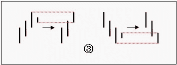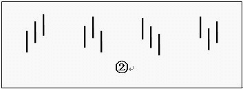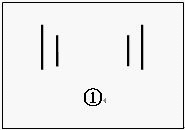

 

K 线包含关系的处理：在向上时，把两 K 线的最高点当高点，而两 K 线低点中的较高者当成低点，这样就把两 K 线合并成一新的 K 线；反之，当向下时，把两 K 线的最低点当低点，而两 K 线高点中的较低者当成高点，这样就把两 K 线合并成一新的 K 线。(如图③)

二、概念要点

K 线合并方向：假设，第 n 根 K 线满足第 n 根与第 n+1 根的包含关系，而第 n 根与第 n-1 根不是包含关系，那么，如果第 n 根 K 线的高点大于第 n-1 根 K 线的高点，则称第 n-1、n、n+1 根 K 线是向上的；如果第 n 根 K 线的低点小于第 n-1 根 K 线的低点，则称第 n-1、n、n+1 根 K 线是向下的。

K 线包含关系的顺序原则：先用第 1、2 根 K 线的包含关系确认新的 K 线，然后用新的 K 线去和第 3 根比，如果有包含关系，继续用包含关系的法则结合成新的 K 线；如果没有，就按正常 K 线去处理。

三、分析理解

根据定义，任何人都可以马上得出以下的一些推论：

1、用\[di,gi\]记号第 i 根 K 线的最低和最高构成的区间，当向上时，顺次 n 个包含关系的 K 线组，等价于\[maxdi,maxgi\]的区间对应的 K 线，也就是说，这 n 个 K 线，和最低最高的区间为\[maxdi,maxgi\]的 K 线是一回事情；向下时，顺次 n 个包含关系的 K 线组，等价于\[mindi,mingi\]的区间对应的 K 线。

2、K 线的包含关系遵守结合律，但不遵守传递律。也就是说，第 1、2 根 K 线是包含关系，第 2、3 根也是包含关系，但并不意味着第 1、3 根就有包含关系。因此在 K 线包含关系的分析和处理中，还要遵守顺序原则，就是先用第 1、2 根 K 线的包含关系确认新的 K 线，然后用新的 K 线去和第三根比，如果有包含关系，继续用包含关系的法则结合成新的 K 线，如果没有，就按正常 K 线去处理。

一个实例：如图④，中间 K 线 A 最长，似乎和前后有“很多的包含关系”，但正确的处理应该是：A2 先和 A 合并，取高点中的高点，低点中的高点。合并后的新 K 线和 A3 还有包含关系，那就继续合并，仍取高点中的高点，低点中的高点。

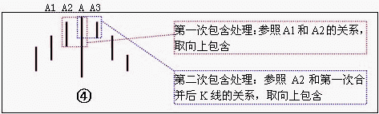 

 

 

 

 

K 线包含处理方法：

1、合并方向的确定：1 和 2 无包含，2 和 3 有包含，若 2 比 1 高则取向上包含；若 2 比 1 低则取向下包含；

2、合并高低点的确定：若向上包含，取两 K 线中高点最高为高点，低点最高为低点；若向下包含，取两 K 线中高点最低为高点，低点最低为低点。

3、合并顺序的确定：2 和 3 有包含，先合并 2 和 3 得出新的 K 线，再与 4 比，若有包含则继续合并。

 

## 第五节 分 型

一、基本概念

顶分型：第二 K 线高点是相邻三 K 线高点中最高的，而低点也是相邻三 K 线低点中最高的。(如图①)

底分型：第二 K 线低点是相邻三 K 线低点中最低的，而高点也是相邻三 K 线高点中最低的。(如图②)

(分型的)顶：顶分型的最高点。

(分型的)底：底分型的最低点。

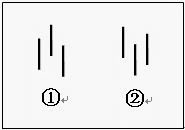 

 

 

 

二、概念要点

所有的顶必须是顶分型的，反之，所有的底都是底分型的。也就是：没有顶分型，没有顶；反之，没有底分型，没有底。

三、分析理解

1、在实际操作中，如果在操作级别的 K 线图上，没有顶分型，那你就可以持有睡觉，等顶分型出来再说。

2、一个顶分型之所以成立，是卖的分力最终战胜了买的分力，而其中，买的分力有三次的努力，而卖的分力，有三次的阻击。用最标准的已经过包含处理的三 K 线模型：第一根 K 线的高点，被卖分力阻击后，出现回落，这个回落，出现在第一根 K 线的上影部分或者第二根 K 线的下影部分，而在第二根 K 线，出现一个更高的高点，但这个高点，显然与第一根 K 线的高点中出现的买的分力，一定在小级别上出现力度背驰，从而至少制造了第二根 K 线的上影部分。最后，第三根 K 线，会再次继续一次买的分力的攻击，但这个攻击，完全被卖的分力击败，从而不能成为一个新高点，在小级别上，大致出现一种第二类卖点的走势。

由上可见，一个分型结构的出现，如同走势中枢，都是经过一个三次的反复心理较量过程，只是走势中枢用的是三个次级别走势。所谓一而再、再而三，三而竭，一个顶分型就这样出现了，而底分型情况，反之亦然。

3、分型中三根 K 线的指导意义：

首先，一个完全没有包含关系的分型结构，意味着市场双方都是直截了当，没有太多犹豫。包含关系（只要不是直接把阳线以长阴线吃掉）意味着一种犹豫，一种不确定的观望等，一般在小级别上，都会有走势中枢延伸、扩展之类的东西。

其次，还是用没有包含关系的顶分型为例子。如果第一 K 线是一长阳线，而第二、三都是小阴、小阳，那么这个分型结构的意义就不大了，在小级别上，一定显现出小级别走势中枢上移后小级别新走势中枢的形成。一般来说，这种顶分型，成为真正顶的可能性很小，绝大多数都是中继的。

如果第二根 K 线是长上影甚至就是直接的长阴，而第三根 K 线不能以阳线收在第二根 K 线区间的一半之上，那么该顶分型的力度就比较大，最终要延续成笔的可能性就极大了。

再次，一般来说，非包含关系处理后的顶分型中，第三根 K 线如果跌破第一根 K 线的底而且不能高收到第一根 K 线区间的一半之上，属于最弱的一种，也就是说这顶分型有着较强的杀伤力。

4、分型形成后，无非两种结构：一是成为中继型的，最终不延续成笔；二是延续成笔。对于后一种，那是最理想的，例如在日线上操作完，就等着相反的分型出来再操作了，中间可以去操作别的股票，这是效率最高的。而对于第一种情况，前面说过，可以看是否有效突破 5 周期的均线，例如对日线上的顶分型，是否有效跌破 5 日均线，就是一个判断顶分型类似走势很好的操作依据。

其一，更精确简单的，就是这分型所对应的小级别走势中枢里，是否出现第三类买卖点，而且其后是否出现走势中枢移动。例如，对于一个顶分型，该顶分型成立后，对于该分型区间在小级别里一定形成某级别的走势中枢，选择其中最大一个，例如日顶分型后，可以找到相应的 5、1 分钟走势中枢，一般最大的就是 5 分钟（30 分钟没可能，因为时间不够）。如果该 5 分钟走势中枢或 1 分钟走势中枢出现第三类卖点，并该卖点不形成走势中枢扩张的情形，那么几乎 100%可以肯定，一定在日线上要出现笔了。

其二，可以 100%肯定的，要不出现笔并最终有效完成该顶分型，那一定要出现某级别的第三类买点，否则就算有短时间的新高，也一定是假突破。所以结合小级别的走势中枢判断，顶分型是否延伸为笔，是可以当下一目了然的。如果你能有效地分辨中继分型，那么你的操作就会有大的进步。

5、一般来说，可以把分型与小级别走势类型结合操作，例如日线与 5 分钟的。如果一个小级别的走势中枢震荡没有生成日 K 线的顶分型结构，那么，这个走势中枢震荡就没必要走了。后者就算打短差也要控制好数量。因为，没有分型，就意味着走势没结束，随时新高，你急什么？而一旦顶分型成立，必然对应着小级别走势的第一、二类卖点。其后，关键看新形成走势中枢的第三类买卖点的问题：一般情况下，如果是中继的，都是第三类卖点后形成走势中枢扩展，也就是有一个绝妙的盘整底背驰让你重新介入。这样，利用分型搞了一个美妙的短差，又不浪费其后的走势，这就是一个比较及格的操作了。

注意，利用分型，例如顶分型，卖了以后一定要注意是否要回补，如果一旦确认是中继的，应该回补，否则就等着笔完成再说。但一定要注意，中继顶分型后，如果其后的走势在相应小级别出现背驰或盘整背驰，那么下一顶分型，是中继的可能性将大幅度减少。中继分型，有点类似刹车，一次不一定完全刹住，但第一刹车后如果车速已明显减慢，证明刹车系统是有效的，那么第二次刹住的机会就极大了，除非你踩错，一脚到油门上去了。

6、利用分型操作的难点在于：

1)、必须与小级别的第二买卖点配合看，如果小级别看不明白，只看今天冲起来没破前一天高位或没跌破前一天低位，这样操作的效果不会太好。

2)、要利用好盘整背驰，这样就不会漏掉回补，或者是非盘整背驰而回补早了，一般来说，非盘整背驰的，一定要等待背驰出现才可以回补。卖点的情况反过来就是了。

注意，大级别的分型和某小级别的第一、二买卖点并不是绝对的对应关系，有前者一定有后者，但有后者并不一定有前者，所以前者只是一个辅助。

7、有人可能要问，如果看 30 分钟图，可能 K 线一直犬牙交错，找不到分型。这有什么奇怪的，在年线图里，找到分型的机会更小，可能十几年找不到一个也很正常，这还是显微镜倍数的比喻问题。确定显微镜的倍数，就按看到的 K 线用定义严格来，没有符合定义的，就是没有，就这么简单。如果希望能分析得更精确，那就提高显微镜的倍数，用小级别的图，例如，不要用 30 分钟图，用 1 分钟图，这样自然能分辨得更清楚。再次强调，用什么图与以什么级别操作没任何必然关系，用 1 分钟图，也可以找出年线级别的背驰，然后进行相应级别的操作。看 1 分钟图，并不意味着一定要玩超短线，把显微镜当成被显微的物了，肯定是脑子水太多了。这些细微的技术问题，都需要不断磨练才能操作自如，现在，最好多找些图来看，先感受一下，否则一点概念都没有，操作什么？

## 第六节 笔

一、基本概念

笔：两个相邻的顶和底之间构成一笔。笔的意义就是忽略掉相邻的顶和底之间的其他波动。

上升的一笔：即底分型+上升 K 线+顶分型；

下降的一笔：即顶分型+下降 K 线+底分型。

二、概念要点

笔的规范要求：

1、必须是一顶一底，顶必须对应底、或底必须对应顶。

2、顶和底之间至少有一个 K 线不属于顶分型与底分型。

3、还有一个最显然的，就是在同一笔中，顶分型中最高那 K 线的区间至少要有一部分高于底分型中最低那 K 线的区间，如果这条都不满足，也就是顶都在底低的范围内或顶比底还低，这显然是不可接受的。

满足上面的条件，就可以唯一确定出笔的划分。

三、分析理解

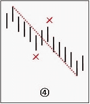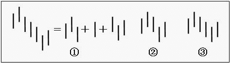

 

 

 

 

图①就是一笔的最基本的图形。图②顶和底之间共用一个 K 线，图③只有顶分型和底分形，中间没有其他 K 线，都不算一笔（最好不算一笔）。在实际分析中，都必须要求顶和底之间都至少有一 K 线当成一笔的最基本要求。所以，笔，至少由顶、底在内的 7 根 K 线构成。如图①。

两个顶（或底）能构成一笔吗？有两种情况：第一种，在两个顶（或底）中间有其他的顶和底。这种情况，只要中间的顶和底不能构成一笔，就继续用一顶一底的原则，忽略中间的顶和底（图④）；第二种，在两个顶或底中间没有其他的顶和底，这种情况，意味着第一个顶或底后的转折级别太小，不足以构成值得考察的对象，这种情况下，第一个的顶或底就可以忽略其存在了。

所以，根据上面的分析，对第二种情况进行相应处理（类似对分型中包含关系的处理），就可以严格地说，先顶后底，构成向下一笔；先底后顶，构成向上一笔。而所有的图形，都可以唯一地分解为上下交替的笔的连接。显然，除了第二种情况中的第一个顶或底类似的分型，其他类型的分型，都唯一地分别属于相邻的上下两笔，是这两笔间的连接。

划分笔的步骤：

1、确定所有符合标准的分型。如有 K 线包含关系，必须先行处理。

2、如果前后两分型是同一性质的，对于顶，前面的低于后面的，只保留后面的，前面那个可以 X 掉；对于底，前面的高于后面的，只保留后面的，前面那个可以 X 掉。不满足上面情况的，例如相等的，都可以先保留(如图④)。

3、经过步骤二的处理后，余下的分型，如果相邻的是顶和底，那么这就可以划为一笔。

显然，经过上面的三个步骤，所有的笔都可以唯一地划分出来。

## 第七节 线 段

一、基本概念

线段：至少由三笔组成，而且前三笔必须有重叠的部分。

线段划分定理：线段被终结，当且仅当至少被有重叠部分的连续三笔的其中一笔终结。而只要构成有重叠部分的前三笔，那么必然会形成一线段。换言之，线段终结的充要条件，就是形成新线段。

二、概念要点

1、线段至少有连续的三笔（可以更多），但并不是连续的三笔就一定构成线段，这三笔必须有重叠的部分。如图①②是线段的最基本形态。

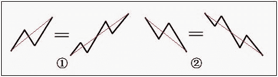 

 

 

 

2、线段无非有两种，从向上一笔开始的，和从向下一笔开始的。从向上一笔开始的线段，其终结也是向上一笔，其顶 gi 一定大于第一笔的底 d1，故该线段是向上的；同理从向下一笔开始的线段，其方向也是向下的。如图①②。

3、和笔一样，从顶分型开始的线段，其终结一定是底分型；反之亦然。所以构成线段的笔数一定是奇数。

4、用 S 代表向上的笔，X 代表向下的笔。

以向上笔开始的线段，可以用笔的序列表示：S1X1S2X2S3X3…SnXn。容易证明，任何 Si 与 Si+1 之间，一定有重合区间。而考察序列 X1X2…Xn，该序列中，Xi 与 Xi+1 之间并不一定有重合区间，因此，这序列更能代表线段的性质。

 

 

 

 

序列 X1X2…Xn 为以向上笔开始线段的特征序列，Xi 为该特征序列的元素；序列 S1S2…Sn 为以向下笔开始线段的特征序列，Si 为该特征序列的元素。特征序列两相邻元素间没有重合区间，称为该序列的一个缺口。

把每一元素看成是一 K 线，那么，如同一般 K 线图中找分型的方法，也存在所谓的包含关系，也可以对此进行非包含处理。经过非包含处理的特征序列，成为标准特征序列。

5、线段划分定理也可以理解为：只有形成新线段，原线段才结束（确定）。如图③④是两线段组合的基本形态(这里的形态是不充分的)。

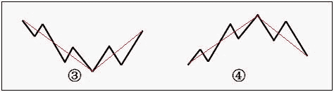 

 

 

 

三、分析理解

线段划分的标准：

参照一般 K 线图关于顶分型与底分型的定义，可以确定特征序列的顶和底。注意，以向上笔开始的线段的特征序列，只考察顶分型；以向下笔开始的线段，只考察底分型。

在标准特征序列里，构成线段终点分型的三个相邻元素，只有两种可能：

第一种：特征序列为顶分型中，第 1 和第 2 二元素间不存在特征序列的缺口，那么该线段在该顶分型的高点处结束，该高点是该线段的终点；底分型反之亦然。

第二种：特征序列为顶分型中，第 1 和第 2 元素间存在特征序列的缺口，如果从该分型最高点开始向下一笔开始形成的特征序列出现底分型（意味形成了新的线段），那么该线段在该顶分型的高点处结束，该高点是该线段的终点；底分型反之亦然。

强调，在第二种情况下，后一特征序列不一定封闭前一特征序列相应的缺口，而且，第二个序列中的分型，不分第一二种情况，只要有分型就可以。

线段划分的程序：首先搞清楚特征序列，然后搞清楚标准特征序列，最后是标准特征序列的顶分型与底分型。而分型又以分型的第一元素和第二元素间是否有缺口分为两种情况。一定要把这逻辑关系搞清楚，否则一定晕倒。

假设某转折点是两线段的分界点，然后对此用两种情况去考察线段划分是否满足，如果满足其中一种，那么这点就是真正的线段的分界点；如果不满足，那就不是，原来的线段依然延续。

特征序列的分型中，第一元素就是以该假设转折点前线段的最后一个特征元素，第二个元素，就是从这转折点开始的第一笔，显然，这两者之间是同方向的。因此，如果这两者之间有缺口，那么就是第二种情况，否则就是第一种，然后根据定义来考察就可以。

这里还要强调一下包含的问题。上面的分析知道，在这假设的转折点前后那两元素，是不存在包含关系的，因为，这两者已经被假设不是同一性质的东西，不一定是同一特征序列的；但假设的转折点后的顶分型的元素，是可以应用包含关系的。为什么？因为，这些元素间，肯定是同一性质的东西，或者就是原线段的延续，那么就同是原线段的特征序列中，或者就是新线段的非特征序列中，反正都是同一类的东西，同一类的东西，当然可以考察包含关系。

换一种思考方式：就是把线段的特征序列的元素，看成是 K 线；然后按 K 线的包含关系处理，就成了标准特征序列；最后看这标准特征序列的元素等同的 K 线是否有顶分型和底分型：有顶分型和底分型，那么这个顶分型和底分型就形成了新线段，原线段终结，否则原线段延续。

一个实例：如图⑤，6 属于第一种情况，所以 6 是线段结束；同理 15 也属于第一种情况；9-10 和 11-12 是包含关系，处理后为等同于 11-10，所以点 11 不是线段的分界点；故该图有三段，分别是 1-6，6-15 和 15-20。

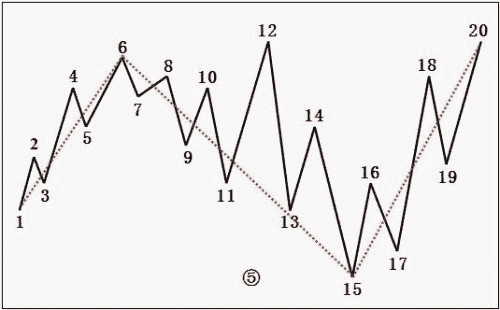 

 

 

## 第八节 走势中枢

一、基本概念

走势中枢：某级别走势类型中，被至少三个连续次级别走势类型所重叠的部分。如图 1 是下-上-下型走势中枢；图 2 是上-下-上型走势中枢。

 

 

 

 

 

 

 

走势中枢定理一：在趋势中，连接两个同级别“走势中枢”的必然是次级别以下级别的走势类型。

走势中枢定理二：在盘整中，无论是离开还是返回“走势中枢”的走势类型必然是次级别以下的。

走势中枢定理三：某级别“走势中枢”的终结，当且仅当一个次级别走势离开该“走势中枢”后，其后的次级别回抽走势不重新回到该“ 走势中枢”内。

走势中枢中心定理一：走势中枢的延伸等价于任意区间\[dn，gn\]与\[ZD，ZG\]有重叠。换言之，若有 Zn，使得 dn\>ZG 或 gn<ZD，则必然产生高级别的走势中枢或趋势及延续。

走势中枢中心定理二：前后同级别的两个走势中枢，后 GG<前 DD 等价于下跌及其延续；后 DD〉前 GG 等价于上涨及其延续。后 ZG<前 ZD 且后 GG〉=前 DD，或后 ZD\>前 ZG 且后 DD\=<前 GG，则等价于形成高级别的走势中枢。

二、概念要点

走势中枢的形成无非两种，一种是回调形成的（下-上-下型走势中枢）,一种是回升形成的（上-下-上型走势中枢）。在走势中枢的形成与延伸，由与走势中枢形成方向一致的次级别走势类型的区间重叠确定。例如，回升形成的走势中枢，由向上的次级别走势类型的区间重叠确定。这些与走势中枢方向一致的次级别走势类型称为 Z 走势段。相应的高、低点分别记为 gn、dn，定义四个指标,GG\=max(gn)，G\=min(gn)，D\=max(dn)，DD\=min(dn)，n 遍历走势中枢中所有 Zn。再定义 ZG\=min(g1、g2)，ZD\=max(d1、d2)，显然，\[ZD，ZG\]就是走势中枢的区间，如图③。

注意，次级别的前三个走势类型都是完成的才构成该级别的走势中枢，完成的走势类型，在次级别图上是很明显的，根本就不用着再看次级别下面级别的图了。

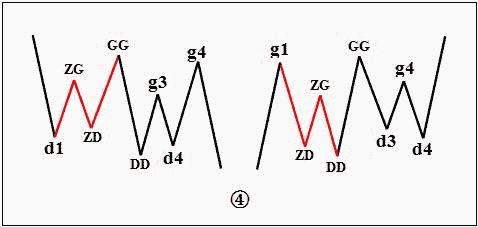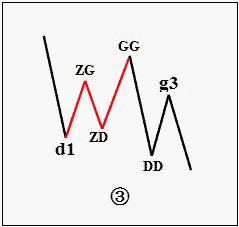

 

 

 

 

 

 

走势中枢的延伸：等价于任意区间\[dn，gn\]与\[ZD，ZG\]有重叠(如图④)。表现为盘整。

走势中枢的新生：即形成趋势(如图⑤)。

走势中枢的扩展：即形成高级别的走势中枢(如图⑥)。

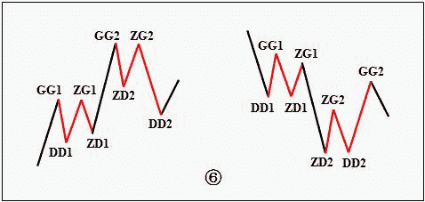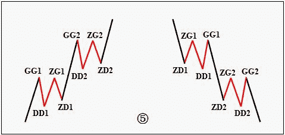

 

 

 

 

 

三、分析理解

1、“连接两相邻同级别走势中枢的一定是趋势吗？一定是次级别的趋势吗？”首先，这不必然是趋势，任何走势类型都可能，最极端的就是跳空缺口后形成新的“走势中枢”；其次，也不一定是次级别的，只要是次级别以下，例如跳空缺口，就属于最低级别，如果图上是日线、周线，就不会是次级别了；最后，往往相连走势类型的级别越低，表示其力度越大，这也就是为什么缺口在分析中有比较强技术含义的理论依据所在。

2、“盘整的高低点是如何造成的？”无论离开与返回的走势类型是何种级别的，站在最低级别上看，例如把 1 分钟图当成最低级别，那么最后连接离开与返回走势类型连接处的最低级别图，只能有两种可能：第一，三根以上 1 分钟 K 线的来回重叠震荡后回头；第二，1 分钟 K 线无三根以上 K 线重叠的 V 型走势。对于第一种情况，这几根重叠 K 线最极端那根的极端位置，就构成盘整中的高低点，一般来说，这种情况比较少见；对于第二种情况，这个 V 型尖顶那根 K 线的极端位置就构成盘整中的高低点，这种情况十分常见。这也是为何真正的低点和高点总是盘中一闪而过的理论依据。

3、这定理三中的两个次级别走势的组合只有三种：趋势+盘整，趋势+反趋势，盘整+反趋势。最用力的终结，就是：趋势+盘整。例如在上涨中，如果一个次级别走势向上突破后以一个盘整走势进行整理回抽，那其后的上涨往往比较有力，特别这种突破是在底部区间。

4、走势中枢由前三个连续次级别走势类型的重叠部分确定，其后的走势有两种情况：其一、该走势中枢的延伸。其二、产生新的同级别走势中枢。而在趋势里，同级别的前后走势中枢是不能有任何重叠的，这包括任何围绕走势中枢产生的任何瞬间波动之间的重叠。因此，如果三个连续次级别走势类型的重叠区间虽然不和前面的走势中枢有任何重叠。但围绕该走势中枢产生的波动触及前面走势中枢延续时的某个瞬间波动区间，这时候，就不能认为该走势类型是趋势，而只是产生一个更大级别的走势中枢。

这里，必须把两种情况严格区分。其一、走势中枢以及其延伸。这种情况下，所有围绕走势中枢产生的前后两个次级波动都必须至少有一个触及走势中枢的区间。否则，就必然产生一个新的三次连续次级走势类型的重叠部分离开原来的走势中枢，这与走势中枢的延续矛盾。其二、一个走势中枢完成前，其波动触及上一个走势中枢或延伸时的某个瞬间波动区间，由此产生更大级别的走势中枢。这就是走势中枢扩展。

一个简单的例子就能区别以上的情况，例如，一个股票开盘立刻封涨停，那么，只能算是一分钟级别上出现了走势中枢的延伸，无论这个延伸有多长时间，都不可能产生更大级别的走势中枢。如果该股票第二天开始继续开盘涨停，那么就形成一个一分钟级别上的趋势，这个趋势可以无限延伸下去，但只要依然只是只形成一分钟的走势中枢，无论能连续涨停多少天，都不足以形成即使是五分钟的走势中枢，除非中途有打开涨停的时候。

换言之，走势中枢的延伸与不断产生新的走势中枢并相应围绕波动互不重叠而形成趋势，在这两种情况下，一定不可能形成更大级别的走势中枢。而要形成一个更大级别的走势中枢，必然要采取第三种的方式，就是围绕新的同级别走势中枢产生后的波动与围绕前走势中枢的某个波动区间产生重叠。

## 第九节 走势及走势类型

一、基本概念

走势：打开走势图看到的就是走势。走势分不同级别。任何级别的所有走势均可分为两类：盘整和趋势。趋势又分为上涨和下跌。这是一切有关技术分析理论的唯一坚实基础。

盘整：在任何级别的任何走势中，某完成的走势类型只包含一个走势中枢，就称为该级别的盘整。

趋势：在任何级别的任何走势中，某完成的走势类型至少包含两个以上依次同向的走势中枢，就称为该级别的趋势。该方向向上就称为上涨，向下就称为下跌。

技术分析基本原理二：任何级别任何完成的走势类型，必然包含一个以上的走势中枢。

走势级别延续定理一：在更大级别走势中枢产生前，该级别走势类型将延续。也就是说，只能是只具有该级别走势的盘整或趋势的延续。

走势级别延续定理二：更大级别走势中枢产生，当且仅当围绕连续两个同级别走势中枢产生的波动区间产生重叠。

二、概念要点：

上涨：在某一级别上基本是由一系列高低点逐步抬高的笔最终构成一个向上的线段，对应的次级以下的某一级别的走势为上涨，该走势至少形成了两个以上依次向上的走势中枢。

下跌：在某一级别上基本是由一系列高低点逐步降低的笔最终构成一个向下的线段，对应的次级以下的某一级别的走势为下跌，该走势至少形成了两个以上依次向下的走势中枢。

盘整：在某一级别上一系列的笔（或线段）的高低点高低错落地排列，无法形成两个同方向的走势中枢。

走势类型的延伸：任何级别的走势，在生成一个走势中枢后，其次级以下的任何一离开该走势中枢的走势，都以另一走势返回该走势中枢；或在生成两个同方向的走势中枢后，继续在该方向上生成新的走势中枢。“走势类型延伸”的实质是什么？对于趋势来说，其“延伸”就在于同级别的同向“走势中枢”不断产生；而对于盘整来说，其“延伸”就在于不能产生新的“走势中枢”。

三、分析理解：

1、一定要看走势图，那是世界上最昂贵的图画，最昂贵的艺术品，多看，就如同培养你的鉴赏力，为什么玩古董的，很多人总是被假玩意骗，而有人就能专破假玩意，这就是鉴赏力等的问题，但这是需要磨练的。磨练的时候，被骗几次，那不是最正常不过的事情？为什么很多人在市场中很痛苦，就是他不热爱这走势，走势是最好的艺术品，你站在热爱的角度，才能激发你的鉴赏力。否则，你脑子里总是被赢亏之类的贪婪之念所占据，眼睛怎么可能不被蒙蔽？

有了自同构性结构，那么，任何一个级别里的走势发展都是独立的，也就是说，例如，在 30 分钟的走势中枢震荡，在 5 分钟的上涨走势，那么两个级别之间并不会互相打架，而是构成一个类似联立方程的东西，如果说单一个方程的解很多，那么联立起来，解就大幅度减少了。也就是级别的存在，使得对走势的判断可以联立了，也就是可以综合起来系统地看了，这样，走势的可能、走势的边界条件就变得异常简单。

所以，看走势，不能光看一个级别，必须立体地看，否则，就是浪费了自同构性结构给你的有利条件。必须明确的是，所有上涨、下跌、盘整都建立在一定的周期图表（级别）上，例如在日线上的盘整，在 30 分钟线上可能就是上涨或下跌，因此，一定的级别是判断的基础。而级别的选择，与交易系统的选择是一致的，相关于你的资金、性格、操作风格等。

2、是否可能在某级别存在这样的走势，不包含任何走势中枢？这是不可能的。因为任何图形上的“向上+向下+向上”或“向下+向上+向下”都必然产生某一级别的走势中枢，没有走势中枢的走势图只意味着在整张走势图形上只存在两个可能，就是一次向下后永远向上，或者一次向上后永远向下。这在实际中是不可能的。

3、这里最大的也是唯一的难点在于“走势类型的延伸”。由于“走势类型延伸”意味着当下的“走势类型”随时可以完成，因此相应的“类型”必然是确定的，因此“走势类型延伸”是否结束的判断关键就在于是否产生新的“走势中枢”。此外，由于趋势至少包含两个“走势中枢”，而盘整只有一个，因此趋势与盘整的判别关键也就在于是否产生新的“走势中枢”。由此可见，“走势中枢”的问题是技术分析中的核心问题，该问题一旦解决，很多判断上的大难题也将迎刃而解。

例如一个盘整，三个重叠的连续次级别走势类型后，盘整就可以随时完成，也就是说，只要三个重叠的连续次级别走势类型走出来后，盘整随时结束都是完美的，但这可以不结束，可以不断延伸下去，不断围绕这走势中枢上上下下地延伸下去直到无穷都是可以的。

同样，面对趋势，形成两个依次同向的走势中枢后，任何趋势都可以随时结束而完美，但也可以不断地延伸下去，形成更多的走势中枢。很多人抓不住牛股，经常在第一个走势中枢时就被震下马，最主要就是对此没有明确的认识。反之，对于下跌的延伸，是所有抄底者的噩梦。逃顶、抄底为何难？归根结底就是这“走势类型的延伸”闹的。

 

# 第二章 动力学

动力学，是属于物理范畴的。但站在更高的层次上看物理，物理的本质就是几何。当然，这是所有物理学家都不可能认同的，但如果用一些几何结构就可以把所有物理的常量给搞掂，那物理学家不认同也是白搭。同样道理，“缠中说禅” 股市技术理论里的动力学部分，本质上也是几何，只是这种几何比较特别，需要把价格充分有效市场里的非完全绝对趋同交易作为前提转化为某些几何结构，然后构造出理论的证明来。

## 第一节 走势必完美

一、基本概念

技术分析基本原理一：任何级别的任何走势类型终要完成。简言之，就是“走势必完美”。

二、概念要点

这个原理的重要性在于把实践中总结出来的、很难实用的、静态的“所有级别的走势都能分解成趋势与盘整”，转化成动态的、可以实用的“走势类型终要完成”。这最简单的话，却包含着技术分析最基本的东西，其哲学和灵魂都在此，这是最重要的。

三、分析理解

“走势必完美”这句话有两个不可分割的方面：任何走势，无论是趋势还是盘整，在图形上最终都要完成。另一方面，一旦某种类型的走势完成以后，就会转化为其他类型的走势，这就是“不患”而有其位次。在技术分析里，不同的位次构成不同的走势类型，各种位次以无位次而位次。而如何在不同位次之间的灵活应用，是实际操作中最困难的部分，也是技术分析最核心的问题之一。例如，一旦判断知道了“下跌”的结束，就知道随后必须要面对的是“盘整”与“上涨”，而后两种走势，对于多头来说，都必然产生利润，唯一区别，就是大小与快慢的问题。如果在市场中能找到一种百分百确定的赢利模式，那就是最伟大的成就了，至于大小、快慢，可以继续研究出新的标准来进行判断。

所谓走势必完美，就是本理论所给出的分型、笔、线段、不同级别走势类型所对应的递归函数，能将行情的任何走势唯一地分解。有了走势必完美，就可以把一切关于走势的理论包含其中，所以本理论可以包含所有其他的理论并指出其不足的地方，就在于本理论解决了最根本的理论问题：唯一分解。

最完美的系统，肯定是自然数了，为什么？因为自然数具有诸多的唯一分解方式，例如素数的分解，但还有一种最牛的分解，就是对于幂级数的唯一分解，因为有这种分解，所以自然数有记数法。例如，2 的幂级数对应的唯一分解就是 2 进位，而 10 的就是 10 进位。如果没有这种分解，我们就不能用记数法记录自然数了。正因为这分解如此有力，所以我们都会觉得很平常，似乎自然数有记数法是天经地义的，其实，这才是自然数整体结构中最牛的地方。而一般的数系，是没有这种性质的。

同样，本理论给出的递归函数，完美地给出市场走势一个类似记数法一样的唯一分解，也就是说，本理论揭示了看似毫无规律的市场走势竟然有着和自然数有着类似的整体结构，完全超越一般的想象，这才是真正最牛的地方。正因为本理论揭示了看似毫无规律的市场走势有如此完美的整体规律，所以才有了其后一系列的操作可能。这才是走势必完美真正关键的地方。

因此，级别在本理论中就极端关键了。为什么？因为本理论的递归函数是有级别的，是级别依次升大的。所以，搞不明白级别，根本就不明白本理论。如同 GDP，精确到亿的数字，对于宏观了解就够了，没有必要精确到个位级。

那么，这样一个整体结构有什么厉害的结论呢？这可以推演的东西太多了，随便说一个，就是区间套方法的应用。如果市场走势没有本理论所揭示的整体结构，那么区间套是不会存在，也就是没有操作意义的。因此，区间套的方法，就是走势必完美的一个重要应用。有了区间套，买卖点的精确定位才有可能，也就是说走势必完美的存在导致了买卖点可以精确定位，这显然是操作中最牛的一种方式了。

完全分类，其实是一个超强的实质性质。学点现代数学就知道，绝大多数系统并不一定存在完全分类的可能，而要研究一个系统，最关键的是找到某种方式实现完全分类，说得专业点，就是具备某种等价关系。而由于走势必完美，所以走势就是可以完全分类的，而所有的分类，都有明确的界限，这样，任何的走势都成为可控的。这种可控并不需要任何人的预测或干预，而是当下直接地显现的，你只需要根据这当下的显示，根据自己的操作原则操作就可以。

注意，完全分类是级别性的，是有明确点位界限的。而不是粗糙的上、下、平的无聊概念。也就是说，本理论完全是数量化的，就是精确化的，里面不存在任何含糊的地方。

数学不行，当然看不明白这些关节。很多人，整天纠缠在分型如何如何上，只能证明这些人根本没看懂本理论。分型等于递归函数的 a0，这完全可以随意设计，如何设计都不会影响到唯一分解定理的证明。但现在这种设计，一定是所有可能设计中最好的，这使得笔出现的可能性最大并把最多的偶然因数给消除了，使得实际的操作中更容易把走势分解。注意，分型不需要任何假设，只需要符合定义就可以。是否符合，只有唯一的答案，不需要任何假设。

本理论，本质上是站在这种现代物理的角度构建自己的能量动力学结构的。这里，一切都是几何结构说了算，一切的能量动力形态，都变几何化。因此，必须有这种思维上的根本改变，才会有真正的理解。否则，还是牛顿时代那种弱智思维，那就将陷入一种机械化思维的陷阱中。所以，明白上面这些，这样就有了一个大概的框架，而不至于迷失于理论中了。

## 第二节 走势分解

一、基本概念

走势分解定理一：任何级别的任何走势，都可以分解成同级别“盘整”、“下跌”与“上涨”三种走势类型的连接。

走势分解定理二：任何级别的任何走势类型，都至少由三段以上次级别走势类型构成。

二、概念要点

本理论，是人类历史上第一次用 100%理论推导的方式绝对地证明了走势分解的唯一性，这从上面关于笔、线段等分解的唯一性证明就明白，世界有哪种交易理论，是按这种绝对推理的方式构成的？显然没有，这才是本理论的最强大力量所在，前两个客观点如果没有最后这第三点，都是瞎掰。

市场总有其复杂的地方，使得市场的走势呈现一种多义性。多义性不是含糊的理论，是站在一个严格、精确的理论基础上，用同一理论以不同视角对同一现象进行分析。走势分析中的多种合理释义，这些释义都符合理论内在的逻辑。因此，这种多义性反而不是负担，而是可以用多角度对走势进行分析。

三、分析理解

1、站在任意一个固定级别里，走势类型是可以被严格划分的。例如，说一个 5 分钟的走势类型，显然不可能包含一个 30 分钟的走势中枢，因为按定义，一个单独的 5 分钟走势类型无论如何延续，也不可能出现一个 30 分钟的走势中枢。要形成一个 30 分钟的走势中枢，显然只能是 3 个以上 5 分钟走势类型的连接才可能。走势类型和走势类型的连接，这两个概念不可能有任何含糊的地方。5 分钟走势类型，必须包含也最多包含 5 分钟级别走势中枢，至于是 1 个还是 5 个，都不影响是 5 分钟走势类型，只不过可被分类成是 5 分钟级别的盘整类型还是趋势类型而已。

显然，一个高级别的走势类型必然就是由几个低级别的走势类型连接而成，但不一定都是次级别的走势类型，例如，a+B+b，B 是 30 分钟走势中枢，由 3 个 5 分钟走势类型构成，a、b 是 1 分钟走势类型，那么 a+B+b 这个 30 分钟走势类型就能分解成 2 个 1 分钟走势类型和 3 个 5 分钟走势类型的连接。但我们还可以通过拆散重分，使得一个高级别的走势类型必然就是由几个次级别的走势类型连接而成，由于走势中枢里至少有三段次级别走势类型，所以就有了 “走势分解定理二”。

还是上面 a+B+b 的例子，不妨假设 B 中有三段 5 分钟走势类型，分别表示为 B1、B2、B3，那么 a+B+b=a+ B1+B2+B3+b=（ a+ B1）+B2+（B3+b），显然（ a+ B1）、B2、（B3+b）都是 5 分钟走势类型，这就是该分解定理所说的东西。学过一点抽象代数的都容易理解上面的话。用抽象的话说，就是走势类型连接这种运算是符合结合律的。但走势类型的连接运算不符合交换率，这就是该运算的特别之处。因为已发生的交易是按时间次序排列的，时间不能倒流，已发生的交易也就不可能推倒重新排列。只要明白了走势类型连接运算的结合性，那就不难同时明白 “走势分解定理一”。

注意，走势是客观的，而用什么级别去分析这走势却是主观的。根据“走势分解定理一”，任何级别的任何走势，都可以分解成同级别“盘整”、“下跌”与“上涨”三种走势类型的连接，那么就意味着，按某种级别去操作，就等于永远只处理三种同一级别的走势类型及其连接。还是上面 a+B+b 的例子，站在 5 分钟级别的角度，这里有三个走势类型的连接，站在 30 分钟级别的角度，就只有一个走势类型。那么，前面反复说的，确定自己操作的级别，就是确定自己究竟是按什么级别来分析、操作。例如，5 分钟级别上下上三段，意味着在 5 分钟级别上有 2 个底背驰、2 个顶背驰，按买点买、卖点卖的原则，就有 2 次的完整操作；而按 30 分钟级别看，如果不结合该 30 分钟走势类型之前一个 30 分钟走势类型分析，就无法确定买卖点，所以就无法操作。

任何走势，都可以在这些级别构成的分解中唯一地表达。但一般来说，对于一般的操作，没必要所有分解都搞到年、季、月这么大的级别，因为这些级别，一般几年都不变一下。你看，从 6124 点下来，N 个月了，还在 30 分钟级别里混，所以，一般来说，1、5、30 分钟三个级别的分解，就足以应付所有的走势。当然，对于大点的资金，可以考虑加上日级别的。

从纯理论的角度，操作级别越低，相应的效率越高，但实际操作级别是不可能随意低的，而究竟按什么级别来分析、操作，和你的资金等具体条件相关。例如，T+1 的情况下，按 1 分钟以下级别的操作，就面临着不能顺利兑现的风险，而系统的操作，要把所有可能的情况都考虑其中，因此完全按 1 分钟以下级别的操作是不可能的，除非是 T+0。此外，级别越小，平均的买卖点间波幅也越小，因此，那些太小的级别，不足以让交易成本、交易误差等相对买卖点间波幅足够小，这样的操作，从长期的角度看，是没有意义的。所谓的交易误差，可以包括很多，例如你看见买点到你实际操作完成，必然有一个时间差，因此也就有了价位上的差别，这对于大级别无所谓，但对特小级别，那就需要特别精确，而这是不可能长期达到的。

因此，根据各种情况，你就可以相应定好自己的操作级别，这样就可以按照相应的级别分析、操作。也就是说，一旦该级别出现买卖点，你必须进入或退出。也就是说，在你的操作级别上，你是不参与任何调整或下跌走势类型的。

2、走势类型连接运算的结合性，也就是走势类型的连接符合结合律，即 A+B+C=（A+B）+C=A+（B+C），A、B、C 的走势类型级别可以不同。因此，站在多义性的角度，根据该结合律，就不难知道，任何一段走势，都可以有很多不同的释义。

2.1、如果市场都是标准的 a+A+b+B+c（A、B 的走势中枢级别，a、b、c 是相对于 A、B 次级别的走势），那这市场也太标准、太不好玩了。市场总有其复杂的地方，使得市场的走势呈现一种多义性。而所有走势的多义性，都与走势中枢有关。例如，5 分钟级别的走势中枢不断延伸，出现 9 段以上的 1 分钟次级别走势。站在 30 分钟级别的走势中枢角度，3 个 5 分钟级别的走势类型重合就形成了，而 9 段以上的 1 分钟次级别走势类型，每 3 段构成一个 5 分钟的走势中枢，这样也就可以解释成这是一个 30 分钟的走势中枢。这种情况，只要对走势中枢延伸的数量进行限制，就可以消除多义性，一般来说，走势中枢的延伸不能超过 5 段，也就是一旦出现 6 段的延伸，加上形成走势中枢本身那三段，就构成更大级别的走势中枢了。

2.2 对 a+A+b+B+c，a 完全可以有另一种释义，就是把 a 看成是围绕 A 这个走势中枢的一个波动，虽然 A 其实是后出现的，但不影响这种看法的意义。同样 c 也可以看成是针对 B 的一个波动，这样整个走势其实就简化为两个走势中枢与连接两者的一个走势。在最极端的情况下，在 a+A+b+B+c 的走势系列类型里，a 和 c 并不是必然存在的，而 b 完全可以是一个跳空缺口，这样，整个走势就可以简化为两个孤零零的走势中枢。把这种看法推广到所有的走势中，那么任何的走势图，其实就是一些级别大小不同的走势中枢。

2.3 最简单的释义角度，就是级别。任何一段走势，都可以根据不同的级别进行分解，不妨用 An-m 的形式表示根据 n 级别对 A 段进行分解的第 m 段，就有， A=A1-1+A1-2+A1-3+…+A1-m1\=A5-1+A5-2+A5-3+…+A5-m5\=A30-1+A30-2+A30-3+…+A30-m30\= A 日-1+A 日-2+A 日-3+…+A 日-m 日等等，显然这些分解都符合本理论。而根据某级别进行操作，站在纯理论的角度，无非等价于选择该等式列中某个子式子进行操作。

3、还有一种应用，就是关于走势的当下判断。当下判断，其基础在于采取的分解方式。例如，一个按 5 分钟分解的操作角度与一个按 30 分钟分解的操作角度，在同一时间看到的走势意义是不同的。更重要的是，在 5 分钟分解中完成的走势，在 30 分钟却不一定完成。例如 A+B，A、B 都是 5 分钟的走势类型，那么 A+B 走势，对于 30 分钟的分解就是未完成的。根据走势必须完美的原则，未完成的走势必完成，也就是，在不同的分解角度，可以在当下看到不同级别的未完成的走势即将根据走势必完美原则产生的运动，这就为当下的操作提供了依据。

3.1 按同级别分解操作，有更广泛、更精确的操作。

3.1.1 对 5 分钟的同级别分解，以最典型的 a+A 为例子，一般情况下，a 并不一定就是 5 分钟级别的走势类型，但通过结合运算，总能使得 a+A 中,a 是一个 5 分钟的走势类型，而 A，也分解为 m 段 5 分钟走势类型，则 A=A1+A2+…+Am。想考虑 a+A 是向上的情况，显然，Ai 当 i 为奇数时是向下的，为偶数时是向上的，开始先有 A1、A2 出现，而且 A1 不能跌破 a 的低点，如果 A2 升破 a 的高点而 A3 不跌回 a 的高点，这样可以把 a+A1+A2+A3 当成一个 a\`，还是 5 分钟级别的走势类型。因此，这里可以一般性地考虑 A3 跌破 a 的高点情况，这样，A1、A2、A3 必然构成 30 分钟走势中枢。因此，这一般性的 a+A 情况，都必然归结为 a 是 5 分钟走势类型，A 包含一 30 分钟走势中枢的情况。

把 a 定义为 A0，则 Ai 与 Ai+2 之间就可以不断地比较力度，用盘整背驰的方法决定买卖点。注意，在实际操作中下一个 Ai+2 是当下产生的，但这不会影响所有前面 Ai+1 的同级别唯一性分解。这种机械化操作，可以一直延续，该走势中枢可以从 30 分钟一直扩展到日线、周线甚至年线，但这种操作不管这么多，只理会一点，就是 Ai 与 Ai+2 之间是否盘整背驰，只要盘整背驰，就在 i+2 为偶数时卖出，为奇数时买入。如果没有，当 i 为偶，若 Ai+3 不跌破 Ai 高点，则继续持有到 Ai+k+3 跌破 Ai+k 高点后在不创新高或盘整顶背驰的 Ai+k+4 卖出，其中 k 为偶数；当 i 为奇数，若 Ai+3 不升破 Ai 低点，则继续保持不回补直到 Ai+k+3 升破 Ai+k 低点后在不创新低或盘整底背驰的 Ai+k+4 回补。

看完上面这段，至少 90%以上的人都心跳加速，头晕眼花。不过没办法，这是最精确的表述，画着图应该不难明白。以上的方法，最大的特点是，就是在同级别分解的基础上将图形基本分为两类，一类是“当 i 为偶 Ai+3 不跌破 Ai 高点”或“i 为奇数 Ai+3 不升破 Ai 低点”；一类是“Ai 与 Ai+2 之间盘整背驰”。对这两种情况采取不同的操作策略，构成了一种机械的操作方法。

投资，往往碰到这样两难的事情，就是一个小级别的进入，结果出现大级别的上涨，这时候怎么办？这时候有两个选择：一、继续按小级别操作，这样的代价是相当累，而且小级别操作的问题是对精确度要求比大级别高，而且资金容纳程度低；二、升级为大级别操作基础上部分保持小级别操作。对于资金比较大的投资，后者是比较实用的。

3.1.2 “Ai 与 Ai+2 之间盘整背驰”，将演化出“当 i 为偶 Ai+3 跌破 Ai 高点”或“i 为奇数 Ai+3 升破 Ai 低点”；因而相应演化出高一级别的走势中枢，例如在该例子里，Ai+1、Ai+2、Ai+3 就是 30 分钟的走势中枢，而所有更大的走势中枢，当然是先有高一级别才可能有，否则连 30 分钟的走势中枢都没有，哪里来日、周、月的？但这个现象就保证了，在同级别分解下，一个小级别的操作是可以按一个自动模式换档成一个高级别的操作。

一般情况下，在上面 5 分钟同级别分解的例子中，只要从 A0 开始到某个 At，使得 A0+A1+….+At\=B1+B2，后者是 30 分钟级别的同级别分解，这时候就可以继续按后一种分解进行相应的操作。当然，是否换档成后一种级别的操作，与你的时间、操作风格、资金规模有关。但本理论还是建议，可以进行这种短线变中线的操作，即使你的资金量很小，但如果出现一种明显的大级别走好，这种操作会让你获得稳定的大级别波动利益，因此，根据当下的情况去决定是否换档，就如同开车时根据路况等决定档位一样。

对于大资金来说，这种级别的操作可以一直延伸下去，可以变成 N 重层次的操作，每一重都对应着一定的资金与筹码，而相应对应着不同的节奏与波动。如果对古典音乐有点了解的，就知道，这如同赋格曲，简单的动机、旋律在 N 个层次上根据不同的转位、移位、对位等原则运动着，合成统一的乐曲。市场的走势，其实就是这样的多重赋格，看似复杂，其实脉络清晰，可以有机地统一在多层次的同级别分解操作中。

3.2 在这种同级别分解的多重赋格操作中，可以在任何级别上进行操作，而且都遵守该级别的分解节奏与波动，只是在不同级别中投入的筹码与资金不同而已。对于大资金所具有的整体筹码与资金来说，就永远在一种有活动的多重赋格，实际的市场操作，成了一首美妙的乐曲演奏，能应和上的知音，就能得到最大的利益与享受。而每一层次的操作都是独立又在一个整体的操作中，对这种操作如果没有什么直观感觉，那就去听听巴赫的音乐，那不仅是音乐的圣经，对股票的操作同样有益。

4、前面谈了有关走势类型连接结合的多义性问题，虽然已多次强调多义性不是含糊性，但不少人依然产生误解，认为走势就可以胡乱分解了，这是不对的。多义性是与走势的当下性密切相关的，但对已完成走势类型连接进行相应的分解，就如同解问题设定不同的参数，虽然参数的设定有一定的随意性，但一个好的参数设定，往往使得问题的解决变得简单。根据结合律，如何选择一种恰当的走势分解，对把握当下的走势极为关键。显然，一个好的分解，其分解规则下，必须保证分解的唯一性，否则这种分解就绝对不可能是好的分解。其中，最简单的就是进行同级别分解。所谓同级别分解，就是把所有走势按一固定级别的走势类型进行分解。根据“走势分解定理”，同级别分解具有唯一性，不存在任何含胡乱分解的可能。

在一名能充分直观的阅读者眼里，多义性是不存在的，而当这种最明锐的直觉还没出现时，对走势多义性的分析依然必要，因此也必须继续。换句话说，如果玩不了超逻辑的游戏，那只能继续在逻辑的圈子里晃悠。

同级别分解的应用，前面已多有论述，例如，以 30 分钟级别为操作标准的，就可用 30 分钟级别的分解进行操作，对任何图形，都分解成一段段 30 分钟走势类型的连接，操作中只选择其中的上涨和盘整类型，而避开所有下跌类型。对于这种同级别分解视角下的操作，永远只针对一个正在完成着的同级别走势中枢，一旦该走势中枢完成，就继续关注下一个同级别走势中枢。注意，在这种同级别的分解中，是不需要走势中枢延伸或扩展的概念的，对 30 分钟来说，只要 5 分钟级别的三段上下上或下上下类型有价格区间的重合就构成走势中枢。如果这 5 分钟次级别延伸出 6 段，那么就当成两个 30 分钟盘整类型的连接，在这种分解中，是允许盘整+盘整情况的。注意，以前说不允许“盘整+盘整”是在非同级别分解方式下的，这在下面的课中会讲到，所以不要搞混了。

有人可能马上要问，同级别分解的次级别分解是否也是同级别分解的。答案是，不需要。这里在思维上可能很难转过弯，因为一般人都喜欢把一个原则在各级别中统一运用，但实际上，你完全可以采取这样的分解形式，就是只要某级别中进行同级别分解，而继续用走势中枢扩展、延伸等确定其次级别，这里只涉及一个组合规则的问题，而组合的规则，是为了方便操作以及判断，只要不违反连接的结合律以及分解的唯一性，就是允许的，而问题的关键在于是否明晰且易于操作。

说得深入一点，走势分解、组合的难点在于走势有级别，而高级别的走势是由低级别构成的，处理走势有两种最基本的方法：一种是纯粹按走势中枢来，一种是纯粹按走势类型来，但更有效的是在不同级别中组合运用。因此，完全合理、不违反任何理论原则的，可以制定出这样的同级别分解规则：在某级别中，不定义走势中枢延伸，允许该级别上的盘整+盘整连接；与此同时，规定该级别以下的所有级别，都允许走势中枢延伸，不允许盘整+盘整连接；至于该级别以上级别，根本不考虑，因为所有走势都按该级别给分解了。

按照以上的同级别分解规则，用结合律很容易证明，这种分解下，其分解也是唯一的。这种分解，对于一种机械化操作十分有利。这里，无所谓牛市熊市，例如，如果分解的级别规定是 30 分钟，那么只要 30 分钟上涨就是牛市，否则就是熊市，完全可以不管市场的实际走势如何，在这种分解的视角下，市场被有效地肢解成一段段 30 分钟走势类型的连接，如此分解，如此操作，如此而已。

注意，这种方法或分解是可以结合在更大的操作系统里的。例如，你的资金有一定规模，那么你可以设定某个量的筹码按某个级别的分解操作，另一个量的筹码按另一个更大级别的分解操作，这样，就如同开了一个分区卷钱的机械，机械地按照一个规定的节奏去吸市场的血。这样不断地机械操作下去，成本就会不断减少，而这种机械化操作的力量是很大的。

其实，根本无须关心个股的具体涨幅有多少，只要足够活跃，上下震荡大，这种机械化操作产生的利润是与时间成正比的，只要时间足够长，就会比任何单边上涨的股票产生更大的利润。甚至可以对所有股票按某级别走势的幅度进行数据分析，把所有历史走势都计算一次，选择一组历史上某级别平均震荡幅度最大的股票，不断操作下去，这样的效果更好。这种分解方法，特别适合于小资金又时间充裕的进行全仓操作，也适合于大资金进行一定量的差价操作，更适合于庄家的洗盘减成本操作。当然，每种在具体应用时，方法都有所不同，但道理是一样的。

5、还有一种应用，就是把走势重新组合，使得走势更加清晰。很多人一看走势就晕，最主要是不了解走势连接的结合性，任何的走势，在结合律上，都可以重新组合，使得走势显示明显的规律性。假设 A+B+C+D+E+F，A、C、E 是 5 分钟级别的，B、D、F 是 30 分钟级别的，其中还有延伸等复杂情况。这时候，就可以把这些走势按 5 分钟级别重新分解，然后按走势中枢的定义重新组合走势，按结合律的方法，把原来的分解变成 A\`+B\`+C\`+D\`+E\`+F\`，使得 A\`、B\`、C\`、D\`、E\`都是标准的只是 30 分钟级别，而最后的 F\`变成在 30 分钟意义上未完成的走势，这样进行分析，就会很明晰了。当然，具体的组合有很多可能，如何根据当下的走势选择一种最有利指导操作的，就是考功夫的事情。

而这种根据结合律的最佳组合，是根据市场当下的走势随时变化的，而所有的变化，都符合理论要求且不会影响实际操作，是对实际操作起着更有力的帮助。例如，在上证 30 分钟图（下图），2760 到 2858 这 30 分钟走势中枢，03081000 的 5 分钟回抽确认了一个第三类买点，然后其后就继续走出一个新的 30 分钟走势中枢，而 030810005 分钟回抽低点 2871 点比上一走势中枢的最高点 2888 点要低，而后来关于 03071330 开始的这个 30 分钟走势中枢出现延伸，这样，我们就可以对这个分解进行重新组合，给出一个更清晰的组合方法，把 03081000 的 5 分钟回抽组合到 03051330 开始的这段 5 分钟走势中，形成一个 5 分钟的上涨，然后新的 30 分钟走势中枢就从 03091030 开始，这样的好处在于，这个走势中枢震荡的低点 2892 点比 2888 点高，如果其后的震荡不出现跌破 2888 的走势，那么就是一个 30 分钟的上涨走势形成了。但在这个新的走势中枢被一个新的第三类买点有效突破前，依然存在震荡跌破 2888 点甚至最终确认走势中枢扩展。但这样的重新组合，对看图就有了帮助。当然，站在纯走势中枢的角度，依然可以坚持让新走势中枢从 03071330 开始，这样对具体的操作也没有太大影响，但在判断上就没有重新组合的看起来方便了。

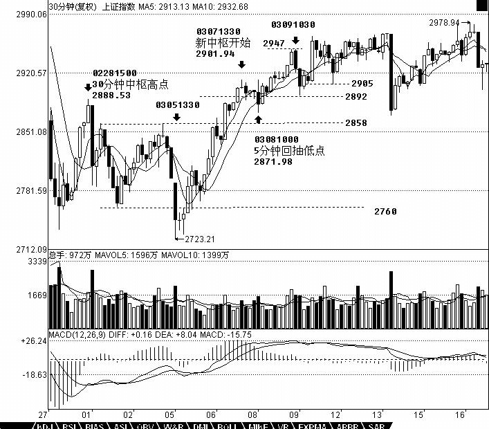注意，这种重新组合，不涉及任何预测性，有人可能要问，那么为什么不一开始就把 03081000 的 5 分钟回抽组合到 03051330 开始的这段 5 分钟走势中？因为这种组合不利于操作，站在这种组合下，030810005 分钟回抽的第三类买点意义并没有被揭示，是仅仅被局限在一个小的 5 分钟走势范围内。按照这种组合，就会很恐慌地等待背驰，之所以这样，是因为对走势的理解不够深刻，看不到不同组合反映的意义，而任何组合的反映都是有意义的，对这些组合意义的全面把握，就是一个工夫上的长进了。

此外，组合的一个要点在于，尽量避繁就简，因为走势中枢扩展比较复杂，如果有组合使得不出现扩展，当然就采取该种组合更有意义。有人可能要问，那么走势中枢扩展的定义是否不适用？当然适用，走势中枢扩展的定义是在两个走势中枢都完全走出来的情况下定义的，而实际操作中，往往第二个走势中枢还没有走完，还在继续延伸中。所以，除非出现明确的、符合理论定义的终结，就可以根据有利于判断、操作的原则，对走势进行当下的组合。但必须强调的是，当下采取什么组合，就要按该种组合的具体图形意义来判断、操作，例如，现在把 03091030 当成新 30 分钟走势中枢的起点，那么走势中枢的位置就变成 2947 到 2905，这样后面第三类买点的位置就有了新的标准。当然，你依然可以还是按 03071330 开始 30 分钟走势中枢，这样，走势中枢的位置就是 2911 到 2892，这样，第三类买点的可能位置就不同了。

还有一种更重要的应用，就是在走势中枢的震荡中。围绕走势中枢的震荡，不一定都是次级别的，例如，一个日线走势中枢，围绕它的震荡，完全可以是 30 分钟以下的任意级别，甚至是一个跳空缺口，例如有些股票，完全可以今天一字涨停，明天一字跌停，跳来跳去的。一般这种走势，一般人看着就晕了。但如果明白走势连接的结合性，就知道，无论怎么跳，最终都要形成更大级别的，只要不脱离这日线走势中枢，最后都至少会形成 30 分钟级别的走势。任何围绕日线级别的震荡，最终都必然可以按如下方式进行分解：A30-1+A30-2+A30-3+…+A30-m30+a，a 是未完成的 30 分钟走势类型，至少 a 依然围绕日线走势中枢继续震荡，那 a 一定最终会完成 30 分钟的走势类型。显然，这里，m30<9，否则就会变成周的走势中枢了，这样整个的分解就要按日线来，而道理是一样的。

不过，更有实际意义的是，上面的 a 如果不再围绕日线震荡，例如，假设 a 是一个 5 分钟级别的，而其后一个 5 分钟级别的反抽也不回到走势中枢里，按照日线走势中枢，这并不构成第三类买卖点，但对于 A30\-m30，可能就构成 30 分钟的第三类买卖点。由于走势都是从未完成到完成，都是从小级别不断积累而来，因此，对于真正的日线第三类买卖点来说，这 A30\-m30 的第三类买卖点，肯定在时间上要早出现，对于 A30\-m30，这绝对安全，但对日线却不一定，因为这 A30\-m30 的第三类买卖点后完成的 30 分钟走势，可以用一个 30 分钟走势又重新回到日线走势中枢里继续走势中枢震荡。但这个 A30\-m30 的第三类买卖点依然有参与的价值，因为如果其后的 30 分钟出现趋势，最后如果真出现日线的第三类买卖点，往往就在 30 分钟的第二个走势中枢附近就形成了，根本回不到这 A30\-m30 的第三类买卖点位置，因此，这样的买卖点，即使不符合你的操作级别，例如，如果你是日线级别操作的，但一旦这样的 A30\-m30 第三类买卖出现，至少要引起你充分的重视，完全可以适量参与了，一旦其后出现趋势走势，就要严重注意了。

不应该对走势进行任何的预测，但所有已走出来的走势，却可以根据级别与结合律等随意组合，无论任何组合，在该组合下，都必然符合本理论，而任何最终的走势，都在所有组合中完全符合本理论，这也是本理论的神奇之处，无论你怎么组合，都不会出现违反本理论的情况。但能否找到最合适的组合以适应操作，以及根据不同的组合，对走势进行综合分析，这就和经验有关了。一个好的分解，其分解规则下，必须保证分解的唯一性，否则这种分解就绝对不可能是好的分解。其中，最简单的就是进行同级别分解。这些最适合的分解，都是有相应答案的，关键是你能否看出来，而这根本不涉及任何的预测，只是对已有走势的分解，与对理论的把握与图形的熟悉度相关。而这些都是一些最基本的工夫，但必须在当下的走势中不断磨练才能真正掌握。

## 第三节 趋势力度

一、基本概念

趋势力度：前一次相交结束与后一次相交开始短期均线与长期均线所形成的面积。

趋势平均力度：当下与前一次相交的结束时短线均线与长期均线形成的面积除以时间。

二、概念要点

趋势力度只有在短期均线与长期均线再次相交时才能比较，时间落后。

趋势平均力度是即时的，马上就可以判断当下的趋势平均力度与前一次趋势平均力度的强弱对比，风险稍微大点，且需要的技巧要高点，对市场的感觉要好。

三、分析理解

用趋势力度，可以看较低级别的图，再按趋势力度找出相应的转折点。这样和真正的高、低点基本没有太大的距离。级别越小，相对误差越小。

力度也可以用其它一些方法来辅助判断：如和大盘比较；涨跌的量变化；笔（线段）的斜率、长短；MACD、BOLL 等一些技术指标等……

有人喜欢精确定义，那么这里其实也给出了什么是上升趋势形成的最精确定义，就是在第一走势中枢后出现第三类买点并形成非背驰类向上。趋势形成，只要趋势没有扭转的信号，当然就可以睡觉，这是太常识的东西了。本理论，并不一定要违反常识，只是本理论可以给正确的常识以合理的理论基础，这才是关键。

## 第四节 背驰与盘整背驰

一、基本概念

背驰：趋势力度比上一次趋势力度要弱，就形成背驰。换句话说，背驰其实就是力度衰竭的表现，如图①，C 段和 A 段比。

盘整背驰：盘整中当下笔或线段比前一笔或线段力度要弱，就形成了盘整背驰，如图②，C 段和 A 段比。

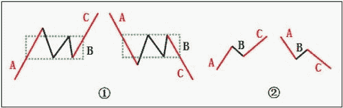 

 

 

 

 

 

背驰段：就是在某级别的某类型走势，构成背驰或盘整背驰的走势类型称为某级别的背驰段。

背驰-买卖点定理：任一背驰都必然制造某级别的买卖点，任一级别的买卖点都必然源自某级别走势的背驰。

二、概念要点

没有趋势，就没有背驰。在盘整中是无所谓“背驰”的，这点是必须特别明确的。

对于背驰与盘整背驰，前者是有着最基础意义的，而后者，只是利用前者相应的力度分析方法进行的一个推广用法，主要用在与走势中枢震荡相关的力度比较中。注意，a+B+c 中，a 和 c 的盘整背驰，其实都可以看成是 B 的走势中枢震荡，虽然 a 存在时，B 还没出现，但也不妨这样看。

一个背驰后，无论是盘整背驰还是真正的背驰，理论只能保证其回拉原来的走势中枢，这是正确的思维方式。那么，回拉之后如何，这涉及预测。正确的思维是，把回拉后出现的情况进行完全的分类，根据每种分类对应的后果，决定你自己的对策。

三、分析理解

趋势，一定有至少两个同级别走势中枢，对于背驰来说，肯定不会发生在第一个走势中枢之后，肯定是至少是第二个走势中枢之后，对于那种延伸的趋势来说，很有可能在发生第 100 个走势中枢以后才背驰，当然，这种情况，一般来说，一百年见不到几次。第二个走势中枢后就产生背驰的情况，一般占了绝大多数的情况，特别在日线以上的级别，这种就几乎达到 90%以上。如果在第一个走势中枢就出现背驰，那不会是真正意义上的背驰，只能算是盘整背驰，其真正的技术含义，其实就是一个企图脱离走势中枢的运动，由于力度有限，被阻止而出现回到走势中枢里。

背弛有级别的问题，一个 1 分钟级别的背弛，在绝大多数的情况下，不会制造一个周线级别的大顶，除非日线上同时也出现背弛。但出现背弛后必然有逆转，这是没任何商量余地的。有人要问，究竟逆转多少？那很简单，就是重新出现新的次级别买卖点为止。由于所有的买卖点，最终都可以归到某级别的第一类买卖点，而背驰与该种买卖点密切相关，所以可以这样说，任何的逆转，必然包含某级别的背驰。

只要你看到某级别的背驰，必然意味着要有逆转。但逆转并不意味着永远的，例如，日线上向上的背驰制造一个卖点，回跌后，在 5 分钟或 30 分钟出现向下的背驰制造一个买点，然后由这买点开始，又可以重新上涨，甚至创新高，这是很正常的情况。

从纯粹走势中枢的角度对背驰给出另外的释义。对 a+A+b+B+c，背驰的大概意思就是 c 段的力度比 b 的小了。那么，站在 B 这个走势中枢的角度，不妨先假设 b+B+c 是一个向上的过程，那么 b 可以看成是向下离开走势中枢 B，而 c 可以看成是向上离开走势中枢 B。所谓顶背驰，就是最后这个走势中枢，向上离开比向下离开要弱，而走势中枢有这样的特性，就是对无论向上或向下离开的，都有相同的回拉作用，既然向上离开比向下离开要弱，而向下离开都能拉回走势中枢，那向上的离开当然也能拉回走势中枢里，对于 b+B+c 向上的走势，这就构成顶背驰；而对于 b+B+c 向下的走势，就构成底背驰。对于盘整背驰，这种分析也一样有效。其实，站在走势中枢的角度，盘整背驰与背驰，本质上是一样的，只是力度、级别以及发生的走势中枢位置不同而已。

同样，站在纯走势中枢的角度，a+A+b+B，其中 B 级别大于 A 的这种情况就很简单了，这时候，并不必然地 B 后面就接着原方向继续，而是可以进行反方向的运行。例如，a+A+b+B 是向下的，而 a+A+b 其实可以看成是对 B 一个向上离开的回拉，而对走势中枢来说，并没要求所有的离开都必须按照上下上下的次序，一次向上的离开后再一次向上的离开，完全是被允许的，那站在这个角度，从 B 直接反转向上，就是很自然的。那么，这个反转是否成功，不妨把这个后续的反转写成 c，那么也只要比较一下 a+A+b 与 c 这两段的力度就可以，因为走势中枢 B 对这两段的回拉力度是一样的，如果 c 比 a+A+b 弱，那当然反转不成功，也就意味着一定要重新回到走势中枢里，在最强的情况下也至少有一次回拉去确认能否构成一个第三类买点。而 a+A+b 与 c 的力度比较，与背驰的情况没什么分别，只是两者的方向不同而已。如果用 MACD 来辅助判别，背驰比较的黄白线和柱子面积都在 0 轴的一个方向上，例如都在上面或下面，而 a+A+b 与 c 就分别在不同的方向上，由于这，也不存在黄白线回拉的问题，但有一点是肯定的，就是黄白线至少要穿越一次 0 轴。

四、MACD 对背弛的辅助判断

MACD，当一个辅助系统，还是很有用的。MACD 的灵敏度，和参数有关，一般都取用 12、26、9 为参数，这对付一般的走势就可以了，但一个太快速的走势，1 分钟图的反应也太慢了。如果弄超短线，那就要看实际的走势。例如看 600779 的 1 分钟图，从 16.5 上冲 19 的这段，明显是一个 1 分钟上涨的不断延伸，这种走势如何把握超短的卖点？不难发现，MACD 的柱子伸长，和乖离有关，大致就是走势和均线的偏离度。打开一个 MACD 图，首先应该很敏感地去发现该股票 MACD 伸长的一般高度，在盘整中，一般伸长到某个高度，就一定回去了，而在趋势中，这个高度一定高点，那也是有极限的，一般来说，一旦触及这个乖离的极限，特别是两次或三次上冲该极限，就会引发因为乖离而产生的回调。这种回调因为变动太快，在 1 分钟上都不能表现其背驰，所以必须用单纯的 MACD 柱子伸长来判断。注意，这种判断的前提是 1 分钟的急促上升，其他情况下，必须配合黄白线的走势来用。从该 1 分钟走势可以看出，17.5 元时的柱子高度，是一个标杆，后面上冲时，在 18.5 与 19 元分别的两次柱子伸长都不能突破该高度，虽然其形成的面积大于前面的，但这种两次冲击乖离极限而不能突破，就意味着这种强暴的走势，要歇歇了。

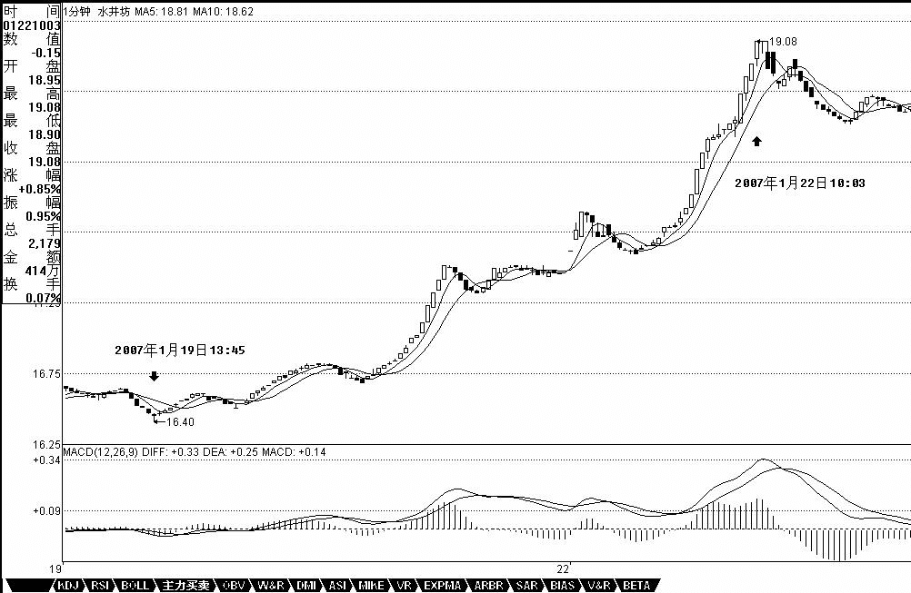 

 

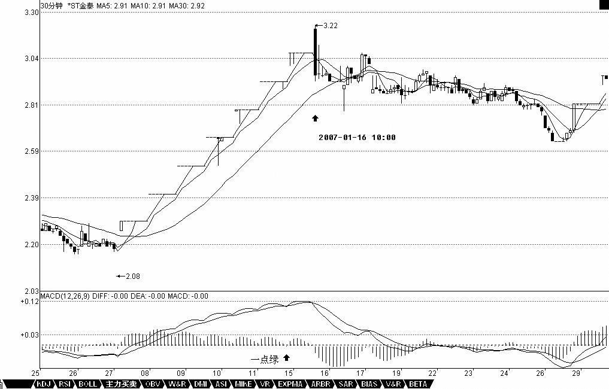 

还有一种，就是股票不断一字涨停，这时候，由于 MACD 设计的弱点，在 1 分钟、甚至 5 分钟上，都会出现一波一波类似正弦波动的走势，这时候不能用背弛来看，最简单，就是用 1 分钟的走势中枢来看，只要走势中枢不断上移，就可以不管。直到走势中枢上移结束，就意味着进入一个较大的调整，然后再根据大一点级别的走势来判断这种调整是否值得参与。如果用 MACD 配合判断，就用长一点时间的，例如看 30 分钟。一般来说，这种走势，其红柱子都会表现出这样一种情况，就是红柱子回跌的低点越来越低，最后触及 0 轴，甚至稍微跌破，然后再次放红伸长，这时候就是警告信号，如果这时候在大级别上刚好碰到阻力位，一旦涨停封不住，出现大幅度的震荡就很自然了。例如 600385，在 2.92 那涨停，MACD 出现一点的绿柱子，然后继续涨停，继续红柱子，而 3.28 元是前期的日线高位，结果 3.22 涨停一没封住，就开始大幅度的震荡（如上图）。

注意，如果这种连续涨停是出现在第一段的上涨中，即使打开涨停后，震荡结束，形成一定级别的走势中枢后，往往还有新一段的上涨，必须在大级别上形成背驰才会构成真正的调整，因此，站在中线的角度，上面所说的超短线，其实意义并不太大，有能力就玩，没能力就算了。关键是要抓住大级别的调整，不参与其中，这才是最关键的。

MACD 对背弛的辅助判断：用 MACD 判断背驰，首先要有两段同向的趋势。同向趋势之间一定有一个盘整或反向趋势连接，把这三段分别称为 A、B、C 段。显然，B 的走势中枢级别比 A、C 里的走势中枢级别都要大，否则 A、B、C 就连成一个大的趋势或大的走势中枢了。A 段之前，一定是和 B 同级别或更大级别的一个走势中枢，而且不可能是一个和 A 逆向的趋势，否则这三段就会在一个大的走势中枢里了。

归纳上述，用 MACD 判断背驰的前提是，A、B、C 段在一个大的趋势里，其中 A 之前已经有一个走势中枢，而 B 是这个大趋势的另一个走势中枢，这个走势中枢一般会把 MACD 的黄白线 (也就是 DIFF 和 DEA)回拉到 0 轴附近。而 C 段的走势类型完成时对应的 MACD 柱子面积(向上的看红柱子，向下看绿柱子)比 A 段对应的面积要小，这时候就构成标准背弛。而盘整中，利用类似背驰的判断方法，也可以有很好的效果。这种盘整中的类似背驰方法的应用，称为盘整背弛判断。

背驰与盘整背驰的两种情况中，背驰是最重要的，一旦出现背驰，其回跌，一定至少重新回到 B 段的走势中枢里。而盘整背驰，一般会在盘整中弄短差时用到，如果其间突破走势中枢，其回跌必须分清楚上面的两种情况。注意，盘整背驰出来，并不一定都要大幅下跌，否则怎么会有第三类买点构成的情况。

必须注意，无论背驰与盘整背驰，只要满足上面相应的标准，其技术上都是绝对的，没有任何的或然。问题不在于这种技术的准确性，而在于操作者判断的准确性，也就是说，必须先把什么是背驰，什么是盘整背驰，他们之间的标准是什么，如果连这些都搞不清楚，那是无法熟悉应用这项技术的。

必须说明的是，由于 MACD 本身的局限性，要精确地判断背驰与盘整背驰，还是要从走势中枢本身出发，但利用 MACD，对一般人理解和把握比较简单点，而这已经足够好了。光用 MACD 辅助判断，即使你对走势中枢不大清楚，只要能分清楚 A、B、C 三段，其准确率也应该在 90%以上。而配合上走势中枢，那是 100%绝对的，因为这可以用纯数学的推理逻辑地证明。

对背驰的回跌力度，和级别很有关系。如果日线上在上涨的中段刚开始的时候，MACD 刚创新高，红柱子伸长力度强劲，这时候 5 分钟即使出现背驰，其下跌力度显然有限，所以只能打点短差，甚至可以不管。而在日线走势的最后阶段，特别是上涨的延伸阶段，一个 1 分钟的背驰足以引发暴跌，所以这一点必须多级别地综合来考察，绝对不能一看背驰就抛等跌 50%，世界上哪里有这样的事情。

一般来说，一个标准的两个走势中枢的上涨，在 MACD 上会表现出这样的形态，就是第一段，MACD 的黄白线从 0 轴下面上穿上来，在 0 轴上方停留的同时，形成相应的第一个走势中枢，同时形成第二类买点，其后突破该走势中枢，MACD 的黄白线也快速拉起，这往往是最有力度的一段，一切的走势延伸等等，以及 MACD 绕来绕去的所谓指标钝化都经常出现在这一段，这段一般在一个次级别的背驰中结束，然后进入第二个走势中枢的形成过程中，同时 MACD 的黄白线会逐步回到 0 轴附近，最后，开始继续突破第二个走势中枢，MACD 的黄白线以及柱子都再次重复前面的过程，但这次，黄白线不能创新高，或者柱子的面积或者伸长的高度能不能突破新高，出现背驰，这就结束了这一个两个走势中枢的上涨过程。明白这个道理，大多数股票的前生后世，一早就可以知道了。

必须注意，MACD 在 0 轴附近盘整以及回抽 0 轴所形成的走势中枢，不一定就是相应级别的走势中枢，而是至少是该级别的走势中枢。例如日线 MACD 的 0 轴盘整与回拉，至少构成日线的走势中枢，但也可以构成周线的走势中枢，这时候就意味着日线出现三段走势。

  
五、盘整背驰与历史性底部

盘整背驰最有用的，就是用在大级别上，特别是至少周线级别以上的，这种盘整背驰所发现的，往往就是历史性的大底部。配合 MACD，这种背驰是很容易判断的。

注意，第一类买点肯定是趋势背驰构成的，而盘整背驰构成的买点，在小级别中是意义不大的，所以以前也没专门当成一种买点，但在大级别里，这也构成一种类似第一类买点的买点，因为在超大级别里，往往不会形成一个明显的趋势，这也就是以前回帖曾说过的，站在最大的级别看，所有股票都只有一个走势中枢，因此，站在大级别里，绝大多数的股票都其实是一个盘整，这时候就要用到这因为盘整背驰而形成的类第一类买点了。这个级别，至少应该是周线以上。

类似的，在大级别里，如果不出现新低，但可以构成类似第二类买点的买点，在 MACD 上，显示出类似背驰时的表现，黄白线回拉 0 轴上下，而后一柱子面积小于前一柱子的。

## 第五节 走势中枢震荡

一、基本概念

走势中枢震荡：即走势中枢的延伸，等价于任意区间\[dn，gn\]与\[ZD，ZG\]有重叠。表现为盘整。

震荡中轴：一个走势中枢确立后，走势中枢区间的一半位置，称为震荡中轴 Z。

二、概念要点

走势中枢震荡，最终一定以某级别的第三类买卖点结束。但问题是，如何预先给出有参考价值的提示，也就是如何去监控这震荡是在逐步走强，还是逐步走弱，这是一个有操作价值的问题。当然，顺便地，可以为每次震荡高低点的把握给出一个大致的区间。

每一个次级震荡区间的一半位置，依次用 Zn 表示。当然，最标准的状态，就是 Zn 刚好就是 Z，但这是很特殊的例子。显然，Zn 在 Z 之上，证明这个震荡是偏强的，反之偏弱。震荡的走势中枢区间是\[ZD，ZG\] ，那么，ZD、Z、ZG 这三条直线刚好是等距的，Zn 的波动连成曲线，构成一个监视走势中枢震荡的技术指标。

三、分析理解

只要有波动，虽然可以用类似走势中枢、走势类型之类的手段去分析，但走势中枢震荡还是有必要专门研究。Zn 的数量不会过于庞大，不会超过 9 个数据，超过了，次级别就要升级了，所以这样的分析意义不大。走势中枢震荡和走势中枢存在着一种必然的关系，就是最终，Zn 肯定要超越 ZD 或 ZG 。否则，就永远不会出现第三类买卖点了，这显然是不可能的。但反过来，Zn 超越 ZD 或 ZG 并不意味着一定要出现第三类买卖点的。也就是，这种超越可以是多次的，只有最后一次才构成第三类买卖点。不过实际上的走势在绝大多数情况下没有这么复杂。一般一旦有这类似的超越，就是一个很大的提醒，也就是这震荡面临变盘了。如果这超越没有构成第三类买卖点，那么一般都将构成走势中枢级别的扩展。这没有 100%的绝对性，但概率是极高的。

有了这些知识，对于走势中枢震荡的可介入性，就有了一个大概的范围。对于买来说，一个 Zn 在 Z 之下甚至在 ZD 之下的，介入的风险就很大，也就是万一你手脚不够麻利，可能就被堵死在交易通道中而不能顺利完成震荡操作。同时，那些 Zn 缓慢提高，但又没力量突破 ZG 的，要小心其中蕴藏的突然变盘风险。一般这种走势，都会构成所谓的上升楔型之类的诱多图形。反之，同样存在下降楔型的诱空，道理是一样的。

另外，走势中枢震荡中，次级别的走势类型是很重要的。如果是一个趋势类型，Zn 又出现相应的配合，那么一定要注意变盘的发生。特别那种最后一个次级别走势中枢在围绕震荡的走势中枢之外的，一旦下一个次级别走势在该次级别走势中枢区间完成，震荡就会出现变盘。结合上布林通道的时间把握，这样对震荡的变盘的把握将有极为高的预见性了。除了特殊的情况，Zn 的变动都是相对平滑的。因此，可以大致预计其下一个的区间，这样，当下震荡的低点或高点，就可以大致算出下一个震荡的高低点，这都是小学的数学问题，就不说了。

走势中枢震荡的卖点都是出现在向上离开走势中枢时产生的盘整背驰。这也是本理论中最简单的结论了。那么，在形成走势中枢震荡的卖点后，可能形成第三类买点。但这是卖点后的事情。没有任何可能比当下的卖点更重要。而且，股票的交易规则，没有规定卖了就不能再买。

现在，我们可以很客观地分析一段上证走势，就是，一个离开 5333 点走势中枢震荡把指数带到了 5395 点，该震荡对应的线段出现明显的类背驰、然后出现明显的终结，这时候，我们可以很理智地判断当下的形势：

1、周 K 线顶分型可能不成立，也就是可以突破 5412 点，和 5395 点相差的距离就 17 点。

2、周 K 线顶分型一旦成立，那么，即使不形成周线图上的笔，也将至少调整到出现一个底分型，至少去碰一次 5 周均线；而一旦出现笔，那调整的幅度就至少是对 3600 点以来的总调整，最强势的 1/4，也要有 450 点，更不用说 1/3、1/2 的比例了。

3、短线走势中枢震荡已经出现卖点，如果在这个位置卖，就算后面周的顶分型不成立，也有震荡的低点以及第三类买点可以重新介入。

一般来说，走势中枢震荡都有对称性，虽然不是绝对，但已经足以让你不会忽视分笔背驰引发小级别转大级别的极大可能（分笔背驰，一般可以用 1 分钟 MACD 柱子的长度来辅助）。

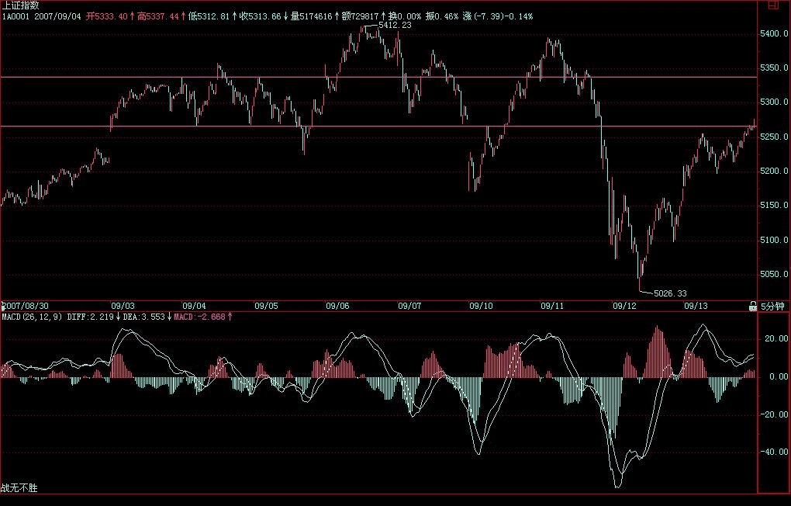 

## 第六节 中阴阶段

一、基本概念 1234567

中阴阶段：就是一种走势类型完成后无法确定会转向何种走势类型，即是会出现反转变成新的走势类型还是延续原来的走势类型的过程阶段。如果说前一个走势类型的背驰或盘整背驰宣告了前一个走势类型的终结，那么到新的走势类型确立，这里有一个模糊的如同中阴般的阶段。

二、概念要点

一定要注意。为什么很多人逃了顶，最后还是被套住了——又买了；抄了底，最终还是没赚到钱——被震出来了。这就是被相应级别的中阴阶段给折腾的。而且，越大级别转折后的中阴阶段，越能害人。行情走势的中阴阶段，是多空齐杀，不断折腾转换。等最后转折确认时，就如同已经饭熟了，还找米，能有戏吗？

中阴阶段，无一例外，都是表现为不同级别的盘整（注意，这是只从截取这一阶段的形态说，并不是说新的走势类型一定是盘整）。也就是围绕前一走势的某一部分所构成的走势中枢震荡。即使是所谓的 V 型反转，也只是震荡的区域回得更深而已。虽然表现为走势中枢震荡，但并不是一般性的走势中枢震荡。

要把握这阶段的走势，必须把前一段走势的部分走势结合起来分析。也就是说，前一段走势的业力在发挥着作用，这个业力与市场当下的新合力构成了最终决定市场方向的最终合力。

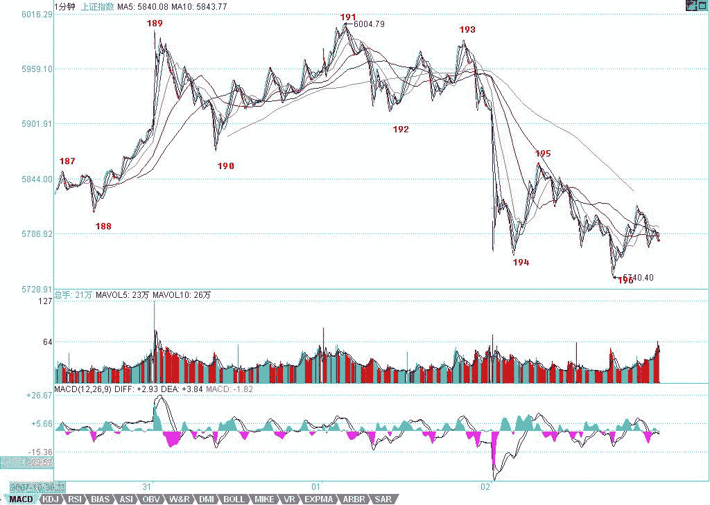三、分析理解

1.  用一个例子，就很好地能说明这个阶段。
    

上图中，191 的背弛宣告前一走势类型的死亡。按道理，新的走势类型，是从 191 开始分析的。但这时候，新的走势类型连第一段线段都没走出来，甚至走到 193 的位置，也依然轮廓不明，因此，这时候，就是典型的中阴阶段，必须借助前面 189 开始形成的走势中枢来完成分析与相应的操作。

如果从 191 开始，192、193 都很难说有什么可依据的。当然，可以说 193 就是第二类卖点，这个自然没错，但站在 189 开始走势中枢的角度，这就存在一个走势中枢震荡的问题，这样，这个干瘪的第二类卖点，就有一个更大的可依靠的分析基础。一切关于走势中枢震荡的分析，都可以利用到关于 192、193 以及后面走势的分析中，这等于有了双重的分析保证。

当然，后面的 195 的第三类卖点，也是站在中阴阶段的角度说的。但这一点是一个中阴阶段与新的走势类型确立阶段的分界点，195 出来以后，新的走势类型最开始的形态就确立了，也就是至少是一个线段的类下跌走势。这时候，分析的重心，就可以移到 191 开始的新走势类型上了。这时候，就可以基本在这个线段级别上，不用考虑 191 之前的事情。但 191 之前的走势并不是没有用了，而是在更大级别上，例如在 1 分钟、5 分钟等等级别上发挥作用了。191 后面出现的走势，就和 191 之前的，结合出大级别的走势形态。

因此，当各位熟练以后，标记上就不一定要不断地标记下去了。例如，如果你是按 1 分钟级别操作的，那么，前面 191 个线段记号，可能就可以一下简化为 10 个不到的 1 分钟级别相关的记号。当 191 后面的走势演化出的 1 分钟走势结束后，这 1 分钟级别的记号才再增加一个，这样，记号的数目就很有限了。当然，如果是 5 分钟级别、30 分钟、日线等等，就更少了。

为了方便明确起见，还是把记号的级别进行分类，例如，用 Xn 代表线段的记号，用 Yn 代表 1 分钟的级别，Wn 代表 5 分钟的记号，Sn 代表 30 分钟记号。日、周、月、季、年，分别也可以用 Rn、Zn、Mn、Jn、Nn 来表示。其中的 n 都是具体的数字，这样，所有的走势，都可以被这个标号体系所标记而清楚异常了。例如，对于 191 这个点位，站在线段上，就是 X191 的标号，站在 1 分钟级别，可能就是某个 Yn 的标号，而 189 这个点，就只有线段的标号，这同时也显示了，191 这点和 189 点的重要性是不同的。

什么是最牛的点？就是从线段一直到年，同时都有标号的那个点，如果是顶，那就是百年大顶。当然，是否有幸碰到这样的点，就看各位的运气了。

这个标号体系，不单单为了方便阅读、记号，首先就培养了各位一种综合的、系统的习惯。看一个走势，就要知道，不是单单是一个线段，而是在一个大的多层次系统里，这样才不会被每天的波动所迷失。其次，这个标记的过程，意味着什么？既然线段有中阴阶段，那么其他级别当然也有。所以无论任何级别，在一个顶点出来后，都有对应级别长度的中阴阶段。

其实任何转折，也就是第一类买卖点之后，都对应着某一级别的 V 型反转，例如，191 的转折，190-191 与 191-192，其实就是一个 V 型反转，只是级别特别小。这个 V 型反转的级别，决定了中阴的级别与力度。例如，站在日线图上看 6124 点前后 N 天的走势，其实就是某级别的 V 型反转，然后就同时进入中阴阶段。

注意，中阴阶段结束后，不一定就是真正的反转，也可以是继续延续前一走势类型的方向。例如上涨+盘整+上涨，这样的结构是完全合理的。但，上涨+盘整+下跌，上涨+下跌等等，同样是可能的选择。这时候，唯一正确的操作，只有一点：如果你技术好的，就在这个大的走势中枢震荡中操作一把；如果技术不好的，就拿着小板凳看戏，看它最后是升天还是下地狱，等市场自己去选择，然后再决定操作。

不过，站在本理论的角度，最大效率的，就是利用这个震荡去走势中枢震荡操作一把。学了本理论，就是要把技术练好，练好了，就自然不用整天小板凳了，上台自己票友一把不是更爽？ 所以，有真本事，什么情况都不怕，都可以折腾。关键，是要有真本事。

2、大概很多人都想，中阴阶段也没什么特别的，其实也是一个盘整，和其他的盘整也没什么不同。如果有这种想法，就有大问题了。

中阴阶段能否处理好，关系到操作节奏的连接问题。很多人的操作节奏特乱，就是因为不知道中阴阶段的问题。中阴阶段，虽然表现为走势中枢震荡，但并不是一般性的走势中枢震荡。特别要注意，精确的理论，当然也可以很粗略地说。例如，所有人都知道，市场不是上就是下或者就是盘整，这本质上是废话。但废话的另一面，就是公理。这个废话，刚好表现了市场的本质。更重要的一点是，知道了公理，其实什么都没知道。这也是中国人思维里的一个大弱点。中国人喜欢大而化之地讨论问题，结果最终讨论的都是废话，都是所谓的公理，或者说就是我们的共业所生的东西。但科学，特别对于具体操作来说，这些大而化之的东西，没有任何意义。例如，市场上的操作，是一就是一，多一分不行，少一分也不行。所以，这里，必须有严密的逻辑思维习惯，而且是精确思维的习惯。我们从公理出发，并不意味着我们就停留在公理的水平上。否则，欧氏几何就是干瘪瘪的 5 条公理，那还研究干什么？同样，讨论市场，不是上就是下或者就是盘，那样什么都别研究讨论了，抛硬币就可以。

中阴阶段的存在，就在于市场发展具体形式在级别上的各种可能性。这些可能性的最终选择，并不是预先被设定好的，而是市场合力的当下结果，这里有着不同的可能性。而这些可能性，在操作上并不构成大的影响，因为都可以统一为中阴过程的处理。

例如，这次从 6004 点开始的 1 分钟级别下跌背驰后，就进入中阴时段。首先，根据走势分解的基本定理，就知道，其后的行情发展，一定是一个超 1 分钟级别的走势。但超 1 分钟级别的走势，存在很多可能。这些可能，首先一个最基本的原则是，必须先出现一个 5 分钟走势中枢，因为无论后面是什么级别的走势，只要是超 1 分钟级别的，就一定先有一个 5 分钟走势中枢，这没有任何特例的可能。而这个 100%成立的结论，就构成我们操作中最大也是 100%准确的基本依据。而且，只有本理论才能明确给出这样的必然结论。有了这个结论，一切关于行情后续演化的争论都没有了意义。不管后面是什么，首先把这 5 分钟走势中枢给处理好，这才是唯一重要而且有着 100%操作性与准确性的事情。因此，你在操作中，脑子里必须有这样一个 100%准备的判断。而 5 分钟的走势中枢震荡如何操作，那是最简单的问题。如果还不懂，上面有第五节课程，请好好再学学。

当然，如果你转换成 5 分钟以上级别操作的，那么这个 5 分钟走势中枢的中阴过程对于你来说可以说是不存在的，你可以根本不管。而这 5 分钟走势中枢成立后，就必然面临一个终结的问题。如果这走势中枢不断延伸，搞成 30 分钟走势中枢了，那就按 30 分钟走势中枢的第三买卖点来处理。如此类推，总要面临某一个级别的第三买卖点去结束这个走势中枢震荡。一般性的，我们可以以 5 分钟走势中枢后就出现第三类买卖点为例子，那么，这个 1 分钟的走势，就演化为 5 分钟的走势类型。至于是只有一个走势中枢的盘整，还是二个走势中枢的趋势，那用背驰的力度判断就可以把握。如果已经形成的 5 分钟走势中枢出现第三类卖点，那么，就算共同富裕的目标达不到，全面小康肯定是没问题了。

从上面就可以看到，本理论是这样把一个看似复杂，没有方向的走势中枢问题，以 100%准确的逻辑链连接成一个可以 100%具有准确操作度的简单操作程序。而这，不过是本理论的最低级威力而已。

这里，必须再次说明，本理论的盘整和一般所说的区间震荡盘整的概念不是一回事。指数从 10000 点跌到 0 也可以是一个盘整，只要中间只有一个走势中枢。另外，盘整和走势中枢也不是一个概念。走势中枢如果是苹果，那么盘整就是只有一个苹果的苹果树；而趋势就是可以有两个以上直到无穷个苹果的苹果树。你说苹果和苹果树是一个概念吗？

另外，千万别以为盘整就一定比趋势弱，有些盘整，第一段就杀得天昏地暗的，后面一段，即使力度没有第一段力量大，两者加起来，也可以超越所谓的趋势。还是上面的比喻，只有一个苹果的苹果树，难道一定比有 100 个苹果的苹果树矮？显然不是的。所以，那些连走势中枢、盘整、趋势都没搞清楚的，就请虚心点好好去学习。本理论，不会因为多一人学了而多一分准确性，更不会因为少一人学了多一人反对了而少一分准确性。

3、走势结构，最重要的就是有中阴部分的存在。有人可能认为，中阴存在是理论不完善的结果，其实，这是典型的一根筋思维，对于这种思维，世界就是机械的，任何时候都只有一个机械精确的结果。而实际上，世界更多是量子化的，是测不准的，中阴的存在恰好客观地反映了走势的这种特性。

中阴状态的存在，反映了行情走势生长阶段的未确定性，这种未确定性，不会对操作有任何的影响，因为中阴状态都可以看成是一个走势中枢震荡的整理，根据走势中枢震荡的操作就可以了。

很多人，一碰到中阴状态就晕，因为这时候，你不能对走势给出明确的划分。注意，这里不是指同级别的划分，而是一般性的划分。例如，一个线段性类上涨类背驰后，必然首先出现一个 1 分钟的走势中枢，也同时进入一种中阴状态，但你不能说这走势必然就是 1 分钟类型的，因为，最极端情况下，两个年走势中枢之间也可以是一个线段连接，甚至就是缺口连接，这在实际上都是完全可能发生的。因此，理论必须包括这些情况。而且这些情况太常见了，并不是一个古怪的问题。

另外，根据结合律，连接走势中枢的走势，并不一定是完全的趋势类型，也就是说，一个线段类上涨后，可能第二类类走势中枢就消融在中阴状态的那个走势中枢里了。也就是说，a+b+c+d+e+f= a+b+c+（d+e+f），a+b+c+d+e 是一个线段类上涨，c+d+e 的重合部分构成最后的一个类走势中枢，f 是类背驰后的回调，这时候，就可以马上构成一个 1 分钟的走势中枢，然后后面直接继续上涨，构成 1 分钟的上涨是完全合理的。因为，最终的划分，就必须把 a+b+c+d+e 给拆开了。因此，一般划分中，如果中阴状态中从前面的背驰点开始已经构成相应的走势中枢，例如在 a+b+c+d+e+f 后又有 g\\h，f\\g\\h 构成 1 分钟走势中枢，那么整个的划分就可以变成 a+b+c+d+e+（f+g+h），这样，原来的线段类上涨就可以保持了。

如果后面包括 d+e+f 延伸出 9 段，然后又直接上去了，划分中，必须首先保证 5 分钟走势中枢的成立。换言之，划分的原则很明确，就是必须保证走势中枢的确立，在这前提下，可以根据结合律，使得连接走势中枢的走势保持最完美的形态。由此可见，因为划分中的这种情况，我们就很明确地知道，走势的最大特点就是，连接走势中枢的走势级别一定小于走势中枢。换言之，一个走势级别完成后必然面临至少大一级别的走势中枢震荡。例如，一个 5 分钟的上涨结束后，必然至少要有一个 30 分钟的走势中枢震荡，这就是任何走势的必然结论，没有任何走势可以逃脱。

有了这个必然的结论，对于任何走势，其后的走势都有着必然的预见性，也就是其后走势的级别是至少要大于目前走势的级别。这里，一个很关键的问题就是，这个大的走势级别的第一个走势中枢震荡的位置，极为关键，这是诊断行情的关键。

首先，任何一个后续的更大级别走势中枢震荡，必然至少要落在前一走势类型的最后一个走势中枢范围里，这是一个必然结论。换言之，只要这走势中枢震荡落在最后一个范围里，就是正常行为，就是正常的。也就是说，这种中阴状态是健康的。其次，一旦其走势中枢震荡回到原走势类型的第二甚至更后走势中枢里，那么，对应的中阴状态就是不健康的，是危险的。而原来走势的最后一个走势中枢，就成了一个关键的指标位置。

注意，危险是相对的，对于原下跌走势的中阴危险，就是意味着回升的力度够强，对多头意味着好事情。结合分型，例如，一个日分型的出现，意味着笔中对应的小级别走势里出现大的走势中枢。因此，这个分型对应的走势中枢位置，就很关键了。这几乎决定了该分型是否是最后真正的顶或底。

四、中阴阶段结束时间的辅助判断

注意，这里给出的是中阴阶段结束时间的辅助判断，并不是一个绝对性的判断，如同用 MACD 判断背驰一样，只是一个辅助性，但由于准确率极高，绝对的判断反而因为太复杂而不实用，所以就可以一般性地利用这进行判断。一般来说，这个中阴阶段结束时间的辅助判断的有效性可以达到接近 100%，很少有例外。当然，由于是辅助性判断，所以技巧性与熟练程度就很关键了。

这个辅助判断，可以利用所有软件都有的一个指标：布林通道。一般在软件上都用 BOLL 表示。该指标一般都三条线，上、中、下三个轨道。一般性地，在上轨以上和下轨以下运行是超强状态，一般走势中枢移动时肯定会出现，唯一区别是前者是上涨超强，后者是下跌超强。

注意，用这个指标有一个很好的辅助判断第二类买卖点，有时候也可以用来判断第一类买卖点。一般来说，从上轨上跌回其下或从下轨下涨回其上，都是从超强区域转向一般性区域，这时候，如果再次的上涨或回跌创出新高或新低但不能重新有效回到超强区域，那么就意味着进入中阴状态了，也就是第一类买卖点出现了。

但更有效的是对第二买卖点的辅助判断，一般来说，在进入中阴状态，上轨和下轨都会滞后反应，也就是等第一次回跌或回升后再次向上或下跌时，上轨和下轨才会转向，而这时候转向的上轨和下轨，往往成为最大的阻力和支持，使得第二类买卖点在其下或其上被构造出来。

布林通道最有用的，还是关于中阴结束时间的预判上。一般来说，布林通道的收口，就是对中阴结束时间的最好提示。但这里有一定的技巧性，不是 1 分钟级别就一定要看 1 分钟的布林通道的。例如，一个 5 分钟的中阴过程，对应的是看 30 分钟的布林通道。

一般来说，某一级别的布林通道收口，就意味着比这低级别的某个中阴过程要级别扩展或结束了，一般都对应着有相应的第三类买卖点。注意，这个辅助判断，比 MACD 那个技巧性还要高点，必须不断看图。

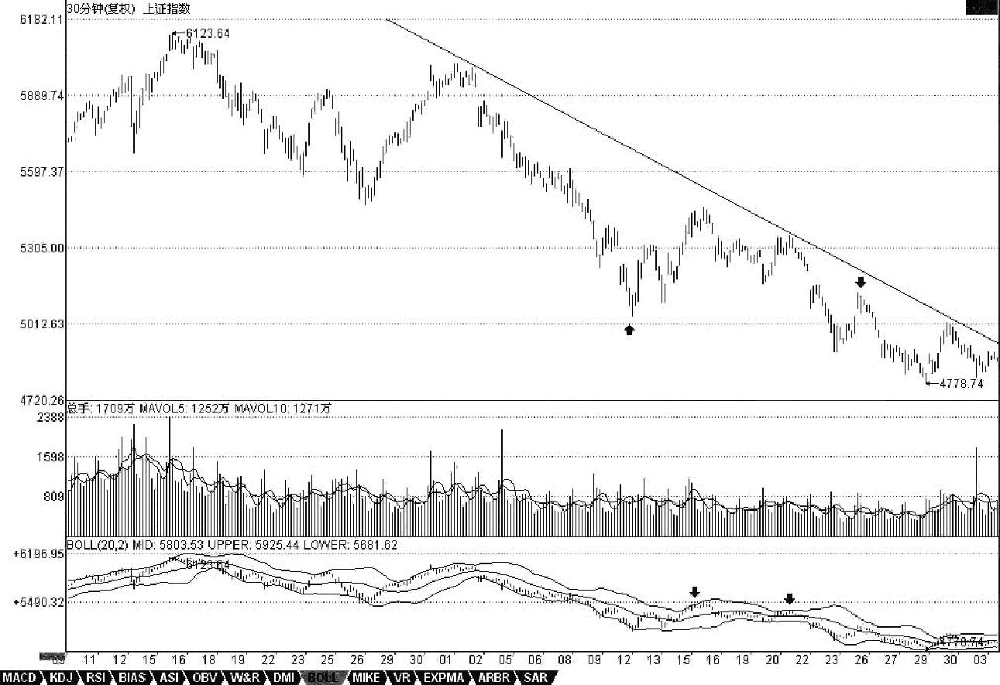 

 

## 第七节 转折的力度与级别

一、基本概念

趋势转折定律：任何级别的上涨转折都是由某级别的第一类卖点构成的；任何的下跌转折都是由某级别的第一类买点构成的。

背驰-转折定理：某级别趋势的背驰将导致该趋势最后一个走势中枢的级别扩展、该级别更大级别的盘整或该级别以上级别的反趋势。

走势类型分解原则：一个某级别的走势类型中，不可能出现比该级别更大的走势中枢。一旦出现，就证明这不是一个某级别的走势类型，而是更大级别走势类型的一部分或几个该级别走势类型的连接。

小背驰-大转折定理：小级别背驰引发大级别转折的必要条件是该级别走势的最后一个次级别走势中枢出现第三类买卖点。

二、概念要点

转折是有级别的。这某级别不一定是次级别，因为次级别里可以是第二类买卖点，而且还有这种情况，就是不同级别同时出现第一类买卖点，也就是出现不同级别的同步共振，所以这里只说是某级别。

在第一次抄底时，最好就是买那些当下位置离最后一个走势中枢的 DD\=min(dn)幅度最大的，所谓的超跌，应该以此为标准。因为本节的定理保证了，反弹一定达到 DD\=min(dn)之上。

注意，小背驰-大转折定理，只有必要条件，而没有充分条件。也就是说不能有一个充分的判断使得一旦出现某种情况，就必然导致大级别的转折。小级别顶背驰后，最后一个次级别走势中枢出现第三类卖点并不一定就必然导致大级别的转折。

三、分析理解

在某级别的盘整中，或者说围绕某级别走势中枢的震荡、延续中，不存在转折的问题。除非站在次级别图形中，才有转折问题的探讨。对于上涨的转折，有两种情况：下跌或盘整；对于下跌的转折，也有两种情况：上涨或盘整。例如一个 5 分钟背驰段的下跌，最终通过 1 分钟以及 1 分钟以下级别的精确定位，最终可以找到背驰的精确点，其后就发生反弹。

注意，反弹只是一般的术语，在“缠中说禅” 股市技术理论中，对这反弹会有一个很明确的界定，就是包括三种情况：其一、该趋势最后一个走势中枢的级别扩展、其二、该级别更大级别的盘整、其三、该级别以上级别的反趋势。

1、该趋势最后一个走势中枢的级别扩展

对于 5 分钟级别趋势发生背驰的情况，那这个 5 分钟级别的趋势里所具有的走势中枢都是 5 分钟级别的。假设共有 N 个，显然，这个 N>=2。考虑最后一个走势中枢的情况，最后的背驰段，跌破该走势中枢后，该背驰段显然是一个 1 分钟以下级别的走势，否则就和该走势中枢是 5 分钟级别趋势的最后一个走势中枢的前提矛盾了。该背驰段出现第一类买点发生反弹，显然，该反弹一定触及最后一个走势中枢的 DD=min(dn)，也就是围绕该走势中枢震荡的最低点。否则，如果反弹连这都触及不了，就等于在下面又至少形成一个新的 5 分钟走势中枢，这与上走势中枢是最后一个矛盾。这种只触及最后一个走势中枢的 DD=min(dn)的反弹，就是背弛后最弱的反弹。这种反弹，将把最后一个走势中枢变成一个级别上的扩展。例如，把 5 分钟的走势中枢扩展成 30 分钟甚至更大的走势中枢。

前面说过，第一类买点是绝对安全的。即使是这样一种最低级别的反弹，也有足够的空间让买入获利，而且，一般这种情况出现得特别少，是很特殊的情况。但理论上，是要完全精确的，不能放过任何一种情况。如果不幸碰到这种情况，在资金利用率的要求下，当然是要找机会马上退出，否则就会浪费时间了。

注意，这种情况和盘整背驰中转化成第三类卖点的情况不同，那种情况下，反弹的级别一定比最后一个走势中枢低，而这种情况，反弹的级别一定等于或大于最后一个走势中枢的。因此，这两种情况，不难区分。

2、该级别更大级别的盘整

3、该级别以上级别的反趋势

这就是发生转折的两种情况，原理是一样的，只是相应的力度有区别。当反弹至少要重新触及最后一个走势中枢，这样，将发生转折，也就是出现盘整与上涨两种情况。对于上面 5 分钟下跌的例子，就意味着，将出现 5 分钟级别更大的盘整或 5 分钟级别以上的上涨。两段走势类型的连接，就有两种情况出现：下跌+盘整，或者下跌+上涨。

注意，这里的盘整的走势中枢级别一定大于下跌中的走势中枢级别，否则就和下跌的延伸或第一种该趋势最后一个走势中枢的级别扩展搞混了。而上涨的走势中枢，不一定大于下跌中的走势中枢。例如，一个 5 分钟级别的下跌后反过来是一个 5 分钟级别的上涨，这是很正常的，但如果是盘整，那就至少是 30 分钟级别的。

有人总是搞不明白为什么“下跌+盘整”中盘整的走势中枢级别一定大于下跌中的走势中枢，这里不妨用一个例子说明一下：例如，还是一个 5 分钟的下跌，那至少有两个走势中枢，整个下跌，最一般的情况就是 a+A+b+B+c，其中的 a\\b\\c，其级别最多就是 1 分钟级别的，甚至最极端的情况，可以就是一个缺口。而 A、B，由于是 5 分钟级别的走势中枢，那至少由 3 段 1 分钟的走势类型构成。如果都按 1 分钟级别的走势类型来计量，而且不妨假设 a\\b\\c 都是 1 分钟的走势类型，那么 a+A+b+B+c 就有 9 个 1 分钟的走势类型。

而一个 30 分钟的盘整，至少有 3 个 5 分钟的走势类型；而 1 个 5 分钟的走势类型，至少有 3 个 1 分钟的走势类型。也就是一个 30 分钟的盘整，就至少有 9 个 1 分钟的走势类型，这和上面 a+A+b+B+c 的数量是一致的。从这数量平衡的角度，就知道为什么“下跌+盘整”中盘整的级别一定比下跌的级别大了。如果级别一样，例如一个 5 分钟的盘整，只有 3 个 1 分钟的走势类型，那和 9 就差远了，也不匹配。当然，“下跌+盘整”中盘整的级别一定比下跌的级别大，最主要的原因还不是这个，而是上面说到的，如果该级别一样，那只有两种情况，下跌延伸或下跌最后一个走势中枢扩展，和“下跌+盘整”是不搭界的。

有人可能还有疑问，如果下跌最后一个走势中枢扩展，例如 5 分钟扩展成 30 分钟，那和 5 分钟级别下跌+30 分钟级别盘整有什么区别？这区别大了，因为在“5 分钟级别下跌+30 分钟级别盘整”，也就是“下跌+盘整”中，下跌和盘整都是完成的走势类型，这意味着是两个走势类型的连接。而下跌最后一个走势中枢扩展，是一个未完成的走势类型的延续，还在一个走势类型里。例如，在上面的 a+A+b+B+c 里，如果 B+c 发生走势中枢扩展，从 5 分钟扩展成 30 分钟的，那么 a+A+b 就是一个 5 分钟的走势类型，把 a+A+b 用 a~表示，而 B+c 发生走势中枢扩展用 A~表示，那么整个走势就表示成 a~+ A~，其后的走势还可以继续演化，形成 a~+A~+b~+B~+c~，也就是扩展成一个 30 分钟级别的下跌，当然还可以有其他的演化，总之，是必须把走势类型给完成了，这和“下跌+盘整”的情况显然是不同的。

以上三种情况，就完全分类了某级别背驰后的级别与力度，也就是某级别的第一类买点后将发生怎么样的情况，而第一类卖点的情况是一样的，只是方向相反。注意，这里说的是最精确的情况，由于第一种情况很少发生且和第二种情况有所类似，所以粗糙地说，背驰以后就意味着盘整和反趋势。那么，怎么分别这几种情况，关键就是看反弹中第 1 个前趋势最后一个走势中枢级别的次级别走势（例如前面的下跌是 5 分钟级别，就看 1 分钟级别的第 1 次反弹），是否重新回抽最后一个走势中枢里，如果不能，那第一种情况的可能就很大了，而且也证明反弹的力度值得怀疑，当然这种判别不是绝对的，但有效性很大。

例如，这次 20070206 的反弹，用 5 分钟背驰段，然后考察 1 分钟以及 1 分钟以下级别的背驰进行精确定位，可以极为精确地把握这个底部，而且在实践中，很多人按照本理论都把握住了。那么，其后的反弹，第一波是 1 分钟走势马上回到从 2980 开始的 5 分钟下跌的最后一个走势中枢里，这样就意味着第一种最弱的情况可能性可以完全排除了。其后，1 分钟的走势继续完成，扩展成一个 5 分钟的上涨。在 20070207 的 11 点前后，一个 1 分钟的背驰制造了上涨的结束，其后进入一个走势中枢的震荡中。这个走势中枢，按照本节的定理，就可以断言，至少是 5 分钟级别的，而实际上演化成一个 30 分钟级别的。这意味着，一个快速的 5 分钟上涨的可能就没有了。后面只有两种演化的可能，就是一个 30 分钟以上级别的盘整，或者是一个 30 分钟以上的上涨。至于哪种情况，就必须看后面走势的演化。 

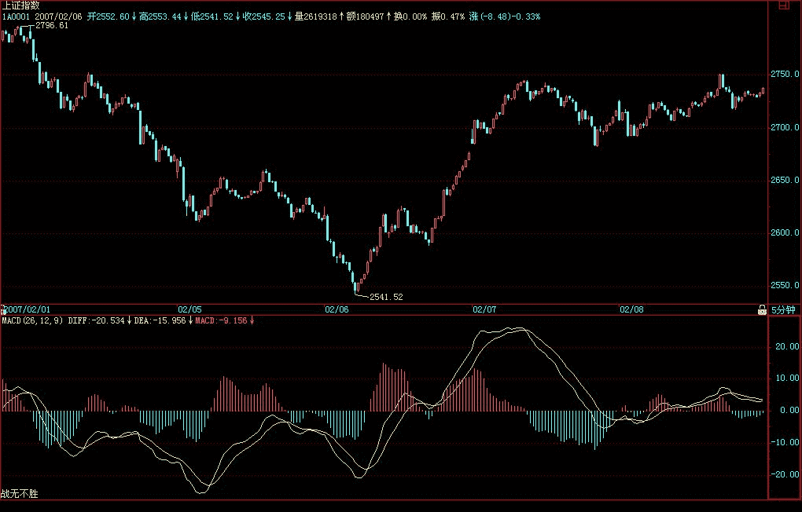 

对于实际的操作，这两种情况并没有多大的区别。例如是盘整还是上涨，关键看突破第一个走势中枢后是否形成第三类买点。实际操作中，可以在第一、二类买点先买了，然后观察第三类买点是否出现，出现就继续持有，否则就可以抛出。因此不会造成任何困难。当然，如果是资金量特别小，或者对本理论达到小学毕业水平，那么完全可以在突破的次级别走势背驰时先出掉，然后看回试是否形成第三类买点，形成就回补，不形成就不回补，就这么简单。当然，要达到这种境界，首先要对本理论小学毕业。否则，你根本分辨不清楚盘整背驰与第三类买点的转化关系，怎么可能操作？而且，这种操作，必须反复看图、实际操作才可能精通、熟练的。如果真精通、熟练了，除了同样是本理论小学已经毕业的人，几乎没有人是你的对手了。

那么，实际操作中，怎么才能达到效率最高。一个可被理论保证的方法就是：在第一次抄底时，最好就是买那些当下位置离最后一个走势中枢的 DD\=min(dn)幅度最大的，所谓的超跌，应该以此为标准。因为本节的定理保证了，反弹一定达到 DD=min(dn)之上。然后在反弹的第 1 波次级别背驰出掉。如果这个位置还不能达到最后一个走势中枢，那么这个股票可以基本不考虑。虽然可能有例外，但可能性很小。然后在反弹的第一次次级别回试后买入那些反弹能达到最后一个走势中枢的股票，而且最好是突破该走势中枢的、回试后能站稳的，根据走势必完美，一定还有一个次级别的向上走势类型。如果这走势类型出现盘整背驰，那就要出掉。如果不出现，那就要恭喜你了，你买到了一个所谓 V 型反转的股票，其后的力度当然不会小。至于如何预先判断 V 型反转，这就不是本节定理可以解决的问题。

背驰-转折定理是一个十分重要的定理，这定理说明了什么？就是某级别的背驰必然导致该级别原走势类型的终止，进而开始该级别或以上级别的另外一个走势类型。

转折，一般只有两种：一是缠绕后继续原趋势形成陷阱后回头制造出转折；二是出现盘整，以时间换空间后形成转折。第二种情况暂且不说，第一种情况，最大的标志就是所谓的“背驰”了。运用趋势平均力度（因为这个概念是即时的），马上就可以判断当下的趋势平均力度与上一趋势平均力度的强弱对比，就可以判断“背驰”是否即将形成；然后再根据短线均线与长期均线的距离，一旦延伸长度缩短，就意味着真正的底部马上形成。按这种方法，真正的转折点基本就可以完全同时地抓住。但有一个缺陷，就是风险稍微大点，且需要的技巧要高点，对市场的感觉要好点。

由于不允许“上涨+上涨”、“下跌+下跌”的情况，这定理对实际操作就很有意义了。例如，一个 1 分钟级别的顶背驰，就意味着必然导致一个至少 1 分钟级别的盘整或下跌走势类型，这就为背驰以后可能的走势以及级别给出了很明确的划定。为什么 1 分钟顶背驰后还涨？因为只要有一个 1 分钟的盘整，那就可以继续涨，这是 1 分钟顶背驰后可能的情况之一。当然还有其他可能的情况。例如，最极端的，制造出一个年线级别的下跌。但不能说这个下跌是由于 1 分钟顶背驰造成的。因为这是 1 分钟顶背驰后，形成的盘整或下跌逐步级别扩张，最后才慢慢形成的。如果随便看到一个 1 分钟顶背驰就说要形成年线级别大调整，那就是脑子水太多了。如果市场的转折与背驰都有在级别上一一对应的关系，那这市场也太没意思、太刻板了。正因为这种小级别背驰逐步积累后，有导致大级别转折的可能，才使得市场充满当下的生机。

注意，这两种不同转折方式的区分是十分关键的。所有的转折都与背驰相关，但加上背驰的级别与当下走势级别的关系，就有了这两种不同的转折方式。由于背驰的级别不可能大于当下走势的级别，例如一个 30 分钟级别的背驰，只可能存在于一个至少是 30 分钟级别的走势类型中，所以就有两种不同转折方式的明确分类：

1、背驰级别等于当下的走势级别

例如，一个 30 分钟的走势类型，出现一个 30 分钟级别的背驰，那么这个背驰至少把走势拉向该 30 分钟走势最后一个走势中枢，当然就会跌破或升破相应的高点或低点。注意，这种情况包括进入背驰段的情况。例如，一个 30 分钟的走势类型，在 30 分钟级别进入背驰段，当然，这个背驰段并不一定就演化成背驰，因为，小级别的延伸足以使得大级别最终摆脱背驰，这与当下的走势判断相关。

2、背驰级别小于当下的走势级别

这种情况下，走势已经明显没有相应级别的背驰。例如，一个 30 分钟的走势类型，明确显示没有出现 30 分钟的背驰，也就是背驰段最终不成立，但却出现一个 1 分钟级别的背驰。用一个最简单的形式向上的 a+A+b+B+c，A、B 是 30 分钟走势中枢，在 c 中出现 1 分钟背驰，而 c 对 b 在 30 分钟级别并没有出现背驰，这时候并不必然保证 c 的 1 分钟转折的最终走势就一定不跌回 B 里。即使这个回跌出现，其形式也和第一种情况不同。这第二种情况，必然要先形成一个比 1 分钟级别要大的走势中枢，然后向下突破，最终形成回跌到 B 中的走势。

第一种情况中如果是 5 分钟级别的回跌，也会形成一个比 1 分钟级别大的走势中枢，那和第二种情况有什么区别？这区别太大了。在第一种情况中，其回跌是必然的；而第二种情况，在形成一个比 1 分钟大的走势中枢后，并不必然回跌，可以往上突破，使得 a+A+b+B+c 继续延伸。这种小级别背驰最终转化成大级别转折的情况，最值得注意的是出现在趋势走势的冲顶或赶底之中，这种情况一般都会引发大级别的转折。

以上两种情况，对走势的分解也是很有意义的，例如对一个 30 分钟的走势类型，其完结也同样有相应的两种情况。最普通的一种，例如出现一个 30 分钟的背驰，从而完成一个 30 分钟级别走势类型，在这种情况下，对该走势类型的分解就不存在任何含糊的地方，前后两个走势类型，就以该背驰点为分界；至于小级别背驰引发大级别转折的情况，这种情况比较复杂，但分解的原则是一致的，就是走势类型分解原则：一个某级别的走势类型中，不可能出现比该级别更大的走势中枢，一旦出现，就证明这不是一个某级别的走势类型，而是更大级别走势类型的一部分或几个该级别走势类型的连接。

这里，把上面第二种情况下的分解可能分析如下：不妨还是以上面向上 30 分钟级别的 a+A+b+B+c 为例子，在 c 中出现一个 1 分钟级别背驰，不妨假设后面演化出一个 30 分钟走势中枢 C，如果 C 和 B 没有任何重叠，那就意味着原来的 a+A+b+B+c 并不是一个完成了的 30 分钟走势类型，该走势类型将延伸为 a+A+b+B+c+C，相应的分解要等到该走势类型完成了才可以进行；如果 C 和 B 有重合，那么 a+A+b+B+c+C=a+A+b+（B+c+C），其中（B+c+C）必然演化成一个日线走势中枢，那么 a+A+b+B+c 只是一个日线级别走势类型的一部分。如果一定要按 30 分钟级别来进行同级别分解，那么该分解点就是那 1 分钟的背驰点，a+A+b+B+c+C=（a+A+b+B+c）+C。

有了以上的例子，就对如何用背驰对走势分解的基本原则有一个大概的了解了。熟悉了这些分解方法，市场的走势图就不会是天书了，而是如自己的掌纹一样清晰可辩。唯一可能出现困难的，就是“背驰级别小于当下的走势级别”这种情况，也就是所谓的小级别转折引发大级别转折。对这种情况，还要进一步的分析。

还是用上面的例子，向上 30 分钟级别的 a+A+b+B+c，如果 c 是一个 1 分钟级别的背驰，最终引发下跌拉回 B 里，这时候，c 里究竟发生了点什么事情？首先，c 至少要包含一个 5 分钟的走势中枢。否则，走势中枢 B 就不可能完成，因为这样不可能形成一个第三类的买点。不妨假设 c\`是 c 中最后一个 5 分钟的走势中枢。显然，这个 1 分钟的顶背驰，只能出现在 c\`之后。而这个顶背驰必然使得走势拉回 c\`里。也就是说，整个运动，都可以看成了围绕 c\`的一个震荡。而这个震荡要出现大的向下变动，显然要出现 c\`的第三类卖点。因此，对于那些小级别背驰后，能在最后一个次级别走势中枢正常震荡的，都不可能转化成大级别的转折。这个结论很重要，所以可以归纳成小背驰-大转折定理：小级别顶背驰引发大级别向下的必要条件是该级别走势的最后一个次级别走势中枢出现第三类卖点；小级别底背驰引发大级别向上的必要条件是该级别走势的最后一个次级别走势中枢出现第三类买点。

注意，关于这种情况，只有必要条件，而没有充分条件。也就是说不能有一个充分的判断使得一旦出现这种情况，就必然导致大级别的转折。小级别顶背驰后，最后一个次级别走势中枢出现第三类卖点并不一定就必然导致大级别的转折。在上面的例子里，并不必然导致走势一定回到最后的该级别走势中枢 B 里。显然，这个定理比起“背驰级别等于当下的走势级别”必然回来最后一个该级别走势中枢的情况要弱一点，但这是很正常的。因为这种情况毕竟少见而且要复杂得多。因此，在具体的操作中，必须有更复杂的程序来对付这种情况。而对于“背驰级别等于当下的走势级别”，如果你刚好是该级别为操作级别的，只要在顶背驰时直接全部卖出就可以。

对于“背驰级别小于当下的走势级别”的情况，为了简单起见，不妨还是用上面的为例子。如果一个按 30 分钟级别操作的投资者，那么，对于一个 5 分钟的回调，是必然在其承受的范围之内，否则可以把操作的级别调到 5 分钟。那么，对于一个 30 分钟的走势类型，一个小于 30 分钟级别的顶背驰，必然首先至少要导致一个 5 分钟级别的向下走势，如果这个向下走势并没有回到构成最后一个 30 分钟走势中枢的第三类买点那个 5 分钟向下走势类型的高点，那么这个向下走势就不必要理睬，因为走势在可接受的范围内。当然，在最强的走势下，这个 5 分钟的向下走势，甚至不会接触到包含最后一个 30 分钟走势中枢第三类买点那 5 分钟向上走势类型的最后一个 5 分钟走势中枢，这种情况就更无须理睬了。如果那向下的 5 分钟走势跌破构成最后一个 30 分钟走势中枢的第三类买点那个 5 分钟回试的 5 分钟走势类型的高点，那么，任何的向上回抽都必须先离开。

以上这种是全仓操作的处理方法，如果筹码较多，那么当包含最后一个 30 分钟走势中枢第三类买点那 5 分钟向上走势类型的最后一个 5 分钟走势中枢出现第三类卖点，就必须先出一部分，然后在出现上一段所说的情况时再出清。当然，如果没有出现上一段所说的情况，就可以回补，权当弄了一个短差。那为什么 1 分钟背驰的时候不出去？这与假定操作的级别相关的。走势不能采取预测的办法。预测是不可靠的。由于没有预测，所以不可能假定任何 1 分钟顶背驰都必然导致大级别的转折。其实这种情况并不常见，不可能按 30 分钟操作，而一见到 1 分钟顶背驰就全部扔掉，这就变成按 1 分钟级别操作了。如果资金量与操作精度能按 1 分钟操作，那就没必要按 30 分钟操作。而按 1 分钟操作，操作的程序和按 30 分钟的是一样的，不过相应的级别不同而已。

对于有一定量的资金来说，即使按 30 分钟操作，当见到 1 分钟的顶背驰时，也可以把部分筹码出掉，然后根据后面的回调走势情况决定回补还是继续出。这样的操作，对一定量的资金是唯一可行的。因为这种资金，不可能在任何一定级别的卖点都全仓卖掉。至于底背驰的情况，将上面的反过来就可以。

## 第八节 走势结构的两重表里关系

一、基本概念

在走势中，当下的走势，对应着这样类似的两重表里关系。在我们前面所讨论的走势分解的配件中，有两种类型：第一种，能构成走势中枢的。第二种，不能构成走势中枢的。

笔定理：任何的当下，在任何时间周期的 K 线图中，走势必然落在一确定的具有明确方向的笔当中（向上笔或向下笔）；而在笔当中的位置，必然只有两种情况：一是在分型构造中。二是分型构造确认后延伸为笔的过程中。

二、概念要点

能构成走势中枢的，必然包括线段、以及各种级别的走势类型；不能构成走势中枢的，只有笔。笔是不能构成走势中枢的，这就是笔和线段以及线段以上的各种级别走势类型的最大区别。因此，笔在不同时间周期的 K 线图上的相应判断，就构成了一个表里相关的判断。越平凡的事情往往包含最大的真理。

根据笔定理，对于任何的当下走势，在任何一个时间周期里，我们都可以用两个变量构成的数组精确地定义当下的走势。第一个变量，只有两个取值，用 1 代表向上的笔，-1 代表向下的笔；第二个变量也定义两个取值，0 代表分型构造中，1 代表分型确认延伸为笔的过程中。于是数组（1，1）这就代表着一个向上的笔在延伸之中，（-1，1）代表向下的笔在延伸中，（1，0）代表向上的笔出现了顶分型结构的构造，（-1，0）代表向下的笔出现底分型的构造。

下跌的四种程度：

第一恶劣是最恶劣的，即周线是（-1，1），日线也是（-1，1）；

第二恶劣是次恶劣的，即周线是（-1，1），日线是（-1，0）；

第三恶劣也是次恶劣的，即周线是（-1，0），日线是（-1，1）；

第四恶劣是可能出现转机的，即周线是（-1，0），日线是（-1，0）。

三、分析理解

有了上面的定理、定义，我们就很容易进行更复杂的分解。考察两个相邻的时间周期 K 线，例如 1 分钟和 5 分钟。如果 5 分钟里是（1，1）或者（-1，1）的状态，那么 1 分钟里前面的任何波动，都没有太大的价值。因为无论这种波动如何大，都没到足以改变 5 分钟（1，1）或者（-1，1）状态的程度，就对 1 分钟的波动有了一个十分明确的过滤作用。如果你是一个最小关心 5 分钟图的操作者，你根本无须关心这些无聊的波动。

此外，如果 5 分钟是（1，1），1 分钟也是（1，1），那么，5 分钟是断无可能在其后几分钟内改变（1，1）模式的。要 5 分钟改变（1，1）成为（1，0），至少要在 1 分钟上出现（1，0）或（-1，1）。而在绝大多数的情况下，都是必然要出现（-1，1）的。

因此，对于 5 分钟的笔状态，1 分钟的笔状态可能导致 5 分钟笔状态的改变，就是一种警告的状态。例如，对于 5 分钟的（1，1），1 分钟出现（1、0）是一个小警告。但这个警告如果只出现在 5 分钟的 1 个 K 线里，那不足以终结 5 分钟的结构，所以这个警告不会造成实质的影响。但如果这个 1 分钟的（1，0）被确认了，那么一个重要的警告就成立了，这就是将向改变发展了。但这个 1 分钟的（-1，1）出现并导致 5 分钟的（1，0）在形成中，就是一个警告向转变发展了。当 5 分钟的（1，0）也确认向（-1，1）发展时，就确认已经转变了。

这种分析，同样可以应用在日线与周线的关系上。例如最近大盘的走势，在周线上出现（-1，0），而日线上目前是（-1，1），这种状况是下跌里第三恶劣的情况。对于第二、三恶劣的情况，技术高的也是可以去操作的。至于对于最恶劣的那种，就算技术高的，也算了。目前，首要等待的就是日线出现（-1， 0）的信号。而如果这信号出现时，周线还能保持（-1，0），那么就会出现第四恶劣的情况，也就是有可能出现转机的情况。是否出现，大盘走出来就知道了。而目前的大盘处在最微妙的时候，为什么？因为一旦日线的（-1，1）延续到打破周线的（-1，0），这样就会变成最恶劣的走势状态，也就是周线（-1，1），日线也（-1，1）。换言之，目前的大盘只面临两种选择，第 1 恶劣还是第 4 恶劣，如此而已。

为了记录，我们可以随时给大盘开一个即时的进程记录，这个记录是一个矩阵，按 1、5、30、60、日、周、月、季、年的级别分类，这矩阵有 9 行，每一行就是对应级别的状态数组，这矩阵可能的情况就有 4 的 9 次方个，一个相当大的数字，代表了走势所有可能的状态。

当然，用巨大的计算机，可以实时监控所有股票的走势。注意，每一种状态后并不是随机到任何另一种状态的，可变的状态是极为有限的。从中可以分析出可能变化状态中出现最大可能赢利的转折状态，这种转折是必然的。然后用大型的机器监控所有股票，在相应的状态买入，相应的状态卖出，一部自动赚钱的永动机器就构造成了。关于哪些状态的转折效率是最高的，这是一个纯粹的数学问题，知识是有力量的，这就是一个例子。

对于一般人来说，完全没必要去制造这样的机器，研究这样的问题。因为我们完全可以只关心三个连续的级别，例如，1、5、30 分钟，然后这就对应着 64 种状态。这里，就和《易经》联系上了，很多人用易经研究股票，都是糊涂一通。其实，真要用《易经》研究，就从这下手，这才是正道。可能不少人对日分型、周分型，这笔那笔搞晕，这其实是最简单的情况了。

当然，只是笔这重表里关系，不足以精确地诊断市场走势。可能在这重关系中的警告，站在别的关系下就看出已是转折了。因此，必须再研究另外的表里关系。

更重要的是，不同的表里关系，之间还是有生克关系的。只有在这个层面上，才能算初步沾了一点诊断的边。显然，所有问题都集中在（1，0）或（-1，0）之后怎么办。如果这两种情况后只有一种情形，那当然不错，可惜这世界没有这么简单。（1，0）或（-1，0）之后，都有（1，1）、（-1，1）两种可能。

以（1，0）为例子，（-1，0）的情况反过来就是。（-1，0）这个信号是绝对明确，毫不含糊的，任何人都可以唯一地去确定。那么，一个同一的信号，对于不同的人，处理的方法是不同的，这和每个人的水平相关：

一、如果你震荡操作的水平一般，而又胆子比较小，又没时间、跑道，喜欢落袋为安的，那么，一个足够周期的（1，1）后出现（1，0），例如周的或日的，这意味着已经有足够的获利空间。这时候，最简单的作法就是把成本先兑现出来，留下利润，让市场自己去选择，不费那个脑子了。

剩下的筹码可以这样操作，就是如果出现（-1，1），那么意味着低周期图上肯定也出现（-1，1），那么在这个向下笔结束后回来的向上笔只要不创新高，就可以把剩余筹码扔掉。例如周的，你可以看日或者 30 分钟周期的低周期。当然，还可以直接就看周的 5 周均线，只要有效跌破就走，这可能更简单。

二、如果你震荡操作水平比较好，就利用（1，0）后必然出现的震荡进行短差操作。由于都是先卖后买，所以如果发现市场选择了（-1，1），那么最后一次就不回补了，完全退出战斗。

注意，利用短差操作时，一定要分析好这个（1，1）到（1，0）所对应的走势类型，例如一个周线上的（1，1）到（1，0），必然对应着一个小级别的上涨，至于这个级别是 1 分钟还是 5 分钟、30 分钟，那看具体的图形就一目了然了。

（1，0）的出现，有两种可能的情形，一是该对应的上涨出现明确的背驰完全地确认结束，那么整个震荡的区间，就要以上涨的最后一个走势中枢为依据。只要围绕着该区间，就是强的震荡；否则，就肯定要变成（-1，1）了，就是弱的震荡了。弱的震荡，一般一旦确认，最好还是不参与。等出现（-1，0）再说了。

三、如果市场最终选择（1，1），那么这个（1，0）区间就有着极为重要的意义。这区间上下两段的（1，1），就可以进行力度比较，一旦出现后一段力度小于前一段，就是一个明确的见顶信号，然后根据对应的走势类型进行区间套定位，真正的高点就逃不掉了。上面，把可能的操作进行了分类说明，方法不难，关键是应用时得心应手，这可不是光说就行的。最终能操作到什么水平，就看各位自己磨练的工夫了。

# 第三章 操作指导

## 第一节 三个互相独立的程序

假设按三个互相独立的程序进行交易，其失败率分别为 30%、40%、30%，这都是很普通的并不出色的程序。那么由这三个程序组成的程序组，其失败率就是 30%×40%×30%=3.6%。也就是说，按这个程序组，交易 100 次，只会出现不到 4 次的失败，这绝对是一个惊人的结果。任何人都可以设计自己的独立交易程序组，但原则是一致的，就是三个程序组之间必须是互相独立的。像人气指标和资金面其实是一回事情，各种技术指标都是互相相关的。如果把三个非独立的程序弄在一起，一点意义都没有。

现在，问题的关键变成，如何去寻找这三个互相独立的程序。首先，技术指标，都单纯涉及价量的输入而来，都不是独立的，只需要选择任意一个技术指标构成一个买卖程序就可以。对于水平高点的人来说，一个带均线和成交量的 K 线图，比任何技术指标都有意义。其次，任何一个股票都不是独立的，在整个股票市场中，处在一定的比价关系中，这个比价关系的变动，也可以构成一个买卖系统。这个买卖系统是和市场资金的流向相关的，一切与市场资金相关的系统，都不能与之独立；最后，可以选择基本面构成一个程序，但这个基本面不是单纯指公司赢利之类的，像国航李总当兵出身不会让自己的股票长期跌破发行价这么没面子，还有认沽权证基本不会让兑现等等，这才是更重要的基本面，这需要对市场的参与者、对人性有更多的了解才可能精通。

必须强调，技术分析系统在本 ID 的理论中只是三个独立的系统之一，最基础的是三个独立系统所依据的概率原则所保证的数学上的系统有效性。但技术分析系统之所以重要，就是因为对于一个完全没有消息的散户来说，这是最公平、最容易得到的信息，技术走势是完全公开的，对于任何人来说，都是第一手，最直接的，这里没有任何的秘密、先后可言。技术分析的伟大之处就在于，利用这些最直接、最公开的资料，就可以得到一种可靠的操作依据。单凭对技术分析的精通与资金管理的合理应用，就完全可以长期有效地战胜市场，对于一般的投资者来说，如果你希望切实参与市场之中，这是一个最稳靠的基础。

如果你光只是想挣点钱，那么没必要学什么技术分析，在牛市里，买基金就可以了，特别是和指数相关的基金。但市场不单单是为挣钱而存在的，市场是一个最好的修炼自己的地方，这才是市场最大的益处。战胜市场，其实就是战胜自己的贪婪、恐惧、愚蠢。技术分析的最终意义不是去预测市场要干什么，而是市场正在干什么，是一种当下的直观。

多次反复强调，牛市第一波涨的就是成份股。

## 第二节 均线构成的买卖系统

一、基本概念

第一类买点：利用均线构成的买卖系统，首先要利用长期均线上位最后一次缠绕后背弛构成的空头陷阱抄底进入，这是第一个值得买入的位置。

第二类买点：即第二个值得买入或加码的位置，就是短期均线上位后第一次缠绕形成的低位。

第一、二类卖点：与买点的情况相反。

买点定律：大级别的第二类买点由次一级别相应走势的第一类买点构成。

短差程序：大级别买点介入的，在次级别第一类卖点出现时，可以先减仓，其后在次级别第一类买点出现时回补。

二、应用要点

买的时候一般最好在第二个买点，而卖尽量在第一个卖点，这是买和卖不同的地方。

三、分析理解

在空头排列的情况下，一旦出现缠绕，就要密切注意了，特别是这个缠绕是在一个长期空头排列后出现的，就要更加注意了，其后的下跌往往是介入的良机，因为空头陷阱的概率简直太大了。必须提醒，这一点对趋势形成的第一次缠绕不成立。但缠绕之后必有高潮，唯一的区别只是均线位置的区别，关键判断的是均线位置而不是高潮的有无。

对于任种走势，首要判断的是均线位置：空头排列还是多头排列。如果是多头排列的情况，一旦出现缠绕，唯一需要应付的就是这缠绕究竟是中继还是转折。可以肯定地说，没有任何方法可以百分百确定该问题，但还是有很多方法使得判断的准确率足够高。首先，短期均线上位趋势出现的第一次缠绕是中继的可能性极大，如果是第三、四次出现，这个缠绕是转折的可能性就会加大；其次，出现第一次缠绕前，5 日线的走势必须是十分有力的，不能是疲软的，这样缠绕极大可能是中继，其后至少会有一次上升的过程出现；第三，缠绕出现前的成交量不能放得过大，一旦过大，骗线出现的几率就会大大增加。如果量突然放太大而又萎缩过快，一般即使没有骗线，缠绕的时间也会增加，而且成交量也会现两次收缩的情况。

在该系统下，第一、二类买点的风险是最小的。准确地说，收益和风险之比是最大的，也是唯一值得买入的两个点。但必须指出的，并不是说这两个买点一定没有风险，其风险在于：对于第一个买点，把中继判断为转折，把背弛判断错了；对于第二个买点，把转折判断成中继。这些都构成其风险，但这里的风险很大程度和操作的熟练度有关，对于高手来说，判断的准确率要高多了，而如何成为高手，关键一点还是要多干、看参与，形成一种直觉。但无论高手还是低手，买点的原则是不变的，唯一能高低的地方只是这个中继和转折以及背弛的判断。

四、操作指导

任何不在这两个买点买入的行为都是不可以原谅的，因为这是原则的错误，而不是高低的区别。如果你选择了这个买卖系统，就一定要按照这个原则了。买的方式明白了，卖反过来就可以了，这是十分简单的。当然，相应的均线参数可以根据资金量等情况给予调节，资金量越大，参数也相应越大，这要自己去好好摸索了。这点，对于短线依然有效，只是把日线改为分钟线就可以了。而一旦买入，就一直持有等待第一个卖点，也就是短期均线上位缠绕后出现背弛以及第二个卖点也就是变成长期均线上位的第一个缠绕高点把东西卖了，这样就完成一个完整的操作。

对于第一个买点，一旦上涨时依然出现长期均线上位的缠绕，那么一定要退出，为什么？因为第一个买点买入的基础在于长期均线上位最后一个缠绕后出现背驰，而现在又出现长期均线上位的缠绕，意味着前面引导买入程序启动的缠绕并不是最后一个缠绕，也就是程序判断上出现问题，因此必须退出。不排除这种情况，就是退出后，缠绕经过以时间换空间的折腾慢慢变成短期均线上位，最后还大幅上涨了（这种情况即使出现，也可以根据第二个买点的原则重新介入，所以真正的机会并不会丢失），但即使这样，也绝对不能因为这种可能的情况有侥幸心理，因为还有更大的可能是缠绕后出现加速下跌。

对于第二个买点，一旦该缠绕中出现跌破前面长期均线上位的最低位，就意味着买入程序出现问题，必须在任何一个反弹中把股票出清。在这种情况下，不排除后面出现上涨，但理由如上，任何操作，没有百分百准确的，一旦出现特殊情况，一定要先退出来，这是在投资生涯中能长期存活的最重要一点。

要把握好这个均线构成的买卖系统，必须深刻理解买点定律：大级别的第二类买点由次一级别相应走势的第一类买点构成。如果资金量不特别巨大，就要熟练短差程序：大级别买点介入的，在次级别第一类卖点出现时，可以先减仓，其后在次级别第一类买点出现时回补。这样才能提高资金的利用率。

## 第三节 均线、轮动与板块强弱指标

一、基本概念

股票强弱指标：把股票当前价格处在均线系统中的位置进行分类，就是股票的强弱指标。

板块强弱指标：板块中股票的平均强弱指标就是板块强弱指标。

轮动：板块强弱指标的不断此消彼长，就反映了市场的轮动。

二、应用要点

除了最简单的笔，任何走势都是大级别套小级别的。因此，单纯一条均线的意义不大，必须是均线系统。均线系统的设置，一定要根据实际的走势来，也就是你设置的均线系统，一定要和实际已有走势相吻合。

如果最短周期到最长周期共有 8 条均线就可以分成 9 类，最差的一类当然就是完全在所有均线下那种。注意，最厉害的不一定是完全在所有均线之上的。

三、分析理解

任一级别，都有最少的延伸时间。例如，一笔，由于必须有顶与底的分型，因此，必须至少延伸 5 个基本 K 线单位。也就是说，如果 5 日线都不能碰到，那就不会是笔的反弹了。同样的道理，可以给出线段、1F、5F、30F、日、周等等级别的最少延伸时间，以及相应最少挑战的均线。

由此可见，走势级别与均线虽然没有必然的关系，但还是有一个大致的区间对应的。特别地，根据经验，一个趋势中 N 个走势中枢对应的压制均线大致都是相同的。例如，第一走势中枢被 89 日均线压制了，那后面同趋势中后继的走势中枢，很有可能就会被同样的均线压制。如果有一个反弹只能达到 34 日线，那么和前面第一走势中枢同级别的概率就很小了。

四、操作指导

均线系统的设置，一定要和实际已有走势相吻合。例如，从 6124 点下来，我们选择 5、13、21、34、55、89、144、233 参数构成均线系统，各位可以看看，该系统就完全和走势极端吻合。在后面走势没出现大变化时，当然可以一直沿用。用这个系统，可以给出一个完全的分类去判别走势的强弱与先后。当然，单纯看指数还不是该分类最有用的地方。那应该是在单一品种上的用法。关键我们还可以横向来用，对所有股票按此进行分类，由此市场轮动的节奏就一目了然了。

这种分类还有预示的意义：例如统计一下，如果目前被 34 天线上下压制的股票是最大量的，这就提示我们，34 天线对于大盘的压力也是很大的。

此外，由于每类股票一旦在 N 类调整，要到 N+1 类，至少有很大一段时间折腾，所以就给了一个轮动的最好选择。一旦一个趋势级别的走势在 N 类上出现顶背弛，就可以先出来一下，至少有几天偷欢的时间可以去找找别的已经调整、可以再启动的股票或者补涨的。

还有一种更重要的，就是根据板块来。最强的板块属于领涨板块，该板块的动态就十分关键了。此外，把所有板块的板块强弱指标列在一个图上，其轮动的次序与节奏就一目了然了。根据这并配合具体股票的走势分析来，轮动操作当然就极为简单了。以上操作，用电脑设计一个程序是很容易解决的，这就不是本理论应该为各位准备的事了。面包的制作方法说了，没理由还把面包烘好一个个喂吧，各位就自己糕点一把了。

 

## 第四节 走势中枢与买卖点

一、基本概念

买卖点：就是买入或卖出股票的点位或者价位。市场交易，归根结底就是买卖点的把握。

100%安全的买卖点：就是这点之后，市场必然发生转折，没有任何模糊或需要分辨的情况需要选择。

第一类买点：某级别下跌趋势中，一个次级别走势类型向下跌破最后一个走势中枢后形成的背驰点。

第一类卖点：某级别上涨趋势中，一个次级别走势类型向上突破最后一个走势中枢后形成的背驰点。

第二类买点：某级别中，第一类买点的次级别上涨结束后再次下跌的那个次级别走势的结束点。 

第二类卖点：某级别中，第一类卖点的次级别下跌结束后再次上涨的那个次级别走势的结束点。 

第三类买点：某级别上涨趋势中，一个次级别走势类型向上离开走势中枢，然后以一个次级别走势类型回抽，其低点不跌破走势中枢上边缘 ZG 的走势中枢终结点。

第三类卖点：某级别下跌趋势中，一个次级别走势类型向下离开走势中枢，然后以一个次级别走势类型回抽，其高点不升破走势中枢上边缘 ZD 的走势中枢终结点。

买卖点定律一：任何级别的第二类买卖点都由次级别相应走势的第一类买点构成。

趋势转折定律：任何级别的上涨转折都是由某级别的第一类卖点构成的；任何的下跌转折都是由某级别的第一类买点构成的。

买卖点的完备性定理：市场必然产生赢利的买卖点，只有第一、二、三类。

升跌完备性定理：市场中的任何向上与下跌，都必然从三类买卖点中的某一类开始以及结束。换言之，市场走势完全由这样的线段构成，线段的端点是某级别三类买卖点中的某一类。

二、应用要点

无论前面的走势是什么情况，买卖点都唯一对应着一个走势中枢存在后走势的延续或转折。换言之，所有买卖点都必然对应着与该级别最靠近的一个走势中枢的关系，这种关系便构成三类买卖点。

只有在下跌趋势确立后的走势中枢下方才可能出现买点。这就是第一类买点。第一类卖点正好相反。并不是走势中枢上方的任何回调回抽都是第三类买卖点，必须是第一次。

趋势转折定律中的某级别不一定是次级别，因为次级别里可以是第二类买卖点。而且还有这种情况，就是不同级别同时出现第一类买卖点，也就是出现不同级别的同步共振，所以这里只说是某级别。

三、分析理解

从走势中枢理论可知，走势中的任何一个点，必然面临两种可能：走势类型的延续或转折。例如对于一个必然的买点，必须满足以下的两种情况之一：一个向上的延续或一个由下往上的转折。对于延续的情况，能产生的，只能是在一个上升的过程中，否则就无所谓延续了。对于上升的延续中产生的买点，必然有一个走势中枢在前面存在着；对于转折，被转折的前一段走势类型只能是下跌与盘整。而无论是下跌还是盘整，买点之前都必然有一个走势中枢存在。归纳上述，无论前面的走势是什么情况，都唯一对应着一个走势中枢存在后走势的延续或转折。这分析对卖点同样有效。

某种类型的走势完成以后就会转化为其他类型的走势。对于走势中枢下形成的买点，如果该走势中枢是在上涨之中的，在走势中枢之下并不能必然形成买点。此走势中枢下的“买点”，有可能存在于下跌与盘整的走势类型中。换言之，一个上涨趋势确定后，不可能再有第一类与第二类买点，只可能有第三类买点。而对于盘整的情况，其走势中枢的扩张与新生，都不能必然保证该“买点”出现后能产生向上的转折，因为其扩张与新生完全可以是向下发展的。而对于走势中枢延续的情况，走势中枢形成后随时都可以打破而结束延续，也不必然有向上的转折。所以盘整的情况下，走势中枢下也不必然产生买点。因此，只有在下跌趋势确立后的走势中枢下方才可能出现买点。对于下跌的走势来说，一旦完成，只能转化为上涨或盘整。因此，一旦能把握下跌走势转化为其他类型的关节点买入，就在市场中占据了一个最有利的位置。这个关节点，就是第一类买点。因为无论是趋势还是盘整在图形上最终都要完成，所以在第一类买点出现后第一次次级别回调制造的低点，是市场中第二有利的位置。为什么？因为上涨和盘整必然要在图形上完成。而上涨和盘整在图形上的要求，是必须包含三个以上的次级别运动，因此后面必须且至少有一个向上的次级别运动，这样的买点是绝对安全的，其安全性由走势的“不患”而保证，这就形成了第二类买点。第二类买点，不必然出现在走势中枢的上或下，可以在任何位置出现，走势中枢下出现的，其后的力度就值得怀疑了，出现扩张性走势中枢的可能性极大，在走势中枢中出现的，出现走势中枢扩张与新生的机会对半，在走势中枢上出现，走势中枢新生的机会就很大了。但无论哪种情况，赢利是必然的。

该两类买卖点是被最基础的分析所严格保证的。就如同几何中严格定理一样，只要找准了这两类买卖点，在市场的实际走势中是战无不胜的，是波涛汹涌的市场中最坚实的港湾。关于该两类买卖点与走势及上述原理、定理间密不可破的逻辑关系，必须切实理解体会，这是所有操作中最坚实、最不能混淆的基础。

走势中枢有三种情况：延续、扩张与新生。如果是走势中枢延续，那么在走势中枢上是不可能有买点的，因为走势中枢延续必然要求所有走势中枢上的走势都必然转折向下，并回到走势中枢之中。在这时候，只可能有卖点。而走势中枢扩张或新生，在走势中枢之上都会存在买点。这类买点，就是第三类买点。也就是说，第三类买点是走势中枢扩张或新生产生的。走势中枢扩张导致一个更大级别的走势中枢；而走势中枢新生，就形成一个上涨的趋势，这就是第三类买点后必然出现的两种情况。对于更大级别走势中枢的情况，肯定没有马上出现一个上涨趋势的情况诱人。所以对于实际操作，尽量避免第一种情况就是一个最大的问题。但无论是哪种情况，只要第三类买点的条件符合，其后都必然要赢利，这才是问题的关键。

显然，第一类买点与第二类买点是前后出现的，不可能产生重合。第一类与第三类买点，一个在走势中枢之下、一个在走势中枢之上，也不可能产生重合。只有第二类买点与第三类买点是可能产生重合的。这种情况就是：第一类买点出现后，一个次级别的走势凌厉地直接上破前面下跌的最后一个走势中枢，然后在其上产生一个次级别的回抽不触及该走势中枢，这时候，就会出现第二类买点与第三类买点重合的情况，也只有这种情况才会出现两者的重合。当然，在理论上没有任何必然的理由确定第二、三类买点重合后一定不会只构成一个更大级别的走势中枢扩张。但实际上，一旦出现这种情况，一个大级别的上涨往往就会出现。

买点的情况说了，卖点的情况反之亦然。

至于第一、二、三买卖点，归根结底都可以归到第一类买卖点上，只是级别不同。那么为什么不仅说第一类买卖点？因为这样，就会涉及不同的级别，等于同时用不同级别的显微镜去看，太乱，实际用起来更乱。因为不同级别的买卖点意义是不同，因此要在同一个级别上研究，才有三类买卖点的分别。当然，最充分的操作，就是按分笔的买卖点，这样所有波动的最细微波动都可以把握了，但这在实际中是不可能的，人需要反应的时间、有交易成本等等。因此，忽略掉某些波动，按更大的级别统一操作，就是客观条件的必然要求。本理论可不是什么先验理论，而是根据客观条件充分反映当下可能的充分可操作性的理论，这必须要彻底明确。因此，三类买卖点，都不能偏废，不能说哪一个更重要，站在同一级别上，三者都重要。

四、操作指导

1、站在纯操作的角度，由于任何买卖点，归根结底都是某级别的第一类买卖点。因此，只要搞清楚如何判断背驰，然后选好适合的级别。当该级别出现底背驰时买入，顶背驰时卖出，就一招鲜也足以在市场上混好了。不过，任何事情都应该究底穷源。这有点像练短跑，跑到最后，提高 0.01 秒都很难。所以越往后，难度和复杂程度都会越来越深。如果一时啃不下来，就选择可以把握的，先按明白的选择好操作模式。等市场经验多了，发现更多需要解决的问题，有了直观感觉，再回头看，也不失为一种学习的办法。当然，都能看懂并能马上实践，那最好。

2、这三类买卖点，都是被理论所保证的，100%安全的买卖点。如果对这三类买卖点的绝对安全性没有充分的理解，就绝对不可能也绝对没有对本技术分析理论有一个充分的理解。所谓 100%安全的买卖点，就是这点之后，市场必然发生转折，没有任何模糊或需要分辨的情况需要选择。市场交易，不能建筑在或然上。这市场的绝对必然性，是交易中唯一值得信赖的港湾。

3、第一类买卖点，就是该级别的背驰点。这足以应付最大多数的情况。但有一种情况是不可以的，就是前面反复强调的小级别转大级别的情况。为什么？假定 30 分钟操作级别，当 1 分钟级别背驰时，并未触及 30 分钟级别的第一类买卖点，所以按 30 分钟级别就无须操作。对这种情况，就需要第二类买卖点来补充。第二类买卖点，不是专门针对这小转大情况的。一般说，高点的一个次级别向下、再一个次级别向上，如果不创新高或盘整背驰，都构成第二类卖点。而买点的情况反过来就是了。所以，在有第一类买卖点的情况下，第一类买卖点是最佳的，第二类只是一个补充；但在小级别转大级别的情况下，第二类买卖点就是最佳的，因为在这种情况下，没有大级别的第一类买卖点。

4、第二类买卖点，站在走势中枢形成的角度，其意义就是必然要形成更大级别的走势中枢，因为后面至少还有一段次级别走势且必然与前两段有重叠。所以，无论如何，当出现第二类买卖点时，绝对可以操作。第二类买点有哪几种可能的情况？

4.1 最强的情况

第二类买点刚好构成原来下跌的最后一个走势中枢开始的震荡走势的第三类买点，也就是第二、三类买点合一了，这是最强的走势，这情况，一般都对应 V 型反转的快速回升，是最有力度的。

4.2 最弱的情况

第二类买点跌破第一类买点。也就是第二类买点比第一类买点低，这是完全可以的。这里一般都构成盘整背驰，后面对应这从顺势平台到扩张平台等不同的走势。

4.3 一般性走势

也就是前面两者之间的走势。这种情况下，第一、二、三买点，是依次向上，一个比一个高。

站在原来下跌最后一个走势中枢的角度，第一、二、三类买点都可以看成是走势中枢震荡的结果。因此，在第二类与第三类之间，可能会存在着更多的走势中枢震荡走势，不一定如第一、二之间是紧接的。那第二类与第三类买点之间的震荡买点，一般就不给特别的名称了，也可以看成是第二类买点。

注意，只有在这回升的中阴状态下才有第一、二类买点，中阴状态结束后，所有的走势中枢震荡只存在第三类买卖点以及走势中枢震荡的买卖点，就不存在第一、二类买卖点了。

5、第三类买卖点比第一、二类要后知后觉，但如果抓得好，往往不用浪费盘整的时间，比较适合短线技术较好的资金。但一定要注意，并不是任何回调回抽都是第三类买卖点，必须是第一次。而且，第三类买卖点后，并不必然是趋势，也有进入更大级别盘整的可能。但这种买卖之所以必然赢利，就是因为即使是盘整，也会有高低点出现。操作策略很简单，一旦不能出现趋势，一定要在盘整的高点出掉，这和第一、二类买点的策略是一样的。

6、实际操作中，最干脆的做法，就是不参与走势中枢震荡，只在预先设定的买卖点上买卖。但对于大资金来说，或者对于有足够操作时间和熟练度的资金来说，走势中枢震荡当然是可以参与的。而且如果走势中枢级别足够，其产生的利润往往更大而且稳定。而在趋势的情况下，一般小级别的买卖点并非一定要参与。如果技术特别好或大资金，同样可以参与，这只是为了提高资金的利用率，加快成本变零或增加筹码的过程。当然，这种小级别的参与，就与该级别能容纳的资金量有关。

7、总体围绕走势中枢的操作原则很简单：每次向下离开走势中枢只要出现底背驰，那就可以介入了；然后看相应回拉出现顶背驰的位置是否能超越前面一个向上离开的顶背驰高点，不行一定要走，行也可以走；但次级别回抽一旦不重新回到走势中枢里，就意味着第三类买点出现了，就一定要买回来。而如果从底背驰开始的次级别回拉不能重新回到走势中枢里，那就意味着第三类卖点出现，必须走。然后等待下面去形成新的走势中枢来重复类似过程。围绕走势中枢的操作，其实就这么简单。当然，没有本理论，是不可能有如此精确的分析的，就像没有牛顿的理论，人们只能用神话去讲述一切关于星星的故事。

8、本理论特别强调：宁愿卖错，绝对不能买错。很多人，被自己的贪嗔痴疑慢所迷惑，宁愿用十几点去对赌几百点，用 1%的可能去对赌 99%的可能。如果 1%可以换来 100 倍的收益，那当然没问题，但事实上根本不是这样。那么，为什么还要坚持？说白了，只有五个字：贪嗔痴疑慢。

对于散户来说，本质上没有卖错，只有买错。为什么？卖错又不会亏钱，买错就不同了。卖错了，有钱，这么多股票可以选择，为什么要一棵树吊死？实际上，只要你不被自己的贪嗔痴疑慢所左右，根本也不存在卖错的问题。很多人，在连日顶分型的雏形都没有的情况下就卖，为什么？不过是觉得高了、觉得恐慌了，觉得惊吓了。而到真正的顶分型出来了，反而要假设这顶分型是假的，调整一下就可以突破的，就不觉得高了，不觉得恐慌了，不觉得惊吓了，人的颠倒，往往如此。

学了本理论，如果真想洗心革面，就要首先掌握本理论，然后用该理论去操作，在操作中把自己培养成钢铁战士，钢铁战士的最基本标准是什么：

8.1 买点总在恐慌的下跌中形成。但只要买点出现，就要义无返顾地买进。

8.2 上涨总在不同情绪的交织中进行。抵抗住各种情绪的干扰，用钢铁般的意志把股票持住，决不中途给抛下车。

8.3 卖点总在疯狂的上涨中形成。只要卖点出现，手起刀落，让股票见鬼去吧。

8.4 任何的操作失误，只是一次跌倒。跌倒就爬不起来的，绝对不可能是钢铁战士。失误就要总结，绝对不在同一错误上犯上两次。

8.5 买错比卖错严重。一旦确认买错了，一定要手起刀落，让股票见鬼去。如果市场给你第一次改正错误的机会你没把握，也就是第二类买卖点，那就回家卖豆腐；如果市场给你第二次改正错误的机会你没把握，也就是第三类买卖点，那就直接回家磨墙。

8.6 市场只有你才能帮助你，被市场毁掉的是你，战胜市场的也是你，你比市场强悍，市场就是你的；否则，你就是市场的点心。

8.7 踏准市场的节奏，就可以在刀山火海中逍遥游。

8.8 没到那水平，没到能在刀锋上舞蹈的水平，就别玩悬的，干自己能力范围内的事情。市场中最大的毛病之一，就是杀牛用鸡刀，屠龙用鸭刀，最后都被鸡了鸭了去了。市场上不是每一笔钱都适合任何人去赚的，面对市场的机会，少点贪嗔痴疑慢，认清自己的能力，这比什么都重要。市场是连续的，高位走了不是天堂，高位没走不是地狱。大跌，不过是下一买点后大反弹的前戏。这一切，都逃不过本理论，而是否参与，则与你的操作级别相关，也和你的操作能力相关。

没有人天生就是胜利者，也没有人天生就与失败为伍。人人是佛，无一人可度，无一人需救，人人有明珠一颗，照破山河大地，又何必憋屈了自己？

五、经典战例

下图为 600078 澄星股份 30F 图。看起来眼花缭乱，但如果真能看懂这个图，三类买卖点就基本掌握了。具体分析如下表：

注：股票图是缠友“同心结”相告。

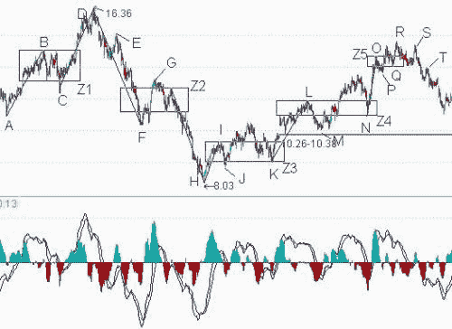 

 

 

 

 

 

 

 

 

 

 

 

 

 

 

 

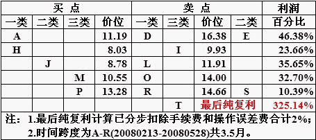 

 

 

 

 

 

 

 

 

## 第五节 构筑顶、底

一、基本概念

底部区间：第一类买点到形成第三类买卖点前，都可以看成构造底部的区间。

顶部区间：第一类卖点到形成第三类买卖点前，都可以看成构造顶部的区间。

二、应用要点

底部都是分级别的，如果站在精确走势类型的角度，那么第一类买点出现后，并确定该买点所引发的走势中枢的第一次走出、直到第三类买卖点前，都可以看成底部构造的过程。如果是第三类卖点先出现，就意味着底部构造失败了；否则，第三类买点意味着底部构造的最终完成并展开新的行情。顶部的情况，反之亦然。

三、分析理解

用分型的角度同样可以给出底部的概念，只是粗糙了一点。对一时把握不了精确走势类型分类的，这是一个将就的办法。此外，一般性分析中，这方法也可以用，因为对把握大方向已经足够。站在分型的角度，底部就是构成底分型的那个区间。而跌破分型最低点意味着底部构成失败；反之，有效站住分型区间上边沿，就意味着底部构造成功并至少展开一笔向上的行情。顶部反之亦然。

有了这个定义，就一定要搞明白，不是在底部的区间上买，而是应该和走势中枢震荡的操作一样，在区间下探失败时买，这才是最好的买点，连这都搞不明白，就白学了。此外，底部是有级别的，日线图上的底分型，当然就对应着分型意义上的日线级别底部。

四、操作指导

操作其实很简单，一个基本的原则就是，任何走势，无论怎么折腾，都逃不出这个节奏，就是底、顶以及连接两者的中间过程。因此，在两头的操作节奏就是走势中枢震荡。只是底的时候要先买后卖，顶的时候要先卖后买，这样更安全点。至于中间的连接部分，就是持有。当然，对于空头走势，小板凳就是一个最好的持有，一直持有到底部构造完成。而有技术的，根本就不需要什么小板凳，按操作级别，分清楚目前是三阶段中的哪一段，然后日日是好日，时时是花时，不赚钱那真是脑子有水了。亏钱都是错误操作引起的，不断反省，才会有进步的。

 

## 第六节 区间套

一、基本概念

区间套：就是根据背驰段从高级别向低级别逐级寻找背驰点(即买卖点)的方法。

精确大转折点寻找程序定理：某大级别的转折点，可以通过不同级别背驰段的逐级收缩范围而确定。

二、应用要点

某大级别的转折点，先找到其背驰段，然后在次级别图里，找出相应背驰段在次级别里的背驰段，将该过程反复进行下去，直到最低级别，相应的转折点就在该级别背驰段确定的范围内。

三、分析理解

区间套寻找背驰点的理论依据：低级别背驰是本级别背驰的必要条件而非充分条件，换句话说，就是只有在低级别发生背驰时，本级别才可能背驰。所以，我们可以从低级别去发现本级别背驰的精确点，也就是说次级别的背驰决定了背驰点，我们说某个级别的走势背驰了，那么必须确定它以下所有级别都转折了，这是所有背驰的前提。

四、操作指导

第一种情况最普遍。其特点是时间和级别完全契合。具体方法就是本级别进入背驰段后，到次级别去寻找背驰点，然后逐级找下去，直到所有的级别都在背驰段，最小的级别最终背驰。这种方法要求使用者对本级别以下的所有级别都同时关注，就像一个魔方，只对一面是不够的，只有多个面都对好才有价值。

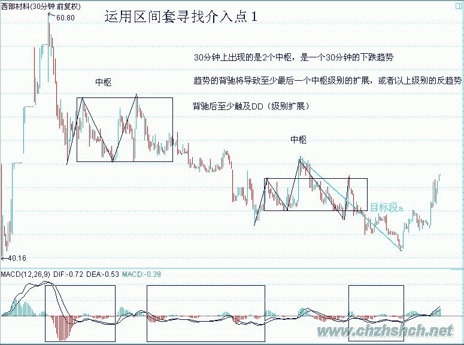 

 

 

 

 

 

 

 

 

 

 

 

 

 

第二种情况是小转大。本级别并未进入背驰段，由于小级别的突发情况，导致本级别背驰，这种情况是无法抓到第一买点的，只能在次级别回抽确认之后才能买到。这种情况发生在空头/多头陷阱，在本级别一个猛烈的上或下，但随后就反转了。

第三种情况是反复背离。注意是背离不是背驰，所谓的背了又背属于这种情况，就是本级别进入了背驰段，但次级别以下的力度很大，导致本级别迟迟无法背驰，在本级别上就显示背了又背。但是只要没有打破背驰段，就要密切注意。这种情况发生在筑顶/底的时期，反复地诱多或诱空，诱多时要快出，诱空时可以战略建仓。

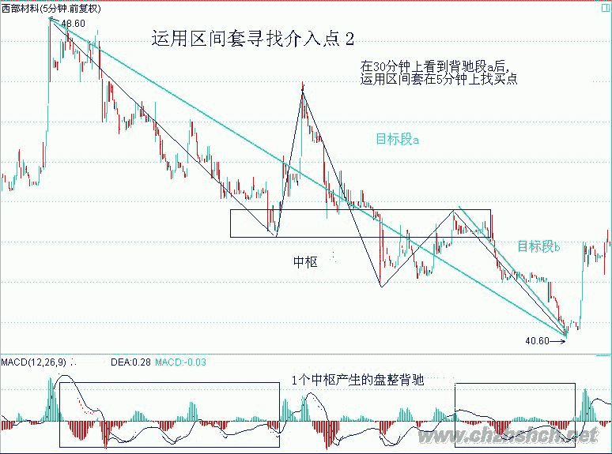 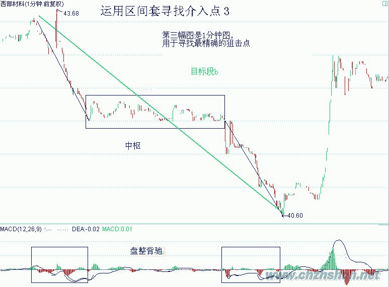 

 

## 第七节 级别的递增及操作

一、基本概念

级别的递增：走势按照自同构性结构的自组性，如同有生命般地自动由最低级不断向更高级生长。

二、应用要点

本理论最重要的特点之一，就是自然给出了分类的层次，也就是不同的自然形成的级别。不同的级别，有不同的完全分类，而综合起来，就有了一个立体的完全分类的系统。这才是我们的操作必须依赖的。

三、分析理解

以 30、5、1 分钟的三个层次所构成的系统为例，任何的当下状态，都对应着不同层次完全分类中的一个现实状态。这三层次构成的完全分类就给出了最完美的操作指示。

四、操作指导

再以 30、5、1 分钟的三个层次所构成的系统为例：假设目前处在 30F 的下跌之中，可能的走势和操作分析如下：

首先，第一个必然且一定是最先出现的变化，就是 1F 层次的底背驰。如果连这都不出现，其他两个层次是不会有任何状态变化的。而这底背驰后，必然出现回拉，这里就面临两个完全分类：一是这回拉构成原来 5F 的第三类卖点；二是回拉不构成原来 5F 的第三类卖点。因此，对应这两种 5F 层次的状态变化：一是第二个 5F 走势中枢的确认，从而确认 5F 的下跌；二是原来 5 分钟走势中枢继续震荡的确认。

显然，这两种 5F 的新变化，都不会导致 30F 层次有状态变化。但，其中的其一种，却隐含着 30F 即将可能面临变化，因为 5F 下跌一旦结束回拉构成 30F 第三类卖点，那么 30F 层次就会有所变化了。

因此，在当下的状态，我们可以很逻辑严密地推算出后面下一步的系统层次的状态变化。那么这个变化的可能结果，都对应着你可以承受的范围。因此，你只需要把自己可以承受的能力与之相匹配，给出相应的参与资金比例，相应的仓位控制，就可以自如地参与其中了。例如，你没法应付可能出现的第三类卖点的情况，那么，你就别参与了。为什么？因为这第三类卖点是一个可能的选项。反之，如果你对所有的可能都有面对的技术，那么，就可以参与这 1 分钟底背驰的活动了。

所以，最终还是那个问题，把市场分析好了，把情况分类好了，然后问一下自己，你有这个处理所有可能情况的能力吗？如果没有，那就算了；如果有，就上。事情就这么简单。

当然，你还可以这样，就是把仓位弄得特别小地去参与。这样，可能培养自己面对相应情况的能力。能力毕竟要干才能培养的。光说不练，那永远还是没能力。关键是知道自己干什么，而不是糊涂蛋瞎蒙就行。

## 

## 第八节 每日走势分类

如果是按某级别的严格操作，每天具体怎么走是关系不大的，走势不会因为交易是按天来的就有什么本质的不同。但针对每天的走势进行一些分类，至少是一个好的辅助。

一天的交易是 4 小时，等于有 8 个 30 分钟 K 线组成的一个系统。把 3 个相邻 30 分钟 K 线的重叠部分当成一个每天走势上的一个走势中枢，那么任何一天的走势，无非只有三类：

*   只有一个走势中枢(图①)
    

这种走势，是典型的平衡市。一般情况下，开盘后前三根 30 分钟 K 线就决定了全天的波动区间。而全天的极限位置，基本上，至少有一个都出现在这前三根 30 分钟 K 线上，不是创出当天高点，就是创出当天低点。当然，这不是完全绝对的。因此可以对这种情况进行更细致的分类。

1、在前三根 30 分钟 K 线出现当天高点

这可以称为弱平衡市。其中最弱的是当天低点收。注意，这和当天是否红盘无关，高开最后红盘收也可以形成这种最弱的弱平衡市。次弱是收在走势中枢之下。收在走势中枢是一般的弱平衡市。收在当天高点附近的是最强的一种。

2、在前三根 30 分钟 K 线出现当天低点

这可以称为强平衡市。其中最强的，就是以当天高点收。同样，这与当天是否红盘无关。次强是收在走势中枢之上。收在走势中枢是一般的强平衡市。收在当天低点附近的是最弱的一种。

3、在前三根 30 分钟 K 线不出现当天高低点

这可以称为转折平衡市，同样可以像上面情况一样根据收盘位置定义其强弱。

注意，以上三种情况走势中枢的位置不一定是前三根 30 分钟 K 线的重叠，可以是后面几根的。

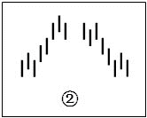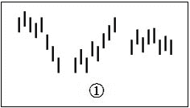

 

 

 

 

 

二、两个走势中枢(图②)

根据两走势中枢的前后方向可以分为向上、向下两种。讨论向上的情况，向下的情况反过来就是。

两个走势中枢，显然不能有重叠的地方，否则就会转化成上面的情形。因此，这种形态，最大的特点就是这两个走势中枢之间有至少有一个 30 分钟 K 线，其中有部分区间是不属于两个走势中枢的任何一个。这个区间，成为单边区间，这是这种走势最重要的特点，是其后走势的关键位置。注意，具有单边区间的 K 线不从属任何一个走势中枢。

由于只有 8 根 30 分钟 K 线，根据单边区间所在位置，无非是两种可能：1、单边区间在第四根 30 分钟 K 线。2、单边区间在第五根 30 分钟 K 线。由此就知道，为什么所有出现单边走势的，变盘时间都在中午收盘的前后 30 分钟之内。

当然，第 4 第 5 根 30 分钟 K 线可以同时具有单边区间。如果只有第 4 根 K 线具有单边区间的情况，那么第八根 K 线，有可能出现穿越单边区间的情况。

显然，对于上涨的情况来说，最强的就是收盘在第二走势中枢的上方，最弱的，就是出现第八根 K 线出现穿越单边区间的情况，最终收在第一个走势中枢的之下。然后根据收盘的位置，可以依次定出其他的强弱。

三、没有走势中枢(图③)

这是最强的单边走势。8 根 K 线，没有相邻 3 根是有重叠部分的，一旦出现这种情况，就是典型的强烈走势。一旦出现这种走势，该日 K 线都是具有重要意义的。一般来说，这种走势很不常见。但别以为出现这种走势就一定会继续趋势，往往很多骗线就是故意用这类走势构成。特别是在大的日 K 线走势中枢中出现这种情况，更大可能是骗线。当然，如果是在一个第三类买卖点后出现这种走势，出现大级别的强势趋势的可能性就极大了。

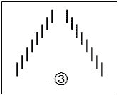 

 

 

 

## 第九节 牛市中的暴跌行情分析

对于空头日夜盼望的暴跌，其实永远与空头无关。因为真跌了，空头就只会口头上快感一下，心理上满足一下。人的思维惯性，使得空头永远没机会在他们满意的地方获得满意的筹码。暴跌，对于牛市行情来说，猛烈而刺激。但实质上，暴跌后，该干什么还是什么。

牛市调整能力的积聚，也需要宣泄。这种宣泄，与熊市最大的不同，就是猛烈而疯狂。这和熊市中的大反弹是一样的。最出名的熊市大反弹，大概就是停国债期货那次，三天，指数从 550 不到翻上 920 上。结果，后面依然继续下跌回来。而牛市中的暴跌，最出名的算是 96 年 12 月那次，由于政策打击，连续跌停下来，1250 点上几天跌到 850 点附近，结果依然继续上涨。所有真正的大顶，都是反复冲击出来的，有足够的时间让你去反应判断。那种 V 型顶，在大型走势中基本不会构成真正的顶部。暴跌后继续长时间下跌的机会基本为 0。所以，那些天天希望暴跌的人，最终都会给废掉，不会有好结果的。

正确去对待震荡、调整。显然，在大盘中短线能量耗尽后，大盘会出现大规模的调整，如果说 227、419 都是在日线上暴跌，那么在周线上、月线上、季线上、甚至年线上出现暴跌的可能性在这长达至少 20 年以上的大牛市中，都是绝对存在的。但这决不是空头用嘴欢呼的借口，而是真正操作者减低成本、增加筹码的大好时机。当然，操作的精确度是一个技术问题。技术高的，就能把成本降更低，筹码增得更多。这是绝对正常的事情，技术高的就该有更好的收益，这是天经地义的。但精确度是可以用市场磨练来达到的。而思路、方法的错误，则是不可救药的，这才是问题的根源。

站在纯技术的角度，把握暴跌的级别很重要。一个日线上的暴跌与一个年线上的暴跌，显然力度上不一样。在这次从 2005 年中开始的大牛市行情中，至 6000 点为止，本质上，在周线上都没有出现过暴跌。周线上两次大的调整，周跌幅都是 7%，还赶不上 227 的日暴跌。月线上更是连一次真正有意义的下跌都没有。但为什么这么多人，天天依然如惊弓之鸟一般？

如果你把握不住日线的暴跌，证明你的技术程度达不到把握日线暴跌的程度，那么就去把握周线、月线的，那对技术精确的要求要低。给自己安排一些力所能及的活动。暴跌也是有级别的，能否在各级别的暴跌中游刃有余，是对你技术把握度的考验。

一个很显然的道理，对市场了解越多，对走势的把握越精确。例如，20070419 的暴跌行情，跌破 5 日线后有一个反抽，在 11:08 刚好构成对前一天走势中枢的第三类卖点，这就是最后的、被本理论所保障的离开机会。那么，后面去走，就完全与本理论无关了，在一个下跌里，除了最后那一个位置，所有的卖出都是对的，但这和本理论无关。这类似赌博，就赌不是最后的位置。

有人可能要说，就算跌破 5 日线，也可能很快就拉起来。确实，存在这种可能性。但市场是否选择这种可能性，就是当下的。如果很快拉起来，那自然会有一个符合本理论的买点出现，这只要市场自己去选择。既然已经卖出，就耐心等待。而其中，当然与分析的精确度有关。有些人分析不到位，会回补早了，那很正常。技术更熟练的，当然应该享受更精确的买点。但节奏是重要的，站在小级别操作的角度，就算你补早了，也比没走傻看着强。补早了，就以后多总结经验，使自己的技术精度更高。

不过，必须强调的是，上面说的，都是针对资金比较小，操作级别比较小的说的。如果是按日线级别操作，那这些震荡根本无须理会。

上证 1 分钟图（20070416-0421）

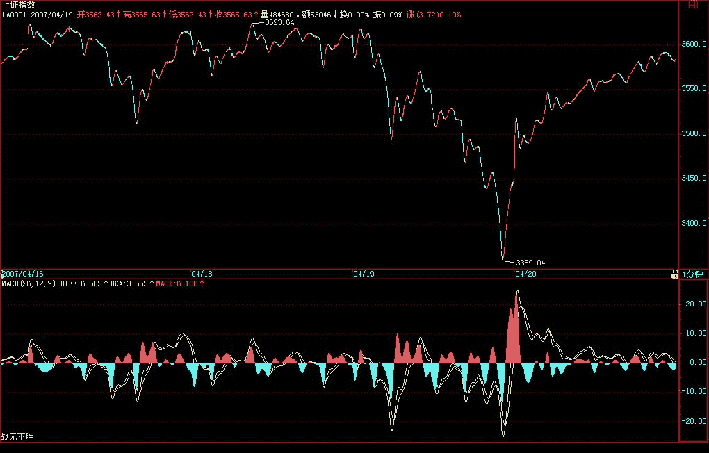 

其实，如果你对市场理解更多点，就知道，这一夜情走势的当天低点，其实是很容易把握的。这就和上节所说的当日走势分类有关。最后一个第三类卖点对 5 日线进行反抽出现在 11:08。前面 3 个 30 分钟 K 线，没有重叠。也就是说，下面走势显然不可能出现存在两个走势中枢的单边走势。三大类里，第二类是不可能出现了。对于第一类，平衡市的走势，最好的情况，也只能是当日走势中枢在 11 点后那个 K 线范围内。至于出现第三类，也是就没走势中枢的走势，那意味着后面有巨大跌幅。而第三类卖点后面，至少都会出现一个次级别的跌势，也就是一个 1 分钟以下级别的向下走势是必须完美的。所以，站在纯理论推理的角度，可以 100%确定地安排后面可能的回补。也就是，从 11:08 开始的向下走势至少要出现走势的完美。注意，这些分析，在 11:08 后就马上可以给出，并不需要预测或事后编排，都是可以根据本理论严格分析出来的。

下午开盘后，到 13:30 点，就知道，第三类可能不存在了。因为当日一个连续 3 个 30 分钟 K 线的重合已经出现，也就是当日的走势中枢出现了。就是说，到 1330 分钟，市场已经自己给出了选择，市场不可能出现 227 那天的无走势中枢下跌，最多就是一个弱的平衡市。因此，10:30 到 13:30 这个走势中枢，就是最值得关注的。用走势中枢震荡的观点，需要比较的就是 10:30 前的下跌与 13:30 点后的下跌。这时候，大盘还没有真正对该走势中枢破位，但已经可以 100%肯定地知道一旦破位，需要去看什么来决定买卖点。用 MACD 辅助，显然 1 分钟图并不适合看。因为 10:30 到 13:30 分钟前，这个 MACD 已经有绿柱子了，这样看起来费劲，可以选择更大级别的图，5 分钟的。在 5 分钟图上，10:30 前的下跌刚好构成一个绿柱子面积，而 10:30 到 13:30 刚好出现回拉，所以黄白线没有明显到 0 轴，但红柱子是有了，所以，用走势中枢震荡的看法，后面的下跌，出现的背驰不会是 5 分钟级别的，只能是 5 分钟以下级别的，甚至就是分笔级别的最小背驰，然后引发大幅度回拉该走势中枢附近。当然，如果是特小级别的背驰，并不一定有足够力度决定其一定能拉回该走势中枢，但由于这走势中枢的存在，其力度是可预期的。

上面的分析，在大盘 13:30 没真正继续破位前，就可以 100%明确地给出。里面都是纯逻辑的推理，和任何预测无关。假设你已经在 11:08 的第三类卖点出去了，而且你又是小级别操作者，那你需要的就是回补。所以有了如上分析，你就可以耐心等待，看 5 分钟图去比较其力度了。而且，你应该知道，强力回拉，并不一定需要一个 1 分钟的背驰。在大幅度下跌后，一个分笔的背驰就足以引发盘中大幅回拉该走势中枢。特别，由于 10:30 前下跌引发的反抽也是一个分笔的背驰造成。一般来说，走势中枢震荡都有对称性。虽然不是绝对，但已经足以让你不会忽视分笔背驰引发小级别转大级别的极大可能。（分笔背驰，一般可以用 1 分钟 MACD 柱子的长度来辅助）

上证 5 分钟图（20070418-0419）

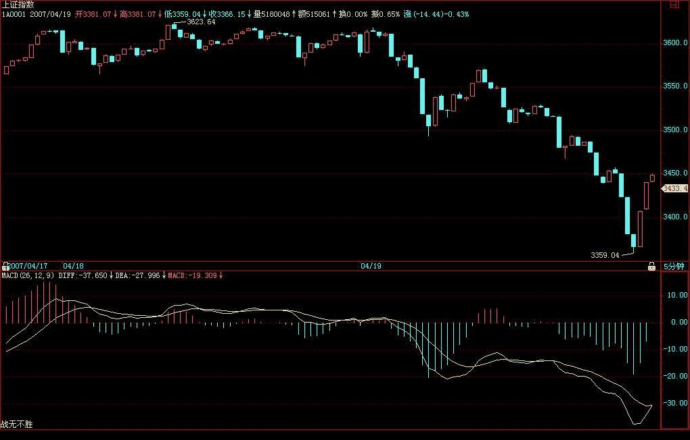 

在大盘进入再次下跌时，你已经有足够的准备去等待。而且，你可以很明确地知道，在跌破 10:30 到 13:30 的走势中枢后，首先会有一个小的第三类卖点。小的第三类卖点后，有两种演化的可能，一是变成一个大一点级别的盘整，一个是形成下跌，至少再有两段向下。对第一种情况，在这盘整出现后，有足够的时间去选择介入，所以不用着急。而后面市场的真实选择，现在都很清楚了，就是第二种，在一个小的第三类卖点后，再出现两波下跌。

对于一个跌破走势中枢的下跌来说，第三类卖点后再来两波就可以随时完美。这个完美，由于该下跌是 1 分钟以下级别的，因此从该下跌的细部，是找不到根据 1 分钟背弛去确认的买点的，只可能根据分笔背驰。而根据预先知道的走势中枢震荡看法，唯一需要确认的是，13:30 后的下跌与 10:30 前下跌的力度比较。从 5 分钟 MACD 两柱子面积的比较可以看到，前者并不比后者的力度大，这一点，参考看深圳成指的图就更明显了（请看下图）。所以，可以断言，这 13:30 开始的下跌，一定会有强力回拉。

实际走势，在该第二波的分笔背驰（看 1 分钟图 14:43 的 MACD 柱子，该 K 线还是所谓的早晨之星）后，大盘出现大幅度回拉，这其实是理论 100%保证的事情。注意，并不是下跌的分笔背驰就一定存在大幅回拉，而是这天的当日平衡市的走势类型的走势中枢位置与时间决定的。而且，反抽的最低位置也很清楚，就是这下跌最后一个反弹处，结果收盘也真的是在该位置，这其实也是理论所保证的。

当然，如果你懂的东西更多点，对该最后位置的确定是可以很精确的。首先，日线的布林通道中轨和 20 天线都在 3351 点，按一般的技术分析，这是一个强力支持位置，而实际低点在 3358 点。另外，在 1 分钟图上的下降通道下轨，也在该位置，几个因数相配合，该位置出现反抽就完全在把握中了。

后面的走势很简单，关键是那走势中枢，由于分笔背驰只保证回抽到下跌最后一个反弹处，收盘已达到。而分笔背驰并不 100%支持对该走势中枢的完全回拉。所以理论上，依然完全存在继续跌出一个更大级别的背驰再回拉的可能。当然，也可以直接上去，这必须由市场来选择。但无论哪种情况，该走势中枢都是一个新的走势中枢形成前的判断关键。而 420 当天走势中枢的位置，就决定了今后走势可能的演化。

以上，是一个分析的范本，这些分析，都是可以当下进行的，里面不涉及任何预测，市场当下的每一步走势，都相应给出分析的选择。对本理论熟悉的，其实 1 秒就可以把当下情况分析清楚，然后采取最正确的操作。但必须强调，这只是为了说明如何去分析，并不是鼓励所有人都去弄这种超级短线。当然，如果你连这么精确的分析都能当下完成并指导自己的操作，那么那些大级别的操作，就更没问题了。如果有 T+0，对于小资金来说，这些就是有绝对实战意义的事情，当然，在 T+1 的环境下，就算 3358 买的，在第二天，还有出不掉的风险。而如果是 T+0，那就不存在了，因为对于超级短线来说，回拉最后反弹位置就可以出来，然后看市场下一步的选择再选择下一买点。再次强调，这只是为了说明理论，并不说都要按这么小级别去操作，只不过大级别的分析是一样的，切记。

当然，如果你对当日走势的辅助判断有更深的了解，那么用当日对冲等方法来降低成本，也是可以做到的。有时间，可以去研究一下与大盘节奏不同个股的走势，感受一下大盘这外在因数对个股的影响是如何首先必须有个股的内在原因的，例如，大盘的下跌反而使得某些股票构造出第二、三类买点，而在走势中枢上移强力延伸的股票，甚至不搭理大盘。也可以去参考一下，那些随大盘下跌的股票，是本来就存在卖点，大盘只是加大了卖点后向买点运动的幅度，但并不会改变卖点与买点的内在逻辑结构。明白了这一点，对本理论的理解会更深点。

 

## 第十节 缺 口

缺口，就是在该单位 K 线图上两相邻的 K 线间出现没有成交的区间。用向上的为例子。例如，在上海指数日线单位的 K 线图里，1994 年的 7 月 29 日与 8 月 1 日，就出现\[339,377\]这个区间没有成交。那就说，\[339,377\]是一缺口。而缺口的回补，就是在缺口出现后，该缺口区间最终全部再次出现成交的过程。这个过程，可能在下一 K 线就出现，也可能永远不再出现。例如\[339,377\]这一缺口，虽然不敢说永远不再回补，但到股市被消灭前，大概也没什么机会回补了。

根据缺口的是否回补，就构成了对走势行情力度的一个分类。一、不回补，这显然是强势的；二、回补后继续新高或新低，这是平势的；三、回补后不能新高、新低，因而出现原来走势的转折，这是弱势的。

一般来说，突破性缺口极少回补。中继性缺口，也就是趋势延续中的缺口，回补的几率对半，但都一定继续新高或新低，也就是至少是平势的。而一旦缺口回补后不再新高、新低，那么就意味着原来的趋势发生逆转，这是衰竭性缺口的特征。一旦出现这种情况，就一定至少出现较大级别的调整，这级别至少大于缺口所延续的趋势的级别。也就是说，一个日线级别趋势的衰竭性缺口，至少制造一个周线级别的调整。而一个 5 分钟级别的衰竭性缺口，至少制造一个 30 分钟级别的调整。

注意，这里的级别和缺口所在的 K 线图无关，只和本理论中的走势类型级别有关。不同周期 K 线图和走势的级别，就如同不同倍度数显微镜和显微镜所观察的物体。

显然，日 K 线图有缺口，在日线以下的任何周期的 K 线图都会相应有缺口。而回补日线的缺口，不一定能回补日线以下周期 K 线图上的缺口。另外，在盘整走势中的缺口，与在趋势中的缺口性质不同，属于普通缺口，这种缺口，一般都回补，而且没有太大的分析意义，唯一的意义，就是在走势中枢震荡中有一个目标，就是回拉的过程中，几乎肯定能拉回补掉缺口的位置。

 

## 第十一节 预 测

一、基本概念

预测原义：对后期趋势进行估计。

预测含义：不进行任何预测，对后期可能的走势进行完全分类，按级别划定清晰的边界，并预设好操作方案，根据实际走势按照原则当机立断进行机械操作。

二、应用要点

正如同量子力学的测不准原理，任何关于预测的理论，其最大的原理就是测不准。

所有预测的基础，就是分类，把所有可能的情况进行完全分类。

对于预测分类的唯一正确原则就是不进行任何排除，而是要严格分清每种情况的边界条件。

有了分段的边界原则，按着操作就可以。

所有的预测都是当下给出的，第一层次，就是要达到：当机立断。

真正的操作者，都有一套操作的原则。按照原则来，就是最好的预测。

三、分析理解

1、何谓预测？一般的预测是什么把戏？而科学严密的预测究竟是怎样的，本理论是如何成为最精确最当下预测的，这都要在这里说明。真正的预测，就是不测而测。当然，这和一般通常的预测不是一个概念。

走势是干出来的，是市场合力的结果，而不是被上帝所事先确定的，市场中没有上帝，市场的方向只有所有参与者的合力决定，大资金或高技巧，可以用自己的力量去引导市场，按照自己的剧本来演绎，但没有上帝可以完全事先确定市场走势类型完成的所有细节。

一般情况下，政策或规则的分力，至少在一个时间段内保持常量。所以，一般人就忘记、忽视其存在。但无论是常量还是随着每笔成交变化的变量，合力都是当下构成的。常量的分力，用 F(t)表示，只是表示其值是一个常量或者是一个分段式常量。这些常量的分力，并不是永恒的常量，往往是分段式的，其变化是有断裂点的。很多基本面上的分力，都有这个特点。这些断裂点，构成预测上的盲点。当然，进行基本面分析，对宏观面进行大面积的考察，可以尽量减少这些盲点，但不可能完全消除。这因素的存在，已使得所有一般意义上的精确预测可能变成一个笑话。况且基本面上的因素，也是合力的结果。政治、经济等等方面，哪个不是合力的结果？现在的世界政治、经济格局，就是众多合力的结果，一个国家里的就更是这样了。

比前面这些更深刻的，站在哲学的角度，预测也是一个分力。就如同观察者本来就被假定在观察之中，所有观察的结果都和观察者相关、被观察者所干预。以观察者为前提，预测也是同样的方式介入到被预测的结果之中。正如同量子力学的测不准原理，任何关于预测的理论，其最大的原理就是测不准。

那么，如果一切都不可以预测，那本理论的意义何在？一切虽然不可以预测，但一切走势类型的可能结构与类型，却是可以分类的，每一类之间都有着明确的界限。因此，你唯一需要的，就是观察市场当下的走势，让市场去选择可能的结构与类型，然后根据市场的选择来选择。注意，这对于大资金来说一样的，无论任何规模的资金，归根结底都只是市场的分力，不是合力本身，企图把自己当合力本身，把自己装扮成上帝的，最终的结局都是死无葬身之地。只要是分力，就要观察市场当下的反应，根据市场反应的当下选择来选择。必须明确两点：一是买卖点操作后，等待是一个最关键的过程，必须密切关注相应的走势类型的生长与分类选择，这一切都是当下的。二、买卖点本质上是走势类型的生长状况与分类决定的，反过来，某些买卖点的出现，又使得走势类型的生长状况分类有一个明确的界定，这些都是观察市场细节的关键之处。所以，所有预测的基础，就是分类，把所有可能的情况进行完全分类。

有人可能说，分类以后，把不可能的排除，最后一个结果就是精确的。这是脑子锈了的想法，任何的排除，等价于一次预测。每排除一个分类，按概率的乘法原则，就使得最后的所谓精确变得越不精确，最后还是逃不掉概率的套子。对于预测分类的唯一正确原则就是不进行任何排除，而是要严格分清每种情况的边界条件。任何的分类，其实都等价于一个分段函数，就是要把这分段函数的边界条件确定清楚。例如下面的函数：

f(X)=-1，X∈(-∞,0)，f(X)=0，X=0，f(X)=1，X∈(0，∞)

关键要搞清楚 f(X)取某值时的 X 的范围，这个范围就是边界条件。在走势的分类中，唯一可以确定的是不可能取负值，也就是从\0，∞）进行分类，把该区域分成按某种分类原则分为 N 个边界条件。边界条件分段后，就要确定一旦发生哪种情况就如何操作，也就是把操作也同样给分段化了。然后，把所有情况交给市场本身，让市场自己去当下选择。例如，前几天，用前期两高点和 10 日线进行分类，那自然就把走势区间分类成跌破与不跌破两种。然后预先设定跌破该怎么干，不跌破该怎么干，如此而已。这就是最本质的预测，不测而测，让市场自己去选择。最后市场选择了不跌破，那就继续持有。所有的操作，其实都是根据不同分段边界的一个结果，只是每个人的分段边界不同而已。

因此，问题不是去预测什么，而是确定分段边界。例如，前两天用前期两高点分类有意义，现在再用，就没什么意义了。现在就可以完全用均线系统来分类。有了分段的边界原则，按着操作就可以，还需要预测什么？又有什么可预测的？世界金融市场的历史一直在证明，真正成功的操作者，从来都不预测什么。即使在媒体上忽悠一下，也就是为了利用媒体。真正的操作者，都有一套操作的原则，按照原则来，就是最好的预测。

那么，本理论中的分型、笔、线段、走势中枢、走势类型、买卖点等等，是不是预测呢？是也不是。因为本质上本理论是最好的一套分段原则。这一套原则，可以随着市场的当下变化，随时给出分段的信号。按照本理论来的，其实在任何级别都有一个永远的分段： X=买点，买入；X=卖点，卖出；X 属于买卖点之间，就持有。而这持有的种类，如果前面是买点，卖点没出现，就是股票，反之就是钱。按照分段函数的方法，本理论就有这样一个分段操作的最基本原则。

因此，如果你真学习和按本理论来操作，就无须考虑其他系统，或者说其他系统都只能是参考。本理论，任何时候都自然给出当下操作的分段函数，而且这种给出都是按级别来的。所以本理论反复强调，你先选择好自己的操作级别。否则，本来是大级别操作的，看到小级别的晃动也晃动起来，那是有毛病。给出分段函数，就是给出最精确的预测。所有的预测都是当下给出的，这才是真正的预测。这种预测，不需要任何概率化的无聊玩意，也没有所谓预测成功的忽悠或兴奋。这种预测的成功每一当下都发生着。

在操作时，后续的所有可能面对的情况与对策都必须了然，否则就没资格操作。对于一个真正的操作者，没有任何情况是意外的。因为，所有的情况都被完全地分类了，所有相应的对策都事先有了，只是等着市场自己去选择，去触及我们事先给定的开关。

有人可能问，如果出现回探的情况，那么可能在背驰买的出不掉。显然，这种情况是很可能的，因为 T+1，该反应的时间你可能没资格卖。不过，一个很简单的对策就是，你必须买比大盘要强势的股票，也就是先于大盘的股票。这样，一旦大盘回转，这类的股票走势都会比大盘强，这样自然有足够的空间让你选择。注意，最好的选择是比大盘稍微先一点的，而不是完全逆于大盘的，因为后者，往往有可能补跌，或者逆着大盘洗盘。

市场是有规律的，但市场的规律并不是显而易见的，是需要严格的分析才能得到。更重要的是，市场的规律是一种动态的，在不同级别合力作用下显示出来的规律。企图用些单纯的指标、波段、波浪、分型、周期等等预测、把握，只可能错漏百出。但只要把这动态的规律在当下的直观中把握好、应用纯熟，踏准市场的节奏，并不是不可能的。

2、市场价格是否完全反映所有信息，可以随意假定。无论何种假定，都和实际的交易关系不大。交易中，你唯一需要明确的，就是无论市场价格是否完全反映信息，你都必须以市场的价格交易。同时你的交易将构成市场的价格。对于交易来说，除了价格，一无所有（成交量可以看成是在一个最低的时间段内按该价格重复成交数量的交易单位）。这一切，和市场价格是否反映所有信息毫无关系。因为所有价格都是当下的，如果当下的信息没被市场反映，那它就是没被市场当下反映的信息。至于会不会被另一个时间的价格反映是另外的事情。站在纯交易的角度，价格只有当下，当下只有价格。除了价格与依据时间延伸出来的走势，市场的任何其他东西都是可以忽略不计。

价格也和人是否理智无关。无论你是否理智，都以价格交易，而交易也被价格。这是无论任何理论都必须接受的事实：交易，只反映为价格，以某种价格某个时间的交易，这就是交易的全部。至于交易后面的任何因数，如果假定其中一种或几种决定了交易的价格，无论这种因数是基本面、心理面、技术面、政治面还是什么，都是典型的上帝式思维，都是无聊勾当。其实，对于价格来说，时间并不需要特别指出，因为价格轨迹中的前后，就意味着时间的因数。也就是说，交易是可以按时间排序的，这就是交易另一个最大的特征：交易是有时间性的，而这时间，不可逆。在物理还在探讨时间是否可逆时，对于交易空间的探讨，这最困难的时间问题，就已经有了最不可动摇的答案。而本理论，当然也是以这交易时间的不可逆为前提，如果今天的交易可以变成昨天的或者干脆不算了，那本理论马上土崩瓦解。

交易，当然是有规律的，而且这规律是万古不变的。归纳上述就是：交易以时间的不可逆为前提完全等价地反映在价格轨迹上。满足该规律的市场就是价格充分有效市场。本理论，就是针对这种价格充分有效市场的。而这种市场，至少对应了目前世界上所有正式的交易市场。

以前所有市场理论的误区都在于去探讨决定价格交易后面的因数。交易是人类的行为，人类就像疯子一样，即使其行为可探讨，在交易层面也变得没什么可探讨的。所有企图解释交易动机、行为的理论都是没有价值的。不管人类的交易有什么理由，只要交易就产生价格，就有价格的轨迹，这就足够了。站在纯交易的角度，唯一值得数学化探讨的就是这轨迹。其他的研究都是误区，对交易毫无意义。

那么，价格是随机的吗？这又是一个上帝式的臆测。决定论和随机论，其背后的基础都是一个永恒因数论，一个永恒模式论。也就是，价格行为被某种神秘的理论所永恒模式化。无论这种模式是决定还是随机，这种假设的荒谬性是一样。交易，只来自现实。因此，价格是被现实的交易所决定的。相应，上面的顾虑就可以扩充为：交易是现实的行为，交易以时间的不可逆为前提完全等价地反映在价格轨迹上。

交易的现实性是交易唯一可以依赖的基础。那么交易的现实性反映了什么，有什么可能的现实推论？首先，人的反应是需要时间的，就算是脑神经的传输，也是需要时间的；其次，社会结构的现实多层性以及个体的差异性决定了，任何的群体性交易都不具有同时性。也就是说，即使是相同原因造成的相同买卖，都不可能同时出现，必然有先后。交易具有延异性，不会完全地趋同，这是交易能形成可分析走势的现实基础。

由于交易具有延异性，没有绝对的同一性。即使对于严格一种因数决定交易行为的系统，也依然能产生可分析的价格轨迹。任何群体性的交易行为，不会出现完全的价格同一性。也就是说，不会永远出现所有人同一时刻的同一交易。而一个完全绝对趋同交易，就等价于一个赌博，所有的买卖和买大小没任何区别，这样的系统是否存在？只要交易不会完全地趋同，那么这个交易就可以用本理论来描述。本理论的另一个界限就在此。

本理论只有这两个界限，只要是价格充分有效和市场里的非完全绝对趋同交易，那本理论就永远绝对有效。这种绝对性就如同压缩影射不动点的唯一性对完备的距离空间一样。至于有多少人学习，应用这个理论，对理论本身并没有任何实质的影响。因为，即使所有人都应用本理论，由于社会结构以及个体差异，依然不会造成一个完全绝对趋同交易。这样，本理论依然有效。而更重要的是，本理论，并不是一个僵化的操作，都是永远建立在当下之上的。例如，一个日线级别被判断进入背弛段，由于某种当下的绝对突发事件，使得小级别产生突发性结构破裂最终影响到大级别的结构，这时候，整个的判断，就建立在一个新的走势基础上了。而往往这时，实际的交易并没有发生。一般人，总习惯于一种目的性思维，往往忽视了走势是当下构成中的。而本理论判断，同样是建筑在当下构成的判断中。这是本理论又一个关键的特征。这种理论的当下性，按学历，是初中的课程。

而本理论，最终比的是人本身。虽然乾坤大挪移的第八重不能肯定打不过第九重，但任何非乾坤大挪移的，肯定打不过第八重。有一种武功是高出其它孤峰而上的，因为起点已经大大超越了。其他那些起点就错了，又怎么能比？显然，不可能所有人都相信应用本理论。因此，那些不用本理论的人，就成了本理论吸血的对象。现实中，这种对象不是太少，而是太多了。其次，如果有庄家、基金偷学了这种方法，这就等于乾坤大挪移比第几重了。而且对于大资金来说，至少要比散户高出两重，才可能和散户打个平手。因为资金大，没有更高的功力，怎么能挪移起来？更重要的是，级别越大，企图控制干扰所需要的能量越大。对于周线级别以上，基本就没人能完全控制了。如果真是出现个个庄家、基金争学本理论的情况，那么除了在小级别比功力外，功力浅的完全可以把操作级别提高来加强安全性。更重要的是，应用相同的理论，在现实中也不会有相同的结果。现实就是一个典型的非完全绝对趋同系统。在不同的资金规模、资金管理水平，选股策略、基本面把握、交易者性格、气质等情况下，自然地呈现不同的面貌，这就保证了同一理论交易的非完全绝对趋同。

对本理论有一点是必须明确的，就是本理论是对价格充分有效市场非完全绝对趋同交易的一个完全的数学公理化理论，唯一需要监控的就是价格充分有效市场与非完全绝对趋同交易这两个前提是否还存在。更重要的是，这归根结底是一套关系人的理论，只能不断在交易中修炼，最后比的可是功力。例如，就算是背驰这么简单的事情，就算是同一种方法，当成为群体性行为时，比的就是心态与功力。心态不好、出手早或出手迟的，就会在价格上留下痕迹。甚至当趋同性较强时，会使得级别的延伸不断出现，那就让功力深的人得到一个更好的买入或卖出价格。这些细微的差别积累下来，足以使得赢利水平天差地别。这也是为什么可以把理论公开的一个深层原因。因为本理论是对价格充分有效市场非完全绝对趋同交易的一个客观理论。即使公开了，也不会让这理论有任何改变。至于理论可能造成的趋同交易加大，也早在本理论的计算中，这里比的是当下的功力。

无论你用什么交易方法，只要是在价格充分有效市场非完全绝对趋同交易里，你就在本理论的计算中；而要在本理论里功力日增，就首先要成为一个顶天立地的人。交易，不过是人类行为的一种。要成为成功的交易者，首先要对人类的行为穷其源，得其智慧。否则，一个糊涂蛋，什么理论都是白搭。本理论的基础部分，只是把现实的真相解剖出来，但这远远不够。看明白与行得通，那是两回事情。当然，看都看不明白，是不可能真的行得通的。而行，就是修行，“见、闻、学、行”，缺一不可。本理论如同大道，不需要私藏着，都可以学、都可以行。但能否行到不退转的位置，是否最终还是“学如不及，犹恐失之”，那就要靠每个人自身的修行了。

理论，只是把现实解剖。但真正的功力，都在当下。不光要用理论的眼睛看清楚现实，更要逐步让自己和走势合一。而行的初步功力是什么？归根结底就是“恰好”，这个“恰好”是动态的。无论多少人，每个人的行为当成一个向量，所有人的行为最终构成走势的向量，而所谓的“恰好”，就是这个总向量本身。而如何才能永远和这总向量一致？就要首先把自己变成一个零向量，有也只有当一个零向量加入到任何一个向量叠加系统里，才不会影响到最终的总向量的。把自己的贪婪与恐惧去掉，让市场的走势如同自己的呼吸一般，看走势如同看自己的呼吸，慢慢就可以下单如有神了。你的交易，就是顺着市场的总向量的方向增加其力度而已，这才是真正的顺势而为。只有这样，才算初步入门；才能逐步摆脱被走势所转的可悲境地；才能让自己和走势合一，和那永远变动的总向量一致而行。至于走势分析的学习，只不过是门外的热身而已。

有人可能要追问，如果所有人都变成零向量，那又如何？交易市场存在的基础，就是人的贪婪与恐惧。如果所有参与交易市场的人都没有贪婪与恐惧，那市场就没了，资本主义就没了，货币就被消灭了。那时候，本理论自然就不存在了。只有对这个以人的贪婪、恐惧为基础的市场进行“不相”之，才能长期有效地吸取这市场的血。本理论的基础部分，在人类历史上第一次把交易市场建筑在严密的公理化体系上，就是要把市场的本来面目还原，让人的贪婪、恐惧无所遁形。只有明确地知道市场当下的行为，才可能逐步化解贪婪与恐惧。把交易行为建筑在一个坚实的现实基础上，而不是贪婪、恐惧所引发的臆测上。只有智慧才可以战胜贪婪、恐惧。而当所有的贪婪与恐惧被战胜后，贪婪与恐惧所物化的资本主义社会本身，也就丧钟敲响了。

3、所以，一切的预测都是没意义的，当下的感应和反应才是最重要的。你必须随时读懂市场的信号，这是应用本理论最基础也是最根本的一点。如果你连市场的信号、节奏都读不懂，其他一切都是无意义的。但，还有一点很重要，就是你读懂了市场，但却不按信号操作，那这就是思维的问题了。老有着侥幸心理，这样也是无意义的。按照区间套的原则，一直可以追究到盘口的信息里。如果在一个符合区间套原则的背驰中发现盘口的异动，那么，你就能在最精确的转折点操作成功。本理论不废一法，盘口工夫同样可以结合到本理论中来。但关键是在恰当的地方，并不是任何的盘口异动都是有意义的。本理论由于是从市场的根子上考察市场，所以把握了。你可以结合各种理论，什么基本面、政策面、资金面、庄家等等因数，这些因数如何起作用、有效与否，都在这市场的基本走势框架上反应出来。

由于市场是当下的，那么，投资者具有的思维也应该是当下的。任何习惯于幻想的，都是把幻想当成当下而掩盖了对当下真实走势的感应。这市场，关键的是操作，而不是吹嘘、预测。

有一点是无疑的，就是一旦你掌握本理论，你根本无须听任何话，无论谁的话，任何话都是废话，走势永远第一。牛顿不能违反万有引力，本人也不能违反本理论，这才是最关键的地方。而只有这样，才可能有一个正确的思维基础。你无须遵守本理论。甚至，你学会本理论，还可以专门和我作对，企图在市场上挣我的钱。但你必须尊重本理论，就像你必须尊重万有引力一样。否则市场的走势每分每秒都会给你足够的教训。

正闻、正见、正学、正行，无此四正，要在股市里终有成就，无有是处。正，不是正确的意思，所谓正确，不过是名言之争辩。正，是正是，是当下；只有当下，才是正是，才是这个。要当下闻、当下见、当下学、当下行，才是正闻、正见、正学、正行。对于股市来说，只有走势是当下的。离开走势，一切都与当下无关。一切“闻见学行”，只能依走势而“闻见学行”。离开此，都是瞎闹。不符合当下走势的，上帝说正确也白搭。由此，入股市者，首先就要在当下的走势中磨练。当下的走势就是一切，一切股市的秘密就在其中。这秘密，是大道，没有任何的遮掩，对任何人都一视同仁、明明白白地彰显，你还向外求什么？而无数的人，还是要争着玩骑驴找驴的游戏。

在股市中，钱的大小根本不重要，亏损是按百分比的。所有的钱，无论你是从哪里涨起来的，在任何一个位置，变成 0 的几率是一样的。这个几率是当下存在的，任何人、任何时候都不可能摆脱，这是“不患”的。当下的走势，就如同一把飞速滚动的屠刀，任何与之相反的，都在屠杀之列；而与之顺着的，那被屠的血就成了最好的盛宴。也就是说，一旦你的操作，陷入一种与当下走势相反的状态，任何该种状态的延续就意味着死亡，一旦进入这种状态，唯一正确的选择就是离开。当然，走势是千变万化而有级别性的，任何的当下，并不就意味着 1 秒种的变化，而是根据你的资金以及承受所可能的操作级别来决定的。一直所说的操作级别，就是针对此而说。例如，你根据资金等情况，决定自己的操作级别是 30 分钟的，那 30 分钟所有可能发生的走势都在你的计算之中，一旦你已有的操作出现与 30 分钟实际当下走势相反的情况，那么就意味着你将进入了一个 30 分钟级别的屠杀机器里。这种情况下，只有一种选择，就是用最快的时间退出。

注意，这不是止蚀，而是一种野兽般的反应。走势如同森林，野兽在其中有着天生般的对危险的直觉。这种危险的直觉总是在危险没发生之前。而野兽更伟大的本事在于，一旦危险过去，新的觅食又将开始。原来的危险过去就过去了，不会有任何心理的阴影，只是让对危险的直觉更加强大。没有任何走势是值得恐惧的。如果你还对任何走势有所恐惧、有所惊喜，那就继续在当下的走势中磨练，让这一切恐惧、惊喜灰飞湮灭。这里，只需要正闻、正见、正学、正行。

4、本理论一直强调无须预测，并不是说市场走势就绝对不可预测。相反，市场走势当然可以绝对预测。不过，这里的预测和一般所说的预测并不是同一意义。一般的预测是建立在一个机械的、上帝式思维基础上，这种思维，把市场当成一个绝对的、不受参与者观察所干扰的系统。由此而成为一套所谓的预测标准，一个建立在错误的思维基础上的标准。这种预测，本来就不存在。关于这点，如果你对量子力学的历史发展有点了解，不难理解。

市场的预测、观察、参与者，恰好又是市场走势的构成者，这就是市场预测的最基本起点。因此，市场的走势模式，归根结底就是市场预测、观察、参与者行为模式的同构。这意味着，唯一并绝对可以预测的，就是市场走势的基本形态。不学无术之辈，喜欢谈论所谓的点位，却不知道，点位只是基本形态演化的一个结果，是当下中形成了。形态是“不患”的，点位是“不患”之“患”。只要把握了这“不患”，其“患”自然就在当下的把握中。那种追求对点位的非当下把握，绝对是脑子进水。因为点位都是当下形成中的，这是一个“不患”。企图逃离这个“不患”而谋其“患”，不是脑子进水是什么？正因为点位都是在基本形态的演变中当下形成的“不患”，才有点位的“不患”之“患”。

明白了这个道理，才算是有了市场预测的“正眼”。无此“正眼”，都是瞎掰。而实际操作中，最基础的，就是对基本形态的最基本把握，这是“不患”的。只有立足于这“不患”上，才有对点位之“患”当下的把握。说白了，所有的操作练习，归根结底就是在此之上。所以，本理论只是一个训练者，引导者。因为当下，只能是你的当下，离开你的操作当下，根本是不存在的。由此，不难理解另外一个操作上的“不患”，就是你事先确立的操作级别，这是“不患”的。市场，归根结底只是你的市场。就像，一个看花只能看到花的眼睛，那自然看花就是花，不会把花看成猴子。科学的把戏，就是要先假设所有的被科学定义为眼睛的物体，都只能把花看成花。所以科学在股市上注定死无葬身之地。

所有的市场，都必然只能是你当下观察、操作中的市场。离开你当下的观察、操作，市场对于你来说并不存在，或者说毫无意义。而你的观察、操作，必须有一个“不患”的前提，就是你的操作级别。这操作级别，就等于一个把花看成花或把花看成猴子的眼睛，在你的世界里，把花看成花与把花看成猴子所包含的基本模式是同构的，关键是这个模式，而不是花还是猴子的不同设定。所以，本理论里，可以适用于任何操作级别的人。因为不同级别之间的基本模式是同构的，这就是市场的一个基本特征。注意，这特征不是理所当然的，这个特征之所以存在，归根结底，就是市场参与者有着基本相同的结构。这结构，归根结底，就是贪嗔痴疑慢。甚至可以这样说，在六道轮回中，任何的类市场形态，本理论都适用其中。因为，这贪嗔痴疑慢是同构的。所以，如果本理论的种子种下后，就算你轮回到其它道上，那里恰好有一个股票市场，你也可以在其中如鱼得水。

那么，市场的基本形态是什么，最基础的，就是反复说的以走势中枢、级别为基础的趋势与盘整。而背驰的级别一定不小于转折的级别，是市场预测的最基础手段。例如，你是一个 30 分钟级别的操作者，那么，任何 30 分钟级别下跌及 30 分钟级别以上的盘整，你都没必要参与。因此，当一个 30 分钟的顶背驰出现后，你当然就要绝对退出，为什么？因为这个退出是在一个绝对的预测基础上的，就是后面必然是一个 30 分钟级别下跌或扩展成 30 分钟级别以上的盘整。这就是最有用、最绝对的预测；这才是真正的预测。这预测是被本理论绝对保证的，或者说这是被市场参与者的贪嗔痴疑慢所绝对保证的。

本理论，归根结底，就是研究这贪嗔痴疑慢的。由此也就知道，为什么市场的操作，归根结底就是人自身的比较。因为，只要这世界依然有这贪嗔痴疑慢，本理论就如鱼得水。有人整天痴谈学佛，其实，炒股票就是真正的学佛，不在这贪嗔痴疑慢的大烦恼中如鱼得水、得大自在，你那佛，顶屁用！

 

## 第十二节 回避市场风险

首先要搞清楚的，什么是市场的风险。有关风险，前面可以带上不同的定性，政策风险、系统风险、交易风险、流通风险、经营风险等等，但站在纯技术的角度，一切风险都必然体现在价格的走势上。所有的风险，归根结底，最终都反映为价格波动的风险。例如，某些股票市赢率很高，但其股价就是涨个不停。所以站在纯技术的角度，只能在技术上衡量其风险，而不用考虑市赢率之类的东西。

有人可能要问，如果业绩突然不好或有什么坏消息怎么办？其实这种问题没什么意义。即使在成熟市场里，这类的影响都会事先反映在走势上，更不用说在中国社会里，什么消息可以没有任何人事先知道？你不知道不等于别人不知道，你没反应不等于别人没反应。而这一切，无论你知道与否，都必然会反映到走势上。等消息明朗，一切都晚了。走势是怎么出来的？是用钱堆出来的！在这资本的社会里，又有什么比用实在的钱堆出来的更可信？除了走势，又有什么是更值得相信的？而那些更值得相信的东西，又有哪样不是建筑在金钱之上的？资本市场就是一个金钱的游戏，除了钱，还是钱。只有钱是唯一值得信任的。而钱在市场上运动的轨迹，就是走势。这是市场中唯一可以观察与值得观察的东西。一切基本面、消息面等的分析，最终都要落实到走势上，要让实在的钱来说话，否则都是自渎而已。只要有钱的运动，就必然留下轨迹，必然在走势上反映出来。

市场中，唯一的活动，其实就是钱与股票的交换运动。股票就是废纸一张！什么基本面分析，这价值那价值的归根结底都是胡诌。股票就是废纸，唯一的功能就是一张能让你把一笔钱经过若干时间后合法地换成另一笔钱的凭证。交易的本质就是投入一笔钱，在若干时间后换成另一笔钱出来，其中的凭证就是交易的品种。本质上，任何东西都可以是交易品种。所谓股票的价值，不过是引诱你把钱投进来的诱饵。应用本理论的人，绝对要首先认清楚这一点。对于你投入的钱来说，那些能让你在下一时刻变成更多的钱出来的凭证就是有价值的。市场上，对任何的股票都不值得产生感情，没有任何股票可以给你带来收益。能给你带来收益的是你的智慧和能力，那种把钱在另一个时间变成更多钱的智慧和能力。

同理，市场的唯一风险就是你投入的钱在后面的时刻不能用相应的凭证换成更多的钱，除此之外，一切的风险都是狗屁风险。但任何的凭证，本质上都是废纸，以零以上的任何价格进行的任何交易都必然包含风险，也就是说，都可能导致投入的钱在后面的某一时刻不能换回更多的钱，所以，交易的风险永远存在。那么，有什么样的可能，使得交易是毫无风险的？唯一的可能，就是你拥有一个负购入成本的凭证。什么是真正的高手、永远不败的高手？就是有本事在相应的时期内把任何的凭证变成负购入成本负价格的人。所以对于真正的高手，交易什么其实根本不重要。只要市场有波动，就可以把任何的凭证在足够长的时间内变成负购入成本。本理论，本质上只探讨一个问题，如何把任何价格的凭证，最终都使其购入成本在足够长的时间内变成负数。

任何的市场波动，都可以为这种让凭证最终变成负数的活动提供正面的支持，无论是先买后卖与先卖后买，效果是一样的。但很多人就只会单边运动，不会来回动，这都是坏习惯。市场无论涨还是跌，对于你来说永远是机会，你永远可以在买卖之中。只要有卖点，就要卖出；只要有买点就要买入。唯一需要控制的，就是量。即使对于很大的资金量来说，1 分钟的卖点也应参与，可能只卖 5 万股，跌到 1 分钟买点买回来，差价就只有 1 毛钱，整个操作就除了手续费可能只有 4000 元的收入。但 4000 元不是钱？够一般家庭一个月的开销了。而更重要的是，这样的操作能让总体成本降低即使是 0.000000001 分，也必须这样做。所以，对于本理论来说，任何的卖点都是卖点，任何的买点都是买点，唯一需要控制的只是买卖的量而已。级别的意义，其实只有一个，基本只和买卖量有关，日线级别的买卖量当然比 1 分钟级别的要多多了。对于任何成本为正的股票，永远不能信任，只有一个想法就是要尽快搞成负数的。注意，在持股成本变成负数前，仓位是一直不变的，最开始多少就是多少，上上下下，卖点的时候变少，买点的时候又回复原来的数量，但绝对不加仓，一开始就买够。

站在这个角度，股票是无须选择的。唯一值得选择的，就是波动大的股票，而这个是不能完全预测的。当然，对于资金量小的投资者，完全可以全仓进出，游走在不同的凭证之间。这样的效率当然是最高的。本理论就像一个吸血的机器，无论庄家是向上向下都只能为本理论制造把成本摊成负数的机会，他无论干什么都没用。一笔足够长的钱+加上本理论的熟练运用=战无不胜。市场，哪里有什么风险？

对于小资金来说，资金管理不算一个特别大的问题，但随着赢利的积累，资金越来越大，资金管理就成了最重要的事情。一般来说，只要有好的技术，从万元级到千万元级，都不是什么难事情。但从千万以后，就很少人能稳定地增长上去了。所有的短线客，在资金发展到一定后，就进入滞涨状态。一旦进入大级别的调整，然后就打回原形，这种事情见得太多了。因此，在最开始就养成好的资金管理习惯，是极为重要的。投资，是一生的游戏，被打回原形是很可悲的事情。好的资金管理，才能保证资金积累的长期稳定，在某种程度上，这比任何的技术都重要，而且是越来越重要。对于大资金来说，最后比拼的，其实就是资金管理的水平。

资金，必须长期无压力，这是最重要的。另外一个重要的，就是自己的资金，一定不能交给别人管理。自己的盘子，一定要自己负责，不能把自己的命运交给别人。不能把自己放置在一个危险的境地，所谓背水一战、置之死地而后生，都不是资本市场应该采取的态度。这样的态度，可能一时成功，但最终必然失败。技术分析的最重要意义在于，让你知道市场究竟在干什么，市场在什么位置该干什么，让你知道，一个建立的仓位，如何持有，如何把一个小级别的持有逐步转化为大级别的持有，又如何退出。这一切，最终都是为资金管理服务的，投资最终目的不是股票本身，而是资金。没收回资金，一切都没意义。股票都是废纸，对资金的任何疏忽，都会造成不可挽回的损失。任何人，必须明确的是，多大的资金，在市场中都不算什么。而且，资金是按比例损失的，一万亿和一万元，按比例损失，变成零的速度是一样的。无论多大的资金，要被消灭，可以在举手之间。因此，永远保持最大的警觉，这是资金管理最大的、最重要的一点，没有这一点，一切管理都是无用的。

一个最简单又最有效的管理，就是当成本为零以前，要把成本变为零；当成本变成零以后，就要挣股票，直到股票见到历史性大顶，也就是至少出现月线以上的卖点。一些最坏的习惯，就是股票不断上涨，就不断加仓，这样一定会出问题。买股票，宁愿不断跌不断买，也绝对不往上加码。投入资金买一只股票，必须有仔细、充分的准备。在基本面、技术面等方面都研究好了，介入就要坚决，一次性买入。如果你连一次性买入的信心都没有，证明你根本没准备好，那就一股都不要买。买入以后，如果你技术过关，马上上涨是很正常的，但如果没这水平，下跌了，除非证明你买入的理由没有了，技术上出现严重的形态，否则都不能抛一股。而且可以用部分机动的资金去弄点短差（注意，针对每只买入的股票，都要留部分机动的资金，例如 1/10），让成本降下来。但每次短差，一定不能增加股票的数量。这样，成本才可能真的降下来，有些人喜欢越买越多，其实不是什么好习惯。这股票该买多少，该占总体资金多少，一开始就应该研究好，投入以后就不能再增加。

股票开始上涨后，一定要找机会把股票的成本变成零，除了途中利用小级别不断弄短差外，还要在股票达到 1 倍升幅附近找一个大级别的卖点出掉部分，把成本降为零。这样，原来投入的资金就全部收回来了。有人可能要说，如果那股票以后还要上涨 10 倍呢？这没问题，当股票成本为零以后，就要开始挣股票。也就是利用每一个短差，上面抛了以后，都全部回补，这样股票就越来越多，而成本还是零。这样，这股票就算再上涨 100 倍，越涨你的股票越来越多，而成本永远为零。这是最可怕的吸血，庄家、基金无论如何洗盘，都使得你的股票越来越多，而你的成本却是零。然后，等待一个超大级别的卖点，一次性把他砸死，把那庄家、基金给毁了。想想，成本为零的股票，在历史大顶上砸起来是最爽的。

这就是资金管理中针对每只股票的最大原则，按照这原则，你不仅可以得到最安全的操作，而且可以赢得最大的利润。特别挣股票的阶段，一般一个股票，盘整的时间都占一半以上。如果一个股票在上涨后出现大型盘整，只要超大级别卖点没出现，这个盘整会让你的股票不仅把抛掉的全挣回来，而且比底部的数量还要多，甚至多很多。一旦股票再次启动，你就拥有比底部还多的但成本为零的股票，这才是最大的黑马，也是最大的利器。一个合理的持仓结构，就是拥有的零成本股票越来越多，一直游戏到大级别上涨结束以后。例如这轮大牛市，直到牛市结束前，才把所有股票全部清仓。而资金，就可以不断增加参与的股票种类，把这程序不断下去。这样，操作资金不会增加，特别对大资金，不会经常被搞到去当庄家或钱太多买了没人敢进来，这样就不会增加操作的难度，但股票种类越来越多，但成本都是零。这样，才会有一个最稳固的资金管理基础。

政策性风险，属于非系统风险，本质上是不可准确预测的，只能进行有效的相应防范。

首先，中国政策性风险将在长时间内存在，这是由目前中国资本市场的现实环境所决定的。一个成熟的资本市场，应该是重监管、轻调控。而目前中国的资本市场，至少将在很长时间内，监管和调控都至少是同等重的。甚至，在一些特定的时期，调控将成为最重要的方向。这是客观现实，是由中国经济目前的发展阶段所决定的，其实并不是任何人故意要这样的，所以，任何对这的指责，其实都是有毛病的。

调控，有硬调控与软调控两种。像发社论、讲话、严查之类的，就是明显的硬调控，这种调控方式是否永远不再发生，这谁都不敢保证；至于软调控，就是调控中不直接以资本价格为最直接的目的，而是结合着更多大的方面考虑，政策上有着温和和连续的特征。

当然，站在调控的角度，如果软调控不得力，那么硬调控成为唯一选择的时候，这其实不是调控者的悲哀，而是市场的悲哀，当市场的疯狂足以毁掉市场时，硬调控也是不得以为之。这方面，也要对调控者有足够的理解。有一种很错误的说法，就是中国的调控只调控上涨，不调控下跌，其实，站在历史实证的角度，这种说法是没有事实根据的。因为，实际上，调控下跌的情况一点都不少，最著名的，就是 1994 年的 325 点，那三大政策的缺口，现在还在那里，这难道不是对过分下跌的调控吗？只不过，那是一次最成功的调控。而对下跌的调控，或者说是救市，经常都很失败，这只能说明调控的水平需要在实践中不断提高。

一个政策的出台，决不是任何一个人拍脑袋就可以决定的。任何一个体制下，只要是一个体制，就有均衡，那种个人任意超越体制的事情，已经越来越没有发生的可能。而且，散户、机构都不是一个抽象的名词，企图用抽象的名词掩盖一个个现实的实体而达到互相斗的结果，不过是某些运动逻辑的僵尸版。

其次，必须要明确，政策只是一个分力，政策不可能单独去改变一个长期性的走势。例如，就算现在有一个硬调控使得中短期走势出现大的转折，但最终也改变不了大牛市的最终方向。政策只有中短期的力量，而没有长期的力量。这点，即使对经济也是一样的。经济的发展，由经济的历史趋势所决定。中国经济之所以有如此表现，归根结底，就是因为中国经济处于这样的历史发展阶段，任何国家在这样的阶段，都会有类似的发展。但并不是说政策一无所用，一个好的政策，是促进、延长相应的历史发展进程，是一个好的分力。

所以，政策是一个分力，其作用时间和能量不是无限的，而且，政策也是根据现实情况而来的，任何政策，都有其边界，一旦超越其边界，新的政策就要产生，就会有新的分力产生。而且政策分力，即使在同一政策维持中，也有着实际作用的变化。一个政策，5000 点和 1000 点，效果显示不可能一样。

明白了政策的特点，对政策，就没必要如洪水猛兽，以下几点是可以注意的：

1、一个最终结果决定于价格与价值的相关关系。当市场进入低估阶段，就要更注意向多政策的影响，反之，在市场的泡沫阶段，就要更注意向空调控的影响。

2、最终的赢利，都在于个股，一个具有长线价值的个股，是抵御一切中短分力的最终基础。因此，个股对应企业的好坏与成长性等，是一个基本的底线。只要这底线能不被终结，那么，一切都不过是过眼云烟。而且，中短的波动，反而提供了长期介入的买点。

3、注意仓位的控制。现在透支已经不流行，但借贷炒股还是不少见。这是绝对不允许的，把资本市场当赌场的，永远也入不了资本市场的门。在进入泡沫化阶段后，应该坚持只战略性持有，不再战略性买入的根本原则，这样，任何的中短波动，都有足够的区间去反应。

4、养成好的操作习惯。只有成本为零的，才是安全的，这大概是彻底逃避市场风险的唯一办法。

5、贪婪与恐惧，同样都是制造失败的祸首。如果你保持好的仓位，有足够的应对资金以及低成本，那么，就让市场的风把你送到足够远的地方。你可以对政策保持警觉，但没必要对政策如惊弓之鸟，天天自己吓自己。

6、不要企望所有人都能在硬调控出台前提早一天跑掉。可以明确地说，现在政策出台的保密程度已经和以前大为不同。很多政策的出台，都是十分高效保密的。当然，一定范围内的预先，那肯定是有的。但这种范围已经越来越小。而且，能够反应的时间也越来越小，对于大资金来说，那点时间，基本无效。本理论可以开诚布公地说，现在政策的公平性已经越来越高，有能力预先知道的，资金量小不了，因而也没足够的时间去全部兑现。这在以前，有长长的时间去组织大规模撤退，那绝不是一回事了。

7、必要的对冲准备，例如权证等。最近，认沽热销，也和一些资金的对冲预期有关。

8、一旦政策硬调控出现，则要在一切可能的机会出逃。在历史上，任何硬调控的出现，后面即使调整空间不大，时间也少不了。

9、关键还是要在上涨时赚到足够的利润。如果你已经 N 的平方倍了，即使用一个 10-20%去留给这飘忽不定、神经叨叨的非系统风险，那还不是天经地义的事情？成为市场的最终赢家，和是否提前一天逃掉毫无关系。资本市场，不是光靠这种奇点游戏就能成的。心态放平稳点，关键是反应，而不是神经叨叨的预测。

 

## 第十三节 走势的心理较量

一个最简单的问题，为什么不能由笔构成最小走势中枢？其实，这不是一个问题。为什么？因为实质上，我们是可以设计这样的程序，也就是用笔当成构成最小走势中枢的零件。但这样构造出来的系统，其稳定性极差。如前所知，一笔的基础是顶和底分型，而一些瞬间的交易，就足以影响其结构。例如，突然有人打错单，或者有人给老鼠仓送货，那么全天走势的分析就大变样了。而由线段构成最小走势中枢，则不存在这个问题。为什么？一个线段的改变，不会因为一个偶尔一笔的错误而改变。也就是说，线段受偶尔性的影响比较少，想想要终结一个线段的麻烦程度，就知道这一点。

从心理上看，偶尔因素是允许发生的。只要不被再次确认，就证明偶尔因素对原来的心理合力没有大影响。反过来确认了该合力的有效性。所以，线段终结本身，其实就反应着一种微妙心理结构的变化。特征序列分型的引入，本质上就是去勾勒这种心理结构变化的。就像一般的分型，三次的确认才能构成，特征序列的分型，本质上也是一样的。这样的确认，其有效性就极大增加了。由此构成最小走势中枢的零件，才是合适的。

如果说三个 K 线的折腾就可以决定一笔的转折，那么一个线段的终结转折，就需要三个特征序列分型的折腾。这样，市场买卖双方都有足够的时间去反应，从而使得体现出的合力痕迹，当然具有了一定的延续性。而一个线段，至少由三笔组成，这也使得转折后的新线段，同样可以让合力得到充分体现。对比这两个不同方向的线段，买卖双方在相应时间内的心理、实力对比，就一目了然了。

更重要的是，线段终结的两种方式，是有着很大的心理面不同的。第一种方式，第一笔攻击就直接攻破上一段的最后一次打击，证明这反攻的力量是有力的。再回来一笔，代表着原方向力量的再次打击，但反攻力量抗住并再次反攻形成特征序列的分型。这证明，这反攻至少构造了一个停歇的机会。最坏的情况，就是双方都稍微冷静一下，去选择再次的方向。而这，就恰好构成了最小走势中枢形成的心理基础。

走势中枢，其实就是买卖双方反复较量的过程。走势中枢越简单，证明其中一方的力量越强大。走势中枢的复杂程度，是考察市场最终动向的一个很重要的依据。一个超复杂的走势中枢过后，就算一方赢了，其后的走势也是经常反复不断的。

而且，在同一趋势中，相邻两走势中枢的复杂程度、形态，经常有所区别。为什么？人都有提前量。而提前量，经常就是找最近的模本去抄袭。这样，等于在买卖的合力中，都加了一个提前的变量，从而造成整个结构的变化。这是一个很重要的原理，所谓不会二次跨进同一条河流，这本质上由人的贪嗔痴疑慢造成的。

至于线段的第二种终结方式，本质上是以时间换空间，反攻开始的力量很弱，需要慢慢积累。这一方面代表原方向的力量很强，另一方面，又要密切关注是否会形成骨牌效应。也就是开始的反攻力量很小，却能迅速蔓延开，这往往证明，市场原方向的分力，其结构具有趋同性，一旦有点风吹草动，就集体转向。这在投机性品种经常能看到，经常是一个小 M 头就引发大跳水。趋同性，如果对于一般性品种来说，往往意味着庄家控盘程度高。一些猛烈上涨或下跌的股票，往往甚至由于一个 1 分钟的小顶分型就引发大跳水或大反弹。其原因，就是这种分力的趋同性所引发的骨牌效应。一般来说，这种第二类的线段终结，一旦出现骨牌效应，至少要回到前一高、低点范围内，这就是市场上冲顶和赶底时发生的 V 字型走势。

分力的趋同性所引发的骨牌效应，基本上就是表现为所谓的多杀多、空杀空。特别在一些大的趋势之后，市场的力量一边倒，如果这时候突然来一个加速，一旦逆转，就会发生典型的多杀多、空杀空现象。叛徒成为叛徒之前，必然是同志，甚至就是同志中的牛人。而最危险的敌人，总是志同道合的所谓同志的背叛，同一阵营内部的塌陷才是最有杀伤力的。无论多头空头，死的时候，沿着那滴血的刀看上去，那双眼睛，一定是你最熟悉的。

 

## 第十四节 分段操作

一个最实际的问题，如果按照理论，至少有一个 30 分钟级别的反弹，那么具体的操作应该怎么安排？首先，你必须搞清楚反弹可能的具体走势形式。因为同样是 30 分钟级别，不同形式，对应的操作难度与方式都是不同的。而最大的难点在于，你并不能事先知道反弹究竟用什么方式，因为这涉及预测。而一切预测都不能纳入操作计划的范围，只能聊天吹牛时使用。所以要解决这难点，必须从绝对性出发，里面不能涉及任何预测。

对一个 30 分钟的走势类型，我们能绝对性指出的无非有一点，就是这个反弹至少有一个 30 分钟级别的走势中枢，而有这就足够了。为此就可以构造出一套绝对性的操作方法。某级别的走势中枢都是由三个以上次级别走势类型重叠构成，也就是说，一个 30 分钟的走势中枢，一定涉及上下上的三个 5 分钟走势类型。这就是构成我们操作绝对性的最坚实基础。

显然，没有任何绝对性可以保障上下上，最后一个上一定有比第一个上有更高的高点，特别那种所谓奔走型的反弹，后上的高点可能只刚好触及前上的低点。因此，如果你一定要等上下上都完成才抛出，那很可能面对这样的尴尬，就是你在第一个上的最低点买的，在上下上的电梯过后，你只有一个可能连手续费都不够、稍纵即逝的卖点。因此，这种操作，注定是只有相对的理论上的绝对安全性，而没有具体操作上的绝对安全性。要解决这个问题，只能从第一上就开始分解操作。也就是说，没必要等待第二个上了。既然每次上之后都必然有一个同级别的下，而这下的幅度又是不可能绝对控制的，所以还不如把操作分段，让分段提供给你绝对的具体操作安全。因此，在这种分析下，具体的反弹操作一定是同次级别分解方式进行的。也就是说，30 分钟级别的反弹，是按 5 分钟的节奏去处理的。

注意，这只是统一的处理方法。实际操作中，一旦第一上与下出现后，可能的走势形式，就有了很大的绝对性确认了。例如，一个 30 分钟走势中枢后接一个第三类买点，然后非背驰力度地强劲拉升，那你就完全可以开始坐轿子，等第二走势中枢，甚至第三、四、五走势中枢完成出现背驰后第三类卖点再说了。

其次，更要注意，这绝对性的具体操作还不是平均效率最高的。最高的，就是保持部分仓位，用余下仓位进行换股轮动操作。对于资金少的，这更可以全部仓位进行，不过这技术要求更高，就不多说了。

最后，一定不要去预测什么反弹还是反转，这根本没意义。反弹越搞越大，最后就自然成了反转。而是否如此，根本没必要知道。你唯一需要知道的就是，只要在第一走势中枢后出现第三类买点并形成非背驰类向上，才可以流着口水地持股睡觉等其余走势中枢形成，否则，随时都有被反回来的风险。不过必须补充的是，实际的操作效果还是必须靠磨练的。反弹如此，回调的操作反过来就是，更不用多说。

 

## 第十五节 踏准节奏

市场的节奏，只有一个：买点买、卖点卖。这么简单的问题，但从来能遵守的人，能有几个？是什么阻止你倾听市场的节奏？是你的贪婪与恐惧。买点，总在下跌中形成，但恐惧阻止了你；卖点，总在上涨中，但贪婪阻止了你。一个被贪婪与恐惧所支配的人，在市场中唯一的命运就是：死！

市场中，买点上的股票就是好股票，卖点上的股票就是坏股票，除此之外的好坏分类，都是瞎掰。你的命运，只能自己去把握。没有任何人是值得信任的，甚至包括本理论。唯一值得信任的就是市场的声音、市场的节奏，这需要你用心去倾听，用一颗战胜了贪婪与恐惧的心去倾听。

市场的声音，永远是当下的，任何人，无论前面有多少辉煌，在当下的市场中，什么都不是。只要有一刻被贪婪与恐惧阻隔了对市场的倾听，那么，这人，就走入鬼门关。除非，此人能猛醒，否则，等待的只有：死亡。记住，1 万亿与 1 万，变成 0 的速度是一样的，前者甚至可以更快。

买点买，买点只在下跌中，没有任何股票值得追涨。如果你追涨被套，那是活该；卖点卖，没有任何股票值得杀跌。如果你希望瘦身，那就习惯砍仓杀跌吧。即使你搞不懂什么是买点卖点，但有一点是必须懂的，就是不能追涨杀跌。就算是第三类买卖点，也是分别在回调与反弹中形成的，哪里需要追涨杀跌？

买卖点是有级别的，大级别能量没耗尽时，一个小级别的买卖点引发大级别走势的延续，那是最正常不过的。但如果一个小级别的买卖点和大级别的走势方向相反，而该大级别走势没有任何衰竭，这时候参与小级别买卖点，就意味着要冒着大级别走势延续的风险，这是典型的刀口舔血。市场中不需要频繁买卖，战胜市场，需要的是准确率，而不是买卖频率，只有券商与税务部门才喜欢买卖高频率。

市场不是赌场，市场的操作是可以精心安排的。当你买入时，你必须问自己，这是买点吗？这是什么级别的什么买点？大级别的走势如何？当下各级别的走势中枢分布如何？大盘的走势如何？该股所在板块如何？而卖点的情况类似。你对这股票的情况分析得越清楚，操作才能更得心应手。

至于买卖点的判断，如何提高其精确度，那是一个理论学习与不断实践的问题，但这一套程序与节奏，是不会改变的。精度可以提高，但节奏不可能乱，节奏比精度更重要。无论你对买卖点判断的水平如何，即使是初学者，也必须以此节奏来要求自己。如果你还没有市场的直觉，那么就强迫自己去执行，否则，就离开。

对于初学者，一定不能采取小级别的操作。你对买卖点的判断精确度不高，如果还用小级别操作，不出现失误就真是怪事了。对于初学者，按照 30 分钟来进出，是比较好的，怎么也不能小于 5 分钟，5 分钟都没有进入背驰段，就不能操作。级别越小，对判断的精确要求越高，而频繁交易导致的频繁失误只会使心态变坏，技术也永远学不会。先学会站稳，才考虑行走，否则一开始就要跑，可能吗？

节奏，永远地，只有市场当下的节奏。谁，只要与此节奏对抗，只有痛苦与折磨在等待。注意，一定要注意，所谓的心态好不是如被虐狂般忍受市场节奏错误后的折磨，这一定要注意。很多人，错了，就百忍成钢，在市场中是完全错误的。市场中，永远有翻身的机会，那前提是，你还有战斗的能力。一旦发现节奏错误，唯一正确的就是跟上节奏，例如，错过第一买卖点，还有第二买卖点，如果你连第三买卖点都错过，连错三次，死了也活该。

为什么有三类买卖点？市场太仁慈了，给你三次改错的机会，你如果连这都不能改正，那就休息去，喝茶去，三次都不能改错，还犯同样的错误，不休息、不喝茶，还能干什么？那些一个股票上涨 N 倍后还问能不能买，甚至还追高买，这种人，还能说什么？难道上涨 N 倍还看不到买点吗？看着很多散户，在连续拉升后还赌后面的所谓涨停，只能好不客气地说：死了活该。

市场是残酷的，对于企图违反市场节奏的人来说，市场就是他们的死地；市场是美好的，市场就是巴赫的赋格曲，那里有生命的节奏。节奏，永远是市场的节奏，一个没有节奏感的市场参与者，等待他的永远都是折磨。抛开你的贪婪、恐惧，去倾听市场的节奏。周末了，放下一切，却倾听大自然的节奏，生命的节奏，音乐的节奏，然后再回来倾听，这市场的节奏。与市场共舞，你的贪婪与恐惧一一剥落，你会变得光明无比。

 

## 第十六节 市场获利机会的绝对分类

说起获利，最一般的想法就是低买高卖就获利，但这是一种很笼统的看法，没什么操作和指导意义。任何市场的获利机会，在本理论下，都有一个最明确的分类，用本理论的语言来说，只有两种：走势中枢上移与走势中枢震荡。在你的操作级别下，走势中枢上移中，是不存在着任何理论上短差机会的。除非这种上移结束进入新走势中枢的形成与震荡。而走势中枢震荡，就是短差的理论天堂。只要在任何的走势中枢震荡向上的离开段卖点区域走掉，必然有机会在其后的走势中枢震荡中回补回来。唯一需要一定技术要求的，就是对第三类买点的判断。如果出现第三买点你不回补回来，那么就有可能错过一次新的走势中枢上移。当然，还有相当的机会，是进入一个更大的走势中枢震荡。那样，你回补回来的机会还是绝对的。以上，只是在某一级别上的应用。用同一级别的视角去看走势，就如同用一个横切面去考察。而当把不同的级别进行纵向的比较，对走势就有了一个纵向的视野。

人生有限，一个年中枢的上移，就构成了人生可能参与的最大投资机会。一个年的中枢震荡，很有可能就要搞 100 年，如果你刚好落在这样的世界里，简直是灾难。而能遇到一个年中枢的上移机会，那就是最牛的长线投资了。最牛的长线投资，就是把一个年中枢的上移机会给拿住了。当然，对于大多数人的生命来说，可能最现实的机会，只是一个季线级别的上涨过程，这个过程没结束，没见到那新的年中枢，人已经没了。这个年中枢的上移过程，有时候需要 N 代人的见证。看看美国股市的图，现在还没看到那新的年中枢，依然在年中枢的上移中，想想美国股市有多少年了？

一个月线级别的上涨，在年线级别上，可能就是一个走势中枢震荡中的一个小段。站在年走势中枢的角度，如果这上涨是从年走势中枢之下向走势中枢的回拉，那么，走势中枢的位置，显然就构成需要消化的阻力；如果是年走势中枢之上对走势中枢的离开，那么走势中枢就有反拉作用。这都是一个最简单的问题。下面谈论的，是如何选择超大的机会。

一个季度走势中枢的上移，可能就是一个十年甚至更长的月线上涨，能有如此动力的企业，需要怎么样的素质？即使在全球化的环境下，单个企业的规模是有其极限的，而一个能获取超级上涨的公司，也不可能突破那个极限。因此，顶已经是现实存在了，根据企业的行业，其相应的极限还有所不同。对于操作来说，唯一需要知道的，就是哪些企业能向自己行业的极限冲击。

针对中国的企业、上市公司，我们还可以给出一个判断，就是几乎所有的行业，都必然有至少一个中国的上市公司会去冲击全球的行业理论极限。这就是中国资本市场的现实魅力所在。因为，几乎有多少个行业，就至少有多少只真正的牛股。不过，有些行业，其空间是有限的，因此可以筛选出去。这种行业的企业，注定了，是没有季线甚至月线以上级别走势中枢上移的，除非他转型。因此，远离那些注定没有季线甚至月线以上级别走势中枢上移的行业，这些行业的企业，最终都是某级别的走势中枢震荡。这里，就涉及基本面的分析与整个世界经济的综合判断。谁说本理论只管技术的？但任何的基本面，必须在本理论的几何理论的关照下才有意义。在这个视角的关照下，你才知道，究竟这基本面对应的是什么级别、什么类型的获利机会。

找到了行业，就到了具体企业的寻找。对于长线投资来说，最牛的股票与最牛的企业，最终是必然对应的。没有人是神仙，谁都不知道哪个是最后的获胜者。但谁都知道，最终的获胜者最终必然要达到例如 10 万亿人民币的市值，那么，他的市值必然要经过任何一个低于 10 万亿人民币的数。

这就足够了，这就马上可以百分百推理出，这个企业，或者是当下的龙头，或者是在今后某一时刻超越当下龙头的企业。有这样一个推论，本理论就可以构建出一个最合理的投资方案。

一、用最大的比例，例如 70%，投在龙头企业（可能是两家）中，然后把其它 30%分在最有成长性（可能是两三家）的企业中。注意，在实际操作中，如果龙头企业已经在基本面上显示必然的败落，那当然就选择最好的替代者，如此类推。

二、只要这个行业顺序不变，那么这个投资比例就不变，除非基本面上出现明显的行业地位改变的迹象。一旦如此，就按等市值换股。当然，如果技术面把握好，完全可以在较大级别卖掉被超越的企业，在其后的买点再介入新的龙头已经成长企业。

三、这就是本理论的独门武器了，充分利用可操作的走势中枢震荡（例如日线、周线等），把所有投资成本变为 0，然后不断增加可持有筹码。注意，这些筹码，可能是新的有成长或低估价值的公司。

四、没有第四，如果一定要说，就是密切关注比价关系。这里的比价关系，就是市值与行业地位的关系，发现其中低估的品种。

注意，任何的投资，必须是零成本才是真正有意义的。

以上这个策略，就是基本面、比价关系，与技术面三个独立系统完美的组合，能这样操作股票，才有点按本理论操作的味道。

当然，以上，只适合大资金的操作，对于小资金，其实依然可以按照类似思路，只是只能用简略版，例如，就跟踪龙头企业，或者就跟踪最有成长性的那家。对于原始资本积累的小资金，利用小级别去快速积累，这是更快速的方法，但资金到一定规模后，小级别就没有太大意义了。

 

## 第十七节 有些人是不适合参与市场的

曾反复说过，心态的磨练对于市场操作的重要性，但这事情要分开看。有些人，心态就是这样的，改无可改，天性如此，到了关键时刻就是顶不住。例如，明明脑子里知道不能买了，但手就是发痒，像毒瘾发作一般，不受控制。从某种意义上说，操作并不一定能磨练心态的。最好的办法，就是退出。当然对于是否适合市场，也只有当下的意义，并不是说真是永远没救了。但有些特别严重的，确实不适宜留在市场中治疗的，必须先远离市场一段时间，彻底洗心革面，才有可能改善。这里不妨给出几种不适合在市场上的：

一、耳朵控制大脑型：这种人，一旦听到什么，就可以完全不经过大脑，立即由耳朵就直接操纵手。如果你每一次的买卖几乎都是这样完成的，那么，你根本不适合在市场上。

二、疯狂购物型：这种人，最大的特点就是可能只有几万元的资金，竟然可以拥有十几甚至几十只股票。什么股票都想拥有，什么股票涨了，都说我也有，以此来安慰自己。这种人，根本不适合在市场上。

三、不受控制型：每次操作，明明知道不对，就是控制不住自己。心里有一股顽劲，一到需要抉择的关键时刻，永远掉链子。这种人，根本不适合在市场上。

四、永远认错型：典型的永远认错，死不改错。同样的毛病，可以永远犯下去却永远改不了。而在市场中，一个毛病就足以致命。一个死不改错的人，是不适合市场的。

五、祥林嫂型：这种人，永远就是哀声叹气，甚至会演变成特别享受这种悲剧情调。市场中不是受罪来的，何必这么折腾，市场外的天空广阔着，离开吧。

六、赌徒型：对于他来说，市场就是赌场。这种人根本没必要在市场里，不说远的，现在澳门新来不少赌场，珠海的某个岛建桥连过去，很方便的。

七、股评型：市场中喜欢吹嘘的人多了去了。有些人，明明亏得一塌糊涂，就是爱吹，市场对于他来说不是用来操作的，是用来侃用来吹的。这种人，不适合在市场，当股评去吧。

八、入戏太深型：这种人，把股市的波动当成电视连续剧，每一个细微的变动都可以让他情绪失控。上涨也失控、下跌也失控、盘整也失控，开盘 4 小时，煎熬 4 小时。这种人，在市场上太累，还是回家看肥皂剧好。

九、偏执狂型：这种人，就爱认死理，万牛拉不回。偏执，对搞理论或其他事情可能影响不大，甚至有好处，但在万变的市场中，偏执狂是没有活路的。

十、赵括型：市场操作，不同于纯粹的理论研究。市场就是市场，如同战场，赵括之流同样是没有活路的。

以上十种，是特别不适合在市场中的。当然，并不是有这种表现的就一定要永远离开市场，关键是先要调节过来，所谓功夫在诗外，市场中也一样的。真正能在市场上登顶并长期领先的，有可能是一个大傻瓜、心理有顽疾的吗？性格决定命运。要认清市场，首先要认清自己，知道自己的弱点在哪里。自己在市场中的每个行为，都要清楚地意识到。每天收盘后，都找十分钟，把自己当天的操作以及看盘时的心理过程复一次盘，这是十分必要的。

 

## 第十八节 赌徒心理

所谓赌徒心理，简单地说，就是输了还想再把输掉的赢回来，赢了还想继续赢下去，使自己的占有欲得到进一步的满足。市场中，最大的敌人之一，就是赌徒心理、赌徒思维。如果你以赌徒心理参与市场，那么你的结局就已经注定，你就算还没在锅里，那也只是养肥了再煮而已，没什么区别。

赌徒心理的特点

1、几乎绝大多数的人，进市场来时，根本不知道市场是什么，然后就不断投入，最后有些输红眼了，砸锅卖铁也就进来了。

2、预设一个虚拟的目标，一个想象中的目标，完全无视市场本身。

3、有人亏钱了，然后就想，等反弹到多少多少一定出来，以后不玩了。这看起来很不赌徒，但其实也是赌徒心理。

4、怕失去机会，怕失去了赚大钱的机会。例如，万一走错了，怎么办？万一还涨，不就亏了？诸如此类。

赌徒心理的表现

1、砍了又追，追了又砍，完全被一股无明的引力牵引，就往那鬼窟里去了。这所谓的杀红了眼，所以就被杀了。

2、不敢操作。看机会到来，就是怕。等机会真正起来了，又后悔，然后就追上去。5 元不敢买的，过段时间 50 元都敢买，结果又被杀了。

3、听消息，找捷径，以为这世界上就有一个馅饼一定能拍着自己，可能吗？就算能吃到点馅饼，那玩意能当长期饭票吗？

4、我要赚钱买房子、车子。我投入，要把装修的钱赚回来。可悲呀，你以为市场是慈善场所？那是杀人的地方！

赌徒心理的纠正

1、市场，只是生活的一部分，如此而已，你可以选择干和不干。

2、市场中生存，从来就不是靠一次暴富得到的。一次暴富最后倾家荡产的，很多。

3、市场真正的成功，都是严格的操作下完成的。操作失误了有什么大不了的，市场的机会不断涌现，错过了，就错过了，后面有无数的机会等着。一个严格的操作程序，足以保证你长期的成功。

4、你要用零成本投入。当然，实际上也没必要这样严格。你可以把你完全不影响生活的钱拿出来，告诉自己，这就是你唯一的资本，你没有后援，然后就用这创造你自己的神话。

绝不追涨杀跌

下跌不敢买却敢卖——恐惧：后面还会跌的！上涨不卖出却追买——贪婪：后面还会涨的！

当然还有一种就是死猪不怕开水烫——套了就放着，3、5 年也没有问题。可怜的是：一朝解套，立马卖掉——再被套怎么办？结果卖了大涨，怎么办——更高的价位追了进去！这回被套的价位更高——也许终生都不得解套了！

克服恐惧和贪婪，就是战胜自己！这才是股市取胜的根本要义！本理论，就是一套跌买涨卖的操作方法——跌出买点就买；涨出卖点就买，如此而已。

投资市场中最坏的毛病就是根据盈亏进出，而盈亏不是先验的，是根据当下的走势当下决定的。对于走势，可能是无位次的，而实现是有位次的，而任何的操作，只能建立在有位次的基础上。任何操作，没有百分百准确的，一旦出现特殊情况，一定要先退出来，这是在投资生涯中能长期存活的最重要一点。当然，有经验的人，即使退出，也会按部就班，很有秩序，这和打仗是一个道理，一发现战机不对，就要撤，不能硬抗，否则不给灭了才怪了。

投资是一项长期的事业，别抱着赌博的心态企图一次成功，只要有这种心态，最终的结局一定悲惨。为什么要研究符合自己的买卖程序？就是因为这是市场风浪中唯一安全的港湾，港湾有时候也会有台风，但不能因为有时候有台风就不要港湾了。还有一点，就是买入程序的成功率和市场的强度有关，在强的市场里，买入程序的成功率基本都在 90%以上，但在弱的市场里，这成功率就要低多了。

生活，很简单，一天三顿，五谷为养、五果为助、五畜为益、五菜为充，而不是那些古灵精怪的玩意；市场很简单，就如同生活，在一定的韵律中生长出利润。只有那韵律，那平凡但又能长久的赢利模式，才能使得你战胜市场。你不需要如赌徒一样整天烦躁不安，又期盼又恐惧，折腾不休。你只要平静地按照自己的韵律、按照市场的显现去与日俱增地强大自己。错过了，就错过了，后面有无数的机会等着。

 

## 第十九节 安全买股法

学屠龙术前先学好防狼术吧。因为有了这防狼术，至少不会被大盘严重侵犯，也不会在大盘大跌时鬼哭狼嚎了。这防狼术，其实就一个最简单 MACD 指标，0 轴分为多空主导，也就是说，一旦 MACD 指标陷入 0 轴之下，那么就在对应时间单位的图表下进入空头主导，而这是必须远离的。

各位请自己去看看大盘的 60 分钟图，5200 点 MACD 跌破 0 轴并反抽确认后，一直到 3000 多点，就在 0 轴下晃悠，其间产生多大的杀伤力，各位自己难道没有体验吗？回避所有 MACD 黄白线在 0 轴下面的市场或股票，这就是最基本的防狼术。

当然，这涉及时间周期。例如，如果是 1 分钟，那就经常在 0 轴下又上的。这里，你可以根据自己的能力，决定一个最低的时间周期，例如：60 分钟图上的或 30 分钟图上的。一旦出现自己能力所决定的最低时间周期的 MACD 0 轴以下情况，就彻底离开这个市场，直到重新站住 0 轴再说。当然，如果你技术高点，完全可以在背驰的情况下介入。这是最高的技术。

 

## 第二十节 中小资金的高效买卖法

一、基本概念

走势连接分类：右表，全部类型共有 10 类。

安全买股法：即“下跌+上涨”买卖方法。

![     二、应用要点一个最基本的问题就是，走势是分级别的，在 30 分钟上的上涨，可能在日线图上只是盘整的一段甚至是下跌中的反弹，所以抛开级别前提而谈论趋势与盘整是毫无意义的，这必须切实把握。在 10 种最基本的走势中，只参与唯一的一种：下跌+上涨。对于资金量不大的，这是最有效的一种买卖方法。操作标准程序 1、首先只选择出现“下跌+盘整+下跌”走势的。2、在该走势的第二段下跌出现第一类买点时介入。3、介入后，一旦出现盘整走势，坚决退出。三、分析理解上涨中买入股票能够盈利的机率⑨：1/10=10%下跌中买入股票能够盈利的机率①③⑤⑦：4/10=40%上涨中买入股票需要规避的风险：a、反弹陷阱②④；b、该段涨势已尽⑥；c、以盘整结束上涨⑧。下跌中买入股票需要规避的风险：该段跌势虽尽，但盘整后继续下跌⑩。下面对有买入价值的 5 种情况进行分析：1、③和⑤这两种种情况由于上涨随时会顶背而终止，而且空间不大，暂不考虑；2、⑦和⑨这两种情况由于会出现盘整耗费时间，而且盘整后有下跌的风险，也没有参与价值。3、①这种情况是最有利的情况，利润是可以保证的。“下跌+上涨”买卖方法的原理:一方面，对于下跌+上涨来说，连接下跌前面的可能走势只会有两种：上涨和盘整。如果是“上涨+下跌+上涨”，那意味着这种走势在上一级别的图形中是一个盘整，因此这种走势可以归纳在盘整的操作中。如此一来，按该种方法，只剩下这样一种情况，就是“盘整+下跌+上涨”；另一方面，对于“下跌+上涨”买卖方法方法来说，必须是这样一种情况：就是前面是“盘整+下跌”型的走势后出现第一类买点。显然，这个下跌是跌破前面盘整的，否则就不会构成“盘整+下跌”型，只会仍是盘整。那么在该盘整前的走势，也只有两种：上涨、下跌。对于“上涨+盘整+下跌”的，也实质上构成高一级别的盘整，因此也就是只剩下这样一种情况：“下跌+盘整+下跌”。介入后，一旦出现盘整走势，坚决退出。为什么要退出？首先，这个退出肯定不会亏钱，要赢利的，因为可以利用低一级别的第一类卖点退出。但为什么要退出，因为它不符合“下跌+上涨”买卖不参与盘整的标准，盘整的坏处是浪费时间，而且盘整后存在一半的可能是下跌，对于中小资金来说，根本没必要参与。如果买入后不出现盘整，那就要彻底恭喜你了，因为这股票将至少回升到“下跌+盘整+下跌”的盘整区域，如果在日线或周线上出现这种走势，进而发展成为大黑马的可能是相当大的。该种方法反过来就是选择卖点的好方法了，也就是说前面出现“上涨+盘整+上涨”走势的，一旦第二段升势出现第一类卖点，一定要走，因为后面很可能就是“上涨+下跌”的典型走势。 ## 第二十一节 最大利润操作法一、基本概念最大利润操作法，即利润率最大的操作模式。二、操作指导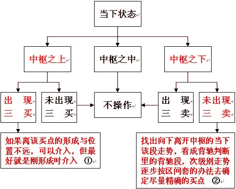 

 

 

 

 

 

 

 

 

 

 

 

 

很显然，由图可知，对于一个走势中枢来说，最有价值的买点就是其第三类买点以及走势中枢向下震荡力度出现背驰的买点。前者即①，最坏的情况就是出现更大级别的走势中枢，这可以用其后走势是否出现盘整背驰来决定是否卖出。一旦不出现这种情况，就意味着一个向上走势去形成新走势中枢的过程。这种过程当然是最能获利的。至于后面一种即②，就是围绕走势中枢震荡差价的过程。通过高抛低吸，可以降低成本、增加筹码。

 

## 第二十二节 走势分析中必须杜绝一根筋思维

一根筋思维的心理基础，就是企图找到一个永恒固定的公式，然后不管任何情况，只要套进去，就有一个现成答案。这种思维，把世界看成一个精密的机械，任何的运行，都等价于起点-结果模式，只要起点相同，就有相同的结果。这就是典型的一根筋思维。有些人，学本理论，本质上就是希望找到这样的东西，却不知道，法成则人成，人不成，法何成？

股票走势，归根结底，是参与者心理合力的痕迹。而心理，是不可重复的。几千万、上亿人交易的可复制性，是没有可能了。为什么？每天都是新世界，影响市场的因素，每天都在变化着，而这些因素对市场参与者的心理影响，更是模糊、混沌，由此产生的走势，很显然不具有任何百分百复制的可能性。

因此，从最开始的时候，就必须要有一个大的眼界，如果看 1 分钟就被锁在 1 分钟层面里，那搞 100 年都进步不了。所以必须动态地把握各种概念。例如，第三类卖点，这在不同的情况下，其操作意义显然是不同的。不妨以此为例子，仔细分析一下：

1、在一个大级别的走势中枢上移中，一个小级别的第三类卖点，唯一注意的，就是这个卖点扩展出来的走势，是否会改变大级别走势中枢上移本身。这里，根据大级别的走势，不难发现其界限。因此，这种第三类卖点的操作意义，就不大，关键是警戒的意义。如果是短线的短差，那也是小级别的走势中枢震荡中来回操作，因此这第三类卖点也只是构成一个震荡意义的操作点。

2、在一个大级别的走势中枢下移中，一个小级别的第三类卖点，其意义就是这卖点是否让大级别走势中枢的下移继续。如果继续，那就意味着这里没有任何的操作价值（当然，如果有卖空的，那是另算了）。这类第三类卖点的操作意义，基本没有。如果说卖，大级别都走势中枢下移了，好的卖点估计都过去了 N 的 N 次方个了，也就是说市场已经给你 N 的 N 次方卖的机会，你还没改正，那你大概更适合去卖豆腐了。

3、在一个大级别的走势中枢震荡中，一个小级别的第三类卖点，其意义就看这是否延伸出大级别的第三类卖点。如果没有这种危险，本质上不构成大的操作机会，只是一个短线震荡机会。而且，很有可能，一个小级别的第三类卖点后，反而延伸出大级别的买点，这在震荡中太常见了。

最后说的这种情况，就是多空通杀中经常用到的一种技巧。通杀，就是要把所有人的舞步搞乱。怎么搞乱？就是买点卖点轮番转折，而且模式不断变化，让不同的操作模式都被破裂一次。而这种舞步错乱的本质，就是要触及不同的突破、止蚀位置，让止蚀的刚卖出的又回头；刚买入追突破的马上给一巴掌。

本理论，从来没有任何止蚀之类的无聊概念。有什么可止的？三大卖点，给三次机会，加上不同级别的，机会 N 多，你都没反应，等到缺胳膊少腿才去止蚀，那是有病，回火星去吧。

而只要把握了本理论，那么第三那种情况，正好适合去凌波微步一番。这里，还可以更精确地分析一把。根据先后已经买卖点的级别，无非以下几种情况：

1、大买点后小买点

这种情况，后面的小买点，往往构成相对于大买点的第二次介入机会，但不一定是最精确的机会。因为最精确的机会，一定是符合区间套的，而并不是任何的小级别买点，都必然在大级别买点对应的区间套中。也就是说，这种小级别买点，往往会被小级别的波动所跌破。但这种终结，只要不终结前面大级别买点所有构造的大级别结构，那就一定会有新的小级别波动，重新回到该买点之上。

大买点后，必然产生相应级别的结构，因为后面的小买点，不过是构造这大结构中的小支架，明白这个道理，相应的操作就很简单了。

2、大卖点后小卖点

和上面那种情况反过来就是。

3、大买点后小卖点

如果两点间有一个大卖点，那么，就可以归到第 2 种情况去。如果没有，那么这个小卖点后，将有一个小级别的走势去再次考验或者确认这个大买点后形成的大级别结构，只要这个走势不终结该结构，接着形成的小买点，往往有着大能量，为什么？因为大结构本身的能量将起着重要的力量，一个结构形成后，如果小级别的反过程没有制造出终结，一种自然的结构延伸力将使得结构被延伸，这是一种重要的力量。

4、大卖点后小买点

和上面反过来就是

5、大走势中枢中的小买卖点

在一个大走势中枢里，是没有大买卖点的，因为出现第三类买卖点，就意味着这走势中枢被终结了。这种大走势中枢中的小买卖点，只会制造走势中枢震荡。因此，这里买卖点通说，就是这类买卖点，一般不具有小级别的操作意义，这是最容易把多空搞乱的。但是，其中有一种买卖点，往往具有大级别的操作意义，就是大级别走势中枢震荡中，次级别的买卖点。例如，一个 5 分钟的震荡里面的 1 分钟级别买卖点，就具有 5 分钟级别的操作意义。因为该买卖点后，无非两种情况：1、继续 5 分钟走势中枢震荡；2、刚好这次的次级别买卖点后的次级别走势构成对原走势中枢的离开后，回抽出第三类买卖点。这样，原来这个买卖点，就有点类第一类买卖点的样子。那第三类买卖点，就有点新走势的类第二类买卖点的样子了。（注意，这只是比喻，不是说这就是大级别的第一、二买卖点。）

注意，有些买卖点的意义是不大的。例如，一个 1 分钟的下跌趋势，在第二个走势中枢以后，相对的走势中枢的类第三类卖点，就没有什么操作意义了。为什么？前面第一个走势中枢的第三类卖点哪里去了？趋势，本质上就是走势中枢移动的延续。这种第一个走势中枢的第三类买卖点，本质上就是最后一个合适的操作的机会。后面那些如果还需要操作，那是证明反应有大毛病了。到第二个走势中枢以后，反而要去看是否这趋势要结束了。例如对上面 1 分钟下跌趋势的例子，跌了两个走势中枢以后，就要看是否有底背驰了，那时候想的是买点，不是卖点了。

而且，必须注意，对于趋势的转折来说，例如上面的 1 分钟下跌趋势，最后背驰转折后，第一个上去的线段卖点，很有可能刚好形成最后一个 1 分钟走势中枢的类第三类卖点，这时候，这个卖点，几乎没有任何的操作意义。相反是要考虑下来的那个第二类买点。很多抄底的人，经常在第一次冲起后就给震掉，然后再追高买回来，就是没搞清楚这种关系。如果你是抄一个 1 分钟级别的底，后面最坏有一个 1 分钟的盘整。连这盘整最基本的三个线段都没形成就跑，不是给震出来才怪了。

当然，有一种稳妥的办法，给那些对大级别背驰判断没信心的，就是都在第二类买点介入。当然，实际操作中，你可以完全不管第二类买点形成中的背驰问题。反正第一类买点次级别上去后，次级别回跌，只要不破第一类买点的位置，就介入。这样，只要后面的走势，在下一个次级别不破第一个次级别上去的高点，就坚决卖掉；如果破，就拿着，等待是否出现第三类买点。出现就继续拿着，不出现就卖掉。按上面的程序，你甚至连背驰的概念都可以不管，所以，分清楚走势类型，其实就可以完美地操作了，其他概念，只是如虎添翼而已。

 

## 第二十三节 机械化操作

一、基本概念

机械化操作，就是按既定程式来操作，并严格执行。

二、应用规范

1、既定程式：不妨从一个下跌背驰开始，（以一个 30 分钟级别的分解为例子，按 30 分钟级别的同级别分解）必然首先出现向上的第一段走势类型，根据其内部结构可以判断其背驰或盘整背驰结束点，先卖出，然后必然有向下的第二段，这里有两种情况：

1）、不跌破第一段低点，重新买入；

2）、跌破第一段低点，如果与第一段前的向下段形成盘整背驰，也重新买入，否则继续观望，直到出现新的下跌背驰。

在第二段重新买入的情况下，然后出现向上的第三段，相应面临两种情况：

a、超过第一段的高点；

b、低于第一段的高点。

对于第二种情况，一定是先卖出；

第一种情况，又分两种情况：

a、第三段对第一段发生盘整背驰，这时要卖出；

b、第三段对第一段不发生盘整背驰，这时候继续持有。

这个过程可以不断延续下去，直到下一段向上的 30 分钟走势类型相对前一段向上的走势类型出现不创新高或者盘整背驰为止，这就结束了向上段的运作。向上段的运作，都是先买后卖的。

一旦向上段的运作结束后，就进入向下段的运作。向下段的运作刚好相反，是先卖后买，从刚才向上段结束的背驰点开始，所有操作刚好反过来就可以。

2、操作级别：根据资金量和操作熟练程度、股性确定。

1）、1F 级别肯定不适合大资金运作，即使出现了买卖点，也未必能够买得进、卖得出。

2）、熟练程度低，反应慢，加上交易成本，过于频繁的买卖，不一定盈利。

3）、股性活跃度低的股票，小级别的买卖差价加上反应时间，不一定够交易成本，就没有操作价值。

3、选定级别的统一性：一旦选定了操作级别，就一定要严格按照该级别的买卖点进行操作。不能朝三暮四，打乱了操作节奏。例如：选定了 30F 级别，30F 以下的波动一概不考虑！这样讲并不妨碍运用区间套原理，在小级别里精确定位买卖点！这一点要充分地加以理解！

三、图示

股市里死掉的，大半是聪明人，越聪明的，死得越快。要在市场上生存，就必须远离聪明，因为，你的聪明在市场面前一钱不值。市场就如同一头牛，只有目无全牛，才可能随心解之而合其关节。在本理论中，机械化操作的本质就是目无全牛而合其关节，因为根据本理论，市场的结构已被彻底分解，站在本理论的角度，哪里有什么市场，不过是一堆关节。而机械化操作，就是逐步合于其关节的节奏，而不被全牛的繁复所影响。至于分解这市场的标准是什么并不重要，也就是分类的原则并不重要，关键这分类能导致完全分类就行。那些看不起分类的，永远只能在全牛的迷惘中可怜。为了方便理解，把它做成了图，这样就一目了然了，更便于操作。

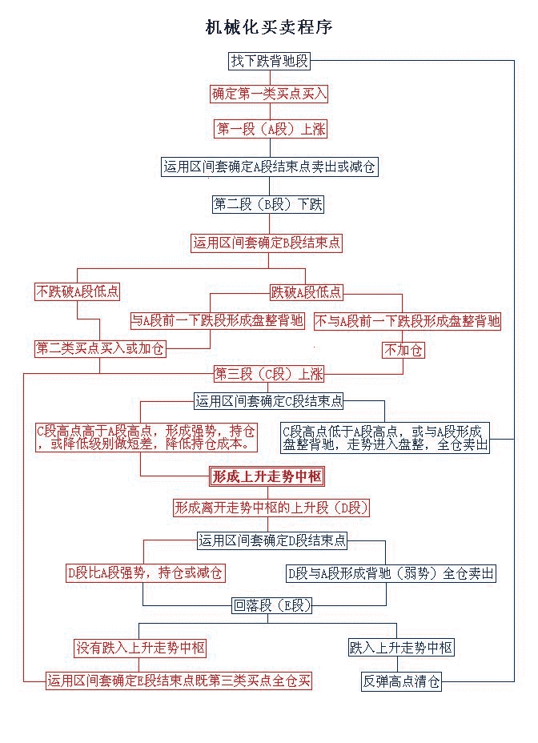 

 

## 第二十四节 操作中的一些细节问题

什么理论，最终都要落实到操作。而操作中一些细节问题，是必须要搞清楚的。

首先，你无论如何都应该能看到走势图，至于最小只能看到 1 分钟还是分笔图，甚至连 5 分钟都看不到，这问题都不是太大。其次，只要是正常的软件，没有不能看 MACD 的。有一个很重要的问题，很多人搞不清楚，就是怎么选择看几分钟的 MACD。必须明白一个道理，就是 MACD 的计算方法决定了，1 分钟和 30 分钟 MACD 之间并没有实质的区别，只是计算的周期不同而已，而相应的计算是线性的，只是稍微灵敏与迟钝的区别，没有太大的不同。问题的关键是，MACD 只是力度比较的辅助，因此，是先定好比较哪两段走势，然后才去选择看是 1 分钟的还是 30 分钟的更适宜辅助判断（关系到灵敏度）。例如，两段走势，在 1 分钟上形成很复杂的 MACD 柱子和黄白线变化，而在 30 分钟上是很明显的两个柱子面积以及标准的黄白线变化，那当然就选择用 30 分钟看。虽然由于 MACD 与 K 线价格相关，所以一般情况下，30 分钟级别的走势变化，经常对应在 30 分钟的 MACD 上，但这不能因此而改变先根据走势中枢与走势运动的分析，然后选出需要比较力度的走势段，最后才用 MACD 辅助判断的顺序原则。

以上是些小的技术细节，但更重要的，是一些操作心理上的细节。操作上，最开始，一定都是患得患失的。为什么一定要把理论搞清楚？就是先从根子上解开自己的疑惑，知道为什么本理论是如几何般严格精确的，否则，例如你对平面三角形内角之和为 180 度的证明有疑惑，一定要丈量每一个平面三角形去证明才舒服，这样，就永远有心理阴影，是无法去进行正常操作的。理论的探讨，是为了树立操作的信心，当然，还为了对走势有一个精确的分析去指导操作，但其心理层面的意义也是极为重要的。这绝对不能迷信，而是要从道理、逻辑等方法彻底搞清楚，这样才能无疑地去操作，而不用瞻前顾后。

用本理论对走势分析以及操作的绝对性有把握后，以后解决的都是一个操作精确度的问题。一个正确的理论，应用到实践中，特别是面对瞬息万变的市场，因为应用人的经验与心理状态，其结果自然有很大差异。如何提高操作的精确度，就是一个长期实践的问题。但无论如何，只有在操作中才能解决这个问题，否则永远都在纸上谈论，那是毫无意义的。

一个最常见的心理就是，看到是买点或卖点了，但买了还跌、卖了还涨，所以下次就不敢尝试了。这在操作不熟练的人中，太正常了。因为，对买卖点的判断，开始时，一定都达不到理论所确立的精确度。毕竟是人，总有盲点与惯性。例如对于习惯性多头来说，经常就是买早卖晚；而习惯性空头，就是买晚卖早。就算对理论在认识上没问题了，这种习惯性因数也会导致真正的操作与理论所要求的操作时间有偏差。要改变这种习惯性力量，不可能是一天两天的事情。

一般来说，应用理论开始实际操作前，要先看懂所有曾有的走势，能用理论对已有的走势进行分析，如果这都达不到，那当下去操作一定乱。这一步基础达到后，可以先不用真正买卖，可以进行一定的模拟，市场一周 5 天开着，当下去模拟操作，每次的操作都记录下来，然后不断根据后面的走势来总结，然后发现自己对理论当下理解上的问题，不断修正。当模拟操作有足够把握后，才开始真正的买卖操作。如果一开始就真正买卖，由于绝大多数人，在真的钱上都会方寸大乱，无论操作成功、失败，都会迷失在输赢上，而忽略了操作上的问题。

所以，首先要把静态的、已有的图形分析清楚，然后再进行动态的、当下的分析把握，最后才是实际的操作，这样就比较稳妥了。当然，这过程不是一两天完成的。本理论不需要各位的学费，但各位实际操作的时候，可能会交给市场一些学费。在市场上学习，先交点学费，然后不断进步，最后应用自如，都是很正常的过程。

所以心态要平稳点，不要整天去计算今天少挣多少诸如此类的问题，说白了，如果你没有一套有效的方法，只要你在市场里，你赚的钱从本质上就不是你的，只是暂时存在你那里。而要把自己培养成一个赚钱机器，就如同前锋把自己培养成射门机器一样，方法学了都会，但神射手却不一定都是，这需要更多的努力。市场的技术，是需要磨练的。关键是真正掌握技术，只要掌握了，赚钱就成了自然的事情，只要有足够的时间，就自然产生足够的钱，为什么？因为这已经被本理论如几何般严密地保证了。

另外，学本理论，并不荒废任何其他的东西，但那些东西都只能是辅助，甚至，你可以去听消息，去追炒概念，怎么都可以，但必须不能违反本理论。为什么？因为本理论是这市场真实的直接反映，违反本理论，最终都会被市场教训。如果不相信，那你就在本理论的第一买点卖，第一卖点买，来回坚持，如果按一个较大级别去操作，一般来说，N 次以后你就可以离开市场了。有了本理论，就算去跟风，追炒，都会有章法，都会进退自如。

 

## 第二十五节 具体走势的分析

看下面分析之前，不能太饿也不能太饱，不能太兴奋不能太不兴奋，否则一定晕。由于一般的图都没有这么复杂，所以看完之后千万别信心受到打击，而是应该信心百倍，知道只要精通本理论，这么细微、古怪的图，都可以当下精确分析并指导操作，从而对本理论关于走势的绝对把握性有一个更清楚的认识。后面就是要多看图，多磨练的问题了。

如果概念不清，看到这样的图，基本都要晕头转向。好了，大家开始深呼吸，放松脑筋，别抽筋了。

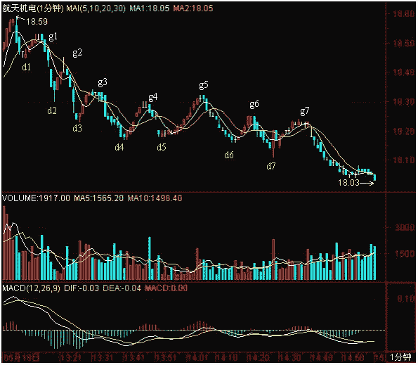 

这图有个条件，就是 d1=g2，d2=g4。其实这条件有还是没有，并不影响分析，但有这些条件，就会增加分析的难度。这里，就从 18.5 元（设为 g0）开始分析。

当你以某级别分析图形时，就先假设了次级别是线段。这图里，除了最后一个，其余每一个 dngn、gndn+1 都是 1 分钟以下级别的，所以都可以看成没有内部结构的线段。

我们就从 g0 开始，当下地进入图形中。显然，当下走到 g1 时，由于只有两段，所以不形成任何走势中枢，当然，如果你是一个分笔操作者，那么 g1 就构成一个第二类卖点了。当走势发展到 d2 时，一个 1 分钟级别的走势中枢就形成，区间是\[d1,g1\]。后面出现的线段，就要以该区间来决定是走势中枢震荡还是第三类买卖点。由于 d1=g2，那么 d2g2 这段就属于\[d1,g1\]走势中枢的震荡。而到 d3g3 这段，显然已经不能触及\[d1,g1\]，所以 g3 就是第三类卖点。当然，如果前面 d1>g2，那 g2 就是第三类卖点了。

其实，由于 d1=g2，所以当行情发展到 d3，就可以当下地用结合律对走势进行多样性分析。这时候，有如下等式：

g0g3=(g0d1+d1g1+g1d2)+d2g2+g2d3=g0d1+(d1g1+g1d2+d2g2)+g2d3

括弧里的是走势中枢。在后一式子看来，该走势中枢就是\[d1，g2\]，也就是一个价位，这时候，也并不影响前面关于 g3 就是第三类卖点的分析。而这种分解，比较符合一般的习惯，所以是可以采取的。

显然，以 MACD 辅助判断，力度上，g1d2>g2d3>g3d4,相对来说，后者都是前者的盘整背驰。当然，在 1 分钟图上，这种背驰都没有什么操作意义，但如果是日线、甚至年线图上，就有了。

分解图形，有一个原则是必须知道的：两个同级别走势中枢之间必须有次级别的走势连接。例如，g0d4= g0d1+(d1g1+g1d2+d2g2)+（g2d3,+d3g3+g3d4）这样的分解是不被允许的，因为括弧中的两个同级别走势中枢之间没有次级别的连接。（注意，这与下面三次级别构成走势中枢的情况不同，那种情况下，是允许三个括弧相加而之间没有次级别，因为那是扩展成高一级别走势中枢的情况，和这里两个同级别的情况不同。）

当行情当下走到 d4 点时，根据上面的原则，无非有下面两种可能的分解：

g0d4= g0d1+（d1g1+g1d2+d2g2）+g2d3+d3g3+g3d4= g0d1+d1g1+g1d2+（d2g2+g2d3+d3g3）+g3d4

d4g4 是盘整背驰后的正常反弹，针对上面第一种分解，这只是第三类卖点后向一个新的同级走势中枢移动或形成更高级别走势中枢的一个中间状态，g4d5 这段也是；针对第二种分解，由于 g4=d2，所以 d4g4 是（d2g2+g2d3+d3g3）的走势中枢震荡，d5g5 这段也是。

有人可能要问，在这种情况下，采取哪种分解？其实，哪一种都可以，但第一种，由于在中间状态中，没有一个确定的标准，所以对短线操作指导不足，而第二种，由于是走势中枢震荡，操作起来就指导明确了，所以从方便操作的角度，就可以用第二种。这就是反复强调的分解多样性的好处，一般来说，对于具体操作，一定要选择当下有明确意义的分解，例如是走势中枢震荡的，或有第三类买卖点的，但一定要注意，所有的分解必须符合分解的原则，否则就乱套了。

对于第二种分解，d5g5 这段属于走势中枢震荡，但对于第一种分解，d5g5 这段就有了一个重大的意义。因为那种第三类卖点出现后的中间状态，在 d5g5 这段出现后就彻底消除了，一个更大级别的走势中枢就给确定了。具体如下：

g0g5= g0d1+{（d1g1+g1d2+d2g2）+（g2d3+d3g3+g3d4）+（d4g4+g4d5+d5g5）}

三个小括弧里的 1 分钟走势中枢重叠构成了大括弧里的 5 分钟高一级别走势中枢。走势中枢的区间是\[d2，g5\]，注意，这时候，就要把 1 分钟的走势当成线段，小括弧里的都是线段，高低点就是这线段的端点。这样一来，后面的走势就十分简单了，例如，g7 就是一个第三类卖点（d7g7，其中 2、3 根 K 线有一个较大的回试，然后有 5、6 两个小十字星停在该区域，由此就知道这肯定构成 1 分钟走势中枢了，也就是内部可以画出一个 1 分钟以下级别的三段来，当然，具体的如果有 1 分钟以下图看就可以把握，特别对于级别大的图，这些时候都可以看小级别的图去确认，如果经验多的，一般看到这种情况，不用看小级别的都知道这么回事情。）

按照第二种分解，相应的 5 分钟走势中枢要到 g6 点才完成，这样：

g0g6= g0d1+d1g1+g1d2+{（d2g2+g2d3+d3g3）+（g3d4+d4g4+g4d5）+（d5g5+g5d6+d6g6）}

相应的 5 分钟走势中枢区间就是\[d3，g5\]，在这种情况下，d7g7 也是一个走势中枢震荡，但不构成第三类卖点，因为不符合条件。（为什么？本理论写了这么多，这么简单的问题，就当成作业请各位回答。）

注意，并不是说一定要形成该级别第三类卖点后才能大幅度下跌，完全可以用该级别以下小级别的第三类卖点就突破走势中枢，但有一点是肯定的，就是只要足够长时间，该级别的这第三类卖点一定会出现的，当然，在最极端的情况下，这个卖点离走势中枢很远的位置了，但有一点是肯定的，就是该卖点后一定继续向下。而上涨的情况相反，第三买点后一定继续向上，一个最好的例子就是 600477 在 20070409 日这个小级别的第三类买点，这买点离 2 月分的走势中枢很远了，但依然有效，而且还是在这么大监管的条件下，本理论继续发挥作用，为什么？因为那些监管并没有终结本理论成立的两个最基本的前提。还有的可以看 600837 在 20070206 的例子。至于暴跌的例子，现在很难找到，老一点的投资者应该都记得庄股跳水后，第一次反抽后再继续更大幅度下跌的例子，那就是第三类卖点。

必须注意，在这种大幅快速波动的情况下，一个小级别的第三类买卖点就足以值得介入。例如对一个周线走势中枢的突破，如果真要等周线级别的第三类买卖点，那就要一个日线级别的离开以及一个日线级别的反抽，这样要等到何年何月？因此，一个 30 分钟甚至 5 分钟的第三类买卖点都足以介入了。但这里有一个基本的前提，这种小级别的大幅突破必须和一般的走势中枢波动分开，这种情况一般伴随最猛烈快速的走势，成交量以及力度等都要相应配合。这种操作，如果理论把握不好，有一定风险，就是和一般的走势中枢震荡搞混了，因此理论不熟练的，还是先按最简单的来，例如对周线走势中枢的突破，就老老实实等周线的第三类买点。注意，卖点的情况，即使理论不熟练的，宁愿按小的来，因为宁愿卖早，决不卖晚。不过，对于大级别走势中枢来说，如果还要等到第三类卖点才卖，那反应已经极端迟钝了，那第一、二卖点去哪了？市场里可不能随地睡觉。

还有一种极端的例子，就是大幅度的走势中枢震荡，例如 5 分钟的走势中枢在 10000 元，最极端的，甚至可以次级别以下震荡到 0.01 元，又拉回来，即使连续跌停到 0.01 元，然后连续涨停到 100000000 元，再跌回来 10000 元，这也是 5 分钟的走势中枢震荡。当然，这么有病的例子也只能是理论中的，但由此可见本理论的涵盖面之广。所以走势中枢震荡的操作，一定是向上力度盘整背驰抛，向下力度盘整背驰回补，而不是杀跌追涨，否则真出现这么有病的情况，那就真有病了。

关于追涨杀跌，如果在走势中枢震荡中，一定死定。但如果是在第三类买卖点后，却不一定，因为走势中枢的移动，并不一定恰好就是你买卖的位置就结束了，就算是，后面也还有走势中枢震荡出现，因此，在这种情况下追涨杀跌，也有活的机会，但这都不是长远之计，为什么有好好的第三类买卖点不用，一定要追涨杀跌？就算是追涨杀跌，也可以利用小级别的买卖点进去，为什么一定要瞎蒙？

回到上面的两种分解，其实这两种分解对于 g7 点来说，结论是一样的，而从 MACD 辅助看，这种两次拉回 0 轴都冲不上去的走势，而且第二次红柱子还面积小了，这种情况也预示者后面有麻烦。但多种分解，其实并不是什么麻烦事，反而是相互印证的好办法。不过一定要再次强调，分解必须符合规范，不能胡乱分解。

按严格标准说，如果你能熟练地，无论任何图形，都能当下快速地按以上标准来分解并指导操作，那么对于本理论的学习，就大致可以小学毕业了。不过这样可能对信心不足或学习时分析能力比较一般的人打击过大，所以为了鼓励大家，本理论决定向教育部门学习学习，也来一个扩招，达到这种水平的，都统一发本科毕业证书，又鉴于最近北大已经堕落到连孔男人、李男人之流都可以教授教授了，所以决定毕业证书都统一成北大牌的，一律免费，这样大家应该可以放心学习了。

2、530 印花税当日行情图解

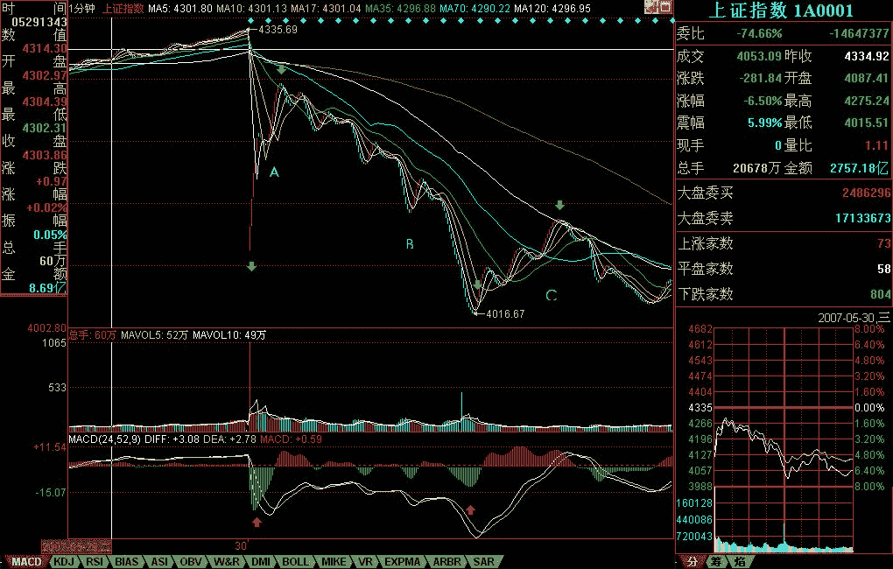 

本来不想说股票的，但知道现在说其他，大多数人也反应迟钝，被股票所迷惑了，所以还不如将错就错，就继续股票一把，说说昨天这 530 印花税当日行情如何去当下地分析。

本来这个问题十分简单，而且本理论一大早 7 点不到就发帖子提醒要在第二、三卖点把仓位减掉，很高兴看到不少人都能发现 9 点 48 那第二类卖点。注意，为什么同时强调第三类卖点，因为有些特别弱的股票，可能就是一个第三类卖点，大盘的走势是一个平均走势，而且当天比很多个股都强，所以大盘是第二类卖点，并不意味着个股是第二类卖点。

很多人大概到现在都不明白为什么本理论中要有三类卖点，其实，第二类卖点除了在小级别转大级别上比第一类卖点优越，在一些特殊的突发情况下，就是最佳的卖点。例如这次，就是一个很好的例子。因为 529 那天，虽然 30 分钟明显进入背驰段，但由于当天尾盘是高收的，所以用区间套定理并不能确认当时就是背驰了，毕竟还有第二天的走势。而晚上的突发消息，使得这个背驰被立刻确认，这时候，第一类卖点已经不可能在实际操作中存在，那么，唯一可以进行操作的，只能是第二或第三类卖点。这，在开盘前就可以有一个确定，也就是说，一旦大幅度低开，现实的、能被理论完全保证的卖点就是第二类或第三类卖点。

上图就是昨天走势的 1 分钟图。缺口，被看成最低级别的，而 1 分钟以下级别，在 1 分钟图上，被看成没有内部结构的线段，所以缺口和 1 分钟以下级别在 1 分钟图上是同级别的。图上绿箭头都指着两个 1 分钟以下级别的分界点，两相邻绿箭头之间都是 1 分钟以下级别的走势类型。其中 B 段，看似要形成 3 个 1 分钟的走势中枢，但由于每一个的第三段其实都是向下倾斜下去的，其实都是第二段向下的一部分，不能算是形成走势中枢。昨天走势其实就这么简单，就是 5 个 1 分钟以下走势类型的组合。

显然，这第一段的 1 分钟以下级别走势类型是以向下缺口的形成构成的，根据第二类卖点的定义，就知道，一旦一个 1 分钟以下级别的向上过程不能创新高或背驰，都将构成第二类卖点。因此，当图中 A 段走势出现时，一个构成第二类卖点的走势就当下地形成中。

有人可能有疑问，那怎么知道这 A 段一定构成第二类卖点而不是直接创新高强烈上升，这很简单，具体的方法和区间套定理是一样的，就是看 A 段的内部结构，一旦内部出现背驰而当时位置没创新高或与前面走势产生盘整顶背驰，那么就一定是第二类卖点。在昨天的具体走势中，A 段在内部出现上下上的内部结构时，其中的第二段向上明显出现背驰走势，这可以从成交量，或从第一个红箭头所指的 MACD 绿柱子与后面红柱子绝对值大小比较辅助判断。因此，这个第二类卖点，可以用理论完全明确地确认，一点含糊的地方都不会有。如果当时当下不能明白，那就要抓紧学习了，因为这个问题确实太简单了。

第二类卖点后，从第二绿箭头开始的 B 段走势，其力度就要和缺口那一段来对比，比较 MACD 上两个红箭头指的绿柱子面积，注意，第二个要把前面的三个小绿柱子面积也加上，可以看出，即使这个，后者的力度也不大过前者，由此就知道，B 段构成了盘整背驰，也就是后面的反弹一定回到第一个绿箭头位置之上。（注意，这里是 1 分钟以下级别的力度对比，只需要比较柱子面积，如果是 1 分钟级别的，就要同时考虑黄白线回抽 0 轴的情况。）而后面 C 段的走势也证明了这一点。此外，C 段的高点，用 C 段下方对应的 MACD 柱子高度对比不难用背驰的方法判断。由此，ABC 三段就有了重叠，因此就构成了一个 1 分钟的走势中枢，区间在 4087 到 4122 点。这就成了直到后面、包括明天走势的最关键地方，究竟是走势中枢震荡，还是形成第三类买卖点，进而构成更大走势中枢或趋势，都以此为基准。而这是被理论所当下严格保证，毫无可以含糊的地方。

有些更细致的地方，其实还可以说的。例如，C 段的高点，没有重回 B 段内部最后一个反弹的起始位置，这并不违反理论，因为在 B 段内部，最后一段向下并没有背驰，他的转折，完全是小级别转大级别造成的（由于级别太小，可以从柱子的缩短参考看出），这自然就不一定能回到最后一个反弹的起始位置。而在 B 段内部，从绿柱子一个比一个面积大，就知道前面的向下都不会形成背驰而使 B 段结束，因此就可以当下地等待最后跌破 A 段低点，形成 B 段与缺口段的盘整背驰。这个例子说明，一个大的盘整背驰段的内部结构，完全可以不必有该级别的背驰，完全可以小级别转大级别，昨天的图上就有这样一个标准的例子。

实际操作中，第二类卖点后，B 段盘整背驰造成的买点是否要参与回补，这和你的操作级别有关，如果是股指期货，这对应的是 100 点空间，当然是可以参与的，但由于 T+0，而且现在交易成本提高了，对于股票是否参与，这就与你实际操作的股票有关了，这必须根据自己的情况灵活处理。但只要你明白了小级别的情况，大级别的操作是一样的，而且大级别的安全性、可操作性更高，操作的频率也更低而已。本理论说这里的例子，只是让大家对理论能更清楚地了解。

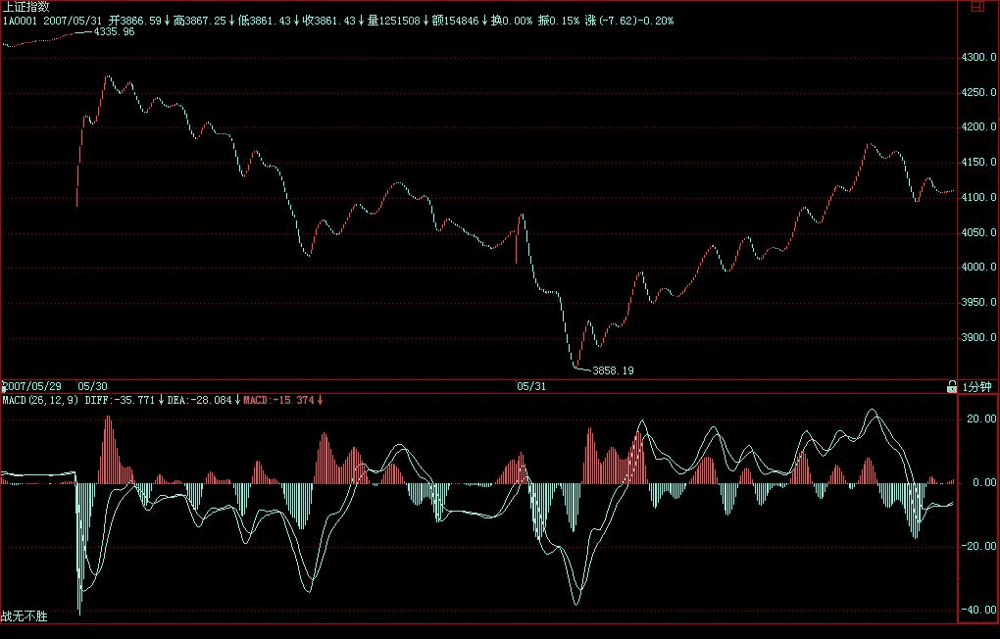 

附录：

明白了上面的文章，上图的走势如果都不能把握，那就要继续加班学习了。5 月 3 日 4087-4122 的走势中枢，今天一大早的上冲没有触及 4087 点，所以就构成了该走势中枢的第三类卖点。后面三波的下跌，与昨天的 B 段比，明显背驰，其内部，最后一波，在 1 分钟图上，绿柱子明显缩短，所以内部也背驰，根据区间套就可以当下定位 10 点 02 分低点。这是本理论中最简单的技术的，如果今天没能这样的分析的，请好好研究补习。

后面的反弹，如本理论所指出的，第三卖点后不趋势就构成更大走势中枢，所以现在原来的 1 分钟走势中枢已经扩张到 5 分钟走势中枢。区间是 4015 点到 4122 点，后面就是该走势中枢的震荡直到第三类买卖点出现。就这么简单，一点难度都没有。

大方面看，本理论反复强调的 1/2 线，依然是最重要的位置，大盘的强弱，以此为标准。目前，该线刚好在这次大震荡的中间位置上，由此就知道该线的意义有多大。在 5 月初的文章里已经明确说过，该线至少要管大盘 3 个月，这观点不变。

今天的月线收盘，已经足够好了，至少上影线不太长，比最恶劣的倒 T 要好多了，因此下月，至少有了很大的画图回旋的余地。注意，最近的行情，又将以质优的一、二成份股为主，三线股一定要等到大盘基本稳定下来，才会慢慢恢复元气。但明天和周一，今天反弹比较弱的，会逐步表现，这和轮动是一个道理。

明天是周五，消息面又成了最大的心理压力，整个市场震荡要稳定下来，要等到下周了。当然，这种大幅震荡，就是本理论的天堂，在这里可以得到比单边更大的利润。注意，别以为本理论只会震荡，而是该震荡的时候震荡，该单边的时候单边，这都不明白，就白学了。

3、部分由于管理层的夜半歌声，本周已经说了 4 天股票，本理论就来一个大满贯，再说一天，不过下不为例，天天说股票，一周说 5 天，各位不审美疲劳，本理论也烦了。

看到很多人还是发蒙，因此，就用这两天的 1 分钟图，继续说说怎样进行图解。当然，这些图解都是可以当下进行的。必须要再次强调，不熟练的投资者，一定不能全仓进行操作，基本的仓位应该拿着中长线的股票，部分仓位可以用来练习，否则全仓操作，一旦来几次半生不熟的折腾，到时候连本都没了。而且一定要注意，卖点是在涨的时候出现的，不是追杀出来的，如果你砍了地板价，那一定不是在卖点上。只要是赚钱的，就没有卖错，宁愿卖早，不要卖晚。如果卖错了，就不看这股票，除非有新的买点。

还有，有人误解，认为本理论的方法就是拼命弄短线，这些人大概是跟孔男人学的中文，所以就这水平了。用本理论的方法，如果你选择年线级别操作，那比巴菲特还巴菲特，大概一个年线的买点后，至少到等几十年才有卖点，你就拿几十年吧，就怕你拿不住。还有，如果你是按周线级别操作，那这两年，至少指数上你根本没有卖点。至于按 30 分钟操作的，在一个 30 分钟第三买点后的走势中枢上移中，如果这上移是从 10 元开始，只要不形成新的 30 分钟走势中枢，那么就算到了 100000 元，你还是要拿着，为什么？没有卖点。所以那些说学了本理论就拿不住股票的，自己好好反思一下，究竟你学了什么？

对着图，首先要确定最小分析级别，也就是说，这级别以下的都可以看成是线段，而站在最小分析级别的角度，每一线段就是其次级别走势类型，三个线段重合部分就构成最小分析级别的走势中枢。

当然这些线段本身，可能都属于不同级别，这问题在前面已经说过了。例如本图，最小分析级别先规定为 1 分钟级别的，所以所有 1 分钟级别以下的，都是线段，在图上标记着数字，所有的\[N，N+1\]，都是线段。有人可能要问，01 段是跳空缺口，23 段上上下下，很复杂，怎么都是线段？因为这都不是 1 分钟的走势类型，里面没有 1 分钟的走势中枢，所以都是 1 分钟以下级别的，虽然缺口是最低级别的，当然比 23 段这种要低级别，但在 1 分钟级别显微镜下，没有区别，都可以看成是没有内部结构的线段。当然，如果你要考察 23 段的内部结构，也是可以的，但那就不是站在 1 分钟级别的基础上了。

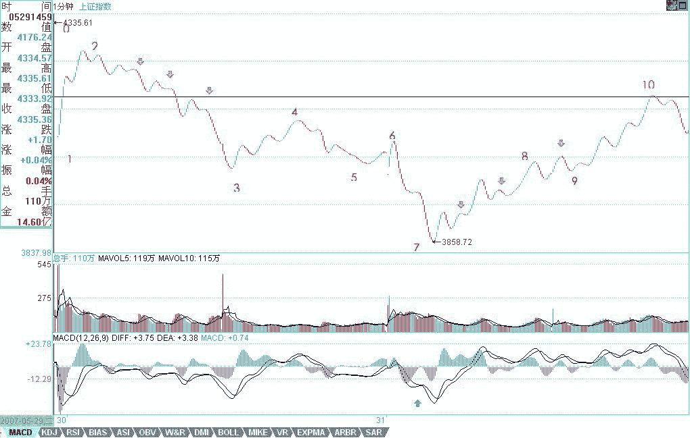由此可见，上图可以看成是 10 段线段构成的，线段中的波动，至少在分析 1 分钟级别的角度，就是可以忽略不计的。这里有一个地方是可能有疑问的，在 23、78 段 5 个带绿箭头指着的地方，似乎可以看成是一线段，但为什么没有？因为在这似乎是三段的结构中，第三段的都太微弱，把图形缩小后几乎就看不到了，对比一下 89 段带绿箭头的地方，这第三段就明显不同了，所以这是一个 1 分钟以下级别的上下上结构，而前面的不是。当然，如果你一定要说 78 段那箭头的地方很明显，那么 78、89 就合成一线段的上涨趋势了，这也可以，只是如果你是按这个标准的，那么所有和 78 段箭头位置微弱程度一样的，都要这样处理。本理论还是按图上的标记线段。

线段有了以后，一切都好分析了。当然，在当下时，例如在今早 9 点 30 分钟，是没有后面的线段的，但线段的标准，是一样的。你可以很精细地分析 56 段，是一个上下上的内部结构，其中下一段是跳空缺口，但无论如何，这就是一个线段。不过，由于前面 12、23、34 构成的走势中枢只有 1 分钟级别的，那么其构成第三类卖点的次级别就是 1 分钟以下级别的线段，这时候，就要考察一个有上下上结构的 1 分钟的次级别结构了，而 56 段显然符合这个结构，有明显的上下上，而 45 段也是符合 1 分钟次级别的要求的，注意，当考察 1 分钟的次级别时，就不能笼统地把所有 1 分钟以下的都看成 1 分钟的次级别了，因为这里的视点已经不同。显然，这个的 45、56，就构成了标准的次级别离开走势中枢与反抽走势中枢，而这 1 分钟走势中枢的区间是\[4087，4122\]，而 56 段只到了 4077，所以这就是第三类卖点了。

当然，在具体操作中，还可以特别精细地去分析这个问题，56 段里的上下上，后上对前上的力度，从下面对应的 MACD 的柱子面积比就可以判断出不足来，因此这里就有很小级别的背驰，这都可以用当下分析的，当然，这样的精确度，需要操作者十分熟练并且反应与通道都十分快，并不要求每个人都有这个可能，这里只是进行分析，对大的级别，道理是一样的。

同样道理，67 段里的内部结构下上下，后下力度也比前下弱，这从下面红箭头所指两绿柱子面积的对比就可以知道，所以这内部就有了背驰。注意，这 67 中的上，幅度上也很微弱，但时间比较长，是一个小的时间换空间的反弹，所以是可以看成一个上的，更重要的是，这上使得绿柱子回缩到 0 轴，这就更证明了这是一个不能忽视的有技术分析意义的反弹。

当行情走到 6 点时，34、45、56 这三段，就可以看成是一个 1 分钟走势中枢了，当然，这种分法和原来\[4087，4122\]走势中枢的分解不同，但站在多义性的角度，这是绝对符合结合律的，当然是一个分解的方法。这分法，就使得 23、67 成为这走势中枢的一个震荡，从而可以用力度的方法来发现背驰。对于 23、67 下所有绿柱子面积之和，显然后者小，所以就知道，67 只是针对\[34、45、56\]走势中枢的一个震荡，必然至少回抽走势中枢附近，而对 67 内部用区间套的方法进行精确定位，具体的看上一自然段的分析。按这种方法，7 那买点的把握，就是很简单的事情了。注意，这都是可以当下分析的，根据当下的走势，自然就能把握。如果那 7 当成是第一类买点，那么 9 就是第二类买点了，这符合次级别上，次级别下，不创新低或盘整背驰的定义，对比一下 2 点和 9 点，一卖一买，都是第二类的。当然，在 78 里，其中的下也是一个第二类买点，但该买点的级别比 9 这点要低。

显然，这 10 个线段，已经组成了一个更高级别的 5 分钟走势中枢，结合方式如下：（12+23+34）+（45+56+67）+（78+89+910），该走势中枢的区间是\[4015，4122\]。这一点其实由 6 这个第三类卖点的存在以及后面的背驰，就可以知道，这走势中枢级别的扩展，是必然的。

注意，这是为了示范才分析 1 分钟的图，这类图是最复杂的，一般来说，级别越大的图越简单，而操作上，技术不好，通道不好的，一般不用 1 分钟的图，把级别放大点，这点必须明确。

附录：

今天的走势就是\[4015，4122\]的走势中枢震荡，至少指数是不难看明白的。周五出现这样的走势很正常，各种心怀鬼胎的到处散播这消息那消息，散户当然如惊弓之鸟了。但今天的走势，对今后是有利的。这次的问题并不在于国家公布了什么，而是其公布的手法，如此手法，必须得到严惩，一个最直接的压力必须让用这种恶劣手法的人承担：一个骂名。周五开始，舆论将逐渐转向，一轮新的反思将开始，注意，管理层也不是一言堂。还要注意一点，这两天同时公布的是财政部国债的发行，所以，经过这次风险教育，应该能分流些人去买国债了。

不过散户确实需要有点教育，前段时间，不是有人叫嚣散户已经统治市场了？但跌两天，散户就蔫了。大资金永远都是市场的中流砥柱，没有大资金，没有这几天的聚会，像这几天北京股的走势能出现？看那些企图限制大资金的政策还出不出？有些大资金，那些管理层换了几茬了，依然屹立不倒，不断壮大，这些脑子进水的政策，除了害散户，能害得了谁？周末，这样的局面，就让管理层去收烂摊子，如果他们还喜欢这边打压，后面又来救市的游戏，那就玩吧，这种游戏已经 10 几年了，真正的牛人，只会在这种游戏中越来越牛。

但对于散户，这几天确实心理压力大了点，但这其实也没什么，本理论前面反复提到这样的典故：96 年连续 3 天指数跌停，后来还创出新高。所以，530 那天公布消息，本理论一大早 7 点不到就上来，告诉一定要在第二、三类卖点卖掉，没卖的，那就算了，到今天还卖什么？大反弹是必然有的，以后的位置一定比这个位置高，关键是该走的时候，就不要有幻想。

注意，那种杀已经跌了 30%，去追买不跌反涨的所谓强势股，知道有补跌这种概念吗？在混乱的市场中，更应该专一。可以很理性地讨论这个问题，一个股票下跌 40%，第一次反弹回 20%，出一半或 2/3，下来再买回来，再一次反弹上去，基本走的位置，就和没跌的时候差不多了，如果你现在有资金，在一股票下跌 40%时补仓。这股票又不是什么被查庄股，那么，这种的操作基本风险很小，如果技术再好一点，看准一些买卖点，那么基本就等于高位走掉了。当然，以后再碰到这种情况，一定要在第二、三卖点出掉，那天，有多少人辜负了本 ID 7 点不到就上来发帖子？

其实，纯技术上，现在的大走势并不坏，六月的调整没什么可说的，本理论那 1/2 线，现在也在 4144 点了，下面，这次上涨 1/3 的位置在 3734 点，这位置是第一支持位。没有特别的事情，这位置有很强支持。否则就要考验一半的位置，3434 点。但至少现在，没有任何看到该位置的理由。

从短线上看，还是\[4015，4122\]的走势中枢震荡，有技术的，继续按这震荡操作。下周最大的机会，就是暴跌个股的大反弹，特别注意那些下跌到年线、半年线等关键位置的个股，这些反弹的力度会厉害点。

大浪淘沙，能从容面对本周情况的，是你投资生涯重要的一课，好好珍惜、体会。

4、大盘大跌，除了清洗筹码，还可以清洗一下人。本 ID 说过，这里没必要有这么多人，来这里的，如果不是希望成为猎鲸者的，就没必要来了。那种跌个 40%就惊慌失措的，也不大适合市场。市场从来都是血腥场所，见不了血腥场面的，还是把钱好好去买国债，这样比较安心。股票就是废纸，该卖的时候不卖，把股票当宝，这就是投资的最大软肋。如果你看图形操作时，做不到无我无股票，只有走势图形，那基本可以不看图了，因为有我有股票，被自己的贪婪恐惧所牵引，你看的图，也不过就是自己的贪婪与恐惧，那何必看图？

说一个最简单的例子，就算你没技术，只按最简单的跌破 5 日线走，那请看看你该在什么时候走，且不说对于具体的个股了。这次是一个很好的实习机会，请回想一下那些卖点时，你自己究竟在干什么？心里是不是有很多幻想，被幻想蒙蔽了眼睛？看图操作，唯一的对象只有图，谁说都没用，市场是当下发生着的，没有人能替你去反应。

先把市场放一边，继续图解分析，把这次跌势的图形连续分析下去，这样大概对各位的理解与分析有一定的帮助。请看下图：

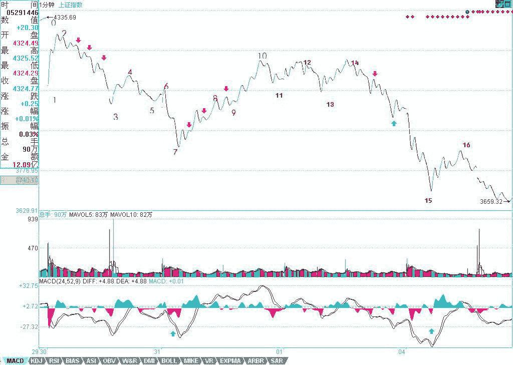各位可能还会对如何去确定线段有很大疑惑，图上已经用数字标记了从 30 日开始的 1 分钟图上的线段。为什么这样标记？例如 14-15 间带红绿箭头这一段为什么不是线段？这很简单，因为这段中的下-上-下-上-下中，没有任何的重合，也就是第二个上的终点没有触及第一个上的起点，这种图形，和直接的一个下没有任何区别。而一个线段，除非是缺口，否则必须由至少上-下-上或下-上-下的三折组成，只要互相相邻的上或下不重合，则这个模式可以一直延伸下去而依然还是一个线段。这里就不难明白 14-15 为什么只是一段线段了。

那么为什么 14-15 这线段不构成合适的买点，因为在下面的 MACD 辅助中，可以看出这一段的力度比前面所有的都大（这从黄白线就一目了然了），那当然不构成任何的 1 分钟以上的背驰，最多就是 1 分钟以下最小级别的背驰。在 15 下 MACD 小红箭头处，比较绿柱子的面积，就可以发现这个小的背驰，因此就有了 15-16 的反弹，该反弹在 14-15 最后一个上附近受阻，十分技术。

而站在 10-13 构成的 1 分钟走势中枢来看，15-16 这反弹反而是构成一个第三类卖点，本理论看了一下留言，有叫 CCTV 也看出这个是一个第三类卖点，但他的理由好象是这反弹没突破 7 这点所以是第三类卖点，这是不对的，因为如果是那一点，那对应的走势中枢就乱了。注意，第三类买卖点必须是次级别离开，次级别反抽，而且是针对该级别中最近那个走势中枢，而以前也曾说过，对于一些快速变动的行情，往往第三类买卖点离开的距离会很远。

从 16 开始的一段，有进入背驰段的可能，但由于明天的行情没有开始，所以如果明天突然加速下跌，就可以终结这可能，所以具体是否背驰成立，还要看明天走势的内部区间套的当下定位。如果出现背驰，那么一个反弹至少重新回到 15 这点上，这样就从 15 这点开始至少形成一个 1 分钟的走势中枢了。

而对于 1-10 这个 5 分钟走势中枢，该反弹如果不能重新回到 4015 之上，那就会形成一个 5 分钟的第三类卖点。从目前的情况看，这种可能性有很大，所以这也预示着，今后几天，任何在 4000 点下的反弹，都会构成一个卖点并至少引发一个更大级别的走势中枢，甚至是新一轮的下跌，除非这反弹能重回 4000 点之上。显然，从走势中枢的分析中，可以很绝对地分析出今后一段走势的一些操作性质。

站在更大的层面上，大盘要重新站稳，就要形成一个较大级别的走势中枢，而从 10 开始，一个新的 5 分钟走势中枢都没形成，如果新的 5 分钟走势中枢最终和 1-10 这个 5 分钟走势中枢没有重合，那么就形成一个 5 分钟级别的下跌，那其后的压力就更大了，所以，那 CCTV 也蒙对了一点，就是 7 这点有这极强的技术含义，如果一个 5 分钟背驰引发的反弹都能重回该点之上，那么大盘的走势就会有好转的可能，否则短线压力依然。

别看本理论的分析似乎很复杂，但其中绝对条理清晰，每个结论都是严格，没有任何含糊的。但关键，首先要把图给分解对，否则就乱套了。这点必须多看图，多实践。所以，今后一段课程，都继续把这图分解下去，至少看到一个日线走势中枢的生成为止，有这样的具体分析，对各位的理解和把握应该有所帮助。

附录：如果你还看不明白昨天说的背驰段，然后今天如何精确定位的，那就好好学习吧。上图的 19 段结束位置是 3404 点（为什么，如何当下去判断，好好研究好，这是真工夫），后面的走势，上面已经提及，下午走的是第 20 段，该段结束后，就进入上面说的走势中枢震荡中。明天的任务，就是看好这第 20 段的结束。

大走势，就是月线的 5 均线，今天盘中假突破，而且还是 3434 点一般的位置，这不难看出来。

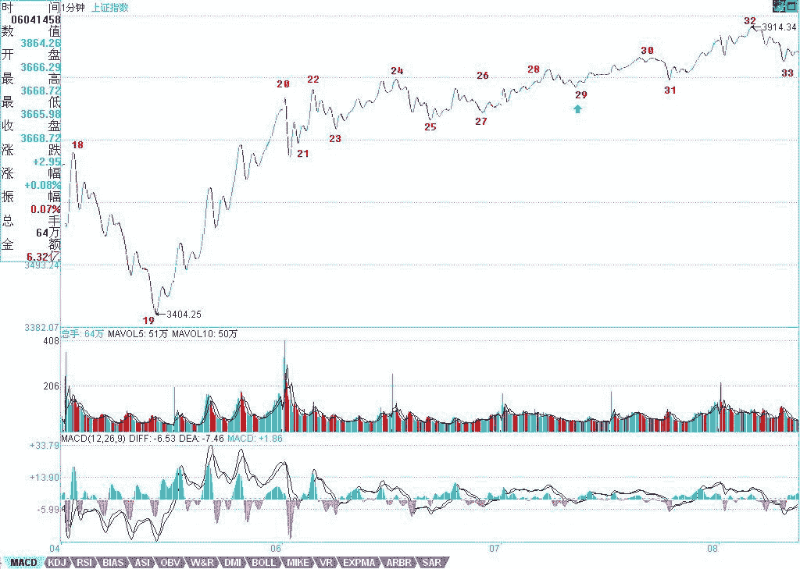5、出差，必须用三张图才能把落下的走势补上。对于初学分析的人，最难搞的就是分清楚线段，所以，在每张图上，都继续用数字标记每一段线段，从中不难学会究竟线段是如何分的。

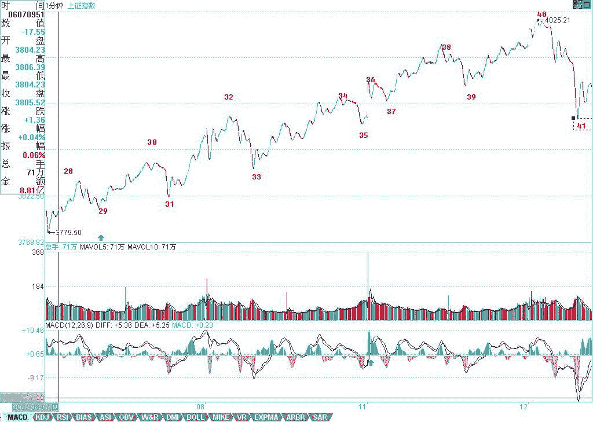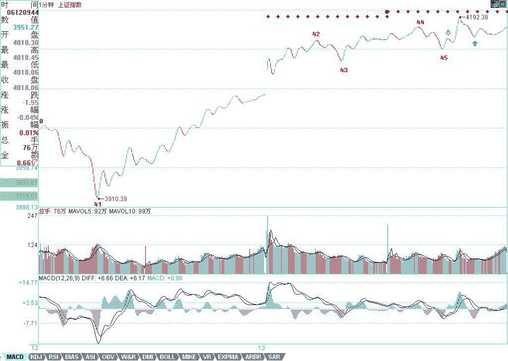

有人可能要问，为什么有些线段延续上百点甚至更多，而有些很短。这没什么奇怪的，是否线段，关键看走出来的形态，如果任何低点比前一个高点都高，那么即使这情况无限延续下去，也依然只是一线段，这和幅度没关系。还有，前后两线段间，不可能是同向的，同是向上或向下不可能构成两个前后相邻的线段。而且，由于线段都至少呈现上下上或下上下，所以线段不存在一条直线走平的可能，由此也知道，为什么一字涨停，无论如何延续，还是低于线段的级别，是最小级别的。

上面三张图，图一中，20-23 构成的 1 分钟走势中枢产生延续，29 是这走势中枢的第三类买点。图二中，33 是 28-31，37 是 32-35 的 1 分钟走势中枢第三类买点。图三中，由于红箭头处比绿箭头高，所以不能确定该线段已经完成，还要看后面走势，由此可以知道如何去把握线段的结束：一般来说，线段的结束与大级别的走势段是一样的，在趋势中用背驰来确认，其它情况用盘整背驰来确认，如果有突发性事件，就要看第二类的买卖点，其道理是一样的，只是所用到的级别特别小而已。而对于图三，后面的走势，与 42-45 的 1 分钟走势中枢相关，无非就是走势中枢震荡直到出现其第三类买卖点。

注意，在前面一课的 7-8-9 中，由于 8 下来的低点 3994.57 与 7 中最后一个高点 3994.21 极为相近，如果点数只用到个位的精度，两者就完全一样的，所以在这种情况下可以看成是有重合的，因此可以分成三个线段。当然，如果精度要求到小数点后两位，那么这 7-8-9 其实可以看成是一个线段。一般来说，如果这两者如此相近，而且 8 中也带着明显的下上下，所以还是看成三线段比较好。当然，如何看，关系到你事先确认的精度，关键是统一去看，至于按哪种精度，都没有任何实质影响。

有人可能又要问，怎么总是说 1 分钟的图？其实，看什么图并不重要，从 1 分钟图看起，只不过意味着这分析的基础有一个 1 分钟图的精度前提，在这个前提下，当然要看 1 分钟的图，而这不影响对大级别的分析。例如，1-19，就构成一个 5 分钟的走势类型，而这走势，最终确认并没有形成两个 5 分钟的走势中枢，所以只能算是一个盘整。而从 19 开始到 45，由于 41 低于 32，所以这走势至少有一个 5 分钟的走势中枢，但这新的 5 分钟走势类型并没有最终完成。

对于 19-45 这个未完成的 5 分钟走势类型，可以进行仔细的研究。由于 29 比 24 低，则 22-31 也构成一个 5 分钟走势中枢，而该走势中枢，就对应着另一种分解。但无论如何分解，19-45 至少是一个未完成 5 分钟走势类型的结论不变。当然，站在这种分解下，41 就是 22-31 这 5 分钟走势中枢的第三类买点。因此，如果 41 开始的上升最终形成 5 分钟走势中枢后不与 22-31 这 5 分钟走势中枢重叠，那么这 19 开始的走势类型就是 5 分钟的上涨趋势了。

由上面的分析，对短线的走势就有一个明确的结论，只要关于 42-45 的 1 分钟走势中枢的震荡不出现第三类卖点，或者即使出现，但其后扩张的走势不触及 22-31 这 5 分钟走势中枢震荡区间，那么大盘的震荡就是强势的，即使最终形成 30 分钟以上级别走势中枢，也是至少是围绕 42-45 的 1 分钟走势中枢发展而来。否则，大盘将以 22-31 这 5 分钟走势中枢震荡区间为基础扩张出 30 分钟级别的走势中枢来，相应的走势就比较弱了。而具体的操作，可以按照走势中枢震荡的手法，根据自己操作的级别，选择相应的走势中枢级别进行操作。

附录：今天的走势没什么可讲的，技术、心理、政策等压力，都需要在这里震荡消化。由于今天没完全补上缺口，因此该位置依然是短线的关键，当然，上面说的 42-45 的 1 分钟走势中枢，已经延伸 9 段，成为一个 5 分钟走势中枢了。深圳受到 13700 点的吸引，短线，能否站稳该线对大盘走向有极大的引导作用。

注意，在走势中枢震荡中，安全的作法应该是先卖后买、形成节奏。其实这问题很简单，从低位上来的筹码，当发现单边走势结束，进入较大级别震荡时候，其标志就是出现顶背驰或盘整背驰，这就要求减磅，然后等震荡下来，出现底背驰或盘整背驰再回补，这样差价才出来，成本才下降。如果是先买后卖，那唯一可能就是在单边的时候，你的仓位不高，所以才会不卖股票也有资金，这其实是节奏先错了的表现。

当然，这些都需要通过练习才能熟练。而且必须注意，一旦震荡的力度大于前面有可能形成第三类卖点时，就一定要停止回补，等待第三类卖点引发的下跌出现买点时再介入，很多人经常出问题，就是心里先假设一个可能的跌幅，觉得肯定跌不深，这都是大毛病。一定要养成只看图形操作的习惯。

还是那句话，无论是政策、心理、消息等，都是市场的分力，而走势是合力的结果，这才是问题的关键处。

6、其实，枯燥的图形，里面包含着很深的心理学意义。走势，本质上是预期的合力。而预期，本质上是心理层面的。只不过对于市场来说，可以被当成分力去形成市场合力的预期，都是被外化为市场买卖行为的。

你的恐惧，如果光是在那里恐惧而没有实际的行动，那并不构成市场的交易行为。因此，所有市场行为，其实已经被如此的心理模式给过滤一遍了。

举一个简单的例子，同级别走势从 B0 下跌到 A1 反弹到 B1，再跌破下跌到 A2，再反弹到 B2，这可以分为两类：一、B2 低于 A1，二、B2 不低于 A1。显然，第二种情况，会构成某更大级别的走势中枢，而第一种情况没有，因此这两种情况是有着本质区别的。在心理层面上，A1 这第一个反弹的起点，有着很强的心理暗示意义，而再次的跌破，使得这 A1 的价格成了一个很重要的心理位，而交易本质上都是预期的，这价位就构成了一种实在的预期分类：一、预期能重新上去 A1 并实际交易，二、预期不能重新上 A1 并实际交易、三、观望。第三种，在实际的走势中不产生实际的交易，因此一、二种心理预期构成了市场合力，而市场的走势是这合力的当下痕迹，因此这两种心理预期的大小，并不需要实际去测量，因为市场的走势就实际反映出来了。例如，如果实际上不能重新上去，出现第一种 B2 低于 A1 的情况，那么显然在当下的情况下，第二种心理预期大于第一种。

消息面、政策面、资金面，这面那面，最终作用的都是人心，人心因预期而交易，这里关系的就是人的贪婪与恐惧、人的贪嗔痴疑慢。而本理论从不预测，没有预期，只跟随着市场合力、市场走势而行，这里无须贪婪恐惧，看图作业，如此而已。但光知道这点还远远不够，因为没有预期可能就是最大的预期，没有贪婪恐惧可能就是最大的贪婪恐惧。不预测、不预期，并不是不可预测、不可预期，而是不为贪婪恐惧而预期、预测，是根据走势的自身规律来。

走势是有规律的，这规律是不患的，这不患的根源在于人贪嗔痴疑慢的不患。为什么本理论要强调当下分解的多样性？因为走势本身就是当下形成中的，是市场各种预期的合力当下画出来的，而每种画法都是不患的，都是源自人的贪嗔痴疑慢，因此每种多样性的分解都是符合理论的，多样性不是模糊性，而是多角度去让市场本身自己去画地为牢，由此使得市场的走势万变不离本理论的控制之中，而这，恰好是市场自身的规律之一。

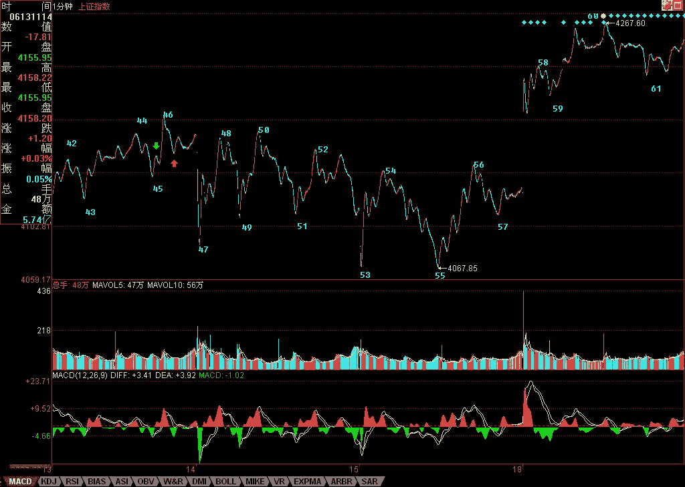 

不妨看看上图，上一课刚好说到“红箭头处比绿箭头高，所以不能确定该线段已经完成，还要看后面走势，由此可以知道如何去把握线段的结束”，有人可能问，为什么在这个位置不可以去预测、预期？因为市场自身并没有完成。但这里的未完成，是站在人观察的级别上说的，因为所谓的走势，首先是你观察的走势，没有离开你观察的走势。不同倍数的显微镜下的世界是不同的，但市场操作的成本、交易通道、资金规模等限制了人观察并能实际操作走势的显微镜倍数不可能无限小下去，所以必须确定一个最低级别的线段，把其下一切波动给抹平了。当然，根据严格的理论，用每笔成交当成最低级别，然后以此构筑线段，这样可以严格地分辨任何级别的走势，但这根本不具有操作性，特别现在交易成本增加，可操作的级别必然要增大，因此，一些可操作级别下的波动，必须要忽视掉。

站在最严格意义上，45-46 线段构成 43-44 线段的盘整背驰（注意，力度比较的是下面所有红柱子的面积之和。）而细致分别线段以下级别，就知道 45-46 其实是一个小级别转大级别，而红箭头后第一次拉起不创新高，就可以出掉了，为什么，因为后面必然形成下上下的重叠结构，也就是有一个小走势中枢了，而线段以下级别的同级别操作，是不参与这类走势中枢的。当然，这是按最严格的，并没有太大操作意义的分析。而实际的操作中，大概真在有意义的操作，都至少是 1 分钟以下线段级别的。因此，在该图中，如果你是按 30 分钟级别操作的，46-47 的波动就可以不管的，从 3404 开始的反弹，一个标准的 5 分钟级别的上涨，因此你的持有就至少一直等待这 5 分钟级别的上涨出现背驰或突发终结为止。

显然，46-55 是一个 5 分钟的走势中枢，55 跌破 53 后明显盘整背驰，各位也不难发现，如果把 55 当成第一类买点（严格来说，盘整背驰无所谓第一类买点，只是这样来类比），57 就是一个第二类买点。55-60，是一个标准的线段级别的上涨，59-60 的背驰足够标准，看看下面 MACD 标准的黄白线回拉 0 轴，然后 60 新高，而柱子面积与黄白线高度都比前面不如，由此就知道了。因此，按照理论，60 后必然有调整回拉 58 之下，而实际上 61 就比 58 低，也就是说，58-61 形成一个新的 1 分钟走势中枢，该走势中枢是否扩展成 5 分钟的，以及上一个 5 分钟走势中枢的最高点，也就是 46，是否被重新跌破，都是今后走势的关键。如果 46 不再被触及，那就是超强走势，意味着 3404 点开始的 5 分钟上涨走势依然延续。

这里必须强调突发消息对市场走势以及操作的影响是不必过于在意的，本质上，任何突发的消息，不过增加了一个市场预期的当下分力，因此，最终还是要看合力本身，或者说是市场走势本身。一般情况下，由于背驰的精确定位需要用区间套的方法，所以突发消息，最不幸的，就是在这精确定位期间出现，例如这次 530，就是这样。当然，这是一种小概率事件，更多情况，突发消息在背驰的精确定位后出现，这样突发消息对操作的影响就是 0 了。而对于那种最不幸的情况，用一个第二类卖点就足以应付，因此，突发消息出来后，在实际的操作中就不能放过这第二类卖点。不过要注意，并不是任何第二类卖点都需要反应的，这和级别有关，例如你是月线级别的，那这次所谓的大跌，看都不用看，爱跌不跌，随他去。即使你是 5 分钟级别操作的，如果某突发消息连一个 1 分钟的走势中枢都没终结，只制造了 1 分钟以下级别的震荡，那么在所谓的第二类卖点，也是不用管的。原则很简单，任何消息，都只是分力，关键是看对合力的影响，看他终结了多大级别的走势，这一切都反映在实际走势中，看图作业就可以了。

注意，突发消息终结的级别越大，越不一定等相应级别的第二类卖点。例如，一个向下缺口把一个日线级别的上涨给终结了，那么，消息出来当天盘中的 1 分钟，甚至线段的第二类卖点，都是一个好的走人机会，如果要等日线级别的第二类卖点，可能就要等很长时间、而且点位甚至还比不上这一点，因为走势是逐步按级别生长出来的。还有，级别只是区分可操作空间的，为什么按级别？因为级别大，操作空间按通常情况下就大。但在快速变动的行情中，一个 5 分钟的走势类型就可以跌个 50%，例如这次大跌，因此，一个这样的 5 分钟底背驰，其反弹的空间就比一般情况下 30 分钟级别的都大，这时候，即使你是按 30 分钟操作的，也可以按 5 分钟级别进入，而不必坐等 30 分钟买点了。

附录：今天的走势昨天已经说得很清楚，4224 点下不出现第三类卖点，就是强势震荡。今天的走势，显然符合这个要求。4224 点，就是上图 61 这位置，从 60 开始的 1 分钟走势中枢\[4224，4254\]，今后两天就看这走势中枢的第三类买卖点。换言之，还和昨天说的一样，只要不在 4224 点下出现 1 分钟级别的第三类卖点，那就是强势，至于大盘要展开新一轮上攻，就要在 4254 上出现 1 分钟级别的第三类买点，否则大盘就在该区间内震荡继续走势中枢震荡延伸。

关于大盘的剧本不变，但个股之间显然会有分化，因此不能光看大盘，现在的股票，在技术上无非几类：一、创新高后回试的，这可以用第三类买点来把握；二、在前期高位下盘整蓄势的，这可以用小级别的第三类买点把握其突破，或在震荡低点介入；三、反弹受阻拉平台整理的，这个第二同样处理，只是位置与前期高位有距离；四、依然在底部构筑双底、头肩底之类图形的，这可以用第一、二类买点把握。

7、区间套定位标准图解

有些无聊问题总是被提着，诸如走势中枢的意义是什么？对于一个实际操作者来说，走势中枢的意义就是没有意义，而没有意义就是最大的意义，因为你只要根据走势中枢的实际走势去反应，问题的关键是你去看明白走势的分解而不是走势中枢的意义，更重要的就是根据走势的分解去采取正确的反应。如果孔男人之类的文科生想探讨什么走势中枢意义，那么就让他们探讨去好了，就如同基督教的神甫千百年来 YY 上帝的意义一样，对于本理论来说，上帝有什么垃圾意义并不重要，关键是如果真有什么上帝，那么也只是被面首的对象。股票是用来操作的，而不是用来意义的。

还有些人不断地问，为什么 1 分钟的顶背驰，有时候跌幅很大，有时候很小，究竟什么时候该走？这种问题是典型的垃圾问题。如果你的操作级别是 1 分钟级别的，那么 1 分钟的顶背驰你就该走了，至于后面的跌幅是大是小，和你有什么关系？你只要耐心等待市场走出新的 1 分钟底背驰就可以。反之，如果你的操作级别是月线的，那么 1 分钟的顶背驰和你有什么关系？你既然已经决定是按月线进出的，那么 1 分钟级别的所有震荡都是可以接受的，可以忽略的。别说 1 分钟的，就算这次 530 所谓的大跌，如果你真是月线级别操作的，看都不用看，这种级别的震荡根本就在月线可忍受的范围内，只有那些如孔男人那样的文科生才会认为本理论只能看 1 分钟的图，本理论已经多次说过，如果你按年线的级别，那么你比巴菲特还要巴菲特，关键是你有没有这样的耐心。

看下图，一个区间套定位的标准图解。如果上学时学过基本的数学分析课程，应该不难明白区间套定位，如果没学过的，那就费点劲，虽然前面的课程已经反复说过，但当昨天 2007 年 6 月 20 日 13 点 30 前后大盘走势实际地走出来时，能当下看明白的有几个人？因此，以下的分析请仔细研究。

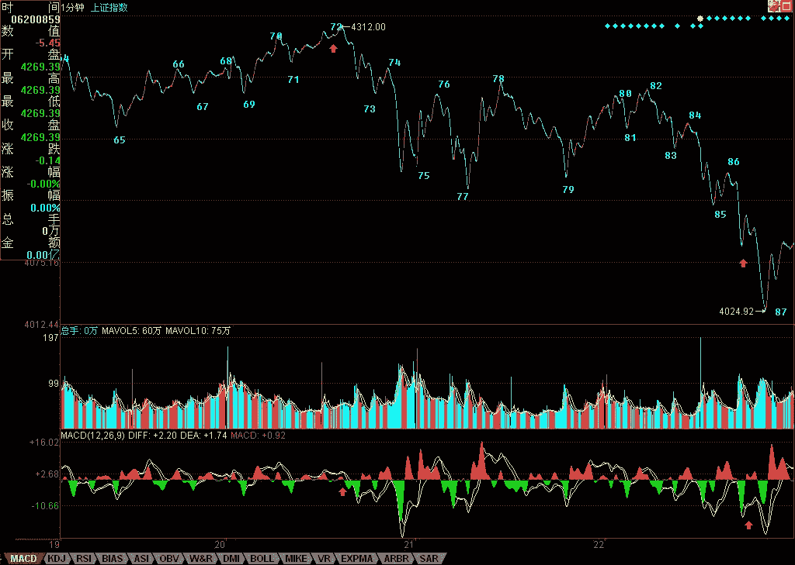 

要比较力度，发现背驰，首先要搞清楚是哪两段比较，其实，只要是围绕一走势中枢的两段走势都可以比较力度。显然，对于 60-65 这个 1 分钟走势中枢，55-60 与 65 开始的一段之间就可以比较。在实际操作中，65 开始的走势，由于没实际走出来，所以在和 55-60 比较时，都可以先假设是进入背驰段。而当走势实际走出来，一旦力度大于前者，那么就可以断定背驰段不成立，也就不会出现背驰。在没有证据否定背驰之前，就要观察从 65 开始的一段其内部结构中的背驰情况，这种方法可以逐次下去，这就是区间套的定位方法，这种方法，可以在当下精确地定位走势的转折点。

对于 65 开始背驰段的内部走势，当下走到 69 时，并不构成任何背驰，为什么？因为背驰如果没有创新高，是不存在的。所以，只有等 70 点出现时，大盘才进入真正的背驰危险区。由于 69-70 段与 67-68 段比并没有盘整背驰，所以 70 点并没有走的理由，除非你是按线段以下级别操作的。而 71 点，构成对 66-69 这 1 分钟走势中枢的第三类买点。按照本理论，其后无非只有两种情况，走势中枢级别扩展或者走出新的走势中枢上移。对后者，一个最基本的要求就是，从 71 点这第三类买点开始的向上段不能出现盘整背驰，而在实际中，不难发现，71 点开始的走势力度明显比不上 69-70 段，而对于 65-66 段，69 开始的走势力度也明显比不上，这从两者下面对应的 MACD 红柱子面积之和可以辅助判断。

因此，65 开始的走势是第一重背驰段，69 开始的是第二重背驰段，也就是 65 开始背驰段的背驰段，而 71 开始的是第三重背驰段，也就是 65 开始背驰段的背驰段的背驰段，最后当下考察 71 开始的走势，从走势上红箭头以及 MACD 上红箭头可以当下知道，71 的内部背驰也出现，也就是第四重的背驰段出现了。由此可见，72 点这个背驰点的精确定位，是由 65 开始背驰段的背驰段的背驰段的背驰段构成的，这就构成一个区间套的精确定位，这一切，都可以当下地进行。

对于实际的操作，72 四重背驰点出现后，卖是唯一的选择，而区别只在于卖多少。当然，如果是按 5 分钟级别以及以下级别操作的，当然就全卖了，因为后面至少会形成 5 分钟的走势中枢震荡，实际上，60-69 就是一个 5 分钟走势中枢。而对于大级别操作的，显然不可能因一个 5 分钟震荡而清仓，所以可以根据 5 分钟震荡可以容纳的数量进行对冲操作。小资金的利润率，在相同操作水平下，显然要远高于大资金的，例如像这样的卖点，小资金就可以全仓操作，大资金是不可能的。

如果说 72 的判断有点难度，需要知道区间套的精确定位，那么 74 的第二类卖点，就一点难度都没有了。唯一有点需要分辨的就是，这第二类卖点，同时又是一个 1 分钟走势中枢的第三类卖点，究竟哪个走势中枢？显然不是 70-73 这个，因为这里需要满足结合律。一个第三类买卖点，至少需要有 5 段次级别的，前三段构成走势中枢，第四段离开走势中枢，第 5 段构成第三类买卖点。其实，这里的答案很简单，74 点是 69-72 这个走势中枢的第三类卖点。也就是说，74 点既是一个第二类卖点，又是一个第三类卖点，以前的课程已经说过，一旦出现二、三类买卖点同时出现的情况，往往后面的力度值得关注。实际上，74 后面出现更大力度的下跌，这并没有任何奇怪的地方。

对于 60-69 这个 5 分钟走势中枢，69 的 4244 点是一个关键位置，如果在其下出现第三类卖点，那么走势至少将扩展成一个 30 分钟走势中枢，调整的幅度与压力就大了。而对于 72 开始的走势，73 很重要，要重新走强，必须冲破 73 这一点，该点位置恰好也是 4244 点。因此，短线的 4244 点十分关键，重新站稳，则大盘将最多是 5 分钟走势中枢的延伸震荡，否则即使不演化成 5 分钟级别的下跌，也将扩展成 30 分钟级别的走势中枢震荡。

不管学什么，是否愿意学，首先请先把学的东西搞明白，否则浪费的是自己的时间，还不如不学。本理论，你爱学不学，就像无论你是否相信万有引力，无论你是上帝还是小布什，该存在的依然存在。本理论亦如此，无论任何人学与否，无论你是庄家、管理层还是什么玩意，都不增一分、不减一分，都一样。因此，千万别学孔男人而成为如孔男人那样的文科生，究竟孔男人那样的文科生是一种什么玩意，看看下面两个连接就明白了。

如果在看过上面的课程，今天的走势都看不明白不会操作，那你大概要面临两种选择：一、去和孔男人为伍；二、洗心革面、好好学习。上面说到的 4244 点的技术意义，在今天走势中表露无疑，早上的杀跌补缺口，这次是一个明显的区间套底背驰定位，如果还看不明白，继续加倍努力学习或者放弃孔男人去，自己选择吧。

明天还是这个 4244 点，站稳就走强，否则继续 5 分钟的走势中枢震荡，并且要小心出现第三类卖点。明天又是周末，利空又准备漫天飞，本理论早在前面说过，这里必须用震荡来化解技术、心理、政策的压力，如果整天还是周一看没消息就跳空，然后继续不断震荡等周五，然后周末等消息，这样轮回下去，是走不出坚定有力的行情的，所以关键还是心态，整个市场的心态必须在震荡中修复。今天最低 4147 点，和本理论反复说的 1/2 线 4144 点相差不远，中线关键还是看这线，不破就是强势。

8、股市里不动脑子只有死路一条

由于要出差，先把这线段图贴出来，否则回来就积累一大堆 K 线，要分很多张图了。昨天说的很清楚了：“明天还是这个 4244 点，站稳就走强，否则继续 5 分钟的走势中枢震荡，并且要小心出现第三类卖点。”

今天的走势在 4244 点上精确地被再次压制，然后出现大幅度跳水，这些在今天走势的当下都很容易分析。81-82 的盘整背驰、84 点的第二类卖点，后面走出一个线段的标准下跌，以红箭头所指微型走势中枢前后出现背驰，然后有 87 的转折，但这个转折，由于 86-87 没有背驰，所以，只能是线段下级别的，因此，并不能现在就确定该线段就走完了，除非重新突破 85 的 4131 一点。

站在走势中枢的角度，75-84 这个 5 分钟走势中枢下边在 4188 点，如果后面的走势不能重新站上去，就要提防形成 5 分钟第三卖点。而前面已经说过，现在的情况 46-87 已经构成一个 30 分钟的走势中枢，短线的问题只是这走势中枢的第三段是否完成。其后就是该走势中枢的一个走势中枢震荡，该走势中枢区间在\[4067，4192\]，该走势中枢要管大盘一段时间直到出现 30 分钟的第三类买卖点。

下周走势十分关键，由于关系到月线、特别是季线的收盘，季线如果留出很长上影，则 7 月到 9 月的行情压力都很大。所以，对于多方来说，下周的任务就是不让季线留下长上影。只要收在 4144 点的 1/2 线上，就是多方最大的胜利。本 ID 在 5 月初关于 4144 点 1/2 线要管大盘至少 3 个月的断言，看来肯定是成立了。

9、一根筋是不适合玩震荡行情的

震荡行情是最容易玩出利润来的，但这绝对不适合一根筋思维的人。大盘的中线走势，在前面 6 月 4 日的文章里已经明确说过“而 5 月初给出的技术面分析依然有效，目前这 1/2 线已经上移到 4144 点，深圳成分指数相应位置在 13700 点，能否最终有效站稳该线，是判断中期走势是否重新趋强的关键。在此之前，大盘走势将以震荡形式逐步消化技术面、政策面的压力。其中，目前在 3600 点附近的 5 月均线将是判断大盘是否正常调整的关键，只要该线不有效跌破，那么大盘的调整在正常的范围内，否则大盘的调整时间将大为增加。”本月的走势，基本就是在这 5 月均线与 1/2 线之间的震荡，而 7 月，这判断依然成立，但要密切注意突破的方向，因为 7 月时，5 月均线将上移，空间压缩，最迟 8 月初就要选择突破方向了。之前，就是大玩震荡，狠拉狠砸，把利润给洗出来，把差价打出来。

今天的大盘，冲不破昨天给出的 4131，调整就成了必然的。然后又跌破 4025 点，所以调整就加大了，这在盘中都很容易判断出来。实际操作，特别对待震荡行情，就是要敢卖敢买，该卖一定要卖，反而买却不一定，特别对技术有点问题的，仓位可以控制好。当然，技术没问题的，这里就是天堂，一定要记住本理论 的多次忠告：股票都是废纸，只有能弄出差价来才是抽血，否则上涨下跌不过是坐电梯，和你有什么关系？而要弄差价，用走势中枢震荡的手法，就是最好的，这需要刻苦的学习和练习。

把图弄上来花了点时间，图中 100 的顶背驰都看不出来的，102 的第二类卖点看不出的，都要抓紧学习。102 后面的 103 在收盘时还没走完，要 102 走完，就是要出现线段里的底背驰。而下面箭头位置，就是大盘短线的压力所在，特别是最下面一个，必须站稳，否则大盘就是最弱走势，至少要等待出现 1 分钟以上级别的背驰才有介入价值。

 

 

 

 

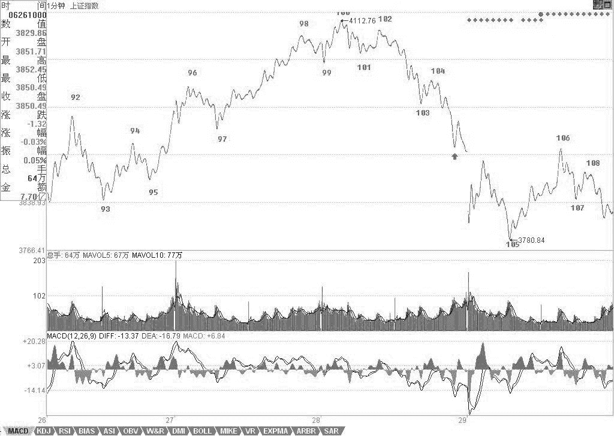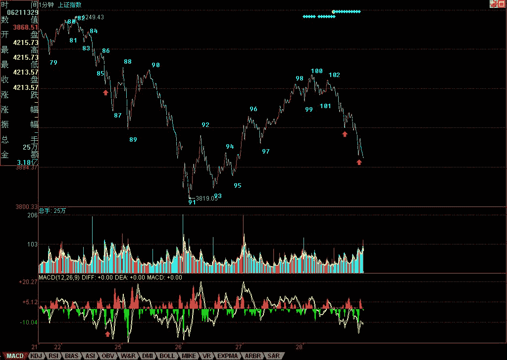

下周才能回北京，季 K 线收得不会太好看了，这中线的大震荡延续时间不会短，学会震荡操作，将让你在这中线大调整中获利良多。

多说句废话，中国第一只在德国交易所交易的股票将在 7 月初挂牌，这是中国第一创投公司的杰作，7 月底还有韩国交易所的第一只股票，这两枪打响后，估计私人股权投资要加温了。

附录：

刚打开电脑，上来看看，发现有人对昨天的线段分法有疑问，这问题以前说过，就是关键是看你用多大的精确度。下图中，红箭头处是 4022.69，绿箭头处是 4022.42，按最严格的标准，精确到小数点后两位，这就没终结原来的线段，所以就不是新的线段。当然，如果统一按个位数是精确度，直接取整，那么这就等于两处有重合，那按这标准，就可以定义为新线段（像右图一样）。但如果按四舍五入，那前面是 4023，后面是 4022，就不能这样定义了。

新线段的一个最重要标准就是一定要终结老线段的结构，例如下跌的线段，后高点一定低于前低点。

10、月线分段与上海大走势分析、预判

分型、笔、线段，在 1 分钟图上可以分辨，在月线图上的道理是一样的。但用月线图分辨，等于用一个精度超低的显微镜，只能看一个大概，但这个大概，却是最实质性的，是一个大方向。

下面，就是上海指数的月线图。绿箭头指着的是顶分型，红箭头的是底分型。打“X”的就是该分型不符合笔所要求分型的规范。这里，只要是两条：一、顶和底之间没有至少一 K 线；二、不满足顶必须接着底、或底必须接着顶。

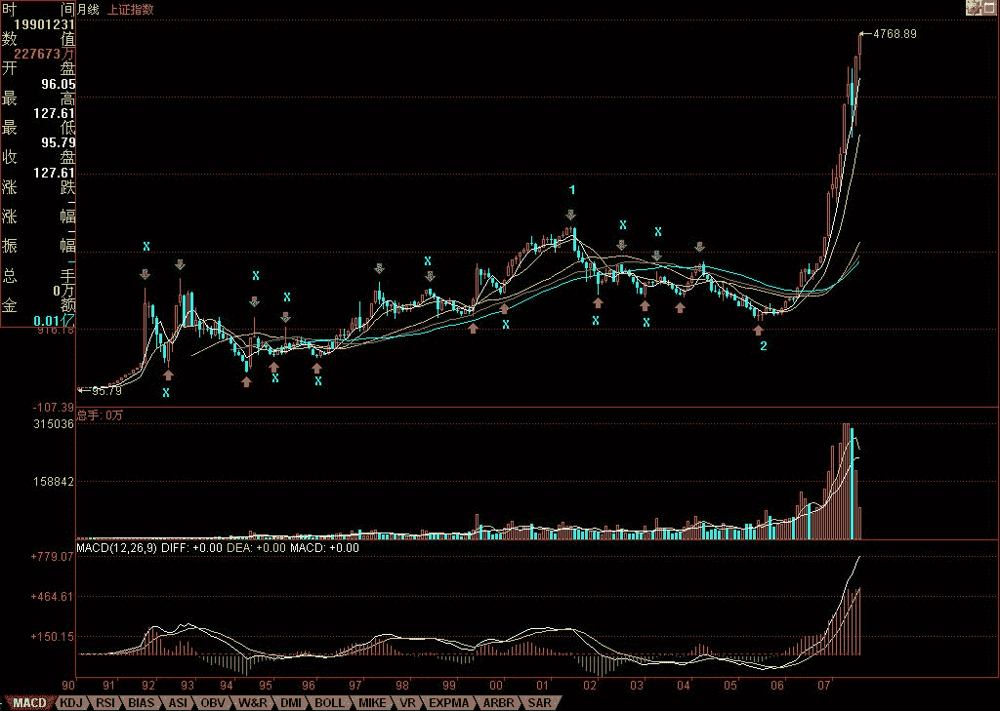 

例如，第一个红箭头和第二个绿箭头之间显然不能构成一笔，也就是说，这两个，只能取一个：如果取第一个红箭头，那么第二个绿箭头就不是笔中分型，那么第二个红箭头，显然是一个底分型，因此，就形成两个底分型连续的划分，显然，这时候，第一个就不算了，这和前面说取第一个红箭头对着的底分型矛盾。所以，这里，只能取第二个绿箭头，这时候，第一个绿箭头对应的顶分型，自然就不算笔中的顶了。

后面的各分型，带“X”的，都可以按照上面两个原则去分析。

人可能要问，这样分型的确定，在当下如何完成？这必须当下去完成。例如，当走势走到第一个红箭头时，显然，第一绿箭头的顶分型也可以暂时看成是确定的顶分型。但当第二绿箭头走出来后，这个问题就有了可修改的地方。

有人可能要疑问，这样分型是否随时可以修改？答案是否定的。一旦完成的图形，这修改就不可能了。分型可修改，证明图形没完成。例如，当第二个红箭头分型出现后，前面三个的分型的取舍就是唯一的。这个分型的可修改性，反而是一个对走势判断极为有利的性质，例如，第二个绿箭头走出来后，这图形未完成的性质就是百分百确定了，但所有图形必然完成，走势必完美。如何才能完美，这样，在理论的框架下，只有极少的可能，而这些可能，就成为综合判断的关键条件。然后根据各级别图形的未完成性质，就可以使得走势的边界条件极端的明确与狭小，这对具体操作，就是极为有利的。注意，这可和概率无关，是百分百的纯理论保证，最终所依据的，就是在本理论最早反复强调的走势必完美原则。

其实，本理论的关键不是什么走势中枢、走势类型，而是走势必完美，这才是本理论的核心。但要真正理解这个关键，可不是看字面意思就能明白的。

显然，目前月线上的第 1、2 段已经走出来，其中，按照线段里笔的类背驰，1 的结束那顶与 2 结束那底都是极为容易判断的。上海指数的历史大顶与底，根据这线段的划分，都不是什么难搞的秘密。那么，对现在依然进行中的第 3 段走势，有什么可百分百确定的呢？

一、显然，这一段要成为段，那至少要三笔，而现在连一笔都没走完，因此，这轮行情的幅度，可想而知。也就是说，即使该笔走完，一个笔的调整后，至少还有一个向上的笔。

二、2245 到 998 点是线段的类走势中枢，也就是说，只要调整那笔不跌破 2245 点，那么，将构成一个线段的类第三类买点，这也支持至少要走一笔。

三、 笔的完成，必须要构成一个顶分型。而一个月线的顶分型将如何构成？这意味着什么，这个问题就当成是一个作业，各位去思考一下，然后给出这个结论对应的操作策略。从中也可以亲自实践一下，去明白一下理论指导下操作的力量。

最后，再提一个思考题：为什么本理论在 7 月份要大搞满江红，而 8 月以后就放手坐轿子，请利用分型的原理给本理论的行为一个技术上的解释。

11、一个教科书式走势的示范分析（2007-08-15 22:41:35）

在前面的课程里，本理论反复说过，结合律是至关重要的。这里的人，认真学过抽象代数的人少，所以不大明白运算规则的选择对研究对象的决定性意义。对于走势来说，结合律就是连接走势之间关系最重要的规则，不深切明白这一点，如何能明白走势本身？无论如何结合，本理论对走势的分析原则是不变的。可以这样认为，本理论，就是走势保持结合律下具有变换不变性的一套理论，而且可以严格地证明，是唯一能保持分解变换不变且保持结合律的一套理论。如果有点现代数学常识，对这理论的意义应该能多点了解。

这几天，随着走势的当下发展，本理论不断变换着所看的走势中枢，这根本的原因就在于结合律，因为结合律，我们可以对走势进行最有利观察的分解，这样，才能更容易明白走势究竟在干什么？

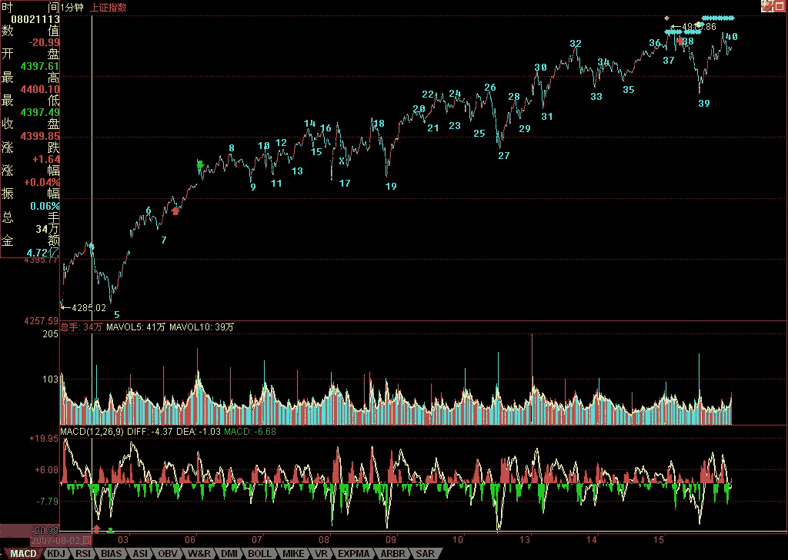 

例如，到今天，走势一种最明显的划分已经自动走出来，就是 8-17 构成 5 分钟走势中枢，该走势中枢是 4300 点那个 5 分钟走势中枢上来后的一个新的 5 分钟走势中枢，这个走势中枢，在刚形成时，我们已经指出，而且任何学过本理论的，都可以当下指出。一般来说，形成这个 5 分钟走势中枢后，在理论上只有三种走势：

1：向上出现第三类买点，走出 1 分钟向上走势类型，然后构成新的 5 分钟走势中枢；

2、向下出现第三类卖点，走出 1 分钟线向下走势类型，构成新的 5 分钟走势中枢。

3、走势中枢延伸，或出现第三类买卖点后扩展成大级别的 30 分钟走势中枢。

显然，在行情发展中，没必要去预测走势选择什么，走势自然选择，只需要观察着就可以。现在，走势自然选择了第一种，为什么？因为 17-38 构成完美的 1 分钟上涨走势，目前，围绕这 1 分钟上涨走势的最后一个 1 分钟走势中枢 32-35，正扩展出新的 5 分钟走势中枢的雏形。

这个 5 分钟走势中枢，最终至少要完成的，至于是否继续扩展出大的 30 分钟走势中枢，还是出现新 5 分钟走势中枢的第三类买点继续上涨，再形成新的 5 分钟走势中枢，这无须预测，与 8-17 那 5 分钟走势中枢一样对待，如此而已。

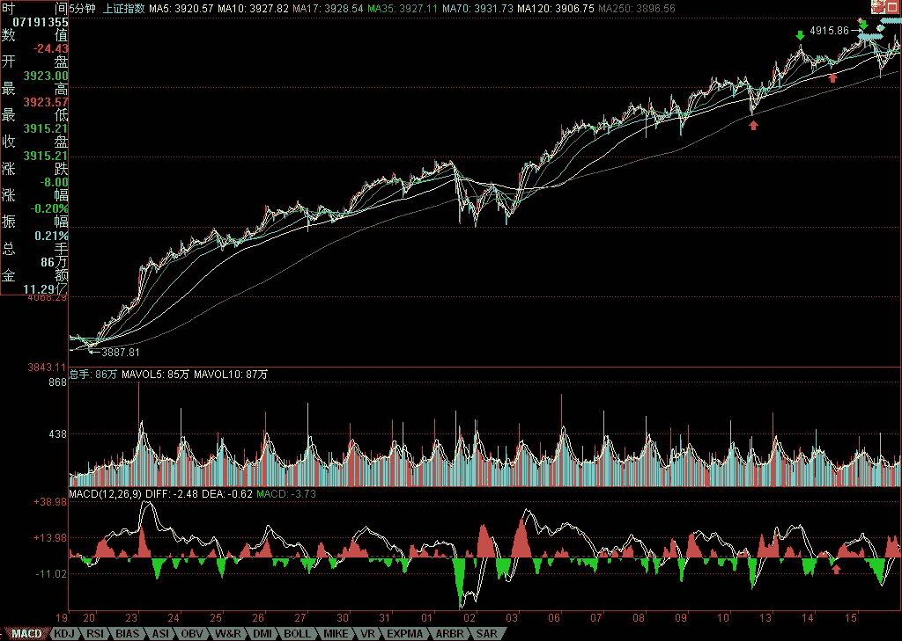 

那么，如果是按 30 分钟操作的，这些 5 分钟的走势中枢移动、震荡之类的活动根本无须理睬，只要看明白就是，根本无须操作；如果是按 5 分钟级别操作，那么就是不参与大于 5 分钟级别的震荡，那么就等 5 分钟上涨出现背驰后走人；如果是按 1 分钟级别操作，那么今天早上就该先走，为什么？因为 1 分钟的上涨出现背驰，按照本理论，后面必然回抽到最后一个 1 分钟的走势中枢之内，从而至少形成一个新的 5 分钟走势中枢。然后根据 5 分钟震荡的走势进行回补就可以。

注意，按照多样性分解原则，新的 5 分钟走势中枢，暂时先从最后一个 1 分钟走势中枢开始算起，后面的操作先以此为准，等走势走出最自然的选择再继续更合理的划分。按照这暂时的划分，并不影响任何操作，5 分钟走势中枢该怎么操作就怎么操作，如此而已。

在今天的背驰判断中，关键是知道哪一段相比，显然，27-32 与 35-38 这两段去比。而实际的对比中，看 1 分钟图，去加两段对应的那些 MACD，太麻烦，所以可以看 5 分钟图。这里，把 5 分钟图给放上来了，图上，相应对比的两段已经标记出来，下面 MACD 的红箭头，对应是回抽那一下，对应走势，就是最后一个 1 分钟走势中枢形成的时候，前面两段的对比，极为教科书，请好好揣摩。

其实，只要基本概念明确，这些分析，在当下都不是什么难事。这里必须提醒一下，1 分钟图上 38 标记的位置用红箭头给出，显然，那不是最高的位置。为什么？没有人规定分段的结束位置一定是最高、最低的，关键要有至少三笔，因为从 37 开始到最高的位置，没有三笔，所以不能认为线段已经完成。但在 1 分钟级别上看，那么 37-38 这一段，就结束在最高的位置，为什么？线段的存在，是为了让图形规范化，就如同在 5 分钟走势中枢里，看 1 分钟走势类型的重叠，是把整个走势类型的波动区域算在一起看，道理是一样的。

12、现在的课已经越来越精细，特别用的是最小的 1 分钟，一般的理论，在这么精细、偶然性那么大的图上都要乱套了，但却恰好能显示本理论的有力。别说 1 分钟图，分笔图也没问题，这就是本理论所构筑几何结构的力量。世界都是几何的，别说那几张无聊的走势图了。看下图，为什么下午的分段是这样？

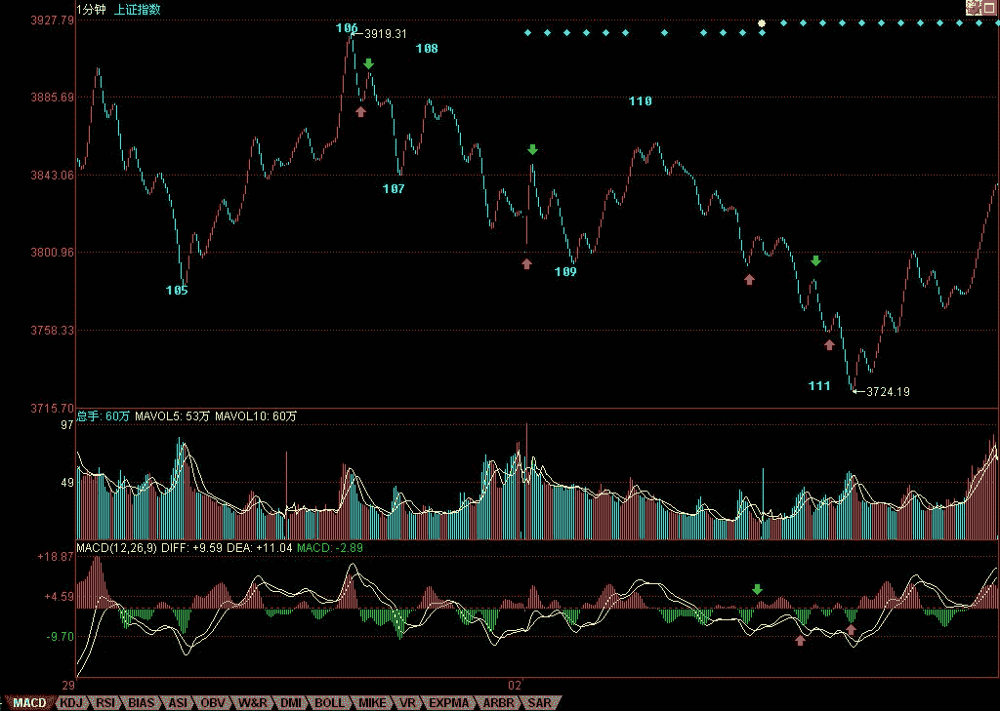 

106 到 107 这一段箭头所指的那一笔，用的是取整的前提，所以，只要你仔细去分析，就知道那一定是一笔。这个问题，本理论瞧了一下，见一位叫快乐 vs 菜虫的网友已说到。当然，你可能要问为什么一定要取整？这没有什么必然性，只是预设的前提，你可以采取严格到小数后两位的精确度，但其实不同软件，对 1 分钟这么精细的图，都会有数值上的细微差别，所以，所谓的精确，往往不一定就是，而在这么快速变动的市场中，数值有点细微差别，其实没什么不同，例如，还可以用这样的区别方式，就是两者相差 0.5 点内的看成是一样的。所有预设精度，唯一必须遵守的，就是精度一旦预设，就一定要一路保持。

注意，没有什么精度是十全十美的，例如用相差 0.5 内看成是相同的，那么如果是 0.51 呢？这和 0.49 也没有多大区别。所以这些细节，其实问题都不大，关键是要统一，不要变来变去。由于现在只是示范，为了方便各位学习，就一直继续采用取整的精度，各位可以根据自己的情况来调整。

至于 108-109，带箭头那笔为什么不被算成一段？也就是 108-109 为什么不是三段？这很简单，因为段必须是至少三笔构成，缺口如果包含在一笔中的，像今天早上低开的缺口，没有终结昨天那笔，是顺着昨天那笔下来的，所以这种缺口和一般的走势没什么区别，缺口还是包含在昨天的一笔里。但有些突然性的逆着走势来的缺口，就像 530 那个，就必然要当成一段，而不能光当成一笔或一笔里的了。有人可能说，缺口没有三笔？那你可以这样去看，就像 0=0+0+0，缺口可以看成是三个缺口的迭加，这样就有三笔以上了。还有，有位叫袖手旁观的网友理解得也不错，线段必须要被终结才算结束，但必须要强调的是，线段必须要被线段终结才算是真终结，单纯的一笔是不能终结线段的，这就避免了一些特偶然因数对走势的干扰。

至于 110-111。红箭头那两个为什么不是最终精确定位的背驰点？这都是些以前就应该解决的简单问题。像第一个红箭头位置，第一次略微跌破 109 那位置，这时候把已经出现的面积和前面 108-109 的对应面积之和比，已经十分接近，也就是说 110-111，刚起跌，这力度已经和前面的 108-109 差不多，这恰好说明这一段的力度是很强的，不但不可能是对 108-109 背驰，而且站在走势中枢震荡的角度，这种力度，一定是小级别转大级别以时间换空间或与更大力度的对比产生的背驰才能化解的。后面这种情况，在这个实际的图形中，就是与前面 104-105 的下跌力度比。110-111 这段，相比较的，是 104-105 这段，中间的走势中枢震荡的走势中枢，是 105 到 110 这个。因此，这里根本不存在与 108-109 对比的问题。站在 105-107 这个走势中枢的角度，110 虽然不构成第三类卖点，但也极为接近，这种对走势中枢的离开，力度一般都很大，所以就算你搞不清楚和哪段比，也至少要等这段的结构被终结，才有介入的可能，而后面，上下上的两次反抽，根本就没有终结其结构，因此后面的破位下跌就是天经地义的。

至于第二红箭头那个，就更不可能是了。绿箭头那次反抽，等于对前面破位前那上下上的微型类走势中枢（注意，站在严格意义上，线段以下是没有走势中枢的，所以说是类走势中枢）的一个类第三类卖点，后面有两种变化，就是转大级别类走势中枢或类走势中枢移动直到形成新类走势中枢为止。而下面的黄白线，是一个典型的下上下结构中的第二下刚破上的低点，这是力度最大的一下，怎么可能有背驰出现？MACD 第一个红箭头就指这大的下上下破的一下，这时候除非出现线段结构的突发性终结，否则不可能有什么背驰出现。而后的回拉，其实刚好构成一个奔走型的上下上结构（也就是第二上刚和第一上的低点稍微重合），这其实也就构成另一个微型类走势中枢。这和第一个红箭头指的那个一起，刚好构成两个类走势中枢的下跌走势。然后，后面的背驰判断就很简单了，和一般的趋势中背驰的判断一样。针对第二那奔走型的微型走势中枢的前后两段，MACD 两个红箭头对应的绿柱子的比较，一目了然。（千万别再问这时候为什么不看黄白线之类的问题，这类问题回答过 N 次了。）

13.震荡前行、多空齐杀（每日解盘 2007-09-24 15:26:30）

最近的行情，估计对绝大多数的人都极为困难，不过，不难发现，本 ID 那些股票已经越来越像喝了水井坊一样。中字头、题材股，两个翅膀，所以能翱翔到现在。在目前这样一个震荡前行、多空齐杀的行情中，有这样的节奏，就是刀锋上的凌波微步了。

那些大海龟，从明天开始，陆续回来了，当然，承销的、摇旗的，都要护着点。以前看不出本 ID 3600 点接石头的妙用，现在也应该明白了。至于联通之类的，等于一个抢劫，你承销中移动的，有本事就别抬联通，有本事就别送钱给本 ID，本 ID 就是收路费的。

当然，这些都是对大资金说的，小资金，一般都可以不管这些大家伙，在题材股上折腾，不是更好玩？

600078，请好好研究 15、5、1 分钟之类的图，看看那区间套是多么教科书。还是那句话，跌的时候，要想买点，涨的时候，要想卖点，这才是搞股票的，否则是被股票搞的。

大盘现在，没什么可说的，106 开始的 5 分钟中枢的 1 分钟离开已经出现，如果能回抽形成第三类买点，那就继续折腾下去，大不了，就搞出一个 30 分钟中枢，那就更好玩了。今天有点事，不能多说了。月亮圆了，注意短线震荡的加大。

请注意，下面第一个绿箭头处不是笔，为什么？因为顶分型都在底分型下面了，怎么可能？而第二箭头处就是标准是按最新标准的笔了。

 

 

14.可以不相信月饼，但一定要相信月亮（每日解盘 2007-09-26 15:56:37）

今天早上的上攻，一没有突破昨天的第三类卖点，二反而是形成标准的顶分型第三根 K 线的上冲，不管你相信不相信本 ID 的理论，反正后面的走势，如教科书般。现在的走势十分简单，一个 1 分钟的走势正离开前面那 5 分钟中枢，这 1 分钟走势什么时候能完成，就看后面的走势了，而完成以后的回拉才是最重要的，是否能形成第三类卖点，这才是最近走势的关键，如果形成，那这两天，最多只能算田亮的 1 米板，后面是表演 3 米还是 10 米的，这对于观众，其实反而已经不重要了。

 

 

15.资金乘胜追击，破圆顶兵临 3/4 （每日解盘 2007-09-28 15:51:59）

昨天已经明确说了，资金取得决定性胜利，而资金最大的技术危险是圆顶，最迟在节后必须破掉。而今天关于房地产的利空，反而成了股市资金面的大利好，资金这时不发力，那是脑子有水了。因此就上演了一场乘胜追击，破圆顶兵临 3/4 线的好戏。

注意，本 ID 已经说过了，在刀锋上舞蹈阶段，是多空皆杀，那些一根筋思维的人，注定要被杀，目前不被杀只是迟早的问题，某种模式反复后，就是相信这种模式的人的死期。

本 ID 什么都不相信，市场让本 ID 看到什么就干什么，这就是本 ID 理论的唯一中心与基本点。例如下图中，132 的第三类卖点后，到 137 的 1 分钟完成，走势极端标准完美。有兴趣的可以量一下 130-131，与 136-137，长度基本相等，而力度上，加一下下面对应的柱子面积就知道该干什么。而到了 138，就知道这 5 分钟的第三类卖点肯定没戏了，就算 137 没反应，139 就提供了一个反应的机会。

当然，站在中枢震荡的角度，并不需要预测后面能走多高，让市场告诉你。而今天的走势，强悍到连一个线段都没破坏过，那该干什么还不是很清楚的事情？

节后的走势，十分清楚，就是首先要完成这个 1 分钟的离开，从目前的情况看，这 1 分钟的离开走势是首先是线段的类上涨的可能性太大了，除非有特别的大消息，当线段类上涨结束后，必然形成 1 分钟中枢，该中枢后，1 分钟的走势无论是盘整还是上涨，等 1 分钟走势完成后，关键是看反抽能否形成前面 5 分钟中枢的第三类买点了，如果形成，大盘将继续攻击上行，否则就继续向 30 分钟中枢的震荡陷阱去。好了，上面的分析已经十分明确，对本 ID 理论有点了解的，都应该明白了。至于不了解的，本 ID 已经反复说过，中线点的就看 5 周线，你看，昨天的低点，就刚好在上面，和上次 5000 点那次一样。

 

 

 

16.3600 点满江红后首次宣布中期做空（每日解盘 2007-10-08 21:46:52）

7 月初，在 3600 点下，本 ID 严正宣布要做多，不允许行情按汉奸的方式运行到 2000 点去，为什么？因为任何跌破 3100 点的走势都将导致 2 年多以来的中枢上移趋势被破坏。

今天，本 ID 开始宣布，从 3600 点开始的做多以及持有程序将开始终结，本 ID 将开始选择性地展开中期做空程序。这里，说明其中的理由。

一、长期牛市的大格局没有改变，但长期牛市并不排除期间的中期调整，以前，所有关于调整的时机都没有完全配合，而现在，这个时机已经逐步成熟。

二、本 ID 在博客里明确提示政策风险的是“冲动的惩罚，基金将成为毁掉市场的那只手 2007-08-2720:45:41”，原因很简单，因为当时有些可能的突发事发生，那时刚好在 5200 点上下，在电光火石中，一场大动荡被化解，当时的微妙，后来应该也有不少人有所耳闻了。

三、但当时，做空的条件不成熟，关键是政策面上有不协调的地方，而技术与资金上，一时还转不过来，特别是，没有足够的下跌空间，因此，后面的一个月的震荡，实际上都没超过 6%的空间，这就是一个稳定与转换的过程，这样，不至于让资金如 530 一样措手不及。

四、目前，政策面上已经不是一方面或一个人的事情了，可以断言，不光针对股市本身，针对经济本身，也将出台更加严厉的政策，原来适度的口径，极有可能继续收紧。而针对股市的，本 ID 一度希望股市自身调节而不至于被迫出来的政策，也有可能不可逆转了，因此，政策面的压力已经逐步成熟，如果说 8 月 28 日只是一叶知秋，那么，在可见的将来，秋天就不需要去知道了，就在眼前。

五、技术上、资金上的松动已经开始发生，这时候，一些适当的引导，就可能发生一些有效的反应。市场是合力的，但合力是由分力开始的，如果 3600 点的分力曾经起作用，那么，一个新的剧本，也需要开始排演了。

六、现在唯一不配合的，就是回跌的空间还不足够，如果现在已经突破 6100 点，那更好。因为这次回跌，本 ID 并不希望破坏 2005 年上来的中枢上移格局，因此，这次的中期顶部阻击，会采取一种反复折腾、诱敌深入的模式，而不是如 3600 点那样，一下搞掂。

七、本 ID 曾经说过，如果快速突破 3/4 线，将开始阻击。后来因为大盘回跌 5000 点后一直盘整，所以曾说只要 6100 点不被快速突破都可以忍受。但现在看来，政策留给的空间已经越来越少，而今天又第一天突破 3/4 线，已经开始达到本 ID 对 3600 点开始行情的最低目标，任何的回跌，本 ID 都没有任何遗憾了。而能否到 6100 点，本 ID 已经没有这个顾虑了。

八、本 ID 只把自己的操作说出来，没有任何指导的意义。就像 3600 点的做多，然后一路的持有。现在，本 ID 只是准备改变中线的操作策略，没什么大事。本 ID 有可能错了，但本 ID 说了，就要干。

九、长线行情，本 ID 依然坚定看好，只是这政策、资金、技术所制造的中线调整，本 ID 也希望再 3600 那样玩上一把，如此而已。

十、做空的风险比 3600 点做多小多了，头部和 3600 点的底部一样，是合力的，但也是由一分力开始干出来的，本 ID 就再做一次那分力吧。

十一、别以为做空就是砸，那是最笨的手段，做空的本质，就是让多头自相残杀，因此，做空开始的时候，经常要比多头还要多头。

十二、底部不是一天构成的，顶部也是，一切的构造，都是在逼近那资金、技术、政策的共振点。然后，一切在无声中败落，如那一片片的黄叶。

17.调整形态保持，震荡级别加大（每日解盘 2007-11-02 15:25:06）

今天的走势同样极为教科书，因此，复制了图，可以认真研究一下。针对 189-192 的 1 分钟中枢，195 是第三类卖点，但对于 191 开始的线段类下跌，194-195 是第二个类中枢，所以后面的跌破，力度不够，出现明显背驰，然后就必然要在这个位置出现一个新的 1 分钟中枢。

下面的走势很简单，这个新的一分钟中枢是否继续向下延伸出新的 1 分钟下跌走势，也就是这 1 分钟中枢是否有第三类卖点。而从大的方面看，这次反弹的调整，级别将至少向 5 分钟级别扩展。

当然，操作上第一个中枢的第三类卖点在该级别中是最后的走人机会，后面的都没意义了，也就是说，对于这次调整的逃避，191 是第一类卖点，因为前面线段类上涨走势出现类背驰，而 193 是第二类卖点，因为站在线段的角度，就是第二类卖点，而站在 189-192 的 1 分钟中枢震荡的角度，任何的次级别离开，都将先构成卖点，然后再考虑是否回跌形成第三类买点的回补机会，这是中枢震荡的操作方法。

195 以后，针对这个调整来说，任何的卖出，都是太晚了，这意味着随时面临下跌走势的结束。很多人喜欢在第二个中枢才考虑第三类卖点，那是晚之又晚，所以经常卖了，就被反转夹空，那是一点都不奇怪的。当然，很有可能卖了以后继续延续下跌，但这已经是一个概率问题，而不是一个能被理论 100%保证的技术问题了。

 

 

18.1000 点小康跌幅胜利完成（每日解盘 2007-11-12 15:28:57）

本 ID 宣布做空时说，没有 1000 点的下跌空间，不爽，所以要先拉出空间来。今天，1000 点的基本任务已经胜利完成，本 ID 在前面已经给了这个跌幅一个名字，叫小康水平的跌幅。

今天，5 月均线大埋伏剧本继续演绎，今天的利空，刚好为 6004 点下来的 1 分钟下跌构成底背驰做出最后的贡献。本 ID 已经早说了，6004 点下来的 1 分钟下跌一旦背驰，会出现较大级别反弹。现在，5 月均线大埋伏剧本与 1 分钟下跌背驰剧本最终两剧合一。

注意，这个 1 分钟下跌，搞出来了三个中枢，然后在今天一个完美的底背驰。最后的一个 1 分钟中枢的第三类卖点，就是早上的补缺失败走势，然后继续的下跌构成了线段的类背驰，这和 1 分钟大走势的背驰段构成完美的区间套，这么教科书的走势，请好好去研究。

1 分钟底背驰后，最基本的涨幅，就是拉回原来 1 分钟下跌的最后一个 1 分钟中枢的波动区间，这个在今天就达到了，后面就是这个中枢如何扩展出 5 分钟中枢的问题。技术上，就要关注这个 5 分钟中枢的位置以及后面相应的中枢震荡结果。

通俗地说，如果大家都觉得短线小康就算了，不要富裕了，就让这 5 分钟中枢第三买点；否则，大家都急切奔向富裕，那这 5 分钟中枢将第三卖点；事情就这么简单，各位民主一把，投票吧。

更通俗地说，就是以 5 月均线陷阱对 5462-5555 点颈线的例行反抽继续展开，注意，反抽可不一定要一定碰到 5462 上，最弱的反抽，就是装模作样在颈线下面折腾几天，然后就和 5 月均线吻别于狂乱的夜。当然，多头现在也不是完全没希望，多头要成功，首先是要让所有人只要小康、不要富裕；其次，好好利用 5 月均线大埋伏剧本，绝对不让那狂乱的夜发生，特别不能让狂乱的月圆之夜发生；最后，找准机会，重新回到 5462-5555 点颈线之上站稳。

以上，是多头唯一可以走得通的路，鲁男人说，人走多了，就成了路。多头就从这一刻起，如果要活命，就要不断地到处乱踩，把所有板块都踩一遍，看能不能走出路来。这句话，通俗的意思就是，反弹如果真能延续，必定以板块轮动的方式，这种方式，好听地说，就是为了聚拢人气，不好听地说，就是忽悠蒙骗点新的站岗者。

特别强调，并不是任何反弹都是任何人有资格玩的。站在本 ID 理论的角度，这个反弹完全可以就已经结束了，为什么？因为最基本的回抽最后一个中枢的幅度已经达到，所以，现在关键是回来那一下能否构成第二类买点，如果不行，那狂乱的夜的吻别就马上上演，不过，更适当的名称应该叫：刎别。

今天的解盘，写得太长了，主要是有趣版本与通俗版本都写了，本 ID 经常用自己的语言写，其实只是为了有趣与简练，但这世上无趣的人太多，本 ID 就受累点，夹带上通俗版本。

下面给出了 6004 下来的分段，请仔细研究，里面用绿箭头把三个 1 分钟中枢的第三类卖点都给标记出来了。按照本 ID 的理论，最晚的逃命点 195 处，从第 1 个绿箭头开始的所谓第三类卖点，其实都没什么意义，这里，只是显示，第三类卖点后，市场是可以多么狠。按本 ID 的理论，从 195 逃命的，在 214 才真正开始值得考虑是否回补。当然，前提是你的操作可以接受 1 分钟级别的，如果是 5 分钟以上级别的操作，那还是继续睡觉吧。214，从 191 开始的 1 分钟下跌走势的底背驰，对应着三重的区间套定位，最后一重是 213-214 之间的线段内部笔之间的定位，其中的精确性，教科书一般，关键是你能真明白，并且能当下去把握。

 

 

 

## 第二十六节 逗庄家玩的一些杂史

1、当然，以下这些，都是本理论胡言乱语，梦话连篇，各位就当笑话看，谁当真谁有毛病。说故事，不过让各位认识一下市场运行中一些更深层次的东西。走势是由合力构成的，但各分力后面代表的，都是真实的、有思想有感情的人，因此，了解一下一些心理层面的东西，还是有好处的。

当然，对于一般散户来说，多了解一点事情，并不能改变对走势完全严格客观的态度。为什么？因为对于一般的散户，其影响力对于合力可以完全忽略不算，因此，其操作，当然就可以完全只看合力最终的结果，而不需要关心每一刻合力所对应的各分力间的博弈。

但人必须有远大的目标，不想成为大资金的散户，就如同不想成为元帅的士兵。最终能否达到，这和每个人的悟性、修炼、机缘等等密切相关。但有时候结果并不一定太重要，过程往往更加美好。如果说到结果，任何人的结果都是咸鱼一条，因此，任何人都没必要有任何负担与畏惧心理。只要按照正确的道路，就算最终只能登到山腰，也不枉这一行了。

市场上，存在一些资金，是可以影响到最终的合力的。实际操作中，资金量当然很重要，但更重要的是技巧，打仗还有以小胜多的，有时候，1/10 资金制造的效果，比 10 倍资金的都大，这就和操作者密切相关了。简单起见，这里只说在具体个股中的操作，对于大盘的操作，涉及的复杂程度大幅度增加，而且，这一般也不是一个人能完成的，都是一些集团式力量的结果，能领导其中，更需要很大的人格凝聚力与历史信任感，这都不是一年半载能够达到的。

个股操作，涉及对合力产生影响的，无非两类资金，一种就是庄家，一种就是玩庄家的人。一般的误区总是觉得，庄家就最牛了，庄家如何如何凶煞，如何如何吃人不吐葡萄皮，其实，都是人云亦云的无聊玩意。确实，有不少所谓的庄家成功过，但有更多的庄家给搞死了，死的庄家比最终活下来的多得多。庄家被搞死，有很多种原因，其中一种很常见的，就是给玩庄家的人搞死的。

市场里有一种这样的人，这种人的资金实力当个庄家肯定是一点问题都没有，而且一般来说，这种人以前都是牛庄，但后来，因为证券法之类的法律出来，不想惹事，或者就太懒了，天天去算计散户太累，还不如一下算计一个大家伙，吃一顿够 N 顿了，或者就是无聊，看着别人当庄，就是想搞死，赚不赚钱倒是次要，一般这种人，钱早不是问题，纯粹是为了开心或者就为了教训一下暴发户。

一般来说，这种人在资本市场里都有着最广泛的信息网络，这都是从资本市场从小苗开始就缠上的，如藤倚树，这资本市场的树长多大了，这藤也跟着绕了多少。一般来说，这市场上的大的动静，一般都逃不过这些人的眼线耳线。由此，这些人都能很快知道，又有什么猎物可以爽上一把了。

如何圈定猎物，这并不一定有任何固定的原则。当然，有些人比较死板，或者在这行里还是新手，所以比较注意攻击目标，至少不敢攻击太垃圾的东西，否则万一搞砸了，连回旋的余地都没有。但对于老手来说，其实都无所谓，股票不过是一个游戏的凭证，玩烂了也无所谓，大不了来个凤凰变乌鸡、乌鸡变凤凰地来回折腾几次，还不是越搞越有搞头？

说句实在话，搞股票，归根结底是搞资源组合的能力，功夫在诗外，组合能力强，资金能长期坚持，有什么不能成功的？本理论有一个不大好的习惯，就是对被搞废掉的人，从来都不关心，但这两年，本理论不断发现，有好几个 N 年前，注意，这个 N 有的都快到 10 了，被本理论搞废掉的，竟然都坚持到了大牛市，都成了这两年最牛的股票之一，一打听，人还是那些人，歌还是那些歌，这些人身残志坚地把 N 年的生命都奉献给了某只股票，连本理论都不得不说，人的无明之力，真是老强大，佩服佩服。

为了表彰这些残废人士的惊人业绩，本理论对其中几只不点名地表扬一下：

一、那年夏天后，最后的一吻，市场就走入漫漫熊途，你也留下一个个向下的惊人缺口，大概除了本理论，没有人知道你的痛苦，那高高的山冈，你只能用一个个除权缺口去追赶大盘下跌的速度，你在最悲壮时，依然站在实际的山腰之上，离那令你疼的顶峰依然不远。终于，你熬过那最后的血腥，春天来了，猫儿又开始叫春了，你跨过那一个个的缺口，冲出那曾经绝望的顶峰，原来，山峰之外依然有山峰，你应该释怀了。

二、山顶到山谷，90%多的落差并不一定是故事的终结。后来，你终于明白，在山谷回到山脚后，继续半年就可以飞升 1000%，就可以走上更高的山峰，这时候，这 N 年的煎熬，大概就是最好的人生回忆了，你现在最感谢的，是否就是那 N 年前给了你最好回忆机会的人？

三、惨跌 80%多依然能站住的，才能引来 2000%以上的升腾，本理论不会为曾经的残酷而有丝毫歉疚，但为了这能站住的，本理论给你四字：还算爷们。

四、当你用一字涨停铺起台阶冲破所有顶峰时，又有多少人知道你 N 年前的痛苦？那些台阶已经名喧天下，而 N 年的那些日夜，究竟是什么缝补那颗破裂的心？粗略看了一下，最大跌幅 94%，真是梅花香自苦寒来啊。

不要以为，庄家就是好差事，一般的散户，有上面四位优秀吃苦耐劳模范的一点功力，你想不成功都难了。看看人家，94%还可以梅花香自苦寒来，那些被 N 天半月洗盘就搞得精尽人亡的，还不如去买豆腐回家算了。

能熬住的少，熬不住的，最后都给人做嫁衣裳，那些在大峡谷底买货的新人，要知道，这些骨头里，可能最多的，就是所谓庄家的。看着 100 元的 000338，本理论就仿佛看到那铁窗下那唐家兄弟的灰影，这里，就再重温一下，本理论在 000338 最低那天贴出来的五言诗《[偶见湘火炬广告牌，口占五绝》](http://blog.sina.com.cn/s/blog_486e105c01000akx.html)（2007-05-15 15:14:19）。有人可能又要问，为什么那天以后，就没有那个位置了？因为，如果还有那个位置，天都要哭老的。

搞死庄家，首先对其资金面、来路等等方面有充分的了解。那些光有几个钱，靠收买了个把刺史、郡守就蚁假猫威的暴发户，是最该收拾、也最容易收拾的。一般来说，资金上的弱点是攻击的最好前提。当然，资金没什么弱点的，也可以攻击，特别是那些水平不高的新庄家。在市场上，新人新猪肉，被吃是天经地义的。还有一种，就是刚成功了一把正在 G 点上 G 着的，这种是绝佳的猎杀对象。

当然，有些老狐狸，也是可以攻击的，但一旦介入，就要准备好长期作战。所以，除非有特别的理由或特别没事干，要找点乐，否则，一般不和老狐狸们玩。但实际上，本理论经常不遵守这个所谓的一般。

2、现在梦话一点杂史，并不是说技术已经说完了，那还早着。只能在说技术中间穿插一下，这样不会让人完全沉浸在技术之中。毕竟，技术只是其中一方面。视角越全面，才会有更大的成就。

以下开始说梦话，谁信谁有毛病。

股票，公开的，谁都可以买卖，这就是其复杂所在。一般来说，单纯犯坏的难度当然比建设的难度小。如果你技术过关，你可能只拥有流通量 5%，但你就能阻击一个有流通量 50%的人。

玩死一个庄家，归根结底，就是两种：时间上害死他；空间上害死他。有些心理有毛病的庄家，最容易被时间上害死。特别那些有洁癖的，总是希望把盘给洗得一尘不染，这种人，最容易玩了。你只要不断在里面折腾，让他感觉到里面人特乱，筹码特乱，那么这些无聊的家伙就是洗呀洗的，洗到行情都走完了，还在那里洗。很多庄家，就是太有洁癖了而被害死的，特别那些经验不足的，资金实力又有限的。

以前，要玩这些家伙，有一招一直都很有效，不过后来用多了，就不大好用了，现在基本没用。当时，喜欢用一个帐号，齐刷刷就买一个巨大的惹眼的数量。能坐庄的，基本都能打单，这样一个帐号，不可能不知道。一般来说，这样一件事情，对于那些新手，就够他们一阵折腾了。开始，不用在盘面上搞他们，等他们适应一段时间，有点麻木，就要给新的刺激。例如，再找一个新的帐号买一个更大量的数量，注意，这些数量一般都控制在流通量的 2%以下，不能大到影响这些家伙坐庄的信心。再折腾一段时间后，就要换手法，例如，在盘面上就要不时神经质地搞他两下，一般都是在他将高潮未高潮的时候，狠狠来一下，让他以后欲高潮时都留下后遗症，这样反复折腾，将他搞成 ED 男。

注意，折腾人不是靠光砸光买就可以。其实，真干的时候，就是来回弄，那家伙砸的时候，就要敢接，拉的时候就要敢给，但那几个明目装胆的帐号是不能动的，让他们搞不明白水的深浅。一般来说，阻击，只要拿流通的 10%以下就足够了，其实，都不需要那么多。原则就是有能力在出手的一天内倒出一个 10-20%上下的换手大量来，而且震荡的区间一定要足够大，有可能就涨停到跌停来回 N 次。一个股票，特别在准备高潮时倒出这样一个大幅度震荡的大量，想不 ED 都难了。

而倒出这样的量，实际需要的筹码并不要太多，因为，不可能全天的交易都是一方搞出来的。倒的时候，技术高的，完全可以做到顺便就把差价给弄了而筹码尽量不丢。但注意，这种折腾，一定是在底部或相对底部的位置，这样，最好就在庄家成本的附近，这样操作的难度就小多了。如果庄家给你玩恼火了，不玩了，撤了，一定要捣乱，不能让他顺利出去。只要你能让他亏钱出去，就是成功。一句话，就是不能让他挣钱跑。而且，在日常的折腾中，一定要弄各类手段去垫高其成本。

有些手法，和经验有关，不是一般人能干的。例如，要充分利用另外的分力的力量。庄家只是其中的一个分力，如果你能利用好其他分力，那庄家也只有给你折腾的份。

最狠的一种折腾，就是把这股票完全搞臭，也就是所有散户都知道这股票是 ED 男，然后就搞成两家或 N 家对垒。一般搞到这种地步，就是完全的强盗逻辑了。或者你就亏钱走，或者就送钱给大家花，否则大家就耗着，看谁怕谁。庄家比你拿得多，占的资金多，而且他的钱可能还来路不明，有期限的，这样折腾，100 个至少 99 个要死掉。

当然还有更狠的，那就是工夫在诗外的玩法了，一般这种招数不能用，这样有点过分，有点不讲江湖规矩了。这种玩法，最普通的就是从资金面下手，只要能断了对方的资金来源，你想搞死谁不可以？当然还有更狠的，就没必要说了。

上面是说在时间上搞死，一般这种，都是走出一个复杂的大级别走势中枢。而在空间上搞死，那就是另一种玩法了。这种玩法的基本原则就是：庄家要风，就助他风；要雨，就助他雨。这样，先养其骄。等到其觉得不可一世、春风得意时，突然出手，这出手，一定要稳、准、狠，一下就要其命。在纯技术的角度，这就是要先砸出一个相当狠的第一段，然后，引发散户恐慌盘后，回接。这里，出手的位置很关键，太低没有杀伤力，太高又太晚。因此出手的时机决定成败，这需要经验、判断、技术很多综合的因素，不是一般人能干的。

回接后，就是用来阻击庄家反扑的。庄家给第一段出手后，肯定有反扑，这时候，就要有足够的子弹进行塔山阻击战。股票有一个好处，没有子弹，只要有钱，马上就可以采购，所以必须要利用好这一特性，控制好阻击的节奏、能量。

一定要注意，第一段后只能回接散户的恐慌盘，不能接庄家的抛盘。因为你先出手，所以如果庄家跟着也砸，你就要更狠地倒下去。最好直接倒出一个 V 型反转，这样，连塔山阻击战都省了，这股票，至少残废一年半载，再找一个机会完全把他废了，还不是迟早的事？

3、干这活的手法，就算现在的证券法算来，也是完全没有一点违法的地方，这绝对是一个经典案例，也看看股市里是如何做顶的。

当时要干的事情，就是要把一股票的货出掉，而且还是不是现价，必须在某个位置上。这不算难，关键是持有也就 30%多，已经上涨 N 倍，而且里面有不少小家伙的老鼠仓，多的有 10%。由于这游戏最终把一所谓的牛人给套住了，现在这牛人还在市场上混，最重要的是，这股票这么多年都没回到过当年的高位，所以为了不让那被套住的中年男人知道后有磨墙的心，更为了保护北京的文物，本理论就不说当时的价位和股票了。

先把 1/2 的筹码集中调到一个最多八卦人的证券部，然后，告诉他们，过三周内要陆续调 N 亿来，很认真地找了人去谈手续费分成问题，而且要求最高的比例，特别强调了对倒时比例要更高，注意，去谈的人也不知道想干什么，只是告诉他要在那边干点活，找一个成本最低的。

然后，该股就从 N 元开始异动起来，再起来 20%后，就在别的证券部开始出，但手法很特别，总是在低位出，出了以后一副给夹空痛不欲生的样子，关于某股票被人抢筹码的消息就此流传。

接着，把出的钱以及部分其他的钱提前划到第一个证券部，然后再告诉他们，更多的钱还要划过来。

很快股价就比开始上涨 40%了，继续在其他地方逢低出货，被彻底夹空。这一下戏演得连老鼠仓都知道损失无数筹码，要压盘把货补回来，老鼠仓也开始大幅度增仓。接着，已经不用逢低出货了。只要压单，就给扫掉，好过分呀。

这时候，开始在第一证券部谈透支问题，说要用筹码压钱，希望是 1 比 2，但对方说他们最多只能 1 比 1.5，因为最近这股票涨太多了。所以让人很气愤告诉他们，找了一个可以 1 比 3 透支的，马上就把筹码转了一半去别的证券部，然后对方就开始很恐慌地要挽留我们。其实，是别的地方出得差不多了，需要筹码。

最后一天，股票在三周多点上涨了 70%多，那一天早上，一开盘，在买盘涌起的那一下，最后的屠刀开始了，所有剩余的筹码，一起涌出，具体过程就不说了，只是当天是跌停的，当然，那天也是巨大无比的量。

最后，派人和那第一家证券部说，不想玩了，你们那里风水不好，不能为客户保密，消息封锁不住，让我们被人砸盘，套住，亏死了，这里的资金要去别的地方救火去，走人了。

只想说最后那股票的命运，就是从最高位下跌了 90%以上，至于比最开始的 N 元下跌了多少，大概不是一个困难的问题了。

注意，这次游戏，之所以经典，就是在整个做顶过程中，根本没拉抬过一笔，都是分批出货，最正常的手法，谁都说不了有任何违规的地方。而且，也没说任何一句影响股价的话，那么为什么成功了？只是因为那些人的贪嗔痴疑慢。

最绝的是，该股后来一直翻不过身来，多杀多的，自从最后一天后就从来没买卖过该股，但该股却一直下来，甚至后来 2245 点 2001 年的历史高位，也没靠近过那历史高位。有些傻瓜总是说，什么庄家打压，典型的脑子进水。为什么散户、小庄家、老鼠仓的多杀多就不可以让人死得一点脾气都没有？

当然，做顶的手法千百样，本理论也玩过无数的花招，有时候一顶就是一顶，有时候一顶不做一顶，千变万化。兵者，诡道，股票又何尝不是？

大盘的顶部和个股的顶部不同，要复杂得多，因为集中其中的分力更多，所以其合力当然要更复杂。一般来说，大盘的顶部都不会是简单的图形，都是十分复杂。而且即使真的形成，最后破位前反而要有很多的犹豫，越大型的顶部越是这样。

大盘的顶部都是折腾出来的，所以一般在大盘顶部时，反而机会多多，为什么？因为很多不死心的人，会不断折腾，板块个股，跳来跳去，那些认为大盘顶部一形成就一下死掉的，都是脑子水太多的。

个股的顶部，大多都不复杂，除非是很多人参与的大型股票，原因和大盘的一样，只是相反，就是分力少，对比太明显，所以复杂不起来。

当然，顶部是有级别的，一个中期顶部，中期调整后，就不是顶部了，所以顶部以后，也不一定是世界末日。但顶部以后是否世界末日，这是走势今后的发展决定的，如果你对任何顶部都想长线一把，那么，最终的命运多数是被股票上上下下地面首了，真正解决问题的，还是要通过本理论去分清楚级别，按照买卖点去操作。

必须注意，无论什么花招，最终合力的结果还是买卖点，买卖点是不患，任何庄家、大资金，包括本理论本身，都不可逃避。所以，对于散户来说，其实不需要知道里面的故事，而只要看好走势，一切就尽在把握中了。

4、前面说了做顶出货的，今天说说做底吃货的。准确说，如果是吸货，无所谓底部。只要有筹码有钱有足够的时间，什么成本拿的货，其实都可以摊下来的。特别是那些对走势有足够影响的分力，后面各级别的顶是自己的、底也是自己的，差价都是自己的，什么成本不能下来？

为什么很多庄家最后都做死，就是没有什么成本概念。说实在，很多，甚至可以说的大多数庄家，都还是散户心态，见到市值起来就晕头，却忘记了，股票只是一个凭证，一个抽血的凭证，能把血抽到才是真本事。

大多数愚蠢的庄家，都希望玩一种收集派发的游戏，但这种游戏经常把自己放到火上去了。实际上，最关键是成本的下降。一般来说，如果成本没有到 0，根本没有大力拉抬的必要，就要来回折腾，把筹码成本都洗到 0 了，才有必要去拉抬。而真正的拉抬，是不需要花钱的。如果拉抬要花钱，证明价格已经高了，资金流入已经跟不上，早该回头砸了。

经常是早砸一天和晚一天，就是两重天地，这里需要的是经验和悟性以及感觉。基本的零成本筹码，然后反复拉抬都变成纯负数的，最后搞出 N 的 N 次方倍后，实在不想玩了，满手都是负成本的筹码，再大甩卖，谁要都死，这才是真的最安全的方法。当然，甩卖不一定是跳楼的，还可以是跳高的，甚至是批发的，手法多多，只是不同的故事而已。

因此，要玩这个游戏，关键是要有基本的筹码，这筹码，当然可以抢回来，例如，以前就说过，曾经和别人抢东西，从 8 元一口气抢到 20 多，然后一个大平台，最后再飞起一波，然后就该干什么是什么了。这是一种方法，但这种方法过于无聊，一般都不这样干。

当然，最直接的就是能在最低的位置把该拿的全拿了，这是最考功夫的，这里说一个曾经的经典例子。

这例子，还没动手，老鼠仓就抢起来了。因此，后面的任务十分艰巨，首先要抢到足够的东西，其次还有成本不能太高，第三还要把老鼠仓洗出来，最后，这时间还不能太长。这怎么看都是一个不可能完成的任务。

首先，在一个大的压力位上顶着，接了所有的解套盘。老鼠仓是不会接解套盘的，别的小玩意就更不会了。然后在那位置上不断地假突破。一般在强压力位上，一般人不会拼命给你冲关的，而不断的假突破，就让所有技术派的人把筹码交出来了。但这时候，买到的，是最高的成本，除了历史上的高位套牢，所有人的成本都要比这低。

这时候，把帐上所有的钱基本都打光了，还有一部分。当时，有一种透支是需要当天平仓的，用剩下的钱，借了该种透支。然后那天疯狂地买，早上就把所有的钱加透支全买完了，因为前面 N 次的假突破，突破后根本没人管，需要的就是这种效果。

下午，需要平仓了。不断交涉是否可以不平，结果是不可以。很痛苦状地开始平仓行动，瀑布一样，价格下来了，早上买的，亏损着全砸了出去，结束一天悲惨的交易。价格也砸穿前面一直坚持的平台，收盘后，有人被套被人追债的传闻马上到处流传。

第二天，所有的老鼠仓，所有知道消息的都蜂拥而出，然后是第三天，也是这样。

这时候，在 N 个别处的遥远的地方，所有的抛盘都被吸到一个无名的口袋里，所有出逃的人都在庆幸，因为第四天依然大幅度低开。

突然，强力的买盘如同地底喷薄的熔岩，任何挂出的筹码都被一扫而光。任何人都没反应时，他们已经没有任何买入的机会了，第二天，依然如此，一开盘，就迅速让任何人失去买入的机会，而前面来不及逃跑的，却依然抛着。

第三天，快回到原来的平台了，在那里，买盘突然没了，仿佛从来没有任何买盘出现过，所有的人都不知道该怎么办好。如果是 V 型反转，那上面平台的巨大套牢却没人敢去顶破，如果是超跌反弹，那所有的空间都耗尽。经过市场一段的沉寂后，卖盘再次涌出，多杀多又开始了，没人敢接，但价格却永远也回不到反弹第二天的位置，在一个狭窄的空间里，抛掉的人，没空间回补，想买的人，又怕上面不远的巨大套牢区，以及可能的超跌反弹骗线。但价格不跌了，所有的筹码，都掉入一个巨大的口袋。

最后，在一个谁都想不到的时刻，价格迅速地脱离上面的套牢区，所谓技术上的巨大压力区，突破时，连 15 分钟都不到就过去了。

至于老鼠仓的命运，在砍掉价格 N 倍的位置，老鼠仓最后又重新进来，那是另一个故事了。

 

## 第二十七节 中医、兵法、诗歌、操作

世界上，从来不缺乏贪婪，最大的表现之一，就是上帝式思维。有一上帝，你信了他，所有事情就是他的，你就又天国，又永生的，这本质上，就是人类的贪婪所制造的幻象。

在市场中，操作中，这贪婪的最大表现就是希望寻求一种预测性的、一劳永逸的上帝式指标、模式，先验地决定了一切，然后有这东西，在市场中就可以又天国又永生地财源滚滚了。

这是什么？典型的贪婪思维，这种人，佛出世都救不了，最终就是当青蛙的料。而市场中，最多这种人，最下劣的，就是希望找一根万能拐杖，最好这拐杖可以自动给出所有的买卖，这样就什么都不用干地财源滚滚了。

贪字和贫字就差那一点，如此贪婪的想法，不被市场所屠杀，真是笑话了。

市场中操作，最相似的，就是和中医、兵法、诗歌类似。

学中医，你首先要把中医的理论、系统、思维方法，分类原则等等给搞明白，按照中医的系统，所有的病都是有一个对应的理论输出与实际相符合，这就如同本 ID 的理论，所有的市场机会都会被本 ID 的理论所一一对应地输出。

但你光知道输出，什么用都没有，你学了一大堆理论，没什么用，因为理论知道和应用是要靠人的，而人的素质、水平等等的不同，在应用中相差就太远了，所以最终都归结于人的修炼。但是，理论的输出是最基础的，你连理论的分类等等都搞不清楚，那么谈应用就很可笑了。所以，首先你当然要完全吃透理论。

一个中医，学了理论，然后就要开始玩望闻问切之类的游戏，这就等于本 ID 理论中看市场机会的当下显发。有些人，总是想预测，那么请问，一个医生，他知道下面肯定有一个病人要来，难道他还需要预测一下这病人的性别、什么病，可以开什么药？如果世界上有这样的医生，你敢去看吗？

同样，市场的机会的到来，就如同要来的那个病人，你不需要对他预测什么，点位、时间、什么都不需要，你只需要等他来的时候对他望闻问切就可以了，事情就这么简单，为什么这个思维就拐不过来？

机会必然按理论的要求输出，第二步就是看机会的显发，对之望闻问切，这就是更高的一种要求。这就如同医生，能熟练地望闻问切，那是需要功夫的，需要实践中增长能力。所以，你开始的时候，总是看走眼，这太正常不过了。多看，多练习，这就唯一的渠道。

再说一次，一定要看走势图，那是世界上最昂贵的图画，最昂贵的艺术品，多看，就如同培养你的鉴赏力，为什么玩古董的，很多人总是被假玩意骗，而有人就能专破假玩意，这就是鉴赏力等的问题，但这是需要磨练的。磨练的时候，被骗几次，那不是最正常不过的事情？为什么很多人在市场中很痛苦，就是他不热爱这走势，走势是最好的艺术品，你站在热爱的角度，才能激发你的鉴赏力。否则，你脑子里总是被赢亏之类的贪婪之念所占据，眼睛怎么可能不被蒙蔽？

望闻问切有成了，后面最难的就是操作了。操作，就如同中医的开药方。会看病，基本就等于中医的 1/10，而用药、开药方的难度，就是后面的 9/10。而没有最后这开药方，前面的所有东西都是白搭的，同样，操作也是这样。

开药方，就如同行军布阵，所谓用药如同用兵，如何用，这可以用你一生去修炼。这就如同操作，操作是一生的事情，除非你离开市场。中医开药方、因人、因时、因地等等因素的不同而开，就如同打仗，哪里会有一样的仗？仗仗都不同。

中医不同西医，西医就把人当机器，所有的人，只要是所谓同样的病，就给你同样的药，完全的流水线机械化生产，而现在很多人在市场中的思维，就是这种思维。

当然，所有的不同里有这一个共同“不患”的基础，例如，市场的运行的“不患”基础就被本 ID 的理论所完全描述。同样，所有用药的“不患”基础也被中医的理论所描述。也就是，无论怎么折腾，都出不了这基础。这是不同中的同，患中的不患。明白这点，操作就有了一个大的不患背景，而这背景之上，就是一个创造充分显法的过程，每个人，按照自己的能力、修养等开出不同的药方，给出不同的操作记录。这里是一个没有止境的过程，不断修炼下去。

具体说，就是在一般程度上，你必须遵守买卖点的原则去买卖。但是，这并不是一定的。例如，本 ID 就经常愿意在买卖点偏移一点的地方去买卖，为什么？因为那样，可以买卖到更多的数量，或者可以制造出一些特别的东西达到更大的目的。

这就如同写格律诗，你开始的时候，必须严格按格律来，如果没有按格律来，那是你的水平问题，你千万别以自己是写拗体来自我安慰，那将害了你，以后你就永远和真正的格律诗无缘了。但，当你已经自由于格律，得心应手时，你就可能要根据诗歌的内容，自设声律而构成奇响成为所谓的拗体，这时，就是出神入化的过程了。而操作，同样如此。

一种思维模式的改变是很难的，因为一种思维模式的存在，往往连自己都不察觉，特别，一出现强烈走势后，那些老的毛病就又出来了。

走势就如同打仗，你不能假设明天某某山头还在自己手里，然后根据这个假设去安排兵力，山头是否在自己手里，那是当下的。当然，你可以去反复争夺一个山头，但你不可以假设这山头在未来的某一个时刻 100%就在自己手里。这也如同中医，你不能认为你的药一定有什么效果，效果是吃了药以后再望闻问切测出来的，而同一病人的药，要根据这不断地望闻问切进行必要的增减。当然，你也可以保持不变，就如同在一个上涨趋势中，你可以保持持有，但一旦出现超越你的级别，你的操作限度的转折信号，也就是背驰，那么你的药就必须要变了，甚至是大大地改变。

例如，上周五（20080201）下午的背驰是很明显的，任何人都可以当下发现。这个背驰进去后，收盘了，后面面临着继续向中枢上边突进以及再次回探两种情况。第一种情况，意味着 362 开始的线段要继续延续下去，而第二种情况，首先就要破坏 362 开始的线段。那么，这两种情况就很简单了，就等周一的开盘当下地决定这线段是否被破坏。

 

注意，这是严格的理论思维，和周一有没有消息，是否有利好毫无关系。特别地，如果有利好，竟然还走出破坏 362 开始线段的走势，那么这问题就严重了。当然，实际上，大盘一直到了 364 才破坏了这线段。但这时候，就不存在走的问题了，为什么？因为理论上，这演化成线段类上涨的可能性极大，除非 363 开始这线段跌破 361 这个位置。所以，后面你只要看这着线段是否跌到那位置，显然也没有，所以就继续持有。等 364 这出来，展开新的线段后，因为已经的第二个线段类中枢，所以就要注意是否有可能出现类背驰，这就看明天开盘后的情况，如果不能继续保持类似斜率的上涨，那么这线段类上涨结束形成一个 1 分钟中枢就要情理之中了。

你看，上面所有的分析，都要严格的逻辑关系之中，这是理论的必要结果，也是一种正确的思维方式。当然，一个线段的类背驰是否需要抛点货，这是每个人的爱好问题，你的操作级别问题。

你在操作时，你后续的所有可能面对的情况与对策都必须了然，否则你就没资格操作。对于一个真正的操作者，没有任何情况是意外的，因为，所有的情况都被完全地分类了，所有相应的对策都事先有了，只是等着市场自己去选择，去触及我们事先给定的开关。

说实在，比起中医、打仗，股票是最简单的，为什么？因为股票的后续走势，因为有了本 ID 的理论，都可以严格地唯一地给出统一的完全分类，而中医、打仗，要面对的可能就更复杂了，特别打仗，完全的分类，可能只能是一种假设了。如果你的思维还是转不过来，那么就没有必要再去学习，首先把思维转过来。

现实中，所谓的天命，都是在人谋之中，只是你的谋划是否完全，另外，一个很重要的是，完全的谋划是否超越你的能力。

股票比战争要简单得多，因为，对于股票来说，完全的分类或谋划，基本不存在超越能力的问题，只是买卖多少的问题，有能力就多点，没能力就少点，不存在某种分类完全不能执行的情况。因此，所有的重点，都在这完全的分类上了。这点，前面已经反复说过。但完全的分类，不是单层次的，一定也必须是多层次的。本 ID 的理论最重要的特点之一，就是自然给出了分类的层次，也就是不同的自然形成的级别。不同的级别，有不同的完全分类，而综合起来，就有了一个立体的完全分类的系统，这才是我们的操作必须依赖的。

 

 

# 第四章 “缠中说禅”忠告补遗

1.  不会赢钱的经济人，只是废人
    

人，总是很奇怪的，就算是很聪明的人，或者在其他行业很成功的人，一旦进入资本市场，就像换了人。虚拟和现实的鸿沟使得干实业的，且不说期货了，就算到风险小多的股市，也很少能干好的。而习惯在虚拟市场玩游戏的，基本很难回头去弄实业。有人说，市场是老人挣新人的钱，而市场中的老人，套个 10 年 8 年的一抓一大把。其实，市场从来都是明白人挣糊涂人的钱。在市场经济中，只要你参与到经济中来，就是经济人了，经济人当然就以挣钱为目的，特别在资本市场中，没有慈善家，只有赢家和输家。不会赢钱的经济人，只是废人！无论在其他方面如何成功，到了市场里，输赢就是唯一标准。

2\. 没有庄家，有的只是赢家和输家

市场没有什么庄家，有的只是赢家和输家！有的只是各种类型的动物，还有极少数高明猎手。市场就是一个围猎的游戏，当你只有一把小弓箭，你可以去打野兔；当你有了屠龙刀，抓几条蛇来玩当然就没劲了，关键你是否有屠龙刀。

3\. 你的喜好，你的死亡陷阱

要世界杯了，全世界的人都知道，世界杯前后，股票市场几乎都要跌，这个常识，虽然并不比所有有关所谓庄家的常识更值得常识，但至少有趣，并不像所谓庄家一般无聊。

你的喜好，就是你的死亡陷阱！在市场中要生存，第一条就是在市场中要杜绝一切喜好。市场的诱惑，永远就是通过你的喜好而陷你于死亡。市场中需要的是露水之缘而不是比翼之情，天长地久之类的东西和市场无关。市场中的任何喜好，都是把你引入迷途的陷阱，必须逐一看破，进而洗心革面，才能在市场上生存。

当然，能看清楚自己周围的陷阱，还只是第一步，更进一步，要学会利用市场陷阱来赢钱。当你要买的时候，空头陷阱就是你的最佳机会；当你要卖的时候，多头陷阱就是你的天堂。这市场，永远不缺卖在最低点，买在最高点的人，这世界上没有什么是可以让所有人赢钱的，连大牛市中都有很多人亏损累累。而市场中的行为，就如同一个修炼上乘武功的过程，最终能否成功，还是要落实到每个人的智慧、秉性、天赋、勤奋上来。

4\. 什么是理性？今早买 N 中工就是理性

很奇怪，在资本市场中经常有人在教导别人要理性。而所有理性模式后面，都毫无例外地对应着一套价值系统为依据，企图通过这所谓的依据而战胜市场，就是所有这些依据最大的心理依据，而这，就是所有资本谎言和神话的基础。真正的理性就是要去看破各式各样的理性谎言，理性从来都是人 YY 出来的皇帝新衣，这在哲学层面已不是什么新鲜的事情。但真正的理想从来都是当下的，从来都是实践的，而实践，从来都是当下的理性。

站在资本市场的角度，就是所有的介入都是可介入从而被介入地介入着。也就是所有的介入，当你介入时，市场与你就一体了，你创造着市场，从而市场也创造着你，而这种创造都是当下的，从而也是模式化的。真正的理性关心的不是介入的具体模式如何，而是这种模式如何被当下着，最重要的，这种模式如何死去。

生的，总要死去，如果自然真有什么法则，这就是唯一的法则，市场上的法则也一样。所谓法则，就是宿命。在市场中，死亡是常态，也是必然，而生存，必须以生为依据。所谓生生不息，其实就是死死不息，当你被依据所依据时，其实已在死亡之中。而生死，从来都是被当下所模式，资本市场也一样，以为离了生死也就无可生死了，这不过是所谓理性的妄想。任何市场中人，都是被生死了的，生死无处可离，

生死就在呼吸之间，不离生死而从容于生死，没有这种大勇猛，一切的理性都不过是垂死的哀鸣。对于市场来说，介入就是介入生死，无所依据地从容于各种模式之间，无所往而生其心，而心实无所生，方可于生死而从容。

对于市场的参与者来说，首要且时刻必须清楚自己目前介入模式的当下，而市场中的绝大多数人，是不知道自己在干什么的，狠一点说，就是死都不知道怎么死就死了，市场基本由这种人构成。这种构成与资金实力无关，大资金死起来更快。

理性是干出来的，今天，你干了吗？

5\. 市场无须分析，只要看和干

市场就是一个狩猎场，首先你要成为一个好猎手，而一个猎手，首先要习惯于无言。一个好猎手，可以没有嘴巴，但一定会有一双不为外物所动的眼睛，在这眼睛下，一切如幻化般透明。好的猎手不看而看，心物相通。真正的猎手只会观察，操作，用嘴是打不了豺狼的。

猎手只关心猎物，猎物不是分析而得的。猎物不是你所想到的，而是你看到的。相信你的眼睛，不要相信你的脑筋，更不要让你的脑筋动了你的眼睛。被脑筋所动的眼睛充满成见，而所有的成见都不过对应着把你引向那最终陷阱的诱饵。

到市场中来，这里有无数的虎豹豺狼，用你的眼睛去看，用你的心去感受，而不是你的耳朵去听流言蜚语，用你的脑筋去抽筋！

6\. 投机不是瞎搞

股票上永远不缺英雄，更永远不缺死去的英雄，最近的英雄们都又在吹投资，但投资这内裤永远掩盖不了股票扒光后赤裸裸的投机。对于本 ID 来说，这股票市场就如同提款机，时机到了，就去提款，时机不到，就让他搁在那。市场就如同男人，整天管他就会犯贱，就会咬你。所以男人不能经常搞，这市场也一样，必须耐心等待他的骚动，他不骚动，是不能搞的。市场不是什么机会都要搞的，投机不是瞎搞，要清清楚楚地搞，首先的前提要安全，要像去银行提款一样安全，才值得投机。

7\. 给赚了指数亏了钱的一些忠告

散户就如浮萍，没根，没主意，这样不给屠杀才怪了，赚了指数亏了钱的也不在少数。为什么？最主要的是对牛市没信心，对牛市的节奏没把握。2005 年人民币开放后，由于资源的全球化升势及人民币的升值，国内实业将有很大的困难，而虚拟市场由于对资本的吸纳作用将大有改观，会出现一个至少是大 X 浪级别的行情。2006 年 5 月份前有色等的上涨，不过是牛市的预热阶段，而目前以金融股等为代表的指数股上涨，是牛市的第一阶段。96 年的时候，深发展涨了 N 倍了，很多股票还没怎么动。牛市的第一阶段都是这样的，一线股先涨，它们不到位，其它股票怎么涨？全世界的牛市都基本这样子，没什么新鲜的。

错过了这个节奏怎么办？如果你跟盘技术还行的，就要在回档的时候跟进强势股票。散户就怕跌，但牛市里，跌就是爹，一跌就等于爹来了，又要发钱了。如果跟盘技术不行，有一种方式是最简单的，就是盯着所有放量突破上市首日最高价的新股及放量突破年线然后缩量回调年线的老股，这都是以后的黑马。特别是那些年线走平后向上出现拐点的股票，一定要看好了。至于还在年线下面的股票，先别看了，等它们上年线再说。其实，这就是在牛市中最简单可靠的所谓的找牛股的方法。本 ID 一般只看大盘股票，小盘股没法进去，但散户可以看小盘股，原则一样，不过小盘股可要留意，一般大盘股启动的骗线比较少，小盘股可不一定，这都要自己去好好揣摩。散户就当好散户，别整天想着抄底、逃顶，底都让你抄了，顶都让你逃了，不是散户的人吃什么去呀？散户，一定要等趋势明确才介入或退出，这样会少走很多弯路。

一只股票涨起来千万别随意抛了，中线如果连三十天线都没跌破，证明走势很强，就要拿着。当然，如果你水平高一点，在上涨的时候，根据短线指标可以打短差，这样可以增加资金的利用率，但高位抛掉的，只要中线图形没走坏，回档时一定要买回来，特别那些没出现加速的股票。有一个抛股票的原则，分两种情况：一种是缓慢推升的，一旦出现加速上涨，就要时刻注意出货的机会；另一种是第一波就火爆上涨，调整后第二波的上涨一旦出现背驰或放巨量的，一定要小心，找机会走人。还有，对抛弃的股票一定不能有感情，股票就像男人，玩过就扔，千万别有感情。

在牛市中，一定要严重关注成份股，特别有一定资金规模的，成份股都是大部队在战斗，别整天跟那些散兵游勇玩，那些人自己都自身难保。在牛市中，最终所有股票都会有表现的机会，只要掌握了节奏（避开大的回档，借回档踏准轮动节奏），资金的利用率就高。这有一个原则：避开大的回档，借回档踏准轮动节奏。千万别相信什么基本面的忽悠，特别对于散户来说，最多也就是一亿几千万的钱，有必要研究什么基本面吗？所谓基本面，只是一个由头，给自己壮胆和忽悠别人用的。对基本面，只要知道别人心目中的基本面以及相应的影响就可以了，自己千万别信。

玩资本主义的游戏就要用资本主义的原则，既然玩股票了，就要心狠手辣，市场从来不同情失败者，市场不需要焚尸炉，失败者的尸体在市场中连影子、味道都不会留下。别给自己的失败找任何理由，失败只能是你自己的失败，失败就找机会扳回来，但前提是必须找到失败的真正原因，否则不过是延续不同的情节、相同的悲剧。这个世界上最无耻下流的就是不会挣钱的人，你说钱是孙子，而你连孙子都搞不掂，那你最多就是龟孙子，有什么资格说话？有钱不是大爷，没钱更不是大爷。在市场挣钱就如同打仗，九死一生，而最终能活着的，就是牛人，牛人就要牛，这又有什么可说的？

8\. 将 8 亿的大米装到 5 个庄家的肚里

对于小资金来说，出现买点跟着买就可以了，但对于大资金来说，具体的情况要复杂点，因为一个大资金要进去，又不想变庄家，这是需要很高技巧的。关于大资金不想当庄家，又想资金利用率高，当然有很多的方法，这只是其中的一种。一般来说，这种阻击，在一个低位的大级别第三类买点进行是比较安全的，首先，第一类买点不适合，你先进去，大家都看着你，找机会吃你，你还找哪里潜伏下来？第二类买点是可以的，但一般都采取比较温柔的办法，慢慢来。第三类买点介入，有点硬来的感觉，这要求有一定的功力，否则给吃了都不知道怎么死的。但这样的安全性在于，第一，时间利用率高，第三类买点等于箭在弦上了，你这样突然进去横插一刀，除非是实力特别强，而且所用资金又没有什么期限，所弄的题材也没到迫在眉睫的地步，这样，他会留下来和你折腾。从而变成持久战。高手就是高在一定要对盘中庄家的脾性有充分的感觉，对症下药，而且对阻击的目标有充分的了解，这样就能避免陷入持久战，互相在那里干耗着，当然，干耗其实也不怕，就是不断弄短差，把成本降下来，熬都熬死对方。这样的前提是资金必须绝对自由、没有期限。一笔自有的，没有利息压力的资金，是阻击的一个最安全的保障。阻击一定要控制好量，最失败的阻击就是阻击成了庄家。为什么要在低位的第三类买点出手，这个位置，庄家已经货不少了，而成本还在附近，如果大力打压，你有实力在低位顶住，除非那面首钱出问题了，否则不可能亏钱把所有货倒给你，如果真是这样，就成全他算了。对于第三类买点的阻击，资金实力是很重要的，关键就是要顶住突然变向的打压，所以也要求一定只能在低位，不能与庄家的成本相差太远。

9\. 市场与人生

市场充满了无穷的诱惑与陷阱，对应着人的贪婪与恐惧。单纯停留在技术的层面，最多就是一个交易机器，最终即使能在市场中得到一定的回报，但这种回报是以生命的耗费为代价的。无论多大的回报，都抵不上生命的耗费。生命，只有生命才能回报，生命是用来参透生命的，而不是为了生不带来，死不带走的所谓回报。但有一种人，自以为清高，自以为远离金钱、市场就是所谓的道。可怜这种人不过是废物点心，他们所谓的道不过是自渎的产物，道不远人，道又岂和市场相违？人的贪婪、恐惧、市场的诱惑、陷阱，又哪里与道相远？

在当代社会，不了解资本市场的，根本没有资格生存，而陷在资本市场，只能是一种机械化的生存。当代社会，资本主义社会，无论有多少可以被诟病的，但却构成了当下唯一现实的生存。当然，你可以反抗这种生存，但所有的反抗，最终都将资本主义化，就如同道德资本、权力资本的游戏之于资本的游戏一般。了解、参与资本市场，除了以此兜住那天上的馅饼等小算计外，更因为这资本、这资本市场是人类当下的命运，人类所有贪嗔痴疑慢都在此聚集，不与此自由，何谈自由？不与此解脱，何谈解脱？自由不是逃避、解脱更不是逃避，只有在五浊恶世才有大自由、大解脱，只有在这五浊恶世中最恶浊之处才有大自由、大解脱。当然，政治也是这五浊恶世中最恶浊之处，那些政治失败者，是没资格谈论什么自由、解脱的；淫乱也是这五浊恶世中最恶浊之处，在淫乱中所谓坐怀不乱者是无所谓自由、解脱的。出于污泥而不染者，不过是自渎的废物，污泥者又何曾污？染又何妨？真正的自由、解脱，是自由于不自由、解脱于不解脱，入于污泥而污之，出于污泥而污之，无污泥可出而无处污泥，无污泥可入而无处不污泥。

投资市场最终比的是修养与人格及见识，光从技艺上着手，永远只能是匠人，不可能成为真正的高手。

古代有所谓的打禅七，在现代社会，能找到 7 天来打禅七是极其奢侈的事情了。但每周，有一个小时，抛开一切束缚，抛开一切人群，独自一个人，在房间里、在高山上、在河流里、在星空下、在山野的空谷回音中，张开没有眼睛的眼睛、没有耳朵的耳朵、俯视这世界、倾听这世界。其实，何处不是房间、高山、河流、星空、山野？何处有束缚需要抛开？在资本、政治、淫乱、贪婪、恐惧的血盆大口里，就是自由、解脱的清凉之地。当然，如果没有如此见识，还是先去需要自己的房间、高山、河流、星空、山野，但最终，依然要在五浊恶世中污之恶之，不如此，无以自由、解脱。

10\. 盘整背驰与历史性底部

趋势，一定有至少两个同级别中枢，对于背驰来说，肯定不会发生在第一个中枢之后，肯定是至少是第二个中枢之后，对于那种延伸的趋势来说，很有可能在发生第 100 个中枢以后才背驰，当然，这种情况，一般来说，一百年见不到几次。第二个中枢后就产生背驰的情况，一般占了绝大多数的情况，特别在日线以上的级别，这种就几乎达到 90%以上，因此，如果一个日线以上级别的第二个中枢，就要密切注意背驰的出现。而在小级别中，例如 1 分钟的情况下，这种比例要小一点，但也是占大多数。一般 4、5 个中枢以后才出现背驰的，都相当罕见了。

注意，盘整构成的买点，在小级别中是意义不大的，所以以前也没专门当成一种买点，但在大级别里，这也构成一种类似第一类买点的买点，因为在超大级别里，往往不会形成一个明显的趋势，站在最大的级别看，所有股票都只有一个中枢，因此，站在大级别里，绝大多数的股票其实是一个盘整，这时候就要用到因为盘整背驰而形成的类第一类的买点了。这个级别，至少应该是周线以上。类似的，在大级别里，如果不出现新低，但可以构成类似第二类买点的买点，在 MACD 上，显示出类似背驰的表现，黄白线回拉 0 轴上下，而后一柱子面积小于前一柱子的。找大牛市底部的一个方法说了，这个方法足以让你终生受用。随着以后股票越来越多，老股票越来越多，这种方法将在下一轮大牛市中大放异彩。

11\. 摧毁基金

投资的第一要点：你手中的钱，一定是能长期稳定地留在股市的，不能有任何的借贷之类的情况。

市场经济，永远都是血腥的，这一切，都由资本的虚拟化所决定。一个虚拟的资本，就如同僵尸，不吃血，怎么活？对于这一点，必须有清楚的认识。市场打开，就必然要面对各种攻击，如果管理层的智力还达不到攻击者的千分之一，那只有瞎闹的份。下一个死的，一定是基金投资。

投资就当独行客，所有事情都自己去承担。

12\. 持股与持币，两种最基本的操作

发现很多人都有这样的糊涂概念，以为买入卖出才是股票的操作，是股票操作的所有了。其实，对于每一笔交易来说，买入卖出，一秒都不用就完成了，更多、更长时间的，填充在买入与卖出之间两种最基本的操作：持股与持币，才是更重要的操作。持股与持币，归根结底就是一种等待，等待那个被理论绝对保证的买卖点。所有股票的操作，归根结底，只有两个字：等待。

13\. 暴跌，牛市行情的一夜情

有一种对风险的错误观点，仿佛股价、市赢率高了才风险大，股价、市赢率低了就风险小了，却不知道股价、市赢率都是些变动的因数，并没有任何绝对的意义。本 ID 曾多次强调，风险对于市场是绝对的，任何时候都在风险之中，如果你对本 ID 的理论能有所理解，那么，不仅能让风险在操作级别的绝对控制之中，而且还能利用风险达到降低成本。无风险是可以创造出来的，零成本就是绝对的无风险。如果不理解，那么最简单的均线系统就可以控制住风险。

但站在社会财富增长的绝对性上，最大的风险就是你的财富增长赶不上社会平均财富增长，站在资本市场这个子系统，道理是一样的。因此，在一个大牛市中，筹码的积累甚至更重要。一个大的上涨，3 元有 1 万股，到 4 元只有 1 千股，后来到了 30，一股没有，这就是最大的风险，因为市场的上涨并没有为你制造应该的总体利润，你的筹码丧失了，没有筹码，在市场中就没有赢利的准入证，在没有做空机制的市场中，做空最后还是为了做多，除非你永远退出市场，特别在牛市行情依然的情况下，这点更重要了。没有筹码，用嘴是赢利不了的。

14\. 买之前戏，卖之高潮

买和卖，是不对等的，相应的策略也是不一样的，为什么？因为买卖的前后状态是不同构的。在市场里，买是钱换筹码，卖是筹码换钱，钱是与时间无关的。1 元，今天是，明天还是，只要还是钱，就是不变的。而筹码不是，今天的筹码价值与明天的就不同，而筹码的数量不变是没意义的，因为最终算的还是钱。而由于时间的不可逆转，因此（钱-筹码）与（筹码-钱）这两个结构，就不是同构的。这道理十分简单，谁都明白，但却是操作逻辑的基础，最基础的往往最简单。

因此，对于一个大级别买的过程，或者说一个大的建仓过程，买必然是反复的，买中有卖，不断灵活地根据当下的走势去调整建仓的成本与数量，底部区域可以进行最复杂的中枢延伸与扩展，唯一的目的只有一个，取得足够的、成本不断降低的筹码。这不一定和坐庄有关，当然也可以相关。一个大级别的买的过程，某种程度上还兼备着改造这股票股性的任务，而且这也是一条底线，也就是能顺利退出的底线。注意，底部不一定就是在一个平衡的水平线上中枢震荡，还可以是比较复杂的通道式上升，当然，一般来说，这种通道都是斜率很小的，充满激烈的震荡。

一个好的、具有诱人前戏的买，当脱离底部区域时，其成本应该早在该区域之下。而在大级别中枢上移中，只会减少成本，只有最愚蠢的拉抬，才会增加其成本。一个出色的卖，就是在那大级别高潮的后继乏力、背驰中退出，一个好的庄家或大资金操作者，最好的状态就是在那大级别的最后疯狂中被疯狂的雄蜂把货给抢光了，那种所谓筑平台出货的傻瓜，死去吧。

对于一般的散户投资者，在一些较大级别的介入中，例如日线以上的介入中，并不一定都要在第一类买点介入，因为，其后的前戏过程，并不一定是一般的散户可以忍受的。一般地，可以在第二类买点出现后才考虑介入，或者更干脆的，是第三类买点出现再介入。但如果资金有一定规模，需要一定数量的筹码，或者要为以后的猎鲸活动储备经验，一个至少从第二类买点开始利用部分前戏的介入是必须的，其中也要如大资金一样，有利用前戏的震荡降低成本、增加筹码的必要。这有什么好处？最重要的一个好处，就是熟悉其股性。每个股票都有其股性，涉及频率、幅度、形态复杂度等等，这些，对于每只股票都是独特的，这也就是为什么，依据同一模式展开的走势，却呈现千差万别的最终图形。

15\. 主力资金的食物链

市场从来都分裂着不同的利益集团，所谓的主力资金，从来都是分派别的，各派别之间，会有联手，会有默契，但也有暗算、互相拆台等等，黄雀、螳螂、蝉的游戏也一点都不新鲜。

主力资金层面的运作，当然也不是单纯的技术分析可以包括的。用打仗来比喻，技术分析，不过是一些战术性问题，而战略性问题，就不是技术分析可以解决的。例如，如果你是一个散户，你只要把本 ID 的技术理论搞清楚，那在市场中就可以游刃有余了。但如果光把技术理论搞清楚，是运作不了主力资金的，当然，技术层面是一个基础，但只是一个方面。但无论什么资金，站在市场走势的角度，不过就是构造出不同级别的买卖点而已。因此，对于散户来说，你无须知道这天上掉下的馅饼是怎么制造的，只需要知道怎么才能吃到这馅饼。

必须明确的，任何的主力资金，无论什么背景、级别，最终都不可能逆整个经济的大势而行。资金不是一拨，山头就那么多，10 年前的主力，如果不随着市场去发展，到现在就什么都不是了。所以，任何主力资金，无论什么背景、级别，还有一个特点，就是要折腾。不折腾，就没有江湖地位，唯一不同的，只是折腾什么，只是不同市场、板块的变换。

在单一的股票市场中，不同风格、背景、势力的资金，各自控制着不同的板块，最大的几个，构成食物链的最上层。一般来说，这几拨资金都是老油条，互相也知根底，其根底往往不在市场中，而在市场之外，一般情况下，各方都是保持江湖规矩，不会轻易与某一方开战。但，绝对不是说，最大的家伙间就没有战争，而是这战争无时不在，只是都在等着一方出现破绽，余下的一拥而上，分而食之。中国资本市场的历史上，出现过好几次这样的事情，都是陈年旧事，不说也罢。当然，最大的家伙，也不是一成不变的，不同的年代也会改变点包装，换些名头。

从这食物链的最高端开始，逐级下去，到最后的散户个体，分着好几个层次。对于最大的主力来说，对下面几个层次的生态状态，会保持一定的维持。一般来说，一个新的最高级别的势力出现，是没有人愿意看到的。因此，那些在次一级别中特别活跃，特别有上升苗头的，都会被重点绞杀。对于最高级别的主力来说，一个各层次的生态平衡是最有利的。站在这个意义上，如果有些对散户特别恶劣的，要把散户或某层次赶尽杀绝的，那么肯定成为最高级别主力绞杀的对象。这种事情，在资本历史上也太常见了。一般来说，这种绞杀对象，都类似暴发户，最高级别的主力，就如同贵族，贵族当然看不起暴发户，特别当这暴发户影响了整个市场生态的平衡，不对之株连九族，斩草除根，那还怎么当贵族？这种绞杀，当然可以是市场化的，却不一定是市场化的，这就不想多说了。

16\. 操作方法分类

任何人进入市场，不是要求一个万能的宝贝，然后抱着就想得什么得什么了。本 ID 的理论，只是其中的因素，利用本 ID 理论操作的人对理论的把握程度，是一个因素，利用本 ID 理论操作的人的资金规模以及操作时间，又是一个因素，这些因素加在一起的合力，才是你最终用本 ID 理论操作的结果。世界上的一切事情，都是各种因素和合而生，没有任何是主宰，是唯一的决定力量，这是必须明确的。

第二个因素，因人而异，无法分析；第三个因素，资金量和操作时间，是可以进行一定的分类分析的。

一、对于很忙，根本没时间操作的人，最好就去买基金。但本 ID 对基金没有任何信心，而且可以肯定地说，基金肯定会在可见的将来内出大事，有些基金要被清盘，最终严重影响市场等，这都是正常的事。美国每年死掉的基金还少吗？中国为什么就不能有基金死掉？证券公司可以死，基金公司凭什么就不能死？但对基金，是可以对指数基金进行定投，这样等于直接买了中国资本市场这个股票，对该股票，本 ID 还是有信心的。这样，如果最终牛市上到 3、4 万点，那么至少你不会丢掉指数的涨幅。其次，一定要投那些与指数关系不大的成长股。因为如果你投了指数基金，再投和指数关系特别大的基金，就没什么意义了。而成长股，往往在熊市或指数表现不好时有大表现，关键这些成长股有足够的成长性。但唯一不能确定的是，你买的基金的管理者是否有足够的能力去找到有足够成长性的股票组合。

如果很忙，就用这两种方式进行一个基金组合，例如 60%买指数基金，40%买高速成长股的基金，这样就别自己搞股票了。采取的方式很简单，就是定投，每个月去投一次。这对于一般的散户投资者，最好了，你至少能买到市场波动的平均。买基金，等于把自己托付给别人，是生是死，就看你的运气了，不过指数基金稍微好点，毕竟对管理者的要求比较低。

二、对于有充足时间的散户，如果交易通道还行，那就用本 ID 在前面说过 N 次的第三买点买卖法，方法再说一次：

1、选定一个足够去反应的级别，例如，30 分钟或 5 分钟的，或者干脆就用日线级别的，这样选择的目标相对少点，不用太乱。

2、只介入在该级别出现第三类买点的股票。

3、买入后，一旦新的次级别向上不能新高或出现盘整背驰，坚决卖掉。这样，只要级别足够，肯定是赚钱的。走了以后，股票可能经过二次回抽会走出新的行情，但即使这样也节省了时间，有时间就等于有了介入新股票的机会。

4、如果股票没出现 3 的情况，那一定是进入新一轮该级别的中枢上移中，一定要持有到该上移的走势出现背驰后至少卖掉一半，然后一个次级别下来（这里可以回补，但如果有新股票，就没必要了），再一个次级别上去，只要不创新高或盘整背驰，就一定要把所有股票出掉。注意，有一个最狠的作法，就是一旦上移出现背驰就全走，这样的前提是你对背驰判断特别有把握，不是半桶水，这样的好处是时间利用率特别高。

5、尽量只介入第一个中枢的第三类买点。因为第二个中枢以后，形成大级别中枢的概率将急促加大。

6、本方法，一定不能对任何股票有感情，所有股票，只是烂纸，只是用这套有效方法去把纸变黄金。走了以后，股票经过盘整可能还会有继续的新的中枢上移，这是否要介入，关键看高一级别中枢的位置，如果该继续是在高一级别中枢上有可能形成第三买卖点，那这介入就有必要，否则就算了。天涯何处无芳草，把所有的草都搞一遍，你自然就从散户变大散户了。

三、资金量比较大的大散户，这时候，用所有资金去追逐第三类买点已经不切实际了，那么就可以对基本面上有长期价值的股票进行附骨抽髓式的操作，例如各种级别的中枢震荡去减低成本增加筹码。这样，资金效率肯定没有第二种散户的高，但资金量不同，操作方法自然不同。

四、专门的猎手，经过三的训练和操作，资金量变得比较庞大了，就可以对选定目标进行猎杀式的攻击。有些人问，把庄家都杀死了，有什么好处？这不是好不好的问题，资金大了，又不坐庄，又要快点把资金效率提高，唯一的办法就是吃大鱼，吃小鱼还不够塞牙缝，有什么意思？

五、就是组织大规模的战役，这必须要有四的良好基础，否则根本做不了。但这种作法，有时候法律的界限比较模糊，例如，对一个或 N 个板块进行攻击，这和坐庄是什么关系？当然，如果对原来潜伏在一个或 N 个板块中的所谓大鳄进行，围歼式攻击，那么很多时候，解决问题的，就不光是盘面本身了。

六、全局式的战争，这涉及的方面太多，没有一个全局式的战争是光在市场本身就能解决问题的，而且，资本市场的全局战争，更多时候是更大范围的金融战争的一部分，这是全方位的立体战争，主要考虑的，反而不是市场本身了。

本 ID 的理论，适用于各种层次的游戏，当然，在越高的层次，技术面的因素就越来越不重要，因为技术面不过是合力的结果，而如果你有高超的调节各种分力的能力，那么一切的技术面都可以制造出来的。但必须注意，任何制造出来的技术面，都无一例外，不能违反本 ID 技术理论中的最基本结论。有人可能会提这样无聊的问题，在背驰的地方让他不背驰继续上涨难道不可以吗？这是一句废话，没有任何地方是该背驰的，背驰是一个合力的结果，如果合力最终的结果把可能的背驰给破坏了，就证明这地方没出现背驰，这也是合力的结果。注意，任何力量，即使能调节合力结果本身，但绝对调节不了合力结果的结果，除非这是一个完全没有对手的，一个人的交易。

17\. 本 ID 理论一些必须注意的问题

任何阻击的关键，就是多空通杀地去壮大自己。任何一根筋思维的人，是永远不会明白这个道理的。当然，也没必要让他们明白，否则，没有一根筋思维的人，哪里去找通杀的对象？多头、空头，最终都不过是被杀的猪头。

多空通杀，不是根据自己的喜好，而是如一个零向量那样当下于走势的合力之中。零向量，加多少，都不会改变走势合力丝毫，这样，才能真正去感应市场合力本身，感应其转折，感应其破裂，在电光火石的一下中出手，如风行水，如电横空。不思多、不思空，如零向量般与合力随波逐浪，才可能最终盖天盖地，多空通杀。所以，最终，比的是人本身。就如都是玩独孤九剑的，和那些所谓五岳剑派的玩，当然见一个搞废一个。但如果最终同玩独孤九剑了，那就要比人本身了。本 ID 理论的一章，就是不断的修炼，最终能到什么层次，最终是玩小资金还是大战役，都只能与此相关。但这还不够，光是所谓身心的修炼，只不过是鬼窟里活计，你的身心，非你的身心，所以为你的身心，从此开始，才可以百尺竿头更进一步。

学了本 ID 的理论，去再看其他的理论，就可以更清楚地看到其缺陷与毛病，因此，广泛地去看不同的理论，不仅不影响本 ID 理论的学习，更能明白本 ID 理论之所以与其他理论不同的根本之处。本 ID 看到有人提到《混沌操作法》和《证券新时空》，这样，新的作业就有了，就是如果有时间，请好好研究，然后用本 ID 理论的眼光，去发现其理论的重大问题与操作程式上的致命毛病。如果你能完成这作业，那么对本 ID 理论的理解，就更进一步了。

更重要的是，为什么要去了解其他理论，就是这些理论操作者的行为模式，将构成以后我们猎杀的对象，他们操作模式的缺陷，就是以后猎杀他们的最好武器，这就如同学独孤九剑，必须学会发现所有派别招数的缺陷，这也是本 ID 理论学习中一个极为关键的步骤。

18．当机立断

要学本 ID 的理论，首先要洗心革面。为什么？因为你前面一切关于股票的知识，可能都是后面学习的毒药。在本 ID 这里，只有严格分类后的不同操作类型，没有其他那么多无聊的不切边际的所谓预测。一句话，来本 ID 这里学习，第一层次，就是要达到：当机立断。

学了本 ID 的理论，脑子里必须时刻有两个字：级别。不会卖出，就等于失去了下次买入的机会。这个节奏之所以难，说白了，就是贪嗔痴疑慢作怪。

对于初学者，一定要机械地给点束缚，等于那死猴子带上个圈圈。这个束缚，就是 5 周、5 日这些线，一旦分型后有效破了，一定走，这就是束缚。当然，对熟练的，就不需要这些了，严格的走势分类自动就给出一切。

练习的第一步，很简单，就是在任何时刻点位，都能马上把后面根据理论把机会第一时间反应出来。

注意，任何的机会，必然在本 ID 理论的输出中。市场的机会与本 ID 理论的输出，是严格一一对应的。这就是本 ID 理论所以厉害的其中一面。

第二步，根据自己当下的心情、资金等等，选择介入的机会，放弃不想介入的机会。然后就等待机的显现，当机立断，就这么简单。但，这最后一步，足够你修炼 N 年了。

19\. 修炼自己

要战胜市场，首先要了解市场的众生。市场是合力的，而合这力的不是机械，是活生生的人。市场中，最多数的，都是糊涂蛋，赚钱了不知道为什么，亏钱了不知道为什么，最后变青蛙了，也会说，井上面的天空好大，好复杂，怎么处理啊？哪里有拐杖啊？几乎绝大多数的人，进市场来时，根本不知道市场是什么，然后就不断投入，最后有些输红眼了，砸锅卖铁也就进来了。

对于市场，本 ID 有一个观点，大概有点过分，但确实是对的。市场，就是要零投入去赚钱。对于市场上的众生，本 ID 给的第一忠告就是，把你的第一笔钱运作好，然后把本拿走，最后把这利润变成巨大的数字，这才是市场中的真正操作。市场上的真正成功，是以十年为单位的，无论你开始有多少钱，10 年都足以让你变成上一个足够大的台阶，一笔零成本、零投入的钱，让你在市场中无比轻松。

市场中，唯一需要考虑的，就是对操作水平的提高，这是一切的根本。学习理论，一定要彻底穷源，然后在实践中不断升级，工夫是要靠磨练出来的。用你的第一笔钱，一笔绝对不影响你生活的钱，创造一个操作的故事，这就是市场的操作者。

操作的层次很多，这是一个不断修炼的过程，把基础弄好了，你可以不断前行。市场的机会无穷，做一次电梯不怕，关键是电梯之后，你能不再电梯。修炼自己，市场中生存，别无他法。

20.投资是一门艺术

投资是一门艺术，而投资的艺术归根结底是资金管理的艺术，这就像歌唱的艺术，归根结底是呼吸的艺术一样。而市场的波动，归根结底是在前后两个高低点关系构成的一个完全分类中展开的，明白了这一点，市场就如同自己的掌纹一样举手可见了。以上这些，不但对于散户，对于庄家其实也是一样的，能明白这一点的，就可以在市场中游刃有余了。当然，这个境界还有向上一路，这就不是能对一般人说的，而且说了也白说，就不说了。

 

 

# 第五章 “缠中说禅”杂谈选萃

 

### 神州自有中天日，万国衣冠舞九韶

时间：2007-03-19 08:52:42

以美欧日为动力源的全球化经济在 2000 年网络泡沫后出现历史性的发展瓶颈，而中国经济的崛起，是资本全球化历史与现实的必然要求，是一个有别于欧美日的全球经济新动力源的必然选择，是一个拥有最多人口、最大潜在市场的新兴经济体的必然承担，是不以任何人的意志为转移的必然趋势。当中国经济成为全球化新动力源时，中国股市也应当成为世界股市的新龙头，成为面向世界的超级大市场。中国的交易所，必将成为世界性交易所，世界上的公司必将以能到中国上市为荣。这一切，将成为中国新一轮特大型牛市真正的动力源泉。对此的任何短视，都将错失这一历史性机遇。

从 1986 年 9 月 26 日延中实业上柜交易始，到 2001 年 6 月 14 日 2245.42 点止，近 15 年充满曲折的第一轮大牛市带来了其后一轮长达四年、幅度超过 50%的全面调整，也留下了一个制度上存在严重缺陷的市场与无数的争论。所有的争论最终达成一个最基本的共识：股票，作为一种交易凭证，其最基础的制度必须保证所有股票都有相同的流通属性。2005 年 6 月 6 日，六六大顺，以全流通为标志的制度性改革拉开新一轮大牛市的序幕。而中国股市的制度性改革，归根结底是顺应经济全球化背景下中国经济历史性崛起的必然抉择。

这一轮特大型牛市，至少同级别于第一轮大牛市。后者，即使从 1990 年的 95 点算起，最终涨幅也超过 22 倍。而世界股市的历史表明，第二轮大牛市的时间与幅度都无一例外地远远超越第一轮，即使按照最保守的 1.5 比例，由此可以推断，从 998 点起步已延续两年、上升 2 千点的新一轮特大型牛市，仍将至少再延续 20 年、上升 3 万点。站在中国成为全球经济新动力源的历史背景上，可以预言，这轮波澜壮阔的特大型牛市行情将分为三大阶段：

第一阶段行情，伴随着中国股市本身的制度性、结构性完善，其后，中国股市才真正具备参与全球化盛宴的资格。全流通、整体上市、两大交易所的功能重组、人民币逐步可自由兑换等，都不过是这种制度性、结构性完善的必然步骤。这一阶段，行情最主要体现在以权重股为代表的成份股上。在总市值超越 GDP 之前谈论股市的泡沫是可笑的，在中国股市总市值超越其 GDP 之前，第一阶段行情不会结束。

第二阶段行情，伴随着中国参与全球化进程的深入，越来越多的中国公司将逐步成长为全球化公司、中国市场将逐步成长为全球化市场、中国股市也将成长为与中国国际地位相匹配的全球化股市、大中华圈股市的一个彻底的结构性重组将成为现实。这一阶段，行情最主要体现在那些拥有全球成长性的股票上，以全球成长性为标志。在中国股市成为亚洲市值最大、最重要的股市之前，第二阶段不会结束。

第三阶段行情，伴随着世界全球化格局的历史性变化，中国经济将从新动力源变成最重要的动力源，中国市场也将成为世界上最重要的市场，正像中国 GDP 必将超越美国 GDP，中国股市也将成为世界上最重要的股市，中国股市将成为整合、重组世界经济资源的最重要场所。这一阶段，行情最主要体现在那些拥有全球整合、重组能力的股票上，以全球整合、重组为标志。在中国股市成为世界上市值最大、最重要的股市之前，第三阶段不会结束。

中国需要世界，而全球化经济下的世界更需要中国，这是现实要求也是历史必然。在这样一个历史性背景下，即使出现所谓的泡沫，也只能是阶段性泡沫。让中国经济成为世界经济的新动力，让中国金融市场成为世界金融市场的新龙头，这就中国成为负责任大国所应该负起的历史性责任。而这一轮历史性大牛市，不过是这历史性责任的一个必然的历史性呈现。这历史性的舞台，将赋予所有参与者历史性的机会，激发其最大的潜能与创造。

正是：西海东瀛涨落潮，商林股道冷炎飙。神州自有中天日，万国衣冠舞九韶。

 

### 大牛市的序幕，还未真正拉开

（时间：2007-05-10 15:56:10）

股市走势看似复杂，其实有规律可言。这轮已延续两年的上涨行情，在技术上其实十分简单，为了能清楚说明，必须先揭示一个上证指数的历史走势规律。为了简单起见，只以月线为例子。1992 年 5 月，上证指数创出 1429 点的第一个历史高点，其后的历史高点，都与该点位及时间有着密切关系。

1993 年 2 月，上证指数 1558 点的历史性大顶，恰好触及 1429 点开始，每年上涨 180 点，每月上涨 15 点的压力线，当月该线在 1429+15X9=1564 点。

2001 年 6 月，上证指数 2245 点的历史性大顶，恰好触及 1429 点开始，每年上涨 90 点，每月上涨 7.5 点的压力线，当月该线在 1429+109X7.5=2246.5 点以上两个历史大顶都是上证指数历史上最重要的顶部点位，都与 1429 点开始的按某速率上涨的压力线高度相关，这显然不能以巧合来敷衍解释。有人可能要问，相应速率是否随便设置？答案是否定的。

任何人都知道，圆周是 360 度，这构成分析的基础。以每天上涨 360 点为基准，相关压力线速率以其 1/4、1/2、3/4 等比例构成。显然，在上述两例子中，压力线速率分别由 1/2 和 1/4 构成。由此不难理解，从 2007 年 1 月开始的 3000 点下盘整，不过是突破 1/4 线后的强势回调整理，3 月，该线在 1429+178X7.5=2764 点。经过 1-3 月的调整，在 3 月初确认对该线突破的有效，而所谓的 227 大暴跌，不过构成对该线的最后一次回抽确认，其后出现的大幅上涨，在技术上理所当然，不过是 1/4 线突破确认后，展开对 1/2 线顺理成章的攻击。只是不学无术的空头，对此茫然不知，演出了一场企图在 2700 点放空的闹剧。

5 月，1/2 线在 1429+180X15=4129 点，该点位在技术上有强烈意义。从时间上看，1429 点开始有着同样重要的历史规律。1558 点与 1429 点相差 9 个月，2245 点与 1429 点相差 9 年，而今天 5 月，是 1429 点以来的 180 个月，360 的一半，一个极为重要的时间之窗，其后，不发生点事情，显然是不可能的。从纯技术的意义上，1/2 线能否有效突破，是考验本轮大牛市的真正试金石，不能有效突破该线，将使得受制于十几年来 1/2 压力线的运行模式依然延续。反过来说，到目前为止，这两年股市的上涨极端温和，是旧有股市运行内在速率引导下的恢复性上涨，没什么可大惊小怪的。从某种意义上说，只有真正有效突破 1/2 线，一轮脱胎换骨的大牛市，才真正拉开序幕，否则，不过是以前节奏、速度与模式的重复而已。

因此，能否有效突破该线，构成对多头的真正考验，而空头，必然以此为屏障展开反攻。围绕该线的争夺，将构成两年以来第一次真正有份量的多空对决，一场决定行情新旧模式的大对决。相应走势，只有三种可能的演化：

一、在该线前止步或在该线上形成多头陷阱进而形成一个大级别顶部；

二、突破该线并围绕该线进行强势的、如 1-3 月在突破 1/4 线后进行的类似盘整，然后寻机突破。

三、强力突破并远离该线后，以一个强势的回调来确认对该线的突破，然后再展开对 3/4 线的攻击，目前该线的位置在 1429+270X15=5479 点。

无论市场采取哪种选择，对该线的突破、回试、确认等，都至少需要 3 个月的时间，因此至少在 7 月之前，该线将主导着大盘的走势。至于大盘究竟采取哪种选择，无须预测。一切市场走势都是市场所有参与者合力的结果，并没有上帝事先确定。而市场的选择，当下地在走势中呈现，只要对市场日线以下级别的走势规律有足够认识，不难从中提前发现。

无论市场最终如何选择，都不过构成超级大牛市的一个小片段。该 1/2 线是新旧两种模式的分水岭，一旦有效突破这每年上涨 180 点、一直控制大盘十几年的压力线，就能把该线有效转化成其后行情发展最坚实的底部支持。突破是迟早的事，而基础打得越扎实，对行情发展越有利。

 

### 告全国散户、大股东、庄家、基金及管理层书

时间：2007-07-04 23:34:45

中国的资本市场，必将成为世界性的市场，因此，必然将吸引世界性的资金参与其中，但所有参与中国资本市场的资金，都必须按中国人制定的规则办事，任何企图通过收买、使诈、玩坏来达到不可告人目的的，都应得到应有惩罚。

管理层最重要的任务是什么？就是保证金融市场的绝对安全，这是和国防同等重要的事情。而中国金融市场绝对安全的最基本标志是什么？就是中国的金融市场是掌握在中国人手里的，是任何外国势力都不能攻陷的，这是不允许有租界、不允许 0.00001% 的殖民色彩、不允许金融市场的任何一个山头去飘扬任何非中国的旗帜，无论那是太阳还是星条。

但众所周知的，2005 年中的 1000 点飘扬着各色的旗帜，汉奸及其主子晃悠着各色的旗帜永远历史地在 2005 年的上海指数 1000 点处显摆。2007 年春节前的 3000 点下，他们出手了，企图把中国资本市场的轮盘永远控制在自己手里，不过，那次，一场血与火的战争，他们失败了。1997 年后，汉奸及其主子的嚣张气焰又一次被打击，但他们从来都不会死心。这次，分配给他们的额度一下大幅度增加，但任何对这个市场有一点了解的人都知道，其实，这连冰山一角都算不上，躲藏其后的资金，比这多得多。但，额度的增加，给了他们一个新的借口，他们又有了新的目标。

虽然中国人好客，1000 点可以先让客人吃，甚至这次也可以弄个 2000 点再让客人先吃，好的都先让客人吃，但是，某些客人绝对不光光只想当客人，他们不光光只想吃几个底部，卖几个顶部，他们窥视的是整个中国的资本市场，他们现在的所有行为，不过是在预演，不过是要去培养一种习惯、一种情绪，一种潜移默化、不断积聚的习惯，最终，当他们发动致命一击时，这些习惯、情绪将起着关键作用，那时候才警觉，就太晚了。

必须如 3000 点下那次一样，打乱其节奏、打乱其计划，不能让其得逞，否则，一旦让他们得逞一次，以后就永远落入其圈套、节奏之中。一个最简单的问题，请问，难道他们每一次提高额度，市场都要回调 60%来等他们买入，这才是中国人的好客之道？要表现好客，2005 年的 1000 点已经够了，以后还有，那不是傻蛋就是别有用心。

任何的资本市场，都有大鳄，如果杀光了本国的大鳄，那不过是让外国大鳄横行。中国的金融市场，也需要自己强大的海陆空三军，在现代社会里，这甚至是更为重要的国防力量。只有脑子都是废水的人才会认为，只有上涨才有操控，难道下跌就不可以操控？但现实却是，只有因拉抬坐牢的，却没有因打压坐牢的。还是问一个最简单的问题，导致 2001 年后，在中国经济飞速发展的背景下打压 4 年，近 60%去请外国客人的人，是否要背负法律责任？是否需要去彻查某些外国资金违反中国法律的勾当？是否要对某些有罪恶勾当的资金全部没收、永远禁入？管理层的监管系统能不能环保一点，别光看着红，涨得多的，需不需要监控一下主要针对指标个股刻意打压的帐号？难道你们的分辨力连刻意打压与正常卖出都分不清楚？对那些各大传播途径散播、胡乱编造消息的是否要采取必要措施？难道在发生灾害时能允许人随意散播恐慌言论吗？现在的手段，难道还不足以对此进行有效措施吗？

对于全流通后的大股东，好好管好你们的企业，只要你的企业能在世界上为中国人扬眉吐气，那你的股价、财富自然也扬眉吐气，中国的资本市场会为所有有能力、有抱负的中国企业提供最强大的能量，这是你们最坚强的后盾，让你们去征服世界。一个没有征服世界雄心的中国企业，不配当中国资本市场的上市公司。

对于各路庄家，你们辛苦了，任何行业都有害群之马，庄家必须得到正名，不能因为少数的害群之马而败坏了整个行业。没有任何资本市场是不存在庄家的，但庄家的形式，也必须与时俱进，像以前那种老模式，路子将越来越窄。必须实现庄家新的模式，但无论模式如何，有一点是必须知道的，请管好自己的一亩三分地，别让鬼佬抄了后路。现在不过就 1000 来只股票，难道中国连 1000 来个合格的庄家都没有？任何一个中国庄家，最基本的标准就是，不能让鬼佬抄了后路，宁愿当山大王，也决不当汉奸头子吃鬼佬的屁。

对于基金，因为有些基金的汉奸背景，就不说他们了。所有不想汉奸化的基金，必须树立有中国特色的投资理念为己任，一个被鬼佬完全洗脑的基金，是没资格管理中国老百姓的钱的。

对于散户，一定只能拿出空闲的钱来参与资本市场，任何有压力的钱，都不能也不应该来这个战场中。对于个人来说，资本市场不过是生活的一部分，没必要为此而付出所有的生活。如果你市场中的钱不符合以上要求，那么请等待一个好的机会，把该留的钱留好，绝对不能因为股票而影响正常的生活。而对于那些无压力的钱，也不能去当炮灰了，风险太大的活动是绝对不能参加的。而且，大兵团作战，其实你们也帮不上什么忙，一定要等到买点，特别是大级别的买点出现后才介入，市场是合力的结果，等大兵团作战打出结果来，大合力合力出方向来，才好介入，否则刀光剑影、飞机导弹，弄伤了就不好了。像本 ID 这种人，就算打败了，也是好吃好住，一生无忧，但散户就不同了，所以一定记住下面几点：

散户三大纪律

一、只用空闲的钱参与市场。

二、必须等大兵团作战有结果才介入，要等大级别的买点。即使是本 ID 输了，汉奸鬼佬赢了，他们最终也是要搞上去的，复仇的种子才能保存，楚虽三户可亡秦，有种子就有希望。

三、坚决不抬汉奸鬼佬的高位轿子，要练好技术，从底位开始，逐步抽光他们的血。盘子控在汉奸与鬼佬手里，是没有金融安全可言的，这需要中国的散户、大股东、庄家、基金及管理层共同的努力。为了打乱汉奸鬼佬的节奏，本 ID 可以牺牲掉，但希望能换来中国的散户、大股东、庄家、基金及管理层共同的努力，一致对外。中国的资本市场，只能中国人说了算。

最后，临屏赋《满江红》以告国人。

满江红

万古长空，今犹昔，一朝风月。

何处住？春花夏雨，秋鸿冬雪。

百代浮华皆作土，千江吸尽无堪说。

问世间，多少梦消磨、英雄血。

 

星旋轨，天补裂，山崩柱，河倾缺。

捣神宫鬼府，凤巢龙穴。

怒剑穿云惊浩宇，狂涛卷日横孤筏。

纵生死，劫火洗乾坤，齐欢悦。

 

### 3600 点满江红后首次宣布中期做空

时间：2007-10-08 21:46:52

7 月初，在 3600 点下，本 ID 严正宣布要做多，不允许行情按汉奸的方式运行到 2000 点去，为什么？因为任何跌破 3100 点的走势都将导致 2 年多以来的中枢上移趋势被破坏。

今天，本 ID 开始宣布，从 3600 点开始的做多以及持有程序将开始终结，本 ID 将开始选择性地展开中期做空程序。这里，说明其中的理由。

一、长期牛市的大格局没有改变，但长期牛市并不排除期间的中期调整，以前，所有关于调整的时机都没有完全配合，而现在，这个时机已经逐步成熟。

二、本 ID 在博客里明确提示政策风险的是“冲动的惩罚，基金将成为毁掉市场的那只手 2007-08-2720:45:41”，原因很简单，因为当时有些可能的突发事发生，那时刚好在 5200 点上下，在电光火石中，一场大动荡被化解，当时的微妙，后来应该也有不少人有所耳闻了。

三、但当时，做空的条件不成熟，关键是政策面上有不协调的地方，而技术与资金上，一时还转不过来，特别是，没有足够的下跌空间，因此，后面的一个月的震荡，实际上都没超过 6%的空间，这就是一个稳定与转换的过程，这样，不至于让资金如 530 一样措手不及。

四、目前，政策面上已经不是一方面或一个人的事情了，可以断言，不光针对股市本身，针对经济本身，也将出台更加严厉的政策，原来适度的口径，极有可能继续收紧。而针对股市的，本 ID 一度希望股市自身调节而不至于被迫出来的政策，也有可能不可逆转了，因此，政策面的压力已经逐步成熟，如果说 8 月 28 日只是一叶知秋，那么，在可见的将来，秋天就不需要去知道了，就在眼前。

五、技术上、资金上的松动已经开始发生，这时候，一些适当的引导，就可能发生一些有效的反应。市场是合力的，但合力是由分力开始的，如果 3600 点的分力曾经起作用，那么，一个新的剧本，也需要开始排演了。

六、现在唯一不配合的，就是回跌的空间还不足够，如果现在已经突破 6100 点，那更好。因为这次回跌，本 ID 并不希望破坏 2005 年上来的中枢上移格局，因此，这次的中期顶部阻击，会采取一种反复折腾、诱敌深入的模式，而不是如 3600 点那样，一下搞掂。

七、本 ID 曾经说过，如果快速突破 3/4 线，将开始阻击。后来因为大盘回跌 5000 点后一直盘整，所以曾说只要 6100 点不被快速突破都可以忍受。但现在看来，政策留给的空间已经越来越少，而今天又第一天突破 3/4 线，已经开始达到本 ID 对 3600 点开始行情的最低目标，任何的回跌，本 ID 都没有任何遗憾了。而能否到 6100 点，本 ID 已经没有这个顾虑了。

八、本 ID 只把自己的操作说出来，没有任何指导的意义。就像 3600 点的做多，然后一路的持有。现在，本 ID 只是准备改变中线的操作策略，没什么大事。本 ID 有可能错了，但本 ID 说了，就要干。

九、长线行情，本 ID 依然坚定看好，只是这政策、资金、技术所制造的中线调整，本 ID 也希望再 3600 那样玩上一把，如此而已。

十、做空的风险比 3600 点做多小多了，头部和 3600 点的底部一样，是合力的，但也是由一分力开始干出来的，本 ID 就再做一次那分力吧。

十一、别以为做空就是砸，那是最笨的手段，做空的本质，就是让多头自相残杀，因此，做空开始的时候，经常要比多头还要多头。

十二、底部不是一天构成的，顶部也是，一切的构造，都是在逼近那资金、技术、政策的共振点。然后，一切在无声中败落，如那一片片的黄叶。

 

### 略论国家经济意志的市场化体现

时间：2007-11-11 17:13:00

在计划经济条件下，国家的经济意志，可以有多种宣示的渠道，惟独缺乏的是市场化。而在市场经济条件下，一味通过行政、政策等硬方式进行调控，显示是不合时宜的。而在市场化手段下，国有股份、外汇储备、社保资金等等国家资产的应用，不可避免地将体现国家的经济意志，而如何处理好其中的关系，确实值得认真探索与研究，这关系到国家的经济安全与经济发展战略的最终实现。

国家的经济意志，不是一时的盲动，也不能基于某种短线利益或道德冲动。国家的经济意志，必须建立在国家战略的前瞻性、全面性与系统性基础上。没有前瞻性，如同散户跟庄的思维，跟着别的大国思路跑，这样是绝对不行的。中国是一个大国，其经济意志必须有着大国的气度，必须能对世界经济与政治格局产生中国式的引力，反映出中国式的声音，最终实现中国式的战略意图。而没有全面性，同样不行。中国的国家经济意志，其战略取向必须是全面的，而不是为了某时某地某人的利益，其最终的经济利益，必须能体现且实现全体国民最大最终的利益。至于系统性，表明了中国的国家经济意志，必须也必然现实地体现为一个有着严密内在联系、多层次建构、具有可操作性、可实现性的有机系统。

目前，单单从具体资产的实际运用上看，国有股份，已经是股市中最大的绝对控制力量，目前的指数，已经完全是中字头股票的天下；而社保基金，最终将在国有股份划转、减持与最终运作中扮演极为重要的角色；而中投公司的成立，使得外汇储备的应用在内、外资本市场中的协同性与隐含的战略性至少有了超越波段性质的重要意义。

但国家的经济意志，还不单单反映在具体的股票或市场化操作上，更重要的是，绝不能把国家经济意志的体现，完全退化成如同庄家控盘的操作模式，这是极为危险的。国家的经济意志，应该成为市场中一个重要的甚至是最重要的分力，但不能成为市场合力本身，更不能成为市场的唯一力量。一旦向这种危险的境地演化，那么，所谓国家经济意志的市场化体现，就会成为一句空话。这种所谓的市场化体现，也将会成为摧毁市场基础的力量。

此外，国家的经济意志，还必须体现在对国家经济资源的保护上。国家的经济资源，不单单包括狭义的实体、实物上的资源，还包括在虚拟经济条件下一切能产生市场、资本等效应的资源。例如，中国的优秀公司，就是中国资本市场的最大经济资源。如何合理利用这些资源，而不是让其贱卖、外流以及被短期利益所过分开发，这是一个十分现实且有着诸多教训的重大问题。

而站在资本运用层面，太过市场化、太过老鼠仓化的基金已不可能单独成为国家意志的经济化体现，必须有一种新的绝对性平衡力量来加强调节。既然在实体层面，国家对关系国民生计的产业要绝对控股，那么，在虚拟经济层面，这种绝对控股性是毋庸置疑的。也就是说，这种绝对控股性，还必然包括对股票总体走势的宏观控制。

国家逐步淡出政策层面的硬调控，必须也必然会在经济层面掌握一个绝对的调控力量，否则，资金对政策的挑战就会出现无法控制的局面，这是完全不符合中国国情的。加强国家对经济的调控，包括实体与虚拟两层面。而国家对虚拟层面经济化调控领导地位的加强，是一个必须尽快解决的问题。

 

### 2008 年行情展望

时间：2007-12-20 15:59:05

年末，不可免俗地要对明年的行情展望一番。今年，无论是 5 月份的 180 个月时间周期、6100 点的顶部以及调整的第一落脚点 120 天线，都被预先剧本了。不过，现在完全精确剧本明年走势，几乎是不可能的，因为明年市场上的可变分力太多，下面只从纯技术的角度进行一些界定性的分析。

从今年年 K 线上看，由于还有几个交易日，所以不能完全确认年 K 线的收盘位置，但年 K 线将留下较长上影，这点大概不会有太大改变。同样，年 K 线的实体部分也将相当长。因此，明年的走势，今年的 K 线上影尖端 6124 点以及 K 线实体的一半位置（目前大约在 3800 点附近）将分别构成明年关键大箱体的上下边沿。目前大盘的位置，大致在这箱体的一半位置。将这箱体进行 4 等分，那么次级的支持与阻力大概分别在 4355 点与 5555 点。

可以断言，即使突破 6124 点后，明年能突破 6124 点+该箱体宽度，也就是大概 8400 点的可能也会极小，就算最终发生了，也肯定是一个将导致巨大灾难的多头大陷阱。同理，将原箱体宽度按 4 等分划分，那么，可以计算出突破 6124 点后依次的阻力位置。由于最后的年收盘没有出来，所以精确的计算可以留待今年收盘时，但方法是一样的。

从日线的均线系统上看，250 天线将是明年最关键的位置。前面的文章已经说过，本次调整的第一只脚将落在 120 天线，那么第二只脚就极有可能是在 250 天线。明年，至少有两次考验 250 天线的机会，极有可能是，第一次是喜剧，第二次是悲剧。

明年年 K 线最终是长阳的概率不大，十字星或类十字星的小阴小阳出现的概率极大。无论哪种情况，明年最需要关注年 K 线上影所制造的多头陷阱，当然，相应也要关注年 K 线下影所制造的空头陷阱。如果配合上股指期货，明年的陷阱多多，多头空头都不会好过，一旦落到井里，其后果一定比这次 6124 点这个小井要严重得多。

月 K 线太多就不分析了，这里只分析一下明年的季 K 线。由于本季度的 K 线基本定型，那么明年 1 季度的 K 线将最为重要。如果该 K 线低点比本季度 K 线低点低，而又不能马上创出 6124 点新高，那么季度线上的顶分型就构成。然后，后面三个季度，5 季度的平均线将成为最重要的线，一旦有效跌破，后果相当严重，其后的调整压力比这次 6124 点下来的要大得多。因此，5 季度均线是明年多头的生命线，就如同这两年 5 月线对多头的意义一样。

明年，最理想的走势是先抑后扬再抑，当然，细分起来，也可以是先小扬再抑接着大扬后大抑的走势，很难再出现这两年的单边走势。明年上半年最重要的事情，就是 6124 点下来的调整究竟最终走成什么形式，按照综合的判断，大平台型与大三角型的可能性最大，但无论哪种情况，其中第一子段走出锯齿型的可能性依然存在。

明年，至少有两个顶部是必须注意的，第一个就是 6124 点大调整的第二段上升所构造的顶部，这是一个小顶，第二个就是如果突破 6124 点以后制造的那个大顶。底部注意三个，就是 6124 点下来的第一子段和第三子段的底部以及大顶以后第一段杀跌结束后所构成的底部。当然，如果先是大三角形调整，将还有一个小顶与小底需要注意。另外，在多头运气最好的情况下，6124 点的第一子段的底部也有可能在今年年底就完成，但这并不影响总体图形的走势分析。

个股方面，明年是题材股大热，各类的题材会层出不穷，指数可能没多大油水（期货另算），但如果能踏准题材轮动的节奏，明年的收益一点都不会比今年少，但相应的操作难度将急促加大。可以断言，明年超过 2/3 以上的股票走年 K 阴线或超长上影 K 线的概率将极大，而明年能从年头一直牛到年底的股票将极为罕见，更多的股票将为投资者准备的是各种深浅不一的井。明年股票里最流行的行为，就是掉到井里，唯一有点悬念的是，究竟最夸张的投资者，一人能依次掉到多少个井里？

当然，井有多头的，也有空头的，但明年多头的井将更有人气。如果说今年的最流行汉字是“涨”，那么明年最流行的就是“井”。明年投资市场里将出现四类人：一、挖井的；二、落井的；三、挖井不慎落井的；四、利用不同的井大力抽水的。请问，您将要成为哪一种？

明年除了现有的品种所产生的机会，最大的可能将是创业板和指数期货。可以肯定，如果是充分理智的决定，那么创业板必然在指数期货之前。由于本 ID 一直反对指数期货过快推出，而明年又有如此瞩目的会议，因此，指数期货绝对不适宜明年推出，否则，一旦引发大的指数动荡，其影响将难以承受。站在稳健的角度，明年很可能只有创业板，指数期货将继续是期货而不是现货。

因此，明年的指数完全存在这样一种可能的变数，就是一旦指数期货不能推出，而政策的严厉程度继续加大或外围市场再出现超大震荡，那么甚至明年不能突破 6124 点或者稍微突破一点就多头陷阱下来的可能性一点都不能排除。当然，如此悲观的局面暂时只能作为一个可能的选项，但却是不能不防的。总之，6124 点上，陷阱将逐步多于机会，越往上去，掉到井里的机会急促放大。

站在对资本市场长期发展的角度，明年本 ID 最期待的政策就是印花税重新回到原有的水平，印花税的问题，是市场最基础的交易成本问题，明年是否有一个走势与政策合适的平衡点去解决这个问题，是站在资本市场长期发展角度上一个最值得关注的问题。

综上所述，明年的市场，将和这两年的有着巨大区别，一些这两年的成功经验与习惯很可能就是明年里的毒药。能否及时调整心态，采取更加实际、灵活的操作策略，将决定明年最终操作的成败。

 

### 2008 年，谨防宏观调控过度

时间：2008-01-10 17:33:22

按照中医的观点，治人与治国的道理是相通的。而对经济的调控，显然是治国中一个极为重要的方面。经济之病，与人体之病的道理，也是相通的。

中医将病的状态分为三种：未病、欲病、已病。而经济之病，同样有这三种状态。而病，不是一个机械的静止概念，病的状态，是可以不断转化变化的。而很多时候，病是吃药给吃出来的。一个小病，吃药给吃成了大病，这种事情并不是天方夜谈。经济问题，同样如此。

病无常态，药也无常态。站在大的视角上，天下万物，无一不是药，又无一不是毒药。相应了，就是药；不相应，就是毒药；而这相应，没有任何先验的必然法则，一切都是当下现成的，是当下一切分力的合力结果。但更重要的是，对一切的病，任何外在的药永远都只是辅助性的，人自身自有无上之药，胜于一切外在的药物。真正的用药，最终必须以把人自身的无上之药给激发出来，这样才能真正地治本。当人自身的无上之药激发出来后，才能不治而治，否则，天天吃药，神药也要变毒药。

此外，用药也要因人而异，一个元气充沛的少年与一个油尽灯枯的老者，即使同样的病，用的药也不可能相同。同样，同一个人，在人生的不同阶段、在不同的地理环境下、不同的季节中，同样的病，用的药也不可能相同。

对于中国经济，站在一个大的历史角度，我们依然元气充沛而不是油尽灯枯。在这样的历史大背景下，任何对经济的用药，都必须以激发自身的元气自我修复功能为界限，而不能用药过度伤及元气。更重要的是，我们的经济元气充沛，但我们的经络系统并不畅通、我们的任督二脉也远没贯通，这也就是为什么我们的经济特别容易发热病的根本原因。热病，光用去热之药是没用的，这甚至连治标都不容易办到，更不用说治本了。而热病不能治本，长期下去，水火不济、热毒相煎，就会淤结其中而化为毒瘤，毒瘤蔓延则成难治之症。

要治本，关键是要通经活络，打通任督，进而全身元气因时周转，生生不息而畅流贯通。任何的系统，其成坏住灭，治其本，并不是说就能长生不衰，而是要尽其天年。同样，经济的发展，有其阶段，有其成坏住灭，而合时的治疗与养生，就是尽其天年，让经济系统发展的相应阶段，尽可能地发挥其最大的力量，尽可能地延长其寿命、延长其发展的时间。

中国经济，正处在其历史性大发展的初级阶段，经济结构中一些最基础的单元都没有完全发育起来。我们元气充沛，但我们器官幼稚，各功能系统也处在极端幼稚阶段。因此，我们任何的治疗，都离不开对各功能系统的养育。任何过猛的药，对于极端幼稚的功能系统，其作用都是极端恶劣的。一个经济系统，由于在发育阶段过度用药、胡乱用药，最终导致某些功能系统彻底发育不良进而导致经济的长期畸形发展，这在世界经济历史上并不是罕见的事情。

人身体的健全，首先是各器官、功能系统等的健全；同样，经济系统的健全，如果没有各基础的单元系统的健全，那么是完全不可想象。对于中国这样一个市场经济的青少年，关键是身体发育的健全，离开这一点，任何疾病的治疗都毫无意义。

2008 年，谨防宏观调控过度，就是因为我们的经济现在正处在青春期发育的关键时期，但我们很多最基础的单元并没有达到应有的发育水平，这时候，是用猛药把一些病状强行压制，还是用适当的药进行稳定疏导，尽快补课，把该发育好的部分尽快培育，这对中国经济的长远发展有着决定性的意义。

 

### 自知之明

时间：2008-03-18 16:23:40

每次大跌，都有人被严重摧残甚至淘汰，这只是市场中最正常的事情，市场不是慈善场所，从来都是铁血游戏，如果能从中获得点什么，大概也不枉被市场折腾一把。

人，一定要有自知之明。例如，你必须对你自己的性格有足够的把握。有些性格是绝对不适合在市场中混的，例如，一根筋的、依赖心理的等等。

市场的特点就是千变万化，你不能要求市场如何，因为市场永远正确，错的永远是你。但有些人的性格，就是死不认错，那唯一的归宿就是死在市场中了。

我们可以抨击政策如何如何，但我们不能把自己放在火上边烤边抨击，本 ID 经常惊讶于某些人的忍耐力，一边天天不断亏损，一边就只会骂街，这种人，市场从来就没有给他们留下活的空间。

市场上永远有不合理，如果你为了合理，那就别来市场了。来市场只有一个目的，就是赚钱，如果不合理能赚钱，那就合理了。太多正义感的人是不适合市场的，只有战胜了市场才有正义，失败者从来没有正义可言。

单边市永远是稀有的，像前两年那种走势，十年都难得一遇。市场归根结底，以震荡为主，而震荡最终产生的利润，绝对不少于单边，不会震荡的人，在市场上就少了一种武器，坐电梯是小事，往往就落在井里上不来了。所以，对于不会震荡的，那么最好的选择，就是回避，如果十 年才会有一次单边的机会，那就十年玩一次，这难道不可以，为什么一定要整天在市场里被市场折腾？没那本事，就远离，事情本来就是这么简单。可惜人的贪婪蒙蔽了自己，那就种什么得什么，没什么可同情的。

市场的残酷，并不是为了某个人，这是市场的本性，如果对此没有深刻认识，那也只有死路一条。再说句话，这次的下跌其实算是温和的，想见狠的吗？如果这次上去，在 60 分钟上只能构成一个 1 分钟中枢，后面再演化为一个 60 分钟上的 1 分钟下跌，那时候再看什么叫狠吧。

在市场上混，就要成为钢铁战士，就算国家经济崩溃，1987、1929 年，也能在市场上屹立，这才有点像样。像现在这些人，动动不动就求救市，那是没见过苦日子。1929 年的时候，美国连政府都无能为力了，政府都救不了自己了，那时候，如果你是钢铁战士，一样能屹立下来。

这世界上，没有一样东西是可以依靠的，即使那东西叫政府。我们只需要正确的操作方法，用这方法，把自己锻炼成钢铁战士，除此之外，都是废话。

 

### 2008 年行情再展望

时间：2008-03-20 11:13:56

去年 12 月，本 ID 给出了今年行情的展望，当时的结论，依然都成立，而且很多都正在验证之中。由于今年一季度还没过去，所以最终结果如何，还不能下结论，但有些已经成为定论了，例如，关于今年落“井”机会多多的论断，经过这三个月，大概都应该有所感受了。

由于没有需要修正的地方，所以，本 ID 还是按原展望的思路根据新的情况进行进一步的拓展，给出一些更精确的提示，以方便后面三个季度的操作。

原展望中，本 ID 给出今年的节奏应该是扬抑大扬大抑，目前，扬抑这个节奏已经走出来，4778 点到 5522 点的“扬”以及其后的“抑”构成了整个一季度行情的节奏。有人可能认为，4778 点到 5522 点算不了扬，那是被前两年的单边上涨思维所迷惑了，在大调整走势中，这种级别的反弹已经足够地“扬”了。

5522 点，是 6124 点下来的 600 点，3600 点的 1/6，这是一个值得关注的点位节奏，如果该节奏继续保持，那么 4922 点就是中线一个强的压力点。而 4778 点刚好是 6124 点下来的 1345 点，3600 点的 3/8，因此，下一个低点，最值得关注的是其两倍的位置，也就是 6/8 的位置，相应是 3424 点，如果没有特殊的全球性崩盘事件，该点位上下最终形成“抑”的底部的可能性极大。

可以断言，在这轮从 5522 点开始的“抑”走势结束后，将迎来原展望中所说的第三个节奏：“大扬”，这“大扬”的概念在于，这段走势的幅度，一定大于 4778 点到 5522 点的“扬”。

为了更准确地预言这个“大扬”走势，我们必须先回到原展望中的另一个预言，就是今年至少两度见年线，第一次是喜剧，第二次是悲剧。显然，这喜剧和悲剧都在一季度中全部上演了，由于浦发银行突然增发的影响，第一次破年线后的向上喜剧，只延续了不到 10 天，然后第二次破年线，展开了后面的悲剧，其中的 3 月 4 日，是最终确认年线不能有效回拉上去的日子。

但由于年线目前依然保持向上的走势，所以，后面这个“大扬”走势必然展开一次对年线的再度反击。一个很重要的技术信号就是，一旦年线走平后，大盘如果还不能重新回到年线上面，那么，一旦年线转头向下，那才是真正大调整的开始。所以，前面，从某种程度上说，只是大调整的预演阶段，因为毕竟年线还没有转头向下，一旦紧接着的“大扬”走势不能在年线转头前重新站住年线向上攻击从而带动年线继续上扬，那么，其后的“大抑”走势，将让一季度的“抑”彻底失色。

即使紧接着的“大扬”走势能重新站住年线并向上攻击，从而使得年线转头的时间推迟，由于目前的月线 MACD 刚刚死叉，在这种技术条件下，硬向上攻击的结果，最好的就是制造一个 MACD 的双头走势，而其后对应的，依然是更大幅度的下跌。MACD 双头后的杀伤力，有点技术常识的都应该不陌生，而且这是月线上的，其杀伤力与时间长度可想而知。

从最直观的技术上说，下一轮真正的大行情，必须等到月 MACD 回到 0 轴附近才有可能展开，期间，都是一些小打小闹的走势。

基本面上，其实也完全支持以上的技术走势分析。由于目前的估值完全是按前两年的高增长为背景的，而且依然达到很高的水平，一旦经济走平，这些高估值就完全没有支持的空间，赢利水平的大幅度下降在可预见的范围内，因此，目前那些所谓绩优股票，都有极大的中长线业绩压力，目前的价格都过度偏高。而且，世界经济的经验告诉我们，大的商品投机潮过后，总会一地鸡毛，而美国经济的问题，远未到解决的时候，这些外部的定时炸弹将随时把经济繁荣的幻想炸裂，而真正的调整压力，在那时才会真正显现。

极有可能，我们将要开始面对一个大的世界经济大调整的困难局面，而我们现在的经济结构，由于丧失了太多做大做强的机会，绝对已经不足以独善其外了。因此，后面的困难可能会超出现在一般人的想象，因为历史的经验告诉我们，真正可怕的调整压力，是经济基础方面产生的，而我们现在极有可能将面临如此的危机。

个股方面，在原展望中已经明确指出，就是题材股，各类题材的反复炒作，将是今后很长时间的主题。而在大的调整市道中，历史经验反复证明，低价题材是永远不败的主题。由于目前的资金量，即使在大的调整中，炒作些低价题材永远是富裕的，所以，只要有投机性资金存在，这就是不死鸟，一有机会就要起飞。一句话，在今后很长时间内，市场都将是长跑选手的坟墓，短跑选手的天堂。

站在 20 年的角度，这次的调整，依然是超级大牛市中的一个中继性调整，但 20 年的前提是，你能熬过这个冬天，否则，20 年的超级大牛市，对于你来说，毫无意义。

 

### 现阶段中国资本市场的地位

时间：2008-04-01 15:59:39

一个成熟的市场经济，其市场中心地位的就是资本市场，资本市场的任何风吹草动，都是国家级的大事。看看，这次次贷危机，美国股市的实际跌幅度一点都不大，连 20%都没有。但已经是朝野倾动而出，用尽一切的金融、财政、政府等的资源来稳定资本市场。为什么在美国以及西方所有的成熟市场经济国家，资本市场具有如此举足轻重的地位？因为，这是他们经济结构的核心，后面代表着最大多数人的利益。也就是说，这些成熟的市场经济国家，其经济已经进化到如此的境地，绝大多数公民的经济利益都与资本市场密切相关，而经济基础决定上层建筑，自然，没有任何的政府机构敢对资本市场有丝毫的怠慢。

而现在，中国的资本市场还远远达不到这样的地位，因为中国的市场经济依然在极为落后的阶段，资本市场可以说暂时只是一种点缀，本质上，在经济结构中还没有任何实质的地位。因为，在中国，目前与资本市场利益相关联的，只是所谓中产阶级以上阶层的利益，而目前中国更多数的人，是与资本市场无关的，而他们所代表的是一种与市场经济相对无关的经济结构。而在整体的国家经济利益的取向中，牺牲少数以换取多数，显然是一个最被采纳的选择。因此，例如在现在 CPI 与 GDP 的两难抉择中，资本价格的压制又被人错误地认为是压制 CPI 的好手段，因此，牺牲资本市场就成为最符合这种经济逻辑的选择了。可以断言，在中产阶级以上阶层占据社会人口最大部分之前，这种利益的偏向都无可避免，对此没有明确的认识，不仅会对诸多中国特有的经济现象产生迷糊，也会对自身的操作产生重大影响。

其次，按照服务型政府的原则，资本市场的监管机构，本质上是市场的服务者，但现阶段，显然远远达不到如此的要求，否则，例如平安事件，就不会一拖几个月都毫无结果。而对于一个服务型的机构，这是显然的不作为行为，应该受到相应的监督、纠正甚至惩罚的。

看清本质，你才能有真正的力量。

 

### 中华民族可能面临的重大机遇

时间：2003-05-30 21:26:50

“中国人口的爆炸性增长是毛泽东的最大功绩之一”这个题目，不是因为气昏了才起的。虽然本人并没有因为斑竹的忠于职守而气昏并不能推出"中国人口的爆炸性增长是毛泽东的最大功绩之一"的结论，但本人还是必须表明，以下我们将严肃认真地探讨中国人口的爆炸性增长和毛泽东主席最大功绩之间的关系。

我们知道，1000 万和 5000 万人口在中古和近代是完成所谓强国的两个基本人口数量。（对这不清楚的，自己找一本世界历史书看看，具体例子太多，今天心情不好就不举了）。在大不列颠王国以 5000 万数量级别完成其霸业后，下一个霸主美国和曾一度对应的苏联都是在 2 亿 5 千万级别。假使这种大致 5 倍貌似规律的规律继续，下一个级别就是 12 亿 5 千万。由于再下一个级别是 62 亿 5 千万，根据地球人口的大约可承受量，在这个级别上产生的所有东西都只能是全球性的，所以 12 亿 5 千万级别是唯一在世界大同前能够出现在单一国家或共同体的最后一个级别。

为什么好象有这种大致 5 倍貌似规律的规律，具体的数学模型就不说了，粗略地说，就是经济等总体的饱和度和人口关系有类似电子轨道量子化一般的结构。而当某一级别的领头羊再转不动时，就只能让位于下一级别。谁在下一级别占了上风，谁就是下一个领头羊或者火车头。所以英德法之争都是旧级别之争，最后美苏的替代象是偶然其实必然。

如果没有毛泽东，听了某位小马同志的话，那中国现在还是 4 亿左右的人，还是 2 亿 5 千万级别附近被控着，就失去了下一个领头羊的机会。当然，到现在就不能继续增长了，在 13 亿到 15 亿附近能控住就比较好，所以后来的计划生育也没错，不能一本通书读到老嘛。

如果上面的论述成立，从某种意义上也可以解释为什么中印都在近二十年产生高速增长，而期间所谓共同体如欧盟等为什么搞得那么火热。一句话，原来 2 亿 5 千万级别不行了，正向 12 亿 5 千万级别过渡。当然，在 12 亿 5 千万级别过渡不一定开始就是一个国家，如欧盟最后把俄罗斯、还有北非等地也搞在一起，最后就成了类似级别了，至于行不行是他们的事了；当然美国也可以把两个美洲搞在一起，其实现在全世界都在弄这事情。

由于毛泽东主席的功绩，中国不用和别人弄也已经有这个资格、机会，就看自己争不争气了。而且每一级别有每一级别对应的经济模式，千万不能一本通书读到老啊，至于 12 亿 5 千万级别的模式是什么，今天心情不好，偏就不说，行不行？

谁在人民币全面可兑换问题上走错一步，将成为中华民族的千古罪人

一个国家的货币如币值以及相应的货币政策等意味着什么，去看看以前日元和美元的争斗以及目前欧元和美元的斗法就知道了，更不用说 97 年的泰铢之类的东西。昨天说到，现在其实全世界都在做着一件事，就是从原来 2 亿 5 千万级向 12 亿 5 千万级别的过渡。从某种意义上说，像欧元就是其中一方为这种过渡做的一个奠基性的工作。

从 12 亿 5 千万级别的未来角度看，最有竞争力的货币将是美元、欧元、卢比和人民币。当然，从现在的角度看把卢比代替日元是可笑的，但再过一段时间，如 20 年，就一点都不可笑了。那么，人民币怎么才能在这场货币战争中最终胜出，大概有如下三个步骤：

一、像长跑中的贴跑技术，就是不领头，但贴着领头的跑。在第一个阶段一定要坚持对美元采取一种不挂钩的挂钩政策，坚决长期地维持人民币对美元的币值稳定。在这个基础上逐步扩大对亚洲区的影响，使之潜移默化地取代日元的地位，更进一步成为实质亚洲货币的地位。

二、第二个阶段是最重要的，因为第一个阶段从某种程度上是为了形成对美元的一个极大落差，如何利用好这个落差，选择一个时机释放，将美元在一次精心策划的战役中一次性击毁，将是一个最重要、最考智慧的问题。如果继续上面贴跑的比喻，贴跑最终是为了在一个最好的时机突上去冲刺，这个时机之关键，大概是不难理解的。

三、美元又不是吃素的，一次偷袭可能还不能真正最后弄死它，因此后面就是一个不段反复，不断拉锯的过程。当然，第一、二步做好了，这个过程会相对轻松，否则还是有大麻烦的。

如何在整个国家的总体战略决策中利用好货币的力量，这是一个十分值得关注的问题。而在这个问题上，如果希望中国最终做老大，而不是跟在别人后面屁颠颠，上面的第一步是必须做到的。谁在人民币全面可兑换问题上走错一步，将成为中华民族的千古罪人，因为这关系到中华民族能否最终在 12 亿 5 千万级别上执牛耳的问题，岂能儿戏。

从美印策划构建亚洲版北约看中国地缘新战略中解构"雁型"、建构"三角"的必要性和紧迫性

昨天有两个新闻，一个是三峡下闸蓄水，一个是美国和印度正策划构建亚洲版的北约。这两个看似不相关的新闻其实都是和所谓以长江流域为中轴，华北、华南为两翼的韬光养晦战略相联系的，具体就不说了，大家从天时、地利、人和入手，就能明白。

一、目前以长江流域为中轴，华北、华南为两翼的战略是和所谓的韬光养晦、消气外交相配合的，不可能有大的作为，隐藏着极大的危险。而所谓上海和长江三角洲的重要性，只是一百五十年前鬼佬弄出来的迷混药，在中国历史上，任何以江浙为重心的朝代都是弱势的，这种巧合恰好是中国地缘所隐含的必然。因此对该地区，国家不能继续保持目前如此的投入，拉高就要出货了，别最后吊在半空，自弹自唱。该地区可以成为某个经济中心，但绝不可以成为一个战略中心。

二、从长期的角度，应以环渤海湾地区、珠江三角洲地区、秦川地区建构大的战略三角。以珠江三角洲地区为起点打通东南亚一线，以秦川地区为起点沿原丝绸之路打通中西亚一线，两者构成对印度的双线钳制。以环渤海湾地区为起点打通东北亚一线，抑制日本和俄罗斯在该地区的影响。（另外这三角间的互动以及构成每一角的小三角，由于太琐碎，这里就略过）

三、中国以这个大三角为基础将逐步成为亚洲之王，其领土（或附庸性质的影响）应该从乌拉尔山往东直到大海与美洲对望，从北冰洋直到太平洋俯视澳洲，形成世界的中轴，让欧洲和美洲成为其两翼。它们本来就是从原始大陆因地壳运动分出去的，如此只是恢复本来面目。

四、为达到以上目的，有一系列、全方位的具体措施，这里眼多耳杂，就不说了。大家权当游戏，不妨想想。但如果在 2010 年前还不改变现在的战略格局，中国将失去机会，就算经济怎么好，也就等于养肥的猪，最后还是要挨宰。由于人的原因已经浪费 13 年，今年的改变是否是一个契机，就不是在下所能把握的，只是尽一点国人的义务罢了。

有人看了可能要说："任何脱离长江流域的发展计划只能是空中楼阁"，请问，长江流域不在这个三角的控制范围内吗？这个大三角的意义在于用这个大三角作为基本骨架把整个中国支撑住，然后又可以以其三个顶点分别向外打通企图困住中国发展的通道。例如环渤海湾地区这个顶点，又可以看作那个外向三角的一个顶点，另外两个分别在中蒙之间某个地方和中俄朝之间某个地方（具体就不说了），其他两个类似。

如此一个大三角，是一个攻中带守，守中带攻的格局，而不是目前这种窝在一边的格局。试想，那雁头现在对着太平洋，究竟想干什么？难道想和美国隔海相望，望成望夫石？

从美印策划构建亚洲版北约看中国地缘新战略中解构"雁型"、建构"三角"的必要性和紧迫性，想想，时间还有多少？以前是否浪费太多？这只东向大海的大雁是否将面临来自西方的强大气流？解构"雁型"，建构"三角"，不能再等了！至于三峡怎么办，都建了就建了，是好是坏关键看人，在大三角中，它一样有妙用，这里就不说了。

 

### 货币战争和人民币战略

时间：2006-03-07 13:26:38

三年前用旧作里的一句“乾坤一张纸一字一星辰”当 ID 写了一组经济方面的文章，被收集成经典长帖“货币战争和人民币战略”在全世界的中文网站广泛流传。

美国发动美元对欧元战争的三个主要战略含义

美国是货币战争的高手这一点大概不用怀疑，想想当年是如何通过美元和日元的战争把一度不可一世的日本经济弄砸的，就知道美国对货币战争的熟练。如果说在一般意义上的战争美国没有什么太多可炫耀的，那么在货币战争中，美国几乎是常胜将军。而这几年来美国在欧元一出现就开始发动的美元对欧元的战争，是一个大的货币战争的序幕，其战略野心极大，涉及的方面太多，是一个具有全球野心的事件，这里只说其中三个主要的战略含义。

一、经济发动机和一般的发动机一样，用多了可能会积劳、磨损甚至报废。美国这个全球经济的大发动机用了这么多年，毛病一大堆是显然的。但经济发动机和一般的不同，不能说拆就拆，说换就换，最佳的方式就是在货币逐步贬值下进行维修，其中的原理比较复杂，这里就不说了。总之，这次首先从贬值开始的货币战争对美国经济发动机的修复意义是极为明显的，这是一个主要的战略意图，特别在科技泡沫爆裂后，这种修复的迫切性就更加显然了。

二、冷战结束后，美国和欧洲的蜜月结束，欧洲和美国并不是没有矛盾的，从政治、文化、历史等等方面，法、德带头的欧盟和美国有着很多的不和谐地方，美国其实也从来没有把法、德看成自己人，双方都是在互相利用而已。而如果一个大欧洲真的能出现，对美国的现实压力是巨大的，大欧洲的雏形就在欧元里。因此美元对欧元的战争从某种意义上就是一场扼杀的行动，一个弱小、分裂的欧洲对美国更有利这一点不用怀疑。曾经通过贬值把日本经济搞砸的美元这次是故计重演，而欧洲经济本来问题就一大堆，这样一弄，问题就更严重。另外更重要的是，欧元若最终能成功将对美国来说是致命的，因为一旦欧元最终成功，很快亚元、非元、南美元之类的东西就会出现，这简直就要了美国的命，所以这个典型是一定不能成功的。美元作为世界货币对于美国的意义，大概美国人比谁都清楚，在这上面，美国人绝对不会轻易放弃的。

三、中国的崛起虽然还不是美国现实中的最大威胁，但却是在未来意义上的大威胁。目前中国经济这个新发动机刚刚开始高速运转，如果能按美国人的方式或者干脆联到美国人那台发动机上面，则对美国人是最有利的。然而美国人也知道这种想法不切实际，因此更实际的想法就是制造其他地方与中国的矛盾以消弱中国经济的发展势头。美国也知道中国不会轻易让人民币跟着升值，而人民币不升值会制造一定的矛盾，而美国人从中煽风是很容易的。最近有关人民币升值的全球鼓噪和这的关系大概也不用探讨了。美国是货币战争的老手、高手、常胜将军，以上只是粗略分析美国发动美元对欧元的战争的三个主要战略含义，其他更复杂的背景和意义就不说了，而这里所反应的问题却绝对不能被忽视。货币战争对于中国来说是一个全新的课题，对此绝对不能掉以轻心、麻痹大意。美国经济将在今后一两年的平台整理后进入更具杀伤力的下跌，而这下跌只是更大级别下跌的前奏近日，纳指走势继续强劲，道指直冲上次反弹高点，以前所预计的较大级别反弹如期继续展开。很多网络股、科技股更是出现 10 倍以上的上涨，然而这里必须再次提醒，美国经济将在今后一两年的平台整理后进入真正的、更具杀伤力的下跌，而这下跌只是更大级别下跌的前奏。

其实，美国经济 2000 年开始的回跌主要是泡沫所致，因此虽然来势凶猛，但其实对其经济的根基打击并不大，从纳指和道指的强弱不同就可以看出。这一轮下跌从本质上只是宣布美国经济上一轮的大增长周期的结束，问题的关键就是以下面临的调整是什么级别的：是一个上升过程的小调整，还是 70、80 年代级别的中型调整，还是 20、30 年代级别的大型调整？本人认为，美国经济以下面临的将至少是 70、80 年代级别的中型调整，而且有超过 99%的可能这个中型调整将是一个 20、30 年代级别大型调整的前奏，这个大型调整的巨大杀伤力将在 2019 年达到高峰。1929 年的悲惨时刻将在美国重演，这个时间刚好是 90 年，而这个 90 年的一半 1974 年，其附近产生了所谓石油危机的中型调整。而其 3/4 位置出现的是 1997 年的亚洲金融风暴。由此可见该周期的重要和准确性。

上面的预测可能很多人都觉得是天方夜谈，但它是建立在一个大的经济周期的判断上的。至于短期来说，由于美国经济上一段的下跌是通过刺激消费来抵抗的，其现象是，股票跌，楼市旺，结果使得当再一次面临经济动力不足时，楼市和股票一起成为下杀的动力。道指的 7500 点是一个关键的位置，一旦在下次下跌时有效跌破，将迅速跌到 5000 点附近，而纳指的 1000 点并没有任何神圣不可触动的意义。看看日本股市从 10 年前 50000 点附近跌到现在不到 10000 点还没有止跌迹象就知道其下跌动力的强大。

本人最后还给出一个预测，就是支持 1929 年开始的大经济周期的信用经济将是毁灭整个大经济的最重要动力之一，具体的就不说了。写到这里不妨再送一个大包：欧元的圆弧已经走完，其后一段时间将进行右平台的整理，一旦整理成功将走到 1.5 美元以上，当然不是这几个月的事情，和美国经济的这次反弹力度有关。不过可以说的是，在 N 年以后，一欧元换 2 美元并不是一件特别奇怪的事情。如何正确认识美国经济的这次调整，不要给所谓的吹鼓手扰乱，则是中国政府必须严肃对待的问题。敌人的失败就是我们的机会，如何利用，是该好好想想了。

美元与欧元之战的走势分析以及人民币在其中扮演的角色

所有的现代战争，从根本意义上就是货币战争，这是由现代社会的高度资本化程度所决定的。对于一个高度资本化的社会来说，任何脱离资本的活动从根本上都是无意义的，战争也不例外。美元与欧元之战从欧元没有开始就开始了。当时美元对马克、日元的那一轮升值攻势就是为了对欧元出现后的走势埋下伏笔。本来欧元在设计时币值就出于保守有了很大的折让，但当欧元一出来时，很快就被打到 1 美元以下，这个下马威显然是为了动摇各国对欧元的信心，至少是使得各国外汇储备中美元变欧元的速度一下减慢，出现明显的观望。然而欧元也是有备而来，在 0.85 附近出现明显的护盘，从其走势图可以看到争夺的激烈，伴随的是一个下倾的多重底走势。从某种意义上是美国自己最后坚持不住救了欧元，其最直接原因就是网络泡沫的破灭，股市特别是纳指的大幅下挫使得部分稳健的资金流出美元资产换成欧元，这样就支持了欧元，使得欧元终于缓过一口气来。也就是说，欧元终于避免了夭折的危机。

欧元的成功登陆使得美元必须面对和欧元一起玩下去的局面，而欧元不死，就意味着欧元在低位徘徊对美元极为不利，特别在美国经济遇上大麻烦的时候，低位的欧元可以慢慢把美元资产资源吸走。所以伴随着带有多种目的伊拉克问题的热炒，欧元也被迅速拉起。目前大概就在欧元的最初定价附近徘徊。这个几年的大 U 型走势看起来简单，里面的战略意义却一点都不简单。

从目前的情况下，在欧元初始定价附近徘徊，暂时是美元和欧元最好的选择，这是一个相对的平衡点，走势上在没有新的因素出现前，维持这种局面是双方都可以接受的。但当双方在这种平衡状态下是否会通过妥协对第三方犯坏，这才是问题的关键。目前有关人民币升值的全球性叫嚣正意味着这种可能。但必须明确指出的是，欧元其实并没有升值，只是从一个非理性的下跌中恢复性上涨而回到原来的初始定价位置，如果说目前人民币要升值，那当时刚出来的时候为什么没有人这样说？这是一个十分明显但却有人故意混淆的问题，一定要特别被强调，这是反击一切人民币升值谬论的有力武器。

总之，目前欧元与美元的平衡状态下绝对不排除出现联手骗人民币升值的可能，因为人民币升值对欧元和美元都有好处而对两者之间反而影响不大。在共同利益下，什么事情都可以发生。目前最简单的方式就是要揭露欧元并没有实质升值的事实，欧元只是恢复性上涨，没有什么大不了的事情，大家就别吵了。只要人民币坚持不升值，美元和欧元之间的平衡又将被打破，之间又会斗起来，这才是人民币不升值的一个直接重要的结果。在欧元有效升破 2 美元之前，人民币根本就没有任何升值的义务和考虑的需要。由于货币的波动是不断的，总的来说，除非出现断裂性的上涨或下跌，从长期来看，总是围绕某个价值中心进行震荡性走势。任何偏离价值中心的走势都可以看成是一种将被修正的走势。例如，欧元出现时，为了让欧元能够顺利登陆，其币值是有一定折让的。如果正常来说，1 欧元应该有 1.2 美元左右，这个可以看成是欧元的一个价值中心。而欧元在 0.7 和 2 美元之间波动，完全是一种正常的走势。在没有完全确认这个波动范围被打破之前，都可以看成是一种围绕价值中心的波动，也就是说最终还是往价值中心回拉。因此，从长期看，该区间只要不被打破，仍在正常的价值结构中，没有什么值得大惊小怪的。而人民币并不能自由兑换，因此人民币没有任何必要对欧元在该上述区间的短线走势作出任何反应。在欧元有效升破 2 美元之前，人民币根本就没有任何升值的义务和考虑的需要。因为一个非自由兑换的货币完全没有必要对一个正常价格区间的短线波动作出反应。任何短线走势最终都会被修复，任何基于短线走势的反应都是多余的。以上是对付人民币升值叫嚣的一个很有力的技术上的支持，对此应该有很明确的认识。任何有关人民币升值的争论在欧元有效升破 2 美元之前都是没有意义的。当然，如果 N 年后欧元真的有效升破 2 美元而站在人民币总体货币战略上出现了让人民币升值的理由，那人民币就升值；否则还是不升，到时候找理由还是很容易的，而任何理由的前提都必须站在中国整体的人民币货币战略上，离开了这一点，一切都没有意义。

从提前一周出版的“商业周刊”文章看美国正企图用人民币问题向中国举起大棒。本应 7 月 21 日才出版的“商业周刊”提前了一周出来了，里面最重要的文章就是耶鲁大学经济管理学院的院长杰弗里.加滕的文章。题目是：中国如何对全球经济复苏构成威胁。文章无非就是站在美国的立场上，对人民币不升值进行无端攻击，认为这已经构成一个爆炸性的全球事件。对这位的那些理由这里没有必要进行分析，所谓立场不同，没什么好说的。不过这位的分析中却无意中证明了本人在一个多月前用打喷嚏打喷嚏马甲预测的正确。他说，虽然目前美元贬值了 20%，但这只是其应该贬值幅度的一半，美元还要至少贬值 20%。也就是说，美元的战略企图是至少要到 1.5 欧元。在 1 个多月前，本人说美元经过平台整理后将先上去 1.5 欧元，而几年后见到 2 欧元并不是一个奇怪的事情。如果美国真有这个战略计划，则本人的预测将会被验证。值得注意的是，其人的身份和所在大学都很有意义，对此不能忽视。另外，其人文章中还有一点就是暴露了目前美元资产逃离的严重，这也是本人反复强调的：稳定汇率，吸进美元资产，使人民币成为一个大蓄水池。美国当然不能接受这种趋势，但这种趋势正在形成。在文章中，其人也如本人所料地挑拨中国和欧盟的关系，认为人民币不升值，压力都会到欧元那里，这样欧盟太吃亏之类。这些小伎俩就没意思了，但对策一定要有。最简单的就是用一些大的引进安抚欧盟，还有更高明一点的就是在美国和欧盟之间打入楔子，这个问题比较敏感，就不说了。

从这次“商业周刊”不寻常的举动看，美国正企图用人民币问题向中国举起大棒，各方面的压力正在加大，而这应该是在预料之中的。对这，礼尚往来，中国方面怎么都应该组织一些人写出相应的文章进行反驳，另外对欧盟进行安抚，还有一些技术上的处理，都必须加紧进行了。用尽量通俗的语言讲解国际资本在国际间流动的机制以及人民币不升值的意义其实并不是一件很难的事情，但由于经济学被一帮无聊的家伙把持，经常把一个简单问题复杂化，所以这里，尽量不按他们的思路来。

最简单的情况，在美元目前贬值的情况下，例如你现在有一笔美金，如果你准备留在美国，那无所谓汇率的问题（当然，如果汇率波动太大，象阿根廷、泰国那种也是有影响的）；如果你希望离开美国，那你选择中有两个关键的因素，一个是商品价格，一个是投资机会。对于商品价格来说，如果换成升了值的欧元，能换到的数量显然比原来少，但欧元区的商品价格，如果是欧元区本身生产的。并不会随着汇率高了而价格低；如果是其他地方如美元区进口的，按欧元是价格低了，但按美元算至少没变。所以这样一来，同样的美元资本在币值上涨的欧元区相对于变高的商品价格，就缩水了。

其次，欧元汇率高了以后，出口的压力就大增，而现在都是世界市场，出口一成问题，值得投资的机会将大减。这样一来，无论从商品价格还是投资机会，从美元流入升值以后的欧元区都是不合算的。而与相对美元汇率不变的人民币区，以上这些问题都没有，因此美元资本流入人民币区就是一个很好的选择。而且这也是目前的实际趋势。而对于美国来说，人民币也象欧元一样升值，则美元资本的流走将被抑制，这有点象股票的套牢，一般人就套住那里等解套了。但人民币不升值，美元资本就有一个不用等解套就可以逃走的机会。虽然和欧元相比，换成人民币好象也是贬值了，但货币只有在商品价格和投资机会中才有意义，而这在人民币中是没有问题的，首先相对人民币区的商品价格，美元换成汇率不变的人民币后并没有贬值，另外，人民币区的投资机会也会相应增加，这样，人民币相对于美元资本就构造了一个吸引作用。而资本流入对美国经济是最关键的，一旦目前出现的负资本流入延续。美国经济有崩溃的危险，这也是为什么那个反华教授把人民币不升值看成是一个爆炸性的全球事件的最重要原因。对于欧元区来说，人民币不升值对其商品的竞争力产生极大影响，从而影响其投资机会，最终也会影响其资本的流入。所以给欧元制造一些投资机会安抚一下他们是比较好的。

全球化从根本上说就是资本的全球化，全球竞争从根本上就是资本的竞争。只要人民币不升值，在全球资本竞争中就处于无人能比的位置，最终吸垮美国的可能极大。在这里不妨给出一个预言，就是在这次美国资本市场的大反弹结束后，美元区的资本将以前所未有的速度逃离。这是一个最快一、两年就会出现的趋势，中国目前一定要加快金融、资本体系的建设，把池子挖深一点，当那趋势全面到来的时候，能够尽量多地吸进美元资本，这就是一个现实中真正的吸星大法，不管是否看过金庸小说的人大概都能明白。

《货币战争和人民币战略》续一

时间：2006-12-11 11:47:11

3 年多前，本 ID 写了《货币战争和人民币战略》在网上流传，当时写的立场很明确，就是探讨在大的世界经济格局变动里，中国如何借机成为老大的问题。其中有一个很重要的前提和目的：反对人民币升值。显然，这个前提和目的在 2005 年 7 月以后已经不成立，本 ID 当天写了“中国货币战争中的“七七事变” 。因为《货币战争和人民币战略》的策略前提已经不存在，按本 ID 的股票术语，长线的第一类买点过去了，只能等待第二类买点的出现了。

任何对经济有一点常识的，在 2005 年 7 月宣布人民币升值的那一刻，就知道一轮由资源类牛市所拉开的资本全球化掠夺大戏从此波澜壮阔。其后资源类的大涨，全球股市的大涨都在预料之中了。本 ID 也忙着去抽血，没时间对《货币战争和人民币战略》进行总结。一个趋势形成后，全世界的人只能顺势而为，无论你有什么观点，先把利益抢到手再说。这世界没有什么必然成立的观点，观点是需要利益和力量实现的。但在该文中，有些最基本的观点并不随着形势的改变而改变。这些最基本的观点，本 ID 都收集在“民族复兴周期与世界经济周期历史性共振下的国家地缘与货币战略”中，主要包括： “资本主义经济循环中其总体饱和度和人口关系存在类似电子轨道量子化般 5 倍递增的结构。1000 万和 5000 万人口在中古和近代是完成所谓强国的两个基本人口数量。在大不列颠王国以 5000 万数量级别完成其霸业后，美国和苏联在 2 亿 5 千万级别完成了它们的历史表演，而下一个级别就是 12 亿 5 千万级别，目前世界各经济体之间的联盟是为资本全球化 12 亿 5 千万级别的竞争储备力量。

1929 年，英德老的 5 千万级别主导循环结束，美苏 2 亿 5 千万级别主导循环开始；这个 90 年的循环在一半 1974 年形成了石油危机的中型调整，美苏这两个不同类型的资本主义之间的同级别竞争以美国的胜利结束；该循环的高点已经在 2000 年出现，下面面临的巨大调整将在 2019 年达到如 1929 年般惨烈的程度，从而宣布该级别的结束，12 亿 5 千万级别世界经济大循环周期的开始。”对于中国的现实来说，最根本的问题在于如何把自己从 12 亿 5 千万级别世界经济大循环周期的有力竞争者变成最终的胜利者。这里有一个问题必须说明：站在美国主导的角度，2000 年的网络热潮所造就的世界性高点，从本质上就是这轮 90 年大循环的高点。这有点类似股票市场里，大龙头的引导潜力开始衰竭，其实就是市场开始转折的起点。当然，市场还会继续创新高，但轮炒三线的新高，往往不过是在导演最后的冲刺。2000 年，是美国盛极而衰的开始，也是这轮 90 年经济大循环大龙头盛极而衰的开始，意义深远。

2000 年以后，整个世界经济大格局用一句概括就是：寻找新龙头。注意，老龙头通过休整后，也可以继续充当新一轮行情的龙头，这也是美国其后所有动作的最根本意义所在。站在这个高度上，任何其后的资金分流现象，如果真的以为是资金已经找到新龙头，那就大错特错了。这只不过是轮炒而已，对于一轮行情的尾声，是不存在所谓新龙头的。

由于 2005 年 7 月的人民币升值，使得美国经济度过短线的难关，从而使得“美国经济将在今后一两年的平台整理后进入更具杀伤力的下跌，而这下跌只是更大级别下跌的前奏。”前半句话需要修改，相应走势变成不从这个平台直接下跌，而是向上突破形成多头陷阱，这个多头陷阱目前依然在制造之中，在最极端的意义上，最疯狂的走势还没有出现。2008 年是 1997 年与 2019 年的一半位置，其前后是一个值得关注的时间之窗。但其后半句无须修改，多头陷阱的上升以及其后的下跌也不过是更大级别下跌的前奏，这个毁灭性的下跌将在 2019 年前后达到最高潮。

新龙头的最终确立，必然是 2019 年毁灭性下跌后的一个事件，这一点都毫无疑问也无须更改。如果本 ID 是美国战略的策划者，本 ID 就按这样的根本思路来展开：诱多。用更明确的语言，就是把一切可能成为新龙头的都消灭在一个多头陷阱之中，从中调整好自身的结构，为自己最终能继续霸居龙头位置而布局。注意，这里的消灭不是真正意义的消灭，而是在一个多头陷阱中达到控制的目的，使得一切可能成为新龙头的可能最终都控制在美国手里。站在长线大思路上，这就是美国人必然采取也正在采取的策略，今后 10 几年，政治、经济斗争将日益惨烈，当然，这一切在大多数情况下都会以一种和平甚至平和的方式进行，而真正洋流在海平面下。

目前美国在各地的军事行为，不过是最终为其龙头地位的再确立而服务的。站在美国的角度，在伊拉克的戏已经达到了最大利益了，从中抽身退居幕后操纵是最好的选择。如果美国不这样干，则是一步错棋，其他龙头竞争者将有更大的机会。但从美国惯常的操作水平看，这样的错棋是不大会发生的，逐步从伊拉克抽身退居幕后操纵是今后两三年美国的主基调。911 以及阿富汗、伊拉克等，对于美国的最大历史贡献在于，2000 年大顶所带来的历史性压力被因此而化解了，而中国的入世以及人民币的最终升值，使得美国成为新世纪的最大赢家，美国在新龙头的竞争中取得了比 2003 年本 ID 所写文章时更有利的位置。除非美国在伊拉克等问题上出现恋战等巨大失误，否则这种有利位置暂时还无法改变。

能对美国的位置进行最有力挑战的，目前来看还是中国。虽然 2005 年使得第一类买点失去了，中国还有一个第二类买点可以等待，如果能抓住，事情还不算太糟。所谓龙头，简单说就是发动机、就是经济漩涡中那最重要的漩涡。所谓两个龙头之类的事情，从最终上看是不可能存在的。例如上世纪的苏美两大龙头的竞争，最后也以一大龙头的胜利而结束。因此 2019 年后，不排除依然出现一段时间的两大龙头局面，但这最终将会改变。当然，由于 12 亿 5 千万级别中，世界很有可能裂成地壳板块运动的模式，其龙头与非龙头之间的关系会出现很多新的特点，这不是本文讨论的问题，暂且不说。

中国最大的优势在于人口消费化以及资产虚拟化程度低。本 ID 早就说过，毛最大的功绩就是让中国成为一个 10 几亿人的国家，而长期计划经济的环境，使得中国资产虚拟化程度一直保持在最低水平，这就构成了中国崛起的两大支柱。其实，现代经济发展的秘密十分简单，就是人口消费化与资产虚拟化。当然，受垃圾经济学影响的人是不会接受本 ID 这个观点的，但本 ID 还是要宣告现代经济增长的缠中说禅定律：现代经济增长的动力在于人口消费化与资产虚拟化。站在资本主义必然灭亡的角度，一旦“人口消费化与资产虚拟化”达到其极限，资本主义灭亡的时间就到了。经济增长必然最终导致资本主义的灭亡，当经济增长的动力，也就是“人口消费化与资产虚拟化”在全球范围都找不到可以挖掘的宝藏，那么资本主义的游戏就要 OVER 了。全球化的本质就是“人口消费化与资产虚拟化”的全球化。

资本主义为什么现在还生机勃勃？就是因为该极限还远远没有达到。“人口消费化”的最终就是一切的垃圾化，“资产虚拟化”的最终就是一切的泡沫化。垃圾化与泡沫化就是资本主义的唯一两种最终产品。而这个进程还在进程中，这就是历史的必然与现实。任何不想垃圾与泡沫的，可以继续用连猫儿叫春都不如的文字进行呻吟，然后再让资本主义的机器将之垃圾化、泡沫化。

资本主义的力量在于其罪恶，在于一切反资本主义的最终都将资本主义化。而只有当资本主义垃圾化与泡沫化达到了其极限，最终连腐烂的力量都没有了，资本主义才可能真正地死亡。资本主义的死亡，在于最终消灭一切反资本主义的力量，这样，一切反资本主义的都死亡了，资本主义才可能死亡。而只有资本主义死亡了，马克思意义上的社会主义才可能来临。社会主义是必须在资本主义将一切可垃圾可泡沫的都垃圾泡沫化以后才可能出现的。

中国目前的策略，首要一点就是不能被多头陷阱的诱多行情给消灭。现在有些所谓的人，在叫嚣美国怎么不行了，这样那样，思想上就被诱多了，到时候怎么死都不知道。本 ID 这里把刚才已说过的话再重复一遍：2000 年大顶所带来的历史性压力在这几年被成功化解，使得美国成为新世纪的最大赢家。而且本 ID 还要给小布什一个历史性的评价：虽然本 ID 在感情上很讨厌他，但从纯经济与政治的角度，他绝对是美国历史上最重要的总统之一。他的重要性在于，在他大巧若拙的领导下，美国终于摆脱了 2000 年历史性大顶所带来的历史性风险，如果美国最终真能继续新一轮行情的龙头，那他的功绩绝对可以和把美国带出 1929 年泥潭的罗斯福相比。虽然，在那些愚蠢的历史学家那里，他的评价不会高，但从实际效果上，他配得上本 ID 这个评价。真正的伟大是看不出的，站在美国历史的立场上，小布什配得上伟大二字。

对于中国现在的情况，用股票的术语来说明就更形象了：原来如果在第一类买点介入，那中国完全就可以扮演一个抢庄的角色，先把老庄折腾死再说。而现在，只能等待第二类买点介入了，所以抢庄是不可能了，只能跟庄了。跟庄也分主动与被动的，中国现在的最大机会就在于主动跟庄，在跟的过程中慢慢把庄家的血给抽干，最后让庄家高台举着，举不动了，就高台跳水去死。

庄家也是可以搞死的，本 ID 最爱干的就是把庄家搞死的事情。要搞死庄家，就要耐心，就要不断折腾地降低自己的成本、掂高庄家的成本，让他吸盘难受、不吸盘也难受；洗盘难受、不洗盘也难受；拉抬难受、不拉抬也难受；出货难受、不出货也难受。总之让他干什么都不顺心，但又找不到发泄的地方，找不到决战的地方，最后精尽人亡。

本 ID 以上的分析，抛开一切政治立场等因数，纯粹从操作的角度进行分析。本 ID 说美国是新世纪最大赢家，并不是本 ID 有任何亲美的立场，恰好相反，本 ID 的反美、反资本主义立场从来不变。但反资本主义的本 ID，却一直宣称，资本主义仍将大发展，一切都首先将资本主义化；反美的本 ID 也会提示，在这场波澜壮阔的资本主义化浪潮中，下一轮龙头的竞争态势，美国依然占优。对于这一点，本 ID 从不讳言。要明白为何如此，请好好研究一下本 ID 所解释的《论语》。

虽然目前美国依然占有先机，但中国的机会依然存在。如何把这机会变成现实，这就是今后 10 几年要干的事情了。中国目前唯一正确的战略，就是要当好这主动跟庄的角色，耐心等待第二类买点的出现。有关一些具体的建议，以后有机会慢慢说。

《货币战争和人民币战略》续二

时间：2007-02-01 15:22:36

目前有关流动性过剩的言论甚嚣尘上，且不说这类 30 万亿热钱等言论的无中生有与可笑无聊，就算真的有所谓的流动性过剩，也是理所当然的好事。续一中说了，“人口消费化”与“资产虚拟化”是资本主义社会经济发展的真正秘密，而在“人口消费化”与“资产虚拟化”的爆发期，这种流动性过剩就是最正常不过的事情，而中国目前正处在该爆发期的起始阶段。

在三、四年前写的正文里，中国的崛起在货币上必然表现为一个新的大资金池子的逐步形成，由于各种原因，原来的池子很小，与中国的地位根本不相称。但一个大国，在当代社会，必然首先是一个资本大国，现在提什么制造大国之类都是不得要领，大国，首要的是成为资本大国，而只有成为资本大国，才有真正的大国可言。而资本大国的首要前提，就是一个巨大的资金大池子，全世界的资金都汇聚其中。而在这个池子逐步形成的过程里，流动性过剩就一定是常态。因为水总是比池子扩张的速度快，而且经常是水漫过的地方，就自然成了池子的一部分，特别在一个小池子变成大池子的过程中，这就更为正常了。

有人经常用 97 年泰国来说事，中国和泰国是一回事吗？为什么美国大得多的资金流动都不会出现问题？很简单，就是美国的池子够大，而中国理所当然地，将会出现如美国一样大、甚至更大的池子，站在这个角度，现在所谓的流动性过剩都不过是池子往外扩时的一种中间形态。问题不是水太多，而是为什么池子的扩张速度如此慢！是什么原因使得池子的扩张速度如此慢！而资本市场，从来都是资金大池子一个最重要的部分，一个超常规的资本市场扩张就是这池子扩张中必然也是当然的事情，而且是最重要的事情。

因此，人民币放开以来资本市场的扩张以一种超常的速度出现，是最正常不过了。就算目前是全流通，按全部的市值算，也就 GDP 的一半上下，而美国这比例是多少？且不说 GDP 的中国速度依然惊人，按目前的速度，7、8 年后又翻一翻，那么现在资本市场的扩张速度，只不过是一种补课而已，而且补得还不够好，还应该更好一点。

“资产虚拟化”的大国溢价是一个最常见的现象，同样的资产，在中国和在泰国，价格理所当然地不一样，就像同一套房子，在北京和在保定的价格是不可能一样的，别说房子了，就算是驴肉火烧，也不可能一样。其实，人也是资产的一部分，在资本的世界里，富国的人和穷国的人，其人的价格就是不一样，这虽然很不平等，很不所谓人性，但却是现实。而资产的大国溢价，最终都会反映在资本市场之上。更重要的是，资本市场对资产的收纳范围必然急剧扩大，一切中国最优秀的资产，必然通过各种途径汇聚到中国的资本市场上，这是支持资本市场成为资金大池子最重要组成部分的最坚实基础，而这也是资本市场今后发展的最大动力。不理解这个，是无法理解目前中国资本市场发展的历史意义的。这不单单是一个量上的改变，而是一个根本性的结构改变，成为中国“资产虚拟化”历史进程的最重要标志。中国“资产虚拟化”历史进程是不可阻挡的，就像资本主义在耗尽其所有能量前是不可阻挡一样。无论阻碍该进程，最终都只能成为历史的罪人与笑话。

《货币战争和人民币战略》续三

时间：2007-02-07 15:06:37

目前正被大张旗鼓所谈论的富人“原罪”，不过舆论垃圾化的惯性矫情。站在大的角度，真正有“原罪”的是资本主义制度本身，只要资本主义制度存在，富人的“原罪”就不可避免。而目前谈论的所谓富人的“原罪”，是在承认资本主义制度的合理性上的，这样的讨论，毫无意义，不过是以承认一个更大的罪恶来把一个小罪恶忽悠一把而已。真正要消灭富人的“原罪”，唯一的可能就是消灭资本主义制度本身，除此之外，都是废话。而最大的原罪，就是使得资本主义制度出现的人。如果真有这个人存在，那这人就是最大的罪人。可惜，资本主义制度本身，并不是由哪个人去确立的，不是因为吃了什么果子突然而有的，因此，那可以背负一切罪恶的罪人，那最大的替罪羊，就没有了。

秋后算帐、打土豪、分田地，这都没问题，这一切不过是这样一种游戏，既得利益者用各种手段忽悠既得利益能被继续既得下去，而当这个极限被突破后，游戏玩不下去了，然后就换成秋后算帐、打土豪、分田地的另一款游戏。所有的问题，都不过在这极限是否突破上。所有类型的资本主义社会，如果一定要在同样的罪恶上分出个三六九，那么，这极限就是一个标准。然而，无论极限突破与否，都不可能救赎资本主义的一丁点罪恶。罪恶是无可救赎的，只能连根拔起。

有些资本主义的卫道士不断忽悠这样的逻辑：贫富差距拉大，但贫者的生活水平也在提高。按这种逻辑，只有贫者生活水平不断下降，富者生活水平不断上涨才是可指责的。这是一种什么逻辑？典型的屁股决定脑袋的香蕉逻辑。按这种逻辑，奴隶社会当然是美好的，因为奴隶比类人猿要生活得好，后者只能吃到香蕉，而前者可以去种香蕉；资本主义社会就更美好了，最差的人，也可以生活得比香蕉更不像香蕉，所以资本主义就是最伟大的，这就是香蕉逻辑的香蕉套路。要把资本主义的罪恶连根拔起，就要把资本主义的现实支点连根拔起，而首先要把资本主义意识形态的所有香蕉逻辑连根拔起，让资本主义的香蕉逻辑吃香蕉去吧！

即使是资本主义引以为豪的市场逻辑，也是千疮百孔的，找到其命门，攻击之，瓦解之，迫使其改变之，这都是切实可行的。资本主义不会因为无聊的道德批判而毁灭，所有维护资本主义社会制度本身的一切上层建筑，都是有命门的。连数学，都不可能完美与完备共存，又有什么现实的资本主义上层建筑可以是完美与完备共存的？在资本主义的现实逻辑中，以其之矛攻其之盾，合法地将资本主义逻辑的悖论现实化、危机化，就是加速资本主义灭亡的催化剂。资本主义经济运行的轨迹，就是一个大型的股票走势图形，道理是一样的，阻击资本主义，和阻击庄家、基金的道理是一样。只要找准命门与时机，就会让他大大危机一把，就如同庄家、基金被阻击后大大地跳水、崩盘。在资本主义经济轨迹的年级别中枢震荡上出手，让 1929 年重现，这就是 1929 年的 90 年周期到来时最有意义的事情。这个周期是不以人的意志为转移的，2019 年的周期点是否如期还是提早，就和资本主义经济大运行的年级别走势下次级别运行有关。

资本主义的逻辑命门就在于，完全可以用资本主义的法律所承认的合法手段击毁资本主义，让他年线大调整，1929 年化，强迫其改变基础的现实逻辑。而这一切都不是天方夜谈。预测风雨而逃避风雨，只是小人之所为；当然也不是让暴风雨来得更猛烈些，那同样是小人之所为。而是风其风、雨其雨，利用资本主义的一切漏洞主动出击，让其风雨飘摇。摧毁一样东西，不是一味的打压，而是当他疯狂时让他更疯狂，当他堕落时让他更堕落，在折腾中抽干他的血，这种事情，当然不是一个人能干完的，而每一个人，只要在其中抽一滴血，资本主义就离僵尸更进一步了。

资本主义，如同股票，就是废纸一张。资本主义企图用虚拟的、现实的经济迷幻来奴役人，那么，就要有人利用这种迷幻经济来抽干资本主义的血。而这种人，必须洞穿资本主义的所有现实逻辑漏洞，比资本主义更魔鬼，用资本主义的方式杀死资本主义。对资本主义的攻击，不能光停留在哲学、文化等层面，经济上的黑客，击毁庄家、击毁基金、击毁资本主义，同样是这资本主义的现实之网所必然存在、不可缺少的。

《货币战争和人民币战略》续四：中国崛起的真正秘密

时间：2007-03-06 15:20:07

现在喜欢谈论所谓的中国崛起，但除了本 ID，没有一个人真正明白中国崛起的真正秘密。本 ID 这可不是瞎吹，本 ID 和那些能和最高层的人上课的所谓智库不时也当面侃侃，这类人的思想深度到哪里，本 ID 听个开头就一清二楚。虽然他们的角色也决定了他们的研究不可能刨根问底，但更实质的问题，就算让他们刨根问底，也就是这水平了。至于那些抄袭鬼佬的汉奸、装神弄鬼的国学小丑、民间巫人，就更不必说了。

中国崛起，离不开资本主义社会发展阶段的不平衡性在国际层面的展开。当然，如果觉得资本主义这个词语有点刺眼，那就叫市场经济吧，甚至就更欲盖弥彰地叫现代经济吧。前面已经给出了资本主义或市场经济增长的缠中说禅定律：现代经济增长的动力在于人口消费化与资产虚拟化。这两化的程度，可以将市场经济按发展程度划为不同的阶段，而这两化，在现实的演化中出现同趋向性。

最原始的阶段，就是人口消费化与资产虚拟化都极为低下的阶段，这种阶段，往往呈现出类似原始社会模式的社会经济形态，这里涉及社会形态的缠中说禅定律：社会形态发展呈现典型的自相似性，也就是说，构成某种大形态发展序列的具体形态的发展也呈现出一种与大形态发展序列相似的发展序列。斯大林式的资本主义经济形态，就是这种典型的市场经济形态里的原始社会形态，而欧美式的资本主义，其原始社会形态，是以封建到资本主义原始积累前的混沌过度为形态的。以上这些话，绝对的前无古人，足够后来者去抄袭了。当然，还包括后面这些前无古人、也无须来者的话：市场经济原始社会破裂后，就进入人口消费化与资产虚拟化扩展的原始积累时期，这时候，市场经济往往出现出一种最有活力、最有扩张性，如同军事奴隶制游牧民族般的强悍。就如同成吉思汗的铁蹄可以轻易扫掉比他程度高多的文明，这市场经济奴隶社会形态的时期，是所有经济大国崛起的真正力量所在。人类开始资本主义以来，所有的经济大国崛起，都离不开这种形态。注意，大国与经济大国，有着一定的区别。像前苏联这种，站在经济的角度，从来算不了大国。18、19、20 世纪，欧美的经济以及其后的军事扩张，都是以这种资本主义奴隶社会形态最强悍的扩张力为其根基。但，最终所有的军事殖民都几乎以失败告终，而经济、文化上，却是无比的成功，这也可以看出经济、文化的深刻腐蚀性。经济、文化上资本主义的军事奴隶制游牧民族般的强悍，是比纯粹的军事强悍更有力、更本质的东西，这也是为什么在自相似中，美国经济、文化对世界的征服比成吉思汗的铁蹄更有力。

由于市场经济在世界范围内的不平衡，必然导致当某些国家完成市场经济奴隶社会形态时，后来的国家才刚进入这种场经济奴隶社会形态，因此，一场如同历史上游牧与农耕民族的征服与被征服游戏就不断展开。其实，在思想历史上，也有同样的情况出现。思想历史上的奴隶社会阶段，是所有文化形态中最有活力的时代，这个时代，也就是所谓思想历史上的轴心时代，人类其后的所有思想，从根本上，从来没有超越那个时代。

抛开一切名言的缠缚，中国的崛起也离不开这如游牧对农耕的征服游戏。当中国制造、中国因素在全球涌动时，不过是市场经济自身演化法则的现实演示而已。最可笑的是那些所谓自由经济的信徒，当这市场经济无形的手所推动的游戏已经危害到他们主子的利益时，他们就颤抖了，他们就要拿起大棒了，他们就要歌颂起那封建农耕资本主义的种种美好来，却忘了他们的主子也是踏着市场经济奴隶社会的血腥而来。

显然，只要中国继续保持这种被汉奸主子称为野蛮的经济铁蹄的快速奔驰，成吉思汗席卷天下的一幕就会在经济领域再次上演。汉奸们叫床不爽，要怪，就怪那所谓的无形的手如此地辣手摧草。中国今后的发展，最有现实意义的无非是两条路子：

一、继续让无形的手发挥作用，用市场经济的内在逻辑产生的无情动力去征服那些汉奸主子、市场经济牧师、资本主义信徒，继续用强大的经济铁蹄去开疆拓土，占据资源、捣毁一切经济的壁垒。这种方式，肯定要引发无数经济、政治甚至军事上的摩擦，但这是一种大开大合的游戏，用直白的话，就是玩的都是悬的，玩的就是心跳。在社会意识形态层面，让市场经济的逻辑无情地贯彻下去，让所有人的欲望无限地扩展，让整个国家的经济、政治、文化、军事等等按照市场经济的逻辑继续扩展下去，成为一个战车，捣毁一切阻隔，在最后的大决战中成就霸主地位。用中国传统的路子，这是阳刚的路子。这个路子当然也是一个路子，按这路子走下去，就必须外刚内柔，将市场经济内在血腥所隐含的内在暴虐动力发挥到极致，这是走乾卦的路子。

二、对所谓无形的手，实质就是人类欲望的肆意扩展进行有计划的调控。市场经济无形的手制造的动力，如同人的欲望制造的性能力。按道家的玩法，第一种方法就是肆意欲望，采阳补阴，广采面首而成就之。第二种就是控制转化欲望，采自身的大药而成就之。中国经济欲望萌动的性能量，如何通过内在的修炼而成就，就是第二种方法需要解决的问题。游牧军事的强悍就在于，内在的欲望超越了现有的条件，在内部不能消耗这种能力，因此只能向外扩张去消耗，就如同那荷尔蒙所萌动的春情在夜色中无可阻挡地挥霍。如果能转化这种挥霍，化为打通任督奇经的能量，则可成就自身的超越。如同人体，饱暖思淫，经济发展的积累在不平衡的无保障状态下，那些过于饱暖的、占据社会有利资源的，必然转化为投资的冲动；而饱暖不足的，没有社会资源保障的，必然大量储蓄而拒绝消费。投资在消费不足的国内市场不能得到宣泄，就必然走如游牧军事的道路。游牧军事中的人，只不过是战争的机器，而市场经济这阶段的人，不过是经济的机器。显然，如何把经济剩余化为对人的经济生存的总体保障，就是这转化的最重要前提。3、4 年前本 ID 写正文时，用有点戏谑但实质严肃的口吻说要把人民币升值的压力转化为让中国最贫穷的 1 亿家庭成为 10 万元户，说的其实就是这个问题。当然，方法有很多种，例如现在不断展开的反哺三农，其实道理是一样的。但这力度还是太低，如果真玩这模式，就要加大力度，用经济能量冲破社会结构的脉络，通则不疼，当完整有效的、涉及住房、医疗、教育等的保障体系被有效建立，那消费的瓶颈才能真正有效打开，内需拉动才可能真正出现，一个最强大内需支持的国际化大市场才可能形成。一旦这个有最强大内需支持的国际化大市场高效运转起来，就如同人体大周天的运行，生生不息，一切外邪又何足挂齿，都被采而化之了。这样，外柔内刚，走的是坤卦的路子。

人民币，就是中国经济性能力的现实体现。一个阳痿是无性能力可言的，一个货币疲软的国家也是无性能力可言的。中国的崛起，就如同性能量充足后的自然反应，无须多论。但目前的关键就是，汉奸们企图把充满能量的中国当面首卖到他们年老色衰的主子那里玩断臂山，这是绝对不允许的！中国目前的性能量只有上面两种可接受的解决方式：把汉奸的主子当面首给采阳补阴了，把他们全给吸干，成就采阳神功；或者就是自我修炼，把性能量转化为打通经络的利器，到时候，采阳神功也自在其中。

只要是这两条路，无论乾坤、刚柔，都是正道，至于走哪条，关键是机缘时机及相应的人才等的配合问题。而且这两条路子本来就可以并行，采阳不妨修身，修身更能采阳，只要不听汉奸的引诱被卖去当面首，一切都好商量。至于如何根据当下的能量，在国家间不平衡分布与国内不平衡分布下采取相应的现实对策，就是后面逐步展开的话题了。

《货币战争和人民币战略》续五：从净资产到市值，资本血腥游戏的

时间：2007-04-17 15:36:26

昨天本 ID 贴了“从净资产到市值，大牛市的核变动力”，但今天必须解毒。所谓解毒，并不是说那文章有什么问题，而是必须要把这现象本身的深层含义给揭示：要资本主义死，就要资本主义亢奋无比，进而精尽人亡。那么，资本主义逐步亢奋的把戏又是什么？

资本市场的建立，就是这资本主义逐步亢奋把戏的最基础部分。资本主义这幻象下，有了货币的幻象，进而有了资本的幻象，再进而有了资本市场的幻象。在一般资本层面的交易原则，都是以所谓的净资产价值为参照系，而有了资本市场，引进一条实物资产与虚拟资产交易的等价性，因此就顺理成章地变成了以资本市场上可交易的价格为基础的交易游戏。这里，一个简单的把戏，就可以蛇吞象般把大量的社会资源吞进一个虚拟的空间里，本质上，最终是一个财富大分配的过程。说一句狠话，当资本主义明目张胆的剥削成为不可能时，这实物资产与虚拟资产交易等价性的交易把戏，就成了资本主义剥削的升级版本。而国与国经济层次与阶段的不平衡性，又使得这种虚实间的游戏成为国与国之间经济战争的最直接武器。一个强大的资本市场，如黑洞般把全球化背景下的世界资源吸纳进来，成为自己的发展动力。一个没有强大资本市场的全球化体系下的经济体，妄想打赢货币战争、金融战争，永远只能是妄想。任何全球化现状下的大国崛起，都是资本大国的崛起，也是强大资本市场的崛起。大国的崛起，就是大国资本市场的崛起，这在现代经济环境下，是无疑的。谁控制了资本市场，本质上就控制了该国的经济血脉与心脏。

反对剥削，往往是在掩盖更深刻的剥削，因为剥削早已经无形化、升级版，任何的反对，从利用社会资源上看，都是在促进剥削本身。资本主义早进化成这样一只魔兽，任何社会资源的交换与利用，都成了促使其更有力量的行为。所有人都在资本的魔性中迷失，所有在资本魔性中沉浮的，都为这资本魔兽提供动力。而那虚实的游戏，同样要席卷一切。反对资本主义的，最终被资本主义所吞没，就算是死了，其葬礼、也构成其交易，构成其 GDP，为资本主义添砖加瓦；反对资本市场的，最终被资本市场吞没，资本市场高效地配置社会的资源，资本市场的采阳大法，只采集其精华，而所有的交易、所有的人，都被其筛选着、吞噬着。

本 ID 从来不反对这种游戏，因为这游戏必然被游戏，而且是现实地、不可逆转地被游戏着。一个不可掩盖的事实，就是人的可牺牲性是有限度的，如果一个人的生存已普遍不成为问题，希望以人的牺牲为忽悠的所有运动，归根结底都不可能被运动。一切企图用正义、主义、理想等把戏来战胜资本主义的把戏归根结底都是把戏，而一个高度发达的资本主义社会，必然是高度痴呆化的。资本主义的发展程度与人的普遍痴呆程度成正相关，因此，我们有了垃圾商品、流行文化。流行、垃圾，是能产生大量交易的，这就是问题的关键。

从净资产到市值，依然是大牛市的核变动力，本 ID 依然继续强力折腾资本市场，这虚实的游戏依然成为大国崛起的有力武器，一切不平等、血腥依然不平等、血腥，这就是资本全球化的美丽新世界。

《货币战争和人民币战略》续六：央行，脑子别进水

时间：2007-04-25 09:03:08

央行有没有脑子，这是一个动物学问题，就不探讨了，不妨假设他有，如男猿人般，因此就有了脑子别进水的提醒。本 ID 的观点从来都是一贯、究底穷源的，有人看到本 ID 最近不再反对人民币升值，以为本 ID 把前几年的观点给修正了。这是绝对错误的，本 ID 只关心那些可以实施、可被现实的观点，既然人民币已经升值了，这已经是现实了，再说些不升值就如何如何的废话是浪费网络资源。但这绝对不表示本 ID 已经觉得这升值就对了，本 ID 依然认为，这是中美货币战争的七七事变，是一次不光彩的勾当。但七七之后就是八年抗战了，谁把并不太糟糕的事情一步步搞成这样，自然有历史可以去评价，本 ID 根本无须废话。

由于人民币的升值，美国逃过大难，有了喘息的机会，一个不可改变的事情就是，人民币升值以后，美国在战略上已经占了上风、先机，现在世界金融走势，本质上又进入美国人设计的轨道中，如果连这都认识不到，这样的央行可以改面首店了。请问，某些人，曾经站在总体货币战争最高战略的角度考察过自己的战略战术安排吗？知道自己在干什么吗？其水平是否处处落后、频于应对？现在，美国正按部就班把自己前面积累的危机逐步向全世界转化，其中的机理，某些人明白吗？知道人民币的升值使得本来要烂在美国国内的美国危机已经顺利地向全球转移吗？如果说伊拉克战争是一种军事上的危机转移，人民币升值就是另一场更深刻的经济上的危机转移，而且，美国人正走向成功。

当然，美国人并未真正成功，他们现在这种的策略，后面也是充满危险，但这危险已经可以让全世界去分担了，从本质上说，美国已经足够成功。后面的格局使得目前真正有意义的题目已经变成“美国危机转移下的中国货币战略”。当然，如果战略得当，依然有让美国不能得逞的诸多机会，但本 ID 唯一担心的是，机会是需要去把握的，如果脑子都是水，能把握吗？

本 ID 可以毫不客气地说，这样一种情况正越来越可能变成现实，也就是，美国这已成功转化出去的危机，逐步把世界带向深渊，最后，在本 ID 所指出的大循环大震荡中，美国人又一次成为火凤凰。这就如同打牌，本来一手好牌，最后让那抓着臭牌的给赢了，这算什么？本 ID 早说过，本 ID 反左反右反中间，无论左右还是中间，一点技术含量都没有，在自己的臆想中玩 3P，玩得鸡飞蛋打。

当然，站在私人利益上，因为股票，本 ID 绝对支持人民币升值，绝对支持所有人都脑子进水。本 ID 可以接受任何脑子进水的人制造的后果并利用之，但本 ID 依然要指出，如果脑子不进水，还有些什么的可能，即使这种可能实际上会损害本 ID 的私人利益，但钱对于本 ID 来说，早就是数字游戏了，本 ID 宁愿自己的私人利益受损、甚至生命安全受到威胁，也不愿意看到美国人与汉奸得逞。

本 ID 希望看到一个有技术含量的故事，而不是完全不对等的较量。中国气运的强盛，就算是让美国一头，人民币升值了，也足以胜之。但前提是，不该有水的地方，水别太多。不管是央行还是洋行，脑子都不是必然要进水的。水太多，宁愿下半身思维掉、419 掉，也别往脑子里装。本 ID 才没有所谓爱之深、痛之切的矫情，爱谁谁去。

《货币战争和人民币战略》续七：和谐世界存在的 N 种可能

时间：2007-11-20 09:05:23

和谐世界存在的 N 种可能：

一、 人都死光。

二、 国家死光。

三、 种族死光。

四、 宗教死光。

五、 信仰死光。

六、 利益死光。

七、 所有该死光的都一个不少地全死翘翘了。

注意，所有上面的条件都同时成立，大概能构成一个和谐世界存在的可能。除此之外，几无任何可能。甚至，以后科学昌明，发明一种和谐世界试剂，人人生下来都先打一针，也有例外，药力失效、基因变异等等最终破坏和谐世界的可能。所以，要和谐世界，也只有上面这种可能了。只要有两个以上的活人，有两个以上的国家、种族、宗教、信仰、利益等等，和谐世界，只能是一个口号。口号是什么？口号就是为了忽悠别人的，骗别人入套的。就像美国喊民主，那就是一个口号，就是为了蒙人入套。

世界上最蠢的是什么人？就是自己制造一口号，最终相信自己的口号真能现实的人，自己的忽悠给忽悠了的人。美国人不蠢，为什么？因为美国人喊民主口号时，自己从来不相信。他们只相信武力、文化侵略、胡萝卜加大棒。民主，不过是一层包装而已。不管多少和谐世界的口号，石油的价格只会根据利益的斗争的合力去变动，就算你让全世界一起念和谐世界六亿亿亿次，利益的合力该怎么还是怎么了。

美元贬值、所有资源类大涨等等这些共同出现的现象，连最傻的人都应该知道，这是战争行为，这是有预谋有计划的战争行为，喊和谐世界又屁用，这比义和团喊刀枪不入还要愚昧。这一切，难道很难预见吗？本 ID 在 N 年前写《货币战争和人民币战略》时，已经写得再清楚不过了。

人口消费化与资产虚拟化导致的经济增长，是一个经济的客观规律，全世界一样，到这个阶段，就会出现这样的事情，本 ID 在前面已经很明确地指出了。关于人口消费化与资产虚拟化的规律，以前没人说过，但并不是不存在了，或者因为本 ID 说了才存在，这是客观规律，本 ID 只是把他揭示出来了。在这种规律作用下，经济奇迹就如同太阳到时间要升起一样自然，没什么可骄傲，因为这是理所当然的事情。本 ID 说了，只要不干最傻、历史上做超级弱智的事情，这经济增长规律下，经济奇迹就会继续奇迹。但是，经济奇迹发展到一定规模之后，就会发生演变，发生可能的变化。为什么？因为经济容量是有限的，一旦一个经济体的容量达到一定地步后，所有的条件将产生变化，内外部的压力将逐渐和经济奇迹的原动力产生新的合力平衡，这时候就是一个坎。过去了，就继续牛下去；过不去，就会出现经济的反作用力，就会出现大调整。

日本就是一个最典型的例子，就是某个坎没过去。但平心而论，日本人能达到现在的水平，已经是超有能力了，那个坎，站在日本的原始条件下，估计也没谁能真冲过去。但中国不同，中国的原始条件比日本好多了，中国如果最终倒在与日本类似的坎上，那是历史的大笑话，这才是问题的关键所在。

本 ID 在 N 年前开始写这一系列的文章，就是要为破这个坎做准备。因为，到这个坎之前，一切都会继续热火朝天，直到这个合力的平衡处，才会出现可能的变数。如果说，前面可以靠国运，那么，后面更多地要靠智慧了。但，智慧又在哪里呢？

和谐世界，可以继续口号。但以什么标准去和谐呢？美国有他们的标准，有多少国家就有多少标准。不同的标准，不同的利益，最终决定世界的，只能是斗争的合力。这是一个力的世界，力才能和谐世界。

 

### 在与美元的货币战争中，中国正越来越面对着战败的危险

（写于一年前，其后有了人民币升值，战略大败之开端）时间：2006-03-10 00:17:18

本女在两年前的“货币战争和人民币战略”中对这场由美元挑起的、意在转嫁美国科技泡沫危机与维持美国世界经济旧秩序的货币战争的起源、进程、战略进行了分析。从目前的情况看，由于中国是货币战争的新手，在一帮不学无术、被美国主子全面洗脑的海龟操纵下，中国正越来越面对着战败的危险。

请记住， 日本目前的颓势就是十几年前一轮急风暴雨般的美元大贬值中制造的，而美国人这次是故计重演。看看当时石油、黄金的价格联动与目前现实对应显示出来的惊人历史相似性，就知道目前情况的严重（没有美国这个大庄家，那石油、黄金难道自己飞涨起来不成？而资源类的价格神话都只是货币战略的要求与结果，神话总是有根源和利益的，其中的机理以后有时间再说了，基本的原理和期货和期权的游戏是一样的）。而中国在某些海龟、老右派以及既得利益集团的操纵下制造了 2001 年开始的房地产狂潮，现在又策划所谓的国家股减持阴谋，完完全全在配合着美国人的货币战略。而中国的老左派、新左派又是对现代经济一窍不通的糊涂蛋，以为喊两句人民就可以刀枪不入如义和团一般。相应地，左右瞎斗就如螳螂与蝉一般，笑杀了后面那只美国黄雀。

日本人当时也为他们外汇储备的超高增长、经济的全面外向型胜利以及房地产狂潮而欢呼，与中国目前的情况如出一辙。看看现在日本的情况吧，就知道什么是圈套，什么是放纵以后的颓唐。而日本比中国要好的地方在于：日本没有海龟，没有买办，没有日奸、没有丧心病狂的既得利益者。

中国既然已经不可避免地加入到这场全球化的资本同一性游戏中，就必须要了解熟悉其中的规则、潜规则和把戏。但在所谓预防金融风险的龟壳下，使得中国浪费了十几年宝贵的学习、实践机会，在国际资本游戏中，我们的水平比一个散户都不如。

请记住，当你舔蜜的时候，下面往往就是刀口。现在留给我们扭转局面、战而胜之的时间和空间都越来越有限，不要惦记目前的盛况，行情总是在极度狂躁中逆转。作为一个纵横资本市场、有着许多辉煌战例的超级玩家，本女两年前写帖子以及现在废话都只是想尽一个国人的责任和良心，其他就听天由命吧。

 

### 中国货币战争中的“七七”事变！

今天，被所有西方国家期盼的“央行改革人民币汇率形成机制调整对美元价格”最终出台；今天，公元两千零五年七月二十一日，将在历史上被这样记住：中国货币战争中的“七七”事变。

历史永远由短视构成，就像波动来自冲动。但正像冲动不可能构成大的真正大周期意义上的波动，短视也只能构成历史的表象，历史也因此也成为对短视的嘲笑。

回顾历史往往是毫无意义的，历史的重复如果真能被重视，历史就不会再有悲剧。悲剧是相同的，但构成悲剧的人和事件永远不同。而每一个人都自以为自己在看戏，谁又不是那戏中人？而任何事件是偶然的又是必然的，没有什么真正的事件不是由别人野心、阴谋促成的。现在香槟可以开启了，但中国人的历史与香摈无关。然而，中国人的未来从此将与香摈永远相连，这最终也将成为历史，而历史从来都是笑话。

我们最终可以买到便宜的汽车了，但汽车装不了 13 亿的中国人；我们最终可以八国、九国集团了，但这和中国又有什么关系？历史只相信，世界上没有免费的午餐，出来混的都是要还的。

世界全球化资本体系可以欢呼天堂了！但世界依然世界，世界是什么？至少，世界永远不会是天堂。

当我们成为了世界工厂，世界市场后，我们今天终于成为世界共同繁荣的一部分。同一个世界，同一个梦想，今晚，世界大同！！

中国终于世界了，但世界还能中国吗？

 

### 民族复兴周期与世界经济周期历史性共振下的国家地缘与货币战略

由 2003 年所写旧帖整理而成

一、从中国历史朝代更迭的相似性看中华民族可能面临的重大机遇

历史总有一种神秘的惊人相似性，例如上世纪中国几乎所有最关键的大事都和 9 有关。在中国历史朝代更迭上，有一个特别的相似性，就是大乱后经过一个短的统一朝代（都是只有两世）紧接就是一个很长的强盛朝代，而出现真正的高峰前都有所谓的“女祸”。如春秋战国后有秦（只有两世），后有汉、吕后，然后文景直至武帝大盛；三国两晋南北朝后有隋（只有两世），后有唐、武则天，然后到玄宗大盛。而从 1840 年后一个大乱，民国统一，也是两世（孙和蒋），后共和国成立、江青，然后就是一个真正的强盛时期的出现，显然，中华民族正处在这个向上冲击中华民族继汉武帝、唐开元以来第三个高峰的历史大趋势中。

二、从马克思的五阶段学说看全球目前所处的历史阶段

1、老马的五阶段论是建立在现实中人与人和人与自然关系的一个完全分类

这个统一分类基础是现实社会中现实人与人以及人与自然的处境的一个分类：1、社会中不存在一部分人对另一部分人的依附，但全社会必须整体性地依附于自然界，就是原始社会；2、在对自然的依附前提下，社会中一部分人对另一部分人存在以人身为前提的依附关系，就是奴隶社会。3、在对自然的依附前提下，社会中一部分人对另一部分人的依附不再以人身为前提，而是换成身外之物，如：土地、官爵等等，就叫做封建社会；4、社会中一部分人对另一部分人不再存在依附关系，而是全社会的人都毫不例外地依附于一个非自然的身外之物：资本，就叫做资本主义社会；5、把 4 中最后那个依附也给去掉，达成现实中人和社会、人和自然的完全和解，就是共产主义社会。

2、列宁式社会主义是一个基于民族主义的策略性误读，是一个反资本主义的资本主义过程

老列大概有意无意地误解了“共产党宣言”里面“消灭私有制”的话，把公私有制之类的东西作为了区分的标准（这里就可以看出其黑格尔的特色）；但老马是站在人与人和人与自然这两重现实关系中分析这个问题的，两者有着本质的区别。而公私标准只是一个特定前提下的推论，只有必要性而没有充分性。社会主义必然是公有制，但公有制不一定是社会主义。如果把推论变成前提甚至是唯一的前提，将变成瘸脚的名言，最终掩盖真实。

列宁式的社会主义都是从封建社会直接跳过来的，最终都有转向斯大林式的倾向。只要把“资本主义社会就是社会中一部分人对另一部分人不再存在依附关系，而是全社会的人都毫不例外地依附于一个非自然的身外之物：资本。”中的资本换成权力或权力资本,就成了斯大林式的最好定义。由此就不难明白下面这句可能有点不可思议的话:斯大林式社会主义只是某种类型的资本主义。由此更可以明白下面这一句更触目惊心的话:二十世纪风起云涌的列宁式社会主义革命，从本质上只是一个某种类型的资本主义过程。从苏东突变后权力或权力资本迅速变成资本的过程就可以知道它们之间的同源性。

列宁式社会主义的历史意义在于它是当时一种最好的民族主义的策略，一个落后的封建主义的民族在当时的环境下，如果按照通常的策略，必然将面对灭顶之灾，而列宁有意无意的策略挽救了当时世界上最大多数的落后民族，给了他们一个喘息追赶的机会。从本质上说, 列宁式社会主义是一个民族主义的过程，是一个落后民族为避免被先进入资本主义的民族吞食的反资本主义的资本主义运动。在这一点上，列宁是不朽的，是全世界弱小民族的导师。

3、对列宁式必然导致斯大林式的宿命的反抗，构成了毛泽东文革思路的最基本逻辑

文革是毛泽东力图摆脱列宁式必将导致斯大林式这一历史宿命的伟大尝试，而其失败却有着一种残酷的历史必然性。清醒往往是痛苦的，毛泽东文革的反抗在清醒中注定着失败的宿命。对抗斯大林化，其实也是在对抗一个资本主义化的过程。但在人与人和人与自然两重现实的关系中，人与自然的关系起着决定性的作用，人与人的关系无疑有着反作用，但力图通过调整人与人的关系来对抗人与自然关系的某种现实趋势，其不可能性就构成了所有文革型活动失败的必然性，任何偶然因素在这种必然性面前都是无关紧要的。在这一点上，毛泽东无疑是悲剧的，但却是英雄的悲剧。

从封建社会到资本主义社会，一个关键的变化就是社会中一部分人对另一部分人不再存在依附关系，原来的依存关系被打破了，全社会的人都毫不例外地依附于一个非自然的身外之物：X。这个 X 有多少现实的可能性，就有多少种类型的资本主义。从 17 世纪到目前为止，所有的变化、斗争都只是不同类型资本主义发生、强大以及互相之间通过斗争取得最后统治地位的过程。所有现实国家层面的意识形态之争，从根本的意义上说都是在资本主义前提下进行的。二十世纪下半期冷战的实质意义就不难明白：就是英美式资本主义和斯大林式资本主义之间为争夺最终统治权的斗争。毛泽东看穿了这一切，提出三个世界的理论，但这从根本意义上说是一种民族主义的策略，和社会主义无关。

4、文革失败的必然性使得面对资本全球化成了无可逃避的现实

老马意义上的、作为共产主义初级阶段的社会主义是不可能在一国单独实现的，它只能是资本全球化后的一个全球性的事件。列宁的策略就是民族主义的策略，而邓小平的中国特色社会主义和社会主义初级阶段策略同样也应该是一个民族主义的策略。

资本全球化是一个不容逃避、必须面对的现实，是资本主义内在发展逻辑的必然趋势，在这个大趋势面前如何发出自己的声音，甚至去主导这个过程，才是最重要的、核心的问题。

三、中国民族复兴周期与世界经济大循环周期共振产生了历史性的大机遇

资本主义经济循环中其总体饱和度和人口关系存在类似电子轨道量子化般 5 倍递增的结构。1000 万和 5000 万人口在中古和近代是完成所谓强国的两个基本人口数量。在大不列颠王国以 5000 万数量级别完成其霸业后，美国和苏联在 2 亿 5 千万级别完成了他们的历史表演，而下一个级别就是 12 亿 5 千万级别，目前世界各经济体之间的联盟是为资本全球化 12 亿 5 千万级别的竞争储备力量。

1929 年，英德老的 5 千万级别主导循环结束，美苏 2 亿 5 千万级别主导循环开始；这个 90 年的循环在一半 1974 年形成了石油危机的中型调整，美苏这两个不同类型的资本主义之间的同级别竞争以美国的胜利结束；但该循环的高点已经在 2000 年出现，下面面临的巨大调整将在 2019 年达到如 1929 年般惨烈的程度，从而宣布该级别的结束，12 亿 5 千万级别世界经济大循环周期的开始。（为了文章不太长，这里的经济分析从略，只给出相应的结论）

1949 年后，中国人口的爆炸性增长是毛泽东的最大历史功绩之一，中国因此自动进入 12 亿 5 千万级别世界经济大循环周期的有力竞争者。中国民族复兴周期与世界经济大循环周期综合产生了历史性的大机遇，如何把握就是摆在我们面前最重要的问题。

四、历史性大机遇下的中国地缘与货币战略

目前以长江流域为中轴，华北、华南为两翼的战略是和所谓的韬光养晦、消气外交相配合的，不可能有大的作为，隐藏着极大的危险。从长期的角度，应以环渤海湾地区、珠江三角洲地区、秦川地区建构大的战略三角。以珠江三角洲地区为起点打通东南亚一线，以秦川地区为起点沿原丝绸之路打通中西亚一线，两者构成对印度的双线钳制。以环渤海湾地区为起点打通东北亚一线，抑制日本和俄罗斯在该地区的影响。中国以这个大三角为基础将逐步成为亚洲之王，其领土（或附庸性质的影响）应该从乌拉尔山往东直到大海与美洲对望，从北冰洋直到太平洋俯视澳洲，形成世界的中轴，让欧洲和美洲成为其两翼。但在资本全球化的背景下，更重要的是国家的货币战略。所有的现代战争，从根本意义上就是货币战争，这是由现代社会的高度资本化程度所决定的。对于一个高度资本化的社会来说，任何脱离资本的活动从根本上都是无意义的，战争也不例外。

从 12 亿 5 千万级别世界经济大循环周期看，最有竞争力的货币将是美元、欧元、卢比和人民币。人民币在这场货币战争中最终胜出，就像用长跑中的贴跑技术，在目前阶段一定要坚持对美元采取一种不挂钩的挂钩政策，坚决长期地维持人民币对美元的币值稳定。在这个基础上逐步扩大对亚洲区的影响，使之潜移默化地取代日元的地位，逐步成为实质亚洲货币。然后利用第一个阶段形成的对美元的极大落差，配合世界经济大循环周期，选择时机释放，将美元在一次精心策划的战役中一次性击毁。最后在一个长期反复、拉锯的过程中，利用新的 12 亿 5 千万级别世界经济大循环周期确立中国对美国的领先地位，成为 12 亿 5 千万级别世界经济大循环的真正领头羊，完成民族的伟大复兴。

 

#### 附本 ID 老帖：用尽量通俗的语言讲解汇率的形成机制以及美国的货币战略

有一些书呆子一说起汇率，就会背一大堆定义，但那没用。就像在股票市场说市赢率一样，都是一些无聊的把戏。汇率说白了就是大国间的游戏，和庄家坐庄没有什么区别。有人可能说，货币每天交易量那么大，怎么操纵？你以为坐庄都一定要靠钱去拉抬，那是最笨的方法，操纵最终只是操纵人心，只要有人就能操纵，在金融市场不明白这个，不亏钱就怪了。

美国是汇率操纵的高手，但汇率的操纵还是为了其总体利益服务的。美国经济目前面对的最大危机就是泡沫化，而美国目前 0 以下的储蓄率使得其经济的危险性达到空前的地步。从某种程度说，美国这只庄股已经玩得高处不胜寒了。和庄股一样，目前的关键是不能让资本大量逃离，否则就会连续崩盘跳水。由于 2000 年的下跌速度极快，大多数游资都不能有效离场，所以大规模的资本逃离还没有出现。而目前的大级别反弹正构成资本逃离的机会，一旦反弹到位，预期中的大规模资本逃离才会真正出现。

为了避免以上情况出现，美国唯一可行的货币战略就是在该大反弹到位前把货币贬值到一个相应的地位，这样才使得美元资本套现后不能以一个较高的汇率出逃，从某种程度上就是在货币层面为美元资本加了一个套，这样套现出来的美元资本逃离的决心和力度将大幅度减少。这是美国阻止美国经济这个大庄股崩盘的唯一非战争的可行办法。

但是这个办法唯一的罩门就在，如果有一个容量极大的货币紧贴美元，则美元贬值的所有如意算盘将打不响，而人民币正好就是这种货币。人民币与美元的挂钩使得美元资产变现以后有了一个顺畅的逃跑渠道。人民币经济比美元经济最大的优势在于泡沫化极低，储蓄率极高，这对于美国经济是一个致命的威胁。只要人民币战略得到坚持，把池子挖好，则美元的贬值战略将彻底破灭，一旦该战略破灭，美国经济将面临最巨大的冲击，这也是以前帖子里面预测 2019 年 90 年大周期世界经济大危机的现实基础，正确的人民币战略将加快、加深这个进程。

### 相对流动性过剩与经济转型及金融重构

时间：2007-04-02 15:12:44

无论对于媒体还是专家，流动性过剩的流动性，业已过剩。一切经济现象，只要被贴上流动性过剩标签，就被描画成洪水猛兽。然而，竟无人追问，这棒杀一切的流动性过剩，真是矛盾之根本吗？以水为喻，河伯之水注于小泽，流动性过剩泛滥而洪水滔天，若注于大海，又何来流动性过剩？问题的关键不是洪水如何凶猛，而是注之小泽还是大海。

流动性过剩，只具有相对性，没有绝对性，与相应的经济、金融等结构所构筑的当下资金吞吐能力相关。洪水，只能疏导而不能截堵，任何用各种行政、金融手段来截堵流动性过剩的，鲧就是其命运。而只有将水道疏导而使之归于大海，才能彻底对治流动性过剩。资金如水，有着各种存在形态。地球水循环之所以能稳定维持，就在于各种形态之间能顺畅转换，而金融结构对经济的存在，与之类似。储蓄、债券等如同大海，股票、期货等如同冰川，生产、消费等如同江河云雾。各种资金形态能否顺畅转换，其前提在于是否有对海量资金能进行长期有效吸纳的资本市场。一个强大的、多层次的资本市场非但不是流通性过剩的罪魁祸首，而且只有超常规大力发展资本市场，才是解决相对流通性过剩的正途。

目前，中国正面临社会、经济发展方式的深刻转型，需要对大量的经济、社会资源进行有效配置，这一切同样迫切要求一个强大的、多层次资本市场的建立。而相对中国当下金融结构而存在的流通性过剩，为此提供了最基本的前提。那些把流通性过剩归罪于资本市场的人，不仅倒因为果，而且本末倒置。目前的流通性过剩非但不是一个具有高度危害性的经济现象，而且还是中国完成社会、经济发展方式深刻转型的必要前提。没有完善的金融结构、强大的资本市场，为社会、经济发展方式转型进行强大、有效的资源配置，只能是一句空话。

在可见的未来，特别在人民币币值依然有着广阔上升空间而中国贸易顺差的趋势依然不断扩大的背景下，相对流动性过剩必将是中国经济的常态，从而为中国资本结构、融资结构、财富结构等升级换代提供契机与动力。在不可逆转的资本全球化历史潮流中，中国必然崛起的标志不是成为一个制造大国，而是要成为资本大国，只有成为资本大国，才有真正的经济大国可言。资本大国的首要前提，就是要有一个能容纳海量资金以及充分流动性的金融市场。而一个超常规发展的资本市场，是其中最重要的方面。

目前出现的相对流动性过剩，归根结底是因为前期经济转型及金融重构的步子迈得太小，资本市场的扩张速度太慢，对中国成为资本大国的速度估计太低所致。在 2002-2006 年中国的外汇储备从 2864 亿美元快速增长到 10663 亿美元时，金融市场的建设步伐却严重滞后。到如今，国债、债券等基础性市场的规模依然严重偏小，而创业板继续在无休止的创业设计中，多层次资本市场的建立一如既往地只闻其声，金融衍生品市场带来的更是一次次关于风险的口水战。而同时，那些号称国外资金流入制造流动性过剩的言论却甚嚣尘上，但却忽视了一个最基本的前提，在中国必将成为世界最大资本大国的历史进程中，中国的金融市场必将超大规模地吸纳全世界的资金，现在这些流入的资金与之相比，只不过是沧海一瓢。

中国经济最大的风险不是流动性过剩、不是通货膨胀、不是其他任何可能的经济现象，而是在资本全球化这当下最大的历史潮流中错失发展的机遇，使得中国的资本大国之梦永远是梦。任何经济现象，都有相应的破解方式，但历史性的机遇是可遇不可求的，错失就是永远的错失，这才是面对当下一切经济现象时必须保持的一个最基本视角。站在中国成为世界最大资本大国的历史进程中，按照相应规模与标准重构金融市场，超常规地发展多层次的资本市场，从而驾御流动性过剩，使之万流归海，为经济发展方式的彻底转型提供强劲而又可控的动力输出，这才是解决当下问题的根本之道。

### 从净资产到市值，大牛市的核变动力

时间：2007-04-16 15:23:54

任何具有成熟资本市场的经济体系，都无一例外地主要以股票市值对上市公司与股东财富进行价值衡量。例如，当人们谈论比尔·盖茨或李嘉诚的财富时，就以其拥有的股票市值为基准。而承认实物资产与虚拟资产在交易原则上的等价性，是市场经济开始摆脱不成熟状态走向成熟的重要标志。

在具有成熟资本市场的经济体系里，证券市场是经济的晴雨表，但在中国证券市场开始的十几年里，证券市场从来就不是经济的晴雨表，这种现象，从未在现实经济的深层逻辑中得到合理解释，都被当成一种中国特色而敷衍过去。而实质上，这只是一个简单而普遍的经济现象，证券市场要成为经济的晴雨表，归根结底，就在于实物资产与虚拟资产在交易原则上的等价关系在现实层面上是否得以确立。显然，在中国证券市场开始的十几年里，在股权分置的条件下，这种实物资产与虚拟资产在交易原则上的等价关系一直未被确立，而在全流通环境下，这种关系的确立已是不可避免。

由于上述等价关系的不存在，必然导致控股地位的非流通股价值只能以净资产来衡量，非控股地位的流通股价值却以市值来衡量，两种不同的衡量标准，进而导致不同类型股东之间的利益无法协调。对控股地位的非流通股东来说，通过上市公司大肆进行圈钱、胡乱投资、转移利润、挪用资金等损害其他股东利益的行为所付出的代价极低。而当所有股东利益都统一以市值为衡量后，大股东类似的恶行将得不偿失，这些曾被非流通控股股东广泛采用的行为所能获得的利益，将远抵不上相应行为所导致的市值损失。对于占市场比重最大的国有股，在新的价值衡量关系下，国有资产管理部门对国有上市公司管理人员的绩效考评以及国有资产的价值考核，其核心评判必将从净资产转向市值，国有资产的保值增值也必然转向以市值标准为衡量。对于非国有股，其道理是一样的，在市值标准确立后，所有股东的利益由此得到统一，上市公司的经营也必将转向以股东利益最大化为首要目的。而公司质量与其市值的相关度将大为增加，资本市场对资源的有效配置才具有实现的基本前提。好公司的股票就值好价钱，可以顺利在市场中获得足够的低成本融资去完成各类资源的有效配置、重组。以前那种毫无基本面支持就能把坏公司股票炒上天的纯投机行为，因此将变得越来越没价值。

站在纯市场走势的角度，一个长期大牛市进程的延续，必须有占市场绝对力量的长线多头进行实质性支持。在股权分置时代，实物资产与虚拟资产在交易原则上的等价性不被承认，导致这种长线多头从根本上是不可能存在的，所谓的牛市，只能是各路资金借各类题材的恶炒，所谓的多头，本质上只能是滑头，在股价的波动、消息的利用、题材的挖掘等方面赚取中短线利益。由于不存在真正意义上的长线多头，市场只能在一定范围内不断高低轮回，也就不可能存在真正意义上的大牛市。而在全流通时代，一旦实物资产与虚拟资产的等价性交易原则被确立，所有上市公司的控股股东就成了真正意义上的长线多头，他们最大的利益，归根结底在于股价的长线上涨，所有有利于支持股价长线上涨的资源都会不断组合到上市公司中来，大牛市真正的、最坚定的多头就此形成。由于国家实质上是市场中最大的控股股东，因此，国家本质上也必然是长线最大的多头。虽然，因为经济上的某些现象，国家可能会采取一些相应的调控措施，但调控的目的只是为了长线更好，丝毫改变不了国家的长线多头性质。

从净资产到市值，证券市场才能真正成为经济的晴雨表，成为市场资源配置的最有力武器，所有股东才能最终被统一到创造、提高上市公司价值从而使得所有股东利益最大化的方向上来，市场才能最终形成一批占绝对控制地位的长线多头，进而转化成真正支持大牛市长期运转的核变动力。从此，唯一能让市场真正走熊的因数，只能是整体经济的严重恶化与衰退，除此之外，一切其他因数所导致的调整，都不会让大牛市的方向有根本改变。

 

### “全民炒股”，市场经济走向成熟的必由之路

时间：2007-04-23 08:53:46

最近，随着 A 股开户数、指数、成交量连创新高，“全民炒股”又成了某些习惯于全天候指责股票市场的人手中不断摆弄的大帽子、大棍子。那么，究竟何谓“全民炒股”？“全民炒股”意味着什么？真如某些人所说的就是洪水猛兽吗？

首先，必须对所谓的“全民炒股”进行概念上的界定。如果说“全民炒股”意味着所有人放弃一切工作都到证券部上班，社会一切正常活动都被买卖股票这唯一的活动所中断，那么这种所谓的“全民炒股”不仅以前没出现、目前不存在、而且以后也不会有。谁用这种含义的“全民炒股”来指责目前的市场，都不值一驳。如果说“全民炒股”意味着社会上越来越多人开始把自己的资产快速转化为股票等虚拟资产，那么，该种含义下的“全民炒股”恰好代表了市场经济发展的正确方向，是市场经济走向成熟的必由之路。

在市场经济的发育阶段，社会与个人的财富都以实物、货币等非虚拟资产为计算，而当资本市场逐步成为社会经济结构最重要的基础部分时，股票等虚拟资产的价值将逐步成为财富最主要组成部分。在一个资本市场逐步强大的经济体中，无论是社会与个人的财富，都必然出现一个实物、货币等资产形式被快速转化为股票等虚拟资产形式的历史过程，从而也就相应形成上述所定义的“全民炒股”现象。

站在市场发展的历史趋势上看，目前这种“全民炒股”不是过分了，而是远远不够。目前国内，无论社会还是个人资产，其中的股票等虚拟资产所占比例，与市场经济发达国家还有着极大的距离，在股票等虚拟资产占到社会与个人总体资产的 30%之前，“全民炒股”只能算是初级阶段，必然需要一个大的快速发展，才能满足市场经济发展的最低要求。目前，国内资本市场逐步出现的“全民炒股”现象，不仅符合市场经济发展的内在逻辑，而且具有历史必然性与广阔发展前景。“全民炒股”，使得社会上的任何企业与个人，都可以通过资本市场这公开平台，公平地选择、参与市场经济中最有价值的投资机会，让社会与个人资源得到最公正合理的配置。而在股票等虚拟资产占到社会与个人总体资产的 50%之前，一切对于“全民炒股”的指责都是可笑、短视的。

显然，“全民炒股”有着各种不同实现形式，不可能都由每一个具体参与。因此，基金等各类间接投资渠道的大发展，将成为实现“全民炒股”这历史大趋势的必然选择。由此，各种金融创新、技术创新、制度创新，才能在一个大的经济新格局中得以更好地实现。资本市场所带来的财富效应，也将成为人们投资、创业的最大动力。所谓榜样的力量是无穷的，最近中小板企业上市，平均每 11 天创造一个亿万富翁，这种速度不是太快，而是太慢了。中国的崛起，中国经济的崛起，必将导致中国成为资本大国，而日益强大的中国资本市场也必将制造出越来越多的财富拥有者。美国人比尔·盖茨，巴菲特等之所以能拥有世界级的个人财富，对于个人来说，可能具有偶然性，但对于具有强大世界性资本市场的美国来说，这却是必然的。世界性的资本市场，必然创造世界性的财富拥有者，而中国资本市场成为世界上最重要资本市场的历史必然性也就意味着，大量的世界级财富拥有者必将在中国的资本市场不断涌现。显然，中国资本市场制造世界首富的一天，并不遥远。

站在中国市场经济发展的历史趋势上，目前的股票热度不是太高，而是远未达到应有水平。市场当然会有中短期调整，但长期趋势无可改变，任何级别的调整，只会引来更大级别上涨。有着 100 多年历史，经历过 1929 年、1987 年等大暴跌调整的美国股市，至今还继续创出历史新高。各国资本市场发展历史表明，股票市场是长期投资平均回报最高的地方，市场走势无一例外总体向上，调整都是次要的。高速增长、转型能量巨大的中国经济，其带来的财富与投资机会，需要通过资本市场让所有国人得以分享。“全民炒股”，不是洪水猛兽，而是利国利民、顺应市场经济发展的大好事。

 

### 加息，中国经济不能承受之轻

时间：2007-05-21 08:43:51

加息如期而至，央行那几板斧无须预测，谁看谁知道。几乎所有人，都正迷失在加息等央行板斧是否适当、有效的争论中。但无论央行这程咬金三板斧是否适当、有效，都掩盖不了这样的事实：目前的金融结构体系必须彻底改革。

在目前国内的金融结构下，在西方被广泛采用的利率工具究竟有多大意义，就很值得怀疑；而大量发行的票据与存款准备金的提高，究竟能对所谓的流动性过剩有多大作用，同样值得怀疑。但一个最直接的效果却是无可怀疑的，就是，这些西式教科书指导下的所谓调控已经并继续使得央行的资产负债表变得越来越难看，而历史上很多的困难，往往是因为把自己当上帝进行盲目调控而造成的。当然，央行不会被 ST，但即使是央行，显然也不能因为绝对不会被 ST 就可以不顾效果地继续挥舞那程咬金的几板斧——政策资源也是有限的，三板斧挥多了，轻则不灵，重则自残，这不可不防。

理论上，这种教科书式的调控是以线性连续为基础的，也就是说，是先假设通过相应金融结构的作用后，其输出、其效果也是线性连续的。而中国目前的金融结构存在结构性奇点，这种结构性奇点的存在，就在于中国金融结构是由差异性极大的成分所组成，换言之，那种使得西式货币政策能充分发挥效果的金融结构还未被有效地建立起来。这就像如果你要应用欧氏几何来解决问题，那你首先要确认考察的对象是满足第五公设的，否则就是无的放失。而要让货币手段能发挥其作用，一个最基本的前提，就是要建立一个符合让该货币手段发挥作用的金融结构体系，显然，这是比忙于摆弄加息、准备金、人民币波幅限制等更为根本、更为迫切的事情。即使该体系前提已经成立，那么目前这种加息等程咬金游戏又能延续多久？人民币与美元之间的基本息差要求使得加息空间是有边界的，而美元一旦加息周期结束，这其中的压力与风险，难道不需要警觉？人民币现在的问题，归根结底是美国需要通过美元贬值来把其前期积累的经济风险转嫁到世界其他经济体所造成的，如果不站在货币战争的视角上谈论人民币问题，永远都只能是隔靴搔痒。而目前中国这种外汇储备的总体结构决定了，这问题不从根本上解决，将是一个极大的命门。如果说现在通过大量减持美元在外汇储备中的超配比重已经有点不切实际，那么用稀释的方法尽快把该比重调节下来，才是迫在眉睫的事情。

至于把货币政策调整的目标与资本价格直接挂钩，大概是这星球中最无意义的事情了。其实，如果真想要把股市搞下来，一个最简单并唯一有效的方法就是把经济搞下去，其他一切方法，从本质上都是无效的。一切因素，在市场中都只能是市场的因数之一，市场是所有方面的合力结果，这些合力都是在同一个整体的经济基础上，除非直接破坏这个基础，才会使得市场的分力有了一个相同的维度变化，否则都会在差异性中延续其自然的过程。一个历史的事实是可以重温的：在最近不断被提及的 1996 年所谓的“十二道金牌”后，深圳成分指数 5 个月后，从 2792 点一直上攻到 6102 点，在其 1/2 线的技术压力下才无政策打压地自然见顶。

可以断言，如果不像股权分置改革之于股市那样从根子上对金融体系结构进行彻底改革，现在所面临的金融结构难题是不可能通过诸如加息之类头痛涂脚气药的方法解决的。加息，中国经济不能承受之轻。

一个具有结构性奇点的经济体系，如果不进行彻底的金融结构体系改革，胡乱按照西方教科书来给经济下药，不仅使得抗药性积聚增加，最终导致相应政策完全失效，而且不排除最终将引发政策自导式危机，用通俗的话说，就是本来只是感冒，最终吃药给吃出癌症来了，发生这样的事情，并不是天方夜谈。

西方的调控手段，类似西医，当然有其有效性，但也有其弊端，如果学而不通，依书照搬，其危害就更大了。经济体系，如同人体，不妨也多从中医的角度看问题。对于经济调控者来说，有三句中医的话是必须知道的：“凡药三分毒”、“上工治未病”、“学不博无以通其变，思不精无以烛其微，师于古而不泥于古”。当然，最后一句，更应该改成“师于西而不泥于西”。

 

### 看待当前资本市场必须具有的基本智慧

时间：2007-06-18 08:18:39

无论管理层还是投资者，对当前资本市场都应该具有如下的基本智慧：

一、资本市场不仅能成为经济的晴雨表，更能成为经济发展的核心动力

如果说以土地承包制为起点的农村改革导致改革开放后第一次生产力的大释放，以市场经济的确立为起点的城市改革导致其后第二次生产力的大释放，那么，以股权分置改革为起点的资本市场大变革，将导致比前两次远为重要的第三次生产力的大释放。前两次生产力的大释放，都是在实体经济层面，是经济发展水平不高时的产物，而后者是实体经济发展水平达到一定层次后才能出现也必然出现的产物，比起前两者，对中国社会的影响更为深远。不认识到这一点，就缺乏了看待当前资本市场必须具有的最基本的历史视角。资本市场不仅能成为经济的晴雨表，更能成为经济发展的核心动力，不认识这一点，只能是历史性的短视。

如果说第一次生产力的释放，带来了万元户、乡镇企业；第二次生产力的释放带来了十几年的中国经济奇迹；那么第三次生产力的释放，将使得中国出现一批世界性的企业、一批世界性的财富巨人、一个世界性的资本市场与资金大平台，更重要的是，使得中国在这场资本全球化的大竞赛中最终胜出，打下最基本也是最坚实的基础。这是一场经济、文化、军事等方面的综合竞赛，但经济起着决定性的作用。在一个资本全球化的时代，没有资本的力量，没有资本市场的动力，是不可能成为一个经济大国，更不可能成为一个对世界有着稳定、持续、全面影响力的世界性大国。

二、社会的财富观念将被彻底改变，由此带来社会结构与思想的深刻变革

文化、观念，没有对错，只有是否适时。资本就是一种文化、一种观念。无论你愿意与否，资本是当今一切最有力量文化的源泉。在一个资本全球化的时代，任何企图攻击、摧毁资本的力量，都要借助于资本的力量。资本无处不在，资本以及相应的财富文化、观念，构成当下世界最基本的底色。

当社会财富积累到一定阶段后，物质决定意识，必然导致社会大众财富观念的变化。当中国社会依然以实体经济为主时，社会大众的财富主要集中在有形的资产上，而当虚拟经济出现并逐步走向成熟后，必然对应着股权等无形资产投资的大众化，由此带来社会财富观念与金融意识的深刻变革，因此为市场进一步发展打下坚实基础。

建立在实体经济上的有形财富旧观念的被打破，以虚拟经济为基础的无形财富新观念的被建立，都是不随任何人意志为转移的历史趋势。无论历史是否宏大叙事，但历史的车轮总是宏大叙事地碾压过一切挡车的螳臂。而具有新型财富观念的人所构成的社会，其结构与思想必然发生深刻的变革。一个围绕资本市场而构建的经济体系将逐步形成，资本市场将成为经济结构的关键点，资本市场所构建的文化、观念，将逐步渗入到社会文化、观念之中，将深刻地影响所有人的生存状态。

资本化生存，将是今后中国人的基本状态。资本化，就是今后所有中国人的共业所在。

三、虚拟经济本质上是不可调控，只能进行有效监管

虚拟经济是以股权制度设计把未来财富以证券化等虚拟形式体现在现在的资产价格上，虚拟经济是以预期为变量的，是面向未来的，这与实体经济以过去的积累为依托有着本质的区别。证券化的资产价格必然提前反映对经济的未来预期，而这个预期是随着时间不断变化，由此构成了市场的波动。虚拟经济中，价格偏离现实的所谓合理价值是常态。所谓涨就涨过头，跌也跌过头，是理所当然、天经地义的。虚拟经济就这样，这是由其本质决定的。如果不认识这一点，用实体经济的老眼光来看新问题，只能是左右挨巴掌，被市场所戏弄。

而站在虚拟经济的角度，无所谓涨跌过头，一切都反映着当下对未来的预期。任何一个人，买入股票只是因为他预期要涨，卖出股票只是因为他预期要跌，预期的理由各色各样，但预期的本质是一样的，市场走势本质上是各种预期的合力构成。而一个所谓的调控，本质上只是让市场的预期发生改变，但改变不了的，还是这市场走势只是各种预期合力的本质。而人不是上帝，人的预期，从来都不可能精确、划一的，所有关于理性预期的假设都被市场情绪化的闹剧所打破。因此一个以调控为主的资本市场，其中的调控者注定要在打压与救市之间疲于应付。

正由于虚拟经济的不可调控，就使得对规则的确认与维护成为虚拟经济监管中唯一可行的有效手段。这道理就如同一个裁判不可以去调控比赛的结果，但可以根据规则去维护比赛的进程一样简单，但这一点似乎并不是每一个应该明白的人都能真正明白。任何市场，都不免有假货，但不能因为有部分的假货就对市场进行全面打击，而是要加大监督稽查，打击假货，增加优质股票的供给，这才是一个好的监管者该干的事情。

四、资本化生存，给任何人提供了跨越式发展的可能

在实体经济层面，一个人要成功，获得商业利益，必须精通各种社会关系，花大量的时间于其中折腾，而在资本化生存的虚拟经济中，给任何人提供了跨越式发展的可能。一个人，完全依靠自己的智慧独立去战胜市场，这种可能性大为增加。在这种生存状态下，一个人是否成功，完全可以更多地依靠个人的修养与修为，而不用看任何人的面色，甚至与年龄、体力、性别都不再密切相关。

在资本化生存的虚拟经济中，世界更加平面了，任何人与成功及失败的距离都更加短了。一个所谓的成功者，完全可以在下一秒就成为一个失败者。任何级别的财富，在虚拟经济、资本市场中都不值得一提。而虚拟经济、资本市场的发展现实，超越了所有旧有理论，如何打破旧观念、创造新观念，让理论为现实服务而不是相反，则是市场发展留下的一个全新课题。

而对于个人来说，一个全新的机会、一个全新的世界，一切都将被全新定义。当然，这里有所谓的领跑者，但这些人与失败的距离并不比任何一个所谓落后者与成功的距离更远，而这个距离，由每个人的贪婪、恐惧与智慧相关。

 

### 2007，人民币私人股权投资基金元年

时间：2007-06-20 08:13:50

经过 20 余年的改革开放，一大批优秀的企业不断涌现。这些企业在各自行业实现快速发展，成为人民币私人股权投资基金的最佳投资对象。但在股权分置改革之前，没有良好的退出渠道，因此，该类基金只能停留在理论探讨阶段，不具备太大的实际操作价值。

而股权分置改革之后，上市公司股份有了一个通畅的退出渠道，加之目前公司上市的日益市场化，中国资本市场的超常规发展需要更多优质的上市资源，这些都形成人民币私人股权投资基金的历史发展机遇。

由于人民币非控股发起人股东股票禁售期为 12 个月，而外资非控股发起人股东股票禁售期 36 个月，客观上形成外资进入门槛较高，加之政府对外资并购“国计民生”行业的忧虑，为人民币私人股权投资基金的发展壮大提供了更宽松的环境。

由于前期对资本市场角色的定位存在严重误区，使得中国资本市场的名声并不太好，而对上市指标的严控，让上市成为一场马拉松式的公关比赛，往往花费大量财力精力而一无所获，使得许多没有太大背景的优秀企业，对上市都心存疑虑，甚至有很强的抵触情绪。另一方面，由于中国经济高速发展的大环境，使得企业的发展机遇众多，并没有太大的危机意识，而且很多企业都以实体经济模式发展起来，甚至有些民营企业依然停留在家族式经营的模式下，对上市成为公众公司，有着巨大的观念鸿沟。

但中国实体经济的长足发展，已使得多层次资本市场的大发展成为必不可少的一环。而资本市场的基础是其中交易的上市公司，上市公司的质量成为资本市场发展是否基础牢靠的关键。一个起点就有原罪的市场不可能有正常的发展，解决上市公司的质量，最根本的就是要确立市场化的原则，让所有符合上市条件的公司都能在市场化的原则下、根据企业发展的实际选择合适时机上市，然后通过严格监管、市场淘汰，让已不达标的公司坚决退市，这样才能确保上市公司的质量。这里最重要的前提，就是让所有符合上市条件的公司都能按照市场化的原则上市。可以断言，这一前提正逐步变成现实，这也是中国资本市场成为全球性资本市场的一个必不可少的前提。而该前提的确立，同样为人民币私人股权投资基金的健康发展提供了最基本的保证。

另一方面，中国企业在实体经济中普遍进入发展瓶颈，必须与资本市场结合去获取新的发展动力。那些没有资本市场支持的企业，越来越面临着被有资本市场强大资金支持的企业挤压、打跨、并购的风险。对于那些依然企图逃避资本市场的企业来说，在今后将越来越面临生存压力，在这种压力下，生存还是毁灭，是每一个企业必须面对的头等问题，而充分利用资本市场发展壮大自己，是所有符合上市条件的企业一个不能回避的必然选择。可以断言，越来越多的企业将把自己的命运与资本市场结合在一起，这就为人民币私人股权投资基金的发展提供充足的可开采资源。

对于管理层来说，一批有社会公信力、规范运作的人民币私人股权投资基金的大发展，使得未上市资源能得到专业化、市场化、产业化、国际化的整合，为资本市场提供足够的优质上市公司。更重要的是，该类基金的发展，使得资本市场的资源配置功能得到更有效的发挥，由此发展出的并购基金，将为市场的生态平衡起着关键的作用，有着极为广阔的发展空间。

2006 年 12 月 28 日，中国银监会颁布了新的《信托公司集合资金信托计划管理办法》，“集合资金信托计划”成为在中国从事资产管理和结构融资的重要工具。2007 年 6 月 1 日实施的《合伙企业法》，为人民币私人股权投资基金提供了完备的法律架构和立法保障。换言之，2007 年 6 月以后，人民币私人股权投资基金的发展已经不可阻挡，2007 年，必定作为人民币私人股权投资基金元年记入中国资本市场发展史。

最后，将深圳中小版的基本上市条件附录如下：发行前总股本不低于 3000 万元人民币；发行前净资产在总资产比例中不低于 30%；发行前无形资产在净资产比例中不高于 20%（不含土地使用权、采矿权、水面养殖权）；发行前连续 3 年盈利，3 年累计净利润不低于 3000 万元人民币，在扣除非经常性损益后以孰低为准；发行前 3 年经营活动累计产生的现金流量不低于 5000 万元人民币，或者 3 年累计销售收入不低于 3 亿元人民币。

 

### 二元经济结构，中国经济的核心竞争力

时间：2008-07-02 15:35:56

不知道为什么有些人竟然把本 ID 和那郎什么的观点混到一起，本 ID 曾经写帖子揭露过郎某人。做人不能太天真，伪装得越深不过是目的更大而已，就像以前本 ID 所揭露的，那香港老头说东说西最终不过唯一引诱中国放弃外汇管制，现在这香港中年，说东说西，不过是引诱中国放弃自己真正的利器：二元经济体系。

请记住，即使两个人同时骂一样东西，但其目的和出发点可能完全相反，别以为某些人和本 ID 一样骂过流动性过剩谬论就认为和本 ID 是一路的，在经济圈子里，本 ID 好象还从来没有发现有同路的。

就像最早反对港股直通车而最终事实证明当时该政策的确不可行，本 ID 也最早就白字黑字、旗帜鲜明地反对所谓中国经济存在流动性过剩的谬论以及相应过度宏观调控的措施。其后的经济变化再次无情地证明，一切经济措施都有其理论与现实成立的前提，那种照抄西方经济学初级课本的所谓流动性过剩判断以及相应的过度宏观调控措施，在中国现存的经济结构中，根本就不存在其现实与理论的相应成立前提，也就注定不可能发挥实际有效的作用，反而要生出诸多并发症状。就像一个癌症病人，最终杀死他的往往不是癌症本身而是诸多的并发症。这些并发症，基本都是因为不正确的医疗方法所造成，导致最终引发死亡也不是病死而是治死的。经济调控的道理一样，很多经济失败的例子，都是因为无的放失、生搬硬套的乱调控最终导致并发症而失控造成的。

任何一个对中国经济有最基本认识的人都知道一个最基本的常识，目前中国经济是典型的二元经济结构而不是纯而又纯的所谓西方成熟市场经济模式，这就注定了我们所采取的经济调控方式必然与西方式的有着重大的区别。纯西药在这里肯定不会特别好使，反而中西结合，倒有最大可能去实现最理想的调控效果。

在这种二元的经济结构下，必须注意杜绝任何纯意识形态的偏激做法。中药西药都是药，都是手段，都是过江之筏，偏执于哪一方面，都是医者技艺与境界低劣的表现。世界万物，无一不是药，关键是医者如何用之。最理想的当然就是行之于未病之时，但如果因为各种原因，已经现实地存在于将病或已病状态，如何无分别地切实根据现实情况用好这世间万药，是对医者、调控者智慧的最大考验。如果没有这种智慧，只能生搬硬套，那是比病更严重的灾难，真是国之大不幸矣。

然而，有一点比上述情形更为重要，就是必须警惕那种企图用一切手续、通过各种包装逐渐改变中国二元经济结构的做法。二元经济结构，恰恰是中国经济的核心竞争力，是中国经济这几十年来快速发展的最大秘密之一。那种认为二元经济阻碍中国发展的言论不过是站在西方所谓纯而又纯的市场经济角度发出的，实际上，这种理论上纯而又纯的市场经济，在西方的历史与现实中都从来没有稳定地存在过。而对于中国如此庞大的经济落后体，要追赶西方，唯一可行与现实的就是二元经济模式，中国经济三十年来的巨大成就与多次化解巨大危机的成功实践都恰好是在二元经济模式的现实前提下完成的。那种企图用纯而又纯的西方市场经济模式生搬硬套到中国的做法，比前面乱调控的更为阴险与有害。

现在，我们的最紧迫任务反而是要继续坚持与完善这中国特色的二元经济模式。完善的原则归根结底只有一条，就是必须让二元都强大起来，而不能是单纯的一元强大，否则就完全违背了二元经济的实质。二元经济的成功，必须存在同时强大的二元，这样才是真正的二元经济。中国经济的最大风险反而在于二元经济被伪二元经济所取代。何谓伪二元经济？就是一元畸形发展而另一元被实际压制，表面的二元而实际是单核化运行。真正的二元经济，必然是双核化运行的，而胡乱调控所引发的并发症中最恶劣的一种就在于彻底破坏双核有效运行的机制。目前，中国经济恰好面临如此单核化的风险，单核化最终的结局，必然是无核化，一个无核的经济，注定的命运只能是系统的崩溃。一旦发生这种情况，就算能重装系统，那也于事无补了。

 

### 资本主义社会形态的二元经济结构

时间：2008-07-03 15:42:51

本 ID 的理论从来都是一而贯之，本 ID 说在经济圈子从来没有同路，就是那些人的视野都过于狭隘，或被斯大林甚至老毛之类的伪马克思主义经济学所迷惑，或者就是被西方的无聊弱智经济学所迷惑，这些人从来都没搞清楚，站在历史与现实角度，这些经济现象与规律的根源在哪里。

本 ID 在 N 年前比“货币战争与人民币战略”更重要的帖子里，就曾前无古人地、但本质上是纯马克思思路地给出资本主义的两种现实与历史类型：一、西方式的资本主义；二、列宁指鹿为马而成的披着所谓社会主义外衣的以反资本主义为口号旗帜的民族主义的资本主义，这种资本主义无一例外地演变为斯大林式的权力资本主义。这两种类型的继续演变与纠缠，就是一切资本主义现象的根源与秘密。所有资本主义社会的二元现象，无论是国营民营、官办民办、计划市场等等，当然也无一例外地源自于此。

注意，已经多次反复强调，但由于被所谓常识洗脑的人太多，必须再次说明，在纯马克思的视野里，现在是不可能存在纯马克思意义上的社会主义国家的，因为那将是一个资本主义全球化后的一个全球性事件。社会主义不可能在一国成立，这是马克思理论中不可能改变的必然结论，一旦改变，就必然蜕变成列宁式的反资本主义而实质是纯民族主义的资本主义形态，最终也将蜕变为斯大林式的权力资本主义。

二元经济，其实全面地存在于任何一个资本主义国家的任何一个阶段，但在西方式的资本主义国家里，其中的一元是以潜结构的方式存在的，而这种潜结构方式的存在，一方面是内部统治愚民性的需要，另一方面是一种在国家战略与全球化进程中的关键杀伤性武器（这当然也是本 ID 的独特发现，只此一家的说法，具体的，在以后关于国家战略与全球化的帖子里再说，这方面的弱智理论太多，本 ID 又要费工夫去清理垃圾，好无聊呀。）

而斯大林式的权力资本主义中的二元结构，在一定的文化与历史地缘条件下，反而会演化为民族主义国家经济发展的强大基础与动力。这些条件是十分苛刻的，例如必须是大国，有深厚而独特的文化传统等等，一般的国家基本不可能全面拥有，而中国却恰好完全满足这些条件，这确实是中华民族的幸运之处。

由于受西方垃圾理论影响的人太多，这里必须再次强调，所谓二元结构是落后表现的说法不过是一个狭隘角度的无聊言论，二元结构贯穿在资本主义社会的任何一个历史阶段，在资本主义社会灭亡之前，都将存在，只是不断演化出不同的历史形态而已，这点都看不清，活该被西方佬洗脑。

N 年前，本 ID 在那被收集的集子里就已经明确指出，二十世纪，本质上就是斯大林式的资本主义与西方式资本主义竞争的过程，最终，后者战胜前者，前者无一例外地向着后者演化。注意，这是关键之处了。但资本主义的游戏在历史与现实的客观条件下，不可能平等地容纳如此多的国家同时以平等的进程与阶段同时存在，说句大白话，就是地球现在的环境，不可能同时容纳 200 个美国一样发展水平的同时玩西方式资本主义游戏的国家，这注定了什么？这注定了，先进入西方式资本主义游戏的国家，必然要引导出这样的全球化游戏规则，就是以全球分工为基础的资本式的国家奴隶制，用大白话说，就是美国这些所谓的先进国家，就要制造这样的陷阱，让后面这些蜂拥而至的被西方式资本主义天堂所鼓动的国家成为新全球化秩序中的新经济奴隶。

告诉各位又是本 ID 经济理论严格推导出来的独此一门的定律：现实总是在环境与结构对抗中寻找最佳的结构，而奴隶制或等级化结构，就是资源缺乏环境下的最佳结构。那些叫嚣民主平等的蠢人，却不知道，现实的资本主义是以奴隶制或等级化结构为真实基础的，内部的社会分工与外部的国际分工构成了这种结构的表皮。而一元化的经济结构谎言，本质上就是诱骗后进国家成为奴隶的甜蜜诱饵。好了，后面都用大白话说了，因为这是说给所有中国人听的，希望都能听明白。有了上面的理论准备，用脚趾甲都能知道：如果要拒绝这种美国主导的资本奴隶化过程，不让中国跌入美国全球化奴隶结构中的陷阱，唯一的现实选择，就是以不同的经济结构去对抗这种进程。

中国一直以来的特殊的二元结构，现实与历史、又无意识但却幸运而尚且完满地实现着这种对抗，这是构成中国这三十年来经济奇迹的真正秘密。

本 ID 的理论从来都是一而贯之无须修改，N 年前，本 ID 已经无情地指出，资本主义是可见将来所有人类不可逃避的共业，而全球化，或用更准确但更残酷的语言说，是以全球分工为基础的资本式的国家奴隶制，也必然成为可见将来人类不可逃避的共业，而中国人唯一可做的是什么呢？

本 ID 同样在 N 年前明确指出，中国人唯一可做的，就是坚决不当奴隶，而是让别人去当，必须在这全球化游戏中执牛耳，既然奴隶制结构是不可避免的，那么，中国人就必须历史性地扮演奴隶主的角色，这就是现实与历史唯一正确的选择。

当然，有些贱人当奴隶也可以当得兴高采烈的。而且，奴隶有大小之分，有些贱人，就先鸡鸭鹅兔地当了美国人的性奴隶，然后就跑回来传销式地企图诱骗十三亿中国人兴高采烈地去奴隶，他们就可以奴隶头了。

中国经济与中国国运最大的风险不是其他，而是被这些贱人去把持了中国的文化经济政治命脉。中国不能被贱人化，这就是目前最刻不容缓的事情。

只要中国式的二元经济结构的双核化运行依然畅顺，中国就是不可战胜的。对中国经济的调控其实很简单，核心原则就是这个：保持二元经济结构的双核化运行。只要坚持这个原则，一切问题都将迎刃而解。但这远远不够，政治与经济的关系问题，国家战略问题等更深入的问题，依然要继续展开。关于这些问题，以后本 ID 有心情时，都会展开论述的，今天这帖子也太长了，就算了。

不过可以用下面可能会让很多人背过气去的话结尾：本 ID 的经济理论如同股票理论一样，同样是可以涵盖一切曾有的经济理论，而且是一个纯公理化的类几何系统。本 ID 曾经写了十来个帖子，不过连该理论的序言都没写完，而且这些理论，在目前环境下能出版的可能性基本没有，写了也白写，就不想写了。不过可以明确告诉各位，本 ID 的经济理论，只需要两个前提：一、人需要吃饭；二、人都要死。如果有违背这两个前提的人出现，本 ID 就无须理论了，所以，如果有人发现这种将大面积取代现在的人，请马上通知本 ID，这样本 ID 就有了一个偷懒的理由，不用写那么厚的一本书，多打点麻将算了。

 

何谓二元经济结构(后部分内容少儿与外星人不宜)

时间：2008-07-04 16:04:21

何谓二元经济结构？这个问题其实在上面的帖子里已经说得很明确，在资本主义社会里，所有的二元经济结构，归根结底都是源自两种类型资本主义的演变。二元经济结构，在这种演变中，呈现出不同的历史形态，例如，比较早的，可能呈现为农业工业的二元结构，后面，就逐步历史性地演化为国营民营、官办民办、计划市场等等不同形态的二元结构。

对于那些历史单纯的国家，二元结构的历史性演化，是时间性地呈现的，也就是说，你可以在时间的线性推移中找到逐步演化的清晰的逻辑序列；而在中国之类历史如此复杂的国家里，这种二元结构的历史性演化，就呈现出时间与空间的交互性，不同二元子结构在较长时间段中空间的共存就是这种交互性最明显的表现。例如，在当下中国，上面提到的这些二元结构，都空间性地共存于当下的时间段中，无论是农业工业、还是国营民营、官办民办、计划市场等等，都构成了当下中国总体二元结构性存在的各个侧面。当我们谈论中国经济的二元性时，光谈论其中任何一个子结构都是片面的，而必然从所有二元子结构所构成的当下现实总结构上着眼。

但是，历史性的逻辑序列的时间性关系，并不会因为这种交互性而失效，例如农业工业这种较为原始的二元子结构，在经济的进一步发展下会先逐步消亡，而一些新形态的二元子结构却会逐步生出。世界不是死的，是在不断的轮回折腾之中世界的。而轮回不是无聊的一成不变的重复，即使轮回的同构性结构关系不变，其现实形态也会花样百出。

对于当下的世界，新的全球性的二元经济子结构在国际层面的出现，其实是更为重要的东西，不过站在单一国家内部的层面，我们当然必须继续关注那些老形态的二元经济子结构。那么，继续溯源，二元经济结构、资本主义的两种历史形态的根源又在哪里？这里，本 ID 又要让很多人背气地十分自恋又十分狂妄地说，这根源的揭示依然来自本 ID 的独门理论。

所有的根源，归根结底都源自人本身。人的存在，最原始的，不过是两种关系：一、人与物；二、人与人。正是这两种最原始的存在关系的历史性演变，构成了上述的最终根源。关于这根源如何时空性地展开出这世界历史的壮丽画卷，将是本 ID 经济学理论中一个小章节，不过详细写出来，也要费 N 多时间。但本 ID 的理论其实就是一个纯几何的理论，任何有点智慧的，根据本 ID 上面给出的大的逻辑关系线路，再结合世界经济历史的发展与那五种社会形态的历史性关系，谁都能给出同一个必然的结论。

周末，就加点料，和各位多说点本 ID 的独门理论。下面，就用最纯粹的数学逻辑与分类方式告诉各位西方经济学的弱智性与后面的残酷性。以下内容，十八岁以下人士不宜观看。当然，身体十八岁了，智力十八月的，最好也别观看，看了也白看。

当然，由于是写给地球人看的，如果这里混杂了点火星人、猪肚牛郎的，也没必要看了。对于地球人，地球这客观系统的存在，是无须假设与前提的。对于人的世界，由于人需要吃，因此，人之外必然有可吃之物。注意，一个严密的证明必须考虑这种情况，就是人吃人的情况。否则，例如如果人吃人是可以持续的，那么就不能在理论上严格地证明，人的世界一定有物的存在。（注意，由于有数学脑子与经验的人太少，一般人见到这种证明都会觉得很无聊，因为现实的世界当然有人就有物，而现实不过是数学证明情况一个最可怜的特例，在数学证明的视野里，特例是不算的，和证明毫无关系。而这是因为证明的无聊性，才确保了这证明是超越现实，比现实有着更普遍的意义。）

在纯证明的角度，在任何一个与地球相同构的系统里，所有存在物的数量都是有限的，人也不例外。而人都会死，因此，必须有生殖之类能产生新人的方式的存在，才可以保证着有限数量不会最终变成 0，也就是说，要保持这人类系统的长期存在，生殖之类产生新人的方式是必须的，一般性地，我们把这种功能就以生殖性命名。

这里，我们就必须要设计一个模式，让需要吃又要死但有生殖性的人能通过人吃人的方式存在，这样就不需要物的加入了。这里有三种可能性，以人是否吃人的尸体为分类。

一、 人只吃人的尸体

这情况，要求人的生存消耗能量、每具尸体能提供的能量、生殖率（由于可以定义存活率）与死亡率之间有一定的比例关系，否则将面临人太多而死人太少，尸体不够吃。此外，包括下面的两种情况，都必须要求人具有这样的特质，也就是任何自然界的力量都不足以消灭人，此外，人的生殖性制造的人类所消耗的能源也不能超越对应的与地球同构的系统，否则此类型人类社会的存在的持续性就不能被理论完全保证。

二、 人只吃人

这情况，同样要求类似情况一中的那四种数据之间保持一定的某种能量比例关系，更重要的，是不能存在这种情况，就是吃一个活人能产生的能量不足以支持生殖一个活人以及吃人者继续生存的能量，因此，即使在这种情形下，当人把生出来的婴孩当人参果一样吃掉时，后面依然严格地存在着一只无形的手，也就是这冷静的数字关系。

三、 人吃人的尸体也吃活人

这情况，人的食物来源比较多，因此系统存在的概率当然也就大了，相应的关系，不过是把情况一、二综合一下，没有太多可说的。注意，这里有一个极为关键的地方，就是上面情况一中自然与人关系的引入。自然，最简单的就是我们存在的这个时空，而任何一个可生存的具体时空里，相应的可利用能量是有限的，这就构成所有类型人类社会生存的边界条件。因此，人与自然的关系，就构成了人与人关系外最重要的一组关系，甚至人与物关系的不存在，也不可以改变其重要性。关于这方面的论述，在本 ID 的经济理论里有专门的章节，这点极为重要的。

由上论述，其实只要有一定的数字关系的存在，人不需要物只吃人并保持单纯的人与人关系的社会是有着理论上的存在可能的，因此，在人类可能社会的理论分析中，必须存在两种分类类型：一、单纯人与人关系的人吃人社会；二、有物作为中介的社会。由于具有严密理论头脑与深邃洞察力的人太少，上面这些分析，可能会觉得很无聊。但最无聊最简单的，往往就是实质所在。上面论述一个很重要的结论就是，任何的人类社会，如果没有物作为中介，必然是第一种类型：单纯人与人关系的人吃人社会，这是一个绝对严密又极为关键的论断。因此，虽然本 ID 并不觉得现在的全球化资本主义社会形态就比所谓的人吃人社会更先进，但至少，因为物的引入，或者，当人产生了与物的关系后，人才至少在社会形态的必然性上走出了人吃人。

当然，由于现代和我们可被书本的所谓历史知识告诉我们，人吃人的社会并不存在，但理论上的严密分析却无情地告诉我们，人吃人社会的存在反而一切人类社会存在的必然历史前提，因此，在具体历史形态中出现各种人吃人以及相应的演化形态，就成为一种理论与现实的必然。

阶级社会的存在，就是这种人吃人社会存在的演化形态，在人与物关系存在的社会形态中，这种前提性的人吃人社会的演化形态，构成了已有社会形态存在的内核。关于人吃人社会如何历史与现实性地以阶级社会的演化形态出现，这构成了本 ID 理论中一个详细论述与证明的章节，当然这里也无法展开了。

当然，本 ID 理论的研究重点是第二种已经引入人与物关系的社会形态，但关于人吃人社会形态的分析与论述，以及相应阶级形态的历史性演化，使得这两种完全分类的社会形态之间有了有机与逻辑的联系从而构成理论必须的全面性与整体系统性。

当物被引入后，我们将面对的将是如下的完全分类：一、人与人；二、物与物；三、人与物。任何一个完整严密的经济学理论，必须从这三个完全分类的角度全面地展开，可惜，除了马克思的理论，所有的其他类型的经济学，无论是斯大林式的还是西方式的，都无一例外地被意识形态所阉割。

所谓的西方弱智经济学，全部都是把人与物关系中进行物与物关系的虚拟变形而展开的，而这理论视角的偏执与变形，恰好是其社会分工化进而把人零件化的社会现实的必然理论对应，西方式的资本主义社会为什么有如此的经济学，这里并不是完全盲目的，而是有着如此深刻的对应关系。因为把人与物的关系变形为物与物的关系，实质上就是把人当成了物，然后用物与物关系的所谓数理合理性去论证出此类型资本主义社会的合理性，进而使得全球化的国家奴隶制也有了对应的合理性，这就是一切西方式洗脑把戏的理论把戏。

所谓的斯大林式弱智经济学，单纯从人与人的关系中展开。人与人之间的关系，在这里被单纯为一个权力化结构的关系，这里的权力化结构，其实也是二元化的，例如，领袖与群众、革命与反革命、敌我矛盾与人民内部矛盾、唯物主义与唯心主义等等。在此类社会中，最常听到的口号就是“当革命的螺丝钉”，螺丝钉的深层含义，就是零件化，这就是其资本主义形态的必然烙印。但这种斯大林权力资本式的资本主义，比西方式的资本主义更不把人当人之处在于，西方式的，你还可以当 CPU、内燃机，而这里，以所谓革命的名义，你只能当螺丝钉，这零件化竟然进化成具体的零件了，这也就难怪最终这种资本主义形态的必然破产。

一个不把人当人的社会注定要消亡的，大概其消亡的快慢与把人不当人的程度相关。注意，权力资本主义的最高形态，在理论与历史上表现为一种创造新人与新社会的逻辑的引入。西方纯资本式资本的资本主义，把人与物关系变形为物与物关系出发，当然无须创造什么新人新社会，他们需要的是诸如被媒体控制的娱人。而权力资本的资本主义，归根结底的人与人二元等级关系，必然需要一个类基督教的天国概念的所谓新社会，然后再基督教化的所谓新人创造。在基督教里，诸如洗礼之类的形式在权力资本主义的同构对应形式，可能是红宝书、忠字舞，还有山呼海啸的百万级别的见面会。思想改造与思想汇报，就如同基督教每天的忏悔仪式。这说明了什么？这说明的是，人类的把戏虽然多，但站在同构的意义上，人类也就是永远玩玩二元结构把戏的货色，没有新鲜的。而当人被引入新人改造的把戏时，人就彻底机械化与零件化了，而对应社会形态的消亡也就进入倒计时了。因此，权力资本的资本主义完成最后的意识形态疯狂后，在二十世纪最终全面性地向西方式的资本主义形态崩溃，就成了理论与现实的必然。

人类社会出现的任何经济现象与历史把戏，即使像二十世纪末那种急风暴雨般的变化，在本 ID 的经济理论中都有着理论的必然性与囊括性。可说的东西太多，本 ID 的经济理论要写起来，一定比四卷本的老马《资本论》还要厚，想想，虽然本 ID 觉得打麻将很无聊，但好像打麻将比这有趣点。

 

### 谨防奥运后经济出现断崖走势

时间：2008-08-03 21:23:54

宏观调控，这三十年来不断被提及，成为一个烂熟之词，但实际上，真正搞明白的又有几人？即使管理者本身，还不是经常言不及题、糊涂异常？何谓真正的宏观调控？归根结底，就是对人心的调控。如果在实体经济占绝对地位的经济体系中很难体会这一点，那么，随着虚拟经济的比重不断提高，这点将越发明显。

有人，特别那些西方经济学的原教旨主义者总爱把市场经济神圣化、上帝化、实体化，人在市场面前成了奴隶、木偶。而实际上，所谓市场，不过是人与人关系的一个经济物化形式，市场经济，归根结底，不过是人心合力的结果。没有了人，哪里有什么市场经济？没有了人，那些投资呀、需求呀等词汇还不是空话一堆？

人心，是市场中的一切根源。当然，在道德上，我们可以用最强烈的语言去抨击市场经济对人心的异化，但其实这都是无用之言，也不是通透之言。市场的现实，就是人心合力的当下体现，这里哪里有什么异化？不过是如此而如此罢了。

心者，聚也、机也。而在市场经济中打滚的人，都不过是逐机而聚之徒，调控这种性质的玩意，打压甚至镇压都是没用的。那些整天就会叨唠这过热那过热的人，不过都是读书而死之徒，他们的企图比打压、镇压更甚，玩的是改造人的游戏，要把逐机而聚之徒改造成他们心目中所谓的合格品，可惜，这种企图永远都只能是企图。

一切都是人心的合力，也就是参与其中的众生共业，市场经济亦如此。而调控，不管是宏观还是微观，都不过是合力之分力之一、众缘之一缘，如果调控者对此没有清楚认识，那么永远都只能是盲人摸象。其次，调控者虽然是分力之一，但却是有巨大影响的分力；虽然改变不了中长期的趋势，却能制造短期的巨大混乱。因此，这严格地要求调控者不能有私见与私好。如果对股市没好感的就对股市特别严格，对房地产有利益的就对房地产格外偏松，这事情就无论如何都要变味了。而这往往不是有心之举，人之好恶都在细微之间体现，可能自己都不能体察。然而，这些都不是最重要的，光明磊落之人往往干蠢事，这虽然比那些揣着明白装糊涂的可爱点，但还不是坏事之徒？一切都只能对调控之事有一个究底穷源的认识并在具体操作中智慧而行才行。

无论是什么，只要不是想象中的现实之物与现象，都不过是众缘和合、逃不过生住坏灭的过程，也就是说，没有什么是可以长期热下去的，无明的聚合能量耗尽，缘尽即散。而当这股聚合的能量没有耗尽，就算你硬调控、疯狂打压，又有什么用？530 的半夜调控严厉得成了永远的经典，结果如何？最后还不是去了 6124 点？6124 点，众缘散去，各方聚合之徒也作鸟兽散，结果比 530 的硬打压牛多了。后来想救，结果还不是更猛烈的下跌？为什么？上升之缘还不能完全聚合，一厢情愿顶什么用？

一切的调控，不过是如何在这生住坏灭的节奏中引导出调控这分力所期望的节奏。就如同一群在一支疯狂舞曲中舞动的逐机而聚之徒，在市场经济热点高涨时是无法通过打断舞曲去制止疯狂的，因为即使没有舞曲，已经形成趋势的情况下，一切的舞动都将惯性地进行，没有舞曲只能制造更大的疯狂。唯一正确的，无非是用一支新的舞曲去吸引，这种吸引自然其生住坏灭，自然会有越来越多的舞者舞动其中。而原来的舞曲，即使依然响着，对于在新舞曲中狂欢之徒，还是不等于空响而已？喜新厌旧本来就是人类的天性，如此天性不利用，还调控什么人心？

市场经济，是人类天性无限放大的地方，且不管其如何地不可道德，要调控人心，不顺天性而行，都只能白费劲而已。打压只能压制天性，结果市场经济的热情散去，再想聚集，那就是二三十年的工夫了。现在到处在说所谓的日本式危机，其实又有多少人真明白，那危机不过是瞎调控而造成的人祸？

还有一种被所谓西方经济学读死脑子的人，宣称所谓市场的上帝性，既然是上帝，当然就不存在调控的可能，结果就有一种所谓无为而治、让市场自动发挥作用的谬论。这种状况，不过是让人的天性完全地野性而行，结果不过是在一支舞曲中跳死为止，一切周期性地生住坏灭，现在还沉迷于如此胡招，真是脑子读坏了。

中国目前的状态，其实是最适合调控的，因为二元的经济结构天然就为调控而生。过冷过热交替，是中国经济的顽疾，原因无非两个：一、可热点的领域太少；二、散户化的调控者被趋势所趋势而不是趋势趋势。调控最终看的是整体的中国经济趋势是否平稳，由于该经济结构从纯而又纯的一元计划经济而生，因此，经济结构所共有的领域的市场化情形在各领域的进展是完全不平衡的，而市场经济所特有的领域、特别是那些虚拟经济所特有的领域，更是直到今天依然多数未被有效建立，这样，可热点的领域又如何能足够多？经济一热全热、一冷全冷就是理所当然了。

而所谓“散户化的调控者被趋势所趋势而不是趋势趋势”，不过是一种姑息性说法，要来狠的，应该说是连散户都不如。在市场中的人，生生死死、沉沉浮浮，不过顺其天性、见识而行，只要在法律的范围内，任何行为都是理所当然的。但那连散户都不如的，却天生有改造散户的冲动，而其中的人，又多有改造人把戏的受害者，反过来玩如此把戏，大概又是人类补偿天性的自然流露了。

一个不洗心革面彻底抛弃改造人把戏的调控者永远都没资格与可能成为合格的调控者，市场中，唯一可能错误并造成不可挽回影响的，只能是调控者自己，更需要风险教育的就是调控者自己，而市场参与者自身的错误，自有法律、更有市场本身去给予最直接的惩罚。在市场面前，那所谓的投资者风险教育就如同一个笑话，又有谁比市场更有资格与效率给予参与者最直接、最深刻的教育呢？问题的关键不是投资者被教育得如何，而是在市场的无情教育下，我们依然家长化的调控者究竟有多少的长进，这才是关键之关键所在。

一个彻底抛弃改造人把戏的调控者，才有资格面对“散户化的调控者被趋势所趋势而不是趋势趋势”的问题。市场中的人，追随趋势而行去让利益极大化是天经地义、理所当然的。唯一必须违反这市场天条的市场分力，就是调控者本身。真正合格的调控者，必须逆趋势而行，用更详尽的话就是：当市场没趋势时引导出需要的趋势，当趋势形成后对该热点领域只监管、不调控，而调控的力量应该用在新领域热点、趋势的引导上，这就是为鸣响新乐曲以实现老热点的不调自调、不控自控，这才是所谓的无为而治、“趋势趋势”。

任何调控者最基本的常识就是：一、在人为调控的前提下，不同领域热点的轮动是维持经济体系总体热度平衡的唯一可持续手段；二、被热点过的领域意味着在相应热度冷却到重新被热点之间，都有过剩资本等可热点热点资源的净流出，这可热点热点资源是维持经济体总体热度平衡下持续发展的最值得珍贵资源，绝对不能流出总经济体外、只能保持在总经济体下不同热点之间的轮动上，用一句大白话，就是烂也要烂在这总经济体的大锅里。三、要肉心甘情愿烂在大锅里，就必须让中国总经济体成为资本全球化可持续的新动力源，在这总经济体下热点不断轮动、新的可热点领域不断产生，而老领域在自然调整后又有新的动力重新热点，只有这样的良性循环，才有越来越多心甘情愿烂于其中的肉。四、经济调控总体效果最终的评价，归根结底就在于心甘情愿烂于其中的肉是否稳定地增长。

中国经济的希望就在于还有如此多的可热点领域需要我们去建设，我们的大锅还有大得惊人的可扩展空间。现在都在谈论中国老的不可持续经济发展模式如何走到了尽头，这只不过意味着老领域可热点空间的短线周期性萎缩，如果坐等原领域以时间换空间地调整出新的可热点，那是坐以待毙。现在，正是大力推进新领域建设的绝好时机，虽然这些工作早该干了，但现在依然能亡羊补牢，否则像一个创业板折腾这么久还遥遥无期，那还有什么希望可言？

至于如何去创造更多可热点领域的问题，实在没有什么可说的。如果所有的事情都如同 3G、创业板一般超长时间地来回折腾就是停留在磨嘴皮，那么又有什么可值得说呢？至于阻碍可热点领域，或者更直接地说，就是经济结构改革进一步深入的问题，就更没什么可说的。因为只要良心良知还没有喂狗或直接变成狗的，就算是瞎了眼，也会知道问题的实质在哪里，而这又有什么可说的呢？

至于到目前为止，本文似乎依然离题万丈，那不过是假象，以上所有的内容都相关于题目，只有把最基础的东西分析清楚了，才能真正面对题目所提到的问题。站在市场趋势的角度，如果继续延续那些可笑又可悲的所谓调控，那么题目所说的现象就必然要发生。一个巨大的几乎是一边倒的市场人心预期已经构成了巨大的市场力量，在这时候要力挽狂澜，唯一能做到的就是那无须被趋势的调控力量，当然，前提是这力量有一个正确的认识与方法，否则将随时成为市场断崖的催化剂。

一个清醒的认识必须包括：对于中国市场经济这样一个幼稚的体系，就算是房地产如此不堪的领域，站在大的经济层面上，依然有着巨大的发展潜力与空间。目前的房地产价格，站在历史的层面上，依然是一个大牛市走势下的中继性价格。问题的关键只在于，目前的调整是以断崖式还是平台式完成罢了。

一个清醒的认识必须包括：对于中国市场经济这样一个幼稚的体系，在基本的经济框架成熟前，根本不可能存在所谓的流动性过剩问题，所谓的流动性过剩，不过是过剩资本等可热点热点资源的净流动，这是中国经济最可珍视的资源，问题在于我们是否有足够的可热点领域以及相应的轮动，而不是资源过多了。这一点不及早纠正过来，永远不可能有好的宏观调控。

一个清醒的认识更必须包括：一个断崖式调整对总体经济的伤害的巨大的，需要疗治的时间与资源同样是巨大的，而一个合格的调控，虽然不能让调整人为消失，但却能选择调整的形态，而一个平台式的最终调整是目前中国经济最好的选择。在一个平台调整中重新调节好我们的舞步，把该补的课补上，这是目前唯一正确的选择。

至于众人所热论的通涨，不过是经济体自身未有效建立以及运行调控润滑不够产生的热量流散，以通涨为病不过是表面之见，根源不在那里而在经济体的建立与运行上，不对此下手而想强压通涨，最终只会堕落到高通涨低增长甚至负增长的死局里，那时候就知道什么才是真正的愁滋味了，现在这些算得什么呀？