# 前言

缠中说禅技术理论，来源于 ID 为缠中说禅的新浪博客。博主从 2006 年 6 月 7 日开始在博客中发表“教你炒股票”系列文章，凡 108 篇，简称缠论。2008 年 10 月 31 日，博主突然停博，此后一直未有更新，据传其因患鼻咽癌不幸辞世。博主的真实身份至今仍是一个谜，有网友怀疑他是《基金分析》的专栏作家木子，亦即原忆安科技操盘手李彪。李彪曾因将忆安科技股票操盘至百元而名噪一时。

缠中说禅技术分析理论在新浪博客陆续发表之后，在网上引起了一股学习和研究缠论的热潮，博主被无数粉丝奉为投资大师，追捧者趋之若鹜，其博客日点击率和回复量在国内均遥遥领先，享有天下笫一博之盛誉。其技术理论“教你炒股票”108 课，被证券投资者奉为股市淘金的圣典，数十万人为之狂热，废寝忘食，日夜参研！时至今日，国内仅学习和研究其理论的各种网站不下数十家，参与人数之多，轰动之大，影响之广，实为罕见。

缠论作为一种基础性技术理论，试图采用数学方式和完全分类方法来解析股价运行规律。其理论中对市场“走势终完美”的哲学认识，对 K 线图中股价运行的划线分析方法，对以成交密集区产生的走势中枢为分析中心和确立买卖点的分析思路，对以区间套考察不同级别，以背驰力学和形态几何学交融结合分析的辩证思想，的确为证券技术理论界带来了一股新风。其孜孜不倦的探索精神和无私奉献精神，亦令人感动和称颂。

缠论作者在讲解其技术理论时，采用的是日记体的随笔形式，在博文中留下了随想随写、随问随答的理论初稿。由于未能对整个理论体系提前进行宏观架构和合理布局，某些概念的定义及解说，亦未经反复思考和严密逻辑推演，而又试图以解高等数学的方式来精确解构股市的复杂变化，再加上配图过少，难免使人感觉其理论体系有零碎、片面、模糊、晦涩、矛盾等缺陷，给读者的学习和领悟带来诸多障碍，因此也造成了学习缠论时“千人千缠”的混乱局面。

笔者出于理论和操作的双重需要，对缠论研习多年，本着缠中说禅所倡导的科学探求精神，使用逻辑和实践两大武器，对“教你炒股票”108 课进行了全面系统的求证和考察，对整个缠论体系有较为深入的认识和理解。受出版单位的委托，笔者对缠论体系再度进行了认真梳理和归纳，力避复杂难解的数学公式和抽象概念，采用简单易懂的语言，配合大量的图形，著成《缠论解析》一书，希望能给广大学习缠论的股民提供一个学习的范本。倘若能使部分沉迷“缠海”无法自拔的股民驱散迷雾，看清真相，透过现象抓住本质，亦聊以自慰矣。

由于笔者个人才学和识见上的局限，本书亦难免存在或多或少的误解、错漏之处，对此，笔者诚望各路方家从学术探讨的角度，本着弘扬、完善缠论的宗旨，以客观冷静和实事求是的态度给予批评指正！  
  

江南小隐

2012 年 6 月 28 日

# 目录

前言 第一章　缠论形态学 一、K 线的包含处理 1．K 线的关系 2．K 线的包含处理原则 3．K 线包含处理的顺序 二、分型 1．顶分型 2．底分型 3．分型中三根 K 线的指导意义 三、笔 1．笔的定义 2．笔的最基本要求 3．上升笔和下降笔 4．划分笔的步骤 5．笔的延伸和结束 6．划分笔的意义 7．笔概念中的当下模式 8．新笔与旧笔之分 四、线段 1．线段概要 2．线段的延伸与结束 3．线段被破坏的两种不同情况 4．线段划分的两种不同情况 5．缠论对线段的特殊补充 五、走势中枢 1．走势中枢的定义及划分 2．走势类型与走势中枢的关系 3．不同情况的中枢操作策略 4．走势类型的连接方式 六、买卖点 1．三类买卖点 2．三类买卖点辨析 3．中枢延伸、扩张、新生与买卖点的关系 七、均线系统 1．均线系统基本概念 2．均线系统操作方法 第二章　缠论动力学 一、趋势背驰 1．形态背驰 2．技术指标背驰 3．均线相交面积背驰 二、盘整背驰 三、背驰的力度与级别 四、区间套 第三章　缠论其他操作技巧 一、防狼术 二、高效买入法 三、中阴阶段及操作 第四章　缠中说禅谈操作心态 一、十种不适合参与股市交易的人 1．耳朵控制大脑型 2．疯狂购物型 3．不受控制型 4．永远认错型 5．祥林嫂型 6．赌徒型 7．股评型 8．入戏太深型 9．偏执狂型 10．赵括型 二、缠中说禅谈赌徒心理 1．赌徒心理的特点 2．赌徒心理的表现 3．赌徒心理的纠正 三、缠中说禅谈买卖 四、缠中说禅谈风险 五、缠中说禅谈资金管理 六、缠中说禅谈操作 第五章　缠论得失分析 一、高等数学表达方式是否必要 二、笔定义的缺陷 三、线段的作用是什么 四、走势中枢循环定义矛盾 五、中枢的意义和价值 六、背驰是否精确 结语 

# 第一章　缠论形态学

缠中说禅技术理论包括两大部分：缠论形态学和缠论动力学。其中形态学是根本，动力学是辅助。

缠论形态学从本质上讲就是几何学，包括两个相互联系又互为独立的系统：K 线系统和均线系统。

缠论形态学的 K 线系统，主要包括以下六个方面：K 线的包含处理、分型、笔、线段、走势中枢、买卖点。

缠论 K 线系统的操作思路是：通过 K 线包含处理，找出走势图中的顶底分型，依据顶底分型划分出笔，依据笔划分出线段，依据线段确立走势中枢，再根据走势中枢的情况，结合动力学部分的背驰及区间套，综合确定各类买卖点，然后依据各类买卖点执行实际交易。这就是缠中说禅技术理论的根本价值所在。

## 一、K 线的包含处理

### 1．K 线的关系

学习缠论 K 线系统分析方法，必须从 K 线的包含处理开始。只有理解和掌握了 K 线的包含处理，才能进入到分型、笔等其他内容的学习。

打开 K 线走势图，能发现两相邻 K 线在实际走势中存在各种各样的关系。那么，什么叫两相邻 K 线的包含关系呢？

这里给出一个定义：一根 K 线的高低点全部在其相邻 K 线的高低点范围之内，那么这根 K 线和其相邻 K 线就为包含关系（注意：K 线的高低点包括 K 线上下影线）。

如图 1-1 所示，K 线 B 的高低点全部在其相邻 K 线 A 的范围之内，则 K 线 B 和 K 线 A 为包含关系。K 线 C 的高低点全部在其相邻 K 线 D 的范围之内，则 K 线 C 和 K 线 D 为包含关系。

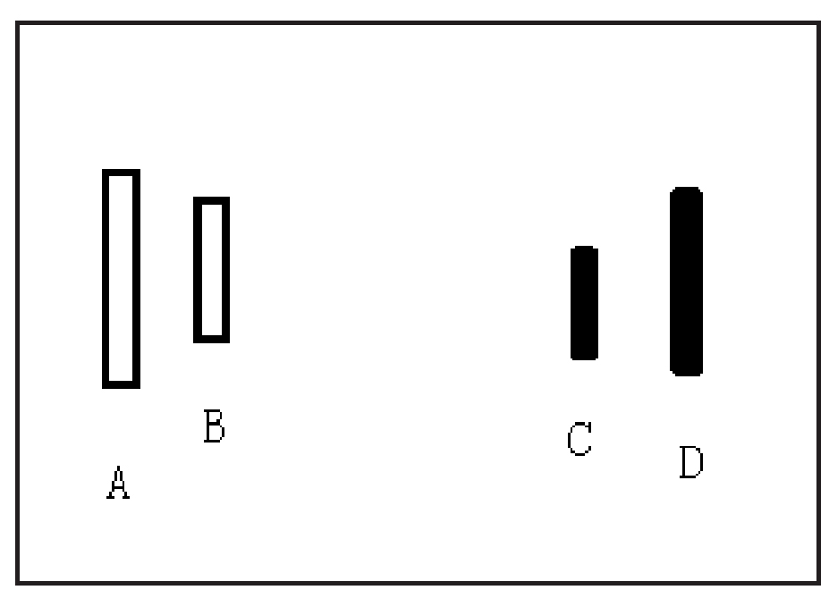

图 1-1

如图 1-2 所示，K 线 F 的高低点没有全部在其相邻 K 线 E 的范围之内，则 K 线 F 和 K 线 E 不属于包含关系；K 线 G 的高低点全部不在其相邻 K 线 H 的范围之内，则 K 线 G 和 K 线 H 不属于包含关系。

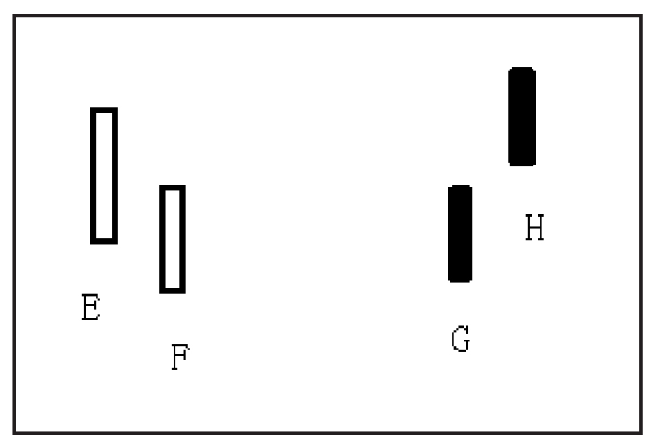

图 1-2

如图 1-3 所示，虚线框内的两相邻 K 线为包含关系。大家可以细心观察。

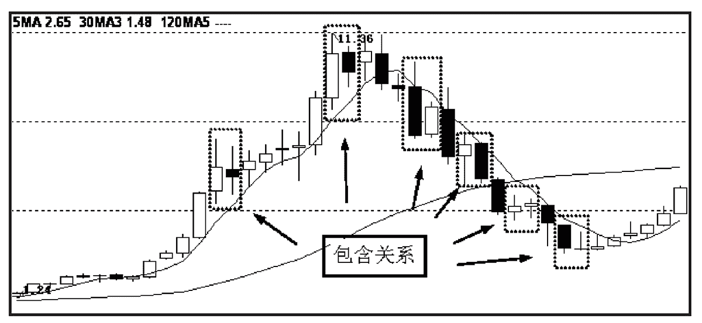

图 1-3

### 2．K 线的包含处理原则

K 线走势图中，经常会看到一些有包含关系的 K 线。为了准确识别 K 线走势中的顶底分型，有必要对这些存在包含关系的 K 线进行包含处理。

所谓包含处理，就是将有包含关系的两根 K 线合并成一根 K 线，即简化处理。

K 线包含处理分两种情况：向上处理和向下处理。

###### ①向上处理

存在包含关系的两根 K 线合并时，当第一根 K 线的高点比其前一根具有非包含关系 K 线的高点高时，具有包含关系的两根 K 线采取向上处理。

实际图形里，有些复杂的关系会出现，就是相邻两 K 线可以出现包含关系，也就是一 K 线的高低点全在另一 K 线的范围里，这种情况下，可以这样处理，在向上时，把两 K 线的最高点当高点，而两 K 线低点中的较高者当成低点，这样就把两 K 线合并成一新的 K 线；反之，当向下时，把两 K 线的最低点当低点，而两 K 线高点中的较低者当成高点，这样就把两 K 线合并成一新的 K 线。经过这样的处理，所有 K 线图都可以处理成没有包含关系的图形。（教你炒股票 62）

假设，第 n 根 K 线满足第 n 根与第 n+1 根的包含关系，而第 n 根与第 n-1 根不是包含关系，那么如果 gn≥gn-1，那么称第 n-1、n、n+1 根 K 线是向上的；如果 dn≤dn-1，那么称第 n-1、n、n+1 根 K 线是向下的。（教你炒股票 65）

如图 1-4 所示，图左中 B、C 为具有包含关系的两相邻 K 线，当 B 的高点比其前一根具有非包含关系 K 线 A 的高点高时，则 B、C 取向上处理。图右中 F、G 为具有包含关系的两相邻 K 线，当 F 的高点比其前一根具有非包含关系 K 线 E 的高点高时，则 FG 取向上处理。

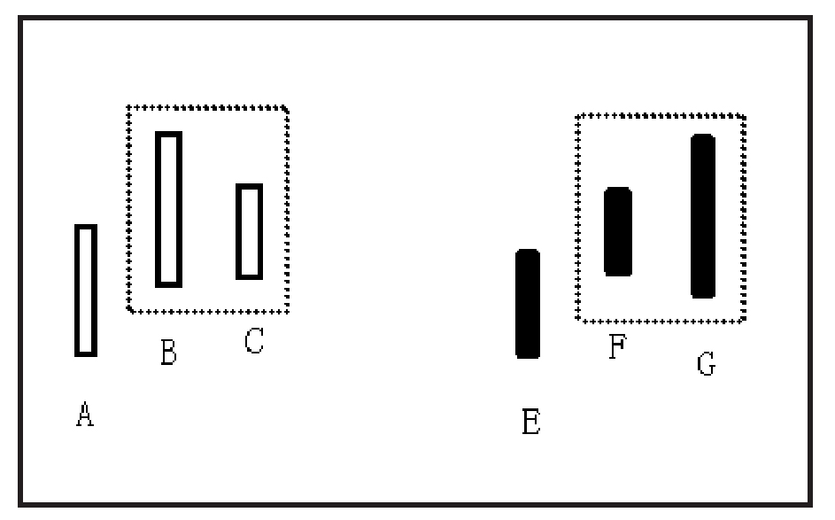

图 1-4

###### ②向下处理

存在包含关系的两根 K 线合并时，当第一根 K 线的高点比前一根具有非包含关系 K 线的高点低时，具有包含关系的两根 K 线取向下处理。

如图 1-5 所示，图左中 B、C 为具有包含关系的两根 K 线，当 B 的高点比前一根非包含关系 K 线 A 的高点低时，则 B、C 取向下处理。图右中 F、G 为具有包含关系的两根 K 线，当 F 的高点比前一根非包含关系 K 线 E 的高点低时，则 F、G 取向下处理。

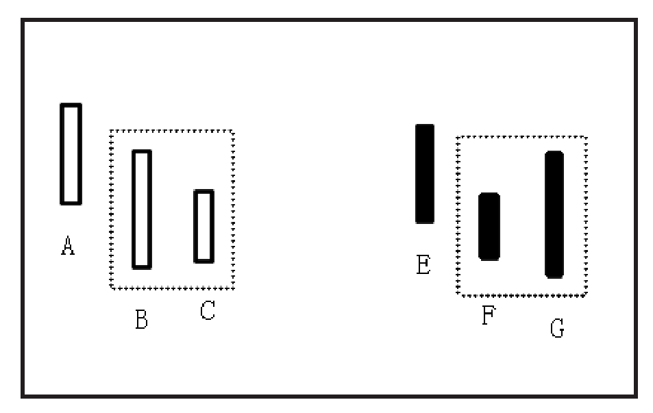

图 1-5

图 1-6 为向上处理及向下处理实图。图中 B 比 A 高，取向上处理；图中 D 比 C 低，取向下处理。

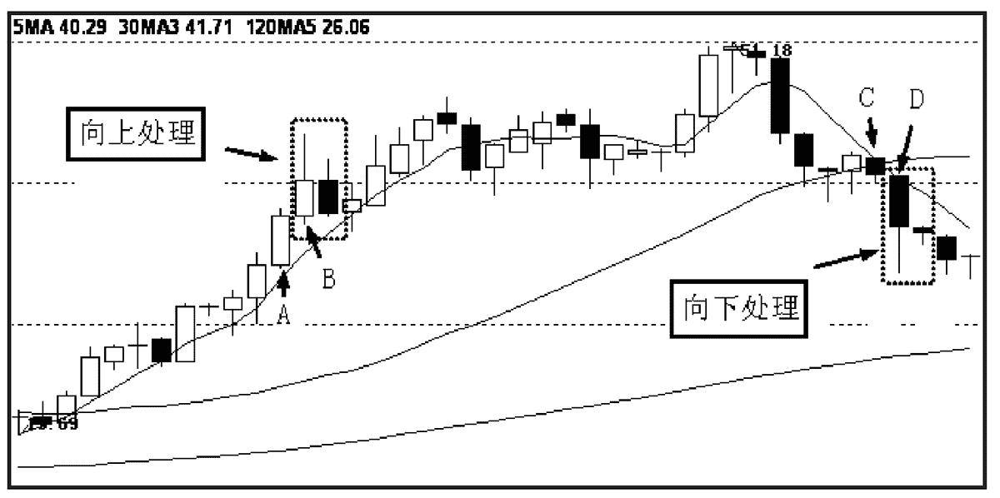

图 1-6

###### ①向上处理的原则

K 线包含向上处理时，取两根 K 线中的最高点为高点，较低点为低点，合并成一根新 K 线。如图 1-7 所示，B、C 向上处理，取两根 K 线中的最高点为高点，较低点为低点，合并成新 K 线 D。

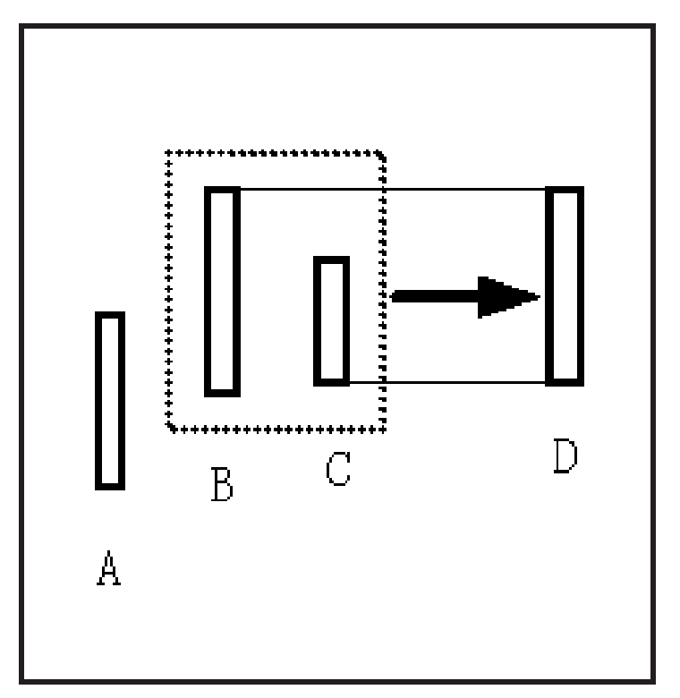

图 1-7

如图 1-8 所示，F、G 向上处理，取两根 K 线中的最高点为高点，较低点为低点，合并成新 K 线 H。

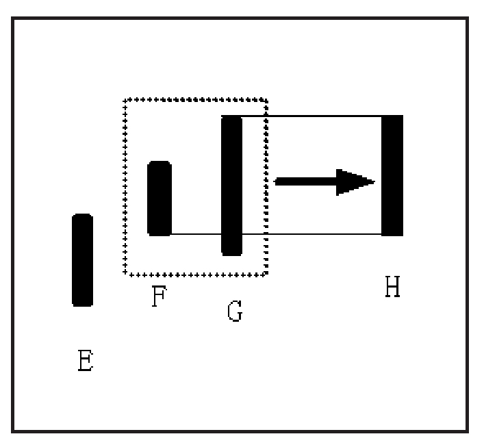

图 1-8

###### ②向下处理的原则

K 线包含向下处理，取两根 K 线中最低点为低点，较高点为高点，合并成一根新 K 线。如图 1-9 所示，B、C 向下处理，取两根 K 线中最低点为低点，较高点为高点，合并成新 K 线 D。

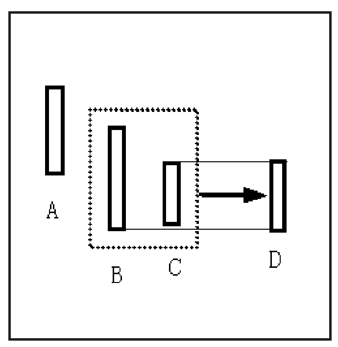

图 1-9

如图 1-10 所示，FG 向下处理，取两根 K 线中最低点为低点，较高点为高点，合并成新 K 线 H。

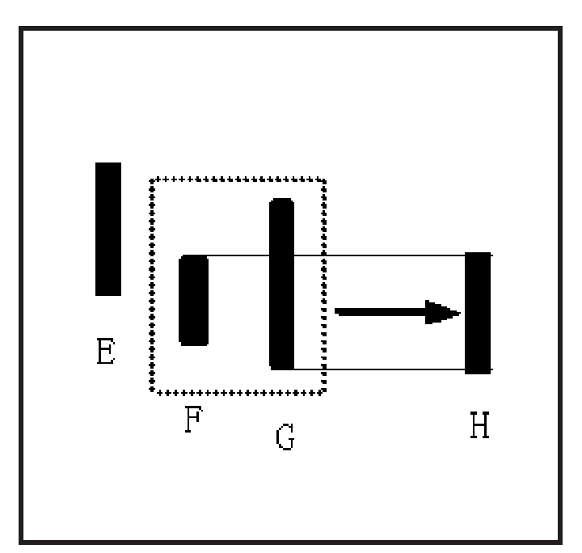

图 1-10

### 3．K 线包含处理的顺序

进行 K 线包含处理时，必须按照时间的先后顺序来进行，即先合并前面的，再依次合并后面的，否则就可能发生紊乱和错误。

如图 1-11 中，B 与 C、C 与 D 看上去都是包含关系，但合并处理时，要求按照时间先后顺序来合并 B 与 C，待产生新 K 线后再与 D 比较。若仍存在包含关系，再合并处理。若不存在包含关系，则当然不再进行包含处理。E 与 F、F 与 G 之间同理。

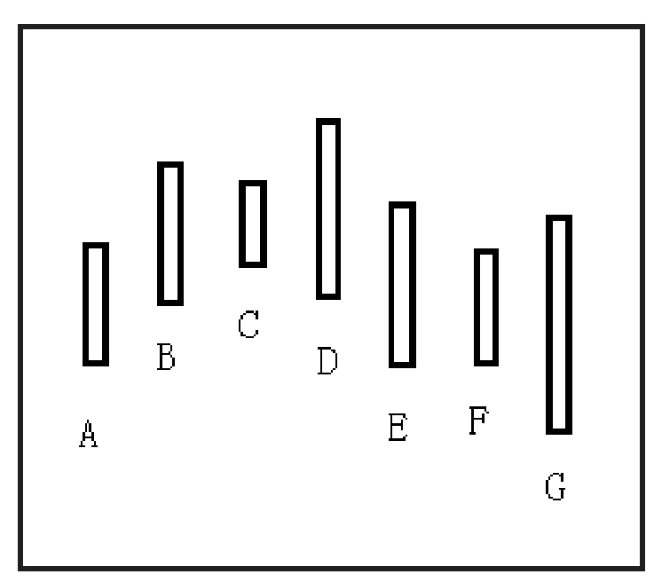

图 1-11

结合实例，试范讲解一下走势图中 K 线合并的全部演化过程。

如图 1-12 所示，第一步要求合并 B 与 C，因为 B 的高点比 A 的高点高，B、C 取向上处理，结果产生新 K 线 M。

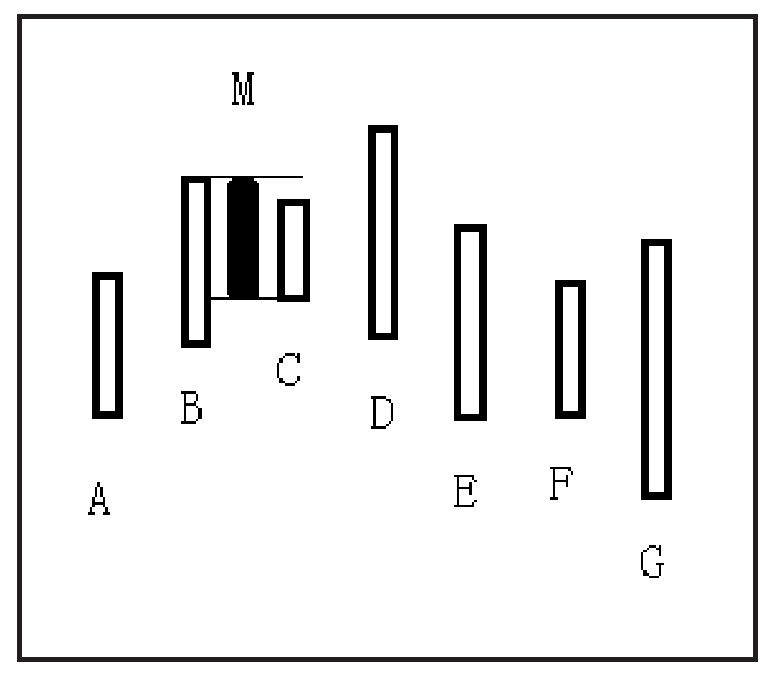

图 1-12

第二步考察新生 K 线 M 与 K 线 D 之间的关系，发现 M 与 D 仍为包含关系，则继续合并。此时因 M 的高点比 A 的高点高，M、D 取向上处理，结果产生新 K 线 N。如图 1-13 所示。

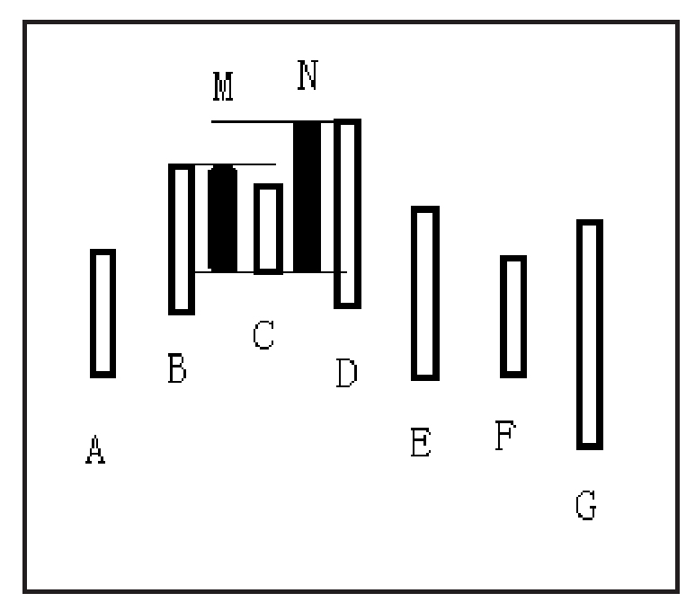

图 1-13

第三步合并 E 与 F，因为 E 的高点比 N 的高点低，E、F 取向下处理，结果产生新 K 线 O。如图 1-14 所示。

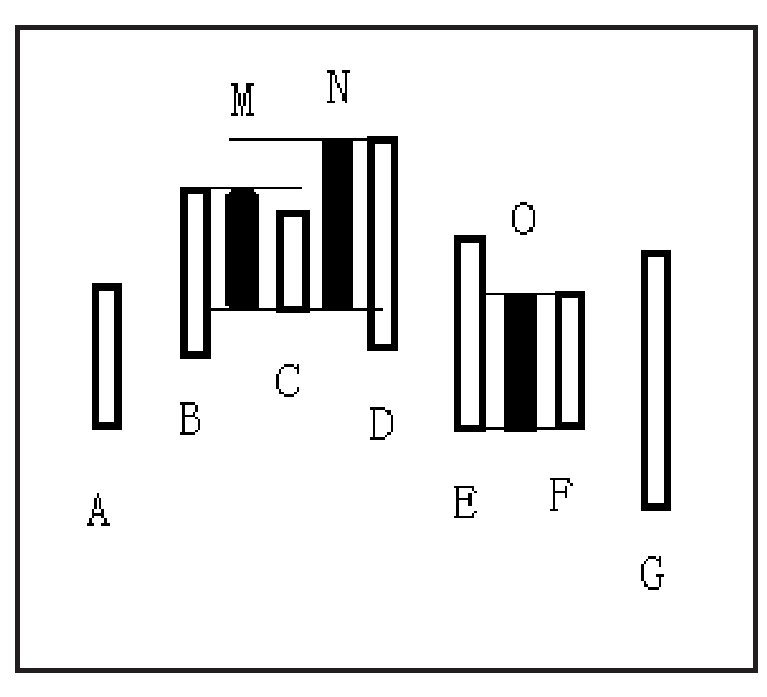

图 1-14

第四步考察新生 K 线 O 与 K 线 G 之间的关系，发现 O 与 G 仍为包含关系，继续合并。因为 O 的高点比 N 的高点低，O、G 取向下处理，结果产生新 K 线 P。如图 1-15 所示。

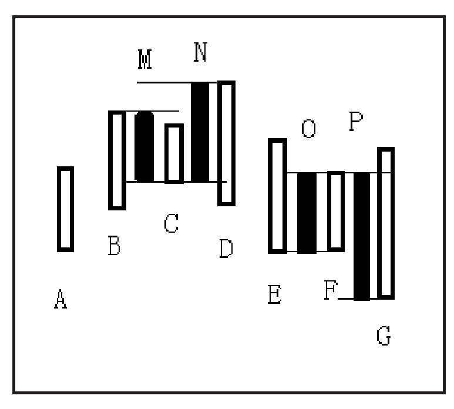

图 1-15

这样，通过合并处理，图 1-11 中的 K 线走势就变成 A、N、P 三条 K 线。如图 1-16 所示。

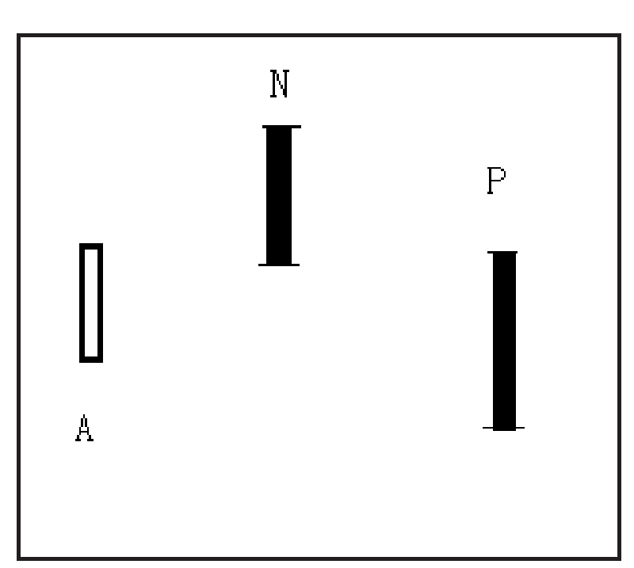

图 1-16

结合律是本 ID 理论中最基础的。在 K 线的包含关系中，当然也需要遵守。而包含关系不符合传递律。也就是说，第 1、2 根 K 线是包含关系，第 2、3 根也是包含关系，但并不意味着第 1、3 根就有包含关系。因此在 K 线包含关系的分析中，还要遵守顺序原则，就是先用第 1、2 根 K 线的包含关系确认新的 K 线，然后用新的 K 线去和第 3 根比。如果有包含关系，继续用包含关系的法则结合成新的 K 线。如果没有，就按正常 K 线去处理。（教你炒股票 65）

注意： 经过彻底合并处理后的 K 线图中，一定不再存在有包含关系的 K 线，否则就是合并不彻底，仍有继续合并处理的要求。

结语： 进行 K 线处理合并的主要目的是为了识别顶底分型，因此，对于 K 线图中的某些非关键位置的包含 K 线，就没有一定合并处理的必要。只要熟练掌握了其方法，K 线合并处理也是一眼就能看出个大概来的，只要多加练习，即可熟能生巧。

## 二、分型

分型是缠论 K 线系统中一个极为关键的概念，源自 K 线组合的一个完全分类，是一个纯理论的推导。最早提出分型概念的是诺贝尔奖获得者——美国的比尔·威廉姆斯博士，他在《混沌操作法》一书中，将分型（Fractal，台湾翻译为碎形）称为上分型和下分型。缠中说禅在《教你炒股票 108 课》中将分型加以简化，称为顶分型和底分型。

如图 1-17 所示，连续三根经由包含处理后的 K 线，按完全分类方法，仅可以组合成四种不同的结构，其中 2 和 4 就是分型。

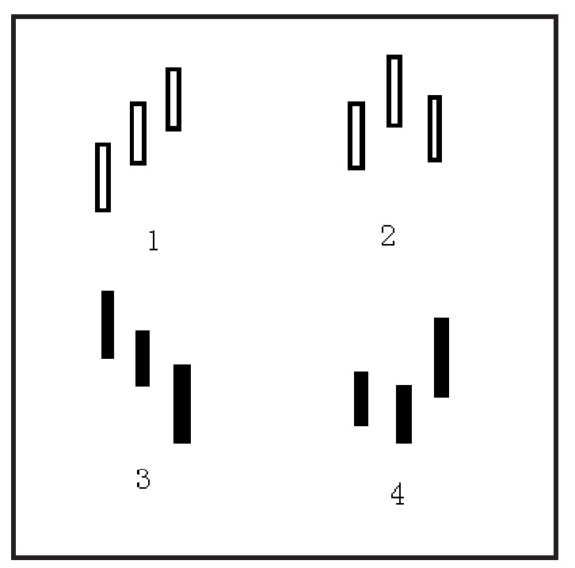

图 1-17

分型由连续三根经由包含处理后的 K 线构成。分型有两种表现形式： 顶分型、底分型。

### 1．顶分型

定义：三根经包含处理后的连续 K 线，若中间那根 K 线的高点最高，那么这种组合形态就叫顶分型。

如图 1-18 所示，图中两组 K 线中，中间 K 线的高点都是最高的，这种组合形态就叫顶分型。

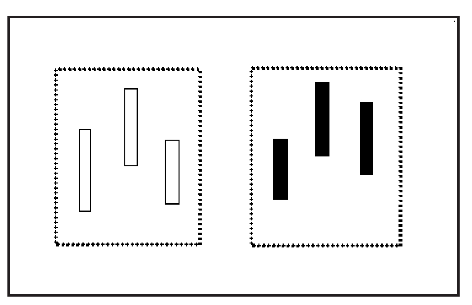

图 1-18

如图所示，图①中，第二根 K 线高点是相邻三根 K 线高点中最高的，而低点也是相邻三根 K 线低点中最高的，本 ID 给一个定义叫顶分型；图②这种叫底分型，第二根 K 线低点是相邻三根 K 线低点中最低的，而高点也是相邻三根 K 线高点中最低的。

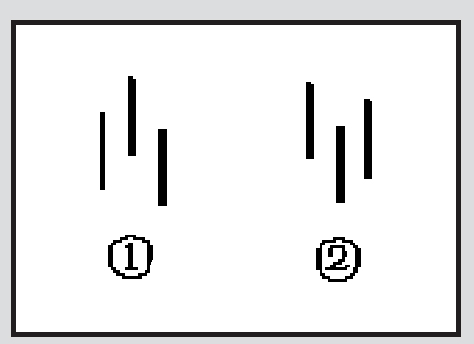

（教你炒股票 62）　

三根 K 线就可以决定一个分型，但注意，任何相邻的分型之间必须满足结合律，也就是说，不能有些 K 线分属不同的分型，这样是不允许的。（教你炒股票 77）  
  

没有顶分型，没有顶；反之，没有底分型，没有底。（教你炒股票 81）  
  

显然，一个顶分型之所以成立，是卖的分力最终战胜了买的分力，而其中买的分力有三次的努力，而卖的分力有三次的阻击。用最标准的已经过包含处理的三根 K 线模型：第一根 K 线的高点，被卖分力阻击后，出现回落，这个回落出现在第一根 K 线的上影部分或者第二根 K 线的下影部分，而在第二根 K 线出现一个更高的高点，但这个高点显然与第一根 K 线的高点中出现的买的分力，一定在小级别上出现力度背驰，从而至少制造了第二根 K 线的上影部分。最后，第三根 K 线会再次继续一次买的分力的攻击，但这个攻击完全被卖的分力击败，从而不能成为一个新高点，在小级别上，大致出现一种第二类卖点的走势。（教你炒股票 82）  
  

由上可见，一个分型结构的出现，如同中枢，都是经过一个三次的反复心理较量过程，只是中枢用的是三个次级别。所谓一而再，再而三，三而竭，所以一个顶分型就这样出现了，而底分型的情况，反过来就是。（教你炒股票 82）  
  

分型形成后，无非两种结构：一、成为中继型的，最终不延续成笔；二、延续成笔。（教你炒股票 82）

顶分型的最高点称为顶。如图 1-19 所示，中间 K 线的最高点叫做顶。

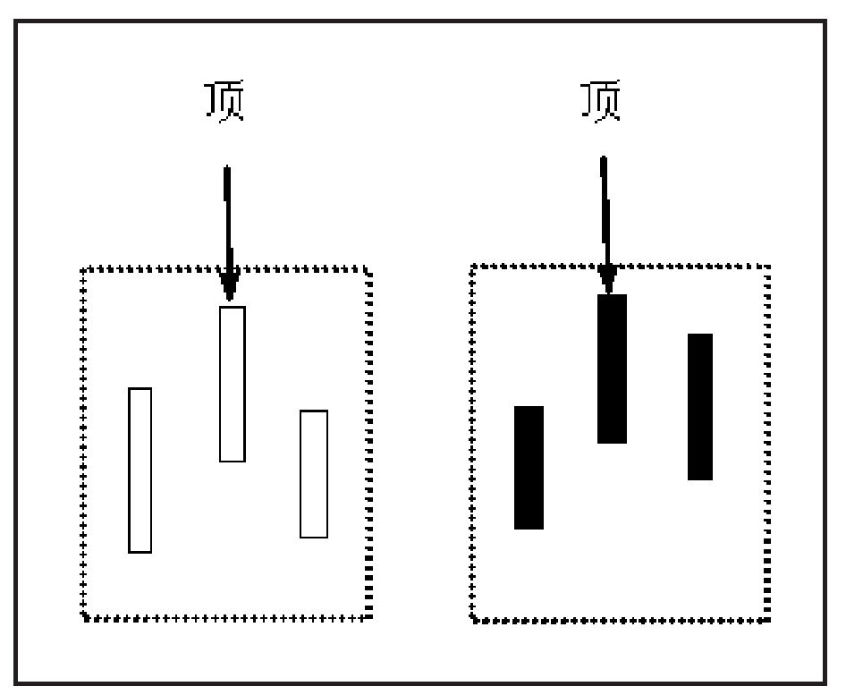

图 1-19

顶分型是上涨过程将出现转折的信号。一只上升中的股票，如果连顶分型都没有出现，就不应当急于卖出。

如图 1-20 所示，上涨过程中一直未出现顶分型，暂时持股。

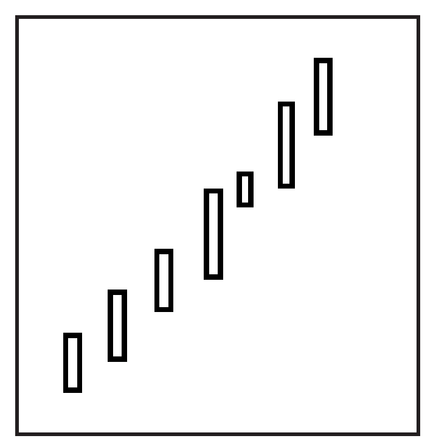

图 1-20

如图 1-21 所示，虚线框内的上涨过程中一直未出现顶分型，暂时持股。

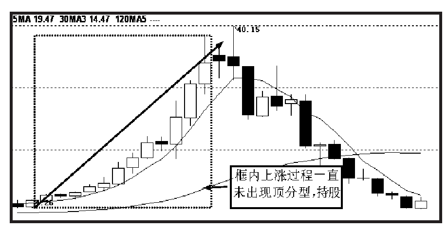

图 1-21

在上涨过程中第一次出现的顶分型，如果形态上不十分强烈，那么一般情况下可能是中继顶分型，不会立即导致行情向下转折。但如果是第二次或三次连续出现顶分型，就必须特别小心。这个时候的顶分型，向下转折的概率非常大。

如图 1-22 所示，当出现第二个顶分型 B 时，行情向下转折的概率加大，应当引起重视。

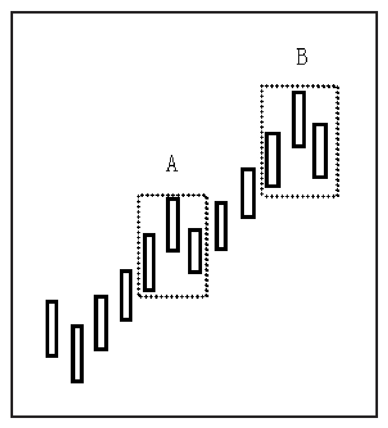

图 1-22

### 2．底分型

定义：三根经包含处理后的连续 K 线，若中间那根 K 线的低点最低，那么这种组合形态就叫底分型。

如图 1-23 所示，两组 K 线中，中间 K 线的低点都是最低，这种组合形态就叫底分型。

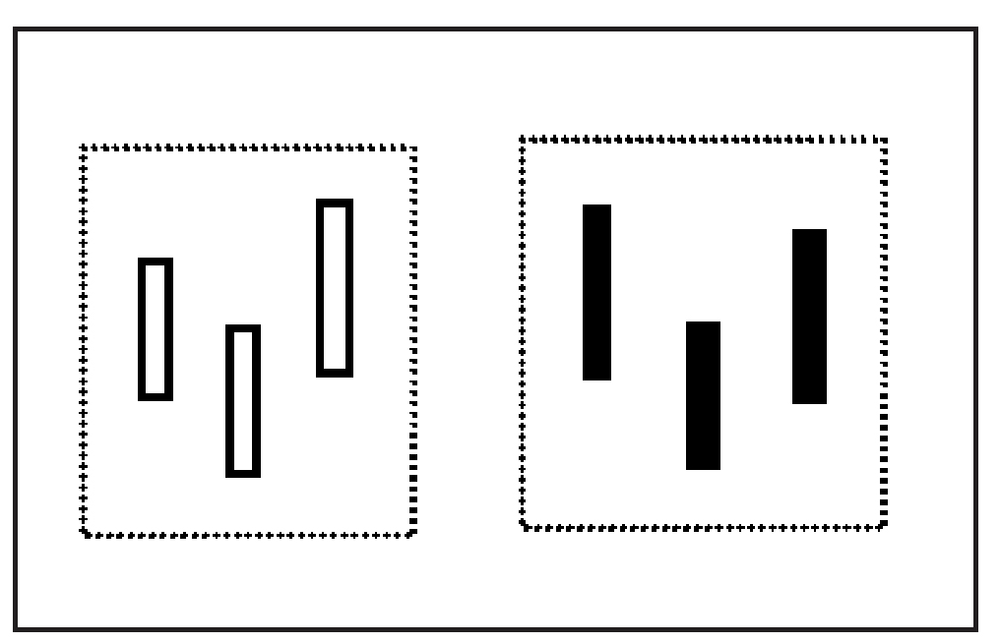

图 1-23

底分型的最低点称为底。如图 1-24 所示，中间 K 线的最低点叫做底。

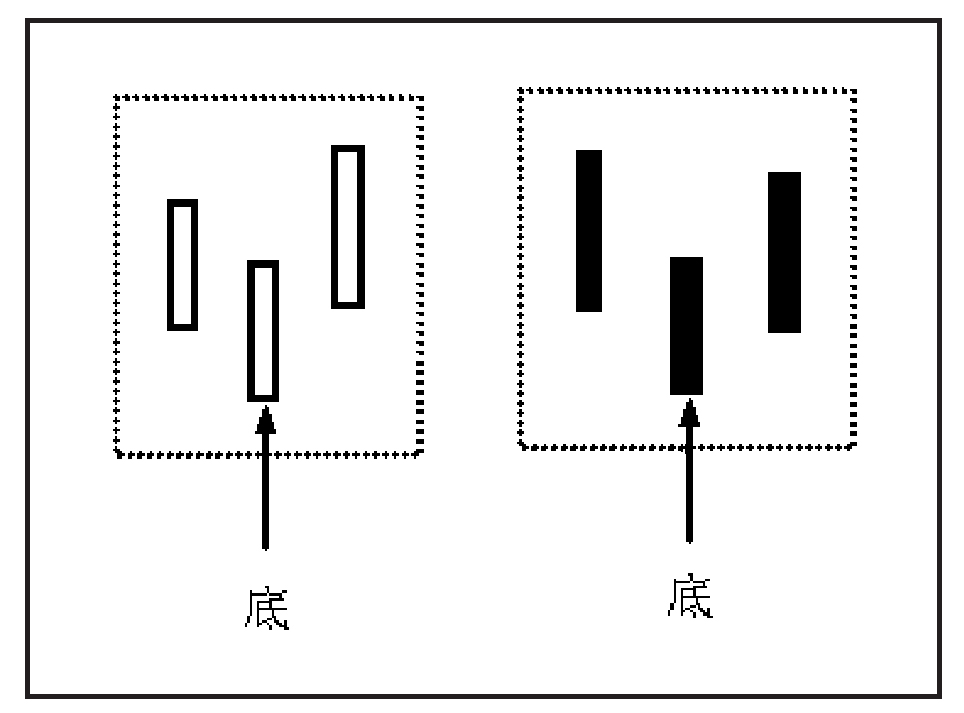

图 1-24

底分型是下跌过程将出现转折的信号。一只下跌中的股票，如果连底分型都没有出现，就不应当急于买入。

如图 1-25 所示，下跌过程中一直未出现底分型，暂时持币。

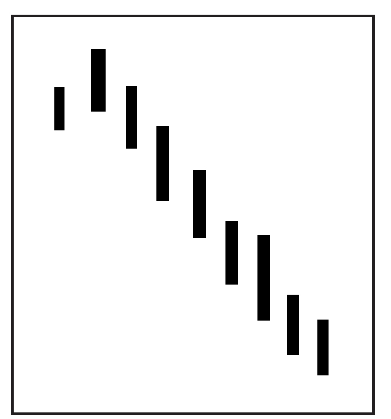

图 1-25

如图 1-26 所示，虚线框内的下跌过程一直没出现底分型，所以根本不用考虑买入。

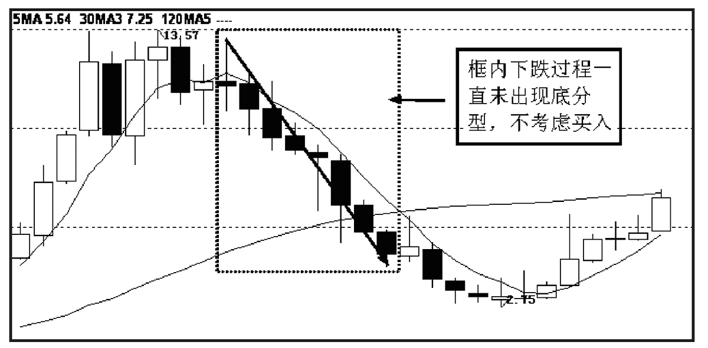

图 1-26

下跌过程中第一次出现底分型，如果形态上不十分强烈，那么一般情况下都是中继底分型，不会立即导致行情向上转折。但如果是连续第二次或三次出现底分型，就必须特别小心。这个时候的底分型，向上转折的概率非常大。

如图 1-27 所示，当出现第三个底分型 C 时，向上转折的概率已经非常大，应当引起高度重视。

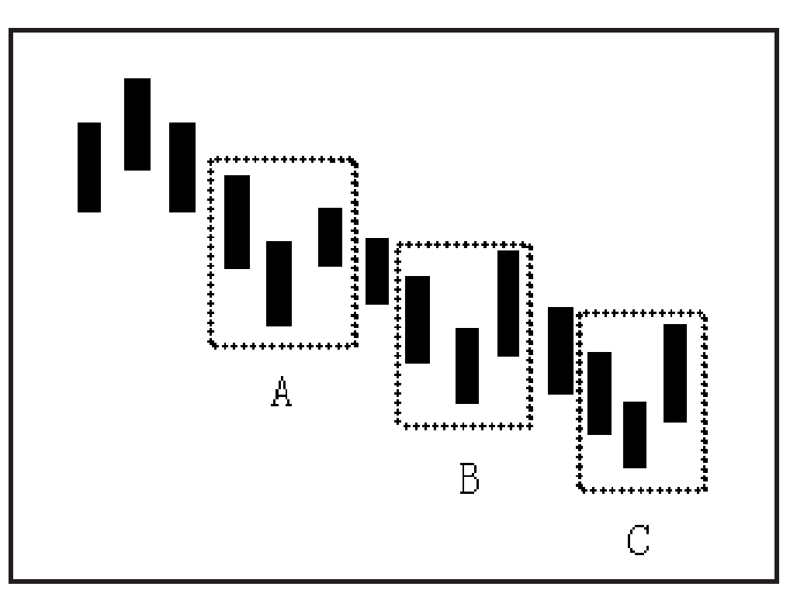

图 1-27

### 3．分型中三根 K 线的指导意义

分型由三根 K 线组成。由三根 K 线组成的分型尽管结构相同，但形态上却千差万别。

首先，一个完全没有包含关系的分型结构，意味着市场双方都是直截了当，没有太多的犹豫。而有包含关系的分形结构，意味着犹豫和不确定的观望。

如图 1-28 所示，左边为没有包含关系的分型，右边为有包含关系且结构较复杂的分型。

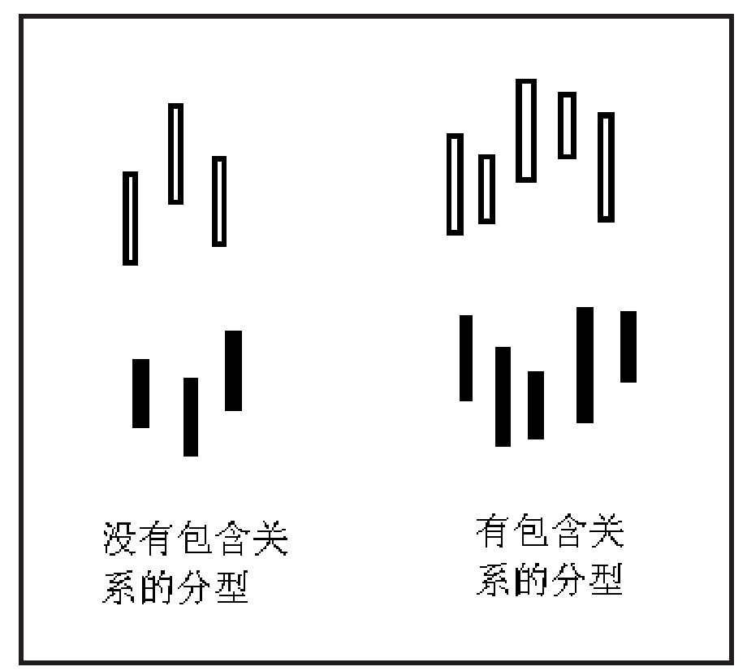

图 1-28

还是用没有包含关系的顶分型为例。如果第一根 K 线是一根长阳线，而第二、三根都是小阴线、小阳线，那么这个分型结构的意义就不大。一般来说，这种顶分型成为真正顶部的可能性很小，绝大多数都是中继性的。如果第二根 K 线是长上影线甚至就是直接的长阴线，而第三根 K 线不能以阳线收在第二根 K 线区间的一半之上，那么该顶分型的力度就比较大，最终要延续成终结型顶分型的可能性就极大了。

如图 1-29 所示，左边的分型结构意义较小，右边的分型结构意义较大。

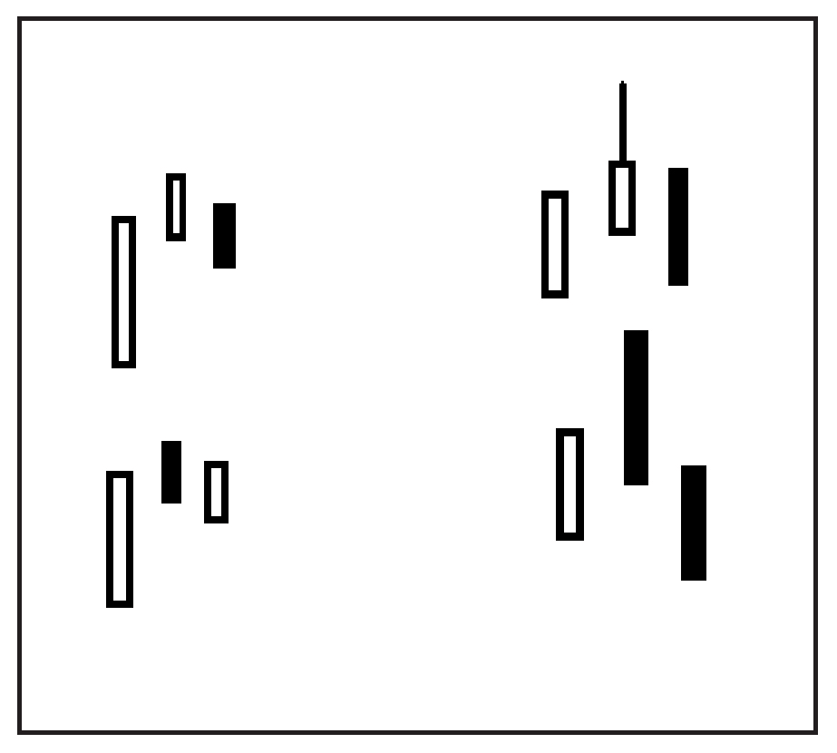

图 1-29

一般来说，非包含关系（处理后）的顶分型中，第三根 K 线如果跌破第一根 K 线的底而且不能收高到第一根 K 线区间的一半之上，属于最弱的一种。也就是说，这种顶分型有较强的杀伤力。

如图 1-30 所示，这种顶分型属于顶分型中较弱的一种，有较强的杀伤力，应当引起警惕。这种分型成为终结型顶分型的概率很大。

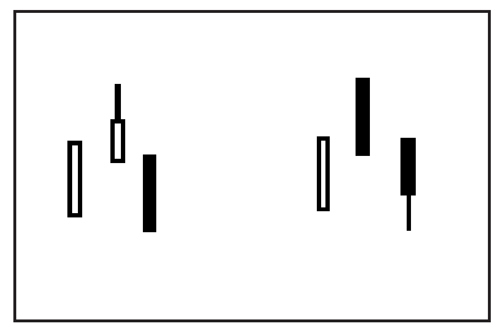

图 1-30

底分型的情况与顶分型相反，反向理解即可。

图 1-31、图 1-32 是顶底分型实例。读者可以仔细地对照观察一下。

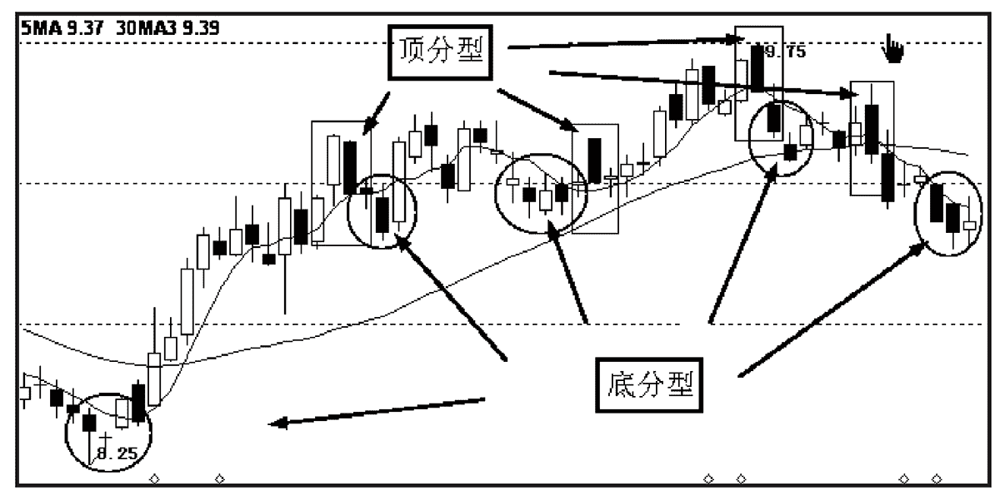

图 1-31

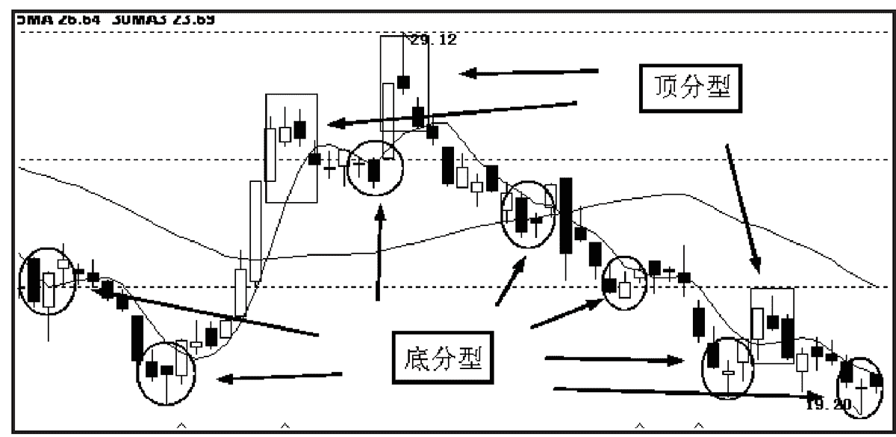

图 1-32

结语： 缠论关于分型的定义，源自 K 线组合的一个完全分类，是一个纯理论的推导。分型的结构相同，但形态却千差万别。

任何级别的走势，如果没出现顶分型，就没有顶，相对应的操作就是持股；反之，如果没有出现底分型，就没有底，相对应的操作就是持币。

缠论的分型，是划分缠论中笔的概念的基础，必须完全熟练掌握。

两个相邻的顶和底之间构成一笔。所谓笔，就是顶和底之间的其他波动都可以忽略不计。但注意，一定是相邻的顶和底，隔几个就不是了。所谓的线段，至少由三笔组成。但这里有一个细微的地方要分清楚，因为结合律是必须遵守的，像图 3 这种，顶和底之间必须共用一个 K 线，这就违反结合律了，所以这不算一笔。图 4 就光是顶和底了，中间没有其他 K 线，一般来说最好不算一笔。图 5 是一笔的最基本图形，顶和底之间还有一根 K 线。在实际分析中，必须要求顶和底之间都至少有一根 K 线当成一笔的最基本要求。（教你炒股票 62）

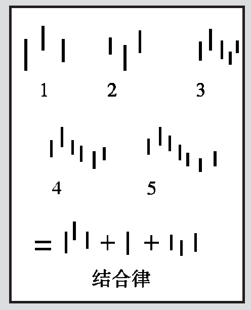

## 三、笔

笔是缠论中由分型发展而来的一个重要概念，是缠论划线分析方法的基础概念。

### 1．笔的定义

两相邻顶分型和底分型顶底之间的连线叫做笔。

如图 1-33 所示，AB 是顶分型与底分型顶底之间的连线，AB 叫做笔；BC 是底分型和顶分型底顶之间的连线，BC 也叫做笔。

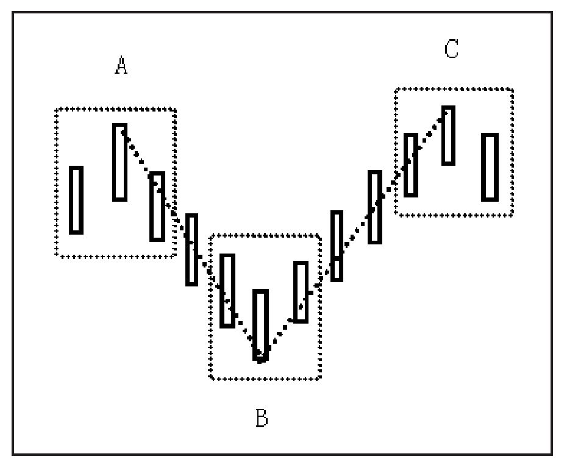

图 1-33

### 2．笔的最基本要求

顶分型和底分型之间至少有一根独立 K 线。

如图 1-34 所示，AB 之间至少要有一根独立的 K 线，这样 AB 才能称为笔。

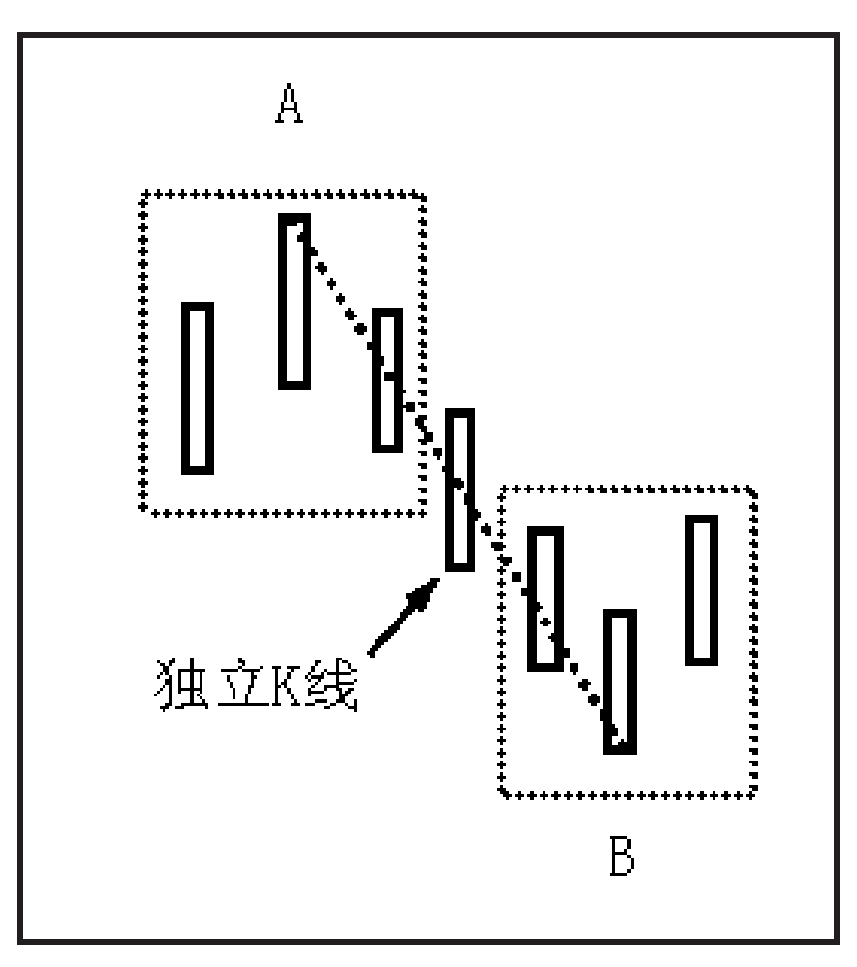

图 1-34

如图 1-35 所示，CD 之间至少要有一根独立 K 线，这样 CD 才能称为笔。

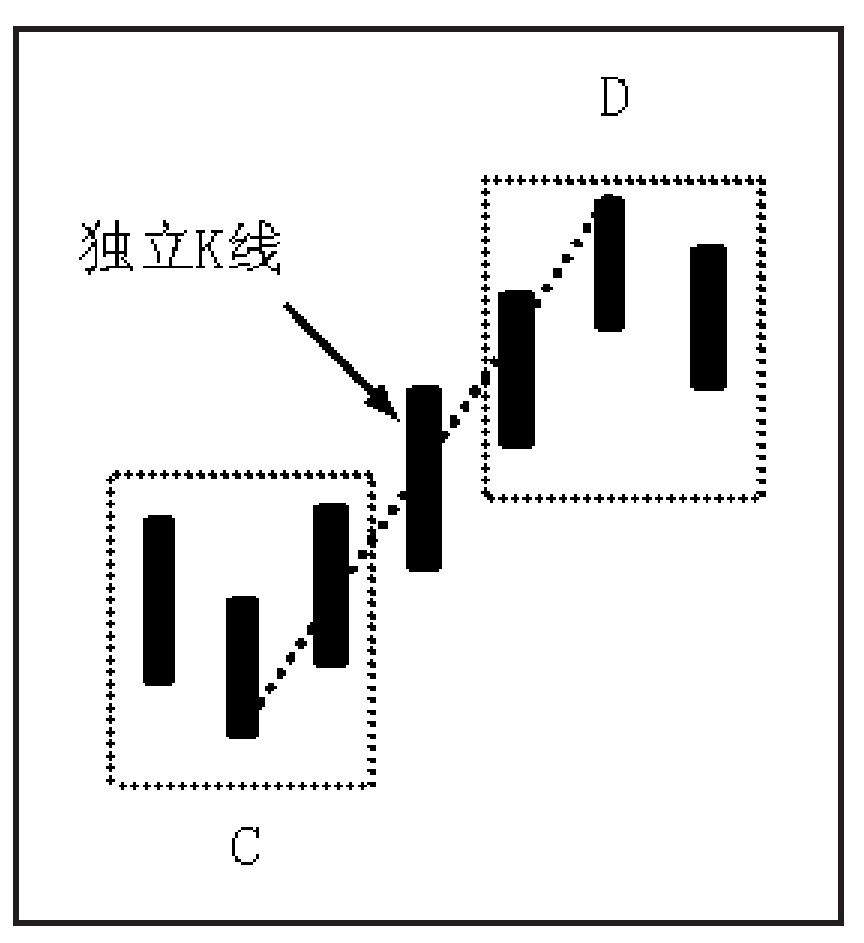

图 1-35

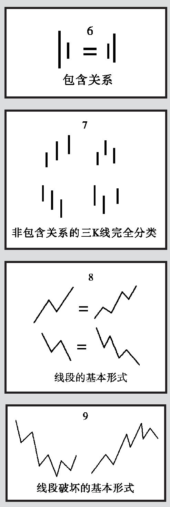

上升的一笔，由结合律分析，一定是底分型+上升 K 线+顶分型。下降的一笔，就是顶分型+下降 K 线+底分型。注意，这里的上升、下降 K 线，不一定都是三根，可以是无数根，只要符合这个定义就可以。当然，简单的也可以是一两根，只要不违反结合律和定义。（教你炒股票 62）  
  

笔，必须是一顶一底，而且顶和底之间至少有一根 K 线不属于顶分型与底分型。当然，还有一个最显然的，就是在同一笔中，顶分型中最高那根 K 线的区间，至少要有一部分高于底分型中最低那根 K 线的区间。如果这条满足不了，也就是顶都在底的范围内，或顶比底还低，这显然是不可接受的。（教你炒股票 72）  
  

在确定笔的过程中，必须要满足上面的条件，这样可以确定唯一的笔。这个划分的唯一性很容易证明。假设有两个都满足划分笔的条件，这两个划分要有所不同，必然是两个划分从第 N-1 笔以前都是相同的，从第 N 笔开始出现第一个不同，这个 N 可以等于 1，这样就是从一开始就不同。那么第 N-1 笔结束的位置的分型，显然对于两个划分的性质是一样的，都是顶或底。对于是顶的情况，那么第 N 笔，其底对于两个划分必然对应不同的底分型，否则这笔对两个划分就是相同的，这显然矛盾。由于分型的划分是唯一的，因此，两种不同的划分里，在第 N 笔对应的底分型，在顺序上必然有前后高低之分，而且在这两个底之间不可能存在一个顶，否则这里就不是一笔了。（教你炒股票 72）  
  

如果前面的底高于后面的底，那么前面的划分显然是错误的。因为按这种划分，该笔是没有完成的。一个底不经过一个顶后就有一个更低的底，这是最典型的笔没完成的情况。（教你炒股票 72）  
  

如果前面的底不低于后面的底，那么在下面一个顶分型出现前，如果有一个底分型低于前面的底，那么这两种划分都是不正确的，所划分的笔都是没有完成的。如下面一个顶分型出现前，没有一个底分型低于前面的底，那么下面一个顶分型必然高于前面的底，因此前面的底和这个顶分型就是新的 N+1 笔，第 N 笔和第 N+1 笔就有了唯一的划分，这与第 N 笔开始有不同划分的要求相矛盾。（教你炒股票 72）  
  

从上面笔划分的唯一性证明中，其实也知道划分笔的步骤：一、确定所有符合标准的分型。二、如果前后两个分型是同一性质的，对于顶，前面的低于后面的，只保留后面的，前面那个可以忽略掉。对于底，前面的高于后面的，只保留后面的，前面那个可以忽略掉。不满足上面条件的，例如相等的，都可以先保留。三、经过步骤二的处理后，余下的分型，如果相邻的是顶和底，那么就可以划为一笔。（教你炒股票 72）  
  

如果相邻分型性质一样，那么必然有前顶不低于后顶，前底不高于后底。在连续的顶后，必须会出现新的底，把这连续的顶中最早出现一个和这新出现的底连在一起，就是新的一笔，中间的那些顶都可以忽略掉；在连续的底后，必然会出现新的顶，把连续的底中最先出现一个，和新出现的顶连在一起，就是新的一笔，而中间的那些底都可以忽略掉。显然，经过上面三个步骤，所有的笔都可以唯一地划分出来。（教你炒股票 72）

如图 1-36 所示，EF 之间没有独立 K 线，EF 就不能成为笔。

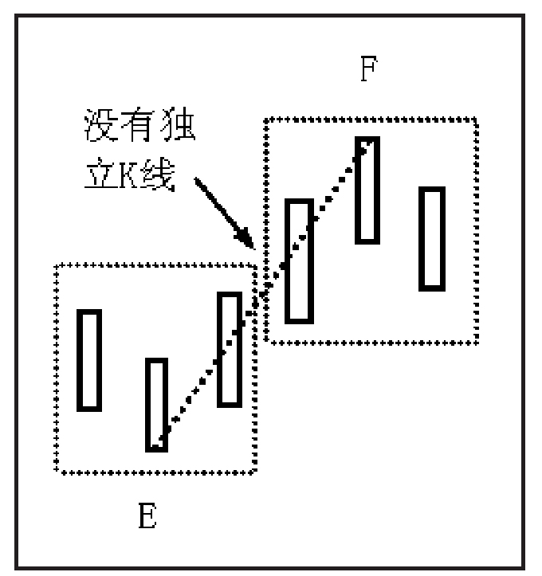

图 1-36

如图 1-37 所示，GH 之间没有独立 K 线，GH 就不能成为笔。

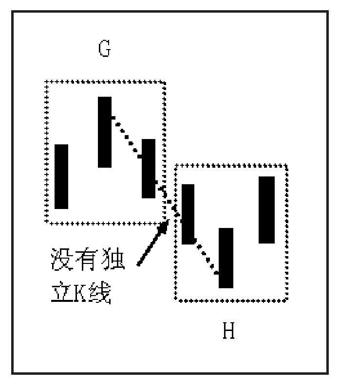

图 1-37

注意： 笔中顶底之间所含独立 K 线可以有一根，也可以有无数根。

如图 1-38 所示，图中箭头所指处都为笔。顶底之间所含独立 K 线可以有多有少，但要求最少保持一根。

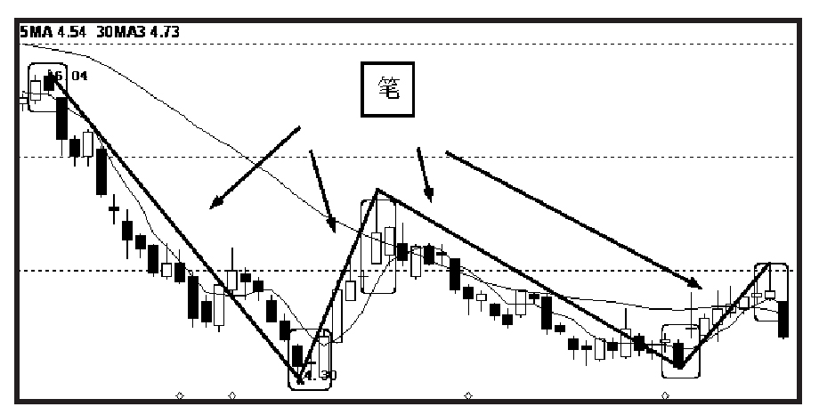

图 1-38

### 3．上升笔和下降笔

从方向来说，笔分为上升笔和下降笔。

#### （1）上升笔

由底分型开始至顶分型结束的笔，称为上升笔，即方向向上的笔。

如图 1-39 所示，AB 笔从底分型开始至顶分型结束，为上升笔。

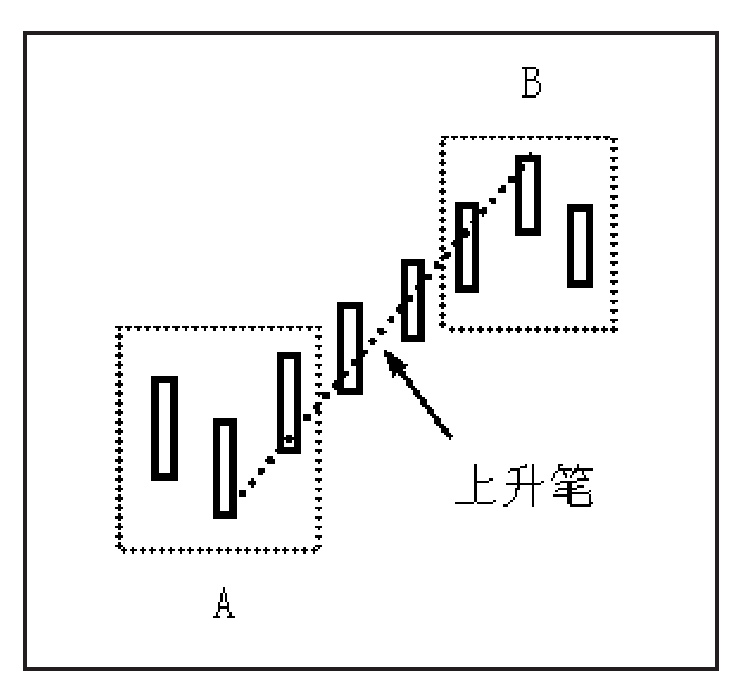

图 1-39

#### （2）下降笔

由顶分型开始至底分型结束的笔，称为下降笔，即方向向下的笔。

如图 1-40 所示，CD 笔从顶分型开始至底分型结束，为下降笔。

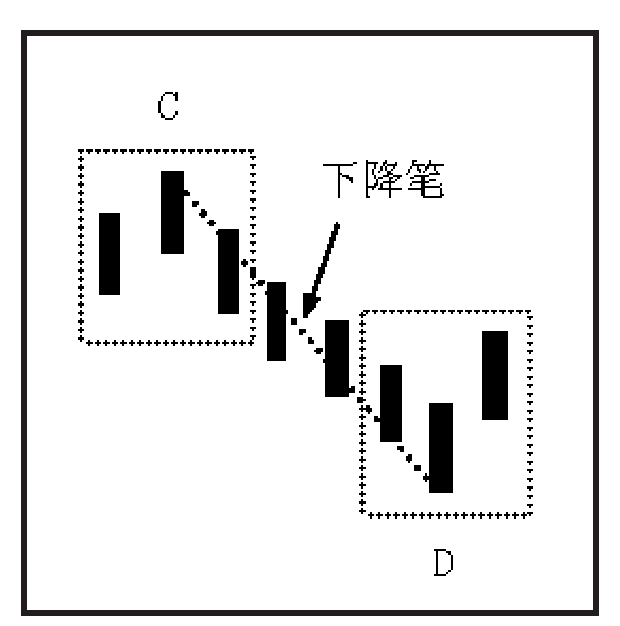

图 1-40

小结： 先底后顶，构成向上一笔；先顶后底，构成向下一笔。所有走势，都是由上升笔和下降笔交替连接而成的。

如图 1-41 所示，图中走势就是由上升笔和下降笔交替连接而成的。

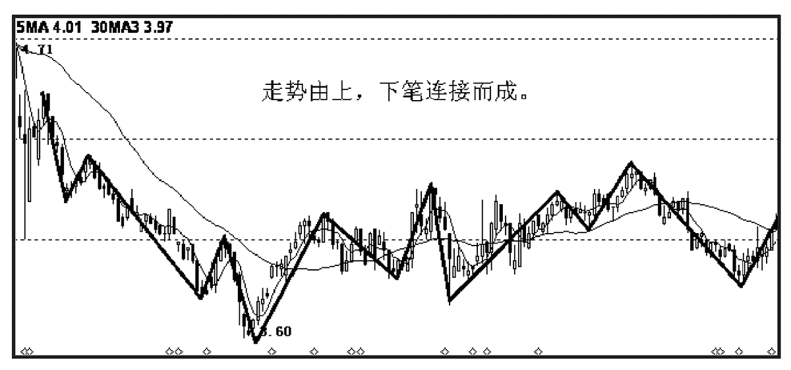

图 1-41

### 4．划分笔的步骤

第一步，先确定 K 线图中的标准分型。即通过 K 线包含处理，找出要分析图形中的顶分型和底分型。

第二步，图中含两个或多个同性质分型的，如果是顶分型，后面的顶高于前面的顶，则只保留后面的；如果是底分型，后面的底低于前面的底，则只保留后面的。

如图 1-42 所示，A、B 为相同性质的顶分型，B 高于 A，则只保留 B。

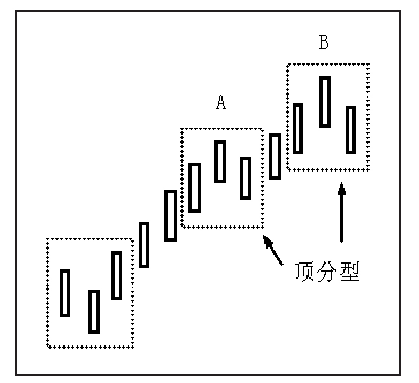

图 1-42

如图 1-43 所示，C、D 同为相同性质的底分型，D 低于 C，则只保留 D。

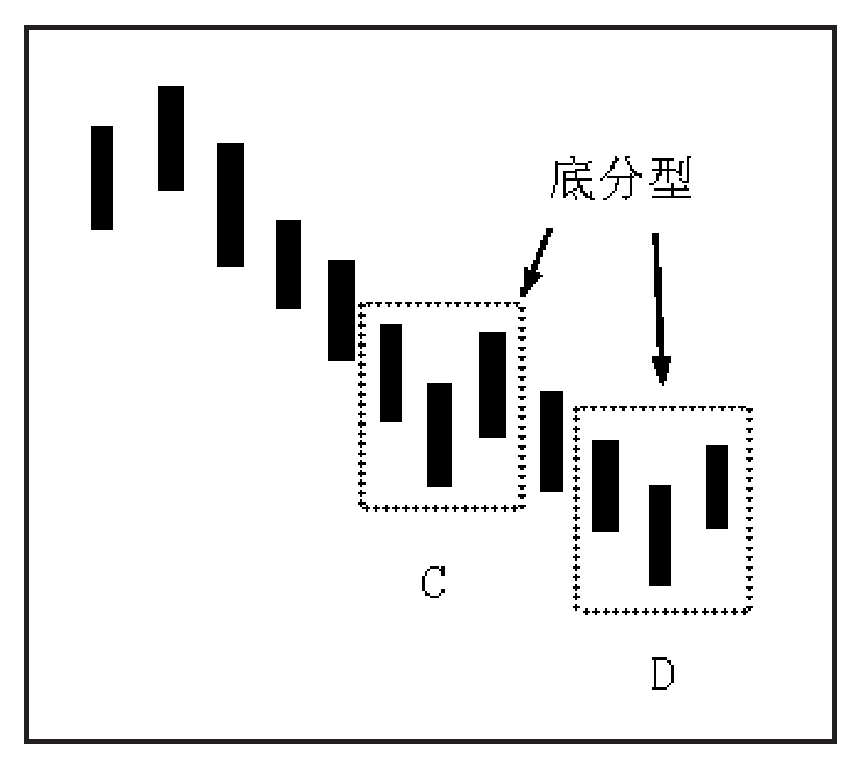

图 1-43

在第二步中，常常会出现一些被省略掉的顶底分型，这些被省略掉的顶底分型都是中继性的，又称为中继分型，其分析意义不大。

第三步，经过前两步处理之后，图形中余下的分型，如果相邻的是顶和底，或底和顶，那么顶底连接或底顶连接，就构成了笔。

笔必须由一顶分型和一底分型共同构成。两个相同性质的分型，无论是两个顶分型，还是两个底分型，都不能构成笔。

如图 1-44 所示，左边 A 和 B 是两个底分型的底，连接 AB 不能构成笔；右边 C 和 D 是两个顶分型的顶，连接 CD 同样不能构成笔。

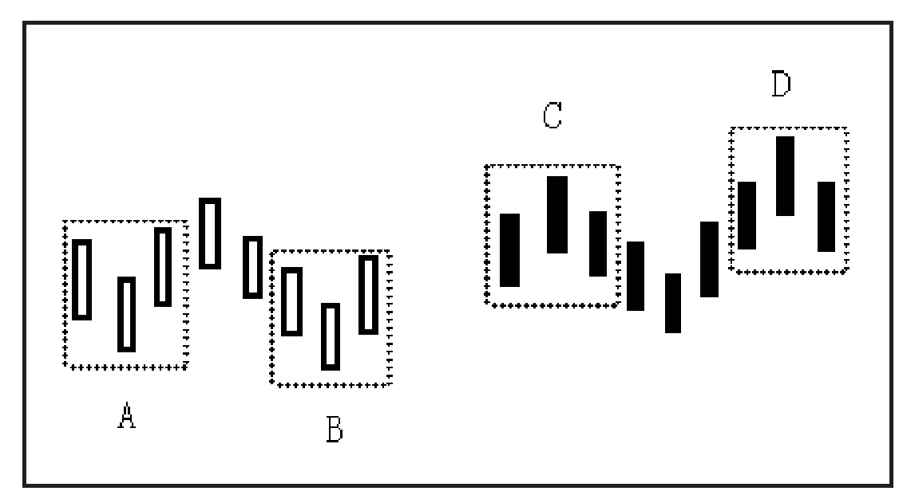

图 1-44

### 5．笔的延伸和结束

#### （1）笔的延伸

两个不同性质的分型之间如果含有独立 K 线，就产生笔。笔产生以后，这个笔可以继续延伸，也可以随时结束。笔何时结束，关键是产生出新的笔。只有当新笔产生时，原笔才算结束。新笔未产生，原笔则暂时延伸。

如图 1-45 所示，B 出现时，AB 向上笔产生，之后 C 再创新高，从 B 开始并未产生出新笔，则笔 AC 为笔 AB 的延伸。

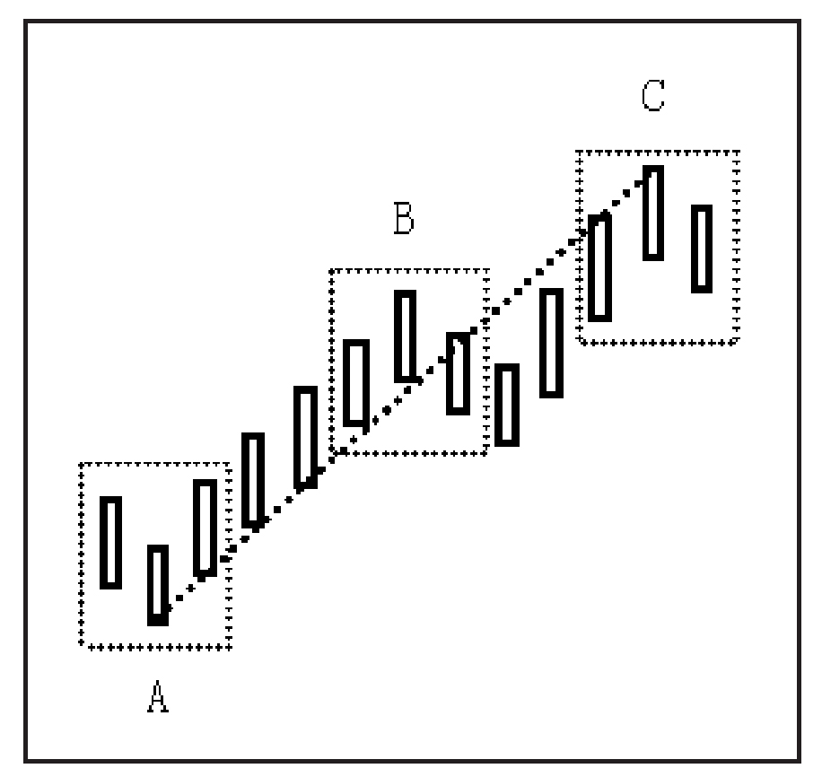

图 1-45

如图 1-46 所示，E 出现时，DE 向下笔产生。之后 F 再创新低，从 E 开始并未产生出新笔，则笔 DF 为笔 DE 的延伸。

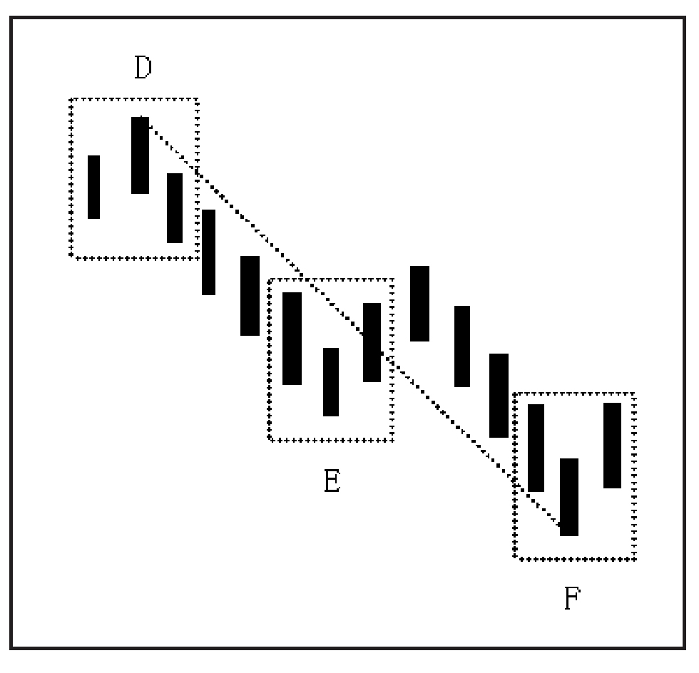

图 1-46

#### （2）笔的结束

笔产生以后，接着在相反方向产生出新笔，则原笔结束。

如图 1-47 所示，以 C 点开始，产生出向下新笔 CD 后，原向上笔 AC 结束。

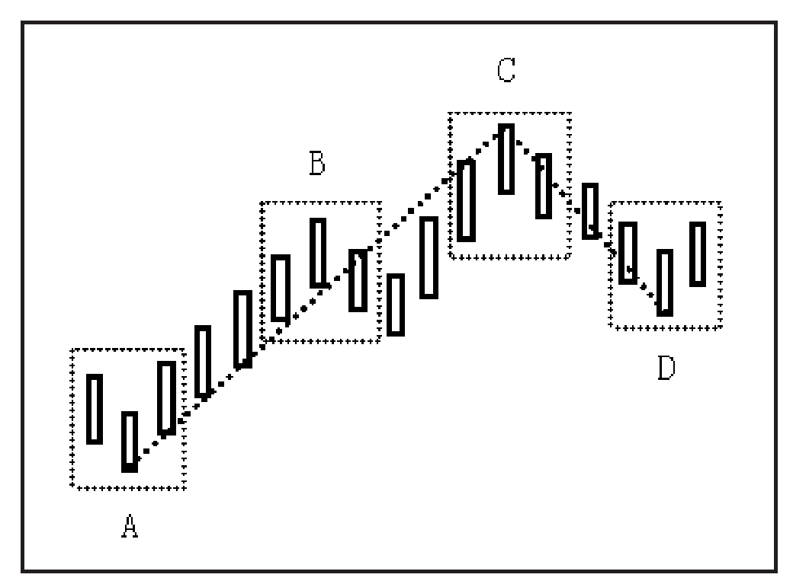

图 1-47

如图 1-48 所示，以 B 点开始，产生出向上新笔 BC 后，原向下笔 AB 结束。

图 1-48

如图 1-49 所示，从 B 点开始产生新笔 BC，原笔 AB 结束。从 C 点开始产生新笔 CD，原笔 BC 结束。从 D 点开始产生新笔 DE，原笔 CD 结束。

图 1-49

笔定理：任何的当下，在任何时间周期的 K 线图中，走势必然落在一个确定的具有明确方向的笔当中（向上笔或向下笔）。而在笔当中的位置，必然只有两种情况：在分型构造中；分型构造确认后延伸为笔的过程中。（教你炒股票）91  
  

根据这个定理，对于任何的当下走势，在任何一个时间周期里，都可以用两个变量构成的数组精确地定义当下的走势。第一个变量，只有两个取值，不妨用 1 代表向上的笔，-1 代表向下的笔；第二个变量也只有两个取值，0 代表分型构造中，1 代表分型确认延伸为笔的过程中。——《教你炒股票》91  
  

例如（1，1）就代表着一个向上的笔在延伸之中，（-1，1）代表向下的笔在延伸中，（1，0）代表向上的笔出现了顶分型结构的构造，（-1，0）代表向下的笔出现底分型的构造。（教你炒股票 91）  
  

任何当下都只有这四种状态，这四种状态描述了所有的当下走势。更关键的是，这四种状态是不能随便连接的，例如（1，1）之后绝对不会连接（-1、1）或者（-1，0），唯一只能连接（1，0）；同样，（-1，1）只能连接（-1，0）。而（1，0）有两种可能的连接：（1，1）、（-1，1）；（-1，0）有两种可能的连接：（-1，1）、（1，1）。（教你炒股票 91）  
  

这种分析同样可以应用在日线与周线的关系上。例如最近大盘的走势，在周线上出现（-1，0），而日线上目前是（-1，1），这种状况是下跌里第三恶劣的情况，因为最恶劣的周线是（-1，1），日线也是（-1，1）；次恶劣的周线是（-1，1），日线是（-1，0）。对于第二、三恶劣的情况，技术高的交易者也是可以去操作的，至于最恶劣的那种情况，就算技术高的交易者也无法操作。目前，首要等待的就是日线出现（-1，0）的信号，日线出现这个信号时，周线还能保持（-1，0），那么就会出现第四恶劣的情况，也就是有可能出现转机的情况。是否出现转机，大盘走出来就知道了。目前的大盘处在最微妙的时候，为什么？因为一旦日线的（-1，1）延续到打破周线的（-1，0），这样就会变成最恶劣的走势状态，也就是周线是（-1，1），日线也是（-1，1）。换言之，目前的大盘只面临两种选择，第一恶劣还是第四恶劣，如此而已。（教你炒股票 91）

### 6．划分笔的意义

笔划分的意义主要有两点：一是帮助投资者找到阶段性高低点，二是为下一步划分线段打好基础。

笔的高低点往往都是走势中阶段性的高低点，因此弄明白笔的产生、延伸与结束，会对实际操作起到一定的帮助作用。但是缠论划分笔的最终目的，是为划分线段打基础，从而为掌握更高级的分析手段作准备。

### 7．笔概念中的当下模式

了解了缠中说禅关于笔的定义、划分、诞生和结束，就可以将任何股票任何周期 K 线图中的任何走势，简单分解成笔的连接，即方向向上的笔连接方向向下的笔，或者方向向下的笔连接方向向上的笔。这样，股票的即时走势，在任何当下状态，必然都要落在一确定的具有明确方向的笔当中（向上笔或向下笔）。

#### （1）当下笔模式的种类

任何当下状态，在笔当中的位置必然只有两种情况：其一是构造出分型的过程，其二是构造出分型后原笔延续或产生新笔的过程。

如图 1-50 所示，走势在虚线框中所示的当下状态，由向下笔进入到构造底分型的过程。

图 1-50

如图 1-51 所示，走势构造出分型后，由底分型开始进入到虚线框中当下产生新笔的过程。

图 1-51

对于任何当下走势，在任何一个时间周期里，都可以用两个变量构成的数组来精确地定义当下的走势。第一个变量只有两个取值，即向上笔或向下笔。不妨用 1 代表向上的笔，-1 代表向下的笔；第二个变量也只有两个取值，0 代表分型构造成功，1 代表分型确认后原笔延伸或新笔产生的过程。例如，用（1，1）来代表一个向上的笔处于延伸之中，用（-1，1）代表一个向下的笔处于延伸之中，（1，0）代表一个向上的笔出现了顶分型结构的构造，（-1，0）代表一个向下的笔出现底分型结构的构造。

如图 1-52 所示，当下状态表示为（1，1），代表向上的笔在延伸中。

图 1-52

如图 1-53 所示，当下状态表示为（-1，1），代表向下的笔在延伸中。

图 1-53

如图 1-54 所示，当下状态表示为（1，0），代表向上笔的顶分型构造中。

图 1-54

如图 1-55 所示，当下状态表示为（-1，0），代表向下笔的底分型构造中。

图 1-55

小结： 任何的当下，都只有上述这四种状态。也就是说，这四种状态可以描述 K 线图中所有的当下走势。根据当下走势的这四种模式，可以制定如下操作原则。

A．当下走势出现（1，1），持股。

B．当下走势出现（1，0），考虑卖出。

C．当下走势出现（-1，1），持币。

D．当下走势出现（-1，0），考虑买入。

值得注意的是： 这四种状态的变化与转换是有规律的，四种模式之间不能任意连接。比如（1，1）之后只能连接（1，0），绝对不可能连接（-1，1）或者（-1，0）。也就是说，一个向上的笔，绝对不可能不经过顶分型直接变成一个向下的笔，或者向下的笔在构造底分型。

同样，（-1，1）之后只能连接（-1，0），绝对不可能连接（1，1）或者（1，0）。即一个向下的笔，绝不可能不经过底分型直接变成一个向上的笔，或者向上的笔在构造顶分型。

处于（1，0）和（-1，0）状态，则都有两种可能的连接，因为其间牵扯到一个中继分型的问题。如（1，0）可能连接（1，1）和（-1，1），前者代表顶分型中继，后者代表顶分型产生出新笔。

图 1-56 为（1，0）连接（1，1）的情况。虚线框处的顶分型为中继顶分型，原笔仍在延续。具体描述为（1，1）+（1，0）+（1，1）。

图 1-56

图 1-57 为（1，0）连接（-1，1）的情况。虚线框处的顶分型为终结型顶分型，产生出新笔。具体描述为（1，1）+（1，0）+（-1，1）。

图 1-57

处于（-1，0）状态，可能的连接有（-1，1）和（1，1）。前者代表底分型中继，后者代表底分型产生出新笔。

图 1-58 为（-1，0）连接（-1，1）的情况。方框内的底分型为中继分型。具体描述为（-1，1）+（-1，0）+（-1，1）。

图 1-58

图 1-59 为（-1，0）连接（1，1）的情况。方框处的底分型产生出新笔。具体描述为（-1，1）+（-1，0）+（1，1）。

图 1-59

#### （2）当下模式的演变方式

从向上开始的走势，其可能演变的过程如图 1-60 所示。如果由（1，0）演化成（1，1），则（1，0）为中继型顶分型；如果由（1，0）演化成（-1，1），则（1，0）为结束型顶分型。

图 1-60

从向下开始的走势，其演变过程如图 1-61 所示。如果由（-1，0）演化成（-1，1），则（-1，0）为中继型底分型；如果由（-1，0）演化成（1，1），则（-1，0）为结束型底分型。

图 1-61

有了上面的分析，很容易进行更复杂的分解。考察两个相邻时间周期的 K 线图，例如 5 分钟和 30 分钟 K 线图。如果 30 分钟 K 线图是（1，1）或者（-1，1）的状态，那么 5 分钟 K 线图里的任何波动，都没有太大的参考价值。因为无论这种波动如何大，都没到足以改变 30 分钟 K 线图（1，1）或者（-1，1）状态的程度，这里就对 5 分钟 K 线图的波动有了一个十分明确的过滤作用。如果你是一个最短只关心 30 分钟 K 线图的操作者，就根本无需关心 5 分钟 K 线图的这些细微波动。

如果 30 分钟 K 线图是（1，1），5 分钟 K 线图也是（1，1），那么 30 分钟 K 线图中是断无可能在其后几分钟内改变（1，1）这种模式的，要 30 分钟 K 线图改变（1，1）模式成为（1，0）模式，至少要在 5 分钟 K 线图中出现（1，0）模式或（-1，1）模式。在绝大多数情况下，都是必然要求出现（-1，1）模式的。

因此对于 30 分钟的笔模式，5 分钟的笔模式可能导致 30 分钟笔模式的改变。30 分钟笔模式改变与否，就可以从 5 分钟的笔模式中窥见端倪。

例如，对于 30 分钟的（1，1），5 分钟出现（1，0）就是一个小的警告。这个警告反映到 30 分钟 K 线图里，还不足以破坏 30 分钟笔模式的结构，所以这个警告不会造成实质性的影响。如果这个 5 分钟的（1，0）笔模式变成了（-1，1）的笔模式，那么一个重要的警告就成立了，此时必须密切注视 30 分钟笔模式的情况。

了解上述笔模式的变化规律，对于分析下一步行情走势，依据其变化规律指导实际操作，具有很重要的现实意义。

### 8．新笔与旧笔之分

缠论中对于笔定下严格定义后，实际操作中，某些关键的地方需要引入笔来分析，但走势却构不成划笔的条件。缠中说禅后来不得不对笔的定义提出修正，也就引出了所谓的新笔。

缠中说禅提出的新笔定义并没有出现在《教你炒股票 108 课》中，而是出现在其博文《忽闻台风可休市，聊赋七律说<风灾>》之中。先看一下其原文。

“本 ID 想了想，计算了一下能量力度，觉得以后可以把笔的成立条件略微放松一下，就是一笔必须满足以下两个条件：第一，顶分型与底分型经过包含处理后，不允许共用 K 线，也就是不能有一根 K 线分别属于顶分型与底分型，这条件和原来是一样的，这一点绝对不能放松，因为这样才能保证足够的能量力度；第二，在满足上述条件下，顶分型中最高 K 线和底分型最低 K 线之间（不包括这两根 K 线），不考虑包含关系，至少有 3 根（包括 3 根）以上 K 线。”

根据缠中说禅对于新笔的定义，可以与旧笔对比一下。

#### （1）旧笔

在完全进行 K 线包含处理之后，笔要求顶和底之间至少有一根独立 K 线。上升的一笔，即底分型+上升 K 线+顶分型；下降的一笔，即顶分型+下降 K 线+底分型。

如图 1-62 中，图左就是一笔的最基本的图形，图中顶和底之间共用一根 K 线，图右只有顶和底，中间没有其他 K 线，都不算一笔。

图 1-62

#### （2）新笔

A．顶分型与底分型经过包含处理后，不允许共用 K 线，也就是不能有一根 K 线分别属于顶分型与底分型，这一条件和原来的旧笔定义是一样的。

B．在满足上述条件下，顶分型中的最高 K 线和底分型的最低 K 线之间（不包括这两根 K 线），不考虑包含关系，至少有 3 根（包括 3 根）以上 K 线。

对比新笔、旧笔定义，可以发现，新笔的定义无疑要比旧笔的定义稍稍宽松一些。那么，新笔具体宽松在哪里呢？下面用图例来进行分析。

如图 1-63 所示，图左 A、B 顶分型与底分型之间没有独立 K 线，用旧笔定义 AB 不能算笔，但用新笔定义则算笔。因为顶分型中最高 K 线和底分型的最低 K 线之间（不包括这两根 K 线），不考虑包含关系，含有 3 根 K 线。

图右 C、D 底分型与顶分型之间没有独立 K 线，用旧笔定义 CD 不算笔，但用新笔定义则算笔。因为底分型中最低 K 线和顶分型的最高 K 线之间（不包括这两根 K 线），不考虑包含关系，含有 4 根 K 线。图中虚线框内 K 线为包含关系。

图 1-63

从上述分析可以看出，新笔定义比旧笔宽松，主要表现在顶底分型之间不一定非要存在包含处理之后的独立 K 线。

新笔虽然顶底分型之间不一定非要存在包含处理之后的独立 K 线，但包含处理后的顶分型和底分型之间都要求不能共用 K 线，一旦共用，则不构成笔。

如图 1-64 所示，AB 之间虽含有 4 根 K 线，但包含处理后的顶底分型共用 K 线，因此无论按新旧定义，AB 都不能算笔。

图 1-64

图 8 就是线段的最基本形态，图 9 就是线段破坏，也就是两线段组合的其中一种形态。（教你炒股票 62）

有了笔，那么线段就很简单了，线段至少有三笔。线段无非有两种，从向上一笔开始的，和从向下一笔开始的（教你炒股票 65）  
  

线段有一个最基本的前提，就是线段的前三笔必须有重叠的部分。这个前提前面可能没有特别强调，这里必须特别强调一次。线段至少有三笔，但并不是连续的三笔就一定构成线段，这三笔必须有重叠的部分。由上面线段被笔破坏的定义可以证明线段分解定理：线段被破坏，当且仅当至少被有重叠部分的连续三笔中的一笔破坏。只要构成有重叠部分的前三笔，那么必然会形成一个线段。换言之，线段破坏的充要条件，就是被另一个线段破坏。（教你炒股票 65）  
  

对于从向上一笔开始的，其中的分型构成这样的序列：d1 g1 d2 g2 d3 g3 ……dn gn （其中 di 代表第 i 个底，gi 代表第 i 个顶）。如果找到 i 和 j，j≥i+2，使得 dj ≤gi ，那么称向上线段被笔破坏。对于从向下一笔开始的，其中的分型构成这样的序列：g1 d1 g2 d2 ……gn dn （其中 di 代表第 i 个底，gi 代表第 i 个顶）。如果找到 i 和 j，j≥i+2，使得 gj ≥di ，那么称为向下线段被笔破坏。（教你炒股票 65）  
  

参照一般 K 线图关于顶分型与底分型的定义，可以确定特征序列的顶和底。注意，以向上笔开始的线段的特征序列，只考察顶分型。以向下笔开始的线段，只考察底分型。（教你炒股票 67）

## 四、线段

### 1．线段概要

线段是缠论中在笔基础之上的又一个重要概念。掌握线段的定义和划分原则，是下一步理解和掌握走势中枢的必要基础。

线段定义：连续的三笔之间若存在重叠部分，其起点和终点之间的连线为线段。

如图 1-65 所示，图左 AB、BC、CD 为连续的三笔，它们之间存在重叠部分（阴影部分），AD 的连线就叫线段。图右 EF、FG、GH 为连续的三笔，它们之间存在重叠部分（阴影部分），EH 的连线就叫线段。

图 1-65

注意： 当连续的三笔之间没有重叠部分时，不能将其连线视为线段。

如图 1-66 所示，图左 AB、BC、CD 为连续的三笔，它们之间不存在重叠部分，AD 的连线就不是线段。图右 EF、FG、GH 为连续的三笔，它们之间不存在重叠部分，EH 的连线就不是线段。

图 1-66

线段必须由连续的三笔构成，这是因为线段和笔一样，必须由顶和底来构成，同一性质的两顶或两底，不但不能构成笔，也不能构成线段。这是连续的两笔不能构成线段的原因。

如图 1-67 所示，AB 与 BC 是连续的两笔，但 AC 的连线不能构成线段，因为 A 和 C 同为两个底分型的底。

图 1-67

如图 1-68 所示，XY 与 YZ 是连续的两笔，但 XZ 的连线不能构成线段，因为 X 和 Z 同为两个顶分型的顶。

图 1-68

由此可见，线段中包含笔的数目都是单数，双数的笔都不能构成线段。

图 1-69 中，AB、BC、CD 是连续的三笔，且有重叠部分，AD 连线就是线段。该线段以向上笔开始，称为向上线段。

图 1-69

图 1-70 中，AB、BC、CD 是连续的三笔，且有重叠部分，AD 连线就是线段。该线段以向下笔开始，称为向下线段。

图 1-70

### 2．线段的延伸与结束

#### （1）线段的延伸

线段产生以后，如果不在相反方向产生出新线段，那么这个线段在同方向上的继续运行，就是该线段的延伸。

特征序列的顶分型中，第一和第二元素间不存在特征序列的缺口，那么该线段在该顶分型的高点处结束，该高点是该线段的终点；特征序列的底分型中，第一和第二元素间不存在特征序列的缺口，那么该线段在该底分型的低点处结束，该低点是该线段的终点。（教你炒股票 67）  
  

上面两种情况，就给出所有线段划分的标准。显然，出现特征序列的分型，是线段结束的前提条件。这里就是把前面“线段破坏的充要条件就是被另一个线段破坏”精确化了。因此以后关于线段的划分，都以此精确的定义为基础。（教你炒股票 67）  
  

有了笔以后，就是线段了。线段划分的最基本原则，就是线段必须至少有三笔，这是十分显然的。如果一笔就能构成线段，那笔和线段又有什么区别？至于两笔为什么不能构成线段，理由更简单。因为只有两笔，那么线段两段的分型性质肯定是一样的。和笔一样，一个完整线段的两段的分型不可能是同性质的。也就是说，和笔一样，线段也不可能从一个顶开始结束于另一个顶，或者从一个底开始结束于另一个底。由此可见，线段中包含的笔的数目都是单数的。（教你炒股票 72）  
  

线段必须被线段破坏才能确定其完成。对于线段划分的第一种情况，如果第一笔出现笔破坏后，接着的一笔就创出新高，而且再后一笔根本就不触及笔破坏那一笔，这时候显然无法构成线段对线段的破坏。因为后面这三笔没有重合，所以不可能构成一线段。（教你炒股票 72）  
  

如果坚持线段的最终破坏回补特征序列缺口，那么，如果线段 C 对线段 B 还是第二种情况，线段 C 的区间肯定就在线段 A 特征序列缺口与线段 B 特征序列缺口之间。如此类推，总会出现一个线段 X，使得对应前面的线段是回补特征序列缺口。否则，这些线段的区间就会无限缩小，最后形成一个点。这显然是不可能的，学过极限的读者都应该能理解。所以，在一串相对前一线段是第二种情况的线段串中，最终会出现第一种情况的破坏。这样倒推回来，必然有这一串假定线段间的连续破坏（教你炒股票 72）  
  

注意，这里必须提醒一句，以前也曾说过，如果线段中最高或最低点不是线段的端点，那么，在任何以线段为基础的分析中，例如以线段为基础构成最小级别的中枢等，都可以把该线段标准化为最高、最低点都在端点。因为在以线段为基础的分析中，都把线段当成一个没有内部结构的基本部件，所以只需要关心这线段的实际区间就可以，这样可以只看其高低点。经过标准化处理后，所有向上线段都是以最低点开始最高点结束，所有向下线段都是以最高点开始最低点结束，这样，线段的连接就形成一条延续不断、首尾相连的折线，复杂的图形也会十分标准化，为后面的中枢、走势类型等分析提供了最标准且基础的部件。（教你炒股票 78）  
  

至于线段的第二种破坏方式，本质上是以时间换空间。由于反攻开始的力量很弱，需要慢慢积累，这一方面代表原方向的力量很强，另一方面，又要密切关注是否会形成骨牌效应，也就是开始的反攻力量很小，却能迅速蔓延开。这往往证明，市场原方向的分力，其在结构上具有趋同性，一旦有点风吹草动，就集体转向。（教你炒股票 83）

如图 1-71 所示，向上线段 AB 产生之后，一直没有在反方向上产生出新线段，那么一直至 C，仍为线段 AB 的延伸。

图 1-71

如图 1-72 所示，向下线段 AB 产生之后，一直没有在反方向产生出新线段，那么一直至 C，仍为线段 AB 的延伸。

图 1-72

一个线段产生以后，可以立即结束，但也可以延伸很长时间而不结束。如图 1-73 所示，产生一条向下线段后，可以向下延伸很长时间而不结束。

图 1-73

#### （2）线段的结束

线段产生以后，如果在相反方向上产生出新线段，那么原来这个线段就宣告结束。这就是线段被线段破坏。

如图 1-74 所示，向上线段 AB 产生之后，接着又在相反方向产生向下线段 BC，则原线段 AB 结束。原线段 AB 被新线段 BC 破坏。

图 1-74

如图 1-75 所示，向下线段 EF 产生之后，接着又在相反方向产生向上线段 FG，则原线段 EF 结束。原线段 EF 被新线段 FG 破坏。

图 1-75

线段破坏的充要条件，就是被另一个线段破坏。

如图 1-76 所示，线段 A 被线段 B 破坏。

图 1-76

### 3．线段被破坏的两种不同情况

线段被线段破坏，存在两种不同情况。其一是线段被笔破坏的情况；其二是线段未被笔破坏的情况。

线段被笔破坏分两种情况：向上线段被向下笔破坏和向下线段被向上笔破坏。

#### （1）向上线段被向下笔破坏

向上线段中，一旦最后一个顶为起点的向下笔跌破前一个顶的水平连线，称向上线段被向下笔破坏。

如图 1-77 所示，向上线段中 D1G2 中，G2 为起点的向下笔一旦跌破前顶 G1 的水平连线，则向上线段 D1G2 被向下笔破坏。

图 1-77

#### （2）向下线段被向上笔破坏

向下线段中，一旦最后一个底为起点的向上笔升破前一个底的水平连线，称向下线段被向上笔破坏。

如图 1-78 所示，向下线段 G1D2 中，D2 为起点的向上笔一旦升破前底 D1 的水平连线，则向下线段 G1D2 被向上笔破坏。

图 1-78

《教你炒股票 108》课中关于线段划分示意图。

《教你炒股票 108 课》中关于线段划分示意图。

注意： 被笔破坏的线段一旦由破坏笔产生出新线段，那么原线段结束。

如图 1-79 所示，向上线段 D1G2 被向下笔 G2D3 破坏，由 G2 开始产生出新线段 G2D4 时，那么原线段 D1G2 结束。

图 1-79

注意： 线段必须要被线段破坏才算是真破坏，单纯的一笔是不能破坏线段的。

如图 1-80 所示，线段 D1G2 虽被 G2 向下笔破坏，但至 G3 又创新高，至 G4 仍未形成新线段，那么原线段 D1G2 就延续。

图 1-80

如图 1-81 所示，线段 G1D2 虽被向上笔 D2G3 破坏，但直至 D4 创出新低，仍未形成新线段，那么原线段 G1D2 就延续。

图 1-81

从上面的例子可以看出，线段最终肯定都会被线段破坏，但线段出现笔破坏的情况时，最终线段并不一定由该笔发展形成线段破坏。

这里出现一个必须弄明白的问题：线段何时结束？线段的端点到底结束于何位置？对此，缠中说禅引入了特征序列和标准特征序列的概念。

线段的特征序列： 用 S 代表向上的笔（上字拼音的首字母），X 代表向下的笔（下字拼音的首字母）。其中任一 S 称为线段的向上元素，任一 X 称为线段的向下元素。那么任一向上的线段，就可用笔的序列表示为 S1 X1 S2 X2 S3 X3 ……SnXn。

如图 1-82 所示，向上线段 AB 的特征序列为 S1 X1 S2 X2 S3 X3 S4 X4 。其中 S1 、S2 、S3 、S4 都是线段 AB 的向上元素，X1 、X2 、X3 、X4 是线段 AB 的向下元素。

图 1-82

任一向下的线段，就可用笔的序列表示为 X1 S1 X2 S2 X3 S3 ……Xn Sn 。

如图 1-83 所示，向下线段 AB 的特征序列为 X1 S1 X2 S2 X3 S3 X4 ，其中 S1 、S2 、S3 、S4 4 都是线段 AB 的向下元素，X1 、X2 、X3 、X4 都是线段 AB 的向上元素。

图 1-83

把线段中每一个元素看成是一根 K 线，那么如同一般 K 线图中找分型的方法，也存在所谓的包含关系，也需要对此进行非包含处理。经过非包含处理的特征序列，就叫做标准特征序列。

如图 1-84 所示，向上线段 AB 中，X1 对应的 K 线为 1，X2 对应的 K 线为 2，X3 对应的 K 线为 3，X4 对应的 K 线为 4。其中 K 线 3 和 K 线 4 存在包含关系，将 3 和 4 经包含处理后，线段 AB 的特征序列就称为标准特征序列。

图 1-84

如图 1-85 所示，图 1-84 中线段 AB 的特征序列经包含处理后变为标准特征序列。

图 1-85

### 4．线段划分的两种不同情况

理解了特征序列和标准特征序列之后，就可以对线段进行严格划分了。

#### （1）出现笔破坏的情况

线段出现笔破坏，向上线段只考察 X 元素的标准特征序列。若出现顶分型，则原线段结束于该顶分型的高点。向下线段只考察 S 元素的标准特征序列。若出现底分型，则原线段结束于该底分型的低点。

如图 1-86 所示，向上线段 AB 出现笔破坏。当 X 元素出现标准特征序列的顶分型，原线段结束于顶分型的顶点 B。

图 1-86

如图 1-87 所示，向上线段 AB 出现笔破坏，当 X 元素标准特征序列未出现顶分型，则 B 点不是原线段的结束点，原线段仍在延伸中。

图 1-87

如图 1-88 所示，向下线段 AB 出现笔破坏。当 S 元素出现标准特征序列的底分型，原线段结束于底分型的底点 B。

图 1-88

如图 1-89 所示，向下线段 AB 出现笔破坏。当 S 元素标准特征序列未出现底分型，则 B 点不是原线段的结束点，原线段仍在延伸中。

图 1-89

#### （2）未出现笔破坏的情况

向上线段从最高点向下的笔若不触及线段的前一个顶，或者向下线段从最低点向上的笔不触及线段的前一个底，则为线段未出现笔破坏的情况。

如图 1-90 所示，左边向上线段的向下笔未触及线段的前一个顶，与前顶之间存在缺口；右边向下线段的向上笔未触及线段的前一个底，与前底之间存在缺口，都属于线段未被笔破坏的情况。

图 1-90

出现上述这种线段未被笔破坏的情况时，特征序列的顶分型中，第一和第二元素间存在特征序列的缺口。如果从该顶分型最高点开始的向下一笔开始的 X 序列的特征序列出现底分型，那么该线段在该顶分型的高点处结束，该高点是该线段的终点。

特征序列的底分型中，第一和第二元素间存在特征序列的缺口，如果从该底分型最低点开始的向上一笔开始的 S 序列的特征序列出现顶分型，那么该线段在该底分型的低点处结束，该低点是该线段的终点。

以向上线段为例，如图 1-91 所示，从 B 点开始的向下笔与前顶之间存在缺口时（即没有笔破坏），将 B 点开始的向下笔看成 K 线，考察向下笔组成的 X 系列 K 线出现底分型时，那么原线段在 B 点结束。图中向下笔 X1、X2、X3 正好组成底分型，所以原线段的结束点是 B。

注意： 向下笔组成的 X 系列 K 线中若出现包含关系，要求合并处理。

图 1-91

如图 1-92 所示，从 B 点开始的向下笔与前顶之间存在缺口时（即没有笔破坏），将 B 点开始的向下笔看成 K 线，考察向下笔组成的 X 系列 K 线，若没有出现底分型，那么原线段就暂时尚未结束。图中向下笔 X1、X2、X3 没有组成底分型，所以 B 点就不是原线段的结束点。

图 1-92

注意： 向下笔组成的 X 系列 K 线中若出现包含关系，要求合并处理。

与向上线段情况相反，向下线段中，如图 1-93 所示，从 B 点开始的向上笔与前底之间存在缺口时（即没有笔破坏），将 B 点开始的向上笔看成 K 线，考察向上笔组成的 S 系列 K 线，如果出现顶分型时，那么原线段在 B 点结束。图中向上笔 S1、S2、S3 正好组成顶分型，所以原线段的结束点是 B。

图 1-93

注意： 向下笔组成的 S 系列 K 线中若出现包含关系，要求合并处理。

如图 1-94 所示，向下线段中，从 B 点开始的向上笔与前底之间存在缺口时（即没有笔破坏），将 B 点开始的向上笔看成 K 线，考察向上笔组成的 S 系列 K 线，若没出现顶分型又创出新低时，那么原线段就没有在 B 点结束。图中向上笔 S1、S2、S3 没有构成顶分型，所以 B 点就不是原线段的结束点。

图 1-94

注意： 向上笔组成的 S 系列 K 线中若出现包含关系，要求合并处理。

### 5．缠论对线段的特殊补充

A．在线段未被笔破坏的第二种情况下，后一特征序列不一定封闭前一特征序列相应的缺口，而且第二个序列中的分型，不分第一、第二种情况，只要有分型就可以。

如图 1-95 所示，后一特征序列没有封闭前一特征序列相应的缺口，只要出现底分型，原线段仍于 B 点结束。

图 1-95

如图 1-96 所示，后一特征序列没有封闭前一特征序列相应的缺口，后一特征序列中即使出现线段未被笔破坏的第二种情况，只要出现底分型，原线段仍于 B 点结束。

图 1-96

B．大力度的反向缺口可算一段。例如反向跳空。如果一个线段在上涨过程的最后一个上涨笔，突然反向跳空，这个跳空可以当作一段。如图 1-97 所示，62 至 63 为大力度的反向缺口，缠中说禅将其划为一段。

图 1-97

强调：在第二种情况下，后一特征序列不一定封闭前一特征序列相应的缺口，而且第二个序列中的分型，不分第一、第二种情况，只要有分型就可以。（教你炒股票 67）  
  

有些突然性的逆着走势出现的缺口，就像 5·30 那个，就必然要当成一段，而不能只当成一笔或一笔里的。有人可能会说，缺口没有三笔？那你可以这样去看，就像 0=0+0+0，缺口可以看成是三个缺口的迭加，这样就有三笔以上了。（教你炒股票 65）

反向缺口可算一段。但是如果这个跳空的力度或幅度很小，连最后一个向上笔的低点都没有击穿，笔者认为只当作一个笔处理即可。但是如果这个跳空在上涨线段的最后向下一笔时突然向上跳空，也只当作一笔处理。

必须先引入走势中枢的概念：某级别走势类型中，被至少三个连续次级别走势类型所重叠的部分，称为走势中枢。换言之，走势中枢就是至少三个连续次级别走势类型重叠部分所构成的。（教你炒股票 17）  
  

任何级别的所有走势，都能分解成趋势与盘整两类，而趋势又分为上涨与下跌两类。（教你炒股票 17）  
  

在任何级别的任何走势中，某完成的走势类型至少包含两个以上依次同向的走势中枢，就称为该级别的趋势。该方向向上就称为上涨，向下就称为下跌。（教你炒股票 17）  
  

盘整：在任何级别的任何走势中，某完成的走势类型只包含一个走势中枢，就称为该级别的盘整。（教你炒股票 17）  
  

走势中枢：某级别走势类型中，被至少三个连续次级别走势类型所重叠的部分。具体的计算以前三个连续次级别的重叠为准，严格的公式可以这样表示：次级别的连续三个走势类型 A、B、C，分别的高、低点是 a1 \\a2 、b1 \\b2 、c1 \\c2 ，则中枢的区间就是（max（a2 ，b2 ，c2 ），min（a1 ，b1 ，c1 ）），而实际上用目测就可以，不用这么复杂。（教你炒股票 18）  
  

前面已经很明确地指出，走势中枢由前三个连续次级别走势类型的重叠部分确定，其后的走势有两种情况：一、该走势中枢的延伸。二、产生新的同级别走势中枢。（教你炒股票 18）  
  

有了上面的定理，就可以很精确地讨论走势中枢的问题了。根据走势中枢的数学表达式：A、B、C 分别的高、低点是 a1 \\a2 、b1 \\b2 、c1 \\c2 ，则中枢的区间就是\[max（a2 ，b2 ，c2 ），min（a1 ，b1 ，c1 ）\]。而中枢的形成无非两种，一种是回升形成的，一种是回调形成的。对于第一种有 a1 =b1 ，b2 =c2 ；对第二种有 a2 =b2 ，b1 =c1 。但无论是哪种情况，中枢的公式都可以简化为\[max（a2 ，c2 ），min（a1 ，c1 ）\]。显然，A、C 段，其方向与中枢形成的方向是一致的。由此可见，在中枢的形成与延伸中，由与中枢形成方向一致的次级别走势类型的区间重叠确定。例如，回升形成的中枢，由向上的次级别走势类型的区间重叠确定，反之亦然。为方便起见，以后都把这些与中枢方向一致的次级别走势类型称为 Z 走势段，按中枢中的时间顺序，分别记为 Zn 等，相应的高、低点分别记为 gn 、dn ，定义四个指标，GG=max（gn ），G=min（gn ），D=max（dn ），DD=min（dn ），n 遍历中枢中所有 Zn。特别地，再定义 ZG=min（g1 、g2 ），ZD=max（d1 、d2 ），显然，\[ZD，ZG\]就是走势中枢的区间。（教你炒股票 20）  
  

第二种，只有笔。笔是不能构成中枢的，这就是笔和线段以及线段以上的各种级别走势类型的最大区别。（教你炒股票 91）

## 五、走势中枢

走势中枢是缠论中一个十分重要的概念，缠论的买卖点定义都与走势中枢密切相关。因此，彻底理解走势中枢的定义、划分及其性质，对掌握和理解缠论各种买卖点犹为重要。

### 1．走势中枢的定义及划分

缠论中的原定义：某级别走势类型中，被至少三个连续次级别走势类型所重叠的部分，称为走势中枢。换言之，走势中枢就是至少三个连续次级别走势类型重叠部分所构成。

根据走势中枢的定义，要弄明白走势中枢，首先得弄明白什么是“走势类型”，否则一切就无法再继续下去。

那么，什么是走势类型呢？

要谈走势类型，必须先谈“走势”。缠论中所谓的走势，就是股价上上下下的运行过程。

走势包含三种不同的走势类型。所谓走势类型，指的就是上涨、下跌和盘整这三种情况。任何股票的任何走势，都可以分解成这三种走势类型的连接。

缠论中又将上涨和下跌这两种走势类型统称为趋势。所以也可以说任何股票的走势，都是由趋势和盘整这两大走势类型构成的。

那么，走势类型所包含的趋势和盘整具体又如何确定呢？如果不弄清楚何谓趋势，何谓盘整，就无法准确找出这些走势类型，从而也就没法确定走势中枢。

缠论中对趋势是这样定义的：在任何级别的任何走势中，某完成的走势类型至少包含两个以上依次同向的走势中枢，就称为该级别的趋势。该方向向上就称为上涨，向下就称为下跌。

缠论中对盘整是这样定义的：在任何级别的任何走势中，某完成的走势类型只包含一个走势中枢，就称为该级别的盘整。

定义是通过一个概念明确另一个概念内涵的逻辑方法。通过上面缠论对走势类型趋势和盘整的定义，可以发现缠论在此犯了一个循环定义的矛盾：即要借用走势类型来定义和划分走势中枢，但说明走势中枢的构造元素走势类型时，反而又要用走势中枢来进行定义，这就犯了给事物下定义时不能循环定义的逻辑错误。

用一个例子就可以说明循环定义的逻辑错误。比如给“母鸡”下定义：能生鸡蛋的鸡叫母鸡。同时解释“鸡蛋”时，又定义为：母鸡生的蛋叫鸡蛋。这样给母鸡和鸡蛋下定义时就犯了循环定义的逻辑错误。

再比如，给“逻辑学”下定义：逻辑学是研究正确思维的科学。但是在解释“正确思维”的时候，又定义为：正确思维就是合乎逻辑学的思维。这样就犯了循环定义的逻辑错误。

缠论对走势中枢的定义，所犯的逻辑性错误是比较隐蔽的。缠中说禅在动手划分走势中枢时也许感受到了这一逻辑矛盾，因此在《教你炒股票》35 课中说：前面课程，最基础的无非两方面，一、中枢；二、走势类型及其连接。这两方面相互依存。如果没有走势类型，中枢也无法定义；而没有中枢，走势也无法分出类型。如果理论就此打住，那么一个循环定义就不可避免。

缠中说禅认为要解决该循环定义的矛盾，可以凭借级别的概念来消解。认为有了级别，一个严格的递归式定义就可以展开。事实上，这一循环定义的矛盾即便是凭级别也无法消解的。要消解矛盾，唯一的方法是改变定义走势中枢的元素，用一个不必依赖走势中枢即可明确的已知元素来给走势中枢下定义。所以缠中说禅在实际操作中划分走势中枢时，用到的最小单位不是走势类型，而是线段。毕竟只有线段才是不需要依靠走势中枢即可以确立的已知概念。

用线段作为划分走势中枢的基础，这样就绕过了循环定义的矛盾，使得缠论得以继续下去。而且缠中说禅花费大量时间和精力论述的线段才有了用武之地，真正派上了用场。否则，划分出线段几乎没有什么现实的操作意义。

缠中说禅试图引入级别概念来消解走势中枢循环定义的矛盾，但无论在理论上，还是在实际推理过程中，用走势类型来划分走势中枢都是做不到的。

比如，要在 1 级别走势中划分走势中枢，按照定义，必须先找出 2 级别走势中的走势类型。而要找出 2 级别中的走势类型，就必须先找出 2 级别中的走势中枢。而要找出 2 级别中的走势中枢，按照定义，必须先找出 3 级别走势中的走势类型。而要找出 3 级别中的走势类型，就必须先找出 3 级别中的走势中枢。而要找出 3 级别中的走势中枢，按照定义，必须先找出 4 级别走势中的走势类型。而要找出 4 级别中的走势类型，就必须先找出 4 级别中的走势中枢。而要找出 4 级别中的走势中枢，按照定义，必须先找出 5 级别走势中的走势类型……如此循环下去，永远也不可能找到走势中枢。

笔者修正后的走势中枢定义为：某级别走势类型中，被至少三个连续次级别线段所重叠的部分，称为走势中枢。具体以前三个连续次级别线段的重叠为准。中枢区间为前三个连续次级别线段的重叠部分。

用线段作为划分走势中枢的单元，由于线段是可以确定的，这样一切问题便可以迎刃而解。实际操作中，缠中说禅也是用线段来划分最小级别的走势中枢的。

由于定义中涉及到次级别这一概念，因此，仍有必要对缠论中的级别稍作说明。

走势分不同的级别。比如打开的是日 K 线图，那么看到的走势就是日线级别；同理，打开的是 30 分钟 K 线图，那么看到的走势就是 30 分钟级别。所谓次级别，就是与本级别相关联的下一级别。

由于构成笔最少需要 5 根 K 线，所以级别与次级别之间的关系，可以参照下列对应关系：年—月—周—日—30 分钟—5 分钟—1 分钟。找到 1 分钟级别的三条连续线段，标出它们的共同区间，其区间就是 5 分钟级别的走势中枢。

在缠论中，缠中说禅认为笔是不能构成中枢的，理由是笔不稳定（这亦是一个认知上的错误，因为高级别的笔，很多时候就等同于低级别的线段）。能构成中枢的至少是线段，因此线段是构成最小中枢的零件。

缠论认为，走势中枢的形成无非有两种，一种是回调形成的（下—上—下型走势中枢）；一种是回升形成的（上—下—上型走势中枢）。

如图 1-98 所示，阴影部分是在上涨中回调形成的下上下型走势中枢。中枢区间为下上下三段的重叠部分，区间的高点称 ZG，区间的低点称 ZD。

图 1-98

注意： 上涨中形成的走势中枢，从向下的线段开始算起。

如图 1-99 所示，阴影部分是在下跌中回升形成的上下上型走势中枢。中枢区间为上下上三段的重叠部分，区间的高点称 ZG，区间的低点称 ZD。

图 1-99

注意： 下跌中形成的走势中枢，从向上的段开始算起。

有了走势中枢的定义，就可以据此在任何一个级别的走势中找到缠论中的走势中枢了。有了中枢，就可以对盘整和趋势这两个走势类型给出一个精确的定义。

盘整： 在任何级别的任何走势中，某完成的走势类型只包含一个走势中枢，就称为该级别的盘整。

如图 1-100 所示，AB 为走势中的盘整，只包含一个走势中枢。

图 1-100

趋势： 在任何级别的任何走势中，某完成的走势类型至少包含两个以上依次同向的走势中枢，就称为该级别的趋势。该方向向上就称为上涨，向下就称为下跌。

如图 1-101 所示，AB 为趋势中的上涨，其含有两个以上依次向上的走势中枢。

图 1-101

如图 1-102 所示，AB 为趋势中的下跌，含有两个以上依次向下的走势中枢。

图 1-102

如图 1-103 所示，虚线所指范围内含两个依次同向的走势中枢，走势中枢向上新生，即趋势中的上涨。

图 1-103

如图 1-104 所示，虚线所指范围内含两个依次同向的走势中枢，走势中枢向下新生，即趋势中的下跌。

图 1-104

“走势终完美”这句话有两个不可分割的方面：任何走势，无论是趋势还是盘整，在图形上最终都要完成。另一方面，一旦某种类型的走势完成以后，就会转化为其他类型的走势。（教你炒股票 17）  
  

在趋势里，同级别的前后走势中枢是不能有任何重叠的，这包括任何围绕走势中枢产生的任何瞬间波动之间的重叠。如果三个连续次级别走势类型的重叠区间虽然不和前面的走势中枢有任何重叠，但围绕该中枢产生的波动触及前面走势中枢延续时的某个瞬间波动区间，这时候，就不能认为该走势类型是趋势，而是产生一个更大级别的走势中枢。（教你炒股票 18）  
  

走势：打开走势图看到的就是走势。走势分不同级别。

走势类型：上涨、下跌、盘整。

趋势：上涨、下跌。（教你炒股票 18）  
  

缠论技术分析基本原理一：任何级别的任何走势类型终要完成。

缠论技术分析基本原理二：任何级别任何完成的走势类型，必然包含一个以上的走势中枢。

缠论走势分解定理一：任何级别的任何走势，都可以分解成同级别盘整、下跌与上涨三种走势类型的连接。

缠论走势分解定理二：任何级别的任何走势类型，都至少由三段以上次级别走势类型构成。（教你炒股票 18）

如何判断走势类型延伸是否结束？这里必须首先搞清楚走势类型延伸的实质是什么？对于趋势来说，其延伸就在于同级别的同向走势中枢不断产生。对于盘整来说，其延伸就在于不能产生新的走势中枢。由于走势类型延伸意味着当下的走势类型随时可以完成，相应的类型必然是确定的，因此判断走势类型延伸是否结束的关键，就在于是否产生新的走势中枢。此外，由于趋势至少包含两个走势中枢，而盘整只有一个，因此判断趋势与盘整的关键也就在于是否产生新的走势中枢。由此可见，走势中枢的问题是技术分析中的核心问题，该问题一旦解决，很多判断上的大难题也就迎刃而解。（教你炒股票 18）  
  

在趋势里，同级别的前后走势中枢是不能有任何重叠的，这包括任何围绕走势中枢产生的任何瞬间波动之间的重叠。如果三个连续次级别走势类型的重叠区间虽然不和前面的走势中枢有任何重叠，但围绕该中枢产生的波动触及前面走势中枢延续时的某个瞬间波动区间，这时候就不能认为该走势类型是趋势，而是产生一个更大级别的走势中枢。这里必须严格区分两种情况。一、走势中枢及其延伸。这种情况下，所有围绕走势中枢产生的前后两个次级波动，都必须至少有一个触及走势中枢的区间。否则，就必然产生一个新的三次连续次级走势类型的重叠部分离开原来的走势中枢，这与走势中枢的延续矛盾。二、一个走势中枢完成前，其波动触及上一个走势中枢或中枢延伸时的某个瞬间波动区间，由此产生更大级别的走势中枢。（教你炒股票 20）  
  

缠论走势中枢中心定理二：前后同级别的两个走势中枢，后 GG〈前 DD 等价于下跌及其延续；后 DD〉前 GG 等价于上涨及其延续。后 ZG<前 ZD 且后 GG≥前 DD，或后 ZD〉前 ZG 且后 DD≤前 GG，则等价于形成高级别的走势中枢。（教你炒股票 20）

### 2．走势类型与走势中枢的关系

#### （1）走势终完美

“走势终完美”的理念是始终贯穿于缠论中的，如同分型、笔、线段产生后最终要终结一样，缠论认为任何走势中枢最终也要终结，任何走势类型产生后终究也要终结。

“走势终完美”这句话有两个不可分割的方面：任何走势，无论是趋势还是盘整，在图形上最终都要完成。另一方面，一旦某种类型的走势完成以后，就会转化为其他类型的走势。

缠论技术分析基本原理一： 任何级别的任何走势类型终要完成。

根据上述原理，无论上涨、下跌还是盘整，所有的走势类型一经产生后，随时终结都是完美的，但也可以暂时不终结，使该走势类型继续延伸下去。

对于趋势来说，形成两个依次同向的走势中枢后，任何趋势都可以随时结束而完美，但也可以不断地延伸下去，形成更多的中枢。

如图 1-105 所示，走势中枢 A 和 B 产生后，上涨走势随时结束都完美，但也可以继续产生同向的中枢 C 和 D。

图 1-105

对于盘整来说，形成三个重叠的连续次级别走势类型后，盘整就可以随时完成。也就是说，只要三个重叠的连续次级别走势类型走出来后，盘整随时结束都是完美的，但也可以暂不结束，可以不断围绕走势中枢上上下下地延伸下去。

如图 1-106 所示，走势中枢 A 产生后，盘整随时结束都是完美的，但也可以不结束，可以不断地延伸下去，不断围绕走势中枢上上下下地延伸下去。

图 1-106

为什么本该完结的走势类型会继续下去？按照缠论的说法，这是“走势类型延伸”造成的。这样就有一个问题必须要搞清楚，“走势类型延伸”的实质是什么？

#### （2）走势类型的延伸

对于趋势来说，走势类型延伸就是同级别的同向走势中枢不断产生（如图 1-105 所示）。对于盘整来说，走势类型延伸就是不能产生新的走势中枢（如图 1-106 所示）。

趋势中若不能产生新的同级别同向的走势中枢，该趋势就完结；盘整中若产生新的同级别走势中枢，该盘整就完结。

正由于走势类型可以延伸，上涨之后可以继续上涨，所以有些大牛股可以涨了又涨，让最初逃顶的人懊悔不已；下跌之后可以继续下跌，所以有些大熊股可以跌了再跌，让最初抄底者痛不欲生。盘整可以继续盘整，所以有些要死不活的横盘股，会磨得持有者毫无脾气。

#### （3）走势中枢的延伸

理解了走势类型延伸这个概念的含义，接着再讲走势中枢的延伸。这里必须要注意，走势类型延伸和走势中枢延伸完全是两码事，二者不可混淆。

由定义可以知道，走势中枢由前三个次级别线段的重叠部分组成。当一个走势中枢产生之后，若其以一个次级别的线段离开中枢，然后以一个次级别的线段返回中枢，其过程就是走势中枢的延伸，又称走势中枢振荡，其表现形式为盘整。

如图 1-107 所示，图中 A、B、C、D 都是走势中枢的延伸，一个次级别的线段离开中枢，然后立即以一个次级别的线段返回。

图 1-107

走势中枢的延伸实际上等同于盘整，即不能产生出新的同级别走势中枢。一旦盘整结束，走势中枢的延伸也同时结束。

#### （4）走势中枢的新生

当一个走势中枢产生之后，以一个次级别的线段离开中枢，跟着的一个次级别线段若不返回到中枢区间，就是走势中枢的新生，其表现为趋势。

如图 1-108 所示，中枢 1 产生后，A 离开中枢，B 不返回到中枢 1，就形成中枢 2。这就是走势中枢的新生，又称走势中枢的上移，在图中表现为上涨。

图 1-108

如图 1-109 所示，中枢 1 产生后，A 离开中枢，B 不返回到中枢 1，就形成中枢 2。这就是走势中枢的新生，又称走势中枢的下移，在图中表现为下跌。

图 1-109

任何的上涨或下跌，都是由走势中枢的新生导致的。换言之，没有走势中枢的新生，就没有走势中的上涨和下跌。

#### （5）走势中枢的扩展

在走势中枢的新生里，同级别的前后两个走势中枢的区间是不能有任何重叠的，这包括任何围绕走势中枢产生的任何瞬间波动之间的重叠。如果三个连续次级别线段的重叠区间虽然不和前面的走势中枢有任何重叠，但围绕该走势中枢产生的波动触及前面走势中枢延续时的某个瞬间波动区间，这个时候，就不能认为该走势是走势中枢的新生，而只是走势中枢的扩展，即在产生一个更大级别的走势中枢，也就是形成高级别的走势中枢。

如图 1-110 所示，围绕中枢 2 的波动 A 触及围绕中枢 1 的波动范围，就形成走势中枢的扩展，产生高级别的走势中枢。

图 1-110

如图 1-111 所示，围绕中枢 2 的波动 B 触及围绕中枢 1 的波动范围，就形成走势中枢的扩展，产生高级别的走势中枢。

图 1-111

明白了走势中枢的延伸、走势中枢的新生、走势中枢的扩展，就可以根椐不同的情况来决定操作策略。

### 3．不同情况的中枢操作策略

#### （1）中枢延伸的操作策略

在中枢延伸的过程中，既然走势是围绕走势中枢不停地上下振荡，向上离开中枢后要向下返回中枢，向下离开中枢后要向上返回中枢，那么很明显，走势向下离开中枢的低点就是买点，向上离开中枢的高点就是卖点。这样来回操作，可以利用中枢振荡赚足价差。

如图 1-112 所示，走势围饶中枢振荡时，所有向上离开中枢的高点都是卖点，所有向下离开中枢的低点都是买点。

图 1-112

中枢振荡的操作价值：一是看中枢区间的大小，二是看中枢的级别。一般来说，中枢区间越大，操作价值越大；中枢级别越高，操作价值越高。

利用中枢振荡操作短线时，还应注意走势由中枢延伸转变为中枢扩展或中枢新生的风险。如果走势由中枢延伸转变为中枢扩展或中枢新生，卖出后应注意即时回补，买入后应注意即时清仓。

#### （2）中枢新生的操作策略

中枢的新生意味着趋势的继续。当中枢不断地向上新生（即上涨）时，操作策略就是继续持股；当中枢不断地向下新生（即下跌）时，操作策略就是继续持币。

如图 1-113 所示，中枢不断向上新生，操作策略就是持股。

图 1-113

如图 1-114 所示，中枢不断向下新生，操作策略就是持币。

图 1-114

中枢的新生一般不具备操作价值。上涨中的中枢新生只要继续持股即可；下跌中的中枢新生只要继续持币即可。

#### （3）中枢扩展的操作策略

中枢的扩展意味着生成高级别的走势中枢。在中枢新生过程中，前后中枢的区间不但不允许重叠，而且围绕前后中枢的任何瞬间波动亦不允许发生任何重叠。当围绕前后中枢区间的任何瞬间波动发生重叠现象，则不是中枢的新生，而是中枢的扩展。中枢扩展意味着正在生成高级别的走势中枢。中枢扩展可以看作是高一级别的盘整，操作策略宜按盘整的操作方法来对待。

如图 1-115 所示，当围绕中枢 2 的波动 B 触及围绕中枢 1 的波动 A，则不能视为中枢的新生，而是中枢的扩展，意味着正在形成一个更大级别的走势中枢。这种情况当按盘整的操作方法来对待为宜。

图 1-115

### 4．走势类型的连接方式

#### （1）走势类型的种类

所有的走势都可以分解成不同走势类型的连接。基本的走势类型只包括 3 种：上涨、下跌和盘整。最初级的连接方式有 6 种，其连接方式为：

A．上涨+下跌。

B．上涨+盘整。

C．盘整+上涨。

D．盘整+下跌。

E．下跌+上涨。

F．下跌+盘整。

走势类型的连接方式中，不允许有上涨+上涨、下跌+下跌的。上涨+上涨实际上就是上涨的走势类型在延伸，可以归纳为上涨。下跌+下跌实际上就是下跌的走势类型在延伸，可归纳为下跌。但缠中说禅认为走势中可以允许盘整+盘整存在。比如说，一个低级别走势中的盘整，若能分解成盘整+盘整+盘整这样三个走势类型的连接，就一定形成高级别的中枢。

站在高级别的立场上看，上涨+下跌和下跌+上涨这两种连接方式，实际上就是高级别的一个盘整。

#### （2）常见的三大走势类型连接方式

A．陷阱式：上涨+下跌，下跌+上涨。

图 1-116 走势为陷阱式连接。

图 1-116

B．反转式：上涨+盘整+下跌，下跌+盘整+上涨。

图 1-117 为反转式的连接。

图 1-117

C．中继式：上涨+盘整+上涨，下跌+盘整+下跌。

图 1-118 为中继式的连接。

图 1-118

根据走势类型连接规律，可以确定出一种最高效的买入方法，具体分析详见高效买入法，此处从略。

## 六、买卖点

缠论的核心是什么？对此众说纷纭，有的说是“走势终完美”，有的说是级别，有说是走势中枢，有说是背驰。可谓见仁见智，各有各的道理。

笔者以为，一种技术理论，总归是要为实际操作服务的。若不能用于实际，则一切都是空谈。服务于实际操作，最后都必然落到买卖点上。因此，对于希望通过学习缠论来提高交易水平，并以此获取差价利润的投资者来说，只有买卖点才是最值得关心的内容。如何在买点即时买入获利，如何在卖点即时卖出规避风险，这才是缠中说禅技术理论最值得关注的价值核心。

缠论的买卖点，因为涉及动力学部分中的背驰问题，其实亦可归类于动力学部分。本书之所以放在形态学部分来讲解，一是由于缠论的买卖点依附于中枢而生，讲完走势中枢之后，自然下一步就是买卖点问题。二是买卖点与走势中枢的区间位置也有某些特殊关系，因此存在形态学的基础。

### 1．三类买卖点

缠论的买卖点分为三大类，即一类买卖点、二类买卖点、三类买卖点。缠中说禅认为，除此之外，再没有其他值得关注的买卖点；所有不在这三类买卖点进行买卖的行为，都是不明智的（走势中枢振荡的短差操作不在此列）。

#### （1）一类买卖点

根据“走势终完美”的观点，任何一种走势类型完成后，必然要转化成其他走势类型。那么一个下跌走势类型完成后，必然要转化成上涨或盘整的走势类型。如果能抓住下跌转折时的关键节点，就能找到一个最有利的买入位置，这个买入位置就是一类买点。

一个上涨走势类型完成后，必然要转化成下跌或盘整的走势类型。如果能抓住上涨转折时的关键节点，就能找到一个最有利的卖出位置，这个卖出位置就是一类卖点。

用什么手段来抓住下跌或上涨中这样一个转折的关键节点呢？缠论的方法是引入动力学中的背驰概念，利用走势中的背驰来确立一类买卖点。

第一类买点的定义： 某级别下跌趋势中，一个次级别走势类型向下跌破最后一个走势中枢后形成的背驰点。

第一类卖点的定义： 某级别上涨趋势中，一个次级别走势类型向上升破最后一个走势中枢后形成的背驰点。

要全面理解三大买卖点，建议先参阅本书缠论动力学中的背驰部分。先理解了背驰，才能更好地理解此处所讲的各类买卖点。

根据缠论的定义，任何的下跌转折都是由某级别的第一类买点构成。任何的上涨转折都是由某级别的第一类卖点构成。而第一类买卖点就是走势中的背驰点。

第一类买点都出现在下跌趋势最后一个走势中枢的下面，由底背驰构成。第一类卖点都出现在上涨趋势最后一个走势中枢的上面，由顶背驰构成。

如图 1-119 所示，下跌趋势中的背驰点，即缠论中的第一类买点。

图 1-119

如图 1-120 所示，上涨趋势中的背驰点，即缠论中的第一类卖点。

图 1-120

第一类买卖点都是由背驰构成的。第一类买卖点是缠论买卖点的基础，其他两类买卖点都是由第一类买卖点派生出来的。因此缠论中的所有买卖点都跟背驰密切相关。

没有趋势，没有背驰。所有背驰都与趋势有关，因此产生第一类买卖点，必然都在一个大趋势中，而趋势要求有两个以上同向的走势中枢，因此所有的第一类买点，都应当至少是出现在第二个中枢之下，所有的第一类卖点，都应当至少是出现在第二个中枢之上。

如图 1-121 所示，下跌趋势中底背驰产生第一类买点；上涨趋势中顶背驰产生第一类卖点。第一类买卖点都应当至少是出现在第二个中枢之上或之下。

图 1-121

第一类买点的特性： 产生在下跌趋势最后一个中枢的下面，由背驰构成。

第一类卖点的特性： 产生在上涨趋势最后一个中枢的上面，由背驰构成。

图 1-122 为一类买点图示。

图 1-122

图 1-123 为一类卖点图示。

图 1-123

#### （2）二类买卖点

从时间上看，二类买卖点是发生在一类买卖点之后的买卖点。

第一类买点出现后，随着第一次次级别的上涨结束，接着会有一次次级别的回调，这个回调制造出来的低点，是市场中仅次于第一类买点的较佳买入位置，这个买入位置就是缠论中的第二类买点。在第一类卖点出现后，随着第一次次级别的下跌结束后，接着会有一次次级别的回升，这个回升制造出来的高点，是市场中仅次于第一类卖点的较佳卖出位置，这个卖出位置就是缠论中的第二类卖点。

如图 1-124 所示，走势在 24.80 元处构成底背驰，产生第一类买点后，出现了一个次级别的上涨，然后是一个次级别的回调。次级别回调的低点，就是缠论的第二类买点。

图 1-124

如图 1-125 所示，走势在 12.64 元处构成顶背驰，产生第一类卖点后，出现了一个次级别的下跌，然后是一个次级别的回抽。那个次级别回抽的高点，就是缠论的第二类卖点。

图 1-125

缠论趋势转折定律：任何级别的上涨转折都是由某级别的第一类卖点构成的；任何级别的下跌转折都是由某级别的第一类买点构成的。（教你炒股票 17）  
  

第三类买卖点定理：一个次级别走势类型向上离开走势中枢，然后以一个次级别走势类型回试，其低点不跌破 ZG，则构成第三类买点；一个次级别走势类型向下离开走势中枢，然后以一个次级别走势类型回抽，其高点不升破 ZD，则构成第三类卖点。第三类买卖点后，并不必然是趋势，也有进入更大级别盘整的可能，但这种买卖之所以必然盈利，就是因为即使是盘整，也会有高点出现。操作策略很简单，一旦不能出现趋势，一定要在盘整的高点出掉，这和第一、第二类买点的策略是一样的。（教你炒股票 20）  
  

所有买卖点都必然对应着与该级别最靠近的一个中枢的关系。对于买点来说，该中枢下产生的必然对应着转折，中枢上产生的必然对应着延续。而中枢有三种情况：延续、扩张与新生。如果是中枢延续，那么在中枢上是不可能有买点的，因为中枢延续必然要求所有中枢上的走势都必然转折向下，在这个时候，只可能有卖点。而中枢扩张或新生，在中枢之上都会存在买点，这类买点，就是第三类买点。也就是说，第三类买点是中枢扩张或新生产生的。中枢扩张导致一个更大级别的中枢，而中枢新生就形成一个上涨的趋势，这就是第三类买点后必然出现的两种情况。对于更大级别中枢的情况，肯定没有马上出现一个上涨趋势的情况诱人，所以实际操作中，如何尽量避免第一种情况是一个最大的问题。但无论是哪种情况，只要条件符合第三类买点，其后都必然会盈利，这才是问题的关键。（教你炒股票 21）  
  

对于中枢下形成的买点，如果该中枢处于上涨之中，在中枢之下并不必然形成买点。中枢下的买点，只可能存在于下跌与盘整的走势类型中。换言之，一个上涨趋势确定后，不可能再有第一类与第二类买点，只可能有第三类买点。对于盘整的情况，其中枢的扩张与新生，都不必然保证该买点出现后能产生向上的转折，因为其扩张与新生完全可以是向下发展的。对于中枢延续的情况，中枢形成后随时都可以打破而结束延续，也不必然有向上的转折，所以盘整的情况下，中枢下也不必然产生买点。

因此，只有在下跌确立后的中枢下方才可能出现买点，这就是第一类买点。（教你炒股票 21）

第二类买点是和第一类买点紧密相连的，因为出现第一类买点后，必然只会出现盘整与上涨的走势类型。第一类买点出现后的第二段次级别走势低点就构成第二类买点。根据走势必完美的原则，其后必然有第三段向上的次级别走势出现，因此该买点也是绝对安全的。第二类买点不是必然出现在中枢的上或下，可以在任何位置出现。中枢下出现的，其后的力度就值得怀疑了，出现扩张性中枢的可能性极大。在中枢中出现的，出现中枢扩张与新生的机会对半。在中枢上出现，中枢新生的机会就很大了。但无论哪种情况，盈利是必然的。（教你炒股票 21）  
  

显然，第一类买点与第二类买点是前后出现的，不可能产生重合。第一类与第三类买点，一个在中枢之下，一个在中枢之上，也不可能产生重合。只有第二类买点与第三类买点是可能产生重合的。这种情况就是：当第一类买点出现后，一个次级别的走势凌厉地直接上破前面下跌的最后一个中枢，然后在其上产生一个次级别的回抽不触及该中枢，这时候就会出现第二类买点与第三类买点重合的情况，也只有这种情况才会出现两者的重合。当然，在理论上没有任何必然的理由确定第二、第三类买点重合后一定不会构成一个更大级别的中枢扩张。实际上，一旦出现这种情况，一个大级别的上涨往往就会出现（教你炒股票 21）  
  

前面已经说过三类买卖点。一个很现实的问题，就是除了这三类买卖点之外，还有什么其他类型的买卖点？答案是否定的。这里必须强调的是，这三类买卖点都是被理论保证的，100%安全的买卖点。如果对这三类买卖点的绝对安全性没有充分的理解，就绝对不可能也绝对没有对缠中说禅技术分析理论有一个充分的理解。（教你炒股票 21）  
  

三类买卖点不能偏废，不能说哪一个更重要，站在同一级别上，三者都重要。（教你炒股票 21）

缠论买卖点定律一： 任何级别的第二类买卖点都由次级别相应走势的第一类买卖点构成。也就是说，在本级别图中的第二类买卖点，对应着次级别图中的第一类买卖点。

第二类买卖点都出现在第一类买卖点之后。以第二类买点为例：一个下跌趋势中的底背驰，产生一个第一类买点后，会有一个次级别的上涨。次级别的上涨结束后，接着会有一个次级别的下跌。这个次级别下跌的低点，就是第二类买点。站在次级别的角度来看，这个次级别下跌的低点，一定对应着次级别图中的底背驰，即次级别图中的第一类买点。换言之，本级别图中产生第一类买点后，次级别图中再产生的第一类买点，就对应着本级别图中的第二类买点。卖点也同样如此，只是由底背驰转换成顶背驰而已。

第二类买点的特性： A．按缠中说禅的说法，第二类买点与中枢的关系很特殊，可以出现在中枢的任何位置。比如可以出现在中枢之上，可以出现在中枢之中，也可以出现在中枢之下，甚至可以出现在比第一类买点更低的位置。B．第二类买点由次级别图中的第一类买点构成。

第二类卖点的特性： A．按缠中说禅的说法，第二类卖点与中枢的关系很特殊，可以出现在中枢的任何位置。比如可以出现在中枢之上，可以出现在中枢之中，也可以出现在中枢之下，甚至可以出现在比第一类卖点更高的位置。②第二类卖点由次级别图中的第一类卖点构成。

#### （3）三类买卖点

在第一类买点出现后，一个次级别走势向上离开走势中枢，然后以一个次级别走势回试，其低点不跌回中枢区间，则构成第三类买点。一个次级别走势向下离开走势中枢，然后以一个次级别走势回抽，其高点不升入中枢区间，则构成第三类卖点。

如图 1-126 所示，一类买点和二类买点产生后，一个次级别的向上走势离开中枢，然后一个次级别的回试不回到中枢，就构成图中的三类买点。

图 1-126

如图 1-127 所示，一类卖点和二类卖点产生后，一个次级别的走势向下离开中枢，然后一个次级别的回升不回到中枢，就构成图中的三类卖点。

图 1-127

注意： A．第一类买点产生后，一个次级别走势向上离开走势中枢，然后以一个次级别走势回试，当回试的低点处于中枢区间之内或之下，就会产生二类买点；但如果回试的低点处于中枢之上时，直接产生三类买点，这种情况下二类买点和三类买点就重合了。

如图 1-128 所示，出现一类买点后，次级别上升走势回试时，低点在中枢之上，这时就会直接产生三类买点。也就是说，二类买点和三类买点产生重合。

图 1-128

如图 1-129，当次级别走势回试时的低点落在中枢之中或之下，则会产生二类买点。注意这里与图 1-128 的区别。

图 1-129

B．第一类卖点产生后，一个次级别走势向下离开走势中枢，然后以一个次级别走势回抽，当回抽的高点处于中枢区间之内或之上，就会产生二类卖点。如果回抽的高点处于中枢之下时，就会直接产生三类卖点，这种情况下二类卖点和三类卖点就重合了。

如图 1-130 所示，出现一类卖点后，次级别下跌走势回抽时，回抽的高点在中枢之下，此时就会直接产生三类卖点，也就是说二类卖点和三类卖点出现重合。

图 1-130

第三类买点的特性： A．第三类买点只产生在中枢之上。B．第三类买点有可能与第二类买点重合。C．由于第三类买点不回到中枢，这样势必在中枢之上又产生新的中枢，因此第三类买点也称中枢破坏点。第三类买点导致上涨趋势。

第三类卖点的特性： A．第三类卖点只产生在中枢之下。B．第三类卖点有可能与第二类卖点重合。C．由于第三类卖点不回到中枢，这样势必在中枢之下又产生新的中枢，因此第三类卖点也称中枢破坏点。第三类卖点导致下跌趋势。

### 2．三类买卖点辨析

第一类买卖点就是背驰点，第三类买卖点就是中枢破坏点。第二类买卖点就是次级别走势中的第一类买卖点。

以下跌趋势为例（上涨趋势反向理解即可）。一个下跌趋势确立后，走势离开最后一个中枢的下跌构成背驰式下跌，其背驰点就是第一类买点。因此第一类买点必然只能出现在中枢之下。

出现第一类买点之后，由于背驰的原因，必然会产生一个次级别的向上走势。次级别的向上走势结束后，接着会有一个次级别的回调，这个回调的低点就是第二类买点。第二类买点的位置可以在中枢之上，也可以在中枢之中，也可以在中枢之下。最极端的情况下，甚至可以比第一类买点更低。由于第一类买点和第二类买点是先后出现的，因此第一、第二类买点绝无重合的可能。但是若第二类买点产生在中枢之上，就会与第三类买点重合。

如图 1-131 所示，当第二类买点出现在中枢之上时，第二类买点与第三类买点重合。

图 1-131

第一、第二类买点出现之后，向上的次级别走势离开中枢，当以一个次级别回试，其低点不回到原中枢区间时，就产生第三类买点。第三类买点只能产生在原中枢之上。第一、第三类买点绝无重合的可能，但当第二类买点出现在原中枢之上时，第二、第三类买点会发生重合现象。

### 3．中枢延伸、扩张、新生与买卖点的关系

所有买卖点都必然对应着与该级别最靠近的一个中枢的关系，而中枢有三种情况：延续、扩张与新生，所以下面分别讲解一下不同情况下的买卖点情况。

#### （1）中枢延续

中枢延续表现为盘整。在盘整中，所有离开中枢的运动都必然返回中枢，因此盘整的时候，在中枢之上是不存在买点的，只存在卖点。中枢之下是不存在卖点的，只存在买点。

中枢延续的情况即中枢振荡，一般不会产生缠论中的三大买点。但中枢延续可依据中枢振荡原理来进行短差操作，其买点都在中枢之下，其卖点都在中枢之上。操作判断可依据盘整背驰操作方法（详见缠论动力学背驰部分）。因此中枢延续的情况只产生盘整买卖点。

#### （2）中枢扩张或新生

前面说过，中枢扩张将导致一个更大级别的中枢，中枢新生则形成一个新的趋势，这就是第三类买卖点后必然出现的两种情况。

在中枢扩张或新生时，当中枢向上扩张或新生，则在中枢之上都会存在买点，这类买点就是第三类买点。也就是说，第三类买点是中枢向上扩张或新生产生的。当中枢向下扩张或新生，则在中枢之下都会存在卖点，这类卖点就是第三类卖点。也就是说，第三类卖点是中枢向下扩张或新生产生的。

## 七、均线系统

### 1．均线系统基本概念

在缠中说禅技术理论中，用缠中说禅自己的话说，均线系统只是作为 K 线系统的一个辅助系统，但运用得好，一样可以获得稳定的收益。

均线系统由不同周期的均线组成。最常用的周期有 MA5、MA10、MA20、MA30、MA60、MA120、MA240 等。图 1-132 是 K 线走势图中各种不同周期的均线。

图 1-132

飞吻： 短期均线略略走平后，继续按原来趋势进行下去。

如图 1-133、图 1-134 所示，短期均线略略靠近长期均线而不接触，继续按原来的趋势运行下去，就是飞吻。

图 1-133

图 1-134

均线系统显然不是一个太精确的系统，因为有太多的骗线。如果按照突破某条均线就买入操作，反之卖出，那么成功率绝对不会高，特别当这条均线是短期的均线。真正有用的是均线系统，也就是由若干条代表短期、中期、长期走势的均线构成技术评价系统。（教你炒股票 11）  
  

飞吻：短期均线略略走平后，继续按原来趋势运行下去。飞吻出现的几率比较少，一般都是在趋势特别强烈的时候。而太火爆的趋势是不可能太长久的，所以其后的振荡经常会出现。（教你炒股票 11）  
  

注意，任何行情的转折，在很大几率上都是由湿吻引发的。这里分两种情况：一种是先湿吻，然后按原趋势来一个大的高潮，制造一个陷阱，再转折；另一种是反复湿吻，构造一个转折性箱形，其后的高潮就是体位的转化了。（教你炒股票 11）  
  

唇吻：短期均线靠近长期均线但不跌破或升破，然后按原来趋势运行下去。

湿吻：短期均线跌破或升破长期均线甚至出现反复缠绕，如胶似漆。

女上位：短期均线在长期均线之上。

男上位：短期均线在长期均线之下。

第一类买点：用比较形象的语言描述，就是由男上位最后一吻后出现的背驰式下跌构成。

第二类买点：由女上位第一吻后出现的下跌构成。（教你炒股票 14）  
  

这里给出一个买点定律：大级别的第二类买点，由次一级别相应走势的第一类买点构成。（教你炒股票 14）  
  

上涨：最近一个高点比前一高点高，且最近一个低点比前一低点高。

下跌：最近一个高点比前一高点低，且最近一个低点比前一低点低。

盘整：最近一个高点比前一高点高，且最近一个低点比前一低点低；或者最近一个高点比前一高点低，且最近一个低点比前一低点高。（教你炒股票 15）

当走势突破短期均线却不能突破长期均线，就会形成“飞吻”；当走势突破长期均线马上形成陷阱，就会形成“唇吻”；当走势突破长期均线出现一定的反复，就会形成“湿吻”。（教你炒股票 15）  
  

转折一般只有两种：A．“湿吻”后继续原趋势，形成陷阱后回头制造出转折；B．出现盘整，以时间换空间形成转折。（教你炒股票 15）  
  

如何判断“背驰”？首先定义一个概念，称为趋势力度：前一“吻”的结束与后一“吻”开始，由短期均线与长期均线相交所形成的面积。在前后两个同向趋势中，当趋势力度比上一次趋势力度弱，就形成“背驰”。按这个定义操作是最稳妥的办法，但唯一的缺点是必须等再次接吻后才能判断，这时候走势离真正的转折点已经有一段距离了。如何解决这个问题：第一种方法是看低一级别的走势图，从中按该种办法找出相应的转折点。这样和真正的低点基本上没有太大的距离。（教你炒股票 15）  
  

还有一种方法，技术要求比较高。首先再定义一个概念，称为趋势平均力度：当下与前一“吻”结束时，短期均线与长期均线形成的面积除以时间。因为这个概念是即时的，马上就可以判断当下的趋势平均力度与前一次趋势平均力度的强弱对比。一旦这次比上次弱，就可以判断“背驰”即将形成，然后再根据短期均线与长期均线的距离进行判断。一旦延伸长度缩短，就意味着真正的底部马上形成。按照这种方法，真正的转折点基本上就可以完全同时抓住。但这种方法有一个缺陷，就是风险稍微大一些，且需要的技巧要高一些，对市场的感觉要好一些。（教你炒股票 15）

唇吻： 短期均线靠近长期均线且有所接触，但不跌破或升破，然后按原来趋势运行下去。

如图 1-135、图 1-136 所示，短期均线靠近长期均线且有所接触，但不跌破或升破，然后按原来趋势运行下去，就是唇吻。

图 1-135

图 1-136

湿吻： 短期均线跌破或升破长期均线甚至出现反复缠绕，如胶似漆。

如图 1-137、图 1-138 所示，短期均线跌破或升破长期均线甚至出现反复缠绕，如胶似漆，这就是湿吻。

图 1-137

图 1-138

注意： 任何行情的转折，在很大几率上都是由湿吻引发的。如果连湿吻都没有发生，对于一个上涨中的股票来说，就应当持有；对于一个下跌中的股票来说，就不宜买入。

如图 1-139 所示，对于一个上涨中的股票来说，如果连湿吻都没有发生，就应当持有。

图 1-139

如图 1-140 所示，对于一个下跌中的股票来说，如果连湿吻都没有发生，就不宜买入。

图 1-140

女上位： 短期均线在长期均线之上，称为女上位。

如图 1-141 所示，MA5 在 MA30 之上，称为女上位。

图 1-141

男上位： 短期均线在长期均线之下，称为男上位。

如图 1-142 所示，MA5 在 MA30 之下，称为男上位。

图 1-142

上涨： 最近一个高点比前一个高点高，且最近一个低点比前一个低点高。

如图 1-143 所示，高 3 高于高 2，高 2 高于高 1，且低 3 高于低 2，低 2 高于低 1，这种走势谓之上涨。

图 1-143

下跌： 最近一个高点比前一高点低，且最近一个低点比前一低点低。

如图 1-144 所示，高 3 低于高 2，高 2 低于高 1，且低 3 低于低 2，低 2 低于低 1，这种走势谓之下跌。

图 1-144

盘整： 最近一个高点比前一高点高，且最近一个低点比前一低点低；或者最近一个高点比前一高点低，且最近一个低点比前一低点高。

如图 1-145 所示，高低点呈不规则分布，股价在一个箱体内运行，谓之盘整。

图 1-145

### 2．均线系统操作方法

缠论均线系统的操作方法，主要落实在两个买卖点上，即第一类买卖点和第二类买卖点。

第一类买点： 用比较形象的语言描述，就是由男上位最后一吻时出现的背驰式下跌构成。（参见缠论动力学的背驰部分内容）

如图 1-146、图 1-147 所示，男上位最后一吻时出现的背驰式下跌低点，构成缠论均线系统的第一类买点。

图 1-146

图 1-147

第二类买点： 由女上位第一吻后出现的下跌构成。

如图 1-148、图 1-149 所示，女上位发生第一吻后的下跌低点，构成缠论均线系统的第二类买点。

图 1-148

图 1-149

第一类卖点： 用比较形象的语言描述，就是由女上位最后一吻后出现的背驰式上涨构成。

如图 1-150 所示，女上位最后一吻后出现的背驰式上涨高点，构成缠论中的第一卖点。

图 1-150

第二类卖点： 由男上位第一吻后出现的上涨构成。

如图 1-151 所示，男上位第一吻后出现的上涨高点，构成缠论中的第二类卖点。

图 1-151

缠论均线系统买卖点定律： 大级别的第二类买卖点由次一级别相应走势的第一类买卖点构成。例如，周线上的第二类买卖点，由日线上相应走势的第一类买卖点构成。有了这个定律，所有的买点都可以归结到第一类买点，所有的卖点都可以归结到第一类卖点，只是级别不同而已。

均线系统操作总结： 缠论均线构成的操作系统，首先要寻找长期男上位的股票，然后利用男上位最后一次缠绕时产生的背弛式下跌（空头陷阱）抄底进入，这是第一个值得买入的位置，即第一类买点。买入后，走势会由男上位转入女上位。女上位后第一次缠绕形成的低位，是第二个值得买入或加码的位置，这就是第二类买点。在该操作系统中，这两个买点的风险是最小的，收益和风险之比则是最大的，也是唯一值得买入的两个点。

必须指出的是，上述两个买点并非完全没有风险。其风险在于：对于第一类买点，有可能把背弛判断错了，把下跌中继判断为趋势转折；对于第二类买点，有可能把趋势转折判断成上涨中继。这里判断的关键在于对于背驰的理解和认识，因此必须加强对背驰判断的练习。

如果大家选择了缠论均线这个操作系统，就一定要按照均线系统的操作原则来执行交易，任何不在上述两个买点买入的行为都是不可以原谅的。买入的方式明白了，卖出的方式反过来理解就行。一旦找到了买点介入，就应一直持有，等待出现第一个卖点，也就是女上位缠绕后出现顶背弛。或者等待出现第二个卖点，也就是女上位变成男上位后的第一个缠绕高点把股票抛掉，这样就完成了一次完整的操作。

由于背驰判断难以做到精确，因此一般的投资者在买入的时候，最好选择在第二个买点。第二个买点相比第一个买点参照因素较多，识别的时候更容易，比选择第一个买点更稳妥和安全。卖出则不同，应尽量选择在第一个卖点卖出为最佳。

# 第二章　缠论动力学

按照缠中说禅的说法，缠论动力学涉及背驰、走势中枢、走势的能量结构等。但在《教你炒股票》108 课中，缠中说禅对于能量结构几乎鲜有提及，而走势中枢的内容也主要放在形态学中全面讲解了，故尔缠论动力学部分主要由背驰及区间套构成。

一切技术理论最终都必须落实到买卖点上，才是真正具有实际操作意义的理论。缠论的核心是买卖点，要准确地寻找到买卖点，需要学会准确地判断背驰。

前面已经谈到过，缠论中的所有买卖点（包括 K 线系统和均线系统），最终都可以归结到某级别的第一类买卖点，而背驰与该种买卖点密切相关。可以这样说，任何的逆转都是从第一类买卖点开始的，无论是买点还是卖点，必然都对应着某级别的背驰。

背驰，无疑可以看作缠论中判断买卖点的最重要依据。因此能否准确地识别背驰，就成为能否将缠论成功用于操作实践的关键了。

## 一、趋势背驰

背驰实际上是结构、形态、力度、指标、量能等方面的综合对比。既然是对比，就必须具有两个以上的对象。任何单独的对象都是无法对比的，因而也无法判断背驰。所以说没有趋势，就没有背驰。

缠论中的背驰，主要以走势中枢为中间点，对前后两段走势之间的结构、形态、力度、指标、量能等方面进行全面衡量和比较，从而找出走势将要发生转折的关键节点，以此来决定操作。

### 1．形态背驰

背驰是两相邻同向趋势间，后者比前者的走势力度减弱造成的。

如何判断走势力度？一种简易的方法就是从走势的几何形态上来识别，笔者在专著《磁区理论》中将其定义为形态背驰。

如图 2-1 所示，左边 B 上涨段对比 A 上涨段上涨幅度明显要小，就谓之形态背驰。右边 D 上涨段对比 C 上涨段上涨幅度明显要大，这种走势就没有形态背驰。上涨中形成的背驰称为顶背驰。顶背驰对应的点就是第一卖点。

图 2-1

如图 2-2 所示，左边 B 下跌段对比 A 下跌段下跌幅度明显要小，就谓之形态背驰。右边 D 下跌段对比 C 下跌段下跌幅度明显要大，这种走势就没有形态背驰。下跌中形成的背驰称为底背驰。底背驰对应的点就是第一买点。

图 2-2

以中枢为中间点，所谓顶背驰，就是最后这个中枢向上离开走势比向下离开走势要弱。中枢有这样的特性，就是对向上或向下离开的走势，都有相同的回拉作用。既然向上离开比向下离开要弱，向下离开都能拉回中枢，那么向上离开当然也能拉回中枢里。对于图 2-3 中左边 A+中枢+B 的向上走势，就构成顶背驰，对于右边 C+中枢+D 的向下走势，就构成底背驰。

如图 2-3 所示，左边 A+中枢+B 向上的走势，B 比 A 要弱，B 就是顶背驰。右边 C+中枢+D 的向下走势，D 比 C 要弱，D 就是底背驰。必须要注意的是，图中 A 和 C 之前还要有一个中枢存在，才能构成趋势背驰，否则就只能看成盘整背驰。

图 2-3

如图 2-4 所示，C 下跌段发生在第二个中枢之下，下跌幅度明显减弱，构成下跌中的形态底背驰，考虑买入。

图 2-4

如图 2-5 所示，C 下跌段发生在第二个中枢之下，下跌幅度明显减弱，构成下跌中的形态底背驰，考虑买入。

图 2-5

如图 2-6 所示，B 比 A 强，未背驰。C 比 B 弱，背驰开始。D 比 C 更弱，顶背驰，考虑卖出。

图 2-6

如图 2-7 所示，B 比 A 强，未背驰。C 比 B 明显弱，顶背驰，考虑卖出。

图 2-7

形态背驰是一种识别背驰的简易方法。但在使用时要注意一点，就是对比段必须是在完成的情况下，这样的对比才有意义。一个尚未完成的下跌或上涨段，与前面的下跌或上涨段是无法进行比较的。实际操作中，如何提前准确判断当下的下跌或上涨段是否结束，方法就是使用后面即将讲解的区间套。

### 2．技术指标背驰

用 MACD 技术指标对背弛进行辅助判断，是一种虽然不够精确，但是比较方便、容易的方法。

用 MACD 判断背驰的前提是，A、B、C 线段在一个大的趋势里，其中 A 之前已经有一个中枢，而 B 是这个大趋势的另一个中枢，这个中枢一般会把 MACD 的黄白线（也就是 DIFF 和 DEA）回拉到 0 轴附近。C 段的走势类型完成时，对应的 MACD 柱线面积（向上走势看红柱子，向下走势看绿柱子）比 A 段对应的面积要小，这时候就构成标准的背弛。

用 MACD 判断背驰，首先要有两段同向的趋势。同向趋势之间一定有一个盘整或反向趋势连接，把这三段分别称为 A、B、C 段。显然，B 的中枢级别比 A、C 里的中枢级别都要大，否则 A、B、C 就连成一个大的趋势或大的中枢了。A 段之前，一定是和 B 同级别或更大级别的一个中枢，而且不可能是一个和 A 逆向的趋势，否则这三段就会在一个大的中枢里了。（教你炒股票 24）

用 MACD 判断背驰的前提是，A、B、C 段在一个大的趋势里，其中 A 之前已经有一个中枢，而 B 是这个大趋势的另一个中枢，这个中枢一般会把 MACD 的黄白线（也就是 DIFF 和 DEA）回拉到 0 轴附近。C 段的走势类型完成时，对应的 MACD 柱线面积（向上走势看红柱线，向下走势看绿柱线）比 A 段对应的面积要小，这时候就构成标准的背弛。（教你炒股票 24）  
  

注意，看 MACD 柱线的面积不需要全部出来，一般柱子伸长的力度变小时，把已经出现的面积乘以 2，就可以当成是该段的面积。实际操作中，根本不用等到回跌时才判断出现了背驰，在上涨或下跌的最后阶段，判断结论就可以出来了。利用 MACD 柱线背驰，一般都可以抛到最高价位附近，买在最低价位附近。（教你炒股票 24）  
  

必须说明的是，由于 MACD 本身的局限性，要精确地判断背驰与盘整背驰，还是要从中枢本身出发。但利用 MACD 判断背驰，对一般人来说，理解和把握起来比较简单一些，而且这个指标已经足够好了。仅用 MACD 辅助判断，即使对中枢不太清楚，只要能分清 A、B、C 三段线段，其准确率也应该在 90%以上。如果能配合中枢来进行判断，就会达到 100%的准确率，因为这可以用纯数学的推理逻辑地证明的。（教你炒股票 24）  
  

MACD 作为一个辅助系统，还是很有用的。MACD 的灵敏度和参数有关，一般都取用 12、26、9 为参数，这应付一般的走势就可以了。但对于一个快速的走势，比如 1 分钟图，反应就会显得太慢了。（教你炒股票 25）  
  

这一点必须多级别地综合来考察，绝对不能一看背驰就抛，或者跌 50%再抛，世界上哪有这样的事情。（教你炒股票 25）  
  

一般来说，一个标准的两个中枢的上涨走势，在 MACD 上会表现出这样的形态：第一段，MACD 的黄白线从 0 轴下面上穿 0 轴，在 0 轴上方停留的同时，相应地形成第一个中枢，同时形成第二类买点。其后走势突破该中枢，MACD 的黄白线也快速拉起，这往往是最有力度的一段。一切走势的延伸，以及 MACD 绕来绕去的所谓指标钝化，都经常出现在这一段。这段一般在一个次级别的背驰中结束，然后进入第二个中枢的形成过程中。此时 MACD 的黄白线会逐步回到 0 轴附近，走势开始突破第二个中枢。MACD 的黄白线以及柱线都再次重复前面的过程，但这次黄白线不能创新高，或者柱线的面积或者生长的高度不能突破创新高，出现 MACD 指标背驰，这样就结束了这一包含两个中枢的上涨过程。（教你炒股票 25）  
  

如果在第一个中枢就出现背驰，那不会是真正意义上的背驰，只能算是盘整背驰。盘整背驰真正的技术含义，其实就是一个企图脱离中枢的运动，由于力度有限，被阻止而回到中枢里。一般来说，小级别的盘整背驰，对实战操作的意义不太大，而且必须结合其位置来判断。如果是出现在高位，那风险就大了，此时介入，往往是刀口舔血。但如果是在低位，意义就不同了，因为多数的第二、第三类买点，其实都是由盘整背驰构成的，而第一类买点，多数由趋势的背驰构成。

一般来说，第二、第三类买点，都有一个三段的走势，第三段往往都破掉第一段的极限位置，从而形成盘整背驰。注意，这里是把第一、第三段看成两个走势类型之间的比较，这和趋势背驰里的情况有点不同。这两个走势类型是否一定是趋势，问题都不大，两个盘整在盘整背驰中也是可以比较有力度的。这里先补充一个定义，就是某级别的某类型走势，如果构成背驰或盘整背驰，就把这段走势类型称为某级别的背驰段。（教你炒股票 27）  
  

所谓顶背驰，就是最后这个中枢，向上离开比向下离开要弱。中枢有这样的特性，就是对无论向上离开或向下离开的走势，都有相同的回拉作用。既然向上离开比向下离开要弱，而向下离开都能拉回中枢，那向上的离开当然也能拉回到中枢里。对于 b+B+c 向上的走势，这就构成顶背驰。而对于 b+B+c 向下的走势，就构成底背驰。对于盘整背驰，这种分析也一样有效。其实站在中枢的角度，盘整背驰与背驰本质上是一样的，只是力度、级别以及发生的中枢位置不同而已。（教你炒股票 33）  
  

围绕中枢的总体操作原则很简单，每次向下离开中枢，只要出现底背驰，就可以介入，然后看相应回拉出现顶背驰的位置，是否能超越前面一个向上离开的顶背驰高点。无法超越前面的高点时一定要离场，即便超越前面的高点也可以离场。但次级别回抽一旦不重新回到中枢里，就意味着第三类买点出现了，这时一定要买回来。如果从底背驰开始的次级别回拉不能重新回到中枢里，就意味着第三类卖点出现。（教你炒股票 33）  
  

转折必然由背驰导致，但背驰导致的转折并不一定是同一级别的。（教你炒股票 43）  
  

至于 MACD 的辅助判别，已经反复说过多次，关键不是 MACD，而是走势的分解，这才是关键。如果 MACD 真有用，那光用 MACD 就可以。连这问题都没认识清楚，那前面的课程是白学了。（教你炒股票 84）

第二类买点跌破第一类买点，也就是第二类买点比第一类买点低，这是完全允许的。这里一般都构成盘整背驰，后面对应从顺势平台到扩张平台等不同的走势，这在后面的课程里会讲到。（教你炒股票 101）

如图 2-8 所示，A、B、C 段在一个大的下跌趋势里，其中 A 之前已经有一个以上的中枢，B 是这个大趋势的另一个中枢，这个中枢已经把 MACD 的黄白线（也就是 DIFF 和 DEA）回拉到 0 轴附近。C 段的走势类型完成时，对应的 MACD 绿柱线面积比 A 段对应的绿柱线面积要小，这时候就构成标准的底背弛。其背驰点就是标准的第一类买点。

图 2-8

如图 2-9 所示，A、B、C 段在一个大的上涨趋势里，其中 A 之前已经有一个以上的中枢，B 是这个大趋势的另一个中枢，这个中枢已经把 MACD 的黄白线（也就是 DIFF 和 DEA）回拉到 0 轴附近。C 段的走势类型完成时，对应的 MACD 红柱线面积比 A 段对应的红柱线面积要小，这时候就构成标准的顶背弛。其背驰点 30.75 元处就是标准的第一类卖点。

图 2-9

注意： A 段和 C 段对比时，不要求 C 段 MACD 柱线的面积全部出来，一般柱子伸长的力度变慢时，把已经出现的面积乘以 2，就可以当成是该段的柱线面积，这样可以起到提前判断趋势转折的作用。所以实际操作中根本不用等待股价回跌后才确定背驰，在上涨（下跌情况同样）接近最后阶段，背驰结论就可以提前得出来了。根据这种方法，一般都可以提前抛到最高价位附近。

用 MACD 判断背驰，除了上述考察同向两段线段对应的红绿柱线面积外，还可以用考察黄白线运行位置的方法。《教你炒股票》108 课里没有对此进行系统完整的讲解，笔者稍稍补述一下。

如图 2-10 所示，在一个下跌趋势里，对于 A+中枢 B+C 的走势情况，C 段对比 A 段创出新低，但 MACD 技术指标的黄白线返回 0 轴后不再创出新低，就构成趋势底背驰。背驰点就是第一买点。

图 2-10

如图 2-11 所示，在一个上涨趋势里，对于 A+中枢 B+C 的情况，C 段对比 A 段创出新高，但 MACD 技术指标的黄白线返回 0 轴后不再创出新高，就构成趋势顶背驰。背驰点就是第一卖点。

技术指标背驰是一种非常实用的识别背驰的方法。但在使用时要注意一点，就是对线段的比较如何尽可能提前进行，提前得出结论才会更具操作意义。因此，有必要关注后面即将讲述的区间套方法。

图 2-11

### 3．均线相交面积背驰

以均线定义的“背驰”，主要用于缠论均线系统操作方法中。当然，这一背驰判断方法也可以同样引入到缠论 K 线系统的操作方法当中，用以辅助判断 K 线系统的买卖点，就如同形态背驰和 MACD 技术指标背驰判断方法也可以用于均线系统的操作一样。

要理解均线相交面积背驰，必须先理解一个概念：趋势力度。所谓趋势力度，即是前一“吻”结束与后一“吻”开始由短期均线与长期均线相交所形成的面积。

利用均线相交面积判断背驰，主要是指考察同向趋势中前、后一段时间短期均线与长期均线相交时形成的面积。若面积越来越小，说明趋势力度越来越弱，就形成背驰。

如图 2-12 所示，下跌趋势中，后面形成的面积相比前面的面积下跌力度明显减弱，下跌进入趋势力度背驰，应当考虑买入。

图 2-12

如图 2-13 所示，下跌趋势中，后面形成的面积相比前面形成的面积越来越小，表明下跌力度明显减弱，下跌进入趋势力度背驰，应当考虑买入。

图 2-13

如图 2-14 所示，上涨趋势中，后面形成的面积相比前面形成的面积越来越小，表明上涨力度明显减弱，上涨进入趋势力度背驰，应当考虑卖出。

图 2-14

如图 2-15 所示，上涨趋势中，后面形成的面积相比前面形成的面积越来越小，表明上涨力度明显减弱，上涨进入趋势力度背驰，应当考虑卖出。

图 2-15

利用均线相交面积判断背驰，在使用均线系统操作时运用的较多，实际操作中，亦可与形态背驰、MACD 技术指标背驰综合考察。而如何在当下面积尚未完全走出来时提前判断当下面积的大小，提前与前面的趋势力度进行比较，这一步的分析判断较为关键。按缠中说禅提供的方法，就是考察趋势平均力度。

趋势平均力度： 当下与前一“吻”结束时短期均线与长期均线形成的面积除以时间。

这个概念是即时的，马上就可以判断当下的趋势平均力度与前一次趋势平均力度的强弱对比。一旦这次的趋势平均力度比上次弱，就可以判断背驰即将形成。然后再根据短期均线与长期均线的距离进行辅助判断，如果柱线延伸长度缩短，就意味着真正的底部马上形成。按照这种方法，真正的转折点基本上就可以即时抓住。但这种方法有一个缺陷，就是风险稍微大一些，且需要比较高的分析技巧，对市场的感觉也要好。

## 二、盘整背驰

背驰产生在一个大的趋势里，没有趋势就没有背驰。对于中枢来说，背驰至少是产生在第二个中枢之后。如果在第一个中枢就出现背驰，那不会是真正意义上的背驰，只能算是盘整背驰。

盘整背驰真正的技术含义，其实就是一个企图脱离中枢的运动，由于力度有限，被阻止而回到中枢里。

如图 2-16 所示，左图顶背驰发生在一个上涨走势类型中，第二个中枢之上；右图盘整背驰发生在一个盘整走势类型中，第一个中枢之上。

图 2-16

如图 2-17 所示，左图底背驰发生在一个下跌走势类型中，第二个中枢之下；右图盘整背驰发生在一个盘整走势类型中，第一个中枢之下。

图 2-17

背驰发生在趋势里，盘整背驰发生在盘整中，这是二者本质的区别。其实，如果站在中枢的角度看，盘整背驰与背驰在本质上是一样的，只是背驰的力度、级别以及出现的中枢位置不同而已。多数的第二、第三类买点，其实都是由盘整背驰构成的，而第一类买点多数由趋势的背驰构成。

盘整背驰有无操作价值，主要从两方面来考察，一是级别大小，二是中枢区间的大小。太小的级别，其操作意义有限。比如一个 1 分钟级别的盘整背驰，其操作价值就很小。另外，中枢区间太小，其操作意义也不会太大。实际操作中，盘整背驰主要用于中枢振荡操作短差。

盘整背驰的价值还与中枢的位置有关。发生在下跌趋势最后一个中枢的盘整背驰，很可能构成第二、第三类买点。发生在上涨趋势最后一个中枢的盘整背驰，很可能构成第二、第三类卖点，这是要特别注意的地方。

## 三、背驰的力度与级别

背弛有级别的问题，一个 1 分钟级别的顶背弛，在绝大多数的情况下，不会制造一个周线级别的大顶，除非日线上同时也出现背弛现象。

一个趋势背驰产生以后，无论是哪个级别，都是必然要发生转折的。那么，转折多少呢？缠论认为，一个背驰之后，无论是盘整背驰还是趋势背驰，理论上只能保证其拉回到原来的中枢。

背驰—转折定理：某级别趋势的背驰，将导致该趋势最后一个中枢的级别扩展，或者比该级别更大级别的盘整，或者该级别以上级别的反趋势。（教你炒股票 29）

由于背驰的级别不可能大于当下走势的级别，例如一个 30 分钟级别的背驰，只可能存在于一个至少是 30 分钟级别的走势类型中，所以就有这两种不同转折方式的明确分类。（教你炒股票 43）  
  

转折必然是由背驰导致的，但背驰导致的转折并不一定是同一级别的。（教你炒股票 43）  
  

一个背驰之后，无论是盘整背驰还是趋势背驰，理论上只能保证将走势拉回原来的中枢，这是正确的思维方式。（教你炒股票 98）

如图 2-18 所示，图中出现背驰点后，理论上只能保证将走势拉回原来的中枢。

图 2-18

一旦出现背驰，就必然会导致转折，但背驰导致的转折却不一定是同级别的。有时候，小级别的背驰完全可以引发大级别的转折，但小级别背驰引发大级别转折是有条件的。小级别背驰引发大级别转折的必要条件是，该级别走势的最后一个次级别走势中枢出现第三类买卖点。

比如说，一个 5 分钟级别出现底背驰，要由这个 5 分钟级别的底背驰引发 30 分钟级别的向上转折，则该 5 分钟级别走势的最后一个次级别走势中枢，必须出现第三类买点。一个 5 分钟级别出现顶背驰，要由这个 5 分钟级别的顶背驰引发 30 分钟级别的向下转折，则该 5 分钟级别走势的最后一个次级别走势中枢，必须出现第三类卖点。

注意，这里小级别的背驰最后一个次级别走势中枢出现第三类买卖点，只是引发大级别转折的必要条件，而不是充分条件。小级别的背驰最后一个次级别走势中枢出现第三类买卖点，并不必然会导致大级别的转折。但没有最后一个次级别走势中枢出现第三类买卖点，则大级别一定不会转折。

缠论认为，一个背驰会引发三种情形，即某级别趋势的背驰将导致：该趋势最后一个中枢的级别扩展；比该级别更大级别的盘整；该级别以上级别的反趋势。

如图 2-19 所示，背驰后的反弹只触及最后一个中枢的延伸低点 DD，导致该趋势最后一个中枢的级别扩展，是背驰后最弱的走势情况。

图 2-19

背驰买入以后，反弹突入最后一个中枢区间的，会出现盘整和反趋势两种情况。是盘整还是反趋势的上涨，关键要看突破中枢时是否形成第三类买点。若不形成第三类买点，则为盘整，若形成第三类买点，则为反趋势的上涨。

如图 2-20 所示，背驰后的反弹触及最后一个中枢的区间，但不产生第三类买点，将导致比该级别更大级别的盘整。

图 2-20

如图 2-21 所示，背驰后的反弹突入最后一个中枢的区间，产生第三类买点的，将导致该级别以上级别的反趋势。

图 2-21

## 四、区间套

在判断趋势背驰的时候，要精确地找到本级别图中离开最后中枢的上涨段或下跌段的背驰点，仅凭本级别图中的情况，是很难精确达到这种识别效果的。缠论解决这一难题的办法，就是利用区间套。

区间套是高等数学里的一个专门术语。缠论认为，某大级别的转折点，可以通过不同级别背驰段的逐级收缩来确定。比如，要找到某大级别的背驰点，可以先找到该级别走势图中的背驰段，然后去次级别图里，找出相应背驰段在次级别图里的背驰段。将上述过程反复进行下去，直到最低级别，相应的背驰点就能在该最低级别背驰段范围内确定。这种通过不断缩小考察级别，最终相对精准地找到大级别背驰点的方法，就是缠论中所说的区间套。

缠论认为，只要掌握了上述这种类似于用放大镜观察物体的区间套方法，无论哪一级别的背驰点，最终都能从最低级别图中精确找到。理论上，大级别的转折点可以精确到分笔图中的背驰上，甚至就是唯一的一笔。

学过数学分析的人，都应该对区间套定理有印象。这种从大级别向下精确寻找大级别买点的方法，和区间套是一个道理。（教你炒股票 27）  
  

因此区间套的方法，就是走势必完美的一个重要的应用。有了区间套，精确定位买卖点才有可能。也就是说，走势必完美的存在，导致了买卖点可以精确定位。（教你炒股票 102）  
  

任何走势，都可以唯一地表示为 a1 A1 +a5 A5 +a30 A30 的形式。由于级别的存在，一个必然的结论就是，任何高级别的改变都必须先从低级别开始。（教你炒股票 102）

下面用实例对缠论中的区间套进行示范讲解。

如图 2-19 所示，该图是东力传动（002164）2011 年 4 月 13 日至 2011 年 12 月 12 日的日 K 线截图，其中 C 段有背驰迹象。如何运用区间套精确地找到日线 C 段的背驰点？

图 2-19

采用区间套的方法，第一步是打开 30 分钟 K 线图，考察日线 C 段在 30 分钟 K 线图里的具体走势，找出日线 C 段在 30 分钟 K 线图中的背驰段。

如图 2-20 所示，日线 C 段的下跌走势，在 30 分钟图中已走出 D、E、F 三段，其中 F 段已进入背驰段。但仍需要运用区间套再精确找到 F 段的背驰点。

图 2-20

用区间套的方法，第二步是打开 5 分钟 K 线图，考察 30 分钟 K 线图中 F 段在 5 分钟 K 线图里的具体走势，找出 5 分钟 K 线图中 F 段对应的 5 分钟级别背驰段。

假设该背驰段为 G，那么再下一步就是考察 G 段在 1 分钟级别中的具体走势，找出 G 段在 1 分钟级别中的背驰段。假设该背驰段为 H，那么东力传动（002164）日线级别的背驰点基本上就可以确定在该 1 分钟级别的 H 段里了。

区间套实际上就是先确定一个大范围，然后再一步一步收缩考察范围的方法。就好比要找一个人，先确定他所在位置的大方向，比如在哪个省，然后确定他在哪个市，再确定他在哪个区，再确定他在哪条街，再确定他在哪幢楼，再确定他在哪个房间。随着这样一步步地深入，离他的实际位置就越来越接近了。

# 第三章　缠论其他操作技巧

《教你炒股票》108 课的主要内容，就是利用走势中枢和背驰判断来确定买卖点，然后买点买，卖点卖。这无疑就是整个缠中说禅技术理论的精髓。但除此之外，《教你炒股票》108 课中还零星介绍了一些其他的操作技巧，若能结合前面所学的内容加以综合运用，会取到更好的操作效果。

## 一、防狼术

缠论中的防狼术，就是以最简单的 MACD 指标为参考，以 0 轴为多空主导线。一旦技术图表中的 MACD 指标黄白线进入 0 轴之下，就表明对应周期的走势进入空头主导，那么这样的股票必须远离。

如图 3-1 所示，方框内 MACD 黄白线进入 0 轴之下，表明对应的股票走势进入空头主导，这样的股票暂时不必考虑买入。

图 3-1

就一个最简单 MACD 指标，0 轴分为多空主导分界线。也就是说，一旦 MACD 指标进入 0 轴之下，那么在对应时间周期的图表中进入空头主导，这是必须远离的。（教你炒股票 103）  
  

回避所有 MACD 黄白线在 0 轴下面的市场或股票，这就是最基本的防狼术。（教你炒股票 103）

如图 3-2 所示，方框内 MACD 黄白线进入 0 轴之下，表明对应的股票走势进入空头主导，这样的股票必须暂时回避。

图 3-2

在选股的时候，回避所有 MACD 黄白线在 0 轴之下的市场或股票，这就是最基本的防狼术。

如图 3-3 所示，在选股的时候，对于这种黄白线进入 0 轴之下后的个股，最好暂时回避。

图 3-3

如图 3-4 所示，在操作的时候，上证指数的 MACD 指标黄白线进入到 0 轴之下，这一时期的市场（方框内）最好回避，空仓休息。

图 3-4

在实际操作中，运用缠论防狼术应注意两点：A．大盘（上证指数）MACD 指标黄白线进入 0 轴之下，这一时期的市场最好回避，空仓休息为宜。B．大盘（上证指数）MACD 指标黄白线未进入 0 轴之下时，若个股 MACD 指标黄白线已进入 0 轴之下，也是空仓休息为宜。

运用防狼术时，还有一个级别的问题要引起注意。比如，一个 5 分钟级别的 MACD 黄白线进入 0 轴之下，参考的意义就不是太大。如果是 30 分钟或日线以上级别，操作上的意义就会大大增加。

## 二、高效买入法

《教你炒股票》108 课中，提供了一种中小资金高效买入的方法，实际操作中有一定的借鉴意义，笔者在此认真分析一下其方法。

市场中的任何股票品种，包括任何周期下的走势图，都可以分解为上涨、下跌、盘整三种基本走势类型的组合。上涨与下跌构成趋势。如何判断趋势与盘整，是判断走势的核心问题。

前面讲过，趋势包含两个以上同级别同向的走势中枢，盘整只包含一个走势中枢。走势则由趋势和盘整连接而成。

根据不同走势类型的连接方式，走势可以划分为三种不同的情况。即 A．陷阱式：上涨+下跌和下跌+上涨。B．反转式：上涨+盘整+下跌和下跌+盘整+上涨。C．中继式：上涨+盘整+上涨和下跌+盘整+下跌。

图 3-5 所示为陷阱式的两种连接方式：上涨+下跌和下跌+上涨

图 3-5

如图 3-6 所示为反转式的两种连接方式：上涨+盘整+下跌和下跌+盘整+上涨。

图 3-6

图 3-7 所示为中继式的两种连接方式：上涨+盘整+上涨和下跌+盘整+下跌。

图 3-7

任何市场走势，都可以通过上述三类情况得以分解和研究。

在上述这六种最基本的走势中，有买入价值的是：陷阱式中的下跌+上涨、反转式中的下跌+盘整+上涨、中继式中的上涨+盘整+上涨这三种。没有买入价值的是：陷阱式中的上涨+下跌；反转式中的上涨+盘整+下跌；中继式中的下跌+盘整+下跌这三种。

考察上涨之后的连接方式，不难发现，在一个上涨走势类型中买入，买入后的三种情况下，只有上涨+盘整+上涨这种情况有利可图，而上涨+下跌、上涨+盘整+下跌这两种情况均有风险。因此，在一个上涨走势类型中买入，有价值的买入概率为 1/3。

考察下跌之后的连接方式，不难发现，在一个下跌走势类型中买入，买入后的三种情况下，下跌+上涨、下跌+盘整+上涨这两种情况下有利可图，只有下跌+盘整+下跌这种情况有风险。因此，在一个下跌走势类型中买入，有价值的买入概率为 2/3。

由上面的分析可知，在下跌走势类型中买入，其买入获益的概率明显要大于在上涨走势类型中买入。因此在操作的时候，要尽可能选择在下跌走势类型中买入。

在下跌走势类型中买入，仍然面对两个风险：一是该段跌势未尽，即原下跌走势类型没有完成；二是该段跌势虽尽，但盘整后出现下一轮跌势，即下跌+盘整+下跌。

针对下跌走势中买入面对的两个风险，采用下跌走势背驰来寻找第一类买点，就是要避开第一种风险，即防止在下跌走势跌势未尽的时候贸然买入。操作策略就是：下跌走势不出现背驰不进入。

买入后面对的第二个风险是出现下跌+盘整+下跌走势。如何避开这一风险？策略就是一旦其后出现盘整走势，可先行退出。这样既不参与盘整浪费时间，又能规避盘整后继续下跌的风险。

总结： 根据上面的分析，可以设计一种行之有效的高效买入方法。在下跌走势背驰产生第一类买点时买入，其后一旦出现盘整走势，无论后市走势如何，都马上退出。这种买卖方法的实质，就是在六种最基本的走势中，只参与下跌+上涨这一唯一高效的走势，也即所谓的 V 形反转。

对于值得参与的下跌+上涨走势来说，如果继续分析，那么下跌前面的可能走势只有两种：上涨和盘整。如果之前是上涨，那么整个走势就构成上涨+下跌+上涨。这种走势在上一级别的图形中是一个盘整，因此这种走势可以归纳在盘整操作中，可以按盘整的操作方法来操作。如果要讲求操作的效率，当下跌的前面是连接上涨时，这种图形的走势可以不予考虑。注意，不考虑不意味着这种情况没有盈利的可能，只是这种情况可以归结到盘整类型的操作中。因为不参与盘整的原因，暂且将这类情况予以排除。

如图 3-8 所示，下跌走势类型前面连接的如果是上涨走势类型，这种图形的走势可以不予考虑。

图 3-8

排除了下跌之前的上涨情形，下跌之前的走势类型就只剩下一种情况，那就是盘整。

从上面的分析可以很清楚地看到，盘整+下跌是唯一值得参与的一种高效走势。因为盘整+下跌走势出现第一类买点，显然这个下跌是要求跌破前面的盘整区间的，否则就不会构成盘整+下跌走势，只会是盘整。那么在该盘整前的走势，也只有两种走势：上涨和下跌。

如果盘整前的走势是上涨，那么整个走势就构成上涨+盘整+下跌。这显然是上一级别的一个盘整走势。不符合高效介入的条件。排除了盘整之前的上涨走势，那么剩下情况就只有下跌了。

如果盘整前的走势是下跌，那么整个走势就构成下跌+盘整+下跌。这样的走势实际上也就是上一级别的一个更大的下跌趋势。有趋势才会有背驰，这种情况下出现的第一类买点，才是符合高效操作方法要求介入的买入点。

综上所述，对于下跌+上涨走势的买卖方法来说，选择股票时只有唯一一种情况，那就是下跌+盘整+下跌这种类型，最后的下跌产生背驰后的第一类买点。

如图 3-9 所示，这种下跌+盘整+下跌的情况下若出现一类买点，就是符合高效操作方法要求的买入点。

图 3-9

通过上面的分析，可以归纳出高效操作的标准程序。

A．只选择出现下跌+盘整+下跌走势的情况。

B．在该走势的第二段下跌出现第一类买点时介入。

C．介入后，一旦出现盘整走势，坚决退出。

D．买入后不出现盘整走势，先持有。因为这只股票将至少回升到下跌+盘整+下跌走势的盘整区域，有进而走出反转大行情的可能。

## 三、中阴阶段及操作

缠论形态学的 K 线部分还提到过走势的一种特殊形态——中阴阶段。

所谓中阴阶段，就是一种走势类型出来后，无法确定下一步会转向哪种走势类型，不知道是出现反转产生新的走势类型，还是延续原来的走势类型。

比如，一个走势类型的死亡，必然意味着一个走势类型的产生。一个走势类型确定产生后，也就确认了前一个走势类型的死亡，同时自己也开始了面向死亡的生存。那么随后的过程是继续延续该走势类型，还是再产生出新的走势类型，这里存在一段不能确定的模糊走势。

如果说前一个走势类型的背驰或盘整背驰宣告了前一个走势类型终结，那么到新的走势类型确立，这中间有一个模糊的如同中阴般的阶段。中阴阶段的存在，反映了行情走势生长阶段的不确定性。

如图 3-10 所示，至图中 A 处，一个上涨走势类型确立，之后虚线框内的走势，在当下无法断定是这个上涨走势类型的延续，还是下一个新的走势类型的开始，这一段不能确定的模糊走势，就是中阴阶段。

图 3-10

中阴阶段，从截取这一特殊阶段的形态来说，无一例外，都表现为不同级别的盘整。

中阴阶段虽然表现为盘整，但关系到操作节奏的连接问题。中阴阶段虽然表现为走势中枢振荡，但并不是一般性的走势中枢振荡。行情走势的中阴阶段是多空齐杀，不断折腾转换，容易造成操作者节奏混乱，这一点要引起警惕。

之所以存在中阴阶段，在于市场发展具体形式在级别上有多种可能性。这些可能性的最终选择并不是预先设定好的，而是市场合力的当下结果，因此这里有着不同的可能性。

如图 3-10 所示，中阴阶段结束后，不一定就是真正的反转，可以是上涨走势类型的延续，之后再产生向上的新的走势中枢，使走势变成上涨+盘整+上涨。中阴阶段结束后，也不一定就是走势类型的延续，因为完全可以向下产生新的走势中枢，结束原来的走势类型，使走势变成上涨+下跌。这样的任何结果都是合理的。

理解了中阴阶段这个概念和性质，任何中阴阶段都可以看成是一个中枢的振荡整理，那么操作上根据中枢振荡的操作原则操作就可以了。如果技术好，就在这个大的中枢振荡中按盘整走势操作一把。如果技术不好，就先出来观望，看市场最后是延续原趋势还是反转，等市场自己走出来以后，再决定如果操作。这样就可以规避中阴阶段带来的风险，调节好操作的节奏。

# 第四章　缠中说禅谈操作心态

## 一、十种不适合参与股市交易的人

心态对于股市操作的重要性是不能忽视的。有些人是天性使然，到了关键时刻就顶不住。比如，明明知道不能买了，但手就是发痒，像毒瘾发作一般，不受控制。从某种意义上说，操作并不一定能磨练出好心态，最好的办法就是退出。这里不妨给出几种不适合参与股市交易的人。

### 1．耳朵控制大脑型

这种人一旦听到什么，可以完全不经过大脑思考，立即进行操作。如果每一次的买卖几乎都是这样完成的，那么说明你根本不适合在股市中生存。

### 2．疯狂购物型

这种人最大的特点就是可能只有几万元的资金，竟然可以拥有十几甚至几十只股票，什么股票都想拥有。不管哪只股票涨了，都会说我也有这只股票，以此来安慰自己。这种人也不适合参与股市交易。

### 3．不受控制型

每次操作明明知道不对，就是控制不住自己，心里有一股顽劲。一到需要抉择的关键时刻，永远掉链子。这种人根本不适合参与股市交易。

### 4．永远认错型

有一种人是典型的永远认错，死不改错。同样的毛病，可以一直犯下去，却永远也改不了。在股市中，一个错误就足以致命。死不改错的人，是不适合参与股市交易的。

### 5．祥林嫂型

这种人永远都是哀声叹气，甚至会演变成特别享受这种悲剧情调。参与股市不是受罪来的，何必这么折腾，不如及早离开。

### 6．赌徒型

对于这种人来说，股市就是赌场。抱有这种心理参与股市交易，显然是不合适的。

### 7．股评型

股市中喜欢吹嘘的人很多。有些人明明亏得一塌糊涂，却总是吹嘘自己赚了多少。对于这种人来说，股市不是用来操作的，而是用来侃，用来吹的。

### 8．入戏太深型

这种人把股市的波动当成看电视连续剧，每一个细微的波动都会让他情绪失控。上涨失控，下跌失控，盘整也失控。开盘 4 小时，煎熬 4 小时。

### 9．偏执狂型

这种人就爱认死理，一万头牛拉不回。偏执，对搞理论或其他研究工作可能影响不大，甚至有益。但是在万变的股市中，偏执狂是没有活路的。

### 10．赵括型

股市操作不同于纯粹的理论研究，股市就是股市。股市如同战场，赵括之流的人同样是没有活路的。

以上 10 种人是特别不适合在股市中生存的。当然，并不是有这种表现的人就一定要永远离开股市，关键是先要调整过来。所谓功夫在诗外，股市也是一样的。真正能在股市中登顶并长期领先的，会是一个心理有顽疾的大傻瓜吗？

性格决定命运。要认清股市，首先要认清自己，知道自己的弱点在哪里。对自己在股市中的每个行为，都要有清醒的认识。每天收盘后用 10 来分钟的时间，把自己当天的操作以及看盘时的心理过程复一次盘，这是十分必要的。

## 二、缠中说禅谈赌徒心理

所谓赌徒心理，简单地说，就是输了还想再把输掉的赢回来，赢了还想继续赢下去，使自己的占有欲得到进一步的满足。

股市中最大的敌人之一，就是赌徒心理和赌徒思维。如果你以赌徒心理参与股市交易，那么你的结局就已经注定。就算你现在还没在锅里，那也只是养肥了再煮而已，结局都一样，没什么区别。

### 1．赌徒心理的特点

A．几乎绝大多数的人进入股市时，根本不知道股市是什么，然后就不断投入。最后有些人输红了眼，砸锅卖铁全部投进来了。

B．预设一个虚拟的目标，一个想像中的目标，完全无视股市本身。

C．有人亏钱了，然后就想，等反弹到××价位一定出来，以后不玩了。这种想法其实也是赌徒心理。

D．怕失去机会，怕失去了赚大钱的机会。每天都在想：万一走错了怎么办？万一走了还涨，不就亏了？诸如此类。

### 2．赌徒心理的表现

A．砍了又追，追了又砍，完全被一股无名的引力牵引，就往那鬼窟里去了。这种所谓杀红了眼的人，最后的结局就是被股市消灭。

B．不敢操作。看到机会到来，犹豫害怕。等到市场真正起来了，又后悔没有及时进场，然后在多次犹豫之后终于下决心追了进去。5 元不敢买的，过段时间涨到 50 元都敢买，结果又被杀跌套牢。

C．听消息，找捷径，以为这世界上总有一个馅饼能砸着自己。就算偶尔能吃到点“馅饼”，但是抱着这种侥幸心理能一直在股市中生存吗？

D．我要赚钱买房子，买车子。投入股市之后，就想着很快把装修的钱赚回来，把买车的钱赚回来。可悲呀，你以为股市是慈善场所？

### 3．赌徒心理的纠正

A．股市只是生活的一部分，仅此而已。如果有十足的把握，你可以选择进入。如果没有十足的把握，你可以选择离开。

B．在股市中生存，从来就不是靠一次暴富得到利润的。而暴富之后，最后倾家荡产的例子却很多。

C．股市中，真正的成功都是在严格的操作下完成的。操作失误了没有什么大不了，股市中的机会不断涌现，错过了就错过了，后面仍有无数的机会。一个严格的操作程序足以保证你长期的成功。

D．你要用零成本投入。当然，实际上也没必要这样严格。你可以把完全不影响生活的钱拿出来，告诉自己，这就是你唯一的资本，没有后援和退路，然后就用这些成本来创造你自己的神话。

E．绝不追涨杀跌。

为何下跌不敢买却敢卖？——因为恐惧：后面还会跌的！

为何上涨不卖出却追买？——因为贪婪：后面还会涨的！

克服恐惧和贪婪就是战胜自己！这才是股市取胜的根本要义！

缠论就是一套跌买涨卖的操作方法——跌出买点就买，涨出卖点就买，如此而已。

## 三、缠中说禅谈买卖

A．买点总在恐慌的下跌中形成的，但只要有买点出现，就要义无反顾地买进。

B．上涨总是在不同情绪的交织中进行，抵抗住各种情绪的干扰，用钢铁般的意志把股票守住，决不中途下车。

C．卖点总在疯狂的上涨中形成的，只要卖点出现，手起刀落，让股票见鬼去。

D．任何的操作失误只是一次跌倒。跌倒就爬不起来的，绝对不可能是钢铁战士。失误就要总结，绝对不让同一错误犯上两次。

E．买错比卖错严重。一旦确认买错了，一定要手起刀落，让股票见鬼去。如果市场给你一次改正错误的机会，你没有把握住，也就是第二类买卖点出现时还没有执行买入，那就买豆腐回家。如果市场给你第二次改正错误的机会，你没有把握住，也就是第三类买卖点出现时还没执行买入，那就直接回家磨墙。

F．在股市里，只有自己才能帮助自己。被股市毁掉的是你，战胜股市的也是你。你比股市强悍，股市就是你的，否则你就是股市的点心。

G．踏准股市的节奏，就可以在“刀山火海”中逍遥游玩。

## 四、缠中说禅谈风险

首先要清楚什么是股票市场的风险？对于风险，前面可以带上不同的限定语，比如政策风险、系统风险、交易风险、流通风险、经营风险等。但站在纯技术的角度来说，一切风险都必然体现在价格走势上。所有的风险，归根结底都反映为价格波动的风险。

股票市场中，唯一的活动其实就是钱与股票的交换运动。股票唯一的功能就是一张能让你把一笔钱经过若干时间后合法地换成另一笔钱的凭证。对于你投入的钱来说，那些能让你在下一时刻变成更多钱的凭证，就是有价值的。相反，那些不能让你在下一时刻变成更多钱的凭证，就是无价值的，是有风险的。

要使你的股票交易没有任何风险，唯一的可能，就是拥有一个负购入成本的凭证，即你手里拥有的股票是零成本或负成本。什么是真正的、永远不败的高手？就是有本事在相应的时期内把任何股票购入成本变为负价格的人。缠论在本质上只探讨一个问题，就是如何把任何价格的凭证，最终都使其购入成本在足够长的时间内变成负数。

任何的股市波动都可以为这种让凭证最终变成负数的活动提供正面的支持，无论是先买后卖还是先卖后买，效果都是一样的。但很多人只会单边行动，不会来回运动，这都是坏习惯。无论股市是涨是跌，对你来说永远都是机会，永远可以在买卖之中。只要有卖点，就要卖出，只要有买点，就要买入。唯一需要控制的，就是交易的数量。

站在技术操作这个角度，股票是无须选择的，唯一值得选择的就是波动大的股票。对于资金量小的投资者，完全可以全仓进出，游走在不同的股票之间，这样的效率当然是最高的。一笔投入时间足够长的钱，加上熟练运用本理论，就等于战无不胜。这样一来，股票市场哪里有什么风险？

## 五、缠中说禅谈资金管理

对于小资金来说，资金管理还不算是一个特别大的问题。但随着盈利的积累，资金越来越多，资金管理就成了一件很重要的事情。

所有的短线客，在资金发展到一定规模后，就进入滞涨状态，一旦遇到大级别的调整，就容易被打回原地。因此，在最初就养成良好的资金管理习惯，是极为重要的。投资是一生的游戏，被打回原地是很可悲的事情。

好的资金管理，能保证资金积累的长期稳定。在某种程度上，这一点比任何技术都重要，而且是越来越重要。对于大资金来说，最后比拼的，其实就是资金管理的水平。

资金必须长期无压力，这是最重要的。另外一个，就是自己的资金一定不能交给别人管理。自己的盘子，一定要自己负责，不能把自己的命运交给别人，不能把自己放在一个危险的境地。

所谓背水一战，置之死地而后生，都不是资本市场应该采取的态度，这样的态度可能一时成功，但最终必然失败。

技术分析最重要的意义在于，让你知道市场究竟在干什么，市场在什么位置该干什么，让你知道一个建立的仓位如何持有，如何把一个小级别的持有逐步转化为大级别的持有，如何安全地退出。这一切，最终都是为资金管理服务的。

投资的最终目的不是股票本身，而是资金的增长。没收回资金，一切都没意义，股票都是废纸。对资金的任何疏忽，都会造成不可挽回的损失。

必须明确的是，多大的资金，在市场中都不算什么。在市场中，资金是按比例损失的，一万亿元和一万元，按比例损失，变成零的速度是一样的。无论多大的资金，要被消灭，都可以在举手之间。因此，永远保持高度的警觉，这是资金管理最重要的一点。没有这一点，一切管理都是无用的。

一个最简单又最有效的管理，就是当成本为零以前，努力把成本变为零。当成本变成零以后，就要挣股票，直到股票见到历史性大顶，也就是至少出现月线以上的卖点抛出。

最坏的习惯就是随着股票的上涨不断加仓，这样一定会出问题。买股票，宁愿随着下跌不断地买，也绝对不能往上加码。

投入资金买一只股票，必须有仔细、充分的准备。如同军队打仗，不准备好怎么可能赢？当基本面、技术面等都研究好了，有了把握，介入就要坚决，一次性买入。如果你连一次性买入的信心都没有，证明你根本没准备好，那就一股也不要买。

买入以后，如果技术过关，马上上涨是很正常的。如果下跌了，除非证明你买入的理由消失了，技术上出现严重的下跌形态，否则一股都不能抛。

可以用部分机动资金去做点短差（注意，针对每只买入的股票，都要留部分机动资金，例如 1/10），让成本降下来。但每次短差一定不能增加股票的数量，这样成本才可能真地降下来。有些人越买越多，其实这不是什么好习惯。这只股票该买多少，该占总体资金多大比例，一开始就应该研究好，投入以后就不能再增加。

当股票开始上涨后，一定要找机会把股票的成本变成零，除了途中利用小级别波动不断做短差外，还要在股票达到一倍升幅附近找一个大级别的卖点出掉一部分，把成本降为零，这样原来投入的资金就全部收回来了。

有人可能会说，如果那只股票以后还要上涨 10 倍呢？这也没问题，当股票成本为零以后，就开始挣股票，也就是利用每一个短差，上面抛了以后，在下面全部补回来，这样股票就越来越多，而且成本还是零。这样，这只股票就算上涨 100 倍，越涨你的股票就越多，而成本永远为零。这种方法是庄家、基金最害怕的。庄家、基金无论如何洗盘，都使得你的股票越来越多，而你的成本却是零。

这是资金管理中针对每只股票的最大原则。按照这个原则，不仅可以得到最安全的操作，而且可以赢得最大的利润。特别是在挣股票的阶段，一般一只股票盘整的时间都占一半以上，如果一只股票在上涨后出现大型盘整，只要超大级别卖点没出现，这个盘整会让你不仅把抛掉的股票全挣回来，而且比底部买入的数量还要多，甚至多很多。一旦股票再次启动，你就拥有比底部还多的但成本为零的股票，这才是最大的黑马，也是挣钱的最大利器。

一个合理的持仓结构，就是拥有的零成本股票越来越多，一直游戏到大级别上涨结束以后。例如这轮大牛市（指 2007 年创出 6124 点历史新高的牛市），直到牛市结束前，才把所有股票全部清仓，而资金可以不断增加参与的股票品种，把这个程序不断地做下去。这样，操作的资金不会增加，特别对大资金来说，不会经常被搞到去当庄家，或钱太多，买了没人敢进来，这样就不会增加操作的难度。股票品种越来越多，但成本都是零，这样才会有一个最稳固的资金管理基础。

## 六、缠中说禅谈操作

关于操作，以下几点是需要注意的。

A．最终结果取决于价格与价值的相对关系。当市场进入低估阶段，就要更注意向多政策的影响。反之，在市场进入泡沫阶段，就要更注意向空调控的影响。

B．最终的盈利都在于个股。一个具有长线价值的个股，是抵御一切中短分力的最终基础。因此，个股对应企业的好坏与成长性等，是一个基本的底线。只要这个底线不被终结，那一切都不过是过眼云烟，而且中短期的波动反而提供了长期介入的买点。

C．注意控制仓位。现在透支已经不流行，但借贷炒股还是不少见。这是绝对不允许的。把资本市场当赌场，永远也入不了资本市场的门。进入泡沫化阶段后，应该坚持只战略性持有，不再战略性买入的根本原则，这样，任何的中短期波动都有足够的区间去应对。

D．养成好的操作习惯。只有成本为零才是安全的，这大概是彻底逃避股市风险的唯一办法。

E．贪婪与恐惧都是制造失败的祸首。如果你保持好仓位，有足够的应对资金以及低成本，那么就让股市的风把你送到足够远的地方。你可以对政策保持警觉，但没有必要对政策如惊弓之鸟，天天自己吓自己。

F．不要企望所有人都能在硬调控出台前提早一天跑掉。政策的公平性已经越来越高，即便有能力预先知情，对于大资金来说，能够反应的时间也越来越少，基本上没有足够的时间去全部兑现。

G．必要的对冲准备，例如权证等。

H．一旦政策硬调控出现，则要在一切可能的机会出逃。在历史上，任何硬调控的出现，后面即使调整空间不大，时间也是少不了。

I．关键还是要在上涨时赚到足够的利润。如果你已经赚到足够多的利润，即使因为非系统的风险损失一部分资金，那也是可以接受的事情。成为市场的最终赢家，和是否提前一天逃掉毫无关系。心态放平稳，关键是做到及时反应，而不是神经叨叨的预测。

# 第五章　缠论得失分析

缠中说禅在博客中说，理论的探讨，是为了树立操作的信心。当然还为了对走势有一个精确的分析去指导操作，但其心理层面的意义也是极为重要的。这绝对不能迷信，因为相信本 ID 而相信本 ID 的理论，那绝对是脑子进水了。要从道理、逻辑等方法上彻底搞清楚。

本着缠中说禅倡导的科学探求精神，笔者对整个缠论进行了认真细致、全面客观的研究和考证，认为缠论是一种具有一定科学性，可以启发和指导实际交易的较为先进的技术理论。它既不是“非缠者”所指责的那样满纸忽悠，也不像“拥缠者”吹捧的那样神乎其神。《教你炒股票》108 课阐述的分析理论，既有合理的值得吸收学习的思路和方法，也存在零乱、模糊、艰深、矛盾等缺陷。学习缠论，不能囫囵吞枣、不加辨别地唯缠是尊，而要放开眼量，采取拿来主义的态度，扬长避短，正本清源，为自己吸收和采用。

缠论作为一种技术理论，从交易品种的 K 线图表和技术图表入手，运用几何学的方式，结合动力学的背驰来寻找买卖点，其思路无疑是值得推崇的。其采用科学的完全分类方法，用以全面分析市场的运行结构和规律，切入点无疑是正确的。但是，缠论的内容较为庞杂，而且该技术理论又是作者以博客的形式边写边即时公布的，自然在理论体系的布局和梳理上，存在未全面复核和考证的缺陷，语言缺乏严谨，定义亦未经反复推敲。为了使缠论更加完善，笔者根据多年参研缠论的心得和体会，将个人对缠论中一些颇感困惑和疑虑的地方，以及一些不同的看法和认识，在本书的尾部罗列出来，留给读者去分析和思考。

## 一、高等数学表达方式是否必要

缠论欲以高等数学的形式来解构市场走势，文中有部分定义和讲解都采用了数学语言来表达，笔者认为这一方式值得商榷。

其一，缠论中的许多概念和内容，并非一定要借助数学语言才能说清楚。

其二，由于市场走势的复杂性，许多关键概念和定义，实际上根本无法量化。用数学语言来解析市场，只能虎头蛇尾，中道崩殂。

采用高等数学的语言，除了平添读者的理解难度，使简单的东西变得复杂，浅显的内容变高深，实际操作意义并不大。

比如，缠论中的笔、线段、中枢、买卖点、背驰等内容，都无法找到准确的数学方式加以量化。永远不可能找到一个数学公式来计算出背驰点具体是多少，买卖点具体在哪儿。如果真有，那么只要设定程序，做成软件，让计算机来执行交易，就可以赚到盆满钵满了。现实中哪会有这样的好事！

## 二、笔定义的缺陷

缠论中的笔有新笔和旧笔之分。对于笔的定义，前后并不一致，到底如何取舍，缠中说禅也没有给出明确的说法，这必然会使读者在实际划分和分析中产生困惑。

划出笔和不划出笔，对之后的走势分析，产生的影响肯定是不同的，也有不少的出入。

如图 5-1 所示，图中 BC 按旧笔定义不算笔，按新笔定义算笔。如果 BC 算笔，那么 AD 就是一线段。如果 BC 不算笔，那么 AD 就不是一线段，而只是一笔。因此根据不同的定义，分析结果出入是相当大的。

图 5-1

缠论中给笔下定义时，只关注了时间上的价值，比如要求顶底之间有多少根 K 线，却没有重视空间上的价值和意义。也就是说，缠论只关注了时间度的概念，却忽略了空间度的概念。在用笔的定义对走势进行分析时，难免会带来片面性，使其笔的定义在科学性和完整性上严重失分。

笔者用一个图例来说明一下这种缺陷。

如图 5-2 所示，按缠论笔的定义，不管新笔旧笔，图中 AB 为一笔，而 CD 却不能算一笔。但 CD 在走势中的上涨幅度明显大于 AB。AB 在分析中受到重视，而 CD 在分析中却遭到舍弃，这样分析出来的结果，其合理性不让人质疑吗？

图 5-2

## 三、线段的作用是什么

缠中说禅对于线段的定义和解说是花了很多时间、精力和篇幅的。线段，也是缠论中一个相当重要的概念。但是缠中说禅花费了大量时间和精力重点论述的线段，在缠论体系中却并没有发挥多少实际作用。

缠论中对走势中枢犯下了循环定义的矛盾，无法用走势类型来确定中枢，最终需要借助于线段来定义走势中枢。如果笔者不是因为看到了这一点，那么线段的价值和意义真不知从何处体现。

定义出线段而不能充分利用线段来帮助操作，尤其是三类买卖点无一与线段直接相关，那么线段的作用真的要大打折扣了。

## 四、走势中枢循环定义矛盾

走势中枢循环定义的矛盾，前文中已经有所论述。虽然缠中说禅试图用级别来化解这一矛盾，但终归是徒劳的。实际操作中，最终仍然只能在最小级别里借用线段来定义走势中枢。

缠中说禅认为用线段定义出最低级别的走势中枢之后，高一级别的走势中枢就都可以用走势类型来定义了。这一设想从理论上来说是成立的，但在实际操作中，以走势类型来划分中枢，仍然困难重重，麻烦不断，尤其是在高级别的走势图中。

下面以一个例子来说明。

假如一个操作者的操作级别是日线，那么他在分析日线行情时，首先要找出日线图中的走势中枢，这对于用缠论来指导操作十分重要。按照缠论的定义，要找出日线图中的走势中枢，就必须先找出次级别图中 3 个连续的走势类型。日线的次级别是 30 分钟级别。假若打开 30 分钟级别走势图，如图 5-3 所示的走势，那么大家能很快准确地找出其中的 3 个走势类型来吗？

图 5-3

答案是不能！

因为哪怕是盘整的走势类型，至少也要含有一个走势中枢。如果是上涨或下跌，则含有更多的走势中枢。要在图 5-3 中确定出这个 30 分钟走势图中的 3 个走势类型，必须先找出 30 分钟走势图中的很多个走势中枢才行。要确定这些走势中枢中的任何一个，又必须到 30 分钟的次级别走势图如 5 分钟级别走势图中，去找到 5 分钟级别的 3 个走势类型。想想这是多么麻烦的事。而且 5 分钟级别的走势类型，还需要借助 1 分钟级别走势图才能最终确定。

很多讲解缠论的网站，甚至包括缠中说禅在讲解走势中枢时，都是用 1 分钟走势图来进行解说，这是由于在 1 分钟级别走势图中，是用线段来定义走势中枢的。也就是说，可以直接在 1 分钟走势图中标出线段，找出 3 个上下上或下上下的连续线段，并且不会觉得有太大的难度。如果换成 30 分钟级别，若严格按走势类型来定义其走势中枢，任何缠论高手都会头痛不已。偿若是日线或以上级别，估计缠中说禅也要晕倒了。

也许有人说，日线级别的走势中枢完全可以从 1 分钟级别开始往上递归找出。理论上确实如此。笔者且不说这种递归极度复杂和繁琐，只是此亦证明，无论要找出哪个级别的走势中枢，周线、日线、30 分钟线，最终都要追溯到 1 分钟级别上来。离开 1 分钟级别，划分走势中枢寸步难行。因此，以走势类型来定义走势中枢的缠论，永远只能活在 1 分钟级别里。

如果用线段来定义走势中枢，相对来说就简便多了。比如说要找到日线级别的走势中枢，只需要打开 30 分钟级别走势图，找出上面 3 个连续的线段就可以了，完全不必再递归到 5 分钟级别和 1 分钟级别走势图中。

用走势类型来定义走势中枢，导致无数缠迷在划分走势中枢时不得要领，各人划出的中枢也各不相同。如果不改变这种混乱复杂的状况，缠论将会越来越纠缠不清。

## 五、中枢的意义和价值

中枢对于买卖点的参考作用，在形态上起到一个坐标性的作用，是买卖点的一个有效参照物。如果做不到这点，那么中枢的价值就形同虚设。

对于第三类买点，中枢的参照作用是比较明显的。就是次级别的回调低点不跌入中枢区间，跌入就不算，这是一个从形态上可以准确判定的参照买点，其参照系数就是中枢的 ZG。据此可以得出一个明白无误的结论：任何 ZG 之下的点，都不会是第三类买点。

和第三类买点不同，中枢对于第二类买点的参照作用形同虚设。因为第二类买点可以在中枢的任一位置，可以在中枢之上、之中、之下。按照缠中说禅的说法，第二类买点在中枢的任何位置都是合理的，那么相对于第二类买点来说，中枢实际上就不具备任何参考价值。因为划分出一个中枢，对确立何处是第二类买点没有任何形态上的帮助。

第一类买点必然在中枢之下产生，这点看似中枢对于寻找第一类买点有一定的参考价值，实际上意义也不大。不妨看一下第一类买点的定义：某级别下跌趋势中，一个次级别走势类型向下跌破最后一个走势中枢后形成的背驰点。

首先，这里的最后一个中枢，看似可以作为判断第一类买点的准确参照物，但某级别下跌趋势中，当一个次级别走势类型刚向下跌破中枢时，你无法准确认定这个被跌破的中枢就是最后一个中枢。因为最后一个中枢可以是下跌以来的第二个中枢，也可以是第三个中枢，甚至可以是第四个、第五个、第 N 个中枢。这时候用来确定是否产生第一类买点，主要依据是凭借背驰来判断。是否产生背驰，是确立第一类买点的关键。而且下跌中的背驰点，都是最低点，必然地存在于中枢之下。因此划定中枢对判断第一类买点的参考作用甚微。

划分出中枢，唯一的作用是判断背驰时用来参考对比前后两段的力度。因为在某些背驰判断方法中，需要利用中枢作为参照物。这就是走势中枢对于第一类买点的间接作用和价值。

从上述分析可以看出，走势中枢仅对于判断第三类买点有直接的参照作用，对第一类买点有间接参照作用，对第二类买点几乎没有参照作用。因此，费了九牛二虎之力划分出来的走势中枢，在形态上却对确定第二类买卖点毫无帮助，这应归咎于走势中枢的原因，还是第二类买卖点定义上的原因，只能留给读者去思考了。

## 六、背驰是否精确

缠论最终要解决的问题是买卖点的问题，而所有的买卖点都与背驰密切相关，因此背驰也可以看成缠论中最终核心的问题。不能掌握背驰判断，就无法学习好缠论。

利用背驰判断买卖点能否做到精确，缠中说禅也语言模糊，在某些篇幅里说可以完全精确，而在另一些篇幅里又闪烁其辞。

事实上，如果没有一个完整的数学公式来计算出精确的背驰点，仅凭人的经验和眼光来判断背驰，要做到完全精确，只能是神话。人的主观因素太多，会受到各种各样的干扰，何况所有判断背驰的方法本来就是一种经验总结，属于大概率事件，说不上有百分之百的必然。

当然，正确的理论指导加上长期的观察和实践，无形中会提高判断的精确度。另外，在背驰判断的同时，引入其他参照系统，如综合形态学来分析，会使判断结果更加可靠。如借助中枢区间的 ZG 来判断第三类买点，借助中枢区间的 ZD 来判断第三类卖点，这样的综合判断无疑会使结论可靠性更高。

# 结语

2011 年 9 月，笔者在吸收部分缠论科学思路和先进方法的基础上，归纳研究了大量具体的股票实际走势，结合个人长期的股市操作实践，经过深思熟虑和严密逻辑推演后，总结出了一种较为完备的技术理论体系——磁区理论，出版了相关理论专著《磁区理论——识别最佳买卖时机和位置的分析技术》。该理论在网络部分发表以后，遭到不少不明真相的缠迷的质疑，说磁区理论山寨缠论者有之，说磁区理论抄袭缠论者有之，更有人从目录推测磁区理论全部盗窃缠论，一时众说纷纭，莫衷一是，让不少未读过磁区理论完整版本的网友如坠雾中：磁区理论，真的是抄袭缠论吗？

客观地说，缠论有很多地方是值得笔者学习和推崇的，尤其是采用划线来分析股价走势的方法，以及用走势中枢为依据，结合背驰来确定买卖点的思路，使作者在创立磁区理论体系时受益匪浅。磁区理论自然会吸收缠论的这些精华，就像缠论会自觉或不自觉地吸收混沌理论和波浪理论中的精华一样。

磁区理论中吸收了缠论中的某些先进和科学的内容，但并不意味着磁区理论就是抄袭缠论。相反，磁区理论对缠中说禅定义的笔，在实际分析中的合理性和完备性是存有疑虑的；对缠中说禅定义线段的最终分析价值是不认同的，对缠中说禅采用走势类型定义走势中枢是持否定态度的；对缠中说禅定义三类买卖点中部分买卖点的确定方式及精确性是不认同的。因此，在磁区理论里，笔者对缠论中笔、线段、走势中枢、三类买卖点的定义及确立方法进行了扬弃。

磁区理论中关于三大操作系统联立判断方法是其他理论所未有的，资金管理和投资战略也包含笔者独到的研究成果。磁区理论涵括的三大操作方法中，有效线段操作法及两线操作法是个人的独创。仅有磁区操作法，在理念上与缠论一脉相承，但亦是对缠论批判地继承，有选择地扬弃，其间有翻天覆地的重大改革和创新。

磁区理论中的磁区操作法，笔者在有效线条的划分中引入了垂直度这一重要的空间概念，使有效线条同时具备了时间和空间的双重因素，弥补了缠论划分笔的种种缺失，提出了有效线段这一全新概念，创造性地发展出有效线段操作方法，定义了简明清晰的磁区，并将磁区划分为能辨析走势方向的五大磁区，发挥了形态学在实际操作中的重要作用。

正如学习缠论的网友所说的：我们虚心地学习，但决不盲目地崇拜。笔者在此也借用这样一句话，衷心奉献给今后有机会阅读磁区理论的所有读者们。