缠论操盘术 1　趋势定位与中枢交易实战精解

李一波　著

人民邮电出版社

北京

图书在版编目（CIP）数据

缠论操盘术.1，趋势定位与中枢交易实战精解/李一波著.--北京：人民邮电出版社，2017.7

ISBN　978-7-115-45553-6

Ⅰ.①缠…　Ⅱ.①李…　Ⅲ.①股票交易—基本知识　Ⅳ.①F830.91

中国版本图书馆 CIP 数据核字（2017）第 101975 号

◆著　李一波

责任编辑　李士振

责任印制　周昇亮

◆人民邮电出版社出版发行　北京市丰台区成寿寺路 11 号

邮编　100164　　电子邮件　315@ptpress.com.cn

网址　http://www.ptpress.com.cn

大厂聚鑫印刷有限责任公司印刷

◆开本：700×1000　1/16

印张：13　　2017 年 7 月第 1 版

字数：298 千字　　2017 年 7 月河北第 1 次印刷

定价：49.80 元

读者服务热线：(010)81055296　印装质量热线：(010)81055316

反盗版热线：(010)81055315

广告经营许可证：京东工商广登字 20170147 号

目录 封面 扉页 版权信息 内容提要 前言 第一章 趋势与缠论趋势 1.1 趋势线画法基础 1.1.1 回升趋势线画法 1.1.2 下跌趋势线画法 1.2 趋势交易法 1.2.1 回升趋势低吸策略 1.2.2 下跌趋势高抛策略 1.3 缠论趋势确认 1.3.1 回升趋势缠论形态 1.3.2 回落趋势缠论形态 1.4 缠论回升趋势 1.4.1 双中枢确认回升趋势 1.4.2 回升趋势的完整缠论结构 1.5 缠论回落趋势 1.5.1 双中枢确认回落趋势 1.5.2 回落趋势的完整缠论结构 1.6 缠论趋势交易机会测量（缠论中枢盘整交易、缠论中枢突破交易） 1.6.1 缠论中枢交易策略 1.6.2 突破中枢阶段交易策略 第二章 缠论反转信号 2.1 高价区盘整背驰 2.1.1 高价区盘整形态 2.1.2 高价区的盘整背驰 2.2 低价区盘整背驰 2.2.1 低价区盘整形态 2.2.2 低价区的盘整背驰 2.3 背驰的 K 线异动 2.3.1 背驰期间棒槌线 2.3.2 背驰期间十字星 2.3.3 背驰期间反转阴线 2.4 MACD 确认盘整背驰 2.4.1 MACD 确认低价盘整背驰 2.4.2 MACD 确认高价盘整背驰 2.5 RSI 确认盘整背驰 2.5.1 RSI 确认低价盘整背驰 2.5.2 RSI 确认高价盘整背驰 2.6 趋势反转期间 3 类交易信号 2.6.1 下跌趋势 3 类买点 2.6.2 回升趋势 3 类卖点 2.7 量能突变与缠论反转 2.7.1 高价区反转缩量信号 2.7.2 低价区反转放量信号 第三章 缠论中枢形态 3.1 缠论盘整形态 3.1.1 大趋势大级别盘整 3.1.2 小趋势小级别盘整 3.2 缠论盘整规模 3.2.1 日 K 线级别盘整 3.2.2 60 分钟 K 线级别盘整 3.2.3 5 分钟 K 线级别盘整 3.3 盘整突破和中枢形成 3.3.1 盘整形态的结束信号 3.3.2 线段突破和中枢形成 3.4 中枢震荡的本质 3.4.1 中枢震荡的主力洗盘 3.4.2 中枢震荡的新主力建仓 3.5 中枢震荡买卖机会 3.5.1 中枢回调的买点 3.5.2 中枢反弹的卖点 3.6 区间套确认中枢买卖点 3.6.1 日 K 线确认中枢交易点 3.6.2 60 分钟 K 线确认买卖点 3.6.3 5 分钟 K 线确认买卖点 第四章 重要中枢形态和买卖点 4.1 股价双向震荡 4.1.1 回升期间简易中枢形态 4.1.2 下跌期间简易中枢形态 4.2 矩形震荡 4.2.1 矩形震荡特征 4.2.2 买卖时机解析 4.3 喇叭口震荡 4.3.1 喇叭口震荡特征 4.3.2 买卖时机解析 4.4 三角形震荡 4.4.1 三角形震荡特征 4.4.2 买卖时机解析 4.5 菱形震荡 4.5.1 菱形震荡特征 4.5.2 买卖时机解析 第五章 盘整阶段资金调整 5.1 突破中枢的第一根线段 5.1.1 回升突破阶段兑现收益 5.1.2 下跌突破阶段减少持股 5.2 中枢卖点兑现收益 5.2.1 中枢反弹阶段可高抛 5.2.2 二次高抛的机会 5.3 中枢买点增加持股 5.3.1 回调线段提示中枢买点 5.3.2 低价买点第二次出现 5.4 中枢震荡的超短线交易 5.4.1 脉冲量带动的超短线机会 5.4.2 盘口低吸高抛盈利 5.5 区间套确认超短线买卖点 5.5.1 区间套确认买点 5.5.2 区间套确认卖点 第六章 回升趋势中枢买点 6.1 缠论 3 类买点 6.1.1 低价背驰 1 类买点 6.1.2 回调 2 类买点 6.1.3 突破回调 3 类买点 6.2 放量上涨阶段的中枢买点 6.2.1 天量缺口后回落买点 6.2.2 集中放量后回落买点 6.3 100 日均线上方中枢买点 6.3.1 回调 100 日均线的买点 6.3.2 短线跌破 100 日均线的买点 6.4 筹码支撑阶段中枢买点 6.4.1 筹码峰下方支撑买点 6.4.2 筹码主峰下限支撑买点 6.5 资金连续流入阶段中枢买点 6.5.1 资金连续流入低价买点 6.5.2 资金连续流入确认低价支撑买点 6.6 资金脉冲流入阶段中枢买点 6.6.1 高脉冲资金流入买点 6.6.2 天量脉冲资金流入买点 第七章 下跌趋势中枢卖点 7.1 缠论 3 类卖点 7.1.1 高价背驰 1 类卖点 7.1.2 反弹 2 类卖点 7.1.3 跌破反弹 3 类卖点 7.2 缩量下跌阶段的中枢卖点 7.2.1 天量顶部后中枢卖点 7.2.2 集中放量回落卖点 7.3 100 日均线下方的中枢卖点 7.3.1 触及 100 日均线的反弹卖点 7.3.2 二次触及 100 日均线的反弹卖点 7.4 筹码压制下的中枢卖点 7.4.1 短线筹码峰上限卖点 7.4.2 高位筹码峰下限卖点 7.5 资金脉冲诱多阶段中枢卖点 7.5.1 脉冲资金流入结束卖点 7.5.2 充分脉冲流入的卖点 7.6 资金连续流出阶段中枢卖点 7.6.1 资金加速流出反弹卖点 7.6.2 连续 3 日流入的反弹卖点 

# 内容提要

本书从趋势交易说起，围绕缠论趋势讲解趋势交易的过程。以缠论的视角讲解价格趋势形成和股价反转走势，帮助投资者了理解缠论中枢形态和转换过程，以及中枢转期间典型的买卖机会。

书中内容囊括了缠论价格趋势的中枢形态、背驰、3 类买卖点等内容，升华了趋势交易的买卖方法。特别是以缠论结构解读价格趋势，精确地解读了股价运行状态和买卖机会。另外，书中还穿插了经典缠论趋势案例，以帮助读者深入理解缠论及其期间的交易机会。如果投资者对技术分析情有独钟，并且对缠论的基础知识有一些了解，那么本书便提供了一条捷径，可以帮助投资者在精确掌握价格趋势的同时，还能获取趋势交易带来的收益。

# 前言

缠论，该词汇本身看来就有些难懂，而运用到股票的买卖当中，投资者必须明确无误地掌握该理论的基本内容以及用法特征，才能够更好地适应千变万化的股票市场。事实上，股票市场上的盈利机会一直都存在，只不过鲜有人能够抓得住，而缠论看起来复杂但用起来非常方便，是投资者判断买卖机会和提高收益的不二法宝。

经历熊市的投资者都知道，判断个股的买卖机会还是相当困难的，个股的买涨时机并非每日都能出现，但是投资者还不得不去筛选数据获得成功的交易机会。个股的走势与熊市中股指的下跌节奏一脉相承，两者联动表明很难出现相应的盈利时机。在这种情况下，投资者判断买涨机会的手段对盈利来讲更加重要。有好的判断方法，才能够获得成功。平时经常用到的指标、理论都不一定有效，而缠论却提供了不错的交易判断工具。

缠论不只提供了一种交易判断工具，更是一种理念和综合的买卖方式。对于二级市场中的买卖机会问题，以及行情转换阶段的交易机会和趋势交易中的盈利点，都可以从缠论中找到答案。关于股价趋势，牛市上涨和熊市下跌走势，投资者都有清晰的认识。而单边趋势中盈利或者是减少亏损，却是摆在投资者面前的一大难题。通常，只有轻松应对单边股价趋势，才能够在更小的交易区间里适应股票交易过程，从而在降低亏损的同时，扩大收益空间。

关于缠论趋势，可以借助趋势线的画法和策略来理解。趋势线用两个支撑点确认。股价回升期间，间隔一定时间的股价低点连线，就构成了股价上涨的趋势线。而缠论趋势则是由两个缠论中枢形态构成，最基础的缠论趋势从两个中枢调整形态开始。在缠论趋势确认以后，趋势交易中投资者需要掌握缠论中枢形态的特征和缠论趋势延续的形态。只有确认了缠论形态特征，才能更好地确认缠论趋势。而掌握了缠论趋势，就明确了趋势中股价形态的变化规律，届时，获得交易机会就不再是难事。

趋势转变过程中，投资者需要关注的地方在于趋势延续的缠论结构，以及趋势反转的形态特征。趋势延续的缠论结构中，中枢形态是重点。而在趋势反转走势中，缠论中枢背驰和 3 类买卖点则是确认行情转换的基础。缠论单边趋势和趋势反转的形态特征都有着非常典型的结构形式。如果投资者想要按照结构化的股价形态完成趋势交易和反转交易，缠论形态的完整性就必须有这样的形态基础。

缠论理论对于股价走势的分解更加充分，股价在调整中枢和缠论的次级中枢中转变的时候，买卖点位就已暗藏其中。而缠论趋势由缠论中枢形态和缠论线段构成，股价在中枢形态和缠论线段转换的过程中完成单边趋势。结构性的缠论形态特征清晰可见，按照缠论结构来完成交易动作，交易信号的确认就容易多了。

缠论的结构特征明显，尤其是运用在单边趋势中，缠论趋势的形态构成更为清晰严谨。对于中枢震荡的复杂性和背驰形态的多变性，本书对典型的形态特征都有深入的解读。运用到实战当中，投资者可以有效把握期间的交易机会，以便适应行情的转变，从而有效提升盈利空间。

# 第一章 趋势与缠论趋势

在趋势交易中，买卖股票的基础是必须掌握股价的运行趋势。在单边趋势中，按照趋势线提供支撑买入和压力卖出的策略，投资者才能在交易中获得收益。单边股价趋势持续时间越长，投资者的交易模式可以得到延续。将缠论引入趋势交易以后，可以从缠论角度解读股价趋势形态。缠论趋势形态的完整性良好，缠论中枢转换期间，趋势交易的模式可以被复制。利用缠论完美形态特征，投资者可以准确挖掘交易机会，更好地进行趋势交易。

## 1.1 趋势线画法基础

股价运行会遵循一定的趋势，特别是在单边牛市或者单边熊市阶段，股价趋势性运行的特征会更加显著，按照趋势买卖股票，可以达到较好的投资效果。按照趋势进行交易前，首先需要明确趋势线的画法。趋势线的画法中，根据不同的折返价位可以有不同的趋势线形态，这将在之后的股票买卖中影响到投资者的交易效果。

### 1.1.1 回升趋势线画法

上升趋势线用于判断股价的回升趋势，用法十分简单，画起来也比较容易。如连接某一时间段内最低点（相对低点也可）与最高点之前的任意低点，就画出了回升趋势线。值得一提的是，画出的趋势线不应在其间穿越任何价位，这才是有效的回升趋势线。此外，两个股价低点之间的间隔时间越长，趋势线对股价走势的影响也会越大。

形态特征：

A.股价出现反转形态：当股价出现低价区的反转形态以后，股价就摆脱了熊市回落趋势，进入到了活跃度不断提升的上涨趋势中。

B.出现不连续的股价低点：不连续的两个股价低点出现以后，股价下跌到位，这个时候连接两个股价低点，就画出了回升趋势线。

C.股价放量脱离股价低点：股价回升趋势出现以后，成交量会放大，从而推动股价不断达到收盘价新高，量能进一步验证股价回升趋势。

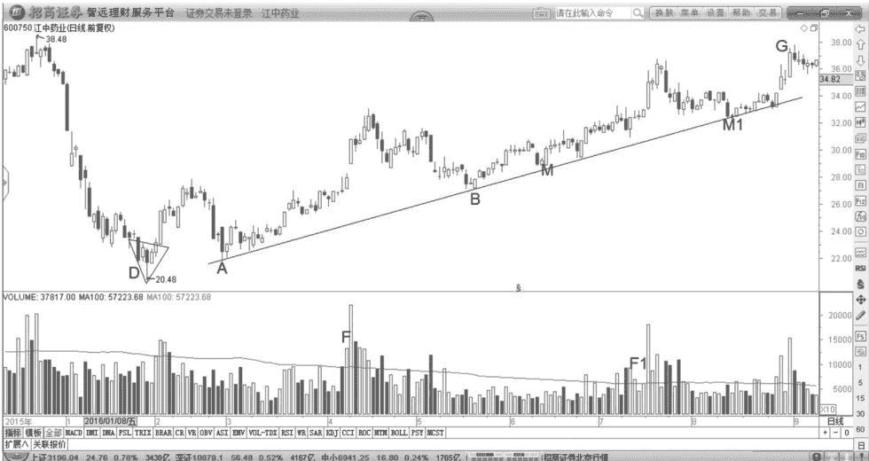

图 1-1 江中药业日 K 线

操作要领：

1.从股价出现反转形态来看：股价在熊市中触底期间，股价经过杀跌以后出现底部形态，D 位置的 V 形反转就是典型的触底形态。同时，D 位置的 V 形反转和 A 位置的股价反弹又构成了双底反转。

2.从出现不连续的股价低点来看：A 位置股价出现反弹以后，经过 F 位置放量后该股有一个明显的拉升动作。并且在高位回调到 B 位置，还出现了两次底部形态。连接 A 和 B 位置的最低价位，回升趋势线便得到了验证。

3.从股价放量脱离股价低点来看：F 位置放量以后，F 位置的量能依然放大到 100 日等量线上方。从股价表现来看，回升趋势线上 M 和 M1 位置的建仓交易机会都是很好的介入时机。

总结： 当回升趋势中两个股价低点的连线形成以后，交易机会就已经出现在回升趋势中。回升趋势线位置是支撑价位，股价回调到趋势线时，就是典型的买点。回升趋势的两个股价低点，在缠论中也有运用，如缠论中两个中枢形态就可以确认缠论意义上的回升趋势。

### 1.1.2 下跌趋势线画法

下跌趋势线用于判断股价的下跌趋势，画法与回升趋势线相似，趋势线用起来也比较容易。连接某一时间段内最高点（相对高位也可以）与最低点之前的任意高点，就能画出回落趋势线。值得一提的是，画出的趋势线不应在其间穿越任何价位，这样才是有效的回落趋势线。另两个股价低点之间的间隔时间越长，趋势线对股价走势的影响也会越大。

形态特征：

A.股价出现反转形态：当股价出现高价区的反转形态以后，股价在牛市阶段见顶，从而出现牛市反转的高价区反转形态。

B.出现不连续的股价高点：不连续的两个股价高点出现以后，股价在牛市中的回升结束，这个时候连接两个股价高位，就画出了回落趋势线。

C.股价放量脱离股价高点：股价回落趋势出现以后，成交量会逐渐萎缩，从而推动股价不断达到收盘价新低，显著缩量进一步验证了股价回落趋势。

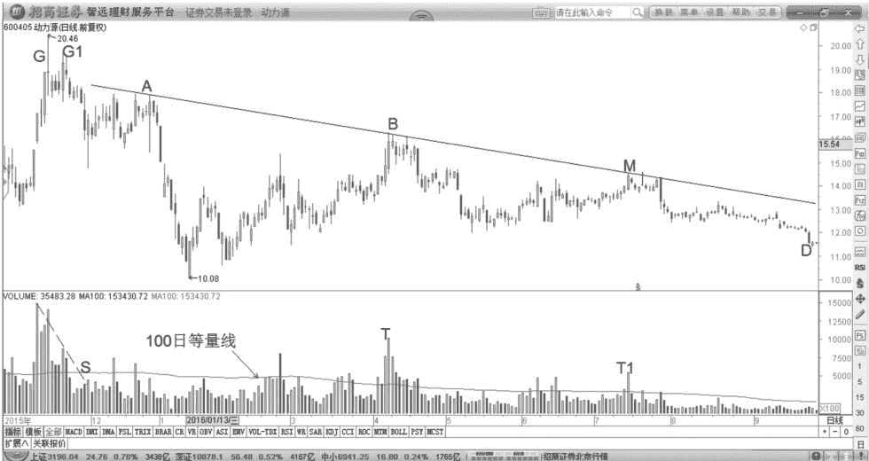

图 1-2 动力源日 K 线

操作要领：

1.从股价出现反转形态来看：放量回升期间股价在 G 位置出现见顶十字星， G1 位置股价低开回落，两次反转提示该股见顶。

2.从出现不连续的股价高点来看：S 位置的量能萎缩，股价明显出现回调走势。下跌期间，A 和 B 是相距 3 个月的股价高位，连接 A 和 B 便可得到该股的回落趋势线。

3.从股价缩量下跌来看：T 和 T1 位置的短暂脉冲量能推动股价反弹到回落趋势线。高抛的卖点出现在 M 位置。股价下跌到 D 位置，下跌趋势会延续下去。

总结： 确认股价进入下跌趋势以后，回落趋势线位置是比较高的抛售价位。股价在回落趋势线见顶时，股价下跌会在接下来的时间里回落。

## 1.2 趋势交易法

趋势交易中，按照趋势线提供的阻力区买卖股票，可以在股价从趋势线折返的时候获得投资收益。回升趋势中，股价在趋势线位置获得支撑上涨，而在下跌趋势中，趋势线则能成为股价反弹的阻力价位。如果趋势延续下来，在趋势线位置进行买卖动作，交易就不会失败。

### 1.2.1 回升趋势低吸策略

在回升趋势中，趋势线提供了强有力的支持，低吸交易策略是趋势交易中最直观有效的交易形式。趋势线提供的支撑很强，股价趋势性上涨的过程中，趋势线始终是股价反弹的起始价位。若趋势线不会被股价跌破，那么趋势线位置的买点就不会出现问题。在趋势交易期间，从量价变化、筹码支撑等多方面可确认趋势线位置的支撑效果，买入股票的动作就不会出现问题。

形态特征：

A.趋势线上出现缩量买点：股价回调到回升趋势线位置时，成交量明显萎缩，股价回调到位，缩量低价的买点出现。

B.浮筹指标达高位：浮筹指标 ASR 达到最高位时，是在提示投资者股价已经进入高浮筹的支撑价位，股价触底概率大增。

C.地量买点确认：量能达地量以后，多空之间争夺显著降低，结合股价回调到趋势线位置，买点被验证。

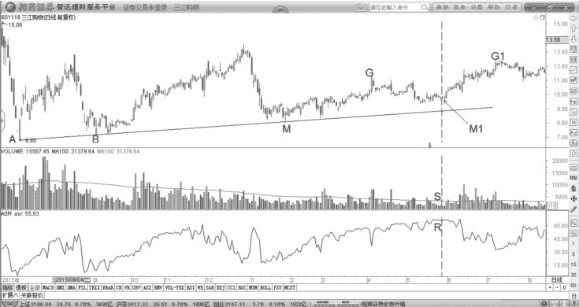

图 1-3 三江购物日 K 线

操作要领：

1.从趋势线上出现缩量买点来看：A 和 B 位置的股价低点确认了股价的回升趋势，在趋势线上方，M 位置是股价冲高回落的首次买点。

2.从浮筹指标达高位来看：当股价继续回升以后，股价从 G 位置回调到趋势线上方。浮筹指标 ASR 达 R 位置的高位，是在提示股价已经进入高浮筹区域，这个区域的支撑很强。

3.从地量买点确认来看：量能在 S 位置达地量，股价在高浮筹区域地量触底，这是买点机会。虽然股价并未触及回升趋势线，但 M1 位置的建仓机会依然可以被确认。如果在 M1 位置买入股票，当股价反弹到 G1 位置的高位，就可以获利 20%以上。

总结： 在股价回升期间，趋势线位置股价在多方面表现出获得支撑，按照趋势线建仓的策略交易可以盈利。回升趋势线的支撑在缠论趋势中体现为缠论中枢的低价位买点。中枢调整的低价区建仓成本较低，是比较典型的建仓机会。

### 1.2.2 下跌趋势高抛策略

在回落趋势中，趋势线提供了强有力的压力，高抛交易策略是趋势交易中最直观有效的交易形式。趋势线提供的压力很大，股价趋势性下跌的过程中，趋势线始终是股价下跌的起始价位。趋势线如果不会被股价有效突破，那么趋势线位置的卖点就不会出现问题。在趋势交易期间，从股价放量见顶、浮筹指标见顶等多方面可确认趋势线位置压制效果，卖出股票的动作就不会出现问题。

形态特征：

A.趋势线上出现放量卖点：股价反弹到回落趋势线位置，成交量短线脉冲放大，股价涨幅到位，十字星等顶部特征出现。

B.浮筹指标达高位：股价反弹期间，当浮筹指标 ASR 达到最高位，则表明已经进入高浮筹的股价区域。高浮筹的股价区域抛售压力大增，股价见顶概率很高。

C.放量卖点确认：量能脉冲放大到 100 日等量线上方，反弹期间成交量充分释放，此时，则是提示投资者股价顶部形成。

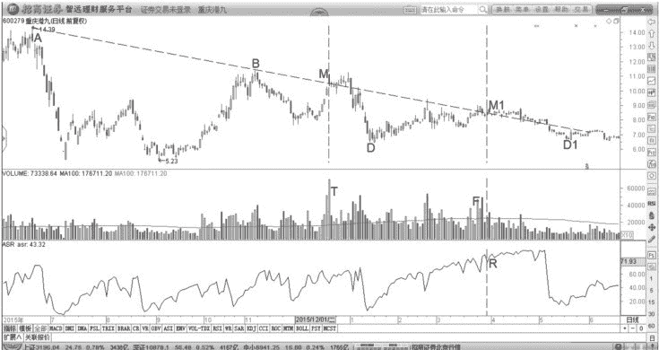

图 1-4 重庆港九日 K 线

操作要领：

1.从趋势线上出现放量卖点来看：在回落趋势线中，股价在 A 和 B 位置出现了顶部形态，从而确认了下跌趋势。T 位置的量能达天量，反弹期间充分放量，M 位置的高抛卖点得到验证。

2.从浮筹指标达高位来看：股价从 M 位置的天量顶回落到 D 位置，之后反弹到 M1 位置的高抛价位。浮筹指标显著回升到 R 位置，则提示 M1 位置的高浮价位抛售阻力最大，而在趋势线位置卖掉股票可以避险。

3.从放量卖点确认来看：量能在 F 位置短暂放大，连续放大到 100 日等量线上方仅有两个交易日，放量不足则提示 M1 位置卖点有效。

总结： 股价反弹到回落趋势线的时候，股价达高浮筹的股价区间，这是股价进入阻力位的典型信号。由此可见，从形态上看，回落趋势线位置的确是典型的高抛价位。通过趋势线来确认股价下跌的减仓机会，是比较有效的一种手段。

## 1.3 缠论趋势确认

股价运行期间，单边趋势只有上涨和下跌两种情况。调整期间的股价震荡是一种特殊情形，能构成缠论中枢的震荡形态。如果投资者在中枢震荡期间采取短线交易，可以有效获利。而在单边趋势中，中枢形态是构成趋势的一部分，更大规模的交易机会将从中枢震荡开始。

### 1.3.1 回升趋势缠论形态

回升趋势中，中枢震荡和缠论线段会交替出现，在股价加速回升阶段，缠论线段和中枢震荡的更替非常频繁。中枢震荡成为股价加速上涨的起始形态，缠论线段则是股价涨幅最大的阶段，是比较有效的盈利阶段。

形态特征：

A. MACD 指标由坏到好：当 MACD 指标由 0 轴线下方回升到 0 轴线以上的时候，指标提示股价正在走好，这是股价进入回升趋势的信号缠论中，MACD 指标走强提示回升趋势缠论形态正在出现。

B.缠论中枢首次出现：缠论中枢形态首次出现在 MACD 指标走强的时候，提示行情正在向好的方面发展。在回升趋势中，虽然中枢形态出现的次数较多，但中枢震荡却是在指标走强以后才开始。

C.缠论线段与中枢形态开始转换：回升趋势规模大并且持续时间长，中枢和缠论线段之间的转换在长期延续。在回升趋势中，更大的涨幅是在缠论线段期间出现，中枢调整是新的缠论线段出现前的盘整形态。

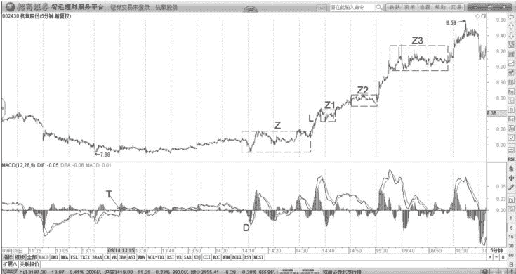

图 1-5 杭氧股份 5 分钟 K 线

操作要领：

1.从 MACD 指标由坏到好来看：在 MACD 指标的 DIF 线还处于 0 轴线下方的时候，股价单边下跌。图中 T 位置是 DIF 线达到 0 轴线的位置，这是在提示股价表现趋于强势。而 MACD 指标则提示缠论回升趋势正在出现。

2.从缠论中枢首次出现来看：经历 D 位置 DIF 线回调放大加大，股价在 Z 位置的震荡加强。Z 位置股价回调次数超过两次，是股价加速上涨前的中枢形态。

3.从缠论线段与中枢形态开始转换来看：Z 位置的中枢调整是股价回升期间的首次典型调整，L 位置的线段成为连接 Z 和 Z1 两个中枢形态的线段。接下来股价回升期间，Z2 和 Z3 位置的线段依然存在，这体现了股价震荡运行的特征依然延续。缠论形态的回升趋势中，中枢和线段之间的转换从未停止，这是缠论回升趋势的结构特征。

总结： 股价进入回升趋势以后，缠论中枢和缠论线段转换的次数很多，并且没有固定的限制。而 5 分钟 K 线是非常短的 K 线周期，期间中枢形态出现的次数较多，相比日 K 线等更大的时间周期，中枢转换更加频繁。

### 1.3.2 回落趋势缠论形态

回落趋势的中枢震荡和缠论线段也是交替出现的，在股价加速回落阶段，缠论线段和中枢震荡的更替非常频繁。在日 K 线级别以下的 K 线图中，K 线数量增加，中枢震荡的频率提升。而在日 K 线以上的长周期 K 线图中，K 线数量明显减少，使得缠论中枢形态的震荡频率降低。不同 K 线级别的缠论中枢和缠论线段的转换过程是一样的。研究缠论回落趋势，投资者需要关注中枢和缠论线段之间的转换节奏，这样才能把握缠论震荡期间的买卖机会。

形态特征：

A.股价高位下方出现中枢调整：股价在股价高位见顶，股价从高位回落以后，中枢震荡的股价形态出现。缠论中枢震荡成为股价进一步下跌的起始形态。

B.缺口推动股价下跌：缺口形态出现在下跌趋势中，缠论中枢震荡之间的缺口是典型的突破口，其推动着股价加速下跌。缺口下方还会出现中枢震荡，在股价震荡的过程中，股价反弹难以达到缺口附近。

C.低价区的中枢调整：缺口出现以后，中枢震荡在低价区出现，这是缠论下跌趋势的中枢转换的结果。低价区的中枢震荡将会成为股价新一轮下跌的起点。

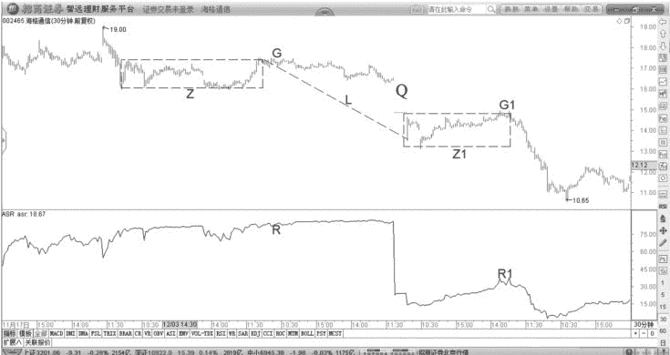

图 1-6 海格通信 30 分钟 K 线

操作要领：

1.从股价高位下方出现中枢调整来看：股价在高价 19 元见顶回落，下跌期间 Z 位置的中枢震荡形态出现。从图 1-6 中可以看到，在 Z 位置的中枢震荡期间，股价明显经历反弹走势，反弹次数为 3 次，且股价在 G 位置见顶。

2.从缺口推动股价下跌来看：从 G 位置开始的缠论线段 L 出现期间，Q 位置的跳空下跌缺口非常典型。缺口成为连接 Z 和 Z1 这两个中枢形态的缠论线段。

3.从低价区的中枢调整来看：Z1 位置同样是中枢调整形态，但是股价波动空间明显收窄。股价在缠论中枢 Z1 弱势震荡，股价从中枢震荡的高位 G1 开始加速回落。可以看到 R 和 R1 位置的浮筹指标处于高位，在股价从 G 和 G1 开始回落期间，同时也是浮筹指标下跌的起始点。

总结： 浮筹指标从高位回落，缺口加速股价脱离高浮筹区域，股价在缠论中枢和缠论线段转换的时候完成下跌趋势。在 30 分钟 K 线图里，可以看到缠论下跌趋势的形态转换过程。

## 1.4 缠论回升趋势

回升趋势中，缠论调整中枢形态始终是股价短线震荡的基础形态。在不同形态的缠论中枢调整中，股价震荡的时间有很大不同，但是股价运行的大趋势却不变。通常，股价总是在不同的缠论中枢形态中震荡，股价最终会突破中枢调整的股价区间，并且实现更大的涨幅。

### 1.4.1 双中枢确认回升趋势

从缠论结构来看，股价完成的回升趋势出现以后，需要两次中枢形态来确认。在股价回升期间，当两次中枢调整走势完成的时候，便是股价进入回升趋势的信号。从形态上确认了双中枢形态后，再在股价回升期间按照趋势交易策略买卖股票，就可以获得收益。

双中枢形态

股价在熊市期间触底以后，股价在表现形态上出现了缠论中枢形态。股价回升期间出现的中枢形态，持续震荡以后股价将突破中枢形态的压力位，并且在加速回升期间扩大涨幅。典型的两次中枢形态出现在股价回升阶段，股价上涨趋势得到验证。从缠论结构来看，两次典型中枢形态出现以后，股价依然处于上涨趋势，缠论意义上的形态特征就得到了验证。

形态特征：

A.股价下跌期间触底：股价在下跌趋势中触底，低价区的反转形态出现，该反转形态是股价进入回升趋势的最低价的买点。

B.两次缠论中枢形态：股价回升期间，缠论盘整形态连续出现。股价连续两次突破缠论盘整区域以后，缠论两次中枢形态出现。两次中枢形态以后，股价缠论回升趋势将被确认出现。

C.股价脱离缠论中枢：若两次中枢形态出现以后，股价以阳线拉升的形式脱离中枢形态，那么股价回升趋势会在震荡中延续。

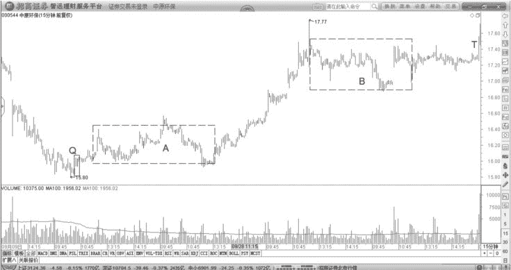

图 1-7 中原环保 15 分钟 K 线

操作要领：

1.从股价下跌期间触底来看：下跌趋势中股价在 Q 位置跳空反弹，这是有效的触底回升形态，预示着该股进入了回升趋势中。

2.从 2 次缠论中枢形态来看：进入回升趋势以后，图中 A 位置的缠论中枢形态是首次盘整。股价出现两次典型的回调，缠论中枢形态就已经完成。

3.从股价脱离缠论中枢来看：A 和 B 位置的缠论中枢形态是两次股价调整形态，接下来 T 位置的股价出现反弹阳线，股价脱离 B 位置的中枢形态以后，则意味着回升趋势得到了验证。

总结： 进入回升趋势以后，股价很快完成了两次缠论中枢形态，这是回升趋势的关键形态。从缠论结构的完整性来看，股价脱离第二个缠论中枢形态时，回升趋势就已经在延续。

股价回升趋势

双中枢形态出现在股价回升阶段，股价接下来会按照缠论中枢形态不断被突破的回升趋势运行。股价在中枢震荡期间不断经历双向震荡，股价突破盘整的中枢形态频繁出现。从收盘股价来看，股价会达到新高价位。

形态特征：

A.量能显著放大：随着回升趋势中的量能放大，股价摆脱中枢调整的力度会加强，此时，股价上行趋势也得到了加强。

B.出现第 3 次中枢形态：股价进入缠论回升趋势，缠论 2 次中枢形态完成。高价区继续出现缠论盘整形态，股价脱离盘整区域后，出现第 3 次缠论中枢形态。

C.股价收盘创新高：股价摆脱第 3 次中枢调整以后，收盘价将达到新高，投资者的盈利空间也会持续放大。

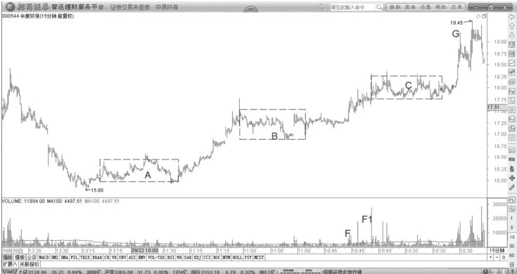

图 1-8 中原环保 15 分钟 K 线

操作要领：

1.从量能显著放大来看：2 次缠论中枢形态以后，F 和 F1 位置的脉冲量能显著放大，股价会随之放量上涨。该股很快进入 C 位置的缠论中枢调整状态。

2.从出现第 3 次中枢形态来看：在 C 位置的中枢调整阶段，股价会出现显著的双向震荡。从中枢震荡的规模看，缠论调整时间与 A 和 B 位置相似，该股已经出现了 3 次中枢调整走势。

3.从股价收盘创新高来看：在 G 位置股价达到收盘价新高期间，股价涨幅较大。而在回升趋势中，股价上涨潜力会在放量阶段得到释放。

总结： 缠论中枢形态与股价突破中枢交替出现，在回升趋势中，两次缠论中枢形态验证了股价回升趋势，投资者的盈利会不断得到释放。

### 1.4.2 回升趋势的完整缠论结构

在完整的回升趋势中，从缠论结构的完整性看，会出现 2 个以上的缠论中枢形态。通常，股价在经历了 2 个或者更多的中枢调整以后，股价会完成涨幅较高的回升趋势。

回升趋势缠论结构

从典型的缠论结构看，股价进入回升趋势期间，首先会完成一次中枢形态。完成了首次缠论中枢形态以后，股价获得的支撑便得到了确认，这就像简单的回升趋势，需要两个股价低点连线才能确认回升趋势线一样。缠论中枢形态出现两次，股价上涨的趋势才更加明确。投资者根据两次缠论中枢形态确认的股价回升趋势，按照回升趋势来交易股票，可以获得较好的回报。

形态特征：

A.缠论 2 次中枢形态完成：缠论的 2 次典型中枢形态完成以后，股价就会进入回升趋势中，这期间，投资者按照回升趋势中低价买入的原则交易，可以获取稳定收益。

B.股价延续回升趋势：2 次中枢形态以后，股价延续了回升趋势，此时，股价上涨期间的涨幅会不断扩大。

C.缠论背驰提示回升趋势结束：在股价回升期间，缠论的背驰提示股价出现反转信号。若背驰出现在最后一次中枢调整后，便是股价涨幅收窄的信号，这意味着股价会结束回升趋势。

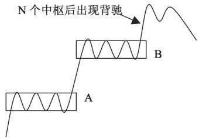

图 1-9 回升趋势缠论结构

完整缠论回升趋势案例

在回升趋势中，缠论结构上的上行趋势可以延续下来，直到股价脱离最后一个缠论中枢的力度减弱，脱离中枢形态的缠论线段长度收窄，这提示我们背驰卖点出现，股价将进入顶部区域。如果投资者在股价高位背驰阶段卖掉股票，可以有效减少亏损。背驰后股价进入跌势，缠论形态上的回升趋势结束。

形态特征：

A.低价区出现 2 次中枢形态：低价区的 2 次中枢形态，既是确认回升趋势的形态，同时也是股价触底回升阶段比较重要的盈利阶段。

B.高价区中枢震荡加剧：由于股价进入回升趋势后涨幅扩大，已经获利的投资者开始有出货的动作。届时，高价区的股价波动强度增加，会使得缠论中枢调整的力度不断扩大。

C.线段背驰提示反转：脱离缠论中枢形态的线段变短以后，股价在股价高位会出现背驰形态，这是股价将要高位反转的信号。

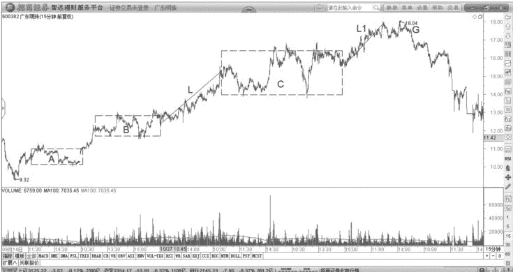

图 1-10 广东明珠 15 分钟 K 线

操作要领：

1.从低价区出现 2 次中枢形态来看：股价在低价区触底以后，A 和 B 位置的两次缠论中枢形态，将会成为确认股价上涨的形态。

2.从高价区中枢震荡加剧来看：图中 C 位置的股价震荡空间加大，中枢震荡的格局虽然未变，但多空分歧却在加大。这个时候，股价见顶的速度正在加快。

3.从线段背驰提示反转来看：股价脱离 C 位置的中枢形态以后，股价在 L1 完整的涨幅要小于 L 位置，这是线段背驰提示股价见顶的信号。

总结： 缠论回升趋势有很强的完整性，脱离中枢形态的线段不能与前期线段背驰，如果背驰，则意味着完整的回升趋势已经结束，缠论结构上完成的上涨走势即将形成。

## 1.5 缠论回落趋势

回落走势中，缠论调整中枢形态是股价震荡下跌的调整形态，并成为构成缠论下跌趋势的重要一环。另外，在不同形态的缠论中枢调整中，股价震荡的时间有很大不同，但是股价下跌的大趋势不变。通常，股价总是在不同的缠论中枢形态中震荡，股价最终跌破中枢调整的股价区间，并且实现更大的跌幅。

### 1.5.1 双中枢确认回落趋势

从缠论结构来看，股价完成的回落趋势中，两次中枢形态一定会出现。在股价下跌期间，两次中枢调整走势完成的时候，便是股价进入回落趋势的信号。从缠论结构上确认了双中枢形态，在股价回落期间按照趋势交易策略买卖股票，就可以相应地减少亏损。

双中枢形态

股价在牛市期间见顶回落以后，股价在下跌期间出现了缠论中枢形态。持续震荡以后股价将会跌破中枢形态的支撑位，并且在加速回落期间扩大跌幅。典型的两次中枢形态出现在股价下跌阶段，此时，股价下跌趋势得到验证。从缠论结构来看，两次典型中枢形态以后，股价依然处于下跌趋势，缠论意义上的形态特征也得到了验证。

形态特征：

A.股价回升期间见顶：股价在回升趋势中见顶，高价区的反转形态出现，反转形态是股价进入下跌趋势的最高价的卖点。

B.2 次缠论中枢形态：股价下跌期间，2 次缠论盘整形态出现期间，股价都跌破盘整区域，完成了双中枢的缠论形态。2 次缠论中枢形态以后，股价进入缠论回落趋势。

C.股价脱离缠论中枢：2 次中枢形态出现以后，股价以阴线打压的形式脱离中枢形态，股价回落趋势在震荡中延续。

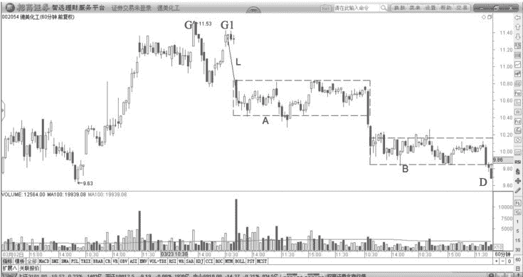

图 1-11 德美化工 60 分钟 K 线

操作要领：

1.从股价回升期间见顶来看：回升趋势中，股价在 G 位置成功见顶以后，反弹期间达到短线高位 G1，反转不可避免的出现。接下来，该股进一步震荡回落期间，L 位置的缠论线段跌幅加大。

2.从 2 次缠论中枢形态来看：当股价高位反转出现以后，下跌期间 A 位置的缠论中枢形态持续时间较长，这是一次跌势中的震荡行情。当股价收盘再创新低以后，图中 B 位置缠论中枢形态持续时间更短，预示着下跌趋势在加速中形成。

3.从股价脱离缠论中枢来看：股价 B 位置完成了第 2 次中枢调整，D 位置股价加速了杀跌走势的形成，新的收盘价低位验证了该股的下跌趋势。

总结： 缠轮中枢形态在下跌趋势中出现 2 次，使股价跌势得到了延续。此时，股价下跌空间还会扩大，而投资者的交易机会却在不断减少。中枢形态的股价波动期间只是短线交易机会，而新低价位的买点还会继续出现。

股价回落趋势

双中枢形态出现在股价下跌阶段，股价接下来会在缠论中枢被跌破的下跌趋势中运行。股价在缠论盘中期间不断经历双向震荡，以致股价跌破中枢形态的次数增加。从收盘股价来看，收盘价新低将会被不断刷新。

形态特征：

A.量能显著萎缩：回落趋势中量能萎缩，股价反弹脱离缠论中枢形态的力度减弱，股价弱势跌破缠论中枢形态，下跌趋势延续。

B.出现第 3 次中枢形态：股价双向震荡的盘整走势出现，并成为新的缠论中枢形态。第 3 次中枢调整形成，股价回落趋势得到了验证。

C.股价收盘创新低：股价摆脱第 3 次中枢调整以后，收盘价达到新低期间，投资者盈利空间减小。

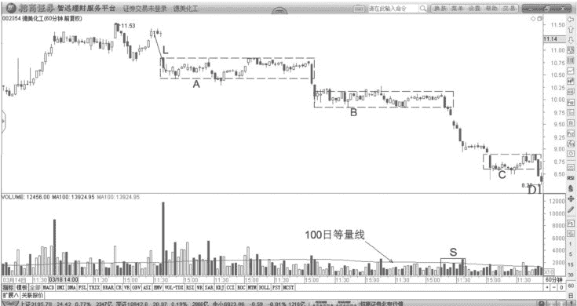

图 1-12 德美化工 60 分钟 K 线

操作要领：

1.从量能显著萎缩来看：当成交量显著萎缩的时候，图中 100 日等量线已经是量能很难达到的高度。在缩量情况下，股价摆脱 B 位置的中枢图中阶段，股价下跌幅度不断扩大。

2.从出现第 3 次中枢形态来看：量能在 S 位置小幅放大，期间股价出现连续杀跌的走势。跌幅扩大以后，C 位置的策略中枢形态出现。

3.从股价收盘创新低来看：收盘价新低在 D1 位置出现，股价继续跌破 C 位置的中枢形态，该股出现了更低的收盘价。

总结： 当股价的下跌趋势得到验证以后，会出现 2 个中枢形态。而在完整的下跌趋势中，股价会出现多个中枢形态。

### 1.5.2 回落趋势的完整缠论结构

在完整的回落趋势中，从缠论结构的完整性来看，会出现两个以上的缠论中枢形态。通常，股价在经历了两个或者更多的中枢调整以后，股价会完成跌幅较大的回落趋势。

回升趋势缠论结构

从典型的缠论结构看，股价进入回落趋势期间，首先会完成一次中枢形态。首次完成了缠论中枢形态以后，股价获得的支撑会得到确认。这就像简单的回落趋势，需要两个股价高点连线才能确认回落趋势线一样，缠论中枢形态出现两次，股价下跌的趋势才更加明确。投资者根据两次缠论中枢形态确认的股价回落趋势，按照回落趋势来交易股票，可以获得较好的投资效果。

形态特征：

A.缠论 2 次中枢形态完成：缠论的 2 次典型的中枢形态完成以后，股价便会进入回落趋势中，这期间，投资者按照回落趋势中高价抛售的原则交易，可以避免股价下跌期间遭遇亏损。

B.股价延续回落趋势：2 次中枢形态以后，股价便延续了回落趋势，股价下跌期间的跌幅会不断扩大。

C.缠论背驰提示回落趋势结束：在股价回落期间，缠论的背驰提示股价出现反转信号。若背驰出现在最后一次中枢调整以后，则是股价跌幅收窄的信号，这意味着股价结束回落趋势。

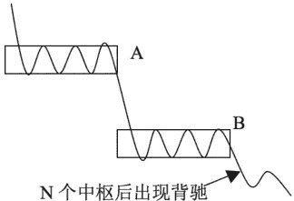

图 1-13 回落趋势缠论结构

完整缠论回升趋势案例

在回落趋势中，缠论结构形态特征可以延续下来，直到股价跌幅收窄期间，脱离中枢形态股价下跌力度减弱。这个时候，比较缠论线段长度收窄，提示回落趋势中缠论背驰形态出现。缠论中枢背驰阶段，股价将进入缠论回落趋势的底部区域。如果投资者在股价中枢背驰阶段买入股票，可以获取廉价筹码。缠论中枢背驰后股价触底回升，缠论形态上的回落趋势结束。

形态特征：

A.高价区出现 2 次中枢形态：高价区的 2 次中枢形态，既是确认回落趋势的形态，同时也是股价见顶回落期间典型的减仓时段。

B.低价区中枢震荡加剧：由于股价进入回落趋势后跌幅扩大，已经减少持股的投资者降低了损失。此时，低价区的股价波动强度会增加，从而增加低价买入股票的投资者，使得缠论中枢调整的双向震荡力度扩大。

C.线段背驰提示反转：脱离缠论中枢形态的线段变短以后，股价在股价低位会出现背驰形态，这是股价将要低位反转的信号。

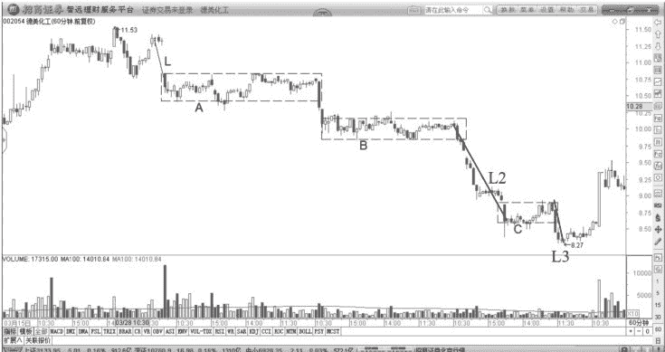

图 1-14 德美化工 60 分钟 K 线

操作要领：

1.从高价区出现 2 次中枢形态来看：股价进入下跌阶段以后，图中 A 和 B 位置是中枢形态，股价双向震荡空间较大，这是确认下跌趋势的形态。

2.从低价区中枢震荡加剧来看：低价区 C 位置股价双向震荡加剧，场外投资者在低价区开始加仓，以致股价继续下跌的空间收窄。

3.从线段背驰提示反转来看：低价区股价震荡期间，缠论线段 L2 明显相对于前期 L1 短，这是缠论背驰提示的反转信号，并意味着股价在低价区出现底部，该股的缠论下跌趋势结束。

总结： 在缠论下跌趋势中，缠论中枢形态虽然会多于 2 次，却不会无限制增加。3 次中枢调整结束以后，股价下跌趋势结束的概率会提升，低价区的买点可得到验证。

## 1.6 缠论趋势交易机会测量（缠论中枢盘整交易、缠论中枢突破交易）

在缠论趋势中，缠论中枢的股价会围绕一个区间震荡。在股价摆脱区间震荡前，短线的高抛低吸机会较多，投资者可以在股价震荡的过程中获取短线收益。而股价震荡结束时，股价脱离中枢震荡的股价区间，这会导致单边趋势延续，从而出现更大的交易空间。

### 1.6.1 缠论中枢交易策略

股价按照缠论单边趋势运行的时候，缠论中枢震荡期间，比较典型的短线买卖机会出现。当股价按照缠论回落趋势运行时，缠论中枢震荡的股价上限是高抛卖点。而股价处于缠论回升趋势的时候，缠论中枢震荡的股价下限是典型买点。投资者在中枢形态下限建仓，可以获得廉价的筹码。在趋势延续期间，典型的交易价位完成股票买卖后，投资者能够获得很好的投资效果。

形态特征：

A. MACD 的 DIF 线回调 0 轴线：缠论趋势中，只要 MACD 指标的 DIF 线向 0 轴线运行，股价的调整就会出现。这个时候，缠论中枢形态也正在出现。

B.股价双向震荡：在中枢形态中，通常股价双向震荡的次数会在两次以上。如果股价处于回升趋势，股价两次回调以后，中枢形态完成，投资者的交易机会也得到了验证。

C.三角形缠论中枢买卖点出现：从形态上看，股价震荡空间减小的时候，股价在三角形图中阶段结束中枢调整。

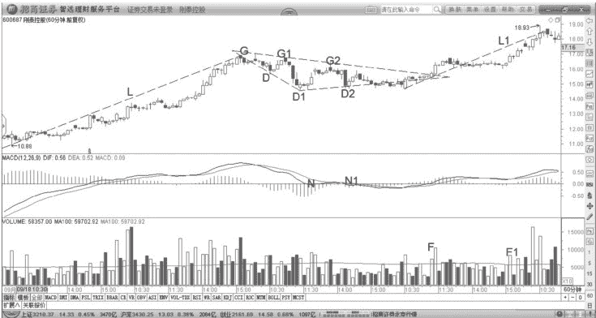

图 1-15 刚泰控股 60 分钟 K 线

操作要领：

1.从 MACD 的 DIF 线回调 0 轴线来看：L 是股价上涨期间的缠论线段形态，结束回升动作以后，股价在 G 位置见顶。这期间，若 MACD 指标的 DIF 线回调到 N 位置的 0 轴线位置，则表明缠论中枢调整已经开始。

2.从股价双向震荡来看：缠论中枢震荡期间，股价分别从 G、G1、G2 回调到 D、D1、D2，跌幅达 6%、10%、9%。这时，低价区买点会在 D、D1、D2 位置出现。

3.从三角形缠论中枢买卖点出现来看：缠论中枢震荡期间，股价至少会出现回调 D 和 D1 的调整情况。股价波动收窄以后，双向震荡期间三角形形态完成。此时，三角形上限和三角形下限将分别成为卖点和买点。当 F 和 F1 位置的量能达 100 日等量线以上，股价便会在 L1 位置的缠论线段脱离中枢形态。这期间，若投资者在中枢震荡进行短线交易，可以获得 3 次 10%的收益。

总结： 缠论中枢震荡的结果是，股价依然能够脱离中枢形态，按照单边趋势运行。在中枢震荡期间进入短线交易，投资者需要关注股价将要突破的方向。毕竟，在缠论单边趋势中持股更容易获得高收益。

### 1.6.2 突破中枢阶段交易策略

中枢震荡是股价单边趋势运行的短期形态，在不改变股价运行趋势的情况下，它能为投资者的股票买卖提供机会。中枢震荡时，股价上涨或是下跌都是双向的，投资者如果需要增加持股或者减少持股，都有机会完成交易动作。

在股价脱离中枢震荡期间，股价至少会经历两次调整。如果股价正处于回升趋势中，缠论中枢图中次数要高于两次。而在调整结束前，可以看到以下的形态特征。

形态特征：

A.浮筹指标单边回升到高位：当浮筹指标回升到高位时，表明股价已经进入高浮筹的股价区间。此时，股价不再双向震荡，其股价运行方向将成为趋势突破方向。

B.成交量出现放大迹象：缠论中枢形态是股价双向震荡的调整走势，这是量能还不稳定的股价运行过程。一旦成交量出现稳定放大迹象，股价就已经调整完毕，届时，典型的交易时机便会出现。

C.股价经历两次回调：在股价两次调整以后，可以关注中枢完成的情况。如果有放量突破高浮筹区域的信号，那么买点的可靠性则会大增。

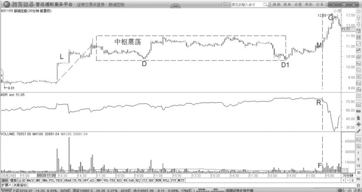

图 1-16 新城控股 30 分钟 K 线

操作要领：

1.从浮筹指标单边回升到高位来看：L 位置出现缠论线段形态以后，股价就进入了中枢震荡。判断中枢震荡结束信号，图中 ASR 达 R 位置 80 以上，是 0 到 100 的指标数值上限。表明股价已处于高浮筹的股价区域，是股价突破的前兆。

2.从成交量出现放大迹象来看：F 位置量能已经放大到 100 日等量线以上，有效放量便能成为股价上涨突破的基础。这个时候建仓，接下来可以很快获得股价放量回升带来的收益。

3.从股价经历两次回调来看：当中枢调整阶段股价分别回落到 D 和 D1 位置时，则表明缠论中枢形态的两次回调都已经确认，股价完成了中枢形态。股价放量达到 M 位置，这是买点机会。随后股价飙升到 G 位置，从 D1 到 G 位置的缠论线段中，该股涨幅已达 20%。

总结： 中枢震荡在 30 分钟 K 线图中相对简单，只需要两次调整，股价就可以脱离中枢震荡的股价区间。从获取收益的角度看，在股价摆脱中枢震荡前，其中枢震荡的低价位都是投资者不错的买点。

# 第二章 缠论反转信号

缠论趋势的形成，是从缠论反转形态开始的，而缠论反转形态与背驰密切相关。例如单边趋势中背驰就是趋势结束的信号，其提示股价会进入反转阶段。此时，股价在反转区域将出现 3 类买卖机会。作为趋势交易者，关注缠论反转阶段的 3 类买卖点，能够获得更好的交易效果。

本章介绍了缠论反转期间的盘整形态，以及 3 类买卖点和检验盘整背驰的指标方法。

## 2.1 高价区盘整背驰

股价进入缠论回升趋势以后，股价继续回升的潜力减弱，高价区的股价涨幅收窄，并出现盘整背驰形态，而盘整背驰形态是股价开始下跌的信号。盘整背驰出现之时，通常伴随着股价的中枢背驰形态出现，这意味着回升趋势达到末期，股价开始构筑顶部反转形态。

### 2.1.1 高价区盘整形态

在股价进入回升趋势以后，中枢调整和缠论线段之间的转换频率增加，股价涨幅也不断扩大。高价区涨幅短线收窄后，它的卖点形态便会出现。从成交量看，股价在高价区的震荡期间，量能释放更加充分，股价在充分放量上涨以后就进入了反转阶段。

形态特征：

A.中枢调整形态频繁出现：在股价回升阶段，中枢调整形态会频繁出现。而在中枢震荡与缠论线段形态转换的过程中，股价的涨幅会扩大。

B.高价区股价放量上攻：进入高价区以后，成交量充分释放，股价出现了集中放量拉升的情况，筹码转换速度也会加快。

C.高价背驰形态出现：高价区背驰形态出现以后，股价在高价区的盘整背驰就是反转开始的信号。在盘整背驰阶段，股价涨幅已接近尾声。

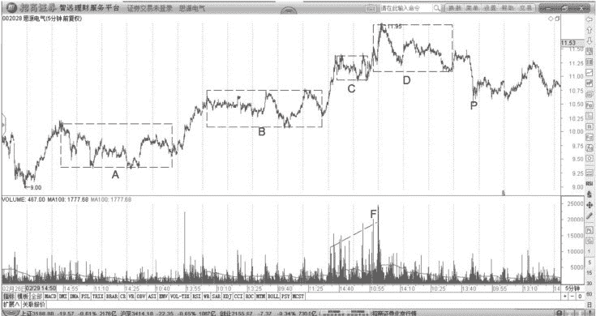

图 2-1 思源电气 5 分钟 K 线

操作要领：

1.从中枢调整形态频繁出现来看：中枢调整形态出现在 A、B 和 C 位置，股价在 3 个中枢阶段涨幅超过 25%。

2.从高价区股价放量上攻来看：进入高价区以后，F 位置的量能明显放大，这是回升趋势中难得一见的集中放量，其表明筹码在投资者之间的转换量很大。F 位置放量持续时间较短，会很快进入缩量状态，并提示顶部会出现反转。

3.从高价背驰形态出现来看：该股在高价区 F 位置充分放量，C 位置的中枢调整结束。接下来，股价进入高价区 D 位置的盘整背驰区间。随着股价下跌至 P 位置的低点，股价跌破 D 位置的中枢形态，缠论回升趋势结束。

总结： 盘整背驰阶段，股价回升潜力在背驰以后结束，届时股价上涨潜力消失殆尽。在盘整背驰期间，股价会跌破中枢形态，股价会很快进入下跌趋势。

### 2.1.2 高价区的盘整背驰

进入高价区以后，股价上涨空间加大，放量见顶的情况出现以后，盘整背驰的形态也在形成。当盘整背驰时，缠论线段的长度会缩短。从缠论回升线段的对比来看，后期线段要短于前期线段，且股价在震荡过程中会进入下跌趋势中。

形态特征：

A.中枢背驰形态出现：在中枢背驰阶段，股价在高价区的上涨幅度收窄，顶部反转形态得到确认。同时，中枢背驰会成为股价滞涨的表现形式。

B.高价区放量顶部形成：高价区量能充分释放，量能从放大到萎缩的转变明显，高价区的顶部反转形态出现。

C.高价区盘整背驰：高价区盘整背驰阶段，股价虽然会反弹，但是反弹的力度会不断减弱，从而使得高价区的盘整背驰形态完成。

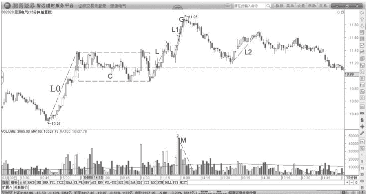

图 2-2 思源电气 15 分钟 K 线

操作要领：

1.从高价背驰形态出现来看：图中显示的 L 位置的线段相比 L0 短一些，这是中枢背驰的信号。此时，股价的涨幅减小，缠论回升趋势正在结束。

2.从高价区放量顶部形成来看：当高价区放量顶部出现时，虽然 M 位置的脉冲量能达到最高量能，但是脉冲量能后的成交量会快速萎缩。成交量显著缩量到 100 日等量线下方时，股价会在 G 位置见顶。

3.从高价区盘整背驰来看：股价放量见顶 G 位置以后，线段 L1 相比 L 要短，并出现盘整阶段背驰形态。进一步发展后，L2 位置线段相比 L1 短，说明背驰依然存在。接下来股价缩量下跌，已经跌至 C 位置的中枢形态对应价位。盘整背驰导致股价出现顶部形态。

总结： 关注股价高位的盘整背驰，在缠论回升趋势中盈利的投资者可以顺利逃顶，而不会出现明显的利润减少的情况。

## 2.2 低价区盘整背驰

股价进入缠论回落趋势以后，股价继续回落的潜力会减弱，同时低价区的股价跌幅也会收窄，并出现盘整背驰形态，这是股价开始反弹的信号。盘整背驰出现之时，会伴随着出现股价的中枢背驰形态，这意味着回落趋势已达到末期，股价开始构筑底部反转形态。

### 2.2.1 低价区盘整形态

在股价进入回落趋势以后，中枢调整和缠论线段之间的转换频率会增加，股价的跌幅也会不断扩大。低价区跌幅短线收窄以后，可以关注股价和 BIAS 指标的中枢背驰形态。BIAS 指标出现背驰形态以后，且股价在指标背驰的基础上会继续出现背驰形态，使低价区的买点得到确认。

形态特征：

A.中枢调整形态频繁出现：中枢调整形态频繁出现在股价回落期间，这时，股价在回落过程中的跌幅会扩大，缠论下跌趋势也将延续。

B.低价区 BIAS 指标背驰：BIAS 指标描述了股价震荡幅度的变化，当该指标在低价首次表现出背驰形态以后，便是在提示股价的缠论下跌趋势已经进入尾声。

C.低价背驰形态出现：在低价区出现背驰形态期间，股价在低价区的震荡开始出现。股价震荡的过程中，在缠论回落期间的线段之间出现背驰。

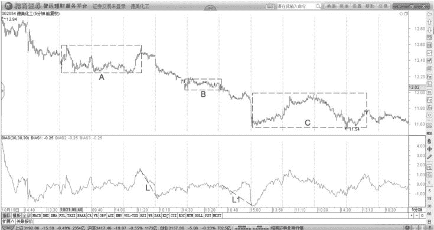

图 2-3 德美化工 5 分钟 K 线

操作要领：

1.从中枢调整形态频繁出现来看：下跌趋势中，中枢形态不断转换，在 A 和 B 位置的中枢震荡期间，股价按照调整形态运行。同时，两次中枢震荡都出现在下跌期间，并未改变缠论下跌趋势。

2.从低价区 BIAS 指标背驰来看：股价出现下跌的时候，当股价脱离 B 位置的中枢调整以后，回落趋势中 BIAS 指标的 L1 和 L 相比减小，这提示低价区的背驰正在形成。

3.从低价背驰形态出现来看：C 位置的股价震荡期间，是缠论盘整持续的位置。这个位置股价盘整期间的回调力度减弱，而盘整背驰则提示股价触底。

总结： 下跌趋势中盘整背驰出现在中枢背驰以后，股价在低价区的下跌潜力释放完毕，背驰提示回落行情开始逆转。

### 2.2.2 低价区的盘整背驰

进入低价区以后，股价下跌空间已经较大，缩量底部形态出现以后，盘整背驰的形态也在形成。盘整背驰的时候，回调期间缠论线段长度减小。从缠论回落线段的对比来看，后期线段要小于前期线段，股价在震荡过程中进入低价区筑底阶段。

形态特征：

A.中枢背驰形态出现：中枢背驰形态出现在低价区以后，股价进入了盘整背驰阶段，这意味着缠论下跌趋势已经出现结束信号。

B.股价天量释放抛压：低价区股价触底期间，天量量能出现，天量释放抛售压力以后，股价触底。

C.低价区盘整背驰形成：低价区缠论回调线段会一次比一次小，当盘整背驰形态出现时，股价在低价区的下跌潜力减弱，股价进入筑底阶段。

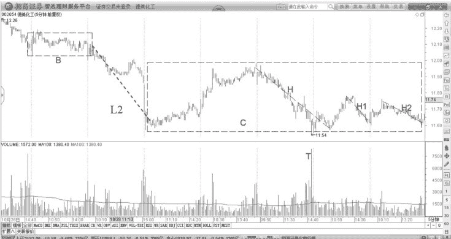

图 2-4 德美化工 5 分钟 K 线

操作要领：

1.从中枢背驰形态出现来看：在股价下跌的过程中，低价区线段比较来看，线段 L2 的规模要小于 B 位置中枢形态前的规模，这提示股价下跌已经到位。

2.从股价天量释放抛压来看：图中 T 位置的成交量达到天量状态，股价在充分放量以后触底，低价区的背驰形态正在持续。

3.从低价区盘整背驰形成来看：H1 位置的缠论回调线段要小于 H，而 H2 位置的线段要小于 H1，这是低价区出现背驰的信号，同时意味着股价已经开始触底。

总结： 低价区盘整背驰阶段，股价每次回调的力度都在收缩，那么，确认这个低价位的买点非常重要，可使投资者有效把握买点机会。

## 2.3 背驰的 K 线异动

在缠论单边运行趋势里，出现中枢背驰以后，K 线形态上表现出来的反转走势很值得投资者关注，因为在中枢背驰阶段，股价反转前的 K 线异动会提示反转的价位。通常，背驰的 K 线异动能提供比较典型的交易价位。如果投资者在 K 线异动期间采取行动，那么对于把握背驰阶段的交易机会有很大帮助。在股价反转前，K 线反转形态提前确认了股价逆转的点位。背驰进一步验证了反转走势，表明行情开始逆转。

### 2.3.1 背驰期间棒槌线

在股价反转的时候，棒槌线的震荡空间很大，直观地体现了多空之间的激烈争夺，并发出了股价反转的信号。在棒槌线出现期间，成交量会明显放大，而多空之间的筹码换手数量大增，这意味着缠论趋势出现了逆转的可能。在缠论单边趋势中，中枢背驰以后，棒槌线可以更好地提示股价反转阶段的形态特征。从棒槌线开始的缠论线段正在持续背驰的形态，而背驰的结果是；缠论单边趋势结束，股价进入新的趋势中。

形态特征：

A.中枢背驰形态出现：中枢背驰形态出现以后，股价在高价区的回升趋缓，中枢背驰提示股价已经出现反转信号，这是行情很快逆转的前兆。

B.出现高价区棒槌线：背驰期间出现了高价区的棒槌线形态，在棒槌线位置结束的缠论线段长度较小，这表明出现了中枢背驰形态。

C.天量提示股价见顶：在高价区的棒槌线期间，量能快速放大到天量状态，天量量能是多空筹码大量换手的信号，而阴线棒槌线表明空方占优势，届时，股价完成天量顶部反转走势。

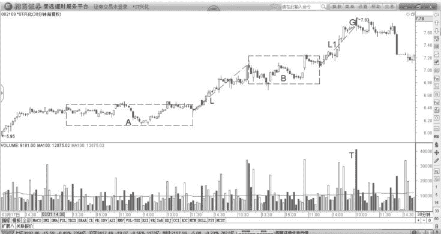

图 2-5 ST 兴业 30 分钟 K 线

操作要领：

1.从中枢背驰形态出现来看：股价进入回升趋势以后，A 和 B 位置的中枢形态表明会出现缠论回升趋势。比较 L1 和 L 这两个缠论线段，L1 相对 L 较短，这提示中枢背驰形态出现。

2.从出现高价区棒槌线来看：股价在 G 位置以阴线棒槌线结束回升趋势。棒槌线期间股价震荡空间会加大，这表明多空分歧严重。不过最终阴线棒槌线确立了顶部特征，缠论反转阶段的中枢背驰也在这个时候出现。

3.从天量提示股价见顶来看：T 位置的量能达天量状态，届时，阴线棒槌线期间筹码会大量换手，这也验证了该股筹码大量换手的顶部特征。

总结： 在短周期的 K 线图中，股价以天量棒槌线形式见顶缠论回升趋势的高价区，这并不奇怪。简单的阴线棒槌线更好地提示了反转走势，股价很快会进入下跌趋势。

### 2.3.2 背驰期间十字星

在股价反转的时候，十字星最直观地体现了股价反转的过程。十字星出现以后，股价在盘口的双向震荡会加剧，但是收盘股价波动空间会缩小，这提示多空争夺出现势均力敌的局面，同时意味着缠论趋势出现了逆转的可能。在缠论单边趋势中，中枢背驰以后，十字星可以更好地提示股价反转阶段的形态特征。从十字星开始的缠论线段正在持续背驰的形态中，可看出背驰的结果是：缠论单边趋势结束，股价进入新的趋势中。

形态特征：

A.中枢背驰形态出现：中枢背驰形态出现以后，股价在低价区的下跌趋缓，中枢背驰则提示股价已经出现反转信号，这是行情很快逆转的前兆。

B.背驰期间出现低价区十字星：背驰期间出现了低价区的十字星形态，在十字星位置结束的缠论线段长度较小，证明会出现中枢背驰形态。

C.放量提示股价反转：在低价区的十字星出现以后，量能开始逐步放大，而在量能放大的过程中，低价区的中枢背驰会转变为股价反转的走势。量能连续多个交易日放大，就是股价反转的信号。

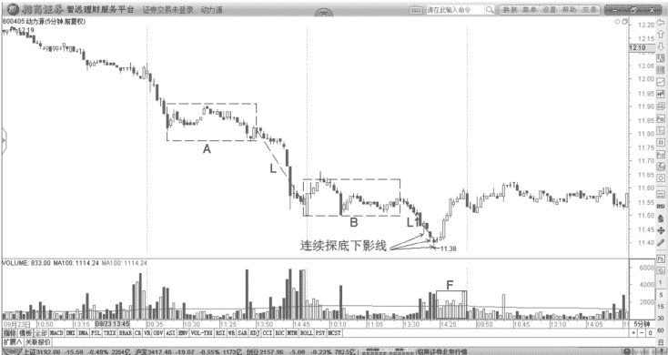

图 2-6 动力源 5 分钟 K 线

操作要领：

1.从低价区盘整背驰形成来看：在缠论线段趋势中，中枢形态 A 和 B 之后的线段分别为 L 和 L1。比较 L 和 L1 的长度，经过比较 L1 的长度要小于 L，这是低价区中枢背驰的信号，并意味着缠论下跌趋势已经开始逆转。

2.从背驰期间出现低价区十字星来看：可以看到缠论线段 L1 的长度要小于 L，这是低价区的背驰形态。当连续出现了下影线十字星的时候，低价区的反转得到确认，同时，背驰期间也出现了 L1 线段的长度。

3.从放量提示股价反转来看：低价区的十字星触底形态以后，F 位置的量能连续 9 个交易日放大，这是明确的触底回升信号。F 位置的量能放大出现在股价反弹期间，是比较典型的放量反转信号。

总结： 若从 K 线形态来确认股价低价区的反转，那么，十字星就是低价区反转的起始形态。结合成交量放大的反弹指数来看，股价在低价区的反转更值得投资者关注。

### 2.3.3 背驰期间反转阴线

反转阴线形态更好地体现了股价反转的过程，尤其是在缠论回升趋势中，当出现中枢背驰形态以后，高价区的阴线形态就是在提示股价反转。从反转的大阴线形态开始，股价的中枢背驰反转走势就得到了验证。

阴线实体成为检验缠论反转的有效形态，相比前期的股价回调力度，大阴线的调整力度更大。阴线实体具有很强的破坏性，尤其是能够快速逆转稳步回升的股价趋势。如果投资者在大阴线期间快速出逃，有望在股价反转的过程中减少亏损。

随着大阴线形态的出现，接下来 K 线实体长度会减小，股价反弹的高度也有限，同时股价在单边调整的时间会增加，从而使得股价单边回落的趋势延续下来。

形态特征：

A.RSI 指标背离提示背驰：在缠论回升趋势中，股价在高价区脱离了中枢形态，出现了新的回升期间的缠论线段。这个时候，比较相似阶段的 RSI 指标，该指标高位背离回落提示了缠论线段的背驰形态出现。

B.中枢背驰形态出现：中枢背驰形态出现以后，股价在高价区的上涨中枢趋缓，中枢背驰提示股价已经出现反转信号，这是行情很快逆转的前兆。

C.大阴线回落验证反转：在 RSI 指标已经高位背离的情况下，出现股价缠论中枢背驰形态，大阴线进一步验证了背驰的回调效果。在大阴线期间，若股价跌破更多的 K 线实体，股价就会进入调整阶段。

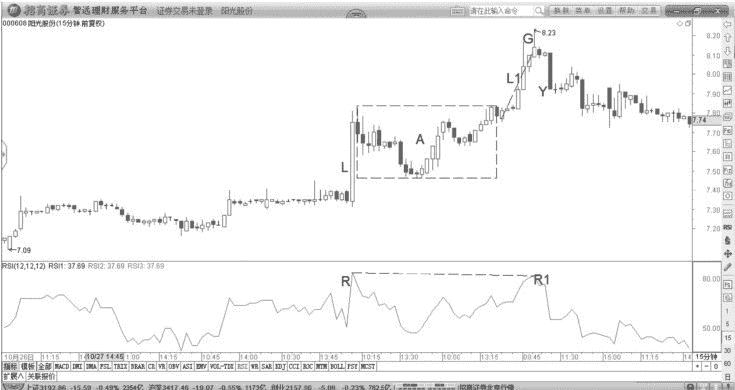

图 2-7 阳光股份 15 分钟 K 线

操作要领：

1.从 RSI 指标背离提示背驰来看：在比较缠论线段 L1 和 L 的大小前，可以看到 RSI 指标在 R1 位置的数值低于 R，这是在提示股价已经在高价区背离。而背离的结果是股价无法在高价区运行，恰好在这个时候出现了缠论线段 L1，则提示缠论中枢背驰形态出现。

2.从中枢背驰形态出现来看：在 RSI 指标高位背驰的时候，股价已经在 G 位置见顶。对比缠论中枢 A 前后的线段来看，线段 L1 相比 L 更短，缠论中枢背驰形态得到确认。

3.从大阴线回落验证反转来看：股价在 Y 位置出现了大阴线形态，大阴线一次跌破了 5 根 K 线，股价开始快速反转。股价以大幅度下跌的阴线逆转了缠论回升趋势，这意味股价回升趋势转变为回落走势。

总结： 在 RSI 指标的背离期间，股价高价区的反转很快得到确认。在股价以阴线下跌以后，缠论中枢背驰形态也被进一步验证。而在股价反转期间，阴线下跌只是股价下跌过程的起始形态，其实更大规模的跌幅还在酝酿当中。

## 2.4 MACD 确认盘整背驰

MACD 指标是用来描述均线的交叉形态以及均线的运行趋势，该指标可以更好地衡量股价的变化，其直观地体现了股价反转期间的信号特征。MACD 指标可以用来确认指数平滑移动平均线的变化特征，同时反映了两条不同周期的均线运行状态。

在确认缠论盘整背驰期间，MACD 指标的背离就很好地反映了股价异动。如果投资者还没有观察到背驰的出现，可以首先确认 MACD 指标的背离形态，接着在背离以后确认缠论中枢背驰，发现行情反转的交易机会。

### 2.4.1 MACD 确认低价盘整背驰

在 MACD 指标确认低价盘整背驰期间，该指标可以在股价反转前就出现背离形态。例如指标里的 DIF 线先于股价出现回升迹象，就是指标与股价低位背离的信号。MACD 指标率先企稳以后，股价在低价区的反弹也开始出现。这个时候，再比较低价区缠论中枢形态前后的线段长度，投资者就能够发现典型的交易机会了。

形态特征：

A.MACD 指标背离提示背驰：在缠论回落趋势中，股价在低价区继续回落期间，出现了 MACD 指标的背离形态。比较相似阶段的 MACD 指标，若该指标在低价区的背离，则提示股价跌幅已到位，其距离缠论回落趋势逆转更进了一步。

B.中枢背驰形态出现：中枢背驰形态出现以后，股价在低价区的回落趋缓，中枢背驰提示股价已经出现反转信号，这是行情很快逆转的信号。

C.回升的缠论线段达中枢内部：低价区的缠论中枢背驰形态出现以后，股价会反弹回升，若缠论线段的长度达到最后一个中枢震荡的内部区域，就是股价快速反转的重要信号。

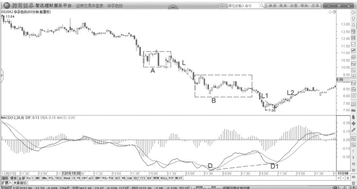

图 2-8 华孚色纺 60 分钟 K 线

操作要领：

1.从 MACD 指标背离提示背驰来看：当 MACD 指标在 0 轴线下方震荡的时候，股价跌破 B 位置的中枢形态，指标在 D1 位置的数值高于 D 位置，背离买点得到确认。

2.从中枢背驰形态出现来看：MACD 指标首先背离回升，这提示股价在 L1 位置的线段与 L 位置线段背驰，并出现了低价区的反转信号。显然，L1 位置的线段长度要小于 L 位置，这是缠论背驰的典型买点信号。

3.从回升的缠论线段达中枢内部来看：从缠论线段 L1 与 L 背驰来看，股价在低价区开始出现 L2 线段的反弹走势。L2 的线段长度较大，已经达到了 B 位置中枢形态的内部，这是值得投资者注意的地方。中枢背驰以后，反弹期间的缠论线段在增加，这表明股价缠论回落趋势已经出现逆转。

总结： MACD 指标的 DIF 线出现背离，该指标线的背离更容易被投资者确认。一旦出现背离，并且缠论中枢背驰也得到了验证，那么股价将很快进入反转阶段，届时，股价将不可避免地出现反弹回升。

### 2.4.2 MACD 确认高价盘整背驰

在 MACD 指标确认高价盘整背驰期间，该指标可以在股价反转前就出现背离形态。若指标里的 DIF 线先于股价出现回落迹象，那就是指标与股价高位背离的信号。MACD 指标率先回落以后，股价在高价区的反转也开始出现。这个时候，再比较高价区缠论中枢形态前后的线段长度，投资者就能够发现典型的交易机会了。

形态特征：

A.MACD 指标背离提示背驰：在缠论回升趋势中，若股价在高价区继续回升期间，出现了 MACD 指标的背离形态，可以比较相似阶段的 MACD 指标，如果该指标在高价区的背离提示股价回升到位，则表明距离缠论回升趋势见顶更进了一步。

B.中枢背驰形态出现：中枢背驰形态出现以后，若股价在高价区的回升趋缓，那么中枢背驰则提示股价已经出现反转信号，这是股价回落趋势将要出现的信号。

C.盘整背驰形态延续：高价区的缠论中枢背驰形态出现以后，若股价虽然出现反弹中枢，但缠论线段的长度明显收缩，这便是盘整背驰形态，提示股价依然会出现下跌走势。

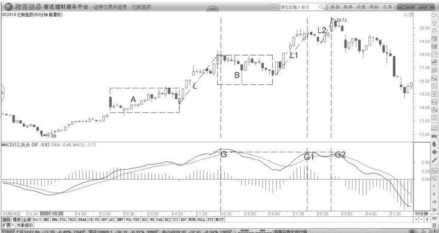

图 2-9 亿帆医药 60 分钟 K 线

操作要领：

1.从 MACD 指标背离提示背驰来看：当 MACD 指标在 0 轴线上方震荡的时候，股价在 L1 位置的线段长度较小，股价更早的出现高位回调指数。由于 MACD 指标在 G1 位置数值低于 G，并且 G2 位置数值要低于 G1，可见这是典型的高位背离提示卖出股票的信号。

2.从中枢背驰形态出现来看：MACD 指标首先背离回落，提示股价在 L1 位置的线段与 L 位置线段背驰，高价区出现反转信号。L1 位置的线段长度要小于 L 位置，这是缠论背驰的典型卖点信号。

3.从盘整背驰形态延续来看：从缠论线段 L1 与 L 背驰以后，L2 位置的缠论线段要小于 L1 位置，两次典型的背驰形态出现以后，股价在高价区的反转不可避免。

总结： MACD 指标的 DIF 线出现背离，该指标线的数值大小更容易被投资者确认。一旦出现背离，股价在高价区的盘整背驰就得到了验证，反弹无果时，股价在高价区的反转形态也得到了验证。这个时候，考虑卖掉股票应对下跌趋势，投资者才能够有效规避风险。

## 2.5 RSI 确认盘整背驰

RSI 指标是用来描述股价的超买和超卖状态，它是股价单边运行期间比较典型的确认股价反转的指标。特别是在股价长时间处于单边运行的过程中，股价运行趋势还未出现改变的情况下，该指标的背离可提示股价已经出现超买或者超卖信号，股价将很快出现反转走势。反转期间，盘整背驰形态可以由 RSI 指标来检验。

### 2.5.1 RSI 确认低价盘整背驰

RSI 指标在股价低价运行期间走势较弱，一旦股价单边跌幅扩大，并且持续时间较长，那么 RSI 指标就会出现背离形态。该背离通常提示股价已经下跌到位，进一步的下跌走势可能很快结束，这个时候，便是验证背离买点的时刻了。

而 RSI 指标背离以后，股价在跌幅还不大的情况下持续反弹走势，且缠论线段表现为中枢背驰状态，那么在低价区的股价反弹的过程中，盘整背驰就能得到验证。盘整背驰是股价刚刚摆脱跌幅的前兆，意味着低价区经过震荡反弹以后，线段趋势将会向回升趋势转变。

形态特征：

A.RSI 指标首次背离：在股价单边下跌期间，股价虽然在下跌趋势中跌破中枢形态，但是 RSI 指标的低价区会出现背离。首次出现 RSI 指标背离形态以后，距离确认缠论反转走势能更进一步。

B.RSI 指标二次背离提示背驰：在缠论回落趋势中，股价在低价区继续回落期间，可能会出现 RSI 指标的二次背离形态。RSI 指标在低价区的背离是在提示股价跌幅到位，缠论中枢背驰也将在这个时候出现。

C.中枢背驰形态出现：中枢背驰形态出现以后，股价在低价区的回落趋缓，中枢背驰是在提示股价已经出现反转信号。在低价区，若中枢背驰后股价在局部出现盘整背驰，那么股价趋势反转前的买点就能得到验证。

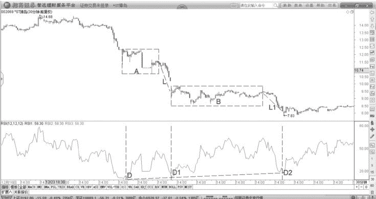

图 2-10 ST 獐岛 30 分钟 K 线

操作要领：

1.从 RSI 指标首次背离来看：当 RSI 指标在 50 线下方震荡的时候，股价跌破 A 位置的中枢形态，RSI 指标在 D1 位置的数值高于 D 位置，首次出现背离买点。

2.从 RSI 指标二次背离提示背驰来看：当股价跌破 B 位置的中枢形态以后，看 RSI 指标已经在 D2 位置，而 D2 位置数值要高于 D 同时也高于 D1，这表明会出现第二次背离形态。

3.从中枢背驰形态出现来看：在低价区，缠论线段 L1 的数值要小于 L，这表明低价位背驰提示的买点已经出现。投资者可以在 L1 位置以后考虑买入该股。RSI 指标在两次背离以后，该股将进入盘整背驰阶段，这进一步验证了该股的底部反转形态。

总结： 在低价区，RSI 指标的背离加剧了股价的底部出现。在中枢背驰还没有确认的时候，RSI 指标出现第二次背离，这是股价中枢背驰的机会。而盘整背驰也在中枢背驰以后出现，这预示股价出现了缠论反转走势。

### 2.5.2 RSI 确认高价盘整背驰

RSI 指标在股价高位运行期间走势较弱，一旦股价单边上涨扩大，并且持续时间较长，那么 RSI 指标会出现背离形态。该背离提示股价已经回升到位，进一步的回升走势可能很快结束，这个时候，便是验证背离卖点的时刻了。而 RSI 指标背离以后，股价在涨幅还不大的情况下持续回调走势，且缠论线段表现为中枢背驰状态，那么，在高价区的股价回调的走势中，盘整背驰就得到了验证。盘整背驰是股价刚刚摆脱回升趋势的信号，它意味着高价区经过震荡回调以后，回升趋势将会向回落趋势转变。

形态特征：

A.RSI 指标背离提示背驰：在缠论回升趋势中，股价在高价区继续回升期间，出现了 RSI 指标的背离形态。比较相似阶段的 RSI 指标该指标在高价区的背离提示股价回升到位，距离缠论回升趋势见顶更进一步。

B.中枢背驰形态出现：中枢背驰形态出现以后，股价在高价区的回升趋缓，中枢背驰提示股价已经出现反转信号，股价已经进入筑顶阶段。

C.盘整背驰形态延续：高价区的缠论中枢背驰形态出现以后，股价虽然出现反弹走势，但是缠论线段的长度明显收缩，这是盘整背驰形态，并提示股价依然会出现下跌走势。盘整背驰的时间不会很长，股价下跌的节奏将会加快。

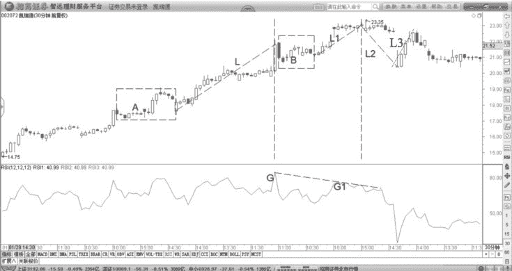

图 2-11 凯瑞德 30 分钟 K 线

操作要领：

1.从 MACD 指标背离提示背驰来看：当 RSI 指标在高位震荡期间，股价在 L1 位置的线段长度较小，股价更早的出现高位回调走势。由于 RSI 指标在 G1 位置数值低于 G，可以确认股价弱势下跌的顶部形态。

2.从中枢背驰形态出现来看：RSI 指标首次出现背离回落，是在提示股价在 L1 位置的线段与 L 位置线段背驰，高价区的反转信号出现。L1 位置的线段长度要小于 L 位置，这是缠论背驰的典型卖点信号。

3.从盘整背驰形态延续来看：从缠论线段 L1 与 L 背驰以后，L2 位置的缠论线段明显回调，股价在反弹期间的线段 L3 要小于 L1，这表明高价区盘整背驰形态已经出现。确认盘整背驰以后，投资者可以在高价区卖掉股票，应对调整行情。

总结： RSI 指标出现背离，该指标首次回调表明股价涨幅已经较大，而缠论中枢背驰形态是提示股价开始反转。高价区的盘整背驰则是股价完成反转形态期间出现，这预示着股价进一步下跌的走势将会出现。

## 2.6 趋势反转期间 3 类交易信号

在缠论单边趋势出现以后，股价在中枢期间不断沿着单边趋势运行。这个时候，股价单边趋势短时间都不会出现结束的迹象，只有中枢背驰以后，反转形态才会出现，缠论单边运行趋势会在中枢背驰以后结束。

从交易机会来看，在缠论单边趋势结束期间，有 3 类不同类型的交易机会形成。这 3 类交易机会分别是股价反转期间、股价涨幅后的回调期间以及股价突破后的回调期间。3 类交易机会的交易价位较好，多数投资者都不应该错过这样的买卖点位。

### 2.6.1 下跌趋势 3 类买点

在缠论下跌趋势中，当股价跌幅加大时，若股价继续跌破中枢形态，但下跌期间股价跌幅不大，且低价区的缠论线段与中枢形态前的线段相比小了一些，这便是中枢背驰形态，同时也是股价触底的信号。在下跌趋势中，中枢背驰是股价开始回升的信号。这个时候，股价在低价区开始反弹，股价反弹的过程中， 3 类缠论买点机会是不错的建仓时机。确认 3 类买点非常重要，可使投资者能够有效降低持股成本，在今后股价回升期间占据成本优势。

形态特征：

A.低价区中枢背驰形态出现：在缠论下跌趋势出现以后，投资者可以看到低价区中枢背驰形态出现，这是股价下跌到位的信号。中枢背驰意味着股价缠论下跌趋势结束，取而代之的是股价开始筑底回升。

B.股价放量触底：到了低价区，股价下跌放大较大，股价从缩量下跌到低价区的放量触底，股价低位的抛售压力充分释放，股价已经接近底部。

C.低价区 3 类买点形成：在放量回升期间，缠论 3 类不同买点出现。触底期间是 1 类买点，随着股价反弹到中枢形态后方，2 类买点出现。突破中枢形态以后，低价区的 3 类买点出现。

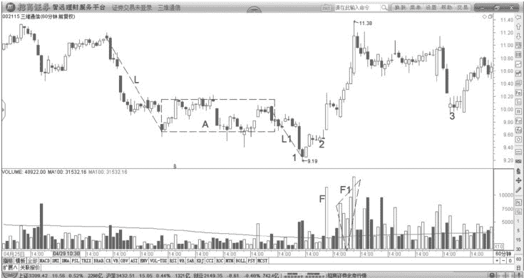

图 2-12 三维通信 60 分钟 K 线

操作要领：

1.从低价区中枢背驰形态出现来看：在股价按照缠论回落趋势运行期间，股价在跌破 A 位置的中枢形态以后，股价在 1 位置的股价低点触底。很明显，中枢形态 A 前期的线段 L 长度要比 L1 长，可见低价区的背驰形态已出现，股价缠论回落趋势出现反转信号。

2.从股价放量触底来看：低价区股价在 1 位置放量触底后，F 位置的脉冲量能达到天量状态。而 F1 位置的量能连续放大，能推动股价快速摆脱颓势。

3.从低价区 3 类买点形成来看：从低价区缠论背驰形态开始，低价区的 1 类买点出现在图中 1 位置。当股价反弹到 A 位置的中枢形态内部时，股价短线回调期间出现了 2 位置的 2 类买点。当股价突破了 A 位置的中枢形态上限以后，股价震荡回升，在回调期间，3 位置的股价低点在 A 位置中枢形态上方获得支撑，这便是 3 类买点。

总结： 缠论下跌趋势结束期间，3 类买点出现在最低价位，其中 1 类买点的股价最低，也最难被投资者掌握。2 类和 3 类买点也是在低价区股价筑底期间出现的建仓机会，投资者可以把握好买点盈利。

### 2.6.2 回升趋势 3 类卖点

缠论回升趋势中，股价涨幅加大的时候，股价继续向上突破中枢形态，但是回升期间股价涨幅不大。这个时候，高价区的缠论线段与中枢形态前的线段相比小了一些，这是中枢背驰形态，同时也是股价见顶的信号。在回升趋势中，中枢背驰是股价开始回落的信号。股价在高价区开始回调，在股价回调的过程中，3 类缠论卖点机会是不错的逃顶时机。确认 3 类卖点非常重要，它能使投资者有效减少持股数量，降低下跌趋势中的亏损。

形态特征：

A.MACD 背离提示卖点：在高价区，股价在缠论回升趋势中涨幅加大同期 MACD 指标出现背离信号，进而提示股价上涨乏力。指标背离以后，股价开始出现调整走势。

B.高价区中枢背驰形态出现：在缠论回升趋势出现以后，投资者可以看到高价区中枢背驰形态出现，这是股价回升到位的信号。中枢背驰意味着股价缠论回升趋势结束，取而代之的，是股价开始见顶回落。

C.高价区 3 类卖点形成：在放量回升期间，缠论 3 类不同卖点出现。触底期间是 1 类卖点；随着股价从中枢形态反弹见底，2 类卖点出现；跌破中枢形态以后，低价区的 3 类卖点出现。

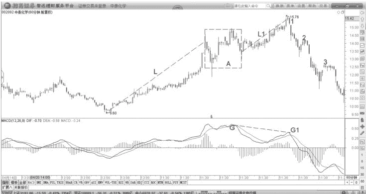

图 2-13 中泰化学 60 分钟 K 线

操作要领：

1.从 MACD 背离提示卖点来看：当股价回升到股价高位以后，MACD 指标首先出现了背离形态。图中 DIF 线从 G 回调到 G1 位置，与股价收盘价达到新高形成背离，这是在提示股价已经上升乏力。

2.从高价区中枢背驰形态出现来看：在 MACD 指标的高位背离形态出现期间，比较缠论 A 位置的缠论中枢形态前期线段 L 和后期线段 L1，可以看到 L1 相比 L 短，这表明中枢背驰形态出现。同时，缠论回升趋势已经在这个时候结束。

3.从高价区 3 类卖点形成来看：背离提示的中枢背驰出现以后，1 类卖点在线段 L1 结束期间出现；在股价回调的过程中，股价下跌至 A 位置中枢形态的内部，2 位置的高抛卖点出现；随着跌幅扩大，股价跌破 A 位置中枢形态以后，技术性反弹到 3 位置，3 位置接近 A 位置中枢形态下限，这是缠论 3 类卖点。

总结：通常，在股价中枢背驰形态出现以后，3 类缠论抛售机会会连续出现。只需要把握好缠论中枢背驰后的股价回调节奏，3 类卖点就容易掌握了。

## 2.7 量能突变与缠论反转

通常，在缠论单边运行趋势期间，股价的反转走势会伴随着量能突变开始。在高价区，成交量达到天量状态以后，缩量顶部形态可以成为股价下跌的起始形态。而下跌趋势中，投资者可以看到股价在低价区的下跌期间，反转走势通常伴随着量能放大。成交量在低价区的有效放量，是促使股价触底回升的推动因素。量能在缠论单边趋势运行期间突变，可成为与缠论反转同步出现的因素。可以说，投资者关注量能突变，就是在缠论反转形态出现前把握了好的交易机会。

### 2.7.1 高价区反转缩量信号

在股价回升到高价区以后，缠论回升趋势中股价涨幅加大，多方拉升股价的力度减弱，并形成缩量回升的情况。如果投资者在股价缩量期间依然持股，可以看到股价涨幅减小，盈利越来越困难。当成交量萎缩到一定阶段时，突破缠论中枢的线段虽然能够突破中枢形态，但是股价涨幅却明显收窄，使得缠论中枢背驰形态出现。这样一来，投资者的高抛交易机会也就出现了。量能萎缩和缠论背驰同步出现，且量能的萎缩趋势在中枢背驰前就已经开始，这是值得投资者关注的地方。

形态特征：

A.量能从天量开始萎缩：成交量达到天量以后，接下来成交量相比天量量能会明显萎缩。在缩量过程中，股价上涨节奏会逐渐趋缓。

B.缠论中枢背驰出现：缠论中枢背驰形态出现以后，会出现股价在高价区的反转信号。中枢背驰是股价缩量上涨乏力的结果，其预示着股价将进一步下跌。

C.高价区股价跌破缠论中枢：在高价区，股价跌破了缠论中枢形态以后，股价在下跌趋势中的跌幅会扩大。当股价跌破缠论中枢以后，股价的下跌幅度会更大。

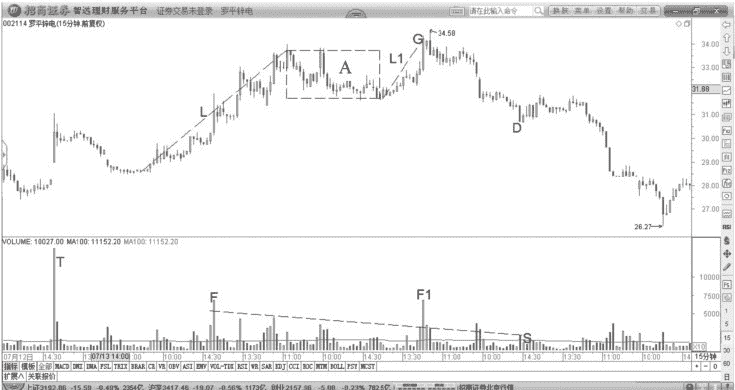

图 2-14 罗平锌电 15 分钟 K 线

操作要领：

1.从量能从天量开始萎缩来看：在缠论回升阶段，图中 T 位置的量能达到天量以后，接下来量能在 F 和 F1 的放量虽然较大，却并未超过天量量能。当成交量持续萎缩到 S 位置的时候，量能萎缩期间的缠论回升空间正在收窄。

2.从缠论中枢背驰出现来看：在缩量回升期间，股价突破了 A 位置的缠论中枢形态。中枢形态上方，缠论线段 L1 的长度明显要小于 L，这是中枢背驰形态出现了。F1 位置的脉冲量能结束以后，缠论线段 L1 就已经出现，而中枢背驰形态出现在该股最后一次脉冲放量拉升以后。

3.从高价区股价跌破缠论中枢来看：缠论线段 L1 长度明显要相比 L 小，而股价在线段 L1 完成以后到了 G 位置，这是股价将进入下跌趋势的信号。量能萎缩到 S 位置以后，股价下跌到 D 位置。D 位置明显低于 A 位置的中枢形态的下限，可见该股的缠论回升趋势已经结束。

总结： 通常，在成交量持续萎缩阶段，只要成交量还未明显低于 100 日等量线，股价就可能在短线放量期间出现技术性反弹。而高价区短线放量反弹，往往是主力出货的诱多行为。并且高价区放量反弹空间较小，而缩量下跌会成为改变缠论回升趋势的信号。

### 2.7.2 低价区反转放量信号

在股价回落到低价区以后，缠论回落趋势中股价跌幅会加大，空方抛售股票的力度也会减弱，从而形成放量反弹的情况。如果投资者在股价放量下跌期间依然观望，可以看到股价跌幅减弱，股价下跌越来越困难。当成交量放大到一定阶段时，跌破缠论中枢的线段跌幅加大，但是股价跌幅却明显收窄，从而使得缠论中枢背驰形态出现。这样一来，投资者的低吸机会就出现了。量能放大和缠论背驰同步出现，且量能放大的趋势在中枢背驰前就已经开始，表明场外投资者正在加速买入股票，这是值得持币投资者关注的地方。

形态特征：

A.量能逐步放大：在缠论下跌趋势中，股价跌幅加大，成交量出现逐步放大的情况以后，低价区的反弹走势出现。随着量能继续放大，低价区的股价反转走势有望形成。

B.缠论中枢背驰出现：在股价逐步放量的过程中，若低价区出现缠论中枢背驰形态，表明股价在低价区的反转信号已出现。中枢背驰是股价放量下跌期间触底反弹的信号，这预示着股价将持续企稳。

C.低价区股价突破缠论中枢：在低价区，股价反弹突破了缠论中枢形态以后，股价在反弹期间的涨幅会扩大。当成交量继续放大，量能达到天量状态，而股价涨幅达中枢形态上方，便是缠论回落趋势结束的信号。

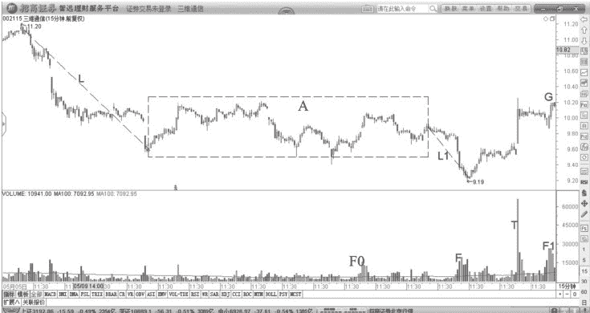

图 2-15 三维通信 15 分钟 K 线

操作要领：

1.从量能逐步放大来看：股价在 A 位置缠论中枢运行期间，成交量就已经出现放大的迹象。F0 位置的成交量明显放大到了 100 日等量线以上，股价出现明显的反弹走势。接下来，F 位置的量能依然放大，股价以放量下跌的形式完成了缠论线段 L1。

2.从缠论中枢背驰出现来看：缠论线段 L1 长度相比缠论线段 L 短，股价在下跌趋势中出现了中枢背驰，下跌趋势中 F 位置是最后一次放量。

3.从低价区股价突破缠论中枢来看：随着量能在 T 位置达天量，股价大幅反弹到缠论中枢 A 上方。F1 位置的集中放量相比 F 位置更大，股价反弹到 G 位置，该股正在低价区完成筑底动作。

总结： 在量能放大期间，缠论回落趋势的下跌节奏趋缓。成交量继续放大，并且达到 100 日等量线以后，股价下跌趋势明显减弱。这个时候，股价反弹到中枢形态上方，表明缠论回落趋势结束。

# 第三章 缠论中枢形态

缠论中枢形态的定义提示：在某级别走势类型中，被至少 3 个连续次级别走势类型所重叠的部分，称为缠中说禅走势中枢。这里，3 个连续次级别中枢是必须要有的，至于更多的次级别走势存在，则不影响中枢形态，只是在规模上扩大了中枢形态。虽然中枢形态的规模可大可小，但对于缠论趋势的意义，却没有大小的区别。中枢形态是缠论趋势的主要构成部分之一，关于中枢震荡的交易机会以及中枢对缠论趋势的意义，将在本章节里介绍。

## 3.1 缠论盘整形态

从缠论盘整形态的定义，可以知道盘整形态至少需要 3 个次级别走势，才会形成盘整形态。在趋势交易中，回升趋势的 3 个次级别中枢中，有 2 个次级别走势是回调阶段出现的；回落趋势中，2 个次级别走势是在反弹阶段出现的。缠论盘整结构的规模取决于趋势的规模，大趋势中盘整规模往往比较大。而在小趋势中，由于盘整持续时间短，所以波动空间也相对较小。

### 3.1.1 大趋势大级别盘整

大趋势里会出现大级别的盘整，对于缠论单边趋势而言，盘整的规模通常取决于缠论单边趋势的大小。在较大的单边趋势中，缠论盘整形态的规模会很大。即便单边趋势出现以后，盘整的时间也相对较长。长时间的盘整完成以后，股价获得的支撑更强，而股价突破盘整区域以后，涨幅也更大。在大趋势中关注股价大级别的盘整走势时，在股价脱离盘整前，往往需要有足够的耐心。

形态特征：

A.股价摆脱长期底部：在低价区，股价经历长时间调整以后进入缠论回升趋势。在股价进入回升趋势以后，缠论中枢形态出现。这个时候看前期股价表现，可知股价已经摆脱了长期股价底部。

B.高价盘整区换手率翻倍：在高价区盘整阶段，换手率指标已经相比低价区翻倍，这是股价活跃度大幅度提升的信号。即便在盘整阶段，换手率高位运行，也足以表明股价强势将能够延续下来。

C.股价出现长期盘整：股价出现长期盘整以后，在股价双向震荡的格局中，缠论趋势并未因此结束。只是股价盘整的时间很长，能够耐心持股等待股价突破的投资者数量减少，股价调整结束依然会脱离盘整形态。

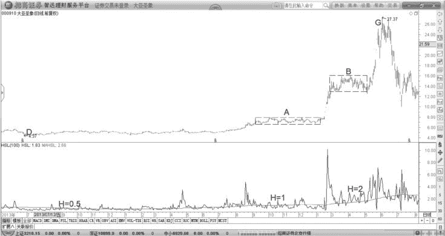

图 3-1 大亚圣象日 K 线

操作要领：

1.从股价摆脱长期底部来看：长期股价底部的最低价在 D 位置的 4.37 元，这个阶段 H 位置显示的换手率为 0.5%，这期间该股活跃度很低，股价还没有显著回升。从交易机会来看，在活跃度低的情况下，短线的盈利机会较少。

2.从高价盘整区换手率翻倍来看：经过 1 年多时间，股价飙升到 A 位置的盘整区间。股价在 A 位置出现盘整形态以后，股价双向震荡，短线的交易机会正在增加。在盘整阶段，H 位置的换手率为 1%，相比低价区的活跃度明显提升。

3.从股价出现长期盘整来看：在图中 A 位置的缠论盘整形态中，股价双向震荡的时间长达 4 个月，可以说是比较充分的调整。缠论中枢调整并不需要长达 4 个月的调整，但是缠论回升趋势是大级别跨年行情，因此股价调整时间较长。高价区 B 位置的调整阶段，换手率继续回升到 2%以上，股价盘整时间长达 2 个月。

总结： 在缠论大级别回升趋势中，缠论中枢震荡时间很长，是跨越多个月份的调整，而股价脱离调整中枢后涨幅巨大，单边行情中投资者的盈利空间很高。对于投资者而言，以大级别的缠论结构形态应对股价涨跌，是必不可少的做法。

### 3.1.2 小趋势小级别盘整

小趋势里会出现小级别的盘整，对于缠论单边趋势而言，盘整的规模通常取决于缠论单边趋势的大小。在较小的单边趋势中，缠论盘整形态的规模会很小。即便单边趋势出现以后，盘整的时间也相对较短。短时间的盘整完成以后，股价能很快获得支撑，而股价突破盘整区域以后，飙升走势会在较短的时间里完成。在小趋势中关注股价小级别的盘整走势时，在股价脱离盘整前，投资者需要警惕突如其来的股价变化，这样短线交易的成功率才会更高。

形态特征：

A.股价从短线低位反弹：在低价区，股价经历短期调整以后进入缠论回升趋势。在股价进入回升趋势以后，缠论中枢形态出现。这个时候看前期股价表现，可知股价活跃度较高，且股价向上突破的效率也很高。

B.高价盘整区换手率回升：在高价区盘整阶段，换手率指标已经相比低价区明显回升，这是股价活跃度提升的信号。在盘整阶段，小趋势的股价波动空间小，但是调整节奏较快。

C.盘整与突破快速转换：股价出现短线盘整结束以后，虽然调整阶段 K 线数量较多，但是股价调整的时间却很短。在盘整与突破中枢快速转换期间，缠论回升趋势可以延续下来。

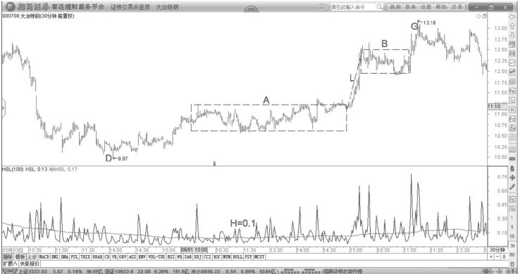

图 3-2 大冶特钢 30 分钟 K 线

操作要领：

1.从股价从短线低位反弹来看：低价区股价从 D 位置企稳回升以来，股价进入缠论回升阶段。在回升阶段，股价波动强度增加，交易机会也逐步增多。

2.从高价盘整区换手率回升来看：当股价回升到 A 位置的中枢调整阶段以后，股价在 A 位置的波动强度提升。图中 H 标注的换手率为 0.1%，换手率指标相对大级别趋势要小很多。但是，这并不影响该股小级别的缠论回升趋势的延续。

3.从盘整与突破快速转换来看：A 位置股价盘整时间不过 1 个月，股价就很顺利地突破盘整形态，进入了 B 位置的盘整阶段。突破期间，线段 L 涨幅为 15%，股价涨幅相比大级别趋势中的涨幅明显要小。接下来 B 位置的盘整时间更短，股价涨幅 10%就已达到高位 G。

总结： 在小级别的缠论回升趋势中，股价波动空间较小，盘整的时间也相对较短，这是由缠论回升趋势的规模决定的。不过，不管规模大小，缠论结构的完整性是不会变的。按照缠论趋势中盘整与缠论线段突破的节奏交易，同样可以盈利。

## 3.2 缠论盘整规模

缠论盘整的规模可以在不同时间周期里有不同表现，在大周期的 K 线图中，例如日 K 线图中，盘整规模往往相对较大。而 60 分钟 K 线图中由于盘整时间减少，以致盘整的规模也小了很多。到了 5 分钟 K 线，股价波动的空间就更小了，投资者如果想要获取高收益，困难明显加大。而对于股价运行趋势的影响， 5 分钟 K 线的盘整对股价走势影响较小，交易机会在 5 分钟 K 线中的表现稍纵即逝。

### 3.2.1 日 K 线级别盘整

缠论盘整形态在不同时段会有不同的表现，日 K 线图中盘整规模较长，可以持续几个月，但其对缠论运行趋势的影响却是短线的。调整结束后，股价会延续缠论单边趋势。在日 K 线级别的盘整走势中，股价波动强度会提升，此时，超短线的买卖股票可以有机会盈利。盘整期间，股价震荡的低价区也提供了抄底建仓的机会，这是投资者获取廉价筹码的机会。

形态特征：

A.中枢震荡持续 3 个月：日 K 线图中，很容易出现持续震荡 3 个月的盘整走势。由于缠论回升趋势股价涨幅加大，抛售压力增加，所以高价区的双向震荡在所难免。在几个月双向震荡期间，高抛和低吸的交易机会都已经形成。

B.成交量由放量到缩量：在股价加速回升期间，成交量会明显放大，缠论线段位置上的股价涨幅也会加大。而进入高价区盘整区间以后，成交量会开始萎缩。缩量期间股价涨幅受到抑制，直到量能稳定下来，日 K 线级别盘整才会结束。

C.MACD 指标单边回升：在缠论回升趋势中，股价达到新高度后便会出现缠论盘整形态，这个时候，MACD 指标的数值依然是回升的。而指标达到更高数值，则体现了股价飙升的节奏延续。

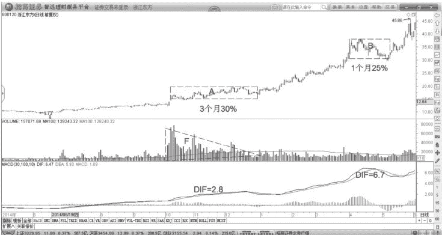

图 3-3 浙江东方日 K 线

操作要领：

1.从中枢震荡持续 3 个月来看：图中 A 位置盘整形态持续了 3 个月。股价区间震荡幅度为 30%，股价并未出现明显的涨幅。作为日 K 线图中盘整形态，该股调整已经足够充分。

2.从成交量由放量到缩量来看：盘整期间，图中 F 位置明显出现缩量。进入盘整期间，量能相当于 100 日等量线的 6 倍，而缩量以后，量能萎缩到 100 日等量线下方。量能缩量到位，显示股价回调也已经结束。

3.从 MACD 指标单边回升来看：缠论盘整形态从 A 到 B，B 位置的调整时间为 1 个月，股价波动强度也比较大，高达 25%。A 位置盘整期间，MACD 指标的 DIF 数值为 2.8，到了 B 位置的盘整期间，DIF 数值为 6.7。MACD 指标数值强劲回升，体现了股价强势格局的延续。

总结： 日 K 线图中盘整时间以月来计算，而股价波动强度很高，超过了 20%。指标在股价盘整期间的运行趋势持续性较强，不会因为短期调整而出现显著回落。在缠论单边趋势交易期间，盘整阶段股价波动对投资者的影响有限。

### 3.2.2 60 分钟 K 线级别盘整

缠论盘整形态在 60 分钟 K 线时段表现要短一些，特别是相比日 K 线图中盘整规模较短，持续时间不超过 1 个月，并且对缠论运行趋势的影响是短线的。调整结束后，股价会延续缠论单边趋势。而在 60 分钟 K 线级别的盘整走势中，股价波动强度相对较小，投资者盈利也相对困难，但调整时间短却能成为投资者调整仓位的机会。盘整期间，投资者可以利用股价双向震荡的机会加紧调仓。60 分钟 K 线的盘整期间，有更加难以出现的微小股价波动，这是日 K 线图中难得出现的交易机会。

形态特征：

A.中枢震荡小于 1 个月：60 分钟 K 线图中，震荡持续时间少于 1 个月，股价就完成了调整动作。调整时间有限，股价波动强度不会超过 20%，投资者调整仓位需要在短时间内完成。

B.成交量显著缩量：在股价加速回升期间，成交量明显放大，缠论线段的位置股价涨幅快速扩大。而进入高价区盘整区间以后，成交量开始明显萎缩。缩量期间股价调整力度加大，直到量能稳定下来，这时，60 分钟 K 线级别的盘整才会结束。

C.MACD 指标与股价同步回调：在缠论回升趋势中，股价达到新高度后会出现缠论盘整形态。当 60 分钟 K 线股价回调幅度增加以后， MACD 指标的回调力度提升。指标触及 0 轴线低位，提示盘整期间股价调整到位。

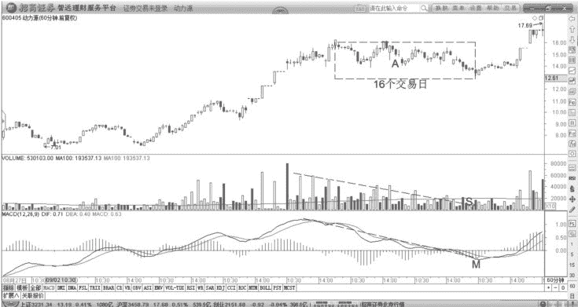

图 3-4 动力源 60 分钟 K 线

操作要领：

1.从中枢震荡小于 1 个月来看：图中 A 位置的中枢调整阶段，明显的回调持续了 3 次，持续时间为 16 个交易日。相比较日 K 线级别的盘整，该股调整的时间并不长。

2.从成交量显著缩量来看：在 60 分钟级别的调整阶段，图中量能萎缩到 S 位置。成交量萎缩趋势显著，量能萎缩完全是在盘整阶段出现。在缠论回升趋势中，这种缩量是常见的情况，表明资金主力参与力度减弱，股价经历了充分的洗盘。

3.从 MACD 指标与股价同步回调来看：图中 MACD 指标的 DIF 线回调到 M 位置，明显低于 0 轴线。指标回调与股价盘整走势同步出现，相比日 K 线级别的指标调整力度更大。

总结： 在 60 分钟级别的 K 线中，股价波动强度虽然不及日 K 线级别，但是盘整期间的指标回调力度很大。在 60 分钟 K 线中，投资者可以用该级别的盘整来调整仓位，只是买卖股票期间，对股价波动的频率需要提前预测到。

### 3.2.3 5 分钟 K 线级别盘整

缠论盘整形态在 5 分钟 K 线时段的表现很短，相比 60 分钟 K 线图中的盘整规模小很多，是持续几个交易日的调整形态。其对日 K 线级别的缠论运行趋势的影响是短线的，很难改变缠论单边回升趋势。当 5 分钟级别的调整结束以后，股价会延续缠论单边趋势。如果投资者想要在 5 分钟级别的盘整期间获得短线收益，那么困难程度会比较大了，因为难以出现高强度的股价波动。在 5 分钟 K 线级别的盘整中，投资者可以缩小交易价位，却不容易以短线买卖的形式获利。

形态特征：

A.中枢震荡小于 3 个交易日：5 分钟 K 线图中，震荡持续时间通常不超过 3 个交易日，股价就完成了调整过程。由于调整时间有限股价波动强度通常不会超过 10%，所以投资者调整仓位的股价范围较小。

B.成交量变化加大：在股价加速回升期间，成交量显著放大，缠论线段的位置股价涨幅快速扩大。而在 5 分钟 K 线周期的盘整区间里，成交量变化力度更大。同时，放量之时可以达到天量状态，且盘整期间量能会萎缩，成交量达地量的情况也会出现。

C.MACD 指标高强度震荡：在缠论回升趋势中，股价达到收盘价新高以后会出现缠论盘整形态。5 分钟 K 线级别的股价波动周期增加， MACD 指标的回调力度增强，DIF 线数值会在缠论盘整期间轻松触及 0 轴线。

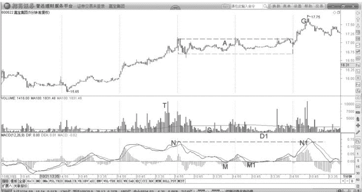

图 3-5 嘉宝集团 5 分钟 K 线

操作要领：

1.从中枢震荡小于 3 个交易日来看：A 位置的中枢震荡持续时间仅为 2 个交易日，相比日 K 线周期的盘整规模小很多。对于缠论 5 分钟 K 线回升趋势，这种短期的调整适应了缠论回升趋势，并不改变缠论股价回升方向。

2.从成交量变化加大来看：T 位置的量能达到天量状态，而在股价回调期间，成交量就已经萎缩到了 S 和 D1 位置。D1 位置的量能更是达到地量，成交量变化很大，这是日 K 线和 60 分钟 K 线级别不曾有过的情况。

3.从 MACD 指标高强度震荡来看：MACD 指标在股价进入盘整阶段后明显回调，指标从 N 回调到 M 和 M1 位置。盘整结束以后，DIF 线回升到比 N 更高的位置。显然，指标与股价同步运行，指标明显回调正是 5 分钟 K 线频繁涨跌的结果。

总结： 5 分钟级别的缠论盘整形态中，股价波动幅度不大，但是 K 线形态上体现的股价调整更加显著，量能和指标的突变，就体现了这一点。在指标频繁波动的过程中，投资者想要确认盘整阶段的买卖机会，其实变得更加容易了，因为变化显著的 MACD 指标已经提示了交易信号。

## 3.3 盘整突破和中枢形成

缠论盘整的结果是，股价完成了调整走势，缠论线段脱离盘整形态，使得缠论盘整形态成为单边趋势中的中枢形态。中枢形态出现的次数增加，盘整突破的次数也同步增加。在中枢震荡的过程中，对于盘整形态和盘整突破走势，投资者需要关注交易机会，因为缠论线段出现以后，单边涨跌过程中的买卖股票会十分困难。

### 3.3.1 盘整形态的结束信号

在回升趋势中，盘整形态出现结束信号，股价从低价区企稳以后顺利突破盘整阶段的股价高位。股价盘整结束会以量能放大股价反弹上涨为起始形态。如果盘整形态成为缠论回升趋势的中枢形态，股价出现两次明显的次级别的回调，就表明已经完成了中枢形态。作为回升趋势的调整形态，盘整形态成为股价继续上涨的支撑形态。从交易机会来看，投资者可以在股价突破盘整形态以后把握买点机会，以便在接下来的回升当中盈利。

形态特征：

A.首次回调持续十字星探底形态：股价首次明显出现回调走势，股价回调以后出现十字星底部形态，这是技术性反弹走势出现的位置。首次回调期间确认的股价低位，是股价二次回调以后同样会达到的短线低价位。

B.第二次回调持续回落缺口：当股价的日常回调以后，股价跳空回落，这表明抛售压力加大。也正是这个时候，抛售压力得到释放，股价的低价买点出现。

C.量能放大提示触底：在股价跳空下跌缺口出现期间，成交量放大趋势就已经出现。随着反弹格局形成，股价明显回升，买点交易机会得到确认。

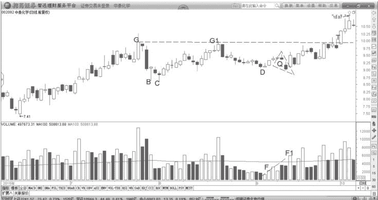

图 3-6 中泰化学日 K 线

操作要领：

1.从首次回调持续十字星探底形态来看：回升期间股价在 G 位置见顶，股价回调期间很快出现十字星底部。B 位置和 C 位置出现了双十字星，这是短线触底的信号。盘整期间，股价在十字星的股价附近获得支撑。

2.从第二次回调持续回落缺口来看：股价反弹期间股价达到 G1 位置高点后开始回调，继续下跌以后，股价触及 D 位置的短线低位。Q 位置是从 D 位置反弹以后的向下跳空缺口形态，是股价超跌反弹的起始点。

3.从量能放大提示触底来看：股价在 D 位置触底以后，F 位置的量能开始持续回升。到 F1 位置，量能达 100 日等量线上方。从股价的活跃度来看，量能达等量线上方表明活跃度较高，股价成功进入反弹阶段。而前期双十字星首次验证了低价区的支撑，接下来该股在 T 位置突破盘整形态，股价成功突破缠论中枢区域。

总结： 日 K 线图中最容易出现的调整形态是两次股价回调，股价在相似的价位触底，而后开始反弹脱离盘整形态。投资者确认十字星底和放量底后，可以在量价两个方面确认底部买点。

### 3.3.2 线段突破和中枢形成

在缠论盘整阶段，中枢调整形态期间股价低价区出现买点，这是多数投资者认可的交易价位。如果投资者在盘整低价位买入股票，股价脱离盘整形态后很容易扩大收益规模。股价在中枢调整期间的盘整是股价双向震荡的过程，且股价突破盘整形态的股价高位常会一波三折。对于投资者而言，在股价有效脱离中枢形态前交易，是比较好的买点机会，如果缠论回升形态得到延续，那么只需持股就能够获得利润。

形态特征：

A.中枢盘整阶段出现连续放量：中枢盘整阶段，股价缩量回调到短线低价区。这个时候，成交量开始放大，股价进入连续放量的上涨阶段。

B.股价两次触底后开始反弹：两次典型的低价触底形态出现以后，股价获得支撑后开始上涨。这个时候，中枢调整结束的可能性加大。两次级别的回调就可以确认中枢形态，这是投资者需要关注的地方。

C.量能回升提示股价企稳：当股价突破短线高位时，往往预示着盘整阶段的股价调整结束。这个时候量能稳定在等量线以上，可以确认突破买点有效。

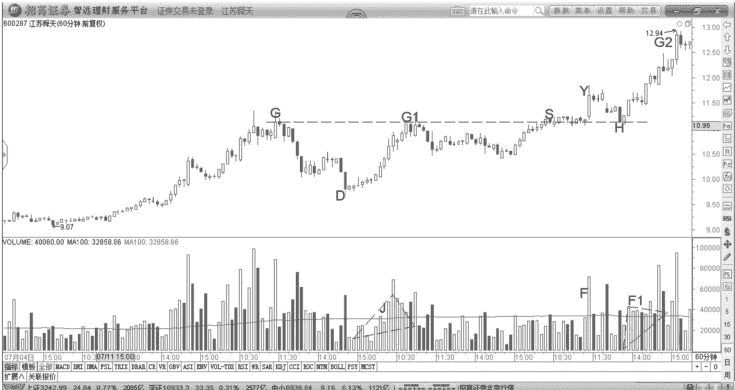

图 3-7 江苏舜天 60 分钟 K 线

操作要领：

1.从中枢盘整阶段出现连续放量来看：图中 G 位置的量能持续放大，股价下跌到 D 位置后很快摆脱颓势。首次盘整阶段的股价反弹以后，股价达到了与 G 位置相同的高位 G1 位置。

2.从股价两次触底后开始反弹来看：第二次回调的空间较小，股价很快反弹到 S 位置。股价达 S 位置以后，形态上的中枢调整已经完成。

3.从量能回升提示股价企稳来看：F 位置的量能放大到 100 日等量线上方，股价涨幅达 Y 位置期间，股价已经突破短线横盘区域。接下来，股价回调到 H 位置低点，对应的成交量在 F1 位置稳定在 100 日等量线上方，提示该股活跃度明显提升。股价涨幅达 G2 位置的时候，缠论回升趋势得到延续。

总结： 当缠论盘整期间股价双向波动时，从形态来看，如果是两次回调后确认了中枢调整格局，那么更像是双底企稳的形态。这个时候，股价放量突破盘整阶段的短线高位，是形态上的双底反转过程。双底反转期间，股价震荡突破双底颈线，交易机会可以很容易确认。

## 3.4 中枢震荡的本质

在中枢震荡的过程中，股价双向运行次数较多，对于将要买入和卖出的投资者而言，股价震荡的交易机会增加，适当关注高抛和低吸交易价位，可以提高股票买卖的效率。中枢震荡期间，本质是主力洗盘动作。回升趋势中股价震荡的洗盘，有助于股价实现更大的涨幅。对于场外资金充足的投资者来讲，充分洗盘调整也为低价买入股票创造了条件。

### 3.4.1 中枢震荡的主力洗盘

在中枢震荡期间，多数情况下股价会出现回调走势。面对股价震荡下跌，散户投资者的持股耐心将会受到考验，因为真正能够经历震荡还稳定持股的投资者并不多见。想要在缠论回升趋势中更大规模地获利，摆脱股价短线调整期间的短线思维，持股可以扩大收益。选择中枢震荡期间持股，其原因是主力的洗盘行为。从资金流入来看，中枢震荡期间资金流入为正，那么股价调整只是因为主力投资者的资金流入数量在减少，而非主力出逃的动作。也就是说，洗盘才是主力打压股价的原因。中枢震荡其实是主力的洗盘策略运用的股价表现，对于长期交易的投资者，完全可以不受股价短期波动影响。

形态特征：

A.股价冲高回落：稳步回升期间，缠论线段的股价涨幅很快扩大，不过走势在股价涨幅扩大期间会出现冲高回落的现象。

B.回调阶段 DDX 触及 0 轴：在股价调整阶段，DDX 指标回调，但是并未达到 0 轴线下方。DDX 回调却没有改变资金流入的格局，这是股价维持强势的基础。

C.股价突破中枢震荡高位：当股价顺利突破中枢震荡的股价高位以后，横向调整阶段的中枢形态完成。在完美的调整形态里，股价跌幅不大，而 DDX 回调却不会到达 0 轴线下方。

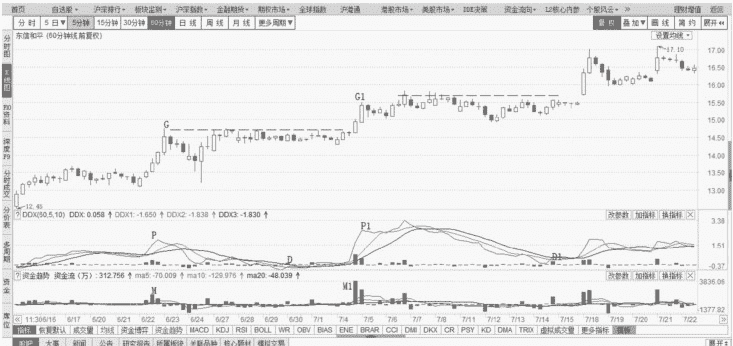

图 3-8 东信和平 60 分钟 K 线

操作要领：

1.从股价冲高回落来看：图中显示的 G 位置是股价短线高位，同时也是中枢震荡高位回调的起始价位。股价见顶期间，DDX 指标在 P 位置见顶，资金流入在 M 位置达高位。

2.从回调阶段 DDX 触及 0 轴来看：股价回调以后，DDX 只是回调到 D 位置的 0 轴线位置。这表明资金流入阶段股价横向震荡，股价回调力度不大，却也完成了中枢调整形态。这是主力洗盘期间的股价回调。

3.从股价突破中枢震荡高位来看：股价双向震荡期间，可以看到该股起始于 G1 位置的中枢调整形态中，DDX 从 P1 回调到 D1，资金流入在 M1 位置达高位。DDX 数值并未跌破 0 轴，这表示资金依然流入，股价强势突破中枢形态扩大了涨幅。

总结： 在中枢震荡的过程中，主力以洗盘手法打压股价，期间资金依然流入。如果投资者在调整阶段增加持股，那么，缠论回升趋势中的盈利便可以轻松扩大。

### 3.4.2 中枢震荡的新主力建仓

中枢震荡期间，在股价表现强势的情况下，主力在股价震荡期间继续增加持股量。从中枢震荡的性质来看，主力利用股价调整的机会完成了建仓动作。新进入的资金主力在增加持股的过程中，为接下来股价突破中枢形态创造了条件。持股增加的主力投资者力图扩大收益规模，在盘整阶段增加持股数量，能将成本控制在低水平，从而有助于今后的盈利。

形态特征：

A.股价出现连续飙升走势：股价回升期间，在资金流入的推动下，股价出现了连续飙升的情况，这是投资者需要关注的地方。当缠论回升趋势延续时，资金控盘、股价上涨的走势会随之出现。

B.中枢震荡期间量能脉冲流入：在中枢震荡期间，资金以脉冲形式净流入，股价虽然进入盘整阶段，但是股价波动空间加大，股价表现抢眼。

C.脉冲资金流入控盘拉升股价：脉冲资金流入阶段，主力投资者的控盘效果将提升。在高价区股价突破中枢形态的时候，脉冲资金净流入后，股价会开始加速上涨。

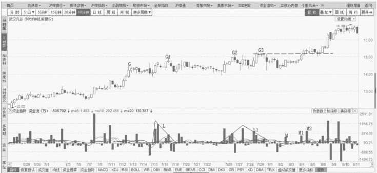

图 3-9 武汉凡谷 60 分钟 K 线

操作要领：

1.从股价出现连续飙升走势来看：股价在 G 位置进入中枢调整前，该股出现了连续上涨的中阳线形态。股价表现非常强势，特别是在连续飙升的过程中，股价涨幅会很快扩大。

2.从中枢震荡期间量能脉冲流入来看：在中枢震荡期间，成交量在 L 和 L1 位置以脉冲形式流入，股价在 G1、G2 和 G3 都出现了反弹走势。虽然股价总体震荡累计的涨幅很小，但是新主力的建仓动作明确，这是今后股价继续上涨的基础。

3.从脉冲资金流入控盘拉升股价来看：在中枢调整的走势结束期间，图中 M、M1 和 M2 位置的资金脉冲流入，这明显是主力控盘股价的表现。该股在这个时候有效突破了中枢调整的高位，延续了缠论回升的趋势。

总结： 在 60 分钟 K 线图中，资金持续流入的股价强势表现值得投资者关注。特别是在中枢调整阶段，股价横向运行但主力持续增加持股数量，这表明主力投资者对缠论回升趋势看涨。此时，散户投资者跟随主力买入股票，依然能够获得不错的收益。

## 3.5 中枢震荡买卖机会

中枢震荡期间，次级别的调整出现次数在两次以上。次级别的调整出现之时，将明显减缓股价运行节奏。而在中枢震荡期间，会同时出现低价买入和高价卖出的交易机会。结合股价缠论趋势方向，如果股价处于回升趋势中，那么中枢震荡期间就需要关注低价买点。通常，历次中枢震荡的低价区都是建仓交易的机会。而在缠论回落趋势中，投资者则需要关注短线高抛的卖点，在股价跌幅扩大前减少持股，把握好中枢调整期间的减仓交易机会。

### 3.5.1 中枢回调的买点

作为局部调整的建仓交易机会，股价进入回升趋势的中枢震荡区间以后，中枢震荡的股价低位是不错的买点。如果是短线交易，中枢震荡的区间低点则是有效的建仓交易价位。投资者在中枢震荡的股价低位买入股票，可以很轻松地扩大收益空间。只要股价的缠论回升趋势得到延续，当股价向上突破中枢震荡的高价区以后，股价涨幅可以迅速提升，这对于投资者获得收益有很大帮助。

形态特征：

A.连续回调的低价区出现中枢买点：股价连续回升以后，股价进入中枢调整区间，低价区的买点首次得到确认。

B.跳空缺口提示低价买点：在股价横盘运行的过程中，股价从短线高位第二次回落，跳空下跌的缺口提示投资者低价买点已出现。

C. MACD 指标回调提示低价买点：在股价调整期间，MACD 指标的 DIF 线同步回落。DIF 线回调到 0 轴线的时候，是股价调整到位的信号，同时也是买入股票的最佳时机。DIF 线在 0 轴线获得支撑，预示着中枢调整期间股价下跌到位，于是典型的低价买点便出现了。

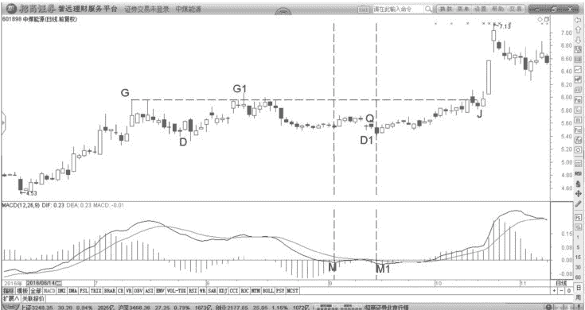

图 3-10 中煤能源日 K 线

操作要领：

1.从连续回调的低价区出现中枢买点来看：当股价反弹到 G 位置以后，低价区 D 位置出现了典型的买点，这是投资者比较有利的建仓价位。

2.从跳空缺口提示低价买点来看：股价反弹到短线高位 G1，这是与 G 位置相似的价位，同时也是股价反弹的压力区。该股第二次回调，并且在 Q 位置出现缺口形态，这表明该股已经出现超跌走势，是在提示我们已出现短线买入股票的机会。

3.从 MACD 指标回调提示低价买点来看：当 MACD 指标的 DIF 线回调到 0 轴线的 M 和 M1 位置以后，指标回调就已经到位了。在缠论回升趋势中，DIF 线回调触及 0 轴线，表明调整力度很大。此时，低价区的买点不容忽视。而股价回升期间，股价在 J 位置短线调整，这是中枢调整阶段最后一次追涨的买点。

总结： 中枢震荡的调整阶段，低价区的买点可以在首次股价反弹后确认。在相似的股价低点，股价会出现第二次的反弹走势。而买入股票期间， MACD 指标回调到位，则提示了低价区的建仓交易机会。

### 3.5.2 中枢反弹的卖点

作为局部调整的减仓交易机会，股价进入回落趋势的中枢震荡区间以后，中枢震荡的股价高位就是个不错的卖点。如果是短线交易，那么，中枢震荡的区间高位便是有效的减仓交易价位。投资者在中枢震荡的股价高位卖掉股票，可以很轻松地扩大收益空间，同时，又不会在中枢回调期间出现亏损。作为长期的交易价位，中枢震荡的短线高位是比较有效的做空价位。如果投资者在中枢震荡的短线高位减少股票，那么应对缠论线段趋势就会轻松很多。

形态特征：

A.连续回升的高价区出现中枢卖点：股价连续回升以后，股价进入中枢调整的高位，高价区的卖点首次得到确认。

B.量能放大高价卖点：在股价横盘运行的过程中，股价从短线的高位反弹以后，成交量会出现放大迹象。当量能达到 100 日等量线附近时，便是在提示高价卖点已形成。

C.MACD 指标反弹提示高价卖点：在股价调整期间，MACD 指标的 DIF 线同步反弹。DIF 线反弹到 0 轴线的时候，就是股价反弹到位的信号，同时也是卖出股票的最佳时机。DIF 线在 0 轴线遇到阻力，预示着中枢调整期间股价反弹到位，典型的高价卖点形成。

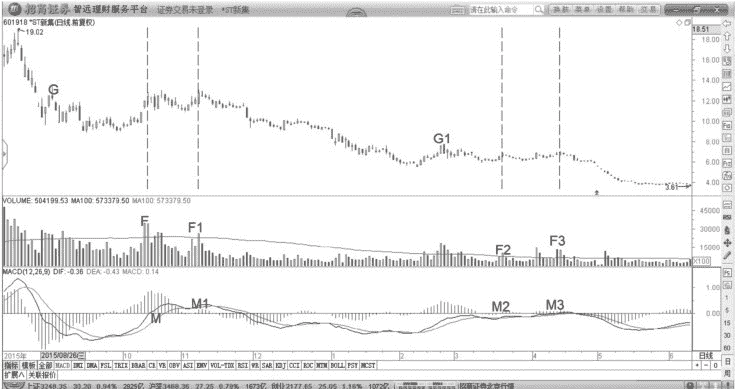

图 3-11 ST 新集日 K 线

操作要领：

1.从连续回升的高价区出现中枢卖点来看：股价进入下跌趋势以后，短线反弹到 G 位置的高位。可见下跌趋势中，股价已进入中枢震荡区间，G 位置便是短线高位的卖点机会。

2.从量能放大高价卖点来看：在 F 和 F1 位置的量能短线放大并且接近 100 日等量线期间，股价反弹强度达到了短线最大，这是在提示高抛的卖点已出现。

3.从 MACD 指标反弹提示高价卖点来看：在量能有效放大期间，F、F1、F2 和 F3 都提示了短线高位的减仓机会。而在 MACD 指标的 DIF 线反弹到 0 轴线期间，指标回升遇到 0 轴线阻力，同样提示了减仓机会。

总结： 下跌趋势中，在股价缠论中枢震荡期间，股价多数情况下会表现得比较弱势。量能放大和指标走强都是短期信号。而这个时候，提示的高抛卖点不容忽视。

## 3.6 区间套确认中枢买卖点

在中枢震荡的过程中，若根据日 K 线图来确认短线交易机会，从买卖点的精确度看，效果会受到影响。日 K 线图股价波动强度更高，需要在低级别的 K 线图中发现买卖点。而在低级别的 K 线图中确认交易机会，就要用到缠论区间套了。对于投资者来说，缩小缠论形态的时间周期，可以在微观层面上确认交易价位。

### 3.6.1 日 K 线确认中枢交易点

日 K 线图中，在股价完整的中枢调整形态里，交易机会可以被投资者确认。不过，这是在股价充分震荡的情况下才能做到。如果日 K 线图中股价波动空间不大，中枢震荡的股价高抛和低价的机会都不够明显，那么买卖股票就困难多了。实际上，要确认日 K 线短期中枢形态的交易机会，投资者只需在更小的区间里挖掘买卖机会即可。不过，在确认更小的股价区间缠论交易机会前，首先得关注日 K 线的缠论中枢形态。

形态特征：

A.低价区股价跳空上涨：当低价区股价开始跳空上涨以后，股价会从低价区开始走强，同时还会出现缠论回升趋势。

B.量能达 100 日等量线：当成交量达到 100 日等量线以后，会出现股价放量上涨的情况。而量能达 100 日等量线，还显示了股价活跃度大增，交易机会也会在这时出现。

C.简易的中枢形态出现：在简易的中枢形态中，可以看到股价在中枢震荡期间波动强度增加。而日 K 线图中，中枢形态的股价回调至少会在两次以上。

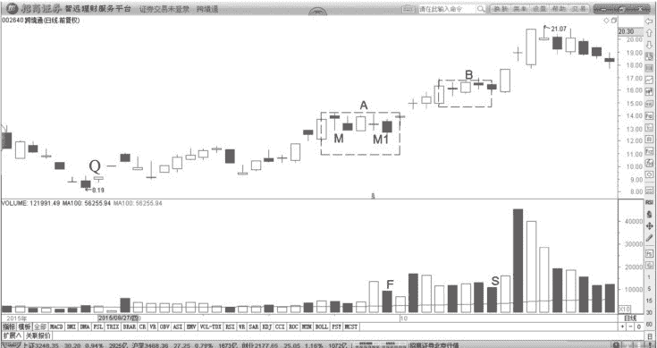

图 3-12 跨境通日 K 线

操作要领：

1.从低价区股价跳空上涨来看：从低价区开始，股价在 Q 位置跳空上涨，这是确认股价回升趋势的缺口形态。若缺口的突破效果较好，那么该股在随后的表现会非常强势。

2.从量能达 100 日等量线来看：在量能达到 100 日等量线上方期间，图中 F 位置的成交量明显放大，显然这是股价活跃度提升的信号。在股价活跃度飙升以后，股价在 A 位置的震荡加剧。

3.从简易的中枢形态出现来看：A 位置是中枢震荡的股价区间，其间存在 M 和 M1 两个股价低点。可见，从形态上看，该股的调整已经具备了中枢震荡的形态特征。接下来的股价高位 B，量能在 S 位置萎缩期间，也出现了类似的中枢调整走势。

总结： 在日 K 线图中，中枢震荡的形态特征已出现，但是股价震荡的时候，交易机会还不够清晰。观察 60 分钟 K 线等更小周期的中枢形态，投资者可以获得更加精确的中枢震荡的交易价位。

### 3.6.2 60 分钟 K 线确认买卖点

日 K 线图中，在股价完整的中枢调整形态里，交易机会不容易被精确判断。而日 K 线是由 60 分钟 K 线构成，一根日 K 线可以划分为 4 根 60 分钟 K 线。对于 K 线数量明显增加的事实，投资者可以更精确地买卖股票。

不过，这也是在股价充分震荡的情况下。如果日 K 线图中股价波动空间不大， 60 分钟 K 线中枢震荡的股价高抛和低价的机会不够明显，那么买卖过程同样不轻松。这个时候，可以在更低周期的 K 线形态中划分缠论中枢形态，并且确认交易机会。当然，在更小时间段里分析缠论形态前，可以先参考一下 60 分钟 K 线的表现。

形态特征：

A.放量反弹提示卖点：当成交量短线放大以后，股价反弹达短线高位时，会出现 60 分钟 K 线的中枢卖点机会。

B.跌破低价出现买点：当股价跌破短线低位以后，股价继续回调空间便有限。在中枢调整阶段，当股价收盘达短线低位时，会出现抄底机会。

C.缩量提示低价买点：在 60 分钟的中枢形态中，股价在 K 线上体现的波动频繁，量能萎缩期间会出现低价买点。

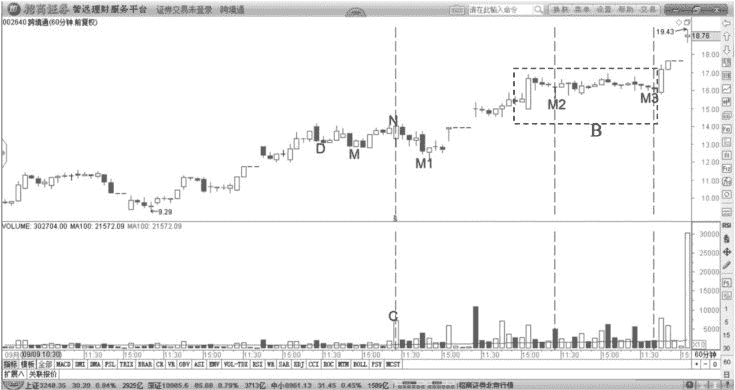

图 3-13 跨境通 60 分钟 K 线

操作要领：

1.从放量反弹提示卖点来看：C 位置的量能短线放大，股价在 N 位置达到中枢形态的高位，这是高抛的卖点机会。如果投资者在 N 位置卖掉股票，减仓成本也是中枢形态高位。

2.从跌破低价出现买点来看：股价跌破了低价区 M 位置，M1 位置出现了中枢调整的买点。M1 位置的建仓成本价位较低，能有效降低投资者的持股成本价。

3.从缩量提示低价买点来看：成交量萎缩期间，在 B 位置的中枢形态中，低价的买点出现在 M2 和 M3 位置。由于股价在 B 位置的中枢调整区间震荡空间不大，所以交易机会也没有更多地体现出来。

总结： 60 分钟 K 线相比日 K 线出现了更多的买卖机会，如果投资者想要在低价区买入股票，那么，60 分钟 K 线就提供了很好的建仓机会。当然，如果要进一步精确买卖机会，更低一级的 5 分钟 K 线便是不容忽视的。

### 3.6.3 5 分钟 K 线确认买卖点

日 K 线和 60 分钟 K 线图中，在股价完整的中枢调整形态里，交易机会都不是很精确。但是如果看一下 5 分钟 K 线，细节上的股价异常波动都可以有明显的体现。12 根 5 分钟 K 线才能构成 1 根 60 分钟 K 线。反过来讲，即 60 分钟被进一步划分出了 12 根 5 分钟 K 线。这样，在缠论中枢形态里，股价回调和反弹都表现得非常清晰，交易机会也更容易辨识。

只要从精确的 5 分钟 K 线图里挖掘交易机会，就不会出现没有机会建仓的问题。从分时图的股价走势来看，最短期的成交量可以在 1 分钟里显示，而股价在盘口的波动也是以 1 分钟为限的。那么，5 分钟虽然没有达到 1 分钟的细分程度，但对于挖掘缠论中枢震荡期间的交易机会，也是相当简单的。

形态特征：

A.背离反弹提示卖点：当股价在 5 分钟 K 线出现反弹高位以后， RSI 指标却出现了背离回调的情况，这提示股价反弹高位卖点已经形成。

B.跌破低价出现买点：当股价跌破短线低位以后，股价继续回调空间有限。在中枢调整阶段，RSI 指标的底部背离提示买点出现。

C.指标区间震荡提示买卖机会：在 5 分钟的中枢形态中，股价在 RSI 指标上体现的波动频繁。按照 RSI 指标双向震荡的形态，投资者可以看到与 RSI 指标双向震荡相似的高抛和低吸的交易机会。

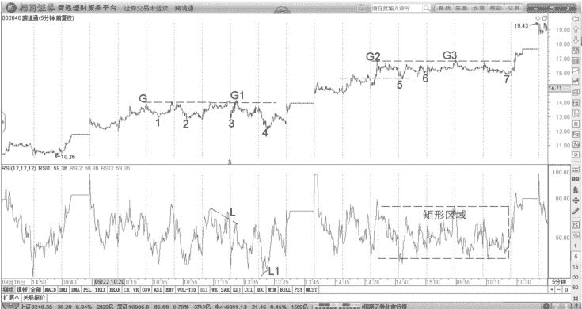

图 3-14 跨境通 5 分钟 K 线

操作要领：

1.从背离反弹提示卖点来看：图中显示的 L 位置，RSI 指标出现了背离回调的情况，这表明图中 G1 位置的高抛卖点出现。

2.从跌破低价出现买点来看：在股价回调期间，与 1、2、3 类似的低价区买点 4 出现。RSI 指标在低价区 L1 位置出现背离回升，这提示低价区 4 位置的买点已形成。

3.从指标区间震荡提示买卖机会来看：确认 5 分钟 K 线中枢形态的买卖机会，只需根据 RSI 指标在图中矩形区域的双向震荡，就可以确认低吸和高抛的交易机会。低吸机会出现在 5、6 和 7，而高抛卖点出现在 G2 和 G3。

总结： 在缠论中枢形态中，5 分钟 K 线体现的买卖机会更加明确。如果投资者想要挖掘买卖机会，那么错过更低时间周期的买卖信号，就很难精确把握交易价位。随着短期中买卖机会得到确认，投资者可以获得比较好的投资效益。

# 第四章 重要中枢形态和买卖点

对于缠论趋势而言，中枢形态是不容忽视的，当股价摆脱中枢形态的时候，缠论中枢和缠论线段就共同构成了缠论趋势。缠论趋势的复杂性要明显比缠论线段高，这是判断买卖点困难的地方。中枢震荡的复杂性，主要体现在中枢调整形态的多样化，此时，买卖机会也非常多。实战股票交易期间，投资者需要摆脱中枢震荡的复杂形态，在不同情况的股价震荡期间确认买卖点。本章列举的中枢震荡形态达 5 种，基本涵盖了典型的中枢形态，对投资者的股票交易有很大帮助。

## 4.1 股价双向震荡

在缠论中枢形态里，股价双向两次波动是最基础的缠论形态特征。回升趋势中，股价会在两次下跌期间完成缠论中枢形态，成为股价进一步上涨前的调整形态。而在缠论线段趋势中，最基础的中枢形态包含了两次股价反弹走势。两次反弹结束，中枢形态的基本特征已经完成。如果股价不再反弹，那么继续回落的时候，缠论线段趋势将得到延续。要分析中枢调整形态，我们可以从最基础的双向震荡中枢形态开始。双向震荡更加频繁的复杂中枢形态，往往是由最简单的双向震荡开始的，即使震荡次数增加影响到了中枢调整的规模，却也不会改变缠论单边趋势。

### 4.1.1 回升期间简易中枢形态

当股价两次触底回升时，如果这种情况出现在回升趋势中，那么将是比较完整的双底反转形态。而缠论回升趋势中，股价连续两次触底后就完成了缠论中枢形态。最简单的中枢调整走势，需要股价两次回调，可以说是双底支撑形态为股价走强提供了帮助。触底回升以后，股价会脱离中枢调整的上限，并且还将在缠论回升趋势中扩大涨幅。

形态特征：

A.股价连续阳线形态：连续回升的放量阳线形态出现，股价的涨幅会加大，抛售压力也将增加，同时高价区会出现股价调整信号。

B.股价两次缩量回调：连续两次回调以后，股价在量能萎缩到 100 日等量线下方期间触底。在中枢形态中，两次股价回调就能构成完整的缠论中枢形态，这时，股价将进入中枢调整后的二次回升阶段。C.RSI 指标触底提示调整完成：当 RSI 指标成功触底以后，指标在 50 线下方超跌回升，这是在提示中枢调整完成后出现了买点。

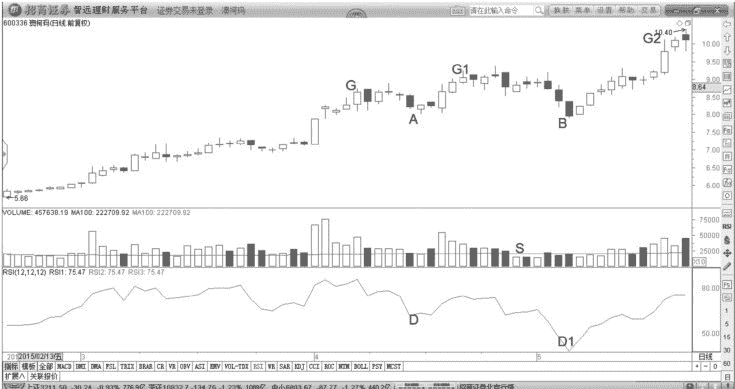

图 4-1 澳柯玛日 K 线

操作要领：

1.从股价连续阳线形态来看：在量能连续放大期间，股价连续 5 个交易日出现上涨的阳线形态，股价飙升至 G 位置的高位。也正是从 G 位置开始，该股进入了中枢调整阶段。

2.从股价两次缩量回调来看：成交量萎缩期间，股价先后回调到 A 和 B 位置。在量能萎缩低于 100 日等量线后，S 位置的缩量提示了 B 位置出现买点。这时，B 位置成为了股价中枢形态完成以后的买点价位。

3.从 RSI 指标触底提示调整完成来看：RSI 指标在中枢调整期间回调，D 位置是首次低点，D1 位置指标已经明显低于 50 日等量线。中枢调整期间，在指标如此大的回调走势里，不难看出指标已经调整到位。中枢形态完成期间，RSI 指标在 D1 位置提示的买点出现。股价很快在 B 位置缩量触底，并且加速回升到 G2 位置的高价。

总结： 在两次回调期间，简单的中枢调整形态完成。这个时候，双底提供的交易机会非常明显。投资者只需在股价低点买入股票，便可以获得廉价筹码。而在低价区，投资者可以根据股价首次回调的价位判断买点，那么在接下来缠论回升趋势中就可以大幅盈利。

### 4.1.2 下跌期间简易中枢形态

股价两次反弹回落，若这种情况出现在回落趋势中，那么将是比较完整的双顶反转形态。而在缠论回落趋势中，股价连续两次触及相似的高位后，便完成了缠论中枢形态。最简单的中枢调整走势，股价也要经过两次反弹，可以说是双顶压力形态为股价下跌提供了帮助。冲高回落以后，股价会脱离中枢调整的下限，并且还将在缠论回落趋势中扩大跌幅。

形态特征：

A.股价连续阴线形态：连续回落的阴线形态出现，股价跌幅加大，同时抛售压力也增加，低价区出现了股价反弹的信号。

B.股价两次弱势反弹：连续两次反弹以后，MACD 指标从低位反弹，股价完成了中枢形态的两次次级别的回升走势。这个时候，最简单的中枢调整形态就完成了。

C.MACD 指标冲高 0 轴线失败：当 MACD 指标从 0 轴线下方反弹以后，指标反弹力度加大，并且在 0 轴线下方见顶，这提示回落趋势中股价两次反弹的中枢形态完成。

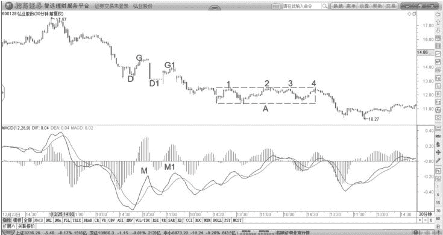

图 4-2 弘业股份 30 分钟 K 线

操作要领：

1.从股价连续阴线形态来看：股价在 D 位置开始反弹前，该股连续阴线下跌，并且股价跌幅加大。这个时候，缠论线段趋势中的线段扩张，中枢反弹将从 D 位置的低点开始。

2.从股价两次弱势反弹来看：从低价区开始，股价两次反弹到 G 和 G1 位置的高位。这个时候，中枢调整期间的双向震荡已经完成。从相似的股价低点 D 和 D1 反弹到相似的股价高位 G 和 G1，使得股价完成了中枢震荡形态。

3.从 MACD 指标冲高 0 轴线失败来看：MACD 指标回调幅度加大，DIF 线快速反弹却没有达到 0 轴线，只是在 M 和 M1 位置见顶。在指标反弹期间，M 和 M1 对应的股价高位 G 和 G1 是典型的高抛卖点。这时，从形态上看，股价已完成了最简单的中枢形态。接下来继续回落期间，股价在 A 位置出现中枢调整，卖点在 1、2、3、4 位置形成。

总结： 在最简单的缠论中枢调整形态里，股价双向震荡次数为两次。考虑到股价处于缠论回落趋势中，确认两次高抛卖点以后，投资者能够获取最高的短线收益。

## 4.2 矩形震荡

矩形震荡期间，中枢调整的股价运行节奏相对容易把握，股价并不会出现明显的异动。如果投资者在中枢调整的初期已经掌握了股价运行特征，那么在股价双向震荡期间，就很容易确认买点和卖点。在矩形震荡期间，股价的量价配合是比较理想的，放量反弹和缩量回调交替形成，交易机会也在量能变化的时候出现。

### 4.2.1 矩形震荡特征

在矩形震荡形态里，股价双向震荡的次数会较多，且震荡期间高价和低价都非常接近。从形态上看，矩形震荡是比较规整的中枢调整走势。而在交易机会上，矩形震荡期间高抛和低吸的交易机会更容易确认。矩形震荡期间，从量能萎缩开始，股价就进入到了双向震荡的矩形形态里。从放量开始，股价突破矩形震荡的股价高位后，会延续缠论回升趋势。

形态特征：

A.量能从脉冲天量收缩：成交量达到脉冲天量以后，量能便开始萎缩，同时股价进入调整阶段。成交量萎缩会推动股价进入中枢震荡，而在双向调整期间，量能的有限放大，明显能降低股价反弹的力度。

B.股价进入矩形调整：在矩形调整阶段，成交量表现平淡，股价维持了震荡所需的活跃度，震荡次数超过两次，矩形形态得以确认。C.恢复脉冲量股价突破中枢：当成交量恢复脉冲量能以后，股价开始突破中枢调整。在脉冲量能有效放大期间，股价很快进入加速上涨阶段，从而完成矩形中枢震荡。

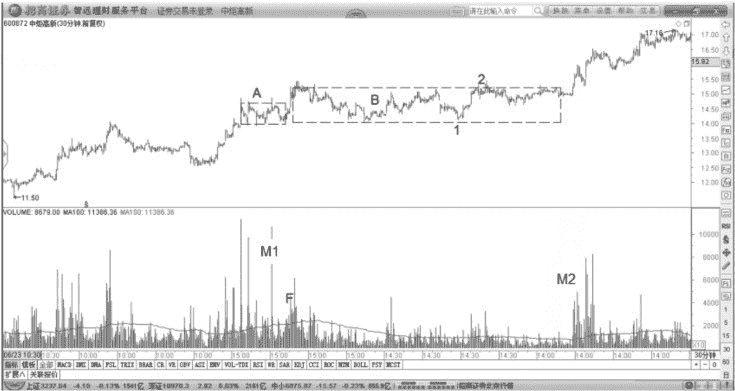

图 4-3 中炬高新 30 分钟 K 线

操作要领：

1.从量能从脉冲天量收缩来看：M1 或 M2 位置的成交量为脉冲天量形态，到了 F 位置，成交量表现为放量状态，整体成交量开始萎缩。股价在 A 位置出现矩形震荡，不过持续时间较短。

2.从股价进入矩形调整来看：量能从 M1 或 M2 位置的天量开始萎缩，股价矩形震荡从 A 开始。在股价震荡期间，B 位置的双向震荡持续时间较长。而在矩形调整阶段，股价在 1 位置的低点反弹，从 2 位置的高位回落，双向震荡在两次以上。

3.从恢复脉冲量股价突破中枢来看：M1 或 M2 位置的脉冲量能恢复放大状态，股价在对应的价位脱离矩形调整形态。由此可见，矩形中枢调整从量能萎缩开始，至成交量放大结束。

总结： 在矩形调整阶段，中枢震荡期间股价频繁波动，其间的交易机会投资者不可忽视。尤其是在矩形震荡期间的低价买点机会出现，而股价缠论回升趋势还没结束之前，低价买点往往能成为投资者增加持股的机会。

### 4.2.2 买卖时机解析

在频繁震荡期间，买卖机会出现的次数会增加，投资者利用指标的震荡，可以确认中枢调整阶段的买卖机会。但首先，还是要确认股价是否正处于缠论回升趋势。既然是回升趋势，中枢震荡的低价买点就需要好好把握。实际上，股价首次回调以后，就已经确认了低价区的支撑力度。而当股价从低价区开始反弹以后，买入股票的投资者就可以很快盈利。

形态特征：

A.股价首次明显高位见顶：首次见顶回调以后，股价高位的压力区便会出现，接下来历次反弹走势都会在相似的价位见顶。

B.RSI 频繁反弹提示高抛：RSI 指标频繁反弹到类似的高位以后，则是在提示股价涨幅过高，高抛卖点已经形成。

C.RSI 超买提示卖点：RSI 指标超买期间，是股价短线反弹的高抛卖点。从兑现收益的角度看，只要指标超买期间股价达到短线高位，就是中枢调整阶段最高价的卖点机会。

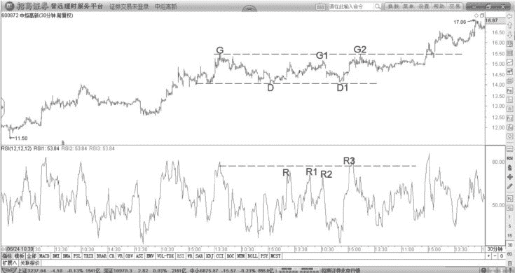

图 4-4 中炬高新 30 分钟 K 线

操作要领：

1.从股价首次明显高位见顶来看：G 位置的中枢震荡是高抛卖点机会。矩形调整期间，股价首次在 G 位置见顶，接下来的高抛位置可以通过 G 位置依次确认。

2.从 RSI 频繁反弹提示高抛来看：RSI 指标频繁反弹以后，指标达到 R、R1、R2 和 R3 位置，股价也反弹至短线高位。此时，典型的卖点在 G1 和 G2 位置形成。并且，G1 和 G2 位置同时也是与 G 位置相似的高抛价位。

3.从 RSI 超买提示卖点来看：在 RSI 指标达到超买的 80 附近期间，R3 位置是指标超买的典型高抛信号。这时，高价位 G2 的减少持股机会不容忽视。一旦确认了减仓机会，自然也就确认了中枢震荡的最高价卖点。

总结： 在矩形震荡的调整形态里，中枢调整形态特征非常容易确认。如果从交易机会看，股价震荡期间高抛和低吸的机会不容错过。其重点是矩形调整的低价买点，因为这对于投资者扩大收益非常重要。要知道，低价买点出现次数增多，确认建仓往往会相对容易一些。

## 4.3 喇叭口震荡

在喇叭口形震荡期间，中枢调整中股价运行节奏会不断加速，股价波动空间也会加大。不过，作为一个完整的调整形态，喇叭口形态中股价震荡次数并不确定，对此，股价脱离中枢震荡的交易机会，常常需要更多的时间来验证。实战当中，可以看到量能放大较大，从而促使股价波动强度增加。但是，在股价脱离中枢震荡前，短线交易的股价区间也会加大。

### 4.3.1 喇叭口震荡特征

喇叭口形态是一种高强度震荡的调整走势，属于中枢震荡的一种特殊形态。在喇叭口形态的震荡期间，中枢调整的低价可以很容易确认，而随着短线股价高位不断提升，高抛卖点也在提高。在缠论回升趋势中，喇叭口震荡是多方不断试探拉升股价期间出现的形态。从缠论角度看，股价双向震荡次数增加的时候，股价并未脱离中枢调整形态。

形态特征：

A.RSI 指标进入高位背离状态：当 RSI 指标进入高位背离状态以后，股价在回升期间会出现回调走势，这是对指标背离的反映。此时的股价调整，表明缠论中枢调整正在出现。

B.股价高位宽幅震荡加剧：在指标背离回调期间，股价震荡空间会加大。虽然反弹期间股价能达到新高，但是扩张的喇叭口形态已经出现。

C.股价单边回调提示底部：当股价单边回落以后，连续出现的阴线 K 线形态，是在提示喇叭口已下跌到位。若 RSI 指标同时在 50 日等量线下方触底，则预示着中枢调整形态完成。

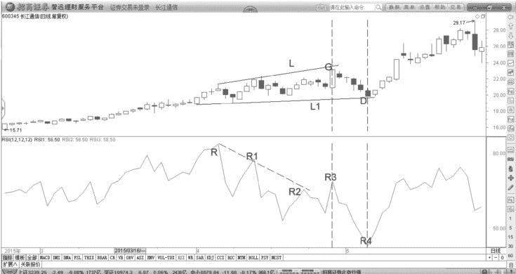

图 4-5 长江通信日 K 线

操作要领：

1.从 RSI 超买提示卖点来看：RSI 指标从 R 回调到 R1 期间，可以看到股价收盘已达到短线高位，并且开始出现回落，这是 RSI 指标与股价短线背离，同时提示高抛卖点出现。这种背离持续到 R2 的时候，可以看到喇叭口的上限 L 和下限 L1 已经出现。

2.从股价高位宽幅震荡加剧来看：在股价宽幅震荡的过程中，股价在喇叭口上限 L 和喇叭口下限 L1 之间双向震荡。D 位置的高点和 D 位置的低点成为了喇叭口形态内部的典型交易价位。

3.从股价单边回调提示底部来看：单边回落持续 5 个交易日后，股价以连续阴线下跌的形式触底 D 位置，这是股价回调到位的信号。与此同时， RSI 指标在 R4 位置触及 50 日等量线以下低点，这表明指标回调充分，该股喇叭口形态完成。

总结： 喇叭口形态出现以后，股价虽然震荡走强，但最后还是会出现明显调整的情况，这期间 RSI 指标也在不断寻求低价的有效支撑。待指标在 50 日等量线下方触底，股价就完成了喇叭口形态的调整走势。

### 4.3.2 买卖时机解析

当喇叭口形态的股价双向震荡时，交易机会将不断出现在双向价位上，高抛和低吸交易机会出现的次数增加。从交易信号的把握上看，RSI 指标和 MACD 指标都能够提升交易机会。特别是在股价回调期间，股价回调到了喇叭口形态的下限，这个时候若 MACD 指标触及 0 轴线，那么买点信号便清晰可见。在缠论回升趋势中，喇叭口形态的下限将成为最低价的建仓机会。股价脱离喇叭口形态前，这种买点不容忽视。

形态特征：

A.收盘不断达新高卖点：当收盘价不断创新高以后，可以看到在喇叭口形态的震荡走势里，高抛卖点就出现在股价反弹期间。

B.DIF 在 0 轴附近买点：当 MACD 指标的 DIF 线回调到 0 轴线附近时，表明指标已经调整到位。在缠论回升趋势中，DIF 线不会轻易跌破 0 轴线，若 DIF 线触底，则是在提示低价买点已形成。

C.股价回调买点：当股价脱离喇叭口形态以后，缠论线段里的股价涨幅会扩大。这期间，股价回调到喇叭口附近，就是典型的触底买点。

图 4-6 长江通信日 K 线

操作要领：

1.从收盘不断达新高卖点来看：在喇叭口形态的震荡走势中，形态上限出现了 G、G1、G2 和 G3 股价连续的卖点。而 G1、G2 和 G3 可以用 RSI 指标的背离来确认，这是中枢形态内部的卖点机会。

2.从 DIF 在 0 轴附近买点来看：喇叭口震荡期间，股价回调到 D3 位置期间， MACD 指标的 DIF 线达 M 位置低点。相比 D、D1 和 D2 三个买点，D3 位置的买点更低，加上 MACD 指标回调 M 位置低点，可以确认 D3 位置的建仓机会。

3.从股价回调买点来看：股价在 D3 位置成功触底，反弹期间股价已经远离中枢调整。不过在股价回升期间，喇叭口形态的缠论中枢形态上方，股价回调到了喇叭口上限附近，这时，D4 位置的买点是低吸机会。股价在 D4 位置回调后很快反弹，盘口的低价位买点稍纵即逝，需要投资者抓紧时间抢筹码。

总结： 股价以喇叭口形态震荡期间，股价走势有不规则的特征。这个时候，确认买卖机会，还需要从缠论中枢调整这个整体来分析。指标提示了股价在喇叭口形态里的异动期间交易信号，而股价突破喇叭口形态的过程中，交易机会也得到验证。

## 4.4 三角形震荡

三角形震荡期间，股价中枢调整的股价运行节奏会不断降低，这时，股价波动空间随之减小，交易空间也不断缩小。不过，作为一个完整的调整形态，三角形中股价震荡次数通常不会超过 3 次。这个时候，想要买卖股票的投资者，一定要抓紧时间把握交易机会。三角形图形态结束以后，缠论中枢震荡亦会结束，同时，趋势性的交易机会继续出现。

### 4.4.1 三角形震荡特征

三角形调整期间，股价双向震荡的空间并不大，因为股价在双向震荡时已完成了三角形调整走势。从缠论回升趋势看，三角形的调整形态是中枢震荡的一部分，同时也是形态上接近三角形的中枢调整走势。相比喇叭口形态，三角形调整期间股价波动空间不大。股价波动期间在三角形上限见顶，并且在低价区完成三角形的两个边。形态上调整完成以后，三角形的中枢形态出现，这是股价将要脱离三角形调整的信号。

形态特征：

A.跳空拉升后股价出现调整：当股价跳空上涨以后，跳空价位上方出现了股价回调走势，这是抛售压力增加的结果，预示着股价进入中枢调整状态。

B.跌幅收窄出现三角形形态：通常，跌幅收窄、股价双向震荡期间会出现三角形形态。作为中枢调整的一部分，在三角形形态中，股价始终没有突破三角形上限，而是在调整空间缩小后完成了缠论中枢形态。

C.RSI 指标调整到位提示突破：RSI 指标同步完成了三角形调整，指标达到三角形上限以后，表明突破信号已出现。这期间，股价会远离三角形调整形态的上限，延续缠论回升趋势。

图 4-7 长江通信 60 分钟 K 线

操作要领：

1.从跳空拉升后股价出现调整来看：股价回升期间，图中 E 位置出现了跳空上涨的缺口形态。跳空回升以后，Q 位置的股价调整开始出现。

2.从跌幅收窄出现三角形形态来看：在股价震荡调整期间，可以看到 RSI 指标已经完成三角形形态。受制于三角形上限 L 的压制，RSI 指标会在 L 线下方运行，完成 1 和 2 位置的触底动作。在 RSI 指标三角形震荡的过程中，股价在 D 和 D1 位置触底，同步完成三角形调整。

3.从 RSI 指标调整到位提示突破来看：RSI 指标的三角形形态在 R 位置完成。R 位置指标已经在三角形上限 L 上方，这是指标提前突破的信号，并提示 Z 位置股价强势已经是买点机会。接下来，股价很快在 T 位置拉升大阳线，突破缠论中枢形态的缠论线段形态开始出现。

总结： 在三角形的调整期间，股价波动空间扩大后开始收缩。总体来看，三角形的上边提供了强压力，股价经过几次触底回升，可以完成中枢形态。并且，三角形调整完成的时刻，同时也是中枢调整结束的信号。

### 4.4.2 买卖时机解析

在三角形调整阶段，股价回调期间量能会萎缩，缩量提示的低价区买点是投资者需要关注的地方。低价吸筹以后，投资者就可以在股价上涨期间盈利。缩量低价是调整的基本特征，同时，股价出现放量拉升以后，股价达到三角形上限。股价向上突破三角形期间出现追涨机会。

形态特征：

A.缩量提示回调买点：量能萎缩期间，股价在图中期间触及短线低点，并提示买点出现。在调整阶段，成交量萎缩是量价关系的常态表现，而且缩量就代表低价，当量能明显低于 100 日等量线时，则表明缩量低价的建仓机会形成。

B.RSI 低位反弹提示买点：中枢调整阶段，RSI 指标单边回落到 50 日等量线下方寻求支撑。在缠论回升趋势中，中枢调整阶段 RSI 指标更大的回调已经不可能出现了。此时，指标低于 50 日等量线，已经是比较难得的买点了。

C.RSI 指标企稳提示追涨点：当三角形调整还没有结束，但 RSI 指标已经企稳在高位时，说明在指标完成三角形调整期间，股价将要脱离三角形震荡的股价区域，追涨的买点出现。

图 4-8 长江通信 60 分钟 K 线

操作要领：

1.从缩量提示回调买点来看：调整期间，股价在 D1 位置缩量回调。P 位置的量能明显低于等量线，这表明缩量低价的买点形成。而 F 位置短线放量，股价放量回调，D 位置的买点是在三角形调整初期出现，这同样是低价的买点机会。

2.从 RSI 低位反弹提示买点来看：RSI 指标在回调期间跌破 50 日等量线， 1 和 2 位置指标都明显低于 50 日等量线，这是在提示 D 和 D1 位置的买点形成。成交量变化和 RSI 指标都能很好地判断三角形调整阶段的建仓机会。

3.从 RSI 指标企稳提示追涨点来看：从 RSI 指标的调整形态来看，指标到 R 位置已经处于三角形上边的上限。三角形的上边为 L，指标达到 R 位置，是提示股价在 Z 位置的买点已经出现。股价飙升到 T 位置前，这样的追涨机会可以被投资者把握。

总结： 在三角形调整阶段，股价整体波动空间不大是相对稳定的调整状态。对于买卖机会，量能萎缩和 RSI 指标回调到位，这两方面都体现了买点信号。并且，从股价三角形调整的完整程度，也可以看到股价完成调整形态过程中的交易机会。

## 4.5 菱形震荡

菱形震荡期间，中枢调整中股价运行的不确定性会增加，虽然交易机会较多，但把握买卖点的难度却加大了。不过，作为中枢震荡的一种形态，菱形的规模依然与其他中枢形态的规模相似。如果菱形震荡期间交易机会增多，投资者可以更多地进行买卖操作。

### 4.5.1 菱形震荡特征

在菱形震荡期间，股价震荡空间会加大，而菱形结束前，股价波动空间就已经收窄了。菱形调整阶段是股价震荡空间由小到大，而后又由大到小的过程。股价震荡空间总体收窄以后，从指标来看，也会出现弱势回调的情况。MACD 指标的 DIF 线单边回落，指标回调到 0 轴线附近，这是指标超跌的一种表现。作为缠论回升趋势，股价不会跌破 0 轴线，同样的，指标在 0 轴线触底，则意味着菱形调整结束和新的缠论线段将要出现。

形态特征：

A.股价波动空间快速加大：股价波动空间快速加大以后，这时股价会双向震荡，买入和卖出的机会也将不断出现。同时，买价更低、卖价更高的菱形调整，会使股价波动空间加大的时刻到来。

B.DIF 线单边回调：当 MACD 指标的 DIF 线开始回调以后，股价波动空间虽然在加大，但指标回调却提示股价涨幅是有限的。待指标跌幅继续扩大，股价弱势表现将会延续，这有助于菱形调整期间的股价波动空间收窄。

C.DIF 线触及 0 轴线：当 MACD 指标逐步走低以后，低价区 DIF 线已经触及 0 轴线，这明确提示了低价买点。既然缠论回升趋势已经出现，就算是在菱形调整阶段，中枢震荡过程中的 DIF 线也很难跌破 0 轴线。同时，DIF 线触底也提示了菱形形态里有低价买点出现。

图 4-9 通宝能源日 K 线

操作要领：

1.从股价波动空间快速加大来看：连续跳空回升以后，股价从 Q 位置开始双向震荡。在股价双向波动期间，菱形上限 L 和菱形下限 L1 逐渐形成。而在股价波动空间收窄期间，菱形上限 L2 和菱形下限 L3 也出现了。

2.从 DIF 线单边回调来看：DIF 线从 M 位置跌破 DEA 线后开始回落。M1 位置的 DIF 线虽然反弹，但是并未改变回调趋势。而指标单边回落，则提示股价进入弱势震荡格局。可见在菱形形态里，股价波动强度并不会始终维持高位。

3.从 DIF 线触及 0 轴线来看：DIF 线触及 0 轴线，表明 MACD 指标的 DIF 线在 M2 位置见底。而指标回调到位，说明股价在双向震荡期间出现了调整结束的情况，同时，建仓交易机会在 DIF 线触底期间形成。

总结： 在菱形调整期间，股价双向震荡的过程与 DIF 线单边回落同步形成。DIF 线回调趋势明显，而股价在双向震荡过程中波动空间收窄，直到菱形调整形态完成。可以说，作为缠论回升趋势中的中枢调整形态，当菱形内部的股价波动空间加大时，低价买点其实就是典型的买点。

### 4.5.2 买卖时机解析

菱形调整阶段，在股价反弹上涨和缩量下跌期间，成交量的放大和收缩可以提示高抛卖点和低价买点。随着股价波动强度加大，成交量的变化也会更大。放量之时脉冲量能很高，而在缩量期间，成交量又会明显萎缩，甚至低于 100 日等量线。当量能萎缩低于 100 日等量线时，对应的低价买点就是不错的建仓时机。作为调整形态，股价菱形调整并不改变缠论回升趋势。若投资者能够在调整阶段低价买入股票，那么今后的盈利会有显著提升。

形态特征：

A.集中放量股价冲高见顶：在集中放量阶段，股价最容易出现单边拉升的情况。在股价进入中枢调整前，集中放量为股价上涨提供了可能。

B.脉冲放量提示高抛：当脉冲量能短线放大时，股价会在短时间内加速反弹，届时，股价将接近菱形上限，而量能释放能提示高抛卖点出现。

C.短线缩量提示抄底：在缩量期间，股价出现回调走势。如果成交量已经低于 100 日等量线，则证明在量能放大的时候，已经是比较低的量能，这提示股价低价买点形成。

图 4-10 通宝能源日 K 线

操作要领：

1.从集中放量股价冲高见顶来看：F0 位置集中放量以后，股价很快冲高到 Q 位置。Q 位置成为量能不再放大后股价调整的起始点。

2.从脉冲放量提示高抛来看：在脉冲量能放大期间，脉冲量能的高成交量对应的是 F、F1、F2 位置，这期间股价达到了 1、3、5 的高点，而典型的高抛卖点就出现在 1、3、5 位置。

3.从短线缩量提示抄底来看：脉冲量能转变为缩量以后，低量能对应的是 S、S1、S2 位置，这期间股价达到 2、4、6 的低点，而典型的抄底建仓机会就出现在 2、4、6 位置。

总结： 在菱形调整阶段，虽然股价涨跌的规律性并不强，但是股价震荡期间放量高抛和缩量抄底的机会却频繁转换。中枢震荡的时候，投资者把握好高卖和低买的交易机会非常重要，可使投资者适应菱形调整，在缠论回升趋势中扩大收益。

# 第五章 盘整阶段资金调整

在缠论趋势形态中，盘整是对股价走势的修正。正是因为有了盘整形态，中枢震荡才会出现。盘整的意义，对于投资者来讲，便是低价买入或者高价卖出的机会。若按照趋势交易的办法买卖股票的话，盘整阶段就是投资者顺势获得最佳交易机会的时刻。并且，盘整阶段股价波动强度越大，交易机会就越典型。除了盘整，缠论趋势中就没有比这更好的交易机会了。如果有，那只能是在新的盘整形态出现时开始。

## 5.1 突破中枢的第一根线段

中枢形态是缠论趋势中的中继形态，其在单边趋势中出现的次数较多。历次中枢调整结束，都会有一根线段来脱离中枢震荡的股价区间。按照中枢震荡的突破方向，投资者能够发现单边趋势的买卖机会。通常，缠论线段出现在中枢调整结束之时，把握好中枢调整结束期间的量价变化，投资者就可以获取更好的交易效果。

### 5.1.1 回升突破阶段兑现收益

缠论回升趋势中，股价在单边上涨阶段涨幅较大，非常典型的高抛交易机会将出现在股价高位。特别是在中枢调整阶段，股价震荡运行期间的股价上限是比较有效的卖点。如果投资者能够在股价上限卖掉股票，自然可以将更大的收益收入囊中。而在缠论中枢形态里，股价震荡过程中能达到回升趋势以来最大涨幅。如果投资者想要将利润兑现，那么，中枢震荡的股价形态便是需要关注的地方。股价突破中枢震荡的时候，是新的缠论线段扩大涨幅后出现卖点的信号。

形态特征：

A.缠论次级回调持续 3 次：在股价上涨的过程中，缠论回升趋势得以延续。而中枢震荡期间，3 次典型的股价回调走势完成，股价的次级回调形态在中枢震荡期间完成。

B.股价跳空上涨缺口出现：在中枢形态里，股价只需两次回调便能够完成中枢形态。3 次调整以后，简单的中枢调整形态已经得到确认，跳空上涨的股价验证了缠论线段的形成。

C.放量拉升出现缠论线段卖点：放量拉升期间，股价会快速脱离中枢调整形态，股价在以加速回升的形式完成缠论线段，高抛的交易机会也得到确认。

图 5-1 瀚蓝环境 60 分钟 K 线

操作要领：

1.从缠论次级回调持续 3 次来看：A 位置是次级调整开始的价位，从 A 位置开始的次级回调走势改变了股价回升节奏。接下来，次级回调走势分别又从 B 和 C 位置开始，股价震荡所耗的时间会逐渐增加。

2.从股价跳空上涨缺口出现来看：Q 位置的股价跳空上涨非常明确，这是股价将要突破的重要信号。期间 F 位置量能达天量，证明资金参与这次跳空拉升的规模很大，股价从 Q 位置的缺口形态开始进入缠论线段上涨阶段。

3.从放量拉升出现缠论线段卖点来看：进入放量回升阶段以后，可以看到低量能虽在 S 位置出现，但是 S1 位置的低量能却更小了，这表明回调期间量能开始缩量，这种整体量能无法继续放大的信号，同时证明了 G 位置附近的高抛卖点出现。同期 MACD 柱线从 D 回来到 D1 位置，这也验证了缠论线段的高抛卖点。

总结： 缠论线段飙升结束后，股价在中枢形态上方的涨幅达到了最高。在新的缠论调整结束前，缠论线段位置的股价涨幅最大，同时，这也是回升趋势突破阶段的有效买点。

### 5.1.2 下跌突破阶段减少持股

缠论回落趋势中，股价在单边线段阶段的跌幅较大，非常典型的反弹卖点机会将出现在股价高位。特别是在中枢调整阶段，股价震荡运行期间股价反弹的上限就是高价区卖点。如果投资者打算在股价下跌期间减少持股，便可以在缠论中枢形态高位卖掉股票。在缠论中枢形态里，股价震荡过程中达到了回落趋势以来最大的反弹幅度。相比较接下来缠论线段趋势中的卖点，更早一些在中枢形态的高位减少持股，就能够更好规避下跌期间的风险，将已经获得的收益兑现。

形态特征：

A.下跌期间出现连续反弹：当下跌期间出现连续反弹的走势时，短期来看，这会改变缠论线段的节奏，促使股价中枢震荡形态出现。

B.量能萎缩低于等量线：若量能萎缩并且低于 100 日等量线，股价将难以在缩量状态下大幅度回升。若成交量低于 100 日等量线，那么股价反弹后将会二次回落。

C.DIF 线遇阻 0 轴线：进入回落趋势以后，若 MACD 指标的 DIF 线低于 0 轴线，则意味着股价看跌。当股价下跌趋势延续时，若 DIF 线反弹接近 0 轴线期间，则是在提示中枢形态的股价高位卖点已形成。

图 5-2 海欣股份 30 分钟 K 线

操作要领：

1.从下跌期间出现连续反弹来看：下跌趋势中股价首先反弹到了 G 位置高位，这是缠论中枢形态里该股第一次出现次级回升走势。G 位置的收盘股价，将会成为判断股价二次反弹的卖点价位。第二次反弹起始于 D 位置的收盘价低点，股价涨幅达到了与 G 位置向上的 G1 位置高位。

2.从量能萎缩低于等量线来看：成交量在 W 位置的量能低于 100 日等量线，这证明股价上涨不会得到延续。同时，股价连续上涨，虽然收盘价最高位 G1 与 G 位置相似，却并未出现明显的拉升。

3.从 DIF 线遇阻 0 轴线来看：DIF 线虽然从 N 位置企稳，但是指标反弹强度并未顺利突破 0 轴线，而是在 M 位置遇阻 0 轴线，这预示着 G1 位置的中枢形态卖点已经出现。如果选择股价在下跌突破阶段减仓，那么 Q 位置的缺口形态就成为了股价加速下跌的信号。技术性反弹到 H 位置的时候，便是典型的高抛卖点。

总结： 在缠论下跌趋势中，股价将脱离缠论图中中枢形态，这时，缠论线段的下跌节奏一旦在跳空阶段加快，那么股价折返就不可能回到中枢形态。反弹期间，当股价接近中枢形态下限时，这也是较好的卖点。

## 5.2 中枢卖点兑现收益

对于普通持股的投资者来讲，要判断缠论趋势的持续时间并不容易。在缠论趋势延续的过程中，中枢震荡和缠论线段突破的情况总是会出现，而缠论趋势也在这个时候得到延续。这期间，依然有丰厚盈利的投资者需要减少持股，将股票在短线高价区卖掉。要知道，确认中枢震荡的高抛卖点，其实是非常理想的获利价位。

### 5.2.1 中枢反弹阶段可高抛

缠论回升趋势中，股价在中枢震荡期间会出现反弹走势，股价反弹空间可以达到短线高位，并成为投资者卖掉股票的不错机会。缠论中枢震荡的次数是难以预料的，如果股价在中枢震荡期间出现一次反弹上涨，那么卖点就可以根据首次收盘达到的高度来判断。接下来，股票收盘价会再次达到中枢震荡高位，从盘口来看，高抛卖点能够得到验证。中枢震荡的次数增加，相应的高抛卖点出现的机会也会增加，于是，投资者便有了更多的高价减少持股的机会。

形态特征：

A.首次回调反弹确认压力位：股价首次回调反弹以后，确认了中枢震荡期间的压力价位。股价在压力位遇阻期间，下跌走势得到了确认。

B.二次放量反弹：当成交量放大以后，股价出现二次反弹走势，当反弹高度到短线高位附近时，指标弱势能提示高抛机会。

C.盘口缩量提示卖点：盘口股价连续飙升，股价接近日 K 线压力价位期间，还是会出现缩量拉升，这是高抛交易的典型信号。

图 5-3 弘业股份日 K 线和分时图

操作要领：

1.从首次回调反弹确认压力位来看：日 K 线图中股价进入中枢震荡，首次反弹达到 G 位置高位。这期间，MACD 指标的 DIF 线在 M 位置走弱，提示了短线高抛卖点的出现。

2.从二次放量反弹来看：当 F 位置成交量连续放大以后，股价很快反弹到 G1 位置，G1 位置与 G 位置接近，这是高价位的抛售机会。

3.从盘口缩量提示卖点来看：在盘口股价尾盘飙升期间，S 位置的量能明显处于萎缩趋势，这表明股价上涨遇阻，C 位置的卖点与 G1 位置收盘高位相同，是典型的抛售价位。同时，日 K 线 MACD 指标在 N 位置遇阻 DEA 线，也验证了高价位的抛售机会。

总结： 在缠论回升趋势中，中枢震荡的形态和缠论回升线段会不断转换。如果股价还没有脱离中枢震荡，这个时候，打算卖掉股票的投资者要在中枢震荡的高位减仓，因为中枢震荡的股价高位更高，通常就是股价缠论回升线段继续出现前的典型卖点。

### 5.2.2 二次高抛的机会

缠论回升趋势中，股价在中枢震荡期间反弹次数很多，规模庞大的中枢震荡里，股价并不会只出现一次股价回调，更不会只出现一次反弹走势。这期间，若反弹空间可以达到短线高位，便能为想要减仓的投资者提供机会。如果缠论中枢震荡期间，投资者并不打算继续持股，那么中枢形态的高位便是抛售机会。当首次股价反弹期间错过卖点以后，投资者还可以在股价二次反弹的时候高抛。从兑现收益的角度看，二次反弹股价达到类似的高位时，卖点相对会高一些，而交易机会却难得。

形态特征：

A.二次放量反弹：当股价成交量显著萎缩以后，股价第三次回调就结束了，这时，股价会出现第三次反弹走势，反弹高度到短线高位附近时，则提示高抛卖点。

B.MACD 指标触及 0 轴线：当 MACD 指标触及 0 轴线时，是在提示股价回调到位。指标回调到位后，会拉升股价出现上涨走势。

C.盘口缩量提示卖点：在盘口股价连续飙升，股价接近日 K 线压力价位期间，还是会出现缩量拉升，这是高抛交易的典型信号。

图 5-4 弘业股份日 K 线和分时图

操作要领：

1.从二次放量反弹来看：股价在 F 位置出现了显著的放量反弹，股价涨幅很快达到 G1 位置。相比 G 位置，股价反弹到 G1 位置的量能更大。显然，这是股价脱离缠论中枢形态的信号。

2.从 MACD 指标触及 0 轴线来看：DIF 线很快在 0 轴线触底，N1 位置便是指标触底的位置，这表明推动股价上涨的 MACD 指标已经企稳。

3.从盘口缩量提示卖点来看：盘口股价放量上涨，但是尾盘 C 和 C1 位置量能明显脉冲放大，量能有限，股价在 M 和 M1 位置见顶。而 M 和 M1 位置与 G1 达到的最高价位一致。

总结： 虽然股价在中枢震荡期间连续回调，但是股价上涨趋势未变。投资者可以从不同的方面，来确认中枢震荡期间的高抛机会。当股价涨幅达到中枢震荡的股价上限以后，卖点可以得到确认。

## 5.3 中枢买点增加持股

对于场外的投资者来讲，在判断缠论趋势的持续的过程中，选择低价位买入股票才能获得单边收益。例如，在缠论趋势延续的过程中，中枢震荡和缠论线段突破的情况总是会出现，此时，缠论中枢的低价区便是投资者的买点，因为低价区的买点很低，在局部调整阶段，投资者可以获取廉价筹码，对于回升趋势中盈利帮助很大。

### 5.3.1 回调线段提示中枢买点

股价在缠论回升期间涨幅较大，股价冲高过程中会出现见顶信号。这个时候，中枢震荡的股价走势出现，股价开始出现双向调整的走势。如果股价回调力度加大，则股价很容易接近前期中枢调整的股价上限。股价在维持回升趋势时，股价不会下跌到前期中枢形态内部，而是在指标破位调整期间出现反弹走势。

形态特征：

A.天量拉升见顶：天量拉升期间，股价在放量上涨时出现了顶部形态。脉冲天量的时候，拉升股价的多方力量释放充分，股价见顶。

B.放量期间股价回调：进入回调状态以后，量能放大，筹码转换速度很快，并推动股价连续回落，缠论回升趋势中的中枢震荡正在形成。

C.股价接近中枢震荡上限：股价回落并且接近前期中枢形态的上限这表明股价下跌到位。不过，股价不会下跌到中枢形态，低价买点将在这个时候出现。

图 5-5 中原环保 30 分钟 K 线

操作要领：

1.从天量拉升见顶来看：在 Q 位置大阳线出现期间，M 位置量能已达天量状态。可见，天量脉冲量能是股价加速见顶的推动因素。

2.从放量期间股价回调来看：天量拉升释放了多方拉升股价的力量，该股进入到放量回调状态。F 位置的量能明显高于 100 日等量线，放量状态下股价回落到 O 位置，这是获利盘快速兑现收益的结果。

3.从股价接近中枢震荡上限来看：股价回调到 O 位置，接近前期中枢形态的上限 G，但股价不会回落到 G 位置，因为在缠论回升趋势中的中枢震荡期间股价不会重合。O 位置成为缠论中枢形态的低价买点，同时，MACD 指标的 DIF 线下跌到 N 位置，指标超跌提示股价下跌到位。

总结： MACD 指标在中枢调整期间虽回调力度加大，但明显跌破 0 轴线的情况却并不多见。只有当 DIF 线低于 0 轴线时，才可以确认低价买点。而指标回调到位，则意味着缠论中枢形态的低价买点已经形成。

### 5.3.2 低价买点第二次出现

股价在缠论回升期间涨幅会加大，且股价在冲高过程中还会出现见顶信号。这个时候，将出现中枢震荡的股价走势，股价开始出现双向调整的走势。在放量下跌的时候，抛售压力会很快释放。接下来，虽然股价回调力度会减小，但股价调整走势却没有结束，缠论中枢震荡形态依然存在，低价位的交易机会继续在这个时候出现。量能萎缩是缠论低价买点的重要特征，缩量越明显股价回调的低价买点就越容易确认。从缩量的股价低点开始，股价之后的涨幅将会很大。

形态特征：

A.量能持续萎缩：当股价放量回调结束以后，接下来，成交量会出现持续萎缩的趋势，这时，股价弱势震荡延续，中枢调整的股价走势还不会结束。

B.MACD 指标弱势震荡：在 MACD 指标弱势震荡期间，DIF 线在 0 轴线附近波动空间减小，同时股价出现缩量调整走势，调整期间股价波动空间缩小。

C.地量买点出现：中枢形态的低价买点出现在放量回调期间。总体上，中枢震荡处于缩量震荡格局中，第二次买点和更多低价买点将会出现。

图 5-6 中原环保 30 分钟 K 线

操作要领：

1.从量能持续萎缩来看：从 F 位置开始，成交量出现明显的缩量。F 位置股价放量反弹结束后，接下来反弹期间量能较低，直到量能在 S 位置明显低于 100 日等量线时，股价才明显出现了非常弱势的表现。

2.从 MACD 指标弱势震荡来看：DIF 线从 N 位置的低位反弹以后会弱势震荡，指标于 J 位置稳定在 0 轴线。在指标回升趋势中，低价位置的 M1、M2 和 M3 的买点不容忽视。

3.从地量买点出现来看：S 位置量能达到地量，这显示缩量状态下股价已经调整到位。作为中枢形态结束震荡的最后买点，M3 位置的买点虽并非最低，但是股价从 M3 位置飙升到 G 位置前，这也是不错的交易信号。

总结： 股价进入中枢调整阶段以后，在股价放量下跌期间，抛售压力会较大。这个时候，可以看到低价的买点更低，适合投资者抄底加仓。实际上，更多的低价买点，会出现在中枢震荡的股价二次回调期间。要知道，调整次数越多，留给建仓投资者的买点就越多。

## 5.4 中枢震荡的超短线交易

在中枢震荡形态里边，股价双向波动的情况很多，无论是高抛交易还是低吸交易，投资者都有机会完成交易过程。脉冲放量可以带动股价短线回升，高抛卖点出现在中枢震荡的股价高位。而股价在中枢震荡期间出现的股价表现，已经体现在盘口当中了。根据盘口股价运行特征，投资者确认盘口买卖点就会相对容易些。

### 5.4.1 脉冲量带动的超短线机会

在脉冲量能出现期间，会出现股价异动形态。脉冲量能越大，盘口股价多空争夺就越激烈，此时，股价在 K 线形态上会表现为大阴线和大阳线的形态。阳线形态会在放量期间形成，这是资金主力拉升股价的信号。即便拉升股价失败，脉冲量也能推动股价异动，其主要表现为高位回落阴线。当股价波动强度加大时，超短线交易机会将出现在大阴线形成的过程中。

形态特征：

A.量能脉冲放大：在脉冲量能出现期间，可以看到量比指标在 3 倍以上。超大量能出现以后，股价会高开运行，股价波动强度也会加大。

B.RSI 指标超买、背离：脉冲放量以后，股价会强势运行，RSI 指标会出现超买、背离形态，这时，脉冲量能推动的股价强势不会得到延续，高抛卖点会很快出现。

C.高开阴线提供卖点：脉冲量能推动股价强势高开，RSI 指标见顶提示了股价下跌。阴线形态出现以后，盘整阶段抛售压力增加。缠论盘整期间，高抛卖点得到确认。

图 5-7 中原环保 30 分钟 K 线

操作要领：

1.从量能脉冲放大来看：M 和 M1 位置的成交量脉冲放大，成交量分别是前一根 K 线期间的 20 倍和 7 倍，可见脉冲效果强势。这时，脉冲量能将推动股价高开运行，而高价位的交易机会也会在这个时候出现。

2.从 RSI 指标超买、背离来看：在脉冲放量期间，RSI 指标瞬间飙升到 R 位置，指标接近 80 超买区域，这提示股价在脉冲放量期间见顶。类似的顶部信号又出现在 R1 位置，虽然 RSI 指标在 R1 位置数值低于 R 位置，但是股价明显高于 G 位置，这是背离提示卖点信号。

3.从高开阴线提供卖点来看：G 和 G1 位置股价明显高开回落。作为缠论震荡的起始点位，G 位置的卖点有指导意义，而 G1 位置卖点与 G 位置卖点相似，都是在脉冲量推动下出现的顶部形态，可以将其视为抛售机会。

总结： 中枢震荡的时候，股价在以脉冲形式进入中枢震荡状态。作为中枢震荡的高位卖点，脉冲放量的高位回落阴线是不可忽视的减仓持股机会。从脉冲放量的阴线形态开始，股价就进入了局部状态，此时，高位减仓可以兑现收益。

### 5.4.2 盘口低吸高抛盈利

在脉冲量能出现期间，股价异动形态就会出现，这个时候也是超短线交易机会出现频率高的阶段。除此以外，从缠论盘整的股价形态来看，股价调整到位以后，盘整期间的低价和高价区都是股价折返概率高的价位，同时也是典型的交易价位。当股价缠论盘整形态开始以后，高价压力位和低价支撑位都已经出现，典型的反转价位的交易信号形成。如果盘口股价运行已经到达 K 线提示的盘整形态支撑位，低价买点就会确认。

形态特征：

A.天量顶部回调：天量顶部形态出现以后，股价在股价高位进入调整状态。天量期间，筹码转移规模会增大，同时拉升股价的力度会减弱，从而使得股价进入盘整回调状态。

B.反弹后出现缩量顶：由于反弹期间量能会萎缩，所以较低的成交量限制了股价的涨幅。确认缩量高抛卖点以后，股价开始二次回调。

C.盘口提示低价底：当盘口股价放量回落时，会出现低价区的买点机会。作为盘整形态股价强势波动的一部分，盘口低价提供了难得的超短线交易买点。

图 5-8 超声电子日 K 线和分时图

操作要领：

1.从天量顶部回调来看：股价在 G 位置出现阳线状态走势后，接下来天量阴线见顶，成为难得的顶部卖点。天量阴线出现，意味着股价进入盘整阶段，超短线高抛低吸的交易机会将逐渐增多。

2.从反弹后出现缩量顶来看：股价很快在 G1 位置出现反弹，股价虽反弹到了短线高位，但是成交量却处于缩量状态。G1 位置的缩量顶部高于 G，成为典型的抛售机会。

3.从盘口提示低价底来看：量能萎缩到 S 位置期间，股价继续缩量回落。S 位置盘口股价开盘放量杀跌，F 位置充分放量后股价下跌，并接近 K 线股价的盘整低点，成为超短线交易的买点机会。盘口低价买点在 M 位置出现，从 M 位置开始的反弹，为投资者超短线获利提供了机会。

总结： 在缠论盘整期间，股价缩量震荡，每一次放量反弹都能成为超短线交易的卖点，缩量回调则是短线低价的买点。围绕盘整走势，股价高抛和低吸的交易机会出现，投资者可以在超短线交易期间适应股价波动，从而增加收益。

## 5.5 区间套确认超短线买卖点

缠论形态的完整性，在不同周期的 K 线形态中都应该是必备的。日 K 线图中股价波动强度较大，往往一根 K 线的波动强度，就可能达到中枢调整形态的波动幅度。这个时候，投资者可以利用区间套的概念确认交易价位。比如在日 K 线图中，如果缠论形态的中枢震荡走势出现，低价买点不容易确认，那么更小周期的 5 分钟 K 线波动潜力就很大，相应的股价形态体现的买卖机会会更加清晰。同样是缠论中枢形态，股价形态在细节方面的表现并不明显，在 5 分钟 K 线里，对于同样时间段的股价走势，投资者可以明显确认交易信号，从而提升盈利空间。

### 5.5.1 区间套确认买点

日 K 线图中，股价在缠论回升趋势中会出现调整形态，调整空间不大时，股价就已经完成了缠论中枢形态。对于打算利用中枢调整买卖股票的投资者来讲，将不得不在更小的缠论形态里确认交易价位，但日 K 线的股价范围较小，无助于投资者精确判断交易价位。要想判断买卖机会，还需在日 K 线确认中枢形态特征，即在股价刚刚达到中枢形态下限期间，缩小缠论结构的时间周期，以精确的买卖点完成交易过程。

形态特征：

A.股价连续飙升后见顶：在连续放量飙升期间，股价以阳线形式进入回升趋势，股价涨幅加大。这个时候，K 线形态上冲高回落，并提示缠论线段期间涨幅见顶。

B.缩量进入中枢调整状态：成交量开始萎缩，股价进入缠论中枢调整阶段，股价在这个时候的回调逐渐加大。

C.MACD 回调到位提示买点：回升趋势中，MACD 指标在中枢震荡期间回调，当指标接近 0 轴线时，表明中枢震荡期间股价回调到位。相应地，当股价处于中枢形态的低价位时，便是买点出现的信号。

图 5-9 山东墨龙日 K 线

操作要领：

1.从股价连续飙升后见顶来看：连续放量拉升出 13 根阳线，该股在第 12 根阳线期间冲高回落，出现了 Q 位置的高价反转形态。Q 位置成为股价缠论中枢调整的起始点位，接下来股价双向震荡，进入中枢震荡状态。

2.从缩量进入中枢调整状态来看：在成交量萎缩的时候，股价连续单边回落，股价触及 Z 位置。缠论中枢调整的时候，量能缩量到 S 位置，已经低于 100 日等量线。可见，S 位置已经是股价中枢调整的最低量能状态。

3.从 MACD 回调到位提示买点来看：MACD 指标的 DIF 线回调到 0 轴线附近， DIF 线在 M 位置触及 0 轴线，这提示股价已经回落到位。这个时候，中枢调整阶段 Z 位置的买点并不清晰，那么，可以在更小时间周期的分钟 K 线里寻找交易机会。

总结： 围绕中枢震荡展开的股价波动中，低价买点往往是股价运行期间的最低价买点。当缠论回升趋势延续时，确保在中枢震荡的低价买点建仓，投资者才能在回升趋势中继续扩大收益。

形态特征：

A.股价跳空下跌：股价跳空下跌期间，股价在触及中枢调整的下限时，出现了明显的加速跌势，这是竭尽缺口提示买点信号。

B.脉冲放量时间很短：脉冲放量时间很短，使得股价在跳空下跌以后确认了放量低点的反弹点位。短促的脉冲放量使得抛售压力释放，股价触底。

C.指标背离提示买点：MACD 指标在短周期 K 线里出现背离，提示股价下跌到位，买点得到验证。

图 5-10 山东墨龙 5 分钟 K 线

操作要领：

1.从股价跳空下跌来看：P 位置股价跳空回落，股价很快触及日 K 线显示的中枢震荡的低价区。缺口出现在股价回落触底期间，是一次典型的竭尽缺口， P 位置对应的低价成为不错买点。

2.从脉冲放量时间很短来看：脉冲放量时间很短，量能仅仅在 F 位置放大，股价就已经下跌到位。这表明，放量抛售的情况已经结束，抛售压力较小，股价在 F 位置放量下跌确认了 M 位置买点。

3.从指标背离提示买点来看：跳空下跌的时候，N 位置 MACD 指标数值明显高于 N0，这是指标与股价底背离信号，提示买点出现。M 位置的两根小 K 线提示低价买点出现。

总结： 同样的低价位，日 K 线图中中枢调整形态的低价区买点信号较少，而短期的 5 分钟 K 线包含了丰富的买点信号，能够为投资者更好地提示买点信号。通过多重组合信号确认建仓机会，可以有效获得廉价筹码。

### 5.5.2 区间套确认卖点

日 K 线图中，股价在缠论回升趋势中出现调整形态，如果调整空间大，并且持续时间较长，那么卖点就不难把握。实战当中，股价在中枢震荡期间异动较大，并非单纯的下跌或者上涨。一根简单的带影线的 K 线形态出现，就已经提示了交易机会完成。那么，对于打算利用中枢调整卖掉股票的投资者来讲，将不得不在更小的缠论形态里确认交易价位。日 K 线的股价范围较小，无助于投资者精确判断交易价位。要想判断卖点，还需在日 K 线确认中枢形态特征，即在股价刚刚达到中枢形态上限期间，缩小缠论结构的时间周期，用精确的卖点完成交易过程。

形态特征：

A.股价连续飙升后见顶：连续放量飙升期间，股价出现阳线形态的机会非常多，股价涨幅加大。这个时候，K 线形态上的阳线冲高回落，并提示缠论线段期间涨幅见顶。

B.缩量进入中枢调整状态：成交量开始萎缩，股价进入缠论中枢调整阶段，股价在这个时候的回调逐渐加大。

C. RSI 指标背离卖点：回升趋势中，MACD 指标在中枢震荡期间回调，指标会弱势运行，股价即便反弹也很容易出现背离形态。这时，潜在的背离可以提示短线卖点出现。

图 5-11 鄂武商 A 日 K 线

操作要领：

1.从股价连续飙升后见顶来看：连续放量飙升期间，股价出现阳线形态的机会非常多，连续出现阳线可以多达 6 个交易日。这个时候，K 线形态上在 Q 位置出现阳线冲高回落，这提示缠论线段期间涨幅见顶。

2.从缩量进入中枢调整状态来看：从 S 位置开始，股价进入缠论中枢调整阶段，成交量开始明显低于 100 日等量线。股价在缩量期间回调加大，低价交易机会逐渐形成。

3.从 RSI 指标背离卖点来看：M 位置短线放量，股价冲高回落，卖点出现在股价冲高的过程中。而 R 位置的 RSI 指标低位运行，即便股价收盘上涨也会出现背离形态。指标运行低位提示高抛机会出现。

总结： 确认股价触底 Z 位置前的冲高回落卖点相对困难，因为股价在 C 位置冲高回落的时候，股价持续时间较短。这时，需要更短周期的 K 线图，来确认中枢震荡的高抛卖点。

形态特征：

A.股价天量冲高：更小的 K 线周期里，股价以天量形式飙升以后，股价涨幅加大。这个时候，高价位的卖点信号出现。

B.缩量提示卖点：量能相对天量很快萎缩，说明成交量放大持续时间相当短，缩量越是明显，股价见顶的概率就越高。

C.RSI 指标背离提示高抛：RSI 指标高位背离回落，体现了短期缠论中枢震荡的反弹阶段卖点出现。背离提示可以高抛，特别是股价天量冲高期间可以卖掉股票。

图 5-12 鄂武商 A5 分钟 K 线

操作要领：

1.从股价天量冲高来看：更小的 K 线周期里，股价在 T 位置以天量形式飙升以后，股价涨幅加大。这个时候，高价位的卖点信号出现在 Y 位置。

2.从缩量提示卖点来看：S 位置量能相对 T 位置的天量很快萎缩，说明成交量放大持续时间相当短，缩量越是明显，股价见顶的概率就越高。S 位置对应股价高位 Y1 是比较典型的高抛机会。

3.从 RSI 指标背离提示高抛来看：RSI 指标在线段 L 表现为高位背离回落，这与股价从 Y 回升到 Y1 相反，提示 Y1 位置的卖点出现。短期缠论中枢震荡的反弹阶段，Y1 在更小的 5 分钟 K 线里得到确认。背离提示可以高抛，投资者能够借助背离高抛来扩大投资收益。

总结： 类似的高价位，日 K 线图中中枢调整形态的高价区卖点信号较少，而短期的 5 分钟 K 线包含了丰富的卖点信号。诸如背离、缩量等都可以为投资者卖掉股票提供帮助。通过多重组合信号确认高抛卖点，可以有效扩大收益，减少持股损失。

# 第六章 回升趋势中枢买点

从缠论趋势来看，中枢形态是趋势中出现次数较多的形态，中枢调整是股价在一段时间里逆向调整的阶段。趋势虽然不会因为中枢形态出现而结束，但趋势运行节奏却与中枢形态的规模有很大关系。如果股价在中枢震荡期间走势复杂，利用好中枢震荡的机会能获得廉价股票，可见其非常重要。在缠论趋势中，以中枢震荡为低价增持的交易机会，投资者的持股收益会因为成本降低而放大。

本章节全部用来解释中枢调整阶段的买股策略，提供最优的建仓手段，以帮助投资者扩大收益。

## 6.1 缠论 3 类买点

在股价触底回升期间，缠论回落趋势转换为缠论回升趋势，此时，获得廉价筹码可以从缠论 3 类买点开始。缠论 3 类买点是在回落趋势向回升趋势转换期间出现的，在股价触底回升，股价摆脱缠论回落趋势最后一个中枢形态的过程中，就出现了对应的 3 类买点。缠论 3 类买点出现以后，缠论回升趋势将得到验证。3 类买点是可以分别建仓的廉价成本价，在 3 类买点中的任何一点买入股票，都可获得不错的收益。

### 6.1.1 低价背驰 1 类买点

在缠论回落趋势中，改变缠论回落趋势的首要条件，就是中枢背驰形态出现。低价区缠论线段是脱离中枢震荡以后的缠论形态，缠论线段与中枢震荡前的缠论线段相比较，前者短则出现背驰。实战当中，背驰就是提示缠论回落趋势结束的首个信号，作为买卖信号，背驰提供了 1 类买点。确认 1 类买点，即获得了廉价筹码。

形态特征：

A.股价十字星触底：低价区出现了十字星触底形态以后，股价进入反弹状态，低价区的缠论线段形成。这个时候，可以比较缠论线段长度，以便确认是否出现背驰形态。

B.RSI 指标背离回升：当 RSI 指标背离回升以后，低价区十字星底部被验证是正确的。低价区十字星具备了底部形态特征，股价将从十字星位置走强。

C.中枢背驰提示 1 类买点：缠论线段的形成以及中枢背驰形态的出现，是在提示股价触底以及 1 类买点出现。这个时候，利用缠论背驰阶段 1 类买点建仓，投资者可以获得廉价筹码，扩大投资收益。

图 6-1 银轮股份 60 分钟 K 线

操作要领：

1.从股价十字星触底来看：低价区出现 T 字形态的十字星以后，股价进入反弹状态，低价区的缠论线段 L1 形成。这个时候，可以比较缠论线段 L1 和 L 长度，以便确认是否出现背驰形态。

2.从 RSI 指标背离回升来看：当 RSI 指标背离回升以后，R2 和 R1 都高于 R，这表明低价区 T 形 K 线期间，股价已经与 RSI 指标背离。这个时候，T 字十字星底部被验证是正确的，缠论线段 L1 已经出现。

3.从中枢背驰提示 1 类买点来看：缠论回落趋势中的最后一个中枢形态是在 B 位置出现，B 位置之前的缠论线段为 L，跌破 B 位置后的缠论线段为 L1，缠论线段 L1 相比 L 短，表明两者形成了背驰。背驰以后，低价区的 1 类买点出现在 T 形 K 线位置。

总结： 在典型的触底十字星中，T 形 K 线是其中的一种，可以成为股价反转的起始形态。从 T 形 K 线开始，股价进入回升阶段。特别是在缠论背驰阶段，低加强的 T 形 K 线成为 1 类买点出现的位置，这种低廉的买点不容错失。

### 6.1.2 回调 2 类买点

股价出现了 1 类买点以后，缠论背驰形态得到了验证。随着反弹的开始，股价反弹达到中枢调整形态，这个时候股价遇阻回落。从回落的价位看，股价并未跌破 1 类买点对应的价位，而是在相对高位企稳，这是缠论 2 类买点出现的位置。缠论 2 类买点位置股价很快获得支撑，股价将会继续反弹，并且达到缠论中枢形态以上。作为反转走势，缠论回落趋势中出现的中枢形态，将会被股价突破，这提示缠论交易机会继续出现。

形态特征：

A.股价从 1 类买点位置反弹：股价从 1 类买点位置反弹以后，股价涨幅加大，股价很快达到中枢形态位置。而缠论回落趋势中的中枢形态价位阻力强，却是难以一次突破的阻力价位。

B.股价在中枢形态遇阻回调：股价并未直接突破中枢形态，而是出现回调走势。股价从中枢形态回调以后，短线低价买点形成，可将其视为缠论 2 类买点。

C.RSI 指标达 50 日等量线：RSI 指标在股价回调期间已经达 50 日等量线，这表明股价已经看涨。反弹回调成为买点，缠论 2 类买点可用 RSI 指标企稳来验证。

图 6-2 银轮股份 60 分钟 K 线

操作要领：

1.从股价从 1 类买点位置反弹来看：股价从 1 类买点位置反弹以后，股价涨幅加大，股价很快达到中枢形态位置。而缠论回落趋势中 B 位置的中枢形态是阻力区，也是难以一次突破的阻力价位。

2.从股价在中枢形态遇阻回调来看：缠论线段 L2 是股价在中枢形态遇阻以后出现的。股价调整幅度不大，股价并未回落到 1 类买点价位，且回调期间还出现了 2 类买点的建仓交易机会。

3.从 RSI 指标达 50 日等量线来看：RSI 指标在 R3 位置达 50 日等量线以后，表明股价虽然调整但却是看涨的。RSI 指标能够支撑股价继续回升，2 类买点已经可以用 RSI 指标验证。

总结： 在缠论 1 类买点出现以后，股价反弹节奏逐步加快。这个时候， RSI 指标与股价同步回升，相应的买点机会也得到了检验。2 类买点是股价在缠论中枢形态遇阻后的重要加仓点位，如果首次 1 类买点已经被错过， 2 类买点同样是可靠的低价建仓点位。

### 6.1.3 突破回调 3 类买点

当缠论低价区的背驰出现以后，股价在低价区先后出现了 1 类和 2 类买点，这是股价继续走强的信号，并预示着行情开始向好。根据低价区的股价反转节奏，股价将在突破缠论中枢形态的过程中出现 3 类买点。通常，3 类买点会出现在中枢形态上方，这是股价突破成功后的回调买点。

在缠论回落趋势中，最后一个中枢形态出现在低价区。股价从低位反弹以后，股价震荡将回升到缠论中枢形态以上。在缠论中枢形态以上，股价再次回调，却不会触及中枢形态，而是在相对高位企稳，企稳的点位便是 3 类买点了。

形态特征：

A.成交量天量放大：成交量脉冲放大以后，股价很快加速上涨。天量量能出现，这体现了主力投资者做多的热情高涨，股价有效突破的概率大增。

B.股价跳空突破中枢形态：股价跳空突破中枢形态阻力区，股价继续强势运行。这个时候，缠论回落趋势中的中枢形态阻力已经不能阻碍股价上涨了。

C.回调期间出现 3 类买点：股价回调期间出现了 3 类买点，该 3 类买点高于中枢形态，是相比 1、2 类买点更有效的建仓价位。

图 6-3 银轮股份 60 分钟 K 线

操作要领：

1.从成交量天量放大来看：成交量在 F 位置脉冲放大以后，股价很快加速上涨。天量量能在 T 位置出现，体现了主力投资者做多的热情高涨。

2.从股价跳空突破中枢形态来看：股价跳空突破了 B 位置的中枢形态阻力区，股价继续强势运行。这个时候，中枢形态 B 已经不能阻碍股价上涨，缠论回升趋势开始加速。

3.从回调期间出现 3 类买点来看：股价突破中枢形态 B 以后，出现了 L3 位置的缠论回调线段。股价回调期间，3 类买点在图中 3 买位置出现。股价在 L4 位置出现了缠论回调线段，同时，与 3 买类似的低价买点在 M 位置形成。

总结： 在缠论回升趋势中，3 类买点的交易信号更加明显，这是股价进入回升趋势以后首个回调买点。虽然 3 类买点股价较高，但是在股价向上突破以后，买点可靠性更强。

## 6.2 放量上涨阶段的中枢买点

在成交量放大期间，股价会表现强势，大阳线很容易突破中枢调整的阻力区。这个时候，放量提供的股价走强信号非常明确，投资者追涨买入股票便可以盈利。而放量拉升以后，如果股价进入中枢调整阶段，股价回落到中枢震荡的下限，其低廉的买入成本价也是投资者需要关注的地方。量能放大的形式有脉冲天量和集中放量，天量拉升后股价更容易突破阻力位，而集中放量则是股价持续走强阶段的突破阻力位。

### 6.2.1 天量缺口后回落买点

天量量能是资金快速流入的信号，这预示着股价突破阻力区有效，交易机会在天量量能以后形成。如果天量期间股价突破了中枢调整形态，同时股价进入到另一个中枢调整阶段，那么，随着量能的开始萎缩，缩量过程中的低价买点就是比较好的进入机会。在中枢震荡期间，暂时不会有超过天量量能的成交量状态，而股价在天量量能结束后会出现明显的缩量调整。缩量情况下，股价达到缩量底部，可以视为买点。

形态特征：

A.天量突破中枢形态：量能达天量状态，股价出现跳空突破缺口。从突破效果看，天量量能存在，股价有效脱离中枢调整形态，这是股价走强信号。

B.股价天量见顶：天量量能以后，股价以天量阴线见顶，股价进入新的中枢调整阶段。在没有放量信号出现前，股价会维持缩量回调趋势。

C. MACD 回调提示买点：在天量顶部以后，股价缩量下跌，同期 MACD 指标回调到 0 轴线。指标的 DIF 线触及 0 轴线，指标已经调整到位，股价天量回落期间的低价买点出现。

图 6-4 鄂尔多斯 60 分钟 K 线

操作要领：

1.从天量突破中枢形态来看：量能在 F 位置达天量状态，股价出现跳空突破缺口。从突破效果看，G 位置天量阴线出现以后，缺口已经明显存在，此时，股价将有效脱离 A 位置的中枢调整形态，这是股价走强的信号。

2.从股价天量见顶来看：F 位置的天量量能出现以后，股价在 G 位置以天量阴线见顶。随着股价跌幅扩大，缩量回落不可避免地出现。量能萎缩的情况下，股价回调到了 M 位置的股价低点。

3.从 MACD 回调提示买点来看：在天量顶部以后，股价缩量下跌，同期 MACD 指标回调到 N 位置，接近 0 轴线。指标的 DIF 线在缠论回升趋势中并不会轻易跌破 0 轴线走强，相信 DIF 线触及 0 轴线已经是股价反弹的信号了。MACD 指标已经调整到位，股价在 M 位置的典型买点出现。

总结： 天量脉冲量能以后，股价跳空突破中枢形态，这时，典型的交易机会并不在天量突破期间，而是在缩量过程中出现的低价买点。量能萎缩的过程中，股价下跌起始是出现新的中枢调整的信号，这表明中枢震荡期间必然存在低价建仓交易机会。

### 6.2.2 集中放量后回落买点

集中放量阶段，股价更容易连续拉升上涨，而股价连续上涨持续的时间，则取决于量能放大的时间。如果集中放量在很短的时间里存在，那么股价会冲高回落。通常，买点在集中放量后会出现股价回调阶段，相比追涨买入股票而言，在回调阶段的建仓成本会更低些。在缠论中枢调整阶段，股价回调期间的低价建仓交易时机不容错过。特别是集中放量以后，股价出现了冲高回落走势。这个时候，股价缩量缩量回调到起涨价位，视为低价买点。

形态特征：

A.股价集中放量上涨：股价集中放量上涨以后，股价在中枢震荡的时候将表现强势。集中放量期间做多的主力会明显介入，从而使得股价出现异动形态。

B.回调期间量能低于等量线：集中放量后便是缩量回调情况，量能萎缩期间会达到等量线以下。若用 100 日等量线判断缩量状态，只要成交量低于 100 日等量线，则表明缩量到位，低价买点出现。

C. MACD 指标在相对高位企稳：MACD 指标的 DIF 线与股价同步回调，在股价缩量触底期间，DIF 线在 0 轴线以上相对高位企稳，并提示买点形成。

图 6-5 鄂尔多斯 60 分钟 K 线

操作要领：

1.从股价集中放量上涨来看：股价在 J 位置集中放量上涨以后，股价在中枢震荡的时候表现强势。集中放量期间做多的主力明显介入，使得股价快速反弹到 G1 位置。G1 位置是中枢调整阶段的股价高位，同时也是高价卖点。

2.从回调期间量能低于等量线来看：集中放量后股价缩量回调到 M1 位置，且量能萎缩期间达到了等量线以下。图中 S 位置量能低于 100 日等量线，据此可判断股价调整到位，低价买点在 M1 位置出现。

3.从 MACD 指标在相对高位企稳来看：当 DIF 线与股价同步回调以后，在股价缩量触底期间，DIF 线在 0 轴线以上的 N1 位置企稳，由于 N1 位置高于 N 位置，所以这是在提示股价已经表现强势，低价买点出现在了 M1 位置。

总结： 集中放量后股价连续上涨，即便股价冲高回落，强势股价表现依然体现在 MACD 指标里。当 MACD 指标的 DIF 线在更高的位置企稳时，则表明股价进入到强势运行的买点已经出现。

## 6.3 100 日均线上方中枢买点

在缠论回升趋势中，股价进入中枢震荡阶段以后，股价的回调力度会很大。若用 100 日均线来衡量股价回调期间的买点机会，那么，当股价触及 100 日均线以后，便会出现短线买入的机会。通常，缠论回升趋势越强，中枢震荡期间股价就越不会跌破 100 日均线，而在假突破的走势中，股价在 3 个交易日内跌破了 100 日均线，也不会改变股价的上行趋势。这个时候，均线支撑股价反弹为投资者提供了买入信号。

### 6.3.1 回调 100 日均线的买点

在缠论回升趋势中，股价连续拉升后涨幅将不断扩大。这个时候，股价距离均线会越来越远。当股价出现顶部信号以后，股价便进入了调整状态。而在股价调整期间，股价会出现横向震荡的中枢调整形态。虽然股价整体回调的空间不大，但是在横向运行的过程中，股价会不断向 100 日均线靠拢。当股价缩量回调接近 100 日均线以后，股价将达到中枢调整形态的下限，抄底买入股票的机会出现在这个时候。

形态特征：

A.股价进入中枢调整阶段：股价进入中枢调整阶段以后，股价会开始逐步回落。股价在每一次回调期间都将出现相应的跌幅，并且，最后一次回调力度会最大。

B.成交量低于 100 日等量线：量能萎缩到 100 日等量线下方时，股价会在极度缩量情况下触底。缩量提示的触底信号非常典型，在中枢形态里，通常量能低于等量线就已经是很好的买入机会了。

C. DIF 线跌破 0 轴线提示买点：DIF 线低于 0 轴线的时候，股价虽然没有跌破 100 日均线，但是 MACD 指标却已回调到位。指标调整到位提示低价买入机会出现，投资者可以考虑低吸建仓。

图 6-6 钱江水利日 K 线

操作要领：

1.从股价进入中枢调整阶段来看：股价在 G 位置进入中枢调整阶段以后，股价开始逐步回落。股价从 G、G1 和 G2 回调的放大逐步增加。最后一次回调力度会最大，股价达到了 100 日均线附近的 M 位置。

2.从成交量低于 100 日等量线来看：量能在 S 位置萎缩到 100 日等量线下方，股价在极度缩量情况下单边回落到了 M 位置。缩量提示 M 位置的触底信号非常典型，这表明中枢调整形态已经是股价局部低位，买点在图中出现。

3.从 DIF 线跌破 0 轴线提示买点来看：DIF 线在 N 位置低于 0 轴线的时候，股价虽然没有跌破 100 日均线，但是 MACD 指标已回调到位。DIF 线跌破 0 轴线的情况出现在缠论回升趋势中，这是不常见的超跌信号，而是在提示 100 日均线附近 M 位置的买点比较可靠，投资者在此建仓可以获得收益。

总结： 在缠论中枢调整阶段，股价弱势回调并不会导致股价暴跌，弱势运行时间越长，股价距离 100 日均线就越近。当股价回调到 100 日均线以后，量能萎缩和 MACD 指标超跌都提示了买入机会。

### 6.3.2 短线跌破 100 日均线的买点

从股价表现来看，在缠论中枢调整阶段，股价有可能跌破 100 日均线。如果真的是这样，那么非常典型的低价建仓机会便有望持续。在缠论回升趋势还没有非常强势的阶段，股价在中枢震荡期间很容易触及到均线。均线对股价的支撑依然存在，短线跌破 100 日均线以后，对持股不坚定的投资者是一种考验。股价在 100 日均线获得支撑后会反弹，而在量能萎缩和 MACD 指标强势横盘的情况下，买点可以得到检验。

形态特征：

A.股价回调至 100 日均线：当股价回调到 100 日均线以后，在中枢调整阶段，股价下跌将基本到位。而在 100 日均线位置，股价短线跌破均线则提示了超跌。

B.量能持续低于等量线：当成交量低于 100 日等量线时，股价的表现会非常弱势。在量能低于 100 日等量线后，股价短线抛售压力减弱，股价将接近中枢调整的形态低点。

C. DIF 线横盘在 0 轴线：DIF 线虽然回调却没有跌破 0 轴线，或者说， DIF 线强势运行在 0 轴线附近。DIF 线表现抢眼提示股价已经获得支撑，股价下跌已到位。

图 6-7 杉杉股份日 K 线

操作要领：

1.从股价回调至 100 日均线来看：股价在中枢震荡期间回调到 100 日均线，图中 1、2 位置股价虽都已经跌破 100 日均线，但是继续下跌的幅度依然很小。可见 100 日均线提供了强支撑，股价已经下跌到位。图中 1、2、3 便是比较典型的买点。

2.从量能持续低于等量线来看：成交量低于 100 日等量线的时候，股价在 1、2、3 位置达到了 100 日均线，这表明股价走势非常弱势。作为中枢调整阶段的缩量回调走势，量能明显低于 100 日等量线，其实是提示缩量底部已经形成。

3.从 DIF 线横盘在 0 轴线来看：DIF 线虽然达到 N、N1 和 N2 位置，却没有跌破 0 轴线。或者说，DIF 线已经在 0 轴线附近获得支撑。DIF 线强势运行在 0 轴线附近，这提示 100 日均线位置的 1、2、3 买点可靠性很强，是中枢形态里典型且有效的建仓价位。

总结： 当缠论回升趋势还没有明显加强的时候，在中枢调整阶段，股价回调到 100 日均线的情况很多。而股价回调到 100 日均线，往往是为了获得强支撑。今后股价脱离中枢形态继续飙升，100 日均线将提供强有力的支撑效果。

## 6.4 筹码支撑阶段中枢买点

在缠论结构中，股价按照缠论趋势运行，中枢形态出现的价位通常是重要的支撑价位。从筹码分布来看，中枢调整阶段股价获得支撑的价位，同样也是筹码峰的下限位置。当股价跌破筹码峰，达到筹码峰下限时，会使持股投资者亏损。因此，投资者出于自救，会降低抛售压力或者拉升股价，这时，技术性反弹走势就会出现在筹码峰下限。

### 6.4.1 筹码峰下方支撑买点

当股价进入回落趋势以后，在股价跌破筹码峰的过程中，持股投资者已经亏损。而股价达筹码峰下方时，上方筹码位置持股的投资者会亏损，下方筹码峰位置持股的投资者收益也明显降低。当股价达筹码峰下方，其实也达到了双筹码峰之间的价位时，说明这个价位附近的支撑很强。股价在双筹码峰之间回落，那么高位筹码峰持股投资者的亏损会进一步扩大，低位筹码峰位置持股的投资者盈利也明显减少，显然，这是很多投资者不愿看到的事情。然而，中枢调整形态的反弹却恰好出现在这个时候。多空博弈以后，出现技术性反弹走势，这是典型交易者盈利的机会。

形态特征：

A.下跌趋势股价进入中枢调整状态：在股价进入回落趋势以后，中枢调整阶段的股价反弹走势出现。但是反弹持续时间较短，股价的第二次回落走势出现。

B.MACD 指标深度回调：在股价回调期间，MACD 指标已经明显跌破 0 轴线。DIF 线单边回落趋势明显，这是股价短线超跌的信号。

C.股价跌破筹码主峰：股价跌破筹码主峰以后，股价下方的筹码峰支撑开始发挥作用。由于股价达筹码峰之间的区域，抛售压力减轻后股价将出现技术性反弹。

图 6-8 重庆百货 60 分钟 K 线

操作要领：

1.从下跌趋势股价进入中枢调整状态来看：在股价进入回落趋势以后，中枢调整阶段的股价反弹出现在了 M 位置。但是反弹持续时间较短，股价的第二次回落后，股价回落到了 M1 位置的股价低点。

2.从 MACD 指标深度回调来看：股价回调到 M 位置的时候，MACD 指标已经跌破 0 轴线。股价继续回落到 M1 的时候，DIF 线已经达 N 位置的低点。由此可见， DIF 线单边回落趋势明显，这是股价短线超跌的信号。

3.从股价跌破筹码主峰来看：股价跌破筹码主峰 P 筹码获利率达 45%。股价下方的筹码峰 P1 开始发挥支撑作用。由于股价达筹码峰之间的区域，所以，抛售压力减轻后股价出现了技术性反弹。从 M1 位置开始的反弹走势出现在图中。

总结： 在缠论下跌趋势中，中枢调整阶段的反弹可以比较小，但是短线交易机会依然存在。对于起始于筹码峰下限的反弹走势，中枢调整阶段股价反弹的概率很大，相应的短线交易机会值得投资者关注。

### 6.4.2 筹码主峰下限支撑买点

在缠论中枢形态里，股价如果已经进入中枢调整状态，那么，筹码主峰形态很可能已经出现。通常，中枢调整越充分，筹码主峰的规模就会越大。在筹码主峰形态出现期间，如果股价继续回落到筹码峰下方，那么，这个时候的抛售压力会减小。在缠论回升趋势里，中枢调整阶段股价跌破筹码主峰，通常是主力尽力打压股价的结果。面对主力的疯狂打压操作，投资者需要谨慎应对股价异动，在股价跌破主峰筹码期间买入股票，依然能够看到股价回升到筹码峰上方以后的盈利机会。

形态特征：

A.量能显著低于 100 日等量线：中枢调整阶段，股价已经处于中枢震荡状态，股价回调而量能低于 100 日等量线，通常可以确认为是缩量低价买点。

B.MACD 指标走低：MACD 指标的 DIF 线走低以后，DIF 线回落至 DEA 线下方，其体现了指标弱势运行的特征。虽然这有可能是短线情况，却可以提示低价买点。

C.股价低至筹码主峰下限：在中枢震荡期间，若股价调整期间股价达到筹码主峰下限，则显示主力打压股价后筹码获利率大幅降低。

图 6-9 拓普集团日 K 线

操作要领：

1.从量能显著低于 100 日等量线来看：在中枢调整阶段，股价已经第三次回调，并到了图中 M 位置。这期间，量能在 S 位置明显低于 100 日等量线，通常这表明已经可以确认为缩量低价买点。

2.从 MACD 指标走低来看：MACD 指标的 DIF 线走低至 N 位置以后，DIF 线回落至 DEA 线下方，其体现了指标弱势运行的特征。这虽是中枢调整结束前的弱势表现，却可以提示低价买点。

3.从股价低至筹码主峰下限来看：经过首次回调以后，股价调整期间股价达到筹码主峰 P 下限，筹码获利率大幅降低至 26%。这种主力打压股价洗盘的结果，提示 M 位置的低价买点已出现。

总结： 股价进入中枢调整阶段以后，虽然股价跌破了筹码主峰，但是跌幅非常有限。即便筹码获利率大幅度降低，依然不改变股价的强势格局。筹码获利率低的情况，表明主力洗盘非常成功，届时，股价将脱离中枢调整，实现更大涨幅。

## 6.5 资金连续流入阶段中枢买点

在资金流入阶段，股价已经在短期获得支撑并且开始走强。股价虽处于中枢调整阶段，但是股价表现并不弱势。连续资金流入体现了主力投资者对个股的关注程度提升，其表现在股价出现连续反弹的走势中。随着每一次资金流入的出现，股价在缠论中枢调整阶段以后，会频繁出现反弹走势。股价反弹的次数不断增加，为投资者提供了典型的短线盈利条件。

### 6.5.1 资金连续流入低价买点

在资金连续流入阶段，股价出现了连续走强的情况，这是值得投资者关注的量价表现。随着资金流入规模的不断扩张，股价在局部反弹期间达到了股价高位。股价达到了局部调整阶段的高价区以后，股价已经处于中枢调整形态的上限，股价开始出现回落。

随着连续流入资金的出现次数不断增加，股价在中枢震荡期间的反弹次数也不断增多。不过，股价虽能够达到中枢调整的上限，却不会在短期走强。这是因为主力投资者为了获得更多的筹码，需要更多的时间买入股票。值得庆幸的是，连续资金流入的情况次数增多，增加了投资者的短线交易机会。等待股价脱离中枢调整形态以后，股价涨幅会不断扩大，这时候才是投资者真正大幅盈利的时刻。

形态特征：

A.股价进入中枢调整阶段：当股价进入中枢调整阶段以后，资金开始连续流出，使得股价出现持续回调的情况，这是中枢调整的结果。

B.资金连续流入：当资金连续流入以后，股价出现多个交易日的连续上涨走势。随着股价涨幅的加大，股价在中枢震荡期间会出现资金推动的反弹走势。

C.股价冲高回落：资金连续流入促使股价出现了反弹走势，反弹以后股价继续出现调整形态。中枢调整阶段，资金连续流入的情况出现多次，使得股价出现频繁的涨跌走势。

图 6-10 中泰化学 60 分钟 K 线

操作要领：

1.从股价进入中枢调整阶段来看：当股价进入中枢调整阶段以后，横向运行的中枢调整形态在 A 位置出现。虽然股价波动空间不大，但是中枢调整形态的必要回调还是有的。

2.从资金连续流入来看：当资金在 R 位置连续流入以后，股价反弹指数从 1 位置开始。资金推动的反弹走势在接下来的 M、R1 和 M1 位置出现。同样的，中枢反弹走势也分别在 2、3、4 位置形成。

3.从股价冲高回落来看：虽然股价的短线表现非常抢眼，但是持续的时间较短，这是资金连续流入结束所导致的。不过主力资金流入的次数增加以后，该股已逐步获得支撑，并且在图中 4 位置出现了明显的涨幅。4 位置开始的股价回升走势以后，脱离中枢调整的缠论线段便出现了。

总结： 在中枢调整阶段，如果资金连续流入的情况形成一定的节奏，那么，股价上涨的趋势就可以得到确认了。在有节奏的资金流入中，主力对股价的控盘在不断加强。在缠论中枢调整阶段，股价震荡的次数是不确定的，不过股价震荡次数越多，资金流入后的主力控盘效果就越好，这时，股价脱离中枢形态期间盈利空间会加大。

### 6.5.2 资金连续流入确认低价支撑买点

在缠论中枢调整阶段，股价短线回落以后，出现了资金连续流入的情况，股价开始加速反弹，这是值得投资者关注的建仓信号。当股价反弹强度加大时，中枢调整期间的低价建仓机会被验证是可靠的。不过如果投资者在这个阶段买入股票，持股成本还是比较高的。如果等到股价冲高回落以后再考虑建仓，那么，就可以获得相对廉价的筹码。

在股价中枢震荡期间，股价震荡的次数较多。一次资金连续流入拉升股价上涨，股价涨幅并不会持续太长时间。而股价短线回调以后，会出现被验证的低价买点，投资者可抄底获利。

形态特征：

A.股价进入中枢调整阶段：当股价进入中枢调整阶段以后，资金开始连续流出，使得股价出现持续回调的情况，这是中枢调整的结果。

B.资金流入股价连续反弹：在资金连续流入期间，股价会出现多个交易日连续上涨的阳线形态。这时，股价涨幅会达到中枢形态上限，股价反弹也将达到中枢震荡期间的高峰阶段。

C.股价回落提示买点：资金的连续流入，会促使股价出现反弹走势，反弹以后资金少量流出，以致股价出现调整阴线。股价回调到中枢形态下限时，中枢调整阶段的低价建仓机会将得到确认。

图 6-11 金智科技 60 分钟 K 线

操作要领：

1.从股价进入中枢调整阶段来看：股价连续飙升以后，股价在 C 位置资金连续流出的情况下进入 A 位置的中枢调整状态。股价在中枢震荡期间双向波动，资金流入转变为典型的脉冲流入形式，这使得股价的上涨大多以反弹结束。

2.从资金流入股价连续反弹来看：从中枢调整阶段局部资金连续流入来看，图中 R 位置是资金连续流入的情况，股价多个交易日的阳线形态表现抢眼。当股价涨幅达到中枢形态上限，便是局部反弹的高抛卖点价位。

3.从股价回落提示买点来看：资金在 R 和 R1 位置连续流入，促使股价出现反弹走势。短线股价反弹结束后，股价低点的 M 和 M1 位置出现了建仓机会。如果投资者能够在 M 和 M1 位置买入股票，那么，接下来当股价脱离中枢震荡的时候，就可以获得高收益。

总结： 在中枢震荡阶段，资金流入虽促使股价强势反弹，但反弹却会以股价达到中枢调整的上限为止。资金拉升的股价反弹恰好验证了主力的介入，这提示中枢震荡期间的低价买点有效。此时，投资者可以认为是低价买点形成，在股价回调期间建仓便能够充分获利。

## 6.6 资金脉冲流入阶段中枢买点

在资金脉冲流入阶段，股价在脉冲资金的推动下，很容易出现大阳线形态。这是因为主力买入股票动用的资金量很大，而持续时间又非常短，从而使得想抛售股票的投资者还没能卖掉股票，股价就已经处于高位了，而高位运行的股价体现了主力强力控盘的特征。利用脉冲资金控盘是强势主力经常采取的策略。散户相对于主力投资者实力上相差悬殊，主力投资者能够按照自己的意志拉升股价上涨。股价强势反弹正是主力操盘的结果。中枢调整阶段，这种强势控盘的形态值得关注，控盘背后的买点信息是比较有效的信号。

### 6.6.1 高脉冲资金流入买点

在脉冲资金流入期间，相比少量资金流入的情况，是比较典型的资金流入现象。高脉冲资金可以推动股价强势反弹，这在中枢调整阶段值得关注，因为缠论中枢调整形态其实是缠论回升趋势的一部分，其并不会轻易改变缠论回升趋势。而高脉冲资金流入的次数增加，频繁出现的高脉冲资金流入，则证明当前的价位已获得了主力投资者的认可，主力投资者正在加紧收集筹码。筹码大量向主力投资者集中，股价将进入到飙升阶段。

形态特征：

A.低价区股价出现调整状态：在低价区出现了中枢调整形态，这是股价发动飙升行情的基础形态。虽然其不会改变缠论回升趋势，但是中枢调整形态却考验了投资者的持股心理，并且，这对于股价上涨有利。

B.高脉冲资金频繁流入：高脉冲资金流入以后，股价阳线突破的情况频繁出现，使得中枢调整阶段的股价高位阻力越来越小，以致股价逐步完成了中枢调整形态。

C.天量资金推动股价涨停：主力投资者已经在高脉冲资金流入期间大量持股，天量资金流入的情况出现以后，资金流入规模大幅提升，股价以涨停形式突破中枢形态上限。

图 6-12 柳钢股份日 K 线

操作要领：

1.从低价区股价出现调整状态来看：在低价区出现了中枢调整形态，股价虽双向震荡明显，却始终没有结束中枢调整形态。

2.从高脉冲资金频繁流入来看：高脉冲资金流入在 M、M1、M2 出现以后，股价阳线异动的形态频繁出现，使得中枢调整阶段的股价高位阻力越来越小。3 次高脉冲资金流入，股价出现了 3 次强势反弹，由此可见，主力做多的意愿非常强烈。

3.从天量资金推动股价涨停来看：在 M、M1、M2 高脉冲资金流入的情况下，主力投资者已经大量持股。而图中 M3 位置出现天量资金流入的情况以后，资金流入规模大幅提升到 7 倍，股价在 Z 位置以涨停形式突破中枢形态上限。高脉冲资金流入完成后，股价还未突破的买点出现在图中 1、2、3 位置。

总结： 中枢调整阶段，股价在形态内部的强势波动，体现了主力投资者的操盘方向。高脉冲资金的流入，使得主力持仓数量逐步增加，股价距离脱离中枢形态更进了一步。天量资金流入则是改变股价运行节奏的信号，这表明股价脱离中枢调整的力度更大，缠论回升趋势得到加强。

### 6.6.2 天量脉冲资金流入买点

在脉冲资金流入期间，相比少量资金流入的情况，更容易改变股价运行节奏，从而促使中枢调整阶段股价大幅上涨。高脉冲资金可以推动股价强势反弹，这在中枢调整阶段值得关注。如果脉冲流入资金达到天量状态，那么股价不仅会强势反弹，而且能够进入中枢调整期间的股价高位。实战当中，天量资金流入成为筹码向主力转移的重要机会。随着股价涨幅的加大，资金流入的情况还是会出现。天量资金流入后会出现连续资金流入，届时，股价将进入连续拉升阶段，使得股价距离脱离中枢调整形态更进了一步。

形态特征：

A.天量资金开始流入：天量资金开始流入以后，股价会强势反弹，股价将达到缠论中枢形态上限，这是主力快速控盘的信号。

B.股价冲高回落：股价冲高回落，天量控盘以后，主力投资者便开始洗盘了。虽然股价短线回落，但股价的强势格局不会发生变化。股价进入中枢形态下限以后，买点会再次形成。

C.资金连续流入拉升股价：资金连续流入以后，股价被拉升起来，股价进入了中枢调整的快速反弹阶段。随着反弹指数的延续，股价会很快脱离中枢形态，进入缠论回升趋势。

图 6-13 大龙地产日 K 线

操作要领：

1.从天量资金开始流入来看：天量资金在图中 T 位置流入以后，股价强势反弹涨停。当股价达到缠论中枢形态上限，便是主力快速控盘的信号。

2.从股价冲高回落来看：股价在天量资金流入以后冲高回落，这表明主力投资者开始洗盘，股价回调到 M 位置的股价低点。虽然股价短线回落，但股价的强势格局不会发生变化。股价达 M 位置的中枢形态下限，买点在这个时候形成。

3.从资金连续流入拉升股价来看：R 位置的资金连续流入以后，股价从 M 位置连续走强，股价出现了多达 7 个交易日的阳线形态。股价反弹回调以后， M1 位置出现了回调低点，可将其视为中枢形态下限的买点。股价从 M1 点继续走强以后，股价进入了缠论回升趋势，涨幅达 G 位置高位。

总结： 天量资金流入以后，股价强势格局已经被确认。虽然股价短线进入中枢调整阶段，但是随着资金的连续流入，股价便延续了回升趋势。在中枢调整阶段，股价不会跌破天量资金流入确立的低价买点。投资者若在中枢形态下限买入股票，便可在回升趋势中盈利。

# 第七章 下跌趋势中枢卖点

缠论下跌趋势中，中枢形态是趋势中频繁出现的形态，也是股价在一段时间里开始反弹的形态。不过，趋势不会因为中枢形态出现而结束，随着中枢形态出现次数的增多，缠论下跌趋势会不断向纵深发展。

虽然缠论趋势运行的节奏，经常会因为与中枢形态的规模较大而滞后，但是趋势依然是趋势，下跌跌破中枢的走势不会结束。在复杂中枢震荡期间，只要利用好中枢震荡的交易机会，高抛卖掉股票就不再是难事。对于已经亏损的投资者来讲，中枢震荡为投资者提供了高价卖掉股票的机会。

本章节全部用来解释中枢调整阶段的卖股策略，其涵盖了 3 类卖点、100 日均线、筹码、资金相关的高抛交易机会，能帮助投资者减少下跌趋势中的亏损。

## 7.1 缠论 3 类卖点

在股价高位回落期间，当缠论回升趋势转换为缠论回落趋势时，减少高价持股风险可以从缠论 3 类卖点开始。缠论 3 类卖点是在回升趋势向回落趋势转换期间完成，股价见顶回落，股价摆脱缠论回升趋势最后一个中枢形态的过程中，就出现了对应的 3 类卖点。缠论 3 类卖点出现以后，缠论回落趋势就已经开始了。3 类卖点是可以分别减仓的高价抛售机会，在 3 类卖点中的任何一点卖出股票，都可以将收益轻松兑现。

### 7.1.1 高价背驰 1 类卖点

在缠论回升趋势阶段，改变缠论回升趋势的首要条件，就是股价高位的中枢背驰形态。高价区缠论线段是脱离中枢震荡以后的缠论形态，缠论线段与中枢震荡前的缠论线段相比，前者短则背驰出现。实战当中，背驰其实就是提示缠论回升趋势结束的信号。作为缠论回升阶段的卖点信号，背驰提供了 1 类卖点。确认缠论中枢背驰的 1 类卖点，也就将利润放大到最大限度。

形态特征：

A.股价十字星见顶：高价区出现了阴线十字星见顶以后，股价会进入顶部回落阶段，同时形成高价区的缠论线段。这个时候，可以比较缠论线段的长度，以便确认是否出现背驰形态。

B.MACD 指标背离回落：当 MACD 指标背离回落以后，高价区十字星顶部被验证是正确的。高价区十字星具备了顶部形态特征，所以股价会从十字星位置开始下跌。

C.中枢背驰提示 1 类卖点：缠论线段的形成以及中枢背驰形态的出现，提示了股价见顶以及 1 类卖点的出现。这个时候，利用缠论背驰阶段 1 类卖点逃顶减仓，投资者可以大幅度降低亏损。

图 7-1 凯乐科技 30 分钟 K 线

操作要领：

1.从股价十字星见顶来看：在缠论线段 L1 完成的过程中，F 位置量能脉冲放大，促使股价在 1 卖出现前形成了高位十字星。这是典型的反转信号。

2.从 MACD 指标背离回落来看：当 MACD 指标背离回落以后，DIF 线从 M 回落到 M1 和 M2 位置，这表明 1 卖位置的高价区十字星顶部被验证是正确的，股价从十字星位置开始下跌。

3.从中枢背驰提示 1 类卖点来看：缠论线段 L1 出现在缠论中枢形态 B 以后，明显要比缠论中枢 A 之后的缠论线段 L 短，这表明回升趋势中出现了缠论中枢背驰形态。M2 位置的 MACD 指标背离以及成交量脉冲放大，都提示 1 卖的减仓交易机会。

总结： 在缠论回升阶段，股价中枢形态背驰提示了高抛交易信号，1 卖是非常典型的高抛价位。1 类卖点的交易价位比较高，成功确认 1 卖，可以从放量顶部、十字星顶部和背离形态来综合验证。

### 7.1.2 反弹 2 类卖点

股价出现了 1 类卖点以后，缠论背驰形态得到了验证。随着高位回落的展开，股价反弹到了中枢调整形态位置，这个时候股价会遇阻回落。从回落的价位看，股价并未高于 1 类卖点的对应价位，而是在相对高位见顶，这是缠论 2 类卖点出现的位置。缠论 2 类卖点位置的股价很快反转下跌，股价将会延续下跌趋势，并且达到缠论中枢形态以下。作为反转走势，缠论回落趋势中出现的中枢形态将会被股价跌破，这提示缠论交易机会继续出现。

形态特征：

A.股价从 1 类卖点位置回落：股价从 1 类卖点位置回落以后，股价的跌幅加大，并且很快达到中枢形态对应价位。而缠论回落趋势中的中枢形态价位支撑较强，是难以一次跌破的支撑价位。

B.股价从中枢形态反弹：股价并未直接跌破中枢形态，而是出现反弹走势。股价从中枢形态反弹以后，短线高价卖点形成，可将其视为缠论 2 类卖点。

C.MACD 指标背离消失：MACD 指标在股价回调期间已经触及 0 轴线，这表明股价已经看跌。MACD 指标的 DIF 线继续回落，并且与股价同步达到相对低位。那么反弹期间会出现缠论 2 类卖点。

图 7-2 凯乐科技 30 分钟 K 线

操作要领：

1.从股价从 1 类卖点位置回落来看：股价从 1 类卖点位置回落以后，股价跌幅加大，并且很快达到 B 位置的中枢形态对应价位。而在缠论回落趋势中，中枢形态 B 对股价的支撑较强，是难以一次跌破的阻力区。

2.从股价从中枢形态反弹来看：股价并未直接跌破中枢形态，而是出现反弹走势。股价从中枢形态反弹以后，量能小幅度回升，短线高价卖点形成，可将其视为缠论 2 卖。1 卖之后，第 2 类卖点在短线高位 2 卖出现。

3.从 MACD 指标背离消失来看：MACD 指标在 M2 位置与股价背离，这提示了 1 类卖点。接下来，MACD 指标又回落到了 M3 位置。M3 位置对应的 2 卖价位并未与 MACD 指标背离，两者出现了同步回落，这表明 2 卖的减仓机会是可靠的。2 卖的减仓价位还没有远离 B 位置的中枢形态，这是典型的高价区卖点交易机会。2 卖以后，股价深度回落到 D 位置的股价低点，而 D 位置远离 B 位置的中枢形态，这说明缠论线段趋势加速。

总结： 在缠论 1 类卖点出现以后，股价回落节奏逐步加快。这个时候， MACD 指标与股价同步回落，相应的卖点机会也更加突出。2 类卖点是股价在缠论中枢形态遇阻后的重要减仓价位，如果首次 1 类卖点已经错过，就要抓住 2 类卖点了，因为 2 类卖点的减仓成本价与 1 类卖点相似，同样是可靠的高价减仓点位。

### 7.1.3 跌破反弹 3 类卖点

当缠论高价区的背驰出现以后，股价在高价区先后出现了 1 类和 2 类卖点，这是股价继续走弱的信号，并预示着趋势依然会向下。根据高价区的股价反转节奏，股价将在跌破缠论中枢形态的过程中出现 3 类卖点。通常，3 类卖点会出现在中枢形态下方，是股价确认下跌后的反弹卖点。

缠论回升趋势中，最后一个中枢形态出现在高价区。股价从高位回落以后，股价震荡会回落到缠论中枢形态以下。在缠论中枢形态以下，股价虽再次反弹，却不会触及中枢形态，而是在相对高位见顶，见顶的点位便是 3 类卖点。从股价下跌幅度来看，股价回落并且从 2 类卖点下跌期间，股价跌幅已经扩大。3 类卖点虽然出现在股价反弹阶段，但是如果投资者前期并未减少持股，在 3 类卖点期间卖掉股票，就已经遭受较多的损失了。

形态特征：

A.成交量萎缩：在成交量萎缩的过程中，股价会很快加速回落。若量能低于 100 日等量线，说明主力投资者做多的热情已消失，这表明股价弱势单边下跌的节奏不会结束，并且，缩量反弹期间会形成卖点机会。

B.股价加速跌破中枢形态：股价加速回落并且跌破了中枢形态以后，股价会继续弱势运行。这个时候，缠论回落趋势的中枢形态阻力已经不能支撑股价反弹，股价缩量下跌的态势将得到较好的延续。

C.回调期间出现 3 类卖点：股价反弹期间出现了 3 类卖点，3 类卖点低于中枢形态，是相比 1、2 类卖点更低一些的减仓价位。3 类卖点低于缠论回升趋势的最后一个中枢形态，在缠论 3 类卖点期间减少持股，依然能够降低损失。

图 7-3 凯乐科技 30 分钟 K 线

操作要领：

1.从成交量萎缩来看：成交量在 F 位置脉冲见顶以后逐步萎缩，股价加速回落到 D 位置。从量能低于 100 日等量线，可看出主力投资者不再拉升股价，股价单边下跌的节奏加快。而卖点机会将在股价从 D 位置的技术性反弹期间形成。

2.从股价加速跌破中枢形态来看：股价在 2 卖位置见顶以后开始加速回落，且短时间内跌破了 B 位置的中枢形态，使得股价维持弱势运行的格局。这个时候，缠论回落趋势的中枢形态已经不能阻碍股价下跌，股价缩量下跌的态势将得到较好的延续。

3.从回调期间出现 3 类卖点来看：股价反弹期间出现了 3 类卖点，3 卖低于中枢形态，成为比 1、2 类卖点更低一些的减仓价位。由于 3 类卖点低于缠论回升趋势的最后一个中枢形态 B，所以在缠论 3 类卖点期间减少持股，依然能够降低损失。

总结： 在缠论回落趋势中，3 类卖点的交易信号更加明显，它是股价进入缠论回落趋势以后，破位下跌阶段出现的卖点。从缠论形态看，3 类卖点位置的中枢震荡要低于最后一次中枢形态，更低的价位出现中枢震荡，体现了股价突破的有效性。

## 7.2 缩量下跌阶段的中枢卖点

天量量能是资金快速流入的信号，它出现在股价高位时，常意味着股价在突破阻力区的过程中抛售压力增加，K 线表现为顶部特征，交易机会在天量期间出现。如果天量期间股价跌破了短线高位，同时股价进入到另一个中枢调整阶段，那么，随着量能开始萎缩，缩量过程中的反弹卖点就是比较好的减仓交易机会。中枢震荡期间，暂时不会有超过天量量能的成交量状态，而股价在天量量能结束后会出现明显的盘整。作为调整阶段的交易机会，缩量情况下，股价进入低量低价底部，投资者可以视为买点。

### 7.2.1 天量顶部后中枢卖点

天量量能是资金快速流入的信号，出现在股价高位，这意味着股价在突破阻力区的过程中抛售压力增加，K 线表现为顶部特征，而交易机会将在天量期间出现。如果天量期间股价跌破了短线高位，同时股价进入到了另一个中枢调整阶段，那么，随着量能开始萎缩，缩量过程中的反弹卖点，就是比较好的减仓交易机会了。在中枢震荡期间，暂时不会有超过天量量能的成交量状态，而股价在天量量能结束后会出现明显的盘整。作为调整仓位的交易机会，在出现天量顶部期间，便是投资者考虑高价卖掉股票的时机。

形态特征：

A.天量回落进入调整状态：股价经过单边上涨以后，会出现低开下跌阴线形态，这期间量能达到了天量状态。在天量回落的股价走势中，股价会很快进入反转状态。缠论回升趋势还未结束的时候，天量顶部形态的出现速度会很快，并且，其还将成为股价进入中枢调整的起始形态。

B.RSI 指标超买：RSI 指标超买以后，股价天量回落的顶部被验证是可靠的交易价位。RSI 指标超买回落提示交易机会有效，指标下跌期间会出现股价反弹，这便是高抛交易机会。

C.反弹卖点形成：在天量顶部以后，股价会缩量下跌。在短期没有放量的情况下，RSI 指标将超买回落，并推动股价弱势运行。从短线看，反弹即是不错的卖点。

图 7-4 苏泊尔日 K 线

操作要领：

1.从天量回落进入调整状态来看：股价经过单边上涨走势后，图中 M 位置出现了低开下跌大阴线形态，这期间量能在 T 位置达天量状态。在天量回落的股价走势中，股价很快进入了调整状态。缠论回升趋势还未结束的时候，天量顶部形态的出现速度会很快，并且，其还会成为股价进入中枢调整的起始形态。

2.从 RSI 指标超买来看：RSI 指标在 R 位置达 81.5 的超买状态以后，股价天量回落的顶部被验证是可靠的交易价位。RSI 指标超买回落提示交易机会有效，指标下跌期间出现了股价反弹，这便是高抛交易机会。

3.从反弹卖点形成来看：在天量顶部以后，股价缩量下跌。缩量期间高抛交易机会出现在 M1 和 M2 位置。虽然 M1 和 M2 位置都低于 M，但却是可靠的高抛交易机会。作为中枢形态期间的卖点，M1 和 M2 不容忽视。

总结： 天量反转形态出现以后，股价很快进入弱势盘整阶段。这个时候，典型的交易机会已经出现。量能相对于天量萎缩，而 RSI 指标从超买位置回落，这些都提示中枢形态里将会存在高抛卖点。

### 7.2.2 集中放量回落卖点

在强势回升的缠论趋势中，股价可以出现集中放量的走势。并且，量能放大期间，股价会连续拉升上涨。只不过，股价连续上涨持续的时间较短，会很快出现指标顶部反转信号，这提示了缠论回升趋势的高抛交易机会。

集中放量在很短的时间里出现，往往是主力投资者密集操盘的体现，这表明股价短线有潜力大幅上涨。通常，卖点在集中放量后会出现股价回调阶段。由于筹码转移数量加大，所以集中放量上涨后股价会放量下跌。集中放量下跌是筹码快速换手的结果，这表明短线交易的投资者在快速兑现收益，从而使得股价出现了调整走势。

形态特征：

A.股价集中放量上涨：股价集中放量上涨以后，股价在中枢震荡的时候会表现强势。集中放量期间做多的主力会明显介入，使得股价出现了异动形态。如果股价累计涨幅加大，那么，集中放量后股价将持续局部调整走势。

B.RSI 指标超买：RSI 指标达到超买状态以后，股价高位放量见顶形态将得到确认。在 RSI 指标回调期间，股价跌幅会快速扩大，交易机会在这个时候可以被验证。

C.放量回落卖点出现：集中放量上涨后便是放量回调走势，量能依然维持在 100 日等量线上方。这表明筹码转换速度加快，而放量回落则提示局部高位卖点出现。

图 7-5 登海种业日 K 线

操作要领：

1.从股价集中放量上涨来看：股价集中放量上涨以后，股价跳空回升到了 G 位置的股价高位。此时，股价涨幅快速加大，在中枢震荡出现前，该股已经完成了缠论线段的强势飙升过程。

2.从 RSI 指标超买来看：RSI 指标达到 80 以上的超买状态以后，股价高位放量见顶形态得到了确认。此外，在 RSI 指标冲高回落期间，同时也是股价冲高回落的时刻。

3.从放量回落卖点出现来看：集中放量上涨后便是 F 放量和股价回调走势，量能依然维持在 100 日等量线上方。这表明筹码转换速度加快，且放量回落提示了 G 位置已经是局部高位的卖点。股价震荡调整以后，F1 位置量能放大，相似的卖点在 M 位置出现。

总结： 集中放量后股价连续上涨，即便股价冲高回落，也依然是放量状态的回落走势。这样看来，股价的活跃度很高。而放量下跌的时候，筹码在短线交易投资者手中转换后，股价在中枢调整阶段的震荡会延续。

## 7.3 100 日均线下方的中枢卖点

在缠论回落趋势中，股价进入中枢震荡阶段以后，股价的反弹力度很大。若用 100 日均线来衡量股价反弹期间的卖点机会，那么，股价触及 100 日均线以后，就会出现短线卖出的机会了。此外，缠论回落趋势越强势，中枢震荡期间的股价便越不会突破 100 日均线。在假突破的走势中，即使股价短期反弹达到了 100 日均线上方，也不会改变股价下行趋势。这个时候，均线压制股价为投资者提供了卖出信号。

### 7.3.1 触及 100 日均线的反弹卖点

确认了缠论回落趋势以后，股价连续下跌后跌幅会不断扩大。这个时候，股价距离均线已越来越远。同时，股价出现底部信号，股价进入了调整状态。在调整期间，股价在横向震荡的中枢调整形态里会逐步靠近 100 日均线。虽然股价整体反弹空间不大，但是股价已经接近 100 日均线。当股价反弹到 100 日均线以后，并且达到中枢调整形态的下限时，高抛卖点就会在股票反弹的过程中出现。

形态特征：

A.股价进入中枢调整阶段：股价进入中枢调整阶段以后，股价反弹机会将增多，股价开始逐步回升。股价在每一次反弹后都会出现相应的涨幅，且最后一次的涨幅会加大。

B.成交量低于 100 日等量线：量能萎缩到 100 日等量线下方时，股价会在极度缩量情况下触底。缩量提示的触底信号非常典型，通常，当中枢形态里量能低于等量线时，就已经是很好的买入机会了。

C.RSI 反弹提示卖点：RSI 指标在股价进入中枢调整以后将开始反弹，并且指标反弹会不断提升，最后指标达到高位，这提示股价见顶 100 日均线的卖点有效。这时，确认 RSI 指标见顶的高抛交易机会，也就把握住了高抛卖点。

图 7-6 紫光国芯 60 分钟 K 线

操作要领：

1.从股价进入中枢调整阶段来看：股价进入中枢调整阶段以后，股价反弹的机会增多，图中 G、G1 都为反弹期间达到的高价位。股价在每一次反弹后都出现了相应的涨幅，最后一次涨幅达到了图中高位 M。

2.从成交量低于 100 日等量线来看：虽然股价进入中枢调整阶段，股价实现了一定的涨幅，但是图中 S 位置体现的量能明显低于 100 日等量线，这表明股价上涨始终是无量状态实现的。可见 M 位置股价并不容易突破 100 日均线，而高价抛售的卖点就在 M 位置形成了。

3.从 RSI 反弹提示卖点来看：股价缩量反弹达 100 日均线附近，同期 RSI 指标数值达到了 R 位置的超买状态，而股价上涨期间的 M 位置卖点出现。

总结： 在缠论中枢调整阶段，股价弱势反弹并不会导致股价暴涨走势出现，而且，弱势运行的时间越长，股价距离 100 日均线就越近。当股价反弹并接近 100 日均线以后，量能萎缩和 RSI 指标见顶，这些都提示了高抛交易信号。

### 7.3.2 二次触及 100 日均线的反弹卖点

在强势股价表现中，进入缠论中枢调整阶段以后，股价有可能会向上突破 100 日均线。如果真是这样，那么，非常典型的高价抛售机会就会出现。均线对股价的阻力很强，短线突破 100 日均线以后，对持股不坚定的投资者显然是抛售机会。这个时候，即便抛售压力并不大，股价也依然有望出现持续回落走势。下跌趋势中，中枢调整形态在 100 日均线位置结束，这并不奇怪。的确，100 日均线位置多空争夺激烈，股价处于缠论回落趋势中，做空投资者将占据优势，股价将从假突破 100 日均线向继续回落转变。

形态特征：

A.股价反弹至 100 日均线：当股价反弹到 100 日均线以后，在中枢调整阶段，股价涨幅已基本到位。而在 100 日均线位置，股价短线跌破均线则提示涨幅见顶。

B.量能脉冲放大：成交量脉冲放大至 100 日等量线上方，量能持续放大的时间很短。在脉冲放量的情况下，限制了股价的涨幅。确认脉冲量能无法维持在等量线上方，即可判断卖点。

C.DIF 线与股价高位背离：DIF 线虽然反弹却没有达到更高数值，而是与股价形成了背离。DIF 线弱势运行相对低位以后，是在提示股价已经涨无可涨。股价飙升到位以后，投资者就可以判断高抛卖点的出现了。

图 7-7 紫光国芯 60 分钟 K 线

操作要领：

1.从股价反弹至 100 日均线来看：股价反弹到 M1 位置的 100 日均线上方以后，中枢调整阶段的股价涨幅基本到位。100 日均线位置压力很强，股价突跌说明该均线并非是真实的突破形态。

2.从量能脉冲放大来看：成交量在 E 位置脉冲放大至 100 日等量线上方，量能持续放大时间很短。脉冲维持放量仅有 3 个交易日，这限制了股价的涨幅。确认脉冲量能无法维持在 100 日等量线上方，即可确认是抛售机会。

3.从 DIF 线与股价高位背离来看：DIF 线虽然反弹到 C1 位置，却没有达到更高的数值，C1 位置低于 C 位置，是在提示 DIF 线与股价背离。这意味着 M1 位置股价达到反弹最高位，却已经是高抛交易机会。股价飙升到位以后，股价下跌期间又出现了 Z 和 Z1 位置的卖点。接下来股价杀跌到 D 位置，这表明下跌趋势延续。

总结： 缠论回落趋势还没有加速的时候，出现了缠论中枢形态。股价的反弹就已经达到了 100 日均线附近。100 日均线阻力很强，并成为了假突破期间的有效卖点。顶部信号包括 MACD 指标的背离、成交量的脉冲见顶，这些都提示了价位的最高抛售机会出现。

## 7.4 筹码压制下的中枢卖点

在缠论结构中，股价按照缠论趋势运行，中枢形态出现的价位通常是重要的压力位。从筹码分布来看，中枢调整阶段股价反弹后见顶，也是筹码峰的上限阻力。股价反弹至筹码峰上限，使得持股投资者多数盈利，增加了止盈后的抛售盈利。卖出股票的投资者快速增加以后，筹码峰上限成为了中枢调整阶段的重要卖点。

### 7.4.1 短线筹码峰上限卖点

当股价进入回落趋势以后，反弹期间股价达到筹码峰上限，持股投资者很快获得收益。筹码峰上限抛售压力很大，持股投资者有很强的兑现收益愿望。如果兑现收益的动作在股价达筹码峰上限后开始，对中枢调整阶段的股价反弹是最大冲击。

股价在筹码峰上限见顶期间，从成交量萎缩和指标见顶来看，同样能够确认股价的顶部特征。量能萎缩期间，股价无法维持在筹码峰上方。而指标弱势表现也提示股价强势表现不可持续。综合判断得知股价在筹码峰上方遇阻，可以在股价回落前确认卖点。

形态特征：

A.股价突破筹码主峰：股价在回落趋势中出现震荡走势，股价反弹至筹码峰上限。这个时候，筹码获利率达到最大，多数投资者已经处于盈利状态，不过盈利空间有限。

B.MACD 弱势反弹：虽然股价反弹期间 MACD 指标已经达 0 轴线上方，但是 DIF 线并未继续回升，而是横盘在 0 轴线附近，这提示股价表现弱势，卖点不容忽视。

C.量能低于 100 日等量线：在成交量无法达到 100 日等量线的时候，即便是中枢调整，股价也很难有强势表现。股价弱势反弹到筹码峰上方的动力不足，卖点出现的概率大增。

图 7-8 巨轮智能日 K 线

操作要领：

1.从股价突破筹码主峰来看：在缠论回落趋势中，该股反弹至 P 位置筹码峰上限。这个时候，筹码获利率达到 V 位置显示的 85%，这表明多数投资者已经盈利。但是受限股价的涨幅有限，投资者的盈利空间并不大。

2.从 MACD 弱势反弹来看：股价反弹期间 MACD 指标虽已达 M 位置的 0 轴线上方，但是 DIF 线并未继续回升，而是横盘在 0 轴线附近。可见，指标弱势提示股价表现弱势，卖点不容忽视。

3.从量能低于 100 日等量线来看：股价反弹达 G 位置，成交量在 E 位置都无法达到 100 日等量线以上。而该股处于缠论中枢调整阶段，成交量无法放大的时候，该股在 G 位置高位卖点出现。股价达筹码峰上方时，持股投资者已经盈利，这在缠论回落趋势中成为了抛售信号。

总结： 缠论回落趋势中，即便是中枢调整阶段，也不是所有投资者都能盈利。如果股价达筹码峰上方，只能说是反弹为持股投资者提供了减仓机会。股价达筹码峰上方后，投资者可短线盈利，而忽视卖点的投资者将会二次亏损。

### 7.4.2 高位筹码峰下限卖点

在缠论回落趋势中，股价跌幅加大以后，股价跌破了高位筹码峰。在超跌反弹期间，缠论中枢形态出现，股价如果已经进入中枢调整状态，那么反弹期间可以达到筹码主峰的下限。并且，缠论中枢调整越充分，股价挑战筹码主峰的阻力区的次数也就会越多。但是筹码主峰形态位置抛售压力很大，股价很难继续向上突破高位筹码主峰。

股价在中枢调整阶段达到筹码主峰下限时，抛售压力会增加，股价会出现回调走势。在中枢调整结束以后，每一次的回调都起始于筹码主峰下限，股价跌破中枢形态以后，股价最终还是会延续缠论回落趋势。

形态特征：

A.量能显著低于 100 日等量线：中枢调整阶段，在成交量明显低于 100 日等量线的情况下，股价虽然进入了中枢震荡阶段，但是股价的表现并不抢眼。

B.RSI 指标弱势表现：在 RSI 指标弱势表现中，指标明显低于 50 日等量线，这显示指标弱势运行期间的交易机会并不多。即便是反弹走势，在 RSI 指标走强前，交易机会也明显较少。

C.股价达筹码主峰下限：中枢震荡期间，股价反弹后达到筹码主峰下限。这表明买盘推动的股价表现强势，但是主峰筹码的套牢盘较多，很难一次性突破的压力区。

图 7-9 横店东磁日 K 线

操作要领：

1.从量能显著低于 100 日等量线来看：股价进入缠论中枢调整阶段期间， S 位置显示的成交量明显低于 100 日等量线，该股虽然进入中枢震荡阶段，但是股价表现并不抢眼。反弹期间，股价连续三个交易日回升，涨幅达 M 位置高位。

2.从 RSI 指标弱势表现来看：当 RSI 指标弱势反弹以后，指标在 R 位置的数值为 42，明显低于 50 日等量线，这显示指标弱势运行期间的交易机会并不多。即便股价反弹到 M 位置，这种反弹也很难在弱势情况下延续。

3.从股价达筹码主峰下限来看：股价进入中枢震荡期间，股价反弹达到 M 位置，M 位置恰好是 P 位置筹码主峰下限。而下方筹码峰 P1 也是有一定规模的，相比筹码主峰 P，P1 位置筹码峰规模小很多。P 位置筹码主峰全部是套牢盘集中的股价区间，股价并不会在弱势情况下突破 P 位置筹码峰。那么，M 位置的卖点便得到确认。

总结： 股价进入中枢调整阶段以后，股价可以挑战筹码主峰，但是成功率很低。受限于成交量较小，RSI 指标表现不佳，股价最终还是以见顶筹码主峰下限，从而结束了中枢震荡期间的反弹走势。回过头来看卖点，股价达到筹码主峰下限，便是不错的卖出股票的交易信号。

## 7.5 资金脉冲诱多阶段中枢卖点

资金脉冲流入以后，即便股价处于回落趋势，股价反弹走势依然会出现。股价在脉冲资金推动下会出现连续回升的阳线形态。这是因为主力买入股票动用的资金量很大，而持续时间又非常短，从而使得抛售股票的投资者还没能卖掉股票，股价就已经处于高位，而高位运行的股价体现了主力强力控盘的特征。利用脉冲资金来控盘，是强势主力经常采取的策略。散户相对于主力投资者实力上相差悬殊，主力投资者按照自己的意愿拉升股价，股价冲高回落正是主力操盘的结果。中枢调整阶段，这种强势控盘的形态值得关注，控盘背后的买点信息是比较有效的信号。

### 7.5.1 脉冲资金流入结束卖点

资金表现为连续净流入时，股价会表现强势。即便在缠论回升期间，也依然会出现股价强势的表现，这是值得投资者关注的强势高抛信号。若资金流入表现为脉冲形式，那么，股价强势表现只是在短期出现，并非是中长期的存在。如果投资者确保在脉冲资金流入的时候减少持股，那么脉冲资金消失以后，便可以规避股价调整风险。而在缠论回升趋势中，在股价中枢调整阶段的高位减少持股，同样是规避风险的较好策略。

形态特征：

A.低价区股价出现调整：在超跌反弹以后，低价区出现了中枢调整形态，股价双向震荡的形态出现。

B.脉冲资金频繁流入：脉冲资金流入以后，股价小阳线回升的表现突出，股价会频繁出现反弹行情，短线高位卖点也同步形成。

C.资金流入结束提示卖点：资金脉冲流入期间，股价表现为短时间的阳线反弹形态。在脉冲资金流入结束的时候，典型的抛售信号出现。2 次资金流入的反弹结束以后，股价第 3 次出现脉冲资金流入结束的信号时，就是在提示中枢形态的最后卖点已出现。

图 7-10 通宝能源日 K 线

操作要领：

1.从低价区股价出现调整来看：股价从高位 10.7 元下跌以后，该股暴跌到 7 元附近。技术性反弹走势在 M 位置脉冲资金流入的情况下持续。而在缠论回落趋势中，中枢调整形态也从这个时候开始。

2.从脉冲资金频繁流入来看：M 位置的脉冲资金首次流入以后，该股进入了反弹震荡运行阶段。接下来 M1 位置继续出现脉冲资金流入，小阳线形态连续出现了 5 次。

3.从资金流入结束提示卖点来看：最后一次脉冲资金流入持续在 M2 位置，这个时候股价连续回升到 G。在 L 位置的资金突然流出期间，该股已经结束中枢调整走势。中枢震荡的过程中，脉冲资金流入提供的最高价卖点在 G 位置出现。

总结： 脉冲资金流入时间很短，对股价的影响是短期的，而投资者需要确保高抛卖掉股票，才能减少持股的风险。中枢震荡期间只需要两次反弹，中枢调整形态的结构特征就已经具备。那么第 3 次脉冲资金流入的时候，股价反弹便是最后的卖点了。

### 7.5.2 充分脉冲流入的卖点

脉冲资金流入得到充分释放以后，股价短线强势表现结束，这个时候是股价将要见顶的信号。可以确认的是，资金脉冲形式流入已经是比较弱势的控盘动作了。主力投资者没能维持弱势控盘状态时，脉冲资金充分释放以后，缠论调整阶段的高抛卖点也就被确认了。

形态特征：

A.单日脉冲资金流入：单日脉冲资金流入以后，股价短线表现抢眼。这个时候，股价反弹后会快速接近中枢调整上限。

B.脉冲资金流入充分释放：脉冲资金流入得到充分释放后，股价虽然短线强劲反弹，但是资金流入竭尽，这是在提示高抛卖点。

C.冲高回落卖点出现：股价冲高回落以后，如果脉冲资金继续出现，而脉冲的资金流入规模显著减小，那么，这将是主力无法控盘的最后一次高抛交易机会。

图 7-11 华域汽车 60 分钟 K 线

操作要领：

1.从单日脉冲资金流入来看：T 位置的单日脉冲资金流入以后，股价在 M 位置大阳线冲高，股价快速达到中枢调整阶段的高位。这个时候，是典型的短线抛售股票的交易机会。

2.从脉冲资金流入充分释放来看：图中显示的 1、2、3 位置的资金脉冲流入数量明显减少，股价勉强维持强势，股价飙升到了 M1 位置高位。而 M1 位置的高抛卖点不容忽视。

3.从冲高回落卖点出现来看：股价反弹达 M 位置以后，中枢调整阶段的 2 次反弹已经完成。接下来股价回落以后，图中 4、5、6、7 位置的脉冲资金流入明显减少。主力投资者短线控盘明显减弱，该股表现出阴线十字星形态。弱势运行期间，M2 位置的高抛卖点进一步出现。

总结： 资金脉冲流入期间，股价可以在短期表现出强势。随着中枢震荡格局的延续，脉冲资金推动的股价上涨将逐渐减弱。脉冲资金充分释放以后，主力投资者只维持少量资金控盘，控盘力度明显降低以后，提示了高抛卖点的出现。

## 7.6 资金连续流出阶段中枢卖点

在资金连续流出阶段，主力在主动减少持股数量，使得抛售压力不断增加，股价下跌趋势得以延续。这个时候，投资者可以利用资金流出确认股价下跌趋势。这能够在资金流入加速的时候，确保在股价跌幅扩大前减少持股。

### 7.6.1 资金加速流出反弹卖点

资金加速流出阶段，股价就已经进入到弱势下跌状态。在资金流出的过程中，股价同步回落显示了主力投资者的出逃信息。如果资金流出转变为更明显的资金流出趋势，那么，股价回落趋势将不会有结束的可能。

形态特征：

A.中枢调整期间股价回升：股价进入中枢调整阶段以后，股价在缠论回落阶段出现了反弹走势。若反弹强度加大，那么，股价将达到短线调整的高位。

B.大量资金集中流出：大量资金集中流出以后，股价很快从短线高位连续回落，表现为单边下跌阴线形态，体现了资金流出对股价的影响显著。

C.资金流出减弱提示卖点：当资金流出规模减弱以后，股价下跌节奏也减缓，这时，短线横盘期间的高抛交易机会将出现。

图 7-12 山西汾酒 60 分钟 K 线

操作要领：

1.从中枢调整期间股价回升来看：在股价进入中枢调整状态以后，股价短线反弹至 Y 位置的股价高位。Y 位置是缠论中枢调整阶段的高价区，同时也是比较有效的高抛点位。

2.从大量资金集中流出来看：L 位置显示的大量资金集中流出以后，股价很快从短线高位 Y 回落。期间，股价表现为单边下跌的 3 个交易日阴线形态，体现了资金流出对股价的影响显著。随后，股价会很快回落至 G 位置的低点。

3.从资金流出减弱提示卖点来看：当资金流出规模减小以后，股价下跌节奏也开始减缓，图中 G 位置的股价反弹体现了 L1 位置资金流入的影响。但是流入资金很少，资金在 L 位置的集中流出依然明显影响股价趋势。G 位置的卖点不容忽视，接下来，股价下跌到 D 和 D1 位置，这表明资金流出推动股价下跌。

总结： 主力资金集中流出以后，显示了资金主力对后市看跌的态势明确。虽然股价处于中枢调整阶段，但是缠论回升趋势会在资金流出后加速。中枢震荡只能在短期改变股价趋势，中长期的跌势还会出现。确保在资金集中流出阶段卖掉股票，投资者可以减少缠论回落趋势出现的亏损。

### 7.6.2 连续 3 日流入的反弹卖点

在资金连续流出阶段，股价下跌趋势难以逆转。而资金流出规模减小以后，股价会出现技术性反弹走势。在资金连续 3 个交易日流入的情况下，反弹期间股价可达到中枢调整阶段的高位。虽然股价在这个时候涨幅不大，但是抛售机会已经形成。其实，弱势情况下的资金连续 3 个交易日流入，只是主力的调整手段，以达到控盘目标，股价下跌趋势却难以逆转。

形态特征：

A.资金连续流出：资金连续流出阶段，股价出现了明显的回落走势，股价在缠论回落趋势中加速杀跌，使得出现技术性反弹的走势。

B.股价进入中枢调整阶段：在低价区的技术性反弹走势中，资金流出减缓，股价出现弱势反弹形态，股价从这个时候已进入中枢调整阶段。

C.3 个交易日资金流入提示高抛：连续 3 个交易日的资金流入以后，股价涨幅达中枢形态上限，股价高位的抛售机会形成，中枢调整阶段的高抛交易机会也出现了。

图 7-13 瑞茂通 60 分钟 K 线

操作要领：

1.从资金连续流出来看：C 位置的资金连续流出，股价经历了明显的回落走势。技术性反弹出现在 1 位置，这是资金流出减缓后出现的反弹走势。

2.从股价进入中枢调整阶段来看：资金流出减缓期间，股价的弱势反弹还出现在 2 位置。股价在 2 位置达到了中枢形态上限，高抛卖点也在这个时候形成。

3.从 3 个交易日资金流入提示高抛来看：L 位置出现了连续 3 个交易日的资金流入，股价涨幅达 3 位置的中枢形态上限，这是又一次典型的高抛交易机会。在 T 位置的资金明显流出前，4 位置的横盘卖点成为了逃顶的最后交易机会。接下来股价杀跌，T 位置开始的资金流出，推动着股价跌破 A 位置的中枢调整形态。

总结： 资金大量流出阶段，股价在缠论回落趋势中扩大了跌幅，比较典型的交易信号出现在了中枢震荡的时候。特别是资金 3 个交易日流入期间，中枢形态的上限成为典型的卖点价位。投资者确保在中枢形态上限减仓，对今后减少损失有很大的帮助。