# 内容简介

股票的动向，历来与市场，特别是庄家和主力在其中的活动有关，怎么捕捉他们的举动就变得尤为重要。缠论则可以通过线段、背驰、走势中枢、均线系统等方式，精准地捕捉到他们的动向从而确定股票的买卖点，从而获得了非常多投资人士的关注。本书正是通过缠论技术寻找庄家的一本富有特色的理念书籍。

本书分 3 个部分共 9 章，第一部分，第 1～3 章，介绍了影响市场的力量和散户与庄家的博弈；第二部分，第 3～7 章，介绍了通过缠论中的线段、走势中枢、背驰、均线系统等技术手段寻找庄家足迹的方法；第三部分，第 8～9 章，介绍了怎样通过缠论买卖点洞悉庄家意图，以及缠中说禅关于“天下无庄，有的只是赢家和输家”理论的阐述，即寻找庄家的最高境界。

本书适用于刚刚投入 A 股市场的新手，也是投资老手不可多得的一本参考和验证书籍，对个人形成严格的操作理念有很大的帮助。

未经许可，不得以任何方式复制或抄袭本书之部分或全部内容。

版权所有，侵权必究。

图书在版编目（CIP）数据

缠论精解：缠中说禅核心炒股技术在 A 股实战应用/林子非著.—北京：电子工业出版社，2017.8

ISBN 978-7-121-31955-6

Ⅰ.①缠…　Ⅱ.①林…　Ⅲ.①股票交易－基本知识　Ⅳ.①F830.91

中国版本图书馆 CIP 数据核字（2017）第 139700 号

责任编辑：刘　伟

印　　刷：

装　　订：

出版发行：电子工业出版社

　　　　　北京市海淀区万寿路 173 信箱　邮编：100036

开　　本：720×1000　1/16　印张：15.5　字数：271 千字

版　　次：2017 年 8 月第 1 版

印　　次：2017 年 8 月第 1 次印刷

定　　价：49.80 元

凡所购买电子工业出版社图书有缺损问题，请向购买书店调换。若书店售缺，请与本社发行部联系，联系及邮购电话：（010）88254888，88258888。

质量投诉请发邮件至 zlts@phei.com.cn，盗版侵权举报请发邮件到 dbqq@phei.com.cn。

本书咨询联系方式：010-51260888-819，faq@phei.com.cn。

# 前言

缠中说禅（缠论技术作者，编者注）虽已逝世多年，但关于其缠论的知识，反而随着时间的推移变得似乎越来越热，除了人们众说纷纭的各种猜测，更多的是大家对其理论在 A 股投资应用中的广泛认可。

每一种炒股技术都有其局限性，即优点和缺点共存，而市场上关于炒股技术方面的图书和技术理论可谓种类繁多，甚至一些被投资者尊为“股神”级的人物，后来成立公司卖起了炒股软件。说白了，就是他们总结出来的所谓分析技术，只不过是蒙蔽大众的一种招数。

这些技术，孰优孰劣先抛开不说，只要闭上眼想一想就明白了：如果他们的技术真的那么厉害，又何必卖软件，只需要少量的资金，自己按其操作，数年下来，早就是亿万富翁了。

缠中说禅的做法完全游离在这些“股神”之上，因为其只是通过博客免费发布自己的炒股技术，并且不厌其烦地一一讲解。而其从一个操盘手成就亿万身价，所凭借的正是这一缠论技术，这也足以说明其缠论的科学性。

当然，这只是一个侧面。事实上，很多人通过对缠论的研究，最终实现了获利和成功，这是通过时间让市场实践予以证明的结果。也有的人说缠论不够精确，或许，这只是因为他们没能更好地掌握好缠论技术知识。

实践永远是检验真理的唯一标准，在此，我们不妨用事实来说话，以探究缠论的可靠性。比如在经历了 2015 年 6 月的下跌后，上证指数出现一个中枢后，于 2016 年 2 月初至 3 月中旬期间，出现了背驰，形成了缠论中的第一类买点，其后上涨、回跌的过程，形成了第二类买点，如下图所示。

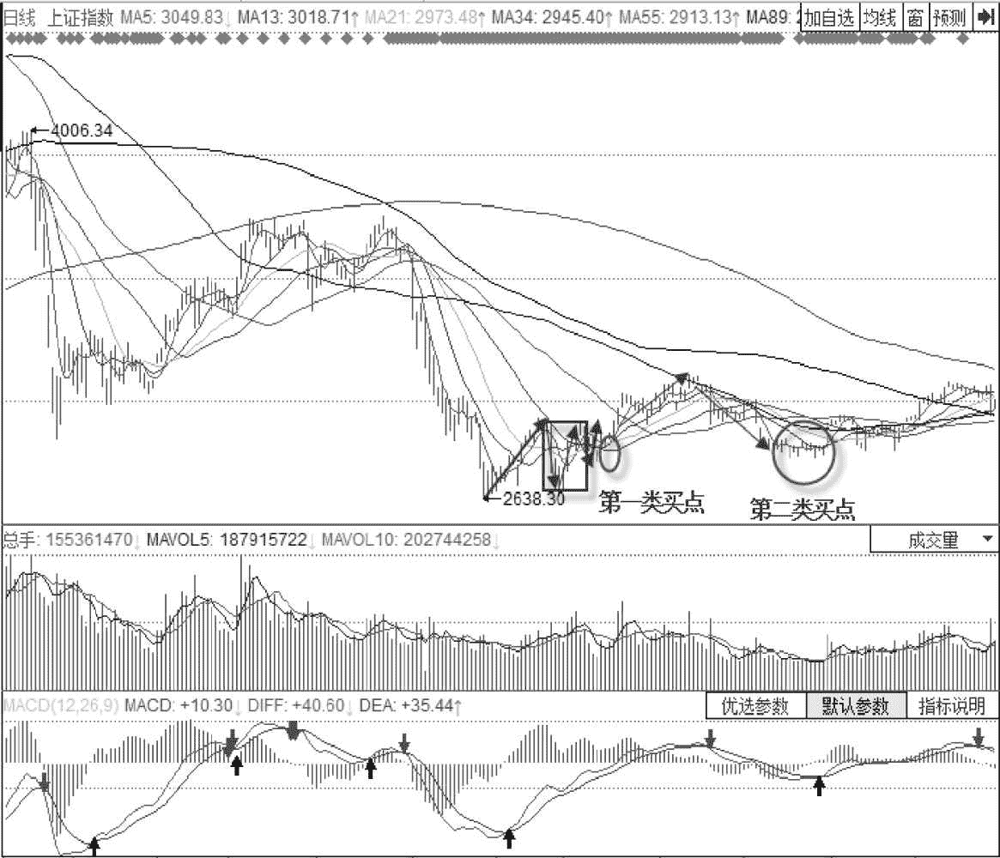

上证指数－日线图

这是根据缠论三类安全买点的知识得来的结果，而第二类买点时的最低点 2828 点，时至 2017 年 4 月，一直都未曾跌破。缠论的真伪由此可见一斑。

也许，这正是缠中说禅虽已经逝世多年，却依然被投资者所追捧的根本原因。

在缠中说禅所有的理论里，其经常提到的就是“当下”两个字，而“当下”就是指当时的行情，如今时间已逝去十年，但缠中说禅的“当下”却依然鲜活地重复着其当年的情景，这不能不说是一个奇迹——一个用事实来证明的奇迹！

为了让更多的读者再见缠中说禅当年的风采，我们特编写了本书，书中所有的理论均来自于当年缠中说禅的缠论知识，只不过将那些过时的案例换成了当前股票市场中的个股，以便让读者能够切身感受到缠中说禅多年前关于缠论的思想和理论。

当年，缠中说禅的缠论里更多的是掺杂了一些力学和数学的公式，在此我们做了简化，纯粹从缠论的基础知识入手，在一点点详细剖析缠论知识的同时，增加了“在 A 股应用”这一板块，目的就是用市场中发生的一个个近期实例，来进一步再现缠中说禅当年的理论是永不过时的，同时也能够让读者加深对缠论理论的理解及应用。

每个人的成功都源自其本身不懈的努力付出和不断的感悟总结，普通的投资者更是如此。只要潜心研究本书，可能就成为十年后的第二个缠中说禅，在游戏市场的同时，获得财富的巨大成功。

编　者

2017 年 6 月

轻松注册成为博文视点社区用户（www.broadview.com.cn），扫码直达本书页面。

·提交勘误 ：您对书中内容的修改意见可在 提交勘误 处提交，若被采纳，将获赠博文视点社区积分（在您购买电子书时，积分可用来抵扣相应金额）。

·交流互动 ：在页面下方 读者评论 处留下您的疑问或观点，与我们和其他读者一同学习交流。

页面入口：http://www.broadview.com.cn/31955

# 目　录

内容简介

前言

第一部分　认清缠论中主力、市场与散户

第一章　影响市场的力量

1.1　合力

1.1.1　合力简介与应用

1.1.2　市场的合力有哪些

1.2　分力

1.2.1　分力简介与在 A 股应用

1.2.2　分力包括哪些

1.3　庄家

1.3.1　什么是庄家

1.3.2　庄家在市场中的意义

1.3.3　庄家与市场价格的关系

第二章　散户与庄家的博弈

2.1　资金的力量

2.1.1　市场资金的分类

2.1.2　庄家与类庄家

2.2　庄家的优缺点

2.2.1　庄家的优点

2.2.2　庄家的缺点

2.3　散户的优缺点

2.3.1　类庄家的优缺点

2.3.2　散户的优缺点

第三章　小资金如何战胜大资金

3.1　小资金战胜大资金的策略

3.1.1　顺应庄家意愿

3.1.2　积累资金的过程

3.2　小资金变成大资金的方法

3.2.1　在趋势明朗后操作

3.2.2　实现零成本操作，滚动操作

3.3　资金的对决

3.3.1　在时间戏庄中捕捉黑马股

3.3.2　在空间戏庄中远离弱势股

第二部分　通过缠论核心技术来捕捉市场动向

第四章　线段捕捉庄家动向

4.1　线段的理论基础

4.1.1　分型

4.1.2　笔

4.1.3　线段

4.1.4　包含关系

4.1.5　结合律

4.2　线段被破坏

4.2.1　线段被破坏

4.2.2　向上线段被破坏

4.2.3　向下线段被破坏

4.3　通过线段寻找庄家的方法

4.3.1　向上笔开始的线段与庄家建仓

4.3.2　向下笔开始的线段与庄家离场

第五章　走势中枢寻找庄家足迹

5.1　走势中枢的理论基础

5.1.1　走势中枢定义

5.1.2　中枢延伸

5.1.3　中枢扩张

5.1.4　中枢监视器

5.2　通过走势中枢判断庄家足迹

5.2.1　回调中枢与庄家意图

5.2.2　回升中枢与庄家意图

5.2.3　中阴阶段与庄家意图

5.3　庄家介入股票的中枢走势

5.3.1　两个中枢的标准上涨趋势

5.3.2　根据中枢走势完美判断庄家对股票操作的时期

第六章　背驰寻找庄家踪迹

6.1　背驰与盘整背驰的理论基础

6.1.1　背驰

6.1.2　盘整背驰

6.1.3　顶背驰

6.1.4　底背驰

6.2　背驰的判断方法

6.2.1　MACD 辅助判断方法

6.2.2　均线相交判断方法

6.3　背驰与庄家踪迹

6.3.1　顶背驰寻找庄家出货踪迹

6.3.2　底背驰寻找庄家建仓踪迹

6.4　盘整背驰与庄家意图

6.4.1　C 段下破中枢的庄家意图

6.4.2　C 段上破中枢的庄家意图

第七章　均线系统追寻庄家深意

7.1　缠论均线系统理论基础

7.1.1　特殊的均线系统

7.1.2　均线多头排列

7.1.3　均线空头排列

7.2　均线缠绕的三种形态

7.2.1　飞吻

7.2.2　唇吻

7.2.3　湿吻

7.3　均线形态与庄家意图

7.3.1　均线多头下的“飞吻”

7.3.2　均线多头下的“唇吻”

7.3.3　均线多头下的“湿吻”

7.3.4　均线空头下的“湿吻”

7.3.5　均线空头下的“唇吻”

第三部分　利用买卖点和资金走向抓住操盘关键点

第八章　缠论买卖点洞悉庄家意图

8.1　缠论三类买卖点的理论基础

8.1.1　第一类买卖点

8.1.2　第二类买卖点

8.1.3　第三类买卖点

8.2　三个安全的买点与庄家意图

8.2.1　第一类买点：庄家建仓的征兆

8.2.2　第二类买点：庄家洗盘的征兆

8.2.3　第三类买点：庄家快速拉升的征兆

8.3　三个安全的卖点与庄家意图

8.3.1　第一类卖点：庄家出货之初的征兆

8.3.2　第二类卖点：庄家抛售高峰的特征

8.3.3　第三类卖点：庄家彻底离场的象征

8.4　背驰与第一类买卖点

8.4.1　顶背驰与第一类卖点

8.4.2　底背驰与第一类买点

8.5　第二类买卖点判断庄家持仓的强弱

8.5.1　庄家最强时的情况

8.5.2　庄家最弱时的情况

8.5.3　庄家力量一般的情况

第九章　天下无庄，有的只是赢家和输家

9.1　透析主力资金的食物链

9.1.1　市场从来没有庄家，有的只是不同的利益集团

9.1.2　主力资金在食物链上的位置

9.1.3　游戏市场的主力资金

9.1.4　指导散户操作的是走势

9.2　判断市场走势的辅助指标

9.2.1　MACD 指标的辅助指标

9.2.2　BOLL 指标的辅助指标

9.3　散户资金如何游走市场

9.3.1　注意资金的风险管理

9.3.2　资金与资金的市场博弈

9.3.3　抓住市场的机遇

9.3.4　该出手时就出手

# 第一部分　认清缠论中主力、市场与散户

# 第一章　影响市场的力量

市场每一时刻的运行，都是受到各种力量的牵引所致，无论政策因素，还是其他因素，都是一种力量，其中有分力也有合力，分力使市场产生分化，合力又令市场表现出高度的统一。虽然这些力量都是相对独立的，甚至是带有某种分歧的，但有时又表现出相互的妥协，其中最不容忽视的就是庄家的力量。投资者只有准确了解了影响市场的各种力量，才能做到借力打力。

## 1.1　合力

股价的每一次由跌转涨，都是市场合力做多的结果，而影响价格走向的最大合力就是庄家，如果没有政策等因素的突然干扰，那么庄家往往会在市场上表现得如鱼得水，而在庄家合力之下，一个又一个股市奇迹因此诞生，一幕幕不朽传奇周而复始地上演……

### 1.1.1　合力简介与应用

缠中说禅在“教你炒股票 66 课”中说：“市场每一时刻的走势，都由当下的合力构成，如果 1 亿人参加的市场，每一分力都是相等的，都是独立的，那么市场的整个运转和现实的情况，当然有所不同。现实的情况是，有些分力远远大于其他的分力，在这种情况下，对合力的分析，不能脱离对这些特别巨大分力的分析。”

“如果现实的系统中这种特别巨大的分力只有一个，其他分力与之相比都可以忽略不算，那么市场的所谓合力，就与这个分力基本无异了。例如，在那些控盘程度极高的股票中，就往往呈现这种情况。而这种一个分力远大于其他分力的系统，其稳定性是会产生突变的。”

缠中说禅所说的“这种特别巨大的分力只有一个”，就是通常所说的“庄家”，因为当庄家手中持有一定数量的某只股票后，其所产生的合力就会较大，从而使股价出现接连的快速上涨，或快速下跌。

当庄家合力做多的时候，股价就会出现持续的上涨，形成快速的拉升降。

在 A 股应用

祁连山（600720）在 2017 年 1 月 17 日至 2 月 22 日期间，庄家在拥有了大量筹码后，出现了合力做多，使得股价持续上涨，短期涨幅巨大，如图 1-1 所示。

同样，当庄家在经过了合力做多后，突然出现了合力卖出，股价自然就会出现接连的下跌。

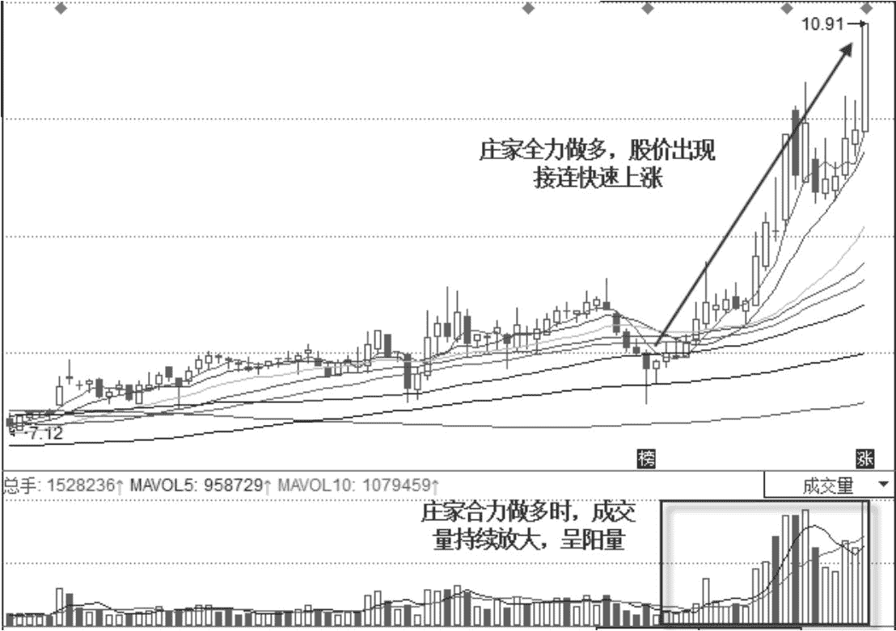

图 1-1　祁连山—日线图

如辽宁成大（600739）在 2016 年 11 月 25 日至 12 月 15 日期间，庄家在拉升股价后，开始在高位合力卖出股票，导致股价出现了快速下跌的现象，并且成交量表现为持续放大状态的阴量，如图 1-2 所示。

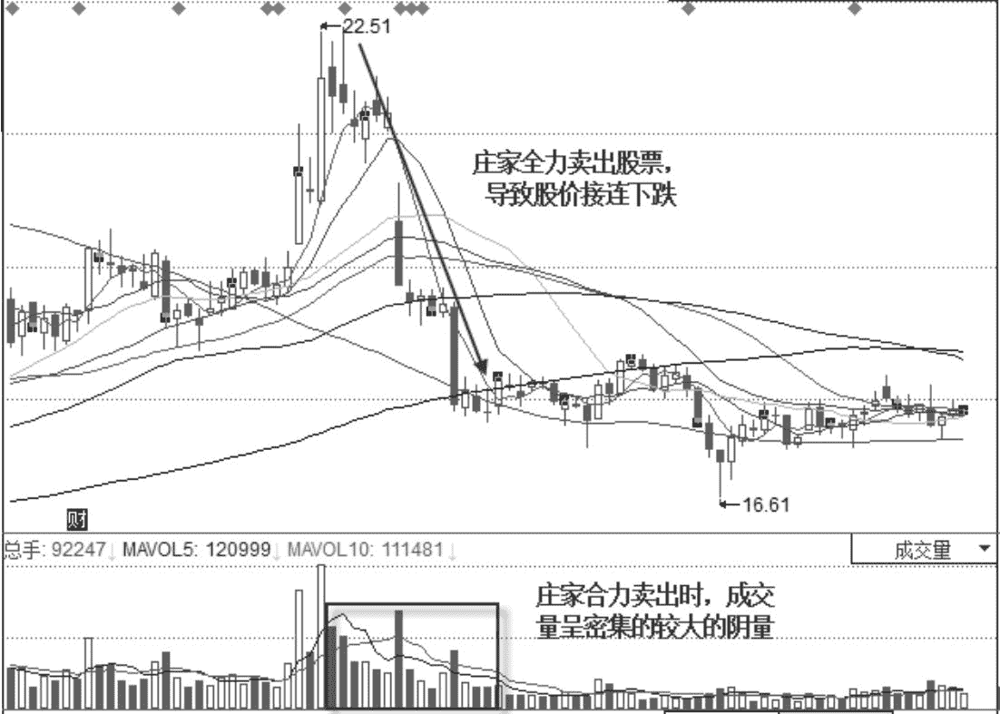

图 1-2　辽宁成大－日线图

正是由于庄家在短期内表现出的这种巨大合力，才使得股价趋势出现了明显的上涨或下跌。因此，缠中说禅在“教你炒股票 68 课”中说：“市场的所有走势，都是当下合力构成。”这里，庄家只是所有合力的一部分，因为散户同样是合力中的一部分，并且，一只股票的庄家也经常有大庄家与小庄家同时介入。所以，从理论上来讲，当一只股票所有的散户都在集中于某一时期合力买入一只股票时，同样会形成像庄家一样的巨大合力。

操盘要点

“市场的所有走势，都是当下合力构成。”但在所有的市场合力中，庄家不过只是其中的一个分力，只有当庄家手中掌握了更多的某只股票的筹码后，自身才具有巨大的合力，从而影响到股票价格趋势的运行方向。

### 1.1.2　市场的合力有哪些

缠中说禅在“教你炒股票 66 课”中说：“在单一的股票市场中，不同风格、背景、势力的资金，各自控制着不同的板块，最大的几个，构成食物链的最上层。一般来说，这几拨资金都是老油条，互相也知根底，其根底往往不在市场中，而在市场之外，一般情况下，各方都是保持江湖规矩，不会轻易与某一方开战。但，绝对不是说，最大的家伙间就没有战争，而是这战争无时不在，只是都在等着一方出现破绽，余下的一拥而上，分而吃之。”

“从这食物链的最高端开始，逐级下去，到最后的散户个体，分着好几个层次。对于最大的主力来说，对下面几个层次的生态状态，会保持一定的维持。一般来说，一个新的最高级别的势力出现，是没有人愿意看到的。”

这就是说，以一只股票为例，会形成很多的合力，这些合力就是一个个的大小庄家，以及众多的散户个体。在这些合力中，散户的合力通常极小，而庄家的合力相对大，但小庄家往往会顺应大庄家的合力方向，否则就会被赶出局，而新出现的“庄家”通常是某些涨停敢死队，就是手握巨大资金的大户，但他们的出现往往也会顺应大庄家的合力意愿，向同一方向使力，从而形成更大的推波助澜式的巨大合力。

这些分力的使然，促生出了更大的合力，影响着股价的运行。

在 A 股应用

如大金重工（002487）于 2017 年 2 月 22 日出现了涨停，如图 1-3 所示。

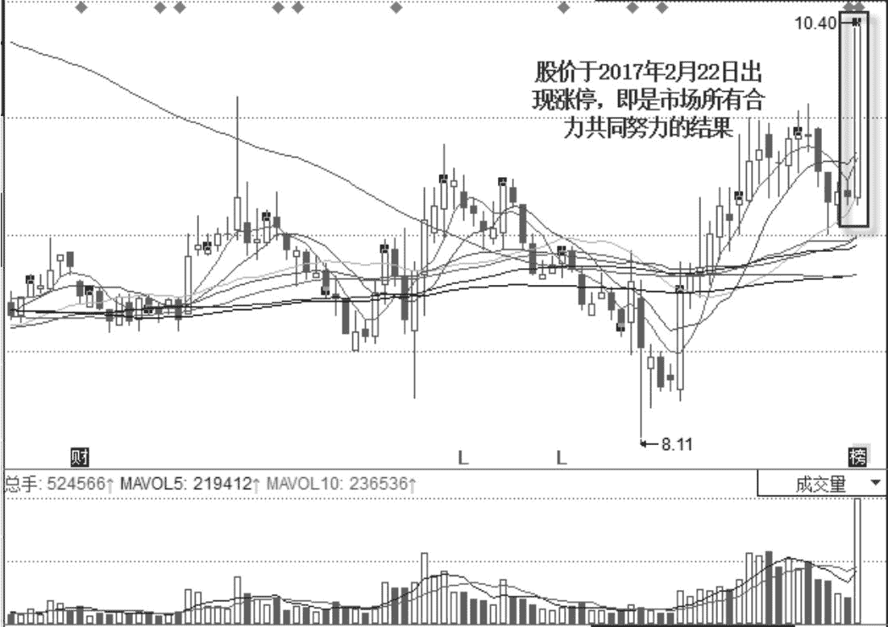

图 1-3　大金重工－日线图

在股价出现涨停的市场合力上，既包括市场上的散户，同时也包括手握大资金的游资大户，他们都是短期合力的一员，如图 1-4 所示。

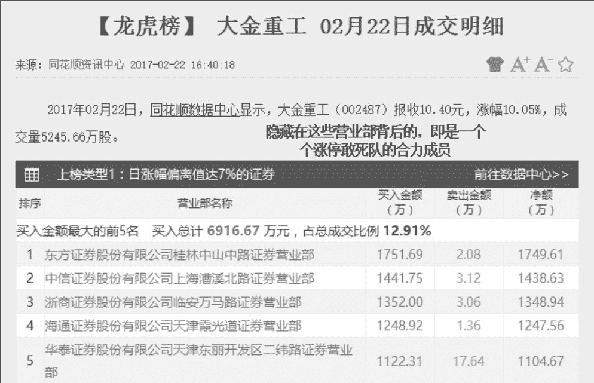

图 1-4　同花顺资讯中心－大金重工 2017 年 02 月 22 成交明细

最主要的还是那些隐藏在背后的一个个机构，他们才是这只股票的庄家，同时也是合力产生效果的主要成员，如图 1-5 所示。

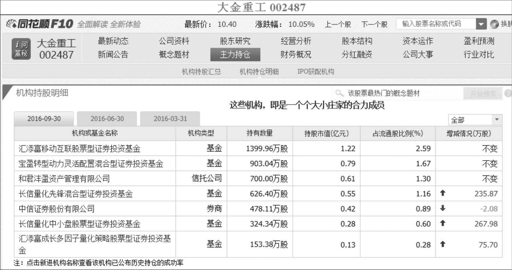

图 1-5　大金重工－个股资料

当市场所有的合力都集中做多时，才有了股价最终的强势涨停。

操盘要点

所有参与的资金都是市场的合力成员，但只有这些成员合力向一个方向使劲时，才能成为左右市场趋势的合力，否则就会成为分力。

## 1.2　分力

分力就是与市场相左的一股力量，股价的下跌，正是庄家的合力突然变为了卖出的分力，从而使股价应声下跌的。然而，股市的魅力正是在于老庄家分力加大的同时，又会出现一些新庄家的合力，股票正是在这种分力与合力的共同作用下，才诞生了股价的“梅开二度”景观。

### 1.2.1　分力简介与在 A 股应用

缠中说禅认为，“走势是由合力构成的，但各分力后面代表的，都是真实的、有思想有感情的人，因此，了解一下一些心理层面的东西，还是有好处的。”所以，缠中说禅在“教你炒股票 75 课”中说：“对于一般散户来说，多了解一点事情，并不能改变对走势完全严格客观的态度。为什么？因为对于一般的散户，其影响力对于合力可以完全忽略不算，因此，其操作，当然就可以完全只看合力最终的结果，而不需要关心每一刻合力所对应的各分力间的博弈。”

在此，分力的考虑同样应以庄家的行为为准，因为散户是无法在同一时间内形成大的分力的。分力的典型体现，大多是在老庄家离开、新庄家进入的时期。

在 A 股应用

煌上煌（002695）在 2016 年第二季度，即 2016 年 3 月至 6 月期间，在十大流通股东里，那些减持或退出的，即成为市场做多合力中的分力；同时，那些新进的主力或增持的主力，也成为做空合力的分力，如图 1-6 所示。

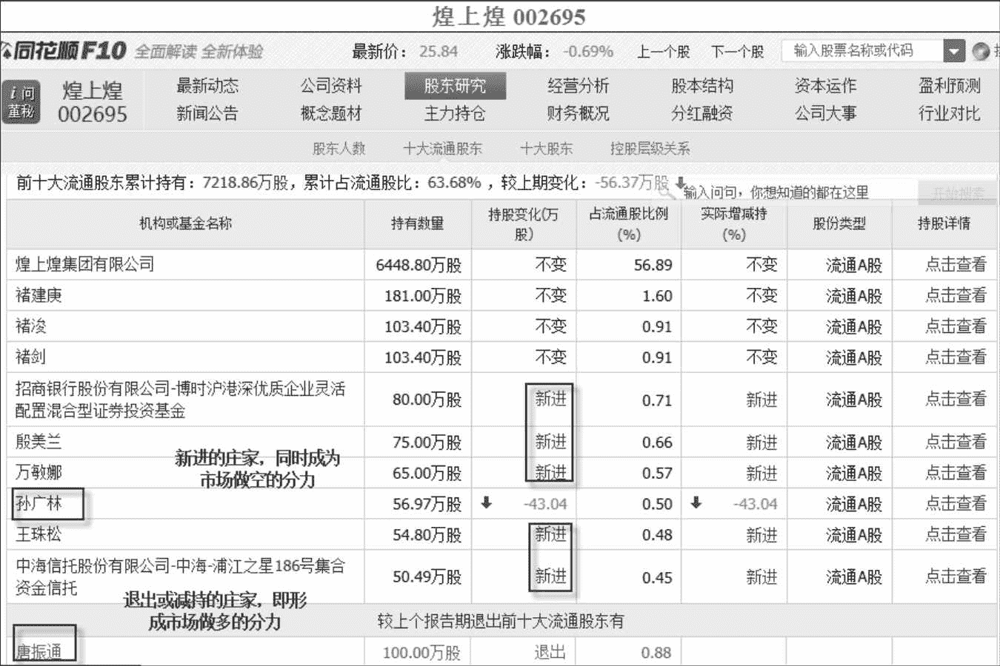

图 1-6　煌上煌－个股资料

在这种做空合力的分力与做多合力的分力共同作用下，煌上煌的股价表现为横盘震荡，呈现出未来方向不明朗的状态，如图 1-7 所示。

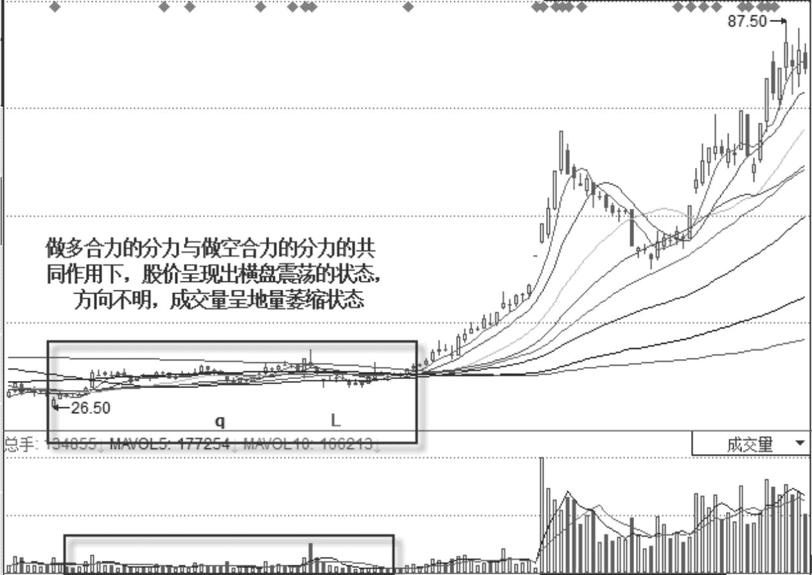

图 1-7　煌上煌－日线图

操盘要点

分力是与合力所对应的一种力，不能单独来看，当市场的分力与合力势均力敌时，往往市场趋势表现为震荡的走势，因为这时往往是新庄家与老庄家的交替时期，市场会表现为未来趋势的不确定性。

### 1.2.2　分力包括哪些

如前 1.1.1 节所述，在研究分力种类之前，必须明确一个问题，即合力与分力的关系（具体见前 1.1.1 节所述），分力是相对合力的，同时合力也是相对于分力的。在这种背景下，所谓的分力，就是所有与市场合力相左的力，其中包括散户。

在上涨或下跌过程中，突然出现巨大的分力，后续走势会出现以下两种情况，如图 1-8 所示。

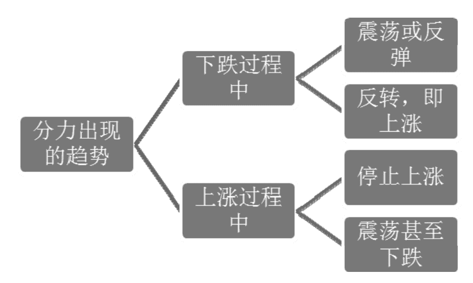

图 1-8　分力出现的趋势

这一巨大的分力就是庄家。因为逆市操作的散户，其分力是微不足道的，力量极小。其中，游资大户的分力不容忽视，但通常他们不会与庄家等大资金对抗。所以，影响趋势反转的分力依然只是庄家。

在 A 股应用

南兴装备（002757）在 2016 年 5 月中旬时，股价在下跌的趋势中突然出现一股分力，影响了下跌的合力，股价出现反弹，而当分力变弱的时候，股价再次转为下跌。这是由于庄家的大资金介入的原因所致。2016 年 8 月底至 9 月下旬时，同样分力占据合力，股价反弹，是由于庄家在大力买入。而当反弹至 11 月下旬时，分力再次出现，影响到市场做多的合力致使股价在高位震荡后出现了转跌。这些都是由于庄家一进一出所造成的。因此，在下跌趋势中，巨大的分力战胜合力时，是买入良机；在上涨趋势中，分力战胜合力时，是卖出的时机，如图 1-9 所示。

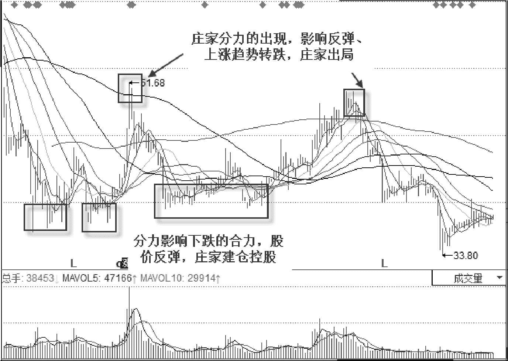

图 1-9　南兴装备－日线图

操盘要点

所有与股价运行方向相反的操作资金都是分力，但只有庄家的分力是巨大的。游资大户的资金量虽然大，如涨停敢死队，但他们通常不与庄家为敌，所以其快速出局时的分力不会影响到股价的大趋势，只能影响到股价短期的波动。

## 1.3　庄家

历来庄家在散户眼里都是极其神秘的，只闻其名，却不见其踪迹。事实上庄家是有迹可寻的，只要多观察，庄家就会被你推到台前，再也无处藏身。所以，很多时候，庄家并不神秘，只不过是投资者被自己的想象遮住了双眼。

### 1.3.1　什么是庄家

缠中说禅说：“一般定义中的所谓庄家，就是那些拿着大量资金，能控制股票走势的人。”由此可见，庄家就是大资金的一种代称，在 A 股市场，通常是指基金、私募、银行、证券公司、游资大户等资金机构，同时还包括以维稳为主的证金公司，以及合法的境外投资机构 QFII 等。

不管是什么庄家，他们手中都掌握着大量的资金，因此通常成为能够影响股价运行的重要因素。

在 A 股应用

特一药业（002728）在 2016 年 9 月 30 日时，大庄家就有银河金汇证券资管民生银行、银河嘉汇 5 号集合资产管理计划、兴业银行股份公司、光大保德信红利混合型证券投资基金等基金庄家，以及周晨、罗东敏等自然人身份的公司股东和游资大户等庄家，如图 1-10 所示。

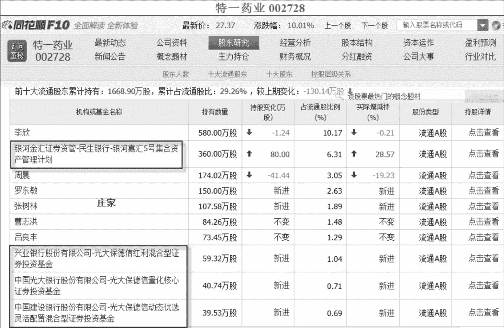

图 1-10　特一药业－个股资料

这些庄家，无论其身份如何，出发点如何，无一不是看到了特一药业未来的成长性，所以才会增持该公司的股票，以期获得回报。但需要注意的是，庄家也是在不断变化着的，因为在不同时期，有的庄家出来，又会有新的庄家介入，所以庄家在一只股票上也在不断变化。

同样是特一药业这只股票，图 1-10 是 2016 年 9 月 30 日为止的庄家情况，但在 2016 年 6 月 30 日时，即 2016 年第二季度，特一药业的庄家又是另一种情况，与 2016 年第三季度的庄家情况完全不同，如图 1-11 所示。

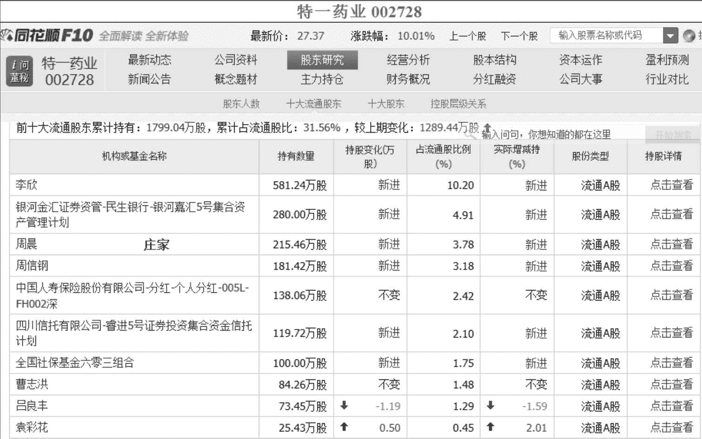

图 1-11　特一药业－个股资料

这就使得一只股票就像是一个营盘，庄家只不过是营盘中流水的“兵”。但这个“兵”的介入，却在市场上掀起了一场又一场股价起起落落的传奇。例如，同样是特一药业这只股票，在 2014 年 8 月 1 日上市之初，最低价格仅 18.21 元/股，可到了 2015 年 5 月 28 日时，最高达到了 90.35 元，其后高送转后，最低又达到了 18.18 元，截至 2017 年 2 月 23 日收盘，又达到了 23.37 元，如图 1-12 所示。

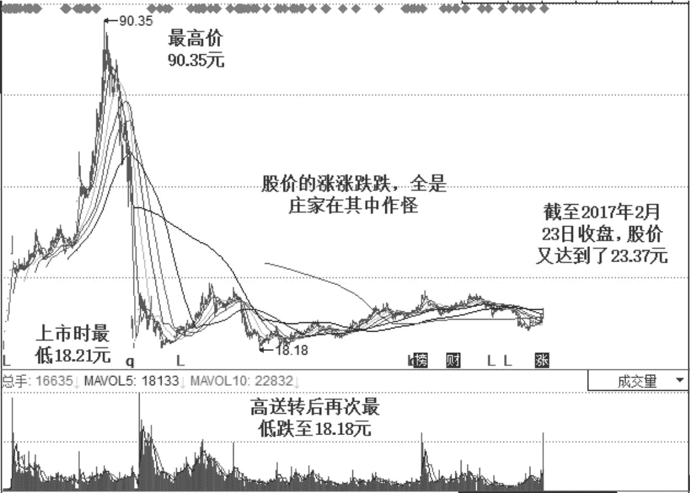

图 1-12　特一医药－日线图

股价的大起大落，到再次出现涨跌，均是由于庄家在其中的进进出出所造成的。所以，研究庄家成为众多投资者一直追求的目标。

操盘要点

庄家对某只股票的操作不是一成不变的，而正是这些不同庄家的不同轮换，才造就了股价的涨涨跌跌和大起大落。

### 1.3.2　庄家在市场中的意义

在谈到庄家时，缠中说禅说：“必须明确，任何主力资金，无论什么背景、级别，最终都不可能逆整个经济的大势而行。资金不是一拨，山头就那么多，10 年前的主力，如果不随着市场去发展，到现在就什么都不是了。所以，任何主力资金，无论什么背景、级别，都有一个特点，就是要折腾。不折腾，就没有江湖地位，唯一不同的，只是折腾什么和不同市场、板块的变换。”

我们都知道，庄家进入一只股票，不是来看风景的，其目的很明确，就是获得收益。即使是那些增持自家股票的股东亦然，是想享受公司不断成长所带来的自身同步收益。所以，在这一目的之下，缠中说禅才会说庄家进入一只股票是为了“折腾”。

不同的板块，不同的市场热点，聪明而又先知先觉的庄家，总是会紧跟这些市场的热点，从而借助政策等方面的扶持，尽情地“折腾”。

在 A 股应用

在 2016 年年中时，混合所有制改革成为市场上关注度颇高的题材，云南白药（000538）在 2016 年 6 月 1 日悄然完成了工商变更登记后，其庄家中国平安人寿保险公司等即开始了对股价的“折腾”，至 2016 年 7 月时，历时一个多月，股价即上涨到了 71 元多。

至 2016 年 12 月 30 日，公司改革完成，复牌后更是以一字涨停的形式出现。其后股价又是一路震荡上行，至 2017 年 2 月底时，股价达到了 80 元左右。

从最初的 60 多元一路上行到近 80 元，庄家正是借助混合所有制改革这一题材，一路“折腾”，才有了股价的大幅上涨，如图 1-13 所示。

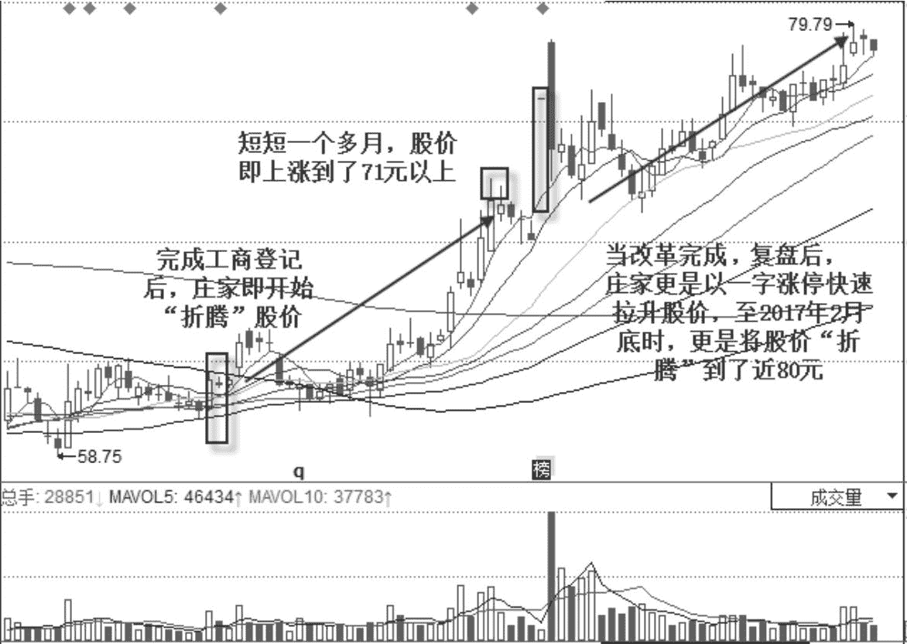

图 1-13　云南白药－日线图

或许，单单从涨幅上看云南白药的涨幅并不剧烈，但别忘了一点，云南白药是一只盘子有着 800 多亿元的大盘蓝筹股，并且是市场上公认的白马股。因此，庄家的这一轮“折腾”，可以说是在“明目张胆”之下进行的。

操盘要点

庄家在市场上存在的意义，完全是在以“盈利”为目的之下的一路“折腾”，但庄家一旦将股票价格“折腾”到了高位，又必然会以获利了结为主。对于一些常庄类的白马股，庄家的“折腾”大多是以一定仓位的长线持有为主，通常在高位卖出一定数量的股票，在低位再买回一定数量的股票，进行波动操作。

### 1.3.3　庄家与市场价格的关系

庄家与市场价格的关系，因为缠中说禅对庄家的“折腾”行为的认知，可以得知，其操作上，往往是与散户相反的，即当股票价格在低位时，庄家会大举买入，所以股价出现了“底”，而后震仓洗盘，目的是实现缠中说禅所说的利益的“绞杀”，也就是大庄家对小庄家的驱逐。

这期间，几个大庄家往往会通过剧烈震荡股价的方式，将一些小庄家吓走，从而将筹码牢牢锁定在固定的几个大庄家身上，而后才会对股票进行快速拉升，进而实现获利。同时在高位吸引跟风的散户接盘，完成一轮胜利大逃亡。

在 A 股应用

中直股份（600038）在 2016 年 5 月至 6 月期间，股价在下跌趋势中的低位区时，庄家开始大举买入建仓，使股票价格出现止跌和低位震荡，其后 2016 年 6 月开始较大幅度地拉升股票，并在其后的 7—9 月大幅回落，以大幅度震仓的方式将一些小的庄家清洗出局，而后的 2016 年 10 月开始持续拉升股票价格，从而实现获利。2017 年 2 月，当股票价格在高位时，又通过吸引散户跟风盘的方式，令散户高位接盘，股票价格此时表现为高位震荡，庄家借机大量卖出股票。股票价格开始出现高位下跌，从而完成了庄家一轮从介入到高位离场的获利过程，如图 1-14 所示。

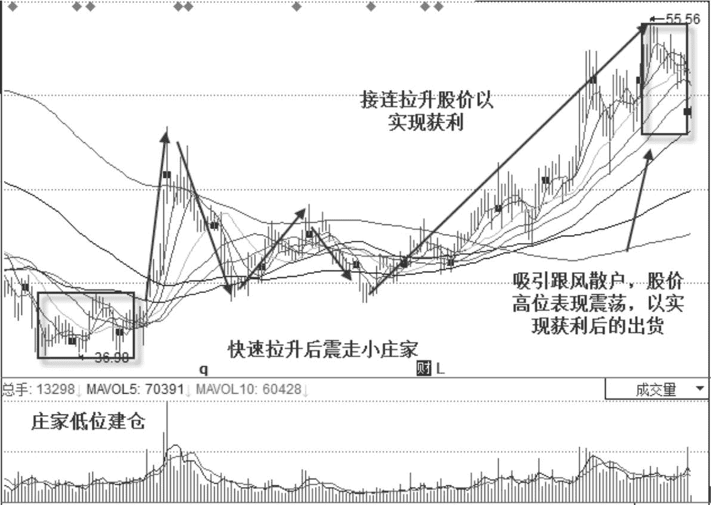

图 1-14　中直股份－日线图

所以，缠中说禅说：“从这食物链的最高端开始，逐级下去，到最后的散户个体，分着好几个层次。对于最大的主力来说，对下面几个层次的生态状态，会保持一定的维持。一般来说，一个新的最高级别的势力出现，是没有人愿意看到的。因此，那些在次一级别中特别活跃，特别有上升苗头的，都会被重点绞杀。”

因此，导致大庄家“绞杀”小庄家的行为，以及庄家在高股票价格大量吸引散户买入的最终目的，都是从获利的角度出发的。因为股价在上一轮的波动过后，其他小庄家获利了，大庄家获利自然就少了。而庄家出于这一目的的一路“绞杀”，最终造就了股价在市场上表现为大幅震荡后的上涨和下跌。

操盘要点

庄家的出现，才导致了股票价格在市场上的一切波动，包括低位企稳后回升、回落式的震荡，以及高位震荡后的转跌。因为在这些股票价格大幅波动的背后，隐藏着的是庄家获利的目的。

# 第二章　散户与庄家的博弈

在资本市场上，其实就是资金与资金的较量，而最为明显的就是庄家与散户的博弈，因为利益，所以出现了相互的博弈。但在这场博弈中，庄家与散户又有着各自不同的优点和缺点，而不同的庄家，其表现又往往有所不同。因此，了解这些庄家，散户在这场资金博弈中方能做到知己知彼，百战不殆。

## 2.1　资金的力量

一直以来，A 股市场都是以资金推动型为主的市场，虽然我们无法忽视散户的力量，但是最终散户却因为资金的不够集中，无法做到主宰市场，在 2007 年的牛市中，散户的资金几乎让 A 股市场无法刹住车。而那些看似资金量远远在市场总量之下的资金机构，却最终成了笑傲江湖的“东方不败”。

### 2.1.1　市场资金的分类

市场上有不同的资金，如养老金、基金、私募、证券公司、银行、保险公司和境外投资机构 QIFF 等机构。

在 A 股应用

湖南天雁（600698）在 2016 年第三季度期间，其中大流通股东中有中国农业银行股份有限公司－交银施罗德先进制造混合型证券投资基金，就是一家基金机构；位列第十位流通股东的是一家境外投资机构 QFII，如图 2-1 所示。

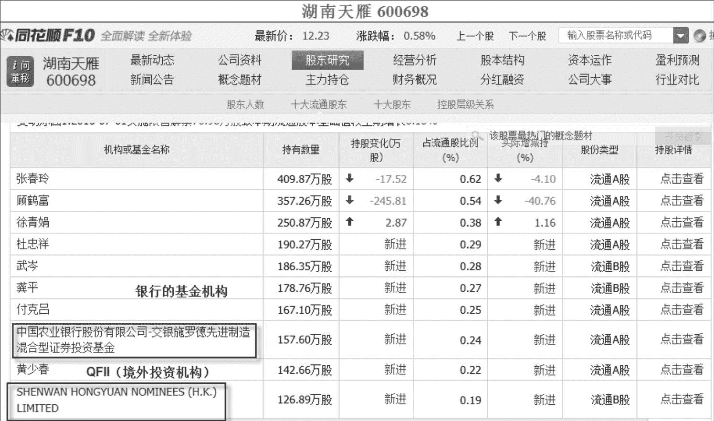

图 2-1　湖南天雁－个股资料

这些机构都是拥有大量资金的投资机构，成为湖南天雁的庄家。

同时还有着国家级的证金公司，即中国证券金融股份有限公司，它的出现，目的往往在于维护股票市场的秩序，即当市场大跌时维持稳定，市场大涨时，减仓控制投资温度。

这些，即缠中说禅所说的“庄家”。

比如，在 2015 年 8 月时，此时因市场在出现牛市转熊后，指数处于低位震荡的行情，证金公司立即大笔出手，购买了许多公司的股票，如梅雁吉祥（600868），资料显示，证金公司此次共买入了梅雁吉祥 736.02 万股，一举成为梅雁吉祥最大的流通股东，如图 2-2 所示。

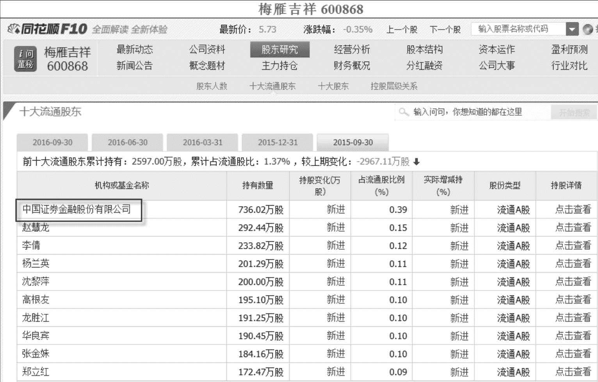

图 2-2　梅雁吉祥－个股资料

证金公司在 2015 年第二季度的大笔买入，却造成了梅雁吉祥这只平时不起眼的低价股，成为这一轮牛市结束后市场最亮丽的风景及熊市中最大的一只妖股，股价从 3 元多一举快速上涨到了 10 元以上，如图 2-3 所示。

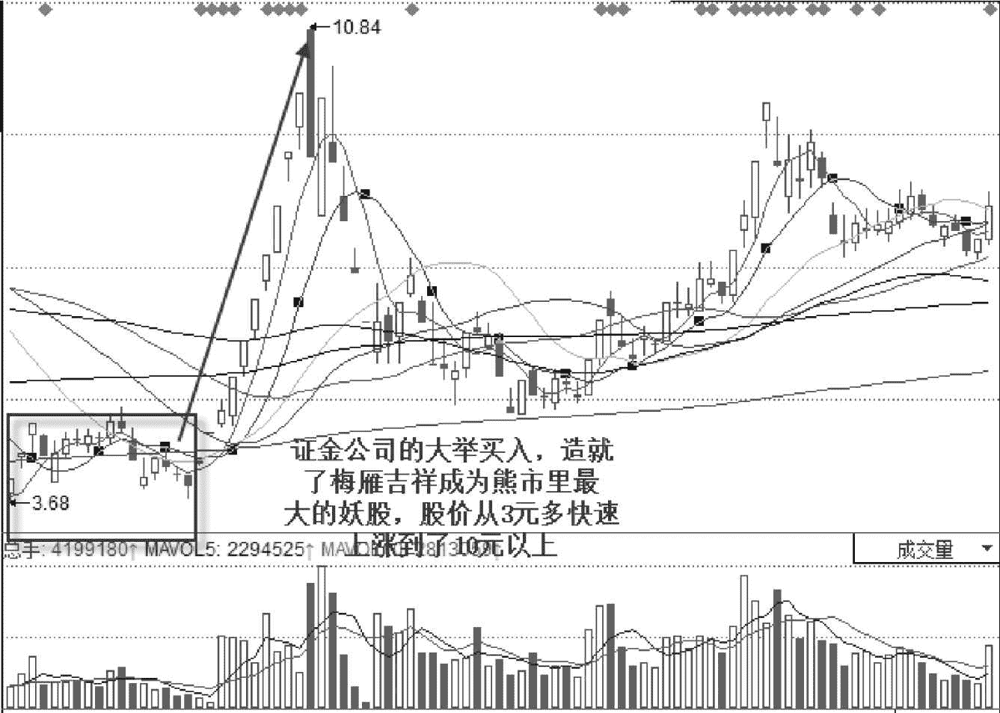

图 2-3　梅雁吉祥－日线图

无疑，梅雁吉祥的此轮暴涨是证金公司所为，证金公司也瞬间成为缠中说禅所说的这只股票“最大的庄家”。

再有就是个人投资者，这其中包括游资大户，就是缠中说禅所说的“大资金”，这些人也是缠中说禅眼中的“聪明的资金”，他们通过投资获取巨大的资金。虽然他们也属于个人投资者，其掌握着巨大的资金量，所以有时也会成为庄家。

比如，在太阳鸟 2016 年第二季度的前十大流通股东中，有一个叫“谭泽平”的流通股东，其持有公司 221.79 万股的股票，为前十大流通股东的第十位，但到了 2016 年第三季度时，他却全部卖出了股票，从流通股东的名单中消失了，如图 2-4 所示。

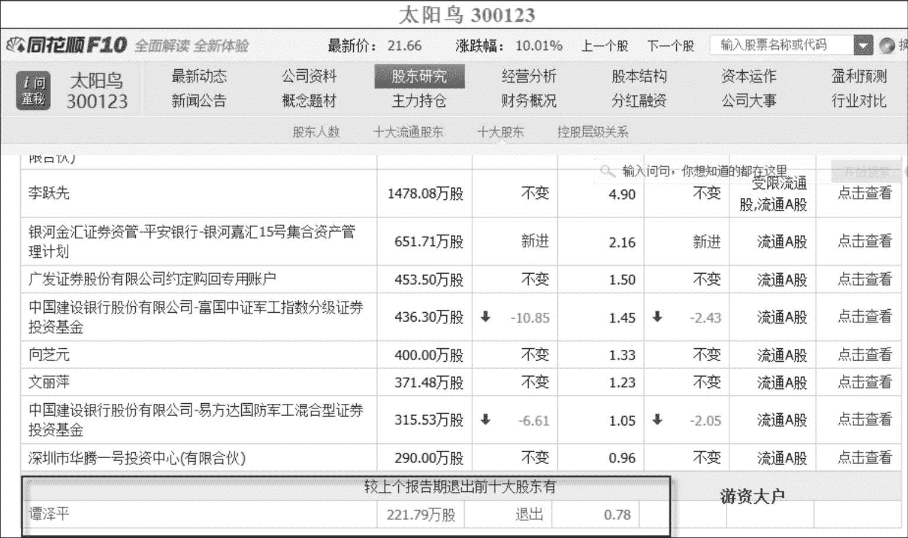

图 2-4　太阳鸟－日线图

这个自然人“谭泽平”即是一名游资大户，他和普通市场中的投资散户性质上没什么区别，都属于个人投资者，只不过其手中掌握着巨大的资金，所以才会在买入一只股票后成为小庄家。

操盘要点

市场资金的构成，无非分为两类，一类是机构投资者，一类为个人投资者。但是在机构投资者中同样存在着个人机构，如 QFII 或是私募。而在个人投资者中，游资大户因资金量较大，也会成为一只股票的庄家。所以从某种程度上讲，市场资金的构成，即由庄家持有者与散户持有者组成。

### 2.1.2　庄家与类庄家

市场几乎是由庄家主宰的，即缠中说禅所说的“大庄家”与“小庄家”，因此，这里所谈到的庄家，即基金、私募、保险公司、QIFF、证金公司、证券公司等机构，他们的规模即使不大，但在市场中往往占据着主动地位，在市场上具有反手为云覆手为雨的举足轻重的作用，即缠中说禅所讲到的“主力资金层面”：“在单一的股票市场中，不同风格、背景、势力的资金，各自控制着不同的板块，最大的几个，构成食物链的最上层。”

类庄家是相对于庄家而言的，即是缠中说禅所说的那些在“市场上存在一些资金，可以影响最终的合力的”资金大户，严格来讲，他们属于游资大户，但是这些人往往不是一个人在市场里交易，而是由一个或数个投资者组成的一种抱团组合，其核心是由一个影响力较大的技术性强的人为指导。之所以将他们说成是类庄家，是因为他们依然没有形成公司制，只是基于一种信任，资金的操作指挥由一人负责，也就是在缠中说禅去世前即刚刚崭露头角的涨停敢死队，如全国影响力较大的“温州帮”或“绍兴帮”。

近些年，突然横空出世的 80 后“赵老哥”就是一个明显的例子，他一直聚集在绍兴一家证券营业部内，先是自己炒股，后来资产达到了 10 多亿元，于是很快，赵老哥身边就聚拢起了众多的个人投资者，赵老哥手里也直接运营起了数十亿元的资金。

这些类庄家从资金量上来看，几乎可以跻身庄家之列，但由于他们都是以快进快出的方式短线操盘，所以仍然是以游资的方式出现，但由于其资金量很快，快进快出，并顺从大庄家的意愿，所以经常会影响到股价的突然快速上涨，加速上涨节奏。而当有众多涨停敢死队集中于一只股票时，又往往会形成这些股票在上涨过程中振幅加大，成交量和换手率短期内出现急剧放大的情况，形成股市里一只只牛气冲天的妖股。

在 A 股应用

瑞特股份（300600）在 2017 年 1 月 25 日上市后，接连出现了 12 个一字板涨停，一字涨停打开后，仅仅出现了一天的调整，即再次出现了持续的放量上涨，如图 2-5 所示。

之所以瑞特股份会出现如此火爆的场景，是因为在一字板打开后，隐藏在招商证券股份有限公司北京建国路证券营业部、中国银河证券股份有限公司绍兴证券营业部、华泰证券股份有限公司上海武定路证券营业部等的涨停敢死队的类庄家，不停地你进我出，所以才造就了股价的持续放量上涨，并且每天的震荡幅度都很大，如图 2-6 所示。

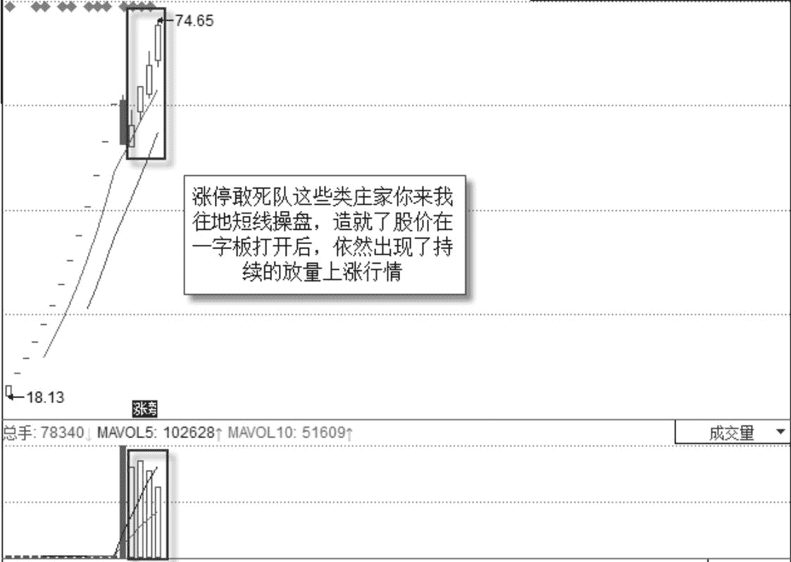

图 2-5　瑞特股份－日线图

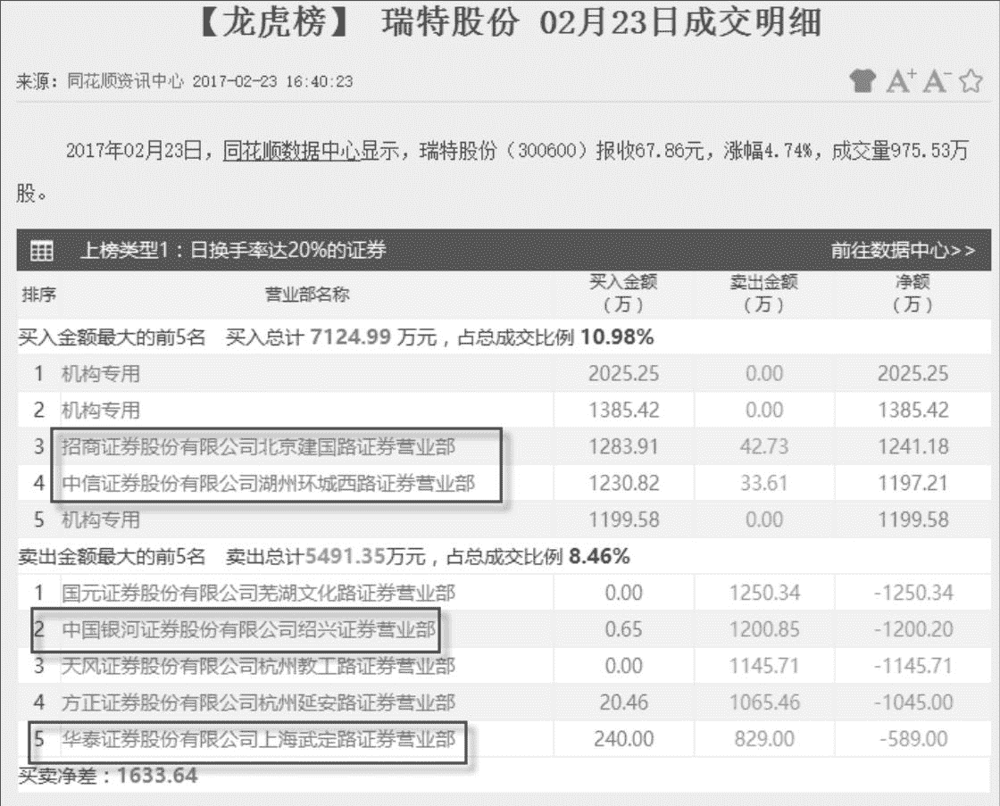

图 2-6　同花顺资讯中心－龙虎榜－瑞特股份 2017 年 2 月 23 日成交明细

虽然庄家与类庄家在资金的多少上有一定的区别，并且操盘手法上也存在着不同，但相对而言，类庄家的力量只是短期的突然爆发，与庄家相比还是弱了许多，但他们却都是处于缠中说禅所讲的“食物链最上层”的位置。

操盘要点

庄家与类庄家都是食物链最上层的主力资金，只不过操盘手法略有不同，庄家多数以中长线操作为主，而类庄家绝大多数是以超级短线操盘为主。同时，类庄家掌握的资金量要小于庄家，所以这些类庄家经常是借庄家拉升前和拉升过程中的风，坐一回顺风船。

## 2.2　庄家的优缺点

庄家拥有着庞大的资金量，这也使他们像股市里的一艘艘航空母舰，成为可以傲视群雄的资金机构，但在拥有着明晰优点的同时，也有着很多更为明显的缺点，每一个庄家几乎成了在股市里裸奔的对象，尤其是资金越大的庄家，优缺点反而越明晰。

### 2.2.1　庄家的优点

缠中说禅说：“在单一的股票市场中，不同风格、背景、势力的资金，各自控制着不同的板块，最大的几个，构成食物链的最上层。”

正是由于这一原因，可以看出庄家最为明显的优点如下。

1.庄家拥有着庞大的资金量

庄家拥有着庞大的资金量，这使得那些庄家能够拥有某只股票较多的股份，即使是那些中小盘的股票，庄家也能够买入大批量的股票，有利于他们获得 10%～50%的筹码，实现高度控盘。

在 A 股应用

从个股资料中可得知，民和股份的大庄家之一——中国银行股份有限公司－嘉实研究精选混合型证券投资基金，共持有 642.98 万股的民和股份的股票，即使是小的庄家，如全国社保基金四一三组合，也拥有着 400.30 万股的民和股份的股票。可见，庄家的持股数量都很大。而截止到 2016 年 12 月 31 日，民和股份的总股数只有 30204.66 万股，庄家的控股能力由此可见一斑，如图 2-7 所示。

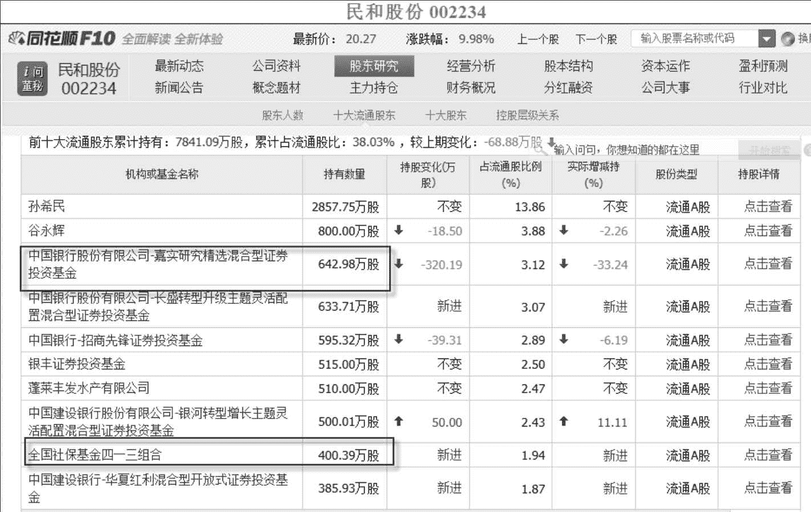

图 2-7　民和股份－个股资料

2.庄家在超前思维方面优于散户

这是因为，一方面，庄家可以通过调研的方式，对某些上市公司进行调研；另一方面，专业团队会对某些行业的上市公司进行分析、判断，从而在恰当的时候，尤其是大跌后，可以根据估值等得出价值判断，在低位大举买入某只股票，然后通过拉升的方式拉升股票价格，同时在高位获利的情况下，先于散户卖出股票，进而在股价下跌的过程中再思考散户的心理，择机建仓。

在 A 股应用

圆通速递（600233）在 2016 年 4 月底至 6 月底期间，庄家借用手中的优势，大举在低位建仓；其后的 7 月—9 月上旬，庄家开始震荡洗盘，6 月中旬－10 月下旬时，庄家快速拉升股价实现获利；而后开始在高位边震荡边出货，并令散户高位接盘，以实现获利。其后导致了股价的持续下跌，此时，庄家可以思考是否再次介入这只股票，同时又在什么位置承接，而这些思维都是优于散户的，如图 2-8 所示。

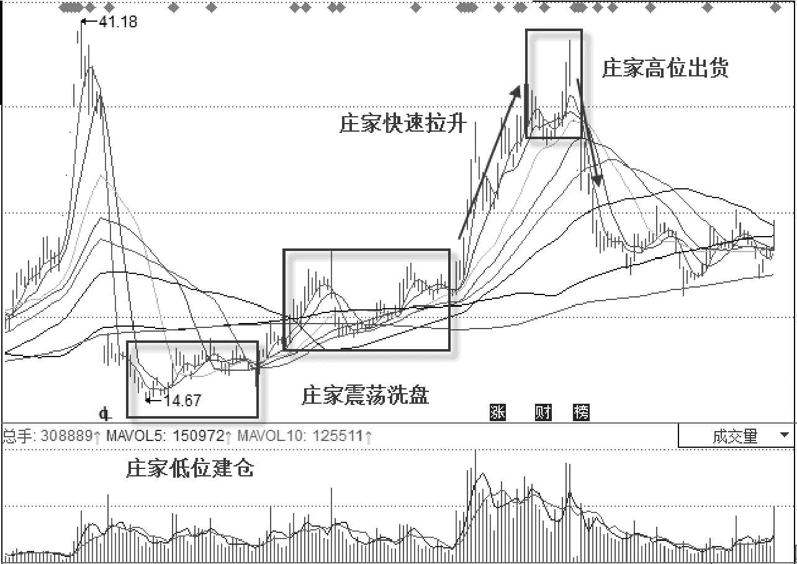

图 2-8　圆通速递－日线图

3.分析市场更全面

在分析方面，庄家也有着优于散户的特点，这是因为，他们能够更全面、更快地掌握市场信息，及时洞悉市场政策，从面了解到一些散户无法预知的内幕消息。

在 A 股应用

2015 年 8 月，国家为维护市场稳定，采取了很多积极的措施，以避免股票市场的进一步下跌，而作为重要的维持市场的“工具”——证金公司，首当其冲成为目标。自然证金公司此时就拥有着他人所不具备的政策优势，所以证金公司作为庄家进入的某些股票，都率先出现了止跌企稳及快速的反弹。如西安饮食（000721），在 2015 年 8 月证金公司买入西安饮食后，股价随后即出现止跌企稳，并出现了 30%左右的反弹。这就是庄家的先知优势，如图 2-9 所示。

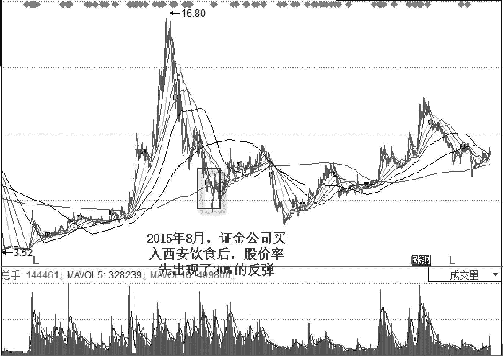

图 2-9　西安饮食－日线图

4.庄家拥有专业的操盘手

这些操盘手大多数是从散户成长起来的，非常了解散户的投资习惯和投资心理，所以不论是技术分析还是操作心态，都远胜散户。这使得庄家的优势也更胜于散户，有利于根据散户的操作习惯和心理，适时适度地操盘一只股票。

在 A 股应用

国元证券（000728）在 2016 年 5 月期间，股价持续下跌，散户恐慌，庄家此时压低股价实现低位建仓；其后的 6 月至 10 月下旬期间，庄家利用操盘手拉升股价，并加大震荡幅度，令散户再度恐慌、害怕，卖出股票；10 月下旬至 11 月上旬，庄家快速拉升股价，市场涌现跟风者，庄家却在借机高位出货，使散户高位接盘站岗。其后股价下跌，因庄家已离开，如图 2-10 所示。

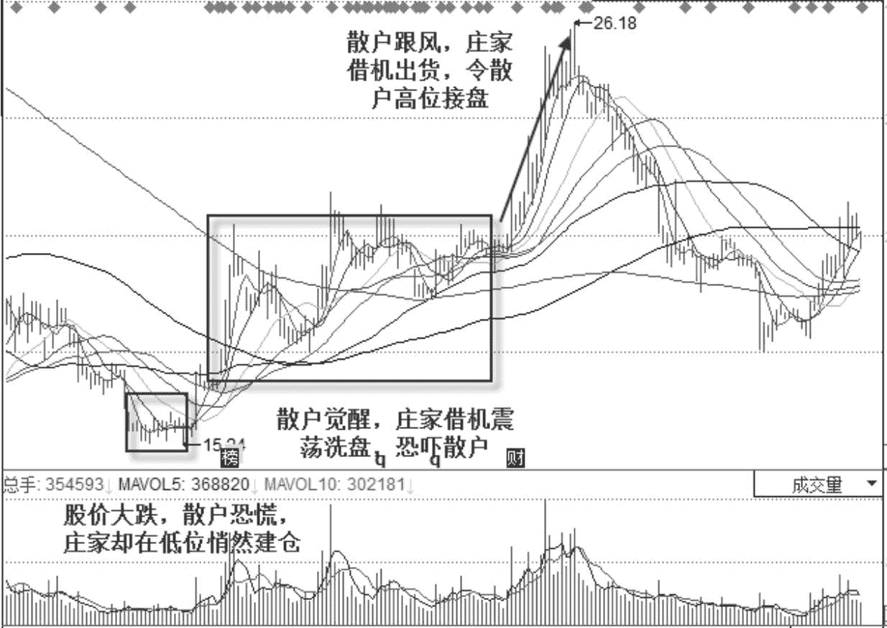

图 2-10　国元证券－日线图

正是由于庄家具有上述四个优点，才使得他们在市场上无往而不利。

操盘要点

庄家的优点，都是相对于散户的，但庄家若想让这些优点体现出来，必须达到 10%～50%地买入一只股票的流通盘，这样才能实现控盘。

### 2.2.2　庄家的缺点

缠中说禅说：“市场经济，永远都是血腥的，这一切，都由资本的虚拟化所决定。一个虚拟的资本，就如同僵尸，不吃血，怎么活？对于这一点，必须有清楚的认识。”

正因为如此，才有缠中说禅的戏庄之说，作为庄家，虽然对于散户来说，就像是一艘巨大的航空母舰，但也正是因为其庞大的资金量，让自身暴露出了明显的缺点。

1.庄家建仓、洗盘、出货都必须拥有一定的时间

因为庄家要买进较多数量的股票，而又不想为人察觉，所以必须一边打压股价一边买入，这需要时间；洗盘时，要加大震荡幅度，令散户产生恐慌、前途未卜的感觉，这同样需要时间，一方面向下打压股价，一方面又要大量买入股票拉升；出货时，由于筹码较多，但又必须将股价维持在相对高位，还是需要时间。

在 A 股应用

渝开发（000514），庄家建仓与洗盘合二为一，所以采取了横盘震荡的方式，股价在 2016 年 5 月至 12 月期间，历时长达半年之久，才完成从建仓到洗盘的过程。在 12 月中旬至 2017 年 1 月中旬，庄家又利用了两个月的时间完成了上涨的过程，在其后的 2017 年 1 月中旬至 2 月底，庄家再次历时两个月完成了出货。

从庄家介入到出货完成这一过程，庄家用了一年的时间，如图 2-11 所示。

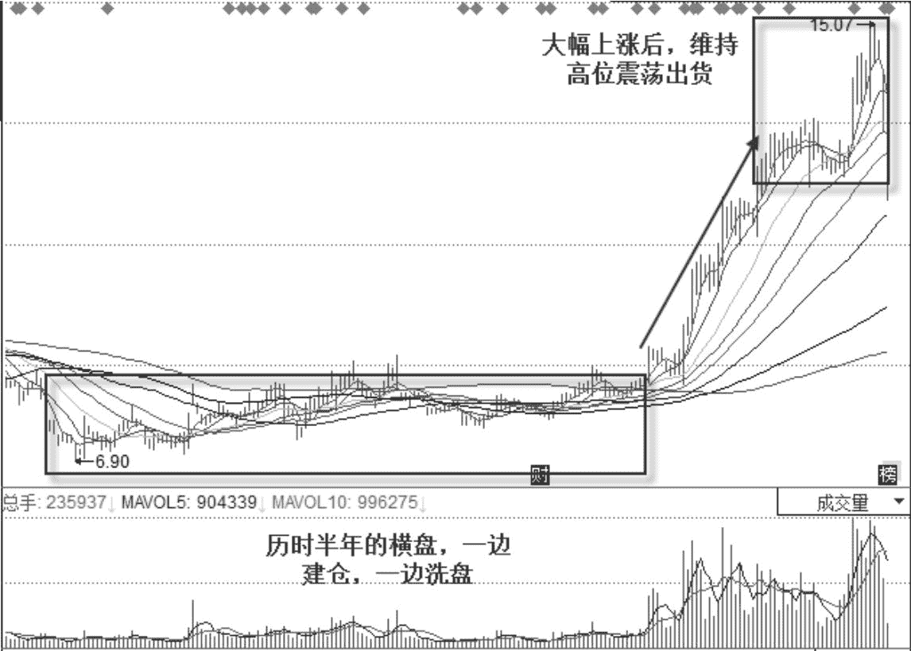

图 2-11　渝开发－日线图

2.操盘过程会留下痕迹

庄家建仓、洗盘和出货的过程，虽然极力在隐藏，但还是会在 K 线图上留下明显的痕迹，成熟的散户可以通过 K 线图的观察，捕捉到庄家的某些意图。

在 A 股应用

福建金森（002679）在 2016 年 1 月 15 日至 10 月 17 日的长达 9 个月的时间里，股价一直处于低位横盘震荡，而此期间成交量一直处于上涨即被打压，但到了低位时又出现不断增加的阳量，说明资金一直处于低位大量买入的状态，庄家买入迹象明显。而如此长久的横盘震荡，也说明庄家在以向上震荡的方式洗盘。2016 年突然启动的向上拉升，说明庄家在拉升股价，成交量也持续放大。到了 2016 年 11 月中下旬时，在成交量放大的情况下，股价出现高位止涨，且多为阴量，说明庄家在大举出货。

庄家在操作福建金森这一股票的过程中，每一个阶段都清晰可寻，K 线上给那些技术熟练的散户提供了很多痕迹和线索，如图 2-12 所示。

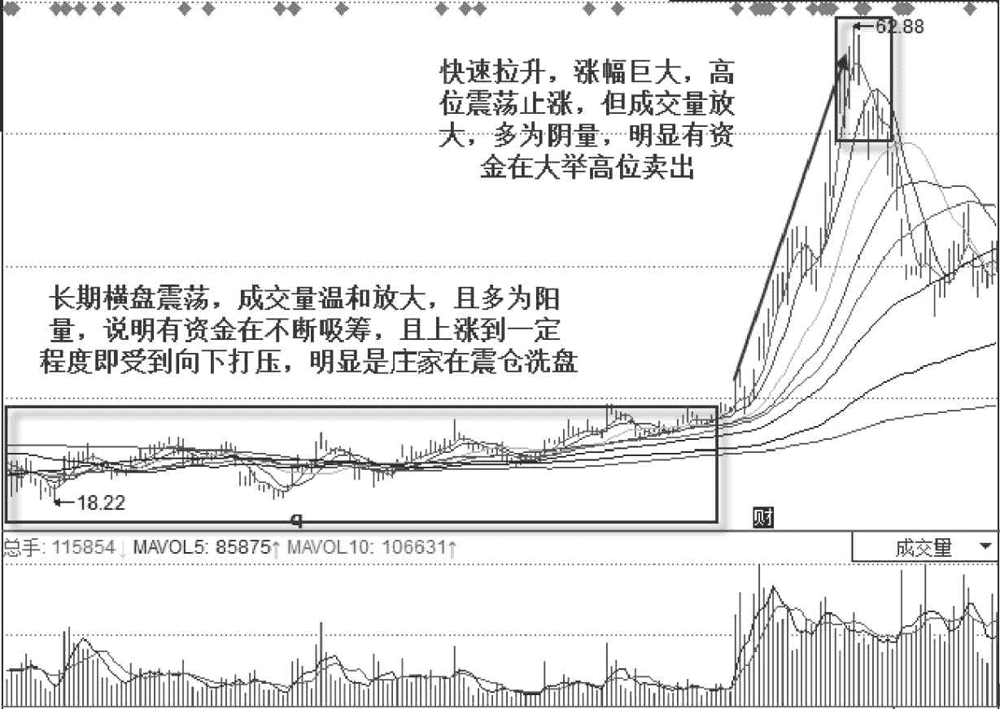

图 2-12　福建金森－日线图

3.容易被抓住规律

庄家要经过数次反复拉升后打压股价，这样很容易失去散户基础，到最后拉升出货时脱手往往很困难。并且，每次调整，都会留下明显的痕迹，容易让散户抓住规律获利。

在 A 股应用

海正药业（600267）在 2016 年 6 月开始的上涨行情中，形成了一个明显的上升通道，每次一旦出现略深的调整后即会止跌，而后再恢复上涨，这样涨涨停停，很容易让投资者摸清规律，波段操作获利。在 2016 年 10 月下旬至 11 月初，庄家打算卖出离场时，反而出现跟风盘少的情况，致使成交量并未有效放大，高位接盘者少，使得庄家难以出手，只得在其后开始的下跌过程中，采用边下跌边反弹的形式出货，如图 2-13 所示。

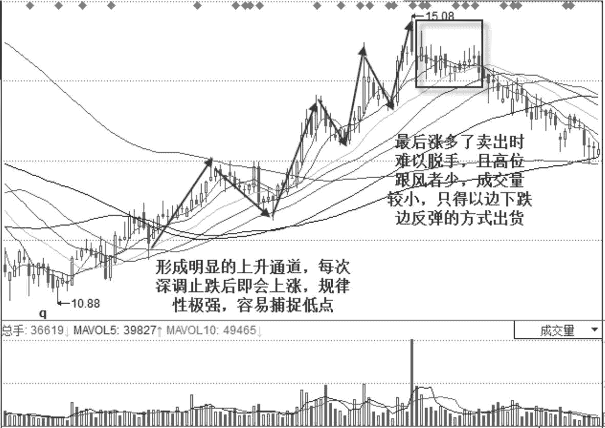

图 2-13　海正药业－日线图

正是因为庄家有着这三个明显的缺点，所以实际运作一只股票时，在散户眼里高高在上的庄家，日子其实并不好过，尤其是当庄家遇到同行，即别的庄家进来捣鬼的时候，更是头痛。

操盘要点

庄家的缺点和优点，都十分明显，尤其是随着散户的不断成长，市场制度的不断完善和科学合理化，以及对市场恶意炒作的严厉打击，使得庄家的日子越来越不好过，一不小心反而成了为他人抬轿子的角色。因此，很多庄家有时会短线操盘、快进快出。

## 2.3　散户的优缺点

资金总量巨大但却形如一盘散沙的散户，虽然在市场里就像一只待宰的羔羊，但其实他们和庄家没什么区别，因为明晰的缺点背后，散户同样有着庄家无法比拟的优点。

### 2.3.1　类庄家的优缺点

在缠中说禅看来，这些类庄家由于拥有着“巨大的资金量”，所以他们的举手投足同样是不容忽视的，缠中说禅认为，如果高兴，这些类庄家是完全可以“逗庄家玩的”。这是因为，在这些类庄家身上，有着明显的优缺点。

1.盘口留下痕迹

类庄家奖金庞大，由于他们通常是以快进进出的方式操作，所以其一进一出都会在盘口留下明显的痕迹。比如当日成交量格外放大，换手率突然增加，价格快速上涨，经常封于涨停。

在 A 股应用

雄塑科技（300599）上市后，当一字板打开后，价格继续上冲后即出现了回落，但当回落到了 2017 年 2 月 22 日后，成交量出现了锐减，但到了次日的 23 日时，成交量突然出现了急剧放大，换手率也高达 32.62%，股价出现了涨停。2 月 24 日，出现了一字涨停。当日股票出现在了龙虎榜上。这是因为，有类庄家在大举快速买入，如图 2-14 所示。

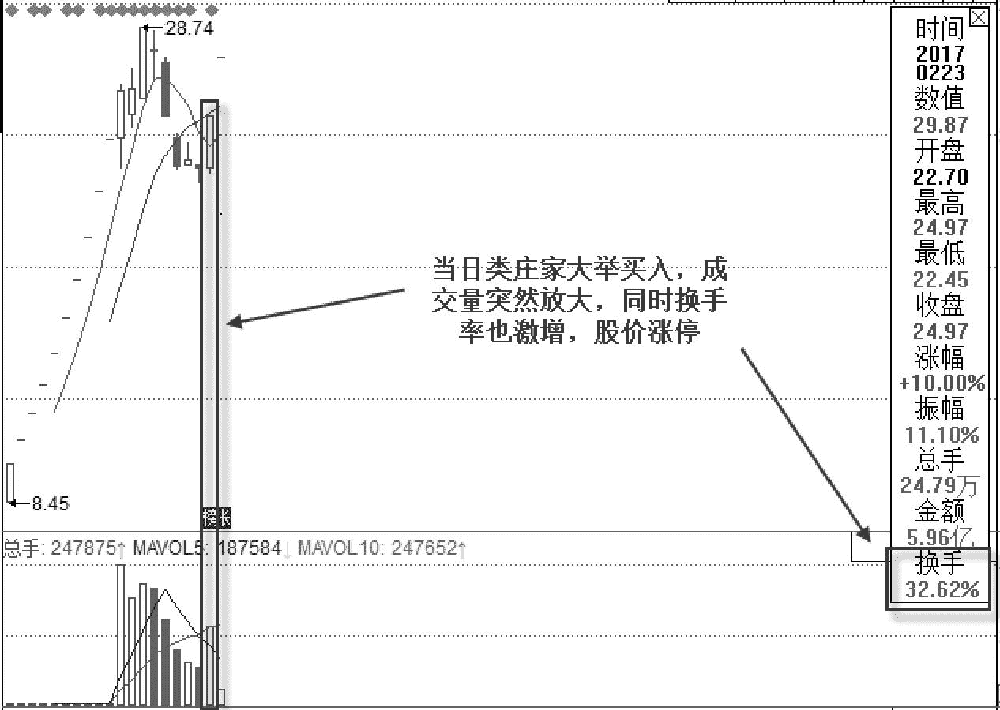

图 2-14　雄塑科技－日线图

2.短线操作

类庄家的操作方式，通常是以快进快出的短线操作为主，通常是当日买入，次日拉高出局，加上他们极少与大庄家作对，逆向操作，所以资金相对安全。

在 A 股应用

在 2016 年 12 月的上涨趋势中，柘中股份（002346）于上涨调整的 2016 年 12 月 25 日出现了大幅缩量，但在 26 日却突然放出巨量，价格结束调整，开始了快速上涨，接连出现涨停，如图 2-15 所示。

造成这种接连涨停的原因，就是很多类庄家的大举进出，所以，每日的震幅都较大。而这些类庄家，如“漫州帮”“福州帮”“绍兴帮”，都是造成股票妖气冲天的原因。因为在龙虎榜上，可以清晰地看到这些类庄家聚集的证券营业部霍然上榜。而股价的接连上涨，又使得这些类庄家的资金很安全，如图 2-16 所示。

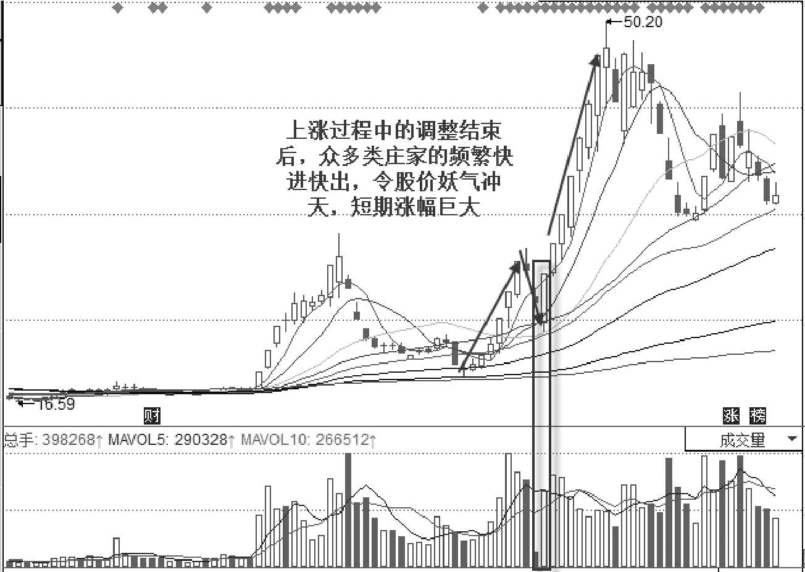

图 2-15　柘中股份－日线图

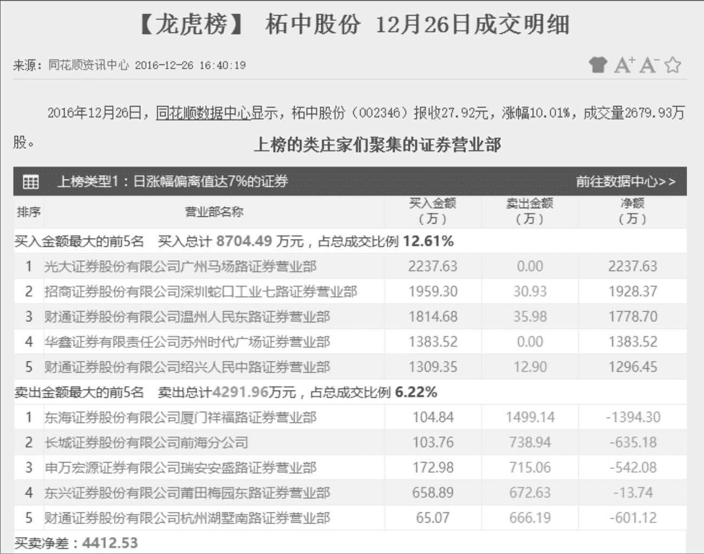

图 2-16　同花顺数据中心－2016 年 1 月 26 日柘中股份成交明细

3.不恋战

遇到大市不好时，或是个股的大庄家在洗盘时，这些类庄家的资金虽然进出“灵便”，但也会出现亏损。但由于他们的原则往往是快进快出，即使次日遭遇大庄家洗盘打压，同样会少亏损出局。

在 A 股应用

发生在 2007 年 5 月 30 日的“5·30”行情，在单边上涨行情中，突然仅用了 5 个交易日，上证指数即从之前的最高点 4335.96 点，跌至了 6 月 5 日的最低点 3404.15 点，跌去 931.81 点，如图 2-17 所示。

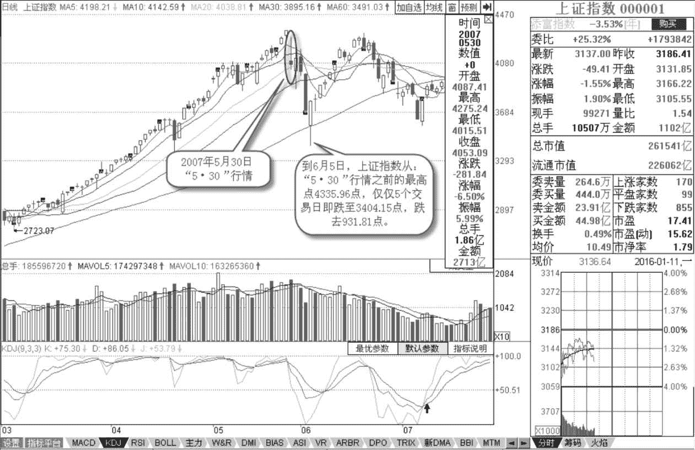

图 2-17　上证指数－日线图

2007 年 12 月 14 日，恰好是周五，自“5·30”行情后，投资者心中对周五已经产生了一种恐惧，也就是常说的“周五末恐惧症”，很多投资者此时都不安心于周六日持股，但聚集在杭州的类庄家章建平却反其道而行之，开始建仓中信证券（600030），首次以 84 元左右的价格买入 1.68 亿元，如图 2-18 所示。

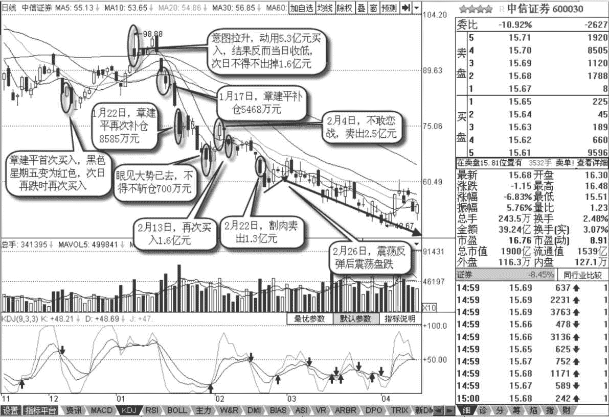

图 2-18　中信证券－日线图

然而红色的周五却未能改变下一个交易日的绿色，章建平于是又买入了 2.23 亿元。

2008 年 1 月 8 日，章建平尝试拉升突破，当日动用资金 5.3 亿元强势买入，股票 K 线上出现了向上的跳空高开，中信证券也最高拉至了 98.88 元。出乎章建平的意料，中信证券不仅没能封住涨停，收盘时反而掉到了 92.88 元。次日，章建平只得火速出掉了 1.6 亿元。

这段时间，大盘尚处在盘升状态，中信证券也有所上行。但到了 2008 年 1 月 15 日，中信证券以 98.35 元开盘后，出现了急速下跌，并以 94.04 元收盘，

其后的几个交易日，股价一直狂跌不止，到 1 月 22 日收盘时，股价已经跌到了 72.57 元。

这中间的 1 月 17 日，章建平又补仓了 5468 万元；1 月 22 日，章建平认为反弹的机会已经来临，再次追入 8585 万元。不料，中信证券依旧只顾埋头下跌，到 1 月 30 日开盘时，只有 69.01 元。眼看抬升无望，章建平当日忍痛割肉 7000 万元。2 月 4 日，中信证券罕见地大涨 8.25%，章建平却再不敢恋战，火速卖出 2.5 亿元。

操盘要点

类庄家的优点和缺点都十分明显，而俗话说，一寸长一寸强，一寸短一寸险。因此，类庄家虽然是一只独特的股市奇兵，但究因其投机色彩过浓，只能在牛市里或顺应大庄家的意愿而获利。

### 2.3.2　散户的优缺点

散户是股票市场里不容忽视的一支资金力量，数量庞大，但资金小，所以成为缠中说禅所讲的“食物链最底端的层面”，但散户同样有着其鲜明的优点和缺点。

由于散户的资金量少，掌握市场消息滞后，再加上又没有专业的软件，甚至有些连最基本的知识都欠缺，所以相对于庄家而言，散户对市场的认识往往是匮乏的，容易产生恐惧、犹豫的心理，但也正是由于资金小的缘故，进出市场都十分机动灵活，“跑”起来快。

在 A 股应用

兴齐眼药（300573）自 2016 年 12 月 8 日上市后，接连出现了 20 个一字涨停板，2017 年 1 月 9 日涨停板打开后，股价出现了高位震荡，此时散户通常是很难判断出未来行情的演变的。但是，正是由于散户的资金量小的特点，所以可以轻松实现当日企稳后买入，次日上涨后卖出的交易。只是，由于此时股价涨幅巨大，所以也很容易被突如其来的下跌搞得措手不及，心生恐惧，如图 2-19 所示。

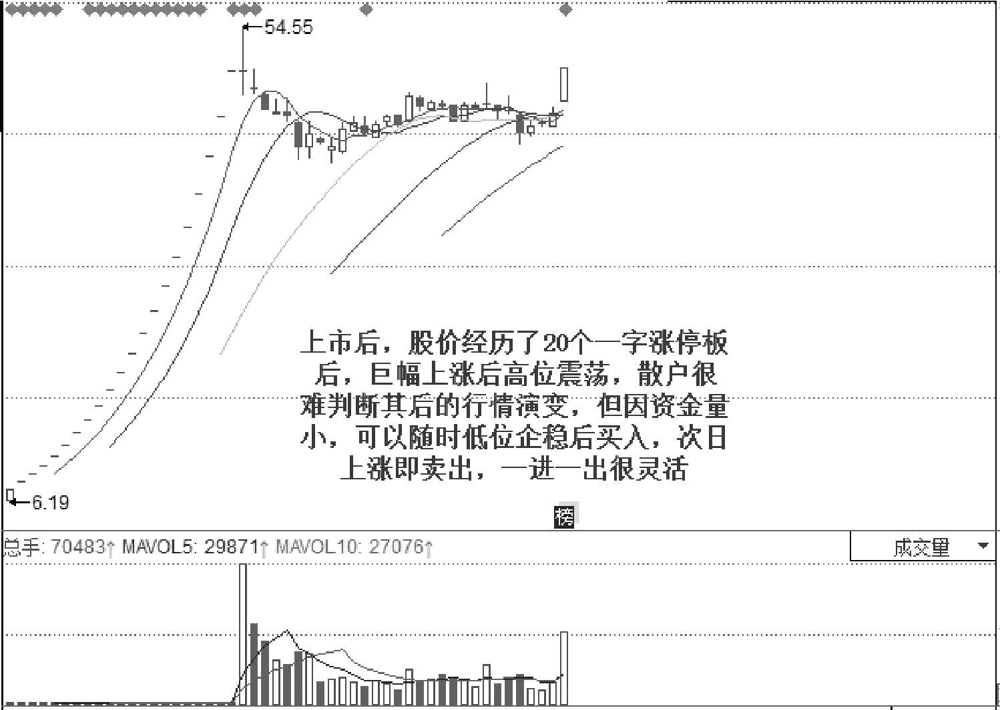

图 2-19　兴齐眼药－日线图

操盘要点

散户在“食物链”上，被缠中说禅称为“最底层的层面”，因此始终在市场中处于弱势地位，即使是散户手中的资金量相对较大，但他们也是没有实力与庄家或类庄家相抗衡的。所以，行走在市场上的散户，应时刻关注庄家的动向，跟随庄家的意愿进行操作，避免过于频繁的短线交易给自身带来损失。

# 第三章　小资金如何战胜大资金

对于散户而言，即使资金量已经达到了某一水准，也很难成为庄家，但即使如此，拥有一定资金的散户却可以更加从容地与庄家展开一场决战。只是在这场小资金与大资金的战争中，尽管散户的资金量已经初具规模，却很难与庄家正面发生冲突，但却能够做到真正与庄共舞。

## 3.1　小资金战胜大资金的策略

小资金要想战胜大资金，必须要制定出一套行之有效的策略，这样才能够做到从容应对。因为没有安邦之策，专门针对散户的庄家是根本无法战胜的，毕竟它们有着更大体量的资金吞吐能力。

### 3.1.1　顺应庄家意愿

从在食物链的角度看，缠中说禅在“教你炒股票 66 课”中说：“从这食物链的最高端开始，逐级下去，到最后的散户个体，分着好几个层次。”这就说明，散户在这一食物链里是处于最底层的，其最初的力量也是相当微弱的，而市场上的杠杆还没有 100 倍甚至以上的力量让散户以自己微弱的资金来撬动，所以要想战胜大资金，必须韬光养晦。

俗话说，背靠大树好乘凉。所以，此时的韬光养晦就是要学会捕捉趋势的反转点，尽快让自己壮大起来。如何壮大呢？这就要靠缠论中的“背驰技术”了。由于庄家总是在底背驰出现的时候介入一只股票，所以说白了，就是寻找庄家的建仓时机，逢低介入，以实现与庄家同步获利。

在 A 股应用

湖南天雁（600698）在经历了前期的下跌后，已出现一个回升中枢，但到了 2016 年 1 月 29 日至 3 月 31 日期间，先是形成了一个 A 段的回升走势，其后又形成了 B 段的震荡，而后又形成了 C 段的回升，比较三段走势，B 段级别最大，C 段小于 A 段。再观察 MACD 柱的情况，因为缠中说禅讲过，在判断背离时，“上涨时看红柱子”，所以观察 A 段对应的 MACD 红柱，即 AM 区域，显然要大于 C 段对应的 CM 区域的面积，于是形成了底背驰，如图 3-1 所示。

这说明，有庄家在逢低大举介入这只股票，所以此时应跟随主力动向，选择大举买入。而关于背驰的买点，缠中说禅反复强调过，为“底背驰形成后的次级别下跌后出现的止跌点”，即图 3-1 中 E 区域的情况。所以作为小资金的散户来说，就可以选择在此时买入了，因为趋势反转之初，为股价的低位区，其后的涨幅较大。

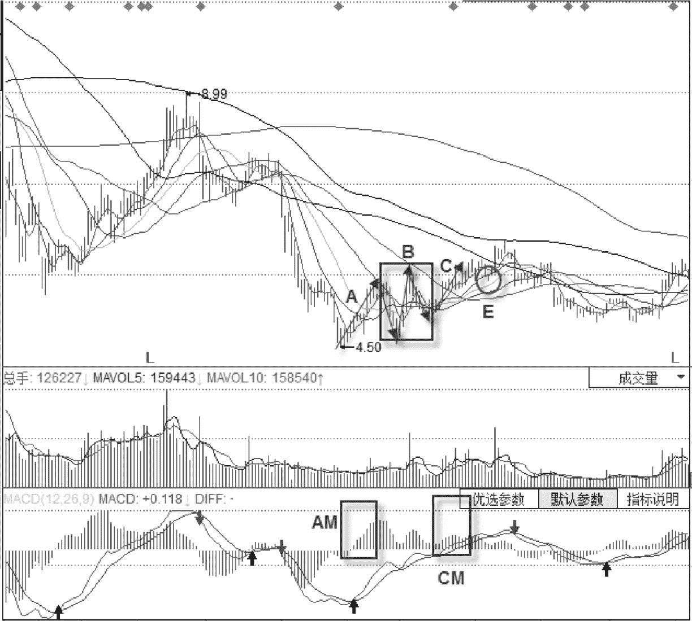

图 3-1　湖南天雁－日线图

买入后，一定不要为期间的震荡所左右，而应一路持有。当到了 2017 年 2 月 9 日时，股价出现了大幅上涨后的回调，并形成了一个回调中枢，观察这一中枢，虽然没有形成顶背离，但是在中枢震荡过程中，2017 年 3 月 29 日至 31 日形成了一个明显的顶分型，如果此时从顶分型的强弱分析，明显第三根 K 线未收至第二根一半以上，属于最弱的情况。另外，从缠中说禅关于中枢震荡的理论中可以得知，即使其后次级别出现上破中枢，也必然会回跌到中枢内，所以，此时可选择卖出，因为庄家可能在借机高位出货，如图 3-2 所示。

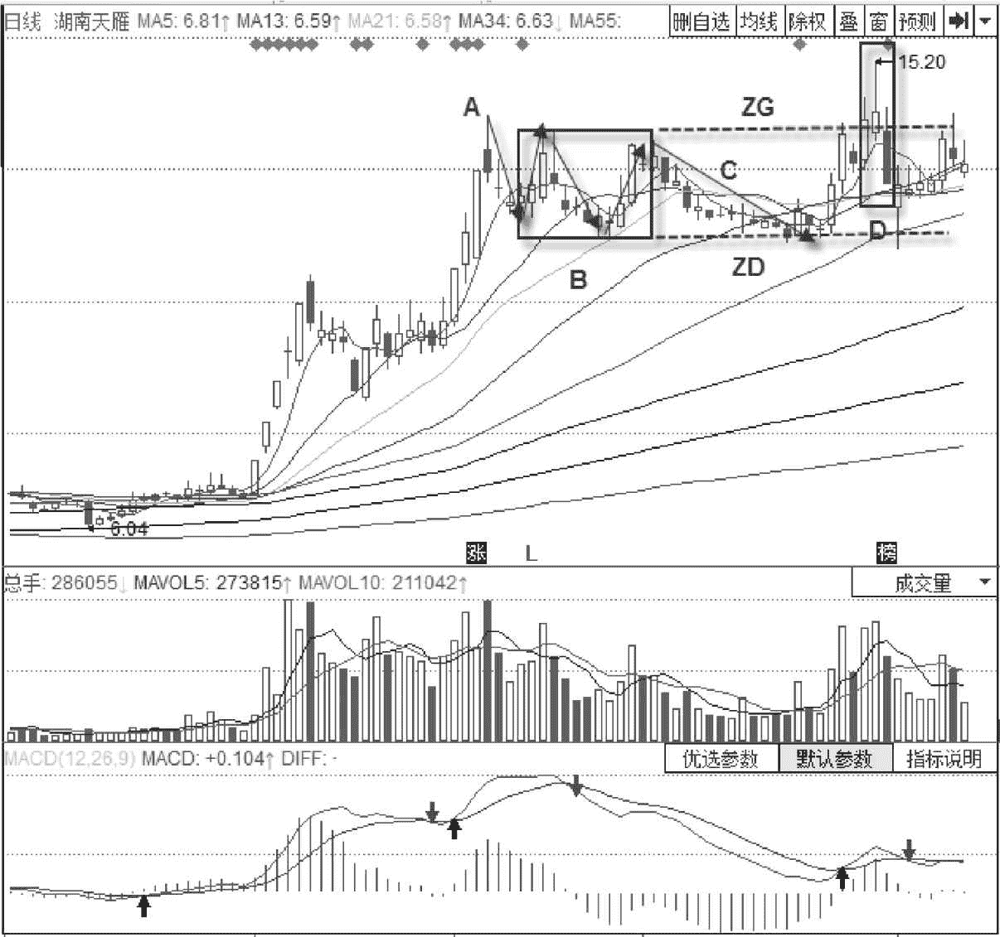

图 3-2　湖南天雁－日线图（2017 年 2 月—4 月）

从 2016 年 4 月 8 日底背驰出现后买入算起，即使以当日最高价 5.77 元至 2017 年 3 月 31 日的最低价 12.78 元计，这一买一卖，每股即获利 7.01 元，获利高达 140%。

操盘要点

当投资者资金量小时，一定要学会缠论中捕捉背驰的方法，从低位买入，因为此时庄家是在建仓，然后再从庄家开始出货的高位卖出，而不要为期间的波动所诱惑或困惑，这样才能让自己的资金越来越壮大。

### 3.1.2　积累资金的过程

缠中说禅在“教你炒股票 75 课”中说：“人必须有远大的目标，不想成为大资金的散户，就如同不想成为元帅的士兵。最终能否达到，这和每个人的悟性、修炼、机缘等密切相关。但有时候结果并不一定太重要，过程往往更加美好。如果说到结果，任何人的结果都是咸鱼一条，因此，任何人都没必要有任何负担与畏惧心理。只要按照正确的道路，就算最终只能登到山腰，也不枉这一行了。”

这就是说，每一位投资者都必须树立一个远大的目标，尽管有时不能实现，但起点高，收益也会相应多。至于如何获取收益，就是严格按照缠论的买卖点操作，即使无法捕捉到大的波段收益，也能够获利不菲。

在 A 股应用

印记传媒（002143）在经过 2016 年初的下跌后，股价出现了拦腰去半，而在 2016 年 3 月初，形成了一个回升中枢，根据缠中说禅关于底背驰的定义，观察这一中枢的情况发现，B 段最大，C 段小于 A 段，MACD 红柱 C 段对应的 CM 也远远小于 A 段对应的 AM，而 B 段对应的 BM 区域，MACD 双线拉回到了 0 轴附近。并且在之前的下跌中已经出现过一个中枢 D，因此完全符合底背离的要求，如图 3-3 所示。

虽然指标显示如此，但在实际操盘过程中，当面临股价低位震荡时，依然会让许多投资者感到有些恐慌，不敢出手，或是技术上不够全面，对底背驰形态判断不准，因而错过了 M1 区域的第一类买点。

但是正如缠中说禅在“教你炒股票 13 课”中所言：“也可以根据第二个买点的原则重新介入，所以真正的机会并不会丢失。”因此，投资者完全可以根据第一类买点出现过的再次回调止跌时大胆买入，即图 3-3 中 M2 区域的情况。而此时，相对来说，安全了许多，局势也变得更加明朗化了。

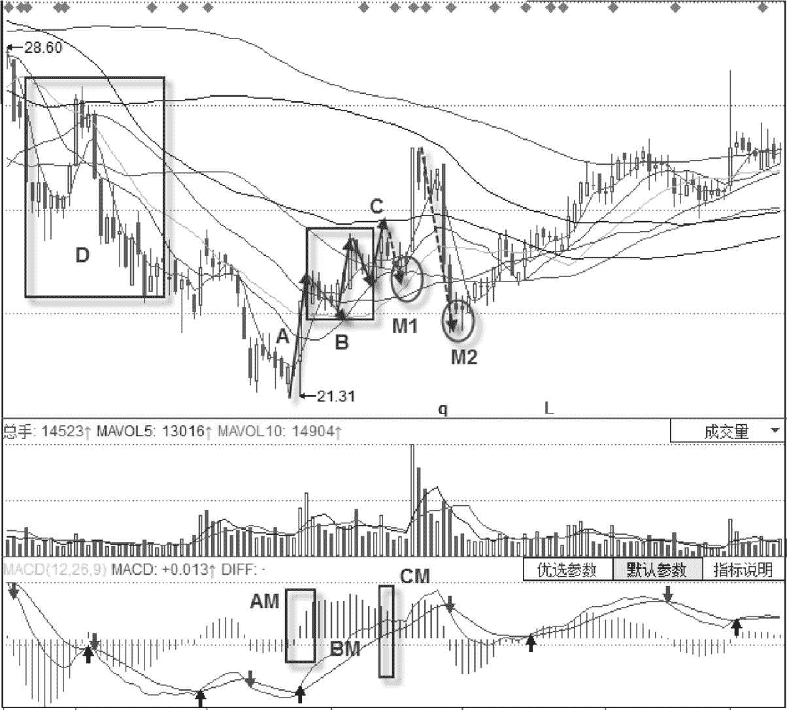

图 3-3　印记传媒－日线图

至于收益，只要往后看一眼趋势发展和行情的演变即可一目了然，如图 3-4 所示。

操盘要点

在实际操盘过程中，在根据自身对缠论技术的掌握程度，无法明确得出判断结果时，可放弃操作，哪怕是一次很好的机会。因为你不熟悉，难免会失误。所以，应选择自己能够看懂的行情来操作，以降低投资的风险。只要持之以恒，胸中怀有大志，自然会实现资金的不断积累。

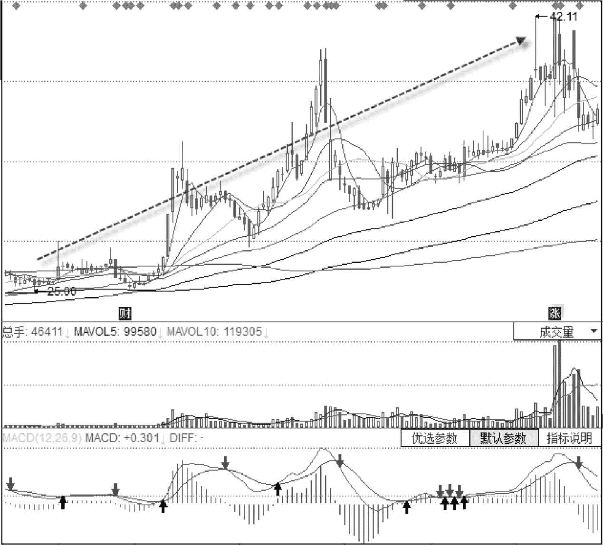

图 3-4　印记传媒－日线图（2016 年 9 月－2017 年 4 月）

## 3.2　小资金变成大资金的方法

小资金要想能够与庄家实现部分对话，就必须学会如何让自己的小资金也变成大资金，而变成大资金的不二法门，关键在于如何实现零成本后的滚动操作。而这一切的实现，都应在趋势明朗的情况下操作。

### 3.2.1　在趋势明朗后操作

缠中说禅说过，趋势反转点其实就是背驰点，但真正判断背离形态时，往往不少投资者难以准确判断。因此，缠中说禅又在“教你炒股票 13 课”中讲道：“散户就当好散户，别整天想着抄底、逃顶，底都让你抄了，顶都让你逃了，不是散户的人吃什么去呀？散户，一定要等趋势明朗才介入或退出，这样会少走很多弯路。”

为了进一步阐明意图，缠中说禅又详细说：“一只股票涨起来千万别随意抛了，中线如果连三十天线都没跌破，证明走势很强，就要继续持有。当然，如果你水平高一点，在上涨的时候，根据短线指标可以打短差，这样可以增加资金的利用率，但高位抛掉的，只要中线图形没走坏，回挡时一定要买回来，特别是那些没出现加速的股票。有一个抛股票的原则，分两种情况，一种是缓慢推升的，一旦出现加速上涨，就要时刻注意出货的机会；另一种是第一波就火爆上涨，调整后第二波的上涨一旦出现背驰或放巨量的，一定要小心，找机会走人。”

在 A 股应用

比如，如果是在低位 30 元以下买入了启迪桑德（000826），经过其后的一路上涨后，尤其是到了 2017 年 4 月 11 日和 12 日，日线上股份出现了放阴量的下跌，相信很多投资者都会感到坐卧不安。因为如果是站在中线的角度看，整体涨幅并不太大，并且这只股票是具有雄安概念的股票，所以尽管短线有冲高回落的表现，但后市潜力应当是比较大的。再说了，即使如此接连下跌，尚且未出现跌破 B 区域的 30 日均线，证明趋势还是很强的，所以应继续持有，如图 3-5 所示。

至于卖出股票，比如山东药玻（600529），自 2016 年 3 月中旬至 9 月底期间，一直处于缓慢向上推升，如图 3-5 中的 A 段走势，出现了缠中说禅所说的“第一种情况”。但在 10 月时，却出现了一波不小的回调，即 B 段走势，其后再次上涨，形成了创出新高的 C 段行情，如图 3-5 所示。

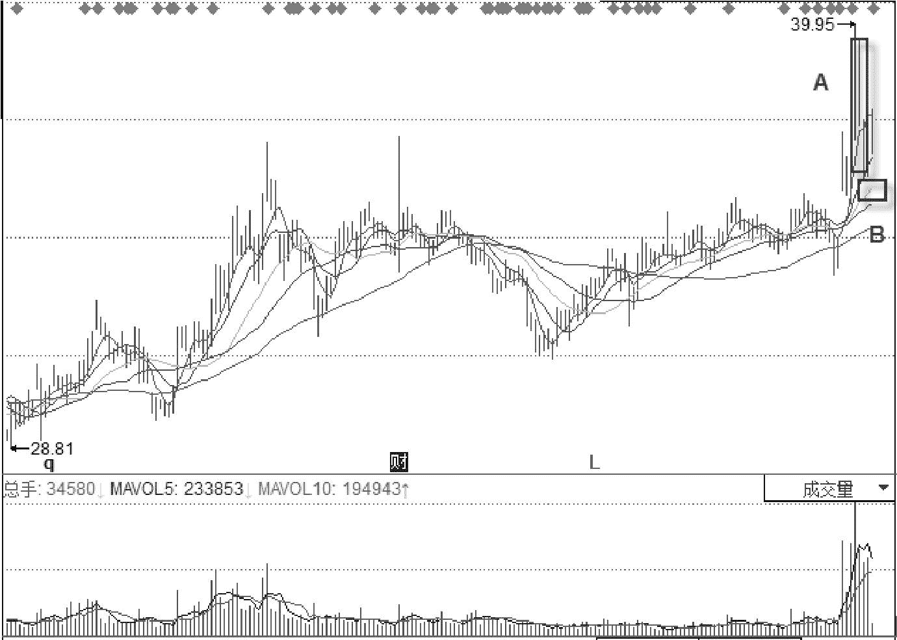

图 3-5　启迪桑德－日线图

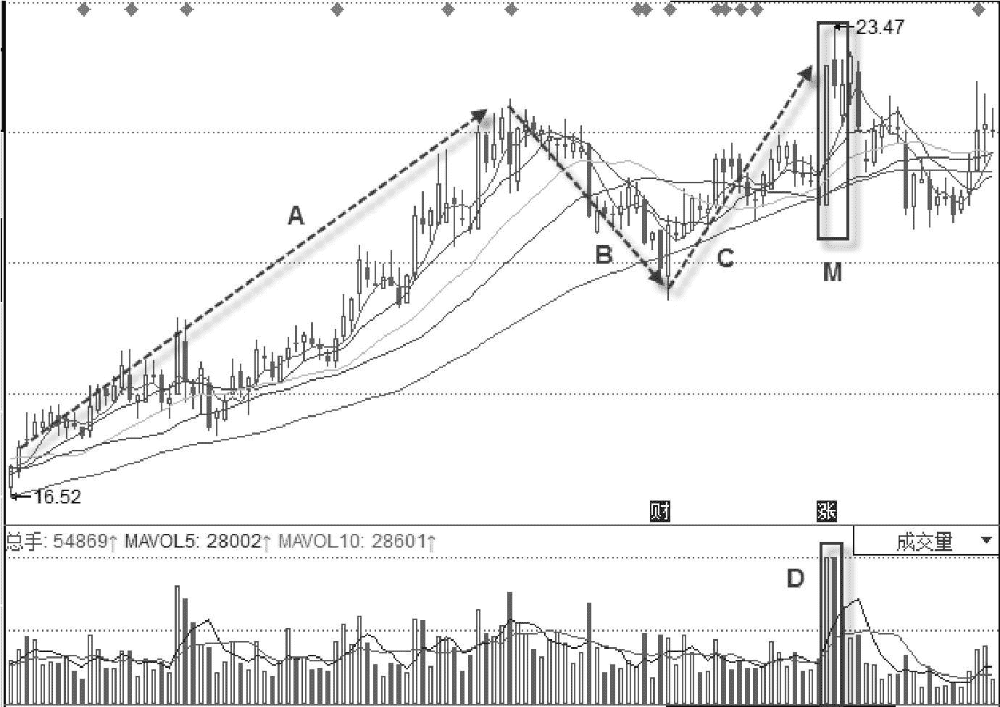

图 3-6　山东药玻－日线图

然而，问题就出在了这 C 段走势的末端，即 M 区域，形成了明显的顶分型，考察顶分型的强弱发现，第三根 K 线虽然收阳，但却收于第二根 K 线之下，明显的弱势。另外，第二根 K 线上影线过长，且当日爆出趋势过第一根 K 线的天量成交阴量，说明庄家开始逢高出货。再观察 B 段与 C 段的走势，恰好发生了顶背驰，所以应及时卖出股票。

至于第二种情况，如恒基达鑫（002492）在告别底部的 S1 段上涨后，出现了 B 段的调整，接着又出现了 S2 段的第二波上涨，如图 3-7 所示。

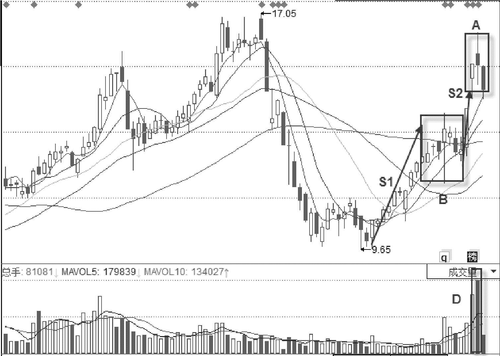

图 3-7　恒基达鑫－日线图

问题就出在了这 S2 段的第二波上涨中，即 A 区形成顶分型时的 2017 年 4 月 13 日，当日不仅放出了阴量天量，且 K 线上出现了较长的上影线，有经验的投资者应在当日午后即选择卖出，正如缠中说禅在谈到第二种情况时讲的“放巨量的”一样。

操盘要点

要想让自己的小资金变为大资金，就要学会该持有时一定要继续持有，但该出手时同样要敢于迅速出手，这样才能保证在资金安全的前提下，实现稳步增长。

### 3.2.2　实现零成本操作，滚动操作

缠中说禅在“教你炒股票 95 课”中讲道：“对于市场上的众生，本 ID 给的第一忠告就是，把你的第一笔钱运作好，然后把本拿走，最后把这利润变成巨大的数字，这才是市场中的真正操作。”

意思再简单不过，缠中说禅的意思就是要学会零成本操作，因为只有这样，操作中才会克服掉许多患得患失的毛病，用心操作，实现滚动获利。

这其中的关键就是第一笔自有资金的操作。因为只有第一笔操作中实现了较大的获利，才能够拥有足够的成本。而这一点，和最初投资的资金量关系并不大，因为即使你第一笔资金投入得大，但操作不好的话，同样会出现亏损，反而得不偿失。所以，在操作第一笔资金时，一定要看准后再下手，这样才能确保第一次投入的获利。

在 A 股应用

豫能控股（001896）在前期出现过 D 中枢的回调整理后，2016 年 5 月 30 日至 7 月 11 日期间，再次形成了一个由 A、B、C 三段走势组成的回升中枢，观察中枢情况发现，C 段最大，且将 MACD 双线回拉到了 0 轴附近；C 段明显小于 A 段，对应的 MACD 红柱也少于 A 段，形成了缠中说禅所讲的底背驰。说明下跌趋势即将反转向上，因此应抓住这一趋势反转点，在其后出现回调过程中的止跌点 M 出现时，果断全仓买入，如图 3-8 所示。

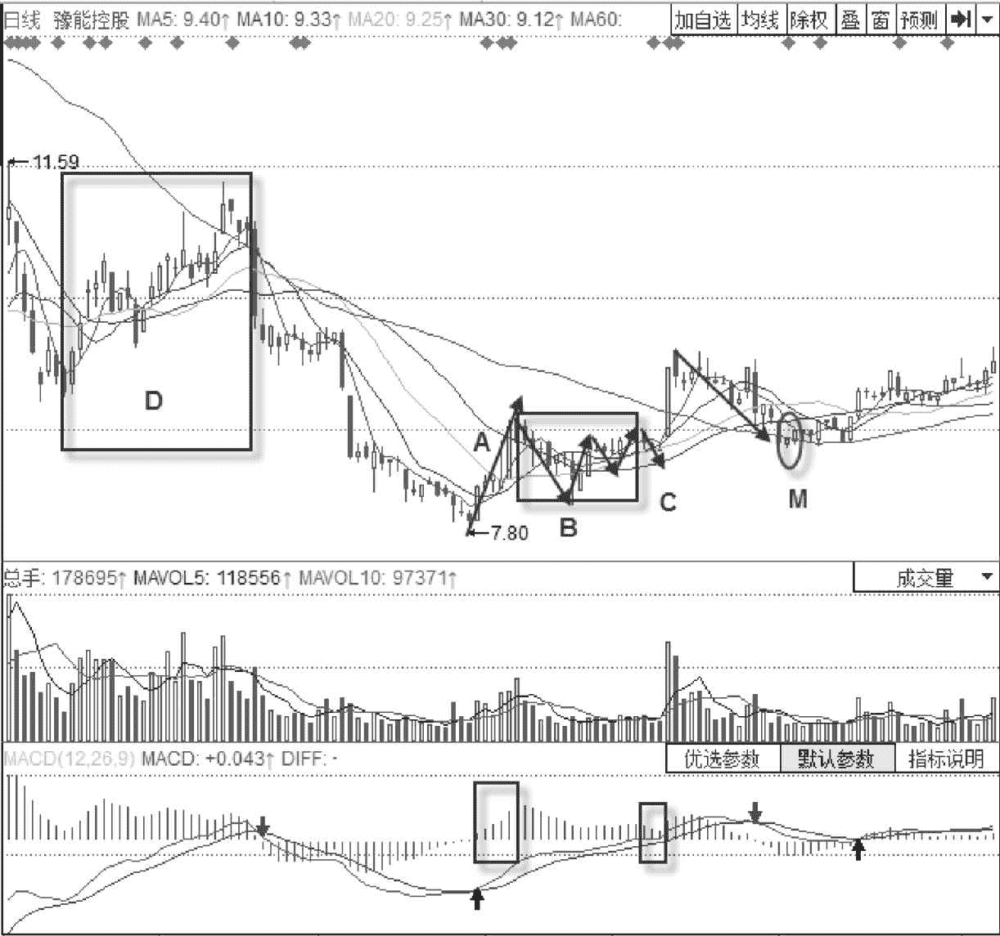

图 3-8　豫能控股－日线图（2016 年 5 月－7 月行情）

这样，就完成了第一笔资金的最低买入操作。

然后就是等待卖点的出现了，按照缠中说禅的观点，应选择在顶背驰出现时再卖出。然而到了 2017 年 2 月 3 日，股价在上涨趋势里，突然在快速拉升时出现了放出巨大的成交阴量的情况，且形成了天量，说明庄家在快速出货，应果断选择卖出。而考察其后出现的回调中枢发现，虽然没能形成顶背驰，但中枢震荡中却已经显示明显的偏弱情况。

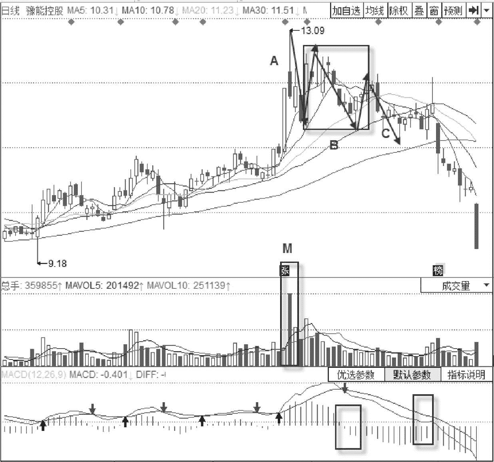

图 3-9　豫能控股－日线图（2017 年 2 月－4 月行情）

如此算下来，这一轮第一笔投资，买入价格在 8 元多，卖出价格在 12 元多，获利在 50%以上。然后利用赚到的原本金的 50%再运用这种方法，滚动操作，最终资金会变得越来越多，而零成本操作下，心里的压力自然少了许多，观察行情也更加坦然、准确。

操盘要点

实现零成本操作时，最好选择那些朝阳行业的股票处于较大下跌的时候，利用底背驰技术寻找第一类买点。因为这类行业的股票相对涨幅会可观。但当第一笔投资获利后，一定要克服心中的贪念，将本金抽回，否则极有可能因过贪导致日后投资的失利，反而落个连本带利的亏损下场。

## 3.3　资金的对决

与庄家抗衡，虽然缠中说禅给出了具体的方法，但毕竟散户哪怕是拥有了大的资金量，也不会闲到如此地步，反而可以根据这些特点，学会如何捕捉黑马股，以及如何避开烂庄股。

### 3.3.1　在时间戏庄中捕捉黑马股

在谈到时间上戏庄时，缠中说禅说：“你只要不断在里面折腾，让他感觉到里面人特乱，筹码特乱，那么这些无聊的家伙就是洗呀洗的，洗到行情都走完了，还在那里洗。很多庄家，就是太有洁癖了而被害死的，特别那些经验不足的，资金实力又有限的。”

因此，通过时间戏庄，其实就是一个字“耗”。作为投资者来说，即使资金大了，也应从投资的角度，学会在庄家长期洗盘中，若是发现有以时间戏庄的大户，或是即使这样的大户不出现，也要能够耐得住寂寞，忍受住孤独，最终实现捕捉到黑马股，因为通常在时间上庄家能够忍受长久孤独的，往往是一匹大黑马即将出现的征兆。

在 A 股应用

北化股份（002246）在 2015 年 9 月至 10 月期间，出现大幅下跌后的企稳，虽然没有出现底背驰，但却形成了“底分型+顶分型”的上升笔，并接连出现了笔 A、笔 B 和笔 C，形成了一个向上起笔的线段，说明趋势已经回暖，可以在其后 M 区域形成另一个底分型时选择买入，如图 3-10 所示。

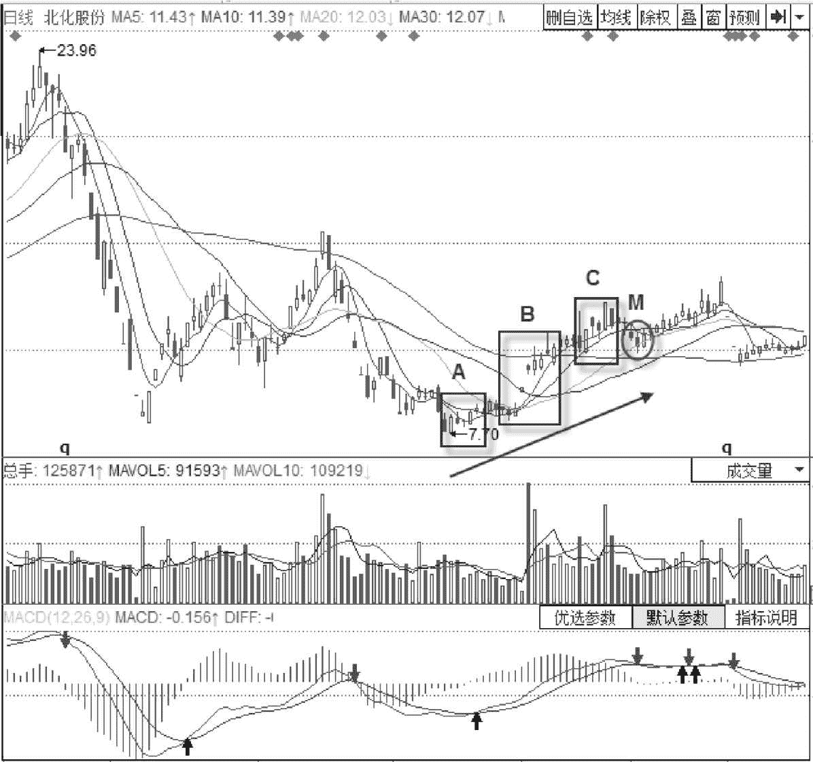

图 3-10　北化股份－日线图（2015 年 8 月－10 月行情）

然而到了其后的 2015 年 11 月 21 日，股票却突然出现了停牌，一直到了 2016 年 8 月 3 日复牌，并出现接连的一字跌停牌，即 Z 区域的情况，如图 8－11 所示。

此时，应在结束一字跌停板后，股价明显企稳的 J 区域的底分型中加仓买入，因为之前的上升线段虽然因停牌遭到破坏，但趋势仍未改变，所以此时完全可以在底分型中加仓。

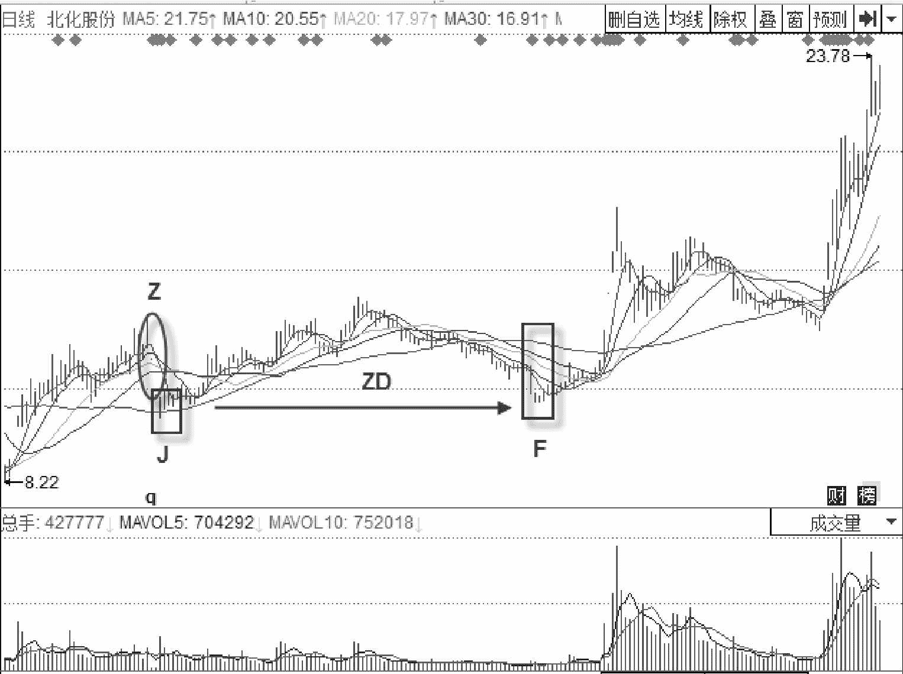

图 3-11　北化股份－日线图（2016 年 8 月－2017 年 4 月行情）

其后一直到 2016 年 12 月间，即 J 至 F 区域间的 ZD 区域，股价一直处于均线缠绕的震荡小幅趋势，这说明庄家在借机洗盘。如果技术较好的投资者，可做一些小波段的操作。而技术相对差些的应忍受住寂寞，继续持股。

因为此阶段，即为缠中说禅所说的“中阴阶段”。而渡过了中阴阶段的中枢震荡后，即图 3-12 中的 B 区域，在 2017 年 3 月 24 日出现了“回调不破中枢”的第三类买点，即图 3-12 中的 M3 区域，此时反而可以加仓至满仓操作，如图 3-12 所示。

如此操作，至 2017 年 4 月中旬时止，已实现获利 100%以上，但由于行情仍未上涨，作为大资金来说，即可以在创出新高 23.78 元形成顶分型时选择分批卖出第一批股票。

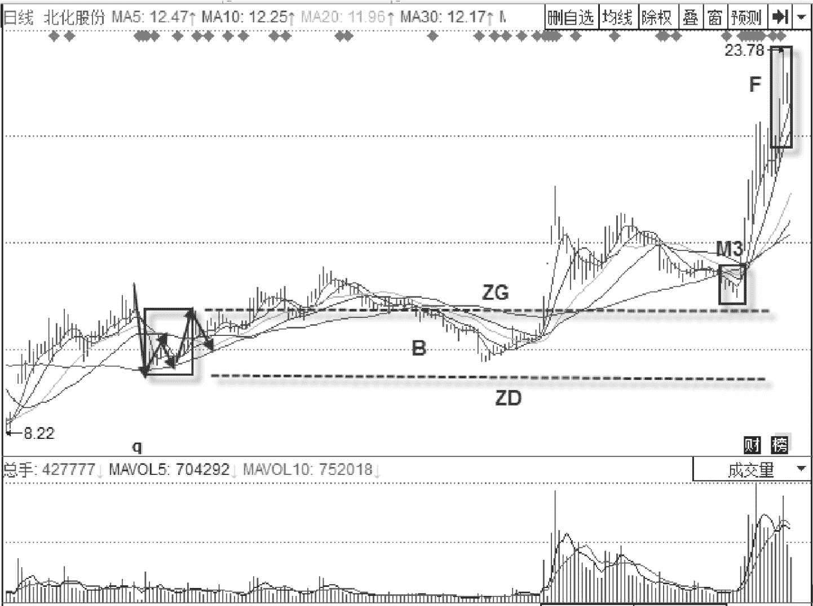

图 3-12　北化股份－日线图（2016 年 8 月－2017 年 4 月行情）

操盘要点

作为投资者来说，一定要端正态度，即使资金量达到了某一高度，也应以投资为目的，在发现有大户以时间戏庄，或是庄家拉长时间震荡洗盘时，冷静思考，面对行情的演变，以自己准确的判断进行操作，这样既获得了丰厚的利润，又从中得到了投资被认可的乐趣。

### 3.3.2　在空间戏庄中远离弱势股

在谈到以空间戏庄时，缠中说禅讲道：“一般这种，都是走出一个复杂的大级别中枢。而在空间上搞死，那就是另一种玩法了。这种玩法的基本原则就是：庄家要风，就助他风；要雨，就助他雨。这样，先养其骄。等到其觉得不可一世、春风得意时，突然出手，这出手，一定要稳、准、狠，一下就要其命。以纯技术的角度，这就是要先砸出一个相当狠的第一段，引发散户恐慌盘后回接。这里，出手的位置很关键，太低没有杀伤力，太高又太晚。因此出手的时机决定成败，这需要经验、判断、技术很多综合的因素，对人的综合能力要求很高。

回接后，就是用来阻击庄家反扑的。庄家在第一段出手后，肯定有反扑，这时候，就要有足够的子弹进行塔山阻击战。股票有一个好处，没有子弹，只要有钱，马上就可以采购，所以必须要利用好这一特性，控制好阻击的节奏、能量。”

这种情况，在市场上会经常出现，但并非是“戏庄”一说，而是不同的庄家进入后的一种相互争斗的情况，而造成股价趋势上的变化是，股价反复出现震荡，而且是出现低位的再破位下行震荡。出现这种大幅震荡后破位震荡的情况，或许是庄家已经离开了。但不管如何，当发现这种形态的股票时，一定要做到远离、回避。

在 A 股应用

南兴装备（002757）经过下跌后，于 2016 年 5 月 10 日至 6 月 21 日期间，出现了一个由 A、B、C 三段组成的回升中枢。通过观察中枢的情况，期间形成了 B 段大于 A 段、C 段的底背驰，这说明庄家已经建仓这只股票，其后的 M1 与 M2 区域，成为第一类买点和第二类买点，如图 3-13 所示。

然而，在第一类买点和第二类买点相继出现后，从 2016 年 8 月一直到 2017 年 4 月，股价一直处于较大幅度的震荡行情中，而第二类买点出现后的震荡上行中，2016 年 11 月底出现的高点，即图 3-14 中的 E 区域，最高只达到了 50 多元，尚未突破底背驰形成后上涨的高度，而与第一类买点形成后的买入价格 38 元左右相比，仅仅上涨了 20%左右。然后即开始了回调，并在 E 区域后的回调中，低点到了 33.80 元，跌破了底背驰时的低点 36.10 元，如图 3-14 所示。

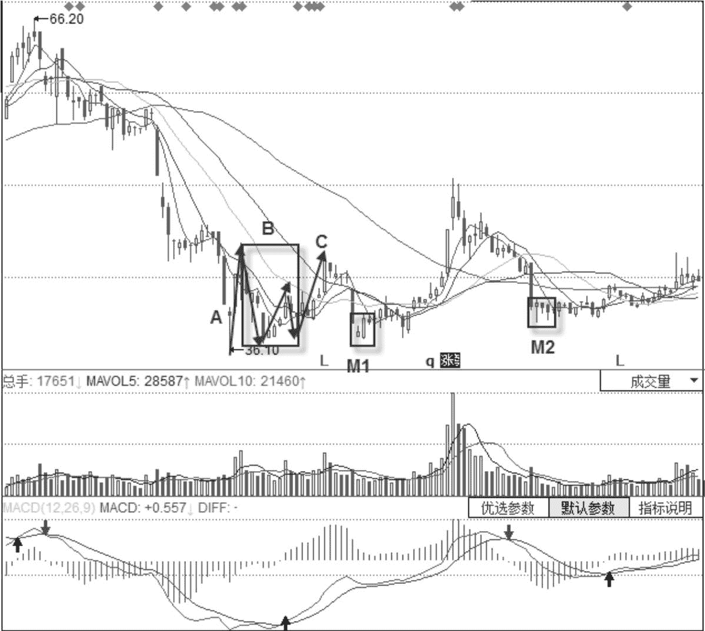

图 3-13　南兴装备－日线图（2016 年 5 月－8 月行情）

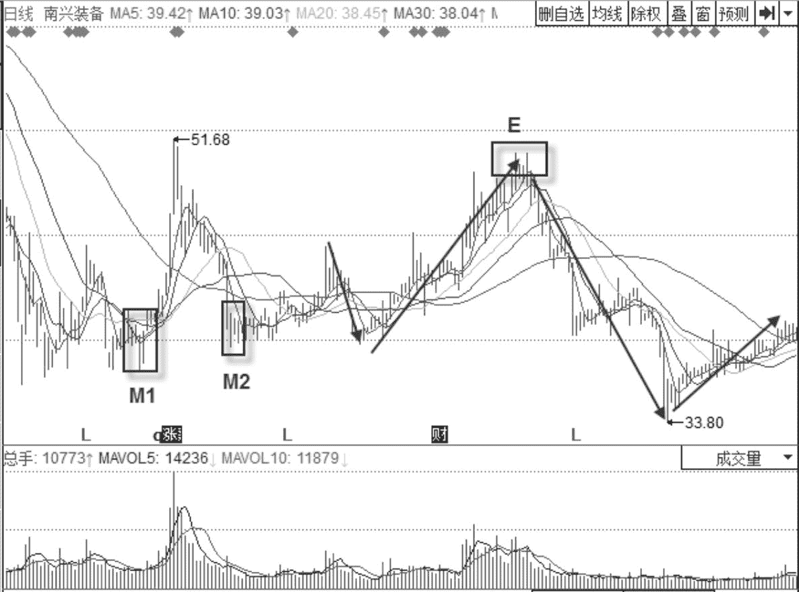

图 3-14　南兴装备－日线图（2016 年 6 月－2017 年 1 月行情）

作为一只流通市值仅仅 15 亿元左右的小盘股，这样的涨幅对于小庄家来说，获利也是相当困难的。由此可以判定，要么是有新庄家不时进进出出地捣乱，要么是有资金大户在其中戏庄。所以，对于这类股，应在 E 点的顶分型出现后及时分批卖出，因为在里面再继续耗下去，是很难实现获利的。

操盘要点

投资者在操盘中，即使是大资金，也要做到一旦发现有戏庄的大户，或是不停有新庄家进入、旧庄家出去的频繁换庄的情况发生时，一定要及时抽身而退，不要被这些庄家的短期走马观花式的坐庄行为干扰了自己的投资计划，进而成为这些庄家的炮灰。

# 第二部分　通过缠论核心技术来捕捉市场动向

# 第四章　线段捕捉庄家动向

缠中说禅说过，线段都是有方向的。这也就决定了通过线段能够明显看出市场正处于一种什么趋势。因此，相对而言，缠论中线段更为直观、明了，但线段的组成较为复杂，只有先明白分型、笔，才能准确地判断出线段，从而通过线段的捕捉，寻找到庄家的动向。

## 4.1　线段的理论基础

线段是趋势的象征，明晰的线段往往代表着一段明晰的上涨趋势或下跌趋势，这给投资者带来了可供参照的一面镜子。

### 4.1.1　分型

分型是缠论的基础，是判断笔的最基本元素，可分为顶分型与底分型，其都是由三根 K 线组成的一种组合。同时，高级的底分型或顶分型，可直接根据其强弱程度来判断庄家是否在建仓或是出货，也可直接依据不同的分型确定买卖点。因为缠中说禅在“教你炒股票 81 课”中说道：“一个最简单的结论：所有的顶必须是顶分型的，反之，所有的底都是底分型的。”这就决定了分型在高级别 K 线图上的实战意义。

1.顶分型

在“教你炒股票 62 课”中，缠中说禅对于顶分型给出的定义是：“第二 K 线高点是相邻三 K 线高点中最高的，而低点也是相邻三 K 线低点中最高的。”

在 A 股应用

杭叉集团（603298）在上市后一字涨停板打开后，于 2017 年 1 月 4 日、5 日、6 日三个交易日中，日线上形成了三根 K 线，三根 K 线中，6 日的 K 线其高点为三根 K 线中最高的，低点又是三根 K 线中最高的，形成了缠中说禅所讲的顶分型形态，如图 4-1 所示。

明白了顶分型的形态，还要明白其形成的原因，即缠中说禅在“教你炒股票 81 课”中讲的：“显然，一个顶分型之所以成立，是卖的分力最终战胜了买的分力，而其中，买的分力有三次的努力，而卖的分力，有三次的阻击。用最标准的已经过包含处理的三 K 线模型：第一根 K 线的高点，被卖分力阻击后，出现回落，这个回落，出现在第一根 K 线的上影部分或者第二根 K 线的下影部分，而在第二根 K 线，出现一个更高的高点，但这个高点，显然与第一根 K 线的高点中出现的买的分力在小级别上出现力度背驰，从而至少制造了第二根 K 线的上影部分。最后，第三根 K 线，会再次继续一次买的分力的攻击，但这个攻击，完全被卖的分力击败，从而不能成为一个新高点，在小级别上，大致出现一种第二类卖点的走势。”

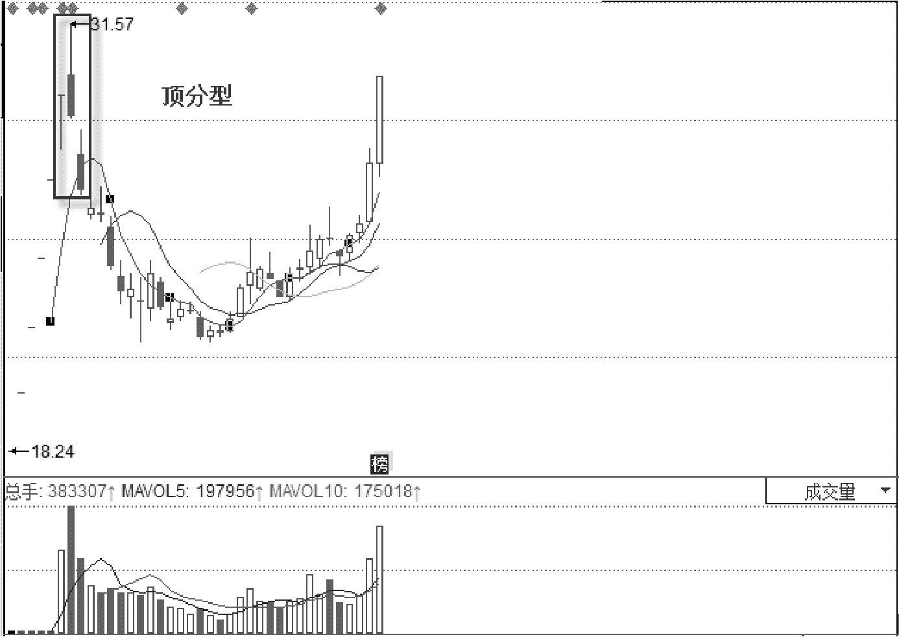

图 4-1　杭叉集团－日线图

这就是顶分型形成的原因，而在实战中，在单纯以顶分型来判断强势时，应选择高级别的 K 线图，如日线或周线及月线，但应当遵循缠中说禅在“教你炒股票 82 课”中所讲的强弱状态。

（1）“一个完全没有包含关系的分型结构，意味着市场双方都是直截了当，没有太多犹豫。包含关系（只要不是直接把阳线以长阴线吃掉）意味着一种犹豫，一种不确定的观望等，一般在小级别上，都会有中枢延伸、扩展之类的东西。”

（2）“还是用没有包含关系的顶分型为例。如果第一根 K 线是一长阳线，而第二、三根 K 线都是小阴、小阳线，那么这个分型结构的意义就不大了，在小级别上，一定显现出小级别中枢上移后小级别新中枢的形成。一般来说，这种顶分型，成为真正顶的可能性很小，绝大多数都是中继的。”

（3）“非包含关系处理后的顶分型中，第三根 K 线如果跌破第一根 K 线的底而且不能高收到第一根 K 线区间的一半之上，属于最弱的一种，也就是说这种顶分型有着较强的杀伤力。”

在 A 股应用

百合花（603823）在 2017 年 1 月 4 日、5 日、6 日在日线上形成了一个顶分型，观察 6 日的第三根 K 线发现，收盘远在第二根 K 线之下，因此为不具包含关系的顶分型，未收到第二根 K 线一半以上的情况，所以属于极弱状态。同时，成交量也在顶分型形成期间出现放大的接连阴量，表明庄家在逢高出货，所以应果断卖出，如图 4-2 所示。

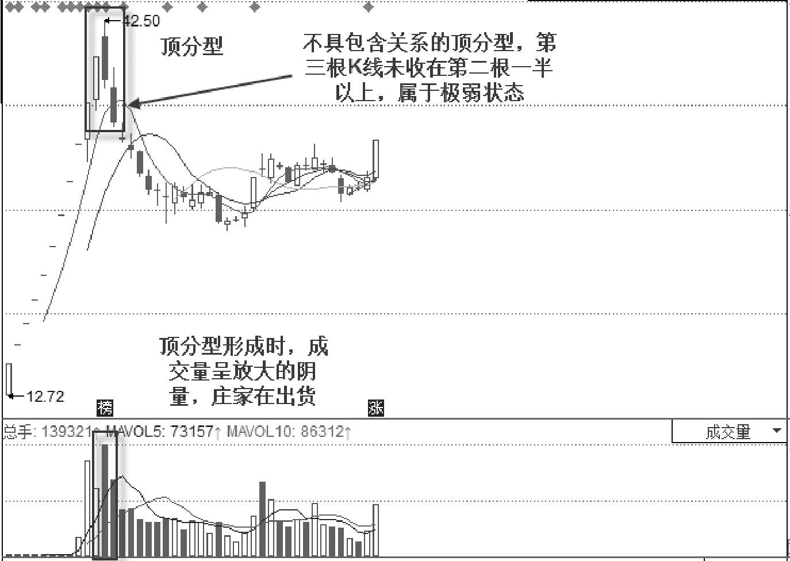

图 4-2　百合花－日线图

2.底分型

底分型，就是缠中说禅所说的“第二根 K 线低点是相邻三根 K 线低点中最低的，而高点也是相邻三根 K 线高点中最低的。”

在 A 股应用

民和股份（002234）在 2017 年 2 月 17 日、20 日、21 日三个相邻的交易日中，日线上出现了三根 K 线，观察后发现，第二根 K 线的低点为三根中最低的，且创出了 17.01 元的新低，且其高点为三根 K 线中高点最低的，于是形成了底分型，如图 4-3 所示。

图 4-3　民和股份－日线图

但在以单一的底分型判断趋势时，应当观察高级别的 K 线图，如日线、周线或月线，从而确定是否为庄家建仓的底部，同时应遵循缠中说禅的四个原则，以分辨出其强势。

（1）在底分型中，第三根 K 线的高点远远高于第一根 K 线的高点，站在底分型的上边沿，这种情况其后上攻走势延续成笔的可能性极高，是最强的走势。

（2）在底分型中，如果第三根 K 线的高点正好是第一根 K 线的高点，或者是略微高于底分型的上沿，则表明走势一般，上攻走势延续成笔的可能性较小。通常来说，这种底分型成为真正底的可能性很小，为中继底分型的可能性较大。

（3）在底分型中，如果第三根 K 线的高点低于第一根 K 线的高点，或者说第三根 K 线的高点低于底分型的上沿，则表明走势较弱，上攻走势延续成笔的可能性极低。通常来说，这种底分型表明多方力量较弱，成为真正底的可能性非常小，多数为中继底分型。

（4）底分型的出现，并不代表上攻走势就会延续成笔，关键还要看其后的股价是否能在底分型的上沿站稳，这是判断底分型强弱的重要依据。只有股价站稳底分型上沿后，才是买入的时候，否则均不可过早参与。

在 A 股应用

航新科技（300424）在 2017 年 1 月 18 日、19 日、20 日三个交易日中，形成了一个底分型。观察后发现，第三根 K 线在第一根 K 线之上，但距离并不是特别远，说明属于强势，但又不是特别强。再观察，股价一直是处于下跌状态，而在底分型出现前，价格在低位震荡期间，成交量明显多为阳量，说明庄家在不断买入；而底分型出现后，价格又一直处于底分型之上，因此可确认为庄家建仓的底部，可放心买入，如图 4-4 所示。

图 4-4　航新科技－日线图

操盘要点

缠中说禅在“教你炒股票 81 课”中说过，“没有顶分型，没有顶；反之，没有底分型，没有底。因此，大级别的 K 线图上，如出现极强的顶分型，往往是庄家出货的征兆，且往往出现在股价经过大幅上涨时；如出现极强的底分型，则往往是庄家快速建仓的征兆，往往出现在持续下跌的低位区。而中继分型的出现，往往其后会继续之前的趋势。

### 4.1.2　笔

缠中说禅在“教你炒股票 62 课”中说：“两个相邻的顶和底之间构成一笔。所谓笔，就是顶和底之间的其他波动，都可以忽略不算。但注意，一定是相邻的顶和底，隔了几个就不是了。”但需要注意一点，“在实际分析中，必须要求顶和底之间至少有一根 K 线当成一笔的最基本要求。”

这里的顶和底就是缠中说禅讲的“顶分型的最高点叫该分型的顶，底分型的最低点叫该分型的底”。但是，由于这种底分型与顶分型的结合，出现的前后顺序有差别，所以笔又可分为上升笔和下降笔。

1.上升笔

上升笔，就是缠中说禅在“教你炒股票 62 课”中讲的呈向上态势的笔，即“上升的一笔，由结合律可知，一定是底分型+上升 K 线+顶分型”。

在 A 股应用

超讯通信（603322）在 2017 年 2 月 6 日、7 日、8 日出现了一个底分型，随后出现了一根上长 K 线（位于底分型之上的阳线），然后在 2017 年 2 月 13 日、14 日、15 日又出现了一个顶分型，形成了一个上升笔。这说明，庄家在拉高洗盘后，结束了震仓，开始向上拉升。因此，应选择买入，如图 4-5 所示。

图 4-5　超讯通信－日线图

2.下降笔

下降笔，即缠中说禅在“教你炒股票 62 课”中讲的“下降的一笔，就是顶分型+下降 K 线+底分型”，和上升笔一样，下降笔中在顶分型与底分型之间同样需要存在一根（或具有包含关系的）下降 K 线。

在具体判断趋势时，下降笔出现时，往往趋势是向下的，或是高位盘整阶段，而判断庄家是否是在高位出货，或是已出完货，应利用盘整背驰或中枢震荡的情况来具体分析。

在 A 股应用

海能达（002583）在上涨趋势中，突然在 2016 年 12 月 5 日、6 日、7 日形成了一个顶分型，12 月 8 日出现一根下降 K 线后，即于 2016 年 12 月 9 日、12 日、13 日形成了一个底分型，从而形成了一个下降笔，如图 4-6 所示。

图 4-6　海能达－日线图

具体行情分析，应为上涨中出现的回调，即庄家的洗盘，此时可结合中枢震荡，一旦出现向上突破中枢区间高点，即可买入。而下降笔形成后，起码短线会处于调整期，所以应先行选择卖出股票，直到新的买点出现时再买入，否则应放弃。

操盘要点

笔是由顶分型+底分型组成，但必须在两个分型之间具有一根（或具有包含关系的）K 线。笔是有方向的，上升末端出现的笔，应以顶分型+下降 K 线+底分型计算，为下降笔；下降末端出现的笔，应以底分型+上升 K 线+顶分型计算，为上升笔。

### 4.1.3　线段

缠中说禅在“教你炒股票 62 课”中曾说：“所谓的线段，就是至少由三笔组成。” 这就准确地给出了线段的定义，至少要有三个笔才能成为线段，而两个笔是无法成为线段的，同样四个或五个笔也可能成为线段。但是，投资者在判断线段时应当注意对笔的划分。

同时，缠中说禅还在“教你炒股票 65 课”中讲道：“线段有一个最基本的前提，就是线段的前三笔必须有重叠的部分，这个前提在前面可能没有特别强调，这里必须特别强调一次。线段至少有三笔，但并不是连续的三笔就一定构成线段，这三笔必须有重叠的部分。”

因为缠中说禅说过：“线段和笔，都是有方向的”，所以线段根据其不同的方向，可分为向上线段与向下线段。

但在划分段落时，缠中说禅提到一个问题，就是新笔（至少第二个笔）出现时，计算方式可以放宽：“计算了一下能量力度，觉得以后可以把笔的成立条件略微放松一下，就是一笔必须满足以下两个条件：一是顶分型与底分型经过包含处理后，不允许共用 K 线，也就是不能有一根 K 线分别属于顶分型与底分型，这和原来是一样的，这一点绝对不能放松，因为只有这样，才能保证足够的能量力度；二是在满足第一个条件的前提下，顶分型中最高 K 线和底分型的最低 K 线之间（不包括这两根 K 线），不考虑包含关系，至少有 3 根（包括 3 根）以上 K 线。显然，第二个条件，比原来分型间必须有一根独立 K 线，要稍微放松了一点。”

1.向上线段

顾名思义，向上线段即以上升笔出现的接连三个笔，是以底分型+顶分型的方式出现和划分的。

在 A 股应用

科隆精化（300405）在经过前期的快速下跌后，于 2016 年 1 月底创出历史新低后，开始形成了第一个“底分型+顶分型”的笔，其后至 2016 年 6 月 24 日期间，又接连形成了两个“底分型+顶分型”的笔，并且三个笔有重叠的部分，于是形成了一个向上线段。而在此期间，成交量明显呈放大的阳量居多，说明有庄家在快速建仓。因此，成为趋势反转时的买点，如图 4-7 所示。

图 4-7　科隆精化－日线图

2.向下线段

向下线段，就是缠中说禅所说的“以向下笔开始的线段”，这就决定了向下线段与向上线段刚好是方向相反的，即必须出现至少三个“顶分型+底分型”的笔，同时笔与笔之间应有相互重叠的部分。

在 A 股应用

曲美家居（603818）在上涨趋势中，于 2016 年 8 月下旬时创出新高 21.48 元后，即开始在高位震荡，并于 2016 年 11 月 3 日至 12 月 14 日期间，先后形成了三个“顶分型+底分型”形式的笔，并且笔与笔之间有重叠部分，形成了一个向下线段。同时观察成交量发现，此期间股价高位震荡，且多为放大状态的成交阴量，说明庄家在维持股价高位震荡中大举卖出股票出货，因此应及时卖出股票，如图 4-8 所示。

图 4-8　曲美家居－日线图

操盘要点

在判断线段时，应首先看清当时股价所处的位置，并从回落之初或回升之初判断。其中，向上线段是以“底分型+顶分型”的笔的方式出现的，向下线段是以“顶分型+底分型”的笔的方式出现的，并且一个线段至少要有三个笔才能形成，且笔与笔之间必须有重叠的部分。

### 4.1.4　包含关系

包含关系是 K 线的一种从属关系，就是缠中说禅在“教你炒股票 62 课”中讲的：“也就是一根 K 线的高低点全在另一根 K 线的范围里，这种情况下，可以这样处理，在向上时，把两根 K 线的最高者当高点，而把两根 K 线低点中的较高者当成低点，这样就把两根 K 线合并成一根新的 K 线；反之，当向下时，把两根 K 线的最低点当低点，而两 K 线高点中的较低者当成高点，这样就把两根 K 线合并成一根新的 K 线。经过这样的操作，所有 K 线图都可以处理成没有包含关系的图形。”

这种 K 线的包含关系，从方向上来看，有下面两种情况。

1.向前包含

向前包含就是后面的长 K 线将前面的一根或数根短 K 线完全包含在其高低点的范围之内，就像是孕线。

在 A 股应用

慈文传媒（002343）在 2017 年 2 月 7 日出现了一根较长的阴线，但之前 2 月 3 日与 6 日的两根十字星，其高点与低点均在这根阴线的范围之内，形成了一种向前包含的关系，如图 4-9 所示。

图 4-9　慈文传媒－日线图

2.向后包含

向后包含就是当一根较长的 K 线出现后，其后出现一至数根的 K 线高点与低点均在这一根较长 K 线的范围之内。

在 A 股应用

新光圆成（002147）在 2017 年 1 月 16 日时收出一根较长的阴线，其后的 17 日、18 日、19 日、20 日接连收出了 4 根低点均在 16 日这根阴线范围之内的小 K 线。这就构成了一种向后的包含关系，在应用时可以将其看作是一根 K 线，以最长的（2 月 16 日）这根阴线来计算，如图 4-10 所示。

图 4-10　新光圆成－日线图

投资者在明白了这两种包含关系的形式后，具体应用上，可以运用到分型、笔、线段等的判断。

在 A 股应用

在此，我们以最基本的元素分型为例。比如，中国国贸（600007）在 2017 年 1 月 10 日、11 日、12 日这三个交易日中，10 日的 K 线最长，将 11 日与 12 日的小 K 线全部包含在了其范围之内，具有包含关系。可以将这三根 K 线视为一根 K 线，以 10 日最长的 K 线高低点为准。再结合其后紧跟着的 13 日与 16 日形成的两根 K 线，就构成了一个底分型，而具有包含关系的这三根 K 线可视为这一底分型的左边的一根 K 线，如图 4-11 所示。

图 4-11　中国国贸－日线图

操盘要点

包含关系是判断 K 线与 K 线关系的重要法则，也是缠论中关于分型中 K 线组成、笔中分型与分型之间，或是线段中笔与笔之间的一种 K 线处理方法。只有熟练掌握了这种包含关系的处理方式，才能更准确地运用分型、笔、线段进行判断。

### 4.1.5　结合律

结合律原本是一个数学范畴的概念，但在缠论中，它是一种结合的规律，是分型中 K 线与 K 线之间的结合规律，或是笔中分型与分型之间的结合规律，以及线段中笔与笔之间的一种结合规律。而这一规律，其实就是缠论理论的基础知识。对此，缠中说禅在“教你炒股票 62 课”中曾这样讲：“对于走势来说，结合律就是连接走势之间关系最重要的规则。”

比如在分型中 K 线与 K 线的结合律，包含关系就是一种结合律，笔形成时，是在两个分型中间的结合，“必须要有至少一根或具有包含关系的数据 K 线相隔，不能两个分型共用一根 K 线”；再比如，当新笔（第二个笔）形成时，在分型之间“不考虑包含关系，至少有三根（包括三根）以上 K 线”；又比如在线段形成中，笔与笔之间也必须有一根或具有包含关系的数根 K 线相隔，同样都是缠中说禅所说的“结合律”。

所以，通俗地讲，结合律在具体的应用中，其实就是两个元素之间相结合组成新的元素时的一种结合的规律。

在 A 股应用

上港集团（600018）在 2016 年 12 月 14 日至 19 日期间，共出现了 4 根 K 线，但在判断底分型时，就可以利用包含关系，将 15 日与 16 日这两根 K 线视为具有包含关系的一根 K 线，即底分型 K 线。随后的 2016 年 12 月 20 日出现的 K 线，又形成了一个顶分型，这两个分型即可结合成一个上升笔，中间相隔的这一根 K 线，就是结合律，如图 4-12 所示。

图 4-12　上港集团－日线图

操盘要点

缠论中的结合律是构成缠论的结合法则，必须按照缠中说禅所规定的结合方式进行结合，否则就破坏了缠论中的结合律，会导致趋势判断的错误。

## 4.2　线段被破坏

线段被破坏就像天有不测风云一样，但也许并不是季节即将改变，而只是突然刮起了一阵小风。要想明白线段被破坏后的股市天空，就要时刻关注线段被破坏后的情况。

### 4.2.1　线段被破坏

从缠中说禅对线段的定义中可以得知，线段被破坏，要么是在前三个笔中没有出现重叠的部分，无法形成至少三笔；要么就是只形成了一个笔或两个笔，而无法完成至少三个笔，从而不能成为一个线段。

正如缠中说禅在“教你炒股票 65 课”中所讲的线段分解定理：“线段被破坏，当且仅当至少被有重叠部分的连续三笔的其中一笔破坏。而只要构成有重叠部分的前三笔，那么必然会形成一条线段，换言之，线段破坏的首要条件，就是被另一条线段破坏。”

1.前三个笔中没有重叠部分

在 A 股应用

蓝科高新（601798）自 2016 年 12 月 12 日至 2017 年 1 月 24 日期间，形成了向上起笔的三个笔，即笔 1、笔 2 和笔 3。但仔细观察会发现，笔 1 与笔 2 之间有明显的重叠部分，笔 3 与笔 2 之间却刚好没有重叠部分，所以无法形成向上线段，如图 4-13 所示。

图 4-13　蓝科高新－日线图

2.无法形成至少三个笔

在 A 股应用

在中海油服（601808）日线图上，2017 年 1 月 20 日价格止跌，并至 2 月 3 日形成了一个向上笔，即底分型+顶分型，但在其后，虽然相隔一根 K 线后形成了底分型，但其后却未再出现顶分型，形成第 2 个笔，所以同样是线段遭到了破坏，如图 4-14 所示。

图 4-14　中海油服－日线图

操盘要点

线段被破坏是指线段在形成的过程中遭到破坏，从而无法形成线段。所以，不论是因为前三笔没有重叠的部分，还是无法形成至少三个笔，都无法满足线段形成的要求。所以判断是否能够成为线段时，应从线段的定义出发，只要不符合定义要求，就是线段遭到了破坏。

### 4.2.2　向上线段被破坏

严格意义上讲，向上线段被破坏时，代表的是一个向上线段的上涨行情被终结，根据缠中说禅“线段分解定理”得知：“线段破坏的首要条件，就是被另一个线段破坏。”这就意味着，上升线段被破坏时，是被另一个相反的线段所代替，所以上涨行情必然会被终结。

根据缠中说禅在“教你炒股票 78 课”中说的：“线段和笔，都是有方向的，从顶开始的笔一定结束在底，同样，以向上笔开始的线段一定结束于向上笔，不可能一个线段开始是向上笔，结束于一个向下笔。由于向上的笔的开始分型是底，而向下笔的结束分型也是底，换言之，一个线段，不可能是从底到底或从顶到顶，这是一个最基本的概念。”所以，向上线段被破坏时，从笔的角度观察，一定要结束于向上笔，但被破坏时的终结点，却是顶分型的出现。

在 A 股应用

珠海中富（000659）在 2016 年 6 月 23 日至 12 月 23 日期间接连形成了由向上笔开始的笔 1、笔 2、笔 3、笔 4、笔 5、笔 6，即底分型+顶分型的笔。考察前三笔，存在重叠部分，因此可确认为向上线段。但在其后的 2016 年 12 月 26 日至 29 日期间，却形成了一个顶分型，这与向上笔的序列特征不符，进而顶分型出现后又出现了底分型，形成向下笔，虽然未能继续形成向下笔，但向上线段遭到了终结。通过考察这一顶分型会发现，此期间，成交量多为放大的阴量，股价高位震荡止涨，说明庄家在借机高位出货，因此应选择及时卖出该股远离，如图 4-15 所示。

操盘要点

向上线段被破坏时，往往是一轮上涨趋势告一段落的时候，所以也是上涨行情终结的时候，尤其是在向上线段被顶分型出现破坏时，更是庄家维持高位震荡出货的时机，因此应选择卖出远离。

图 4-15　珠海中富－日线图

### 4.2.3　向下线段被破坏

根据缠中说禅“线段分解定理”，及其在“教你炒股票 78 课”中的论述可以得知，向下线段因是由向下笔开始的，所以其被破坏时，向下线段的终结依然会是以向下笔出现，终结点必然是被底分型破坏。

然而底分型在破坏向下线段后，将会形成一个向上笔开始的向上线段，但同样有一个问题，就是这一向上线段可能会形成，也可能会同样遭到破坏，无法形成线段，但必然会出现反转向上趋势。

需要注意的一个问题是，如缠中说禅在“教你炒股票 78 课”中所说：“正如同一笔不可能出现顶低于底的情况，同一线段中，两端的一顶一底，顶肯定要高于底，如果你画出一个不符合这个基本要求的线段，那肯定是画错了。”

同时还有一个问题，即允许破坏旧线段时的笔有重叠的部分存在，同时还有一种特殊情况，即缠中说禅所说的“旧线段只被一笔破坏，接着就延续原来的方向，那么，显然旧线段依然延续，新线段没有出现。”所以，当向下线段被破坏时，考察破坏的底分型或新的上升笔往往成为关键。

在 A 股应用

ST 亚太（000691）在 2016 年 6 月 16 日至 7 月 25 日期间形成了一个由三个笔组成的线段，即由顶分型+底分型的笔组成。但是在其后却未再继续出现顶分型，而是在 2016 年 7 月 28 日至 8 月 4 日形成了一个具有包含关系的底分型，说明向下线段遭到了破坏。并且，在底分型出现后，继而出现了一个顶分型，形成了上升笔，并在其后至 2016 年 9 月 13 日期间，又接连出现了三个底分型+顶分型的笔，组成了一个向上线段。这说明，向下线段在遭到破坏后，被新的向上线段所取代。

观察 2016 年 7 月 28 日至 8 月 9 日期间，即上升笔终结之前的向下线段时的情况发现，成交量多为阳量，且出现持续放大，说明有资金在大举买入，庄家介入迹象明显，应选择向下线段被破坏时买入，如图 4-16 所示。

图 4-16　 ST 亚太－日线图

操盘要点

向下线段被破坏时，必然会是以底分型出现的，如果是形成上升笔，且强势特征明显，往往说明此时庄家在介入，应果断选择买入，即使其后无法形成向上线段。

## 4.3　通过线段寻找庄家的方法

线段代表了一段趋势，而透过趋势，又可以直接看到庄家在其中扮演的角色。所以，从某种意义上讲，通过线段寻找庄家往往是最直接的一种方式。

### 4.3.1　向上笔开始的线段与庄家建仓

缠中说禅在“教你炒股票 78 课”中说：“以向上笔开始的线段一定结束于向上笔，不可能一个线段开始是向上笔，结束于向下笔。由于向上笔的开始分型是底，而向下笔的结束分型也是底，换言之，一个线段，不可能是从底到底或从顶到顶，这是一个最基本的概念。”同时，根据缠中说禅“一笔不可能出现顶低于底的情况，同一线段中，两端的一顶一底，顶肯定要高于底”的理论，也可以得出这样的结论。

向上笔开始的线段出现时，必须是以底分型+顶分型的笔，但必须满足顶高于底的理论。然而，“如果破了该向上笔的底”，就说明“原来的线段没结束”。所以，判断向上笔开始的线段时，最为重要和关键的是，在向上笔开始的线段形成时，一定还要出现其后跌破第一个向上笔的底。

这种情况出现时，往往意味着庄家在低位大举建仓，此时成交量往往呈小阳量持续增加的状态，所以应选择在此期间建仓买入。而一旦出现其后的笔跌破了第一个向上笔的底，往往意味着庄家在其后的建仓路较长，后市震荡的时间较长，因此此时不可过快建仓买入。

在 A 股应用

锦龙股份（000712）在 2016 年 9 月 26 日至 11 月 15 日期间，出现了接连三个向上笔开始的线段，且笔 1、笔 2、笔 3 存在重叠的部分。在此期间，笔 2 与笔 3 中的底均未出现跌破笔 1 的底，因此可确认为向上线段成立。而成交量在笔 1、笔 2 形成期间，处于低量状态下不断放大出现的小阳量形态，笔 3 则出现成交量逐级放大后的阳量持续增加，庄家建仓迹象十分明显。因此，投资者应选择及时买入，而不是判断是否会接着出现笔 4，因为三个笔即可确认线段成立，如图 4-17 所示。

图 4-17　锦龙股份－日线图

操盘要点

向上笔开始的线段出现时，关键是当底分型+顶分型的第一个笔出现后，其后的笔中是否会出现“破了该向上笔的底”的情况，如果出现，说明旧的向下线段依然没有结束，庄家即使在此时建仓，其后反复低位震荡的情况居多。否则，成交量即出现持续小阳量的温和放大。

### 4.3.2　向下笔开始的线段与庄家离场

向下笔开始的线段，就是向下线段，根据缠中说禅关于线段的定义可以得知，即以顶分型+底分型的方式出现的，且前三个笔之间必须有重叠部分。根据缠中说禅关于“所有向上线段都是以最低点开始最高点结束，向下线段都是以最高点开始最低点结束”的原理，向下笔开始的线段，即从最高点来计算，并且结束于最低点。因此，一旦向下笔开始的线段出现顶高于第一个向下笔的顶时，就意味着前期的向上线段仍然未结束，这一向下笔开始的线段不能成立。

当向下笔的线段出现时，正如缠中说禅所说的“意味着原线段转折的能量不足”，即上涨的能量不足，所以导致了趋势的突然转变。而造成这种情况的原因，是庄家在经过了长期的上涨之后，开始在高位选择获利离场，所以在成交量方面，可以发现，在向下笔的线段出现之初，往往是会以接连较大的成交阴量出现，其后成交阴量会出现持续走低中的偶尔放大。

由于庄家在操盘中有着建仓时间长、离场时间短的特点，所以向下笔开始的线段出现时，投资者不应在确认线段形成后再选择卖出，而应在向下笔出现对前期向上线段的破坏时，通过考察成交量，以及这一破坏的向下笔和其中的顶分型的情况来决定去留。

在 A 股应用

丰乐种业（000713）在 2016 年 11 月 21 日时，结束了之前的向上线段运行，并至 2016 年 12 月 1 日形成了一个向下笔 1，其后至 2016 年 12 月 27 日期间，接连形成了笔 2 与笔 3，并且三个笔之间有重叠的部分，形成了明显的向下笔开始的向下线段。

考察庄家是否在出货离场，应在笔 1 形成时判断。首先，成交量出现持续放大的成交阴量，且笔 1 中顶分型与底分型之间的下降 K 线下行趋势明显，顶分型中的第三根 K 线完全在第二根 K 线之下，同样属于极弱的情况。因此可以得出结论：庄家在逢高大举出货离场。所以，投资者此时应采取果断卖出离场的策略，而不要等到向下笔开始的向下线段完全成立后再出局，如图 4-18 所示。

图 4-18　丰乐种业－日线图

当向下笔开始的线段成立后，通过观察发现，其后的顶分型并未向上超过笔 1 的顶，说明向下趋势确立，短时不应考虑再行买入。

操盘要点

向下笔开始的线段出现时，不应在向下线段形成后再卖出，因为在第一个向下笔中确定了顶分型的弱势，以及向下笔的弱势，说明庄家在出货离场。其后，当向下线段成立后，如果无法向上突破第一个向下笔的顶，则应远离，强势突破后应再买回。但如果出现这种情况，则前期庄家出货时的象征将不存在。

# 第五章　走势中枢寻找庄家足迹

在缠论中，走势中枢占据着较为重要的地位。之所以说它重要，是因为它在使用时的简捷、方便，尤其是对趋势的演变，未来行情是否能持续，以及趋势反转时背驰技术的应用，所以其操作性更强，实用价值更大。而更多趋势的转变，也是由走势中枢决定的，所以，解析缠论，就必须学会使用走势中枢，从而对庄家的一举一动做到洞若观火。

## 5.1　走势中枢的理论基础

走势中枢是缠论最核心的技术之一，对吃透缠论有着很大的帮助，因为趋势演变往往和中枢延伸与扩张有着最直接的关系，而所有这些变化，都可以通过中枢监视器来洞悉。

### 5.1.1　走势中枢定义

缠中说禅在“教你炒股票 17 课”中讲道：“某级别走势类型中，被至少三个连续次级别走势类型所重叠的部分，称为走势中枢。换言之，走势中枢就由至少三个连续次级别走势类型重叠部分所构成。”

走势中枢在缠论中运用较为广泛，是缠论的重要理论基础，因为走势中枢揭示的是趋势，而趋势在发展过程中又能够直接表明庄家此时的各种动态，所以不同时期出现的走势中枢往往提示出了庄家的一举一动，因此派生出了买卖点。

由此可见，走势中枢对趋势的判定有着不容忽视的重要作用，同时也是寻找庄家动向的重要工具。从缠中说禅对走势中枢的定义中很容易得知，判断走势中枢时，至少要有三个连续次级别走势类型接连出现，并且这三个连续次级别走势之间必须要有重叠的部分。

在 A 股应用

海南矿业（601969）在 2016 年 11 月的快速上涨趋势里，突然在 11 月 15 日－25 日出现了三段次级别的下跌、反弹和下跌的走势，并且这三个次级别的走势均有重叠的部分，于是形成了一个走势中枢。

这说明之前的上涨趋势出现了反复调整。观察庄家的动向，在这一中枢形成的过程中，成交阴量呈放大状态下出现的较多，说明庄家在逢高减仓卖出。因此应暂时离场观望后再决定是否买入，如图 5-1 所示。

操盘要点 的意图时，应结合成交量的情况，以及中枢监视器的变化，或是背驰技术予以确认趋势的转折与买卖点。

走势中枢形成时，必须要有至少三个次级别的连续走势，并且这三个走势必须有重叠的部分，否则不能确认为走势中枢。具体根据走势中枢的情况判断庄家

图 5-1　海南矿业－日线图

### 5.1.2　中枢延伸

根据缠中说禅在“教你炒股票 20 课”中所讲的“走势级别延续定理一”可以得知：“在更大级别缠中说禅走势中枢产生前，该级别走势类型将延续。也就是说，只能是具有该级别缠中说禅走势中枢的盘整或趋势的延续。”

这样，就很好理解中枢延伸了，就是当产生更大级别的走势中枢之前，在同一级别上产生了中枢震荡的延续。

另外，根据缠中说禅其后所讲的“走势级别延续定理二”又可得知：“更大级别缠中说禅走势中枢产生，当且仅当围绕连续两个同级别缠中说禅走势中枢产生的波动区间产生重叠。”

如此一来，对于中枢延伸的情况就十分清楚了，就是在前一个走势中枢出现后，再次出现了一个同级别的中枢。或者是，从第一个中枢的角度来理解，即在第一个中枢形成后，在其范围之内出现了反复的波动。

在 A 股应用

皖通高速（600012）日线图上，在 2016 年 11 月 23 日至 12 月 13 日期间，形成了上涨过程中的调整，出现了一个走势中枢，其后，至 2017 年 1 月 9 日期间，再次出现了三段在这一走势中枢级别内的同级别走势。站在中枢的角度，这三段走势同样构成了一个中枢，但事实上却是在前一个走势中枢的基础上进行的中枢震荡，成为中枢延伸，如图 5-2 所示。

图 5-2　皖通高速－日线图

在明白了中枢延伸后，应当明白一个概念，即中枢区间，在“教你炒股票 92 课”中，缠中说禅给出的中枢区间是：“震荡的中枢区间是\[A，B\]”。缠中说禅在这里谈到的 A、B，是指在走势中枢这三段次级别走势中的第一段走势末端至第二段走势的开始点，即整个 B 段趋势。

判断中枢震荡中，具体应根据中枢监视器的情况来确定，或者简单地以这一中枢区间的上轨与下轨，即 A 的水平区与 B 的水平线：即当价格向上突破上轨 A 时，表现走势较强，此时的成交量往往是阳量居多，表明庄家并未出货，应买入；如果中枢延伸中成交量阴量居多，且呈放大状态，表明庄家已出货，此时应选择价格向下跌破下轨 B 后，再反弹向上突破 B 时卖出。

在此，仍然以皖通高速为例，在形成走势中枢后的 2016 年 12 月 13 日至 2017 年 1 月 9 日期间的中枢延伸过程中，股价曾出现了两次向上突破中枢区间的上轨 A，但成交量却无法持续阳量放大，且出现接连放大的阴量，表明庄家在低位拉高出货，因此有经验的投资者可选择卖出，或是根据背驰的情况，选择卖出。而到了 2017 年 1 月 11 日时，股价在接连放量跌破中枢下轨 B 后，其后的反弹未回到中枢区间即宣告结束，构成缠中说禅所说的第三类卖点，说明庄家在最后正不计股价地出货，因为成交量出现了持续放大的情况，因此，此时应为最后的逃命点，如图 5-3 所示。

图 5-3　皖通高速－日线图

由此也可以看出，关于中枢延伸出现后的具体操作策略，一如缠中说禅所言：“只要根据第一中枢震荡的情况操作就可以了。”因为中枢延伸不过是中枢震荡的结果，也就是时间上的盘整加长。

操盘要点

中枢延伸就是围绕第一中枢进行的中枢震荡，不过是盘整的时间加长了。此时往往会出现盘整背驰，但无论是否出现，只要根据第一中枢的震荡结果，就可以清楚地判断出庄家是否在建仓或出货，从而确认相关的买卖点。

### 5.1.3　中枢扩张

根据缠中说禅在“教你炒股票 20 课”中提到的“缠中说禅走势中枢中心定理二”可以得知：“前后同级别的两个缠中说禅走势中枢，后 GG<前 DD 等价于下跌及其延续；后 DD>前 GG 等价于上涨及其延续。后 ZG<前 ZD 且后 GG≥前 DD，或后 ZD>前 ZG 且后 DD≤前 GG，则等价于形成高级别的走势中枢。”

这就给中枢扩张提供了依据，即当一个走势中枢形成后，当其后的中枢震荡或称中枢延伸中某个次级别的走势脱离了第一中枢的区间，随后的次级别走势没有返回到走势中枢区间，如果连续三次次级别走势出现了重叠部分，形成了一个新的中枢，且与原走势中枢并不存在重叠的部分，但后一个中枢的区间范围触及了原中枢的区间，这种情况，就是走势中枢的扩张。

简言之，中枢扩张就是中枢震荡幅度上的扩展。因此，中枢扩张往往与中枢延伸是相伴而生的，即中枢延伸的结果导致了中枢扩张，或是中枢新生，从而引发趋势的反转。

在具体的趋势判断，以及庄家在中枢扩张后的动向捕捉上，应根据新的中枢震荡情况与成交量的变化，或 MACD 指标及背驰技术等来具体判断。

在 A 股应用

华夏银行（600015）日线图上，在 2016 年 11 月 28 日至 12 月 13 日期间，形成了一个走势中枢，其后出现了中枢延伸，并在中枢震荡的过程中出现了跌破第一中枢区间的中枢扩张，并于 2016 年 12 月 26 日至 2017 年 1 月 26 日期间形成了一个新的走势中枢。

此时，应当根据新中枢的走势来判断。比如在新中枢形成期间，成交量一直呈稳定的小阳量持续温和放大的迹象，表明庄家资金在此期间一直处于买入的状态，建仓迹象明显，因此可结合背驰技术判定具体的买点，如图 5-4 所示。

图 5-4　华夏银行－日线图

可见，中枢扩张往往是在中枢延伸后出现的，此时判定具体庄家的运作轨迹或是具体的买卖点，应根据新生后的中枢情况来确定。

操盘要点

中枢扩张是中枢延伸后时间到空间的一种变化，如果站在更高的级别看，往往是中枢加大震荡幅度的一种表现。但是在原级别上观察庄家的动向与趋势演变后的买卖点时，应从新生中枢的角度判断买卖点。

### 5.1.4　中枢监视器

缠中说禅在“教你炒股票 92 课”中说：“一个中枢确立后，中枢区间的一半位置，称为震荡中轴 Z。而每一个次级震荡区间的一半位置，依次用 Z n  表示，当然，最标准的状态，就是 Z n  刚好就是 Z，但这是很特殊的例子。

“显然，Z n  在 Z 之上，证明这个震荡是偏强的，反之偏弱。震荡的中枢区间是\[A，B\]，那么，A、Z、B 这三条直线刚好是等距的，Z n  的波动连成曲线，构成一个监视中枢震荡的技术指标。”

由此可见，中枢监视器在使用时，应明白第一中枢形成后中枢的中轴 Z，以及其后的中枢震荡或延伸过程中次级别走势的中心点，即 Z1 、Z2 、Z3 ……Z n  ，然后通过对 Z n  在震荡中与中枢中轴 Z 的位置变化来确定其走势的强弱，但关于中枢监视器的数量，不能过多。这正如缠中说禅在“教你炒股票 92 课”中所说的， “当然，只要有波动，就可以用类似中枢、走势类型之类的手段去分析，不过 Z n  的数量不会过于庞大，不会超过 9 个数据，超过了，次级别就要升级了，所以这样的分析意义不大。”

在具体判断时，缠中说禅说：“Z n  超越 A 或 B 并不意味着一定要出现第三类买卖点，也就是说，这种超越可以是多次的，只有最后一次才构成第三类买卖点。不过实际上在绝大多数情况下没这么复杂，一般一旦有这种类似的超越，就是一个很大的提醒，也就是震荡面临变盘了。”

1.Z n  位于 Z 之上运行

若 Z n  是位于 Z 之上运行时，表明趋势为强势，此时往往成交量呈阳量居多，或上涨时阳量放大，下跌时阴量缩小，表明庄家逢低买入的意愿较浓，构成缠中说禅的第三类买点时应买入。

在 A 股应用

宝钢股份（600019）日线图上，在 2016 年 10 月 10 日至 11 月 3 日期间，形成了一个走势中枢，其后在三次中枢震荡中，Z n  出现了三次，但每次均在 Z 之上运行，呈不断向上运行的趋势，且在第三次出现时，向上突破了中枢区间上轨 A，并且成交量呈明显的上涨持续放量、下跌明显缩量的情况，说明庄家在拉升股价震仓洗盘。尤其是在 2016 年 11 月 17 日，出现了回调不跌回中枢即止跌的第三类买点。因此，说明庄家洗盘结束，开始拉升股价，应及时买入，如图 5-5 所示。

图 5-5　宝钢股份－日线图

2.Z n  位于 Z 之下运行

若 Z n  是位于 Z 之下运行时，表明趋势极弱，此时往往成交量为放大状态的阴量，如果是表现为参差的阳量伴随突然的阴量时，因为如缠中说禅说的：“有了这些知识，对于中枢震荡的可介入性，就有了一个大概的范围。对于买者来说，一个 Z n  在 Z 之下甚至在 A 之下时，介入的风险就很大，也就是万一你手脚不够麻利，可能就被堵死在交易通道中而不能顺利完成震荡操作。”

“同时，那些 Z n  缓慢提高，但又没力量突破 B 的，要小心其中隐藏的突然变盘风险，一般这种走势，都会构成所谓的上升楔形之类的诱多图形。反之，这种情况同样存在下降楔形的诱空，道理是一样的。”

在 A 股应用

航新科技（300424）日线图上，2016 年 7 月 5 日至 8 月 11 日期间，形成了一个走势中枢，其后围绕中枢区间进行了反复的震荡，通过对震荡期间的走势中轴的确定，发现在 Z1 －Z9 中，Z n  呈震荡向下的弱势运行，是从 Z 之上震荡到其下运行的，且此期间的成交量多为阳量，表明庄家是在借机拉高出货。Z10 出现时，成交阴量虽然明显放大，但仍然未上破 Z，所以可以确认此为庄家的诱多陷阱，此时不应买入，如图 5-6 所示。

图 5-6　航新科技－日线图

操盘要点

中枢监视器是监视中枢震荡强弱的监视器，因此首先应确定一个走势中枢后方可运用，即围绕中枢的次级别震荡中每一段走势的中轴点为 Z n  ，但不宜超过 9 个，否则将出现中枢扩张。而中枢震荡的强弱，是看 Z n  是在中枢中轴 Z 之上震荡，还是在其下震荡。此时庄家的意图，可结合成交量的变化判断，买卖点应根据三类买卖点的要求判断。

## 5.2　通过走势中枢判断庄家足迹

走势中枢提示的是趋势的演变，而趋势的变化自然能够准确暴露出庄家的举动。站在这个角度，走势中枢可以说是一面照妖镜，只要放在一只股票身上，即能准确地照出庄家的前世今生。

### 5.2.1　回调中枢与庄家意图

根据缠中说禅在“教你炒股票 20 课”中关于中枢的定义和划分：“根据走势中枢的数学表达式：A、B、C，其高、低点分别是 a1 /a2 ，b1 /b2 ，c1 /c2 ，则中枢的区间就是\[max（a2 ,b2 ,c2 ），min（a1 ,b1 ,c1 ）\]。而中枢的形成无非两种，一种是回升形成的，一种是回调形成的。对于第一种有 a1 =b1 ，b2 =c2 。”

由此可见，回调中枢就是出现在上涨趋势的回调过程中的调整类走势中枢。根据缠中说禅的讲述，回调中枢出现时，首先必须满足走势中枢的定义，其次要发生在上涨回调中。这样，中枢的区间就十分明了了。

因为回调中枢出现后，会出现两种情况：盘整+上涨及盘整+下跌，所以根据回调中枢的震荡盘整情况，可了解庄家在经过股价上涨后的不同意图。

1.回调中枢与庄家出货

这种情况出现时，在回调中枢出现顶背驰的状态下，会出现第一类卖点，此时成交量往往呈放大的阴量状态，是庄家开始出货的征兆。

庄家在第一类卖点出现时，成交量往往较大。但随后的第二类卖点出现时，成交量略小，此时庄家出货意图却未改变，但为了维持继续出货的目的，会营造一个诱多陷阱，于是在回调中枢出现后出现了反弹，此时的成交阳量往往看上去很强，但价格上涨却较慢，即幅度小，反弹的力度均不会超过回调中枢出现前的高点，随后即开始出现大幅下跌。因此，当投资者通过背驰技术发现第一卖点后，如未及时卖出，应选择在第二卖点出现时坚决出掉，即其后的反弹，无论从成交量或上升阳线中看起来多么健康，只要不创出新高，即表示庄家出货的决心。

其后，若是股价跌破了中枢区间，随后出现的反弹无法向上突破中枢区间下轨 B 即转跌时，就是缠中说禅所说的第三类卖点，此时往往是个股最后的疯狂，即临死前的回光返照，因为此时是庄家出货的尾声，所以会成为投资者最后的逃命点。

在 A 股应用

四通股份（603838）日线图上，在 2015 年 11 月 12 日至 12 月 8 日期间，股价在创出 44.66 元的新高后，即出现了回调，并形成了 A、B、C 三段走势，走成了一个回调中枢。通过对这一回调中枢的观察发现，其中 B 段要大于 A 段与 C 段，C 段又小于 A 段，且 B 段将 MACD 双线拉回到了 0 轴附近，MACD 红柱也明显要小于 A 段，形成了顶背驰。

这说明此期间庄家在借上涨趋势开始出货，从成交量上也可以看出，此期间的成交量处于近期较高水平，不时出现较大的成交阴量，因此应及时卖出。但是如果未能选择卖出，则应在其后的反弹过程中，即 2016 年 12 月 25 日未能继续向上刷新前高即出现回跌时，也就是第二类卖点出现时坚决卖出，尽管此时看起来成交量较健康，但庄家在第一类卖点出现时的出货意图已经暴露，所以此时不能出新高，即意味着庄家在利用对倒的方式出货。其后出现的下跌虽然量不大，但持续的小阴量却证明了这一点。

其后，股价跌破回调中枢区间，且随后的反弹未出现向上突破回调中枢下轨 B 即转为了下跌，成为第三类卖点的最后逃命机会，因此时庄家已实现了完全出货，如图 5-7 所示。

图 5-7　四通股份－日线图

2.回调中枢与庄家洗盘

当回调中枢出现后，如果庄家是在洗盘，尽管此时看似成交量为放大的阴量居多，但首先是这一回调中枢里的情况，不符合背驰的要求，只是形似背驰；其次是阴量过后，会出现持续的阳量。并且在回调中枢形成后的反弹中突破中枢区间上轨 A，很快出现回调不跌回中枢的第三类买点，因此应及时买入。

在 A 股应用

华锦股份（000059）日线图上，在 2017 年 1 月 9 日至 19 日期间，同样形成了一个回调中枢，此时成交量同样出现了放大状态下的阴量居多，但仔细观察会发现，在回调中枢的 B 段走势中，未出现将 MACD 双线拉回到 0 轴附近的情况，所以尽管 C 段时的 MACD 柱中未出现红柱，但也说明庄家此时并未大举出货，不过是在上涨幅度较大后进行了一次快速的放量洗盘，因此，应在 2017 年 2 月 8 日股价向上突破回调中枢上轨 A 后的回调中，未跌回中枢区间即止跌回升时（也就是第三类买点出现时），果断买入，如图 5-8 所示。

图 5-8　华锦股份－日线图

操盘要点

当回调中枢形成后，多数是第三类买卖点出现，但不管是哪一类买卖点，只要回调中枢形成期间未出现顶背驰，庄家出货的意图就不会很明显，所以，有关庄家意图的探索，就应当根据缠中说禅所讲的“第三类买卖点”的定义来确定。

### 5.2.2　回升中枢与庄家意图

根据缠中说禅在“教你炒股票 20 课”中讲的：“中枢的形成无非两种，一种是回升形成的，一种是回调形成的。对于第一种有 a1 =b1 ，b2 =c2 ；对于第二种有 a2 =b2 ，b1 =c1 。但无论是哪种情况，中枢的公式都可以简化为\[max（a2 ,c2 ），min（a1 ,c1 ）\]。显然，A、C 段，其方向与中枢形成的方向是一致的，由此可见，在中枢的形成与延伸中，由与中枢形成方向一致的次级别走势类型的区间重叠确定。”再者，由关于中枢的定义，可以得出回升中枢的具体判断，回升中枢就是股价在下跌过程中出现的价格反弹所形成的中枢。

另外，因为这里涉及了盘整背驰（后面将详细讲解），所以，通过回升中枢判断庄家意图，其实就演变成了庄家是否在建仓。因为盘整背驰的出现，多数是因为庄家离场后股价的超跌反弹所引发的。但是，在通过回升中枢寻找庄家建仓的意图时，必须注意一点，就是缠中说禅所讲的“下跌过程中首次出现的回调中枢，通常是盘整背驰”。

这就意味着，庄家在下跌过程中的建仓时期，往往是下跌过程中第二个回升中枢出现时。此时往往表现为，成交量呈小阳量持续增加，并且在回升中枢期间形成了底背驰。

在 A 股应用

华润双鹤（600062）日线图上，在 2015 年 8 月底至 8 月底，已经在下跌过程中出现了一个回升中枢，但到了 2016 年 1 月 28 日至 3 月 21 日期间，再次形成了一个回升中枢，且 B 段级别最大，将 MACD 双线拉回到了 0 轴附近，C 段小于 A 段走势，MACD 红柱也明显小于 A 段，成交量为低量水平下的持续阳量居多，形成了底背驰。这说明，庄家已开始大举于低位买入股票，而庄家介入一只股票的目的在于其后的拉升获利，因此应随庄家一起于低位买入，如图 5-9 所示。

图 5-9　华润双鹤－日线图

操盘要点

回升中枢出现时，往往在下跌过程中出现的第二个回升中枢才更有参考价值和意义，因此时一旦发生底背驰，成交量呈低量水平下的持续小阳量，则表明庄家在逢低建仓，所以是抄底买入的最佳时机。

### 5.2.3　中阴阶段与庄家意图

缠中说禅在“教你炒股票 88 课”中说：“中阴阶段，无一例外，都是表现为不同级别的盘整（注意，这是只从截取这一阶段的形态说，并不是说新的走势类型一定是盘整）。也就是围绕前一走势的某一部分所构成的中枢震荡，即使是所谓的 V 形反转，也一样，只是震荡的区域回得更深而已。”

这就说明，中阴阶段就是围绕前一走势的某一部分所进行的中枢震荡式的盘整，是趋势即将转变前的整理，因此，缠中说禅又在“教你炒股票 89 课”中说：“中阴阶段能否处理好，关系到操作节奏的连接问题。很多人的操作节奏特乱，就是因为不知道中阴阶段的问题。中阴阶段，虽然表现为中枢震荡，但并不是一般性的中枢震荡。”

因此，中阴阶段的出现也具有两种不同的情况：大幅上涨后略微调整的中阴阶段盘整，大幅下跌后略微回升后的中阴阶段盘整。

1.回升中阴阶段与庄家意图

回升中阴阶段往往出现在回升中枢出现后，通常是庄家在建仓完毕后进行的震荡洗盘阶段，此阶段股价经常表现为较窄幅度的横盘震荡，投资者可根据回升中枢的中枢震荡情况来确认行情。因回升中枢出现的背驰，已经确认为庄家建仓完毕，所以此时的中阴阶段，就是庄家建仓后的洗盘时期，只要不出现跌破回升中枢区间下轨的情况，就应以买入为主，或是直接在股价放量启动时选择突破性买入。

在 A 股应用

柘中股份（002346）在 2016 年 5 月 12 日至 22 日期间，出现了一个回升中枢，并且之前已经出现了一个回升中枢，而在第二个回升中枢出现期间，出现了底背驰，成交量显示低量下的持续小阳量，庄家低位建仓迹象明显。

其后，经过拉升后，股价于 2016 年 7 月 28 日至 11 月 9 日期间，即进入中阴阶段。此期间，成交量依然处于较低水平，以阳量居多，股价表现为窄幅箱体震荡，并且这种横盘式震荡的下方支撑位是前回升中枢的区间上轨 ZG。这就说明，庄家是在以建仓高点为准绳进行洗盘。因此，投资者可在价格跌至区间上轨 ZG 附近时选择买入，或是直接到 2016 年 11 月 10 日出现放量突破中阴阶段的上轨时选择买入，如图 5-10 所示。

图 5-10　柘中股份－日线图

2.回调中阴阶段与庄家意图

回调中阴阶段，是指股价经过较大幅度的上涨后，在出现回调中枢后，即开始了震荡盘整。如果想要判断此时期庄家的意图，则可根据回调中枢震荡的情况来观察：即成交量出现萎缩后的持续小阳量居多时，说明股价是高位洗盘，但具体的买点，应选择在适合缠中说禅的第三类买点要求时买入；如果是庄家在出货，成交量应多为阴量，且在中阴段落的中枢震荡中，趋势是偏弱的，即可以通过中枢震荡监视器来观察强势，也可以通过是否跌破中枢下轨 ZD 后的反弹中无法回到中枢区间内运行，来确定第三类卖点。

在 A 股应用

鸿特精密（300176）日线图上，在经过了前期的大幅上涨后，2016 年 4 月 7 日至 10 月 31 日期间，股价出现了高位的回调，并形成了一个回调中枢，然后一直到 2017 年 2 月 8 日，一直处于中阴阶段，股价表现为横盘震荡。

此时，应根据回调中枢的情况来具体判断是否会出现第三类买卖点。比如在结束中阴阶段后，鸿特精密的股价选择了向上突破，而中阴阶段中，成交量一直呈缩减后的小阳量状态，说明庄家在高位实现了筹码的清洗和再收集，因此可在 2017 年 2 月 16 日及 17 日，股价突破回调中枢上轨 ZG 后的回调不跌破中枢区间即止跌的第三类买点时选择买入，如图 5-11 所示。

图 5-11　鸿特精密－日线图

操盘要点

中阴阶段，事实上就是股价在大跌后的低位抬高后的中枢震荡，或是高位回落中的中枢震荡行情，即回升中枢拉高后的震荡，或回调中枢回落后的震荡。所以，此时判断庄家的意图，应根据成交量及中枢震荡的结果来确定，只要是回升中阴阶段中不出现跌破中枢下轨后无力回到中枢区间内，或是回调中阴阶段中，不出现跌破中枢下轨后无力回到中枢区间内震荡时，就说明庄家未大举出货。

## 5.3　庄家介入股票的中枢走势

只要庄家介入了一只股票，它就会变得无处藏身，因为在走势中枢之下，庄家的影子将变得毫无遮挡，一举一动都尽显无遗。

### 5.3.1　两个中枢的标准上涨趋势

在谈到趋势时，缠中说禅有一个“缠中说禅趋势”：“在任何级别的任何走势中，某个完成的走势类型至少包含两个以上依次同向的缠中说禅走势中枢，就称为该级别的缠中说禅趋势。该方向向上就称为上涨，向下就称为下跌。”

另外，还有“缠中说禅技术分析基本原理二”：“任何级别任何完成的走势类型，必然包含一个以上的缠中说禅走势中枢。”

从这两个原理中可以得知，股价的标准上涨过程，通常是以两个中枢的方式完成的，所以就有了两个中枢的标准上涨趋势。具体运营的过程就是缠中说禅在“教你炒股票缠 25 课”中所说的：“一个标准的两个中枢的上涨，在 MACD 上会表现出这样的形态，就是第一段，MACD 的黄白线从 0 轴下面上穿上来，在 0 轴上方停留的同时，形成相应的第一个中枢，同时形成第二类买点，其后突破该中枢，MACD 的黄白线也快速拉起，这往往是最有力度的一段，一切的走势延伸等，以及 MACD 绕来绕去的所谓指标钝化都经常出现在这一段，这一段一般在一个次级别的背驰中结束，然后进入第二个中枢的形成过程中，同时 MACD 的黄白线会逐步回到 0 轴附近。最后，开始继续突破第二个中枢，MACD 的黄白线以及柱子都再次重复前面的过程，但这次，黄白线不能创新高，或者柱子的面积或者伸长的高度不能突破新高，出现背驰，这就结束了这一段两个中枢的上涨过程。明白这个道理，大多数股票的情况，就可以知道了。”

作为市场的庄家，就是在第一段形成时，即 MACD 的黄白线从 0 轴下面上穿上来，在 0 轴上方停留形成相应的第一个中枢时，庄家此时是以建仓为主的，因此股价表现为反复震荡走低，低位又有大量的承接筹码，使成交量呈现持续的小阳量，下跌又表现为缩量。

第二个中枢形成的过程，往往是庄家拉升的阶段，此时股价上涨强劲，然后开始回调，此时 MACD 的黄白线会逐步回到 0 轴附近，然后，开始继续突破第二个中枢，MACD 的黄白线及柱子都再次重复前面的过程，但这次，黄白线不能创新高，柱子的面积或者伸长的高度不能突破新高，出现背驰。这一时期，是庄家震仓洗盘结束后的快速拉升阶段，直到背驰出现，庄家开始选择出货，此时成交量表现为放大状态下的成交阴量频出，价格高位止涨。

在 A 股应用

拓普集团（601689）在 2016 年 1 月 28 日至 3 月 2 日期间，出现了底背驰的回升中枢，此时成交量呈持续阳量放大，表明庄家在建仓，出现了第一类买点。MACD 双线 DIFF 线与 DEA 线由底部被拉回到了 0 轴附近。

其后，庄家开始震荡洗盘，低点回升时形成第二类买点，此期间成交量忽为高的阳量，忽为高的阴量。庄家拉高洗盘的特征明显，MACD 指标表现为在 0 轴以上震荡。

其后出现了第一个中枢引发的上涨行情，也为庄家拉升的第一轮上涨行情，将 MACD 中的 DIFF 线与 DEA 线上拉至顶部区域，且 DIFF 线出现高位钝化。

这时候，出现了次级别的背驰，引发股价大幅回落，整理，出现了第二个中枢，即回调中枢，庄家借机开始宽幅震荡洗盘，成交量也缩减下来，呈上行放量后阴量缩小，其后再次放阳量的特征，MACD 指标也再次被向下拉回到了 0 轴附近。

中枢震荡后，即 2016 年 5 月 20 日，开始出现了第二个中枢引发的一轮上涨行情，为庄家拉升股价的主升浪，此时表现为量价齐升的状态，但当成交量及股价被推到了一个量能高峰后，即出现股价止涨，阴量为多。MACD 指标却未能到达顶部区域即出现回落，庄家此时以出货为主，从而完成了标准的两个中枢式的上涨，如图 5-12 所示。

图 5-12　拓普集团－日线图

操盘要点

两个中枢的标准上涨，即一个回升中枢的出现引发的一轮上涨，以及一个回调中枢所引发的第二轮上涨，中间夹杂以庄家洗盘时的回落震荡，MACD 指标也表现为从低位上行后的上行至顶部极限区的迟钝，以及回落到 0 轴的整理和再出发后的缓慢上行后转下行。明白了这一股价运行过程，庄家的一举一动都尽收眼底。

### 5.3.2　根据中枢走势完美判断庄家对股票操作的时期

根据缠中说禅对标准的两个中枢的上涨过程的具体描述，从中枢的角度来看，运行的基本路线如下。

第一个回升中枢出现，发生底背驰，庄家建仓过程完成；其后庄家开始初次震仓洗盘，而后发动一轮较具规模的放量上涨，MACD 完成从底部区域上行到顶部区域的迟钝；其后发生次级别的顶背驰，MACD 指标出现高位迟钝表现后的觉醒，形成一个回调式中枢，中枢震荡引发庄家宽幅洗盘，此间成交量呈明显的放量上涨后无法持续后的缩量，但缩量后又缓慢回升的状态，MACD 指标被带回到 0 轴附近；中枢震荡结束，股价开始出现第二个中枢引发的一轮上涨，为庄家拉升股票的主升浪，成交量持续放大，但 MACD 指标却上行趋缓，未及顶部即出现回落，股价高位止涨，成交量以较大状态下的阴量为主，由于完成了获利，庄家开始高位出货。

明白了两个中枢上涨的全过程后，只要根据庄家在其中扮演的每一个角色和这一时期的特征，即可对一只股票从庄家介入到洗盘、上涨，再到洗盘、上涨，直到出货，完成一轮完美的操作。

在 A 股应用

安通控股（600179）在 2016 年 5 月 20 日至 6 月 20 日期间，出现了一个回升中枢，并发生底背驰，形成缠论的第一类买点，此时应选择买入，因此时成交量呈小阳量持续增加，为庄家建仓时期。

其后的 2016 年 6 月下旬至 7 月初期间，股价出现低位震荡，属于庄家的弱势洗盘阶段，形成缠论的第二类买点，应选择在此时加仓买入。

7 月 5 日—22 日，庄家放量拉升，开始出现了第一个中枢引发的上涨行情，此时应持股不动。

7 月 25 日股价开始回调，进入庄家拉高洗盘阶段，此时可根据 K 线冲高失败回落时选择卖出，或是根据 MACD 由顶部向下回落时卖出，因第一个中枢引发的上涨，通常会将 MACD 双线上拉至顶部极限区，出现迟钝，或是根据次级别出现的背驰卖出。

回调中枢形成后，MACD 双线基本拉到了 0 轴附近，庄家进入高位震荡洗盘，此时可根据回调中枢的中枢震荡行情，即突破后回调不跌回中枢区间，即止跌回升的第三类买点买入，或是根据 MACD 开始出现明显放量上行时买入。

9 月 20 日至 11 月 15 日期间，庄家进入了快速拉升阶段，即股价的主升浪阶段，此期间价格上行速度和幅度均较大，应采取持股不动的策略。

9 月中旬股价开始高位震荡，并形成顶背驰，量能处于较高时期，MACD 指标通常不会上行至顶部区域，但安通控股出现了上行至顶部，表明此轮上涨较强烈，但此时背驰的出现，说明庄家在高位出货，成交量放大状态下的持续阴量也说明了这一点，因此应果断选择卖出，如图 5-13 所示。

两个中枢的标准上涨，是庄家从建仓至拉升、洗盘再拉升后出货的全过程，只要洞悉每一个时期庄家的意图，即可根据指标的提示，完成一次完美的操作。

操盘要点

大多数股票都是采取两个中枢的标准上涨方式进行的，缠论的三类安全的买点，即会在其中出现，而这三类买点，其实就是庄家建仓、低位洗盘、高位洗盘的结束点，而第一类卖点的出现，又成为结束两个中枢的标准上涨全过程的终结点。

图 5-13　安通控股－日线图

# 第六章　背驰寻找庄家踪迹

缠中说禅说，没有趋势，就没有背驰。而趋势的改变，都是因背驰引发的，所以买与卖的操作，背驰技术具有至关重要的作用，因为庄家的建仓和出货，都能够通过背驰的出现，捕捉到其踪迹。而学会背驰的关键，在于一定要先学会如何判断走势中枢。

## 6.1　背驰与盘整背驰的理论基础

没有趋势就没有背驰，反过来就是说，只要找到背驰，趋势的演变就不再神秘，但盘整背离的出现，又为判断背驰制造了障碍。所以，分清盘整背离，事实上比分清背驰更重要。

### 6.1.1　背驰

背驰是一种对比，包括力度、量能、结构、形态等。如果没有对比，就无法形成背驰。

由于缠中说禅说过“没有趋势就没有背驰”，因此，背驰是相对于趋势而言的。即在一个由 A、B、C 三段组成的中枢里，C 段的趋势力度比上一次 A 段的趋势力度弱了，于是就形成了背驰。

这样一来，判断背驰其实就变得简单多了，因为趋势的力度是显而易见好把握的，就是在 A、B、C 三段的走势中，A 段与 C 段是同向运行的，如果 C 段出现了小于 A 段的情况，同时三段比较，B 段最大，就表明 A 段与 C 段的方向力度出现了逐级减弱，背驰就因此而产生了。

背驰在操作中的实用性很强，缠中说禅在“教你炒股票 33 课”中讲得很明白：“总体围绕中枢的操作原则很简单，每次向下离开中枢只要出现底背驰，就可以介入了，然后看相应回拉出现顶背驰的位置是否能超越前面一个向上离开的顶背驰高点，不能超越一定要卖出，超越也可以卖出，但次级别回抽一旦不重新回到中枢里，就意味着第三类买点出现了，就一定要买回来。而如果从底背驰开始的次级别回拉不能重新回到中枢里，那就意味着第三类卖点出现，必须卖出，然后等待下面去形成新的中枢来重复类似过程。”

这是背驰出现后的反复情况，而背驰出现的直接判断，是缠中说禅所说的第一类买点与第一类卖点，因此，寻找背驰点往往成为关键中的关键。但是确定背驰的方式看起来简单，其实不然，有一个前提是，回升中枢里出现背驰时，一定要之前有过一个中枢，也就是下跌过程中出现的第二次回升中枢出现的背驰，才是真正意义上的背驰。

在 A 股应用

宝色股份（300402）日线图上，自 2016 年 11 月 23 日至 12 月 26 日期间，股价在快速上涨后出现了高位止涨，并开始回调，形成了一个回调中枢，比较 A、B、C 三段行情发现，其中 B 段最大，A 段走势又小于 C 段，形成了背驰，说明庄家此时开始出货，趋势将由涨转跌，因此应卖出股票。而其后的反弹中，虽然创出新高，但并未形成第三类买点，所以是庄家拉高出货的象征，不应再买回，如图 6-1 所示。

图 6-1　宝色股份－日线图

操盘要点

趋势的反转都是因背驰的出现所引发的，因此，发现背驰其实就是捕捉趋势反转前的买点与卖点，即庄家逢低建仓或高位出货。但在判定是否出现背驰时，在划分中枢时，应从下跌反弹最低点时出现回升设定回升中枢，或是从最高点回落时的回调设定回调中枢。另外，级别过小的背驰往往不可信，如 1 分钟图背驰。

### 6.1.2　盘整背驰

缠中说禅在“教你炒股票 33 课”中说：“站在中枢的角度，盘整背驰与背驰，本质上是一样的，只是力度、级别以及发生的中枢位置不同而已。”

这就说明，背驰与盘整背驰在本质上是一样的，只是出现的位置不同罢了。因此才有了缠中说禅在“教你炒股票 27 课”中讲的：“背驰，肯定不会发生在第一个中枢之后，肯定是第二个中枢之后，对于那种延伸的趋势来说，很有可能在发生第 100 个中枢以后才出现背驰。当然，这种情况，一般来说，一百年见不到几次。第二个中枢后就产生背驰的情况，一般占了绝大多数，特别在日线以上的级别，这种就几乎达到 90%以上，因此，如果是一个日线以上级别的第二个中枢，就要密切注意背驰的出现。而在小级别中枢中，例如 1 分钟的情况下，这种比例要小一点，但也占大多数。一般四五个中枢以后才出现背驰的，都相当罕见了。如果在第一个中枢就出现背驰，那不会是真正意义上的背驰，只能算是盘整背驰，其真正的技术含义，其实就是一个企图脱离中枢的运动，由于力度有限，被阻止而回到中枢里。”

这说明，盘整背驰不仅在判断方法上和背驰相同，同时在下跌趋势中出现的盘整背驰，往往是第一个回升中枢里。如果是在高位出现的盘整背驰，往往会出现中枢延伸。如此一来，对于盘整背驰的概念就十分清晰了。

在 A 股应用

可立克（002782）日线图上，在 2016 年 11 月下跌的过程中，于 2016 年 12 月 1 日至 2017 年 1 月 3 日期间，形成了一个回升中枢，通过对这一中枢观察后发现，其中 B 段级别最大，C 段小于 A 段，因是下跌趋势里首次出现的回升中枢，所以应确定为盘整背驰。

这说明，庄家在实施最后的出货计划，所以有了 A 段的大幅反弹，看似反转，而后却出现了 B 段的大级别震荡，成交量呈放大的阴量，庄家出货的意图由此暴露无遗。其后，股价出现了继续下跌，如图 6-2 所示。

图 6-2　可立克－日线图

操盘要点

盘整背驰的判断方法与背驰相同，唯一不同的，只是出现的位置不同，所以在判断盘整背驰时，使用缠中说禅对背驰的定义即可，只不过要留意出现中枢震荡时的位置。

### 6.1.3　顶背驰

缠中说禅在“教你炒股票 33 课”中讲道：“现在先别管什么力不力的，可以从纯粹中枢的角度对背驰给出另外的释义。对 a+A+b+B+c，背驰的大概意思就是 c 段的力度比 b 段的小了。那么，站在 B 这个中枢的角度，不妨先假设 b+B+c 是一个向上的过程，那么 b 段可以看成是向下离开中枢 B，而 c 段可以看成是向上离开中枢 B。所谓顶背驰，就是最后这个中枢向上离开比向下离开要弱。而中枢有这样的特性，就是对无论向上或向下离开的，都有相同的回拉作用，既然向上离开比向下离开要弱，而向下离开都能拉回中枢，那向上的离开当然也能拉回中枢里，对于 b+B+c 向上的走势，就构成了顶背驰。”

这样就很清楚了，顶背驰是出现在上涨的末端，首次出现高点回调时，通过确定回调中枢后，比较 A、B、C 这三段行情即可。只要 B 段最大，C 段的力度小于 A 段，满足了背驰的要求，即可确定为顶背驰。

缠中说禅认为，顶背驰是趋势反转向下的征兆，所以也是庄家出货的开始，那顶背驰的出现，其实就是第一类卖点出现的时候，因此应及时卖出手中的股票。

在 A 股应用

两面针（600249）日线图上，在经过了 2016 年 12 月中旬开始的大幅上涨后，股价于 2017 年 1 月 9 日创出 13.57 元的新高后，实现了短期的翻倍行情，其后开始回调，并形成了一个由 A、B、C 三段组成的回调中枢。通过观察这三段行情发现，其中 B 段最大，C 段小于 A 段，符合背驰的要求，于是形成了顶背驰。

这说明，庄家在高位开始出货，因此持有者应及时卖出股票，如图 6-3 所示。

图 6-3　两面针－日线图

操盘要点

在顶背驰中，一定要满足背驰的定义，同时是发生在首次高位回调时。因顶背驰出现时是庄家开始高位出货的初期，所以从成交量等方面不会很明显，因为庄家可以借助对倒的方法，大单买入，然后小单出货。所以，只要是发现顶背驰成立后，即应果断离场。但是，如果顶背驰出现后形成了盘整，即中枢延伸时，若是满足了第三类买点的要求时，应再买回来。

### 6.1.4　底背驰

缠中说禅在“教你炒股票 33 课”中说：“所谓顶背驰，就是最后这个中枢，向上离开比向下离开要弱，而中枢有这样的特性，就是对无论向上或向下离开的，都有相同的回拉作用，既然向上离开比向下离开要弱，而向下离开都能拉回中枢，那向上离开当然也能拉回中枢里，对于 b+B+c 向上的走势，这就构成顶背驰，而对于 b+B+c 向下的走势，就构成底背驰。”

这里，我们只需要将顶背驰的情况反过来即可，即顶背驰时是回调中枢里发生背驰，而底背驰则是下跌过程中出现的回升中枢里发生的背驰，因此 A、B、C 三段行情里，B 段是向上的。但根据缠中说禅对盘整背驰的定义，发生底背驰时，应之前有过一个中枢，即下跌过程中出现的第二个回升中枢里出现的背驰。

在 A 股应用

江粉磁材（002600）日线图，在 2016 年 7 月开始的下跌趋势里，于 2016 年 8 月上旬已经出现了一个回升中枢，并形成了盘整背驰。在其后的下跌中，于 2016 年 9 月底至 10 初，再次出现了一个回升中枢，通过对这一中枢的观察发现，在 A、B、C 三段趋势里，B 段级别最大，C 段小于 A 段，形成了背驰，因此可确认为底背驰。这说明，庄家在此时已大举建仓，所以造成了价格的震荡回升。因此，应在底背驰出现时，果断买入，如图 6-4 所示。

图 6-4　江粉磁材－日线图

操盘要点

底背驰的判断方法和背驰一样，只不过是在下跌过程中出现回升中枢时出现的背驰，但在确定是否为庄家建仓时的底背驰时，应选择下跌过程中的第二个回升中枢予以判断，即 B 段走势是呈向上状态的。

## 6.2　背驰的判断方法

背驰的判断方法并不难，因为有不少方法可供选择，但相对而言，MACD 指标的判断方法更为简单、方便，就像条条道路通罗马一样，最远的距离和最近的距离相比，也许相差的不只是十万八千里。

### 6.2.1　MACD 辅助判断方法

在“教你炒股票 24 课”中，缠中说禅说：“用 MACD 判断背驰，首先要有两段同向的趋势。同向趋势之间一定有一个盘整或反向趋势连接，把这三段分别称为 A、B、C 段。显然，B 段的中枢级别比 A、C 段里的中枢级别都要大，否则 A、B、C 段就连成一个大的趋势或大的中枢了。A 段之前，一定是和 B 同级别或更大级别的一个中枢，而且不可能是一个和 A 段逆向的趋势，否则这三段就会在一个大的中枢里了。

同时，缠中说禅还提出了一个用 MACD 判断背驰的前提是：“A、B、C 段在一个大的趋势里，其中 A 段之前已经有一个中枢，而 B 段是这个大趋势的另一个中枢，这个中枢一般会把 MACD 的黄白线（也就是 DIFF 和 DEA）拉回到 0 轴附近。而 C 段的走势类型完成时对应的 MACD 柱子面积（向上看红柱，向下看绿柱）比 A 段对应的面积要小，这时候就构成标准的背弛。”

在 A 股应用

山东药玻（600529）在上涨趋势里，在 2016 年 11 月 29 日创出新高 23.47 元后，即出现了回调，并形成了一个由 A、B、C 三段组成的回调中枢。观察这三段走势发现，其中 B 段最大，将 MACD 指标中的 DIFF 线与 DEA 线拉回到了 0 轴附近，C 段力度小于 A 段，MACD 绿柱也明显小于 A 段，因此，形成了顶背驰，说明庄家在高位开始出货，趋势即将反转向下，应果断卖出股票，如图 6-5 所示。

操盘要点

用 MACD 指标判断背驰时，B 段走势通常会将 MACD 双线拉回到 0 轴附近，C 段 MACD 柱要小于 A 段，至于 MACD 柱的观察，应遵循上涨时看红柱子，下跌时看绿柱子的原则。虽然是 MACD 辅助判断，但缠中说禅认为：“光用 MACD 辅助判断，即使你对中枢不大清楚，只要能分清楚 A、B、C 三段，其准确率也应该在 90%以上。而配合上中枢，那是 100%绝对的。”

图 6-5　山东药玻－日线图

### 6.2.2　均线相交判断方法

在判断背驰时，不仅可以根据 MACD 来判断，同时也可以通过均线的形态来判断，因为缠中说禅在“教你炒股票 15 课”中说：“如何判断‘背驰’？首先定义一个概念，称为缠中说禅趋势力度：前一‘吻’的结束与后一‘吻’开始由短线均线与长期均线相交所形成的面积。在前后两个同向趋势中，当缠中说禅趋势力度比上一次缠中说禅趋势力度要弱时，就形成‘背驰’。按这个定义，是最稳妥的办法，但唯一的缺点是必须等再次‘接吻’后才能判断，这时候，走势离真正的转折点已经有一段距离了。”

在这一课中，缠中说禅除了给出用均线相交的方式判断背驰的方法外，还对其成功的概率也给出了下面的说明。

“如何解决这个问题：第一种方法，看低一级别的图，从中按该种办法找出相应的转折点。这样和真正的低点基本没有太大的距离。第二种方法，技巧比较高，首先定义一个概念，称为缠中说禅趋势平均力度：当下与前一“吻”的结束时短线均线与长期均线形成的面积除以时间。因为这个概念是即时的，马上就可以判断当下的缠中说禅趋势平均力度与前一次缠中说禅趋势平均力度的强弱对比，一旦这次比上次弱，就可以判断“背驰”即将形成，然后再根据短线均线与长期均线的距离，一旦延伸长度缩短，就意味着真正的底部马上形成。按这种方法，真正的转折点基本就可以完全同时抓住。但有一个缺陷，就是风险稍大，且需要的技巧高，对市场的感觉要好。”

在 A 股应用

在中电电机（603988）60 分钟图上，在下跌趋势中，2016 年 8 月 20 日出现了短期均线与长期均线即将交叉即结束的“唇吻”，其后结束，股价继续下跌，一直到 8 月 27 日上午 9 时出现了短期均线与长期均线相交后的反复缠绕，如胶似漆，形成“湿吻”，将此时间连成线即可得到一个下降线 A；一直到 9 月 15 日上午结束，9 月 17 日上午再次出现了“湿吻”，再次将此期间的下跌连成线 C。此时观察这两根线，明显第二根线 C 要弱于第一根线 A，于是形成了背驰。这说明下降力度在减弱，庄家已开始建仓，形成了第一类买点，应择机买入，如图 6-6 所示。

操盘要点

在运用无线相交的方法判断背驰时，必须在熟练掌握了缠中说禅的三个相关的“吻”的定义后，才能做准确判断，否则很容易出现失误，造成偏差，影响到最终的判断结果。因此，在平时判断背驰时，可通过 MACD 辅助判断的方法，或是趋势、力度的判断来考量。

图 6-6　中电电机－60 分钟图

## 6.3　背驰与庄家踪迹

背驰的出现，最根本的原因就是庄家的从中作怪，因为巨大的资金介入或离开，又不想让太多的人知道，“阴谋”之下必然会出现股价与趋势的背道而驰。所以，找到了背驰，其实就是找到了庄家。

### 6.3.1　顶背驰寻找庄家出货踪迹

在“教你炒股票 33 课”中，缠中说禅对走势的多义性进行了解释，在谈到顶背驰时说：“从纯粹中枢的角度对背驰给出另外的释义：对 a+A+b+B+c，背驰的大概意思就是 c 段的力度比 b 段的小了。那么，站在 B 这个中枢的角度，不妨先假设 b+B+c 是一个向上的过程，那么 b 段可以看成是向下离开中枢 B，而 c 段可以看成是向上离开中枢 B。所谓顶背驰，就是最后这个中枢，向上离开比向下离开要弱，而中枢有这样的特性，就是对无论向上或向下离开的，都有相同的回拉作用，既然向上离开比向下离开要弱，而向下离开都能拉回中枢，那向上的离开当然也能拉回中枢里，对于 b+B+c 向上的走势，这就构成顶背驰，而对于 b+B+c 向下的走势，就构成底背驰。”

这就是说，如果是站在纯中枢的角度来看趋势，顶背驰的出现，不过是向下的力量要大于向上的力量，说明市场此时是以流出为主的，所以趋势会偏向弱势。而顶背驰发生时，股价尚处于高位区，成交量同样处于高水平，向下的力量大于向上的力量，说明只有庄家在高位出货，因为通常散户大多数是没有这种先知先觉的能力的。

然而，由于在中枢 B 段趋势中又出现了反复，说明庄家依然在顶背驰出现时，一边向上拉高股价，一边在大量出货，因此应当及时卖出远离。

在 A 股应用

双成药业（002693）日线图上，在经过前期的大幅拉升后，于 2016 年 10 月 27 日创出 13.05 元的新高后，开始出现回调，并形成了 A、B、C 三段组成的回调中枢。通过观察中枢的三段走势可发现，形成了顶背驰。

然而在 A 段走势中，成交量呈放大的接连阴量，下跌的幅度较大，即说明此时市场是以完全卖出为主，而只有庄家才会有如此多的筹码，所以必然是庄家在大举卖出。

其后的 B 段走势，下跌趋势得到修正，是因为庄家在维持股价于高位区震荡出货，所以表现为只要一上涨，即会引发大的卖盘出现，成交量也是阳量后跟着大的阴量出现。

C 段走势及其后，更是伴随着出现接连大的阴量，说明庄家依然在出货。因此，应当在顶背驰出现时，果断卖出股票，如图 6-7 所示。

图 6-7　双成药业－日线图

操盘要点

顶背驰出现时，往往 A 段走势是庄家不计数量地大举抛售的时机，因此时股价位于高位，所以这一轮下跌往往最猛；B 段走势，是庄家维持股价高位区的时期，但每一上涨即会引发无数的卖盘，因此向下的力度很明显；C 段及之后，更是会接连出现阴量下跌的行情，但庄家出货高峰已过，因此其后的量能往往会呈缩小的状态。

### 6.3.2　底背驰寻找庄家建仓踪迹

缠中说禅在“教你炒股票 15 课”中说道：“没有趋势，没有背驰”，“对于市场走势，有一个是‘不患’的，就是走势的三种分类：上涨、下跌、盘整。”那么，在了解底背驰与庄家的意图时，可先来看一看缠中说禅讲的这三种走势。

“上涨：最近一个高点比前一高点高，且最近一个低点比前一低点高。

下跌：最近一个高点比前一高点低，且最近一个低点比前一低点低。

盘整：最近一个高点比前一高点高，且最近一个低点比前一低点低；或者最近一个高点比前一高点低，且最近一个低点比前一低点高。”

这时，我们再回过头来看一看底背驰的情况，按照缠中说禅的理论，底背驰就是向上的力度大于了向下的力度，那么就说明，当股价在几乎是自由落体式的下跌过程中，一只股票在无庄家的情况下，为什么出现向上的离开比向下的离开力度要大呢？

答案是显而易见的，说明有资金在大笔买入这只股票，因为通常散户在此时的市场里是恐惧和彷徨的。而通常庄家介入一只股票时，都不喜欢让更多的人发现踪迹，否则其后很难实现拉升，因此才有了庄家介入时的反复在低位上涨与下跌式的盘整，但此时的技术指标与成交量却是无法骗人的，即技术指标的向上，也就是底背驰出现时，将 MACD 从低位区拉回到 0 轴附近的举动。

所以，底背驰出现时，是庄家开始介入一只股票的初期，属于建仓期。明白了这个道理后，只要从形态上于低位区捕捉到了底背驰情况的出现，就应果断买入。

在 A 股应用

森源电气（002358）在前期的下跌过程中已出现过一个中枢，但经过再次下跌后，再次于 2016 年 1 月 26 日出现了止跌，形成了 A、B、C 三段组成的回升中枢，通过 MACD 指标或趋势分析，可以得出此时出现了底背驰。

那么，如果再观察就会发现，股价在创出新低后的止跌，是由于庄家在逢低大举买入所致，因此才出现了持续的成交阳量，但庄家又不愿意让他人发现自己在买入，因此刻意向下打压股价，这才有了 B 段走势的反复涨跌式的盘整，以及其后的 C 段再上涨。而 C 段中庄家更是大举买入，造成了成交量的持续阳量攀升。庄家介入迹象更加明朗，且 MACD 从低位区一路上升到了 0 轴附近，并开始上行。因此，投资者应果断在底背驰出现时买入，如图 6-8 所示。

图 6-8　森源电气－日线图

操盘要点

底背驰是庄家建仓的初期，但并不是一只股票在庄家介入后即会出现明显的上涨，因为有些庄家为了达到充分洗盘的目的，经常会拉长洗盘时间，以营造出该涨不涨的局面。但无论庄家在其后采取怎样的洗盘手法，底背驰发生时的建仓迹象是十分明显的，因此在底背驰发生时买入后的投资者，只要一路持有，坚持不涨不卖，总会获得收益，反而是震荡盘整洗盘的时间越长，其后的涨幅越可观。

## 6.4　盘整背驰与庄家意图

盘整背驰往往代表着一段走势的迟疑或迟钝，但通过观察发生盘整背驰的走势中枢的情况，就能够摸清庄家的意图。

### 6.4.1　C 段下破中枢的庄家意图

C 段跌回中枢，指的是股价在明显的上涨或下跌过程中，当出现反弹或是下跌时，形成了一个中枢，并出现盘整背驰，但在这一走势中枢中，C 段走势出现了向下跌破中枢区间的情况。这种情况，就是缠中说禅在谈到盘整背驰时所讲的弱势盘整。因为同样的盘整背驰出现，C 段向下跌破中枢表明向下的力度要大于向上的力度，因此是一种弱势盘整。

然而，虽然 C 段下破中枢呈现的是一种弱势盘整，但同样会出现以下两种情况。

1.C 段上破中枢后回调未跌回中枢时庄家的吸筹意图

其后的中枢震荡中，如果价格能够回到中枢内，并出现上破中枢后回调不跌回中枢，形成第三类买点，表明趋势已转强，庄家此时往往以低位吸筹为主，打算再次发动一轮上涨行情，因此应买入。

在 A 股应用

木林森（002745）日线图上，在经过了 2016 年 3 月至 4 月的上涨后，于 2016 年 4 月 27 日开始出现回跌，并至 5 月 12 日期间，形成了一个由 A、B、C 三段组成的回调中枢，并且 C 段向下跌破了中枢区间。无论通过趋势、力度分析，还是 MACD 辅助判断，均形成了盘整背驰，说明其后将会出现盘整。

在其后的中枢震荡中，从成交量上观察，一直出现较多的小阳量持续增加，说明庄家在逢低吸筹加仓，其后 6 月 27 日向上突破中枢时，更是格外放大成交量，出现涨停，庄家做多意愿较明显。但是买入时，投资者依然应当遵循缠中说禅的“第三类买点”要求，选择在突破中枢后的回调中，即 7 月 4 日未跌回中枢即止跌回升时买入。这是因为，尽管从盘整期间，成交量已经显示出庄家的吸筹意图了，但不容忽视的是，庄家也经常会用一两个大单改变成交量的颜色，尤其是在低量水平下。所以必须满足第三类买点时，方可介入，如图 6-9 所示。

图 6-9　木林森－日线图

2.C 段下破中枢时庄家出货的情况

就是 C 段不破中枢出现时，始终无法上破中枢，则意味着庄家在出货的可能性居多，一旦出现上破中枢后反弹无法回到中枢内形成第三类卖点时，表明庄家出货的坚决，应果断离场。

在 A 股应用

国光股份（002749）日线图上，经过前期的上涨后，于 2016 年 10 月 14 日至 31 日期间，出现了回调，并形成了 A、B、C 三段走势的中枢，经过观察发现，形成了盘整背驰，且 C 段出现了下破中枢区间的情况。这表明行情较弱，并且在中枢形成期间，成交量一直是阴量居多，且呈放大状态，表明庄家在逢高大举卖出股票。

在其后的 2016 年 11 月，虽然出现了股价向上突破中枢区间，但回跌时却跌回了中枢区间的情况，所以，虽然突破后创出了新高，但说明其后依然会跌回中枢。果然，12 月初跌回了中枢内，并一路跌破中枢，且其后的 12 月 7 日，在反弹接近中枢区间下轨 ZD 时，突然中止了反弹，形成了第三类卖点。说明庄家出货意愿较强，应果断卖出离场，如图 6-10 所示。

图 6-10　国光股份－日线图

操盘要点

盘整背驰出现时，一旦出现 C 段下跌中枢的情况，往往意味着趋势较弱，但并不能因此确定为庄家在出货，即使成交量阴量不断支持，也要到第三类卖点形成时选择卖出，以防止庄家采用“假摔”的方式深幅洗盘。

### 6.4.2　C 段上破中枢的庄家意图

C 段上破中枢，是指当出现盘整背驰时，在发生盘整背驰的走势中枢里，C 段走势出现了向上突破中枢，没有向下跌破中枢的行情，这种情况就是缠中说禅在谈到盘整背驰时所说的“盘整中往上的情况为例子，往下的情况反之亦然。如果 C 段不破中枢，一旦出现 MACD 柱子的 C 段面积小于 A 段面积，其后必定有回跌”。这往往表面上看起来调整的幅度相对小，盘整背驰的出现，但因向下离开力度大于向上离开力度，所以才会出现其后回跌时必然跌回中枢。

因为缠中说禅在“教你炒股票 24 课”中说过：“比较复杂的是如果 C 段上破中枢，但 MACD 柱子的面积小于 A 段的，这时候的原则是先出来，其后有两种情况，如果回跌不重新跌回，就在次级别的第一类买点回补，刚好这反而构成该级别的第三类买点，反之就继续该盘整。”

因此说，当盘整背驰出现 C 段上破中枢时，只是一种表面上的强势，其必然会跌回中枢，所以应在此时选择先行卖出。这是因为，盘整背驰出现时，往往是股价下跌过程中首次出现的回升中枢，这时候庄家是以出货为目的的，然而不少庄家因为在顶部区域的快速出货，所以会在快速下跌时将价格打压实现一步到位，但其后往往会采用宽幅震荡的形式上冲下洗式建仓，而如果仅仅从成交量上来看，有时候很难判断出庄家的意图，所以这种盘整背驰出现后，一定要观察，正如缠中说禅所说的，形成第三类买点后，方可表明庄家强力做多的意图，在突破中枢后的回跌里出现不破中枢的情况时，确认庄家做多的意图后，方可大胆买入。

在 A 股应用

雅百特（002323）日线图上，在经过前期的上涨后，于 2015 年 6 月初至 7 月初开始了一轮暴跌，股价跌去了三分之二，在创出新低 16.50 元后突然出现了回升，并到 2015 年 7 月 27 日时形成了一个 A、B、C 三段组成的回升中枢，观察这一中枢发现，形成了背驰，但因是下跌过程中首次出现的回升中枢，所以应为盘整背驰。进一步观察发现，在这一中枢里，出现了 C 段上破中枢的情况，如图 6-11 所示。

图 6-11　雅百特－日线图

然而根据缠中说禅所讲的，其后必然会回跌到中枢里的情况，所以应选择暂时卖出股票。果然，其后股价跌回到了中枢里，未出现不跌回的情况，并随之出现盘整。

在中枢震荡里，如果仅仅从成交量上来判断，是很难发现庄家的意图的，因为成交量处于缩量下的阴阳量参半状态。因此，应在其后的 2016 年 4 月 1 日，股价在突破中枢后的回调中未跌回中枢即出现止跌时（即形成第三类买点时）果断买入，因为庄家已开始拉升股价。

操盘要点

当盘整背驰出现时，如果 C 段出现上破中枢的情况，表面上看似强势，但其后往往会跌回中枢内，所以应先行离开，或不跌回时，可在次级别的第一类买点时补回，因为这说明庄家在强势介入，但是若跌回了，应在其后同级别中出现第三类买点时再介入，因此时已证明庄家在强势拉升股价。

# 第七章　均线系统追寻庄家深意

缠中说禅说：“均线系统，只是走势的一个简单数学处理。”它“本质上和 MACD 等指标是一回事，只能是一种辅助性工具”。然而，正是这一被缠中说禅认为的辅助工具，却在分析趋势时起到了巨大的作用，因为缠论中的均线系统与众不同，从而造就了缠中说禅非同一般的分析能力，透过这看似简单的 8 条均线，缠中说禅轻易便从中深谙了庄家的深意。

## 7.1　缠论均线系统理论基础

均线系统是很多投资者都较为倚重的技术指标，但缠论的均线系统却和普通的均线系统大有不同，这种区别让它就像他山之石一样，可以用来攻击股票这块“玉”。

### 7.1.1　特殊的均线系统

在缠论理论中，缠中说禅的所有理论基础，其实讲的都是一种对趋势的判断，这一点缠中说禅在“教你炒股票 91 课”中讲得十分明了：

“判断走势，如同中医看病，未病而治的是第一等的，次之的是对治欲病，到已病阶段，那只能算是亡羊补牢了。但绝大多数的人，病入膏肓了还在幻想，市场里最终牺牲的，总是这种人。”

对于趋势的判断，均线无疑是最为直观的一个指标，但在缠中说禅眼里，“单纯一条均线的意义不大，必须是均线系统。”

缠论中的均线系统，是与常规的炒股软件不同的，缠中说禅曾在“教你炒股票 106 课”中说：“注意了，均线系统的设置，一定要根据实际的走势来，也就是你设置的均线系统，一定要和实际已有走势相吻合。例如，从 6124 点下来，我们选择 5、13、21、34、55、89、144、233 参数构成均线系统，各位可以看看，该系统就完全和走势极端吻合。”

缠论的这一系统，是与常用的 5 日、10 日、20 日、30 日、60 日、120 日、240 日均线系统有一定区别的，但缠中说禅认为“该系统与走势的吻合程度显然是很高的，在后面走势没出现大变化时，当然可以一直沿用。”因此，投资者在利用缠论的相关理论判断趋势及庄家的动向时，首先应对自己炒股软件的均线系统进行一番重新设定，这样才能更好地根据缠论知识判断趋势。

均线系统的设置，事实上很简单，只要对准 K 线图上的任意一条均线，单击鼠标右键，就会弹出相应的快捷菜单，然后进行参数的修改就可以了。

在 A 股应用

比如，打开同花顺炒股软件后，任意点出一只股票或大盘，如选择供销大集（000564）日线，鼠标对准其中任意一根均线，然后单击鼠标右键，即会弹出一个快捷菜单，如图 7-1 所示。

图 7-1　供销大集－日线图

然后，在弹出的快捷菜单中选择“修改指标参数”选项，单击左键，即会弹出如图 7-2 所示的对话框。

此时，选中对话框中的“均线”选项卡，单击左键，即可打开关于均线指标的设置界面，如图 7-3 所示。

图 7-2　供销大集－日线图

图 7-3　供销大集－日线图

此时，再将相关均线参数按照缠论的要求，分别改为 5、13、21、34、55、89、144、233，然后再在“显示前”微调框中将数值改为“8”，单击右下角的“确定”按钮即可。

这样一来，软件内所有的日线图上已经自动生成为缠论的要求数值，包括上证指数和深圳成指。例如设置好后，打开上证指数的日线图，单击最下方的一根均线，就会显示为 233 日均线，如图 7-4 所示。

图 7-4　上证指数－日线图

这是缠论要求之下的日线图修改方法，如需改变其他级别 K 线图的设置，如 1 分钟图、5 分钟图、15 分钟图、30 分钟图、60 分钟图、周线图、月线图、年线图，则要分别调出一个相关级别的 K 线图，按照这种方法修改即可。

操盘要点

缠论的均线系统与众不同，投资者在修改时，应根据自己的使用习惯，进行有选择的修改，无论指数或个股，同一级别的 K 线图，只需要修改一次，其他同一级别的参数系统即会自动生成。不同级别的 K 线图，必须再次修改。

### 7.1.2　均线多头排列

均线多头排列，缠中说禅在“教你炒股票 14 课”中是这样定义的：“短期均线在长期均线之上。”

然而，在均线多头排列之下，原则是市场是属于强势特征的，但短期均线在长期均线之上的形态出现时，因各自的不同运行方向，也会派生出不同的趋势演变和不同的行情。因此，在了解了缠论中什么是均线多头排列后，应对各种相关的形态予以了解，从而更能清晰地看到趋势的不同变化及庄家的动向。

1.短期均线在长期均线之上且同时向上

短期均线在长期均线之上运行时，均线由短到长依次向下排列，并呈向上翘起的形态。这是一种标准的均线多头排列下的上涨格局，此期间庄家的意图是合力做多，因此逢到短期均线向下调整时，表示庄家在洗盘，应在短期均线转为再次合力向上运行时买入。

在 A 股应用

2017 年 1 月 13 日到 2 月 28 日期间，浙能电力（600023）即处于 8 条均线由短到长、由上到下依次排列的形态，且线头呈向上运行的标准多头排列，逢到 5 日均线转为向下后，当再次转为向上时，是庄家结束短线洗盘的征兆，可参与行情，如图 7-5 所示。

图 7-5　浙能电力－日线图

2.长期均线向上，短期向下

短期均线在长期均线之上运行时，长期均线呈向上运行，短期均线呈向下运行的形态。这是一种上涨趋势中调整行情的表现，表明庄家在进行短线的洗盘，通常下跌调整的时间不长，幅度也不大，是一种介入的良机。

在 A 股应用

中国石化（600028）日线图上，2016 年 11 月初至 2017 年 2 月初期间，就处于短期均线在长期均线之上运行，长期均线向上运行，但短期均线出现了向下运行的形态。当短期均线恢复了向上运行时，往往是短线结束调整的时候，因此是牛市行情的短线介入点，如图 7-6 所示。

图 7-6　中国石化－日线图

3.长期向上，短中期向下

短期均线在长期均线之上运行时，长期均线向上运行，中期均线与短期均线向下运行。这是一种深幅调整的形态，是由庄家对前期的上涨所进行的深幅洗盘所引发的，但如果此时短期均线的向下运行引发了中长期均线也出现向下运行的形态，则往往是庄家在出货，从而引发了趋势由多头趋势转为下跌趋势，因此应远离这种形态的股票。

在 A 股应用

九鼎投资（600053）日线图上，自 2016 年 10 月底至 12 月中旬期间，短期均线在长期均线之上运行时，短期均线开始向下运行，并引发了中长期均线开始向下运行，庄家出货引发的趋势由上涨转为震荡下跌，如图 7-7 所示。

图 7-7　九鼎投资－日线图

4.长期均线略向下或走平，短中期均线向上

短期均线在长期均线之上运行时，长期均线略向下或是走平，短期均线与中期均线呈向上运行。这种情况的出现，是一种深幅调整行情，往往是向下趋势后的震荡行情转为多头上涨格局之初。

在 A 股应用

象屿股份（600057）日线图上，在 2016 年 10 月底至 12 月初期间，当短期均线开始位于长期均线之上运行时，长期均线仍然处于略向下运行，但短中期均线均出现向上运行，此时庄家在借机震仓洗盘，趋势也由下跌真正转为上涨，此时可在长期线转平或略向上时参与行情，如图 7-8 所示。

图 7-8　象屿股份－日线图

操盘要点

均线多头排列之下，因短、中、长期运行的方向不同，所以多头上涨格局的阶段也不同，而庄家在每一种形态之下的目的也不同，但只有认清多头排列中的各种形态，才能更好地看清庄家在其中所扮演的不同角色。但如果是观察的 K 线级别过低的话，只能发现趋势短期的发展演变。

### 7.1.3　均线空头排列

缠中说禅在“教你炒股票 14 课”中是这样定义均线空头排列的：“短期均线在长期均线之下。”

理论上讲，均线空头排列是一种弱势格局的象征，但是，由于均线在空头排列之下，长期均线与短期均线运行方向的不同，所以也同样会派生出不同的趋势演变和行情，庄家在其中扮演的角色也不尽相同。因此，必须充分了解空头排列下的各种形态，这样才能够更好地了解趋势的不同演变。

1.短中长期均线一致向下

短期均线在长期均线下之运行，长期均线呈向下运行，短期均线和中期均线依次排列呈均向下运行的形态。这是一种典型的弱势特征，表明行情正处于下跌的状态，因此应当回避，远离任何操作。

在 A 股应用

西部资源（600139）日线图上，在 2016 年 12 月下旬至 2017 年 1 月下旬期间，长期均线位于短期均线之上运行，且 8 条均线均呈向下运行行态，说明庄家已完全出货，股价在无庄家的情况下，开始自由落体式的下跌，因此应远离，如图 7-9 所示。

图 7-9　西部资源－日线图

2.长期均线向下，短中期均线向上

短期均线在长期均线之下运行，长期均线向下运行，短期均线由下向上转为了向上运行的形态。这是一种典型的弱势反弹行情，是趋势主跌，所以反弹的时间往往极短，因此应一溜烟参与，或少量参与，并见好就收。因此期间，庄家即使未完全出完货，也是接近清仓的尾声。

在 A 股应用

上海贝岭（600171）日线图上，在 2016 年 9 月 30 日至 10 上中旬期间和 10 月中旬，出现两次长期均线在短期均线之上运行，长期均线向下运行情况下的短期均线的上行，并且反弹的时间极短，且上行的力度也十分有限，弱势反弹格局，尽量少参与，或快进快出，如图 7-10 所示。

图 7-10　上海贝岭－日线图

3.长期均线向下，短中期均线向上

短期均线在长期均线之下运行，长期均线向下运行，短期均线和中期均线向上运行的形态。这往往是一种趋势即将转强的征兆，但必须确保中短期均线已渐成多头排列，只有长期均线还横亘于上方，且相距并不远，因此应结合背驰技术与中枢震荡来具体确定庄家是否已建仓。

在 A 股应用

卧龙地产（600173）日线图上，2016 年 3 月中旬至 6 月上旬期间，长期均线位于短期均线上方，长期均线略向下运行，短中期均线开始转为向上运行，渐成多头排列，此时可根据中枢震荡或背驰来判断庄家是否建仓，再决定是否参与，如图 7-11 所示。

图 7-11　卧龙地产－日线图

4.长期均线平行运行或稍向上运行，短中期均线缠绕或黏合后上行

短期均线在长期均线之下运行，长期均线由向下运行改为了平行运行或稍向上运行，中期均线和短期均线出现缠绕或黏合后上行的趋势转变前的形态。

这是趋势即将由下跌转为上涨的时期，往往说明庄家已实现低位建仓，所以投资者应积极参与。

在 A 股应用

罗顿发展（600209）日线图上，在 2016 年 10 月下旬至 11 月中旬期间，长期均线在短期均线之上运行，长期均线为平行，短中期均线黏合后出现向上发散运行，说明庄家已建完仓，即将拉升降，趋势反转在即，应根据中枢震荡或背驰判断具体的买点，如图 7-12 所示。

图 7-12　罗顿发展－日线图

操盘要点

均线空头趋势是一种弱势格局，但并不是所有的长期均线在短期均线下的运行都是弱势，因为庄家都是在弱势下实现建仓的。因此必须了解均线空头排列下的各种形态，以确定庄家动态。而对于那些实施高送转不久的股票，应将其恢复到除权前或除权后，然后再进行观察，而不能以除权后的均线形态来观察。

## 7.2　均线缠绕的三种形态

缠中说禅用三个形象的比喻“吻”，即道出了均线缠绕的所有秘密所在，这一点，或许正是其他均线系统一言难尽之所在。

### 7.2.1　飞吻

缠中说禅在“教你炒股票 11 课”中是这样定义“飞吻”的：“短期均线略走平后继续按原来趋势进行下去。”

然而，“飞吻”也有两种情况，即上涨趋势中与下跌趋势中，而结果也是呈现出截然相反的运行方向，所以，“飞吻”出现时所代表的市场意义也截然不同，庄家在其中的具体运作也截然相反，因此应根据不同的趋势下出现的“飞吻”，具体判断行情。

1.下跌趋势中的“飞吻”

即短期均线在长期均线下运行时，出现短期均线走平后，继续向下运行的形态。这往往代表着反弹已经结束，庄家不再运作股票，所以应卖出远离。

在 A 股应用

城市传媒（600229）日线图上，在 2016 年下半年开始的下跌趋势里，2017 年 1 月 6 日至 11 日期间，短期均线 5 日线在上行过程中，尚未向上触及长期均线，即出现了走平后转为向下，形成了“飞吻”，说明反弹已经结束，庄家不再运作，因此应远离，如图 7-13 所示。

图 7-13　城市传媒－日线图

2.上涨趋势中的“飞吻”

即短期均线在长期均线之上运行的过程中，出现短期均线从向下运行至走平后，开始向上运行。这种情况的出现，说明短线调整已经结束，庄家开始继续拉升股票，因此是买入的信号。

在 A 股应用

金鹰股份（600232）日线图上，在 2016 年末至 2017 年初的上涨趋势里，于 2017 年 1 月 20 日至 23 日期间，当 5 日均线在下行的时候，突然出现了走平，而后又恢复了向上运行，形成了“飞吻”。说明短线调整已经结束，庄家开始继续拉升股票，所以应及时买入，如图 7-14 所示。

图 7-14　金鹰股份－日线图

操盘要点

不同趋势里出现的“飞吻”，因其原来运行的方向不同，所以“飞吻”结束后的运行方向也会有所不同，因此其后市的趋势运行方向也会截然相反，所以在对待“飞吻”形态时，只有先分清趋势，才能更好地判断出庄家在其中的意图。

### 7.2.2　唇吻

缠中说禅在“教你炒股票 11 课”中是这样定义“唇吻”的：“短期均线靠近长期均线但不跌破或升破，然后按原来趋势继续下去。”

按照缠中说禅的定义，“唇吻”出现时有不升破或不跌破两种情况，所以，在判断“唇吻”出现后的趋势演变时，同样要分清之前的趋势，这样才能辨别出是不升破还是不跌破，从而明白庄家在其中的意图，决定是买入还是卖出。

1.上涨趋势中的“唇吻”

上涨趋势中的“唇吻”即“唇吻”出现前趋势为上涨趋势，此时短期均线是向下靠近但不跌破长期均线，然后恢复原来的上行趋势，因此是一种上涨调整行情结束庄家将继续拉升股价时的征兆，应选择买入。

在 A 股应用

圆通速递（600233）在 2017 年的上涨趋势中，于 2017 年 1 月 19 日至 23 日，以及 2 月 22 日至 23 日，曾经两次出现 5 日均线在向下运行的情况，在接近 233 日均线但并没有跌破的情况下，随即又开始向上运行，形成了“唇吻”。说明庄家已结束短线调整，即将恢复上涨，因此应买入，如图 7-15 所示。

图 7-15　圆通速递－日线图

2.下跌趋势中的“唇吻”

下跌趋势中的“唇吻”是指“唇吻”出现前，趋势为下跌趋势，此时短期均线是向上靠近但不升破长期均线，然后转头继续向下运行。

在 A 股应用

桂冠电力（600236）日线图上，在下跌趋势里，于 2017 年 1 月 19 日至 20 日期间，在 5 日均线上行的过程中，未向上升破 233 日均线即出现了重新向下运行的情况，形成了“唇吻”，说明反弹行情已经结束，应及时卖出股票，如图 7-16 所示。

图 7-16　桂冠电力－日线图

操盘要点

不同趋势中出现的“唇吻”，庄家运作股票的目的也不尽相同，其操作的买卖点也会截然相反。因此，在判断“唇吻”时，应首先分清当时的趋势，以便明白庄家操作的方向。但实施高送转不久的股票，不应以下跌趋势对待，应先将其行情恢复到除权前或除权后再观察。

### 7.2.3　湿吻

缠中说禅在“教你炒股票 11 课”中是这样定义“湿吻”的：“短期均线跌破或升破长期均线甚至出现反复缠绕，如胶似漆。”

从中可以看出，“湿吻”出现时同样具有两种情况，就是短期均线向上升破或向下跌破长期均线，因此在判断“湿吻”时同样有两种情况出现，而不同趋势下出现的“湿吻”所代表的庄家意图也截然相反，所以操作自然也相反。

1.上升趋势中的“湿吻”

上升趋势中的“湿吻”，即在上升趋势中，当短期均线向下跌破长期均线后，出现反复缠绕，如胶似漆。这说明趋势将出现反转，但并非要即刻反转，而是会出现盘整后的下跌，因此应远离。

在 A 股应用

时代万恒（600241）日线图上，在上涨趋势中，于 2016 年 12 月 14 日，出现了 5 日均线向下跌破 233 日均线后的反复缠绕，如胶似漆，这说明趋势将由上涨转为盘整下跌，庄家在借机逢高出货，因此应远离，如图 7-17 所示。

图 7-17　时代万恒－日线图

2.下跌趋势中的“湿吻”

下跌趋势中的“湿吻”，即在下跌趋势中，当短期均线向上升破长期均线后，出现反复缠绕，如胶似漆。这种情况的出现，往往是庄家在低位建仓所致，但后市是否能即刻发动上涨，缠中说禅给出的答案是：“任何的行情转折，在很大概率上都是由‘湿吻’引发的，这里分两种情况：一种是先‘湿吻’，然后按原趋势来一个大的高潮，制造一个陷阱，再转折；另一种，反复‘湿吻’，构造一个转折性箱型，其后的高潮，就是体位的转化了。”

由此可见，对于下跌趋势里出现的“湿吻”，往往是最后一个“湿吻”才能引发趋势上的反转。

在 A 股应用

南纺股份（600250）日线图上，在下跌趋势里，于 2016 年 6 月至 7 月初，5 日均线出现了向上突破 233 日均线后的反复缠绕，如胶似漆，形成了“湿吻”。因之前仍有过一个大大的高潮，因此这一“湿吻”成为庄家借机洗盘的好时机，所以必然会引发后市的趋势反转，因此可及时跟进，如图 7-18 所示。

图 7-18　南纺股份－日线图

操盘要点

“湿吻”的出现，往往代表着行情的一段盘整，此时方向往往是不够明朗的，但要分清“湿吻”出现前的趋势，同时结合中枢震荡的情况来判断，这样才能够准确明白庄家在“湿吻”期间的具体意图，从而决定是买入还是卖出。因为缠中说禅说“任何的行情转折，在很大几率上都是由湿吻引发的”。

## 7.3　均线形态与庄家意图

不同的均线形态，表明了庄家身在其中的具体情况，在不同的均线形态下，庄家自然会做出相应的接近本能的反应。

### 7.3.1　均线多头下的“飞吻”

根据缠中说禅关于“飞吻”的定义，可以得知，均线多头下的“飞吻”，就是当短期均线位于长期均线之上运行时，出现了短期均线在上行的情况，出现了短时间的走平，其后又恢复了向上运行的形态。

这种形态的出现，往往是上涨趋势中的调整行情，是庄家借机短线洗盘结束时的象征，所以均线多头下的“飞吻”一经出现，往往说明短线调整已经结束了，庄家即将恢复股票的拉升，所以应选择买入。

在 A 股应用

凯乐科技（600260）日线图上，在短期均线位于长期均线之上运行的多头排列中，2016 年 12 月 30 日至 2017 年 1 月 5 日期间，5 日均线略下行后出现了走平，然后又出现了继续恢复上行的形态，形成了均线多头下的“飞吻”，因此时 5 日均线向下距 233 日均线还很远，所以是庄家短线洗盘结束的表现，因此应及时跟进，如图 7-19 所示。

图 7-19　凯乐科技－日线图

操盘要点

均线多头下的“飞吻”出现时，应首先确保趋势为均线多头的上涨趋势，而后出现的“飞吻”，往往是短期均线与长期均线的距离相距较大，并且要有明显的走平后上行的迹象，否则不能确定为庄家洗盘已经结束。

### 7.3.2　均线多头下的“唇吻”

根据缠中说禅关于均线多头与“唇吻”的定义可以得知，均线多头下的“唇吻”，即是短期均线在长期均线之上运行，短期均线在向下运行时，在接近长期均线后，并没有进一步跌破长期均线，随即出现了止跌回升。

这种形态的出现，往往是上涨趋势中的调整行情，并且调整的幅度相对较大，是庄家较大幅度洗盘时的一种现象，而均线多头下的“唇吻”一旦出现，则意味着庄家的洗盘已经结束，因此是一种调整结束时的买入信号。

在 A 股应用

嘉化能源（600273）日线图上，在短期均线位于长期均线之上运行的均线多头上涨趋势中，2016 年 11 月 21 日开始的震荡调整行情里，到了 2017 年 1 月 20 日时，当 5 日均线即将向下接触到 233 日均线时，未曾出现向下跌破即出现了止跌回升，继续向上运行，形成了均线多头下的“唇吻”。这说明，庄家的深幅洗盘已结束，股价即将恢复到上涨行情，因此应果断买入，如图 7-20 所示。

图 7-20　嘉化能源－日线图

操盘要点

均线多头下的“唇吻”出现时，首先必须确定为多头上涨的趋势，然后在判断“唇吻”时，5 日均线往往向下与 233 日均线相距很近，但突然的止跌则说明庄家已确认了调整的低点，所以是一种上涨趋势中的深幅调整结束时的信号。

### 7.3.3　均线多头下的“湿吻”

根据缠中说禅关于均线多头与“湿吻”的定义，可以得知，均线多头排列下的“湿吻”，是指在短期均线位于长期均线之上运行的情况下，短期均线出现向下跌破长期均线后，出现反复缠绕，如胶似漆的形态。

这种形态的出现，往往是在趋势由空头排列转为多头排列之初的趋势反转初期，或是在上涨趋势中的深幅调整时期。因此，多头排列下的“湿吻”出现时，有以下两种情况。

1.多头趋势下的“湿吻”

当均线多头趋势下出现“湿吻”时，如果此时趋势是明显的多头上涨趋势，并且经过了一定的上涨后，这时候出现的“湿吻”往往是一种下跌中继的盘整，多数是上涨趋势转为下跌趋势的初期，往往长期均线此时向上运行，但中期均线也随着短期均线的向下运行开始转为了向下运行。如果再伴以较大的成交阴量经常出现，则说明庄家在借这一“湿吻”的盘整出货，因此应坚决卖出，只有在出现第三类买点的信号时，方可介入。

在 A 股应用

包钢股份（600010）日线图上，在明显的上涨趋势中，2015 年 6 月 15 日出现了一轮调整，并且在 2015 年 7 月 2 日出现了 5 日均线向下跌破 233 日均线的情况，并且在跌破后出现了反复缠绕，如胶似膝，一直到 2015 年 8 月 17 日方结束，形成了均线多头下的“湿吻”。

此时观察会发现，自 5 日均线开始转为向下运行以来，一直到“湿吻”结束期间，成交量从最初的高量水平一路缓慢缩减，但期间一直是成交阴量居多，这说明庄家在此期间一直是以卖出股票为主的，“湿吻”的出现，不过是庄家借盘整之机在逢高大举出货，因此应果断离场，如图 7-21 所示。

图 7-21　包钢股份－日线图

2.下跌趋势多头排列下的“湿吻”

下跌趋势转上涨趋势初期出现的多头排列下的“湿吻”，此时多为主力震仓洗盘时的征兆，所以它的出现，往往是一种股票启动前出现的“空头陷阱”，说明庄家已经完成了低位建仓，借机在拉升+下跌的方式下进行清洗筹码，所以，投资者应在“湿吻”出现时果断买入。而这一“湿吻”的出现，也往往是缠中说禅所说的“最后一个湿吻”，即反转趋势形成。

在 A 股应用

中捷资源（002021）日线图上，2016 年 3 月初至 4 月中旬期间，在明显的低位反弹过程中，虽然长期均线 233 日均线依然在短期均线上方运行，但却呈向上运行的态势，并且在经过大幅下跌后，短期均线与中期均线经过这轮上涨后出现明显的向上运行态势，且 5 日均线在突破 233 日均线后形成了均线多头的上涨排列之初，即出现 5 日均线向下跌破 233 日均线，并反复缠绕，如胶似膝，形成了“湿吻”。

这说明，庄家此时已实现了低位建仓，此刻的拉升后，开始步入震荡洗盘，而其后 2016 年 7 月至 9 月的下跌和低位震荡，是庄家借机刻意打压股价所形成的空头陷阱，因此是一种庄家人为性的“假摔”，所以应及时在企稳后买入，如图 7-22 所示。

图 7-22　中捷资源－日线图

操盘要点

均线多头下的“湿吻”出现因有两种情况，所以一定要先判断出是在多头之初时出现的“湿吻”，还是在明显上涨的均线多头格局中出现的“湿吻”，因为缠中说禅说过“任何的行情转折，在很大概率上都是由湿吻引发的”，所以不同情况下出现的“湿吻”，往往其后的趋势反转方向不同，庄家在其中的操盘意图也不同。

### 7.3.4　均线空头下的“湿吻”

由缠中说禅对均线空头和“湿吻”的定义可以得知，均线空头下的“湿吻”，即是短期均线在长期均线之下运行时，出现短期均线向上升破长期均线后，反复缠绕，如胶似漆的形态。

这种形态的出现，往往是趋势由下跌转上涨时的盘整时期，如果是出现反复的“湿吻”，并形成了均线空头排列向多头排列的转换，就要引起注意了，因为缠中说禅在“教你炒股票 11 课”中特意强调说：“在空头排列的情况下，一旦出现湿吻，就要密切注意了，特别是这个湿吻是在一个长期空头排列后出现的，就要更加注意了，其后的下跌往往是介入的良机，因为空头陷阱的概率简直太大了。必须提醒，这一点对趋势形成的第一次湿吻不成立。但湿吻之后必有高潮，唯一的区别只是体位的区别，关键判断的是体位而不是高潮的有无。”

这就是说，只要不是下跌趋势初成时期所形成的第一次“湿吻”，一旦出现后，形成了空头排列到多头排列的转换，即多头形成初期时，就应当果断买入了。因为造成这种情况的原因是由于庄家此时已经完成了建仓，经过了一定的拉升后，在“湿吻”期间盘整，借机向下刻意打压股价，制造出一个令人恐慌的空头陷阱，所以一旦出现，投资者就应果断确认为庄家的刻意打压，及时逢低买入股票了。因为其后，趋势将明显较为均线多头的上涨格局。

在 A 股应用

华帝股份（002035）日线图上，在经过了前期的下跌和低震荡后，2016 年 2 月中旬至 3 月中旬期间，出现了 5 日均线向上突破 233 日均线后的反复缠绕，形成了均线空头下的“湿吻”。

这说明庄家早已实现了低位建仓，不过是在借机拉高后进行最后一次震荡洗盘，一旦洗盘结束后将开始向上拉升，趋势也将彻底反转为多头向上趋势。因此，投资者应及时在“湿吻”结束时果断买入，从而坐上庄家拉升的“轿子”，如图 7-23 所示。

图 7-23　华帝股份－日线图

操盘要点

均线空头下的“湿吻”出现时，只要不是在下跌之初出现的“湿吻”，往往是趋势反转前的庄家震仓洗盘之举，但“湿吻”的出现，并不意味着趋势会即刻发生反转向上，因此应在最后一个“湿吻”结束时买入。反而是“湿吻”盘整的周期越长，或出现的次数越多，即股价横盘震荡的时间越久时，后市一旦庄家展开拉升，涨幅往往越可观，会成为黑马股。

### 7.3.5　均线空头下的“唇吻”

根据缠中说禅关于均线空头排列和“唇吻”的定义，可以得知，均线空头下的“唇吻”，是指短期均线在长期均线之下运行的状态下，短期均线出现向上运行，在靠近长期均线后，没有继续向上升破长期均线，即出现再次转为向下运行的形态。

这种形态的出现，往往出现在下跌趋势的反弹盘整时期，庄家已实现低位建仓，或正在低位建仓，或是正在借机洗盘，但已经意味着股价下跌的趋势结束，因此是投资者逢低买入的最佳时机。

然而，当均线空头下的“唇吻”出现时，想要准确判断庄家的意图，应根据回升中枢的震荡情况来确定。若只是根据“唇吻”形态来判断时，往往是此时 5 日均线与 233 日均线相距的距离已很近，并且 233 日均线此时已经出现平行或略向上运行时，说明庄家已完成了建仓，正处于震荡洗盘之际，可以在“唇吻”出现后回跌至止跌反弹时果断买入。

在 A 股应用

中工国际（002051）日线图上，在 2016 年 8 月期间，股价处于长期均线位于短期均线之上运行的空头排列格局，但此时 233 日均线与 5 日均线的距离已经很接近，且在 2016 年 8 月 22 日与 9 月 3 日时，出现了两次 5 日均线在上行的过程中接近 233 日均线但未升破 233 日均线，即转为向下运行的情况，形成了“唇吻”。再观察发现，出现“唇吻”时，233 日均线已经由向下运行转为了平行略向上。

这说明，庄家早已实现低位建仓，此时正处于反复震荡洗盘时期。因此，投资者应在第二次“唇吻”出现后的 2016 年 9 月底至 10 月初，股价明显回跌过程中出现持续小阳量放量止跌回升时选择买入。这是因为，当第一次“唇吻”出现后的回跌过程中，低位止跌时成交阳量未能持续，说明震仓洗盘还未结束，后市依然会有反复；而 2016 年 9 月底至 10 月初的止跌回升，即第二次“唇吻”出现回跌后的止跌回升，成交量在缩减后出现了持续小阳量放大的情况，这说明庄家在持续放量推升股价，其后结束洗盘的几率较大，如图 7-24 所示。

图 7-24　中工国际－日线图

操盘要点

均线空头下的“唇吻”出现时，如果短期均线与长期均线相距较远，则往往是下跌过程中的反弹，为下跌中继行情，此时庄家往往是以拉高出货为目的。只有当短期均线与长期均线相距较近时，且长期均线已经走平或略向上运行时出现的“唇吻”，才是庄家建仓后的洗盘行为，而判断具体的买入时机的条件，应在其后的回跌出现止跌回升时，且成交量也必须出现明显的价升量增现象。

# 第三部分　利用买卖点和资金走向抓住操盘关键点

# 第八章　缠论买卖点洞悉庄家意图

缠论最大的实用性，在于缠中说禅时刻不忘“当下”“趋势”，而这两点均指向了操作的有效性和实用性，即所有投资者学习的终极目的“买卖点”。这也是缠中说禅始终不变的一个理念，即“三个安全的买卖点”。因为缠论所有的理论，最终都指向了这一归宿。因此，在缠中说禅看来，操作就是机械化地操作，因为找准了这三类买点，就能够轻易洞悉庄家的意图。

## 8.1　缠论三类买卖点的理论基础

归结起来，缠论的理论基础有着正规的“108 篇教你炒股票”，但缠中说禅说来说去，却始终不离“三类买卖点”，因此，“三类买卖点”是缠论的核心，也是所有理论的终极目标。

### 8.1.1　第一类买卖点

根据缠中说禅在“教你炒股票 17 课”中所讲的“缠中说禅趋势转折定律”：“任何级别的上涨转折都是由某级别的第一类卖点构成的；任何的下跌转折都是由某级别的第一类买点构成的。”由此可以得出结论，第一类买卖点的出现，必然是趋势发生转折时的操作点。

因此，寻找第一类买卖点，事实上就是寻找趋势反转的时机，而趋势的反转都是由背驰引发的。所以，第一类买卖点的判断，关键就是寻找背驰点。

1.第一类买点

寻找第一类买点就是寻找下跌趋势中的底背驰点。可以根据底背驰的定义去判断。但关于第一类买点，缠中说禅在“教你炒股票 27 课”中特别指出：“趋势，一定有至少两个同级别中枢，对于背驰来说，肯定不会发生在第一个中枢之后，至少是第二个中枢之后……如果在第一个中枢就出现背驰，那不会是真正意义上的背驰，只能算是盘整背驰，其真正的技术含义，其实就是一个企图脱离中枢的运动，由于力度有限，被阻止而出现回到中枢里。”

在 A 股应用

\*ST 河化（000953）日线图上，在 2015 年 6 月中下旬下跌趋势中，于 2015 年 7 月 9 日开始止跌，并形成了一个回升中枢，其后的 2015 年 8 月 18 日，结束了盘整后继续转跌，但跌到 2015 年 8 月底时再次出现了止跌，并形成了第二个回升中枢，通过对这一中枢的观察发现，B 段级别最大，C 段小于 A 段，从而形成了明显的底背驰。因为前期有了一个中枢，所以第二个回升中枢出现时形成的底背驰，应为趋势反转时的信号，非盘整类背驰，而是趋势由跌转涨的真正背驰点。所以，形成了第一类买点，如图 8-1 所示。

图 8-1　\*ST 河化－日线图

2.第一类卖点

第一类卖点就是在上涨趋势里，出现回调中枢时，引发的 A、B、C 三段趋势里的顶背驰。

在 A 股应用

中青宝（300052）日线图上，于 2016 年 11 月的上涨趋势中，2016 年 12 月 1 日，在创出 30.55 元的新高后，开始出现回调，并形成了一个由 A、B、C 三段走势组成的回调中枢。观察这三段走势发现，其中 B 段最大，C 段小于 A 段，形成了顶背驰，于是出现了第一类卖点。因此，应在顶背驰出现后的反弹高点回落时卖出，如图 8-2 所示。

图 8-2　中青宝－日线图

操盘要点

第一类买卖点就是背驰点，因为背驰会引发趋势的反转，所以寻找第一类买卖点就是寻找背驰点。其中，第一类买点出现时，是底背驰点，但必须是下跌过程中出现的第二个回升中枢里形成底背驰，具体的买点为背驰出现后的回跌过程中止跌时；第一类卖点出现时，是在上涨趋势里出现的回调中枢里形成顶背驰，在计算回调中枢时应从最高点回落时开始计算，最佳的卖点为顶背驰形成后的反弹高点回落时。

### 8.1.2　第二类买卖点

缠中说禅在“教你炒股票 21 课”中说：“第二类买点是和第一类买点紧密相连的，因为出现第一类买点后，必然只会出现盘整与上涨的走势类型，而第一类买点出现后的第二段次级别走势低点就构成第二类买点，根据走势必完美的原则，其后必然有第三段向上的次级别走势出现，因此该买点也是绝对安全的。第二类买点，不必然出现在中枢的上或下，可以在任何位置出现，中枢下出现的，其后的力度就值得怀疑了，出现扩张性中枢的可能性极大，在中枢中出现的，出现中枢扩张与新生的机会对半；在中枢上出现，中枢新生的机会就很大了。但无论哪种情况，盈利是必然的。（第二类卖点分析反之）”

如此一来，关于第二类买卖点的情况就很清晰了，是在第一类买卖点的基础上出现后的回调低点或反弹高点。为此，缠中说禅在其后的“教你炒股票 53 课”中，再次补充：“在有第一类买卖点的情况下，第一类买卖点是最佳的，第二类只是一个补充。”

这样一来，就对第二类买卖点给予了进一步说明，因为第一类买卖点是最佳的，第二类买卖点只是对第一类买卖点的一种补充。所以，在判断第二类买卖点时，关键还在于对第一类买卖点的判断，即背驰点的判断。如果背驰点判断不准确，第二类买卖点就同样会失之千里。

从操作的角度来看，缠中说禅认为，能够在第一类买卖点时买入最好，如果没能买入，那么第二类买卖点就成为投资者需抓住的另一次机会，所以才会说：“如果市场给你一次改正错误的机会你没把握，也就是第二类买卖点，那就买豆腐回家。”

1.第二类卖点

在 A 股应用

两面针（600249）日线图上，在 2017 年 1 月 9 日的上涨趋势里，在创出 13.57 元的新高后，即出现了回调，并至 2017 年 2 月 13 日期间，形成了一个由 A、B、C 三段形成的回调中枢。通过对这一回调中枢的观察发现，形成了明显的顶背驰，即宣告第一类卖点出现。如果投资者未能在第一类卖点出现时卖出股票，那么，在其后出现的反弹中，当 2017 年 2 月 17 日在反弹中出现高点后股价回落时，即宣告第二类卖点形成，此时不应再犹豫，应果断卖出股票，否则就如缠中说禅所说的“买豆腐回家”，如图 8-3 所示。

图 8-3　两面针－日线图

2.第二类买点

在 A 股应用

木林森（002745）日线图上，在下跌趋势中，2016 年 1 月中旬已经出现了一个中枢，其后的下跌中，股价在创出新低 25.45 元后，再次形成了一个回升中枢，观察这一回升中枢的情况发现，出现了底背驰，于是形成了第一类买点。

如果投资者此时未能及时买入这只股票的话，那么可持续观察，在其后的回调走势中，2016 年 3 月 29 日出现新低后，3 月 30 日即出现了止跌回升，从而形成了第二类买点，此时应及时买入，如图 8-4 所示。

图 8-4　木林森－日线图

操盘要点

第二类买卖点的出现，是对第一类买卖点的补充，因此也是在第一类买卖点的基础上来判断的。即第一类买卖点出现后，次级别走势的回调结束点，或是反弹结束点，即成为第二类买卖点。因此，判断第二类买卖点的关键，在于精准地判断出第一类买卖点的背驰点。

### 8.1.3　第三类买卖点

缠中说禅说：“第一类买卖点就是背驰点，第三类买卖点就是中枢破坏点。”

这是站在纯中枢的角度来看，为此，缠中说禅在“教你炒股票 53 课”中又说：“对于第三类买卖点，其意义就是对付中枢结束的，一个级别的中枢结束，无非面对两种情况，即转成更大的中枢或上涨下跌直到形成新的该级别中枢。第三类买卖点就是告诉你什么时候发生这种事情的，而在第二、三类买卖点之间，都是中枢震荡，这时候，是不会有该级别的买卖点的。”

这就是说，当一只股票出现了第一、二类买卖点后，表现的均为中枢震荡，如果其后出现买卖点，均是第三类买卖点。之所以说第三类买卖点是中枢破坏点，是因为在第二类买卖点出现后的中枢震荡中，一如缠中说禅在“教你炒股票 61 课”中所说的：“一个第三类买卖点，至少需要有 5 段次级别的，前 3 段构成中枢，第四段离开中枢，第五段构成第三类买卖点。”

这就是说，在这一中枢震荡过程中，当出现向上破坏中枢时，即会出现中枢向上扩张，即缠中说禅在“教你炒股票 20 课”中说的“一个次级别走势类型向上离开缠中说禅走势中枢，然后以一个次级别走势类型回试，其低点不跌破 ZG，则构成第三类买卖点。”这是向上破坏中枢的情况。

向下的破坏中枢的情况，就是缠中说禅在“教你炒股票 20 课”“第三类买卖点定理”中讲的：“一个次级别走势类型向下离开缠中说禅走势中枢，然后以一个次级别走势类型回抽，其高点不升破 ZD，则构成第三类买卖点。”

如此一来，只要根据第二类买卖点后的中枢震荡行情，即可精准地判断出第三类买卖点了。

1.第三类买点

在 A 股应用

福建高速（600033）日线图上，经过前期的两轮上涨后，于 2016 年 11 月 29 日开始出现回调，并且形成了一个回调中枢，从而确定了中枢区间，其后，展开了中枢震荡，股价出现了围绕这一中枢区间的反复震荡，但到了 2017 年 2 月 15 日时，股价在向上突破中枢区间后的回调过程中，未跌破中枢区间上轨 ZG，即出现止跌回升，形成了第三类买点。此时应及时买入。因为如果错过了这段上涨行情，这只股票将不再有买入的意义，如图 8-5 所示。

图 8-5　福建高速－日线图

2.第三类卖点

在 A 股应用

XD 四通股（603838）日线图上，在经过前期的上涨后，于 2015 年 11 月 12 日创出新高 44.66 元后，开始出现回调，并形成了一个 A、B、C 三段组成的回调中枢，并出现顶背驰，形成了第一类卖点；在 2015 年 12 月 14 日的反弹走势中，于 2015 年 12 月 28 日结束反弹，形成了第二类卖点；其后股价继续下跌，形成了自回调中枢出现后的第 6 段走势，从而在跌破中枢区间后的反弹过程中，即 2016 年 1 月 25 日，尚未出现向上升破中枢区间 ZD，即出现了转跌，从而形成了第三类卖点。此时应果断离场，因为这是下跌过程中最后的高点逃命点，如图 8-6 所示。

图 8-6　XD 四通股－日线图

当第三类卖点出现后，投资者一定要果断离场，正如缠中说禅所说：“注意，第三类买卖点比第一、二类要后知后觉，但如果抓得好，往往不用浪费盘整的时间，比较适合短线投资技术较好的投资者，但一定要注意，并不是任何回调回抽都是第三类买卖点，必须是第一次。”

同时，缠中说禅在“教你炒股票 86 课”中又说：“趋势，本质上就是中枢移动的延续，这种第一个中枢的第三类买卖点，本质上就是最后一个合适的操作机会，后面那些如果还需要操作，那是说明趋势有大毛病了。”

因此，第三类买卖点可以说是一只股票的最后操作机会，错过了，这只股票的行情就没有了。

操盘要点

第三类买卖点，是经过前期的上涨后才出现的，有时，一只股票不一定非要形成第一类买卖点，即在第二类买卖点上涨后的中枢震荡中，不再向上拉升，即相继出现第三类买卖点。因此，判断第三类买卖点时，只要抓住回调中枢的向上破坏或向下破坏点即可。即向上破坏时回调不跌破 ZG 即出现止跌回升；向下破坏时，跌破中枢区间后的反弹中未向上升破 ZD 即转跌。

## 8.2　三个安全的买点与庄家意图

“三个安全的买点”就是缠中说禅所说的在“请君入瓮”后伸手“捉鳖”的举动，所以其才会被认为是安全的，因为庄家已进来了，唯一不同的就是：你究竟想下嘴咬哪一块肉？

### 8.2.1　第一类买点：庄家建仓的征兆

第一类买点，是缠论中三个安全买点中的第一个，根据缠中说禅在“教你炒股票 27 课”中的“缠中说禅背驰—买卖点定理”可以得知：“任一背驰都必然制造某级别的买卖点，任一级别的买卖点都必然源自某级别走势的背驰。”这就意味着，从趋势角度来看，背驰的出现，必然会形成趋势上的反转。这是因为，在背驰形成趋势反转的情况中，底背驰的出现，会使得趋势由下跌转为上涨，所以，第一类买点，事实上就是底背驰出现的背驰点。

并且，在其后的“教你炒股票 24 课”中，缠中说禅还特意讲道：“第一类买点，多数由趋势的背驰构成。”

这就更加道明了第一类买点的准确定义：所谓的第一类买点，就是底背驰点。当然，判断背驰的方法较多，虽然缠中说禅曾用均线的方式特意说明过：“第一类买点：用比较形象的语言描述就是由均线空头下的最后一吻后出现的背驰式下跌构成。”但是在具体判断底背驰时，投资者是可以选用自己比较熟悉的方式。

判断底背驰的关键，正如缠中说禅所讲的，不能出现在下跌过程中首次出现的中枢里，否则就应为盘整背驰。所以，必须是下跌过程中出现的第二个回升中枢里，A、B、C 三段走势中出现底背驰。

底背驰的出现，意味着股价向上离开的意愿要强于向下离开的意愿，因此是庄家介入一只股票所造成的，因为有大量的资金逢低介入，所以股价才中止了之前的下跌趋势，出现了向上的离开。因此，如果是在日线上发现了底背驰，那么一定是庄家开始建仓介入了，应果断买入。

在 A 股应用

航天电器（002025）日线图上，在 2015 年 11 月开始的下跌趋势里，于 2015 年 12 月出现了一个回升中枢，形成盘整背驰，其后的下跌趋势里，2016 年 1 月 27 日创出盘中新低 16.50 元后，再次形成了 A、B、C 三段组成的一个回升中枢，其中 B 段最大，A 段大于 C 段，因是上涨趋势，所以观察 MACD 红柱子，明显 C 段小于 A 段，从而形成了底背驰。这说明庄家在逢低建仓。另外，通过对成交量的观察也会发现，在发生底背驰的回升中枢期间，成交量出现了持续的放量阳柱，明显暴露出庄家大举买入的举动。因此，应在底背驰出现、形成第一类买点后的回调中买入股票，如图 8-7 所示。

图 8-7　航天电器－日线图

操盘要点

第一类买点出现时，往往是庄家低位建仓时的征兆，因为正是庄家的介入，才使得股价的运行出现了止跌和背驰。所以，判断一只股票是否有庄家介入，判断是否出现了背驰是关键。

### 8.2.2　第二类买点：庄家洗盘的征兆

缠中说禅说：“其实，所谓第二类买点，就是第一类买点的次级别回抽结束后再次探底或回试的那个次级别走势的结束点。例如，一个 5 分钟底背驰后，第一类买点上去的 1 分钟走势结束后，回头肯定有一个 1 分钟的向下走势，这一走势的结束点，就是第二类买点。”

这样，第二类买点就变得很清晰了，就是第一类买点出现后，出现的次级别回试的那个结束点。我们知道，第一类买点是背驰点，而正是因为庄家资金的大举介入，才造成了下跌过程中的底背驰。那么，站在庄家的角度来看，第二类买点，就是庄家建仓后的一次初次洗盘行为。

然而，庄家洗盘其实就是一种向上与向下的测试，以测试庄家手中的筹码集中度是否高。因此，通过洗盘，庄家能够根据市场判断出自身筹码的集中度。而第二类买点，正是庄家通过测试后的洗盘行为，目的是为了更有效地提升手中筹码的集中度，做到高度控盘，以实现其后的向上拉升。所以，第二类买点，其实就是捕捉庄家洗盘的结束点。

在 A 股应用

建设机械（600984）日线图上，在 2016 年 9 月开始的下跌过程中，出现了一个中枢，并形成盘整，但随后继续转跌，至 2016 年 12 月中旬时再次止跌，并形成了一个回升中枢，观察这一中枢发现，明显形成了 A、B、C 三段中，B 段最大，C 段小于 A 段的情况，形成底背驰，第一类买点出现。在其后的回踩第一类买点时的低点过程中，即 2017 年 2 月 23 日的下跌走势中，于 2017 年 2 月 16 日出现了止跌后的回升，形成了第二类买点。

这说明，庄家在第一类买点建仓完毕后，开始上涨后的洗盘活动已经结束，即将进入拉升期，所以应在第二类买点，即基于第一买点的回踩结束后的再次回试止跌点出现时，果断买入，如图 8-8 所示。

操盘要点

第二类买点的出现，是对第一类买点的补充，是庄家建仓完毕后的初次洗盘行为，但由于前期庄家建仓后持有的筹码数量存在是否已高度控盘的不确定性，以及市场上的反应，因此第二类买点出现时会发生庄家的洗盘行为，而洗盘结束点即为第二类买点，成为好的介入点。

图 8-8　建设机械－日线图

### 8.2.3　第三类买点：庄家快速拉升的征兆

缠中说禅在“教你炒股票 22 课”中说：“一般来说，这种阻击，在一个低位的大级别第三类买点进行是比较安全的，首先，第一类买点不适合，你先进去，大家都看着你，找机会吃你，你还能在哪里潜伏下来？第二类买点是可以的，但一般都采取比较温柔的办法，慢慢来。第三类买点介入，有点硬来的感觉，这要求有一定的功力，否则给吃了都不知道怎么死的。但这样的安全性在于，第一，时间利用率高，第三类买点等于箭在弦上了，你这样突然进去横插一刀，除非是实力特别强，而且所用资金又没有什么期限，所弄的题材也没到迫在眉睫的地步，这样，他会留下来和你折腾，从而变成持久战。高手就高在一定要对盘中庄家的脾性有充分的感觉，对症下药，而且对阻击的目标有充分的了解，这样就能避免陷入持久战，互相在那里干耗着。当然，干耗其实也不怕，就是不断弄短差，把成本降下来，熬都熬死对方。这样的前提是资金必须绝对自由，没有期限。一笔自有的，没有利息压力的资金，是阻击的一个最安全的保障。阻击一定要控制好量，最失败的阻击就是阻击成了庄家。为什么要在低位的第三类买点出手，这个位置，庄家已出货不少，而成本还在附近，如果大力打压，你有实力在低位顶住，除非庄家资金出了问题，否则不可能亏钱把所有货倒给你，如果真是这样，就成全他算了。对于第三类买点的阻击，资金实力是很重要的，关键就是要顶住突然变向的打压，所以也要求一定只能在低位，不能与庄家的成本相差太远。”

缠中说禅已经讲得很明白了，具体在判断第三类买点时，可以根据当第一类买点与第二类买点相继出现后，上涨后的回调中枢情况来判断庄家此时持仓状况进行具体分析，一旦发现股价向上突破中枢后的回调中不破中枢 ZG 时，应果断出手，这样才能紧跟庄家，捕捉到其拉升的步伐。因为第三类买点出现后，是庄家快速拉升的征兆。

在 A 股应用

云意电气（300304）日线图上，自 2015 年 9 月形成第一类买点后，2016 年 1 月中旬才出现第二类买点，在其后的上涨过程中，2016 年 4 月出现了回调中枢，其后开始了中枢震荡，并进入中阴阶段，2016 年 11 月初形成了第三类买点，如图 8-9 所示。

因图 8-9 为缩略图，我们可以将图范围缩小，集中在第一类买点和第二类买点出现后的回调中枢的情况具体观察，就会发现，在回调中枢形成后，出现了反复的中枢震荡，时间上竟然长达半年之久。这说明，庄家后市的意图十分明朗，是在利用中枢阶段的中枢震荡再次收集筹码，以图快速拉升时的大幅拉升。尤其是从中阴阶段的成交量中可见，呈地量运行水平，说明庄家在刻意维持股价呈窄幅横盘的小箱体震荡。因此，当 2016 年 11 月初，股价在向上突破回调中枢的区间上轨 ZG 后，回调中没有跌破 ZG 即出现止跌回升时，即第三类买点出现时，及时买入股票。这是因为，这时的股价与中阴阶段中庄家的平均持仓价格相差不大，刚好适合了缠中说禅的要求，可以快速阻击庄家，如图 8-10 所示。

图 8-9　云意电气－日线图

图 8-10　云意电气－日线图

操盘要点

第三类买点的出现，是庄家拉升股票的最后阶段，即股票主升浪的开始，尤其是在第一类买点与第二类买点出现后的回调中枢出现后，中枢震荡的时间较长，进入一种中阴状态，即平时常说的窄幅横盘震荡，且成交量呈地量震荡状态时，往往是一只大牛股的孕育阶段，所以，在第三类买点一旦出现时，应果断买入并扶仓到涨势结束为止。

## 8.3　三个安全的卖点与庄家意图

缠中说禅之所以将“三类卖点”也称为安全的，就是因为在这三类卖点出现时，庄家还身在其中，只是处于不同的出货时期罢了。

### 8.3.1　第一类卖点：庄家出货之初的征兆

关于第一类卖点，缠中说禅在“教你炒股票 27 课”中说：“缠中说禅背驰—买卖点定理：任一背驰都必然制造某级别的买卖点，任一级别的买卖点都必然源自某级别走势的背驰。”这就意味着，背驰的出现，必然会造成趋势的反转，由此可以推断出，顶背驰的出现，必然会造成上涨趋势即将转为下跌趋势，于是就出现了第一类卖点。

为此，缠中说禅还特意在“教你炒股票 24 课”中讲道：“第一类卖点，多数由趋势的背驰构成。”

由此可见，第一类卖点就是顶背驰点，而顶背驰的出现，是因为股价虽然依然维持在高位震荡，但盘中已经出现向上的离开弱于向下的离开，而造成这种情况的原因是盘中的卖盘一定高于买盘，意味着此时卖盘的力量战胜了买盘的力量。这也说明，庄家在逢高卖出股票。只不过，因为此时的股价仍在高位震荡，成交量处于较高水平，而前期股价的持续上涨已经吸引了很多散户跟风者，所以这种高位的震荡很容易吸引到短线跟风者，而庄家却在此时开始出货，所以在成交量上，这时会呈现出不时放大的成交阴量，但庄家为了维持股价在高位区，也必然会买入，不过是买入的量远远小于卖出的量，所以成交阴量会呈现出参差不齐的情况，或是间或放大。

正是因为庄家开始出货，所以才造成了股价在高价出现了顶背驰，因此，只要是在高位发现回调中枢的三段走势形成了背驰，就应果断卖出股票了。

在 A 股应用

超讯通信（603322）30 分钟图上，在经过前期的大幅上涨后，于 2017 年 2 月 24 日下午 14 点至 2 月 28 日下午 13 点 30 分时，形成了一个由 A、B、C 三段组成的回调中枢，观察这三段走势发现，其中 B 段级别最大，C 段小于 A 段，于是形成了顶背驰，第一类卖点出现。

这说明，庄家在借股价在高位震荡的过程大举出货，这一点从背驰出现的中枢里很容易发现，不时出现较高水平的成交阴量，皆为庄家出货的象征。因此，投资者应在顶背驰形成后的第一类卖点出现后的反弹结束点选择卖出股票，如图 8-11 所示。

图 8-11　超讯通信－30 分钟图

操盘要点

第一类卖点出现时，即是顶背驰出现时，此时应根据相关顶背驰的判断方法判断，一旦发现顶背驰形成，说明庄家出货意图已明朗，因此应果断离场。然而，如果观察的 K 线图周期短时，就不能表明庄家是在出货，只能说明短期的走势，如 1 分钟图或 5 分钟图。

### 8.3.2　第二类卖点：庄家抛售高峰的特征

缠中说禅在“教你炒股票 101 课”中，是这样阐述第二类卖点的：“简单的说，就说第二类买点，卖点的情况反过来就是。”那么，再来看一下缠中说禅对“第二类买点”的定义：“所谓第二类买点，就是第一类买点的次级别回抽结束后再次探底或回试的那个次级别走势的结束点。”

这样，关于第二类卖点的情况就十分清晰了，将第二类买点的情况反过来，就是第一类卖点的次级别反弹结束后时的那个结束点，也就是第一类卖点出现后的另一次向上反弹的结束点。

通过对第一类卖点出现时庄家的意图进行剖析后发现，第一类卖点是因庄家的出货造成的背驰，那么第二类卖点出现时，往往就是庄家通过反弹大举出货的抛售高峰，因为在顺利出掉一批筹码后，庄家会借反弹之机大举出货，所以这一反弹高峰，有时会持续较长时间，甚至是出现好几次越来越弱的反弹借以高位出货，所以，只要是确认了第一类卖点后，那么就应当在第二类卖点出现时，果断快速离场。尽管在这一时间，成交量会相应缩小，但盘中的卖压会很大，价格一涨就会回落。

在 A 股应用

华铁科技（603300）30 分钟图上，在经过前期的大幅上涨后，于 2017 年 2 月 17 日 10 点 30 分至 20 日，出现了背驰，即形成了第一类卖点，说明庄家已开始出货。因此，在第一类卖点形成后的下跌趋势中，成交量一直处于较高的水平，而其后的反弹过程中，反弹的力度很有限，并且成交量虽然有所下降，但接连出现了阴量，说明庄家在大举抛售，因此，应在第二类卖点出现时及时逢高卖出，否则趋势越来越弱，最终引起了一轮暴跌，如图 8-12 所示。

图 8-12　华铁科技－30 分钟图

操盘要点

第二类卖点是对第一类卖点的一种修复。当第二类卖点出现时，往往是庄家对第一类卖点出货的加强，所以会形成一个抛售高峰，因为庄家绝大多数的筹码都是在第二类卖点出现前后卖出的。所以，应果断离场，而不应再幻想股价会再涨。

### 8.3.3　第三类卖点：庄家彻底离场的象征

关于第三类卖点，缠中说禅在“教你炒股票 20 课”的“第三类买卖点定理”中是这样定义的：“一个次级别走势类型向下离开缠中说禅走势中枢，然后以一个次级别走势类型回抽，其高点不升破 ZD，则构成第三类卖点。”

因为缠中说禅说第三类卖点是中枢破坏点，这也就意味着，如果仅是从价格趋势上来看，第三类卖点就是抛售高峰过后的“最后的疯狂”，因为此时趋势已经彻底反转向下了。这就像一个人在临死前的回光返照一样，虽然这一次反弹看起来像模像样，但却是庄家在介入这只股票后的最后一次现身，因为在第二类卖点的抛售高峰过后，此时破坏中枢后的反弹，庄家是在拼尽最后一丝力气的挣扎，并借机卖出手中所有的筹码，实现真正的胜利大逃亡。

正是由于这个原因，缠中说禅才会将第三类卖点说成是“本质上就是最后一个合适的操作机会”，因为庄家在第三类卖点时已经完成了出货。所以，第三类卖点的出现，实际上是对于那些后知后觉的投资者所面临的最后一次卖出股票的机会，可以说说逃命点。

在 A 股应用

上峰水泥（000672）30 分钟图上，经过前期的上涨后，于 2017 年 2 月 10 日至 14 日出现了顶背驰，形成了第一类卖点，此时为庄家出货之初；其后的 2017 年 2 月 22 日出现次级别反弹高点，形成了第二类卖点，此期间为庄家的抛售高峰；到了 2017 年 2 月 27 日时，价格向下跌破第一类卖点时的回调中枢区间，形成了中枢的破坏，而后开始出现反弹，但到了 2017 年 3 月 1 日上午，股价在未曾向上升破第一类卖点时的中枢区间下轨 ZD 的情况下，即出现了终止，形成了第三类卖点。此时如果观察成交量，会发现成交量虽然呈阴量，但并不大，这是因为庄家已在最后清仓了，所以其后出现了阴跌。因此，投资者应在第三类卖点出现时，坚决离场，如图 8-13 所示。

图 8-13　上峰水泥－30 分钟图

操盘要点

第三类卖点的出现，因是对第一类卖点出现时的回调中枢的向下破坏后的反弹，所以力度通常是衰竭性的，正如“一鼓作气，再而衰，三而竭”一样，因庄家此时已离场，所以股价在其后会呈现出一种自由落体式的阴跌。故此，第三类卖点对于散户投资者来说，是逃命点。

## 8.4　背驰与第一类买卖点

背驰点就是第一类买卖点，也是最早暴露庄家进入和离开一只股票时的痕迹，所以往往成了操作中最理想的买入点与卖出点。所以，第一类买卖点的关键还是精准判断背驰。

### 8.4.1　顶背驰与第一类卖点

通过对背驰及对第一类卖点的学习，以及缠中说禅在“教你炒股票 27 课”中说的“缠中说禅背驰—买卖点定理”：“任一背驰都必然制造某级别的买卖点，任一级别的买卖点都必然源自某级别走势的背驰。”这就意味着，背驰的出现，必然会造成趋势的反转，由此可以推断出，顶背驰的出现，必然会造成趋势由上涨转为下跌，这样就会出现第一类卖点。

为此，缠中说禅还特意在其后的“教你炒股票 24 课”中讲道：“第一类卖点，多数由趋势的背驰构成。”这就说明了，顶背驰的出现，必然造成第一类卖点的出现，因为价格向上离开的意愿大于向下离开的意愿。

因此，寻找第一类卖点，事实上就是在上涨过程中寻找顶背驰的出现。然而，这里需要强调一点的是，1 分钟或 5 分钟等小级别上出现的顶背驰，多是盘整，只能作为短线的参考，而不能成为第一类卖点的判断依据。当然，如果你操作的就是 1 分钟或 5 分钟图，那么就可以根据小级别的顶背驰判断卖点。

在 A 股应用

保利地产（600048）30 分钟图上，于 2017 年 2 月 21 日上午至 22 日下午，股价在创出新高 9.76 元后，形成了一个由 A、B、C 三段组成的回调中枢，比较这三段走势，明显 B 段最大，C 段小于 A 段，形成了顶背驰，因观察的是 30 分钟图，所以可以确认为是第一类卖点，应在其后的冲高结束点选择果断卖出，如图 8-14 所示。

操盘要点

顶背驰的出现，往往是股价在经过上涨后出现的，所以一旦股价于高位出现回落，并形成了一个回调中枢时，若发生背驰，则必然是顶背驰，说明第一类卖点出现，应在其后的次级别反弹结束点获利出局。

图 8-14　保利地产－30 分钟图

### 8.4.2　底背驰与第一类买点

根据缠中说禅在“教你炒股票 27 课”中说的“缠中说禅背驰—买卖点定理”：“任一背驰都必然制造某级别的买卖点，任一级别的买卖点都必然源自某级别走势的背驰。”由此可以看出，所谓第一类买点，就是趋势反转时的第一个买点，因此也是背驰出现时的时机。

再根据缠中说禅关于底背驰的定义，可以发现，底背驰是发生在下跌趋势中的背驰，并且是下跌过程中的第二个背驰，因为第一个往往是中继型的背驰，只算是盘整背驰。所以，只要是在下跌过程中出现的第二个回升中枢中出现的背驰，就应确定为底背驰。而底背驰出现的时候，也就是第一类买点形成的时候，可在底背驰出现后的次级别回跌过程的下跌结束点买入。因为缠中说禅认为，底背驰形成后，价格必然会再次回到中枢里，所以这个回到中枢里的下跌结束点，就是第一类买点。

在 A 股应用

中国联通（600050）60 分钟图上，在 2016 年 8 月 18 日开始的下跌趋势里，于 2016 年 9 月上旬出现了第一个回升中枢，其后再次下跌的过程中，2016 年 9 月 20 日至 28 日期间，再次形成了一个回升中枢。在这个由 A、B、C 三段组成的回升中枢里，观察三段走势后发现，其中 B 段级别最大，C 段小于 A 段。因为是下跌过程中出现的第二个回升中枢，所以可以确认为底背驰。

当回升中枢出现底背驰后，其后的回跌过程中，2016 年 9 月 28 日下午出现了回跌的止跌，形成了第一类买点，所以可以放心在此时买入，如图 8-15 所示。

图 8-15　中国联通－60 分钟图

操盘要点

股票在下跌过程中出现第二个回升中枢时，如果出现背驰，意味着价格已经跌到了尽头，所以为底背驰。于是出现了第一类买点，具体的买入点，应在回升中枢发生底背驰后的回跌走势中，出现下跌结束点时买入。

## 8.5　第二类买卖点判断庄家持仓的强弱

当庄家介入一只股票后，其实就等于是将自身卖给了这只股票，至于力量的强弱，也就由不得自己了，因为再有实力的庄家，也不可能吃进一只股票的所有流通筹码。所以，捕捉强势股，就是通过对第二类买卖点中股票的反应，来观察庄家实力的大小。

### 8.5.1　庄家最强时的情况

在谈到第二类买卖点的问题时，缠中说禅说：“简单地，就说第二类买点，卖点的情况反过来就是。其实，所谓第二类买点，就是第一类买点的次级别回抽结束后再次探底或回试的那个次级别走势的结束点。”

其后，缠中说禅在谈到关于第二类买点强弱判断的三种情况时，讲到了第一种“最强的情况”：“第二类买点刚好构成原来下跌的最后一个中枢开始的震荡走势的第三类买点，也就是第二、三类买点合一了，这是最强的走势，这种情况，一般都对应 V 形反转的快速回升，是最有力度的。”

严格来讲，这种最强的情况出现时，是第二类买点与第三类买点的合二为一，即当第一类买点出现后，其后的回跌中，没有回到中枢内，而是未跌破中枢上轨 ZG 即出现止跌，即第二类买点的要求达到了第三类买点的要求。

这说明，在第一类买点出现期间，庄家建仓时间收集到了足够的筹码，已经达到筹码高度集中，所以在第二类买点出现的洗盘时期，不仅时间很短，回试的力度也极为有限。而这时候，就要坚决全仓买入了，因为一只超级牛市可能即将诞生。

在 A 股应用

华友钴业（603799）日线图上，2016 年 2 月至 3 月 22 日期间，形成了下跌过程中的第二个回升中枢，并且在中枢期间形成了底背驰，在第一类买点出现后，其后的 2016 年 4 月底的回试过程中，股价未跌破中枢上轨 ZG，即出现止跌回升，出现了第二类买点中最强的情况。这说明庄家在前期建仓时收集到了足够的筹码，已经实现了高度控盘。其后的涨幅必然较大，因此应果断买入。后果不其然，在其后发动的上涨行情里，到了 7 月初，仅仅用时两个月的时间，股价上涨即超过了 200%的幅度，如图 8-16 所示。

图 8-16　华友钴业－日线图

适用于缠中说禅关于卖点即反过来的原则，当第二类卖点出现最强的时候，往往会在第一类卖点形成后的二次向上反弹过程中出现向上瞬间突破第一卖点时的回调中枢上轨，但很快因为大举的卖盘涌现，导致股价下跌，并跌回区间内，形成一种假突破的“第三类买点”。

这时候，往往会出现明显的庄家抛售高峰，在突破第一类卖点时的回调中枢后，往往会以较长的阴线出现，或是较长的上影线出现，成交量也呈放大的阴量柱。因此，反弹结束点，即突破第一类卖点时的中枢上轨 ZG 后再回落到中枢时，往往成为最佳的卖点。

在 A 股应用

河北宣工（000923）日线图上，经过前期的大幅上涨后，于 2016 年 11 月 15 日至 12 月 5 日期间，形成了一个回调中枢，并通过对三段走势的比较，形成了顶背驰，于是第一卖点出现。在其后的二次反弹中，即 2016 年 12 月 23 日开始的反弹中，股价一路上行，看似趋势极强，并于 2016 年 12 月 22 日直接开盘在了第一类卖点形成时的回调中枢区间上轨 ZG 之下，但只是出现了短暂的上冲后，旋即放量回落，形成了第二类卖点。

这说明，庄家在极力营造一种反弱似反转的假象，借以迷惑投资者，但终究因庄家此时以出货为主，所以当价格出现突破中枢后的高价时，立刻引来了放量大跌，K 线上收出一根长阴线，成交量也呈明显的放大阴量柱。这都是庄家大举出货的征兆，如图 8-17 所示。

图 8-17　河北宣工－日线图

操盘要点

在第二类卖点出现时，如果遇到了这种第一类买点形成后的二次回试中枢时未跌回中枢内，即向下未跌破第一类买点时的回升中枢上轨 ZG 时，表明庄家前期建仓较充分，掌握的筹码较多，集中度也高，所以才会出现建仓后的洗盘力度较小的情况，这时应在第二类买点出现时果断买入，因其后市股价的拉升幅度往往会较大。但当第二类卖点出现最强的情况时，往往会出现一轮明显的诱多陷阱，即股价在第一类卖点时出现短时向上突破第一类卖点出现时的构造中枢区间上轨 ZG，但瞬间往往会涌出大量卖盘，形成庄家的抛售高峰，应当引起警觉。

### 8.5.2　庄家最弱时的情况

在谈到第二类买点最弱的情况时，缠中说禅说：“第二类买点跌破第一类买点，也就是第二类买点比第一类买点低，这是完全可以的，这里一般都构成盘整背驰。”

这种情况的出现，往往说明庄家前期建仓时期因时间较短收集到的筹码不够多，上行遇到的阻力较大。因此，其后往往会继续延续震荡盘整，形成盘整背驰，并收集筹码。因此，此时投资者应在盘整背驰结束后的向上反弹突破时买入。

在 A 股应用

葛洲坝（600068）日线图上，2015 年 7 月中旬时已出现一个下跌过程中的首个回升中枢，其后的 2015 年 8 月底至 9 月中旬时再次形成了一个回升中枢，并出现背驰，形成了第一类买点。但在其后的回试中，股价于 2016 年 2 月 2 日时跌破了第一类买点的中枢区间，并形成盘整背驰。

这说明，前期市场较弱，而葛洲坝的跌幅相对来说并不大，庄家建仓时期选择略早，盘中仍有较大的上行压力，所以才在不得已的情况下，采取了这种建仓后深幅洗盘的方式来打压股价继续建仓。这种情况出现时，投资者应根据第二类买点出现时的盘整背驰中枢的情况来决定买点，即其后的 2016 年 8 月初突破盘整中枢时选择买入，如图 8-18 所示。

图 8-18　葛洲坝－日线图

同样，当第二类卖点出现，如果庄家的情况最弱，在第一类卖点形成后的第二个反弹过程中（反弹高点往往极低），会直接在跌破第一类卖点的回调中枢区间下轨 ZD 后才出现反弹，并与第三类卖点重合，即反弹未上破中枢区间下轨 ZD 即宣告结束。因此，这时候，应在反弹结束点及时卖出股票。

这是庄家出货较急所致，因为庄家此时已无意再维持股票高价卖出，直接在第一类卖点出现后开始大举出货，在另一个反弹高峰出现时集中清仓，因此应尽早出局，而不要再等待所谓的第三类卖点出现时才离场。

在 A 股应用

山大华特（000915）日线图上，在经过了前期的大幅上涨后，股价于 2016 年 11 月 1 日至 12 月 5 日期间形成三段走势的回调中枢，并形成顶背驰，构成了第一类卖点。在其后的 2016 年 12 月 15 日至 21 日的二次反弹中，最终在跌破第一类卖点时的回调中枢下轨 ZD 后，未能向上突破，即于 2016 年 12 月 22 日出现回跌，从而中止了反弹，形成第二类卖点，同时又符合第三类卖点的要求。

这说明，在第一类卖点形成期间，因庄家实施了大举出货，筹码卖出较多，控盘能力下降，从而导致了其后的反弹呈现弱势。因此，应在发现第二类卖点出现符合了第三类卖点的要求时，坚决卖出。因此时庄家已完全出货，后市将出现无庄的阴跌，如图 8-19 所示。

图 8-19　山大华特－日线图

操盘要点

第二类买点最弱的情况出现时，往往会形成盘整背驰，庄家会加大调整的幅度和时间，所以此时应等待盘整结束时再介入。当第二类卖点出现最弱的情况时，往往是跌破中枢后无法回到中枢内，从而与第三类卖点重合，这往往是由于庄家在第一类卖点出现时已实现了大举出货，所以此时已无力控盘，因此应果断卖出。

### 8.5.3　庄家力量一般的情况

在谈到第二类买点的一般性走势时，缠中说禅说：“也就是前面两者之间的走势。这种情况下，第一、二、三类买点，是依次向上，一个比一个高。”

这种情况的出现，即第一类买点形成后，在其后的次级别回试中，股价跌回了第一类买点的中枢区间内震荡。这表明，庄家在第一类买点出现后建仓时收集到了足够的筹码，不过是在顺势边向下试盘边洗盘，所以，可以根据第二类买点的要求，在回试结束时选择买入即可。

在 A 股应用

中油资本（000617）日线图上，2016 年 1 月 28 日至 3 月 15 日期间，出现了一个回升中枢，因前期已出现一个中枢，而这一个回升中枢内又出现了一个底背驰，因此可确认为第一类买点。在其后 2016 年 3 月底的回跌中，价格回到了中枢区间内，即跌破了上轨 ZG，所以为第二类买点中一般性走势。

这说明，庄家在前期的建仓时期已经收集到了足够的筹码，庄家控盘的力量一般，不过是在借机正常洗盘，因此可在洗盘结束点时选择买入股票，如图 8-20 所示。

同样，当第二类卖点出现一般性的走势时，也和第二类买点出现时的一般性走势一样，是在第一类卖点形成后，在其后的二次反弹时，股价反弹回了中枢区间内。

这种情况的出现，说明庄家在第一类卖点时是在正常出货，所以在第二类卖点出现时，同样在以正常的方式出货。但即使是庄家一般性的正常出货，因第二类卖点的出现，同样是庄家大部分筹码出尽的时候，所以也应当引起警觉，一旦发现第二类卖点出现时，应果断卖出股票。

国 8-20　中油资本－日线图

在 A 股应用

顺威股份（002676）日线图上，在经过了前期的上涨后，于 2016 年 10 月 20 日创出新高 36.19 元后，即出现了回调，并形成了一个回调中枢，通过观察发现，期间出现了顶背驰，从而出现了第一类卖点。在其后的二次反弹中，股价在跌破第一类卖点时的回调中枢后回到了中枢区间内，从而形成了第二类卖点的一般性趋势。

这说明庄家在正常操盘，但由于是卖点的出现，庄家此期间是以出货为主要目的，所以尽管情况一般，庄家的力量也在一点点衰竭，控盘能力在持续下降，因此同样应在第二类卖点出现后，选择及时卖出股票，如图 8-21 所示。

图 8-21　顺威股份－日线图

操盘要点

第二类买点的出现，是对第一类买点的补充，所以是庄家建仓完毕后的初次洗盘行为，但由于前期庄家建仓后持有的筹码数量存在是否已高度控盘的不确定性，以及市场上的反应，因此第二类买点出现时有了强、弱和一般性之分。但即使是出现了一般性走势，也应在第二类买点出现时选择买入。反而是，当第二类卖点出现时，因庄家此期间是以出货为目的，所以控盘力度在一点点下降，因此同样不应放松警惕，坚决在第二类卖点出现时的反弹结束点卖出股票。

# 第九章　天下无庄，有的只是赢家和输家

庄家历来都是神秘而不可捉摸的，很多投资者倾其全力苦苦探寻庄家，却不知，庄家其实就在自己的眼前、身边。所以缠中说禅才敢“大言不惭”地说：“远离聪明、机械操作。”前提是必须学尽其所有缠论，因为与其苦苦寻觅庄家，倒不如潜心研究缠论，因为缠论的每一种技术，其实都是在提示庄家的一举一动。所以，无庄胜有庄，有庄亦无庄。

## 9.1　透析主力资金的食物链

在缠中说禅眼里，市场上的主力资金虽然是市场食物链上最关键的一环，是位于顶层的，但就像古时的宫廷，到处充斥着权力的争斗与角逐一样，在利益这块大蛋糕面前，即使是在食物链最高端的级别，同样堆积白骨如山。

### 9.1.1　市场从来没有庄家，有的只是不同的利益集团

在很多散户朋友眼中，庄家历来都是极其神秘的，因为他们只能看到市场上一只只股票的牛气冲天，却不知道庄家是什么时候介入一只股票的。

在 A 股应用

森源电气（002358），在 2017 年 1 月中下旬的时候，股价一直是弱势震荡走势，为什么突然在 2017 年 3 月 2 日和 3 日时，接连出现了两根长阳涨停的 K 线？庄家到底是什么时候进来的？如图 9-1 所示。

图 9-1　森源电气－日线图

再有，历来新上市的股票，在结束了一字涨停板后，往往是庄家逢高出货的时候，为什么江阴银行（002807）上市后，在结束了一字涨停板的 2017 年 2 月 6 日，却依然出现了持续的快速拉升呢（如图 9-2 所示）？庄家这是在干什么？要干什么？

图 9-2　江阴银行－日线图

散户们对这些情况比较懵懂。缠中说禅却不以为意，因为在他看来，“庄家对大多数人来说很神秘，但对本人来说就太稀松平常了。庄家和散户这种二元对立，大概比较适合现代中国人的思维模式，因此就变成常识，但常识往往就是共同谬误的同义词，不仅是所谓的散户，而且很多的所谓庄家，也就牺牲其中。”

缠中说禅认为，“一般定义中的所谓庄家，就是那些拿着大量资金，能控制股票走势的人。在有关庄家的神话中，庄家被描述成无所不能的，既能超越技术指标，又能超越基本面，大势大盘就更不在话下了。这里说的还只是个股的庄家，至于国家级的庄家，更成了所谓散户的上帝。关于这些庄家上帝的传闻在市场中一秒钟都不曾消停，构成了常识的谬误流播。”

在 A 股应用

浙江绍兴的“赵老哥”，很多投资者都听说过这个人，却不知道其真名，更是不知道他的庐山真面目，只是从网上的报道中得知，这个“赵老哥”是一名“80 后”，数年间通过炒股票赚到了十几亿元，于是很多投资者趋之若鹜，其手中握有几十亿元的资金。再回到市场，看到每一只快速上涨的妖股时，都会认为其中有“赵老哥”的身影，如图 9-3 所示。

图 9-3　易事特－日线图

其实远非如此，“赵老哥”一样的涨停敢死队，大多是以炒短线为主，最长一只股票的操作也不过五六天。

市场上从来不乏故事和传奇，但正如电视剧《宰相刘罗锅》主题曲所唱的一样：故事本来就是故事。而那些近几年看起来风光无限的涨停敢死队，其背后往往也有着许多不为人知的苦衷。因此，缠中说禅说：“但所谓的庄家，前仆后继，尸骨早堆成了山。前几天在一个私人聚会里，还碰到一个 20 世纪 50 年代的老大叔，说已经准备了二十亿元，要坐庄，让本人去联系一下某某公司的头。那人也是有头有脸的人了，不想当众奚落他，暗地里把他嘲笑了一番，简直是脑子锈着了。”

“当然，即使庄家的神话已经如此常识，这种人还是一直，也会继续前仆后继的。而正因为这种人如此多，猎人打起猎来才能收获丰富。看到越摆庄家谱的，猎人就越高兴，反正这类型的，基本在市场上混个几年就尸骨无存了。”

是的，并不是有了几亿元，甚至是几十亿元，就能够成为庄家。的确，资本市场是一个充满了博弈色彩的市场，但它不是赌场，也不是你有了几十亿元就能够成为庄家的。就像缠中说禅所讲的现实中的那次遭遇一样，只能引来无数人的热嘲。

正是由于这个原因，缠中说禅才得出结论：“市场没有什么庄家，有的只是赢家和输家！”

为什么这样讲呢？因为但凡能够成为一只股票的庄家，都是奔着市场的利益而来的，至于如何利用股票市场上的杠杆从中获得利益，那就是“八仙过海，各显其能”了。

在 A 股应用

2016 年年底和 2017 年年初的时候，某位明星打算以 30 亿元收购万家文化（600576），可是当她真的持有了万家文化这只股票后，股价却出现了持续的快速下跌，造成其账面上出现了很大的亏损，如图 9-4 所示。

这当然不是她所愿意看到的结果，但也绝不是最终的结果，因为庄家进入一只股票后，其获利方式往往是不同的。所以，股票市场，从来就没有什么庄家，有的只是不同利益集团之间的“尔虞我诈”。

图 9-4　万家文化－日线图

操盘要点

对于资本市场而言，从来就不缺少庄家，而一只股票里，时时刻刻都有庄家，因为上市公司的大股东是无法完全卖出股票的。但是，市场的“庄家”却经常在一只股票上进进出出，极为神秘。其实，这些所谓的庄家，只不过是一个个的利益集团。因为市场的铜臭气息，自然会吸引来一个又一个的利益集团前仆后继地出没其中。

### 9.1.2　主力资金在食物链上的位置

缠中说禅认为，“市场每一时刻的走势，都由当下的合力构成，如果 1 亿人参加的市场，每一分力都是相等、独立的，那么市场的整个运转和现实的情况，当然有所不同。现实的情况是，有些分力是远远大于其他的分力，在这种情况下，对合力的分析，不能脱离对这些特别巨大分力的分析。”

“如果现实的系统中这种特别巨大的分力只有一个，其他分力与之相比都可以忽略不算，那么市场的所谓合力，就与这分力基本无异了。例如，在那些控盘程度极其高的股票中，就往往呈现这种情况。而这种一个分力远大于其他分力的系统，其稳定性是会产生突变的。关于个股的情况，以后会说到，这里先说说关于大盘合力与分力的关系。”

因此，那些高度控盘的股票，就是分力远大于其他分力的代表。

缠中说禅接着说：“有一种很流行却纯粹出于想象的说法，是关于所谓市场主力资金的。在这种流行的谬误中，似乎市场中的主力只有一拨人，他们控制着市场的走势，画着每天大盘走势分时图中的每分每秒。而事实上，这种所谓的主力，从来不存在。市场从来都分立着不同的利益集团，所谓的主力资金，从来都是分派别的，各派别之间，会有联手，会有默契，但也有暗算、互相拆台等，黄雀、螳螂、蝉的游戏也一点都不新鲜。”

然而，“主力资金层面的运作，当然也不是单纯的技术分析可以囊括的。用打仗来比喻，技术分析，不过是一些战术性问题，而战略性问题，就不是技术分析可以解决的。”

要想洞悉主力资金的动向，必须先明白主力资金在这一食物链上的位置，这一点，就如缠中说禅所说的，“在单一的股票市场中，不同风格、背景、势力的资金，各自控制着不同的板块，最大的几个，构成食物链的最上层。”

在 A 股应用

皖江物流（600575）截止到 2016 年 6 月 30 日时，其十大流通股东即是这只股票排名最靠前的庄家，如图 9-5 所示。

只是，正如缠中说禅所说的“最大的家伙，也不是一成不变的”。也就是说，这些利益集团的最上层的庄家也在不停地变换着。仍然以皖江物流这只股票为例，在 2016 年 6 月 30 日时，其十大流通股东如图 9-5 所示，但是到了 2016 年 9 月 30 日时，却出现了一定的变化，因为有的庄家在退出，新的庄家也在进来，如图 9-6 所示。

图 9-5　皖江物流－2016 年 6 月 30 日十大流通股东

图 9-6　皖江物流－2016 年 9 月 30 日十大流通股东

通过对图 9-5 与图 9-6 的比较会发现，有的股东悄然退出了，而又有新的股东进来了。可见，新庄家与老庄家都在你来我往地产生碰撞。

另外，股东的持仓状况也在发生着变化，有的股东在减持股票数量，有的股东却在增持股票。

这些细微的变化，就是位于食物链最上层的庄家们的活动。

操盘要点

庄家在股市中是那些手握众多资金的自然人或机构，他们始终是位于市场食物链最上层的部分，而最底层的自然是散户。然而，那些位于金字塔顶部的庄家也不是一成不变的，他们都在进行着你来我往或是你退我进的活动，就像老虎站在上面看着下面的散户们，谁都想吃到肉，可是否能够真正吃到，或是吃到多少，则要看自己的造化了。

### 9.1.3　游戏市场的主力资金

缠中说禅说：“市场里有这样一种人，以他们的资金实力当个庄家肯定是一点问题都没有，而且一般来说，这种人以前都是牛庄，但后来，因为相关的证券法之律出来，就不想违规操作了，但戏弄一下庄家还是可以的。对于他们来说，钱不是问题，拿着钱游戏市场，只不过是想获得一些心理上的满足。

在 A 股应用

福建金森（002679），在 2016 年 11 月 3 日时，本来已经结束了上涨过程中的首次调整，但是到了 11 月 4 日时，股价在低开后却出现了意外的一路低走，并且成交量也出现了放大。造成这种变故的原因，就是有大量的资金在其中作怪。或许，这些资金正是要激怒大庄家，让其展开暴力上涨，如图 9-7 所示。

图 9-7　福建金森－日线图

这种专门找庄家毛病的主力资金，其进入股市的目的早已发生了变化，不是为钱而来，只是为“乐”而至，所以他们面对市场股价的涨跌，基本上都已看淡了，只是在看庄家下一步如何运作，他们这么做，目的只是“调戏”一下那些大庄家。

这些游戏市场的主力资金，原本都做过庄家，所以对于庄家的各种操盘方式和手法依然熟悉，所以只要他们看一眼股票的形态，基本上对庄家采用的手法都会一目了然，然后准确地找出这些庄家的软肋，狠狠地插上一刀子，引起庄家的恐慌。

早在数年前就有过这样一个实事，是关注认沽权证的，在行权期即将到来的前一天，一位神秘的主力资金，即将价格牢牢以 1 分钱之差维持住，然后让那些散户们有了逃出生天的机会。

这位神秘的主力资金，或许正是缠中说禅所说的这种游戏市场的主力资金，或许这位神秘的主力资金以前也是一个小散，曾经备受庄家的折磨，所以才在发达后有了这一出“董存瑞顶炸药”的自残式的英雄壮举。

操盘要点

股票市场，如果冷静地看待，其实就像是一个大的树林子，而林子大了，什么物种都会有，所以不管是出于什么目的，这些游戏市场的主力资金们的存在，都在某种程度上繁荣和活跃了股票市场。

### 9.1.4　指导散户操作的是走势

缠中说禅说：“市场经济，永远都是血腥的，这一切，都由资本的虚拟化所决定。一个虚拟的资本，就如同僵尸，不吃血，怎么活？”

这就注定了市场本来就是一个大鱼吃小鱼的市场，而作为食物链底层的散户而言，要想从中获利，事实上是很难的。但是缠中说禅却认为，散户要想从中获利，必须根据股票的走势来操作。因为只有把握好了走势，并摸清了其中的规律，才能够做到盈利。

为此，缠中说禅给出了一些提示：“山顶到山谷，90%多的落差并不一定是故事的终结。后来，你终于明白，在山谷回到山脚后，继续半年就可以飞升 10 倍，就可以走上更高的山峰，这时候，这 N 年的煎熬，大概就是最好的人生回忆了，你现在最感谢的，是否就是那 N 年前给了你最好回忆机会的人？”

这一点，讲的是走势反转前的坚守，因为黎明到来前的天空依然是最黑暗的，但只要能挺过去，不仅能够就此获得新生，还能实现从乌鸦一下子变为凤凰的梦想。

在 A 股应用

特立 A（000025），在经过了 2015 年 6 月的熊市下跌后，股价一下子从高点的 30 元左右下跌到了每股不足 10 元。但是，所有下跌途中的买入者，只要能够一直持有，后面的一波反弹，股价最高达到了 2015 年 8 月中旬时的每股 51 元，即使是在牛市顶端的买入者，依然可以获利 50%以上。

2015 年 8 月的一轮新的下跌，股价最低跌破了 20 元，达到了每股 18 元多，任何中途的买入者，只要能够坚定持有，到后来的 2015 年 12 月中旬时，最高的涨幅达到 500%以上，如图 9-8 所示。

图 9-8　特立 A－日线图

这就是股市运行的规律，跌幅越是狠，后市上涨的幅度越可能大。因此，缠中说禅说：“能熬住的少，熬不住的，最后都给人做嫁衣裳，那些在大峡谷底买货的新人，要知道，这些骨头里，可能最多的，就是所谓庄家的。”

这就是说，好多庄家也是在大峡谷底熬出来的，所以大峡谷才成了真正的大峡谷。所以，要敢于在大峡谷出现的时候进入，并且坚定信念，尤其是那些深跌的股票，妖斩之后，才会有灿烂的明天。

操盘要点

一只股票的“大峡谷”，往往是走势反转前的象征，只要尊重走势的运行规律，敢于在“大峡谷”抄底，虽然第一次走入大峡谷的人，往往都会迷失方向，但是挺过来了，才能走出大峡谷，来到山上。前提是，股票必须是经过了短期快速的暴跌，或长时间的大幅下跌后出现的大峡谷，哪怕最后发现这大峡谷不是最终的底，但也已是山根了。

## 9.2　判断市场走势的辅助指标

在缠论中，对于炒股软件中的指标，缠中说禅只选择了两个：MACD 和 BOLL。但正是这类似少林寺的“二指禅神功”，却在缠论里发挥着十分重要的作用，因为这两个指标第一类买卖点和第二类买卖点的判断发挥着无可替代的重要作用，且准确率极高。

### 9.2.1　MACD 指标的辅助指标

MACD 是一种常用的技术分析指标，但在缠论中，缠中说禅的辅助性判断却是用来判定背驰技术的。想要运用得好，首先要明白 MACD 指标的构成：快速线为 DIFF，慢速线 DEA，柱状图 MACD 柱（有红柱与绿柱之分）；其次是 DIFF 线与 DEA 线的运行区间以 0 轴为基准，上下浮动值为 100，数值超过+100 或-100 时，不能显示，表现钝化。

在 A 股应用

黄山胶囊（002817）日线图如图 9-9 所示。

图 9-9　黄山胶囊－日线图

明白了 MACD 指标的构成和各自的表现，以及运行区间后，接下来即是关于如何判断背驰的方法了，这一点，缠中说禅在“教你炒股票 24 课”中专门介绍道：“用 MACD 判断背驰，首先要有两段同向的趋势。同向趋势之间一定有一个盘整或反向趋势连接，把这三段分别称为 A、B、C 段。显然，B 段的中枢级别比 A、C 段里的中枢级别都要大，否则 A、B、C 段就连成一个大的趋势或大的中枢了。A 段之前，一定是和 B 段同级别或更大级别的一个中枢，而且不可能是一个和 A 段逆向的趋势，否则这三段就会在一个大的中枢里了。”

然而，在以这种方式进行辅助判断时，缠中说禅还有一个前提：“用 MACD 判断背驰的前提是，A、B、C 段在一个大的趋势里，其中 A 段之前已经有一个中枢，而 B 段是这个大趋势的另一个中枢，这个中枢一般会把 MACD 的黄白线（也就是 DIFF 和 DEA）回拉到 0 轴附近。而 C 段的走势类型完成时对应的 MACD 柱子面积（向上的看红柱子，向下看绿柱子）比 A 段对应的面积要小，这时候就构成标准的背弛。”

在 A 股应用

国轩高科（002074）日线图上，自 2016 年 12 月 15 日至 2017 年 1 月 17 日期间，形成了 A、B、C 三段构成的中枢，观察这三段走势发现，其中 B 段最大，并将 MACD 中的 DIFF 线与 DEA 线拉回到了 0 轴附近；C 段小于 A 段；因是回升中枢，所以 A 段与 C 段的走势为上涨，因此应观察 MACD 红柱的面积，明显 C 段中没有 MACD 红柱，所以小于 A 段。另外，再观察下跌过程中，早在 2016 年 10 月期间即出现过一个回升中枢，因此可以确认 2016 年年底至 2017 年年初形成的这个回升为背驰。具体的买点为，背驰确认后的再次回跌时的下跌结束点，如图 9-10 所示。

图 9-10　国轩高科－日线图

由此可见，用 MACD 指标来判断背驰是很准确和方便的，虽然它只是一个辅助判断，但缠中说禅认为：“光用 MACD 辅助判断，即使你对中枢不大清楚，只要能分清楚 A、B、C 三段，其准确率也应该在 90%以上。而配合上中枢，那是 100%绝对正确的。”

操盘要点

在利用 MACD 对背驰进行判断的时候，在中枢里，B 段最大，且将 MACD 双线拉回到 0 轴附近；C 段小于 A 段，且 MACD 柱的面积也要小于 A 段（上涨时看红柱，下跌时看绿柱）；同时还要满足在这一中枢出现前已经有过一个中枢的前提，往往是下跌中有个盘整背驰，上涨时前期有个上涨中枢。背驰出现后的买卖点是：如果是顶背驰，背驰形成后的一波反弹走势的结束点为卖点；如果是底背驰，背驰形成后的回跌走势的结束点为买点。

### 9.2.2　BOLL 指标的辅助指标

BOLL（布林通道）同样是一个较为常用的指标，也是缠中说禅所采用的一种辅助性判断，“这里给出的是中阴阶段结束时间的辅助判断，并不是一个绝对性的判断，如同用 MACD 判断背驰一样，只是一个辅助性的，但由于准确率极高，绝对的判断反而因为太复杂而不实用，所以可以一般性地利用这个指标进行判断。一般来说，这个中阴阶段结束时间的辅助判断的有效性可以达到接近 100%，很少有例外。”

在学习如何使用布林通道判断走势之前，应先了解一下布林通道的构成：上轨、下轨、中轨。另外还有开口与缩口，开口就是布林通道收缩后突然出现向上下的扩张，这时往往是上涨的开始；缩口是布林通道向上下放大后突然出现的向内的收缩，这往往表明行情将下跌并步入震荡。

在 A 股应用

新易盛（300502）日线图上，只要调出 BOLL 显示，即会在下方出现一个布林通道的情况，在此以同花顺炒股票软件为例。其中，上轨、中轨、下轨清晰可见，包括其运行方向及收口出现后的行情上涨，以及缩口出现后的震荡下跌等情况，如图 9-11 所示。

图 9-11　新易盛－日线图

明白了布林通道的基本构成和相关知识后，即可进一步掌握其判断的方法。缠中说禅在“教你炒股票 24 课”中说：“一般性地，在上轨以上和下轨以下运行是超强状态，一般中枢移动时肯定会出现，唯一区别是前者是上涨超强，后者是下跌超强。”

在 A 股应用

富春通信（300299）日线图上，在 2016 年 12 月 9 日至 14 日期间，股价一直位于布林通道下轨之下运行，属于超弱状态，股价阴跌不止；2017 年 2 月 20 日至 3 月 3 日期间，股价一直沿布林通道上轨上运行，属于超强状态，股价持续上涨，如图 9-12 所示。

图 9-12　富春通信－日线图

缠中说禅认为，“用这个指标能够很好地辅助判断第二类买卖点，有时候也可以用来判断第一类买卖点。一般来说，从上轨上跌回其下或从下轨上涨回其上，都是从超强区域转向一般性区域，这时候，如果再次的上涨或回跌创出新高或新低但不能重新有效回到超强区域，那么就意味着进入中阴状态了，也就是第一类买卖点出现了。”

然而，从更准确有效的角度来看，缠中说禅认为：“但更有效的是对第二类买卖点的辅助判断，一般来说，进入中阴状态，上轨和下轨都会滞后反应，也就是等第一次回跌或回升后再次向上或下跌时，上轨和下轨才会转向，而这时候转向的上轨和下轨，往往成为最大的阻力和支持，使得第二类买卖点在其下或其上被构造出来。”

1.布林通道判断第二类卖点

在 A 股应用

坚瑞沃能（300116）日线图上，经过前期的大幅上涨后，股价于 2016 年 7 月 5 日开始回落，形成一个回调中枢，并发生背驰，形成了第一类卖点，在其后的 2016 年 8 月 25 日的次级别反弹中，8 月 31 日反弹结束，成为第二类卖点。

此期间，根据布林通道观察，2016 年 8 月 25 日、26 日出现股价向上突破布林通道上行后回落，但到了 8 月 30 日时出现再次向上突破上轨，31 日时出现回落，正好也形成了股价二次向上突破布林通道上轨后的回落，也形成了第二类卖点，如图 9-13 所示。

图 9-13　坚瑞沃能－日线图

2.布林通道判断第二类买点

在 A 股应用

超声电子（000823）日线图上，通过中枢判断第二类卖点时，观察 2015 年年底时的下跌趋势发现，在前面有一个回升中枢的情况下，2016 年 2 月底至 3 月底期间再次出现了一个回升中枢，并出现背驰，从而确立了第一类买点。在其后的回调走势中，即 2016 年 5 月中旬出现了回跌的结束点，形成了第二类买点。

通过布林通道的方法观察，2016 年 5 月 12 日至 19 日期间，股价出现两次向下跌破了布林通道下轨后出现回升，同样形成了第二类买点，并且与中枢判断的结果一致，如图 9-14 所示。

图 9-14　超声电子－日线图

然而，对于布林通道这一辅助判断指标，缠中说禅认为：“不过，布林通道最有用的，还是关于中阴结束时间的预判上。一般来说，布林通道的收口，就是对中阴结束时间的最好提示。但这里有一定的技巧性，不是 1 分钟级别就一定要看 1 分钟的布林通道，例如，一个 5 分钟的中阴过程，对应的是看 30 分钟的布林通道。一般来说，某一级别的布林通道收口，就意味着比这低级别的某个中阴过程要扩展级别或结束了，一般都对应有相应的第三类买卖点。”

在 A 股应用

海顺新材（300501）30 分钟图上，2017 年 3 月 3 日 13 点 30 分时，布林通道出现了明显的收口（缩口），如图 9-15 所示。

图 9-15　海顺新材－30 分钟图

此时，再回到海顺新材 5 分钟图上观察，此时股价正处于中阴状态，但 30 分钟图上的布林通道收口（缩口）的出现，说明 5 分钟图上的中阴状态即将结束，应在其后的走势中，根据第三类买卖点的要求来指导具体操作。如其后出现回跌不回中枢即止跌的第三类买点时，可选择买入，如图 9-16 所示。

图 9-16　海顺新材－5 分钟图

因此，和 MACD 指标一样，缠中说禅认为，BOLL“这个辅助判断，比 MACD 那个技巧性还要高点，必须不断看图，自己去总结经验才会有所得”。

操盘要点

在运用 BOLL 指标对趋势进行判断之前，投资者必须明白其构成，即布林上轨、中轨、下轨，以及开口与缩口（收口）的意义，然后再根据不同的指标显示情况，来具体判断买卖点。

## 9.3　散户资金如何游走市场

作为食物链底层的散户，要想在股市里寻得一片属于自己的净土，就必须先管理好风险，然后学会抓住市场机遇，该出手时就出手，才能实现缠中说禅所说的“0 成本”操作。

### 9.3.1　注意资金的风险管理

缠中说禅在“教你炒股票 26 课”中说：“首先要搞清楚什么是市场的风险。有关风险，前面可以带上不同的定性，政策风险、系统风险、交易风险、流通风险、经营风险等，但站在纯技术的角度，一切风险都必然体现在价格的走势上，所有的风险，归根结底，最终都反映为价格波动的风险。例如，某些股票市盈率很高，但其股价就是涨个不停，站在纯技术的角度，只能在技术上衡量其风险，而不用考虑市盈率。”

这就是说，投资者在参与投资的过程中，必须时刻提防着各类政策风险，比如国家出台相关的政策严厉打击市场的“老鼠仓”、幕后操作、避免股市过热等，这时候股市就会出现不同程度的降温。

在 A 股应用

\*ST 博元，因触及重大信息披露违法情形被证监会 2016 年 3 月 21 日作出了终止上市的决定，规定自 2016 年 3 月 29 日起进入退市整理期，交易 30 个交易日。摘牌后，博元投资股票可在全国中小企业股份转让系统（新三板）挂牌转让，从而成为中国 A 股市场上“强制退市第一股”。图 9-17 中显示的就是原\*ST 博元退市公布后及退市整理期的表现。后市其壳为一家汽车零部件公司斯尔太占用。

图 9-17　\*ST 博元－日线图

比如上市公司的经营性风险。这是很多投资散户很难把握的一个问题，主要是对相关上市公司的经营性状况不够深入了解，再加上上市公司出于某种目的有意隐瞒实情，从而造成实际情况与现实表现的差异。

在 A 股应用

\*ST 匹凸（600696），在 2017 年 2 月 28 日时，在回复上交所问询时称：“鉴于荆门汉通最新经营及财务状况，以及公司已对荆门汉通失去控制的状态，荆门汉通持续经营能力存在不确定性，荆门汉通所持有的土地存在被政府收回的可能性，公司将丧失重要资产，已计提相应减值准备。此外，因涉及黄永述诉讼案件等，将计提约 2.48 亿元损失。公司还更正了业绩预告，预计 2016 年净利亏损 4.1 亿～4.5 亿元”。

“此前，1 月 26 日，匹凸匹发布全年业绩预告，预计 2016 年业绩将扭亏为盈，公告称扭亏的主要原因为全资子公司所持东方大厦物业评估增值约 1300 万元；公司持有的荆门汉通置业有限公司 42%股权的公允价值变动损益预计约为 4500 万元等。2 月 28 日晚间匹凸匹发布 2016 年年度业绩预告更正公告，预计公司 2016 年年度经营业绩将出现亏损，预计实现归属于上市公司股东的净利润为-4.1 亿～-4.5 亿元。”

“匹凸匹 2015 年度归属于上市公司股东的净利润为负值，公司预计 2016 年度归属于上市公司股东的净利润也将为负值。根据《上海证券交易所公司股票上市规则》的有关规定，公司股票将在 2016 年年度报告披露后被上海证券交易所实施退市风险警示。”

从《凤凰财经》的这篇报道中不难看出，匹凸匹这家上市公司存在很大的经营不确定性，具有很大的经营性风险。而早在 2017 年 1 月 25 日，公司已开始停牌，如图 9-18 所示。

图 9-18　\*ST 匹凸－日线图

这些系统性与非系统性风险，无时无刻都会对散户的资金造成一定影响因此，缠中说禅说：

“所以，在应用本 ID 的理论时，唯一需要提防的风险就是交易能否延续以及是否算数。对那些要停止交易的品种，最好别用什么理论了，直接去赌场算了。至于停牌之类的，不影响理论对风险的控制。其他的一切风险，必然会反映在走势上，而只要走势是延续的，不会突然被停止而永远没有了，那一切的风险都在本 ID 的理论控制之中，这是一个最关键的结论，应用本 ID 的理论，是首先要明确的。但更重要的是，停止交易不是因为市场的原因，而是自身原因。任何的交易都必须有钱，也就是交易的前提是先有钱，一旦钱是有限期的，那么等于自动设置了一个停止交易的时限，这样的交易，是所有失败交易中最常见的一种，以前很多人死在透支上，其实就是这种情况。任何交易的钱，最好是无限期的，如果真有什么限期，也是足够长的，这是投资中极为关键的一点。一个有限期的钱，唯一可能就是把操作的级别降到足够低，这样才能尽量控制这个限期，但这只是一个没有办法的办法，最好别出现。”

这更说明了一个问题，就是投资者的资金，一定用不急用的闲钱来投资，更不要参与那些融资融券的股票投资，否则就很容易出现资金期限到了，必须强行平仓的风险。所以，只有通过缠论技术，发现了“走势是延续的”时，方可放心投资。

操盘要点

入市的资金是具有一定风险的，不管是系统性风险还是非系统性风险，以及政策性风险等，投资者首先必须保证“每一笔投资的风险降到了最低，是相对安全的”时，并且通过分析发现价格“走势是延续的”时，方可放心投资。

### 9.3.2　资金与资金的市场博弈

投资者在投资的过程中，其实就是小资金与大庄家的博弈行为，因为庄家要不断地绞杀散户才能实现最终的获利，作为弱小的散户来说，要想在这场资金与资金的搏杀中获得胜利，就必须跟随庄家的意愿，方能做到顺风顺水。因为庄家手中的资金量是庞大的，即使是超级牛的散户，也无法与之正面抗衡。

因此，缠中说禅说：“股市里死掉的，大半是聪明人，越聪明的，死得越快。要在市场上生存，就必须远离聪明，因为，你的聪明在市场面前一钱不值。”

缠中说禅一语道出了问题的关键，因为很多投资者在操作中不是不寻找庄家，而是往往就某一方面看出有庄家的苗头，然后就义无反顾地冲了进去，结果落了个头破血流的结局。这就是聪明反被聪明误的道理。

缠论之所以客观，是由于缠中说禅早年曾经做过操盘手，本身就是庄家，所以对庄家的各种操盘方式与方法，均了然于胸，而其缠论，又是在其弥留人间的最后时刻，将自己静心研究或说是客观的心得写出来，所以更具客观性。

在缠中说禅看来，“市场就如同一头牛，只有目无全牛，才可能随心解之而合其关节。在本 ID 的理论中，机械化操作的本质就是目无全牛而合其关节，因为，根据本 ID 的理论，市场的结构已经被彻底分解，站在本 ID 理论的角度，哪里有什么市场，不过是一堆的关节。而机械化操作，就是逐步合于其关节的节奏，而不被全牛的繁复所影响。”

基于这个原因，散户在市场里小资金与庄家的大资金博弈时，缠中说禅认为应根据缠论技术，拒绝自身的小聪明，进行机械化操作即可。这里的机械化就是缠论的三个安全的买卖点。

在 A 股应用

武昌鱼日线图如图 9-19 所示。

2016 年 5 月中下旬时，通过背驰的方法判断，出现回升中枢的底背驰，并在紧跟着的回调走势中出现了第一类买点，说明庄家已逢低建仓，此时可以 80%以上的仓位买入。

2016 年 6 月 20 日左右的再次加试中，下跌结束点为第二类买点，说明庄家已完成了建仓后的初次洗盘，此时可全仓介入。

2016 年 7 月中下旬至 8 月上旬期间，出现了上涨后的回调中枢，说明庄家是小幅拉升后的再次洗盘，所以中枢震荡情况显示较强，因此投资者此时无须担心，继续持有。

2016 年 9 月 7 日，股价出现了向上突破回调中枢区间上轨后的回调，但未跌回中枢内即止跌，形成了第三类买点，说明庄家洗盘强势，前期未介入的投资者可在此时果断买入。

2016 年 11 月 3 日至 12 月 5 日期间，股价在经过了大幅上涨后，再次出现了一个回调中枢，并形成顶背驰，说明庄家在高位大举出货，因此应在背驰后的反弹结束点，即 2016 年 12 月 16 日的冲高回落中选择卖出。

这里存在一个小问题，即对缠论技术把握较精准的投资者，完全可以在 2016 年 11 月 1—4 日，在形成明显的日线顶分型时，通过观察顶分型的强弱，发现第三根 K 线远在第二根 K 线之下，且成交量接连两天出现天量的阴量，说明庄家快速出货的意图十分明显时，果断卖出，而不需等到确认背驰后再决定卖出。

2016 年 12 月 29 日，即第一类卖点出现后的再次反弹过程中，反弹的结束点出现，形成了第二类卖点，说明庄家的抛售高峰已经到来，前期未及时出完货的投资者，此时应选择卖出。

第二类卖点出现后，股价开始下跌，并跌破第一类卖点时的回调中枢区间下轨，并在其后的反弹过程中，于 2017 年 2 月 6 日出现了略冲高后的回落，即反弹未回到中枢区间即结束，形成了第三类卖点，此时说明庄家在进行最后的清仓，前期在第一类卖点与第二类卖点未出货的投资者，一定要在第三类卖点出现时及时清仓，如图 9-19 所示。

以上就是根据缠论的技术知识，通过观察后得到的相关第一类、第二类、第三类买卖点的情况，以及分型的实用。如果再细致的话，可以再通过笔、线段对走势进行把握。但无论是采取缠论的哪一种技术，投资者只需要根据技术要求判断即可，在买点时坚决买入，在卖点时坚决卖出。这样，才能在市场的博弈中，实现与庄家同步获利。

图 9-19　武昌鱼－日线图

操盘要点

市场原本就是一个资金博弈的市场，里面遍布大鱼吃小鱼的故事，要想获胜，必须学会紧靠大鱼身下，即所谓的“灯下黑”。而“灯下黑”就来自于对缠论知识的学习与运用，只要机械化地按其要求操作即可。

### 9.3.3　抓住市场的机遇

市场的机遇，很多时候往往是可遇不可求的，但市场从来都充满了机遇，只不过很多投资者不敢在机遇到来时出手。而最大的机遇，莫过于暴跌结束时。

对于暴跌行情，在缠中说禅时期，出现过“5·30”暴跌，成为经典的回忆，而这一暴跌后出现的牛市，更是创造出了前所未有的利润。因此，缠中说禅在“教你炒股票 48 课”中专门以“暴跌，牛市行情的一夜情”为题目写了篇文章，说：“所有真正的大顶，都是反复冲击出来的，有足够的时间让你去反应判断，那种 V 形顶，在大型走势中基本不会构成真正的顶部。”

这就是说，对于那些持股较长的非短线与超级短线的投资者来说，在研判大顶时，一定要选择较长周期的 K 线图来观察，如日线，不能因市场的一次波动就草率地认为是顶部到来了。

在 A 股应用

最为明显的是 2015 年 6 月 15 日至 7 月 9 日的一轮牛转熊的暴跌行情，当时上证指数（000001）由 5178.19 点，在历时半个多月的时间后，快速跌到了 2015 年 7 月 9 日的最低点 3373.54 点，短时暴跌了 1800 多点，如图 9-20 所示。

图 9-20　上证指数－日线图

这一轮暴跌，并非“5·30”时期的牛市调整，是真正的牛市转熊市。然而，正是这一暴跌，为日后的反弹奠定了坚实的基础。

例如，当时盘中最为经典的特力 A（000025），在上证指数的暴跌行情里，股价从最高的 32.49 元，一跌暴跌到了 2015 年 7 月 9 日的最低价 9.88 元，股价缩水了三分之二以上。然而在其后的反弹中，特力 A 却出现了一轮暴力反弹，最高达到了 2015 年 8 月 13 日的 51.55 元，不仅完全收复了牛市大跌后的失地，而且还远远超过了每股最高 19 元的涨幅。可以说，特力 A 完全开启了自己的大牛市行情。

但这并不算终止，其后再次引发了一轮暴跌行情，同上次如出一辙，股价在跌到了 2015 年 9 月 8 日的 18.51 元最低后，同样开始了暴力反弹，一路竟然上涨到了 2015 年 10 月 30 日的最高价 93.88 元，成为大盘暴跌熊市后所出现的第一只“妖股”，如图 9-21 所示。

图 9-21　特力 A－日线图

正是因为如此，缠中说禅才有了“所有真正的大顶，都是反复冲击出来的”之说，并且还强调：“站在社会财富增长的绝对性上，最大的风险就是你的财富增长赶不上社会平均财富的增长，站在资本市场这个子系统，道理是一样的。因此，在一个大牛市中，筹码的积累甚至更重要。一个大的上涨，3 元有 1 万股，到 4 元只有 1 千股，后来到了 30 元，一股没有，这就是最大的风险，因为市场的上涨并没有为你制造应有的总体利润，你的筹码丧失了，没有筹码，在市场中就没有盈利的准入证，在没有做空机制的市场中，做空最后还是为了做多，除非你永远退出市场，特别在牛市行情依然存在的情况下，这点更重要了。没有筹码，用嘴是盈不了利的。”

操盘要点

市场从来就不乏机遇，尤其是暴跌行情的出现，往往会出现极端的暴力反弹，而很多妖股的上涨，借助的往往就是这种暴跌，庄家会通过暴跌进行强势洗盘，如上涨形态良好的股票突然出现的放量跌停，所以要学会把握机遇。

### 9.3.4　该出手时就出手

在谈到风险问题时，缠中说禅这样讲：“有一种对风险的错误观点，仿佛股价、市盈率高了风险才大，股价、市盈率低了风险就小了，却不知道股价、市盈率都是些变动的因素，并没有任何绝对的意义。本 ID 曾多次强调，风险对于市场是绝对的，任何时候都在风险之中，如果你对本 ID 的理论能有所理解，那么，不仅能让风险在操作级别的绝对控制之中，而且还能利用风险达到降低成本。无风险是可以创造出来的，0 成本就是绝对的无风险。”

这就意味着，不能只看到短线上的一点波动，就认为要调整了，因为一个上涨趋势的形成是需要时间的，不会轻易说变就变，而一个下跌趋势同样是需要时间才能形成的。因为庄家建仓要一定的时间，洗盘也需要一定的时间，出货更是需要一定的时间。所以，对于一只处于上涨趋势的股票，不要因为它的市盈率高了，股价高了，就感觉风险大了；同样，也不要因为一只股票的市盈率低了，股价低了，就感觉它的风险小了，一切要遵从走势来决定，该缩头时要缩头，但该出手时就出手，也一定要敢于出手。

在 A 股应用

福建金森（002679）日线图上，2016 年 11 月 2 日，在上涨趋势中出现了短线的首次调整，但次日即出现了阴线止跌，看似调整已经结束，但是到了下一个交易日，即 2016 年 11 月 4 日时却突然出现了低开低走后的跌停，短线看起来呈弱势特征，次日再次出现大幅低开的情况。这说明短线调整还没结束。但是 2016 年 11 月 7 日的大幅低开后，却出现了快速回升，并得到了成交量的响应，说明调整已经结束，尽管此时股价已经较高了，达到了 40 元左右，但实际上因其涨势未止，所以即使是达到了 50 元同样可以参与其中，如图 9-22 所示。

图 9-22　福建金森－日线图

这也就是很多散户买股票不喜欢高价股的原因，因为股价高波动看起来就会大，比如 200 元一只的股票，波动 1 个点，就有 2 元，反而是几元钱的股票，波动起来很难。然而在投资中，应当明白一个关键问题，你操作的目的是获利，只要股票具有上行趋势，适合买入要求，哪怕一两元一只的股票，也不用担心，该出手时就应该及时出手，反而是那些趋势弱的低价股应当引起警惕。

操盘要点

股票的操作，一定要根据其形态和技术要求得出买或卖的决定，并严格按照买卖点的要求进行，而不要考虑股价的高与低，因为获利是看比例的，而不是价格的高低，而实现获利是根据走势决定的。

