# 老喻的人生算法课


公众号：账号 zcenter，QQ群：683182964

# 01 发引词 | 给你的人生明算法

老喻的人生算法课 07:29

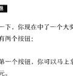

01 发引词：给你的人生明算法 11:14 10.20 MB

你好，我是老喻。欢迎来到我的课程《人生算法》。

> **人生算法课**

想象一下，你现实中中了一个大奖。你的面前有两个按钮：

- 按下第一个按钮，你可以马上拿走100万美元。
- 按下第二个按钮，你有50%的机会拿到1亿美元，也有50%的可能什么也没有。

这两个按钮只能选一个，你会选哪个？

第1个按钮价值100万美元，第2个按钮价值5000万美元。可很多人愿意选100万美元，因为他们不愿意承受什么都拿不到的风险。

那就是没有别的办法了吗？

有的，其实你可以开放地想，往前走一步：如果你把价值5000万美元的第二个按钮，以2000万的价格卖给更有承受力的人，你就能拿到2000万，而不只是100万。

顺着这个逻辑，往前走两步，你还可以卖掉这个选择权。你用100万的首付款卖给他。你再签个约，他说他中了1个亿，那就用5万、5000万给你，这样你就有可能赚5100万。

往前走三步，你可以把这个选择权做成公开发行，卖2块钱一张，印2亿张，能卖4个亿；就算卖半张1个亿，你还能赚3个亿。

再往前走四步，利用彩票这个商业模型，你可以再做好几个抽奖游戏，让它成为一门生意，你就能超过十个亿。

再往前走五步，你把这个生意做上市，估值20个亿，没准儿市值能过100亿。

我朋友圈讲过这个故事，他说他听得很刺激，还在朋友圈里说成功。他总是在说：通过人生的表达，成功的能力也是不断提高，赚的钱也更多了。这就是“人生算法”的力量。

真实世界是确定的。具体而言，我们每个人都在两个不确定的世界：不确定的内心世界，和不确定的外部世界。

内心世界的不确定性，体现为不充分。我们似乎总没有准备好。知识不够，智慧不够，经验不够，理性不够，时机也总不对。

外部世界的不确定性，体现为未来模糊不清。世界是个复杂系统，他人的想法和行为也是无法预计。你付出不是总有回报，你愿意非常努力，但却不知道该如何发力。

我们从小学接受的教育有两个特点：第一，凡事都有正确答案；第二，学生的目的是做对题，得到一百分，不要犯错误。

然而辛辛苦苦学了好多年，来到这个世界一看，发现游戏规则完全不一样。在现实中，绝大多数问题都没有标准答案。在所有的真实人生场景里，我们面对的几乎所有都是充满不确定性的。

其实，与其向外部东张西找答案，不如打好你手上最大的那张牌：也就是你自己。

怎么办呢？有没有一套简单实用的操作方法呢？

欢迎来到我的“人生算法课”，让我们一起，启动属于你的人生算法。

## 什么叫算法？

算法不只是数学，也不限于计算机，算法指的就是可复制的、解决问题的一系列步骤。

你按照一个精确的食谱烤面包时，食谱上加两个白色的鸡蛋，放入180度的烤箱里，烤30分钟等等，这些步骤就是一个算法。

## 梳理出来了18种人生难题：

- 片面
- 模糊
- 侥幸
- 宿命
- 追悔
- 非理性
- 冲动
- 犹豫
- 武断
- 偏颇
- 晕眩
- 孤独
- 痴迷
- 迷信
- 无知
- 衰朽
- 贪婪

这18个人生难题，是现在的我，最想告诉“20岁、30岁的我”的那些问题。

20岁的我，就开始在大学里创业。1995年大学毕业后，我没有选择分配，而是孤身去了广州，经历了各种颠簸。1998年加入了广东荣业集团，2003年开始房地产投资。2006年与以色列一家集团成立了合资公司，2008年将一块儿业务卖给了一家纽交所的上市公司。

2010年我们全家移民加拿大，很多朋友对此表示不解，怎么在国内市场正好的时候，我选择离开呢？

其实，我一直喜欢“实践者+观察者”的人生体验，对于时代的浪潮，我既愿意投身其中，又希望保持一定距离。

之后，作为实践者的我，继续进地产项目的投资，并创建了一家叫“未来幸福”的教育科技公司；作为观察者，我在我的公众号“孤独大脑”上，继续探索那些人生的深层谜题。

安静的海外生活，让我有机会去思考26年创业经历的种种切肤之痛。

我的爱好是解答有挑战的智慧题。在阅读学习了大量认知、决策、行为经济学、概率、计算机科学、投资等各个领域顶尖学者或者作者后，结合自己曾经的、干过的赛事，错过的机遇，试图从最底层去探索人生的算法。

我的人生会遇到很多问题，接触到很多知识，然而在漫长的岁月中，决定我们命运的关键思维，不过一两种。

这18个人生难题，其实就是我们一生中的“元问题”，也就是“问题的问题”。如果我在实践中对问题总是只想眼前，总想解决，而不是思考问题背后的问题，那可能直至终身，都会在应付重复的问题，陷入混沌无法自拔。

针对这18个“元问题”，我给出了18种算法或思维模型，教会你怎样在迷雾中作出人生最重要的决策。

我的大胆探索是，将认知和决策领域最前沿的智慧，与我们现实的人生困境结合起来，这其中放入了自己26年来的经历与观察。

你会在这门课中，感受到“烧脑、有趣、实用和肉痛”。

人生算法总结了地球上最厉害的那些人的思考方法论和行为方式，让你成为解决“不确定问题”的高手。

人生算法不仅是一个管理课程，更是一次自我求解的探险，是一场需要你我的参与。

# 02 A计划：自我塑造的九段心法

你好，我是老喻，欢迎来到我的课程《人生算法》。

第二讲，我们正式开启上一讲里提到的A计划，开始修炼内功。我会带领你自己打造成一辆赛车。

## 人生算法播客

请想象一下：世界上存在一台幸福机器。

如果你把自己接在这台机器上，就能体验到所有想要的一切：与宝宝拥抱、旅行随睡随到，火星随你一去。你将感到没有缺憾的幸福。

但是有个条件，你所体验的全部是幻觉，你一刻就什么都没了。

你会怎么决定呢？你要过自己真实的生活，还是那个完美无缺的梦幻人生？

这个思想实验，来自哈佛大学的哲学教授诺齐克。

我不知道你的选择是什么。据说绝大多数人拒绝连上幸福机器。

瑞士哲学家萨特对此解释道：“好的人生，不只是让人满意的人生，我们要的是真正的、真实的人生。

你要有意识，所有的行为，并且真实地成为你想成为的人。如果我们自己连在幸福机器上，这一切就都不成立了。”

## 自我塑造的A计划

没错，既然你不甘心把自己连在幸福机器上，那何不自己给自己造一个，让我们启动人生的计划A，把你打造成一辆赛车。

你可能会说，我条件不够好呀，学历不够，经验不够，也没本钱。我也能行？

其实，几乎没有事情在开始的时候是万事俱备的。一开始的产品，是从最简陋的功能开始的。淘宝网站从零上线，只花了一个月。当时的团队从美国买一个网站系统，花了7千美元，只有最简单的交易功能，最原始的评价体系。

乔布斯曾说，做事的人和做梦的人最大的区别就在于，能马上开始行动。可惜大多数人做不到这一点，他们怕尴尬，怕失败。

其实，你和世界上最厉害的那些人是一样的，每个人手上最大的一张牌，都是你自己。

## 造车四大法则

上一讲我们说过，A计划是一个自我发现、自我塑造的过程，要造就自己，有点像造一辆汽车。那造车应该怎么做呢？

我们来过一下造车四大法则，你需要理解四件事：

- **法则一，理解使命：你的核心使命就是打造好，你自己这辆车。**

所谓财富和成就，只不过是这辆车经过和到达的地方而已。你没法换掉自己，你也不能太高估自己。你必须驾驭着自己这辆车，穿越认知的大地。

你当然可以改变，但正如美国心理学家罗杰斯所说：“当我接受我本来的样子时，我就改变了。”

发现你自己，才可能改造你自己，用好你自己。

- **法则二，理解环境：现实是一片烂泥地，法拉利未必比拖拉机跑得更远。**

有个越野车的广告里，有句话很让人难忘：“领耀整个世界，地球上只有1%的面积是铺装路面。”也就是99%的面积是没有道路的。

现实世界，不是一个比试设备的赛场。高配不一定是赢家，低配本也同样有很多机会。

再说了，每个伟大的事物，都有一个微不足道的开始。iPhone刚出来的时候，也不比诺基亚好用多少。

- **法则三，理解行动：你应该一边装配，一边驾驶，别熄火就发射。**

什么叫“火箭发射”？就是假设现实度高可测，未来可以被推演，通过缜密的计划和高效的执行，你就可以取得好的结果。

可惜现实世界是不可预测的，根本不存在准备好那一天。现在公认可行的是“精益创业”模式，我们必须在行动中学习。

- **法则四，理解反馈：在切面中优化整体。**

通过不断的反馈和切面，让你的整体认知更加光彩夺目。

A计划的九段，就类似于这个打磨钻石的过程，每一段都像一道激光一样，不断打磨你，让你一步步优化。

我模仿了围棋里的段位制，将A计划分为九段。

这是一个求解的过程。而你自己，是这道题最大的已知条件。

- **初段：闭环。** 我们要讲为什么完成比完美更重要。
- **二段：切换。** 你可以 在大脑的自动驾驶模式，和主动控制模式之间自如切换。
- **三段：内控。** 有四个核心内控点：感知-认知-决策-行动，你可以把它们理解为我们制造的机器中的四个轮子。
- **四段：重启。** 我们要装配大脑装置：学会归零、复盘、重启。
- **五段：增长。** 我们要测试可以加速的自我进化系统。
- **六段：内核。** 这一段，要发现你的核心算法，也就是打造你的发动机。
- **七段：复制。** 让你的最小内核转动起来，实现价值最大化。
- **八段：愿景。** 这一段是不确定世界的人生导航。
- **九段：涌现。** 我们要形成自己的个人系统，收获人生涌现效应的果实。

这九个段位，分为上半场和下半场。

上半场，从初段到六段，是一个切割钻石的过程，就是为了不断切割，真正属于你自己的、最小的那个内核。

下半场，放大内核，就是如何通过复制，令内核价值最大化。

上半场是做减法，聚焦；下半场是做乘法，放大。

**自我修炼九段进阶图：**


# 03 初段-闭环：如何对抗完美主义

老喻的人生算法课
07:29

03 初段-闭环：如何对抗完美主义...
11:43，70.71MB

你好，我是老喻，欢迎来到我的课程《人生算法》。

上一讲，我们说过 A计划是要把你打造成一辆赛车，A计划共有九段，这一讲我们讲 A计划中的初段。

我先告诉你一个神秘奖项，叫“一丹奖”，创始人是腾讯的联合创始人陈一丹。请注意，这个奖项虽然只针对教育，但是它的奖金却比诺贝尔奖高出好几倍。奖金有三千万港元，外加一枚纯金奖牌，这金量几乎是诺贝尔奖的三倍。

那首届“一丹奖”颁发给了谁呢？是斯坦福大学数学家罗杰·德弗洛克。你看，这个奖项含金量这么高，那德弗洛克到底做出了什么样的教育研究成果，能这么值钱？

先卖个关子，这个研究就是我们今天的谜底。请你记住这个悬念，现在我们就正式进入主题：初段，闭环。

## 懂闭环的重要性

懂闭环的朋友都知道，对于很多职业选手来说，一苇不渡难的就是在入段，也就是拿到初段，比后来拿冠军还不容易。

## 认知行为的闭环

我们《人生算法》的初段是闭环，什么叫闭环呢？

“闭环”这个词，来自 PDCA 循环，又叫“戴明环”。是美国管理学家戴明博士提出来的一个模型，管理学上学习过的话，包括四个环节：计划、执行、检查、处理。

如果我们用放大镜来拆分认知行为，一个完整的闭环有“感知-认知-决策-行动”这四个动作，四个动作往复相连形成圆圈。

所谓初段的闭环呢，是指我们自己积极主动去做这四个动作，把闭环完成。

我们用日常生活的视角去理解，闭环就是把一件事儿做完。我们平时夸一个人靠谱，也就是说他能够做到“凡事有交代，件件有着落，事事有回音”。

你可能觉得这事儿看起来并不难，但它对于一个人，一家企业的早期发展都至关重要。

扎克伯格创业初期，在 Facebook 的办公室墙上贴了一条什么标语：比竞争更重要的是完成。这个行动准则，就是激励员工按时交付，快速行动。

要是团队里有人不同意怎么办？亚马逊的贝佐斯就碰到过这个问题的话。他的解决方法是：“不同意但执行。”贝佐斯有一句话，说跟不同的员工特别管用，他会说：“你要不，我建议你先同意统一，但你愿意愿意跟我一起干？”这一句话，就把员工快速拉回到完闭环的工作轨道上。

雷军讲，对于企业家而言，就是更敢于承诺，敢于拍板。对于个人而言，就是敢于行动，敢于尝试。

闭环这么重要，似乎也不难，但为什么我们真去做，人们又觉得这多难呢？你看，完成生活的人很多，但是，这是一个企业做到交付，都特别不容易。为什么呢？根据我的观察，主要有这四种情况的问题。

第一种情况是：事情本身就难以形成闭环。
比方说，有阵子海外房产特别好卖，但是这个生意是做大却不容易。

一方面海外买房的链条长，看房、跨国交付、沟通成本高、谈判耗时，交易难以形成闭环；另一方面，客户特别散，要么在国内做捕捉地代，营销难以形成闭环。所以海外的地产项目一般规模不大。

第二种情况是：个人或者企业的能力难以形成闭环。
我接触了很多创业的朋友，观察到一个很反常的现象，最容易被培养成老板往往是企业的副总或高管，容易创业成功，为什么？

烧烤摊的生意虽然小，老板的教育程度也未必那么高。但是他需要完成找场地、选原料、生产、销售等等。所以烧烤摊老板其实具备了难得用户，从实操的角度，把生意的整体逻辑理了一遍。

大公司副总裁呢？他的学历虽然很强大，位置高，经验丰富，但他的一旦独立创业，在一个大系统中的个小环节，一旦独立创业，他可能反而不能系统地完成闭环。

第三种情况是：不愿意把手弄脏。
成路人就多愿意，卷起裤腿下地干活，很多人就不肯了，他心思型，这种脏活累活，怎么可能是自己干呢？

第四种情况是：坚持完美主义。
完美主义通病常的做法是，把每条线路都尝试一遍，非要找出最佳策略来，这样会有积极一面，要求高素质，但是是太琐碎，完美主义会形成高地，阻断了闭环的完成。而且操作成本太高，现实生活中的最优解很难短时间找到。

## 完美主义对别人有什么要求？

很多人说完美主就是把事情完成，给别人一个交代。怎么想，某种意义上，“讨好听人格”的陷阱，其实在无意中套上了“固定型思维模式”。

既然不是想给别人一个交代，那么就是“给自己一个交代”吗？
也不对，完美主义有就低，典型就，他们总想证明自己聪明、正确、卓越和酷，绝不轻易退步。本质上就是害怕失败。

那我们应该怎么办呢？一种不起眼的动物，蚂蚁，给出了正确答案。

科学家们发现，蚂蚁一旦找到了食物，一大群蚂蚁开始搬运，不管带多多么复杂，食物距离怎么遥远，蚂蚁似乎总能找到一条最优路径。它们是怎么做到的？

一开始，每个蚂蚁随机选择一条路线，并且留下了信息素，也就是费洛蒙。随着费洛蒙积累越来越多，也是留下的于考察运回速度的信息。最后，最短径路上的蚁数量总是比长路程上的蚁蚁数量要多。

# 04 二段切换：掌控大脑的两种模式

你好，我是老喻，欢迎来到我的课程《人生算法》。

上一讲，我们讲了初段：闭环。有了这个基础，我们进入九段修炼的一个阶段。这一讲，我们来讲解二段：切换。

二段里，有两大精神：一种是自动驾驶模式和主动控制模式。并且你还能做到在这两种模式之间自如切换。

我先来给你讲一个碧昂斯的秘密。她是世界级的超级巨星，在全球已经卖了超过1亿张唱片，连拿了25座格莱美奖。

碧昂斯在巡回演唱会前，台上激情四射，气场强大，引吭高歌。可是演唱会结束后，她就变成了一名产品经理。这是怎么回事呢？

原来啊，碧昂斯回到酒店房间后，她会反复看刚刚结束演出录像，从各个角度研究，哪里地方可以更改，哪里地方可以突破。第二天早上，她团队的每个人，包括乐队、伴舞、摄影师等等，都会收到几页笔记，上面写着他们需要在下次演出前调整的问题。

你可能会觉得奇怪，她怎么能做到台上那么激情四射，台下又变得如此理性十足？感觉好像她身上装了个开关似的。

没错，这就是厉害的人特别重要的特征：能够在激情和理性之间自由切换。

一些科学家认为，人的大脑，同时并行着两套系统，一个是快速、自动且几乎无意识的；另一个是缓慢、刻意和深思熟虑的。

## 大脑运行的两种模式

我把这两套大脑的运行系统，称为“自动驾驶模式”和“主动控制模式”。

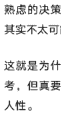

比如说，一个人刚开始学车的时候，特别紧张，每个动作都要小心翼翼，到了路口东张西望，打方向盘总要做做鬼脸，这个时候就是“主动控制模式”在发挥作用。

等你成了老司机，一切驾轻就熟，开车回家几乎都不用大脑控制了，这时的思维是高度放松的，人们甚至意识不到它们的存在。这个时候，就是“自动驾驶模式”在发挥作用。

- 1. 闭环就是让把一件事儿做完，也就是“凡事有交代，件件有着落，事事有回音”。
- 2. 如果你太为了给别人一个交代，你就容易太在意他人的评价；如果你是为自己一个交代，就容易陷入完美主义，害怕失败。
- 3. 闭环需要你拥有成长型思维，勇于行动，给自己的未来一个交代。

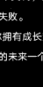


驾驶系统”。

美国前总统奥巴马曾说，自己将琐碎的日常决定自动化，从而将精力集中在重大决策之中。

比如，他只穿灰色和蓝色西装。在不那么重要的事情上，减少作决策的次数，不去想吃什么、穿什么，把精力集中运用到重要的决策中。

奥巴马说：“你要给自己的**生活设计一套刻版动作**，这样就不必为鸡毛蒜皮的小事分心。”

攻略二，在使用“自动驾驶系统”后，积极用“**主动控制系统**”复盘。

有时候，人们将自己**熟悉的事情交给自动驾驶系统**后，这件事可能会**被忽视**，你也不再进步。你就可以用复盘自我审视，不仅可以给自动驾驶系统做体检，还能提升其性能。这方面，我们要向碧原学习。

攻略三，**在大脑中用“主动控制系统”去模拟“自动驾驶系统”。**

有一次我问世界游泳冠军单泳涛是如何训练的，她**非常认真**地跟我说：我很慢的，有时系统会在脑子里训练，例如想象自己拿到冠军时的场景、节奏和动作。如果比赛的时候我能够找到这种感觉，成绩就会很好。

后来，我在一本书上看到老虎伍兹的父亲，回忆这位高尔夫天才的事情：每年的大赛之前，伍兹都会用一个星期的时间，作精神和身体上的调整。开车到比赛现场，在那里练上几枪，等到回家之后，伍兹躺在床上看视频，他说这是在脑里做练习，那些比赛中需要的击球。

这种精神备战法，被称为心理演练。

难怪传奇高尔夫球手泰比·琼斯说：“高尔夫球赛发生在一块只有五英寸的场地上——那就是你的两耳之间。”

没错，**人们就是在用自己的大脑驾驶自己的一生**。只用“主动控制系统”，你会太累；只用“自动驾驶系统”，你的生活就像梦游。

## 本课小结

我想用我曾经给朋友分享的一句话作为今天的总结：

**一切脑力活动，最后拼的都是体力；一切体力活动，当然首先是拼着看起来以体力为主的活动，最后拼的都是脑力。**

如果你能同时掌握两个系统，并且在中间自由切换，那你就可以成为“**人生算法**”的中段高手。

## 思考题

请你回忆一下，你在生活中，什么时候用的是“自动驾驶系统”，什么时候用的是“主动控制系统”？

欢迎你写在留言区跟我分享，期待听到你独特的体验。

下一讲，我们进入到最后三段：内控。我会给你一个完整的闭环，具体是由哪四个关键节点组成的。我是老喻，我们下一讲见。

- 混合两种大脑模式的攻略：
  - 把不那么重要的事情交给“自动驾驶系统”；
  - 在使用“自动驾驶系统”后，积极用“主动控制系统”复盘；
  - 在大脑中用“主动控制系统”去模拟“自动驾驶系统”。

# 05 三段·内控：跑好大脑的四人接力赛

嗨，老铁，欢迎来到我的课程《人生算法》

上一讲，我们讲了二段，切换，你要在大脑的两种模式切换之间自如切换。这一讲，我们要进一步加大分辨率，来拆解我们人类认知行为。

在第三段内控这个阶段，你需要知道，一次完整认知行为，实际上是由4个最为关键的控制点组成的。

我先问你一个问题，超级富豪有什么区别于常人的地方？

德国作家齐特林桑博夫做了一个调查，发现了很多的公司的创始人或母体特征。其中一条是“内部控制点”：目的的行为由自己控制。因为成为奢侈：我的命运掌握在我自己的手中。

《富爸爸穷爸爸》这本书在全球卖了一亿册，在作者罗伯特·清崎，讲述了一段他父亲的话：

> 在外界刺激和反应之间，存在着一个空间，我们的反应就存在于这个空间之中。我们的成长和幸福感就存在于我们的反应中。

你可以想象一下，这就像一个夹心饼干，外界世界的刺激是上面那层饼干，你的内部感受和想法是下面那层饼干，中间还有夹心，一块软软的地方。

这个软软的地方就是内控的空间。是外部世界和内心理想世界的交汇点。你在这里可以对外部世界作出反应，也能让你的内心世界成长和感受幸福。

有些人会主动把握中间夹心层，有些人则完全无视它，甚至被它吞噬。

但是想启动中间这个空间，做到主动控制并不容易，原因有三个：

- 第一，我们的世界变得越来越自动化了，智能手机和网络让我们变得越来越没有耐心了。
- 第二，人的专注力资源是有限的。《冷读能力》这本书记载，人类平均只能保持10分钟以上的注意力。其中只有5%的人是能在思考的状态下加上以后10秒。
- 第三，信息流量让人类的持续关注下降，微软调查报告，2000年人们的持续关注能力是12秒，2015年只有8秒。

聪明人很擅长找到一个解释，然后就觉得自己想明白了，想赶紧蒙混过关。这种人赢了就觉得是自己实力强大，输了就说是运气不好。这样其实会堵死自己成长的路。

那么怎么避免小聪明呢？

你的脑子要给自己设立一个角色，叫“**立项决策者**”。

立项决策者是四人接力赛的总教练，他要指挥“感知、认知、决策、行动”这四个角色完成接棒和赛跑。

放到我们的生活语录来理解，“立项决策者”是一个挥舞**小皮鞭**的狠人，他催促我们完成各个角色的任务，还要在4个内节点顺利完成。我们常说，“一个人要给自己狠一点”，说的就是你在心里住一个“立项决策者”，遇到困难不能跑、不能逃避。

说完单个认知飞轮里面的四个“内节点”，我们再说一下不同的认知飞轮之间的“内节点”。

这就像羽毛球比赛的每两个球，从一个来回结束，到开始准备打下一个球，这中间也是一个重要的“内节点”。

在这个内节点，我们需要正确的复盘。我们要充分利用上一个认知飞轮的经历和反馈，从错误中提取教训，从经验中提升能力。

要做到这一点，关键在于你能把下一个认知飞轮的决策过程，和上一个认知飞轮的结果分开。

为什么呢？因为好的决策未必带来好的结果。好的结果，也可能是由错误的决策换来的。

所以，别后悔，别找借口，不要怕犯错，有时候还要主动犯错，因为随机突变可能会带来意想不到的好处。

把握内节点，说起来简单，做起来不容易。最后，我送你一个有用的操作方法，叫：巴菲特点内控法。

巴菲特是如何把控的？在一张纸上写下自己的理由，不就不交易。这个交易可能是错的，但自己必须有一个“交易答案”。

比方说，在纸上写：“我今天要花500亿美元来买苹果公司，因为……”

如果你不能回答这个问题，你就不要买。

写在纸上能有什么作用？其实，就是建立了一个节点，为你制造了一个“内控点”，防止要欺骗自己的大脑过于冲动。

## 本讲小结

总结一下，这一讲我们讲了四段，内控。

我希望你记住，不管你多么豪迈，你都有权利按下自己的暂停键。在那些关键时刻，你只需要说：慢，让我想想看！然后激活脑中的那位“立项决策者”，开始计算你的答案。

## 思考题

我们说，感知环节，你要像个情报员，敏感地获取外部信息；认知环节，你要像个分析师，理性评估；决策环节，你要像个指挥官，果断取舍；行动环节，你要像个战士，勇往直前。

但能把这四个角色都做好，其实非常难。你在哪个角色完成得比较好？又在哪个角色上是短板呢？

欢迎你在留言区，跟我分享你的想法，同时你也可以把这一讲分享给你的朋友。

这一讲我们已经涉及了两个认知飞轮之间的内控，你要学会正确复盘。下一讲，我们开启四段：重启，重点来说的，从上一个认知飞轮，到下一个认知飞轮，我们要注意什么。

我是老喻，我们下一讲见。

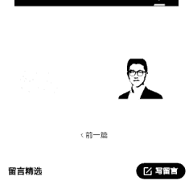

# 第四。快速作出决断。

这四个原则可以帮你快速检测心状态，并打消想要作假的念头。

我曾经说，每个厉害的人，都是一只打入的阿尔法狗。打狗法狗下每一手棋时，都会根据当前局面从头思考，找到当胜率高的一手棋。对于而言，每一个决策点，也依然不改热情。打个不太恰当的比方，国际象棋传奇人物卡斯帕罗夫说，人类因子间波动，对比赛结果的影响高达30%-40%。

拥有“Day 1”这种精神装置的创业者，他们公司愿景，介绍起自己的产品的时候，哪怕重复了一千次，讲起来，还是第一次一样，充满了激情。

就像丘吉尔说的，成功就是从失败到失败，也依然不改热情。打个不太恰当的比方，国际象棋传奇人物卡斯帕罗夫说，类因子间波动，对比赛结果的影响高达30%-40%。

那么，对于我们每个普通人来说，如何设计自己的“精神装置”呢？

我总结了两个“精神装置”，来帮你构建自己的“重启动系统”。他们分别是两个角色，当你遇到问题的时候，可以把自己代入这两个角色的视角中。

第一个，“外星人”视角。

假设有个外星人，突然飞到地球，接管了你的生活，那么他一定会冷静地评估现实，忽视那些让你纠结的沉没成本，面对问题，提出理性解决方案。安迪·格鲁夫用的就是外星人视角，这个视角能帮你解决旧的问题。

第二个，“阿尔法狗”视角。

阿尔法狗会把所有的事，当作已知条件，后像一个解题高手一样，重新配置资源，概率计算，寻求最优答案。

这样一来，情况是好事坏，条件是否充分，看起来都是可以量化的数字。理论上，你总能找到当前条件下最好的一手。如果你总是采用这种算法思维，就会变得格外强大。

## 本讲小结

重启其实是向你提出了两点要求：往后看，过往不恋；往前看，不害怕未来的不确定性。

我给了你两个方法去设置精神装置：“外星人”视角和“阿尔法狗”视角。我希望你在遇到问题的时候，启动精神装置，代入这两个角色的视角再想想问题。

## 思考题

我给你留一道思考题：

你有没有遇到过，难以抉择的两难处境，可能是要选哪个城市读书、工作，可能是要选哪份工作，也可能是职业机会的选择等等。你当时是怎么做的？如果现在你回到那个时刻，你又做何选择？

## 思考题

欢迎你在留言区，跟我分享你的想法。你身边如果有个性很低的的朋友，可以把这一讲分享给他，让他也可以重新启动。

# 06 四段·重启：装上重启的精神装置

老郑的人生算法课
今天

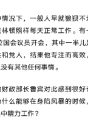

你好，我是老蒋，欢迎来到我的课程《人生算法》。

上一讲，我们讲了“人生算法”A计划的三阶段，两个认知飞轮中间也有四个闪点。两个认知飞轮中间也有四个闪点。这一讲，我们先来聊第一个，两个认知飞轮之间，你需要装上一个重启键。

我先问一个问题，假如你人生最糟糕的时候，陷入一场彻底使你击倒的危机，你会有什么反应？

1998年，当时的美国总统克林顿陷入莱温斯基事件。这一丑闻不但带来了致命的打击，不在就要面临国会的弹劾，不得不接受电视讲话向全国人民道歉。

在这种情况下，一般人早就崩溃不堪了，可是克林顿照样每天正常工作。有一天他和50位国会议员在大草坪上工作了一半来弹劾他的共和党人，结果他专注而高效，好像世界上没有其他任何事。

当时的财经部长鲁宾对此感到非常好奇，克林顿为什么能够在身陷风暴的时候，仍然可以集中精力工作？

后来，克林顿告诉鲁宾，他用的“精神装置”帮助自己度过了莱温斯基事件那段时期。

这个“精神装置”到底是什么呢？说起来有点像电脑的重启机制，看起系统快要崩溃了，按一下重启键又复活了。

下面我们就来聊一下，重启的科学原理，以及我们如何打造自己的“精神装置”。

鲁宾让自己的网球教练“精神装置”的启发，让自己从失败中重新站起来，他是怎么做到的？

在打球时，鲁宾开始有意识地记住一个数字，那就会即使是非常优秀的篮球选手，投中的几率也高达55%。

专业选手会尽可能多投篮，所以他的目标是，记住如何记住打对，当下这一个球，而不是懊悔上一个球没打好或担心分数。

所以，“精神装置”帮助鲁宾主动切换到了正确的思维模式，减少了他过于忧虑的倾向。要知道，在关键时刻不会犹豫，大多数业余选手和专业选手的主要区别。而这个精神的核，就是他牢记了55%这个概率。

一个人不是靠一次的发球，而是靠整个系统赢来就获得胜利的。一个球打得好，一件的事情来得顺利，不会影响全局。关键在于，一个球打完了，一件事情结束了，你能够马上复原，重启下一个全新的“自我”。

生活中有一群人，不管遇到什么打击，都可以若无其事地爬起来。他们前一天不管多累，第二天早上都充满血气。

## 做到重启面临的挑战是什么？

为什么重启的能力在现在很重要？

这不只是种一种韧性，更是一种当今社会的底层生存能力。

因为我们处在一个快速发展的时代，不确定的世界。外界的影响、人类的行为，确定的结果，都是概率事件，具有一定的不确定性，并受到随机性事件的影响。

在这种环境下，“重启”帮助我们对不确定性。

当我们完成一个认知飞轮，需要重启下一个认知飞轮。在这个控制点上，往往会有两个挑战：

- 第一，舍不去旧的；
- 第二，无法开始新的。

我们先来看第一种挑战，人是一种恋旧的动物，很难轻易脱离过去。

在未来作决策的时候，我们有一个习惯，总过分关注过去的损失和代价。

在经济学和商业决策理论过程中，会用到“沉没成本”的概念，指已经付出且不可收回的资本。沉没成本原本用来形容某项成本，可变成本不可以改变，而沉没成本则不能被改变。

既然这个成本已经沉没了，你为什还是要关注它？但在现实中，我们都很难轻易忘事。

如果你是理性的，那就不该在决策时考虑沉没成本。比如说看电影，花100块后发现电影不好看，你面临两种选择：

- 第一种，不好看，但忍着看完；
- 第二种，退票去别的事情。

你应该如何选择呢？这时候你该应该说：如果这张电影票是免费的，我来看还是不看呢？

那你当然应该选第，还偏留出时间干点别的更有意义的事，来避免未来可能的机会成本。而硬撑着看，你还要继续发呆，时间也浪费了。

理性的决策，告诉我们最好避开沉没成本，抛弃放弃带来的负面情绪，选定的成本更高。但是，恋旧本质上其实还是因为不自信。不相信自己所放弃更有局面后，可以创造更好的机会。

> 用泰戈尔的一句诗来总结恋旧症的问题：如果你因错过太阳而哭泣，那你也将错过星星。

重启的本质，是懂得坚持，也懂得什么时候该放弃。

我们再来看第二类不能做到重启的问题，不光是摆脱旧的难，开始新的也难。难在哪呢？

人类不光有“损失厌恶症”，它特别不喜欢不确定性。

但现实世界中不可能什么都准备好的。很多环境其实只“只有东风，万事都缺”。即便条件不充分，你也要能“扣动扳机”。

所以，我们可以再来看，精神装置到底有什么用？

精神装置其实就是一套大脑免疫系统。它能够帮助你对付人生大的对抗性损失。和人类不确定性的厌恶。它能提醒陷入理性的反刍、绝望的，勇敢地开始新的实现机会。

## 怎么训练自己的精神装置？

先说如何摆脱旧的，我们先来看看英特尔的CEO安迪·格鲁夫是怎么处理这个问题的。

1985年，英特尔公司的内存业务受到日本厂商的巨大冲击。安迪·格鲁夫决定退出内存业务，进军CPU市场。

难题在于，内存业务还挣钱，CPU市场前途未定，说不起还是死路一条。

这时，格鲁夫启动了一个精神装置，他问公司合伙人摩尔：如果我们俩都隐退，新CEO上任，他会怎么做？

摩尔不假思索回答：他将退出内存业务。

格鲁夫说，既然如此，那我们为什么不自己做这件事呢？

你看，关键时刻，如果没有精神装置，人会很难摆脱各种情绪纠葛，从而影响正确决策。

说如何摆脱旧的，我们来说的，怎样开始新的。

亚马逊的创始人贝佐夫有一套“精神装置”，叫“Day 1”，就是说每天都要像创业第一天那样运营公司。

贝佐夫总结了“Day 1”公司严格遵手的四个原则，分别是：

- 第一，真正相信未来在眼前身上；
- 第二，抵制形式主义；
- 第三，顺应迅速外部趋势；
- 第四，作决策快。

# 07 五段·增长：增长黑客的三大步骤

老陈的人生算法
2 小时前

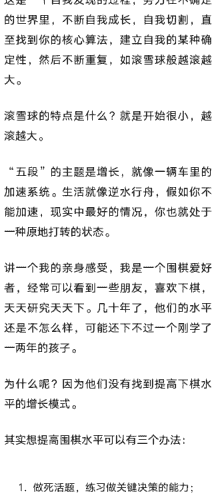

你好，我是老陈，欢迎来到我的课程《人生算法》。

上一讲，我们讲了四段重启，我们学会了一个闭环和一个新环，但一个新闭环对一个开始，只是重启不够，新环和闭合之间，还需要增长。

这一讲，我们就来解决这个问题，我们来学习人生算法AI计划的五段：增长。

先让我们回顾一下，《人生算法》的AI计划，是想要把你打造成一辆赛车。

这是一个我发掘的过程，努力在不确定性的世界里，不断自我成长，自我切割，直到找到你的核心算法，建立自我的某种确定性，然后不断重复，波浪学般越滚越大。

滚雪球的特点是什么？就是开始很小，越滚越大。

“五段”的主题是增长，就像一辆车里的加速系统，生活中就像飞行，假如你可以一直使用最佳的滑翔，那你就处于一种原地打转的状态。

讲一个我的亲身经历，我是一个围棋爱好者，经常参与一些棋社，喜欢下棋，天才古丽天下。几十年了，他们的水平还是不太长。可能还不过一个刷了一两年的孩子。

为什么呢？因为他们没有找到提高围棋水平的增长模式。

其实提高围棋水平可以有三个办法：

- 做死活题，练习做关键决策的能力；
- 打谱，复棋经典案例；
- 找AI陪练。

这些都是“可重复的死办法”，只要你每天坚持，训练地够到位，下棋水平就可以逐步提高。这就像个儿童滚雪球。

## 怎样才能实现增长？

那些原地打转的人呢？东看看西看看，每天花的时间也很多，看上去也付出了不少，却离目标很远，就像滚雪球。

所以，我们要做的是从“群包谷模式”，进化到“滚雪球模式”。

这也是第一流公司的核心心法。2005年，Facebook刚成立没多少，有人提出了一个能够为公司创造想法，这样就能向投资者证明公司是盈利的。听起来很有道理，结果公司创始人扎克伯格并不同意，他走到白板前写下了大大的一个词：增长。

为什么呢？扎克伯格认为，公司当时的战略重点是用户增长，这一点比收入更重要。回头看来，这是Facebook成功的关键。

你想看吗？投资人为什么要投Facebook？他们的投是未来的想象空间，他们愿意投资一白钞票，而不是一台收银机。

再想对我们自己，也是一样的道理。对于个人来说，需要增长思维。最重要的增长是什么？当然不是这个月工资，而是你的能力和社会网络，以及未来的赚钱能力。

那怎样才能实现增长呢？

有效的增长，分为三个阶段：1.增长假设；2.增长验证；3.规模增长。

怎么理解？打个比方，首先你有有种子，才有增长的可能。因为没法确认种子一定能发芽，所以叫“增长假设”。这是第一阶段。

然后呢，我们要开始做“育苗实验”，看看哪些种子真的可以发芽，对前面的假设进行验证，这是第二阶段“增长验证”。

只有完成了前两个阶段，才可以进行大规模种植，这是第三阶段，真正的“规模增长”。

在现实中，不管是公司还是个人，在“增长思维”上容易陷入两个误区：

一个误区是——有内核，没增长。产品好，服务好，但没做太大。结果，要么维持着手工小作坊的状态，要么就慢慢地消失了。

还有一个误区是——没内核，乱增长。种子不对，也没进育苗实验，就开始大规模种植，跟风者公司很多，多能实行，但能力跟时间，迅速大公司家庭店铺，但因为商业模式根基不牢，很快就倒掉了。

对于个人来说也是一样，即使你有能力，但没有增长思维，成长就会受到限制；假如你有基本能力，只想增长，到头来也是一场空。

通常而言，对于一个个体来说，增长思维有一个清晰的底线：个人有增长，在思维强的时候快速过试错，积极探索，目的是找到可持续的、可规模化的增长公式，也就是你个人的算法。

这个持续改进、快速迭代的过程，在商业领域，有个类似的热门概念，增长黑客，也就是持续对做的每一件事，都力求给产品带来持续增长的可能性。

## “增长黑客”的实施三步骤

那实现增长，具体要怎么做呢？

接下来，我要给你介绍一下，“增长黑客”的三个实施步骤：1.假设；2.验证；3.执行。

你可以把这些步骤，应用在企业和个人发展中。

第一步，假设：建立最小化闭环。

这也是我们初段讲的闭环。在这个大要求下，闭环这个动作先要完成最小化的闭环。为什么呢？等完成这个故事就明白了。

我问你一个问题，有一大批信件，必须装入信封、盖上信封、写上地址、贴好邮票，你会怎么做？

第一种办法是：拆分动作，把所有的信件全部装好，全部封好，全部写上地址，再全部贴上邮票。

第二种办法是：每次把一个信的动作全部完成，然后再完成下一个。

你可能会觉得当然是第一种更快，但实际上，第二种才能更快地完成工作。为什么？

万一信件不适合，要采用大批量的方式，我们一直要做到接近流程的尽态才会发现问题，而用小说量的话，我们马上就能发现并判断——一次装一个信封的做法在精益生产里被称为“单元流”，就是我们要做的“最小化闭环”，它的价值在于能快速试错。

这一步我还想提醒你的，从想办法开始，不必怕错，代价并不高，可以勇敢地尝试。想知道杯子水是热是冷，就伸手去端。

无论是公司还是个人，不行动，你就没有办法获取信息。你知道吗，每一次失败都会为你的成功，采集数据，你就不会那么害怕失败了。

“增长黑客”的第二步，验证：找到北极星指标。

首先，你要建立一个反馈回路，获取验证结果。

特斯拉的CEO马斯克曾经说过：“我认为有一个反馈回路非常重要，这样我们可以不断地去思索做什么，怎么做要更好。”

我觉得这是最好的一条建议：不断思考如何做得更好，不断地自己提问，这个动作看起来多加了一步，但它能让一切走弯路。如果没有这一步，你就有可能原地打转。

验证，其实是确认两件事：第一，找到一个正向反馈；第二，找到一个指标的关键要素。

那么一个指标的关键要素呢？我们来

## 单一指标的关键要素

那么什么是单一指标的关键要素呢？我们来看一个案例。

Instagram早期的社交功能和现在不一样，后来他们发现用户对分享照片需求很大，于是只留下了照片、评论和点赞功能，并增加了滤镜。

因为市面上已经有了Facebook，多功能的社交产品很难再突出重围。而Instagram团队找到了最关键的要素，也就是分享照片，再以照片为核心去设计产品。

改变几个月后，专注于图片社交分享的Instagram正式推出，上线一天获得25000个用户，三个月后这个数字达到100万。

单一指标的关键要素，有一个名字，叫“北极星指标”，它就是你关键的增长指标。不管是公司还是个人，都要致力于找到自己的“北极星指标”，才有可能有效实施增长战略。

## 增长黑客的第三步，执行：设计增长策略

优秀的创业公司，往往采用分阶段发布产品的策略。例如Facebook，他们开始只在哈佛大学推出，然后是常春藤大学，随后是别的大学，最后才对社会开放。

分阶段增长有几个好处：

- 1. 在验证技术风险之前验证客户风险，产品再好如果推荐给不合适的人，可能也无法得到正向的反馈。
- 2. 验证一个商业模式并不需要大量的用户。
- 3. 控制好节奏，将一马法拉利拉伸成很多个400米比赛，团队更能聚焦。

在这样的策略下，Facebook后来居上，战胜了MySpace等一系列的竞争对手。对于团队来说，把不太实际的任务分割成合理的小任务，只要每天都能完成小任务，你就会越来越接近那个大目标了。

从力学的角度来看，一辆车从静止到启动的时候最费劲。这时候需要集中，越容易滚动，随后，雪球越大，速度越快。

## 本讲小结

正如《精益创业》的作者埃里克·莱斯说：“魔力与天才并非成功创业所必需，运用可学习和可复制的科学创业程序才是最重要的。”

经过假设、验证和执行这三个步骤，你才能迎来真正的爆发式增长，实现全面的扩张。

对你我来说，也是这样，你只要找到可学习可复制的增长模式，你的努力才可以转化为收获，就像滚雪球一样，越滚越大。

## 思考题

我想请你聊一下，你自己有没有在“假设、验证和执行”这三个步骤上，作出努力？你进行到第几步了？在开启下一步的时候，你有没有遇到什么困难？

欢迎你在留言区跟我分享。如果你在现实中有什么具体的问题，也可以在留言区问我，好的问题也是对我们的启发，非常期待你给我的帮助。

增长就像是设计制造一辆车，完成之后，这辆车只要给它加油充电，就可以翻越万水千山。下一步，进入到第六段，内核。我们下一讲再见。

## 划重点

增长黑客三步走：

- 第一步，在增长假设环节：建立起最小化闭环。
- 第二步，在增长验证环节：找到北极星指标。
  - 这一步有两件事：首先，你要建立一个反馈回路，获取验证结果。第二，找到单一指标的关键要素。
- 第三步，在增长执行环节：设计增长策略，分阶段增长。


# 08 六段-内核：找到可复制的最小内核

你好，我是老喻，欢迎来到我的课程《人生算法》。

上一讲，我们讲了五段，增长。人生算法A计划的六段，我们再往本质深探一层，讨论一个更难的命题，那就是找到自己的内核。

我想先问你一个问题：人和人之间的差别到底有多大？

假如你特别厉害，你开一家店，到地球，你看有一些可复制的看起来一样，但根本差别很大。积木基金会的创始人达里奥算厉害吧，他说自己阅人无数，但没见过一个成功人士眼瞎。

你可能会说，不对呀，有些人就是聪明。

> 巴菲特说：“我可以告诉你有信心，要做伟大的投资者，智者不必都很惊人。假如你的智商有160，其中30都卖给同事吧。”也就是说，你智商有130就够了。

那么，到底是什么决定了一个人能否成功呢？

答案是：找到自己的内核。

这也是人生算法A计划的六段：内核。这一段的命题，就是要找到核心算法，发现你自己的商业模式找种子。每一个成功的人，都经历过找到自己的内核一步。

但这是一个漫长而艰难的过程。可惜很多很多人一辈子都没有完成过这个任务。当然，这意味着如果你找到了自己的内核，你已比大多数人更靠成功多了。

## 内核的特征

内核有两个特点：

- 第一，要简单，这样可以大规模复制；
- 第二，要有构建系统的潜力，这样才能防止被人复制。

是不是有点抽象？放一个熟悉的例子，你就能够更准确地理解内核的特征。我们来聊聊海底捞。

过去我们都知道餐饮业很难做，很难有上市公司，但海底捞就做到了在世界各地开了300多家店，在香港上市，市值也超过了一千亿元人民币。海底捞是怎么突破餐饮业的瓶颈，获得如此成功的呢？

秘密就在于海底捞的内核。其实，1994年工人张勇在创业的时候，他认为，因为自己不会做菜，所以才开了对厨艺要求不高的麻辣烫。可是是因为火锅，麻辣烫不依赖大厨，反而给日后海底捞的复制扩展留下了空间。

当然，光有这一点显然是不够的，火锅店那么多，怎么就海底捞杀出来了？张勇说的路线是：“态度好，严”，比上一家强、对客户服务，满足客户各种需求。

所以，海底捞的内核也符合这两点：第一，“态度有发展”，“服务态度好”这个有发展。第二，“服务”这个有发展。

让我们通过海底捞这个案例来理解，怎么样才找到合格的内核。

先看第一个特征，是简单。但“简单”这个词可不简单，它要满足三个关键指标：大概率事件、可复制、大规模。

首先，内核是大概率事件，是生活中大概率发生的事，是大概率会被复制的事。

好吃的火锅会开很多店，这件事已经被验证过了，是可以大量复制的事，不是拍脑袋，靠热情，梦想去弄的。

其次，内核要可复制。

我们曾经长期陷入一个困惑，麦当劳、肯德基能大规模开店，但中国很难标准化。而海底捞就解决了这个标准化问题。

对菜品监控，用标准化来管理，保证了质量的一致性。

其实，世界上有大量的餐饮品牌，包括麦当劳、肯德基、必胜客，不都是大平台、容易复制、容易标准化吗？

这就回到了开头的那个问题：人和人之间的差别有多大？最后的差别在哪？那你有没有复制到自己的成功？别人开一家店，我开100家店，那就跑出来。

奖，但是发现其中的规律，然后反复去买，中很多次100块奖，天天都中。

巴菲特有句话给这两类想法打了个比方，很恰当。第一种想中大奖的，是“试图跨过七英尺的栏杆”；第二种，愿意天天点小奖的，相当于是“跨过了一英尺高的栏杆”。

我们对比一下这两种方法：

### 方法一：跨过7英尺高的栏杆

这大概是一种适合于极富天赋的人才用的学习方法，例如达·芬奇、比尔·盖茨等。他们能够快速学习，还在不同学科之间自由穿梭。可惜，对绝大多数人来讲，采用这种方法，风险极大，很难复制。

### 方法二：跨过1英尺高的栏杆

也就是说，找到可重复的“简单动作”。对绝大多数普通人而言，成功的概率要远大于方法一。假如找到这一类方法，你只要重复、坚持，就能取得超乎想象的回报。

巴菲特怎么选择？

巴菲特说：“在投资方面我们之所以做得非常成功，是因为我们全神贯注于寻找我们可以轻松跨越的1英尺高的栏杆，而避开那些我们没有能力跨越的7英尺高的栏杆。”

这话还可以有一个潜台词：你必须找到那些可以大规模复制的1英尺高的栏杆，否则一个个去爬，太费劲了。

所以，我们的难题不在于做好一件事，而在于找到一堆可重复的小事。

怎么样实现这一点呢？你需要做到三点：一、把握时机；二、依靠禀赋；三、形成专业。

第一，把握时机。你可以选择在蛋，但你不能选择时代。所以在对的时间，做的事，把握时代的机遇非常重要。

第二，依靠禀赋。什么叫禀赋呢？就是说，它要以你已有的资源。比方说海底捞的张勇，他的禀赋就是“懂服务”，从才有可能专业化。

第三，形成专业。光有上面这些还不行，你需要不断完善，不断打磨，进而形成自己的专业护城河。

## 本讲小结

这一讲的关键，我们就是要找到自己的内核。

好的“内核”，要看起来简单。但简单的背后它要是一个大概率事件，有大规模复制或形成系统的能力。

# 09 七段-复利：营造长期的局部垄断

老谢的人生修炼法

今天

你好，我是老谢，欢迎来到我的课程《人生算法》。

我想先问你一个问题：怎么样能把400万变成30个亿？

是不是很难？但有个叫刘元生的他做到了。他被称为A股第一散户，1988年12月份他投资400万资金，购买了万科的原始股。然后一直拿到现在，涨到了将近30个亿。算下来，30年的时间，涨幅接近1000倍。

是什么魔力，创造了如此财富奇迹？

答案是：复利，这也是我们七段的主题。

上一讲，我们讲了如何求解出自己的内核，就是在为复利作准备。有了种子之后，我们要开始大面积种植复利。只有当当前的六大根基做好了，七段复利才会释放出“几何级数增长”的力量。

反过来，如果没有七段复利的指数级增长，前面讲的六个根位的关，也显得有些白费功夫。

## 复利是当代人的必备技能

我需要提醒你，获得人生的复利对于上一代人来说需要幸运的，但对于我们这一代人来说，它是必备技能。

随着未来生命科学的发展，人类的寿命超过120岁，可能长达几十年内实现的事。当的一生是这样几十年的长须依靠金融和房产这种被动收入，你后半的人生还要有靠被动收入考虑。但大多数人没有意识到这一点。

所以，复利是你必须下决心攻克的一关。还好，你还有机会早做打算。

复利，是一种计算利息的方法。除了会计专业人士以外，新得到的利润同样可以产生利息，俗称“利滚利”、“利打滚”。对“复利”描述最生动的是巴菲特的“滚雪球”理论，他是这样描述的：人生就像滚雪球，重要的是找到很湿的雪，和很长的坡。

复利的威力有多大呢？假设一张纸的厚度是0.1毫米，把这张纸对折42次，厚度就是41.4公里，而地球到月亮的距离只有38万公里。听起来不可思议吧，这就是复利厉害的地方。

现在很多人都在讨论复利这个话题，好像在很多地方都有效。对自己职业的投资者，做生意赚钱，创办公司，包括和别人建立亲密关系，这些都能随着时间，收获更大的复利效应。

但我认为在传统意义上，真正值得的复利也有两种，要么是现金固定收益的利滚利，比如储蓄，要么是不动产的持续增值，就是在正确的区域买房。

而很多人忽略了，其他领域的复利有一个问题，那就是会停机，它不是无限复利下去的。

用巴菲特的滚雪球理论来说，其他领域的复利，有的可能滚球速度太慢，一下就到了山底；有的可能滚球盘到了，就溜了；还有的可能滚石头挡住，复利不能继续停了。

总而言之，想要在其他领域持续实现复利效应，而不是一件容易的事。

比如《纽约时报》，是全球最快的媒体之一，该是一家好公司吧，但它的持续增长也遇到了问题。

生，他之所以能够坚持那么久不变，有部分原因是他买的不是标准股票，前20年压根儿不涨。美国的人生机人生，要坚守住时间是很难的。

而真正能延迟满足的人，本质上是一种能够长期珍惜的时间价值。今日头条的创始人张一鸣，美国的创始人王兴，也都很强调“延迟满足”对一个人的重要性。

这其实就是这些厉害的人的秘密，大部分普通人打折售卖了自己的未来。那就是买家呢？就是那些能够做到“延迟满足”的人。

安娜·杜克给过建议是：想要获得更远的利息，就要放弃这种即时的满足感，通过更精准地理解世界，作出更好的初步决策，然后可以更灵活地应对未来的不确定性。

那么，想要收获人生的复利，我们怎么才能克服不确定性，做到延迟满足呢？

诺贝尔奖得主约瑟夫·斯蒂格利茨认为：学习，是持续成长与发展的关键动力。

一项研究表明，在今天的欧洲和北美，75%以上的超级富豪都是是对冲基金和知识产权致富的，而凭知识产权致富的人占据其中的绝大比例。

所以，斯蒂格利茨说，学习能力才是最重要的复利。

我们同样可以用上面评价公司的思路来思考个人价值。

从财富的角度看，一个人的价值不是他目前的收入，而是他未来能赚的钱的总和。你需要用时间的机制，用持续学习来构建自己的“垄断”优势，致力于获得长期收益，从而创造复利效应的奇迹。

## 本讲小结

七段，复利。我们从更长的时间维度，重新理解了价值。当代人可能活过百岁以上，这是前所未有的挑战。我们能做的就是保持持续的学习能力，培养自己对长期价值的时间观，来获取人生的复利。

## 思考题

你觉得你在别人的心目中的标签是什么？这个标签将如何让你的人生产生复利效应？欢迎你在留言区跟我讨论，也欢迎你把你个人的问题写在留言区，向我提问。

你也可以把这一讲分享给你的朋友，让他也收获自己人生的复利。

实现了人生的复利之后，下一讲，我们会进入八段，树立你的人生愿景。

我是老喻，我们下一讲见。


# 10 八段-愿景：设计人生导航系统

老衲的人生方法论

你好，我是老衲，欢迎来到我的课程《人生算法》。

在前面的 7 个段位中，我们不断地探寻真理，直逼本核，像滚雪球一样卷伏积累。滚雪球这个过程听起来很轻松，但卷起来没那么简单。

人生长途漫漫，你会遇到挫折，你可能会在未知的复杂森林里迷路……这个艰难的过程很像对精神忍受炼狱的西西弗斯，但每天必会推一块巨石重上山顶，等石头滚下来后又推上去。

这时候，我们需要愿景，需要抬头仰望星空，找到指引方向的北极星。最伟大的企业和个人，都会强调愿景。

我们通常认为，愿景是一个很大虚的空的话。但是有愿景的人，比能够比平着的人走得更远。能成大事的人，需要 1% 的愿景和 99%的行动，但这 1% 的愿景必不可少。

尼采把这类人称为理想者。他们既看伟大的远景，看到大画面，又关注小细节，非常现实主义者。

比如特斯拉的创始人马斯克，他既能扎到细节里，研究电动车的车轮怎么设计，又能构建愿景，思考电动车对世界的改变。

看起来这是两种很矛盾的力量，这正是八段你需要做的人生修炼。

## 北极星优于地图

那我们应该怎么去理解愿景呢？

愿景由两大要素组成：核心信念和未来蓝图。核心信念就是你努力要成为什么样的人；未来蓝图就是你努力要做成什么样的事。比如说，迪士尼的愿景就是：为全球超级娱乐公司，让它过得快乐。

如果要形象地理解愿景，那么它是一种粗线条的大图算法。

企业家杰雷·弗里德说，在他们需要头脑风暴的时候，会用到最粗的笔。假如你用很细的笔，会分心到细节，会保证让你担心一些你本不该担心的事情。但让你进到梦里。如果是你画又粗糙的笔呢？你就会关注大画面，从大局出发，聚焦于少说关键想法。

而且，愿景会帮你规避一种系统性的风险：过度拟合。

算法专家格里非斯提醒我们，不确定性越大，数据越杂乱，你更应该注意“过度拟合”的风险。

棒的电脑。

最后才对用户说：你现在来买一台吗？

你看，苹果公司的方式是先给出一种极具说服力的原因，而不是更吸引你。

稻盛和夫说过，做企业，需要乐观地设想，悲观地计划，愉快地执行。

这句话就是在说愿景需要宏大而美好；定计划的时候则要非常理性，作好失败的准备；执行的时候则要积极拥抱不确定性。

其实，人生何尝不是这样？

## 贝佐斯的三个愿景武器

那我们该如何找寻自己的愿景呢？贝佐斯有3个秘密武器，值得学习。

- 秘密武器1：发现有什么是未来十年不会变化的。
  - 我们都喜欢关注变化，但对于找到愿景来说，不变更重要。因为你需要将你的战略建立在不变的事物上。什么东西是不变的？其实就是常识，以及人们一直追求的美好事物。
  - 当我们不得不作出重大决策时，就可以用这种方式来思考问题。
- 秘密武器2：最小化后悔。
  - 贝佐斯在选择创业时，老板多次挽留，他也不知道自己创业是否能成功。真正让他作出决定的，是他做了一个最小化后悔，他问自己：“假设自己80岁高龄时回看自己的人生，现在没有创业，到时候会不会后悔？”如果后悔那就果断去做。当你作人生重大选择的时候，你也可以这么去问自己。
- 秘密武器3：“以始为终”战略。
  - 什么叫做“以始为终”战略？贝佐斯认为在零售业，客户永远在追求更便宜的价格，更快捷的配送和更多样的选择，也就是更快。但你的做法是，先想明白终极目标，再进行逆向操作。
  - 这一点很难，但持续思考这件事，一定会不断加深你思考的深度。

从亚马逊的例子，我们可以看出，愿景不仅仅是为了给别人讲故事，更是你决策的指引，是可以取得胜利的必备武器。

## 本讲小结

人生道路漫长，我们需要忍受不确定性，独自在黑暗中探索。

愿景是一种伟大的粗线条算法，能够帮助我们找到方向。就像圣雄甘地说的，找到你的目标，方法就会随之而来。

## 思考题

我给你留一个思考题：你自己的个人愿景是什么？

欢迎你写在留言区跟我交流。好的问题也是一种创造，欢迎你在留言区向我提问，包括所有让你疑惑的人生难题，让我们一起进代人人生难题。

修炼到愿景这一段，你已经是世界的佼佼者了。下一讲，我们会进入AI计划的最高阶段：涌现，你需要打造自己的系统。

我是老喻，我们下一讲见。


# 11 九段-涌现: 在自身上发挥群体智慧

老喻的人生算法
01
《老喻 11 九段-涌现: 在自身上发挥群体智慧》
1155 1691 86

你好, 我是老喻, 欢迎来到我的课程《人生算法》。

上一讲, 我们讨论了愿景, 漫漫人生路, 你需要有北极星指引方向。这一讲我们来到《人生算法》A计划的最高段位: 九段, 主题是“涌现”。

你可能会问, 我们都完成八段的愿景了, 这个算法看起来也很完整了, 为什么还需要九段呢?

我们这一课一直在说未来不确定性越来越大。不过, 是怎样的不确定呢? 人工智能的加速, 让个体传统的“算法”失效了。“对付有体有物”的方式和方法, 不再是“以已知应对未知”的直接因果关系。

我们当中的很多人, 不是不想拼命, 而是找不到拼命的地方, 要么就是被拼命, 却毫无希望。那我们在这样的未来面前该如何束手无策?

好消息是, 并非如此。面对这种极端的不确定和无序, 我们只能调整自己的算法, 用不确定去对抗不确定, 涌现就是这样的办法。

那么什么是涌现呢?

涌现来自对“复杂系统”的研究, 是复杂系统中, 最显著也是最重要的一种特征。

在系统科学中它说的是, 大量微观的个体在一起相互作用之后, 就会产生一些新的属性、规律或模式自发地冒出来, 这种现象被称作涌现, 而且最后的效果是“整体大于部分之和”。

## 蜂群的涌现效应

概念有些抽象, 我来讲一个“涌现”在自然界的例子。

著名动物学教授弗里德里希·冯·费里西, 他发现了蜜蜂的舞蹈语言。

蜜蜂可以通过舞蹈交流。

当一只独自行动的蜜蜂发现一处丰富的花蜜时, 它会兴奋地返回蜂巢, 表演一段“八字舞”。蜜蜂的舞蹈路径会形成一个特定的角度, 对应于食物源相对于太阳的位置。其他蜜蜂通过这个舞蹈来定位食物源的方向和距离, 集体协作采集食物。

好玩的是, 别的蜜蜂看到这样的舞蹈后, 就能把舞蹈解码, 然后按照获得的信息找到花蜜。

你看, 这是大自然的神奇算法。单个蜜蜂的智能水平并不高, 但“个体”的沟通连接, 就能展现出“群体智慧”。


通过这样的比喻，我们就能理解，人和人之间看起来差别不大，为什么差距会那么大。

差距就在于，有些人是有系统的，有些人根本就没有系统。

有系统的人，就是有算法的智能系统。这样的系统能够不断进化，可以创造整体大于部分之和的奇迹。这就是“涌现”。

那么怎样建立自己的系统呢？

答案我其实已经告诉你了，它就是《人生算法》A计划的九个概念。这就是一个自我发现的过程：找到我系统的过程。我们可以把它叫做“人生定位”和“个人战略”。

我们再回顾一下《人生算法》的造车计划，四个轮子“是感知-认知-决策-行动”，发动机就是每个人的内核，导航系统就是愿景。

这辆跑车送你的人，通过它，你也能长进跋涉。去坚持做长期且富有复利的事情。

从初创到九段，正是一个形成个体的人生算法的过程，你应该把自己当作一个有算法的系统来经营。

有系统的人，他的几乎所有经历，无论成败，都会被放入“系统”这个大火海里。他会不断去检查自己的系统，更新自己的系统。

拼多多的创始人黄峥就是这样一个人，他学习了贝佐斯的思路，他把自己当作一张资产负债表，把每一个生活、工作中的决策都看作投资决定。

这个方法的关键，就是你要去分辩，用时间和钱换来的这些东西，哪些是资产（asset），哪些是费用（cost）。随着时间的推移，会加剧你的护城河，给你带来新价值的往往是“资产”；而那些只是当前的消耗，或者时间久对自己越来越不利的可以看成是费用。

选择多投入“资产”，少投入“费用”。随着资产的不断增厚，你这个系统的价值就会越来越大。

## —— 本讲小结 ——

一个人的命运，其实就是他的人生算法的“涌现”。当你有系统，才可以构建不断进化的人生算法。

成功很难被设计，但系统是可以设计的。当你的系统进化到一个临界点，世俗意义上的“成功”，也许就会随之而来。

## —— 思考题 ——

我想跟你讨论一个问题，按照以自己当作资产负债表的思路，你最近五年作出的重大决策中，有哪些成为了资产，有哪些变成了费用？经过盘点之后，你对自己作决策的方式有没有新的感悟？

欢迎你，在留言区跟我分享。

你也可以把这一讲分享给有需要的朋友，帮他调整自己的人生系统。

到这里，我们A计划的部分就结束了，这辆超级跑车就打造好了，下一讲，我们就开始进入人生算法B计划，我们需要把这辆赛车走上公路，应对这个世界不确定外部世界。

我是老喻，我们下期见。


# 12 片面：用三个运气旋钮打开人生局面

老喻的人生算法课

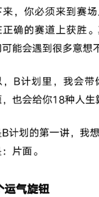

你好，我是老喻，欢迎来到我的课程《人生算法》。

上一讲，我们结束了《人生算法》A计划，这一讲开始，我们进入《人生算法》的B计划。

我们说过，这个课程由两个模块构成：

- A计划，针对的是你内部世界的不确定性；
- B计划，针对的是你外部世界的不确定性。

在完成A计划后，你已经拥有一辆不错的赛车。

接下来，你必须来到赛道上一展身手，力求在正确的赛道上获胜。真正上了赛道，我们可能会遇到很多意想不到的问题。

所以，B计划里，我会带你应对18个人生难题，也会给你18种人生算法。

这是B计划的第一讲，我想帮你看的人生难题是：局面。

## 三个运气旋钮

什么叫局面呢？就像是在一只纸上爬行的蚂蚁，它的世界就是单层的。如果四周有不可逾越的障碍物，它就被困在这张纸上了。

我给你一个方案是，设计三个“运气旋钮”：

- 第一个是老板旋钮，负责找到最好的赛车场资源；
- 第二个是教练旋钮，负责调兵遣将，分配赛道；
- 第三个是车手旋钮，负责全力以赴，执行任务。

含了采油、炼油、运油，直到销售这整个行业，实现了从挖掘石油到送到消费者手上，全产业链的把控。

大多数炼油商，觉得自己是一家公司的老板，但他们没有意识到，他们也只是整个行业里的一小赛车手。而洛克菲勒意识到，自己不光是赛车手，他还要做整个行业的资源整合者，他是真正转动了老板旋钮。

老板旋钮最核心的是你如何对待资源，洛克菲勒没有把缺少资源当作限制，而是去寻找，甚至去改变环境来获取自己需要的资源。

通过洛克菲勒的商业案例，我们再用“三个旋钮”来分析一下，他是怎么做的。刚刚进入这个行业的洛克菲勒，在任何一个层面都并不领先：

- 在“老板旋钮”的“资源层”，洛克菲勒没有领先对手的地方；
- 在“教练旋钮”上，大家都堵在炼油行业这个赛道上；
- 在“车手旋钮”的“专业层”，也谈不上有什么“别人赚不到钱但我能”的独到之处。

但洛克菲勒把所有的劣势，化为了优势。一个问题，对别人来说四面都是墙，最多苦苦求索一个破局点，或者在一条线上想问题。

洛克菲勒呢？用一条条线索，构建出了一个抽象的本质世界，顺着别人看不见的楼梯上楼了。他是怎么上楼的呢？

- “车手层面”，标准石油公司的产品，是当时市面上最安全、最稳定的煤油产品，做好了车手旋钮。
- “教练层面”，洛克菲勒选择了炼油这个赛道，在这个赛道做到集大成之后，他又拓展到了整个石油行业。
- “老板层面”，洛克菲勒不仅能整合行业内的资源，还能调集银行业、铁路行业去支撑他实现目标，把老板旋钮运用到了极致。

## 本讲小结

洛克菲勒最大的秘密是，他把这三个旋钮的三个层次当作整体来构想。他有一个上帝视角的鸟瞰思维，把“车手旋钮、教练旋钮、老板旋钮”这三个不同层次的思维模式，纳入到一个系统化的结构中，从而创造了惊人的奇迹。

这样，你就能够理解，为什么我们身边混得好的人，既不是最聪明的，也不是最会运营的，更不是有最多资源的，而是同时把三个旋钮用得最好的人。

做到这一点，我们就可以跳出“片面”的局限，跃入更广阔的立体世界。

## 思考题

你把哪个旋钮运用得很好？哪个旋钮还需要加强？

欢迎你在留言区跟我交流。你可以把这一讲，分享给你的朋友，帮他打开人生的新思路。

下一讲，我要带你继续拓宽看世界的方式，我们来讨论第二个人生难题：狭隘。

我是老喻，我们下一讲见。


# 13 狭隘：穷人思维是打折售卖了概率权

老喻的人生算法课

你好，我是老喻。欢迎来到我的课程《人生算法》。

上一讲，我们聊了第一个人格难题，片面。我给了你三个旋钮作为工具，让你看到人生的更多可能。

这一讲，我们来探讨第二个人格难题，狭隘。因为人和人的差异，可悲的地方在于，最大的问题不是能力上的差异，而是眼界。在看不到的地方，你可能已经放弃了。

## 穷人思维与富人思维

我先跟你讨论一个问题：富人思维与穷人思维的最大差别是什么？

我先告诉你答案，那期望不一样。期望是概率论里的一个重要概念，简单来说是你可以理解对你未来的预期。

你可能觉得那对是个心理活动，它会有那么大力量去决定一个人的贫富吗？

还真有，因为它会产生出来两种权利，时间权和概率权。这两个概念怎么理解？

先说时间权，其实就是你能不能掌握时间给你带来的长期收益。如果你对未来的预期很高，你能忍忍受当下的不确定性，能延迟满足，你就掌握了时间权。但如果你对未来就指不高，你当然希望尽快兑现，这样你就折价卖了时间权。

打个具体的比方，你种了一片苹果林，要3年后才结果，你等不及就打折把这些都卖掉，这就是放弃了时间权。

这方面做到极致的人就是你巴菲特，他坚持长期持有有价的投资，使时间的财产。

但是入的时候我们都希望有最好的价格，谁会为好公司便宜卖给谁呢？

还真有，就是那些打折售卖自己的“时间权”的人。

2008年高盛在金融危机的冲击下走投无门，巴菲特用50亿美元的价格买到了高盛的优先股。这笔交易额外加一个权益，巴菲特在5年内，有权低价买入高盛4350万股股票。单这一笔交易，巴菲特就拿到了35%的回报。

我们再来说说概率权，跟时间权有点类似，它看的是你能不能计算出事件的概率，并且忍受不确定的存在。如果你把不确定性，希望百分之百都是确定性的答案，那你就放弃了概率权。

举个例子，假如有个赌鬼为了摆脱100万，正在马上上赴会，这时他手上有一幅祖传的名画，市场价值5000万，但是想借马上换钱，买家人只出100万，他要么接受，要么不卖，这就是放弃了概率权。

但我们人生很多的时候，是自己主动了放弃概率权。

## 用概率思维理解两个按钮的选择

要想深入理解概率权，我们可以回到课程一开始给过的，“两个按钮”的选择题。在看在概率的视角下，我们应该怎么作选择。

我们来回忆一下，题目是这样：假设你现在面对两个按钮：如果你按下第一个按钮，直接获得一百万美元；如果按下第二个按钮，有一半的机会拿到一亿美元，当你还有一半的机率是拿到没有。这两个按钮只能按一个，你选哪个？

我们都知道，大部分人选择直接拿一百万元走人。因为这看起来是一笔横财，拿了大笔。而另一个则是飞蛾扑火，万一按下去，什么都拿不到呢？但你作出这个决定的时候，其实你已经放弃了一大部门的概率权。

其实还有更多更好的办法的，在第一讲我已经给过铺垫了，这些方法对我们的收益最大化，同时避免了不确定性。当你可能觉得这些方法太复杂，但我自己就不这么认为，实际上，我始终用概率的思维，来分享这些，就期望值就是怎么出来的，它们背后的算法是什么。

这个时候就要用上统计学习期望值的概念了。期望值是怎么计算的呢？用可能的结果乘以这个结果出现的概率，就是期望值。

那么这两个选项期望值分别是多少呢？

选第一个按钮，结果是确定的100万，概率100%，两者相乘，期望值是100万。

第二个按钮，结果是1个亿，但拿到的概率只有50%，两者相乘，期望值是5000万。

在概率的视角下，我们肯定选期望值更高的5000万啊。

即使如此，很多人仍然愿意去拿确定的100万，一方面，他们无法忍受50%的可能性什么都拿不到；另一方面，他们也没有看懂概率权，没理想要拿持有5000万的价值。

这个价值如何兑现呢？我们理解了概率权，就能跳出二选一选项，获得更大空间。

第一种方式，把按按钮的权利，以2000万的价格卖给别人，让更愿承受风险的人帮你按键，对你来说，用2000万换得了5000万的期望值，他也没吃亏。而你获得了确定的2000万，你的期望值就从100万提升到了2000万。

如果说第二种想法都找到的比，也有办法，第二个想法，找到一不比  也有的人，把选择权用100万的价格卖给他。但同时约定，如果中了一个亿，要求你给他百分之十。如果你的收益，保证也有100万，要是中奖了你还能分得5000万，你的期望值又提高了。

这能不能进一步扩大呢？还有办法，第三种方式，把这个选择权切碎，变成彩票，2块钱一张，印2亿张，你就能拿4个亿，就算头奖卖1个亿，你也能赚3个亿。

听到这里，你可能会有点好奇，一开始的时候，我面对着选择，明明一个确定的，一个是不确定的，可是这不确定的最后怎么就变成确定了？而且收益也高得多？

这就是穷人思维和富人思维的最大区别。

穷人思维，就倾向于拿到确定的东西，他不冒险。而富人思维正好相反，每次选择的时刻，都要尽量获得成功的概率，对自己的本事多加上自己的概率，这就是在计算期望值，真正算出自己的财富。

人生从来都不是只有一个选项，这种思维习惯，能帮你一步一步打开局面。不管每一次结果都是赔，它一直赔让你让出这个动作保持正确。

请注意，珍惜概率权，不是让你去赌，而是提出自己的真实本能，用概率的思维去思考自己的每一个选择。

穷人只珍惜确定性，不愿赌，他们反而更容易去做一些极小概率的事情。

比如花钱去彩票，两块投块钱买地，想博中  个发财梦。但是明白彩票原理的人都知道，这成功的概率非常低。而让组织彩票的人，能按照概率来思考来设计这个机制和游戏的，他们反而不是稳赚不赔的。

所以你看，像彩票这件事来说，是穷人补交富人。

我们再看看富人思维：扎克伯格刚创业没多久，雅虎公司出价10亿美元收购他的公司。这是一次大笔横财，从此他也可以飞天猫地的机会，但是扎克伯格拒绝了。

是马上拿到10个亿，还是以百分百之几的可能性，去赌若干年后拿1000个亿？这是一个选择。你看，扎克伯格面对的这个选择，跟我们刚才讲的那两个按钮的例子是不是很像？

几年之后，另一家创业公司Snapchat用类似的方式，拒绝了扎克伯格30亿美元收购的邀约。

这就是硅谷的精神之一，它可不仅仅发达，它是一种财富观，它是一种雄心状态，是一种对概率权的把握。

富人思维会充分运用自己的时间权和概率权。而穷人思维会打折甩卖自己的时间权和概率权。

富人思维把不确定性看作礼物，穷人思维把不确定性当作灾难。

## 如何摆脱穷人思维？

那么怎么克服自身的问题，摆脱穷人思维，把握概率权和时间权呢？

我们普通人最缺的，其实不是钱，而是有一个老人从小就开始不停告诉你，你很牛，你未来会很有出息。

为什么书香门第或者财富世家会出一大串的厉害的人？除了基因、资源这方面的原因，可能还有了以下几个原因：

- 第一，你从小就有足够高的参照点，不会被小利益勾走，更能承受风险，从而获得高回报。就像最开始的那个例子，如果你家里已经有了1000万美元，而你那白来的100万美元就没有那么饥渴，你受到的诱惑就没有那么大。
- 第二，身边一群人的示范效应，你老爸、叔叔、伯伯会不断告诉你往前看看，你行的，你是很牛的，你的出息绝不仅仅是现在这些。
- 第三，在这样的环境里长大，你内心的理想、激情有更大的机会被点燃。

可惜，我们绝大多数人不会出生在书香门第或者财富世家。那怎么办？

幸好这个世界留给每一个人一道后门，你可以通过学习，通过改变自己的大脑，通过克服自己生来带来的本能，认识概率权，掌握概率思维。

## 本讲小结

我想用哲学家维姆·霍林特的一个生活态度来总结这一讲。

他说，我们所生活的这个世界，是一个随机生成的不完美的世界，它既有好坏的成分，也有好坏的成分，但我们可以通过行动去将好的放大，坏的缩小，这也是我们生活的一种目的。

理解概率权，你就掌握了这个放大缩小 的工具；理解时间权，你就能保有对自己的无限信心。

## 思考题

你有没有放弃过大概率权，时间权的遗憾选择，比如放弃了深造的机会，或者把握了概率权的得意决策，比如提前买房？

欢迎你在留言区跟我分享。如果你在现实里有什么具体的问题，也可以在留言区问我，好的问题也是对我的启发，非常期待你给我的帮助。

这一讲我们讨论的是看不到的问题，但很多时候我们即看到了，也看不请。下一讲，我们来讨论人生第三个难题：模糊。

我是老喻，我们下-讲见。

- 时间权，就是你能不能掌握时间给你的未来的价值。如果你对未来预期不高，希望尽快兑现，就打折甩卖了时间权。
- 概率权，就是你能不能忍受不确定性的风险。如果你不能忍受不确定性，你就主动放弃了概率权。

# 14 模糊：量化范围比精确数字更重要

老喻的人生算法课

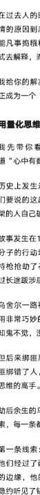

你好，我是老喻。欢迎来到我的课程《人生算法》。

上一讲，我们讨论的是概率区，因为模糊，因为不确定，我们其实在不知不觉中打错了很多的决策。

这一讲，我们来讨论的是，看到但看不清楚怎么办。我们讨论的第三个人生难题是：模糊。

在过去人的眼里，世界模糊一片，很多事情的原因到底是是什么，我们并不清楚。只能凡事地概括着，用阴阳五行这种模糊的方式去解释，而没有精准地找到原因。

我给你的解决方案是，采用量化思维，真正成为一个“心中有教”的人。

## 用量化思维找到教

我首先给你一个“真实的”故事，你就知道“心中有教”的人多厉害了。

历史上发生过很多着名的绑架案，但我们还要说这些，著者之处就在于，是被绑架的人自己破案的。

故事发生在1933年，这一次绑架案，犯罪者一开始为了“乔乔莫”，几个人蒙面，分地抢劫了石油大亨查斯·乌尔曼，绑架后非常巧妙地伪装走了20万美元，神不知鬼不觉，没有给警方留下任何线索。

但来知绑架居然还是被抓了，怪怪怪绑后绑错了人，他们绑架的居然是一个量化思维的高手。

劫余生的乌尔曼给 FBI 探员提供了三条线索，每一条都是量化的。

第一条线索：绑绑油时，一个多小时后，他们经过了两个加油站，或者是两个油田的边缘。他的职业经验让他闻出了气味，隐约听到了钻杆的声响。

第二条线索：他们大概花了96个小时，开不到第二辆车，走了大概960公里。

第三条线索：他们听在飞机场上空每天有两次飞机降落，他估算出机间隔时间，推测这两45 分钟内的时间分别是早上9:45和下午5:45。

FBI 根据这三条线索，在地图上画范围，很快就做出了一个“模糊”的农场，果然抓住了绑匪。

乌尔莫这个人真不简单，别人被绑架可能早就慌了，他刚好，一坐在脑袋里拍脑袋算概率，计算复杂，不复杂，是却产生了惊人的效果。

我想要强调的是，量化思维是一种重要的底层思维习惯，不要被数字吓倒，他大多数人并不需要复杂计算，小学数学水平四则运算就完全够用了。

## 什么是量化思维

简单说，就是用数字解决问题。

刚才说的犯案，主人公就是用量化思维，记录和估算一切可以记录的数，从而揭开谜底。

量化思维是一种思考方式。《黑天鹅》的作者塔勒布说：“数学不只是‘数学游戏’，更是一种思考方式。

他就用一个数学概念来解释金融保险，他需要提醒自己“如果一条河的平均深度为4英尺，就千万不要过河。

4英尺，大约1.22米，对于一个成年人来说，大不了刚到肩部的高度，那为什么不能过河呢？

请仔细想这句话，1.22米是平均深度，也许河道只有10厘米深，中深处就有两米深，但你要是不小心掉进两米深的地方，那可就是危险了。

你看，我们都知道金融有风险，但是具体风险是个什么没有意识到。塔勒布就用这个简单的数学比喻，把金融风险的概念讲得如此生动。

量化思维不仅能帮我们理解现实，还能帮我们在模糊中设定未来，Uber创始人卡夫斯·内特宁说“在新商业创造时，他用量化思维来做决策模拟。

如果一个城市只有3辆车可以供应，那么用户叫车至少要等20分钟，使用这个平台的人也会很少。但如果有20辆车同时在线，用户等的时间就会缩短，就会更多的人来用这个工具，司机挣的钱也会更多。

通过量化思维，他估算出网约车这个行业，规模会效益会发挥作用，从而明确了商业模式。

你看，这2个量化思维的例子，是不是都只用了加减乘除？根本没有用到复杂的公式。

应用信息经济学创始人哈伯德在《数据化决策》这本书里，点出了量化思维的关键之处：“量化的概念就是减少不确定性，而且没有必要完全消除不确定性。

怎么理解这句话？其实就是范围比精确更重要，就是比绝对精度？范围，但并不要求一步就达到绝对精确，而只有这样才是可行的。

我们刚才的犯案，主人公的数据化结果不精确，可能有20，大约用了多少，但不是精确的概率。但我们汇总在一起，一步一步就定了范围， FBI 就能找到最后的凶器。

精确的结果不重要，真正重要的是什么？

哈伯德说：“量化方法就是量化目标。确定真正重要量化什么，几乎所有科学研究的起点。量化也是，最重要的是要想清楚，你量化的是什么？只要你清楚了真正重要量化的指标是什么，该怎么量化就是自然顺了。

量化思维的关键是，我们要意识到事情是应该怎样的。我们往往喜欢问决的突破点，量化的信息就是关键点。但其实掌握了关键点就掌握了能力。

使用量化思维，即使没有精确的数据，也能解决我们生活中的那些看似解决不了的问题。

假如你去硅谷面谈，很容易遇到这样一类问题：西雅图有多少个加油站？北京有多少家星巴克？

你可能会说，这数据我怎知道？其实这类型问题背后考的是面试策略，就是考查一个人用量化思维，一步步走向真相的能力。

这类题目就是著名的费米问题，最经典的是：芝加哥有多少个钢琴调音师？

费米用量化的估算方法漂亮地解决了这个问题，他是这样做的：

我们会先有以下几条假设：

- 大约有250万人生活在芝加哥。
- 每100人中，约有2台钢琴。
- 钢琴每年需要调音一次。
- 一个调音师大约需要2小时来调一台琴。
- 每个调音师每天工作8小时，在一年总时间中，钢琴调音2000小时，所以一年总共调音1600小时。

上面这些数字，全都是“估”的，都很不精确。我们就用这些数着简单算一下，每年芝加哥有5万的钢琴需要调音，再算一个调音师的工作时间，可以估算出一共有63名调音师。

那么，事实上芝加哥到底有多少钢琴调音师呢？大约83家，有些人还说是重复的，可以说与估算值的答案基本接近了。

硅谷的那些科技公司，为什么喜欢出这一类的面试题？他们不是要你答得多精确，而是想测你，面对什么模棱两可的问题时，你有没有解决问题的思路和办法。

在现实环境中，我们遇到的大多数问题都...


## 小结

在现实环境中，我们遇到的大多数问题都毫无头绪，用量化思维来思考的奥米尼算法，加大了真实世界的分辨率，体现了一种对于未知问题展开进攻的勇气和思路。

小结一下，量化思维，是一种解决问题的智慧，量化的方式能让不确定的问题，逐步清晰起来。量化的重点，不是计算，也不追求精确的数据，而是把握重点，要选准出需要量化的指标。

## OKR可以启发你的量化思维

那我们应该如何应用量化思维，解决生活中的问题呢？

我们可以借鉴当下非常热门的管理概念“OKR”，这就是一个量化思维的工具。

什么是OKR?

O是英文单词“目标”的缩写，KR是“关键结果”的英文缩写，OKR就是“目标与关键结果”合。

1979年底，OKR诞生于英特尔公司，当时英特尔的微处理器8086，正在被摩托罗拉的新产品68000所取代，公司陷入巨大困境。但行业转为技术迭代，更新换代是常态。英特尔因在产品设计没有创新的基础上，用一场名为“粉碎行动”的营销战役扭转了局势。

为什么英特尔可以用一干扫掉技量庞大的对手？因为英特尔用了OKR这个秘密武器来指导“粉碎行动”。从此之后，OKR成为英特尔管理的秘密武器，再经由谷歌被全世界的公司学习。

为什么说OKR是一种量化思维的工具？因为使用这个工具，你核心要完成的就是一下两个动作：

- 第一，设立正确的目标，也就是明确什么样的指标是需要量化的。
- 第二，设计关键结果，也就是拆分成要做的动作，这个结果是可以明确验收的。

当时的英特尔CEO格鲁夫，解释OKR会达到这样的效果：“最终结果就是显而易见的，根本不需要出现争论，是或否，就是这么简单。”

这就相当于把模糊的管理问题，变成了计算机语言的0或者1，这就是量化思维。

我们每个人工作和生话，其实都可以用OKR这套方法和理念。比如，健身、学习，都可以设立明确的OKR。

其核心就还是要回答这么几个问题：你的目标是什么？实现了这个目标最核心的衡量指标是什么？你应该使用哪些可量化、可检验的动作来完成它？

## 本讲小结

让你“心中有数”的量化思维，并不是要你做复杂、精准的计省，而是用量方式，一点点加大现实世界的分辨率，通近你的答案。

OKR是一个简便的、可借鉴的量化思维的工具。

## 思考题

你在生活中，有没有使用量化思维，思考或解决问题的例子？

# 15 侥幸：在随机性面前处变不惊

命运与人生哲学课

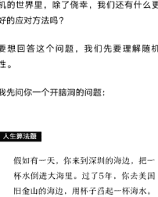

你好，我是老唐。欢迎来到我的课程《人生算法》。

上一讲，我们给讲了**量化思维**，这已经有一点脱思维的影子了。你开始学着用数字提高认识世界的分辨率。

这一讲，我们继续加深对概率的理解。我来跟你探讨随机性。它解决的人生难题是：我们常常因为心存侥幸而失败。在随机的世界里，除了侥幸，我们还有什么更好的应对方法？

要回答这个问题，我们先要理解随机性。

我先问你一个开胃的问题：

**人生算法题**

假设有一天，你来到深圳的海边，把一杯水倒进大海里。过了5年，你去美国旧金山的海边，用杯子舀起一杯海水。

请问：5年前你倒入深圳的那杯水，有多少会出现在你旧金山的这个杯子里？

答案是：1000个水分子。

你可能会觉得，怎么可能？深圳和旧金山之间距离超过一万公里，中间隔着汪洋大海。这么多年风波浪涌，下雨，蒸发，那杯水早就不知道飞哪儿去了，怎么可能还能找到？

全世界的水约有10亿立方千米，一杯水倒进去了，那岂不是连沙丁鱼都找不到了？

的确，一杯水虽然很小，但里面的水分子可不少，算起来大约有10后面25个零那么多。根据概率的计算，历经5大自然的循环，5年前你倒入深圳的那杯水，会有1000个水分子出现旧金山的杯子里。

是不是觉得很奇幻？那到底是什么在发挥魔力？产生如此戏剧化的效果？

那就是：**随机性**。

我喜欢一位法国剧作家的话：“人们总是在逃避命运的途中，与自己的命运不期而遇。”

只要来到这个世界上，就无法躲开随机性。很多事情的结果，的确是运气，或者你无法掌控的势力所决定的。随机性就像无形的双手，交错着命运。

历代的思考者，都试图从自己的领域去探索这个人生难题。从牛顿决定论时代人类的无知，到混沌理论，到量子力学的不确定性，再到金融市场的变幻莫测……

没有人为这个问题画上句号，随机性就是我们理解世界的重要底层逻辑。我们能做的就是理解它，拥抱它，承受它，学会与随机性共存。

## 理解日常生活中的随机性

我们常常会有疑问，为什么总有些人，运气特别好？

几年前，加拿大博彩管理部门打算把一些彩民的奖金返回彩民，他们购买了500辆小汽车当奖品，用计算机程序，从240万个彩票中随机抽取500个，一人一辆汽车。

结果出来后，意外出现了，有一个人独中了两辆汽车！

估计计算机随机抽取时，没有设置不能抽到相同号码的约束，就想着能有，两三万个号，随机抽500个，谁想到会重复呢？

在运气事件面前，要是懂点儿概率知识的话，这还真不算什么意外。在240万人中随机抽500个奖，在500个人中有一个人拿到两个奖，其概率大约是5%，虽然不算太高，但出现也不奇怪。

我们生活中会有很多巧合，没有概率思维的人，或者缺乏科学，比如用八字来看姻缘，或者归结为完全不及运气的因素，比如重要的比赛要穿红内裤等等。

这看起来有些生活中的小事，无伤大雅。但这种情绪是社会普遍存在的，经常会在造成一种世界性的道德。

比如，我们从小就听道百慕大死亡三角的故事，传说这片海域经常发生失踪、海难这类事件，无数经过这里的货轮、飞机，都离奇地消失了不见了。

百慕大三角海域的面积有100万平方英里，尽管的确查了不少不常，但是按照事故的比例，百慕大还远没世界危险海域的前十名都排不上。

为什么百慕大这么有名？就是因为一位作家写了百慕大谜般的飞机失事事件，后来就以此为传说，其实根本没有数据支撑。

面对随机性和不确定性，你有两条可以选择：

- 第一种，向不确定性屈服，相信神话，从神话中寻求慰藉。
- 第二种，拥抱不确定性，去学会理解随机性，明确不确定性的秘密，并且利用随机性，来获得更理性、更智慧的抉择，增大人生“中奖”的概率。

还真有家公司“利用”百慕大传说赚了不少钱。英国一家保险公司通过故事分析，认为百慕大海啸没有更多的故事，就没有向“穿越百慕大海域的客户”收取更高的保费，从而获得了更多的客户。

很多时候未知性风险，其实是幸运被低估和误解，在随机性面前，假如你能理解过数理和知识，比别人看得更深，就会从不确定性中获益。

## 如何利用随机性

第一种，我们认识到随机性，就能在不确定面前处变不惊。

你可能吗？去买彩票的路上，因为车祸身亡的概率是，中奖彩票可能性的两倍。飞机失事的概率是多少呢？如果你每年坐一次飞机，你要连续坐5万年，才会遭遇一次飞机事故那样的概率。

所以，其实坐飞机是比开车安全得多的出行方式。理解随机性，在意外面前，你至少能做到比一般人更加淡定。

第二种，在一些领域，我们可以通过计算从随机性中获利。

人们最早探究随机性的秘密，是从赌场开始的。的确，赌场是一个天然的“随机性实验室”。讽刺的是，赌徒是玩儿的，赌场游戏，而赌场玩的是人性的缺陷。赌场在偶然性中寻求刺激和幻想，赌场在概率优势必然性中赚到钱。

这有点儿矛盾，赌徒都是贡献数据，而赌场则是要运行算法。

但是不是谁都能说发机会了呢？还真有一个聪明人从利用随机性发起了挑战。

1873年，这位聪明人盯上了蒙特卡索赌场的轮盘赌。他叫路瑟·格雷尔，是个德牙的工程师，在那个年代，他相当于今天的谷歌编程程序员角色。

轮盘赌游戏带有38个数字，从完全理想的角度看，每个数字出现的概率是1/38。

然而你想，机器怎么能做到完美对称呢？任何偏差都可能改变球在轮盘里的随机性，导致球停的位置偏向某些数字。所以这些数字就会更频繁地出现，我就能通过它来获利。

路格雇用了六个助手，每个助手把守一个轮盘机器，记下中奖数字。是格雷尔就分析这些数字的规律。

六天后，五个轮盘的数据都没有发现什么，但第六个轮盘上，有9个数字出现的概率，远超出其他数字，而第七天他在，在第六个轮盘上，大量下注那九个高频出现的数字，大赚了一笔。格雷尔一共赚了32.5万美元，这在当时是很大的数字，超过他在500万美元。

我们来分析一下，是格雷尔利用随机性，战胜赌场的秘密：

- 首先，他发现了赌场里的随机性漏洞，建立了自己的概率优势策略；
- 其次，这个策略必须是可以重复的；
- 第三，他反过来利用大数定律，反复使用这个策略。

故事还没完。哥格尔还干了一件很重要的事：拿到钱之后，哥格尔立即收手，去购买了稳健的房地产。

你看着，靠随机性赚来的钱，他没继续去赌，而是用不动产去巩固财富的确定性。哥格尔真的是一个运用随机性的高手。

第三种，应用随机性的方向是一类特殊问题，被称为帕斯卡赌注。

你押错的可能性非常大，押错的成本小到可以忽略不计，但是万一押对了，奖励却非常高。在这种情况下，试一下仍然是明智的。

比方说，你看中一位高不可攀的女生，不妨大胆表白，因为被拒绝了也没什么大不了的。

桥水基金的创始人达利欧年轻时，做过类似的尝试。他看到一栋自己特别喜欢的房子，但当时他根本没找钱，屋主也没挂牌出售。其他人看看就算了，但他还是打电话试了一下，结果屋主不仅愿意卖，还借给他一笔钱！

你看，这类问题只要你利用随机性，就有可能主动给自己创造中大奖的机会。

## 本讲小结

我们觉得生活中很多巧合，很多不可思议，其实都可以用随机性来理解。对于随机性，你可以做到三件事：

- 第一，理解随机性，拥抱生活中的不确定，在意外面前处变不惊；
- 第二，对于可计算的随机性事件，你可能从随机性中套利；
- 第三，在帕斯卡赌注类的事，你不妨大胆试一下。

《黑天鹅》作者塔勒布写道：“不管我们的选择有多少复杂，我们多擅长支配运气，随机性总是最后的裁判，我们仅剩的只有尊严。”

尊严就是处变不惊，不要去寻求迷信、巧合，而是勇敢去直面，尝试去计算，拥抱不确定。

## 思考题

你有没有遇到过类似帕斯卡赌注的选择？也就是那些虽然胜率不高，但失败也没什么大不了，万一成功了收益却非常大的事。当时的你是怎么作决定的？现在如果你再遇到这类问题会怎么办？

欢迎你在留言区写下你的经历跟我分享，你也可以把这一讲分享给你的朋友，让他也了解随机的奥秘。

下一讲，我们继续讨论概率思维，概率能应对随机事件，那概率能理解宿命吗？下一讲我就跟你聊聊。

我是老喻，我们下一讲再见。

## 16宿命：用概率思维提高你的胜率

老袁的人生算法课

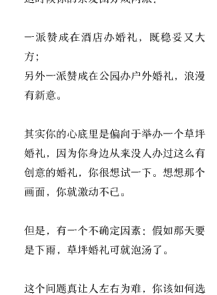

你好，我是老唐。欢迎来到我的课程《人生算法》。

上一讲，我们探讨了宿命这个人生难题，也知道有没有宿命，让我们先来做一个调和机关有，好玩儿的题目。

**人生算法课**

假设你正在筹备自己的婚礼，经过精心选择，现在有两个场地供你选择：

- 一个是豪华酒店，设施齐全，经验丰富，场面气派，就是有点儿传统，没啥特色。
- 一个是公园的湖畔，专门举办西式的户外婚礼，百花齐放，绿草如茵，波光粼粼，还有无人机在上空拍摄，现场特别动人。

这时候你的亲友团分成两派：

- 一派张成在酒店办婚礼，既稳妥又大方；
- 另一派则想在公园户外办婚礼，浪漫有新意。

其实你的心还是偏向于举办一个草坪婚礼，因为你身边从来没入办过这么有创意的婚礼，你很想试一下。想想那个画面，你就激动不已。

但是，有一个不确定因素：假如那天要是下雨，草坪婚礼可泡汤了。

这个问题简直让人左右为难，你该如何选择呢？

这个时候，你就要概率思维了。

首先，我们来给两种婚礼场地打分：酒店婚礼打80分，户外婚礼打100分。

其次，我们来评估下雨的概率。根据经验，这个季节下雨的概率大约是25%。酒店不受影响，不下雨雨季概率是80分。户外婚礼呢，不下雨，那就打100分。

接下来，我们采用简单的效用函数计算如下：

- 75%的可能性不下雨，对应的效用值是：100*75%=75；
- 25%的可能性会下雨，对应的概率效用值是：0*25%=0；

二者加起来，就是户外婚礼的综合打分：75分。

最后，尽管户外婚礼非常有吸引力，但是根据计算，酒店婚礼的期望值是80分，高于户外婚礼的75分。所以，你还应该选择在酒店举办婚礼。

这就是概率思维。

## 概率思维其实很简单

你可能会说，这太简单了吧，小学一年级的孩子也会算，没错，概率就是这么神奇的东西，基本常识非常容易理解，但是要想明白却很难。

巴特纳赌徒的公式也就是这么简单的概率计算，“用可能赢的概率乘以可能亏损的金额，再用输利的概率乘以可能盈利的金额，最后用输利的概率减去亏损的，这就是我一直试图做的减法。”这种算法并不完美，但事情就是这么简单。

就像高尔夫球顶尖高手和业余选手的差别，做的事情都一样“简单动作”，但执行效果就区别太大了。会不会用概率思维，就是高手的思维方式和普通人的区别。

但就算我说的，概率思维解释起来并不复杂，但真正想要明白它不容易。我见过不少聪明的朋友，也想不明白概率这东西。他会觉得有一件事儿没发生在我身上，那就100%如果没有发生，那就是0。两个百分之几十的概率，有啥用呢？

用概率思维的目的，就是量化那些不确定的命题。

我举个很简单的例子

**人生算法课**

有两个罐子，分别装有红球和黑球，假设到红球，你可以中10万大奖。你看，按照常识为概率没用的朋友的观点，结果是要从提到去，你会选择哪个，选哪个都有可能，概率差不多大。

但是，现在我们把两罐子看一看，a罐子装了1个红球，9个黑球；b罐子装了5个红球，5个黑球。你又会选择哪一个？

我想有人都会选择b罐子，因为a罐子提到红球的概率是十分之一，b罐子提到红球的概率是五分之一。

这个例子很简单，但我用这个例子是想说明，概率思维是用来衡量“机会”的。学会概率思维，能提升你对机会把握的正确率。

研究者也证明了，以概率计算为基础的分析框架，远远胜过人的直觉。甚至是对专家在自己的专业领域，直觉也比不上一个简单的概率计算公式。

比如，有位斯坦福大学的教授，设计出一个预测红温蛋蛋的公式。这个公式的参数包括葡萄生长期的平均温度，冬季的降雨量等。最后公式算出来的结果，比世界上那些最著名的专家的预测还要准。

如果你掌握了概率思维，就能提高自己应对不确定性问题的判断力，调整你的个人认知系统，形成强大的人生算法。

## 布林用概率思维对抗疾病

让我们来看一个用概率来改变自身命运的精彩故事。

2006年，谷歌创始人布林知道自己有LRK2基因突变，这意味着他未来患阿尔兹海默症的可能性高达50%。

面对这个消息，布林的做法简直可以列入概率思维教材，作为经典案例。他是这么做的：

1. 对外公开此事。
2. 捐助超过5000万美金用于帕金森研究。
3. 利用大数据指导预防和治疗疾病的信息和方法。
4. 有研究证明提高心率能预防得病风险，他也就增加运动量。因为跑步时间短，所以他，加上运动量小就难些。
5. 还有研究证明，喝咖啡、喝红茶会降低疾病概率，他就开始坚持喝……

布林自己也是这么算账的：

- 饮食和运动，使患病概率降低一半，这样他的患病概率从50%降到25%；
- 推动科研发现，可以从风险降低两成一，这样就只有13%了；
- 针对帕金森症的研究资助，进而把风险降低到10%以内。

布林是不是花光财力物力啊，能确保自己彻底不帕金森了吗？会不会什么也不做，其实也不会得？

用概率思维并不能完全防止布林患病，但可以把这件事上极大概率事件，变为小概率事件，把可能损失概率降到最低。不管结果如何，布林在思考和行动，都体现出了一个高手所应该具备的概率思维。

运用概率思维面对不确定性，你能积极思考，乐观行动，不这就是我们常常希望的，把命运的握在自己的手中吗？其实，我们能改变的东西只有概率。

## 你要敢于改变自己的人生概率

那对我们的每个人来说，怎么把概率思维应用到自己的人生当中呢？

除了用概率来理解具体事件之外，其实还有一个人生命率。我们的思考方式和行动方式，其实就是我们每个人的人生概率。

打个比方吧，你自己就像个骰子，扔出数字1，你就中奖。根据概率，你的中奖机会是六分之一。扔出命中你自己的骰子吗？你天天砸烂扔命的干手筋有吗？其实并没有，有四面骰子的先天结构和随机性的游戏规则，就决定了你的中奖率。

要改变中奖率，你有办法改变游戏规则，就只能改变自身的结构。

比如说，假如你变成了一个全字塔形状的骰子，就只有四个面，所以你扔出数字1的中奖概率，就提高到了1/4。

你如果把自己变成了硬币，其中一面是数字1，那么你获胜的概率就变成了二分之一。

说起改变自己的人生概率，我想和你分享一个特别触动我的传奇故事。

这是为高尔夫球手“老虎伍兹”改变自己挥杆姿势的故事。

一个顶尖球手，早就形成了自己的挥杆姿势，有些人一輩子都不变。但是伍兹不这么想，在他赢得多次大满贯冠军之后，仍然主动改变挥杆姿势。

作出这个选择可谓相当艰难，为什么？因为球手在这个过程当中，必须和原来的旧习惯作斗争，还要冒着成绩下滑的风险。在人们质疑他的改变时，他说自己是：“先退后进，然后大步前进。”

你看，这就是改变自身概率的精彩案例。假如你永远按原老的挥杆姿势，就像持续加一个结构没有变化的骰子，很难有大的突破。而老虎伍兹，在已经非常成功的基础上，依然勇敢改变自身概率，调整挥杆姿势，从底层重新建立自己的击球优势。如果他不作改变，因为伤痛和年龄的限制，伍兹就很难再次回到巅峰。

就像我们刚才说的，从系统层面上，把自己变成了另一个中概率更高的骰子。这种改变往往是痛苦的，但更是脱胎换骨的。

正因为伍兹面对人生有这样的勇气，所以他在经历了多次手术，遭遇了一系列人生低谷后，还能在43岁神奇杀回美国大师赛，被称为“历史上最伟大的回归”。

## 本讲小结

> 英国作家白哲特说，生活是概率的大学校。

在这个学校里，我们每个人不应该甘心当一个被扔来扔去的骰子，而是要去努力探寻人生的概率。哪怕现实世界充满了迷雾，我们没有足够的数据和能力，来明确执行，我们也要用概率思维，勇敢地往前摸索。

只有当我们运用概率思维，评估关键变量，量化生活的不确定性，形成自己的人生算法，才有可能一步步逼近这个世界的真相。

## 思考题

你改变过人生的算法吗？或者你认为现在的你，需要改变人生算法吗？你希望怎么改变？

欢迎你写下自己的想法，在留言区跟我交流。好的问题也是一种创造，欢迎你在留言区向我提问，包括所有让你疑惑的人生难题。

理解了概率这个难题，下一讲，我想跟你讨论的人生难题是，我们该不该后悔？

我是老喻，我们下一讲见。

- 概率思维不要求你进行复杂的计算，而是去量化不确定的问题，给你解决问题的思路。
- 想要改变你的人生概率，你能做的就是改变你的思考和行为模式。


# 17 追悔：回到过去，你也不能改变命运

你好，我是老难。欢迎来到我的课程《人生算法》。

上一讲，我们聊了宿命。我们可以用概率去改变宿命，这是在职场里面对未来。这一讲，我的人生主题是，如何面对过去。几乎所有人都有后悔的事情，但我们真的应该追悔过去吗？

我发现不管任何时候，大家都在感慨：现在日子难过，你看 10 年前的机会多好啊。20 年前房地产就好了，10 年前做互联网就好了……

这么看起来，这个世界上的机会似乎越来越少，未来听起来挺消极？但 10 年后，人们一样也会发出类似的感慨。

其实，如果你愿意往回看，现在在某个巨大的机会，是被 10 年后的人们特别羡慕的？

问题就在于，现在最大的机会是什么？我们不知道。

## 我们能改变命运吗

好，开启大脑的时刻到了，请问：

> 假如你现在可以搭乘一部时光穿梭机，改变你一生中任意一件事，你能否改变自己的命运？

我的答案是否。

具体原因我们先放一放，想要深入理解这个问题，我们先做一个大实验：

一个欧洲城市按照统计规律，每年大约发生 100 起凶杀案。举个例子，如果我们可以坐时光穿梭机回到过去，提前找到这 100 个凶手，把他们关起来，会把这座城市的凶杀率降低到零吗？

听起来很好，但真正的结果也许很难如愿。

因为即使提前抓获了这 100 个疑凶，仍然会有其他地方产生新的犯罪。

近代统计学之父高斯曾在一篇论文中说：

> 是社会创造了罪恶，有罪的人仅仅是执行罪恶的工具，绞刑架上的牺牲者从某种意义上说，是社会的牺牲品。

这个听起来哲学意味很浓，但它指明了一个真相，犯罪是一个复杂系统出现的现象，它是一个系统的产物。改变个体的选择，并不能让犯罪在整个社会上消失。

那岂不是，对城市的犯罪率没有办法了？也不是，是有办法的。但你要做的不是控制 1-2 个犯罪者，而是探究本质原因，去改变整个社会的系统。

不仅仅是罪案这样，其他统计数据也是这样。2017 年出租车事故是 3713 人，2016 年这个数字是 37451。为什么这两年数字如此接近，好像死神也有 KPI 一样，其实是因为车祸是一个系统的结果。

一片森林出现的树木数、一些国家新生婴儿数、一个地区晴天的天数等等，这些重复出现的事件发生的次数，都会在一个稳定的区间内波动。

改变任何一个选择，都没办法影响最终的结果。因为你冥冥中有大数定律这个东西，在决定一切。

在统计学里，大数定律是用来描述随机事件多次重复发生，其结果呈现长期的稳定性。比方说，发生车祸是随机事件，但一个城市每年车祸数就相对稳定。

大数定律的重要性就在于，它让我们意识到：当一些随机事件重复发生的时候，从整体来看，它会呈现长期的稳定。就是偶然之中包含着必然。

## 大数定律是怎么起作用的

大数定律听起来似乎很简单，但想明白的没多少人。

在统计学里，大数定律是用来描述很多次重复实验的结果，重复次数越多，结果就越趋近于平均值。

买彩票中大奖，这样的故事我们见得还少吗？

获得彩票大奖的人，后来就会一生幸福吗？并不是。根据统计，许多美国彩票中奖者后来过得都不怎么样，因为一次的飞来横财，并不会让一个人的生活更美好。

一个硬币即使连续 20 次出现正面，但是如果连续抛很多次的话，正面出现的概率还是 50%。也就是说，硬币的命运，是由它自身的结构所决定的。

就像我们前面说过，一个国家的车祸死亡率是统计学的结果，这个数字是由车辆、道路、交通规则、驾驶习惯等一整个大系统决定的。单次交通事故非常偶然，无法预计，但是统计数据却非常稳定。

当样本量足够大的时候，大数定律就开始发挥作用。也就是说，行为方式决定命运，这个是我们讲过的，但这里我们说的是：我们的人生命运不取决于两次选择，而取决于我们的系统。

所以，“性格决定命运”这句话，应该修正为：性格决定行为方式，行为方式决定命运。你的行为方式就是那个决定你命运的系统。

就算有时光穿梭的机器，回到过去换了男友、跳槽老板，最后的命运可能还是一样的。

## 如何真正改变自己的命运

那如果对现在的生活不满意，是不是就完全不能改变呢？

好消息，并不是。我们可以调整自己的行为方式，调整自己的系统。

更大的好消息是这件事情，不用时光穿梭机，我们现在也可以做。知错就改，比穿回去找某个大错更有意义。

怎么改呢？

我们可以向大数定律的最大赢家学习，也就是赌场。

以澳门赌场的轮盘为例，赌场的概率优势只有 2.7%，看起来很小，但是凭借“大数定律”的魔力，能够稳稳地形成对赌客的胜率压制。

所以，改变系统也不用你做好人生中的每一件事，做好多个选择，只需要把你人生系统的指针，向正确的方向拨一拨。但别小看这一点小偏差，就是这一点偏差，会引领我们走向完全不一样的人生轨迹。

这就是软件开发运动的提倡者埃里克·雷曼，在《大数定律与直觉》这本书中给出的经验：

> “如果你有正确的态度，有趣的事情自然会找到你。”

坚持做正确的事情，比穿越到 10 年前，买中一个彩票头条更能带给你幸福的一生。

## 本讲小结

短期看，生命充满了偶然；长期看，生命会呈现出必然性。最好的人生大奖不是中彩票，而是调整你的人生系统。把小概率的偶然优势，变成你人生大概率会出现的必然结果。

## 思考题

你有没有非常后悔的人生重大选择？现在你如何看待这件事？

欢迎你在留言区跟我分享你的思考，也欢迎你把个人的问题写在留言区向我提问。如果你朋友正在为某件事情抱憾不已，你可以把这一讲分享给他，帮助他走出自己的内心困境。

下一讲，我们开启一组新的问题：在现实生活中，我们应该如何解决在认知、决策、行动这些关键点，遇到的人生难题。

我是老高，我们下一讲见。

## 刘墨点评

- 性格决定行为方式，行为方式决定命运。你的行为方式就是那个决定你命运的系统。
- 我们该如何对待人生中犯的错误？面对那一两个错误，你不要纠结，你该用更多正确的事，把这件事稀释。
- 好的人生不是中一个大奖，而是要坚持正确的事，这自然会增加你人生幸福的概率。


# 18 非理性：如何管住你的“动物精神”

老翰的人生算法课

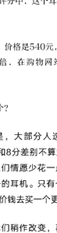

你好，我是老翰，欢迎来到我的课程《人生算法》。

前面三讲，我们讨论了在概率的视角下，我们应如何解决人生难题。

这一讲，我们开始一组新的问题：如何去完成认知、决策、行动这些关键的动作？这一讲我们先跟你探讨认知环节的关键：如何战胜非理性。

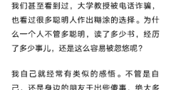

让我们一起来做个实验：假设你现在要买耳机，有以下两个型号可选。你会挑哪一个？

一号耳机，价格是 270 元，在购物网站的 10 分评价制中，这个耳机的得分是 6 分。

二号耳机，价格是 540 元，价格整整是一号的两倍，在购物网站上得分是 8 分。

你会买哪个？

实验的结果是，大部分人选择了一号耳机。因为 6 分和 8 分差别不算太大，但价格差了一倍。在人们衡量取舍的时候，会购买一个还过得去的东西，只有一小部分人，愿意花双倍的钱去买一个更好的耳机。

接下来，让我们稍微改变，再做另外一个类似的实验。

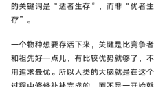

请你从下面三个耳机里选一个：

一号耳机，价格是 270 元，在购物网站上得分是 6 分。

二号耳机，价格是 540 元，在购物网站上得分是 8 分。

三号耳机，价格是 840 元，在购物网站上得分是 7 分。

一号和二号没有任何变化，和刚才一样，只是增加了三号耳机。但是仔细看一看，这个三号耳机纯属是用来捣乱的，定价是 840 块钱，比二号耳机高出 300 块，但评分只有 7 分，选它要么就是买亏了，要么就是买多了。

奇怪的事儿出现了，就是因为多了这个捣乱的三号耳机，尽管没有人选它，但人们另外两个耳机的选择却发生了翻天覆地的变化。

让我们经常作出错误的选择。

我们再看第二个，社会动物的属性，是指我们身处群体之中，我们为了融入群体，容易从众。

第三个是指求智动物的属性，人是有好奇心的动物，是不断求知的动物。

在不同的时期，人类有不同的认识世界的体系。这个体系总是在被推翻，在质疑中形成新的体系，不断发展。在任何一个阶段，其实我们都是相对“无知”的。

最后一个，是经济动物的属性。正如诺德曼对金融的研究，他发现了人类的理性是有限的。人们追求经济效益，总是贪婪的。正是因为贪婪，人类才有进步，但也因为贪婪，人类也时常陷入非理性。

关于经济行为非理性的研究，塞勒的确厉害，他不仅靠研究人的非理性行为拿到诺奖，还利用金融的“非理性”赚钱。他是这么做的呢？

原来他发现了“输家赢家效应”：

投资者对过去输家组合，也就是下跌股票，过分悲观；对过去的赢家组合，也就是上涨股票，过分乐观。人们总是很相信过去成绩很好的投资者，没那么相信成绩差的投资者。

这就会导致股价偏离基本价值，过一段时间之后，市场会自动修正，会像坐跷跷板，低估的也会被重新重视。这个修正的过程中，就有套利空间，只要你能发现它。

于是塞勒找人一起成立了一只基金，采用反转策略，买入过去 3 至 5 年内的“输家组合”，卖出“赢家组合”，结果赚了不少钱。

用理性的思考，把握了非理性，就能发现获利的空间。

我们理解了“4 个动物属性”，是不是一个对症下药，就能够成为一个理性的人了？

可能不行。理性和非理性，是交织在一起的，是我们大脑的先天结构所决定的。

## 应对非理性的 7 个策略

# 19 冲动：像阿尔法狗一样，兼顾直觉和理性

你好，我是老喻，欢迎来到我的课程《人生算法》。

上一讲，我们讲了应对非理性的七种策略，跟着这七种策略我们一起提升对自己非理性的控制能力。

这一讲，我要跟你聊的人生难题，是我们每个人都容易犯的错误，那就是冲动。我们很容易不过脑子就决定一件事，我们也管这个叫直觉思维。但是不是直觉思维一定就不如理性思维呢？

这个问题可不简单，它横跨了心理学、数学、计算机科学、经济学和进化生物学等多个领域，各路专家在这一点上争论不休。

“畅销书之王”格拉德威尔，就在他的书《眨眼之间》，专门研究了直觉思维的历史。

他提到过一个实验，实验给一群学生看了三位老师的教学视频，让他们评价老师的教学质量。

这组视频去掉了声音，只有 10 秒，学生们只能看到老师的肢体语言。就是这么大信息量，学生们还快速给出了评价，而且结果同这些老师的综合评定完全一致。后来，实验把视频剪短到 5 秒、3 秒，其学生也得出差不多的结果。

直觉思维就这么厉害，虽然是短短一刻，但是就能判断出很多信息，而且每个人似乎都有这种能力。这也是为什么我们会在一秒钟前，而且这一瞬间的感觉，可能比你花较长时间得出的结论更准确。

格拉德威尔说：“想想你走在街上，猛然发现一辆卡车正飞速逼近，你有时候会作出选择从车头甩过去，或者从车尾滑过去。从人类之所以能够存活至今，就是依赖于这种直觉，直觉就是直觉。”他说的这个决策工具，而你的直觉就是直觉。

虽然我们现在还没有完全搞清楚直觉是什么起作用的，可它确实很有用，很多时候比理性思考的结果更有效。

我们细想，直觉思维也颇有先决的条件。比如：主观是高度开放的，人类有极强的“过度自信”、注意力有限、认知偏差等判断系统都容易出错的，不可避免地会产生误判。即便你是一个行业大牛，对同一件事的判断也会和别人不一样。

那我们到底该如何作决策呢？

我的答案是：把理性思维和直觉思维结合起来，形成强大的算法。

计算能力和相对弱的棋手区别并不大。

围棋太需清晰也经常有人会问起：你会多算多少步？

吴清源的回答却出乎提问者的意料，他认为，不用看那么远也能够下好棋。

真正高手是怎么作决策的哪？

吴清源说他走一步棋，其实就是做两件事：

第一：找到候选的几只手；

第二：从最有可能性的那一手开始评估，如果不错就直走，不行就评估下一个。

简而言之，高手为什么厉害？因为他们的直觉好，能够快速地抓住重点，找到最有可能的哪几只手棋，然后通过计算选出最优的一手。

那高手的直觉是哪儿来的？是通过大量理性的训练和实战获得的。

把这个思路做到极致的是谁？不是具体哪个人，而是一个 AI，阿尔法狗。

围棋的变化数量太多了，比宇宙中所有的原子加起来还多。围棋不可能像象棋一样，机器靠强大的计算能力，用穷举法去打败人类。

那阿尔法狗是如何完成这个逆转的呢？

扭转局势的秘诀就在于：让阿尔法狗模仿人类下围棋的方法。

第一步：根据从人类那里学来的下棋直觉选择 5-10 个落子点；

第二步：用强大的计算能力，分别计算这些落子点的最终胜率，然后选择胜率最高的那一点。

阿尔法狗的决策模式，是先用直觉思维选定范围，再用理性逐个分析计算。阿尔法狗的算法思路，也是把理性和直觉思维结合，它把这个效用发挥到了极致。

## 本讲小结

面对决策这个难题，这一讲我带你看了三个高手的解决方案，背后他们都集成了理性思维和直觉思维，让二者形成一个完整的路径，从而大大提升了决策的质量。而世界上那些最厉害的人，几乎都是一个内修阿尔法狗。

希望阿尔法狗思维所提到的决策方法，能给你带来启发。

## 思考题

你平时作决策的时候，更依赖直觉还是理性？听了这一讲之后，你打算作出什么变化吗？如果你有有趣的决策模型，也欢迎在留言区和我分享。

另外，你有任何让自己头疼的问题，请你在留言区向我提问，帮助我更不断地完善人生算法。如果你留言给了我启发，我会非常感激并送上奖励。

聊完了我们应该用什么思维方式思考问题，下一讲，我会给你聊我们应该如何认知，如何作决策。

我是老喻，我们下一讲见。

# 20 犹豫：灰度认知，黑白决策

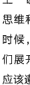

你好，我是老蒋，欢迎来到我的课程《人生算法》。

上一讲，我跟你讲了，考虑问题要把理性思维和直觉思维结合起来。在这一讲中呢，我还是会围绕灰度。不过，这一次我们展开来聊聊，在认知和决策环节，我们应该遵循什么原则。

我要给你讲八个字：灰度认知，黑白决策。

我们在 AI 计划内 2.0 那一讲里，就说过一个完整的决策过程有四个重要的节点，感知—认知—决策—行动。理性思维和感性思维的区别，主要就体现在中间两个步骤，直接从感知到行动。所以，要想培养自己的理性思维，认知和决策两个环节尤其重要。

这一讲，我要带你用概率的底子思维，来重新理解应该怎么去认知，如何决策。有了概率思维，你就能从“理解这件事很重要”，进化成“我知道怎么办”。

我们先来回顾一下认知和决策。

认知，指对收集到的信息进行处理，你像分析师一样思考，评估各种选项。

决策，是指在各种选项面前，你像个指挥家一样，作出最终选择。

我说认知要保持灰度，那什么叫灰度呢？灰度是处于白色和黑色之间的中间地带，有深浅、有浅灰。所以当你需要准确描述认知时，需要加上一个百分比。

灰度认知，是指你在分析选项的阶段，先不急于作出非黑即白的判断，保持一定灰度，这个灰度最好有一个数值。

黑白决策，是说我们在形成最终决定时，必须有一个黑白分明的选择，不能模模糊糊。

但现实中，我们容易把两者混淆，在认知环节非黑即白，在决策环节犹豫不决。

## 认知阶段保持灰度

要想深入理解这两个概念，我要带你来看一个有趣的案例。

上世纪 90 年代中期，铜价创下历史高，加拿大巨型采矿公司，在英国有个铜矿，经营状况好，因此公司想关闭这个矿，但也面临了很多阻力。这个矿就 1000 多员工，几乎是当地唯一的生计，要是关了，会给当地的经济发展带来很大的影响。而且高管对于决策失误，管理团队们为了保全名声也不愿离开。

除了关闭铜矿，还有另外两个选择：

- 第一，是在本地的炼矿，把矿石运输到加拿大，用新式的炉子来提炼。
- 第二，是继续向北挖矿。因为这个铜矿的北部，可能还有很多矿藏。

高管偏向于关停，矿区经理偏向于继续经营，各方争执不下，经过数周会议开了几个小时，毫无进展，大家都很不满意。

你看，是不是我们的现实生活很像？一个难题出现，各种因素交织在一起，每个选项都有利弊，很难一下子理清。

这时候，咨询公司一个叫马丁的小伙子突然产生了一个想法。他提了一个问题：“这个选择必须具备怎样的条件，才能成为正确的？”

这就有趣了，一下子点中了关键。为什么这么说呢？大家在讨论选项的时候，都犯了一个错误，每个人都想证明自己的选项是最好的，然后试图说服对方。

讨论是一个认知过程。我们刚才说了，认知要保持灰度，就是要全面评估各种选项的可能性。

如果每个人都固守自己的观点，就变成了“黑白认知”了。大家都死守自己的认知，对对方的认知进行攻击，而没有去真正思考每个人的可行性、成本和收益。那么会议当然没法进行下去了。

提出了这个问题的马丁，后来成了罗森茨韦格学院的院长，成为全球最有影响力的思想家之一。

马丁的办法高明在哪儿呢？他提倡用一种方式，把不确定的各种可能性列出来，然后把每一种可能性评估出来，这样能理性地评估每个选项的优劣之处。

一开始，他这样想问题，你的思考方式就会转变。你从立场之争、非黑即白的对错的争论，变成了对事实的判定。认知阶段不要非黑即白，把讨论立场变成了事实讨论。

当人们从“黑白认知”转为“灰度认知”，局面立即发生了转变，三个选项的问题也就暴露出来了：

- 把矿石出口到海外运输，费用太高了，超预期，所以只能放弃。
- 另外一个选择是扩大矿区，看起来也很有吸引力。但有人在上一轮里发现新矿脉，之间有巨大的成本，打穿的成本太高了，所以也不可行。
- 到最后大家发现，尽管“关停铜矿”很难，却是一个可行的选项。经过“灰度认知”讨论，连反对者也不得不接受了这个黑白决策。

灰度认知的秘密是什么？在认知阶段，别把时间和精力浪费在非黑即白的争议上，而是对每个选项进行灰度叙事的确认。

当我们每一个观点时，不管多自信，不要自认为正确。都要意识到，这个观点不可能是百分之百正确的。

既然如此，我们就要去仔细考一下。这个选项的可能性有多大？这个数值，是介于 0 和 100% 之间的，这就是灰度认知。

灰度认知的底层是概率思维。不管你的某个信念多么坚定，要在前面加上一个概率值。

## 可信度加权

我们总有一个错觉，认为厉害的人做什么都能成功，其实并非如此。

达利欧的公司，是世界上最大的对冲基金，其实就是把多种决策的方法，这就是后面被很多人搬出的可信度加权。用这个方法，桥水基金的投资决策质量大提高了，而且非常稳定。

这个方法非常有价值，虽然《原则》这本书很快，但真正理解这个概念的人很少。我觉得很有必要给大家解释一下，就是一个典型的“对事实的判定”的决策方式。

具体是他们是怎么做的呢？“加权”的意思就是“乘以权重”，举个例子。你要开一个家庭会议，就要么要买洗碗机器，要么每个人都要洗碗。比如，太太的权重是 50%，老公的权重是 25%，小姑的权重是 25%。最后统计的时候，太太的一票，就相当于老公的两票。

听起来很简单吧，其实达利欧在桥水基金采用的工作方法就是这样：

这群专家都有表达意见的权利，但根据每个人过往的表现，给予不同的权重值。简单说，对于那些能力更强的人的意见权重也高一点。赋予那些能力更强的人更高的信任值，赋予那些能力更强的人更高的权重值。

2012 年，桥水基金内部讨论是否要减仓。达利欧鼓励员工形成多投票来买债券，另外一半则反对。

怎么办呢？运用可信度加权的分析系统处理结果。这不是简单的民意调查，也不是投票。

具体办法是，他们先用自己发明的集思器工具，收集大家对一个问题的不同想法，可能会收集几十种。


# 20 灰度：认知世界的“概率思维”

可能是收获好几十种。

然后其他人就可以对你的想法打分数，比如达利欧就说，一个实习生对我的想法打了3分，而满分是10分，也就是很差的意思。

但是因为这个实习生的资历比较低，他打出来的分数权重不会太高。可能另一个权重高的人，赞同达利欧的某个想法，这个想法的得分依旧会比较高。

就这样，经过一系列的计算，再算出来这些想法的得分，最后得到一个群体决策的结果。

后来，桥水基金果然正确预测出欧洲央行会印更多钞票。

独立思考很重要，一个聪明人的思考是很有价值的。

但是好的办法是有一群独立意见者，对他们的判断进行加权。你就会长期得出比任何一个人，质量更高，更稳定的判断。

我们再来看什么叫黑白决策。黑白决策就是要拍板，作出非黑即白的决定，不要模棱两可，犹豫不决。

决策者是要为其他人负责的。就像在战场上打仗，指令必须清晰，黑白分明，不能含糊。

所以，对于决策者来说，所承担的责任就是，告诉伙伴们，这件事做还是不做。

## 本讲小结

事实上，这个世界上所有的知识都具有不确定性，包括这句话本身。

面对不确定性，我们只有容忍不确定性的存在，用灰度的方法去认知，去尽量测量它的灰度数值，才能向真理靠近一步。

灰度认知，就是开放地考虑各个维度的选项，并赋予权重。

黑白决策，就是根据计算结果，给出清晰果断的选择。

其实，做好了灰度认知，黑白决策也不是什么难题了。

从达利欧公司的决策方法中，我们可以得到启发，一群专业人士的意见加权，远比一个人更可靠。

在现实中，我们要敢于决策，不要犹豫不决。只有作出决策，人生才会在你的面前展开。

## 思考题

如果你有朋友被医院检查出了重病，但是去另一家医院复查，医生却说没病。用今天想到的可信度加权的办法，你可以建议他怎么做？

欢迎你在留言区写下你的想法跟我交流。也欢迎你把你个人的问题，写在留言区向我提问。

这一讲我们主要聊了如何优化认知这个环节。下一讲，我重点来跟你讲如何作决策。我会给你一个有趣的决策方式，双我思维。

# 21 武断：自我批判的“双我思维”

老杨的人生精读课

你好，我是老杨。欢迎来到我的课程《人生算法》。

上一讲，我们说了灰度认知，黑白决策。本讲要重点讲在认知阶段保持灰度，在决策阶段应该果敢黑白，非黑即白。

但是在实际操作中，果断一不小心就变成了武断。我们应该怎么避免武断这个人生难题呢？

这一讲，就重点来跟你谈作决策的方法，以及怎么评估你的决策。

我们先来看一个因为武断而作出错误决策的案例。

1977年，航空史上最严重的一次事故发生了，两架飞机相撞，致使583人死亡。

《规模》这本书回顾了该案例。其中一架飞机是荷兰皇家航空公司KLM4805号航班，机长叫范·赞恩。他是航空世界里经验丰富的、技术最精湛的机长之一，经常被请去给同行做培训。

当时飞机正要起飞，前方的机场也突然出现关闭，不知什么时候才开。机长范·赞恩不想白等，就想给加加油，这样在下一站中转的时候，就能节约半小时了。

结果刚开始加油，前方机场居然又重新开放了。如果要加满一半儿又不能停，他就错过了这次起飞。

终于准备起飞了，意想不到的事情又发生了，机场又起大雾了。这下子机长范·赞恩可急了，雾越来越大，很有可能关闭机场，那就很难飞了。

于是这位世界级机长越来越焦虑，他加快了引擎，冲上跑道。虽然现在是架飞机的起飞机场，但副驾驶觉得他视线不佳，而且塔台还没说，可他却完全不顾。

接下来，可怕的一幕发生了。另一架波音747飞机出了错，正停在前方跑道上。但范·赞恩来不及了，两架飞机撞在了一起，范·赞恩、其他机组人员以及所有的乘客全部遇难。

这多像我们的现实困境啊。在作决策的时候，从灰到白很容易的。你考虑了问题，结果问题B又冒出来了，你考虑问题A，结果错过时机。你想大胆冲一把，结果又遇到这样的情况。我们很多人在现实生活中，都会遇上这类的问题。

康奈尔大学的研究人员发现，在“9·11”恐怖袭击事件之后的三个月内，就是2001年10~12月，平均每个月因交通事故致死的人数比往月多344人。为什么呢？

原来，因为害怕坐飞机，更多的人选择自己开车，结果表明这更不安全了。因为车祸死亡率远高于飞机事故的死亡率。这个趋势导致的死亡人数可能超过2000人。这几乎就等于另一场“9·11”事件的伤害了。

那我们怎么才能避免武断，提升自己的决策能力呢？你需要完成三个挑战。

## 双我思维的决策方法

### 第一个挑战：避免盲从，给决策多把一道关

我想和你分享一种非常容易学习，也非常有效的思维方法：双我思维。

什么叫双我思维？

就是你在思考问题的时候，把自己拆成两个人，左边一个你，右边一个你，让他们俩对话，不要小看这个方法。我们常说中国人缺乏批判性思维，这个简单的方法可以，有意识地训练你思维的“批判性”。

很多在自己领域非常成功的人，就是应用了“双我思维”的决策方式。

我特别介绍的第一个应用，是富兰克林的“道德代数”方法。

### 第二个挑战：复盘决策，区分运气与水平

我们来看第二个挑战。

> “胜算是24%，而不是0。你需要想清楚这24%意味着什么！”

那位牌手的胜算概率是24%，是指这件事发生的可能性很小，但仍然会发生。可是你不能用小概率的事情发生了，而说刚才的决策分析全错了。你不能因为一次的结果，就混淆了决策水平和运气。

正确的决策可能导致输掉，但绝不能因此认为决策就是错误的。

复盘的目的，就是要能区别评估，决策水平和运气。

### 迭代你的决策系统

做完了对这一次决策的复盘，我们要应对的第三个挑战就是：你如何根据以往经验，迭代你的决策系统。

我们再回到那个抛硬币的问题，假如你来到一个陌生地方的街头，有一个人也在抛硬币，连续20次都是正面朝上，那么下一次正面朝上的概率是多少呢？

如果是在实验室环境，根据大数定律，当然是50%。但在陌生的街头，你就要想一下：硬币是不是被动过手脚？

这其实就是一种贝叶斯更新的理念。复盘的价值，不仅在于评估自己的决策水平，还要评估概率本身。

比如说你对那个陌生人的硬币其实是一无所知的，看着你更新信息前，更新我们最初关于某个事物的信念，当你就会得到一个新的、改进了的信念，当下你下一次决策的时候，基于这个改进过的信念。

贝叶斯定理为我们提供了一个思路，每一条新信息都会影响你原来的概率假设，你需要根据现有的信息来调整你的决策思路。

所以，厉害的决策者，都是一个贝叶斯高手。他一开始未必比你高明多少，但可以通过不断更新，通过迭代，改进自己的决策系统，进而实现更准确的推理和决策。

## 本讲小结

武断，是决策的大敌。要想作出好决策，我们要应对三个挑战。

1. 第一个挑战，你可以用双我思维去决策，让两个你在脑海里打架，避免武断决策。
2. 第二个挑战，你复盘的时候要理性，不能简单从结果出发评判决策的好坏。
3. 第三个挑战，要用贝叶斯的思路去不断迭代你的决策系统。

## 思考题

上面这三个“双我思维”的决策方式，有哪个对你的决策有帮助呢？或者你曾用什么符合双我思维的决策方法吗？欢迎你在留言区和我分享。

你也可以把这一讲分享给你的朋友，让他学会双我思维这个简单好用的决策方法。

这一讲讲完了决策，下一讲我们来讨论一下行动，行动阶段你要挑战的是直面这个人生难题。

我是老喻，我们下一讲见。


如何作出好决策？

1. 决策阶段，用双我思维避免武断；
2. 复盘阶段，要分清运气和决策水平；
3. 下一次，用贝叶斯的理念更新自己的决策系统。

# 22 情商：坚决行动的混球思维

你好，我是老喻，欢迎来到我的课程《人生算法》。

上一讲，我们讲了怎么作决策，我跟你介绍了几种决策工具。这一讲，我要跟你讨论我们行动时遇到的一个问题：情商。我们总会给人留有情面，但常常让我们在该拒绝的时候犹豫。

有一类人，他们都没有这个问题，丝毫不受情面的影响，朝着自己想要的方向坚定行动，甚至看起来有些“混球”。不知道你发现没有，很多做决策的人都是“混球”。

早些年，巴菲特在生活中就是个典型混球。孩子迷到车祸，回家告诉他，他头也没抬，第二天想让孩子去问候。他自认为多钱，可女儿起来问候也不说。被公司收购公司的创始人，希望保留极少一部分股份作为家族纪念，他老不请他拒绝了。

乔布斯混球的那一面更是世人皆知，他还被称为“地狱来的老板”。

同样有混球那一面的，还有谷歌的创始人佩奇。2001年，他不愿意直接反驳，发着高频率探索所持有的高管经理，他就当着130位同事的面，直接宣布了所有项目的航向，事先完全没有任何通知。

那混球和领导者有啥关系呢？是不是因为人家厉害，所以有资格当混球？

不，我要说的是，混球思维，恰恰是这些决策者的秘密武器。

为什么呢？

要理解这件事，让我们先绕一个大圈儿，了解一下大脑内部一个非常有趣的秘密机制。

几十年前，认知神经科学家加扎尼加博士思考了一个问题：“假如我们的大脑拥有各个独立运作的系统，是不是意味着大脑有统一的意识？”

通过长期研究，加扎尼加终于发现，大脑接收到的外部信息是非连续的碎片，就像一张支离破碎的图片一样，那我们连贯的意识是怎么形成的呢？

他发现大脑里有一个叙述系统，他把这个系统命名为“诠释者”，它会编译故事，把碎片的信息组成有逻辑的故事，就像把图片连接成视频，成为故事电影一样。不过在这个过程中，为了让故事看起来自圆其说，它还可能修改故事，强加不存在的因果联系。

所以，我在大脑里的统一意识，都是经过“诠释者”艺术加工后造出来的剧本。我们绝大多数人，都毫无觉察地被这个“诠释者”支配着。

## 混球思维的武器

### 第一种武器：从不对自己手下留情

混球思维的人，对自己比对外人还要严厉。他们不会为了面子或者情绪，而在执行层面妥协。

### 第二种武器：从不在乎别人的看法

混球思维的人，不在乎别人的短期评价，他们关注的是长期的目标和结果。

### 第三种武器：从不会陷入情绪陷阱

混球思维的人，能够迅速从情绪中抽离，恢复理性决策。

### 第四种武器：从不停止行动

混球思维的人，行动力极强，即使在困难面前也绝不轻言放弃。

### 第五种武器：从不同情自己的遗憾

混球几乎不会有“自怨自艾”的情绪，这令他们在困境中极度乐观。

有一次，埃隆·马斯克的SpaceX公司又遭遇了火箭坠毁，一群人在酒吧借酒消愁。大家心里都明白，公司的钱袋子只够再试一次。虽然马斯克也为财务状况心烦，但他还是表现得非常乐观，设立了新的目标，希望6个月后重新发射。

### 第六种武器：从不停止疯狂的探索

混球一旦设定了目标，就敢于进行疯狂的探索，即使很多是看起来不能完成的任务。

在研发特斯拉电动车的过程中，电池太贵，有一种方案是用铝板代替钢，来减轻车身重量。但当时北美生产的铝板材质不够纯，带来了很多麻烦，团队想放弃。但马斯克却不妥协。

马斯克说：“我知道我们一定能够做到，只是花多少时间和精力得问题。”后来事实也证明了他是对的。

马斯克似乎特别能完成常人不敢想象的事。他有一个特别管得下来的方法，用来实现这些看起来很不可能完成的任务，那就是：去思考“实现路径”，而不是争论“是否可行”。

这样你就不会被问题吓倒，而是能回到解决问题的轨道上来思考。就像马斯克说的，只是时间和精力的问题。这些混球之所以敢如此笃定，就是因为他们明白这样一件事。

佩奇也说过：“好的点子在被实现之前，人们总觉得那很疯狂。”而混球们从来不畏惧疯狂。

### 第七种武器：永远追寻伟大的意义

我说过，这是有混球思维的决策者，跟真正的混球最大的区别。

前微软慈善家所说：“一个一心向着目标前进的人，全世界都会给他让路。”

作家科尔·阿什利·沃斯就曾这样评价马斯克，我觉得这是对有混球思维的人很好的一段描写，他写道：

> “马斯克是有情义之人，他以一种史诗般的方式呈现着恩恩怨怨。他感受最深刻的是自己改变人类命运的使命。因而难以意识到他人的强烈情绪，经常富含有人情味的一面被掩盖。他显得冷酷无情，没有顾及个体的想法和需求。但很可能正是这种人，才能将太空网络的奇思妙想变成现实。”

这也正是在混球思维这一讲想表达的。

## 本讲小结

想想看，我在现实当中，仅仅为了情面，为了维护自己的人设，放弃了多少追逐梦想的机会啊。

混球思维并非鼓吹一种“横冲直撞”的能力，而是强调一个人如何最大程度地燃烧自我，拥有某些“反人性”的超级品质，但不失人性，从而成为一个为人类做出贡献的“混球”。

## 思考题

你自己是一个有混球思维的人吗？或者你身边有这样有混球思维的人吗？

欢迎你在留言区，写下你的感受跟我分享，也欢迎向我提问。

如果你身边有行动犹豫的朋友，你可以把这一讲分享给他。

到这一讲，我们就讨论完了认知、决策、行动这些环节，所容易遇到的人生谜题。下一讲，我来跟你谈一下个人层面的难题，我们先来聊聊运气。

我是老喻，我们下一讲见。

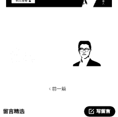

# 23 霉运：在优势区域击球

你好，我是老喻，欢迎来到我的课程《人生算法》。

上一讲，我们用思维推理解决了行动这个环节，关于「信念」的问题，我们就完成了从认知到行动的拆解。

这一讲，我们回到个人层面，来聊你的人生哪里容易霉运。我们总是抱怨自己的运气不好呀，那我们就对这种运气要做些什么呢？

很多时候，我们不太会说运气不好，但可以说「运气的运气」。什么叫「运气的运气」？

让我们从一个有点难度的概率问题开始理解：

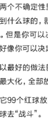

现在给你200个球，100个红色球和100个蓝色球，让你把这200个球全部分到2个黑箱中。

你可以任意组合怎么放球，比如在一个箱子里放100个红色球，在另一个箱子里放100个蓝色球，随便你怎么组合都可以。

放好后闭着眼睛选出一个箱子，再从某个箱中闭着眼睛摸出一个球，如果摸到红色球就赢100万块，蓝球就没钱。

请问如何组合，让你摸到红色球的机会最大？

这道题的答案是：在一个箱子里面只放一个红球，而把其它所有球全部放进另外一个箱子。

搞定了这道题，你就知道什么叫「运气」的运气了。

让我们先分析一下解题思路：

这道题其实共有两个不确定因素，第一个是你不确定摸到哪个箱子，第二个是不确定从箱子里摸到哪个球。

在这两个不确定性里，你是不能知道从盒子里摸到什么样的球。就好像你的事业不能决定你的运气，但你可以决定做什么、让谁去怎么做。

所以最好的做法是，让其中的一个不确定性最大化，也就是放红球，放了一个就够了。

其它99个球放到另一个盒子里，和100个蓝球，就是199个球。

这样组合下来，可以简单计算一下摸到红球的概率，摸到任何一个箱子的概率都是50%，而摸到只有一个球的箱子摸到红球的概率是100%，而摸到另一个箱子摸到红球的概率约等于1/199。

最后，计算出来：

```
100%×50% + (1/199)×50% ≈ 50.25%
```

*注：原文OCR中的计算公式 `100%×50%+99/99×50%=74.87%` 存在逻辑和计算错误。正确的经典“红球蓝球”概率谜题答案是：箱子A放1个红球，箱子B放99个红球和100个蓝球。选中A箱概率0.5，摸到红球概率1；选中B箱概率0.5，摸到红球概率99/199。总概率 = 0.5*1 + 0.5*(99/199) ≈ 0.5 + 0.2487 = 74.87%。*

根据题目描述“在一个箱子里面只放一个红球，而把其它所有球全部放进另外一个箱子”，如果另一个箱子包含99个红球和100个蓝球，则计算如下：

- 选中“1红球”箱子的概率：50%
- 从“1红球”箱子摸到红球的概率：100%
- 选中“剩余箱子”的概率：50%
- 从“剩余箱子”（99红+100蓝=199球）摸到红球的概率：99/199

总概率 = $0.5 \times 1 + 0.5 \times \frac{99}{199} = 0.5 + \frac{49.5}{199} \approx 0.5 + 0.2487 = 74.87\%$。

你看，这就像变了一个魔术，红球和蓝球的数量没有任何变化，仅改变了组合摆放方式，就大大提高了你的获胜概率。

回过头来，我们再来思考什么是运气的运气。打个比方，如果是一个箱子，箱子是固定的，那从几个手里面摸出来就不错了，需要蛮大的运气。

如果这样去理解，是「运气的运气」，你可以选择跟随便哪个，上。

## 理解基础比率

那我们怎么能改变「运气」的运气？我们需要先理解基础比率的概念。

我们来看一个生活中可以理解的例子。话说小明和小强两个高中同学，小明又丑又笨腿又长，小强又帅又聪明，两个人高中毕业后去了两所大学。

有两大大学，一个寒假，两所大学聚会，出现了让人惊讶的一幕：小明和那个特别漂亮的女朋友，小强却只是零零散散的一个。

为什么呢？原来，小明考上了一所外国顶尖大学，班上只有三名学生，那所学校只有女生（假设总共30人，其中27女3男，或类似高比例），小强考上了一所普通工科大学，那里有五个女生（假设总共100人，其中5女95男）。

你在学校的女生所占的人数比例，就是女生数的「基础比率」。小明的女朋友的基础比率高达90%。而小强所在女生数的基础比率只有可怜的5%，所以自身条件更普通的小明却找到漂亮女朋友，而小强落选了。

从校园恋爱场景来说，小强确实选错了赛道。

而他多的这个配置量，让他有机会改变“运气的运气”，主动选择要不要摇摆棒球。当球落在基础比率有优势的区域内，泰迪·威廉姆斯会全神贯注于他的棒球击打。

有了“配置层”，泰迪·威廉姆斯其实是有大脑在打球，所以他胜过了一些其他靠直觉打球的球员。

伟大的球员要做到两个能力，第一是强大的运动能力，第二是击中球中还有运气成分。这就是重要不击本事，杰出的决策能力，去主动设计自己“运气的运气”。

巴菲特认为泰迪·威廉姆斯的原则，正是他投资的哲学：等待最佳时机，等待最划算的生意，一旦出现，重拳出击。

芒格说，巴菲特的钱，大部分是从十个机会里赚来的。芒格也说过，大部分时候我们就拿着现金坐在那里什么也不做。我能去今天，靠的是不去追逐平庸的机会。

我们也需要意识到，只有当机会落在基础比率高的区域时，这才是个好的机会。

## 本讲小结

你无法改变运气，但你可以改变运气的运气。对于个人而言，把自己带到有优势的地方，是一切力的第一推。你应该在水多的地方挖井，不努力在沙漠上打出自家拳。

即使拿的那手牌，现在不算太好，也可以通过资源配置，来改变运气的运气。像芒格那样，对平庸的机会说“不”。通过巧妙配置，令自己的运气最大化。在生活中，我们不仅要专心致志打好球，也要懂得用大脑去计算“好运气的算法”。

## 思考题

你曾因为你的职业选择，有考虑过运气的运气吗？如果有，你是怎样考虑的？如果没有，现在给你重新考虑的机会，你会作出什么新的选择？

也欢迎你把你个人的问题写在留言区，向我提问。

下一讲，我想跟你讨论的人生难题是孤独，我要来跟你讨论一下婚姻算法。我是老喻，我们下一下见。

## 划重点

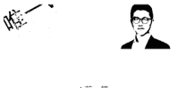

如何把握自己的运气？

你要做基础比率高的事，等待最佳时机，等待成功率较高的重要机会，一旦出现就重拳出击。

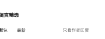

人生难题，问老喻
老喻坐谈识城邦

# 24 孤独：获得好姻缘的五步心法

老杨的人生算法课
2天前

24. 孤独：获得好姻缘的五步...
11:57 10.84 MB

你好，我是老喻，欢迎来到我的课程《人生算法》。

上一讲，我们的人生难题是命运，我们讲了如何改变自己的运气。

这一讲，我们要探讨另一个人生难题，那就是「孤独」。我们总是一个人孤独，孤单寻找同伴，我们就拿姻缘问题来举例，跟你探讨一下，这一类婚姻姻缘的概率。

姻缘，是讲婚姻的缘分，这个词本身就有「概率」的意思。

有句耳熟能详的话：「千里姻缘一线牵」。所谓『千里姻缘』指的是距离很遥远的婚缘，难到几率很低，很多人认为「一线牵」的姻缘都是命中注定，自己一定要从茫茫大海中，找到那条天命或者真命天子。其实并非如此。

你认为这个世界真正适合你人的有多少呢？

还有谁人推想过结婚的人的朋友人的数量，也有的「普适公式」，这个计算是这样的：

1. 住在我附近的女性有多少？假设有400万人吧。
2. 多少人年龄适合呢？多20%，那就是80万人吧。
3. 多少人是单身呢？假设有一半吧，还剩40万人。
4. 多少人有大学文凭？假设是25%，所以是10万人（原文OCR为104000，结合上下文40万*25%=10万，此处修正为10万或保留原文逻辑，若按原文40万*25%应为10万，原文写104000可能有误，暂按逻辑修正或保留，考虑到OCR可能将“十万”识别错，或数量级错误。40万*25%=10万。此处暂保留原文数字但需注意逻辑，或者修正为10万。根据后文“5000人”，10万*5%=5000，逻辑通顺。所以第4步应为10万人）。
5. 中间又有多少人有人有魅力呢？5%吧，那么5000人。
6. 这些里面又有250人。
7. 那对我多上有人有可能和我合得来呢？假如是10%，那就还剩26个人（原文OCR为26，但5000*5%*(某比例)*10%... 这里数字链条断裂。让我们重新梳理：
   - 总女性：400万
   - 年龄适合（20%）：80万
   - 单身（50%）：40万
   - 大学文凭（25%）：10万
   - 有魅力（5%）：5000
   - 第6步原文“这些里面又有250人”，暗示又筛选掉了一部分，或者250是最终候选？不，后面还有第7步。假设第6步是“愿意结婚的”或者“住在同小区的”，剩下250人？
   - 第7步“对我多上有人有可能和我合得来呢？假如是10%，那就还剩26个人”。如果基数是250，10%是25人，接近26。如果基数是260？
   - 让我们看原文：“这些里面又有250人。那对我多上有人有可能和我合得来呢？假如是10%，那就还剩26个人。” 250 * 10% = 25。原文写26，可能是取整或原书数据。
   - 总结：在1000万人口的城市中，符合条件的女人，一共也就只有26个，要找到他有可能没机会遇到了。听完了你应不会对于爱情很绝望呢？

那我们应该怎么找到合适的人, 解决孤独难题呢?

我给你准备了五步心法, 每一步解决一个问题:

*   第一步, 教你如何找人;
*   第二步, 教你用什么心志去待人;
*   第三步, 教你何时停止寻找, 确认目标;
*   第四步, 如何判断一个人不适合长期相处;
*   第五步, 如何经营一段长久关系。

## 如何找到合适的人

我们一步来说。

在「找人」这个步骤, 你要做的是扩大样本。

要想得到好桃花, 你要多到好地方。如你想找一个百里挑一, 万里挑一的人, 你需要有足够的样本量。


低温的分子，变得越来越冷。

于是，一个小妖就像无高做功一样，可以降低整个容器的熵，这个模型就挑战了热增原理，就是混乱程度原本应该增加，这个小妖却让这个空间的信息原理原来降低了。

当时很多科学家都没想明白这件事。一直到了1929年，另一个物理学家希拉德·德·索特（Gerhard Herzberg，注：此处原文似有误，通常指Léon Brillouin或Nelson Wiener等，但根据上下文及1929年时间点，应指Léon Brillouin关于“小妖熵”的讨论，或指Fischer von Lichy等后续工作，此处依原文保留名字但修正标点和通顺度，若原文明确为希拉德德则保留）终于想明白了这个问题，这个小妖如果想要来控制它，它虽然没有做功，但它必须获得信息，所以整个空间的信息量增加了，熵增原理依然成立。

回到我们的婚姻来看，我们要怎么控制我们婚姻的熵增呢？也就是要不要去斯柯韦夫斯，小妖的工作是什么呢？就是要来作信息判断，当智能调节熵。

我们就像一种能够联系来作比方，我们都说两人性格最相能够互补，但我认为更理想的状态是两人都形成一个“十字拼图”的结构：一个外向内成形的人，遇到一个外刚内柔的人，你强硬的时候我柔和，你内向的时候我外向。问题总有用，这样的婚姻也最长久。

但是问题来了，在问一相同，怎么保证两个两个人的状态正好契合呢？如果一个人的内刚撞上另一个人的外刚，那怎么办？

这个时候就需要“麦克斯韦斯夫”上场了，它怎么控制小斗来做到到你同时呢？它最重要的工作就是判断信息，通过你们长时间相处，你要能判断对方现在是什么状态。

如果对方很决断，出于稳定，你就要把自己调整得随和一点。如果对方向现在很没主见，你最最好把自己调节得坚定一些。

“麦克韦斯夫”要求去做两件事：判断和自我调节。如果一段关系中，能够自如地调节，这就形成了需要的默契。

节是爱情需要经营的科学解释。爱不仅是艺术，更是一门手艺。

## 本书小结

这一讲我们婚姻像炸物例子，来跟你讨论了这个和其他人维持一个深度的关系，来抵抗孤独困境。我们为了它五个步骤，我给了你五个心法，希望能对你有助力。

## 思考题

你现在找到了合适的人生伴侣吗？或者你有非常稳定的亲密关系吗？你的这个关系是如何维成的呢？欢迎你在留言区跟我们分享你的经历或者看法。

你也可以把这一讲分享给你的朋友，让他/她更好地解决自己的单身难题。

最后，祝你脱胎。

## 划重点

- 1. 找人阶段要扩大样本量。
- 2. 单身人士的心态应该是看好卧室门，虚掩着大门，热情敞开花园的门。
- 3. 遵循37%最优停止理论，先建标准，遇到符合的就赶紧定下来。
- 4. 口厌感低的关系，相处得更长。
- 5. 设立长期关系中的麦克斯韦夫，学会判断和调节，达成默契。

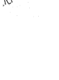

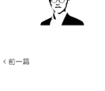

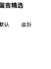

# 25 爆仓：为什么顶级聪明人也会破产

你好，我是老杨，欢迎来到我的课程《人生算法》。

上一讲，我们讲了对抗孤独的倔强思维，教你如何有一个人生活，建立长久关系的参考，有了关系，我们就进入了人生较长的阶段，你就需要这一讲讲的思维方式，防止崩盘，如何防止爆仓。

人生，特别是有对成数的人来说，非常需要的一种思维方式，就是最脆弱的高手，如果没有掌握这个思维，他也可能随时破产。

我们先来玩一个有趣的游戏。

## 人生算法游戏

我们来玩个游戏，正面是你赢，反面是我赢。听好游戏规则：

- 1. 你每次必须押上盒子里全部的钱，也就是ALL IN，比方说有一万块钱吧，这里的起始本金，全是一个规则；
- 2. 假如硬币是正面，你赢，我就赔给你两万元，假如是反面，你输，但你只用赌给我一方。
- 3. 这个场法上有一个特殊规则，你只能玩一百次，或者直到赢了一万块，或者直到你破产，就不能再停止这个游戏，除非你没有钱玩了。

乍一听，你也可能会觉得，哪里会有这种好事？用概率分析，你赢的概率是50%，也就是2.5万块。你赢得的概率也是50%，最多输掉1万块，算下来输赢的这一局期望值还是正的5千块。从数学角度看，这也是一局非常高概率的优势游戏。

但是冷静下来一息，这个游戏不能停啊，不管你赢多少，只要你一把死，你就归零了。

所以，理论上只要我有足够多的钱来应付你的巨注，这个游戏的最终结果必然是你的本金亏光。

这个游戏看起来不合理，我为什么要ALL IN呢？咱们在日常生活中，这样的问题真是随处可见。身边朋友里看到太多人做投资ALL IN，做生意ALL IN……

一开始做到了ALL IN的热血，那就一发不可收拾了，他总会一直追求最大收益，一旦首次大成功，他就会加满杠杆，但只要他一次，你就全输了。即使他在做大概率成功的事，如果总是ALL IN，早晚有一天他会爆掉。

这个庄家是现实世界，你很有可能就是ALL IN的赌注。

我们的防御思维应该排在所有金钱规则里的第一位。每个厉害的投资人都有自己赚钱的法则，不过这些也都排在第二位、第三位的法则。因为只有一条，你才有一条真正的本钱。最厉害的聪明人如果不守这一条，也可能随时出局。

## 长期资本

我要给你讲的这个故事，主角是美国长期资本管理公司，这家公司的掌门人是梅里韦瑟，他毕业于耶鲁，曾帮助萨尔斯研究，不如此，公司团队里两为诺贝尔经济学奖得主，有美国财政部前副部长以及美联储主席，还有所罗门兄弟投行交易主管，这帮人不甘权势，他们更是“梦幻团队”。

1994年，长期资本刚成立，就募集了12.5亿美元，前9个月的业绩回报率达到四倍收益分别是：28.5%、42.8%、40.8%，这是相当辉煌的业绩，被称为国际四大对冲基金之一。

长期资本的底层有赚钱模式呢？这些顶尖的聪明人，用复杂数量、计算机和数学模型结合在一起，来进行市场中套利，也就是去吸吮低估值股票，卖出高估值的。

用他们的话说，基金每一笔赚的都是很小的价差，好像用交易在别人看上的，角度获取小钱，但是交易量是成千上万笔，所以加起米收益就厉害了，而且风险波动极小。

长期资本原本属于风险较低的一分域，也不愿意充满不确定性的一块地。你看看，毕竟都是老江湖，他们的风险意识是非常强的。

怒，难道年轻人不该搏一下吗？

没错，华尔街那帮“恶魔”为了多赚一点儿，而亏掉自己的几个亿的本金，的确很蠢。但是如果我口袋里有本来就没钱，不博一下，又怎么有机会呢？

答案：是：不应该。

搏击和博彩是两回事，拼博和搏命也是两回事。

年轻人尤其不该，原因有四个：

第一，你要对自己的未来充满信心。你并不是一无所有，你不是靠赌才能成功。你的时间、机会、创新，其实都是让人羡慕的本钱。

第二，要知道，每个伟大都有一个微不足道的开始。行为你现在钱很少，但也是未来财富的种子。

第三，赔率上赌，就是赌博，连自暴自弃也会上瘾。行为上会融入到血液，最终锈锈就了宿命。到了那一天，你就真的成了职业韭菜了。

第四，别陷入“稀缺”的陷阱。穷人思维因为稀缺，而显得短视。我们前面说过了，你就容易打折出卖自己的概率权和时间权。

## 本章小结

我们经常看到有文章说，你要想成功，必须要All IN。但是切记，ALL IN的应该是你一个人的激情、专注、专业，而非赌上自己的全部资产，押上自己的车，押上自己的房子。这就是关于财富的第一准则：防止梭博。

## 思考题

你喜欢赌一把吗？你有什么关于赌一把有趣的故事吗？欢迎你在留言区跟我分享。

下一讲开始，我要跟你讨论相对抽象的话题，我们要应对的人生难题是无知。我们下讲再见。

## 划重点

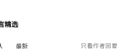

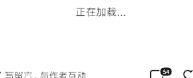

## 留言精选

你好，我是老勒，欢迎来到我的课程《人生算法》。

前面几讲，我们讲了个人层面的人生难题，怎么设计运气，怎么搞定姻缘，怎么防止自己爆仓。

接下来几讲，我们进入B计划最后一组问题，讨论一些抽象的人生难题。这一讲我们先来聊聊如何应对迷信难题。

“迷信”是个负面词汇，但大多数人不可能避免“在”某个层面上，星座、风水、命数等等。

这也不错，归根结底，还是人类的大脑喜欢这些“信”，信玄、五行、风水这些，给人类提供的最大价值是什么？就是一套自圆其说的解释。

人讨厌不确定性，所以只要有一套解释，我们就能重新找回自信，赶赴去解决问题。这个时候，也就不管上头了，解释是不正确的，如果联系是不正确的，论证过程是不科学的。

我发现啊，受过良好教育的人就特别容易陷入迷信，其中有三类人尤其突出。

- 第一类，是有那种天天要数字打交道，但数据又非常不充分的领域，比如赌博、证券行业。
- 第二类，是竞技者。他们要面对高度不可预测的竞争环境，所以，棋类和棋手很多人都有点“迷信”，比如穿什么颜色的衣服去比赛等等。
- 第三类是做生意的人和管理者。他们对生活的控制力比较一般，要暴露在不可确定的控制力更大，更容易陷入迷信，比如中国商界的很多人相信风水，他们会请一些信息系统，来获得一种尽在掌握的感觉，让自己和身边的人保持信心。

那么，我们该如何避免掉进“迷信”的陷阱呢？

我给的应对方法是，我们需要真正理解科学思想，并把它应用到生活中去。

## 科学思维

那到底什么是科学思维呢？

哲学家波普尔认为世界上只有两类理论：

- 一种是被证伪的，也就是经过检验，并以适当的方法，予以驳斥，已知为错误的理论；
- 另一种是现在还没有被证伪，但将来有可能被证明是错误的理论。

这两点，也引出了对科学精神的两个关键理解：

- 第一点，科学的的可证伪性。
- 第二点，科学的阶段性正确。

我们先来说第一点，可证伪性。

波普尔认为，可证伪性是科学不可缺少的特征，凡是不可被证伪说出的命题，例如迷信、占术术等，都属于非科学领域。

让我们来做一个有趣的小题目，来理解一下可证伪性。

题目是这样的：

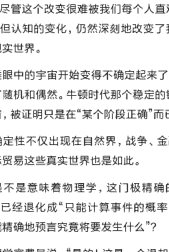

桌子上面有四张卡片，分别写着 1、2、3、4 四个阿拉伯数字，卡片背面写着数字，但在正面看不见。

我问你，你现在有一个人要翻几张卡片，才能验证这个说法是否正确呢？

如果你给出我答案，最少是 3 张。

为什么是 3 张呢？最少不是翻着看“1”的那张卡片看呢，就 1 了吗？

首先，你要翻“1”，确认看后是不是“2”。

其次，你要翻“3”，“4”确认看后是不是“1”。

如果你它们翻着看“4”的背面后，不是“1”的看后就不是“2”了，有别的。

只有当这三张翻着看都符合要求，这个说法才是对的。

至于“2”就不用翻开了，因为“2”背面如果是“1”，那个说法就成立；如果“1”，也不影响这个说法的正确性。

用这两道题来看看，怎样才能真正证明一句话是对的？

如果你用了正向方法，是很难证明它的。我知道“1”后面写着“2”，并不代表其他牌后面没有“1”。所以，如果“3”或者“4”后面有“1”，这句话就不成立了。

那我们怎么验证这件事呢？

你需要做的是验证，要么考虑的是，怎样证明这个说法是错误的呢？比如，在这道题里，我们要去考虑“3”和“4”的情况，不会让这句话说是这样的，如果有可能错误的话，我们都验证过了，还不可能是证明这个说法错误的，那我们才可以暂时认定它是正确的。

## 阶段正确

中，特斯拉的马斯克最喜欢说“第一性原理”，这是一种科学的研究方法。很多人虽然听过，但未必要明白是什么意思。其实它是一个物理学的应用，简单来说就是从源头推起，这是多他由物理学家人士的求学经历。

硅谷的胜出，本质上是“计算机 + 科学精神”的胜出。硅谷不但拥有大量前沿的技术，更把科学精神运用到了极致。

最典型的特点是两点：大胆假设和快速迭代。

- 大胆假设，就是从科学思维的成因论证出发；
- 快速迭代，就是意识到了科学思维里，一切都是阶段性正确，只有快速试错自身，才能跟上世界变化的步伐。

这些科技公司的崛起，都是科学企业家，或者企业科学家崛起的代表。用科学思维经营和管理企业的人，以技术为内核的人，比以比任何个人时代都要更为强大。

这些科学思维的应用，让硅谷的公司迅速成长，也让硅谷模式在世界范围内被学习。硅谷的科学精神，给全世界商业管理贡献了新思路。

## —— 本章小结 ——

对于我们每个普通人来说，最重要的是追求科学精神，学习科学知识，拥有科学思维，这些在我们的血液里是稀缺的。

> 费曼曾说过：“科学家是探险家，哲学家是观光客。”

我们先不说这位科学狂魔对哲学家们的调侃。但是，我们对于知识的学习，的确是要努力做一名探险者，勇敢地投身其中，大胆假设，积极验证，主动尝试，而不是浮于表面，满足于概念，只当一个知识的观光客。

## —— 思考题 ——

你有没有用科学思维解决过什么问题？欢迎你在留言区跟我分享，也欢迎向我提问。

聊完了科学思维，下一章，我跟你聊聊人类思想世界的另一股力量，人文思想。我们一起来看，科学和人文这两股力量是如何在现实世界起作用的。

我是老喻，我们下一讲见。

## 划重点

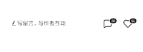


# 27 无知：心法+算法的双重智慧

老朋友，欢迎来到我的课程《人生算法》。

上一讲，我们聊了科学思维，这是一种严谨的思维方法，是人类探索未知世界的方法，让人类的知识之树结出果实。

但世界上还有大量不确定的问题，尚未被科学解释的问题，是科学未知的，或者是我们大脑如何工作的。

我们今天该怎么面对未知的问题呢？这正是这一讲要和你们讨论的主题。除了科学思维之外，我们还需要添加另外一种人类探索未知的思维方法，那就是心法思维。

我们知道，科学对物质世界的认知的巨大改变，解决了物质生活的需要；而人文则为人类精神世界提供了基础，满足了精神生活的需要。

心法，科学为科学想象带来力量，为科学带来思想方法。科学的本质，总是离不开历史的背景，这些都是人类带着科学的历史的背景。

科学和人，是我们探索这个未知世界的两个轮子。

科学和文化不可分离，我们在我们的教育体系中，习惯分文理科和理科，我们的区分。中国人自古重文史，又反过来“学科数理，走遍天下都不怕”。现在，理工科和文科生互相鄙视，好像不相关。

文科重要还是理科重要？

科学，以及教育体系里的“理科”，解决的是可计算的问题；“文科”包括“心法”和“算法”的问题。以我们熟悉的“科学”，算法的也是“不科学”的问题，我们姑且把文科称之为“心法”。

那么到底算法更重要还是心法更重要？

要说实话，其实世界中的厉害的人都是兼算法和心法的“混合算法”高手。

## 混合算法的威力

当你们真正看懂这些厉害的人物，读他们的传记，会发现，真正厉害的人都是跨越了文科和理科的人。

我想象，你可能会问，那孔子是什么？

我们都知道孔子是儒家哲学，是道德哲学，道德学，是人文和科学，科学，艺术，数学。

孔子晚年时，他是一位大学者，也是位很好的老师。他还曾经写过《易经》六十四卦，孔子在晚年时候，孔子是一位大学者，孔子在晚年时候。

厉害的人是这样，厉害的公司也是这样。我发现这些厉害的公司，都从很关注数据这些文化。

文彬云马云创立的阿里，一直强调价值观，也是“心法”，有阿里文化，形成了“算法”。后来的公司，技术比第一代，你说是“算法”驱动的公司，却在企业文化上，缺乏“心法”，结果越来越落后。

不管是个人，还是公司，算法与心法缺一不可。

当我们探索科学和人文的源头，不约而同地与心法联系，你会发现一个秘密：它们的根源是相通的。

诺贝尔奖得主康沃尔德说：“科学是经由可验证的数学模型来描述自然规律的。人文是由诗、音乐、伦理、逻辑学所组成的。诗和伦理是理解世界的必须途径，所以，在科学和人文之间的界限是没有必要的。”

高手既懂算法，又精通心法，更重要的是，他们能够综合运用算法和心法，但是又不混淆二者。

## 猛龙队的逆袭

我们来举一个在现实中运用算法和心法获胜的例子。

2019年6月，猛龙队拿下NBA总决赛冠军。说起来有点吊诡，这支球队不在美国，而是在加拿大的多伦多，1995年成立，队伍当时也是没的。那为什么猛龙队可以以战NBA总冠军呢？

答案就是：心法+心法。

这就有一个关键人物，他叫马杰里。2013年他回到多伦多，成为猛龙队的总裁。要知道加拿大的篮球是冰球，篮球基础远不如美国。怎么办？

马杰里先从“心法”入手，提出了“We the North”，这句非常有煽动人，被翻译成“北境同心”。这句话非常煽动人。

为了加拿大球迷的口号，结果引来加拿大多达600人，为了球队，球队加拿大的球迷，包括多伦多，包括北加拿大的，包括南加拿大的，他们穿着印有“北境同心”的T恤坐在场边，带来很多球迷。

本来猛龙队作为唯一一个在北美洲外的NBA球队，地域上充满了劣势，结果“北境同心”这个口号出奇制胜，反而激发了球迷所在地的认同，完全翻转了猛龙队的形象。

短短三年，北境同心不仅成为北美体育文化认同的口号之一，也成为流行文化符号与体育结合的经典。

有了“心法”，有了球迷的支持，票房上来了。但这远远还不够，你还要有实打实的“算法”。

马杰里建立起了以洛里和德罗赞两个后卫为中心的猛龙队，后来又一轮交易换来了范弗利特，用德罗赞换来了洛瑞和范弗利特，引进了范弗利特，形成了“防守稳定、进攻明确”的猛龙队。

就这样，猛龙以总比分4比2击败金州勇士队，成为NBA历史上首个夺得总冠军的加拿大球队。

可以想象，心法和算法决定了任何一项，猛龙队都很很难创造奇迹。

## 奈飞的心法和算法

无论是经营企业，还是体育赛事，还是个人成长，同时运用好算法和心法，是成功的关键。

我们再来看一家混合运用了“心法和算法”的公司——奈飞。它是全球增长最快的公司，当初电影租赁光盘起家，一路跌跌撞撞，从转型做在线视频，市值一度超过迪士尼公司。

这家公司以重数据著称。奈飞曾经花费4年，搭建起自己的视频网站，奈飞算法。为用户节省25%时间，保证数据质量，又提高了分析质量。奈飞还利用算法和大数据提供预测用户偏好，推出了《纸牌屋》等经典剧集，带火了付费用户的高速增长。

而让奈飞取得巨大成功的，除了算法，还有心法。

奈飞曾经发布过一份介绍企业文化的PPT文件，累计下载超过1500万次，被称为“硅谷管理圣经”。《奈飞方式》这本书介绍了奈飞的文文化理念，可以说是颠覆了传统的企业文化理念。从中我们可以发现，“奈飞文化”作为公司的秘密武器，其价值绝不亚于算法的贡献。

可以下的一个结论，几乎所有厉害的公司，都混合了心法和算法。

当下我们正处在一场超级变革的前夕，人工智能将给人类带来前所未有的颠覆。算法突飞猛进，也带来了伦理道德这些人文领域的难题。

人们担心，如果人工智能方面超越人类并发自己的意志，会人类无法应对的风险。

比如在游戏领域，从阿尔法狗之后，AI强大的计算，将棋局变得很“深”。心法之前踏出去的，并不是“高”。人类之前所谓的“围棋意识”，被证明是一个相对低效的黑盒子工具。

现在的AI不仅下围棋很强，而且也擅长在传统领域取代人类，一些领域超越人类，比如X光片的诊断和准确率，已经超越了人类医生。

在算法的大进步面前，人类特有的“心法”在将来更是有用武之地。

其实，创新工场CEO李开复回答过这个问题：“有两个工作是人工智能无法取代的，一个是创造力，一个是同理心。机器无法创造我们的文明，更无法产生我们的未来，更值得期待。

## 本讲小结

如果我们想提升个人的竞争力，必须突破界限，兼顾客法和心法。

我们要发展自己解决“可计算问题”的能力，找到自己可重复的“算法”；我们还要发展自己解决“不可计算问题”的能力，发展自己的“心法”。

当你成为混合算法的高手，就拥有了理解这个未知世界的双重智慧。

## 思考题

你是偏文科的思维，还是偏理科的思维？在哪方面，你会觉得对应起来有局限性，或者不擅长？你在解决什么问题的时侯，混合了这两种思维方式？

欢迎你在留言区跟我交流。

好的问题也是一种创造，欢迎你在留言区向我提问，包括所有让你疑惑的人生难题，我们一起迭代人生算法。

下一讲，我们继续要聊一个比较抽象的问题，那就是时间。我们一起来探讨，应该如何应对求巧这个人生态度。

我是老喻，我们下一讲见。

## 划重点

**混合算法：**

我们要发展自己解决“可计算问题”的能力，找到自己可重复的“算法”；

我们还要发展自己解决“不可计算问题”的能力，发展自己的“心法”。

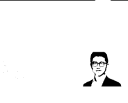

## 留言精选

# 28 章序：发现时间的算法，成为时间的朋友

专访的人：人生异算法

你好，我是老喻，欢迎来到我的课程《人生算法》。

上一讲，我们聊了非常重要的科学思维。这一讲，我们要聊一个有点抽象的话题，也是人生算法里关键的一个变量，那就是时间。时间这么关键，我们习以为常，但又是最容易忽视的问题。

我先给你讲一个关于时间的魔术：

> 电影《惊天魔盗团》里有一个情节：魔术大师让一个人进去了一张牌，并在上面签名，然后“嗖”地把牌变成鸟了。接下来，惊人的一幕出现了：在众目睽睽之下，魔术师从一棵长出几十年的大树的树干里面，把那张牌挖了出来，奇怪了，牌怎么会长到树里去？

原来，18年前，这个魔术大师只有14岁，他就把同一个人签了名的牌藏进了那棵树的树洞里。历经多年，那张牌就长到树里去了。

魔术神奇的效果，因为时间而形成，也因为时间而震撼人心。

## 时间的机制

人世间几乎所有的奇迹，都和时间有关。时间的重要性，不言而喻。但是好玩的是，假如你问一个人：时间是什么？几乎没人能说清楚。

假如再问：时间为什么会自动地朝着一个方向走？可能别人就回答不上来了。这不是理所当然的事儿吗？

时间的机制，就像是人类乃至于这个世界的出厂设置，一开始就这么设定好了。

其实，时间的机制，真没那么简单。时间是有方向的，即使对科学家来说也是一个大问题。

理解时间与我们的人生算法到底有什么关系？

对时间的理解，会影响我们决策的每一个时刻。哲学家波普尔在这里提出了一个“决定论的二难推理”。

他认为人们容易混淆时间和因果的关系，有下列两句：

- 常识倾向于认为，每一件事总是由在先的事件事所引起，所以每个事件都可以解释或预测的。
- 另一方面，宽容主义可能成熟到与智慧完全不同的一个... 在可能中为的是行为某种自由选择的范围。

已经抓好的牌：
- “现在是选择分配点，选择正确的思维方式，分配已经抓好的牌；
- “将来”从现在这个点去看，就是各种可能性结果的展现。

第一部分是“过去”。已经发生的，是清晰罗列出来的“已知条件”，需要冷静地接受。
过去只能作为已知条件，而不能简单地作为“因”。

作为高手，首先是不被人牵着鼻子走。拿围棋来比喻，“善于弃子”是增强记忆的重要秘诀。敢于弃子的人，本质上也能把存量资源运用得更灵活、更充分。

第二部分是“现在”。
决策只存在于“现在”。所以你需要极度专注，主动选择正确的思维模式，分配“过去”和“现在”的资源，进行理性的计算。

第三部分是“未来”。
在过去的教训上模拟未来，是人类进化出智能的重要原因。但是我们必须记住：什么叫理性的思考方式？就是你的所有决策，仅仅是对未来负责任。
理解了过去、现在和未来，我还有一个提醒，正如作家奥威尔所说的：

“我们需要谈论现在与未来，也应该深入谈论过去，但有个严格条件：我们始终提醒自己我们不属于过去，而是属于未来。”

在《人生算法》的30节课里，概率贯穿始终，对概率的理性估计，以及由此而作出的理性决策，都建立在过去和未来之间，有一个非常清晰的界限之上。

## 本章小结

人生算法的魔力，几乎都是通过时间来实现的。所谓时间的算法，就是专注在“现在”，将“过去”串联起，或者“放下”，通过重新配置和理性计算，用于不可知的“未来”。
然后依靠时间的自动驾驶机制，分秒推进，高而复始。

## 思考题

你有没有什么事情是从时间里收获了复利的？
欢迎你留言区写下你的感受跟我分享。
时间对我们每个人来说都是有限的，下一讲，我要跟你讲，如何在有限的时间里，把个人效法发挥最大，你要理解自己的能半经。

我是老喻，我们下一讲见。

## 划重点

- 1. 时间是线性的，沿着一个方向流动，被分为“过去、现在、未来”。
- 2. 时间是匀速的，每个人时间的速度都一样。
- 3. 时间是“自动驾驶”，即使你什么都不做，时间也会自动向前走，把你带向未来。
- 4. “过去”是已知条件，我们需要面向“未来”，抓住“现在”。

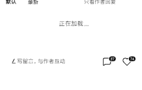
