# 老浦识字201712-201802

# 210【臭】朱门酒肉臭的臭了吗

朱门酒肉臭，路有冻死骨。这是唐代诗人杜甫的名句，出自杜甫的五言长诗《自京赴奉先县咏怀五百字》，按照平常的理解，说豪门显贵肉都臭了，门外边却有冻死的饿殍，贫富差距和富人的冷漠都表现出来了。

但是有一点不合情理。既然人都冻死了，那一定是天寒地冻。腐败的酒肉就算是堆放在院子里也不处理，也没冷热，气味不一定能散发出来。这是杜甫夸张的文学手法，还是可以有别的理解？

## “臭”的甲骨文

还是来看看“臭”的甲骨文吧，上面是鼻子形的“自”，表示与鼻子有关，下面是“犬”，狗的特点就是嗅觉灵敏，所以犬和鼻子合起来，表示用鼻子闻味，引申为气味。

这时候臭所代表的气味，可以是臭味，也可以是香味，是气味的总称。

《易·系辞上》有一句“同心之言，其臭如兰。”意思是说说到一块，说到一起，这种心心相印的感觉就像闻到兰花的香气一样令人愉快。这里的“臭”，是香气。

再如《难经·四十九难》：“心主臭，入肝为焦臭，入脾为腥臭，入肺为膻臭，入肾为酸臭。”

清·孙星衍《疑难章句》云，“《书·盘庚中》疏：‘臭是气之别名，古者皆书、矐之皆名曰臭。’”这已经很明白了，这里的“臭”，是气味。

# 211【狱】两只狗吵架算不算好事

监狱是一个社会不招人喜欢却又不可缺少的地方。但你有没有想过，为什么监狱的“狱”是大字旁，右边还是一个犬，中间是表示说话的“言”，这不就是两只狗吵架吗？它为什么是监狱的意思呢？

《说文解字》的解释很有意思：“狱，确也。从‘犬’，从‘言’，二犬，所以守也。”

说：狱，落实案情。字形采用“犬”、“言”会义。二只犬，用来看守犯人。

两只狗表示看守犯人，那“言”怎么解释？

## “狱”的金文

狱的金文「獄」也是两只犬，中间是“言”。言的含义咱们以前谈过，“辛”是刑刀，“口”是巫师的道路，合起来表示在神前发誓，说的话语请神灵作证，讼就是辨明真伪，确定谁有罪，所以“言”是通过辩论来确定，两只犬表明争辩很激烈，情绪激动，像狗一样狂吠。

“狱”的原意是诉讼，而不是看守，看守是诉讼的结果，是引申义。

《周礼·地官》说的很清楚：“争罪曰狱，争财曰讼。”说争辩有没有罪叫狱，争辩财产叫讼。

那古代监狱用什么字？叫囹圄，身陷囹圄，就是坐牢的意思。

《左传·庄公十年》也就是我们很熟悉的《曹刿论战》，这里我愿意多引用几句：

> 问：“何以战？”
> 公曰：“衣食所安，弗敢专也，必以分人。”
> 对曰：“小惠未遍，民弗从也。”
> 公曰：“牺牲玉帛，弗敢加也，必以信。”
> 对曰：“小信未孚，神弗福也。”
> 公曰：“小大之狱，虽不能察，必以情。”
> 对曰：“忠之属也，可以一战。战则请从。”

曹刿问：“您凭借什么作战？”鲁庄公说：“衣食这一类东西，我不敢专有，一定把它们分给身边的大臣。”曹刿回答说：这种小恩小惠不能遍及百姓，老百姓是不会跟从您的。”

# 212【问答】床前明月光的“床”到底怎么回事？

“社”

思考题：

请你分析一下“社稷”这个词。

答案：

社是土地神，稷是谷神，社稷合祭，就是社稷坛。古代帝王每年都要到郊外祭祀土地和五谷神，即祭社稷，以祈求国泰太平，五谷丰登，后来“社稷”就被用来借指国家。

“会”

思考题：

《史记·陈涉世家》中有一段话：“守丞死，乃入据陈。数日，归为会三老、豪杰与乡长会计事。”三老是对建社会里管教化的乡官，豪杰，指当地有声望的人。请分析文中的“百来会计事”。

答案：

这里的会是会议的含义，计是计议、商议的意思。

陈县是诛陈胜的守丞战死，陈胜入城占领了陈县，几天以后，号令当地的乡党、名人都来集会议事。古汉语往往是单音节的一个字代表一个意义，现代汉语则是两个或多个单一的字组成的词代表一个意思。

“柔”

思考题：

您怎样理解《淮南子·说山》中的这句话：“厉利剑者，必以柔。”

答案：

“厉”是使动用法，意思是使宝剑锋利，“砥”是磨刀石。

全句的意思要使宝剑锋利，一定要用柔细的磨刀石来磨砺。在这里，柔的含义是弱，是被动，但很恰洽出于这种柔弱。高诱注：“言柔其刚也。”我不大同意，这里应该理解为刚柔相济。

“狱”

思考题：

《诗经·小宛》中有“哀我填寡，宜厚宜狱。握粟出卜，自何能箴？”

其中：填：痛。填（diān），病的意思。“寡室”：病的重症。宜：犹了干。牢：诉讼。“握粟出卜，自何能箴？”的意思是抓把米去占卜，看我何时能吉利？请你分析一下这首诗中的“狱”意么解。

答案：

狱在这里是诉讼的意思。

这首诗的意思就是可悲可叹啊，我身体贫病还无依无罪，偏偏还要上入了官司。抓把米去占卜，看我何时能吉利？

“臭”

思考题：

请分析一下床前明月光的“床”，有人理解为睡床，有人理解为井床，有人理解为胡床。

我在后台看到大家对这一题的意见不一，决定专门写一篇来对这道开放题的参考答案，为你做参考。

## 李白《静夜思》中的床到底是什么床？

《李敦字源》第38集“床”上床去找求真相，躺在床上怎么能以举头，又可以低头呢？头在床上没有这种动作。

《马未都说收藏家具篇》：我们躺在床上是没法举双手和低头地，顶多探个头，看看床底下。即马未都先生认为“床”应该是“胡床”。口头的“马扎”之类，这样，古先生便须将李白思考的空间由室内移至户外。

甲骨文“几”是有斜脚、牀面的物体的象形，后于“几”旁加“木”，表示制作材料是木头。

《说文解字》：“牀，安身坐之业也，从几，升声。作几牀，古则席而坐，牀始于几，不一事，坐，作也，侧寝，晨作则牀整（diàn 4声）。”

《康熙字典》对“牀”字给出二义：“人所卧曰牀”，又称干曰牀”。

晋代著名画家顾恺之的《女史箴图》中所画的可坐、可卧、可读、可餐。

所画的床可坐、可卧、可读书、可就餐。

“睡床”说：清人王琦编注的《李太白全集》中，就持“床”为“睡床”的观点。

“胡床”说：胡床是马上民族方便携带的马扎，也叫交椅。汉代传入中国。《木兰辞》中“开我东阁门，坐我西间床。脱我战时袍，著我旧时裳。”的“床”就是胡床。白居易《池上即事》中的“移床避日依松竹，解带当风挂薛萝（bì luó）。”也是胡床。

“井床”说：李白还有一首诗叫《长干行》，“妾发初覆额，折花门前剧。郎骑竹马来，绕床弄青梅。”小男孩骑着竹马所绕的床显然不是室内的床，而应当是井的围栏。

李白还有一首《答王十二寒夜独酌有怀》：“......孤月沧浪河汉清，北斗错落长庚明。怀余对酒夜霜白，玉床金井冰峥嵘。人生飘忽百年内，且须酣畅万古情。......”“玉床金井”连用，意思是说寒夜霜浓，井边栏杆因结霜成了“玉床”。

古代人们往往是聚井而居，井是村镇的中心。由于人们都到水井汲水，于是水井周围便成了信息沟通、人际交往的公共空间，这就叫“市井”。古人离家远游便称为“背井离乡”。

如果按“井床”理解，在静夜里，诗人不能入眠，他步入庭中，看见井栏前一片白光，误以为是地上的秋霜。他抬起头看见天空的明月，才知道那不是秋霜，而是月光。倚着井栏望月，不由得低头沉思，愈加思念自己的故乡。

关于“床”的说法我都给你列在这，希望可以做为参考。

# 213【给】自给自足就对了

## 给

字源演变：

| 甲骨文 | 金文 | 篆书 | 隶书 | 楷书 |
|--------|------|------|------|------|
| [缺失] | 缺 | 給 | 給 | 给 |

文字原意：

“给”字的左边是丝线旁，表示绵延不绝；右边是“合”，表示聚合、合起来表示食品、用品充足。

《说文解字》：“给，相给也。从糸合声。” 在古汉语中，“给”多指供给、富裕之意。

汉字有一个现象很有意思，就是古文 的含义今天基本不用了，而今天的含义古文基本没有。“给”就是这样一个汉字。

“给”没有甲骨文和金文，篆文字形和今天一样，绞丝旁，表示像丝线一样绵绵不绝。右边是“合”。

合有甲骨文，上面是一个三角形的盖子，下面是口形的器皿，原意是闭合，引申为融洽、聚合、合作等含义。

绞丝旁的绵绵不绝加上聚合，表示食品、用品充足。读音是给 (jǐ 3声)。

> 《孟子·梁惠王下》：春省耕而补不足，秋省敛而助不给。

意思是春大里巡视耕种情况，对粮食不够吃的给予补助；秋天里巡视收获情况，对歉收的给予补助。这里的“给”，就是充足的意思。

在上古，“给”除了作为名词的食用充足 的含义，还有作动词用的供应的含义。保障供给。

> 刘邦在当上皇帝，总结经验的时候有一段很著名的话：“夫运筹策帷帐之中，决胜于千里之外，吾不如子房。镇国家，抚百姓，给馈饷，不绝粮道，吾不如萧何。连百万之军，战必胜，攻必取，吾不如韩信。此三者，皆人杰也，吾能用之，此吾所以取天下也。项羽有一范增而不能用，此其所以为我擒也。”

其中对萧何的评价是“镇国家，抚百姓，给馈饷，不绝粮道”，当时刘邦在前方打仗，萧何留守汉中，稳定后方，安抚百姓，恢复生产，供应前方军粮。

供应军响，不使粮食供应断绝。你也知道，打仗从来都是打经济仗，稳定后方保证供给有多重要？这里有一个小故事：

萧何在后方殚精竭虑，工作非常出色，但刘邦却对他有些不放心，前方战场正酣， 上数使使劳苦丞相。“却接连派人到关中问候丞相萧何。他的心腹腹生提醒他，这是‘有疑君心也。’于是萧何派家中兄弟子孙，押运粮草奔赴前线。这等于是给刘邦送去人质，这才打消了刘邦的疑虑。

在建国论功行赏的时候，虽然那么多赫赫战功的战将，萧何却位列众卿之首，被称为“开国第一侯”，食邑万户。

“给”的充足和供应的含义，今天已经很少使用了。

而现代汉语的给，交付的含义古书中却很少出现。口语中“钱给花光了”这种被动用法，古书中也没有。字义的变化也是很奇妙的。

## 总结

- 1.“给”是绞丝旁一个“合”，表示食品、用品充足；
- 2.古汉语的“给”是作名词的充足和作动词的供应两义，读音都是给 (jǐ 3声)；
- 3.现代汉语的给，这种交付的含义古书很少使用，古今字义变化很大。

## 思考题

《千字文》中“户封八县 家给千兵”的“给”怎么解？欢迎你在留言区留下自己的看法。

# 214【勤】最难

## 识字卡片

天道酬勤，勤能补拙，勤劳是中国人最自豪的优良品质。改革开放，中国人在短短四十年就飞速发展成为经济大国，海外华人能够自立于世界民族之林，靠的都是这个字：勤。

但是你知道吗？这个字的来源却是灾难，来自残酷的祭祀活动。

金文 是一个“堇”，右边一个“力”， 篆文 也是同样的字形，

《说文解字》：“勤，劳也。从力，堇声。”意思是，勤的本意是辛劳，用力劳作，堇是声符。

我们知道，汉字有很多形声字，但用作声符的字符往往与本义有很强的逻辑联系，所以很多字既是声符，也是意符。还有很多字其实是会意字，但是许慎因为没见过更早的字算声旁，误认为是形声字。这个“勤”许算不算张先生误读呢？

## “堇”的本意

我们先来看看堇的本意。

甲骨文“堇” 是一个被捆绑起来的人，张着嘴大喊大叫，下面是火。

你想起什么字了吗？对，与此相关的字我们讲过三个：烮、燎、烜，都是古人在大旱的时候焚炙祭天的仪式，最隆重的祭天仪式会焚烧人，这个被捆绑起来被火炙着正在大喊大叫的人，就是用于祭天的巫师。“堇”字的原意，是赤色，引申为旱灾。

堇的金文 仍然和甲骨文一样，但有的金文 把“火”进行了简化，逐渐变成了“土” ，文字的原意也就逐渐模糊了。

所以《说文解字》解读 为黏土也，意思是那种红色的黏土，干了后得好友一定了解这种土性，非黏重，干以后还很硬。可以想像在这种土壤上耕种要费多大的力。

“堇”的原意并不是黏土，这种红色的黏土应该是指引申，本意是大旱之年火烧巫师祭天的赤色，引申为饥馑。

“力” 的本意是犁铧，引申为力量，为了免“堇”机年人的耕作就要格外用力。这就是“勤”的本意。这是一个会意字，许慎还是误读了。

大旱之年的耕作是非常辛劳的，所以“勤”的本意是辛劳。

> 《墨子·兼爱下》：“今岁有为疫，万民多有勤苦冻饿，转死沟壑当中者，既已众矣。” 说今年有瘟疫，老百姓很多人穷困受苦，挨饿冻死，埋在乡里无人中。其中“勤”与苦、冻、饿并列，可见是困苦的含义。

因苦的劳作有时候会用来自我标榜，比如“勤王”，勤王是诸侯发兵解救天子，“烽火诸侯”是天子听信近诸侯的约定，一旦外敌入侵，天下兴起烽火，诸侯就发兵救王。可惜周幽王为褒姒一笑，点燃烽火戏弄了诸侯。后来周幽王都这帮他用，又多次点烽火狼烟，各地的诸侯看他不理他。这么看，这勤王的偏旁辛苦，后来犬戎攻破镐京，杀死周幽王，抢走了褒姒。

大臣们也会用这个很苦的字标榜自己辛劳，叫勤劳王事。

逐渐，字义发生演变，各种后方的警务叫勤学，军事保障勤务叫各种勤。勤的含义变为政事的勤快、勤俭、勤勤恳恳。

曾国藩是晚清名臣，有人推崇他说千古第一完人，这当然是过誉之词。曾国藩自认为资质一般，能有所成就就全在一个“勤”字。

在给弟子的家书中他写道：

> “天下古今之庸人，皆以一‘惰’字致败，天下古今之才人，皆以一‘傲’字致败。大约军中之败，非傲即惰，二者必居其一；或至室之败，非傲即惰，二者必居其一。戒骄字以不轻易易人为第一义，戒惰字，以不晏起为第一义。做为以俭德，养为正气。二者皆败家之道。”

他认为：“勤学工夫，第一要早起，第二要有恒。”

这是很有见地的一段话，很对我的症。

好吧，早起，有恒，咱们共勉。

## 总结

- 1.“勤”的本意是辛苦困苦，这来源于对“堇”字的理解；
- 2.“堇”的原意是大旱之年火烧巫师祭天的仪式，原意是赤色，引申为旱灾；“力”的本意是犁铧，大旱之年更要用力耕耘，所以有了“勤”辛苦困苦的含义；
- 3.因苦的字可以用来自我标榜，勤王、勤劳王事、后勤等；
- 4.曾国藩对勤的奉行，对我们启发很大。

## 思考题

有一个小故事，说曾国藩小时候读书很费劲，有一天晚上他在灯下读书，一篇文章反复反复也背不下来，此刻有一个贼正潜伏在房梁上，想在等曾国藩读书去睡觉后再捞一把，可是在等右，曾国藩还在背诵那篇文章，而梁上的贼早就听熟了。

最后这个贼忍无可忍，从梁上跳下来，把那篇文章从头到尾背了一遍，然后很鄙视地说：“就你这样的读什么书。”扬长而去。

如果用勤能补拙来形容曾国藩，那么有什么成语能够形容这个贼呢？

这是一道开放题，欢迎你开动脑筋想一想。

# 215“和”思而不同

## 识字卡片

字源演变：

- 甲骨文：
- 金文：
- 篆书：
- 隶书：
- 楷书：和
- hé

这次应用户要求，谈“和”的知。

有一次一个外交官给我发微信，说他在准备一个英语辩论，是想给他详细讲“和”字源的意思。我明了他的意思，是想通过汉字“土戈为武”来说明中国文化的和平传统。我告诉他，“土戈为武”是对“武”字的误读，如果用汉字讲和不同的意思，最好用“和”字来说明。

- 1. 甲骨文和“是吹奏乐器的会意。”
- 2. 甲骨文和“是排箫的会意，三角形是聚合的含义，意思是声音聚集起来。”
- 3. 甲骨文和“表示木管，合起来表示用木管制成的吹管乐器，引申为吹奏音乐。”

吹奏乐器是中国最早的乐器。浙江河姆渡出土了距今七千多年的骨质发声器，考古学家称之为“骨哨”，最早的功用是模仿动物的叫声来引诱猎物。骨哨是用鸟类中段管制成的，古人将骨哨用鸟禽抽掉，形成一支中空的管，然后在管壁上打小洞，吹奏出尖锐的声音。

《吕氏春秋》中记载：“黄帝命伶伦伐昆山之竹为“律”的乐器。

伶伦是黄帝的乐官，他创作了音律，是中国音乐的创始人。黄帝命他伐昆仑山的竹子来做排箫。据传，后人将伶伦所作的律管编排在 一起，就形成了古代的排箫。虞舜时代的乐舞《韶》和歌颂大禹治水功的古代大舞《大夏》，都是用排箫来伴奏的。

演奏排箫须度个音乐相互配合，在保持各自节奏基础上吹奏出和谐的音律，这就是“和而不同”的原始含义。

下图是“和”字的金文、篆文、隶书和楷书。从这个字形可以清楚地看出吹奏排箫的含义。金文在甲骨文字基础上，在表示聚合的三角形下面增加了两个“口”，表示用口吹奏不同的竹管。而“禾”字就更具装饰性。

最能体现“和”字原意的是成语“琴瑟和鸣”。

古诗《诗》是歌咏兄弟亲情的诗。其中有这样的诗句：

> > “妻子好合，如鼓琴瑟，兄弟既翕，和乐且湛。”

琴和瑟都是古代弹拨乐器，一起奏要有和谐的效果。这句诗的意思是：妻子情侣契合，恰如琴瑟协奏。兄弟今日相会，祥和欢乐致享。

从此琴和瑟就成為夫妻和美的代名词。如果赶上朋友婚礼，你在他给他们的礼物上写下“琴瑟和鸣”的祝福语，是很恰切的。

至于“和”“乐”两个字形，是汉字形体的简化，形体相同，但两种字形在古代同时使用，高化后“体”“和”字确定为准字。

多说一句，这次我到日本旅游，最重要的目的是去奈良参观著名仓藏版画展览，他们收藏了很多名家珍品，很多国宝来自大唐、大宋。参观这个展览，我第一次见到了两样只是听说却从未见过实物的乐器：竖拨和尺八。这都是中国唐代的乐器，在中国早已失传，现在日本尚存。我们只能在一些诗句中想起这些精美的乐器，如“孔垂垂垂垂，十六能织素，十四能裁衣，十五弹箜篌，十八独学经。”等等。

唐·李贺的《李凭箜篌引》“江娥啼竹素女愁，李凭中国弹箜篌。”唐·王昌的《箜篌引》“微雨江长令人愁，有一还登高楼，不自弃箜篌箜篌。”等等。

而尺八，在中国已经失传，在日本却一直有很好的传承，以至于国际上说尺八是日本的传统乐器。

展厅一直在播放尺八演奏的古曲，让 人在异乡的土地上，穿越回到自己的故国，令我 心中百感交集。

## 总结

- 1. 中国最早是乐器就是吹奏乐器，是引诱猎物的骨哨。传说黄帝的乐官伶伦发崆仑山的竹子来做排箫，来吹奏出和谐的音律，后人将这种管排箫编起来，成为排箫；
- 2. “和”的原意是吹奏排箫，引申为相互配合的和谐状态；
- 3. 琴瑟和鸣是传统赞美夫妻心意相合的成语。

## 思考题

“和谐”在现代汉语中是一个词，但意义各自还是有着极妙的差异。请你分一下，找出两个字的异同。

## 老潘

今天的思考题，《老潘讲字》用户—小锦条创始人董事李社国，要给大家 们最想对回的6位用户 送出礼物：

- 1. 200元红包（1名）；
- 2. 3份小红书starology笔记本（5名）；
- 3. 3份小红书黄金山代餐量贩袋（所有用户9.5折）；

欢迎留言，收到奖品。

“老潘识汉字，最怀茶吧”

搜吧/扫码/加/好友，送999份《汉字源流考》

# 216 【忙】是心“亡”了吗？

有一个帖子转发的人很多，叫《看懂了汉字，看懂了人生》，通过解字放送心灵鸡汤，很多人相信这里的解读就是汉字原意。我觉得心灵鸡汤你尽管熬，但不要曲解汉字。好吧，我们《老浦识字》就来做一做正本清源的事。

原帖说：忙，就是心死了，把心丢了。是这么回事吗？我是不能同意这个观点的，忙怎么就会心死呢？行色匆匆和无心并不存在逻辑关系，相反，一个无所事事的人倒是心死、无心。

还是来解字吧。

忙：没有找到篆文以前的字体，这是汉代《曹全碑》的字体，说明这是汉代以后新造的字。

《王力古汉语字典》解释，忙是后起字，第一义是慌张、急速。《木兰辞》中有：“出门看火伴，火伴皆惊忙；同行十二年，不知木兰是女郎。”

第二义是事多。与“闲”相对。白居易《观刈麦》诗：“田家少闲月，五月人倍忙。”

以上两义都没有心死的含义。

但是“亡”不就是死吗？

我们来看看“亡”字，甲骨文字形像个匕首，关于这个字形，专家有两种解释。

一种观点认为这是“臣”字去掉了眼球。臣的原意是竖起来的眼睛，没有眼球意味着是盲人，所以这个字是“盲”的原字，郭沫若即持此观点。

如果此说成立，那我们平时说“瞎忙”倒是有依据了。

还有一说是象形死者的骨，手足曲折，由此产生死亡之义。

如果你同意这个说法，那咱们平时说“忙死了”倒也暗合古文原意。

《说文解字》认为：亡，逃也。许慎认为本意是逃亡。

哪种说法更有道理呢？

从这个字的应用来看，首先是逃亡。追亡逐北就是此义。还有就是灭亡、死亡。就甲骨卜辞看，用作否定副词，是“无”的含义。

这几种应用，和眼盲的逻辑关系不大，和抛弃荒野累累白骨意义相近。逃亡、死亡，归于乌有。

竖心代表心情、心理活动。死亡没有心理活动可言。这样来看，忙的本意应该是心加上逃亡的含义，表示急速、慌忙，引申为事情多。

在现代汉语中，“忙”的主要含义就是事情多。

## 总结

- 忙是后造的字，《说文解字》里没有，最早的字型是隶书，是汉代以后造的字；
- 构成“忙”字的“亡”本意是逃亡、死亡，也用作否定副词“无”；
- 竖心表示心情，和表示逃亡的“亡”合起来表示急速、慌忙，引申为事情多；
- 从解字的角度看，鸡汤文“忙是心亡”没有道理。

## 思考题

杜甫在《新婚别》中有这样的诗句：

> 结发为君妻，席不暖君床。
> 暮婚晨告别，无乃太匆忙。
> 君行虽不远，守边赴河阳。
> 妾身未分明，何以拜姑嫜？

请结合上下文解读文中的“忙”字。

## 用户留言

提交留言可与专栏作者互动

# 217 [海] 万物之母

## 识字卡片

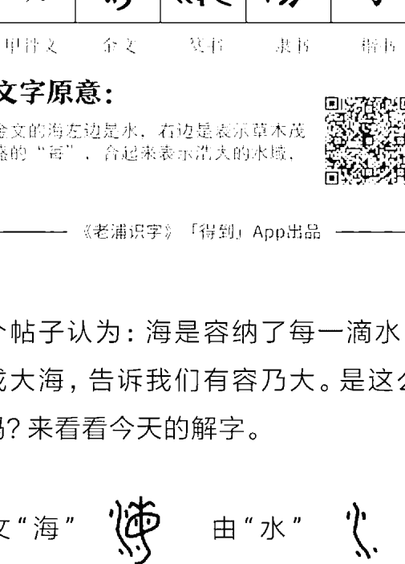

| 甲骨文 | 金文 | 小篆 | 隶书 | 楷书 |
| :---: | :---: | :---: | :---: | :---: |
|  |  |  |  | 海 |

**字源演变：**

**文字原意：**
金文‘每’为母亲之形，‘水’为水流，会意为水边之‘母’（或草木茂盛之‘每’）的栖息地，表示水边草木茂盛之意。

有个帖子认为：海是容纳了每一滴水，汇聚成大海，告诉我们有容乃大。是这么回事吗？来看看今天的解字。

金文‘海’由‘水’加上‘每’构成。要解读这个字，先要搞清是‘每’。

‘每’的甲骨文是‘母’上面加了一横，表示成年妇女头上的发髻，和咱们以前讲过的‘夫’造字原理相同。

另一种解释是女人头上插的羽毛装饰，本意是美。即男人插羽毛是‘美’，女人头上插羽毛是‘每’。

但这两种字义是怎样演变成个个，即每每、每个，其中很难找到逻辑关系。

还有一种解释是草木茂盛的样子。《说文解字》即持此说。但草木茂盛为什么下面是‘母’呢？

我的理解，这是在田间栽种禾苗，每一株禾苗都是母体，种的时候一株一株稀疏落落，生长起来就会变得茂盛。而这样的母体禾苗，自然引申出一个个的含义，进而引申为草木茂盛。陶渊明诗有为证：

> 种豆南山下，草盛豆苗稀。
> 晨兴理荒秽，带月荷锄归。

《左传·僖公二十八年》有一段话，听舆人之诵，曰：「原田每每，舍其旧而新是谋。」

意思是听到士兵念诵说：‘原野里的绿草繁茂，耕作者舍弃旧草而种植新禾。’这里的每每，就是草木茂盛的含义。

表示草木茂盛的‘每’加上水字旁，就表示水域宽广的湖泊。

《说文解字》说：‘海，天池也，以纳百川者。’意思是百川汇聚的湖泊。

北方内陆广阔的水域都可以叫海。如汉代称匈奴所在地为北海，就是今天的贝加尔湖。西域的且蒲海，就是今天的罗布泊。

由于在中原人的概念里海很遥远，所以把很遥远的地方称为四海。

《尔雅·释地》说：九夷、八狄、七戎、六蛮，谓之四海。四海之内皆兄弟。

北方对比较广阔的水域都叫海。北京中心城区的什刹海和北海、中南海是连成一片的水域。而比较浅的水域叫淀，像北京的海淀，就是指拥有三山五园的浅、却很广阔的水域。自古以来北京是水资源很丰富的城市，我们今天也只能通过地名来遥想了。

古文的海还不是我们今天广阔的咸水水域的海，古人称这样的水域为洋。

后来，随着中国人眼界的开阔，海专门用来指百川汇聚之处，邻接大陆而区域范围小于洋的咸水水体。

由于水势浩大，所以海常用来形容数量多或容量大。如李白的诗‘明月出天山，苍茫云海间。’酒量高叫海量，肚量大叫海涵，口气大叫海口，大碗叫海碗等等。

有意思的是，地球上最早的生命是在海洋诞生的，从细菌到单细胞类似水母那样无脊椎的生物，到有脊椎的鱼类，鱼类登陆后进化成了两栖动物和爬行动物，继而又进化成了哺乳动物，人类就是哺乳动物的一个分支。人类在胚胎的初始阶段和鱼类几乎是一样的。

海是生命之母，而汉字‘海’就包含母亲、母体的含义，这不能不说是一种奇妙的巧合。

海纳百川的含义没错，但帖子里汇集每一滴水的海不是‘海’造字的原意。

## 总结

- 解读海，首先要解读‘每’。‘每’的造字原意是种植禾苗，禾苗虽稀，却是稻米的母体，必然能够生长为茂盛的草木；
- 原意为草木茂盛的‘每’和水结合起来，表示浩大的水域；
- 北方古人称内陆的湖泊为海，现在意义的大海古人称之为洋；
- 海是浩大的水域，所以用来形容数量多和容量大；
- 地球生命从海诞生，而汉字‘海’就有母亲、母体的含义。如此巧合十分奇妙。

## 思考题

根据今天所学，请你分析一下古文中的海北和海夷。

## 用户留言

提交留言可与专栏作者互动

# 218【问答】无冥冥者，无昭昭之明

## 一、給

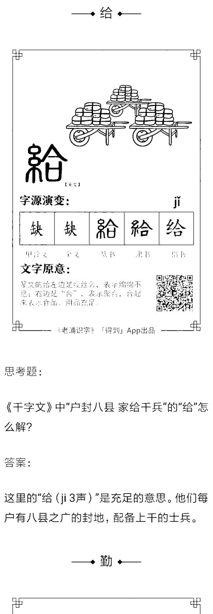

**思考题：**

《千字文》中“户封八县，家给千兵”的“给”怎么解？

**答案：**

这里的“给”（jǐ市声）是充足的意思。他们每家有八县之广的封地，配备上千的士兵。

## 二、勤

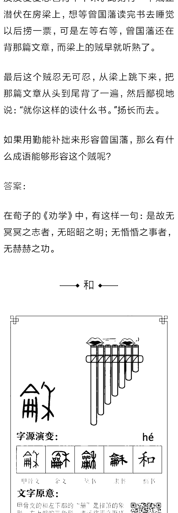

**思考题：**

有一个小故事，说曾国藩小时候读书很费力，有一天晚上他在灯下读书，一篇文章反反复复也就背不下来。此刻有一个贼正潜伏在房梁上，想着曾国藩读完全书去睡觉以后从房梁上跳下来，可是左右看看，曾国藩还在那篇作文，而他的贼早就听腻了。

最后这个贼忍无可忍，从梁上跳下来，把那篇文章从头到尾背了一遍，然后鄙夷地说：“就你这样的读什么书，扬长而去。”

如果用勤能补拙来形容曾国藩，那么有什么成语能够形容那个贼呢？

**答案：**

在荀子的《劝学》中，有这样一句：是故无冥冥者，无昭昭之明；无惛惛之著事，无赫赫之功。

## 三、和

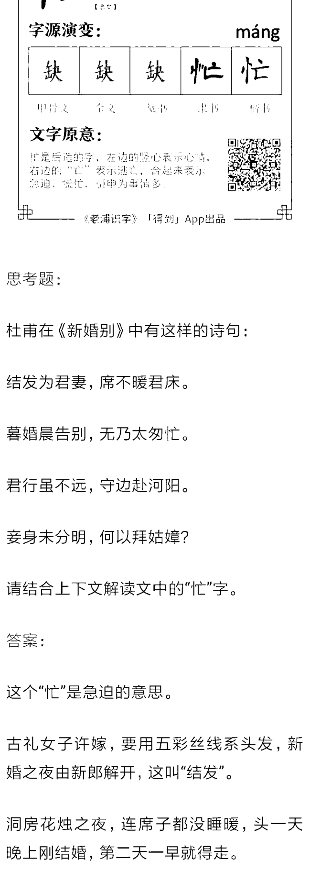

**思考题：**

“和谐”在现代汉语中是一个词，但字义各自还是有微妙差别的，请你分析一下，找出两个字的异同。

**答案：**

“和”表示不同声音，不同观点相互配合，同一节拍相合拍。相称，强调有差异而致同；
“谐”的本意是异口同声，表示相同的观点声音，相同的观点统一表达，有点像阅兵式喊正步。

## 四、忙

**思考题：**

杜甫在《新婚别》中有这样的诗句：

> 结发为君妻，席不暖君床。
> 暮婚晨告别，无乃太匆忙。
> 君行虽不远，守边赴河阳。
> 妾身未分明，何以拜姑嫜？

请结合上下文解读文中的“忙”字。

**答案：**

这个“忙”是急迫的意思。

古礼女子许嫁，要用五彩丝线系头发，新娘之由郎前解开，这叫“结发”。

洞房花烛之夜，被子都没顾暖，头一天晚上刚结婚，第二天一早就得走。

“无乃”，是反问对方的口气，意即“难道不是”。

“匆”的本意是心情像被火的烟困，“忙”则是急迫的含义。

为什么有此疑问？原因是古代婚礼，新娘过了三天后，要先备家庙、上坟，然后拜见公婆，正名定分，才算成婚。现在一晚上就走了，理论上讲夫妻名分都还没有定。那不就是急迫了吗？

## 五、海

**思考题：**

请你分析一下古文中“海北”和“海夷”。

**答案：**

你已经知道东汉的北海指贝加尔湖，所以海北泛指遥远的北方；“夷”是古代对少数民族的统称，“海”在这里表示偏远，海夷指边境少数民族或者来自海外的外国人，相当于今天的“老外”。

# 219【夸】自大的人会吃亏吗？

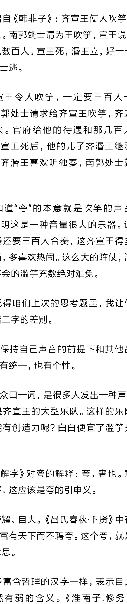

有个帖子根据“夸”字上面是“大”，下面是“亏”，得出“自大的人最终要吃大亏”这样的人生信条。

真的是这样吗？咱们来解解字。

先来看甲骨文，夸：左边是一个“于”，这是一种吹管乐器，竽，滥竽充数的竽就是这种乐器。右边是“大”，合起来表示吹牛吹得响亮、大声。

夸的金文可以看的更清楚，大字下面的“于”增加了一个弓的形象，这是表示吹奏乐器的气息。

因此夸的原意是一种张扬的表达。

滥竽充数的典故你肯定已经很熟悉了，这次我们从韩非的角度重温一下。

典故出自《韩非子》：齐宣王使人吹竽，必三百人。南郭处士请为宣王吹，宣王说之，廪食以数百人。宣王死，湣王立，好一听之，处士逃。

说说齐宣王令人吹竽，一定要三百人一起吹。南郭处士请求为齐宣王吹竽，齐宣王很高兴。官府给他的待遇同那几百人一样。齐宣王死后，他的儿子齐湣王继承了王位。齐湣王喜欢听独奏，南郭处士早就逃跑了。

我们知道“夸”的本意就是吹竿的声音很大，说明这是一种音量很大的乐器。这样的乐器还要三百人合奏，这对齐宣王得喜欢热闹，喜欢多和热闹。这么大的阵仗，混进去个不会吹的滥竽充数绝对难免。

你还记得咱们上次的思考题里，我让你分析和谐二字的差别。

“和”是保持自己声音的前提下和其他音配合，既有统一，也有个性。

“谐”是众口一词，是很多人发出一种声音，这就是齐宣王的大型乐队。这样的乐队怎么可能有创造？白目便了滥竽充数的人。

《说文解字》对夸的解释：夸，奢也。意思是奢侈，这应该是夸的引申义。

夸是夸耀、自大。《吕氏春秋·下贤》中有一句话：富有天下而不自夸。这个夸，就是自大的意思。

和很多富含哲理的汉字一样，表示自大的夸居然有弱的含义。《淮南子·修务》中有：“曼姬皓齿，形夸骨佳，不待脂粉芬芳而性可说者，西施、阳文也。”

西施、阳文是古代的美女。“曼”是细腻、柔顺，肌肤的语义，也指肌肤。这里的“夸”，是娇，柔软的含义，骨是指体型。全句的意思是皮肤细腻，牙齿洁白，外形柔弱，体态苗条，不用撒脂抹粉就让人感到愉悦的人，是西施和阳文。

有意思吧，夸有弱的含义，这是有心理学依据的，喜欢强夸的其实源于深深的自卑心理，他需要通过物质的夸耀来自证，证明自已，其评价体系来自别人的评价。

英雄如项羽，也有“富贵不还乡，如锦衣夜行。”的虚荣，所以我们今天看到有钱人与顶流歌手合唱，天价拍卖自己的书画作品，也不应该惊奇，人性如此而已。

至于帖子对“夸”字的解读，我们现在知道，“夸”字“大”下面并不是“亏”，而是“于”，原意是吹管乐器竽，所以这样的解读不靠谱。

## 总结

- 夸的原意是吹奏声音很大，表示一种张扬的表达；
- 《说文解字》解释夸是奢侈，应该是引申义；
- 夸有弱的含义，暗合心理学夸耀心理源于自卑。

## 思考题

“大”字也是常用的构字字符，如“太”，就是大字下面加一点。

段王载说：“凡言大而以为形容尽者，则作太，如太宰俗作太宰，太子俗作太子，周天王俗作天王是也。”按照这个原理，古代“太君”怎解？

请您在留言区留下你的看法。

## 用户留言

提交留言可与专栏作者互动

# 220【患】百爪挠心

## 识字卡片

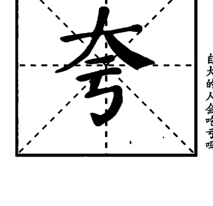

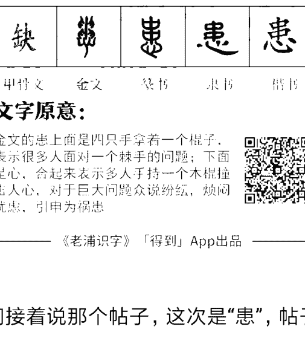

**字源演变：** huàn

| 甲骨文 | 金文 | 篆书 | 隶书 | 楷书 |
|---|---|---|---|---|
| 缺 | 㸲 | 患 | 患 | 患 |

**文字原意：**
金文的上半是四只手拿着一个棍子，表示很多人数对一个棘手的问题；下面是心，合起来表示多人大于持一个木棍撞击人心，对于巨大难题众说纷纭，烦恼忧虑，引申为忧患。

咱们接着说那个帖子，这次是“患”，帖子解读为“串心”，一串心，就是心多。心多就不是一心一意，自然有忧虑。这解释有点像烤串，咱们来看看正确的解释。

其实“患”是一个非常生动的汉字，我给你找到了三种金文的写法。

- 第一种，上面是四只手拿着一个棍子，下面是心，四只手表示很多人，正对心脏的棍子表示一个很大的棘手问题。这样的大问题，还七嘴八舌，怎能不忧虑呢？患的原意就是忧虑。
- 第二种写法简化了四只手，中间的一根棍子变成了一个臼，臼是在石质容器里用粗木棒椿捣，喻示烦心事像石臼一样砸在心上。
- 第三种写法省略了石臼，这就有点像百爪挠心，忧虑的原意不变。

患的原意就是忧虑，《论语·宪问》中就有：“不患人之不知己，患其不能也。”

意思是：不忧虑别人不理解自己，应该忧虑的是自己是不是能够做到。

后来，由忧虑，引申为祸患，祸害。

唐·柳宗元说：“人之患在好为人师。”这个“患”，就是毛病、祸患。防患于未然；后患无穷；有备无患；消除后患都是这个含义。

篆文把四只手持棍变成了“串”，还真就引起了二心的解读。

《春秋·繁露》也说：“书文止于一者谓之忠，持二中者谓之患，患人之忠，不一者也。”说咱们写字，一个“中”就是中心，串是两个“中”，就成了患，有两个中的人，不能一心一意，是不可能忠心的。这也是古代很开脑洞的解字吧。

说到多心，让我想起《西游记》的情节。比丘国国王陷害唐僧，要拿唐僧的心做药引子。孙悟空假扮成唐僧，当面破开胸膛，将那些心，血淋淋的，一个个拎开与众观看，却都是些红心、白心、黄心、悭贪心、利名心、嫉妒心、计较心、好胜心、望高心、侮慢心、杀害心、狠毒心、恐怖心、谨慎心、邪妄心、无名隐暗之心、种种不善之心，更无一个黑心。

国王说：这倒是个多心的和尚。

其实我们的心，何尝比这多心的和尚少？

## 总结

- 患的原意是多人手持木棍撞击人心，表示对于巨大难题众说纷纭，烦恼忧虑；
- 后引申为祸患和疾病；
- 对“患”字多心的解读自古就有，也不是完全没有道理。

## 思考题

学会了患，你怎样理解“患得患失”？欢迎在留言区写下你的看法。

# 221 [途] 长路漫漫

## 识字卡片

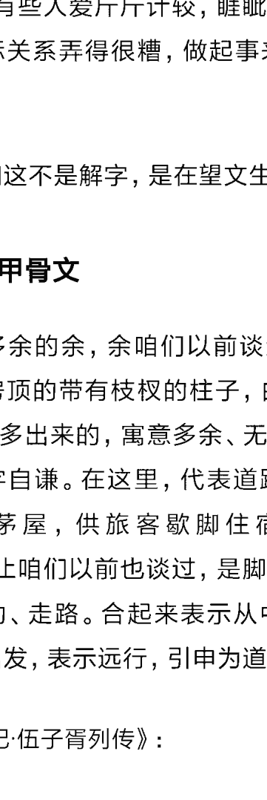

咱们接着聊《看懂汉字，就读懂了人生》这篇帖子里的字。这次是“途”。

原贴是这样写的：

> 途：给别人留有余地，自己才有路走。

“途”字由“走”和“余”构成，可以这样理解和解释——给别人留“余”地，自己才有路“走”。有些人爱斤斤计较，睚眦必报，因此把人际关系弄得很僵，做起事来就只能碰壁。

一望而知这不是解字，是在望文生义。

## 1 “途”的甲骨文

上面是多余的余，余咱们以前讲过，原意是支撑房顶的带有枝杈的柱子，由于枝杈无用，是多余的，寓意多、多余、无用，古人用这个字卜卦。在这里，代表道路上比较简易的茅屋，供旅客歇脚住宿。下面是“止”，咱们以前也说过，是脚的象形，代表停止。合起来表示从中途歇脚的茅屋出发，表示运行，引申为道路。

> 《史记·伍子胥列传》：
>
> 始伍员与申包胥为交，员之亡也，谓包胥曰：“吾必复楚。”包胥曰：“子必行！”及吴兵入郢，伍子胥求昭王。既不得立，乃挞楚平王墓，出其尸，鞭之三百，然后已。
>
> 申包胥亡于山中，使人谓子胥曰：“子之报雠，其亦甚矣！吾闻之，人多能胜天，天定亦能胜人。今子放平王之臣，亲北面而事之，今至於僇死人，此其反无天道之甚乎！”伍子胥曰：“为我谢申包胥曰，吾日暮途远，吾故倒行而逆施之。”

《史记》讲了这么一个故事。伍子胥和申包胥是挚友，伍子胥逃跑时对申包胥说“我一定要灭亡楚国。”申包胥说：“我一定要将这个国家保存下来。”后来伍子胥带领吴兵攻进楚国都城郢都，伍子胥寻找昭王，没找到，就挖开楚平王的坟墓，挖出尸体，抽打了三百鞭才罢休。

申包胥逃到山中，让人对子胥说“你报仇的手段，太过分了吧！我听说，人多能战胜天，天也能毁灭人。你曾是平王的臣子，亲自拱手称臣侍奉他，今天竟去污辱死人，这难道不是违背天理到极点了吗？”伍子胥对来人 说：“替我谢过申包胥，说我就像太阳快落山了，但路途还很遥远，所以我要倒行逆施。”途是指在道路上的客舍休息以后再出发，晚上住宿，天晚应该休息，我却还要赶路，这是违背常理的，大臣攻打君王就是违背天道，我就是干这种逆天的大事。倒行逆施。

从中我们可以看到仇恨让人疯狂的什么程度，道理我懂，但为了报仇，“吾日暮途远，吾故倒行而逆施之。”这就是倒行逆施成语的来历。

伍子胥在后世的戏曲里是一个正面人物，伍子胥过昭关一夜白头是很著名的戏码。但在古代，大臣反过来攻打君王是大逆不道的行为，何况还鞭尸。要到今天恐怕要斥为大恶了。而司马迁的评价：“奔孔，雪大耻，名垂于后世，悲夫！”他对君王的忠诚于杀父之仇相比，一个是小义，一个是 大耻，雪耻报仇比忠君重要，但这也是悲剧。

由于道路的含义，“途”引申为途径、门路。如仕途、前途。

## 总结

- 途的本意是在路上简易的客舍歇息以后再出发，为长途旅行，引申为道路；
- 伍子胥带领吴军攻打楚国，鞭尸平王，自己都说 是倒行逆施，但为了报仇雪恨什么都不顾了；
- 由道路的含义，引申为途径，如仕途、前途。

## 思考题

在《看懂汉字》的帖子中还有一个歇字：认为“路”字的左边是一个“足”，右边是一个“各”——人生之路，就在我们“各”自的脚下。所谓“千里之行，始于足下”，说的就是这个道理。所以，每个人都能走出一条人生之路来，全要自已走，不能指望别人。

这个说法对吗？请你分析一下“路”的本意。

提示一下，各的甲骨文是一个表示行走的倒“止”，下面一个表示城邑的“口”，一只要脚来到城邑，表示来、到达，与相对，指分别是从分到达的，引申为各个，各别的含义。

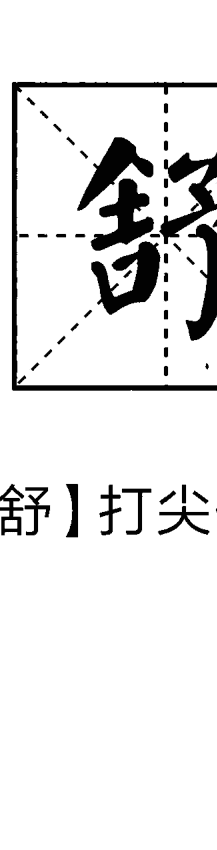

# 222【舒】打尖住店真舒服

## 识字卡片

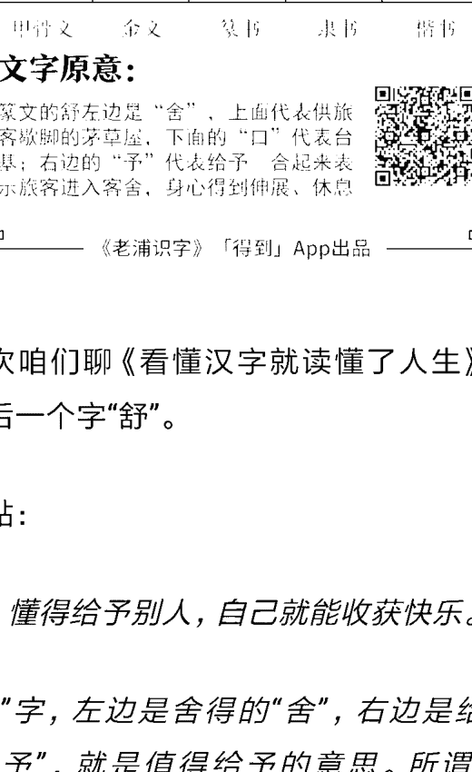

这次咱们聊《看懂汉字就读懂了人生》里最后一个字“舒”。

原贴：

> 舒：懂得给予别人，自己就能收获快乐。

“舒”字，左边是舍得 的“舍”，右边是给予的“予”，就是懂得给予别人，自己就能收获快乐。”

真的是这样吗？咱们来看解字。

舒的篆字 左边是“舍”， 舍的上面是“余”。

你还记得咱们谈“途”的时候见过这个余，原意是支撑茅屋屋顶的带枝杈的支柱，在这里表示路边简易的草屋，供旅客歇脚留宿。

舍字余下面的“口”是台基，可能是类似吊脚楼的简易茅屋，用脚啊踢、防蛇虫野兽。

予的甲骨文 是两个方块相交，表示城邑，把自己的城邑交给对方，这是诸侯间进行交易的常态，下面的一竖表示推送，予的原意就是给予。

表示给予的予和表示路边客舍的舍合在一起，表示旅客进入客舍，身心得到放松的状态，本意是伸展。许慎《说文解字》：舒，伸也。这个解读是准确的。

想想，一个背包客在长途跋涉以后，来到客栈，卸下沉重的行囊，舒展开四肢躺下，要是能吃顿饱饭，睡前再烫烫脚，得多舒服？

回头看看帖子的解读，把“舍”解读为舍得。舍的原意是旅途中间的简易居所，到达这样的居所后，无论是打尖还是住店，都要放下行李，歇脚休息，所以便引申为放下、舍弃。

> 子在川上曰：“逝者如斯夫，不舍昼夜。”——《论语·子罕》

这句话说的是孔子在晚年携弟子周游列国。有一次他们在河边望着奔腾不息的河水若有所思，叹息光阴似河水一样昼夜不停地流淌。勉励弟子珍惜光阴。这里的舍，就是放弃、放过的含义。江水涛涛，白天黑夜都不会放弃流动。

这个含义，后世加提手旁“捨”来区别，原意舍仍然是居住的房子，宿舍。简化字又合并了回去。

赠人玫瑰，手有余香。道理是对的，但“舒”字解不出这样的鸡汤。

## 《诗经·大雅·江汉》

江汉浮浮，武夫滔滔。匪安匪游，淮夷来求。既出我车，既设我旗。匪安匪舒，淮夷来铺。

长江汉水波涛滚滚，出征将士意气风发。不为安逸不为游乐，要对淮夷进行讨伐。兵车已经出动，彩旗迎风招展。不为安逸不为舒适，镇抚淮夷到此驻扎。

这是周天子御驾亲征的战役，其中的“匪安匪游匪安匪舒”就是颂扬周天子的，说天子出征，不是为了游乐，也不是为了安逸享受，而是要平定异邦，匪安匪舒才能建功立业。

我们今天也是一样，走出舒适区，自我迭代，终身学习，才能保持向上的心态，不断进步。

## 思考题

“予”后来借用为“自己、我”的含义。请解读“予取予求”这个成语。

## 总结

- 1. 舒的本意是旅客来到客舍，身心得到伸展、休息；
- 2. 舒是辛苦跋涉中间的休息，很舒服，但要建功立业，还要爬起来前行；
- 3. 舍得是舍的引申义，古人本已另造提手旁的“捨”表示给予就能快乐，不是“舒”的原意。

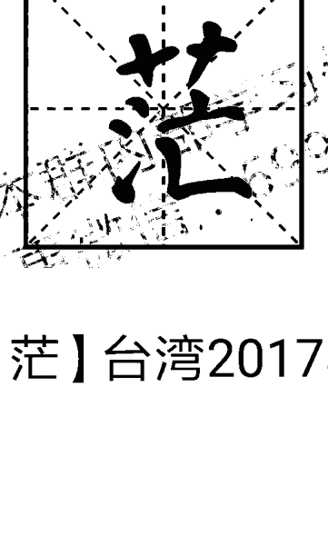

# 223【茫】台湾2017年度汉字

到年末，新闻媒体惯例要盘点一年的大事，中国、日本、马来西亚和新加坡等国家每年的每年都要评选年度汉字，汉字以其高度的概括性和广阔的思想空间，令每个地方评选出来的年度汉字都耐人寻味。

据报道：“台湾2017代表字大选”推选结果公布了，“茫”在52个候选字中脱颖而出，获选为今年的年度汉字。

从第一到第十名代表字依次为茫、劳、忧、乱、虐、荡、滞、厌、变、惜。

“茫”字  是由天气风险公司总经理彭昌明推荐的，他的推荐理由是：“全球气候变化迁涡临僵局，极端天气却持续加大；台湾未来的发展方向是茫茫。在茫茫当中，还看不清方向，不同的意见冲突已产生，只有持盈保泰、少步为营，才能面对不确定的变局。”

“茫”《说文解字》没有收录，甚至没有找到隶书。  这是隋代的字体，看来我们只能根据现有的字形来分析其造字的本意了。

三点水说明是一片水域，“芒”的本意是草叶和谷穗针状的尖端，所谓针尖带芒。

由于细小尖锐，所以也用来形容光，光芒。

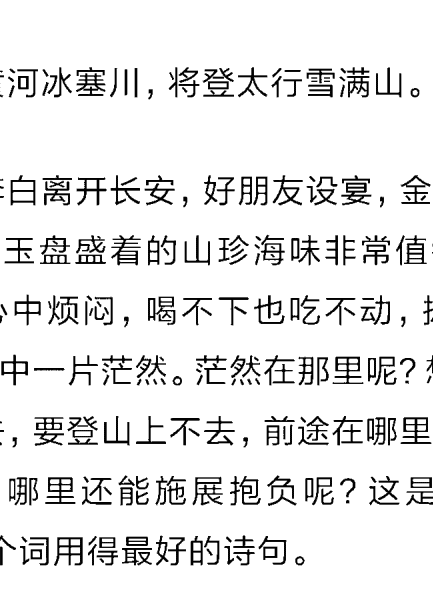

这样细小尖锐的物体，是如何进化成为模糊的“茫然”呢？

这还要回到麦穗的针状物上，麦芒细小、密集，在微风中，呈现模糊不清的状态的，要想看清楚并不容易，所以就引申为模糊。

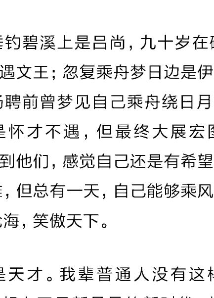

> 《庄子·齐物论》：人之生也，固若是芒乎？其我独芒，而人亦有不芒者乎？

意思是：人生在世，原本就像这样迷昧无知吗？难道只有我才知道迷昧无知，而世人也有不迷昧无知的人吗！这里的“芒”，就是“迷茫”的意思了。

“迷茫”的含义加上三点水变成“迷茫”，形容烟水濛濛浩大的水域模糊不清。表示旷远，模糊不清。

韩愈在《祭十二郎文》中说：“吾年未四十，而视茫茫，而发苍苍，而齿牙动摇。”

这里的“茫茫”，就是模糊不清的含义。

茫然更多是表现一种迷蒙的心理状态。

## 李白《行路难其一》

金樽清酒斗十千，玉盘珍羞直万钱。

停杯投箸不能食，拔剑四顾心茫然。

欲渡黄河冰塞川，将登太行雪满山。

这是李白离开长安，到朋友处发署，金樽、好酒、用玉盘盛着的山珍海味非常值钱，但李白心中烦闷，喝不上吃不动，拔出宝剑，心中一片茫茫。茫茫在哪里呢？想渡河过不去，要登山爬不上，前途在哪里，茫茫大地，哪里还能施展抱负呢？这是把“茫茫”这个词用得最好的诗句。

回到年度汉字，台湾把“茫”选为年度汉字，感觉前路漫漫，看不清方向。

其实我们每个人也常常会有这样的状态，工作不如意，没钱没房没车没有女朋友，怎样才能走出困境，心头茫然。

我们来看李白《行路难》的后几句：

闲来垂钓碧溪上，忽复乘舟梦日边。

行路难！行路难！多歧路，今安在？

长风破浪会有时，直挂云帆济沧海。

闲来垂钓碧溪上忽复乘舟梦日边，在受高谢时曾梦见自己乘舟绕月而行。这等你是怀才不遇，但最终大展宏图英雄，想到他们，感觉自己还有希望的。行路虽难，但总有一天，自己能乘东风破浪，横渡沧海，笑傲天下。

李白是天才。我普通人没有这样的天分，但赶上了日新月异的新时代，拥有无所不能的互联网，通过终身学习，找准方向，也会走出这片茫茫的困境。

## 思考题

汉·陈宠《请盗源疏》中有一句话：“臣闻学者之谓大王，幸袭大正，故堪混蚍，亢谓针芒，是以明者侪假，智者识几。”请你分析一下，以下哪句话表现了同一个道理？

- A. 小不忍则乱大谋
- B. 一着不慎，满盘皆输
- C. 发愤忘食，乐以忘忧
- D. 风起于青萍之末 浪成于微澜之间

## 总结

- 划重点
- 1. 茫的本意是麦穗上的针状物，形容细小尖锐；
- 2. 由于麦芒细小密集，在风的吹动下模糊不清，因此引申为模糊：
- 3. 三点水的“茫”是后造的字，表示烟水濛濛的浩大水域旷远而迷茫，后多用来形容迷惘的心理状态。

# 224【问答】“患得患失”怎么解？

## →《夸》←

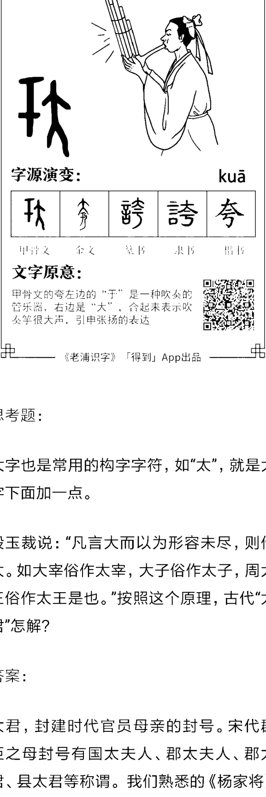

思考题：

大兄也是常用的构字字符，如“太”，就是大字符下面加一点。

段王裁说：“凡言大而以为形容者尽，则作太，如太奉作作太，大子作作太子。周大王俗作大老是也。”按照这个原理，古代“太君”怎解？

答案：

太君，封建时代官员母亲的封号。宋代群臣之母封号有国太夫人、郡太夫人、郡太君、县太君等称谓。我们熟悉的《杨家将》里的老妇人就叫余太君。后用作对别人母亲的尊称。

## →《患》←

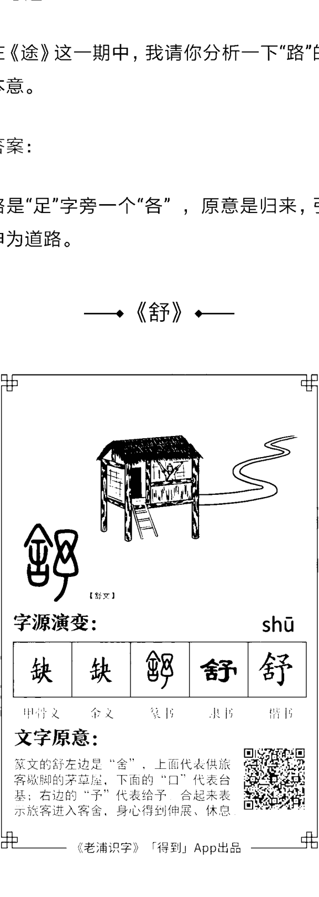

思考题：

请你分析一下怎样理解“患得患失”？

答案：

子曰，“鄙夫可与事君也与哉？其未得之也，患不得之；既得之，患失之。苟患失之，无所不至矣。”

孔子说：“可以跟品质低下的人一起侍奉君主吗？当他没有得到地位的时候，顾虑不能得到；当他得到以后，又患患失去。如果患患失去，那就没有什么事情做不出来了。”

形容一种忧虑得失的心态，一旦有这样的 心态，心理就会失去平衡。

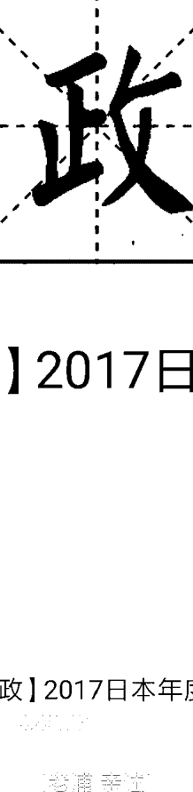

# 225【政】2017日本年度汉字

225【政】2017日本年度汉字

### —— 识字卡片 ——

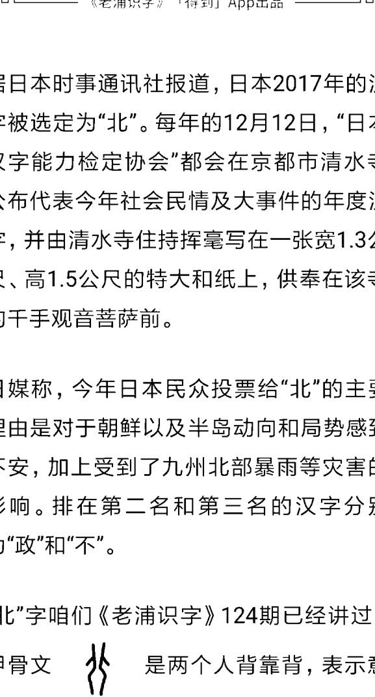

据日本文时通讯社报道，日本2017年的汉字被选定为“北”。每年的12月12日，“日本汉字能力检定协会”都会在京都清水寺公布代表今年社会民情及大事件的年度汉字，并由清水寺住持挥笔写在一张宽1.3公尺、高1.5公尺的特大和纸上，供奉在该寺的千手观音菩萨前。

日媒称，今年日本民众投票给“北”的主要理由是对于朝鲜以及半岛动荡局势感到不安，加上受了一半向北朝局和灾害的影响。排在第二位和第三名的汉字分别为“政”和“不”。

“北”字咱们《老浦识字》124期已经讲过，甲骨文是两个人背靠背，表示意见不合。

顺便说一句，隔壁《伯牙《知录入记》的《无权势者的权策》讲的虽然是儿童教育问题，但涉及的道理放到国与国关系上也完全适用。

大意是婴儿是家里最没权势的，但他通过哭，大一点以后用不吃饭、不穿衣服等获得很大权力，最终孩子说只能是一只会玩这种权力游戏的人。这种该怎么办？强烈建议你去隔壁回顾一下这篇文章，非常精彩。

由于“北”字咱们已经讲过，所以咱们这期解日本2017年度汉字排名第二的字：政。

政的甲骨文左边是正确的正，右边是手拿棍棒，正的原意是向城邑的方向行走，引申为正向、正确、正常。

和手持棍棒合起来，表示治理国家，用强力保持社会生活符合正规的规范。

什么是古人心中“的正”呢？

商纣王时期的太师箕子，与微子、比干齐名，史称“殷末三贤”。

箕子佐政时，见纣王进餐必用象筹，也就是象牙筷子，感叹曰：“彼为象箸，必为玉杯，为杯，则必思远务珍怪之物而御之矣，舆马宫室之渐自此始，可不可遏也。”

意思是说，他用象牙的筷子，就一定用玉石的杯子。用了这些珍奇的东西，就一定会追求远方的珍怪奇珍之物，奢靡腐败之风就这样蔓延，国败也就难以振兴了。

商朝晚来已经有了初步的集权，而贤人们只是希望劝说君王自身加强道德修养，自身正，而为天下垂范，却很少在制度上思考制约人欲望的办法。其实，权力到达那个位置上，人的欲望是难以抑制的。

后来武王伐纣，推翻了商纣王，武王就向箕子请教如何治理国家。箕子于是便将夏禹传下的《洪范九畴》陈述给武王听，史称箕子明夷。这其中表达了古人天人合一的为政理念。

其中有“飨用五福，威用六极”的提法。

五福，是五种幸福：一是长寿，二是富贵，三是健康平安，四是修行美德，五是善终。这就是我们平常说的“五福临门”。

六极是六种不幸：一是短命夭折，二是疾病，三是忧愁，四是贫穷，五是丑恶，六是懦弱。

其中我们可以把五福理解为“政”字中的“正”，把六极理解为“政”字中的手持棍棒。中国三千多年的政治治理，都由此滥觞。

顺便说一句，后来箕子来到一个美丽的半岛，建立了一个邦国，箕子命名为朝鲜。

### —— 思考题 —

你会怎样理解古人“五福”中的最后一福：考终身，也就是善终。

希望把你自己的见解写在评论中。

### —— 总结 —

- 1. 2017日本年度汉字“北”暗合甲骨文北字相遇原意；
- 2. 政的原意是用强力驱逐国家向正确的方向行进，以符合天人合一的道德规范；
- 3. 商末太师箕子传授的《洪范九畴》是中国最早政治理想的集中阐述，暗合“政“字形。

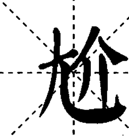

# 226【尬】2017年度网络词语

226【尬】2017年度网络词语

### → 识字卡片 ←

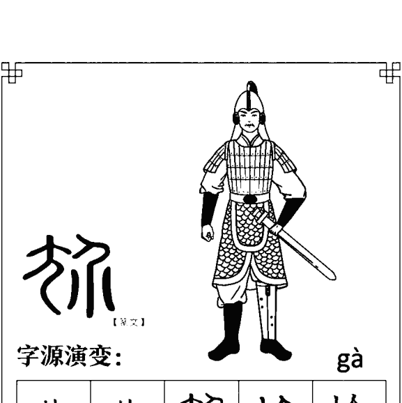

《咬文嚼字》编辑部发布2017年“十大流行语”，尬、尬、打call等上榜。《新闻刊》也将“尬”列为2017年的年度字。

我到网上查了一下，这“尬”的应用还真是广泛，把天聊死叫“尬聊”；把戏演的不知所以叫“尬演”；歌唱的荒腔走板叫“尬唱”；芭蕾舞的看不下去叫“尬舞”等等，泛指那些硬做出超出自己能力的行为还不自知，“尬”成了一个百搭的形容词。

尬的篆文左边是一个跛脚的人，右边是一个“加”。还记得咱们谈过踢脚掘足的经典吗？踢是假肢，由于受刑罚，也就是砍掉脚的刑罚的人太多，假肢是鞋子都禁。

这个字形“尬”的篆文，就是受到刖刑被砍掉一只脚的形象。“刖”咱们在121期中介绍过，原来是身着铠甲的人，被砍掉脚本就不便，而穿上铠甲行动更加不便，两种不便相加，表示处境困难或事情棘手，不易处理，引申为行为、态度不正常。

清代段玉裁《说文解字注》说：尴尬也。双声字，意思是说尴尬是一体的。那尴尬的原意是什么？

### → 识字卡片 ←

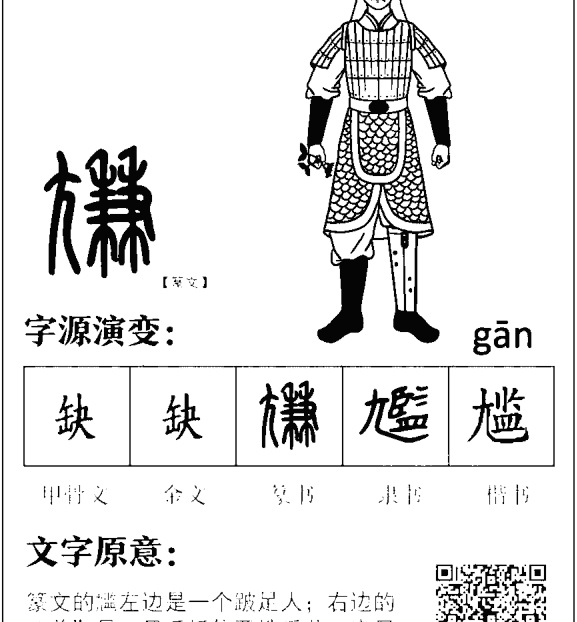

尴尬的左边也是一个跛足人，右边一个“兼”，兼是一只手抓住两株禾苗，表示同时做两件事。

跛足加上兼，表示一条腿要起两条腿的作用，非常困难。后来尴尬的字形演化为跛足人加“监”，监有监管、囚禁的含义，合起来表示行走困难。

尴尬的原意是处境困难，事情棘手。而现代汉语中，是说发生了无法预料的情况，陷入窘境，自己或让他人感觉很难为情，不知所措，无所适从。上不上下，不尴不尬。

通过考察尴尬的造字本义我们可以体悟到，造成尴尬的其实是自己不自量力，你自己就是跛脚的，有自己的短板，但你的欲望驱使你去做超出你能力的事，必然让自己处于如此上不下下的境地。

比如尬聊，明明你们话不投机，却硬要聊出点微言大义，上不去下不来。尬演，演技有限却又不肯用心、不虚心，硬演，尬了。

所以要想不尴尬，首先要有自知之明，了解自己的边界。二要不虑心，勇于承认自己的短板，不妄为。第三，活成自己，有容乃大，无欲则刚。

### → 思考题 ←

尬聊、尬唱、尬舞、尬酒、尬演、尬拍、尬笑...2017年你经历或见过哪种？欢迎你在评论区聊一聊。

### → 总结 ←

## 划重点

- 1. 尴尬的造字原意是跛足人加上束缚自己的监牢、铠甲，表示行动困难，事情棘手；
- 2. 现代汉语的尴尬是发生意外，不知所措，别人都难为情；
- 3. 尴尬的本质是自己有缺陷，如果不虚心、不承认，硬要去做，就会让自己或团队置于不上不下的处境，告诉我们坦荡做人的道理。

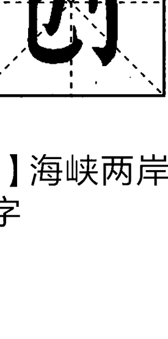

## 227【创】海峡两岸2017年度汉字

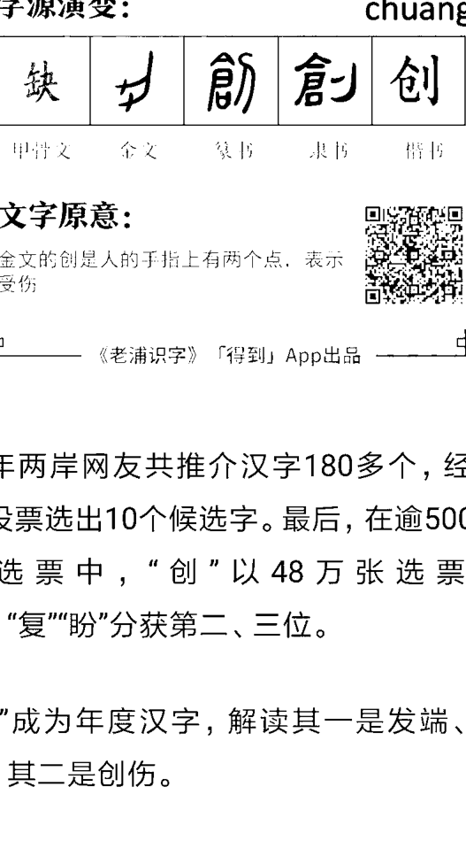

今年两岸网友共推介汉字180多个，经两轮投票选出10个候选字。最后，在逾500万张选票中，‘创’以48万张选票夺魁，‘复’‘始’分获第二、三位。

‘创’成为年度汉字，解读其一是发端、创新。其二是创伤。

‘创’我找到了三种金文字体。

- 第一种： [图片]，这是人手指上有两个点，指事符号，伤痕或血液，表示受伤。
- 第二种：[图片]，这个字形在受伤的手之外，增加了‘刑’ [图片]，表示这是遭到剌手刑罚，不是现在网购恨不得剁手，而是真剁手。
- 第三种：[图片]，这是战国时期的字体，在受伤的手以外，增加了一个‘立’ [图片]，一个正面站立的人形，合起来表示这是人受伤。

篆文 [图片]，是一个形声字，包表声，刀表义，仍然表示创伤。

> 《史记.项羽本纪》有一段记载，项羽不愿渡过乌江，‘无颜见江东父老’，只将自己的乌骓马托付给亭长，‘乃令骑皆下马步行，持短兵接战。独籍所杀汉军数百人。项王身亦被十余创。’

> ‘顾见汉骑司马吕马童，曰：‘若非吾故人乎？’马童面之，指王翳曰：‘此项王也。’项王乃曰：‘吾闻汉购我头千金，邑万户，吾为若德。’乃自刎而死。’

这大概是最有尊严的战场杀手虐文。项羽命令下骑兵都下马，手持短兵器与追兵交战。项羽一个人就杀掉汉军几百人。项王身上也有十几处创伤。项王回头看见汉军骑兵司马吕马童，说：‘你不是我的老相识吗？’

马童这才敢面对项羽，于是指给王翳说：‘这就是项王。’项王说：‘我听汉王用黄金千斤，封邑万户悬赏我的脑袋，我就把这份好处送给你吧！’说完，自刎而死。

这里的‘身亦被十余创’，就是创伤原意。

创伤怎样演化为创造、创意、创造力呢？

首先，在经历了战争创伤以后，天下初定，这叫‘创定’。《后汉书.曹褒传》：‘汉初天下创定。’就是这种用法。

由创定，引申为‘创业’。《汉书.匡衡传》：‘盖受命之王务在创业垂统，传之无穷。’意思是接受任命的王的使命是创建基业，传之子孙，以致无穷。

由创业，引申为‘创制’。至此，创伤之义转化为创造。

海峡两岸2017年度汉字选择‘创’，既有创伤之痛，又有创造之希望。其实生活何尝不是如此，创造本身就诞生于创痛，哪一个创造是随随便便成功 的呢。

当然，如果你认为‘创’字用‘包’做声符，用‘刀’做义符，暗喻创造需要积累，更需要锋利的灵感，也不失过分解读吧。

- 我们今天认识了手形上两点指事符号，表示受伤。那么这个甲骨文手形 [图片]，是哪个字的原形呢？

- 1. 创的本意是手指上有点滴，表示受伤；
- 2. 由于天下初定是在生灵涂炭以后，所以这样的安定叫创定，然后引申为创业垂统、创制；
- 3. 创造总是与创痛相伴而生，极有哲理。

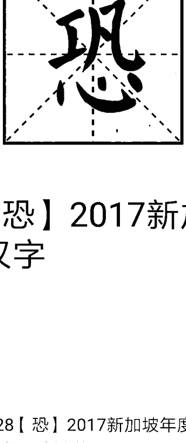

## 228【 恐 】2017新加坡年度汉字

继去年的“变”之后，新加坡评出年度汉字一一“恐”来总结这一年。

据悉，“恐”字并不是第一次入围新加坡年度汉字。2014年和2016年，“恐”字都入围了年度汉字，今年已经是第三次了。而今年“恐”字能以最高票数当选，也反映出今年世界范围内恐袭事件的频繁发生。

金文 上面是一个代表工具的“工”工，工的甲骨文 原形是夯土的重型工具，下面是“心”心 ，合起来表示心情像受到夯土重击一样，害怕、紧张。

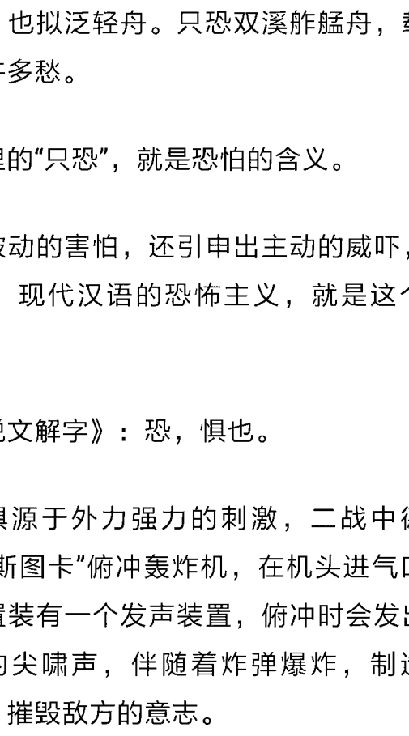

你一定想起了咱们刚谈过的“患”，是很多人手持棍棒撞击心灵，“恐”的撞击程度更强一些。

这个金文字形更加形象 恐 ，一个人手持工具的造型更加明确，这是“恐” 恐 ，心里受到冲击的含义非常明确。

恐的原意就是遭受重击下的害怕、恐惧。

> 《史记.高祖本纪》中有一句话：“项羽逐西，屠烧咸阳秦宫室，所过无残破。秦人大失望，然恐，不敢不服耳。”

这是说项羽在鸿门宴以后占领了咸阳，屠杀、焚烧秦王的宫殿，所过之处都被毁坏。秦朝百姓原来期望约法三章不杀人放火的刘邦称王，现在这个状况让秦人大大地失望了。“然恐”，惧怕项羽，不敢不服。这里的“恐”，就是原意，项羽的暴行就是夯土的重器。

由害怕，引申出担心，恐怕。李清照的《武陵春》有这样的词句：闻说双溪春尚好，也拟泛轻舟。只恐双溪舴艋舟，载不动许多愁。

这里的“只恐”，就是恐怕的含义。

由被动的害怕，还引申出主动的威胁，恐吓。现代汉语的恐怖主义，就是这个用法。

> 《说文解字》：恐，惧也。

恐惧源于外力强力的刺激，二战中德国的“斯图卡”俯冲轰炸机，在机头进气口的位置装一个发声装置，俯冲时会发出恐怖的尖叫声，伴随着炸弹爆炸，制造恐慌，摧毁敌方的意志。

恐惧还是许多社会心理的根源，比如贪官，已经那么高的地位了，为什么还要贪污回积上亿的钱呢？

你分析一下就会发现，这种人往往出身贫寒，对饥荒贫穷的恐惧已经成为遗传基因，只有看得见的金钱才会让他心安。即使位高权重，也会受到恐惧这样潜意识的驱使，贪污腐败。这种心理，咱们在“木”那期也谈过。

### —— 思考题 ◆

恐和惧同义，惧的简化字已经看不出什么意思了，现在我告诉你，惧的金文是这样的 惧 ，篆文是这样的 惧 ，楷书是这样的 惧 。

你能分析一下这个字的造字原理吗？提示一下， 隹 的本意是小鸟。

### ◆ 总结 ◆

- 1. 恐的原意是心灵受到夯土那样的撞击，害怕，恐惧；
- 2. 引申为担心，还进一步引申为主动的吓、恐吓；
- 3. 恐惧心理不仅是受到外力刺激，也可以是潜藏在心灵深处的意识。

## 229 【建】皇帝头顶上的牌匾啥意思？

到故宫参观，一定要到太和殿去参观，宝座上的巨型牌匾一定给你留下深刻印象。这是什么意思呢？

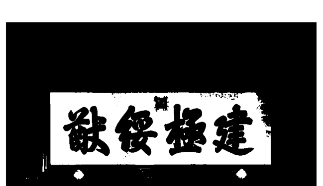

“建极绥猷”为乾隆御笔，但这是复制品。故宫恢复“乾隆盛世”风貌维修时，故宫博物院专家依照清宫所存《清朝皇室写真》中1900年太和殿旧照片，历时一年，于2002年9月成功复制的。原物已经无法找到了。

两边对联为：“帝命式于九围，兹惟艰哉，奈何弗臧；天心佑夫一德，永言保之，迪求厥宁。”

对联的大意是：

> 皇帝受上天任命统治天下，这是一件艰难的事，怎能不存恭敬之心呢？上天佑助纯粹一致的道德，永远保佑，祈求天下长享太平。

咱们来聊聊那块牌匾。

“建”的全文（配“建”古体图）是一个“聿”。“聿”的甲骨文（配甲骨文图），是手拿一个木棍，原意是笔。

金文（配金文“聿”图）是在木棍下面增加了两点，表示毛笔的笔头。

顺便说一下，毛笔的历史很长。相传毛笔是秦代将军蒙恬在建造长城的时候发明的，但是考古研究表明，商周时期就已经普遍使用毛笔了，青铜器上的文字就是先用毛笔写好，再烧制模范铸造。在殷墟出土的甲骨上，也发现了毛笔书写的朱砂文字符号。

“建”字左边的这个圆弧可以理解为“止”的变形。

（配战国“聿”图）这是战国时期的竹简文字，可以看到“聿”下面有个表示行动的“止”，笔加上行动，表示将手书的规划施工落实。

“建”的本意是有规划的创造，建造。“建”还有竖立的意思，大概是由于毛笔竖立书写的合理延伸。引申为倡议、提出，如建言献策。建字让我们想象古人修建宫室，建造城邑的情形。

据说犹太人的《圣经》记载：大洪水后，天上出现了第一道彩虹，上帝以彩虹与地上的人们定下约定，不再用大洪水毁灭大地。

诺亚的子孙越来越多，遍布地面，于是向东迁移。他们遇见一片平原，定居下来。

> 他们说：“来吧，我们要建造一座城，和一座塔，塔顶通天，为要传扬我们的名，免得我们分散在地上。”

由于大家语言相通，同心协力，建成的巴比伦城繁华而美丽，高塔直插云霄，似乎要与天公一比高低。

上帝发觉自己的誓言受到了怀疑，心想：如果人类真的修成宏伟的通天塔，那以后还有什么事干不成呢？

于是他改变了人类的语言，使他们因为语言不通而分散在各地，那座塔于是半途而废了。人们称这座塔为巴别塔，意为变乱。

巴别塔的故事让我们浮想联翩。

- 宗教说：要谦卑，人类狂妄自大最终只会落得混乱的结局。
- 历史说：建造宫殿让人类大规模组织起来，构建了人类独有的社会组织，成为地球的霸主。
- 语言说：由于语言、文化差异，人类不可能互相理解。
- 文化说：文明的多样性是上帝的意志，全球化的文化趋同是人类的灾难。
- 汉字说：建，就是一个点子，一支笔，然后有一支执行力强的团队，创建就这么简单。

## 思考题

封建的“封”甲骨文（配“封”古体图）是一只手在隆起的土堆上种树，古代用种树来划定疆界。请你分析“封建”的原意。

## 总结

## 划重点

- 1. “建”是一支笔，和表示行动的“止”组成，原意是有规划的施工、建造；
- 2. 巴别塔的故事告诉我们，建造大型建筑是人类走出蛮荒的重要一步，促进了人类组织社会的发展。

# 230【问答】“五福”中的最后一福：考终命

《政》

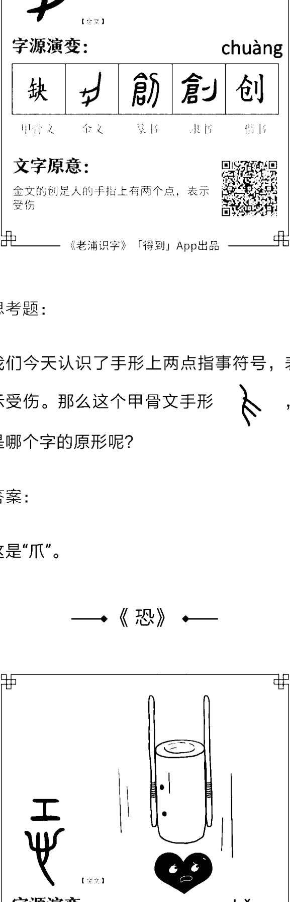

- 思考题：

你会怎样理解古人“五福”中的最后一福：考终命，也就是善终。

希望你把自己的见解写在评论中。

- 参考答案：

善终是自然死亡，没有痛苦地走完生命旅程，个人感受有三：

1. 表达了古人对生命的认识，生老病死是人生必然，能好好走完一生就是福；
2. 健康平和，身体自然衰老，这是无疾而终，一般人很难做到；
3. 不做亏心事，不怕鬼敲门。一生坦坦荡荡，没有愧疚悔恨，这种善终确实是人生之福。

《创》

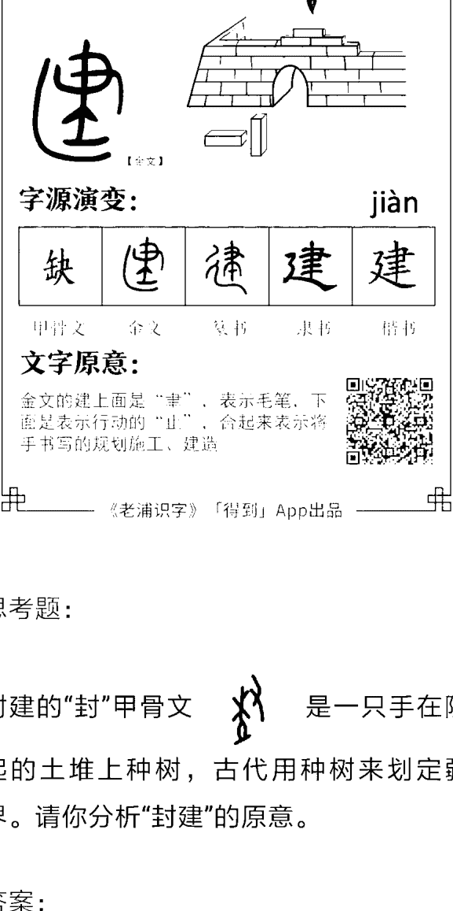

思考题：

我们今天认识了手形上两点指事符号，表示受伤。那么这个甲骨文手形，是哪个字的原形呢？

答案：

这是“爪”。

《恐》

思考题：

恐和惧同义，简体的“惧”字已经看不出什么意义了，现在我告诉你，“惧”的金文是这样的，是这样的，篆文是这样的，楷书是这样的。

你能分析一下这个字的造字原理吗？提示一下，“隹”的本意是小鸟。

答案：

人在惊恐的时候会睁大双眼，所以“惧”最早就是瞪大“隹”的双眼，后增加“心”，表示这是一种心理。篆文增加小鸟，表示眼睛像小鸟的眼睛，同时也利用小鸟受惊飞的特点，强化惊恐的心理表达。

《建》

思考题：

封建的“封”甲骨文是一只手在隆起的土堆上种树，古代用种树来划定疆界。请你分析“封建”的原意。

答案：

封建是政治制度，即封邦建国，古代帝王把爵位、土地分赐亲戚或功臣，使之在各自区域内建立邦国，即封建亲戚，以藩屏周。

相传唐有为封建之始，至周制度始备。春秋战国时的诸侯国就是封建。欧洲中世纪也曾实行类似的制度。

秦统一中国，废封建立郡县。集权于中央。

现在常用来比喻思想保守，不开放。

用户留言

提供留言可与专栏作者互动

# 231【极】顶天立地

## 识字卡片

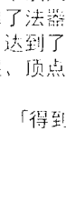

## 字源演变：

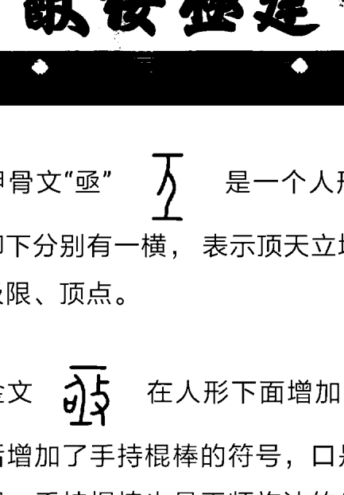

## 文字原意：

“极”的甲骨文“亟”，是一个顶天立地的人，代表极限。金文加了巫师，表示巫师做法，博见阴险，达到了极点。“极”的原意也是极限、极点。

咱们接着谈故宫太和殿的牌匾“建极绥猷”。今天咱们谈“极”。

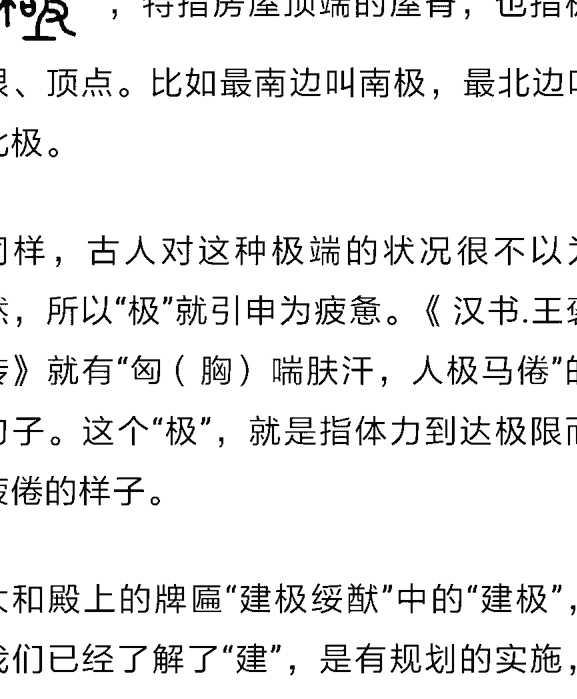

“极”的甲骨文“亟”是一个人形，头顶和脚下分别有一横，表示顶天立地，本意是极限、顶点。

“亟”的金文在人形下面增加了“口”，身后增加了手持棍棒的符号，口是巫师的法器，手持棍棒也是巫师施法的仪式，进一步说明这个顶天立地的人是巫师在作法，他已经神灵附体，方能够顶天立地，达到极点。

熟悉《老博识字》的同学都了解，在古人的造字观念中，这样的极点一定不能持久，肯定会发生变化，如“颠”是顶点，就一定会翻身南下颠覆。“亟”字塔的顶点，肯定会马上发生变化，自然引申为迅疾。《广雅》：亟，急也。

以后“亟”的含义主要就是赶快、急切。亟待解决、亟需办理、亟待纠正等等，都是这个用法。

而极限、顶点的本意，古人加一个“木”另造“極”，特指房屋顶层的屋脊，也指极限、顶点。比如最南边叫南极，最北边叫北极。

同样，古人对这种极端的状况很不以为然，所以“极”就引申为疲极。《汉书·王褒传》就有“匈（陶）腕肤汗，人极马倦”的句子。这个“极”，就是指体力到达极限而疲倦的样子。

太和殿上的牌匾“建极绥猷”中的“建极”，我们已经了解了“建”，是有规划的实施，建立。

“极”是屋脊，屋脊是房屋的顶点，也是正中，这就表示要建立中正治国的最高准则。

这个说法来自箕子的《洪范》：“皇建其有极”。我们在讲“政”字的时候谈到了“五福”，同样出自箕子的《洪范》，这是古人治国的最高典范。

我写这一期的时间，正巧是“冬至”日。冬至是日照南端的点，是冷的极致。然而“冬至一阳升”，古人认为自冬至起，白昼一天比一天长，阳气回升，天地阳气开始兴做渐强，代表下一个循环开始，是大喜之日。

尽管后面还有三九寒天，但阳气已经开始回升了。这就是物极必反，否极泰来的道理。

## 思考题

《庄子·则阳》中有一段话：“孔子之楚，舍于蚁丘之浆。其邻有夫妻妾登极者”。这里“登极”是什么意思？

## 总结

## 划重点

- 1. 极的甲骨文是一个顶天立地的人，代表极限；
- 2. 金文增加巫师法器和手持权杖，表示巫师做法达到极点；
- 3. 亟也表示迅疾，因此原字“亟”特指急切，原意加“木”另造“極”；
- 4. 建极绥猷中的“建极”，典故来自《洪范》，表示建立中正的治国最高准则。

# 232【绥】绥靖原本是大国风范

咱们接着谈太和殿牌匾中的第三个字“绥”。

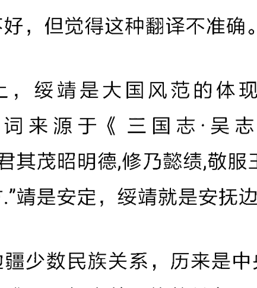

“绥”字来源于“妥”，甲骨文表示安放女人，意为安稳、合适、完备、齐备。

金文增加了表示绳索的绞丝，成为“绥”，特指古代上车抓住的绳索，表示妥当、平安。

按照古代礼仪，上车必正立，说上车的时候一定要正立，执绥所以安也，握住“绥”这样的绳索以保证稳妥、平安。

“绥”增加绳索，特指上车时供握住绳索，但引申义仍然是安抚、安定。《三国志·薛综传》：“绥边抚夷。”意思是安定边疆，安抚边民。

“绥靖”现在基本上是一个贬义词了，对应英文appeasement policy。

二战前夕，西方大国对希特勒采取绥妥、姑息政策，一味妄妄退让，致使希特勒坐大。绥靖政策成为姑息养奸的同义词。我英文不好，但觉得这种翻译不准确。

历史上，绥靖是大国风范的体现。“绥靖”一词来源于《三国志·吴志·陆逊传》“君其茂昭明德，修乃绥略，敬服王命，绥靖四方。”靖是安定，绥靖就是安抚边疆。

# 233【馜】真正的大道是敬天安民

## 识字卡片

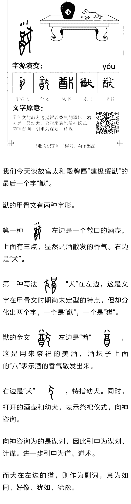

我们今天谈故宫太和殿牌匾“建极绥猷”的最后一个字“猷”。

“猷”的甲骨文有两种字形。

- 第一种，左边是一个敞口的酒壶，上面有三点，显然是酒散发的香气。右边是“犬”。
- 第二种写法，“犬”在左边，这是文字在甲骨文时期尚未定型的特点，但却分化出两个字，一个是“猷”，一个是“犹”。

- “猷”的金文，左边是“酉”，这是用来祭祀的美酒，酒坛子上面的“八”表示酒的香气散发出来。
- 右边是“犬”，特指幼犬。同时，打开的酒壶和幼犬，表示祭祀仪式，向神咨询。

向神咨询的是谋划，因此引申为谋划、计谋。进一步引申为道、道术。

而犬在左边的“犹”，则作为副词，意为如同、好像、犹如、犹豫。

> “绥”典出《尚书·商书·汤诰》：惟皇上帝，降亶于下民。若有恒性，克绥厥。惟后。

商汤讨伐暴君桀，革除夏朝的王命，回到国都亳之后，将伐桀大义告示天下，即作《汤诰》。此句意为天帝将善道赋予下民，使民有常性，那么能顺乎其道的则为天子。在这里，绥是安抚、顺应，厥是尽全力，就是天道的含义了。“后”我们以前讲过，是王的意思。

绥，就是顺应天意，安抚百姓。

建极绥猷，合起来的意思是天子承担上对皇天、下对庶民的双重神圣使命，既要承天而建立法则，又要抚民而顺应大道。

这是皇权社会治国理政的理想。

## 思考题

故宫保和殿中的“皇建有极”匾也是乾隆御笔。典故同样出自箕子《洪范》“皇建其有极”。咱们刚刚讲解了“建”和“极”，请你分析一下这个牌匾的含义。

## 总结

## 划重点

- 1. 猷甲骨文有两个字形，是散发香气的酒坛和犬的组合，原意是幼犬，也是敬神仪式，向神咨询，引申为谋划、计谋；
- 2. 金文承续了甲骨文字形，分化出两个字：猷和犹，猷表示计谋、道术，犹表示如若、还、仍然；
- 3. 建极绥猷合起来表示承天建立最高法则，对上抚民而顺应大道，是古代治国的准则。

# 234 [允] 神的允诺

## 识字卡片

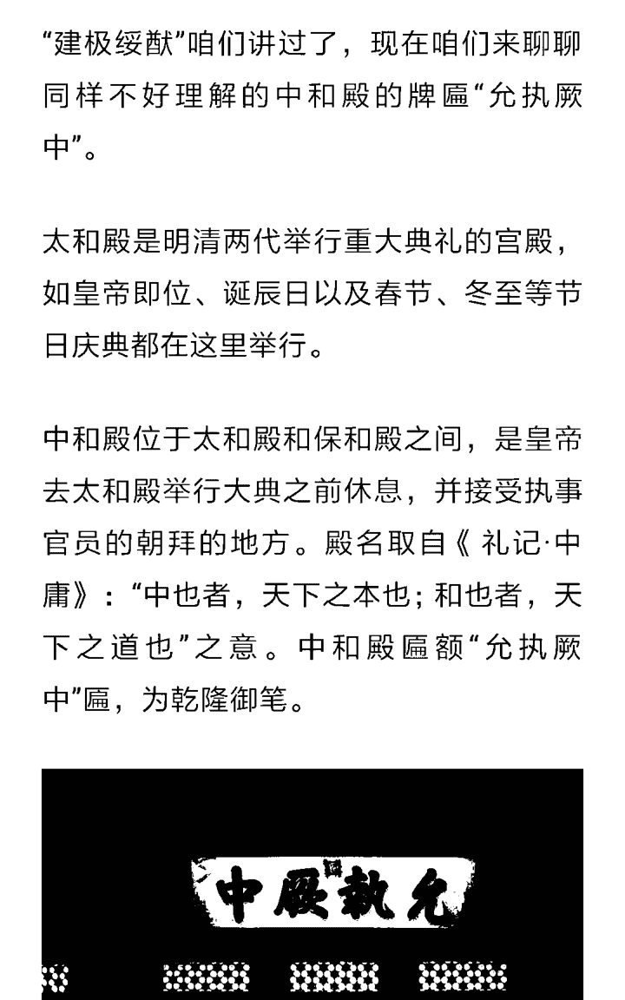

去故宫游览，三大殿的牌匾是有点让人恼火的。字都知道，但从来都不知道是什么意思。有报道当时美国总统奥巴马参观故宫的时候，就问过太和殿的牌匾“建极绥猷”是什么意思。当时的故宫博物院院长都解释难为情。这个词大意是说帝王要建立好的统治，对天下百姓负责。

“建极绥猷”咱们讲过了，现在咱们来聊聊同样不好理解的中和殿的牌匾“允执厥中”。

太和殿是明清两代举行重大典礼的宫殿，如皇帝即位、诞辰日以及春节、冬至等节日庆贺都在这里举行。

中和殿位于太和殿和保和殿之间，是皇帝去太和殿举行大典和休息之前，并接受执事官员的朝拜的地方。殿名取自《礼记·中庸》：“中也者，天下之大本也；和也者，天下之达道也。致中和，位育无忧。”

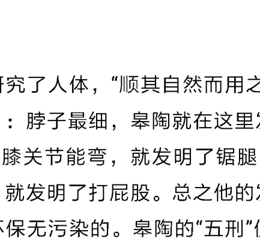

“允”的甲骨文是一个字型是一个人恭恭敬敬点头的形象，表示相信。这是古代占卜请教神灵，有了结果以后，王恭敬地表示相信的样子。在甲骨卜辞里这个字多用于验祭。

如：“贞，今夕雨，至戊戊雨？戊戌允雨。”意思是名叫贞的巫师发问，今天晚上会下雨吗？是戊戌那个时间点下雨吗？戊戌时果然下了雨。

这里的“允”既有相信的含义，又有相信就对了，果然如此。引申为答应，认可。在古代，皇帝批准奏章，会写个“允”表示同意。

由于“允”的原意是受到神启后的相信，所以引申为公平得当：允当，公允。也形容大，极致：允公允肃，称赞官员才识已达到的极致，这马屁拍的也到了极致。

“允执厥中”中的“允”就有在敬神信天的前提下极致的含义。

要理解这句话，还应该理解上下文，看他的出处。

典出《书·大禹谟》“人心惟危，道心惟微，惟精惟一，允执厥中。”

这里是舜告诫禹：人心危险难安，道心幽微难明，只有精心一意，诚意地秉执其中正之道，才能治理好国家。

尧舜禹是传说中的上古列圣，舜帝接替尧帝的班，建立了一套刑定制导为刑罚，我们先民的社会形态也更像一个“国家”了。据说，舜帝的品行无可挑剔，因此他之前的尧一样被尊为圣王，他命令皋陶制定刑罚。

# 235【执】拘禁了谁

## 识字卡片

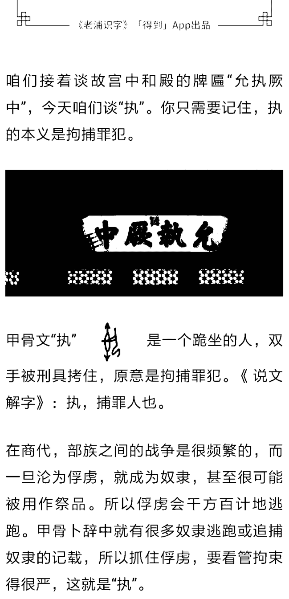

咱们接着谈故宫中和殿的牌匾“允执厥中”，今天咱们谈“执”。你只需要记住，执的本义是拘捕罪犯。

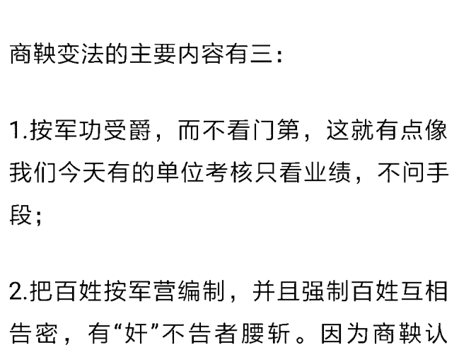

甲骨文“执”是一个跪坐的人，双手被刑具拷住，原意是拘捕罪犯。《说文解字》：执，捕罪人也。

在商代，部族之间的战争是很频繁的，而一旦沦为俘虏，就成为奴隶，甚至很可能被用作祭品。所以俘虏会千方百计地逃跑。甲骨卜辞中就有很多奴隶逃跑或追捕奴隶的记载，所以抓住俘虏，要看管约束得很严，这就是“执”。

所以在“执”的语感里，具有严格、拘禁、不折不扣的含义。

不折不扣地按照要求去做叫执行，拿定了主意叫执意，被一个念头紧紧约束住叫执念。不懂圆通，一条道走到黑叫执拗。

说到“执”这个字，让我想到了商鞅。

商鞅变法的主要内容有三：

- 1.按军功受爵，而不看门第，这就有点像我们今天有的单位考核只看业绩，不问手段；
- 2.把百姓按军营编制，并且强制百姓互相告密，有“奸”不告者腰斩。因为商鞅认为“礼乐、诗书、修善、孝悌、诚信、贞廉、仁义、和平”是毒害社会的“六虱”；
- 3.百姓只许务农，从事其他职业者，以及懒惰而致贫困者，全家没收为奴。

商鞅认为，“国贫而务战，毒输给，无六虱，必强。国富而不战，偷生于内，有六虱，必弱”。

无论国家有钱还是没钱，都必须时刻处于战争状态，如此才能强盛，才会不被“六虱”侵害。让老百姓只敢做国家让他们做的事，国家才会大治。

这样的变法让秦国迅速强大起来，秦始皇最后能够统一六国，靠的就是商鞅变法打下的基础。但秦国是不是个幸福的社会呢？不是，当时国家很强大老百姓却很贫困。

因为商鞅认为：“民弱国强，国强民弱。故有道之国务在弱民。”

按商鞅的逻辑：百姓贫穷，就会有求富的动力；所以，国家必须想办法在百姓富裕后“合理”拿走他们的财富，让他们再度陷入贫穷。如此，才会重新激发百姓的求富动力，他们为生存疲于奔命，没有精力求智，国家也不再育“虱”了。

这种强力钳制百姓的治国理念，正是一个“执”字。

正如酷吏总是死于酷吏之手，商鞅“执”百姓，所以当他自己要逃亡的时候，由于百姓害怕连坐，没有人肯收留他，最终导致他自己被“执”，在秦国都城遭到车裂。

“允执厥中”，这里的“执”仍然是强力执行的本意，和表示敬神相信，诚意满满的“允”合起来，表示虔诚地奉行中正之道。

## 思考题

你能从解字的角度谈谈“执”吗？

欢迎你在留言区写下你的看法。

## 总结

## 划重点

- 1. 执的原意是跪坐的人被刑具拷住，表示拘捕罪犯；
- 2. 由于商代严防奴隶逃跑，所以表示拘禁的“执”就有严格、拘禁、不折不扣的含义；
- 3. 商鞅变法的实质就是用“执”的方法控制百姓，让国强民弱，只求实效，放弃公平、道德。

# 236【问答】我执：把自己拘禁于自我里

《极》

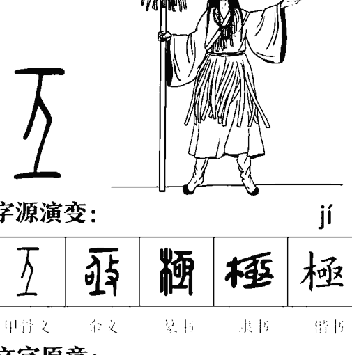

字源演变：

| 甲骨文 | 金文 | 篆书 | 隶书 | 楷书 |
|---|---|---|---|---|
| [字符] | [字符] | [字符] | [字符] | [字符] |

文字原意：
极的本义是“极”，是一个古国名或姓氏。……指极北、极高或最远。

思考题

请你分析一下《庄子·则阳》中的一段话：“孔子之楚，舍于蚁丘之浆。其邻有夫妻臣妾登楼者。”这里“登楼”是什么意思呢？

答案

这里的“登楼”指的是登上房顶，围观孔子。

《绥》

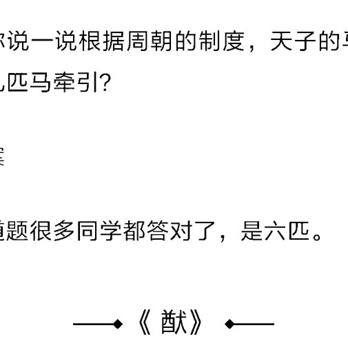

字源演变：

| 甲骨文 | 金文 | 篆书 | 隶书 | 楷书 |
|---|---|---|---|---|
| [字符] | [字符] | [字符] | [字符] | [字符] |

文字原意：
古代的女性服饰，也用以表示“柔顺、平和、安宁”，表示女子出嫁，依附于家的和平、安宁。

思考题

请你说一说根据周朝的制度，天子的马车由几匹马牵引？

答案

这道题很多同学答对了，是六匹。

《酋》

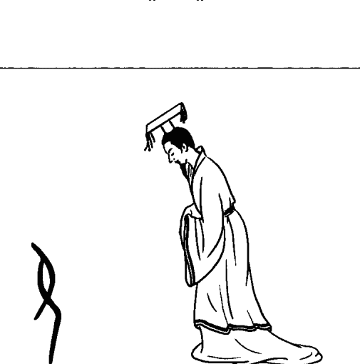

字源演变：

| 甲骨文 | 金文 | 篆书 | 隶书 | 楷书 |
|---|---|---|---|---|
| [字符] | [字符] | [字符] | [字符] | [字符] |

文字原意：
甲骨文里左边是盛有美酒容器，右边是一只动物。古代部落首领饮酒，向神灵敬酒，引申为酋长、首领。

思考题

故宫保和殿中有一个“皇建有极”的牌匾。这也是乾隆御笔。典故同样出自箕子《洪范》“皇建其有极”。请你分析一下这个牌匾的含义。

答案

极的本意是顶天立地，后指屋脊。政治上极是指中道，法则，意思是君王建立效事的最高准则是“极”，即中道。中庸之意。只有实行这样的最高准则，才是正大光明的皇权。

《允》

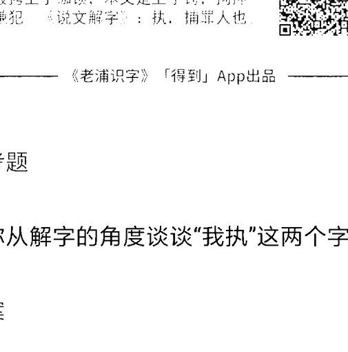

字源演变：

| 甲骨文 | 金文 | 篆书 | 隶书 | 楷书 |
|---|---|---|---|---|
| [字符] | [字符] | [字符] | [字符] | [字符] |

## 244【趣】追逐刺激的能 能

## 识字卡片

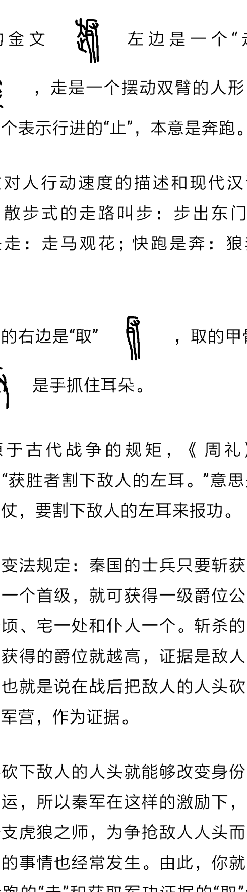

最好的老师是兴趣，我们都知道这句名言，但是你知道吗？兴趣的“趣”字追根溯源，是一种血腥的习俗。

趣的金文“趣”，左边是一个“走”，走是一个摆动双臂的人形，下面一个表示行进的“止”，本意是奔跑。

古文对人行动速度的描述和现代汉语不同，散步式的走路叫步：步出东门外；跑是走：走马观花；快跑是奔：狼奔豕突。

商朝变法规定：秦国的士兵只要斩敌敌人首级，就可获得一级爵位公人、田十顷、宅一处和仆人一人。斩杀的首级越多获得的爵位就越高，证据是敌人的首级，也就是说在战后把敌人的人头砍下来带回军营，作为证据。

只要砍下敌人的人头就能够改变身份，改变命运，所以秦军在这样激励下，变成了一支嗜狼的军队，为争抢敌人人头而自相残杀的事情也经常发生。由此，我们就明白表示跑的“走”和获取军功证据的“取”合起来的意思了，趣的本意就是跑、疾走。

《说文解字》：趣，疾也。从走，取声。

意思是：趣是快跑。字形采用“走”作边旁，采用“取”作声旁。我认为“取”既是声旁也是形旁，形容争抢战功的状态。

## 237【新】新年快乐！

## 识字卡片

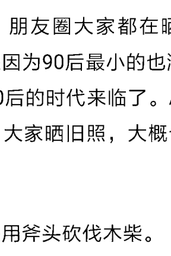

**字源演变：**
xīn
甲骨文、金文、篆书、隶书、楷书

**文字原意：**
甲骨文新右边是“辛”是斧声，右边的“斤”代表砍伐的斧子，合起来是用斧子伐木发音。由于斧子砍出新茬，引申为与旧相对的新。进而引申为开始

新年到了，朋友圈大家都在晒18岁的照片，据说因为是90后最小的也满18岁了，成年了，00后的时代来临了。总之这是一个新时代，大家晒旧照，大概也希望老树发新芽吧。

新的本意是用斧头砍伐木柴。

甲骨文 新 左边是“辛” ，辛的原意是给皇上刻字的刑刀，在这里是声符。

右边是“斤”， 原意是砍柴的斧子，合起来是用斧子砍伐木柴。

> 《说文解字》说：新，取木也。

衣之始裁为之“初”，木之始伐谓之“新”。意思是裁剪衣服叫“初”，砍伐木头叫“新”。

由于伐木会劈砍出新茬，所以引申为与旧相对的新，焕然一新。

新的东西令人喜爱，人不如故，衣不如新。进而引申为开始，新年。

砍伐木头的原意造新“薪”替代，由于柴米油盐是天天不能少的，薪又用作工资，薪水。

> 《大学》里有一段话：“汤之《盘铭》曰：‘苟日新，日日新，又日新。’《康诰》曰：‘作新民。’《诗》曰：‘周虽旧邦，其命维新。’是故君子无所不用其极。”

汤是成汤，是商朝的开国君主。盘铭是刻在器皿上用来警戒自己的箴言。这里的盘是指商汤的洗脸盆。苟的意思是如果。《诗》指《诗经·大雅·文王》。全句的意思是：商汤王刻在洗脸盆上的箴言说：如果能够一天新，就应保持天天新，新了还要更新。”

> 《康诰》说：“激励人弃旧图新。”

> 《诗经》说：“周朝虽然是旧的国家，但却更新了新的天命。”所以，品德高尚的人无时无刻不追求完善。

“苟日新，日日新，又日新”被刻在商汤王的洗脸盆上，原意是君王每天在洗脸的时候提醒自己，天天都要把自己洗干净，今天洗干净了，明天还要洗，天天都要洗。这里的“新”，是指新的面貌，就像君子修德，每天都要像洗脸一样，天天进步，天天更新。

昨晚现场听了罗振宇《时间的朋友》跨年演讲，感慨很多。我们今天所处的时代是一个高速变化的时代，不仅天天都是新的，时时刻刻都是新的。作为普通人，我们会不会被时代淘汰呢？罗胖的结论是作最好的自己，在自己的土地上深耕，互联网会裹挟着自己在更好的土壤接受引和扩散和放大自己，每个人都有机会，前提是，你得勤奋，得终身学习。

新的本意是劈柴，让我想起了海子的诗：

> 从明天起，做一个幸福的人
> 喂马、劈柴，周游世界
>
> 从明天起，关心粮食和蔬菜
> 我有一所房子，面朝大海，春暖花开

这不就是一个“新”字吗。

新的一年，愿我们日日新，又日新。共勉。

## 思考题

有一个字和“新”很接近，甲骨文是“木”右边是一把大斧子。你能猜猜这是什么字，和“新”有什么微妙区别吗？

## 总结

**划重点**

1. 新的本意是用斧子伐木劈柴，由于斧子砍出新茬，引申为与旧相对的新，进而引申为开始，新的一天，新的一年；
2. 原意另造“薪”，用作工资；
3. “苟日新，日日新，又日新”是刻在商汤王洗脸盆上的座右铭，喻君子修德每天都要让自己焕然一新。

## 238 |【厥】坚硬 的石头

## 识字卡片

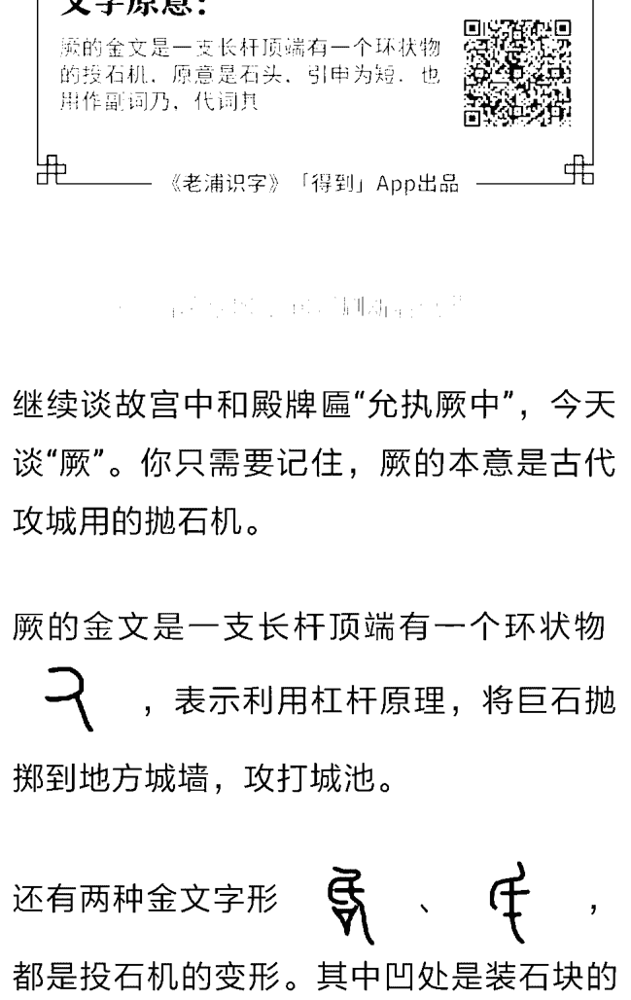

继续谈故宫中和殿牌匾“允执厥中”，今 天谈“厥”。你只需要记住，厥的本意是古代 攻城用的抛石机。

厥的金文是一支长杆顶端有一个环状物 ，表示利用杠杆原理，将巨石抛掷到地方城墙，攻打城池。

还有两种金文字形 、，都是投石机的变形。其中凹处是装石块的石匣，下面是长杆。这种投石器源自牧羊人的长柄铲，用以投石驱羊。

这是战国晚期的金文 ，和原来投石器的造型完全不同，“厂”的本意是反转，翻面。  是一个倒写的“大”也就是倒着的人形，原意是逆行。是欠，原意是吹气，合起来是逆气，气息倒行导致昏厥。看来这是造字本义完全不同的两个字，篆文将投石机的含义合并进来，成为我们今天使用的“厥”字。

厥的本意是石头，也代表短。古人管秃尾狗为厥唇，管野兽的角叫厥角。

大概由于“厥”短促的含义，这个字被借用为副词，表示乃、才。《史记》说：“左丘失明，厥有《国语》。”这个厥，就是副词乃、才的意思。也借用做代词，表示其、他的、他们的。允执厥中就是这种用法，在这里表示其、那的意思。

《尚书·泰誓》是周武王讨伐商纣王的公告演讲稿，据说是孔府家壁墙壁里发现的古文，秦始皇焚书坑儒，古书都烧光了，这里发现的古文就弥足珍贵。但也有人认为这篇文献是后人仿托。不管怎么说，这篇文章反映了儒家治国根本理念，其中我们今天还在用的名句就出自这里，如离心离德、同心同德、除恶务尽、作奇伎淫巧以悦妇人等等。

在这篇《泰誓》里，最重要的，是阐释了“革命”的观念：天子是承受上天之命“来管理人民的，天上说让君，是为了给人民带来利益，一旦君主残害人民的时候，他就失去了上天的使命，成为“一夫”，而反对“一夫”的“革命”，是顺应天意和民意的行为。

因此，讨伐暴君不是“弑君”。“革命”的典型，就是商汤讨伐夏桀，以及周武王讨伐商纣的战争。《易经》上说“汤武革命，顺乎天而应乎人。”

近代的中国人用“革命”一词翻译西方人“revolution”这个词。相信你也看得出来，现代汉语的革命已经不是古文革命的原意了。

在《尚书·泰誓》中有一句话百姓懂，若崩厥角。呜呼！乃一德一心，立定厥功，惟克永世。"意思是人民畏惧不安，好像崩石摧坏额角一样。啊！我们要一德一心，建立自己的功业，才能够永垂后世。其中第一个“厥角”，就是指野兽的短角。后来就用“厥角”指以额叩地。第二个“厥功”，就是代词，其的意思。

## 思考题

“允执厥中”咱们分析了前三个字了，那合起来是什么意思呢？欢迎你在留言区写下你的看法。

为了鼓励你踊跃思考，回答问题，我会挑选3位用户送出50元知识奖励金，直接充值到你的得到账户。

## 总结

**划重点**

## 239【 戏 】 2017 年度汉字

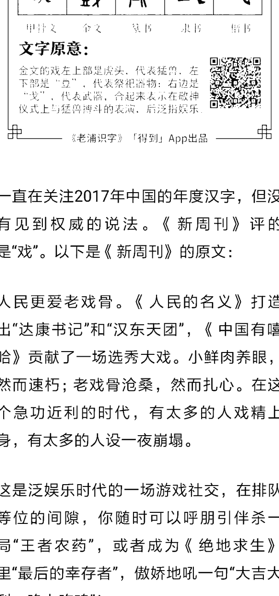

一直在见证**2017年中国**的年度汉字，但没有见到权威的说法。《新周刊》评的是“戏”。以下是《新周刊》的原文：

人民更爱老戏骨。《人民的名义》打造出“达康书记”和“汉东天团”，《中国有嘻哈》贡献了一场选秀大戏。小鲜肉弄髯，然而趣归；老戏骨沧桑，然而扎心。在这个急切功利时代，有太多的人戏谑上身，有太多的人设一夜崩塌。

这是泛娱乐时代的一场游戏社交。在排队等位的时候，你可以随时与朋友呼朋引伴“杀一局”“王者农药”，或者成为“绝地求生”里“最后的幸存者”，做地坑喊一句“大吉大利，晚上吃鸡！”

我们在太多事情上缺乏游戏精神，却又在太多事情上太过儿戏。

所以，《新周刊》认为，2017年中国的年度汉字就是：**戏！**

戏的字源 **“戏”** 是一个“虎头” 𡿨，代表老虎这样的猛兽，下面是“豆”𠀗，代表祭祀器物，右边是“戈”𢦙，代表武器，加起来是在祭祀仪式中为愉悦神灵而进行的角斗表演。

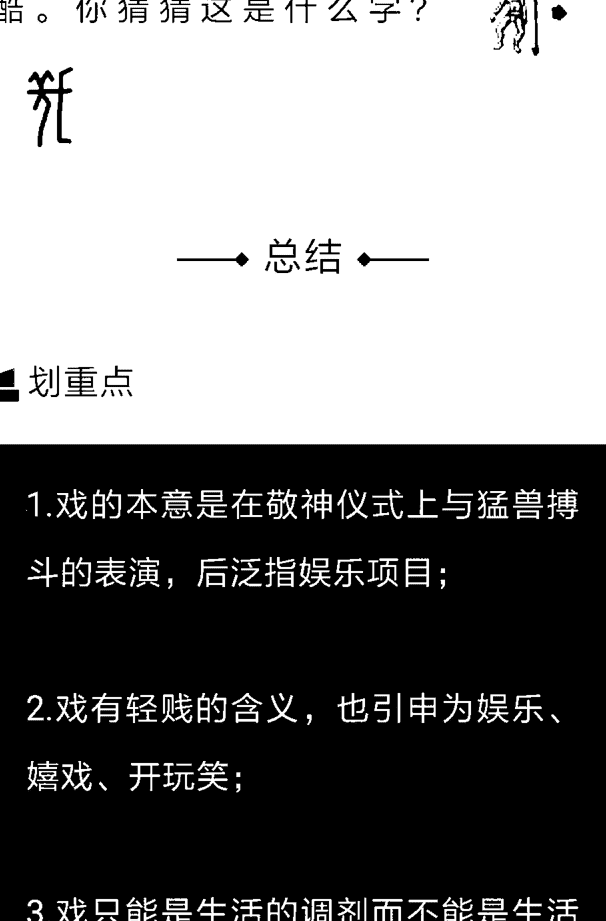

从这幅汉画像石图我们可以清楚地看到，一个勇士腰里别着武器，正与手和凶猛的老虎搏斗，类似与古罗马的角斗士表演，这可以是以命相赌的游戏。

戏的本义是角斗、角力，由于是奴隶的以命相赌，所以有轻微的含义。

《左传·僖公二十八年》记载了城濮之战，有这么一段话：

> 子玉使斗勃请战，曰：“请与君之士战，君冯轼而观之，得臣与莑焉耳。”

意思是，楚国的 王孙子玉派斗勃来挑战，对晋文公说：“我请求同您的士兵们较量一番，您可以扶着车前的横木观看，我子玉也要奉陪观看。”

这里的“戏”，就是角力的意思，当然，也是一种轻微的说法，意思是让他们玩玩，我和您一起欣赏。

戏在古代既是愉悦神灵，其实是娱乐贵族。渐渐地，类似的娱乐活动也称之戏，并有了娱乐、嬉戏、开玩笑的含义。“烽火戏诸侯”是指周幽王为博褒姒一笑，点燃了烽火台，开玩笑戏弄了诸侯。

这是四川出土的东汉说唱俑，表现了一个说书人说到精彩处，手舞足蹈，也是古代戏的典型表现形式，现收藏于中国国家博物馆。

戏学成为2017年的中国年度汉字，表明这一年来娱乐在生活中的地位越来越重，电视台的娱乐节目怎么限制都火，电视剧、电影越不靠谱越受欢迎，人们似乎已经没有了耐心思考严肃一点的话题。

但是注意，我们今天给了你戏学的两个面孔，一个是欢乐的说唱，一个是危险的搏斗。告诉我们，游戏适度是欢乐，玩大了就危险了。

## 思考题

戈是古代的兵器，泛指武器，这个甲骨文是戈划掉了一个人的脖子，看着就很残酷。你猜猜这字是什么？ 𢦙

## 总结

**划重点**

1. 戏的本意是在敬神仪式上与猛兽搏斗的表演，后泛指娱乐项目；
2. 戏有轻微的含义，也引申为娱乐、嬉戏、开玩笑；
3. 戏只能是生活的调剂而不能是生活本身，适度是欢乐，过头有危险。

## 240【绔】真正的纨绔子弟很低调

## 识字卡片

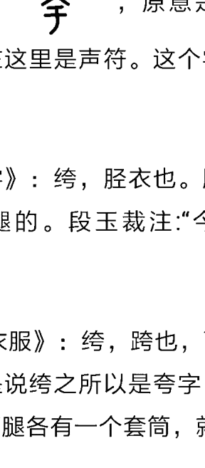

**字源演变：**

| 铁 | 缺 | 绔 | 绔 | 绔 |
|---|---|---|---|---|
| 金 | 玉 | 丝 | 古 | 今 |

在写“纨”这一期的时候，联想到了经常读的这个词：纨绔子弟，有人会念成“纨跨子弟”，我问过身边的朋友，他们都能正确发音，但纨绔子弟的原意，却很少有人了解。

今天咱们就来说说“绔”，从解字的角度理解这个成语。你只需要记住一句：纨绔是高级丝绸做的开裆裤。

绔 绔 是代表丝织品的绞丝旁，右边是“夸”，原意是吹牛的声音很大，在这里是声旁。这个字指没有档的裤子。

《说文解字》：绔，胫衣也。胫是腿，胫衣就是套腿的。段玉裁注：“今所谓套裤也。”

《释名·释衣服》：绔，跨也，两股尽跨别也。意思是说胯之所以是夸字，是取跨越的意思，两腿各有一个套筒，就叫绔。

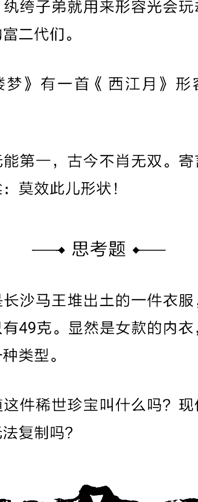

有人说这就是古代的开裆裤，这么说没错，有一种绔就是包含裤腿的开裆裤，还有一种是没有裤腿，只有两个裤腿的套筒，有点像古代的内裤。

## 241【享】敬神才能安享

## 识字卡片

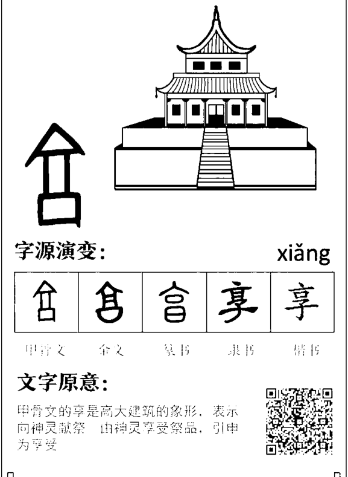

有用户提出希望我讲“享”字，这个字也是年度汉字的热门字，应该和2017年方兴未艾的共享经济有关。

享的甲骨文 [“享”字甲骨文图形] 是一个有高大基座的房子，表示祭祀的庙宇。

有的甲骨文 [“享”字甲骨文图形] 像多层楼房的庙宇，以显示这种建筑的庄严，本意是奉献祭品，祭祀祖先。

在古代，用手直接抓吃粗食为“饭”；有吃有喝的正餐为“食”；高级宴会为“餐”；鬼神享用祭品为“享”。

甲骨文的这个字形还分化出另一个字“亨”，表示祭祀神灵的效果，万事通达，亨通。

《左传·僖公五年》中有一句话：“如是，则非德，民不和，神不享矣。”

意思是：如果这样做，就不是德了，人民不和，神都不会来享受祭品。是什么行为让神都不理你了呢？

故事是这样的，晋献公再次向虞国借路进攻虢国。宫之奇劝阻说：“俗说的辅车相依，唇亡齿寒，”

意思是犬车的板和车子互相依存，嘴唇和牙齿相互依存，嘴唇缺了，牙齿必然寒冷，这说的就是虞国和虢国的关系。”

虞公说：“吾享祀丰洁，神必据我。”说我要祭祀的祭品又丰富又洁净。

对曰：“臣闻之，鬼神非人亲，惟德是依。”“意思是鬼神并不是亲近哪一个人，而只是依从有德行的人。

《尚书》说：皇天无亲，惟德是辅。意思是说上天没有私亲，只对有德行的才加以辅助。所以，“民不和，神不享矣。”

后来的结果你肯定知道，晋国在灭了虢国以后，顺道灭了虞国。这就是假途灭虢，唇亡齿寒的故事。

古人相信鬼神，所以奉敬归神的享是很洁净虔诚的，但宫之奇告诉我们，上天帮助自助者，只有好的德行，上天才会帮助你。德行才是最好的奉献。

“分享”源于祭祀以后将祭品分赐众人，以示得到神的庇护。从这个意义上说，我们每天在朋友圈转发分享的，是你的感情，你对朋友的奉献。有奉献之心，才可能得到回报。而奉献符合天地大道，才能得到神灵的保佑。

## 思考题

享、亨都是祭祀，“烹”是“亨”字下面加上火，你能猜“烹”的原意吗？

## 总结

**划重点**

1. 享是高大建筑的象形，表示向神灵献祭；
2. 由神灵享受祭品，引申为享受；
3. 享分化出“亨”，表示由于敬神而万事通达；
4. 假途灭虢、唇亡齿寒的故事告诉我们，最好的祭品是自己的德行。

## 242【问答】故宫中的牌匾“允执厥中”是什么意思？

## 《新》

字源演变：xin

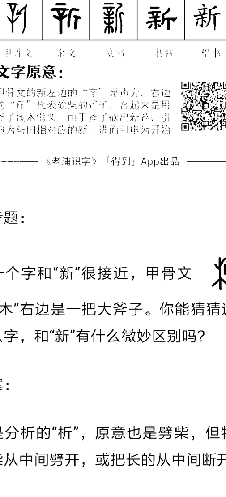

**思考题：**

有一个字和“新”很接近，甲骨文为“木石边是一把斧子。你能猜猜这是什么字，和“新”有什么微妙区别吗？

**答案：**

这是分析中的“析”，原意是劈柴，也特指把柴从中间劈开，或把长的从中间断开。

《说文解字》：析，破木也。一曰析白。从木从斤。

## 《厥》

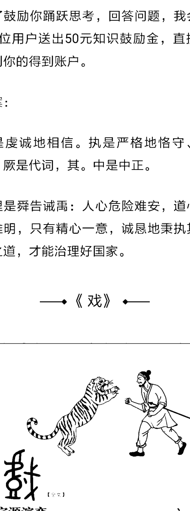

**思考题：**

“允执厥中”咱们分析了前三个字了，那合起来是什么意思呢？欢迎你在留言区写下你的看法。

为了鼓励大家踊跃思考，回答问题，我会挑选3位用户送出50元知识鼓励金，直接充值到你的得到账户。

**答案：**

允是虔诚地相信。执是严格地恪守、遵守。厥是代词，其。中是中正。

这里是舜告诫禹：人心危险难知，道心微妙难明，只有精心一意，诚恳地执其公正之道，才能治理好国家。

## 《戏》

**思考题：**

戈是古代的人用的一种武器，这个甲骨文字形就是一个持戈的人形，看起来很酷。你猜猜这是什么字？

**答案：**

这是找，原意的砍头，后引申为砍，伐树木，还引申为争议，如讨伐。

## 《绔》

**思考题：**

下图是长沙马王堆出土的一件衣服，它的质量只有49克，显然是女款的内衣，和纨绔是一种类型。

你知道这件稀世珍宝叫什么吗？现代技术真的无法复制吗？

**答案：**

这是素纱禅衣。汉代的蚕宝宝是三眠蚕，而我们今天的蚕宝宝是四眠蚕，吐出来的丝不古代的蚕宝宝的丝要粗三分之一。

但现代技术也可以通过宠物吃蚕宝宝变为三眠蚕，项羽为了刺激刘邦出战，在阵前支起大鼎，声称不出战，就烹了刘邦的父亲。刘邦回答：“吾与若俱北面受命怀王，约为兄弟，吾翁即若翁，必欲烹乃翁，予我一杯羹。”

## 《享》

## 243【寒】寒什么不能寒心

现在是“小寒”节气，是一年中最寒冷的日子。俗话说：“小寒大寒，冻成一团。”

寒字金文 [金文图像]，是代表房屋的宝盖里面有一个躺着的人，下面是“夕” [夕图像]，周围都是“艸”，代表御寒用的茅草、稻草，下面的“夕”，代表夜晚，再下面是“冰” [冰图像]。

“艸”的御寒效果不好，在古代最好的御寒品是毛皮，那为什么不算棉花做的被子呢？棉花最早是秦汉时期才传入中国的，而且很长时间人们是是把这种植物当做观赏品来养殖的，中原地区大概到南宋时期才有棉布，所以商周时期那么会儿应该还没有棉花。

房子里有冰，说明很冷，“夕”的字符表示这是在晚上睡觉，合起来表示一个人在屋里睡觉冻的瑟瑟发抖，原意是冷。

> 《说文解字》：寒，冻也。人在宝盖头下，以草席覆之。

意思是：寒就是冻、冷。字符表示人在宝盖，即房子下面，用草席子垫盖，下面有冰。

古人认为“凉”是冷之始，“寒”是冷之极。

由极冷，成为形容所有冷的词：寒潮、寒、寒光、寒来暑往，进而形容人的心理：寒颤、寒战、心寒。

幸福感的前提是暖和，一个人在寒冷的状态下是不可能有意福感的。而人的寒冷感，一方面来自外面的气温，一方面也来自人身边的饥饿，所谓饥寒交迫。

所以“寒”字就用来形容人贫穷的处境：寒微、寒俭、寒苦、寒酸、寒门等等。杜甫说：安得广厦千万间，大庇天下寒士俱欢颜。

在陕西西安有一个寒窑的传说。王宝钏是白富美，偏偏爱上了一个北漂薛平贵。她绣球有意打中了穷小子，让王宝钏的父亲很不高兴，以致断绝了父女关系。

王宝钏随着薛平贵住进了一个破窑洞，过着清贫的生活。后来薛平贵从军出征，王宝钏就在这寒窑里苦等，一等就是十八年。这期间，王宝钏并没有向父亲低头回到娘家，只有妈妈心疼女儿，时常悄悄送一些东西接济。薛平贵功名成就回来，与王宝钏团圆。

这是一个典型的中国大团圆故事。你还记得咱们讲过司马相如卓文君的故事吧，同样是白富美追求爱情离家出走，同样是断绝父女关系。司马相如卓文君是杀回家乡当垆卖酒让父亲难堪，最终逼迫父亲拿出了财产。王宝钏却是独守寒窑，家财万贯也和自己没关系。这两种选择你更赞成哪一种呢？哪一种生活更幸福呢？

## 思考题

寒，屋子里都结了冰，一定是一个破房子。房子破了就得修，这个甲骨文 [房屋图像] 就是在修房子，房屋 [双工图像] 里两个“工” [双手图像]，表示有很多工具，双手 [双手图像] 表示干活，合起来表示使用工具修补房屋。你来猜猜看，这是个什么字？

## 总结

- 寒的字形是房子里一个人晚上躺在草堆里，屋里还结了冰，本意是极冷；
- 由于极冷，寒字便用来形容所有很冷的事物，进而形容人的心理和处境；
- 王宝钏独守寒窑是传统故事，反应了传统的价值观：忠贞。

## 245【晃】摇摇晃晃与晕晕乎乎

小时候认字的时候感到奇怪，为什么摇摇晃晃的晃字下面有一个“光”，问谁都是瞎猜，死记硬背也就不想了。

晃的篆文，是“日”旁边一个“光”，表示明亮。《说文解字》：晃，明也。

理解晃，先要了解“光”。

光甲骨文是一个跪坐的人头上有一团火，这是夜晚一个人打着火把的形象。这个人也许是巫师在用火举行仪式，也许是王的宫殿中手举火把照明的奴仆。文字学家林义光说：古者执烛以人，从人执火。意思是说古代都是用人来秉持火烛的，所以“光”字是人执火。

所以白昼发出光亮的“日”加上“光”，晃，就是日光明亮的意思。

西晋潘岳《秋兴赋》中有一句：蝉喈喈而寒吟兮，雁飘飘而南飞。天晃朗以弥高兮，日悠阳而浸微。

潘岳就是中国历史上最有名的美男子潘安，你看这一小段文字，是不是也很帅。喈的本意是星光微小而明亮，这里的意思是小小而尖细的声音，悠是宁静自若，安然平和的鸣叫，雁飘飘地南飞。天色明亮清朗，显得格外高远。太阳安然平和。

为什么明亮的日光变成了摇摇晃晃的晃了呢？

还是来看晃这个字的点，即对眼睛的刺激。

晃字在使用过程中，还用作动词，表示一闪而过。如有个人一晃、虚晃一枪。

在中国文化史上，有一个著名的比喻。《庄子·知北游》：“人生天地之间，若白驹之过隙，忽然而已。”意思是人生就像一匹白马掠过狭窄的空隙，一闪即逝。这种白驹过隙的感觉，就是一晃而过的感觉。

晃还用作副词，阳光刺眼闪曜，使失去清晰视觉，使人目眩，叫晃眼。

一晃而过的恍惚，阳光刺眼的晃眼，都是对眼睛的刺激，都容易让人失去平衡，于是就引申为摇动，摇摇晃晃的样子。这种状态还引申出摇头晃脑、晃来晃去等等。

而这时候，读音由晃[huǎng]变成晃[huàng]。

这个字反应了汉字造字两个重要的特点：

- 光亮是通过与黑暗对比来表现的，光是夜晚的火把，明是窗前的月光；
- 动作用心理的感受来表现，晃的眼睛恍惚产生的失衡感，是争夺战利品的急迫感。

## 思考题

日加上光是晃，而“心”加上光是恍，都是光线对心理、生理上的影响。请你分析一下这两个字微妙的差别。

## 总结

划重点

- 晃是阳光明亮，本意是明亮；
- 用作动词形容一闪而过，白驹过隙。用作副词就是阳光刺眼，晃眼；
- 由晃对眼睛的刺激带来的失衡感，引申为摇摇晃晃的晃动。

## 246【荒】从荒原到荒唐

## 识字卡片

| 字源演变: huāng | | | | |
|---|---|---|---|---|
| 象形 | 古体 | 古隶 | 今体 | 简体 |
| 荒 | 荒 | 荒 | 荒 | 荒 |

荒唐是形容人类社会的各种不靠谱，怎么和荒野、饥荒共用一个字呢？

- 荒的金文，没有后来的草字头，是“亡”下面一个“川”。
- “亡”的甲骨文是一个人躲在一个斜坡下面，原意是逃跑，在甲骨卜辞里也常用于“不”的含义，引申为死亡。
- “川”的甲骨文是河流的象形，几个小点表示河里的浪花。“亡”加上“川”，表示洪水泛滥，大地一片洪荒。

世界上很多古老民族都有大洪水的记忆，《圣经》中有诺亚方舟的传说，楔形文字记载的亚述文明也有大洪水的传说。美洲、非洲的古老民族都有各自的大洪水的传说，甲骨文表示过往的“昔”就是水在日上，代表大洪水的记忆。

- 篆文，增加了草字头，含义发生了变化。草字头代表生长茂盛的草木，合起来表示被水淹没的湿地，草木茂盛却没有人烟。荒无人烟。

今天我们知道，没有人烟的荒地并不等于没有生命。恰恰相反，越是荒地生命的形态越是丰富。我以前做过一期关于圆明园的节目，对于要不要恢复圆明园昔日的辉煌，专家们争论非常激烈，其中一个重要的原因，是圆明园荒凉了上百年，没有人类的干扰，圆明园里的物种异常丰富，是华北地区生物种类最为繁多的地方。如果修复圆明园，势必破坏这里的动植物资源，这个结果真让人惊叹。

## 247【累】累是一条粗重的绳索

## 识字卡片

- 字源演变：织 缣 (Graphic) 累 累 [léi] [lěi]
- 文字原意：（小篆字形图片）（繁体说明文字与二维码）

2017年就这麽过去了，你记得吗？你找到累的原因了吗？新的一年，能不再那么累了吗？要搞清楚这个问题，你得先了解“累”字是怎么回事。

## 累是一条绳索

累的古文（图片）是三个“田”，结合下面表示丝线的“糸”可知，这是三股绳子扭结而成的粗绳索。这个字的本意就是绳索。

《说文解字》：累，缀结理也。一曰大糸也。意思是：累是将丝线连接得有条理。另一种说法认为，“累”是粗绳索。

由于粗的绳索是很多根麻或丝线编织而成，所以引申为集聚、堆积；积累（lei 3声）。南北朝·范晔《乐羊子妻》：一丝而累，以至于寸，累寸不已，遂成丈匹。累计、积累、日积月累、危如累卵。

《战国策·秦策五》讲了一个故事：战国时阴晋商吕不韦下了一盘大棋，他决定风险投资一个国君。在收获了在赵国当人质的秦国王子异人以后，他来到秦国，找到秦王后华华阳夫人的弟弟阳泉君，说：“君之罪至死，君知之乎？君之下府无不是高尊位，太子门下无贵者。君之府藏珍珠宝玉，君之骏马户外原，美女冲后殿。王之春秋高，一日山陵崩，太子用事，君危于累卵，而不寿于朝生。说者可以一切而使君贵千万及，其宁于太山四维，必有危亡之患矣。”

“您将遇到杀身之祸，知道吗？您手下的人都身居高官显位，太子手下却无显贵的人；您的府库收藏有珍珠宝玉；您的马房里畜满千里骏马，您的一后宫之中尽是美丽女子。秦王年事已高，一旦百年之后，太子执政，您的处境就会危如累卵，命在旦夕。现在有一计策，使您永保富贵，安如泰山，绝没有危亡的祸患。”

这是成语“危于累卵”的来历，非常形象，华阳夫人既然是秦王宠爱的正夫人，但她的地位取决于秦王，秦王一旦不在，这种地位的脆弱不就像鸡蛋一样吗？而秦王身体不好，随时可能不在，这形势不就像累积起来的鸡蛋一样危险吗？难怪华阳夫人的弟弟听秦王这么一冷分析，赶紧站出来躬身施礼，请教救败之计。所以这个故事更适用成语居安思危。

后来的故事你一定也知道了，吕不韦介绍让华阳夫人收异人为义子，秦王死了以后，异人就成为国君，这就是秦始皇的父亲。

集聚、堆积是繁琐辛劳的事，因此“累”字引申为烦劳、妨害、忧患等含义，又由于绳子连接的特点，就有了牵连、相互影响的含义，这就是连累、牵累、拖累的来历。

繁琐、辛劳、纠缠不清，必然是筋疲力尽，所以“累”就形容困难、疲乏、劳累、疲累、累死累活、又苦又累。

明白了“累”字的来历，就知道人为什么觉得累了，那就是繁琐、纷乱、不断重复、不断消耗。所以要想不累，想想绳子的形象就可以了，要把事情梳理清楚，清清爽爽，不能多头并进，眉毛胡子一把抓。最重要的是简单，越复杂越累。

## 思考题

由“糸”组成的字很多，说明纺织是当时社会生活的重要方面。这个甲骨文当时（图片）是两根丝线被切断了，你猜猜这是什么字。

## 总结

划重点

- 累的本意是由很多丝线或麻线编成的粗绳，本意就是绳索；
- 由于编织绳索繁杂辛劳，因此引申为聚集、堆积，进而引申为烦劳、妨害、忧患，形容困难、疲乏，劳累、疲累、累死累活、又苦又累；
- 避免累的办法就是把事情清晰化、简单化。

## 问答

## 248【 问答 】荒芜的“荒”是草木不生，还是野草随风乱舞？

**思考题**：寒，屋子里都结满了冰，一定是一个破房子。房子破了就得修，这个甲骨文就是在修房子，房屋里面两个“工”表示有很多工具，双手表示干活，合起来表示使用工具修栋房屋。你来猜猜看，这是什么字？

**答案**：这是寒。原意是修户破屋的漏洞。

**思考题**：有“走”作字符的汉字都与动作有关，篆文“赶”是“走”，加上缠绕的绳索，表示捆绑俘虏而行。你猜猜这是什么字？

**答案**：这是赶，赶走者捆绑俘虏凯旋。

**思考题**：日加上光是晃，而“心”加上光是恍，都是光线对人心理、生理上的影响。请你分析一下这两个字微妙的差别。

**答案**：恍的原意是狂的样子，都是光对人体的影响，晃的是明亮的线条，而恍的线条不一定是明亮的，也可能是变幻不定的。恍惚、恍若、恍然大悟。

**思考题**：荒芜常常连用，荒也是草字头，下面一个“昆”，请你分析一下“荒”字怎么解。

**答案**：舞的甲骨文是一个 一个人手持枝跳舞，是祭祀仪式上的舞蹈，用来借用为“没有含义或无的舞，原意就加上双脚，成为“舞”。由于“舞”的含义是后来借用的，所以这里仍然是“”的含意，表示草木杂乱、随风飞舞，原意是从生的草。和“荒”的字在开发管理的含义合起来，表示荒芜丛生。

**思考题**：由“丝”组成的字很多，说明纺织是当时社会生活的重要主线。这个甲骨文文字就是两束丝线被切断了，你猜猜这是什么字？

**答案**：绝。《说文解字》：绝，断丝也。

**老蒲**

《老蒲汉字》还有将近一个月就要毕业了，恰巧您在年底。所以想给各位读者一个福利，由你来决定最后一周《老蒲汉字》要解释什么字。

## 参与方式：

- 在留言中写下你最希望我来解的字，并说明解释理由。（ 提示：尽量挑选大众的，而不是过于针对性的字。）
- 在留言中写下你最希望年底送给亲朋好友的。你会有工作人年做成电子卡片，发给你达人。（ 提示：比如送给做生意的人，可以是“财”。）

被选中的大家，可以获得 100 元得到充值，希望大家踊跃参与留言。

## 249 | 强 | 挽弓当挽强

## 识字卡片

在咱们当代人名中，用“强”的非常多，男儿当自强，这是很恰当的事。但是你有没有疑惑过，强大、坚强的强，为什么字形里会有“虫”？还有一些书法家的横版“自强不息”写成了这个边框的疆少了一个“土”，怕雷法不敢问。

强的确有两种不同的写法，而且字源和字不同的。

第一种是金文“𢎩”，是代表弓箭的“弓”加上代表疆界的“𢂄”，本意是用弓箭丈量土地，划定疆界。引申为多、坚硬，后原意加“土”为“疆”，引申为“强”和“彊”。

“强”“𢎩”是后造的字，是“弘”字下面加一个“虫”“𢖃”。

弘的本意是弓弦声音很大，虫是怎么回事？

虫“𢖃”在甲骨文时期指蛇，但后来一度泛指所有动物，古人按金木水火土把动物分为五类。羽虫是飞鸟，毛虫是兽类，甲虫是有硬壳的动物，鳞虫是鱼类及蜥蜴、蛇等有鳞片的动物，蛊虫也叫倮虫。民间把凶猛的老虎叫大虫。而在北方，猛兽是很多的。

> 曹操《苦寒行》：树木何萧瑟，北风声正悲。熊罴对我坐，虎豹夹路啼。溪谷少人民，雪鸿何霏霏！

## 250【独】人生第一种境界

王国维在《人间词话》中提出了著名的人生三境界：古今之成大事业、大学问者，必经过三种之境界：“昨夜西风凋碧树。独上高楼，望尽天涯路。”此第一境也。

抛开原词的意境，单拿这句而言，西风萧瑟，象征人生已经过了春的勃发和夏的火热，进入清冷的秋季，也许遭到了挫折，也许人到中年一事无成。独上高楼，远方在雾霾中若隐若现，前途在哪里？还有希望吗？

这难道是成大事者的人生境界吗？

是。用一个汉字概括，就是“独”。

独的篆文 [篆文'独'图像] 是“犬” [犬图像] 加上巴蜀的“蜀” [蜀图像]，对于这个字的解读，难点就在“蜀”字。

甲骨文 [甲骨文'虫'图像] 是“目” [目图像] 下面 [下图像] 表示蛇的“虫” [虫图像]。

有人认为，这是大眼睛的虫子。

《说文解字》认为：蜀，葵中蠵也。从虫，上目象蜀形，中象其头蜇。

《诗》曰：“娟娟兮蜀。”意思是蜀是葵中的蠵蛸虫。“虫”作边旁，字形上部的“目”像蜀头形，中段像它的身子娟娟蠕动。

《诗经》上有诗句：“蜹子娟娟。”

也有人认为这是瞪大眼睛看蛇，三是雄眼睛凸出的面具就是这种情形的表达，寓意眼镜负有神性，可以明察秋毫。

蜀是地名，许慎的解读是说西南地区生产蚕丝，是丝绸的重要产地。而解读为瞪眼看蛇的是说西南地区多蛇，属于偏僻蛮荒之地。两说都有道理。

犬和蜀合起来，表示有独自瞪着眼看的状态。《说文解字》：独，犬相得而斗也。从犬从蜀。羊为羣，犬为独也。一日北疆山。徂徐音意是，狗，分身，家藏，尾尖。由谷谷彻意是狗凑到一起就打架。羊喜欢成群，狗只能独处。还有一说，独是一种蜀地的野兽，大小像虎，白色身体，猪嘴，尾巴和马一样。

许慎起码对狗的理解是不对的，在商周时期，狗主要用于狩猎，而狩猎的狗总是成群的。我个人的理解，独恰怡表现了狗被迫离群以后，瞪着眼睛孤立的样子。

由狗的离群独处，“独”字用于单个的孤单的状态，独自、独立、独创、独霸、独当一面，独具匠心、独辟蹊径、独树一帜，君子慎其独也。

为什么“独”是成功人生的第一种境界呢？

先讲个故事。据说在1979年6月的时候，中国派出了一个代表团去美国考察教育的基础教育，回国后写了几十万字的报告，认为美国的教育重视体育美，忽视数理化。美国的学校课堂乱如集市，下午一点钟就放学回家了，结论是美国的基础教育病入膏肓，再过二十年，中国的科技将超过这个所谓的超级大国。

同年，作为互访，美国也派了一个代表团到北京、西安、上海等地参观了好几个学校，回来以后也写了一份很长的报告，认为：中国的学生是世界上最长得最早，睡得最晚，最勤奋的学生，他们的成绩远远超过美国学生，可以预测，再过二十年中 国的科技必将美国远远地甩在后面。

三十多年过去了，美国病入膏育的教育又培养了80多位诺贝尔奖得主，而，作为创新型国家，它的科技继续领先世界。

中美教育最大的区别是中国纪律性，重集体，重掌握知识的成续。美国中个性、鼓励提问，鼓励创新。事实证明，独立的创新素养比学习成绩重要得多。

独立不仅仅是创新能力，独立的思考判断能力也至关重要。

一个人能够脱离群体独立思考、独立判断，因而独上高梗而感到孤独的时候，正是人生走向成熟的第一步，是成就人生的第一种境界。

## 思考题

王国维《人间词话》：“衣带渐宽终不悔，为伊消得人憔悴。”此第二境界也。这第二种境界如果用一个字来概括，你会用哪个字？

## 总结

- 独是狗被迫离群，瞪着眼孤单的样子，用于形容个体的、孤单的事物；
- 独立思考是一个成熟人的标志，是迈向成功的第一步。

## 251【为】为所欲为就对了

## 识字卡片

王国维在《人间词话》中提到的人生三境界的第二重境界是“衣带渐宽终不悔，为伊消得人憔悴。”

衣带渐宽是叫人变瘦了，这可不是减肥的瘦，而是长期悬总身体憔悴瘦下来了。

单说这句话的境界，有了“伊”，就是有一个确定的奋斗目标，为了实现这个目标，不惜憔悴，也就是不懈努力。用哪个汉字来概括这个境界呢？我选“为”。

为的甲骨文是一只手牵着一头大象，表现古人通过驯化大象耕种农田，本意是耕种，引申为工作、制造、作为。

《说文解字》：为，母猴也。其为善好爪，爪，母猴象也。下腹为母猴形。

意思就是“为”是母猴。猴喜欢用它的爪子。爪，就是母猴的特征。

“为”的字形下部就像母猴的形状。

许慎没见过甲骨文，根据篆文字形猜测，闹了很大的误会。

“为”是常用字，本意是工作，作为，有所为。在使用的过程中产生了两个方向的引申。

一个方向是向后，表示做事的结果。

曹操在《龟虽寿》中写道：神龟虽寿，犹有竟时；腾蛇乘雾，终为土灰。老骥伏枥，志在千里；烈士暮年，壮心不已。

这首诗是传说神龟能活千年，但终究会死；传说神蛇能够腾飞，但总有一天会死掉变成尘土。

曹操在这里的意思是人的寿命不是看你能活多久的，而是看是否有所作为，成就一番流芳百世的功业。

春秋时鲁国大夫叔孙豹称“立德”立功”立言”为“三不朽”。

“立德”，即树立道德；“立功”，即为民建功立业；“立言”，即提出具有真知灼见的言论流传后世。

老骥伏枥，志在千里；烈士暮年，壮心不已。这是名句，含蓄地表达自己的追求，老马趴在马厩已经走动不了，但纵横千里的志向还在。风风火火一辈子的老人雄心犹在，正是一个成大事业者的素养。

这里的“为”，就是结果，成为的意思。

“为”字引申的另一个方向是向前，表示做事的原因，为什么、为民请命、为人民服务。

为什么“为”是成大事业者的第二境界呢？给你讲一个故事。

我有一个晚辈，大学学的是广告专业。毕业以后对于选择什么职业开始迷乱，当时我们每个周末家庭聚会的时候，每周都能听到她新的职业规划，一个都相差很大。在两三年内尝试了多种职业，跳了很多次槽以后，她终于决定出国留学，从头寻找自己的职业方向。

很多人都有这样的苦恼，觉得自己有好多爱好，得多特长，但是究竟什么是自己的最爱，究竟应该以什么为自己的职业，一直搞不清楚。

所以，清晰地知道“自己的”伊”即追求目标，为他憔悴为他狂，其实是成就事业的基础。

有所为有所不为，确定了目标以后，就要坚定不移地去谈。罗振宇在《时间的朋友》跨年演讲中谈到，互联网已经从采集时代进入农耕时代，每个人都要找到自己的土地精耕细作，只要做最好的自己，就不怕被时代淘汰。

为所欲为，坚持做自己想做的事，就对了。

## 思考题

“众里寻他千百度，蓦然回首，那人却在灯火阑珊处。”

此第三境也。这句话里的哪一个字能够表达这种境界？你也可以选一个不在诗词里的字，期待你的回答。

## 总结

重点

- “为”是手牵大象作务，本意是工作、作为；
- “为”向后引申是工作的结果，腾蛇乘雾，终为土灰。
- 向前引申是工作的原因，为什么、为人民服务；
- 有目标并为之不懈努力，是成大事业者的第二境界。

## 识字卡片

字源演变：

| 炛 | 静 | jìng |

文字原意：

“静”的古文字是一个青的形声字，上面是青，下面是争。青是表示声音的青，所以静就是安静。

王国维在《人间词话》中谈到成大事业者的三种境界，“众里寻他千百度，蓦然回首，那人却在灯火阑珊处。”此第三境也。

王国维引用的辛弃疾《青玉案·元夕》的原文是这样的：

> 东风夜放花千树。更吹落、星如雨。宝马雕车香满路。凤箫声动，玉壶光转，一夜鱼龙舞。
>
> 蛾儿雪柳黄金缕。笑语盈盈暗香去。众里寻他千百度。蓦然回首，那人却在，灯火阑珊处。

这描写了正月十五元宵节的热闹情景，整首词用一个汉字来概括，那就是“静”。

静的古文是 
𢧚
 ，一个争字的形，这是“静”的甲骨文 
𠂋
 ，是两只手在争夺牛角的物品。

在“争”的里面是“青” 
𢅠
 ，本意是草木生发的颜色。古人用纷争来衬托青背小草的安宁。就像辛弃疾词中用热闹衬托灯火阑珊处的安静一样。

有成就的境界是安静的境界，也是寂寞的境界。

这是一个苦苦追寻，终于找到答案的如释重负，这是一个终于得以体悟人生真谛原本在平平常常，甚至冷冷清清之中。

有一首《问春》和辛弃疾的词讲的境界可以互相映射：

> 尽日寻春不见春，芒鞋踏遍陇头云，归来笑捻梅花嗅，春在枝头已十分。

你背井离乡，长途跋涉，追寻你的理想。有一天你疲惫地归来，发现你苦苦追寻的春就长在自家枝头。灯火阑珊处，美人一直都在那里。

我们在196期《最富哲理的错字》中讲到了“在”，那人却在的在，同样是这种境界的写照。

甲骨文“在” 
𢎯
 是一个倒三角形，中间有一条贯穿的竖线。关于这个字形，有一些不同的理解。

- 这是房屋的梁柱，倒三角用于支撑横梁；
- 这是地面树立的十字形木柱，其名为“物”，以表征次；
- 这是幼苗初生，横画表示地面，倒三角表示植物的根系，竖画表示树干。

都有道理，因为这个字形后来分化出两个字，一个字是“才”，是木材的“材”的本字。而另一个字的来源，第1种解释更倾向于分化。另一个字就是“在”，我更倾向于第3种解读，因为它告诉我们，小苗刚刚出头，但它的根系却已经深深扎进土地，也只有这样，它才可能经受风霜雨雪，长成参天大树。

现代植物学表明，树木为了汲取足够的营养，需要比树木本身庞大得多的根系，树根的规模往往要比地面上的部分大2-3倍。而且树龄越大，需要的养分和抓力就越大。

我以前讲过古人的人生理想“三不朽”：立德，立功，立言。这要做到其中一项，就当一个“在”字。

那是不可忽视的存在。我们今天的理想也许不同，但谁不想在自己的领域出类拔萃，卓尔不群。换句话说，就是有存在感。

从“字我们”了解到，越是参天大树，越是有根深厚。经历了登上高楼的迷茫，经历了衣带渐宽终不悔不懈努力，经历了东风夜放花千树的辉煌，也经历了众里寻他千百度而不得的苦涩，终于发现，真我从来就没有离开自己，在最寂寞的角落，有着最真的自己。

这犹如清澈的小溪从山间源源流出，汇成碧波荡漾的江河，最后成为安静的湖泊。所有的智慧和锋芒，都静静蕴含在波光粼粼的宁静之中。

## 思考题

这是金文“本” 
𢊊
 ，字形与“在”有些相似，请你分析这两个字的差别。

## 总结

## 划重点

- “静”的古文是一个争的形声字，在“争”的里面是“青”，本意是草木生发的颜色。古人用纷争来衬托青背小草的安宁。
- 古人的人生理想“三不朽”：立德，立功，立言。这要做到其中一项，就当一个“在”字，是不可忽视的存在。
- 经历了登上高楼的迷茫，经历了衣带渐宽终不悔不懈努力，经历了东风夜放花千树的辉煌，也经历了众里寻他千百度而不得的苦涩，终于发现，真我从来就没有离开。

# 253【羁】天涯羁旅故乡情

## 识字卡片

我们现在已经进入农历十二月，也就是腊月了。为什么叫腊月？汉朝应劭《风俗通义》载：“腊者，猎也，言田猎取禽兽，以祭祀祖先”；或曰，言田猎取禽兽，以祭祀祖先，新故交接，故大祭以报功也。

又载：“腊月十二月也，以是月腊祭百神，故谓之腊月。”意思是：阴历十二月，在这农历的岁末，打猎获取禽兽，以祭祀祖宗和神灵，辞旧迎新，所以称为“腊月”。

一进入腊月，感觉就要过年了。在外漂泊的你有没有心头浮动了吧？也许已经开始订火车票了吧。这让我想到了一个汉字“羁”，天涯羁旅的羁。

- 羁是马笼头

篆文“羁”是一个会意字。上面是网（罒），网里面是革，表示皮革和马。

合起来表示用皮革制成的网来络住马络头。本义是马笼头。

由于是马笼头，自然引申为束缚、拴住。

魏晋时期有一个名人叫鲍康，他有一个相当高士上的朋友名远，经常聚在山间竹林中弹琴吟诗，人称竹林七贤。

七贤之一山涛出山做了官，后来升官，推荐鲍康接替他的官位。对于朋友的推荐，鲍康不仅不领情，还写信把山涛骂了一顿，这就是《与山巨源绝交书》。

其中有这么一句：“此犹鹰鹗，少经驯育，则尠教叫群狼；长而见羁，则爪牙。即致山越后，企固挣脱羁绊它的绳索，即使赴汤蹈火也在所不顾；虽然给它带上金色的笼头，喂它最精美的饲料，但它还是强烈忍受着生活惯了的茂密树林和丰美的百草。”

意思是说：我鲍康从小由松散惯坏了，这像鹰虎一样，如果从小就捉起来加以驯养，那么就会服从主人的管束约束；如长以后要加以管束，那就一定会疯狂地乱蹦乱跳，企图挣脱羁绊它的绳索，即使赴汤蹈火也在所不顾；虽然给它带上金的笼头，喂它最精美的饲料，但它还是强烈忍受着生活惯了的茂密树林和丰美的百草。

这就是狂放不羁，名士风流。

- 羁是女孩子的发型

古代女孩三四岁～八岁，要把头发剃掉，只留头顶上的头发扎成小发髻，形如小犄角，叫男角女羁。

- 羁是乡愁

由于“羁”束缚的含义，还由于这个字的本意涉及马，于是就有了离开故乡、滞留他乡的含义。

如旅居外地任官叫羁宦；寄居异地的愁苦烦恼叫羁恨；寄居异乡而又身世寒微叫羁屑；羁留他乡漂泊无定叫羁泊；表现这种心情的叫羁旅诗。

这里有一首典型的羁旅诗：

> 春夜洛城闻笛——李白
> 谁家玉笛暗飞声，散入春风满洛城。
> 此夜曲中闻折柳，何人不起故园情！

## 思考题

- 现代汉语中有一些词来自马匹，如军衔的“衔” ，你知道这个字的本意吗？
- 请你在评论中分享一首你觉得特别的羁旅诗，并说一说为什么。

## 总结

## 划重点

- 羁的本意是马笼头，引申为束缚、拴住。鲍康的狂放不羁就是不愿意受到束缚；
- “羁”是小女孩的一种发型，男角女羁；
- 羁旅诗是诗歌中一个重要的类型，有很多著名的诗篇，建议你读一读。

# 254【问答】强和弱，为什么都用“弓”做字符？

## 《强》

**思考题：**

弱也用了“弓”作字符（图片略），分别加了三个小撇。你能分析一下这个字的造字原理吗？提示一下，同样和物极必反的道理有关。

**答案：**

弓弦如果长期处于紧张状态，就会松弛。三个小撇就是表示弓弦松弛。所以古代弓箭在不用的时候，要把弓弦松下来，用的时候再绷紧。

## 《为》

**思考题：**

> “众里寻他千百度，蓦然回首，那人却在灯火阑珊处。”

此第三境界。这句话里的哪一个字能够表达这种境界？你也可以选一个不在诗句里的字，期待你的回答。

**答案：**

静、在，这两个选择哪个都是比较正确的答案。

## 《羁》

**思考题：**

- 现代汉语中有一些词来自马匹，如军衔的“**衔**” ，你知道这个字的本意吗？
- 请你在评论中分享一首你觉得特别的羁旅诗，并说一说为什么。

**答案：**

这个字的本意是：一种马具，即马嚼子，用于控制马匹。

还有一些用户提到的羁旅诗很不错，也在这里分享给你。

### @杨桃树

> 天秋月已满，城湾夜千重。还作江南客，翻疑梦里家。风枝惊暗鹊，露草泣寒虫。羁旅长堪醉，相留畏晓钟。

这是戴叔伦与故乡老友偶遇时写下的一首诗。这首诗中的羁也是羁旅漂泊的意思。

### @师熙熙

> 晨起动征铎，客行悲故乡。鸡声茅店月，人迹板桥霜。

这几句说的是诗人赶早回家。深秋，公鸡刚开始打鸣，月亮还挂在天上，把路照的亮亮的。空气也是冷冷，我已经从客栈出来往家赶路了，实际上我不是最早出发的，因为我过桥的时候，看到刚下的霜上面有崭新的车印和人的脚印。

### @郭志刚

> 宿建德江——孟浩然
> 移舟泊烟渚，日暮客愁新。野旷天低树，江清月近人。

尤其喜欢“野旷天低树，江清月近人”一句。

# 255 【旅】都是行路人

## 识字卡片

字源演变：

| 甲骨文 | 金文 | 小篆 | 隶书 | 楷书 | 拼音 | 字义 |
| :---: | :---: | :---: | :---: | :---: | :---: | :---: |
| 旅 | 旅 | 旅 | 旅 | 旅 | lǚ | 古代军队编制单位；旅行；旅居；众多 |

文字原意：

甲骨文“旅”字像大旗下有两个“人”，表示众人聚集在旗帜之下，合起来表示军队，原是军队的编制单位。《说文》：“旅，军队之陈也。从行，从旒。”

上一次咱们谈到了羁旅，羁旅诗是古代诗歌中一个重要的类型。今天咱们就来谈谈“旅”。

旅的甲骨文 是一个大旗下面有两个“人”，是个“从”字，表示众人。很多人有秩序聚集在旗帜之下，合起来表示军队，原是军队的编制单位。

《国语·齐语》：十连为乡，故二千人为旅。因为旗帜是古代军队的标志，所以引申指军队，还引申出众多、驻扎、军令等与军队有关的含义。

由于军队经常出征，所以又引申出路途，旅游，旅行，旅人等含义。

李白《春夜宴桃李园序》中说：“夫天地者万物之逆旅也；光阴者百代之过客也。而浮生若梦，为欢几何？”

什么叫逆旅呢？

- **逆**：是一个倒着的人形“大”
- 下面一个表示行进的“止”
- 合起来表示与出发反方向回来

逆旅就是暂时不走了，表示客舍、旅店。李白说天地万物都有生有死，因而都是在这个地球上住旅馆的。

而光阴、时间也由于是流动的，多少年多少代，都是地球的过客，谁都不是地球的主人。而人生不过是一场梦，快乐的时候有多少呢？

对于人生的漂泊，时光的流逝，古人常用“逆旅”来表达对人生的理解。

苏轼《临江仙·送钱穆父》中有这样的词句：惆怅孤帆连夜发，送行淡月微云。尊前不用翠眉颦，人生如逆旅，我亦是行人。

这是苏东坡在杭州的时候送给朋友的词：你要连夜离高扬帆远行了，月色微茫，云淡风轻，人心惆怅。饯酒的歌妓不要悲伤。人生不过就是一场漂泊，都在在旅店暂且栖身，你今天离别，我何尝不是行人。你我都是天地间的匆匆过客。

这是中国人的世界观，旷达、潇洒，虽然面临失意，处境艰难，却能游于物外，得失两忘。

结合上片的名句“无波真古井，有节是秋筠”。对政敌的诽谤迫害就像古井一样没有波澜，而心中的操守却像秋天的竹子节节劲挺。一个传统文人的形象卓然屹立。

学汉字，不仅掌握汉字字义，更要掌握中国文化的深刻内涵。

## 思考题

甲骨文中有一个字形和旅很相像， 是旗帜下面一个“矢”，你来猜猜这是什么字。

## 总结

## 划重点

- 旅的本意是人们聚集在大旗下，原意是军事编制单位，2000人为一旅；
- 引申为众多、驻扎，由于军队出征，引申为出外，旅行；
- 逆旅是中国人对世界的态度，是一种达观的世界观和旷达的人生观。

# 256 【张】改变历史的兵器

## 识字卡片

从今天开始，我们接受用户点映，咱们来谈谈“张”。

“张”比较早的字形是战国时的竹简文字，左边是弓箭的弓，右边是长短的长。

“长”的甲骨文是一个拄着杖的老人披着着头发。

我们以前讲过，中国人成年以后要束发、带冠，以示对自己的约束，承担社会责任。而到了七十岁以上的老年，就可以把头发放开，颐养天年的意思。

所以长发通常是老人的形象。长的本义是老人的长发，泛指长的事物。弓和长合起来，表示给弓上弦。

此前我们在问答里谈到过“弱”，指弓弦如果长时间处于紧张状态，就会松弛，原本的强弓就会变弱。所以古人弓搭箭不用的时候，要把弓弦卸下来，使用的时候再装上去，这个动作就是张。

《诗经》里就有这样的诗句：“既张我弓，既挟我矢。”这个张就是给弓上弦的意思。

由给弓上弦，引申为张开。老子说：将欲歙之，必固张之。

歙是缩鼻吸气，老子说你要想吸气，当然要先张开鼻孔。

我们对“张”字感兴趣，主要是这是中国一个大姓，张姓在末版《百家姓》位列第24位。在2007年，根据公安部治安管理局对中国户籍人口的统计分析显示，张姓人口在中国姓氏中排在第3位，共有8750.2万人，占全国人口总数的6.83%。

张为什么能成为这么的大姓呢？我想应该和来源有关。

传说第一个张姓是黄帝的孙子挥，他发明了弓箭。黄帝封挥为弓正，职掌弓矢制造。后又取弓长之意，赐姓张于濮阴，封地清河。因此，张挥成了张姓人的始祖。

弓箭是人类最伟大的发明，有了弓箭，人类就可以猎杀长信于自己的大型动物，从此人类从水果采集为主进化为狩猎为主。

在历史上，弓箭在战争中从来都是第一兵器。

> “军陈三十有六，而弓为称首，武艺十有八，而弓为第一。”

秦军所向无敌统一天下，最主要的兵器就是秦弩，张艺谋的电影曾经再现了秦军弩箭如雨来的恐怖。蒙古大军横扫天下，靠的也是两张弓，短弓能够在飞驰中快速发射，硬弓拉力达166磅，射程达350码，是英国长弓的两倍。

弓弩如此强劲，难怪代表弓箭的张姓如此丁兴旺。

和许多文字一样，物极必反，盛极而衰。张如此雄强，张狂、张目、张皇，必然会走到反面，张：读作4声）。

> 《资治通鉴·汉纪建安十三年》：“顷之，烟炎张天，人马烧溺死者甚众。”后来新造“张”字，专表此意。

因此姓张朋友注意，张很强，很有力量，但是，张弛有度才是天地间的正道。

## 思考题

这个甲骨文 是弓上有一个石块，请你猜猜看，这是什么？

## 总结

- 张的本意是给弓上弦，引申为张开、扩张；
- 张姓源于皇帝的孙子挥发明了弓箭，赐姓张；
- 弓箭是人类最伟大的发明之一，是古代战争致胜的利器。

# 257【 敢 】和野猪较劲

## 识字卡片

有用户要求讲"敢"，许多人名字里有这个字

甲 骨 文

迎击一只冲过来的野猪的样子。

野猪可不像家养的猪，非常凶猛，惹急了敢和老虎搏斗，最重的野猪可以长到800斤。所以猎获野猪对于古人是很大的事，有胆量追击野猪的绝对是氏族里的英雄，所以古人把这种行为概括为"敢"，本意是迎击野兽。

敢 的 字 形 变 化 很 大 ， 金 文

篆 文

## 是 金 文 字 形

中野猪掉落陷阱形状的误写，又表示手抓。

## 隶书 依据 籀文 字形

再次变形。

《说文解字》：敢，进取也。许慎尽管没有见过甲骨文，但他理解的意思是对的。

迎击野兽需要巨大的胆量，所以引申为勇敢、果敢。

《荀子·性恶》论述了有三种勇敢：“有上勇者，有中勇者，有下勇者。

天下有中，敢直其身；先王有道，敢行其意；上不循于乱世之君，下不佞于乱世之民；上之所在无穷穷，仁之所在亡富贵；天下知之，则欲与天下同苦乐；天下不知之，则傿然独立天地之间而不畏：是上勇也。

礼恭而意忸，大齐信焉，而轻货财；贤者敢推而尚之，不肖者敢援而废之：是中勇也。

轻身而重货，恬祸而广解苟免，不恤是非然不然之情，以朋胜人为意：是下勇也。

意思就是说有上等的勇敢，有中等的勇敢，有下等的勇敢。

1. 天下有了中正之道，敢于挺身捍卫；古代的圣王有正道传下来，敢于践行；上不行且乱且恶，下不悖于乱世之君；在仁德存在的地方不顾贫苦穷厄，在仁德丧失的地方不愿富裕崇高；有名望，天下人都知道您，就要与天下人同甘共苦；没有名，天下人不知道您，就傿然立于天地之间而无所畏惧：这是上等的勇敢。
2. 礼貌恭敬而心意谦让，重视中正诚信而看轻钱财，对于贤能的人敢于推荐而把他处于高位，对于不贤的人敢于把他拉下来要罢免：这是中等的勇敢。
3. 不珍惜生命却吝惜钱财，能闷闷而又不承担责任；不顾是非，一心一意就是想胜过别人：这是下等的勇敢。

简单地说有原则有操守是大智大勇，重诚信敢担当才是正直之勇，没是非的好勇斗狠是弃夫之勇。

但是这种野喜礁悍的行为毕竟是兽奔而危险的，所以古人就常用这个字表示谦卑，自言冒昧，岂敢。

《左传·僖公三十三年》及滑，郑商人弦高将市于周，遇之。以乘韦先，牛十二犗师，曰：“寡君闻君子将步师出于敝邑，敢犑从者，不腆敝邑，为从者之淹，居则具一日之积，行则备一夕之卫。”且使遽告于郑。

这段话的意思是秦军到达滑国，郑国的商人弦高准备到成周做买卖，碰到秦军，他判断秦军要偷袭郑国，于是假冒郑国的使者，先送秦军四张熟牛皮作引礼，再送十二头牛犒劳军队，说：“寡君听说您准备行军经过敝邑，敢来，也就是谨来情赏您的随从。敝邑贫乏，为了您的随从在这里停留，住下就预备一天的供应，离开就准备一夜的保卫。”弦高同时又派传车紧急地向郑国报告。

敢，这个勇猛的字，在这里却表示极尽谦卑，汉语就是这么奇妙。

## 思考题

和野兽搏斗是危险的，我们讲过和老虎斗的“戏”，扳着牛角的“争”，手牵大象的“为”，这个甲骨文

是手抓住了一支小鸟，你猜猜，这是什么字？

## 总结

## 划重点

1. 敢的原意是迎击猛兽，表示胆子大，勇敢；
2. 荀子认为勇敢分为三等，有原则，有操守，敢作敢当才是勇敢，没有原则的好勇斗狠算不得真正的勇敢；
3. 由于迎击猛兽是鲁莽之举，敢就被用于谦辞，岂敢、不敢。

# 258【识】识大体者成大事

→ 识字卡片

甲骨文

有用户说，听《老浦识字》快一年了，希望老浦讲讲“识”字。

还真是，识字怎么能不讲“识”呢？

是代表武器的“戈”，下面是表示“言”。

“言”字咱们以前谈过，由“辛”和“口”构成，辛是刑刀，口是诅咒的神器，表示在神灵面前发誓，言论诚实，表示作证，后泛指言论。言和戈合起来表示谈论军情，分析判断军事形势。

《说文解字》认为“识”是常情。一种说法认为，“识”是“知”，古文“知”通“智”，就是知识就是智的意思。字形采用“言”做边旁，采用“斲”表声旁。

智和知识的确可以互训，都与军事有关。智侧重于谋术，识侧重于对情报的分析，对形势的判断。

在古代，对形势判断的正确与否，基本决定战争的成败。

《三国演义》是历史小说，不能当历史看，就小说而言，有些段落编的非常精彩，华容道就是一例。

曹操在赤壁吃了败仗，逃窜到华容道，突然哈哈大笑，将士们还当是一般发笑，曹操说诸葛亮将用兵处还是一般，如果在此地埋伏一支兵马，我等就危了。话音未落，赵云杀了出来。

好不容易冲杀出来，人马折损大半，喘息未定，曹操又一次大笑，还是说诸葛亮用兵不行，这次笑出了张飞。

残兵败将来到华容道最窄的地方，曹操第三次大笑，说如果此地有埋伏，我等死无藏身之地。这次笑出了关羽。

谁也打不动了，曹操只好利用关羽重义气的特点，软语相求，才过了关羽这一道生死关。

当然我们知道这个故事是编的，曹操是从华容道撤退的，但没遇见埋伏，只是泥泞的道路给他损失惨重。

但这个故事生动地诠释了“识”这个汉字，即对战场形势的判断和预见，曹操终对形势的判断棋差一看。

“识”由判断军事形势引申为知道，认得，能辨别，识货，识字。

又引申为辨别是非的能力，见识，远见卓识。对所知道的道理，叫知识，常识。

意识这个词比较特殊，佛教认为你对世界的感知和获得的不同智慧叫识，六识是以眼、耳、鼻、舌、身、意六根为对境，对色、声、香、味、触，法六境，产生见、闻、嗅、味、触、知。此即眼识、耳识、鼻识、舌识、身识、意识这六种心识。

而现代汉语的意识是指人的感知能力，有意为之是有意识，昏迷就是失去意识，用法与古代不同。

— 思考题 —

## 康

# 259【康】又一个母鸡变凤凰的故事

得到用户留言说：最想听老师讲解【康】字，这也是我最想送亲人朋友的一个字。

2017年我经历了两次真实的离别，当时觉得他们的离去很不真实，我们在死亡面前是那么渺小。所以在新的一年，希望身边的人都能健健康康，新的一年开始新的生活。

健康是一切事业的基础。咱们就来聊聊“康”吧。

你知道吗？“康”字是一个逆袭成功的典型，从最卑贱华丽升级。因为“康”的本意是“糠”。

是打谷场的农具，是很厉害的大木头铲子，用于把稻谷扬起来，“康”字下面是四个小点，表示扬起稻谷落下来的谷物外壳，即糠。

糠是谷物的外壳，虽然仍有些营养，但难以下咽，通常只能喂牲畜，灾难的时候会用来充饥，吃糠喝菜，常是野菜、树皮、草根，只有救命才吃这个。因此，糠是下贱之物的代名词。

糠是饥荒的时候才吃的，所以“康”字自然引申为饥荒。

> 《谷梁传·襄公二十四年》：四谷不升谓之康，五谷不升谓之灾饥。

粗糙糠，质地疏松，于是引申为空虚，比如萝卜坑了，就是萝卜放的时间长了内部脱水，空了。

这样微贱的物质是怎样变身吉祥的含义呢？

有这样一个线索，糠质地蓬松，打完谷就是一大堆，于是“康”引申为大，广大。

> 《列子·仲尼》：尧乃微服游于康衢。说尧圣上微服出访体察民情，在四通八达的大路上行走。这时候“康”用来形容大路。

在大路上行走，自然安宁、安乐。

> 《后汉书·伏侯传》：臣闻唐、虞以股肱群，义文多以腹心。唐有唐虞，都是宽厚，股是腿上的，胯部到膝盖的部分。就是大腿，用手肘到肩的部份。人体这部分的最有力量性的，合起来比喻强大、有力的助手，股肱之臣。全句的意思是，尧舜有很得力的助手就安乐，周文王能干的臣多就安宁。

安了就健康，进一歩，就表示丰足，康这时完成了质变逆袭，由最卑贱之物成为安宁、丰足、健康的形容语，安康、康乐、康强、健康。

福寿康宁，康与福、寿、宁并列，成为最美的文字之一。原意只好加“米”旁造“糇”。

小康是儒家理想社会的第二层级，第一层级是大同，天下为公。

> 第二层级的小康，孔子在《礼记·礼运》中说：“今大道既隐，天下为家，各亲其亲，各子其子，货力为己，大人世及以为礼，城郭沟池以为固，礼仪以为纪，以正君臣，以笃父子，以睦兄弟，以和夫妇，以设制度，以立田里，以贤勇知，以功为己。是谓小康。”

今天大道既隐，天下为一家私有，各人只亲近自己的亲人，只疼爱自己的儿子，挣得认为只为自己，天池保护自我为理所当然，建城郭挖池用以护卫自己，将礼仪认作为纲纪，用以摆正君臣关系，并以此设立制度，划分田里，尊重勇敢有智之人，功劳归于自己。这就是小康社会。

孔子这里说的小康社会主要是社会秩序安定完备，而我们今天理解的小康社会是物质条件丰富，人民幸福安宁。

## 思考题

批

和糠通常连用，请分析一下两者的区别。

## 总结

## 划重点

1. 康的字形是使用农具扬起稻谷，使谷壳分离，本意是糠；
2. 由于糠只有灾年饥荒是救命，因此引申为饥荒、空；
3. 大概质地疏松，引申为大、广大。由此，一步一步引申为安宁、健康、丰足，由此字义发生逆转，成为吉祥的文字；
4. 原意加“米”旁造“糇”字。

# 260【问答】“批”和“糠”有什么区别？

260【问答】“批”和“糠”有什么…

## 《族》

思考题：

甲骨文里有一个字形和“族”很相像，是旗帜下面一个“矢”，你来猜猜这是什么字。

答案：

这是“旅”，表示在同一面旗帜下共同战斗。古代同一氏族不但有血缘关系，而且共同游牧。

## 《张》

思考题：

这个甲骨文是弓弦上有一个石块，请你猜猜看，这是什么字？

答案：

弹，本意是射击石子或金属弹丸，引申为弹射。

秕

和糠通常连用，请分析一下两者的区别。

答案：

秕是不饱满的谷粒，不饱满是比出来的，所以“禾”字旁用“比”。

## 用户留言

提交留言可与专栏作者互动

字号 写留言 16 请朋友读

# **261【瑞】最吉祥的事物是信任**

## 识字卡片

## 字源演变

字源解析：

中国历史上有一个时期，从公元前1046年到公元前256年，一共延续了790年，这就是周朝，是中国历史上继商朝之后的王朝，周朝分为“西周”和“东周”两个时期。

公元前770年周幽王烽火戏诸侯把西周玩垮了，平王东迁，定都今天的河南洛阳，此后周朝的时代时期为东周。东周时期又分为“春秋”与“战国”两部分。

以前我们说商代、周代是奴隶社会，其实那个时期虽然有奴隶，但社会的主体形态是分封制，周天子是先说让，将土地封给各采功臣，由这些诸侯进行区域自治。那时周中原地区被周天子分封了二百多个小国，西周初期整体社会比较安定，是孔子最推崇的礼仪之邦，他无神往地说：“郁郁乎文哉，吾从周。”

周天子在分封诸侯的时候，会赐诸侯一块玉器，这是一块块玉王分封的诸侯天子的信物，这种珍贵的玉就叫瑞。

比较早的字形是战国竹简文字，《说文解字》：瑞，以玉爲信也。从玉、耑。

耑的甲骨文

上面是表示行动的“止”，在这里表示植物的生长，下面的“而”是植物的根系，本意是植物生长，由生长引申为开端。

表示玉石的“玉”和表示开端的“耑”合起来，表示象征信用的玉器。璽予玉璽，是天子的分封诸侯的开端。

瑞的本质是象征权利和天子信用的信物。玉玺是天子赐用的作为凭信的主玉；瑞节是玉节；瑞圭是玉制信符。

这样的信物并不是后世的所谓丹书铁券，一纸判官，而是根据诸侯贵族表现流动的，不过时纳贡者就征收不了，天子可以收回国玉，没有了国玉凭信，天子的护卫就不去没该诸侯的军队。

而勃功降罪，瑞玉还可以被发还。

所以，瑞格外珍贵，引申为吉祥的事物。

祥瑞是指吉祥的征兆。儒学认为表达天意的，如出现彩云、风调雨顺、天双五星、地出甘泉、奇禽异兽出现等等。瑞兽有五种，又称“五灵”，分别为麒麟、凤鸣、龟龙、白虎。这样的祥瑞一旦出现，就是历代统治者的嘉许。

清萧从秉，清人《清官从录》载：‘雍正元年，李陵冈献上盖玺，’。‘蕃草在古代常用于占卜、雍正视为神草，为此特命造办处制一只二层官箱，箱作织锦缎，绣云龙纹，箱面金漆，用满汉字草体题，三百签室藏。’现存草已无，而此箱依在，现保存在故宫博物院。

就是在这样背景下，浙江上疏了一奏折，报告说，湖州有一户以养蚕为业的普通百姓，他家里的万大条蚕，有感于皇帝慈悲，活，就于一集体吐丝织造了一‘祥瑞之纹，长五尺八寸，宽二尺三寸，盒盖上面的图案精美鲜艳，巧夺天工，而纯粹是天然形成，没有一丝一毫的人工之力，此乃难得一见的吉兆，是帝王德政的应瑞。’

随后，这一副万分难织的蚕披送到了京城，一些善于奉承趋媚的大臣见了，也纷纷表示这是天赐‘祥瑞’，要求负责记载国史的史官，把这一不可思议的奇事记录下来。

雍正明知这完全是无妄不经的行为，但依旧想驳倒，核心原因，还在于雍正继位有种种传说，心虚，就用祥瑞来给自己壮胆，而上有所好，下必由之，各种不靠谱的谄媚纷纷至。

## 思考题

> 《说文解字》：璧，瑞玉圜也。意思是璧是瑞玉的一种。
> 《说文解字》：环，璧也。环，也是一种瑞玉。

说明这两个字互动。你知道这两种玉器的区别吗？

## 总结

## 划重点

1. 瑞的本意是周天子交付给诸侯信靠的玉珪信符，象征对诸侯权力的肯定和信任；
2. 瑞玉可以赐予，也可以收回，甚而恢复，因此更加珍贵，引申为吉祥事。

1. 瑞的本意是周天子交付给诸侯亲贵的玉珪符信，象征对诸侯权利的肯定和信任；
2. 瑞玉可以赐予，也可以收回，甚而恢复，因此更加珍贵，引申为吉祥事物；
3. 祥瑞是古人相信的吉祥的象征，如彩云、异草、珍禽异兽，只要皇帝相信，各种拍马屁的祥瑞就会层出不穷。

# 262 【春】破土而出的嫩芽

用有用户，咱们《老谭识字》已经讲过秋和冬至，能不能讲讲春夏。好，咱们今天就谈谈春夏。

春的甲骨文有几种写法：

之所以把这些不同的写法都列出来，一是我们已经了解了一百几十个汉字的来源和演变，应该扩大知识面，见识更多最原始的汉字形态。二是这几个字形各有特色，实在难以舍弃，索性都列出来，和你一起分享。

这几种写法其实字符都是一样的，只是组合的方式不同，表现了古人对“春”不同的表现方式。

在这几种字符中，最中心也是最重要的字符是“屯”。

这个字的本义就是春，是植物幼苗破土而出的象形。

第二种字符是“木”。

，表示这是植物，有的写了两个，有的写了三个，有的写了四个，总之是表现草木茂盛生长的状态。

帘"就能看得见“高楼红袖”。而扬州路上不知有多少珠帘，所有帘下不知有多少红衣翠袖的美人，但“卷上珠帘总不如”。扬州所有美人都如你。

这是杜牧赠送给只有十三岁的妓女的诗。在唐代，诗人流连青楼并不是什么道德污点。杜牧是官宦子弟，由于不得志，如自己诗中所言“十年一觉扬州梦，赢得青楼薄幸名”，是声色场所的常客。大和九年（835年），杜牧由淮南节度使掌书记升任监察御史，离扬州奔赴长安，与在扬州结识的歌妓分别之作。

本是流连青楼的游戏之作，被当代人误用，冯唐的诗《春》：春水初生，春林初盛，春风十里，不如你。

还有了同名歌曲和电视剧、电影，满大街“春风十里不如你”的电影海报，让人感觉怪怪的。毕竟，女人再美，说你是所有妓女中最美的，在当代不应该是赞美之词吧。

# —◆ 思考题 ◆—

春桃是什么含义？请你分析一下。

另外，关于“春”的诗有很多，你可以选一首你喜欢的分享给大家吗？欢迎在留言区分享。

# —◆ 总结 ◆—

# ■ 划重点

1. 春的甲骨文是表现小草在阳光照耀下刚刚冒芽的情形，表示一年中的第一个季节，春天；
2. 由于春天万物生发，便用于生发开端、生机勃勃的事物：春耕、春试、春社；
3. 也是由于生发，古人用来形容男女之间的情欲：春风一度、春光乍泄、春宫、春风十里这些词句，都与情欲有关。

用户留言

# 263 [ 夏 ] 为什么汉族在汉代以前叫夏族？

## 识字卡片

1. 字源演变：

| 金文 | 篆书 | 小篆 | 隶书 | 楷书 |
| :---: | :---: | :---: | :---: | :---: |
|  |  |  | | |

古文字学家认为：‘祈雨之祭，古之所重，祭时用歌奏舞，声音盛大，故名之为夏，造为字象，像人舞形。’

意思是说夏这个字是表现古人祈求降雨的祭祀舞蹈，由于场面很火大，所以有盛大的含义，甚至就是后来乐舞的名称。

《礼记·乐记》：‘夏，大也，殷周之乐尽矣。’

《谷梁传》：‘舞夏，天子八佾，祭公六佾，诸侯四佾。’可见夏是一种祭祀礼仪舞蹈的名字，具有严格的规范。

《说文解字》说：夏，中国之人也。

由于夏这种舞蹈盛大热闹，于是被借用为一年最热的季节名，夏天。

也是由于夏盛大的含义，古人喜欢用这个字作朝代名。中国最早的王朝就叫夏，大禹是第一代君主。

《庄子·集外篇》卷六下《外物·秋水》北海若曰：井蛙不可以语于海者，拘于虚也；夏虫不可以语于冰者，笃于时也；曲士不可以语于道者，束于教也。今尔出于崖沚，观于大海，乃知尔丑，吾将可以语女大貌矣。

意思是：渤海神若说，对井里的蛙不可以与它谈论关于大海的事情，是由于它的限界受着狭小环境的局限；对夏天的虫子不可以与它谈论关于冰的事情，是由于它的眼见受着时令的制约；对见识浅愚的人不可以与他谈论关于大道理论的事，是由于他的眼界受着所受教育的束缚。如今你从河滨岸出来，看到大海后，才知道你的浅愚，这就可以与你谈论大道了。

其中说到有一种虫子只能活一个夏天，根本不可能知道冬天的冰雪，它就是告诉它也想象不到。

这是说人的见识是受到各种局限的，我们自以为什么都知道，其实出于各种局限，我们对千字的认识并不比夏虫强多少。突破局限只有一个办法，就是走出局限你的空间，见识更广阔的大海。

## 思考题

中国历史上还有哪些以夏作朝代名称的？也请你分享一首你觉得可以代表‘夏’夏天的诗，大家一起欣赏。

## 总结

## 划重点

1. 夏的原意是舞蹈的人形，表示庄重盛大；
2. 夏也用作祭礼舞蹈的名称，由于盛大火热，借用作为最热季节的名称，夏天；
3. 夏虫不可语冰比喻人的见识受到各种局限。

# 264【汉】忧患灾难的民族

## 识字卡片

用户留言，说自己是两个孩子的爸爸，孩子一个幼儿大班，一个小学二年级。趁着寒假，开始给孩子用自己的语言翻译《老派识字》，孩子们很喜欢。

不过，今天大孩子提出：爸爸，老师有没有讲这个“汉”字是怎么来的呀？急忙找，也没有找到，有点尴尬。老师，能不能满足一下我孩子的求知欲？

好，我们来聊聊“汉”字。

是起始字旁表示和水有关，右边是“旱”。

“旱”的甲骨文是一个人在火上的象形，这种情形我们很熟悉，以前我讲过天旱祈雨巫师的仪式，祭祀仪式就是火烧人，甚至火烧巫师。上“旱”下“水”旁，当然是与祈雨有关。想象一下，大旱已久，草木枯焦，雨是族人生存下去的唯一希望。

族人们点燃篝火，举行焚烧活人这种最隆重的仪式，然后仰望星空，星河灿烂，我们多希望这星河变成人间的河水，这就是“汉”。

汉的本意是指银河。也称云汉、银汉、天汉。也泛指浩瀚星空或宇宙。星汉灿烂，气冲霄汉，都是这个意思。

《说文解字》解释汉字是水名，也就是汉水。这条长江最大的支流之所以叫汉水，是因为这条河与银河夏季走向一致，所以也叫地上的银河，故得名汉水。

在古人的认知中，横亘天空的银河与横亘黄河长江之间的汉水，形成天地对应关系。我们以前说过，汉族在汉代之前称为华夏，秦亡天下之后，刘邦在推翻秦朝后被封为汉王，封地在今天的陕西汉中。汉中得名于汉水，是汉水的发源地。

公元前202年，刘邦获胜后称帝建立的王朝就称为汉。汉是中国历史上一个强大的王朝。汉代疆域东到朝鲜半岛、北达大漠戈壁、南抵滇南、西逾葱岭，国土面积约达609万平方公里。公元2年，西汉全国人口达六千多万，占当时世界的三分之一。

汉代打通了丝绸之路，和世界有了更广泛的沟通，外界第一次认识了这个礼仪之邦，这个民族被称为汉人，人叫汉人，文字叫汉字，语言叫汉语，服装叫汉服。

与之相对的是，“胡”，外来的事物我们通常冠以胡字：胡豆、胡椒、胡笳等等。今天生活中叫胡子的通常是西域传入故地的。

大概汉人阳刚勇敢，民间俗语把孔武的男人称为汉子，男子汉。

但是不要忘记，“汉”字源于大旱年代的祈祷，这个字给我们的启发是：汉民族是以农业立国的，对天灾格外敏感，以前我们在讨论“灾”字的时候谈到过，这些水旱灾对朝代更迭的战乱，给汉族这个农业民族的性格中打下了深深的烙印。

## 思考题

我们以前还接触过火烧巫师的甲骨文“旱”，请你分析一下这两个字。

## 总结

## 划重点

1. “汉”字原指天旱祭祀时的银河；
2. 由于长江最大支流的走向与夏季银河的走向相同，便称这条江为汉水；
3. 刘邦在秦末战争后被封为汉王，封地在汉中，因此建立政权后就叫汉朝；
4. 由于汉朝强大，打通了丝绸之路，外人便以“汉”称这个政权的事物：汉族、汉人、汉语、汉字。

## 用户留言

提交留言可与专栏作者互动

# 265【字】房子里的乖乖宝

今天咱们来谈谈汉字的“字”。

## “字”的古文

是表示房屋的宝盖头（宀），里面是表示孩子的“子”。合起来表示生育/生子。

有两个金文的写法我想特别介绍给你，这是春秋时期的一种写法，下面的“子”写得很夸张，一个可爱的孩子呼之欲出。还有一种写法是战国时代的，“子”的下面增加了一双手，连表示房屋的宝盖也变成了环抱孩子的手，对初生婴儿的爱惜被表达得淋漓尽致。

“字”的本意是生育，引申为养育、抚养、教育。《后汉书·程实文》：“而黎妻慈爱过仁，抚字益隆。”这里的“字”就是养育、爱的含义。

由生育、抚育，引申为女子许嫁。《周礼》：“女子许字，十年乃字。”这是说女子许字后，十年后才出嫁。

也许文字也像初生婴儿，是在室内齐心孕育的，因此代表生育、抚养的“字”被用作记录思想的符号。孩子是人类爱传承的符号。

正是汉字既表形象表意，又能够表音，这种独特的构造能跨语言不同方言的共同表达，也是汉民族经历战乱立而不倒，成为中华文明三千多年传承中最最重要的元素。

“字”还用作用中国人第二个名字，表字。古人每个人都有好几个名字，一个读书人起码有四个名字：小时候有乳名，如曹操小名阿瞒，姓名，本名。

但是在古代，自己的正式姓名是不能随便称呼的，字是用作谦称，比如曹操称呼自己的上级或者长辈，可以自称“操”，说明用谦称。

在古代，男子20岁就要取表字，表字，又称字，旧时在本名以外所取的表示德行或本名的意义的名字。

同辈之间的称呼要对称的为表字。上对下级表示亲近也会称呼表字。

在古代，一个人的名字不能乱叫，搞不好要掉脑袋。

## 思考题

父母给起名字不好改了，但你可以给自己起个喜欢的网名、微名。你给自己起什么？

## 总结

# 266【问答】璧和环有何区别？

▶——〈 瑞〉——◀

思考题：

《说文解字》说：璧，瑞玉环也。意思是说璧是瑞玉的一种。

《说文解字》说：环，璧也。环，玉，也是一种瑞玉。

说明这两个字互训。你知道这两种玉璧的区别吗？

答案：

▶——〈 春〉——◀

思考题：

春秋是什么含义？请你分析一下。

另外，关于“春”的诗有很多，你可以选一首你喜欢的分享给大家吗？欢迎在留言区分享。

答案：

古代把“历史”叫做“春秋”，那是因为庄稼靠春生秋熟，春生相当于历史之因，秋熟相当于历史之果，春去秋来的循环就是时间，而时间的循环就是历史。

春秋时期是中国历史东周前半段历史阶段。自公元前770年至公元前476年这段历史时期，史称“春秋时期”。

鲁国史官把当日各国报导的重大事件，按年、年、月、日记录下来，一年分春、夏、秋、冬四个季节记录，简括起来就把这部编年史名为《春秋》。

▶——〈 夏〉——◀

思考题：

中国历史上还有哪些以夏作朝代名的？

也请你分享一首你记得可以代表“夏天”的诗，大家一起欣赏。

答案：

大夏是十六国时期南匈奴赫连勃勃建立的，也称为赫连夏，又称为胡夏国。

西夏（1038年—1227年）是中国历史上由党项人在中国西北部建立的一个政权，历经十帝，享国一百八十九年。

▶——〈 汉〉——◀

思考题：

我们以前接触过火烧巫师时的甲骨文“旱”，请你分析一下这两个字。

答案：

这两个字是烧，旱。

## 用户留言

# 267【福】字可不可以倒挂？

## 识字卡片

2018年2月2日，英国首相特雷莎·梅在上海参观了豫园，并同丈夫菲利普与小朋友们一道学习了剪纸。《伦敦报》评价特蕾莎·梅的剪纸作品时说：福都裁反了，特蕾莎访问上海时最好还是留点余地。

对于此事，我们国内的新闻标题是《英媒误解娱乐“福”网友可真是不支持》，说中国网友纷纷表示，英媒真是受不了了，还有人@特蕾莎@英国驻华使馆说：希望她继续努力提高知识水平。

外国网友也纷纷指出，“没文化”的不是梅姨，而是给《伦敦晚报》连“福”倒了’的典故都不知道，还想装中国通？

看到这个报道，我心里真是五味杂陈，那些特立独行解读英国民的大佬，你真的了解汉字，了解中国的文化吗？

福字倒贴的来源有几种传说。

## 第一种传说：

明太祖朱元璋攻占南京后，命心腹偷偷去各民家，在门口贴上“福”字，以便第二天门上没有“福”字的人家统统被消灭。好心的马皇后为消除这场灾祸，让全城大小人家必须连夜在自家门上贴一个“福”字。

于是，各家各户都赶紧照办。其中有一户姓朱的人家不识字，把“福”字给贴倒了。第二天，御林军前来巡查，全城家家都贴“福”字。只有一家把“福”字贴倒了，马皇后下令朱门一个不留全部杀掉。马皇后一看事情不妙，忙对朱元璋说：那家人知道是今日来查访，故意把“福”字贴倒了，这是言“福到”的意思吧？朱元璋听完后立刻转怒为喜，便消掉了杀人的念头，一场大祸得以避免。

## 第二种传说：

清代慈禧年逾九十四，慈禧太后传旨，叫给翰林院翰林写当庆典恭贺的对策。并令写几个“福”字。太后从中挑了几张，让太监带进宫里各处张贴。总宫里有个太监不识，把一个“福”字贴倒了，太后出来张望看到，她刚发完脾气就命太监把那太监杀了，太监快跑。太后大发雷霆：“老佛爷您别生气了，总不可能是奴才创意的。”慈禧一听，说，你福倒，就是福倒了，倒福了，不是大吉利吗？慈禧听后虽然还发了一会儿脾气，但没杀那个太监，还赏了他几两银子。

## 第三种传说：

满城非午间的某个春节前夕，蔡府王家专为讨主子欢心，写了几个头大的“福”字，叫人在库府和王府的大门上贴“福”字。有一家人听错了，把蔡将大门上的“福”字贴倒了。为此，蔡家的满腹十分气愤，大骂管家（管家听得明白）“福”是倒了的，管家转达给主子，主子一听，转悲为喜，赏管家和这家人50两银子。

也有说法称，“福到了”需要张贴在特别的位置。大门贴正福，寓意开门“迎福”和“纳福”，可有进福之意。如大门的“福”倒着贴可被视为福到门外了。所以门福必须是正福。

倒着贴的福主要应该在这三种地方：第一种地方是在水缸和垃圾篓子上，由于水缸和垃圾箱里的东西是从里面倒出来的。为了表示这些地方的福气倒掉，便倒贴福字。第二种地方是在屋内的柜子中。柜子是存放物品的地方。倒着贴“福”字，寓意福气一直来到家里，屋和柜子。第三种就是倒着贴在牛棚、猪圈的门上才会倒着贴“福”字，寓意福到。

以上是网罗网上的资料，你发现了吗？所有的说法都有一个关键点，那就是张贴福的人和识字，把福字贴倒，别人会把错误的认知转嫁给说。如大门的“福”倒着贴可被视为福到门外了。所以门福必须是正福。

## 福是祭祀祈福迎接

是一个酒坛子，用双手捧着，旁边一个示。

示是供桌的象形，表示祭祀。

酉是酒坛的象形。

是双手，表示捧酒献祭。

为什么捧着酒祭祀就是福呢？

酒在上古时期意味着富足，富裕的富，就是房子里面一个酒坛子，表示有充裕酒，富裕。

商代是一个非常好酒的朝代，我们现在去博物馆参观，会发现商代的青铜器绝大多数是酒器。

祭祀是国家的头等大事，而祭祀一定要有酒。

仪式以后，大家分食祭祀的酒肉，在熏熏然的状态中，他们仿佛和祖先鬼神进行了沟通，得到了他们的祝福。

酒中用酒献祭，一方面表明粮食丰收，生活富裕，向祖先、鬼神感恩，另一方面，是将美酒奉献以后全体族人分享。

甲骨文带给我们的信息是：福，是富裕、感恩和分享。

把这样寓意深刻的福字倒挂，酒都洒出来了，供桌也四脚朝天，还有什么福气可言？

## 勤种福田福自来

福字的墓字误将全文的酒坛形写成“富”，并以“富”作为声旁，变成形声字。有人将这个字形理解为一人一口田，有了田地，自然有福。

东晋伟大的诗人陶渊明在《桃花源记》中，描写了一个自己心目中的理想社会，在那里，“土地平旷，屋舍俨然，有良田美池桑竹之属。阡陌交通，鸡犬相闻。”

意思是说在桃花源里，土地平整齐阔，房屋整齐规范，有田地，有池塘，有树林，有道路，鸡鸣狗吠，富给安宁。

这是典型的小农经济，就是“30亩地一头牛，老婆孩子热炕头。”这是陶渊明的梦想，也是两千多年来普通中国人的梦想。

那我们今天的梦想是什么？大概事业有成，有房有车，孩子快乐，老人健康。

这样的“福”字，如果倒挂，田在上，人倒悬，也不应该是副副挂吧。

## 五福临门

中国自古以来是农业社会，农业社会的基础是家庭。老人长寿，子孙满堂，人们把对家庭生活的幸福渴望赋予在这个“福”字上，过年的时候挂在大门上，企望福气满满。

清朝皇帝有过年给大臣题写福字的惯例。恭亲王府有一个福字厅，专门张挂历朝皇帝赏赐的福字。

这个“福”字左偏旁像“氵”字，隐含“子”字，右部像王羲之所书“睿”字，右边也可以看成“多”字，右下部分像“田”字，再加上左上角的一点，呈现“多一点”的整体含意，故称该字为“多才多福”的整体含意。据说，周总理称该字为“中华第一福”。

据说是康熙为重病的孝庄太后“请赐长寿”而书，太后病好以后特意刻成石碑放在宫里。

此碑乾隆皇帝赏给了自己的宠臣和珅，和珅用太湖石在自己的花园里堆叠了一座“寿形假山”，将此碑嵌到寿字中的那一点上。

康熙的这幅字在福字的上面盖了“康熙御笔之宝”印玺，所以也是不能倒挂的。

## 五福究竟是哪五福

康熙用两个字写出了五福福，但这还不是我们平常说的五福临门那五福。传统正规五福你知道是哪五福吗？按照《尚书·洪范》记载：

- 第一福是“长寿”，第二福是“富贵”，第三福是“康宁”，第四福是“好德”（做好德），第五福是“善终”（考终命）。

贴福字是古老的民俗，中国人相信汉字具有不可思议的力量，一个福字当头，一年自然幸福安康。

当然得记住，福字不要再倒着插了。

—— 思考题 ——

你认为你最幸福的时刻是什么？

—— 总结 ——

## 划重点

1. 福字的甲骨文是双手捧献敬献祖神灵石，祈福迎祥，由于有福，有祭台，所以不宜倒挂；
2. 楷书的“福”（一人一口田），寄托了农业社会小康生活的理想；
3. 福字有很多写法，其中康熙的手书影响最大，也体现了中国文化用汉字来祈福迎祥的传统；
4. 考察汉字福字的种种不同写法，都不应该倒挂。即使在那些特殊的地方，也不应该倒挂。

老油

《老油识字》第一季就要结束了，为了答谢用户，从今天开始，我会从互动的用户中选拔20名送上一套手写的“福字”为你们新年增添一点喜气。连送五天，一共100福。

欢迎在留言区聊一聊这一季学习汉字的感受。

欢迎你在留言中聊一聊这一年学习汉字的感受。

## 用户留言

# 268【禄】饮水不忘挖井人

## 识字卡片

这是中国民间常见的福禄寿三星，中间位置戴官帽的一般就是禄，代表官运。从他的位置就可以看出来，这可是中国人最在意的神。

禄这个汉字代表一种福气，即做官的命运。《说文解字》：禄，福也。从示录声。意思就是说禄就是福。

在甲骨文里，禄的原意又是什么呢？

禄是水井，来自分封的土地。

甲骨文“禄”的本意是有辘轳的水井。

辘轳井和官运有什么关系？辘轳井代表政府官员的俸禄。

从西周到东周，实行的是邦国制度，天子对社会的管辖是分封制，即天子把土地分封给亲戚和功臣，这些受封的人就是诸侯。

诸侯又把土地分封给卿大夫。卿大夫再将土地和人民分赐给士。于是就形成以周天子为中心的几个邦国，也就是诸侯国。

分封的土地被划分成井字形，中间的地是公田，所收获的粮食一律上缴，边上的小块土地是劳动者的口粮，为私田。这就是井田制。

在中原地区，田地往往围绕水井分布，水井，即禄，意味着分封下来的土地，卿大夫的收入，这就是俸禄的由来。

商朝是没有土地私有的，普天之下莫非王土，所以官员的俸禄理论上都来自周天子的分封，所得，食君之禄，忠君之事便成为中国识得几个字的人的显著特点。

金克木先生在他的《中国文化老了吗？》中论述：

> 印度的识字人，无论婆罗门或出家的沙门都是“施主”养活，老了就进入森林修造，所以只关心宗教不关心政治。
>
> 欧洲教会与政府平行，识字人也多是依靠教会不理会政府。十八世纪起教会便依靠帝王，十九世纪改依靠资本。
>
> 中国古代的识字人显著的特点是依傍政权，从占卜的巫觋便直接间接的和政治首领结下不解之缘。靠政权养活，自然依傍政权。

春秋战国的俸禄上不封顶，自由择业。

以思想也空前活跃。诸子百家这些中国文化的巨人就是在这个时候期诞生的。

那时候的知识分子大多是国际主义者，谁能为自己就成为谁服务。而诸侯国在生死存亡的竞争，想方设法延揽人才，为此不惜千金。

燕昭王想招揽人才，问大巨郭隗有什么办法，郭隗就给昭王讲了个故事。

从前有一位国君，愿意用千金去买一匹千里马。可是3年过去了，千里马也没有买到。

有一位不出名的人，自告奋勇去买千里马，结果用500金钱买回一副千里马的骨头，大王您这样做，是为了让天下人都知道，大王您是真的希望用高出市价买马，并不是防别人。

果然，不到一年时间，就有人送来了3匹千里马。

估计这个故事是郭隗编的。郭隗继续说，大王我现在就是那副千里马的骨头，你高薪聘我，天下人看看郭都有这份待遇，那国王一定真心招纳贤士。

于是燕昭王在西边修筑黄金台，招贤纳士。很多燕国原来的官军队的乐毅，就是来到燕国，成为军队的统帅。

商鞅自于卫国公族公孙，又名卫秧、公孙韩。青年时代在魏国宰相公孙连门下当食客，被提拔为中庶子。公孙韩临死，推荐商陵做下任宰相。惠王末置可否。

公孙韩说：“大王如果不采纳，请将杀死我，不能让他到别国去。”惠王答应了，但似乎也没当回事。公孙韩想想不对劲，又把商韩叫进来说：“我刚才推荐你继任宰相，可是惠王没有说什么。公孙韩临走，又跟我说了些，如果你不一定杀掉你，大王同意了，你快逃吧。”

商韩立刻奔秦，遇见孝公，说以王霸大略，最终在秦国成就了一番事业。

由此可见那时候人才的争夺。

战国末期著名的四君子，即魏国的信陵君魏无忌、赵国的平原君赵胜、楚国的春申君黄歇、齐国的孟尝君文子，都是着名的养“士”之人，门下常是“食客三千”。

这时候被称之为“士”的，包括学士、方士、策士或术士，有没有本事不知道，但先争起来再说。

象冯谖，穷得只剩一柄剑，还整天弹着剑唱着闲逛，没肉吃不行，没车坐也不行。

孟尝君满足了他所有待遇，后来这位冯谖以给孟尝君建立狡兔三窟作为回报。

那时候的士人还是很有尊严的，齐国有一年闹饥荒，一个叫黔敖的贵族到大路上施饭。黔敖左手端着食物，右手端着汤，对一个用乞怜过他的乞丐说：“喂！来吃吧！”那人瞪他大他的眼睛盯着黔敖，说：“我就是因为不吃侮辱我的尊重的食物，才饿成这个样子的。我这个不如姓人的就这样的死掉了。”

这就是成君吾子不食嗟来之食的典故。

帝制时代俸禄要靠谱考试。

这是汉简禄字。有趣的是，字旁是鹿鹿，录成了录录的录。

自隋唐开始，中国开始实行科举制。

相对于以推荐为主的察举制，科举制让普通人有了改变命运的机会。十年寒窗苦读，“朝为田舍郎，暮登天子堂”。

但是读书人从此也被那些儒家经典束缚住了。

我年轻的时候买过一本书，是郑板桥手书的《四书》，四书指的是《大学》《中庸》《论语》《孟子》，共53706字。这是郑板桥在扬州天宁寺书写下来的，三个月写去，一字不错，真把我惊着了。

那个年代的读书人，把四书五经倒背如流根本不算什么。中国人考试太厉害。

这本书大家有机会倒是应该收藏一本，可以一边读经，一边欣赏郑板桥精妙的六分半书法。

半亩方塘一鉴开，天光云影共徘徊。问渠那得清如许？为有源头活水来。这是南宋朱熹的诗。

我们常常把财比喻为水，俸禄是把水抽上来的镰铲。

周代时候，这水来自于分封土地农民边的水。春秋时期，水来源于君主的赏识重用。帝制时代来源于科举制的选拔。

到今天，我们怎样找到这一眼活水呢？

我想，古往今来都一样，自己的学问能力就是一眼井水，有了活水的井，何必愁没有把水抽上来的镰铲？

食君之禄，忠君之事，这一直是识字人基本的道德，自古而往，俸禄都来自名家，学成文武技，售与帝王家。

工业时代工资来自老板。

直到互联网改变了这个局面，用户成为自家，成为老板。

就像《得到》付费专栏来说，收入全部来自用户，服务的好不好，对用户有没有实际的帮助，决定了你能不能有收入，收入多少，劳动人民真正当家做主了。

从另一个角度而言，说用户是作者的衣食父母一点都不过分。

饮水思源，《老浦识字》这一年得到了你们的支持，实在觉得无以回报。

所以我在今天的留言中，就选20位送送我手写的“禄”字。

# ——思考题——

在互联网时代，那些传统上只能作为业余爱好而不能谋生项目，有人却做得风生水起。你能举出这样的实例吗？身边有这样的人吗？

# —— 总结 ——

# ■ 划重点

- 1. 禄的本意是水和汲水的镰铲，由于周朝公卿官员的收入来自周天子分封的土地，因此“禄”用于官员的工资收入；
- 2. 不同时代知识分子的“禄”即收入来源决定了他的态度：春秋战国自由择业，知识分子思想活跃；皇权时代科举制，知识分子学成文武艺，售与帝王家；工业社会收入来自老板，再次自由择业；互联网时代，人人都有机会成为IP。

# 269【寿】可不仅仅是活的长久

中国人把百岁老人称为“人瑞”，意思是活着的神仙。民间俗话说也经常有这样的说法：这老人，活成了神。

### 丨“寿”字与神仙有关

是一个英文大写S形，S的凹里各有一个口。

关于这个符号，有很多种解释。

一种解释是由耕说，说S形是耕地的犁犁出来的沟，去过农村的同学都知道犁好的地是一行一行的。而那两个口则是犁时翻起来的土块。

那跟长寿有什么关系？

说田地是生活的基础，有田就可以长寿。

这逻辑有点牵强吧。

还有一种说是铸造说，说S形是浇注青铜器的陶范，口是浇注的口。

那跟长寿的关系呢？

说青铜器坚固，浇注青铜器犹如人长寿。

这逻辑是不是也有点怪？

还有一种是苏秉棋的苏“人”字形的另一面，表示无限延长，口是朝夕的“夕”，即“肉”，代表肉体，表示肉身长久延续。

道理是通的，可我怎么又觉得S形是表示佛教万“万”字形的上半半。甲骨文时代就没有万“万”字形的符号吧。可见此说也站不住脚。

### 丨“寿”本意

字形的原意，还要先认识这个字：

，这是闪电的象形。

古人看见天上的闪电带来雷雨，并且常常引发森林火灾，认为这就是神的化身，就把闪电定义为神。

西方最高大神宙斯也是手擎闪电吗。

是不是很像？

我们再来看看和闪电有关的雷字

，同样的S形，S的勺子里变成“田”，这是象征滚滚的雷雨。

同理，寿字S勺子里的口是敬神的祭器，表示虔诚祈祷，祈求长寿。

说白了，长寿的人就是神。或者说，寿，是神赐予的。

也不知道是谁灌输的概念，说汉字越来越简化。

其实仅仅笔画而言，汉字从甲骨文、金文、篆书到正体楷书，是越来越繁复的。

为什么？因为准确。

甲骨文总共才一千多个字，很多意义就用一个字代替，比如存在的在和人才的才，甲骨文就是同一个字。

后边了准确，就要造新字。新字不能凭空造，办法有两个。

一个是组合，把最原始的字当做零件，两个或多个拼接组合起来，这就形成了汉字的部首。比如玉字旁，都与玉器有关，衣字旁都与衣服有关。

再一个办法是按照造字学，把最原始的字当做首音，按发音造新字，我们曾叫这种字叫形声字。

不管哪种办法，都会让字越来越多，笔画也越来越多。到清代的《康熙字典》，已经收录了47035字。

在甲骨文S字形基础上，增加了表示年老的符号

，这个形状是一个长发长背的老人，老、耆等和老人有关的字都用这个符号。加上这个地方封赏给会做野鸡汤的官员，所以寿命很大。

多活几年大概是全人类的共同追求，咱们中国人在这方面格外在意，很早就发展出长寿文化。

人能活多少岁？长生不老，万寿无疆当然好，但如果有尽头最多活多久？

答案是803岁。不过这个传说故事，他叫彭祖。

彭祖是传说中的人物，生活在尧舜时代，是尧手下的官员。有一次这哥们给尧圣人做了一锅野鸡汤，喝得尧龙心大悦，就把彭这个地方封赏给会做野鸡汤的官员，这哥们从此就以封地为姓，后世便称他为彭祖。

会做鸡汤等于会养生啊，彭祖娶了49个老婆都老死了，生子无数，有生之年54个儿子老死，先他而去。

道家把他封为道教的始祖。后来牛鼻子老道忽悠秦始皇、汉武帝这些怕死的皇帝，都拿他来说事。

彭祖有生之年活了那么多老婆儿子，说明他只能顾自己，长寿方没法传播。

但他纳吐入定，淡泊名利，顺随自然的生活态度，还是深深影响了后世的养生长寿之道。

### | “寿”的字形

寿字有很多种写法，最典型的就是百寿图 。 金 文

有的加“口”，表示口齿清晰，有的金文

加手形，表示手脚利索，有的金文

加“口”、加“手”。表示一个长寿老人，高考百岁，人生经验通神，口齿清晰，手脚利索，堪称人瑞。

老子说：死而不亡者寿。就是说真正长寿是人死了，后世子孙永远不会忘记。

所以寿，并不仅仅岁数大那么简单。汉字典告诉我们，寿要有年岁，还要身体好，头脑清晰，口齿清晰，最好著书立说或者写字画画，肉身消失，精神也不死，快乐如神仙。

# —— 思考题——

如今科技发达，营养丰富，很多人都能活到百岁。但也有个风险，中年就有些人被指责油腻了，何况老年。你认为怎样才是不油腻的中年人？

今天依然会在留言中挑选20位读者，送出我手写的“福”字，希望你能添祝福气。

# —— 总结——

## 划重点

- 1.寿的本意是像神仙一样的老人；
- 2.金文的寿内容丰富，年岁大，思维清晰，口齿清楚，手脚灵活，总之是健康睿智的长寿老人；
- 3.老子认为，真正的长寿是死而不亡。

# 270【喜】一个喜字，透露了中国人的两个特点

“喜”是一个讨人喜欢的文字，字形就像张开大嘴欢笑的人脸。

## 第1个特点

人们把两个喜字合到一起，喜喜喜连连，是结婚必备的物品，甚至结婚本身，也称为办喜事。

中国喜结186办喜事，涵盖了汉字“喜”字最重要的两个特点，也是中国人的两个重要特点。

第一点是大事张扬，所有亲友一定通知到，有关系没关系关系来了就好，越多越好。这和“喜”的本意完全一致。

两部分构成，上面一面皮打鼓，鼓面有吊耳的绳索，余，下面有个三角形支架。

鼓是庆典的代表，有什么喜事，古人一定要打鼓集会。

鼓下面 是口形

这是上古时期祭祀的器皿。

张扬了，所谓一荣俱荣。

项羽可以不眨眼地杀人放火，但在打下天下以后，执意回故乡建立都城，说富贵不还乡，犹如锦衣夜行。还是在意家乡人的观感。

最后穷途末路在乌江边上，说自己带八千子弟出来打天下，如今就剩下一人一骑，这么回去无颜见江东父老，自杀了。喜事回去，失败了就不回去丢人现眼了。

在这一点上刘邦也一样，他那著名的大风歌“大风起兮云飞扬，威加海内兮归故乡，安得猛士兮收四方”，不不就是回故乡炫耀的产物吗。

同样是因为农业社会，我们通过解读汉字“喜”，会发现中国人在价值观上严重趋同，什么事喜，什么事怒，似乎都规定好了，都是群体的活动。

这个情况大才子金圣叹已经意识到了，他特意写了33则不亦快哉，以张扬个人的小喜悦。

如第廿七则：“推纸窗放蜜蜂出去，不亦快哉！”蜜蜂是益虫，不能打死，开窗放出去，高兴。

第廿八则：“作官每日打退堂鼓时，不亦快哉！”下班了，高兴。

第廿九则：“看人放风筝断线，不亦快哉！”幸灾乐祸哈哈。

第三十二则：“还债毕，不亦快哉！”无债一身轻，高兴。

金圣叹的喜事是私人的，细腻的，心中窃喜，不用大事张扬，也不必摆酒庆祝，这样的小确幸，是满满的幸福感啊。

你不得不说，金圣叹情商极高。

冯仑说他喜欢用一句玩笑语形容创业：把丧事当喜事办，把喜事当日子过。

我认为这还真不是玩笑，如果你时时能够感知幸福，天天都有喜事，就是好事。

# ◆ 思考题 ◆

类似金圣叹的小喜悦，你有吗？请你分享给我，今天依然会送出20个我手写的“福”字，今天小年，给你送福。

# ◆ 总结 ◆

- 1. 喜的本意是打鼓祭祀，祈福迎神；
- 2. 喜字是在公众场合的打鼓张扬，是在亲朋好友中的大排筵席，但是不要忽略，喜，也是对自己生活的体味，对自己成长的肯定。

# 271【学】学习可以是一种信仰

眼睛就是《老浦识学》最后一周的文稿了，用户们点的绝大多数字我都想讲，可惜不能一“满足”了，在此一并致歉。

快过年了，我们看了中国最传统的吉祥文字：福、寿、喜。还有一个有子的名额，我最想填的，还是“学”。

是双手捧着“爻”。爻（yáo）是八卦的基本单位，是《周易》中组成卦的符号，“-”为阳爻，“--”为阴爻。每三爻合成一卦，可得八卦；“爻”含有变动和变化之意。

> 《易·系辞》说：爻者，言乎变者也。爻者，适乎幽而通乎明者也。

> 《说文解字》说：交也。天地万物变动、生生不息。

在“学”字中，“爻”代表知识，双手捧着代表对所学知识恭敬的态度，也代表对预测未来能力的掌握。下面是房子，表示在房子里安静地学习。甲骨文“学”的本是学习知识的学校。

95岁，他又陪朋友的儿子报考研究生，竟然又考上了，三年时间拿下了硕士学位。98岁，创下世界上年数最大研究生吉尼斯世界纪录。103岁，他又到清北大学旁听中国文学史，如今105岁，仍然希望考取清北大学博士。平时生活自理，写书法，学电脑，学英文。有朋友和他开玩笑：“老赵，你都要死了，还学什么电脑呢？”他说：“可是，我现在还活着呀。”

活着就要学习，不为什么，就是学习。

有信仰的人是充实而幸福的，对于赵慕鹤老人，学习就是他的信仰。

## 总结

- 1.学的甲骨文是双手捧叉，下面是房屋，本意是学校，引申为学习，进一步引申为学问、学派；
- 2.中国历来重视教育，自上周起就有官学、私学两个体系；
- 3.学海无涯，学可以成为一种兴趣，甚至成为信仰。我们现在提倡的终身学习不仅是适应飞速发展社会的需要，同时也是一种终身的乐趣。

## 复盘 | 春节汉字合集

老浦

今天是腊月二十七，为你在这一年的汉字中准备了3个专题，分别是：饭桌上会出现的汉字、十二生肖、过年祝福汉字。

如果你在春节聚会、拜年说吉祥话想聊点不一样的，可以在这篇中点击蓝色字体复习。

### → ◆ 饭桌汉字 ◆ ←

- 【食】就餐自古就有讲究
- 【米】小米粒成就大中国
- 【膏】民脂民膏指的是什么？
- 【盐】时间和美食最好的朋友
- 【酱】化腐朽为神奇的食物
- 【醋】吃醋真的让人鄙视吗？
- 【茶】竟然是一个简化字
- 【酒】就也，它成就了什么？

### → ◆ 十二生肖 ◆ ←

- 【鼠】老鼠为什么排第一
- 【牛】为什么这么牛？
- 【虎】怎么变成弱势群体了？
- 【兔】中国文化中的阴柔之美
- 【龙】为什么混进了一条不是动物的龙
- 【蛇】我们内心的恐惧
- 【马】人类的命运之鞭
- 【羊】吉祥和公正的代表
- 【猴鸡狗猪】

### → ◆ 福禄寿喜 ◆ ←

- 【福】字可不可以倒挂？
- 【禄】饮水不忘挖井人
- 【寿】可不仅仅是活的长久
- 【喜】一个喜字，透露了中国人的两个特点

## 难说再见

《老浦识字》第一季结束了，老浦在此向你深施一礼。

写完“得到”《老浦识字》第一季的最后一期，一下子没有了每天必须写出一篇高质量原创稿件的压力和焦虑，竟然没有想象中如释重负的轻松感，反而有些不舍，一年生活中最紧张同时也最有成就感的一年就这样过去了。

我常说，我就是那只赶上风口的猪，尽管所学有限，所讲的汉字也相对小众，却仍然有“得到”团队的鼎力相助，用户的热心支持，这只笨拙的猪还真的飞起来了。

《老浦识字》是和“得到”团队一点一点磨出来的，开始是和罗振宇磨，从对汉字历史沿革的理解，到蕴含其中的社会历史渊源，罗振宇要求每一个字都要满满的干货；从选题方向到接地气的表达方式，不说花说到一个字都要恍然大悟；从完全脱稿的录音方式到营造朋友之间推心置腹的语境，罗振宇要求我的录音要像和老朋友聊天。筹备七个月，修改二十稿，这才慎重地推出。

在“得到”，我和“七”的缘分特别好，第一个负责的主编叫小七，插画师的名字叫焦二十一，最后一个临时顶替播高焜食的焦儒的主播居然也叫小七。于是我们每天的上线时间就定在晚上7：07。

这一年来，“得到”的编辑团队解决了诸多技术问题，帮助我纠正了许多读音、错别字，前后两任主编七七和焦儒，都成为我非常依赖的助手。“得到”的团队是最优秀的品控团队，我在他们身上感受到了创业团队的生机勃动，受益良多。

上线三个多月以后，罗振宇找我，建议改版，一是缩短篇幅，每天重点解决一个问题，能让用户实现在记住一个知识点即可。二是由隔日更新改为日更，每周更新五期，周六回答思考题。而童明栋老师又提出更高的要求，他说，《老浦识字》让用户对汉字的来源恍然大悟，可以说是一个好产品。但如果还能够把汉字是怎样演变成今天这样讲清楚，那就是一个伟大的产品了。

于是，《老浦识字》终于被打磨成为在1200字左右，解决以下内容：

- 准确解读甲骨文、金文字源，了解汉字最原始的含义；
- 理清汉字引申义的演变过程，尤其讲清楚古今字义巨大差异的形成过程；
- 提炼出汉字演变过程中体现出来的中国传统文化特点；
- 讲解相关的故事、人物或诗词、名言；
- 提炼出对我们今天文化生活的启发意义；
- 每一篇的思考题都是硬知识。

在这样的打磨下，《老浦识字》虽然不敢说是一部伟大的产品，但这些满满的干货，的确是“得到”用户青睐的独一无二的产品。

当然，最要感谢的是得到的用户，好学、热情、严谨、礼貌，坚持。有的用户坚持每天互动，一天都没有落下，有的用户坚持对文稿每天提炼总结，有的用户诚恳地指出文章中的错误，有的用户积极地提出自己不同的见解，有的用户主动联系线下到中学讲课，有的用户主动帮忙推广。我每天都能够感受到用户的督促和关爱，我们无形中已经形成了一个学习汉字的共同体。

这一年，收获最大的就是我，为了能够既讲清楚字源又理清汉字引申演变的过程，为了设计许多严谨的解读，翻阅了大量的专业著作，改掉了以前读书仅凭兴趣不求甚解的毛病。也要感谢互联网，能够高效地查阅资料，让一个人就可以完成以前不可想象的工程量，教学相长，这次真正体会到了。终身学习，也是我的人生目标。

《老浦识字》第一季的内容正在编辑成书，今年上半年就能够出版发行。第二季的内容正在策划，初步的想法是转入“少年得到”，依托教育部统编语文教材规定的1-9年级必背的古诗文125篇，高中必背的75篇，从这些古诗文中每篇选出一个汉字，通过对这个关键汉字的解读，帮助学生在背诵的同时掌握汉字知识。帮助学生更好地理解古诗文，培养诗词的形象思维能力，让枯燥的背诵成为趣味盎然的美的熏陶，而大人，也能通过解读汉字，对这些耳熟能详的诗词产生新的理解。

恳切希望所有《老浦识字》的用户能够继续支持第二季，在更加轻松的氛围中体验更加鲜活的中国传统文化。

我们第二季见。

## 用户留言

孙俊峰

浦老师，一定要第二季见啊，我六年级以后语文就没及格过，这次一定和浦老师好好把语文补好！

02-13 21:11:02

以上留言由 作者 筛选显示
