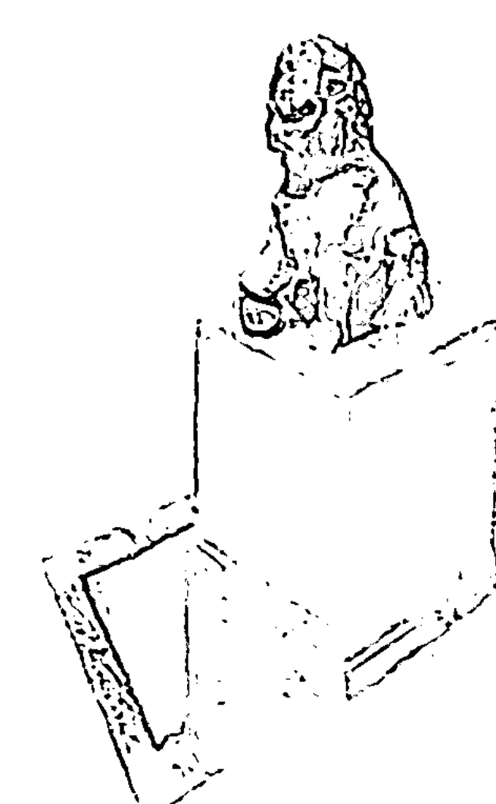

# 职场权谋

## 序言

一般的授课人在讲课之前，都会夸大地讲一讲自己的履历，好让学习课程的人信服。而我只是一名普通的公务员，在40岁左右的年纪，勉强熬到正处级，每天在省委办公厅，都是战战兢兢的服务领导，每天要做的事情，就是琢磨领导的意图，顺从领导的爱好，照顾好领导的情绪，做领导工作上的帮手，生活上的参谋。

我是2000年大学毕业的，开始的时候是作为选调生在一个镇政府工作，随后到了县委办公室，再然后到了市级部门，再到省委办公厅期间，被借调国家部委一段时间，因为家庭的原因，我是放弃了留在部委的机会，又回到了省委办。这段履历说起来，非常的简单，只需要几句话就概括了，但是我却熬了18年。

一路走来基本上都是自己在奋斗，自己一步一步力争上游。我参加工作18年来，醉心于观察，倾心于研究权谋厚黑，我自己也一步步因此得到了提拔重用，从一个镇政府的普通办事员，到现在省委办公厅的处长，我有一整套的权谋经验，想交给你们。但是，你们一定要有洗心革面的气魄，要有重来的勇气。我的目的就是希望你能变成一个阴险狡诈，但是外表忠厚的人，我会教你在职场上所有猎杀的手段。

我就简单讲这几句，算作开篇的前言。

## 上篇: 职场权谋厚黑手段

### 第一章

在这个信息爆炸的年代，好坏信息，泥沙俱下，好像所有的人面对海量的信息，无所适从。每天习惯性地打开手机，获取来自世界各地的信息，在阅读的时候没有感觉到时光流逝，躺在床上觉得自己好像什么都知道了，但是又觉得好像什么都不知道，我觉得对于一个想成功的人来说，这样每天被大量信息掩盖，而自己却取不到有用的信息，是极其浪费时间和精力的，因为大多数的信息都是没有用处的，他们出现在你的视野里，就是为了消耗你有限的宝贵时间的，所以一个人要善于在茫茫的网络信息中，选择自己想要的和对自己有帮助的信息，毫无疑问对于一个职场中人来说，我讲的这些应该算是有用的信息，因为我讲的这些内容都是过来人的讲述，都是我曾经走过的弯路汇总而成的心得，都是在职场中能够实际帮助你的内容，在讲述的时候，可能有时候会不连贯，不成系统，当然本来权谋厚黑本来就没有所谓的自成系统一说，所以没办法像其他课程一样，能够提纲挈领，各位在学习的时候最好拿一个笔记本，听到一些精彩的地方，就顺手记录下来，这样有时间就翻一下自己的记录，看一些这些手段，把这些东西记在心里，然后在现实中不断运用，这样才能融会贯通，不能随便听一听，左耳朵听右耳朵溜出去了，所以我的教程在你的脑海里存留了很短的时间，就被你抛到脑后了，这样你的钱就白花了。

学这门课最忌讳的就是学得非常 好，但是就是不敢在现实中运用，怕这个怕那个的。觉得对自己有好处的、有益处的就一定要去做，当做不做是愚蠢的，那样只会错失良机，只会被命运推着走，而不是牢牢掌握在自己手里。

#### 攀附领导

我先给大家讲两个例子，一个例子是最基层的例子，一个是最高层的例子。

我先说最基层的例子，这个是我奶奶给我讲的。故事发生在十五六年前，我的一个远房亲戚是村里的信贷员，信贷员是帮助本村的村民去银行存钱取钱，因为当时很多村民都是文盲，到了银行也搞不清楚存钱取钱的流程，所以当年信贷员是很流行的，基本上每个村都有一个。但是信贷员不是银行的正式工，并且也没有可能成为正式工，但是我却破天荒地成为了正式工，他是怎么做到的呢——他攀上了我们乡里的银行的主任，攀了将近10年，到最后主任想尽办法让他成为了银行的正式工，在这10年季主任家的事情他都抢着干，主任的老家也是农村的，主任的父母在农村种了一些地。于是，每当秋收春耕的时候，我的远房亲戚总是先把主任父母家的农活干完，再来干自己家的，帮着主任的父母喷农药、拔草等等，总之这10年的时间里，我的远房亲戚像是主任家的长工，到最后终于守得云开见月明，从一个普通的民工成为了银行的正式工。

再说最高层的例子。京和渝的市委书记当年都是在大大手下做过官的，大大成为大大以后，他们两个人的升迁速度，大家有目共睹，像是坐了火箭一样快速地得到提拔，被委以重任。大大一路走来，在他手下做过事情的人有很多，但是为什么偏偏这两个人被习大大提到了这么高的位置上呢？除了两位市委书记本身能力很强以外，当年刻意的攀附也起到了关键的作用。

我想说这两个例子是想告诉大家的是，如果你想出人头地，你想改变自己的命运，想走捷径，快速成功，花精力去攀附领导绝对是事半功倍的方法。很多人在单位，就知道埋头苦干，动不动就加班到凌晨，你们是不是以为自己工作积极一些，努力一些，领导就会看在眼里，升职加薪的时候就只会忘记你？我不排斥靠苦干，也能够得到提拔的想法，但是单位里想靠苦干拼出一条血路的人太多了，不信你看你们单位是不是每个人都在兢兢业业，大家都没有偷懒，都在加班——你说，领导到底会提拔那种人啊？！我来告诉领导会重用哪个人，领导会让自己满意的人得到提拔，让和自己私底下关系好的人得到提拔，能力强更好，能力不强，也没有什么关系的，为什么会这样呢？朋友们，你们的领导，除了是你们的领导外，他还是一个普通的社会人，他在你们单位的时候是领导，这个领导的岗位，要求他必须有一个领导的样子，必须讲场面上的话，不能和你称兄道弟，必须把架子端起来。没有办法，这是他的领导岗位职责必须要求的，换作你是领导你也会这样做，这是领导自我保护的一种策略。但是领导还有一个身份，就是他也是一个普通的社会人，他也和我们一样，有同样的感情问题，同样的家庭，同样的子女上学就业问题等等。所以现在我来问你了，对于领导来说，你觉得你把工作干好，领导的满意程度会大一些呢？还是在工作以外，在生活中把领导伺候好？

#### 领导的难题解决好，领导的满意程度会大一些呢？

肯定是在生活中。因为即使你把工作干得再好，你也只是把单位的工作干好了，把你的奉献给了单位，领导并没有得到自己的私利；而如果你在工作之外，在生活之中，把领导伺候好了，伺候得让领导明白，和单位没有关系，你的奉献是给了领导个人的，所以领导对你的满意程度要大，要大过你在工作中让他满意的程度。这就是为什么很多在工作中能干的，没有被提拔，而一些能力平庸的，甚至根本没有能力的人，却至少有一半的精力拿出来用在其他地方，问题就在这里。因为你们能在生活中让领导更加满意，所以每个人努力方向不同，人生的命运也不同。

我已经把道理说得很明白了，如果你还是坚持把精力全部用在工作上，那你注定是一个正派的人，但是也是混得一般的人。如果你能够把一半的精力用在领导的私人身上，你会发现你得到的远远超过你付出的。所以，如果你是一个从来不琢磨领导，不知道在私下里接近领导的人，我劝你赶紧调整方向，必须把工作的至少一半的精力拿出来，去琢磨领导，去接近人家。至于怎么接近，我后面会详细讲套路和方法。

其实在你们的内心中，也认同攀附领导是捷径，但是为什么就是勇气不足，不敢迈出第一步？你们是不是怕主动靠近领导，领导可能会觉得你是小人？害怕领导会拒绝你的好意？你们也害怕其他同事可能会说闲话。你们害怕这个，害怕那个，就是不怕自己混得不好。其实这些害怕都是妇人之见，都是书生之见。明明知道这样做会让自己的利益最大化，可是却除不了内心的一些成见、一些浅见，总是被你们的懦弱所牵制，被他人的看法牵制。这样是不行的，这样是阻碍你成功的。你必须从今天开始就把这些思想扔掉，不然一辈子难成大器。

你认为接近领导、攀附领导，领导会认为你是小人，领导会拒绝你的好意？其实你想错了。几乎所有的领导，对于自己的下属，对于自己下属的好意，都是敞开怀抱的。不管你是单位的中层干部，还是不起眼的小兵，领导都不会对你嗤之以鼻或者不屑一顾。他们巴不得所有的下属都围拢在他身边，这是领导内心的想法。他们都喜欢被人抬着，被人爱戴着，被人挂念着。所以，请你放心大胆地去追随你的领导，去攀附你的领导，就跟上他的脚步，去琢磨他的想法，去替他办一些他不太好出面的事情，去帮他背黑锅，去为他做一切，把他当作自己的父亲或者自己的孩子，深深爱他。

我讲了这么多，我想你也应该放下错误的成见，明天可能要去单位攀附领导的想法，应该是蠢蠢欲动了吧？别着急，我还没有给你讲方法。职场中人的攀附也是要讲求技巧的，总不能像黑社会拜码头那样，拿一把杀猪刀，切一下自己的手指头，把血放出来，留在碗里，然后喝掉，然后对大哥拍着胸脯说：“大哥，我以后跟着你干了”。我们职场人不能那么野蛮和暴力，是有技巧性的。

##### 应该攀谁？

再给大家讲技巧性之前，我先给大家讲一个选择的问题。这个选择的问题就是单位的领导那么多，到底该攀哪一个？都攀的话没有那么多精力啊？当然不能所有的领导都攀，一是我们没有那么多精力，二也不必要，不需要攀那么多。我认为在单位，只攀附一个就够了。但是具体该怎么选呢？到底该选谁呢？这个选择是很重要的，不然你随便攀附一个领导，你对他付出真心一片，到最后才发现，这个领导是个白眼狼，或者是一个不识好歹的领导，那么你付出的心血都是白白付出的，所以这个选择你一定要慎重。

##### 选择要注意哪些标准呢？

首先，这个领导一定是要愿意帮助自己身边的人的领导，并且为了照顾身边人，舍得下大力气。这个应该好打听，也好观察。你可以观察这几年围绕在这个领导身边的人，现在到底混得怎么样，就可以大概知道他愿不愿意帮助自己的身边人。这个是非常重要的，你一定要看清楚。有些领导看上去好打交道，就觉得这个领导可能会照顾自己的身边人，因为很多领导是典型的笑面虎，对谁都笑呵呵的，但是对谁都不是真心。即便你攀附他，他也是笑呵呵地接受，但是一旦等你遇到生钱的问题的时候，他不会真正地帮你；而有些领导，虽然有时看上去很臭，脾气古怪，动不动就骂人、拍桌子，看上去十分的强势，十分的不还接触（注：此处原文似有误，应为“不好接触”），但是这种人他往往愿意强势地帮助自己的身边人争取利益。

所以，不要被领导表面的东西所蒙蔽了。因此，你要多观察，多参加单位的饭局，看看这个领导是不是愿意帮助自己的身边人，判断出这个领导是不是真的愿意帮自己身边的人。如果愿意帮，这个领导肯定是首选。这是第一个原则，就是这个领导必须懂得为攀附他的人在关键的时候争取关键的利益，不然花了那么多精力去攀附，攀了也是白攀。

当然，还有其他的标准。如果一个单位所有的领导都很懂得为身边人争取利益，那肯定就要去攀老大。比如说你是在县里的地税局，局长和几个副局长，都是懂得照顾自己身边的人的领导，那你就果断去攀局长。你可能会说，单位那么多人，局长根本不认识我，我也没有什么机会接触到局长。局长不认识你，那你就想办法让局长认识你，就要想办法接触到局长。这种小事情都是动一下脑子就能想出办法来的，只是你平时没有往这方面去想。每天和局长在一栋楼里办公，在一起吃饭，如果你连这种接触局长的机会都创造不出来，那只能说明你没有动脑子。

另外，为什么要攀局长而不攀副局长呢？攀局长的人那么多，而攀副局长的人少一些，为什么单单要攀局长，而不是攀好攀的副局长呢？因为在一个单位里只有一把手说了算，从某种意义上来说，真正的领导也只有一位，其他的副职领导，都只不过是一把手的助手。一把手想重用你，走一下程序就能立即重用你；而其他副局长想要重用你，他必须要征求一把手的同意以后才能重用你，这就会生很多的变数。所以，攀附的首选领导一定是单位的一把手。

如果确实存在种种原因，也确实攀附不上一把手，只能在副局长中选的话，那你必须考虑以下的这些因素：

- 第一，这个副局长是不是和局长的关系很近？如果是局长讨厌的副局长，最好不要去攀他；
- 第二，这个副局长的年龄是不是马上就要退休了？如果快了，快到退休的年纪了，最好不攀；
- 第三，这个副局长是不是一个胆大妄为的人？如果是也最好不攀，因为胆大妄为的领导迟早会出事，迟早会连累你；
- 第四，这个副局长是不是为人处世特别强势？如果是，也最好不要攀，因为强势的领导，往往会得罪很多的人，他得罪的那些人或许不敢报复领导，但是他可以拿领导的身边人开刀，也很容易连累你。

此外还要考虑其他的因素。如这个副局长家族势力和人脉关系非常强大，不管他是否到点，最好去攀附。即便他退了，你只要攀上他，他想帮你的时候，利用家族势力和自己的关系，也可以来帮助你。具体哪个领导需要考虑的因素，大概就是我上面说的那些，大家可以权衡利弊，作出最好的选择。

#### 攀附的原则

我再讲一下攀附领导其他的一些原则性的东西。在一个单位最好只攀附一个领导，不能做两面派，也不能做老好人，谁都想攀，谁都不想得罪——天下没有这样好的事情。你只能综合考虑后认真地去攀一个，全身心的去攀一个。当然，我的意思不是说攀上了一个领导，就不理会其他领导了，我的意思不是那样的。我的意思是要把认准了的领导，你所要攀附的领导当成自己的父亲，而其他的领导你把他们当成叔叔。直白一点就是，虽然你攀附了某一个领导，但是对待其他领导也要在面子上说得过去。这是在本单位，本单位只能攀一个。

当然，你还可以攀附其他领导，但是要在本单位之外。我的建议是一个层级上的领导只攀一个。因为，这个精力都有限，所以一个层级上的领导只攀一个。比如你还是地税局的普通职工，你已经攀上了局长，那么就不用再攀其他部门的局长了，你可以去攀一个常委（县常委），或者是市局部门的局长，或者是市局的常委。这就是我说的一个层级上只攀一个。因为，你只要在这个层级上攀上了一个领导，这个层级上的方方面面的事情，如果领导视你为心腹，领导都能够在这个层级上帮你把所有的事情解决掉。

看到这里，你也应该知晓了攀附领导是自己职场上的捷径，想必你心目中自己所要攀附的领导也基本确定了。现在是万事具备，只欠东风了，这个东风是什么呢？那就是怎么做才能攀附上领导呢？下面我给大家详细地讲一讲。

#### 攀附的方法

首先，要花时间和精力去揣摩领导。揣摩领导是下级必须要学的技术，这项技术学好了，在职场中会春风得意。揣摩就是为了领导开心，你只有把领导的心思揣摩好了，你才能号准他的脉，进而你才能获得你想要的位置和福利。知己知彼，百战不殆。要想在职场生存，就需要对领导有深刻地了解，了解了领导，才知道怎么做领导喜欢的事。

那么应该如何揣摩领导的想法呢？想要揣摩领导，就必须先收集领导的信息，掌握了信息，我们才能了解他。揣摩，是建立在领导的信息大数据上的。我们要了解领导对食物的态度和看法，要了解他的立场以及他的性格特点……这都需要信息的收集。如何进行信息的收集呢？就是要观察。观察领导的工作，要在平日里观察领导的工作风格，他的用词，他的用人，他身边都是什么人，这些都是信息。比如，他和单位干副业比较多的人走得很近，那说明领导或许和这个人有生意上的来往或者合作；如果领导喜欢和单位的马屁精在一起，说明领导是一个喜欢听好话的人，等等。要注意看一些现象，要注意想到深层次的东西，不能仅限于表面的东西。

比如领导最近抽烟多了，你不能简单地认为领导最近的烟瘾比较大，要深挖一下，多想一下，可能他最近遇到烦心的事了。如果你们能够顺藤摸瓜，摸到领导为什么烦心，比如领导的孩子要读书，想上个好学校，可他手头上没有这方面的资源；而你同学的父亲，恰恰可以帮上这个忙，你去帮领导把这个事情给办了，你说，领导会不会喜欢你？又比如，领导这段时间频频和业务人员互动，这时候你就要想到为什么是这个时间和业务人员互动，不是公司的业务下滑了，或者是业务部门要改革了；如果领导和财务人员频频互动，是不是是财务出现问题了。要注意观察领导表面现象，它的背后行为的指向。

还要注意观察领导的生活，这个比观察领导的工作更为重要。要想和领导建立私下的亲密关系，就必须对他的生活有所了解：他身体的状况，作息习惯，他的嗜好，他的圈子，他爱吃什么，爱去哪里，有什么样的情绪特征，他父母、孩子、老婆的情况，夫妻之间谁强谁软等等。这些都是你需要去了解的，你要做到比领导自己都要了解他自己。我建议最好弄一个本子，这个本子专门记录领导的生活种种、在单位自己所听到的信息、以及自己通过观察判断出来的信息，你都记在本子上。当然，这个本子只能放在家中，不能带到单位。如果这个本子被单位的同事看到，你就会臭名远扬了。没事的时候翻一翻本子，把领导的情况记下来，要像记住老婆生日一样，记住领导家里所有人的生日。当然，我所说的领导的家人，也仅限于领导的老婆、孩子和父母，争取把关于领导的所有信息串起来，以备不时之需。

观察领导和收集领导的信息，我们有时候还可以用测试的方法。比如说我们不知道领导对某个事情的态度，我们可以用试探的方法，比如我们可以用类似的事情来试探领导，还可以让别人试探，让别人投石问路，又或者制造一个事件或是假象来引导领导的心理和态度。还可以投诱饵，比如带上一个美女，说是自己的妹妹，和领导一起吃饭，看看领导是不是好色；或者说找机会和领导打牌，故意输一些钱，或者赢一些钱，看看领导对金钱是什么态度等等。

很多领导看上去好像是没有破绽，那是因为你作为领导（注：此处原文逻辑似有误，结合上下文应为“因为你是下级”或类似语境，保留原意修正为“因为你在脑海中或是在你的认识中，已经把他神化了”），你在脑海中或是在你的认识中，已经把他神化了，所以你看不大他的破绽。其实每个领导都是有破绽的。一旦你发现了领导的破绽，事情就成功了一半了。你只需要围绕着领导的破绽和软肋，狠狠地进行攻击（注：原文为“归击”，修正为“攻击”），一定可以在最短的时间内，把领导拿下。

以上我说的是揣摩领导。此时对领导有一个详细地了解以后，就要认真地在工作和生活中去和领导接触、相处了。怎么相处呢？大体的原则就是你一定要做一个听话的、让领导看得到你良心的透明人。这是一个大原则：要听话，要让领导看到你的忠心，要让领导觉得你是一个透明人。大家都清楚，领导都是非常不喜欢不听话的下属的。所以不管什么事情，只要领导有指示，那你就坚决地去执行，不折不扣地去执行。永远不要跟领导在交办任务的时候谈条件，一定要质量不减地去完成领导亲自交办的每一件事情。一个人听不听话其实意味着忠诚，意味着各种条件无条件地服从听话，这是一种对领导归顺的态度，领导对于这样的手下才能放心的使用。而这，也是攀附领导（注：原文为“琴附”，修正为“攀附”）的先决条件。所以说，至单位（注：原文“至”应为“在”）很多苦干的人他往往不如会干的人；会干的人往往不如抢干的人。

很多人在单位都是做一些无关紧要的工作，做一些程序性的工作，事务性的工作，往往忽略了领导交办的工作，这是很愚蠢的表现。单位的工作、日常性的工作，该拖的就拖；但是领导布置给你的工作，就算加班，通宵加班，牺牲周末，也要把任务完成，并且要好过领导的预期。

然后，在与（注：原文“在于”修正为“在”）领导相处的过程中，最好不要表现得尽善尽美，不要把自己表现得像个完人。如果你表现得像个道德（注：原文“一道德”修正为“道德”）完人，那你也完蛋了。所以，尽量要留下一些把柄或者供你要攀附（注：原文“琴附”修正为“攀附”）的领导知道，要让领导清楚地知道你的软肋和短板，让领导知道你是一个远不如他的人。为什么要这样呢？因为只有有弱点、有把柄的人，领导才会觉得，你是一个真实的人。而太完美的人，在领导眼里要么极有野心，要么隐藏很深，这种人是不容易控制的。领导内心其实也是充满着对权力的不安全感的，所以如果你和领导相处的过程中，像一个君子，不贪财，不好色，不抽烟，不打牌，不说大话等等，你越是这样完美，领导在内心深处就会怀疑你，看不懂你，然后排厅（注：原文“排厅”修正为“排斥”）你。

所以，做一个真实的人。比如，去KTV陪领导唱歌，有人叫了包房公主，你千万不能装得比领导还要像君子，不去搂抱公主，不和公主划拳喝酒。领导的拘束那是因为领导还抛不开领导的那层外衣，而你作为下属，一定要放得开，该搂就搂，该抱就抱（注：原文重复“搂抱”，保留语意），一定要让领导觉得你是真实的人。很多年轻人顾虑在这种场合搂抱公主，会让领导会反感，其实领导是不会反感的，再正直的领导也是不会反感的，因为这是男人的正常表现，他只会觉得你真实，他只会觉得你思虑不远（注：此处保留原文，可能意为想得不多/简单）。其实领导巴不得你玩得更放肆一些，你玩得越放肆，领导才会觉得你更真实，领导也才更容易抛掉框架，与民同乐地和包房公主拥抱。

要知道，你本来都是年纪轻轻涉世未深的年轻人，可是，你受那些名言警句的毒害，你相信什么喜怒不形于色（注：原文“形色”修正为“形于色”），泰山崩于前面不改色，什么胸有激雷而面如平湖，可拜上将军等等，你在领导面前也这样学习者古人，模仿者古人（注：原文“者”修正为“的”或保留口语感，此处修正为“模仿古人”），这样是大错特错的。尤其是你当下属的时候，其实领导是非常害怕这样的下属，起码是不喜欢，因为领导他看不透你，看不穿你，领导不知道你面如平湖的表面下，内心到底在想什么，他不清楚你的真实想法，他会觉得没有办法掌握你、控制你、领导你（注：原文“领导”应为“领导你”或“指引你”），所以他不会因为你的攀附就把你当成他的心腹。

古人常说先定先定（注：此处“先定”可能为“预设”或“事先设定”，保留原音修正），意思就是说要预先设定，包括自己，在领导面前以什么样的形式，以什么样的形象来展现自己，也是需要预先设定的。怎么设定呢？你要把自己设定成领导的一个透明人，设定成他一眼就能看穿、看透的人。你要设定自己成为一个老实的、稳重的、安全的，没有任何威胁的人。你要把自己设定成一个没有志向和野心的人，要让领导觉得你是一个忠厚的老实人，而不是雄心勃勃的野心家。你还是要把自己设置成掩饰自己才能的人，不要让领导觉得，你处处都比他强，要把所有露脸的事情，有功劳的事情都让你领导（注：此处语病，应为“让给领导”），把荣誉也让给领导等等。

设定好了自己以后，按照自己的先定（预设）去做了以后，那下一步该如何进一步加强和领导的关系呢？

第一，要渐渐地创造出能和领导交心的机会。交心的机会也是独处的机会，就是单独和领导相处的机会。其实在工作中、生活中，即便是无意，你都有很多和领导单独相处的机会，比如跟领导出差，或者是跟着领导一块去参加饭局，都有单独相处的机会。而如果你脑子够活跃的话，那你能创造出更多的这种机会。

比方说，先前领导都有驾驶员，而现在公车改革了，而领导往往又不会自己开车。如清明节马上到了，你如何创造这种机会呢？你可以送文件到领导的办公室，趁着领导签字的机会，你可以随便说一句：“领导，时间过得可真快哦，马上要到清明节了呀。”领导会说：“是啊，岁月不饶人啊。”你随意问一句：“领导您清明节肯定要回家？”领导说是啊，要回去了。你又随意说一句：“领导您的老家是茂名的吗？我正好顺路，正好可以把您送过去。”领导会拒绝道：“那怎么行呢？在顺路那还是有点远的，好意心领了，谢谢你。”你继续说：“没事的，您就给我个服务领导的机会嘛，你要是觉得不好意思，到时候您给我一点车贷（注：原文“车贷”可能为“车马费”或“辛苦费”之意，保留原词）。”话说到这个份上，如果领导清明真的要回老家，我觉得他不会再拒绝你的好意了。

所以自己要主动去创造和领导相处的机会，只有把这种机会创造出来了，你才能在单独相处的过程中服务好领导，让领导满意。当然，这个也是要提前安排的。在和领导单独、服务领导的过程中，如果领导的兴致高，想要和你多聊天，无论是从细节上还是从形式上，各方面都要让领导十分满意。如果领导兴致高，在聊天中，你可以讲一讲自己的事情，但是要注意别多讲。一般领导在听下属讲述自己故事的时候，往往是没有耐心的，听着就觉得烦，所以不要多讲。单独服务领导的过程，其实是哄领导开心的过程，也是和领导渐渐交心的过程，这一定要把握好。但是一定要切记，在最开始服务领导的过程中，不要对领导提什么要求。一开始，你只要付出，不要求回报。

#### 汇报工作的技巧

我再讲一讲和领导接触的过程中，汇报的一些技巧。这个汇报，不仅仅是工作上的，当然，大多数也是工作上的，这个技巧也是非常重要的。很多人会干工作，但是不会汇报，往往工作干得好，但就是输在了汇报上。

在一个单位里，你如何才能够和你所攀附的领导在工作和实际的行动上保持一致呢？当然是要让领导掌握到你的工作动态和生活动态，或者在你所在的处室的工作动态。如果你现在所做的工作和所做的事情非常重要，领导有必要知道，或者你知道一些事情涉及到领导本身，你那必须找时间找机会，去给领导汇报相关的情况。这是向你想要攀附的领导，表忠心的好机会。

当然，如果你只是单位一名普通的小兵，按照你汇报工作的流程，在你领导没有把你当成心腹之前，你们的关系没有达到很亲近的状态的时候，你不能频繁地越级去向你所要攀附的领导汇报工作。这里边一定要有个度，但是，你不能因此不去给领导汇报工作，只是不能太频繁，只是要找准机会，避免被人撞见而落人口实。

我再打个比方，你所要攀附的领导是你们单位的副厅长，而你只是一个处室的一个普通的办事员。你去找领导汇报工作的频率，一个月顶多一次，因为领导也忙。但是，不汇报不等于不走动，你总是有很多机会的可以看到和接触领导的。比如很多文件让领导审阅，你去送文件的时候，你可以看看领导的办公桌上是不是缺少什么东西。如果说缺一些卫生纸，你可以去办公室给领导拿一下；比如说刻导（注：原文“刻导”修正为“领导”）的茶杯没水了，你可以帮领导把水添满。可能第一次这样做，领导觉得不好意思，说不用不用，但是只要你第一次添了，以后你去了都给领导添一下水，时间稍微一长，领导就会觉得你这个孩子有眼力见。

其实汇报只是一种形式，体现你眼中有领导的一个形式，而汇报的内容其实并不是太重要。毕竟领导的眼界宽，你能看到的东西，领导也能看到；你能觉察出来的东西，领导也能觉察出来。只是平时一定要有这个心思，眼中一定要时刻刻都有领导（注：修正为“时时刻刻”）。既能够很好地向领导表达自己的忠心，又在度上把握好，不要让领导觉得烦。

#### 如何帮领导分忧

再讲一讲如何在工作中帮领导分忧。工作上的事情，只要自己能够顶起一片天就好了。如果自己的工作能力强实（注：原文“强实”修正为“实力”或保留语意）强大无比，可以把工作做得别出心裁，做成亮点工作，那你就梳理一下自己的工作思路，去找一下你要攀附的领导汇报一下工作，把你的建议罗列在一张纸上，让领导来选用哪种方式来开展工作。如果你真的把这个工作干好了，这是领导的功劳，因为是领导选择的工作思路。

在生活上帮领导分忧，更能够快速的成为领导的心腹以及攀附上你的领导。比如你发现领导的办公室有治疗失眠的药物，你应该能判断出，领导的睡眠不是太好，这里面就有文章可做了。你可以去咨询一下老中医，看看该怎么调理——注意，不要给领导送什么中药或者西药，送就送一些辅助性的物品。比如你可以给领导买一个改善睡眠的高质量的乳胶枕头，或者是改善睡眠的睡前按摩仪等等。

送给领导的时候，你也可以直言不讳地说：“领导，上次见您在吃治疗睡眠的药物，我妈妈也是失眠，用了很多种方法都不管用。自从用了这个睡前按摩仪，睡眠质量好多了，我妈妈说一定要拿给您试一下，效果好的话，就当我孝敬您了，效果不好的话你再还给我。”你这样说，领导没有不收的道理。

### 第二章

我把大家平时经常会遇到的一些小问题，统一放在这一个课程里。我建议大家单纯地听效果不太好，如果在听的过程中有一些可取的地方，我建议大家把这些地方用笔记录下来，以备不定时地翻出来看，这样才能巩固，灵活地运用到实践中才能够融会贯通。

今天给大家讲一讲如何拍领导的马屁。拍领导的马屁，有很多人是存在认识误区的，很多人都不想或者不屑于拍马屁，一是怕领导可能不喜欢，二是怕同事会觉得自己是小人。其实，这都是多虑的。在现实中，领导既不缺钱，也不缺权力，更不缺女人。缺的是什么？缺的是精神层面上的舒服感！所以大部分人都喜欢被人抬着，都喜欢被人吹捧，都喜欢被拍马屁。拍马屁不仅是人际关系的润滑油，更是上下级关系的黏合剂。另外，你的一个担心是怕同事说你是小人，更是不足为虑。大家都是职场中人，有流言蜚语只能让你变得更强大，大部分的同事都只不过是乌合之众，你不必太在乎他们的看法。所以一定要更正这一个认识上的误区，不要有“不屑于去拍马屁”这个错误的认识。

#### 如何拍马屁

我再给大家讲一下，如何巧妙地、不显得过于奉承地拍领导的马屁。

第一个方法就是向领导虚心地请教问题。我们从小接受的教育就是要自力更生、自立自强，这导致很多在职场中的人很不好意思向别人请教问题，觉得请教问题会显得自己很愚蠢，上级向下级请教问题更是难上加难。然而不耻下问一直是一种美德，而且向领导请教问题，却是一个非常好的拍马屁的利器，在职场上最上等的拍马屁的方法就是虚心地向领导请教领导擅长的、并且很熟悉的问题，这样让领导有一种好为人师的快乐感，并且领导还会认为你这个人虚心好学，值得培养。

比如领导是名牌大学的毕业生，而你的孩子今年要高考，你可以在合适的时间和地点，向领导请教高中学习方法的问题。如果领导非常喜欢这个请教，并且乐于给你讲一些方法，你要认真地拿笔记下。如果孩子考上了好的大学，你还可以找一些机会私下里请领导吃饭，这样又多了一次单独交流的机会，请他吃饭表示对他的教导之恩的感谢。这是第一个方法。

第二个方法就是发自肺腑的真心赞美。我们国人的性格是非常内敛的，不太愿意去表扬和自我表扬，总觉得去表扬别人、去赞美别人，内心有一道坎过不去。即便别人是真的优秀，别人在某一领域有特长，做出了成绩，但是总是不愿意去夸奖别人，觉得那样会虚伪，觉得讨好别人、夸赞别人会让自己不舒服。其实不能这样想，因为每个人都有他的优秀之处，我们必须看到他的优秀之处，最重要的还要肯定他的优秀之处，也就是去赞美他。你自己在赞美别人的过程中，你自身也才会被看重！

在职场中，领导的主要工作就是作出决策，而你，要在研究他的角色后，迅速地找到领导决策的闪光点和他的良苦用心的地方，然后积极主动地去响应，这样做会让领导找到被认同和支持的感觉，会对你产生知音的感觉，久而久之就会对你产生依赖的感觉。这一切都源于你对领导决策的发自真心、发自肺腑的赞美和拥护。

第三个方法：帮领导掩盖错误。每个人都不是完人，都会有这样或者那样的错误，领导也是平凡人，他们也会出现错误。有一些在职场上不太如意的人，总是觉得领导是个窝囊废，其实不能这样理解。如果你坐上领导的位置，你并不一定就比他做得更好。就像我们喜欢评价历史人物的功过是非，我们总是一副慷慨激昂的愤青样子，其实那些能够青史留名的人物，都是当时的绝对精英、国之栋梁，我们大多数人是没有资格评判他们的，因为我们如果生活在他们那个年代，我们可能依然只是一个平凡的人。

所以说，在职场中，不要觉得领导无能，不要在领导出现了错误以后看笑话，更加肯定自己觉得领导无能的判定，这样做是非常错误的。你应该在领导做了错误的决定后，主动地站出来为领导掩盖错误，这样才能让领导的压力减轻，这样也是在变相地拍领导马屁。如果领导做了错误的决定，这时候作为手下一定不能指责领导、推卸责任，一定要主动地认同或者找出领导决策的正确性，或者承认自己是在执行中错误地理解了领导的意图，是执行的问题，不是领导决策的问题。你为领导解围，领导才会以后帮助你。

比如你按照处长的意思，上报给省委办公厅一些数据，分管领导没有仔细看就签字，上报给省委办以后这些数据成了大笑话，领导追问，你可以说：“这个表是我统计错了，处长安排我这样做，我偏偏用另外一种统计的方式，结果就弄错了。”你这么说处长一定会很感激你的，起码会在内心认可你，因为你最大化地说了自己的执行错误，而弱化了处长的决策失误，这是在变相地讨好领导。领导都是聪明人，他会在合适的机会照顾着你。

我举的这个最后这个例子也可以归纳到背黑锅的范畴。相对于拍马屁，背黑锅确实更能让领导喜欢你！

那么怎么有技巧地帮领导背黑锅呢？

#### 背黑锅

背黑锅的方法：

第一个就是在工作上主动地帮领导背黑锅。领导可能会有一些疑难问题，容是出问题的事情，你可以主动地把容易出问题的事情揽过来，事情做成功了功劳让给领导；事情没有做成，自己就把这事情的后果承担下来。领导不是傻子，你主动地去啃硬骨头，他会记住你的。比如年底公司因为财务状况不好，作为领导他想降低奖金，但是不太方便说，这时候你主动地站出来提议，大家都不要奖金了，这个时候所有的其他员工就会把怨恨的焦点放在你身上，但是领导会在内心里高看你。同事对你的抱怨，以及领导对你的高看，你选哪一个呢？

第二个方法是要做领导的挡箭牌。在职场里，最常见的就是领导的某些做法会引起下属的不满，这时候你要主动地去做说服工作，主动地在领导和同事之间进行调和。比如某些职工被罚款了，或者没有被批准请假，这时你可以主动地去做工作，尤其是当着领导的面儿，你要对那个同事说领导的难处，说领导的良苦用心，即便不会起到什么作用，但是领导会认为你主动替他做，这样他会认为你能够站在领导的角度上去考虑工作。其实你是在把他当挡箭牌，替他背一些同事怨恨他的黑锅而已。

第三种方法，帮领导敲边鼓。领导有很多话是不方便说的，即便方便说，但是也不能说得太明显太详细。有的时候是不能说得太大白，有的时候是忘记了说，这个时候你就要替领导解释清楚，要让大家知道领导的意思。比如今天是三八妇女节，领导忘记了这个节日，这个时候你就要在私下里提醒领导，今天是妇女节是不是？让他们忙完的可以提前下班，领导会为你这个提醒，而觉得你能够替他补漏洞。

总之，你在职场中能替领导分忧的越多，你就越能快速地进入领导的视野。

#### 如何陪领导散步走路

在职场中，还有很多和领导一起走路的机会，或者是上班的时候碰到，或者是饭后的散步，领导恰恰也在那散步，这是单独和领导独处的好时机！

你应该怎么把握一些细节呢？

如何陪领导散步走路，这里面有三个大的原则：

- 第一个原则就是把最突出的位置让给领导。如果和领导一起走，去的是领导熟悉的地方，那么自己就走在后面，尽量在左右位这样的地方，既突出了领导，又显得他和自己亲近。如果你和领导之间还有其他的领导，这个左右卫的位置有人占领了，你就只能跟随在右后位。如果有领导的秘书或者司机，他们跟在领导的身边左右，那你不要跟领导太近，因为你不是领导的身边人，领导有可能要私下里和秘书司机说一些私密的事情，你跟得太近不太好。如果去的地方是领导不熟悉的地方，这个时候你需要站在左前方的位置，方便为领导作引导。

- 第二个原则就是把最安全的位置留给领导。千万不要站在领导的右边，咱们国家基本上是靠右行驶的，最右边是最安全的位置，不受骚扰的位置，这个位置应该是领导走的，自己要走在领导的外侧。这个左右的关系很多人可能并不是太在意，觉得这是一些小节，其实越是往往是小节的地方越考验人。

- 第三个原则就是把最主动的位置让给领导。进门的时候，领导先进去；出门的时候，让领导先出去；坐下的时候一定要等领导先坐；起立的时候一定要让领导先起。领导没站起来，你先站起来了，领导就会觉得相当的尴尬。如果领导还没有坐下，你先坐下来，就会显得你十分不成熟，让领导觉得你根本就没有尊卑意识。

这些都是细节上的问题，要牢牢地记住。

至于散步时应该交流些什么？我建议根据领导的提问随机应变，不要害怕冷场，不要一次又一次没话题找话题说。如果你觉得领导今天的兴致并不是很高，不想讲太多话，那你只需要按照上面讲的原则，老老实实地跟在领导后面，全当做自己是领导的保镖；如果领导今天兴致高，不断地问你这个问题那个问题，你可以照实回答，但不要兴奋过度，说起来没完没了，更不能想到什么就说什么，自己要做到嘴巴上要有个把门，不能说一些本来不该说的话。

#### 收集把柄

下面再给大家讲一个问题，在职场上要不要收集领导的把柄，以防不备？

有人问，在服务领导的时候，要不要秘密地收集领导的把柄呢？其实有这个想法的人，我想应该还没有进入到领导的核心圈子。我先给大家讲一下我的看法，你再决定是否要收集领导的把柄。

每一个领导其实都不会轻易地把自己做了一些坏事的把柄让很多人知道，他们肯定都是经过多方的伪装和深藏，所以如果你想要收集到领导的把柄，必须获得领导的信任，才能够在信任的阶段、信任的位置、信任的项目上，你才能亲近地接触领导，从而获得所谓的把柄。

可以这么说，在这个获得信任的过程中，有可能对你有很多测试，你以为抓到了把柄，很可能就是被安排好的设计，很可能就是进了一个领导故意安排的局！

这是一种信任测试。过不了这一关的你几乎没有机会进入核心圈去触碰核心的利益。好不容易获得一次信任，如果过关就会飞黄腾达；如果没有过关，那你就可能被打入原型。所以几乎没有人能为这个光明的前途去冒险，偷偷地去收集领导的把柄，这是得不偿失的。

退一万步讲，即便你获得了领导的把柄，那你怎么使用这些把柄啊？其实无非是这几种做法，自己去检举揭发自己的领导，直接翻脸对抗，说实话可能你还没有对抗，你就自己提前被打趴下了。因为秘密地揭发，这样即便是自己的领导，自身也没有任何的好处！

如果你把这些把柄给别人使用，而自己其实就成了别人手里的枪，被人当枪使，早晚会被出卖的。所以说获得领导信任关系而可以搜集的把柄，拿出来对自己是弊大于利的，也就是说你搜集到的这些把柄，如果你想利用它，无论你怎样使用这些领导的把柄，对你来说坏处一定是大过好处的！

为什么这样说不呢？因为你挑战了权力的秩序。作为亲信，你对自己的领导暗地里的搜集证据，即使你成功了，你这样的人也是挑战了权力，任何后面来的领导都不会认同你，因为你是一个叛徒。这其实就是站队的问题，即便你扳倒了自己的领导，别人也会整体地收拾你这样的人，因为领导不是一两个人，这个领导背后是有一批人，这么一批人会形成一个合力，让你过得也绝对不会顺利！

所以说，你千方百计搜集领导的把柄，到最后非但对自己没有任何好处，反而会弄巧成拙。

很多人会说啊，厚黑权谋不是讲究“持术不持信”吗？我们搜集领导把柄有什么错呢？其实你们错误地理解这句话了。我们要把自己放在安全的位置上，不去收集领导的把柄，而是把自己的事情做得滴水不漏，以防被人抓住自己把柄。我们在做事情的时候让自己不处于危险的境界，不被领导抓住把柄，从而不被利用才是第一位，不能以为是领导的人，就可以替他做黑活、背黑锅而不留下证据。而如果要为权谋做黑活、背黑锅，就一定一定不能留下证据！—所以说，权谋学习，持术不持信，这才是正确的理解方式：要想让自己立于不败之地，是要让自己不被人抓住把柄，而不是自己违心的、丧良心地抓一些搜集一些领导提拔你栽培你的领导的一些证据。

#### 送礼

我再给大家讲一下送礼的分类。

送礼一直是一个职场上很多人要问的问题，很多人对送礼有很大的困惑，到底是送什么呢？怎么送呢？被退回来又是什么意思呢？被退回来有该怎么办呢？我给大家讲一下这个送礼的分类，大家可以根据自己的实际情况再去想一想该怎么送、送什么。

送礼有这几类：

- 第一类是表达心意类。这里的送礼啊，并不是对领导有所需求，而是表达自己对领导的心意，要让领导知道，他在你心里的位置，靠送礼来培养彼此之间的感情，所以这时候不在乎礼物的贵重与否，而在于难度、稀缺度，以及为了准备礼品所耗费的心思。这时候最需要切记的就是不能够送现金，因为送现金不仅不能够表达出自己的心意，反而让领导觉得有烫手山芋的感觉，觉得你这是在行贿，或者是你肯定有所求。送现金越是不表达需求，领导越是不敢收。

- 第二类是表达诚意类。求人办事送礼，大多就是这个这一类的，表达一种诚意，这是交易欲望的表达：我愿意为这个事情付费多少。领到所要看的，是这个事情能否办成，以及风险评估，这个阶段可以说最为重要的就是构建信任关系，彼此不信任，给钱再多，不安全也没人敢收；收了办不成，领导也怕有后遗症啊，你给的少也不行，领导自然是看不上啊。所以表达诚意，通常会使用巨额现金，通过领导信任的中间人，或是一对一送过去。现金在此时是一种态度。

- 第三是表达谢意类。事情如果领导给咱办成了，这时候很多交易还有后续的各种，这就需要来表达谢意了，而目的是为了方便的日后的继续合作，这个就要看后续的合作程度了，如果后续的合作的深，就拿出这个项目的一部分利润非领导，让他自己觉得自己是项目合伙人的感觉；如果后续的合作浅，可以送一些通用的贵重的礼品，比如名烟名酒，贵重的礼品通常都是这个阶段送出去的。

这是送礼的三个分类。

当然礼物被退回的情况很常见，大多是这方面的原因导致送礼失败：

- 第一个原因是你和领导没有信任关系，贸然去送礼，别人感觉不到你的诚意，所以不敢收。
- 第二个原因是这个事情办不成，不能收。领导觉得这个事情难度大，办不成，或者办了会有很多后续的麻烦，所以不能收。
- 第三个原因是你给的少。领导给你办了这个事，你给得太少，心里不爽，觉得你小气，不如不收。

送礼是一门职场的语言。大家通过送现金送礼品，不同的手法来表达不同的意思，这个学问是一门大学问，大家要仔细揣摩，还要勇于去实践，有一些事不要一直停留在想法中，而不去落实。

很多人困惑，总觉得送礼就是贿赂，是搬石头砸自己的脚，是愚蠢的行为的，其实并不是这样。

根据《中华人民共和国刑法》第389条的规定，为谋取不正当利益，给予国家工作人员以财物的，是行贿罪。在经济往来中，违反国家规定，给予国家工作人员以财物，数额较大的，或者违反国家规定，给予国家工作人员以各种名目的回扣、手续费的，以行贿论处。

因被勒索给予国家工作人员以财物，没有获得不正当利益的，不是行贿。

从法律层面上，从法律角度有三个层面的意思，首先是谋取不正当利益，其次是针对的是国家工作人员，最后是没有谋取不正当利益，这就不是行贿。所以说大家一定要搞清楚这个贿赂和行礼的区别，这个都是有法律依据的。

#### 如何面对领导的批评、指责和发难

最后我再给大家讲一下，在职场中如何正确地面对领导的批评、指责和发难。因为我们一个人在职场中都会犯一些错误，领导有时候为了纠正我们的错误，会对你提出严厉的批评。一些人拿这些批评不当回事儿，觉得随便领导怎么批评我无所谓；但是有一些人非常的害怕领导的批评，只要领导一批评就觉得自己天要塌下来了，觉得自己的前途暗淡了，自己没有发展的潜力了，自己在单位上混不下去了等等，这两种态度都是不对的。

那我们到底该怎样正确地面对领导的批评和指责呢？

我给大家讲一下，面对领导批评的上、中、下三层。

首先，在领导批评的时候，最下的策略，最不可取的策略就是辩解。每个人在面对批评，第一时间就会想到反驳，表达自己没有错，因为承认错误本身会让自己心里觉得很不爽，很多人即使真的是犯错了，也会把责任推卸给那些条件不好、时间不多、别人不配合等等，把这些都推到这些原因上，而自己却不承认自己有错误。所以说辩解，在领导眼里就是一个不负责任的形象。

所以不管这个事情本身你做得对不对，你不负责任，本身就是错误的，所以说不要辩解。面对领导批评时，比较折中的一个方法，也就是中策，就是沉默。很多人都知道，领导批评你的时候，都是在气头上，是不方便反驳的，这个时候就用沉默来代替，不管领导说什么，都不予以回应，一直站在那里不说话，这个其实是一个逆来顺受性格上的表现。而领导看到你这个样子，虽然发不了火，但是对你还是会有不良的印象，因为你这种表现，让人觉得很无能。只有无能的人，在受到领导批评、受到别人指责时，才是那样一副逆来顺受的沉默的样子。

那到底该怎样面对领导的批评和指责，什么才是上策呢？上策就是引导，那就把对错误本身的关注点引导到解决问题上去，把这个错误的关注点引导到解决问题上去。比如说领导在批评你的时候，你可以说：“领导，接下来我该怎么做才能做得更好？我想了很久怎么也想不出来，所以我想向领导请教一下。”或者说：“这件事情我绝对不会再犯了，领导请你指点我一下吧，接下来我该如何挽救才能让我的损失降到最低呢。”这样说就能够把话题引到解决问题上，既能够表现自己对情绪的掌控，又能够表明自己对问题前瞻性的解决。

所以我们面对领导的批评，不要发火，只要我们焦点引导到解决问题上，基本上算是成功了。有很多人采用辩解的策略，其实说的越多可能错的就越多。

面对指责批评，其实不仅仅用在职场上，用在家庭上，在生活交往中都是有用的。在家里和老婆吵架的时候，你可以对老婆的职责做一做引导，不要翻旧账，也不要只盯着问题本身，可以向老婆问一句，我们该怎么做。这样是很好的一个办法。

### 第三章

这一课，我将给大家讲一讲领导一般是怎么收拾下属的。

在职场中有很多年轻人都被领导收拾的服服帖帖，有一些领导是为了你的发展，用一些手段调教你，是为了让你变得更好，更好地适应岗位，进而更好地适应社会。但是有一些领导就是坏领导了，他们可能是年轻时被收拾的太多，等自己变成了领导，变着法的欺负和整治自己的下属，完全就是为了取乐或者打发无聊。这种坏领导的套路，你们不得不提防。

很多年轻人明明已经被领导收拾了，却仍然不知道自己已经在领导布置的圈套中，也就是我们常说的被人卖了，还帮别人数钱。我今天就给大家讲一讲领导收拾下属的套路。当然我这里所说的套路有好领导的套路，也有坏领导的套路，希望你们在以后的工作中能看出领导什么时候是在修理你。

#### 怎么收拾不听话的下属

我开始讲第一部分。领导怎么收拾不听话的下属。

有一句话叫恃才傲物，意思就是仗着自己有才华，把很多事情都不放在眼里，总认为自己是天下第一，看不起领导、看不上领导，看不上组织繁琐的官僚作天程序，也看不上领导在台上讲的那些浮夸、没有水平的大白话等等，总之单位的一切他都觉得不过如此。动不动就在单位指指点点，动不动就大放厥词，一副及其猖狂的样子。这些有才的人要是真的才华，要么就可能是刚从学校里出来，还不懂社会规矩、单位规矩，还是一个不谙世事的楞头青。没事的，一般父母教不会的，学校教不会的，社会都能教会！比如教会你如何做一个规矩的下属。

而领导一般怎么收拾这种不知天高地厚的下属呢？

我给大家讲一讲领导常用的几种方法。

第一种：使劲戳伤你薄弱的地方。即便是天下最有才华的人，也有它相对不足的地方；也有他不擅长的地方。比如你很有才，在学校里是校学生会主席，你有非常强的组织协调能力，你有非常好的煽动的口才的能力，但是你在学校的时候没有写过公文，你写公文的经验几乎为零，我就天天让你写公文，天天在你写好的公文上使劲的修改，一次次地让你的反复写、反复改。

而如果你单位写公文写得好，基本上是只要你写好了，领导想修改都没地方下笔，你已经被承认是单位的第一支笔杆子了，于是你膨胀了，你觉得老子有才，你觉得领导也不过如此。但是口才不行吧！你不擅长待人接物吧！我就让你去搞接待工作，我让你的笨嘴在饭局上出洋相……总之你不擅长什么，我就让你做什么，不用太长时间渐就能把你骄傲的自豪感打击的一点都不留，就能让你高昂着的头颅渐渐地垂下来，我会让你知道，社会不是你你想的那个样子，你要想成功，听话是第一位的；不听话，即你是千里马，我也会让你变成一头在磨坊里拉磨的驴；如果你反抗，你拒绝服从安排，我就会安排人事处的同志让你给你谈话，他们会对你说，你不服从领导安排是愚蠢的，你太年轻了，你根本就没有看出来领导这是在培养你，领导觉得你是一人才，多岗位锻炼你，只有这样才能你快速地成长。

第二种：抓着你的小辫子不放。即便你的能力再强，考虑得再周到，你还是会有一些工作上犯错，这是没有办法避免的。每个人都会犯错，就错了，吸取经验教训，下次不犯就是了。

但是如果你平时牛哄哄的不听领导的指挥，领导可能就会在你犯了错误之后，把你犯的错误夸大化，并且时不时会点一下你曾经犯的错，时刻让你不忘记你是犯错的人，你并没有那么厉害。如果领导这样做了过后，你还是牛哄哄的，领导可能会把你犯的错继续上纲上线，把你的错误夸大成是不可饶恕的，夸大成对单位造成严重损失的错误。然后领导把你当成一只风筝，只要你听话，我就让你继续往天上飞；如果你不听话，我就把你曾经犯的那些错变成牵制你的风筝线——我收一收线，即使你飞得再高，也只能跌落在地面上。

第三种：给你一个板凳，让你坐下。很多有才的人总想着靠多做事情，证明自己的才华。比如有口才的人总想着单位能举办活动，自己可以主持，证明自己舌灿莲花；善于体育运动的人，总想着领导有空就和你们一起运动，你可以把自己的体育天赋展现给领导；比如你在车间里的技术是顶呱呱的，你每天都在接受众同事的夸赞：老刘你的技术真的是没话说。等等。

总之每一个人都想在某一些事情上证明自己的才华。但是如果你平时对领导不尊敬，或者有些事情惹得领导不满意，不把领导放在眼里，领导可能会给你一条小板凳，让你休息一下。

什么板凳呢？冷板凳！

领导明知道下属的长处在哪里，却故意不用其长，而是把下属的能力雪藏，什么事也不让你做，什么任务也不给你安排，就让你在冷板凳上老实地坐着，要让你知道地球没了谁也可以照样转。单位有没有你都是一样的，你不要觉得自己十分了不起，领导会让你的英雄无用武之地，更不会让你做的事情证明你的才华。时间一长你就会像泄了气的皮球，因为你的单位找不到存在感，你的单位像空气一样的存在，因为你没有任何事情可以做。

这三个方法讲完了，大家有什么感慨呢？不知道大家理解透彻了吗？如果没有理解到位，我再给大家讲一个例子，他是非常善于驾驭精英的高手，这个人是诸葛亮。大家都知道关羽是一个很孤僻、清高，并且能力非常强、善战的人。而诸葛亮在刚出茅庐的时候，只不过是个二十几岁的小伙子，而关羽比诸葛亮大很多岁，并且又是刘备的拜把子兄弟。诸葛亮怎么能驾驭得关羽呢？想让关羽听他的，简直是不可能。

下面我给大家讲一讲，诸葛亮是怎么在出山之后迅速地收拾了关羽，并且把关羽收拾的眼服帖帧的。

诸葛亮出山之后，打的一场大仗是赤壁之战。诸葛亮明明知道关羽参加赤壁之战，效果可能会更好，但是不让他参加，这是雪藏其长处，先让关羽坐冷板凳。所有的将军都在赤壁之战中有自己要完成的攻坚任务，却偏偏就是不给关羽安排。最后终于给关羽安排了任务，却是让他去守华容道。

诸葛亮明明知道关羽是讲义气的人，明明知道当初曹操待关羽不薄；明明知道关羽可能会因为义气而放过曹操，但是诸葛亮偏偏就要这么安排，这就是挫伤关羽的薄弱点。因为如果关羽不放曹操，讲义气的关羽会觉得终生有愧，所谓的义气标榜不过是一个虚伪的幌子。如果放了曹操，那就是犯了军法。这是诸葛亮利用关羽的短处去做他不擅长的事情了。并且诸葛亮明明知道关羽会放了曹操，并且在事前故意让关羽立军令状，如果事情没有办成军法处置。这一招是领导抓你的小辫子，有了军令状在手，就等于领导有了你的小辫子，领导想怎么收拾你，就这么收拾你。

看过三国演义的同志都知道最后的结果，关羽最终还是因为义气放走了曹操，他无功而返之后，让诸葛亮军法处置。这时候诸葛亮可以杀掉他，但是没有。因为关羽不好杀，他是刘备的拜把子兄弟，并且关羽是能人，以后还要用他的长处。前面之所以这么做，就是为了以后更好地利用他的长处。现在目的达到了，诸葛亮赦免了关羽。对关羽来说，诸葛亮有不杀之恩，这一连串的手段直接击败了高傲的关羽，让他乖乖地臣服在诸葛亮的脚下。

所以历朝历代战乱的时候，一些大将蜂拥而出，文官大权旁落，但是一旦进入太平的年代，大将和文官都在朝廷里做官，这些大将一般都是被文官收拾的服服帖帖的。

为什么呢？因为文官工于心计，善用权谋，在朝廷不见硝烟的战场上，将军哪里是文官的对手！

#### 领导怎么通过分配任务收拾人

我再给大家讲第二部分，小领导靠给你分配任务就能收拾你。

为了方便大家理解，我还是拿地税局举例子。为什么地税局举例子呢？首先地税局是政府部门，公务员对这个地方的比较了解；其次地税局和企业打交道的比较多，企业的员工们对这个部门也不陌生。

我的课程是针对所有职场中人的，所以今后举例子，我都会拿地税局举例子。比如你是地税局的普通职工，你的局长可以决定你升迁，可以决定你分配在哪个办公室，总之你在单位的一切他都可以决定。而副局长可以影响局长，决定你在单位的一切。这两个层次的领导对你来说是真正的领导，因为他们的只言片语都有可能影响你职场的走向。

但是你的科长就算不上大领导了，充其量算小领导，因为他们既不能提拔你，也不能给你涨工资，更不能开除你或者处理你。所以他们只是小领导。但是你千万不要觉得科长官小，就不把他放在眼里，面上还是要过得去，不然科长也是可以有办法收拾你的。稍微道行高一点的科长，仅凭分配任务就可以在暗中收拾了你。

我给大家剖析一下科长分配工作时的小心思，你就能知道你的这些小领导是怎么收拾你的了。

对于科室核心的工作，科长一般不会只让一个人做，因为科长不会让任何一个人成为科室不可或缺的人。如果那样他就失去了分配工作的权力，不可或缺的人就成了科长根本没办法控制的人，因为它不可或缺。所以科长不会让任何一个人独自霸占核心岗位，而是永远让核心岗位都有替代者。哪怕是科室人手不够，实在没有人，科长哪怕是自己顶上，也不会让核心岗位完全交给一个人。

对于临时性的突发工作，科长会把这种工作当成试验台，用这种临时性的工作对下属进行筛选、测试。科长把这项工作安排给下属，看看他是什么态度，看看他对自己安排的任务的执行程度。如果有下属不接受这种临时性的工作，或者接受了，但是不主动积极作为，阳奉阴违，这种下属科长可能会把他列入不可培养的下属。对于那些很不容易出成绩的工作，需要耗费了大量的时间，却基本上没有任何进展和功劳的工作，这种工作科长就会交给不可培养的下属去做。比如一个单位的信访工作，比如办公室的文艺工作，这种工作很不容易出成绩。你干好了，但是那是你的职责所在；但是如果你的工作哪怕出现一丁点的失误，就会立刻显现出来。比如信访，如果你处理不好，信访人员突然跑到局长办公室去了，局长就会觉得你处理复杂问题的能力太差。但是你会成功的劝退了99个信访人员，只有这一个没有劝退，领导也会觉得你工作不得力。所以这种苦差事真是太能消耗掉一个人了。

这种垃圾任务耗费了不可培养的下属的大量时间。在执行这个任务中，你几乎没有接触领导的机会，并且这种任务一旦你接手去做，几乎没有抽身的机会，并且也没有在领导面前露脸的机会。而对于那些容易出成绩的工作，科长会交给亲近自己的下属去做。这样脏活累活交给不听话的下属做，好活交给听话的人去做，通过工作上的安排，变相地对下属实现了奖惩，变相地告诉下属：听我的话就有好处，不听我的话就没有好果子吃。

渐渐地整个科室都会和科长一条心，这样的科室才是有战斗力的科室。反过来说，这也很好地说明了老好人当领导的科室其实是没有战斗力的，是涣散的，各自为政的。只有懂权谋的人才有资格管理带领一个团队，因为他会用手腕让下属乖乖听话，让一个团队的凝聚力凝结在自己手中，这才是管理人才。

还有一种工作不但耗费时间和精力，并且风险性极大，非常难搞定。不说搞不定，一般还会有重大的过错。这种工作科长一般都会分配给平时经常反对自己的下属，也就是科室里的刺头，让刺头去做风险性高的工作。如果他不接受你的分配，你可以去领导那里告他，你可以给领导说：这么严峻的时刻，这个都不听安排，我真的不知道该怎样领导他了，请领导把他调离我们科室，我确实领导不了他。而如果刺头接受了任务，难免不在工作中出现问题，等出现问题的时候，你还可以去领导那里告他一把，参他一本，让他滚出本科室。只有弄掉刺头，其他的下属才能团结在你周围，团结在科长周围。

好了，科长的心思我帮大家分析完了，大家应该也十分清楚，如果科长想收拾你，会在分配工作中采取哪些手段了吧。

最后再给大家讲一个案例，讲一个帝王术中的驾驭能人的办法。

我们经常听到三起三落。当时毛泽东对邓小平就这样用过，汉武帝对当时的能臣窦婴也是这样用过。为什么要三起三落呢？闹的没事干吧？还是皇帝故意彰显自己的用人导向的神秘感？——不是的。成熟的政治家，每个动作都是用来为政治服务的，更何况是这种人事变动问题呢？领导人用一个人，然后用完了又把他贬下去，过段时间又提拔重用，重用完了又贬下去。这样重复几次，反复几次，这个能人自然的就被驯化了，自然的就能够达到完全为自己所用。

很多古代的皇帝都是采用了这种方法来驯服能臣，让他们感觉到天威难测，不断地让他大起大落。

这样做真的能起到效果吗？

——当然能！为什么能呢？我为大家剖析一下：

首先，当一个人有功劳的时候，就要赏赐他。他不断的立功劳，你作为领导就会不断的赏识他，这样他才会一直感恩感激皇帝。但是一旦没有什么可以赏赐的时候，就必须要剥夺原来给他的东西，找机会剥夺他拥有的一切，让他失去所有的赏赐，然后再找机会是给他赏赐。也只有这样做，他才会一直感恩，才会不断的感激。不然一旦没有什么可以赏赐的时候，就不赏赐给他，他不立功没赏赐，他立了功也没有赏赐，时间一长他就会磨洋工，甚至会谋反夺取皇帝的江山。所以必须在合适的机会将他打回原形，让他重新再立新功。

其次，只有通过不断地打击，有不断地提拔他，不断地让他大起大落，才能让他感觉到宦海沉浮、世态炎凉。领导最怕的是什么？是怕有能力的下属形成自己的圈子和势力范围。一个能人通过不断的立功，能树立起自己的威望，很多人就会围绕在能人的周围，时间长了就会成为甩不掉的政治圈子。所以怎么才能把这个圈子打掉呢？那就是让能人大起大落，让他不断地从门庭若市、家有宾客三千，到门可罗雀，无人问津。这样折腾几次能人就会觉得世态炎凉。以后等他被提拔重用的时候，他便不想让人再依附了，因为那些来依附的人等到自己受皇帝冷落的时候是靠不住的。并且通过不断地重用他、打压他，他才会明白自己是否能够得到权力，完全来自于领导，而不是自己的本事。只有不断地让他失宠、得宠，他才会明白自己能够有的功劳，并不是靠自己的能力，而是靠领导给的平台，领导给的机会，领导给的支持。不然自己什么事都做不成，自己一毛钱都不是。

这就是政治家驾驭能人的招数，不断的收拾他、驯化他。这种做法看上去虽然有些无情，有些不讲道理，但是这恰恰是最明智的做法，最能够保全大局的做法。如果毛主席当年不贬邓小平，依照邓小平的工作能力和权术水平，估计很快能在左右中央大局上和毛泽东掰手腕。

如果汉武帝当年不雪藏窦婴，依照窦婴通才的能力，加上窦太后这帮外戚的势力，说不准真的能像王莽篡权一样，来一次窦婴篡权。所以帝王驾驭人都是冷热兼施、喜怒无常的，让这些能人不断的经历天堂和地狱的穿梭，把这些能人当成自己的夜壶，在用的时候就拿出来，不用的时候就把它扔在见不到人的角落。

### 第四章

第四讲也是一个合集，精讲如何除掉同船人，如何做深藏不露的人，如何制造矛盾，挑拨同事，以及如何打垮小人。

#### 如何除掉同船人

先说第一个问题，如何除掉同船人。

很多职场中的人都会遇到这样的问题，比如你们公司的新产品需要开拓新市场，公司安排你和王刚一块去开拓湖南这片新市场，你们两个在湖南相依为命、披荆斩棘，风餐露宿，没日没夜呕心沥血，终于让你们的产品在湖南打开了市场，销售团队也搭建起来了，销售基地和销售流程也都规范了。

公司的老总对你和王刚的表现非常满意，据小道消息说你和王刚有一个要被提拔起来，当湖南大区域的总经理。这时候你该怎么做呢？有人会这样想，我和王刚这几年在湖南打拼太不容易了，不是亲兄弟胜似亲兄弟，我不和他争，如果要提一个人当大片区总经理，我让给他就是了。也有的人可能会这样想，大片区总经理说实话我也想干，但是我总不能和王刚明抢，毕竟兄弟感情这么多年了，算了，公司老板让谁当谁来当吧！这两种想法我不能说是错的，但是对于职场中人来说，在这种关键时刻仍然让感情和觉得不好意思成为你做决策的最主要的影响因子，我觉得这种考虑不太明智。

人生不过百年，好的升迁良机你自己去算一算，一辈子其实没有几个的，你错过一个，那就少一次成功的机会。

平时你的嘴巴笨，王刚的嘴巴巧，他在嘴巴上占你几句便宜，你尽管让他干；平时吃饭王刚总是说没带钱，总是让你付账，你尽管付；都是兄弟平时住一个房间，王刚从来不收拾，总是让你打扫卫生，你尽管打扫，不计较这些……但这次你必须耍计较了，因为这是人生的十字路口，你必须当仁不让。这个时候再忍再让，那就不是韬光养晦了，而是窝囊废。因为你想成为人上人，眼前就有这么一个机会，而现在最大的障碍就是王刚。该怎么办呢？你可以找机会谈一谈，看一看王刚的口风，如果他也不想放弃这个机会，那就没办法了——只能除掉同船人了！

怎么除呢——

第一个方法是栽赃陷害。你和王刚朝夕相处这么长时间，当年你们肯定有一些剑走偏锋的做法，你可以随便抓住一个契机，谋划一个小事件，然后把这件事情嫁祸在王刚头上。比如当年你们的销售基地在建设的过程中，一直是王刚在负责办理消防事务，王刚为了节约时间和流程，直接找了消防队的熟人塞了几千块的红包，就把消防过了。销售基地内部的消防设备几乎是摆设。你几次说完善一下消防设备以防万一，但是你也只是嘴上说说，其实你和王刚一样，都没有从骨子里对这个事引起重视。

你想如果这个时候发生一起规模不大不小的火灾，造成不大不小的损失，责任应该谁来承担？当然是王刚。如果你在总公司有朋友，可以巧妙地把湖南销售基地发生火灾，而发生火灾的原因是没有消防设备，没有消防设备的原因是王刚根本不重视消防，当初是通过受贿才过的消防。这种传言会传到公司领导耳朵里，你说领导会用冒冒失失的王刚当片区经理，还是用你？

第二种方法就是逼走他。逼着他走的方法有许多，总之就是要让王刚没有心思在这里继续干下去。你可以把湖南的市场搞乱，让王刚忙得心力交瘁；你也可以去扰乱王刚的大后方，比如有人明知道王刚的老婆是有夫之妇，但是还是明目张胆的追求她等等。这种方法太多了。总之略微一想，就能让王刚失去继续待在这里的理由。除掉同船人，基本上就是这两种方法。

另外还有一个非常蠢的方法，就是从正面直接发动攻击。这种做法段位太低，我没给大家讲。高手从来都不会在正面发动攻击，因为在正面攻击，即便能伤敌一千，但也自损八百。请记住一定要旁敲侧击，一定要迂回到敌人看不到你的地方去打击他。这种打击往往是最有效的，也是神不知鬼不觉的，甚至连你的敌人都不知道到底发生了什么。

高手谋划事情都先考虑自保，再考虑谋他。希望各位也一样，在今后的职场中、生活中，无论做什么事情，都要把个人安危先放在第一位。所以高手在生活中从来都是不动手的，因为动手是下等人去做的。无论你武艺再高强，身体再强壮，只要你动手，你都有被他人抓伤的可能。而高手是不屑这么做的，他们更喜欢动脑子，利用外国内患来彻底打垮你。

很多人可能此刻会觉得老A你这样做太不讲究，也太不道德了，你这种是小人的做法。

但我想说：道德是用来讲的，不是用来操作的。所谓的道德讲一讲就可以了。在这样关键的時刻，道德完全可以扔到一边去。等你拿到你想要的地位和权力，再把道德拣回来。在内心会嘀咕我不讲究不道德的同志们，我请你们尽快地放下老思想，你已经身处在弱肉强食的职场中，不是在学校里学习雷锋好榜样的小学生了。成熟一点，理智一点，现实一点，心思稍微缜密一点，为人稍微歹毒一点。

#### 怎么做、做人做事才能做得滴水不漏？

我再给大家讲第二个问题，怎么做、做人做事才能做得滴水不漏？

很多人天生就这一幅坦荡的胸怀，别人问什么就说什么。有的人刚迈入职不知道什么该说什么不该说，不知道什么该做什么不该做，生怕得罪别人。于是该说的不该说的都说了，该做的不该做的都做了。这两种人在职场中都是不成熟的，都是稚嫩的，都是随时可以被人拿捏住的，甚至是可以把玩的。

该怎么破解呢？我认为首先就是要让你自己成为起码看上去是有城府的人，不然大家就依然会觉得你是一个稚嫩的小鸟，随时都可以拿你寻开心。

那要怎么做才能看上去有成熟，怎么做才能让自己看上去做事滴水不漏呢？

第一要渐渐地学会装。你要渐渐地善于把自己的真实想法都藏在心里，不要让办公室的那些同事一眼就能看穿你对某一件事情的态度，也不能老远就可以看穿你此刻是高兴还是沮丧。比如同事坐在一起聊天，你能不说话就不说话，自己多听就行了。

如果有同事问你，“小刘，你觉得今天主任分配任务是不是不公平？你说他是不是把烂活苦活全给咱们科室，给隔壁科室的都是肥差事，这样当领导老板都不愿意跟着他干了，简直就是王八蛋领导。”这个时候你该怎么回答呢？如果你确实想不起来高明的回答，既不当着这么多人附和着说领导是坏蛋，也不想拂了同事的面子，你就嘿嘿一笑，小幅度地点点头就是了。即便你内心深处也是这么想的，但是你别让他们知道你到底对这件事情是什么态度。

总之和同事打交道，你什么都不表态，别人说什么你都用这一招笑呵呵的小幅度的点点头，既不表态也是不表态，把自己内心深处的想法和所有的想法都隐藏起来，让他们摸不透你，猜不透你，他们就再也不敢对你颐指气使了，不会把你当刚毕业的孩子来对待了。

现在的社交圈正在逐渐地向互联网转移，很多人在现实中说不了几句话，但是在微信或者QQ上去交流得很多，动不动就你一条我一条的语音聊来聊去，动不动就在朋友圈更新动态求点赞，要么就是在别人朋友圈互动留言等等。是的，你可以利用互联网社交扩大你的交际面，但是不要像年轻人那样肆无忌惮。你已经是职场中人了，不要再有那些只能显得你幼稚的头像。你看你的领导们的微信头像是不是清一色的，要么是大山，要么是大水，要么是书画作品，等等。我建议你把微信头像换成成熟一点的，什么蜡笔小新，互联网的漫画、热图等等就不要用了。

虽然孩子们喜欢的东西，虽然微信是你的私人空间，但是因为是社交的延伸，朋友圈渐渐变得公私不分，因为你的朋友圈里有太多的同事和领导，你就不能再在朋友圈里发一些无聊呻吟的动态，发一些寂寞空虚冷需人安慰的动态，发一些让你看起来很成熟的动态。

我看到很多年轻人做饭不小心切到手，要发朋友圈去安慰；和对象吵架了，要在朋友圈发一些痛骂对象的话；还有一些更幼稚的，可能是因为在单位和同事发生了摩擦，当时没敢争吵，晚上回到家，越想越气不过，干脆在朋友圈发一下此刻的心情，就当隔空喊话，反正你不让我舒服，我也要通过朋友圈恶心一下你。于是就发了一条类似于：“不说了，贱人就是贱人，永远是贱人，以后我要离这种贱人远一点。”说心里话，我看到这种朋友圈动态的时候，我真想把年轻人揪出来好好问一问，到底有没有长脑子？你更新这种朋友圈动态的时候就没有过一下脑子吗？我对这种年轻人的印象是不仅不成熟，并且脑子还绝对不够用，这种人是坚决不能重用的。这种人太容易意气用事，每天都是不带脑子，就出门干点流水线上的业务性工作还可以，稍微给他加一点重担，或者创新性的工作，他绝对干不了。

所以你应该知道怎么打造自己的朋友圈了，朋友圈是展示你的平台，别真的把他当成你的后花园，好好地利用它。当然以上的招数我不建议刚入职的年轻人用，年轻人在单位多干点没坏处，多干点活，能让你迅速地熟悉工作岗位，能让你迅速地成为单位挑大梁的人。

第二就是要渐渐地学会改变。俗话说破而不立，只有不断地打破自己原有的才能，不断地成长，才能不断的成为新的自己。如果你对现在的自己十分不满意，你要有敢于破的勇气，然后你才有利用的资格。不懂得改变自己，你就没办法拥抱最好的自己。能让自己显得有城府的道路上也是一样的，如果你还没有张口，同事就能猜到你要说什么；对一件事情的态度，别人不问你就能猜出你的态度。对于分配下来的任务，你还没有干，别人就能拆穿你会以什么方式开展，能干到什么程度。

如果是这样，你必须改变，必须变得让别人看不透你。比如你的办公室领导要重新调整分工，因为有位老大姐因为年龄原因对电脑不熟悉，他原来的那块工作要甩出来，领导想把老大姐所有的工作都甩给你来做。领导觉得你肯定放不出个屁来，直接甩给你就是了，不用和你商量，直接在处室内部会议上宣布就是了。

如果领导敢这样做，那你就应该敢于“辩”。当然不是和领导在内部会议上顶起来，也不是摆挑子不干。年轻人还是那句话，多干点是好事，干就干。

但是你要通过这个会改变你原来什么事都不争，导致领导什么事都不跟你商量的现状，领导根本不把你放在眼里的现状。你如果领导直接宣布了，你暂时没想出来要怎么改变，你就趁着领导讲其他内容的时候，仔细地想一想词语，想一想托词，等领导快要宣布散会时，一般都会习惯性地问一下大家，“你们还有什么事情要在会上说的吗？”这个时候你可以这样说：

“我说两句。领导在这次会上也给我加了担子，这是领导信任我，我力争更加兢兢业业的干工作，不辜负领导对我的信任。虽然老大姐那块的任务我从来没做过，但是我可以学。我原本自己做的那块工作，说实话本工作量就很大，我需要加班加点才能把原来的工作推动去。现在又加了一大块工作，我以后估计要以办公室为家了，不过没关系，这些都不是问题，年轻人要多做点事才能尽快地成长起来。但是如果确实两块工作忙不过来，即便我加班也应付不过来的时候，我也希望大家能够帮我承担一些。”

你这样一说，领导会一定觉得不好意思，他一准会说那是肯...

#### 辩的艺术与成熟度

定的。大家本来就是一个集体，确实忙不过来，大家一定会一起加班把事情做好。

你这样一说，既讨好了领导，又改变了领导对你以往的看法，即便以后你那块儿的工作确实没心力做好时，你完全可以先去找领导说确实忙不过来了，确实需要有人帮着做一下。你多去找找两趟，在给领导提建议时说确实忙不过来，每天加班都做不完，不是自己推责任，确实忙不来，领导，可不可以分一些工作任务出去等等。这就是“辩”。这个变要在规矩的范围之内“辩”，不能胡乱“辩”。时间一长，大家自然不知道你到底在想什么，但是又不会觉得你变坏了，只是觉得你越来越成熟了。

所以不要怕变，但要变得有礼有节。要变得虽没章法，但不偏离主航道。

上面我说的这两点，我是要让你们针对自己身边的同事们，不要让他们看出你的想法，不是让你对领导也是这个样子的。我原来给大家讲过的，对领导要适当透明一些，要有技巧地透明一些是最好的。领导是不喜欢非常有城府的下属的，这是一定的。所以我再次强调，我是让你们对同事显得成熟一些，不是对领导。

##### 挑拨离间、制造矛盾

下面我给大家讲一下第三部分，怎么挑拨离间制造同事之间的矛盾。

其实制造矛盾是很容易的，嘴巴胡乱说几句就能挑起两个人之间的矛盾。但是这种制造矛盾的段位太低，这种事情是办公室那些没脑子的长舌妇们做的事情。那些长舌妇在办公室没什么事做，今天觉得小张很不顺眼，起个坏心眼，就对小丁说：“小丁，小张可是觉得你这工作一点技术含量都没有，初中生都能做。你可别去找小张，我可什么都没说。”过了几天，小丁单独碰到了小张，聊起工作时，小丁说：“张兄，你是看不上咱们这块工作的。”小张说：“怎么可能，你们那块的工作是咱们单位核心的工作。”小丁说：“办公室有位老大姐说，你觉得我们这块的工作没技术含量，初中生都能做得了。”

小张很着急地说：“小丁，我可不是背后乱嚼舌头的人，我可以对天发誓，我确实没有说过。如果可以，我真的想和这个人对质一下，我到底什么时候说过这样的话？真是岂有此理，请你跟我说到底是谁说的。”在小张的一再追问下，小丁说出了是谁说的这个话，于是小张怒气冲冲地去找长舌妇了。这种长舌妇在办公室是一种愚蠢的存在，她们这种挑拨离间很多时候都是搬石头砸自己的脚。

为什么说她们是一种愚蠢的存在？因为挑拨离间这种事不能轻易用，这是歪门邪道，只有在有巨大利益的时候才能走这道歪门。即便要走这道歪门，也要认真地在事前做准备，不能鼓足勇气说走就走，并且一定要确保自己进得了歪门，也能在歪门里平安地走出来。那位长舌妇和小张没有什么利益之争，只是觉得小张平时一副心高气傲的样子很不讨人喜欢，就在背后胡乱挑拨离间，这是愚蠢的。高手挑拨离间绝对是为了利益，无利不起早，比如说争岗位，或者争先进，或者争领导宠爱等等。高手挑拨离间是要计算成本和代价的，毕竟去搜集双方的矛盾点是要花时间和精力的。

高手要在利益和这些成本之间做一个对比和权衡，如果利益很大，值得你去搜集矛盾点，果断地去搜集。高手挑拨离间会是先考虑风险的。因为虽然谋事在人，成事却是在天，很多事情挑拨起来以后，根本没有办法预料事情的走向和发展的态势，尤其是制造矛盾双方的这种事情，矛盾双方是要进行激烈对抗的，事情可能会向着很极端的方向发展，会完全失去自己的控制。所以要事先算计到矛盾的能量，以及挑拨矛盾后的风险。高手挑拨离间是要把自身安全放在第一位的，哪怕是不去争取利益，也不能搬起石头砸自己的脚，不然自己就成了赔了夫人又折了兵，变成一个傻瓜。

高手挑拨离间会挑拨于无形之中的，会让这挑拨无迹可循，死无对证。比如图样是挑拨小张和小丁的关系，高手不会直接说，但是会委婉地说。高手可能会这样对小丁说：“你做的这块工作技术含量确实高，反正我们是做不了你那份工作。我估计咱们单位能做你那块工作的人不多，但是你是本科生，有一些学历高的，可能觉得自己学历高，觉得自己什么都能做，什么工作只要拿给他，他就能立即上手，包括你这块的工作。”

高手这样一来，小丁立马就能主动地对号入座。因为单位只有小张自己是研究生，他心里会想：肯定是小张也觉得我们的工作其实也没有那么核心，没有那么难做。但是高手却没有说是小张。

这第三部分我只是给大家讲了一下挑拨离间的大原则，没有讲具体的操作路径，因为毕竟是歪门，我不建议大家平时使用。如果确实碰到巨大的利益之争，而挑拨离间又能够让让利的利益最大化，你可以记住这几个原则，认真地去思考、挑拨的一整套方案，然后去实施。如果很不幸，你的挑拨离间还是被人识破了，并且对当事人找上门当面质问，请你一定要记住：不要怒，一定要激动地拍着自己的胸脯大声地说：“这是谁在造谣？谁在诽谤污蔑我？我怎么可能说那种话？我怎么可能是那样的人？”

是的，就这样说。总之，打死也不要承认。

##### 怎么打垮小人

最后一部分我给大家讲一讲，在单位怎么才能打垮小人。

每个人的单位都有一些小人，其实在我眼里根本就没有小人，只有聪明人和笨人。小人其实就是那些看起来聪明的笨人，因为他们不懂得伪装和隐藏，以至于让大家看出了他的劣迹或者恶行，被大家称之为小人。而你没有被别人当成小人，说明你是聪明人，你未必是君子，未必是好人，你也有龌龊的想法。但是你伪装得好，隐藏得好，其实背后你做的坏事未必就比那个小人少。

确实如此。我是想问一下各位朋友，你们谁能够拍着胸脯自己坦荡地说道：“我是一个君子，我从来都没有做过一件有违道德、有违伦理、有违法律、有违人情的事情。”没有人敢这么说吧？人生在世，孰能无错呢？谁能够保证自己一生都是清白的呢？更何况我们自己有时候自己就是小人。

我前面不是刚给大家讲过，为了巨大的利益，是可以搬弄是非、挑拨离间、制造矛盾的。既然小人如果是一群看似聪明的笨人，我们就拿他是个傻子一笑了之了，那不行，在职场上有时候让这种人一小步，反而更加的得寸进尺。

所以必须要有正确的、及时的应对这些小人的办法，他们才会知趣。如果你的办公室有这样一类小人，你需要这样来收拾他：

首先你要确保他对你的每次小人的行为，对你的侵犯，你必须巧妙地进行还击，不能一味地忍让。你越忍让，对于小人来说，他就会觉得你好欺负。只有你进行还击，他才会下次对你再次做小人的侵犯的时候会考虑后果了。他会本能地考虑得罪你的成本，而不是肆无忌惮地想怎么对你就怎么对你。

比如你在大办公室工作，有位同事经常觉得你脾气好，对你开一些很过火的玩笑，这些过火的玩笑，他不对别人开，只是觉得你是新来的，或者是觉得你嘴巴笨，就经常带着欺负性质地拿你开涮。

这个时候你必须果断地进行反击。当然我说的反击也不是很强烈的进行反击，而是也心平气和地拿他开玩笑。比如他说你今天穿了一件新衣服，就说你新衣服真的是不得了，像个新郎官。怎么着，又想做一次新郎官？那样可不行，要是犯了生活作风问题那问题可大了，不过你可以偷偷摸摸的夜夜做新郎。

对于这种毫无顾忌的玩笑，你可以这样还击：“我是既没那贼心也没那贼胆，老婆管得严，不像哥哥，你在哪里都没人敢管，你能夜夜做新郎，我只能做一会儿就行了。”

这就是具有杀伤力的回击。

你的这句还击“你在哪里都没人敢管”，是最具备杀伤力的。因为这是暗示单位，你说谁都不敢管他。听字面意思好像是只有他的老婆不敢管他，其实如果领导听到就会觉得好像在单位这个人也是不太听指挥的。

有的读者会说：老A你道行可能比我们高点，参加工作比我们时间长得多，有经验、有心得，但是我们却没有办法在第一时间对这些小人进行脱口而出的反击。反击其实你是可以策划或者预谋的，可以提前想好，这个想的过程就是你利用权谋厚黑实践的过程，长期这样盘算，长期这样做，渐渐地你也会成为一个精于算计的高手。

但是很多小人是老谋深算的人，是单位的老同志，你的道行根本和他不是一个量级上的。别人在职场上混了二三十年，想算计你年轻人还是绰绰有余的。他不断的挤压你在单位的生存空间，不断地团结一些同事来孤立你，不断地在背后给你造谣生事，不断地让你在这个单位越来越感到绝望。怎么办呢？——找靠山！即使所有的同事都不肯定你，只要领导肯定，你一切问题就不是问题。更何况即便不是出于自保的需要，出于自己要求进步的需要，也是一定要找领导当靠山的。

领导是所有问题的主线和关键。现在农民去政府上访都知道抓住问题的关键人物，那些上访的农民到了乡镇政府的大院里，根本不理会有什么接待室，什么办公室主任，什么政法书记，他们一般都会直接跑到党委书记或者镇长的办公室，因为他们知道这两个人才是这里管事的，其他人都只不过是办事的。办事的只能按照规章制度办，管事的才能开口子，才能讲特殊。所以你们也要无时无刻在内心深处树立这么一个中心思想：在职场没有什么问题，是靠攀上一个领导而不能解决的。

至于怎么攀附领导，我在第一课中都给大家讲过了，今天就讲到这里。

### 第五章

每个职场中人都有或多或少的困惑，不管是刚入职的新人，还是已经在单位工作一二十年的老同事，你总会遇到一些工作上的难题，人际关系上的一些僵局，等等，包括我在内，我也是有困惑的。比如我一直想外放出去，但一直没有机会。

所谓的外放在古代也就是说补个实缺。在省委办，我认为我距离领导多近，始终只是一个服务人员，连师爷都算不上，更谈不上是领导的幕僚了。是的，只是服务人员，手里其实并没有任何直接的权力，只是靠着狐假虎威，间接地有一些权力罢了。而一旦补了实缺就不一样了，手里肯定会有或大或小直接的权力。但是我一直没有这种机会，这种事情又不太方便跟领导提，因为我见过太多在领导身边的服务人员，因为非常急迫地想要求进步，没有掌握好跟领导提的时机，导致被领导疏远。

有句话说得非常好：君威难测。要官的事情，要么不提，要提就一定要成功。所以这个时机要么等着领导给，要么等着一个非常好的时机才提出来。所以大家也看得出来，我也是有无法解决的难题的。只是我知道解决不了，那就等待。

有时等待是解决问题最好的办法。

我拿我举例子是想给大家讲明白一个道理：没有谁的职场是一帆风顺的，是风调雨顺的，大家都是在磨难和磨炼中成长的。那些在职场中顺风顺水的同志其实是难成大器的，因为他们就像是温室里的花朵，没有经历过风雨，他们很容易就得到一切，他们会变得要么对这一切不珍惜，要么会变得狂傲，他们渐渐变得不堪一击而不自知。

一旦有真正的暴风雨，他们全部被打得七零八散。比如孙政才，农家子弟出身，科研能力非常强，学而优则仕，自成一派在北京踏入政坛，一路绿灯，坊间都传他是下属的主席或总理，结果折戟重庆。

我有位好友在重庆为官，他打电话给我说了孙政才在重庆的一些做法：这位书记为了多玩一会王者荣耀，竟然让很多厅局级领导等着他，他在车里不下来，想多玩一把王者荣耀。是的，你没听错，孙书记喜欢王者荣耀，他的情妇还替他请来了龙袍（注：此处原文可能存在OCR或语义偏差，保留原意），他对主动投怀送抱的女人基本上都是不拒绝的，等等。这一切都表明这位储君已经昏昏沉沉到了什么地步，已经肆无忌惮到了什么地步了。为官从政越在高位越应该战战兢兢，可是孙政才却在自己经营的王国里肆意妄为，因为他的一切都来得太容易了，所以他不会珍惜。

所以同志们，年轻人在职场一开始太顺风顺水，真的是人生最不幸运的事。因为你现在在职场经历的种种磨难都会变成你以后的法宝，这些磨难会让你心更坚强、更坚硬，让你更快地看透这职场的人情冷暖，让你看透这世界的世态炎凉，能让你迅速地成长为合格的职场中人。真的是这样，父母教不会的，老师教不会的，职场都能够教会你。所以在开讲之前啰嗦这么几句，就是想让大家要用客观辩证的角度来看待职场中的种种不顺利。

今天再给大家讲一个合集和其内容，包括在职场中为什么拉垫背，为什么要拖后腿，在职场中要不要撒谎，在职场中怎么写匿名信，在职场中怎么暗算同事。

#### 拉垫背

先给大家讲一讲第一个问题，在职场中为什么要拉垫背。

不知道各位在单位是否遇到过这种人？当他做一件事情做失败了，他会拉你做垫背的。很多人想不通，他为什么要这么做呢？这样做有意思吗？有意思。为什么有意思呢？我给大家举例说明：

你在县里的地税局办公室工作，分管地税工作的副省长来视察工作，县委书记高度重视。大领导来了，一定要好好表现，所以县委办需要你们地税局抓紧时间拿出汇报材料。你的局长专门为此事开会，让各个科室配合办公室，抓紧时间给办公室报各种地税数据和相关材料。

办公室对全局各科室的材料进行梳理后，形成一份材料上报给县委办，县委办又对你们的基础材料进行修改后，形成了一份县委书记的汇报材料。

第二天大领导来了，县委书记在汇报工作时被副省长打断几次，纠正了他几个数据上的逻辑错误。县委书记战战兢兢，毕竟领导指出数据逻辑问题是确实存在的，书记也在心里面想：都是他妈的稿子惹的祸！稿子你们都写不好，害我在领导面前出丑。

等大领导走后，县委书记对县委办主任大发雷霆：“你去把监察局的局长给我叫过来，给我查，一查到底，谁提供的数据，谁起草的稿子、谁把的关，都查出来。”然后从地税局那边开始查，县委办这边参与写稿子的也要查。文字工作搞不好，也是渎职，必须得处理人。

县委书记发火了，监察局赶紧忙活起来。但是在小县城大家都是熟人，虽然老大发火，但是找一个替罪羊就是了。怎么能真的一查到底呢？到处都是关系网。局长觉得此刻应该让你替罪羊来出头了。因为当天办公室写材料的，你和王辉两个人，王辉比你早进单位几年，他是老同志，更重要的是他是建设局局长的公子，怎么能让他背黑锅呢？于是局长找到你说：“年轻人难免都会犯错误，你别担心，一会监察局的同志来问你问题，你主动承认错误就好了，其他的不要多说，我会替你在后面周旋，放心去吧，没关系的。”

这种局长是老狐狸局长了，这是缺德心让你去当替罪羊。如果此时你觉得局长说了这几句话，心里还很感激他，只能说明你的道行还真的是太浅。这个时候你就应该要拉垫背了。

你要对局长说：“领导，这个事可不能全部赖在我头上。您也知道办公室只是汇总各个科室报上来的数据，数据是否有逻辑错误，我确实没办法也没有能力核实。所以我觉得这个错误主要是在计划财务科和人事教育科。说心里话，领导，其他的科室报上来的数据也是有问题的，他们根本对这个数据不重视，随便找了点以往的数据材料就报给我们了。副省长只是挑出了几个错的比较离谱的数据，真的严格挑毛病的话，好像很多数据都是有问题的。所以这次的错误我觉得我不应该承担，并且材料是层级有关的，这种天大的错误不能让我一个人承担。领导，我真担不起这个责任。”

你把复杂的问题成功地甩给了领导。领导会和项目办商量，到最后商量的意见，估计也是会找一个临时工，就说地税局这边的文艺社（或打字室/文书科，原文此处逻辑跳跃，保留原意）的同志把材料打错了。已经将临时工开除。临时工确实是最好的背黑锅的人选，他们也愿意背黑锅，因为处理临时工最容易，直接开除就是了，过一两个月或者三四个月再返聘回来就是了。

再说县委书记也不会一直盯着这个事，等书记的怒气消了以后，监察局再把调查的结果报给书记：“就说是地税局文艺室的同志出错了，地税局已经把这名同志解聘了，地税局全局召开了反思会，每个科室也都对这件事情进行了深刻的检讨和反思。每个科室都写了不低于3000字的检讨。书记您看这个事情还需要继续深挖吗？”书记一定会说：“算了，下不为例。”

常言道“法不责众”，意思是说犯错的人多了，就不再是单纯的法律问题了。犯错的人多了，不能全部都处理掉的，因为要考虑政治影响。这就是为什么成熟的政治家都不是一根筋的法学家。所以职场中的你们必须意识到这个问题：单位的一把手是不敢处理很多人的。如果一口气处理很多人，外人会怎么看你一把手？

单位这么多人犯错误，单单只是职工的问题吗？还不是因为你一把手没有把队伍带好。所以如果你们在工作上犯了确实不可饶恕的错误，这个错误如果认定下来，可能会影响你的职业生涯、仕途，你的发展可能到此为止。但你一定不要惊慌，你唯一要做的拉垫背，拉的越多越好。把犯错的问题，把这个小的问题一定要弄成政治问题，或者再多拉一些垫背的弄成社会问题，一定想办法把错误升级，让小事变成大事，领导就不会或者不敢过重的追究你的责任了。

因为他会想，这或许真的不是你一个人的错，这或许真的是机制的问题，或者是大环境的问题，而不是你一个人的问题。

还有一个原因来解释为什么要拉垫背？因为人都是自私的，在职场中大家都是事不关己、高高挂起，甚至等你出了问题，大家都只是站在一边看热闹，没有人真正为你的错误开脱。但是如果你一旦把他们都拉下水，那就不一样了。那些被你拉下水的同志会拧成一股绳，会形成巨大的势力。

因为每个人背后都有错综复杂的社会关系和利益关系，大家都会为了避免惩罚而动用这些资源和关系，这样你受惩罚几乎就变成了小概率事件了。

关于为什么拉垫背，我相信大家应该很清楚了。至于怎么拉垫背，无非是嘴皮子上的功夫，但是千万不要信口乱说。比如组织上要追你的责任，你不要张口就拉一帮人下水。你一定要稳住阵脚，认真地思考错误的前因后果，然后在不牵连的前提下，把确实有这种不可推卸责任的一帮人拉下水，这时候就不要发扬雷锋精神了。只要他有责任，你立即把他拉下水。

有读者会说他日后找我算账怎么办呢？我上一节课教过大家的：对于别人这种无凭无据冤枉好人的事情，你一定要拍着胸脯说：“我怎么可能干那种事？打死都不要承认。”

#### 拖后腿

我再给大家讲第二个问题，为什么要拖别人的后腿？

在一个单位上升的空间是很有限的，领导的宠爱也是很有限的，所以一个人的成功的概率也是很有限的。所以一旦有人捷足先登，你基本上就没有什么希望了，或者说即便有希望也可能要等很多年了。

比如你和王鹏在一个办公室，你们是同一年进单位的，都是研究生毕业。你们两个都是正科级，现在办公室缺一个副处长。你们两个暗暗较劲，但是你确实能力比不过王鹏，并且关系背景也不如王鹏强硬。

单位要举办一次全省的大会，你们处是牵头来做。处长把这个事情甩给了王鹏，让王鹏负责具体事务，处室其他人员全力配合王鹏。这个时候你该怎么做呢？——当然是在工作中神不知鬼不觉地寻找好一个机会，使劲拖王鹏的后腿，一定要让大会出现差错，并且这个板子一定要打在王鹏的身上，进而让领导对王鹏的工作能力产生怀疑，进而削弱王鹏竞选副处的资本。

你可能会觉得这是小人之举，或许是吧。但单位的位置就这么多，等王鹏当了副处，你怎么办呢？一直被王鹏这样压着，等他熬到了正处，然后你接他的班成为副处，要等多少年呢？升官发财的事不能等，一步落下，就步步落下了。

怎么拖他的后腿呢？拖后腿最有效的做法就是让领导不满意他。很多人拖后腿就是单纯的拖后腿，没有一点技术含量，为了拖别人后腿而拖别人后腿，到最后不但没拖住别人的后腿，反而因为自己算计不精，给领导留下的印象就是“这小子天天磨洋工”，这是愚蠢的做法。

天下精明的厚黑之术都是要经过通盘算计的，都是要精心设计套路的，都是自己去设好陷阱，然后等着猎物往里钻的，都是在背后下黑手的，然后转身离去，做得神不知鬼不觉。做不到这些，你的那些所谓的厚黑手段，基本上都是自毁前程。

厚黑之术是一把双刃剑，用好了事半功倍，用不好真的会砸自己的脚。我还是拿王鹏筹备大会举例子：

筹备大会看似是非常简单的事情，其实是非常考验人的，方方面面都要考虑到位。参会人员的吃喝拉撒、上会的材料准备和分发等等，有哪一样考虑不到位都会容易出很大的问题，这是拖后腿的最佳时机。浑水中才能摸到鱼。

比如王鹏安排你弄接待参会人员的手册，你可以做好一部分，故意遗漏三两个重要的参会人物，然后请两天假。然后张小强暂时接替你做接待工作方案，你请假回来后继续做。又做了一些，你再找由头去做其他的事情。然后刘大兵又暂时接替你做方案，等你再回来，你就趁机说：“我还是做点其他的，你看刘大兵已经做接待方案的工作了。”总之你一定不要全面接受任何一块工作，这样即便出了问题也不好查，到底是谁的工作没有干好。你一会干这块工作，一会干那块工作，在你所有接手的工作上你都可以巧妙地埋下伏笔，这些伏笔会在大会举办的前期、会中、会尾把大会搞得一团乱。

王鹏是抓总的，他根本没有精力考虑细节的东西，但是这些细节的东西会导致大的后果，这些大的后果到最后会变成领导的怒气。这些怒气会冲着谁发呢？当然是王鹏。因为他是抓总的，而王鹏自己也不知道到底是谁没有干好工作，因为你把责任划分全部打乱了，到底是谁出了差错，根本没有办法查。你这样在背后拖王鹏的后腿，王鹏还要提拔，不处分他就够意思了。

所以各位朋友，这些厚黑的手段，即便你们不学，你们也一定要知道。我并非教大家都做这种厚黑之人，但是职场中这种胆大心细的厚黑之人比比皆是，你不得不防备。

如果你和王鹏的角色对调，你能力比王鹏强，关系比王鹏强硬，你有很大可能成为副处长。领导让你筹备这次会议，如果王鹏利用拖后腿的这招对付你，如果你察觉不到，你可能就真的钻进王鹏设计好的圈套中了。所以我再强调一遍，这些招数手段即便你们不用，你们一定要心知肚明。

如果你知道了你的潜在敌人，王鹏可能会在这个时候出来捣乱，你还会给他分配任务吗？当然不会！因为了解了厚黑之术的你会明白，此刻最明智的做法，就是不让王鹏参与任何与筹备大会有关的事情。因为家贼难防，即便让他参与，也一定要把责任划分清楚，绝对不能再出现问题后找不到责任人。把他框在笼子里，即便他是孙猴子，他也不敢在佛祖的眼皮下搞鬼。因为出了问题领导自然会收拾他。

因为是在他的责任田上出了状况。

#### 撒谎

再给大家讲一讲第三个问题，在职场上，为什么撒谎是十分必要的。

在职场中你总会遇到一些领导或者是同事，甚至是你认为比较要好的同事，都会时不时撒一些谎。虽然在你看来他们是睁眼说瞎话，你对这种撒谎的行为很不齿，你觉得他们是不值得交心的。

请你别那么幼稚了，已经是职场中人了，不是在童年，周围全是真诚和真实。在职场里，谎言是必须存在的，当然它也确实是合理地存在着。所以请各位以后在职场中遇到谎言，不要皱眉头，不要心生厌恶，不要因为别人对你撒谎了，就戴上有色眼镜看他，没必要。

在我看来，在职场中撒谎的同志恰恰是成熟的同志，凡事都要求自己，说实话的同志反而是不成熟的。

我来帮你分析，为什么职场中的人必须要学会撒谎呢？

- 首先，撒谎是为了掩盖自私，我们每个人在职场上本质上来说都是自私的，但是职场上又不欢迎自私的人，所以我们每个人都必须巧妙地把自身隐藏起来，怎么隐藏的？当然是用谎言来隐藏。比如你是科长了，你们科室有5个人，到年底了要评选先进，每一个科推一名人员，你今年非常想要先进，因为你知道近期要推干部了，你想拿一个先进来增加一些筹码，但是你在科室开会的时候可能会这样说：“今年咱们科各块工作做得都不错，我觉得每一个人都应该得先进，但是单位让每个科室只推荐一名，所以我也很为难，所以把大家喊过来问一下大家的意见，这一年你们确实都辛苦了，但是我真的没有办法帮你们每一个人都争取到先进，也请大家见谅。不要因此影响了来年的工作积极性。评先进，谁都想要这个机会，我也想要，但是我今年不要了，我让你们，你们觉得谁合适？”

稍微懂事的下属会理解说：“咱们科室今年各块工作干得好，都是科长指挥有方案，我觉得科长这一年比咱们都辛苦多了，我的建议是选科长。”

只要有人说这么说，其他同志绝对都会附和，对科长最辛苦就选科长。

看，这就是掩盖自私的需要，明明自己想要却说不需要。

- 其次，撒谎是管理大局的需要，每个单位都有盘根错节的关系，都有数不清的明争暗斗。如果你是领导，你怎么用最简单、最有效的方式协调好各方的势力？

当然是谎言，要么是对下属的欺骗，要么是给下属树立外部的假想敌等等，都是需要谎言来蒙骗他们的。比如单位每年都在高材人才引进，突然财政局发了一个文件，说是2010年以后的人才才会补发一笔费用，这当然是好事。但是单位上2010年以前被引进来的人才们不高兴了，他们凑在一起说要去找组织部和财政局审理，你是单位的领导，你该怎么办呢？你可以把那些人的情绪安抚下来，然后义正词严的给他们说：“你们还是高材生，怎么遇到事情就这么激动呢？要动动脑子。县里的财政吃紧，先解决2010年以后来的这批人，你们这些2010年以前的肯定也会享受政策，等财政缓一缓，明年估计就发你们的了。你看你们还长能对付，还去找组织部门里，本来是县里是给你们考虑了的，但是我估计你们这要一闹，说不定就把你们的好政策给闹没了。道理我跟你们说清楚了，你们要闹去闹”。他们肯定不敢去闹了。

当然，你刚才说的这些话都是假话，你根本不知道县里会不会给2010年以前的人才补发相关的费用，也只是先用这个谎言唬住他们，有时候能唬住就是水平。因为很多事情紧急，根本没办法考虑那么长远，所以解决任何急迫性的工作必须先稳住阵脚，只有只要稳住了阵脚，这事情就基本上解决了80%。至于明年，明年你可能调到其他单位去当领导了。

所以各位同志你们明白了吗，越是有权力的人，他越是需要不断的撒谎，越是利益复杂的单位，越是谎言多，越是竞争激烈的单位越是需要谎言。因为完全诚实的人在职场是做不成大事的，我们的教育不可能教育孩子可以撒谎，但是走向职场以后又因为不会撒谎而失去了竞争力，现实的残酷往往如此，美好的愿望总是在职场中被击得粉碎，所以你们在职场中一定要善于用谎言来伪装自己。

当然我的意思不是说让你处处都撒谎，谎言也是在对自己有利的情况下才用。如果这谎言说出来对自己没有好处，就尽量不要说谎言，毕竟撒谎仍然被认定为不好的习惯。能少用一些谎言就尽量少用。

#### 匿名信的使用方法

下面我再给大家讲一讲匿名信的使用方法。

匿名信。很多人都熟悉，都听说过，但是很多人又不熟悉，因为只是听说过，却没有实际写过。

其实我工作18年来，我也确实没有写过这种匿名信，因为我一路走来总是会遭到责人，我根本不用写匿名信，并且告我的匿名信也很少，我自己想了想这其中的原因，因为我平时处事比较圆融，为人处世以不得罪人为第一大原则，所以在背后记恨我的人并不多，加上我这人一直是很低调的，向来都是不与人在明处争风头，只在暗处较长短的。所以同事们都觉得我是一个比较厚道的同事、靠谱的同志、正直的同事，再加上我其貌不扬，基本上属于转头就会忘掉的、普通的、不能再普通的人，这种天生的外貌很不吸引人，当然也吸引不来别人的记恨。

扯远了。我继续说匿名信，其实匿名信也好，拖后腿也好，打小报告也好，暗算同事也好等等，这些在平时涉及到人品的事，我是不建议大家经常做的。

当然对于一些职场的新兵蛋子，我更不建议你们用，因为你们的算计能力没有达到用这些手段的水平，一旦你操作不好，事情败露了，你在单位的生存空间会进一步被挤压，这些手段都是邪门，用好了可以达到你的目的，用不好或许就会搬起石头砸自己的脚。这些手段是要在争取巨大利益的时候，才能在背后搞这些小动作的，并且要确保你有足够的智慧，让所有人都不知道这些小动作是你做出来的。

如果你搞这些小动作，只是为了出于对某位同志的记恨、嫉妒，而没有巨大的利益。我是强烈不建议你用这些方法的。这些方法和手段我交给你，是想让你明白，在你想争取升迁，加薪的时候可以这样做，但是不是教你动不动就有这些歪门邪道来害人，这个道理你一定要明白。

我也一直在强调，人在职场要守正出奇，日常工作日常交际中摆在第一位的应该是守正，在守正的基础上才能在关键的时刻出奇，这样才能起到你预想的结果。不然不明白这个道理，就会偏离正道，在歪门邪道上越走越远，到最后只能使整个人都变成了十足的小人，谁见了你都躲着走，谁也不敢和你交朋友，谁都会提防着你。

好了，我又扯远了，但是我觉得扯的是重要的部分，希望大家能够记在心里。我继续说匿名信的问题，但凡是参加过办公室斗争的同志，都知道匿名信的威力，匿名信是争夺岗位，谋取自身利益最好用的武器，那么怎么让匿名信发挥到最大的效力？

- 第一，如果你手里确实有你的职场敌人的把柄，你记得一定要把匿名信交给合适的人或领导，比如你和张强要竞争办公室主任，你知道张强在办公室当副主任的时候，贪污的证据，你直接把这些证据汇总一下，然后才在匿名信里交给纪检部门，这种做法或许能起到一定的效应，但是效果不一定最好，你应该借助更强大的势力，比如你知道张强在原来的岗位上时和某位副局长闹得很僵，你可以再给纪检部门匿名信的时候，也给这位副局长塞一份。这种把柄类的匿名信对于副局长来说也是十分需要的，他不会把你输送来的子弹浪费掉，他会用自己的人脉资源影响或者督促纪检部门的同志对当前查办的力度和速度，所以在你用匿名信的时候，不妨也找一个更大的杠杆，把能量释放得更大，这样效率可能会更大。

- 第二，直接掌握别人真正把柄类的证据是很难的，因为别人也不是傻子，别人在做一些坏事的事情，坏事的时候也是做得非常隐蔽的，一般是很难掌握到第一手的直接证据的。如果你掌握的是捕风捉影的生活作风问题，这些问题都是坊间口口相传的，都是没有直接证据的。比如还是你和张强竞争办公室主任，大家都知道张强的生活作风有问题，因为经常看到他和一些县城的少妇一起喝酒、一起娱乐……这种并没有真凭实据的把柄，该怎样写匿名信呢？

这种匿名信即便你写了交给纪检部门，纪检部门也可能会置之不理。首先你是匿名举报，再就是你没有真凭实据，即便置之不理，那也要写。这种匿名信不是真的为了要扳倒对方，而是为了把这个局面搞混乱，为了打乱对方的布局，或者是为了把对方的精力用在应付向纪检部门解释作风问题方面，所以这个时候写一封信最好多写一些，以不同人的口吻和角度匿名举报张强的作风问题。比如你可以以张强睡过的少妇来写，说张强不负责任，花言巧语、骗自己感情，把我睡了以后就再也不理我。你还可以以某少妇老公的口吻写匿名信。你可以说你是某少妇的老公，你知道自己的老婆和张强搞破鞋的事情，但是因为张强是国家干部，自己不敢拿他怎么样，但是只要这次张强被提拔，你就会向省纪委、中央纪委实名举报。

你还可以继续说：我的老婆跟我说过，张强在 KTV 是吸过毒的，一个吸毒的干部，你们居然要提拔他，请你们对张强进行验血验证，如果你们提拔这样的干部，我会告诉媒体，我会告诉媒体，你们居然用吸毒的干部等等。你这样匿名写信，即便扳不倒张强，我估计纪检部门也不敢掉以轻心，这样能有效的声东击西，能够分散张强的火力，而你恰恰可以利用这段时间去走一走上层路线。

- 第三，有一种匿名信完全是子虚乌有的。这种匿名信也有它的功力和功效，它的功效就是故意打草惊蛇，这样做就是为了故意扰乱对方的视听，故意让对方心里不舒服，故意让对方乱了阵脚。很多人被人匿名举报后会自己先乱了，即便自己做的那些坏事并没有人知道或者没有人掌握证据，但是他自己心里也害怕，他以为可能是组织上可能掌握了自己的一些证据，然后自己会忍不住出一些昏招，这样反而让组织上掌握了他的真实证据。

不过这种匿名信一般都是领导用得多一些，主要是来敲打不太听话，但是又不太干净的中干的。拿一些子虚乌有的匿名信，借机敲打、侧面提醒，为我所用。

所以不同的匿名信是有不同的功效的。这些匿名信借助更大的势力，借助人性的恐惧来发挥作用。只有你明白了这些，有的放矢地写匿名信，才能让这些具有攻击性的信件发挥最大的功能。

#### 暗算

最后给大家讲一讲暗算同事的三个手段。

所谓权谋，权谋就是针对权力的谋算。权术，就是针对权力的战术。所以权谋、权术都是围绕着权力展开的。为了夺取更多的权力，对于争夺权力路上的绊脚石，该搬开的就一定要搬开。

怎么搬开呢？最有效的手段就是暗算。请注意这个词语中的“暗”字——是的，一定是在暗地里算计。

##### 如何暗算呢？

- 第一种方法，你可以人为的给你的潜在敌人设置陷阱。这里说的潜在敌人是指那些有能力的或者能力比你强的，在竞争时肯定是你的竞争对手的人，这种人你千万不能和他做交心朋友，因为你对他袒露的越多，等你们同台竞争的时候，你受的伤害就越大。在单位如果你想往上爬，机会其实并不多，这种机会并不会频繁地出现，所以你必须抓住每一个机会，只要提前把这些潜在敌人弄进你布置的陷阱里，你就能在机遭来临的时候稳稳地抓住机会。

你要让那些比你能力强的敌人在你布置的陷阱里不断的出问题，然后提前干掉他。

- 第二种方法，我原来也是讲过的，小题大做，上纲上线的搞垮他。如果你的智商有限，或者是算计的能力不足，你没有能力去布置陷阱陷害他，你就等，职场中人一定要学会等，很多机会你是创造不出来的，你必须得等。像狼一样的，不要等的火急火燎，不要等的心烦意乱。

你想一想狼图腾这本小说里描述的那些狼，他们在北方冬天的草原上那里一片冰天雪地，那些狼就这么静静地等在隐蔽的角落里，等着饥饿的猎物出现，等啊等；很多时候要等一个晚上，你也必须要这种等待的功力，只有这样的等待，你才能等出机会。你会等到你的同事犯错误，一旦他犯错误，你必须想办法把他的错误上纲上线，或者是想办法影响领导，加重错误的严重性，或者是激起大家的众怒，让他的错误扩大化。这样他就失去了竞争的机会。

最后，如果你确实也创造不出陷阱，也等不到敌人犯错误，怎么办呢？你就要把自己的祸心藏好，然后刻意但是不露痕迹的去靠近他，靠近你的敌人，然后慢慢地和他做朋友。

你们都已经是成年人了，如果可以想和某个人成为朋友，其实是一件很容易的事情。随着友谊的加深，随着你渐渐成为他最亲密的人，你会抓住很多他的把柄，然后把这些把柄泄露出去，或者直接打小报告给领导，或者直接交给纪检部门。很多人觉得最后这条路太损了，这样做会不会减阳寿呢？我觉得可能会。我只是告诉你可以这样做，但是没要求你必须这样做。

成功获得权力的招数有很多，这些厚黑的招数在没必要的时候尽量不用，但是在不得不的情况下，你也不必妇人之仁，一定要杀伐果断一点，有不成功便成仁的勇气，也要有宁肯我负天下人，不让天下人负我的魄力，勇敢地用一切手段和你竞争对手对拼火力，成功了，你便是好汉一条；失败了，那就总结经验教训，渐渐地你就会成为具有丰富斗争经验的老手，你就会成为职场中的老狐狸。

### 第六章

今天给大家讲第六讲，第六讲也是一个合集，讲：如何敲打他人；如何虚让；提防身边人；告密的技巧；谁在打小报告。

#### 如何敲打他人

我先讲第一个问题，敲打他人。

先讲一个例子，你是地税局的副局长，你在班子里最年轻，前途也被大家看好，你就兢兢业业的工作，没有任何怨言，全局上下都对你称赞有加，都觉得你的人格魅力可能比局长还要大。

有一天局长把你叫到办公室闲聊一会儿，然后局长拿出了手机让你看了一条信息，那条信息是说局长，刘副局长在您的眼皮底下拉帮结派，现在全局上下都对刘副局长非常服气，真的很影响您的权威。短信里说的刘副局长就是你，你看了这条信息后心里十分气愤，但又十分恐慌，这分明是局长在敲打自己了，这分明是局长对自己在单位华丽的表现表示不满意了。

你诚惶诚恐地对局长说，局长，这短信分明是在挑拨我们的关系，我提拔为副局长后，生怕自己能力不够，拖了单位工作的后腿，我基本上把所有的精力都扑在工作上，没想到居然有人还这样造谣诽谤！

为了衬托你的义愤填膺，你还不忘挤出几滴眼泪。

局长说，我们从关系上来讲是同事关系，是领导关系，但是从私下来讲，我们还是朋友，我对这条短信是绝对不相信的，所以我才愿意拿给你看，开诚布公，你放心大胆地干，我知道你敬业，我知道你务实上进，但是有时候也得考虑一下影响，毕竟咱们身边都不都是君子，都有一些小人在暗中盯着咱们，你不用担心，不要有包袱，更不要有心理上的压力，放手去干，有什么事情我给你顶着。

各位听众朋友，任何一个单位的一把手，对于单位的能人，都是有矛盾心理的：既想用好这个人的能力，让他把工作做好，但又怕能人的野心太大，私下里会有什么悄悄地活动，或者是能力太强，拉帮结派，到最后尾大不掉，难以撼动。矛盾的心理，大部分一把手都有。我们经常听到一句话讲，用人不疑，疑人不用，但是，这种方法是把头埋在沙子里的鸵鸟的做法，并不能解决实际的问题。而真正能够解决这个问题的方法就是敲打。一边用一边敲打。

我们反过头来看刚才那个例子，其实局长让你看的那条短信，有可能是局长自导自演的一个小场景剧，同事告你状的短信是假，局长敲打你才是真，目的就是提醒你，在单位不要哗众取宠，不要走民粹路线，不要把自己的威擎搞得比自己还高等等。简而言之就是不要功高盖主，这种手段你在生活中工作中都可以运用，也都能起到不错的效果。这个手段我建议大家要学会，当然也不难学，并且这个真不算是害人的手段，是比较中性的做法，不会伤天害理，但是是能够达到自己的预期目的。

如果你想提醒某人某些事情，可以明确地告知他，但是用另外一种媒介或者说是他人所说，这就是敲打。

#### 虚让

再给大家讲第二个部分，怎么玩虚让？

大家在工作或者生活中经常会遇到一些好事，比如领导在饭局上喝酒喝高兴了，低头悄悄地跟你说，小伙子你好好干，科长那个位置我是给你留着酌。比如你刚来到一个陌生的城市，你的好友看你暂时没有落脚的地方，就说我还有一套单间配套的房子，空着也是空着，你过去住，再比如在家里你是妻管严，所有家里的财政大权都是老婆掌握，但是她花钱大手大脚，丝毫没有理财的能力，你们在一起生活了两三年，家里还是没有存款，你一直要求老婆把财权交给你，老婆就是不给。突然有一天老婆说，既然你这么想管钱，我就把他交给你管吧……等等。遇到这种好事你会有什么表现呢？你可能会赶紧的感恩载德的感谢领导信任，并且保证以后绝对会在领导的带领下，在科长的位置做出一番业绩；你也可能会直接谢谢朋友说真兄弟真感情，房子我真正的就暂时住下了，等我飞黄腾达的时候我不会忘记你；你也可能对老婆说好的，以后就由我来管理才全放心，我一定会把咱两家的存款弄得越来越多。

这样的表现都是人由内而外自然情感的流露。遇到好事当然非常高兴，当然要给你好事的那个人说一些甜美的话，说一些感谢的话。

但是，我不建议这么做，因为真正的处世高手在这个时候会虚让一枪避免。是的即便你再想要这个位置，再想暂住朋友的房子，在想要管理家里的财政大权，你都必须虚让一下。

为什么要虚让呢？因为如果你不虚让一下，不拒绝一下，你怎么知道别人是不是真的要给你呢？他给你东西或许只是给你一个面子，并不是真的想给你。

如果你真的要了，别人可能心里很不舒服，即便现在给了你，但心里的不舒服，会在日后越来越扩大化，然后随便找一个理由，再把给你的东西想办法要回去。

所以在你面对任何好事的时候都尽量地虚让一下，这样可以试探对方是不是真的想给你，也可以测试出她给你好事的意愿是否强烈。大家一定要明白一个道理，如果对方真的想成全你某件事情，他直接成全就是了，用不着在成全你之前，还来一个高调的告知，这分明就是成全你的想法还不够强烈，不够坚定。

我拿领导承诺把科长的位置给你留着来举例子。如果领导真的想让你当科长，他不会在酒桌上喝得高兴的时候才悄悄地给你说，他真的觉得你可以上位，直接提拔你就是了，但是偏偏没有；他就是要告知你，这说明这个好事情不一定能成。

领导可能就是借着酒劲随口一说，他看饭局上大家都夸赞你能力强，夸赞你非常不错，他觉得他也应该表示一下，于是就随口悄悄地给你说了一句，科长的位置我给你留着，所以你不要先忙着高兴。你这个时候应该悄悄地给领导说，谢谢领导对我的信任，当公务员谁都想进步，但是我现在还是想保持现状，这样可以向您多学点东西，如果当了科长，可能每天要应付全局性和应付全科的工作了，能向您学习的机会就少了。

如果领导说小伙子你不用推，我看你行你就行，到时候你放心大胆地干工作就是了。这说明领导真的早就在观察你，并且也真的想把你提到科长的位置上，这次在饭局上给你点一下，是想让你在心理上提前做一个准备，并且也做一个顺水推舟的好事。如果领导在你推脱之后什么都不说，或者说一些朦朦胧胧的话，说明他提拔你的意愿并不是很强烈。大家以后在玩虚让这一手的时候，一定要注意这几个问题，虚让是为了测试态度的，是为了测试对方的态度是不是坚决。但是，<u>虚让时的理由一定要模糊，要空洞，一定不能把原因说得太具体</u>。如果你说具体的问题，对方认为你是真的不想要，那就麻烦了——你就是玩过头了，你就失去了一次宝贵的机会。如果对方真的并不想给你，你用这种朦胧的理由推脱过去，也显得顺水推舟。

在虚让过后，如果别人问起来，你可以高调的自我褒奖，比如领导说让你当科长时，别人听到了，过了很久，别人问你领导已经说提拔你当科长了，为什么迟迟没有动静呢？这个时候你应该高调的辩白说：咱们这些当兵的只要把本职工作干好，不给单位，不给领导拖后腿就可以了。至于领导对人事上的安排，那是领导应该考虑的事，不管领导提拔谁，肯定都是站在全局的角度上考虑问题，都是为了把全局这把大旗盘活，都是为了让全局的工作开展得更顺利，所以我对这块看得并不是很重。

#### 如何提防他人

下面我再给大家讲第三个问题，要提防身边人。

这个问题我已经多次讲过，在我第一个教程里，在回忆录里，我曾经专门一篇讲不要和同事做朋友。

在那一章里我拿自己举例子讲，当年我在镇政府的时候，和一个人从同事到朋友，再到亲密无间的朋友，再到关系变冷，再到相互中伤、相互伤害，最后老死不相往来——为什么身边人总是靠不住呢？因为两个人关系越近，就越会有更多的利益交集。而利益交集越多，很容易利益划分不明确，一旦利益划分并不不明确，就很容易导致两个人因为利益而起冲突，时间越长越容易走向对立、走向对抗。

长期矛盾的积累，势必会导致曾经的身边人可能会在背后给你下黑手，捅黑刀子，而往往身边人的出卖是最致命的，因为他了解你的弱点；一般的敌人不会伤害你最深，因为你知道他是你的敌人，你早已经设置了重重的障碍，他接近不了你，更没有办法了解你，但是身边人却非常了解你，他知道你的弱点是什么？他能够够稳、准、快、狠地对你进行有效的报复和打击，并且身边人对你的检举更有说服力，而敌人说你不好，没有人相信，因为大家都知道他的敌人，他是你的敌人。但是身边人说你不好，大家就都相信了。再加上身边人一般都是在暗处伤害你，让你防不胜防，你以为你对他已经很好了，但是你不知道他是不是对某一个利益点的划分不满意，你不知道他是不是对你早已经心存怨恨，

所以你在明处，他在暗处，你没办法防备他对你造成的伤害。

既然如此，我们在工作中在生活中应该怎么做呢？尤其是你在单位已经是一个不大不小的干部，你该怎么处理自己的身边人呢？

一律的不允许任何人靠近你也不行。毕竟管理工作就是要把你身边的人尽量地多多地团结在自己的周围，团结的越多就越好，所以你不能把自己封闭起来，不让任何人亲近你。

是让人太亲近你了，又有很多后患。

我给你的建议是：

1. 不要让身边人知道得太多，不管他是谁，你都不能让他知道得太多，自己的秘密就自己保守好，不要指望别人会像你自己一样保守你的秘密。嘴巴严也是混社会的最基本的操守。每天张开嘴巴到处倾诉的职场人都是不成熟的。有很多话连自己的老婆都不能说。大家在新闻上可以看到，因为离婚而撕逼、相互伤害的、相互爆料的夫妻太多了，所以任何关系都是不稳固的，核心的秘密对谁都不要说。

2. 不要让身边人在自己身边待太久，一个在你身边待久了，即便你在照顾他的利益和情绪，也难免有处理不合理的时候，无形之中增加了很多纠葛。所以不要让任何一个人你身边待太久。这也就是为什么聪明的领导的秘书在领导身边待两三年就会被放出去，然后领导重新选择秘书。

3. 不要对身边人心态太软。如果某天你感觉身边人不再适合在身边带了，不再适合做朋友，或者不再适合做秘书做下属，你一定要先下手，矛盾已经存在了，你不动手，他在暗处也会动手，与其让他先动手，不如你先动手。即便你不动手，他也一定不会把你留在身边，因为这是自取灭亡，所以对身边人朋友也好，领导也好，秘书也好，同事也好，都一定要多长几个心眼，要学会见微知著，因为世界上最深最惨的坑往往都是身边人给挖的。如果你不留心，你可能会栽倒在他身上。

前几天四川的严书记也是栽在了身边人身上，本来他博士毕业，出身也还可以，前途一片光明，但是就因为夫人的嚣张，导致纪委追上门来定性为严重违纪违法。作为官员，他这是咎由自取，我说的咎由自取并不是因为他贪腐，而是因为他作为一个政治动物，居然娶这种童言无忌的女人做老婆。这种女人是自带火山的，他把这种女人放在自己身边，迟早会把他烧死。像这种女人一旦发现她是处处给自己留话柄的人，但必须心狠一点，立即离婚，并且永远不再往来。

所以各位选老婆很重要，因为身边人是除非有特殊情况出现，不然他不得不待在你身边的人。如果你还没有结婚，我建议在选老婆的时候不要非漂亮的不娶，不要非大高个不要。等你结婚以后过起日子，你才知道那些漂亮但不聪慧的女人会多么的拖你的后腿，会多么的牵扯你的精力。请一定要记住漂亮，但没有大局观的女人，即便不要彩礼都不能娶回家。尤其是立志从政的公务员们，即便不要彩礼都不能娶回家，尤其是立志从政的公务员们。

#### 告密

我再讲一下第四个问题，该不该告密？

很多职场中人在升迁的关键时候掌握了竞争对手的软肋，于是去纪检部门揭发，这是告密。

有一些职场中人为了取得领导的信任，向领导吐露了某些同事背后诋毁领导的证据，这也是告密。

总之，告密在职场中是很有市场的，即便你再看不上这种行为，觉得这种行为是赤裸裸的，小人行径是要遭报应的。对，这种行为确实是小人行为，也确实会在日后遭受报应，但是我们不得不承认，很多人通过告密完成了迅速升职加薪的过程，所以告密这种行为你是否会做，没有统一的答案，最终你是否做这种行为是要靠你自己来选择，要靠你权衡利弊，选择告密与否。

当然也并不是每个人都可以当告密者。告密者必须能获得相应的信息，必须能够把信息精准地巧妙地传递给领导，并且领导对你的这种精妙的传达不反感，告密者还必须能够容忍告密之后在工作环境中的压力，因为你告密了，大家都会一致认同，你是靠小人行径才得到提拔和重用的。这种背后为人所指的压力，告密者必须能够承受得了。

领导其实是喜欢告密者的，即便他看不上你的人品，但是他必须喜欢和鼓励这种行为。

因为没有告密者领导就不知道在他背后看不到的地方，有什么私下的事情正在发生，而往往这种私下的事情又是围绕着权力的。领导只有鼓励这种告密行为，他才能知道有哪些私下的行为会危及他的权力。所以聪明的领导即便再讨厌小人告密的行为，他也要对告密者有奖励，不然别人卖友求荣的来告密，到头来自己什么都没有得到，那以后就没人告密了，领导就没有耳目了，就变成了聋子和瞎子。所以在一个单位必须有几个喜欢告密的小人存在，领导的权力才能得到巩固。

我不讲如何告密了，因为这个很简单，只要你能豁得出去，只要你能掌握到核心的信息，只要你觉得告密以后你能获得巨大的利益，你直接去告密就好了。但是一定要注意告密的对象，如果你告密的这个人是领导一直想团结而团结不了的，或者你告密的对象能量比较大，你千万不要去告他的密。因为领导很有可能把你当成一个棋子，用来向被告密者示好，这样你就真成了偷鸡不成反蚀一耗米，把自己都加进去了。

我主要想给大家讲的是，大家在告密这个事情中得到了什么启示？

我是这样理解的，我讲给大家听，供各位参考：

第一，告密其实是最快的升迁途径，当然任何高收益都是高风险，所以告密也是风险最大的事情。因为你出卖别人之后也要面临巨大的道德与舆论的压力，你在单位可能基本上再也不会有朋友，起码连表面的朋友都不会再有。所以这是典型的一锤子买卖。如果你觉得你的告密行为不能够给你换来最大的利益，或者不能够直接把你的对手干掉，那你最好不做。你不要觉得你可以把告密这种行为告得神不知鬼不觉，这是不可能的。因为往往你告密的内容都是比较秘密的，比较核心的。知道这种事情的人本来就不多，被告密者稍微想一下就能够知道是谁。一旦他想到是你，他会在单位，在任何场合都不遗余力地败坏你的名声。

第二，告密要掌握领导的心理活动。很多人觉得单位里告密成风，乌烟瘴气、人人自危，这个单位简直是混账透顶了，这个单位绝对不能做好任何事情。其实你想错了，你这样想完全没有当过领导的片面想法，没有人人自危就没有领导的权力安全，不奖励告密者，领导人就会被蒙蔽，任何领导，本单位的发展和自己的权力对决时，你觉得领导会选择哪个呢？当然是个人的权力。如果自己的权力都不能安全，单位发展得再好，对领导来说也并没有什么用。

第三，职场上出卖自己的人，真的都是自己的身边人。前面我刚讲过的，要提防身边人，因为身边人能掌握到你的核心机密，他们随时都能够用掌握的机密打垮你。所以在职场说话一定要慎重，能不说话就尽量不要说话，不得以非要讲话时一定要多过几遍脑子，把话说得慢一点，说得稳一点。因为就像你盯着其他同事犯错一样，其他同志也在盯着你犯错，他们一定也把你当成竞争对手，他们巴不得在你的话里听出弦外之音，他们巴不得使劲扭曲你的意思，然后传播开来，让周围的人让领导对你有看法，杀人于无形之中就是这么来的。你不知道自己说错了什么，做错了什么，但是做得自己的工作关系和工作环境越来越差，这就需要你老到一点了。

职场险恶，有一些人是在正面直接向你发动攻击，但是大多数人还喜欢躲在阴暗的角落里，在你看不到的地方，悄悄地中伤你，悄悄地向你射冷箭，悄悄地设置好埋伏，他们会这样做，犹如在时机恰当时，你也会这样做。

#### 打小报告

最后给大家讲一讲在工作中打小报告的事情。

很多人觉得打小报告和告密是一个类型的，确实如此，只是告密的恶劣程度、激烈程度远远超过打小报告，一个单位有几十个人，甚至几百人，这些人形形色色，他们到底在想什么？到底和谁一个帮派，到底对领导的工作是完全支持还是面上支持但背后抵触，这些信息聪明的领导都需要知道，以防不测。谁来搜集这些信息呢？这种需要在下属中有耳目。这时，耳目可以是大家眼中的领导身边的红人，也有可能是领导安插在群体中的默默无闻的小卒。

总之，领导总会派人帮自己尽量多搜集和掌握单位的核心信息。如果你有幸被领导选为耳目，你一定要记得，不要听到一些风声就赶紧的去给领导报告，这样是不成熟的。你必须对信息加以判断，要让你报告给领导的信息是经得起推敲的，并且确保这些信息的真实性。当然在这些真实性的信息里，你可以夹杂点自己的私货，比如你探听到你的死对头的一些不好的消息，你在给领导报告时夸大其词或者用词激烈一些，来加重事情的严重性。如果你不对信息进行筛选甄别，大小信息、真假信息、有用、无用的信息，你都给领导去打小报告，久而久之领导对你的信息可能也并不感兴趣，因为你的信息太杂，太不精准，听不听都无所谓。

很多人为了走捷径，探听到一些重要的信息，就赶紧去给领导打小报告了。不管之前是否和领导有过亲密的接触，不管领导是否在心理认可，你反正就是这么着急地去了，到了领导办公室坐下来之后，支支吾吾的说出了自己探听到的一些信息，结果好像领导并不怎么领情，当然更没有达到自己的预期效果。并且你还觉得自己可能画蛇添足了。你觉得好像领导对你这种打小报告的行为好像并不感冒，反而有一些反感。然后你回过头来质问我，你说老 A 你不是说领导都需要打小报告的人吗？为什么我去给领导打小报告，小报告的内容也都是比较核心的，也都是对领导的有力的，为什么领导却一些反感呢？我来告诉你为什么——

不是每个人都适合打小报告的！你能直接去给领导打小报告，是建立在领导对你有一定的熟知或者欣赏之上的。其实和送礼差不多，大家都知道送礼管用，但是为什么有的下属去给领导送礼，领导收了，但是你去给领导送礼，领导死活都不收，还摆出一副很生气的样子。其实这都是因为前期没有铺垫好造成的。

送礼和打小报告是一样的，在做这些事之前，你必须要和领导接触上，怎么才能接触上呢？

我举个例子，比如你在地税局只是一个普通的小兵，你平时没有机会接触局长，领导根本对你没有任何立体的印象，只知道单位有你这么一号人，但是你是什么样的人，局长不清楚，这个时候你必须自己想办法创造机会，创造一个能够和领导单独相处的机会。然后通过做事情、通过交流、通过自己设定好的语言技巧，让领导知道一个你是什么样的人，知道你是一个什么样的人。

怎么创造这种机会？我在先前的课程中讲过很多，我相信结合你的工作实际情情况，只要你肯动脑子想，你也一定能想到很多创造这种机会的办法。

为了避免各位听众朋友没有方向，我再次给你指几个方向，比如争取和领导出差的机会，比如多从局长身边人入手，探听领导家的私事，能帮上忙的尽管去做，比如让中间人引荐，当然这里的中间人一定不能是局长的上司，或者是局长的幕僚、同僚，最好是领导的朋友或者是同学。只要这种独处的机会创造出来了，领导就会对你有一个立体的印象，但你必须不能停下继续对领导的攻势，你要隔三岔五的还要去继续给领导汇报工作，等你觉得差不多了，你可以试探性地在合适的机会抛几句话给领导，比如在给领导汇报近段时间你入手的一个全局比较重要的工作的时候，你可以说领导最近单位私下里有一些人的想法，我很想很想跟您说一下，但是我觉得给您说了，像是在打小报告，所以我犹豫了很久。但是我还是觉得您很有必要知道等等。

你这样一说，领导肯定非常感兴趣，他肯定会装出一副一心为公的领导架势说：你大胆地说，不要有什么心理负担，今天说的这些话只有我们两个人知道。

然后你就可以把你精心准备的小报告，站在一心为公的角度上汇报给领导。

等你说完了，领导肯定会对你的信息表示称赞，他会说你提的这些事情会进一步的了解一下。这就对了。有什么事情你要及时的给我汇报，不要有心理负担，单位不是我一个人的单位，是大家的单位，只有大家都关心单位的发展单位才有希望。以后大家有什么想法，不管是好的还是坏的，我都希望你能及时地向我汇报。

大概就是这个样子。

总之，只要你用心，你就能掌握打小报告的主动权。通过打小报告你会有两点收获：

- 一、你可以通过这些小报告越来越靠近领导，越来越成为领导的心腹。
- 二、通过小报告你可以利用领导去打击你的竞争对手，可以把自己的私货夹杂在小报告中，实现自己的私利最大化。

当然打小报告是需要技巧的，这些技巧需要你不断的盘算，不断的预演、不断的预判、不断的实践、不断地总结，尽量把这种行为做得天衣无缝，尽量让自己像领导无形的影子，甚至把领导当成自己的傀儡。

很多高手都有这样的本事，当然打小报告种是打小报告，这种事情能不用最好不用，毕竟大部分的小报告都是害人的，害人利己的事情，我建议还是少做，最好多做一些不害人但利己的事情。

比如送礼。

### 第七章 收买人心

我先讲第1个问题，在单位怎么收买人心。

很多人觉得收买人心是领导应该掌握的技巧，咱们是一般的小兵，用不着这一套。其实小兵掌握收买人心的技巧也是很有必要的。你在单位每年都要搞民意测评，很多地方提拔干部都要搞公推直选，这些情况下都需要你有好的民意，就是人心！

再说了，有一个好的民意，大家一提到你就竖大拇指，这些好民意会汇成大浪，把你好的一面源源不断的输送到领导的耳朵中，虽然这些对你的提拔、重用都是辅助性的，但辅助性的东西在某些场合下却能够起到关键性的作用。

怎么能收买人心呢？

- 1. 首先性格一定要温和。

人可以有很多面，但在单位你最好最多的时间都要保持好温和的一面。即便不能做到和任何同事都自来熟，起码也得做到和别人打交道时是笑脸相迎，这是用最低的成本俘获人心的手段；对于女同事那就多夸夸她，看到她换了发型，就发自肺腑的夸一句，一换新发型更加妩媚动人了；看到她换了新衣服就说：刘姐都说你会搭配，今天一看确实等等。只要你想夸，再丑的女同志，你都可以找到夸赞的地方。实在找不到，那你就夸她的孩子，总之要有夸人的意识，张嘴就能够让别人欢喜，自己也能够收获他人的好感，何乐而不为呢？

- 2. 其次要能吃亏。

我说的吃亏绝不是像傻子那样，什么亏都往肚里咽，我说的吃亏是吃小亏，吃明亏，至于大亏暗亏坚决不吃，谁吃谁是傻子。

什么是小亏呢？比如在大办公室你最年轻，打扫卫生的事儿你承包了，这就叫吃小亏，当然这也是明亏。很多人都怕都会觉得如果我每天都做，他们都习惯成自然了，怎么办？你每天都做，他们当然会习惯成自然，这是人的天性和本性。所以这个亏你可以主动吃，但是也要暗示给他们，你也可以不吃。比如你已经连续打扫了两三个月的卫生了，然后你突然就不打扫了，办公室的老同志可能会点醒你了。

小张办公室太脏了，这几天怎么不打扫一下卫生，你呵呵一笑回答道：刘姐，这几天确实太忙了，我恨不得有多几只手，你看好几个领导都在催着要材料，你别管我，弄完这些事我就来打扫。他们就无话可说，也不会对你有意见了。你做完了这些事儿就真的去打扫吗？当然不是，缓几天再说，如果这时候有办公室的老傻缺看不过去了，又跑过来催你：小张这卫生也得尽快打扫，一看这办公室都成什么样子了。你呵呵一笑道，王姐，我这边确实腾不出手来，我又不是懒，你看平时不都是我打扫吗？我弄完手头的事就打扫。

总之就是拖。拖几天让其他人知道你的付出，知道没有！你主动打扫这办公室就得脏。

有些读者觉得不就打扫个卫生，至于这么动心眼吗，累不累啊？！我的反应是：连打扫卫生你都不会动心眼，你在其它更大的事上就更不会和他们玩心眼儿了。小事儿练练手，大事上才能和他们过招。老谋你不老是“谋”，怎么能变得“老谋”呢？但是无论如何都尽量不要发生矛盾，不要发生口头上的争执，泰山崩于前都不发生矛盾。你看那些老谋深算的人有谁拍着桌子大声呵斥吗——没有！那些高手都是在只言片语中就把问题解决了，你就是要成为这样的人。

- 3. 再就是要想有好的民意，小恩惠要常常给。

这里说的小恩惠不是非要给多少东西，比如你家是农村的，家里的玉米即将成熟了，你趁着玉米嫩的时候，你在老家拉几十穗回来，拿到办公室大家也吃个新鲜。再比如你去内蒙古旅游了，回来的时候给她们每个人带一包奶糖，这羊奶糖能花几个钱？但是大家就觉得你心里想着他们，没把他们当外人，加上你平时对他们客客气气的，每天抬到他们高高的，谁不夸你呢？即便他们和你一个办公室，觉得你工作能力不咋地，也不会说你工作能力不行，谁年轻的时候工作能力强？还不是得慢慢积累工作经验吗！即便你平时跟领导跟得紧，拍领导马屁拍得啪啪作响，他们也不会在背后说你眼睛朝上看，谁眼睛不往上看，要求进步没毛病！

好了，到此为止，我说的到此为止，不是这个话题到此为止。我是说和单位的这些同事的关系到此为止，因为实在没有必要再进一步了。我说的再进一步，就是没必要真的和他们做朋友，没必要什么话都给他们说，没必要，更没有必要对他们的任何请求。你都像伺候领导一样，拼尽全力地去帮忙，同时用最小的成本讨好也他们就可以了，大成本是用来讨好领导的。因为你讨好同事，也无非是想利用这些人心来影响领导，仅此而已。

一些读者可能会觉得我鸡贼，这次我不反驳，等以后你和同事们有利益相争的时候，你看看他们的吃相，你就知道同事注定是做不成朋友的。

这个话题简单就讲这点，蜻蜓点水地过一下；其实这个也没有什么方法可讲，只要你平时有这个意识，有用小成本讨好同事的意识在略施一些小心机，就能有一个很好的民意基础。至于领导收买人心的方法又和普通职工不同了，我的读者群里也有不少的领导，当然大领导是很少的，公众号里的读者，读者群里有部分大领导，但是付费看我写的内容的大领导估计不多。

所以领导收买人心的方法，我今天在这里就不讲了，因为年轻的读者暂时用不上，而领导收买人心的道行可能比我还深，万一讲不好的话，就变成班门弄斧了。

#### 如何抗拒领导

再给大家讲第二个问题，如何艺术的抗拒领导的命令。

抗拒领导的命令，谁都会直接说不干不就行了，但那样简单粗暴的拒绝是有后遗症的，前途不要了吗？所以抗拒领导的命令得有技巧性的拒绝。

比如领导带着你们考察的时候，看到别人的业务搞得很有亮点，脑子一热说咱们回去也这样搞起来，然后转头问你有没有信心？

你当然得说“有”了，虽然你心里有100个不满意，因为你手头上的工作本来就很多，如果在凭空加上这块的业务，估计你以后每天工作都要加班加点了。再就是即便你们像别人这样搞，也不会像人家那样扮成亮点了，毕竟人家是第一个吃螃蟹的人，人家这样干能成亮点，你们跟着也这样干，只能叫模仿。但是领导都发话了，并且是当着众人的面，你当然得说有有信心，不然领导会下不来台的。

等回到单位，你别着急的跑到领导办公室陈迹述这件事不能干的理由，你要等一等，说不定领导只是在当时的场景下顺口说说而已，说不定他早就把那件事情抛到九霄云外去了。

所以只要他不提，你就不要说，也做，不然你就是给他提了醒。如果领导确实是想来真的，而你又确实不想接盘，那你 要这么干，就得这么做：

第一，要指出这样干的难点在哪里。

很多人在抗拒领导命令的时候，直接说领导的方案不行，直接说领导的方案不行。如果只这样说，领导会觉得你在质疑他的 领导能力，所以你不需要说领导的方案不行，要说实现目标有哪些 难点，这些难点一定要放在大格局下，不要只说自己的难处，或 者说本处室，难处，要放在单位的高度来剖析难点。

第二，要有备选的方案。

如果只是提出难点而不提出解决办法，无疑是没有诚意的。 所以这就要求你要有一套解决问题的备用方案，这才是你否定领 导方案的前提。当然备选方案肯定是简化了很多的，起码操作起来 会比较简单的，不会增添巨大的工作量，或者不会引起后续性的 问题的。

第三，表明自己的态度。

一定要表明不是因为自己的私利，而是为了单位的整体利益， 一定要让领导知道反对的是方案本身，而不是领导的权力。要 让方案和领导的权力有一个隔离，有一个划分，方案难点太多， 执行起来很麻烦，我不想干，但是我是听话的，对权力我是无条 件遵从的，如果领导你非得让我按照你的方案来做，我也一定会 照做的。

第四，要算账。

如果领导不同意你的方案，他执意按照自己的方案来搞，你 就不能再说反对的话了。这个时候你应该和领导算账了，要争取 一切可争取的物质保障、人手保障、后勤保障等等，争取领导最 大的支持。不要只在嘴上说，要在本子上认真记下，领导对你的 承诺，到时候如果事情进展得不顺利的时候，领导有些不高兴的 时候，你又悄悄地溜到领导的办公室，给领导道歉的时候， 顺便开玩笑地说：领导这事怪我没干好，但是也不能全怪我综合

#### 突发情况的处理

办不配合。然后你把笔记本翻出来让领导看：“领导您好，当时接受您指示的时候，您答应给这些保障，但是现在办公室那边不配合，基本上啥都没给我，现在真的是光杆的急先锋。试问领导还能说些什么呢？”

下面再讲第三个问题，遇到突发情况的处理办法。

一些读者觉得自己是小兵，暂时还没有遇到过突发情况，即便遇到突发情况也有领导顶着，但即便你在单位上没有遇到突发的危机，你在生活中也遇到过吧？比如你背着老婆和初恋女友偷偷聊骚，你老婆好像掌握了证据向你发难，你该怎么办呢？

给大家开个玩笑，调节一下气氛。

举一个正儿八经的例子，比如你是国企的领导，你的企业里出了安全事故，你该怎么办？

首先，全力救治伤员，及时上报相关信息，做好事故的后续处理，那是必须立即就该做的。

其次，应该做的事情是这些，一是控制危机的信息绝对不能扩散，安全事故中受伤的人及其家属绝对不能接受任何媒体的采访，职工也不能出去乱说，用恐吓的方式警告，如果发现有不实信息泄露，将联合警方倒查信息的根源，然后开除。

很多危机事件都是领导忽略了对信息的掌控，导致信息扩散开，直到自己再也控制不住。即便那些信息是不实的，如果控制不住就会造成社会不良影响，即便已处理危机，处理得再出色，你还是免不掉要挨处分。所以一定要在第一时间把信息的主导权掌握在自己手里，最好能有一套预案，并且演练一下，在演练的过程中寻找预案的不足，然后加以完善。很多人很多领导忽略了这点，只是埋头搞亮点工作，却忽略了类似于这样的致命弱点，结果确实是天灾也好，被人攻击也罢，只要处理不好这些危机，只能悻悻地离开。

然后再做些什么呢？就是要控制好内部危机事件。其实最大的危机也是来自于内部，只要内部稳定了，就稳定了一切，你也有足够的精力去应付外边的敌人，这个时候一定要防止有人趁机捣乱，那些平时里有野心的人，觊觎你这个位置的人，一定要趁这个机会，他们一定会趁这个机会在内部给你上眼药水，你一定要在这个时候把那些人的野心控制住，这个时候你给他施恩惠也好，或者把平时掌握的他的小辫子拿出来也好，总之不能让他在这个节骨眼上发作。

在这个时候其实是最考验领导水平的，内部的不稳定因素，你必须得控制住，不然他们就会反水。他们平时不敢做的事情，现在趁乱可以做了，可以轻而易举地就把你在权力的宝座上拉下水。

这是危机的一个处理的方法。

#### 抱怨的杀伤力

最后给大家讲最后一个问题，抱怨的问题。

其实抱怨这个问题，我在我的官场回忆录里也多次讲到过，候卫东官场笔记里对职场中的抱怨也有过经典的描述，他说在职场中边干工作边抱怨，就像割了鸡巴敬神，结果神仙也得罪了，自己也疼死了。

读者朋友看到这里可能会说：你讲的意思我都知道了，我以后绝不抱怨就是了。

但如果我要讲的东西仅仅停留在这么一个浅浅的表面上，这门课也不用叫什么职场手段了。所谓的手段必须不能仅仅停留在伟光正的说教上，具体问题具体分析，所以我这抱怨的观点是尽量别抱怨，没啥用。但是有用的抱怨也绝对不能少！

大家都有同感，我们每个人的单位真的不是菩萨观音的道场，处处讲良心，讲广结善缘，讲讲轮回，恰恰单位更像是小妖怪们的修罗场，同事不讲仁义道德，领导也是拣软柿子捏，碰到好事大家都争得头破血流，争得荡气回肠。

很多读者在公众号后台咨询我说：我实在看不惯单位的种种了，我萌生退意了，我觉得自己不适合这种单位，我想辞职。

我只能呵呵一笑，去留随意，但我只是奉劝这种单位才是正常的单位，或者说这种状态才是单位应该有的常态，而不是变态。你看不惯这个单位习惯不了这个单位，你换个单位，你照样也适应不了。这不是你的问题，也不是同事的问题，更不是领导的问题。有人的地方都是这样，无论是穷困的农村，还是在高远的庙堂，都少不了尔虞我诈、欺软怕硬、争名夺利、阴险算计。

所以当好人是绝对不能当的，即便当也是装着是好人，纯粹的好人也只能被纯粹的利用，所以不抱怨是不可能的。

但是，抱怨和反抗都是有技巧性的，动不动就反他娘的，动不动就去他妈的，最后也只能落得个上升空间越来越小的结局。

要掌握好技巧，要掌握好度，怎么技巧性的抱怨，我不总结的展开说，我给大家举例说明：

你办公室有三个人，都是年龄差不多的年轻人，但是你的工作量几乎是他们两个的两倍，你天天加班还完不成工作，他们两个一天时间有半天都是在玩游戏或者刷抖音，你忍不忍？当然不能忍，拿同样的工资，凭什么？直接去找领导理论，说自己的工作量太大，他们两个天天玩自己天天加班，无疑你把那两个同事都得罪了，并且领导一句话就可以把你挡回来，不要老盯着别人，多想想自己该怎么把工作做好。

正确的抱怨应该是这样的：你想打破现在他们闲死而你忙死的现状，你知道科室内人员的分工是科长说了算，你应该去找科长抱怨，而非去找分管局长，抱怨的对象不能错，谁能够解决问题，你就冲谁抱怨！

你应该在一个周末邀请科长出来吃饭，或者科长一家人出去游玩，或者亲自登门拜访，手里拎着东西什么东西自己想，总不能空着手去吧，说东说西以后科长会问你工作是否吃力，看吧，机会来了，终于可以抱怨了。你抱怨道：领导，真的太累了，年初分工我觉得还是有一些不合理，每天办公室只有我自己加班，几乎每天都加班，而他们两个几乎每天都在玩手机，领导我真的快崩溃了。这样抱怨我是不认同的，因为在领导看来，你抱怨的这个情况是他造成的，他心里会不痛快的，你是在质疑他的英明决定吗？是在怀疑他的领导才能吗？所以一定要记住你抱怨的事情和领导没有任何关系，即便有关系，也得把领导直接或者间接的关系撇开，即便撇不开，也要戴着高帽子提出来，你要这样抱怨：领导，我也不知道自己干得好不好，反正我每天做事都本着一个原则，尽量不让您操心这块的工作，但是领导既然今天你问到了我工作的问题，我斗胆说一个目前我遇到的情况，我手上现在有某工作某工作等等，我知道您年初分工的时候给我加担子，也是想栽培我，其实我也不怕吃苦，但是现在我手头上工作实在是太多了，我每天想的就是赶紧完成。我现在实在是没时间保证质量了。我现在每天基本上都加班 3、4 个小时，但还是只能勉强的按时完成，而不是保质完成。

好了，点到为止。科长可能不会表态什么，你也不用着急，你拎东西登门拜访所提到的事情，他一定会记在心上的。他一定会在日后仔细观察你们三个的工作量的，是不是？如你所说，你忙死他们闲死，即便他今年不能立即调整分工，但年底评先进，他也是第一个想到你。

### 第八章

今天给大家讲第八课。

写一篇稍微有质量的文章，可以花费一两个小时。对于我这个中年人来说，实在难以挤出这一两个小时来专心写文章，但是又不能不更新，只能每天去筛选一些体制内的文章供大家参阅，都是千篇一律的，老生常谈，并没有实质性的内容。这个世界上最信息历来如此，越是有价值的信息，你得到它的代价就会越大。而那些每天靠刷今日头条抖音来获取海量信息，而又不懂得甄别的人，只能渐渐地阶层下沉，即便阶层不下沉，在思想的站位上肯定也是逐渐滑坡的。

以上是题外话，下面给大家讲正题。

#### 如何在竞争中得到提拔

第一个问题，如何在竞争中得到提拔。

在单位一个位置空出来了，不管自己是否有竞争优势，内心都会蠢蠢欲动的，毕竟时不我待，过了这个村可能就没有这个店了。于是大家都八仙过海，各显神通，一边找各种关系去说情，另一边也开始十分注重维护和同事的关系。以前有过节的也开始想办法去化解，争取民意，但是年轻的你却茫然起来，虽然你内心也很想争夺这个位置，却不知道从哪里下手了。

万事皆有规律可循。你在日常中把握好以下三点，可保你在竞争中有足够的优势。

首先供上。

我都是强调这个上不是你的科长，不是你的分管，而是谁能够给你这个位置，谁就是上。不要供错了对象，你的科长只比你高一个层级，他都是看天吃饭的人，在争夺位置上他哪里帮得了你？

当然如果你的科长是一把手的红人，另当别论，比如他是一把手的秘书或者至亲等等，在单位里历来如此，不管是行政单位还是事业单位或是国企，提拔谁、调动谁，都是一把手的一个念头、一句话就可以解决的。但是他凭什么起这个念头，凭什么说提拔你的话——他的出发点主要还是在于他自己在提拔你之后，得到了什么好处！如果他自己得不到任何好处，他凭什么提拔你？

所以我这里说的供上就是让他得到好处。

很多读者一听的好处就觉得是金钱、物质，其实不一定，领导大多比你有钱的多，你送的那点东西别人不一定就看得上。这里我所说的好处是泛指的，大家可以展开想象，比如一把手也想和上级领导保持好互动，你是不是可以找到一把手的上级领导或者同级官僚，让他帮忙打个招呼？在这个过程中，一把手就得到好处了，因为你的位置问题，上级领导或者同级官僚欠了他一个人情，在中国钱好还，人情最难还，你求别人帮忙，别人帮了，改天别人求你帮忙，你能不帮？即便这个忙对你来说有些棘手。

所以一把手是得到好处的。

上面说的是供上，最核心的就是要给一把手输送他无法拒绝的好处。至于你想到的送烟酒之类的，人家不缺，动点脑子想想他当年最缺的是什么。

其次除侧。

我这里说的除侧就是除掉你的竞争对手，很多人都不喜欢做小人，起码不喜欢主动地去做小人，都想着别人没有害我，我也不想去害别人。

其实我是认同这样的观点的，毕竟人活一时，不能为了位子、票子，把所有的底线都丢掉，那样也不能称之为人了。我工作的这 18 年中一直秉承底线，人不害我，我不害人。或许是因为这样的恻隐之心，我的仕途其实也并不算太出色，也放过了很多好的机会，但是我心里坦荡，我早就知道我绝对做不了成熟的政治家，心太软，我做不到所谓的杀伐果断和斩草除根，我冥冥之中还是信一些天道的，我总觉得坏事做多了是会得报应的。当下不得报应，今世也会得；今世不得，下辈子也会得。所以别去主动害人——除非你觉得利益足够大，以至于做完此事，你立即就可以成为人生赢家！并且你主动设置的陷阱，也不能真的就把对方伤害得很深。那么，你就可以尝试一下，毕竟富贵总不会无缘无故地找上门来。

我前几天利用周末又看了一遍教父，一、二、三部，一口气看完前两个教父，年轻时的作为不可取，年老时的行事风格很值得我们学习，他们年轻是为了追求财富和权力，过于富有侵略性，人挡杀人，佛挡杀佛，等到老了才后悔，野心绝对不能靠做坏事来支撑。

所以对于除侧，你们自己思考，是主动给竞争对手设陷阱，还是良性竞争？

如果你们觉得要给对方设陷阱，我在前面的专栏中已经讲过如何设陷阱，你们可以对比专栏，结合自己的实际情况，我相信不难想出神不知鬼不觉的陷阱，让猎物掉入其中。

最后，让地球少了你没法转。

这条要求你要提高自己的水平，让领导同事和单位都离不开你，让他们对你产生强烈的依赖，不仅是部门对你业务上的依赖也好，还是领导对你私人的依赖也好，总之让你自己产生不可替代的效用。

比如你是英语专业毕业的，当年英语水平是过了专业 8 级的，恰恰，你在某个场合得知领导的儿子的英语成绩一塌糊涂，这个时候，你就可以谋划一个机会，向领导主动请缨。比如中午吃完饭，领导去周边散步消化食物，你可以悄悄跟上去，然后搭讪到领导邀请出来散步，而后一起散步，在散步的过程中找个机会把话题往英语上引。比如你看到地铁入口的英语标识，便说领导，你看咱们小地级市，没几个外国人还弄个英语牌子，看来真是要和国际接轨，领导随意说道：提前谋划。

你接着说：不过，这个英语确实越来越重要了，我大舅家的孩子刚上幼儿园，居然也要学英语。领导可能会接过话茬，说的是我的孩子就偏科，英语成绩就不好。

好了，这个时候你可以大包大揽了。你说偏什么科也不能偏英语，不管是中考高考还是考研究生，英语都少不了的，领导，我帮你辅导，不收费，领导，当年可是过了英语八级的，我在大学的时候就做家教辅导别人，英语没有我辅导不了的孩子。

领导自然不会推脱，即便他觉得你和他上下级关系要避嫌，但一涉及到孩子，避嫌个屁，辛辛苦苦不都是为了孩子吗？

有些读者会觉得自己没有什么特殊的才能，你没有你的老婆也没有吗？你的弟弟妹妹也没有吗？即便都没有，你花钱去请一个人可以吗？总之世上没有攻不下来的堡垒，只有不爱动脑筋的笨蛋。

基本上就是这个样子，大抵升迁概莫能外，都是围绕着这三条：领导、同事和自己来做文章的。

我也只是简单地讲了一个面，或者简单的举了一两个例子，其余的还是靠大家去想，毕竟每个人的工作环境、人际环境等等都是不相同的。我只是指了一个方向，聪明如你，肯定会想出最适合自己的升迁路子，当然最好的设计是全盘来设计，一旦你懂得靠设计来运营自己的时候，你就已经成为一个善谋的人，即便你花钱买了我三个课程，你觉得我写的狗屁不通，你看到这句话后决心要成为一个善谋的人，我也不会觉得亏欠你什么了。职场第一要义就是善谋，通过不断的善谋来提升自己的段位。当然提升的不仅是职场的段位，这个段位是全方位的，一旦你的段位提高了，无论你在哪里，你的段位都是高高的，想降下来都不可能，你会发现你接人待物更游刃有余，也在掌控家庭大局方面更得心应手，你在帮人办事，为自己铺路上面，也更顺心如意了。

#### 新领导来了，你该怎么做？

下面给大家讲第 2 个问题，新领导来了，你该怎么做。

自古都是这样子的，铁打的下属，流水的领导。所以每个人的职业生涯都会遇到很多次更换领导的状况。新领导一来最难受的应该是前朝的遗老，最高兴的应该是前朝的遗老和不被上一任领导喜欢的人。

前朝遗老为什么会难受？大家都能够想到，因为所谓的前朝遗老都是上一任领导的心腹，新领导一般都不会重用的，除非你是技术性的岗位不得不用，不然肯定会面临逐渐被边缘化的境遇，即便在面子没有动你的岗位；但是新领导的心理也不会把你纳入到阵营中，谁知道你和上一任领导到底好到什么程度呢？万一其中有利益纠葛，这就是穿一条裤子了，再怎么提拔宠爱，还是上一任领导的人，所以当心腹是不可能的。

这些前朝遗老在这个时候一定要低调再低调，别灰心丧气，也别不屑一顾，因为你的不屑一顾或者不听招呼，很容易让新领导对你产生极度的厌倦，遇到好斗的领导，他可能会不遗余力地收拾你。

而前朝遗老为什么又会高兴呢？因为这些前朝遗老经历了上一任领导的蛰伏期，他们终于迎来了这一刻，他们在上一任领导那里不受待见，所以新领导一来，他们会努力的争当开门迎主的先锋，这些人新领导是很乐意纳入麾下的，毕竟他们是前朝的孤儿，受冷落了这么长时间，稍微给点甜头，他们就会效犬马之劳的。对于领导来说，这是一群投入产出比较高的群体。

不管是什么朝老，还是普通职工，新领导来了，具体该怎么做呢？首先别等！别等着领导主动找你谈话，你应该在得知某人要来你单位当一把手的，第一时间想办法和新领导联系上，这其中无非是找一些能和新领导搭上话的人，让他引荐一下你，总之你越是提前和新领导联系上，你越在新领导那里的印象就好。当然如果你的引荐人能够把新领导叫出来吃顿饭，那就再好不过，在席间你可以主动交底，这个交底应该是实事求是的交底，千万不要说谁是谁的是非，应该是完全站在工作的立场上给领导交底。

其次，如果你确实没有这方面的朋友，找不到和新领导相当级别的熟人可以当你的引荐人，也不要强自己所难，而更不能随便找一个仅仅是领导认识的人做引荐人，可能问别人新领导也仅仅是认识，根本不把他当回事。不过你可以问他要新领导的联系方式，然后发一个信息，简单地介绍一下自己，等新领导履职以后，你再择机在新领导办公室汇报工作，汇报工作时不必拘谨，大大方方的自我介绍：

> “领导好，我是前几天给您发信息的某某，您现在如果不忙，我想跟您汇报一下工作……”

没什么可担心的，这些都是加分项目。即便你做的蹩脚，仍然是加分项。我在前面给大家讲过的，一定要突破心理障碍，对领导有排斥，是对自己的发展不负责任，不愿抓住任何靠近领导的机会，是逐渐沦为职场废人的开端。再者，如果你确实难以突破心理障碍，实在没勇气提前给领导做自我介绍，也不好意思主动在领导初来乍到时就跑到领导办公室汇报工作，那你一定要卖力的干工作，起码不能让你的工作拖单位的后腿，在干好工作的同时努力地找契机，找一个能去给领导汇报工作的契机，以工作的由头夹杂自己的私货去给领导汇报工作。总之要让领导认识你。记住，你一定要在领导那里挂上号。如果你连这个勇气依旧鼓不起来，你只能当一头单位的老黄牛了，无论你在卖力的工作，你的辛劳、苦劳、功劳被你头上的大小领导层层瓜分邀功，一把手是看不到你的汗水的，埋头拉车应该如此，你看磨坊里的毛驴辛苦吧？但毛驴拉磨，他什么时候走出那个圈！

最后如果你确实有太明显的前领导的心腹的痕迹，比如说你是前领导办公室主任的主任，或者是前领导的秘书，或者你处长是单位最重要的岗位，这些人新领导无疑都会对你们心存芥蒂的，你该怎么做呢——

比如你是办公室的主任，相当于单位的大管家，或者是前领导的大管家，你也别闲着，你也应该去找新领导汇报工作，认真的准备一下，争取在汇报办公室工作的时候，显示出自己是一个行家，是称职的单位的大管家。

汇报完了以后要转一下话锋，你说领导我一直在办公室工作，从一班干到副处长，前几年又被提拔为处长，这几年丝毫没敢放松，每天都是加班加点的工作，没照顾好家庭，身体也亮起了红灯，如果可以的话，领导能不能考虑给我换一个岗位，即便没有合适的岗位，我当店员也可以，确实身体吃不消了。

身体真的吃不消了吗？没有，自己不主动交权，难道等着新领导把自己变相的漏掉吗？识相点自己主动提出来，你自己主动提，兴许领导就不会动换人的心思了。即便此刻换掉你，以后有机会还得把你找回来的。毕竟是办公室主任，这个岗位不是随便找个心腹就能胜任得的了。这叫以退为进。

#### 在单位该怎么站队

最后给大家讲一个问题，在单位该怎么站队。

我曾经在我的官场回忆录里讲过站队的问题，但是因为当时写的是我在镇政府的事情，所以那篇文章的主题思想就是你是一个无足轻重的小兵，你根本没有资格站队。

所以埋头干好你自己的工作，学好你的本事，站队这种事情，不是你一个刚毕业两三年的小伙子应该考虑的事情，但是总不能一直以新人自居，丑媳妇总是要见公婆的，人在职场迟早会遇到站队这种事，或者说职场的必然事件，你想躲开？不好意思，你可能真躲不开。

不可否认站队是有技巧性的，也是有随机性的。很多人虽然站对了，但并非是因为他懂得其中的技巧，而是他的运势好，随机性的好事让他碰对了。而有一些深谙站队技巧的高手，却因为运势不好，即便机关算尽，但总是人算不如天算。

因为选择站队的失误，而后籍籍无名于乡野，或者被对方赶尽杀绝。不信各位翻一翻历史书，那些天赋异禀的朝堂高手，个个都是老狐狸，深谙权谋厚黑，通晓帝王之术，但他们的命运各不相同，在站队斗争的过程中，他们有的身首异处，有的是三朝元老，所以对于站队，在掌握好其中技巧性的东西后，一切就随缘吧，时也，命也，冥冥之中每个人的运势有可能真的是被注定的。

有读者可能不乐意看了，不乐意听了，可能会笑话我，故弄玄虚，笑话我怎么会沦为唯心主义，认为有神论的呢！

我承认我不是一个坚定的唯物主义者，也不是坚定的唯心主义者。我和大多数的你们是一样的，是通往对这个世界本原认知到路上的迷途羔羊，因为未知的空间太大，已知的空间又何其的渺小。谁知道呢？谁知道这个世界这个宇宙到底是以什么规律在运营着的呢？

扯远了，我继续回头说站队。职场斗争是再普通不过的事，很多人并非短视，不懂得压压火，不懂得和气生财的道理，但是很多因为一些小事而起的摩擦，往往在职场中会被不断地积累发酵，然后爆发，而后内斗。

这是一个渐进的过程，除非外力把两者分开，不然斗争是不可避免的，但是很多斗争，很多时候没有外力就斗呗，神仙要打架了，百姓要遭殃，不想遭殃赶紧站队站啊！

但是要和谁站一队，我来给大家讲一讲，该和谁站一队。

我举例说明一个例子，代表一个观点：

张主任和刘主任都是单位的副职领导，这两个人都不分管你，但是由于你的工作岗位的特殊性和重要性，他们两个都想拉拢你，他们两个在单位斗了五六年，目前更加白热化，不仅仅是停留在原来的私下里斗一斗，而是上升到赤裸裸的拉团伙来斗争了。

一把手是搞平衡的高手，他对两位副主任的所作所为持中立态度，毕竟对于一把手来说，要斗随你们，斗得越厉害，越容易

被我控制。可是这两个副主任你该选择谁呢？张主任是老三届的大学毕业生，起点高，但是做人太死板、太正直、太不圆通、圆融，导致仕途并不太顺利。而刘主任仅仅是一个初中毕业生，开始是在乡镇派出所当保安员，后来想办法弄到了编制，再后来一步步起来做了单位的副职。刘主任可是典型的吃人不吐渣子的坏板凳，单位上的好事他抢着分管，职业生涯中挨过不少单位，风评都不好，都说此人是阴险的小人，你说该站哪一派呢？

很多人都选老张，选正人君子嘛！但是我选老刘，一些老话又要冒出来了，知道现实情况了——宁肯得罪君子也别得罪小人！你得罪好人，他可能不会报复你，只是觉得你伤害了他；但是小人却是心胸十分狭小的，你真的得罪不起，因为他会随时找机会报复你，并且小人报复的手段也比较多元化，即便你真的投靠了老张，他的职场段位也未必能够保护的你。

所以站队要站小人队！

第二，如果张主任和刘主任都不是什么善良之辈，都是一路靠不断的踩人、污人、阴人以及笼络等小人行径上位的，你该选谁呢——有奶就是娘，这两个领导，哪个领导对自己好就选谁！

大多数的内斗其实根本没有胜负可言，你选一个对你不好的人，你即便是站他的队，他也不知道你是谁，也不会重视你。而一个对你好的人，你战队他可能会给你很多资源，或者政策上的资源，或者是行政上的资源，还有可能是现实生活上的人脉资源，所以这个时候谁对你好你就亲谁。

上面是例子，通过例子你要知道其中的道理。

选择的标准，其一是让自己的利益最大化，让自己的损害最小。这就需要你整体上去算计自己的得失。至于面子感情，这些东西也只能是计算的成本之一，但是在计算的时候，绝不能让面子感情成为你判断站队方向的唯一标准，觉得我和张主任交往的多，投靠老刘，面子感上过不去，这只是考虑的一个因素之一。

选择的标准，其二就是慢，什么慢呢？

因为很多时候你根本没有办法计算站队之后，哪个给你带来的害处更大，这个时候你要记住一句话，县官不如现管，即便他们或许都能够伤害到你，那这个时候谁主管，你害处就会最快速的到来。所以我们必须先避免最快的伤害的到来，我们要选择最慢的伤害，让伤害来得更晚一些。所以我们要必须选择现管。

综上所述怎么站队就很明显了，那就是站小人的队、站顶头上司的队、站对自己好的领导的队，明白这个顺序和标准，你应该可以在以后的站队问题上做一个很好的选择了。

## 第九章

今天讲最后一章，我依稀记得在写这个课程之前，我打算5、6月份就更新完毕，但是这期间发生了太多的主动的、被动的一拖再拖，后台不断的有读者问这个事情，问什么时候才能更新，我都觉得十分不好意思了，今天大家看完这一章就意味着这个课程结束了。

这个课程我只是一个一个地点讲，没有成什么系统，只是把大家在职场中经常会遇到的问题，用我的视角给大家梳理一下，剖析一下。

我的助理编辑邓玉在写课程文案的时候，可能会夸大其词地说，说这个课程是能颠覆你三观的。其实职场课没那么大的功效，我又不是什么了不起的职场高手，充其量可能只比大家多吃了几年的财政饭，多走了几步人生路，但我可确保我所说所讲的每一句话都是掏心窝子的话，基本上是没有保留的，期盼各位能够有所收获，大家讨生活都不容易，花费百元来看这个课程，希望他能够对你的职场有一些启迪，我也希望通过我所说所讲，能和各位建立一种紧密的联系。

### 领导骂你时，他心里到底在想什么？

关于第一个问题，领导骂你时，他心里到底在想什么？

我相信很多人在单位都会遇到这样的情况，领导平时对自己不错，好像还挺器重自己的，但是突然领导当着很多人的面对自己严厉批评，甚至破口大骂，你实在想不通，到底为什么，你觉得那点小问题也不至于让领导这样骂自己，你觉得委屈至极，你觉得这种喜怒无常的领导根本不值得你追随，哪怕他对你再好，其实殊不知作为人精的领导，一笑一怒中皆是有深意的。

他的破口大骂绝对不是因为此刻心情差，想找一个人当宣泄口，更不是刻意的小题大作，把你的小问题当成大错误，来借机修理你。

领导骂人背后的第一个心思，可能有借骂人来影射他人的目的。每个单位其实都有小圈子、小帮派的，也都有单位政治的，领导也是尽可能地团结一切可以团结的力量，减少不必要的矛盾和摩擦。但是有时候对于一些单位的老同志、骨干人员，他们犯错了，领导不好对他们进行严厉地批评时怎么办？领导只能指桑骂槐的批评自己身边的人，自己亲信的人，以此借机来敲打那些老同志，所以如果领导是因为这种心思来骂你，你应该感到十分高兴，并且领导骂得你越厉害，说明领导越把你当身边人。

但如果你觉得领导平时根本没有把你当身边人，那就有点麻烦了！说明在领导眼里，你只是一个不起眼无足轻重的小卒，可以随时把你当沙包来踢打，当杀鸡儆猴中的鸡，这个时候你必须抓紧时间练内功，变成单位不可或缺的人，积极地找靠山，改变领导对你政治上孱弱的看法，不然领导会时不时在需要的时候把你抓出来，当鸡杀一杀，吓唬那些单位上的猴子。

第二个心思就是不让你看穿，你在单位渐渐地成为领导身边的人，你觉得领导非常信任你，几乎要和领导穿一条裤子了。可是突然昨天领导就狠狠地大骂了你一顿，你想不通，这个时候我觉得是领导的权威，是领导的权力观在作祟了，或者借机敲打你，让你知道君就是君臣就是臣，你别没有分寸。

领导其实是一种很孤独的动物，权力，也只有在孤独中才能保证安全。所以领导不希望自己所思所想，被自己的心腹预料到揣摩到，更不喜欢自己的心腹和自己没有分寸的交往，甚至把自己当兄弟当朋友。如果你是领导的心腹，却没有摆正自己的位置，领导可能在某个时刻就会大骂你一顿，给你泼一盆冷水，即便你没有错，他只是让你摆正自己的位置，让你感受到君恩难测，君威同样难测。让你感受到伴君如伴虎，让你感受到他的心思你是猜不透的，更是驾驭不了的。

第三个心思是为了帮助你。很多年轻人刚到单位，心高气傲、不可一世，虽然没有圆滑世故的处世能力，没有稳健成熟的办事能力，只披着一副所谓天之骄子的文凭外衣，但领导恰恰在你身上发现了一些闪光点，觉得你是可以培养和提携的好苗子，于是领导可能会在某个场合对你严厉批评或者破口大骂，让你在众人面前下不来台，让你所有的尊严面子都一扫而光。你愤然想辞职，但是权衡利弊后觉得算了以后低调点就是了。从此你夹着尾巴做人，对人对物不再一副指点江山的样子，你也打心眼里认为领导是讨厌自己的，你不去主动汇报工作，也尽量避开和领导独处的机会。直到有一天领导宣召，他会对你说明一番苦心，职场中对于新人是要墩墩苗的，越早的被墩苗越是成长成熟得快。那些每天张着一张臭嘴到处乱点评的职场二愣子，很多领导不批评他，甚至笑眯眯地看着他表演，这其实就说明领导在心里是放弃了对这个人的提携的。

精明的领导在骂人的背后一般都是这三个心思，当然也有一些压根没有领导艺术的小领导，动不动就因工作发火，动不动就因为自己的焦头烂额，把自己的压力通过骂人的方式传导给下属，这些都是不成熟的表现，这些不成熟的领导你真的不用太把它当回事，因为他们都属于前途有限型领导。

### 单位很乱，领导却不闻不问？

第二个问题，领导明明知道单位很乱，却不闻不问，为什么会这样？

很多在单位的年轻人知道自己埋头干工作，领导发现自己是金子的机会很渺茫，于是强迫自己站位高远一点，写了很多条关于对单位的建议，把单位存在的哪些乱象，应该如何纠正等等写了10大条，找一个合适的机会，自己硬着头皮去给领导汇报工作，简单汇报几句后，就拿出自己写的东西呈递给领导审阅。

领导拿起你的大作大概浏览了一下，点点头道，小伙子不错，写得头头是道，问题找得准，对策也很可行，是个人才是个人才。你在领导办公室走出来后满心欢喜，可是在接下来的时间里，领导好像对你的建议没有任何动作上的回应，他对你的建议好像也仅仅是停留在当着你的面表扬了你两句，百思不得其解，这到底是为了什么？自己提到的单位的乱象，每一条都是具体存在的，每一条也都是单位的毒瘤，领导也觉得每一条都有理，可是为什么过了一年领导还是没有任何动作呢？你甚至都觉得领导可能是没有魄力的，或者是领导都没有快刀斩乱麻的手段。

那么这个领导心里到底是怎么想的呢？

领导是这样想的，你这个毛小孩，你懂个屁，你还是大学毕业生，难道就没有学过水至清则无鱼，人至察则无徒这个道理吗？

是的，高手总是喜欢混乱的场景，只有在混乱中他才能浑水摸鱼，逐渐地把权力归拢在自己的手里。如果一个单位的各项规章制度都是完善的，那么领导的个人权力操作空间就会变小，比如单位对每个人的考核工作都可以具体的量化，有一系列的可操作性标准，那么领导就失去了对职工工作评价的权力。但是如果领导不完善规章制度，故意把一些地方弄的权责划分不清，领导的主观权力意志就能够充分的体现出来，这个单位的职工都会眼睛越来越盯着领导，而不是盯着其他人或者死死的规章制度。

相反，如果一个单位不混乱，所有的人都能够各司其职，都能够按部就班的干好，工作上没有任何纠纷，也没有任何扯皮，那么谁还会想到领导？领导的重要地位怎么体现？每天开着门办公却几乎没有人来找，这是十分尴尬的。那不行，得把队伍弄乱，让下面的职工有功劳就抢着做，有责任的事就推诿扯皮，只有这样他们才会起纷争起内斗，这样他们就会来找领导了，期盼领导能够从中调停，这样领导的门开着，每天都会有人找领导解决问题。被找的次数多了，领导无论是在单位的权力上的地位，还是在职工民心上的地位，都会越来越稳固。单位的人事权、财务权一般都有明确的规章，但是领导不想这些规章成为自己运用赏罚手段的羁绊，只有这样领导操作的权力空间才越大。管理制度越不健全，大家都没有固定的工作范围，领导的操作空间就越大，他就越能够把肥差安排给自己，也只有用这种实质性的恩惠笼络听话的下属，大家才能够前仆后继的团结在领导的周围。

所以你给领导提出的单位的问题，领导其实比你还清楚，只是这种局面正是领导想要的，不是他看不出来，而是他绝对不愿意改。

### 爱吃亏的职场老实人

第三个问题，讲一讲吃亏的老实人。

其实我在前面讲过这个问题的，真正的老实人，无论是在任何职场，其实都是郁郁不得志的。虽然每年的奖状好评不断，但是每当例如提拔、升迁这种大好事来临的时候，却总是没有老实人什么事儿。我在前面给大家讲的时候，提出了自己的观点，要做表面上的老实人，但不能真老实，起码心中要有数。

现在咱们回过头来说一说，为什么在职场上老实人总是吃亏呢？

在领导看来，下属职工主要有三种：

- 第一种是个人意识比较强，在执行工作的过程中喜欢讨价还价，这种下属等级意识是比较差的，这种人领导打心眼里是不喜欢的，甚至会把这种人当成威胁自己权力，挑战自己权力的潜在敌人，领导找准机会一定会处置，这种人在职场上都是郁郁不得志的，一般都是被领导穿小鞋的对象。
- 第二种人就是我们通常说的老实人,在职场中是兢兢业业的,老黄牛,听话踏实，有事就干事，没事不找事，这类人在领导眼里基本上是被无视的，是的，这类人是被领导无视的，更谈不上好，也谈不上坏，领导觉得你做的这些工作都是你的基本工作，你应该做的。
- 第三种人，他们在领导眼中既能够主动为领导出谋划策，主动的帮领导解决问题难题，又能够为领导做更多生活上的事情，这样的人才时领导重视的核心力量。没办法，人家政治正确，工作努力，和领导私交又亲密，怎么能不成为红人呢？所以如果只是和领导建立一种简单的工作关系，想被领导重视，想有意外的好处，基本上是不可能的。

我们今天所说的单位的老实人，就是这种只和领导建立了简单工作关系的人，再加上老实人偏保守，不懂得把握好的时机，比如领导来新单位，一般都是有原来固定的圈子的，即便是空降的领导也会在上位后在短时间内形成自己的小圈子，但是老实人一般都不屑或者不会迅速地进入到核心的圈子里，权力的圈子一般都是很封闭的，一旦这个圈子形成了，外人就很难再进入了。因为权力追求的是安全，一旦形成，就不再愿意接纳新的成员进入了，因为这样是增加了权力的变数，但是领导又必须有圈子，不然孤家寡人是很难做成就的。这就是领导为什么会在权力安全和圈子成员做平衡的原因。

所以一旦老实人没有在开始进入领导的核心圈子，即便以后再努力地工作，也很难进入领导的视野，除非发生什么重大的变化，圈子里的人没办法解决，只有引进新人进圈子；再者老实人不懂得刻意的钻营投机，不懂得投领导所好，不去投领导的生活所好也就罢了，在工作中也不懂得投领导所好，只知道用一条标准做所有事，只知道一切事情讲原则就不会错，不知道遇到领导叫办的特殊事情要特事特办，不知道遇到领导的事该合理的开口就开口，并且还自认为我这样做是为单位负责，是为领导负责——其实你只是站在自己的角度上去思考领导，怎么能不出错呢？

所以我们每个普通人都想改变自己的命运，但是留给普通人的船票却不多了，如果你仍然固步自封，自以为是，改变命运的船票是到不了你手中的。所以我不止一次的给大家讲要做表面上的老实人，但心里一定要有明镜，要懂得圆融和变通，要懂得该做多做什么事情才能转运。多做什么事情，要研究领导的行为了爱好、价值观、谈话方式、近期工作重点、用人策略、办事风格等等。要形成对领导研究的大数据，这样才能提前猜对领导下一步的动作和安排，这样才能够投其所好的渐渐地走入领导的核心圈，只要进入了这个圈子，提拔的事情你都不用张嘴，有机会他自然第一个想到的就是你，用谁不是用？那为什么不用自己的心腹！更何况用自己的心腹，就是自己权力触角。的延伸。

各位老师的读者，你别气馁，你静下心来回头望，你老实了这么多年，是不是也失望了这么多年？

如果你仍然有心思在单位博一个功名，你需要放下那些世俗的尊严和面子，放下那些并没有什么卵用的他人的评价和看法，你要努力去研究钻研，到底什么样的人受了重用和提拔，这才是职场最快的捷径，而不是一直以单位的老好人老实人自居，觉得自己在单位既有清明，又得到了大家的尊重和认可，这其实是没啥用的。

本来还想给大家讲一个话题，为什么领导会定期的清洗组织，但是我怕写不好就超过了红线，超过了红线就难以通过平台的审核，还是不写了。

最后写几句给大家讲几句感言，感谢忠实的读者对我的厚爱，我写了三个课程，你们便付费买了三个课程。其实不管你们读再多，如果你们没有敢于实践的勇气，结局还是个空空如也。主怪你们多少年来我们接受的所谓的教育都是阳的教育，都是将人善良的、纯正的，但惨烈的职场其实并没有给这种好人太多的机会，我们只有变成一头狡猾，但披着羊皮的狼，我们才有可能有一番作为。所以我再次叮嘱你们，如果你们认同我的一些说法，请你们赶快的去实践，别怕，你只要勇敢的往前迈步，生活就会给你意外的惊喜，但是就怕你无比认同，却固步自封。

谁的第一步第一次都是经历过剧烈反复的挣扎的，我第一次脱口演讲，我第一次送礼，第一次管理几个人，第一次带队检查工作，第一次给领导汇报工作，第一次给别人下套然后焦急地等待他掉入陷阱等等，这些第一次的滋味都是不好受的，人生之路没简单顺畅这一说，尤其是像我们这种没有强大的家庭背景和资源可以依赖和依靠的人，只有自己变强大变强硬，既方且圆，既怀柔又铁血，既老实又老练，既能抗风雨，也能够对淋湿的衣服大度的不在乎。

在舒适的环境里，只能有一个平凡的职业生涯，只有不断地挑战自我，坚韧地做任何正确的事，才能够有越来越宽广的未来，才能够让你成为人上人。人生不过百年，谁又比谁差太多！我是受不了那种小人和没本事的人去居在我头上，我内心不服气，但表面平和的使劲迎头赶上。

祝愿我的读者们勇敢的自我革新，勇敢地向着不成熟的自己挥刀砍去，我多么希望你们都能够成为老练沉稳的职场人，然后一步步高升。

我的眼光没那么短浅，这个世界上知道老A是谁的，只有两个人，一个是我的老婆，一个就是助理编辑邓玉，一个连守口如瓶都做不到的，哪有什么资格布道心得！

冬天来了，时间过得真快，北方的大杨树应该早就抖落了身上所有的叶子，但南方的那些四季常青的树木依然绿场油，不管它们现在是什么状态，我知道它们都是为了更好地活下来。我希望各位也是在以后的人生道路上大放光彩！

## 中篇：职场建议

### 第一章：送礼的诀窍

中国历朝历代，靠真知灼见、靠开天辟地之能、靠安邦定国之策被伯乐中意，然后一路提拔向上的官员——有！且很多！但是更多的我们，都是无能之辈，即便有能，也是小能，有才干也是小才干。所以，如果我们想在茫茫官海之中想混个人模狗样出来，如果不会讨领导欢心，那想高升基本上是空中楼阁。

真的，在工作中做得再好，也只是工作中的事，领导也只会 在工作中满意你，上升不到个人感情上的欣赏和中意！而提拔重用这等大事，非上升到个人感情上的中意而不能，所以，很多时候，干将始终是干将，只能干而不能被提拔。

我依旧发散地写，如果像其他文章总结个四五六出来，我也可以做到，只是太耗费时间也容易将思路打断。所以更多的还是要靠各位在文章中去悟！我年轻时，很偶然地和一个副厅级大哥同桌吃饭，我请教他年轻人如何才能向他一样成功，他咂摸一下嘴说：多悟！我以为是官话，在饭后一起下楼道时，他有些醉酒，我搀扶他下楼时，接着问：怎么能像您一样！他看了我一眼说道：多悟！这么多年过去了，我觉得当时他说的确实是肺腑之言，人在官场中，多思多想官场事，渐渐就会顿悟了！多悟，一点都没错！

不废话了，说送礼！

我曾经做过小单位的领导，当时单位的人不算太多，只有五六十个。我一直在表面上走清流路线，所以不会和任何人走得 太近，也不会隔得太远。当时有一些人来依附我，因为当时我较年轻，前途被人看好。来依附我的人的手段各不相同，有人是靠干工作表忠心，我安排的事情，他当成天大的事情来做；有人工作干的一塌糊涂，却每天想办法把我工作之外的生活安排得很好，比如听说世界著名杂技团来我市，他想办法搞到两张票给我，比如他托人买了几斤正宗阳澄湖的大闸蟹，送给我一些尝鲜；有人逢节必到，到必送贵重礼品，我每次打心里是不想要的，甚至严历呵斥他拿回去。

我作为领导，最喜欢送我大闸蟹的职工。

为什么？

送礼，不是非要过年过节才去送，也并非求领导办事时才去送！这是一个送礼的误区！很多读者私信问我：中秋节要到了，我该给领导送多少钱的礼？还有人问：我和另一个人竞争科长，我该给领导去送什么礼？

过年过节送礼，送了有时候也白送，因为你送的节点，大家都在送！

临时抱佛脚，决定自己升迁与否的大权在领导手里握着时，才想起去给领导送礼！领导会想：平时做什么去了？现在才看得起我！我个人觉得这样不好，心思要用在平时！不然，即便你去送，领导也不会收！你谁啊？我怎么知道你是不是敌人派来玩我的呢？

平日里挺老实的一个孩子，过年提着一万元的黄金饰品就来拜年了，操作是您，您敢收吗？你去送礼，领导把礼收下的一个基础就是：领导信任你，愿意收你的礼品！

很多读者说：老A，我听了你的鼓动，鼓足勇气去领导家送礼了，可是领导就是不收，我拔腿就走，领导追到楼下把礼品送给我了！不怪领导太“海瑞”，怪我没讲清楚。平时不送，冷不丁去送或者冷不丁送个大礼，领导都是会犯嘀咕的！

所以，要纠正错误的送礼观念。要向送我大闸蟹和杂技团票的职工看齐，把心思用在平日里的小送上！用这种方式，花钱不多，关键时刻求领导办大事送大礼时，领导也敢收！在关键节点，如果领导能把礼物收了，事情就成了一大半！送礼的威力才发挥出来了！

谈几条吧：

1. 观念要更正：平时少量多次送比得上逢年过节或求人时送效果好！一定要先更正观念！
2. 平日里，多把心思用在领导身上，看看他缺什么。很多人说，我看不出领导缺什么。那是因为你没用心去思。领导换办公室，你要赶紧去请人写一副字，装裱好，挂上去；领导爱吸烟，我爸爸求他的老师问一个书法家帮您求了一副字；领导爱吸烟，你去外地出差，去逛下古董店，买个假的老烟缸回来。送时说：出差时逛读古董店，看到这个烟缸非常有特色，老板说这个烟缸全世界

独一无二，我就买下来了。等等吧，只要你留心，你觉得可以名正言顺送给领导的东西太多了！又花不了几个钱，只要东西看上去质量尚可，它的真实身价全凭你来编排！

3、送礼时的托词。托词一定要提前想好，并且这托词要非常精妙。比如一些精美的土特产是可以送给领导的，比如莱阳梨、阳澄湖大闸蟹等等，可以说：老家带来的，带多了，给您送来也尝尝鲜，东西不多，我也没花钱！（特别适合第一次送礼给领导）等等，一定不能说特意来送，一定要说得像是晚辈孝敬长辈，而非特意而为之！

4、第一次送东西，不要送到领导家里去！家是非常私密的地方，不是熟人，不会让你进门的。领导不缺这点东西，不会因为那点礼品就把家门大开，随便让送礼的人进来。所以，第一次送给领导东西，一定要选择其他地方，比如办公室，或者一起出差时，或者独处时等，送的东西尽量小而精，最好能放在包里。不要非要拘泥于送礼一定要送到家里，一般是叩不开领导家里的大门的，除非特别贪婪的小级别官员，恨不得横征暴敛的角色，这种官场垃圾，即便你给他送了，他或许也不办事！

5、第一次送东西，别送太贵的！你要记住，精明的领导像草原上的小鹿，他们时刻防备着，时刻留心任何风吹草动，会预判那风吹草动下是不是隐藏着吊睛白虎？所以，你一个小伙子，上来就备上五万元的红珊瑚，并且珊瑚证书上有标价，领导一准不要。就像吃中草药似的，你这副红珊瑚的药方，真的猛了一些！如果领导确实对红珊瑚动心了，会问你有什么事吗？而你确实没事，为了送礼而送礼，领导绝对会铁了心不要！走官场路，想走长远一些，无功不受禄的收礼规矩，还是要认真遵照的。

6、什么节点送？把领导家的情况摸清楚，他、他老婆、孩子、父母的各种重要日子比如生日、结婚纪念日、忌日等，都送上相应的精妙礼品。也不要一周送一次一个月送一次，因为没什么送的由头，你总不能天天说老家来人带来土特产吧。就在这些关键的节点上送，如果小孩读书，想办法去搞定小孩的班主任，想办法让他和领导坐在一个桌上吃顿饭。其实不是难事，大多数班主任也想认识领导，领导更想让班主任格外照顾下自己的孩子，只是中间缺少这么一个中间人。

7、送多少？个人觉得，平日里的小送，不要低于300块的东西，春节拜年不要低于 2000，如果碰到涉及到自己的重大人事问题，不要低于一万。

8、送礼一定要区分对象：如果你觉得领导待你不错或者某位大领导对你有垂青之意，你一定要认真琢磨，不要贸然送礼，尤其是刚入职的年轻同志，有很多年长的领导对年轻人的欣赏是发自肺腑的欣赏，或者是年轻人才能卓越又或者是这个年轻人特别像当年的自己，这种赞赏不需要你送多少礼！反而，你去送礼会得负分！如果有人碰到这种情况，可将具体细节说给我听，我来为你个案分析！这种宝玉良媒，一旦因为你的妄动而错失，很可能就改变你一辈子的走向。

9、充分利用网络：有的读者说，我确实懒得动脑子，我既不想认真找工作，也不想花那心思每天盯着领导缺什么，那就充分利用网络，网上有不少做得不错的专门送给领导的送礼专卖店，里面的东西做得非常精妙，随便在里面挑一挑、选一选，送给领导或者领导家人都是不错的选择。我曾经在里面买过几样东西，大家可以去看一下。对了，有的店，还可以打成办公发票。

### 第二章：什么样的性格才能混好体制内

我曾问过助理小D，看完以后觉得不实用进而要求退费的人多不多？她回答：没有。相对于这个问题，我更担心的问题是，很多人只是将文章看完，而后点点头说对对对。然后抛之脑后，依旧故我，不知改变！世间最难的事，莫过于改变自己！不改变自己，怎么能改变自己的命运轨迹？怎么能改变他人！

所以，我先在文章开始之前，啰唆两句：看完如果认同就要果断去实践！一次不成，那就两次！只要向着好的方向，只要向着太阳，那通过你的不断实践，明天只会越来越好，而不会越来越差！开始。

很多人在职场中，不是遭遇众人排挤、便是遭遇领导打压，总之，之路坎坷、之不如意！而有的人每日无风无雨也无忧的在单位度年如日，自得逍遥，但每当提拔时，一准也落不下他。为什么呢？

我把大部分的原因都归结到性格上。

很多人的性格确实存在很大的缺陷，这种缺陷在原生家庭中肆无忌惮的展现，没人去计较，不是爹就是娘，谁跟谁啊；在学校中没人去计较，那人性格古怪，咱离他远点就是；在单位，那就不同了，同事看你不顺眼，便要坑害你或者流言你，领导看你不顺眼，便要扔给你一双小鞋子或者明目张胆的骑在你脖子上：叫爷爷！

同志们，很多八面玲珑的人尚且在职场中排队等候重用，如果您有不与职场相契合的性格特点，您的升迁，待何年呢？

虽说职场中的领导，各有各的特色，也并非是一个模子刻出来的。给了很多人以幻想，以为什么性格的人都可以当领导。或许有这种可能吧，但是太支离破碎的性格能够当成领导的可能性还是比较小的。

有人说，混好职场的性格特点，我门清、成熟稳重、踏实肯干、热爱领导、八面玲珑等等等，对，这些干瘪的褒义词都是混好职场的性格特点。可是字眼始终是字眼，它跃然纸上，只是刺激到了你的眼睛，却无法规整你的行动。

今日，且听我谈一谈，在职场混，到底需要具备什么样的性格特点。

大多数人都看过孙红雷演的《潜伏》。电视剧里余则成的表现，在我看来，堪称所有职场中人学习的典范！尤其是我，我倍加推崇余则成在剧中的一举一动！在那个动荡的年代，出错动辄要人命，他尚且能稳扎稳打地平地起高楼！如果是在当今，这种人物简直是无敌于天下职场！

很多人，在职场性格模仿对象、学习对象上，一直踟蹰迷离，碰到一个成熟稳重的，为他的稳重所折服，便效仿起来，刚模仿个样子出来，又碰到一个巧舌如簧之人，又为他的长袖善舞所倾倒，便又效仿他的八面玲珑，总之，来来回回反复切换效仿对象，到最后，邯郸学步，不仅丢失了自己，也没有形成最适合职场的性格。

所以，不要在羡慕那些一呼百应、走到哪里有称兄道弟的人，也不要称赞那些老谋深算、像冬眠的青蛙似的一动不动却能掌控全局的人，也不要崇拜职场上敢于直面不正之风、抗争不正之风的铁骨英雄。

不要一会学习这个、一会学习那个，即便不是刻意去学，潜意识里也会趋同似效仿，所以，任何职场人在心里一定要有一个榜样，且这个榜样一定是唯一的。

所以，本文，其实你看到这里就够了，这也是本文最大的一个主旨：每个人都需要找一个榜样，在职场中，你可以学习模仿的榜样太多太多，但是你不能每个人都去学习，榜样只能有一个！我强烈建议，把余则成当作自己的职场榜样！一举一动、一言一菲都去模仿他，渐渐地，你就是余则成！

据我十几年工作来看，但凡在职场中混得如意者，且能将如意进行到底，而并非中途东窗事发或者被人中途拿下，大都也是余则成似的人物。没看过此部电视剧的，推荐您花点时间看一遍，已经看过的，建议您再花点时间，仔细琢磨一下！

不磨叨了，趁着思维未乱、茶香未散，再抓紧写几点。

（1）首先你得让人第一感觉就是正派。虽不说仪表堂堂、器宇轩昂，但也别畏畏缩缩，像深夜里的老鼠。

永远不要低头含胸，像被审判的犯人，像秋后被霜打掉的茄子，哪个领导都不会喜欢蔫了吧唧的人！无论是站还是坐，都要挺胸抬头！不要用目光斜视任何人和物，看就正大光明的看，就力争直视，不要用余光一撇！

说话时，别像蚊子哼哼，即便天生柔弱无力，故意把声音提拔八度也要把话说得势大力沉一些，尽量把每一次说话都说的字正腔圆，都说的有深厚的力度在话音之中！

身上穿的衣服，可以不是名牌，但是千万别有浓郁的体味，千万别有杀马特或者非主流的装扮，千万别一副不修边幅的艺术家气息，职场就是职场，穿着打扮一定要给人以笔挺整洁的感觉！

高兴时不要手舞足蹈、失落时不要垂头丧气，尽量不在职场中失态，尽量不让那些职场中的同事看到你脸上变化的样子！

领导要求出主意出计谋时，永远不要出馊主意，永远不要出关于阴谋的主意，别人如果出阴谋的主意，你不去赞同，也别去否定，赞同代表你认可但你想不到，领导会觉得你笨，否定的话，领导会觉得你太死板。

（2）其次说话做事，一定要正。

说话时，永远不要背后开领导的玩笑，背后对于领导只有一个字：好！不管再好，也不要和同事议论领导，坚决摒弃这个坏习惯！

说话时，交流工作或者是汇报工作或者是同事领导间日常交流，都要以正为托底，然后适当加减某些话，这样，既达成自己的目的，又给人以做事正派的印象。比如，领导冷不丁问你：“听说小L对这次岗位调整意见很大”。你该怎么回答？如果小L和自己无冤无仇，也构不成前进路上的阻力，那你就：在哪里都是干工作，革命分工不一样，但是革命热情都不能减（以正托底）。小L有没有意见，我不是太清楚，但是我知道他在新岗位上，工作热情一点都没减！如果看小L不顺眼，或者他日后势必会与自己同台竞争，那此刻不妨这样说：哪里都是干工作，革命分工不一样，但是革命热情都不能减（以正托底），我也不知道小L是不是有意见，但是小L原来经常笑，现在基本上像变了一个人似的。这样说话，你并没有中伤人，也并没有直接回答领导的问题，道行浅的领导甚至会觉得你比较厚道。

不讲政治的话（如习主席年轻时怎么怎么不好）、带脏字的话（各种国骂和地方骂）、具有攻击性的话（笨的像猪狗等诸如此类）、自我显摆的话（不是我给你吹我当年……）等等，说出来只能起到负面效用的话，坚决不在大殿广众下说！

从长远来看，不说话尚且能带来灾祸，更何况每日大放厥词，而不加以限制！不然，我们的大才子钱钟书先生，年轻时因为学富五车所以口若悬河，到年老，看待凡事只是笑笑，有人说那是因为在他经历了“文革”那场历史性的政治运动！同志们，我们的职场可能要持续五六十年，谁能确保这五六十年里，思潮会不会变？体制会不会变？人民会不会变？执政党会不会变？

所以，一定要驾驭好自已的嘴，该说的一定说，不该说的一定不说！尤其是对同事，多说一些让他们摸不着边界的空话，少说一些让他们抓住真凭实据的真话！有人总结说，在职场，少讲一些真话、多讲一些空话、不讲假话，我是十分赞同的。比如有同事会说：你看咱们局长每天就是吃吃喝喝，屁本事没有。你就顺着他说几句空话，既让他觉得没岔开话题，又没有让他抓住把柄：“人活着，都是吃吃喝喝一辈子，人吃饭不都是为了活着吗？”有人会觉得我对同事为何这般抵触？并非抵触，是由于同事这层关系是人世间最薄的纸关系，前日还甜如蜜，今日可能因为些许言语不入他耳，便心生嫉恨。前日还称兄弟，今日同站竞争台，便相互陷害栽赃！所以，同事同事，仅仅是一同做事。

再说说做事一定要正。别贪污小便宜，接待用烟用酒、办公室小物件，只要是公家的都没完没了的挪为私用。在小的利益得失面前，要大度一点，我先前讲过，只要领导知道的吃小亏，甚至主动的吃小亏，都是聪明人，领导基本上都会给你找补回来的。不要事事都争个我强你弱：办公室拌两句嘴，我要压过你；做完事情抢头功；分配利益所得，少给一点都要跳高三尺；分配任务，多给一点事都要骂骂娘尽量少参与一些蝇头小利的争论、少去参与一些蝇头小利的争夺，把心胸放的开阔一点，让自己变得在extern大度一些，把那些骨头让同事狗们去抢，自己另辟蹊径或者悄然前进的去抢领导身边的大五花肉！至于怎么另辟蹊径、怎么悄然前进的靠近领导、抢肉吃，我在送礼篇和提拔篇已经讲过。

做事要稳稳当当的，力争做到滴水不漏，不要着急做，慢慢来！领导再催促，也要把做事的质量放在第一位。如果你做什么事都不出差错，办大事时，领导首先就会记得你。如果你做小事都漏洞百出，甚至草草了事，等到关键事件时，一准把你踢出在外。

做事要久久为功，不要做了几件不错的事，就觉得领导应该对我格外看重了，而领导又没有表示，你便心浮气躁了。永远都不要在单位表现出心浮气躁的样子，永远都要稳稳当当的，就像余则成那样，走路一步步慢慢地走，走得四平八稳，走得端庄凛然，走得老气横秋、走得让人踏实心安。我先前曾经讲过，年轻人都尽量把说话、做事的速度都降下来，提高做事效率的主旨核心，我认为并非加速而是保质。可是年轻人都容易热血沸腾，怎么能做到心如止水呢？先从这两点入手：走路故意走慢一点走稳一点、说话故意说慢一点！

记得永远要把笑容挂在脸上，这是你获得好人缘的不二法门。不要假惺惺的笑，如果觉得装作真诚的笑，都很困难，那就去百度一下安禄山，连装着笑都不会，那怎么行！

不要眼里只有领导，越是尊重门前的保安和保洁的大妈，别人越才会高看你一眼。别人拿保安和保洁不当回事，而你每天进门问保安早，遇到保洁说辛苦，久之大家都会觉得你素质良优！

做事，一定要听使唤！但是不该自己做的，不要猫喊你干你就干，狗喊你做你就做。不要害怕开罪于他，借口手头有事，要做也要等这些事做完了，不然，在单位你做得越多，找上门来的事也越多。一开始不想得罪一个芝麻，到后来，得罪一个西瓜！所以，什么猫啊狗啊的，安排你做工作，且安排的理由当然，但是又不归你做，坚决找借口拖着！在单位，别做真正的老好人，要做表面的老好人，真正的老好人，只有一个结果：累死，且活该！

说话做事，千万不要以油滑为荣。油滑应该是内在的，而不是外向的，但凡表现出一幅油滑之相的人，大多也并非真正聪明的人，像法国人，看起来比实际聪明而已！我们要像西班牙人，实际比看起来聪明得多！

要有眼力见，有人说眼力见是见风使舵的墙头草，我认为有眼力见是年轻人聪明的表现，有智慧的表现。开会时，服务员倒水忙不过来，你起身倒倒水又何妨呢？去给领导送文件时，看到领导的水杯是空的，你帮他斟满水，又何妨呢？你注意到今天领导没开车来，下班时在楼梯处来个偶遇，说一句：领导今早看您没开车，我送您回家。又何妨呢？等等等。

（3）心要正

不要天天想着算计人，想着三十六计，但是要天天想着如何防止被算计。比如，领导安排你做一些灰色的事情，不做，领导会迁就你，做了，难免会担一些没必要的责任。怎么办呢？那就把事情的详细经过甚至是录音，都保存好。我们不去主动害他，但是一定要防备领导吃肉让你吃骨头后，还让你承担吃肉的责任！

能帮人时且帮人，浩瀚苍穹，无穷宇宙，是否存在因果报应，谁也说不妤！人心向善总是没错的，善良才会有大福报！

在职场中，每个人手中都有一些行政资源，这些行政资源能用来服务百姓群众的时候，就尽量服务他们，让他们得到政策范围内最好的资源。在自己的小利益面前和群众的大利益面前，永远不要轻易的忽略掉他们的大利益。比如修路的公司塞给你一个小红包，想让你在验收的尺度上放宽松，既然吃了人家的手软，就适当放宽松，毕竟验收标准也难免过于严苛，但是关键的技术指标坚决不能打折扣，先不谈以后东窗事发会背责任的问题，关键技术比达标，肯定会损害百姓大利益，甚至是生命。不要目的性太强的去结交。但是结交时一定要目的性，不然芸芸众生，视之平等，一概敞开怀抱，岂不是太浪费生命！我说不要目的性太强的意思是，不要觉得此人有助于你，就像条贱狗一样扑上去，看到位卑于你的人，便对他连最起码的尊重都没有！这样做，会让你受到正人君子的鄙夷，长此以往，坦途也会变窄路！

乱七八糟地写一通，任由手指在键盘间穿梭，任由想法在键盘上宣泄，虽然整出了（1）（2）（3），但是估计各位依然看得云里雾里，很多小标题下的内容和小标题根本对不起来。各位已阅读此文者，不妨在官场仕途参考宝典公众号上私信我，如果相信我，你可以说说你的问题，我来做公允的评判。

很多关注者，问小D要我私人微信，我只能求各位体谅。因为，运营此号问题，所以，十分不方便将个人信息透露！官场有时平静如水，但却暗流涌动，丝毫信息难免被别有用心者过分解

读！不然，我是十分乐意将联系方式告诉大家！

如果各位确实有问题需要同我交流，请在官场仕途参考宝典这个号上发信息给我即可，留言及私信，小D是不会看的，每一条都是由我来回。交流时，请写明前因和经过，不要问笼统性的问题，比如：刚进机关，该怎么做？怎么写好文章？领导不喜欢我，怎么办？类似这种问题，我实在头疼。

### 第三章：如何对付那些讨人厌的领导和同事

很多好同志，生就一副好性格，走到哪里都讨人喜欢，走到哪里都是老好人。可是在职场中，这种老好人总有一种无力感，总觉得自己没做错什么，却经常遭受职场的无妄之灾，动不动就掉进同事挖的坑里，被别的同事当猴耍，当董存瑞顶雷，动不动就被领导批评一通。于是，每个夜晚都辗转反侧，沉思求解。然，百思不得其解。

其实，每个单位都有老好人，但是你仔细看看那些老好人，是不是真的应了那古话：好人有好报！我看未必，起码在职场上，他们总是被拿来干苦活活活活，总是被掌握话语权的人有意无意的边缘在办公室一角，分内的事他要做，分外的事总是会被抽调过去做，年轻时要 做，年龄大了仍然要做，他们的话领导从来不会听到心里，他们的建议领导从来不会听从，他们的要求领导从来不会考虑，这就是职场老好人的命运，因为在领导眼中，好人仅仅意味着：好打发！

所以，大家一定要首先摒弃这么一个错误的想法：坚决不做职场的老好人。（但是也别天天告黑状、拉帮结派、写匿名信做一个彻头彻尾的坏蛋）要做一个什么人呢：要做一个表面上的好人。

先把中心思想抛出来，接下来，我要写一写，怎么对付单位上那些狗日的领导和同事。

别怕。

很多人怕办公室斗争，尤其是屈于领导或者办公室强势同事的淫威已久的人，本能的就被他任意、肆意驱使来驱使去！怕是正常的，不过要改变这种正常。

我小时候体弱多病，个头不高，所以从小学到初中，我都是班上被欺负的对象。每天都有人打我，我记得每到快放学时，我本能的就害怕，因为我知道放学路上又会有人打我。对，我就是这样战战兢兢过完了我的少年求学时光。很抱歉，我没有像美国队长那样做出一次有效的反击，我只是被动的挨打，日复一日，年复一年。到了高中，这种欺负才终止。到了大学，几乎没人再欺负我了。我才感觉到无比欢快的愉悦感，那些小时候受到的欺负好像变成了我敢闯敢试的一个比对：无论我做什么事，越是苦难、越是挑战性大的事，我都会想，即便做的再不好，即便再害怕，也不会像小时候那样了，起码做不好不会挨打，起码再害怕也不会超过担心被挨打的害怕！

参加工作以后，更是这样。如果大家看过我写的《官路弯弯》，应该还记得，我在镇上工作时，有一次怒火冲天的打了财政所长。其实打了又怎么样呢？又不会挨打。

我之所以拿我举例子，是想告诉大家：别怕！感觉某同事做得过分，你该拍案而起就勇敢的拍案而起！该大声呵斥就勇敢的大声呵斥！谁也不能把你怎么样，起码不会像老编小时候天天被打！不要害怕你出了一个阴招算计那些傻逼同事，就担心他找上门来，随便他来，他顶多也就是拍着你的桌子质问你，你也只需要坐在自己的凳子说，边做自己的事边回复他；我没有那样做，也不会那样做。无论他说什么，你都大可这样回答。他不会打你，更不会像电影里绑架你的子女等等，所以，关于职场，你无需害怕任何傻逼同事和领导，他们不能拿你怎么样。

所以，首先，别怕。你在职场做的一件事情，包括在迫不得已的时候用一些坏招，你也不会遭遇什么毁灭性的、肉体上的打击，顶破天，也就是心灵的煎熬，比如担心事态的走向，担心注定要来的言语上的冲突等等，也仅仅是这些。所以侯卫东经常说这么一句口头禅：人死卯朝天，再说还不会死，所以，怕个屁！

别动不动就怪别人！

很多人，在工作上不懂得反思，只要领导一批评，便觉得自己的世界天翻地覆了，便觉得自己被领导瞧不上眼了。只要同事坐在一起窃窃私语，便觉得同事们是不是排挤自己了。人贵在有反思能力。不要动不动就怪别人。

我个人觉得：出于工作上的批评，领导批评的再过分都是应该的。不管他批评的是否过分，是否骂娘，暂且都不论，只要是他的批评确实有助于你在下一次中不犯同样错误，这就是进步，不管你是否接受那些批评，只要下次不犯，这就是你的进步！

同事看你不顺眼，貌似处处和你针锋相对，我们不要立即就想：妈的，看我不顺眼，老子要修理你！我们要先想想是不是自己哪里确实做的出格或者过分。

比如，吃饭时，你喝得有些微醉，跑来敬领导酒，径直便走

到领导身边，说了一堆肉麻的话，敬下了领导的酒。但是你没看到旁边站着两三个人是排队等着敬酒的同事，于是，第二天，单位或许就会有人传言你昨晚敬领导酒时的那对酒后肉麻的话，那话里话外将你一副急功巴结领导的哈巴狗形象跃然纸上。你火冒三丈，就去找那两三个人发飙，可是，你凭什么！是你错在先。首先仗着酒胆去敬领导酒，本身就容易说错话、说过头话，人酒后很难把握好语言的精准度，一般予夹杂着酒精的热血涌上脑子，便煽情话说一堆，很失仪态！不如不敬！其次，敬酒还要排队，你没有特权插队，既然你错误的插队了，又说了一堆肉麻的话，别人在办公室里拿你当谈资也无厚非。换作是你遇到这么一个傻帽，你也会当谈资说出来的。

所以，以小见大，在职场有有反思的能力，是自己错了就是自己错了。

当然，更多时候，是你想不出来到底是哪里做错了，就被黑、被阴、被批评了。别着急去解释、去报复、去带有个人评判色彩的去看某事，先让自己客观下来，当做那些你认为的冤枉从来都没发生过，但是心里要像明镜似的注意观察，到底是谁陷害了你，谁给你泼了脏水，谁让你的日子不好过。直到确定无疑了，才能采取下一步行动，不要想当然的觉得就是某个人，然后对他冷眼相待，对他白眼翻尽。你这样动不动就与人为敌，只能让你在单位的人缘越来越差，越来越被当作古怪的人进而被孤立。

得仔细琢磨琢磨。

我突然想到有一个关注在后台留言给我：说我讲一些方法时，讲的不够细致。讲真的，我也只能在方向上给予一些我的建议，实在没有办法在讲一句概括性的话之后，还要举几个例子来说明。官场本就需要靠悟性的，其他职场也是一样。很多人手把手地教，都不知道怎么做才算是有眼力见，但是有的人不用人教，一入职场就像蜜蜂似的，把领导伺候得舒服。所以，更多的还是要靠自己多悟、多总结。

回归正题，得琢磨琢磨。琢磨什么？琢磨那些狗日的领导和同事，你到底是该去拉扯还是该回去还是该装大孙子？我分开讲。先讲领导：很多读者给我留言说：我们科长怎么怎么压榨我，

我该怎么对付这样的领导。我通常回复是：科长不是领导。如果科长都是领导，那中国的领导也太TM多了！而今，在我眼中，一个单位只有一个领导，这个领导能决定你的升迁。其他的都不是领导，他们只能通过影响领导来左右你。

我拿一个科长举例子。科长上面上分管本科室的副局长，副局长上面才是老大正局长。只有正局长才是领导，其他的都不是。如果你把所有的精力都用在讨好科长上，他顶多就是给副局长说：这个小伙子还是很能干的。副局长可能转眼就忘记了，所以，你也只能论资排辈的提为副科长，想走捷径？不好意思，您讨好的科长不起狗屁用！如果讨好的是副局长，那，起点狗屁用。只有讨好的是局长，你懂的。很多人说，局长，咱们也高攀不起啊，我想问：您真去攀了吗？攀是一个动词，攀登的攀。不要觉得送一次礼，领导不收就觉得攀不上，不要觉得自己一个讨好领导的行为，领导没做表示，便觉得高攀不上，我还是老思想，我觉得一个人只要把干工作的热情和想法用在高攀大领导上，想不被提拔也难。

明白这个道理后，对于单位上的一些装大的狗屁作用不起的人，你根本不用再吧领导神圣的高帽子扣到他头上。在单位，对领导首先要采取的的策略是“上交下也交”，意思是大领导要去讨好，小领导也要讨好。但是，如果小领导确实看你不顺眼，或者是确实他太坏，那你就“上交下磨洋工”，意思是大领导还是要讨好，但是对待小领导：磨洋工！磨洋工的意思，就是小领导交办的事情，你自己来决定事情办的质量和速度，该把事办差的就办差，事情该拖的就一定拖。比如你们科室有具体的分工，你负责外围事务，偏偏因为做内务的小伙子请假了，领导便让你暂时把内务的事业接过来，这个时候你干好了不是你的功劳，你干差了却是你的罪过，那你先推脱不接，如果道行不够，被小领导威逼利诱的被迫接了，那就把起先的事情办差一点，管他说不说你能力不足，就是办不好，分外的事，就是办不好，即便自己确实能办得好也坚决办不好。不过你在小领导面前有多磨洋工，你就得更多的去讨好大领导。

在这其中也应该注意两点：
- 一是如果小领导仅仅是欺负你，那你该磨洋工的便磨洋工，如果你所在的科室对这个领导都有强烈的意见，那我不建议你当意见领袖来反对他。坏领导自有人收拾，但千万别是你。别人能忍受坏领导，那你应该更能忍受。你可以私下里挑拨办公室其他人员的情绪，让他忍不住去挑战小领导。这里的挑拨都是在只言片语之间就能完成的。
- 二是如果小领导欺负你已经上升到私人角度，那你别手软，弄一套组合拳，当然是隐秘的组合拳，这组合拳也无非是哪几招，关键是看自己怎么用，比如告黑状、编坏话、写匿名信、在工作上留下他负责的隐患等等。这几招用完，一般人都会灰头土脸、心力交瘁、却没办法发泄。当然，不能引火上身。不引火上身的最好的办法就是我经常告诫大家的：平日里别动声色，小领导说一的时候，你点头，说二的时候你也点头，骂祖宗的时候你也点头，什么都点头，小动作是在点头后背后里的动作，小动作做了，他也不会猜到你头上。

怎么磨洋工呢？

我再重申一遍：磨洋工是在你确定你再也不不想尽心里去伺候这个小领导，因为你觉得你干再多他也不会说你一句好话，也不会向更高的领导推荐你，与其靠他推荐还不如你自己去想办法攀大领导。如果确定了，好，开始磨洋工！

只举个例子：我在县委办时，信息科只有两个人，信息的科长只比当时的我大两三岁，却从来不喊我的名字，只喊小*，他曾是某位常委的秘书，后来常委调离本县，他便成了信息科科长。信息科在县委办公室本就是边缘科室，本应大家一团和气的编排编排信息就行了。可是我们的科长大人不这么想，他非要端出偌大的科长大人的架子，动不动就卖命的批评我和另一个同事，就像当初他跟的领导批评他。所有的功劳，全都是他的，所有工作中出现的问题，都是让我们下属来扛！渐渐地，我开始磨洋工，但前提是，我已经搭上一条线，在一次吃饭的时候，我得知县委办某副主任和我是校友。

于是，在以后的日子里，科长让我做什么事，我都赶紧的点头答应下来，答应的诚挚无比，答应的信誓旦旦。但是，慢慢做！就像我曾说过的，做一个精致答应，但一定要慢慢做。他催让他催，他让加班做，那你就加班做，加班做可是还是完不成。让他催个五六次，再交差。当然，这是他交办的任务，如果是分管领导交办的任务，那该按时交差就交差。

平日里和他保持一定距离，不要和他交流生活和工作中的任何，也就是说：你们只是领导与被领导的关系，除此之外，再没任何关系。他批评你时，不管批评得对还是错，你只点头却不再称是，脸上不要有任何悔过、不服气的神态，什么表情不要表现出来，他在批评你时，问得你任何话，你都不要去回答。渐渐地，你会发现，他自带的领导光环会消失得无影无踪，因为这些小芝麻官都不算的小爬虫，根本不懂得什么叫领导艺术，他们的领导光环多半是因为刻意与下属保持距离而来的神秘感，多半是奴性十足的下属将那光环拿在手中亲自为他加冕。一旦，你冷冰冰的和他保持距离，他自己都会乱了阵脚，他自己都不会再在你面前露什么领导做派，但是他又感觉不出你错在哪里。

但是当你这样做时，我也煽动起另一个同事反对科长的情绪，因为，在我眼里，要么是他起来反对科长，要么是我们一起反对，让我自己反对科长而另外同事渔翁得利的事情，我不会做。另外一个同事反对科长的方式稍微激烈了一些，动不动就和科长吵起来。我从来不和领导吵架，也不建议任何人和领导吵架，自毁前程。

另外，小领导让你做的任何违规的哪怕是极小的事情，你都记在一个本子上，违法的更要记上。我们不去主动害人，但是一定要防止不良的小领导会在关键把我们推出去当垫背的，不让吃肉算了，不让吃骨头也算了，但是不让吃肉也不让吃骨头还让我们去背黑锅，那不好意思，老子有法宝！但是这个东西，千万别亮出来，如果你亮出来，你的前途基本也就无望了。因为大家都知道你是一个爱留一手的人。这种事情，只做、却永远不说，只在保命的时候说。

至于同事，我本不想讲。因为同事就是同事，本来就没太大必要在乎他们任何！而很多读者却因为同事之间的些许问题，大费周折的私信请教，我私下里认为本末倒置了。心思应该用在揣摩领导上，而不是同事上。对于同事，和善地对待每一个，但又不和他们做朋友。单位的聚会要经常参加，不管是大范围的还是小范围的，通过参加聚会，可以了解本单位的一些动向。去参加聚会的目的要搞清楚：不是为了去交流友谊，而是去多听所有用的讯息。今天说到同事，那我讲讲我如何对待同事。如果我听闻某位同事的父母或者亲戚是可以左右我命运的人，我会悄悄地向这位同事靠近，并且渐渐地和他做朋友，即便三观不符，我也会让他觉得我是一个不错的人。对于这类同事，我基本上都会依附他，但是会有气节的依附，而不是做他的马仔或小弟。

还有一些同事，是单位的大喇叭，生就带着不适合职场性格，结果一辈子在单位蹉跎岁月，闲的无事，养成了嚼舌根子 和传话的恶劣习惯。对这种人要客客气气的，这种油盐不进的单位 毒瘤，谁招惹上了谁倒霉，领导拿这种人都没办法。所以最好对 这种人，敬着点！在他们面前把自己摆的低一点。如果不小心， 招惹到他们，她们四处说你的不是，不要很着急的找她们算账或 者理论。你算不过她们、你也理不过她们，即便算过了、理过了， 到最后吃亏的还是你。你在网上买个二十块钱的发卡，或者是一 箱库尔勒的香梨送给她，即便她不要，她也不好意思再传你的坏 话了。倒不是怕她们，和这种职场的失败者较真，犯不着！有人 会说，这不是TM的脸皮厚吗？对，脸皮厚，吃不够！

有一些同事，本身是不坏的，但是横竖看你 不顺眼，这可能 是你无意中开罪了他。不要较真，职场有时候也只是演一场。如 果你想拉拢这个人，那主动找机会道歉。道歉值几个钱啊？动动 两片嘴巴而已。魏忠贤当年为一事也跑到徐阶家道歉，收到意想 不到的效果，魏忠贤当时道歉是亲自跪在徐阶面前。而我们而今 的拉拢不需要在下跪，只需要说几句委婉动听的话，便能扭转局 势！

何乐而不为呢？

如果有一部分傻逼同事，确实坏得不能再坏了，那你就躲着 他，如果实在躲不过。那就记住萨达姆说的一句话：征服人，最 好的武器就是让他恐惧！都是人，都有恐惧的本能。所以，你让 办法让他恐惧，我并不是说装神弄鬼，让一个人心里感觉恐惧或 者胆寒的办法有太多，你只要心里不恐惧，坚硬起来，做一个像 希拉里似的小娘子政客，人家希拉里怕过谁？据说身上还背着几 条人命。我举个例子，如何让傻逼同事有些畏惧你？比如去食堂 吃饭，你看到他走在你前面，你就跟上去，跟在距离他一米五五 的距离，就这么跟着也不说话，也不超越，他猛然扭头看到你时， 他本能地会恐惧，虽然后是小恐惧，但恐惧是可以累积的，并且恐 惧经过他人脑的思考后扩大的。有太多的办法，如果你的心理素质 足够强大，一周之内，你就可以不动刀刀而让那些冒犯你的同事 看到你就觉得有些畏惧。这畏惧，有可能是觉得你很有阴险，有可 能是觉得你精神有问题，有可能觉得你敢下狠手，其实他以的 都是错的，你只不过是真正的在用脑子来认真的对付职场的一切，你会发现，如果在一条正确的道路上持续不断的行走，这路途会越走越宽广。

### 第四章：做好这8条，做领导的夜明珠

在单位，主动往领导身上靠、攀附、巴结，是一个方面，但是自己也不能太草包，如果像刘禅一样，是烂泥扶不上墙，只靠谄媚和送礼，升迁受重用的机会也会打折扣。即便领导看你确实跟得紧，确实送得多，确实伺候的好，勉强提拔你，也会招惹非议。所以，在单位，可以做精干之人，也可做中庸之人，但是别一不小心成为人人眼中的废柴，不堪大用的废柴。要做领导眼中的夜明珠，你的存在就是为了方便领导在黑暗中找到光亮，你的存在就是为了让领导喜欢你、提拔你。

该掌握那些最基本的技能，才能让我们看起来不是那么废物，让领导提拔我们时，不用力排众议，即便我们真的别无长物？其实，是我说得太严重，如果能做到以下八条，已经远远超过“不是废柴”这个层级，已经是如标题说说的，夜明珠！如果具备这八条，不被重用，几乎是不可能的。且听我道来。

- 一、基本的公文写作能力。

公文，写好了更好，写不好，也无所谓。但是最基本的公文写作技巧和格式一定要掌握。不管是企业还是事业单位还是行政单位，公文的格式和表述，是一项最基本的能力。如果分管领导吩咐你发个开会通知，我们都搞的驴唇不对马嘴，时间地点都不交代清楚，你说，换作你是领导，你会不会觉得这样的下属是废柴？领导吩咐你上报总结，你却连公文正式的格式都搞不懂，即便网上有一堆关于国家关于公文格式规定，你却懒得翻出来对照规范，你说，能当大任吗？

所以，职场人，一定要具备基本的公文常识，这公文常识包括公文格式、公文表述、公文叙事逻辑等。这是最基本的。这些你都掌握不好，即便你当了领导，面对公文，你也会不知所措，不知下属写的公文水平到底如何，不知下属写的公文是否切中要意，是否与中央保持一致。

我觉得也不必要非要吧公文写得太好，我见过太多因为是单位笔杆子，而被一届一届的领导轮番用，谁都可以走，唯独笔杆子不能走。因为笔杆子不同于领导的生活秘书，他与领导的交流只限于文章的交流，算领导的半个身边人，所以，好事都让生活秘书占了。加班熬夜写材料秃变秃头的破事全是笔杆子在做。所以，写文章写得好的同志们，抓紧时间借文章和领导搞近关系，不然，就慢慢地从笔杆子变成老笔杆子吧。

- 二、去掉稚气和柔气。

年轻人在单位里，稚气未脱，却想被重用，那怎么可能呢？让孙子领导爷爷，领导得动吗？所以，年轻人在单位，赶紧脱掉稚气。摆脱稚气，首先得从形象上摆脱，别穿那些花花绿绿的衣服，尽量穿得老成一些，也不要每天还像孩子似的叽叽喳喳，即便装，也要装的坐如钟，站如松，不轻易乱说话，不轻易开谁的玩笑，装成孰最重要的一点就是：闭嘴闭嘴闭嘴闭嘴！论混单位的道行，年轻人确实比不过老同志，很多年轻领导居高位后，也是边学边做，边拉拢边打压，对于老同志都是先想办法笼络住，而不是给下马威。所以，年轻人一定要学会闭嘴、少说话，十拿九稳的话再脱口而出，拿不准的话，干脆不说，一笑而过。很多年轻人觉得稚气未脱是一个保护伞，觉得自己啥啥都不懂，装的稚嫩一些，老同事会把你看作孩子辈，不会欺负你。这种想法，幼稚。你仔细想一想，是不是大学毕业时，进入单位后，看到四五十岁的同事，当你忍不住想叫叔叔或者阿姨时，老同事都说不要这么叫：叫大哥或者叫大姐就行了。我认为，这是一种宣告，宣告，你并不是孩子了，我也不会在以后的工作中对你客气！所以，迅速成熟，是唯一的选择！

很多同志，先天不爱与人争抢，先天好脾气，后天就成了老好人。虽然每天乐呵呵，但是心里也想力争上游。这种人，要赶紧去掉柔气，别当单位的老好，别人天天对谁都乐呵呵，一副人尽可欺的样子，一点威严都没有，不仅职工觉得你好欺负，领导也会觉得你好欺负。反正你不会发怒，那随便怎么安置他，都无所谓，虽然过年时你给领导送礼时，他已经答应今年把你提起来当小干部，但是他欺负你即便把你放在明年提拔或者干脆不提拔，你也不敢放个屁出来！怎么赶紧的摆脱柔气呢？是不是每天到单位拉长脸，对谁都怒目而视？那可不行，笑脸每天依旧要挂在脸上。但是自己一定要在很多事上有个底线，如果一味地没底线，一味地自我存在感迷失，那永无出头日。如果改变，那就自己好好写一写，写一写在工作中，在生活中，什么是你的底线，你保持自我的底线，如果超过这个底线，你会不管什么相处之道、和善待人的屁话，坚决地予以语言或者手段上的还击。

- 三、精通一种乐器或一门体育运动

很多人都会忽略这点；我是混职场，又不是卖艺的，会吹笛子有能怎么样呢？会弹钢琴又怎么样呢？乒乓球打的绚烂又怎么样呢？又不能当饭吃。

确实不能当饭吃，但是可以当吸引领导注意的那个彩色的羽毛！

比如，如果你吹笛子吹得非常好，每年单位都会搞联欢，有人说，这两三年不敢搞了。但是只要你会，总有你展示的平台。你来一首笛子独奏，在独奏之前，落落大方地讲几句祝福的话：大家好，我是来自某某单位的某某，在万物含苞待春的时节，献丑为各位领导和同仁独奏一曲某某，为大家助个兴，祝福大家年年有今日，岁岁有今朝，祝福大家历。然后潇洒的独奏一些中老年人喜爱听的名曲，如果它们能听得引发他们的共鸣，那机会就在不远处了。

比如，你乒乓球打得好。而恰恰单位的某位领导（只要有一位即可）非常喜爱乒乓球，你又恰恰没办法靠近领导，这是绝好的机会。注意观察领导喜欢什么时候去打球，你便跟着去，一回生二回熟，第一次去，帮他们捡捡球，第二次去帮他们倒倒水，第三次去，切磋球技。但是打球时要注意，领导夸你打得好，千万别享受这种夸赞，就说领导是让着我。陪领导打球，是为了陪领导开心，不是去搞竞技比赛，所以，如果领导球技差，那就耐心地陪他打，既体现你的球技高又不让领导难堪的最好方法就是：确保你发的球，他都能接住，确保他回挡来的球，你全部能接住。平日里练习，倒无所谓，如果单位举行乒乓球比赛，如果恰遇领导，不管别人怎么说，一定不能赢领导。尤其是这个领导明知他打不过你的情况下，更是要让他赢，并且边比赛边夸赞：今天你确实发挥得好！领导心知肚明的知道：你真懂事！

这些路数，都是曲线救国的路数。很多时候，这些路数恰恰又是最管用的路数。高高，就会踢个球，被宠幸了！

- 四、多下有用功，少当黑瞎子

很多人撅着腚使劲干工作，不抬头看路，不仰望星空。甚至单位的主要领导调整了都不知道，这是典型的黑瞎子，虽然干的天昏地暗，但也干的拳头转向。干一辈子，或许也不知道，自己在单位扮演的角色就是那头被蒙上眼罩围着磨盘转了一辈子的大黑驴！单位是每个人的依靠，但是又是最不讲入情的地方，领导考虑问题都是站在全盘的角度来考虑，既然是站在全盘上角度，难免存在客观上或者主观上的不公允，难免要顾此失彼、厚此薄彼。这时候，被失被薄的永远都是大黑驴，因为大黑驴的兢兢业业，全是把功夫用在暗处的，几乎是不为人知的，除非夜以继日、长年累月的这样干下去，几近“劳模”标准，敬业的风范单位人皆知。不然，那些暗功夫，领导是看不到的，或者是即便看到，也不以为然！领导会觉得，本该如此，工作使然而已！所以，对于日常工作，要有含有得，领导看得见的多干点，领导看不见的，干了也不起什么作用，领导也不怎么重视的工作，该甩一边的甩一边，该缓一缓的就缓一缓！

那到底什么是有用功呢？

我举例，每年的五四青年节，每个单位都会把年轻职工组织起来，主要领导参加一下，来个茶话会，或者是每年全市范围内或者全县范围内要搞学习型论坛，或者每年单位七一时都要召开党建演讲比赛。

一定要认真准备！一定要认真准备！哪怕是加班加点，哪怕是彻夜不眠，哪怕是不吃饭也要把稿子弄的与众不同、华丽无比，要把稿子烂记于心、把它背诵的滚瓜烂熟，要反复地对着镜子看自己的肢体语言。总之，一定要珍惜每一次近距离接触领导的机会，尤其是这种登台亮相的机会，这种你表演领导当裁判的机会。

这是职场中人的竞技场，公平、公正的竞技场，谁准备的充分、谁肚子里有干货，谁就上！在这里，没人给你小鞋穿、没人给你使绊子，你尽管去发挥，有多大本事就用多大本事！这是每个穷二代、农二代、低保二代们最应该抓住的舞台！

其实不仅是一般职场人需要抓住这种展现自我的舞台，很多大领导抓住这种机会，迅速飞黄腾达！在我省出去的高官有很多，但是限于我位卑人轻，在前几年的时间里，也仅仅是有资格在工作上和他们打交道。

但我对一位领导记忆非常深刻，当时他只是一个经济还不错的县的县委书记，中央的领导要去某市一个大型煤矿调研，有可能会去他的县。他是提前知道风声后，迅速动员身边所有关系，打听领导调研内容后，然后认真照本宣科的布置，虽然领导不一定来他这里。

他向省里申请大领导来时，他也想近距离听下领导对煤矿改革的指示。好啊，想去就去呗。于是也给他弄了一个见面会的通行证。就是这次见面会，让他大放光芒。所谓的调研，就是实地看看，然后听听地方上有什么意见。当地的领导很机械地汇报了工作，大领导问其他人是否还有不同的意见时，县委书记踊跃站起来了，谈了他的看法。站在县委书记的角度上，谈得非常到位，非常有深度。并且，他的讲话中用了几十甚至上百个数字，全是脱口而出。待他讲完，大领导称赞道：“这位同志工作作风十分扎实！工作思路也非常清晰！很不错，很不错！”

省委书记当时也在场。自从县委书记讲完后，他一直微笑着听，并且时不时点头。

而今，当年的县委书记已是中部某省常委。当年，他为了“一鸣惊人”，花费的精力，我听他那个县委办的主任说，几乎两个星期，每天只睡两个小时，和煤炭局局长经常聊几个小时，并且实地去了几个煤矿，把第一线的消息和需求摸得十分清楚，然后每天都会把稿子背几遍。当然，他这种路数，为很多同僚所不齿，说是抢别人风头。但是，不齿归不齿，成功后，总有人对你微笑着露牙齿！

#### 五、尽可能多地介入领导的“私生活”

我说的介入，是要慢慢地介入，意图就是慢慢地让领导感觉你是他的人。比如从一开始，领导要搬家，你去拾桌子，搬板凳，忙前忙后，然后慢慢地介入到领导的家庭生活。

可能一开始，很难直接介入领导私生活，但是一定要有这个意识和觉悟，只有去想，老天总会安排机会给你实现的机会。有人说，我口才不好，怕见领导，在单位尚且都是躲着领导，更何况主动靠近！在工作中，或许你的口才才能让领导高看你一眼，但是介入领导私生活后，口才不好，恰恰是领导喜欢的，不需要你有什么口才，只要你干活就行了。比如帮领导家整理花园杂物时，卖命地干，干得头上大汗直流，云雾升腾！谁见了不喜欢？谁见了不动容、不侧目！！

有人说，领导高高在上，介入不进去。只要你要想介入，总有办法。在单位上，办公室主任基本上能介入领导生活的，你和办公室主任搞好关系，在合适的时候就可以提一下，领导家有啥需要效劳的机会，不要忘记你这个兄弟。在单位之外，你接触的社会关系的网络中，难免会有人提，和你的领导关系不错。你就可以向他打听领导的种种，记住对你有用的信息，加以利用。至于什么是有用的信息，我相信，聪明的你，肯定会判断得出来。

#### 六、大送伤筋动骨，小送怡然自得

我个人觉得，靠单纯埋头苦干得到升迁的机会不如单纯靠埋头苦送，当然，既埋头苦干又埋头苦送，升迁的概率会大大增加。

所以，会送是很关键的。我先前写过一篇专门讲送礼的文章，大家可以去阅读。并非引导大家付费再去读那篇文章，只是想提醒大家，送礼，在单位升迁上，扮演着关键的角色！平日里，这个送礼的意识一定要有。这个世界上，没有什么都靠输送利益换不来的！得不到，只能说明你给他人带来的利益太少，或者输送的方法不够巧妙！

但是很多职场中人，上有老下有小，没太多余钱送高层。那就选一些价格不明朗的东西。但是一定要有这个意识。比如去外地出差或者回老家，一定要带点新奇又不掉价的礼物，送你觉得用得着的领导和贵人。

很多不上升到原则的工作问题，都可以用送礼来解决。比如很多年轻人问我：自己说话不小心，把某个领导得罪了，该怎么解释？怎么弥补？我的看法是：解释个毛，网上买点精致的礼品，找机会塞给他，天下太平！有人问我，科长老是偏袒办公室另一位同志，脏活累活总是分给你，在领导面前出彩的活总是让他去做，该怎么破？我的看法是：破个屁，继续送，送个两三次，现状依旧的话，直接撂挑子不干，爱谁谁！给脸不要脸，那就撕破脸！（一般别这样）总之，“送礼意识”必不可少。

#### 七、准备好的“高帽子”别不会送、别舍不得送

很多人觉得称赞领导是虚伪的，因此，对于领导，从来不戴高帽子，一副高冷模样！

很多人称赞领导，赞誉之词过度，生怕周围人不知道他是一个马屁精，一副低贱模样！

别介！不偏左、也别向右，在掌握送高帽子的方法后，能送高帽子时果断把高帽子送出去，不仅是送给领导，周围的同事也要送，扫地的大妈也要送。总之，这高帽子，是在你嘴巴里变出来的，不花一分钱，且，只要你想，可以源源不断地制造出来，所以，千万别吝啬！有时候，高帽子比塞钱管用！

清代笑话集《一笑》中有一则故事。先前我已经在文章中推送过，再讲一遍。

有位京官将要到地方上任职，临行前向他的老师告别，老师教诫他说：“外官难做，你好自为之。”这位京官踌躇满志地说：“老师请放心，学生已准备好高帽一百顶，当可化险为夷。”老师面带愠色道：“我辈以直道做人，怎么能这么做呢？”那位朝官赶忙说：“天下像老师这样不喜欢戴高帽的人，实在是太少了，我辈实该向你学习呀！”老师这才笑逐颜开，闭目抚须道：“你这话也不无道理呀！”那人出门后便自言道：“我的一百顶高帽，只剩九十九顶了。”

所以，这高帽子，人人爱戴！

很多人都看过《侯卫东官场笔记》，侯卫东刚参加工作时，在镇上是如何对待那个长嘴女人的，无非是多给她带几顶高帽子，让她舒服，然后成为侯卫东的录音机，帮他记录镇上发生的点点滴滴！

多划算，说几句好话，让他人心甘情愿为你所驱使！

但是，这高帽子，怎么给别人带到头上去呢？

首先是要真诚地带。这个高帽子，确实是你发自肺腑地带。即便不是发自肺腑，也要装作发自肺腑，比如女领导今天换了个发型，确实很好看。如果平日里和领导走得近，可以直接夸赞：您这发型，一下把您的气质烘托出来了。如果平日里和领导并不太近，可以微微一笑，夸赞：领导您的新发型真是好！我说的这个真诚，是你果真真诚，起码要真诚地去观察，观察他的不同，观察真正可称赞的在哪里。

其次是，给领导戴高帽子，要有的放矢地带。不要什么方面都给领导戴高帽子，要带领导也觉得自己在这一方面做得确实不错的方面。比如，你的领导向来工作作风务实，他也喜欢这种工作作风，每次领导交办你任务时，交办得井井有条，逻辑清晰，你可以在他说话之后，称赞一句：领导，像您这样工作务实不务虚的领导，我看也没谁了！

既要为戴而戴，也要有所区分地带。比如，领导并非打乒乓球的高手，几乎是菜鸟水平，在和你较量的时候，你左一句：领导，厉害；右一句：领导，这个球确实不得了，一般人接不了！等等。领导会在心里想：这小子，真TM虚伪，老子又不是傻子，明明都不会打，还一个劲地拍马屁！

#### 八、会哭的孩子有奶吃

我应该在“会哭”的前面，再加一个词：偶尔会哭的孩子有奶吃。

没人喜欢天天哭闹的孩子，再说，你也不是领导的孩子，真是每天都向领导哭闹，领导一急眼，把你这个死孩子真弄成死孩子，可真得不偿失了。

所以，我建议，除了升迁或者岗位调整外，其他都不要找领导去哭，甚至，都可以多承受一些。总某方面来说，你在工作中的委屈或者忍让得越多，待你为了升迁而感觉不公平，而去找领导诉说时，你哭的资本才更大一些。

很多人在这个时候，都会遇到领导的软处理和假承诺：比如，他会说：调整岗位的事，你不要考虑太多，安心工作，踏实工作，如果有机会，我会考虑你的。这就是软处理。如果你觉得你是单位的“老板凳”，确实每次后备干部都有你，但是就是提拔不了，那这个时候就不能再一味忍让了，必须追着领导讨一个说法回来。

当然，领导又会用另外一招，就是：假承诺。比如：这次确实没有考虑你，班子成员都觉得某某某更合适，不过你放心，明年一定考虑你，回去好好干，好好干一年，表现好一点，明年我提拔你，阻力也会少一些。

你怎么办？感恩戴德？去TM的蛋，老子年后备，说不定就是你这个坏蛋搞的鬼，还想拿我当驴使唤，让我再好好干一年，年年让我好好再干一年，年年给我假承诺。怎么办？趁机发飙！当然，也要注意把握火候，不要上升到语言攻击，最好是声泪俱下的就事论事。不要想着威胁领导，比如说抓住领导的某个小辫子。如果你还有发展的空间，我强烈不建议这样做，如果你这样做了，基本上你在这个场就算是坏了名声。这一招，只能应用在拼死一搏上，比如，年龄到点了，想去争取个副巡视员，可是领导总是推推推，资历不如你的当了副巡视员，各方面都不如你的也当了副巡视员，这个时候可以把领导的小辫子扔到他跟前，让他自己看着办。反正你已是老命一条，仕途到头，捏他痛处一下，倒也无妨！

8条讲完了，就是这样。

### 第五章：体制内答疑 20 条

一、问：我是某乡镇公务员，工作三年了，今年我们乡的副乡长转正成为乡长。年底了，我去他办公室送了两千元，他死活不要。说：心领了，心领了。我放下就走了，但是第二天他路过我办公时又把钱给我退回来了。我该怎么办呢？

答：他不要就算了。你们的交情未必达到要收你钱的份上。一般送给领导现金，有两种情况，一是有求于他，二是有恩于你。这两种情况，领导一般会收下。你一没什么求他的事，他又未曾帮过你什么，所以不收是很正常的，并非对你有偏见。新的乡长，刚上任，恪守清廉很正常。下次别送现金，送东西。

二、问：我想去给局长拜年，但是没打听到他的住址，所以我想直接把东西送到领导办公室。但是，提着东西去领导办公室不太好吧。我打听到他有一个小儿子，现在正在读小学一年级。我该送点什么好呢？

答：单纯拜年，一般都是送烟酒。找不到住址，就送到办公室也可以。放在背包里，说句给您拜个年，放下就走。不要打算在这个节骨眼上给领导汇报工作，汇报工作，速战速决。领导收了东西，以后你有的是时间来找他汇报工作。

如果有孩子，你可以买一套百八十块的套书，准备个红包，放在一起，给领导时就说，过年了，也没给大侄子买什么东西，就买了一本书。

三、问：我在畜牧局，是合同制的工作人员，没有任何编制。工作五年多了，领导对我都挺好的。我在过年过节的时候也会给领导送礼，送钱。但是领导都不要。领导说我也挺不容易的，工资也不算太高，只要把活干好就行了，不需要做这些。

现在马上过年了，我真的就不去送了吗？

答：领导从不收你东西，是领导怕收了你的东西，你会提一些要求。而你提的要求，恰恰是他没能力办到的。比如，你提解决编制的问题。我建议你好好打听一下，其他单位的合同工有无解决编制的先例，哪怕是工勤岗。

四、问：我是云南的一个少数民族自治县内的一名女副镇长。主要是分管大农业工作，由于成绩突出，今年县上的农业工作会议都是在我们镇开的。我想请教几个问题：一是因为人年轻，所以很多镇上的年轻人包括我分管的科室的年轻人都不太听我话，我分管的人员，我批评他们几句，他们就对我爱答不理的。我该怎幺树威？二是我们书记是一名基层的老同志，属于基本上没有壮志雄心，只是当一天和尚撞一天钟，干部管理一团乱，每天都是乱吃乱喝。在我们镇上，真的是劣币驱逐良币。好几年没推出正职了！我担心我以后也会受影响。

答：副职领导不太好做，尤其是年轻的、没有领导经验的副职领导，更不好做。所以，如今，你遭遇的这些，很正常，这些都是你通往熟练运用权力道路上的磨刀石。所以，首先要正确的看待这些问题，多总结多反思。

副镇长夹在中间，书记镇长把任务一派，而你就派不动你分管办公室人员的时候，你的进取心会让你觉得很沮丧。其实这种问题是大多数副职都会遇到的问题。你首先要争取的是书记和镇长的支持，年轻干部最好是用制度管人。你可以自己花功夫制定一套你分管办公室的管理办法，让书记和镇长在办法上签字（这个字，书记镇长一般都不会推辞的，因为你是基于工作上的考虑）然后严格按照这套办法来执行。一定要把你分管办公室的财权、人事权的大部分捏在自己手里，如果书记镇长跳过你，来支配你分管办公室，你要大胆地去书记镇长提意见。只有你能掌控他们命运的时候，他们才会把你看作是领导。不然，他们会变得越来越无法无天。

关于第二个问题，班子考核成绩弱了，确实很影响推干部。这个时候，你要做的就是多争取民意，争取每年都能得优秀。也尽量争取你分管的工作能名列前茅，在这个基础上，再去结交一个常委或者最起码是组织部常务副部长。既然书记都无意在工作上多下精力，你也只需把一半的精力放在工作上，另一半的精力，用在如何钻营地去攀附领导上。历朝官场皆如此，研究做事的，不如研究做人的。

五、问：您好，我在东部某省某市的组织部工作，是本部门的办公室主任。每天都特别忙，以至于自己对自己能力都产生怀疑，是不是没有办法胜任。马上要过年了，自己还没有准备一些礼尚往来的礼品。准备的话也不知道自己该准备些什么，尤其是部里的领导。

答：一般来说，办公室主任基本上算是部长的秘书或者贴心人。不知道你那里是不是这样？如果是，你没必要送太多人。只给你的领导，也就是部长准备一些小礼品就行了。上级对下级赏识后，没必要做得太庸俗，送的多，反倒是领导多心。

问：是的，我是领导的秘书，但是我们单位不像其他单位，办公室主任以后可以直接进班子。

答：组织部的办公室主任，到点后直接进班子，不太现实。一般都是下放到区县或者部门任副职。

六、问：我是西部某区政府办公室工作人员，在西安交大研究生毕业后，走了区里的人才引进政策，以派遣的身份到了区政府办公室工作，按规定试用期满后自动转成事业编。工作之后，我考了两次公务员都没有考上，而政府办公室的工作又比较忙，很难安排时间复习。我已经快三十岁，想问问现在能不能通过其他方式解决公务员身份？

答：你在政府办公室待了这么长时间，应该知道，有一种方法既可以解决编制也可以解决级别，那就是下乡镇当副职。

很多人才引进都是这个样子，引进来之后给的是事业编制，暗中影响了仕途，好像事业编制也没有办法参加省或国家的遴选考试。

所以，我建议：一是继续努力地考公务员，当然是考更高平台的公务员。借调是不行的，借调也没有办法解决你的编制。第二是争取早日当上政府办的中干，到时给主任说一下，碍于想解决公务员编制，尽快推你下乡镇当副职，哪怕仅仅是个宣传委员或者统战委员。

利用在政府办公室工作的机会，尽量和组织部常务副部长取得良好关系，因为乡镇或者街道副职，一般都是常务副部长端大盘子。只要能入他法眼，一切都好办了。

七、问：老A，我想请教第一个问题是，怎么才能当上中央政治局常委？

答：好好努力！

八、问：您好，我在南部某地级市政法委办公室，六一零办公室。不知道您听说过吗？我们单位的主要工作就是反邪教。单位现在总共有8个人，一个正处，两个副处实职，还有一个副调研员，一个正科，两个科员（我是其中之一），还有两个工勤岗工作人员。我觉得本单位对个人能力的提升不是很大，每天业务多，特别忙。我们办公室还有一个正科职数。我在工作两年基本上很稳定能拿正科。我知道我是应该参加遴选考试到更高一级的省厅当公务员还是继续呆在我们单位，等过两年提了正科再说。说实话，地级市里像我们这个办公室提拔这么快的，除了核心党群部门外，几乎没有了，因为人少，职位多。所以，我很纠结。

答：你的这个办公室，很特别。一般你们办公室主任都是政法委的常务副书记兼任。所以级别配备是比较高的。如果你家在此地，也已成婚，我建议你先把级别拿到手再考虑其他。如果尚未成家，当然是想办法到更高平台上去。

九、问：老A你好，我是西部某省会城市某街道的宣传委员，女，今年45岁，我是3年前提拔为副处的。原来是事业编制。对于一个无背景并且不会钻营的人来说，我只能说自己八字好，并且碰到了好领导。怀着感恩的心，我兢兢业业在街道工作，工作业绩突出，人缘也不错。我想请教，一是我以后可能回原单位部门的可能性比较大，但是我不太想回去，想去纪委和组织部，因为我觉得那些地方社会地位比较高，或许有点太单纯。二是我现在比较迷茫，我未来路该怎么走，转正当主任，可能不太现实了。

答：你已经是45岁了，换作我是你，我会继续选择在街道待着，继续待个三五年，当不了街道办主任，那就争取当一个人大主席，先把正处级别拿到手。

如果你去纪委或者组织部，想拿正处基本上是不太可能的。尤其是组织部，都是年轻人去的地方，发展固然好，但是也会吃不少苦。去纪委相对来说好拿级别，一个纪委常委就是正处了。但是我不建议去纪委，土生土长的干部，抬头不见低头见，因为工作难免和故人横眉冷对，是很没有意思的。你也应该知道，坊间经常说，纪委就是给干部敲丧钟的。

十、问：我在某省某市建设局，老大是我工作上的贵人，对我比较好，我原来也给他送过礼。其他班子成员也都看好我。今年我想晋升中层领导选拔，我的工作能力在单位很强。我想请教，有什么秘诀可以确保晋升吗？通过什么途径最好？一把手的上级领导我也可以通过熟人去拜访的，但是远水解不了近渴吧。所以我想问，是从单位领导出发还是靠领导的上级打招呼？

答：如果你单位的一把手真的欣赏你，你应该去专门给他汇报一下你的思想状况，当然，不空着手去。类似于领导帮你办晋升的事，送的东西不妨贵重一点。一两万块，对谁来说都不是事。找上上级打招呼，是很愚蠢的。我估计你说的领导的上级，无非也是个副市长。其实副市长在局长眼中，真的是可理可不理的。所以，你的关系不是通到给局长帽子的人，最好不要用上级来压下级。最好还是自己找领导解决问题。

问：是的，老大是有绝对的人事权的。但是我想更稳妥一点，把自己的实力再扩充一下，到2017年下半年再去竞聘中层。这样可能会更稳当一些。

答：有个成语叫时不我待。很多伟大事情都是在不成熟的条件下赶鸭子上架才促生出来的。时光太匆匆，总是不经意间就红了樱桃、绿了芭蕉。关于晋升，连滚带爬不为过，三步并做两步也不为过，甘于后备、甘于等待才是过错！所以，尽早准备，尽早升迁！

十一、问：我想请教一个问题，我们单位是实行企业管理的事业单位。下面有六个子公司。目前总公司本部正在选拔中层副职，我想应聘监察部副部长。马上要公开竞聘演讲，我该怎么准备？该从哪些方面来把握整个演讲的内容？

答：我曾写过一篇付费文章，应该是第六篇，关于职场潜规则那篇曾经写过如何准备竞聘演讲的内容。如果演讲的题目不是现场出，随使你演讲什么，那你可以参照我写的那篇文章认真准备演讲内容。

如果是现场出题，现场演讲，那考察你平时的综合能力了，包括知识储备量，谈吐、心理等等。可能大部分人突然就害怕了。我告诉你，千万别怕，谁也比谁强不了太多。你怕，竞争对手更怕，看到题目后，什么闪念都不要头脑中冒出，只要赶紧总结出有逻辑的三个中心点，其他的细枝末节在边演讲中边扩充也来得及。

十二、问：我在东部某省水务集团公司。是国企。我是通过关系认识公司总经理进来的。上班后便被派到青海搞项目。已经在这个项目上待了四年了，我的婚姻因为长期在外地工作至今未能解决。因为不想在外地找，只想回老家找。去年，公司换了总经理。这个总经理是原来的总经理提拔起来的。原来总经理已经退休了。为了尽早回老家，我请总经理给现任总经理提过，可是现任总经理的意思是想我辅佐青海项目的总经理把这个项目完工。我的问题是我该如何操作才能尽快回老家工作？如何在青海项目上提高一下职级？我想花五万给原来的总经理，让他帮我操作这个事情，您看可以吗？有什么办法既能解决职级，也能迅速回老家总部吗？

答：首先，我的看法是为什么花五万块给退休的老经理帮你操作而不是将五万块想办法给现任的总经理。

提升职级和赶紧回本部工作，对你来说，我认为赶紧回本部工作更是迫在眉睫。生活不只眼前的工作，还有婚姻和远方。不成家，就不能谈立业。没有太硬的后台，就只能靠自己打拼。靠自己送礼、靠自己钻营。国企的总经理，年薪都在四十五万以上，你送五万块，他们未必瞧上眼，如再多送，他和你关系并不熟悉，可能也不敢收。我建议你抓紧时间打听好总经理的住址，隔三岔五就邮寄一些青海精致的土特产，不管他收不收，你只管邮。抽时间写一封信给总经理。汇报一下你的工作和生活状态，可大书特书写因长年在外，严重影响你生活的现状：比如感情危机、父母年迈无人照看等等。过年过节回老家时，或者中途回总部开会，或者转成赶回去，给总经理当面汇报工作。

在当下，想办成事的主要关节，就是把人际关系搞好。一次搞不好，就多搞几次。脸皮厚一点，凡事想开一点，即便此事不能成，在这个过程中，也增进了你和领导的关系，有百利而无一害。

十三、问：我在东部某地级市某部门任科长。我省对口部门的一把手转岗到我们市任常务副市长。我很想接近他，但在以往的工作中，因为级别相差太多，没有直接接触的机会。我该怎么做才能接触上他，并被认可呢？

答：如果想去攀附一个人，要先考虑他值不值得去攀附，如果他对周围的亲信都不太用心安排，那你高攀也没什么用。所以你应该先打听下，他在省厅部门一把手时的秘书、司机等等安排的怎么样，如果安排得非常好，那你应该使劲攀附，因为这是个重情义的领导者。如果安排的不好，那你也没必要去攀附。

至于攀附的手段，我在以前的付费文章里多次提到。你可以参考一下。

#### 十四、问：我单位有位老领导，转岗到其他部门快十年了。前段时间因为腐败问题判刑。这两天部门的现任领导要组织我们部门的人去看望老领导的家属，我感觉很别扭，不想去，又怕同事说不念旧情。我是不是该找个借口不去呢？

答：如果大家都去，你就应该去，如果是领导喊你去你也应该去。

问：为什么呢？我觉得应该划清界限，并且老领导的腐败问题也是在我们部门发生的。

答：如果你是部门的班子成员，并且和老领导有说不清道不明的关系，可以划清界限。如果你只是一般工作人员，没到你和他划清界限的份上。

#### 十五、问：我在检察院工作，最近国家监察体制改革，检察院的反贪局和反渎局要划给监察委了。我想问下，去监察委好还是留在检察院好？现在司法改革，检察官的待遇高于普通公务员。不知道监察委作为国家监察机构是否也有好待遇。就待遇和前景来说，我是留在检察院还是去监察委？

答：待遇，我不太清楚。政治前途，我个人觉得监察委较之检察院，前途更明朗一些，晋升可能更快一些。

#### 十六、问：每到过年过节我也想去领导家送礼，但是不知道领导家住在哪里。我是该发短信问下领导吗？还是私下打听清楚了直接送上门呢？之前给领导打了电话表示想去拜年，但是都被拒绝了。

答：领导家住在哪里，是不难找的。你可以下班后，跟着领导一路走，尾随一次就知道了。或者问下人事处的朋友，每年的个人情况说明都写得很清楚，人事处的人都清楚。

送的时候，如果领导不同意你去他家，你就放在门卫，然后告知下领导就可以了。如果送的东西方便携带，你直接送到办公室也是可以的。

没有领导是不想收礼的，除非他并不信任你或者你送的礼物他看不上。所以，在送的礼物上下功夫，就是在你的前途上下功夫，是值得的！

#### 十七、问：我在海南读完大学后，跟着一位领导实习（机关单位）他对我很信任，实习完他让我在单位干临时工，边复习公务员边工作。领导的公事和家里的私事，我都了解。但，领导喝完酒喝多以后，喜欢找我聊天，无非就是他说我听，电话视频通话什么的，很困扰，感觉都已经影响我的正常生活了，特别是过年回家这段时间，他经常酒后向我倾诉。我很尊敬他，但是又不想让他疏远他。我该怎么说呢？

答：说实话，这种领导很少见，你确定他不是同性恋？

问：领导快要退休了，膝下无子，不是同性恋。

答：如果不是同性恋，你要理解他的状态。我建议你认他当个干爹吧。我估计在他内心深处也有此意。因为他的行为已经超出了领导应该做的范畴。认个干爹，对你只有好处没有坏处。公务员考试这个事，他也能更上心。学会借力。当然咱不能昧良心，用完了就踹一边，认了干爹就真的当人家是干爹。

#### 十八、问：我本人的编制在市级某部门，自2014年开始借调到市委组织部跟班学习，截至目前已经学习了三年。后面过来跟班学习的已经正式调到部里。而我自己已经成了跟班学习的“老同忘”了。请问，我还有必要继续这样下去吗？

答：借而不调，是非常令人头痛的。既耽误了自己在原单位的发展晋升，又没能在借调单位解决编制，是典型的赔了夫人又折兵。

我建议你先反思下自己是不是有哪些地方确实做得不够好，以至于这么长时间，部里的领导都没有像调你过来的冲动。如果自己想不通，可以咨询下你的处长或者分管领导。总之，这种长时间被借调的做法，不能再无限期的延续下去。

想办法请平日里和你关系还可以的部领导帮忙下，毕竟你确实已经借调了三年多。没有功劳也有苦劳，于情于理，都不应该还只是借调的身份。

如果今年仍调不成功，尽快回原单位，走之前，给所有部里的同事买一个小礼品。雁过留声，这些部里的年轻人，都是仕途的佼佼者，迟早有一天，你会用得着。

#### 十九、问：我在金融机构工作，我的主管领导，非常喜欢下属给他送礼，喜欢人人都围着他，他虽然是单位的副职，但是特别喜欢揽权。一把手比较大气，并不和他计较。我的这个领导非常喜欢记仇，我是单位的中层干部，所以这个主管领导平时跟我称兄道弟，但是心情不好闷起来说翻脸就翻脸。更多的问题是他跟一把手的矛盾转嫁到了我的头上。

之前也经常给他送好茶好酒，但是我们这一行的领导年薪百万以上，送什么别人可能都看不上。去年我给他送了两提好茶，但人家茶几上摆着冬虫夏草。所以送啥他也不稀罕。所以，我想请问，这种领导，我该怎么办？

答：我从未在金融系统工作过，所以也只能是建议。我说我的看法，我从来没有给我的分管领导送过礼，除非交情尚可，纯属礼尚往来，送点家乡土特产。因为在我看来，一个中层干部没必要给分管领导送礼。中层干部的命运是掌握在一把手手中的。如果分管领导和主要领导关系不和，那分管领导更是没有任何制约中层干部的能力，你完全可以架空他，任何问题只向主要领导汇报。

当然，你完全没有必要这样做。因为你的分管领导是一个强势的领导，是一个非典型的考虑太少的领导，是一个继续这样走下去早晚会掉跟头的领导。对于这么一个人，你做好你下属应该做的本分，注意搜集他的污点，证据确凿的污点，在关键的时候给他一刀就可以了。不要因为些许小事而和他起纷争，闹矛盾。

> 马基雅维利曾经说过一句话，当你想报复的时候，一定要确保，在你报复完之后，对方再也没有能力报复你。

所以，你就做一条不咬人的狗，不温不火的在单位把工作做好。那条处处咬人的狗想咬你的时候，你暂且忍下，再咬你，你也忍下，如果已经快要把人咬死，你就拿出他的污点，那些污点会成为一条铁链，拴得他死死的。

#### 二十、问：我是刚毕业两年的研究生，在国企工作。我得知一个消息，我有一个老乡任命为我们单位的常务副总，下个月就会到岗。我想请他提携我一下。我该怎么做呢？

答：请人帮忙，不能太着急。关系到位了，你不用求，别人自然会帮。所以，把人际关系由不熟变熟，事情就成功了一半。

他下个月到岗，我建议你不要上来就仗着自己是他老乡就张口求人帮你。没有这样的道理。你可以仔细地写一下你了解的单位现状、存在的问题，以及你预想的以后未来发展的方向。形成一份书面材料。等他到岗后，你借向他汇报工作的时候交给他。顺便提及老乡问题。先把第一步搭好。

#### 二十一、问：我是一名基层武警干部，我的文笔不错，怎么样通过借调或者更好的途径到更高的平台或者到武警总部机关，哪怕是终日搞搞文字打打下手都可以。

答：借调，很多时候是机缘巧合。很多在基层的人都盼着自己赶紧能被借调走，但是一直没有机会。等到有机会的时候，自己已成家立业，不想再被借调。所以借调真的要趁早。

我曾经在官路弯弓里写过借调的文章，你可以翻来看看。

在我看来，没有后台而想被借调，只能靠自己慢慢运作，慢慢在自己的背后推自己。不能一味干等，也不能过分求快，我的看法是，按正确的方法去做，剩下的，看缘分吧。

### 第六章：体制内应掌握的83条基本规矩，让你省五年磨刀功

虽然，已经写了七篇付费的文章，几乎将我关于体制内的感悟写完。很多同志，看完以后，点点头，嗯嗯嗯，觉得写得不错。但是，却没胆量在工作日常中贯彻。人最大的勇气，就是敢于改变自己。不能学其道，而不用其道，这样学到的一切都只能是像赵括一样，纸上谈兵，叭叭叭地教别人可以，轮到自己上了，却熊包一个了。很多人建议我再写把这感悟写得详尽一点，恰逢大领导进京开两会，事情相对较少。借办公室电脑，敲下如下83条，让各位体制内的年轻人，更进一步的了解体制内的台面上的事和台面下应该注意和了解的事。很多道理可能你们都懂，但是没引起重视，或者没去做。希望你们若真觉得老A说得有道理，便落实在行动中。承蒙各位看得起，大家都是付费看文章的，十几块钱，对于涨薪后的体制内人来说，不算多，但是看后没收获，没改变，也没什么意思，既浪费了金钱，也浪费了时间。

所以，我盼各位要做行动上的巨人！

开始：

- 1、每天上班，要把自己收拾干净，穿着整洁，不留指甲，尤其是男同志，更不要留长指甲。每天洗头。给人一种精神的印象。尤其是头发干净，千万不要临风飘香屑。打扮可以稍时尚，但不要大图案，尽量穿成熟一些，不要装扮成小可爱，单位不是家，没人看到你可爱，便给予你父爱，除非干爹。

- 2、抽时间把单位的工作手册认真的看一遍，知道自己该做什么，不该做什么。免得以后被老资格忽悠过来忽悠过去的。

- 3、年轻人，如果家中没有特别重要的事，尽量早一点来，晚一点走，平日里八个小时，谁高谁低、谁敬业谁懒散，领导看不出来。但是如果你坚持在八小时之外找机会，一天不行两天，一个月两个月，一年不行两年，领导一准会发现一个敬业的你！

- 4、年轻人初进机关，待人接物说话做事，把握好一个度，既不用力过猛过度表现，处处都有你，哪哪就你能。也不要羞羞搭搭小家子气，或懒惰，或骄气，都不好。大大方方说话，面带微笑就够了。

- 5、记住，时刻要有正气，但是不是让你正气凛然，只要求我们把正气放在心间，能帮人则帮人，能渡人则渡人。

- 6、别人说话的时候，一定多倾听，少插话。这点很重要，尤其是上级说话，一定不要急着表现自己。即便你确有真知灼见，也不要急于一时。机关里，沉稳大气，对一个人是很高的评价。所以，就这点来说，学会倾听，并乐于倾听且真诚倾听，也是一件了不起的本事。

- 7、工作压力大，累，也不要牢骚满腹。真的，我想过这个问题，牢骚了活还是得干，牢骚只会让自己更累。牢骚太盛防肠断啊！所以，在单位，一句抱怨的话都不要说，除非你别有目的。

- 8、一般评价年轻人优秀与否，首要的标准是：靠谱。这个怎么说呢，大致就是说你有没有干工作的积极性，能不能主动去推动，愿不愿意吃苦去解决难题，肯不肯花脑力，去把问题想透琢磨穿，待人接物不讨人嫌，比较精通自己负责的业务流程，懂得工作中基本的规矩，就算是靠谱了。实话实说，现在的年轻人，都太过聪明太会取巧了。这不是不可以，但是领导都是聪明人，可以让领导看到你的小聪明，但是心术正的小聪明，心术不正的小聪明千万不要让领导看到。

- 9、富二代到机关工作的，建议名下不要挂太多不动产。本来正正当当的来源，肯定没问题的，就是提拔的时候要上报，核实来源，程序复杂耽搁时间。并且人事处的同志知道你的家底，难免不泄露出去。会有别有用心的同事因为你家底丰厚而结交你，带你装逼带你飞，一不小心染上不该染的东西，抱憾终生。

- 10、找到单位电话本，尽可能录入手机里。大部分人的手机号都关联着微信，顺便把同事的微信也加上。点赞之交好过没有交集。花点时间把每个局室处走一遍，搞清楚人家到底在哪办公。

- 11、材料肯定是要写，安身立命之本。提笔能写，开口能讲，问策能对，遇事能办。机关讲文来往往，写是第一位的。能写好稿，说明你把事想通弄明白了，其他的自然也就不难了。所以，刚参加工作就被安排写材料的，是好事。年轻人把文字功底筑牢，不误砍柴工。

- 12、在单位，每天都被表扬，绝对不是好事，这说明领导充分把你当外人。而批评你批评得多的，却不一定都是坏事，大部分批评你的领导往往是把你当自己人，准备救你。当然，那些心理变态故意折磨你的，除外。

- 13、关于喝酒这事，其实现好多了，如果不喜欢喝酒，到了单位就说不会喝，过敏啊什么的，一般也不会真正强逼你，毕竟从上到下，都在倡导工作期间不饮酒。但是中国的无酒不成宴的国情，有时候难免要觥筹交错。当然你一会喝一会不喝的，别人自然认为你装逼，会觉得你是个势利眼，是一个看人下菜的厨子。

- 14、有事要讲或都有工作需汇报时，是面谈，还是打电话、发短信，里边也有讲究。有些事需当面谈，就别打电话。有些事需要给对方一点时间考虑或缓冲，最好就发短信。不要动不动为了缓解尴尬就给领导发短信，领导很忙的！

- 15、在机关内，走路要注意姿态，端庄大方，不疾不徐，我建议你尽量走慢一点。我很清楚地知道，不少领导通过观察走路的姿态品评人物。我反复听过似这样的话：某某某，看他走路那个样子，急索索的，快走到天上了，一看就不是个踏实做事的。

- 16、和人家碰杯时，杯沿要低于人家的杯沿；敬酒时，一定要双手举杯；茶壶口不要冲着人；服务员给你续水，说声谢谢；这四点都是最基本的职场礼仪，但是我发现很体制内的职场人都不懂。（注：原文“很体制内”疑为“很多体制内”之误，此处保留原意修正为“很多”或保留原貌，根据语境修正为“很多”）

- 17、机关里边有一种人，帮不了你什么事儿，但能够坏事，千万别得罪。你自己看看周围谁是这样的人，把他圈出来，记住这个人，尽量不得罪他。

- 18、如果在人事和办公室干过，一般就能够了解整个单位的运行。业务处室是否重要，不是以忙不忙来判断，而是以它和本部门的核心任务的关系来判断，比如发改委的规划处。当然，任何岗位都能够锻炼人；但早年间在一些重要工作的岗位干过，对你的大局观，方法论和看问题的高度很有帮助。

- 19、有时，可以适当向上级透露一点关于同事中流传的关于他的不太好的说法。明智的上级知道，你是向他负责。但注意有些事别碰。

- 20、没有人会讨厌有上进心的的人，但大家都不喜欢太有心机、有企图的人。要阳谋不要阴谋。

- 21、一定要注意说话的技巧，说什么都不能说死了，得有转弯的余地。凡事留一线，日后好相见。在机关单位不要动不动就把什么一分为二地看这一套面试托词讲出来，可以有一分为二辩证的思维，但是不要动不动就这样讲，年轻而又太像世故的官场套话，让人觉得厌烦。

- 22、强者示之以弱，弱者示之以强。兵法如此，体制内也是这样。他人真的很强，强到你无法撼动、无法超越、无法攀比，只能去依附，那就示弱。而在弱者面前，就要逞强。因为弱者之所以是弱者，根源在于他的内心都是柔弱的，他的工作和生活中需要强者出现。

- 23、靠得住的，往往不是那些你帮过的人，而是帮过你的人。

- 24、老同志叫帮忙，弄电脑手机什么的，虽然麻烦，尽量帮一下，别显得不耐烦。话还说好听点，别说这个简单什么的，就说：我试试看行不。

- 25、请示领导工作或签文件，宁愿自己多花难点，把问题搞清楚，方案意见尽量完善，他能画图就OK最好。不要想着把矛盾丢给上级，他让他多难，他也会为你难你。（注：原文“多为难点”疑为“多花难点”或“多花功夫”，此处根据语境修正；“他让他多难”疑为“他多难”，保留原意微调通顺）

- 26、有时间多看点书，看原著，看大部头。看这些书的时间段里，明显感觉思维能到达更深的程度。

- 27、不要在走廊里长时间通电话，尤其是该楼层有厅级以上领导办公室，尽量不要发生声音。当然，外人在走廊里这样做时，你也可以好意去提醒。这是对领导负责的人应该做的。

- 28、有些时候，领导也好，普通工作人员也好，可能有某些机会，为整个单位或者整个处室谋福利。本来这都是好事，但一定要注意了，好的想法，未必产生好的结果，总有些奇怪的人，会扭曲你的出发点或目的。所以，这种事我是不干的。并且，坚决不干、永远不干！举个例子：你正好能免费搞到一些水果送大家，你心想很好啊，于是办了。可你不知道，原来有人拿了水果后恨你了，因为他的水果中可能有个剥坏的，或者个头比谁谁谁的小一点。他不会记得你的好，只看放大自己的不满。所以我宁可送给看门大爷。

- 29、机关里有各种小圈子，也即所谓非正式组织，如老乡会、校友会等，酌情考虑是否加入。一般情况下，意义不大，吃吃喝喝，玩玩乐乐。

- 30、机关里也可以过得很轻松，尤其是对没太多想法的女生。你一进去就摆烂，什么都不会做，做不好，嘴甜点不得罪人，领导一批评就开哭，然后抓紧时间找个好老公，连着生俩孩子，专心经营好小家庭。几年下来，基础就打好了，以后30年就过上了衣食无忧开心快乐的美好生活。我可给你们指路了。女同志，别太有野心，小日子过起来最舒服。

- 31、反，则不复也。叫你拿个杯子你就拿个杯子，盖子也不知道拿一个，就没法教了。让你给客人倒杯水，你就只倒杯水，连茶叶都不知道放。气人不？

- 33、不要轻视权威，有些人你惹不起，有些事你碰不起。古人讲破家县令，灭门刺史。自古以来，都是乌云之上有乌云，今日虽不同往日，但务必小心谨慎。

- 34、工作没干好，领导骂怎么办？诚恳接受。年纪大点的骂你，有时不妨撒撒娇。男人也要会撒娇，很管用的一招。不会？学啊。我现在也在学习这门本领。

- 35、别他妈到处瞎打听。可以慢慢观察，细细琢磨，少打听事。机关里面小道消息最多的包打听，有几个地位高、风评好的？可以听，但别问。

- 36、有理且让三分，这就叫会做人。无理还要争三分，这就叫丢人。

- 37、任何一个组织，最核心的权力在于人事权。人事权其实只属于一把手，其他领导在人事上的权力本质上，都是一把手让渡的。这种让渡是必须的，既是为了工作的开展，管理的需要，也是为了平衡。所以，你懂得，过年送礼，别送错。

- 38、和领导说话，不要老想表现自己，很多时候，他们要的只是好的聆听者。

- 39、没必要跟每个人都好，没那精力，很多领导也未必喜欢你和谁都好。但一定要培养几个关系好的，才有人撑你，给你通气。

- 40、其实各种素质之中，相较而言最有实用价值的，可能要算敏锐性。政治上的敏锐性，工作上的敏锐性，文字上的敏锐性都很重要。有的人天生机巧，敏锐性很高。但后天也可以培养出较高的敏锐性。高敏锐性的年轻人，一定会得到更多机会。

- 41、给领导送文件，遇到重要的，主动收集好背景材料，来去文件，让他一下就能搞明白。送之前先想想他会问什么问题，自己怎么回答。别来个一问三不知。

- 42、换岗这事，其实不难。但有个过程和套路。如果上面有人，自然点名就办，这个就不说了。正常情况下，第一，你得表现出色，让上下知道你号人，不入囊中，如何脱颖而出？第二，不能太急，让人觉得好高骛远，谁敢要啊，毕竟人流态太快影响工作；第三，不跨部门，处室之间交流，分管领导或双方处长同意一般就能成，并不难。所以要注意和自己处长的关系，他不放你是走不了一直瞒着，突然说要走，都会生气的；第四，业务上要培养下家，你走能接上手；第五，说到底就是个人的活动能力，通过各种方式；和想去的地方的老大建立关系，适时提出。理论上大概是这样的。

- 43、处长之间有自己的圈子，会交流看法，如果觉得某个人不错，就全想去挖。当需要人的时候，会相互打听，也会推荐不错的年轻人，或者是为与自己关系好的争取机会。所以即便不是自己的直接领导，也可以处好一点。反正就是你的情况，其实不止自己处室的人知道，可能不少人都知道一些。

- 44、新入职虽然收入有限，还是要时不时请下客，邀约同事们搞点有趣的小饮食。不论好坏，是个意思。

- 45、帮领导报账一定要及时，别拖久了。

- 46、机关里总有一些人，不大干工作，专事帮助社会上各色人等解决问题。这类人消息灵人面广，可以和他们关系搞高点，有需要可以打听下消息找点办法，最好不要请他们办事，他们的人情都是有价的。

- 47、可以带块表，随时掌握时间，好过掏手机来看，也好搭配衣服。两三千块就好，不要太高了。

- 48、增加思维的维度。这个可能听着有点悬，也不好解说。你能区分平面的图型和立体的模型，一个是二维，一个是三维。人的思维也是如此。一般人的思维就是二维，可我见过三维思维，甚至四维五维的人。比如分析问题，一般人考虑，只考虑当前存在的问题和解决方法，这是二维维度。有的人就能考虑问题时加一个时间维度，想到这个问题未来会演化成何种态势等等，这就是三维维度。

- 49、有不止一个对我说过，最大的惩罚，就是把一个人冷藏，什么事儿也不分配。几年下来，这人就废了。

- 50、年轻人一定记住，年轻时，岗位比级别重要。非常重要。

- 51、这么多年，一个切身感受就是，只要向着一个方向持续努力，总会有所成就。至于说到底能得到什么高度，还要看时看运。放平心态，淡看云起云灭。大鹏一日同风起，扶摇直上九万里，也未可知。

- 52、半途接手的工作，做起来比较容易出错，要么不接，要么特别仔细。

- 53、开会准备会议材料，主要领导那份一定仔细翻翻，确保无误。这个程序，千万不能找任何理由省略掉。

- 54、开发多任务程序。就是你能同时处理多种不同性质的工作，这个要求很高，统筹协调能力。这个能力，太重要了。

- 55、别怕麻烦人，麻烦来麻烦去，关系也就建立起来了。但是也不要真的太麻烦别人。掌握好一个度。借钱就属于太麻烦别人的一种。

- 56、女领导一定要重视，她们不是能力过硬，就是背景过硬，并且心思细，不好得罪。得罪了，如果你不想办法化解，她会一直记得！

- 57、坚持走程序很重要，多请示多汇报。领导交代的事，一定要及时反馈。他们的记忆力很好。这条非常重要。

- 58、鞋一定要擦干净，裤子上一定不要挂串钥匙，裤兜别放太多东西。和领导同事吃饭，注意节制，不要像没吃过饭的，人家看不起。

59、可以在还年轻的时候，就着手了解孩子上幼儿园上小学的事，反正要不了几年就要面对，一般大机关都有指标和一定门路，也是机关的福利。不过这种福利也越来越少了。

60、一定要多看。看得到才想得到，想得到才做得到。看到什么，脑子一定要过一下，不要看到就过了，对看到的东西要有反应，思考。去领导办公室，看下领导看什么文件、杂志、书籍。到同事那，看下在办什么件。又不费事就掌握了信息，大数据啊。

61、看到领导要热情招呼，千万不要一低头当没看到，就算不是分管领导也一样。不止一位领导专门问过我，说某某某是哪个处室的，看到领导也不打招呼，基本礼节都不懂。所以领导是很在乎这个的，会记住的！行礼打招呼未必加分，不打招呼肯定要减分哦。

62、初进机关，先搞清楚机关组成构架，班子组成，分管情况，各局室处主管业务。慢慢再了解以至掌握整个机关的运行机制。说实话，我发现在机关工作30年以上的人中，保守估计有一半以上，并不完全清楚机关运行的机制，当然是指大机关里。这点非常非常重要。为什么重要？太麻烦懒得写了。

63、头几年一定要下点功夫，把自己的工作钻深想透，有点专业性的味道。机关很大一个问题，就是不专业。但我又反对太专业，容易被人定位死了，君子不器嘛。当然有些业务性部门，可能也不一定。

64、一般情况，尽量不要和人正面冲突。如果发生了，就要清醒认识，双方之间的关系，永远不会弥合了。直说就是以后防着点。

65、判断自己的位置，哪些人对自己成长影响最直接，哪些人是自己最直接的竞争对手。找到对手，不是让你去斗人家，是要去学习，并全面超越对方。而且机关的世界也很大，真有能力了，不用在一口小锅里抢饭吃。

66、勤快一点，多帮老同志办办事跑跑腿，但别参与他们的八卦。

67、不影响本职工作的情况下，主动多参加机关党委、团委、工会组织的活动，扩大交往面，多认识点人，各方面都有好处。

68、提高文字水平。机关工作无外乎办文办会办事，什么都好干，写稿最累。多学，学领导怎么改稿。光看成晶看不出什么名堂，参加改的过程，清楚来龙去脉，成长就快。

69、对人都客气点，包括保洁大姐，花匠大爷，食堂大哥。机关工勤人员，一般都是内部人员介绍进来的。

70、嘴巴甜点，勤招呼人。与人打招呼，寒暄都是有技巧的，几句话让人家高兴一下，何乐不为？我小时候啊，上班看到女处长以至于女厅长做了新头发，穿了新衣服，都要夸一奇的领导，这个发型真适合您，真有气质。真诚地说，不要油嘴滑舌，不要奉承谄媚。

71、分清场合。正式场合要有仪式感，马上就要开大会了，你这个小秘书，在后台站好，时刻看领导有没有特殊需要就行了，你偏偏和其他秘书们插科打浑的龇牙咧嘴的说笑，台下参会人员能看到，你说该不该挨批评！你看着领导开大会时端庄的样子，你也应该是那样！不该说的话别说，不知道该说不该说的，别说。

72、不要怕吃苦受累，不要老想偷懒。年轻时不吃苦，是长不了本事的。我算是一个懒散的人，活儿来了连干30多个小时，连续通宵一周都干过，没一句怨言。该你的你都不干，你的价值何在？前途何在？

73、打招呼很讲究。比如距离感，隔一两百米你就点头哈腰，那是傻。遇到大领导，我建议你站路边稍等，让人家先过，面带微笑点头问好。

74、多在单位食堂吃饭，可以交换很多信息。我从来都反对年轻人整天只和自己处室混，我基本上在食堂，从不和自己处室的坐一块。

75、不要卖自己的领导，尤其不要向大领导卖自己的顶头上司。可以为领导背锅，尽量不要背同级的锅。

76、向领导报告工作，先想好怎么几句话就说清楚，不要罗里吧嗦，都烦这个。屁大个事，你用打雷的阵势，多此一举。

77、到别人办公室，人家泡了茶一定喝一口，这是礼貌。如果是纸杯，离开时自己带走。看到有人找处长谈工作，主动泡杯茶过去。

78、不在别人背后说坏话，也不要轻易讲好话。你知道听的人和他是不是有矛盾。

79、不熟的人别盯着人家看，给人冒犯感。尤其是不能直勾勾盯着人家看，不然几天你就出名了。

80、习惯加班。我们这在处室里打主力的年轻人，每天加班，正常情况下没有晚9点前离开的。没有加班费。

81、前面说了要学撒娇，其实装傻也很重要。自己要会装傻，但别相信别人真傻。机关里扮猪吃老虎的，多了去了。

82、领导问到某些话，不好回答，你就笑，连一个是字都不说，就笑，傻笑。

83、可以当面汇报的工作，最好就别打电话。另外领导打电话到你办公室，其实有时候是查岗，真的。

### 第七课：老A讲体制内饭局的所有学问

许久许久未动笔，一直周旋于事务之间，最近省里得了两个不错的国家配套政策，是先行试点的省份。大家都是体制内的，都清楚，试点工作是最累心神的，领导人不知要为这项工作开多少座谈会、调研会，不知道要听多少此汇报，当然，这种工作如果做好了，也很容易出成绩。毕竟，政策给你了，配套资金给你了，能否拿出效果来，确实是能力的体现。领导一忙，我们这些做杂务兵的，也跟着忙，每日除了忙规律性的事务外，还要将这两项试点工作的四面八方的本土资料、外来资料，梳理、汇总、提炼、用最言简意赅的句子表达出来呈送给领导参考。其实供领导参考的，不仅仅是来自我们的资料，只是，我们的资料他觉得会比较靠谱，而不像某些高校的教授，虽然也很有政治敏感性的提出针对试点的建议，但是更多的还是侧重于理论，提出的建议可落地性不强。此时此刻，我突然有一种感觉，都说我省地大物博，人杰地灵，可真的是需要能人、需要猛人提对策的时候，却遍寻不见。更多的是浅见的长篇大论、更多的是没有高瞻远瞩的泛泛之谈。这种东西，说实话，真的难入政治家的法眼。

又说了几句题外话，只是想提醒年轻朋友们，无论你们现在身居何位，在基层也好、部委也罢，千万不要忘记那句理论和实际相结合。多思考事务背后的逻辑和牵连，多挖掘事务背后的深意和长远影响，坚持把对每一件社会事务、政治大事的认真思考写下来，久而久之，形成自己对事务认识的规律，那你就不可多得的大智慧。古代每个政治家都有自己的幕僚，左宗棠也是幕僚起家。现在其实也是一样的，官居高位的政治家，也是需要远见卓识的幕僚的，只是看我们是不是真的有本事，是不是真的心怀天下，站在较高的角度去思考问题，提出对策！

好了，开始切入正题。很多年轻人在公众号后台问我饭局的问题，比如该不该去，怎么说话、吃完饭怎么送礼等等。我把我对饭局的理解在此处做一个汇总，或许这些经验并不适用于你，因为每个人身处的环境不同，有人在基层，有人在部委，有人是国企董秘，有人是高校讲师，基层的同志相对豪放一些，江湖一些，高校的同志相对文雅一些，所以，我尽量写对大家都有用的经验，希望各位选择性的吸收，果断的在现实中勇敢实践，我还是要说这句：勇敢实践。看完不练，不如不看。虽然，改变自己往往是最难的，但是如果你一旦下定决心，你会觉得每一次自已努力地改变自己，都是超越自己，都是能给你带来无比成就感的！

我只说一些干货，诸如重要性、铺垫之类的，不再浪费口舌占字数。我这人逻辑性差，平日为人相对散漫，所以，最不喜欢写公文，却写了半辈子公文，所以在写这种文章时，我丝毫不做盘算和正题，任由思绪飞散，想到哪里就写到哪里。

- 1. 首先，求人办事的饭局，不要请太多人参加饭局。最好是帮你办事的人、中介人和你，三个人最好了。毕竟是求人之事，如果想让他实话实说，最好不要有外人在。否则本该在饭局上说的话，他只能在饭后临上车之前简单地给你吐两句真言。

- 2. 不同的饭局，应该有不同的表现，但是最好不死命劝酒，尤其不能劝领导酒，不能劝女士酒，现在纪委对党员干部的要求更高了，因为喝酒喝出问题的比比皆是，所以应当引以为戒。但是如果为了调节气氛，劝领导酒时只需劝一次，比如：领导，今天难得聚在一起，要不您喝一杯助助兴，不说无酒不欢，但是无酒不成席啊。少喝一点？如果领导说不喝，那就别再继续劝。要么，这些话都不要说，直接对领导说：领导我给您端一杯茶来吧，以茶代酒吧，大家也都能理解！如果领导今天不想喝，你说的这句话，基本上是替他解围，如果领导今天想喝一点，他自然会说：大家都喝酒，我怎么好意思喝茶呢！都喝酒！这样又显得领导与民同乐、高风亮节！

- 3. 很多人去敬酒，却连最起码敬酒的规矩都不懂，敬酒，最起码的规矩就是双手扶杯，碰杯时，杯子低过领导的杯子，头微微下点，这样才是尊重的敬酒。很多人都是单手拿杯去敬酒，又不是兄弟朋友间的推杯换盏，规矩还是要遵守的！单手持杯，倒也罢了。最不懂事的就是自己的杯子高过领导的杯子，我每次看到这样的年轻人，我都会皱眉头暗想：长这么大，难道真的就没人给他讲过这个规矩吗？这是做得不够好的。

- 4. 但是又有一些做过头的，敬领导酒的时候，很多人既点头哈腰，又不停赔笑，头几乎点到胸膛上去了，腰杆也弯的像个软骨头似的。一副谄媚之相。这是做过头了，没必要这样。尤其在基层，这种觉得靠过分谄媚能让领导高看自己的大有人在，其实这样做也并非全无效果，要看领导是什么样的人。在相对高一点的圈子里，领导看到你这副德行，也判定你是个摇摆媚俗之人，不堪大用。最好的做法就是不卑不亢的遵守敬酒规矩去敬酒，头略微点一下就好了，然后吐字清晰地把祝酒词说出来就好了。当然，这里我是说给年轻人敬位置较高的领导酒应该有的态度，越是敬位高的领导越要记住一点：一定要不卑不亢！！大领导都是带着发现人才的眼光看待每一个年轻人，年轻人媚态太重，在领导眼中，是长不成大树的，摇尾之犬必不是忠良畜。如果是求人办事时，不妨谄媚一些，不妨表演得过一点，可以淋漓尽致地把你最他的尊敬表现出来，但还是要分人，如果对方一看就是正直良顺之人，坐如大钟，声如洪钟，也没谄媚的必要。

- 5. 请大领导吃饭，先发短信，发完短信后再打电话。不要只发短信，也不要直接打电话。发短信，一定也写明时间、地点、哪些人。

- 6. 和领导一起吃饭，不要妄自菲薄的觉得插不上嘴就是自己笨，领导们谈话，没事少插嘴，点头微笑附和就是了，做好本职工作，端茶、倒水、帮转桌盘（转桌盘时一定要确保没有领导正在夹菜，转时看到领导想夹菜立即停）、开酒、分酒、结账等等。领导不喜欢多嘴的人，尤其酒桌上多嘴的人，千万不要因为吞了几杯酒，看到领导放开了，你也跟着放开，当然言语和肢体上可以迎合气氛而放开，但是思想上的弦，一定不能放开。时刻谨记，我只是个小兵，我在酒桌上的存在是为了服务好！（这些酒桌子上的详细规则，在百度上随便一搜，都有一堆，相对都是准确的，有心人，可以详细了解一下）

- 7. 记住一点：如果觉得自己喝得差不多了，一定要回避下，不能再继续喝，尤其是大领导在场的时候，因为醉酒后，依旧能保持好风采的饮者，太少太少。大多醉酒者，不是疯就是狂，如果领导没醉，很容易对醉酒者产生反感。

很多饭局，是别人求你的饭局，不能一喊就去，也不能喊很多次也不去。根据具体情况具体分析。总体的说来，一喊就去，确实浪费时间和精力，别人喊了很多次你依旧不去，又太伤人面子，如果对方心眼小，或许还会导致憎恨。

如果你已经是个不大不小的领导，参加饭局时，如果饭局上有不熟悉的人，一定要随时保持警惕，不要祸从口出，不要恣意形态，喝点酒，便浪得不行，又要唱k，又要大保健，久而久之，你的名声比臭肉还臭，在这个时候正襟危坐的保持警惕，不是装深沉，而是更好地保护自己。若有不经世面的傻逼要合影留念、要拍摄美好瞬间，你一定要制止！如果口头制止不住，坚决离场！离场前并要求将拍摄到你的照片全部删除，这点一定要保证！

很多同志说，只是吃饭喝酒，哪有那么多规矩，我们基层政府的老大每天招呼我们喝五迷六的，也没有那么多规矩啊。我在这里说的都是针对大场面的、大饭局的，乡镇的饭局另当别论，因为乡镇的很多饭局，很多都是去繁就简的，因为这个层次的干部大多是直面一线群众，太讲究规矩了，反而让人笑话，说你是书生气！书生是不适合做基层工作的，基层干部做工作都是“三分霸气三分匪气三分江湖气一分胆气”，在这个层级喝酒，就要讲实践了。能多喝点，就别推三阻四的，确实今天不舒服，就一口也别喝。该江湖义气的便义气，该叫大哥的时候就别叫领导，该一口干完一杯啤酒的就别咕咚两下！

说到实诚，很多同志又有不同意见，酒桌上，别人让喝多少咱就喝多少，岂不是傻逼吗？确实是傻逼！怎么让别人既觉得你实诚，又很好地保护好自己呢？这就要靠托词了！就是说话的艺术，就是喝酒时打嘴仗！各位千万别小瞧了这嘴仗，我见过此中高手，单凭一张嘴，让对方喝得又高兴又激动，你说，饭局吃到这份上，还有什么事是办不成的呢？很多嘴笨木讷的年轻同志，不会打嘴仗，不会打那就喝，把自己喝到微醺的状态时，只要不是傻子，自然会打了。只是打嘴仗的艺术有高低之分。这个学问，要靠你平时多观察、多总结。记住一点：嘴仗都当不得真，不能让嘴仗控制了自己的情绪，都是空对空的，很多傻逼在打嘴仗时，或许输人半嘴，或许感受自尊受挫，竟然大打出手，真是太煞风景了！和领导吃饭，只要领导喝酒了，不管是多喝少，作为下属一定坚持把领导送回家，这是必须要做到的。国家培养一名领导干部花费了大量心血，我们作为下属与公与私，都应该保护好领导的生命财产安全不受侵犯。这就绝对不能再比领导喝得多了，如果是因为你喝多了，领导还要花心思送你回去，那就不好了。除非，斗酒、拼酒的时候，领导让你往前冲，你因为冲锋陷阵喝多了！

很多人问我，怎么给领导挡酒啊？真打算办这种事的同志，首先自己要掂量好自己的酒量。因为一般的情况下，我们都比领导喝得要少，而你觉得领导可能需要你来救驾，又去帮领导挡酒，不是海量，一般没办法做到。帮领导挡酒，要注意两点，一是如果和领导不熟，挡酒之前要问下领导是否需要，千万不要领导正在兴头上，今天高兴，就是想喝，你却一杯一杯的帮领导挡下来。二是，千万不能硬挡，不要别人一来敬领导酒，你再旁边直接挡回去说：领导不能再喝了。挡酒要具体情况具体分析，比如领导实在是疲倦不堪，身体不适，但是又实在找不出退出饭局的理由，你可以就不唐突地站在领导左右，但凡有人来敬酒，你向来人做一个解释：领导今天喝了不少，都少喝一点吧，领导意思一下，你干了一般人，直接就干完走人，如果碰到不依不饶的，需要打个嘴仗的，那就需要你上了，你要说：其实酒，就是那么一个意思，领导意思一下，我帮领导把余下的补上，真的不是我逞能，主要是领导明天有会，而我今天又觉得没喝高兴。如果你能在领导身体不适，又不得不喝时，站在领导身边，恰到好处地帮他化解了一碗一碗又一碗的酒，他不喜欢你？

饭局的套路尽量要掌握一些，有时候这些土得掉渣、土得没道理的喝酒吃饭的套路，也是一种礼仪。这里，不做普及，因为每个地方的土规矩都不一样。自己参加几次自然就清楚了。

领导让你定饭店时，一定要问清楚吃什么菜？喝什么酒？有没有什么忌讳？多问两句，哪怕领导觉得烦，你也问清楚。这样才能做到有备无患，不然，吃饭途中遇到一些变故，一般领导都会不分青红皂白，就怪到你头上。这种小事，是做好了无功，做差了有罪的事，所以，要尽可能地想全面，越是重要的饭局，越是想想的更全面。

领导和一帮下属（包括你）一同吃饭时，如果表现自己呢？人分万种，万种不同，有人就是天生口若悬河，口才好、脑瓜机灵，自带表演天分，走到哪里都是他的镁光灯大舞台，他们和领导一起吃饭时，能恰到好处的调节好饭局的气氛，能够讲出灰色的小段子，引得大家会心一笑，又不显得太流氓，这种长袖善舞的人自然很容易被领导看中。但是，这种人往往看起来比实际聪明，接触一次两次，会觉得这个人水平高，接触次数多了，他的毛病也会呈现的一览无余，毕竟话多必失，言多必过，所以这种人给领导的印象会逐渐流于：嘴上没毛，办事不牢，话多嘴勒，小聪明不少！所以这种人：尽量把乖张的性格收敛一下，把嘴巴收一收，把自己爱表现的天性压一压，尽量沉稳一些！

有的人天生木讫憨笨，沉默寡言、动不动就红脸以对。误打误撞的进入到体制内，觉得自己好像并不适合走这条道路，起码性格上都不适合，于是自我沉沦，即便和领导吃饭，也只是闷头吃。这样是不对的！不要自暴自弃，这个世界唯一不变的就是变化，好的坏的习惯都能改变，就看你想不想。既然你成不了长袖善舞，那你就当一个很好的听众，当一个鼓掌者，当一个时刻为别人鼓掌的人，如果其他话你说不了，你可以想着办法说赞美的话。坚持下来，你会发现，木讷而又善于聆听、不吝点赞而又不抢他人风头的人真的是最受大家欢迎的。包括领导！

每个体制内的人，不要妄自菲薄自己的性格，觉得自己不适合混体制内，其实不是这样！如果你仔细观察大领导人的简历和面相，你会发现他们的性格也是千奇百怪的，我见过一个副部级领导，说话居然结巴！越紧张越结巴，结巴到说不出话的时候，就脸红！我见过一个市委书记，说话声音尖细，阴柔无比，比女人脸还娘娘脸！我见过一个副县长说话水平之低下，每句话都要加一个：是吧。即便是向领导汇报工作：感谢领导对我们的关怀，是吧。下面由我向领导汇报全县工业发展情况，是吧......

总之，官场中，没有绝对的事情，所以请务必勇敢的相信自己——如果你想当将军的话！

有事求领导而请领导吃饭时，一定要事先准备好两种酒，红酒和白酒，不管领导喝不喝，最好都准备好。现在领导都注意养生，万一领导不喝白的不喝啤的，说：喝点红的吧。而你没准备。请领导吃饭，最好问下他的司机，领导在饮食上的禁忌，然后在点餐的时候，故意含蓄的表露出来，比如：领导不喜欢吃兔子，你在点菜的时候，可以故意说：来个烤兔吧，哦，算了算了，不点这个，领导不吃这个。领导就会知道你是备课了的。点菜的时候一定要让领导点，等领导点完了，你可以装逼给服务员说，再点一个你们饭店最贵的菜吧，其实未必真的就点最贵的，点一个卖相豪华的大菜就好！很多时候，这些细节的问题，可以提前和服务员对接好。酒店的服务员都是会稳稳当当做配合你的。毕竟，饭局饭局，既要吃面子，也要吃里子。面子，我们一定要给足，里子也一定要走，最主要的是，我们还要过日子，太奢华的饭局，我们大多工薪家庭也负担不起。毕竟等领导吃完饭，一般都不让领导空着手回家，毕竟是求领导办事。所以，你还要准备好礼物，这礼物可以是两条高档香烟，可以是一个大红包，可以是两瓶高档酒。总之，根据你求领导办事的难易程度自己去把握。

再来说说点菜的学问：如果领导把点菜的权利交给你，你一定要注意一桌菜一定要有荤有素，有冷有热，如果男人多，就多点点荤菜，如果女人多，就适当多点一些清淡的。点菜的时候不要问服务员价格。另外，如果有凉菜，尽量让服务员在客人到来之前将凉菜端上餐桌。其他的可以等大家落座后再缓缓上来。

请领导吃饭或者求人办事，尽量不要在酒桌上提正事或者公事，即便要提，也应该在领导喝得微醺状态下提或者已经将准备的礼物塞给领导，领导也已经接受的情况下提，不然，贸然提出，领导一口回绝，就没有回旋的余地了。

说实话，我的酒量不错，也是酒精沙场，无论白酒啤酒红酒洋酒，我都不落下风。但是，即便这样，我依旧在喝酒的时候掌握好技巧，不然，像愣头青一样干锋喝，也顶不过众人的三拳两脚。如何喝最少的酒，办最大的事，是一件值得深究的事情。首先，我十分不赞同喝假酒，任何在酒桌上偷好要滑、连波带倒外洒的流氓做法，被人识破，铁定很难堪。所以，别喝假酒，被人发现一次，别人会在任何酒桌上数落你一辈子。真的！能喝就喝，实在不能喝，即便装醉都比喝假酒要好得多！并且，任何场合下我都不建议喝假酒，即便是自己的兄弟朋友，永远不要给任何人留下不可靠、作假的印象！我有几点体会：首先不要喝混酒，喝混酒，一是醉得很快，二是醒酒很慢，如果喝混酒喝多了，难受的时间会更长。实在不能喝的，或者实在不喜欢喝酒的，中途可以溜出去躲酒，这个时候，大家已经赶着微醉的状态狂放的交流，根本不会注意你走溜走。喝酒的时候尽量多水，喝水喝得越多，第二天醒酒的状态就越好。如果喝白酒，我建议喝酒的时候多吃西瓜，西瓜利尿，一般人去几次厕所，顺便把酒精也排出来了。再就是，在酒桌上一定得低调，别人夸你能喝的时候，一定要回绝回去，千万不接这顶高帽子。喝酒的时候要韬光养晦，不然，大家肯定会把矛头对准你。喝酒之前半小时喝一杯奶，能很好的缓解酒精对肝脏和胃的损伤。

酒桌上的语言：如果有大领导在场，你又想攀附，你事前又知道大领导要出席，最好提前做准备工作，比如想一想酒桌上敬酒的时候该说哪些话，想一想，偶有冷场的时候，自己提哪个话题能引起大家共鸣避开那冷场的局面。

请人吃饭，能亲自去接，最能表现诚意，当然是开车去接，

### 第八课：39条潜规则和黑暗的本质

而不是用公交车。在酒桌上，记住一点：为他人作嫁衣裳！让别人多说，你多听，既能让你多听长见识，又让他人的倾诉欲得到满足，渐渐地你还能得到一个好人缘！

其实职场上，太多太多的心口不一、太多太多的阳奉阴违、太多太多的声东击西、太多太多的顾左右而言他。有时，真的，一不小心就落入别人编制的小圈套里，或者是话语的圈套，或者是计谋的圈套。

其实规则有很多种，潜规则、明规则、隐规则。明规则是台面上的事，台面上的工作，能做到不前不后就行了，但是潜规则和隐规则，就不能马马虎虎了，这些台下规则里要求的事，才是真的决定你能飞多高多远的实质，当然，这些事不能干得马马虎虎，一定要干在人前，一定要干得细致。

依旧是想到哪里就说到哪里，大家一定不要觉得我说的很多事，操作起来有难度，大胆去尝试。所有我推荐的方法，不管你操作是否得力，都是只有益处没有害处的。只看你能否突破自己，迈出那一步。

古语讲：神交古人。各位读者，期盼您在阅读这些付费文章时，能够感受到我的思维脉络，我的灵魂走向。其实老A也是一正常人，有老婆子女、有房贷，有一切中年人应该有的压力。我可能暂时不会再写付费文章，因为所谓的心得，就只有这么多，其余的，要靠各位带着这些理论去实践。各位，各位职场的朋友们，勇敢去做吧。我能借着这些理论的东西，一步步成长起来，我相信你也能。如果做到这些，依旧无法达到高地，那就怪命运吧。

毕竟，七分靠打拼，三分天注定！

#### 一、盯住那一中心，其他都是基本点

每个单位只有一把手一个中心，其他的：领导副职、一把手心腹、一把手秘书司机等等都是基本点。如果没有特别好的渠道直达中心，可以尝试先从基本点下手。但是永远不要忘记那个中心。根据中心和基本点，你会发现一个涟漪效应，就是距离中心越近的人越容易被震动到，这个震动包括提拔或倒台。

#### 二、辞职的问题

如果有更好的平台可以辞职，但是如果因为工作不顺心而辞职，我不认同。无论到哪里，都是与人打交道；一个人是否成功，也在于他是否处理好了周围重点的几个人际关系。遇到不顺便躲避，而不是先从自我改变着手，无论到哪里，都不会太如意。

#### 三、领导和同事好像都在欺负我

不管是领导还是同事之所以对你经常冒犯，是因为他们看透了，你不得不承认，你可能就是一个软蛋。遇到这种问题，你要变得让他们猜不透，找准几个节点，对准几个人，预谋几次反常，自然就把被动的局面扭转了。别说不会，实践出真知，自己去尝试。

#### 四、我的同事好友

再发自肺腑地说一句：寻觅亲朋好友，尽量不要在本单位。即便你们现在好得如胶似漆，也尽量留有底线，不要把核心机密说与他听。我的人生经验告诉我，这几十年来，往往是我身边最亲密的人，伤害我最深。

#### 五、别一不小心成了非主流

每一个单位都是如此，如果你仔细观察，你会发现，不管是上班时的表现，还是工会搞活动时的表现，即便是吃饭这样微不足道的细节表现，你都能看出，主流人群和非主流人群的区别。即便你觉得非主流自在、逍遥，到头来也会觉得得不偿失。尽量去融入主流的圈子，哪怕你觉得他们恶俗、卑鄙、无聊，也尽量去应付。起码在表面上应付过去。千万不要做单位里独来独往的非主流。

#### 六、帽子要自己去摘、位子要自己去找

很多人脚踏实地地做事，心想我就兢兢业业地为领导顶起了半边天，等有好的位置时，领导一定会想到我。不是这样的！帽子要自己去摘，位子要自己去找。如果你对好位置不表现出企望，不表现出强烈的愿望，领导会给你吗？他不欠你什么的。如果领导知道你特别想要，他才知道给了你，才是有效的，因为你会感恩。人都是一样的，对别人好，总是想要有回报，而不是希望自己遇到一块不懂人情世故的石头。换位一下，如果你是领导，你想想，你不也这样做？

#### 七、当然，有时，老实人会沾光的

比如，在一个单位很多人争抢一个位子时，招呼的太多太多，领导根本没有能力去把所有的关系平衡好。领导便会把果实留给了老实人。对，老实人就是为了平衡人心的。

#### 八、女领导

与女领导不仅需要交流业务，还要时不时交流心情。大部分女人的管理职工的方法，都采取的管理老公的套路，不掌握你的情绪和秘密，她们会觉得没办法掌控你。所以，向女领导主动分享你的情绪、你的思想、你的家事。

#### 九、悟道要趁早

对于职场的事，要趁早悟出它的实质。我已写了五篇付费的文章，皆是赤裸裸直击职场本质（我理解的职场本质），看懂了，就要去做。知行合一，才算是悟道，不然，只是知道而不去做到，仍然没有进步。很多人，工作后，对有些事悟得太晚，等有一定感悟后，又不知道如何去操作，等知道如何操作，才发现，自己已经做不出来了。所以，悟道要趁早。

#### 十、要和领导谈恋爱

对付领导，要像谈恋爱一样去关怀。领导都是火眼金睛的，你要拍马屁，就得爱上他，动真格的，不来半点虚假。所以，如果想讨好领导，不妨带上有色眼镜，假装已经爱上他。

#### 十一、领导永远都是情感动物

人和动物最大的区别就是感情，所以对于管理者而言，带着情感的管理是绝对不可避免的。所以，粘着领导和领导发展工作内外的全方位密友是必须的，是工作的合理部分。换了你是领导，你也一样有这个需要。无论在西方还是东方，无论在国企、机关、还是外企、学校等等，都是这个道理。

#### 十二、多去领导办公室

领导每天把自己关在办公室，他需要有人有事没事的找他聊天，这是他掌握整个单位信息的重要渠道。所以，不要害怕去领导办公室，尤其是在上班的时候，领导们一般不会厌倦你有事没事地去向他汇报点什么。

#### 十三、打小报告的秘密

有些人之所以爱打小报告，是因为它容易出现效果，以为它以告密的方式，制造了酷似“忠诚”“依赖”的产品，从而为此营造了一种“从下属——准盟友”的氛围。

#### 十四、关于关系

那些动不动就说自己有关系的，实质上可能并没有关系，或者说关系不硬；真正有关系的人，是不会说的，不仅不说，还生怕被别人知道自己有关系。

#### 十五、有人对你好时，要格外当心

要坚信，在职场，天上不会掉馅饼，没有无缘无故的宠爱，也没有无缘由的憎恨。所以，在职场，谁对你好时，一定要警惕，不要在日常的工作中，让这份警惕降低。比如男上司对你好，可能是因为想在床上扑倒你；办公室老郑对你好，可能看重你的老婆在银行工作，他最近想贷款；隔壁科室老胡对你好，可能是听说你新买了车，而他最近有朋自远方来，需要借辆车兜风。

#### 十六、别木秀于林

在单位最好与大家平分秋色，不能太崭露头角，太木秀于林；否则他人就把自己看成了弱势群体，弱势群体一旦焦虑，就特别容易抱成团，并且特别团结。

#### 十七、干得好，有时反而被敲打

如果一个人太能干了，那么他给领导的感觉就是：那还需要领导干什么。换了你是领导，也难怪心里不起疙瘩，所以他们对你就难免有敲打的心态。所以，碰到这种问题时，不要想不通，正常的人性发挥了作用。

#### 十八、都不是省油的灯

单位的每个人，都是一盏盏不省油的灯，凑近每一盏灯看一看吧，各有各自不省油的道理，这就像难缠的官司的双方辩护，听着听着就容易迷糊了，只是那闪闪烁烁的灯光，掩映着背后千姿百态的焦虑、防范、怕吃亏、嫉妒等等。所以，尊重、友好且防备好每一个同事，每一个同事都是前世环绕在你身边的有天使之心的恶魔。

#### 十九、出差机会是绝好的机会

人在生疏的环境中，对熟人的亲切感和依恋感，会有递增的彼此感应。比如冬天出差到北方，在冰冷的北方大地上，在一群陌生生人中间，在脱离了日常的办公室背景后，领导会和你一下子变得亲近了。不要太拘谨，只要保持了对领导尊重，该放开的放开，就当领导是你的长辈一样问候，很出效果。

#### 二十、上中下的关系

上级和中层干部之间的关系，我觉得像婆媳关系。中干能不能干，上级都会心态复杂，都会泛酸，中干横竖不是，左右不爽。如果中干低眉顺眼了吧，上级还是会不爽，会暗暗的以为你再装。而上级和普通职工之间，因为隔着一层中干，所以我觉得像隔代亲，成了爷孙，因为没了提防和醋意，就只剩下宠爱了，所以，各位，要把握住！小鬼被宠爱，爷孙隔代亲。

#### 二十一、有时领导让你们合作，是想离间你们

我听到一个领导喝多时说了一句话：他在单位为了防止年轻人抱成团，经常用这招：让他们合作干活。因为是同代人，在一起做着做着就相互不服气起来，也会渐渐变得不太要好了。

#### 二十二、乌纱帽的发放

乌纱帽的任命取决于上司对下级的发现和喜爱，所以，在单位，做人比做事更重要。“处上”比“处下”更要紧，搞定了上级，就等于戴上了乌纱帽。在单位往往，那些有才华的人仗着自己有才华，而不屑于钻营或者巴结上司，而庸人们则拍马屁逢迎领导，否则没有办法生存，这就决定了后者必然集中自己全部的资源，用于“处上”。那么，后者还能不走出捷径吗？而优秀者，恰恰因为自己的优秀而在竞争中被排挤，被踩下去。君子斗不过小人，就是这个道理，它是反达尔文主义的职场淘汰怪圈。

#### 二十三、哪里都一样

每当同学聚会，我那些散落在全国各地的老同学们，大家坐下来碰杯喝酒闲聊，不需要过渡；就能立马开口各自单位里的破事。说着说着，我发现，我们好像在同一个单位办公，说的都是同一班人，一些是好人，一些是坏人。好人很相似，坏人也差不多都是那个样子，他们太像同一班人，只是名字不同而已。所以，我一直说，职场的升迁门道、处事门道等等各种门道，大道理上都是相通的。

#### 二十四、金字塔的规律

为什么每个人都喜欢带上一定乌纱帽呢？不是因为它能给你带来每个月多几百块的收入，因为它能够让你觉得站在金字塔的上端，让你觉得自己能够更多地掌握自己一部分的命运。因为，相对于垫底的塔基，你越往上走，你对自己处境的掌控能力就越大，当你爬到一个副局长的位置时，你会发现，在这个单位，只要你自己不犯事，基本上没人能动你，也没人能随意调派你了。但是，塔基虽然垫底，但是它最平稳，风险也越小，塔尖虽然很显眼、很风光，但是稳定性也越小，风险性也越大。

#### 二十五、竞争上岗的学问

很多单位都搞竞争上岗这一套，美其名曰为了公平公正，其实主要的决定权还是在领导手中。突出民意、强调民意，并不一定就是遵从民意。但是，相对于一把手搞一言堂提拔人，竞争上岗对于大多数人来说，还是可以争取一下的。

竞争上岗需要演讲，在台上不能全部都讲专业的事，这不仅因为别人在那种场合下，很难进入你的业务细节和情境，更因为你在上面说得越起劲，下面听的人会越来越觉得烦：怎么就你能干呢！也不能把发言全部说成自己的工作总结，否则别人会觉得：怎么就你干活了。也不能抨击单位之弊，虽然在争取民意上，效果可能很好，得票会很高，但是领导是不爽的，哪怕是最没小心眼的也会恨你。因为他会想：你有这么多意见，可以平时来办公室交流啊，为什么非要弄到场面上讲？最好也不要长篇大篇地讲对单位蓝图的描绘，你描绘的越好，也保不准会惹了大小领导中的哪一拨人不爽，他们会想：你懂个屁啊，一个小人在台上滔滔不绝地宏大叙事，多搞笑！领导也可能在你的一堆蓝图中听出相反的意思，比如觉得你是影射他干得不好，所以你才会有这么多想法。

那说什么呢？我认为最大的篇幅应该是说自己，说自己时要：有趣、有感情、有点幽默、开头要吸引人。尽量少说正事，多说情绪（是那种左右皆可的情绪，别太激情，否则别人看着挺傻，所有情绪要中性，尽量低调中带着自嘲，这样自己身段一低，既娱乐了大家，又让他们觉得你有趣而非琐碎）。投票让一个有趣且低调的人上，多数人心里会好受一些。要像美国大片学习，大格局可以失真，但是细节一定要真实（你想当他们的领导，你指望他们手中的那张票，但如果你在场面上尽说套话，必然失灵，因为太假了！这年头谁不知道谁啊，所以面对群众雪亮的眼睛，你讲话一定要真，但是也不能太真，如果太真了，领导该不高兴了。）所以，对于大框架，比如“我对单位的认识”“我能做些什么”等等，空洞一点不要紧，如果能够聪明地掠过去更好，把演讲的重心放在讲自己的情绪细节上，比如“我为什么来出来竞争上岗”等等，要做朴实的情绪文章。

#### 二十六、单位缺谁都一样

单位少了谁，都照样运转，哪怕是一把手不在，你会发现，这个单位照样运转的有条有理领导。所以，不管你是领导还是职工，都不要把自己在单位的分量看得太重。

#### 二十七、站队

站队，真的不好说。我个人觉得不能随便站队，因为人有时候能控制得自己的命运，却控制不了别人的命，尤其是领导的命。但是有很多情况下，不得不跟，不跟不行。所以说，跟人站队都是要有天赋的，不过再有天赋，有时真的不如这变化来得快。所以，站队，真的要靠运气。

#### 二十八、内向的人真的要学着外向起来

内向的人，往往看人看事，都不准确。因为内向的人总等着别人来与自己交往，所以他们总觉得那些主动与自己来往的人都是好人，但其实，主动的人往往更会掩饰自己。从更简单的道理来分析，内向的人看人不准，是因为他们很少与各种类型人来往，他们坐等在那里，所以他们对于人和事的判断，得到信息的渠道是很单一的，所以，内向的人往往看不透时局。

所以，内向的人要活泛起来。

#### 二十九、不要洋洋自得于：人不求人，一般大！

人，之所以在年轻时这样说，是因为，还没有到底线。到了底线的时候，哪里有不求人的道理！所以趁着尚可奋斗，尚有机会力争上游，就赶紧争取，不要在青壮年时安于现状，发出：他们当了领导又怎么样，人不求人一般大。而到中老年时，你成为一家之长，这个家庭需要在你的庇护下前行时，遇到些风风雨雨，你却没有能力去化解，到时，求人，你都不知道去哪儿求！

#### 三十、真正出色的领导都是没个性的

无论是企业还是在机关，你会发现，真正的大 boss 往往都没有个性可言。尤其是电视上经常露脸的领导人们，他们平稳无味的做派，简直是一个模子刻出来的。为什么？问题出在选拔机制上，在这种选拔机制下，有个性的人，早就在此前几轮被淘汰出局，压根成不了大 boss，所以，领导大多是平庸的，起码在他们表现出来的是这样。领导尚且平庸，所以，你也别太能。太能的人，领导往往不太想用。

#### 三十一、老婆的素质很重要！很重要！

在单位里，每个不成功的男人背后，多半有一个不太懂事的老婆。每当我看着办公室焦虑抑郁的同事，我常常会想到他们的老婆，他们在单位里忙得不可开交，回到家，他们的老婆只会火上浇油，与别人家老公攀比，给自己家老公足够的压力，该参与的不该参与的，老婆们都要插一脚，献计献策甚至遥控指挥，或者干脆直接自己上。有这样的老婆，我建议，你换掉后再继续自己的事业。不然，迟早将你带到深渊里。不得不察！

#### 三十二、领导的心思

对于领导身边的人来说，你会发现，领导今儿和这个好，明儿又特别宠爱那个，好像挺反复无常的。其实不然，站在领导的角度上想，在这个单位，如果只对某一个手下好，那么，别人的路不就被堵死了吗？别人不就觉得对这个领导没脸头了吗？所以，在这个意义上讲，领导今天和这个好，明天和那个好，不是性格反复无常，而是为了让每个人都有脸头，让人在失重和受宠之间来回旋转、无所适从、好好坏坏，由此让每一颗心随时随地生出不平、乞求、受控和危机感，在这种交错着暧昧情感形态的管理逻辑下，一帮男人远远看过去，其实就是演绎着妻妾成群的男性版。

#### 三十三、经常冒出来的搅局者真的是傻逼？

不是！反而，这些敢冒出来搅局都是有勇有谋的人。举例说明，竞争中午，小M明知没戏，却偏偏出来搅局。他的理由是：虽然我知道我没戏，我也知道领导内定的谁，我不是因为不服气才去搅局，我是觉得人都是犯贱的，我不去搅局，领导也不会谢谢我，内定的那个人也不会。说不定我一搅局，他反倒觉得我不好惹，哪怕那个内定的人到最后当了我的头，他也会对我让几分，对我收敛一点。

人就是这样的，如果到最后你的得票和内定的他相差无几，领导坚持让他上了，那么他以后也会对你知趣一点，给你一些尊严；如果你不搅局，不去和他PK，他还真的以为他自己又多了不起了，他可以对你牛气冲天，你反而连尊严都得不到了。

所以搅局的人，一般都是把事态看透的人，并且敢于去付诸实践的人，是有勇有谋的人。

#### 三十四、清高有时是对领导的伤害

我的朋友，是市局的一位副局长，酒后向我倾吐：他妈的，被冷了这么多年了，也慢慢看淡了，我自己也经常在反思，自己的工作能力是没得说的。主要还是不喜欢热闹，就这一点，我的问题就这一点。因为不喜欢热闹，所以不喜欢那些莺歌燕舞、推杯换盏的日子，逐渐让人觉得我清高了，清高啊，不好，清高是对那些有决定权的人的刺伤，在他们眼里，我清高了，还有好位子吗？其实我哪里是清高啊，我只是没求他们罢了。

#### 三十五、你是不是早就忘记了夫人路线？

单位的显性排位，局长之后是副局长，副局长之后是处长等等，其实隐形排位中，局长夫人应该是和副局长位列同一个等次。所以，不要忘记夫人路线，与其巴结副局长，还不如去想办法打听听到局长夫人的工作单位及其爱好兴趣，然后有所指的运作一下。

#### 三十六、领导问你对某事看法

此时，你一定要揣摩出领导的意图，领导征询意见时，一般都是心中已有定数，征询意见只是加强做此决定的自信，消除心理上的阻力。

所以，千万不要胡说八道一番，一定要揣摩出领导的真实想法，然后顺着他的话说。方向千万不能错。

#### 三十七、领导的真实用意

领导让你讲话，不是因为你好口才，可能是因为你口才不好，让你讲，是想衬托他讲得好；领导喊你去医院，不是因为你会喝会吃，而是要你去买下订单；领导有时对你掏心掏肺，不是要让你陪着他一起流泪，可能他是想要你去当替死鬼。

#### 三十八、原来这样也影响同事关系

一是明明知道的好事却不通报给大家。二是不与大家分享一些可以说的私人事情。三是一直拒绝同事的小吃。四是热衷于探听别人家的家事。你仔细想想，这四条的后果，是不是确实影响关系。很容易将自己孤立起来。

#### 三十九、烧香与抱佛脚

烧香是孝敬领导。烧香要把握火候、时机。逢年过节，表点心意，培养感情，非常必要。若遇领导生病，或者领导夫人生病、孩子上学、领导的爸妈哥哥姐姐兄弟姐妹、领导夫人的爸爸妈妈的大病小灾，都是你烧香的绝妙机会。

烧香心要诚，这是个水磨工夫，最忌露出急于得到回报的猴急样。烧香是上司对你平时工作的考核，平时不烧香，临时抱佛脚是很危险的。烧香与抱佛脚要相互结合，它们相辅相成，缺一不可，相得益彰，如果只用其一，效果肯定大打折扣。

### 第九章：体制内提拔重用的核心诀窍

很多年轻人，展望自己的仕途：前面排队的人多如牛毛，等提拔的好事落在自己头上，不知何年何月了！如果中间再冷不丁冒出一个插队的空降兵，那等待的岁月又要延长！如何才能迅速地被领导提拔，不是论资排辈的老路，也不走动不动就被人插队的拦路，是一件必须要搞明白的事情！

我想到哪里写到哪里，希望各位读者能够在此文中吸取一二！如果能吸取到一二，而后坚定不移的付诸实践，您赞赏的银子就没有白花，如果觉得确实如此后，依旧故我，不做改变，那您赞赏的银子再多，对于您本身，也不起作用！

我是极度不赞同人生采取被动的方式来过活的，被动意味着你没有主动去活，你的人生大画，是由别人来书写。在仕途中，被动地等待提拔，只会让你觉得组织怎么如此不公平，只会让你逐渐变成祥林嫂，逢人就会说：谁相信组织谁就是傻子！不去示好领导，不去主动攀附，领导甚至都不清楚你姓甚名谁，只在干部测评表上看到那干巴巴的评语，就会提拔你？操作你是领导，你会提拔你自己吗？并且那评语里很多都是千篇一律的老话！有人说：我年年优秀，年年先进，这样也不足也让领导在年底的测评中高看一眼吗？据我所知，领导很少看干部的履历表，除非有意提拔某人，才会让组织部调来干部的档案看一眼，对，就看一眼。

或许，现在对非领导职务的干部的级别做了优化调整，即便按部就班的来，到最后也能混到一定级别，但是也只是混到一定级别，权力的滋味，你是永远也尝不到了！

我是极度赞成年轻公务员趁着年轻使劲往上考，考到更高平台的好处太多太多！比如，如果你是乡镇公务员，或许你找的老婆也只是乡镇小学老师或者乡镇公务员或者村里一个没工作的但是貌美如花的姑娘！如果你是区县部门，你找的便是区县部门的姑娘、区县医院的姑娘、区县国企或者老师，以此类推，你能飞到的平台越高，与你组建家庭的那位姑娘的档次也会提升越好；在更高平台上你结交的朋友圈也会跟着提升；在更高平台上，你参与的事情、见识的世面、谋划的生意也会比低平台高更“磅礴”；在更高平台上，你能调动的行政资源也会增加太多（有人说：我现在在民政部，但是无法调动什么行政资源呀！

### 答：工作范围外的资源调动策略

答：工作范围内的行政资源是领导才配调动的，我们只可以去影响领导调动行政资源的方向。但是工作之外，其他体制内的人会因为你的平台高寿，而甘愿为你所驱使。比如民政部的小科员，回老家可以和县委书记攀上交情，这就因为你披上民政部的皮，可以调动的行政资源）。

所以，我还是在谈被领导提拔之前，自己主动的使劲考一考，博一博！人生不过百年，谁比谁也强不了太多，别人年轻时咬咬牙，尾巴一甩，考到中央去了，你年轻时呼朋唤友、酒中飘荡、左勾女、右点烟，混来混去，到了也只是一个单位的中干，而那位中央友人，在上层按部就班的混级别，然后也结住一个领导，领导将他推荐给组织，组织将他下放在基层，起码便是个高不可攀的大领导！往哪说理去！很多人都不再年轻，或者虽然年轻，但是故乡是此地，父母在、不远游，或者是在此地结婚生子，不忍抛家舍业再去更高处！只能安心扎根于此，在此地混出一个名堂。

那就只能让领导提拔你，尽快地让领导提拔你！我说一下自己的体会：

要善于抓住每个机会让领导记住你，并抛来垂青之技！

我年轻时，县委书记要去某片区调研，我有幸参加，第一次近距离接触县委书记，所谓接触，也只是与他在同一屋，并未有语言甚至是眼神上的交流！上午调研议程是参观几个产业示范园，中午聚餐，我作为工作人员在书记旁边一桌吃。书记和片区乡镇的诸侯们在一桌，统统豪饮！我鼓足勇气，端酒敬书记，他问我：你想怎么喝？我说我干了，二两进肚，书记点了点头。然后我又敬各位诸侯，也是二两下肚！两口喝四两，胃中翻江倒海、脑袋昏昏沉沉。下午的议程是开会，先是副县长讲，再是书记讲，待到书记讲时，下面的诸侯们因为中午饮酒加之没有午休，几乎全部处于既支撑不住要打盹，但是因是书记讲话又使劲不让自己打盹的状态，几乎每个人的头都是往桌子上点、点、点！我的固意都是的涵涌，但是我坐在最前排右边，书记一眼就能看到我！我回头一望大家都几乎要趴在桌子上了，包括书记的秘书。我突然意识到这是给书记留下好印象的好时机，别人都睡着，我要醒着！可是精神上的呼唤已经叫不起即将要沉睡的肉体，但是锥刺股可以！我迷迷糊糊地拿着笔使劲往大腿上一扎，这个世界顿时清晰无比的呈现在我眼前！然后，我几乎成了会场唯一一个认真做记录、认真用点头和眼神符合书记讲话的清醒人!虽然当天大腿被扎出血,但是靠喝酒时的豪气和听会时的认真,留给书记一个印象:这个小伙子,不错。

后来书记确实对我多有关照,因为但凡你呈现出与众不同的一面之后,领导也会对你刮目相看,因为他们都是人精,他们都知道,资质不错的年轻人缺少的只是时间,假以时日,或许他的官职超越自己!

只是,我没有等到县委书记提拔我,我就飞往更高的平台上。至今,我每年仍然去老书记家拜年。不是忘年交,胜似忘年交!

所以,要珍惜每一次和大领导接触的机会,打起十二分精神认真做准备,一定要把自己的风采在合适的机会展现出来。只要领导对你有好印象,这块敲门砖就好用了!(注意,我说的领导是大领导,不是天天可以见到的领导)

#### 2. 要搞清楚什么人能提拔你!

小A在某局,我问你:你说什么人可以提拔你?他答:局长能。我继续问:还有吗?他回答:局长比较卖一个副局长的账,他帮我给局长说说好话,估计也能。我问:还有吗?他答:处长应该不行吧,即便他帮我说话,局长估计也不会听他的。其他人就没了!

果然没了?其实是多如牛毛!我想问:局长能提拔你、分管你局的副市长能不能?组织部长能不能?市委书记能不能?都能!所以,能提拔你的人应该是局长及其以上!

#### 3. 要主动去攀!

有人说,局长都不正眼看我,更何况副市长等等那些更高的领导了!

不睁眼看你,是因为你攀不上他!但是虽然攀不上他,但是你或许能攀上副市长,比如你和副市长是同乡关系,你和组织部长是校友关系,你的某个拐了十八个弯的亲戚关系和市委书记是同学等等,这些都是可以用来攀高纸的媒介!

千丝万缕的关系都是用来可以做文章的,只看你有没有心,用不用心!有高枝要攀,没高枝,制造高枝也要攀!

很多人觉得这样操作起来很累人累心!我个人觉得做这种事情累人累心,是有回报的,而在工作中累心累人,或许真的没有回报!

更何况，人活着，为什么不折腾呢？为什么不力争上游呢？反正折腾人际关系又不会犯什么政治错误，只有好处没有坏处，这种好事，何乐而不为呢？

但是攀的时候也要注意方式方法，不要动不动就把媚骨赤裸裸地展现出来，谁见了谁都要皱眉头！那就适得其反了！我的建议是小锤轻敲细响，从一开始打探联系方式到发短信自我介绍，到逐个节日短信问候，到短信请教工作疑惑，到短信提政策建议，再到登门拜访等等，万万急不得！除非领导主动约见，不然不到合适度，千万别妄动。如果能有幸和领导会面了，那就按照上次写的送礼的规矩，小礼小物的送起来！

所以，仔细盘点下，你可以用上的高枝，不要怕高枝太高，勇敢地去攀，果断的去攀！越大是高枝，他们即使看不上你，也会惺惺作态的装出人尽可亲的样子，这种装，就是你的机会！别怕丢人，更别自惭形秽、妄自菲薄！很多厚脸皮的尚且无法成功，更何况把脸皮看得比什么都重要的芸芸众生！

有人说，我盘点了一圈，没有任何一个领导是我可以攀得上的。不着急，现在是流水的领导铁打的营盘，你仔细盯住上层的组织人事变动，来一个新领导就仔细琢磨，琢磨清楚了，就立即巧妙的扑上去！唯有攀附且攀附得上，才是仕途中人不走按部就班老路的不一法门！

#### 4. 和领导身边人搞熟。

领导身边的人有哪些？秘书、司机、亲戚、朋友、老师，和这些人搞好关系，可以打探到领导家庭内部事情，比如子女考上大学、领导乔迁新居、领导为母亲病发愁等等一些可以在其中做文章的小事！但凡和领导工作的事情，不要去打探，打探了也没用，但凡和领导家庭有关系的事情，细枝末节都要琢磨下，该表示一下的尽快去表示，该动用资源帮助领导联系学校或医院的尽快帮助联系！古语：知我者为我分忧，你主动帮领导分家庭之忧，领导也会主动帮你分工作提拔之愁。

#### 5. 利益输送。

如果有经商的朋友，或者自己家经商，或者发现一个绝好商机，一定要千方百计拖着领导一起发财！商业冒险的事就不要拖着领导了，确定赚钱的事才和领导均享。只要领导点头了，基本上在领导能罩着的范围内，你的提拔几乎无禁区！但千万不能愣头青的发现一个好项目就跑到领导办公室问：一块干不？领导一准会觉得你有毛病。

#### 怎么办呢？

还是要慢慢来，就像流水渐渐侵入泥土是一样的，要用把玩的心态来运作这种事情。要渐渐地取得领导的信任，再来谈一起发财事！至于如何一步步取得领导信任，我相信一路读我原创过来的读者们，应该大概有思路，我也不啰嗦了，你们只缺乏去实践的胆量了。读完原创，仍然没有头绪的同志，可能你们当公务员的阅历还太少，即便我给你们讲了操作的路数，你们还是没有能力把它操作好，还有可能被人利用。你们尚且年轻，或许是刚毕业两三年，这种事情不是你们能操作得了的，即便操作的驾轻就熟，领导看你稚嫩的脸庞，也不敢同你共谋。但是，你们现在可以尝试前半段，就是想 办法取得领导信任。你会做吗？

#### 6. 想办法去办公室，多跟领导出差！

办公室主要是服务于领导的，所以想办法去办公室，虽然苦和累，但是办公室是有意仕途者的必争之地，只有和领导在一起，领导才会发现你。想办法跟领导出差一次，把一切都安排好的前提下，弄点特色的活动，比如去北京出差，提前问北京朋友打听好，入住宾馆附近有什么特色餐饮、特色玩乐所（非会所、非色情场所）等等，带领导去尝试，哪里好玩就去哪里、哪里好吃就去哪里，只要有发票！跟领导出差只要第一次你把他伺候好了，他下次还带着你，等什么时候，领导对你安排的美色场所也不拒绝了，那你也该提拔了！男人，永远是男人动物，高级精英的需求到最后落脚点仍然是女人！但是提供香艳时，一定要确保环境是绝对安全的！这就是长袖善舞、广结善缘的好处，如果在此片区派出所所有朋友，基本上领导的安全就保证了！除非倒霉遇到更上级突击检查、暗查！

#### 7. 日常中表现一定要成熟稳重

别以为天天把马屁拍的叮当响，领导就把你当成自己人了。怎么可能呢？口惠之人必无信，领导都是精，这个道理能不懂？只是领导需要人拍马屁，需要有人抬着，这既是主观精神的需要，也是树威显尊贵的手腕需要！领导信任什么人呢？我举一个例子：魏忠贤，他当年跟过几个主子，每个主子都对他无比信任，信任无比！

在日常是怎么做得呢？他每次见到主子，从来不主动吹捧，也不说话，只是磕头，主子不叫他，他就不不去主子那，主子不问他，他就不说话，只是态度谦恭点到为止！他从来不搞虚的，搞的都是实在的。逢年过节送东西，礼物一车车得给领导送！

所以在日常中，表现的老实木讷一些，目光坚硬一些，成熟稳重一些！而在私下里，把对仕途的热爱全部体现在热爱领导身上。

当然，对领导也要有所甄别，并非所有的领导都是吃了你的葡萄就必然吐葡萄皮的主，有一部分无良领导，你送他什么他都要，却什么都不会帮助你，这种领导，你也就送，悄悄地把送的东西、时间、地点都记清楚，如果到关键节点，他吃了太多葡萄却装作什么都没发生，你咽不下这口气的时候，适当的敲打他一下！但是最好不这样，最好就是在得知领导是只吃肉不办事的时候，立即把他拉入黑名单，去寻找另一个高枝！

各位有意仕途者，所谓捷径，便是这些。领导有如巍峨高山，天下人都知晓唯有登上高山，才能将天下尽收眼底，但是大部分也只是想一想，却不敢去做，并且为这种胆怯的行为冠上"清高"之名。只有那些不畏高耸者，提前做足准备，乌云一散，高山显，而后他立即去攀附，马不停蹄！再而后，大部分的"清高"者，只能看他绝尘而去，青云直上！

## 下篇：

### 酒店餐局攻略

#### 第一章：怎么把人请出来

——人都请不出来，你怎么办成事呢？该怎么请他才会出来？

很多人，想问题想的很简单：饭局有什么难的呢？不就请人吃饭吗？他想吃啥，咱请他吃啥，他不说，咱就请他吃最好你口气真大，你心眼真直。求人办事请吃饭，如果都像你这样想，那饭局也不能称之为一门学问了。这年代，谁还差那口吃的？你认为是饭局的意义真的在饭上吗？是在局上！

所以，饭局，饭局，你得安排这么一个局，有这么一个局，你才好在这个平台上说出你的求求。

很多人因为心眼直，吃了无数次这种闭门羹，还是不知道反思总结。比如想请领导吃饭，领导闭着眼都知道你想换岗位的事，因为你那个处室累死个人，很多人在你那个处室待不了一年就想换岗位，你无缘无故请他吃饭，不是想提换岗位的事是什么呢？于是，你发短信问领导周末有安排吗？想请领导吃饭。领导说周末有安排了。过一段时间，你又给领导打电话，问领导有时间吗？领导说这段时间比较忙。又过了一段时间，你学聪明了，你打电话给领导说：领导，您下周找个时间吧，我请您吃饭。领导说不必了，有什么事你直接来我办公室谈吧。

你心中愤怒道：清高你大爷，请了这么多次，都请不出来，我还不请了呢！

怪领导？

怪你自己是个榆木疙瘩！

谁愿意牺牲自己的休息时间参加下属的饭局和你很有话说？并且人家知道你这是鸿门宴啊，你请吃饭是要张口求别人啊！

你这种干请，把人请出来只是小概率事件，请不出来才是正常的，如果干请你都能请得出来的人，这种人你就算请出来了也办不成什么事。

所以，饭局，在开始请的时候就要花心思、动脑筋，否则，人家是不会露面的。这点你必须得搞清楚。

怎么说，他才能出来呢？

你得让他知道，来参加饭局，是有甜头的。

每个人在这个社会上，都是有喜好的、都是有欲求的、都是有他自己想办的事却暂时没办成的。

你就揪着这几点想办法。

比如你的领导非常喜欢收藏老酒，越是年份长的酒，他越想把 它占为己有，不是为了喝，就是为了收藏。你可以打电话说领 导，我爷爷年轻的时候藏了一箱子酒，藏了半辈子了，他最近想 把这些酒卖了，但是我们对这块不熟悉，您是行家，您看下周您 什么时候有空，您帮我们 把下关，看卖多少钱合适啊？

即便他知道你有求于他，他还是会忍不住来，成年人对癖好 的追求，是很执着的，他明知道你有好东西，却见不到，他会寝 食难安的。就像年轻人的床上躺着一个西施，你让他一晚上不动 手动脚，也是不可能的。

再比如说领导喜欢结交上层，只要是职级比他高的，有助于 他更进一步的，他都想 去结交，他非常喜欢积累这些以后可能会 用得着的人脉。你恰恰有一个亲戚在省里是个处长，你可以趁着 你亲戚回家看老人的时候，给你的领导打电话，就说你亲戚来了， 是省厅的一个处长，估计过不了两年就要升职厅了，我想请他吃 饭，但是他是我长辈，没什么可交流的，领导您如果有空能不能 一起坐下来和他交流交流。他掂量掂量，估计得来。即便他不来， 你自己单独请你亲戚吃顿饭也是应该的。

在比如你领导的子女想要留学，领导每天为这些事忙得焦头 烂额，选学校、走流程，啥事都不熟悉，心力交瘁。恰好你有刚 留学回来的朋友，你可以借机约领导吃饭，就说领导想您 吃个饭， 本来想单独请您，但是恰好一个朋友刚从国外留学回来，非要见 识下领导您的风采，领导您一定赏光啊。你都把话递到嘴边了， 他能不来吗？并且，你这样说，他也会觉得你是一个聪明人，聪 明人说话、办事，都善于把明明是对方想要的说成那是自己的累 赘。

很多读者会说，领导到底喜欢什么，咱也不知道啊，咱也不 敢问啊。我在《老A讲职场人应掌握的手段》里曾经说过，你连领导的喜好都不知道，你不是一个称职的下属，起码不是一个具备提拔资格的下属。可能我说这句话，很多读者觉得绝对了一些，但大概率是对的，这个概率是百分之九十九，请相信我。

回过头来接着说攒饭局的事，刚才我把重点都讲了，攒饭局的重点一定不能出现偏差，一定不能以自我为中心考虑这件事，不能老是想着我要在饭局上让领导帮我解决什么事，而是要以领导为中心，想着领导喜欢什么，然后有的放矢的抛出甜头，让他无法拒绝的来参加你的饭局。

且不说你是求人办事攒饭局，就算普通的饭局，你想攒起来，都得找一些由头，不信，你是不是经常听到这些话“我爹在老家给我邮寄了很多海产品，都是新鲜的，我晚上找个饭店给咱们加工下，晚上过来啊”“重阳节要到了，咱们这些外地的回不了老家，聚聚吧”“老常要去援藏了，咱们叫上几个老朋友给他送个行吧”…….

所以，求人办事的饭局，一定得有由头，这个由头也一定是对方喜欢的由头，不然你根本请不出来。尤其在当前这个形势下，领导一般不愿意出来吃饭，贸然接受吃请，很容易出问题，所以他能出来，一定是给足了面子的。

这就是我讲的第一章，攒饭局。

再次强调：攒饭局要投其所好，只有这样别人才会出来，别人才会心甘情愿的赴宴，甚至在饭局中主动提出来帮你达成愿望。

#### 第二章：饭局之前要注意的细节点

——筹办饭局前，你最好考虑到这些细节，越是重要的饭局，越得考虑

有一些人求人办事请吃饭，终于把重量级的人请出来了，既然请出来了，那就开整吧！反正咱准备的都是好东西，可劲造吧！

可惜，你只成功了一步，第二步就失败了。

虽然一些小细节，可能影响不了大局，但也不一定，有的领导就非常在意这些小细节。毕竟，被人抬习惯了，稍微有一点不如意，他就会觉得自己没得到尊重。

比如你请的这位领导是回族，你问都没问一句，整了一头小乳猪，还一个劲的劝领导多吃点多吃点，非常滑嫩！

比如你请的重要来宾是北方人，主食喜欢吃面食，你问都没问，就安排了米饭。

比如你请得人，非常注重养生，吃得非常精细，你却点了一堆又一堆大盘菜，他看了就倒胃口。

所以，这些小细节，你不得不考虑，不然，别看到传菜生上的那些来，立明就没食欲了。

这些小细节，一招就可以化解大部分：那就是在领导应允赴宴时，你多问一句，领导你看菜品上有什么忌讳没有？他说没有，你再追问那咱们是特色菜还是农家乐，想吃特色菜的，基本上都是没什么忌讳的，想吃农家乐的，大多是图个安静，希望你不要安排在什么高档场所，最好是私密性好的地方，并且，吃农家乐，一般是喜好清淡口味的。

知道这些信息，基本上就差差不多了。

但是如果你追求完美，想在菜品上安排的天衣无缝，如果有资源，可以问下领导身边人，比如他的秘书或者司机，看看领导平日里有什么特别喜欢吃的，到时候围绕这道菜，多整几个口味。

我原来有个领导，是山东沂蒙山区的，那边的人非常喜欢吃煎饼。有一次一个老板请他吃饭，菜上到一半，突然传菜生端出来一盘热乎乎的煎饼，领导非常高兴，一直夸赞：你太有心了，你太有心了。其实，这个老板是知道领导喜欢吃煎饼后，专门让办公室主任在公司逐个问：谁会弄煎饼，有一个在食堂打工的老阿姨会弄，老板就把老阿姨叫到酒店，提前在酒店里准备弄煎饼的家伙事，准备了大半天，就为了让领导吃上一口刚弄出来的煎饼。

天下的难事，就怕遇到有心人，难事遇到有心人，大多都会迎刃而解。

还有一个女领导，人多半百，依然风韵绰约。她有独特的养生经验，就是多吃豆制品，有人请她吃饭，专门在菜市场请了一个做豆腐生意的，把他请到农家乐，又弄豆浆、又弄豆腐，豆渣也用来炒菜，晚上的菜品，基本上全部都能找到豆制品的影子。女领导一看，会心一笑。

各位读者，既然是做局，就请你做全套的、做细致的、做深入人心的、做别出心裁的。

人求人，不容易啊！尤其是先前没有半点交往，没有任何交往基础、感情基础，贸然去求人，更是要多花心思，不然，别人凭什么啊？你一张嘴，人家就来赴宴了，人家吃你几口平时都懒得吃的破菜，就要答应你的狮子大张口，没那么简单，如果通过饭局求人办事，这么容易的话，饭局也不配叫饭局了，就叫吃饭，就叫填饱肚子。

很多读者觉得这TM也太费心了，这才到哪啊！你这不是想走捷径、想抄近道吗？虽然条条大路通罗马，但这些大路又不是你家的，不能你说走哪条就走哪条啊！不付出点代价，能行？

这你都觉得累心了？其实现实更残酷，大概率事件是即便你付出代价，最终你也得不到你想要的结果，别人还是帮不了你。那你岂不是觉得冤死了？你觉得冤，有人却乐此不疲的去做！尤其是那些会做生意的商人，他们想得开，办不成就办不成，但咱们还是有收获，起码认识了！认识了，还可以继续跟踪，认识了，就还有下文。

想成大事的，是不会计较这些心力、财力上的投入的，想求人办事的，也不会在乎这些。因为他们都很清楚，如果这个事行得通，自己能够得到的可不是一点半点，甚至买一百个这样的馆子都绰绰有余。

第一讲和第二讲，好像讲得都不太多，例子也不多，但好在主旨非常明确，我要的就是效果，我怕自己一展开讲，就让大家找不到重点和主旨了。

我相信聪明如你们，一定能找到这两章我着重想表达的东西。

#### 第三章：饭局中送礼的学问

——饭局中要送的东西，提前备好（你知道我说的是什么）

饭局，饭局，可不仅仅是吃饭，必须得有酒水。

尤其是求人办事的饭局，我觉得宁可没有饭，也必须得有酒，因为酒能助兴，因为酒是这个世界上能最快将陌生人的面具摘除，将两个并不怎么熟知的人的距离拉近。

你看那些人，在进馆子之前，都是一副公事公办，不可侵犯的凛然样子，等饭局结束后，又成了勾肩搭背，欲说还休的架势，是饭菜的功劳？是酒精的功劳！

所以，很多求人办事，忽略了酒的作用，只在菜品上下功夫，顶多也只是让对方吃了一顿好饭菜。你不用酒把他的防备、戒心、庄重、架子都放下，你怎么好提出自己的诉求呢？所以，我写这个饭局的专栏，着重点，也是在酒上，而不讲什么狗屁礼仪、点菜、着装等等，这些大路边上的东西，既不是重点，也不是难点，你们随便在网上搜一下，都能够知道。

这一小章，我是想说：领导答应赴宴后，你必须把东西准备好。尤其是酒。

如果你能打听到他喜欢喝哪种酒，那你备好就是了。

如果不知道，那你该多少都备点。白酒，酱香型、清香型的都备点，各点啤酒，各点红酒。你可能觉得饭店里有啤酒啊，但，如果领导执意不喝酒时，你说喝点啤酒，他还是不喝，毕竟饭店里啤酒都是路边货，不是燕京就是纯生、青岛，你备的啤酒可不是这样路边货，哪怕是价格不高的国外啤酒，你也得说是一个朋友在德国带回来的，这是德国最好的啤酒，只有一条流水线，是限量的，领导你尝一尝，不多喝。

不这样，你劝不下去酒的。甚至，连开始都开始不了。

备点红酒，是以防他连啤酒都不喝，那只能说喝红酒了，毕竟红酒在大多数眼中，是具有养生功效的，起码能软化血管。（虽然我不觉得，都是酒，都伤肝，软化血管，只不过是噱头）。

备红酒的另外一个意思，是饭局中难免有女性，在较高档的

饭局上，让女性饮白酒，是很不绅士的，除非她自己主动喝，你不能力劝。很多基层的领导却反其道而行之，有点小权力，逼着女性喝白酒，一直喝到人家丑态毕出，他才心满意足。这是一种恶习和陋习，也是闲的没事干吃饱了撑的。毕竟女性在这个社会上处于弱势群体，因为他压根就不会想到女性喝多了，回家是否安全？如果觉得无所谓，为什么不回家灌自己老婆喝呢？

扯远了，以上我说的是酒要备好。

并且，备足。只有备足了，遇到领导执意不喝时，或少喝时，你才能拿酒来开路，每种酒，都有让他品尝的一番说辞，你花这么大心思准备了，他不喝，会有却之不恭的感觉。

除了备酒，还要准备哪些东西呢？

求人办事，有些心意，是要提前表达的。所以，你懂得是什么东西，你也得提前准备好，即便饭局时，他态度比较无能为力，你也得提前准备好。

很多大事的办成，是一波三折的、是需要多次协商的、是需要反复攻坚的，所以那些心意，即便没办法让你一次就把事办成，也能成为你办成事的一块小基石。

既然话说到这里，我不得不给各位泼一盆冷水了，我估计你们看完我这个专栏，一定有机会让你们实践我讲的饭局里的这些，但，你们千万不能指望一次饭局就能帮你解决问题，即便你这个饭局安排的再完美。

为什么这么说呢？

因为好事，有利益，大家都会去争取。你之所以安排饭局，是因为你们还不算熟，熟的关系根本不用饭局，一句话就搞定了。你安排饭局想促成好事，是想在半路截胡，你可能能截胡成功，但大概率是不成功，因为，他对这个好事，可能另有安排，或者已经有确定的人选和目标。

但你也不用灰心，因为他还会有其他好事，即便这次不成，下次不成，下下次不成，总有成的那一次，毕竟，这么多年，你一直不断这条线，一直让你这么投入，而让你见不到收成，他自己都会于心不忍的。

不是有句老话吗？常与领导吃饭，提拔是迟早的事；常跟大款吃饭，发财是迟早的事。

是的，是迟早的事！

#### 第四章：饭局中怎么让他端起酒杯

> ——饭局上必须让对方端起酒杯，只要他端起来，就一切都好说了，怎么让他端起来？

酒真是一个好东西，你看东西方文明，虽然有很多不同，但是每种文明都在进化的过程中发明了酒，并传承下来的。

它是人世间感情的催化剂，合理地利用它，能起到你意想不到的效果。

一般求人办事的饭局，事，能不能成，很多时候要取决于你能不能让上司端起酒杯，并且喝好。如果不能，那他吃饭前是正襟危坐的，吃饭后依然正襟危坐，犹如没有防护破绽的堡垒，你根本找不到一个入口走到他柔软的心里。

怎么才能让上司端起酒杯呢？

我建议这个功夫最好也是提前准备，准备什么呢？准备一些托词。准备什么托词呢？我在稍后，会提到。

我来帮大家模拟下你请上司的饭局。

佳肴都端上来了，你请示上司说喝点养生酒？无酒不成席的嘛。

上司如果说好吧，少喝点，顶多二两。

那就好办了。直接开整就是了。

如果上司说我身体有问题，喝不了白酒，那你别那么听话的就顺着上司的意思，你应该立即接话比如：那领导，要不您喝点啤酒？总量给您控制住，就一杯，啤酒应该是没问题的，那玩意是液体面包，补充能量的。

他一般不会拒绝你，如果他还是拒绝，你再劝：确实，啤酒也是酒啊，要不整点红酒吧，红酒是保护身体的，里面有抗氧化的因子，每天喝一点，确实对身体有好处。

如果他还是不喝，那你就别力劝了，毕竟你是求人办事，你不能像江湖兄弟那样，傻不拉几地说一些什么不喝不给面子、多少得喝点等等之类的劝词。

能来就是给足你面子了，来了还以社会上那套俗不可耐的烂规矩来套住上司，我看纯粹是没事找事了。

他这会不喝，一会还是有让他喝的，不急在这一会。

大多数上司，都会接招，喝点红酒。

很多人认为红酒不是酒，那玩意，喝起来能起什么作用。其实我觉得红酒比啤酒还要厉害一些，喝十瓶啤酒的人大有人在，但能喝十瓶红酒的人，找不出来几个。顶多六七瓶，就已经不行了。

所以，红酒，喝个两三瓶，一般人都已经进入醉熏的状态了。

如果你把陪酒的人找好，把提前准备的托词想好，喂他喝两三瓶红酒，简直是轻而易举地事。

比如：是校友得敬一个、是老乡得敬一个、幸会认识得敬一个、您刚才说的话我有启发得敬一个、在您的带领下局面一片大好得敬一个、都有高血压是病友得敬一个、以后需要您栽培得敬一个、您也对兰花有研究啊我也是得敬、您也在黄浦区啊，我也是，是邻居啊，得敬酒……

这种散散的托词，找一百个都能找到，总而言之一句话，敬就对了，喝就是了。

我们再回到上面说的，如果他执意不喝，你在一开始不要力劝。在饭局气氛稍微活跃点的时候，可以再去敬，敬之前，先倒少量红酒给上司端过去，说：领导，我酒量其实不行，所以今天有点醉了，您不喝酒，我也不能劝您。但这杯酒，我还是得敬您，您女儿刚考上中国人民大学，这对于咱们这些做家长的，是天大的好事，我提议咱们一起敬领导一杯，就当拜个师傅，让领导教教咱们到底该怎么培养才能把孩子送进中国最好的大学里啊！

他能不能不喝？

喝完这一杯，鼓鼓掌，让他讲，都有好为人师的德行，他也不例外。

等他讲完，你能没启发？有启发了能不感激？大家都有启发，一起再敬一杯。

总之，喝完一杯，还有一杯，还有这一杯，还有三杯。

这就是为什么我让给你提前把敬酒的好理由找到。找到了，到时候他不喝，你就把这不好推的理由说出来劝他喝第一杯，打开突破口。

当然，很多读者说，我和上司平时没怎么接触，对他的情况根本不了解啊，那就找他的司机或秘书了解，找他的身边人去了解，如果也不认识司机和秘书呢？那就现场挖掘题材，比如上司五十多岁了，气色很好，你可以说领导您看起来可真不像是五十多的人，我去做过器官测龄，我是四十岁的年纪，六十岁的身体，这几年不注意养生保养，身体糟蹋了。这一桌子的人就您气色好，我提议咱们一起敬领导一杯，让领导给我们普及一下养生吧。

......

诸如此类。

当然，打开突破口，最好是提议大家一起，这时候，人多力量大。毕竟你一个人的面子可能不值钱，但大家的面子加到一起，就值钱了。

很多人很喜欢说一些社会上的套话，尤其是很多地方为了劝人喝酒，会叫一些美女作陪，我并不是觉得这种方法不合适，只是觉得很多美女的档次很低，说出来很多劝酒的话，只能活跃气氛，不能攻坚，比如上司执意不喝时候，美女会说一些社会上的套话，会更加适得其反。如果你要美女作陪，又得知领导大概率不会喝酒时，一定要请素质高、有涵养、有经验的美女作陪，而不是请那些只有经验的美女作陪。

因为我经历过多次，那些高素质的美女前来敬酒，真不是一般人能抵抗得住的，倒不是因为美色，而是因为她的劝酒词往往别出心裁又饱含真情。

#### 第五章：怎么利用饭局提诉求

——饭桌上别提你的任何诉求，可以点一点，但是别全说，说了也白说，那什么时候说？

写这节标题的时候，我觉得写的有些武断了。其实你要求上司办的事，是可以在饭局上提的，我只是想说，提的时候不要大声说出来，悄悄附在他耳边悄悄提还是可以的。

上司，大多都很多疑且机警，如果你当着饭局上很多人的面，提出你的诉求，即便他喝酒了，他也有可能没有放松警惕心，如果涉及到原则性的诉求，一般不会把内心真实的想法表露出来。我举例说明：

比如你想提正科，在饭局上，喝着喝着，你觉得气氛差不多了，直接就说出来了：领导，我在办公室也干了好多年了，您看能不能提携一下，我想在进步一下，到更高一个平台上继续给领导服务。

你说这些话的时候，饭桌上的人都听到了。

你指望领导怎么说，或许，有些不拘小节的领导会拍着胸脯说好好好，小伙子早就该挪窝了。这种爱拍胸脯打包票的领导的话，我是不太相信的。但是更多的领导，是不会在这种情况下给你表什么态的，他大概率会说：这种事情，人事部门会统一协调，你安心工作，单位是不会亏待老实人的。我觉得在这种情况说这种话的领导才是成熟的领导，不然是不成熟的，为什么呢？

当着这么多人面，你问这种提拔的问题，他如果打了包票，给人的感觉岂不是单位成了他的一言堂，民主呢？党组会呢？这些都不用考虑了吗？万一点子背，饭桌上有一些别有用的人把一些不合时宜的话录下来，弄成一个小风波事件，岂不是要呕死。

比如你请上司吃饭，想要上司把那个小工程拿给你做，你童言无忌地说出来：领导，那个工程，您看交给我做可以吗？我做过很多这样的工程，有资质、有经验，您放心，绝对做得妥妥当当的。

上司心里肯定想：真是个二傻子。

这种事情能在这种场合下公开说吗？如果上司大嘴巴一张：

好好好，就交给你做吧。

那其他人会怎么想这位上司呢？

有句古话说得非常好，君不密则失臣，臣不密则失身。大概的意思就是说耍让自己嘴巴严一点。说什么话要分什么场合，秘密的事，就秘密地说，不要公开说。

求人办事也是一样的，很多事，都是违背原则的，怎么能当着-帮人说出来呢？尤其是当着-帮喝酒的人，万一这些人酒后多言，回家就给老婆或者朋友吐出来，上司岂不是自己给自己找麻烦？如果你欠考虑的当着很多人面请求上司、上司也欠考虑的就答应了，那这种事泄露出去，日后传到上司耳朵里，你觉得他会反悔吗？当然会！一定会！

所以说这种事的时候，一定要悄悄说。

但我更建议，饭局结束后说。

比如，饭局结束后，你总不能让上司自己回去吧、你要把他送回去吧。

在回去的路上，你可以向他提出你的请求，或者你不说，聪明的上司也会主动问你：今天让你破费了，你一直没说，但是我知道你有事，你说说吧，能办的我就帮你办，不能帮你的，你多多理解。

这个时候你就可以说出你的诉求。

诉求说完了，可以听下他的回复。

你千万不要指望他立即就回复：好，这是我帮你办了。

这样回复的上司，多半也是过于耿直的生手。

他多半会说，这个事，我回去研究研究，后面再给你答复吧。或者说：这种事，我说了不算，我帮你留心一下吧。总之，他不会把话说得太死。

其实无论他是否把话说得太死，都无所谓。你只要确定他能帮你办这个事，就够了。

因为，这个饭局只能起到这种作用，牵线搭桥的作用。

剩下的，要继续跟踪，才能落实。

很多人不知道该怎么跟踪。我在这里也没办法展开讲，毕竟，这个专栏，我只是讲饭局的。所以我只围绕饭局来展开讲。如何跟踪或攀附，大家可以参照我曾经写的三个专栏，那三个专栏，可能会教会你其他的一些技巧。

#### 第六章：饭局的人员组织

——攒一个饭局，要请哪些人来促成好事的办成？千万别乱请！

我这个专栏讲的饭局的学问，主要讲的是求人办事的饭局。至于其他无关紧要的饭局，大家可以在我讲的这个求人办事的饭局的基础上自由发挥即可。

很多人求人办事，在攒饭局的时候，想到了要围绕核心领导，请一些相关人士。

但是对相关人士上考虑不周全，请了认为该请的，其实是不该请的人，这对于事情的办成，是起反作用的。

我在前面说过，要围绕领导的喜好、需求请他出来，如果他出来了，你只需要把那个他喜好的、需求的人请出来就可以了，多余的人就不需要了。

很多笨人，自作聪明或者妄自菲薄，觉得自己的分量不够，得找个平级的或者上级的领导陪着，你仔细回想下，是不是你身边经常有这样的笨人会做这种蠢事。

为什么说蠢呢？

因为你是求他办事，这种事多半是没办法正规操作的事，这种事本末知道的人越少越好，你却叫来他的同级官僚或者上级领导，他当着同级官僚的面，不能答应你，因为这个同级官僚，日后可能是他的竞争对手，他不能露出破绽；当着他的上级领导，他更不能答应，除非领导力压，或请求，如果领导只是笑眯眯的坐个台，他不会答应，不然领导会觉得自己没有原则，再说了，上级领导来都来了，本末.txt.txt个饭该答应的事，现在也不答应了，何不趁机让直接领亲自讲出这个话，然后自己再卖他个人情呢？

所以，在围绕领导请人的时候，不要乱请，无关紧要的人，一个都不请。确保请的每一个人，都能在促进事情办成上起到积极作用。

我请人吃饭办事，当然是指办大事，一般都会喊一个美女作陪，我觉得每个职场中人，也最好认识一位这样的女人，她虽聪明伶俐但游离在体制外，这种人喜欢蹭这样的饭局，结交所谓的领导阶层，但是只要你事前嘱咐好，她也不会主次不分，她会好好的把握分寸，既结交了领导，又促进了饭局的活跃、增加了领导的喜悦。

这就是为什么大家总能在一些饭局上看到这种角色存在的原因。

你们可别小瞧了这种女人的促进作用，我见过有一些老板请上司吃饭，老板半身口舌粗笨，说句利索的话都费劲，但他能找到会说利索话的可人，他不会敬酒，可人会，可人敬酒，领导端起来喝，他也陪着喝，既活跃了气氛，又让领导觉得他很实在，人家一杯杯的陪着喝，多实在！

小地方，有很多这样的女人，甚至有一些还在小地方很有名气，我觉得如果你有长远打算，可以和这种女人交朋友，是真交朋友，因为你早晚都会用得着她们。当然，或许你一般觉得和人家交朋友，人家还不一定卖账，因为平时觥筹交错于那些大上司之间，她们的眼界也很高了。

扯远了，但我觉得扯得很有必要。

一些年轻人，不善于把这点点运用好，结果即便是请人吃饭，也只是尴尬的吃请，自己没能力很好的主导饭局，领导不喝酒自己也没能力让他端起来，结果呢，草草了事，只是尴尬的请吃了一顿饭。

老同志，就非常善于也非常喜欢用这一手，为什么呢？因为他们屡屡从中得到好处，这个棋子用起来简直太顺手了。

所以，年轻人也不要顾及什么，人和人之间有时候就是隔层纱布，虽然你在单位表现的老实忠厚，但上司永远只觉得你是一个老实忠厚的下属，进而，他也只会在你面前表现得像一个有风度的领导，其实呢？你未必忠厚，上司也未必是君子。

老话不是说过吗，什么关系最近？一起同窗、一起抢枪、一起......

很多情况下，你只有表现的稍微出格一点，领导才觉得自己也没必要端着了，大家都是人，都有同样的欲望，很多人在上司面前自污，你可能会想，真蠢，其实我觉得这种人不蠢，是真聪明。

有时候，因有你稍微没下限了，没禁忌了，领导才好放下面具。

比如在KTV里，大家都在酒精的刺激下，搂搂抱抱，跳跳闹闹，只有你，只有你觉得那样做不好，只有你静静地端坐在座位上，众人都醉你独醒的那么坐着，那上司也不好放肆，虽然他很想。聪明的人这个时候会摸清楚上司在想什么，然后甘当活跃气氛的催化剂。

这样，你和上司，就能拉近一些关系了。又扯远了，但同样，我觉得扯得很有必要。

扯回到饭局上也是一样的，不要规规矩矩的像个君子，你既然是君子，为什么还想走这种捷径请上司为自己开绿灯呢？姿态放低一点，自尊丢到一边去，你觉得在饭局上该你充当小丑的角色了，就去扮演小丑，你觉得气氛很浓烈了，可以适当地再往下限上探一探，那就勇敢地站出来去探，我觉得，在人性正常的欲求下，你在饭局上下探的底线越深，对事情的促进越好。

#### 第七章：饭局怎么躲酒

——饭局上最好的躲避喝酒的托词和做法，很多人的托词都是错误的！

本章给大家讲一讲饭局上躲避喝酒的托词和正确做法。

当然，这一章不是求人办事的饭局了，大家看过我前面讲的那些，也知道我的观点，求人办事，你能喝也得喝，不能喝也得喝，你这个攒饭局的人都不喝，大家都端坐在饭桌周围，寒暄得聊聊国家大事、本地趣闻，吃饱了，嘴一抹，走人。

这种饭局能办成啥事呢？

我今天讲的是普通饭局躲避喝酒的托词和正确做法。这章可能比较普通，稍微懂点规矩的，估计都懂这些。

估计在看我专栏的，大部分都是年轻的职场人，年轻人在参加饭局时（有领导在或者有长辈在），一定要有年轻人的样子，什么是年轻人该有的样子呢：端茶倒水得你来做吧，转餐盘得你来做吧，领导筷子掉地了得你去拿吧，红酒醒一醒、分酒器分一分，这些都都得你来做吧等等。当然，有部分读者觉得这些事包间里都有专门的服务员，喊他们来做就是了，毕竟给了服务费的。是的，本来他们做也可以，但你把这个活抢过来，顺带说一句：平时很少有机会给领导服务，今天我得抓住时机；平时不是忙工作就是忙其他的，很少有时间孝敬长辈您，今天我得抓住机会。

你觉得这样做、这样说，是不是更好一些呢？

年轻人想要操盘求人办事的饭局，我建议先从这种普通饭局入手，起码得会说一些场面话、应景话之类的吧，起码能及时发现饭局上他人的诉求吧，起码能面面俱到，能主导饭局的走向、控制好大家的酒量既喝好又不至于喝多、喝出问题。

扯远了。

还是扯回主题：如何躲酒吧。

一般的饭局，无关痛痒的饭局，比同学、同乡、朋友等之间的聚会，你想喝就喝点，实在不想喝，随便找个借口，就能搪塞过去，比如说今晚确实不能喝，在造计划；今晚还要回去加班，要帮领导写一个讲话稿；我开车来的；胃炎这两天又犯了，辣椒都不能吃，更别说喝酒了；刚吃了头孢等等。

当然，也有一些爱打酒官司的人会调侃你两句，甚至力劝你几句：今天这场合，怎么着也得喝一点，总量控制一下，你就喝二两，多了不喝。

你千万别实诚得听信他，你只要让他倒了酒，就不是喝二两了，就是二两二两得喝了。

所以，态度一定要坚决，再强调一遍：今天是真不能喝，原来我喝酒什么时候拖过大家后腿，今天特殊情况，大家记着，下次我补上。

下次？下次谁还记得这次的事。

别干这种蠢事：刚开始嚷嚷着不喝，别人劝两句，墙头草似的说：好吧好吧，你倒吧。如果你一直是这种喝酒作风的话，别人会觉得你不实在，喝酒都扭扭捏捏或者没有自己主见。

今天不喝就是不喝，反正具体问题我已经摆出来了，如果他们怪罪，怪罪好了，又不是你的错，是他们莫名其妙而已。如果有领导参加的饭局，当然，这种饭局较之前少了很多，但不是没有。这种饭局，你如果能喝就尽量喝点，喝不多，可以少喝，但最好不要一点都不喝，尤其是领导都在端杯子喝的时候。

但如果确实不能喝，最好在饭局开始前，就给领导报告一下，不要到饭桌上，人家给你倒酒了，你才说出来，这个时候领导大概率会说：多少喝点。

这个时候，你不喝吧，领导多少会觉得没面子，你喝吧，又违背了你的初衷。所以，提前给领导说，这样，饭桌上别人给你倒酒时，你说不喝，即使别人打酒官司，领导也多半会站出来帮你圆场：他不喝就算了，平时他确实也没喝酒。今天又有特殊情况。

酒不喝，话要到位、接下来的行动也要到位。

话要到位：今天实在是抱歉，确实有特殊情况，只能以茶代酒，请领导不要怪罪，我今天就负责做服务工作了，酒和茶放我这边了，我负责给各位领导倒茶斟酒。

接下来的行动要到位：大家都频频举杯，你也得跟着端，等你觉得气氛差不过的时候，或者大家都互敬的时候，你也别干坐在座位上，站起来游走，看到谁杯子里快没酒了，就过去问一下需不需要倒满？看到人家的杯子空了，就过去给人家倒满。看哪个热菜凉了，需要加热一下，就喊服务员过来帮忙热一下。看哪个领导想去洗手间，就帮忙指下路，或者帮忙打开一下包间里的洗手间门。看哪个领导旁边的酒瓶子堆的有点多，就帮忙收拾到一边，等等。

读者们，千万别说这些事都是服务员干的了，你让他们都把这些事干了，怎么体现你有眼力见呢？怎么体现你服务到位呢？领导又不是带着服务员参加饭局，是带着你来的。

当然，你看别人敬来敬去，你也想表示下尊重，你也想敬别人。可以敬，但节奏晚一会，你一个喝茶的，拿茶敬别人，本身就是不公平的。所以最好等别人先来敬你，然后你一定要表示很愧疚地说几句抱歉的话，比如：我应该先来敬您的，领导，但是我想我喝得是茶，实在有点不太好意思。感谢、感谢！您抿一口就可以了，我端正态度，我把茶喝完。

这节就写这么多，因为在写本章的时候，我刚喝完酒回来，一一回答完知识星球上读者的几十个疑惑，已经是凌晨两点多，酒意、困意来袭，迷迷糊糊的敲出了近两千字。

总之，在饭局上，无关紧要的饭局，是否喝酒，你随意，那是你的自由，别听劝酒人瞎叨叨就改变主意，这种主意你都做不了主，轻易地被别人改变，这种人也难成大事，估计小事都成不了。

有领导在的饭局，也可以不喝，但得用话术和行动来补足不喝酒的欠缺。毕竟，在座的都是领导，你以后得求人家，就你的身体是身体，人家的身体不是身体？所以在他们面前你不喝酒是理亏的，得用其他来弥补。

#### 第八章：敬酒的套路

——敬酒的基本话术有这几种，学会了受益终身

很多读者，在敬酒时，是真不会说话。走到领导跟前，说一句：领导我敬您一杯。

完了。

宽容大量的领导会觉得：这孩子，实在，没什么多话。

心眼小的领导可能会觉得：你孩子傻不拉几的，连句祝酒词都说不出来。

就你这么短短的一句话，都说靠饭局拉近和上司的距离，机会创造出来了，但你得大胆表达啊，这么生硬的、没有感情的一句话，能拉近距离才怪呢！

今天端午，全家人吃饭，我在这个不高不低的位置，说句实话，亲戚们每到节日，都会来我家，说是来看望我的父母，其实大家都知道，借机多走动，万一以后求我办事，也好张口。今天也不例外，我老婆的大侄子，读大三了，今天敬我酒时，单手端着杯子，站没个站相，杯子举得我比的还高，然后有气无力地说了一句：姑父，我敬你啊！他抿了一口，就把杯子放下了。

我本着教导晚辈的初心，教育他说：你好好看着我是怎么敬你爷爷酒的。

我站起来，双手捧杯，杯子低过长辈的杯子，长辈坐着，我站着，说道：老爷子，我敬您一杯，祝老爷子身体健康，事事顺心。然后头稍微点一下。老爷子一饮而尽后，我又给老爷子满上。

我又让他按照我刚才的套路，重新敬了我一杯，小伙子很伶俐，只是平时没人教，他敬我时，把敬语改成了：祝姑父当更大的官。

各位读者，别以为只有大三的学生不懂酒桌这些基本规矩，很多毕业的年轻人，也不熟悉基本的规矩。比如：

- 敬酒时，必须双手举杯。
- 杯子一定要低于长辈或领导的杯子。
- 领导杯子无酒，你顺势要满上。
- 喝完酒，要领导先坐下，你再坐。
- 你敬领导酒，必须站起来敬，如果距离远，可以走近一点。
- 领导要站起来，你必须说客套话：领导，您坐、您坐。
- 敬领导酒时，最好加一句：领导，您随意抿一口。少喝点。
- 转动餐桌时，一定要在别人没有夹菜的情况下。
- 看到有人夹菜，一定要停止转动餐桌，等他人夹菜完再继续转动。
- 饭局上，大家都放下筷子，你也得放下筷子。
- 不要因为喜欢吃红烧肉，就挑几块放在自己餐盘里。一口一口夹。
- 别人来敬你酒时，最好站起来，哪怕是你的下属。
- 饭局上如果你是最没地位的，最好别多说话，更不要喝点酒就贸然打断他人讲话。
- 在饭局上，更没必要表现得过于殷勤或低三下四，容易让人皱眉头，饭桌上不卑不亢，私底下可以殷勤得过分一些。饭局上的座位别乱坐，如果你不知道该坐哪里，就站着，会有人根据情况安排你的座位。如果你请客，那自己好好研究下正规的商务座次，别搞乱了，有些地方、有些领导可能不在乎这些，但是在乎的人也不少！

暂时想到这些，这些都是基本的规矩，当然，还有很多基本规矩，我暂时不讲了，因为本篇是打算讲敬酒的固定话术。

敬酒的基本话术是什么呢？

我觉得最好用这三种。

一是领导，我敬您一杯，再加上祝福的话。

比如，领导，我敬您一杯，希望领导万事顺心，带领我们再创新辉煌，祝福领导身体健康、工作顺利。等等。说一句比不说好太多。

二是，领导，我敬您一杯，加称赞对方优点的话。

比如，领导，我敬您一杯，您刚才说的中国经济形势的高论，简直颠覆了我的三观，在大学里没学到的知识，今天晚上学到了；领导，我敬您一杯，刚才您说您冬泳坚持了五年，其实我是冬泳届的逃兵，我坚持了一个星期就放弃了，敬您的坚韧；领导，我敬您一杯，单位人都说您是油画高手，我的本科专业也是学美术的，但是我那三脚猫的功夫，和您一比，根本不入流，改天希望能私下里向领导请教。等等。

这个话术，我觉得大家一定得学会，并且得学会用，因为，用这个话术，很容易给下次接近领导埋下伏笔，比如领导冬泳，你这么一说，下次跟着他去游泳就是了；比如领导爱油画，你下次找张画，就可以找领导同览了；当然，这个话术，可以提前准备，提前想好，才能在饭局上为下次的再接近找到正当的理由，找到合适的借口。

三是，领导，我敬您一杯，感激的话。

比如，领导，我敬您一杯，感谢您一直以来对我的关照；领导，我敬您一杯，非常感激您在我职场最迷茫的时候，给我指点，我一辈子不会忘；领导，我敬您一杯，说心里话我非常荣幸能在您手下干活，我学到了太多受用终生的本事。等等。

这个话术，我也建议大家多想、多用。

有句话说千穿万穿马屁不穿，只要你能说的恰到好处，能准确的切中领导的酥麻点，他一会会很舒服的。很多读者觉得，我哪里知道领导的酥麻点在哪里？傻瓜，你多敬几次，多拍几次不就行了吗？总有一天会拍得好。

#### 第九章：帮领导带酒

—什么时候帮领导代酒，以及带酒的托词，这是饭局你能出彩的地方。

我年轻的时候，非常喜欢帮领导代酒。

不要以为这只是酒量的问题，没眼力见、没情商，这个活，干不了。

很多读者觉得：代酒？用得着吗？领导不喝酒，直接说不喝就是了，难道谁还敢逼着他喝？

确实没人敢。但是有人帮领导代酒，会在无形中抬高他的威严，也会让他有无时无刻有人跳出来提自己挡子弹的成就感和满足感。

关于代酒，我想到哪里就写到哪里，其他没写到的，你们自己展开联想。

其实，不是所有场合都适合替领导代酒。比如单位年终聚餐（虽然现在这种聚餐极少了），或者单位小范围聚餐，这种场合下，就不太适合帮领导代酒，为什么呢？因为大家都是领导的下属，就你跳出来帮领导代酒了，就你跳出来讨好领导了，其他同事都是傻子？这是明目张胆献殷勤的方式，会引起其他同事的背后非议，并且，大家很乐意在这个时候保持一致的贬低你，因为你是另类，你做了他们没做虽然也想做的事，那你就是公敌，所以这个时候不太适合帮领导代酒，除非你是领导的秘书或者驾驶员，不然，最好不去出这个风头。

那，哪种饭局适合帮领导代酒呢？

我觉得是在参加饭局的人都不是特别熟悉的情况下。

比如你们出差去外地调研相关，当地肯定要尽地主之谊，一般来说，这种饭局，当地都是点到为止，但是难免碰到对方是爱喝酒的领导，那，这种饭局可能就不是点到为止了。那得喝高兴啊！

这种饭局，两边是不同的群体，相互不熟悉，这种饭局你可代酒了。

但，不能乱代。

你在代酒之前，如果有比你稍微高点的领导，比如你的处长，想帮你们的厅长代酒，那你就不能再出头了，或者只要有比你高点的领导在场，你想要去代酒，就必须事先请示下比你高的这个小领导的意愿，不然，这个小领导大概率是不喜欢你这样做的，怎么，你就能帮领导遮风挡雨，我们就不能了？

你大可以先去请示这个小领导：领导，我看厅长喝不下去了，我酒量还可以，我想帮咱领导带几杯酒，您看需要不？

他只要同意了，你就可以到大领导身边专门为他服务了。

怎么个服务呢？

端个分酒器，站在领导身边，如果有人来敬酒，你负责给领导倒酒，倒的时候稍微倒一点，边倒边说：领导，我少给你倒点吧，大家喝酒只是表示下敬意，您喝多喝少，都不会在乎的，您明天还有重要接待，您就少喝点吧。

如果领导点点头，那算是默许了你这样做，说明领导也确实不想喝了，只是盛意难却，不得不维持下去。

当然，你这样说，有些人会买账，但是有一些人不会买账，如果对方有不买账的，说：那不行啊，喝酒没有喝半杯的，一心一意，满上满上。

这时候，就需要你跳出来代酒了。

你说：领导前些年喝酒是不要人劝的，但这两年身体原因，医生是不让喝酒的，今天确实盛意难却，领导不得不喝，但是今天确实已经超量了，再喝，估计晚上又要吃药了。这样吧，我倒满，我替领导干了这一杯。

不用等他在说什么，直接端起来干掉，干掉后，再补一句：

我干了，你随意吧。

大部分人遇到这种情况，也不会说什么。

如果有傻子，或者已经进入醉酒状态的人，还不买账，还非要领导喝，你可以先让他把前一杯干掉。然后再附在他身边说：今天实在不好意思，领导确实是身体原因不能多喝了，多担待。

但，如果来给领导敬酒的是对方的最高领导，你就不要代了。这种酒，领导也不会让你代，你最好也不要主动提出来代。因为他们是一个档次上的，这种酒你来代，好像人家那边没人代似的。除了对方最高领导来敬酒，你最好不帮领导代之外，其他的你都可以在饭局中途，帮他代。

还有一种情况，最好不帮领导代。

比如，你的分管领导确实不能喝酒，但饭局上你的一把手也在，这个时候你最好不去帮分管领导代酒，毕竟一把手在呢，你如果那样做，他心里肯定不舒服，你帮你的分管领导代，难道你眼里就没有我这一把吗？所以这时候的代酒，是一件吃力不讨好的事。

当然，如果你去帮领导代酒时，如果领导说不用，你去坐下吧，那你就乖乖坐下，不要非站在旁帮领导分担什么，这种情况，说明领导今天心情好，愿意多喝点，你不能拦着。这个时候，你可以和其他人觥筹交错，但不要忘记领导，多注意观察他的水杯，如果水杯里没水了，就去给他倒满，倒的时候可以多说一句：领导，您多喝点水，解酒解得快。或者，在倒水的时候，问一句：领导，要不要来一点西瓜汁，帮助解酒的。

总而言之，围绕帮领导代酒，将饭局上损害领导身体的事情降到最低。

如果你眼力见好，既八面玲珑又能遮风挡雨，他会很喜欢带着你参加他的饭局，在一起吃饭的时间多了，长了，那你就是他那个圈子的人。

或者说，是他的心腹。

#### 第十章：功在散席之后

> ——求人办事的饭局，一定要在散席后抓住机会，抓什么？怎么抓？

很多年轻人，请人吃饭，吃完了呢？各回各家，各找各妈？

那不行的。

因为整个饭局最关键的，在我看来就是饭后的独处时机，因为前期铺垫了那么久，饭后的独处是要把诉求提出来的时候了，很多人觉得饭局后大家都喝得差不多了，领导也想休息了，就让领导回去休息了，想等到第二天再去领导办公室去说。

你可想错了！打铁要趁热，明天领导酒醒了，在办公室正襟危坐，没有酒精的刺激，他一切又恢复往常，你把求他的事说出来，他要么说研究研究，要么说考虑考虑，大概率不会痛快地说行还是不行。

所以，当晚散席后，一定要抓住时机。

比如，你最好在九点半左右就结束饭局，因为还要留足时间说正事呢。如果一不小心闹腾到十一点、十二点，哪还有什么说正事的时间。

散席后，你护着领导走出饭店，悄悄地给领导说：旁边有个小茶馆，想再领导喝茶，正好有一个事情想给领导汇报一下。

领导说：不去了，有什么事你直接说。

你要接话道：那好吧，那我们散散步吧，就当消化下吧。这样说的目的是，把说正事的时间稍微争取得长一些，虽然，在送领导回去的路上也可以说，但路上顶多只有一二十分钟的时间，如果他一口回绝，或模棱两可，你都没有进一步做工作的时间了，并且你们都喝酒了，肯定是代驾或驾驶员开车，稍微谨慎点的领导是不愿意再第三者面前表态任何不利于自己的事的，你求的事越大、越难，说明在规则之下越难办到，就越需要他突破规则帮你办，他就越不会在第三者面前表态。所以，最好是在争取稍长时间的前提下，摒弃任何第三者。

至于怎么跟他说，因为涉及到具体的事情不同，言辞也不同。

如果你从来没办过这种事，不知道该如何措辞，可关注我的公众号：体制内阅读，公众号菜单栏下方有：咨询老A，点击后进入我的星球，在星球里可以向我提问，我可以根据你的具体情况，替你具体想一想。我在星球里已回答球友的各种具体难题近4000个，这些难题，你也可以一并阅览，这个星球，无不囊括了单位人遇到的所有难题，人事晋升、潜规则、同事攻讦、流言等等，在这个星球里，你看到县委姜委的困惑，能看到副局长的麻烦，能看到部委同志的困境。

刚才算是打了一个小广告。星球在那，你爱进不进，我也只是告知你有这么一个渠道而已，虽然这个渠道也是我搭建的。

我回来继续说。

我前面讲过的，你千万别指望一顿饭领导就点头答应你求的任何事，人家不差你那顿饭，来吃你这顿饭，也是看得起你。吃完你的，不答应你的事，你别像癞皮狗似的，又是求、又是诉苦、又是表忠心的，这样就有失水准了，估计也永远没有下一次了。

如果领导态度坚决的回绝你，没事。大度的表示理解，你不理解也没办法啊，决定权在人家手里。比如说，领导说：这事不行，这事是办不了。你可以追问一句：如果方便，一定请领导想想办法。如果他还是说这事是真没有办法。那你不用再追着问了，立即大度地说：那好吧，领导你肯定是自己的难处，我不能自私，为了自己的事让领导为难。然后再聊点其他的，就让领导回去休息了。

这事完了？这事没完。他虽然拒绝了你，但你知道他的底线在哪里了。下次有小事还可以再去求他，大事你不办，小事总没问题吧。毕竟前期都已经铺垫成这个样子了。如果他连点小事都不帮着你办，并且明明就是他一句话的事，那这种人，是否值得你再投入，你要打个问号。因为这个世界上确实有一个人是吃喝拿要玩，但丝毫不办事的人。

当然，还有一种情况，就是当你提出诉求，他没有一口回绝，但是也没有立即答应，而是说了一些模棱两可的话或者说一些办起来可能有很大难度的话，那大概率说明你求的这个事是有戏的，之所以不表态，或许是他的稳重起见，又或者是他要进一步地观察你。

这种情况下，你也不能追着人家立即表态，心急，是吃不到热豆腐的，再说了，想吃热豆腐的人多了去了，能这么容易就让你吃着吗？容易吃到嘴的，都不是热豆腐，都不是什么好东西。

比如你想要点项目做，你和某位上司没什么交情，你请他吃饭后，饭后提出了你的诉求，他一口就答应了，这时候，你反而不应该高兴，而是应机警起来，你应该怀疑这个项目是不是里面有很多隐形的困难？是不是有一些债务纠纷？是不是有一些群众的利益难以满足？是不是有一些隐形的工程量？如果不是那他为什么答应得这么痛快呢？答应得痛快，大概率说明这是一个烫手的山芋，熟悉内情的人不愿意来做，恰恰，不熟悉内情的你来了！

基本上就是这些了。

另外，不管人家是否办成，我建议都准备一些“礼尚往来”的小礼品，至于有多小，你自己看着办吧。我把话说到了这个份上了，你也看完了通篇，我相信，聪明如你，一定会明白我想说什么。

如果不明白，也不要留言问，如果明白了，也不要留言说。免得平台会觉得我不教人学好，虽然很多时候，好人、老实人真没什么好报。反而那些投机取巧的人，掌握了时代的脉搏。比如前段时间拍下巴菲特宴会的孙某人，只是一个90后的小伙子，他要是老实，他能掌握上百亿的财富？或许老实人，只能当大机器上的螺丝钉厉我是说或许。

基本上就这些内容吧。

每次在专栏结束时，我都会嘱咐两句：如果你觉得我言之有理，请务必对照操作。我知道此刻你在担心，你担心你还是操作不好，我也没指望你第一次就能操作好。但你只要对照我讲的这些去操作，也不会差到哪里去。

不要止步不前，很多人之所以仕途止步不前，就是因为行动跟不上思想，怕这怕那的，请勇敢地迈出第一步！你不用这些方法去试试，你都不知道这些方法原来这么好使。

当然，如果你是进来看热闹的，没打算去操作这些，那当我什么都没说过。我讲完了，你的热闹也看完了。以后各位估计再也看不到我写的这些热闹了，基本上就这些了。

当然，再写也写得出来，但，我写得出来，估计发不出来。

毕竟，任何监管都不是真空啊！

（完结）

#### 官场百态

##### 行走江湖，这个本领很重要，但你没有！

我暂且不说是哪个本领，你们边看文章边寻思，看能不能猜出来，猜不出来，也没关系，我在文末会揭开谜底。

**1**

有个女孩，在某事业单位干了四年，没换过科室，像老黄牛一样勤勤恳恳。

在单位，她对谁都客客气气，从没和任何人红过脸。

科长把科室五分之四的工作全都甩给她做，就因为她听话。她几乎每天都加班，一加就是四年。一千多个日夜，整个科室就她自己加班，她一个人几乎挑起了整个科室的工作。

一天，科长让她下班后帮另外一个同事录下表，那个同事仅有录表这一项工作，平时拖着不干，非要等到要检查了，就去给科长诉苦说干不完了，科长就会喊她帮忙。

她还是微笑着没推脱，帮就帮呗。但晚上加班时，她突然有些崩溃了，她想给科长打电话，但一直压着这个冲动，因为她觉得不能撕破脸。撕破脸了，科长可能对自己更差。

但，她还是没忍住，在打给科长时，她忍不住边哭边说，说科长您不能这么欺负人，这几年，我天天加班，你有没有安排过别人帮过我？你把科室几乎全部的工作都分给我，就因为我是外地人吗？我来到这个单位四年，我就加了四年的班，你们呢？你不能因为我迁就、我忍让，就这样变本加厉。我告诉您，今天晚上我不会加班，不仅今天晚上不加，以后也不会加！

爆发完，她就后悔了，她想第二天科长肯定一脸铁青。

但，第二天，科长召集所有科室人员开会重新调整了分工，并对她诚恳地道了歉。

**2**

有个小伙子到基层工作后，分管领导不待见他。

这个领导是老转业军人，性格粗犷豪放，看不上大学生文质彬彬的样子。

分管经常对小伙子说：我搞不懂你们这些大学生来基层干什么，你们能干啥？啥也干不了，不添乱就不错了。

小伙子干啥工作都不能让分管开心，并且稍微出点错，分管就给他扣上“大学生就是眼高手低不适合基层工作”这个大帽子！

怎么办？

操作是你，你是不是想骂一句：去他妈的吧，我还不同候了呢！

但人家这个小伙子可没这样做。他想的是：分管看我不顺眼，就看我不顺眼呗，秀才遇到兵，本来就说不清啊！但遇到了这么一位分管，也绕不过去啊，只能接着处呗。他给我冷屁股，我用热脸来接着呗。

在以后的日子里，分管还是会经常骂他大学生不中用，他总是陪着笑脸对领导说：领导，这不是刚跟着您学本事吗，哪能这么快出徒，别现在不中用，等把您的本事都学会了，用起来肯定顺手！

渐渐地，领导好像真的把小伙子当门生来对待，骂还是在骂，但是单位有啥好事、好机会，他第一个就想到这个小伙子。比如业务培训、部门借调、提个中干等等。

因为小伙子每天就像徒弟伺候师傅一样，本来领导对大学生有偏见就是因为自己没啥文化，骂大学生没啥用是因为自己不是大学生。可这小伙子天天对自己那么恭敬，天天要跟着他学本事。他自己清楚：基层工作哪用得着什么本事，无非是干的时间长一点，有一些工作经验而已…这个小伙子是个可塑之才！

**3**

就讲这两个故事吧，都是我编的，但来源于单位现实。

通过这两个故事，我想表达的观点是：年轻人，千万别太要脸！

太要脸，你就会被人欺负，太要脸，你既会错过一些机遇。

不要以为撕破脸，就没有再继续好好接触了，恰恰有时撕破了脸，你反而得到重视、反而合作得更融洽。

不要把自己不当回事，你觉得该撕破脸时，就勇敢的撕，脸不值钱；也不要把自己太当回事，该把自尊心扔到厕所里的时候，就果断的扔，脸不值钱！

再说一遍，别太要脸！各位读者都是大学生，知识分子啥都好，就是太把自己的脸面当回事，总是能不撕破脸就不撕破脸，或者丢一次脸，感觉天都塌了。

不仅天塌不了，反而，你丢脸的次数越多，你成功的概率就越大。

李宗吾在厚黑学里总结的古代大有为者的经验是面厚心黑，我认为，不是没有道理的！

所以，我说的这个本事就是：不要脸，不要脸，把不要脸进行到底吧！

你们都懂，我说的可不是这种不要脸。

##### 你又要讲什么潜规则了？我不听！

很多人，一直盯着潜规则不放，觉得那些上不了台面的私货，才是混单位的不二法宝。我且不说是不是不二法宝，我想反问一句：做人事做的明规则，你都真搞懂了吗？搞不懂的话，请先搞懂这些规则，比如：

**1**

很多年轻人不愿意写材料，觉得既苦逼又没任何权力，于是能躲就躲。其实，会写材料的人的前途概率是高过做业务的人。且不说上级部门到处缺笔杆子，即便参加遴选，做业务的也考不过笔杆子啊！

很多领导，不是笔杆子出身，到了领导岗也非常尴尬，为什么？因为他既不会写文章、更看不出公文水平高低，往往秘书给他写什么稿子，他只能直接照读。所以，年轻时把公文写好，这是值得全身心投入的事！

**2**

单位里经常有一些王熙凤似的人物，工作出现纰漏，第一反应就是瞒过去，在领导面前经常耍这些小聪明。

他忘了一点：领导也是在基层干起来的，领导之所以能成为领导，那可都是人精啊！你瞒他一次，他或许大意没察觉，但如果你经常这样做，无疑是在寻死啊！在领导眼里：笨点，还可以教！但自认为聪明的，没办法教！

**3**

很多人都想给领导当秘书，觉得那是一条捷径。确实！

但，很多人当了秘书后，忍不住就张狂了，真的忍不住，因为你身边的人都会抬着你！

殊不知，你的一言一行其实都打上了领导的标签，在外人看来，你不低调，便是领导不低调，你胡作非为，便是领导胡作非为。所以，越是在那个位置上，越要谦虚谨慎，不然，一旦有人告知领导，你很快就会被替代。

**4**

##### 5

领导也有一些凡人的烦恼，他也有一些不想签的字，不想去开的会，不愿意见到的人，你请示一次他说不行，你就不要再随便去请示第二次了，因为这其中肯定是有原因的。要记住他的这些烦恼，能替他挡一下的就替他挡一下。

##### 6

当领导让你自己看着办时，有可能这个事确实不重要，也有可能是这个事他不好在面上多说。你要分辨一下，如果是后者，你千万不要以为自己有了自由裁量权，真的自己看着就办了。一定要在事情进展的节点上，及时向领导汇报，并且听取他下一步的指示。

##### 7

年轻人去给领导汇报工作，尤其是平时不经常接触到的领导，必须得做好一万种准备！要考虑好所有领导可能问的情况并准备好相关资料。

比如，要出去参会，时间、地点、交通、车辆安排、确定的参会人员、会议形式、会议相关内容（是否需要主持，主持词，发言稿等），一旦被领导问了答不上来，就是工作不细致。本是展现自己的机会，却变成了现眼。

##### 8

该当聋子的时候当聋子，该当哑巴的时候当哑巴，该当瞎子的时候当瞎子。

很多事，不该你听，你就主动从房间走开，别等着领导发话了；
有些意见，不该你提，即便再义愤填膺，你也得闭上嘴；
有些事情，你无意看到了，也要当做没看到。

这也是古语说的非礼勿听、非礼勿言、非礼勿看。能做到这三点，能省去很多麻烦事。

很多单位人，不重视总结汇报材料，一到年底写这种材料，总是草草应付。但领导一般都会非常重视各类总结汇报材料。他想的是：辛辛苦苦干了一年，干的痕迹却不能很好地体现在白纸黑字上，那岂不是白干了！

必须得好好总结：该罗列数据的就罗列数据，该写十条的就别写九条，还没启动的工作就写正在谋划，正在谋划的工作就写已完成前期……

我就简单的谈这9点吧，各位还有哪些面上的工作规则，欢迎大家留言，我会把我认可的留言放出来，这样，你一言我一语，咱们这篇文章就成了很具有参考意义的工作守则。

##### 在单位不能得罪的人群，及原因分析

老A按：与人为善总是没错的，得罪一个人就等于竖了一堵墙。供各位读者参考。

在单位，有些办公室人员的职位虽然不高，权力也不怎么大，跟你也没什么直接的工作关系，但是，他们所处的地位却非常重要，他们的影响无处不在。他们的资历比你高，办公室的**风浪**经历比你多，要在你身上找点毛病、失误，实在是易如反掌。

别轻视办公室里那些鸡毛蒜皮的小事，它们往往能左右你的工作效率；更不小看那些平日不起眼的所谓“小人物”，他们的潜能会让你大吃一惊，甚至影响到你的业绩和升迁。财务、人事、秘书、领导的心腹、邻桌的同事、总务、电脑管理、其他。

- 部门的共事伙伴——是你绝对碰不得的“红灯族”。

###### 财务

危险等级：

切勿以为财务部门只是做做财务报表，开开单据。在以数字化生存的时代里，财务部门的统计数据，决定着你的预算大小和业绩优劣，财务人员已经从传统的配角，逐渐走入参与决策的权力核心，他们对各个部门业务的熟悉程度简直会让你大吃一惊；而对金钱的斤斤计较也使得老板对他们言听计从。

> 警告：金钱是权力的狗腿子，在你没有足够的权力时，最好对他们笑脸相迎。

###### 人事

危险等级：

进入单位要靠他们，求得生存也靠他们，加薪提升更要靠他们，因为他们无处不在，偶尔迟到、早退也许不算什么，但是只要他们想做，随时随地都可以揪你的小辫子，你的表现又会好到哪里去？

> 警告：敏锐的耳目老板最需要，记住即使在办公室里放松片刻，背后还有一双发亮的眼睛在盯着你。点击阅读：单位人晋升的捷径

###### 秘书

危险等级：⚠⚠⚠⚠⚠

除了行政和业务主管，秘书绝对是单位的一号人物。他们是领导的亲信、参谋，甚至可能是情人，得罪了他们，简直性命攸关，只要他在领导面前随便说上几句，你的多年努力就会毁于一旦。

> 警告：决定你事业成败的关键人物，他们的三言两语抵得上你的百般辛劳。

###### 心腹

危险等级：⚠⚠⚠⚠⚠

他们可能是领导的旧日同窗好友，可能是童年伙伴、邻居，甚至可能是领导的太太、情人，如果他们发起威来，经理主管们都唯恐避之不及，何况是你？况且他们想要废了你，绝对是借刀杀人不**见血**，除了仓皇出逃外，你别无生路。

> 警告：大哥大姐无处不在，进入单位的第一件事、就是把他们认出来，保持距离，永远用恭敬的微笑面对他们是你的最佳选择。

###### 同事

危险等级：⚠⚠⚠⚠⚠

远亲不如近邻，与你隔桌相望，你的一举一动都在他们的眼里，甚至你的电话交谈他们都听得一字不漏，如果他们变成跟你咫尺天涯的竞争对手，你就太危险了。

> 警告：当心身边的定时炸弹，每天要带上“墨镜”，锁好所有的文件，别露出任何把柄。

###### 总务

危险等级：⚠⚠⚠⚠⚠

表面看来，他们显得无足轻重，不那么显山露水，但你却一步都离不开他们，小到一本记事簿，大到办公设备，难道你想让这些琐事败坏一天的情绪，甚至败坏你的工作实绩吗？

> 警告：总务无所不包，甚至包你的升迁机会，所以对他们要有礼貌和耐心，申领一本簿子按规定程序办有什么大不了？总比背后被他们说三道四强。

###### 电脑管理

危险等级：○○○○○

如果换个称呼，你就明白他们的厉害了——资讯管理人员。在信息时代里，信息就是单位的资本和生命，他们不仅管理全单位的电脑系统，而且还掌握着单位最机密的资料，当然包括你的一切秘密。只要他们动一动手指，你的所有资料都可能不翼而飞，到那时再明白可就太晚了。

> 警告：单位里的间谍和匿名狙击手，尊重他们，并且多向他们请教，才能在信息时代里立于不败之地。

###### 其他部门的共事伙伴

危险等级：○○○○○

越想要出成绩，你就越需要其他部门的通力合作。如果一个项目在每一个部门都耽搁一下，还有什么效率可言！如果再在你背后，嘘上几声，或者把部门主管都拉进来，这里面的是非虚实，谁能搞得清？

> 警告：合作伙伴也可能是做“小鞋”的专业户，你要把注意力多放在他们身上，建立良好**的**沟通关系，和气相处，互助互益。

##### 你当领导了，会报复得罪你的下属吗？看他是怎么做的

刘吉和王藏在审计局同一个科室工作，两人性格都很强势，在工作中逐渐交恶，水火不容。

刘吉的二伯，虽然是个生意人，但因为生意做得大，非常有能量。他一直默默地为家族唯一吃公家饭的刘吉在仕途上开山架桥。

于是，刘吉先是借调到县委办公室，工作一段时间后，又正调过去。在县委办工作两年，就被提为科长。又过了两年，刘吉去了某镇当副镇长，又过了两年，回到审计局当副局长，又过了两年，局长病退，其他副局长因为年龄大了，都不太想做主持工作的副局长。

于是刘吉成了主持工作的副局长，主持了一年，成为局长。

公示结束后，有个副局长约刘吉吃饭，刘吉赴约。

饭局只有三人，王藏也在。刘吉顿时明白这个饭局的主旨。

刚入座，王藏就倒满三杯白酒，一饮而尽，说道：刘局长，年轻的时候不懂事，您多海涵。

刘吉自斟满杯，干后，道：我原来也有不妥当的地方，都在酒里了。你是业务上的老骨干，以后你们科的业务你得给我撑起来。张副局长后年就退休了，咱们都努力。

散席后，刘吉到家后和老婆谈及此事。老婆不解道：年轻时，你们两个就不对眼，你当副局长，他还是和你作对。三杯酒就把所有的不愉快化解了，你们男人太感性了。

刘吉道：我当副局长时，单位看我不顺眼的人很多，和我对着干的人也不少。如果我这次快意恩仇的收拾了王藏，其他人都**会**人人自危，如果我在饭局上羞辱他一番，传出去后，只能让那些曾经冒犯过我的人更加紧紧地团结在一起，一致对我这个外敌。那我这**个**局长开展工作，会有重重的阻力。并且，我刚当局长，根基是不稳的，所以这个时候不能报复，只能原谅，我不仅原谅他，我还说帮他争取副局的位置。这样以前冒犯过我的人，他们悬着的心就都放下了。

所以，即便他们不找我冰释前嫌，我也会主动找他们。一切为了大局。但，对一些人是坚决要打击的，等我的根基稳固了，打击他们没有什么后遗症了，那时候再腾出手来收拾他们。

各位读者，你遇事，是依照自己的情绪驱动呢？还是会做通盘的理性算计呢？高手，都是先考虑得失，荣辱是排后面的。

以上内容，是我杜撰的小故事，大家想一想也能想得通，更多大家在生活中、单位上想不通的问题，可加入我的星球：老A私人空间。

#### 机关领导干部必读：推动工作落实的12种方法

县市党政机关采取怎样的方式和方法推进工作？如：会议怎么开？文件怎么发？干部怎么管？问题怎么解，矛盾怎么化？对县市党政机关干部而言，以上种种已是公开的秘密，或习以为常。

##### 一是会议法。

会议是县市党政机关开展工作，最主要和最常用的一种工作方法。一般是由县市党政机关召集，要求下属单位的工作人员，在一定时间、到一定地点参加。开会时，一般有主持人、主讲人或报告人，有听众，当然也有议题，有的会议还要发放一定的会议材料等。

会议有长有短，长的四五天，如党代会、人代会和政协等，短的则一个小时或一上午。根据工作任务和性质的不同，又分工作会、务虚会、党务会、政务会、现场会、表彰会以及茶话会、座谈会等。

开会的议题一般为较为紧迫或重大的事项和工作。一些不太紧迫的工作一般采用文件的形式，进行安排和部署。有些会议时间较长，则需安排食宿，当然这样的会议较少，对县市而言，现在更多的会议则是朝出夜归。

近年来，特别是“十八大”后，随着反“四风”活动的开展，少开会和开短会成为一种较为流行的机关作风，所以现在县市的会议有所减少，会风有所好转。

我创办的星球内，有我对1000多名各阶层体制内读者遇到的近4000多个单位难题的解答，是单位疑难杂症解决库！

##### 二是文件法。

即通过出台和下发文件，来推动工作的开展。这也是县市党政机关较为常用且有效的一种工作方法。下发文件即意味着此项工作或政策，是较为重要或较为长远，需要对一些做法和行为，进行解释、规范，需要长期执行和落实。

这一类的文件都比较正式，比较严密，且需在法律上无懈可击。如有关政府规划、计划、各种政策和大的活动等。当然这类的文件比较少，且皆标有党委或政府的文件号，并以红头文件的形式进行发布，并盖有党委和政府的印章。一般而言，一个县市党委和政府，一年能发布十几个或二十几个不等的文件。

还有一类文件是以县委办和政府办的名义下发的文件，这些文件一般是常规性的工作，或一些临时性的工作，如开展植树造林活动，环境卫生整治，机关作息时间**安排**等事项，这样一些工作和事项一般都是由党政两个办公室联合或单独发文，文件也较为正式，也以红头文件的形式出现，也编有文号，这样的文件较多，也是党政发文的大头，一般每年三四十个或四五十个文件不等。

对县市党政机关而言，更多的文件是一些针对某项工作，或某个部门的请示而做的，一些指示性和批复性的文件，此类文件一般不以红头文件的形式出现，而是白头文或以文件处理单的形式出现，上面标有主要领导**的**批示和指示。

以前的文件一般通过邮局或专人，递达到每个单位和部门或相关的个人，现在则一般是**在**国内的公文网以无纸化的方式由各单位和部门在网上下载。当然不论红头文、白头文，文件的拟定和形成，皆需要有一定的格式和要求，包括拟稿人、批准人、字体、字号、页眉、页边距和落款以及发放的范围等，皆有一套具体的规定和要求，不能随心所欲。

##### 三是典型带动法。

即在开展一项工作或活动前，先培养和发现一处或几处典型单位或典型人物，通过宣传典型的做法和事迹，来带动面上的工作。这些典型有的是事前树立和培养，有的则是在工作中发现。

当然，这些典型大都较为正面积极，反面典型一般很少使用。在具体的运用时，一般是通过当地新闻媒体进行宣传报道，有时也由县委和政府出面组织报告会，到各乡镇和单位进行巡回宣讲，有时也组织各乡镇、各重点企业和部门到典型所在地，进行实地观摩和学习，通过这些形式以激起每个单位和个人的工作热情。在此基础上，党委政府再顺势而为。

具体而言，单位典型以观摩学习为主，个人事迹典型以宣传报道为主。此类方法以前偏重于经济领域，如新农村建设、企业管理等方面树立几个典型单位，并加以总结推广。而今则大多用在社会管理和意识形态领域，且大都为优秀个人。

如：通过弘扬个别英雄人物的事迹，树立**起一种**正面的道德观、价值观，并以此提高全社会的文明素质，净化社会风气，推动当地的精神文明建设。

我创办的星球内，有我对1000多名各阶层体制内读者遇到的近4000多个单位难题的解答，是单位疑难杂症解决库！
长按下方二维码，可加入星球

##### 四是活动推动法。

即通过开展一项活动来动员和推动工作。如：解放思想大讨论活动、美丽乡村建设活动、人口普查活动、城市环境整治活动等。活动一般参与人员较多，范围较大，时间较长，而且有计划，有步骤，有总结。

对县市而言，开展最多的一项活动就是解放思想大讨论活动，一般是在县市党委主要领导履新之初，为了打开局面，贯彻和传达新领导或新班子的新思路或发展的新理念，而开展的一项范围较大，时间较长的一项行动。

解放思想大讨论活动是县市主要负责人，常用的且较为有效的一种工作方法，通过这种方法，使干部群众的思想认识和精神面貌，在短时间内便有了较大的改观，工作面貌也随之焕然一新。

当然在活动开展之初，一般要在省内或国内，寻找几个标杆或发展的典型，通过与标杆典型全方位的对比观照，发现自身的问题和差距，制造紧迫感、压力感，以激励起干部群众的发展意识，并**借机制定**自身的奋斗目标、方向和措施。

##### 五是异地考察法。

此法与解放思想大讨论活动有异曲同工之效。一般是在每年的5、6月份或8、9月份，由县市党委政府统一组织所有的乡镇和县直部门负责人，有时还有重点企业的负责人，由党政主要领导带队，一起到南方或先进的地区进行参观考察学习。

时间一般一周左右，统一乘坐由县市提供的大巴或中巴车，组团到先进地区考察企业和亮点工作。每到一地，先让先进地区的领导和企业介绍情况和经验，然后考察团再分头分组与先进地区的领导和企业，进行对口座谈交流。

当然，有时也在内部分组进行座谈，畅谈学习体会。考察学习结束后，再召集所有考察团全体人员，和未参加考察的相关人员开会。开会时，先安排部分外出考察的人员谈谈体会，然后再由主要领导做重要报告，提炼学习考察经验，安排部署今后的工作。主要领导讲完后，有时还要安排一些主要乡镇、部门和企业的负责人做表态发言。近年来，这一做法也呈逐渐式微之态。

##### 六是检查观摩法。

一般在7、8月份，结合半年工作总结，由县市党委政府统一组织各乡镇和部门主要负责人，乘坐由**县市**提供的大巴和中巴车，对每个乡镇或部门的亮点工作进行检查和观摩，每到一地，一般由当地的主要负责人进行工作介绍，特别对自己认为的亮点工作或项目进行介绍，介绍完后，大家再走走看看，然后，大队人马再奔赴下一个观摩点。

一般安排为一天左右的时间，上午观摩，下午开会总结或表扬或批评，然后主要领导做报告，总结半年工作，安排部署下半年的工作。此类检查观摩一般围绕经济领域相关工作展开。有时也与外出观摩考察学习结合在一起进行，即先到外地考察，再在本地检查观摩。

我创办的星球内，有我对1000多名各阶层体制内读者遇到的近4000多个单位难题的解答，是单位疑难杂症解决库！
长按下方二维码，可加入星球

##### 七是视察法。

即由县市党政主要领导，一般是一把手，在办公室有关人员的陪同下，深入到一至两三个部门或乡镇进行考察，有时到企业，有时到村庄。每到一地，由当地的党政主官陪同，企业和村庄的主要负责人汇报工作，有时也采用边考察边汇报的方式，现场视察结束后，主要负责人发表讲话，对部门和乡镇工作进行肯定，对所考察单位的工作进行点评，然后做重要指示。事后由党政两办以文件的形式下发到各个乡镇和部门贯彻落实。

##### 八是排序放榜法。

即每半年或年终将每个乡镇每个部门的各项工作，按年初制定的考核方法，逐项打分汇总后进行排序张榜。大多县市一般在当地党委机关报上，也有在电视上，更多的则是以文件的形式通报。

此方法的目的：一是提醒督促各乡镇和有关部门加紧工作。二是通过社会舆论形成工作压力，以促进工作。前几年由于GDP崇拜使然，上榜的主要指标大多为GDP、招商引资、外贸进出口额、财政收入、税收等指标，近年来则增加了党建、环保和社会保障等指标。

这一方法效果较好，特别由于有了社会舆论的参与，所以每个乡镇和部门的党政主官，还是较为重视的，当然压力也较大。

##### 九是分包法。

即由县市五大班子或六大班子（主要有县委、县政府、县人大、县政协、县纪委、县武装部等）的主要成员分包重点工作，或部门，或乡镇，或企业，或农村。

当然分包法，主要是指其职责工作之外的一些重点工作和事项。如防火防汛，一般是每个县委常委、纪委书记、政府正副县长和人大正副主任、政协正副主席、武装部政委、部长都要分工一两个乡镇或企业进行具体的领导和指导。

再比如企业改制时，也一般是将六大班子成员进行统一的分工，分包几个企业靠上去进行指导。这**也**是县市常用的一种工作方法。

好处是环节少，一竿子插到底，见效快。弊端是有时党政不分，政企不分，再加受专业知识和信息不对称所限，容易造成或出现瞎指挥，甚至违法违规的现象。

我创办的星球内，有我对1000多名各阶层体制内读者遇到的近4000多个单位难题的解答，是单位疑难杂症解决库！
长按下方二维码，可加入星球

##### 十是临时机构工作法。

一般是响应上级号召，或要开展一项综合性的工作或活动，一个部门力量有限或工作任务不好明确给哪一个部门或涉及多个部门，且比较重大急迫，这时往往采取成立领导小组的形式，并在小组下设立临时性的具体工作机构。

如新农村建设、群众性教育实践活动、人口普查、经济普查、农村土地确权等等。这时就需要成立领导小组和设立办公室。小组一般是由主要领导挂帅担任组长，县市其他党政领导，特别是与此项工作关联度较高的，某位班子成员任副组长，其他相关部门的主要领导任成员，在其下则设立办公室，办公室主任一般由一个强力部门，且与此项工作关联度最高的部门一把手，出任办公室主任，然后再从相关乡镇和部门，临时抽调4至5名工作人员，组成一个办事机构。

平时一般性事务由办公室人员办理，涉及到全局性的重大问题，则召开领导小组会议进行研究决定，然后再分工或安排部署。此项工作一结束，小组和办公室解散，人员仍回归各自单位。

一般而言，每个县市成立的领导小组在二十个左右。在每年的年初，一般要对领导小组进行总的梳理，对需继续保留的和需新成立的，则统一由县委或政府发布文件，进行明确和公布，不需保留的则不再提及或自然消亡。

##### 十一是检查评比法。

即每半年或年终对半年和一年的工作，按照年初或以前制定的考核办法，由县市党委政府统一组织，或委托某个或几个县直部门，组成联合检查组，到每个乡镇和部门进行综合或单项工作检查。

检查的具体方法是，先下发通知到每个单位和部门，约定好时间和步骤，然后检查人员再分几个组，按顺序到被检查的部门进行检查，每到一地，一般是先听主要领导和分管领导的汇报，再是看，即查看文件资料和档案，有些还需到现场进行实地的观测核算，再是座谈，召集部分干部和群众对工作**进行**评议，然后汇总计分。

有时直接将所计分数，带回去进行比较权衡，有时则直接将分数通报给当地的党政主要领导。待整个检查结束后，再进行权衡排序评比，并将排序评比的结果汇报给上级，一般是汇报给常委会，由常委会最终确定和认可评比结果，并作为年终表彰和干部提拔使用的依据。

##### 十二是总结表彰法。

一般是在半年或来年的一二月份，由县市党委政府，统一组织每个乡镇和部门的班子成员，还有重点企业的负责人及部分先进人物，对半年或一年的工作进行总盘点，然后是表扬先进，不点名的批评落后。一般是半年只总结，不表彰，而年终则既总结又表彰。

表彰时一般印有光荣榜并伴有表彰决定的文件，开会时由当地媒体的专业主持人，宣读光荣榜上的名单，由五大班子或六大班子的主要成员，对先进单位和个人颁发奖状和证书，当然还有奖金等物质方面的奖励。

有些地方为了引起重视，还把奖金制作成大大的支票奖单，特别是对奖金的数字进行放大，以期起到激励的效果。之后，主要负责同志再对全年方方面面的工作，进行全面的总结，或表扬或批评，然后再对来年工作进行全方位的安排部署。

##### 干部任用的一些规律

在古代，干部的任用，是有一些规律可言的：

1. 政绩好的干部，弄到自己身边。

皇帝用人时，经常会把一些很有政声的小县官，调到自己身边。这样做，一是向其他干部显示拔擢之意，二是调到身边，可以近距离观察他是否真是栋梁才干，如果是，那就进一步培养感情，加强沟通，届时再委以重任。对于人才的观察，必须距离近，才不会走眼，所以把稍微有才干的人弄到皇帝身边服务，是这名干部要起势的预兆。

在基层的干部，要好好干，没背景就只能拼能力，政声传千里，垂青从天降。不然，你还指望什么呢？

2. 皇帝身边的人，要下去锻炼

皇帝身边的京官，但凡能入皇帝法眼的人、深得皇帝信任的人、能讨皇帝欢心的人，都有机会被吏部安排到地方上任职。

去地方任职，代表掌握了地方的实权，或者说替皇帝掌握了这个地方的权力。皇帝本人也非常喜欢把信任的人放在地方，因为通过这种空降近臣的方式，加强了对地方的控制，自己的权力也在干部安排中得到了延伸。

若是近臣，一半的心思要花在工作上，另一半的心思要花在皇帝身上，因为只有他说你好，你才是好，不然你干再多工作，也徒劳无益。

3. 春风得意的年轻干部，要雪藏一下

对于有才干的干部，年纪轻轻就已身居高位，皇帝本着惜才的目的，会在某一时间段，讲此干部雪藏：比如放在不那么重要的岗位上，然后让吏部观察他被冷落时的表现。

大才，在乘风起时，能大刀阔斧。在遇逆风时，也能淡然处之。

##### 一眼看穿领导是不是在给你穿小鞋

我给大家讲讲领导常用的几种方法。

###### 第一种：使劲挫伤你薄弱的地方

即便是天下最有才华的人，也有他相对不足的地方，也有他不擅长的地方。

比如，你很有才，在学校里是校学生会主席，你有非常强的组织协调能力，你有非常好的口才，但是，你在学校的时候，用不着写公文吧，你写公文的经验几乎为零吧，那我就天天让你写公文，天天在你写好的公文上使劲的修改，一次次地让你反复写、反复改。

如果你写公文写得非常好，基本上是只要你写好了，领导想修改都没地方下笔，你已经被承认是单位的第一支笔杆子！于是，你膨胀了，你觉得老子有才，你觉得领导也不过如此嘛！但是你口才不行、你更不擅长接人待物，那我就让你去搞接待工作，我让你的笨嘴在饭局上出洋相。

总之，你不擅长什么，我就让你做什么，不用太长时间，就能把你骄傲的自豪感打击的一点不剩！就能让你高昂着的头颅渐渐地垂下来！我会让你知道，社会不是你想的那个样子，你要想成功，听话是第一位的，不听话，即便你是千里马，我也会让你变成一头在磨房拉磨的驴。

如果你反抗，你拒绝服从安排，我就会安排人事处的同志让你谈话，他们会对你说：你不听从领导安排，是愚蠢的，你太年轻了，你没看出来，这是领导在培养你吗？领导觉得你是一个人才，才多岗位锻炼你，只有这样，你才能快速地成长啊！

###### 第二种方法：抓着你的小辫子不放

即便你能力再强，考虑的再周到，你还是会在工作上犯错，这是没办法避免的。平常，错了就错了，吸取经验教训，下次不犯就是了。但是，如果你牛哄哄的不听领导指挥，领导就会把你犯的错误夸大化，并且时不时会点一下你曾经犯的错，时刻让你不能忘记你是犯错的人，你并没有那么厉害！

如果领导这样做，你依然牛哄哄的，那领导会把你犯的错，继续上纲上线，把你的错误夸大成不可饶恕的、夸大成对单位造成严重损失的错误，然后领导把你当成一只风筝，只要你听话，我就让你继续在空中飞，如果你不听话，我就让你曾经犯的那些错变成牵制你的风筝线，我收一收线，即便你飞的再高，你也只得跌落在地面上！

###### 第三种方法：给你一个板凳让你坐下

很多有才的人，总想着靠多做事情也证明自己的才华！比如有口才的人，总想着单位能举办活动，自己可以主持，证明自己口灿莲花；善于体育运动的人，总想着领导啥时候有空和你们一起运动，你好把自己的体育天赋展现给领导；比如你在车间里的技术顶呱呱，你每天都在接受众同事的夸赞：老刘你的技术真是没得说等等。

但是，如果你胆敢对领导不尊敬，不把领导放在眼里，领导可能会给你一条小板凳，让你休息一下，什么板凳呢？冷板凳！

领导明知道下属的长处在哪里，却故意不用其长，而是把下属的能力雪藏，什么事也不让你做，什么任务也不给你安排，就让你在冷板凳上老实地坐着，就是要让你知道：这个地球，离开谁也照样转。单位有你、没你，都是一样的，你别觉得自己十分了不起！领导会让你的英雄无用武之地。

时间一长，你就会像泄了气的皮球，因为你在单位找不到存在感，你在单位像空气一样的存在，因为你没事可做。

##### 跟领导相处你有哪些心得？

经常有人问，工作久了自己有什么心得？

我最大的心得是做一个对领导有用的人（不亢，不要与领导顶着来。不卑，是指不要低三下四的人格），但最根本的是利益交换。你拿不出利益，谁鸟你？

比如选择行业：私企行不行？个体户行不行？这些里面是赤裸裸的利益交换，适合心思简单的人。

你能给领导挣到钱，你就有利用价值，你就会提升，就可以飞黄腾达，就这么简单。不用猜心思，不用去想怎么相处，拿出你的价值来，简单明了。

但是，以下内容也是我觉得至关重要的。

1. 跟领导相处时，口风要紧，该尊重的时候必须要尊重，始终记得再随便的领导都是领导。
2. 做事情要细心，做完了不要急着交，细细的梳理一遍，条件允许可让同事帮忙把关。
3. 给领导报告工作，一定要做好充分准备，考虑好所有领导可能问的情况并准备好相关资料。现在领导越来越重视相关数据，一定要做到心中有数。
4. 需要领导决策的事情尽量多向领导请示，千万不要自作主张，尽管有些事领导基本不会有啥异议。
5. 你给领导办了多少事，废了多少心力，领导自然要投桃报李。所以，给领导办事，办大事，办好事，办领导急需的事，麻烦的事，是进一步深入关系的不二法门。
6. 办事不只是领导生活上的私事，而且工作上的公事也要办好，这也是证明自己能力出众的好办法，值得提拔的体现。领导我是你的兵，你一声招呼，我拼了命”。时间长了，你苦够了，累死了，懂事的领导也不会视而不见，给你点好处。私事管用、效率高。
7. 做事情要有眼力，多看多听多想少说。比如单位聚餐意义是分管领导搭一把手，那么你围绕这个中心做好倒水倒酒服务就行，别自己出风头。
8. 领导其实也需要小弟，可靠的小弟。啥叫可靠？忠诚，不当墙头草；坦诚，不瞒着领导背地里干不好言说的事；靠谱，能办事，关键是别给领导惹麻烦。
9. 要学会厚脸皮。你做好了事情，要懂得邀功。要知道，你有成绩了，被肯定。其实这证明你的上级领导有方啊。
10. 留心观察领导的习惯，有的人特别在意细节，有的人特别在意数字，有的人特别在意装扮。
11. 要注重仪表，没错，整洁得体的打扮。
12. 对同事要热情，有礼貌，不倨傲，不搞歪门邪道，潜意识不要看不起别人。
13. 如果对方对你说“请转给XXX”，潜台词就是别烦他。
14. 忠诚高，多请示，多汇报（请示汇报范围只针对领导关注的事、重要的事）领导位置坐高了，对具体事务的了解和把控度就会降低。多请示多汇报是最佳的方式，莫过于传统的师生关系，你把领导当做老师一样尊敬，领导把你当成学生一样关爱。
15. 多陪陪孩子，多琢磨琢磨老婆的心思，多陪陪父母，多锻炼身体，提升自己。领导就那么一阵子，这些是你的一辈子，少琢磨那没用的。

##### 进入体制后，你犯过哪些日常（礼仪，与人交往）方面的错误或者教训？犯错之后才发现的

###### 办事：

1. 找政府办公室的人办事，尽量不要在 2.30 点之前打电话，3 点之后再打，很多岗位的人经常会午睡睡到 2 点多快 3 点，想想你睡觉的时候办公室电话一直响个不停你会是什么感受，所以即便你最后电话打通了，结果也很可能是这件事办不成。（急事除外、办事窗口除外）
2. 给领导打电话没接不要一直打（有可能是在开会或者办事），所以有急事先发个短信，说明事情。
3. 办事的时候，不要主动参与别人办理的过程，你接手之前有错是别人的问题，但是一旦你插手了，那就是你们两个的问题。接办事窗口收到的材料如果自己无法检查，那一定要让转交的人签字确认，涉及多部门一定要会签，签字的人职位越高越有用。东西从自己手里转出之后，再出问题就是你自己 的问题了。所以接办事前一定先检查别人的错误，交出去之前再检查自己的错误，将自己的责任和风险降到最低。ps:这一条是重点！
4. 写材料、文件、数字、PPT 等文字数据类工作，最大的忌讳是出现错别字！你内容做得好可能不会被记住，你写错一个字很有可能就会给领导留下马虎不认真的印象，体制内工作大多数不会太复杂，所以细心显得尤为重要。在工作可替代性很强的情况下，细节决定成败！
5. 成果类文件一定要养成随时存档的习惯，并且有时间可以翻翻看，理解理解。领导要文件的时候可能只记得起大概内容和标题，及时想起来做出反应并找到文件给领导，会留下靠谱的印象。
6. 转述事情之前，不要想到什么说什么，自己先梳理一遍逻辑，明确原因，诉求和方法。（为什么做、要怎么做、要什么结果。）
7. 定期给领导汇报工作。汇报原则：事情目前是什么进展，有什么困难，目前经办人是谁；下一步要做什么，谁来做，什么时候完成。
8. 别人给你发消息一定要回，哪怕是用表情或者标点来委婉地表达。别人问你的工作上的事情，无论当下是否能解决，在有答案之后，一定要回复，有始有终，形成消息的闭环。(可以给人留下你是靠谱的印象)
9. 给别人发消息未收到回复（特别是求人帮忙或者催人办事的消息），基本上代表对方是拒绝，切忌反复询问，换个方法或者途径。
10. 找人办事进门之前先敲门，请记住别人名字，不认识名字的情况，偷偷撅撇工牌，人多的办公室一般越往里职位越高。
11. 能不站队就不站队，即使要站队先站直属领导，除非大家都看得出来你直属领导没戏了。
12. 养成写工作日志的习惯（整理当日的文件），就算是流水账式的工作日志也行，（今天完成了什么，明天要完成什么，还有什么事情需要继续跟进）。并且反思一下，今天有没有说错话，办错事，有的话是什么原因造成的，要如何改进？一开始可能比较繁琐，坚持一个周，你就会发现好处了。
13. 任何情况下的汇报，涉及到数字，数据类的。切忌用不确定的量词：很多，很少，一些等等。直接用数字，有多少就是多少，准确地表达信息而不是让别人来猜。
14. 代替领导参加重要的多方协调会议，会后及时明确，梳理会上作出的决定，然后第一时间跟领导汇报，询问领导还有什么意见或者遗漏，是否需要当下马上沟通处理。
15. 领导周五安排的工作，不出意外是让你周末完成，周一马上要得到结果。如果不想做就先询问截止时间，能做的工作马上先做，不能做的在截止日期前完成。不要领导问到的时候，你还没做，把自己搞得很被动。
16. 对外的事情切忌自己做决定，涉及重要的内容一定要先请示领导，至少让他知道有这么一件事，不然出错的时候，你会犯两个错：1. 瞒着不报工作自作主张 2. 自作主张的事还办错。
17. 犯了自己无法解决的错误的时候，不要因为害怕被批评瞒着不报，或者自作主张进行处理，及时认错，并请求领导帮助，大部分情况下你犯得错误对领导来说都是小事情。特别是涉及人际关系的错误，很多情况下，领导之间打个电话胡侃几句就能化解的事情，你自己处理之后反而会让错误更加严重。
18. 当你具备一项稀有甚至是唯一的技能时，不要过于频繁地使用，甚至不要早早地暴露，不然涉及到这个内容的工作，全部都会无偿推到你身上。用在关键时间，关键点，当成大招来用，不要当成普通技能用。（这一条可能会有异议，但是你会的技能越稀缺你越能明白这一条）
19. 慢慢在工作中寻找自己工作内容的边界和自己责任的边界，不要越界接工作，也不要越界安排工作，在遇到需要多方配合的工作事项上，找准自己的内容和责任边界，在无法判断的时候就多问问领导。（这一条很难，但是很值得探索，做得好会让自己工作轻松风险小，做得不好就会整天瞎忙责任还大）

###### 说话及形态：

1. “谢谢你/您”代替“谢谢”，虽然只是多了一个字，但是诚恳很多很多。
2. 说话不要赶，一句一句说清楚，也不要吞吞吐吐。不要因为是急于表达事情，出现逻辑混乱。
3. 和领导说话，尽量不卑不亢，稍微严肃，可留下严谨认真的印象；和同事说话，尽量轻缓平稳，略带微笑，可留下亲切随和的印象；和陌生人说话，尽量不带表情。可以常笑但不要一直嘻嘻哈哈，会给人留下不靠谱的印象。
4. 和别人说话时，抬头挺胸，不要弯腰驼背、不要摇来摇去、不要有多余的小动作，控制自己的紧张或者毛躁。（不要过于谦卑或者过于高傲）
5. 当你不知道要说什么的时候，试试看重复对方说的内容的一部分。让他能沿着这部分加以延续或者解释。
6. 主动打招呼不要立刻微笑（凝视对方一秒后，缓慢微笑），会给人留下更真挚的印象。

###### 交际和应酬：

1. 和身份地位比自己高的人吃饭时，记一套当地的餐桌座位，让正确的人坐在正确的位置。上菜口尽量不坐人，或者坐级别最低的人。
2. 需要点菜的情况，第一次吃饭的人需先询问忌口。点1.2道特色菜、1.2道好看的菜、其他的点大众菜或者好评多的菜。让菜成为冷场或者上菜时聊天的话题。
3. 当和直属领导一起请客吃饭时，先让直属领导敬酒，他敬完你再开始敬，或者他先敬完重要宾客你再开始敬。
4. 喝酒之前不要带任何贵重物品在身上。特别是身份证之类容易丢失的。
5. 尽量争取一些帮领导做小事情的机会。(领快递，送东西之类的)
6. 对不是特别经常接触，但偶尔需要接触的人，不要吝惜朋友圈的赞和评论，一个赞或者一条幽默的评论就是一次加深印象的机会。
7. 吃饭喝酒时聊天的内容只有3种：工作，家庭和黄段子。把话题往要招待的人喜欢的领域引，让他尽量多说自己的事，你尽量少说自己的事。遇到黄段子不懂怎么接就看别人，及时给个反应。
8. 酒桌上的话，信一半。酒桌上认识的工作相关的人，一定要在第二天或者隔两天去他办公室坐坐，泡泡茶，加深印象。
9. 过年回家，适当给重要领导同事带点特产、小礼物什么的。
10. 别人的事情一定要保密、保密、保密！不管你知道了什么八卦，不管你是给多亲密的朋友说的，这件事只要从你这边传出去了，就一定会被别人知道。
11. 吃饭喝酒时答应你去第二场的人，要不然就是把你当自己人，要不然就是有可能成为自己的人。
12. 吃饭过程中有人要先走，可以送到门口或者帮忙叫车，期间记得寒暄两句，有需要接触但不认识的人可以在这个时间留微信电话。

##### 聪明的领导是如何给下属派活的？

一：善于给下属送高帽子。

有水平的领导虽然看起来威严，但是给人感觉威中有亲。他们不会对下属强硬下命令，而是一脸带笑，手拿高帽，让你愉快接受任务。

比如：“李工，你是现场管理专家。这个项目除了你，没人能挑起大梁，你就带着小王辛苦一趟吧”。

然后转脸对小王说：“小王，你的任务就是司机兼秘书，全程照顾好李工的生活！”。领导如此善解人意，李工岂有拒绝之理。

二，恩中带威，不容置疑。

领导安排任务，需防下属讨价还价。聪明的领导布置工作，语气虽然和缓，但是恩中带威，看似跟你商量，其实没有商量的余地。一般这样说：“张工，手头工作先放一放，主机厂投诉这件事非常着急，还是你去处理吧，别人去我不放心。你是我信得过的人，紧急时可以临机处置！”

领导左手给你戴帽子，右手给你授权力，想拒绝也张不开口啊。

三：成绩是你的，责任是我的。

一项新任务，或者是风险值比较大的任务，人们都会有畏难心理。之所以畏难，一是怕做不好，二是怕担责任。

聪明的领导会因势利导、消除顾虑。一般会这样说：“小李，这件事就交给你了，放心大胆地去干。有了成绩，我给你请功，出了问题，责任都是我的”。

领导既然这样有担当，还有什么可犹豫的，干！

四：琐碎小事，锻炼新人。

没有技术含量的小事琐事，比如跑腿打杂、端茶倒水、复印资料、收发文件、会议安排……一般要交给新人去做，美其名曰锻炼锻炼。

锻炼新人的目的有四：

1. 磨炼心智。
2. 考察性格和人品。
3. 熟悉相关业务流程。
4. 培养沟通能力。

五：好事要巧办。

什么是好事呢？就是容易见功见效的事。

比如，立功受奖、学术会议、科研论文、外部深造、上级安排的挂名职务。

这样的事，是给事业镀金的好事，不能拍脑袋胡乱安排，一般要交给拟要提拔的人去做，以增加提拔时考察的筹码。

六：私事肥差，不能轻信于人。

任何一个领导，免不了都有一些个人私事，或者是一些上不了台面的“公事”，比如物资采购、工程项目、接待应酬、费用报销等。

这样的事，不能轻易交给一般的下属，而应该让自己信得过的人去做，比如司机、秘书等人员。

七：不重要但是很难办的事，可以敲山震虎。

有些事，虽然不重要，但是很难办。比如，公司虽然没要求，但从规范管理角度需要建立一套系统，要求比较高，难度比较大。

此时，可以安排看着不顺眼的人去做。做好了，是自己的成绩；做不好，可以借机敲打敲打。

八：重要而又难办的事，必须知人善任。

一些非常重要紧急，而又难度比较大的任务，一定要派有能力的人去做。随随便便指派一个人，往往会陷入被动。

安排时，要明确目标和要求，以及反馈的频次和方式。

执行过程中，要做好监督检查，比如定时汇报/反馈，以防出现偏差。

##### 如何当好一把手？10 秘诀

笔者有一次在与一个沉浮官场多年，给多名市委一把手当过秘书、秘书长，自己又干过多个部门一把手的某市局长闲聊时，听到他深有感触地说：

如果一个人一生没有干过一把手，就永远不会真正看清官场内核里面的东西。

别看一些号称写官场内幕的流行小说写得天花乱坠，其实都是些皮毛现象，因为这些人没有当一把手的经历。

回顾这些年来的为官经历，他总结出当好一把手的十大“秘诀”，在酒桌上一时兴起做了介绍。我现整理出来，供领导者参阅。

###### 秘诀之一：决策拍板要果断

决策最忌举棋不定，议而不决。

一把手是部门（单位）各项决策、措施的主持拍板者，要在做好充分调查研究的基础上集思广益，善于从大家提出的各类决策建议中准确判断优劣长短，拍板选择最佳方案执行，既不能独断专行，更不能优柔寡断。

如果该拍板的时候拿不定主意、下不了决心，觉得这个也好，那个也不错，造成决策层内部各执己见、争议不休，就会断送部门（单位）事业发展的良机。

纵览历史，每次战争的胜负很大程度上都取决于双方统帅在关键时刻能否抓住瞬息万变的战机，迅速、果断地作出正确决策。

三国时袁绍、曹操更是在决策风格上形成鲜明对比：二者手下都有一批谋士出谋划策，但袁绍由于“见事迟，得计迟，多疑寡断”，谋士们提出的主意越多，袁绍越拿不定主意采纳哪一个，每每因决策不定而错失取胜良机。

曹操不但善于集思广益、博采众长，而且能及时果断地作出正确决断，抢占先机。

所以，势力广大、兵强马壮、风流儒雅的袁绍最终败给了兵力、地盘远远逊色于他，“名微众寡”的曹操。

正如郭嘉的评论：绍多谋少决，失在后事，公（曹操）得策辄行，应变无穷，此谋胜也。

可见，对于一个组织而言，领导者的决策风格不仅决定了个人的命运，也决定了整个组织的命运。

一把手能否集思广益、果断决策是部门（单位）事业成败的关键。

###### 秘诀之二：头脑时刻要清醒

一把手是部门（单位）的总舵手，要把握好全局利益和发展方向，必须时刻保持清醒的头脑，善于辨别是非曲直、真假优劣。

做到“千磨万击还清醒，任尔东西南北风”，保证部门（单位）各项工作和事业时刻沿着正确的方向乘风破浪快速前行。

一把手要具有前瞻思维和战略性眼光，凡事要从经济社会发展大局出发，从部门（单位）实际出发，抛弃个人私心杂念，把握干部职工期望，重视人民群众要求。

在各种风浪打击面前保持清醒头脑，在各种艰难困苦面前保持清醒头脑，在各种拉拢腐蚀面前保持清醒头脑，在各种成绩和荣誉面前保持清醒头脑，居安思危，戒骄戒躁。

如果取得一点成绩就忘乎所以，遇到诱惑就不能自已，碰着困难就不知所措，关键时刻被各种“风”吹得晕头转向，就会在工作、生活上失去原则性、警惕性，使单位和个人遭受重大损失。

###### 秘诀之三：凡事尽量让副职

作为班子中的“班长”，一把手要善于处理与副职的关系，正确认识副职在领导活动中的地位和作用，充分调动、发挥好副职的工作积极性。

作风应民主，有亲和力，经常与副职通气，加强感情上的交流，凡事尽量征求、考虑、尊重副职的意见，大力支持、肯定副职的工作，使副职有职、有权、有责、有威、有干劲。

同时，有荣誉尽量让给副职，各种责任尽量替副职承担，以身作则，带动形成团结、和谐、战斗的领导集体。

有的一把手在部门（单位）非常强势，凡事搞“一言堂”，独断专行、盛气凌人，从不虚心听取班子其他成员的意见，搞得班子内部关系紧张，难以合作共事，更不能同舟共济。

部门（单位）领导班子不团结、关系不融洽，明争暗斗、相互拆台，多半是由于一把手凡事抓权推责、不尊重副职意见所致。

更有的把手把各种好处留给自己，各种责任让副职承担，丧失了在职心中的威信和号召力。

副职们则虚与委蛇、明哲保身，谁也不肯尽心尽力。这样涣散的班子，哪来的战斗力？

###### 秘诀之四：选人用人要公平

作为部门（单位）的当家人，一把手在选人用人方面一定要一碗水端平，把公道正派、想干事、敢干事、能干事、会干事、干成事、群众信得过的干部选拔到重要岗位上。

尤其是对那些长期踏实干事、努力工作的干部，对那些默默无闻为单位长远发展打基础的干部，要高看一眼，不能亏待。（正如广大埋头干活的文友）

如果一把手在部门（单位）选人用人问题上不能坚持原则，拉帮结派，照顾亲属、兼信和各种关系，借调整干部之机聚敛钱财，就会在部门（单位）形成跑官要官、买官卖官的风气，在干部群众中形成千好千坏一个样、千多干少一个样、干与不干一个样的“共识”。

如果这样，谁还会脚踏实地干工作？如果大家都不干工作，那一把手还怎么当得好？

可见，选人用人公平是调动干部职工积极性的最重要因素。

###### 秘诀之五：个人欲望要控制

一把手掌握着部门、单位的权力资源，不知被多少人盯着，这些人处心积虑地动用各种手段与其套近乎、拉关系，极尽逢迎巴结之能事，目的就是利用一把手手中的权力谋取个人利益。

更有人刻意设下金钱、美女、房产、晋升、赌博、游乐等种种圈套、诱饵，引诱当权者一步步掉入欲望的陷阱，成为自己的猎物。

所以，一把手不可避免地要经常面对着权钱、权色交换的考验，承受超出常人的思想压力，意志薄弱者常常会经受不了考验，被贪婪的欲望吞噬。

俗话说：贪如火，不遏则燎原；欲如水，不遏则滔天。

古今中外，有多少人把个人的美好前程乃至身家性命葬送于贪欲的沟壑里。

当然，人都有七情六欲，党员领导干部也不是不食人间烟火的神仙，自然难免产生各种欲望，关键是如何对待自己的欲望，不为欲望所累。

作为一把手，一定要分清哪些欲望是不必要的、哪些欲望是危险的、哪些欲望是有害的，严格控制不健康的欲望，不为灯红酒绿所动，不为金钱美色所惑，不为高官厚禄所诱，练就百毒难侵的“金刚不坏之身”。

###### 秘诀之六：言行一致要克己

古代流传一个典故：吴王好剑客，百姓多创瘢；楚王好细腰，宫中多饿死。

说的是吴王喜爱精通剑术的侠客，老百姓为练剑身上伤痕累累，结满癞痂；楚灵王喜欢他的妃子有纤细的腰身，宫女们为了细腰每天只吃一顿饭，饿得头昏眼花，站都站不起来。

可见，一把手的行为作风决定着整个部门（单位）的风气好坏。

作为一把手，要时刻注意自己的一言一行、一举一动，慎独、慎微、慎初、慎交，要求下级做到的自己首先做到。

一些部门（单位）的一把手总是喜欢教导别人应该这样、应该那样，从来没想到自己到底怎样、要求别人做到的自己能不能做得到。

待人接物当面一套背后一套，“只许自己放火，不许下属点灯”，台上讲一套台下做一套，这样的一把手如何能抓好班子、带好队伍、干好事业、树好风气？

###### 秘诀之七：上头领导要跟准

一把手是连接上级部门（单位）和下级部门（单位）的枢纽，发挥着上传下达、协调各方的作用。

处理好与上级领导的关系对于促进工作开展和个人仕途升迁至关重要。

跟对一个领导，事业有希望，仕途会一帆风顺；跟错一个领导，则可能被拖入泥潭不能自拔。

因此，要看准上领领导的道德人品、廉政正邪，对贪婪之心重的领导要保持警惕，对他们提出的超出原则的要求要巧妙委婉地予以拒绝，以免将来遭受牵连。

如果明知上级领导人品不正、行为不端，为了得到赏识、提拔，仍然逢迎巴结，甚至助纣为虐，与其同流合污，到头来就可能深陷泥潭，难以全身而退。

俗话说：近朱者赤、近墨者黑。

对公道正派、政绩卓越的上级领导，一定要认真学习其为人处世之道和高超的领导艺术；

对为官不正不公不清、为人不忠不诚不信的上级领导，要做到心知肚明，及时明智地划清界限，防止被拉拢同化，否则就会一失足成千古恨。

###### 秘诀之八：各方关系要疏通

强调要疏通好各方面关系，绝不是鼓励一把手为个人私事疏通关系，而是要求一把手注意协调疏通好部门（单位）内部干部职工之间的关系和与外部各部门（单位）、社会各界之间的关系，调动方方面面的积极因素，群策群力推动工作。

从内部关系来说，一个部门（单位）人员复杂，身世背景、思想认识、工作态度、办事风格、个人追求不尽相同，在工作中不可避免地会产生这样那样的矛盾和摩擦。

作为领导者，要善于协调各方面的关系，巧妙地解决矛盾、消除误会，建立团结和谐、互帮互助的良好的人际关系，增强单位的凝聚力和向心力。

从对外关系来说，一个部门（单位）绝不是孤立的，与上下级机关和社会各个层面都会发生业务往来和千丝万缕的联系，关系处理协调不好，就容易发生“梗阻”现象。

作为一把手，有责任协调处理好各种关系，取得各方面的理解和支持，做到业务运转畅通、协作紧密和谐，形成良好的内外部工作环境，推动部门（单位）工作顺利开展。

###### 秘诀之九：耳根忌软偏听信

俗话说：兼听则明，偏信则暗。

作为掌控全局的一把手，最忌耳根软，偏听偏信，喜欢阿谀奉承之词，听不进批评性、反对性的意见，长期把自己局限于一个小圈子里。

不能听到干部群众的呼声，不能全面了解本部门（单位）的真实情况，就容易以偏赅全、一意孤行，更难以平衡各种错综复杂的关系，导致部门（单位）内部相互猜疑、拉帮结派、争斗不休，挫伤干部职工的积极性。

良药苦口利于病，忠言逆耳利于行。

身为一把手，一定要虚怀若谷、善纳谏言，对于阿谀奉承的话保持高度警惕，把听取批评意见当成纠正自身过失、提升领导水平的良机，不偏不倚地行使手中的领导权力，为单位营造风清气正的良好环境。

###### 秘诀之十：肚量大到容难容

部门（单位）一把手是各种利益矛盾的交会点和爆发口，经常会遇到常人难以遇到的难题，应付常人难以应付的复杂局面，受到常人难以忍受的误解。

如果没有超出常人的胸怀和度量，在处理事情时就容易沉不住气、把握不住重点，犯下举止失措、处置失当的主观性错误。

> 俗话说：宰相肚里能撑船，将军领头能跑马。

作为部门（单位）的当家人，就应当具有常人难以达到的宽大气度和兼收并蓄的广阔胸怀，善于求同存异，虚心听取各种不同的意见和建议，

做到以宽容对待狭隘，以善意对待误解，以礼貌谦恭对待冷嘲热讽，将各种矛盾化解消融在自己的大量中。

一把手若是心胸狭窄肚量小，不能容纳各种风格、各种个性的部下，不能以宽容达观的心态处理各种复杂的关系和矛盾问题，就会失去亲和力、凝聚力、号召力，部门（单位）就会矛盾频发。

面对这样的局面，单位怎么能顺利发展？一把手又怎么能让领导和广大干部职工满意呢？

##### 在单位，不同等级的不同玩法

万物生存皆有法则（规则）可循，机关也不例外。

###### 领袖法则：适用人群——“一把手”

作为单位的“一把手”，一个领导集体的班长，要具备大将风度、领袖风采。要说一不二、为我独尊。要稳住上级、压下下属、拢住同僚。可以说，一个团结的班子，必有一个一言九鼎的正职。诗词《咏蛙》“独坐池塘如虎踞，绿杨树下养精神。春来我不先开口，哪个虫儿敢作声”，就是对“一把手”的真实写照。

###### 陪衬法则：适用人群——班子副职

名为班子副手，实际上是“聋子的耳朵——摆设”。家长制下、一言堂里，少说、遵命、看脸色、不拍板、多请示是当好副手的重要手段。虽说各自分管一滩，但要事事请示，为的是突出“一把手”的权威。一团和气，明哲保身，甘当绿叶，突出陪衬。用俺们乡下话叫“兰妞带钥匙，当家不作主”。

###### 夹生法则：适用人群——中层干部

单位的中层干部，就像是“风箱里的老鼠——两头受气”。领导训斥，下属顶撞，同级排斥（使绊、拆台现象时有发生）。部门工作出了成绩，是分管领导指导有方；出了乱子，就是自己领导无方。有道是“兵熊熊一个，将熊熊一窝”，当一个中层干部，就如同做了一锅“夹生饭”。一个字，难。

###### 贴心法则：适用人群——财务人员

虽说无官无职，但却地位了得。他们掌握着单位的经济命脉，充当着领导的“报销机器”。这是一个与领导心贴心的岗位，不是领导的心腹，万万不可能在这个位置上立的住脚。

要想工作得心应手、如鱼得水，就要主动和领导“穿一条裤子”，听领导的话、办领导的事、闭自己的嘴。否则，就是一块领导的“绊脚石”，不定哪天就被领导踢得远远的了。

###### 沉默法则：适用人群——领导司机

作为一个与领导形影不离的司机，领导的一举一动、一言一行，都在他的眼睛里、耳朵里。有句名言“沉默是金”，这是司机的座右铭，也是工作准则。一个称职的好司机就要做到：看到的当作没看到，做个“瞎子”；听到的当作没听到，做个“聋子”；看到听到的和谁也不说，做个“哑巴”。

俗话说“人心都是肉长的”，如此地为领导没日没夜地奉献，换来领导的信任、重用、依赖，都是完全在情理之中的。等待时机提拔入仕，从此告别司机行当，是这个岗位中人的习惯性出路。这便叫“吃得苦中苦，方为人上人”。

###### 羔羊法则：适用人群——普通科员

科员、干事，是机关具体工作的承担者、领导撒气的承受者、工作错误的承认者。干着跑腿、受累、打杂的工作，拚着心安理得的微薄工资。加班、熬夜，埋头苦干，就像一只沉默的羔羊。

> 可点击蓝色字体：热烈庆祝，老A私人空间关门了

因为远离领导，所以就进入不了领导的视线，于是，干活有份，提拔无门。一句话“姥姥不疼、舅舅不爱”。

###### 毛驴法则：适用人群——“笔杆子”

因为是单位的“笔杆子”，所以成了提拔升迁的被遗忘者。只知一心一意地埋头写作，不能三心二意地考虑出人头地。能者多劳，是众人推诿扯皮的借口。

于是，就像一头勤劳的“小毛驴”，不用扬鞭自奋蹄。众人褒奖的“一杆笔”、领导许诺的重用人才，都像是毛驴眼前挂的红萝卜，让你“看得见、吃不着”。

##### 上级是在培养你，还是在压榨你？

- 1. 看他让你做什么活。

培养你的上司，让你做的任务通常在单位有着较高的曝光度。也就是说，如果你事情做得好，会受到大领导、其他部门同事的赏识，这对你站稳跟脚和以后可能的升迁都有着莫大的作用。

压榨你的领导，他让你干的永远是劳而无功的活，费力而不好，等什么时候压榨够了就可以随意丢弃，反正周围也没人在意你。

- 2. 看他对你的态度。

培养你的上司会对你很有耐心，你遇到困难的时候他会从自己的角度去给你建议，并为你扫清你确实解决不了的障碍。他会让你把事情办完、办好，并得到成长。

压榨你的领导，你去找他寻求帮助，他会让你自己解决，或者敷衍地给一些极不靠谱的建议。最后事情办砸了出了事情，他会躲得远远地，让你背锅。

- 3. 看他对待你和其他同事时的差别

培养你的领导会护犊子，家丑不外扬。而当你和其他部门有冲突、有矛盾的时候，会站在你这边，为你争取利益或是为你息事宁人，给你找台阶下。

压榨你的领导会把你看得很轻，宁可牺牲你的利益去讨好其他部门，有争端就都是你的错，你是职业背锅侠。

一般情况下，一个部门里，总是有人被重点培养，有人被压榨，有人在这两者之间，同一部门的职员之间并不公平。

培养不培养并不重要，但如果你是被压榨的那一个，一定要早为自己打算，别等他把你榨干之后再一脚踢开。不然你会干了最多的活，背了最多的锅，拿了最少的奖，挨了最多的骂，最后再惨淡退场。你要变被动为主动，无论是辞职还是什么，都要有自己的计划，别跟着领导的节奏走，因为他并不想对你负责。

如果被压榨了，也要想想为什么会被当做压榨对象，是自己的原因的，尽量改，不是自己原因的，别自责。找准规律，争取在下一个职场上别当那个被压榨的人。

当然，有些人明明被狠狠压榨着，周围的人却告诉你哪里都这样，天下乌鸦一般黑，你要是不能忍，到哪都混不下去。千万**别信他们，人最怕的不是跪着，而是习惯跪着。你要是没有自己的脾气和原则，才真正地到哪里都混不下去，到哪里都被压榨。**

##### 这是我见过的：最厉害的领导！

曾经跟过一位地方实权派的政府领导，他有一种“超能力”：不论是多大的领导，多难相处的人，只要和他接触过，就能够和你处成最好的朋友。

在和领导相处中，从不卑躬屈膝，在和下属相处中，从不颐指气使，真正做到了亲而不近、威而不怒。

他做事八面玲珑、滴水不漏，但又原则底线分明，不推卸任何责任，不惧怕任何困难。

他爱好学习，爱惜人才。能力极大，关系极广，又愿意动用 自己的资源帮助任何人，他在我们所有跟他过的人心中简直是神一般的存在。也是因为认识他，才知道一个人的人格魅力可以强到这样的地步，他也曾经说过，如果他不从政，应该也可以做个小老板。我都觉得他就算从商，绝对也是一个特别成功的企业家。

我举几个例子：

太实际的东西就不说了，只说一件小事，我们领导中午和大领导们在院子里围成一圈说话，我们从食堂吃了饭回来，路过他们身边，每个人肯定会纠结用不用和我们领导打个招呼？（大领导我们都认识，但人家不认识我们）打招呼会不会影响他们说话啊，不打招呼会不会显得没礼貌啊。

我们领导看到我们过来，会主动把身子面向我们，微笑着但不说话，我们赶紧和领导打个招呼，他会答应一声，继续转回去和大领导们围成一圈，真的很有素质。

我们经常请老教授们来给我们讲课，专业的，史哲美的，问题问最多，做笔记最勤的也是他。一年到头无休息，早上八点必到单位，晚上最早10点半才回家。经常要陪领导们吃饭喝酒打牌到半夜，第二天一早就又出现在办公室。

也因为和大领导们相处得好，所以也没有任何同级别的领导为难我们，即使上级交给我们再困难的事情，我们领导都不会推辞，只会想着派谁去做，怎么做，（当然会给我们争取很多资源，为各位领导推荐我们，有很多人都到了很好的部门，发展得很好，或者给我们最实际的东西，各种补助，做任何事之前为我们解决后顾之忧）。很多事情当时觉得就不可能完成，中间我们跟领导提过几次，说不可能完成，最后还是很出色地完成了。

我们领导并不一天跟着我们，他还有很多事要忙，但每天都会去看我们，给我们解决一切困难。需要协调的关系，通常一个电话就能搞定。他把一切时间都给了工作，说实话，我一点都不羡慕他，因为真的太累了。

我已经不跟他 6.7 年了，我被他推荐到更好的单位了，但再也没有见过他这么厉害的领导，无论是好学的精神，为人处世的情商，与人为善的品性，亲而不近、威而不怒的领导艺术，对身边亲属的严格管教（他的亲弟弟、妹妹都已经 40 好几的人了，从来不敢给他打电话，什么事情都是发短信，相当害怕他，更不用说借他的名声在外胡来）包括对曾经帮助过他的人几十年的回报，都非常人能够做到。也确实让我开了眼界，知道了原来人与人大不同，领导和领导更是大不同！

再说领导一件小事吧，也是听老同事说的，我们领导年轻时候因为被提拔为办公室主任，和他一块竞争的另一个人（下文称 A）落选以后，经常说坏话，在工作中也经常想办法为难他，但他从来不说什么，在 A 结婚的时候，别的同事都上 50、100 块钱，我们领导给他上了 300，还从早上第一个就去给他帮忙，到晚上收拾完才最后一个回去，从那以后，A 再也没有和他做过对，后来关系还很好。

值得我佩服的事情其实很多，这里就不再写了，说说现状吧，领导急流勇退，（当时大领导和他谈话，想让他当县里的一把手，如果想清闲一点的话，让他当职业学院的党委书记，但都都坚决推辞了）在 50 岁年纪就自己申请了内部退休，虽然内退了，但是朋友依然很多，当然，他现在不帮任何人打招呼说情。

以前的部门领导这几年去看领导，说他现在爱好书法、绘画，经常和大领导们在一块喝茶、写字，看起来比以前都年轻了（千万不要小看他内退后的能量），有些人，在位时，什么事都办好，而有些人即使不在位，也一样什么事都能办成，这才真是本事。（虽然他极少用这种能量帮人打招呼）

我再说点题外话吧：

其实体制内上了处级的，尤其是基层，可以说能力、敬业程度肯定都是有的，在这个基础上，愿意帮助下属，帮助别人的也有，也并不难。

我认为最难的还是和上级的相处上，毕竟中国的官场还是唯上不唯下的地方，有一个很形象地比喻说官场就像猴子爬树，上面的猴子看下面都是笑脸，下面的猴子看上面都是屁股，很多领导敢对下属肆无忌惮的穿小鞋、收拾人，就是因为下属对他没有任何办法，所以对下属好不好完全靠领导的德行和心情。（当然现在反腐形势下，领导们现在基本只收拾年轻人、想升迁的人，没有想法的，他们也不管了，毕竟人家无欲则刚嘛）

也正因为它，和上级相处就完全是玄学范畴了，大领导们对的都是各地、各部门一把手，哪个不是人精？哪个能力不强，学历不高？哪个没有背景？哪个没有钱（哈哈，实话实说了）？

在这么多人里脱颖而出，在有限的和大领导接触的时间里，让他记住你，甚至喜欢你（非同性恋）有多难？而且我认为领导们是不愿意和下属走太近的，毕竟太近了，威严就没了，就不好管了。（为啥好多落马的老虎管成千上万人都能管好，却管不好身边人？就是因为身边人不怕他）

可能很多人说，你这不就是“拍马屁”吗？好吧，我承认有“拍马屁”的嫌疑，可是有多少人想拍这个马屁呢？也可以说是围猎，领导们是你想围猎就围猎的吗？他不是县里税务局的（无意识冒犯）小科员，谁给都想拿点。而且这拍马屁也分高低吧，有人伺候领导鞍前马后，也就成了一个端茶倒水的身边人，有些人却可以成为座上宾、知情人，这差下的就不可以道理计了。

如果能在这么困难的情况下，和很多大领导完全靠个人魅力处好关系，而且是平等的友好的知己关系，那么恭喜你，你的情商技能指数已经点满，而且附带来的能力就是所有和你同级别的甚至高一级别的人知道你和大领导的关系后，都会对你很友好，办事通畅，相处愉快……

##### 盘点在单位，我们经常忽略的基本礼仪

###### 吃饭礼仪篇

- 别人给倒水时，不要干看着，要用手扶扶，以示礼貌。
- 吃饭要端碗，不要在盘子里挑拣。
- 帮别人倒茶倒水之后，壶嘴不要对着别人。
- 盛饭或端茶给别人时，如果中间隔了人，不要从别人面前经过递，而要从别人后面绕过递。
- 在酒桌上与别人碰杯，自己的杯子一定要低于对方的，特别是对方是长辈或领导。
- 吃饭的时候尽量不要发出声音。
- 递刀具给别人要记得递刀柄那一端。
- 给人递水递饭一定是双手。
- 吃完饭退席时说：“我吃完了，你们慢吃。”

###### 同事相处篇

- 别人对你说话，你起码要能接话，不能人家说了上句，你没下句，或者一味地说着啊啊啊，是是是。
- 有人盯着你看的时候不要直视对方，假装没注意到。
- 别人释放“有毒气体”的时候不能嫌恶地躲开或者拿手扇，装作若无其事。
- 被领导训斥的时候，不要低头，要直视领导，面带微笑，表示接受批评，领导的火就会慢慢消退，否则，领导会火上加油。
- 洗了手不要随意甩手，水会甩到人家身上很不礼貌。
- 不揭别人的短处。
- 听别人说话的时候，眼神不要游移。这样显得很没礼貌。
- 说道就一定要做到，做不到的就不要承诺。
- 不要贪小便宜不要贪财，钱再多也有花完的时候。
- 屋里有人的时候，出门要轻手关门。
- 学会温柔学会聆听。
- 如果问别人话，别人不回答你，不要死着脸皮不停地问。
- 不要跟同事议论上司或其他同事的是非，你的无心之言很可能成为别人打击你的证据。

###### 个人素质篇

- 坐椅子不要翘起来。
- 最后一个进门要记得随手关门。
- 送人走要说：“慢走。”
- 站有站相，坐有坐相。
- 捡东西或者穿鞋时候要蹲下去，不要弯腰撅屁股。
- 别人批评你的时候，即使他是错的，也不要先辩驳，等大家都平静下来再解释。
- 做事情要适可而止，无论是狂吃喜欢的食物还是闹脾气。
- 人活在这个世上，首先要学会一个“忍”字。
- 任何时候对任何人不要轻易告诉对方你的秘密。
- 钱不是靠攒的，会花才会赚。
- 学无止境，不仅仅是学书本知识，更要学会怎么待人处事，社会远比你想象的要复杂。
- 做事情，做好了是你的本分，做得不好就是你失职。
- 是你去适应社会，不是社会来适应你。

##### 晋升路上，有这 8 颗雷

晋升路上，有许多“雷区”，不排除这些“地雷”，你就不会顺利达到晋升的目标。

- **第一颗地雷：听人是非**
  事例：张女士很爱冲动，一次，一位同事告诉她说，别人在背地里说她坏话。于是张女士便去找当事者理论，把事情弄得不太乐乎。其实，那个人根本没有说过她什么，而是别人在故意搬弄是非。这一冲动之举，让张女士在同事中的形象大打折扣。
  点评：你的冲动之举恰恰中了散播是非者的诡计，因为他可以把你在气愤时说出的反击话语，向某人再度转述。如此一来，你和某人便真的变成了仇敌，而在中间散播谣言的人，则抱着隔岸观火的态度，看你的笑话。

- **第二颗地雷：与权力派对拉**
  事例：刘先生性格倔强，说话耿直，在单位两派人物的斗争中，刘先生被人利用，成了与领导人物对抗派别里的代言人，后来他被调离了。
  点评：为了自身的利益，千万不要加入对抗权力派的行列，并应当把对分公司不利的传言置之不理，以免被煽动派利用。

- **第三颗地雷：办公室恋情外传**
  事例：小张和小马在同一办公室，也是暗暗交往的一对情侣，可是他们交往的秘密，很快被一位同事对外传得沸沸扬扬。这对情侣对这位同事十分厌恶。
  点评：一般官场都不主张搞办公室恋情，但是同事之间出现恋情也是不可避免的。对于同事告诉自己的办公室恋情，应该只是听听而已，不可参与意见，以免造成误会。

- **第四颗地雷：单位小金库乱讲**
  事例：赵某是公司发改委的一名财务科员，由于他将单位的小秘密，偷着在同事中传播，结果被老大打入冷宫。
  点评：每个单位，乃至每个领导，都有自己的小秘密。有的是为了单位整体利益，但外人难以理解；有的上不了台面；有的确实是私利。别自讨没趣，惹得领导不高兴。

- **第五颗地雷：估计领导前途**
  事例：齐先生是一小中层干部，在换届之际，人心动荡之时，他竟然在公开场合对单位领导挨个点评，谁上谁下，有鼻子有眼，而且事后观察，他确实不乏深刻洞见。新领导得知此事，先把他调到边缘的乡镇去了。
  点评：自作聪明去估计领导的前景，已是不智，再用专家的口吻去判断事情，更是作为下属的大忌。

- **第六颗地雷：公物私用**
  事例：陈女士负责单位办公用品的采购和发放，于是她利用职务方便，经常把一些办公用品，带回家给亲朋好友们使用。此事后来被办公厅主任发现，陈女士受到了严肃批评，形象真的得不偿失。
  点评：绝不要任意地使用单位的信封、信纸、圆珠笔或其他文具用品在私人的用途上。“不以善小而不为，不以恶小而为之”。不要小看了一张信封或是一支圆珠笔，这些小动作所造成的伤害，可是比你想象的要严重得多。

- **第七颗地雷：泄漏秘密**
  事例：一次酒后，王科员将本镇一项向县财政局申请项目经费的报告，拿给几位酒友传看，结果项目补贴给隔壁乡镇搞定了。财政局的人还说：某某乡镇书记能力不行。
  点评：每一位员工都不要把内部机密传到外面去，尤其是当单位领导倾全力推展一项秘密的作战计划，这项计划尚未引起同僚间的注意时。原本打算秘密地进行，以便取得先机。这样的秘密计划一旦走漏风声就前功尽弃了。

- **第八颗地雷：计较眼前得失**
  事例：某局新组建了乡镇工作站，领导派李先生去主管，可李先生认为乡镇太远，困难重重，所以他没有去，这令领导十分恼火。从此，李先生在领导的印象中大打折扣，不再考虑重用。
  点评：不要因为眼前没有好处就不去做。如果一定要有人来做这件事，那就不要犹豫地承担下来。无论如何，站在自我磨练的观点来看，任何事对于自己的人生历练都会有好处的。

##### 这些斗争的智慧，你可以掌握

汉文帝时，有个名臣叫袁盎，性格耿直，敢于仗义执言，为老百姓做了不少大好事，也很受汉文帝的赏识。不过，这样的人在官场上注定要树敌不少，这次就得罪了太监赵同。

那时候，虽然太监这个行业还成不了大气候，但因身份特殊，只要平时在皇上面前说个风凉话，就很可能决定一个人的命运。所以得罪了赵同，袁盎很是郁闷，可又无计可施，毕竟赵同只是个太监，用对付贪官污吏那一套肯定行不通，只能眼睁睁地等着赵同出招。

这天，袁盎正在家里长吁短叹，侄子袁种来了。袁种是汉文帝的侍从骑士，虽然治国的本事没有，但察言观色还是精通得很，就问叔叔遇上了什么难事。袁盎便把得罪赵同的事说了一遍。

袁种想了一会儿，说：“得罪这样的人确实是个麻烦事儿，但也不能干等着他出招，那样只会越来越被动，既然得罪了那就得罪到底！”

袁盎一愣，对这样的小人躲都来不及呢，你还要得罪到底？袁种接着说：“后天皇上要外出巡视，我们俩和赵同都要随行，到时候你就如此这般。”

袁种把计划说了一遍，袁盎虽然半信半疑，但也只好答应了。到了那天，汉文帝带着一帮人外出巡视，因为很宠赵同，就让他也上车跟自己坐在一起。

这时，袁种向袁盎使了个眼色，袁盎忙走上去，说：“皇上，自古以来能跟天子一起坐车的，只有建立功勋的名将，从来没有过太监一起坐车的。”然后又指着赵同骂道：“你就是个体废不全的太监，怎么能跟皇上坐在一起！像你这样的奴才应该走在最后面，我们没把你赶回去就算客气了，你这个猪狗不如的东西还不赶快下来！”

赵同听了这一番话，又羞又怒，但又不敢当着皇上的面发火，就可怜巴巴地看着皇上。汉文帝当然知道这个规矩，也知道袁盎的耿直性格，就冲赵同笑了笑，挥手让他下去。赵同只得灰溜溜地爬下去，要多狼狈有多狼狈。

这正是袁盎想要的效果，赵同越狼狈，对自己就越有利。果然，以后赵同不管说袁盎什么坏话，汉文帝都会联想到那天的事，认为赵同在发泄私愤，自然也就不会当真了。

这就是对付小人的智慧。小人是上不了台面的，他们最擅长的就是躲在暗地里，时不时地坑你一把，让你浑身难受却又无计可施。这时候你要做的就是把他引到明处，把矛盾摆到台面上来，当矛盾激化到了一定程度，小人的那些伎俩也就没有用武之地了。

所以有了矛盾不用怕，更不要回避，有时候将矛盾激化，反而会起到意想不到的效果，甚至让你起死回生。比如清朝明珠的故事。

明珠是康熙年间的名相，跟另一位重臣索额图，是康熙的左膀右臂，堪称支撑大清王朝的两根支柱。但势力大了就难免产生矛盾，明珠和索额图表面上相安无事，但暗地里却勾心斗角，恨不得将对方置于死地。

有一次，一名御史弹劾明珠，罪名是贪污受贿，买卖官职。

清初对官员贪污受贿处罚很严厉，明珠赶紧四处打点，但这位御史的能量也不小，硬是逼着康熙点了头，把明珠打进了大牢。

从权倾天下的名相，一下沦为了阶下囚，说不准还得被砍头，明珠当然得想办法。可想什么办法呢？整个大清朝，除了康熙皇帝和自己的死对头索额图，再也没有人比自己的能量更大，还有谁能帮得了自己？对了，何不找找索额图？

你看的没错，明珠想到的人就是索额图。那么，如何让天天都想着他于死地的索额图来帮自己呢？明珠决定走一步险棋。

他暗中让人给索额图写了一封密信，信上列举了明珠这些年意图“谋反”的罪证。索额图看了信，不由大喜，贪污受贿算什么，顶多关个几年就出来了，但谋反可是大罪，不光满门抄斩，连受牵连的人也逃不了，实在是一个一举铲除朋党的大好机会！于是，索额图当即让人向康熙举报。

康熙一看，也愣住了，因为他想到了两点：第一，如果按谋反来处理，那受牵连的人就不是小数目了，说不定连我大清朝的根基都要动摇；第二，明珠和索额图这些年来一直互相牵制，这正是我想要的，如果明珠一死，平衡被打破，成了索额图一人独大，岂不成了我的一大威胁？

于是，康熙为了安抚明珠一派的各级官员，更为了避免索额图一人独大，便大事化小，小事化了，仅仅免去了明珠大学士的称号，继续让他担任重要职位，一直到去世。

这就是古代官场的斗争智慧，看似生死不两立的政敌，却能在关键时候让你起死回生。明珠大人这一步险棋真是绝了！

##### 在单位，晋升等各方面陷入僵局？记住这 3 条

很多时候我们处理事情，陷入僵局，怎么都找不到突破口。这就意味着在当前的状态下，所有条件都已陷入了力量的平衡，进入了相持阶段。

> 体制内阅读公众号认为：如果现有的条件下谁也吃不了谁，这时候想破解僵局，就必须引入变量。

- **1、引入时间因素，就是拖。**
  时间会改变一切，有了时间的因素，每个人自身的条件都会变化，拖的时间越长，变数越多。我们说的夜长梦多，就是这个道理，当时不作决定或是决策，可能转身就变了。经济交往中，让他变成金，锁定成交，也是为了避免变数。所以，在僵局中，一定要利用时间，拖，拖出变化来。

- **2、引入空间因素，就是退。**
  毛主席的论持久战，就被总结为以时间换空间，毛主席的游击战和运动战，所使用的战术就是大踏步进退，本质都是让空间把肥的拖瘦，瘦的拖死。战略纵深空间越大，越能改变敌我对比。这个地方不行就换个地方。有时候僵局并不是你的错，而是没有在对的空间。

- **3、引入人为因素，就是乱。**
  更多人的介入会让复杂的关系更加混乱，会有更多的博弈力量，更多的利益诉求。这时，在深水中联合和自己有利益的因素重组关系。重庆谈判之后国共两党，几次陷入僵局，最终引入美国这个变量，美国介入后，做了停战协定，但持续一段时间后又陷入僵局，又引入了苏联的力量，多国集团的博弈，最终突破了僵局。

> 体制内阅读公众号认为：官场权谋的本质就是变，通过各种不同的变量让不可能的事情变成可能，让可能的事情变成不可能，或者是在确定的内容背后看到不确定的变数，然后我们去控制、改变或顺应变数。

##### 关于权术的三个真相

升职、加薪，是所有混职场的人，都孜孜不倦追求的，但是很多人却不知道权力运行的规则，什么样的人会被升迁，大多数人不得要领，往往事倍功半，南辕北辙。

###### 1、捩为上，功次之

有没有靠山，是获得权力的第一原则，和你做多少功劳关系，并不是很大。职场就是一个不断地寻找靠山，更换靠山的过程。升职的第一要务，就是要找到属于自己的靠山，如果你的七大姑八大姨和某领导有关系，你的提拔就相对简单多了。所以要尽可能地利用一切关系，编制关系网，和更多的大人物接上头，借力权贵是官场重大杠杆。历史上多少的人没功劳而处于高位。汉景帝的邓通，汉哀帝的董贤那个不是因为有最高领导做靠山，位极人臣。

职场里很多人，都觉得自己好好工作就行了，没有必要巴结谁，自己凭本事吃饭，这个想法没错，但是和现实的差距比较大，做好工作只是一部分，如果上面没人替你说话，其实你的功劳，是进不去领导视野的。别人根本就无从知道你的功劳，何况很多人的功劳都差不多，因为你没靠山的话，那些好的工作，根本就不会分给你。

###### 2、揣为上，事次之

揣摩学，可以说是职场的第一学问。你做的事情再多，领导不喜欢，照样升迁无望。比如秦国白起，功劳不小，但是不善于揣摩秦始皇的意图，耍性子，最后还是被迫自杀。岳飞，抗金英雄，但是不能明白赵构的内心，不知道老大追求的是稳定，而不是追回二帝，最终自己也是被害。不理解领导的内心，而试图建功立业，南辕北辙。

能不能领会领导的意图，是职场必须每天要揣摩的事情，因为领导的利益和组织的利益，很多时候并不一致，比如，另外一个部门领导来借你过去帮忙，你的领导表面上不会说什么，会说，一定做好工作，但是他真实内心并不这么想，因为那个领导和您上司可能是对手，你帮他做好工作，恰恰会损害你的领导的竞争力。意思是，你做的越好，你上级领导恰恰越不喜欢你。

###### 3、权人授，授为大

普通人并不明白权力是什么。权力的来源在哪里。权力就是上级领导的控制力，权力的来源，源自领导的授权，领导会把权力授予何人而不丧失自己的控制力，是领导要考虑的，所以，一个需要分权，愿意分权的领导，才是你要寻求的。

那些对你没有直接利害关系的同事啊，另外部分的领导啊，或是高很多级别的领导啊，都不是你要巴结的对象。

很多职场新人，并不知道这个。觉得要多帮同事的忙，做很多清洁，杂事的工作，觉得自己的人缘好了，就能升职加薪，其实和同事搞好关系，对升职加薪没有一毛钱的关系，自己唯一靠拢的对象，就是能够直接授权给我们的人。这样是不是很势利眼呢，其实不是，这是把自己有限的精力集中起来。做最有效的工作。

这就是职场升迁的三个权术真相，有背景，善于揣摩上级领导，有正确的巴结方向，职场升迁就是一个简单的游戏了。

##### 领导悄悄玩的“平衡术”

老 A 按：平衡，是一门艺术，大领导最大的能力就是搞平衡。

在错综复杂的用人纠葛中，每个人都可能遇到施加于你的用人权术。有些*诈诡计的领导者，运用用人权术，就像高明的魔术师变“魔术”一样得心应手，又像狡猾的狐狸玩“智力游戏”一样驾轻就熟。面对这个复杂的世界，我们的头脑也应该“复杂”一些，要善于识破领导的用人权术。

这里的所谓平衡，是不讲原则的平衡，既不让某一方“势力”过分强大，又不让另一种“势力”过分弱小，反正谁也不能“吃掉”其他各方，最后还得维护我的地位，听我指挥。

这种在用人行为中，通过玩弄各种不光彩的手腕，来保持“势力”之间的磨擦平衡，进而达到巩固自己的领导地位的目的，就叫做玩平衡术。

常见的玩平衡术的手腕有：

- 不辨是非，调和折衷；
- 假意“宽恕”反对自己的人，以此来“调整”各种势力的组织结构；
- 容忍甚至重用品行恶劣的下属；
- 权力均摊，在用人时充分照顾各方“利益”；
- 适时制造矛盾，阻止各种“势力”产生不利于自己的联合；
- 及时缓和矛盾，防止各种“势力”发生威胁自己领导地位的“火并”；
- 出尔反尔，忽然将其下属“抬上天”，忽然又将某下属“按下地”。

##### 领导经常用的“阳谋”

- 第一、制造竞争对手：使用能力与你相近的同事来克制你，这在管理学上又称为“赛马”。
- 第二、制造矛盾：将同事对你的工作方面的意见说成是对你个人的意见，并传递回你的耳朵，避免部属之间实现“强强联合”，统一对抗主管。
- 第三、安排垃圾工作：用垃圾工作将你变成垃圾员工。
- 第四、设置陷阱工作：用最棘手的工作彻底打跨你。
- 第五、员工缺陷养成：培养你的缺点，让你沦为低级动物。部属的能力越强，其缺陷也就越引人注目，甚至于给同事们造成这样一种印象，能力强总是与更明显的性格缺陷不可分割的。
- 第六、员工依赖感养成：主管会对你偶尔犯下的小过失横挑鼻子竖挑眼，打击你的工作积极性，使你不敢轻易下决断，从而剥夺你的骨气独立，养成对主管依赖的弱点。
- 第七、以愚困智，把纵横千里的良驹与跛脚的骡子凑成一个“团队”，把在某一方面能力不足的员工与在此方面能力强的员工组合起来，形成彼此的困扰。
- 第八、用人所短，使用员工的“短处”与不足，迫使你成为最缺乏能力的“老鼠”。
- 第九、用人所长，拼命使用你某一方面特长，压制你全面能力的发挥，在企业形成你只能从事某一方面工作却没有把握全局的能力的印象。
- 第十、诋毁部属的“领导能力”，这是主管最常用的招术之一，做法是肯定部属的工作能力，但通过巧妙的安排设置几个小小的陷阱，用最不具有合作意识的同事与部属之间所发生的冲突，来证明部属“缺乏领导能力”，这样一来就彻底打消了高层对部属重用的可能。

##### 如何对一把手说：不

人非圣贤，孰能无过？当正职出现错误、失误，或者有犯错误的苗头，如果副职发现了，应该从工作和事业出发，从爱护、保护领导着眼，敢于向正职说“不”，对其提出建议、意见乃至批评和否定，使之能及早改正和预防。

1、在正职思路正在形成时说“不”。

正职对工作的决策思路，都有一个调研、思考、完善的过程。在这个过程中，由于受客观事物的复杂性，和人们认识局限性的影响，正职的思维有可能出现偏差。而这个时候，副职就要亮出自己的意见，通过自己的意见，去影响正职的思维，完善正职的决策思路。

2、在正职的决策尚未实施时说“不”。

有的正职常常在自己的决策思路基本定型后，才去征求副职的意见，而且很明显的是把这种征求意见，当作走过场的，他只希望副职附和，并不希望副职提出不同的意见。在这种情况下，副职要敢于提出自己的不同意见。

3、在班子成员意见一边倒时说“不”。

一个班子中的成员，对同一事物的看法，常常会多种多样。但有时也会出现这样的情况：即某一项决策是不正确的，而正职和班子成员大多数都投了赞成票。在这种情况下，副职更要敢于说“不”。

4、在正职谋取私利时说“不”。

正职犯了错误，有了失误，或者有犯错误、出现失误的苗头，他自己并未察觉，可能不认为是错误和失误，不认为发展下去会犯错误、会出现失误。其次，正职明目张胆的犯错，在当前的大局下，确实是救人之举。

在这种情况下，他不会轻易地接受副职的批评，搞得不好，还会产生反感，不但达不到预期的目的，还有可能使彼此之间的关系弄僵，连以后批评建议的路子也堵塞了。因此，副职向正职要善于说“不”，讲究方法，讲究艺术。

5、私下说“不”。

作为正职，他需要保留对包括副职在内的所有下属起组织、领导作用的资格和尊严，因此更需要保留面子。副职对正职说“不”，最好以非工作角色，选择在非正式场合，这样一般不会损伤正职的尊严，正职也不会有丢面子的顾虑，即使有这种顾虑，也是有限的。正职会认为你尊重他，他也会尊重你，并尊重你提出的意见。

6、间接说“不”。

副职为了在说“不”时，让正职听起来容易接受，除了赞扬加批评的方式外，还可以用其他各种方式，艺术地表达自己的意见。

7、委婉说“不”。

副职在对正职说“不”时，不要粗暴地顶撞或者表现出不耐烦、不屑一顾的样子，而应该以平和的心境和口吻，与正职交换思想，说服正职收回或改正不符合实际的企图与要求。

8、幽默说“不”。

作为副职，正职向自己提出一些难于应允、不合事理的要求，如果直接说“不”，往往容易出现难堪。若将原则性巧妙地融于灵活性之中，采用幽默说“不”的方法，效果就好多了。

罗斯福就任美国总统前，曾在海军任要职。一天，他好友打听海军的一个秘密。

罗斯福问：你能保密嘛？

朋友：当然能！

罗斯福：我也能！

轻松幽默的拒绝，在朋友面前，既坚持了不能泄密的原则，又没有使朋友陷入难堪，收到了较好的效果。

##### 如何参透领导意图？

职场中，最难的便是揣测领导意图。给领导写讲话稿亦是如此。

反过来，懂得领导讲话稿的套路和奥秘，对于日常猜透领导心思，也是极为有益的。会做饭的人，也更加容易品味出大餐的味道，不是吗？

我们分为三种情况来说：领导交代比较完整、领导交代模糊、领导没有任何交代。

###### 一、领导交代比较完整

大凡领导者要在某个会议上发表讲话，都会先把有关文秘人员找过来“面授机宜”，把意图交代清楚。这个时候，你必须认真听，认真理解，最好把领导说的话一字不漏地记下来。因为这里可能有两种情况：

第一种，领导事先已经想的很清楚了，打好了腹稿，讲出来的思路已经很成熟、成系统，稍加整理就能成为非常理想的文章框架了。这个时候必须统统全部记下来啊，后期不知道省下多少功夫。

一般而言，这类领导的理论水平和口才都比较好，在小场合，或者不太重要的会议上，都不需要讲话稿，一般都自己直接出口成章。

当然，秘书人员是最喜欢这类领导了，哈哈哈哈哈，否则，领导一天参加三四个活动，让你弄三四个讲话稿你试试，呜呜呜呜~~~

然鹅，问题来了，领导既然能够自己讲，为什么还需要你写出来？？？

无非几种情况：

- 第一，这个会太重要了，有更大的领导在场，怕出错，万一到时候脑壳短路咋办？还是弄个稿子保险点。到时候进退可攻、退可守，可以脱稿意气风发地在领导面前秀一把，也可以老老实实地念稿子，妥妥的！

- 第二，领导对很多官方的词语自己并不能吃得很准，谁让这些年没有太多的理论创新呢。让你写出来，是看重你的才华，想借你的才学把自己的思想更好地表达出来。

- 第三，纯属考察一下你的写作水准了，这个在刚入职的新人上面常见。

- 第四，留用存档。一般党口的很多会议、学习活动啥的，都需要将发言材料上交组织存档。

弄明白了原因，在很多细节的处理上，你才会真正有的放矢。比如，如果是第一种情况，你的稿子站位就要高一点，既有宏观层面的分析，也有具体层面的落实，还得引用一些上级领导**的**讲话精神，突出最重要的成绩或者亮点。

成文后的稿子，各层级的小标题一定要清楚，段落内部也最好用“一是、二是”、“一方面，另一方面”等加粗字体表示出来。为啥呢？因为领导很可能中间脱稿讲一段，然后埋头看稿子，得让领导一眼看出来讲到哪里了，别卡壳了。

如果是第四种情况：留用存档，就得注意一定要政治正确，多抄一些官方的语言和表述，有些说得比较重的话，比较有个性的观点不能写，或者要模糊处理。

###### 二、领导交代相对模糊

如果领导因为工作比较忙，有时候来不及作系统周密的思考，在“面授机宜”的时候，讲得比较模糊，只是讲了一些粗略的想法。

这个时候，我也会把领导的原话记录下来，然后琢磨三个问题：领导心里想的是什么？他说的那些话想表达的是什么意思？还有什么话想说而没有说出来？

这个时候，我即是领导，领导即是我，我的思维就是领导思维的延伸。

领导讲的模糊，可能有以下情况：

第一种，讲的不完整。比如，一次脱贫攻坚会前，领导找我，说要重点谈一下产业发展、干部队伍保障的问题。如果当天会议上面，有别的领导作了主报告，这位领导只是补充发言，那么只说上面两点是没有问题的。

但是，如果这位领导就是主报告的话，那我就会按照中央要求，把有关脱贫攻坚的内容补充完整，比如因地制宜啊、紧密联系群众啊等等，只不过在具体写的时候，我会把产业发展、干部队伍保障这两部分内容写得多一点，浓墨重彩一点，从顺序上来看，产业发展、干部队伍保障也会放在因地制宜等其他内容的最前面去。

如何听领导讲话：排序很重要，在相同条件下，如果这次把干部队伍保障排在了最前面，那说明领导马上要调整干部了。。。

再比如，前段时间国家发改委官网一份文件中，将稳就业放在了第一位，那说明当前这个就是重心。

第二种，只点到了现象。

只是点到了现象而没有形成观点，比如领导交代要在部门工作会上强调一下有些人早退的问题，这就只是个现象，你在写的时候就要提高到工作纪律、工作态度的层面上来。

再比如，领导交待在财政工作会议上讲“要放水养鱼，不能杀鸡取卵”等内容。你就需要升华一下：要着眼长远，先扶持后收益。有些话啊，领导口头说的直白，落实到稿子上就得升华一下。

不过，现在提倡文风朴实，也比较喜欢在稿子中使用一些大白话。但是，这是建立在文章本身有深度、高度的前提下，才能做到的深入浅出，是一种更高的层次，不要以为大白话就很好写，这类文章反而更加有难度。这个以后再说。

###### 三、领导没有任何交代

领导没有交代的原因很多：

- 第一种，这个会议本身就是类似年度工作会议等专题性会议，这类会议一般是由固定套路的，无需过多交代。这种情况我们以后再说。

- 第二种，领导确实太忙了，没有一点点时间来考虑，所以让你先弄一稿出来看看。

- 第三种，领导相信你的水平，觉得无需多做交代，或者有意考考你的能力和水平。

这个时候，才是真正考验高手水平的时候了。一个人能不能够得到领导赏识，最关键的也在这里。

我提几点思考的方法，只要在实际操作中，你按照这几个方法，一个一个去想想，便可基本做到万无一失。

- 第一招：看领导近期工作重点是什么。认真想想，今年或者最近一段时间，领导最关心的事儿是什么？如果在讲话的会议现场，有更高级别领导在，这个讲话就有点带工作汇报的性质，你就应该想想领导一年来、近期来主要的工作亮点是什么？

- 第二招：观察领导的思想火花。这个需要日常紧跟领导身边，多观察。比如，最近领导在其他场合，就财政工作有感而发，零零星星地提出了一些想法。还有，在即兴讲话的时候，往往也会出现一些比较新颖的观点，这个时候，你就要迅速记下来，然后展开深化，成为你稿子中的一个要点。

- 第三招：从上头精神去找。看看这个问题，上级机关从哪几个方面提出过要求，其中哪些符合本单位实际，哪些跟领导近期想法关联度很高，用上头精神来完善领导讲话要点，做到全面。

- 第四招：顺着领导思维想像。这可以说是最的境界了：当领导对某项工作有了思维萌动时，要能有所共思；当领导对某件事情有所酝酿时，要能不谋而合；当领导作出某项决策时，要能心领神会；当领导期待某种效果时，要能举一反三；当领导需要某种信息时，要能超前服务。

###### 四、现实工作的复杂性

虽然我们可以按照上述分类，一一对应来领会领导意图。但是，现实工作往往是更加复杂的。

比如，有的领导“面授机宜”时是“观点式”的，即只提示几个要点，至于观点里面的具体内容，需由秘书去单独思考和收集。

有的领导是“素材式”的，即给出一些他了解的详细材料，至于这些材料说明了什么问题，能够概括出怎样的观点，则由秘书去总结归纳，领导还没有现成的。

有的领导是“直接式”的，即喜欢把办事人招来，面对面亲自交代，直到办事人弄懂记清为止。

有的领导则是“间接式”的，即喜欢把意图交代给他的直接下级，然后一级一级往下交代。这种领导认为，应该调动各方面的积极性，使自己的直接下级也了解自己的意图。

有的领导是“一次性”交代，即只用一次交谈，就讲自己的意图表述完毕，铁板钉钉，只此一次，再不更改。

有的领导则是“多次式”交代，即通过和秘书多次交谈，特别是对一些较为复杂的工作，有时反复强调，有时推倒重来，有时弃之又用，从而使自己的意图不断清晰、不断深化、不断集中。

无论怎样，有一点始终是不能变的：讲话的人是领导，得听领导指挥。领导参加工作的时间较长，经历的风雨也多，因此，他们对某项工作的指导思想一般把握得比较好，对工作中应注意的问题也考虑得比较周全。

更重要的是信息的不均衡，领导所能够接触到的上级文件、单位内部情况、同级官员之间复杂关系等等，是文秘人员远远不能达到的，所以有的时候有些事情并不会把真正的原因告诉你，这个时候你只需要先执行，至于为什么，以后慢慢琢磨吧。

最后，不得不说，有的领导奉行“官本位”，很享受被人伺候的感觉，尤其是一篇稿子改来改去几十遍，折腾死人，遇到这种领导，只能自求多福了。

##### 为什么小领导讲话都很严厉，大领导都很和蔼？

记得人民的名义钟有一段貌似是这样的。沙瑞金让李达康做一件事，然后说：达康书记，如果这件事不能完成，那我们怎么给党和人民交代呢？

达康书记马上打电话给赵东来：赵东来，你给我听好，这件事完不成我撤你的职！

赵东来打电话给手下：这件事搞不定，你提头来见我！

真的是沙瑞金好脾气吗？不是。你们还记得赵瑞龙二姐最后说的话吗？“下这盘棋的不是侯亮平，是沙瑞金！”这句话就表明了沙瑞金所做的一切，他的隐忍，他的果断，他清晰的头脑，和欺骗了所有人的伪装。

但沙瑞金说话从来不重。不是没脾气，是没必要。沙瑞金说话的对象，是在体制内工作了几十年的人，是一群深知沙瑞金这个位置能量的人，是一群人输不起的人。

沙瑞金一个看不顺眼，祁同伟的副省长丢了，恨不得辞职回家带二奶孩子，四舍五入就是二十来年白干。在一群明白沙瑞金能量的人群中，一群做梦都怕沙瑞金看不顺眼自己的人群中，沙瑞金何必凶来凶去？能体面解决的事情，还需要发脾气？

李达康和赵东来则是另一种典型了。虽然李达康说重话有一部分是性格原因，但也是有说重话的必要。

赵东来是有实权，可以改靠山的人。李达康看不顺眼赵东来，是没有办法终结赵东来的政治生命的。所以李达康必须要说重话，要让赵东来知道这件事干不出来，我不仅仅看你不上顺眼，我还会和你结仇。

赵东来和手下说话就更加典型了。手下都是什么人？协警，零时工，最好的也就是个队长。这种光脚的人就是要吓，成天变着法儿吓，什么要你脑袋，剥了你的皮，杀了你祭旗，只要吓不死，就往死里吓。程度都被下得有心理阴影了，离了赵东来的管辖，对着赵东来的小弟还能够趾高气扬的睁眼说瞎话，对着赵东来只能吓得赶紧抬手救人。

体制内阅读公众号认为：严厉和蔼是手段，目的都是让对方害怕。

##### 为什么饭局上被灌酒的总是你？

在人类学家看来，那瓶茅台其实就是一枚手榴弹。我们不得不屈服，接受并服从于手握权力的人随口制定的各种喝酒规则。

我生活在一个人情社会，尽管我们各自都有一张编号不同的身份证，但是人与人之间的关系却比连号的钞票更紧密，或者说，我们作为个人，并不那么独立。

我曾经长期在北方地区出差。我发现，每到一个新的地方，我都会喝到烂醉如泥。

而且，时至今日，我根本不记得我喝的是什么，吃了些什么（多数情况下，我要么没吃什么，要么都吐了），说了些什么。

我估计我每次都在酒精的刺激下说了一大堆热情洋溢的豪言壮语，还有光明磊落的勇敢承诺。

每次我醒来以后都庆幸当地人从来没有在酒席上摆一个录音机，然后找我兑现我的承诺。

一开始，我对这种中国北方的“酒文化”还感觉很亲切，觉得这其中有一种温暖人心的东西，酒精唤醒了我内心沉静的“兄弟情谊”。

但是，随着年龄的增长，尤其是在胆囊的提醒下，我现在越来越抵触这种喝酒的仪式。

我甚至觉得这种酒席上灌醉来宾的仪式很像新西兰南岛的毛利战士舞，只不过毛利人在一番对空的拳打脚踢和“哼哼哈嘿”之后，给你脖子上挂一种称为“毛利胡萝卜”的东西，其实就是部落的通行证。

通行证！这个词启发了我。

喝酒的问题来到了人类学范畴，关键是：你进入了我的领地，要服从我的规矩。

“Man is territory animal”——雄性都具有领地意识。

- 为什么我去你们家做客一定要多少送点儿礼？这是我向你表示我将无害地进入你的领地。

- 为什么我在你们家做客只能呆在客厅，不能去你的卧室参观？因为这表示我尊重你的核心领地，我没有入侵的意图。

- 为什么我在你家使用厕所需要征得你的同意？因为我意识到在你的领地上留下尿液可能被误认为是一种冒犯。

这些看起来像是人类文明礼仪的东西其实都源自我们作为灵长类动物的本能。

一个外乡人，进入山东、河南和陕西这些地区去拜访客户，争取赢得他们的信任和他们的合同。

这相当于说他进入了一个部落的领地，部落的领袖需要确认这个陌生人不会搞事情，不会惹麻烦，不会破坏秩序，要确保他遵守这里的秩序。

最好的办法就是以热情好客的仪式化的招待来迫使他服从这里的民风民俗，迫使他尊重这里或有的潜规则，防止他破坏这里本来的秩序和等级。

我看到全国有这样一种普遍但又很模糊的规律：

凡是洋溢着个人主义和自由主义的地方，凡是市场经济比较发达的地方，凡是法治环境比较好，市场竞争比较公平的地方，比如：深圳、广州、上海和杭州，这些地方的人几乎从不劝酒，他们甚至还不担心自己被认为有助酒陪喝的义务，唯恐避之不及。

倒是在某些经济还比较落后的地区，人们会强调人与人之间关系，敏感地照顾彼此的面子，在意于特定场合的虚荣心，不惜用一种近乎身体自残的方法来向对方确认：我是一个群体内守规矩的人。

现实的情况已经很清楚了，那些不怎么劝酒的地方经济更发达；那些喝酒凭感情的地区反而经济不怎么发达。

这说明了什么？这是否说明人的自由是经济发展的前提条件？这是否说明那些讲究关系和面子的地区的经济运行效率反而低下？

我不知道其他人的情况是怎么样的，反正我自己的经历告诉我，每当你以为自残式地喝倒自己就能赢得对方的信任和感情，然后明天酒醒了以后，你就可以凭借这份感情去兑现一份商务合同的话，你完全是在痴心妄想。

酒精和你们公司的财务报表没有任何关系，它只和你个人的体检报告有密切关系。

话说到这里了，我不得不讲一个人类学家口口相传的故事。这是一个令人惊奇的实验：

每次喂食的时候，把两只年幼的巴诺布猿放在中间有透明隔板的笼子里分别喂食，喂食结束以后再把它们俩放回群体中去。

当饲养员给双方都递一根黄瓜的时候，它们都很乐意接受，吃得津津有味，然后勾肩搭背地回到群体中去了。

而当其中一个小巴诺布猿继续得到一根黄瓜，而它的邻居得到一串葡萄的时候，令人惊讶的事情发生了：那只巴诺布猿惊恐地看着葡萄，它尖叫着躲避着饲养员的手，尽管葡萄是它们最喜欢的食物之一，是远比黄瓜可口的美味，但是它就是不敢吃。

因为它很清楚，如果它今天吃了这串葡萄的话，它是回不去的，或者回去以后会接受更大的惩罚。

它预见到了群体对它的惩罚，它抑制住自己想要更好食物，过上更好日子的念头，由此换取了自己在群内的安全。

只要我们相互之间没有成为具有独立人格并保持体面距离的人，那么，手握茅台的那个人就能够继续发挥他的领地优势，要求、劝慰、胁迫、感化他的来访者按照他的规则来维持他的秩序。

在人类学家看来，那瓶茅台其实就是一枚手榴弹。我们不得不屈服，接受并服从于手握权力的人随口制定的各种喝酒规则：

什么头三杯尾四杯，什么站着喝不算数，什么客人第一次来要用大碗，这些从来就没有见于中国古代的任何典籍之中，却被遵奉为中华“酒文化”。

这不是因为我们有这种喝酒的文化，而是因为我们屈服于权力，我们放弃了为自己的自由而斗争的念头。

我们希望得到对方的肯定和接纳，是的，这在心理学上被称为：Approval Addiction，渴望得到特定人群对自己的肯定而不可自拔，这是一种类似于“酒精”或者“毒品”上瘾的心理依赖症状——这是病，得治！

一想到茅台为代表的白酒在中国销量如此之好，而且绝大多数情况下，茅台是社交场合的酒——我很少听到有人在家看电视的时候喝茅台。

我因而有理由担心，我们经济运行的效率是否仍然有待进一步提高？

因为，给个人更大自由和选择权，防止一种无形的看不见的手来操纵一个人的命运，就意味着我们经济运行得更公平也更透明。

没有人能够用权力把资源私有化，也没有人能够用酒精和自我残式的喝法来获得竞争优势。

合同的双方是交易的双方，他们把各种不确定性考虑在自己的责任和业务范围之内，他们还会毫不犹豫地捍卫自己的权利，决不会自我残式喝酒，也不会害怕那串葡萄，更不会为了维护对方的面子而做出商业上的自我牺牲。

这反而是一个效率更高，更依赖规则也更公平的市场经济。

因此，没有茅台的日子更值得我期待。

##### 怎样在机关事业单位不被老油条欺负？

电影《寒战》看过吗？

里面有一个桥段，梁家辉饰演的李文斌被廉政公署年轻的小哥哥叫去喝茶，反教对方做人，其中有一段话，我很喜欢，原话贴出，大家欣赏：

我的网络和人际关系多到连处长都佩服我，你以为你们可以从我身上问出些什么来？

你们假设两位副处长其中一个是鬼，要么就是刘 sir 侵吞赃款，要么就是我在陷害他想升职。

我在警队服务了三十年，我认识了不少朋友，也得罪过不少人，不过这三十年我学会了一件事，就是每一个机构，每一个部门，每一个岗位，都有自己的游戏规则。

无论明也好，暗也好，第一步，是把它学会！不过很多人还没有走到这一步就已经死了。

知道为什么吗？自以为是！

第二步，就是要在这个游戏里面找出来个线头来，学会如何不去犯规，懂得如何在线球里面玩，这样才能勉强保住性命。

一个城市，可以没有廉政公署，还是可以没有警察呢？

还有，你们两个很嫩，经验不足，得学会保护自己，别被人下了套。

最后一句，是国语版语音，粤语版字幕是：

还有，你们两位新丁，自己小心点，你们的上司，心肠歹毒。。。。。。

有人的地方就有江湖。这个大的社会是这样，你所在的几十人的小单位也如是。

年轻人进入机关事业单位，最忌讳的是带有两种心态。

- 一是太片面，太单纯。即认为自己就是来混口饭吃，只想干好自己的分内事，8 小时之外就不再是单位的人，或者认为只要自己站在干岸上，独善其身，不掺和单位乱七八糟的事儿，单位人与人之间的是是非非便不会沾上自己。

- 二是太敏感、太险恶。即面对单位的老人把任务推过来，便认为是欺负新人，卖资历，摆架子，主管以外领导安排事情，便是越权管理，滥用权力，奴役普通干部，进而整天思考和琢磨如何不被欺负，甚至如何反咬。

年轻人进去机关事业单位，最可怕的，是犯有两个问题：

- 一是眼界太窄。即看问题只看表面，只看当下，注重短期效益，走一步看一步，不注重长远发展，就像下棋，只考虑眼下该怎么走，根本不想三步五步之后该怎么办。

- 二是格局太小。考虑问题太孤立和片面，多从自身利益角度考虑，于自己有利的，便去做，于自己不利的，便去抵制，工作中把公和私分的清清楚楚（当然，以公济私可以，以私济公则不行），压根不考虑团队和单位整体的团结、和谐和进步。这其中不愿吃亏的，有些人是心理上和物质上不愿吃亏，有些人则连嘴上的亏都不愿意吃。

须知人事即政治，政治即斗争。凡是抱有“新人被老油条欺负”之类的思想者，均可认为是属于政治上过于单纯！政治上一旦趋于单纯，那么在斗争中是不可能取得胜利的了。

身处一个游戏之中，连游戏的基本规则都还没有搞清楚，便指责游戏中的玩家不按套路出牌，这要么是以自己过去的价值标准和游戏规则生搬硬套来衡量现在，要么是根本不懂什么叫斗争。

我猜你肯定会说，我压根就不想玩这破游戏。

只要你逃不出人的圈子，那你必然就逃不出人与人之间的关系，只要你和人与人之间发生关系，就逃不脱政治和斗争。

你可能会想，我大学四年，不想当班干部，不想要奖学金，不想要助学金，不和别人抢男（女）朋友，考试不想当第一，我就老老实实无欲无求的过了四年，不也这么过来了吗，同学之间也挺和谐的呀。

大学，是你人生中最最后一方乐土。你在大学里无忧无虑，是因为你没有生存压力，奖学金、助学金要不要无所谓，是因为你父母按月往你的账户里打了足够的生活费。

当你需要自己养活自己，当你需要养活一个家，当你需要为别人遮风挡雨，当你要按月往别人的账户里打钱，你就不会再想像大学里一样无欲无求。单位，也不再是你不喜欢谁就不鸟谁的大学，当你的价值与别人冲突时，当你的价值观与别人冲突的时候

候, 你就不得不或主动、或被动地斗争。

面对斗争, 要么选择妥协, 要么去战斗。

面对战斗, 有人把战斗做成了艺术, 有人只是单纯的拿出了枪炮, 乱射一通。

更可怕的, 是有些人, 压根没有意识到自己已经处于战场之中。

是不是很觉得丧?

那么我告诉你, 你认为的那些为难你、拉帮结派的老油条, 他们都是以往的斗争中败下阵来的, 他们和你相比, 其实高明不了多少。

但是, 机关单位生存法则之一, 不要小看任何人。即便他们曾经败下阵来, 是Loser, 但是也不要轻易得罪。一个人想成就你可能不容易, 可是在关键时刻想要毁了你, 却很简单。

##### 历史上无解的阳谋

阳谋是什么？阳谋就是完全坦白地告诉你的对手你会如何行动，但是对手就是束手无策！就是无能为力！就是徒呼奈何！

阳谋和阴谋的区别是什么？阴谋是小心地隐藏自己的行动，阳谋是大方地暴露自己的行动。阴谋是通常是战术层面的取巧，阳谋则往往是战略层面的碾压。阴谋大多是有解的，阳谋基本是无解的！那么历史上有哪些无解的阳谋呢？

###### （一）孙膑“围魏救赵”

公元前354年，赵攻卫，魏惠王以保护属国卫国为借口，命庞涓为上将，帅魏宋卫三国联军攻打赵国。赵国当时战力明显弱于魏国，首都邯郸被围。赵成侯不得已向齐、楚求救。

楚宣王在景舍的建议下，派少量兵力增援赵国，不过楚国行动太慢，成为了这场历史大戏的配角。齐威王在段干纶的建议下命田忌为主帅，孙膑为军师奔袭魏国襄陵。

公元前353年，魏军攻破邯郸，齐军主帅田忌决定北上救援邯郸，军师孙膑建议直奔魏国国都大梁——实施“围魏救赵”策略。齐军奔袭大梁，魏军主帅庞涓仓皇回救。孙膑攻大梁却只是虚晃一枪，齐军集结在桂陵以逸待劳迎击庞涓，大败魏军，史称桂陵之战。

桂陵之战（图片引用自搜索，如果侵权会删除）

这段阳谋最精彩的地方在于进攻大梁，却只是佯攻，进而逼庞涓回救。这是我们明面上看到的部分，而这段局势还有背后的部分，那就是如果庞涓不回救，齐军就可以真攻大梁。

那么当时的情况下，齐军真攻大梁就一定能攻下吗？答案还是不一定确定的。其实在这段历史中，庞涓如果希望获得战争的胜利，最正确的抉择应该是等齐军攻打大梁，让魏惠王（魏葰，公元前400年—公元前319年）在大梁死守，消耗齐军战力，然后缓军回师救援。但是如果庞涓真这样做了，就算最后战争胜利了，那么庞涓的人生就失败了。以当时庞涓和魏惠王的关系，庞涓的下场一定是凄惨的。

所以孙膑佯攻大梁，庞涓却不得不救，不得不以久疲之师参与桂陵之战。这条阳谋最凶狠的地方在于，一旦开始实施，庞涓在这盘棋中已经没有优势解。孙膑只为庞涓留了两个选项，一个是战役的失败，一个是人生的失败。“围魏救赵”一出，庞涓只剩败可以选择，所以这就是阳谋！

###### （二）范雎“远交近攻”

开始讨论之前，我们先看看范雎和秦昭襄王（公元前325年—公元前251年）面临的形势。对着这个局势，范雎定下了秦国大一统的总方略顺序：韩、赵、魏、楚、燕、齐。

首先，范雎否定了秦国一直以来以齐国作为主攻对手的做法：“夫穰侯越韩、魏而攻齐纲、寿，非计也。少出师则不足以伤齐，多出师则害于秦。”

其次，给出了齐国现在弱势的原因是攻打楚国而便宜了韩国和魏国——“故齐所以大破者，以其伐楚而肥韩、魏也”。

进而，指出了一条辉煌的王者之路——远交近攻：“王不如远交而近攻，得寸则王之寸也，得尺亦王之尺也。”。

最后范雎给出了具体的实施顺序：“今夫韩、魏，中国之处而天下之枢也，王其欲霸，必亲中国以为天下枢，以威楚、赵。楚疆则附赵，赵疆则附楚，楚、赵皆附，齐必惧矣。齐惧，必卑辞重币以事秦。齐附而韩、魏固可虏也。”

稍微多提一句的是，秦国实施远交近攻的第一步进攻韩国就被卡住了，这个时候也是范雎挺身而出，给出解决方案：“王下兵而攻荥阳，则巩、成皋之道不通；北断太行之道，则上党之师不下。王一兴兵而攻荥阳，则其国断而为三。夫韩见必亡，安得不听乎？若韩听，而霸事固可虑矣。”

我们来推衍一下远交近攻的真正威力：

假设4个国家相邻，每个国家的生命力是16，每年的进攻力是1。进攻别国会获得1点生命力，被别国进攻会失去1点生命值。如果失去全部生命值，国家灭亡。每一点生命值带来1/16的进攻力。默认情况下，每个国家都进攻一个国家，受到一个国家进攻，总体平衡。比如甲乙互相进攻，丙丁互相进攻。

假设甲率先开始采用远交近攻，选择和丁配合一起进攻乙，并约定如果战胜乙国，将平分战果。那么如果丙丁的反应速度慢了一个回合，没有改变原来的进攻策略。乙国会迅速灭亡，并被瓜分。乙国灭亡后，如果丙国反应速度不够快，继续进攻丁国，那么丁国一定会被灭亡并瓜分。最后则是丙国独自面对无比强大的甲国，甲统一天下已成定局。

我们注意到这套远交近攻的战略上需要注意三个要点：
- 选择伙伴和对手的顺序
- 战略发动的速度
- 在伙伴面对相同利益局面时能说服伙伴站在自己的一方。

第一条很好理解，如果甲首先选择了丁作为进攻目标，或者灭亡乙后，选择了丙作为下一个目标，那么最后的统一历程都会是艰难的。而如何确定伙伴和对手的順序呢？应候范雎给出了一个指导纲领：远的做伙伴，近的做对手！

第二条也很好理解，如果不是甲率先发动远交近攻战略，反而是乙先发动，那么甲的败局几乎就注定了。

第三条略微需要解释一下。在战略发动的第一个阶段，为什么能够成功说服丁国不进攻丙了，改到进攻乙？因为丁国进攻乙国和进攻丙国的代价是一样的（都是承受丙的进攻），收益在没有灭亡乙国之前也是一样的，而在灭亡乙国后能得到瓜分乙国的收益。在战略发动的第二阶段，如果甲国说服丙国进攻丁国，丁国说服丙国进攻甲国，那么丙国会站在哪一边呢？显然对丙国自己而言，两个选择对收益是一样的。那么这个远交近攻战略最终的胜利要求在这种情况下能够说服丙国站在自己的一边。

为什么有这么多限制的情况下还能称之为阳谋呢？因为刚刚的讨论是发生在甲国国力和其他国家均等的情况下。考虑到范雎当时所处的秦国已经是战国最强，那么当远交近攻的战略方针一旦制定出来并率先发动后，六国几乎只能眼睁睁看着这个战略的胜利而徒呼奈何。反观整个统一的进程是否像一个棋局，远交近攻的顺序就是官子的顺序！范雎者，国士无双！

###### （三）贾谊、主父偃“推恩令”

西汉文帝时期，面对地方诸侯王的割据势力与中央政府之间的矛盾，贾谊阐述了一条终将闪耀在历史长河的终极阳谋。这条阳谋被记载在《陈政事疏》（即《治安策》）中：“欲天下之治安，莫若众建诸侯而少其力。力少则易使以义，国小则亡邪心。”

西汉武帝时期，“用主父偃谋，令诸侯以私恩裂地，分其子弟，而汉为定制封号， 徽别属汉郡。汉有厚恩，而诸侯地稍自分析弱小云”。

纵观古今中外，能够如此以堂皇之谋解诸侯之局，实在令人拍案叫绝。这条计谋融合了分而治之的思想，加入了移花接木的巧力。

什么是分而治之？把诸侯一拆十，十拆百，分崩瓦解对手的实力。权力的分解，一定带来权利的角逐和纷争，最终让诸侯成为一盘散沙，而无力与中央抗衡。

什么是移花接木？把皇权和诸侯的矛盾，转移成诸侯和诸侯的子孙矛盾，转化成诸侯子孙之间的矛盾。把国家的矛盾转化为细小的家务矛盾，则大矛盾消融，小矛盾崛起。

为什么是终极大阴谋？首先，此阴谋一旦开始发动，诸侯纵使万般不愿，也只能陷入矛盾的漩涡，眼睁睁看着皇权的崛起，无论如何反击都无用。其次，这个大阴谋一旦设计出来，连发动时机都变得很次要，就算诸侯率先察觉了这个计谋的所有用意，依然无法设计出有力的反击措施。事实上诸侯们想到的最直接的方式就是杀计谋的提出者主父偃，但是依然无力逃出这个阴谋的棋局。

贾太傅之智谋，国士也！主父偃之忠义，国士也！

##### 精明干练的女下属被局长边缘化，为啥？

本来，今日想按照时间的脉络，继续写县委办公室的一些往事。但是，这几天，因为一件小事，我感悟颇多，所以，想给各位谈一下这个小事，免得时间一长忘掉了。

前几日，我和几个老友吃饭，做东的是老P，现在是市局的局长，这只是一个小范围内普通的饭局，老P却叫来了办公室的一位美女来服务。

席间，这位美女无论是从谈吐还是仪态都给人一种强烈的信号：这个女人可不是一般的女人，透着精明与伶俐、透着野心与手腕。

她始终在用尽全力讨好在座的每一个所谓的领导，但是又有明确的底线（席间并不都是像我这样起码看起来端庄正统的人，有一些朋友是看到美女就忍不住在言语上揩油一下的）。她对这些荤腥的内容，能做到置之不理，但有人稍微有些过分的指向她时，她十有八九都会十分老道的还击，但，她绝对不会让人下不来台，哪怕是点点。

每次她还击的时候，我都忍不住暗自赞叹：这个滴水不漏的女人不简单！不简单！

我这位局长朋友，在省会的房子距离我家并不远。当然，他住的小区高档的多！

宴席结束后，我俩散步走回去！在路上，随便闲聊，我说到：你办公室里看有一位干练的美女，接待工作上，能为你分担不少啊！你老人那话说的，那事办的，我不如她！

他哈哈一笑道：怎么？看上了？不是当哥哥的护犊子，这个女人你真的不能碰！你碰她的肉，如果她让你碰，她心里肯定在算计着啃你的骨头！太精！这种女人啊，精过头了，也只能用她来搞一下接待！

我不禁陷入深思，如此得力而又干练的女人，起码看起来是这样。却被她衷心跟随的领导这样评价，这意味着，无论她怎么卖力，都不会得到领导打心眼里的认可。这是多么的悲哀！

有这么一个历史典故，我借用一下：前秦国主苻生晚上吃枣过多，第二天早晨不舒服，就召来太医令程延，让他号脉诊断。程延说：“陛下没有别的病，就是枣吃多了。”苻生大怒，说：“你不是圣人，怎么知道我吃枣了！”随后就把程延杀了。

这个太医和那个女人差不多，虽然都是尽心尽力为领导办事，但是结局却一样！要么被边缘、要么被杀头！

为什么会这样？

在我看来，是他们都没有搞清楚领导对于权力的安全逻辑推理。

这个所谓的权力的安全逻辑推理，听起来好像很玄乎，说直白点就是：任何一个领导，都不喜欢精明的下属，更不喜欢比他还精明的下属。一旦领导觉得你很精明，并且你的精明，是他琢磨不透的，他就会觉得不安全。

符生身体不舒服，太医做出了一个没有病的结论，就是枣吃多了。本来对于符生而言，这个病的事情，已经结束了，但是皇帝多想了一步：这么短的时间，你怎么知道我吃了什么？你能得到我的这个信息，那么你就能得到其他信息，你能够得到其他信息，就说明我在你的监视范围之内，你随便监控我，我还有什么安全感？所以，权力安全受到威胁，立即斩杀了太医程延。

你看看你单位得宠的那些老油条，他们很多人都懂得藏锋、让功的道理的。所谓的藏锋，就是不把自己的精明显示给领导，当领导遇到棘手的问题，问一些老油条：你看该怎么办？老油条一般都是在法律法规或者道德道义的框架内寻求办法，而不是提一些虽行之有效但是歪门邪道的办法，如果提旁门左道的办法，领导一定会在以后提防这些老油条，因为领导都不是傻子，领导会觉得自己 的权力势必会遭受来自老油条的威胁，因为老油条可以用旁门左道对付其他人，如果情况允许或者条件特殊，也势 必会用这些下三滥的招数对付领导！

再说说让功，高明的老油条会提出自己的看法，提出自己正统的看法，但是在正统的看法里会埋下方向，这个方向可以指引领导找到那歪门邪道。当领导想到能解决办法的歪门邪道时，你只需要举手附和或赞扬就可以了。

那程延的自保策略应该是不要把自己表现的太过于精明，要说“经过脉象判断，并无大碍，可能是昨夜吃东西太多没有消化的缘故。”这些话，既能展现自己的专业，又能避免对领导其他信息的占有，引发领导的不安全感。

所以，下属讲话、做事，一定要注意领导的权权力逻辑，才能安全！所以，那些看似精明的，往往也只是看似精明而已！

##### 在单位，为什么一段时期内只能有一个敌人？

为什么一段时期内只能有一个敌人呢？

假传万卷书，真传一句话：如果你有两个以上的敌人，这就给了他们联手的机会！而单拳难敌四臂，即使你是个领导，下面联合起来对付你的人多了，你也很难搞定。何况对于一般的普通职员来说更是如此。

敌人一旦联合，即使他们在不同的部门，也会给你带来很多的困挠。更何况，你的敌人们自然会有他们自己的小圈子和盟友。

这样一来，表面上你只有两个敌人，其实你你已经有了很多敌人。

记得毛主席说过吗？打仗无非就是，“打得赢就打，打不赢就跑，集中优势兵力消灭敌人”。为什么消灭敌人需要集中优势兵力呢？人多力量大，这是我们这个星球上千古不灭的古训。与人斗争就是要孤立对方，如果无法孤立也不能让他有另外一个盟友。但是自己，必须增加他的敌人，增加自己的盟军！这样胜算就大了。

所以，一定谨记！一段时期内只能有一个敌人！！！

谁记住了这一点，做到了这一点，你在战略上就已经已经赢了！

即使在某段时期内，你面临很多对你不爽的人，排挤你的人，但你一定要清晰地知道谁是对你最具阻力的人。所以，对于其他人，必须采取“吃得苦中苦，方为人上人”的心态，尽力回避、软化。

对于那一个敌人，就——干掉！

这一条法则，绝对是高手法则。如果有一个真正的谋略高手看到我这一条，肯定会暗中赞叹！

春秋战国时期，那么多纵横家连横合纵，无非就是为了孤立，联合。奥妙就在这里。

总之，记住就是！仔细分析，找到那个最恶毒的人，软化、回避其他人，专门攻击那个最恶毒的家伙就OK了！

##### 治小人，用这招

老 A 按：这篇文章，值得认真看一下。如果在单位想和小人切割到底，不妨参照袁盎的作法。

汉武帝时，有个名臣叫袁盎，性格耿直，敢于仗义执言，为老百姓做了不少大好事，也很受汉文帝的赏识。不过，这样的人在官场上注定要树敌不少，这次就得罪了太监赵同。

那时候，虽然太监这个行业还成不了大气候，但因身份特殊，只要平时在皇上面前说个风凉话，就很可能决定一个人的命运。所以得罪了赵同，袁盎很是郁闷，可又无计可施，毕竟赵同只是个太监，用对付贪官污吏那一套肯定行不通，只能眼睁睁地等着赵同出招了。

这天，袁盎正在家里长吁短叹，侄子袁种来了。袁种是汉文帝的侍从骑士，虽然治国的本事没有，但察言观色还是精通得很，就问叔叔遇上了什么难事。袁盎便把得罪赵同的事说了一遍。

袁种想了一会儿，说：“得罪这样的人确实是个麻烦事儿，但也不能干等着他出招，那样只会越来越被动，既然得罪了那就得罪到底！”

袁盎一愣，对这样的小人躲都来不及呢，你还要得罪到底？

袁种接着说：“后天皇上要外出巡视，我们俩和赵同都要随行，到时候你就如此这般。”

袁种把计划说了一遍，袁盎虽然半信半疑，但也只好答应了。

到了那天，汉文帝带着一帮人外出巡视，因为很宠赵同，就让他也上车跟自己坐在一起。

这时，袁种向袁盎使了个眼色，袁盎忙走上去，说：“皇上，自古以来能跟天子一起坐车的，只有建立功勋的名将，从来没有过太监一起上车的。”然后又指着赵同骂道：“你就是个身体不全的太监，怎么能跟皇上坐在一起！像你这样的奴才应该走在最后面，我们没把你赶回去就算客气了，你这个猪狗不如的东西还不赶快下来！”

赵同听了这一番话，又羞又怒，但又不敢当着皇上的面发火，就可怜巴巴地看着皇上。汉文帝当然知道这个规矩，也知道袁盎的耿直性格，就冲赵同笑了笑，挥手让他下去。赵同只得灰溜溜地爬下来，要多狼狈有多狼狈。

这正是袁盎想要的效果，赵同越狼狈，对自己就越有利。

果然，以后赵同不管说袁盎什么坏话，汉文帝都会联想到那天的事，认为赵同在发泄私愤，自然也就不会当真了。

这就是对付小人的智慧。体制内阅读公众众号认为：小人是上不了台面的，他们最擅长的就是躲在暗地里，时不时地坑你一把，让你浑身难受却又无计可施。这时候你要做的就是把他们引到明处，把矛盾摆到台面上来，当矛盾激化到了一定程度，小人的那些伎俩也就没有用武之地了。

所以有了矛盾不用怕，更不要回避，有时候将矛盾激化，反而会起到意想不到的效果，甚至让你起死回生。比如清朝明珠的故事。

明珠是康熙年间的名相，跟另一位重臣索额图，是康熙的左膀右臂，堪称支撑大清王朝的两根支柱。但势力大了就难免产生矛盾，明珠和索额图表面上相安无事，但暗地里却勾心斗角，恨不得将对方置于死地。

有一次，一名御史弹劾明珠，罪名是贪污受贿，买卖官职。

清初对官员贪污受贿处罚很严厉，明珠赶紧四处打点，但这位御史的能量也不小，硬是逼着康熙点了头，把明珠打进了大牢。

从权倾天下的名相，一下子沦为了阶下囚，说不定还得被砍头，明珠当然得想办法。可想什么办法呢？整个大清朝，除了康熙皇帝和自己的死对头索额图，再也没有人比自己的能量更大，还有谁能帮得了自己？对了，何不找找索额图？

你看的没错，明珠想到的人就是索额图。那么，如何让天人都想置他于死地的索额图来帮自己呢？明珠决定走一步险棋。

他暗中让人给索额图写了一封密信，信上列举了明珠这些年意图“谋反”的罪证。索额图看了信，不由大喜，贪污受贿算什么，顶多关个几年就出来了，但谋反可是大罪，不光满门抄斩，连带牵连的人也逃不了，实在是一个一举铲除明党的大好机会！于是，索额图当即让人向康熙举报。

康熙一看，也愣住了，因为他想到了两点：第一，如果按谋反来处理，那受牵连的人就不是少数目了，说不定连我大清朝的根基都要动摇；第二，明珠和索额图这些年来一直互相牵制，这正是我想要的，如果明珠一死，平衡被打破，成了索额图一人独大，岂不成了我的一大威胁？

于是，康熙为了安抚明珠一派的各级官员，更为了避免索额图一人独大，便大事化小，小事化了，仅仅免去了明珠大学士的称号，继续让他担任重要职位，一直到去世。

这就是古代官场的斗争智慧，看似生死不两立的政敌，却能在关键时候让你起死回生。明珠大人这一步险棋真是绝了！

##### 中国式小人的 101 种嘴脸

老 A 按：这篇文章，请读者们一定好好读一下。我们在单位难免会遇到形形色色的人，对待君子，我们有待君之道，对待小人或不听话的下属，我们不妨在这篇文章中借鉴很多做法，收藏起来慢慢看吧。

中国人深受君子文化的熏陶，也深受小人文化的侵蚀。在我们的人生中，遇到的小人，可谓形形色色、不计其数，著名管理学家麦迪先生将其归为 101 种。其实，101 种只是言小人嘴脸之多样而已，并不能囊括小人全部。著名文化学者余秋雨先生说，研究小人，是为了认清小人，给他们定位，以免他们无谓的干扰。我们在这里把麦迪先生列出的 101 种小人简要描述出来，目的也是如此。

- 1. 安排你做最不擅长的工作，并“鼓励”你接受新挑战，做出新成绩，从而让你丧失自信，事业走下坡路。
- 2. 你和你的助手配合非常默契，工作成绩显著，他却只一味赞美你而对你的助手只字不提，久而久之就会破坏你与助手的良 好关系。到头来醉翁之意不在酒，受伤的不仅是你的助手。
- 3. 遇事采取不合作的态度，让你的工作陷入泥潭，让你的努力付诸东流，情急之下，你心情焦躁不安，可能将所有的同事视为对手。
- 4. 用哄骗的办法让你退出升职的竞争，为自己的“上位”铺平道路，并发誓今后报答你，但很快你发现他一上位就食言了。
- 5. 明升暗降，给你一个有名无实的职位让你愉快接受，目的是给自己的亲信腾出位置。
- 6. 谎报情况，让你的决策出现失误，让上级怀疑你的决策能力，让下属认为你偏听偏信。
- 7. 看到你是新来的员工，看到你真心真意向周围的人学习以求得进步，故意不搭理你，甚至压制你，让你的能力得不到应有的发挥。
- 8. 在上司面前把你的功绩一笔抹掉，将所有的功劳都归到自己头，从而让上司误认为你只是一个平庸的人而总是得不到升迁。
- 9. 煽风点火，让你和同事的矛盾升级，从而招来上司平息乱子，让你的人际关系变得越来越糟。
- 10. 两位上司争权夺利，其中一位找到你倾吐“心里话”，寻求你的支持，结果你的加入让其占了上风，从而让你成了别人权力斗争的工具。
- 11. 你工作能力特棒，上级或其他单位想为你安排你才能得到更大发挥的职位，他则以工作需要为由阻止你升职或挪动，而且貌似诚恳挽留，让你在他手下默默无闻地奉献。
- 12. 明明知道只要稍加指点就能让你走出“当局者迷”的困境，就是不肯告诉你解决问题的方法，任由你在低级错误中挣扎，让你一天愁眉苦脸。
- 13. 小题大做，用放大镜看你的过失，严重破坏你在别人心目中的形象。
- 14. 用陈规旧矩束缚你的手腳，让你渐渐失去积极思考、开拓创新的熱情。
- 15. 制造各种各样似是而非的舆论，影响上司对你的信任，让上司准备提拔你时最后放弃你。
- 16. 把你私下的言论公开化，把你打扮成“长舌妇”，为你树立更多敌人，加重你的精神负担。
- 17. 明知会失败，也鼓励你去做，让人存心看你的笑话，让你给人留下蛮干的印象。
- 18. 在你最困难的时候，落井下石打击你，让你从此一蹶不振。
- 19. 用你的名义做不正当的事情，败坏你的名声，让你陷入不仁不义的境地。
- 20. 在上司面前故意暴露你的缺点，从而影响你今后的前程。
- 21. 一朝得志便打击异己，把工作上的分歧演变成恩怨，不给

###### 22. 收买你的秘书
收买你的秘书，掌握你的工作生活“动态”和“机密”，从而收集和抓住你的“把柄”。

###### 23. 故意让你休假
故意让你休假，而且看似好心，但等你休假归来，你的职位已经被别人取代，让你哑巴吃黄连。

###### 24. 散布谣言
大造你“被贬”、“贪财”、“喜欢潜规则”等等的谣言，让你刚上任就面对不信任和怀疑的目光，意图给你个下马威。

###### 25. 酒后吐真言
酒后让你吐真言，从而获取你心中的“秘密”，并用来挟持你或迫使你与他同流合污。

###### 26. 美色诱饵
用“美色”做诱饵，让你身败名裂，让你奋斗的一切成果化为乌有。

###### 27. 转嫁过失
把工作上的过失转嫁到你的头上，让你为他背黑锅，成为他的替罪羊。

###### 28. 安排边缘职位
突然把你安排到一个可有可无的职位上，最后让你无事可做，让同事感到不公平，你只好灰溜溜地卷铺盖走人。

###### 29. 频繁更换搭档
经常替换你的搭档，既让你成为“培训师”，又让你的工作效率大打折扣，让你有口难辩。

###### 30. 消极情绪感染
你工作热情高、信心足、成绩大，但他在你面前经常抱怨、牢骚满腹、工作消极，你逐渐被他的消极情绪感染，并不是附和，结果让上司开始对你不满。

###### 31. 公开指责
故意在公众场合指责你工作中的错误，让你在众人面前丢尽脸面，影响上司对你的整体判断。

###### 32. 诱导违规
利用你的逆反心理，让你去触犯单位的规章制度，从而让你受到“冲动的惩罚”。

###### 33. 扼杀自主性
不让你按照正确的思路和措施办事，只一味要求你按照他说的办，让你渐渐失去自主性，剩下的都是奴性。

###### 34. 孤立你
当面赞成，背后反对，让你陷入孤立，把你变成大家的敌人。

###### 35. 威胁利诱
让你向别人许下或签下出卖单位利益的承诺或文件，然后用非正常手段把你拉下水并威胁你，把你牢牢套住。

###### 36. 掌握隐私
让你在愉快的交往中把他视为“知己”，然后把你的隐私牢牢掌握在他手里，让你听命于他，欲罢不能。

###### 37. 误导工作
与你共享似是而非的工作经验，把你的工作引向歧途，让你提高工作能力的愿望落空。

###### 38. 无理要求
软磨硬泡，让你屈从于无理要求，让你在下属面前没有威信。

###### 39. 漠视工作
对你的工作从不关心，有事即使经常与你身旁的同事商量，也不问你一句，让你失去工作热情，在平淡中混日子。

###### 40. 排挤优秀下属
让比自己优秀的下属无处安身，让你和其他优秀的同事没有表现的机会，让你整天感到很郁闷。

###### 41. 挑拨离间
挑拨离间，让你与同事为敌，为你的工作设置重重障碍。

###### 42. 歪曲意图
到处说三道四，歪曲你的做事意图，让你连好事做得都得不到好报。

###### 43. 骗取信任
把眼泪当武器骗取你的信任，结果背后利用你的信任贪图私利，又让你为他背黑锅。

###### 44. 求全责备
身为上司总是求全责备，让你动辄得咎、无法安心工作，让你失去自信，心态也变得消极起来。

###### 45. 发泄情绪
把工作上的不快发泄到你的身上，还编造借口说是你的不对，让同事误以为是你的问题造成的。

###### 46. 卷入是非
拉你走进是非漩涡，让你走进去后脱不了身，有时还让你为他垫背。

###### 47. 双重标准
故意用双重标准要求你的工作，让你产生不公平不公正的情绪，最后逼着你无奈离开。

###### 48. 制造窘境
明知你不会喝酒，故意让你陪上司喝，让你在上司面前“出丑”，破坏你在上司心中既有的好形象。

###### 49. 制造障碍
暗地里为你的工作制造障碍，让你的工作无法按期完成，出不了应有的成果。

###### 50. 阻止进修
总是找借口不让你去学习、培训进修，结果同事都“技高一筹”超越你了，还批评你不求上进。

###### 51. 虚假许诺
出尔反尔，用虚假的许诺欺骗你为他谋取名利，让你空欢喜一场。

###### 52. 狐假虎威
凭借与上司的特殊关系欺压同事，狐假虎威，让你敢怒不敢言。

###### 53. 性骚扰
用手中的权力对你进行性骚扰，占你的便宜，让你心烦意乱，无法静心工作。

###### 54. 越级指挥
直接听命于你的上级，让你成了夹心饼干。

###### 55. 过河拆桥
过河拆桥，先是谦恭地向你请教，事成后一旦发现你失去了使用价值，就把你晾在一边，甚至一脚把你踢开。

###### 56. 揭旧疮疤
揭你过去的疮疤，让你现在的努力蒙上阴影。

###### 57. 虚戴高帽
当众给你虚戴高帽，以引起他人对你的反感以至嫉恨，让你的日子从此不再好过。

###### 58. 指手画脚
把手伸进你的工作领域，对你指手画脚，自以为是，故意贬低你的工作能力。

###### 59. 故意刁难
倚老卖老，处处故意刁难你，还让你背上“不尊重前辈”的恶名。

###### 60. 独揽功绩
独揽功绩，踩着你的肩膀往上爬，让你得到与付出不成比例的回报。

###### 61. 抓住过失
抓住你的过失不放，一有事就往这上面扯，让你永远抬不起头。

###### 62. 窃取成果
偷去你的工作成果，还大言不惭地说是自己的“创新”。

###### 63. 群体压迫
利用团体的力量压服你，常挂在嘴上说“这是大家的意见”，让你失去自己的主见与利益。

###### 64. 唯利是图
以收礼物的多少评定属下的工作的好坏，让你逐渐地不努力工作，而是热衷于讨好上司，热衷于走门子，最后变得不思进取。

###### 65. 泄露底牌
把你的底牌透露给你的竞争对手，让你输在起点。

###### 66. 谎报成绩
为了升职，谎报工作成绩，欺骗上司，蒙骗下属。

###### 67. 制造绯闻
让你陷于绯闻之中，无法专心工作，让同事用异样的眼光看你，让领导找你“谈话”并不再提升你。

###### 68. 出卖友情
为了得到一份利益，利用你的真挚友情出卖你，以获取上司的信任。

###### 69. 拉拢下水
用小恩小惠拉拢你，为自己的不正当行为作掩护，让你甘心当枪使，甚至会让你在不知不觉中滑进深渊。

###### 70. 不择手段
只要触犯自己的利益，就不择手段采取报复行为，把自己的利益看得高于一切，让你不敢触碰他，让你工作和生活处于一种恐惧心理中。

###### 71. 利用感情
利用你的感情危机获取你的信任和好意，占你的便宜，让你遭受一次新的感情伤害。

###### 72. 匿名告状
喜欢用匿名的方式向上级上司告你的状，而且罗织一些“莫须有”的“罪名”和“罪状”，既让你受到上司的无端怀疑，又让你心情变坏工作变糟。

###### 73. 间接攻击
用赞扬对手的方法巧妙地攻击你，让你消沉下去，工作效率下降，以致经常出错。

###### 74. 印象欺骗
利用良好的第一印象欺骗你，让你不知不觉中上当受骗，到头来悔恨交加。

###### 75. 特殊照顾
让你误以为受到了“特殊照顾”而忠心不二，你对他充满感激、言听计从，你的工作负担越来越重，他则坐享其成，还笑眯眯地对你说：“这些事，只有你才能做好。”

###### 76. 拒绝创新
拒绝你的创新建议，让你没有表现的机会，让你工作失去热情，让你的才华被淹没掉，从而耽误你的前程。

###### 77. 骗取职权
用浮夸的手法骗取你给予他没有能力做好的职位，让你承担用人不察、用人不当的责任。

###### 78. 陷害知情
为了隐瞒自己的隐私陷害知情人，而且常常用设置陷阱的方式让知情人自投罗网，让知情人不敢揭发又有苦难言。

###### 79. 培养多疑
培养你的多疑心理，使你的人际关系一团糟，让你与任何人交往都小心翼翼，让你的心理越来越阴暗。

###### 80. 后院起火
后院点火，利用你的家人破坏你的工作、你的形象，最后破坏你的家庭、你的事业。

###### 81. 恶意搭档
让性格不合的人与你做搭档，让你们一对“冤家”整天扯皮，没有团结协作，只有各自为战，从而造成工作效率低下，最后把责任归咎于你。

###### 82. 虚假放心
上司一直对你说的一句话是：“这件事交给你，我放心。”但你身旁一个个不及你的同事都发达了，上司还一直对你重复着那句：“这件事交给你，我放心。”

###### 83. 激怒弱点
利用你做事情绪化的弱点，故意激怒你，让你做出不理智的事情来，从而让你失去本该属于你的机会。

###### 84. 权利过载
赐予你过多的权利，超出你的精力与能力负荷，让你顾此失彼，以便让你有更多的过失，也使你承担更多的过失责任，还可以让人给你制造更多的陷害。

###### 85. 设置障碍
设置障碍，让你无法顺利履新，愉快地接替他的职位，让你无辜地收拾烂摊子，增加你的工作难度，影响你的工作进度。

###### 86. 借钱赖账
频繁地向你借钱，数目越来越大，又频繁地如约还给你，赢得你的信任，突然说“急用”，再向你借一笔大钱，从此赖着不还，这样步步为营掏空你的钱袋，让你叫苦不迭。

###### 87. 性别歧视
在工作中搞性别歧视，让你得不到应有的尊重，让你在工作中感到压抑。

###### 88. 见风使舵
没有真正的是非观念，见风使舵，在关键时刻改变立场，让你形单影只，陷入孤立。

###### 89. 集体绑架
以集体的利益为借口，抹杀你的个人利益，用唱高调的方式陷你于过于自私的境地，让你白白吃亏。

###### 90. 虚荣陷阱
利用你的虚荣心设置伤害你的陷阱，让你在感激中失去自我，承担不该由你承担的责任。

###### 91. 二选一
把你和你同样出色的同事叫到办公室，告知在你们两人中间选拔一人提拔，这样一女二嫁，让你们相互攻击，结果你们两败俱伤，然后再乘机提拔自己的亲信。

###### 92. 错误指令
有意向你传达错误的指令，造成错误事实后，反说是你听错了指令，让你承担错误后果。

###### 93. 哥们义气
利用你讲哥们义气的弱点，把繁琐的日常工作请你代劳，自己外出做兼职，出了差错让你兜着。

###### 94. 暗中破坏
平时对你有点嫉妒，或者有点误会或成见，暗地里趁机把你的刹车弄坏，让你耽误办事甚至出车祸。

###### 95. 固步自封
用一成不变的眼光看待你的工作和能力，让你看不到前程和希望。

###### 96. 无聊任务
分给你很多无聊的工作任务，让你做起来索然无味，浪费你的宝贵人生。

###### 97. 操纵命运
利用你的某些弱点，为你犯错误创造机会，然后抓住不放，让你处在苦闷中不能自拔，然后又过来安慰你，并有条件地为你安排新工作，让你成为他手中的风筝。

###### 98. 挖走助手
为了在竞争中击败你，秘密挖走你的得力助手，让你匆忙应对，让你丧失机遇与优势，慢慢落到下风。

###### 99. 苛刻条件
在你最需要帮助的时候，提出让你难以接受的苛刻条件，要么让你委曲求全，要么让你被迫放弃。

###### 100. 打探私事
主动插手你的家事，把你家里许多不愿外人知道的私事打探得一清二楚，而且时常进行“外宣”，让你心中老是不安。

###### 101. 嗜好操控
利用你的嗜好讨好你，还把他视为“知音”，让你玩物丧志、慢慢消沉，最后取代你。

---

### 当众发言可用的几个小技巧，可保你不落下风

无论哪个单位，都有太多坐下来大家谈谈的机会，比如党支部生活会、处室内部会、事务进展会、工作交流会等等，所以，嘴皮子上的功夫，即便不能太高水平，但最好也别太落下风，不然在体制内讨生活，会很吃力。

因为如果想通过各种会议展现自己，那嘴巴笨拙的你必须提前打响战役，在会前就预先想好今天自己要说哪些话，主持人会追问哪些问题，自己再如何回答等等。这要比他人多做很多功夫。

当年，我在县委办公室的时候，这种交流发言的机会，说实话，并不是太多，因为每天都忙于办文、办会、办事，办公室几乎没闲人，全部陷于具体的事务中，没有工夫搞一些务虚的交流。但是有些交流可以省略，有些交流却省不了。

我第一次参加办公室交流发言，是很不成功的。我记得好像是春节假期刚过，办公室开了收心会后，副主任又把他所分管的几个科室的同志叫到一起，主任简单说了下一步的工作，提振了下大家的精气神后，说今天我不展开讲了，你们这些年轻人谈一谈自己的想法吧，你们来主讲。

大家依次发言，有人讲得非常好，有人讲得很一般，我就是讲得很一般的。因为我有一个毛病，在关键场合讲话时，我总是会瞻前顾后，生怕说错话会得罪领导，生怕那句话在嘴巴里冒出来会表露自己的狼子野心，总之，越是在关键场合，我越是讲不出东西。

所以，每次冷不丁开会、冷不丁让每个人都发言的时候，我总是表现得很一般，甚至说很羞劲。只有在那些提前通知开会、提前告知每个人都会发言的情况下，我才会通过发言起到展现自己的效果，因为我会提前认真准备功课，很认真的准备功课，查资料也好，研究领导喜好也罢，总之，我会尽量让发言精彩、脱俗！【插一句，其实每个体制内的人，都应有这个认识：一定要把会说看做比会做更重要一些，一定要把当众交流发言看得比日常工作努力更重要一些，因为一般的交流发言，都是有领导在场的，而你平日的工作，领导却看不到，起码大领导看不到，所以这就是我当时宁肯把日常的工作丢一边，也要先准备交流发言的内容。】

我是即兴发言很羞劲的人，但是随着时间推移，随着多岗位锻炼，我现在基本上能够应付即兴发言，其实即兴发言和写公文是一样的，也是有套路可言的，也是八股文的格式。

至于是什么格式，无非是说说现状、讲意义、怎么干、奖励和惩罚等等。这些都是固定的。我想重点说一下大家容易忽略的小细节：

一、自己发言时，一定要先肯定前面发言人的一些观点和看法，尤其是领导的观点，然后再谈自己的看法。

二、发言时，既要就事论事，也不能只就事论事，最好将站位高一些，站在本处室、本单位、本系统的高度，即便站不稳，领导也不会怪你，如果站稳了，领导会觉得你视野开阔！

三、如果您是一位小领导，不要动不动在发言时批评人，交流发言、交流发言，大家是交流，不是听你说教，你一发言就批评人，那接下来谁还会发言？谁还会说真话呢？所以，要多鼓励，多肯定，多表扬。你见过大领导有谁在开大会的时候批评人，即便批评也是单独批评，傻瓜领导才会在大会上点名批评，赤裸裸的当众打别人的脸，不记恨你才怪！

四、发言要有逻辑性，不要太发散，刚讲完供给侧改革，突然又说特朗普，话音未落，又讲江西省在中国的地缘政治中为什么总是动静不大……一个思维发散的人，做事做人也不会太严谨的！

五、说话前的引子要有，讲完话的收尾词也不能落下。所谓的引子，就是不能上来就谈事情，最好有一个铺垫，这里的铺垫可以是你用另一个维度看待事物，也可以讲一讲大环境，总之，就事论事前，最好有一个比较有特色的铺垫。所谓的收尾词，我的理解是一些不落俗套的谦辞，如果在场有领导，这些不落俗套的谦辞，也是会给自己加分的，比如，谈完自己对某事的看法后，说一句：这是我结合自己的工作领域，向领导汇报的比较单一的看法和认识，可能站位不是很高，仅供领导参考等等之类的话。

六、……

本文节选自《老A回忆录》

---

### 与单位的“强硬派”过几招！

#### 第 1 步：控制情绪

如果你不幸遇到了“强硬派”，首先你需要做的，并不是立即“猛烈反击”，而是控制自己的情绪。一般说来，人们会有两种状态：一种是因为对方的强势，而自己产生畏惧情绪；另一种就是被对方的态度所激怒。

强硬派之所以“强硬”，就是因为其占据心理优势，从而能够为己方，争取更大的利益。从谈判的定义可知，谈判的目的，是人们为了协调彼此之间的利益关系、满足各自的需求，通过协商对话，以争取达成某项目的。显然，占据了心理优势的一方，讨价还价的余地会更大。

其实大可不必产生畏惧情绪，双方之所以要谈判，就是为了达成某种目标，在这一问题上双方的目的是一致的，所以遇到这种情况时，要给自己一些心理暗示“没关系，对方也需要达成目的，他是在虚张声势。”

至于被对方的态度激怒，从而立即反击的做法，则更不可取。可以想象，面对着谈判桌对面的一个或者几个措辞尖刻，同时还在质疑你的能力和可信度的“恶人”，相信任何当事者，都确实很难控制自己的情绪。

绝大多数人的自然反应肯定会是出于本能的自我防卫，以及猛烈的还击，甚至是“双管齐下”。但事实上，带有情绪的还击，对推动谈判进展不仅毫无用处，往往还会适得其反，使自己落入对方的“陷阱”——强硬派之所以会对你的诚意，或者某个问题进行贬抑，往往就是在设置“情绪圈套”，转移你的注意力——使你无暇专注于从整体的层面，去面对谈判的内容，从而无暇为己方争取最大的利益，和应该关切的事项。如果落入圈套，就某个问题，展开非理性的“舌战”，其实在谈判态势上，你就已经处于下风了。

#### 第 2 步：修正对方的逻辑

在控制好自己的情绪之后，你需要做的就是，开始控制场面。体制内阅读公众号认为：强硬派的言辞，大多是在有意搅浑水，或者强词夺理。事实上，很少有人会在核心议题上，没有诚意地发难。所以此时你要做的就是，明确地指出，谈判的内容已经发生了偏移，并将双方的注意力，拉回到谈判进程之中。

例如，你可以说“我认为，我们被一些旁枝末节的问题打乱了，你谈到的问题，等整体架构谈完了，你就会清楚的。”或者说，“在整体架构谈完之后，我再为你做解释。”至于对手的言谈举止、现场“剑拔弩张”的气氛，你完全可以装作视而不见。

#### 第 3 步：实施“火力”压制

如果对方依然不依不饶，态度仍非常“强硬”，此时最好的方法，就是反客为主，就对方提出的问题，加以“客气”地反问，进行“火力压制”，让对方疲于应对。

其实许多关于谈判的教材中，都或多或少地会提到这一要点，谈判中掌握主动权的，并非口若悬河的一方，而是提出问题的一方。例如，你可以问对方：“我们知道你经验丰富，那么，你如何看待这个问题”，或者说：“在你看来，是否有更好的解决方式”。

此时切忌回答对方的提问，因为即使你能很完美地应对对方的第一个问题，很可能还会有第二个、第三个，乃至第 N 个，故意令你难堪的问题在等着你，你不可能“不露破绽”地全部招架下来。

#### 第 4 步：扣帽子让他出局

> “谈不下去，就拉倒吧！”

要知道，谈判双方能够决定坐下来协商，一般说来，双方在意向上，是匹配的，只不过在具体的利益问题上，有所争取，没有人愿意主动背“导致谈判破裂”的“黑锅”。

如果在经历了前 3 步之后，还有人非常“不知趣”，这时你不妨就当面直陈，以平和的方式，抢先给对方“扣帽子”，立即指出：对方的行为，属于没有诚意的举动，或者严重失礼，使他孤立于谈判环境气氛之外，从心理上达到“封杀”对方的目的。

你可以委婉地表达，自己曾经面对过许多，跟他背景类似的企业或者人士，却从没有遇到过同样的情形。这样一来，既达到了教训对方的目的，同时也顾及了对方的脸面。

不过需要注意的是，这种方法，一定要针对其中的某个特定人物，例如最坚强的，或者是级别较高的（决不能是最高），不能“一棒子”打倒一群人。

#### 第 5 步：寻找突破口

> “当有人对我满怀恶意时，我最不想做的事，就是了解对方的立场。”相信很多人，有过这样的感受。可事实上，追随这样的感受前行，往往却会让“胜利”，从你的手中溜走。众多谈判高手的经历表明，“强硬派”其实也是谈判取得突破，最好的切入点。

所以每当此时，我们要想的，恰恰是对方的立场是什么，其最主要的利益、动机和需求是什么。要检视某人行为背后的动机，这有助于我们找到更好的解决方案。正如一位谈判专家所说，谈判中默不作声的对手，才真正难以对付，因为你不知道他在想什么。

既然对方能够摆出一副“强硬”的姿势，那他就不得不为自己的“姿态”，找出合适的表达理由。比如某人对某个提议，表现出不屑一顾，他肯定要对自己、之所以不屑作出详尽地阐述。实际上，通过倾听对方表述自己的观点，能够进一步了解相关信息，使自己在接下来的沟通中，变得更为主动。

在这一过程中，也有小技巧，可供我们使用。对方在表述完毕之后，你一定要重述自己，所听到的“对方的说法”，而且愈精确愈好。这样做就是有意让对方，有机会进一步修正他所提供的资讯，让对方表述得更为精确，从而也给自己，准备更精准的材料。

另外，通过这样的方式，也能够了解到对方对自己的依赖程度。例如通过对方表述的原因，可以分析甚至判断对方，有没有可能从别处，获取所需的可能性——说不定桌子对面的谈判对手，已经从其他领导或者上访户身上，找到了令他满意的东西。

如果是这样，可能就需要你改变方式方法，开出更好的条件；如果不是，那意味着你找到了、之前还未被善用 的谈判筹码。

所以，当你在谈判桌上，遇到“强硬派”时，你应该恭喜自己，因为你“胜出”的机会非常大！

### 权谋术：为人、经商、从政必读

滚滚长江东逝水，浪花淘尽英雄。
是非成败转头空。
青山依旧在，几度夕阳红。
白发渔樵江渚上，惯看秋月春风。
一壶浊酒喜相逢。
古今多少事，都付笑谈中。
——《临江仙》

这是我们熟悉的《三国演义》里面的片头曲，作者正是杨慎。

杨慎，字用修，号升庵，明正德年间状元，明朝三大才子之首，东阁大学士杨廷和之子。为官后因年轻气盛、秉性刚直，在著名的“撼门事件”中，险些惹下杀身之祸：后发愤研究韬晦之术，得以颐养天年，并有此奇书《韬晦术》流传于世。

提起韬晦术，人们最熟悉的莫过于《三国演义》中刘备种菜的故事了，看了本书才知道，在韬晦术的行家高手中，刘备还很难榜上有名……三千年传统权谋文化中，最具操作性便是韬晦之术。掌握韬晦心法，小用则小成，大用则大成。

全书共八卷，下面是原文和翻译。

#### 隐晦 卷一

【原文】

东坡曰：“古之圣人将有为也，必先处晦而观明，处静而动，则万物之情，毕陈于前。”

夫藏木于林，人皆视而不见，何则？以其与众同也。藏人于群，而令其与众同，人亦将视而不见，其理一也。

木秀于林，风必摧之；人拔乎众，祸必及之，此古今不变之理也。是故德高者愈益偃伏，才俊者尤忌表露，可以藏身远祸也。

荣利之患于人太矣，其所难居。上焉者守之以道，虽处亢龙之势而无悔。中焉者守之以礼，战战兢兢，如履薄冰，仅保无过而已。下焉者率性而行，不讳即度，鲜有能保其身者。

人皆知富贵为荣，却不知富贵如霜刃；人皆知贫贱为辱，却不知贫贱乃养身之德。倘知贫贱之德，诵之不懈，始可履富贵之地矣。

【译文】

苏东坡说：“古代圣人要做一件大事时，一定会先置身暗处观察明亮处其他人的行动，自己保持静默从而细心观察别人的动作。这样所有人的内外情形就都会真实地展现在自己眼前了。”

把一棵树藏到树林里，人们就会视而不见，这是为什么？因为它和别的树没有什么区别。把一个人藏到人群里，让他和周围的人没有区别，人们也将视而不见，道理是一样的。

一棵树高出树林，大风必然把它吹折；一个人鹤立鸡群，祸患也必然降到他身上。这是从古至今不曾改变的道理。

所以德高望重的人更应该深居简出、谨言慎行，才能出众的人尤为忌讳自我张扬。这样才可以藏住身形，远离祸患。

荣华利禄对于人的诱惑力是最大的，然则荣利场却是最难站住脚的。最上一等的，以自己完善的道德守住自己的地位，虽然处在危险的边缘却能安然无恙。才能中等的，以礼义自律，整日战战兢兢，如同踩在薄薄的冰上一样，这样也仅能保持没有过错而已。最差一等的，由着自己的性子，恃权仗势，胡作非为，不被杀死也要废弃终身，很少有能保全身家性命的。

人们都知道身处富贵很荣耀，却不知道富贵有时如同霜矛利刃。人们都知道贫穷困贱是耻辱，却不知道贫穷困贱才是养身立志的土壤。如果知道贫贱的好处，并且牢记不忘，这样的人才可以身处富贵地方。

#### 处晦 卷二

【原文】

夫阳无阴不生，刚无柔不利，明无晦则亡，是故二者不可偏废。合则收相生相济之美，离则均为无源之水，虽盛不长。晦者如崖，易处而难守，惟以无事为美，无为为功，斯可以免祸全身矣。势在两难，则以诚心处之，坦然荡然若无事然，勿存机心，勿施巧诈。方得事势之正。

物非苟得则有患得患失之心，而患得当先患失，患失之谋密，始可得而无虑，得而无失，音大者无声，谋大者无形，以无形之谋谛有形之功，举天下之重犹为轻。

事之晦者或幽远难见，惟有识者鉴而明之，从容谛谋，收奇效于久远。

祸福无常，惟人自招。祸由己作，当由己承，嫁祸于人，君子不为也。福无妄至，无妄之福常随有无妄之祸，得福反受祸，拒祸当辞福，祸福之得失尤宜用心焉。

【译文】

没有阴，阳就不会产生；没有柔，刚就不会锋利；没有晦，光明也就消亡了。所以对立的二者不可偏执一端。两者相合，可以收到互相生发、互相帮助的功效；如果二者偏离，就都成为了无源之水。即使看上去壮盛，也维持不了多长时间。处晦的形势如同立身悬崖，容易站立却难于坚守，只有坚持没有事最好，做事没过错就是功劳的原则，才可以免除祸患、保全己身。身处两难的境地中，应该秉持诚信，坦然荡荡如同没事一样，不要存有机巧的心思，也不用玩弄巧诈手段，这样才能把棘手的事情处理得当。

东西不容易得到，就难免怕被人抢去，所以没得到之前就应该考虑如何不被人抢去，研究出完备严密的对策，这样得到了也没有后患，也不怕得而复失了。

声音太大了反而听不到声音，谋略至大也会没有形迹可察。以没有形迹的谋略来缔造有形的功绩，即便举起天下这样重的东西也会很轻松。

有的时候很隐晦，祸机的发生也在很久以后，难以发现，只有见识高超的人才能敏锐地察觉到，预先策划好的对策在很久以后却能收到奇异的效果。

灾祸和幸福并没有固定的规律，都是人自己招来的。由自己闯出来的祸，应当由自己承担；嫁祸给他人，不是正人君子该做的事。福不会无缘无故降临，这样的福通常都会有大祸；得福反而得祸，要拒绝祸就要辞去这种福；祸和福的得失最需要用心去观察思考。

#### 养晦 卷三

【原文】

夫明晦有时，天道之常也，拟于人事则殊难辨。或曰：“君子以自强不息”，何用晦为？此言虽佳，然失之于偏。天有阴晴，世有治乱，事有可为不可为。知其理而为之谓之明智，反之则为愚蠢。

晦非恒有，须养而后成。善养者其利久远，不善养者祸在目前。晦亦非难养也，琴书小技，典故经传，善用之则俱为利器。醇酒醉乡，山水烟霞，尤为养晦之炉鼎。

人所欲者，顺其情而与之；我所欲者，匿而掩之，然后始可遂我所欲。

君子养晦，用发其光；小人养晦，冀逞凶顽。晦虽为一，秉心不同。至若美人遭嫉，英雄多难，非养晦何以存身？

愚人嗤，我则悦安，心非悦愚，悦其晦也。愚如不足，则加以颡。既愚且颡，谁谓我贤？养晦之功妙到毫巅。

【译文】

光明和阴暗都有固定的规律，这是自然规律运行的结果，然而用人世上的情形来比拟光明和阴暗，就很难从外表上判断出来。有人说：“君子应该奋发图强，绝不停止”，为什么还要用晦呢？这句话说得虽然很好，却可惜不够全面。天有阴天晴天，人世也有治世和乱世的区别，人事更有可做和不可做的道理，明白了其中道理而采取行动的称之为“明智”，相反的情形就只能说是愚蠢妄动了。

“晦”这种状态不是随时都有的，有时需要“养”才能成。善于养晦的人能得到长远的利益，不善于养晦的人，大祸就在眼前。“晦”也并非是很难养的，小到弹琴、书法这些雕虫小技，大到经书典籍传世巨著，只要善于利用，都可以成为养晦的有力工具。美酒和醉乡、山水风景，更是养晦的最好鼎炉。

别人想要的东西，要顺着他的想法给予他。我所想要的，却要想法掩藏起来，不让人知道自己的想法，然后才能得到自己想要的一切。

君子养晦，是准备在适当的时机发挥自己才智；小人养晦，却是准备以后发泄自己心中的怨毒。虽然都是养晦，出发点却是不一样的。至于漂亮的美女经常遭到嫉妒，英雄豪杰也往往多灾多难，在灾难临头时，不养晦怎能保存住自己？

愚蠢是众人所嘲笑的，我则乐于承受并心安理得，我也不是真心喜欢愚蠢，而是喜欢这种“晦”的谋略。如果仅愚蠢还不足以迷惑对手，就再加以疯癫。既愚蠢，又疯疯癫癫，谁还能认为我贤明呢？这就达到了养晦功夫的顶端了。

#### 谋晦 卷四

【原文】

若夫天时突变，人事猝兴，养晦则难奏肤功，斯即谋晦之时也。

晦以谋成，益见功用，虽匪由正道，却不失于正，以其用心正也。

谋晦当能忍，能忍人所不能忍，始成人所不能成之晦，而成人所不能成之功。

夫事有不可行而又势在必行，则假借行之势以明不可行之理，是行而不行矣。

破敌谋、挫敌锋，勇武猛鸷成不如晦之为用。

至若万马奔腾、千军围攻，我围孤城，勇既不敌，力不相俟，惟谋惟晦，可以全功。

晦者忌名也，以名近明，有亢上有悔之虞。负君子之重名，偶行小人之事，斯亦谋晦之道也。

已所不欲，拂逆则伤人之情，不若引人入晦，同晦则同欲，无逆意之患矣。

人欲不戾，拒之则害生，从之则损己，姑且损己从人，继而尽攘为己有。

居众所必争之地，谋晦以全身，谋晦以建功，此又谋晦之大者也。

【译文】

如果形势发生了突然变化，意外的灾害也突然降临，养晦则在时间上来不及，也难以收到功效，这时就是用谋略促成“晦”这种状态产生的时候了。

“晦”用谋略来促成，更能收到大的功效。虽然有失去正道的嫌疑，在大义上却不失为正，这是因为心中的正直的缘故。谋晦要能忍耐，能忍住别人所不能忍耐的，才能成就别人所不能成就的“晦”，然后才能立下别人不能建立的功劳。如果事情不能去做却又不得不去做，便假借做的名头来说明不可做的道理，这样达到了做而实际上不做的目的。破坏敌人的阴谋、挫折敌人的锋锐，勇猛的武力、猛烈的阵势有时还不如“晦”的功效大。如果敌人以千军万马围攻我于孤城之中，勇猛比不上敌人，实力又相差悬殊，此时便只能用谋晦的手段来保全自己并建立功业了。

谋晦最忌讳的是过高的名声，因为美名近于“明”这种状态，名声过高会有无形的权威，而使居于上位者不安，这样就有折损颠仆的危险了。

假如已背上正人君子的名声，并且名望很高，偶尔做一件不伤大雅的小人做的事，这也是谋晦的一种手段。自己所不愿意的事，强行反对拒绝会损伤别人的感情，不如引别人进入自己的“晦”的状态中，位置相同心意也会相同，就没有这些麻烦了。人的欲望是没有止境的，拒绝就会有祸患发生，顺从而又损害自己，而先损自己来满足他人，然后就可以把他人所有也都占为己有。身处大家都想要抢夺的位置，通过谋晦的手段来保全自己，来建功立业，这才是谋晦的大家。

#### 诈晦 卷五

【原文】

诈虽恶名，亦属奇谋。孙子曰：“兵不厌诈。”施之于常时，人亦难防。

运诈得理，可以成晦焉。直道长而难行，歧路多而忧亡羊，妙心辨识，曲径方可通幽。诈以求生，晦以图存。非不由直道，直道难行也。操以诈而兴，莽以诈得名，诈之为术亦大矣，虽贤人有所不免。厌诈而行实，固君子之本色；昧诈而堕谋，亦取讥于当世。是以君子不喜诈谋，亦不可不识诈之为谋。

人皆喜功而诿过，我则搅过而推功，此亦诈也，卒得功而无过。

君臣之间，夫妇之际，尽心焉常有不说，小诈焉愈加亲密，此理甚微，识之者鲜。诈亦非易为也，术不精则败，反受其害，心不忍不成，徒成笑柄。

【译文】

诡诈虽然是不好听的名词，却也是可以出奇制胜的谋略。孙子兵法上说：“兵不厌诈。”就是在平常时候施展出来，人也是难以防范的。

运用诈术只要合理适当，也可以达成“晦”这种状态。笔直的大道漫长而又难以达到终点，小路众多却又使人茫然不知所从。只要细心观察思考，小路才是到达终点最快捷、最省力的途径。用诡诈来求生，用晦来保全自己，这并不是不走正道，而是因为正道根本就行不通。曹操因诡诈而兴霸业，王莽因为诡诈而得到了名声，诡诈作为一种谋略功效是很强大的，即使贤能的人也不免要使用。讨厌诡诈而平平实行行事，这固然是君子的本色；然而不识诡诈陷入别人的奸谋中，也是要被当世的人讥笑的。所以正人君子即使不喜欢使用诡诈的计谋，却也不能不知道这种手段的使用方法。

人们都喜欢归功自己却把过错推给别人，我却把过错揽到身上，把功劳推给别人，这也是一种诈晦，却最终能得到功劳而没有过错。

在君王和臣子，丈夫和妻子的关系中，尽心尽力地去侍奉也经常会有不欢快的事发生，使用一点诈谋反而会更加亲密牢固，这道理很微妙，知道的人很少。诈晦也不是很容易做到的，技术不精湛就会失败，自己反要收到伤害，心里不够忍耐也做不成，只能成为别人笑话的把柄。

#### 避晦 卷六

【原文】

易曰：“趋吉避凶。”夫祸患之来，如洪水猛兽，走而避之则吉，逆而迎之则亡。是故兵法三十六，走为最上策。避非只走也，其道多焉。最善者莫过于晦也。

扰敌、惑敌，使敌失觉，我无患焉。察敌之情，谋我之势，中敌所不欲，则彼无所措手矣。居上位者常疑下位者不忠，人之情不欲居人也。遭上疑则危，释之之道谨忠而已。如若避无可避，则束身归命，惟敌所欲，此则不避之避也。避不得法，重则殒命，轻则伤身，不可不深究其理也。

古来避害者往往避世，苟能割舍嗜欲，方外亦别有乐天也。避之道在坚，避须避全，勿因小绫而喜，勿因小利而动，当执定深、远、坚三字。

【译文】

易经上说：“人应该奔往吉利的地方，而躲避开凶险。”灾祸患难的到来，如同洪水猛兽一样可怕，逃到别的地方避开它就会大吉大利，不顾利害，迎头赶上就只有死亡了。兵法有三十六条计策，逃走和闪避才是最好的计策。躲避并非只是逃跑，方法有很多种，最完善的方法没有超过“晦”的。

干扰、迷惑敌人，使敌人失去对我的辨别能力，我也就没有后患了。观察揣摩敌手的情形和心理，从而建立自己的声势，站到敌手无法攻击的位置，敌手就无法向我动手了。高在上者常怀疑下属对自己的不忠，因为人的正常心理就是不甘居人下，遭到上面的怀疑是极为危险的事，解除上面疑心的方法也只有恭敬勤恳忠心不二而已。如果根本就没有地方可以躲避，就干脆放弃抵抗，把生命交到对方手中，随便他怎样处置，这也是避不开时的躲避方法。行使避晦的权谋果不得要领，情形重的要丧失性命，情形轻的也会损伤身体，所以不能不深入研究避晦的道理。

自古以来躲避灾害的往往避开尘世，选择出家，如果能彻底断绝自己的嗜好和欲望，佛道两家倒也是另一番乐土。避晦的要诀在于坚定一心，避害一定要避得全面，不要因形势稍微缓和而心喜，也不要因贪小利而妄动，要认定避得深入，避得遥远、坚定，一念这三条规律。

#### 心晦 卷七

【原文】

心生万物，万物唯心。时世方艰，心焉如晦。鼎革之余，天下荒残，如人患赢疾，不堪繁剧，以晦徐徐调养方可。

至若天下扰攘，局促一隅，举事则力不足，自保则尚有余，以晦为心，静观时变，坐胜之道也。

夫士莫不以出处为重，详审而后决。出难处易，以处之心居出之地，可变难为易。廊庙枢机，自古为四战之地，跻身难，存身尤难。惟不以富贵为心者，得长居焉。古人云：“我不忧富贵，而忧富贵逼我。”人非恶富贵也，惧富贵之不义也。兴利不如除弊，多事不如少事，少事不如无事。无事者近乎天道矣。

【译文】

心产生世上万物，万物的根源在于心。身逢乱世，时事艰危之时，心便也如阴天一样，进入“晦”的状态。每次改朝换代之所，天下荒凉如同废墟，国家就像患有使人变得极为虚弱的重病的人一样，既不能多做事，也不能多运动，只能用“晦”的状态来慢慢调养。

至于天下大乱之时，自己只占据一角之地，吞并天下力量不足，保全自己倒还有余，就要以晦为心态，静静观察时局的变化，这是坐着就可以取胜的策略。

士大夫都以是从仕做官还是隐居不出为最重要的事，仔细衡量轻重得失才能做出决定。从政很难，隐居却很容易，如果用隐居的心态来做官，就可以化难为易了。朝廷是执掌机密的显要位置，从古以来就是四面争夺交战的焦点，想到达这位置很难，在这位置上想站稳脚跟更难。只有那些不把富贵看得很重的人，才能长久保住自己的位置。古人说：“我并不担忧得不到富贵，却担心富贵来逼迫我。”人的本性没有讨厌富贵的，畏惧的只是富贵来得不义。发起一桩有利的事不如除去一桩弊端，多一件事不如少一件事，少事又不如无事的。做到使天下无事就接近上天运行的规律了。

#### 用晦 卷八

【原文】

制器画谋，资之为用也，苟无用，虽器精谋善何益也。沉晦已久，人不我识，虽知己者莫辨其本心。

用晦在时，时如驹逝，稍纵即逝之矣。欲择时当察其几先，先机而动，先发制人，始可见晦之效。惟失几不易察，幽微常忽，待其壮大可识，机已逝于九天，奋不可寻矣。是故用晦在乎择时，择时在乎识几，识几而待，择机而动，其惟智者乎？

【译文】

制作器械和筹划计谋，都是为了使用的。如果不能使用，即使器械精良计谋完善又有什么意义呢。沉入“晦”的状态过久，大家也都看不清他本来的面目，即便是知己者也很难认清他的心迹。

使用晦术重在把握时机，时机如同白驹过隙，稍一疏忽就会失掉。要选择时机应当认清事情的最初微妙的迹象，才能在时机到时动手，先发制人，这样才能显示出韬晦的功效。可叹的是事物的最初状态很难察觉，常因细小微弱而被人忽视，等它逐渐长大到容易识别的时候，机会却飞到九霄云外去了，遥远而不可寻觅。所以用晦的关键在于选择时机，选择时机的关键在于认清事物的萌芽状态，认清这种状态而等待，把握住成熟的时机而动手，这难道不是只有有智慧的人才能做得到的吗？

### 单位最忌讳的称谓都有哪些？学问大了！

老A按：本文诙谐搞笑的意味更浓一些……对于称谓，我倒觉得不用花费太多心思，别人怎么叫咱就怎么叫，实在不知道怎么叫，叫声：领导，总不会错吧！

在官场职场，应注意到上司姓氏与职务的语音搭配，如赶上姓傅和姓戴的一把手，您叫“傅厅长”和“戴局长”，对方肯定不高兴，因为外人一听，误以为他是副职或临时时代办呢。那咋办呢？略去其姓氏，直称官衔“厅长”或“局长”则可。如某处长姓贾，最好不要随便张口就来个“贾处”，以直呼“处长”为宜，否则难避调侃之嫌。

官场职场流行简称。一般原则，正职以姓氏加职务称谓的第一个字，如“钱局”、“孙处”、“李科”、“周所”、“吴队”、“郑总”、“王工”、“冯校”等。偶尔遇到姓氏谐音难题，如“范局”、“戴校”、“季院”、“史科”等，您略作变通改用全称，总还能绕过去。副职一般也参照执行，但问题似乎比正职的要多一些。

中国官场职场历来有许多副手，副职人数大约比正职多上个三五倍，甚至更多，例如赵本山老家辽宁铁岭，市政府副秘书长曾有20多位——上山打狼也用不了这么多人！回到正题，对副职官员如何称呼呢？民国时期，军队盖以“建制十副”称之，如“团副”、“连副”。现在，一些地区对副职的简称很方便，就是“姓氏十副”称之，如“赵副”、“钱副”、“孙副”、“李副”之类，依次类推。但对副职的这种简称方式，笔者认为不妥！其理由如下：

- 首先，指代不明。例如某系统组织官员群体到著名风景区观光度假，在登山路上，你喊一声“李副”，肯定有好几个人应答，因机关李姓副局、副处、副主任加到一起，足可凑上一个班（部队编制12人）。
- 其次，不利于班子团结。一般副职官员对这个“副”字，心怀抵触，喜欢大家把这个字免掉，在称呼上先行“扶正”。聪颖年轻的女部下，往往投其所好，只要正职不在场，这“副”字在面称中顿悄然蒸发。但偶尔大意，在大庭广众之中，称呼副职竟将“副”字省却，坐在旁边的正职一听，怒火中烧：“我刚出去开两天会，你们就想抢班夺权啊！”
- 再次，由于“副”与“父”、“妇”同音，不免产生了一些意料不到的谐音后果。譬如某局有5位副局长，按年龄资历为序，分别姓“祖”、“薄”、“舒”、“纪”、“岳”，局办2位副主任分别姓“严”和“韦”。负责收发保管文件工作的科员，每天起码得到 5 位副局长办公室和 2 位副主任办公室各去两趟。于是，每天两次轻叩屋门，亲切招呼：“祖副”、“薄副”、“舒副”、“纪副”、“岳副”、“严副”、“韦副”。外人一听，这是嘛日子？全家老爷们儿都到了！
- 另外，对女性副职领导的称呼，更应小心谨慎，万万不可粗心大意！诸如称呼“席副”、“晏副”、“幺副”、“范副”、“邵副”、“刁副”、“殷副”等，多不合适啊！再说，在办公室里，一个男子汉，整天“席副”“晏副”地叫个不停，酸不酸啊？弄不好，副局长柳眉倒竖，打你个“性骚扰”，冤不冤！

### 30个江湖潜规则，你懂几个？

老A按：有一些话，还是有一些道理的。

江湖上有很多潜规则，只可看破，但又不可说破！这30个潜规则，你明白几个？

- 01. 能在一定位置上的人，一定有他的过人之处，不管你多么讨厌他。
- 02. 要想屏蔽某些人的朋友圈，最好把同事微信分到一个组里，要屏蔽一起都屏蔽了。
- 03. 不要总在旁人前提你的朋友多牛逼，你要懂得，别人的成就与你无关。
- 04. 朋友同事之间，帮忙是情分，不帮忙是本分，不要把别人对你的好，当作理所当然。
- 05. 和同事拼单买东西叫外卖，一定把支付明细的截图发给每个人，你信任我，当然我也靠得住。
- 06. 借了别人的钱一定要按时还，如果一次还不了就分多次，如果没钱就多联系对方，千万别因愧疚而不理对方，很容易被理解为心安理得不闻不问。
- 07. 不要轻易把心底深处不愿示人的部分坦露出来，靠同情轻易获得的朋友，内心不一定看得起你。

#### 08

不管学校，职场或社会，都不要违背心意地一味讨好别人，有些圈子终究不属于自己的，努力做好自己，讨好自己可能会更容易有丰厚回报。

#### 09

不要总是反驳别人，更不要总在他人面前抱怨。抱怨不但解决不了问题，还会一次次地强化顽固思维，本来没多大的事儿说多了就更让自己生气，最终陷入全世界都亏欠自己的怪圈。

#### 10

我们总是喜欢拿顺其自然来敷衍人生道路上的荆棘坎坷，却很少承认，真正的顺其自然，其实是竭尽所能之后的不强求，而非两手一摊的不作为。

#### 11

别随性地把兴趣变成职业。

只是兴趣的时候，不需要任何人点头。你爱怎么唱歌、做菜、爱怎么设计你家、或投资股票，都是你自己的事。

一旦把兴趣变成职业，就需要遭遇每个人点头。兴趣变成了任务，花园变成了战场。

与其做喜欢的事，不如做擅长的事。留着花园种花吧。

#### 12

不管你是想去创业，还是想去流浪，如果你一直犹豫且小心翼翼，那是因为你还没有试错的成本。一旦决定了一件事就要踏实去做，别一鼓作气再而衰三而竭。

#### 13

不管是收到邮件、短信还是微信消息，收到请回复。别人找你聊天，你正在忙或是不想聊，可以告知对方有事；如果很久之后你才回复，可以先说声抱歉，再好好聊……不要不回复消息就去发朋友圈。

收到回复是一种尊重，是人品的体现。

#### 14

别人给你看手机里的照片，请不要顺手左右划着看，别人东西不要随便乱动，想用先征询一下别人的意见，如果借给了你定要好好爱惜。

#### 15

不要隔着屏幕就去诋毁一件事或是一个人，你所看到的，只是别人希望你看到的。事情的真相，只有当事人清楚。

#### 16

人生苦短，你要把善意、耐心、尊重、宽容用在那些值得你这样对待的人身上，有些人，不值得。

#### 17

工作后，你的交际圈会越来越小，很难认识新的朋友，那种没有任何功利性的朋友更是难得。

#### 18

当你辉煌时，身边总是不缺朋友，而当你窘迫时，朋友却都散开了。真正的朋友是什么样子？大概就是：我成功，他不嫉妒；我萎靡，他不轻视。

#### 19

真正坚持到最后的人靠的不是激情，而是恰到好处的喜欢和投入。凡事适度即可，太用力的人跑不远，太用力的爱不自满。

#### 20

你要知道，什么是奴颜婢膝和以礼待人，什么是阿谀奉承和赞美别人，你要明白，刻薄嘴欠和幽默是两回事，口无遮拦和坦率是两回事，没有教养和随性是两回事。

看破不说破，知人不评人，知理不争辩。

#### 21

沉不下心看书，浮躁和焦虑，都是因为年纪渐长，不信正道而太重功利导致的。

22

学会存钱，克制欲望，你永远不知道什么时候要用到钱。

23

我以前觉得只要努力，就可以意识集中，可以提高工作效率，可以温柔地对待任何自己想要温柔对待的人。但在身体状况不好的时候我发现，控制情绪的难易程度和身体状况是息息相关的，意志力能解决的问题比我想象中的少得多。人们眼中的奇葩可能很想成为让人们喜欢的人，只是没有办法。

身体是革命的本钱。一个很差的身体带给你的局限不可能靠意志力突破。

24

我从来不相信什么懒洋洋的自由，我向往的自由是通过勤奋和努力实现的更广阔的人生，那样的自由才是珍贵的、有价值的；我相信一万小时定律，我从来不相信天上掉馅饼的灵感和坐等的成就。做一个自由又自律的人，靠势必实现的决心认真地活着。

25

便宜的东西，只有你买的那一刻是开心的，用的时候没有一天是开心的，品质好的东西，给钱那一刻是心疼的，用的时候每天都是快乐的，感觉特别值得。

26

我犯的最大的错误，就是我以为往下走工作比较轻松，实际上往上走反而比较轻松，因为层次高的人脑子比较清楚，做事讲道理。小地方很多人脑子转不开，你每天去跟他们吵吵，时间精力都浪费在这上面了。找对象也是一样，你以为为你找一个老实的，单纯的，好过日子，实际上他脑子要是不好，更麻烦。

27

麦兜说：有事情是要说出来的，不要等着对方去领悟，因为对方不是你，不知道你想要什么，等到最后只能是伤心和失望，尤其是感情。

#### 28

不要对一个人太好，因为你终会发现，这样时间久了，那个人是会习惯的，然后把你做的一切看作是理所当然。其实本来是可以蠢到不计代价不顾回报的，但现实总是让人寒了心。其实你明明知道，最卑贱不过感情，最凉不过是人心。

#### 29

这个社会很现实：久病床前无孝子，久贫家中无贤妻。有钱走遍天下，无钱寸步难行。

#### 30

人的天性本就凉薄，只要拿更好的来换，一定会舍得。

### 知乎最高赞：交往的 24 个让你与众不同的技巧

人们倾向于记住最先发生的事情和最后发生的事情。中间的事情记不清楚。所以，如果你要做自我介绍的话，最好做第一个或者最后一个。面试的时候，也是一样的。

如果你在酒吧或者前台工作，在你身后放一面镜子。这样的话，当顾客发脾气的时候，就能从镜子里看到自己的丑恶嘴脸。一面镜子可以显著降低他们无理取闹的概率。

报价之后，不再说话。如果你是做销售工作的，这项技巧很有用。在其他领域，这项技巧也很有用。我之前干过一份工作，是在一家体育馆售卖会员卡。有个老家伙就是这么指导我的，他说，一旦你和顾客寒暄完毕，报出了你的价格。从此时开始，先开口的那个就输了。看起来好像毫无根据，但确实是这个样子的。通常会有很长时间的尴尬沉默，但是，最终，顾客会买的。

如果你问了别人一个问题，然后他们回答了一半，你等着，他们会说完的。只要等着，保持眼神接触，最终，他们会开口讲完的。

公开讲话或者蹦极之前这种会紧张的时刻，嚼口香糖就好了。据说是因为人类在危险的时候会自动停止咀嚼（吃东西），所以吃东西的时候就是安全的，大脑就是这么告诉你的。反正这招对我很管用。

人们最终记住的不是你说过的话，而是你让他们产生的感觉。几乎所有的人都喜欢谈论自己的事情，所以，多问问题。

当你学习新东西的时候，尝试着教给朋友们，或者让他们问你相关的问题。如果你能教给人一杯水，你自己一定会有一桶水。

如果你看到某人时，很开心，溢于言表的开心，那么他们以后看到你也会手舞足蹈的。第一次也许不是这样，但第二次一定是。不妨关注公众号：体制内夜读。

身体对压力的反应——呼吸加速，心跳加快——和鼓起勇气时的反应是一样的。所以是好是歹，全在你一念之间。反正你的身体已经都准备好了，你看着办吧。

注意别人的脚。当你加入别人的谈话时，发现别人只是把上半身转过来了，脚还是维持原来的方向，那就说明他们不欢迎你的加入。类似的，你和你的同事谈话时，你觉得他在专心和你谈话，他的身体也面向你，但他的脚却不是朝向你的，他可能早就已经受不了这场谈话了。

装出牛逼的样子，直到你做到了；信心比知道更重要。别被任何人吓住，生活不易，全靠演技，那些吓你的人也在演戏。

你假装成什么样子，你最终就会成为什么样子。装逼得逼，求仁成仁，念念不忘，必有回响。

虽然不是要你去吓人，但如果你一定要厚颜无耻的盯着某人，视线聚集在他的两只眼睛中间，等着他们害羞。如果他们移开视线，他们就不会再看着你。这个时候，你就可以肆无忌惮的盯着他们的眼睛了。至少有45秒的时间哦。

建立人际网络。成为朋友们的信息源，当然，他们也会是你的信息源。和前同事一起喝杯酒吧，也是好的。

如果你前面的车子慢的像是老爷爷在开，你恨不得杀了他。假装他真的是你的亲爷爷。然后你的怒气就全消了。

站得直。不许没精打采，不许手插兜，头要高高抬起。不要觉得这是陈词滥调。你自己会因此觉得很好，而且周围的人也会感受到你的自信。

不要说“我觉得”、“我认为”，除非真的有必要。这些词语会让你和自信无缘，对你可没什么好处。

焦虑的时候，收拾一下家里或者工作桌。你会比之前更开心、更有感觉。

第一次饭，第一支酒，你请。你都不知道你自己会因此而自我感觉良好多久。

为人父母者请注意：给孩子们选择的权利，让他们认为自己掌控自己的生活。比如我想让孩子自己穿鞋的时候，我会问他“你是想穿那双星星的，还是鲨鱼的？”。值得注意的是，这招对成年 人也管用。

态度决定行动，可是行动也决定态度。就像我以前的一个老师说的那样：你可以因为高兴而跳起舞来，也可以故意跳起舞来让自己高兴。

一群人大笑的时候, 人们会立刻看向这群人里最亲近的人。

如果你想和某人建立密切的关系，或者获得某人的信任，学习他的身体的姿势。如果他翘起二郎腿，你也翘起来。如果他斜靠在椅背上，你也斜靠在椅背上，如果他身体前倾，你也身体前倾。模仿身体姿势，是一种下意识的信任对方和自在的表现。如果你在胸前交叉双臂时发现某人随即也这么做了，恭喜你，你又迷住了一个人。

本杰明·富兰克林效应。在学生时代，找女生借铅笔、借笔记、求她帮你补习功课，比起借给她东西、帮她补习功课，女生更容易爱上找她借铅笔的那个穷/笨小子。调情的时候这也很有用，比如（开玩笑似的）让女孩请你喝支酒。这可是一石三鸟的事情：你得到了好处；她会下意识的更喜欢你；将来她接受你的“帮助”也会更加没有负担。

### 前程有限的8类人

#### 知识陈旧的人

如今，知识更新的速度越来越快，知识倍增的周期越来越短。生活在这样一个时代，任何人都必须不断学习，更新知识，想靠学校学学的知识“应付”一辈子，已完全不可能了。

过去，人们对终身教育的理解是，一个人从上学到退休，要一直接受教育；现在，这一概念应当重新定义，终身教育，从摇篮到坟墓，应贯穿人的一生。他认为，入世后，那些“抱残守缺”、知识陈旧的人，将是职场中的麻烦人。

#### 技能单一的人

当前，竞争越来越激烈，就业、下岗、再就业、再下岗，将成为司空见惯的事。要想避免在职场中，成为“积压物资”，唯一的办法，就是多学几手，一专多能。只有这样，才不至于“一棵树上吊死”，一旦下岗，心中不慌。

#### 情商低下的人

智商显示一个人做事的本领，情商反映一个人做人的表现。

在未来社会，不仅要会做事，更要会做人。情商高的人，说话得体，办事得当，才思敏捷。情商低的人，不是“不合群”，就是“讨人嫌”，要不就是“哪壶不开提哪壶”，这就麻烦了。

现在，在国外广为流传这样一句话：“靠智商得到录用，靠情商得到提拔。”进入一个单位，能不能工作顺利、事业有成，情商是一个关键因素。向职场中人提出善意忠告，在不断提升自己的能力和情商。否则，“身怀绝技”也难免“碰壁”。

#### 心理脆弱的人

遇到一点困难，就打“退堂鼓”，稍有不顺利，情绪就降到“冰点”，这样的人，在激烈竞争中必然日子不好过。由于生活节奏加快，竞争压力加大，有心理障碍或心理疾病的人逐渐增多，神经紧张、心理脆弱成了都市现代病。

因此在当今社会，没有一股不服输的“蛮劲”，没有一种不怕难的“韧劲”，是不行的。

#### 目光短浅的人

鼠目寸光难成大事，目光远大可成大器。有句话说得好：“你能看多远，你便能走多远。”一个组织的成长，需要规划，一个人的成长，需要设计。专家指出，有生涯设计的人，未必肯定成功，没有生涯设计的人，一定很难成功。

#### 反应迟钝的人

一个人如果思维不敏捷，反应不快速，墨守成规，迟早会被淘汰。

#### 单打独斗的人

学科交叉、知识融会、技术集成的现实告诉我们，孤胆英雄的时代已经过去，个人的作用在下降，群体的作用在上升。“跑单帮”难成气候，“抱成团”才能打出一片天地。

#### 不善学习的人

有些人虽然也想学习，但是不知道学习的方法，不掌握学习的技巧。处在当今这个学习型社会里，人与人之间的差异，主要是学习能力的差异；人与人之间的较量，关键在学习能力的较量。

### 聪明过头的人，当不了一把

秦末汉初，社会动荡，文臣武士或死于战乱，或死于内部斗争，活下来的不多，活下来又身居高位者为数更少。在这更少的一少部分人里面，有个叫陈平的人值得一提。《资治通鉴》记述了他曲折多变的生命过程，文字冷静简略而又意味深长。

他的身份是农民，户口在乡下，家里很穷。他从小就好读书，长大后四处游学，可能还学了点儿黄老之术。秦末天下大乱，他先投魏王，又改投项羽，最后跑到刘邦麾下，从此得到信任，步步升高。全国解放后，陈平被封为户牖候，后又改封曲逆侯，官至丞相，公元前 178 年去世。

刘邦对陈平既欣赏，又有看法。临终前，他对陈平做出了评价，要点有二：一个是这个人聪明得过了头；另一个是只能当副职，不能任一把手。

评价是中肯的，陈平的确太有才了，每次身陷险境，总有办法转危为安。似乎也是因为过于聪明，处置风险能力太强，所以让人有点儿不放心。至于为什么不能当一把手，这也和聪明过头有关，他喜欢走捷径，出怪招儿，不按规则出牌，所以，当副职尚可，任一把手就显得有失体统。但陈平不然，在他看来，是否危险，不在墙，而在于墙下的人。

他是位智者，一个永远不败的大家。他的不败，是因为他的智慧，其智慧的核心是一套处置矛盾、规避风险、谋求发展的生存策略，其策略要点有三：

#### 策略一：追求实用。

他不搞坐而论道，也没有花拳绣腿，无论解决个人问题，还是对敌作战；他都以实用为本。

他长得很酷，家里却穷，因此找不到老婆。县里有位富人的孙女，五次嫁人都死了丈夫，无人敢娶，但陈平不怕，执意娶了这位女子，由此获得了经费资助。在他看来，这样做既有了老婆，又得到了金钱，经济实惠，何乐而不为呢！

乡里祭祀，他负责分配祭肉，因为分得均匀而备受称赞，他借题发挥说：如果让我治理天下，也能分割肉一样公平，话说得有点儿大，但绝不是空穴来风。在帮助刘邦打天下的数年中，他的实用策略发挥了重要作用。张良是刘邦的主要谋臣，善于分析大势，运筹帷幄。陈平常常隐在张良背后，做些拾遗补缺的工作。

他的强项不在于两军对阵，而在于战场之外。

他善于用金钱和女人，来解决战场胜负问题，很多计谋都直指敌人的弱点，成本低廉，相当实用。有例为证：公元前204年，楚汉相持，汉处劣势，陈平献反间计，让刘邦出钱，到项羽军中搞阴谋活动，离间上下关系。

刘邦拿出黄金4万斤交给陈平，不预算，不查帐，也不审计，任由陈平支配。离间计果出奇效，项羽对自己的谋士范增产生了怀疑，对部将钟离昧不予信任，楚军战斗力严重受损。同年4月，项羽把刘邦围在荥阳城中，形势万分危急，陈平组织两千妇女从东门出城假做投降，乘着楚军跑来看热闹的机会，陈平领着刘邦从西门跳之夭夭。

公元前200年，刘邦被匈奴40万骑兵围在平城，七天没吃没喝，城破被擒已成必然。这时候，陈平又施奇计，据说是让某画家画了个美女，送给匈奴首领冒顿的老婆；还说刘邦被打急了，想把画上女人送给你老公，到时你就等着吃醋吧。这女人怕失宠，说服了冒顿，匈奴自动撤围，让刘邦、陈平等人顺利出逃。《资治通鉴》说，陈平“从帝征伐，凡六出奇计”，到底是哪六计，司马光没说，但奇计必有奇效，奇效必出于实用的设计。

#### 策略二：精于脱险。

他有办法预知危险的存在，也有能力化解危机，并借此获取利益。陈平从参军入伍开始，先后置身魏王咎、项王羽以及汉王刘邦门下，后来，又历经高帝、盈帝、吕后和文帝等四个时期。他洞明世事，机敏处事，多次身临险境，次化险为夷，且屡屡得到升迁。最初，他投靠魏王，献过计谋，人家没看上，后又遭到小人陷害，他立马流之大吉。

投靠项羽后，他奉命平定了一起叛乱，但随后叛乱者的地盘，却被他人占据，项羽对此大为恼火，决定杀掉陈平等。陈平嗅出了危险味道，赶在项羽动手之前成功逃离。其实，凭他的智慧，即便不开小差，也能平安无事。但陈平看出，这两个地方生态环境太差，两个老板骨子里很庸常，不可能有大的作为。

他就像个精明的打工者：精心地为自己筛选老板，走了一圈之后选中了刘邦。在这里，他受到了重视，也有过历险过程。投奔的当天，刘邦和陈平谈了话，很高兴，任命陈平为都尉、参乘，负责监护部队。命令一宣布，军中一片喧哗，大家喊着叫着说：这家伙只是个降卒，还不知道有大本事，怎能让他监督军队呢！

后来，几位大将干脆找到刘邦，说陈平品行不好，贪财好色，在家和嫂子不明不白，在魏王和项王那里都没干好，是个反复无常的乱臣。照大伙的意思，定要走走这个降卒，形势对陈平相当不利。

陈平对刘邦解释说，自己是光着身子来的，没钱就活不下去，所以就贪了点儿财，他还说，我是来帮你打天下的，我的计谋好的话，你就用，如果不好，钱还给你，我回家种地去。这样一说，刘邦疑虑全消，不再理会流言异议，让陈平当了护军中尉。刘邦讨厌儒生，不喜欢读书人，陈平就不谈文化，不说百家之言。刘邦老打败仗，每在焦躁时，陈平就献上一计，刘邦很是受用。

刘邦死后，吕后执政，这个女人心黑手狠，野心很大，想独霸权力，又担心大臣们不买帐。陈平当然看出了端倪，也明白内中的风险。他决定避开矛盾，妥协退让。于是，他不理政事，天天喝酒作乐，有人向吕后告了陈平一状，吕后很高兴，暗暗地夸陈平懂事。为了安全，陈平有时会放弃原则，会装聋作傻，有时甚至公开承认自己品行不端。总之，靠着各种手段，他活得安然，获益多多。

#### 策略三：处事有度。

他不说过头话，不办没谱儿的事，善于为自己留条后路。陈平为官做人处事，最大特点就是火候把握得好，什么事该干，干到什么程度，他非常清楚，遇到棘手问题，他能推就推，推不掉就上交老板，交不出去就留那么一手，总之，他是个太极高手、腾挪躲闪的大家。

公元前201年，刘邦接到告状信，说韩信要造反，手下人都嚷嚷起兵打韩信。陈平知道韩信功劳太大，刘邦不会杀他，起兵肯定荒唐，一点儿都不靠谱儿。为此，陈平建议刘邦游云梦泽，在那里会诸侯、抓韩信。这显然是个好主意，刘邦利用这个方法，不费吹灰之力就抓住了韩信，正如陈平所料，刘邦没为难韩信，又让他当了淮阴侯。

还有一次，有人告樊哙图谋不轨，当时樊哙领兵在外，刘邦命陈平前去抓人就地正法。陈平明白，樊哙是皇帝故人皇后妹夫，杀了肯定惹祸，所以留了一手，只抓不杀，把人交给刘邦，意思很明白，杀与不杀你皇上看着办。结果是，人还没送到京师，刘邦就死了，吕后马上放了樊哙，官复原职。

吕后执政后，想封自己的兄弟子侄儿为王，她知道刘邦曾和大臣们盟过誓：非刘氏不王，非有功不侯。事情有难度，但必须办，她决定先听听各方面的意见，个别做些工作。汉代设置左右两位丞相，以右为大。吕后先找右丞相王陵，王认为这是扯蛋，绝对不行。吕后又找左丞相陈平，陈却完全赞同，还提供了立诸吕为王。吕后十分高兴，立马调整人事，把王陵调任虚职，让陈平当了右丞相。

吕后死后文帝执政，陈平和文帝不熟，心里没底，为安全起见，就提议让周勃当右丞相，自己降一级，当左相。他知道周勃没文化，当不好一把手。后来，文帝问起天下案件审理和钱粮收入情况，周勃吭吭哧哧不能答。再问陈平，陈平说这两件事都有主管人，一问便知。文帝紧追不舍地问，你们当丞相的管什么？陈平说：丞相佐天子，理阴阳，镇四夷，亲百姓，督促官员履行职责。文帝认为回答得非常好。周勃很尴尬，自知才疏学浅，只好退休了事。陈平左右合一，任专职丞相。

陈平有智慧，运气也不错，事情无论多么复杂，他都弄得相对简单，时时处处得心应手，进退自如。人生本来简单，几十年弹指而过，但人本质上又偏爱复杂，创造了各式各样的明枪暗箭，每个人活到最后，都变得很不简单，成就越大，苦水越多。陈平其实活得挺不容易。

### 你办公室有没有这：“4大毒人”

#### 第一类毒人：祥林嫂

**警示性特征：**

她们的服装，色调沉重单一，以黑灰蓝为主；她们似乎少年老成，饱尝人世的沧桑，眉头总是拧着；在她们眼中：公司的一切待遇，都是不公平的；公司的一切领导，都是该杀的；工作中的一切同事，都是愚蠢无能的。

每当旁人问到她的近况，都会习惯性地回答：“不太好。是这样的，你听我说。”她们对快乐不屑一顾，却从不吝啬使用尖酸刻薄的词语，来指责他人。牢骚满腹、怒氣冲天，是“祥林嫂們”最显著的特征。

**典型嘴脸：**

坐我旁边的一名女同事，腿上有块地方蜕了皮，我可不敢问她怎么回事，我知道只要开口一问，她准会从交通状况，谈到个人医疗保险，没半小时完不了。

其实只要她一出现在办公室里，我就无法逃脱，那长达数小时的心理折磨，她真的会一天，都在“唐僧”似的，编派单位的不是，从看大门到副书记，再到扫卫生的临时工骂个够，然后再说到自己，命运有多么悲惨，窝在这个小地方，难放光辉。

明明是一些和自己无关的事情，可在她持续不断的轰炸之下，我不得不想尽办法摆脱她，那极具传染力的消极情绪。记得一次欢迎新同事的会结束后，几个刚来的大学生，正摩拳擦掌热血沸腾，她却不冷不热地来了句：“在这种鬼地方，甭想有发展的机会。”

**辣手对策：**

大多数这样怒氣冲天的人，骨子里都有“心比天高、命比纸薄”的基因，即便满足了她所有的要求，她也会挑剔不已。

所以，你最好不要对她的话题表示出热情，倾听——注意，只是倾听，连头都不要点，半点认同，都可能让她的唠叨，变得没完没了；如果你和她过于“情投意合”，无形中便扩大了消极情绪，成为了病毒的传播者。

你可以试着给予她打击，质问她：“既然你对现状如此不满，为何不干脆换个环境，远走高飞呢？”当然，如果她真的是遇到了困难，你一定要及时，提供力所能及的帮助。

**“祥林嫂”的自救方案：**

心中如何恨比天高，你也须牢记一句箴言：沉默是金。如果

再有满腹的牢骚，等待发泄，不妨试着把所有的不快，诉诸文字，以E-mail的形式，发给一位并无工作关系的亲朋好友，他自会替你解难分忧。这样做最主要的好处是，你满脸的怨怒，已在不知不觉中，以最低调的方式，得到了痛快的宣泄。

#### 第二类毒人：小喇叭

##### 警示性特征

“嗒嘀嗒，小喇叭开始广播了。”不要以为小喇叭这么好当。她首先要具备做间谍的本领，有捕风捉影的洞察力和锲而不舍、不怕白眼的决心；还要兼具做主播的天分，能把看来的、听来的，甚至编来的故事，讲得头头是道，惟妙惟肖。

这种人是办公室谣言的集散地，是茶水房里的大红人，以制造、传播谣言为乐。在这个信息的社会，你可千万不能小看她的功用，有了她，你就可以随时把握公司的动向，站在公司“小道消息”的前沿，可万一你招惹了这个口无遮拦的嚼舌者，很有可能就被她搞得名声扫地。

##### 经典嘴脸

她又一脸神秘的，朝你走过来了，“你知道吗？综合科那个秘书小王，就是头发长长的那个，怀孕了！嘿嘿，她才20岁，而且没男朋友，你说这肚子怎么鼓起来的？”

每次她拉着椅子坐到你身边，准是说个没完，从副主任的“性丑闻”，到财务家小Baby的睡觉姿势，俨然新闻发言人。那么敏感的场所，那么敏感的话题，真叫我不知如何是好。消息来源是否可靠先不说，关键的是，她从来就不在乎，我对她那一箩筐的“内幕秘闻”，感不感兴趣！

##### 辣手对策

对于这种人，最好的办法就是敬而远之。有一点你最好要注意，就是尽量不要在办公室谈你的私事，因为这种是非型的人，最喜欢打听他人的隐私，你的私事当然会是她们的素材。

她们充其量只是个小人，还不是恶人，所以你不用对她们如临大敌，如果她把矛头指向你，对于一般的谣言，记住“清者自清，浊者自浊”，不必理会；对于过分的谣言，完全可以告上“公堂”，谣言很多时候，已经构成诽谤，诽谤则可能侵犯了你的名誉权，不能坐视不管。

##### “小喇叭”的自救方案

学习守口如瓶，尤其在一些与同事私生活有关的话题上。记住，滴水可以穿石，在关键时刻，你必定会意识到，同事们的信任，有多么宝贵。如果你极其热衷于传播一些低级趣味的流言，至少你不要指望旁人同样热衷于倾听。那些“道不同不足为谋”的同事，迟早会对你避而远之。

#### 第三类毒人：马屁精

##### 警示性特征

可以说几乎所有人，都见识过这类人，开大会的时候，永远坐在第一排；集体会餐的时候，就算把自己喝得七荤八素，也得跟领导推杯换盏；时时在伺机捕捉，任何一个能趋炎附势、令自己一步登天的机会。

人往高处走，这是一种普遍心态，可怕的是“马屁精”中有一种人，她通过踩扁身边的人，来达到自己高升的目的。她有很多花招可耍，或者打小报告，故意贬低你，或者直截了当在领导面前耍你难堪，领导训斥你的时候，她会微笑着充当“敲边鼓”者，让你猝不及防，瞬间变成个胡言乱语的大白痴。

##### 经典嘴脸

我们部门几个同事，一直都聚在同一张桌上，共进工作午餐，除了一个叫**的，每次她总是孤傲地独坐一隅。有一天，副书记亲临餐厅和我们一起进餐，她眼尖，飞也似地挤到了我们的身边，一来想营造一个“合群”的好印象，二来有机会和副书记套近乎。

更可恶的是，她总喜欢让同事在上司面前，扮演没头苍蝇的角色。一次会上，大猫提到，要寻找新的具备投资本质的企业，她立刻转过脸来对我说：“好好想想，为什么我们找不到新的企业呢？”这是她最基本的工作职责，却把我当挡箭牌，我一时说不出话来，显得像个无能的傻瓜。

##### 辣手对策

这种人一般来自小市民家庭，素质较低。如果她们做得不是太过火，你大可不必去搭理她们，尽量避开她们。就算是她来笼络你，也千万不要加入她的圈子；如果你不幸与她相遇，当她开始使坏的时候，最好的方式，就是“先下手为强”，越过她，向更高层的领导，披露她的劣迹。

她会打小报告，造成领导对你的成见，你惟一能做的，就是去找领导当面把事情讲清楚，增加彼此间的交流。现如今，大家的智力都差不多，谁也没法左右别人。如果真的遇上这种事，用事实说话，流言自会不攻而破的。

如果她当着领导，让你下不来台，不要觉得压力大，而应立即正面回答问题，绕开她们的陷阱，但也不要顾左右而言其它，因为她们会穷追不舍，面对这种尖锐的难题，幽默可能是最好的防御。

##### “马屁精”的自救方案

向上爬的时候，采取正当手段吧。俗话说：真人不露相。你永远无法预知，那些寂寂无闻的小人物背后，一定就没有大人物撑腰，或是她们绝不会对大人物们产生影响。再说，如果领导感觉你处处树敌，这种印象对你毫无禅益，哪怕不喜欢你的人，在单位里无足轻重。

#### 第四类毒人：假凤凰

##### 警示性特征

这号人的座右铭是：“酒香就怕巷子深”。她要让追光灯一直以她为对象，要处处显得比别人优越。她们自恃小有姿色，会不失时机地在男同事面前充分施展女性魅力。你说什么她都要插嘴，每一件事她都要证明：她知道得比你多——她的嗓门一定是办公室里最大的。

她们随意的走过来，轻描淡写地说上几句，就可以毫不留情地把你撕成碎片；她们那熟练的用眼角瞥人的技术，可以毫不费力的贬低你的穿着、你的社交圈和你喜爱的人，贬低超出她们“什么都见过、什么都经过”标准的事物。她要在你们身边，就像一个笨拙的中学生，总是渴望能被班上最出风头的那一伙吸纳，人家却连正眼都没有扫上过你。

##### 经典嘴脸

她表现得实在是太夸张了！谈起以前的经历，夸夸其谈得让人惊讶，22岁的年纪，去过70多个国家，拿着N多国的签证，遥远的异国他乡，有无数金发碧眼或者黑肤黑发的男人为她痴狂（原文：愈生愈死，此处疑为“浴生浴死”或“痴狂”的误识，结合语境修正为符合常理的描述，或保留原意“为她死心塌地”，此处暂作通顺处理，但根据“保留所有信息”原则，若无法确证原词，应谨慎。原文“愈生愈死”极不通顺，结合上下文“金发碧眼或者黑肤黑发的男人”，通常是“为她痴狂”或“倾倒”。考虑到OCR错误可能性大，且“愈生愈死”无此成语，推测原词可能是“为她着迷”或类似。鉴于指令要求保留信息且纠正明显错误，此处修正为通顺表达：“为她倾倒”或保留原词若不确定。但在OCR后处理中，通常修正明显错别字。“愈生愈死”可能是“浴火重生”？不对。可能是“痴狂”的误识。让我们看回原文：“有无数金发碧眼或者黑肤黑发的男人；为她愈生愈死”。这显然是乱码或识别错误。根据语境，应是“为她倾倒”或“为她疯狂”。为了安全起见，我将修正为“为她倾倒”，因为“愈生愈死”在中文语境下无意义且不符合语境。若严格保留，则保留原词并标注？指令说“纠正明显的OCR错误...保留所有信息”。若“愈生愈死”是“痴狂”的误识，则纠正。若无法确定，保留原样可能更忠实于“保留信息”，但“愈生愈死”不是正常的中文词汇。观察前后文，可能是“为她浴血奋战”？也不是。最可能是“痴狂”或“倾倒”。鉴于这是OCR，极大概率是字形相似导致的错误。例如“痴”认成了“愈”？“狂”认成了“生”？“倾倒”？“死”？让我们假设是“为她倾倒”。或者“为她神魂颠倒”。 “愈生”->“神魂”？“愈”和“神”不像。 “生”和“魂”不像。 “死”和“倒”不像。
再看：“为她愈生愈死”。可能是“为她痴狂”。 “愈”可能是“痴”的误识（形近？）。“生”可能是“狂”的误识？不很像。
或许是“为她赴汤蹈火”？也不像。
或许是“为她朝思暮想”？
让我们暂时保留原词的语意，修正为“为她倾倒”，这是最合理的商业/文学表达。或者，保留“为她痴迷”？
实际上，这里可能是“为她**死**”。很多这类文章会用“为她**痴狂**”或者“为她**倾倒**”。
考虑到OCR的随机性，我将修正为“为她倾倒”，这符合语境。
*自我修正*：指令要求“保留原文的语言和所有信息，不要删减或总结”。如果我不确定原词是什么，保留“愈生愈死”可能会让读者困惑。但如果它是OCR错误，我应该纠正。如果它是作者故意用的怪词，我也应该保留。但在“假凤凰”吹嘘经历的语境下，作者（老A或转载者）通常用词会比较通俗或夸张。“愈生愈死”极可能是“**为她痴狂**”或“**为她倾倒**”的OCR错误。
让我们再看一眼：“有无数金发碧眼或者黑肤黑发的男人；为她愈生愈死”。
有没有可能是“为她**浴火重生**”？不可能。
有没有可能是“为她**赴汤蹈火**”？
算了，最接近的常用搭配是“为她**倾倒**”或“为她**痴狂**”。
我将使用“为她倾倒”。
*再次修正*：如果不确定，最好保留原词，或者用最保守的修正。但“愈生愈死”真的不像任何正常词汇。
等等，看下一页的OCR：“她则仿佛一个骄傲的孔雀”。
让我们看回“愈生愈死”。有没有可能是“**为她死心塌地**”？
“愈” -> “死”？ 不像。
“生” -> “心”？ 不像。
也许原文是“**为她着迷**”？
鉴于无法100%确定原词，且“愈生愈死”明显不通，我将根据语境修正为“为她倾倒”。这是OCR后处理的标准操作：纠正明显的语义不通错误。

来到本单位之前，曾经经营着一个规模不小的跨国公司，职员若干，钱财不少——这里实在是太屈才了！听得我们膛目结舌，她则仿佛一个骄傲的孔雀，说话做事都拿着劲儿，永远俯视着她人，俨然是办公室里的巨星！

##### 棘手对策

她之所以愿意充当人群中的焦点，是因为有着无法排解的虚荣心，或是隐藏得很深的自卑。因为见识和目光的短小，她们无法知道，自己不过是井底之蛙，以为看到的狭小天空，就已经是整片蓝天，她们其实非常可悲。

所以当你认识到这一点，可能对她们，就没有那么多的恨了。如果她们又在吹嘘自己、争功邀宠时，你不用浪费时间，与她们争辩。因为你和她们，完全不在同一个层次上，让她们尽显她们的“光辉”吧。大家都是明眼人，越站在明处，任何一个不经意的细节，就越容易暴露她们的弱点。

##### “假凤凰”的自救方案

其实在公务的外壳下，你完全能巧妙地展示感性迷人的一面，大可不必力求以颠倒众生的形象出现，这样容易东施效颦。正视自己吧，每说完一句话，都问自己一遍，我刚才说的是真的吗？千万不要让自己编织的光环，蒙蔽了自己。心平气和地和每个人接触，告诉自己，我和她们没什么不一样，只有低调做人，真正的才华显露出来时，大家才会由衷地为你鼓掌。

### 学会利用规则设门槛，包你成为单位的高人！

有些读者，在星球里问我：外人都觉得我们这个办公室很有权力，来我们办公室求着办事的人也很多，但办事的人好像拿我不当回事啊？并且在单位，同事们好像也没人因为我的岗位权重较大，而对我稍微做客气一下。

我在老A回忆录里简单讲过，这是因为你太好说话了，狗啊猫啊的叫你过来，你都起身过来，那能不花成本你就听话，何必还花成本呢？我在回忆录就建议大家要学会刷存在感，如果确实不会刷，那就一定程度的按章程办事。

如果你平时确实按章程办事了，也在其中收益了（照章办事，谁也挑不出你的毛病，领导也不能啊，但之所以说一定程度的照章办事，是因为如果你觉得这个人的尊敬或孝敬达到你的预期，在不违反相关政策的情况下，可以开开绿灯放行），那下一步，你就要学会设置独特的门槛，让自己的道行更加精进。

也就是说，从政策执行者，渐渐变成政策的制定者，或者说是规则的制定者。

一旦你能制定一个大家表面上看不出什么毛病，但执行起来才发现里面风云际会的政策，那你就出往了（此处“出往”应为“出圈”或“出格”？结合上下文“让你的道行更加精进”，可能是“出神入化”？或者“走出来了”？“出往”明显是OCR错误，可能是“出类拔萃”？或者是“成了精”？根据后文“那时候你也不会再考虑所谓的单位存在感了”，说明你已经很高明了。可能是“出师了”？或者“练成了”？“出往”可能是“出招”？不，是“你就出往了”。可能是“你就出息了”？“往”和“息”不像。可能是“你就得逞了”？
让我们看原句：“但执行起来才发现里面风云际会的政策，那你就出往了。”
“出往”极可能是“**出神入化**”的误识？不，字数不对。
可能是“**走出来了**”？
可能是“**精了**”？
可能是“**成了精**”？
或者是“**厉害**”？
考虑到“风云际会”，这是一种很玄妙的状态。
也许是“**你就得道了**”？
或者“**你就高深了**”？
让我们保留“出往”如果不确定，或者修正为最可能的“**出格**”？不对，出格是贬义。
可能是“**出圈**”？
在老A的语境下，可能是“**你就牛了**”？
或者“**你就稳了**”？
“往”和“稳”字形不像。
“往”和“成”？“成了”？
“你就成了”比较通顺。
或者“你就**出名**了”？
暂定修正为“**你就得逞了**”或者“**你就成功了**”。
再仔细看，“出往”可能是“**出招**”？
算了，结合后文“不会太在意”，说明这是一种境界。
可能是“**你就悟了**”？
为了安全，我将其修正为“**你就成了**”，这是最中性的推测。或者保留“出往”并加注？不，输出要求不解释。
让我们再看一眼OCR原始文本：“那你就出往了”。
有没有可能是“**你就出格了**”的误识？“往”和“格”不像。
有没有可能是“**你就出神了**”？
我决定将其修正为“**你就成功了**”，因为这在语境中最合适。

当然，那时候你也不会再考虑所谓的单位存在感了，这种如浮云的小事，压根就没有太在意的。

很多读者说，这个东西太高深，我不知道如何操盘。不知道可以学，但凡解决疑难杂症问题时，你好好研究下最后的解决办法，每个解决办法里都有极其高明的智慧，我觉得比你看什么官场小说强多了。

我举个例子吧。

你是矿山监管部门的小办事员，你的小舅子有三个矿山，有两个是取得合法证件的，有一个却没有。但是按照现行规定，这个不合法的矿山，想变成合法的，必须重新竞标。

也就是说，这个矿山现在是你小舅子的，但是马上就不是了。但该基本的赔付是少不了的。

但，你小舅子肯定不愿意交出来啊，毕竟，现在矿山就是金山，随着审批越来越严，新的矿山上马的很少了，所以，这些老矿山就是坐收渔利。

你该怎么帮你小舅子呢？

那你就要既站在政府的角度，又站在你小舅子的角度，制定一个合理的政策，把那些觊觎者打退！

现在，请各位好好想想，换做是你，你会如何利用招投标做文章呢？你好好想一下，下方是空白，你使劲往下翻，可以看到我的答案。

你可以叫你小舅子这样给政府在招投标提两个合理的要求：

- 一、保证金的额度要大幅提高，证明他们有财力能买下矿山，不放贷 2 个亿。不然，有些没财力但有关系的人硬吃，却吃不下，到最后还是政府来收拾残局。
（但真能抱着出 2 亿现金的，没几家的。虽然很多人看上去大业大（此处“大业大”应为“大企业”或“大财主”？“业”和“财”不像。可能是“大款”？“大老板”？结合“欠银行的多”，应该是“企业”。可能是“大老板们”？暂定修正为“大企业”或保留“大”字，修正“业大”为“老板”？“看上去老板”？不通。可能是“看上去**有钱**”？“业”可能是“有”的误识？“有”和“业”不像。可能是“**大资产**”？“资产”和“业大”不像。
让我们看上下文：“虽然很多人看上去大业大，但欠银行的更多。”
可能是“**大集团**”？
可能是“**大款**”？
可能是“**大富豪**”？
OCR中“业大”可能是“**老板**”的误识？“老”->“业”？“板”->“大”？不像。
可能是“**企业**”的误识？“企业”->“业大”？
最可能是“**大老板**”。暂定修正为“**大老板**”或“**企业老板**”。为了通顺，修正为“**企业老板**”。
但欠银行的更多。这 2 个亿，只是保证金，你去搞金融手段融，也不太好融，毕竟是短期拆借）

- 二、精彩的部分要来了：中标者，必须解决原矿山一切遗留问题，必须接手原矿山一切职工。

政府方，一定会采纳这个建议。因为中标者不解决遗留问题，这些问题就会被推到政府里。（于是，本来想竞标的也不敢竞标了，谁知道你这矿山有多少遗留问题呢？很多读者说，不知道不可以打听吗？找副矿长来问问，找相关人多方打听不就知道了吗？但打听、思考、验证、判断、权衡，这个复杂的商业过程走完，是要花费很大时间的，一时半会，很难做到的。这么大数额，可不能单凭小道消息和拍脑袋就能决定的。再说了，即便打听到遗留问题不多，又怎么样呢？假如不是原矿主竞标得到，那他完全可以制造更大的遗留问题，让你被焊死在这片矿山上。）

你为政府建议了这两点，领导觉得你不错，想到的问题都很关键。

但是这两点，其他人都办不到，你小舅子对这两点没有顾虑。缺保证金？他可以把两个矿山抵押给银行，抱些（此处“抱”应为“搞”或“筹”？“抱”可能是“搞”的误识。修正为“搞”或“挪”。结合“现金出来”，应该是“挪出”或“搞出”。修正为“搞出”）现金出来，应该不是问题。至于遗留问题，只要他不制造遗留问题，基本上也就没有遗留问题。

所以，各位读者，我一直告诫大家要做一个老实人，但仅限于表面的老实人。这个老实人说话办事一定要特别公允、正派，但在这公允、正派之下，其实可以做到神不知鬼不觉的所有偏袒的。只是，要做到这些，需要你认真的去想，去谋划。

这些东西，我觉得也是人类智慧的精华，并不是糟粕。

不信，你且回望历史，有多少自己私下的欲望是掩藏在公允的口号、制度下的！比如大汉朝的推恩令，你就说牛不牛吧。

各位读者，遇事，遇大事，请不要慌张，总有解决办法！希望有一天，经过磨炼、实践，你也能成为把玩世事的高手，如果也能弄出一个推恩令类似的政策，老A带领全家老小，一定也给你跪了。

### 单位里的老实人，都有这些毛病

老A按：可怜的人，总有不可爱的地方，比如说单位的老实人。老实人一般都有以下几点不可爱的地方：

- 1：藏才华，掩抱负，坐等伯乐
持有这种心理状态，说明你是一个对自己的能力缺乏自信的人，有极强的依赖性与惰性，也许你会默默地做许多工作，而且是一些对你来说，引不起任何兴趣与激情的工作。
但由于抱有这种心理，不会努力去争取感兴趣的位置，更不会向领导展现特长与才华。只希望领导朝一日（此处“朝一日”应为“某一日”或“有一天”。“朝”可能是“有”的误识？或者“一朝”？修正为“有一天”），看到你勤奋工作的样子，进而发现你、提拔你，而你在他发现你这位“能人”之前，所做的只是苦苦地等待再等待。

- 2：太在意别人，小错也自责
由于本身谨小慎微，深知在单位人际关系很重要，熟知人言可畏的后果，所以处处留心，生怕得罪了同事或领导，生出什么枝节。常常有求必应、笑脸相迎，从不对人说过“No”，渐渐成了办公室里，最遭冷漠（此处“最遭冷漠”应为“最遭冷落”或“最被忽视”？“冷漠”是态度，“冷落”是行为。结合“最遭...的人”，应该是“最被冷落”的人。修正为“最被冷落的一个人”）的一个人。有时会感到疑惑和委屈，许多额外的工作，占用了大量的时间。其他人的思维定式是：过度随和，使人觉得虚伪，不可相信。

- 3：不求结果，不推销自己
婷为了一个讲话，几天几夜地泡在办公室，直至最后定稿。她不是一个善于表现自己的人，只从自己的公文中，获得满足与自我肯定。也许正是因为这个原因，对于每次的成功，在领导眼中，是秘书科整体努力的结果，而丝毫没有注意到老实人的作用。就这样，婷拿着与其他人相同的薪金，却干着超出旁人几倍压力，与辛劳的工作。她感到了一种失落与不公，毕竟她也要照顾小孩和老人。她提出了换岗，好在寻此时也意识到了什么（此处“好在寻此时”语句不通，可能是“好在**新**”？或者“**领导**”？结合上下文，可能是“好在**此时**”也意识到了什么？或者“好在**她**”也意识到了什么？OCR中“寻”可能是“她”的误识？“寻”和“她”不像。可能是“**新**”？“**新**”此时？
让我们看原句：“她提出了换岗，好在寻此时也意识到了什么。”
可能是“好在**新**领导也意识到了什么”？
或者“好在**此时**也意识到了什么”？“寻”是“此”的误识？
或者“好在**她**自己也意识到了什么”？“寻”是“她”的误识？
结合下文“# 4：不善沟通...”，这里应该是第3点的结尾。
可能是“好在**这次**也意识到了什么”？
暂定修正为“好在**此时**也意识到了什么”，删去“寻”字，或认为“寻”是“此”的误识。

- 4：不善沟通与合作，特别与异性
由于单位上上下下，男同事较多，琪（此处“琪”可能是人名，或者是“其”？前文用了“婷”，这里用“琪”作为另一个例子，符合老A文章的风格，保留“琪”）无形中便成为一朵众人竞捧的金花，再加上演（此处“演”应为“**其**”？“琪”姓？或者“**她**”？“演”可能是“**她**”的误识？或者“**琪**”名字里的字？前文说“琪...”，这里“再加上**她**性格外向活泼”。修正为“她”）性格外向活泼，更成为单位里不可或缺的一颗明星。可因此也生出了不少是非，不久一些不好的话，便充斥了整个大楼，成了一个被人议论的中心。男友因为一些议论，也进入了一段冷战期。

- 5：陷入斗，被迫还手，两败俱伤
严是二科的科长（此处“严是二科的科长”与后文“与二科科长是死对头”矛盾。前句说严是二科科长，后句说与二科科长是死对头。可能是“严是**一**科的科长”？或者“严是**副**科长”？
OCR：“严是二科的科长，与二科科长是死对头。”
逻辑上不可能。
可能是“严是**一**科的科长”？“二”和“一”不像。
可能是“严是**其他**科的科长”？
可能是“严是**副**科长”？“副”和“二”不像。
可能是“严是**二**科的**副**科长”？漏了“副”字？
结合“二科斗争激烈”，可能是两个不同科室的人，或者同科室的矛盾？
如果是同科室，怎么会是死对头还一起工作？通常是不同部门或上下级。
但老A的文章风格比较粗糙，可能存在逻辑漏洞或OCR漏字。
假设原意是“严是**一**科的科长”或者“严是**二科**的**副**科长”。
考虑到“与二科科长是死对头”，如果严是二科科长，那他就没资格跟二科科长按辈。
所以严大概率不是二科科长。
可能是“严是**一**科的科长”？
或者“严是**三**科的科长”？
为了保留信息，我暂时保留“二科”，但指出可能的矛盾？不，不能解释。
我将修正为“严是**一**科的科长”，假设“二”是“一”的误识？或者“严是**某**科的科长”？
再看后文“从而导致单位上下，沸沸扬扬领导调停”。
如果严和二科是死对头，那严肯定是别科的。
暂定修正为“严是**一**科的科长”（假设1和2形近误识？或者就是笔误）。
或者，原文就是“严是**二科**的**副**科长”，漏了“副”字。
“严是二科的**副**科长，与二科科长是死对头。”这在逻辑上更通顺。
我将补上“副”字，或者改为“一科”。
根据“二科科长”这个称呼，对方是科长。严如果是副科长，级别匹配。
修正为：“严是二科的**副**科长”。

一次因小事被背黑锅，与二科斗争激烈，从而导致单位上下，沸沸扬扬领导调停并各打 50 大板，单位领导不管缘由，他要的是大家都顾全大局。

- 6：把工作当苦役，不会忙里偷闲
静通常是每天，最后一个离开办公室的人，回到家已是精疲力竭，啥力气都没有了。到了周末，只想昏天暗地睡上 2 天。至于休闲、外出根本就是心有余而力不足。渐渐地，静发现自己简直就是一个工作机器，皱纹猛增，工作事倍功半，生活了无生趣。

- 7：恐惧挑战，不愿改变
“我一直在这个部门工作，属于比上不足，比下有余的一类。所以对现状很满足，直到有一天，单位内部重组，领导找到我，问我是否愿意去挨个（此处“挨个”应为“**某个**”或“**一个新**”？“挨”和“某”不像。可能是“**一个**”？“新”？结合后文“新部门”，前面可能是“**一个**新部门”或“**某个**新部门”。OCR中“挨个”可能是“**一个**”的误识？“挨”->“一”？“个”->“个”？ 或者“**某个**”？“挨”->“某”？ 不像。
可能是“**去**某个**新部门**。
暂定修正为“**某个**新部门”或“**一个**新部门”。
结合后文“领导不高兴”，说明作者没有去。
修正为：“问我是否愿意去**一个**新部门。”）新部门。当时心里真是没底，一直拖延至今。领导不高兴。”

- 8：一切往坏想，成牢骚族、抱怨族
有的老实人碰到难题，往往先发一通怨气，翻旧账，而很少从问题的实际出发，寻找自身的缺点，进而解决它。最后事自己办了，还得罪人。

- 9：按别人要求做，无主见
别人怎么讲，她就怎么做，但结果往往是：吃力还不讨好。君曾任职于一家大单位，开始工作时负责文件整理，和跑银行办手续等杂事。有一次一位同事问她，可否帮助复印几百份的会议须知。君看着自己手上的待处理的文件，迟疑了一下，还是答应了。心想这不会占用很多时间的，当她处理完自己手头的工作，已没有时间去复印了，自己感到内疚不说，同事也不满意。在领导眼里，君成了不经世事，委屈求全，却承担不了大事的黄毛丫头。

- 10：办事拖延，不做时间的主人
拖延而没有计划性，是一大忌。做事细致是优点，但如果缺乏计划与统筹安排，就会被认为工作不利（此处“不利”应为“不力”）了。另外，对于一些自己力不从心的事，总是先搁置一边，待到紧急关头，才草草从事，敷衍交代了事，这是缺乏主动性的表现。

### 看到别人提拔了，你就着急了，你看得哪门子急啊！

今日此文的标题，不是说给各位读者的，是说给我自己的。

前几日，单位上有个同级别的同事，外放出去了，大家大概都能猜出外放了个什么岗位。

我心里很不爽快，论能力和处室的重要性，他比我差得远。凭什么是他不是我？

他虽然我早进厅里很多年（此处语序错误，应为“虽然他早进厅里很多年”或者“他虽...但...”。“他虽然”是主语+转折，但“早进厅里”是描述他的情况。应该是“**虽然**他早进厅里很多年”。OCR中“他虽然”可能是“虽然”的误排，或者就是语病。修正为“虽然他早进厅里很多年”），但是，一直在边缘处室徘徊，而今也只是个边缘处室的中层干部。

我这几日，一直怪怨单位：所谓的不拘一格降人才呢？论资排辈的习气太严重。

组织来考察他的时候，找许多同事谈话，也包括我。

你们的老 A 同志，不是傻子，没有在此时坏人家好事，不服归不服，这种坏不成人家事，又搬石头砸自己脚的事，我是不会做的。

我貌似发扬风格，其实是不得不为之的对他大加赞扬，在组织面前，夸大的把他褒奖的像个圣人。

谈话完，我推门而出的那一刻我想的是：我都四十多了，我还得再等几年啊！

是的，我开始着急了，虽没有气急败坏，但我必须得重新审视这条路了。

不然呢？

明明前段时间有家上市公司挖我过去，公司差一个政府事务部的负责人，年薪近九十万。

我心动了。

各位读者，你还别觉得老 A 没出息，九十万，还是税前，就把自己卖了。

我原来给各位说过的，综合性的服务型部门的人才不是人才，不值钱的。

公司看上的也不是我的服务能力、协调能力，人家看上的是你的人脉关系。

这也是我最后拒绝掉的原因，什么是人脉？你在重要岗位的时候，人家来求你，你得分得的是人脉，等你求别人的时候，很多人脉就不是人脉了，即便有，也经不起你一而再、再而三的求。

所以，人家公司无非是给你这些年的人脉积累划了一个价值线。等把你的人脉榨干了，你无法再给公司带来效益的时候，你

觉得公司会怎么办？

当然是对你颐指气使，看你鼻子不是鼻子，眼不是眼。识相的，就会自己辞职了。

除非我自己上进，能快速成为公司不可或缺的骨干，能让公司觉得我值这个价。但，这其中，不知道又要付出多少心血和精力。

我已经四十多了，哪还有当年无穷尽的精力，现在加班到十二点都觉得眼睛酸胀，头发也越来越少。大家已经都是成年人了，说句很坦白的话，和老婆房事，出现力不从心的次数都越来越多了。

想到这里，我更加着急了。

因为，看来，我必须把仕途这条道，走到底了。没什么其他更好的选择了。

着急是人的正常反应，但有个p用（此处粗口，保留原意，或替换为“屁”？原文是“p”，可能是网络用语代替“屁”。保留“p”或转为“屁”。根据“保留原文语言”，保留“p”可能更贴近网络语境，但作为正式文档后处理，通常转为汉字“屁”。不过老A的文章风格比较痞气，保留“p”也无妨。暂定转为“屁”以符合中文阅读习惯，或者保留“p”以体现原文风格。考虑到前文有“No”，这里是中文语境，转“屁”更通顺）。

分割线以上是我的牢骚满腹。

分割线以下是我的作法：

当天组织谈话完，我就去了那个外放同事那，真诚的表示恭喜，虽然他低调的表示：只是考察、只是考察，还没定论呢。但我依然诚挚的把他当成朋友，提醒：这段时间到公示结束，尽量不参加任何社交活动，免得节外生枝。等结束后，咱俩单独喝个酒，我找地方，你买单！

我这样做的目的是，毕竟大家平时都是朋友，只是人家先走一步，虽然自己落后了，也绝对没必要心胸狭隘的把人当成敌人。那样是极其愚蠢的！尤其是此事基本上已经盖棺定论了。所以，要真诚的去祝福，继续使劲的巩固这段友谊。

我的分管领导和我关系还可以，上周末天（此处“周末天”应为“周末”或“周六”？后文提到“今天是周六、冬至”。所以这里是“周六”或“周末”。OCR“周末天”可能是“周末”的误识，多了个“天”。修正为“周末”）他中午协调会，开到十二点多了，还没散会。我去外面给他弄了份午餐，送到他办公室，趁机聊了会，然后婉转的提出了某人外放，啥时候才能轮到我。分管领导说：你不找我都想找你说道事（此处“说道事”应为“说道说道”或“说这事儿”？“说道事”可能是“说这事儿”的口语化或误识。修正为“说这事儿”）呢，你别着急。提拔他，没什么特别的意恩（此处“意恩”应为“原因”或“意思”？“恩”可能是“因”的误识？或者“用意”？“没什么特别的用意”。修正为“用意”），咱们厅，都是论资排辈的，毕竟大家都差不多，都是兢兢业业的干工作，所以领导推荐人时，为了不挫伤大家积极性，基本上都论资排辈。他比你早当中层干部，也是单位上的老黄牛。沉得住气，别因为这个事影响工作啊。

我这样做的目的是特意让分管领导知道，我劳心费力的顶起了半边天，关键时刻你得往外推我啊，这次没推成就算了，希

望领导下次想着我。

当然，还有其他行动，但都不是在办公室里谈的、做的。你们应该能猜到，猜到的，笑笑就行了。别留言。我做那些你们能猜到的事，不是因为我看到他提拔了，我便赶紧的临时拜佛脚，而是，各位同志，今天是周六、冬至，如果你想表达心意，这也算是—个好日子。

### 那些近似变态的领导，年轻时经历了什么？

人上一百，千奇百怪。领导也是这样的，啥样式的领导都有，有永远慈眉善目的，有永远猴鸡狗跳（此处“猴鸡狗跳”应为“鸡飞狗跳”或“猴急”？“猴鸡狗跳”是生造词，可能是“**鸡飞狗跳**”的误识，或者“**猴急**”。结合“慈眉善目”的反义，可能是“**面目狰狞**”？但老A喜欢用俚语。“猴鸡狗跳”可能是“**鸡飞狗跳**”加“猴”？暂定修正为“**鸡飞狗跳**”或保留原样如果它是特定的方言用法。考虑到OCR错误概率大，修正为“**鸡飞狗跳**”）的，有的是眯眼菩萨，有的机心（此处“机心”应为“**奸诈**”或“**深沉**”？“机心似海深”是成语“**深不可测**”或“**城府极深**”的误写？“机心”可能是“**机**（狡猾）心”。或者“**心机**似海深”。修正为“**心机**似海深”）似海深……

运气好的，可能经常遇到好领导。但是如果想一辈子都遇到好领导，那是不可能的。就像每个美女都会遇到渣男，每个单位人也注定都会遇到相对来说比较“残酷”的领导。

这些残酷的领导，日常都有哪些行为呢？

- 比如：工作全部是你做的，他两片嘴皮一张，就把功劳全抢过去了；
他家的所有事，都比单位上的事大，你家的所有事，都比单位上的事小；
你拼了老命干活，他却从来不表扬激励你，或者他只会用表扬这种口头上的激励方式来敷衍你；

#### 你犯错了，他从不问青红皂白，先拿你一顿臭骂，即便后来他意识到自己骂错了，也不会有什么歉意的表示，他认为下属就是撒气桶，心情好时，高兴的骂他一顿，心情不好时，痛快的骂他一顿；

单位上很多人都不喜欢他，姥姥不疼舅舅不爱的，但是又都畏惧他，因为他成全人的好事做不了，在局长办公会上坏人的好事还是能办得到的；

……

等等吧。

很多同事都私下里觉得这个领导是个变态，是心理扭曲的人，是看着别人好过自己心里就难过的人！

我侄女前几日来我家玩，说到她的领导，她气不打一处来，她领导的表现就如同我刚才讲的那些。我给她顺了一下气，而我就打算写这么一篇文章，因为侄女的领导十几年前和我是同事。

只是很长时间没联系了。以下我简称这个领导为老B。我给大家讲讲侄女眼中的变态领导，年轻时的表现吧。

当年，我进市委办的时候，老B早进来四五年了，他又比我大六七岁。

所以他的资历比我老得多。

但是呢，他比我老实多了，我的老实是强迫自己必须老实，他的老实是真正的老实，说话声音如蚊虫，每次开会发言，领导都听不到，让他大点声说，他提高分贝后，声音都在颤抖；他个头不高，眼细长，面丑，整天在单位毫无存在感，他在综合办公室，每天去各个办公室协调一些很小的工作时，别人可能两三句话就解决了，他去了半天说不清楚，他说话要么是逻辑感太强，经常跳跃着说，要么就是毫无逻辑感，总之，说起话来颠三倒四，没人能跟上他说话时的逻辑思维，最令人头疼的是他说话还嗯嗯嗯个不停，一句话里最起码得有两个嗯嗯……

这样的人，是怎么钻到委办的啊，我的老天！这分明是一个连最起码的交际和沟通能力都欠缺的人，却鬼使神差的出现在委办这个地方。

我刚来委办的时候，他恰恰刚离婚。有一个孩子，孩子判给了女方。其实就工作来说，女方比老B弱势得多，她在移动营业厅上班，只是一份普通的工作，但就他老婆这种工作都看不上老B，都觉得跟着他没前途，都主动的要求离婚。

其实换做是我，我也离。都说公务员能力都差不多，其实差太远了，而老B就属于比较差的那种。

所以，年轻的老B是极其失败的，能力偏低、被人忽视、被人遗弃、被人嘲讽……

而在这种环境中，一待就是一二十年，即便他以后成为后勤某科室的科长，他依旧是被忽视的，就连他的下属也不听他的，因为即便他做事有自己的逻辑，但是他表述不出来，一开始下属还能迫于领导的地位服从他，时间长了，大家都知道对方有几斤几两后就没那么听话了。

但，老实人在单位，只要能坐得住，只要能慢慢熬，即便慢，但还是有機會的。

老实人一般不会想到求人，但是如果去求人的话，一般领导看到他那副可怜人的样子，再想想他在单位虽能力差但是兢兢业业啊，一般都会找个帮他找个机会推出去。

于是，老B十几年间，也当了科长，并且在科长位置上又经历了一段很长时间，再然后他就没有市里一个边缘的单位当副职。

我猜测：

在新单位里，老B可能是总结反思了以往，觉得当好人，只能被忽视、只能不被尊重，反正自己的能力就在此摆着，再更进一步当一把手是不可能的了，索性当个恶人，因为他不需要民意基础啊！

缺什么，就想要什么，几十年的职业生涯，从没有获得被尊重的感觉，现在他想要通过做恶人来获得尊重。

于是，只要单位老大不尊重他，比如他分管的工作老大不征询他的意见擅自做决定，他敢跑到老大办公室和老大理论一番，下属不听话说？你听话我还想修理你呢，你还敢不听话？

老B终于成了一个斗志昂扬的战士，在所谓的坚持原则下，其实就是想加倍获得二十几年来欠缺的尊重。

以上，只是个例。但通过个别，你可知道一个道理：一个人，成为当前这个样子，都是有前因的。

如果你知道这个前因，并且对号入座的他缺什么你就给什么，会比其他人更快的走到领导心里。你觉得对不对？

#### 参加各种会，你的自我批评可能真的是授人以柄！

年底了，实的工作要干，虚的动作也必须进行。

比如，年底一系列的总结会。

在一些小范围的总结会上，要推出一今年的优秀；在一些会上，还要进行批评与自我批评。

我知道，大家都想那个优秀，即便我多次给大家解释过：拿不拿无所谓的！那些荣誉称号不过是领导平衡权力范围内的一种手段，和晋升提拔几乎没任何关系。

我也知道，大家都想在zzsh会上少一些人批评自己，尤其是那种事前没有商量的批评，更是越少越好。

我还知道，你们的那些自我批评，都是搜肠刮肚想了很久，事前都是打了草稿的。

恩，我知道的就这么多。

我今天想点你们可能不知道的。

就是题目所说的：很多时候，你们的批评，是搬起石头砸自己的脚，是授人以柄！

我拿我这次参加的zzsh会举例，有个年轻人进行自我批评时，对自己的批评简直到了无所不用其极的地步，好像把自己批得越狠，领导就能高看一眼似的。

当然，他是个二傻子，单位的门道，他毛都没摸到一根。

你摸到了吗？或许你摸到了，但是你听听我摸到的这根毛吧，这根关于“自我批评”的毛！

自我批评时，不要太实事求是。你刚来单位两年，有可能明年提拔一级，但是有个别同志觉得你不太成熟，言行举止还有些轻佻，你自己说，你能在自我批评时，实事求是的说自己还不太成熟吗？当然不能！你这样说；就是授人以柄，别人就会说：你看，他自己都说自己不太成熟。

那你该怎么说？你应该自我批评道：做人做事态度讲原则等等。

再比如，大家都知道你有一个毛病：吹毛求疵，凡事经过你的手时，你总喜欢刨根问底！你这种工作风格，虽然不会出现什么纰漏，但是大家不喜欢。

你在自我批评时，就不能提这个缺点，起码不能用贬义的词说自己这种风格。你可以说自己稍微有些古板，注重细节，但是不能说自己吹毛求疵，注重细节是褒义词，吹毛求疵是贬义词。

以上是两个小例子。

我说这些的总体意思是：

不要在一些不必要的会上，真的像个孩童般认真的解剖自己，还认为把自己解剖个赤裸裸、血粼粼，他人便会觉得你是赤诚之人、是至真至人，他们不会这么认为。尤其是领导，当你自我批评时，他们确实会竖起耳朵听，但是如果你的自我批评稍微真实、力度大一些，他们便会觉得你还是嫩了点。

起码我是这么认为。

我总结了几小条，希望各位注意：

- 一、 不自我批评就不自我批评！

我原来说过，只有不成熟的人才会犯错，不该认错的时候，就不认错。

所以，这种自我批评的事情，绝对不能抢着说，哪怕是会议场面再沉寂，你也稳稳得坐好，谁爱说谁说，反正咱不说。

- 二、 平和得说。

如果确实每个人都要做自我批评，躲不过去了，那就平和的、反向的说一些小缺点，说个两三条就够了。别用词激烈、用词新颖，这是蠢的表现。如果把握不准怎么说，赶紧百度一下，一堆平缓的用词，供你说一年。

- 三、 你最大的缺陷，提都不要提！

比如你口吃，你总不能提自己口吃的毛病吧！这是自己揭短。一样的道理，大家都觉得你学生气太重，你就不能说自已还不成熟。不然，这个帽子，你就戴实了！很多帽子，戴的时候很容易，稀里糊涂自己或者他人就给你带上了，但是你想摘下来，平时要多花太多的功夫，有一些人，一旦帽子戴上了，一辈子可能都摘不下来。

你说对不对？

#### 在单位，这个本领很重要，但你没有！

老 A 按：我暂且不说是哪个本领，你们边看文章边寻思，看能不能猜出来，猜不出来，也没关系，我在文末会揭开谜底。

##### 1

有个女孩，在某事业单位干了四年，没换过科室，像老黄牛一样勤勤恳恳。

在单位，她对谁都客客气气，从没和任何人红过脸。

科长把科室四分之五的工作全部甩给她做，就因为她听话。

她几乎每天都加班，一加就是四年。一千多个日夜，整个科室就她自己加班，她一个人几乎挑起了整个科室的工作。

一天，科长让她下班后帮另外一个同事录下表，那个同事仅有录表这一项工作，平时拖着不干，非要等到要检查了，就去给科长诉苦说干不完了，科长就会喊她帮忙。

她还是微笑着没推脱，帮就帮呗。但晚上加班时，她突然有些崩溃了，她想给科长打电话，但一直压着这个冲动，因为她觉得不能撕破脸。撕破脸了，科长可能对自己更差。

但，她还是没忍住，在打给科长时，她忍不住边哭边说，说科长您不能这么欺负人，这几年，我天天加班，你有没有安排过别人帮过我？你把科室几乎全部的工作都给我，就因为我是外地人吗？我来到这个单位四年，我就加了四年的班，你们呢？你不能因为我迁就、我忍让，就这样变本加厉。我告诉您，今天晚上我不会加班，不仅今天晚上不加，以后也不会加！

爆发完，她就后悔了，她想第二天科长肯定一脸铁青。

但，第二天，科长召集所有科室人员开会重新调整了分工，并对她诚恳地道了歉。

##### 2

有个小伙子到基层工作后，分管领导不待见他。

这个领导是老转业军人，性格粗狂豪放，看不上大学生文质彬彬的样子。

分管经常对小伙子说：我搞不懂你们这些大学生来基层干什么，你们能干啥？啥也干不了，不添乱就不错了。

小伙子干啥工作都不能讨分管开心，并且稍微出点错，分管就给他扣上“大学生就是眼高手低不适合基层工作”这个大帽子！

怎么办？

换做是你，你是不是想骂一句：去他妈的吧，我还不伺候了呢！

但人家这个小伙子可没这样做。他想的是：分管看我不顺眼，就看我不顺眼呗，秀才遇到兵，本来就说不清啊！但遇到了这么一位分管，也绕不过去啊，只能接着处呗。他给我冷屁股，我用热脸来接着呗。

在以后的日子里，分管还是会经常骂他大学生不中用，他总是陪着笑的对领导说：领导，这不是刚跟着您学本事吗，哪能这么快出徒，别看现在不中用，等把您的本事都学会了，用起来肯定顺手！

渐渐地，领导好像真的把小伙子当门生来对待，骂还是在骂，但是单位有啥好事、好机会，他第一个就想到这个小伙子。比如业务培训、部门借调、提个中干等等。

因为小伙子每天就像徒弟伺候师傅一样，本来领导对大学生有偏见就是因为自己没啥文化，骂大学生没啥用是因为自己不是大学生。可这小伙子天天对自己那么恭敬，天夭要跟着他学本事。他自己清楚：基层工作哪用得着什么本事，无非是干的时间长一点，有一些工作经验而已…这个小伙子是个可塑之才！

##### 3

就讲这两个故事吧，都是我编的，但来源于单位现实。

通过这两个故事，我想表达的观点是：年轻人，千万别太要脸！

太要脸，你就会被人欺负，太要脸，你既会错过一些机遇。

不要以为撕破脸，就没有再继续好好接触了，恰恰有时撕破了脸，你反而得到重视、反而合作得更融洽。

不要把自己不当回事，你觉得该撕破脸时，就勇敢的撕，脸不值钱；也不要把自己太当回事，该把自尊心扔到厕所里的时候，就果断的扔，脸不值钱！

再说一遍，别太要脸！各位读者都是大学生，知识分子啥都好，就是太把自己的脸面当回事，总是能不撕破脸就不撕破脸，或者丢一次脸，感觉天都塌了。

不仅天塌不了，反而，你丢脸的次数越多，你成功的概率就越大。

李宗吾在厚黑学里总结的古代大有所为者的经验是面厚心黑，我认为，不是没有道理的！

所以，我说的这个本事就是：不要脸，不要脸，把不要脸进行到底吧！

你们都懂，我说的可不是这种不要脸

#### 混社会的基本朋友配置

老 A 按：人的能力有限，有时需要朋友支撑才能过难关；人的精力有限，不能对所有朋友都一视同仁，需要仔细筛选、区别对待。以下是混社会的基本朋友配置，供各位读者参考。点击阅读：大多数的单位斗争，起于人事变动，止于背景对决！

对于一般人来讲，朋友圈中起码得有一名医生、一名律师、一名小官员，一名警察、一名老师、一名地痞流氓。

医生、律师、警察、老师，这些平常好像很少用到的朋友，关键时刻是能救你的急或难的，有些能救你的命！

到医院看病，有一名医生朋友是值得庆幸的，省下了冤枉的挨宰费是小事，合理用药用材料，替你联系他自己心里清楚医术高超的好医生帮你看病这才是真正不可缺的帮助。

律师的作用，大家都该知道，你落难倒霉的关键时候，他能拉你有力的一把。

警察也不不用说，常在社会混，哪能不湿鞋，车被扣了，人被查了，基本上这些事有一个局内朋友帮你，你不会吃多大亏。

老师的作用对于以后家有儿女的朋友来讲，无疑是巨大的。

有人说，认识这些普通医生老师警察没用，比如你看内科，五官科朋友帮不上；你想帮儿子补习英语，语文老师用不了。提这些问题的，都是注定在社会上混得比较低级的人。难道这些人，就没有自己的朋友圈子吗？五官科的朋友，他就不能找到内科的朋友？学校里语文老师的同事就没人教英语？

你交往这些朋友的同时，其实也与他的朋友圈子里的人发生了交集。能认识到更多的准中层阶级，对你又何尝不是一次更好的机会？

拥有一名官员朋友，哪怕是一个基层公务员朋友的好处有多少，我想地球人都知道。在此基础上，官越大越好，相应的，处成朋友的机率也就越小。

至于为什么要有一个流氓地痞朋友，很多人不明白，其实很简单，在现阶段的社会里，日常生活中很多事，用这些朋友去解决，比其它任何方法都简便有效得多，但不能无限制地使用，他的副作用也是蛮大的，没有代价只有得到是不可能的，具体怎么考虑性价比，请精密计算。

你觉得呢？

#### 得罪领导后的“应急术”

老A按：一不小心得罪领导后，该怎么办呢？以下几条，供各位读者参考。点击阅读：大多数的单位斗争，起于人事变动，止于背景对决！

不管谁是谁非，“得罪”领导，无论从哪个角度来说，都不是件好事，只要你没想调离或辞职，就可陷入僵局。以下几种对策，可为你留有回旋的余地。

- 第一，不要寄希望于别人的理解
不管何种原因“得罪”领导，下意识会向同事诉苦、解释。如果失误在于领导，同事对此不好表态，也不愿介入你与领导的争执，又怎能安慰你呢；假如是自己造成的，他们也不忍心再说你的不是，往你的伤口上撒盐；如果遇到居心不良的，会添油加醋后，马上给领导打小报告，加深你与领导之间的裂痕。所以最好的办法，是自己清醒地理清问题症结，找出适合的解决方式，使与领导的关系，有个重新的开始。

- 第二，尽快解决不拖延
如果感觉确实要改善关系，或就是自己的问题，尽快解决，免得小事变大，生米做成熟饭。可以考虑第一时间给领导发个短信，承认错误，提出整改意见。如果是第一次分歧，只要话诚恳并到位，会好很多，人心都是肉长的，不用太担心。如果真正的原因，是因为正副手之间的矛盾，迁怒于你，目的是他们之间，也就不用太担心，除非是重大站队问题，这就得具体问题具体分析了，要想办法彻底解决，从长计议。
如果不对付好多次了，就是以上欺下、别有有心的类型，自己决心干到底，那得想好自己明显的漏洞在哪里，做好防范，重大场合，做好预案。一个单位的矛盾，都是在明里暗里处理，话里话外解决，所以重点是表达：什么情况下，怎么应答。

- 第三，利用一些轻松的场合，表示对他的尊重
如果是不原则性问题的小误会，最好自己主动伸出“橄榄枝”。如果是你错了，你就要有认错的勇气，找出分歧的症结，向领导作解释，表明自己以此为鉴，希望继续得到领导的关心；假若是领导的原因，在较为宽松的时候，以婉转的方式，把自己的想法沟通一下；也可以自己的一时冲动、或是方式还欠周到等原因，无伤大雅地请求领导要求谅解，这样既可达到相互沟通的目的，又可替其提供一个体面的台阶下，有益于恢复的良好关系。

- 第四、涉及领导面子，要找公开场合解决
如果冲突是发生在重大公开场合，需要在公开场合解决。即使是开明的领导，也很注重自己的权威，都希望得到下属的尊重。事已至此，冲突已经不是问题，问题是面子。

所以，当你与领导冲突后，最好让不愉快成为过去。不妨在一些轻松的场合，比如会餐、联谊活动等，向领导问个好，敬下酒，表示你对对方的尊重，领导自会记在心里，众人会看到眼里，领导也知道众人看到了，排除或是淡化对你的敌意。

- 第五、干到底，前提是自身过硬
当然，有的领导很霸道，得理不饶人，或不讲道理。遇到这种人，可以看看之前有没有类似的情况，是怎么处理的。有的领导也是外强中干，怕更横的。有些领导对自己手下很霸道，对上访户或上级领导，畏首畏尾，可能强硬点更有好处。个别县长和书记不和，往往是县长很能干，书记比较弱。从长期来未，这种对立情况很少，如果不是自身特别过硬，就别低估了领导，鸡蛋碰石头。

- 第六、走为上，如果能走得了的话
最麻烦的是，遇到特别有手腕的、小心眼的，笑面虎，深藏不露，往往放松警惕，突然袭击，事发之时，已经无力回天。这种情况，想办法尽快撤，如果领导放你的话。必要的时候，需要更高领导支持你走。

所以，不论什么性质的问题，最好不要得罪死，真要都撕破脸，两败俱伤。问题是对方是领导，有着天然、便利的武器，你就未必了……

#### 你的仕途为什么不顺？

你的仕途为何不顺，往往可以从以下几点找原因，我们是否或者曾经干过这些事？

- 1、是否埋怨上司无珠。

任事用人总有无公，其中曲直不必细说。然而宰驷太甚，于事毫无补益。多有终日浩叹怀才不遇者，倒霉根本正在此处。不如笃实务事，蓄势寻机而起。子曰：“不患无位，患所以立。不患莫已知，求为可知也。”凭什么谋取职位，凭什么叫人刮目，这才是最要紧的。上司固然有能庸贤愚之别，却不必寄希望于知遇好上司。凡存此侥幸者，每逢新官到任，必趋身左右，觚颜俯首，媚态毕现。或故作放达，贤隐自居，待沽于查。若未得逞，则又发不遇之叹，惯言上司有眼无珠。长此以往，俨然清狷高士，实则利蠹小人。

- 2、是否流于绕舌之弊。

言多必失，似乎世故之谀。逢人只说三分话，不可全抛一片心。这便是庸俗了。但话多终是毛病，招祸在所难免。子曰：“君子欲讷于言而敏于行。”又云：“先行其言，而后从之。”孔子这些话，说的都是行动比说话重要。言多易生浮相，沉默方为金玉。当言则言，适可而止；不当言则不言，袖手旁观为上。却又无须做老好人，凡事唯唯，呆若木鸡。尤其以往，人以为无用。与朋友相处，调笑无恐，全由性情，亦无大碍；与同事相处，插科打诨，油滑轻薄，终非得体；与上司相处，但观眼色，曲意奉迎，弄臣嘴脸，人所不齿。不必在口舌伶俐上下功夫，而应在腹中经纶上多用心。巧言令色幸得一时之利，沈默讷言可为长久之用。

- 3、是否性情使性。

人皆有喜怒哀乐，然而倘若入了仕途，自应有别于常人。喜则不知自禁，怒则拍案而起，哀则伤心惨目，乐则不可支颐，通为常人之恋，官人不可随之。虽为常情，有伤涵养。御人之人，先行御己。心境沉静，勿躁；口须谨慎，勿聒；身须庄敬，勿慢。居官者宜心并澄明，又不使人一眼见底。城府之说，深浅有度。城府太深，叫人不可向迹；城府洞开，叫人不知敬服。遇人必有好恶，然所好不宜过亲，所恶不可太疏。好恶显形于色，必致无端猜疑。处事定有顺逆，然遇顺当知慎重，遇逆尤须放胆。若顺则轻忽，逆则畏葸，则为不堪其任。人之才能，性情半之。

- 4、是否恃才逞能。

才而不恃，能而不逞，节制谨度，善守之策。居官者，恃才而政事频出，必招众怨；逞能而包揽巨细，必致错谬。山水不显，为事从容，使人难窥堂奥，反有大家气象。大事有成竹，末节随他去，上下融融乐乐，方显将帅风度。若为下属，举事之轻重，当善为量之。上司能且贤，下属行事可举重若轻，才能自会脱颖于龛；上司庸且愚，下属行事宜举轻若重，不使才能盖于上司。轻重之间，非为机巧，只为策略。居贤能之下，尽其才能而行，必可出人头地；居庸愚之下，则小心慎行，早寻去路为上。

- 5、是否责备下属无能

俗话说，五指有长短，缺一难成拳。善使人者，用长而避短，长则愈长，短则愈短。若不善用人之长，则只见人之短处。倘求全责备，则无人可用。为官事必躬亲，绝非勤勉之德，实为琐碎之病。有大格局者，必襟怀宽大，海纳百川。不记下届过违，慎言下属短长。有识谄辨谗之慧眼，有赏贤任直之公心。为官不贪功，居上不谏过。贪功则不得功，谏过则尽是过。倘若吹毛求疵，自命高明，鄙薄下属，必致上下怨恣。上司怨：目无官长！下属怨：长官无目！

- 6、是否志得意满。

人生之险，尤在春风得意。月盈则亏，水满则溢；天数如此，人亦然之。谤随名高，古之信诫；荣者多辱，世之常理。人于顺境之中，需持加深履薄之心，切勿稍懈，以致忘乎所以。权柄在握，恭维者众，日久易骄。骄则不能自明，日久易昏。昏则不能办事，日久易庸。聪慧卓越之人，久居高位而致昏庸，覆车之鉴多矣！人颂：“大哉孔子！”孔子却说：“吾所执，执御乎？执射乎？吾执御也！”孔圣人谦称自己不过是个好司机。天下凡愚，当效圣人之襟怀。

- 7、是否怨天尤人。

肩负重任，朝乾夕惕，劳心劳力，理所应当。此为任劳任怨也易。倘若备尝艰辛，显有成果，却招众怨，则于心难平。众

怨不可遏过，若以怨对怨，则怨上生怨。是谓任劳者易，任怨者难。居官者意气用事，则不但关乎心性，实是才具不足。遇此境地，必须虚怀若谷，坦然淡定，静以制动。风过双肩，无使挂碍，假以时日，是非自明。纵有途径可为沟通，亦需戒急戒躁，缓为图之为善。

##### 8、是否钻营投靠。

世如棋局，时有变数。今日若有投靠，明朝必定背叛。投靠是背叛的开始，背叛是投靠的终结。不要投靠任何人，也不要相信任何人的投靠。因投靠发起人固然有之，实则是场赌博，输赢难逃天算。靠搜罗投靠者而乌合营垒的亦有之，实则也是赌博，未必胜券在握。君子不党，实非迂腐之论。鼠目寸光者，只图眼前小利，自可不断投靠，大不了不断背叛。然而欲成大器者，必不朝秦暮楚。常听人宣誓拜认主子：“我就是您的人了！”但人人生而平等，早是普世价值。当今之世，发誓臣服于人者，不顾脸面和尊严，所言必是假话无疑。这种人最靠不住。

##### 9、是否跟同事太密。

同事以公谊为要，惟谨慎于私交。同事亦多称兄道弟者，不过逢场作戏，切勿当真去了。哪怕此刻倾心相谈，难保明日不为路人。利害攸关，友情自在云泥。王维有诗云：“白首相知犹按剑，朱门先达笑弹冠。”说的便是出入公门的达官贵人，相交白头都在相互提防。世人世事，徒叹奈何。于公而论，同事过从太密，难免蝇营狗苟，沆瀣一气。此风轻则拉帮结派，排除异己，互植私党；重则朋比为奸，窃权谋利，谋公害民。同事亦确有肝胆相照者，仍需君子之交淡如水。淡则长久，过密易疏。《论语》有载：澹台灭明非公事不访上司于私室，此为古君子之风，大可引以为典范。

##### 10、是否盛气凌人。

居上宜宽，宽则得众。苛刻暴戾，必成独夫。虽可强权压人，终不使人久服。人在屋檐下，低头不得已。他日得逞时，视你为仇雠。酷虐必养谄佞，贤能敬而远之。子曰：“君子不重则不威。”重为庄重，不是自命贵重；威为威严，绝非八面威风。然多有人寸权在握，即大耍派头，威风凛凛，招人惧恨。倘为高官，则装点敦厚假门面，盛气凌人于无形。一旦人去，必致骂声塞巷；倘若落井，定会下石如雨。盛气凌人者，未必全为官员，平常之公职，亦有不可一世之流。上司面前装孙子，百姓面前充老爷。成日耀色扬威，嘴脸形同恶奴。这种人，通常充为临阵赤膊，绝不会委以大用。点击阅读：大多数的单位斗争，起于人事变动，止于背景对决！

##### 11、是否勾心斗角。

权力场上，常有争斗。或明或暗，风波不止。得胜者扬眉吐气，失意者切齿生恨。然而，争斗得胜必结仇怨，难保他日不为人算。今日占了上风得意洋洋，说不定明日乾坤颠倒。更何况，权力场上的争斗，未必都有胜负之决，极有可能两败俱伤。世事本难公允，不可较之锱铢。每逢任事用人，总有埋怨人不如己者。子曰：“不患人之不己知，患不知人也。”人多看不见别人的长处，也难看见自己的短处。哪怕自己真的才能过人，也未必命该担当大任。不知君子成人之美。和则利公利己，乱则公私俱损。与人厚道相处，不惟在升迁任用之关口，亦在乎平素过从之点滴。人前不必阿谀，人后切勿诋毁。抬人实是抬己，损人自会损己。多扬人善，多积口德，自有福报。然亦不必流于圆滑，逢人只一个“好”字。遇着可与诤言者，则当面畅怀直言。但劝诫只在私室，不宜宣于人前。若遇上司做纳谏状，则需慎之又慎。引蛇之鉴未远，对上不可轻言批评。

##### 12、是否轻慢傲岸。

人需有诚恳虔敬之心，常人当如此，官人更当如此。古人讲究官仪官威，为使百姓怕惧。今天仍想吓唬百姓，实是不识时务。有的人，花纳税人的钱，充纳税人的爷。百姓若有抗拒，竟以刁民辱之。倘若诉之法律，则被侮为喜讼。抱怨百姓不服管束，既是庸碌无能之论调，又是居高临下之狂语。倘若不以牧民者自居，不以公民为子民，境界必为之一新。古时民智愚钝，遇官战栗。今天再耍官派，民众视之不屑。为官者给别人以尊严，实是给自己以尊严。

##### 13、是否荒疏本业。

读书之人，多有新业。一旦从政为官，多同本业无缘。旷日持久，便把本业丢尽。是为大忌！人无远虑，必有近忧。做官罢官，无非一纸。今日裘马洋洋，明日栖栖惶惶。倘若手头有真功夫，不怕沦落到没饭吃。人最靠得住的本事，也许就是童子功。哪怕顺水顺风，不荒本业也大有益处。人有专业背景，且能日新其学，又能推及其余，不成饱学博闻之士，亦会有迥越他人之处。若有福气擢为专业对口之官员，则成专家型领导，上下青眼相看。于公于己，善莫大矣。

##### 14、是否轻易写书。

庙堂之上皆书生，善舞文弄墨者众。但真写得好文章的，实则凤毛麟角。能写几句文章，又卓有创见者，则更是寥若晨星。倘偶有片言付梓，好事者阿言几句，立即云里雾里，俨然文曲下世，实是轻浮。哪怕真是文章锦绣，亦须抱朴守拙。眼红者有之，嫉妒者有之，寻事挑刺者有之。好好做事才是正经，纵然文比司马，亦需存乎于心。文章自有人写，且由他人写去。况且有人不写文章倒罢了，写了文章反知腹内草莽。这种人若有权在手，身边必有点头哈腰的崇拜者，越发让人看笑话。子曰：“行有余力，则以学文。”孔子是说为君子者，做好了份内的事，倘有多余的能力，才可以在文字上用些心。千古圣训，应当铭记。且如今时世大变，哪怕做好了份内的事，也不必急急地写文章去。

##### 15、是否不思退路。

勇者善进，智者知退。然天下谋进者多，愿退者少。贪位恋栈，已为常病。须知福祚无边，人有竞年。全福之人少有，好处不可占尽。叫人搬掉椅子，不如自己腾出椅子。风光处谢幕最是明智，黯然时离身难免凄凉。为官艰辛，善始不易，善终尤难。若有隐衷在途，必埋远因于前。萍末微澜，大风豫焉。身退须先心退，智莫大于止足。未能止足，心不退而身必不欲退；倘不得已而退，或心有不甘，或不得全身。万花丛中过，一叶不沾身。惟有止足，进亦不险，退亦无忧。

借用曾国藩的一句话：“安分竭力，泊然如一无所求者，不过二年，则必为上官僚友所钦属也。”

#### 领导用人，不看背景？

唐太宗李世民，千古名君。有人向他举荐了隋朝宰相的孙子，太宗没对这个孙子做任何能力上的考察，直接委以高官。

魏征看不惯了，进言道：不考察他的人品、不测试他的能力，仅凭他的背景就加以任命，他能胜任吗？这样岂不是会让那些有能力的人寒心？

魏征作为臣子，所言极是。

但臣下不懂陛下的心思。

领导选人、用人，大多都是先看背景，再看能力的。但臣子却天真地以为陛下用人的标准是以能力论。

比如前朝宰相的孙子，在太宗眼里，这是一个有背景的人，太宗委以重任，可以顺势将这个孙子的家族势力收编，还可以给前朝遗老一派一个明确的信号：只要愿意效忠朝廷，待遇是优厚的。

所以陛下用什么人的出发点一般都是：用他，能给我带来什么好处？

无论是古代还是今朝，无论是官场还是企业，领导用人的导向，大抵都是这样的：先看背景，再论能力。因为看背景用人比看能力用人，领导得到的附加利益更多。

比如，有一些企业非常喜欢领导的子女加入，即便领导的子女不是大学生、不会电脑办公，只要他愿意来，就给予高薪。

企业家不是做公益，他们还不是看重了子女背后政治背景，在企业家眼里，这些有背景的子女，才是不可多得的人才，才是这个团队最不可或缺的人才。其他有能力的人上午辞职，下午有一个可以找到一个和他有同等能力的人顶上他的岗位，但这种有背景的人辞职，对团体来说，不亚于掉了一块肉。

再比如，单位提拔中干，你是科室资历最老、口碑最好、最应该晋升的人选。但领导却偏偏任用了个既不懂业务、风评又很差的同事当科长。这个时候，你不要埋怨领导，换做是你，你也不会提拔自己，你也会提拔那个有背景的同事。因为提拔你，他没什么好处，提拔他，他的背景会让领导得到好处。

大家都觉得二代是一个贬义词，我觉得是一个中性词。靠能力上是本事，靠背景上，也算是能耐，起码是一个家族的能耐。他们的父辈在打拼江山的时候，我们的父辈却在晒太阳，凭什么不让人家在家族的功劳簿上青云直上呢？

以上我说的那些情况，较之从前，有了极大改观，所以，各位读者，别丧气，现在上升通道很多，不说别的，如果你仅仅抓住遴选这个稻草不放松，时刻复习、备战，你以后的路，再差也比那些看似很忙却无目标的人强！

#### 职场权谋厚黑术

为人处世进退准则权谋机变谋略

