# 股价走势图精论

如何預測股票市場行情？華爾街嘗試各種可能的工具，從浪潮的高度，甚至是太陽黑子週期。可是，最有效的工具仍然是個別股票與整體市場的價格走勢圖。圖形分析師擁有很大的影響力；根據走勢圖所顯示，法人機構、共同基金與個別投資人將因此而買進或賣出。

> —— 《時代雜誌》
> (*Time magazine*)

## 謝 辭

本書是許多人長年努力的成果。走勢圖的觀念與排列必須經過謹慎研究。我們所研究的價格型態多達數百種，但只有一小部分最後被採納。交到作者手中的繪圖技巧資料非常多，要把這些寶藏整理、簡化為清晰的內容，然後放到篇幅有限的書籍內，實在是一項艱難的工作。

作者要特別感謝查爾斯·海騰（Charles Hatten），他是專業投資顧問與圖形分析師，投入這個行業已經有二十五年歷史。關於本書，他花費很多時間於研究與寫作。〈衡量走勢〉一章就是其作品，另外還寫了其他幾章的部分內容。本書的編輯工作則完全仰賴約翰·海斯（John Hess）幫忙，他也是著名的理財作家。

作者也非常感謝多位市場專家在各方面的協助，包括：海因茲公司（H. Hentz & Co.）的史蒂芬·格林伯格（Stephen Greenberg）、海頓-史東公司（Hayden, Stone & Co. Inc.）商品研究董事理查·董銓（Richard D. Donchian）、湯森&麥格金能公司（Thomson & McKinnon）商品部門的佛萊德·巴頓（Fred Barton）、巴哈公司（Bache & Co.）的艾德華·安特伍德（Edward Underwood）、商品研究局公司（Commodity Research Bureau, Inc.）總裁哈利·基勒（Harry Jiler）、投資顧問約瑟夫·卡布（Joseph R. Karp）與美樂公司（Meller & Company）的萊斯特·懷茲納（Lester Wyetzner）。

作者很感激約瑟夫·葛蘭威爾（Joseph Granville，他是兩本著名技術分析專書的作者）和海頓-史東公司資深副總裁肯尼斯·華德（Kenneth Ward）的鼓勵與幫忙。

作者也要感謝約瑟夫·凱塞爾門（Joseph Kesselman）對於本書出版的協助，並謝謝趨勢線公司（Trendline）繪圖人員對於本書製圖的幫忙。

——威廉·基勒

## 前言

只要投資金融市場，就必須承擔投資風險。如果你想降低金融投資不可避免的風險，就適合閱讀這本經典作品。

基本分析只是股票投資的研究方法之一。如果人們願意用更高的價格買進股票，即使是最健全的資產負債表，或年復一年、季復一季最穩定的盈餘成長，也未必代表一切。不妨看看安隆（Enron）的股價走勢圖，早在其財務問題爆發之前，已經顯現危機。

對於所投資的公司，你是否知道如何閱讀其股價走勢圖？不瞭解價格型態與成交量方面的知識，市場參與者暴露的風險，遠超過賺取報酬所需要承擔的風險。

「買進持有」策略只適用於多頭市場，但個別股票或股票市場的多頭行情不會永遠持續下去。宣稱自己是「長期投資人」或「買進-持有投資者」，這不是不懂圖形分析的藉口。圖形分析不是短線交易者的專門知識，長期投資人也可以從本書解釋的排列型態中受益。走勢圖也適用於長期分析，只要適當延伸每支線形涵蓋的期間；除了日線圖之外，還有週線圖與月線圖。透過網際網路，你可以找到很多免費的網站下載股價走勢圖，但如果你不知道如何判讀走勢圖，這些網站即使免費又有什麼用呢？

股價走勢圖可以由獨特角度顯示市場的心態。企業的基本面狀況經常顯得無可挑剔，但股票的價格與成交量資料，則可以透露法人機構對於該公司股票的態度。本書將提供一些歷經考驗的知識，協助你辨識「足跡」，避免你成爲「買進而永遠持有」的投資人。

價格與成交量的技術性評估，是金融投資的必要分析工具。威廉·基勒（William Jiler）的《股價走勢圖精論》（*How Charts Can Help You in the Stock Market*）第一版付印於1962年，是歷經時間考驗的經典作品。

基勒的說明非常簡潔，只強調一些最重要的價格型態，並用淺顯的例子解釋其論點。他提綱挈領的闡釋圖形；對於價格型態與對應成交量的解釋，能讓你體會市場的心理狀態。而且他的陳述非常簡單乾脆。

這本書是長伴我左右的股票投資書籍，希望也可以成爲讀者的最愛。

# 1 投資工具

什麼東西造成股票價格不同，A股票的價格爲何是每股$50，而B股票則是每股$100？

對於相同的股票，市場在不同時候的評價也不同，某個時候是$50，另一個時候則是$100，爲什麼？

影響股價的因素非常多，例如：公司盈餘、股利、淨值、未來營運展望、整體經濟展望、股票市場整體市況等。

如果投資人可以取得所有資訊，並做適當的評估、整合，就應該可以預測股票價格——或至少在理論上是如此。可是，假定投資人可以很精確知道IBM盈餘的成長狀況，但是他怎麼知道IBM股價在1940年代末期的本益比只有十二倍，而1950年代末期則適用六十倍的本益比？

50年代的「投資信心」顯然較高。此外，市場心理——所有潛在買方與賣方的態度總和——顯然是決定價格的重要因素之一。如果市況「不對」，即使對於個別股票的判斷「正確」也沒用。我們經常看到，在利多消息公佈之後，行情往往反而下跌，但在前途看似黯淡的情況下卻上漲。換言之，「股票價值只是反映投資人願意購買的價格。」

所以，為了精確預測股票走勢，最好要有充分而明確的經濟事實，並且要準確拿捏投資大眾的心理。這讓我們想起一個老笑話：「如果有些火腿，就可以做些火腿炒蛋，但前提是要有蛋。」不幸的，任何人都無法知道影響股價的每種可能因素——包括那些「內線」。當然，如果預先知道公司盈餘、股利、股票分割、企業合併、油藏探勘、新產品等資訊，在股票投資上，顯然擁有重大優勢。可是，為了有效運用這些資訊，內線——還包括其兄弟姊妹與親朋好友——必須買進股票。若是如此，這會造成股票需求增加；當他們獲利了結時，則會造成股票供給增加。換言之，內線行為會發生在市場內，精明的投資人可以察覺相關徵兆。

如同我們稍早提到的，沒有人可以知道足以影響股價的種種因素，但這些因素都會進入市場而共同決定供給與需求，此兩者確實會決定股票價格。不論消息面如何影響公司，該消息必須透過供給或需求的管道，才可能影響股價。任何特定時刻，如果股票需求量（買單）大於供給量（賣單），價格就會上漲。反之，如果供給量大於需求量，價格就會下跌。

股價走勢圖是反映供、需互動的紀錄，顯示歷史上某時刻，某支股票或某些股票的交易資料，包括：價格、時間與成交易量。

「圖形判讀」或「圖形分析」的功能，就是決定各種價位上可能存在的需求力量／供給壓力，藉以預測可能的股價走勢方向與走勢目標。

可供運用的線索，就是股價走勢圖內蘊含的歷史資訊。在股票市場內，歷史確實會重演——而且經常如此。在走勢圖上，價格波動經常呈現某種可資辨認的型態，透露買、賣之間的力量關係。某些價格型態（或價格排列）顯示需求大於供給，另一些則顯示供給大於需求，還有一些則意味著供、需力量大致平衡。

進一步討論之前，讓我們先強調與釐清一點：絕對沒有萬無一失的股價預測系統。如果有，最終其發明者必定會擁有全世界的股票。不只能萬無一失，股價走勢圖仍然經常引起誤解——這也是本書不斷強調的，而且最後還以一章的篇幅說明圖形判讀的種種陷阱。

非常幸運的，在股票市場投資賺錢，並不需要永遠判斷正確；只要正確的情況多過錯誤，就可以了。賭徒都很清楚這項原則所反映的「莊家永遠不會輸」。事實上，莊家經常會輸——而且其「經常」的程度至少要能夠吸引賭客上門——但莊家擁有機率上的勝算，使他們成爲長期的贏家。投資人如何在股票市場找到這類的勝算呢？對於公司、產業與整體經濟的相關知識，這些東西當然很重要。可是，瞭解股價走勢與價格型態，則可以幫助投資人決定何時買進與何時賣出。

接下來，讓我們看看股價走勢圖的繪製方法。（如果讀者已經有這方面經驗，可以跳過本章剩餘的篇幅，但更希望他們能夠在此陪伴我們。）本書採用的走勢圖，稱為「垂直線段走勢圖」（Vertical Line Charts），這也是運用最普遍的走勢圖，報章雜誌經常利用這種圖形分析股票。股價繪圖方法有多種類型——包括：曲線圖、長條圖或其他符號，圖形有些採用對數、平方根或算術刻度。某些分析者還會採用擺盪指標、移動平均、比率或「圈又圖」。這些方法都各有其功能與效益，但更新資料都很花時間，解釋上也很複雜。

反之，垂直線段走勢圖比較容易瞭解，資料更新也較省時間。隨便瀏覽就可以看到最重要的資訊——特定时段的最高價、最低價、收盤價與成交股數。這種方法從本世紀初以來就沿用至今，所以也算是歷經時間考驗。只要透過適當管道，就可以取得主要股票與大盤指數的垂直線段走勢圖，涵蓋期間可以回溯到多年前。這些走勢圖都會持續更新資料；讀者取得這些圖形之後，很容易自行更新資料。

走勢圖的每支線形，可能顯示一天、一週、一個月，甚至是一年的價格波動。不論是日線圖、週線圖、月線圖或其他時間單位的走勢圖，都可以藉由價格型態預測行情。由於日線圖每支線形涵蓋的時間較短，比較能夠及時反映市況發展，本書範例也大多採用日線圖。可是，對於長期分析而言，週線圖與月線圖較為方便，本書也採用這方面的一些例子。

本書的所有走勢圖，都採用一般的圖形紙，橫軸或縱軸都採用等長的刻度；縱軸衡量價格，橫軸衡量時間（日線圖為「天」，週線圖為「週」，月線圖為「月」，依此類推）。從報紙刊載的股票交易資料表，製圖者可以把當天最高價與最低價分別標示在適當位置，然後把兩點銜接起來成為垂直線段，上端代表最高價，下端代表最低價。此外，把當天收盤價標示在垂直線段右側的水平小橫畫。舉例來說，請參考下側圖形，10月15日的最高價為$47，最低價為$45，最後成交價（收盤價）為$46：

圖1

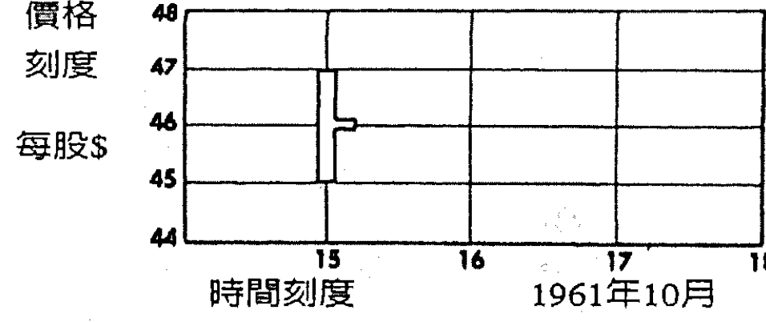

週線圖、月線圖與年線圖的表示方法也相同，只是每個時間刻度代表時間長度不同而已，每個垂直線段分別顯示該時間長度內的最高價、最低價與收盤價。

價格走勢圖下側需要保留一些空間，用來顯示該時段內的交易股數（成交量）。成交量顯示為柱狀圖，柱狀高度代表成交股數。（報紙刊載的資料，如果沒有特別說明，成交量是以「百股」[張]爲單位。）

接下來，讓我們運用通用汽車（General Motors）做爲例子，說明走勢圖運用的方便性。以下是1961年9月15日到10月15日的每天價格資料

# 圖2 通用汽車

| 日期 | 最高價 | 最低價 | 收盤價 | 成交股數 |
| :--- | :--- | :--- | :--- | :--- |
| 1961, 9月 | 15 | 48 | 47¾ | 48 | 37,100 |
| | 16 | Sat. | | | |
| | 17 | Sun. | | | |
| | 18 | 48 | 47 | 48 | 38,200 |
| | 19 | 48 | 47¾ | 47¾ | 28,500 |
| | 20 | 48½ | 47¾ | 48½ | 36,300 |
| | 21 | 49 | 48¾ | 48½ | 59,700 |
| | 22 | 48¾ | 48¾ | 48³⁄₈ | 29,500 |
| | 23 | Sat. | | | |
| | 24 | Sun. | | | |
| | 25 | 49 | 48 | 48¼ | 44,100 |
| | 26 | 48¾ | 48¼ | 48½ | 29,500 |
| | 27 | 49¼ | 48½ | 49¾ | 75,700 |
| | 28 | 49½ | 49½ | 49% | 48,200 |
| | 29 | 49¾ | 49¼ | 49% | 31,800 |
| | 30 | Sat. | | | |
| Oct. 1 | Sun. | | | | |
| | 2 | 49¾ | 49¼ | 49¾ | 29,200 |
| | 3 | 49¾ | 49% | 49% | 21,500 |
| | 4 | 50 | 49¾ | 50 | 55,200 |
| | 5 | 50% | 50 | 50% | 45,800 |
| | 6 | 50% | 50¼ | 50% | 41,100 |
| | 7 | 星期六 | | | |
| | 8 | 星期天 | | | |
| | 9 | 50% | 50% | 50% | 37,100 |
| | 10 | 51 | 50% | 50% | 40,000 |
| | 11 | 51 | 50% | 51 | 35,300 |
| | 12 | 50% | 50% | 50% | 26,400 |
| | 13 | 50% | 49¾ | 50% | 39,300 |
| | 14 | 星期六 | | | |
| | 15 | 星期天 | | | |

圖3 走勢圖的顯示方式：

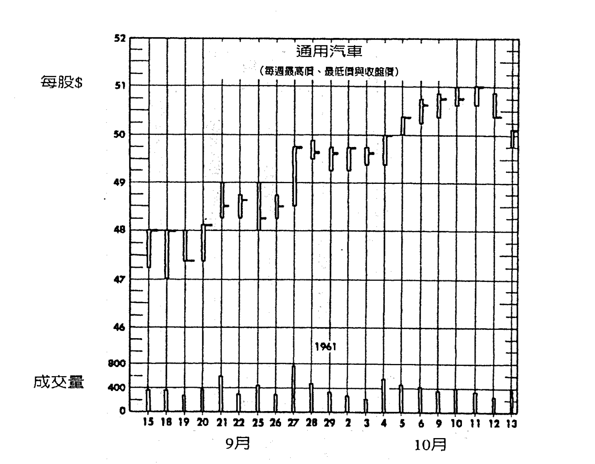

第一支垂直線段代表9月15日的交易狀況，最高價爲48，最低價爲47 1/2，收盤價爲48（水平狀小橫畫）；下側柱狀圖顯示通用汽車當天的成交量爲37,100股。

每天的處理方式都相同，一直到10月15日爲止。（請注意，例行休假日都沒有留空格，使得圖形得以連貫。）

相關資料也可以壓縮而繪製爲週線圖，以供長期分析之用，例如：

圖4

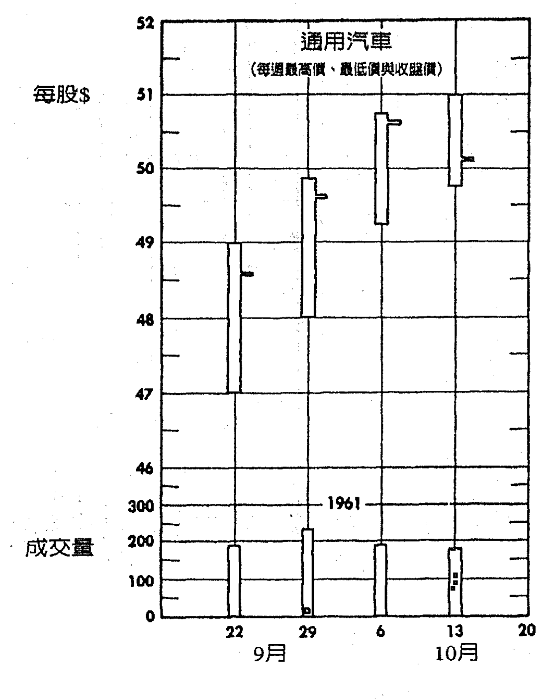

# 2 趨勢

隨意翻閱股價走勢圖，就可以發現一種現象，股價通常會在很長一段時間內，呈現特定方向的走勢。稍微仔細觀察又可以發現，這種趨勢經常存在特定型態，隱約沿著一條直線前進。事實上，股價得以緊密沿著一條直線發展，這是股價走勢圖最特別的一種性質。

股價判讀並沒有什麼神奇或超自然之處。股價之所以呈現各種型態，只不過反映人性心理罷了一一換言之，股價取決於人心。舉例來說，股價沿著直線發展，這種現象並不難解釋。以物理學的術語來說，這經常被比擬為慣性原理；換言之，運動中的物體，會繼續朝相同方向前進，直到該物體遇到相反方向的力量為止。從人性角度解釋，投資人購買股票所支付的價格，通常都不願意超過最近的買價一－除非股價持續上漲，這或許會增添買方的信心，期待股價繼續上漲。反之，投資人出售股票的價格，通常都希望盡量不低於最近的賣價一一除非股價持續下跌，而投資人擔心價格繼續下跌。

## 市場心理與趨勢驅動

讓我們利用一個虛構而典型的例子來說明市場心理——對於消息面發展的反應——如何驅動趨勢。假定 XYZ 公司即將完成其新產品，預計可以提高公司的銷售量與獲利。當時，該公司的股價大約在 $20 附近。內線人士——公司主管、員工和他們的親朋好友——會最先得到相關消息。這些人將取消在 $20、$21，甚至 $22 的賣單。由於籌碼從市場上抽離，將造成對應股價的供給量減少，使得價格醞釀上漲壓力。更重要者，某些內線將買進股票，導致需求增加。這時股票經紀人、投資顧問，甚至同業也風聞新產品的消息。於是，股價開始攀升到 $23、$24、$25，愈來愈吸引市場注意，投資大眾爭先恐後想要搭轍。股票投資人都很喜歡彼此交換小道消息（目前這項消息確實有根據，屬於相對罕見的情況），吸引愈來愈多的買盤進場。

接著，XYZ 公司正式宣布新產品的消息。經紀商分發一些說明書給客戶，解釋新產品對於 XYZ 公司盈餘的影響。公司本身也大打宣傳，做產品促銷廣告。所有這些活動都會引發新需求。可是，到了某種程度之後，股價將充分反映新產品的發展——換言之，股價已經向上調整到盈餘預期成長的合理水準。通常這也是公司正式宣布消息的時候了。很多交易者「在消息成真時賣出」，藉以獲利了結，尤其是消息宣布之前曾經出現急漲走勢。

如果先前的股價漲勢太猛，消息公佈之後，價格可能回檔。稍早估計的銷售量與盈餘數據或許太過樂觀。XYZ 公司其他部門的獲利可能減少。股價回檔的初期，某些人還可以獲利了結。可是，那些在最高檔附近接手的人，為了避免損失進一步擴大，開始認賠。結果，股價持續下挫。

所以，基於種種明確的理由，股價會在相當長的期間內，呈現特定方向的走勢——上升、下降或橫向。因此，我們可以歸納出圖形判讀的第一個結論：如果股價沿著某趨勢線發展，那麼股價繼續沿著該直線發展的可能性很大。不是必然性，只是可能性。然而，如果投資人能夠察覺這條趨勢線，交易策略上就能取得優勢。

### 如何尋找趨勢？

在股價的正常波浪發展過程中，至少需要三點（分別為波段頭部或底部）才能決定一條趨勢線，但為了進一步確認，所需要的點數通常超過三點。請參考圖 5，在上升趨勢線的情況下，C 點的位置高於 A 點。如果只有三點，恐怕要價格離開 C 點、甚至超過 B 點位置之後，才可以辨識上升趨勢。至於下降趨勢，C 點的價格水準低於 A 點。至於「橫向」或水平狀趨勢，C 點位置大約與 A 點相當。

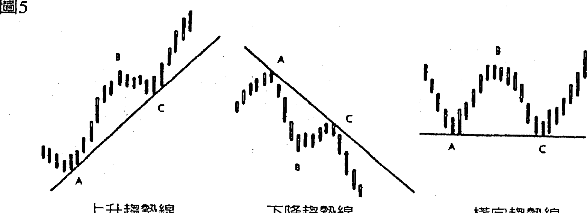

請注意，上升趨勢線是由股價走勢的低點銜接而成；下降趨勢線則是由股價走勢的高點銜接而成。這項區別很重要。一些新手的做法可能剛好相反（很容易理解），他們利用一條直線銜接價格波段高點而繪製上升趨勢線，下降趨勢線則銜接價格低點。這種方法偶爾或許有效，但多數情況下都不可靠，幾乎不能用來精確預測價格，很難判斷下一波段的價格停頓位置。至於橫向走勢，分別銜接價格高點與價格低點的直線，經常彼此平行，但橫向趨勢線最好還是採用價格低點（如同上升趨勢線的情況）。

圖 6 利用日線圖說明趨勢線與通道的發展狀況。至於實際範例，請參考本章最後附上的走勢圖。圖 6 的實線部分，代表趨勢線，對側的平行虛線，用來協助界定通道（channels）。簡言之，通道是價格沿著趨勢線發展而形成的價格軌跡範圍。一旦決定趨勢線之後，通常就可以決定通道。當然，實際的通道不會像圖 6 那麼明確，但只要能夠判定通道的位置，就有助於設定買進或賣出價位。

圖 6

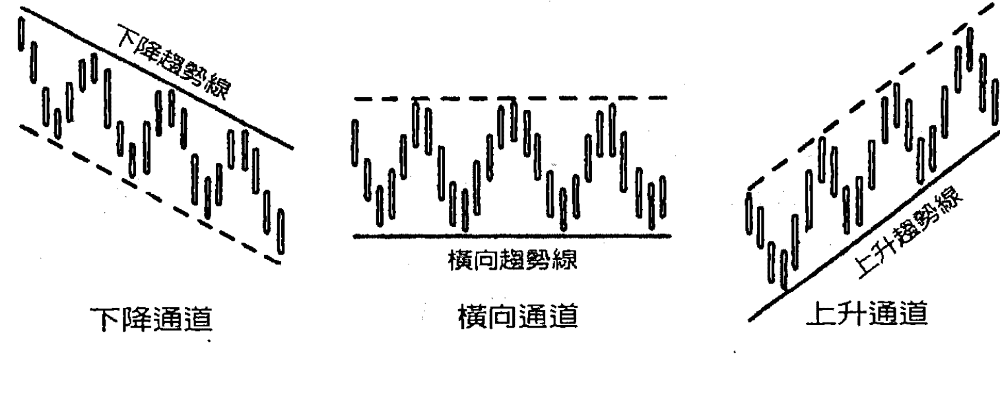

股價沿著既定趨勢線、通道或軌跡發展的時間愈久，趨勢通常愈強勁。所以，週線圖或月線圖上的趨勢線，其可靠性通常都勝過日線圖上的趨勢線。趨勢線剛形成於幾個星期內，通常很難期望它充分發揮效果。可是，即使股價穿越趨勢線而顯示發展方向確實發生變動，仍然有回歸過去趨勢線的現象。趨勢線的這種磁石效應，稱為「拉回」，經常發生在價格型態完成之後，本書稍後可以見到很多相關案例。預先瞭解這種走勢，有助於買、賣點的設定。

圖 7

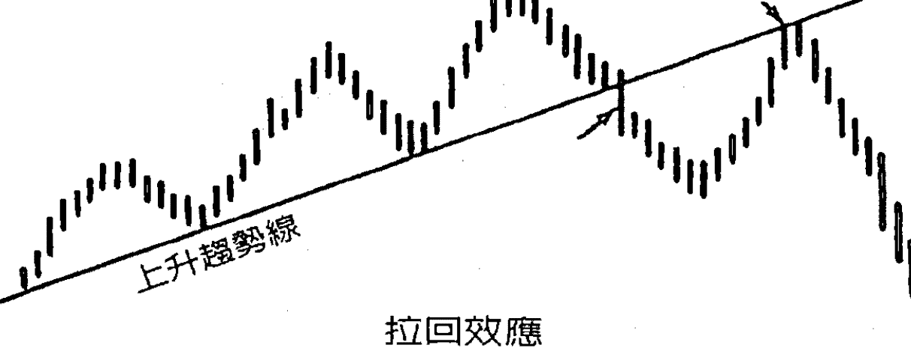

#### 成交量

當分析者看到圖 5 的 A-B-C 三點排列，就可以繪製一條假設性趨勢線。這還不是採取行動的時機，仍然必須等待進一步確認。隨著時間經過，整個圖譜上將出現很多假設性趨勢線，但它們大多因為沒有經過確認而被捨棄。可是，某些趨勢線還是會出現跟進的確認訊號。成交量——股票每天發生交易的股數——是最重要的確認因素之一。成交量將反映買進或賣出力道的強勁程度。舉例來說，某支股票平常的成交量都不大，某天出現 100 股的成交量，股價向上跳動 5 點，只代表某人基於某種理由而突然想買進該股票，但他只有抬高價格到市價上檔 5 點，才能湊足所需要的 100 股。

一般來說，成交量愈大，價格走勢愈有意義。在上升趨勢中，每當價格由趨勢線朝上挺進，通常成交量都會放大；反之，每當價格折返趨勢線，成交量通常就會萎縮。對於下降趨勢而言，情況剛好相反，通常會有「價跌量增／價漲量縮」的現象。

## 即將發生的反轉

趨勢反轉之前，成交量通常都會先出現警兆。舉例來說，上升趨勢發展過程中，通常會有「價漲量增／價跌量縮」的正常現象，如果忽然出現「價漲量縮／價跌量增」的反常現象，通常意味著價格走勢即將反轉。

對於圖形分析者來說，每當價格突破趨勢線，都代表一種警訊。如果價格只是稍微突破趨勢線，通常都不代表該趨勢已經結束，但畢竟是一個警訊。長期累積的經驗告訴我們一個法則：每當價格夾著大量突破一條明確的趨勢線，而且突破幅度超過 3%，既有趨勢很可能就會反轉。

## 變形

除了直線狀的趨勢之外，也有曲線狀的趨勢。某些情況下，如果上漲（下跌）動能加速發展，經常會讓直線趨勢線演變為曲線狀（本書稍早提到的 XYZ 公司例子，其股價發展就很可能呈現曲線狀上升趨勢）。圖 8 顯示向上彎曲與向下彎曲的趨勢線。這種曲線狀的加速發展，如果發生在延伸性走勢末端，經常會演變為價格峰位或谷底的高潮行情。高潮行情（climactic action）是指瘋狂的買進或賣出。在這類瘋狂的走勢中，價格會呈現飆漲或暴跌，成交量也會異常放大。這種趨勢線可以利用「法國曲線尺」①（French Curve）繪製，其效果與直線狀趨勢相同。請注意，除非整理階段開始，否則很難預先判斷高潮行情將結束於何時。這種「爆發性」走勢所帶動的漲勢往往很可觀。

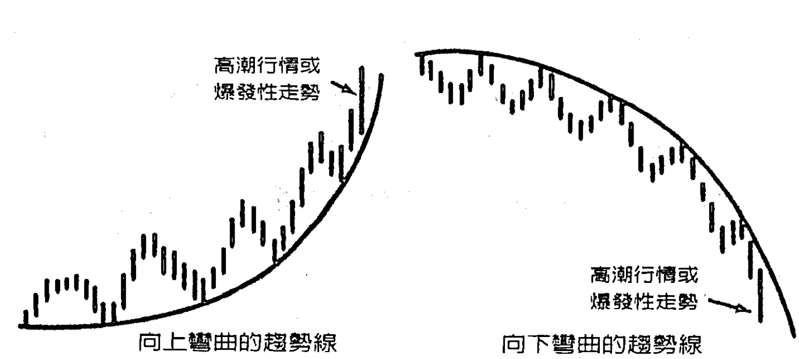

除了曲線狀趨勢之外，還有一些更複雜的趨勢線與其變形，「內部趨勢線」（internal trendline）與「扇形」（fan）趨勢線就是其中兩者。

圖 9 顯示內部趨勢線的結構。介於 A 點與 B 點之間是正常的上升趨勢線，但 B 點與 C 點之間的價格走勢，則位在趨勢線之下，使其成為內部趨勢線。

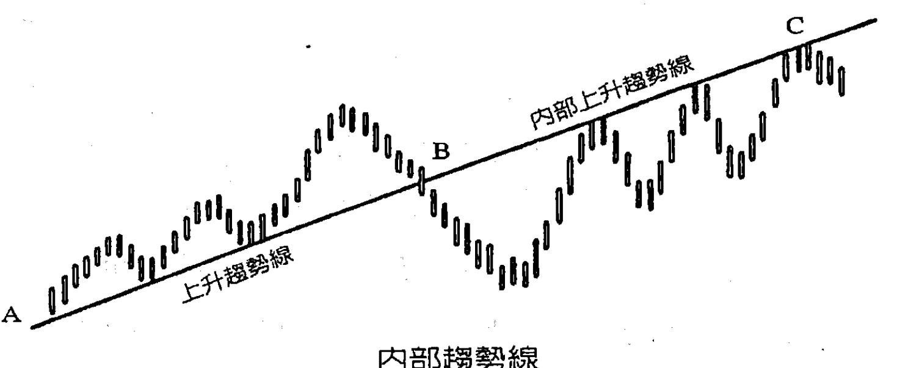

所謂的扇形趨勢線（見圖 10），是指價格跌破明確的上升趨勢線之後（A~B），又呈現相同方向的另一條趨勢線（A~C），當這條趨勢線被跌破後，又出現第三條相同方向的趨勢線（A~D）。第三條趨勢線遭到貫穿後，通常都會發生重大反轉。某些情況下，可能出現第四條或第五條的扇形趨勢線——不過在第四度突破後，通常都會形成趨勢反轉。

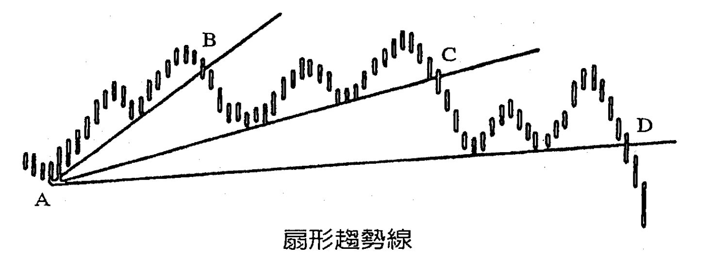

## 市場戰術

如同交通號誌一樣，圖形分析告訴投資人，何時應該前進，何時應該放慢速度或暫停。只要上升趨勢線沒有遭到貫穿，交通號誌就屬於綠燈，適合買進新股票，先前買進的股票也可以繼續持有。一旦價格穿越趨勢線，就代表黃燈，尤其是夾著大量的貫穿走勢。這種情況下，不該買進新股票，原本持有的股票應該重新檢討。趨勢線存在的時間愈長，突破之後的反轉走勢也愈重要。最後，當充分證據顯示下降趨勢已經在發展中，代表紅燈，投資人應該獲利了結，或採取防禦性措施減少損失。（某些專業玩家可以採取放空或選擇權策略，但此處不準備討論。）

假定投資人準備買進或賣出股票，如果他熟悉趨勢通道的概念，曉得股價在哪個範圍內波動，這方面的知識或許可以幫助他爭取每股幾塊錢的價格差異。他可以想办法在通道下限買進，或在通道上限賣出。另外，價格突破趨勢線之後的折返走勢，也是非常適合買進或賣出的位置。

在主要價格走勢中，「買在最低點／賣在最高點」顯然是投資人夢寐以求的目標，但通常很難實現。如果你想掌握最後一檔的價格跳動，那是很不明智的，而且也沒有必要。投資人應該充分發揮想像力，不要被固定的法則限制，也不要相信一些看起來太過精確的預測公式或工具。在圖形判讀的範疇內，趨勢線是分析者首先要觀察的最重要事項。

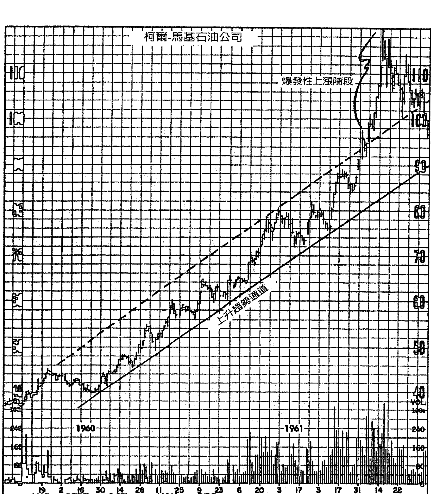

走勢圖 1 柯爾-馬基石油公司（KERR-McGEE）——上升趨勢線與通道

# 喬治亞太平洋公司

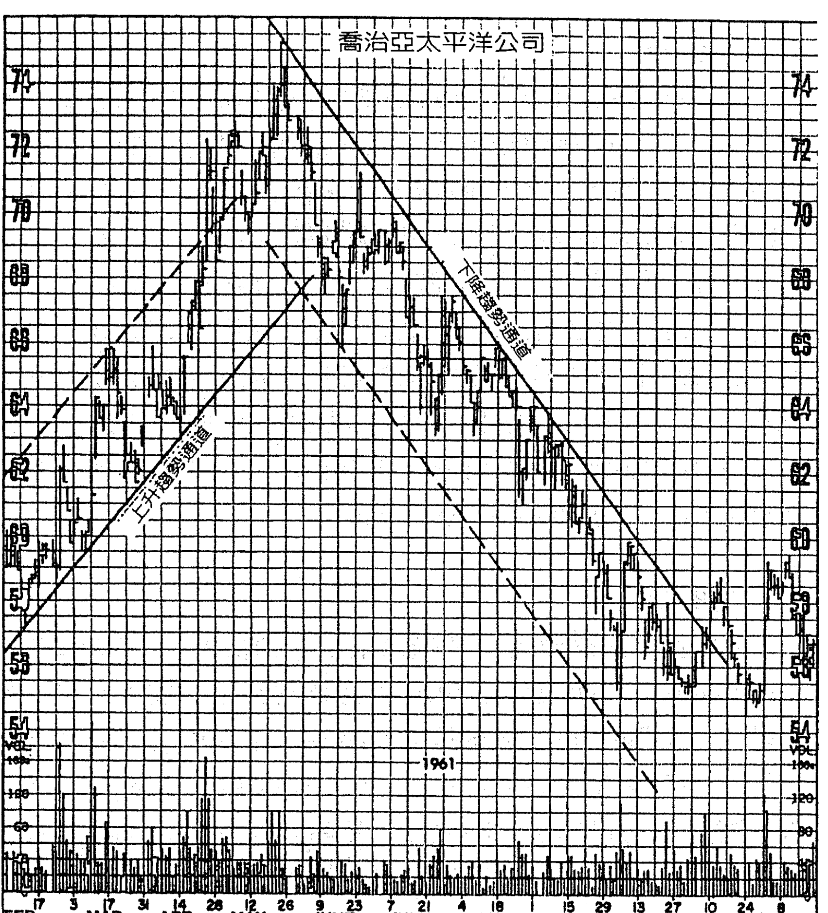

走勢圖 2 喬治亞太平洋公司（GEORGIA PACIFIC）——下降趨勢線與通道

## 走勢圖 1

這份走勢圖顯示，柯爾-馬基公司股票在不到七個月的時間內，價格成長兩倍。最初七個月內，價格沿著上升趨勢線（實線）發展，整個股價波動大致上都落在上升通道內（上升通道是由趨勢線與其平行虛線界定）。進一步分析可以發現，在漲勢發動的第一個月內，上升趨勢線就存在了。1961 年 4 月，價格向上突破通道上線，展開加速的爆發性漲勢或高潮行情。這種爆發性漲勢結束之後，通常會出現暫時性或主要頭部。這段飆漲行情是由 1 股分割為 2 股的消息驅動，實際分割時間為 5 月 1 日。截至 1962 年初為止，股價仍然遠低於這份走勢圖顯示的歷史高價。

## 走勢圖 2

4 月底，價格向上穿越通道上限，情況與前一頁的柯爾-馬基很類似，這種爆發性飆漲走勢通常都發生在上升趨勢的末端。至於隨後的下降趨勢，價格基本上是沿著下降趨勢線發展，除了偶爾出現的劇烈反彈，反彈高點銜接為通道上限。這種行情很適合來回操作；換言之，在下降趨勢線附近買進，在通道上限附近賣出。經過漫長的跌勢之後，價格終於在 11 月份的第一個星期突破通道上限。11 月底，價格重新拉回到通道上限附近。另外，從 11 月份開始，成交量型態也發生變化——價漲量增，價跌量縮。

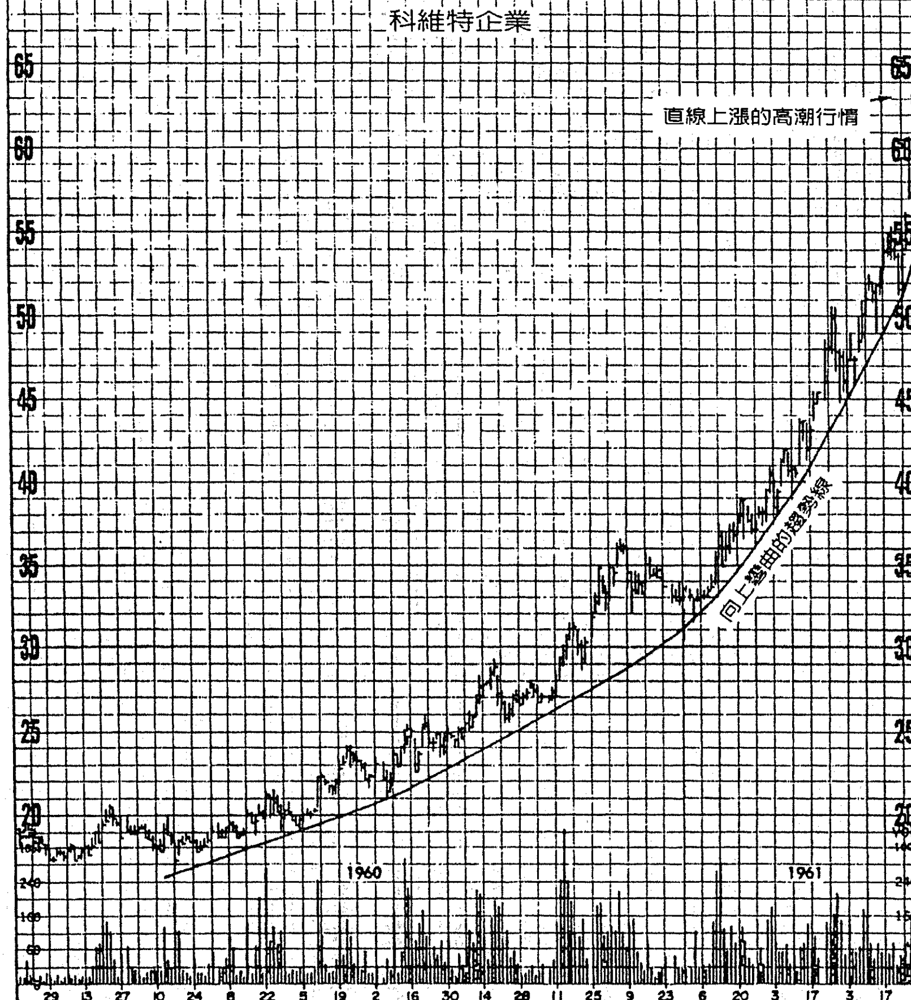

走勢圖 3 科維特企業（KORVETTE）——向上彎曲的趨勢線

# 股價走勢圖精論

### How Charts Can Help You in the Stock Market

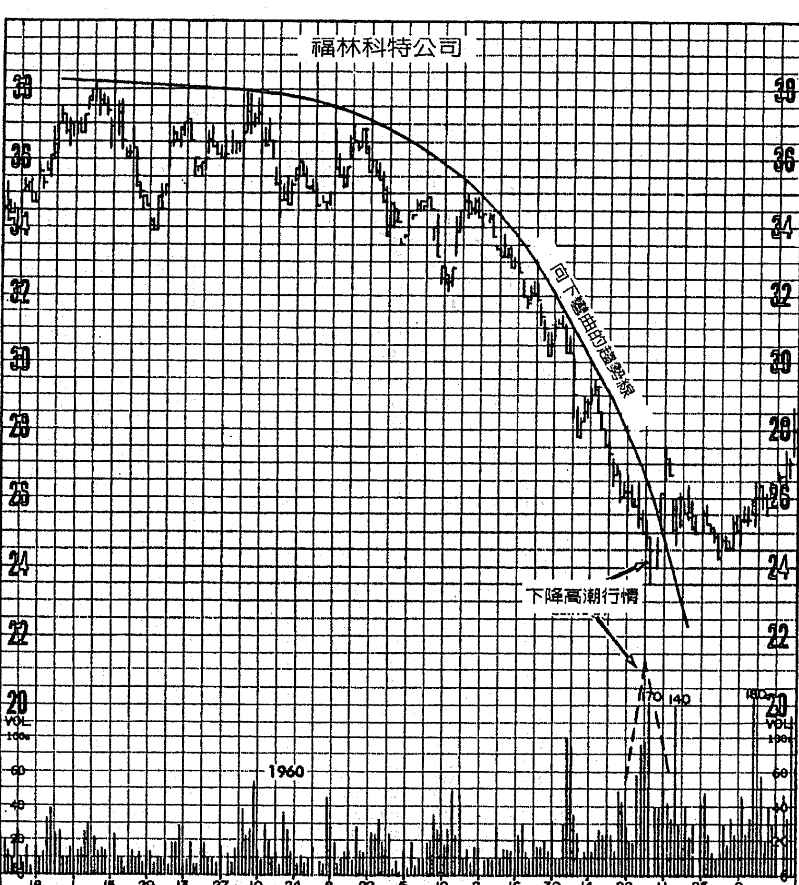

走勢圖 4 褔林科特公司（FLINTKOTE）——向下彎曲的趨勢線

## 走勢圖 3

7、8 月份開始的上升趨勢發動之前，先是一段長達幾 個月的橫向盤整。1961 年 1 月，科維特股價開始加速上揚，趨 勢線也向上彎曲，3 月底進入飆漲的「爆發性」階段，股價 直線上升，意味著上升行情即將告一段落，甚至出現重大反 轉。如同第 2 章解釋的，向上彎曲的趨勢線，通常都發生在 多頭行情末端，但很難精確預測這段飆漲走勢將結束於何 處，因為股價很可能在短時間內出現重大漲幅。就目前這個 案例來說，圖形上標示的最高價（68½）也就是短期頭部。 1961 年 6 月，價格回檔到 47½，然後又恢復漲勢，1961 年的最 高價為 $129。

## 走勢圖 4

向下彎曲的趨勢線，情況類似對應的上升趨勢線。剛開 始的階段，曲線的彎曲程度很緩和，然後愈來愈陡峭。如同 這份走勢圖顯示的，成交量原本很穩定，直到跌勢發展一段 期間之後，成交量才慢慢放大，高潮階段的成交量則顯著放 大。讀者不妨參考科維特的向上彎曲趨勢線（走勢圖 3），高 潮階段並沒有伴隨出現不尋常的大量。可是，在福林科特的 案例中，高潮階段的成交量很大，但每天的價格變化並沒有 不尋常之處。高潮階段通常都會發生激烈的價格波動，或是 顯著的大量，也可能兩者同時發生。

## 支撐與壓力

你是否有過類似的經驗：股票買進來之後，價格就下跌，心中只想著——但願有解套的機會？同樣的，當你賣出股票之後，股價就一路走高，你希望自己還有機會根據當初的賣價重新買回股票？事實上，這都是人性的自然反應，而且也會顯示在股價走勢圖上，構成所謂的**支撐與壓力**。

支撐水準就是股票需求將顯著增加的價位。反之，壓力水準就是股價供給將顯著增加的價位。這類的區域並不難判定，舉例來說，股票曾經在此大量換手的價位，就屬於支撐／壓力（兩者的角色會變換，我們稍後會討論這點）。股票交投非常熱絡的價格區間，也是分析師在走勢圖上所稱呼的密集交易區間，請參考圖 11。

假定你與其他數以百計的投資人，都在 $20 到 $22 之間的價位買進 A 股票，然後股價跌到 $16。一般持股者的第一個反應，通常是繼續持有，希望股價能夠反彈，甚至上漲超過 $22，藉以證明投資人的明智判斷。可是，如果 A 股票的表現持續不振，很多持股者就會調整目標，希望能夠解套就好了。所以，如果 A 股票最後真的反彈，愈接近解套區域，賣壓就會愈來愈大。當然，稍早在密集交易區間（$20~$22）的成交量愈大，賣壓也愈大。因此，在股價上漲過程中，上檔的密集交易區間，就成為壓力區。

現在，假設很多人在 $20 到 $22 之間買進股票之後，股價是上漲而不是下跌。這個密集交易區間將被分析師視爲支撐區。換言之，如果股價上漲到 $25 之後回檔，應該會在 $20~$22 之間獲得強力的買盤支撐。很多理由可以解釋這種現象。首先，那些當初在 $20 到 $22 之間賣出股票的人，看著股票上漲到 $25，通常會覺得很懊惱，希望有機會在當初的賣價買回股票。如果能夠辦到這點，他們甚至可以誇口自己從來沒有看錯這支股票。還有另一類投資人——包括當初在 $20~$22 買進股票的人，以及那些原本打算買進而沒有及時掌握機會的人——可能計畫在這個價位繼續買進。第三類投資人，是那些在股價上漲過程放空股票的玩家，他們將趁著股價回檔而獲利了結。

分析者通常會在走勢圖上利用水平直線標示支撐／壓力區。舉例來說，如果股票在 $20 到 $24 之間盤整一段期間（請參考圖 12），$20 就成為盤整階段的下檔支撐（A 線），$24 則是上檔壓力（B 線）。一旦價格突破 $24 的壓力之後，整個盤整區間（$20~$24）就成為後續走勢的下檔支撐區（A 與 B 之間）。

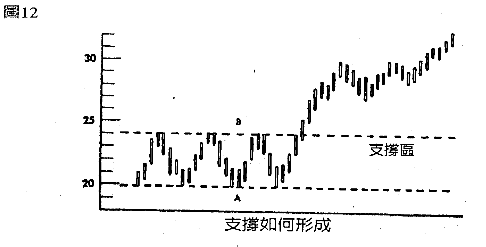

隨著行情演變，原先的支撐可能變成壓力，反之亦然。請參考圖 13。假定 B 股票在 50 到 55 之間遊走幾個月之久。這段期間內，50 是下檔支撐，55 是上檔壓力。現在，如果某天的收盤價(2)突破 55，這個過去的壓力將自動成為後續走勢的新支撐。那些在 55 附近買進的投資人，現在覺得自己的判斷並沒有錯，因為已經有了帳面獲利，某些人甚至想在這個價位多買一點。至於那些當初在 55 賣出股票的人，則希望能夠在這個價位重新進場。

> (2) 分析師認為，收盤價突破較盤中突破更具效力，因為一般投資人在報紙上查閱的都是收盤價。股票作手顯然也知道這點，所以往往實在臨收盤之前作價。

反之，如果股票向下突破——換言之，如果 B 股票跌破 50——那麼當初的支撐（50）將成為後續走勢的壓力。當初在 50 或更高價位買進的人，現在都處於虧損狀態，只要價格回升到 50 或更高，這些人可能就想「解套」。

在投資人的心中，個別股票（或股價指數）也有一些支撐與壓力，這些數據可能源自於很久之前或最近的經驗。我們經常聽到人們說：「關於 XX 股票，我總是在 20 買進，在 40 賣出。」³ 仔細觀察景氣循環類股的歷史表現（所謂景氣循環類股，其股價表現總是與經濟循環的起伏之間保持密切的關係，例如：鋼鐵與基本工業物料），就可以發現一些經常發生的股價轉折點。

甚至在短期之內，股價波動的高點與低點，也可能對於投資人構成心理影響，因此而成為短期的支撐或壓力。舉例來說，假定你擁有某股票，價格上漲一段幅度，就在你準備獲利了結時，股價突然回檔。在這種情況下，你是否會覺得自己錯失了「在頭部賣出」的大好機會？若是如此，當你正在懊惱時，假定股價又漲回先前的高點，你是否會有出場的念头呢？如果夠多的持股者都有這種感覺，這個高點就會成為潛在的壓力，即使該高點第一次出現的成交量並不大小。

> ³ 整數也是常見的支撐與壓力—很多投資人經常把買進或賣出的價格目標，設定為 10 的倍數，或 5 的倍數。

## 50% 法則

不論是個股或大盤指數，如果價格出現劇烈走勢，專業玩家都會預期某種程度的「技術性反彈」或「技術性修正」。換言之，在一段急漲（急跌）走勢之後，股價隨後應該出現快速拉回（反彈），折返幅度往往是先前走勢幅度的三分之一或三分之二。如果股價急漲，某些短線玩家就會立刻獲利了結；如果股價大跌，某些「撿便宜貨的人」就會進場。可是折返走勢發生之後，股票通常會很快又恢復先前的趨勢。對於比較大幅的價格搖動而言，每當股價折返到先前走勢幅度的二分之一處，就會逢到明顯的支撐或壓力。（圖 14）舉例來說，假定某股票由 20 上漲到 60，其間沒有出現重大修正。一旦股價開始回檔，很可能在先前漲幅（60-20=40）的一半位置獲得支撐。先前漲幅的一半是 20 點（40^{1/2}=20）。由 60 起算，回檔位置應該在 40 附近（60-20=40）。

## 不尋常的成交量

我們曾經提到走勢圖上的「密集成交區」，這是某期間內交投相對熱絡的價格區間，因此也是潛在的支撐或壓力區。就理論上來說，所謂的「某期間」究竟是幾個星期或更短的時間，差異應該不大，重點是該價格區間內的成交量很大。即使突然爆出的大量在走勢圖上並沒有造成價格走勢明顯中斷，該價位也應該是有效的支撐／壓力。

舉例來說，某股票伴隨著平均成交量慢慢上漲到 $14；接著，成交量突然放大。走勢仍然維持先前的步調上漲到 $16，然後，成交量恢復到「正常」水準。這時不論價格繼續上漲、下跌或橫向發展，圖形分析者都會把 $14~$16 視爲「大成交量區間」，也是潛在的支撐／壓力位置。前述理論當然也適用於價格下跌。（關於大成交量區間的案例，請參考本章最後附上的走勢圖。）

當走勢遇到意外的支撐／壓力而爆出大量，該價位的能量也就會增加。非常有趣的，成交量急劇萎縮的價位，往往也會構成支撐／壓力。為何會發生這種現象，實在很難解

或許是因為很多對於該股票有興趣的人，認為該價位是重要的轉折點，於是決定暫時退出觀望，看看股價的後續發展究竟如何變化。所以，成交量急劇萎縮的價位，往往代表市場心理在此發生轉變。總之，有效的支撐／壓力，成交量通常都應該顯著放大，但如果成交量明顯萎縮，圖形分析者也應該留意。

關於成交量，還有一點值得注意之處：股票突破密集交易區間的過程，圖形分析者都會觀察成交量變化，藉以判斷該突破究竟是「真」突破或「假」突破。一般來說，有效的向上突破（穿越壓力區），通常都會出現顯著的大成交量。反之，有效的向下突破（跌破支撐區），成交量通常不會放大，但跟進跌勢則會出現明顯的大量，後者可以視爲確認訊號。

## 支撐與壓力的運作

如同趨勢線一樣，任何走勢圖內都隨時可以看到支撐／壓力。事實上，圖形分析者嘗試用來預測價格走勢的各種複雜型態，其基本結構也脫離不了支撐／壓力。前一章曾經提到，運動中的物體（趨勢）將持續運動，直至該物體遇到反方向的力量（支撐／壓力）爲止。圖形分析者會同時運用這些工具，藉以彼此確認。趨勢線可以用來協助確認支撐／壓力，支撐／壓力也可以用來協助確認新的趨勢線。

在日線圖中①，支撐區底部的效力顯然高過頭部。處於漲勢中的股票，其修正走勢經常折返進入支撐區域，然後才恢復漲勢（參考圖15）。新的支撐水準可能形成於先前的支撐區內，成爲另一個有效支撐。有關支撐／壓力的說明，請參考本章最後的範例。

研究支撐／壓力的反應，投資人可以判斷持股是否仍然保持在正確航道上。只要支撐仍然發揮功能，持股的表現就算不錯，可以考慮繼續買進。反之，如果股票跌破支撐，就有理由擔心，或許應該考慮賣出。

某些投資人利用支撐／壓力的觀念來架構交易系統。當股價跌到支撐水準，或股價向上突破浪壓力水準，就進場買進。反之，當股票上漲到壓力水準，或跌破支撐，則賣出持股。

> ①週期圖與月線圖也有支撐與壓力，方便於觀察個別股票的長期或歷史性重要價位。一般來說，支撐或壓力的動道將隨著時間經過而慢慢流失，但有些價位在幾年之後仍然足以發揮支撐／壓力的功能。

另一種相關技巧如下。假定股價向上突破50~55的交易區間，上漲到58。在這種情況下，先前的壓力55變成後續走勢的支撐。股價回檔過程中，價格可能跌破55；若是如此，短線交易者或許不願意繼續持有股票，但對於較長期的交易者來說，只要股價沒有跌破支撐區的底部（50），就可以繼續持有。

精明的投資人，可以運用支撐／壓力的觀念，預先判斷股票獲利了結的目標價位。在空頭行情中，投資人也可以藉此找到股價可能開始反彈的區域，在該處結束空頭部位（先高價賣出，然後再低價買進，藉以賺取差價利潤）或建立新的多頭部位。

擁有趨勢線與支撐／壓力等基本工具之後，我们可以開始討論圖形分析中最迷人的主題——顯示主要轉折訊號的價格排列。

# 股價走勢圖精論

How Charts Can Help You in the Stock Market

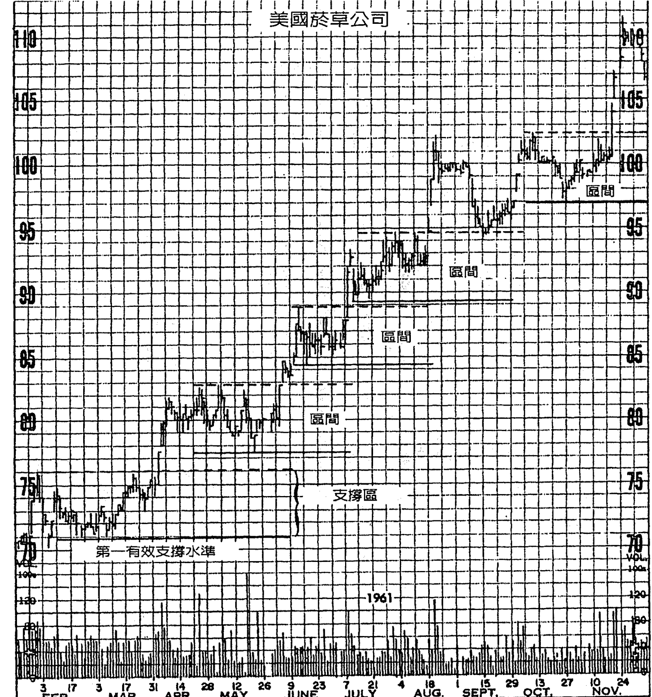

走勢圖5 美國菸草公司（AMERICAN TOBACCO）——支撐水準

# 3—支撐與壓力

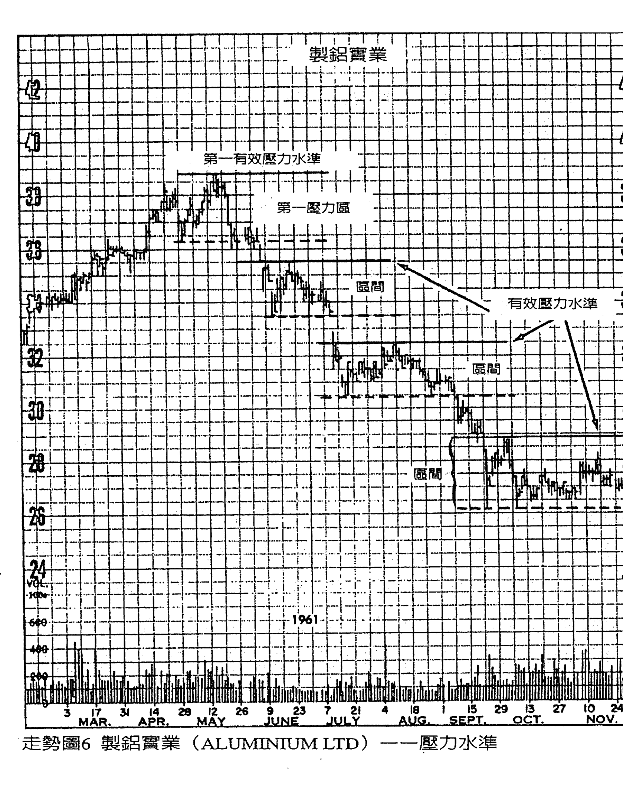

走勢圖6 製鋁實業（ALUMINIUM LTD）——壓力水準

## 走勢圖5

以上這段走勢，實際上是1958年以來長期上升趨勢的一部分。這是一個很好的範例，藉以說明支撐區所能發揮的功能。價格每次向上突破之後，就沒有再跌破下檔支撐。這雖然不是十分罕見的情況，但一般案例的支撐區多少會被穿越。上述排列的較重要部分是「有效支撐線」（標示為實線），這代表支撐區的底部，只要這條支撐線沒有被跌破，投資就還不至於發生麻煩。注意：唯有價格向上突破密集交易區間之後，才可以繪製「有效支撐線」。

## 走勢圖6

此處的壓力線，類似於前一個案例的支撐線。由6月份之後，每當價格創新低，後續反彈就沒辦法穿越到上檔的壓力區內。相對於上升趨勢的支撐區來說，下降趨勢的壓力區比較不容易遭到穿越，雖說如此，但跌勢過程仍然要特別留意「有效壓力水準」。注意：此處出現一個很有趣的「楔形」（wedge）頭部。楔形排列要等到第10章才會討論，所以暫時不需理會。第10章的相關討論，仍然需要讀者參閱這個例子。

## 環球油品

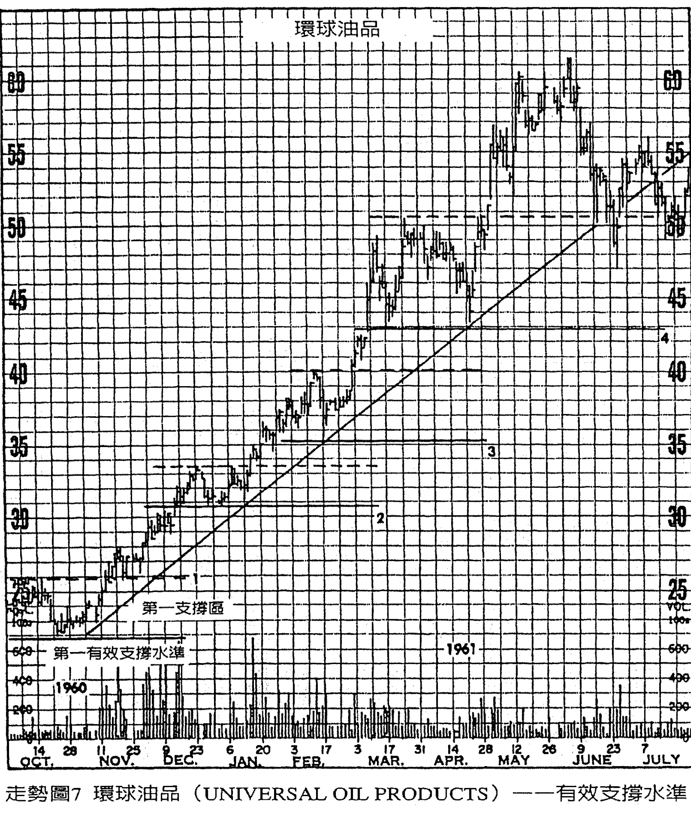

走勢圖 7 環球油品（UNIVERSAL OIL PRODUCTS）——有效支撐水準與支撐區

# 股價走勢圖精論

How Charts Can Help You in the Stock Market

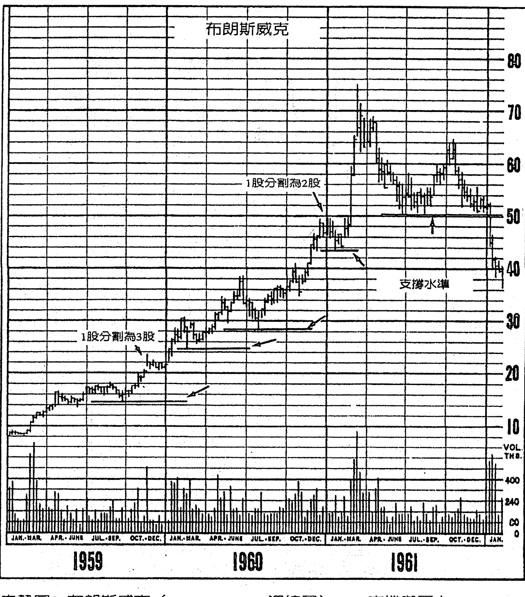

走勢圖8 布朗斯威克（BRUNSWICK週線圖）——支撐與壓力

## 走勢圖7

股價在不到八個月之內，幾乎上漲兩倍，而且完全沒有跌破趨勢線，甚至沒有威脅到先前的支撐區。繪製支撐區的方法很簡單，並不是事後才決定的。每當價格突破密集交易區而創新高，就可以沿著密集交易區的低點繪製有效支撐線（實線），並沿著密集交易區的高點繪製一條直線（虛線），藉以決定當時股價的下檔支撐區。這份走勢圖有四個支撐區，分別標示爲1~4。在6月份之前，四個支撐區都沒有被穿越；6月份之後，價格回檔進入第4個支撐區，而且跌破上升趨勢線。這或許是價格反轉的警訊；可是，這時最值得觀察的支撐是有效支撐水準4，而不是上升趨勢線。就實際演變來說，這個支撐守住了，1961年底的股價爲69。

## 走勢圖8

日線圖適用的分析技巧，基本上也適用於較長期的週線圖與月線圖。這份走勢圖起始於1959年，當時的股價爲9，1961年的股價已經上漲到74½。整個股價上漲過程中，先前的有效支撐線都不曾跌破，而且價格回檔也沒有嚴重威脅上升趨勢，直到1961年第二季之後才發生變化。漲勢轉弱的第一个徵兆，是價格跌破向上彎曲的趨勢線。1961年2月份與3月份，價格夾著大量向上飆漲，可能代表長期大多頭走勢的高潮行情。1961年的年中，股價在50~58形成密集交易區間，價格反彈挑戰歷史新高，結果沒有成功。位在50的支撐線堅守九個星期，但價格最後還是夾著大量向下突破，並且開始加速下跌。

# 4 頭肩排列

在所有的反轉型態中，頭肩排列（Head and Shoulders）可能是最著名者。這種排列的結構非常明顯，隨便瀏覽走勢圖，很容易就可以看到頭肩型態。有經驗的分析者很喜歡這種排列，因為它們屬於最可靠的指標之一，初學者也很方便拿這種型態來測試圖形分析的有效性。

如同抽象藝術一樣，我們不能期待頭肩排列的形狀，與真實物體相同。簡單說，頭肩頂排列（參考圖16）是由連續三波漲勢與跌勢構成，第二波漲勢的高點超過第一波與第三波高點。第三波漲勢不能穿越第二波漲勢的高點，就是上升趨勢可能告一段落的警訊。頭肩底排列的結構剛好相反，通常發生在下降趨勢末端，意味著趨勢可能向上反轉。首先，讓我們詳細觀察頭肩頂排列的三個發展階段：

- 一、左肩——這是上升趨勢到達某種高潮行情而出現的漲勢，隨後則出現修正走勢。成交量是觀察重點；上漲過程應該出現顯著大量，修正走勢則有量縮的現象。就整個頭肩頂排列來說，左肩的成交量應該偏大。
- 二、頭——第二波漲勢的高價繼續墊高，但隨後的修正走勢則大體勾銷先前的價格漲幅，修正走勢的低點約略落在前一個谷底位置。價格上升階段的成交量放大，但整體成交量則小於左肩。
- 三、右肩——第三波漲勢無法創新高，這是上升趨勢轉弱的明顯徵兆。可是，這個階段經常造成圖形判讀發生錯誤。如果分析者能夠特別留意右肩的成交量型態，就可以避免判斷錯誤。右肩上漲過程的成交量明顯縮小，這是價格結構轉弱的明顯證據。反之，如果成交量放大，必須特別留意「假」訊號，即使頭肩頂排列的整個價格結構很完美。

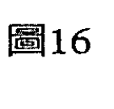

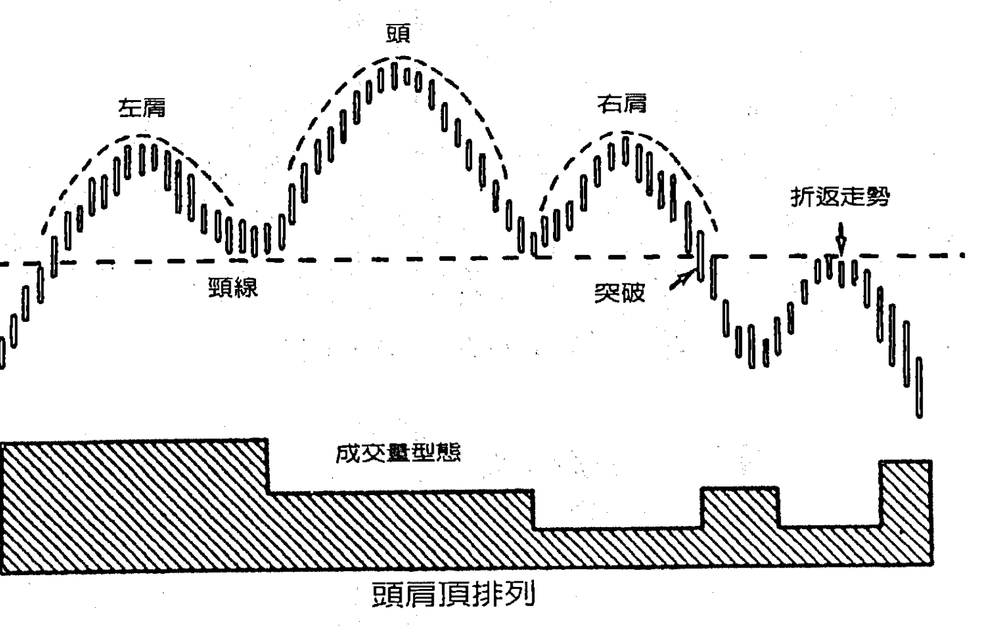

請參考圖16，三個峰位所夾兩個谷底銜接直線，稱為頸線（Neckline）。只有當價格跌破頸線，頭肩頂排列才算完成。（有些技術分析者相信，頸線的傾斜角度，將影響頭肩頂排列的效力，這方面的看法並無結論，我們暫時還不需要為此煩惱。）

頭肩頂排列完成之後，價格經常還會反彈到頸線附近，稱為折返走勢（Return Move）。個別股票的頭肩頂排列是否會發生折返走勢，一大部分取決於大盤。如果大盤走勢頗爲強勁，個股就比較可能出現折返走勢。反之，如果大盤走勢疲軟，通常就不會出現折返走勢。這種說法當然也適用於該股票所屬的類股。舉例來說，如果石油類股走勢很強，個股就比較可能出現折返走勢。股價型態分析必須考慮很多外部因素，所以很難歸納出簡單、明確的法則。

## 頭肩底排列

頭肩底排列的價格結構，幾乎完全與頭肩頂相同，只是上下顛倒而已，通常代表下降趨勢即將告一段落。可是，請注意，頭肩底排列的成交量發展稍有不同。由於成交量往往是判别價格型態是否有效的重要關鍵，所以讓我們稍微深入分析頭肩底排列每個階段的成交量狀況，請參考圖17

- 一、左肩——下降趨勢已經發展一段期間，甚至到達價格急速下跌的高潮行情，隨後出現一波反彈。價格下跌過程中，成交量明顯放大，但反彈過程的量縮。
- 二、頭——反彈結束之後，價格繼續下跌，而且創新低價（換言之，最低價低於左肩谷底），隨後出現一波反彈，帶動價格走高到前一波反彈高點附近。第二波跌勢的成交量，大於左肩反彈過程的成交量，但通常都不如左肩下跌過程的成交量。此階段的價格反彈應該出現大量，而且整個階段的成交量也應該超過左肩。
- 三、右肩——第三波跌勢沒有創新低，然後又出現另一波反彈。價格下跌過程中，成交量有慢慢萎縮的情況，但反彈過程的成交量急劇放大，頸線突破過程更爆出大量。右肩漲勢的成交量，是判斷頭肩底是否有效的最關鍵因素之一。如果成交量沒有顯著放大，不論價格結構本身多麼完美，很可能都是「假」訊號。如果成交量因素存在，當價格突破頸線之後，就可以確認型態完成。

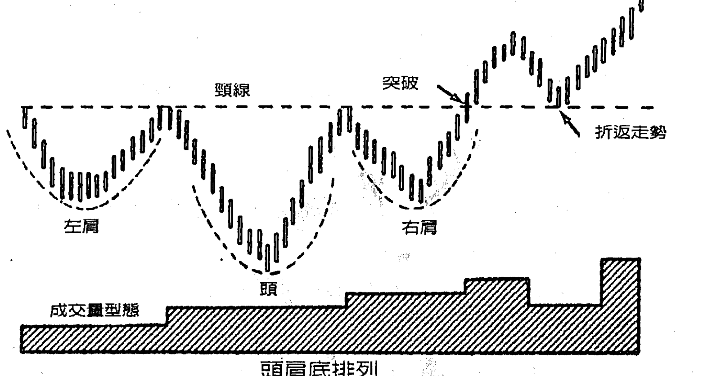

至於型態完成之後，是否會出現折返走勢，此處仍然沒有簡單、明確的法則可供依循。觀察重點仍是整體大盤與個別類股的表現。某些技術分析者認為，底部排列出現折返走勢的頻率高於頭部型態，不過沒有充分的證據可以支持這項結論。

#### 發展過程

如同任何價格型態一樣，頭肩排列只不過反映買、賣雙方在某種情況下的行爲。讓我們透過看圖說故事的方法，嘗試說明各類投資人在頭肩排列不同階段的心理與行爲反應。按照戲劇的說法，此處可以分爲三幕，主角分爲幾類：

- A類：在上升趨勢發展過程或之前買進股票的投資人，現在準備賣出獲利了結。
- B類：錯過上升趨勢的機會，現在準備在修正走勢中「撿便宜貨」。
- C類：與B類的人相同，他們沒有及時掌握上升趨勢，雖然準備在修正走勢買進，但因爲時機拿捏不準，結果在價格創新的過程中進場。
- D類：這些人錯過上升趨勢與第一波修正走勢，而在第二波修正走勢中找到「最後機會」。
- E類：這些人也就是稍早的C類投資人，但現在成爲「準賣家」。他們買進的股票已出現帳面損失，於是決定：「只要價格足以解套或小賠，就把股票賣掉。」
- F類：A類之外的投資人，加上其他各類的一些投資人，他們現在都出現帳面損失。

下列圖18顯示整個戲劇的發展：

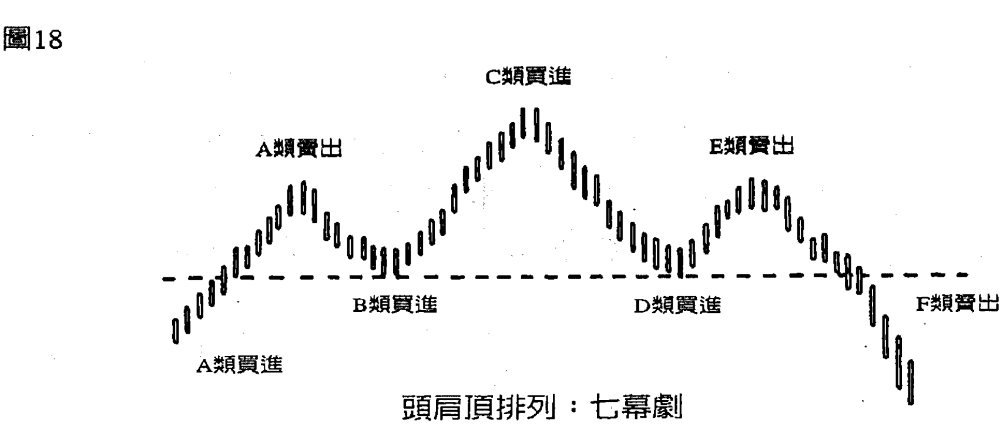

### 畢卡索的成分超過雷諾

我們稍早曾經提到，利用「頭肩型態」形容市場行爲，是一種需要高度想像力的抽象描述。任何涉及人性行爲模式或其他不可預側因素的圖形結構，都沒有簡單的法則可供遵循。某些情況下，所謂的「頭」並不是一個點或圓弧狀，而是代表「橫向密集交易區間」的平坦走勢。有時兩肩可能會變形或不對稱。有時甚至會出現複雜的頭肩排列，也就是說大型態內還包括其他小型態，或有兩個左肩、兩個頭或兩個右肩。對於那些高價購買畢卡索畫作的人，大可不必因此而緊張。（關於各種變形，請參考圖19。）

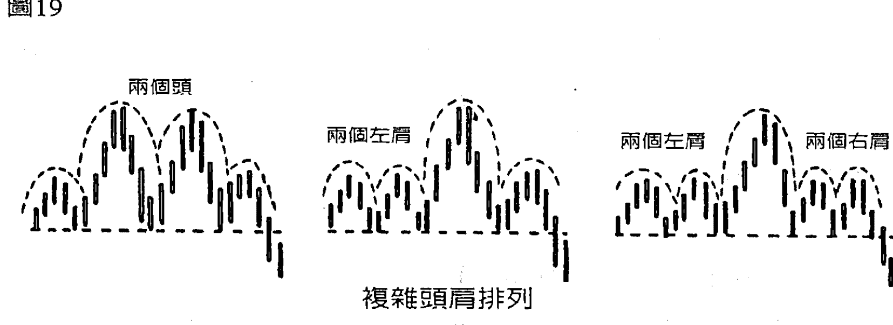

### 價格目標

遇到頭肩排列之類的反轉型態，意味著上升趨勢即將反轉下跌，或下降趨勢即將反轉上漲，但這又造成另一個問題：價格會下跌或上漲多遠呢？

現在，我們已經知道如何進場（買進股票而期待股價上漲，或放空股票而期待股價下跌），但應該在什麼地方出場呢？估計或設定價格目標，需要考慮很多因素。關於這部分內容，此處討論的詳細程度可能超過其他主題，但絕對值得。我們的估計當然不會萬無一失，但反覆練習之後，準確性應該不錯。

目標價格的估計原則如下：頭肩排列完成之後，價格朝相反方向移動的距離，至少等於「頭」到「頸線」之間的距離（請參考圖20）。大部分圖形分析者都知道這項原則，但這只是最低目標而已。關於目標價位的判斷，必須考慮各種技術因素，例如（重要性按順序排列）：

- 一、整個大盤的表現如何？
- 二、目前價位在整個歷史股價結構中居於什麼地位？
- 三、主要的支撐、壓力位置何在？

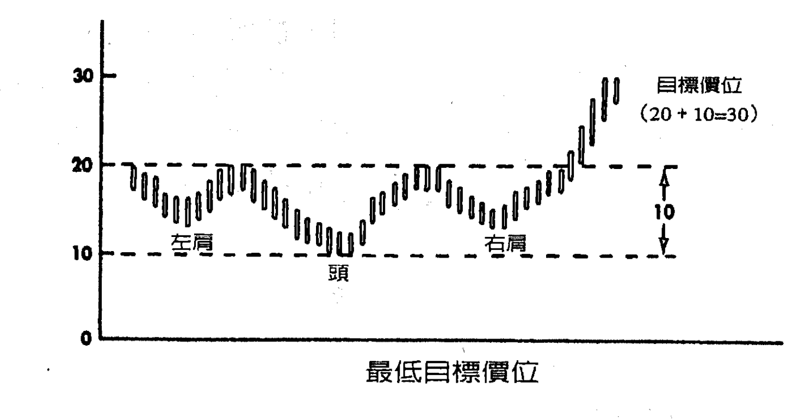

讓我們看看一個實際的例子，假定XYZ剛完成相當明確的頭肩頂排列（圖21）。我們是否應該賣出呢？答案如果是肯定的，預期什麼時候可以買回來呢？如果股價只是小跌而已，或許不值得賣出，因為這些股票屬於長期投資。如果股價跌幅不小，或許應該考慮賣出，但也可能不賣，因為資本利得稅相當可觀。反之，如果股價將大跌，當然想賣出。總之，讓我們分析看看，就像飛機駕駛員在起飛前所做的例行清單檢查（前述問題1、2與3），藉以決定應該持有或賣出：

- 一、沒有明確的徵兆可供判斷大盤走勢。多數股票呈現不規則狀的「橫向發展」，盤面屬於個股表現的狀況，本身股票所屬的類股，表現也相當分歧。
- 二、至於XYZ股票，其頭肩頂排列的「頭」是歷史新高價95，右肩完成之後，價格跌破頸線80，目前出現折返走勢，價位大約在80附近。三年前，股價曾經創歷史新低10。換言之，三年之內，股價上漲850%。由於目前股價處在歷史新高附近，所以下檔空間相當大——或者不是？
- 三、觀察長期走勢圖發現，最近的「密集交易區間」或「股價整理區間」位在50附近。50以上並沒有其他重要支撐存在。另外，前一章曾經提到，股價重大修正，很可能拉回到先前漲幅的50%位置。若是如此，讓我們計算看看。三年期間內，XYZ股價由10上漲到95，相當於85點的漲幅。50%的折返，大約是$42^{1}/_{2}$點。95減去$42^{1}/_{2}$，結果是$52^{1}/_{2}$，很接近稍早提到的重要支撐50。所以，這兩個結論大致相同。

可是，我們還沒有考慮頭肩排列的目標價位簡單衡量公式。就目前這個例子來說，「頭」（95）與「頸線」（80）的差距爲15點。由頸線向下衡量15點，結果是65。所以，根據這項公式計算，目標價位在65。另外，股價也可能跌到50或$52^{1}/_{2}$。就前述分析來說，XYZ股價至少會下跌15點，最好考慮賣出。

## 頭肩排列失敗的型態

截至目前爲止，我們所討論的都是成功的頭肩型態。股價一旦突破頸線，就能判斷走勢方向。可是，某些頭肩型態或其變形，雖然發展過程相當正常，但價格最後並沒有突破頸線（參考圖22）。反之，股價呈現沒有明確目的的橫向走勢。這時我們知道，這不是有效的反轉型態。可是，我們也知道，在當時的價格範圍內，可能出現任何方向的重大走勢。

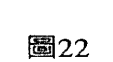

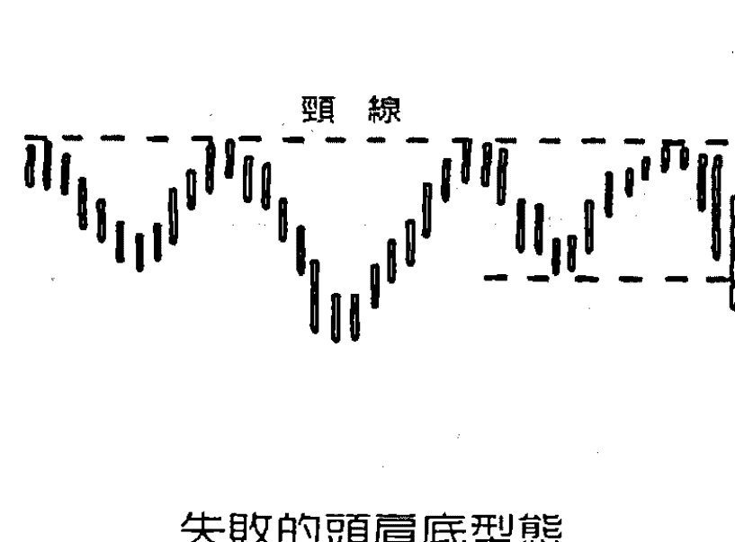

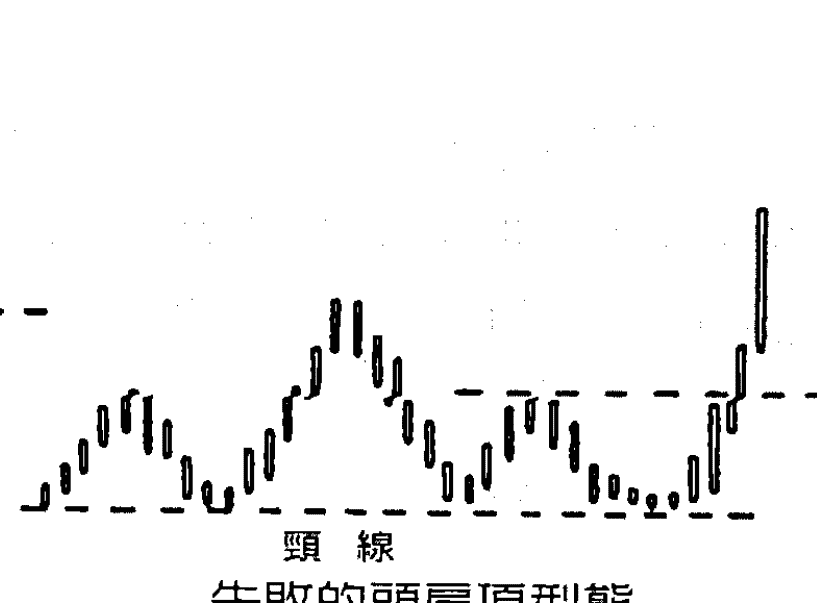

這種情況就如同車子陷在泥堆裡，如果很有技巧的換檔，前後搖擺車身，然後在動能恰當的時候猛踩油門，車子仍然可以向前或向後衝。對於失敗的頭肩型態，價格橫向走勢就是在蓄積動能，只要條件恰當——貫穿橫向區間的上限或下限——走勢就會回到軌道上，出現新的趨勢。這類型態可以做為重大走勢的啓動基礎。

## 戰 術

現在，讓我們把理論付諸實現。本章末尾附上6個相關案例，讀者可以仔細研究。這些走勢圖主要是用來解釋頭肩型態的結構，以及如何衡量目標價格。當然，還有許多類似的案例，但這些案例所展現的結構與結果基本上都相同。

關於頭肩型態，前文說明的理論與最後的案例，可以歸納一項重要結論：一般來說，當股價突破頸線時，投資人應該採取行動。

可是，有經驗的玩家或許可以在右肩發展過程中提早採取行動，前提是他有充分理由相信頭肩型態必定會完成。這個前提能夠成立的一些理由包括：

- 一、目前價位與價格歷史結構之間的關係，有利於出現趨勢反轉。
- 二、先前趨勢遭遇強勁的支撐／壓力。
- 三、成交量充分配合。
- 四、大盤沒有明顯的方向走勢，或其發展方向與該股票的先前趨勢相反。

若是如此，投資人採取行動的時機應該很接近主要走勢的頭部或底部，或許可以在最高價（最低價）附近賣出（買進）。

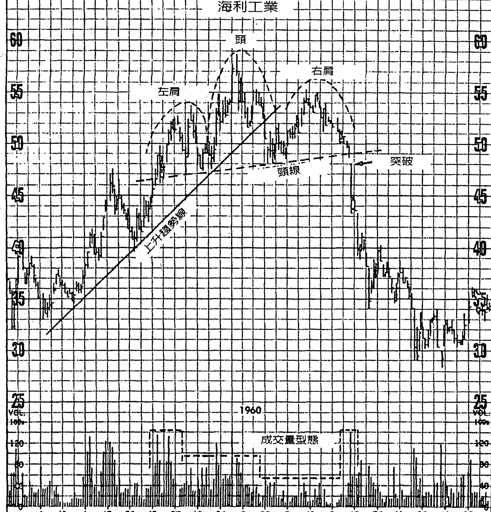

走勢圖9 海利工業（HELI-COIL）——頭肩頂排列

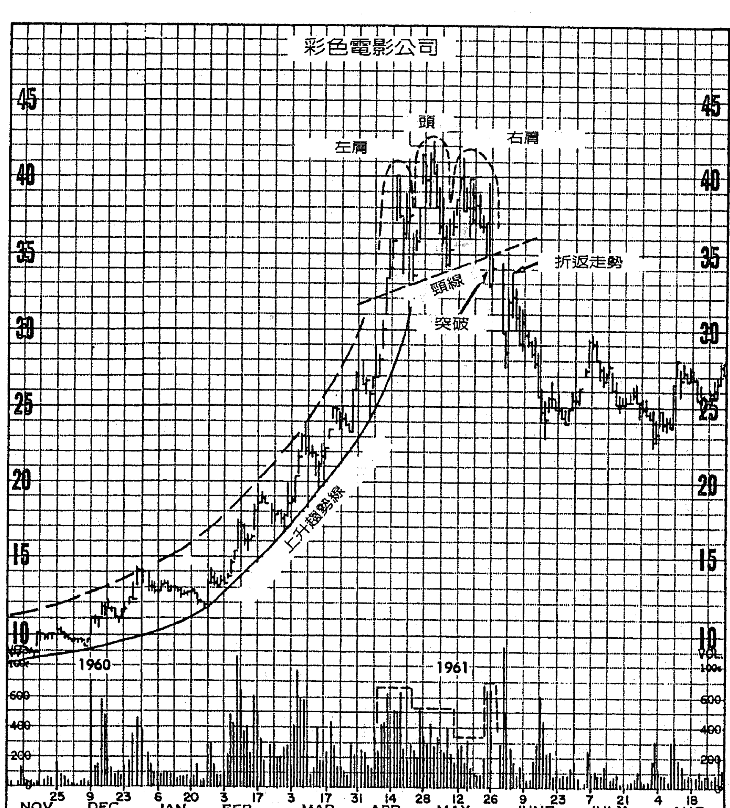

走勢圖10 彩色電影公司 (TECHNICOLOR) ——頭肩頂排列

## 走勢圖9

此處可以見到一個相當明確的大型頭肩頂排列。如果投資人持續追蹤這支股票的價格走勢，6月份左右，可以發現成交量的不正常變化，意味著趨勢可能發生反轉。6月底、7月初，雖然價格創新高，但成交量明顯低於5月份的峰值。7月22日，價格跌破上升趨勢線，這是重要的警訊。接下來，右肩發展過程的成交量明顯萎縮，這是趨勢即將反轉的第三個徵兆。最後，價格夾著大量跌破頸線。就目前這個案例來說，第三個徵兆——右肩的成交量明顯縮小——就足以讓投資人採取行動，應該在頭部附近獲利了結。

## 走勢圖10

就價格與成交量結構觀察，4月份到5月份之間的峰位，是非常典型的頭肩頂排列，雖然兩「肩」與「頭」的價格差距只有1、2點，所以也可以看成「三筆頂」排列。先前的上升趨勢明顯向上彎曲，最後夾著大量出現飆漲的高潮行情。左肩部分的成交量較大，頭與右肩的成交量相對較小。頸線突破過程出現大量，拉回頸線的走勢則沒有出現大量。1961年10月（圖形沒有顯示），價格強勁反彈，測試36的關卡（頭肩頂排列成爲上檔壓力區），結果沒有成功，股價又跌到21左右。

走勢圖11 克倫威爾-柯利爾 (CROWELL-COLLIER) ——複雜頭肩頂排列

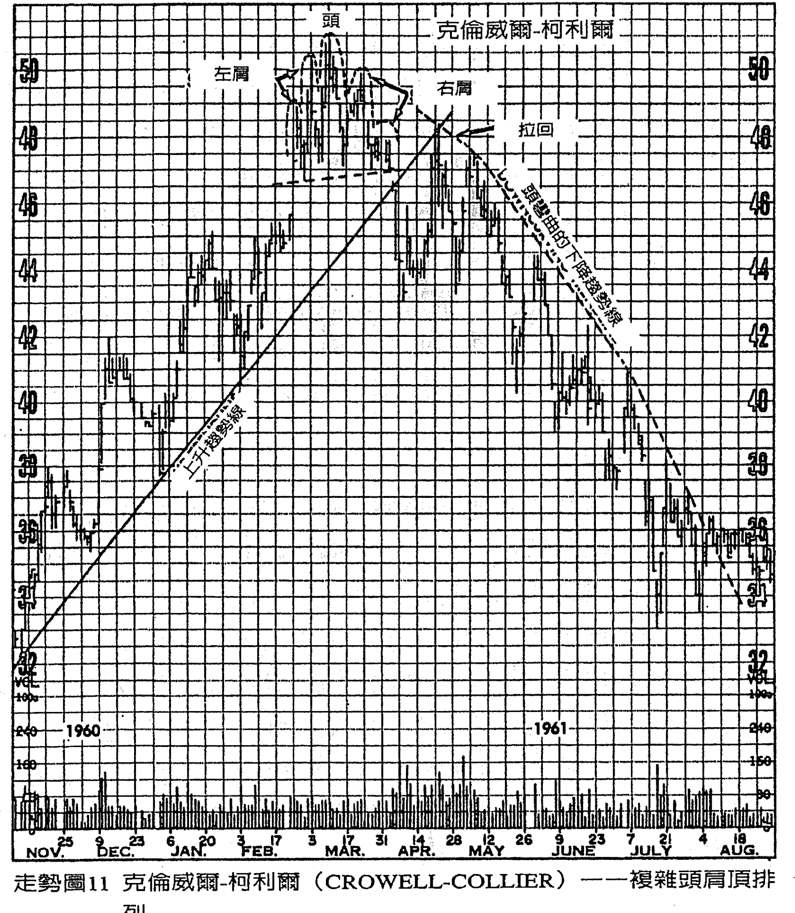

走勢圖12 巴克利斯營建公司（BAR CHRIS CONSTCITON CO.）— —複雜頭肩頂排列

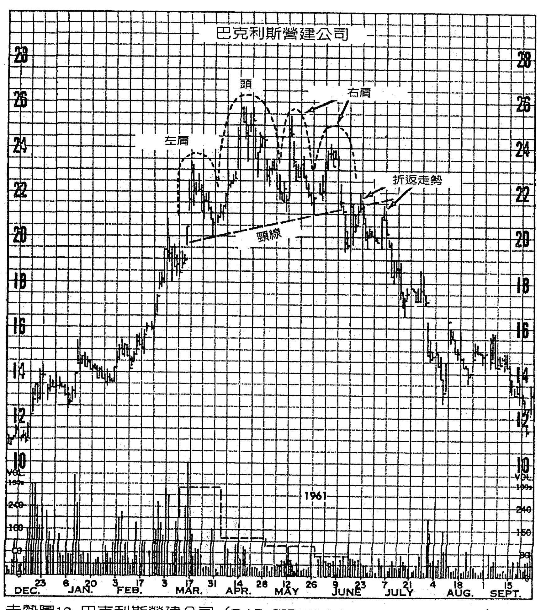

## 走勢圖11

如果所有的價格排列都這麼清楚，圖形判讀就太輕鬆了。11月份到3月份之間，價格沿著上升趨勢線發展。然後出現結構不太大的頭肩頂排列，價格跌破頸線的同時，也跌破上升趨勢線。於是，趨勢向下反轉，整個走勢畫出很清楚的向下彎曲趨勢線。此處的頭肩頂型態有兩個左肩，也有兩個右肩，對稱的情況值得注意。可是，目前這個例子並沒有出現典型的成交量型態，所以某些分析家認為這是「三尊頂」排列。另外，請注意，價格突破頸線之後的折返走勢，又向上穿越頸線，最後才終止於上升趨勢線。這點也支持「三尊頂」排列的說法。總之，不論頭肩頂或三尊頂，對於後續走勢的空頭意涵還是相同的。

## 走勢圖12

這個例子的頭肩頂排列，也落在向上彎曲趨勢線的高潮行情位置。這個排列有一個左肩，但有兩個右肩。6月份，價格跌破頸線之後，出現兩波折返走勢，似乎與兩個右肩呼應。可是，這並不是典型的發展。事實上，頭肩頂排列多數情況並不會出現折返走勢，甚至包括複雜型的頭肩排列在內。這個頭部的空頭氣勢很強，股價在1962年2月跌到$9，徹底勾銷1961年的整個漲幅。完成本書的閱讀之後，讀者不妨重新觀察這份走勢圖，將發現其中顯示旗形、三角旗形、三角形、衡量缺口與竭盡缺口等型態。

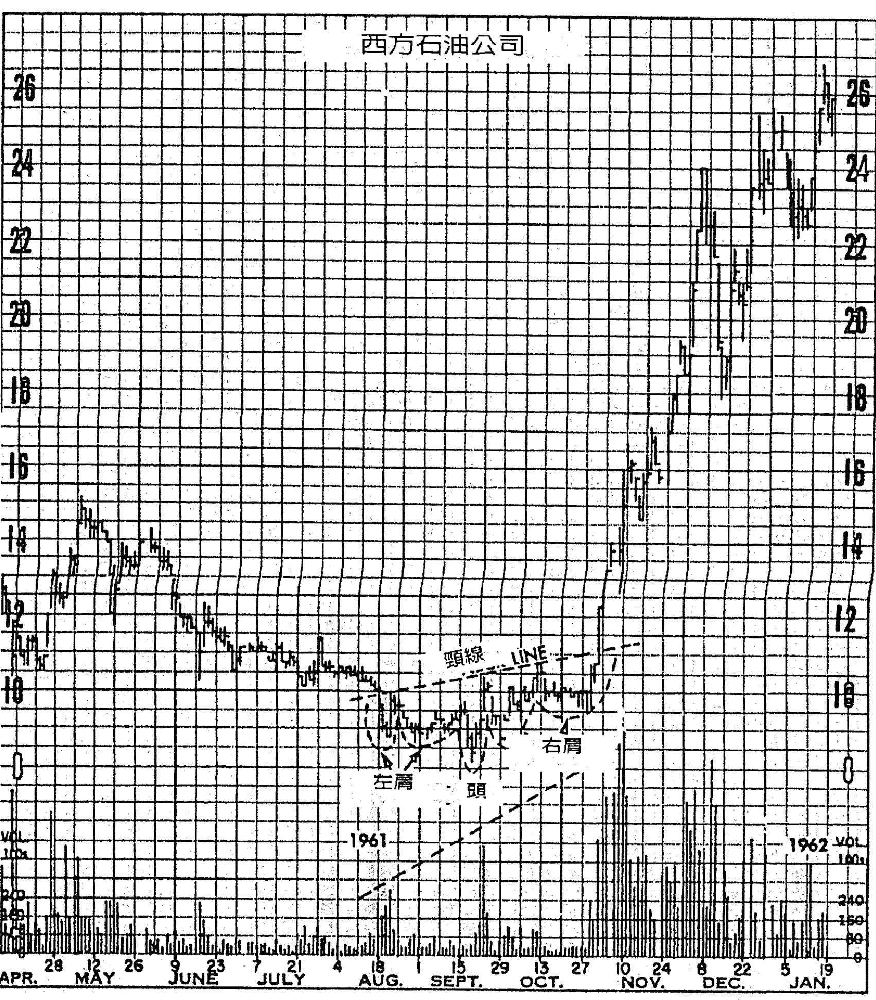

走勢圖13 西方石油公司（OCCIDENTAL PETROLEUM）——頭肩底排列

# 股價走勢圖精論

How Charts Can Help You in the Stock Market

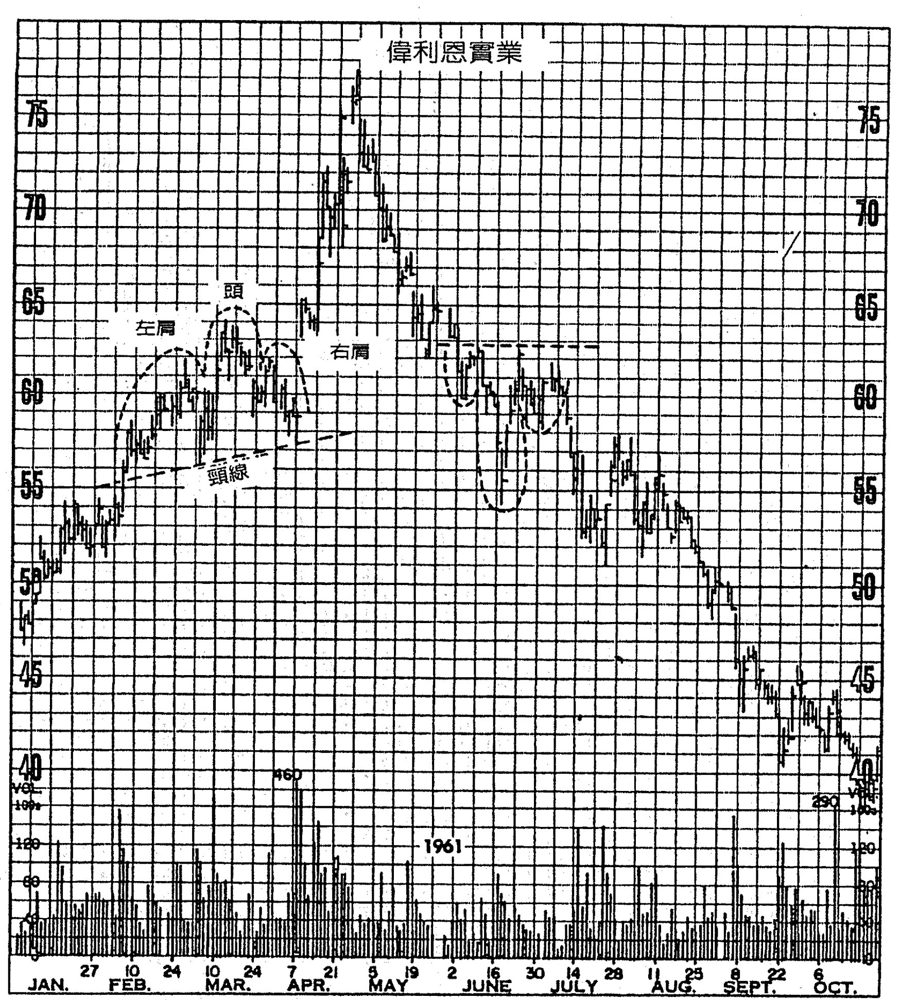

走勢圖14 偉利恩實業（VARIAN ASSOCIATES）——失敗的頭肩頂排列

## 走勢圖13

這個頭肩底排列有兩個左肩、一個頭，還有兩個右肩，整個結構稍微向上傾斜。價格夾著非常顯著的大量突破頸線，隨後沒有出現折返走勢。股價幾乎一口氣就衝上24，整個過程的成交量都很大。大約在十二個星期內，股價成漲爲三倍。請注意，每當漲勢趨緩時，成交量還是很大，這顯然不是好兆頭，因爲這代表需求雖然很大，不過籌碼供給也源源不絕。有經驗的圖形分析者也會發現，複雜頭肩底排列內還有較小的菱形排列。可是，就目前這個例子來說，菱形排列的意義不大，重要性完全被頭肩底排列遮蓋了。頭肩排列之內，經常出現其他型態，尤其是三角形排列。

## 走勢圖14

這份走勢圖內，有兩個失敗的頭肩排列。2月份到4月份之間，出現頭肩頂排列。就在價格即將跌破「頸線」時，4月8日的開盤價大漲4點，成交量顯著放大。價格一舉穿越右肩與頭的位置，意味著先前的上升趨勢將持續發展。6月份，大約在相同價位附近，走勢出現頭肩底排列，似乎要在此建立底部，但在價格向上穿越頸線之前，又恢復先前的跌勢。（4月底到5月初的頭部，實際上是V形反轉的案例，請參考第7章的說明。）

## 5 雙重頂與雙重底排列

雙重頂／雙重底排列是最常見、也是最容易造成困擾的價格型態。有經驗的圖形分析者認為，這是行情轉折（反轉）最常出現的排列，所以非常值得留意。初學者也很喜歡這種價格型態，因為處處可見。

雙重頂排列（請參考圖23）的結構類似於英文字母M，所以經常被稱為M頭。價格急漲到A點，然後跌回B點，再上漲到先前A點位置附近（C點），隨後的跌勢突破兩個峰位（A與C）所夾的低點（B），雙重頂排列即告完成。雙重底排列則是對應的底部型態，又稱為W底。

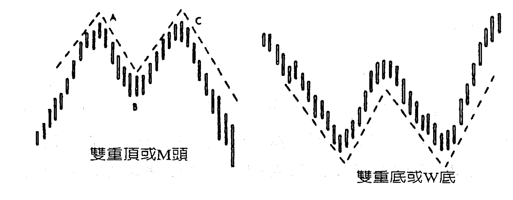

日線圖上的正常股價走勢，基本上都呈現曲折狀態；所以，對於初學者來說，幾乎所有的走勢都會出現雙重頂／雙重底排列。可是，這些看似雙重頂／雙重底的排列，最後很少會成為有效的型態。而真正有效的雙重頂／雙重底，往往要到趨勢已經明確反轉、而且價格已經出現一大段走勢之後，情況才會變得明顯。

前一章曾經提到，先前高點是後續走勢的上檔壓力，先前低點則是後續走勢的下檔支撐。這點是造成雙重頂／雙重底判斷上困擾的重要原因之一。價格遭遇這類壓力／支撐時，走勢通常會變得遲鈍或猶豫，甚至稍微折返，但往往能夠充分消化這些位置的供給或需求籌碼，然後進行突破，繼續既有的走勢。對於初學者來說，這種遲鈍或猶豫的走勢，看起來就像M頭或W底。事實上，它們大多是其他價格型態內的正常股價行爲反應。

讓我們從市場心理的角度，看看雙重頂排列的發展。第一個峰位代表股票實壓超過需求，導致股價向下修正。造成這個修正走勢的賣壓，可能有幾種不同的動機，一大部分是獲利回吐的籌碼，另一些則是基於種種理由而認定股價短期內的漲幅已經很大。

向下修正一段幅度之後，持股者認爲他們已經錯失在頭部賣出的機會，所以賣出的意願已經不高。此外，一些撿便宜貨或先前沒有及時掌握買進機會的人紛紛進場，造成股價回升到先前的高點附近；這時當初錯失賣出機會的人開始拋出股票。除此之外，在修正低點買進股票的人，此時也可能獲利回吐。總之，賣壓相當沉重而導致股價回檔。可是，萬一股價跌破先前修正低點，意味著頭部的股票需求已經充分得到滿足，而且還有剩餘的供給籌碼。因此，股價既然不能向上彈升，阻力最小的發展方向顯然在下檔。

#### 成交量

雙重頂排列的正常成交量型態，是價格頭部的成交量都有明顯放大的跡象。可是，深入研究有效的雙重頂／雙重底排列，將發現成交量型態的差異實在很大了。有時某個峰位的成交量特別大，另一個峰位的成交量則很小。另外，一些威力最大的排列，整個發展過程的成交量始終很小。所以，如果要歸納一個結論，或許應該說：兩個峰位或其中一個峰位的成交量很大，或者成交量出現不尋常的型態（例如：成交量顯著萎縮），這都可以確認雙重頂／雙重底排列。

### 變 形

日線圖上的雙重頂排列，某個峰位的高度往往不同於另一個峰位，只要差異不大，就可以視為效的型態（參考圖 24）。雙重頂／雙重底排列完成之後，價格走勢有時會顯得猶豫不前，呈現橫向區間的平台整理，隨後才展開真正的走勢。雙重底排列較經常出現這類突破之後的拉回整理走勢。平台整理位在W底所夾高點的稍上方，也就是W底完成突破的位置稍上方。

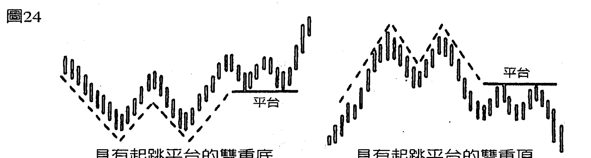

三重頂／三重底屬於雙重頂／雙重底的有效變形（圖25），在日線圖上經常見到，週線圖或月線圖上就很罕見。換言之，在雙重頂第二個峰位完成之後，價格並沒有跌破兩個峰位所夾的谷底支撐，而在此向上反彈，又出現第三個峰位。可是，這時當價格回檔時，就跌破三個峰位所夾的兩個谷底位置，完成三重頂排列。至於成交量型態，第一個峰位的成交量通常最大，第二個與第三個峰位的成交量較少，但新趨勢開端的成交量通常又會放大。

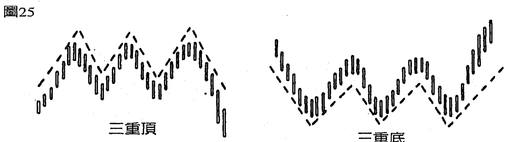

## 市場操作策略

個性保守的投資人，會等待排列完成之後，才採取行動。個性比較投機的玩家可以猜測後續發展，嘗試「賣在頭部或買在底部」，但必須自行負擔風險。

此處有幾點需要注意的。首先，交易者不該期待小型態蓄積的能量，足以發動大行情。本章最初曾經提到，即使是最老練的圖形分析者，雙重頂／雙重底也是一種很難預測的排列。如果型態發展符合下列條件，或許可以把風險降到最低：

- 一、 由第一個峰位起算，價格跌幅是否超過5%？
- 二、 第一個峰位是否出現不尋常的大量？
- 三、 由整個歷史走勢圖觀察，這個位置是否應該出現重大反轉？換言之，行情是否在此遭遇重要支撐／壓力？價格是否跌破趨勢線？
- 四、 大盤走勢是否有利於該股票出現趨勢反轉？大盤至少不應該出現反向的趨勢。

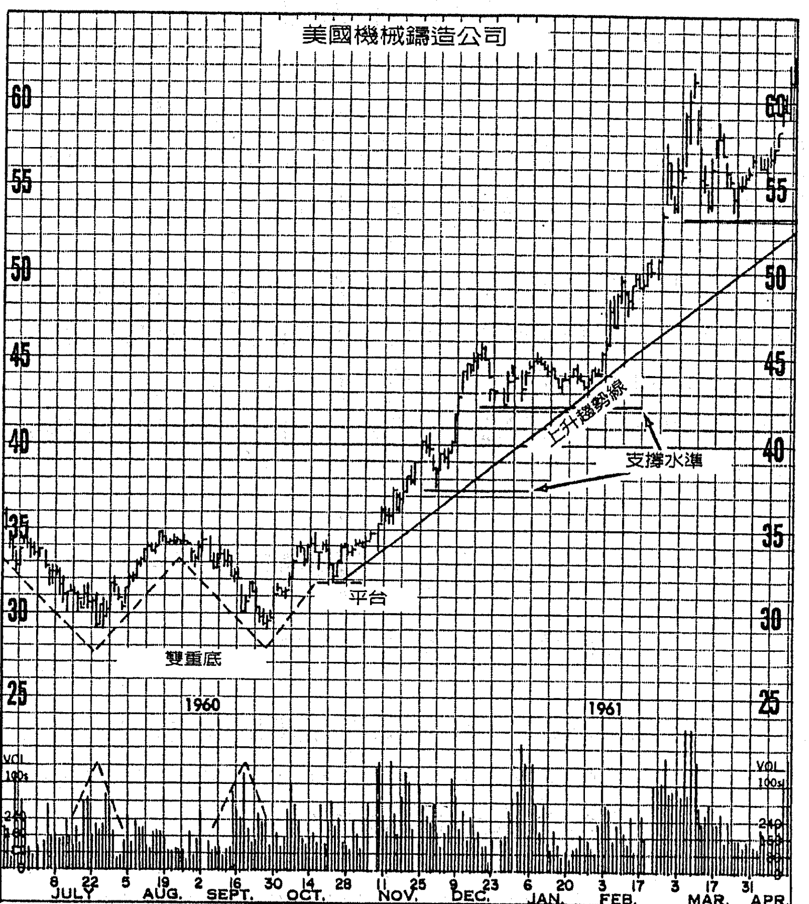

走勢圖15 美國機械鑄造公司（AMERICAN MACHINE & FOUNDRY）——具有起跳平台的雙重底排列

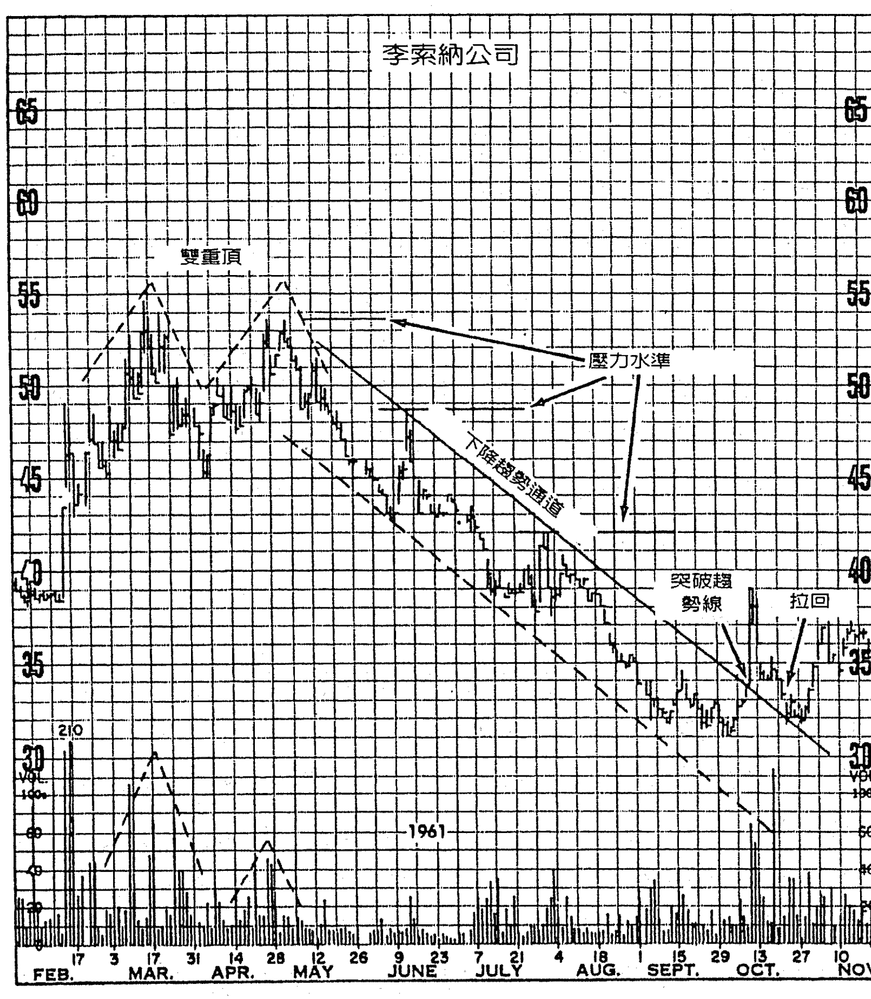

走勢圖16 李索納公司（LEESONA CORP.）——雙重頂排列

### 走勢圖15

這是一個具有平台整理的典型雙重底排列。排列過程中，成交量在兩個谷底都有稍微放大的跡象。平台整理是發生在型態完成之前，突破過程則出現大量。雙重底完成之後，價格出現66點的漲勢，整個過程完全沒有跌破上升趨勢線，也沒有任何支撐水準遭到跌破。1961年5月（圖形沒有顯示），價格跌破趨勢線與107支撐，並且繼續下跌。到了1961年底，整個跌勢幾乎完全勾銷這個雙重底排列的70點漲幅。（完成本書的閱讀之後，讀者可以更詳細研究這份走勢圖，其中顯示一些本章沒有提到的排列，包括：衡量走勢、楔形排列與失敗的頭肩型態。）

### 走勢圖16

1960年12月份價格由33附近起漲，漲勢在1961年3月份出現第一個顯著的頭部。4月底，出現第二個頭部，當時的成交量明顯小於第一個頭部。第二個頭部的位置稍低於第一個頭部，當第二波漲勢逼近第一個頭部（58¹/₂），成交量開始放大，漲勢被逼退。顯而易見的，頭部位置的供給籌碼太多。價格跌破45之後，雙重頂排列即告完成。整個回檔走勢把價格帶到1960年底的起漲點。這份走勢圖標示下降趨勢通道；10月份，價格突破下降趨勢線之後，又拉回到趨勢線附近整理，這是第2章強調的突破走勢。另外，在整個下跌過程中，反彈走勢從來沒有向上穿越壓力區。

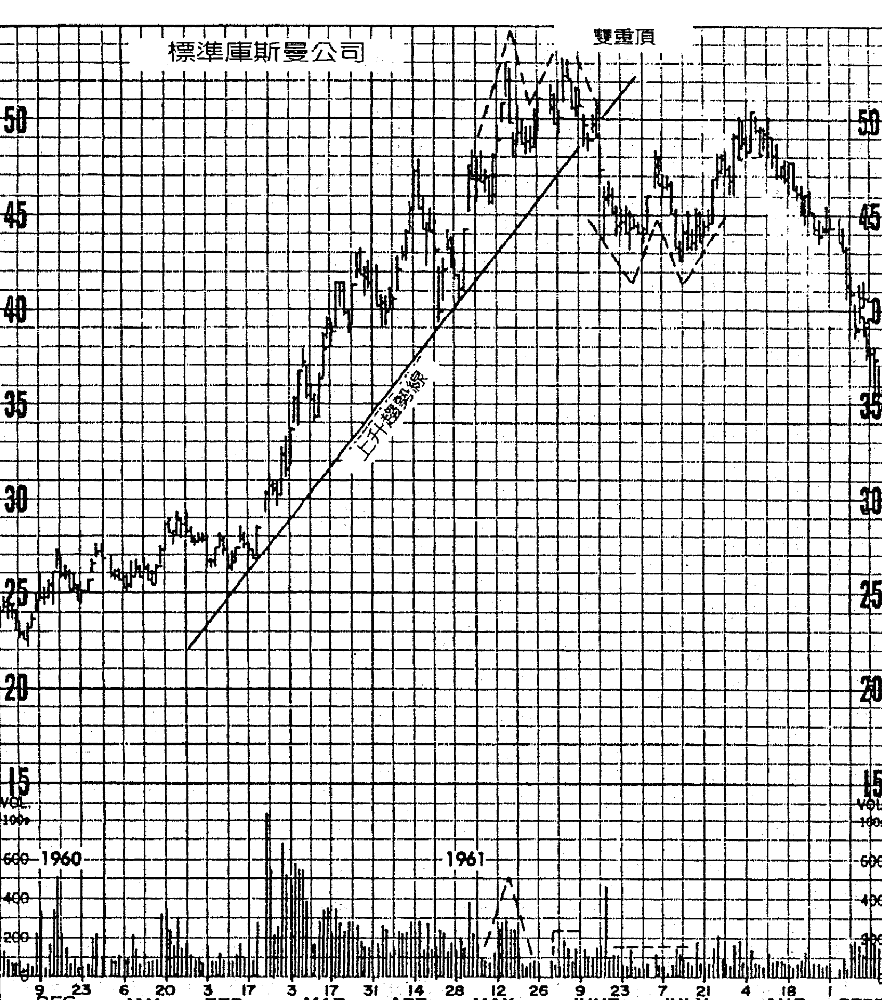

走勢圖17 標準庫斯曼公司（STANDARD KOLL.SMAN CORP.）——雙重頂排列

# 股價走勢圖精論

How Charts Can Help You in the Stock Market

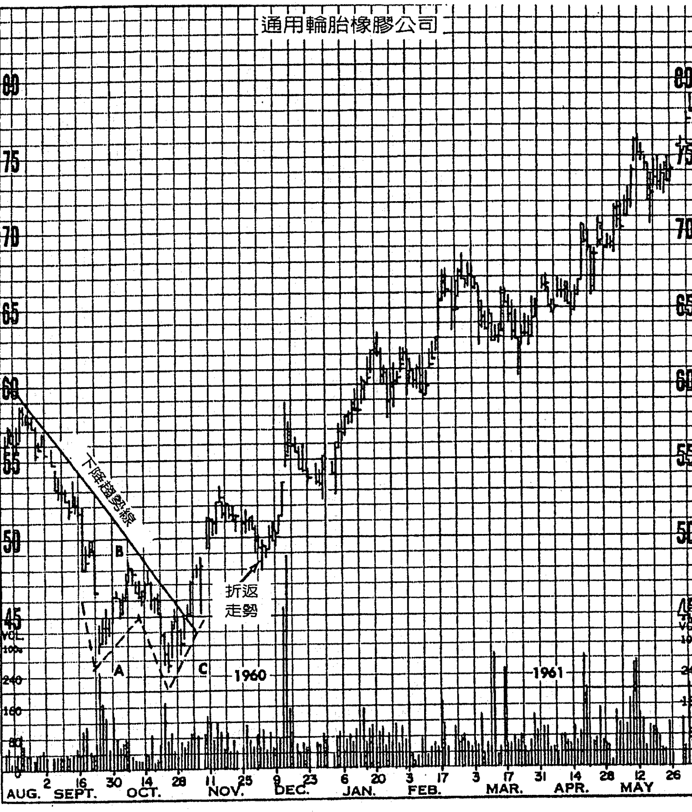

走勢圖18 通用輪胎橡膠公司（GENERAL TIRE & RUBBER）——雙重底排列變形

### 走勢圖17

這個案例相當有趣，在5、6月份出現雙重頂排列之後，緊接著又出現雙重底排列。雙重底引發的漲勢，試圖挑戰先前的頭部排列，但沒有成功，結果又造成另一波跌勢。讓我們看看這兩個排列的發生位置。雙重頂是發生在一波重大漲勢的末端，排列完成時，價格也跌破上升趨勢線。第一個峰位的成交量，顯然大於第二個峰位。至於隨後發生的雙重底排列，位置非常不合理，因為先前並沒有出現延伸性的跌勢。兩個谷底的成交量都沒有顯著放大，排列完成之後的漲勢也沒有克服任何重大壓力。雙重頂排列完成當初，排列是否有效，一度令人懷疑，但最後證明這確實是有效的反轉型態（1962年2月，股價跌破29。）

### 走勢圖18

就這個雙重底排列來看，在11月份價格漲勢穿越10月份高點（B）之前，確實很難判斷這個型態，但也不是完全不可能。第二個底部（C）較第一個底部（A）低1點多，這是造成排列不定的主要原因。一般來說，雙重底排列的第二個底部位置都稍高於第一個底部，但也有不少情況類似本案。本章內文曾經提到：「兩個峰位或其中一個峰位的成交量很大，或者成交量出現不尋常的型態，都可以確認雙重頂／雙重底排列。」（此處所討論的是底部排列，當然需要把這段評論內的「峰位」改爲「谷底」。）這是第一個線索。第二個線索發生在11月份第一個星期的漲勢中，這波行情不只突降下降趨勢線，並一口氣穿越前一波反彈的高點，完成雙重底排列。由C點起漲的走勢，其峰位遠超過B點，所以隨後的修正，可以視爲雙重底排列完成之後的折返走勢。

# 股價走勢圖精論

How Charts Can Help You in the Stock Market

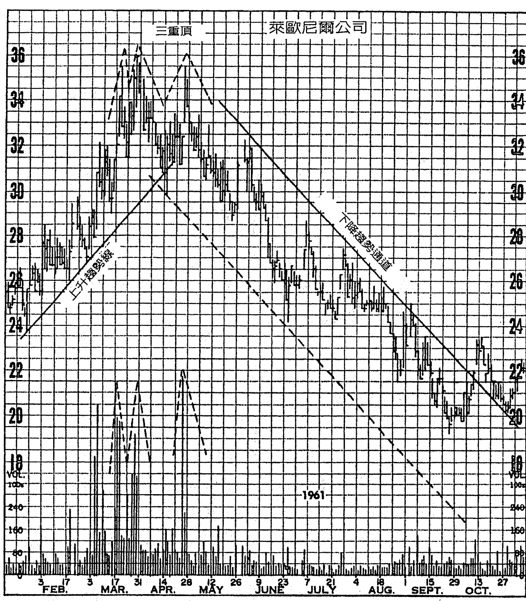

走勢圖19 萊歐尼爾公司（LIONEL CORP）——三重頂排列

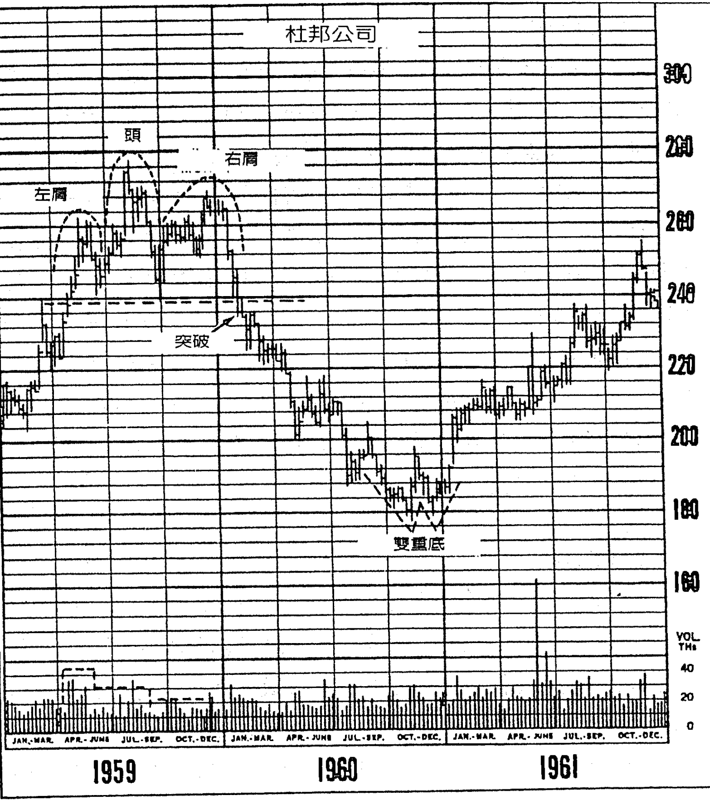

走勢圖 20 杜邦公司 (du PONT週線圖) ——雙重底排列

### 走勢圖19

3月21日，股價在盤中創歷史新高 $35\frac{1}{2}$，但當天收盤則低於前一天收盤，這屬於「反轉日」的線形（請參考第11章的說明）。六個交易日之後，價格再創新高 $35\frac{1}{2}$，較反轉日高價只多出 $\frac{1}{2}$ 點。四個星期之後，價格第三次挑戰新高價，但停頓於 $35\frac{1}{2}$。這三個峰位的成交量都很大，最後形成三重頂排列。本章內文曾經提到，三重頂排列相對罕見，屬於雙重頂的變形。事實上，前兩個峰位看起來像是雙重頂，但價格第三次向上挺進時，圖形分析者可能會開始懷疑自己的判斷。除非第三波漲勢能夠有效創新高，否則就不該放棄當初的頭部反轉排列判斷。隨後的跌勢緊貼著下降趨勢線發展，一直持續到10月份。

### 走勢圖20

這個例子說明日線圖的型態分析也同樣適用於週線圖。1960年底的雙重底排列，是一波100點跌勢的終點。（對於那些未經風浪的投資人來說，恐怕很難理解一支藍籌股竟然會跌100點，而杜邦可以說是深藍色的藍籌股。）在177附近，價格向上反彈20點，然後又回檔測試177的支撐。隨後的漲勢一鼓做氣把股價推過先前的反彈高點，完成雙重底反轉排列。回顧1959年的頭部，該排列屬於典型的頭肩頂型態，但價格跌破頸線之後，並沒有重新測試頸線壓力。成交量與價格結構都相當典型，這個案例也可以擺在前一章的例子中。

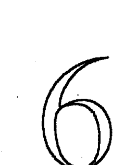

### 狹幅整理與碟形排列

狹幅整理（Lines）與碟形排列（Saucers），是圖形分析者的夢幻型態，它們非常容易辨識、非常可靠，蓄積的動能經常很可觀，足以驅動大行情，而且——最重要的——圖形分析者有充分的時間準備，能夠慢條斯理的在頭部或底部建立部位。這類排列只有一個很難克服的缺點：很少出現在交投熱絡的股票。

狹幅整理排列一旦演變爲主要底部，通常都稱爲「長期底部」(long base)。在價格走勢圖上，呈現細長的橫向整理，價格波動區間很狹窄，然後突然向上跳動，大幅穿越先前的價格區間。狹幅整理也可能成爲**主要頭部**，雖然很罕見，在這種情況下，其形狀就像是平台。

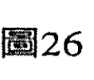

狹幅整理底部或長期底部

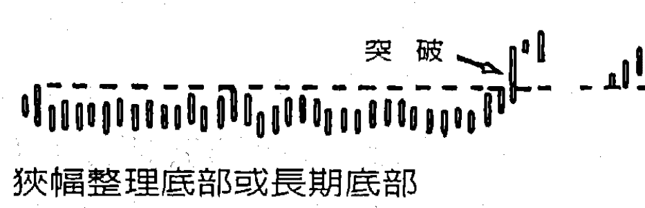

狹幅整理頭部

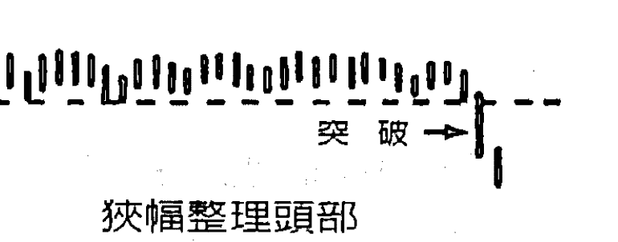

碟形排列（或稱爲弧形轉折）的結構有些類似狹幅整理，但有其本身的特性，發展過程也較快。碟形排列的價格發展，畫出緩和的圓弧狀走勢，底部排列的圓弧下凹，頭部排列的圓弧上凸（參考圖27）。圓弧末端翻翹的方向，也就代表價格的可能發展方向。碟形排列的結構還有另一個特色。大多數碟形排列（但不是全部）在即將突破之前，往往會出現一小段橫向或傾斜狀的狹幅盤整，稱爲手把（Handle）或跳板（Platform）。所以，這種排列或許應該稱爲「鍋形」排列。

圖27

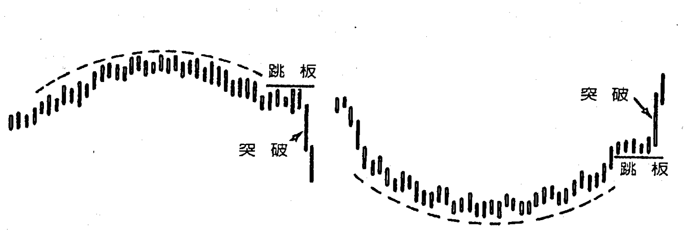

#### 發展過程

如同其他價格型態一樣，狹幅盤整或碟形排列都是反映某種情況下的市場心理。狹幅整理代表股票的供給與需求處於長期均衡狀態。股票交易很冷清，因爲公司的展望沒有什麼變動，消息面也沒有新發展。在當時的價位上，持股者沒有任何動機賣出股票，潛在買盤也沒有強烈的買進意願，而且他們必須拉高價格才能吸引賣方出脫股票。價格夾著大量由長期底部突破，通常都意味著情況發生變化——新產品、獲利增加或公司合併——這些謠言或事實造成需求激增。一般來說，價格進行突破的動力，並非來自於公司方面對於相關發展的正式宣布——這會發生在稍後的階段。長期底部的形成過程中，「內線」會默默的吸貨。總之，消息靈通者會先買進，然後一般大眾才慢慢知情，於是價格開始大漲。

#### 成交量

狹幅整理與碟形排列的**成交量**，大體上隨著**價格**變動。在整個狹幅整理過程中，成交量都非常少，直到突破為止。即使在突破階段，剛開始時，成交量仍然不很大，但增加的速度頗快。

碟形排列的成交量與價格發展的趨勢一樣，也呈現圓弧狀。底部排列的成交量會慢慢萎縮，價格谷底的成交量最少，然後又慢慢增加，持續到跳板階段。頭部排列的情況剛好相反，成交量會慢慢增加，價格峰位的成交量最大，然後又慢慢縮小，直到型態完成而向下突破為止。至於跳板階段的成交量發展，開始階段會放大，末端則因為價格突破而更顯著放大。

以上討論狹幅整理與碟形排列的結構與辨識方法。現在，讓我們提出一個警告。絕對不可以理所當然的認定某種型態，除非該型態即將完成。這個警告也適用於狹幅整理之類的簡單排列。股價發展最初可能意味著某種排列，但很快又變成另一種排列。

此處有一種值得留意的底部排列變形。狹幅整理即將突破時，有時會出現「洗盤」走勢——換言之，價格先朝反方向擺動，把浮額清洗掉（參考圖28）。洗盤階段，價格會創新低。然後才夾著大量向上彈升而創新高。雖然洗盤階段的價格頓挫，呈現某種弱勢的假象，但真正的上升力道往往超過其他底部型態。

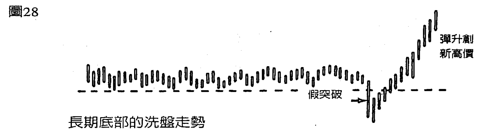

## 市場操作策略

非常不幸的，我們最期待的「夢中排列」並不經常出現在交投熱絡的股票中。這些排列通常都發生在一些交投相對清淡的冷門股。可是，如果找到適當的對象，這些排列的獲利潛能很可觀，持股風險則很小。所以，投資人應該隨時留意這類排列。

關於狹幅整理底部排列，最適當的進場時機是在價格向

上突破之後，當然愈快愈好。沒錯，如同任何型態的突破一樣，突破之後經常會有拉回重新測試底部的走勢，然後才會展開正式的漲勢（請參考圖29）。請注意，**上升趨勢**正式啟動後，行情變動速度很快，稍一疏失，就可能錯過機會。

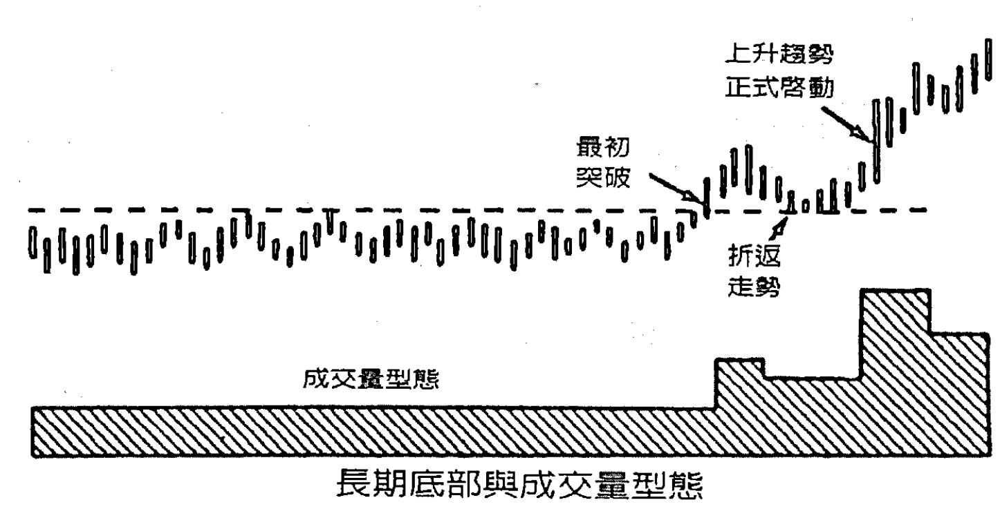

至於碟形排列，進場時機通常有更充裕的時間琢磨。事實上，這種排列總共有四個買進時機：

- 一、價格排列與成交量發展開始向上彎曲的過程；
- 二、圓弧狀走勢末端，當價格開始朝水平方向發展而成交量萎縮時——不過我們很難判斷何時才是圓弧狀走勢的末端；
- 三、在跳板階段進場，尤其是在橫向狹幅整理的底限附近；
- 四、當價格由跳板階段向上突破時。

#### 圖30

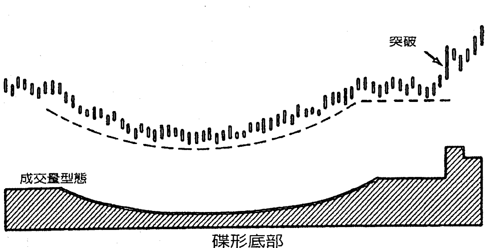

走勢圖21  設頓-提德公司（CERTAIN-TEED）——狹幅盤整或「長期打底」

走勢圖22 獵列克斯公司（VIEWLEX）——狹幅盤整底部

#### 走勢圖21

我們利用這個例子說明長期狹幅整理底部排列，發展過程中，成交量始終很小。整個底部排列實際上可以回溯到數年之前（換言之，這份圖形沒有完全顯示）。1960年底，價格與成交量同時呈現曲線狀走勢。有個說法：「底部涵蓋的期間愈長，隨後的走勢愈大。」這個說法顯然適用於目前的例子。11月份，行情還沒有啟動之前，價格大約落在13附近；四個月之後，也就是隔年的3月31日（這份走勢圖的最右端），股價暴漲到44，同年5月份，價格上漲到64。請注意，在整個上升階段，價格從來沒有跌破下檔任何有效支撐（標示為水平狀線段）。

#### 走勢圖22

雖然這個大底部是等到2月底價格夾著大量創新高之後才完成的，但12月份的大成交量彈升已經預先透露多頭訊號。如果研究過去十年來的案例，我們發現很多大漲勢都會經出現類似的預先訊號。股價盤整階段，成交量基本上都很小，每當成交量顯著放大，就意味著股價醞釀突破的契機；如果沒有出現跟進的漲勢，就代表還沒有醞釀成熟。對於大行情來說，等待二個月到六個月是很正常的。按照第3章的解釋，圖形中標示為「大成交量區域」的價位也是壓力區，一旦克服，往後的漲勢就頗可期待。（5月初的頭部為「兩日反轉」，請參考第11章的說明。）

走勢圖23 戴斯托姆公司（DAYSSTROM）——碟形底部

走勢圖24 凱賽-羅斯公司 (KAYSER-ROTH) ——碟形底部

#### 走勢圖23

發生在5月、6月、7月的碟型底部排列，看起來就像是帶柄的咖啡杯。價格呈現圓弧狀，成交量也是如此。7月份的價格走勢稍有不規則的現象，但成交量很穩定。跳板的突破過程爆出大量，而且整個上升走勢的成交量都很大。讀者完成本書的閱讀之後，或許應該回頭研究這份走勢圖。8月份與9月份的型態發展相當有趣。一個向上傾斜——但沒有完成——的旗形排列，這種型態通常是很可靠的多頭排列，但在8月底失敗而演變為小型的頭肩底型態。然後在10月份與11月份出現正常的旗形排列。

#### 走勢圖24

碟形底部的發展過程中，曾經出現兩天的突兀漲勢，成交量很大。這個成交量突然放大的區域，標示為「大成交量區域」。後續走勢如果能夠克服這個大成交量壓力區，應該會出現一段不錯的漲幅。漲勢一旦通過這個區域之後，上檔的供給籌碼將顯著減少。這個情況很類似走勢圖22的例子。總之，這個壓力區位在底部發展過程內。隔年1、2月之間，剛好有個小跳板位在大成交量壓力區的稍上方，後續漲勢出現很可觀的大量，整個發展完全符合預期。

走勢圖25 美國動力公司（DYNAMICS CORP.）——長期碟形底部

走勢圖26 席格勒公司（SIEGLER）——碟形頭部

#### 走勢圖25

這個碟形排列花了七個多月的時間才完成，但後續發展證明耐心等待是值得的。由排列底部起算，價格大約上漲為三倍，由三月份起算，則成長為兩倍。在整個弧形發展過程，成交量都沒有顯著放大，唯有等到漲勢趨於明顯時，成交量才放大。這個例子沒有出現跳板，與前面兩個例子顯然不同。狹幅盤整的發展過程總是很冗長，碟形排列則不同，發展期間較短。可是目前這個例子屬於例外，發展期間稍長。

#### 走勢圖26

除了6月份曾經出現兩支夾著大量的突出線形之外，目前這個例子可以說是典型的碟形頭部排列。雖然有兩支突出線形，但整個弧狀結構與跳板，實在不容許我們懷疑這個排列的效力。成交量型態尤其值得注意，與價格型態全然對應。碟形頭部排列通常都會出現這種成交量型態，但峰位的成交量也可能較小（換言之，成交量型態與價格結構相反，呈現下凹的弧形）。可是，對於碟形底部排列來說，那就很少看到成交量沒有出現對應排列的案例。

## 7
### V形反轉排列

股票市場就如同任何場所一樣，只要有賺錢機會，就免不了風險。而且，大體上來說，賺錢的潛能愈高，風險也就愈大。所以，某些爆發力十足的反轉排列，往往也是最難預測或分析的。事實上，即使排列已經完成，有經驗的圖形分析者也不清楚趨勢是否會按照正常方式發展。V形反轉就屬於這種排列之一。

在其他反轉排列中，買、賣雙方相互爭奪主導權；在一段期間內，雙方都無法取得絕對優勢，所以會出現起伏不定的價格走勢。這種力量互動，代表行情即將反轉的徵兆，也是圖形分析者想要得知的警兆。可是，V形反轉並非如此，如同其名稱所顯示，這種排列就如同晴天霹靂一樣，突然就發生了，幾乎全然沒有預兆。下降趨勢逐漸演變為上升趨勢，這種演變過程並沒有發生在V形反轉。好像透過某種事前的安排，所有的股票籌碼瞬間內就被吸收，買方突然掌握絕對的控制權，而且會持續一段時間。

所以，V形反轉導致趨勢忽然180度大轉彎，屬於最難分析的价格型態之一。雖說如此，這種排列之所以發生，還是需要一些條件配合。預先掌握這些條件，仍然可能針對這種走勢採取及時的因應行動。V形反轉驅動的行情幅度通常很可觀，絕對值得花些心思研究這種型態。本章最後會提供一些實際案例，說明V形反轉的真實市況，減緩投資人對於這種排列的迷思。

首先，讓我們解釋何謂V形反轉，這種排列是由三個成份構成：

- **下降趨勢**：V形反轉的左臂，经常是一波兇猛的延伸性跌勢，但偶爾也會出現緩慢而不規則的下降趨勢；總而言之，趨勢是朝下發展。
- **樞紐點**：趨勢在一天內出現反轉，當天的盤中低價經常也是整個排列的最低價。某些情況下，反轉過程稍微緩和些，但涵蓋期間很少會超過幾天。價格低檔通常都會爆出明顯的大量。有時樞紐點當天的成交量非常可怕，使得當天成爲「高潮日」。
- **上升趨勢**：反轉的第一個訊號，是價格穿越下降趨勢線（沿著下降過程線形高點繪製的直線）。趨勢反轉之後，隨著漲勢的發展，成交量也配合逐步放大。這個最初階段也是問題最大的部分，因爲我們必須等到行情發展一大段之後，才能確定V形反轉是否有效。一般來說，V形反轉的左、右走勢會彼此對稱，如果下降趨勢呈現45度角下跌，隨後的上升趨勢也經常會呈現45度角上漲。

真正的V形反轉底部排列

真正的顛倒V形反轉頭部排列

### 真正的顛倒V形反轉

真正的顛倒V形反轉頭部，其結構基本上是與V形底部排列相反。多數情況下，頭部樞紐點的成交量會很大，成交量型態也呈現顛倒V形。可是，某些情況下，樞紐點的成交量沒有明顯變化，甚至不尋常的少。

### 延伸性V形排列

延伸性V形（Extended V，請參考圖32）的力量不輸給真正的V形反轉，但其結構稍有不同，因此也比較容易精確預測與分析。在樞紐點之後，當價格突破先前的下降趨勢線，隨後的發展稍有差異。真正的V形反轉，上漲行情幾乎是立即啟動。延伸性V形排列則會出現相當大規模的橫向盤整走勢，最後才向上突破盤整區間而完成整個排列。詳細來說，延伸性V形排列是由四個階段構成：

- **下降趨勢**：如同真正的V形反轉一樣，這段跌勢可能很陡峭或不規則。多數情況下——但絕不是全部——下降趨勢發展過程在距離樞紐點不遠處，曾經出現一段橫向整理。
- **樞紐點**：也如同真正的V形排列一樣，反轉經常發生在一天之內，但有時是幾天。成交量行爲也很類似，通常會顯著增加。
- **初升段**：股價或是向上突破下降趨勢線，或向上突破樞紐點之前形成的橫向盤整區間上限。突破過程會出現大量。
- **跳板**：這部分是延伸性V形排列不同於真正V形反轉的地方，也使得延伸性排列比較容易辨識。跳板可能相當平坦，但通常會稍微向下傾斜。跳板發展過程，成交量會趨於萎縮。可是，當價格展開最後一波向上擺動而即將突破時，成交量通常有放大趨勢。突破過程本身，成交量應該顯著放大。

當價格夾著大量突破跳板橫向整理的高點，延伸性V形反轉排列就告完成或確認。如果跳板向下傾斜，則需要觀察價格突破跳板本身的下降趨勢線。如果突破過程伴隨著大量，通常都會出現跟進走勢，交易者可以考慮在此接近底部的位置進場。

### 左側延伸的排列

這類延伸性 V 形反轉的跳板發生在樞紐點之前，而不是之後。某些人的盲腸天生在左側，心臟的位置卻在右側，似乎也沒有任何麻煩。左側延伸的 V 形反轉排列也是如此。

## 市場操作策略

投資人或交易者的行動，應該學習如何參考機率或勝算。我們不該只憑著一點市場知識或經驗，就依此建構死板的「系統」，然後盲目遵循。操作策略應該具有彈性與想像力，隨時根據市況變化進行調整。

這些說法顯然很適用於V形反轉，因為這是最難以預測與分析的價格型態之一。當然，這並不是說V形反轉完全沒辦法預測，否則我們也不需浪費時間來討論。可是，交易者一旦遇到可能的V形反轉，務必要小心假訊號，不要輕易踏入陷阱；瞭解V形反轉的獲利潛能之外，也需要知道對應的風險，應該隨時準備撤退。

V形反轉的發展型態，突顯出操作策略必須靈活的重要性。每支交投熱絡股票，都有一些性質不同的玩家：短線交易者、內線與一般投資人。在所有的價格型態中，幾乎都可以看到這三類玩家的互動脈絡，但V形反轉則非如此。V形反轉之所以發生，通常是因爲市場心理突然發生劇烈轉變，起因往往是內線也很難掌握的意外因素。（內線很少能夠在V形反轉的真正底部買進，通常都是沿著下降過程慢慢「承接」。）

意外的消息、政治發展或謠言，都可能導致大量的買單或賣單湧進市場。這類反轉走勢——根據定義——不可能事先察覺。

讓我們考慮一種例外情況：股票有大筆籌碼等待出脫。這類大額籌碼的賣出過程，通常都很緩慢而謹慎，使得價格持續承受賣壓。一旦這些籌碼出脫完畢之後，價格通常都會如同橡皮筋一樣的彈出。

總之，投資人或圖形分析者必須謹慎觀察可能的V形反轉排列，留意型態完成的跡象，仔細研究該股票的歷史走勢與最近狀況。如果你認為排列有效的機率很高，就採取行動——但還是要很小心。

投入真正的資金之前，初學者（甚至有經驗的玩家）最好針對一些可能的V形排列進行模擬操作。沒有任何東西可以取代臨場經驗。接下來，我們提供一些案例，討論一些可能的問題。V形反轉是最棘手的價格型態，不過也是最具獲利潛能的排列。但願這些案例能夠讓讀者瞭解「保持彈性」的重要性，同時讓各位累積一些操作V形排列所需要的經驗。

# 股價走勢圖精論

110

How Charts Can Help You in the Stock Market

走勢圖27 亞美拉達石油公司（AMERADA）——真正的V形反轉排列

### 7—V形反轉排列

### 走勢圖27

這個V形反轉引發的價格漲勢，讓價格在十一個星期內上漲50點。請注意，這段上升行情發展過程中，整個大盤的情況並不好，絕大部分個股都處於下降趨勢。任何人如果能夠掌握1961年9月份的底部機會，可以說是非常幸運。價格夾著大量，透過很小的突破缺口方式（參考第11章的說明），一舉克服彎曲的下降趨勢線，這可以視爲趨勢反轉的線索。由於V形反轉很難判斷，一般人可能要等到80的頭部附近，才能確定V形反轉已經完成，因爲當時的成交量極大。

### 走勢圖28

1960年5、6月間出現的頭部，看起來像是「教堂的尖塔」，完全符合本章所描述的延伸性顛倒V形反轉排列。如果把頭部發生前的上升趨勢線繼續延伸，我們發現這個排列的延伸性跳板剛好沿著這條趨勢線發展。這條上升趨勢線遭到跌破之後，頭部排列就完成了，但圖形分析者或許應該等到價格跌破109½的修正低點。請注意，除了我們剛提到的趨勢線之外，某些分析者或許發現歐文斯-康寧在1960年並不特別「尊重」趨勢線。2月份開始的上升趨勢，以及6月份開始的下降趨勢，價格發展都不太規律，軌跡不屬於直線狀。反之，這份走勢突很「尊重」支撐／壓力原則與其他排列，例如1、2月間的雙重底型態。每支股票都有其股性，投資人必須謹慎分析。

# 股價走勢圖精論

### How Charts Can Help You in the Stock Market

走勢圖30 麥克卡車公司 (MACK TRUCKS) —— 左側延伸性顛倒V形排列

### 走勢圖29

圖形分析者如果沒有研究這支高價熱門股IBM，可以說是枉費一身本事了。我們發現這支典型的企業股票，仍然呈現相當正規的走勢。左側的延伸性V形反轉底部排列，建立在先前的密集交易區間位置（1959年10月、11月），隨後發動一波134點的漲勢。請注意排列底部的大量，這意味著股票大量換手。當價格突破壓力線（2月份的高點），V形反轉即告完成。讀者可以參考第8章有關衡量走勢的說明，第二支腳（C~D）的長度顯然超過第一支腳（A~B）。其他值得注意的排列還包括11月份的三角旗形，後來演變爲向下跌破的上三角行排列。

### 走勢圖30

相較於延伸跳板發生在右側的V形反轉，如果跳板發生在左側，分析上更困難一些，目前這個案例尤其是如此。左側的跳板本身是三角形排列，所以當價格由頭部下滑，必須等到行情跌破三角形排列的最低點，才能確定V形反轉頭部排列完成。就典型的延伸性V形反轉來說，跳板不論發生在左側或右側，其本身的結構大多很明確，所以只要價格跌破V形頭部的低點，就可以判斷V形反轉排列完成。在這份走勢圖內，下跌過程的價格擺動幅度雖然很大，但從來沒有穿越下降趨勢線。

走勢圖31 西屋電器公司（WESTINGHOUSE ELECTRIC，週線圖）——真正的顛倒V形排列

### 走勢圖31

這份週線圖發生在1960年6、7月之間的V形頭部排列，當時很難精確分析。一些值得留意的線索包括：（a）成交量，峰位的成交量明顯縮小；（b）1960年7月跌破主要上升趨勢線。可是，1960年1月的峰位也可能被誤判為V形反轉頭部。雖然前述幾個案例的V形反轉都相對容易判斷，但圖形分析者偶爾也會碰到目前這種棘手的例子。由於這是一份週線圖，深入分析日線圖或許有助於及時判斷主要反轉型態。同一期間的日線圖展現全然不同的價格型態，但其空頭意涵則相同。大多數情況都是如此，週線圖與日線圖的趨勢指標通常都有相同的結論。

## 8
### 衡量走勢

任何價格趨勢都有結束的時侯。某些情況下，既有趨勢會毫無警兆的改變方向，例如：V形反轉，但更常見的情況，則是既有趨勢遇到愈來愈強勁的壓力。買、賣雙方的力量趨於均衡；只要繼續維持這種均衡狀態，股價就會朝橫向發展。市場評論家稱這類猶豫期間為「關鍵時刻」，就如同貓站在柵欄上，牠可能朝任何方向跳。

兩股相反力量遭遇，彼此摩擦、鬥爭，它們在「關鍵時刻」內的互動，可能演變為某種反轉型態，換言之，隨後將出現新的主要趨勢。可是，另一些情況下，既有趨勢只是暫時停頓，藉以消化所遭遇的壓力或支撐而已，一旦消化這些力量之後，既有趨勢會持續發展。這類的停頓或猶豫，構成所謂的連續型態（Continuation Pattern）——原則上，這是造成既有趨勢暫時中斷的一段橫向走勢，但既有趨勢並沒有因此而結束。對於圖形分析者來說，連續型態的主要功能在於顯示未來的支撐區域，並用來預測後續價格擺動的目標（請參考第2、3與4章的討論）。

讀者或許覺得這沒有什麼了不起，但某些情況下，我們可以做得更多一些——換言之，當既有趨勢遭遇阻力而呈現猶豫狀態，我們可以推斷後續走勢的可能幅度，或估計股價隨後將在哪裡再遭遇「關鍵時刻」。關於這種情況，我們一直沒有給予正式的名稱，現在稱其爲衡量走勢（Measured Move）。大體上來說，衡量走勢是一個幅度很大的價格擺動，但大約在中點位置稍做停頓，停頓過程或是出現嚴重的價格「修正」（與前所述價格擺動方向相反的拉回或反彈走勢），或是呈現水平狀的狹幅橫向整理。由於出現修正或整理，整個價格擺動被分割爲兩段，兩支腳的長度約略相同，而且會有彼此平行的傾向。換言之，不論就圖形縱軸的價格或橫軸的時間來看，這兩支腳的涵蓋距離都大約相同（雖然第二支腳的涵蓋時間有時候會稍短，因此其斜率也變得較陡峭）。衡量走勢的結構大致如下：

請注意，衡量走勢是以陰影顯示，因爲我們不希望讀者被一些細節價格波動分散精神。這種情況就如同觀察那些涵

在較長期間的大型走勢圖中，我們只看到起伏波動的長期多頭與空頭走勢，不會留意枝節的發展。現在，對於較短期的走勢圖，我們也要採用這種宏觀的角度。

詳細來說，衡量走勢包括下列幾個成分：

- **A~B：第一支腳**。這可能代表漫長而緩慢的漲勢，也可能是急劇的暴漲走勢。價格大體上會沿著通道發展，但趨勢線可能向上彎曲。再次強調：只考慮價格排列的大致結構。
- **B~C：修正階段**。這可能是大幅拉回整理，也可能是漫長的橫向盤整。如同軌道上的轉轍器，把火車平行移到另一個軌道上。修正階段通常發生在整個衡量走勢的中點位置。
- **C~D：第二支腳**。這段走勢的價格幅度約略等於第一支腳。請注意，我們必須由修正階段（B~C）的最低點開始衡量第二支腳。成交量在這個階段有些特徵值得注意。由整個衡量走勢觀察，由中點到三分之二位置，成交量通常會顯著增加，然後就慢慢縮小。

以上是就衡量漲勢說明，這些性質同樣適用於衡量跌勢，其結構大致如下圖：

## 圖35

現在，我們已經瞭解衡量走勢的結構，但或許應該再強調前文曾經提到的一個重點：在發生之前，我們不可能預測衡量走勢。如果嘗試這麼做，就好像在反轉型態的發展過程中，試圖預測該型態究竟是什麼排列。唯有當價格型態發展一段時間之後，才可能運用種種線索來判斷可能的結果。

反之，在後期階段，我們很容易判讀衡量走勢，訊號很可靠，市場操作的時效拿捏也相對精確。

衡量走勢為何會出現前述的行爲？我們並不知道明確的原因，但可以猜測。就好像一個快速球投進好球帶，打擊者勉強揮出擦棒球——只稍微改變球的運動方向，但不足以抵消原始方向的動能。球稍微彈開之後，可能落入捕手的手套內；如果捕手沒有接到，球會繼續運動，直到動能完全消失爲止。衡量走勢之所以出現修正階段，可能是因爲獲利回吐、放空或其他原因，結果導致既有趨勢暫時停頓。至於第二支腳的長度爲何與第一支腳約略相當，這可能需要運用更高深的數理統計或心理學來解釋。可是，我們知道，任何股價擺動經常會出現 50% 的折返走勢（50% 法則）。姑且不論原因何在，但我們確實知道，衡量走勢第一支腳與第二支腳之間存在高度的相關性，圖形分析者可以充分運用這點。

接下來，讓我們看一些實際的案例。如果下列分析顯示讀者能夠掌握衡量走勢，那就應該把這種型態納入工具箱內。

走勢圖32 德州儀器公司（TEXAS INSTRUMENTS）——衡量走勢

走勢圖33 麥洛瓦公司（MAGNAVOX）——衡量走勢

### 走勢圖32

這段衡量走勢幾乎精準命中目標。A到B的距離（219－165 = 54），理論上應該等於C到D的距離。C點為201，加上54，所以上檔目標價位為255。該波段的實際高點是256 1/2，誤差為1 1/2點。下跌過程，D到E的距離（256－208 = 48），應該等於F到G的距離。F為232，扣減48，下檔目標價應該是184。衡量跌勢的實際低點為172，後來又下滑到149。非常有趣的是，實際G點雖然明顯低於預估目標，但隨後卻反彈到預估目標附近。請注意，B-D-F分別是頭肩頂排列的「左肩」－「頭」－「右肩」。

### 走勢圖33

這個例子說明衡量走勢也適用於「圓性」不佳的個股（麥洛瓦股價波動相當不規則，經常出現跳空缺口，價格排列的形狀不明確）。衡量走勢的起漲點在2月份的低點A（31 1/2），修正走勢發生在4月份的B（45 1/2）到C（41 1/2）之間。第一支腳（A～B）的長度為14（=45 1/2－31 1/2）。由C（41 1/2）向上衡量14的距離，目標價位為55 1/2。漲勢的實際高點為55，誤差只有1/2點。當然，絕大部分衡量走勢的預估目標與實際數據都不會如此接近，誤差通常都有好幾點。

走勢圖 34 美國收音機公司 —— 衡量走勢

### 走勢圖34

1960年4月份到6月份之間，RCA股票出現一個有趣的頭部反轉排列，緊跟著發生一波32點的衡量跌勢。這個頭部排列看起來是雙重頂，但第二個峰值還有延伸的變形；作者認為這個排列已經足以視爲「三重頂」。A到B之間的跌幅爲19 1/2點，然後稍微向上修正，由C點（65 1/2）展開的第二支腳，預估目標價位爲46（=65 1/2－19 1/2）。第二支腳的實際低點爲46 1/2，誤差只有 1/2點。

## 9

## 螺旋型態（三角形排列）

如果股價波動的上下幅度愈來愈小，結構就會如同螺旋彈簧狀。彈簧經過壓縮，一旦鬆開，就會產生推動力量。彈簧壓縮所產生的是機械力量，運用到股票市場上，則是買、賣雙方對於行情不確定所累積的力量。標準的螺旋型態或三角形排列，結構如下圖：

螺旋排列是由一系列價格漲勢與跌勢構成的。如同上圖顯示，價格上漲到A點，買盤力道開始消失，甚至出現獲利回吐的賣壓。這時多頭對於行情後續發展產生疑惑。價格向下修正到B點而獲得支撐。股價隨後上升到C點，又引發一波賣壓。價格由C點跌到D點，多頭相當擔憂，價格反彈到E點，空頭也有相同的感受。整個螺旋排列發展過程中，由於買、賣雙方對於後續走勢覺得愈來愈不確定，成交量也逐漸萎縮。在排列的頂點位置（F），買、賣雙方的力量完全趨於均衡。這時只要稍有外力介入，就可能破壞均衡狀態，導致價格大漲或大跌。這正是螺旋排列難以分析之處，因爲價格可能朝任何方向突破。

### 朝哪個方向突破？

通常供、需之間只是暫時維持均衡而已，既有趨勢經常——大約有60%的機會——會繼續發展。所以，三角形排列通常被視爲連續型態。可是，還有剩下40%的案例，可能會演變爲其他型態的一部分，或成爲如假包換的反轉排列。三角形排列呈現均衡的供、需力量，使得市場很容易受到新多頭或新空頭力量影響。某些情況下，造成三角形排列突破的外力本身並不大，但往往能夠改變整個市場心理，徹底破壞原本屬於均衡狀態的結構。

雖然螺旋可以突顯彈簧的勁道，但三角形排列還是比較通俗的說法；所以，我們往後都採用「三角形」的稱呼。三角形排列可以分爲四大類：等腰三角形（Symmetrical Triangle）、上升三角形（Ascending Triangle），下降三角形（Descending Triangle）與顛倒三角形（Inverted Triangle，漏斗排列[Funnel]）。詳細說明如下：

- **等腰三角形**：在排列內，利用一條直線銜接價格擺動高點，再利用另一條直線銜接價格擺動低點，兩條直線朝右側收斂爲三角形頂點。這兩條直線（分別稱爲「上限」與「下限」）可以視爲三角形的兩腰，等腰三角形的兩腰上、下對稱。當價格突破其中一條直線，三角形排列就告完成。
- **上升三角形**：三角形上限約略爲水平狀，下限則向上傾斜。請注意，上限爲水平狀，代表重大壓力發生在特定價位，下限朝上傾斜，意味著買方的態度愈來愈積極，因爲價格回檔的低點愈墊愈高。由於賣壓相當固定，而買盤力量不斷增強，上升三角形通常都向上突破。在排列發展過程內，成交量不大，但突破應該出現大量。
- **下降三角形**：結構與上升三角形相反，通常向下突破。水平狀下限代表固定價位存在支撐；向下傾斜的上限，代表賣方的態度隨著時間經過而愈來愈積極。一旦買盤無法繼續承受愈來愈重的賣壓，價格將向下突破，型態也告完成。同樣的，排列發展過程內，成交量不大，但突破應該出現大量。
- **顛倒三角形**：這種型態也稱爲漏斗排列，看起來也像一般三角形，但三角形兩腰是朝右側發散（不是收斂）。價格擺動幅度愈來愈大，顯示市況相當神經質而不確定。成交量經常隨著排列發展而放大。

## 圖37

## 市場操作策略

三角形排列的分析，應該配合其他圖形資訊觀察，例如：趨勢線、支撐、壓力與其他排列。以下準則可以視爲觀察三角形排列發展的校對清單：

- 一、任何三角形排列都比較可能是連續型態；換言之，排列完成之後，既有趨勢很可能繼續發展。
- 二、四種三角形排列爲連續型態的可能性，按照下列順序而降低：上升三角形、等腰三角形、下降三角形、顛倒三角形。
- 三、如果準備買進，應該在三角形排列內的最低價進場，或在後續趨勢明朗化之後進場，因爲三角形排列是最不容易操作的型態，經常出現假走勢，屬於最不可靠的型態之一。

走勢圖35 柏金艾瑪公司（PERKIN ELMER）——三角形排列

# 股價走勢圖精論
How Charts Can Help You in the Stock Market

走勢圖36 立頓工業公司 (LITTON) ——大三角形排列

### 走勢圖35

本章討論的四種三角形，這份走勢圖內出現兩種，總共有四個排列，分別標示為A、B、C與D。A屬於上升三角形，相較於其他三種類型，這是最可能成為連續型態的三角形排列。B與C都是一般大小的等腰三角形。就目前這個例子來說，B位在整段漲勢的中點位置，屬於連續排列，C則是反轉排列。請注意，價格向下突破三角形C之後，上升趨勢線曾經發揮支撐功能。不久，價格夾著大量突破趨勢線，主要趨勢正式向下反轉。D是一個相當大規模的等腰三角形，屬於連續排列。

### 走勢圖36

1961年多頭行情內，比較顯著的型態都屬於三角形排列（分別標示為A、B與C），而且規模都很大。三角形排列陸續出現，當時可能造成圖形分析者的困擾，但它們實際上都是連續排列。年初，股價大約在88；年底，股價上漲到166。A與B是相當完美的等腰三角形，C則是罕見的顛倒三角形。請注意，C曾經向下假突破，不過這對於圖形分析者應該不至於造成嚴重困擾，因為這類三角形經常出現假突破。話說回來，顛倒三角形顯示買、賣雙方都高度不確定，而且發生在歷史高價區，很可能發展為頭部。就這份走勢圖的資料顯示，C向下突破並沒有跌破主要支撐。另外，A與B可以視爲失敗頭肩頂排列的兩肩。

走勢圖 37 史都貝克-派卡公司（STUDEBAKER-PACKARD）——三角形頭部排列

### 走勢圖37

1959、1960與1961三年期間內，史都貝克都是紐約證交所交投最熱絡的股票之一。1959年的某些交易日，該股票的成交量曾經占整個市場的10%。交易熱絡並沒有改變價格型態的重要性。股價下跌過程，陸續出現三角形排列。A是下降三角形，成爲主要的頭部。價格向下突破之後，曾經折返到三角形頂點，然後形成等腰三角形B。C與D都是下降三角形，而且都屬於連續排列。完成第10章的閱讀之後，讀者或許可以在這份走勢圖看到一個很漂亮的三角旗形排列，預示著9月份、10月份的漲勢。

## 10

## 連續型態

即使是最強勁的趨勢，也不能毫不停頓的發展。既有走勢可能遭遇獲利回吐、支撐／壓力或其他干擾。推動既有趨勢的力量可能暫時轉弱，或者對手的力量突然轉強。供、需之間的互動，開始在走勢圖上呈現新的排列。如果這些排列造成主控力量的重大轉移，我們稱其為反轉型態。如果既有趨勢只是暫時停頓，然後又繼續發展，我們稱這些排列為連續型態。

就理論上來說，三角形排列應該屬於連續型態，但是這種排列有太多案例最後演變為反轉型態，因此，我們在前三章個別討論三角形排列。現在，讓我們看看其他比較可靠的連續型態：箱形（Boxes）、旗形（Flags）、三角旗形（Pennants）、楔形（Wedges）與菱形（Diamonds）。這些排列的形狀與其名稱相當吻合。

在幾個星期或幾個月的期間內，價格橫向擺動，整個輪廓看起來像是正方形或長方形。這種型態很常見，代表供、需力量都能發揮影響力，但任何一方都不能取得絕對的控制權，雖然某一方可能暫時佔上風，不過局面很快又發生變化，另一方又取得主導權。箱形排列的突破，通常都是有效突破（不同於三角形排列經常出現假突破），而且大多朝既有趨勢方向突破。

旗形排列（圖39）所顯示的，是在微風中飄蕩的旗子（如果風勢太大，就變成「箱形」排列了）。最理想的情況，旗面應該是平行四邊形，而且向下傾斜45度（這是就上升趨勢的旗形連續排列而言；如果是下降趨勢過程內出現的旗形，最好是向上傾斜45度。總之，旗形本身的傾斜方向，應該與既有趨勢相反）。旗桿通常是快速漲勢構成，而且配合不錯的成交量。旗形的皺褶，則是回檔整理的價格擺動。結構鬆垮的旗形，通常不太可靠，尤其是向上傾斜的旗形（請注意，這就是上升趨勢而言）。可是，結構緊密，而且形成速度很快的旗形，可以說是最可靠的價格型態——甚至包括向上傾斜的旗形在內。這種排列的可靠性，可以透過簡單的市場心理解釋。旗桿代表夾量的快速漲勢。這段漲勢創造了獲利回吐的賣壓，而且消耗了很多短線需求。所以，價格開始向下修正，成交量也慢慢萎縮。股價修正過程中，波段跌勢的低點持續下滑，而且反彈也不能超越前一波段的高點，因為需求暫時轉弱。可是，只要賣出籌碼獲得新的歸宿之後，下傾走勢就會停頓。接著，價格又恢復原來的上升趨勢，買盤也紛紛露面。

如同旗形排列一樣，三角旗形（圖40）也是掛在旗桿上，後者代表夾量的快速漲勢。可是，三角旗形的旗面是三角狀，繃得比較緊，呈現水平方向飄蕩，不像旗形排列向下垂。水平狀橫向發展，代表供、需力量更均衡（相對於旗形排列而言）。至於成交量型態，則與旗形排列相仿。一般來說，三角旗形比旗形排列更可靠，而且結構愈緊密，訊號愈可靠，後續走勢也愈強烈。

## 圖 41

楔形排列（圖 41）類似於旗形，但型態輪廓不同——楔形排列的上限與下限朝右上方或右下方收斂，但旗形排列的上限與下限彼此平行。如果楔形排列發生在一段快速漲勢的端點，看起來就像是下垂的三角旗形。所以，楔形排列也很像三角形或三角旗形排列，但三角形或三角旗形都屬於水平狀的價格型態。楔形排列會向上或向下傾斜。下垂楔形通常發生在上升趨勢中，上揚楔形則屬於下降趨勢的連續排列。楔形排列本身的成交量，會有萎縮的現象，但突破過程應該出現大量。

## 圖42

菱形排列（圖42）通常都發生在重大價格走勢之後。當時的市場情緒很激昂，投資人擺盪於陶醉與恐懼之間，導致價格劇烈波動。如果市場情緒比較穩定一些，價格就會呈現水平方向的整理，顯示供、需力量暫時獲得均衡。可是，情況並非如此，價格擺動幅度愈來愈大，成交量也跟著放大。不久，市場情緒轉趨平和，價格擺動的幅度開始縮小，成交量也跟著下降。所以，菱形排列可以分為兩個階段：第一階段的型態輪廓上限與下限朝右發散；第二階段朝右收斂，兩者合併則構成菱形狀。突破過程，成交量應該會迅速擴大。

相較於前文討論的其他連續型態，菱形排列處理上很棘手，某些案例甚至會演變為反轉型態。另外，菱形排列很容易與其他型態混淆；整個價格走勢看起來有些像頭肩排列或延伸性V形反轉。菱形排列的最大特色，在於型態輪廓與成交量型態。請注意，發生在上升走勢端點的菱形排列，可能先向下做假突破，然後才大幅走高。不論這種型態是否棘手，後續走勢總是令人期待。

## 市場操作策略

不論是箱形、旗形與三角旗形，只要結構很緊密，通常都代表可靠的連續型態。不只價格突破方向很明確，走勢也很快速，價格幅度更是可觀。基於這個理由，某些交易者完全針對這類排列進行操作。

至於結構比較鬆散的箱形、旗形、三角旗形排列，以及所有的楔形與菱形排列，雖然不是很可靠，但也屬於相對可靠的型態。這些排列可以用來確認主要趨勢發展的其他訊號，同時也有助於判斷壓力與支撐水準，藉以拿捏適當的買進或賣出位置。

### 注意

看起來很明確的連續型態，仍然可能在毫無預警的情況下，突然演變爲反轉型態。如果投資人打算採用圖形分析的技巧，就必須承擔這種風險，隨時保持警戒，準備採取因應的行動。

走勢圖 38 四季公司 (GENERAL TIME) 一 關鍵反轉日

# 股價走勢圖精論

How Charts Can Help You in the Stock Market

走勢圖39 勃洛斯公司（BURROUGHS）——楔形、旗形與菱形排列

### 走勢圖38

這份走勢圖可以說是萬花筒，呈現前幾章討論的多種排列。1958年9月份到12月份之間，出現一個狹幅盤整的大底部，隨後引發一波非常可觀的漲勢。上漲過程的前半段，陸續出現三角形、旗形、三角旗形、跳空缺口。2月5日，價格跌破相當陡峭的上升趨勢線，但還是繼續沿著趨勢線下側向上發展。第2章把這種趨勢線稱為「內部趨勢線」。請注意，1月底的三角旗形與4月底的旗形排列都屬於失敗的型態；雖然兩者之後又分別出現新高價，但排列本身向下突破。5月底出現的關鍵反轉日，成交量很大，代表五個月以來的漲勢已經告一段落，股價隨後回檔到60。

### 走勢圖39

這份走勢圖左側第一個標示的型態，是很大型的上傾楔形排列。如同正文解釋的，楔形會向上或向下傾斜，這是不同於三角形排列之處。此外，上傾楔形通常發生在下降趨勢中，具有空頭意涵，大多向下突破。顛倒三角形的結構，就好像是顛倒的旗形排列，屬於非常可靠的連續型態，至少行情會暫時向下突破。三角形排列完成之後，緊跟著出現菱形排列。這個菱形排列結果是反轉型態，相當罕見，因為菱形大多是連續排列（雖然不太可靠）。

# 股價走勢圖精論
How Charts Can Help You in the Stock Market

走勢圖40 赫茲公司（HERTZ）——菱形排列

走勢圖41 通用儀器公司（GENERAL INSTRUMENT）——箱形排列與箱形頂

## 走勢圖40

4月份到6月份之間呈現的菱形排列，沒有經驗的分析者可能誤以爲是頭肩頂型態。可是，對於有經驗的分析者來說，兩者是很容易鑑別的。如果是頭肩頂，頭部完成後的跌勢不該穿越左肩的低點。另外，大多數菱形排列都不容易辨識「肩」部。本章正文有一段描述，所強調的內容正是目前這類的走勢：「發生在上升走勢端點的菱形排列，可能先向下做假突破，然後才大幅走高。」目前這個菱形排列，最後還是證明爲連續排列，雖然最初的突破方向看起來像是反轉型態。

## 走勢圖41

1961年初，出現一系列的箱形排列。第三個箱形演變爲主要頭部，引發一段長達五個月的暴跌走勢，股價也因此腰斬。如同本章正文說明的，箱形排列大多是連續型態，只有少數情況會演變爲反轉排列。由較長期的走勢圖觀察，或許有助於評估這個例外排列。由4月初到5月底之間，股價盤整於四年漲勢的歷史高價區50~55。在這種情況下，任何人都應該有「高處不勝寒」的感覺。其次，衡量走勢（圖形沒有顯示）的目標價位在55。第三，排列完成時，價格跌破主要趨勢線。後續的跌勢，算得上是典型的例子，說明何謂內部趨勢線與衡量跌勢。請注意，7月份，價格向上突破下降趨勢線，然後沿著趨勢線上線繼續下跌，A~B的距離幾乎完全等於C~D的距離。

## 11 反轉日、跳空缺口與島狀排列

經過多年的發展之後，圖形分析累積了許多相關術語，其中有四種是投資人應該熟悉的型態，它們都代表突然發生的反轉走勢：關鍵反轉日（Key Reversal Days）、大量換手日（High Activity Days）、跳空缺口（Gaps）與島狀排列（Islands）。做為價格趨勢的預測型態，它們的可靠性雖然頗有限，但確實經常出現在走勢圖上，偶爾會導致主要趨勢反轉。所以，如果遇上這些型態，圖形分析者還是謹慎為宜。

### 反轉日

股票出現一段延伸性的漲勢，某天盤中價格繼續創新高，但突然遭逢賣壓，價格大幅拉回，收盤價甚至低於前一天收盤，這種單日走勢稱為頭部反轉日（Top Reversal Day）。

反之，底部反轉日（Bottom Reversal Day）則發生在延伸性跌勢，某天盤中價格創新低，但當天收盤價走高，反而高出前一天收盤。

一般來說，這類反轉日只代表既有趨勢的暫時停頓，或讓既有趨勢的發展速度緩和下來；事實上，導致重大趨勢反轉的情況反而很少見。如果造成趨勢反轉，當天的線形稱為關鍵反轉日（Key Reversal Day）。一旦新趨勢明朗化之後，關鍵反轉日很容易辨識，但很難在發生當時的幾天內察覺。不尋常的成交量，往往是線索之一。圖形分析者仍需要尋找其他參考資訊，例如反轉日是否發生在重要支撐或壓力區。

價格經過一段延伸性漲勢，如果沒有出現修正，某些交易者可能會覺得緊張，只要看到盤勢稍有轉弱的跡象，就會獲利了結。盤中價格創新高而最後收低，這就是一種盤勢轉弱的現象，很多持股者可能在隨後幾天內賣出，導致一系列的連鎖反應。

發生在重大跌勢底部的關鍵反轉日，比較容易辨識與解釋。價格持續下跌，甚至最後的「多頭」也絕望了，為了防範損失進一步擴大，紛紛認賠殺出持股。因此，價格創新低，經紀人打電話要求客戶提供更多的保證金，這又造成惡性循環，產生更大賣壓。價格幾乎瘋狂暴跌。可是，不久之後，就如同夏天的傾盆大雨一樣，很快就雨過天晴，賣壓突然消失了。某些空頭打算獲利了結、回補股票。少許買盤竟然顯著推升價格，當天收盤甚至高於前一天收盤。短線交易者察覺賣壓高潮的走勢，決定進場買進，預期至少可以搶個反彈。

## 圖44

兩日反轉（Two-Day Reversal）是前述排列的變形。假設股票出現一段延伸性漲勢。在兩天排列中，第一天股價繼續創新高，幾乎以最高檔收盤；隔天，大約在前一天收盤價附近開盤，隨後開始走低，賣壓愈來愈重，當天幾乎以最低檔收盤，也大概是前一天的最低價。看到第一天非常強勁的走勢，一般人都會預期價格繼續走高。可是，隔天價格不但沒有創新高，反而跌到前一天最低價附近，多頭的信心顯然會受到嚴重打擊。如果其他條件配合的話，這類打擊可能造成主要趨勢反轉。同樣的，對於這種排列而言，成交量是很重要的參考線索。就如同單日反轉一樣，兩日反轉也可能發生在延伸性跌勢之後，呈為主要的底部反轉排列。

## 跳空缺口

股價開盤偶爾會高於前一天的最高價，然後繼續走高。當然，股價開盤也可能低於前一天的最低價，然後繼續走低。這種發展稱為跳空缺口（Gap），具有不尋常的意義，因為正常的情況下，任何一天的價格交易區間，應該會與前一天／後一天的交易區間重疊。跳空缺口可能提供資訊，前提是分析者首先必須判斷缺口的類型，以及股價走勢的狀況。

- **普通缺口**（Common Gaps）：交投熱絡的股票，很少出現跳空普通缺口。缺口較經常見於那些交投冷清的股票，對於這些股票，只要出現少量的買單或賣單，價格往往就會大幅跳動。顯而易見的，基本上普通缺口都沒有什麼意義。雖說如此，某些圖形分析者卻堅持就這類排列，提出某種理論。一般來說，只要出現普通缺口，股價稍後都會回到該缺口區域。這種現象稱爲「塡補缺口」。某些純粹的信徒認爲，每個缺口都會被塡補——即使要耗費一輩子的時間。交易者最好不要只依據假說安排資金。判斷跳空缺口的重要性之前，最好還是深入研究過去的價格與成交量型態。

- **突破缺口**（Breakaway Gaps）的情況則全然不同。通常突破缺口都發生在重要的價格型態完成之後，該缺口往往也代表一段重要價格走勢的起點。向上的突破缺口，通常都會配合著顯著的大量，而且當天交易區間（盤中高價與低價的差距）經常會大於正常水準——換言之，線形很長。向下的跳空缺口雖然也可能出現大量，但在這種情況下，成交量並不是特別重要的因素。不論是向上或向下的跳空缺口，都代表該股票在前一天收盤後，至隔天開盤前，發生一些重要的事件，導致買盤或賣盤大增。這些事件通常不在市場預期之內——例如：股票分割、股利消息、企業合併、政府行動、戰爭恐懼等——其重要性足以驅動股價大幅跳動。這類缺口有時會很快就被折返走勢「塡補」，但多數情況下都不會出現折返走勢，股價會直接朝跳空缺口方向快速發展。突破缺口出現之後，群眾情緒如果受到嚴重感染，不久可能還會出現一個或以上的跳空缺口。

- **逃逸缺口**（Runaway Gaps，又稱為衡量缺口 [Measuring Gaps]）：精明的交易者喜歡在股價修正的過程中進場買進，也就是在主要走勢已經發動之後才進場。可是，某些情況下，排列一旦突破之後，並沒有發生折返的修正走勢，而是直接朝突破方向加速發展。所以，還在觀望的交易者，由於擔心錯失機會，這時只好搶進。另外，持有空頭部位的人，察覺漲勢轉強時，往往也被迫認賠回補。整個走勢也可能讓一般投資大眾的情緒受到感染。這些持續進場的買盤，往往會造成所謂的逃逸缺口。逃逸缺口又稱為衡量缺口，因為這類缺口經常發生在快速價格抖動的中點位置，可以用來衡量整段走勢的目標價位。舉例來說，如果某股票由$20~22起漲，在$40的位置出現逃逸缺口，這段行情很可能上漲到$58~60。

- **竭盡缺口**（Exhaustion Gaps）：經過一段延伸性的漲勢之後，持股者雖然覺得高興，但也愈来愈緊張。縱使知道股價不可能永遠上漲，但投資人實在不願輕易賣出持股而錯失任何上漲行情。某些認為股價漲幅太大的交易者，可能會進場放空，但因爲上漲的動能持續發展，空頭總是被迫回補，更增添多頭的氣焰。到了漲勢即將告一段落時，最後往往會出現噴出行情，導致一個或多個跳空缺口。這時股價可能已經進入很多持股者決定獲利了結的價位。這波噴出行情經常引來龐大的賣壓，缺口可能在幾天或一星期左右就被「塡補」。若是如此，就可以確定這些缺口屬於竭盡缺口，代表「迴光返照」的演出，隨後將疲態盡露，開始回檔。謹慎研究整個走勢，應該很容易判斷逃逸缺口與竭盡缺口之間的差別（當然，此兩者也都都會發生在下降趨勢中）。

- **島狀反轉**（Island Reversal）：如果竭盡缺口之後緊跟著出現反向的突破缺口，意味著趨勢已經向下反轉，這種型態在走勢圖上很顯眼，稱為島狀排列。舉例來說，某股票出現一段猛烈的漲勢。某天（假設是星期三），走勢呈現噴出的高潮行情，開盤價創新高，盤中價格繼續上漲，但成交量顯著放大。不久，需求逐漸萎縮，獲利了結的賣壓愈來愈重。雖說如此，當天的收盤價仍然高於前一天的最高價，留下一個向上的跳空缺口。很多持股者看到當天開高走低盤勢，而且成交量明顯放大，於是打算在隔天獲利了結。星期四，由於大家都準備獲利了結，開盤直接向下跳空（換言之，開盤價低於前一天的最低價），而且股價持續下滑。在走勢圖上，星期三的線形被前、後的跳空缺口夾著，與其他線形隔開，猶如「孤島」狀。這也是所謂的單日島狀反轉排列（One-Day Island Reversal）。島狀也可能是由兩支或多支線形構成。不論哪種情況，這類排列至少都代表既有趨勢暫時停頓，甚至可能意味著主要趨勢反轉——尤其是爆出不尋常的成交量。

## 大量換手日

只要盤中價格波動很大，或成交量很大（通常是這兩種情況同時發生），就代表大量換手線形（High Activity Day）。當天，股票顯然大量換手。隨後的價格走勢，將決定這些買盤的抉擇是否明智。深入研究這類走勢，通常可以察覺一些有用的資訊。舉例來說，這種線形可能是消化特定的賣壓；若是如此，一旦固定賣壓被消化之後，價格繼續上漲的阻力將很小。

## 市場操作策略

對於投資人或分析者而言，本章討論的一些特殊型態——單日反轉、兩日反轉、跳空缺口、島狀排列與大量換手日——應該視為警訊。這些型態的意義，當然要擺在整個走勢架構內評估，考量的因素包括：趨勢線、支撐／壓力與其他反轉排列。換言之，這些排列都應該根據個別情況考慮，然後決定買進或賣出。我們雖然沒有辦法提供任何簡單的 法則，但讀者絕對不該因此而忽略這些排列的警告。接下來，讓我們看看一些歷史案例。

走勢圖 42 艾芙奈特電子公司（AVNET）——島狀反轉排列

How Charts Can Help You in the Stock Market

## 走勢圖42

這個例子可以說明日線圖分析的重要性。在短短不到十個星期的時間內，股價就成長為四倍（由$ 17^{1} / _ {2} $到$ 68^{1} / _ {2} $）。接著我們看到由三支線形構成的典型島狀反轉頭部，引發一大段跌勢，差一點就完全勾銷先前的所有漲幅。島狀本體發生在1961年5月8日，當天價格開盤跳空創新高，但隔天開盤向下跳空，收盤價低於先前第二天的最低價。整個股價上漲過程的成交量都很大，漲勢做頭的五天期間，成交量尤其可觀。在這份走勢圖涵蓋的期間內，我們標示所有比較顯著的價格型態。上漲過程中，「多頭」氣勢最強勁的型態，分別是向上傾斜的旗形排列與大規模的三角旗形，這應該是可以預期的。下跌過程中，則出現三角形排列。

## 走勢圖43

這份走勢圖包括本書討論的多種價格型態。首先是狹幅盤整底部排列，驅動一波飆漲走勢。突破缺口與隨後出現的幾個逃避缺口，非常明確的顯示股價將走高。大約在六個星期內，股價上漲一倍，然後出現兩日反轉排列。一般來說，這種股價型態意味著趨勢將向下反轉，但奈菲只是停頓整理四個星期，接著又展開另一波飆漲演出。沿著彎曲的上升趨勢線，最後出現高潮行情。走勢夾著天量向上跳空（竭盡缺口），價格創新高，緊接著又向下跳空，留下非常典型的島狀反轉頭部排列。下降趨勢呈現扇形結構，當價格向上突破扇形第三條下降趨勢線，跌勢即告一段落。

走勢圖44 環球火柴公司（UNIVERSAL MATCH）——兩日反轉頭部排列

走勢圖45 史密斯可洛納企業（SMITH CORONA）——關鍵反轉頭部排列

## 走勢圖44

1960年6月15日，股票1股分割爲2股，走勢圖也做對應的調整。就實際股價而言，2月份的起漲點在$29之下，上漲到6月份的$80½，十八個星期的漲幅大約是112點。如同大部分的情況一樣，這段漲勢「循規蹈矩」地沿著非常陡峭的上升通道發展，然後出現高潮行情（價格夾著大量直線飆漲）。6月14日，盤中價格創新高，成交量則是該年截至當時的最大量，而且價格收在最高價附近。6月15日，盤中價格勉強再創新高，但收盤價則落在前一天最低價附近。成交量也再創新高。這兩天的股價也代表隨後幾個月的最高價。某些圖形分析者會辯稱，這個頭部實際上是關鍵反轉日，因爲6月15日的價格曾經創新高。這種見解或許沒錯。不論是單日反轉或兩日反轉，畢竟都是趨勢反轉的警訊。1962年2月，股價尚不及$25。

## 走勢圖45

1961年走勢的主要頭部是所謂的關鍵反轉日。幾個月以來的上升趨勢，似乎在一天之內就反轉了。關鍵反轉日發生的前兩天，就開始出現顯著的大量，這點可以協助確定該排列爲有效的頭部型態。一般來說，這類頭部排列發生之前，都會爆岀大量。另一個重要的頭部確認訊號，是隨後發生的向下跳空缺口——這也是關鍵反轉頭部排列常見的現象（請參考走勢圖42與43）。其他股價型態還包括：頭部反轉日、向上的突破缺口、逃逸缺口與普通缺口。結果證明頭部反轉日的影響不大，因爲股價很快就恢復漲勢。股價藉由衡量缺口創新高，這有別於隨後發生的普通缺口。

走勢圖46 增你智公司（ZENITH）――兩日反轉底部排列

## 走勢圖46

2月份，兩日反轉排列讓急劇的跌勢爲之停頓，並引發一波反彈走勢。5月份與10月份的回檔走勢，曾經兩度挑戰這個兩日反轉的底部支撐，但都沒有跌破。這個底部一直維持到1961年初，而且也成爲後來股價上漲到250的重要轉折點。仔細觀察兩日反轉底部的情況，可以發現成交量都放大。另外還有一個值得留意的排列，6月24日是「大量換手日」，此處代表顯著的壓力，也造成隨後的漲勢在此折返（9月2日）。由整份走勢圖觀察，我們發現不尋常的對稱現象。由兩日反轉底部與5月份修正低點構成的大型雙重底排列，以及隨後出現的雙重頂型態，兩者上下對稱。底部排列的兩個谷底，以及頭部排列的兩個峰位，時間差距都是十個星期左右，兩個排列的突破價位也都在110附近。

## 12 陷阱結構

接下來，讓我們談談一些令人不愉快的主題。事實上，陷阱結構（Trap）比較像是一種困境，而不是價格型態。這種結構可能出現在前文所討論的任何價格型態內，但也可能單獨出現。

圖形分析家的想像力很豐富，利用生動的術語形容這類情況，分別稱其為「多頭陷阱」（Bull Traps）或「空頭陷阱」（Bear Traps）。大致上來說，所謂的多頭陷阱，是指股價出現一段橫向盤整，而且在橫向區間的高限附近遊走一段時間，然後向上突破；突破之後，價格突然拉回，而且跌破原先橫向盤整區間的下限支撐，使得多頭（那些因為向上突破而買進的投資人）處於虧損狀態。陷阱造成傷害的嚴重性，可以藉由成交量衡量；陷阱內的成交量愈大，受困的多頭數量就愈多。空頭陷阱相對罕見。股價向下突破密集交易區間或橫向盤整區間，然後又突然向上反彈，穿越先前交易區間的上限。一般來說，陷阱結構出現之後，通常都會緊跟著發生一段走勢（10到25%），甚至是一段大行情（25到50%）。

這種情況，好像你站在游泳池邊一陣子，當你跳入池中（換言之，價格向上或向下突破），才發現水太冷，趕忙又跳出池子。由市場心理角度觀察，股價創新高，應該會讓既有持股人覺得興奮，並吸引一些投資人買進；可是，這也引發一股逢高出脫的賣壓。結果證明，上檔的供給籌碼並非需求所能消化，使得股價下挫。買盤信心顯然會受到嚴重打擊，至少暫時是如此。新進場的投資人發現自己被套牢，有些人認賠出場，使得賣壓更大。

辨識陷阱結構的兩個重點，分別是不尋常的成交量，以及股價由新高拉回而跌破既有趨勢線或支撐。如果股票處在主要上升趨勢而夾著大量創新高，然後出現回檔量縮的走勢，這並不是多頭陷阱，而屬於正常的拉回整理——只要價格沒有跌破趨勢線或重要支撐。（請注意，股票賣出的股數，永遠等於買進股數。如果股票沒有辦法夾著大量上漲，這意味著該價位存在龐大的賣壓。）

## 市場操作策略

「陷阱」的名稱取得很好——即使是最有經驗的玩家，也可能會誤闖陷阱，因爲最初的突破看起來像是有有效的訊號。我們稍早曾經提到，股價通常會繼續朝既有趨勢方向發展；所以，當股票向上或向下突破（尤其是在一段橫向整理之後），強烈顯示趨勢會繼續發展。雖說如此，盤勢永遠都可能突然反轉——如同任何價格型態都可能突然發生變化一樣。因此，成功的投資人必須保持彈性，只要發現自己的判斷錯誤，就應該隨時壯士斷腕，認賠出場。

如果陷阱結構發生在延伸性走勢之後，並且伴隨著大量，很可能意味著主要趨勢反轉。遇到多頭陷阱，持股者應該獲利了結，交易者可以考慮放空。短線交易者只要誤闖任何陷阱，就應該儘快脫身，直到情況明朗化爲止。長期投資人則應該檢視本身的狀況。如果其他條件——例如：長期走勢圖、公司的展望、稅金問題與經濟循環——都不成問題的話，或許可以熬下去。

# 川西頓電子

走勢圖47 川西頓電子（Transitron）——多頭陷阱

走勢圖48 礦物化學公司（MINERALS & CHEMICALS）——多頭陷阱

## 走勢圖47

對於多頭來說，這可以算是4月1日的笑話。（雖然4月1日是星期六，但最高價發生在次一個交易日4月3日。）向上突破過程曾經爆出大量，而且整個陷阱結構的成交量仍然很大。這意味著誤闖陷阱的多頭爲數不少，也幫後續跌勢佈局妥當（1962年1月底，股價跌到14½）。多頭陷阱發生之前，股價曾經橫向盤整超過六個月，更早則是由$60回檔下跌。回顧1960年1月1日以來的走勢圖（此處沒有顯示），分析者或許認爲股價盤整的時間已經夠長，絕對足以支撐股價向上突破而回升到高點$60或以上，雖然$45附近有些壓力。總之，如果分析者誤闖「陷阱」，當價格在4月13日向下穿越支撐而爆出大量時，應該察覺情況不妙。到了5月17日出現跳空缺口而創新低價，任何圖形分析者都知道大勢已去。

## 走勢圖48

這是非常不尋常的案例。1961年3月，股價由20上漲到30左右。接著出現一個類似頭肩底排列的走勢。價格三度嘗試克服29½的壓力，最後在8月初夾著大量向上突破而創新高價，意味著一波新的漲勢。可是，請注意，沒有多久之後，價格又跌破29½——向上突破之後，這已經變成支撐。行情繼續下滑，跌破潛在右肩的低點，完成所謂的「多頭」陷阱，局面迅速惡化。事後諸葛亮可能會指出，頭肩底排列必須發生在延伸性跌勢之後，如果發生在漲勢末端，其效力顯然有問題。這種說法或許有點道理，但畢竟有很有效的多頭肩底排列發生在漲勢末端。事實上，這是頭肩底排列失敗而演變爲多頭陷阱的罕見案例。

走勢圖49 通用電話電子（GENERAL TELEPHONE）——多頭陷阱

走勢圖50 TXL石油公司（TXL OIL CORP.）——空頭陷阱

## 走勢圖49

在這份走勢圖的涵蓋期間之前，股價由1960年10月份的23½起漲。2、3月份的兩波大量漲勢都停頓於30，但4月3日與4日則夾量向上突破（前一份走勢圖也在同一天向上突破）。這時一般圖形分析者應該會認爲，這是另一波漲勢的開端。可是，上漲動力很快就消失了，兩個星期之後，價格跌破4月3日向上突破線形的低點，重新進入28~30支撐區。這波跌勢等於「關上」陷阱的大門，而當價格跌破28的有效支撐，則是把大門「鎖上」。多頭陷阱引發的跌勢，只把價格帶到24附近，但先前的支撐28轉變爲上檔壓力之後，有效壓回7月份到11月份之間的四波反彈走勢。

## 走勢圖50

空頭陷阱與其他底部反轉排列之間的差異，在於價格跌到低點之前發生的密集交易型態。如同這份走勢圖顯示的，在空頭陷阱出現之前，價格曾經做幾個月的橫向盤整。空頭陷阱的結構與多頭陷阱類似，但價格向下突破的過程中，通常不會出現大量。這種差異之所以會發生，或許是因爲市場的空頭（放空者）人數顯著少於多頭，而且放空者通常都是很老練的玩家。本章討論的四個案例，其中有三個屬於多頭陷阱；事實上，多頭陷阱的發生頻率遠超過空頭陷阱。

# 13 大盤指數

截至目前為止，我們討論的主題都是個股。可是，對於每個人都談論的「市場」又如何呢？

事實上，沒有人會針對「市場本身」投資，就好比沒有人會針對賽馬場上的所有馬匹下注一樣：投資人選擇的對象是個別股票，不是大盤指數。雖說如此，投資大眾仍然很關心大盤指數所代表的整體「市場」表現。如果「市場」上漲，一般投資人的心理都會受到鼓舞，即使他們持有的股票價格下跌。這種現象是可以理解的。就如同華爾街諺語所說的：「當他們打劫妓女戶時，不只會搶走所有的女人，甚至連鋼琴手也不放過。」換言之，如果市場呈現強勁的上升或下降趨勢，遲早會帶動所有的股票，雖然這些股票在任何特定時間的表現都截然不同。這是很合理的說法；大眾對於投資市場與整體經濟的普遍看法，顯然會影響個別股票。我們經常看到，當整體市場的情況很不理想時，一些個別股票所呈現的多頭排列也免不了瓦解。通常這都發生在行情轉折時。沒錯，很多股票的表現往往能夠抗拒大盤，但就任何一支股票而言，展現這種逆勢演出的機率總是低。因此，不論分析者關心的是哪些個別股票，都必須留意整體市場的發展。換句話說，大盤分析是個股研究的必要成分之一。

關於大盤表現，分析者關心的是中期走勢究竟是「多頭」、「空頭」或中性。換言之，分析者關心的不是每天的指數波動，也不是長達數年的大趨勢，而是足以推動指數漲跌10到25%的中期趨勢，這些趨勢對於個別股票表現的影響最大。

大盤指數的技術分析方法——運用過去與目前的市場資料，藉以預測未來的行爲——可以回溯到二十世紀初。當時一些著名的研究者，包括：道氏（Dow）、漢彌爾頓 (Hamilton) 與李氏（Rhea），分別用特定一組個別股票的整體表現來代表市場進行分析。

道瓊指數之所以受到普遍肯定，就是因爲這些先驅者的研究。當然，其中最著名的指數，就是道瓊工業指數，這是由30支主要工業股票構成的指數。工業公司有別於鐵路與公用事業（很奇怪，AT&T竟然被歸類爲工業公司）。大盤指數的成分股數量通常都有限，所以指數漲跌免不了受到個別成分股表現的顯著影響。雖說如此，但道瓊工業指數實際上卻頗能反映整體市況，非常直得信賴。另外，《紐約時報》(*The New York Times*)二十種工業指數也是很不錯的衡量指標。

爲什麼只挑選少數個別股票代表整體市場呢？理由當然是爲了方便。大盤指數的彙編與計算，最初完全是利用人工處理。現在，電腦可以簡化很多原本繁瑣的工作。例如，標準普爾公司（Standard & Poor’s）利用紐約證券交易所（New York Stock Exchange）掛牌的500種股票設立指數，這500支股票的市值，佔證交所總市值的90%以上。該指數計算過程，是把個別股票價格乘以在外流通股數，然後加總所有股票的總值，再簡化為指數格式。請注意，該指數是每小時更新一次！即使是這種指數，也無法完全反映市場的情況。舉例來說，股票指數無法顯示哪些股票的交投最活絡，也無法顯示你所持有股票的表現。關於大盤資訊，分析者不能只仰賴單一來源，或忽略其他資訊。不同來源的資訊，通常可以顯示不同的東西。

原則上，大盤指數是加總所有的價格，除以股票種類數量，再以某個期間的數值做爲基準（設定爲100），把股價總值指數化。舉例來說，如果聯邦準備銀行公佈某個月的生產指數是114，意味著該月份的產量較基準期產量多出14%，基準期是1957年。此外，必須注意一點：由於某些股票的重要性超過其他股票，而且大多數股票偶爾會進行股票分割或配發股票股利，所以大盤指數必須進行加權，才能避免受到扭曲。某些情況下，指數成分股因爲企業合併或其他問題，必須做調整取代。

關於市場預測的基本技巧，完全是採用單一或數種指數的圖形分析。先前各章就個別股票所討論的圖形判讀方法，同樣也適用於大盤指數。相對於個別股票，大盤指數的分析還佔有一個優勢。由於股票市場存在多種不同的大盤指數，所以我們可以利用不同指數的分析結論來做相互確認。舉例來說，道氏理論的基本法則之一是：關於趨勢反轉的判定，工業指數的結論，必須經由鐵路指數確認（反之亦然）。這種說法可以回溯到很早；當時，鐵路公司還是股票市場最重要的類股之一。可是，即使是目前，那些最純粹的道氏理論信徒仍然堅持這種彼此確認的說法。

由於道瓊工業指數對於整體市況的反應很敏感，所以該指數仍然被視為一種領先指標，但任何分析結論最好必須經過S&P 500指數的確認，才能降低假訊號的發生機會。可是我們發現S&P 500指數有時也會先顯示新趨勢的發展，這可能是因為道瓊指數很容易受到一、兩支成分股個別表現的嚴重影響。然而即使S&P 500指數先顯示新趨勢，這個結論也必須得到道瓊工業指數的確認之後才能成立。至於這種確認原則是否有效，不妨參考一些案例。

走勢圖51 道瓊工業指數日線圖分析

走勢圖52 道瓊指數月線圖（1949~1961）

## 走勢圖51

第1章曾經提到，不論是日線圖、週線圖與月線圖，都適用相同的圖形分析方法。現在，這個陳述可以進一步延伸：圖形分析方法也適用於大盤指數。目前這份圖形，是道瓊工業指數走勢圖，涵蓋期間是由1960年8月到1961年6月。雖然股價指數是由30支成分股構成，但整體走勢也可以運用一般方法分析，例如：雙重底排列，上升趨勢通道的支撐／壓力概念。請注意1961年5月份的走勢，股價曾趕緊破上升趨勢線，雖然價格隨後又繼續創新高。然而，最後的發展告訴我們，股價跌破趨勢線確實是有效的警訊，因為漲勢大概就是這個區域開始向下反轉。

## 走勢圖52

這份道瓊工業指數月線圖，顯示有史以來最大的多頭行情（1949~1961）。月線圖不只方便於瀏覽長時間市況，而且展現一般的圖形排列。圖形分析者對於最初的趨勢發展應該無疑問，這種情況一直維持到1957年發生三重頂排列為止。三重頂排列完成後，股價跌破1956年的低點，雖然後來演變爲空頭陷阱，但一般圖形分析者有理由相信，1957年的情況看起來很不樂觀，應該脫股股票。可是價格向上反彈，進入當初三重頂排列區間內，最後甚至穿越三重頂的壓力，完成所謂「空頭陷阱」的結構。因此1956年到1958年初的三重頂與空頭陷阱，看起來只是「衡量走勢」中途的修正。大體上，A點到B點的漲幅（250到525），確實等於C點到D點的漲幅（415到690）。很多有經驗的圖形分析者都受到這段盤勢的愚弄，所以要進一步研究下一章將討論的其他技術指標。

道瓊工業指數與標準普爾500種指數比較

## 走勢圖53

1959年7月底，道瓊工業指數與S&P 500指數都創歷史新高點。這個價位附近，兩個指數呈現的價格排列（A與AA）都是稍微向下傾斜的頭肩頂型態。可是，頭肩頂完成之後，下跌走勢的成交量沒有明顯放大，減緩了頭肩頂的威脅程度。隨後，S&P 500跌破下檔重要支撐BB，但道瓊指數並沒有。換言之，道瓊指數並沒有確認S&P 500跌破支撐的走勢。1960年1月初，道瓊指數創新高（C點），但S&P 500則沒有（CC）。所以，道瓊指數展現的多頭氣勢，並沒有得到S&P 500的確認。同年2月份，兩個指數都跌破下檔重要支撐（D與DD），確認價格走勢轉弱。1960年底，道瓊指數跌破565，S&P 500則幾乎跌到52。

## 走勢圖54

這份走勢圖仍然是比較道瓊工業指數與S&P 500指數，藉以說明兩種指數彼此確認的重要性。前一份走勢圖說明，兩種指數缺乏確認，就不能歸納明確的結論。目前這份走勢圖，涵蓋期間為1960年6月到1961年4月，兩個指數的走勢幾乎完全相同。9月份到11月份之間，兩個指數都出現雙重底排列（具有跳板），預示著一段主要上升趨勢。兩個指數隨後出現的漲勢，幾乎也完全一致。道瓊指數在雙重底第二個底部完成之後，就完全循著上升趨勢線發展。S&P 500的趨勢線比較沒有那麼明確。

# 14 其他指標

過去四十年來，證券分析領域陸續發展出許多預測股票市場趨勢的新方法。加菲·杜魯（Garfield Drew）的著作《股票市場獲利新方法》（*New Methods for Profit in the Stock Market*）談到許多技術指標與交易系統。請注意，這些方法都只適用於某些時候；換言之，沒有任何系統能夠經常用效。約瑟夫·葛蘭威爾（Joseph Granville）的著作《股票市場追求最大獲利的賺錢術》（*A Strategy of Daily Stock Market Timing for Maximum Profit*，普蘭提斯霍爾出版社）也談到多種指標與系統，並分析其成敗得失，就股票買賣的時效分析，提出頗有見地的技術分析方法。這些方法中，某些曾經普遍獲得運用，另一些則屬於新穎的技巧，但葛蘭威爾的處理方式真的很有創意。（本書作者在此感謝葛蘭威爾與普蘭提斯霍爾出版社的協助，允許本章與下一章運用該著作的許多內容。）

葛蘭威爾的著作談到五十五種基本的短期指標，以及許多中期趨勢的技術指標，這些指標都歷經市場的考驗，其中最重要者包括：騰落線（Advance-Decline Line）、未回補空單比率（Short Interest Ratio）與拜倫雜誌信心指數（Barron's Confidence Index）。

## 騰落線

股價指數無法顯示每天股價上漲與下跌家數的相關資訊。有時即使大盤指數上漲，但股價下跌家數仍然多於上漲家數（反之亦然）——這可能因為少數領導股的走勢非常強勁，或因為股價上漲家數雖然較少，但其幅度遠超過下跌幅度。因此，證券分析者都會採用某種反映市場寬度（breadth）的指標，顯示股價上漲家數與下跌家數之間的相關資訊。有些情況下，市場寬度指標能夠較大盤指數更早反映市場的根本力量，因為某些指數權值較大的股票，可能被用來掩護市場的真正走勢。

騰落線就是這類的指標之一。葛蘭威爾提出這種指標的計算方法，他分別加總每天的上漲家數與下跌家數，由其中較大者減去較小者，然後計算所謂的「累積差值」。聽起來似乎頗為複雜，實際不然，讓我們利用下列表格的三天假設數據來說明。很多報紙都提供每天股價上漲與下跌家數的數據。你可以隨意設定起算日期，然後持續計算，因為這項指標的真正功能在於顯示趨勢或型態變動，數據本身並不重要。

### 上漲家數／下跌家數

| | 上漲家數 | 下跌家數 | 累積上漲家數 | 累積下跌家數 | 累積差值 |
|---|:---:|:---:|:---:|:---:|:---:|
| 星期一 | 600 | 400 | 600 | 400 | + 200 |
| 星期二 | 525 | 460 | 1125 | 860 | + 265 |
| 星期三 | 700 | 510 | 1595 | 1370 | + 225 |

騰落線是把「**累積差值**」描繪為曲線。

關於騰落線的解釋，葛蘭威爾提出下列原則：

- 一、如果道瓊工業指數**下跌**而騰落線**上升**，則大盤將**翻升**。
- 二、如果道瓊工業指數**上漲**而騰落線**下降**，則大盤將**翻跌**。
- 三、大盤指數與騰落線之間的背離程度與背離期間長度，將顯示行情反彈或修正的強度。
- 四、騰落線本身不能顯示大盤反彈，或是修正走勢發生的精確時間，只能預示這類走勢很快就會發生。
- 五、當道瓊指數逼近先前的價格峰位，但騰落線卻低於價格創峰位當時的騰落線對應讀數，代表**空頭**的徵兆。反之，如果騰落線高於價格創峰值當時的騰落線對應讀數，代表價格即將創新高。
- 六、當道瓊指數逼近先前的價格谷底，但騰落線卻高於該價格谷底對應的騰落線讀數，代表多頭的徵兆——換言之，價格不會再創新低。反之，如果騰落線低於該價格谷底對應的騰落線讀數，代表價格即將創新低。

騰落線也可以配合其他技術指標運用。關於實際的運用方法，讀者需要發揮想像力。

## 拜倫雜誌信心指數

《拜倫週刊》（Barron's Weekly）從1932年開始就試圖衡量市場信心，近年來頗受重視，這還需要感謝葛蘭威爾的努力。大體上來說，我們需要一系列能夠反映投資人進場意願的數據，而且能夠把這些數據繪製為走勢圖。拜倫雜誌的方法如下：比較高級債券與低級債券當前價格反映的殖利率或報酬率。低級債券的風險較高，所以價格相對較低而殖利率較高。可是，當投資人對於經濟狀況愈有信心，也就認定低級債券的不履約風險變小，當然就比較願意投資低級債券，這會造成低級債券價格上漲（相對於高級債券價格而言），其殖利率也會下降，使得高級債券與低級債券之間的殖利率差距縮小。

這與股票市場有何關聯呢？關係如下：債券投資涉及的金額通常較大，投資人的專業水準也較高──也就是一般所謂的「精明資金」。（事實上，債券投資人大多是信託基金或共同基金的經理人。）債券投資人對於當前經濟狀況所做的決策，通常在二～四個月之後，也會被股票市場投資大眾普遍接受。因此，信心指數通常會領先股票指數，領先幅度大約在二～四個月左右。所以，如果信心指數作頭而開始下滑，通常意味著股票市場在60天到120天之後也會出現類似走勢。至於信心指數上升的情況，股票市場當然也會做類似反應。

**警告**：信心指數走勢圖的解釋有些特別。突破幅度如果不超過十分之一點，通常沒有什麼意義可言。當信心指數完成某種型態而開始上升或下降，這才是最有意義的。這類發展可能代表多頭市場的開始或結束。

根據1932年以來的紀錄顯示，這項指數大概有85%時，是領先股票市場60天到120天之間。換言之，在剩下的15%時間內，信心指數的轉折點可能落後股票市場的對應轉折，或領先時間超過120天；大部分情況都是領先五個月或更久。股票市場開始出現大跌走勢的年份，信心指數都屬於前述15%的範圍。例如1929年（向前回溯）、1937年與1946年，信心指數的領先時間都是五個月或更久。如果信心指數下滑而股票市場漲勢凌厲，這會產生技術性張力，最終仍然會導致股票市場在幾個月之後出現延伸性跌勢。

## 未回補空單趨勢與未回補空單比率

如果利用信心指數衡量投資人的樂觀程度，為何不能建立某種指數衡量悲觀程度呢？事實上，我們正準備討論一種這類的指標。拜倫雜誌信心指數所衡量的對象，是債券投資人；目前這種指標的衡量對象，則是截然不同的玩家：放空者。

放空是一種相對不普遍的行為，通常只有專業交易者或風險意識較高的投資人才會採用，試圖由延伸性的股價跌勢中獲利。總之，市場分析師對於一種矛盾現象似乎存在頗一致的看待：空頭愈猖獗，股票市場愈可能出現多頭走勢。

理由有二：某些華爾街的分析家認爲，投資大眾的看法通常都是錯誤——換言之，每當投資人普遍認爲股票市場將下跌，結果就會上漲，反之亦然。爲什麼？當一般大眾感受到整體經濟的發展狀況時，股票市場早已預做反應了。

前述理論或許沒錯，但還有更明顯的理由。空頭必須向經紀商借取股票，然後在市場上賣出。最後，放空者必須買回相同數量的股票，清償先前向經紀商借取的股票。放空股票時，放空者是空頭，但回補股票時，卻是多頭。（放空都代表未來的潛在買盤。）因此，未回補空單或空頭部位（兩者都是指尚未回補的放空股數）是股價下檔的安全網。如果股價下跌而空頭想要獲利了結，就必須買進股票（緩和股價跌勢）。如果股價上漲而空頭想認賠出場，他也必須買進股

## 未回補空單

票（助漲）。

所以，未回補空單數量增加，屬於多頭徵兆；空單數量減少，則是空頭徵兆。每位投資人都應該留意其持股的未回補空單數量。主要的證券交易所都會在每個月15日公佈未回補空單數量。報紙與相關雜誌也會隨後刊載這些數據——至少會公佈一些熱門股或未回補空單數量特別大的資料。

未回補空單數量的意義，取決於成交量。如果股票每天的成交量為10,000股，那麼未回補空單5,000股就不特別重要，但每天成交量如果只有500股，同樣數量的未回補空單就显得很重要。同理，如果股票市場的整體成交量很大，未回補空單數量就變得相對不重要，因為回補買單很快就被賣單消化。反之，如果市場交投冷清，即使不太大的未回補空單也可能引發漲勢。

未回補空單比率，就是未回補空單股數與當月份每天平均成交量之間的比率。舉例來說，如果未回補空單股數為400萬股，而每天平均成交量為350萬股，未回補空單比率就是1.14。

大體上來說，未回補空單比率如果超過1.5，就代表市場可能處於「超賣」狀態，股價看漲。反之，如果該比率小於0.5，則股價看跌。如果讀數介於1.0到1.5之間，則行情偏多；讀數介於0.5到1.0之間，則走勢偏空。

### 趨勢線公司的畸零股指數

另一種指標，也是反映「多數人看法總是錯誤」的哲學。當一般散戶察覺新趨勢或新發展時，「精明資金」早已採取行動，甚至準備採取相反的行動了。因此，市場分析家設計一種指標，藉以衡量「小散戶」的態度。所謂的畸零股，就是指成交量不足1張（100股）的交易。畸零股是由特殊交易商負責買賣，一般投資人如果想要買賣畸零股，必須按照比較不利的價格與這些交易商往來。每天這些交易商都會申報相關資料（包括放空股數在內）。因此，我們知道「小散戶」究竟是買多於賣，或賣多於買和其程度如何。

關於畸零股指標的運用與預測，加菲杜魯的貢獻頗大。趨勢線公司（Trendline Corp. 股價走勢圖出版社）經過深入研究之後，發現這項指標很有效，於是發展所謂的趨勢線公司畸零股指數（Trendline Odd-Lot Index），顯示畸零股的趨勢。該指數的計算方法如下：

- 一、根據1937年到1960年之間的每週畸零股買進／賣出比率數據顯示，買進的股數通常超過賣出（一方面可能是因為畸零股經常被湊成整張，另一方面可能是因為股票市場基本上還是處於成長狀態）。
- 二、正常的比率（11：10）被設定為正常買進線（normal buying line）。
- 三、以正常買進線為基準，把每週的比率數據繪製為走勢圖。
- 四、每年11月1日到1月20日之間，指數需要做季節性調整，因為11月1日到12月20日之間，畸零股買進數量顯著減少，12月20日到1月20日之間，又急劇增加。

當指數高於正常買進線，意味著畸零股買進數量超過正常水準；如果讀數低於正常買進線，則代表畸零股買進數量低於正常水準。經過多年的研究與觀察，顯示該指數可以按照下列原理解釋：

- 一、多頭走勢過程，畸零股買進數量遠少於正常狀態。這種現象可以協助確認特定漲勢為有效的漲勢。
- 二、漲勢末期，畸零股買進數量開始超過正常水準，這種現象將持續到盤頭階段。頭部期間的畸零股買氣往往最強。
- 三、行情下跌的初期，畸零股買進數量仍然超過正常水準，然後隨著跌勢發展而慢慢減少。
- 四、盤底階段，畸零股買進數量通常遠低於正常水準。

當然，沒有任何指數、方法或系統能夠永遠精確預測行情。可是，明智運用本章介紹的幾種方法，透過彼此確認，應該可以提升投資勝算。

走勢圖55 騰落線

走勢圖56 拜倫雜誌信心指數

### 走勢圖55

分析任何一項指標，應該在儘可能的範圍內，配合參考其他指標。另外，本章正文針對各種指標提出的解釋原則，只是參考準則而已，絕非僵硬的教條。仔細觀察1961年與1962年1月份的圖形，我們發現騰落線在1961年初快速走高，預示著道瓊指數隨後的大漲走勢。騰落線在1961年6月份作頭，雖然道瓊指數繼續創新高，但騰落線下滑則是一項警訊，顯示股價指數的漲勢很難維持。1961年底，股價指數開始橫向盤整，隔年1月份，股價明顯走低。在1961年的大部分時間內，道瓊指數的表現似乎不能真正反映絕大部分股票的情況，反而是騰落線比較具有代表性（關於這點，讀者不妨參考其他股價指數）。

### 走勢圖56

信心指數的使用者，大多藉由信心指數的起伏，預測股價指數的對應起伏。本書作者的方法則不同，我把信心指數本身做爲圖形分析的主體。上述走勢圖標示一些重要的型態排列。1949年的延伸性V形反轉底部，預示大多頭行情即將到來；事實上，一直到1956年與1957年，在走勢跌破重要支撐之前，始終沒有看到重要的頭部排列。1957年，信心指數畫出向下彎曲的趨勢線，最後在1958年1月出現高潮行情，產生延伸性V形反轉底部排列。1959年的狹幅盤整頭部，引發信心指數出現一波跌勢，直到1960年的雙重底排列才向上反轉。1960年第四季到1961年上半年，信心指數始終維持上升趨勢，直到6月份才跌破趨勢線；雖說如此，但沿著1月份、3月份低點繪製的支撐線並沒有真正跌破，所以主要「空頭」訊號還沒有出現。

走勢圖57 道瓊工業指數與未回補空單比率

走勢圖58 趨勢線公司畸零股月份指數與道瓊指數

### 走勢圖57

本章正文曾經提到，未回補空單比率超過1.5，就代表行情偏多。詳細觀察道瓊指數月線圖與未回補空單比率走勢圖，我們發現這項法則在1949年到1961年之間非常適用。仔細對照資料之後，我們發現前述法則可以修改為：「如果讀數超過2.0，行情就極度偏多。」這種情況發生在1949年與1958年。前一章曾經提到，股價走勢圖顯示1958年初的情況非常不樂觀，但目前這項指標則顯示行情極度樂觀，後者應該可以鉗銷前者的空頭解釋。如果指標讀數下降到0.5之下，應該被視為空頭訊號，但讀數只要介於0.5到1.0之間，就應該被視為警訊。在上述走勢圖涵蓋的期間內，這項指標始終沒有出現空頭或「超買」的訊號。

### 走勢圖58

對照本頁與下一頁的畸零股指數與道瓊工業指數走勢圖，我們發現畸零股指數可以有效協助預測道瓊指數的主要轉折點，並用來確認真正的「多頭」走勢。由長期角度分析，我們觀察畸零股指數與道瓊指數的月線圖。在整個1954年與1955年的前半年，畸零股指數都處於正常水準之下（屬於「多頭」訊號），道瓊指數在這段期間內也毫不間斷的上漲。1956年，畸零股指數超過正常水準，道瓊指數的漲勢也跟著停頓。1956年與1957年，畸零股指數明顯偏高，這屬於「空頭」訊號，道瓊指數基本上也呈現向下修正的走勢。1958年下半年，畸零股指數遠低於正常水準，道瓊指數強勁飆漲。下一頁討論1959年、1960年與1961年的情況。

走勢圖59 趨勢線公司畸零股週指數與道瓊指數

### 走勢圖59

為了做更細部的分析（相對於前一頁的分析而言），此處觀察崎零股指數與道瓊工業指數的週線圖，涵蓋期間包括1959年、1960年與1961年。這份圖形顯示，崎零股指數變動量與大盤指數隨後走勢之間的關係。1959年9月份，在股價急跌之後，崎零股買氣突然轉旺，接著股價指數又急漲。崎零股買氣突然轉旺的另一個案例，發生在1960年1月份與2月份，這似乎是大盤股價在幾個月之後大漲的前兆。可是，請注意，在這兩個例子當中，股價漲勢並沒有維持多久，隨後又分別創新低。1960年12月，崎零股指數遠低於正常水準，這是1961年大多頭行情的訊號。崎零股指數在1961年的表現（基本上都處在正常水準之下），可以進一步確認多頭走勢的有效性。

# 第十五章 兩百天移動平均

股票市場技術分析研究者經過多年努力，嘗試找到某種方法偵測或衡量趨勢。很多人採用所謂的**移動平均**，藉以平滑每天的價格波動，並因此而突顯真正的趨勢。如果經濟學家準備採用某種月份數據，就必須想辦法減緩單月份的數據波動，這可以藉由移動平均方法處理。舉例來說，對於3月份的運用數據，可以計算2月份、3月份與4月份實際數據的平均值；同理，4月份的運用數據，則計算3月份、4月份與5月份實際數據的平均值。把三個月期的移動平均值繪製為圖形，就能相當可靠的反映趨勢。股票分析也可以採用相同的技巧。前一章討論的騰落線，就屬於移動平均的一種。

利用平均數衡量趨勢，有一個重要優點：**計算程序簡單而不涉及主觀判斷**。

關於長期趨勢的衡量，200天移動平均是頗受分析者青睞的指標。如果要靠人工計算，只有第一次計算比較麻煩，必須加總最近200天的數據總和，然後除以200。至於第201天的移動平均數據，計算過程就簡單了，只要把前一天的200天加總和扣除第1天的數據，然後加上第201天的數據（結果就是第201天為基準的最近200天總和），結果再除以200，就是第201天的200天移動平均。第202天的計算方法也相同。

包括葛蘭威爾在內的很多分析家認為，計算三十週的數據（每週一個數據），結果就很不錯了，而且還可以顯著簡化計算程序。趨勢線公司的「200天移動平均」，就是計算最近連續三十個星期四收盤價的移動平均。接著，往後的每個星期四，就剔除最早一個星期四的收盤價，納入最近星期四的收盤價，重新計算最近三十個星期四收盤價的移動平均。這類的移動平均通常都直接繪製在股價走勢圖上，藉以比較日線圖與移動平均之間的關係。

關於日線圖與移動平均的解釋，葛蘭威爾列舉八個原則：

- 一、如果200天移動平均由下降轉為**平坦或上升**，而股價由下往上穿越移動平均，這代表主要的買進訊號。
- 二、如果移動平均仍然處於上升狀態，而股價跌破移動平均，這也代表買進訊號。
- 三、股價由上往下逼近200天移動平均，如果股價沒有跌破均線，而且開始向上翻升，這是買進訊號。
- 四、如果股價暴跌而遠離下降中的移動平均，短期內可能出現反彈。
- 五、如果200天移動平均由上升轉爲平坦或下降，而股價由上往下穿越移動平均，這代表主要的賣出訊號。
- 六、如果移動平均仍然處於下降狀態，而股價向上穿越移動平均，這也代表賣出訊號。
- 七、股價由下往上逼近200天移動平均，如果股價沒有穿越均線，而且開始向下反轉，這是賣出訊號。
- 八、如果股價暴漲而遠離上升中的移動平均，短期內可能出現拉回整理。

我們必須特別強調，這些準則不可以做爲單獨的操作「系統」，只能視爲另一套分析工具，配合基本的圖形分析方法運用。關於行情判斷，日線圖本身的情況應該優先考慮，尤其是時效掌握方面的問題。200天移動平均不是敏感的指標，日線圖的走勢要經過一段時間才會反映在移動平均。

技術指標只要有固定來源，追蹤起來應該不是大問題。趨勢線公司（地址：82 Beaver Street, New York 5, N.Y.）出版的週刊《股票基本日線圖》（DAILY BASIS STOCK CHARTS）每星期都更新一些指標，包括：騰落線、趨勢線公司畸零股指數、拜倫週刊信心指數與未回補空單比率。這份刊物也提供道瓊工業指數與標準普爾500種股價指數的日線圖與200天移動平均和數以百計的個股日線圖與200天移動平均。

走勢圖60 龍森公司——200天移動平均與價格走勢同時上升

走勢圖61 柯林斯無線電公司——200天移動平均與價格同時下跌

## 走勢圖60

多頭行情發展過程中，價格通常都會處在200天均線之上。就這份走勢圖觀察，日線圖與移動平均同步上升。5月份，價格急漲，日線圖與200天均線似乎有脫序的傾向，但這段期間很短，只屬於暫時現象。就這個例子而言，移動平均顯然是反映價格趨勢的最佳指標。不論是上升趨勢線，或甚至是支撐╱壓力觀念，都可能造成誤導，但在整個漲勢過程中，移動平均始終清楚顯示價格的發展方向。本章稍早曾經提到：「(移動平均）為另一套分析工具，配合基本的圖形分析方法運用」，此處討論的幾個例子都可以證明這點，某些時候甚至可能是主要的分析工具。

## 走勢圖61

這份走勢圖幾乎与前一個例子完全相同，只是發展方向相反而已。價格處在下降趨勢，日線圖通常都位在移動平均之下。不論上升或下降趨勢，價格都有「回歸均線」的傾向。這個例子再度證明，移動平均是一種主要分析工具。如果不仰賴均線的話，很多分析者可能被3月份的漲勢欺騙。可是，根據葛蘭威爾的第6項法則：如果移動平均仍然處於下降狀態，而股價向上穿越移動平均，這也代表賣出訊號。假定純粹的型態分析有所困擾（時常如此），不妨觀察移動平均。

走勢圖62 第一渣打財金公司——價格折返200天移動平均

走勢圖63 福特汽車公司——————200天移動平均顯著主要底部

## 走勢圖62

葛蘭威爾的第8項法則：「如果股價暴漲而遠離上升中的移動平均，短期內可能出現拉回整理。」在這個例子當中，該法則對於短線交易者的幫助很大。5月份，股價攀升到55，與移動平均的距離拉開到19點。三個星期之後，股價拉回16點，幾乎跌到移動平均。同樣的情況也發生在11、12月份，但有一個重大差異。5、6月份的16點修正走勢，成交量並沒有放大，而且價格低點沒有觸及移動平均。反之，11、12月份的「回歸均線」走勢，成交量明顯放大，而且價格穿越均線——顯示這並不是例行的拉回整理，根本趨勢很可能發生變化。

## 走勢圖63

1961年1月份的第二个星期，價格向上突破主要壓力($ 68 \frac { 1 } { 2 }$)，呈現上升趨勢。該波漲勢也帶動價格向上穿越移動平均，這是三個星期內的第二次穿越。葛蘭威爾的第1項法則：「如果200天移動平均由下降轉爲平坦或上升，而股價由下往上穿越移動平均，這代表主要的買進訊號。」這次的穿越走勢（以及三個星期之前的穿越），可以視爲買進訊號。可是，根據過去幾年的資料顯示，這項法則與第5項法則（主要賣出訊號的相關法則）經常出現假走勢。所以，在認定某個穿越走勢爲買進或賣出訊號之前，必須得到價格走勢本身（形態排列、支持/壓力、趨勢線等）的確認。

# 第十六章 獲利

勝任的圖形分析者，對於行情的預測，判斷正確的時候應該多於錯誤。若是如此，應該足以獲利了，但即使你能精確預測股價走勢，未必要就代表投資必定成功。預測是一回事，投資交易又是另一回事。華爾街有句謠語：「預測相當於播種；交易則是收成。」即使你知道股價將上漲，畢竟還需要採用適當的策略，藉以決定資金配置、何時進場、何時出場等問題。如果交易技巧很差，再好的預測也未必有用；反之，精明的交易者，縱使預測能力不怎麼高明，也能賺大錢。事實上，華爾街很多優秀的分析家，根本無法以投資賺錢。有位朋友這樣形容：「他們的頭腦靈光，但鞋底破個洞。」圖形判讀必須配合適當的交易或投資方法，才能把鞋底的破洞補起來。

華爾街的評論家喜歡用一些軍事術語討論金融市場。某位著名的作家提到「投資戰役的倖存者」（吉拉羅布 [Gerald Loeb]）。我們也聽說「買、賣雙方交變的」或「買、賣雙方攻擊的」「戰場」。如果採用軍事用語，圖形判讀技巧與公司經營展望的其他分析方法，都可以稱為理想的武器，但我們還需要恰當的戰術來贏得戰役。適當的投資方法很難透過書本傳授；因為每個人的個性、財力與環境都未必相同。可是，此處仍然提供一些參考準則。

首先，投資人必須準備一套行動計畫。任何計畫都勝過完全沒有計畫。計畫在設計上必須回答下列問題：

- 一、你準備投資的資金有多少？
- 二、你可以承擔多大的虧損？
- 三、你的投資目標是什麼？
- 四、你如何進場？
- 五、你如何出場？

一、你準備投資的資金有多少？ 投資資金絕對不得與基本生活費用重疊，後者包括：家計、保險、一般與緊急的現金準備，以及退休最低儲蓄金。投資大師伯納·巴魯奇（Bernard Baruch）曾經說過：「絕對不可把所有資金投入市場。」甚至最好不要把所有投資資金投入市場。舉例來說，扣除生活必須款項之後，假定投資資金總共有$2萬，實際投入市場的資金比率最好介於10%到90%之間，實際投入金額取決於你對於市況的判斷。如果要投入更多資金，你應該已擁有不錯的獲利，而且對於市況發展非常樂觀。額外的現金部位，讓你在操作上能夠保持彈性，也協助你維繫樂觀的看法，這對於行情判斷是非常重要的。

二、你可以承擔多大的虧損？ 對於那些沒有經過大風大浪的投資人而言，「虧損」是很不祥的字眼。可是，老練的玩家都知道，任何情況都不可能萬無一失。拿破崙在戰場上永遠都會預留一些「允許錯誤發生的空間」，投資人也一樣，永遠都要準備因應變調的走勢。精明的生意人必定會預先決定要承擔多少風險，準備在發生多少損失之後退出。股票市場永遠在那裡；如果你想活著繼續從事交易，就必須知道什麼時候說「夠了」。精明的分析者佔有勝算，但前提是他不會在難以避免的一、兩次失敗中破產。「10%」準則是最簡單的辦法：任何交易部位的損失只要到達10%，就認賠出場。你可以預先設定停損單（預先設定出場的取引指令，只要行情朝不利方向發展到某價位，該取引指令就生效），或者採用心理停損，後者在執行上顯然需要嚴格的自律精神。其他交易者所允許發生的虧損可能到達25%；每個人都必須考慮自己的財力、稅金狀況、既有獲利或其他因素。

三、你的投資目標是什麼？ 決定投資金額與所願意承擔的風險之後，你應該考慮投資目標的問題。你可以把投資獲利目標設定為25%、50或100%——可

是，請記住，潛在獲利愈高，風險也愈高，反之亦然。你可以順勢追擊——加碼，隨著帳面獲利增加而不斷擴張部位。這類投資方法必須利用某種自動退場裝置，例如停止單；換言之，隨著價格持續走高，在特定距離之外設定停止賣單。當然，你也可以按照圖形排列的指示，決定何時出場。不論採用哪種方法，投資之前就必須設定目標，然後就不要隨意更動。

## 四、你如何進場？

你可以透過種種合理方法挑選個別股票。你可能喜歡某家公司的產品、管理團隊——或者你得到某種小道消息。如果小道消息的來源很可靠，或許應該給予適當考量，但絕對不可只根據消息面進行投資或交易。（此外，著名交易者傑西李佛摩 [Jesse Livermore] 曾經說過：「如果根據老王的消息買進，就應該根據老王的消息賣出。」）對於你有興趣的股票，應該想辦法取得完整的資訊。閱讀公司的財務報表與公開說明書，還有標準普爾公司提供的資料，以及經紀商的研究報告。你甚至可以主動與公司連絡，查詢相關資料。儘可能深入研究各種財務報表（資產負債表、損益表、現金流量表、銷貨表等）與其他基本面資訊。

然後，你也必須研究股價走勢圖。如果圖形排列呈現多頭走勢，而且其他分析結論也吻合，投資成功的勝算就頗高。此外，也可以透過圖形分析來決定何時買進——突破點、支撐水準或價格正常拉回整理而量縮時。你必須預先決定投資金額，並決定一次投資或分批進場，在修正走勢中進場，或向上分批承接。請注意，絕對不可以向下分批買進。如果你這麼做，損失將愈來愈嚴重。就理論上而言，向下分批買進，會降低成功的勝算，除非你對於該股票的信心十足，而且有充裕的財力。

## 五、你如何出場？

這無疑是投資計畫中最困難的部分。我們經常聽到投資人——包括散戶或專業玩家——抱怨「我應該早點賣掉」或「我應該再多持有一段時間」。

出場也必須預先設定目標，擬定行動計畫。假設投資系統具有明顯的機械傾向，而且（A）你的任何投資只願意接受 10% 的虧損，（B）你的判斷通常每三次只正確一次；若是如此，當你判斷正確時，獲利至少必須是 30%。某些交易者把獲利目標設定為 50%、100% 或任何特定水準。最近某位投資暢銷書作家表示，追蹤性停損單可以創造可觀的獲利。甚至在密集交易區間（或所謂的「價格箱形整理」），他也會持續調高停損價位，使得任何不正常的修正走勢都會引發停損。這種方法可以確保他在最高價的稍下方出脫股票，伯納巴魯奇說過：「只有騙子才能賣在最高價買在最低價」。反之，純粹的圖形判讀者，將完全仰賴圖形排列決定出場時機。如果分析結論顯示漲勢趨緩，或趨勢即將或已經反轉，就應該賣出。等待趨勢反轉的確認訊號，這是很好的辦法，但需要嚴格的自律精神，某些人永遠都沒有辦法培養足夠的客觀心態來採用這種辦法。

再次強調：**任何計畫都勝過沒有計畫**。而且，你必須根據自己的狀況擬定投資計畫。你必須瞭解自己的長處與短處，所採用的計畫不只要符合自己的需要，而且也要讓自己「欣然接受」。最近，我聽到兩位著名股票玩家也提出非常類似的看法。其中一位表示，學習股票市場知識的最重要一件事，就是「瞭解自己」。另一位則表示：「如果成長程序有某種關鍵步驟的話，那就是系統性的自我評估了。隨著我愈來愈瞭解自己，我也就愈來愈瞭解別人。」

除了自己的缺點之外，投資計畫當然還要考慮個人的財務狀況、交易經驗與時間安排。

### 17. 陷阱——與獲利

圖形判讀是一種藝術，不是嚴格的科學，如果忘掉這點，將有很多陷阱等著你。以下讓我們討論一些圖形判讀的限制：

- **突發事件**：一些毫無徵兆的突發事件，往往會讓價格趨勢忽然反轉，例如：戰爭的恐懼、「和平的恐懼」、政府對於股票市場採取的意外行動，以及足以影響個別公司或產業的重大災難或事件。投資人或許還記得，當艾森豪總統在 1956 年心臟病突發時，股票市場在幾個小時之內就減少數十億的市值。股權戰爭、反獨占行動、新產品、企業合併等事件，都可能讓既有趨勢急劇反轉。圖形分析根據的是市場心理，不是神奇法術；但還是有些圖形分析的「基本救義派信徒」堅持，所有的事件在發生之前，都會先顯示在股價走勢圖上。總之，圖形分析不是碟仙。

- **猶豫不決，漫無目的**：股票市場可能有三分之二的時間處於猶豫不決、漫無目的的狀態，只有三分之一的時間會呈現明顯的趨勢。有經驗的玩家應該會同意這項評論。當我們考慮「某份走勢圖嘗試說什麼？」答案往往是「什麼也沒說」。（可是，雖然大部分股票在大部分時候都沒有提供有效訊號，但隨時都有某些股票會有所表示。）在所有掛牌股票當中，總有某些股票具備不錯的趨勢或排列。

- **沒有任何兩者完全相同**：任何市況就與任何個人一樣，多少都存在一些差異，這可能也是股票市場之所以迷人的原因之一。由於沒有任何兩個排列會完全相同，相關解釋往往必須取決於個人的經驗、判斷與想像力。葛蘭威爾把圖形判讀比喻為彈鋼琴。任何人都可以學著按譜彈奏，但彈出來結果多少都有些差異。就如同一位小朋友問老婦人，應該如何才能走進肯內基大廳，老婦人回答：「練習，再練習！」

- **難免失敗**：有時有些看起來經過確認、而且非常明確的排列或趨勢會突然不明緣故的崩解。甚至事後分析都不知所以然。不可否認的，這種情況很少見；事後分析也通常可以找到原因。可是，畢竟還是有難免失敗的時候。

- **行為古怪**：很多股票都有自己的股性，經常出現某類排列——或行為太過古怪而不容易分析。就後者來說，分析家經常抱怨：「這支股票不適合圖形分析。」某支股票可能經常出現雙重頂或雙重底，另一支股票則經常出現圓形頂或圓形底；還有的總是突然反轉。這種現象沒有什麼值得大驚小怪的。特定股票經常吸引特定類型的交易者，他們可能有特殊的行為方式。另外，一家公司可能受到特定景氣循環的影響，使其營收（與股價）呈現某種型態的擺動。此處把股性歸類為**陷阱**，實際上也是一種**機會**。投資人熟悉某支股票的長期行為之後，操作上通常也會愈來愈有信心。

- **載動所有船隻的潮水**：稍早曾經提到，個別股票的型態，可能受到大盤影響而突然瓦解。因此，分析者必須隨時留意大盤的狀況——包括技術面與基本面的狀況。

#### 結論

如果讀者覺得我們特別強調圖形分析的限制，一方面是因為我們對於 1929 年股市大崩盤的記憶猶新。某些專業分析師往往會把走勢圖藏起來，因爲擔心別人嘲笑或責怪他們使用「無稽」的工具。當然，現在的情況已經大不相同。不論是銀行、投資顧問公司、共同基金、保險公司、退休基金或證券商，幾乎大家都會研究圖形走勢。不只是專業人士如此，甚至投資大眾也愈來愈強調技術分析。我看過《股票基本日線圖》訂戶數以百計的信函，把他們的投資勝利歸功於走勢圖。該出版公司並沒有推薦任何股票，只是單純的提供圖形而已，但投資人覺得這些走勢圖讓他們享有競爭的優勢。

圖形分析不能保證你每次都成功，但具有下列一些功能：

- 顯示可能的支撐／壓力或趨勢反轉訊號，協助你判斷何時應該買進或賣出。
- 藉由不尋常的成交量或價格行爲，提醒你注意某些個股呈現的特殊機會。
- 協助你判斷目前的趨勢究竟是朝上、朝下或橫向發展，並判斷既有趨勢是否有加速或減緩的跡象。
- 輕鬆瀏覽整個股價走勢的歷史，讓你知道自己究竟是在漲勢或修正走勢中買進，價格是否逼近歷史高點或低點。

即使你非常強調基本分析，或藉由其他方法進行交易（包括小道消息或第六感），也可以把股價走勢圖視爲確認（或拒絕）的工具。

總之，如果沒有股價走勢圖，我們可能都會無所適從。

---

# >>> 強檔上線
全新改版
Invest your profession

# ✓ 歡迎大家加入IPC
即可享有會員專屬優惠Δ

我的IPC

- BLOG
- 個人空間

- NEWS
- 時事快訊

- 課程

>>> www.ipci.com.tw

# iPC 寰宇財金網
財金趨勢與產業動態的領航家

# 財經書・我選擇寰宇！

# 商城全新改版

Invest your profession. Trade your advantage.

歡迎大家加入IPC 立即享優惠

# 強檔上線

- 專屬達人專區、財金主題企劃
- 多種全新服務將陸續強檔上線

# 商城IPC SHOP

www.ipcb.com.tw

# 寰宇圖書分類

## 技術分析

| 分類號 | 書名 | 書號 | 定價 | 分類號 | 書名 | 書號 | 定價 |
| :--- | :--- | :--- | :--- | :--- | :--- | :--- | :--- |
| 1 | 波浪理論與動量分析 | F003 | 320 | 41 | 技術分析首部曲 | F257 | 420 |
| 2 | 股票K線战法 | F058 | 600 | 42 | 股票短線OX戰術(第3版) | F261 | 480 |
| 3 | 市場互動技術分析 | F060 | 500 | 43 | 統計套利 | F263 | 480 |
| 4 | 陰陽線線 | F061 | 600 | 44 | 探金寶鏡．波浪理論(系列1) | F266 | 400 |
| 5 | 股票成交量分析 | F070 | 300 | 45 | 主控技術分析使用手冊 | F271 | 500 |
| 6 | 動能指標 | F091 | 450 | 46 | 費波納奇法則 | F273 | 400 |
| 7 | 技術分析&選擇權策略 | F097 | 380 | 47 | 點晴技術分析—心法篇 | F283 | 500 |
| 8 | 史瓦格期貨技術分析(上) | F105 | 580 | 48 | I線正字圈．圖騰大革命 | F291 | 450 |
| 9 | 史瓦格期貨技術分析(下) | F106 | 400 | 49 | 強力陰陽線(完整版) | F300 | 650 |
| 10 | 市場韻律與時效分析 | F119 | 480 | 50 | 買進訊號 | F305 | 380 |
| 11 | 完全技術分析手冊 | F137 | 460 | 51 | 賣出訊號 | F306 | 380 |
| 12 | 金融市場技術分析(上) | F155 | 420 | 52 | K線理論 | F310 | 480 |
| 13 | 金融市場技術分析(下) | F156 | 420 | 53 | 機械化交易新解：技術指標進化石論 | F313 | 480 |
| 14 | 網絡當沖交易 | F160 | 300 | 54 | 趨勢交易 | F323 | 420 |
| 15 | 股價型態總覽(上) | F162 | 500 | 55 | 艾略特波浪理論新剋見 | F322 | 420 |
| 16 | 股價型態總覽(下) | F163 | 500 | 56 | 量價關係操作要訣 | F333 | 550 |
| 17 | 包寧帶頸狀操作法 | F179 | 330 | 57 | 精準獲利K線戰技(第二版) | F334 | 550 |
| 18 | 陰陽線詳解 | F187 | 280 | 58 | 短線投機變成教育 | F337 | 550 |
| 19 | 技術分析選股總括 | F188 | 240 | 59 | XQ澳天機 | F342 | 450 |
| 20 | 主控戰略K線 | F190 | 350 | 60 | 當沖交易大全(第二版) | F343 | 400 |
| 21 | 主控戰略開發法 | F194 | 380 | 61 | 擊敗控盤者 | F348 | 420 |
| 22 | 狙擊手操作法 | F199 | 380 | 62 | 圖解B-Band指標 | F351 | 480 |
| 23 | 反向操作致富術 | F204 | 260 | 63 | 多空操作秘笈 | F353 | 460 |
| 24 | 掌握台股大趨勢 | F206 | 300 | 64 | 主控戰略型態學 | F361 | 480 |
| 25 | 主控戰略移動平均線 | F207 | 350 | 65 | 買在起漲點 | F362 | 450 |
| 26 | 主控戰略成交量 | F213 | 450 | 66 | 賣在起跌點 | F363 | 450 |
| 27 | 態勢判斷的技巧 | F215 | 450 | 67 | 酒田戰法—圖解80種合資證 | F366 | 380 |
| 28 | 互波投資法 | F216 | 480 | 68 | 跨市交易思維—墨菲市場互動分析新論 | F367 | 550 |
| 29 | 20招成功交易策略 | F218 | 360 | 69 | 漲不停的力量的—黃綠紅波浪操作法 | F368 | 480 |
| 30 | 主控戰略即時盤態 | F221 | 420 | 70 | 股市放空獲利術—歐尼爾救援全圖解 | F369 | 380 |
| 31 | 技術分析．靈活一點 | F224 | 280 | 71 | 賣出的藝術—賣出時機與放空技巧 | F373 | 600 |
| 32 | 多空對沖交易策略 | F225 | 450 | 72 | 新操作生涯不是夢 | F375 | 600 |
| 33 | 絲形玄機 | F227 | 360 | 73 | 新操作生涯不是夢—學習指南 | F376 | 280 |
| 34 | 墨菲論市場互動分析 | F229 | 460 | 74 | 亞當理論 | F377 | 250 |
| 35 | 主控戰略波浪理論 | F233 | 360 | 75 | 趨向指標操作要訣 | F379 | 360 |
| 36 | 股價趨勢技術分析—典藏版(上) | F243 | 600 | 76 | 甘氏理論(第二版)型態.價格.時間 | F383 | 500 |
| 37 | 股價趨勢技術分析—典藏版(下) | F244 | 600 | 77 | 雙動能投資—高報酬低風險策略 | F387 | 360 |
| 38 | 量價進化論 | F254 | 350 | 78 | 科斯托蘭尼金蛋圈 | F390 | 320 |
| 39 | 讓證據說話的技術分析(上) | F255 | 350 | 79 | 與趨勢共舞 | F394 | 600 |
| 40 | 讓證據說話的技術分析(下) | F256 | 350 | 80 | 找術分析精論第五版(上) | F395 | 560 |

## 技術分析(續)

| 分類號 | 書名 | 書號 | 定價 |
| :--- | :--- | :--- | :--- |
| 81 | 技術分析精論第五版(下) | F396 | 500 |

## 智慧投資

| 分類號 | 書名 | 書號 | 定價 | 分類號 | 書名 | 書號 | 定價 |
| :--- | :--- | :--- | :--- | :--- | :--- | :--- | :--- |
| 1 | 股市大亨 | F013 | 280 | 35 | 專業投機原理 Ⅱ | F304 | 400 |
| 2 | 新股市大亨 | F014 | 280 | 36 | 探金實戰．李佛摩手稿解密(系列3) | F308 | 480 |
| 3 | 新金融怪傑(上) | F022 | 280 | 37 | 證券分析第六增訂版(上冊) | F316 | 700 |
| 4 | 新金融怪傑(下) | F023 | 280 | 38 | 證券分析第六增訂版(下冊) | F317 | 700 |
| 5 | 金融煉金術 | F032 | 600 | 39 | 探金實戰．李佛摩資金情緒管理(系列4) | F319 | 350 |
| 6 | 智慧型股票投資人 | F046 | 500 | 40 | 探金實戰．李佛摩18堂課(系列5) | F325 | 250 |
| 7 | 瘋狂．恐慌與崩盤 | F056 | 450 | 41 | 交易贏家的21週全程紀錄 | F330 | 460 |
| 8 | 股票作手回憶錄(經典版) | F062 | 380 | 42 | 量子盛衰 | F339 | 480 |
| 9 | 超級強勢股 | F076 | 420 | 43 | 探金實戰．作手談股市內幕(系列6) | F345 | 380 |
| 10 | 約翰．輔夫談投資 | F144 | 400 | 44 | 柏格頓投資指南 | F346 | 500 |
| 11 | 與操盤贏家共舞 | F174 | 300 | 45 | 股票作手回憶錄—註解版(上冊) | F349 | 600 |
| 12 | 掌握股票勝算心理 | F184 | 350 | 46 | 股票作手回憶錄—註解版(下冊) | F350 | 600 |
| 13 | 掌握巴菲特選股絕技 | F189 | 390 | 47 | 探金實戰．作手從錯中學習 | F354 | 380 |
| 14 | 高勝算操盤(上) | F196 | 320 | 48 | 趨勢法律 | F355 | 420 |
| 15 | 高勝算操盤(下) | F197 | 270 | 49 | 投資得客 | F356 | 400 |
| 16 | 透視避險基金． | F209 | 440 | 50 | 王力群談股市心理學 | F358 | 420 |
| 17 | 侃德厚夫的投機術(上) | F239 | 300 | 51 | 新世紀金融怪傑(上冊) | F359 | 450 |
| 18 | 侃德厚夫的投機術(下) | F240 | 300 | 52 | 新世紀金融怪傑(下冊) | F360 | 450 |
| 19 | 圈風勢--股票交易心法 | F242 | 300 | 53 | 金融怪傑(全新修訂版)(上冊) | F371 | 350 |
| 20 | 從躺椅上操作：交易心理學 | F247 | 550 | 54 | 金融怪傑(全新修訂版)(下冊) | F372 | 350 |
| 21 | 華爾街傳奇：我的生存之道 | F248 | 280 | 55 | 股票作手回憶錄(完整版) | F374 | 650 |
| 22 | 金融投資理論史 | F252 | 600 | 56 | 超越大盤的獲利公式 | F380 | 300 |
| 23 | 華爾街一九○一 | F264 | 300 | 57 | 智慧型股票投資人(全新增訂版) | F389 | 800 |
| 24 | 費雪．布萊克回憶錄 | F265 | 480 | 58 | 非常高潛力股(經典新講版) | F393 | 420 |
| 25 | 歐尼爾投資的24堂課 | F268 | 300 | 59 | 股海奇兵之散戶圖錄 | F398 | 380 |
| 26 | 探金實戰．李佛摩投機技巧(系列2) | F274 | 320 | 60 | 投資進化論：揭開投機非理性的真相 | F400 | 500 |
| 27 | 圓風勢-股票勝術 | F278 | 400 | 61 | 擊敗群眾的逆向思維 | F401 | 450 |
| 28 | 交易．創造自己的聖盃(第二版) | F282 | 600 | 62 | 投資檢查表：基金經理人的選股秘訣 | F407 | 580 |
| 29 | 索羅斯傳奇 | F290 | 450 | 63 | 魔股投資學（全新增訂版） | F408 | 500 |
| 30 | 華爾街怪傑巴魯克傳 | F292 | 500 | 64 | 操盤快擊X投資漫談 | F409 | 420 |
| 31 | 交易者的101堂心理訓練課 | F294 | 500 | 65 | 文化衝突．投資，還是投機？ | F410 | 550 |
| 32 | 兩岸股市大探索(上) | F301 | 450 | 66 | 非理性繁榮(全新增訂第三版) | F411 | 600 |
| 33 | 兩岸股市大探索(下) | F302 | 350 | 67 | 巴菲特＆索羅斯之致投資賢讀 | F413 | 500 |
| 34 | 專業投機原理 Ⅰ | F303 | 480 | | | |

## 共同基金

| 分類號 | 書名 | 書號 | 定價 |
| :---: | :---: | :---: | :---: |
| 1 | 柏格談共同基金 | F178 | 420 |
| 2 | 基金趨勢戰略 | F272 | 300 |
| 3 | 定期定值投資策略 | F279 | 350 |
| 4 | 理財贏家16問 | F318 | 280 |
| 5 | 共同基金必勝法則-十年典藏版(上) | F326 | 420 |
| 6 | 共同基金必勝法則-十年典藏版(下) | F327 | 380 |

## 投資策略

| 分類號 | 書名 | 書號 | 定價 |
| :---: | :---: | :---: | :---: |
| 1 | 經濟指標圖解 | F025 | 300 |
| 2 | 史瓦格期貨基本分析(上) | F103 | 480 |
| 3 | 史瓦格期貨基本分析(下) | F104 | 480 |
| 4 | 操作心經：全球頂尖交易員提供的操作建議 | F139 | 360 |
| 5 | 攻守四大戰技 | F140 | 360 |
| 6 | 股票期貨操盤技巧指南 | F167 | 250 |
| 7 | 金融特殊投資策略 | F177 | 500 |
| 8 | 回歸基本面 | F180 | 450 |
| 9 | 華爾街財神 | F181 | 370 |
| 10 | 股票成交量操作戰術 | F182 | 420 |
| 11 | 股票長短線致富術 | F183 | 350 |
| 12 | 交易，簡單最好！ | F192 | 320 |
| 13 | 股價走勢圖精論 | F198 | 250 |
| 14 | 價值投資五大關鍵 | F200 | 360 |
| 15 | 計量技術操盤策略(上) | F201 | 300 |
| 16 | 計量技術操盤策略(下) | F202 | 270 |
| 17 | 震盪盤操作策略 | F205 | 490 |
| 18 | 透視避險基金 | F209 | 440 |
| 19 | 看準市場脈動找機構 | F211 | 420 |
| 20 | 巨波投資法 | F216 | 480 |
| 21 | 股海奇兵 | F219 | 350 |
| 22 | 混沌操作法II | F220 | 450 |
| 23 | 磯西・李佛摩股市操盤術(完整版) | F235 | 380 |
| 24 | 智慧型資產配置 | F250 | 350 |
| 25 | SRI社會責任投資 | F251 | 450 |
| 26 | 混沌操作法新解 | F270 | 400 |
| 27 | 在家投資致富術 | F289 | 420 |
| 28 | 看經濟大環境決定投資 | F293 | 380 |
| 29 | 高勝算交易策略 | F296 | 450 |
| 30 | 散戶升級的必修課 | F297 | 400 |
| 31 | 他們如何超越戰尼爾 | F329 | 500 |
| 32 | 交易，趨勢雲 | F335 | 380 |
| 33 | 沒人教你的基本面投資術 | F338 | 420 |
| 34 | 隨波逐流～台灣50平衡比例投資法 | F341 | 380 |
| 35 | 李佛摩操盤術詳解 | F344 | 400 |
| 36 | 用賭場思維交易就對了 | F347 | 460 |
| 37 | 企業評價與選股祕訣 | F352 | 520 |
| 38 | 超級績效—金融怪傑交易之道 | F370 | 450 |
| 39 | 你也可以成為股市天才 | F378 | 350 |
| 40 | 順勢操作—多元管理的期貨交易策略 | F382 | 550 |
| 41 | 陷阱分析法 | F384 | 480 |
| 42 | 全面交易—掌握當沖與波段獲利 | F386 | 650 |
| 43 | 資產配置投資策略(全新增訂版) | F391 | 500 |
| 44 | 波克夏教你的價值投資術 | F392 | 480 |
| 45 | 股市獲利倍增術(第五版) | F397 | 450 |
| 46 | 賺錢與投資優勢：巴菲特獲利的唯一法則 | F399 | 320 |
| 47 | 賺贏大盤的動作投資法 | F402 | 450 |
| 48 | 下重注的本事 | F403 | 350 |
| 49 | 趨勢交易正典(全新增訂版) | F405 | 600 |
| 50 | 股市真規則 | F412 | 580 |

## 程式交易

| 分類號 | 書名 | 書號 | 定價 |
| :---: | :---: | :---: | :---: |
| 1 | 高勝算操盤(上) | F196 | 320 |
| 2 | 高勝算操盤(下) | F197 | 320 |
| 3 | 狙擊手操作法 | F199 | 380 |
| 4 | 計量技術操盤策略(上) | F201 | 300 |
| 5 | 計量技術操盤策略(下) | F202 | 270 |
| 6 | 《交易大師》操盤密碼 | F208 | 380 |
| 7 | TS程式交易全攻略 | F275 | 430 |
| 8 | PowerLanguage程式交易簡法大全 | F298 | 480 |
| 9 | 交易策略評估與最佳化(第二版) | F299 | 500 |
| 10 | 全民貨幣戰爭首部曲 | F307 | 450 |
| 11 | HS計劃量操盤策略 | F309 | 400 |
| 12 | MultiCharts快易通 | F312 | 280 |
| 13 | 計量交易 | F322 | 380 |
| 14 | 策略大師談程式密碼 | F336 | 450 |
| 15 | 分析師關鍵報告2—張林忠教你程式交易 | F364 | 580 |

## 期貨

| 分類號 | 書名 | 書號 | 定價 |
| :---: | :---: | :---: | :---: |
| 1 | 高績效期貨操作 | F141 | 580 |
| 2 | 征服日經225期貨及選擇權 | F230 | 450 |
| 3 | 期貨實務(上) | F231 | 460 |
| 4 | 期貨實務(下) | F232 | 520 |
| 5 | 雷達導航期限股技術(期貨篇) | F267 | 420 |
| 6 | 期指格鬥法 | F295 | 350 |
| 7 | 分析師關鍵報告(期貨交易篇) | F328 | 450 |
| 8 | 期貨交易策略 | F381 | 360 |

## 選擇權

| 分類號 | 書名 | 書號 | 定價 |
| :---: | :---: | :---: | :---: |
| 1 | 技術分析與選擇權策略 | F097 | 380 |
| 2 | 交易，選擇權 | F210 | 480 |
| 3 | 選擇權策略王 | F217 | 330 |
| 4 | 征服日經225期貨及選擇權 | F230 | 450 |
| 5 | 活用數學．交易選擇權 | F246 | 600 |
| 6 | 選擇權實務交易總覽(第二版) | F320 | 480 |
| 7 | 選擇權安心賺 | F340 | 420 |
| 8 | 選擇權36計 | F357 | 360 |
| 9 | 技術指標帶你進入選擇權交易 | F385 | 500 |
| 10 | 台指選擇權攻略手冊 | F404 | 380 |
| 11 | 選擇權價格波動率與訂價理論 | F406 | 1080 |

## 外匯

| 分類號 | 書名 | 書號 | 定價 |
| :---: | :---: | :---: | :---: |
| 1 | 職場全球：貨幣投資全攻略 | F260 | 300 |
| 2 | 外匯交易精論 | F281 | 300 |
| 3 | 外匯套利Ⅱ | F311 | 450 |
| 4 | 外匯套利Ⅲ | F388 | 580 |

## 財務教育

| 分類號 | 書名 | 書號 | 定價 |
| :---: | :---: | :---: | :---: |
| 1 | 點石成金 | F237 | 260 |
| 2 | 蘇黎士投機定律 | F280 | 250 |
| 3 | 投資心理學(漫畫版) | F284 | 200 |
| 4 | 歐丹尼成長型股票投資課(漫畫版) | F285 | 200 |
| 5 | 貴族、騙子、華爾街 | F287 | 250 |
| 6 | 就是要好運 | F288 | 350 |
| 7 | 財報編製與財報分析 | F331 | 320 |
| 8 | 交易旅客任務 | F365 | 600 |

## 財務工程

| 分類號 | 書名 | 書號 | 定價 |
| :---: | :---: | :---: | :---: |
| 1 | 固定收益商品 | F226 | 850 |
| 2 | 信用衍生性＆結構性商品 | F234 | 520 |
| 3 | 可轉換套利交易策略 | F238 | 520 |
| 4 | 我如何成為華爾街計量金融家 | F259 | 500 |
