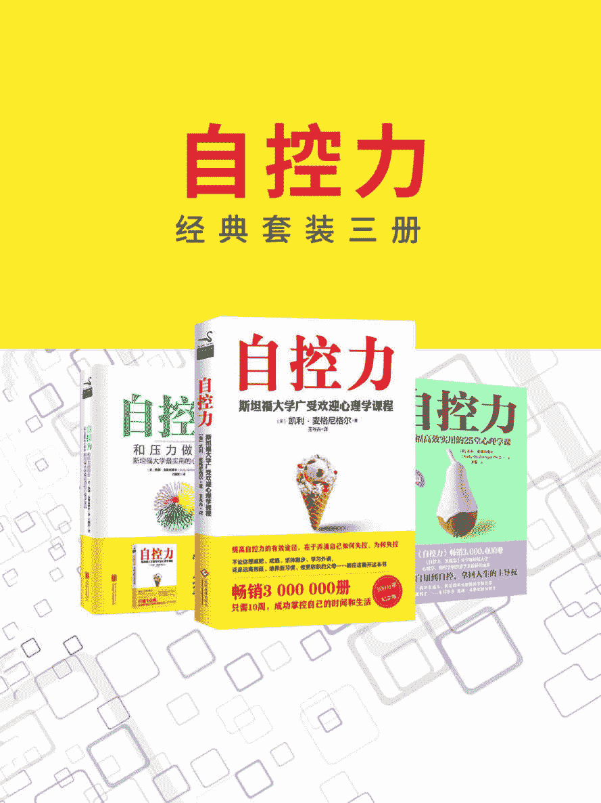
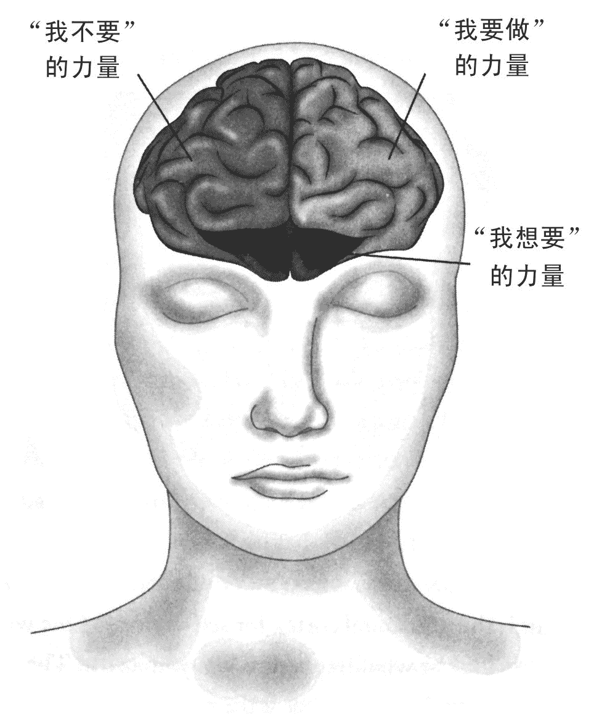
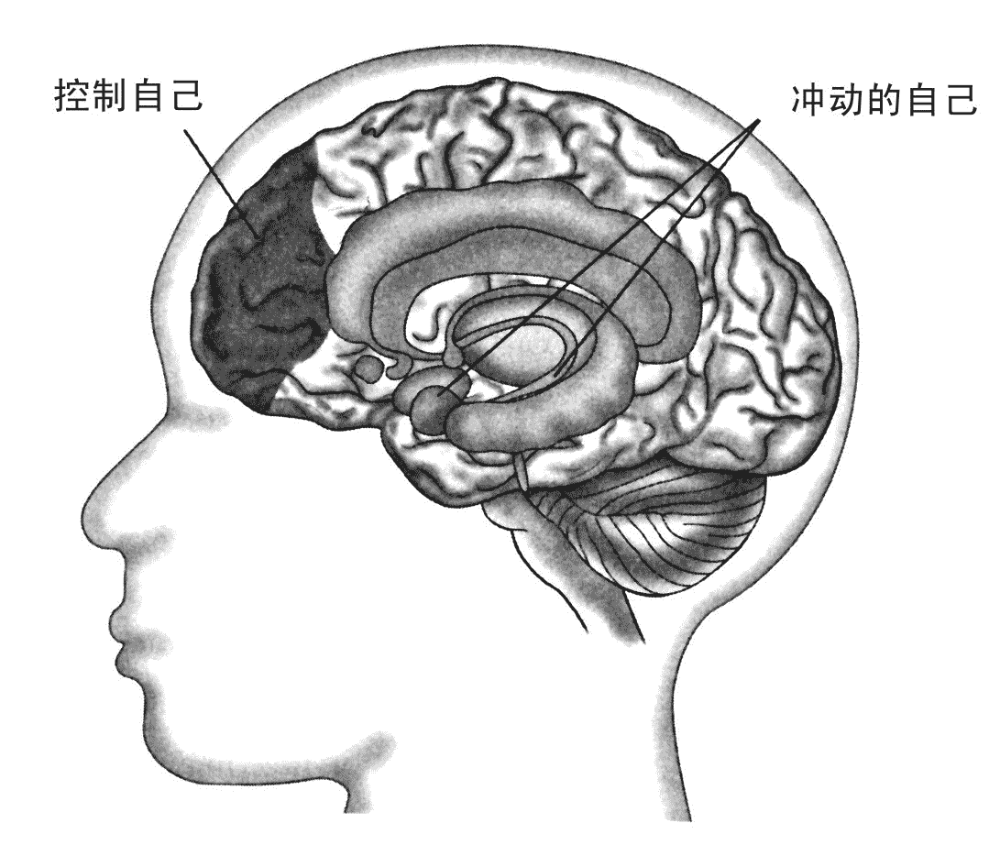
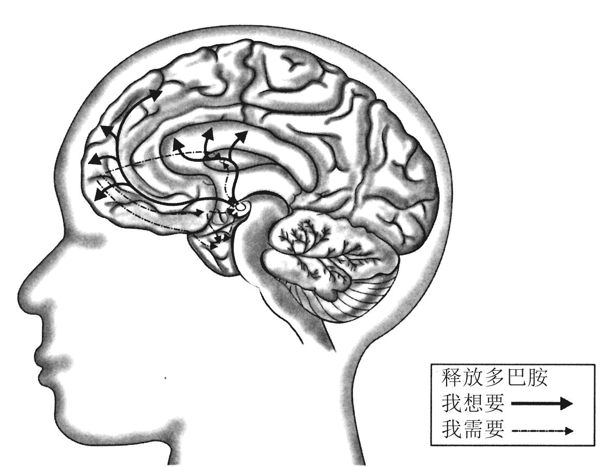
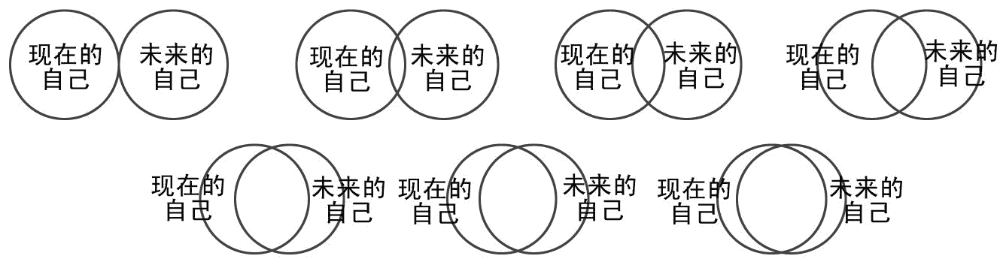
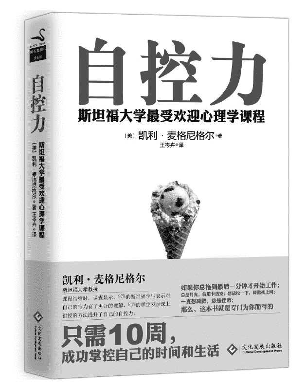
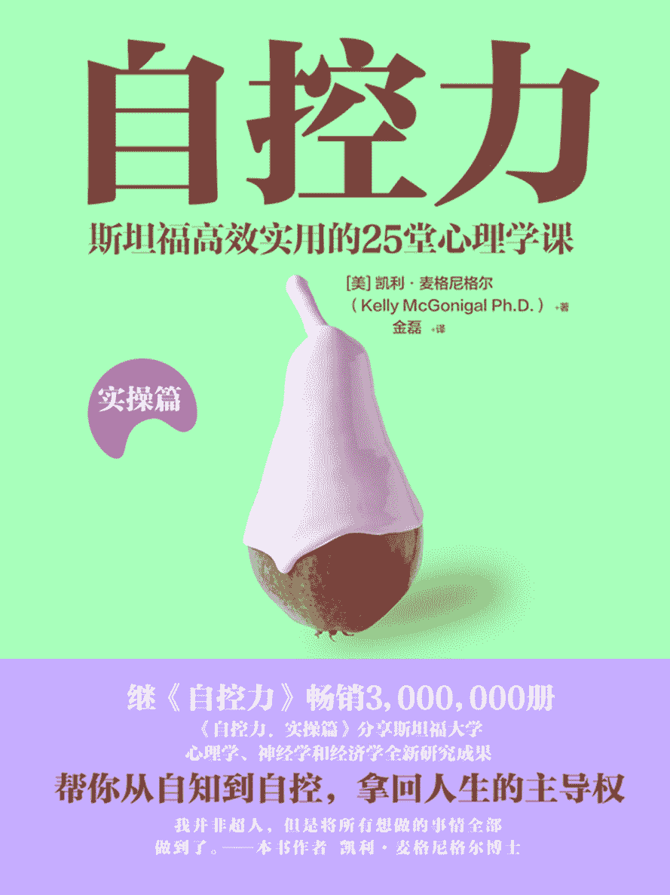
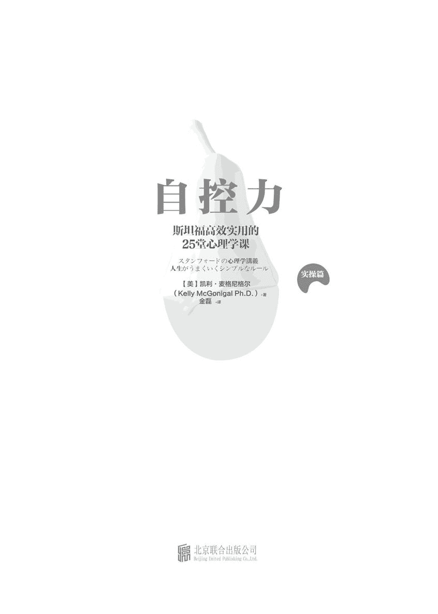

   

# 总 目 录

自控力

自控力：和压力做朋友

自控力：实操篇

   

# 版权信息

自控力

作　　者：【美】麦格尼格尔

特约策划：王澜樾　韩　宇

特约监制：王澜樾　胡瑞婷

特约编辑：周　博

品　　牌：磨铁数盟

目录 版权信息 导言 欢迎阅读意志力入门 为了成功做到自控，你必须知道自己为何失败 如何运用本书 01 我要做，我不要，我想要：什么是意志力？为什么意志力至关重要？ 我们为什么会有意志力？ “我要做”“我不要”和“我想要”的神经学原理 两个自我导致的问题 训练大脑，增强意志力 02 意志力的本能：人生来就能抵制奶酪蛋糕的诱惑 两种不同的威胁 意志力本能：三思而后行 训练你的身心 自控力太强的代价 充满压力的国度 03 累到无力抵抗：为什么自控力和肌肉一样有极限？ 自控的肌肉模式 为什么自控力存在局限？ 训练“意志力肌肉” 自控力是否真的有“极限”？ 日常消耗和文明毁灭 04 容忍罪恶：为何善行之后会有恶行？ 从圣人到罪人 关于进步的问题 今天犯错，明天补救 当罪恶看起来像美德 环保的危害 05 大脑的弥天大谎：为什么我们误把渴望当幸福？ 奖励的承诺 “我想要”的神经生物学原理 分泌多巴胺的大脑：神经营销学的崛起 让多巴胺发挥作用 多巴胺的阴暗面 欲望的重要性 06 “那又如何”：情绪低落为何会使人屈服于诱惑？ 为什么压力会勾起欲望？ 如果你吃了这块饼干，恐怖分子就赢了 “那又如何”效应：为什么罪恶感不起作用？ 决定改善心情 07 出售未来：及时享乐的经济学 出售未来 没有出路：预先承诺的价值 遇见未来的自己 08 传染：为什么意志力会传染？ 传染病的传播 社会中的个人 群体的一员 “我应该”的力量 09 别读这章：“我不要”力量的局限性 这难道不讽刺吗？ 我不想有这种感觉 别吃那个苹果 请勿吸烟 对内接受自我，对外控制行动 10 结语 写在最后的话 鸣谢 

# 导言　欢迎阅读意志力入门

每当我提到自己在讲授一门关于意志力的课程时，人们的反应几乎千篇一律：“哦，这正是我需要的。”现在，人们比过去更关注意志力。所谓意志力，就是控制自己的注意力、情绪和欲望的能力。我们知道，意志力会影响一个人的身体健康、经济安全、人际关系和事业成败。我们也知道，应该掌控自己生活的方方面面，包括吃什么、做什么、说什么、买什么。

然而，大多数人都觉得自己意志力薄弱——自控只是一时的行为，而力不从心和失控却是常态。美国心理学协会称，美国人认为缺乏意志力是完成目标的最大绊脚石。很多人觉得让自己和他人失望了，因此内心充满愧疚。另一些人则觉得，自己被想法、情绪和欲望支配着，一时冲动而非审慎抉择主宰了自己的生活。即便是自控力很强的人，也觉得掌控生活是件令人筋疲力尽的事。人们不禁会问：生活真的需要如此艰难吗？

作为斯坦福大学医学健康促进项目的健康心理学家和教育工作者，我的任务是帮助人们管理压力，作出有利于健康的选择。通过多年来观察人们改变想法、情绪、身体状况和习惯的种种努力，我发现，人们对意志力的很多理解存在问题。这不仅阻碍了他们走向成功，也为他们带来了不必要的压力。尽管科学研究已经为人们解释了很多问题，但显然大众还没有接纳这些真知灼见。实际上，人们为了能够自控，仍把自己弄得筋疲力尽。我屡次发现，大多数人采取的方法不仅毫无效果，反而会适得其反，甚至会导致自毁或失控。

因此，我决定开设“意志力科学”这门课。这门课是斯坦福大学继续教育学院的项目，面向广大公众开放。这门课汇集了心理学、经济学、神经学、医学领域关于自控的最新洞见，告诉人们如何改变旧习惯、培养健康的新习惯、克服拖延、抓住重点、管理压力。这门课还阐述了人们为何会在诱惑前屈服，以及怎样才能抵挡诱惑。此外，它还提出了理解自控局限性的重要性，以及培养意志力的最佳策略。

令我欣喜的是，“意志力科学”很快成为了斯坦福继续教育学院迄今为止最受欢迎的课程之一。第一次开课的时候，听众纷至沓来，我们不得不换了四次教室，才为他们提供了足够的座位。斯坦福最大的一间阶梯教室里挤满了企业高管、教师、运动员、医疗保健人员和对意志力感兴趣的听众。学生们把自己的配偶、子女和同事带进课堂，大家一起分享生活中的经验。

我的初衷是希望这门课惠及更多人，无论他们上课的目的是戒烟、减肥，还是偿还债务、做更称职的家长。但看到课程效果时，我仍然觉得很惊讶。4 周的课程结束后，课堂调查显示，97%的学生表示对自己的行为有了更好的理解，84%的学生表示课上讲授的方法提升了自己的意志力。课程结束时，参与者分享了自己的经历，包括如何克服 30 年的嗜甜症，如何终于递交了退税表格，如何不再对孩子们大声嚷嚷，如何坚持进行一个运动项目。大家普遍认为自己状态变好了，也能作出更明智的选择了。教学评价称这门课能改变人生。学生们则达成了清晰的共识：对意志力科学的理解有助于他们培养自控力，让他们更有精力去追逐最重要的东西。科学的洞见对于戒酒者和戒网瘾者同样有效。自控的策略有助于人们抵制各种各样的诱惑，比如来自巧克力、电子游戏、购物和已婚同事的诱惑。学生通过这门课实现了个人目标，比如跑马拉松、开创事业、应对失业和家庭矛盾的压力，以及周五早上可怕的单词测验（也有母亲把孩子带来上课）。

当然，正如任何一位诚实的老师都会说的，我也从学生身上学到了很多。如果我喋喋不休地讲述一个科学发现有多神奇，却不解释它对提升意志力有何帮助，学生们就会昏昏欲睡。他们会及时反馈，告诉我哪种方法在实际生活中很有效，哪些方法则效果甚微。这是实验室研究无法做到的。他们创意十足地完成每周作业，向我展示将抽象理论带进日常生活的新方法。这本书结合了最优秀的科学理论和课上的实践练习，不但融入了最新研究成果，更汇集了数百位学生的智慧。

## 为了成功做到自控，你必须知道自己为何失败

大多数涉及改变行为的书都会帮你设定目标，甚至会告诉你如何达到目标。无论它是帮你制订新的饮食计划，还是指导你获得财务自由。然而，如果我们想做的改变都成真了，那么“新年新目标”就不再是一句空话，也就没有人会来听我的课了。很少有书会帮你分析原因，告诉你为何至今没有作出改变。当然，作者很清楚你想知道原因，但他们就是不告诉你。

我深信，提高自控力的最有效途径在于，弄清自己如何失控、为何失控。和许多人担心的不同，意识到自己有多容易失控，并非意味着你是个失败者。恰恰相反，这将帮助你避开意志力失效的陷阱。研究表明，自诩意志坚定的人反而最容易在诱惑面前失控。比如，自信能抵制诱惑的戒烟者最容易在 4 个月后故态复萌，过于乐观的节食者最不容易减肥成功。这是为什么呢？因为他们无法预测自己在何时何地、会由于何种原因失控。他们会和“大烟枪”朋友出去玩，或是在家里存放饼干，也就是将自己置于更多的诱惑中。他们在面对挫折时更容易吃惊，在陷入困境时更容易放弃。

自知之明是自控的基础。认识到自己的意志力存在问题，则是自控的关键。这就是为什么“意志力科学”这门课和这本书都将重点放在我们常犯的意志力错误上。本书每一章都将破除一个关于自控的错误观念，并提供一种应对意志力挑战的全新方法。对于每个关于意志力的错误观念，我们都会进行深入剖析，解答以下问题：当我们屈从于诱惑或拖着不做该做的事时，是什么拖了我们的后腿？哪些是致命的错误？我们为何会犯下这些错误？更重要的是，我们将寻找机会，避免将来犯同样的错误。我们怎样才能从失败中汲取经验，为成功铺平道路？

至少，当你读完这本书时，你将对自己的行为有更好的理解。你会明白，这些行为虽不完美，却是人之常态。“意志力科学”明确地指出，每个人都在以某种方式抵制诱惑、癖好、干扰和拖延。这不是个体的弱点或个人的不足，而是普遍的经验，是人所共有的状态。如果这本书仅仅能帮你认识到，自己的意志力缺陷是人之常情，那么我已经很欣慰了。但我希望它的用处不止于此。我希望本书提供的策略能帮到你，让你的生活发生真正而持久的改变！

## 如何运用本书

### 成为自控力科学家

我通过专业训练成为了一名科学家。我学到的最重要的事情就是，理论固然好，但是数据更重要。因此，我希望大家把这本书看成一个实验。科学的自控法并不局限于实验室中。你们可以把自己看成是真实世界中研究的主体，也应该这样做。当你们读这本书的时候，不要把我的话当成金科玉律。我举出证据论证某个概念之后，会让大家在生活中测试这个概念。请收集你们自己的数据，看看哪些是真的，哪些对你有用。

你会在每一章中看到两类作业，它们会帮你成为自控力科学家。第一类作业我称为“深入剖析”。那些提示会让你注意，某种概念是如何在你的生活中发生作用的。在你可以作出改变之前，你需要看清它的本质。比如，我会让你注意到，你什么时候最容易屈服于诱惑，饥饿会怎样影响你的支出情况。我还会让你试着关注，你是如何和自己谈论意志力挑战的，包括你在拖拖拉拉的时候会对自己说什么，以及你如何判断自己的意志力是失效了还是成功了。我甚至会让你开展一些实地研究，比如观察零售商如何利用店铺的设计削弱你的自控力。在做每一个作业时，试着带上观察者的眼光，没有偏见、保持好奇心，就像一名通过显微镜作观察的科学家一样，期待发现有趣且有用的东西。这不是让你在每次意志力薄弱的时候有自责的机会，或是让你抱怨现代社会和其中的所有诱惑。前者不会有机会发生，而我会针对后者提出解决方案。

你还会发现，每章都有一些“意志力实验”。这些策略基于科学研究或理论，能够切实提高你的自控力。你的意志力很快就能得到提升，以便迎接真实生活中的挑战。我希望，你们对每个策略都持开放态度，即便是那些看起来违反直觉的策略（这本书里会有很多这样的策略）。我班上的学生已经先行实验过这些策略，当然，并不是每个策略都适用于所有人，但是这些都是广受好评的方法。至于那些理论上听起来很好，实际中却不怎么管用的方法，放心吧，你不会在本书里看到它们的。

这些实验能够很好地破除陈规，帮助我们找到新方法来解决老问题。我鼓励你们尝试不同的策略，收集你们自己的数据，看看哪一个对自己最有效。它们是实验，不是测试。所以，即便你决定和科学建议背道而驰（毕竟，科学需要怀疑精神），你也不用担心无法通过。和你的朋友、家人和同事分享你的策略吧，看看对他们来说什么是有效的。你自己也会学到点东西。你可以通过你学到的东西来完善自己的自控力策略。

### 你的意志力挑战

如果你想最充分地使用这本书，我推荐大家选择某一个意志力挑战，以此来测试每一个书中提到的概念。我们都面临意志力挑战，有些是具有普遍性的。例如，由于我们的生理本能渴望糖类和脂肪，我们就需要克制自己对它们的欲望。要不然，光凭一个人就能养活一家面包店了。但是，我们的很多意志力挑战是独一无二的。你渴望的，很可能是其他人拒绝的。你上瘾的，很可能是其他人觉得无聊的。你拖拖拉拉不去做的，很可能是其他人宁愿花钱去做的。无论是多么琐碎的事，这些挑战在我们身上会产生同样的效果。你对巧克力的渴望和烟民对香烟的渴望没有什么区别，和购物狂对花钱的渴望也没什么区别。你说服自己不去锻炼，和别人劝说自己不去看过期账单没什么不同，和别人把学习计划又拖了一晚上也没什么区别。

你的意志力挑战可能是你逃避的事（我们称为“我要做”的意志力挑战）或者你想改掉的习惯（“我不要”的意志力挑战），也可以是你愿意花更多精力去关注的重要生活目标（“我想要”的意志力挑战）——无论这个目标是改善健康、管理压力、磨炼家长技能还是拓展事业。集中注意力、拒绝诱惑、控制冲动、克服拖延是非常普遍的人性挑战，本书提供的策略会对你选择的目标有所帮助。当你读完这本书时，你会更加了解自己的意志力挑战，并拥有一套全新的自控策略。

### 慢慢来

我写这本书的初衷，是为了让读者看完书后像上了我 10 周的课程一样。本书分为 10 章，每章都讲述了一个中心概念和它背后的科学原理，以及如何将它应用到你的目标上。所有的概念和策略都是环环相扣的，你在前一章中做的事都是在为下一章作准备。

虽然你可以花一个周末的时间读完整本书，但我还是希望你一步一个脚印地实施这些策略。我班上的学生会花一整周的时间，观察每个想法在生活中的应用情况。他们每周尝试一种新的自控力策略，并在下一周上课的时候反馈给我哪个效果最好。如果你计划用这本书来解决一个具体问题，比如减肥或者控制财务状况，我推荐你采用相同的方法。给你自己充足的时间来尝试这些实际的策略，并进行反思。从每章挑选一个策略，选和你的挑战最相关的一个，而不是一次尝试 10 种策略。

无论何时，只要你想作出改变或者完成目标，就可以利用这本书的“10 周课程结构”，就像我的一些学生会上好几遍这门课一样，他们每次都会关注一种不同的意志力挑战。但是，如果你的首要目标是舒舒服服地看完这本书，你就不用总是进行反思或锻炼了。不过，你可以在最吸引你的地方做上标记。这样，当你准备付诸实践的时候，你就可以回头看看你的笔记。

### 让我们开始吧

这是你的第一份作业：挑选一个挑战，带进我们的意志力科学之旅。随后，我们会一起进入第一章，做个时空之旅，看看意志力到底从何而来，以及我们如何获得更多的意志力。

深入剖析：选择你的意志力挑战

如果你还没有作决定的话，是时候选一个你最可能用书中的概念和策略应对的意志力挑战了。以下问题能帮你找出合适的挑战：

\*“我要做”意志力挑战：有没有什么事是你想多做一些的，或是停止拖延的，因为你知道这样做能提高你的生活质量？

\*“我不要”意志力挑战：你生活中最“顽固”的习惯是什么？有什么是你想放弃，或者想少做一点的，因为它妨害了你的健康、幸福甚至成功？

\*“我想要”意志力挑战：你最想集中精力完成哪一项重要的长远目标？哪种当下的“渴望”最有可能分散你的注意力、诱惑你远离自己的目标？

# 01　我要做，我不要，我想要：什么是意志力？为什么意志力至关重要？

如果叫你说出一件最需要意志力的事，你第一个想到的是什么？对大多数人来说，最大的考验莫过于抵制诱惑，抵制来自甜甜圈、香烟、清仓大甩卖或是一夜情的诱惑。人们嘴里说“我毫无意志力”，通常是指“当我的嘴巴、肚子、心里或是全身上下都想要的时候，我没法‘说不’。”没错，这就是“我不要”的力量。

“说不”属于意志力的一部分，而且是不可或缺的一部分。毕竟，“说不”是全世界的拖延症患者和宅男宅女最喜欢的两个字。实际上，对于你打算拖到明天或是下辈子再做的事，你得学着“说要”。就算你心里再焦虑不安，就算电视节目再魅力难挡，意志力都会逼着你“今日事今日毕”。即使你并非心甘情愿，它也会逼你完成必须做的事。这就是“我要做”的力量。

“我要做”和“我不要”是自控的两种表现，但它们不是意志力的全部。要想在需要“说不”时“说不”，在需要“说好”时“说好”，你还得有第三种力量：那就是牢记自己真正想要的是什么。你没准会说，我真正想要的是巧克力蛋糕，是再喝一杯酒，是好好休个假。但当你面对诱惑和拖延症时，你得想清楚，你真正想要的，其实是变得苗条、升职加薪、不要欠债、家庭美满、远离监狱。只有想到这些，才能遏制你的一时冲动。想要做到自控，你就得在关键时刻明确自己的目标。这就是“我想要”的力量。

意志力就是驾驭“我要做”、“我不要”和“我想要”这三种力量。如果驾驭得好，它就能帮你实现目标，还能让你少惹是非。人类相当幸运，因为大脑赋予了我们这三种力量。能够施展这三种力量，恰恰体现了人类的优越性。在进一步分析之前，让我们先怀着一颗感恩的心，想一想能拥有它们是多么幸运的事。然后，让我们钻进人类的大脑里，看看究竟是什么在发挥作用。本书将提出一种训练大脑的方法，让你的意志力变得更强健。本书还会回答以下问题：为什么意志力总是藏得很深？自我意识是人类另一项得天独厚的特质，怎么用它来弥补意志力的缺陷呢？

## 我们为什么会有意志力？

让我们来想象一下这样的画面吧。10 万年前，你是个处于进化链顶端的智人（Homo sapiens），拥有一般动物不具备的拇指、能够直立的脊椎和可以发声的舌骨。你当时已经能相当熟练地生火了，还会制造锋利的石器，用来给水牛和河马开膛破肚。

仅仅在几代人之前，人类的生活还相当简单，只需要寻找晚餐、繁衍生息和避开食人鳄就够了。智人只有互助才能求生，因此部落里人们关系密切，你的首要任务就是“别惹火其他人”。部落里人们相互合作、共享资源，因此你做事不能随心所欲。你要是偷了别人的水牛肉或抢了别人的配偶，就可能被逐出部落或杀掉。（切记：其他智人也拥有锋利的石器，而且你的皮可比河马皮薄多了。）况且，如果你生病或者受伤了，没法出门打猎或采野果，你也需要来自部落的照顾。在石器时代，交朋友和与人打交道的方式和今天没什么不同：邻居需要遮风挡雨的地方时，你不妨帮他一把；别人缺吃少穿的时候，你不妨分他一点；而且千万不要对别人说“那件衣服让你好显胖”。换句话来说，我们多少得有点自控力。

能否作出正确的抉择，不仅影响个人的生活，更影响部落的存亡。你得选择和谁打仗、和谁婚配（切记：千万别近亲结婚）。如果你幸运地找到了一个伴儿，还得想着天长地久。现代人同样容易惹麻烦，因为人类还是像十万年前一样好吃、好色、好杀戮。

这不过是对意志力的基本要求。历史的车轮滚滚向前，社会越来越复杂，人们越来越需要自控力。为了适应环境、与人合作、维持关系，人脑很早就学会了自控。现代人的大脑就是为了适应各种需求而进化出来的。只有大脑紧跟时代的脚步，我们才能拥有意志力。意志力是一种抑制冲动的能力，它使我们成为了真正的人。

### 为什么直到今天，意志力仍然很重要

让我们回到现代社会来看看。意志力不但区分了人和动物，也区分了每一个人。每个人的意志力都是与生俱来的，但有些人的意志力更强。无论从哪个方面看，能够更好地控制自己的注意力、情绪和行为的人，都会活得更幸福。他们的生活更快乐，身体更健康，人际关系更和谐，恋情更长久，收入更高，事业也更成功。他们能更好地应对压力、解决冲突、战胜逆境，活得也更长。顽强的意志力是一个人最突出的优点。自控力比智商更有助于拿高分，比个人魅力更有助于领导别人，比同理心更有助于维持婚姻幸福。（没错，维持婚姻的秘诀就在于学会闭嘴。）如果你想让生活变得更美好，那就从意志力入手吧。首先，我们需要了解一下人脑，看看我们研究的是个什么东西。

## “我要做”“我不要”和“我想要”的神经学原理

现代人拥有意志力，得益于远古时期的人类。那时，人们面临很大的压力，必须努力成为好邻居、好父母、好妻子或好丈夫。但人脑究竟是怎么进化而来的呢？答案是，我们的前额皮质进化了。前额皮质是位于额头和眼睛后面的神经区，它主要控制人体的运动，比如走路、跑步、抓取、推拉等，这些都是自控的表现。随着人类不断进化，前额皮质也逐渐扩大，并和大脑的其他区域联系得越来越紧密。现在，人脑中前额皮质所占的比例比其他物种大很多。这就是为什么你的宠物狗不会把狗粮存起来养老，而人却会未雨绸缪。前额皮质扩大之后，就有了新的功能。它能控制我们去关注什么、想些什么，甚至能影响我们的感觉。这样一来，我们就能更好地控制自己的行为。

斯坦福大学的神经生物学家罗伯特·萨博斯基（Robert Sapolsky）认为，现代人大脑里前额皮质的主要作用是让人选择做“更难的事”。如果坐在沙发上比较容易，它就会让你站起来做做运动。如果吃甜品比较容易，它就会提醒你要杯茶。如果把事情拖到明天比较容易，它就会督促你打开文件，开始工作。

前额皮质并不是挤成一团的灰质，而是分成了三个区域，分管“我要做”“我不要”和“我想要”三种力量（见图 1-1）。前额皮质的左边区域负责“我要做”的力量。它能帮你处理枯燥、困难或充满压力的工作。比如，当你想冲个澡的时候，它会让你继续待在跑步机上。右边的区域则控制“我不要”的力量。它能克制你的一时冲动。比如，你开车时没有看短信，而是盯着前方的路面，就是这个区域的功劳。以上两个区域一同控制你“做什么”。

图 1-1　人脑中的意志力

第三个区域位于前额皮质中间靠下的位置。它会记录你的目标和欲望，决定你“想要什么”。这个区域，的细胞活动越剧烈，你采取行动和拒绝诱惑的能力就越强。即便大脑的其他部分一片混乱，向你大叫“吃这个！喝那个！抽这个！买那个！”这个区域也会记住你真正想要的是什么。

深入剖析：更难的事是什么？

总有很多难事向意志力发起挑战，比如拒绝诱惑，或是在高压环境里坚持下去。想象你正面临一个意志力的挑战。更难的事是什么？为什么它如此困难？想到它的时候，你的感觉如何？

### 丧失意志力的惊人案例

前额皮质对自控力到底有多重要？我们不妨来看看，如果没有前额皮质会怎样。最有名的前额皮质损伤案例莫过于菲尼亚斯·盖奇（Phineas Gage）的故事。提前声明，这可是个血淋淋的案例。我劝你，最好还是先别吃东西了。

1848 年，铁路领班工人菲尼亚斯·盖奇年仅 25 岁。雇主称他为最好的领班，工友们尊敬他、喜欢他，家人朋友都觉得他既安静又受人尊重。医生约翰·马丁·哈洛（John Martyn Harlow）认为，他是个意志力顽强、身体健壮的人，“拥有钢铁般的意志力和体魄”。

但在 9 月 13 日周三下午 4 点半，一切都变了。当时，盖奇和工友正在用炸药清理拉特兰郡（Rutland）到伯灵顿（Burlington）铁路的佛蒙特州（Vermont）路段。这件事他们做过无数次，但这次却出了岔子。炸药提早爆炸了，冲击波带着一条 3 英尺长、7 英寸宽的钢筋插进了盖奇的头骨。钢筋刺穿他的左脸，穿过他的前额皮质，飞到了他身后足有 30 码远的地方。那条钢筋上还粘着他的大脑灰质！

你肯定觉得盖奇横尸当场了。不过，他奇迹般地生还了。目击者称，他甚至没有昏过去。工友把他抬到牛车上，走了大约 1 公里把他带回住所。医生尽全力为盖奇包扎，从事发地点取回来一大块头盖骨，对他进行了头骨复原，并用头皮盖住了伤口。

两个月后，盖奇的身体机能完全恢复了（此前，盖奇的脑袋上不断长出真菌，哈洛医生采取了灌肠治疗，所以拖延了康复的时间）。到 11 月 17 日，他已经痊愈了，重新开始了工作。盖奇说自己“哪里都挺好的”，一点都不疼了。

这听上去是不错。不幸的是，盖奇的悲剧并未到此结束。他的外伤是痊愈了，但他的大脑却发生了奇怪的变化。朋友和工友都表示，他的性格大变。哈洛医生在原始事故医疗报告上记录了盖奇的变化：

盖奇心智和身体之间的平衡似乎被打破了。他经常粗鲁地侮辱别人（他以前不是这样），总想去控制别人，极少顺从他人。如果你限制他，或是和他意见相左，他就会失去耐心……我设计了很多未来的康复计划，但还没来得及实施就不得不放弃了……从这个角度看，他的性情发生了 180°大转变。难怪他的朋友和熟人都说他“已经不是盖奇了”。

换句话说，当盖奇失去前额皮质的时候，他也失去了“要做”“不要”和“想要”的力量。钢铁般的意志力看似是他性格中不可动摇的一部分，却被那根刺穿头骨的钢筋击碎了。

当然，大部分人不用担心爆炸会夺走自己的意志力。但我们多多少少有一点盖奇的影子。前额皮质并非始终可靠，醉酒、缺觉、分心等都会影响到它，使我们无法控制自己的冲动。虽然灰质还好端端地待在大脑里，但我们和盖奇已经没什么两样了。即使我们的大脑精力充沛、足够清醒，也不是不存在危险。我们有能力去选择“更难的事”，也会有冲动去做“容易的事”。我们需要阻止这种冲动，但冲动本身也是一种想法。

## 两个自我导致的问题

人们发现意志力不起作用的时候，比如花了太多钱、吃了太多东西、浪费了太多时间、发了太大脾气的时候，总会怀疑自己“有没有大脑”。抵制诱惑是有可能办到的，但这不能意味着我们就一定能办到。我们或许今天就能做完明天的事，但在多半情况下，我们会把事情拖到明天再做。这的确让人很崩溃！不过，我们要感谢人类的进化。在进化过程中，大脑没有因为扩大而发生剧变。进化，更多的是锦上添花。当人们需要新技能时，大脑原始的功能并没有被新功能取代。在原有的冲动系统和本能系统之上，我们进化出了自控系统。

也就是说，进化保留了曾为我们效劳的本能，即使那些本能如今会给我们带来麻烦。不过好处在于，我们如今有了解决麻烦的能力。比如说，最美味的食物也是最能让人发胖的食物。过去食物短缺的时候，多余的身体脂肪能救人一命，爱吃甜食能让人活下去。但进入现代社会后，到处都是快餐、垃圾食品和各种各样能吃的东西，超重有害身体健康，爱吃甜食不再能救人一命。只有拒绝食物的诱惑，你才可能长命百岁。但是，由于我们的祖先曾得益于甜食，我们仍然保持嗜甜的本能。幸亏，自控系统能让我们离糖果罐远远的。即使当我们头脑发热的时候，我们也能克制冲动。

有些神经学家甚至认为，我们只有一个大脑，但我们有两个想法。或者说，我们的脑袋里有两个自我。一个自我任意妄为、及时行乐，另一个自我则克服冲动、深谋远虑（见图 1-2）。我们总是在两者之间摇摆不定，有时觉得自己想减肥，有时觉得自己想吃饼干。因此，我们可以这样来定义意志力的挑战——你一方面想要这个，一方面想要那个。当下的你想要这个，但如果不要的话，你未来的生活会更好。两个自我发生分歧的时候，总会有一方击败另一方。决定放弃的一方并没有做错，只是双方觉得重要的东西不同而已。

图 1-2　两种想法

深入剖析：认清两个自我

意志力挑战就是两个自我的对抗。你正面临什么样的意志力挑战？你如何描述两种相抗衡的想法？冲动的你想要什么？明智的你又想要什么？你可以给冲动的自我起个名字，比如把及时行乐的人叫做“饼干怪兽”，把爱抱怨的人叫做“评论家”，把总是不想开工的人叫做“拖延者”。在他们占上风的时候，你就能意识到他们的存在。这还能帮你唤醒那个明智的自己，唤醒意志力。

### 两个自我的价值

在自我博弈的过程中，如果自控系统能占上风，原始的本能能被你抛在一边，这听起来是不是很诱人？在茹毛饮血的时代里，这些本能使人类得以延续。但如今，它们却阻碍了人类的发展，带来了健康问题，掏空了银行账户，酿成了需要向全国人民道歉的性丑闻。如果文明人能不再被原始冲动所累，那该有多好。

可别这么想。虽然原始冲动并不总对我们有利，但想彻底摆脱它也是不对的。医学上曾研究过因脑部受损而失去本能的人。研究者发现，对于健康、幸福和自控力来说，原始的恐惧和欲望至关重要。有个案例很有意思：一个年轻女子在癫痫手术中伤到了中脑，无法感觉到恐惧和厌恶。恐惧和厌恶正是两种自控的本能。她养成了暴食的习惯，非要把自己吃吐才罢休，而且经常对家人产生性冲动。这可不是个有自控力的典范！

继续读下去，你还会看到：如果没有了欲望，人们就会变得沮丧；如果没有了恐惧，人们就没法保护自己、远离伤害。在意志力挑战中获胜的关键，在于学会利用原始本能，而不是反抗这些本能。神经经济学家是一群研究人们决策时大脑活动的科学家。他们发现，自控系统和生存本能并不总会发生冲突。在某些时候，它们会相互协作，帮我们作出更好的选择。比如，你正穿过一家百货商场，突然，一个明晃晃的东西吸引了你的眼球。你的原始本能大声尖叫“买下它！”你看了看标签牌——199.99 美元。在看到这个惊人的价钱之前，如果你想抑制购买的冲动，就会用到前额皮质。但如果说，你的大脑会本能地对这个价钱产生疼痛的感觉呢？研究表明，事实的确如此。当你看到几位数的标签牌时，和你被人打了一拳时，大脑的反应如出一辙。这种本能的打击能让你的前额皮质更好地发挥作用。这样一来，你根本用不上“我不要”的力量。既然我们的目标是增强意志力，那么何不寻找每一种可行的方法呢？无论是为了享乐还是适应环境，原始本能都很有用。

### 意志力第一法则：认识你自己

自控力是人类最与众不同的特征之一。此外，人类还拥有自我意识。当我们做一件事的时候，我们能意识到自己在做什么，也知道我们为什么这样做。但愿我们还能知道，在做这件事情之前我们需要做些什么，这样我们就会三思而后行。可以说，这种自我意识是人类独有的。当然，海豚和大象也能辨认出镜子里的自己。但没有任何证据表明，它们能理解自己的所作所为。

如果没有自我意识，自控系统将毫无用武之地。在作决定的时候，你必须意识到自己此刻需要意志力。否则，大脑总会默认选择最简单的。想戒烟的人需要第一时间意识到自己吸烟的冲动，也要知道哪里会让他有这种冲动（比如在室外、寒冷的环境里或摆弄打火机的时候）。他还得知道，如果自己这次投降了，明天很有可能会继续吸烟，未来很可能会疾病缠身。为了避免厄运降临，他必须有意识地戒烟。要是没有自我意识，他就完蛋了。

这听上去似乎很简单。但心理学家知道，大部分人作决定的时候就像开了自动挡，根本意识不到自己为什么作决定，也没有认真考虑这样做的后果。最可恨的是，我们有时根本意识不到自己已经作了决定。比如，有一项研究调查人们每天做多少和食物相关的决定。要是问你的话，你会怎么说？人们平均会猜 14 个。但如果我们真去数的话，这种决定大约有 227 个。人们是在毫无意识的情况下作出这 200 多个选择的。而这仅仅是和食物相关的决定。如果你都不知道自己在作决定，又怎么能控制自己呢？

现代社会充斥着诱惑和刺激，不断冲击着人们的自控力。巴巴·史乌（Baba Shiv）向我们证明了，注意力分散的人更容易向诱惑屈服。比如，让正在背诵电话号码的学生从食品车里拿些食品，他们选择巧克力蛋糕、不选择水果的概率会比一般学生高 50%。商店里的促销活动更容易吸引心不在焉的购物者。他们很可能把一堆不在购物清单上的东西买回家。1

如果你心里在想其他事，那么冲动就会主导你的选择。你是不是在排队等咖啡的时候发短信，结果本来想点冰咖啡，却点了一杯摩卡？（你绝对不想知道那杯东西有多少卡路里。）你是不是一心想着工作，结果被售货员忽悠了，不但升级了原有的设备，还买了一大堆服务套餐。

意志力实验：回忆一下你的决定

如果你想有更强的自控力，就得有更多的自我意识。首先你得知道，什么样的决定需要意志力。有些决定比较明显，比如“下班后要不要去健身？”但有些冲动的后果可能要过些日子才会显现。比如，你是不是先装好了运动背包，以便不用回家就能去锻炼？（这是个不错的做法！这样你就没那么多借口了。）你是不是接了个电话，然后聊着聊着就饿了，没办法直接去健身了？（哎呀！你要是先去吃饭，八成就不会去健身了。）请至少选一天，把你作的决定都记下来。在这一天结束的时候，回想你作的决定，分析哪些有利于你实现目标，哪些会消磨你的意志。坚持记录你的决定，还有助于减少在注意力分散时作决定，同时增强你的意志力。

### 网瘾患者康复的第一步

31 岁的米歇尔是电台节目制作人，她总在不停地用电脑或手机查收邮件。这影响了她的工作效率，也让她的男朋友心烦意乱，因为他从来没有得到过她百分之百的注意。课程中，米歇尔的意志力挑战便是尽可能少地查收邮件。她自己设定了一个宏伟目标，也就是一小时里最多查收一次邮件。第一周结束时，她觉得自己毫无进展。问题在于，她经常在翻看完所有的新消息后，才意识到自己又查收了邮件。只要她能意识到自己在做什么，就有可能停下来。然而，她意识不到是什么促使自己看手机、开邮箱。米歇尔又制订了新的目标，希望能尽早发现冲动的苗头。

到下一周结束的时候，在即将碰到电话或点开邮箱的时候，她已经能意识到自己在做什么了。这让她能够阻止自己，而不是一头栽进去。查收邮件的冲动真是让人难以捉摸！在查看邮件之前，米歇尔想不到是什么促使自己非查收不可。过了一段时间，她渐渐发现，这种感觉就像挠痒一样。当她查收邮件的时候，大脑和身体的不安都得到了缓解。米歇尔非常兴奋，因为她从没想过，原来自己查收邮件是为了缓解不安。她还以为自己只是为了获取信息呢。她开始关注自己查收邮件后的感觉，并发现查邮件和挠痒一样没用，只会让她觉得更痒。米歇尔及时发现了自己的冲动，并且认识到了冲动的反应，这增强了她的自控力，也让她超额完成了目标。从此，她在工作之外都尽量不看邮件了。

利用这一周的时间观察一下，你究竟是怎样屈服于冲动的。你甚至不用设定一个自控目标，只需要看看你能否及早意识到自己在做什么，什么样的想法、感受和情况最容易让你有冲动，想些什么或暗示什么最容易让你放弃冲动。

## 训练大脑，增强意志力

人类花了几百万年时间，终于进化出了能满足要求的前额皮质。如果我们不想再花一百万年时间，却想拥有更强的自控力，听上去是不是太贪心了？如果普通的人脑已经有了足够的自控力，我们能不能对它加以改进？

远古以来，至少是研究人员开始探索人脑以来，人们一直认为大脑构造是固定不变的；人的脑容量是一个固定值，不能通过外力改变；人脑唯一可能发生的变化，就是随着衰老变得迟缓。但是在过去 10 年里，神经学家发现，人脑像一个求知欲很强的学生，对经验有着超乎大家想象的反应。如果你每天都让大脑学数学，它就会越来越擅长数学。如果你让它忧虑，它就会越来越忧虑。如果你让它专注，它就会越来越专注。

你的大脑不仅会觉得越来越容易，也会根据你的要求重新塑型。就像通过锻炼能增加肌肉一样，通过一定的训练，大脑中某些区域的密度会变大，会聚集更多的灰质。比如，对学习表演杂耍的成年人来说，他们大脑中用来追踪运动物体的区域会聚集更多的灰质。大脑中某些区域的连接会更加紧密，以便更快地传递信息。如果成年人坚持每天玩 25 分钟记忆力游戏，大脑里控制注意力和记忆力的区域就会连接得更紧密。

但是，脑力训练不只是为了表演杂耍，或者记住把眼镜放在哪里。越来越多的科学研究表明，通过训练大脑能增强自控力。那么，针对大脑的意志力训练到底是什么样的呢？你可以在家里布满陷阱，来挑战“我不要”。比如，你可以在放袜子的抽屉里放块巧克力，在锻炼用的自行车旁边放上一杯酒，把高中时喜欢的女孩照片贴在冰箱上。你还可以设置一些“我要做”的障碍。比如，你可以偶尔要求自己喝杯大麦茶、做 20 次双脚跳，或者提前一点纳税。

你还可以做一件更简单、更无痛的事——冥想。神经学家发现，如果你经常让大脑冥想，它不仅会变得擅长冥想，还会提升你的自控力，提升你集中注意力、管理压力、克制冲动和认识自我的能力。一段时间之后，你的大脑就会变成调试良好的意志力机器。在你的前额皮质和影响自我意识的区域里，大脑灰质都会增多。

当然，我们不用花一辈子时间去冥想，希望以此改变大脑。有些研究人员已经开始调查，如何用最短的冥想时间改变大脑（我的学生很欣赏这个方法，因为没有人会在今后 10 年里跑到喜马拉雅山某个山洞里去打坐冥想）。这项研究针对的是从来没有冥想过的人，也包括对此事持怀疑态度的人。研究人员会教他们一些简单的冥想技巧。研究发现，经过仅仅 3 个小时的冥想练习，他们的注意力和自控力就有大幅提高。11 个小时后，研究人员已经能观察到大脑的变化。刚学会冥想的人大脑里负责控制注意力、排除干扰、控制冲动的区域之间增加了许多类神经元。另一项研究发现，持续 8 周的日常冥想训练可以提升人们日常生活中的自我意识，相应大脑区域里的灰质也会随之增多。

我们的大脑竟能如此迅速地重塑自己，这听起来有点惊人。但你可以这样理解，冥想让更多的血液流进前额皮质，就像提重物能让更多的血液流进肌肉一样。人脑在接受锻炼方面和肌肉没什么区别，它会变得更强壮、更迅速，以便应付你的需要。所以，如果你准备好了要训练你的大脑，以下冥想技巧会很有用，能充分挖掘你的大脑潜能。

意志力实验：5 分钟训练大脑冥想

专心呼吸是一种简单有效的冥想技巧，它不但能训练大脑，还能增强意志力。它能减轻你的压力，指导大脑处理内在的干扰（比如冲动、担忧、欲望）和外在的诱惑（比如声音、画面、气味）。新研究表明，定期的思维训练能帮人戒烟、减肥、戒毒、保持清醒。无论你“要做”和“不要”的是什么，这种 5 分钟冥想都有助于你增强意志力。

让我们开始吧。

1.原地不动，安静坐好。

坐在椅子上，双脚平放在地上，或盘腿坐在垫子上。背挺直，双手放在膝盖上。冥想时一定不能烦躁，这是自控力的基本保证。如果你想挠痒的话，可以调整一下胳膊的位置，腿交叉或伸直，看自己是否有冲动但能克制。简单的静坐对于意志力的冥想训练至关重要。你将学会，不再屈服于大脑和身体产生的冲动。

2.注意你的呼吸。

闭上眼睛。要是怕睡着，你可以盯着某处看，比如盯着一面白墙，但不要看家庭购物频道。注意你的呼吸。吸气时在脑海中默念“吸”，呼气时在脑海中默念“呼”。当你发现自己有点走神的时候，重新将注意力集中到呼吸上。这种反复的注意力训练，能让前额皮质开启高速模式，让大脑中处理压力和冲动的区域更加稳定。

3.感受呼吸，弄清自己是怎么走神的。

几分钟后，你就可以不再默念“呼”、“吸”了。试着专注于呼吸本身。你会注意到空气从鼻子和嘴巴进入和呼出的感觉，感觉到吸气时胸腹部的扩张和呼气时胸腹部的收缩。不再默念“呼”、“吸”后，你可能更容易走神。像之前一样，当你发现自己在想别的事情时，重新将注意力集中到呼吸上。如果你觉得很难重新集中注意力，就在心里多默念几遍“呼”和“吸”。这部分的训练能锻炼你的自我意识和自控能力。

刚开始的时候，你每天锻炼 5 分钟就行。习惯成自然之后，请试着每天做 10-15 分钟。如果你觉得有负担，那就减少到 5 分钟。每天做比较短的训练，也比把比较长的训练拖到明天好。这样，你每天都会有一段固定的时间冥想，比如早晨洗澡之前。如果你做不到，可以对时间进行适当的调整。

### 冥想时感觉糟糕，有助于培养自控

51 岁的安德鲁是一位电力工程师。他觉得自己不善于冥想。他觉得，冥想就是要什么都不想。即使注意力已经集中到了呼吸上，他也觉得会有别的想法溜进大脑。他没有像预期的那样很快就有进步，因此准备放弃训练了。他认为，既然自己没办法将注意力集中到呼吸上，那冥想就是在浪费时间。

很多刚尝试呼吸训练的人都会有这样的错误想法。实际上，冥想时感觉“很糟糕”才能让训练有效果。我鼓励安德鲁和很多受打击的学生，不仅要关注自己能否将注意力集中到呼吸上，还要注意观察，这种训练在其他时候是否影响了你的选择。

安德鲁发现，自己虽然在冥想训练时有些分心，但训练后更能集中注意力了。他还发现，在冥想训练里做的事正是他在生活中也要面对的——把自己的注意力收回，专注于最初的目标。（在冥想训练中，目标就是专注呼吸。）吃午饭的时候，他本想点些高盐或油炸的垃圾食品。这时，冥想训练就发挥作用了。他能咽下即将脱口而出的刻薄言论了，也能把注意力集中到成堆的任务上了。自控力是一个过程，在这个过程中，人们不断偏离目标，又不断把注意力收回来。看到自己走到了这一步，安德鲁再也不担心 10 分钟冥想训练里如何专注呼吸了。冥想时的感觉越“糟糕”，它在现实生活中的作用就越明显。最重要的是，你在走神的时候要能意识到这一点。

冥想不是让你什么都不想，而是让你不要太分心，不要忘了最初的目标。如果你在冥想时没法集中注意力，别担心。你只需多做练习，将注意力重新集中到呼吸上。

### 写在最后的话

我们有现代人的大脑结构，所以有好几个自我。它们互相竞争，试图控制我们的想法、感受和行动。每个意志力挑战都是一次自我博弈。要想让更好的自己占据主导，我们就要强化自我意识和自控力。这样，我们才会拥有意志力和“我想要”的力量，让自己选择去做“更难的事”。

本章总结

核心思想：意志力实际上是“我要做”、“我不要”和“我想要”这三种力量。它们协同努力，让我们变成更好的自己。

深入剖析：

·更难的事是什么？想象你正面临一个意志力的挑战。更难的事是什么？为什么它如此困难？

·认清两个自我。你的意志力挑战是，如何描述相抗衡的两个自我？冲动的你想要什么？明智的你又想要什么？

意志力实验：

·记录你的意志力选择。至少选一天，注意观察你做的关于意志力的决定。

·5 分钟大脑训练冥想。在脑海中默念“呼”和“吸”，把注意力集中在呼吸上。当你开始走神的时候，重新集中注意力。

# 02　意志力的本能：人生来就能抵制奶酪蛋糕的诱惑

起初，你会感到一阵兴奋。你的脑袋嗡嗡作响，心脏怦怦跳个不停，好像你全身上下都在说“我想要”。这时，焦虑会向你袭来。于是，你肺部紧缩、肌肉紧绷，你开始觉得头重脚轻、内心反感。你几乎要发抖了，因为你非常想要。但是你不能要。可是你又想要。但是你真的不能要！你清楚自己需要做什么，但你不确定自己能否把持得住。

欢迎来到欲望的世界。或许你的欲望对象是一支烟、一杯酒或是一杯拿铁，也许是一家清仓甩卖的店铺，一张乐透彩票或是橱窗里的一个甜甜圈。这时你就面临抉择：是屈服于诱惑，还是寻找内在力量来自控。此时此刻，即使你全身上下都在说“我想要”，你也需要说出“我不想”。

当你遇到真正的意志力挑战时，你的身体一定能感觉到。这并不是孰是孰非这种抽象的命题，而是你身体内部的战斗，是你身体两部分之间的战斗，感觉就像两个不同的人在战斗。有时，欲望会占据上风。有时，那个更加明智、想变得更好的你会占据上风。

很难说为什么你面对意志力的挑战会有输有赢。这次你能抵抗，下次你可能就会屈服。你可能会问自己：“我到底在想什么！？”其实你更应该问：“我的身体到底在做什么？”科学研究发现，自控力不仅和心理有关，更和生理有关。只有在大脑和身体同时作用的瞬间，你才有力量克服冲动。研究人员逐渐认识到这是一种怎样的状态，以及复杂的现代社会是如何破坏这种状态的。好消息是，当你最需要意志力的时候，你能够学会将自己的生理机能调整到这种状态。这样，当你再面临诱惑的时候，自控力就成了你的本能反应。

## 两种不同的威胁

想要探究自控时的身体状态，我们首先要明确剑齿虎和草莓奶酪蛋糕的区别。很重要的一个方面是，老虎和奶酪蛋糕有相似之处——它们都不会让你长命百岁。但是从其他方面来看，它们是两种完全不同的威胁。人脑在应对它们时会采取完全不同的策略。幸好，通过进化，人类学会了保护自己不受它们的威胁。

### 危险逼近的时候

让我们溯时而上，回到凶猛的剑齿虎还在捕食猎物的时代 2。想象一下，你正在东非的塞伦盖蒂大草原（Serengeti）上盘算着找些吃的。或许，你正在横七竖八的尸体中寻找着午餐，一切都很顺利。那边刚死掉、还没人抢的鬣狗不正是你想要的吗？突然，大事不妙了！一只剑齿虎正埋伏在附近的树林里。或许它正在回味鬣狗这道开胃菜，并在打量着下一道菜。对，就是你了。它似乎很想把 11 英寸长的牙齿插进你的肉里。而且，它可不像现代人一样，会在满足欲望的时候感到不安。你也不要指望它在节食，会嫌弃你的肉里有太多卡路里。

幸好，你并不是第一个身处险境的人。你的祖先们早就面对过这类敌人了。你从祖先身上遗传了战斗或逃命时的本能。这种本能就是应激反应。你肯定有过这种感觉——心跳加速、下巴打战、精神高度紧张。这些身体的变化都不是偶然的。它们以某种复杂的方式与人脑和神经系统相互协调，保证你能迅速反应、全力出击。

当你看到剑齿虎时，你的生理反应是这样：信息先通过眼睛进入大脑中的杏仁体，这就是你的警报系统。这个警报系统处于大脑中部，用来探测潜在的紧急情况。当它发现威胁的时候，就会利用位于大脑中部的优势，迅速将信息传给大脑和身体的其他部分。当警报系统通过眼球得知一只剑齿虎正在盯着你的时候，它便会向大脑和身体发出一系列信号，让你产生应激反应。你的肾上腺会释放出压力荷尔蒙。以脂肪和糖的形式存储的能量会进入你的血管和肝脏。你的呼吸系统让肺部吸入空气，为身体提供足够的氧气。你的心血管系统开足马力，保证血管里的能量顺利运送到肌肉，让你随时能战斗或逃命。你身体里的每一个细胞都得到了消息——该是战斗的时候了。

当你的身体进入防御准备的时候，大脑中的警报系统要做的就是，保证大脑不会和身体产生同样的反应。它让你的注意力和感知力集中在剑齿虎身上，集中在你的周边环境上，保证你此时不会为其他东西分心。同时，警报系统会在大脑里产生复杂的化学反应，阻止前额皮质发挥作用。前额皮质正是大脑中控制冲动的区域。是的，应激反应让你更加冲动。原本有理智的、有智慧的、深思熟虑的前额皮质陷入了昏迷。这样一来，你就不容易退缩，或是反复思量是否要逃跑了。说到逃跑，我劝你在这种情况下还是赶快逃跑比较好。

应激反应是大自然赐予人类最丰厚的馈赠，尽全力逃命是大脑和身体的本能反应。你不会浪费能量去做那些无关生死的事，无论是体力还是脑力都不会浪费。因此，当发生应激反应时，可能前一分钟你还在消化早餐或是拔手上的倒刺，下一分钟你就开始自救了。你不会再浪费脑力去考虑晚餐或是岩画，而是一边警惕眼前的危机，一边迅速作出反应。换句话说，应激反应是一种管理能量的本能，这种本能决定了你将如何利用有限的体力和脑力。

### 一种新的威胁

你还在塞伦盖蒂大草原上，准备来个虎口脱险吗？抱歉，我们时间旅行的日程安排得很紧，现在得赶紧返回现代了。但是，想要了解自控的生理学原理，我们确实有必要做那么一次时间旅行。让我们回到现代，远离那种已经灭绝的危险捕食者。做个深呼吸，放松一下。让我们找个更安全、更有趣的地方待着吧。

去大街上转转怎么样？想象一下，阳光明媚，微风拂面，鸟儿歌唱。但是突然之间，在面包店的橱窗里，你看到了一块最美味的草莓奶酪蛋糕。光滑的奶油表面上闪烁着耀眼的红色光芒，几颗零星散落的草莓让人忆起童年夏日的味道。你还没来得及说出“等等，我正节食呢”，你的脚步已经移动到了门口，你的手已经拉开了门。门铃叮咚作响。你早已按捺不住激动，口水直流了。

现在，你的大脑和身体处于什么状态中呢？首先，你脑子里能想到的就是犒劳一下自己。当你看到草莓奶酪蛋糕的时候，大脑中部会释放出一种叫做多巴胺的神经递质，它随后会进入大脑中控制注意力、动机和行动的区域。这些多巴胺会告诉你的大脑：“现在一定要吃奶酪蛋糕，要不然会生不如死哦。”这就能解释，为什么你的手和脚会自动冲向面包房。你会想：“这是谁的手啊？拉门的是我的手吗？原来是我的手呀？啊，奶酪蛋糕要多少钱？”

这一切发生的时候，你的血糖会降低。当你的大脑感觉舌尖轻触奶油时，它便会释放出一种会影响神经的化学物质，让身体开始使用血液中携带的所有能量。为了防止可能出现的糖分昏迷和罕见的奶酪蛋糕致死事件，你需要立刻降低血液中的糖分。你看身体多会照顾你！但是，糖分的降低会让你觉得头晕目眩，这就让你更想吃奶酪蛋糕了。这可不妙，我可不想被人们当成奶酪蛋糕阴谋论者。但是，如果你把这看成是奶酪蛋糕和节食之间的斗争，那我必须得说，奶酪蛋糕大获全胜。

不过请等一下，在塞伦盖蒂大草原上，你还有一个秘密武器——意志力。意志力，就是选择去做最重要的事情的能力，即便那是件困难的事。现在，最重要的事不是奶酪蛋糕带来的一时快感。你多多少少会知道，还有更重要的事在等着你，比如健康、幸福，还有明天还能挤得进裤子里。这时，你会意识到，奶酪蛋糕威胁了你的长期目标，因此你要不惜一切代价处理好这个威胁。这就是你的意志力本能。

但和剑齿虎不同的是，奶酪蛋糕并不是真正的威胁，不会对你造成直接的伤害。如果你不动刀叉的话，它就不会影响你的健康或腰围。这就对了！这回，你的敌人是你的内心。你不需要逃离面包店（虽然这样做也无妨），你也不用杀掉奶酪蛋糕（或者面包师傅），但是你确实需要克制自己内心的欲望。你不可能真的消灭一个欲望，因为欲望在你的内心和身体里，没有办法自动消失。应激反应会让你面对最原始的欲望，而这正是你当下最不愿看到的。自控力需要另一种自救的方式，一种能对抗这种新威胁的方式。

深入剖析：什么是威胁？

我们总觉得诱惑和麻烦来自外部世界，比如危险的甜甜圈、罪恶的香烟、充满诱惑的网络。但自控力告诉我们，问题出在我们自己身上，是我们的思想、欲望、情绪和冲动出了问题。对你的意志力挑战来说，最重要的是认清什么是需要克制的内在冲动。哪些想法或感觉迫使你在不情愿的时候作出决定？如果你不确定的话，可以作一些实地观察。下一次你受到诱惑的时候，试着关注自己的内心世界。

## 意志力本能：三思而后行

苏珊娜·希格斯托姆（Suzanne Segerstrom）是美国肯塔基大学的心理学家，她专门研究压力、希望等精神状态如何对身体产生影响。她发现，自控力和压力一样都是生理指标。当你需要自控的时候，大脑和身体内部会产生一系列相应的变化，帮助你抵抗诱惑、克服自我毁灭的冲动。希格斯托姆称这些变化为“三思而后行”反应。这些反应看起来和应激反应完全不一样。

你可以回忆一下我们的塞伦盖蒂大草原之旅。当时，你一发现有外在的威胁，就立刻采取了应激反应。你的大脑和身体进入自我防御模式，准备进攻或者逃跑。“三思而后行”反应和应激反应有一处关键的区别：前者的起因是你意识到了内在的冲突，而不是外在的威胁。你想做一件事（比如抽烟、吃大餐、工作时间浏览不良网站），但你知道自己不该做。或者，你知道你应该做什么事（比如纳税、完成项目、去健身），但你宁愿什么都不做。这些内在的冲突本身就是一种威胁，你的本能促使你作出潜在的错误决定。因此，你需要保护自己，也就是需要所谓的自控力。最有效的做法就是先让自己放慢速度，而不是给自己加速（比如应激反应）。“三思而后行”反应就是让你慢下来。当你意识到内在冲突的时候，大脑和身体会做出反应，帮助你放慢速度、抑制冲动。

### 大脑和身体如何发挥意志力

“三思而后行”反应和应激反应一样，都是从大脑开始的。大脑中的警报系统总是在控制你听到、看到、闻到什么，大脑的其他区域则在记录身体各部分的状态。这种自我监测系统分布在大脑的各个部分，连接着前额皮质中的自控区域，也连接着记录身体感觉、想法和情绪的其他区域。这个系统的重要功能之一就是阻止你作出错误的决定，比如打破保持了 6 个月的戒酒状态、对你的老板大声嚷嚷，或是对过期的信用卡账单视而不见。自我监测系统会随时探测存在于你思想、情绪和感觉中的警报信号，避免你做出很可能让你后悔的事。当大脑发现警报信号后，我们的“好帮手”前额皮质就会帮我们作出正确的决定。但是，“三思而后行”反应并不会向肌肉输送能量，它只能调整大脑状态。你自控的时候，大脑的能量供应会增加，从而帮助前额皮质发挥意志力。

正如我们看到的，“三思而后行”和应激反应一样，活动范围不止于大脑。记住，你的身体已经开始对奶酪蛋糕作出反应。你的大脑需要让身体意识到你的目标，同时克制住冲动。要做到这一点，你的前额皮质就要传递自控的要求，降低控制心率、血压、呼吸的大脑区域的运转速度。“三思而后行”和应激反应的作用大相径庭。当你产生“三思而后行”反应时，你的心跳不会加速，而会放缓。你的血压会保持正常。你不会像疯了一样拼命呼吸，而会深吸一口气。你的肌肉不会紧绷、随时准备采取行动，而会尽可能地放松。

“三思而后行”反应让你的身体进入更平静的状态，但不是完全按兵不动。这样做的目的不是让你在内心的矛盾面前手足无措，而是彻底解放你。“三思而后行”反应让你避免冲动行事，给你提供更多的时间，让你深思熟虑想办法。在这种身心状态下，你能够对奶酪蛋糕说“不”。你不仅保留了尊严，还完成了节食计划。

虽然“三思而后行”和应激反应都是人类天性中的一部分，但你可能发现它们看起来不像本能。反而，吃奶酪蛋糕才更像人的本能。想了解为何意志力本能不是总能生效，我们需要深入了解压力和自控力的生理学基础。

### 身体的意志力“储备”

对“三思而后行”反应的最佳生理学测量指标是“心率变异度”。可能大多数人都没有听说过这项指标，但它确实能反映压力状态和平静状态下不同的身体状态。每个人的心率或多或少会有所变化。你在上楼梯的时候能明显感到心率加速。如果你很健康，即便是你在看书的时候，心率也会有一些正常的波动。我们现在说的并不是可怕的心律失常，而只是一些正常的变化。你吸气的时候心率会升高，呼气的时候心率会降低，这是正常的，也是健康的。这说明你的心脏能从交感神经系统和副交感神经系统中收到信号。前者会加速身体运动，后者会减缓身体运动。

当人们感到压力时，交感神经系统会控制身体。这种生理学现象让你能够战斗或者逃跑。心率升高，心率变异度就会降低。此时，由于伴随应激反应产生的焦虑或愤怒，心率会被迫保持在较高的水平上。相反，当人们成功自控的时候，副交感神经系统会发挥主要作用，缓解压力，控制冲动行为。心率降低，心率变异度便会升高。此时，人们能更好地集中注意力并保持平静。希格斯托姆在一次实验中首次发现了自控力的生理学指标。在这次实验中，她要求饥饿的学生们不准吃新鲜出炉的巧克力曲奇饼。（这件事真的很难，因为学生们为了准备味觉试验早就开始禁食了。他们来到实验室后，看到屋子里摆满了刚刚烤好的巧克力曲奇饼、巧克力糖和胡萝卜。实验人员说：“胡萝卜你们想吃多少就吃多少，但不能碰饼干和糖果，那是给下一组被试者准备的。”学生们很不情愿，但又必须拒绝甜食。这时，他们的心率变异度升高了。比较幸运的另一组被试者只需要“拒绝”胡萝卜，可以尽情享用饼干和糖果。他们的心率变异度没有变化。）

心率变异度能很好地反映意志力的程度。你可以用它推测谁能抵抗住诱惑，谁会屈服于诱惑。比如，当一个戒酒的人看到酒时心率变异度升高，那么他很可能会继续保持清醒。但如果情况相反，他的心率变异度降低，那么他很可能会故态复萌。研究还发现，心率变异度较高的人能更好地集中注意力、避免及时行乐的想法、更好地应对压力。他们在困难面前更不容易放弃，即便他们一开始就遭到了失败或得到了消极评价。这些发现让心理学家把心率变异度称为身体的意志力“储备”，也就是一个衡量自控力的生理学指标。如果你的心率变异度高，那么无论在何种诱惑面前，你的意志力都会更强。

为什么有人如此幸运，在意志力挑战面前有更高的心率变异度，而有些人却有明显的缺陷？有很多因素会影响到意志力储备，比如你吃什么（以植物为原材料的、未经加工的食物有助于提高心率变异度，垃圾食品则会降低心率变异度）或是住在哪里（糟糕的空气质量会降低心率变异度）。任何给你的身心带来压力的东西都会影响自控力的生理基础，甚至会摧毁你的意志力。焦虑、愤怒、抑郁和孤独都与较低的心率变异度和较差的自控力有关。慢性疼痛和慢性疾病则会消耗身体和大脑的意志力储备。但你也可以通过一些方法，将身心调节到适合自控的状态。要提高意志力的生理基础，上一章中的冥想练习就是最简单有效的方法。它不仅能够训练大脑，还能提高心率变异度。还有一些减轻压力、保持健康的方法，比如锻炼、保证良好睡眠、保证健康饮食、和朋友家人共度美好时光、参加宗教活动，都能增强身体的意志力储备。

意志力实验：通过呼吸实现自控

这本书不会教给你什么捷径，但能告诉你一种快速提高意志力的方法：将呼吸频率降低到每分钟 4-6 次，也就是每次呼吸用 10-15 秒时间，比平常呼吸要慢一些。只要你有足够的耐心，加上必要的练习，这一点不难办到。放慢呼吸能激活前额皮质、提高心率变异度，有助于你的身心从压力状态调整到自控力状态。这样训练几分钟之后，你就会感到平静、有控制感，能够克制欲望、迎接挑战。3

在吃奶酪蛋糕之前，你不妨先作个放慢呼吸的训练。先计算你平常的呼吸频率，然后放慢呼吸，但不要憋气（这样只会让你更紧张）。对大多数人来说，放慢呼气速度很容易，因此，请专注于缓慢地、充分地呼气（就像用吸管向外吹气一样）。充分的呼气让你能更加充分地吸气。如果你无法每分钟呼吸 4 次，那也别担心。当呼吸频率下降到每分钟 12 次以下时，心率变异度就会稳步提高。

研究表明，坚持这个练习能增加你的抗压性，帮助你作好意志力储备。一项研究发现，滥用药物或患有创伤后应激障碍症的成年人，每天进行 20 分钟放慢呼吸的练习，就能提高心率变异度，降低欲望和抑郁程度。原理相似的“心率变异度训练项目”还能帮助警察、股票交易员和客户服务人员提高自控力，降低心理压力。这三类人正是世界上压力最大的群体。只要做 1-2 分钟的呼吸训练，就能提高你的意志力储备。所以，每当你面临意志力挑战的时候，都可以尝试这种办法。

### 意志力处方

我的学生南森在当地医院做医生助理。他的工作报酬颇丰，但压力十足。因为他不仅要直接面对病患，还要担任行政职务。他发现呼吸训练让他思维清晰，在压力下能作出更好的决策。他将这种行之有效的方法介绍给了同事。他们也开始用这个方法应对压力处境，比如和病患家属交谈，或者应对长期夜班带来的疲倦。南森甚至将这个训练介绍给他的病人，帮助他们减轻焦虑、度过不适的医治过程。很多病人觉得，虽然自己无法控制病情，但放慢呼吸的训练让他们能控制自己的身心，帮他们找到了渡过难关的勇气。

## 训练你的身心

有很多方法可以增强自控力的生理基础，这周我会介绍两种最有效的方法。这两种方法成本都不高，但都非常有效。随着时间的推移，它们的效果会越来越明显。同时，它们还能改善很多影响意志力的因素，包括抑郁、焦虑、慢性疼痛、心血管疾病和糖尿病。对于想提高意志力同时保持健康的人来说，这绝对是一笔只赢不亏的投资。

### 意志力奇迹

心理学家梅甘·奥腾（Megan Oaten）和生物学家肯恩·程（Ken Cheng）刚刚总结出了一种提高自控力的新型疗法。研究结果让这两位来自悉尼麦考瑞大学的研究人员大吃一惊。虽然他们希望得出有效的成果，但没人预料到治疗效果会有如此深远的意义。他们的实验对象是 6 名男性和 18 名女性，年龄从 18 岁到 50 岁不等。经过 2 个月的治疗，他们的注意力和抗干扰能力都有所提高。值得称道的是，他们的注意力能集中 30 秒不分散。不仅如此，他们吸烟饮酒的频率和咖啡因的摄入量都有所降低，尽管没有人要求他们这样做。他们吃的垃圾食品更少了，吃的健康食品更多了。他们看电视的时间减少了，学习的时间增加了。他们觉得能更好地控制自己的情绪了。他们甚至做事不再拖沓了，连约会迟到也变少了。

我的天啊，他们到底用了什么神奇的药物？我们能在哪里找到处方呢？

其实，这根本不是某种药物的作用。意志力的奇迹实际上来自身体的训练。被试者过去都没有固定锻炼的习惯，但在参加试验后，他们获得了健身房的免费会员资格，研究人员鼓励他们有效利用健身资源。第一个月里，他们平均每周锻炼 1 次。但经过 2 个月的训练后，他们每周最多能锻炼 3 次。研究人员没有要求他们改变其他生活习惯，但锻炼似乎让他们的生活充满了活力，也让他们获得了自控力。

事实证明，科学家找到的自控力良药竟然是锻炼！对起步者来说，锻炼对意志力的效果是立竿见影的。15 分钟的跑步机锻炼就能降低巧克力对节食者、香烟对戒烟者的诱惑。锻炼的长期效果更加显著。它不仅能缓解普通的日常压力，还能像百忧解（Prozac）一样抵抗抑郁。最重要的是，锻炼能提高心率变异度的基准线，从而改善自控力的生理基础。神经生物学家在检查这些刚开始锻炼的人的时候，发现他们大脑里产生了更多的细胞灰质和白质。其中，白质能迅速有效地连通脑细胞。锻炼身体像冥想一样，能让你的大脑更充实、运转更迅速。前额皮质则是最大的受益者。

学生们听说这项研究的时候，提出的第一个问题就是：“我需要锻炼多久？”我的回答通常是：“你想锻炼多久？”如果你设定了一个目标，但一周都坚持不下来的话，那是毫无意义的。而且，对于究竟要锻炼多久，科学研究也没有达成共识。2010 年，一项针对 10 个不同研究的分析发现，改善心情、缓解压力的最有效的锻炼是每次 5 分钟，而不是每次几小时。所以，如果你只是花 5 分钟在小区里走走，也不用觉得不好意思。这样做的好处可能更多呢。

另一个大家都很关注的问题是：“什么样的锻炼最有效？”我的回答是：“你真的会去作什么样的锻炼？”身体和大脑是协调一致的。所以，只要是你想做的，就是最好的起点。整理花园、散步、跳舞、做瑜伽、团队运动、游泳、逗孩子、逗宠物，甚至是精神饱满地打扫房间或者逛商店，都可以是有效的锻炼途径。如果你坚信自己不适合运动，那么我建议你把运动的定义扩大一些。如果你对以下两个问题的回答都是否定的，那么它就是一项运动。一、你是坐着、站着不动或是躺着吗？二、你会边做边吃垃圾食品吗？如果你找到了符合要求的运动，那么恭喜你，你已经找到了锻炼意志力的方法 4。任何能让你离开椅子的活动，都能提高你的意志力储备。

意志力实验：5 分钟给意志力加油

如果你想立刻提高意志力，那么最好出门走走。科学家认为，5 分钟的“绿色锻炼”就能减缓压力、改善心情、提高注意力、增强自控力。“绿色锻炼”指的是任何能让你走到室外、回到大自然怀抱中的活动。好消息是，“绿色锻炼”有捷径可走。短时间的爆发可能比长时间的锻炼更能改善你的心情。你用不着大汗淋漓，也用不着精疲力竭。低强度的锻炼，例如散步，比高强度的训练有更明显的短期效果。以下是一些你在 5 分钟“绿色锻炼”中可以尝试的活动：

\*走出办公室，找到最近的一片绿色空间。

\*用 iPod 播放一首你最喜欢的歌曲，在附近街区慢跑。

\*和你的宠物狗在室外玩耍（你可以追着玩具跑）。

\*在自家花园里找点事情做。

\*出去呼吸新鲜空气，做些简单的伸展活动。

\*在后院里和孩子做游戏。

### 不爱锻炼的人如何转变观念

54 岁的安东尼是两家很棒的意大利餐厅的老板，他的医生推荐他来听我的课程。他的血压很高，胆固醇也很高，他的腰围每年都要增加 1 英寸。医生警告他，如果他不改变自己的生活方式，搞不好哪天他在吃着小牛肉的时候就会心脏病爆发。

安东尼很不情愿地在办公室里放了台跑步机，但是效果甚微。他觉得，锻炼就是浪费时间，既枯燥无味又没有效果。而且，别人不停告诉他该做些什么，实在太烦人了！

但得知锻炼能增强脑力和意志力之后，安东尼对锻炼产生了兴趣。他是个很有竞争意识的人，不愿落后于他人。他开始把锻炼看成一种秘密武器，一件能让他克敌制胜的法宝。锻炼还能提高心率变异度，这对他的身体也很有益，因为心率变异度是衡量心血管疾病患者寿命长短的重要指标。

他把写着“意志力”的牌子贴到了跑步机卡路里计数器的位置，这样一来，跑步机就变成了他的意志力发动机（这家伙根本不在乎他燃烧了多少卡路里，他做饭时会想都不想就把一整勺黄油扔进锅里）。当他边跑边燃烧卡路里的时候，他的“意志力”指数攀升，他觉得自己变强大了。他每天早上坚持用跑步机给意志力加油，帮助自己面对一天里艰难的会议和漫长的工作。

意志力机器的确改善了安东尼的健康状况，这也是他的医生希望看到的。而且，安东尼也得到了他想要的东西。他觉得精力更充沛了，也更有控制感了。他原以为锻炼既浪费时间又浪费体力，但现在他发现，锻炼是件事半功倍的事。

如果你觉得锻炼太累了，或是没有时间锻炼，那么不妨将锻炼当做恢复体能和意志力的方法。

### 睡出意志力！

如果你每天睡眠时间不足 6 个小时，那你很可能记不起自己上一次意志力充沛是什么时候了。长期睡眠不足让你更容易感到压力、萌生欲望、受到诱惑。你还会很难控制情绪、集中注意力，或是无力应付“我想要”的意志力挑战。（在我的班上，总有一群人很赞同这个观点。那些人就是刚成为父母的人。）如果你长时间睡眠不足，你就可能在每天结束的时候觉得后悔，后悔自己又屈服于诱惑了，又把要做的事拖到了明天了。最后，你会感到羞愧难当，充满负罪感。很少有人不想变成更好的人，但很少有人会考虑怎么才能休息得更好。

为什么睡眠不足会影响意志力？一开始，睡眠不足会影响身体和大脑吸收葡萄糖，而葡萄糖是能量的主要存储方式。当你疲惫的时候，你的细胞无法从血液中吸收葡萄糖。细胞没能获得足够的能量，你就会感到疲惫。由于你的身体和大脑急需能量，你就开始想吃甜食，想摄入咖啡因。但即便你食用了糖类或咖啡，你的身体和大脑也没办法获得能量，因为它们无法对其有效利用。这对自控力来说可不是个好消息，因为自控会消耗你有限的脑力。

你的前额皮质同样急需能量，能量短缺会造成严重后果。睡眠研究人员甚至为这种状态起了个有趣的名字——“轻度前额功能紊乱”。睡眠不足会让你起床的时候大脑受损。研究表明，睡眠短缺对大脑的影响和轻度醉酒是一样的。我们都知道，在醉酒的状态下，人们毫无自控力可言。

前额皮质受损就会失去对大脑其他区域的控制。一般来说，它能让警报系统安静下来，从而帮你管理压力、克制欲望。但是，睡眠不足会让大脑的这两个区域之间出现连接问题。警报系统不再受到审查，因此它对所有普通的压力都会反应过度。这样，身体就会一直处于应激状态中，会释放大量的压力荷尔蒙，使心率变异度大大降低。结果就是，你压力越来越大，自控力越来越差。

但好消息是，这些反应都是可逆的。如果睡眠不足的人补上一个好觉，他的前额皮质就会恢复如初。实际上，他的大脑和休息良好的人的大脑会完全一样。研究不良癖好的科学家已经开始用睡眠来治疗药物滥用患者。在一项研究中，每天 5 分钟的冥想训练帮助患者恢复了睡眠，让他们每天的有效睡眠时间增加了 1 个小时，这就大大降低了他们旧病复发的概率。因此，如果你想获得更强的意志力，那就早点休息吧。

意志力实验：呼噜呼噜睡个觉

如果你现在缺乏睡眠，有很多方法都能帮助你恢复自控力。即使你不能每晚都连续睡上 8 小时，作一些小调整也会起到明显的效果。一些研究表明，一个晚上良好的睡眠就能帮助大脑恢复到最佳状态。所以，如果你已经一周都晚睡早起了，那么周末补个好觉就能让你恢复意志力。其他研究指出，一周的前几天睡些好觉能帮你储备能量，这样就能对付后几天的睡眠不足了。另外还有一些研究表明，最重要的指标是你连续清醒的时间。即便你前一晚没有睡好，打个小盹也能让你重新集中注意力、恢复自控力。你可以尝试补觉、储存睡眠，或是打个小盹，这些策略都有助于减少睡眠不足带来的危害。

### 当睡眠成了意志力挑战

我的学生丽莎想要改掉晚睡的习惯。29 岁的丽莎单身、独居，这就意味着没人能帮她制订睡眠计划。她每天早上起来的时候筋疲力尽，白天浑浑噩噩地在办公室里混日子，要靠含有咖啡因的无糖苏打水撑过一天。令她感到尴尬的是，有时候开着会她就会睡过去。下午 5 点的时候，她既兴奋又疲惫，这种感觉让她脾气暴躁、无法集中注意力、很想吃外带快餐。在第一周的课上，她就告诉大家，她的意志力挑战就是早点睡觉。

在下一周的课上，丽莎说自己毫无进展。在晚餐时间，她对自己说：“我今晚一定能早点睡觉。”但是到了晚上 11 点，她的这种决心就不知道跑到哪里去了。我让丽莎描述一下她为什么没能早点睡觉。她告诉我，越是到了晚上，她就越觉得有无数事情需要马上处理。浏览社交网站、清理冰箱、删除垃圾邮件、看试用品广告——这些事没一件事情是真正紧急的，但一到深夜，这些事就莫名地给她压迫感。丽莎在睡前陷入了“再做一件事”的状态。夜越深，丽莎就越疲惫，越无法抵抗完成任务带来的短暂快感。

如果我们将“获得更多睡眠”定义为“我不要”的意志力挑战，那么事情就说得通了。真正的问题并不是强迫自己去睡觉，而是远离那些让自己没法睡觉的事。丽莎给自己定了一个规矩，11 点前要关掉电脑和电视，而且不能再开始新的工作。这个规矩才是丽莎真正需要的，因为这样她就能感觉到自己有多疲惫了，也就可以在午夜之前入睡了。之后，丽莎每晚都能睡 7 个小时。她发现，试用品广告和其他晚间诱惑都失去了吸引力。不过几周的时间，她已经有能量应对下一个意志力挑战了——戒掉无糖苏打水和外带快餐。

如果你明知道自己能获得更多的睡眠，却没法早点入睡，那就不要想睡觉这件事，想一想你到底对什么说了“我想要”。这个意志力法则同样适用于你想逃避或拖延的事——当你不知道自己想做什么的时候，你或许需要知道自己不想做什么。

## 自控力太强的代价

意志力本能是个奇妙的东西：因为大脑辛勤工作，身体积极配合，所以你能根据长远目标作出决定，而不会被恐慌或及时行乐所左右。但自控力也是有代价的。集中注意力、权衡目标、缓解压力、克制欲望等所有这些脑力工作都需要能量，真正的身体能量。这就好比，在紧急情况下，肌肉需要能量逃跑或战斗。

大家都知道，压力过大会影响身体健康。如果你长时间处于压力状态下，身体就会不停地把能量转移到应对突发状况上。这些能量本应服务于更长期的需求，比如消化、繁殖、治愈创伤、对抗疾病。这就是为什么慢性压力会演变成心血管疾病、糖尿病、慢性背痛、不孕不育、感冒和流感。实际上，你根本不需要对这些司空见惯的压力作出应激反应。但只要你的大脑不停识别出外在威胁，你的身心就会始终处于高度紧张、冲动行事的状态。

因为自控需要大量能量，很多科学家都认为，长时间的自控就像慢性压力一样，会削弱免疫系统的功能，增大患病的概率。意志力过强会有害身体健康？你可能是第一次听说吧。你现在肯定会想：那你在第一章里为什么还要说意志力对健康有多么重要？为什么你现在又告诉我自控力对健康有害？好吧，或许这两个说法都对。正如适度的压力是有意义的健康生活不可缺少的一部分，适当的自控也是必需的。但是正如慢性压力会影响健康一样，试图控制所有的思想、情绪和行为也是一剂毒药，会给你带去过重的生理负担。

自控和压力反应一样，都是颇具技巧性的应对挑战的策略。但和压力的道理一样，如果我们长期地、不间断地自控，就很有可能遇上麻烦。我们需要时间来恢复自控消耗的体力，有时也需要把脑力和体力消耗在别的方面。为了能够保持健康、维持幸福生活，你需要放弃对意志力的完美控制。即便你增强了自己的意志力，你也不可能完全控制自己想什么、感觉什么、说什么或者做什么。你需要明智地使用意志力的能量。

意志力实验：放松能让你恢复意志力储备

从压力和自控力中恢复的最佳途径就是放松。放松，即便只放松几分钟，都能激活副交感神经系统，舒缓交感神经系统，从而提高心率变异度。它还能把身体调整到修复和自愈状态、提高免疫功能、降低压力荷尔蒙分泌。研究表明，每天拿出时间来放松一下，能保护你的身体，同时增强你的意志力储备。比如，对于下面两个意志力挑战，会放松的人会有更健康的生理反应。一是大脑注意力测试，二是疼痛忍耐度测试（把一只脚浸入 4 摄氏度的水中——读者朋友们千万不要尝试）。通过深呼吸和休息来放松的运动员能更快从难熬的训练中恢复过来，同时减少压力荷尔蒙的释放，减少身体的有氧性损伤。

我现在说的“放松”不是让你对着电视机呆坐，或者喝着红酒饱餐一顿。能提高意志力的“放松”是真正意义上的身心休整。哈佛医学院心脏病专家赫伯特·本森（Herbert Benson）称之为“生理学放松反应”。你的心率和呼吸速度会放缓，血压会降低，肌肉会放松。你的大脑不会去规划未来，也不会去分析过去。

想要激发这种放松反应，你需要躺下来，用枕头垫着膝盖，腿稍稍抬起（或者，你可以选择任何一个你觉得舒服的姿势）。闭上眼睛，做几次深呼吸，感觉你的腹部有起伏。如果你觉得身体某处很紧张，你可以有意识地挤压或收缩肌肉，然后就不要再去管它了。比如，如果你发现手掌和手指很紧张，那么就攥一下拳头，然后张开手掌。如果你发现前额和下巴很紧张，那么就挤挤眼、皱皱眉，然后张大嘴巴，放松整个面部。保持这种状态 5-10 分钟，试着享受这种除了呼吸什么都不用想的状态。如果你担心会睡着，那就先设定好闹钟。

你可以把这当成一项日常练习。尤其是当你处于高压环境中或者需要意志力的时候，都可以做这个练习。放松会让你的生理机能得以恢复，同时消除慢性压力和自控带来的影响。

## 充满压力的国度

很多人对意志力的理解是这样的：它是一种个人特征、一种美德、一种你可能有也可能没有的东西、一种面临困境时突然爆发出的力量。但从科学的角度来说，并不是这样的。意志力是一种不断进化的能力，是每个人都有的本能。它详细地记录了身体和大脑的状态。但我们也发现，如果陷入压力或抑郁，人的大脑和身体就可能互不协调。意志力会受到多方面的影响，比如睡眠不足、饮食不良、久坐不动和各种消耗能量的事情，或是身心长期处于压力状态之下。对每一位坚信意志力是态度问题的医生、饮食顾问和爱唠叨的另一半来说，这项研究会告诉他们事情的真相。的确，你的态度很重要，但你的身体也不能掉链子。

科学洞见也告诉我们，压力是意志力的死敌。但很多时候，我们都以为压力是解决问题的唯一途径。有时，我们甚至想方设法增加自己的压力，比如拖到最后一分钟、批评自己太懒、说自己没有自控力，以此来激励自己。或者，我们会通过对别人施加压力来敦促他人，比如调高办公室的温度，或在家里绷着一张脸。这在短期内可能有效，但从长远的角度看，没有什么比压力更消耗意志力了。压力和自控的生理学基础是互相排斥的。应激反应和“三思而后行”反应都能帮助我们管理能量，但是它们将能量和注意力引向不同的方向。应激反应让身体获得能量、按照本能行事。这些能量不会流入大脑，因此你也就无法做出明智的决定。“三思而后行”反应将这些能量输送进大脑——不是大脑所有的区域，而只是负责自控的前额皮质部分。压力让你关注即时的、短期的目标和结果，自控力则需要你的大脑有更广阔的视野。学会如何更好地管理压力，是提高意志力的重要组成部分。

近些年来，很多颇具影响力的权威人士称美国已经丧失了群体意志力。他们说，如果这是真的，原因绝不是因为美国核心价值观的缺失，而是当今社会越来越大的压力和越来越严重的恐慌情绪。2010 年，美国心理学协会调查发现，75%的美国人处在高压之中。回想一下近 10 年来的各种事件，从恐怖袭击和流感疫情，到环境灾难、自然灾难和失业，再到最近的经济崩溃，这个结果并不让人吃惊。耶鲁大学医学院的研究人员发现，在 2001 年“9·11”后的一周里，病人的心率变异度急剧降低。我们遭受了沉重的打击，所以“9·11”后数月内饮酒、吸烟、吸毒比例急剧升高都不足为奇。在 2008 年和 2009 年经济危机严重时，同样的情况再次发生。据报道，美国人应对压力的方式主要是沉溺于垃圾食品，而烟民更是变本加厉地抽烟，甚至放弃了戒烟的念头。

美国也越来越缺少睡眠。2008 年，国家睡眠基金通过研究发现，与 1960 年相比，美国成年人每晚平均少睡 2 个小时。睡眠习惯很可能降低整个国家的自控力和注意力。一些专家认为，平均睡眠时间的减少是肥胖率上升的原因之一。睡眠不足会影响大脑和身体吸收能量，因此睡眠时间不足 6 小时的人肥胖概率更高。研究人员还发现，睡眠过少会导致无法控制冲动和无法集中注意力，这和注意力缺陷与多动症很类似。儿童多动症的概率急剧攀升很可能和这种睡眠习惯有关，因为儿童往往受成人睡眠习惯的影响，而且儿童需要更多的睡眠。

如果我们想更好地应对挑战，就需要更有效地管理压力、照顾自己。疲惫不堪、处于高压之中的人会有明显的劣势，而我们却是一个疲惫不堪、处于高压之中的国家。我们的坏习惯（比如过度饮食和睡眠不足）不仅反映了我们缺乏自控力，还消耗了我们的体力，带来了更多的压力，偷走了我们的自控力。

深入剖析：压力和自控

本周，我们研究了自控力的死敌——压力，心理上或生理上的压力。担忧和过度工作是如何影响你的选择的？饥饿和疲劳会不会消耗你的意志力？身体疼痛或疾病会不会消耗你的意志力？愤怒、孤单或悲伤的情绪会不会消耗你的意志力？试着找出持续一整天或一整周的压力，看看它对你的自控力产生怎样的影响。你有过强烈的欲望吗？你发脾气了吗？你把要做的事拖到了明天吗？

### 写在最后的话

当我们面对的意志力挑战过于强大时，我们很容易给自己下这样的结论——我是个软弱、懒惰、毫无意志力的废物。但通常的情形是，我们的大脑和身体并未处于自控状态。当我们处在慢性压力中时，迎接意志力挑战的是最冲动的自己。想要赢得意志力挑战，我们需要调整到正确的身心状态，用能量去自控，而不是自卫。这就意味着，我们需要从压力中恢复过来，保证有能量做最好的自己。

本章总结

核心思想：意志力是种生理本能，它和压力一样，通过不断进化来保护我们不受自身伤害。

深入剖析：

·什么是威胁？对你的意志力挑战来说，什么是需要克制的内在冲动？

·压力和自控。试着找出持续一整天或一整周的压力，看看它对你的自控力产生怎样的影响。你有过强烈的欲望吗？你发脾气了吗？你把要做的事拖到了明天吗？

意志力实验：

·呼吸出你的自控力。把你的呼吸降到每分钟 4-6 次，将身体调整到适合自控的生理状态。

·5 分钟给意志力加油。出门活动，哪怕只是在周围转转，也能减少压力、改善心情、提供动力。

·睡眠。打盹或补觉可以消除睡眠不足的影响。

·放松能让你恢复意志力储备。躺下，深呼吸，让“放松的生理反应”帮你从自控和压力造成的疲惫中恢复过来。

# 03　累到无力抵抗：为什么自控力和肌肉一样有极限？

以下场景在全国的大学校园里都能见到：面容憔悴的学生在书桌前、电脑前昏昏欲睡。他们像僵尸一样，在校园里到处搜寻咖啡因和甜食。健身房里空空荡荡，宿舍床上也没有人影。这就是每学期最后一周的期末考试周。在斯坦福大学，这段时间被称为“死亡周”。学生的脑子里塞满各种定律和公式，他们开夜车，强迫自己努力学习，只有这样才能补上因为 10 周的宿舍狂欢和打高尔夫而落下的功课。但研究表明，这些无畏的努力是需要付出代价的（不仅仅是半夜外送的比萨和价格不菲的速溶咖啡）。在期末考试期间，很多学生几乎除了学习以外什么事情都控制不了。他们烟抽得更多了，还放弃了吃蔬菜沙拉，吃了更多的法式炸薯条。他们的情绪更容易爆发，也更可能发生自行车事故。他们不洗澡，不刮胡子，也不怎么换衣服。我的天啊，他们甚至都不用牙线了。

我们现在面对的是最稳固，也最令人困扰的自控力问题——意志力消失殆尽。24 小时没有吸烟的戒烟者可能大吃一顿冰激凌。在耐力测试中，那些忍住没喝最喜欢的鸡尾酒的人，显得身体十分虚弱。更让人不安的是，正在节食的人可能会背着配偶偷情！似乎我们只有一定量的意志力，一旦你将它消耗殆尽，你在诱惑面前就会毫无防备力，至少会处于下风。

这个发现对你的意志力挑战有重要的启发。现代生活时刻需要自控，但这会榨干你的意志力。研究人员发现，人们早晨的意志力最强，然后意志力随着时间的推移逐渐减弱。当你遇到重要的事情时，比如下班之后去健身、处理重大项目、看见孩子往沙发上乱涂乱抹还要保持冷静、远离藏在抽屉里的备用香烟时，你会发现自己毫无意志力。而且，如果你想立即控制自己或是改变太多事情，你就可能彻底消耗掉自己的体力。这些失败并不说明你的品德有问题，这是意志力的天性。

## 自控的肌肉模式

罗伊·鲍迈斯特（Roy Baumeister）是佛罗里达州立大学的心理学家，也是第一位系统观察和测量意志力极限的科学家。他在研究令人困惑的问题方面颇有声望。他研究的问题包括：为什么锦标赛期间球队会在主场出现劣势？为什么陪审团更容易认为长相较好的罪犯无罪？5 他的研究触角甚至伸向了邪恶的宗教仪式、性虐待和外星人绑架——这些都是会吓跑大多数研究人员的课题。不过，你可能会说，他最可怕的发现与神秘现象毫无关系，与普通人的人性弱点倒是很有关系。在过去的 15 年里，他让人们在实验室中用意志力拒绝饼干、排除干扰、抑制怒火、把胳膊浸入冰水里。他通过数不清的实验发现，无论他给被试者布置怎样的任务，人们的自控力总会随着时间的推移而消失殆尽。一旦时间过长，注意力训练就不仅会分散注意力，还会耗尽身体的能量。控制情绪不仅会导致情绪失控，还会促使人们购买他们本不需要的东西。抵抗甜食的诱惑不仅会让人更想吃巧克力，还会导致拖延症。似乎人们每一次动用意志力都是从同一个来源汲取力量。所以，每次成功自控之后，人们就会变得更虚弱无力。

在观察之后，鲍迈斯特做出了一个有趣的假设：自控力就像肌肉一样有极限。它被使用之后会渐渐疲惫。如果你不让肌肉休息，你就会完全失去力量，就像运动员把自己逼到筋疲力尽时一样。基于这个假设，鲍迈斯特实验室和其他研究团队都证明了意志力是有限的。试图控制你的脾气、按照预算支出、拒绝成为第二名，都是从同样的来源获取能量的。而且，因为每次使用意志力它都会有消耗，所以自控可能会导致失控。工作时忍着不闲聊，会让人更难抵挡甜点的诱惑。即使你拒绝了那份诱人的提拉米苏，你也会发现，回到办公桌后很难集中精力做事。当你开车回家的时候，旁边车道的讨厌鬼因为看手机差点撞上你。那时，你就会一下子爆发出来。你会隔着窗户朝他大喊，叫他最好在手机里设定报警电话。就是嘛，这个讨厌鬼！

很多你认为不需要意志力的事情，其实都要依靠这种有限的能量，甚至要消耗能量。比如，试图打动约会对象、融入一家企业文化和你价值观不符的公司、在糟糕的路况中上下班，或者是干坐着熬过无聊的会议，都是如此。每当你试图对抗冲动的时候，无论是避免分散意志力、权衡不同的目标，还是让自己做些困难的事情，你都或多或少使用了意志力。甚至很多微小的决定也是这样，比如在超市的 20 个牌子里挑出你想要的洗衣粉。如果你的大脑和身体需要停下来思考一下再作决定，你就是在拉伸像肌肉一样有极限的自控力。

这种模式既让人安心，也令人泄气。令人欣慰的是，不是每次意志力失败都表明我们先天不足。因为有的时候，这其实证明了我们付出了太大的努力。虽然想着“我们不能期待自己是完美无缺的”会给人安慰，但这项研究也指出了很多重要的问题：如果意志力是有限的，那是不是说我们努力实现最重要的目标注定会失败？我们生活的社会几乎每时每刻都要求我们做到自控，那是不是说我们注定成为毫无意志力的僵尸，漫无目的地游走于世间，只为寻求一时之快？

幸好，我们能通过一些方法克服意志力枯竭，同时提高自控的能力。这是因为，肌肉模式不仅有助于我们了解为什么自己疲惫的时候会失败，还告诉我们应该如何训练自控力。我们首先要思考的问题是，为什么意志力会疲惫。然后，我们要向耐力十足的运动员学习（他们经常透支体能），寻找增强自控力的方法。

深入剖析意志力：意志力波动

意志力的肌肉模式告诉我们，自控力从早上到晚上会逐渐减弱。这一周，试着观察自己在什么时候意志力最强，在什么时候最容易放弃。你是不是起床的时候意志力十足，但这种意志力慢慢会消耗殆尽？或者，你有没有在其他时候觉得自己恢复了意志力，觉得神清气爽？你可以通过了解自己来更明智地规划日程，以便在意志力耗尽的时候克制住自己。

### 未来的企业家把最重要的事放在第一位

苏珊早上 5 点半起床，之后的第一件事就是坐在厨房的餐桌旁看工作邮件。她会花上 45 分钟时间边喝咖啡边回复邮件，确定自己这一天首先要做的事。之后，她花 1 个小时去公司，再花 10 个小时上班。她是一家大型商业航运公司的大客户经理，她的工作需要很大的耐性——很多冲突需要她去协商，她自己需要时刻保持镇静，而且她还要到处去“救火”。到了下午 6 点，她已经筋疲力尽了。但她仍然觉得自己不得不加班，或是和同事出去吃饭喝酒。苏珊想创立自己的咨询公司，并在资金和专业知识方面作着准备。但她在很多个晚上都疲惫不堪，没有办法筹划自己的事业。她很担心自己会被困在现有的职业里，从此止步不前。

苏珊分析了自己如何分配意志力。她发现，从早起查收邮件到漫长的下班之路，自己的意志力百分之百都用在了工作上。在餐桌旁查看邮件的习惯是在她刚入职时养成的，那时候，她希望能超过老板的预期。但现在，这些邮件完全可以等她 8 点到办公室之后再查收。苏珊认为，一天中唯一可能专注自己事业的时候就是在上班之前。所以，她开始用起床后的 1 个小时筹划自己的公司，而不是做其他的事。

苏珊的决定是明智的，她把意志力用在了刀刃上。这同样证实了一个重要的意志力规则：如果你觉得自己没有时间和精力去处理“我想要”做的事，那就把它安排在你意志力最强的时候做。

## 为什么自控力存在局限？

很明显，我们的肱二头肌下面没有真正的“自控力肌肉”，阻止我们向甜点和钱包伸手。但是，我们的大脑里确实存在类似“自控力肌肉”的东西。虽然大脑是一个器官，是一块肌肉，但反复自控还是会让大脑疲惫。神经科学家发现，每次使用意志力之后，大脑的自控力系统活跃程度就会降低。正如疲惫的双腿会放弃跑动一样，你的大脑也会罢工。

马修·加略特（Matthew Gailliot）是一名年轻的心理学家，他和鲍迈斯特一起工作。他很好奇大脑疲惫是不是因为缺少能量。自控对于大脑来说需要很多能量，但我们体内的能量供应是有限的。毕竟，我们无法用静脉注射的方法给前额皮质输送糖分。加略特想，大脑能量耗尽是否直接导致了意志力的枯竭？

为了找到答案，他决定作一个测试，看看是不是以糖分的形式提供能量，就能让人恢复意志力。他把人们带进实验室，布置了一系列自控力任务，比如集中注意力和控制自己的情绪。他在做每个任务前后分别测量人们的血糖含量。被试者在完成任务后血糖含量降得越多，他们在下一个任务中表现得就越差。看起来，自控消耗了身体的能量，而能量的消耗又削弱了意志力。

于是，加略特给这些意志力耗尽的被试者每人一杯柠檬水。一半人拿到的是含有糖分的柠檬水，他们恢复了血糖含量。另一半人拿到的是“安慰柠檬水”，它的甜味是人工调制的，不能提供有用的能量。令人惊讶的是，提高血糖含量让人们恢复了意志力。喝到含糖柠檬水的被试者表现出了更强的意志力，而喝到“安慰柠檬水”的人意志力继续减弱。

看起来，低血糖能解释很多意志力失效的情况，比如在一项困难的测试中半途而废，或是生气时冲别人大喊大叫。加略特现在是土耳其高峰大学（Zirve University）的教授，他发现，低血糖人群更可能墨守成规，更不喜欢为慈善事业捐款或帮助陌生人。似乎能量不足让我们变得更糟糕。相反，给被试者一块糖就能让他们进入最好的状态，变得更有毅力，更不容易冲动，更体贴，更关心他人。

你不难想象，在我提到过的所有发现里，这绝对是最受学生好评的一个。因为这项发现虽然看似违反常理，但却令人雀跃。糖一下子成了你最好的朋友。吃块糖，喝点苏打水，原来能增强自控力，或者至少能让你恢复自控力！我的学生太喜欢这项研究了，他们迫不及待地要亲自尝试一下。一个学生通过不停吃彩虹糖完成了一个有难度的项目，另一个学生口袋里揣着欧托滋（一种含真正糖分的薄荷糖）撑过漫长的会议。他们将科学转化为行动，我得为这样的热情鼓掌！而且，我也能理解他们对甜食的热爱。我必须承认，这几年我总是带些糖到心理学概论的课上，希望本科生能多集中注意力，少上些 Facebook6。

如果糖分真是意志力的关键，我肯定已经写了不少畅销书，而且有很多想和我合作的赞助商了。但是，当我和学生们开始进行这项意志力补充实验的时候，包括加略特在内的一些科学家开始提出一些很好的问题：到底我们在自控的时候消耗了多少能量？恢复能量是否真的需要消耗那么多糖分？宾夕法尼亚大学心理学家罗伯特·科兹本（Robert Kurzban）认为，自控时大脑每分钟需要的能量不会超过跑酷运动所需能量的一半。自控可能比大脑处理其他问题时所用的能量多，但远远低于身体运动时所需的能量。如果你有体力在小区里散步，那么自控绝对不会耗尽你身体所有的能量储备，也不需要你喝一杯 100 卡路里的含糖饮料来补充体能。那么，自控时大脑消耗的能量为何能如此迅速地耗尽意志力？

### 能量危机

要回答这些问题，我们就要回想一下美国 2009 年的银行危机。2008 年金融危机爆发之后，银行得到了政府的大量资金援助。这些资金本应用来帮助银行履行自己的金融义务，以便它们重新开始放贷。但银行不愿将钱借给小型企业或个体经营者，它们对这些人的资金偿还能力没有足够信心，所以把这些资金囤积起来了。银行真是些小气鬼！

事实上，你的大脑可能也是个小气鬼。在某个特定时刻，大脑只能提供很少的能量。它可以在细胞中储存一些能量，但这部分能量主要依赖血液中不断流动的葡萄糖。当大脑发现可用能量减少时，它便会有些紧张——如果出现能量不足怎么办？和银行一样，它也会决定不再支出，决心保存资源。它会削减能量预算，不再支出所有的能量。第一项要削减的开支是什么？对了，就是自控。因为，自控是所有大脑活动中耗能最高的一项。为了保存能量，大脑不愿意给你充足的能量去抵抗诱惑、集中注意力、控制情绪。

南达科他大学的研究员 X.T.王（X.T.Wang）是一位行为经济学家，他和心理学家罗伯特·德沃夏克（Robert Dvorak）一起提出了自控的“能量预算”模型。他们认为，对大脑来说，能量就是金钱。资源丰富的时候，大脑会支出能量；当资源减少时，它就会保存能量。为了验证这一观点，他们邀请了 65 个 19-51 岁年龄不等的成年人来到实验室，测试他们的意志力。被试者需要作出一系列二选一的抉择，比如，是明天拿 120 美元还是一个月后拿 450 美元。其中一个选项奖励虽少，但获取的时间更短。心理学家将此视为经典的自控力测试，因为它让人们在短期利益和长期利益之间作出选择。研究结束后，被试者有机会获得他们选择的一项奖励。这是为了促使他们按照自己的真实想法作选择。

在作选择之前，研究人员测量了被试者的血糖含量，这是自控力可用“资金”的基本点。在第一轮选择后，被试者会得到一杯普通的含糖苏打水（可以提高血糖含量）或零卡路里的无糖苏打水。研究人员再次测量血糖含量，并让被试者作出另外一些选择。喝过普通苏打水的被试者血糖含量明显升高，他们更可能选择时间更长、奖励更多的选项。相反，喝过无糖苏打水的被试者血糖降低 7，他们更可能选择时间更短、奖励更少的选项。重要的是，能预测被试者选择结果的并不完全是血糖含量，而是血糖的变化方向。大脑会问：“可用能量是在增加还是在减少？”然后，它会做出支出或保存体力的战略性决定。

### 饥饿难耐的人不该拒绝零食

大脑在能量降低时拒绝自控或许还有别的原因。我们的大脑和我们所处的进化环境很不一样，人类自身的食物供应情况是难以预测的。（还记得我们在塞伦盖蒂大草原上到处搜寻鬣狗尸体吧？）德沃夏克和王认为，现代人的大脑可能仍把血糖含量作为资源稀缺或资源充足的标志。灌木丛中是浆果满盈，还是寸草不生？晚餐是会从天而降，还是需要我们苦苦搜寻？是每个人都有足够的食物，还是我们需要和体型更大、速度更快的捕食者抢吃的？

回到大脑成形阶段，血糖含量降低和你能不能获得食物有关系，和你用前额皮质的能量拒绝一块饼干则没什么关系。如果你有一会儿没吃东西，你的血糖含量就会降低。对检测能量的大脑来说，你的血糖含量就是一项指标。当你无法很快找到食物的时候，血糖含量能预测你还有多久会被饿死。

资源不足时，大脑会选择满足当下的需求；资源充足时，大脑则会转向选择长期的投资。在一个无法预测食物供应的世界里，这是绝对的优点。那些过很久才有饥饿感的人，或是那些抢饭时文质彬彬的人，最后会发现什么都没被剩下。在食物匮乏的时代里，听从胃口的指示、冲动行事的人更可能活下来。那些愿意冒险的人，无论是去发现新大陆，还是去尝试新事物或新配偶都是最有可能生存下来的，或者至少能让他们的基因留存下来。现代社会中出现的失控实际上是大脑战略性冒险本能的延续。为了不至于被饿死，大脑决定冒更大的风险，处于一种更冲动的状态。实际上，研究表明，现代人在饥饿的时候更愿意冒险。比如，人们饥饿的时候会作出更冒险的投资，在节食后会更愿意“尝试多种交配策略”（这是进化心理学家的术语，实际上指的是背着自己的伴侣偷情）。

不幸的是，在现代西方社会，这种本能已经没什么好处了。身体内部的血糖含量变化不再是饥荒的前兆，也不会让人因为怕活不过冬天而着急留下自己的基因。但是，当你的血糖含量降低时，你的大脑仍旧会考虑短期的感受，会去冲动行事。大脑的首要任务是获得更多能量，而不是保证你作出明智的决定，实现你的长远目标。这就意味着，股票经纪人可能在午餐前买进错误的股票，节食者更容易去“投资”彩票，不吃早餐的政客可能觉得实习生魅力难挡。

意志力实验：意志力饮食方案

是的，突然增加的糖分会让你在短期内面对紧急情况时有更强的意志力。但从长远来说，过度依赖糖分并不是自控的好方法。处在压力环境中的人很容易选择经过复杂加工、高脂肪、高糖分的“安慰”食物，但这样做终将摧毁自控力。从长远来看，血糖突然增加或减少会影响身体和大脑使用糖分的能力。这就意味着，你身体中的含糖量可能很高，但却没有多少能量可用，就像美国数百万 2 型糖尿病患者 8 一样。更好的方法是保证你的身体有足够的食物供应，这样能给你更持久的能量。大多数心理学家和营养学家推荐低血糖饮食，因为它能让你的血糖稳定。低血糖食品包括瘦肉蛋白、坚果和豆类、粗纤维谷类和麦片、大多数的水果和蔬菜。基本上，只要是看起来处于自然状态的食物，以及没有大量添加糖类、脂肪和化学物品的食物都行。或许调整饮食也需要自控力，但哪怕你只做了一点改善（比如，每个工作日都吃一顿丰盛健康的早餐，而不是什么都不吃；吃零食时选择坚果，而不选择糖果），你获得的意志力都会比你消耗的多。

## 训练“意志力肌肉”

无论是举杠铃来塑造肱二头肌，还是发短信来训练大拇指，只要通过训练，你身上所有的肌肉都能变得更强健。如果自控力是肌肉的话（仅仅是比喻意义上的肌肉），我们也应该能训练它。锻炼身体可能让你的自控力肌肉感到疲惫，但经过一段时间的锻炼，它肯定能变得更强健。

研究人员已经把这个想法融入了意志力训练体系。我们说的不是军训，也不是断食法。这种锻炼的方法更简单——让人们控制自己以前不会去控制的小事，以此来训练自控力肌肉。比如，在一个意志力训练项目中，被试者需要自己设定一个期限，并在规定时间内完成任务。你可以用这种方法对付你一直拖着不做的事，比如清理壁橱。你设定的期限可能是：第一周，打开柜门，看着一堆乱七八糟的东西；第二周，整理好挂在衣架上的东西；第三周，扔掉所有在里根政府上台前买的衣服；第四周，看看慈善商店还要不要旧东西；第五周，成果自见分晓。当被试者给自己设定了 2 个月的期限后，他们不仅会清理壁橱、完成项目，还会改善饮食习惯、勤加锻炼、戒掉香烟、酒精和咖啡因，就像是他们的自控力肌肉更强健了一样。

另一些研究发现，在一些小事上持续自控会提高整体的意志力。这些小事包括改变姿势、每天都用力握一个把手、戒掉甜食、记录支出情况。虽然这些小小的自控力锻炼看起来无关紧要，但它却能让我们应付自己最关注的意志力挑战，比如集中注意力工作、照顾好自己的身体、抵制住诱惑、更好地控制情绪。一个由西北大学心理学家团队牵头的项目还研究了两周的意志力训练能否降低对爱侣的暴力倾向 9。他们给 40 个成年人（年龄从 18 岁到 45 岁不等，但全部处于恋爱中）分配了三种不同的环境。第一组被试者需要用不常用的一只手吃饭、刷牙、开门。另一组被试者不许轻易发誓，必须说“好的（yes）”而不是“好（yeah）”。第三组没有任何要求。两周后，在妒火中烧或觉得没有被伴侣尊重时，处于自控环境中的前两组被试者已经不太容易出现暴力反应了。但是第三组的反应毫无变化。我们都知道，人们一旦失控或怒火中烧，会做出很多让自己后悔的事，即便你本身并没有暴力倾向。

这些研究中训练的“肌肉”不是为了让你在规定期限前完成任务、用左手开门或不说脏话，而是让你养成习惯、关注自己正在做的事情、选择更难的而不是最简单的事。通过每一次意志力练习，大脑开始习惯于三思而后行。这些任务中的微小细节也会影响整个过程。这些任务具有挑战性，但不是不可战胜的。自我约束需要集中注意力，所以不太会产生严重的疲劳感。（“你为什么不让我说‘好’？不说这个字我根本活不下去！”）因此，被试者能通过看似不重要的意志力挑战来训练“自控力肌肉”，同时不用担心自己无法坚持到底。

意志力实验：锻炼意志力

如果你想有一套属于自己的意志力训练方法，不妨试一试下面几个“自控力肌肉”锻炼模式。

\*增强“我不要”的力量：不随便发誓（或者不说某些口头禅）、坐下的时候不跷脚、用不常用的手进行日常活动，比如吃饭和开门。

\*增强“我想要”的力量：每天都做一些事（但不是你已经在做的事），用来养成习惯或不再找借口。你可以给母亲打电话、冥想 5 分钟，或是每天在家里找出一件需要扔掉或再利用的东西。

\*增强自我监控能力：认真记录一件你平常不关注的事，可以是你的支出、饮食，也可以是你花在上网和看电视上的时间。你不需要太先进的工具，铅笔和纸就够了。但如果你需要一些激励的话，“量化自我”运动（www.quantifiedself.com）已经把“自我记录”变成了一门科学和一种艺术。

你可以选一个和自己面对的意志力挑战有关的练习。比如，如果你的目标是存钱，那么你就需要记录支出情况。如果你的目标是多锻炼，那么你每天早上洗澡之前就要做 10 个仰卧起坐或俯卧撑。即便你的实验结果不会直接服务于你的目标，自控力肌肉模式也会告诉我们，即使是以看似最愚蠢、最简单的方式每天锻炼意志力，也能为你的意志力挑战积攒能量。

### 糖果瘾君子战胜嗜甜症

38 岁的吉姆是一位自由职业图形设计师，他说自己生来嗜糖如命，没有哪种糖豆是他不喜欢的。我在课上提到过，如果一个人能抵抗诱惑的话，把糖放在视线内能提高这个人的意志力。吉姆对此非常感兴趣。他在家里工作，经常在他的办公室和其他房间之间穿梭。他决定在玄关处放一个装满糖豆的玻璃罐，这样他每次进出办公室都能看到它。他不是完全戒掉吃糖，但他给自己定的规矩是“不吃罐子里的糖”，以此来锻炼他的“自控力肌肉”。

第一天的时候，他本能地把糖豆放进嘴里，而且很难停下这种冲动。但是一周后，拒绝糖豆变得容易了很多。看到糖豆的时候，他会想到自己的目标是锻炼“我不要”的力量。他对自己取得的进步感到很吃惊，于是，为了获得更多的锻炼机会，他开始更频繁地经过糖果罐。开始的时候，吉姆很担心这种看得见的诱惑会耗尽他的意志力，但后来他发现，整个过程中自己都精力充沛。当他拒绝了糖果罐返回办公室的时候，他觉得动力十足。吉姆觉得很惊讶，他没有想到，自己曾以为完全控制不了的事竟能在这么短的时间里有了改变。而他做的不过是给自己设定了一个很小的挑战目标而已。

如果你想彻底改变旧习惯，最好先找一种简单的方法来训练自控力、提高意志力，而不是设定一个过高的目标。

## 自控力是否真的有“极限”？

无论你是想寻找科学依据，还是回头看自己的生活经历，你都会发现，人类的意志力是有极限的。但有一个问题尚不明确——我们到底是没了力量，还是没了意志？是不是戒烟的人真的不可能严守开支预算？是不是节食的人真的不可能抵挡风流韵事？困难的事和不可能做到的事是有区别的，但自控力的极限在这两种事上都有反映。要回答这个问题，我们就要回想一下“自控力肌肉”这个比喻，看一看为什么你胳膊和腿上的肌肉会疲惫。

### 冲过终点

30 岁的卡拉已经跑完了 26.2 英里的半程距离。这是她第一次参加铁人三项比赛，她感觉棒极了。她已经坚持完成了 2.4 英里的游泳和 112 英里的骑车，而跑步是她最拿手的项目。按目前的进度来说，卡拉比自己预想中的要快。但是，卡拉迎来了转折点。她心里一想到自己经历过的困难，身体就变得很沉重。她浑身上下都在疼，从肩膀到起了水泡的脚都不舒服。她的两条腿变得十分沉重，像是灌了铅一样，似乎再也无力支撑下去。她身体里的开关好像被关上了，并在对她说：“你完蛋了。”她的乐观精神消失了。她心想：“结果总不会像开始一样好。”尽管疲惫让她觉得自己的双腿、双脚已经不听使唤了，但实际上它们还在动。每当她想到“我坚持不下去了”的时候，她都对自己说：“你会坚持下去的，只要不停地把一只脚放在另一只脚前面，你就能到达终点线了。”

卡拉坚持完成铁人三项的例子很好地解释了什么是虚假疲惫。运动生理学家过去认为，当我们的身体放弃的时候，它们就是真的不能继续工作了。疲惫就是肌肉不继续工作了，道理很简单，因为肌肉用光了能量储备。它们无法获取足够多的氧气，无法让能量发生新陈代谢反应。此时，血液的 pH 值过于偏酸性或偏碱性。这些解释从理论上来讲说得通，但没有人能证明这就是为什么锻炼者会放慢速度，甚至选择放弃。

蒂莫西·诺克斯（Timothy Noakes）是开普敦大学研究锻炼和运动科学的教授，他对此有不同的看法。诺克斯的特点是敢于挑战成规，并因此闻名于体育界。比如，他证明了在耐力性比赛中，摄入过多液体会稀释人体必需的盐分，从而导致运动员猝死。诺克斯自己也跑超级马拉松，他对一个鲜为人知的理论有了兴趣，这个理论是在 1924 年由诺贝尔奖得主、生理学家阿奇博尔德·希尔（Archibald Hill）提出的。希尔指出，运动疲劳的原因或许不是肌肉无法继续工作，而是大脑中过度保护性的监控机制发挥了作用。身体努力工作的时候，会对心脏有很大的需求，而这种监控机制（希尔称为“管理者”）会让一切放慢速度。希尔没有推测为什么大脑会产生疲惫感，并最终让运动员放弃，但诺克斯对这个假设暗示的东西非常着迷——身体的疲惫是大脑对身体耍的花招。如果事实的确如此，那就意味着，当运动员的身体第一次想放弃的时候，其实他们还远远没到自己的身体极限。

诺克斯和他的几位同事开始查阅资料，试图发现耐力运动员在极限状态下的状态。他们发现，运动员的肌肉没有任何生理上的疲惫感，但他们的大脑却告诉肌肉停下来。大脑感觉到了不断升高的心跳速度和快速减少的能量供应，便对身体喊了“暂停”。同时，大脑产生了强烈的疲惫感，但这和肌肉能否继续工作毫无关系。正如诺克斯所说，“疲惫不是一种身体反应，而是一种感觉，一种情绪。”很多人都认为，疲惫就意味着我们不能再继续了。但这个理论告诉我们，疲惫只不过是大脑产生的某种反应，好让我们停下来。这就像焦虑会让我们不去做危险的事情，恶心会让我们不去吃讨厌的东西一样。但因为疲惫是一种预先警报系统，所以极限运动员能不断突破常人眼中的身体极限。这些运动员知道，第一波疲惫感绝对不是自己真正的极限，只要有了足够的动力，他们就能挺过去。

这和我们刚开始谈到的大学生填鸭式背书和狂吃垃圾食品有什么关系呢？这和节食者背着配偶偷情、文职人员注意力不集中又有什么关系呢？现在，一些科学家相信，自控力的极限和身体的极限是一样的道理，也就是说，我们总是在意志力真正耗尽之前就感到无法坚持了。从某种程度上说，我们应该感谢大脑帮助我们保存能量。正如大脑担心体能枯竭时会告诉肌肉放慢速度一样，大脑也会对大量消耗前额皮质中能量的活动喊“停”。这并不意味着我们用光了意志力，我们只是需要积攒使用意志力的动力罢了。

我们对自身能力的认知会决定我们到底是放弃还是坚持。斯坦福心理学家发现，有些人认为大脑的疲惫感不会对自控力产生威胁。至少在科学家能在实验室里设置的一般性意志力挑战中，这些意志力的运动员并没有出现“肌肉模式”预测的那种自控力衰竭。根据这些发现，斯坦福的心理学家提出了一种在自控力研究领域内独树一帜的观点，这种观点与诺克斯在运动生理学领域的研究结果如出一辙。这种观点认为，广为人知的“自控力有极限”的说法或许反映了人们对意志力的看法，但没有反映出人类真正的身体或大脑极限。针对这一观点的研究刚刚展开。没有哪个人会认为人类的自控力是无限的。但是，知道我们的意志力比想象中多得多，这确实是件令人开心的事。或许我们也可以像运动员一样，挺过意志力消耗殆尽的感觉，冲过意志力挑战的终点。

深入剖析：你的疲惫感是真的吗？

我们总是一感到疲劳就放弃锻炼、对另一半厉言相加、把事情拖到下一秒、选择点比萨而不是做一顿健康的饭菜。可以肯定地说，生存的需要确实会耗尽我们的意志力，我们也不可能要求一个人有完美的自控力。但比起第一次感觉疲劳就放弃，你其实有更多的意志力。下一次你觉得自己“疲惫”得没法自控的时候，试着挑战一下自己，挺过第一波疲惫感。不过，要注意不要训练过度。如果你不断感到能量枯竭，你就需要考虑一下自己是不是真的筋疲力尽了。

### 只要你愿意，你就有意志

卡拉在第一次铁人三项比赛中觉得筋疲力尽、无法继续的时候，她想到自己多么想完成比赛，多么想看到冲过终点时欢呼的人群。事实证明，“意志力肌肉”也可以在正确的激励下坚持更长的时间。奥尔巴尼大学心理学家马克·穆拉文（Mark Muraven）和伊丽莎维塔·斯莱莎莉娃（Elisaveta Slessareva）发现了很多激励意志力枯竭的学生的动力。意料之中的是，金钱能帮助本科生储存意志力，他们为了钱会做之前觉得太疲惫而无法进行的事。（想象一下，如果有人给你 100 美金，让你不要吃这包女童子军饼干，饼干是不是就没那么不可抗拒了？）如果学生们听说，自己做到最好有助于研究人员发现治愈老年痴呆症的方法，他们也会有更强的自控力。不过，对耐力运动员来说，这个说法可没什么用。最后，仅仅保证这个练习能让他们今后面对困难时表现得更出色，也能让学生们挺过意志力疲惫期。但这并不是一个显而易见的动力，它只能决定人们能否在人生转折点处坚持下来。如果你觉得戒烟一年后和刚开始戒烟时一样困难，你看到香烟时简直想把眼睛挖出来，那么你很可能会中途放弃。但是，如果你能想象有朝一日“拒绝诱惑”会成为你的第二天性，你就会更愿意挺过暂时的痛苦。

意志力实验：你的“我想要”的力量是什么？

当你的意志力告急时，你可以挖掘你的“我想要”的力量，让自己恢复能量。面对你最大的意志力挑战时，你可以考虑以下动机。

1.如果挑战成功，你会收获什么？你个人会有什么回报？你会更健康、更幸福、更自由、更有钱，还是会更成功？

2.如果挑战成功，还有谁会获益？肯定有人依赖于你，你的选择会影响到他们。你的行为会如何影响你的家人、朋友、同事、雇主或雇员、街坊邻居？你的成功会怎样帮到他们？

3.如果你现在愿意做困难的事，那么一段时间后，这个挑战将会变容易。你能想象出，如果你在这个挑战中取得进步，你的生活会是什么样子，你自己会变成什么样子吗？如果你知道你还有更大的进步空间，现在的不适是不是变得值得了呢？

这一周，当你面临挑战的时候，问问自己，那一刻哪种动力最能让你坚持下去。你愿不愿意为了别人，而不是为了自己，去做那些困难的事？是对未来的憧憬，还是对命运的恐惧，推动你前进？当你发现了自己最重要的“我想要”的力量，发现了你脆弱时给你力量的东西之后，只要你觉得自己就要在诱惑前放弃了，就想想这个动力。

### 沮丧的母亲发现了她的“我想要”的力量

艾琳是一对两岁双胞胎兄弟的母亲，她在家中照看这两个难缠的小家伙。教育孩子让她筋疲力尽，孩子们从会说“不”开始就让艾琳疲惫不堪。她觉得自己总处在崩溃的边缘。在双胞胎因为小事而不停打斗的时候，她几乎失去了理智。她的意志力挑战就是学会怎样在即将爆发的时候保持冷静。

艾琳想到了让自己控制脾气的最大动力。答案很明显，那就是“当个好家长”。但当她气急败坏的时候，这个动力就不起作用了。她会记得自己想要“当个好家长”这件事，但这会让她更加气急败坏！艾琳意识到，更重要的动力是“享受当家长的过程”，这和“当个好家长”完全是两码事。艾琳之所以通过大喊大叫来发泄情绪，并不只是因为孩子们做的错事，而是因为她觉得自己在很多方面和“完美妈妈”相差甚远。有一半时间，她都是对自己发火，却把孩子当成出气筒。她一直念念不忘自己放弃了工作（她工作时很有效率），选择了做一件让自己如此失控的事。意识到自己不是个完美妈妈，不会让她变得更有自控力，只会让她觉得更难受。

要获得控制情绪爆发的意志力，艾琳就需要意识到，保持冷静对自己和孩子们来说同样重要。大喊大叫不是件有趣的事，她自己也不喜欢那个失控的自己。理想和现实之间巨大的差距让她万分沮丧，甚至让她开始怀疑自己是否真的想当一个好家长。但是，艾琳真的想当一个好家长。停下来、喘口气、选择更平缓的反应方式，不仅能让她的儿子们有一个更好的母亲，也让她更加享受和孩子们在一起的时光，让她感觉到放弃工作、在家育儿是正确的选择。想到这些，艾琳发现保持冷静变得容易多了。不对孩子们大喊大叫，就是不对自己大喊大叫，这让她在混乱的育儿过程中找到了些许乐趣。

有时候，我们最强的动力并不是我们所想的那样，也不是我们觉得“应该是”的那样。如果你正在通过改变行为来取悦别人，或是成为更好的自己，看看是否还有其他“我想要”的力量能让你坚持下去。

## 日常消耗和文明毁灭

有足够的证据表明，日常所需的自控会消耗意志力，而我们需要这些意志力来抵抗日常的诱惑，比如饼干和香烟。当然，这不是什么好消息。这些诱惑固然会威胁我们的个人目标，但和一个意志力慢性衰竭的社会面临的后果比起来，这不过是小巫见大巫。最令人担忧的是，关于意志力疲惫的研究指出了这样的危险。这项研究名为“树林游戏”，用“公共货物”检测参与者的自控力。在这个仿真经济体系中，玩家们在 25 年内拥有一家木材厂。第一年，他们有 500 英亩树林，树林每年以 10%的速度生长。在任何一年中，每个人能砍掉 100 英亩的树林。每砍掉 1 英亩的树林，他们就能赚到 6 分钱。不用考虑具体的数字也能知道，在这种情况下，经济收益最高的方法，也是最环保的方法，就是让树木自由生长，而不是砍伐树木出售。但是，这就需要玩家和队友合作时有耐心、有意志力。这样，就不会有人会选择立刻砍伐森林并大赚一笔。

在游戏开始前，有些团队先完成了一项自控力任务。这项任务很消耗意志力，需要他们集中注意力。因此，他们的意志力在开始游戏时已经有一点疲惫了。在游戏中，这些玩家为了获得短期的经济效益而大量砍伐森林。在仿真游戏的第 10 年中，他们的 500 英亩树林只剩下 62 英亩了。到第 15 年，树林全被毁掉了，仿真游戏只好提前结束。这些队员之间没有相互合作，他们默认的策略是“在别人卖掉树林之前，能抢到什么就赶快抢”。相反，那些没有提前做任务的玩家在 25 年结束时还拥有树林。他们保留了一些树木，赚的钱也更多。这就是团队合作、经济收益和环境管理。我不知道你会怎么选，但我知道自己会选谁管理我的树林、业务或者国家。

“树林游戏”只是个模拟，但人们会联想到复活节岛上树林的离奇消亡。在几个世纪中，太平洋上这个树木繁茂的岛屿孕育了文明。但随着人口的增加，岛上的居民开始砍伐树木，来获得更多的土地和木材。到公元 800 年，他们砍伐树木的速度已经超过了树木再生的速度。到了 16 世纪，树林已经消失殆尽，很多居民赖以为食的物种也消失了，饥荒和食人现象随处可见。到了 19 世纪末，97%的居民死去了，或是离开了这片不毛之地。

从那时开始，很多人都觉得奇怪，当复活节岛上的居民砍伐森林和瓦解社会时，他们到底在想些什么？他们难道不知道这么做的最终结果是什么吗？我们无法相信人类会如此鼠目寸光。但其实，我们不该这么自信。人类的天性就是关注眼前利益。对每个社会成员来说，为了避免未来的灾祸而改变这种天性，是个很高的要求。改变不仅需要我们的关注，更需要我们为此做些什么。在“树林游戏”这项研究中，所有的队员都认为合作是有价值的，也希望能获得长期的收益。那些意志力耗尽的玩家只是没能按这样的价值观行事而已。

牵头开展这项研究的心理学家指出，那些意志力耗尽的人不能被委以重任，不能让他们为整个社会作出决定。这个说法令人不安，因为我们知道意志力很容易被耗尽，而日常生活中又有太多的琐事需要耗费自控力来做决定。如果我们被购买杂货、处理同事关系这样的琐事耗尽意志力，就无法解决像经济增长、医疗保障、人权保障、气候变化这样的国内或国际危机。

作为个体，我们可以用一些方法来增强自控力，这对我们的个人生活来说意义重大。而对一个国家来说，增加其有限的自控力就更需要技巧了。我们不希望一个国家增加意志力只是为了满足人们的需求，而是希望它尽可能不使用自控力，至少得减少作正确决策时需要的自控力。行为经济学家理查德·泰勒（Richard Thaler）和法律学者卡斯·桑斯特（Cass Sunstein）提出了一个令人信服的“选择架构”（choice architecture）。它能让人们根据自己的价值和目标，更加轻松地作出决定。比如，在更新驾照和登记投票的时候，让人们签署器官捐赠协议；或是让医疗保险公司主动为顾客安排年度体检。这些都是人们想做的事，但很多迫在眉睫的需求分散了他们的注意力，这才导致了拖延。

零售商已经在用“选择架构”影响你购买商品了，尽管他们这么做通常是为了获利，而不是其他高尚的目标。如果有足够的驱动力，商店就会更加大肆宣传健康环保的商品，就不会在结账区域放置太多刺激购买欲的商品，比如糖果和八卦杂志，而是利用这些空间出售牙线、安全套或新鲜水果。这种简单的商品放置会大大提升人们购物的健康程度。

“选择架构”的目的是引导人们的抉择，但这本身就是一个备受争议的命题。有些人认为，它限制了个体的自由或是忽视了个人的责任。但是，能够自由选择的人往往选择了与自己长期利益不符的东西。针对自控力极限的研究表明，这并不是因为我们生来就不够理智，或是因为我们有意识地享受当下、不顾未来。实际上，我们只是太疲乏了，无力抵抗最糟的冲动。如果我们想增强自控力，就要考虑如何支撑住最疲惫的自己，而不是指望最理想的自己突然出现来拯救生活。

### 写在最后的话

自控力的局限性带来了一个悖论：我们不能控制所有的事，但提高自控力的唯一方法就是提升我们的极限。和肌肉一样，我们的意志力也遵守“要么使用，要么消失”的法则。如果我们试图通过成为“意志力宅男宅女”来保存能量，就会失去自己本来拥有的力量。但如果我们想每天都跑“意志力马拉松”，又会把自己搞垮。我们面临的挑战是，像聪明的运动员那样去训练，去提升我们的极限，但要一步一个脚印地去做。当我们虚弱的时候，我们能从动力中汲取能量。同样，我们也能让疲惫的自己作出明智的选择。

本章总结

核心思想：自控力就像肌肉一样有极限。自控力用得太多会疲惫，但坚持训练能增强自控力。

深入剖析：

·意志力的上下波动。本周，记录你的自控力，特别注意什么时候你的意志力最强，什么时候你最容易放弃。

·你的疲惫感是真的吗？下次你觉得自己太“疲惫”而无法自控的时候，看看自己能不能挺过第一波疲惫的感觉，向前迈出一步。

意志力实验：

·意志力饮食。确保你的身体摄入了足够的食物，能为你提供足够多的能量。

·意志力锻炼。本周，选择一件事来做（“我想要”的力量）或不做（“我不想”的力量），或者记录一件你不曾关注的事情，以此锻炼你的“自控力肌肉”。

·发现你的“我想要”的力量。发现自己最重要的“我想要”的力量，也就是你脆弱的时候给你动力的东西。每当你面对诱惑、想要放弃的时候，都想一想这个东西。

# 04　容忍罪恶：为何善行之后会有恶行？

每次我教授“意志力科学”这门课的时候，世界上都会发生很多事，比如之前的特德·哈格德（Ted Haggard）、艾略特·斯皮策（Eliot Spitzer）、约翰·爱德华兹（John Edwards）和老虎伍兹（Tiger Woods）事件。这些事充分展示了我们为什么会失控。这些事现在说起来可能有点过时了 10，但一周里总会有些名人的爆炸性新闻，比如关于政治家、宗教领袖、警察、教师或运动员的爆炸性新闻。这些事件足以震惊全世界，而起因总是意志力失效。

从“自控力有限”的角度来理解这些事就很容易了。这些人都处于巨大的压力之下，他们的职业对自控的要求都很高，或是要惩罚罪犯，或是要 24 小时保持良好公众形象。他们的自控力肌肉肯定很疲惫了，他们的意志力也消耗殆尽了，他们的血糖浓度很低，他们的前额皮质也在对抗中败下阵来。谁知道呢，也许他们还节食呢。

这样回答可能太过简单了。（但我确信，肯定有辩护律师在陪审团面前这样为他们辩护。）不是每一次自控力失效都是因为真的失去了控制。有时，我们是有意识地选择了在诱惑面前屈服。想全面了解我们为什么会耗尽意志力，我们需要其他的解释。这个解释应该更偏向心理学解释，而不是生理学解释。

或许你不会卷入全国热议的性丑闻事件，但我们都会有意志力方面的小问题，即便我们只是没能完成新年愿望。为了不重蹈这些新闻头条人物的覆辙，我们需要重新思考这个假设——是不是所有的意志力失效都是由软弱引起的？有时候，我们反而会成为“成功自控”的受害者。我们要思考一下，这整个过程如何削弱了我们的动力，乐观精神如何允许我们放纵自己，为什么觉得自己品德高尚反而是通往罪恶的快速通道。每一次我们都会发现，放弃抵抗是一种选择，而且并非不可避免。了解我们是如何给自己许可的，能让我们学会如何不离正轨。

## 从圣人到罪人

请判断以下命题，你是强烈反对、有些反对、有些赞同，还是强烈赞同。命题一：大多数女人真的不聪明；命题二：大多数女人更适合在家里看孩子，而不是出来工作。

如果你拿这些问题去问普林斯顿大学的本科生，而女生没叫你把问卷收起来、别再问这种愚蠢的问题了，那你就算幸运了。甚至男生也会驳斥这些带有性别歧视的观点。但如果你让他们判断以下稍有不同的命题，情况又会怎样？命题一：有些女人真的不聪明；命题二：有些女人更适合在家里看孩子。人们会不太容易驳斥这样的命题。它们看起来或许有点性别歧视，但人们很难驳斥“有些”这个限定词。

这项调查是普林斯顿大学心理学家贝努瓦·莫林（Benoit Monin）和戴尔·米勒（Dale Miller）研究的一部分。他们研究的是刻板印象和决策过程。就像你预测的那样，判断前两个命题的学生立刻提出抗议，但判断第二组命题的学生态度则更中立一些。

判断完这些命题后，学生要在一个模拟招聘场景中作出选择。他们的任务是判断几位候选人是否适合某高层职位。这份工作所处的行业一直是男性主导的，比如建筑业和金融业。候选人中有男也有女。对这些刚刚驳斥过性别歧视观点的学生来说，这看起来是项非常明确的任务。他们当然不会歧视一个符合条件的女人。但普林斯顿的研究人员发现，情况正好相反。和那些勉强同意第二组命题认为性别歧视不那么严重的学生比起来，那些强烈反对性别歧视的学生更倾向于选择男性来担任这个职务。当研究人员询问学生的种族主义观点，并提供机会让他们表现对少数种族的歧视时，也出现了这种前后不一的情况。

这个研究让许多人很吃惊。心理学家一直认为，当你表达一种态度时，你更可能按这种准则行事。毕竟，谁愿意做伪君子？但普林斯顿的心理学家揭示了一个例外，这和我们对表里如一的渴望背道而驰。当说到孰是孰非时，我们都能毫不费力地作出符合道德标准的选择。我们只想让自己感觉良好，而这就为自己的胡作非为开了绿灯。

明确驳斥性别歧视和种族歧视言论的学生，觉得自己已经获得了道德许可证。他们已经向自己证明了，他们没有性别歧视或种族歧视。这就让他们在心理学家所谓的“道德许可”（moral licensing）面前不堪一击。当你做善事的时候，你会感觉良好。这就意味着，你更可能相信自己的冲动。而冲动常常会允许你做坏事。在这个例子里，学生们因为驳斥了性别歧视和种族歧视的言论而感觉良好，因此放松了警惕，更容易作出有歧视色彩的决定。他们更可能根据直觉的偏好作出判断，而不去考虑这个决定和他们“追求公平”的目标是否一致。这并不是说他们想歧视。他们只是被自己之前良好的行为所蒙蔽，没看到这些决定会带来的伤害而已。

“道德许可”不仅会批准我们做坏事，也会让我们错失做善事的机会。比如，和那些记不起曾做过善事的人比起来，有行善经历的人在慈善活动中捐的钱要少 60%。如果工厂经理想起自己近期做过善事，就更不会花钱去减少工厂造成的污染。

“道德许可效应”也许能解释为什么那些有明显道德标准的人能说服自己，认为出现严重的道德问题是合情合理的，那些人包括部长、注重家庭观念的政治家、打击腐败的辩护律师。例如，一位已婚的电视布道者和秘书发生性关系，一位财政保守派利用公款修自家房子，一位警察对毫无抵抗能力的罪犯施以暴力。大部分人在觉得自己品德高尚时，都不会质疑自己的冲动。而一些人的工作总能让他们觉得自己品德高尚。

为什么我们突然开始研究歧视和性丑闻了，而不是继续研究节食和拖延症呢？是不是因为除了正邪之战都不能称之为意志力挑战？所有被我们道德化的东西都不可避免地受到“道德许可效应”的影响。如果你去锻炼了就说自己很“好”，没去锻炼就说自己很“坏”，那么你很可能因为今天去锻炼了，明天就不去了。如果你去处理了一个重要项目就说自己很“好”，拖延着不去处理就说自己很“坏”，那么你很可能因为早上取得了进步，下午就变懒散了。简单说来，只要我们的思想中存在正反两方，好的行为就总是允许我们做一点坏事。

重要的是，这不是血糖含量低或缺乏意志力造成的。心理学家调查这些纵容自己的人时，他们都认为自己作决定时能够自控，没有失控。他们也没有罪恶感，相反，他们认为自己得到了奖励，并以此为傲。他们这样为自己辩解：“我已经这么好了，应该得到一点奖励。”这种对补偿的渴望常常使我们堕落。因为我们很容易认为，纵容自己就是对美德最好的奖励。我们忘记了自己真正的目标，向诱惑屈服了。

### 许可的诡异逻辑

严格来说，许可的逻辑并没有逻辑可言。首先，我们基本不会在“好”行为和“坏”行为之间建立联系。控制了购买欲的消费者很可能回家多吃点美食。当雇员花更多的时间处理公司业务时，他就会觉得，用公司的信用卡支付自己的账单是合情合理的。

任何让你对自己的美德感到满意的事，即便只是想想你做过的善事，都会允许我们冲动行事。在一项研究中，人们需要选择自己想参与哪种类型的志愿者工作：是在收容所里给孩子们上课，还是为改善环境作点贡献。虽然他们不需要真的去做这些事，但只要想想自己会怎么选择，就足以让他们产生买名牌牛仔裤的冲动。另外一项研究发现，仅仅是考虑向慈善机构捐款，而不是真的付现金，就足以让人们产生去商场购物的冲动。更普遍的是，即便有些事情我们本可以做，但实际上没有做，我们仍会觉得自己应该受到表扬。我们本来可以吃掉整个比萨，但最后只吃了三块。我们本来可以买一整橱的新衣服，但最后只买了一件新外套。如果按照这个荒谬的逻辑，我们可以把所有的自我放纵都变成引以为傲的事。（信用卡账单会让你产生负罪感吗？怎么会呢，起码你没有因为要付账单而去抢银行！）

类似的研究证明，我们的大脑里没有一位称职的会计师，不能准确计算出我们有多善良，或者我们赢得了多少放纵自己的权利。实际上，我们相信这种感觉：我一直是善良的，一直是个好人。研究道德判断的心理学家知道我们是如何判断是非的。我们通常相信本能，只有当需要解释自己的判断时，我们才寻求逻辑。很多时候，我们根本想不出一个能为自己辩护的逻辑说法，但我们无论如何都坚信直觉。比如，心理学家经常用一个道德悖论来研究我们如何判断是非。成年的亲兄妹在两相情愿并采取保护措施的情况下发生性关系，你觉得在道德上能否接受？对大多数人来说，这个问题会让我们觉得恶心，所以这件事情就是错误的。然后，我们会绞尽脑汁去解释这为什么是不道德的。

如果想到某些事情时，我们没有感到一阵恶心，没有强烈的负罪感或巨大的焦虑感，那它就不是错误的。下面，让我们回到更平凡的意志力挑战。如果一个行为没有让你心里产生“错误”的感觉，比如多吃了一块生日蛋糕，或用信用卡多刷了一件小东西，我们一般不会质问自己的冲动。因为过去的善行而感觉良好，这让你为今后的纵容找到了借口。当你觉得自己像个圣人的时候，纵容自己的念头听起来没什么错。它听起来很正确，就像是你应得的一样。如果你自控的唯一动力就是成为一个足够好的人，那么每当你自我感觉良好的时候，你就会放弃自控。

“道德许可”最糟糕的部分并不是它可疑的逻辑，而是它会诱使我们做出背离自己最大利益的事。它让我们相信，放弃节食、打破预算、多抽根烟这些不良行为都是对自己的“款待”。这很疯狂，但对大脑来说，它有可怕的诱惑力，能让你把“想做的事”变成“必须做的事”。

道德判断也不像我们想的那么有激励作用。我们把自己对美德的追求理想化了。而且很多人都相信，罪恶感和羞耻心是最有驱动力的。但我们是在骗谁呢？最能带给我们动力的事是获得我们想要的，避开我们不想要的。将某种行为道德化，只会让我们对它的感觉更加矛盾。当你把意志力挑战定义为“为了完善自己必须做的事”时，你自然而然会产生这样的想法：我为什么不去做呢？这不过是人性使然——我们拒绝别人强加给我们的、对我们有好处的规则。如果你把这些规则强加在自己身上，那么从道德的角度和自我进步的角度来说，你很快就会意识到，自己不想被控制。所以，如果你告诉自己，锻炼、存钱或戒烟是件正确的事，而不是件能让你达成目标的事，你就不太可能持之以恒了。

为了避免“道德许可”的陷阱，我们要把真正的道德困境和普通的困难区分开来。或许在缴税时耍个花招或背着配偶偷情是道德缺陷，但没能坚持节食却不是什么道德问题。很多人都认为，所有的自控都是道德测试。我们用大吃甜食、熬夜晚睡、信用卡负债来判断自己是善还是恶。但是，这些事无法真正体现什么是罪恶，什么是美德。当我们从道德的角度思考自己面对的意志力挑战时，我们就失去了自我判断能力，看不到这些挑战有助于我们得到自己想要的东西。

深入剖析：善与恶

这一周，试着观察你意志力挑战成功和失败的时候，你是怎么对自己和他人解释的。

\*当你意志力挑战成功的时候，你会不会告诉自己你已经很“好”了？当你屈服于拖延症或某种诱惑的时候，你会不会告诉自己你太“坏”了？

\*你会不会以自己的善行为借口，允许自己去做些坏事？这是无害的奖励，还是阻碍了你实现更长远的意志力目标？

### 锻炼导致多吃，准新娘无奈增重

35 岁的谢丽尔是一名财政顾问，她 8 个月后就要结婚了。她想在婚礼前减掉 15 磅，所以她每周健身 3 次。问题在于，她知道爬台阶每分钟能消耗多少卡路里。燃烧卡路里的时候，她会不自觉地想到自己有权吃多少食物。虽然她也计划减少卡路里的摄入，但她总觉得在健身的日子里可以稍微多吃一点。如果她多运动了 5 分钟，她就会在冷冻酸奶上多加些巧克力豆，或晚餐时多喝一杯红酒。锻炼成了她放纵的许可证。因此，她的体重最终变了 3 磅，但不是减少，而是增加。

当谢丽尔觉得锻炼就能多吃的时候，她就在破坏自己减肥的目标了。为了从这种许可的陷阱里走出来，谢丽尔需要将锻炼看做完成目标的必要手段，而更健康的饮食是另一个独立的手段。它们是不能互换的善行，即使一个取得了成功，她也不能对另一个放松要求。

不要把支持目标实现的行为误认为是目标本身。不是说你做了一件和你目标一致的事情，你就不会再面临危险了。注意观察一下，你是否因为认为某些积极的行为值得称赞，就忘了自己实际的目标是什么。

## 关于进步的问题

即便你没有把意志力挑战当做衡量道德的标准，你也有可能陷入“道德许可”的陷阱。这是因为，有一件事情被所有的美国人道德化了。不，不是性，而是进步！进步是好的，在完成目标的过程中取得进步是令人高兴的。我们总会恭喜自己——你真是好样的！

或许，在恭喜自己之前，我们应该三思。大部分人认为，取得进步会刺激我们获得更大的成功。但心理学家知道，我们总是把进步当做放松的借口。芝加哥大学商学院研究生院的教授阿耶莱特·费什巴赫（Ayelet Fishbach）和耶鲁大学管理学教授拉维·多尔（Ravi Dhar）已经证明了，在完成某个目标过程中取得的进步，会刺激人们做出妨碍完成目标的行为。在一项研究中，他们告诉成功的节食者他们已经减了多少体重。然后，他们向节食者提供庆祝节食成功的礼物，一个苹果或一块巧克力。85%得到鼓励的节食者选择了巧克力，而不是苹果。而那些没有被研究人员提醒已经获得了进步的节食者中，只有 58%的人选择巧克力。另一个研究发现，完成学术目标的情况也一样。如果学生们觉得自己已经为复习考试花了很多时间，自我感觉相当良好，他们就更可能花整晚时间和朋友比赛喝酒。

进步可能让我们放弃曾经为之奋斗的东西。这是因为，两个自我相互竞争会进一步打破二者之间的平衡。你还记得我们之前的定义吗，意志力挑战就是两个自我之间的冲突。一个你想的是自己的长远利益（比如减肥），另一个你则想及时行乐（比如吃巧克力）。在面临诱惑的时候，你要让更理智的自己说话，战胜放纵自我的念头。但是，成功自控会在不经意间导致不好的后果。它会让你暂时感到满足，让更理智的自己闭嘴。当你取得进步的时候，你的大脑就停止了思维进程，而这个进程正是推动你追求长远目标的关键。然后，那个放纵自我的声音就会响起来，你就会转而关注那些还没有得到满足的目标。心理学家称之为“目标释放”。你曾努力克制的目标会变得更加强大，诱惑也会变得更加难以抵挡。

在实际生活中，这就意味着，前进一小步会导致你后退两大步。有计划地存养老金能满足那个想存钱的你，同时释放那个想购物的你。整理好文件可能会满足那个想工作的你，同时释放了那个想看比赛的你。一边肩头的天使在对你轻声呢喃，另一边肩头的魔鬼则在不断压迫你。

即便是最值得信赖的、用来完成目标的工具，比如待办事项清单，都可能让你事与愿违。你是不是列出了自己所有要做的事，然后一想到自己一天里能做完所有工作，就觉得自己很棒？如果真是如此，那么很多人都和你一样。能列出这样的清单真是让人如释重负。我们把需要做的事当成了自己已经付出的努力，这会给我们错误的满足感。（或者，正如我的一位学生所说，他很喜欢参加效率研讨会，因为这让他觉得自己很有效率——但实际上他什么都没做出来。）

虽然这个观点不符合我们对“完成目标”的看法，但关注进步确实会让我们离成功越来越远。这不是说进步本身是个问题，问题在于进步给我们带来的感觉。更进一步说，问题是我们不能坚持自己的目标，而会听从自己的感觉。进步可以激励人，甚至可以提高未来的自控力，但前提是，你要把自己的行动当做努力完成目标的证据。换句话说，你要清楚自己做了什么，并盯紧自己的目标。为了实现目标，你要愿意付出更多。人们很容易接受这个观点，只不过我们一般不会这么想而已。在大多数情况下，我们总在寻找停下来的理由。

这两种态度会带来非常不同的结果。如果人们在完成目标的过程中做了积极的事，比如锻炼、学习或者存钱，有人问他们“你觉得你取得了多大的进步”，他们就会做出一些和自己的目标冲突的事，比如明天不去锻炼，和朋友出去玩而不是学习，或是买一些贵重物品。相反，那些被问到“你的目标有多坚定”的人则不会受到诱惑。改变一下关注焦点，就能对他们的行为做出不同的解释。你不应该想着“我做到了，好了，现在我可以做点我真正想做的事了！”应该想着“我做这件事是因为我想要……”

意志力实验：取消许可，牢记理由

如何关注对自己的承诺，而不是关注单纯的进步？香港科技大学和芝加哥大学的研究员的一项研究为我们提供了解决方案。他们要求学生回忆一次拒绝诱惑的经历，这给了他们道德许可。因此，70%的学生在实验中选择了放纵自己。但当他们让被试者回忆为什么当时拒绝了诱惑时，“道德许可”就消失了，69%的学生抵制了下一次诱惑。这真像魔术一样神奇！研究人员发现了一个简单易行的提高自控力的方法，有助于学生作出与自身目标相符的决定。记住我们为什么会拒绝诱惑，这是个很有效的办法。因为，当你面对自我放纵的诱惑时，记住这件事会改变我们的感觉。所谓的奖励看起来更像对目标的威胁，屈服于诱惑的感觉并不好。记住理由还有助于你发现并抓住机遇，以便完成目标。

下一回，当你发现自己在用曾经的善行给现在的放纵作辩护时，停下来想一想，你当时为什么能拒绝诱惑。

## 今天犯错，明天补救

无论取得进步时我们是轻轻拍拍背鼓励自己，还是记起了自己过去是如何抵抗诱惑的，我们很快就会认为，过去的善行应该得到称赞。但“道德许可”并不只计算过去的善行，我们同样可能看到未来，认为我们计划要做的善行也值得称赞。比如，只是“想”去锻炼的人很可能晚餐吃得更多。这种习惯允许我们今天犯错，明天补救——我们就是这么告诉自己的。

### 向明天赊账

想象下面这个场景：现在是午餐时间，你正在赶时间，最方便的事莫过于在快餐店买点吃的。但你正在控制体重，准备改善健康状况，所以，你计划避开菜单上脂肪含量最高的食物。你排队的时候，发现餐厅除了普通的特价菜，还提供一些新的沙拉。这家餐厅离你的办公室很近，所以你经常来这边吃东西——虽然这对你的腰围没什么好处。你很高兴，因为你可以选一些让自己减少负罪感的食物。你排着队，考虑要选哪个，是田园沙拉还是烤鸡肉沙拉。然后，当你真的要点餐的时候，你脱口而出的却是“双层吉士汉堡和薯条”。

刚刚发生了什么事？

你会想，一定是自己的老毛病又犯了！或者，是炸薯条的美妙香味战胜了你最初的想法。但你相不相信，正是菜单上的健康菜品让你点了吉士汉堡和薯条？

纽约市立大学巴鲁克学院的市场研究员通过很多研究得出了上述结论。研究人员之所以对这个问题产生兴趣，是因为他们看到一些报告指出，麦当劳在菜单上增加健康食品时，反而引起了巨无霸销量暴涨。为了找出原因，这些研究人员自己设计了快餐菜单，模拟开设了一家餐厅。来这里吃饭的人需要从提供的菜单上选择一道菜。所有菜单都有标准的套餐，比如法式炸薯条、炸鸡块和加配菜的烤土豆。有一半的被试者拿到的是特殊的菜单，上面加了一份健康沙拉可供选择。当沙拉成为一个选项时，人们就更有可能选择最不健康、脂肪含量最高的食物。研究人员在自动贩卖机实验中发现了同样的情况。当垃圾食品选项中多了低卡路里饼干时，被试者更可能选择最不健康的零食（比如巧克力夹心饼干奥利奥）。

为什么会这样呢？有时候，大脑会对能完成目标的可能性感到兴奋，它错把可能性当成真正完成了目标。为了能作出健康的选择，那个没有被满足的目标（及时行乐）便成了首选。当你准备点健康食品的时候，你觉得压力小了很多，于是就对不健康的食品产生了强烈的渴望。总而言之，虽然一点都不理智，但你还是允许自己去点那些可能阻塞血管、增加腰围、缩短寿命的食物。这些研究对学校食堂、自动贩卖机和连锁餐厅的做法提出了质疑，因为这些地方为了公共健康至少会推出一种健康食品。除非作出彻底的改变，把所有的食品都变成健康食品，不然人们很可能会作出更糟糕的选择。

也许你觉得自己会是个例外。你当然觉得自己比实验里的失败者更有自控力！如果是这样的话，你就真的有麻烦了。那些认为自己有很强自控力的被试者，最有可能选择不健康的食物。自认为自控力超群的人中，只有 10%在菜单中没有沙拉时选择了最不健康的食物，50%在可以选沙拉时选择了最不健康的食物。或许，他们相信自己会在未来选择健康食品，所以今天点炸薯条的时候心情很舒畅。

这很好地解释了，我们想到未来的选择时，就会很容易犯下大错。我们不断期望明天能作出和今天不同的选择，但这种期望是错误的。比如，今天我先抽根烟，但从明天起戒烟；我今天先不去健身了，但我保证明天会去；我先买上一些节日礼物，但之后三个月绝不购物。

这种乐观精神让我们能在今天放纵自己——尤其是当你确信自己下次不会作出同样选择的时候。比如，耶鲁大学的研究人员让学生们从脱脂酸奶和菲尔兹夫人曲奇饼中选一个。当学生们知道下周还会有同样的选择时，83.3%的学生选择了曲奇饼。而那些以为这是一次性选择的同学，只有 57%选择了曲奇饼。当学生们要在浅薄的娱乐方式和更有知识性的娱乐方式（“我可以下周再去学知识”）中选一个的时候，情况也是如此。同样的情况适用于在短期的、较少的经济奖励和较多的、长期的经济奖励（“我现在就需要现金，但下周我会有更多的回报”）之间作选择的时候。

实际上，知道自己下周还有一次选择机会的学生中，67%的人心里想的是自己下次会作更好的选择。但当实验人员真的给了他们第二次机会的时候，只有 36%的人作了和第一次不同的选择。不过，当他们想到之后能弥补过错时，他们第一次放纵自己时就不会有那么大的负罪感。

深入剖析：你是在向明天赊账吗？

当你要作与意志力挑战有关的决定时，注意一下，你脑海中是否闪过了“未来再好好表现”的承诺。你是不是告诉自己，明天会弥补今天的过错？这对你当下的自控有什么影响？一直保持关注，从今天一直关注到明天。你是不是真的做到了你所说的？或者，“今天放纵，明天改变”的循环是不是又开始了？

### 为什么说，明天总会有时间做

对未来的乐观主义精神，不仅会影响我们自己的决定，还会影响我们究竟会不会按自己所说的去做。心理学家已经证明了，我们错误地认为自己明天会比今天有更多的空闲时间。两位市场营销教授——麦迪逊威斯康辛大学的教授罗宾·坦纳（Robin Tanner）和杜克大学的库尔特·卡尔森（Kurt Carlson）已经很好地证明了大脑这种自欺欺人的手段。他们对消费者犯的错误很感兴趣，因为消费者总是在预测运动器材的使用率时作出过高的估计。事实上，90%的运动器材最终只能在地下室的灰尘里度过余生。他们很好奇，人们在想象未来要用这些杠铃和收腹机做什么时，到底在想些什么。他们想象的未来是和现在一样充满了忙碌的工作和临时发生的状况，每天都让人疲惫不堪，还是另外一个模样？

为了找到答案，他们让很多人作预估：“你下个月每周（平均）会锻炼几次？”然后，他们问另一组被试者同样的问题，但加上一个重要的前提：“在理想状态下，你下个月每周会锻炼几次？”两组被试者在作估计的时候没什么差别，大家默认的答案都是“在理想状态下”，即便研究人员要求他们按实际的而非理想的状态作出回答。我们总是憧憬着未来，却没能看到今天的挑战。这让我们确信，未来我们会有足够的时间和精力去做今天想做的事。我们觉得，推迟到以后再做是理所应当的。我们相信，未来不仅能弥补今天没做的事，还能做到更多。

这种心理倾向是很难动摇的。实验人员试图通过明确的指示，如“请不要作出理想状态下的假设，请根据你的实际情况作出预测”，促使人们作出更切合实际的自我预测。但是，听到这种指示的人更可能对未来盲目乐观，作出了次数更多的预测。实验人员决定检验一下这些乐观主义者。两周后，他们邀请这些被试者回到实验室，报告自己实际的锻炼情况。不出所料，他们实际的锻炼次数低于预估。人们是为理想世界作出预估，却在现实世界生活了两周。

然后，实验人员让被试者预估接下来两周里的锻炼次数。这些人仍然保持了乐观主义精神，甚至作出了比上一回更多的预估。这些预估远远高于过去两周里他们实际锻炼的次数。事情似乎是这样的：他们把预估看得很重，所以安排未来的自己多做点锻炼，弥补自己之前的糟糕表现。他们不觉得过去两周是真实情况，不觉得最初的预估是不切实际的理想，相反，他们会觉得过去两周是特殊情况。

这种乐观主义精神让人很难理解。如果我们预料到自己无法完成设定的目标，那么还不如在开始之前就认输。如果我们现在表现糟糕，却用对未来的乐观期待来掩饰它，那么还不如一开始就不要设定这个目标。

意志力实验：明天和今天毫无区别

行为经济学家霍华德·拉克林（Howard Rachlin）提供了一个有趣的技巧，帮助人们克服这种“明日复明日”的想法。当你想改变某种行为的时候，试着减少行为的变化性，而不是减少那种行为。他已经证明了，如果让烟民每天都抽同样数量的香烟，那么他们的总体吸烟量会呈下降趋势。即便研究人员明确告诉他们，不用试着减少吸烟量，情况也是这样。拉克林认为，这种方法之所以有效，是因为这会打破吸烟者通常会有的“明天会有所改变”的依赖心理。这不仅意味着今天抽了烟，还意味着明天会抽烟，后天会抽烟，以及每天都会抽烟。这就给每根烟增加了意义，也就让人更难否认多吸一根烟带来的危害。

这一周就试着用拉克林的方法迎接自己的意志力挑战吧，试着逐渐减少行为的变化性。把你今天作的每个决定都看成是对今后每天的承诺。因此，不要问自己“我现在想不想吃这块糖？”，而要问自己“我想不想在一年里每天下午都吃一块糖？”或者，你明知道应该做一件事情却拖延不做时，不要问自己“我是想今天做还是明天做？”，而要问自己“我是不是想承担永远拖延下去的恶果？”

### 晚饭前的素食主义者

30 岁的杰夫是一位网络系统分析师，也是个充满矛盾的食肉动物。他一直知道少吃肉对身体有多少好处，还有食品加工工业的可怕之处。但是，早餐如果有牛排玉米饼、香肠和意大利腊香肠比萨、快餐汉堡加培根肉的话，他就觉得是最大的享受了。杰夫知道，如果他能成为一名素食主义者，就能减少自己道德上的焦虑。但当一块比萨触手可及的时候，“成为更好的人”这个想法就消失在奶酪的香气中了。

他最初也试过少吃点肉，但这只会让他吃更多的肉。他发现，自己会用一份素食来抵消一份非素食带来的“坏处”。比如，他会点一份蔬菜辣椒沙拉，用来抵消点牛排玉米煎饼的罪恶感。他还会用早餐吃的东西来判断今天是“好”日子还是“坏”日子。如果他早餐时吃了培根肉和鸡蛋三明治，那就不是个好日子。那就意味着，他中餐和晚餐也可以吃肉了。他告诉自己，明天会是开始改变饮食的好日子。

他再不允许某些天是“好”日子，另外一些天是“坏”日子（这可能导致更多的“坏”日子），而是决定迎接挑战，减少行为的变化性。为此，他制定了“晚餐前做素食主义者”的规定。他在晚上 6 点前坚决做一名素食主义者，但在晚餐时想吃什么就吃什么。有了这个规定，中午的时候他就不能一边告诉自己晚餐只吃西兰花，一边大口吃汉堡了。而且，他也不能再把早餐吃麦片当做午餐吃鸡翅的借口了。

这个方法能有效地终结我们内心的挣扎，让我们不再去想自己是否得到了奖励。当杰夫在火腿、奶酪三明治和鹰嘴土豆泥中选择午餐时，新规定让他的选择变得容易了许多。中午必须吃素食，这没什么可说的。这样的规定还能让你打破一种幻觉，即觉得自己明天要做的会和今天做的完全不同。杰夫知道，只要他有一天打破了规则，他就会（像实验显示的那样）在接下来的一周里都打破规则。即便火腿和奶酪三明治看起来很诱人，但他真的不想放弃整周的目标。把三明治看成新规则的起点，而不是新规则的例外，会让它看起来不是那么诱人。

你的生活里有没有这样一个规则，来帮你结束内心的挣扎？

## 当罪恶看起来像美德

还有一个我们必须学会识破的“许可陷阱”，它和我们到目前为止看到的都不一样。它和我们自己的高尚行为无关，而和我们最深切的欲望有关。我们都希望说服自己，我们想要的东西并没有那么坏。正如你将要看到的，我们迫切想给诱惑我们的对象加以道德标准，好让我们在放纵自己的时候毫无负罪感。

### 光环效应

假设你在杂货店，在挑选周末要吃的食物。你从谷物区转弯进了冷鲜区。这时，你看到那里正在进行罕见的促销活动。一个真正神圣的天使，而不是青春期少年渴望的金发女郎，托着食物样品托盘走了过来。她头上光环的金色光辉照亮了盘子里的小热狗，竖琴的旋律似乎从她的身体里飘散出来。“来一块吧。”天使恳求你。你看着这道美味的开胃菜，脑海里都是饱和脂肪、亚硝酸盐和胆固醇。你知道这些热狗对节食毫无益处，但天使肯定不会让你误入歧途吧？只咬一口应该没事吧……

恭喜你：你遇到了光环效应，并且失败而归！这种“道德许可”的形式为你对诱惑说“好的”提供了充足的理由。当我们想获得放纵许可的时候，我们会寻找任何一个美德的暗示，为自己放弃抵抗作辩护。

想看光环效应是如何起作用的，你甚至不用等到晚餐时间。研究表明，选择健康主食的人，通常会在饮料、配菜和甜点上纵容自己。虽然他们的目标是保持健康，但结果是他们比那些点普通主菜的人摄入了更多的卡路里。饮食研究人员称之为“健康光环”。我们在选择健康食品的时候感觉良好，因此对接下来放纵自己的做法一点都不感到愧疚 11。同时我们还认为，良好的选择可以抵消放纵的行为。研究人员发现，如果把吉士汉堡和绿色沙拉一起端上来，客人会觉得吉士汉堡比单独端上来时少了很多卡路里。这根本就说不通，除非你相信把莴苣放在盘子上能像变魔法一样把卡路里变没。（但从电影里和餐厅里人们的选择可以看出，我们中间有很多人相信，无糖汽水能消耗卡路里。）

但事实是，沙拉蒙蔽了食客的眼睛。它让食客觉得自己吃的食物符合道德标准。在光环的笼罩下，莴苣叶子给汉堡镀上了金边，让食客低估了整顿饭的卡路里。理论上说，节食者应该最清楚每样食物的卡路里含量。然而，他们反而最容易受到光环效应的影响。当看到配菜是沙拉时，他们会低估 100 卡路里。

只要使你放纵的东西和使你觉得品德高尚的东西同时出现，就会产生光环效应。比如，研究人员发现，出于慈善目的购买巧克力的人，会吃更多的巧克力来奖励自己的善行。无私的捐献使糖果笼罩在光环之下，慈善家们吃起来会毫无犯罪感。当到处寻找特价商品的购物者买了很多便宜货时，他们会因为觉得自己省了很多钱而感觉良好，但实际上他们比预期多买了很多东西。那些爱送别人礼物的人觉得自己是如此慷慨，所以觉得自己也理应得到礼物。（这就能解释，为什么女性的鞋子和衣服是购物季之初卖得最好的商品。）

### 神奇词语

问题是，当我们用“好”和“坏”来界定食物和商品时，“感觉良好”会取代常识判断。这就让餐厅和市场营销人员能在 99%的罪恶旁边加上 1%的美德，让我们产生良好的感觉，也让我们放弃了自己的长期目标。因为，我们内心对这个目标就是矛盾的（我想要的是健康！不，我想要的是快乐！），我们只是乐于找到答案而已。

有一个例子能很好地说明这种道德许可，那就是 1992 年的威尔斯脆饼风潮。当节食者看到饼干外包装上写着“零脂肪”时，食品包装中的巧克力带来的罪恶感似乎消失了。虽然人们很关注自己的体重，但他们却很不理性地吃掉了一整盒这种高糖分食品。他们完全被“零脂肪”的光环蒙蔽了。（好吧，我承认自己也是其中一个。）医学研究人员将这种蒙蔽和随之而来的、无意识的体重增加称为“威尔斯脆饼综合征。”今天，“零脂肪”对习以为常的节食者可能起不到相同的影响，但我们不一定就变得更明智了。近期的研究表明，我们只是把过去的“神奇词语”换成了新的。人们认为标有“有机”的奥利奥饼干比普通奥利奥饼干卡路里更少，所以每天吃这种饼干对身体更好。这就是“绿色光环”——食用有机食品不仅更健康，而且更环保。这种饼干的环保属性抵消了它带来的营养问题。越是支持环境保护的人，越容易低估有机饼干的卡路里含量，也就越容易认为每天都应该吃这种饼干。这就像节食者反而更容易受到沙拉搭汉堡的“健康光环”影响一样。我们越在乎某种美德，就越容易忽略“美好的”放纵如何威胁了我们的长期目标。

深入剖析：你正在被光环笼罩吗？

你会不会因为关注一个事物最有益的品质，而允许自己沉溺于它？有没有什么“神奇词语”会给你放纵的许可？比如“买一送一”、“全天然”、“淡”、“公平贸易”、“有机”或“为了慈善”。这一周，看看你是否被那些破坏长远目标的光环所笼罩。

### 省钱的念头诱惑了购物者

玛格丽特是一位刚刚退休的药剂师，她很喜欢购买打折商品。商品打折得越厉害，她就越兴奋。她推着购物车走过店里的长廊，从架子上抓下大量商品。买到这么多东西让她感觉良好。卫生纸、麦片、包装纸，无论买了什么都不重要，重要的是它们都是打折商品。商店里所有的东西，从明显的降价，到朴素的装修，这一切都在告诉你，“你在省钱呢，你这个购物天才！”但当玛格丽特冷静观察在折扣店里一周的购物收据时，她发现，自己花的钱比在普通杂货店里购物还多。她一直只关注每张收据结尾处写的“你节省了\_\_\_\_\_\_\_\_\_！”，却忽略了自己总共花了多少钱。玛格丽特意识到，当她踏入折扣店的那一瞬间，她就被笼罩在商店的“光环效应”之下了。这让她在购物时毫无负罪感，在放纵自己时觉得快乐无比。为了找到脱离圈套的办法，她重新定义了什么叫“省钱”。省钱不再是买到便宜的东西，而是在支出限额内买到便宜的东西。她在省钱时仍然感觉良好，但省钱的光环不再让她每周都去疯狂购物了。

当“光环效应”影响到你的意志力挑战时，你需要找到最具体的测量标准（比如卡路里、花费、消耗或浪费的时间），以此判断这个选择是否和你的目标相符。

## 环保的危害

有多少次，你被要求作出一点小小的改变来拯救地球？比如，更换照明灯泡，或使用可循环利用的购物袋。你可能还被要求购买一些叫做“碳补偿”的东西。那基本是对你消耗的能量和过度的消费做出经济上的补偿。比如，因为乘坐飞机头等舱而对环保感到愧疚的旅客会多付航空公司一些钱，让航空公司到南美洲种几棵树。

这些行动本身都是对环境有益的。但是，如果说这些行动改变了我们对自己的看法呢？它们会让我们觉得自己很关心地球，促使我们在可能的情况下更加环保吗？还是说，这些看似高尚的选择反而会造成环境破坏，因为它们不断提醒我们，自己已经有了“绿色许可”？

我之所以开始关注这个问题，是因为我看到了一项研究，是关于“道德许可”对环保的影响的。仅仅是浏览出售可充电电池和有机酸奶等绿色商品的网站，就会让人感觉良好。但是，更关注环保并不能真的导致善举。研究发现，选择购买环保商品的人更容易在之后的测试中撒谎，以便从每个回答正确的问题上拿到报酬。他们也更容易从装报酬的信封里面偷钱。总之，绿色消费的美德为说谎和盗窃找到了合理解释。

即便你认为开混合动力车普锐斯（Prius）不会让你变成骗子 12，但这项研究仍旧让人感到困扰。耶鲁经济学家马修·柯辰（Matthew J.Kotchen）提出了这样的忧虑：小的“绿色”行为会降低消费者和商家的罪恶感，允许他们做出伤害性更大的事。我们可能关心环境，但改变重要的生活方式却并非易事。想到气候变暖和能源短缺的严重程度，以及为了防止灾害要做的事，我们就会觉得一切都势不可当。只要某些事让我们觉得自己尽力了，不用再担心那些问题了，我们就会蜂拥而上。而一旦我们的罪恶感和焦虑消失了，我们就会觉得可以重新开始一贯浪费的生活方式了。所以，使用可循环购物袋会允许我们购买更多的东西，种一棵树会允许我们去更多的地方旅行，换电灯泡会允许你住在更大、更耗电的房子里。

好消息是，不是所有的环保行为都会刺激人们的消费，或毫无罪恶感地挥霍碳能源。墨尔本大学经济学家发现，当人们对罪恶行为做“忏悔”的时候，最有可能产生“许可效应”。比如，为了弥补家里用电消耗的碳能源，人们会多花 2.50 美元种一棵树。这样，消费者的生态罪恶感就得以缓解。这让他们更有可能允许自己消耗更多的能源。有很多初衷良好的惩罚机制都会出现类似的效果。比如，托儿所会让晚接孩子的父母交罚款，但这种制度实际上增加了晚接孩子的概率。家长可以购买晚接孩子的权利，以此来消除自己的罪恶感。为了完成一些简单的事情，很多人宁愿花钱，把责任推给别人。

但是，当人们有机会为环保行为付钱，替代曾经破坏环境的行为时，比如，人们多花 10%的电费使用绿色能源，却不会出现这种“许可效应”。为什么呢？经济学家推测，这是因为这种行为不能减轻消费者的罪恶感，而会增强他们对环保作承诺的感觉。当我们花更多钱使用风能或太阳能时，我们觉得自己是为地球做好事的人！然后，我们会一直觉得自己身上有这样的标签。于是，我们会寻找更多的机会实现自己的价值观和目标。如果我们想促进别人的环保行为，更明智的做法就是强化他们“环保人士”的身份认同，而不是让他们花钱购买融化冰盖的权利。

这适用于所有积极的改变，包括我们对自己的激励。我们需要觉得自己想成为做正确事情的人。从本质上看，道德许可就是一种身份危机。我们之所以会奖励自己的良好行为，是因为我们内心深处认为，真正的自己想做坏事。从这点来看，每次自控都是一种惩罚，只有放纵自我才是奖励。但我们为什么一定要这样看待自己呢？想要走出“道德许可”的陷阱，我们就要知道，那个想变好的自己才是真正的自己，想按核心价值观生活的自己。如此一来，我们就不会认为那个冲动、懒散、容易受诱惑的自己是“真正”的自己了。我们就不会再表现得像个必须被强迫完成目标、然后为作出的努力索要奖励的人了。

深入剖析：你觉得自己是谁？

当你思考自己的意志力考验时，你觉得哪部分的你像“真实”的你？是那个想追求目标的你，还是那个需要被控制的你？你是更认同自己的冲动和欲望，还是更认同自己的长期目标和价值观？当你想到你的意志力挑战时，你觉得自己是能成功的人吗？还是说，你觉得自己需要被彻底压抑、完善或改变？

### 写在最后的话

在追求自控的过程中，我们不应该把所有的意志力挑战都放在道德标准的框架中。我们总是轻易地认为，自己做过的善行，或是仅仅考虑要去做的善行，给了我们道德上的许可。如果只按照“正确”和“错误”来判断做过的事，而不是牢记我们真正想要的东西，就会带来与目标相抵触的冲动，并允许我们做出妨碍自己的行为。想要做到始终如一，我们就需要认同目标本身，而不是我们做善事时的光环。

本章总结

核心思想：当我们将意志力挑战看成衡量道德水平的标准时，善行就会允许我们做坏事。为了能更好地自控，我们需要忘掉美德，关注目标和价值观。

深入剖析：

·善与恶：当你的意志力挑战成功时，你会不会告诉自己你很“好”，然后允许自己做一些“坏”事？

·你是否在向明天赊账？你是不是告诉自己明天会弥补今天的过错？如果是这样的话，你是否真的弥补上了？光环效应：你是不是只看到了坏东西好的一面，如折扣省钱、零脂肪、保护环境？

·你觉得自己是谁？当你想到你的意志力挑战时，你觉得哪部分的你才是“真实”的你？是想追求目标的你，还是需要被控制的你？

意志力实验：

·明天和今天毫无区别。当你想改变行为的时候，试着减少行为的变化性，而不是减少某种行为。

·取消许可，牢记理由。下一回，当你发现自己在用曾经的善行为放纵辩护的时候，停下来想一想你做“好”事的原因，而不是你应不应该得到奖励。

# 05　大脑的弥天大谎：为什么我们误把渴望当幸福？

1953 年，来自蒙特利尔麦吉尔大学的两名年轻科学家詹姆斯·奥尔兹（James Olds）和彼得·米尔纳（Peter Milner）试着研究一只令人困惑的小白鼠。奥尔兹和米尔纳将一个电极深深植入小白鼠的脑袋里，通过电极来刺激大脑的某个区域。其他的科学家研究发现，这个区域能让老鼠产生恐惧的反应。根据过去的研究报告看，实验室里的小白鼠很讨厌这样的电击，它们会避免任何导致大脑受刺激的事情。奥尔兹和米尔纳的小白鼠却恰恰相反，它不停回到笼子的角落里，那个它曾经受电击的地方。看起来，他们的小白鼠还想被电击。

他们无法理解小白鼠这个怪异的行为，所以决定验证一下，看看小白鼠是否希望被电击。每次小白鼠向右移动、远离角落的时候，他们就会用适度的电击来奖励小白鼠。小白鼠很快就明白了。在短短几分钟内，它就爬到了笼子的另一个角落。奥尔兹和米尔纳发现，只要他们用电击来奖励小白鼠，它就会向某个方向移动。很快，他们就可以像操纵木偶一样操控小白鼠了。

难道其他研究人员出错了吗？莫非刺激小白鼠脑中这个区域的效果和他们想的不一样？还是说，他们的小白鼠是个自虐的家伙？

实际上，他们无意中发现了大脑里一处未被开发的区域。这多亏了植入过程中的一个小失误。奥尔兹是社会心理学家，不是神经科学家。他的实验技巧很糟糕，把电极安在了错误的位置上。所以，他们阴差阳错地发现了大脑中一个受刺激会产生强烈快感的区域。要不然，怎么解释小白鼠为了再被电击而到处乱跑？奥尔兹和米尔纳将他们的发现称为大脑的“快感中心”。

但奥尔兹和米尔纳还是不明白他们到底发现了什么。小白鼠体验到的不是极乐，而是渴望。神经科学家最终通过对小白鼠的研究，为我们打开了一扇奇妙的窗户。通过这扇窗户，我们能看到自己渴望、被诱惑、上瘾的种种体验。我们会发现，在追求幸福的时候，我们可不能相信大脑指引的方向。我们还会发现，神经营销学这个全新领域是如何利用这个原理来操控我们的大脑、为我们制造欲望的，以及我们如何才能抵抗这种欲望。

## 奖励的承诺

奥尔兹和米尔纳发现小白鼠大脑里的“快感”中心后，他们便开始证明，刺激这块区域会带来多大的快感。首先，他们让小白鼠禁食 24 小时，然后把它放在一根短管的中间，管道两头都有食物。通常情况下，小白鼠会跑到管道一头然后开始咯吱咯吱地吃东西。但如果小白鼠在这之前受到了电击，它便会待在原地，一动也不动。和一份有保证的食物奖励比起来，它更愿意等待可能出现的另一次电击。

科学家还作了测试，如果有可能的话，小白鼠是否会自己寻求电击。他们放置了一根杠杆，当杠杆被按压的时候，小白鼠的快感中心就会受到电击。小白鼠一旦发现了杠杆的作用，就会每 5 秒钟电击自己一下。获得自我刺激机会的小白鼠显得毫不满足，它们会一直不停地按压杠杆，直到它们力竭而亡。小白鼠发现，如果自我折磨能刺激大脑，那么它就能忍受这种折磨。奥尔兹把自我刺激的杠杆放在一张电网的两端，这样小白鼠每次只能得到来自一根控制杆的一次电击。但小白鼠很乐意在电网上跑来跑去，直到它们烧焦的爪子疼到没法继续跑为止。奥尔兹更加确信，只有一件事能产生这样的行为，那就是极乐的感觉。

没过多久，精神病学家们就觉得，这个实验对人类来说也是可以尝试的 13。美国杜兰大学的罗伯特·希斯（Robert Heath）在病人的大脑中植入电极，并交给他们一个控制盒。控制盒能让他们刺激自己这个新发现的快感中心。希斯的病人表现得和奥尔兹的小白鼠如出一辙。他们可以自己选择刺激的频率，结果他们平均每分钟会电击自己 40 次。休息的时候，研究人员给他们端来了食物，病人们虽然承认自己已经很饿了，但仍然不愿意停下电击去吃点东西。在实验人员提出终止这个实验或切断电极的时候，有一个病人提出了强烈的抗议。另外一个被试者在电流切断后仍然按了 200 多下按钮，直到实验人员要求他停下来为止 14。无论如何，这些结果让希斯相信，这种大脑自我刺激法可以成为很多精神失常问题的治疗法。（见鬼，他们好像还挺喜欢这个方法的。）他认为，把电极留在病人的大脑里是个不错的想法。这样，病人就可以在腰带上别一个自我刺激控制器，随时随地给自己电击。

这时，我们需要考虑一下这项研究所处的整体环境。那时候，占主导地位的科学范式是行为主义。行为主义者相信，动物或人类身上唯一值得测量的东西就是行为。想法？感觉？那些东西都是浪费时间。如果一名客观的观察者不能观察到、看到某些东西，那么这就不是科学，也就不重要了。这可能就是为什么希斯早期的报告缺少详细的第一手资料，没有记录他的病人在自我刺激时有什么感觉。像奥尔兹、米尔纳一样，希斯也推测说，因为他们的被试者不停地刺激自己，为了持续电击忽略了食物，所以他们是把精神上的快感当做了“奖励”。而且病人确实也说电击让他们感觉良好。但是，他们连续不断地自我刺激，夹杂着对切断电流的担忧。这可能暗含着，除了真正的满足感，这里面还有其他的东西。而我们对这些病人的想法和感觉知之甚少，这就是这个看起来很欢乐的实验的另一面。有一名病人有间歇性睡眠症，实验人员给了他一个便携的植入设备，帮助他保持清醒。这位病人描述自我刺激的感觉时说，那“令人非常沮丧”。虽然他“经常性地、有时近乎疯狂地按按钮”，但他一直没能达到实验中那种满足感。自我刺激让他觉得焦虑不安，而不是幸福快乐。他看起来更像是身患强迫症的人，而不是体验快乐的人。

奥尔兹和米尔纳的老鼠真是因为感觉太好而不愿意停下来，最终导致力竭而亡的吗？如果说，受刺激的大脑区域奖励给它们的不是极大的快感，而仅仅是承诺它们会有快感呢？事情有没有可能是这样的：小白鼠之所以刺激自己，是因为大脑告诉它们，只要它们再按一次杠杆，奇妙的事情就会发生。

奥尔兹和米尔纳发现的不是快感中心，而是现在神经科学家称为“奖励”系统的东西（见图 5-1）。他们刺激的区域是人脑最原始的动力系统的一部分。这个系统逐步进化，驱使我们采取行动和消耗体能。这就是为什么奥尔兹和米尔纳的第一只小白鼠不停地在第一次受到刺激的角落里跑来跑去，也就是为什么小白鼠宁愿放弃食物或烧焦爪子，也要让大脑再受一次电击。每当这个区域受到刺激的时候，大脑就会说：“再来一次！这会让你感觉良好！”每次刺激都让小白鼠寻求更多的刺激，但刺激本身却不会带来满足感。

正如我们将要看到的，并非只有大脑中的电极能激活这个系统。世界上充满了能带来刺激的东西。从饭店的菜单和直邮广告，到乐透彩票和电视广告，都能让我们变成真人版的奥尔兹和米尔纳的小白鼠，去追寻对快乐的承诺。这时候，我们的大脑就会对“我想要”的东西深深着迷，而说“我不要”就会变得更加困难。

图 5-1　中脑的“奖励承诺”系统

## “我想要”的神经生物学原理

奖励系统是怎么迫使我们行动的呢？当大脑发现获得奖励的机会时，它就释放出叫做多巴胺的神经递质。多巴胺会告诉大脑其他的部分它们需要注意什么，怎样才能让贪婪的我们得手。大量的多巴胺并不能产生快乐的感觉，那种感觉更像是一种激励。我们会觉得警醒、清醒、着迷。我们发现了如何才能得到快乐，而且愿意为了获得这种感觉付出努力。

在过去的几年中，神经科学家给多巴胺释放产生的效应起了很多名字，包括寻觅、希望、渴望和欲望。但有一件事很清楚——这不是喜欢、满足、快乐或真正的奖励会带来的感觉。研究表明，即便你摘除了小白鼠大脑中的多巴胺系统，它们仍会在吃到糖果时露出傻傻的笑容。它们不会为了奖励而付出努力。它们喜欢糖，但在吃到糖之前不会想要糖。

2001 年，斯坦福神经科学家布莱恩·克努森（Brian Knutson）发表了一份具有决定意义的实验报告，证明了多巴胺会促使人们期待得到奖励，但不能感觉到获得奖励时的快乐。他的研究借鉴了一个著名的行为心理学实验，即伊凡·巴甫洛夫（Ivan Pavlov）在狗身上做的条件反射实验。1927 年，巴甫洛夫观察到了一个现象：如果在喂狗之前摇铃，狗即便没有看到食物，也会听到铃声就流口水。它们懂得把铃声和晚餐的承诺联系在一起。克努森作出了一个大胆的预测。他认为，大脑在期待奖励的时候也会“流口水”。至关重要的一点是，大脑的这种反应和真正得到奖励时的反应是不同的。

克努森在研究中扫描被试者的大脑，让他们看到屏幕上某个符号时就期待自己能赢钱。想要赢钱的话，他们需要按一个按钮，以便获得奖励。只要这个符号一出现，人类大脑中释放多巴胺的“奖励中心”就会发生反应，被试者也就按下了按钮，得到了他们的奖励。但当被试者真的赢了钱的时候，大脑里的这个区域反而安静了下来。大脑中另一个区域产生了赢钱的快感。克努森证明了，多巴胺控制的是行动，而不是快乐。奖励的承诺保证了被试者成功地行动，从而获得奖励。当奖励系统活跃的时候，他们感受到的是期待，而不是快乐。

任何我们觉得会让自己高兴的东西都会刺激奖励系统，例如令人垂涎的美食、咖啡的香味、商店窗口半价的招牌、性感的陌生人的微笑，还有承诺会让你变得富有的商业广告。大量分泌的多巴胺使这个新的冲动对象变得对你来说至关重要。当多巴胺劫持了你的注意力时，大脑只会想如何获得或重复那个触发它的东西。这是大自然的办法，它保证了你不会因为不愿意采集浆果而被饿死，或是因为觉得很难吸引潜在伴侣而加速人类灭亡。进化根本不关心你快乐与否，但它会利用对快乐的承诺，让我们不停地为生计奔忙。而且，大脑正是靠对快乐的承诺让你不停地去狩猎、采集野果、工作和求爱，而不是让你直接感受快乐。

当然，我们现在所处的环境，和大脑进化的环境（也就是那些原始本能进化的环境）很不一样。例如，每当我们看到、闻到或尝到高脂肪或高糖分的食物时，大脑都会释放大量的多巴胺。多巴胺的释放保证了我们会产生把自己喂饱的念头。如果你生活在食物稀缺的环境里，这绝对是最好的本能。但在你生活的时代里，食物不仅极大丰富，而且很多都是专门为了刺激你的多巴胺释放而制造出来的。那么，多巴胺就成了走向肥胖的食谱，而不是长命百岁的保障。

你也可以思考一下色情图片对我们奖励系统的影响。在人类历史的大部分时间里，除非你真的有机会和别人交配，否则你很难看到一个裸体的异性摆出诱惑的姿势。如果你想把你的基因延续下去，这时候最好还是给自己一点动力。几十万年之后，我们会发现互联网上关于色情的东西随处可见，更不用说广告或娱乐产业中经常出现的软色情图片了。而追求每一次性“机会”的本能，会使人们最终对色情网站上瘾，或是对某些涉性广告上瘾，比如那些除臭剂和高档牛仔裤的广告。

### 我们需要多巴胺

现代科技“及时行乐”的特点，加上原始的激励系统，就让我们成了多巴胺的奴隶，从此欲罢不能。我们中的一些人应该还记得那种狂按电话答录机按钮、查收新消息的刺激感。后来，我们又通过调制解调器连上了美国在线，希望电脑会告诉我们：“你收到了新邮件！”好吧，我们现在有了 Facebook、Twitter、电子邮件和短信息——这就是精神病专家罗伯特·希斯设计的自我刺激设备的现代版。

因为我们知道自己可能会收到新消息，或者下一个更新的 YouTube 视频有可能让我们捧腹大笑，我们就不停地点击刷新按钮，点击下一个链接，像得了强迫症一样查看自己的设备，就像我们的手机、黑莓以及笔记本和我们的大脑之间有一根线连着，能给我们不断提供多巴胺刺激一样。和高科技比起来，再没有什么我们能梦到、抽到、注射的东西能让我们如此上瘾了。这些设备就这样俘获了我们，让我们不断要求更多。在我们所处的时代里，奖励的承诺可以用我们上网时的行为来打比方——我们搜索，再搜索，搜索更多的。我们点击鼠标，就像笼子里的小白鼠想再感受一次电击一样。我们追寻着难以捉摸的奖励，直到最终觉得满意。

手机、互联网和其他社交媒体可能是无意中激活了我们的奖励系统，但电脑和电子游戏的设计者是有意识地控制了人们的奖励系统，让玩家上钩。“升级”和“获胜”随时可能出现，游戏就这样激发了人们的兴趣。这也是人们很难戒掉游戏的原因。一项研究发现，电子游戏刺激和使用苯丙胺时产生的多巴胺一样多。正是这种多巴胺的增加使人们会对这两种东西上瘾。具有不确定性的“得分”和“升级”会让你的多巴胺神经元不停燃烧，让你像是被粘在了椅子上一样。每个人对此可能有不同的看法，有人会觉得这增加了娱乐性，也有人觉得这是对玩家不道德的剥削。不是每个抓住游戏机操控杆的人都会上钩，但对那些意志力不够坚定的人来说，游戏和毒品一样令人上瘾。2005 年，28 岁的韩国锅炉修理工李承生在连续 50 个小时奋战“星际争霸”之后死于心血管衰竭。他不吃不睡，只想继续玩游戏。听到这件事的时候，我们很难不联想到奥尔兹和米尔纳实验中力竭而亡的小白鼠。

深入剖析：是什么让你的多巴胺神经元不停燃烧？

你知道什么会刺激你的多巴胺分泌？食物？酒精？购物？Facebook？还是其他东西？这一周，试着观察是什么吸引了你的注意力。是什么给了你奖励的承诺，强迫你去寻求满足感？是什么让你像巴甫洛夫的狗一样垂涎欲滴，或是像奥尔兹和米尔纳的小白鼠一样欲罢不能？

### 给上瘾患者开的处方

多巴胺在我们上瘾时会发挥某些作用。最令我们吃惊的是它在帕金森患者治疗过程中发挥的作用。帕金森症是一种常见的神经退化性疾病，病因是脑细胞中缺少多巴胺。多巴胺在刺激行为中起的作用主要表现在：减缓或减少运动、抑郁以及间歇性紧张症。标准的帕金森治疗方式是同时服用两种药物：左旋多巴和多巴胺受体激动剂。前者可以帮助大脑产生多巴胺，后者能刺激大脑中的多巴胺腺体，模仿多巴胺的行为。当病人刚开始接受药物治疗时，大脑中多巴胺的含量会比往常多。这就减轻了帕金森的主要症状，但同时带来了难以预料的新问题。

医学期刊上的很多案例都介绍了这种药的副作用。例如，一个 54 岁的女人突然对曲奇饼干、咸饼干和意大利面产生了强烈的欲望，她会很晚都不去睡觉，一直不停地狂吃。还有一个 52 岁的男人养成了每天都赌博的习惯，在赌场待了 36 个小时不出来，花光了平生所有的积蓄 15。一个 49 岁的男人觉得非常痛苦，因为他突然发现自己食量大增、总想喝酒，而且妻子说他“性欲过强”——为了不让丈夫来烦自己，她必须打电话向警察求助。所有这些问题的解决方法，都是让病人不再服用释放多巴胺的药物。但在很多情况下，关心则乱的家人和医生会首先把病人送去做心理治疗，或是送他们参加匿名戒酒会或戒赌会。他们不知道，这种新的癖好是大脑出现的小故障，而不是根深蒂固的心理问题。只有心理问题才需要进行精神方面的咨询。

当然，这些例子都有些极端。不过，当你被奖励的承诺吸引时，你大脑中的情况和这些人没有多大差别。帕金森症患者服用的药物只是把食物、性、酒精、赌博、工作这些东西在奖励系统中的作用夸大了。当多巴胺给我们的大脑安排寻找奖励的任务时，我们就展现了自己最敢于冒险、最冲动、最失控的一面。

更重要的是，如果奖励迟迟没有到来的话，奖励的承诺（和一想到要停下来就不断增长的焦虑）足以让我们一直上瘾。如果你是实验室里的小白鼠，你就会一次次地去按杠杆，直到力竭而亡或被饿死。如果你是人类，你就会掏空钱包、填满肚子——这还是好的。如果严重的话，你会发现自己患上了强迫症。

## 分泌多巴胺的大脑：神经营销学的崛起

当奖励的承诺释放多巴胺的时候，你更容易受到其他形式的诱惑。比如，色情图片使男性更容易在经济方面冒险，幻想中乐透彩票会让人饮食过量。这两种对无法得到的奖励的幻想会给你带来麻烦。大量分泌的多巴胺会放大“及时行乐”的快感，让你不再关心长期的后果。

你知道是谁发现这件事的吗？答案是想从你身上赚钱的人。零售业的方方面面都设计得让我们更有购买欲。比如，大型食品公司在菜谱中搭配适当的糖类、盐类和脂肪，让你的多巴胺神经元处于兴奋状态；乐透彩票的广告则鼓励你去想象，自己中大奖后拿着 100 万美元会去做些什么。

杂货店的老板也不傻。他们希望你购物时大脑分泌最多的多巴胺，所以他们把最具诱惑力的商品放在店铺前面和中间。当我走进我家附近的商店时，第一眼看到的就是面点区免费试吃的样品。这并不是个意外。斯坦福大学的市场营销学研究人员证明了，食品和饮料的样品会让购物者更饥饿、更口渴，并产生“寻找奖励”的心态。为什么会这样呢？因为样品包含了对两个最大的奖励的承诺——免费和食物。（如果发放样品的人很有魅力，那就是第三个承诺了。那你就完蛋了。）在一项研究中，品尝甜食样品的人更容易购买放纵自己的食物，比如牛排和蛋糕，或是打折商品。食物和饮料的样品放大了商品的吸引力，而这些商品本身就能激活你的奖励系统。（对一个满脑子都是预算的母亲来说，最能激活她的奖励系统的就是省钱的机会！）但这对一些日用品却不会产生同样的效果，比如燕麦片和洗碗液。这就证明了，即便释放了多巴胺，普通消费者也不会觉得卫生纸是难以抗拒的诱惑 16。但如果你咬了一口店里新推出的肉桂卷，你就会发现自己又往购物车里多放了几件东西。即便你抵挡住了样品的诱惑，你也会因为大脑释放了更多的多巴胺而去寻找一些东西，以满足你奖励的承诺。

研究这个项目的斯坦福研究人员让 21 位食品专家和营养专家预测结果。令人震惊的是，81%的专家都认为会出现相反的情况，认为样品会降低购物者的食欲，并满足他们对奖励的搜寻。这就证明了，包括专家在内，我们根本没有意识到自己所处的消费环境。实际上，我们周围很多因素都会影响我们的渴望和行为。比如，很多人都相信自己对广告有免疫力，即便有大量证据表明，零食广告会让你更想去冰箱里找点吃的，尤其是当你正在节食、不能吃零食的时候。

大脑的奖励系统对新鲜感和多样性也会有反应。你的多巴胺神经元会对熟悉的奖励反应较少，即便那是让你真正获得享受的东西，比如每天一杯摩卡咖啡，或者每天同样的午餐套餐。所以说，像星巴克和玩偶匣（Jack in the Box）这样的地方会不断在标准套餐的基础上推出新品，服装零售商会为压箱底的旧款式推出新颜色。这些都不是巧合。我来一杯普通的咖啡吧？嗯，到店里我就点这个。噢，菜单上好像有新东西——白巧克力拿铁？你又激动了吧！你最喜欢的服装目录里有件绞花针织毛衣？太没劲了。但是，等一下，这款毛衣有焦糖棕色和奶油黄色的？今天你又多巴胺分泌旺盛了吧！

此外，还有价格上的巧妙设置，能保证你大脑的原始部分想储存这些稀有资源。从能让你觉得“买到便宜货”的东西，“买一送一”的承诺到高喊“减价 60%！”的招牌，都会打开分泌多巴胺的闸门。特别有效的方法是，在打折零售价旁边加一个高得离谱的“建议零售价”。亚马逊网站就深知这一点，并不停利用这一点对你进行剥削。你的大脑快速计算出省了多少钱，而且（毫无逻辑地）认为这个差价是你赚到的钱。989.99 美元的东西降价到 44.99 美元了？简直就是白送嘛！我都不知道这东西到底是干什么用的，但赶紧放到购物车里吧！如果再给你时间限制或数量限制的话（“店内促销中午截止”、“一日促销”、“特供最后一件”），你就会像在大草原上抢夺最后一点食物那样，冲上去大抢特抢一番。

卖家也可能通过味觉来让消费者产生并不存在的欲望。让人食欲大开的气味可能很快就会引发你的奖励承诺。当你接触到气味分子的时候，大脑就会开始寻找气味的来源。下一回当你路过快餐店，被法式炸薯条和汉堡的味道所吸引的时候，你要知道，那些香气不是店里的食物飘出来的，而是通过精心设计的装置释放到人行道上的。在嗅香网站（Scent Air）上，气味营销学的领袖人物 17 吹嘘自己是如何引诱参观者走近宾馆底层的冰激凌商店的。通过安装一个气味扩散系统，他们可以在楼梯顶端释放小甜饼的味道，在底层扩散华夫甜筒的香味。普通的路人会认为自己闻到的是甜品的香味。实际上，他闻到的只是经过强化的化学品，这种化学品专门刺激他的多巴胺神经元，让他和他的钱包一起走到楼下去 18。布鲁明戴尔百货公司（Bloomingdales）会让每个部门散发不同的香味：在母婴用品区，婴儿粉的味道会产生温暖舒适的感觉；在游泳衣区，椰子的味道会让人产生沙滩椰树的联想；在贴身内衣区，“舒缓的紫丁香味”据说能让站在有三面镜子的试衣间里、在明亮的日光灯下试穿内衣的女人心平气和。你可能都不会意识到这些味道，但它们确实能影响你的大脑和你的购物状况。

当然，气味营销学除了能带来利润之外，还有很多的优点。公平地说，气味营销学对世界的贡献不仅仅是多卖了些圆筒冰激凌和比基尼内衣。在一家位于佛罗里达的医院里，核磁共振部门的医生通过在等候区释放沙滩椰树和海洋的气味，成功降低了最后一分钟取消检查预约的概率。一点小小的奖励承诺就能成为缓解焦虑的良药，就能帮助人们走近自己本想逃离的东西。其他行业的服务供应商都能从相似的策略中受益。或许，牙医可以让自己的诊室充满万圣节糖果的味道，税收顾问可以让办公室充满美酒马提尼的味道。

### 做个多巴胺侦探

我把神经营销学和销售技巧告诉学生们后，他们马上开始寻找日常生活中的实例，证明有多少意志力失效的情况是多巴胺引起的。第二周，学生们带回了自己的故事，比如他们最喜欢的商店是如何控制他们的，有的是用厨具店里燃烧的蜡烛的香味，有的是用购物中心店员发放的刮刮乐折扣卡。他们意识到了，为什么服装店会在墙上张贴裸体模特的照片，为什么拍卖者会从很低的价格起拍。当你开始关注的时候，你就会发现有多少陷阱在等着诱惑你、你的多巴胺神经元和你的钱。

学生们毫无例外地表示，这种观察让自己充满了动力。他们在观察商家的技巧时感到很高兴。这也有助于他们理解一些购物的秘密，比如为什么有些东西在商店里看起来那么吸引人，但回到家却那么令人失望——因为家里没有扰乱你判断的多巴胺。一位女士终于弄明白了，为什么她无聊的时候总想冲进食品商店，不是为了买食品，只是为了进去看看——大脑在引导她寻找刺激多巴胺产生的东西。另一个学生取消了她的商品目录寄送服务，因为她发现，从本质上来说，是商品直邮目录让她分泌多巴胺的。每一张彩色宣传页都会让她产生欲望，这种欲望只能用这家公司的产品来满足。另一名在拉斯维加斯开会的学生终于能看紧自己的钱包了，因为他看透了赌场不停刺激多巴胺神经元的策略——赌场里充满了几乎全裸的广告女郎、随便吃到饱的自助餐以及暗示着胜利的灯光和嗡嗡声。

虽然我们所处的世界总让我们产生欲望，但我们只要用心观察，就能看透一些东西。知道那是怎么一回事并不能完全消除你的欲望，但它能让你至少有机会抗争一下，锻炼一下“我不要”力量。

深入剖析：谁在控制你的多巴胺神经元？

让我们来观察一下，零售商和营销人员究竟是如何刺激奖励承诺的。把逛商店或看广告当做一种游戏。你闻到了什么？看到了什么？听到了什么？当你知道这些暗示都是经过精心设计，专门要诱惑你上钩的时候，你就能看清它们到底是什么，也就能成功抵御它们了。

## 让多巴胺发挥作用

我们在课上讨论神经营销学的时候，一些学生会不可避免地提出，应该把某些广告和神秘的零售操控手段定为非法。他们的这种冲动是可以理解的，但这几乎是不可能的。想创造一个“安全的”环境需要太多的限制，这几乎无法实现。而且大多数人内心深处也不愿意这样。我们想感觉到自己的欲望，而且在这样一个让我们不断做白日梦的世界里感到很快乐。这就是为什么人们喜欢逛商店、翻奢侈品杂志、在开放日参观豪宅。很难想象一个使多巴胺停止分泌的世界是什么样子的。即便我们被“保护”起来了，无法接触到刺激多巴胺产生的东西，我们也想寻找一些能刺激欲望的东西。

看起来，我们不太可能把奖励的承诺定为非法。那么，我们还是好好利用它吧。我们可以从神经营销学家那里学到一些东西，试着把我们最不喜欢的东西“多巴胺化”。在承诺奖励之后，让我们不开心的家庭琐事可能变得很有吸引力。当奖励在遥远的未来才能实现时，我们可以通过幻想最终的奖励（不是像彩票广告一样哦）从神经元里挤出一点多余的多巴胺。

一些经济学家提出了将“无聊的”事情“多巴胺化”的想法。从存钱养老到及时缴纳税款都是他们所谓“无聊的”事情。想象一下，你有一个能保护钱财的储蓄账户，你可以随时取钱。但你购买了现金奖励更多的乐透彩票，而不是选择获得有保障的低利息。对那些购买乐透彩票但银行里没有一分钱的人来说，如果他们的每一笔存款都能再赢 10 万美金的话，他们对存钱的热情就会更高。或者，想象一下，如果及时缴纳税款并诚实地上报收入和扣除额，你就有可能拿回全年的税款，这会不会让你赶在 4 月 15 号截止日期之前纳税呢？可能美国国税局还没来得及拿出这样的提案，但一家公司很容易就能实施这个方法。这样就可以鼓励人们及时上缴报税表了。

人们一直以来都在用奖励承诺来克服癖好。在戒酒和戒毒的过程中，最有效的干预治疗法被称为“鱼缸法”。通过药物检测的病人有机会从鱼缸中抽出一张纸。一半的纸上写着一个价格，从 1 美元到 20 美元不等。有一张纸上写着较大的奖励——100 美元。另一半的纸上没有写价格，而是写着“继续努力”。这就意味着，当你向鱼缸伸手的时候，你有可能获得价值 1 美元的奖励或是一句鼓励的话。这应该不算什么激励作用，但它确实能起作用。在一项研究中，83%可能拿到“鱼缸奖励”的病人坚持了整整 12 周的治疗，而使用普通治疗法、没有奖励承诺的病人只有 20%坚持了下来。80%有“鱼缸奖励”的病人通过了药物测试，而接受普通治疗的病人只有 40%通过了测试。治疗结束后，和使用普通治疗方法的人比起来，使用“鱼缸法”的人更不容易故态复萌——即便那时已经没有奖励承诺了。

这真的让人觉得很神奇！“鱼缸法”竟然比花钱让患者通过药物测试更管用！事实上，患者最后从鱼缸中拿到的“奖励”要比他们想象的少很多。这就证明了，难以预料的奖励究竟有多么强大的力量。和有保证的小奖励相比，我们的奖励系统面对可能获得的大奖会更加兴奋。它会促使我们去做任何可能获奖的事。这就是为什么人们宁愿买乐透彩票，也不愿意把钱存到银行里，赚取有保障的 2%的利息。这也就是为什么，即便是公司最底层的员工也相信自己有朝一日能成为 CEO。

意志力实验：为了你的“我愿意”挑战分泌多巴胺

我的学生通过使用音乐、时尚杂志和电视，让自己在做通常会推迟的任务时，产生更多多巴胺，帮助他们找到了解决办法，比如带上可怕的文书工作走进自己喜欢的咖啡厅，边喝热巧克力边完成工作，或是极富创意地买一堆刮刮乐彩票，把它们放在你想拖延的项目周围。还有一些人想象自己努力工作后取得的最佳结果，让未来的奖励显得更加真实。如果有什么事让你觉得很不愉快，所以你总是拖延着不去做，你能不能把它和能让多巴胺神经元燃烧的事联系在一起，从而促使自己去做呢？

### 拖延症患者为了“我要做”的挑战分泌多巴胺

南希最小的儿子也在 10 年前就大学毕业了，家里空空荡荡的，她不知怎么处理空出来的房子。她把儿子曾经的卧室变成了“备用”的屋子，但这些年来，这间屋子更像个仓库。每当她不知把东西放到哪里的时候，她就把它扔进备用屋子里。她想整理一下这间屋子，把它变成客房，而不是需要藏着掖着的房间。但每次打开门的时候，她都觉得自己没法完成这项任务。打扫这间房间就是她的意志力挑战。直到我们提出“奖励承诺”这个办法，南希才找到了解决问题的方法。她的灵感来自一项研究。这项研究指出，圣诞音乐和节日的味道放在一起能让购物者更愉悦，让他们更愿意待在商店里。对很多人来说，“铃儿响叮当”的旋律加上新鲜的冷杉树味，就能让他们回忆起最美好的“奖励承诺”——圣诞节早上起床时发现一大堆礼物。南希决定用节日音乐和蜡烛（这个用起来很方便，因为它们就在这间备用屋子里！）帮助自己完成清理的任务。虽然她一直都不愿开工，但她很享受这种略带激动地打扫房间的感觉。真正做起来并没有想象中那么可怕，美妙的多巴胺帮她找到了开工的动力。

## 多巴胺的阴暗面

多巴胺可以有很强的促进作用，而且即便它诱惑我们去买甜点或透支信用卡，我们也很难把这种小小的神经递质叫做“邪恶的东西”。但多巴胺确实有阴暗的一面。如果我们注意观察的话，不难发现这一点。如果我们能够停下来观察一下，自己在有所渴望的时候，大脑和身体中究竟发生了什么事情，我们就会发现，奖励的承诺带给我们的压力和快乐几乎不分上下。渴望并不是总能让我们感觉良好。有时候，它会让我们觉得自己堕落了。这是因为，多巴胺的首要功能是让我们追求快乐，而不是让我们快乐。它并不介意给我们来点压力，即便这会让我们在追求快乐的时候觉得不快乐。

为了促使你追寻目标，奖励系统有两大武器——胡萝卜和大棒。当然，胡萝卜就是奖励的承诺。大脑中有一部分区域会预见快感和计划行动，释放多巴胺的神经元会刺激这些区域，给人们带来奖励的承诺。当这些区域充满多巴胺的时候，你就会感到欲望——这就是让马向前跑的胡萝卜。但奖励系统还有第二个武器，那更像众所周知的大棒。当你的奖励系统释放多巴胺的时候，它同样也向大脑的压力区域发出了信号。在大脑的这个区域里，多巴胺刺激了压力荷尔蒙的释放。结果是，当你期待目标时，你也感到了焦虑。这时候，我们很需要得到自己想要的东西，那种感觉就像生死攸关、命悬一线。

研究人员在想吃巧克力的女性身上观察到了这种欲望和压力交织的状态。当这些女性看到巧克力的时候，她们会产生吃惊的反应。这种生理反应与警报、警醒有关，就像在野外看到了捕食者一样。当研究人员询问她们的感觉时，她们说既快乐又焦虑，还会觉得有点失控。处于相似的情况之下时，我们会认为，引起这种反应的东西给我们带来了快乐，暂时无法得到这种东西给我们带来了压力。我们没有意识到，我们渴望的东西既是快乐的源泉，也是压力的源泉。

深入剖析：欲望的压力

大部分人会更关注对快乐的承诺，而不关注多巴胺刺激欲望时感觉到的不快乐。这一周，看看你能否发现渴望会引发压力和焦虑。如果你屈服于诱惑的话，你觉得这是自己对奖励承诺的反应？还是在缓解焦虑？

### 购物者感到焦虑，但仍然遵守承诺

每当伊冯想感觉快乐的时候，她就会去商场。她确信，购物会让自己感到快乐。因为无论她是无聊还是心烦了，她想要的都是购物。她从来没有注意过自己购物时复杂的感受，但她接受了本周的任务，准备观察一下自己。她发现，自己最快乐的时候是在去购物的路上。开车到购物中心去的时候，她充满了希望，非常地兴奋。当她到达商场，从中心区域开始逛街的时候，她感觉非常好。但当她进了商店之后，这种感觉就发生了变化。她觉得很紧张，尤其是商店刚好比较拥挤的时候。她好像被什么催着一样迅速穿过商店，而且总觉得时间很紧张。排队等着结账的时候，她注意到自己非常不耐烦，而且很焦虑。如果在她前面的顾客买了很多东西，或是在退货，她就会开始发怒了。直到走到结算的地方，把信用卡递给收银员之后，她才觉得解脱了，但却没有买东西前的那种快感。伊冯意识到，前往购物中心途中感到的希望和兴奋正是驱使她去那里的胡萝卜，焦虑和气愤则是驱使她排队的大棒。她在回家途中远没有去购物时那么兴奋。

对很多人来说，这个发现会让她们对奖励感到不满，然后远离奖励。吃薯片上瘾的人会带着怀疑的眼光打量一包薯片，晚上不睡觉也要看电视的人会把天线拔掉。但伊冯选择了一种新的策略：为了获得快乐而购物。她最喜欢去购物中心的感觉，但花钱让她觉得有压力。她打定主意不买东西，于是把信用卡放在家里，这样就不会超支了。令人吃惊的是，她从购物中心回家的时候，远比她花了很多钱时更快乐。

当你理解了所谓的“奖励”到底给自己什么感觉时，你就能作出最明智的决定，知道该怎样“奖励”自己了。

### 误把奖励的承诺当幸福

当奥尔兹看到他的小白鼠拒绝了食物，在电网上跑来跑去的时候，他犯了一个我们都会犯的错误，即误解了多巴胺促使我们做的事。通过观察自己的主要关注点，通过观察自己最常关注的东西、一直想满足的欲望和愿意去做的工作，甚至是折磨自己的东西，我们就能发现自己想要的东西。我们以为，这就证明了我们渴望的对象一定能让我们觉得快乐。我们看着自己买下第 1000 块糖、新的厨具、另一杯饮料。我们让自己精疲力竭地追求新伴侣、更好的工作和最多的股票收益。我们误把渴望的感觉当做了快乐的保证。难怪奥尔兹看着那些小白鼠电击自己直到力竭而亡的时候，会认为它们很快乐。人类觉得，不可能把奖励的承诺和我们正在寻找的快乐或回报区分开来。

奖励的承诺有很大的力量，它会让我们继续追求那些不会带给我们快乐的东西，会让我们消费那些不会带来满足感，只会带来更多痛苦的东西。追求奖励是多巴胺的主要目标，所以，即便你经历的事物和原本承诺的并不相符，它也不会给你释放“停下来”的信号。布莱恩·文森克（Brian Wansink）是康奈尔大学食物和品牌实验室主任，他用常在费城电影院里看电影的人证明了这个观点。电影院提供特别的爆米花，无论是样子还是气味都刺激所有人的多巴胺神经元。消费者像巴甫洛夫的狗一样，排着长队，伸着舌头，流着口水，等着吃到第一口。文森克请电影院的售货摊把 14 天前生产的爆米花卖给消费者。他想知道这些看电影的人还会不会继续吃。他们是会相信大脑的直觉，认为电影院里的爆米花总是好吃的，还是会发现爆米花的味道不对，进而不愿吃爆米花了。

电影散场后，常来看电影的人都表示两周前的爆米花真的很难吃。它们不新鲜、泡过水、简直让人恶心。但他们有没有痛骂卖爆米花的摊位并要求退款呢？没有。他们照样把爆米花吃掉了。和平常吃新鲜爆米花时比起来，他们吃掉了那个量的 60%！他们相信自己的多巴胺神经元，而不是自己的味蕾。

我们肯定会挠着头问，这怎么可能？但没有几个人能对此有免疫力。想一想你最大的“我不要”的意志力挑战吧。那很可能是一件让你觉得快乐的事——或者，如果你能得到足够多的话，它就会让你觉得快乐。但仔细分析一下那种经历和它的后果，你就会发现结果总是事与愿违。最好的情况是，屈服于欲望消除了“奖励承诺”带来的焦虑——这种焦虑会让你想要更多的东西。但是最终，你会非常崩溃，感到不满、失望、羞愧、疲惫、恶心，或者觉得没有刚开始那么快乐了。越来越多的证据表明，当人们注意到奖励的承诺不过是假象时，魔咒就解开了。如果你强迫你的大脑，让它一边期待着奖励——获得快乐、幸福和满足，结束痛苦和压力，一边真切地感受现实状况，那么大脑最终会调整它的期望值。比如，当暴食者放慢了进食的速度，真正去品尝那些曾让他们产生渴望并狼吞虎咽的东西时，他们通常发现食物看起来、闻上去要比吃起来好得多。即便嘴巴和胃口都满了，他们的大脑仍想要更多。只有他们吃得更多的时候，焦虑感才会增加。有时，他们狼吞虎咽时根本没有尝到食物的味道，因为他们吃得太快了。他们这样做之后又会觉得身上或心里更不舒服了。首先，这让他们很烦恼。毕竟，他们真的认为食物是快乐的源泉。但研究表明，有意识地控制进食的人面对食物时有更强的自控力，更能避免狼吞虎咽。一段时间后，他们不仅体重减轻了，压力、焦虑或抑郁也减少了。当我们把自己从错误的奖励承诺中解放出来时，我们常常发现，我们误以为的快乐源泉，其实正是痛苦的根源。

意志力实验：测试奖励的承诺

找一个常常让你放纵自己的诱惑因素，测试一下奖励的承诺。你之所以会受到诱惑，是因为大脑告诉你，你会很快乐。学生们最常见的选择是零食、购物、电视和电子邮件、纸牌游戏等和网络相关的浪费时间的事情。请关注你放纵的过程，不要急着去体验。注意这种奖励的承诺给你什么感觉。期待、希望、兴奋、焦虑、流口水……你的大脑和身体感觉到了什么。然后，允许自己接受诱惑。和你的期望比起来，这种体验怎么样？奖励的承诺有没有消失？它是否仍然促使你吃得更多、花得更多、待得更久？什么时候你会感到满足？你是否达到了一种没法继续的程度，因为你太饱了、太累了、太沮丧了、没时间了，或是无法得到“奖励”了？

进行这项练习的人通常会有两种结果。一些人会发现，当他们真的关注放纵的感受时，他们实际上并不需要自己想象中那么多的东西。另外一些人发现，这种体验完全无法让他们满足。这就暴露了奖励的承诺和实际体验之间的差别。这两种观察都会让你对曾经无法控制的事有更强的自控力。

## 欲望的重要性

你在找医生要抗多巴胺药物前，需要好好考虑奖励承诺的上一个环节。当我们错把欲望当快乐的时候，我们就遇到麻烦了。这时候，解决问题的方法不是消除欲望。没有欲望的生活可能不需要这么多自控，但那也不能称为生活了。

### 瘾君子失去了欲望

亚当是个自制力很差的人。33 岁时，他每天的生活都包括 10 瓶酒和 1 剂强效可卡因，有时还包括额外奖励自己一些摇头丸。他 9 岁开始喝酒，13 岁开始使用可卡因，成年后对大麻、可卡因、鸦片和摇头丸上了瘾，滥用药物可谓由来已久。

有一天，他从聚会上直接被人送到了急诊室。从此，一切都发生了改变。在急诊室里，他迅速吞下了身上所有的毒品，以免被抓到携带毒品（这可不是什么明智的举动，但说实话，他那时候神智确实不怎么清醒）。可卡因、摇头丸、氧可酮和美沙酮混合在一起是非常危险的，它们使他的血糖降低、大脑缺氧，几乎要了他的命。

虽然他最后醒过来了，也搬出了特别护理病房，但短暂的缺氧却造成了很大的影响。亚当失去了对毒品和酒精的欲望。他每天的毒品摄入量得到了控制，接下来 6 个月里的毒品测试也证明了这一点。这种神奇的改变并不是上天的启示，也不是触及死亡时的警醒。用亚当自己的话说，他只是没有吸毒的欲望了。

听起来，事情似乎是往好的方向发展了。然而，他失去的不仅仅是对可卡因和酒精的欲望，还有所有的欲望。他没法想象有什么东西能让他快乐。他身体的能量消失了，集中注意力的能力也消失了。他变得更加孤僻了。当他不再期待快乐的时候，他便失去了期望，最终陷入了严重的抑郁。

欲望消失是由什么引起的？亚当的主治医生，也是哥伦比亚大学精神病学家，对他的大脑进行了扫描。在他过度吸毒导致缺氧的那一段时间里，他大脑的“奖励系统”受损了。

亚当的案例登在了《美国精神病学期刊》上。他的例子很不同寻常，因为他从瘾君子一下子变成了完全没有“我想要”力量的人。不过，还有很多人也失去了渴望，不再需要快感。心理学家称之为“快感缺乏”。从字面上就能看出它的意思——“没有快乐”。快感缺乏的人认为生活就是一系列的习惯，他们没有对满足感的期待。他们可以吃东西、购物、社交，甚至有性生活，但不会期待从中获得快乐。当他们不再需要快感的时候，他们就失去了动力。如果你想不出任何一件让你感觉良好的事，你就很难从床上爬起来做事。这种毫无欲望的状态耗尽了希望，也夺走了很多人的生命。

当我们的奖励系统平静下来时，我们并不会感到满足，而更可能表现得冷漠。这就是为什么很多帕金森病人会觉得抑郁，而不是安宁，因为他们的大脑无法产生足够的多巴胺。实际上，神经科学家现在怀疑，不够活跃的奖励系统正是抑郁症的生理学基础。科学家观察抑郁症患者的大脑活动后，发现即便是面临唾手可得的奖励，这些人的奖励系统也不会变得活跃起来。他们的奖励系统并非完全不活动，只是不能创造出完整的“我想要”或“我想得到它”的感觉。这就使很多有抑郁倾向的人失去了渴望，没有了动力。

### 奖励的悖论

如果你和我的大部分学生一样的话，你肯定在想，这些东西到底能告诉我们什么？奖励的承诺并不能保证快乐，但没有奖励的承诺却肯定会带来不快乐。有了奖励的承诺，我们就会屈服于诱惑。没有奖励的承诺，我们则会失去动力。

没有一个简单的方法能解决这个困境。很显然，我们需要奖励的承诺，让我们保持对生活的兴趣，并继续生活下去。如果我们幸运的话，奖励系统会继续这样为我们服务下去。同时，我们也希望它不要和我们作对。我们所处的世界充满了科学技术、广告和各种各样的机会，我们总是产生欲望，却很少得到满足。如果我们想拥有自控力，就需要区分让我们的生活有意义的真实奖励，和让我们分散精力、上瘾的虚假奖励。学会区分这两种奖励，也许是我们能做到的最好的事了。这并不是件简单的事。但如果你了解大脑中发生的事情，它就会变得简单一些。如果我们能记住奥尔兹和米尔纳不停按杠杆的小白鼠，那么我们在受到诱惑的瞬间就能清楚记得，不要去相信大脑的弥天大谎。

### 写在最后的话

欲望是大脑的行动战略。正如我们看到的，它可能对自控构成威胁，也可能是意志力的来源。当多巴胺让我们屈服于诱惑的时候，我们必须区分渴望和快乐。我们也可以利用多巴胺和奖励的承诺来激励自己和他人。最后，欲望没有绝对的好坏之分，重要的是欲望将我们引向哪个方向，以及我们是否足够明智，知道什么时候该听从欲望的声音。

本章总结

核心思想：我们的大脑错把奖励的承诺当做快乐的保证，所以，我们会从不可能带来满足的事物中寻找满足感。

深入剖析：

·是什么让你的多巴胺神经元不停燃烧？是什么给了你奖励的承诺，迫使你去寻找满足感？

·神经营销学和环境的刺激。观察一下零售商和营销人员如何刺激奖励的承诺。

·渴望的压力。注意观察，欲望是如何引发压力和焦虑的。

意志力实验：

·为了你的“我要做”挑战释放多巴胺。如果你总是拖延着不做某些事，试着把它和那些能让你的多巴胺神经元燃烧的事联系在一起，促使你自己去做那些事。

·测试奖励的承诺。做那些大脑告诉你你会快乐、但似乎无法让你满足的事，比如吃零食、购物、电视以及与网络相关的、浪费时间的事，注意观察自己放纵时的感受。现实和大脑的承诺相符吗？

# 06　“那又如何”：情绪低落为何会使人屈服于诱惑？

当你情绪低落的时候，你会怎么让自己高兴起来呢？如果你和大多数人一样，你就会选择奖励的承诺。美国心理学家协会的调查显示，缓解压力最常见的方法就是那些能激活大脑奖励系统的方法——吃东西、喝酒、购物、看电视、上网和玩游戏。为什么不呢？多巴胺向我们承诺，我们会感觉良好的。因此，当我们想更快乐的时候，释放大量的多巴胺是再自然不过的做法了。我们把这种反应称为“缓解压力的承诺”。

想得到快乐是一种健康的生存机制。它和远离危险一样，都是人类的本能。但是，我们要选择一种好的缓解压力的方式。正如我们所知，奖励的承诺并不总意味着我们会得到快乐。通常，我们缓解压力的办法反而会让我们更有压力。美国心理学家协会曾做过一次关于压力的全国性调查。调查发现，最常用的缓解压力的方法恰恰是使用者觉得最没有效果的。比如，通过吃东西来缓解压力的人里面，只有 16%认为这种方法确实有效。另一项调查发现，女性在感到焦虑或抑郁的时候，很有可能会去吃巧克力，但她们这一解压方法的唯一效果，就是带来更大的罪恶感。这当然不是我们在吃自己最爱吃的东西时想要的感觉。

在研究压力、焦虑、罪恶感对自控力的影响时，我们发现，情绪低落会使人屈服，而且经常是以令人吃惊的方式屈服。令人恐惧的吸烟警示会让烟民更渴望香烟，经济危机会让人更想购物，晚间新闻会让人吃得更多。不，这可不符合逻辑，但人性就是这样。如果我们想避免压力导致的意志力失效，我们就需要找到一种方法，让自己既快乐又不屈服于诱惑。我们也需要放弃一些自控策略，比如罪恶感和自我批评，因为这些东西只会让我们情绪更低落。

## 为什么压力会勾起欲望？

其实，当我们情绪低落时，大脑更容易受到诱惑。科学家想出了一些聪明的办法，让他们的实验对象承受巨大的压力。他们的实验结果往往是一样的。当吸烟者想象自己要去看牙医的时候，他们抽烟的欲望强烈得难以估量。当暴饮暴食的人知道自己要去作公开演讲的时候，他们会渴望高脂肪、高糖分的食物。用无法预料的电击对实验小白鼠施加压力，它们就会疯狂地渴望糖类、酒精、海洛因，或是研究人员放在笼子里的任何奖励。在实验室外面，现实世界的压力会让戒烟、戒酒、戒毒、节食的人更容易重蹈覆辙。

为什么压力会带来欲望呢？因为这是大脑援救任务的一部分。此前，我们看到了压力是如何引发应激反应的。应激反应是身体内部相互协调的一系列变化，让你能在面临危险的时候保护自己。但人脑不仅仅会保护人的生命，它也想维持人的心情。所以，当你感到压力时，你的大脑就会指引着你，让你去做它认为能带给你快乐的事情。神经科学家证明了，压力包括愤怒、悲伤、自我怀疑、焦虑等消极情绪，会使你的大脑进入寻找奖励的状态。只要你的大脑和奖励的承诺联系起来，你就会渴望得到那个“奖励”。你确信，只有获得那个“奖励”才是得到快乐的唯一方法。比如，当可卡因瘾君子回忆起与家人的一次争吵，或在工作中受到批评时，他大脑中的奖励系统就会被激活，这会让他强烈渴望可卡因。应激反应中释放的压力荷尔蒙，同样会提高多巴胺神经元的兴奋程度。这就意味着，当你面对压力时，你面前的所有诱惑都会更有诱惑力。比如，在一项调查中，被试者需要回忆自己一次失败的经历。这会让他们情绪低落。研究人员对比了一下，在被试者情绪变化前后，巧克力蛋糕对他们的诱惑力有多大。情绪低落会让人觉得蛋糕变得更诱人了，但即便是那些声称自己不喜欢巧克力蛋糕的人也会突然想吃点，因为这会让自己高兴起来。

当我们毫无压力时，我们知道食物并不能让自己快乐。但当我们处在巨大的压力之下，大脑的奖励系统还不停向我们尖叫“冰箱里有一盒本杰里牌雪糕”时，我们就会把这些忘得一干二净。压力把我们引向了错误的方向，让我们失去了理性，被本能支配了。这就是压力和多巴胺“强强联手”的力量。我们一次又一次地败下阵来，采用那些不起作用的应对策略，而我们简单的大脑还固执地认为那就是获得幸福的正确途径。

奖励的承诺和缓解压力的承诺会导致各种各样不合逻辑的行为。比如，一项经济学研究发现，那些对自己的经济状况表示担忧的女性，会通过购物来排解内心的焦虑和压抑。是的，你没看错，就是购物！这完全违反理性，因为她们这样做只会让信用卡债务越来越多，反而会加剧她们的焦虑情绪。但是，对于只想获得快乐的大脑来说，这是最好不过的解决方法。如果你相信购物在某种程度上可以让你更快乐，你就会通过购物来缓解因债务引发的压力。当暴饮暴食的人为体重增加或缺乏自控力感到羞愧的时候，他们会怎么做呢？他们会吃更多的东西来抚慰自己的情绪。当拖延症患者想到自己已经远远落后于进度的时候，他们会万分焦虑，这反而让他们继续拖延下去，不去面对落后于进度的事实。在每个案例中，“想要更快乐”这个目标总是战胜了自控力的目标。

深入剖析：缓解压力的承诺

当你感到压力、焦虑或心情低落的时候，你会怎么做呢？你生气时会不会更容易受到诱惑？你是不是会更难集中注意力，或更容易拖延呢？情绪低落是如何影响你的意志力挑战的？

意志力实验：尝试一种有效的解压方法

虽然很多流行的解压方法没什么用，但有些策略的确管用。美国心理学家协会的调查发现，最有效的解压方法包括：锻炼或参加体育活动、祈祷或参加宗教活动、阅读、听音乐、与家人朋友相处、按摩、外出散步、冥想或做瑜伽，以及培养有创意的爱好。最没效果的缓解压力的方法则包括：赌博、购物、抽烟、喝酒、暴饮暴食、玩游戏、上网、花两小时以上看电视或电影。

有效和无效的策略最主要的区别是什么？真正能缓解压力的不是释放多巴胺或依赖奖励的承诺，而是增加大脑中改善情绪的化学物质，如血清素、γ-氨基丁酸和让人感觉良好的催产素。这些物质还会让大脑不再对压力产生反应，减少身体里的压力荷尔蒙，产生有治愈效果的放松反应。因为它们不像释放多巴胺的物质那样让人兴奋，所以我们往往低估了它们的作用。我们之所以忽略它们，不是因为它们不起作用，而是因为当我们面对压力时，大脑一再做出错误的预测，不知道什么才能让我们快乐。也就是说，我们经常阻止自己去做真正能带来快乐的事。

下一回，当你面对压力，即将作出缓解压力的承诺时，可以考虑尝试一下更有效的解压方法。

### 记住有效方法的一点小帮助

丹尼斯负责的高科技项目正处于起步阶段。只要工作上遇到困难，她就奖励自己一瓶红酒，同时浏览自己最喜欢的房地产网站。她会把那些无穷无尽、让人看得头晕的房产都浏览一遍，客厅、厨房，还有后花园。她不只看自己现在住的街区，还看远在波特兰、罗利或迈阿密的待售房屋。大约一个小时后，她的感觉更多是麻木，而不是放松。（更不用说，她还对自家房子的建筑面积和不是大理石的厨房台面感到了不满。）

几年前，丹尼斯的工作强度没有那么高，她喜欢下班后去做个瑜伽。做瑜伽既能让她放松身体，又能让她精神焕发。她知道，做瑜伽比喝着红酒看房地产信息更能让她快乐。但每当她想到要去上课的时候，她总觉得很麻烦，回家喝杯酒的欲望也变得更强烈了。作为课程实验的一部分，丹尼斯答应至少去上一次瑜伽课。她真正去上课之后，觉得那比记忆中的感觉还要好。她甚至不敢相信，自己竟会在将近三年的时间里不断说服自己不要来上课。她知道，自己很可能会再次忘记这种感觉，回到原来的作息规律。因此，她在课后用手机存了一个语音备忘，描述自己做完瑜伽后的美妙感觉。当她受到诱惑想逃课的时候，她就会听听这个语音备忘，提醒自己，不能在压力面前相信自己的冲动。

有没有什么东西能提醒面对压力的你，到底什么才能让你感到更快乐？在你感到压力之前，你能不能先想出一些鼓励自己的方法？

## 如果你吃了这块饼干，恐怖分子就赢了

昨天晚上，我犯了个错误，看了晚间新闻。第一个报道是恐怖分子在美国制造的一起未遂的爆炸案件，接下来的报道是海外导弹袭击，然后是杀害前女友的年轻男子被捕。在广告时间之前，新闻主播说接下来会介绍“日常饮食中意想不到的致癌物质”。然后便是一个汽车广告。

过去，这常常会让我感到困惑——为什么企业要在这么压抑的节目中间插播广告呢？他们难道真想让观众把自己的产品和晚间新闻里可怕的报道联系在一起吗？在听完一起残忍的谋杀案或恐怖袭击后，谁还会有心情看百货公司的商品呢？但事实证明，我可能会去看，你也可能会去看，这是一种叫做“恐惧管理”的心理现象。

根据“恐惧管理”理论，当人类想到自己的死亡时，很自然会觉得害怕。我们可以暂时避开危险，但终究逃不过宿命。每当我们想起自己不可能永生时（比如，看晚间新闻的时候，每 29 秒我们就会有一次这样的想法），大脑就会产生恐惧的反应。我们并非总能意识到这一点，因为焦虑可能还没有浮出水面，还没有产生强烈的不适感，或者我们并不知道这是为什么。即使我们意识不到这种恐惧，它还是会让我们立即作出回应，对抗自己的无力感。我们会去寻找保护伞，寻找任何能让自己觉得安全、有力量、得到安慰的东西。（2008 年，贝拉克·奥巴马曾指出过这一点，但这给他带来了不少麻烦。他告诉旧金山的市民，在某些时候，人们需要“依靠枪支或宗教”。）抛开政治问题不谈，“恐惧管理”理论还能为我们解释很多关于意志力失效的问题。当我们感到恐惧时，我们不只依靠枪支和上帝。我们中的很多人还会依靠信用卡、纸杯蛋糕和香烟。研究发现，当我们意识到自己不会永生时，我们会更容易屈服于各种诱惑，就像是在奖励和减压的承诺里寻找希望和安全感一样。

例如，一项关于杂货店购物者的调查发现，当人们想到自己的死亡时，他们就会买更多的东西，更愿意购买给自己安慰的食物，也会吃更多的巧克力和曲奇饼干。（现在，我终于明白超市把殡仪馆宣传册放进购物车的营销策略了。）另一项调查发现，新闻中的死亡报道会让观众对豪华轿车、劳力士手表等彰显身份地位的东西产生更积极的回应。这并不是说，我们认为一块劳力士手表就能让自己不被导弹打中，而是这些商品提升了我们的自我形象，让我们感到充满力量。对很多人来说，购物是让自己更乐观、更有掌控感的快速途径。这就是美国人为什么在“9·11”事件后如此愿意接受小布什总统的提议：“我和我夫人鼓励美国人购物。”

我们不需要用“飞机撞大楼”来按下内心的恐惧按钮。事实上，根本不需要用真实的死亡来威胁我们，让我们开始消费——电视剧和电影就能造成这种效果。一项研究显示，看完 1979 年催泪大片《舐犊情深》（The Champ）中的死亡场景后，人们会花三倍的价钱购买原本不需要的东西（而且之后肯定会后悔）。更重要的是，这项研究的被试者并没有意识到看电影影响了他们的购物选择。当他们有机会购买隔热水瓶的时候，他们认为只是自己想要这个水瓶而已。（相反，那些看了国家地理频道“大堡礁特辑”的人则对水瓶毫不感冒，牢牢守住了自己的钱包。）毫无疑问，我们家里有一半的东西都是这么买回来的，我们的信用卡账单也是这样累积起来的。我们觉得心情有点糟糕，此时正好有机会购物，脑子就会有个微弱的声音（或许是多巴胺神经元）告诉我们：“买这个吧——你只是不知道自己想要这个！”

“恐惧管理”的方法能让我们不去想那个不可避免的死亡。但当我们在诱惑中寻找慰藉的时候，我们是在不自觉地加速迈向坟墓的脚步。下面就是一个很恰当的例子——烟盒上的警告会提高烟民抽烟的欲望。2009 年的一项调查显示，死亡的警告会让烟民感到压力和恐惧——这正是公共健康司的官员所希望看到的。不幸的是，这种焦虑会让吸烟者用默认的方法缓解压力——吸烟。天啊，这完全不符合逻辑。但根据我们所知的压力对大脑的影响，这却是合理的。压力引发欲望，并使多巴胺神经元在诱惑面前表现得更加兴奋。所以，当烟民看到烟盒上的警告时并不会想到戒烟。即使烟民的脑子里出现了一句话“警告：吸烟会引发癌症”，或是意识到自己在和死神抗争，他们大脑的另一部分也会尖叫“别担心，抽根烟会让你更快乐！”

用令人作呕的肿瘤、尸体的图片和图表来警告烟民，这似乎已经成了一种全球性的趋势。这可能是个好主意，也可能不是。根据“恐惧管理”理论，图片越是吓人，就越会促使烟民用抽烟来缓解焦虑。但这些图片确实能有效防止人们养成吸烟的习惯，也能让烟民下定决心戒烟。虽然我们还无法断定这些警告能否减少吸烟现象，但我们应该对此密切关注，因为它们有可能会带来计划之外的后果。

深入剖析意志力：是什么吓到了你？

这一周，请注意观察什么事情会引发你大脑里的“恐惧管理”。是你在媒体或网络上听到或看到的东西吗？你会在社区运动场上感染新型食肉细菌吗？非洲杀人蜂这次会从哪里飞过来？哪栋大楼被炸了？哪里发生了致命车祸？谁惨死在家中？（如果你想再多学点东西的话，还可以看看商家怎么利用你的恐惧宣传他们的产品。它们和你的意志力挑战有关系吗？）别人还可能怎么利用你的恐惧，让你产生对安慰的渴望？

有时候，“恐惧管理”带来的不是诱惑，而是拖延。我们最想

拖延的很多事情，都和死亡有或多或少的关联，比如预约看医生，按处方开药，遵医嘱服药，保管法律文件和写遗嘱，存钱养老，甚至是扔掉自己绝不会用到的东西和不合身的衣服。如果你总想推迟或总是“忘记”去做某些事情的话，这是不是因为你无法面对自己的脆弱？如果是这样的话，正视恐惧会帮助你作出理性的选择。因为，改变我们能理解的动机，总是比改变我们看不到的影响要容易。

### 晚上吃零食的人学会看电视

瓦莱丽每天晚上都会让客厅的电视开上一到两个小时。这时，她会打扫房间或安排孩子明天的各种活动，用电视作为背景音。她一般会打开新闻频道，这个频道主要报道寻人启事、未解之谜和真实的犯罪案件。这些报道引人入胜，尽管她有时候宁愿自己没看见某张犯罪现场照片，但她还是不能移开视线。我们在课上谈到“恐惧管理”时，她才第一次真正意识到，每天听这么多骇人听闻的消息会给自己带来什么影响。她开始怀疑，自己晚上想吃咸的或甜的零食（这是她的意志力挑战之一），跟这些绑架女童和杀妻案是否有关。

瓦莱丽开始留意自己看新闻时的感觉，特别是看有关孩子的悲惨故事时的感觉。在第二周的课上，她说：“这太可怕了，我觉得一阵恶心，胃里很不舒服，但我好像不得不继续看下去。情况看起来很危急，但其实这与我无关。我不知道我为什么这样对待自己。”她决定换台，不再看这个充满可怕事件的频道，换一些不会带来太大压力的频道作为背景音，比如音乐、视频或电视剧重播频道。在接下来的一周里，每天晚上，她都不会心头乌云密布了。更妙的是，当她不再看这些恐怖的节目，而是换成了休闲频道，她发现自己不再把给孩子午餐准备的一整袋什锦干果仁吃光了。

请花上 24 个小时，远离那些会让你产生恐惧的电视新闻、访谈节目、杂志或网页。如果你觉得自己不关注那些正在发生的大事小事，世界末日也不会降临的话，就请别在这些媒体上毫无意义地消磨时光了。

## “那又如何”效应：为什么罪恶感不起作用？

在问酒保要吉尼斯黑啤酒之前，一个 40 岁的男人拿出了他的掌上电脑，打了一句话“第一杯啤酒，晚上 9 点零 4 分”。他打算喝多少？最多两杯。几公里外，一个年轻女人参加了联谊会。10 分钟后，她在自己的掌上电脑上输入“一杯伏特加”。派对才刚刚开始！

纽约州立大学和匹兹堡大学的心理学家与癖嗜研究人员开展了一项研究，参与者就是这群喝酒的人。参加实验的有 144 名成年人，年龄从 18 岁到 50 岁不等。他们每人配备了一台掌上电脑，记录自己的饮酒情况。每天早上 8 点，被试者都要登录系统，汇报他们头天晚上饮酒的感受。研究人员想要知道，当被试者喝的比自己想喝的多时，会发生什么事情。

毫无意外，头天晚上喝了太多酒的人第二天早上会感到痛苦，会觉得头疼、恶心、疲倦。但他们的痛苦不仅仅源于宿醉。很多人还感到罪恶和羞愧。这才是真正让人感到困扰的。当被试者因为前一晚饮酒过量而情绪低落时，他们更可能在当天晚上或以后喝更多的酒。罪恶感驱使他们再度饮酒。

欢迎关注世界范围内意志力的最大威胁之一：“那又如何”效应。第一次提出这种效应的是饮食研究人员珍妮特·波利维（Janet Polivy）和皮特·赫尔曼（C.Peter Herman）。这种效应描述了从放纵、后悔到更严重的放纵的恶性循环。研究人员注意到，很多节食者会为了自己的失误，比如多吃了一块比萨或一口蛋糕 19，而感到情绪低落。他们会觉得，自己的整个节食计划似乎都落空了。但是，他们不会为了把损失降到最低而不吃第二口。相反，他们会说：“那又如何，既然我已经破坏了节食计划，不如把它吃光吧。”

不只是吃错东西会让节食者引起“那又如何”效应，比别人吃得多也会产生一样的罪恶感，会使节食者吃得更多或后来偷偷暴饮暴食。任何挫折都会引起这种恶性循环。在一次不是很理想的研究中，波利维和赫尔曼让节食者想象自己增重了 5 磅。节食者对此感到很沮丧，产生了罪恶感，并对自己感到失望。但他们并没有下定决心去减肥，而是立刻吃下了更多的东西，以此来抚慰自己的情绪。

减肥者并不是唯一受到“那又如何”效应影响的人。任何意志力挑战中都会出现这样的恶性循环。人们观察发现，想戒烟的烟民、想保持清醒的酒徒、想节省开支的购物者，甚至是想控制性冲动的恋童癖，都会经历这种循环。无论是什么样的意志力挑战，模式都是一样的。屈服会让你对自己失望，会让你想做一些改善心情的事。那么，最廉价、最快捷的改善心情的方法是什么？往往是做导致你情绪低落的事。这就是为什么，刚开始你只想吃几片薯片，最后却连油腻的空包装袋底部的小碎渣都不放过。这也就是为什么，在赌场输掉 100 美元会让你想下更大的赌注来赌一把。你会对自己说：“反正我的减肥计划（支出计划、戒酒计划、各种决心）已经失败了，那又如何，我还不如好好享受人生呢。”关键是，导致更多堕落的行为并不是第一次的放弃，而是第一次放弃后产生的羞耻感、罪恶感、失控感和绝望感。一旦你陷入了这样的循环，似乎除了继续做下去，就没有别的出路了。当你（又一次）责备自己（又一次）屈服于诱惑的时候，往往会带来更多意志力的失效，造成更多的痛苦。但是，你寻求安慰的东西并不能中断这个循环，它只会给你带来更深切的罪恶感。

深入剖析：遇到挫折时

这一周，请特别留意你是如何应对意志力失效的。你会责备自己，告诉自己你永远不会改变吗？你会觉得这样的挫折暴露了你的问题——懒惰、愚蠢、贪婪或无能吗？你会感到绝望、罪恶、羞愧、愤怒或不知所措吗？你会以挫折为借口，更加放纵自己吗？

### 打破“那又如何”的循环

路易斯安纳州立大学的克莱尔·亚当斯（Claire Adams）和杜克大学的马克·利里（Mark Leary）这两位心理学家设计了一个能引发“那又如何”效应的实验。他们邀请了关注自己体重的年轻女性参加实验，以科研的名义鼓励她们吃甜甜圈和糖果。这些研究人员对如何打破“那又如何”的恶性循环做了一个有趣的假设。他们认为，如果罪恶感会妨碍人们自控，那么罪恶感的反面则有助于人们自控。他们用了一种看起来不太靠谱的策略。这个策略是，让一半吃甜甜圈的节食者在屈服于诱惑时感觉更快乐。

被试者要分别参加两项实验，第一项测试食物对心情的影响，另一项测试不同糖果的味道。在第一项实验中，所有女性都要从原味甜甜圈和巧克力甜甜圈中选一个，并在 4 分钟之内吃完。她们还要喝掉一整杯水——这是研究人员的“诡计”，目的是让她们因为吃得过饱而觉得不太舒服（腰带过紧会更容易让人产生罪恶感）。然后，她们要填写问卷，记录自己的感受。

在糖果味道测试之前，一半被试者会收到一条减轻她们罪恶感的信息。研究人员在信息中提到，被试者有时会因为吃了一整个甜甜圈产生罪恶感。同时，他们会鼓励被试者不要苛求自己，要记住每个人都有放纵自己的时候。另一半被试者则没有收到这样的信息。

接下来就是测试“自我谅解”能否打破“那又如何”的循环了。研究人员给每个被试者发了三大碗糖果，包括花生酱巧克力爆米花、水果口味的彩虹糖和约克薄荷味馅饼。这些糖果都能勾起甜食爱好者的食欲。这些女性需要试吃每一种糖果，并按照好吃的程度排序。她们想吃多少都可以。如果被试者仍然因为吃了甜甜圈而有罪恶感，她们就会对自己说：“我的减肥计划已经失败了，所以我使劲吃彩虹糖又有什么关系呢？”

糖果味道测试之后，研究人员给每个糖果碗都称了重，看看每个被试者吃了多少东西。可以看到，“自我谅解”大获成功了！收到特别信息的女性只吃了 28 克糖果，而没有原谅自己的女性则吃掉了近 70 克糖果。（一颗好时巧克力大约 4.5 克，这个数据可供参考。）大多数人会对这个发现感到惊奇，因为常识告诉我们，“每个人都有放纵自己的时候，不要对自己太过苛刻”这种信息只会让节食者吃得更多。但是，摆脱罪恶感反而会让她们在味道测试时不去放纵自己。我们可能会想，罪恶感会促使我们改正错误，但其实这正是“情绪低落让我们屈服于诱惑”的另一个表现方式。

### 除了自我谅解，什么都行！

我在课上一提到“自我谅解”，大家就议论纷纷。你也许会想，我刚刚提出的提升意志力的秘诀就是自寻死路。“如果我对自己不苛刻，我就什么也做不成。”“如果我原谅了自己，下次还会这样。”“我的问题不在于对自己太苛求，而是对自己不够严格！”对很多人来说，自我谅解听起来更像是为自己找借口，只会引起更严重的自我放纵。我的学生们一致认为，如果他们对自己放松要求——也就是说，如果他们没有重视自己的失败，没有在自己没达到高标准时作自我批评，没有用自己不进步就会产生可怕的后果来威胁自己——他们就会变得懒惰。他们相信，自己内心需要一个严厉的声音，来控制自己的胃口、本能和弱点。他们害怕，如果无视内心的审视和批评，他们会完全失去自控。

在某种程度上，大多数人都会相信这一点。毕竟，当我们还是孩子的时候，是父母的要求和惩罚让我们学会了自控。这种方式在孩童时期是必要的，因为老实说，小孩就像野兽一样，需要人管教。人要到成年之后，大脑的自控系统才会发育成熟。小孩在前额皮质不断成熟的过程中，需要得到一些外部的支持。但是，很多人仍然把自己当做孩子。坦白地说，他们表现得更像是虐待子女的父母，而不是提供支持的监护人。当他们屈服于诱惑时，或是被自己视为失败时，他们就会责备自己：“你太懒了！你到底怎么了？”每次失败都意味着要对自己更严厉一点。“就算你说了会去做，我也不敢相信了。”

如果你认为提升意志力的关键就是对自己狠一点，那么，这么想的不是只有你一个。但是，你错了。众多研究显示，自我批评会降低积极性和自控力，而且也是最容易导致抑郁的因素。它不仅耗尽了“我要做”的力量，还耗尽了“我想要”的力量。相反，自我同情则会提升积极性和自控力，比如，在压力和挫折面前支持自己、对自己好一些。位于加拿大渥太华的卡尔顿大学对一群学生进行了一次关于拖延症的调查，这个调查持续了整个学期。很多学生在第一次考试前都推迟了复习计划，但不是每个学生都会养成这样的习惯。和那些能原谅自己的学生比起来，那些严格要求自己的学生更可能在接下来的考试中继续拖延复习。他们对第一次的拖延态度越严厉，下一次考试时拖延得就越厉害！可见，自我谅解，而不是罪恶感，才能帮他们重回正轨。

这些发现都和我们的本能相悖。那么多人都有一种强烈的直觉，觉得自我批评是自控的基础，自我同情会导致自我放纵，那么这怎么可能？如果不是对上一次拖延感到愧疚，又是什么激励着这些学生呢？如果我们不为自己的屈服而感到愧疚，那什么能让我们走上正轨呢？

出人意料的是，增强责任感的不是罪恶感，而是自我谅解。研究人员发现，在个人挫折面前，持自我同情态度的人比持自我批评的态度的人更愿意承担责任。他们也更愿意接受别人的反馈和建议，更可能从这种经历中学到东西。

自我谅解能帮助人们从错误中恢复过来，因为它能消除人们想到失败时的羞愧和痛苦。“那又如何”效应是要摆脱失败后的低落情绪。但如果没有了罪恶感和自我批评，就没有需要摆脱的东西了。这就是说，思考为什么会失败就变容易了，而你也很难再一次走向失败了。

另一方面，如果你觉得遇到挫折意味着你将一事无成、只会把事情搞糟，那么反思这个挫折只会让你在痛苦中更讨厌自己。你最紧迫的目标是安抚这种感觉，而不是吸取教训。这就是为什么自我批评的策略反而会削弱自控力。和其他形式的压力一样，它会让你立刻想要寻求安慰，比如到最近的酒吧去喝个烂醉，或是拿上信用卡去疯狂购物。

意志力实验：失败的时候，请原谅自己

每个人都会犯错误，都会遭遇挫折。既然失败无法避免，更重要的就是我们如何应对失败。以下是心理学家提供的一些方法，能让我们在面对失败时同情自己。研究发现，从这些角度思考问题能减少罪恶感，并增加自身的责任感。这正是让你重归正途的完美途径。想象一个你屈服于诱惑或拖延的情况，试验从以下三个角度思考这次失败。当你遭遇挫折时，你也可以用同样的角度思考，使自己避免再次陷入罪恶感、羞愧感和屈服的泥淖。

1.你感觉如何？当你想到挫折时，花一点时间关注并描述你此刻的感觉。你现在情绪如何？你有什么感觉？你是否记得自己失败后的第一感觉？你会怎样描述那种感觉？注意一下那种感觉是不是自我责备。如果是的话，你对自己说了什么？自知的视角让你看清自己的感受，而且不会急于逃避。

2.你只是个凡人。每个人都会遇到意志力挑战，每个人都有失去自控的时候。这只是人性的组成部分，挫折并不意味着你本身有问题。想一想这些说法是不是真的。你能想象你尊敬、关心的其他人也经历过同样的抗争和挫折吗？这个视角会让自我批评和自我怀疑的声音变得不那么尖锐。

3.你会跟朋友说什么？想一想，如果你的好朋友经历了同样的挫折，你会怎么安慰他？你会说哪些鼓励的话？你会如何鼓励他继续追求自己的目标？这个视角会为你指明重归正途之路。

### 一位不再苛求自己的作家

今年 24 岁的本是个中学老师，教社会学。他有个文学梦想，希望在暑假结束的时候写完自己的小说。为了实现这个目标，他需要每天写 10 页，每天都得写。但实际上，他每天只能写 2-3 页。然后，他就会因为进度太滞后而觉得备受打击，第二天索性什么都不写了。当他意识到开学前不可能写完这本书的时候，他觉得自己是个骗子。如果他不趁着暑假有空的时候努力写稿，开学后他还要批改作业、做教学计划，哪还有时间继续写作呢？本没能取得自己期待的进展，他开始怀疑自己是不是应该继续追求这个目标。他告诉自己，一位真正的作家应该是高产的。一位真正的作家应该从来不玩电脑游戏，只会一直写作。这么一想，他就开始用挑剔的眼光看待自己的作品，认定自己的东西都是垃圾。

那年的秋季学期，本在我班里上课的时候，实际上已经放弃了自己的目标。他来上课只是为了学会怎么激励自己的学生。但当我们讨论自我批评的时候，他逐渐认识到了自己的问题。当他练习在“放弃写小说”这件事上原谅自己的时候，他首先注意到了放弃抵抗背后的恐惧和自我怀疑。如果没有达成“每天写 10 页”的小目标，他就会担心自己没有足够的天分或无法投入足够的精力去实现“成为小说家”的大目标。他用这样的想法来安慰自己：挫折只是人性的一部分，不能说明自己永远不会成功。他想起以前读过的故事，很多作家在写作的初期都有过挣扎。为了更加同情自己，本想象自己会如何开导想放弃目标的学生。本意识到，如果这个目标很重要，他就会鼓励学生坚持下去。他会告诉学生，现在做的所有努力都会让他们更靠近目标。他肯定不会对学生说：“你骗谁呢？你写的东西都是垃圾。”

通过这个练习，本找到了重新开始写作的动力，捡起了当时没写完的稿子。他承诺每周抽时间写 10 页，这对已经开学的他来说还算合理，而且他也觉得这样比较能应付得来。

我们都倾向于相信自我怀疑和自我批评，但这并不会让我们离目标更近。实际上，我们可以尝试从良师益友的角度来看待问题。他们都信任你、想要你变得更好、愿意在你失意的时候鼓励你，你也可以这么做。

## 决定改善心情

到目前为止，我们已经看到了很多“情绪低落导致屈服于诱惑”的事例。压力会引起欲望，让我们的大脑更容易受到诱惑。如果有东西提醒我们不能永生，就会让我们从食物、购物或香烟中寻找慰藉。那么罪恶感和自我批评呢？它们会让你立刻想到“那又如何，我还不如再放纵一下自己呢”。

不过有些时候，情绪低落会把我们引向不同的方向。当我们面对罪恶感、焦虑和压力感到备受打击时，我们会想到一件能让自己快乐的事——决定作出改变。首先提出“那又如何”效应的多伦多大学心理学家珍妮特·波利维和皮特·赫尔曼发现，我们最容易决定作出改变的时候，就是我们处于低谷的时候，比如暴饮暴食后感到罪恶的时候，看着信用卡账单的时候，因宿醉没法清醒过来的时候，或者担心自己的健康状况的时候。下定决心会让我们立刻有了放松感和控制感。我们不再觉得自己是个犯错的人，只觉得自己能变成一个完全不同的人。

发誓改变会让我们充满希望。我们喜欢想象改变后的生活，幻想改变后的自己。研究显示，节食计划会让人感觉更有力量，运动计划会让人觉得自己更高大。（当然，这些幻想不一定会实现。）我们告诉自己，人们会以不同的方式看待我们，所有的事情都会来个大变样。我们的目标越宏伟，心中的期望值就越大。所以，当我们决定改变的时候，我们通常会有个宏伟的计划。如果宏伟的计划能让我们心情大好，为什么还要设定一个适中的目标呢？如果可以有远大的梦想，为什么还要从小处着手呢？

不幸的是，就像奖励的承诺和缓解压力的承诺一样，改变的承诺也很少能朝我们希望的方向发展。不切实际的乐观可能给我们一时的快乐，但接下来我们就会感到失落。作出改变的决定是最典型的即时满足感——在什么都没做之前，你就感觉良好了。但真正作出改变时面临的挑战却会给你当头一棒，奖励并不像我们想象的那么容易获得。（“我丢了 5 英镑，还做着一份糟糕的工作！”）当我们第一次面对挫折时，失望就会取代最初决定改变时的良好感觉。没能达到预期目标会再度引发曾经的罪恶感、抑郁和自我怀疑，而承诺改变的情绪慰藉作用也消失了。这时，大多数人会彻底放弃努力。只有当我们感觉失控，需要再次拥有希望的时候，我们才会再次发誓作出改变。于是，这个循环又开始了。

波利维和赫尔曼把这个循环称为“虚假希望综合征”。作为一种作出改变的策略，它很不成功。毕竟，它本来就不是能让人作出改变的妙招，而是能让你感觉良好的方法。这可是两码事。如果你只想要“充满希望”这种感觉，这倒是一个好方法。对大多数人来说，下决心是改变过程中最容易的环节，但之后就越来越难了——作出改变需要你控制自己，在想说“要”时说“不”，在想说“不”时说“要”。从快感的角度来说，真正作出改变和付出努力的感觉，当然不能和想象的感觉相提并论。所以，只是承诺改变，要比真正坚持承诺和作出改变更容易，也更有乐趣。这就是为什么很多人乐于一次次放弃又重新开始，而不是真的想找到改变的方法。当我们想象自己会发生怎样翻天覆地的改变时，总是会兴奋不已，这让我们难言放弃。

“虚假希望综合征”总是偷偷出现，它会伪装成自控的样子。事实上，它真的糊弄了我们。我敢打赌，当你读到这一部分的时候，你花了一些时间才意识到，我描述的正是另一种意志力陷阱，而不是情绪低落时的一线希望。这也就是为什么我们要研究这种“改变的承诺”。改变的动力不同于那些会阻碍我们实现目标的、不切实际的乐观想法。我们需要相信，改变是可能做到的。如果失去了希望，我们就会听天由命了。但是，我们必须避免常见的意志力陷阱，即用“改变的承诺”而不是“改变”来改善我们的心情。否则，这种看似意志力的东西就会把我们变成按压杠杆的小白鼠，觉得这个东西能让我们获得奖励。

深入剖析：决定改善心情

请花一点时间，仔细想一想你改变自己的动力和期望。你只有在情绪低落时才会有动力改变吗？想象成功改变生活时的快乐，是不是你作出改变的唯一动力？你会通过幻想未来的自己来改善现在的心情，而不是采取实际行动改善自己的行为吗？

意志力实验：乐观的悲观主义者更可能成功

乐观给我们动力，但少许的悲观能帮我们走向成功。研究发现，如果能预测自己什么时候、会如何受到诱惑和违背承诺，你就更有可能拥有坚定的决心。

想一想你自己的意志力挑战，请扪心自问：我什么时候最可能受到诱惑并放弃抗争？什么东西最可能分散我的注意力？当我允许自己拖延的时候，我会怎样劝说自己？当你头脑中出现这样的情景时，想象自己真的处在这样的情景中，你会有什么感觉？会想到什么？让你自己看一看典型的意志力失效是怎么发生的。

然后，把想象中的意志力失效变成现实中的意志力成功。想一想你要采取哪些具体行动来坚定自己的决心。你需要回忆一下自己的动力吗？需要远离诱惑吗？需要找朋友帮忙吗？需要用你学过的其他意志力策略吗？当你头脑中有了一个具体策略后，想象一下你正在这样做，再想象一下这会有什么感觉。想象自己成功了，让这种想象给你自信，相信自己为了完成目标会不惜一切。

用这种方法预见失败其实是一种自我同情的方式，而不是自我怀疑的方式。当你真的受到诱惑的时候，你就能有所准备，能将自己的计划付诸实践。

### 写在最后的话

为了避免压力导致的意志力失效，我们需要找到能让我们真正快乐的东西，而不是虚假的奖励承诺，也不是空洞的改变承诺。我们需要允许自己去做真正让自己快乐的事，远离那些与我们生活无关的压力根源。当我们遭遇挫折时（这种情况是难以避免的），我们需要原谅曾经的失败，不要把它们作为屈服或放弃的借口。想要增强自控力，自我同情比自我打击有效得多。

本章总结

核心思想：情绪低落会使人屈服于诱惑，摆脱罪恶感会让你变得更强大。

深入剖析：

·缓解压力的承诺。当你面临压力、感到焦虑或情绪低落时，你会怎么解决？

·什么吓到了你？注意那些从媒体、网络或其他渠道听到或看到的压力因素。

·遭遇挫折。当意志力失效的时候，你会产生罪恶感并责备自己吗？

·决定改善心情。你会用幻想未来的自己来改善现在的心情，而不是采取实际行动来改善自己的行为吗？

意志力实验：

·有效的解压方法。下一回，当你面临巨大的压力时，尝试一种有效的解压方法，例如锻炼身体或参加体育活动、祈祷或参加宗教活动、阅读、听音乐、花时间和家人朋友在一起、按摩、外出散步、冥想或做瑜伽，以及培养其他有创造性的爱好。

·失败的时候，请原谅自己。面对自己的挫折，持同情自我的态度，以免罪恶感让你再次放弃抗争。

·乐观的悲观主义者更有可能成功。预测你什么时候、会怎样受到诱惑和违背承诺，想象一个不让自己放弃抗争的具体方法。

# 07　出售未来：及时享乐的经济学

这可不是你每天都能见到的比赛——19 只黑猩猩对抗 40 个人。而且，这些人还不是随便什么人，他们是来自哈佛大学和德国莱比锡马克思·普朗克研究院 20 的学生。这些黑猩猩来自同样名声显赫的莱比锡沃尔夫冈·科勒灵长类动物研究中心。毕竟，想要与哈佛和马普研究院的学生旗鼓相当地较量一番，你肯定不能随便找只马戏团的老猩猩。

比赛中双方面临的挑战是，暂时忍住不吃零食，以此赢得更多的食物。在比赛中，给黑猩猩的奖励是葡萄，给人类的奖励是葡萄干、花生、M&M 巧克力豆、金鱼饼干和爆米花。首先，所有的参赛者可以选择 2 份或 6 份自己最喜欢的食物作为奖励。这个选择很简单，因为人和黑猩猩都知道 6 比 2 好。接下来，研究人员把选择变得复杂了一些。每个参赛者都有机会立刻吃掉 2 份食物，或者等 2 分钟，然后有机会吃 6 种食物。研究人员知道，被试者更想要 6 份而不是 2 份食物。但他们能不能等呢？

这项研究成果发表于 2007 年，它是第一个直接对比黑猩猩和人类自控能力的研究。但研究人员发现的无非是人类的本性，或者说，进化需要耐性做基础。如果不需要等待，黑猩猩和人类都更想选择 6 份而不是 2 份食物。但如果需要等待，两个物种就会作出非常不同的选择了。72%的黑猩猩选择了等待，以便获得更大的奖励。哈佛和马普研究院的学生呢？只有 19%的人愿意等待。

人类竟然被这种极有耐心的灵长类动物击败了，这应该如何解释呢？我们难道要相信，黑猩猩被上天赋予了特殊的自控力？还是说，我们人类在进化的某个时刻失去了等 2 分钟再吃花生的能力？

当然不是。如果我们处在最佳状态，人类控制冲动的能力让其他物种自惭形秽。但通常情况下，我们想象力丰富的大脑不会作出最有战略性的决定，而是让我们表现得像是失去了理性。这是因为，前额皮质最擅长的不是自控。它会为错误的决定寻找借口，向我们承诺明天会更好。你可以肯定，那些黑猩猩不会对自己说：“我现在要吃 2 颗葡萄，因为我还有下一次可以等着吃 6 颗葡萄。”但人类总有各种各样的花招，让自己相信抵抗诱惑是明天的事情。因此，拥有巨大前额皮质的我们，会一再屈服于即刻的满足感。

无论我们是从经济学、心理学还是从神经科学领域寻找解释，最终这些有关诱惑和拖延的问题都会归结到一个人类特有的问题上——我们如何看待未来。哈佛大学心理学家丹尼尔·吉尔伯特（Daniel Gilbert）对此做出了大胆的论断。他认为，人类是唯一会考虑未来各种可能性的物种。虽然这种本能为世界作出了诸多奇妙的贡献，比如人类创造的情感热线和体育彩票，但它也给如今的我们带来许多麻烦。我们的问题不是能预知未来，而是看不清未来的模样。

## 出售未来

我们可以像经济学家一样考察黑猩猩和人类的比赛。尽管黑猩猩的大脑只有人类的 1/3，但它们却表现得更加理性。黑猩猩表现出了偏好（6 比 2 好），接下来就按自己的偏好行事。它们只付出了很少的代价（只是 120 秒的等待），就换来了最大的收获。相反，人类的选择却显得非常不理性。在挑战开始之前，他们清楚地表明了自己更想要 6 份食物。但当必须等 2 分钟才能拿 3 倍数量的零食时，超过 80%的人改变了自己的偏好。为了迅速得到瞬间的快感，他们忘记了自己真正想要的东西。

经济学家称之为“延迟折扣”。也就是说，等待奖励的时间越长，奖励对你来说价值越低。很小的延迟就能大幅降低你感知到的价值。加上 2 分钟的延迟，6 颗 M&M 巧克力豆还比不上 2 颗能马上获得的巧克力豆。随着巧克力豆离我们越来越远，每颗巧克力豆的价值都缩水了。

“延时折扣”不仅解释了为什么一些大学生选择拿 2 颗巧克力豆而不是 6 颗，也解释了为什么我们宁愿放弃未来的幸福，也要选择即刻的快感。这就是为什么我们迟迟不去纳税，只为享受今天的安逸。而这么做的代价就是，在 4 月 14 号截止日期时担惊受怕，或是到 4 月 16 号缴纳罚金。这就是为什么我们在使用今天的化石燃料时，不去考虑未来的能源危机。这就是为什么我们信用卡负债累累，却不去考虑高昂的利率。如果我们现在想要，我们就会马上去索取。如果我们今天不想面对，我们就把它推到明天。

深入剖析：你给未来的奖励打了几折？

对你的意志力挑战来说，当你屈服于诱惑或拖延的时候，你是把哪些未来的奖励出售了？放弃抗争的即时回报是什么？长期的代价是什么？这是公平交易吗？如果理性的你说“不，那是个叫人讨厌的买卖”，那么，请你试着去捕捉自己改变选择的时刻。是什么想法和感觉让你出售了未来？

### 被奖励蒙蔽双眼

在这场自控力的公开赛里，人类觉得 6 份零食比 2 份零食更有价值，直到研究人员把 2 份零食放在桌上，说：“你是现在就想要，还是想等等？”超过 80%的哈佛和马普研究院的学生改变了主意。他们并不是数学不好，只是被奖励的承诺蒙蔽了双眼。行为经济学家把这种现象称为“有限理性”。也就是说，在变得不理性之前，我们一直是理性的。在理想状态下，我们非常理性。但当诱惑真实存在时，我们的大脑就进入了“搜寻奖励”模式，确保我们不会错过任何奖励。

颇具影响力的行为经济学家乔治·安斯利（George Ainslie）认为，大部分自控力失效的情况（无论是酗酒或上瘾，还是增重或增加债务）背后的原理都是这样的，大多数人从心底想抵抗诱惑。我们想作出选择，获得长期的幸福。我们想保持清醒，不再酗酒。我们想要紧实的臀部，而不是油炸甜甜圈。我们想要经济保障，而不是有趣的新玩具。但当我们和诱惑正面交锋的时候，我们只愿意选择短期的、即时的奖励，这种欲望是无可抵挡的。这就带来了“有限意志力”。也就是说，到我们真的需要自控力之前，我们一直拥有自控力。

我们会这么容易选择即刻的满足感，原因之一在于，我们大脑的奖励系统还没有进化到能对未来的奖励作出回应。食物是奖励系统最原始的目标，这就是为什么人类仍然会在闻到或看到美食时变得特别敏感。当多巴胺最先在人脑中起作用的时候，离你很遥远的奖励与当下的生活还没什么关系，无论那个奖励是离你 60 英里，还是远在 60 天之后，都是如此。我们需要一个系统，能在可以获得奖励的时候让我们立刻得手。最起码，我们需要有动力，去追求离现在较近的奖励，比如一个你需要爬树或过河才能拿到的水果，以此来满足自己的欲望。你要工作 5 年、10 年或 20 年才能得到回报？你要花 1000 年才能得到大学文凭、奥林匹克金牌或退休金账户？这种对满足感的推迟是无法想象的。为了明天做准备，或许还有可能。但为了几十年以后作准备，那可就太久了。

作为现代人，我们在权衡“即时奖励”和“未来奖励”时，大脑处理选项的方式相当不一样。“即时奖励”会激活更古老、更原始的奖励系统，刺激相应的多巴胺产生欲望。“未来奖励”则不太能激活这个奖励系统。人类最近进化出来的前额皮质更能理解它们的价值。为了延迟满足感，前额皮质需要让奖励的承诺平静下来。这并非不可能做到——毕竟，这正是前额皮质的作用。但是，它必须和一种感觉作斗争。这种感觉能让小白鼠在电网上跑来跑去，能让人在老虎机前花光所有的积蓄。换句话来说，这并非易事。不过，好消息是，诱惑并不总会有机可乘。要战胜我们的前额皮质，我们就必须立刻得到奖励，而且你最好能看到这个奖励。一旦你和诱惑之间有了距离，大脑的自控系统就会重新掌控局面。举例来说，在看到两颗 M&M 巧克力豆时，哈佛和马普学院学生的自控力就崩溃了。这个实验的另一个版本是，实验人员让学生作出同样的选择，但没有把巧克力豆放到桌上。这一次，学生们更可能选择有延迟的、更大的回报。看不到直接的奖励会让奖励变得抽象起来，对奖励系统的刺激作用也会减少。这能让学生们通过内心的计算，而不是原始的感觉，作出理性的选择。

对那些想延迟快感的人来说，这是个好消息。只要你能创造一点距离，就会让拒绝变得容易起来。比如，一项研究发现，把糖果罐放在桌子的抽屉里，而不是直接放在桌上，会让办公室职员少吃 1/3 的糖。虽然打开抽屉并不比直接从桌子上拿糖果费多少事，但把糖果收起来确实能减少它们对欲望的刺激。当你知道什么会引起欲望的时候，将它放到视线之外，它就不会再吸引你了。

意志力实验：等待 10 分钟

对你想要的东西来说，10 分钟或许看起来不太长。但神经科学家发现，10 分钟能在很大程度上改变大脑处理奖励的方式。如果获得即时的满足感之前必须等待 10 分钟，大脑就会把它看成是未来的奖励。如果没有了选择“即时满足感”的强烈生理冲动，奖励承诺系统就不会如此活跃。但是，当大脑权衡等待 10 分钟才能得到的曲奇饼干和更长远的奖励（比如减肥）时，它就不会表现出明显的偏好，不会去选择能更快得到的奖励。是“即时满足感”中的“即时”二字劫持了你的大脑，扭转了你的偏好。

想获得一个冷静明智的头脑，我们就需要在所有诱惑面前安排 10 分钟的等待时间。如果 10 分钟后你仍旧想要，你就可以拥有它。但在 10 分钟之内，你一定要时刻想着长远的奖励，以此抵抗诱惑。如果可以的话，你也可以创造一些物理上（或视觉上）的距离。

如果你的意志力挑战需要“我要做”的力量，你仍旧可以使用这个“10 分钟法则”，以此来克服诱惑和拖延。你可以把法则改成“坚持做 10 分钟，然后就可以放弃”。当 10 分钟结束后，你就可以允许自己停下来。不过你会发现，只要一开始，你就会想继续做下去。

### “10 分钟法则”帮助烟民减少吸烟

基斯第一次抽烟差不多是 20 年前的事了。那时，他还是个大一新生。从那以后，他就一直想戒烟。有时候，他不知道戒烟到底有什么意义。他已经抽了这么多年烟了，早就造成了伤害。但是，他看到了一些报道，说戒烟可以扭转烟民心脏和肺部受到的伤害，即便是像基斯这样 10 年来每天一包烟的烟民也可以。他还没有准备好突然戒烟。即便他有时想要戒烟，但他想象不出自己再也不能抽烟的样子。他决定从减少吸烟做起。

“10 分钟法则”就像是为基斯量身定做的一样。实际上，他知道自己有时候就要屈服于诱惑了。10 分钟的延迟有助于他应对抽烟的渴望。它会强迫他记住，自己最大的渴望是降低患心血管疾病和癌症的危险。有时，基斯会等够 10 分钟再抽烟。有时，还没到 10 分钟他就点上烟了。但这样的等待让他坚定了戒烟的决心。他也注意到，当他对自己的欲望直截了当地说“不”时，那句“好，但要等 10 分钟”减少了一部分的恐惧和压力，让他等起来更轻松。几次之后，他就能转移注意力，忘掉吸烟的冲动了。

这样练习几周之后，基斯提高了难度。只要有可能，他就利用 10 分钟的等待时间，到一个他不能吸烟的地方去，比如到办公室或商店里去。这让他有更多的时间冷静下来，或者至少让屈服于诱惑变得更困难。其他时候，他会给妻子打电话，寻求精神上的支持。最终，他决定把“10 分钟法则”变成持续性的行为。“如果我能挺过第一个 10 分钟，我就可以再等 10 分钟，如果那时候我还想抽烟的话再抽。”很快，他就减少到每两天抽一包烟了。更重要的是，他开始把自己看做“能戒烟的人”，这也增强了他所需的自控力。

当你觉得自己无法做到“不会有下一次”的时候，不妨用“10 分钟延迟法则”来增强你的自控力。

### 你的折扣率是多少？

给“未来的回报”打折是人的天性，但每个人打的折有所不同。有些人打的折很低，就像高级商店从不降价出售最好的商品一样。这些人心里牢记更大的奖励，并会等待它的到来。另一些人打的折则很高。他们不能抵抗“即时满足感”的承诺，就像打 1 折的清仓大甩卖一样，只为赶快回笼资金。你打的折是多是少，很大程度上决定了你长期的健康状况和你获得的成功。

第一个研究折扣率长期影响力的实验是个非常典型的心理学实验，名为“棉花糖测试”。20 世纪 60 年代末，斯坦福心理学家沃特·米歇尔（Walter Mischel）让一群 4 岁的孩子作出选择，是现在就要 1 份零食，还是 15 分钟后要 2 份零食。解释完选择内容之后，实验人员让每个孩子单独待在房间里，屋子里有 2 份零食和 1 个铃铛。如果孩子可以等到研究人员回来，他可以得到 2 份零食。但如果他等不及，他也可以在任何时候摇铃，然后立刻吃掉 1 份零食。

大多数 4 岁的孩子做的，正是我们现在认为最没效果的延迟满足感的方法。他们会盯着奖励看，想象它的滋味。这些孩子才过几秒钟就坚持不住了。而那些成功的孩子大多不会盯着奖励的承诺。记录孩子们独自挣扎的录像是很有意思的。出人意料的是，看这盘录像带也是自控力的绝妙一课。有一个女孩用头发遮住脸，这样她就看不到零食了。有一个男孩虽然盯着零食看，但他把铃铛推得远远的，这样他就够不到了。另一个男孩作出了妥协，他舔了舔零食，但没有真的吃掉它们——这预示着他将来在政界会有出色的表现。

虽然这项研究主要揭示了 4 岁的孩子如何延迟满足感，但同时它也是预测孩子未来表现的好方法。在“棉花糖测试”中，一个 4 岁的孩子能等待多久，预示了 10 年后他在学术界和社会上能否取得成功。等待时间最长的孩子更受人欢迎，学习成绩最好，也很擅长处理压力。他们的高考成绩更好，在测试前额皮质功能的神经心理学实验中表现得也更好。能否花 15 分钟等待 2 个棉花糖，能有效地衡量很多更重要的事，比如，一个孩子处理暂时的不适感、实现长期目标的能力如何？他是否知道如何把注意力转移开，不去关注即时奖励的承诺？

个体差异会在今后的生活中扮演重要的角色，无论这种差异是在童年时期还是在以后测量出来的。行为经济学家和心理学家得出了一个计算人们折扣率的复杂公式——对你来说，今天的快乐比明天的快乐重要多少？对未来的奖励大打折扣的人，更可能在很多方面出现自控力问题。他们更可能抽烟、酗酒，选择吸毒、赌博或其他癖好的风险也更高。他们不太可能为了养老而存钱，更可能醉酒驾车或在没有保护措施的情况下发生性行为。他们也更可能拖延着不做某件事。他们甚至很少戴表——似乎他们只关注当下，时间本身却没那么重要。如果现在比未来更重要，那么就没理由去延迟满足感。想摆脱这种心态，我们就必须找到一种方法，让未来变得更重要。

意志力实验：降低你的折扣率

幸运的是，一个人的折扣率不是始终不变的物理法则。通过改变自己对选择的看法，我们就能降低折扣率。

想象一下，我给你一张 90 天后可以兑换的 100 美元支票。然后，我试着跟你讨价还价：你愿意用它来交换一张可以即时兑换的 50 美元支票吗？大多数人都不会这么做。但是，如果人们一开始拿到的是 50 美元的支票，然后有人问他们，是否愿意拿它来交换一张延迟兑换的 100 美元支票，大多数人都不会同意。你最初得到的奖励就是你想保留的东西。

原因之一是，大部分人想避免失败。也就是说，我们确实不想失去已经得到的东西。比起得到 50 美元的快乐，失去 50 美元的不快对我们影响更大。当你先想到的是未来的大奖励，然后再考虑把它换成一个即时的小回报，这感觉像是损失了。但是，当你一开始想到的是即时的奖励（你手中的 50 美元支票），然后再考虑延迟满足感能得到更大的奖励，这看起来也像是损失了。

经济学家发现，你会找到更多的理由，解释为什么你先想到的奖励是合理的。那些一开始就问自己“为什么我应该拿 50 美元支票”的人，会想出更多的理由支持即时的满足感（比如，“我真的需要用这些钱”，“谁知道 100 美元的支票 90 天后能不能兑现呢？”）。那些一开始就问自己“为什么我应该拿 100 美元支票”的人，则会想出更多的理由去支持延迟的满足感（比如，“这可以多买一倍的东西呢”，“90 天后我会和现在一样需要用钱”）。当人们首先想到未来的奖励时，未来奖励的折扣率就会大幅下降。

无论面对什么样的诱惑，你都可以利用以下方式抵抗即时的满足感。

1.当你受到诱惑要做与长期利益相悖的事时，请想象一下，这个选择就意味着，你为了即时的满足感放弃了更好的长期奖励。

2.想象你已经得到了长期的奖励。想象未来的你正在享受自控的成果。

3.然后扪心自问：你愿意放弃它，来换取正在诱惑你的短暂快感吗？

### 梦想比任何网站都值钱

阿米娜是斯坦福大学的大二学生，专业是人体生物学。她目标远大，梦想进入医学院。但是，她承认自己对 Facebook 上瘾了。上课的时候，她没法不去看这个网站。这就意味着她错过了许多重要的课程信息。本该学习的时候，她在 Facebook 上花了很多时间。因为在 Facebook 上总有很多事情可做，比如看朋友们的新鲜事、相册、链接，诱惑是源源不绝的。网站不可能为了她而停止更新，所以她必须找个方法让自己停下来。

为了抵抗 Facebook 带来的即时快感，阿米娜把这个网站视为对自己成为一名医生这一最大目标的威胁。当她受到诱惑，在网站上浪费时间的时候，她就会问自己：“为了它，我可能成不了医生，这值得吗？”这样一想，她就再也不能否认自己浪费了多少时间。她甚至用图片处理软件，把自己的脑袋“嫁接”在一个外科医生的身体上，并把新照片设置成了笔记本电脑的桌面壁纸。每当她需要记住未来的奖励对于自己意味着什么，或想让未来的奖励看起来更真实的时候，她就会看看这张照片。

## 没有出路：预先承诺的价值

1519 年，西班牙征服者埃尔南·科尔蒂斯（Herman Cortes）为了寻找黄金和白银，从古巴出发，向着墨西哥东南部的尤卡坦半岛进发。他的船队有 11 条船，随行的是 500 名士兵和 300 个居民。科尔蒂斯的目标是进军内陆，征服原住民，占领土地，抢夺所有的金银。

但是，原住民可不会轻易屈服。墨西哥中部是阿芝特克人的故乡，阿芝特克人以血腥的人祭闻名于世，由伟大的莫特祖玛神王领导。科尔蒂斯的队伍只有少量的马匹和火炮，几乎算不上是强大的军队。他们在墨西哥海岸登陆的时候，犹豫着是不是应该向内陆进发。他们不愿意远离海岸带来的安全感，因为在那里他们可以坐船逃跑。科尔蒂斯知道，当他们的队伍遭遇第一场战斗时，如果船员们知道可以选择离开，他们就会在诱惑下投降。所以，根据传说，他命令自己的军官放火烧船。那些西班牙大帆船和快速帆船都是木头制成的，防水涂层则是易燃的沥青。科尔蒂斯点燃了第一个火把，他的人把帆船点着了。当船烧到了水位线以下，它们就沉没了。

这是历史上最臭名昭著的例子。它告诉我们，人类如何迫使未来的自己去做现在想做的事。通过烧沉帆船的行为，科尔蒂斯展示了他对人性的深刻理解。踏上征程的时候，我们可能感到无所畏惧，精力充沛。但在未来，我们很可能在恐惧和疲惫的影响下偏离正轨。科尔蒂斯烧掉了那些船，保证了他的队伍不会在恐惧面前退缩。他让船员们（和未来的他们）别无选择，只好前进。

有些行为经济学家认为破釜沉舟才是最佳的自控方法，他们都很喜欢这个例子。行为经济学家托马斯·谢林（Thomas Schelling）是最先支持这种方法的人。2005 年，他凭借“冷战中核武器对冲突的影响”的研究获得了诺贝尔经济学奖。谢林认为，要实现自己的目标，我们就必须限制自己的选择，他把这称为“预先承诺”。谢林从自己对核武器威慑力的研究中借用了“预先承诺”这个概念。他指出，比起那些表示不会报复的国家，预先承诺将立刻采取不断升级的报复措施的国家，使自己的威胁显得更加可信。谢林把理性的自我和受诱惑的自我看做战争的两方。两方有非常不同的目标：理性的自我设定了需要遵守的做法，受诱惑的自我则常常在最后关头决定改变做法。如果受诱惑的自我能为所欲为的话，最终的结果只会伤及自己。

从这个角度来看，受诱惑的自我是无法预料的、不可靠的敌人。正如行为经济学家乔治·安斯利所说，我们需要“像对待另一个人一样，逐步预测并约束那个自我”。这就需要诡计、勇气和创造力。我们必须研究受诱惑的自我，看清它们的弱点，用理性的偏好来束缚它们。著名作家乔纳森·弗兰森（Jonathan Franzen）曾公开讲述过自己“破釜沉舟”坚持写作的故事。和很多作家和白领一样，他也很容易被电脑游戏和网络分心。接受《时代》杂志的采访时，他解释了自己是如何拆掉手提电脑，防止自己因受诱惑而拖着不写东西的。他从硬盘中卸载了所有浪费时间的软件，包括所有作家的天敌——纸牌游戏。他拆掉了电脑的无线网卡，还把网络接口弄坏了。他解释说：“你要做的，就是把强力胶挤进网线里面，然后把接口使劲拧下来。”

你或许不想为了防止分心而把电脑毁掉，但你可以利用科技手段，让未来的自己沿着正确的轨迹前进。比如，一款名为“自由”（macfreedom.com）的程序能让你在预先设定的时间段里关闭电脑的网络连接，另一款名为“反社交”（anti-social.cc）的程序能让你有选择性地远离社交网络和电子邮件。我个人更喜欢“拖延捐献”（procrasdonate.com）这款程序。当我浏览浪费时间的网站时，它会给我记下账来，并把钱捐给慈善机构。如果诱惑你的东西是看得见摸得着的，比如巧克力或香烟，你也可以试试“被捕的原则”（CapturedDiscipline）这种产品。这个脱氧钢制保险箱可以放在任何地方，可以定时锁上 2 分钟到 99 小时。如果你想买一盒女童军饼干，但不想一次吃完，那就把它锁起来。如果你想暂停使用信用卡，也可以把它锁进保险箱。未来受到诱惑的你除非用一捆炸药把保险箱炸开，否则别想把信用卡弄出来。如果目标是你不得不做的事，那就试着把钱放在目标附近。比如，如果你想强迫自己去锻炼，你可以先花一大笔钱办健身房的年卡，作出预先的承诺 21。但正如谢林说，这种方法并不像是一个国家投资扩建核武器工厂。未来的你会知道自己是认真的，那么当你威胁到理智的目标之前，请三思而后行。

意志力实验：对未来的自己作预先承诺

你准备好对未来受诱惑的自己施加压力了吗？这一周，为未来某一刻的自己作出承诺。从以下策略中挑选一个，在你的意志力挑战中用上它。

1.作好拒绝诱惑的准备。在未来的自我被诱惑蒙蔽之前，提前作出选择。比如，你可以在饿得对外卖菜单流口水之前，先打包一份健康午餐。无论是个人锻炼还是看牙医，你都可以作好计划并预先付款。为了未来的自己按理性偏好行事时更容易些，你能为意志力挑战做些什么？

2.让改变偏好变得更难。就像科尔蒂斯“破釜沉舟”一样，不要让自己轻易屈服于诱惑。在家里或办公室里摆脱诱惑。当你购物的时候，不要带信用卡，只带你想花掉的现金。把闹钟放在房间的另一端，你想要关闹钟就必须起床。这些做法都不能保证你绝对不会改变想法，但至少能让作出改变变得很困难。当你受到诱惑的时候，你能不能制造延迟或设置障碍，给自己一些时间来应对诱惑？

3.激励未来的自己。如果你在用胡萝卜或大棒督促自己获得健康和快乐，那么你不用觉得羞愧。耶鲁大学经济学家伊恩·艾尔斯（Ian Ayres）就是这么说的。他创立了创新网站 stickk.com，帮助人们向未来的自己预先作出承诺，从而实现改变。他的网站特别强调“大棒”——找一个方法，让你得到即时快感时付出更大的代价。你可以给即时的奖励“加税”，比如告诉自己会增加体重（艾尔斯试过了，这个办法很成功），或在没完成预定目标时向慈善机构捐款。（艾尔斯甚至推荐选择了“反慈善”，也就是给你不支持的机构捐款。这样，失败的代价就显得更惨重了。）奖励的价值可能没有变化，但屈服的代价会让即时的快感显得不再诱人。

### 为受到诱惑的自己理财

对正在戒毒的人来说，最大的挑战之一就是管好自己的钱。很多人没有银行账户，所以必须依靠支票兑现，即用工资支票或社会服务支票兑换现金。那些钱放在口袋显得很烫手，他们很容易为了一个晚上的乐子而花掉两周的薪水。这就让他们没法买吃的，没法付房租，更没法抚养孩子。耶鲁大学医学院的两位精神病学家马克·罗森（Marc Rosen）和罗伯特·劳森汉克（Robert Rosenheck）为正在戒毒的人设计了一个理财项目。（科尔蒂斯和谢林也会很赞成这个项目的。）这个项目名为 ATM，即“顾问-出纳理财干涉法”（Advisor-Teller Money Manager Intervention）的缩写。它融合了奖励和预先承诺这两种方法，让明智的支出显得更有吸引力，让不动脑子的支出显得更加困难。

这个项目给每个戒毒者指派一名理财师。他们同意把钱存在一个银行账户里，只有理财师才有账户的使用权。同时，理财师控制委托人的支票簿和银行卡。理财师会和每个委托人谈话，在谈话过程中为他们设定目标，帮他们认清自己想要这些钱做什么，让他们意识到存钱如何有助于实现长期目标。他们一起做每个月的预算，确定在食品、房租和其他事项上的开支，通过写支票来偿还到期的账单。他们还会设定和长期目标相符的每周开支计划。

理财师会给每个委托人一些钱，但这些钱只够他们支付计划好的开支。如果要购买计划外的东西，委托人就要和理财师见面，并提交正式的书面申请。如果理财师认为这和委托人最初的目标和预算不一致，或者怀疑委托人酗酒或吸毒，他就可以延迟 48 小时再作批示。这种延迟能让委托人恢复理性的偏好，而不会按受诱惑时的冲动行事。当委托人取得进步的时候，比如找到了工作、参加了戒毒互助会、通过了每周药物测试的时候，理财师也可以用委托人自己的钱“奖励”他们。

这种干涉法不仅在帮助戒毒者理财上取得了成功，还减少了他们使用麻醉品的次数。重要的是，这不只是“预先承诺”的功劳。这个项目改变了戒毒者对时间和奖励的看法。研究发现，这个项目降低了他们的“折扣率”，提高了他们心中未来奖励的价值。折扣率减少得最多的戒毒者，最有可能不再故态复萌。

这种方法之所以有效，是因为有人对参与者负责任，支持他们实现目标。有没有这么一个人，你能和他分享你的目标，能在你感觉受诱惑时寻求他的帮助？

## 遇见未来的自己

我想介绍两个人给你认识。我想，你一定会和他们相处愉快。第一个人叫“你”。“你”容易拖延，没办法控制冲动，不怎么喜欢运动、完成文书工作或洗衣服。第二个人也叫“你”。为了方便区分，我们称之为“你 2.0”。“你 2.0”没有拖延症。无论面对多无聊、多困难的任务，他都有源源不绝的能量。“你 2.0”有惊人的自控力，面对薯片和家庭购物频道毫不冲动，面对办公室性骚扰行为毫不退缩。

“你”和“你 2.0”是谁呢？“你”就是正在读这一章的你。你或许会因为缺乏睡眠而觉得疲惫和烦躁，或是一想到今天还有 10 件事没做就感到无力。“你 2.0”就是未来的你。不，不是你读完这本书就会奇迹般变成的那个人。未来的你是那个会整理衣橱的人，那个比现在更热爱锻炼的人。未来的你是那个会在速食店点健康菜品的人，所以，现在的你可以尽情享受会让自己血管堵塞的汉堡——就算你点它的时候必须签署法律弃权书 22。

未来的你总是比现在的你有更多的时间、更多的能量和更强的意志力。至少，我们在想到未来的自己时会这么告诉自己。未来的你不会感到焦虑，比现在的你更能忍受痛苦——这使得未来的你在结肠镜检查中不会有任何问题。未来的你能更好地管理自己，更有动力。所以，把所有困难的事都扔给未来的你去做，是最合理不过的事了。

我们会把未来的自己想象成完全不同的一个人——这是个令人费解但却不难预测的错误。我们把未来的自己理想化了，希望未来的自己可以做到现在的自己做不了的事。我们有时会虐待他们，让他们承担现在的自己犯下的错误。有时候，我们只是误解了他们，没有意识到未来和现在的自己有相同的想法和感觉。但是，无论我们怎么看待未来的自己，我们都不会觉得他们和现在的自己是一样的人。

普林斯顿大学心理学家艾米丽·普罗宁（Emily Pronin）证明了，这种错误的想象让我们像对待陌生人一样对待未来的自己。在她的实验中，学生们要作出一系列关于自控力的选择。有些学生要选择他们今天想做的事情，其他学生则要选择他们未来想做的事。与此同时，学生们还要决定排在他们后面的那个人要做什么。虽然你觉得现在的自己和未来的自己会自然而然结成联盟，但实际上，我们更可能解救现在的自己，不让他受到太大的压力。我们会给未来的自己增加负担，就好像那时的自己是个陌生人一样。

在一项实验中，研究人员要求学生们喝一种用番茄酱和酱油兑成的恶心液体。学生们要选择，自己为了这个科学实验愿意喝下多少。他们喝得越多，对研究人员就越有帮助。这是一个典型的“我想要”的意志力挑战。研究人员告诉一些学生，试喝会在几分钟后开始。对另外一些学生，他们则表示试喝会安排在下个学期。他们现在是脱身了，但未来的他们需要咽下这种混合物。同样，学生需要决定下一位被试者要喝多少混合物。你会怎么做？未来的你会怎么做？你会对一个陌生人抱什么样的期待呢？

如果你像大多数人一样，未来的你就会比现在的你对科学（和酱油）更感兴趣。学生们让未来的自己和下一个被试者喝的恶心液体（近半杯），比现在的自己愿意喝的（2 大匙）多了两倍。当学生们需要花时间做好事的时候，他们也表现出了同样的偏好。他们为未来的自己作出承诺，下学期会用 85%的时间辅导其他同学。他们在安排其他被试者的时间时也同样慷慨，保证会花 120 分钟去辅导别人。但是，当研究人员要求他们这个学期就开始执行的时候，他们只有 27 分钟可以用来帮助别人。在第三个实验中，学生们需要选择是现在拿到一小笔钱，还是等过一段时间拿到一大笔钱。在为现在的自己做选择时，他们选择的是即时的奖励。但他们希望未来的自己（和接下来的被试者）延迟获得满足感。

如果我们真的指望未来的自己能这么崇高，我们确实可以相信，未来的自己能做好所有的事。但更典型的情况是，当我们到了未来，理想中“未来的自己”却不见了，最后作决定的还是毫无改变的曾经的自己。即便我们现在已经失去了自控力，我们仍然愚蠢地希望未来的自己不会面临冲突。“未来的自己”会被你一直推向未来，就像“天降救星”（deus ex machina）23 一样，在最后的时刻出现，拯救那时的自己。

深入剖析：你在等待未来的自己吗？

你是否在推迟重要的变化或任务，等待自控力更强的未来的自己出现？你是不是乐观地让自己承担过多的责任，最后却被不可能的任务打倒了？你今天有没有不去做什么事，因为明天你会更想去做那件事？

### 怕看牙医的人不再等待未来爱看牙医的自己出现

45 岁的保罗上次看牙医是 10 年前的事了。他的牙龈很敏感，而且有周期性的牙疼。他妻子一直让他去看牙医，但他总是说，等手头事情没那么忙了就去。实际上，他是害怕发现牙齿出了问题，害怕自己要经历的治牙过程。

当想到“未来的自己”这个问题时，保罗意识到，他一直在告诉自己，他未来会克服恐惧，那时他就能去预约了。但是，当他回想自己实际的行动时，他发现这句话已经说了近 10 年了。他因为拒绝去看牙医，牙齿和牙龈的状况肯定已经恶化了。为了等待未来无所畏惧的自己出现，他让现在的自己有了真正需要担心的问题。

保罗承认，自己无论何时都不愿意去看牙医。他决定找一个方法，让充满恐惧的自己去看牙医。保罗的同事给他推荐了一位牙医，说他特别善于应付感到害怕的病人，甚至会在检查和治疗时给病人打镇静剂。以前，保罗可能会觉得尴尬，不愿去看这位牙医。但现在他知道，这是让现在的自己关心未来的健康的唯一途径。

### 为什么未来看起来不一样？

为什么我们会把未来的自己视为另一个人呢？原因在于，我们不知道未来自己的想法和感受。当我们想到未来的自己时，我们的欲望不会像现在一样紧迫，情绪不会像现在一样真切。直到我们真的需要选择的时候，我们才会知道当下的想法和感受。当学生们决定下个学期的自己要喝多少混合物时，他们作决定时不会觉得肚子疼。在捐献未来自己的时间时，学生们不会想到这个周末的重要比赛或期中考试的压力。如果内心感觉不到厌恶或焦虑，我们就猜不出未来的自己愿意做些什么。

脑成像研究发现，我们在考虑现在的自己和未来的自己时，运用的是大脑中不同的区域。当人们想象着未来的快乐时，大脑中想象自己经历的区域竟然毫无反应，就像是别人在享受日落和佳肴一样。当人们考虑某种品质是形容现在的自己更恰当，还是形容未来的自己更恰当的时候，也会出现相同的现象。当我们考虑未来的自己时，大脑的活动和我们考虑别人的特征时如出一辙 24。这就像是我们只能通过外表去判断一个人如何，而不是通过内在去判断我们自己如何。大脑会把未来的自己当成别人，这种习惯对自控力影响极大。研究发现，当你想到未来的自己时，大脑中越是想不到自己，你就越可能对未来的自己说“去你的”，也就越可能对即时的满足感说“好”。

### 资金筹集人巧妙利用未来自己的乐观精神

亚利桑那大学的经济学家安娜·布雷曼（Anna Breman）想知道，人们总觉得未来的自己比现在的自己更慷慨，那么非营利组织能否利用人们的这一倾向。资金筹集人能不能利用这个现象，不是让人们现在立刻捐款，而是把未来自己的钱捐出去呢？她和“迪亚索尼”（Diakonia）一起研究了两种不同的资金筹集策略。“迪亚索尼”是一家瑞典的慈善机构，致力于支持发展中国家的可持续发展项目。在“今天多捐点”实验中，捐助者从下一次捐款开始，自动提高每月的捐助额。在“明天多捐点”实验中，捐助者同样要提高每月的捐助额，但两个月内暂时不变。和“今天多捐点”实验比起来，“明天多捐点”实验中的捐助额提高了 32%。当谈到自控力问题时，我们需要仔细考虑一下，我们希望从未来的自己身上得到什么。如果是让其他人承诺奉献他们的金钱、时间或努力，你可以利用他们对未来的想象，让他们提前作出承诺。

### 未来的自己成了陌生人

和陌生人的幸福比起来，我们都会更关心自己的幸福。这是人类的天性。那么，我们会把现在自己的需求置于未来自己的幸福之上，这是合乎逻辑的。为什么要牺牲掉自己现在的幸福，而给陌生人的未来投资呢？

纽约大学心理学家豪尔·厄斯纳-赫什菲尔德（Hal Ersner-Hershfield）认为，这种“利己主义”思想正是老龄化社会面对的最大挑战之一。人们的寿命更长了，但退休年龄没变，大多数人还没有为剩下的年岁作好经济上的准备。据估计，“婴儿潮一代”出生的人有 2/3 没有存够钱，无法在退休后维持生活水平。实际上，2010 年的一项调查发现，34%的美国人没有为退休后的生活攒钱，其中 53%是 33 岁以下的人，22%是 65 岁或以上的人。厄斯纳-荷什费德（他自己年轻时也没什么存款）认为，人们之所以不给未来的自己储蓄，是因为存钱就像把钱给了陌生人。

为了找出原因，他发明了一种名为“未来自我的连续性”测量方法——你在多大的程度上认为，未来的自己在本质上和现在的自己是一样的。不是所有人都会把未来的自己看成彻底的陌生人，有些人会觉得和未来的自己很亲近，联系很紧密。图 7-1 说明了人们和未来的自己之间各种各样的关系。（看一看这张图，找一找你和哪个情况最相符，然后我们再继续。）厄斯纳-荷什费德发现，那些“未来自我的连续性”比较高的人，也就是两个圆圈重叠得比较多的人，存款更多，信用卡负债更少，未来也会更加宽裕。

图 7-1　随着时间的推移，每个人都会发生变化。哪对圆圈展示了现在的你和未来 20 年后的你的相似之处？

如果说，觉得未来的自己很陌生，会让自己现在花更多钱，那么，认识未来的自己会不会让你存下更多钱？厄斯纳-荷什费德决定向大学生介绍退休后的情况，以此来测试这种假设。他和专业的电脑动画设计师一起，用表现年龄推移的软件设计出了被试者退休后的三维模拟像 25。厄斯纳-荷什费德的目标是，让年轻的被试者感觉这真的是若干年后的自己，而不是自己的某个亲戚（因为学生们最常见的反应是：“这长得真像乔叔叔或莎莉阿姨！”），或是恐怖电影里的生物。认识了未来的自己之后，学生便和他们的老年模拟像在虚拟情景下进行互动。被试者坐在一面镜子前，他们可以在镜子里看到“未来的自己”的后背。如果被试者动了动自己的头，未来的自己也会动一动头。如果他转向一侧，未来的他也会转向一侧。当被试者看着镜子中未来的自己时，研究人员向每个被试者提问：“你叫什么名字？”“你来自哪里？”“你在生活中对什么最感兴趣？”被试者回答问题时，就像未来的他们在说话一样。

在和未来的自己相处一段时间后，被试者离开了虚拟现实实验室，开始进行一个模拟预算项目。他们分别拿到 1000 美元，需要用这些钱分别支付现在的花费、娱乐消费、活期存款和退休账户。和那些只在真正的镜子里看着年轻的自己的学生比起来，那些与未来的自己有过互动的学生，会多拿两倍的钱放进退休账户。认识未来的自己，让学生们更愿意为未来的自己投资，也就是为他们自己投资。

虽然这项技术还不具有普遍的适用性，但可以想象，会有那么一天，每个新职员在参加公司的退休计划之前，人力资源部都会让他认识一下未来的自己。此外，还有其他方法可以让你认识未来的自己。（请参看意志力实验：“遇见未来的自己”）增加“未来自我的连续性”不仅会增加你的存款，还能帮助你应对各种意志力挑战。较高的“未来自我的连续性”会让人现在就做到最好。比如，厄斯纳-荷什费德注意到，“未来自我的连续性”较强的人更可能按时参加测试，而连续性较弱的人则更容易失约。受这个意外发现的启发，厄斯纳-荷什费德开始研究，未来自我的连续性是如何影响人们的道德判断的。他最近的研究发现，未来自我连续性较弱的人，在商业活动中更可能有不道德行为。他们更可能把在办公室捡到的钱塞进自己的腰包，在泄露可能毁掉别人事业的信息时觉得更舒服。在奖励骗子的游戏中，他们说的谎更多。看起来，如果我们感觉和未来的自己毫无关联，就会忽略自己行为的后果。相反，如果我们觉得和未来的自己联系紧密，就会保护自己不被最糟糕的冲动所伤。

意志力实验：遇见未来的自己

无须坐上德劳瑞恩轿车 26，你就可以把自己送到未来，帮助自己作出更明智的选择。下面三种方法能让未来变得真实可信，让你认识未来的自己。选择一种你感兴趣的方法，在这一周尝试一下。

1.创造一个未来的记忆。德国汉堡-埃普多夫中心医科大学的神经科学家研究发现，想象未来可以让人延迟满足感。你甚至不需要去想延迟满足感带给未来的回报，只要设想一下未来就行。比如，如果你正面临一个抉择，是现在就开始一个项目，还是推迟一下再开始，那么，想象一下你下周在杂货店里购物，或者想象一下你正在开预定的会议。当你想象未来的图景时，大脑就会更具体、更直接地思考你现在选择的结果。你想象的未来图景越真实、越生动，你做的决定就越不会让你在未来后悔。

2.给未来的自己发条信息。FutureMe.org 的创始人发明了一种给未来的自己发邮件的方法。从 2003 年起，他们就收了大量人们写给未来自己的电子邮件。他们会按作者选择的未来的某个时间点，把这些邮件发出去。为什么不利用这个机会想一想未来的自己在做什么，他们会如何看待自己现在作出的选择呢？向未来的自己描述一下自己现在将要做什么，有助于你实现长期目标。你对未来的自己有什么希望？你觉得自己会变成什么样？你也可以想象未来的自己回头看现在的自己。未来的自己会因为现在的自己做了什么而表示感激？心理学家海尔·厄斯纳-荷什费德说，即使你只是想一想要在这封电子邮件里写点什么，你就会觉得和未来的自己联系更紧了。

3.想象一下未来的自己。研究发现，想象未来的自己能增强你现在的意志力。在一个实验中，宅男宅女们需要想象两个未来的自己。第一个是他们希望成为的自己。那个人能坚持锻炼，身体健康，充满能量。第二个是他们害怕成为的自己。那个人懒散度日，毫无活力，体弱多病。这两种想象都能让他们离开椅子，和没有想象未来自己的对照组相比，这些人在两个月后提高了锻炼频率。在你的意志力挑战中，你能想象一个你希望成为的自己，一个能承诺改变并获得成果的自己吗？或者，你能想象一个背负不改变带来的恶果的自己吗？让你的白日梦做得更生动，更有细节。想象一下你会有什么样的感觉，你看上去会是什么样的，你会对过去的选择有什么感觉。你是会感到自豪、心怀感激，还是会后悔不迭？

### 该等待的时候，该屈服的时候

我们一直认为最好不要及时享乐。但真的是这样吗？

哥伦比亚大学的市场研究员拉恩·基维茨（Ran Kivetz）发现，一些人没法及时享乐。他们用工作、美德或未来的幸福不断地推迟快感。但最终，他们会为自己的决定感到后悔。基维茨把这种情况称为“高瞻远瞩”——其实就是“好高骛远”，不过换了个好听的说法而已。就像我们看到的，大多数人都是目光短浅的。当奖励的承诺摆在眼前的时候，他们没法把承诺当做即时的快感。那些受“高瞻远瞩”折磨的人则习惯于看得更远，而看不到屈服于诱惑时的快感。这个问题其实和“目光短浅”一样严重，最后都会带来失望和不快乐。

对那些无法对诱惑说“好”的人来说，他们屈服诱惑时需要的自控力，和我们抵抗诱惑时需要的意志力一样多。只有用这一章提到的策略才能搞定这些人。那些“高瞻远瞩”的人和大多数“目光短浅”的人不一样，他们必须预先作出放纵自己的承诺。比如，在兑换信用卡奖励积分的时候，你可能会选择换取礼物，而不是返还现金。如此一来，你就会迫使自己花钱购买奢侈品，而不是把钱存起来以备不时之需。（但是，你还得保证你拿到的礼品不会被扔进抽屉里积灰——你总觉得还没到用它的时候，所以把它一直放在那儿。）你也可以像那些不想向即时满足感投降的人一样，改变观念，帮助自己作出更好的选择。“高瞻远瞩”的人需要把放纵视为一种投资，而不是只关注这么做的损失。你可以想象一下，你过一段时间能得到多少欢乐。你也可以把放纵当成恢复精力、继续工作的必经之途。（卖家们对人们的这种需求了如指掌，他们乐于把奢侈品设计成减少消费者罪恶感的样子。）当你想到今天的决定会影响自己未来的幸福时，你还得想一想，如果你今天不这么做，以后肯定会后悔的。

我承认，有时候我也会有点“高瞻远瞩”。当有必要提醒自己去放纵一下的时候，我就会想到那瓶我珍藏了 5 年的香槟酒。那瓶酒是我拿到奖学金进入研究生院的时候，我的老师作为礼物送给我的。当她把酒和一张贺卡递给我的时候，我觉得自己不应该当场打开这瓶酒。我不知道自己能否在研究生阶段取得成功。而且在我看来，入学是我需要跨越的第一个坎。我告诉自己，等我到斯坦福安定下来之后，再来喝这瓶酒。所以，这瓶酒跟着我一起从波士顿来到北加利福尼亚。我在心理学系安定下来了，但总觉得还没到喝这瓶酒的时候。我没有举办任何庆祝活动。或许，合适的时候是我研究生一年级结束的时候，或者是我发表第一篇论文的时候。

后来，那瓶香槟酒又跟着我搬了 4 次家。每次我把它包起来的时候，我都会想，只要我跨过了下一个障碍，我就会觉得应该打开它了。终于，当我终于提交了博士论文，拿到了学位证书后，我打开了这瓶酒。但那时候，酒已经没法喝了。当我把酒倒进水槽的时候，我发誓以后绝不会再这么浪费酒了，也不会再浪费任何一个庆祝成功的机会了。

深入剖析：为了你自己好，你是不是太“高瞻远瞩”了？

你是否有过这样的感觉：因为总有更多的事情要做，似乎没办法放下工作休息一下？你是否对花钱产生了太多的罪恶感和焦虑感，以至于除了购买生活必需品，你觉得自己很难再去买别的东西？你有没有回头看过，自己是怎样花费时间和金钱的？你会不会希望当时你能更关注即时的快乐，而不是总去推迟享受？如果是这样的话，试一试本章提到的意志力实验，把它们当做放纵自己的方法。（别再试着推迟了，好不好？）

### 写在最后的话

当我们思考未来时，我们能预测到未来的自己和想象中有什么不同。未来的奖励似乎并不那么有诱惑力，所以我们选择了即时的满足感。我们无法预测自己会怎么受到诱惑、怎么被分散注意力，所以我们无法坚定自己的目标。如果我们想作出更明智的决定，就要更好地理解和支持未来的自己。我们还需要记住，为现在的行为承担后果的，看似是未来的自己，实际上还是我们自己。未来的自己会对我们现在的付出感激不尽。

本章总结

核心思想：我们无法明确地预知未来，这为我们带来了诱惑，让我们拖延着不做某些事。

深入剖析：

·你给未来的奖励打了几折？在你的意志力挑战中，每当你屈服于诱惑或拖延的时候，你会出售哪些未来的奖励？

·你在等待未来的自己吗？你是否在推迟重要的改变或任务，等待自控力更强的未来的自己出现？

·为了你自己好，你是否太“高瞻远瞩”了？你是否觉得放纵自己比抵抗诱惑还困难？

意志力实验：

·等待 10 分钟。在诱惑面前强制安排 10 分钟的等待时间。在这 10 分钟里，一定要时刻想着长远的奖励，抵制住诱惑。

·降低你的折扣率。当你受到诱惑，要做和长期利益相悖的事情时，请想一想，这个选择意味着，你为了即时的满足感放弃了更好的长期奖励。

·预先对未来的自己作出承诺。作好拒绝诱惑的准备，让改变偏好变得更难，用奖励或威胁来激励未来的自己。

·预见未来的自己。创造一个未来的记忆，给未来的自己发条信息，想象一下未来的自己。

# 08　传染：为什么意志力会传染？

18 岁的约翰刚刚高中毕业，他在科罗拉多州厄尔巴索市的美国空军军官学校前下了公共汽车。他背着一个双肩包，里面装着一些允许新学员携带的物品：一个小闹钟、一件冬装外套、一些邮票和信纸、一个图形计算器。他还带了一些其他的东西，但那些东西不在他的背包里，也不会被和他分在同一个中队的其他 29 名新学员看到。在持续一年的训练中，这些学员将住在一起，吃在一起，学在一起。约翰带来的东西将慢慢传播给中队其他成员，对他们的健康和他们在空军的前途构成威胁。

约翰究竟带来了什么灾难？他带来的不是天花、肺结核或性病，而是体质虚弱。虽然人们难以相信身体虚弱也能传染，但 2010 年美国国家经济研究局的一个报告显示：体质虚弱就像传染病一样，在美国空军军官学校中蔓延。共有 3487 名学员接受了为期 4 年的跟踪调查，从他们在高中的体检一直到他们在军官学校中的例行体检。一段时间以后，中队里体质最弱的学员逐渐拉低了其他学员的体质。实际上，当新学员刚到军官学校时，和他自己入学前的体质比起来，通过他所在中队里最虚弱的学员的体质，可以更好地预测他未来的体质。

这个调查能够说明，实际在很大程度上，那些我们通常认为受自控力影响的行为，也会受社会控制力的影响。我们愿意相信，我们的决定不会受他人的影响，我们为自己的独立和自由意志感到自豪。但从心理学、市场营销学和医药学等方面的研究来看，我们个人的选择在很大程度上会受他人想法、意愿和行为的影响。甚至，我们认为他们想要我们做什么，这都会影响我们的选择。正如我们下面将看到的，这种社会影响经常给我们带来麻烦。但这也有助于我们实现意志力目标。意志力薄弱可能会传染，但你仍然可以获得自控力。

## 传染病的传播

疾病控制和预防中心之所以出名，是因为这里研究 H1N1 病毒的爆发，更早之前还研究过的艾滋病病毒的爆发。但他们也关注长时期内国民健康的变化，包括美国每个州肥胖率的变化。在 1990 年，美国没有一个州的肥胖率达到或高于 15%。到 1999 年，有 18 个州的肥胖率在 20%24%之间，但没有一个州达到或高于 25%。到 2009 年，只有一个州（科罗拉多州）和哥伦比亚地区的肥胖率低于 20%，其他 33 个州的肥胖率都达到或高于 25%了。

卫生部官员和媒体是这样形容这个趋势的——肥胖传染病。哈佛医学院的尼古拉斯·克里斯塔斯基（Nicholas Christakis）和加州大学圣地亚哥分校的詹姆斯·福勒（James Fowler）这两位科学家被这个形容震惊了。他们想知道，体重的增加是否以和其他传染病（如流感）相同的方式在人群中传播。为了找到答案，他们拿到了弗雷明汉心脏研究所的数据。这家研究所在 32 年里跟踪调查了马萨诸塞州弗雷明汉 1.2 万多名居民的状况。调查开始于 1948 年，当时共有 5200 名参与者。1971 年和 2002 年又有新一代的居民加入调查。数十年来，该地居民一直汇报自己的个人信息，包括自己体重的变化，以及与研究中其他人的社会关系。

通过一段时间对参与者体重的观察，两位科学家发现了像传染病一样的现象——肥胖是会传染的，它会在家庭内部和朋友之间传染。如果一个人身边有个朋友超重了，那么他变胖的概率就会增加 171%。如果一个女性的姐妹超重了，那么她变胖的概率就会增加 67%；如果一个男性的兄弟超重了，那么他变胖的概率就会增加 45%。

在弗雷明汉社区，不只是肥胖在传染，其他东西也在传染。当一个人开始酗酒，其整个社交圈中泡酒吧的人和宿醉的人都会变多。但是，两位科学家也发现了“自控力可以传染”的证据。如果一个人戒烟了，那么他家人和朋友戒烟的概率也会增加。克里斯塔斯基和福勒在其他社区也发现了这种传染现象。这种现象涵盖了许多种意志力挑战，比如吸毒、失眠和抑郁症。尽管这个情况令人不安，但有一点很明确：坏习惯和积极的改变都能像细菌一样在人群中传播，而且没有人能完全不受其影响。

深入剖析：你的社交

不是每个意志力挑战都是社会“传染”的结果，但大多数挑战都存在社会“传染”的问题。针对你自己的意志力挑战，请考虑以下问题：

在你的社交圈中，有没有其他人有和你一样的意志力挑战？

回想一下，你有没有从朋友或家人身上学到过某种习惯？

和某些人在一起的时候，你会不会更容易放纵自己？

在你的社交圈中，最近有没有其他人也在尝试应对这个意志力问题？

## 社会中的个人

说到自我控制这个问题，我们已经知道，人类大脑里不是只有一个自我，而是有很多不同的自我在相互竞争，争夺控制权。这里面有想获得即时满足感的自我，有铭记远大目标的自我，有现在的自我，也有未来的自我。他们可能相似，也可能不同。实际上，你会发现自己大脑里还住着几个人，就像脑子里还不够挤似的。我说的可不是多重人格障碍，我指的是你的父母、配偶、孩子、朋友、老板，以及任何出现在你日常生活中的人。

人生来就要和其他人产生联系。我们的大脑已经找到了一种巧妙的方法，确保我们能产生这样的联系。我们有专门的脑细胞管这件事，它名叫“镜像神经元”。它唯一的任务就是注意观察其他人在想什么，感觉如何，在做什么。镜像神经元分布在整个大脑中，帮助我们理解其他人所有的经历。

比如，想象一下你和我待在一个厨房里，你看到我用右手去拿一把刀。你的大脑就会自动把这个动作转化成某种信息，管理你右手运动和感觉的镜像神经元就会被激活。这样，你的大脑就会开始分析我在做什么。镜像神经元会重新创造我的运动，就像一位侦探在重建犯罪现场一样。它会试图找出当时发生了什么，以及发生这件事的原因。这会让你猜测我为什么要拿刀，之后会发什么事。我是要攻击你吗？还是说，我的目标是台面上的胡萝卜蛋糕？

再比如，当我去拿刀子时，一不小心划破了右手的大拇指。噢！当你看到这个的时候，你大脑中管理痛感的镜像神经元就会作出反应。你的脸部肌肉会开始抽搐，你马上就知道了我的感觉。痛感对大脑来说是如此真实，就像疼痛的信号是来自你的右手一样。你脊髓中的神经甚至会试图抑制这种疼痛，就好像实际上是你切到了手！这就是移情的本能，它让我们理解他人，并对他们的感觉作出回应。

等我包扎好拇指，给自己拿了块蛋糕，你大脑奖励系统的镜像神经元就会被激活。即使你自己不喜欢胡萝卜蛋糕，但你知道我最喜欢它（的确如此），你的大脑也会开始期待奖励。当我们的镜像神经元获取了别人奖励承诺的信息时，我们自己也会渴望得到奖励。

### 镜像意志力失效

通过这个简单的场景，我们发现了三种形式，这三种形式都会使我们的社会脑（social brain）出现意志力失效。第一种形式是无意识的模仿。当镜像神经元探测到其他人的行动时，它会让你的身体也准备做同样的动作。当你看到我去拿刀的时候，你可能会不自觉地想伸手帮我一把。在其他情况下，我们也会无意识地对别人的姿势或动作作出反应。如果你注意一下肢体语言的话，你就会发现，交谈中的人会摆出对方的姿势。一个人交叉着双臂，过了一会儿，和他说话的人也叉起了双臂。她的身子向后倾斜，很快，他的身子也会向后倾斜。这种无意识的身体镜像似乎能帮助人们更好地了解彼此，同时带来相互联系、关系密切的感觉。（这就是为什么销售员、经理和政客都需要经过训练，让他们能有意识地去模仿别人的姿势。因为他们知道，这么做更容易影响他们的模仿对象。）

我们有模仿别人行动的本能，这就意味着，当你看到别人去拿零食、饮料或信用卡的时候，你自己也会无意识地模仿他们的行为。同时，你也会失去自己的意志力。最近，研究人员考察了烟民在看到电影中有人抽烟时，他们大脑中发生的变化。他们控制手部运动的大脑区域变得活跃起来，就像烟民的大脑正在准备掏根烟点上一样。仅仅是看着屏幕上有人抽烟，就会让人下意识地产生吸烟的冲动。对想要控制冲动的烟民来说，这无疑加大了挑战。

大脑让我们误入迷途的第二种形式是传染情绪。我们发现，自己的镜像神经元会对别人的疼痛产生反应，也会对别人的情绪产生反应。正因为如此，同事的坏心情会变成我们的坏心情——这让我们觉得自己才是那个需要喝酒的人！这也就是为什么，电视情景喜剧会添加笑声音轨——他们希望，别人的笑声也能惹你发笑。这种情绪的自动传染同样能解释，为什么社交研究者克里斯塔斯基和福勒发现，快乐和孤独的情绪会在朋友和家庭中传播。那么，这为什么会造成意志力失效呢？当我们感觉不好的时候，我们会用惯用的方法来改善心情。这可能意味着，很快你就会去疯狂购物或者吃下一块巧克力了。

最后，当我们看到别人屈服于诱惑时，我们的大脑也可能受到诱惑。如果你发现别人和你有同样的意志力挑战，你就会很想加入他们。当我们想象别人想要什么的时候，他们的欲望就会引发我们的欲望，他们的食欲也会引发我们的食欲。这就能解释，为什么我们和别人在一起的时候，要比一个人的时候吃得更多；为什么赌徒看到别人赢了一大笔钱的时候，自己也会提高赌注。这也能解释，为什么我们和朋友一起购物时花的钱更多。

深入剖析：你在模仿谁？

这一周，仔细观察你是否在模仿别人的行为，尤其是和你的意志力挑战有关的行为。同样放纵自己的行为是不是维持关系的社会黏合剂？当看到周围的人在做同样的事时，你会不会变本加厉地去做这件事？

### 受社会影响的烟民

马克最近找了个新工作，在咖啡店里做服务员。咖啡店每 4 个小时换一次班，员工能休息 10 分钟。马克很快发现，休息时大多数人会去后院抽烟。换班结束的时候，大家通常是从后院走进来的。回家前，大家也是边聊天边抽烟。马克平时不太抽烟，不过聚会时偶尔会抽一两根。他发现，自己休息的时候，如果其他服务员也在后院，他就会抽烟。有时候下班后，他也会和同事们在一起抽烟。

我在课上谈到社会环境对行为的影响时，马克意识到，这就是自己的问题。他一个人的时候从来不抽烟。但在工作的时候，因为大家都在抽烟，甚至咖啡店经理都在休息时抽烟，所以他抽烟比不抽烟要容易得多。马克没有过多考虑这种社会习惯会带来什么后果，但他绝对不想因此不再和同事来往，即使那些人都是大烟鬼，每天的精神支柱就是休息时抽根烟。他决定不再找同事们要烟抽。他的同事对此一点儿也都不生气，因为他们不用再给他烟了。马克仍然认为社交很重要，只是他不用在社交时抽烟了而已。

### 目标也能传染

人类天生就能洞察别人的思想。当我们观察别人的行动时，我们会用社会脑去猜测他们的目的。为什么那个女人要冲那个男人大喊大叫？为什么服务员要和我调情？这样的猜测可以让我们预测别人的行为，避免社会灾难。我们需要学会保护自己和他人，远离社会威胁。（那个正在尖叫的女人，和与她在一起的男人，谁处在危险之中？谁会需要帮助？）在模棱两可的情况下，我们也需要作出最合适的反应。（那个和我调情的服务员是想多拿点小费，而不是想约我出去。）

但是，这种自动读心术也有一种自控的副作用：它会激活我们心中的共同目标。心理学家称之为“目标传染病”。研究发现，我们很容易感染别人的目标，从而改变自己的行为。比如，在一项研究中，同学们得知了另一位同学在春假里打工的事，大家就都把赚钱视为自己的目标。然后，这些学生就会在实验中更努力、更勤快，以便多赚点钱。年轻人看到男人在酒吧里和女人搭讪的故事时，他们就会把草率的性行为当做目标，也就更可能帮助突然闯进实验中的漂亮年轻女性。（研究人员证实，这位年轻男士相信，帮助这名女性会让他更可能和她上床。这听起来很合理。但我肯定，实际效果可能没有大部分年轻男士想得那么乐观。）另一些调查显示，想着一位吸大麻的朋友，会让大学生更想得到刺激的体验；想着一位不吸大麻的朋友，就会减少他们的兴致。

这些对自控来说意味着什么呢？好消息是，能够传染的目标，仅限于你已经拥有的或是和他人共有的目标。你不会因为短暂暴露在一个目标前面，就感染上这个全新的目标。这和感染流感病毒不是一回事儿。当朋友给你烟时，不抽烟的人不会产生对尼古丁的欲望。但是，别人的行为能激发你大脑中的某个目标，只不过这个目标当时没能控制你的选择而已。正如我们看到的，意志力挑战总是包含了冲突，这种冲突来自两个相互竞争的目标。你现在想要享乐，但你又想要未来的健康。你想要冲老板发脾气，但你又想保住自己的工作。你想要大肆挥霍，但你又想要还清债务。看着其他人追求其中一个目标，你大脑中两方的力量对比就会发生扭转。

目标传染在两个方向上都会起作用——你既可以感染自控，也可能感染自我放纵。但是，我们好像更容易感染上诱惑。如果和你共进午餐的人点了甜品，她“即时满足”的目标便会和你“即时满足”的目标狼狈为奸，一起打倒你减肥的目标。看着别人在买节日礼物时大手大脚，你的欲望就会增加，你就会希望圣诞节早上给自己孩子更多快乐。这会让你暂时忘掉，自己最初的目标是少花点钱。

意志力实验：增强你的免疫系统

我们不总是感染别人的目标。有时，看着别人屈服于诱惑，反而能增强我们的自控力。当你坚定了一个目标时（比如减肥），还要意识到你有一个与之冲突的目标（比如吃个比萨）。当你看到别人的行为和自己最大的目标发生冲突时，你的大脑就会处于高度警惕的状态。它会让你的主要目标更坚定，它还会寻找策略帮你坚守目标。心理学家把这叫做“反抗控制”。但当你的自控力受威胁时，你可以把它看做一种免疫反应。

当你面对别人的目标时，增强免疫系统的最佳途径就是：在每天刚开始的时候花几分钟想想自己的目标，想想你会怎么受到诱惑，想要改变自己的目标。这就像疫苗一样，能保护你不受别人的感染。回想自己的目标能强化这个目标，避免你感染他人的目标。

### 感染别人的目标，失去自己的控制

有时候，我们感染的不是某种具体的目标，比如吃零食、花钱、诱惑陌生人，而是和我们的冲动一致的、更普遍的目标。荷兰格罗宁根大学的调研人员在各种真实情景下证明了这一点。他们的研究对象是那些没有疑心的路人。他们找到了很多人们举止恶劣的“证据”，比如，明明旁边有醒目的“不准停车”标志，人们还是把自行车锁在栅栏上；明明杂货店有“购物车使用后请归还店内”的规定，人们还是把购物车留在停车场里。他们的研究显示，“打破规则”也是可以传染的。在研究人员的计划里，那些人受到他人行为的影响，忽略了这些标志。因为别人也把自行车锁在栅栏上，把购物车留在停车场里。

但结果不仅于此。当人们看到“不准停车”的栅栏旁锁着自行车时，他们更可能不遵守规定，跨过栅栏走捷径。当人们看到停车场里的购物车时，他们更可能把垃圾丢在停车场的地上。比起打破某一项规则的目标，能传染的目标范围更广。人们感染的目标是做自己想做的事，而不是自己应该做的事。

当我们看到别人忽视规则、受欲望支配的时候，我们更可能在任何冲动面前选择屈服。这就意味着，当我们看到别人举止不良的时候，我们的自控力也会降低。（这对爱看电视真人秀节目的人来说是个坏消息，因为这些节目通常讲的是三件事——酗酒、打架、第三者插足。）听说有人偷税漏税，会让你觉得放松一下节食计划没什么大不了。看到其他司机超速驾驶，你也许会花钱超预算。这样一来，我们就会从别人那里感染上了“意志力薄弱”，即便我们的弱点和我们看到的别人的弱点毫不相同。重要的是，我们甚至不需要直接看到别人行动。就像病人摸过门把手后，很长一段时间里，细菌仍会留在把手上面一样，即使我们只看到了其他人屈服于诱惑的证据，我们也会感染上同样的目标。

意志力实验：感染自控力

研究发现，想到自控力强的人可以增强自己的意志力。对你的挑战来说，谁能成为你的意志力榜样呢？是那些经历过同样的挑战并最终成功的人，还是那些自控力的典范？（在我的班上，最常被提名的意志力模范是成功的运动员、精神领袖和政治家。但实际上，家人和朋友能给予我们更多的动力。我们接下来就会发现这个问题。）当你需要多一点意志力的时候，想想你的榜样。问问自己：那个意志力强人会怎么做？

### 为什么说，你喜欢的人比陌生人更有传染性

在流感肆虐的季节，你可能从任何接触过的人身上感染病毒。比如，收银员咳嗽时不捂嘴，他刷完了你的卡递给你，你的卡上就沾满了细菌。这就是流行病学家所说的“简单传染”。在“简单传染”的情况下，病毒是谁传染给你并不重要。陌生人携带的细菌，和你喜欢的人携带的细菌没什么不同。只要你碰上病毒，就会被传染上。

但是，行为传染的方式则有所不同。社会传染，如肥胖或吸烟的传播，遵循的是“复杂传染”的模式。仅仅接触到行为的“携带者”还不够，重要的是你和这个人的关系。在弗雷明汉社区里，行为的传播不会跨过栅栏和后院。社会传染病在人际网络中传播，那里面都是互相尊重、互相欣赏的人。它不会在街道网络中传播。同事的影响怎么也比不上密友的影响，即便是朋友的朋友的朋友，也比你每天见到却不喜欢的人更有影响力。这种选择性的传染在医学界是闻所未闻的。这就好像是，只有从你不认识或不喜欢的人身上感染病毒时，你的免疫系统才能保护你。但是，行为就是这样传染的。和地理上的亲近程度比起来，社会关系上的亲密程度更重要。

为什么在关系密切的人中间，行为会传染得这么严重呢？我们可以用免疫系统作个类比。只有当免疫系统发现那些人“和我们不同”时，它才会拒绝他们的目标和行为。毕竟，我们体内的免疫系统不会攻击自身的细胞。只要它能辨别出那是自己的东西，它就不会作出任何反应。但是，只要它辨别出那是来自外部的东西，那对它来说就是威胁。它会隔离或摧毁这个病毒或细菌，这样你就不会生病了。事实证明，当我们想到我们喜爱、尊重的人和感觉相似的人时，我们的大脑会像对待自己一样对待他们，而不会把他们视为“别人”。在脑部扫描仪中就能发现这一点。如果你观察一个成年人先想到自己，再想到他的母亲，他想到自己和母亲时大脑活跃的区域几乎一样。这说明，我们认为的“自己”也包括我们关心的人。我们的自我意识取决于我们和他人的关系。在很多时候，只有想到其他人，我们才知道自己是谁。因为，我们的自我意识中包含了其他人，他们的选择影响着我们的选择。

深入剖析：你最可能被谁感染？

花一点时间去想一想，谁是和你关系密切的人。你和谁在一起的时间最长？你最尊重谁？你觉得谁和自己最像？谁的意见对你来说最重要？你最信任谁，最关心谁？你能不能想到哪些行为（无论是有益的还是有害的）是你从他们身上学来的，或是他们从你身上学到的？

## 群体的一员

想象一下，有人敲了敲你的门，让你回答几个关于节约能源的问题。你多久会省一次电？你会通过缩短洗澡时间来节约用水吗？你给房子做过隔热处理，以此减少热量流失吗？你开的是高油耗的汽车吗？然后，他们又问你，你有多赞同“节约能源有利于自然环境，能为你省钱，还能造福后代”这个说法。最后，他们问你两个问题：最能促使你节约能源的原因是什么？你认为邻居中有多少人试着节约能源？

作为“人们为什么节约能源”这个研究的一部分，研究者向加利福尼亚州的 800 位居民询问了这些问题。这群人都相当无私，都说自己最大的动力是保护环境，其次是造福后代，最后才是省钱。“因为其他人在做同样的事”这个因素被排在了最后。但在为加利福尼亚居民极高的公共意识欢呼雀跃之前，我们得考虑这样一件事：调查中只有一个问题可以预测他们节约能源的真实情况，那就是他们认为有多少邻居在试着节约能源。其他的理由和动力，比如省钱和为子孙拯救地球，都和他们做的事毫无关联。人们都认为自己的行为目的高尚。然而，唯一关系到你怎么做的理由反而是最不无私的“别人都这么做”。

这个事例说的是心理学家所谓的“社会认同”。当群体里的其他人都在做某件事时，我们很容易认为这件事是应该做的聪明事。这是很实用的生存本能之一，这些生存本能伴随社会脑一起出现。要知道，如果你看到整个群体都在往东走，你最好还是跟上。相信别人的判断，正是让社会生活正常运转的黏合剂。你不必亲自了解一切，可以把全部精力放在自己擅长的事上，无论你擅长的是制造最好的河马皮腰带，还是对股市行情进行准确预测。

我们的日常行为受到“社会认同”的巨大影响。这就是为什么我们经常在新闻网站上浏览“最受欢迎的新闻”，也就是我们为什么更可能去看“排行榜第一位”的电影，而不是去看那些“票房毒药”。“社会认同”还解释了为什么犹豫不决的选民会相信民意测验，为什么父母在超市过道里为了最热门的新玩具打架会被算做“新闻”。其他人想要的一定是好的，其他人认为对的一定是正确的。如果我们还没有形成自己的观点，或许我们也会信任群体的观点。

那些挨家挨户做能源使用情况调查的研究人员，决定测试一下“社会认同”对行为改变有何影响。他们设计了一个门上挂牌，以此来鼓励加利福尼亚州圣马科斯的居民缩短洗澡时间，关掉不需要的灯，在晚上用电风扇代替空调。每个挂牌上都有几句鼓励的话，一些是让居民们保护环境，另一些则更强调节约能源可以造福后代，可以减少居民的能耗费用。而强调社会认同的挂牌上只有一个声明：“据报道，在你的社区里，99%的人关掉了不需要的灯来节约能源。”

在 4 周的时间里，共有 371 个家庭每周会收到一个挂牌。重要的是，每个家庭总是收到相同的鼓励的话。例如，一家人会连续收到 4 个强调社会认同的挂牌，或 4 个写着“造福后代”的挂牌。为了弄清楚哪种激励最有效，调查人员定期到每个家庭去抄电表。他们还拿到了这些居民收到挂牌前后几个月的电费账单。结果表明，唯一能减少家庭能源使用的话是“别人都这样做”，其他的话（也是人们宣称自己节约能源的理由）对他们的行为毫无影响。

诸多研究证明，妈妈警告我们不要成为自杀的小旅鼠，但我们就是那些小旅鼠。这项研究只是诸多研究中的一个。“如果你的朋友们都跳河了，你会跟着跳吗？”我们现在知道，甚至以前就知道，正确的答案应该是：“不，肯定不会！我是个有主见的人，其他人影响不了我！”但更真实的答案或许是——我们会这么做。

我们都不想被人提醒这件事。我发现，教室差不多每个学生都相信自己是独一无二的。我们一生下来就被训练走自己的路，从人群中脱颖而出，成为领导者而不是追随者。然而，美国文化痴迷的独立自主，斗不过人类想融入群体的渴望。那些不随波逐流的人或许得到了社会的称赞，但我们无法逃离社会的本能。门上挂牌的研究表明，没有必要把它看成坏事。只要我们相信社会规范就是做正确的事（或更难的事），“社会认同”就会增强我们的自制力。

### 上帝想要你减肥

你能告诉人们这是上帝的旨意，以此说服他们去锻炼身体、吃更多水果和蔬菜吗？中田纳西州立大学的一项干预实验就这么做的，并取得了非同一般的效果。这项干预实验要求人们思考关心自我和身体健康在他们信仰的宗教里有多么重要。例如，研究人员会要求基督徒思考《圣经》的经文，如“酗酒的人，不可与他们来往；暴食的人，不要与他们为友。”（箴言 23：20，新国际版《圣经》）和“我们当洁净自己，除去身体灵魂一切的污秽，敬畏神，得以成圣。”（哥林多后书 7：1，新国际版《圣经》）。研究人员会要求他们反思自己生活中的行为，比如吃垃圾食品或不锻炼身体，这些行为和他们宣称的信仰和价值观不相符。当他们认识到自己的行为与信仰不符时，鼓励他们去制订改变行为的计划。相信好的基督徒应该减肥和锻炼身体，这是强有力的“社会认同”，远比检测出高胆固醇后医生的严厉警告来得有效。

心理学家马克·安塞尔（Mark Ansel）拓展了这个方法。他认为，宗教团体在支持行为调整上应该承担更多的责任。教堂在提供宗教服务的同时，也可以提供瘦身课程和营养讲座。它们在举办社交活动时，也应该提供健康食品。他指出，要让这个方案奏效，宗教领袖必须成为好的行为模范。在宣传晨间散步之前，他们必须保持体形。正如他们不能踏进妓院一样，他们在走进麦当劳之前也需要三思。毕竟，“社会认同”也需要例证。

斯坦福大学在本科生中开展了一项干预实验，这个实验用相当不一样的方法来让他们减少某种行为。研究人员设计了两份不同的传单来劝阻酗酒行为。一份传单采取了理性的方式，列出了酗酒相关的恐怖数据，例如“一晚上的酗酒会降低你的抽象思维能力，这个效果会持续 30 天。”（是的，对许多追求好成绩、担心自己在接下来的微积分考试中表现不好的本科生来说，这是让人不得不信的理由。）另一份传单把酗酒和在大学社交生活中备受蔑视的人（也就是研究生）联系起来。这份传单上画着一位研究生正在喝酒，旁边写着警告：“斯坦福的很多研究生都酗酒……他们中的很多人都相当肤浅。所以在你喝酒时也要想想……没有人想被误认为是这种人。”

这两份不同的传单被分别贴在两栋新生宿舍里。传单贴上去两周后，住校学生接受了一次匿名问卷调查，问他们上一周喝了多少酒。住在贴着“肤浅的研究生”传单那栋楼里的大学生喝下的酒精，比另一栋贴着“理性陈述”传单的楼里少 50%。这些学生说的是实话吗？我们没法弄清楚，因为研究人员没跟着他们去参加派对。他们可能说了谎，因为即使是个匿名调查，本科生也不想被误认为是“肤浅的研究生”。但是，如果这个报告是真的，那么这项研究就展示了一种劝阻不健康行为的新策略，即让人们相信这种行为是你从不愿掺和的那个群体成员的坏习惯。

这两项干预实验都展示了“社会认同”对支持行为调整的重要作用。如果我们相信，戒掉恶习并培养新的美德会让我们在自己最重视的群体中站稳脚跟，我们或许会愿意这么做。

### 当自控变得不正常时

如果我们想让别人更有意志力，就要让他们相信自控是个社会规范。但你最近一次听到人们行为改善是什么时候呢？媒体更愿意用耸人听闻的数据来吓唬我们，那些数据让我们觉得所有人都变得更懒惰、更不道德、更不健康了。在这一章的开篇，我提到了一个新动向——66%的成年人都超重或肥胖。我们总是听到下面这种数据：40%的美国人从不锻炼，只有 11%的美国人每周进行 5 次剧烈运动（这是保持健康和减肥的推荐标准）。只有 14%的成年人按照推荐的标准每天吃 5 份水果和蔬菜。相反，每个成年人一年平均要消耗 100 磅糖。

列出这些数据是为了让我们感到恐惧。但说实话，如果我们发现自己处于多数阵营，所有人的脑海里就会响起：“还好还好，我跟别人一样。”我们听到这种数据的次数越多，就越坚信这是大家都在做的事，如果我们自己也是这样，实际上没什么大不了的。当你和剩下的 86%的美国人一样时，为什么还要去改变呢？

如果我们知道自己是“正常人”，我们就会改变对自己的看法。例如，对整个国家来说，人们变得越胖，就越会觉得自己在变瘦。2010 年《内科医学档案》中的一份报告指出，有 37%的人在被临床诊断为肥胖后，不仅认为自己并不胖，还相信自己变胖的风险很低。虽然这看起来是对事实的否定，但却直接反映了新的社会现实。当所有人的体重都在增加时，即使医学上的肥胖标准没有变化，我们自己却把肥胖标准提上去了。

如果我们处于意志力薄弱的多数阵营之外，处于钟形曲线的另一侧，我们就会发现自己正在向中间靠拢。一项研究显示，住户一旦知道自己的能耗量低于平均水平，就会开始不关灯或者开始使用自动恒温器。和做正确的事比起来，人们更愿意向中间靠拢。

在说到“社会认同”的时候，我们认为别人做的事比别人实际做的更重要。比如，大学生对身边同学普遍作弊的情况估计过高。要想知道一个学生有没有作弊，要看他是否相信别人也在作弊，而不是看作弊的惩罚是否严厉，也不是看他是否认为自己会被抓。当他们相信自己的同学作了弊时，原本诚实的班级也会变成所有学生都在考试中发短信、传答案的班级。（是的，我曾抓到一个学生抄别人答案。）

这种现象并不局限在教室里。多数人高估了纳税人在申报时虚报瞒报的比例。当大家觉得这是正常现象时，实际的虚报比例就会升得更高。我们并非无可救药的骗子，一旦大家知道了准确的信息，就会纠正自己的行为。举个例子来说，当大家都知道了其他纳税人诚实程度的准确数据，他们就更可能诚实地申报纳税。

深入剖析：可别人都这么做！

如果我们认为别人还在做我们试图改掉的不良行为，那么“社会认同”就会妨碍我们作出改变。你有没有告诉过自己，你的意志力挑战不是什么大事，因为它是社会规范？你是否意识到，自己认识的所有人都有同样的习惯？如果是这样，你可能会质疑这种看法。质疑它的最好方法就是找到一群人，他们正在做你渴望做到的事。找到一个新的“群体”并加入进去。这个“群体”可能是一个支援小组、一个班级、一个本地俱乐部、一个网络社区，甚至是一份支持你实现目标的杂志。置身于和你共享承诺与目标的人们当中，会让你觉得自己的目标才是社会规范。

## “我应该”的力量

当你减掉 50 磅后出现在高中同学聚会上，你的老同学该会多么惊讶！这种想象能促使你每天早晨起床锻炼吗？当你抽烟的时候，你 9 岁的儿子会十分失望。这种失望能否让你不在工作时鬼鬼祟祟地抽烟？

在考虑如何作出选择时，我们经常想象自己是别人评估的对象。研究发现，这为人们自控提供了强大的精神支持。预想自己实现目标（比如戒烟或献血）后会非常自豪的人，更有可能坚持到底并获得成功，预想自己的行为会受到谴责也很有效。有些人会想象，别人知道自己发生不安全性行为后，自己会很羞愧，这种人更可能使用安全套。

东北大学的心理学家大卫·德斯丹诺（David Desteno）认为，与讨论长期成本和收益的理性论证比起来，自豪、羞愧等社会情感能更迅速、更直接地影响我们的选择。德斯丹诺把这称为“激情的自控”。通常，我们把自控想做是冷静的理性战胜了感性的冲动。但是，自豪和羞愧依赖大脑皮层的情绪区，而不是用来作逻辑分析的前额皮层。社会情感可能进一步帮助我们作出选择，让我们在自己的群体里站稳脚跟。同样，恐惧有助于我们保护自己，愤怒有助于我们自我防卫，接纳社会或抗拒社会的想象会促使我们去做正确的事。

针对违法行为和社会性的破坏行为，一些企业和社区开展了实验，用社会羞愧感来取代原本社会规范的惩罚。如果你在曼哈顿唐人街的杂货店里行窃被抓到，你就会被迫和你想偷的东西合影。照片会挂在靠近商店收银台的“羞耻墙”上，上面写着你的名字和地址，并冠以“大盗”的恶名。

当芝加哥警方决定公布嫖娼被捕者的姓名和照片时，他们根本不是想惩罚这些人，而是希望吓住那些想去嫖娼的人。正如芝加哥市长理查德·戴利（Richard M.Daley）在新闻发布会上为这个政策辩护时所说的：“我们要告诉所有踏进芝加哥的人，如果你嫖娼，你就会被捕。而你一旦被逮捕，所有人都会知道这件事，包括你的配偶、孩子、朋友、邻居和老板。”针对曾经嫖娼的芝加哥人的调查指出，这个政策起到了作用。在当地报纸上曝光嫖娼者的照片或名字，被誉为对嫖娼行为最有力的威慑。（87%受访者认为这个举措让他们三思而后行。）这个措施的效力高于监禁、扣押驾照和 1000 美元以上的罚款 27。

### 羞愧的限度

在我们为羞愧的力量欢呼之前，还应该注意一下“去他的”效应。想象羞愧等消极社会情感实现的自控，与真的感到惭愧并耗光意志力，还是存在微妙差别的。我们三番五次地看到，糟糕的感觉会让人放弃抵抗。当这种糟糕的感觉以罪恶感和羞耻感的形式表现出来时，这种情况尤为明显。羞愧作为一种预防措施或许能起作用，但事情一旦结束，羞愧就会更可能引起自我伤害，而非自我控制。例如，对在牌桌上输了大钱感到羞愧的赌徒，最可能试图“赢回”他们损失的金钱。他们会下更大的赌注，甚至借钱来捞回损失。

即便羞愧是可以预期的，但在我们最需要它的时候，它也可能耍了我们。研究人员要求健康意识很强的人想象自己面前有一块巧克力蛋糕，然后想象自己吃了这块蛋糕后感到羞愧。这样，他们就不太可能去吃它。然而，当研究人员把一大块从“芝士蛋糕工厂”甜品店拿来的巧克力蛋糕放在桌子上，配上一瓶水、餐叉和桌布时，羞愧就起到了反作用。只有 10%的人抵制住了诱惑。可以预期的羞愧或许能让你不走进“芝士蛋糕工厂”，但当诱惑出现在你面前时，羞愧面对承诺的奖赏就失去作用了。一旦你大脑里产生多巴胺的神经元受了刺激，糟糕的感觉就会加剧你的渴望，让你更容易放弃抵抗。

### 自豪感的力量

从另一个方面看，即使面对诱惑，自豪的力量也会让你安然度过。那些想象自己抵制了蛋糕的诱惑后很自豪的人里，有 40%一口蛋糕都没吃。“自豪”能起作用的原因之一是，它把人们的思维从蛋糕上转移开了。相反，羞愧则会触发那些可以预期的快感，被试者描述了很多和诱惑相关的想法，比如“蛋糕闻起来真香”和“蛋糕真好吃”。另一个原因则可以归结为生物学：实验研究发现，表现出内疚感会减少心率的变化，降低意志力的生理储备。反之，自豪感会保持甚至增加这种储备。

为了让自豪感发挥作用，我们必须认为别人都在监视自己，或我们有机会向别人报告自己的成功。市场研究人员发现，人们在公开场合更愿意购买绿色产品，比他们私下网购时买得多。买绿色产品是一种向别人展示自己很无私、很有思想的方法，我们想要社会认可自己这种高尚的购买行为。如果没有这种预期的驱使，大多数人可能都不会去保护树木。这个调查指出，让自己坚定决心的有效策略是——公开你的意志力挑战。如果你相信别人会支持你走向成功并观察你的行为，你就会更有动力去做正确的事。

意志力实验：自豪的力量

想象一下你在意志力挑战中取得成功后会多么自豪。这样，你就能充分利用“被认可”这个人类的基本需求。想一想你所在“群体”中的某个人，可以是一个家庭成员、一个朋友、一个同事、一个老师。想象他们的观点与你相符，或者他们会为了你的成功感到高兴。当你作出一个让自己感到自豪的选择时，你可以更新 Facebook 的个人状态，或是在 Twitter 上发布信息。如果你不喜欢高科技产品，你也可以和人们面对面地分享自己的故事。

### 因拖欠税款感到羞愧

如果讲完课以后还有时间，我会邀请学生们公开自己的意志力目标。这给他们制造了一定的社会压力。很多人会觉得，自己被迫按公开的宣言来做事。尤其是他们知道我会在全班面前问他们做得怎么样了，这对他们来说就更有压力了。很多学生盼着在班级面前展示自己的成功，这也会形成一种预期的自豪感。

有一年，一位女士在课堂上对大约 150 名学生表示，她的目标是补交自己拖欠的税款。在接下来的一周里，我没有见到她，所以我问其他同学：“那位想补交拖欠税款的女士在哪呢？”她不在课堂上，但有两位同学举手说，自己已经迈出了第一步，上缴了最近拖欠的税款。最不可思议的事是，他们并没有把缴纳拖欠税款作为自己的意志力挑战。那位女士在上一节课上说的话激励了他们，这就是目标传染的经典案例。

那么，最初作出保证的那位女士去哪了呢？我也不知道，因为那是我们的最后一堂课，所以我再也没有见过她。我只希望她是去见了税收官，而不是羞愧地逃走了。当然，这是“我应该”的力量的另一面：想象别人的目光是很有激励作用，但如果我们失败了，别人毫不掩饰的轻蔑目光则会让我们羞于公开露面。

### 被踢出群体

在我们的社会里，上瘾、肥胖、破产等意志力“挫折”总是带着坏名声。我们可能错误地认为某人是软弱、懒惰、愚蠢、自私的，相信他们理应感到羞愧，或被赶出自己的群体。但我们最该警觉的行为，是避开那些不能按我们喜欢的方式自控的人。这不仅是一种对待别人的残酷做法，还是一种激励自己改变的糟糕策略。正如“身材多样性与健康协会”（Association for Size Diversity and Health）会长德布·兰迈尔（Deb Lemire）所说：“如果羞愧管用，就不会有胖子了。”

研究显示，人一旦被踢出群体，意志力就会耗竭。举个例子，当人们被社会拒绝时 28，他们就很难抵制新鲜出炉的曲奇饼干，面对具有挑战性的任务会很快放弃，在需要精神集中的实验里也更容易分心。研究也显示，少数族群越是受到歧视，自我控制能力就越差。这只是提醒少数族群，歧视会耗尽他们的意志力。只要我们觉得被排斥或被冒犯，我们就有可能屈服于自己最糟糕的冲动。

与其让意志力受挫的人感到羞愧，倒不如为他们提供社会支持。匹兹堡大学的减肥干预实验就是一个很好的例子。实验要求参与者和一个朋友或家人一起参加。实验人员会给他们布置“互助家庭作业”，比如在一周里一起吃一顿健康大餐，相互提供支持和鼓励。令人印象深刻的是，66%的参与者在接下来的 10 个月里都能保持减肥。与此相比，在没有要求和朋友或家人一起参加的控制组中，只有 24%的参与者能保持减肥。

意志力实验：把它变成集体项目

你无须单独面对你的意志力挑战。有没有朋友、家人或同事可以和你一起实现意志力目标？你们不必有相同的目标，只需要相互记录和鼓励。这就能让你们在自控时感到来自社会的支持。如果你愿意把这种支持变成一种良性竞争，你也可以在意志力竞争中赢过别人。看看谁会最先完成被延误的任务，看看谁在一个月里节省的钱最多。

### 查看电子邮件，让目标保持鲜活

我过去的一个学生在上完课几个月后发来了一封电子邮件。那是我最喜欢的电子邮件之一。她想让我知道，我在最后一次课上开展的即兴实践活动，对她坚持目标起了举足轻重的作用。在最后一次课上，有些学生担心，课程一旦结束，他们就会失去动力，无法持续作出改变。学生们觉得，知道自己会和别人分享自己的经历，即使是与坐在他们旁边的人分享，会激励他们做出值得汇报的事来。与别人分享经历正是本课的一个重要组成部分。

所以，在最后一节课上，为了克服一些学生的焦虑，我让大家和不认识的同学相互交换电子邮箱地址。我还说：“告诉这个人你打算下一周做什么和你目标相符的事。”他们的任务就是给自己的搭档发电子邮件，并询问他们：“你做了自己说过要做的事吗？”

几个月后给我发邮件的那个学生说，让她度过课程结束后第一周的唯一动力就是，她知道自己必须向这个陌生人汇报自己有没有履行承诺。最后，这变成了一个真正的伙伴支持系统。尽管他们在课堂外没有任何关系，但他们每隔一段时间都会检查一下进度。当他们不再这么做的时候，改变已经成了她生活的一部分，她也不再需要额外的支持了。

### 写在最后的话

值得注意的是，我们的大脑会把别人的目标、信念和行为整合到自己的决策中。当我们跟别人在一起时，或者只是简单地想到他们时，在我们的脑海里，别人就会成为另一个“自我”，并且和“自我”比赛自控。反之亦然：我们的行为也影响了其他无数人，我们做的每个选择对别人来说也是一种鼓舞或诱惑。

本章总结

核心思想：自控受到社会认同的影响，这使得意志力和诱惑都具有传染性。

深入剖析：

·你的社交网络。在你的社交圈子里，有没有其他人和你有同样的意志力挑战？

·你在模仿谁？睁大你的眼睛，寻找蛛丝马迹，看看你有没有模仿别人的行为。

·你最可能从谁身上学到东西？谁是你“最亲密的别人”？有没有什么行为是你从他们身上学到的？或者说，他们有没有从你身上学到一些行为？

·可别人都这么做！你有没有用社会认同来说服自己，说你的意志力挑战没什么大不了？

意志力实验：

·增强你的免疫系统。为了避免重蹈别人意志力失效的覆辙，在每天刚开始的时候，花点时间想一想自己的目标。

·感染自控力。当你需要一些额外的意志力时，给自己树立一个榜样。问问自己：那个意志力强人会怎么做？

·自豪感的力量。公开你的意志力挑战，想象你在意志力挑战成功后将多么自豪。

·把它变成集体项目。你能在意志力挑战上赢过其他人吗？

# 09　别读这章：“我不要”力量的局限性

1985 年，在三一大学的心理实验室里，17 名本科生陷入了一种难以自控的思维方式——他们没法不去想一头白熊。三一大学是位于得克萨斯州圣安东尼奥一所小小的文科院校。这些本科生明知这是不对的，他们不该去想它，但就是难以抗拒。每当他们试着去想别的东西时，思维就会不由自主地回到白熊身上。

平常，这些大学生很难想到白熊，因为他们满脑子都是性、考试和对新款可乐的失望。但这时，他们很难不去想白熊，因为他们预先就被告知“在接下来的 5 分钟里，请不要去想白熊”。

这些学生是哈佛大学心理学教授丹尼尔·韦格纳（Daniel Wegner）系列研究的首批参与者。在他职业生涯的早期，韦格纳读到过一个关于俄罗斯小说家列夫·托尔斯泰的故事。哥哥让小托尔斯泰待在角落，直到他不想白熊了再出来。晚些时候，哥哥回来了，小托尔斯泰还坐在那儿，为满脑子的白熊而苦恼。韦格纳很快发现他忘不掉这个故事，因为他脑海里一直萦绕着这样一个问题：为什么我们控制不了自己的思想？

韦格纳做了一个实验。像托尔斯泰小时候做过的思想控制测试一样，他告诉被试者，他们可以想任何事情，但就是不要想白熊。从下面这位女士的实验报告可以看出，这对大多数人来说是多么困难。

“我竭尽全力地去想除了白熊以外的其他所有东西，我想呀想呀想。所以……嗯……嗯……嘿，看看这面棕色的墙。它看起来就像……每当我试着不去想白熊的时候，我其实总是想着它。”

这种状况维持了 15 分钟。

没法不去想白熊，这或许不是最糟糕的意志力失效的案例。但正如我们所见，越是不让我们想一件事，我们就会越去想它。对焦虑、沮丧、节食、上瘾的最新调查证实，把“我不要”的力量用在涉及思想、情感的内心世界，它就会失效。当深入内心世界时，我们会发现，我们需要给自控一个全新的定义，给放弃自控留出一点空间来。

## 这难道不讽刺吗？

韦格纳对其他学生重复了白熊实验。当学生们开始不断想到白熊时，韦格纳要求他们去想点别的，但每次都取得了适得其反的效果。当人们试着不去想某件事时，反而会比没有控制自己的思维时想得更多，比自己有意去想的时候还要多。这个效应在人处于紧张、疲劳或烦乱状态时最为严重。韦格纳把这个效应称为“讽刺性反弹”（ironic rebound）。当人们试图摆脱某种想法时，它却像回飞镖一样“嗖”地飞回来了 29。

“讽刺性反弹”可以解释了现代人的很多失败事例：失眠患者越想入睡，就发现自己越清醒；减肥的人拒绝碳水化合物，却梦到了沃登面包和澳洲坚果曲奇；忧心忡忡的人试图摆脱焦虑，却一次又一次陷入对灾难的幻想。韦格纳还指出，清醒时压抑对意中人的想念，会让人经常梦到他们，甚至比刻意去想时梦到得还多。这无疑促成了心理学中著名的“罗密欧与朱丽叶”效应——越是禁止两人相爱，他们爱得越深。

压抑人的本能时，就会产生这种讽刺性反弹效应。韦格纳为此找到了各种各样的证据：渴望留下好印象的求职者，总会说出让考官生厌的话；努力保持正确政治立场的发言者，总会道出心中令人不快的成见；最想保守秘密的人，总是忍不住要泄密；努力不想打翻盘子的服务生，最可能把调味汁弄到衬衫上。韦格纳甚至还把一项科学发现也归咎于讽刺性反弹效应——在看同性恋色情电影时，最排斥同性恋的男人却勃起得最厉害。

### 压抑想法为何行不通？

为什么人们想消除某种想法或情绪，结果却适得其反？

韦格纳认为，这和大脑如何处理“不要去想”这个指令有关。大脑把这个指令分为两部分，分别由两个不同系统去执行。大脑的一部分负责将人的注意力从被禁止的想法那里引开，就像韦格纳第一个实验中那位设法不去想白熊的女士一样，“我试着去想白熊以外的其他所有东西……嘿，看看这面棕色的墙”。韦格纳将这个过程称为“操作”。“操作”依靠大脑的自控系统来完成。和所有需要付出努力的自我控制一样，这需要耗费大量的精力和能量。大脑的另一部分则负责寻找证据，证明你没有去想、去感觉、去做你不该去想、去感觉、去做的事，就像那位年轻的女士观察到的：“我想呀想呀想……每当我试着不去想白熊的时候，我其实总是想着它。”韦格纳将这个过程称为“监控”。“监控”和“操作”不同，它自动运行，无须耗费大量精力。“监控”与大脑的自动危险检测系统的联系更紧密。自动自控！这听起来可能很棒，但如果你认识到了“操作”与“监控”的配合有多重要，你就不会这么想了。无论基于什么原因，只要“操作”减弱了，“监控”就会成为自控的噩梦。

通常，“操作”和“监控”同时工作。例如，你要去杂货店并决定不买零食。当“操作”努力集中精神、计划并控制你的行动时（“我在杂货店，只买麦片粥，不买别的，麦片粥在哪？”），“监控”就会扫描你的想法和周边环境，来寻找警告信号。（“危险！危险！曲奇在第三个通道！你喜欢曲奇！肚子在咕咕叫了吧？报警！报警！小心曲奇！曲奇、曲奇、曲奇！”）如果你的精力充沛，“操作”就能很好地利用“监控”的报警信息。当“监控”指出可能的诱惑或干扰时，“操作”就会介入，把人引向目标并远离麻烦。但如果这个人有精神负担，无论是烦乱、疲劳、压力、醉酒、生病还是其他精神消耗，“操作”都难以完成任务。这时，“监控”就会像劲量电池广告里那只粉色兔子一样，不停地前进，前进，再前进。

疲惫的“操作”和精力充沛的“监控”造成了大脑的不平衡，这会带来问题。当“监控”寻找被禁的内容时，它会让人不断想起要寻找的目标。神经学家指出，大脑的潜意识不断想到被禁止的内容。这么做的结果是，你会想到、感觉到或去做自己正在努力避免的事。所以，在经过杂货店的零食货架时，“监控”会记住“不买曲奇”这个目标，同时你的脑海中会充满“曲奇、曲奇、曲奇”的警告。如果没有“操作”去全力平衡“监控”，在你的大脑里就会上演一幕莎士比亚悲剧。为了阻止你“堕落”，“监控”直接把你引向了堕落。

### 我想的都是真的

试图不去想某件事，它就会一直萦绕在你脑海中。这就导致了第二个问题：当人们试图摆脱一种想法，它却不断回到脑海中时，人们很可能认为它一定是真的。为什么这个想法会不断浮现？我们相信，我们的思想是信息的重要来源。当一个想法频繁出现、难以摆脱时，人们会很自然地认为它是需要关注的重要消息。

这种认知的偏见似乎已经在人类的大脑里根深蒂固了。人们会根据想起事情的难易程度来判断它的可能性或真实性。当人们试图忘记烦恼或欲望时，这可能带来令人不安的结果。例如，由于很容易记住涉及空难的新闻报道（特别是害怕坐飞机的乘客在准备登机的时候），人们往往会高估空难的可能性。事实上，发生空难的概率只有一千四百万分之一。不过，大多数人都相信，死于空难的概率高于死于肾炎或败血症的概率。肾炎和败血症是美国排名前 10 位的死亡因素，但人们却不太容易想到它们。

无论你想摆脱哪种恐惧或欲望，它们最后都会变得更让人信服，更引人注目。发现讽刺性反弹效应的心理学家韦格纳接到过一位学生的电话，这位学生因为总想到自杀而心烦意乱。那一瞬间的闪念已经在她脑海里扎根了，她确信自己一定是发自内心地想自杀。不然，这个想法为什么不断闯进她的脑子里？她打电话向韦格纳求助，因为韦格纳或许是她唯一认识的心理学家。请记住，韦格纳是一名科学心理学家，而不是精神治疗师。他没有接受过相关的训练，无法把人们劝离悬崖，也无法探索别人脑中的黑暗角落。因此，他只能把自己知道的事告诉这位学生——白熊的故事。他给她讲了他的实验，并解释说：人越是想摆脱某种想法，这种想法就越可能回到意识中，这并不意味着这个想法是真实的，也不意味着这个想法很重要。这位学生听了之后轻松了许多。她意识到，自己对自杀这个想法的反应，反而使这个想法得到了强化，但这并不意味着她确实想自杀。

对你来说，这个想法可能是你爱的人遭遇车祸，或是只有焦糖冰激凌才能减缓压力。如果人们非常恐慌，急于摆脱这种想法，它就会卷土重来。当它再一次回归的时候，它会对人产生更大的影响。因为你不愿意去想它，所以它再次出现就显得别有意味。因此，人们更可能相信它是真的。所以，担忧的人就会变得更担忧，渴望冰激凌的人就更可能会去吃冰激凌。

深入剖析：讽刺性反弹调查

你是否想忘记某些东西？如果是，请检验一下讽刺性反弹理论。压抑有用吗？试图忘记某些东西是否让它回来时变得更强烈？（没错，你要让“监控”来监控它自己。）

### 避免讽刺性反弹

怎么才能找到摆脱这种困境的方法呢？韦格纳提出了一种对抗讽刺性反弹的方法。这个方法本身就很有讽刺意味——这个方法就是放弃自控。当人们不再试图控制那些不希望出现的想法和情绪时，它们也就不会再来烦你了。大脑激活研究证实，一旦允许研究对象把压抑的想法表达出来，这个想法就不太容易被激活了，因此进入意识的可能性也变小了。这件事说起来有点矛盾——允许你去想一件事，反而会减少你想起它的可能性。

结果证明，这种方法对消除许多不好的内心感受都有用，它的适用范围大得令人吃惊。去想自己所想，追随自己的感觉（你不必相信它是真的，不要觉得必须采取行动），这是治疗焦虑、抑郁、嗜食和各种上瘾症状的有效方法。我们通过这些证据可以看到，放弃控制内心感受，反而能让我们更好地控制外在行为。

## 我不想有这种感觉

努力不去想消极的想法，这会让人变得抑郁吗？这并不像听上去那么牵强。研究显示，越是压抑消极情绪，人越可能变得抑郁。抑郁的人越是想摆脱痛苦的想法，就越会变得沮丧。韦格纳的第一个思维压抑实验表明，这即使对健康的人也会有同样的效果。他要求被试者要么去想以前发生过的最糟糕的事，要么不去想那些事。当被试者感到压力或觉得烦乱时，不让他们去想这些伤心事，比让他们去想这些事，更容易让他们情绪消沉。另一个实验表明，人们试图摆脱自我批评的想法（“我真失败”、“大家都觉得我很蠢”）时，与坦率面对这种想法相比，他们的自尊心更容易受挫，情绪更容易变坏。即使当人们自认为已经摆脱了负面想法时，情况仍旧如此。讽刺性反弹再次发挥了作用！

试图压抑焦虑情绪也会事与愿违。例如，有人努力不去想痛苦的治疗过程，最后却感到更加焦虑，并不由自主地想到疼痛。在公开演讲前试图压抑自己的恐惧，不仅会让人更加焦虑，而且会让人心跳加快。（因此，演讲者更可能吹牛。）人们可以努力把想法挤出大脑，但身体仍然会接收到信息。正如压抑悲伤和自我批评的想法会让情绪变得更沮丧，研究显示，压抑思维会加重严重的焦虑症（如创伤后应激障碍和强迫症）的症状。

你可能很难理解这些发现，因为它们和“避开烦恼”的常识正好相反。如果不去消除这些不好的想法，我们又该怎么做呢？正如我们下面要讨论的，如果想让自己远离精神痛苦，人们就需要与这些想法和平相处，而不是把它们推到一边。

### 我出了问题

菲利普·戈尔丁（Philippe Goldin）可能是你能见到的最开朗的神经学家。这并不是说其他的神经学家不友好，但他们大多不会热情地拥抱走进实验室的人。戈尔丁领导着斯坦福大学临床应用情感神经科学实验室，也就是说，他用自己关于大脑的知识去帮助那些受抑郁和焦虑（尤其是社交焦虑症）折磨的人们。社交焦虑是人们在社交时产生的一种严重的害羞表现。看到戈尔丁的人怎么也不会想到他会对社交焦虑症感兴趣，但他的职业就是理解并治疗这种病症。

参与他研究的人不只是在社交场合有点紧张，仅仅想到要和陌生人说话就可能让他们感到恐慌。想象一下自己赤身裸体、所有人都在对你指指点点、人们都在大声嘲笑你，你就能感受到那种噩梦般的感觉了。患有社交焦虑症的人感觉自己每时每刻都生活在这种噩梦里。他们常常害怕让自己难堪或被别人指指点点，但他们对自己的批评往往是最厉害的。他们通常被抑郁症折磨，大多数人会避开可能引起焦虑和自我怀疑的场合，如聚会、人群和公开演讲。因此，他们的生活圈子越变越小。即使是那些大多数人认为是理所当然的事，比如工作会议和打电话，都会让他们不知所措。

戈尔丁主要研究焦虑者感到担忧时的大脑活动。他发现，和一般人相比，有社交焦虑症的人更难控制自己的思想。这在他们的大脑中有所体现。感到担忧的时候（比如他们被批评了），他们的应激中心就会反应过度。当戈尔丁让他们改变想法时，他们的注意力控制系统却无法被有效激活。借用韦格纳的思维控制理论，这就像是“操作”已经耗尽能量，却不能使他们的思想远离担忧。这就很好地解释了为什么有焦虑症的人会充满恐惧——他们努力摆脱担忧，却完全没有效果。

社交焦虑症的传统疗法是通过挑战各种不好的想法（比如“我出了问题”）来消除焦虑。只有当人们相信“不去想”这种方法行得通时，这种疗法才有用。戈尔丁采取了完全不同的方法。他教那些社交焦虑症患者观察并接受自己所有的想法和感受，即使是那些令人惊慌的想法和感受（甚至包括恐惧）。这么做的目标不是摆脱焦虑和自我怀疑，而是培养患者的自信，让他们相信自己能应对这些困难的想法和感受。如果患者知道无须保护自己的内心感受，他们就能在外部世界找到更多的自由。当他们感到担忧时，戈尔丁就引导他们去观察自己的想法，感受身体里的焦虑，然后把注意力转移到呼吸上。如果焦虑仍然存在，他就鼓励他们去想象那些想法和焦虑随着呼吸消散了。他告诉患者，如果不和焦虑对抗，焦虑就会自然离去。

戈尔丁是个神经学家，所以他对这种方法会如何改变大脑尤其感兴趣。在进行思维干预的前后，他把焦虑症患者置于核磁共振成像仪里，观察他们感到担忧时大脑的运作情况。即使对最平静的人，这种大脑扫描仪也可能引起焦虑和幽闭恐怖症。患者被要求平躺不动，头部放进大脑扫描仪中。同时，为了防止患者移动头部或说话，还得用牙科模型蜡把患者的嘴巴固定起来。包围患者头部的机器会发出像电钻一样有规律的嗡嗡声。这似乎还不够糟，随后，患者还要对面前屏幕上显示的不同句子作出反应，这些句子都和他们自己有关，比如“我这个样子不好”“别人觉得我很怪”“我出了问题”。

当社交焦虑症患者思考这些语句时，戈尔丁仔细观察他们大脑中两个区域的活动。其中一个区域和阅读理解有关，它会显示患者对每个句子的思考深度；另一个区域是应激中心，它会显示患者的恐慌程度。

戈尔丁对比了每个人训练前后的大脑扫描结果，从中发现了一个有趣的变化。在进行干预之后，脑部活动更多出现在和视觉信息处理有关的区域中。与训练之前相比，社交焦虑患者更关注自我批评的句子了。对大多数人来说，这似乎是一次彻底的失败。

不过也有一个例外——应激中心的活动也大幅减少了。即使焦虑症患者完全专注于消极想法，他们也没有以前那么烦恼了。大脑的这个变化为患者的日常生活带来了很多好处。在进行干预之后，焦虑患者的焦虑程度总体上有所降低，他们在自我批评和担忧上花的时间也更少了。当他们不再与自己的想法和情绪对抗时，他们找到了更多的自由。

意志力实验：忠于你的感受，但别相信你所有的想法

遇到烦恼的时候，不妨尝试一下戈尔丁教给患者的方法。关注自己的想法，而不是试着转移注意力。通常情况下，最让人心烦的事都很相似——同样的担忧、同样的自我批评、同样的不堪回首。“如果出了问题怎么办？”“我真不相信我做了那个，我真笨！”“要是那件事没发生，我会做成某件事吗？”这些想法会像脑海里的歌曲一样突然出现。它们不知从何而来，但一旦出现就无法摆脱。看看这些想法是不是很熟悉？它们都不是你需要相信的重要信息！接下来，把注意力转移到你的身体感受上，看看你是否会感觉紧张，心率或呼吸是否有变化，看看你的肠胃、胸腔、咽喉或其他身体部位是否有感觉。一旦观察到这些想法和感觉，就把注意力转移到呼吸上。感觉一下你是怎么吸气、呼气的。有时候，这些烦心的想法和感觉会随着呼吸自然消散。其他时候，它们将不停打断你对呼吸的关注。如果出现了这种情况，就把这些想法和感觉想象成飘过脑海和身体的浮云。不要停下呼吸，想象这些浮云不断消散或飘过。把呼吸想象成一阵风，它毫不费力地将这些浮云吹散、吹走。你无须让这些想法离开，只需保持呼吸的感觉。

注意，这种方法和相信或思考某个想法是不同的。不要抑制想法，接受它的存在，但不要相信它。你要接受的想法是：这些想法总是来来去去，你无法控制会出现什么想法，但你不必接受它的内容。换言之，你可以对自己说：“好吧，那种想法又来了，又得心烦。不过，这就是思维的运作方式，它并不一定意味着什么。”但不要对自己说：“好吧，我想这是真的。我真是个糟糕的人，糟糕的事会发生在我身上，我想我要接受这一点。”

同样的方法也可以用于应对使人分心或心烦意乱的各种情绪，比如愤怒、嫉妒、焦虑或羞愧。

在多次尝试这种方法后，比较一下这么做的结果和努力摆脱心烦想法和情绪得到的结果，看看哪种方法更能给你带来内心的平静？

### 不再愤怒的女儿

去年，瓦莱丽被各种事情折腾得筋疲力尽。几年前，她的母亲被诊断患有早期老年痴呆症，现在她的情况越来越糟糕，丧失记忆力的速度在加快。瓦莱丽上班时，母亲无法独自待在家里。瓦莱丽和家人决定把母亲送到长期护理所。尽管那里随时有医生护士照顾，但瓦莱丽仍然觉得有责任每天去看望母亲，监督她的医疗看护情况。瓦莱丽的其他兄弟姐妹住得离护理所比较远，她的父亲也去世了。因此，照顾母亲的责任就落在她的肩上。

这一切都让瓦莱丽愤怒不已。一方面是母亲身患恶疾，另一方面是她必须独自处理这一切。每次探望都让人沮丧，因为母亲的性情和记忆变得越来越无法预测。最重要的是，她为自己的愤怒而感到愧疚。为了消除疲劳、愤怒和愧疚，每天从护理所回家的路上，她都会去路边的杂货店买点东西来安慰一下自己。她会买很多纸杯蛋糕、甜甜圈或其他看起来很好吃的点心，然后在停车场的车里把它们吃掉。她一直告诉自己，她正在经历这么多事情，这是她应得的。但实际上，她是想在回家前消除自己的负面情绪。

瓦莱丽担心，如果在每次探望母亲后不摆脱那些负面情绪，她就会被这些情绪彻底击败。如果她让自己看到这些情绪，她就可能无法自拔。不过，这些情绪已经让她无法抵抗了。因此，每次探望母亲后，瓦莱丽都会坐在护理所外的长凳上，做呼吸训练并想象浮云。她让自己感受内疚和愤怒，然后把呼吸想象成一阵风，把这些乌云吹散。她想象感觉变得不那么沉重，不那么让人窒息。随着内疚和愤怒的消散，悲伤常常会浮现出来——这种感觉不会随着呼吸而去。但瓦莱丽发现，当她让自己感受悲伤时，她并不想把悲伤带走。她心里还有容纳悲伤的地方。

最后，去杂货店买东西失去了吸引力，取而代之的是时时刻刻感受每天出现的情绪。瓦莱丽还把同样的态度带到了探望母亲的时候。她让自己感到挫败，而不是告诉自己不能对母亲生气。这并未改变现状，但缓解了她的压力。当她试着不去摆脱自己的感觉时，她就能更好地照顾母亲和自己了。

无论是拖延症患者想摆脱焦虑，还是酗酒者想避免孤独，摆脱不好的感觉往往会导致自我毁灭的行为。挑战一下你的意志力，有没有什么你不想体验的感觉？如果你允许自己去体验，调节呼吸并想象浮云，会发生什么事？

## 别吃那个苹果

伦敦圣乔治大学的心理学家詹姆斯·厄斯金（James Erskine）对韦格纳的白熊实验很感兴趣。不过，他认为思维抑制不仅会让人们更可能想某件事，还会促使人们去做自己努力不去想的事。人们常常会做自己不想做的事情（包括厄斯金自己在内，但我无法从他身上窥探到任何细节），他一直对这个现象感到好奇。他最喜欢的作家是多斯托维斯基，这位作家塑造的角色通常会发誓不做某件事，但很快就会发现自己恰好做了那件事。当然，多斯托维斯基塑造的角色更可能纠结于杀戮的冲动，而不是对甜点的渴望。不过，厄斯金怀疑，从放弃节食到抽烟、酗酒、赌博和性爱（和一个你不想与之发生关系的人），所有自我伤害行为的背后都存在讽刺性反弹。

巧克力是世界上最诱人的食物之一，因此，厄斯金首先用巧克力展示了思维抑制对自控的不良影响。（几乎所有人都喜欢巧克力，这个实验是考察喜爱巧克力和不喜爱巧克力的人有何区别，研究者花了一年时间才找到 11 个不喜欢巧克力的人。）厄斯金邀请一些女士到实验室品尝两款相似的巧克力糖 30。在拿来巧克力之前，他请女士们先自言自语 5 分钟。他让一部分女士表达自己对巧克力的想法，让另一部分女士压抑自己对巧克力的想法（为了作对比，他没有给剩下 1/3 的女士任何指示。）

一开始，思维抑制似乎起到了作用。那些尽力不去想巧克力的女士们想到巧克力的次数比较少。在一次研究中，她们平均只想到了 9 次巧克力。与此相比，那些表达对巧克力想法的女士平均想到了 52 次。不过，支持思维抑制理论的各位也不要抱太大希望，因为品尝测试才是真正的成功评价标准。

接下来，实验人员向每位女士提供了两碗共 20 颗独立包装的巧克力。她们单独留在房间里填写一份关于巧克力的问卷，实验人员邀请她们随意品尝回答问题所需的巧克力。每次的研究结果都一样：在品尝测试前努力不想巧克力的女士，吃下了表达想法的女士 2 倍多的巧克力。在所有人里面，节食的人反弹最大。这说明，越想通过抑制想法来抵抗诱惑，受到的不良影响就越大。2010 年的一项调查发现，和非节食者比起来，节食者更可能压抑对食物的想法。另外，正如韦格纳的白熊实验预示的，压抑对食物的想法的节食者，面对食物时控制力最差。她们感受到的对食物的渴望更强烈，因此比不控制想法的人更容易过度进食。

### 节食减肥的问题

虽然美国人一直喜欢节食，但就减肥方法来说，节食实在不是个好主意。2007 年一次针对节食减肥法或限制卡路里减肥法的调查表明，节食不仅对减轻体重或身体健康没有什么好处，而且被越来越多的证据证明有害身心。多数节食者的体重不仅会反弹回节食前的水平，而且还会比原来增加不少。实际上，节食很容易导致体重增加，它会使你比体重相当但没有节食的人体重增长更快。不少长期研究的结论是，“循环反复”式的节食会使血压和胆固醇含量上升，会抑制人体的免疫系统，还会增加心脏病、中风、糖尿病和其他原因导致的死亡风险。如果你能回想起来，节食者还是很容易出轨的。

像厄斯金一样，很多研究人员都得出了这样的结论：导致节食措施不起作用的主要原因是，人们简单地认为不吃高热量食品最有效。从《圣经》里的第一个禁果开始，这种“一刀切”的思维带来了无数问题。科学已经证实，禁止进食某种食物会增加人对这种食物的欲望。举个例子来说，女士们被要求在一周里远离巧克力，这反而使巧克力有了强烈的诱惑，使她们在禁食结束后比禁食前吃得还要多。和对照组比起来，禁食组吃下了两倍分量的巧克力冰激凌、巧克力曲奇和巧克力蛋糕。这不是因为她们的大脑和身体突然意识到自己缺乏巧克力曲奇或巧克力冰淇淋中含有的某种氨基酸和微量营养物。（如果是这种机制发挥了作用，许多美国人早该对新鲜水果和蔬菜如饥似渴了。）这种反弹在很大程度上是心理上的，而不是生理上的。你越是想避开某种食物，你的脑海里就越会充斥这种食物。

厄斯金指出，很多节食者都错误地认为，自己有能力压抑自己的欲望。至少在节食开始时，他们能成功地不去想某种食物，这样就使他们产生了成就感。不只那些确信能压抑自身欲望的节食者会这么想，所有人都有这样的幻觉。这是因为我们从根本上假设这种方法是有效的。如果我们控制思想和行为失败了，我们会认为是自己压抑得不够，而不会认为压抑思想的方法根本行不通。这反而会使我们更强烈地想要压抑自己，即使撞上更硬的南墙也不回头。

深入剖析：你最渴望什么？

科学研究表明，当我们自我抑制，禁食一种食物时，我们反而会对它有难以抑制的欲望。你是否有这样的体验呢？你试过通过不吃一系列食物或你最喜欢的零食来减肥吗？如果你试过，你坚持了多久？你最后坚持下去了吗？你现在禁食什么东西吗？如果有，禁食是不是使你更渴望这些东西呢？如果你没有节食过，你是否曾经被禁止做什么事呢？被禁止做某件事会消除你对它的欲望，还是会激起你更大的渴望？

### 接受的力量

如果无法摆脱这些想法和诱惑，我们要如何应对它们呢？或许我们应该包容它们。下面是一个研究实例：研究者给了 100 位学生每人一个装满好时巧克力的透明盒子，让他们与这些盒子共处 48 小时。他们面对的挑战是——不要偷吃巧克力。（为了确保没人作弊，实验组织者给每个巧克力都做了标记。所以，如果有人偷偷把巧克力掉包，他也会被揪出来。）这些学生并不是在毫无防备的情况下接受实验的，他们预先接受过“如何应对诱惑”的指导。一些学生被告知，当他们想吃巧克力时，应该转移注意力，与这些想法作斗争。比如，如果他们发现自己在想“这些巧克力看起来好好吃啊，我只吃一个”，那么他们就应该想“人家不允许你吃这些巧克力，你不需要它们”。换句话来说，这些学生被要求去做的，恰恰是大部分人在控制自己的馋嘴时做的事。

其他学生预先了解了“白熊”现象。实验组织者向他们解释了“反弹”理论，让他们不要强制自己忘掉吃巧克力的想法。相反，当他们发现自己想吃巧克力时，接受自己的想法和感受，但同时也要记住，不要顺着自己的想法去做。即使不试着控制自己的思维，也要控制自己的行为。

在 48 小时的意志力实验中，那些放弃控制思维的学生对巧克力的欲望反而比较少。有趣的是，那些从“接受策略”中受益最大的学生，恰恰是平时很少严格控制饮食的人。那些与想吃东西的念头斗争最激烈的学生，虽然试着转移注意力或与这些念头相抗衡，但都遭遇了惨重的失败。但当他们不再压抑自己的思维时，却在很大程度上对巧克力失去了兴趣，对随身携带看得见吃不着的巧克力也不再有压力了。最令人难以置信的是，在采取“接受策略”的学生中，两天时间里没有一个人偷吃诱人的巧克力。

意志力实验：直面自身欲望，但不要付诸行动

在好时巧克力实验中，实验组织者告诉那些知道“白熊”现象和“反弹”理论的学生，在接下来一周里可以用以下 4 个步骤来应对自己强烈的欲望。这些欲望可以是巧克力、卡布奇诺咖啡或不停查收电子邮件。

1.承认自己脑海中的欲望，以及渴望某种事物的感觉。

2.不要马上试着转移注意力或与之争论。接受这种想法或感觉，提醒自己“白熊”现象和“反弹”理论。

3.退一步考虑，意识到这种想法和感觉并不受你控制，但你可以选择是否将这些想法付诸实践。

4.记住你的目标，提醒自己预先作出的承诺。正如那些学生会提醒自己，他们答应过不偷吃巧克力。

### 好时巧克力带来的灵感

办公桌上摆着一碗糖果，这是再正常不过的事了。凯洛琳很高兴自己有应对这些诱人巧克力的好办法。凯洛琳从自己的桌上撤掉了糖果碗，但如果她没有经受住诱惑，她还可以到随便什么人的桌上拿一块糖。糖果的压力一直沉甸甸地挂在她心头。如果她偷吃了一块，她会找借口鬼鬼祟祟吞下另一块吗？这种压力如此之大，以至于凯洛琳宁愿给 10 米开外的同事打电话或发邮件，也不愿意走过去面对人家桌上诱人的糖果。在我们讨论完好时巧克力实验一周后，我收到了凯洛琳发来的电子邮件。她兴奋地告诉我，这个实验让她发现了自控的好办法。她现在能看着同事桌上的巧克力，甚至能弯下腰使劲闻巧克力的香味，但却不会去吃了。这时，她的同事正拿着一块糖果，慨叹自己为什么意志力如此薄弱。相比之下，凯洛琳简直无法想象自己竟有这么坚强的意志。她不知道这是因为她接受了自己的欲望，还是因为她想到了那些随身携带好时巧克力的学生。但无论如何，她都感到很高兴。

学生经常告诉我，想象某个特定的研究案例，即使只想象研究的参与者，也能带给他们足够的自控力。如果某个案例让你印象深刻，不妨把它放进当下的场景模拟一番。

### 远离节食的减肥

如果不戒掉高热量的食品，还有没有别的方法来减肥或改善健康状况呢？最新的研究提出了一个解决方案。当然，我不是说那些神奇的药丸——那些号称可以帮你燃烧脂肪的药丸，实际上却会在你蒙头大睡时让你增重。加拿大魁北克拉瓦尔大学的科研人员进行了一项独特的研究。他们关注的是被试者应该吃些什么。他们没有列出哪些食物是不应该吃的，也不关注减少摄入的卡路里，而是说明适当的食物有利于身体健康，能使人快乐。这个项目要求被试者思考自己可以做些什么来改善健康状况，比如体育锻炼，而不是思考什么是不能做的，或哪些东西是不能吃的。

从本质上说，这个研究项目把“我不要”变成了“我想要”的意志力挑战。他们让被试者把追求健康当做任务，而不是把抑制食欲当做任务。

这个研究展示了，把“我不要”变成“我想要”是行得通的。2/3 的被试者听从了研究人员的建议，他们的体重显著减少，并在接下来的 16 个月里保持减肥成果。（和你最近的节食结果比一比吧。我相信，平均只需 16 天，你减掉的体重就会反弹。）他们还提到，在参与这项研究后，被试者对食物的欲望降低了。他们在压力、庆功宴等可能引发暴饮暴食的因素面前也更能控制自己了。重要的是，那些对食物的态度最摇摆不定的女士反而减肥效果最明显。少一点冷冰冰的禁止，反而让她们更能控制食欲了。

意志力实验：把“我不要”变成“我想要”

即使是不打算减肥的人，也能从把“我不要”变成“我想要”的成功中得到启发。当你面对“我不要”的巨大意志力挑战时，可以试着采取以下策略。

除了“我不要”，你还能做什么来满足同样的需求？许多坏习惯都是为了满足一定的需求而形成的，这些需求可能是减少压力、获得愉悦，也可能是寻求认同。你可以关注这些需求，用有同样效果的健康的新习惯来戒掉坏习惯。我的一位学生想戒咖啡，所以就用喝茶来代替喝咖啡。茶和咖啡有几乎相同的作用，能给你休息的机会，能提神，能端着到处跑，而且不用摄入那么多咖啡因。

如果没有了坏习惯，你还能做些什么？你可以做其他有趣的事来代替坏习惯。大多数的癖好和消遣需要从生活的其他部分抽调大量时间和精力。有时，关注错失的机会比试着戒掉坏习惯更有激励作用。我的一位学生是电视真人秀的发烧友。但当她为自己设定了“提高厨艺”的目标时，她就成功关掉了电视，并把更多时间放在琢磨厨艺上。（她成功的第一步就是用厨艺节目代替真人秀，接着从沙发上移动到厨房里进行实践。）

可以通过重新定义“我不要”的挑战，把它变成“我想要”的挑战吗？有时，同样的行为会被两种截然不同的思想支配。举个例子来说，我的一位学生把“不要迟到”重新定义为“做第一个到的人”或“提前 5 分钟到”。这或许听起来没有太大的不同，但他发现，自己变得更有动力了，也没那么容易迟到了。因为，他把“按时到达”变成了一场他能获胜的比赛。如果你关注自己想做什么，而不是自己不想做什么，你就可以避免“反弹”效应带来的危害。

如果你想做这个实验，请先花一周时间来关注你想做什么，而不是你不想做什么。在这周的最后，想一想你在旧的“我不要”挑战和新的“我想要”挑战中分别表现如何。

## 请勿吸烟

萨拉·鲍恩（Sarah Bowen）是华盛顿大学上瘾行为研究中心的专家学者，她认真思考过如何设计自己的“刑讯室”。她选择了一个有基本配置的会议室，里面有一张可以围坐 12 个人的长桌。她把窗户遮起来，把墙壁清理干净，以免被试者分散注意力。

吸烟者一个接一个来了。每个人都拿着一盒没有开封的、他们最喜欢的牌子的香烟。所有人都想戒烟，但都还没成功。鲍文让他们来之前至少 12 个小时不能抽烟，确保他们以渴求尼古丁的状态出现。她知道他们非常想抽烟，但他们必须等所有人都来了才行。

他们都来了之后，鲍文让他们围着桌子坐下来。每个椅子都对着墙，所以被试者之间相互看不到。她告诉大家取出所有的书、手机、食物和饮品，然后给他们每人发了一支铅笔和一张纸来回答问题。无论发生了什么事，他们都不能相互交谈。然后，“刑讯”开始了。

鲍文说：“拿起烟盒，然后看着它。”他们都照做了。她继续发号施令：“现在开封。”这指的是每个吸烟者打开一包新烟或雪茄。“现在，把玻璃纸去掉，打开盒子。”她继续指导他们做每一个步骤——在打开盒子取出香烟时吸一口气，拿着它，看着它，闻着它，把它放在嘴里，拿出打火机，凑近香烟但不点火。每一个步骤完成后，她都让所有人停下来，等上几分钟，再继续下一个步骤。鲍文告诉我：“大家都很不高兴。我能看到他们心底的欲望。他们极力想转移注意力，他们会玩铅笔、东张西望、坐立不安。”鲍文虽然也不想看他们这么痛苦，但她需要确认他们正经历强烈的诱惑，这种诱惑使他们想在烟瘾面前投降。鲍文的真正目的是，看看“用心感受自我”能否帮助吸烟者抵制诱惑。

在实验之前，一半的吸烟者都经过了一个名为“驾驭冲动”的简短培训。他们被要求去感受自己对抽烟的渴望，而不是去改变或摆脱这种习惯。我们可以看到，这种方法已经对应对抑郁和美食诱惑起到了很好的效果。他们既不需要从冲动上转移注意力，也不需要寄希望于它自己消失，只需好好地观察自己，看看当时自己在想什么，有什么样的冲动，自己的肚子、肺部、喉咙会不会感觉不适。鲍文向吸烟者解释说，无论你是否满足了冲动，它最终都会消失。当受到强烈诱惑时，他们要想象这些冲动只是大海里的浪花。虽然它很强大，但最终会碰上岩石，化成泡沫。他们要想象自己在驾驭海浪，而不是与之抗衡。鲍文让他们在实验过程中运用“驾驭冲动”的技巧。

一个半小时后，老烟枪们都心力交瘁了，他们终于可以走出“刑讯室”了。鲍文没有要求他们不去抽烟，也没有鼓励他们在日常生活中使用“驾驭冲动”的技巧。但她给每个人布置了最后一个任务：在接下来的一周里，记录自己每天抽了多少烟，以及自己的心情和抽烟的冲动。

在第一天里，两组人抽的烟都和平时一样多。但在接下来的这周里，从第二天开始，采用“驾驭冲动”技巧的那组人抽的烟变少了。到第七天，控制组还是没有什么变化，但采用“驾驭冲动”技巧的那组人吸烟的冲动减少了 37%。正视自己的冲动能让他们采取积极措施来戒烟。鲍文还研究了吸烟者心情与吸烟冲动之间的关系。令人惊讶的是，那些学过“驾驭冲动”技巧的吸烟者心情郁闷和吸烟之间不再表现出显著的联系。学会接受和掌控不愉快的心情，不再一感觉不适就用不健康的习惯（例如吸烟）来获得愉悦，这正是“驾驭冲动”技巧最棒的副作用。

虽然这项吸烟研究是一次短期的科学实验，不是长期的干预项目，但鲍文同时也领导了一个关于家庭滥用药物的长期项目。（她说：“我们靠想象来做实验，而不是让被试者服药。由于一些原因，我们没法直接用大麻。”）在最近的研究中，鲍文随机选择了 168 名男女，分成两组。其中一组进行了普通的药物滥用康复训练，另一组还额外接受了关于“驾驭冲动”技巧和其他掌控压力和欲望策略的培训。在接下来的 4 个月里，接受过培训的一组表现出的冲动更少，用药状况的反弹也更少。这再一次证明了，这种培训切断了感觉不快和想服用药物之间的联系。对那些学过“驾驭冲动”技巧的人来说，生活压力再也不会增加他们陷入药物依赖的风险了。

意志力实验：驾驭冲动

无论你对什么上瘾，“驾驭冲动”的技巧都能帮你抵抗诱惑，而不是屈服于它。当冲动占据你的头脑时，花至少一分钟去感觉自己的身体。你的冲动是什么样的？是热的还是冷的？身体有没有感到不舒服？心率、呼吸或内脏有什么变化？保持这个状态至少一分钟。看看这些感觉在强度或特性上有什么变化。就像小孩子发脾气的时候一样，拒绝按照自己的冲动行事，有时会增加一个人的紧张程度。试着接受这些感觉，而不是试图否认它们。当你使用“驾驭冲动”的技巧时，呼吸是很有帮助的。你可以去感觉呼吸，体验吸入和呼出每一口气时的感觉，在此过程中了解自己的冲动。

当你第一次采用这个策略时，你可能一时驾驭住了冲动，但后来又故态复萌。在鲍文的吸烟研究中，每个人走出“刑讯室”后都马上抽起了烟。如果你在最初几次尝试中失败了，别灰心，这并不意味着这种方法是无效的。“驾驭冲动”和其他自控的新方法一样，都需要时间。你是否想在冲动来临之前就使用这项技巧？你可以正襟危坐，看看自己什么时候产生了冲动，想要抓鼻子、跷个腿或动一下。用同样的方法来驾驭这时的冲动，去感受它，但不要随冲动行事。

### 驾驭抱怨的冲动

泰瑞莎知道，她长期以来习惯于责备丈夫，这让他们的夫妻关系变得很紧张。他们已经结婚 5 年了，关系紧张主要是从去年开始的。他们经常为一些小事争吵，例如房子周边的环境应该怎么打理，如何管教他们 4 岁的儿子等。泰瑞莎发现，自己会不由自主地想到，丈夫似乎是特意“做错事”来激怒她。另一方面，她丈夫已经被千篇一律的责备和批评弄得筋疲力尽了。虽然泰瑞莎很想让丈夫改变做法，但理智让她意识到，自己似乎才是影响婚姻关系的主要原因。

她决定驾驭自己想责备丈夫的冲动。当冲动加剧时，她能感觉到身体里的不安，下巴、脸和胸口的感觉尤为强烈。她观察了自己的愤怒和挫折感。它们就像是由热量和压力构成的，就像是即将喷发的火山。过去，她一直觉得有话必须说出来，否则就会烂在心里。现在，泰瑞莎验证了这个想法——冲动就像渴望一样，只要你不依照其行事，它就会自行消亡。每当她有了这样的冲动，她就告诉自己，在心里抱怨就好。有时，她觉得这么做很荒谬；有时，她又觉得这么做足以排遣愤怒。无论如何，她都把这些冲动埋在心里，不和丈夫争吵，也不对外表达。她把愤怒想象成海浪，让这种感觉随浪而逝。她发现，如果她调整呼吸，和身体中的冲动和平共处，它们就会平息下来。

驾驭冲动不只适用于戒除癖好，还能帮助你掌控有害的冲动。

## 对内接受自我，对外控制行动

当你开始试着接受欲望时，请记住，抑制欲望的反面不是自我放纵。在这一章里，我们看到的所有成功案例（例如接受焦虑和欲望、结束限制性节食和驾驭冲动）都告诉我们，不要试图控制自己的心理活动。它们不鼓励人们去相信让自己不快的想法，不鼓励人们做出失控的行为，不鼓励有社交焦虑症的人忧心忡忡地待在家里，不鼓励节食者一日三餐都吃垃圾食品，也不鼓励药物滥用后的恢复者重新服用成瘾药物。“想过把瘾就过把瘾吧”，它们可不会这么建议。

从很多方面看，这些案例都和意志力的作用紧密相关。它们依赖观察和了解自我的能力，而不是作出判断的决断力。它们向我们提供了一种应对诱惑、自我批评和压力等意志力大敌的方法，提醒我们关注自己真正想要什么，让我们从中找到克服困难的动力。同样的基本方法适用于很多意志力挑战，对克服沮丧和药物上瘾都有奇效。这些实例都证实了，认识自我、关心自我和提醒自己真正重要的事物，这三种方法正是自我控制的基石。

### 写在最后的话

试着控制自己的思想和感受，反而会对我们原先的目标产生反面效果。但是我们大多数人在犯下这个战略性错误后，并不会在反省失败时认识到这一点。我们反倒会认为是自己自制力不够，从而会定下更多“下次一定要控制住自己”的目标。为了让我们的头脑远离有害的思想和感受，我们努力去摆脱它们，但往往事倍功半。相反，如果我们想要获得心灵的平静和足够的自控力，我们就需要认识到，控制自己的思想是件不可能的事。我们能做的就是，选择自己相信什么，选择自己要做什么。

本章总结

核心思想：试图压抑自己的想法、情绪和欲望，只会产生相反的效果，让你更容易去想、去感受、去做你原本最想逃避的事。

深入剖析：

·观察“反弹”效应，看看你有没有想逃避的想法？压抑这些想法是否有效？试图摆脱某种想法，是否反而会让那种想法变得更强烈？

·你最想得到的是什么？当你拼命试着把某件东西赶出脑海时，是不是反而对它产生了更强的渴望？

意志力实验：

·忠于你的感受，但别相信你所有的想法。当你产生不快的想法时，将注意力转移到身体上，然后专注于呼吸，想象这些想法像浮云一样逐渐淡去。

·直面自身欲望，但不要付诸行动。当欲望来袭时，注意到它，但不要马上试着转移注意力或与之争论。提醒自己“白熊”现象和“反弹”效应，记住你真正重要的目标。

·驾驭冲动。当冲动一直存在时，与这些生理上的感觉共处，像驾驭海浪一样驾驭它，不要试图摆脱它，但也不要将冲动付诸行动。

# 10　结语

我们从塞伦盖蒂大草原开始了我们的旅程。那时，我们正在被一只剑齿虎穷追不舍。现在，当你翻到这本书的最后几页时，我们的旅程即将结束。这一路走来，我们看到了自控力惊人的黑猩猩，也看到了很多丧失自控力的人类。我们走访了很多实验室，看到了节食者如何拒绝巧克力蛋糕，饱受焦虑折磨的人如何面对恐惧。我们看到了神经科学家发现“奖励的承诺”，也看到了神经营销学家是如何从中获利的。我们看到了各种各样的干预方法，用骄傲、原谅、锻炼、冥想、同伴压力、金钱、睡眠，甚至是上帝，来激励人们改变自己的行为方法。我们看到了很多心理学家，他们以意志力科学的名义，电击小白鼠，折磨烟民，还用棉花糖诱惑 4 岁小孩。

我希望，这个旅程并不仅仅是走马观花的一瞥，不仅仅让你惊叹于神奇的科学研究。实际上，每一项研究都能告诉我们很多东西。这些东西关乎我们自己，也关乎我们的意志力挑战。它们让我们意识到，我们天生就有自控的能力，即便有时我们不太会运用这种能力。它们帮我们找到失败的原因，为我们指出可行的解决方法。它们甚至告诉我们，做人意味着什么。比如，我们一次又一次地看到，并不是只有一个自我，人是多个自我的混合体。人类的天性不仅包括了想即时满足的自我，也包括了目标远大的自我。我们生来就会受到诱惑，也能抵制诱惑。人类生来就能感觉到压力、恐惧或失控，但同时也能让自己平静下来，能掌控自己的选择。自控力的关键就是理解这些不同的自我，而不是从根本上改变我们自己。在追求自控的过程中，罪恶感、压力和羞愧是我们通常用来对付自己的武器，但都不起作用。自控力最强的人不是从与自我的较量中获得自控，而是学会了如何接受相互冲突的自我，并将这些自我融为一体。

如果说真的有自控力秘诀，那么从科学的角度来说确实有一个，那就是集中注意力。当你作出决定的时候，你需要训练自己的大脑，让它意识到这一点，而不是让它自行其是。你需要意识到，你是如何允许自己拖延的，你是如何用善行来证明自我放纵是合理的。你也需要意识到，奖励的承诺并非总能兑现；未来的你不是超级英雄，也不是陌生人。你需要看清，自己身处的世界，无论是销售陷阱，还是社会认同，都在影响你的行为。当你的注意力即将分散的时候，或者你即将向诱惑投降的时候，你需要静下心来，弄清自己的欲望。你需要记住自己真正想要的是什么，什么才能真的让你更快乐。“自我意识”能帮你克服困难，实现最重要的目标。这就是我能想到的对“意志力”最恰当的定义。

## 写在最后的话

出于科学探索的精神，每回“意志力科学”课程结束的时候，我都会问学生们，在他们观察到的事情和尝试过的实验里，什么给他们留下了最深刻的印象。最近，我的一位科学家朋友建议我说，谈及科学的书最合适的结语莫过于——得出你自己的结论。所以，即便我很想写一段最后的总结，我还是要训练一下“我不要”的力量。我只向大家提出以下几个问题：

\*你对意志力和自控力的想法是否有所改变？

\*你认为哪个意志力实验对你最有帮助？

\*你看到哪一页的时候最吃惊？

\*你从这本书里学到了什么？

在未来的人生道路上，请保持科学家的心态。尝试新鲜事物，收集自己的数据，根据证据作出判断。对出人意料的想法保持开放的心态，从失败和成功中汲取经验教训。坚持有效的方法，和他人分享你了解的知识。面对复杂的人性和现代社会的诱惑，我们最好能做到这几点。但是，如果我们能保持好奇心和自我同情，那对付它们就绰绰有余了。

# 鸣谢

在上一本书里，我对相关的朋友表达了感激之情。如今，一切都没有改变，我依然对他们给予我的支持表示衷心感谢。我还要感谢一些新的朋友，是他们让这本书得以成功面世。

感谢我的经纪人特德·温斯坦（Ted Weinstein）。能遇到像他这样的支持者，是每一位作家的幸运。他修改了我的提案，帮助本书找到了合适的出版商和编辑，并保证我能按时完成。这一切都归功于他。

感谢艾弗里（Avery）的整个出版团队，特别是我的编辑雷切尔·霍尔茨曼（Rachel Holtzman）。感谢她对本书的支持和出色的编辑指导。她能理解学龄前儿童拒绝饼干这个实验的幽默之处，这可不是件小事。难以想象，要是这本书落在了不热爱科学的人手上，会变成什么样子。

感谢本书第一稿的读者：布莱恩·基德（Brian Kidd），他对每句话都有无尽的热情，还能对每个笑话报以大笑；还有康斯坦斯·霍尔（Constance Hale），他的反馈极具洞察力，帮我厘清了逻辑。

感谢插画设计者，来自“视觉解剖有限公司”（Visual Anatomy Limited）的蒂娜·帕乌雷托斯（Tina Pavlatos）。感谢她为本书提供的精彩的大脑图片。当我不断让她修改前额皮质那张图时，感谢她无与伦比的耐心。

感谢所有通过电话、电子邮件或面谈和我交流过的科学家，无论是直接为本书提供帮助的人，还是多年来帮助我了解意志力科学的人。这些人包括：乔·巴顿（Jo Barton）、萨拉·鲍恩、丹尼尔·埃夫隆（Daniel Effron）、詹姆斯·厄斯金、豪尔·厄斯纳-赫什菲尔德、马修·加略特、菲利普·戈尔丁（Philippe Goldin）、詹姆斯·格罗斯（James Gross）、凯特·珍斯·范·莱斯伯格（Kate Janse Van Rensburg）、布莱恩·克努森、贾森·利利斯（Jason Lillis）、艾琳·鲁德丝（Eileen Luders）、安托万·卢兹（Antoine Lutz）、特雷茨·曼（Traci Mann）、贝努瓦·莫林、格雷斯汀·内夫（Kristin Neff）、罗伯特·萨博斯基、苏珊娜·希格斯托姆、布莱恩·谢利（Brian Shelley）和格雷格·沃尔顿（Greg Walton）。感谢你们对这个领域作出的贡献。如果我在描述你们的作品时出现了细微的差错，我在此表示歉意。

感谢斯坦福大学里多年来支持我教学工作的人们。我要特别感谢斯坦福继续教育中心（Stanford Continuing Studies）对“意志力科学”课程的支持，尤其是副院长兼教导主任丹·科尔曼（Dan Colman），他是第一个认可课程理念的人。我还要感谢斯坦福教学与学习中心（Stanford Center for Teaching and Learning）、医药健康促进工程学院（School of Medicine’s Health Improvement Program）、斯坦福同情心与利他主义教研中心（Stanford Center for Compassion and Altruism Research and Education）和第一心理学项目（Psychology One Program）。它们为我提供了研究方法和各种机会，并不断鼓励我，使我成为了一位更好的老师。

最后，我要把最诚挚的感谢送给所有选修“意志力科学”课程的同学们。没有他们，这本书就不会面世。特别感谢那些提出尖锐问题的学生，那些敢于在全场陌生人面前讲述自己尴尬经历的学生，还有那些在最后一堂课带来了自制软糖的学生。在我们一同庆祝的时刻，那些软糖让我们一起训练了（或者说是一起放弃了）意志力。

[\[1\]](#part0005_split_003.html_z1)研究人员还提出了具有实质性意义的一点，即任何“能在购物环境中降低信息处理能力的东西都能刺激消费者的购买欲。商家……可以用一些办法来抑制信息处理能力，并从中获利。比如，商家会在店里播放让人分心的音乐，或者摆放一些展览品。”难怪我每次走进药店时都会看见一堆乱七八糟的东西。——作者注

[\[2\]](#part0006_split_001.html_z2)我知道，严格来说并不存在“剑齿虎”这种动物，这种凶猛的捕食者真正的名字是“剑齿猫”。然而，此前有读者指出，“剑齿猫”会让人想到一种长毛、温顺的家养宠物，戴着万圣节用的吸血鬼利齿。所以我仍旧坚持用“剑齿虎”这个名字。虽然这个名字可能不够科学，但听起来会更恐怖一些。——作者注

[\[3\]](#part0006_split_002.html_z3)如果你需要科技手段来降低呼吸频率，有很多产品可供你选择。从经济实惠的智能手机应用软件“呼吸测速”（Breath Pacer），到先进的心率变异度检测器“电磁波个人减压器”，都能帮助你测量呼吸频率，调整生理机能。——作者注

[\[4\]](#part0006_split_003.html_z4)可能会有很多人觉得我是在开玩笑，但是我绝对是认真的。目前，只有 14%的美国人达到了锻炼标准，而我也不相信每个人都准备去做马拉松训练。大量证据表明，只要做运动就要比什么都不做强。任何身体的活动都能让你受益，即便你不是穿着运动鞋或是挥汗如雨。——作者注

[\[5\]](#part0007_split_001.html_z5)你对这些问题感到好奇吗？在激烈的比赛中，运动员在家乡观众面前更容易关注自身表现，这就影响了他们对比赛作出本能反应。陪审团更容易认为有魅力的人大多是“好人”，认为是外在因素导致了他们的“坏行为”。这就证明了，法律中的“合理怀疑”（reasonable doubt）是很有用的。——作者注

[\[6\]](#part0007_split_002.html_z6)到底给学生发糖果管不管用呢？我不能完全确定。不过，学生在季末课程评估时倒是给了我不错的分数。——作者注

[\[7\]](#part0007_split_002.html_z7)这就是为什么很少有人知道无糖苏打水会导致饥饿、暴饮暴食和体重增加。甜味会刺激身体从血液中吸收葡萄糖，因为身体认为会在那里得到更多的血糖补充。但当你缺少能量、没有自控力的时候，你的身体和大脑会想“血糖补充在哪呢？”这就是为什么近期研究显示，无糖苏打水销量上升和体重增加很有关系。——作者注

[\[8\]](#part0007_split_002.html_z8)事实上，2 型糖尿病和慢性低血糖的症状几乎一样，都是由身体和大脑不能有效利用可用能量造成的。这也可以解释为什么病情失控的糖尿病患者就像自控力失效、前额皮质受损了一样。——作者注

[\[9\]](#part0007_split_003.html_z9)这个研究团队同时还负责一个我认为很有创意的项目，即研究人与人之间的攻击性问题。科学家不能让被试者在实验室里动手打自己的伴侣，但他们仍然需要观察具有攻击性的行为。所以在一项研究中，这些研究人员要求被试者为伴侣选择一个最不舒服的瑜伽姿势，并决定让他们保持多长时间。——作者注

[\[10\]](#part0008_split_000.html_z10)如果有人忘记了（或者根本不知道）这些人物的传闻，我可以提供一个简要的介绍：哈格德是一位反对同性恋权益的部长，但后来人们发现他和一名男妓发生过性关系，而且他还吸食毒品；斯皮策是纽约州州长和前任司法部长，他不断对贪污腐败案件提出起诉，但其实他是某卖淫集团的常客，而且该集团还是政府的调查对象；爱德华兹是民主党总统候选人，他以家庭观念作为竞选理念，但最终竞选失败，实际上他背着身患癌症的妻子偷情；伍兹是以自律闻名的高尔夫运动员，但实际上他是个性瘾患者。——作者注

[\[11\]](#part0008_split_004.html_z11)研究人员还指出，食客们往往迅速接受了主菜暗示的“健康”。但实际上，那些标为“健康食品”的东西比其他主菜的卡路里含量更高，但没人对这个标签提出质疑。——作者注

[\[12\]](#part0008_split_005.html_z12)但我要提个醒，开普锐斯很可能让你的车技变烂。2010 年汽车保险分析公司的一份报告显示，比起普通汽车的司机，混合动力汽车的司机遇到了更多的碰撞事故，多接到了 65%的罚款单，多驾驶了 25%的路程。这是不是说明了“绿色光环”允许了马路上不计后果的行为呢？这个很难说，但当你因为开着环保车而赞赏自己时，一定别忘了看一眼车速表。——作者注

[\[13\]](#part0009_split_001.html_z13)虽然这项健康研究比较奇怪，但这绝对不是 20 世纪 60 年代心理学实验室里发生的最奇怪的事。那时候，哈佛大学的蒂莫西·李尔利（Timothy Leary）在研究致幻剂 LSD 和迷幻蘑菇对精神的好处。在布鲁克林的迈蒙尼德医学中心，斯坦利·库皮尼（Stanley Krippner）通过训练一个人向在另一个房间睡觉的人发送心灵感应信息，来进一步推进超感官知觉（ESP）实验。蒙特利尔艾伦研究机构的尤恩·卡梅伦（Ewen Cameron）则试图消除家庭主妇心中与意志相悖的记忆。这是某项关于大脑控制的研究的一部分，该研究受到美国中情局的支持。

[\[14\]](#part0009_split_001.html_z14)希斯的报告中最有趣的一点是，他如何解释病人在切断电流后仍然按压按钮。希斯认为，这表明该病人精神混乱，不能成为合格的实验对象。他尚未充分了解受刺激的大脑区域。实际上，这种行为就是上瘾和强迫症的最初暗示。

[\[15\]](#part0009_split_002.html_z15)他还对鼓风机产生了强烈的兴趣。有一次，他为了创造出最完美的、一片叶子都没有的花园，连续用了 6 个小时的鼓风机。但对他的家庭和医生来说，这不是最需要担心的问题。——作者注

[\[16\]](#part0009_split_003.html_z16)甜品的样品还会让被试者更想获得与购物无关的奖励，包括去博拉博拉岛度假、看一场爱情电影、去泡温泉。这说明，商家无论推销什么产品，无论是卖房产还是卖豪车，都应该在卖东西时拼命供应饼干。——作者注

[\[17\]](#part0009_split_003.html_z17)嗅香网站（scentair.com）提供了他们能制造的气味的列表，从法国亚麻布到生日蛋糕甚至榭寄生的味道一应俱全。不难想象，零售商会多么希望这些诱人的气味飘荡在商品周围。但我好奇的是，臭鼬的气味、恐龙呼吸的气味、烧焦的橡胶味能服务于什么样的商家。——作者注

[\[18\]](#part0009_split_003.html_z18)这种方法可能看起来有点不厚道，但它和联合利华的一种机器比起来不过是小巫见大巫。联合利华发明了一种能探测人们行动的冰激凌自动贩卖机。一旦它感觉到有潜在顾客走过，就会喊住他们，鼓励他们过来购买冰激凌。——作者注

[\[19\]](#part0010_split_003.html_z19)我们吃什么最可能后悔？《好胃口》（Appetite）杂志 2009 年的一项调查指出，最容易引起罪恶感的食物包括：1.糖果和雪糕；2.薯片；3.蛋糕；4.甜点；5.快餐。——作者注

[\[20\]](#part0011_split_000.html_z20)以下简称“马普研究院”。——译者注

[\[21\]](#part0011_split_002.html_z21)如果你没有出现的话，有些健身房会收取比你正常出勤更多的费用。对受到诱惑、想不锻炼的人来说，这绝对是给自己增加压力的好方法。——作者注

[\[22\]](#part0011_split_003.html_z22)是的，这件事真的存在，至少在我写这本书的时候还是如此。如果你想点大老板（El Jefe Grande）汉堡，你就必须签署法律弃权书。你可以在得克萨斯州弗里斯科市的肯尼汉堡店点到这个汉堡。它有 7 磅重，含 7000 卡路里。——作者注

[\[23\]](#part0011_split_003.html_z23)“天降救星”是希腊悲剧中惯用的剧情。突然之间，不知道从哪里冒出了一个神仙（一般来说，是用机械起重机吊着降落到舞台上的），解决了所有角色都解决不了的问题。要是我们在生活中也有这么方便的解决冲突的办法就好了。——作者注

[\[24\]](#part0011_split_003.html_z24)在这个特定的实验中，研究人员用娜塔莉·波特曼（Natalie Portman）和马特·达蒙（Matt Damon）作为参与者要想的另一个人，因为初步研究发现，这两个人是世界上最广为人知、但争议最少的名人。

[\[25\]](#part0011_split_003.html_z25)有意思的是，厄斯纳-荷什费德在向妻子求婚之前，向她展示了自己未来的模样。他还向我保证，他现在已经为退休攒够了钱。——作者注

[\[26\]](#part0011_split_003.html_z26)这个典故解释起来太痛苦了。看不懂的读者可以去看看 1985 年的经典电影《回到未来》。如果你这么做了，未来的你会对现在的你表示感谢的。——作者注（德劳瑞恩 DMC-12 是电影中一辆有鸥翼造型车门、能穿梭时光的汽车。——译者注）

[\[27\]](#part0012_split_004.html_z27)值得注意的是，一半的受访者在第一次嫖娼时都不是单独行动的，他们一般会跟自己的朋友或亲戚一块儿去。就像肥胖、吸烟和其他社会流行病一样，在你的社交网络里，“嫖娼是可接受的”这种观点和嫖娼行为会像传染病那样传播开来。——作者注

[\[28\]](#part0012_split_004.html_z28)研究人员是怎么“拒绝”受访者的呢？他们让一群受访者互相认识，然后观察他们比较喜欢跟哪些人一起做下一个任务。然后，研究人员告诉一些受访者，没有人表示愿意和他们合作，所以他们不得不独自完成任务。伙计们，干得好！——作者注

[\[29\]](#part0013_split_001.html_z29)当我把这个研究告诉父亲时，他马上对研究结论表示赞同，并和我分享了他的亲身体验：“我在神学院读书时，他们警告我们绝对不要想性的问题。所以，我们经常相互提醒。当然啦，我们反而总是想到性，甚至比没进神学院时想得还多。”这或许解释了他为什么没能成为牧师。——作者注

[\[30\]](#part0013_split_003.html_z30)熟悉糖果的人可能有兴趣知道，厄斯金用的是麦提莎麦芽蜂窝牛奶巧克力球、吉百利脆皮糖衣牛奶巧克力球和银河仙子巧克力豆。——作者注

   

# 版权信息

自控力：和压力做朋友：斯坦福大学最实用的心理学课程

作　　者：〔美〕凯利·麦格尼格尔

译　　者：王鹏程

责任编辑：丰雪飞

出 品 人：唐学雷  

ISBN：9787550267831

品　　牌：磨铁数盟

关注我们的微博：@磨铁阅读

关注我们的微信：motieyuedu

问题反馈：mtsmapple@motie.com

网　　址：http://www.motie.com/

本电子书版权归北京磨铁数盟信息技术有限公司所有，未经版权方许可，任何人不得以任何形式进行发行、传播等行为，禁止私自用于商业用途，违者版权方将追究其相应法律责任。

目录 版权信息 推荐语 知乎大 V、心理咨询师 动机在杭州 推荐序 引言 关于本书 这本书会帮我处理压力吗 第一部分 重新思考压力 第一章 改变我们的思维模式：什么是压力？压力真的都是负担吗？ 第二章 迎难而上：身处困境时，压力是可以依靠的资源，而非要消灭的敌人 第三章 压力和意义成正比：有意义，意味着有压力 第二部分 转化压力 第四章 全身心投入：拥抱焦虑能帮助你更好地应对挑战 第五章 内在联结：压力能经常使人更具关怀性，提升抗挫力 第六章 幸福成长：痛苦使你坚强，即使痛苦正当下，未来尚模糊 第七章 最后的反思 致谢 注释 

# 推荐语

本书传达了一个重要理念：与其逃避不适，不如追求意义。经由本书智慧的指引，你将找到追求重要目标的勇气，并相信自己可以应对随之而来的压力。

——尼洛弗尔·麦钱特

卢比孔咨询公司创始人兼 CEO，硅谷战略专家，《协作战略》一书作者

凯利·麦格尼格尔揭示了特殊群体和组织在逆境中成长的秘密，比如海豹突击队。身处绝境，只有以积极思维应对挑战，才能创造真正的卓越。

——斯科特·布劳尔

卓越绩效集团联合创始人，前海豹突击队成员，美国海军军官

凯利·麦格尼格尔的《自控力：和压力做朋友》，不仅表明我们对于压力的看法已经过时，同时指出如果能正确对待，压力还对人生有助益。本书使读者得以接触心理学和神经科学最前沿的研究，善加利用，将提升你的健康与幸福。

——马修·利伯曼

哲学博士，加利福尼亚大学社会心理学院院长

如果能把压力看作生活的秘密武器，个人会提升自信，团队会打造迅速成长的组织。

——罗伯特·多尔蒂

知识投资公司总裁

凯利·麦格尼格尔揭开了数十年来关于压力的假面具，本书由科学研究做支持，工具实用，读来引人入胜，从第一页开始就充满智慧。这本书将改变无数人的生活。

——詹姆斯·勒尔

教育博士，人力绩效研究院联合创始人，《新强度训练》一书作者

# 知乎大 V、心理咨询师　动机在杭州　推荐序

压力的背后，正是生活的意义

我有一个朋友，出生在一个小县城。在小县城的价值观里，最好的前途当然是吃“皇粮”或当官。所以她顺从父母的意愿，考上了一所名牌大学，学政治学，又从千军万马中杀出重围，考上了某中央国家机关，当上了首都的公务员。

旁人眼中，这样的生活顺风顺水，没什么压力，她自己却觉得，每天写“切实加强”“大力推进”这类标准材料的生活，处处透着别扭。虽然她已经百般压抑，内心却总有个声音在提醒她，这不是她想要的生活，真正的生活在别处。声音有时很小，却怎么也没法忽略。于是几年后，她忍无可忍，顶着父母的压力，顺应内心，跳出别人眼中光明的生活，成为一位自由作家。

自由作家的压力是非常大的。收入不稳定，前途不明，需要跟各种编辑打交道，找活，还需要经常面对别人“你是不是找不到工作”的目光。我问她还好吗，她说很辛苦，而且经常焦虑。我问她：“那你后悔吗？”

她说：“不，再辛苦，也比以前快乐。”

《新周刊》策划过一期专题，叫作“逃离北上广”，引起了很多人的共鸣。大家都觉得在一线大城市，房价虚高，工作压力巨大，生活没一点幸福感，不如逃到二、三线城市去安放青春，过一种闲散的生活。可是没过多久，“逃离北上广”的口号变成了“逃回北上广”，因为大家发现，相比于小城市的沉闷和无聊，他们更愿意去忍受大城市的压力。你能从北京、上海地铁中拥挤的人流里看到压力，也能看到希望。

这几年，我遇到过很多人，从舒适安逸的生活中脱离出来，去勇敢地面对未知。从他们身上，我看到了，人面对压力，并非简单地趋利避害。他们身上有另一种东西，被人本主义心理学家归纳为人类“实现潜能和自我价值的冲动”。这种冲动，近乎本能，驱使着他们不断向前。而人的潜能，总是在挑战中，逐渐被发掘。

这个过程，无可避免地，伴随着压力。但他们并没有想从压力中逃开。

该怎么看待压力呢？我们以前的观点，压力是可怕的，是各种心理问题的罪魁祸首。压力会导致焦虑、抑郁、强迫、拖延、酗酒、离婚……因为所有的痛苦，都伴随着压力。而本书作者却要为压力平反，说真正有害的不是压力，而是“压力有害”的观点。作者的视角脱离开了压力的框架，谈思维模式，谈压力下的成长，谈投入、联结和人生意义。当她从生活本身来探讨压力时，总是能发现一些不一样的东西。

这让我想起一个故事，关于一条河的故事：

居住在下游的村民还记得，很多年前，救起第一个落水者的地点。一些老人仍记得那时救助落水者的装备是多么陈旧，过程是多么复杂。他们说，有时河里打捞个人就要花费数小时。

近年来，尽管溺水者的数量急剧增加，但是下游好心的村民对此的反应却让人钦佩。他们的营救体系无与伦比：在湍急的河流中，从发现溺水者到将其营救上来只需要 20 分钟——许多甚至不到 10 分钟。只有很少的人在援助到来之前溺水而死——与过去相比，方法已有了很大的改进。

与下游村民交谈时，他们骄傲地讲起建在河边的新医院，随时待命的营救小船队，统一调配人力的全面健康计划，以及大量冒着生命危险随时准备跳进湍急河水中抢救溺水者的高素质水员。下游村民说，虽然代价很高，但有什么比抢救危险中的生命更重要的呢？

只是，很少有人问这样的问题：“为什么上游老有人落水？”

这是一本探讨压力上游的书。如果说河的下游是压力导致的情绪问题和行为问题，压力的上游，正是更高贵也更积极的人性。

“我心有猛虎，在细嗅蔷薇。”在《少年派的奇幻漂流》中，少年派从把老虎视为威胁，到与老虎发展出了一种共生关系，最终相互依靠，共达彼岸。本书所描述的压力相处之道，正同于此。因为说到底，压力就是我们生活的一部分。我们没有必要，也没有办法逃离。而我们愿意承担压力，是因为我们在不断接受挑战中获得成长，在努力中实现自己的潜能和价值；我们愿意承担压力，是因为总有那些我们爱和爱我们的人，让我们为之奋斗；我们愿意承担压力，是因为压力的背后，正是生活的意义。

与其恐惧，不如拥抱。

——库珀·埃登斯

# 引言

改变对压力的看法

如果用一句话总结对压力的看法，你更认同下列哪个描述？

A.压力有害，应该规避、减轻、管理。

B.压力有益，应该接纳、利用、拥抱。

放在 5 年前，我会毫不犹豫地选 A。作为一名健康心理学家，在所有心理学和药物学培训中，我得到一条清晰明确的信息：压力有害。

多年以来，无论是教学、讲座、做研究、写书或写文章，我都接受并传播同样的信息。我告诉人们压力会导致疾病，提高从患普通感冒到得心脏病、抑郁症、上瘾症的风险。同时压力会杀死脑细胞，破坏你的 DNA，加速衰老。在媒体上，从《华盛顿邮报》到婚庆杂志《玛莎·斯图尔特婚礼》，我到处提那些你可能听过上千遍的减压建议——深呼吸，保证睡眠，管理时间。总之，尽你所能，减少生活方面的压力。

我视压力为敌人，而我并不孤单，只是众多与压力做斗争的心理学家、医生、科学家中的一员。和他们一样，我坚信压力会传染，必须被终止。

但我已经改变了自己的想法，现在，也想改变你们的。

让我们从那个令人震惊的科学发现开始说起，正是它使我重新思考压力。1998 年，3 万名美国成年人被邀请回答，过去一年他们承受的压力状况。同时他们被问：你认为压力有碍健康吗？

8 年后，研究人员彻查了公开的记录，以找出 3 万参与者中哪些人去世了。让我先传递坏消息——高压提高了 43%的死亡风险。但是，引起我注意的是，提高的死亡风险，只适用于那些相信压力对健康有害的人。那些报告承受了高压力，但不认为压力有害的受访者，并不容易死亡。实际上，他们是调查中死亡风险最低的，甚至低于那些报告自己只承受着很少压力的人。

研究人员得出结论，杀人的并不是压力，而是压力加上认为压力有害的信念作的孽。研究者估计在他们做完调查后的这 8 年内，有 182000 名美国人可能已经过早死亡，因为他们认为压力有损健康。

这个数字阻止了我的惯性思维，我们讨论的是每年超过 2 万的死亡人数啊！根据疾病预防与控制中心的数据，“相信压力有害”可能成为全美第十五大导致死亡的原因，比皮肤癌、艾滋病和自杀夺取的生命还要多。

你可以想象得到，这个发现令我焦虑不安。我花了全部的时间和精力说服人们相信压力对健康有害，我视这个观点为天经地义理所当然。我的工作是帮助人，可如果背道而驰了会怎么样呢？即使我传授的减压技巧真的有效，像锻炼身体、冥想、社交，那同时传递的压力有害信念，会不会削弱了这些技巧的效果？会不会以压力管理之名，带来了更多伤害，而不是帮助？

我承认，曾经试图假装没有看过这项研究。毕竟这只是一个研究，一个相关性研究而已！研究人员用宽泛的多种因素试图解释发现的结果，包括性别、种族、年龄、教育状况、收入、工作阶层、婚姻状况、抽烟与否、运动、长期健康状况和健康保障。这些都无法解释为什么压力信念结合压力水平能够预测死亡率。然而，实验中，研究人员没有操控人们对压力的信念，所以他们不确定就是信念在杀人。有没有可能认为压力有害的人，生活中承受着不同的压力——确实有害的压力？又或者他们的个性使然，面对压力更容易受影响？

然而，这项研究在我脑海里一直挥之不去。自我怀疑的同时，我也嗅到了机遇。我总是告诫斯坦福大学心理系的学生，那些令人振奋的科学发现，正是挑战自我认知和对世界认知的机会。如今事情降临在自己头上，我准备好挑战自我信念了吗？

偶然遇到的这个发现——只有当你认为压力有害的时候，压力才有害——给了我重新思考教学内容的机会。更进一步的是，它发出邀请，让我重新思考人与压力的关系。我会抓住这个机会吗？还是将这项研究束之高阁，继续视压力为敌，斗争下去？

作为一名健康心理学家，培训课堂上的两件事情使得我对下列想法保持了开放态度：第一，如何看待压力至关重要；第二，告诉人们“压力会杀死你”可能带来意外的后果。

首先，我已经意识到，某些信念会影响寿命。例如，对于变老持积极态度的人，比那些对变老持消极想象的人活得长。耶鲁大学研究人员曾经做过一项经典研究，对一群中年人跟踪了 20 年。那些中年时对变老持积极态度的人，比那些持消极观点的研究对象，平均多活了 7.6 年。把这个数字更具体化解释一下，那就是：许多我们认为会明显对健康起重要作用的因素，诸如规律锻炼、不吸烟、保持健康的血压和心血管水平，平均来说，会延长人差不多 4 年的寿命。

另一个会影响寿命的信念方面的例子和信任有关，那些认为他人可信的人活得更久。在杜克大学做的一项为期 15 年的研究中，一群超过 55 岁的受访者中，60%认为他人可信的人，在项目结束时还活着。与此呈鲜明对比，60%对人性持怀疑态度的受访者已经去世了。

诸如此类的发现使我坚信，当涉及健康和寿命时，有些信念至关重要。而我不知道的是，如何看待压力，是不是其中一项。

第二个促使我愿意承认可能在压力方面犯了错的原因是，我所知道的健康运动的历史。如果告诉人们压力会杀死他们是个坏的策略，那也不会是公共健康领域里第一次策略和结果背道而驰。有些最常用的鼓励健康行为的方法，后来都被证明与专业人员的期望恰恰相反。

举例来说，与医生交流时，我有时会请他们预测烟盒上印制警示图片的效果。通常来说，医生认为图片会降低吸烟者对香烟的渴望，并促使其戒烟。但研究表明，警示的结果往往适得其反。特别骇人的图片（比如肺癌患者在病床上奄奄一息）实际上会增加吸烟者对香烟的渴望。原因？图片引发了恐惧，还有比抽烟更好的平复情绪的方法吗？医生推断恐惧会激发行为改变，但恰恰相反，它只激发了逃避糟糕情绪的渴望。

另一项与结果背道而驰的策略，是让人们对非健康行为感到羞耻。在加利福尼亚大学，桑坦·芭芭拉做的一项研究中，她让超重的女性阅读纽约《时代周刊》上有关雇主歧视超重员工的文章。结果，她们不但没有发誓减肥，相比阅读其他职场主题的超重女性，这些读者吃下了超过 2 倍卡路里含量的垃圾食品。

害怕、耻辱、自责、羞愧，所有这些都被健康专业人士视为提升人们幸福感的驱动因素。然而，当被放进科学实验时，这些信息会推动人们采取健康专家本希望改变的行为。我看到悲惨场面不断上演：好心的医生和心理学家传递他们认为有益的信息，接受者被狂轰滥炸，情绪低落，最终被逼采取相应的医生和心理学家不愿意看到的自毁行为。

发现了压力信念和死亡率有关的研究项目之后，我开始注意人们听到压力有碍健康时的反应。和那些试图令人恐惧或羞愧的医疗警示一样，我的信息也会让听众承受不了。当我告诉筋疲力尽的大学生，期末考试前压力太大会影响成绩，这些孩子离开演讲大厅时，更加沮丧。我和医护人员分享有关压力的吓人数据，他们有时会眼含泪水。

我意识到虽然谈论压力是必要的，但我谈论的方式可能并无助于问题的解决。我教授的压力管理，完全基于压力有害这个假设，并认为人们应该知道这个。一旦人们了解压力的害处，就会愿意减压，这会让他们更健康、更幸福。但现在，我不确定了。

对待压力的态度会影响压力产生的结果？好奇心促使我开始搜寻更多的证据。我想知道：你如何看待压力真的那么重要吗？如果相信压力有害这个观点对你是有害的，那该怎么做呢？有没有什么好处，值得我们对压力持欢迎态度？

当埋头钻研过去 30 年的科学研究和调查时，我对数据持开放态度。我找到了能够支持我们担忧的负面结果的证据，同时也发现了以前很少意识到的益处。我调查了压力研究的历史，了解了为何心理学和医学研究相信压力有害。我也与从事压力研究的新一代科学工作者交流，他们的工作是通过阐述好处，重新定义对压力的理解。研究与调查中学到的内容，以及这些交流，真正改变了我对压力的看法。最新科学研究表明，压力会使你更聪明、更坚强、更成功。它帮助你学习和成长，甚至会激发你的勇气和慈悲心。

最新研究同样表明，改变对压力的看法，会使你更健康和幸福。你如何看待压力会影响一切，从心血管健康到发现生命意义的能力。压力管理的最佳方式，不是减轻或避免，而是重新思考压力，甚至是拥抱它。

所以，作为一名健康心理学家，我的目标改变了。不再想帮你消除压力，我想让你善用压力。这是“压力新科学”课的承诺，也是这本书的目的。

# 关于本书

改变你与压力的关系

这本书的基础是我在斯坦福继续教育学院讲授的一门课——压力新科学。所有年龄段，各行各业的人都可以报名，该课的目的是转化人们的思考方式，与压力共舞。

要拥抱压力，了解一些科学知识是有帮助的，原因有二。第一，这令人着迷。涉及人性的主题，每项研究都是你更好地了解自己和所关心之人的机会。第二，压力科学确实令人惊讶。某些观点，包括本书的核心假设——压力有益，很难一下子为人接受，没有证据的话，轻易就会被驳斥。这些观点背后的科学支撑，有助于你的接纳，并知道如何将其应用到你的生活中。

书中的建议不是基于那个令人吃惊的研究，尽管确实是它促使我重新思考压力。你将学习到的策略来自成百上千项的调查、与我交谈过的数十位科学工作者的智慧。跳过科学直奔建议没用，了解了每个策略背后的原因才能帮其实施。所以本书是“压力新科学”课程的速成班，你也有机会接触一些研究人员，他们是冉冉升起的新星。你会了解他们最吸引人的研究，以我希望每个读者都会喜欢的方式。如果你胃口大，想知道科学细节和更丰富的信息，书后的注释会引领你进一步挖掘。

但最重要的，这是一本帮你与压力共存的实用指南。拥抱压力会使你面对挑战时更主动，运用压力的能量，而不是被其耗得油尽灯枯。它帮你将压力重重的窘境转变为在社会中交往的机会，而不是离群索居。最终，它会提供新的方式，引领你在痛苦中找到意义。

纵观全书，你会遇到两类实用的练习：

第一部分是重新思考练习，目的是帮你转换思维定式。你可以用它们自由书写，或者自我反省。你可以在健身房跑步机上或上班公交车途中思考这个主题，可以自我反思，也能开启一段对话。晚餐时和配偶讨论，或者在教堂家庭聚会时和父母提及，还可以贴到 Facebook 上，问问朋友的想法。这些练习不但能从总体上帮你重新思考压力，而且鼓励你反思压力在生活中扮演的角色，包括与你最重要的目标及价值观之间的关系。

第二部分的压力转化练习，包括身处压力时应用的现场策略，以及帮你应对生活中具体挑战的自我反思。当你感觉焦虑、沮丧、生气或不堪重负时，它们会给你注入能量、勇气和希望。压力转化练习的关键在于，改变对正在承受的压力的看法，也就是我所谓的“思维重置”。思维重置能调节你身体的反应，改变态度，激发行动。换句话说，当你感到紧张的瞬间，它能转变压力对你的影响。这些练习都基于科学研究，我鼓励你在自己身上做实验，试一试，看看哪些对你有效。

书中所有练习都经过修改，修改基于学生的反馈和我与全世界不同群体的分享经历，分享对象包括教育工作者、医疗专家、商界人士、职业教练、家庭治疗师以及父母。书中涵盖了在个人领域和职场都有意义的练习，人们说这些练习改变了他们的生活和与其互动的群体。

总之，这些练习将改变你与压力的关系。提到和压力处关系，可能会让人感觉怪怪的，尤其我们已经习惯认为压力是发生在我们身上的。但是你的的确确和压力有某种关系。你或者感觉是压力的受害者——被其挟持，无助地对抗。又或者你爱恨交织——依靠其达成目标，但担心它的长期影响。你可能感觉在持续地做斗争，试图减轻、逃避或管理，但从未曾掌控它。你可能感觉过去的受压经历极大改变了现在的自己，你可能视压力为敌人、不欢迎的来访者，或不知能否信任的搭档。无论现在你和压力是什么关系、如何看待和如何反应，都在它影响你的过程中起着重要作用。通过重新思考，甚至是拥抱压力，你可以改变它在各方面的影响，从身体健康，到工作满意度和对未来的期望。

全书中，我们同样考虑了这个问题，压力科学与思维重置怎样帮你支持其他人、社区和组织。如何培养所爱之人的抗压力？具备拥抱压力文化的工作场所是什么样子？如何建立社会支持系统来抵御创伤或痛苦？我将介绍一些自己推崇的项目，它们正在运用科学知识，创造能够将痛苦转化为成长、意义和联结的社区。这些项目是榜样和标杆，向人们展示了如何将科学转化成服务，将抽象的概念转化为有影响的行动。

# 这本书会帮我处理压力吗

截至目前，我一直避免给压力下定义，部分原因是这个词包罗万象，可以指任何我们不想要的体验，以及世间任何出错的事情。人们既用“压力”一词描述交通阻塞，也用来谈家庭成员去世。感觉焦虑、繁忙、沮丧、害怕时，我们都说有压力。任何一天，邮件、政治、天气，或者越来越长的待办事务清单，都让你感觉受压迫。现在，你生活的最大压力源，可能是工作、为人父母、应对健康危机、偿还债务，或者是闹离婚。有时候，我们用“压力”一词描述内在状态——我们的想法、情绪和身体反应。而有时候，我们用它描述面对的问题。压力通常用来指平常的烦心事，但也可能是更严重的心理挑战，诸如成为抑郁和焦虑的代名词。没有一个简单的压力定义能包含所有这些事，可我们的确用这个词指代所有事情。

“压力”一词可以指代诸多事情的现实，既是福分，也是诅咒。消极方面是，这使得压力科学的探讨难以捉摸。即使通常会狭义化定义的科学家们，在用“压力”一词描述脑海里纠结的体验的同时，也描述结果。一项研究可能定义它为被照料得太过周到而局促不安，另一项研究把它看成职场的不堪重负。一项研究用压力描述日常的困扰，而另一项研究用它探讨创伤的长期影响。更糟糕的是，当压力科学经由媒体传播时，标题经常使用人们熟知的“压力”一词，但不说明研究实际测量了什么细节，这会让你怀疑那些发现是否适用于自己的生活。

同时，该词的包罗万象也有好处。因为我们用压力描述如此多的方面，那如何看待压力就对你自身体验有深远影响了。改变对其的看法，对转化日常烦恼和应对严峻挑战有相似的功效。所以，我不准备尝试给压力下一个狭窄的、可操作的定义，宁愿保持它意义上的宽泛。是的，如果这样说，“本书是关于如何在职场压力下成长的”或“本书会帮你改善焦虑的身体症状”，会更加容易。但是，选择看压力的积极面带来的转化力量，会影响生活的方方面面。

所以，一同开始旅程之前，我提供这样一个概念：压力就是你在乎的东西发生危险时引起的反应。这个定义足够大，可以涵盖交通阻塞引起的沮丧和失去事物的痛楚。它包括感到压力时的想法、情绪、生理反应，以及你选择怎样应对压力情境。这个定义也强调了有关压力的一个重要真相：压力和意义无法分割。对不在乎的事情，你不会感到压力；不经受压力，你也无法开创有意义的生活。

我写这本书的目标，是要提供科学证据、故事和策略，全面探讨我们定义的压力。即使我知道不是每个例子都能引起你的共鸣，也不可能谈及人们压力体验的每个方面。我们将探讨学习、工作、家庭、健康、财务和社交等方面的压力，以及焦虑、抑郁、损失、心理创伤带给我们的挑战。尽管用“痛苦”一词描述心理创伤更为准确，但任何时候邀请人们思考生活压力时，人们总会不由自主提及它。书中也会听到我学生的声音，他们会告诉你他们是如何应用书中观点的。考虑到有人希望匿名，我更改了名字和一些能辨识出的信息。有真人分享真事，你定会对压力有不同体验。感谢他们让我学习到拥抱压力到底意味着什么，我所处情境与学生的，极其不同。

我相信，你会更注意与自己生活相符的科学证据和故事，这个道理也适用于书中的练习和策略。因为没有科学研究会适用于所有压力，没有一个方法能搞定所有状况。能让你克服公众演讲障碍，或者更好地处理家庭内部冲突的策略，不一定能处理财务问题或让你摆脱伤痛。建议你选择最适合应对自身挑战的方式。

当我讨论压力的好处时，总会有人问：“但是，对那些确实糟糕的压力怎么办？你说的东西还管用吗？”人们很容易理解，工作上的一些压力，重大事件前的小紧张，对我们有益，这些压力，值得欢迎。但那些重压呢？拥抱压力的概念，适用于健康问题、损失、创伤和长期压力吗？

我无法保证书中的每个想法对各种形式的压力或痛苦都有帮助。然而，我不担心拥抱压力的好处只适用于小事情。令我惊讶的是，拥抱压力恰恰在最困难的情况下对人帮助最大——面对失去亲人的痛苦，应付慢性病，甚至克服严重的飞行恐惧症。还有来自学生的分享，那些故事通常不是更好地在截止日期前搞定工作，或者如何搞定易怒的邻居。他们谈的是失去配偶、持续与焦虑做斗争、直面受虐的童年与过去讲和、失业和挺过癌症治疗。

在这些情境下，为什么把压力当作好处会有帮助呢？我相信，这是因为拥抱压力改变了你对自我的看法，以及知道你能做什么。它不是纯粹的智力游戏，聚焦在压力的好处能转化你生理及情绪上的反应，从而改变你应对生活挑战的方式。写这本书，我脑海里有个清楚的目标：帮你发现自己的优势、勇气与慈悲。这本书不是要说压力是好的还是坏的，而是要说，选择看压力好的一面，将帮你更好地应对生活的挑战。

# 第一部分　重新思考压力

## 第一章　改变我们的思维模式：什么是压力？压力真的都是负担吗？

站在哥伦比亚大学行为研究实验室里，我伸直右臂，掌心向上，与肩同高。而心理学家艾丽娅·克拉姆试图把我的胳膊拉下来，我们僵持了几秒钟。虽然她看上去身材娇小，却惊人地有力。（后来我才知道，克拉姆大学时曾参加过甲级冰球联赛，现在是国际铁人三项赛排得上名的选手。）

我输了，胳膊被拉下来。

“现在，别抗拒我。想象你的胳膊，正在指向你在乎的某人或某样东西。”克拉姆说。当拉我胳膊时，她要求我按她的说法想象，这样就能把她的力量，疏导到我正在指向的人或东西上。这个练习是受她父亲启发而创造的，她父亲是合气道老师，这种功夫创立的原则就是转化有害能量。按克拉姆的指导展开视觉想象，我们又试了一次。这回，我更有力了，她根本没有办法拉下我的胳膊。她越拉，我越有力量。

“你这次用的力量，真的和刚才那次一样大吗？”我问。

克拉姆展颜一笑。她刚刚在与我的游戏中展示的思路，激发了她全部的研究工作：如何看待某样东西，会转化它对你的影响。

我在位于哥伦比亚商学院地下的研究中心见克拉姆，是要讨论她关于压力的研究。作为一名年轻科学工作者，克拉姆十分高产，备受瞩目。她的工作之所以引起注意，是因为证明了生理变化比我们想的要更主观。通过改变对体验的想法，克拉姆能改变人们身体里的反应。她的发现如此惊人，以至于很多人会挠着脑袋说：“啊？可能吗？”

这种反应——可能吗——对于研究思维模式的工作者并不陌生。思维模式是塑造现实的信念，可以影响客观的生理反应（就像克拉姆拉我时我手臂的力量），甚至长期的健康、幸福和成功。更重要的是，思维模式领域的最新研究表明，一个简单的信念干预，即改变对某事的看法，在未来的很多年，都能提升你的健康、幸福和成功。该领域这些引人注目的发现，会让你重新审视自己的信念。从安慰剂效应，到自我实现预言，观念都产生着至关重要的作用。在读完这部分关于思维模式的介绍之后，你会明白为何关于压力的信念很重要，以及如何改变对压力的看法。

### 我们对压力有什么心理预期

“想想就能减肥”和“相信健康即会健康”就是克拉姆早期研究中，博取了公众眼球的两句口号。她在全美 7 家酒店招聘服务员，做一项信念如何影响健康和体重的研究。打扫酒店是份辛苦的工作，每小时会消耗超过 300 卡路里的热量。与锻炼相比，这相当于举重、水上有氧运动、每小时走 3.5 英里的消耗量。然而，克拉姆招聘的服务员中，有三分之二的人认为自己没有规律地锻炼身体，三分之一的人说从来不运动。他们的身体反映了自己的想法。服务员的平均血压、腰臀比和体重显示，他们好像从没劳作过，就像每天久坐一样。

克拉姆设计了一个标签，说明服务员的工作等同于锻炼。铺床、收拾地上的浴巾、推重的行李车、吸尘等，这些都需要耗费体力。标签上甚至包括做每项工作燃烧的卡路里（比如，一个 140 磅重的妇女，打扫浴室 15 分钟，将消耗 60 卡路里）。在 7 家酒店里，克拉姆选了 4 家，做 15 分钟的介绍，把这个信息告诉给服务员。她还把这些标签，以英文和西班牙文双语，挂在服务员休息大厅里。克拉姆告诉服务员们，他们的工作，完全达到或超过了卫生局局长建议的运动标准，对身体健康有益。另外 3 家酒店的服务员是控制组，他们接收到运动对健康有益的信息，但没被告知自己的工作等同于锻炼。

4 周之后，克拉姆回访了这些实验对象。那些被告知工作等同于锻炼的服务员，体重和体脂肪都有所下降，血压也更低了，甚至变得更喜欢自己的工作。而工作之外，他们没做任何行为调整，唯一改变的就是观念，他们把自己当作锻炼者。相比较，控制组的服务员，在以上方面，没有任何改善。

那么，这是不是意味着，如果告诉自己看电视燃烧卡路里，你就能减肥呢？对不起，不会。克拉姆告诉服务员的是对的，他们的确在运动。只是研究开始时，服务员没有那样看待自己的工作而已。相反，他们更倾向把收拾酒店看作对身体的折磨。

克拉姆引起争论的假设是，当两种结果都有可能时——就像上述研究中，锻炼的好处或体力活儿的劳损——人们的期望会影响哪个结果更容易出现。她得出结论，服务员将工作视为锻炼的想法，转化了工作对身体的影响。换句话说，你期望的结果，就是得到的结果。

克拉姆接下来足以上媒体头条的研究，进一步推动了这个观点。“品奶昔研究”邀请实验对象早晨 8 点到达实验室，他们禁食一夜，饥肠辘辘。第一次来的时候，每人分到一杯奶昔，上写“放纵吧，尽情堕落，这是对你的补偿”，并贴着营养成分标签：620 卡路里，30 克脂肪。一周之后，第二次来的时候，每人喝了一杯奶昔，上写“健康奶昔：给你无罪恶感的满足”，标签显示：140 卡路里，零脂肪。

参与者喝过奶昔后，研究人员用针管对其抽取血样。克拉姆测量的是胃饥饿素水平的变化，它也被称为饥饿荷尔蒙。当胃饥饿素水平降低，你觉得饱；当它上升，你开始找吃的。当你吃了高卡路里或高脂肪的东西，饥饿荷尔蒙会急剧下降，而健康食品对其影响较低。

人们预期堕落奶昔和健康奶昔对饥饿荷尔蒙水平的影响差异很大——事实也的确如此。健康奶昔导致胃饥饿素轻微下降，而堕落奶昔，导致了胃饥饿素更大幅度的降低。

但是，事实是这样的：奶昔上的标签，不过是幌子。前后两次，人们喝的都是同样的奶昔，卡路里含量为 380。按道理，参与者的消化道该有一致的反应。可当人们认为堕落奶昔太放纵时，饥饿荷尔蒙下降的水平，竟然是喝下所谓健康奶昔后，下降水平的 3 倍。再一次，人们期望的结果——饱腹感——就是他们得到的结果。克拉姆的研究表明，期望改变了胃肠消化细胞的分泌，这真实地影响了饥饿荷尔蒙的变化。

在服务员和奶昔实验中，人们的观念改变了，身体反应会随之改变。每项实验都表明，某个特定信念会强化身体做出相应回馈：将体力劳动看作锻炼，会让身体体验积极的收益。将奶昔视为高卡路里的放纵，会帮身体产生饱腹的信号。

跟减重与饥饿荷尔蒙一样有趣的是，克拉姆好奇是不是别的结果也受我们观念的影响。在更大的范围里，观念会塑造我们的健康吗？她开始琢磨压力。她知道大部分人认为压力有害，尽管它也有益处，这是两种可能的结果。压力对幸福的影响，会不会部分地取决于你期望哪种结果？如果克拉姆能改变人们对压力的看法，那会改变人身体上的反应吗？

就是这个疑问，促使我在 4 月某个阳光明媚的早上，来到艾丽娅·克拉姆的实验室。沿着楼梯往下到无窗的地下室，愉快地和她的团队相互介绍以后，克拉姆的一个学生把我捆上，塞进了外人会怀疑是刑具的一套设备里。我的肋部和脖子，分别被两个金属环紧紧箍住，金属环连着一个能监测我心脏活动的记录仪。一个血压仪箍在我左臂上，另一个夹住我的左手中指。臂弯里、指尖上、腿上的电极用来测量血液流动和出汗情况。连在右手小指上的温度计将记录我的体温。之后，一个实验助理请我往一个小试管里吐唾液，以分析压力荷尔蒙。

几个月前，在克拉姆最近的研究里，实验对象就是这样被对待的。实验目的是操纵参与者对待压力的观点，然后观察他们身体的反应。

我要面对的压力是群体面试。为帮助我有更好表现，面试过程中面试官们会给我即时反馈。但这不是普通的角色扮演，为了给参与者制造压力，面试官们经受过特别训练，他们会给我（和每个参与者）负面评价，不管我说什么或做什么。我的目光接触太糟糕，举例不当，说了太多的“嗯”和“啊”，我的姿势显得很不自信，等等。问题也很尖锐，比如“你觉得职场里还有性别歧视的问题吗？”不管我和其他参与者怎么说，面试官都会对答案提出批评。即使我知道这是精心策划的实验，就是为了整我，但还是感觉很有压力。

群体面试之前，每个实验对象会随机观看两段关于压力的视频中的一段。我看的那段 3 分钟视频以这样的信息开头：“多数人认为压力有害……但事实上，研究表明压力即动力。”视频接着描述压力是如何提升表现、促进幸福、助人成长的。另一半实验对象看的视频，则以不利的口吻开头：“多数人都知道压力有害……但研究表明，压力的损害比你预期的还要大。”视频接着描述压力如何损害你的健康、幸福，以及工作表现。

两段视频引用的都是真实研究，从这个角度讲，它们都是正确的。但每段视频都是为激发某个人对压力的观念——克拉姆希望这个观念能够影响参与者的身体反应。

我接受这个群体面试，已经是克拉姆完成该项研究的数月之后了。这意味着一完成面试，拔掉电极，我就可以知道之前的实验结果。那个发现，惊到我了。

我吐进试管里的唾液，提供了两种压力荷尔蒙样本：皮质醇和 DHEA（脱氢表雄酮）。它们是压力情境下你的肾上腺释放的荷尔蒙，但作用不同。皮质醇帮助转化糖和脂肪，提高身体及大脑使用能量的水平。它也会抑制一些生理机能，这些机能在压力情境下不是那么重要，如消化、再生和生长。DHEA，与此相反，是神经类固醇，就像听上去的一样：一种帮你大脑生长的荷尔蒙。就像睾丸素会帮助身体经由锻炼变得更强壮一样，DHEA 会令大脑在经受压力体验后变强大。它也会中和一些皮质醇的效果。比如说，DHEA 能加速伤口愈合并提升免疫功能。

两类荷尔蒙你都需要，哪个也不好，哪个也不坏。然而，这两类荷尔蒙的比例，会影响压力的结果，尤其是长期的压力状况。过高的皮质醇，伴随的是坏结果，如免疫功能受损和抑郁。与之相反，高水平的 DHEA 则会降低焦虑、抑郁、心脏病、神经元退化和其他疾病的风险。我们通常认为这些疾病与压力相关。

DHEA 与皮质醇的比例，被称为压力反应的成长指数。高成长指数——DHEA 更多——帮助人们在压力下奋起。它能预测哪些大学生更能坚持学习，更有韧性，平均分更高。在军事生存训练中，高成长指数的士兵更专注，少分心，问题解决技巧更高超，战后也较少有创伤后压力症状。成长指数甚至能预测极端情况下的反弹能力，比如走出童年受虐的阴影。

克拉姆想看看，改变人们的压力观念，能否修正对反弹力的测量。3 分钟的压力视频，能改变压力荷尔蒙的比例吗？

答案令人感到不可思议，真的可以。

视频对皮质醇水平没有影响，每个人的皮质醇，如同期望的一样，在群体面试中都上升了。然而，面试前看了压力有促进作用视频的实验对象，较之那些看了压力有害视频的实验对象，释放了更多的 DHEA，成长指数更高。视压力有益导致了这一切，不是以主观的、自我报告的形式，而是用参与者肾上腺释放的荷尔蒙比例来证明。视压力有益创造了不同的生理事实。

### 从安慰剂效应到思维模式

克拉姆的压力实验展示了安慰剂效应。像糖片一样，积极的视频改变了参与者对压力如何影响他们的预期，从而得到了期望的结果。

安慰剂效应是一种影响力很大的现象，但它是人为操控的，有人告诉你怎么看待某事。通常，他们给你某种你没有任何概念的东西，比如一片制剂，说“这很管用”，你就信了。可事关压力，每个人已经有了观点，每当体验到压力，你关于它的信念就不请自来。想象一下，每天有多少可以称之为压力的时刻，又有多少次你会说“压力好大啊”或“我好有压力啊”？每当这个时候，如何看待压力，都将改变你的生物化学反应，并最终改变你的应对方式。

这种信念的力量，已经超越了安慰剂效应，这是思维模式效应。不像安慰剂效应，对特定高产出只有短暂影响，思维模式如同滚雪球一样，对结果有更长久的影响。

如同我们看到的，思维模式是左右你思考、感受和行动的信念。如同滤镜一样，你透过它看待所有的一切。不是每个信念都能成为思维模式，有些想法没那么重要。你可能会认为巧克力味比香草味好，问别人年龄不礼貌，世界是圆的，不是平的。那些信念，不管你持有得多么强烈，对你如何看待生活，没多大影响。

能成为思维模式的信念超越了倾向、既成事实，或者智力观点。它们是反映你人生哲学的信条，通常建立在关于世界如何运行的理论之上。举例来说，世界越来越不安全，钱会使你幸福，凡事皆有因，或者人不会改变。所有这些信念有可能影响你如何看待过往经历，以及做决定。当某个思维模式启动——被记忆、所在情境或别人的话激发——它会带来一系列想法、情绪和目标，这些会决定后续反应。接下来，这将影响长期产出，包括健康、幸福，甚至寿命。

拿你怎么看待变老这事举例。之前我提到过，对变老持积极观点平均会增寿差不多 8 年。它也能预测其他重要健康表现。比如，巴尔的摩老龄化纵向研究，跟踪了 18 岁到 49 岁的一群成年人达 38 年，结果发现，乐观看待变老的人，得心脏病的概率低 80%。关于变老的信念，同样会影响从重大疾病和事故中恢复。在一项研究中，认为变老将“更睿智”和“更有能力”的人，比那些持有消极观念、认为变老将“更没用”和“干啥啥不行”的人，从心脏病中康复得更快。在另一项研究中，积极看待变老的人，从折磨人的疾病或事故中恢复得更快、更彻底。重要的是，两个研究衡量的都是康复的客观指标，比如行走速度、平衡、从事日常行为的能力。（顺带说一句，如果这些发现使得你想培养更乐观的变老观念，考虑下这个：研究持续地表明，人越老越幸福。尽管年轻的成年人，很难相信这个。）

变老的信念——有时是几十年前监测的——是怎样影响心脏病、行走不便和死亡风险的呢？研究都控制了一些重要因素，诸如实验对象最初的健康状况、情绪状态和社会经济地位，但这些解释不了结果。

相反，一个可能的答案是健康的行为方式。持有消极变老观念的人，更容易视糟糕的健康为不可避免的状况。他们认为年龄大时，对保持和改善健康无能为力，因此对未来的幸福投注较少的时间和精力。相较而言，积极看待变老的人，更愿意从事改善健康的行为，像规律锻炼、谨遵医嘱。举例来说，一项旨在提升变老积极观念的干预措施，提升了参与者的身体表现。当你乐观看待变老，你就更愿意做对未来有益的事情。

对待变老的信念，对重大健康挑战后的行为有相当大的影响。位于柏林的德国老年研究中心对上了年纪的人做了持续跟踪，研究重大疾病或事故的影响。那些乐观看待变老的人，对自我健康更负责，他们更主动，更投入地做康复训练，以应对危机。与此相反，消极对待变老的人，不太愿意采取行动改善健康。这样的选择，相应地，影响了康复状况。生病或发生事故后，持乐观变老态度的人，报告说对生活更满意，身体更健康，生理机能更好。

如何看待变老这事，甚至会影响你活下去的意愿。人到中年时，消极看待变老的人，报告说不太愿意度过余生了。作为老年人，他们更倾向认为生命空虚、无望，或者没有价值。在一项研究中，耶鲁心理学家通过潜意识猜测谁对变老乐观看待，谁对变老消极看待，来研究信念对生存欲望的影响。研究人员请老年人做假想的医疗决定，那些被猜测持有积极变老观念的人，面对可能的重大疾病，更愿意接受漫长的医疗。而悲观看待变老的人，更容易放弃治疗。

这类发现表明，如何看待变老是通过影响你的目标和选择，来影响健康和寿命的，而不是某些积极思考的神秘力量。这是思维模式的完美例子，它比安慰剂效应更有力，因为它不仅改变了你当下的体验，也会影响未来。

这显示出，如何看待压力，同样也是能够影响你健康、幸福和成功的核心信念之一。如同我们看到的，你的压力思维模式塑造着一切，从压力情境下你感受到的情绪，到应对压力事件的方式。这相应地，会决定你是在逆境中奋起，还是被压得精疲力竭、郁闷抑郁。好消息是，即使坚定地认为压力有害，你依然可以培养能帮你奋起的思维模式。

### 你的压力思维模式是什么：压力有害？压力是动力？

心理学家艾丽娅·克拉姆和她的同事开发了压力思维模式测试，以评估人们对压力的看法。花点儿时间看看下列两种思维模式，考虑下你更同意哪组说法——或者，至少，拿起这本书之前，你更同意哪个：

**思维模式 1：压力有害。**

承受压力损害我的健康和活力；

承受压力影响我的表现和效率；

承受压力阻碍我学习和成长；

压力的影响是负面的，应该避免。

**思维模式 2：压力有促进作用。**

承受压力有助于我的健康和活力；

承受压力提升我的表现和效率；

承受压力推动我的学习和成长；

压力的影响是积极的，应该加以利用。

这两种模式中，“压力有害”思维更加普遍。克拉姆和她的同事发现，即使大多数人都能够在两种模式中找到事实，然而他们还是认为压力弊大于利。男女老少没有差别。

克拉姆观察到的趋势与其他研究的发现一致。在 2014 年罗伯特·伍德·约翰逊基金会与哈佛大学公共卫生学院做的调查中，85%的美国人同意，压力对健康、家庭生活和工作有消极影响。根据美国心理学协会的调查，多数人认为他们承受的压力水平不健康。即使那些说自己压力不大的人，也认为合理的压力水平应该比他们正在承受的要低。几年来，人们认为的理想压力水平实际有所下降。从 2007 年开始，美国心理学协会开始了年度压力调查，那时人们认为中等压力水平相对合理。现在，被调查者认为，同样的中等压力水平不健康。

然而，也有证据表明人们看到了压力的好处。2013 年，我对正在参加斯坦福大学领导力发展项目的首席执行官、副总裁和总经理们做了一个调查，51%的人说自己在压力状况下表现最出色。在 2014 年哈佛大学公共卫生学院做的调查中，67%报告承受着高压的人也说，压力带给了自己至少一方面益处。但是，两个调查的参与者都坚信，他们应该做更多，以减少压力。这个对压力的态度，不单是美国人的思维模式。我在加拿大人、欧洲人和亚洲人那里得到了相似的观点。即使人们能识别出压力的一些好处，对压力的总体认知，还是相当负面的。

重要的是，负面思维与积极观点伴随着完全不同的产出。克拉姆的研究表明，相信压力有促进作用的人，比那些认为压力有害的人，更少抑郁，对生活更满意。他们更有活力，更少健康问题。他们更快乐，工作更高产。他们与压力的关系也有所不同：更乐于视压力状况为挑战，而不是打垮自己的问题。他们对自己搞定挑战的能力更自信，更善于在困难情境中发现意义。

现在，如果你也像我一样，那对这些发现的第一反应可能是怀疑。我对这些事情开始的反应是：“对压力保有积极观点的人更幸福和健康，那是因为他们的压力不大。乐观看待压力的唯一解释，就是生活中碰到的压力不够大。再痛苦一点，关于压力的观点就会改变。”

尽管我的怀疑，是受自己的压力思维模式驱动，不太科学，但依然是合理的猜测。克拉姆也考虑到了这点，积极的压力思维，可能是轻松生活的结果。但当研究数据时，她发现人们如何看待压力，与他们承受的压力严重性之间，只有微弱的关系。她也发现，人们在过去一年经历的压力事件数量（诸如离婚、失去亲人或换工作），与他们多消极看待压力之间，关系也非常小。那些乐观看待压力的人，并非一辈子都没遇到过痛苦。克拉姆还发现，无论人们当下承受的压力是小是大、过去一年有没有遇到压力，乐观看待压力对人都是有益的。

那么，既然压力思维模式不能反映你承受了多大压力，有没有可能，它反映了一些特定性格特征？毕竟，有些人倾向于对一切都持乐观态度，包括压力。研究表明，乐观主义者比悲观主义者活得久，没准儿是整体的乐观主义，保护了人们免受压力的负面影响。克拉姆也是这样考虑的。持有压力对人有激发作用观点的人，更可能是乐观主义者，但相关性不大。相较乐观主义，另两个性格特点与积极压力思维伴随得更紧密：正念及忍受不确定性的能力。然而，克拉姆的研究表明，这些性格特点都无法解释压力思维模式对健康、幸福或者工作效率的影响。虽然一个人怎么看待压力，有可能受某些性格或经历的影响，但压力思维对健康和幸福的作用，无法从这个角度得到解释。

克拉姆的研究指向了一个更大的可能：压力思维模式很强大，是因为它们不仅影响你怎么想，并且影响你怎么行动。视压力为害，它就是需要规避的东西，感受到压力就变成了企图逃避或减压的信号。确实是，秉持压力有害思维的人，更可能说他们是通过规避来应对压力的。比如说，他们更可能：

·努力使自己逃离压力源，而不是搞定它；

·集中精力摆脱压力感受，而不是采取步骤追根溯源解决压力；

·转向酒精、别的替代品，或其他上瘾的东西以逃避压力；

·从产生压力的关系、角色或目标中撤回精力和注意力。

恰恰相反，认为压力有益的人更可能主动积极地应对压力。举例来说，他们更愿意：

·接受压力事件和发生的事实；

·谋划策略处理压力源；

·搜集信息，寻求帮助或建议；

·采取步骤征服、消除或改变压力源；

·以更积极的方式看待压力，更好地利用情境，把它当作成长的机会。

这些处理压力的方式，导致了非常不同的结果。面对困难迎头而上，而不是企图逃避或否认，你就强化了应对压力的资源。你对处理生活挑战的能力更自信，你就建立了更强大的社会支持系统。能管理的问题得到处理，而不是恶性循环失去控制，不能掌控的情境就变成了成长机会。这样，如同其他思维模式一样，压力有益的信念成了自我实现预言。

### 思维模式初干预：改变对压力的想法

要真正测试压力思维模式的影响，你必须改变某人对压力的想法，然后长期跟踪他。这就是克拉姆和她同事接下来做的。

首次压力思维模式干预发生在全球金融机构 UBS 公司里，当时正是 2008 年经济危机最严重的时候。金融行业因为压力巨大而臭名昭著，一项研究发现，进入该行业不到 10 年，因为透支和职业倦怠，100%的投资银行家会患上至少一种以下症状：失眠、酗酒或抑郁。2008 年经济崩溃只是放大了压力而已。金融从业者报告说工作压力剧增，担心被裁员，他们筋疲力尽，严重透支。整个行业蔓延着焦虑、抑郁和自杀率上升的消息。

和大多数金融机构一样，UBS 遭到沉重打击。根据 2008 年年报，股东们持有的股票价值下跌了 58%。公司大幅裁员，员工福利降低了 36%。在这个过程中，UBS 员工收到人力资源部的邮件，邀请他们参与一个压力管理项目。总共有 388 人——男女各半，平均年龄为 38 岁——签到加入。此时，这些实验小白鼠面临着工作量增加、工作要求不可控、未来充满不确定性等挑战，他们深知压力为何物。

员工被随机分为三组。第一组的 164 人，经过线上培训，接收了典型的压力管理信息，信息强调压力天生就有害。第二组的 163 人，接收的线上培训信息，则从积极的视角看待压力，这是对思维模式进行干预。另外 61 名员工组成较小的控制组，没有接受任何培训。

一周之内，接受线上培训的员工，都收到了邮件，里面链接着三段视频，每段长度为 3 分钟。第一组的人，收到了诸如“压力是美国第一健康问题”和“压力与六大死亡原因息息相关”一类的数据。视频警告说压力会导致情绪不稳、精神透支和记忆力损害。视频里还包括了管理者在压力下表现失常的画面。

思维模式干预组的员工看的视频完全不同。这些视频解释了压力是如何提升身体抗挫性、增强专注力、加深关系和强化自我价值的。视频分享了一些例子，有艰难情境下奋起的公司，也有面临巨大压力表现出英雄主义的个人。

线上培训的前后，所有员工都完成了问卷调查。对于研究小组的第一个问题——你能改变一个人对压力的想法吗？——答案是肯定的。观看消极视频的人，更加确定压力有害。相反，干预组的员工对压力的看法更积极了。

思维模式发生了多大的改变？不是很大。干预组的员工没有突然忘记以前听到的，关于压力多么有害的那些事。他们也没有求着说再给我点儿压力吧。但是，他们比干预前，有了更平衡的想法。数据上看变化巨大，但并没有完全颠覆。他们不再视压力完全有害了，而能够从好坏两个方面思考。

第二个重要问题是，思维模式的转变是不是会伴随其他改变。再一次，答案是肯定的。受到思维模式干预的员工，焦虑和抑郁情绪有所缓解。他们报告了更少的健康问题，比如背痛和失眠。他们还说在工作上更专注、投入、合作和高效了。关键是，这些改善就发生在极端的压力状况下。看了消极视频，以及没有接受培训的员工，在这些方面都没变化。

克拉姆继续与不同对象，做压力思维模式干预及研讨会，包括医护工作者、大学生、高管，甚至海豹突击队队员。她还以其他方式做实验，改变人们对压力的想法，这章的后面我们会有所提及。她的研究表明，非常简单的干预，会对人们如何思考和体验压力产生长久改变。采取更积极的方式看待压力，可以减少我们通常认为和压力有关的问题，帮助人们在高压下奋起。

这些发现，如同克拉姆早期的研究成果一样，可能会让你直挠脑袋，琢磨这是怎么回事。为了更好地理解为何思维干预有如此强大的作用，以及你怎样才能改变自己的模式，让我们近距离看看，关于思维模式转换，科学研究是怎么说的。

### 归属感干预：忘掉它，内化信息

斯坦福大学的心理学家格雷格·沃顿和艾丽娅·克拉姆一样，也是位思维大师。过去十几年，他一直致力于完善改变思维的艺术——干预措施，产生了重大影响。他的干预措施——通常就持续一个小时——在任何方面都能对人有所改善，从婚姻满意度，到学习成绩、身体健康，甚至是意志力。他对将科学发现转化成有意义的行动十分热忱，为此曾经到白宫展示研究成果。他指导政策制定者、教育工作者和政府机构，运用社会心理学知识解决现实问题。

在每个项目中，沃顿都会针对某个影响幸福或成功的信念进行干预。比如说这个想法——智商是固定的特质，不可开发。他会用一个简单的干预措施，提供一个替代观点，帮助参与者尝试新的思考方式。整个方式即：这是你可能没考虑过的想法，你觉得它适用于你吗？然后他跟踪一段时间，看看这个想法是如何生根发芽的。

当我问沃顿哪个是他最喜欢的思维干预项目时，他立刻提到在一所常春藤学校里，给一群大一新生做的那个。在这个研究中，沃顿传递了一条简单信息：如果你没有归属感，这很正常。很多人到新环境里，都会这样，慢慢就会改变。

沃顿选择社会归属感做焦点，是因为他知道没有归属感——在学校、职场或任何对你重要的群体中，普遍存在。然而，很少有人公开表达。多数人认为他们自己是唯一不属于那个环境的人。

没归属感会改变你对所有体验的理解。对话、挫折、误解等，所有一切都被看作你不属于那里的证据。自己不属于那里的信念，会引发很多不良想法，从谎言综合征（我是个骗子，谁都看得出来），到假想威胁症（每个人都盼着我失败），再到自我设限（为什么还要徒劳尝试）。这些念头会导致自毁行为，比如逃避挑战、隐藏问题、无视反馈，以及无法建立支持性的关系。这般行为，相应地提高了失败和被孤立风险。而这，恰恰成为我根本不属于这里的证据。沃顿想通过改变常春藤大一学生没有归属感的想法，切断这个自我实现预言。

在思维干预的开始，沃顿让新生们阅读一份调查摘要，低年级和高年级学生在调查里谈论他们在学校的感受。所有摘要都是刻意挑选的，传递的都是每个人面临社会归属感的挑战，但会随着时间改变这类信息。比如，一个高年级学生写道：

最初来这儿的时候，我担心自己和别的学生不一样，不确定能融入其中。一年之后，我意识到，很多人来这儿的时候，也都不确定能否适应。现在看来这有点儿讽刺，每个人最初都觉得和别人不同，最后则会意识到，至少在某些方面，大家是一样的。

读过调查摘要后，工作人员请新生们写篇短文，反思一下自己在学校的经历，与刚刚高年级和低年级同学描述的有何相似之处。写过之后，工作人员解释说学校正在拍摄一个宣传片，在明年新生报到时播放，目的是帮助刚到的学生适应大学生活。工作人员问大家是否愿意在摄像机前面读自己写的短文，这样他们就会被拍摄到宣传片里。“你们可能知道，来到新环境，不知道会发生什么，是很困难的。而你们，刚刚有过相同体验的老学生，正好可以帮助新生们走出困境。”实验人员解释说，“你们愿意这样做吗？”

这就是整个干预过程。学生们阅读一个调查，写一篇短文，给下届新生传递一条关于社交归属感的信息。

这是第一次做这类干预措施，沃顿跟踪了它对非洲裔学生的影响。在常春藤学校里，这个群体通常在归属感方面最为挣扎。结果令人吃惊啊。相对那些没有被随机选来参加研究的孩子，一次干预，在接下来的 3 年里，提升了学生的学业表现、身体健康和幸福感。到毕业时，他们的平均学习成绩，远远高于那些没有参与项目的非洲裔美国学生。实际上，他们的成绩好到完全弥合了学校里少数族裔与多数族裔学生间的成绩差异。

当沃顿研究可能解释这些结果的原因时，他发现干预措施改变了两件事情。第一，它影响了学生面对学业和社交问题时的反应方式。他们更倾向视问题为短期的，而且是大学经历的一部分。第二，干预影响了学生的社交圈。接受思维干预的学生，更愿意寻找导师，更容易建立亲近的友谊。“过程以心理学的方式开始，”沃顿告诉我，“但是接着变成了社会学。”

沃顿和同事们在许多场合下进行了归属感干预。在一项研究中，它提升了学生的保留率，比给他们 3500 美元奖学金还有效。在另一项研究中，降低了一半失学率。工程系的女生接受了干预后，觉得工程院系更有人情味儿了。她们开始和男工程师建立友谊，甚至报告说听到黄色笑话的概率降低了。“她们的社交圈正在发生变化。”沃顿解释。

关于这类思维干预，最令人称奇的大概就是，人们会忘掉它。当学生们毕业，接受最后一次常春藤项目跟踪时，沃顿问他们是否记得大一时参加过那项研究。虽然 79%的学生记得参加过，但只有 8%的学生记得内容是什么。相反，新的思维模式已经成为他们认知自我和学校的一部分。他们忘记了干预措施，但内化了信息。

我想，这是思维科学中最有前景的部分。一旦某个思想生了根，你就不用在这方面投入努力。它不是需要驾驭的意识层面策略，或者每天都得做的思想斗争。新思维引入后，就会接管局面，生长繁荣。

沃顿承认说，于很多人而言，这听上去像科幻，而不是科学。但思维干预不是奇迹或魔术，它们是思想催化剂。改变思维引发了行动，随着时间、行动带来了持久的积极变化。

### 成长型思维：人在诸多方面都可以改变

做思维干预的心理学家，已经习惯了各种质疑。很多人觉得这很荒谬，如此简单、一次性的干预，内容不过是用新方式思考某件事情，就能改变一个人的生活？即使干预措施成功了，甚至超越了研究人员最狂野的期望，人们还是很难相信它们真的管用。

戴维·耶格尔，是位于奥斯汀的得克萨斯大学一名思维模式研究者。他和我分享了一个故事，说明人们的怀疑深到何种程度。故事发生在圣弗朗西斯科海湾地区的一所高中，学生们来自最低收入水平的家庭，考试成绩也是全州最末。差不多四分之三的孩子享受学校免费午餐，许多人都是帮派成员，40%的学生说在学校没有安全感。

耶格尔想教新生们一种成长型思维——人们在许多方面都是可以改变信念的。为实现这个，他让学生们读一篇短文，文章介绍了几个主要观点：你现在是谁，不代表以后就永远这样；人们如何对待你，看待你，不代表你就是那样，也不能决定你未来的样子；随着时间的变化，人的性格会发生有意义的改变。学生们同样读了高年级学生以第一人称写的文章，描述自己改变的体验。最后，学生们要写一个故事，关于人们——包括他们自己是如何随时间改变的。

当时是新学年开始，耶格尔在高中体育馆，面对着 120 名穿着运动服的九年级学生，组织了这个时长 30 分钟的干预项目。就在学生们读第一篇文章时，一个不了解该项目细节的体育组老师走了过来。“你为什么在这里？”他问耶格尔，“你为什么不去小学？对这些孩子，这太晚了，纯粹是浪费你的时间。”讲这个故事时，耶格尔笑了，但这明显使他恼火。“这太讽刺了。我来这儿，就是教孩子他们是能改变的。”

尽管有人怀疑，这项措施却产生了深入而持久的影响。学年结束，接受过干预的学生更加乐观，更不容易被生活中的难题打垮。他们更少有健康问题，相比那些随机被编入控制组的孩子，更不容易沮丧抑郁。81%接受干预的学生通过了九年级代数考试，控制组却只有 58%的通过率。思维模式转化最大的学生，干预措施对学习成绩的影响最强烈。平均来说，这些新生以 1.6 分（相当于 C-）开始，以 2.6 分（相当于 B-）结束了他们第一学年。

结果如此可观，以至于我为那些随机被分到控制组的孩子感到遗憾。的确，这些结果令学校感到惊讶，改变了老师对学生潜力的看法。但是，据耶格尔说，这样的结果，往往很快会被忘记。他总是把数据展示给实验所在学校的老师，他对教育非常有激情，成为研究员之前，曾经在俄克拉何马州的图尔萨教过中学英语。他把所有资料都给对方，以继续提供思维干预，但是很多学校都没有采取下一步行动。耶格尔说，30 分钟的干预就能改变人生轨道的想法，实在令人难以接受。“人们就是不相信这是真的。”耶格尔说道。

这就是思维模式干预的现状：它们好到太不真实。它们与深深植根于我们的，关于改变的信念背道而驰。我们认为所有问题都根深蒂固，很难改变。许多问题确实由来已久，但是在本书中，你会反复看到一个主题，那就是思维模式的小转变，会激发一系列深入变化，甚至会挑战可能的极限。我们习惯性相信，需要先改变生活中的一切，才会幸福，或者健康，或者得到想体验的其他东西。思维科学表示，过程是相反的。改变思维是其他变化的催化剂。但首先，我们得让自己相信，这样的改变是可能的。

### 如何尝试自行改变压力思维模式

2013 年 6 月，在苏格兰爱丁堡的 TED 演讲中，我首次谈到拥抱压力。之后，这个问题不断被提起：我怎样才能改变自己的压力思维？

到目前为止，我们看到的思维干预，人们是被人为操控而经历思维转变的。没人说“看到压力的好处对你有益”之类的话，信息更为简单，“压力对你有益”。那么，如果你自己尝试改变有关压力的想法，这可行吗？或者说，你只有被人设计才能做思维转换？

回答这个问题的一种途径是回头看看安慰剂效应。很长一段时间，医生和科学家都认为安慰剂效应需要欺骗。糖片只有在患者相信自己吃的是真药时才有帮助。但后来发现，欺骗并不是安慰剂效应中起作用的成分，即使患者知道正在服用的是替代品，效应依然存在。

在一项公开标签的安慰剂实验中，患者拿到一个小包，上面清楚地注明“安慰剂”，成分清单也很简短：糖。医生告诉患者，是的，这是安慰剂，里面没有对病情有作用的成分。但是，医生解释，你的头脑和身体有自愈的能力，安慰剂将引发这些康复程序。医生鼓励患者规律地服用糖片。

令人惊讶的是，清楚标明“安慰剂”的糖片，对季节性头痛、狂躁症和抑郁都起了缓解作用，常常能和最好的治疗方法产生的效果相媲美。邀请患者自投罗网——解释安慰剂效应如何起作用，没有降低安慰剂的功效，甚至强化了效果。

研究表明，思维干预也可以这样进行。告知人们思维干预是如何进行的，鼓励他们在日常生活中记住新思维，这并不会降低它的效果。

之前用偏见性视频影响参与者压力信念的艾丽娅·克拉姆相信，合理的思维干预应该更少操纵，更多选择。她和同事现在用的方式，比 2008 年金融危机时在 UBS 公司采用的培训更透明。新的措施教授参与者思维的力量，邀请他们接纳更为积极的压力观点。

第一次“公开标签”思维干预发生在一家财富 500 强公司。员工被邀请参与一个压力管理培训，229 名大多数中年的员工注册加入。约一半的人被随机安排接受 2 个小时的压力思维培训，而其他人被放在等待名单之上。

培训开始，员工们了解了有关压力利弊的研究，之后学习了思维模式的影响，包括克拉姆之前的实验结果。他们被清楚地告知，培训的目的是帮他们选择更为积极的压力思维。

为培养新思维，员工们被要求回顾自己与压力有关的体验，包括压力有助益的经历。他们还学习了三步法，以便感到压力时锻炼新思维。

第一步是当你感觉到时，承认压力的存在。也就是允许自己感知到压力，包括它是如何影响身体的。

第二步是欢迎压力，意识到它是对你在意事物的反应。你能联结到压力背后的积极动机吗？什么有危险了，为什么你会在乎？

第三步是运用压力给你的能量，而不是耗费它试图去管理压力。你现在可以做什么，才能反映你的目标和价值？实验人员鼓励员工记住这三步流程，每天在感到压力时至少练习一次。

3 周之后，研究人员回访了参与者。接受培训的人在压力思维方面有所转化。培训前，员工们基本秉持着压力有害的思维，但现在更容易看到压力的好处。他们也更擅长应对压力，焦虑和抑郁状况更少，身体更为健康。工作上，他们感觉更专注，更有创造性，更为投入。思维转换最彻底的员工——从最消极到最积极体现出最大的改善。干预发生的第 6 周做的最后跟踪表明，这些好处得到了保持。

相比较，被置于等待名单上的员工，没有这样的改变——直到他们也接受那 2 个小时的培训。之后，和第一组一样，他们报告了同样的思维变化和提升。重要的是，员工报告的压力事件数量的多少，无法解释这些好处。干预没有减少压力，而是转化了压力。

最有效的思维干预有三步：1.学习新观点；2.练习，鼓励自己采纳和应用新思维；3.提供机会，和别人分享该观点。

就像我们看到的，新思维一般是用科学或讲故事的方式引入的。这本书和我的“压力新科学”课程一样，遵从相同的三步流程。第一次见面的时候，我就告诉学生，我要改变他们关于压力的想法。每周，我会讲一次课，谈到这本书包含的科学实验，并给出培养新压力思维的具体方法。接下来的课上，我要求学生汇报上周课堂讨论的内容。他们会应用那些方法吗？重新思考压力帮他们解决棘手的问题了吗？我还请学生特别注意，抓住任何机会与别人分享学到的东西。他们最终的作业，是汇报哪些东西对其最有帮助，以及他们如何与在乎的人，分享或练习有关想法的。

课前和课后的匿名调查显示，平均来说，结课时学生的压力思维变得更为积极了。在跟踪调查中，学生们也较少同意这些话，比如“我的问题，使我很难过上想要的生活”，或者“如果能神奇地消除过往所有痛苦经历，我会那样做”。思维转换伴随着其他益处，学生们报告说处理生活压力时，感觉更自信了，不会轻易被压力打垮。他们还说更有激情去追求那些对其重要的目标。我最喜欢的评论来自一个学生的课后评估：“我不再像以前一样害怕压力了。”所有这些变化都出现了，尽管在第一堂课，得知他们选的课不是要减压，而是要拥抱压力时，很多学生都吓坏了。

在课后的匿名评估中，学生们也和我分享了如何在生活中应用新思维。我很惊讶地发现，学生们变得更擅长处理各种状况，这同时也使我得到了鼓励。一个学生的儿子正在服役，是美国空军特种兵，很多时候家人都不知道他在哪儿。学生发现课程对他应付分离压力和不确定性有所帮助。另一个学生最近离开了糟糕的婚姻，开始独立生活。新压力思维强化了她有能力前行的信念，同时让她更积极地看待过往的经历。还有一个学生最近被降职，陷入混日子模式，和同事越来越疏远。他一直告诉自己工作不尽力有好处，这样能避免被降职的压力。课程帮他意识到，自己有多么自暴自弃，他完全有能力更敬业地高效工作。这只是一些我学生处理挑战的例子。新思维没有改变情况本身，而是改变了学生与情况的关系。依我的经验，当人们愿意以新方式思考压力时，对你能想象的任何情境，都能有所帮助。

当然，意愿不是一直存在。我也清楚地知道，重新思考一个重要信念，使之取得思维模式的地位，相当困难，即使用恐吓的手段也是如此。如果你已习惯视压力为敌，那就很难看到，或是选择去看它的好处。这本书和我的课一样，就是帮你完成这个过程的，如果你愿意的话。接下来两章的重新思考练习，会给你机会尝试新的压力思维模式。第二部分的转化练习更进一步会告诉你如何将这些想法在生活中应用。因为转念的最后一步是把对你最有益的想法与人分享，贯穿全书，我会给出怎么做的建议。或者是分享某个特别棒的研究，或者讨论自己的私人挑战，或者帮助别人拥抱他们的压力。

### 了解你的压力思维如何在生活中运行

改变压力思维的第一步是在每天的生活中关注你现在的思维是如何产生的。我们通常看不到思维的影响，是因为我们太认同思维背后的信念了。思维不像我们做的一个选择，即使你完全知道自己是如何看待压力的，可能还意识不到信念是怎样影响思想、情感和行动的。我把这叫“思维盲区”。解决办法是练习思维觉察——注意你现在的压力思维是如何在生活中运行的。

为了解你的压力思维，就要开始注意你是如何思考和讨论压力的。因为思维模式就像一个滤镜，为每个体验上色，你可能发现有自己的标准方式来思考和讨论压力。你会说什么或自言自语什么？（开始认真研究压力前，我自己的口头禅是“压力太大了”。）注意你以习惯的方式思考压力时感觉怎样。它激励了你？让你精疲力竭？感觉无能为力？你怎么看待自己或生活？

压力思维还会影响你如何回应别人的压力。注意周边的人承受压力时，你的感觉及你说的或做的。当别人抱怨压力时，会令你不安吗？你告诉他们冷静下来，还是别承受太大压力？你会在他们最低沉的时候试图避开吗？或者你视他人的压力为邀请，借机倾诉自己的问题，好像要竞争一下谁的生活压力更大？无论你觉察到自己做什么，试着注意它的后果。它对你的幸福有何影响，又怎样影响了与他人的关系？

接着，看看周围世界的压力思维模式，每天你都会接收到什么信息？一旦你开始寻找，你会发现压力模式到处都是：在媒体上，在人们讨论生活问题的谈话中，甚至在利用减压承诺卖东西的广告里，从洗发水到办公家具。就在我写这章时，有人发给我一篇文章，题目叫《压力是最危险毒药的十大原因》——结果发现是整容手术的广告。我不知道这篇文章是否促进了销售，但标题本身确实是制造额外压力的聪明方式。注意类似信息对你的影响，它们促使你自我关怀，或者只是令人担心自己的健康？别人以某种思维谈论压力时，对你自己思考压力有何影响？

练习思维觉察不需要任何东西，只是好奇心。你开始了解关于压力的信念——你自己的和周围人的——如何影响你的感觉和应对方式。往下读，你将学习如何克服无助信念，以及将积极思维转化为行动。

### 最后的想法

大约 1 年前，我对艾丽娅·克拉姆坦诚，自己有时候还会抱怨“我压力好大啊”或者“这压力也太大了”。我已经在公众场合对压力有害模式宣战，但自己感觉受不了时，旧的思维模式还会乘虚而入。

她想了想，然后说：“是的，我有时也还会说‘我压力好大啊’，但是，之后我会倾听自己，停下来想想为什么感觉有压力。然后我说‘啊哈，我压力好大啊’！”

现在，我无法转述她说这些时的语调，但简单来说，完全不像我那个版本一样无助。相反，她说这几个字的时候，用的是升调。我笑了，问克拉姆是不是开玩笑。她说不是，接着以她的观点解释说，最有帮助的压力思维该是灵活的，不是非黑即白：能看到正反两面，但选择看压力的好处；感觉到分神，但还是决定专注在你在乎的事情上。她的感触是，感到压力时，做精心的思维转化，比自动的积极思维更有力量。

归根结底，我们要注意，所有的压力思维干预里，包括我在斯坦福的课程，人们都没有报告说完全修正了他们关于压力的想法。人们一看到压力的好处，思维转换的益处就会显现。现在还不清楚是不是会有关键性的突破，或者更大的思维转化总是带来更大好处。于我而言，最重要的收获是，看到压力的好处，不需要摒弃某些情况下压力是有害的意识。思维转换的关键在于允许你秉持更平衡的压力观念——少害怕它，相信自己能搞定它，以它为资源更投入地生活。

## 第二章　迎难而上：身处困境时，压力是可以依靠的资源，而非要消灭的敌人

20 世纪 90 年代末期，俄亥俄阿克伦医院的创疗中心做了次非同寻常的实验。刚刚从严重汽车或摩托车事故中幸存下来的患者，在医生的要求下往杯子里排放尿液。尿液样本是创伤后应激障碍（post-traumatic stress disorder，即 PTSD）研究的一部分，研究人员想知道：根据创伤后立即检测到的压力荷尔蒙水平，能预测谁会得创伤后应激障碍吗？

事故后的一个月，55 名患者中有 9 个得了创伤后应激障碍。他们脑海里回放事故场面，还做噩梦。他们不开车，远离高速公路，或拒绝谈论发生的一切，以避免想起那场事故。而另外的 46 个患者没有这样的痛苦。这些更具抗挫折能力的患者，相比患了创伤后应激障碍的人，有不同的尿液样本。他们的压力荷尔蒙——皮质醇和肾上腺素水平更高。

皮质醇和肾上腺素是科学家所称的压力反应的一部分，这组生理变化能帮你应对压力情境。压力影响你身体的许多系统，从心血管系统到神经系统。虽然这些变化的目的是帮你，但人们对压力反应——如同压力一样——更害怕，而不是更欢迎。多数人都视压力反应为敌，要尽可能减小，而事实没这么灰暗。许多时候，压力反应是身处困境时你最好的同盟——可以依靠的资源，而不是该消灭的敌人。

阿克伦创疗中心的事故幸存者项目仅仅是几个研究中的一个，这些研究表明，更强烈的压力反应可以预示，患者会从创伤事故中更好地恢复。事实上，预防或治疗创伤后应激障碍最有前景的新疗法之一就是控制压力荷尔蒙的剂量。举例来说，《美国精神病学杂志》的一个案例报告就描述了压力荷尔蒙如何治疗了一个 50 岁老人的创伤后应激障碍。他是 5 年前一次恐怖袭击的幸存者，每天接受 10 毫克皮质醇注射，连续 3 个月后，他的应激障碍症状降到了想到那次袭击不再变得非常痛苦的程度。同样，医生们已经开始控制那些要做有创手术的患者的压力荷尔蒙。在高风险心脏手术的患者中，这个举措已经证明可以缩短重点护理的时间，最小化手术后压力症状，提升术后 6 个月后的生活质量。压力荷尔蒙已经成为传统医疗手段的补充，治疗前接受一剂压力荷尔蒙，可以有效降低焦虑和恐惧。

如果对这些发现感到惊讶，你并不孤单。多数人都认为身体的压力反应是有害的。压力荷尔蒙被看作该被杜绝的毒药，而不是应该开发的潜在治疗手段。根据传统观点，每当你双手冒汗、心跳加速或者胃痉挛的时候，就表示身体背叛了你。为保护健康和幸福，你认为，第一要事就是关闭这些压力反应。

如果你是这样看待压力反应的，那是时候更新了。有些情况下，压力反应有害，而有时我们应该表示感谢。你该学会驾驭它培养抗挫能力，而不是恐惧它。

在这章，我们会看到压力是怎么取得坏名声的，以及为什么你不该相信读到的每条骇人标题。我们同样也会探索生理学方面对压力的最新理解，包括你的压力反应怎样帮你投入、联结和成长。最后，我们将揭穿真相，压力反应不再是过去所说的生存本能。它绝对不是应该被摆脱的过去的动物本能，而是帮你成为今天的完整人的必要因素。

### 压力一直都在，重要的是确保它对你和他人有用

那是 1936 年的某一天，匈牙利内分泌专家汉斯·塞利往实验室小白鼠身上注射了分离自奶牛卵巢里的荷尔蒙。他希望通过观察发生在这些可怜的啮齿类动物身上的变化，来辨识荷尔蒙的作用。结果对这些笼中之物不太妙，老鼠们染上了出血性溃疡。它们肾上腺肿大，而胸腺、脾和淋巴结——免疫系统的所有部分都缩小了。它们成了一群可怜的病老鼠。

但这真是奶牛荷尔蒙惹的祸吗？塞利继续控制实验，给一些老鼠注射了盐水，另一些注射了分离自奶牛胎盘的荷尔蒙。那些老鼠也表现出了相同的症状。他试了肾和脾的提取物，老鼠们也生病了。他注射的任何东西，都把老鼠弄病了，而且是同样的症状。

最后，塞利灵光一闪：老鼠们生病不是因为被注射的东西，而是注射的过程。被针扎会让老鼠自然地中毒。塞利发现他可以通过让老鼠遭受任何不舒服的体验而制造出同样症状：将其暴露在极热或极寒的环境里，强制其运动不允许休息，用噪声不停骚扰，喂食毒药，甚至对部分抽取其脊髓。48 小时内，老鼠们肌肉紧张，消化道溃疡，然后免疫系统失灵。

接着，它们死掉了。

压力科学就是这样诞生的。塞利选择用“压力”一词既指他对老鼠做的事情（今天，我们会说他对老鼠施加了压力），也指它们的身体如何应对（我们称之为压力反应）。这和你有什么关系呢？嗯，在开始虐待老鼠这份“崇高”的职业之前，塞利曾经是名医生。那时候，他观察了许多身体没一个好地方的患者。他们被诊断患上了某种疾病，但有其他的症状——没胃口、高烧、疲倦透支——这些症状不是那种疾病的典型表现。他们看起来被拖垮了，毫无斗志。塞利管这叫“生病综合征”。

几年后，塞利开始了实验室研究，染病垂死的老鼠让他想起了以前的病人。大概是，他推测原因，日积月累的生活压力和挫折让身体变得虚弱。从这儿开始，塞利从老鼠实验向人类压力跨出了一大步。他猜测蔓延在人群中的许多情况，从过敏到心脏病，都是他在老鼠身上观察到的过程导致的结果。塞利从老鼠到人类的跨越只是理论性的，不是实验性的。他毕生都在实验室研究动物，但这没阻止他观察人类。随着他逻辑上的跨界，塞利做了个永远改变人类对压力的思考的决定。他选择以远远超越实验室小白鼠研究的方式来定义压力。压力，他声称，是身体对施加在它之上的任何要求的反应。不仅仅是对毒物注射、创伤或残忍实验条件的反应，而是对任何要求行动或调整的事物的反应。通过以这种方式定义压力，塞利为我们现代压力研究奠定了基础。

塞利把他职业生涯后半段都用于传播“压力”这个词，他在全世界巡讲，教其他医生和科学家关于压力的概念。他被视为压力的“教父”并获得 10 次诺贝尔奖提名。他甚至被指定为（可能是）第一位压力管理的官方教练。一路以来，他的工作得到了一些不同寻常组织的赞助。烟草行业花钱雇他写论文，谈论压力对人体健康的有害性。在该行业的授意下，他甚至在美国国会做证说吸烟是预防压力伤害的好方法。

但塞利真正带给世界的是压力有害这个信念。如果你告诉同事说“这个项目太让我上火了”，或者和配偶抱怨“这个压力要逼死我了”，那么你正在向塞利的小白鼠致敬。

塞利错了吗？不完全是。如果你是等同于塞利小白鼠的人类——被剥夺权利、折磨或者虐待——那么，是的，你的身体会付出代价。有足够的科学依据证明，严重或创伤性的压力会损害健康。然而，塞利对压力的定义非常广泛，可不仅仅包括创伤、暴力和虐待，同时也指发生在你身上的一切。于塞利而言，压力还包括身体对生活的反应。如果你认为压力的不可避免的后果，就是小白鼠那样的结局，当然你就会担忧。

塞利最终认为，不是所有压力体验都会让你着急上火。他开始讨论用好压力（良性压力）来对抗坏压力（负面压力）。他甚至在 1970 年的采访中试图提升压力形象：“压力一直都在，所以重要的是确保它对你和他人有用。”但太晚了，塞利的工作已经在大众和医疗界深深植入了对压力的恐惧。

汉斯·塞利留下的压力研究遗产，十分依赖实验室动物研究，而不是以人类为对象。到今天为止，你听到的压力负面影响，很多都源自对实验室老鼠的研究。但是那些老鼠经受的压力，不是人类的日常压力。如果你是只实验室小白鼠，悲催的一天可能是这样的：无法预料、无法掌控的电击；被扔进水桶里，被迫游泳，直到快被淹死；困在独立封闭的空间，或者圈在拥挤的笼子里，拼死争抢有限的食物。这不是压力，这是啮齿类动物的饥饿游戏。

我最近参加了一位知名学者的访谈，他的动物研究被广泛应用于解释压力是怎样导致人类大脑疾病的。他告诉我们如何给实验室老鼠施压。他选了比一般老鼠体形稍小的鼠类，然后把小老鼠放在关有大老鼠的笼子里。他让大老鼠攻击小老鼠 20 分钟，然后将其解救出来。较小的、受伤的小老鼠被关在一个新笼子里，但是能闻到和看到刚才攻击它的大老鼠。身体的危险解除了，但心理的恐惧依然存在。这个过程不是就发生一次，而是每天都这样。连续数周，小老鼠都被从自己笼子拿出来，放到大老鼠所在的笼子，每天被虐待一次。当科学家认为实验鼠受到了足够的摧残，他想看看这个经历会怎样影响它的行为。（令人惊诧的是，许多受虐的老鼠都从悲催经历中恢复了，虽然有些表现出了鼠类抑郁症。）

我不怀疑这是个出色的研究，可以反映一些人类压力模式，包括童年受虐、家庭暴力和入狱经历，这些都可能有灾难性的影响。但当文章标题声称“科学证实了压力会让你抑郁”的时候，却很少考虑适用于实验室动物的方法，是否和大多数人抱怨的“我压力好大”能等同起来。比如说，美国在 2014 年做的一项重要调查显示，人们声称的最大压力来于“无法兼顾家庭成员的日程安排”，排在第二的是“了解到政治家的恶劣行径”。

很多时候，使用“压力”一词时，我们略去了科研细节，没有区分虐待、创伤和日常困扰的影响，这导致了很多不必要的压力。比如说，我的一个朋友怀第一胎时，看到了一篇网络报道，让她惶惶不安。报道标题警告说，妈妈怀孕期间的压力会传给孩子。我朋友当时正承受着巨大的工作压力，她因此开始担忧了：如果不早点儿歇产假，会不会对孩子造成永久性的伤害？

我鼓励她做做深呼吸，放松下来。她读到的研究，是关于老鼠的，不是关于人的。（是的，我查过了——否则要朋友干吗？）里面的怀孕老鼠承受了两种压力：天天禁足——这是委婉说法，其实就是把动物放进不大于它身体的容器内，留些小孔用来呼吸——和强制游泳，或者说是让老鼠踩水，直到它要被淹死。我朋友感受到的工作压力和这相去甚远。

当你细看人类的研究时，怀孕期间的压力很明显不总是有害的。2011 年从超过 100 项的研究中可以发现，只有极其严重的压力，诸如从恐怖袭击中幸存或者怀孕期间无家可归，才会有早产和新生儿体重较轻的风险，平常的高压和困扰都不会。孕期的某种程度的压力，可能还对婴儿有利。比如说，约翰·霍普金斯大学的研究人员发现，报告说孕期承受了较大压力的妇女，生出的孩子大脑发育更好、心跳更有力、抗压的生理指数更高。在子宫里接触到母亲的压力荷尔蒙，使得孩子发展其神经系统以对抗压力。所以我朋友根本无须慌乱。是的，她可能会把压力传给孩子，但那可能会让孩子更坚强。

孕期压力有害这种信息甚至会带来意想不到的后果。比如，对孕期饮酒的孕妇进行的一项调查发现，喝酒被认为是可接受，甚至值得鼓励的减压方式。就像一位妇女告诉研究人员的那样：“喝酒对我有好处，至少压力消失了。”当压力和焦虑被视为有害的状况，我们可能会转向更具破坏性的行为，试图保护自己或庇护我们在乎的东西。

相反，我们可以从一些研究中得到安慰，那就是受压经历本身就有保护性。斯坦福生物心理学家凯伦·帕克研究了早期生活压力对人和松鼠猴的影响。为了给小猴子施压，她把它们和母亲分开，每天放在独立的笼子里 1 个小时。分离很明显让猴子感到痛苦，但比其他动物研究的方法更人道。从很多角度讲，对研究一般的童年压力来说，这是个相当出色的方法。

当初把小猴子和母亲分开时，帕克预测早期的生活压力会导致情感不稳定。但恰恰相反，压力提升了抗压能力。长大后，童年经受过压力的猴子，相较得到更多庇护的猴子，更少焦虑。它们在新环境中更愿意探索，对新东西表现出更强的好奇心——勇气的猴子版本。它们能更快解决研究人员给的脑力挑战。少年时期——相当于十几岁的孩子——以前受压的猴子甚至表现出更强的自控力。所有这些影响都持续到了成年。早期生活压力把小猴子放在了不同的发展轨道上，其特点是好奇心更强、更坚韧。

帕克的小组甚至研究了早期生活压力对成长中的大脑的改变。与母亲分离的猴子前额叶皮质层面积更大。尤其是，早期生活压力增强了前额叶皮质层的某个区域，该区域作用是抑制害怕反应，加强对冲动的控制，提升正向的驱动。帕克和其他科学家认为，童年压力同样可以创造更具抗压性的人类大脑。最重要的是，这是大脑适应压力的自然功能——不是偶然现象或不正常的结果。

压力科学是复杂的，毫无疑问，某些压力体验会导致消极产出。但我们不是汉斯·塞利的小白鼠。那些动物遭受的压力是最坏的一种：无法预测，不能掌控，完全没有意义。如你所知，我们自己生活的压力，很少符合以上描述。即使在最痛苦的情境下，人类依然有找到希望、做出选择和创造意义的天生能力。这就是为什么在生活中，压力导致的结果通常包括勇气、成长和坚强。

### 该抑制某些压力反应

汉斯·塞利的小白鼠是使得压力臭名昭著的一个原因，但你也可以怪沃尔特·坎农的猫和狗。坎农是哈佛医学院生理学家，于 1915 年最早描述了或战或逃反应。他对恐惧与愤怒如何影响动物的生理感兴趣，其最喜欢的方式就是让动物生气或害怕，比如“用手捂住猫的嘴和鼻子，直到它呼吸困难”，然后把猫和狗放在同一个房间里打架。

坎农观察到，当被吓到时，动物会释放肾上腺素，进入高度激动状态。它们心跳加速、呼吸急促、肌肉紧张——准备行动。而消化和其他非应激生理机能减缓或停止。它们的身体调动能量储备，激活免疫系统，进入战斗模式。这些变化是在求生状态下自发产生的。

或战或逃生存本能不是犬科或猫科动物独有的，它存在于任何喘气儿的物种当中。或战或逃，救了很多动物和人的性命。因此，我们应该高兴，该本能被保留下来，烙进了 DNA。

然而，就像许多科学工作者已经指出的，攻击和迅速逃避不是应对人类日常情况的理想方式。或战或逃的反应方式，怎么能帮你解决交通困扰或者失业威胁呢？如果每次事情不顺，你都逃避，那你的社会关系、孩子或工作怎么办呢？你总不能给过期的房贷一拳吧，也不能每次有家庭问题或工作冲突时就玩失踪。

从这个角度讲，压力反应是你该抑制的本能，除非碰到极端的生存危机，比如逃离着火的房子，或者拯救溺水的儿童。对其他的挑战，压力反应是在浪费能量，阻碍你成功地应对状况。这是压力反应的不匹配理论——适用于我们的祖先，不适用于我们。你，作为可怜的人类，会被压力反应拖后腿，它无法应对现代世界。

不匹配理论，基于只有一种压力反应的想法。就像斯坦福神经科学家罗伯特·萨波斯基在文献《压力：杀手的肖像》（这个题目传达了怎样的思维信息）中解释的：“你启动压力反应，因为狮子要攻击你；你也启动压力反应，当想到要缴税的时候。”如果你认为身体对压力的反应总是战斗或逃跑，那么压力反应就成了人类进化的包袱。这是许多科学家争论的焦点。

那么，这种观点有错吗？让我们澄清一下：只支持两种生存策略的压力反应——打一拳或者玩命儿逃——绝对不匹配现代生活。人类压力反应的全貌要比这更复杂，逃跑和战斗不是你身体能支持的唯一策略，对于人类而言，压力反应已经进化了，随着时间进行调整，更适应如今生存的世界。它能激发许多生理系统，每一个压力支持不同的应对策略。你的压力反应不仅仅能帮你逃离着火的大厦，而且会助你处理挑战，联结社会支持系统，从经历中学习。

### 超越或战或逃

让咱们假装一下，就一会儿，你在参加一个叫信任游戏的电视节目。主持人给了你 100 美元，而另一个玩家——你完全不认识的一个人，1 分钱都没有得到。如果你选择不信任那个陌生人，那么这 100 美元就对半分，你俩各 50 美元。如果你选择信任对方，接下来的决定就由他做主。如果他选择可信，奖金就会提高，你俩各得 200 美元。如果他选择不可信，奖金也会提高，但是他得到全部，你啥也没有。

你会选择信任陌生人吗？如果角色颠倒——对方决定信任你，你会慷慨，还是自私？

一档真实的英国电视节目——《金球》，就是根据这个前提设计的，测试人们信任和自私的底线。虽然这档节目受到批评，说其鼓励反社会的行为，但行为经济学家理查德·泰勒发现，53%的玩家选择了信任和可信。（他认为这个比例惊人地高，而众所周知，经济学家可不太相信利他主义。）

信任游戏是行为经济学家很愿意使用的工具，用来研究不同的因素，包括压力对决定的影响。在一项研究中，参与者被要求完成有挑战的群体任务——在群体面试和认知能力测验中和别人竞争。项目经过专门设计，以最大化两方面压力：成绩考量及与人比较。随后，参与者与另外一组陌生人玩信任游戏——另一组没有人经历过刚才那样的群体压力考验。你觉得，相比较那些没受压的人，这些人会多么信任和可信呢？

你可能会期望，压力过重的人会更好斗或者自私，但事实恰恰相反。刚刚经历过压力体验的人，以高出 50%的概率，更愿意信任陌生人，冒着失去全部所得的风险。他们也以高出 50%的概率，更愿意选择可信，与陌生人分享所得，而不是把钱都留给自己。而没有经受压力考验的控制组，信任和可信的比例与《金球》节目的玩家十分接近——约 50%。相对比，精疲力竭的人表现出不正常的高信任与可信度——约 75%。压力让人更亲社会了。

研究过程中，工作人员跟踪了参与者的生理压力反应。对压力有最强心血管反应的人，在随后的游戏中，也更倾向信任和可信。换句话说，心脏对压力反应越强，他们变得越利他。

这个发现让小伙伴们惊呆了。我的学生就曾经举手辩论，说这个结果不可能。如果你认为压力总会制造或战或逃的反应，这些人的行为就无法解释。他们应该狗咬狗一样，竞争意识超强，准备从那些犯错选择信任他们的蠢货手中带走所有的钱啊。

该发现是可能的，原因在于有许多种潜在的压力反应。不像多数人认为的那样，所有的压力情境都激发某种共同的生理反应。心血管系统的改变，荷尔蒙比例的释放，以及压力反应的其他方面，变化范围很广。生理压力反应的不同，会创造十分不同的心理及社会反应，它们中的某个，提升了利他主义。

有几个典型的压力反应，每个压力的生理特征都不同，激发的应对策略也迥异。比如说，挑战反应，会提升你的自信心；激发行动，帮你从经验中学习；而照顾与亲近反应，提升勇气，驱动关怀行为，增强你的社交关系。和熟悉的或战或逃一起，这些组成了你的压力反应指令表。想了解压力是如何启动这些不同指令的话，我们就得仔细研究一下压力生物学。

### 压力给你应对挑战的力量

正如沃尔特·坎农观察到的，当你的交感神经系统启动时，或战或逃的反应模式就开始了。为了让你更警觉，准备行动，交感神经系统指导你全身集聚能量。肝排出脂肪和糖为血液加油；呼吸加深为心脏导入更多氧气；心跳加速将氧气、脂肪和糖输送到肌肉和大脑；压力荷尔蒙，如肾上腺素和皮质醇，帮助肌肉和大脑更有效地接收和使用能量。通过这些方式，你的压力反应使你做好准备，应对面前存在的任何挑战。

这部分压力反应会给你非凡的生理能力，有数不清的新闻来报道这类所谓的神奇现象，包括俄勒冈州两个十来岁黎巴嫩女孩的故事。她们抬起了三千磅重的拖拉机，救出了被压在下面的父亲。“我不知道怎么抬起来的，它太重了，”其中一个女孩告诉记者，“但是我们就是做到了。”许多人在压力中都有类似经历：他们不知道怎么找到了行动的力量和勇气。但性命攸关时，身体给了他们能量，以做必须做到的事情。

来自压力的能量，不仅仅帮你身体行动，它也能点燃大脑。肾上腺素唤醒感觉，你瞳孔放大接收更多的光，听力更加敏锐。大脑会更快分析感知到的事物，不再分心，不重要的事项不予考虑。压力能够集中你的注意力，以获取周遭更多的信息。

同样，你也会受到内啡肽、肾上腺素、睾丸素和多巴胺组成的化学鸡尾酒的刺激。压力反应的这一面，是有人喜欢压力的原因之一——给你上瘾的感觉。这些化学物质一起提升了你的自信和力量，它们使你更乐于追求目标，采取任何能激活感觉良好的化学物质的行动。某些科学家称之为压力“兴奋和光明”的一面。这在跳伞者跳出飞机，以及情侣陷入爱河中时，都能观察得到。如果你观看势均力敌比赛时有过悸动，或者在截止日期来临前匆忙赶过工，你就了解压力的这面了。

当你命悬一线，这些生理改变太过强烈，你就会发现自己正在经历典型的或战或逃反应模式。但当压力情境稍许缓解，大脑和身体就切换到不同状态：挑战反应。很像战与逃模式，挑战反应也会给你力量。心跳还是会加速，肾上腺素激增，肌肉和大脑加满了油，感觉良好的化学物质汹涌袭来。但它在几个重要方面与或战或逃反应不同：你感觉更专注，而不是害怕。你同样会释放不同比例的压力荷尔蒙，包括更高水平的 DHEA，它将帮你恢复及从压力中学习。这提升了压力反应的成长指数，有益的压力荷尔蒙比例能部分地决定一个压力体验对你有助益还是有伤害。

那些汇报自己身处心流状态的人——一种很享受的，完全沉浸在所做事情的状态——显示出明显的挑战反应迹象。艺术家、运动员、外科医生、视频游戏者、音乐家，当他们专注于艺术或技能里，都表现出这类反应。和许多人期望的相反，这些领域的高手在压力下心里并不平静。他们有强烈的挑战反应，该反应使他们获取到更多脑力和身体资源，结果才是我们看到的自信满满、无比专注和巅峰表现。

### 压力鼓励你社交

压力反应不止给你力量。很多时候，它还鼓励你与人联结。这个方面主要受催产素荷尔蒙驱动。催产素被广泛吹嘘为“爱情分子”和“拥抱荷尔蒙”，因为它是当你拥抱时，由脑垂体释放的。但是催产素是更为复杂的神经荷尔蒙，会调整大脑社交本能。它最首要功能是建立和强化社交纽带，这就是为何它会释放于拥抱、性爱和哺乳过程中。提升的催产素水平，使得你想和他人联结，创造对社会联系的渴望，比如触摸、发信息或一起喝个啤酒。催产素同样会使你更能注意和理解他人的想法和感受，提升你的同理心和直觉。在催产素水平高时，你更愿意信任和帮助你在乎的人。通过让大脑对社会交往更积极反馈，催产素甚至能增强你关爱他人后获得的满足感。

但是催产素不只有助于社交，同时还是勇气荷尔蒙。它抑制大脑的恐惧反应，遏止僵住或逃跑的本能。该荷尔蒙不仅让你想拥抱，还会使你更勇敢。

听上去是好荷尔蒙，对吧？有人甚至建议吸食它以成为更好版本的自己，你实际上可以在网上买到催产素吸入器。但是催产素如同能使你心脏怦怦加速跳动的肾上腺素一样，是你压力反应的一部分。受压时，脑垂体会释放催产素驱动社会交往。这意味着压力会帮你成为更好版本的自己，无须另外吸食。

作为压力反应的一部分，当催产素被释放时，它鼓励你与社会支持系统联结。同时，别人有需要时，它帮你更好地回应，以加强最重要的人际关系。科学家们管这叫照顾和友善反应。不像或战或逃反应，主要用于自救，照顾和友善反应驱动你保护关心的人和群体。并且，重要的是，它给你勇气这样做。

当你特别想和朋友或爱人说话时，那就是压力反应鼓励你寻求帮助。当坏事发生，你考虑孩子、宠物、家庭或朋友时，那就是压力反应鼓励你保护自己的族群。当有人做了不公平的事情，你想捍卫自己的团队、公司或社区，这都是亲社会的压力反应。

催产素还有个更惊人的益处：这个所谓的爱情分子实际上对心血管健康也有利。你的心脏是催产素特别接受体，它能帮助心脏细胞再生，修复微小损伤。当压力反应包括产生催产素时，压力的确能强化心脏。这和我们通常听到的信息大不一样——压力带来心脏病！确实有压力诱发心脏病的事，典型的是由大量肾上腺素激增引起。但不是每种压力反应都会损伤心脏，实际上，我看过的最有争议的研究之一发现，给小白鼠施压，想引发其心脏病的做法，恰恰保护了他们免受心脏损伤。但当研究人员给老鼠吃了阻止催产素释放的药，压力就不再保护它们的心脏了。该研究提示了压力最惊人的方面之一——驱动你关爱他人的因素，同时也强化了你的心脏。

### 压力帮你学习和成长

任何压力反应的最后阶段都是恢复，即你的身体和大脑回到无压状态。身体依靠压力荷尔蒙作为恢复的药剂，比如说，皮质醇和催产素减少炎症，帮你恢复平衡到自主神经系统。DHEA 和神经增长要素提高神经重塑性，这样大脑可以从压力经验中学习。虽然你可能认为压力荷尔蒙是你需要修复的东西，但实际恰恰相反。这些荷尔蒙存在于压力反应中，就是帮你身体和精神恢复的。压力下释放这些荷尔蒙较高的人，反弹得更快，也较少对苦难念念不忘。

压力恢复过程不是瞬间就能完成的。强烈压力反应的几个小时后，大脑都会自我连线，记忆并从经历中学习。此期间，压力荷尔蒙提升了脑部支持学习和记忆区域的活动。当大脑试图加工体验时，你可能发现自己很难停止思考刚刚发生的事情。你感觉有与人倾诉的冲动，或者想为之祷告。如果事情进展顺利，你可能在脑子里回放刚才的场面，记住做的每件事，以及是怎么成功的。如果事情糟糕，你会试图想清楚发生了什么，想象如果以不同的方式做，或许就是其他结果了。

恢复期间情绪往往激动，你要么特激动，要么特不安，难以平静。从压力体验中恢复时，感觉到害怕、震惊、生气、内疚或悲伤，都很正常。你也可能感到长舒一口气、喜悦或者感激。恢复期间，这些感受往往并存，这是大脑处理经验的方式。它们鼓励你重述发生的事情，汲取教训，以帮你应对未来的压力。它们也助你更深刻记忆该体验，这些情绪的神经化学物质增强了大脑的可塑性——这个词通常用于描述大脑如何擅长根据体验重塑自我。这样，伴随压力而来的情绪帮你从经验中学习，并创造意义。

这就是过去压力教给大脑和身体如何应对未来压力的全部内容。压力会在大脑留下印迹，帮你处理未来遇到的相似压力。不是每个小的刺激都会引发该程序，但当你经历重大挑战时，身体和大脑都会从中学习。心理学家管这叫压力疫苗接种，它就像给你大脑注射了压力疫苗。这就是把受压作为重要训练手段提供给宇航员、危机处理者、优秀运动员等需要在高压环境里工作的人员的原因。压力接种已经被用于训练孩子紧急逃生、员工应对恶劣职场，甚至帮助训练自闭症患者应付社交互动。这同样解释了斯坦福凯伦·帕克等科学工作者的发现，早期的生活压力能增强未来抗挫折能力。

一旦你认同经受压力会让你更擅长处理它这样的观点，你就更容易面对新挑战。实际上，研究表明，期待从压力中学习的想法，能转变你身体对压力的反应，以支持压力接种。就像我们在艾丽娅·克拉姆研究中看到的，看压力有益的视频，在群体面试期间和之后，都提升了参与者的 DHEA 水平。其他研究表明，视压力情境为提升技能、知识或能力的机会，会让你更可能产生挑战反应，而不是或战或逃反应。这相应地提高了你从体验中学习的机会。

压力反应帮你应对挑战、与人联结、学习和成长

**压力反应如何帮你：**

**应对挑战**

·集中注意力

·强化感觉

·提高动力

·激发能量

**与人联结**

·启动亲社会本能

·鼓励社会交往

·强化社会认知

·抑制恐惧、提升勇气

**学习和成长**

·恢复神经系统平衡

·回放与整合吸收过往经历

·帮助大脑学习和成长

**你怎么知道这正在发生**

你注意到心脏怦怦跳动、身体出汗或者呼吸加快。你的头脑聚焦在压力源上，感觉兴奋、冲动、不安、焦躁或者准备好要行动。

你想与朋友或家人更亲近。你注意到自己更关注他们，或者对他们的情绪更敏感。你有保护、支持或庇护别人、组织或在意的价值的愿望。

即使身体已经平静下来，你依然感觉大脑充满了电。你在脑海里回放或分析过往的体验，或者想跟别人倾诉。呈现的情绪往往较复杂，而且想从发生的事情身上找到意义。

重新思考压力：思考你的压力反应

在脑海里回放一段最近经受的压力体验。可能是一次争吵、工作上面临的一个问题，或者健康亮起了红灯。然后阅读上页的总结“压力反应帮你应对挑战、与人联结、学习和成长”。花点儿时间想想，身处压力当中或者之后，压力反应的哪个方面出现了。身体试图给你更多力量？你是怎么知道的这个——当时你身体有什么感觉？你寻求社交或支持了吗？联结的冲动感觉是怎样的？你有没有要行动，或保护、捍卫在乎的人或事的愿望？那个愿望是以什么方式表现出来的？压力结束后，你在头脑中回放了吗，或者和别人谈起了吗？事后，或者现在，想起当时的体验，你有什么情绪？花点儿时间描述出来，你感觉到了什么，用文字的形式。

以前，你可能认为手心出汗，需要别人支持，或者事后反刍都是多余的压力“症状”。或许你将它们视为自己没有很好地处理压力的信号。你能选择重新思考这些症状，将其视为身体和大脑正在帮你搞定压力的信号吗？如果你特别不喜欢，或不信任压力反应的某个部分，思考一下它在帮你自我保护、应对挑战、与人联结、学习和成长方面发挥了怎样的作用。从这个角度，花点儿时间写下你的体验。

### 选择你的压力反应

最新的科学研究表明，对待压力的反应方式不止一种。但是是什么决定了在特定时刻，你有怎样的反应呢？

不同类型的压力情境通常会引发不同反应。举例来说，社交压力一般比其他压力引发更多的催产素。这是好的，因为它驱动社会交往。比较而言，表现压力更可能提高给你能量和专注力的肾上腺素和其他荷尔蒙。这也是好的，因为你需要它们以表现出最佳水平。理想状况是，你的反应很灵活，可以调整，你的身体以最好地运用自身资源的形式，对每种压力情境做出不同反应。一个要总结陈词的法庭律师，应该有挑战反应。当她回到家，如果孩子竭力获取关注，照顾和友善反应能够安抚他们及她自己。如果深更半夜响起火警，或战或逃反应就会唤醒她和家人，安全逃出建筑物。

你的生活史同样会影响你对压力的反应方式。特别是，早年的压力体验对成年后压力系统功能有强烈影响。例如，少时得过威胁生命疾病的成年人，面对压力会产生很强的催产素。他们很早就学习到，面临压力需要依靠别人，这导致了照顾和友善反应。相对比，童年有被虐待的经历的成年人，对压力有较少的催产素反应。他们更可能在不利情境中学会了不相信别人。成年后，他们更倾向以或战或逃的方式来自我防卫，或者以独立的方式应对挑战。

甚至基因也会塑造你的压力反应模式。有些基因使人们享受压力反应的肾上腺素冲动，因而寻找压力刺激。这些基因同样也会提高竞争倾向及或战或逃的模式。其他基因决定你对催产素多敏感，因此会影响你表现出照顾和友善反应的倾向性。基因组甚至会影响压力对你的影响程度。有人天生就抗压力强，这使得他们对压力情况缺少反应，不容易被压力情境改变——这有好有坏。而其他人生来就对压力敏感。矛盾的是，这提升了负面结果的可能性，比如抑郁或焦虑；也可能带来积极后果，诸如热诚和自我成长。

然而，如同我们看到的，这些基因差异没有天生注定的。它们只是建立了倾向，还要与生活经历和自觉选择相结合。压力反应系统可调节，不断试图搞清楚如何最好处理你面对的各种挑战。比如说，成为父母会改变你的压力倾向。曾经冲动无比、非战即逃的年轻人，成了父亲后睾酮急剧下降，表现出照顾和友善的一面。相对比，生死创伤事件会把压力系统推向相反的一面。创伤导致了世界不安全这个暂时的念头，大脑和身体准备进行或战或逃反应。重要的是要识别，这些变化是策略性的，不是压力系统损坏的信号。尽管这样的调整有代价，但有非常实际的好处。更重要的是，这些调整不是永久的。你的大脑和身体继续重塑自己，帮你应对生活中最重要的那些挑战。经由新的生活体验和关系，那些创伤事件引发的改变，也可能被反转。

最后，身体对压力如何反应，你也有发言权。压力是帮你从经验中学习的生理阶段，这意味着你的压力反应很容易被刻意练习影响。无论压力过程中你采取了什么行动，你都在同步地教授身体和大脑。如果面对压力你想有不一样的反应——自信地面对挑战，为自己的利益努力争取，寻求社会支持而不是逃避，从痛苦中寻找意义——那没有比练习新的反应模式更好的方式来改变习惯了。压力的每个瞬间都是你转化压力本能的机会。

### 36000 英尺高空的压力

在“压力新科学”最后一堂课后不久，一个学生发给了我下面这个故事。瑞娃和她老公拉格斯曼一起上了我的课。最后一堂课后，他们飞往澳大利亚，看望要生产的女儿。

拉格斯曼有心脏病，其中一个症状是睡眠呼吸阻塞。在飞机上他得使用持续空气压力器获取足够的氧气。这个机器得插在头顶上面，占了很大空间——使得飞行对他俩都是煎熬的过程。这架飞机，插座在头顶，插口很松。因为是夜航，机舱很暗，很难看清插座部位。做过膝盖置换手术的瑞娃，不得不经常爬到座位上重接连接机器。在狭窄的座位空间里摸索，是非常难受的，瑞娃感觉到自己的身体承受了很大压力。

这正是那种大多数人都会说压力反应是问题的情境。瑞娃和老公对环境缺少掌控，他们对插座、对空姐感到生气，抱怨对方帮不上忙。逃是不可能的——除非他们买了降落伞，打开逃生出口的窗户。更别提拉格斯曼还有心脏病了，他可不需要在 36000 英尺高空肾上腺素激增。

但是瑞娃记得压力反应可不只是或战或逃，她和老公讨论了正在经受的压力。不是对压力感到有压力，相反，他们想象身体正在释放催产素，帮他们相互支持并保护拉格斯曼的心脏。知道压力反应有社交的一面，瑞娃和挨着她的女人做了友好交流。和旁边的人联结使接下来的旅程更轻松了，因为她不再担心自己的动作会打扰对方。

瑞娃和拉格斯曼也做了有意识的选择，把焦点从试图搞定控制不了的状况，转移到思考为何这次飞行如此重要。他们讨论了煎熬旅程的意义——看望女儿和即将出生的外孙。这使得他们更感恩这次飞行，虽然有些不舒服。

我喜欢这个故事，因为它是压力反应记忆能转化压力体验的简单例子。这种情况下，聚焦在社会交往和意义上，是忍受漫长和艰难旅程的最佳策略。其他情境中，你有更多掌控的时候，记住压力反应在给你力量，鼓励你去行动，这更有帮助。

当感觉到身体对压力有反应的时候，问问自己，你最需要压力反应的哪个部分。你想反击、逃避、投入、联结、找到意义，还是成长？即使感觉到压力反应正推动你朝向某个方向，聚焦于你想怎么反应，也能转化你的生理以支持你。如果你想发展压力反应的某个方面，思考一下在目前你应对的压力情况下，这方面的表现如何。更擅长这方面的人，会想什么，感觉到什么，或做什么呢？现在，有没有其他方式，来选择反应？

### 最后的想法

关于压力反应不匹配理论——它说身体对压力的反应是过时的生存本能——最主要的一个争论是，对不是性命攸关的危机，你不该有压力反应。感觉有压力被视为心理缺陷，一个得被克服的缺点。这源于那个错误信念，即所有压力反应都是或战或逃的模式。更全面的压力生物画面，帮助我们理解为什么每天我们都有这些反应，为什么它们根本就不是缺点。匆匆奔去接孩子放学，应对麻烦的同事，思考别人的批评，担心朋友的健康——我们对这些事有压力反应，是因为对我们重要的事物有危险，我们就感觉受压。更重要的是，有压力反应，是帮助我们有所行动。

要到目标截止日期了，我们有压力，所以要采取行动。价值观受到威胁，我们有压力，所以我们捍卫它们。需要勇气的时候，我们也有压力。有压力，所以我们与别人联结；有压力，所以我们会从错误中学习。

压力反应不是简单的生存本能。它植根于我们，关乎人们怎么运作，怎么相处，怎么在世界上自我定位。理解了这个，压力反应就不再是可怕的东西。它应该被感激、被善用、被信任。

## 第三章　压力和意义成正比：有意义，意味着有压力

2005 年到 2006 年，盖洛普世界民意调查的研究人员访谈了超过 125000 人，他们年龄在 15 岁以上，来自 121 个国家。访谈问题是：昨天你是否压力很大？在发达国家，调查是通过电话进行的。在发展中国家和边远地区，他们挨家挨户上门访谈。

然后研究人员用电脑做了个国民压力指数。每个国家，有多少比例的人说是的，昨天他们压力巨大？世界范围内，平均值是 33%。美国的指数挺高，43%。菲律宾以 67%的比例居于榜首，而非洲的毛里塔尼亚排名最低，比例刚刚超过 5%。

因为国与国比例不同，研究人家就琢磨：一国的压力指数，与其他指标，诸如幸福、寿命和国民生产总值有关吗？先根据你对压力的信念预测一下。承受更大压力的人，对公众健康、国民幸福和经济有好处吗？

令研究人员惊诧的是，压力指数越高，国民幸福度越高。说前一天压力特大的人比例越高，该国人口寿命越长，GDP 越高。较高的压力指数同样反映出更高的幸福度和生活满意度。人们越说压力大，对健康、工作、生活水平和社区越满意。研究人员还发现，生活在腐败、贫穷、饥饿或暴力水平高的国家的人，诸如毛里塔尼亚，通常不认为他们的日子很难过。人们说有压力，所反映出的东西和研究人员所认为的客观的恶劣社会条件并不完全相关。

为了理解这个使人困惑的发现，工作人员研究了压力和其他情绪的关系。在感到重压的日子里，人们更容易生气、沮丧、悲伤或者担忧。但是生活在压力指数较高国家的人，同时也汇报说上一天里有更多快乐、爱和大笑。当涉及总体幸福感时，调查显示，最幸福的人不是没有压力的人。相反，他们是那些压力很大，但不消沉的人。这些人，更容易认为自己的生活接近完美。相比较，研究者汇报说，最不幸福的人，体验到更高水平的耻辱、愤怒及低水平的快乐。“很明显能注意到不关压力的事。”

我把这叫作压力悖论。高压既伴有痛苦，也带来幸福。重要的是，幸福生活不是没有压力，没压力的生活也无法保证幸福。虽然大多数人视压力有害，高压看起来却与我们想要的东西并肩而行：爱、健康以及生活满意度。

我们感知为压力的事情，怎么会伴有如此多的好处呢？理解压力悖论的最好方式，就是看看压力与意义的关系。研究表明，有意义的人生，也是有压力的人生。

### 你的生活有意义吗

2013 年，斯坦福大学和佛罗里达州立大学的研究人员对美国成年人做了次调查，年龄跨度在 18～78 岁，来评估多大程度上他们同意“总体来说，我感觉自己的生命有意义”这个说法。这听起来挺离谱，让人们反思自己的一生，判断是否有意义。但是，大多数人凭直觉就会知道答案。大概仅凭读到这句话，你已经有了自己的内在评估。

研究人员接着要看，什么因素可以将强烈认同该说法的人与不认同该说法的人区分开来。有意义人生的最好预测指标是什么？

令人吃惊的是，压力排名很高。研究者询问的每项压力测量指标，都预测了更大的意义感。过去经历过最多压力事件的人，更倾向认为他们的生活有意义。说自己现在正承受很大压力的人，同样评价自己的人生更有意义。人们觉得把时间花在担忧未来上面，也是有意义的，就像花时间反思过去的挣扎和挑战。研究人员得出如下结论：“觉得自己的人生有意义的人有更多担忧，但也比那些认为人生没有意义的人有更大的压力。”

为何压力与意义连接如此紧密？一个原因是，压力看起来是真正投入角色、追求满足意义感的目标过程中不可避免的结果。当人们谈论生活中最大的压力源时，上榜清单是工作、为人父母、私人关系、照顾老人，还有健康。在最近的两个调查里，英国 34%的成年人认为养孩子是生活中压力最大的事，而 62%的加拿大成年人说工作是最大的压力来源。

每次问人们这些令人痛苦但有意义的角色时，压力悖论就出现了。比如说，盖洛普世界民意调查发现，抚养 18 岁以下的孩子，极大提高了日常痛苦的概率——而同时，你也拥有更多的笑声。那些说昨天压力透顶的企业家，也说那天学到了有趣的东西。感到有压力是生活出状况的信号，更是反映你多么投入在某些活动和深入在有意义的私人关系中的晴雨表。

研究同样表明，低压生活并不会让人们如想象般幸福。虽然多数人预测如果不那么忙会更幸福，但事实恰恰相反。人们越忙越幸福，即使被迫接受更多的任务。繁忙程度的急剧下降或许可以解释为何退休会提高 40%罹患抑郁症的概率。确实有意义的压力甚至可能对健康有益。在一项大型流行病研究中，汇报较高厌倦水平的中年人，在接下来的 20 年内死于心脏病的概率超过 2 倍。相对比，许多研究都显示，有更多意义感的人活得更长。比如说，某项研究跟踪了英国 9000 多名成年人达 10 年之久，那些说过着有意义生活的人，死亡率要低 30%。即使剔除了包括教育、财富、抑郁，以及吸烟、锻炼、饮酒等行为因素，降低死亡风险率依旧成立。

这类发现可以帮助解释为何压力不总是对健康和幸福有害，以及为何不应该害怕有压生活。人们生活中最普遍的压力源和最大的意义来源往往重合，很明显，压力甚至会带来幸福。

压力可能是追求困难但是是重要目标的自然副产品，但这并不意味着每个压力瞬间都富有意义。然而，即使我们正承受的压力本身看起来没有意义，它也能激发寻找意义的渴望——如果不是现在，就是在生命长河的更广泛时间段。毫不夸张，寻找意义的能力，驱动了我们在困境中不抛弃不放弃。人类具备先天的本能，赋予承受的痛苦以意义。这个本能甚至是生理压力反应的一部分，如反思、精神探求和灵魂探索等体验。压力情境唤醒了内在的过程。这是压力生活常常是有意义生活的另一个原因：压力挑战我们，让我们找到生命的意义。

重新思考压力：什么带给你意义？

花点儿时间，列出你最有意义的角色、关系、行为或者目标。在生命的哪些部分，你最可能体验到快乐、爱、欢笑、学习或者目的感？列出一些以后，问自己这个问题：同样，它们是不是有时候或者经常让你感觉到压力？

我们通常想象，如果消除掉在家里、职场或追求目标过程中体验到的压力，那该多理想啊，但现实中这没有可能。我们不会在家庭、工作、社区、爱、学习或健康方面，选择全压或全无压力的体验。如果生活中有些事，既有意义，又让你压力巨大，花点儿时间写出来，为什么这个角色、关系、活动或者目标对你如此重要。你或者还可以考虑写一写，如果突然没有了这个意义来源，生活会怎么样。失去它，你有什么感觉？你想让它重新回来吗？

### 在日常的压力中寻找意义

1961 年至 1970 年，生活在波士顿的约 13000 人参与了美国国民老龄化研究。接下来的五十几年，这些人持续报告生活中的两类压力：重大生命事件（如离婚或严重事故）和面对的日常困扰数量。2014 年，一份针对他们的研究报告出炉，反映压力对死亡率的影响。两类压力中，日常困扰是死亡的更灵敏预测器。1989 年至 2005 年间，有较多日常困扰的人，到 2010 年已经去世的比例，比承受较少困扰的人高 3 倍。

自然而然，媒体标题会宣传“压力大的人死得快”“科学研究表明，压力会杀死你”。但为了理解压力的有害性，你得看看研究人员如何衡量所谓的日常困扰。杀人的不是日常压力的存在，而是人们对其的态度。

日常困扰和激励指标罗列了典型生活的 53 个方面，包括“你的配偶”“工作性质”“天气”“做饭”和“教堂及社区组织”。它要求你评估在那一天，每一项是困扰了你，还是激励了你。基本上来说，指标考量的是，你视角色、关系、日常的活动为讨人厌的不爽经历，还是有意义的体验。你可能会想，“这取决于是哪一天”。而实际上，人们的评分一直相当稳定。视日常任务为烦人的包袱，而不是激励因素，是典型的思维模式。和那天发生了什么，没多大关系。

重要的是，你如何看待压力能够影响这个趋势。如果认为压力有害，任何让你感受到一点儿压力的事，都像是对生活的侵扰。无论是在百货商店排队、匆忙在截止日期前赶工，还是计划家庭的节日晚宴，每一天的经历，看起来都是对你健康和幸福的威胁。你可能会发现自己对这些事抱怨个不停，仿佛你的生活已经脱轨，好像有某个无压的生活版本正等着你。想想 2014 年哈佛大学公共卫生学院的调查，日常压力最普遍的来源包括烦乱的日程、紧急的工作任务、交通、社会媒体，以及诸如做饭、清洁和维修这类的家事。这些都是正常的、可以预料的生活组成部分。但我们将其视为不合理的额外负担，认为它们阻止了生活呈现本来面目。

正是这种思维模式——不是压力事件的客观测评——更好地预测了五十几年来美国国民老龄化研究中那群人的死亡风险。将研究总结为“压力杀人”（很多媒体报道都这么干）是不合理的。该项研究带来的启发，不应该是企图减少那些所谓的困扰，而是改变你与视为困扰的日常经历的关系。带来压力的体验，同时也是力量或意义的来源——而我们必须选择那样看待它们。

20 世纪 90 年代的一项经典研究，提供了一个在日常压力中培养意义思维的极佳方式。斯坦福大学的一群学生，同意在寒假时写记录。有一些被要求写出他们最重要的价值观，以及日常活动与这些价值观的联系。另一些被要求写出发生在他们身上的好事。为期三周的寒假结束，研究人员收集了学生的记录并做访谈。那些写出价值观的学生更健康，精神状态更好。寒假期间，他们较少生病，其他健康问题也较少。返校后，他们对自己应对困难的能力也更为自信。写出价值观，对那些在寒假时经受了最大压力的学生，有最为积极的影响。

研究人员分析了 2000 多页学生写的记录，试图搞明白写作任务为何如此有帮助。他们的结论是：关于价值观的写作，帮学生看到了生活的意义。压力体验不再仅仅是必须承受的困扰，它们成为学生价值观的表达。开车带年幼的兄妹，反映了学生多么重视家庭。申请做实习生，是迈向未来目标的一小步。对于那些被要求在日常活动中发现最深刻价值的学生来说，可能挺烦人的小事，变成了有意义的时刻。

自这项研究之后，好几十项类似研究接踵而来。它们表明，写下你的价值观，是曾经研究过的最有效的心理学干预之一。短期来说，写下个人价值观，让人感觉更有力量，有掌控感、自豪和强大。同时让人感受到更多的爱、与他人的联结和同理心。它提升痛苦承受力，增强自我掌控，减少压力体验后的无益反思。

长期来讲，写出价值观会提升学业成绩，减少看医生，改善心理健康，有助于所有事情，从减肥到戒烟，到解决酗酒问题。它帮助人们在面对歧视时执着坚定，减少无力感。很多时候，一次思维干预，就可以带来这些益处。花 10 分钟写下价值观的人，几个月，甚至几年都会受益。

为什么一个小小的思维干预这么强大？斯坦福大学心理学家杰弗里·科恩和大卫·谢尔曼花了 15 年，对该思维干预做了有价值的研究。他们得出结论，书写价值观的魔力在于它转变了你对压力体验的思考，以及应对它们的能力。当人们与自己的价值观联结，他们更倾向认为能够通过自身努力和他人支持来改善处境。他们也倾向认为正在经历的困难是暂时的，问题不是不能改变，也不会因此搞砸自己的人生。

随着时间流逝，这个新的思维会自我生长，人们开始视自己为能克服困难的人。科恩和谢尔曼把这叫“个人富足的叙事疗法”。换句话说，当你思考自我价值时，你给自己讲的关于压力的故事改变了。你认为自己很强大，能够在逆境中成长。你变得更欢迎，而不是逃避挑战。你更能从困难情境里发现意义。

随着很多有效思维干预的进行，人们通常会彻底忘掉激发了积极改变的实验。但是益处会一直持续，因为人们给自己讲的关于压力的故事改变了。持续的好处不是很久前进行的 10 分钟书写带来的直接结果，而是它引发的思维转变的产物。

重新思考压力：你的价值观是什么？

下面的价值观清单并没穷尽，它是用来帮你思考自己的。清单上的哪些价值观对你最重要？选三个最重要的，如果灵光闪现，你脑海里出现了清单上没有的价值观，尽管写下来。

接纳　公平　爱

负责　信念/信仰　忠诚

冒险　家庭　专注力

艺术或音乐　自由　自然

体育　友谊　开放

庆祝　有趣　耐心

挑战　慷慨　和平/非暴力

合作　感恩　个人成长

承诺　幸福　宠物/动物

社区　努力工作　政治

同情　和谐　积极影响

能力　健康　实用性

协作　助人　解决问题

勇气　诚实　可靠

创造力　荣誉　足智多谋

好奇心　幽默　自我同情

纪律　独立　自力更生

发现　革新　简单/节约

效率　正直　优势

热情　互相依赖　传统

平等　欢乐　信任

伦理　领导能力　意愿

优秀　终身学习　智慧

当你挑出了自己的三个有意义的价值观，选择一个，书写 10 分钟。描述为何这个价值观对你如此重要。你也可以写写在日常生活中如何体现这个价值观，包括今天你做了什么。如果你正面临一个艰难的决定，你可以写写该价值观可能会如何引导你。

这 10 分钟能够改变你和压力的关系，尽管你并没写任何有关当前的压力的东西。你可以再找时间坐下来，重复这个练习，完成另外两个价值观。或者当你感到压力透顶时，重新做这个练习。

学生们有时会告诉我选一个价值观做练习有些挣扎——要么不知道如何辨识自己的价值观，要么没法聚焦到一个上面。这个练习，你只需要表达，当下而言，感觉什么重要或对你有意义。它可以是一种态度、一个个人优势、重点，甚至是你在乎的一个团体。它可以是你想在生命中体验的，或者是你想与他人分享的。它还可以是做生命重要决定时你秉持的一个原则。

在这个练习中，你是不是“擅长”某个价值观并不重要，或者别人能否理解为什么它对你很重要也没关系。价值观可以是自然而然来的，也可以是你想自己发展的。比如说，我的一个学生最初没觉得这个练习有启发性，因为她选了能力——一个别人认为她有，而她自己没有情感联结的东西。当我提醒说可以选期望的事情时，她意识到自己想培养更多的赞同，虽然这对她相当困难。

### 记着你的价值观能转化压力

有时候，身处压力环境中，你得转换思维。研究表明，在压力时刻反思你的价值观能帮你更好地应对它。举例来说，在安大略滑铁卢大学做的一项研究中，参与者每人拿到一个手环，上面写着“牢记你的价值观”。斯坦福大学做了这个研究的另一个版本，给每个参与者一个钥匙链，他们可以将个人价值观写在纸上，塞进钥匙链里。感受到压力时，他们可以看看手环或钥匙链，在那个时刻，思考一下自己最重要的价值观。这项指导可以帮助人们应对逆境，甚至比一次性的书写练习还好。

在我的“压力新科学”课上，我给每个学生一个手环，提醒自己的价值观。一个叫米丽恩的学生写信给我，讲述手环是如何帮她应付困难情况的。她的丈夫乔有阿尔茨海默病的征兆，虽然诊断很慎重，乔的神经科医生还是怀疑阿尔茨海默病是他记忆力衰退的背后元凶。乔曾经是公司高管，意识能力越来越下降的征兆给他和米丽恩拉响了警报。他们原本期望一起慢慢变老，但那幅温馨画面越来越像海市蜃楼。

米丽恩和乔一起做了价值观练习。她选择耐心作为自己最重要的价值观，乔选了幽默感和诚实。米丽恩告诉我说，接下来的一周，她多次记起和践行了价值观。她同样目睹了乔也在练习价值观，这也赋予了她力量。当乔丢了手机，而米丽恩在冰箱里发现它的时候，乔承认不记得把手机放那儿了，甚至拿这事开玩笑。这点亮了他们两人的压力时刻。

对米丽恩和乔来说，避免压力是不可能的，否认它也毫无助益。他们做不了太多来控制身处的境遇，而选择价值观是主宰体验的一个途径。当无法控制或消除压力的时候，你依然可以选择如何应对。牢记价值观能转化压力，将其从违背你意愿、超出你掌控的东西，变成邀请你敬畏、唤起你注意的信号。

考虑一下，创造一个实物，作为自己最重要价值观的提醒。可能不是手环或钥匙链，而是贴在电脑屏幕上的即时贴，或者手机贴纸。然后，当压力来袭，记起价值观，问问自己在这个时刻，它能如何引导你。

### 你和在乎的人如何谈论压力至关重要

两个医生相对而坐。一个说：“给我讲讲你的经历，面对特别难过的病人的场景。”然后他安静倾听，而对面的遗传科医生，开始讲述她的故事。她当时在告知一位年约 40 岁的妇女，其 16 岁的儿子得了马凡氏综合征。该病是罕见的基因紊乱，会导致骨骼非正常发育。得这种病的人，四肢、手指、脚趾会变得很长，心脏也会衰弱。2 年前，这个妇女的老公，因为马凡氏综合征死于动脉破裂。医生不得不向她解释，她的儿子遗传了曾经杀死她老公的基因缺陷。

当医生讲完这段经历，倾听者温和地问：“那个经历为何如此难忘或者如此有意义？”然后又问：“你运用了什么个人优势，帮你应对当时的痛苦？”

这些医生正在参与罗切斯特大学医学院和牙医学院开发的一个项目，该项目用来降低医疗工作者的职业倦怠。两个医生设计了这个项目，一个是米克·克拉斯纳，一个是罗纳德·爱普斯坦，他们意识到医务工作者需要处理工作上的压力。许多医务人员都被训练关掉自己对疾病、痛苦和死亡的情感反应，以保护自己免受折磨。他们视病人为物体或者一个程序，而不是人。

初期看起来这像是降低压力的好途径，结果却有沉重的代价。对于医务人员，想从工作中找到意义，需要他们思考陪伴承受痛苦的人，尽全力消除其苦痛是至高的荣耀。企图防卫围绕身边的痛苦，恰恰提高了透支的风险，因为这剥夺了意义的重要来源。不光医务工作者，法律人士、社工、教育从业者、父母、护理员、神职人员，都有这个问题。这些角色可能很辛苦，但同时也是个人意义的丰富来源。试图创造心理盾牌抵抗压力，会影响寻找目的和满足感的能力。

克拉斯纳和爱普斯坦提出了一个有些激进的策略，以提高医生的抗挫力：教他们全情投入，即使在很困难的时刻。拥抱痛苦和意义的关系，而不是与之对抗。最重要的是，建立医生社区，大家可以互相分享，支持创造意义的思维模式。

每周一次，一小群医生见面 2 个小时。开始先做一个正念练习，比如感受呼吸和身体的知觉。不像许多人想的那样，正念不是关于放松或者逃避当天压力的。相反，它是关注和接纳当下任何想法、感觉和情绪的能力。如果觉得悲伤，就注意悲伤在身体里是什么感觉。不要试图推开它，或者用快乐的想法替代。生理压力反应的其中一个影响是让你对体验更开放，你感受到更多，注意力得到拓展，你对别人和环境更敏感。提升的开放性是有益的，但也可能让人受不了。许多人，当面对别人的痛苦，体验到这种开放性的时候，会想要关掉它。所以他们转移注意力，或者保持疏离，或者买醉逃避。正念练习是训练你对所感所觉保持开放，而不是关掉它。

正念练习之后，医生们讲故事。每次聚会，提供一个主题。某一周，他们谈论照顾濒死病人的时刻。下一周，他们分享改变自己对病人看法的那些惊奇际遇。再一周，主题是失误、埋怨和宽恕。讲故事邀请大家反思医疗实践，并且从中发现意义。

开始时，医生们花几分钟自我准备，就自己要分享的故事，写下一些想法。然后他们配对，或组成小组。他们轮流讲故事，听者有两个任务。第一，真正地倾听——让自己听、感觉和理解别人的经历——同时注意这个故事如何影响了自己：听故事时他们的感受，下了什么判断，哪些情绪浮现出来。第二个任务是帮助讲述者找到经历中的意义。听者是通过问问题，而不是给建议来完成这一步。“为什么那很难忘？在那种情况下，你做了什么有助的事情？你学到了什么？”

他们还被鼓励把在团体中开发出来的倾听技巧，运用到医疗实践中去。不匆忙，或者自我封闭，而是允许自己真正地聆听和感受病人或家属的说法。与病人及家属目光交流，给予完全的关注。不打断，除非是问有助于了解病人感受的问题。如同在讲故事练习中与搭档共同学习一样，在工作中的压力瞬间，医生们练习开放，而不是竖起盾牌。

首批完成该项目的 70 位初级护理医生，开始 2 个月每周见一次，后来的 10 个月每月见一次。项目结束时，他们报告说极大降低了职业倦怠。他们较少被工作榨干情感，早晨也不再担心起床去面对又一天的工作。他们从工作中找到了更多满足感，不总像以前那样，说后悔进了医疗行业。医生们面对压力时也不再感到孤单。就像一位医生说的：“感觉自己不再孤单，我们感受的、经历到的，都很正常。”

这对医生心理健康的提升十分显著。干预前，他们填过一个抑郁和焦虑的调查表。在典型的成年人中，男性的平均分是 15，女性的平均分为 20。医生们开始的平均分是 33，第 8 周项目结束后，这个分数降到了 15。到一年期的项目结束时，分数降至 11——这是心理幸福感的极大转变，尽管并没有改变他们工作的紧张本质。

同时，医生对病人的同理心也有所提高。他们描述说面对罹患疑难杂症的病人，他们感觉到好奇，而不是厌恶。花时间在承受痛苦的患者身上，他们感觉恩慈，而不是被拖垮。

对痛苦——他们工作不可分割的一部分——保持开放，使得医生们重新与意义联结。这个策略，对以往压力管理是种挑战。不是试图减少压力，而是拥抱它。当压力是带来意义的事物的一部分，那抵制它并不会消除压力。相反，花时间全情投入，从压力中找到意义，则能够将其转化。它不再耗竭你，而是带来滋养。

这个方法曾经帮助我处理过职场角色中的压力，我觉得最有意义的角色——教师。有一个很明显的例子——使我裹足不前，但最后对我将自己视为人师发挥了重要作用的经历。2006 年，我开始接手组织斯坦福大学的心理学入门课程。这是一门大课，有好几百名学生注册，使用 10 多位教学助理，从许多学院邀请演讲嘉宾。到了秋季学期，我觉得课程走上了轨道。但 2007 年 1 月，我收到了本科学生宿舍教学总监的一封邮件。他通知我说，我的一名学生在寒假时去世了。该学生曾上过秋季班，没有通过考试。

总监没说学生是怎么死的，但我的心慢慢下沉。Google 了名字后，我发现了关于这个学生的两条信息。第一条是去年夏天当地的新闻报道，他作为学生代表致辞，说自己的目标是学医。第二条信息就是关于他寒假的去世。就在圣诞前夕，在家里的浴室，他浑身浇满汽油，点火自焚了。网上传言说他在斯坦福大学的第一学期，没有期望的那样好，耻辱令其自杀。

我脑子里立刻就想，我本可以做得不同。我查了每一封与他的往来邮件，其实也没几封。接近学期末他请了假，我答应他可以在家参加期末考试。但是忙于期末各种考试和评级，他没利用我给的选择，我也没有跟踪。理性来说我知道，没有完成心理学入门课程可能不是这个学生命运的转折点，他可能受困于抑郁或其他心理疾病。但不管他死于何种原因，我都忍不住会觉得自己对待学生的学业困境太傲慢了。花在完善演讲上的精力，应该更多花在与更多学生联结上。如果我坚持沟通，就有机会告诉他很多学习有困难的新生，最后都骄傲地毕业了。他或许能完成那门课。那会有所不同吗？可能会，也可能不会。

斯坦福大学不让把学生自杀这样的事公之于众，我只告诉了一个信得过的同事和一个已经是教学助理的研究生。虽然我没有谈论过这个经历，遗憾始终伴随着我——同时也是我的耻辱。直到几年之后，和已经成为好朋友的一名同事分享这个故事时，我才意识到，这个经历从根本上修正了我的教学方法。那个学生死后，我很投入地支持有困难的学生。我把帮助学生明白一次学习失败不能限制他们的未来或定义他们的能力，作为自己的人生使命。（我记得告诉过好几个新生，斯坦福大学有一个我最喜欢的学生。尽管成绩单上到处是 C-，大学头 2 年学习很差，最后他依然进了医学院。他的推荐信里——包括我写的——谈的都是他的毅力和成长。）在谈论成绩和作业之前，我首先把学生当成人看待。我试着把这个理念传递给我训练的教学助理，并且将其视为该课所有教学原则的基础。

令我自己吃惊的是，在最近一次关于“找到教育的意义”的研究会上，我还给学院同事分享了这个故事。当回忆教学生涯里最有意义的经历时，它首先出现在脑海里。尽管事实上，我希望能改变历史，阻止其发生。

罗切斯特大学给医生们搞的项目告诉了我们，花时间对话十分重要。我们如何谈论压力，也很关键。在多数工作场合、家里、其他团体里，讨论压力的方式，关系到我们的幸福。我们可能抱怨压力，意淫着没有压力的快乐生活。或者以各种途径释放压力，而不是思考从中学习到什么。有时候，我们选择默默承受，避免诚实讨论带来的伤害。希望从现在开始，你能注意到如何讨论压力，是练习思维正念的一种途径。思考一下，在何时何地，你有机会坦诚讨论面临的挑战，尤其在于你有意义的角色和关系中。

我的学生帕特里夏，受课程激励，和自己的女儿朱莉进行了一次关于压力的对话。朱莉和丈夫斯蒂芬养育着一个 1 岁的孩子——其生母无家可归，毒品上瘾，无力抚养孩子。他们把孩子从医院带回家，想要领养。过去这一年，他们都在等待孩子的生母放弃抚养权。等待期间，孩子的生母及孩子的祖父母频繁来访，朱莉和丈夫往返于家和法庭之间，还要跟社工见面。朱莉和斯蒂芬感觉就像是孩子的父母，但不知道最终是否能够领养成功。

朱莉受不了了，考虑找医生开药治疗抑郁，感觉自己被彻底打倒，开始失去希望。帕特里夏认为朱莉很坚强，有能力应付这类烦人的流程。她决定和朱莉谈谈压力思维模式，尤其是朱莉应对挑战的想法。

两人一起讨论了这个过程对朱莉和丈夫多么重要。她们回顾了想成为养父母的原因，以及为了孩子着想，有人必须挺身而出，愿意经受这个难挨的过程。她们还讨论了为什么朱莉和斯蒂芬对这个孩子情有独钟。帕特里夏和朱莉一起，把这一年的压力，放到更久远的时间长河里加以思考。

虽然朱莉和斯蒂芬无法掌控结果，但两人知道，他们宁愿坚守，而不是放弃。于是两人开始采取能控制的行动，比如加入养父母支持团体，满足所有必要的要求，以保证领养符合程序。帕特里夏和朱莉的对话，以及它激发的积极改变，给了朱莉很大帮助，以至于她觉得没必要服用抗抑郁药。我真的希望能以打着漂亮蝴蝶结的领养文件来结束这个故事。但在我写这段的时候，过程——既痛苦又有意义——还在继续。

你和在乎的人如何讨论压力，至关重要。我们了解自己能做什么的方式之一，就是通过别人的眼睛去看。你可以帮别人看到他们自身的优势，提醒他们困难的意义。

### 逃避压力的代价

当审视日常生活，我们可能会想到某个压力巨大的日子，然后说：“哇，我可不喜欢那一天。”而身处其中时，你或许会期望压力小一些就好了。但如果你以更广阔的视角看待生命，剥离掉每个有压力的日子，你发现剩下的并不是理想的生活。相反，你会发现同时剥离掉了那些助你成长的经历，你最自豪的挑战，以及使你成为你的那些关系。你或许远离了不适，但同样会抹去某些意义。

当然，期望无压力的生活，不是不正常。然而，追求这个愿望，会付出沉重代价。事实上，伴随压力而来的很多负面结果，实际都是企图逃避它的产物。心理学家发现，企图逃避压力，会极大降低幸福感、生活满意度和快乐。逃避压力还会带来孤独。针对日本同志社大学学生的一项研究表明，随着时间流逝，逃避压力的想法，能够引起联结感和归属感的下降。有这样的目标，甚至会拖垮你。比如说，苏黎世大学的研究人员询问学生的目标，然后对他们做了为期 1 个月的跟踪。贯穿两个典型的压力段——期末考试和寒假——那些最想逃避压力的学生，注意力、身体活力和自控力下降最多。

位于加利福尼亚州帕洛阿尔托的美国退役军人办公室，曾经做过一次令人印象深刻的研究，跟踪 1000 多名成年人达 10 年之久。研究之初，工作人员问参与者是如何应对压力的。那些说试图逃避压力的人，在接下来的 10 年内，更容易变抑郁。他们在职场和家里，经历了更多冲突，得到了更多负面结果，比如被炒鱿鱼或者离婚。重要的是，逃避压力比研究开始时出现的任何征兆和困难都更好地预测了抑郁、冲突和负面事件的增多。参与者无论起点怎样，接下来的 10 年，逃避压力的倾向都会让事情变得更糟。

心理学家把这个恶性循环叫作压力繁殖。它是企图逃避压力的讽刺性后果：耗费掉应该支持你的资源的同时，你创造了更多压力源。当压力不断累积，你渐渐无力招架、离群索居，因此更容易依赖逃避性策略，比如企图扫清压力情境，或者以自毁行为转移注意力。越坚定地逃避压力，越容易陷进向下的螺旋。如同心理学者理查德·瑞恩、韦罗妮卡·胡塔和爱德华·德西在《探索幸福》中写到的一样：“越想得到最多愉悦感和逃避痛苦的人，越可能失去生命的深度、意义和人心。”

重新思考压力：逃避压力的代价是什么？

虽然逃避压力看起来是个理性策略，但它总是适得其反。拥抱压力的好处之一，就是你能发现优势，去追求目标，承受艰难而有意义的体验。下面的思维练习会帮你认识到企图逃避生活压力的代价。花几分钟写下你的答案，如果这些问题与你的经历相关。

1.错失的机会：由于你认为压力（或可能会）太大，生活中拒绝或错失了什么事情、经历、活动、角色，或其他机会？

·你的生命因为这些选择更加丰盛，还是更加狭隘了？

·错失这些机会让你付出了什么代价？

2.逃避方式：当你想逃离、摆脱或漠视生活压力的时候，你会求助于什么行为、替代品或别的逃避途径？

·这些应对方式更好地使用你的时间、能量和生命了吗？它们增强了意义或助你成长了没有？

·这样的应对方式，是不是自毁行为？

3.限制未来：如果不害怕未来会有压力，你想做、体验、接纳或改变什么？

·通过追求这些机会，你的生命会丰富成什么样子？

·不允许自己追求，付出的代价是什么？

### 最后的想法

当心理学家艾丽娅·克拉姆——那个将宾馆清洁员转化成健身者，试着改变人们对压力想法的铁人三项选手——谈论自己的工作时，分享了一个她学生时代的故事。一天，她在耶鲁大学心理系的地下室独自一人工作到很晚，迷失在自我怀疑中，开始忧虑手中的研究项目，担心能否最终完成。

咚咚，响起了敲门声，心理系负责 IT 的同事打开门，向内张望。没等克拉姆开口，IT 同事评论说：“珠穆朗玛峰山腰，又一个寒冷、黑暗的夜晚啊。”然后他关上门，转身离开。

2 周之后，克拉姆躺在床上，无法入眠，同事的话在脑海中回放出来。“如果在爬珠穆朗玛峰，你能够想象那一定很寒冷，要经历一些黑暗的夜晚，你疲惫不堪。”克拉姆想，“你相当可怜。但是，你期望怎么样呢？你是在爬珠穆朗玛峰欸！”在生命的那个时段，完成毕业论文就是她的珠穆朗玛峰。她不确定是否会成功，但那个挑战非常重要，值得苦熬几个寒冷、黑暗的夜晚。

每个人都有一座珠穆朗玛峰，或是你自己选择攀爬的，或是环境所迫，总之，你身处重要旅程当中。你能想象吗，登山者一边爬着洛子峰，一边说“这好难啊”或者在山峰“死亡区域”度过首晚时想“我不要这个压力”。登山者知道压力的来龙去脉，这对他有意义，是他的选择。如果你忘记了压力背后展现的意义，很容易觉得自己是它的受害者。“不过是珠穆朗玛峰山腰一个寒冷、黑暗的夜晚。”这是记起压力悖论的方式之一。生命中最有意义的那些挑战，往往伴随着暗夜而来。

企图逃避压力的最大问题是，它改变了我们看待生命和自我的观点。任何导致压力的事情，都被视为问题。如果工作有压力，你会觉得工作出事了。婚姻有压力，你会认为关系出问题了。如果身为父母有压力，你会觉得孩子出问题了。如果试图有所改变带来了压力，你会觉得目标出问题了。

当你认为生活应该少些压力，压力看起来就是能力不足的标志：如果足够强大、足够聪明、足够好，那就不会压力这么大了。压力成了个人失败的标签，而不是生而为人的证据。这样的思考方式，部分解释了为什么视压力有害提高了抑郁风险。武装着这样的思维模式，你更容易感觉无望，更容易被打倒。

选择看到压力和意义的联系，能够将你从生活出问题了或者你没能力应付挑战这样的抱怨思维中解放出来。即使并不是每个令人沮丧的时刻都有目的，从生命更广阔的层面来看，压力和意义形影不离。秉持这样的观点，压力不会变小，但会变得更有意义。

第一部分　回顾

花几分钟思考下面的问题，考虑和别人分享你的想法。

1.从拿起本书开始，你对压力的理解改变了吗？

2.关于拥抱压力的想法，你有什么困扰的问题或担心？

3.第一部分的哪个观点、研究或故事令你印象深刻，与你个人最相关、值得在自己的生命中进一步探索？

# 第二部分　转化压力

### 擅长压力意味着什么

1975 年，芝加哥大学心理学家萨尔瓦多·麦迪对伊利诺斯贝尔电话公司的员工，展开了压力的长期影响方面的研究。这本来只是个简单的纵向研究，但 1981 年，一场巨变袭击了贝尔公司。国会通过了通信行业竞争与解除管制条例，整个行业都被颠覆。1 年之内，贝尔公司裁掉了一半员工，留下来的也是人心惶惶，职位发生变化，面对公司更高要求。麦迪回忆道：“一名经理告诉我，1 年之内换了 10 个不同的主管，无论他自己还是那些主管，都不知道该干什么。”

重压之下，一些员工崩溃了，出现健康问题和抑郁症。而其他员工却在压力中奋起，找到了新目标，增强了幸福感。由于麦迪研究这些员工好几年了，他手里有现成的心理测评、性格分析、面谈记录以及其他个人信息。他和同事开始在档案中寻找能预测员工如何应对压力的线索。

在压力下成长的员工，有几个方面很明显。首先，看待压力的想法不同。他们将其视为生活正常的一面，不认为有或者根本没期望过完全舒服和安全的日子。相反，他们认为压力是成长的机会。他们更愿意承认压力，不太把每个小挣扎视为会导致更糟局面的大灾难。他们相信困难时刻更该投入地生活，而不是放弃或自我孤立。最后，他们还相信，无论环境怎样，必须持续做选择——改变状况，或者如果状况不能改变，就改变状况对自身的影响。秉持这种态度的人，压力下更愿意采取行动并与人联结。他们不太会充满敌意，或自我防御。他们还在身体、情绪、精神方面更好地照顾自己，保存能量，支撑自己应对生活的挑战。

麦迪把这种态度和应对策略组合称为“顽强”，他将其定义为压力下成长的勇气。

针对贝尔电话公司员工的那项研究之后，顽强的益处在无数的场合下都被提到，包括在军队服役、移民、身处贫困、与癌症斗争、抚养自闭症孩子，以及职业领域，从执法、医药，到科技、教育和体育。

在极端情况下，处理比 20 世纪 80 年代贝尔电话公司面对的经济重创还要严重的危机时，顽强的益处也是显而易见。特丽萨·贝当古是哈佛大学公共卫生学院的儿童健康与人权方向教授，她于 2002 年首次前往塞拉利昂。在那里，她与作为童兵、被迫卷入战争的男孩女孩一起工作。有些孩子被用作人体盾牌和性奴，有些被迫杀死家人或者实施强奸。“当想到童兵时，人们会认为他们被悲惨地摧毁了。”贝当古说道，“但我看到的恰恰相反：太多逆境反弹的故事了！”之前的童兵返回学校，梦想成为医生、记者和老师。公共事务官员组织清理仪式，帮社区公开宽恕这些孩子，肯定他们的良好品性。家庭与社区携手，治愈伤痛，勇敢前行。

自那以后，贝当古在许多地区做过战地研究，种族屠杀、战争、贫穷、腐败、艾滋病摧毁了当地社区。创伤的后果蔓延，包括耻辱、内疚、羞愧、抑郁、悲惨记忆和攻击。然而，她同样在经受了难以想象的恐惧幸存者身上，目睹了力量、智慧和希望。这些抗挫的种子，与苦难共生。

在贝当古的一个战地研究中，她请卢旺达地区的家庭来描述当地人都做哪些事情，以避免绝望、担心、沮丧和深深的悲伤。这样的访谈浮现出几个主题。那些抗压力强的人有颗大心脏，面对挑战时自信而有勇气。他们还相信未来，相信他人。他们不会丧失希望，从问题中寻找意义。抗挫性不仅仅是个人特质，同样可以看作是社会过程。有的社区抗挫性更强，因为在困境中，人们走到一起，相互支持。

勇于在压力下成长，是普世的，不仅仅局限于卢旺达。坚持的韧性、与人联结的本能、困境中找寻希望和意义的本领，这些都是人类基本的能力。它们会在困难中体现，无论你是谁，或者在何处。

自从萨尔瓦多·麦迪首次描述了“顽强”一词，心理学家前赴后继复制了许多词组来描述何为擅长压力：坚韧、积极、创伤后成长、转变并坚持、拥有成长思维。我们同时学会很多方式，来培养这些态度。但是麦迪对何为“擅长压力”的定义——在压力下成长的勇气——始终是我最喜欢的，关于抗挫折的描述。它提醒我们无法永远掌控压力，但是可以选择与它的关系。它承认了拥抱压力是勇敢的行为，要求我们选择意义，而不是逃避不适。

这就是擅长压力的意识。它不是说不受困难影响或者在问题面前保持淡定，而是允许压力唤醒勇气，联结和成长这些人类核心本能。无论在工作过度的高管身上，还是战争摧残的社区里，抗挫折都是这样的。擅长压力的人，允许自己被压力体验改变，对自己保持基本的信任，与比自己更大的社群联结。他们还寻找方式，让痛苦变得有意义。擅长压力不是逃避它，而是在压力转化你的过程中，扮演更积极的角色。

本书接下来的部分，会帮你发展这些品质。我们还会继续看压力的益处，讲述压力使你更投入、联结和成长的科学研究。但更重要的是，我们会学习如何擅长压力。我们将探索如何运用压力能量，如何让压力成为慈悲的催化剂，如何在最困难的经历中发现好处。如果能做到这些，你就能将压力从试图逃避的东西，转化为可以驾驭的事物。

## 第四章　全身心投入：拥抱焦虑能帮助你更好地应对挑战

想象一下，你在一家有几百人的公司工作，要做一次全员报告，首席执行官和全体董事会成员都位列听众席。你已经焦虑一周，现在小心脏怦怦直跳，手心出汗，嘴唇发干。

这时候，你最该做什么：试图平静下来，还是兴奋一些？

哈佛商学院教授艾莉森·伍德·布鲁克斯就这个问题问过好几百人，答案几乎是一致的：91%的人认为，最好的建议是试着平静下来。

你或许曾经告诉过自己或他人，在压力情境下，如果不平静下来，就会搞砸。多数人都这么认为，可这是对的吗？面临压力，最好的策略是放松吗？或者，拥抱焦虑会不会更好？

布鲁克斯设计了一个实验，来寻找答案。她告诉一些要演讲的人放松，通过对自己说“我很冷静”来舒缓紧张。而鼓励另一些人拥抱焦虑，对自己说“我很兴奋”。

哪个策略都没消除焦虑。演讲前，两组人还是紧张。然而，对自己说“我很兴奋”那些人，感觉更能处理压力。虽然还是紧张，他们自信有能力做好演讲。

感到自信是一回事，但是他们实际做到了吗？是的。演讲听众评价说那些兴奋的演讲者，比试图冷静下来的发言人，更有说服力，更自信，更有竞争力。经由思维的一次改变，他们把焦虑转化成助其更好表现的能量。

尽管多数人认为，压力下最好的策略是放松，这章会告诉你，何时以及为什么，相反的是正确的。无论是面临人生最重要考试的学生，还是面对生涯里最残酷竞争的职业运动员，欢迎压力都会强化自信，提升表现。我们会看看拥抱焦虑怎么样帮你在挑战面前奋起，甚至把典型的害怕反应转化为勇气。我们还将探索将恐惧化为机会，无助化为行动的策略。即使在那些你不知道做什么、怎么做的情况下，拥抱压力也能帮你找到前行的勇气。这章是应对无力或透支的良药。停止抗拒，压力就能提供动力。这章里面的技巧将告诉你怎么去做。

### 转化压力：变紧张为兴奋

走进罗切斯特大学心理学教授杰里米·贾米森的办公室，映入眼帘的是一幅占满整面墙壁的美国地图。地图上标注着全美所有的酿酒厂，包括那些默默无名的小厂。作为啤酒鉴定家，贾米森说他作为教授的部分使命是去激发学生，从啤酒花开始，酿造出更美好的人生。

贾米森在科尔比学院——缅因州一所小而自由的艺术学校——读书时踢足球。作为校运动员，有件事让他感到好奇。他的队友将赛前紧张描述为“动力”和“兴奋”。他们甚至故意提高肾上腺素，知道这会提升表现。可是当队友讨论考试前同样的肾上腺素上升时，他们用的语言完全不同。这会儿是“紧张”“焦虑”和“压得喘不过气”。

贾米森想：这实际上不是一回事吗？两种情境下，压力都是给队友提供表现的能量。为什么在赛场上他们认为压力有益，而考试前就会拖垮自己呢？

带着这个好奇，他读了研究生，开始做自己的研究。他怀疑人们的事前惶恐来源于对压力的负向信念。“我们一直受压力有害这样的信息轰炸。”贾米森说。但那些信念很多时候并没有反映现实，压力反应事实上帮助了我们。即使在冷静会明显有助益的情况下，兴奋也能提升压力下的表现。比如说，那些考试中肾上腺素提高的初中生、高中生和大学生，成绩要好于更冷静的同学。压力荷尔蒙上升最高的特种兵、突击队员和海军，经受残酷审讯时，给敌人提供有用信息的可能性更小。训练时，在人质劫持谈判过程中心率提高最多的军官，偶然射杀人质的概率更小。多数人相信，一定水平的肾上腺素可以提升表现，太多会削弱表现，但证据表明恰恰相反。谈到压力下的表现时，感到压力比放松更好。

贾米森直觉认为，视压力有害干扰了人们运用压力作为资源的能力。如果他能改变人们对压力影响的看法，他想，就能帮助人们在压力下更好地表现。

于是，贾米森在准备参加 GRE 的大学生身上开始实验他的理论。他邀请学生们进入教室参加模拟考试。考试前，他收集了学生的唾液样本，以获取压力反应的基本测量数据。他告诉学生说研究目标是检测生理压力反应会如何影响成绩。然后，贾米森给一半的学生做了简短的动员，帮他们重新看待考前紧张。

人们认为参加标准化考试之前感觉紧张会令其表现糟糕。然而，最新的研究表明压力不会影响考试成绩，反而会有所帮助。考试时紧张的人，实际结果可能更好。这意味着，如果今天考试你感到紧张，大可不必担心。紧张的时候，你只需要提醒自己，压力会帮你更好地表现。

贾米森希望这种信息会提升学生的成绩。它奏效了！接受过思维干预的学生，在模拟考试里，成绩要高于控制组的学生。重要的是，没有理由认为成绩的差异是由学习能力造成的。学生是否接受思维干预，是随机分配的。两组学生的 GPA（平均学习成绩）没有差别。相反，看上去是拥抱焦虑帮助学生表现出了最高水平。

然而，对于接受过鼓励谈话的学生获得高分，还有另一种可能的解释。那就是贾米森关于焦虑的说法极大地安抚了学生。会不会信息没有帮他们利用压力，只是使其平静下来了呢？为了测试这个可能性，考试之后，贾米森又收集了学生的唾液样本。如果干预措施使学生平静了，那他们的压力荷尔蒙应该比考试前更低。如果，恰恰相反，干预措施帮他们利用了紧张，压力荷尔蒙应该高，或者比考试之前要高。

证据一分为二。接受过干预的小组，表现出更高，而不是更低的唾液淀粉酶，它用以衡量压力产生的刺激。信息没有让学生们从生理层面平静下来，实际上，他们更紧张了。但最有趣的是压力和成绩的关系。更强的压力反应伴随着更高的考试分数——但仅仅适用于接受过思维干预的学生。该信息帮助学生利用了压力的好处，推动了更好的表现。相对比，在控制组里，压力荷尔蒙与成绩没有关系。压力反应是有助还是有害，从任何角度都无法预测。

思维干预，以改变对成绩的实际影响的方式，改变了学生生理反应的意义。这是选择看待压力的益处带来的结果。

接下来的 3 个月，学生们参加了真正的 GRE 考试，并把分数发送给了贾米森的研究小组。学生们也回答了考试过程中他们的感觉怎样等问题。真实的考试成绩比模拟考试更有说服力。压力更大时，会发生什么？

几个月前接受过贾米森思维干预的学生的考试体验和控制组的学生完全不同。考试中间的紧张程度不一定低，但他们不太担心自己的焦虑。他们对自己的能力更自信，认为焦虑会对成绩有益。最重要的是，接受过干预的学生的成绩，再一次明显高于控制组的同学。这次，成绩差异比模拟考试时的差异更大。

值得花些时间思考一下这些发现。参加真正的 GRE 考试的几个月前，模拟考试上的几句话，对学生们的职业生涯道路，有令人信服的影响。这正是思维干预使人兴奋之处。如果有效，它们不仅仅是一时的安慰剂效果，而是会持续。贾米森在考试当天没有出现提醒学生要拥抱焦虑，他不需要。他传递的信息既真实，又有效，某种程度上，学生们已经内化为己有。

思维干预不仅仅只是持续，它们还有滚雪球效应。每次这些学生尽管紧张——或是因为紧张——但表现良好，他们就学会了在压力下相信自己。如果拥抱焦虑改变了学生 GRE 的体验，它会怎样影响他们在其他考试上的表现呢？或者会怎样影响研究生面试？甚至会怎样影响他们在研究生期间，压力透顶环境下奋进的能力？

虽然 GRE 考试之后，贾米森没再跟踪这些学生，其他研究显示了拥抱焦虑更广泛的影响。在里斯本大学，100 名学生在考试期间持续记日记。他们报告紧张程度如何，以及他们如何理解焦虑。那些视焦虑有益，而不是有害的学生，较少情绪透支。他们考试中表现更好，期末时排名更高。关键是，焦虑水平高时，思维的效果最强。积极的思维模式保护了最紧张的学生免受情绪困扰，帮他们成功实现目标。

研究人员更进一步想看看是否能改变艰难考试后学生的疲惫体验。他们告诉要参加一项困难考试的学生：“如果感到有压力，或者焦虑，试着疏导或运用这些情绪带来的能量，以帮助你表现出最佳水平。”另一组学生被建议说：“如果感到有压力，或者焦虑，试着专注在考试上，以帮助你表现出最佳水平。”最后一组学生被简单告知：“尽全力吧。”考试之后，学生们完成一项测量，看看考试对他们的损耗水平。那些被鼓励将压力和焦虑视为能量的学生，损耗最低。

对焦虑持积极观点，同样能让你在严酷的职场避免倦怠。来自德国不来梅雅各布大学的研究人员，跟踪了处于职业中期的老师和医生 1 年，想看看他们对焦虑的态度如何影响职业幸福。年初，老师和医生们回答了一些问题，关于他们对焦虑的看法：他们视其为有益的，提供能量和动力，或者认为其有害？年末，认为焦虑有益的老师和医生，更少沮丧、倦怠或被工作压垮。又一次，思维的效果，对那些报告了最高水平焦虑的人最强烈。视压力为有益，经受了最强焦虑的医生和老师都得到了保护，免于崩溃。研究人员得出结论，如果人们学会将压力和焦虑视为职场的一部分，焦虑实际上会成为资源，而不是对能量的消耗。

你认为焦虑是损耗，还是能量资源呢？当紧张来袭，你将其理解为没处理好压力的信号，还是身体与大脑被激发的标志？选择视焦虑为兴奋、能量或者动力，能帮你发挥出最大潜能。

转化压力：变紧张为兴奋

听上去是陈词滥调了，我的许多学生报告说，当感觉紧张时告诉自己是兴奋的，这确实管用。我的学生玛丽里最近成了瑜伽教练——她梦寐以求的工作，同时也带给她很多焦虑。每次教课前，她有压力带来的所有生理反应。她总是把这些感觉贴标签为“焦虑”，认为身体的反应是个问题。“我担心会表现失常，没法教课。”她告诉我说，“有一次，开课前 5 分钟我取消了课程，因为我觉得自己手足无措。”

玛丽里开始试着重新思考焦虑的生理信号。“我依然有同样的感觉，但我对自己说：‘这很好，这是身体想要帮助我更好表现。’”将课前紧张转换为兴奋，帮助她将能量疏导至教学之中。不再企图控制紧张表现，她把焦点转向学生，开始更享受教学了。虽然每次上课前同样的焦虑感受还会出现，但她不再需要出于害怕而取消课程了。

重大事件之前如果你紧张，比如会议、演讲、竞赛或是考试，记着焦虑和兴奋之间，仅仅一线之隔。新奥尔良大学的研究人员曾经把心率监视器绑在资深高空跳伞者和紧张兮兮的新手身上。他们发现老手们并不比第一次跳的新手更平静。相反，经验丰富的跳伞者跳前跳后心率都更高。俯冲时越上气不接下气，他们的兴奋和愉悦反应越强烈。当需要跳跃，想要表现得好，不用担心非得强迫自己放松。相反，拥抱紧张，告诉自己你很兴奋，让自己知道正在全情投入。

### 实现梦想：把科学应用到现实

俄亥俄州凯霍加河社区大学的亚伦·阿尔图斯数学课上的学生，根本没法归类。刚刚从高中辍学的年轻单亲妈妈，紧挨着返回学校要完成学位的中年人而坐。有些学生下班后得倒三辆公交车才能来上课。许多人一生都没见过代数方程式，但全部都要通过数学考试以达到要求。他们的另一个共同点？那就是数学恐惧。

80%的社区大学生都害怕数学，而在四年制的大学里，这个比例只有 25%。数学恐惧会引发恶性循环。害怕会导致学生逃避，于是他们逃课，不做作业，拖延学习。越逃避，课上表现就越不好。这会强化他们的恐惧，说服自己说根本就不擅长。数学恐惧的循环、逃避、失败，是很严重的问题，导致全国社区大学的毕业率都很低。需要补习数学的社区大学生，只有不到 30%的人能通过考试，剩下的 70%多都无法完成学位。

阿尔图斯是个敬业的老师，网站上关于“我的教授”的评语中，有学生对他评价说：“回邮件的速度，比我给女朋友回得还快。”他离开高中的教职前往社区大学，觉得可以帮助学生真正改变他们的生活。他从没想过会被安排教数学，和他自己的许多学生一样，他大学数学课的成绩相当糟糕。“我毫无头绪，”他告诉我说，“我喜欢数学，但学不好。这让我觉得我就不是为数学而生的。”在一家医院简短工作一段时间后，阿尔图斯决定重返校园，考取数学硕士，然后去教这门最初令自己沮丧的学科。

在凯霍加河社区大学，阿尔图斯辅导数学课的学生如何降低考试恐惧。他给建议如何做压力管理，开讲座谈良好睡眠的重要性，甚至带领大家在考前做放松练习。一切似乎都没有用。而在 2012 年一次教育论坛上，阿尔图斯遇到了杰里米·贾米森。那个旨在推动教学的论坛由卡内基基金会赞助，目的就是联结研究人员与教育工作者。贾米森的与直觉相反的压力思维模式干预启发了阿尔图斯，两人开始联手研究，看看拥抱压力能否帮助社区大学的学生。

作为精心设计的实验的一部分，阿尔图斯的部分学生在第二次数学考试前接受了一次压力思维干预。干预解释了压力反应是如何提升成绩的，即使感觉起来是紧张。老师鼓励他们在考试过程中，视焦虑有益，而不是有害。

截至目前，结果表明思维干预是有帮助的。学生们自发运用新的压力理念，就像某一天某个学生告诉阿尔图斯的一样：“考试前，我感觉很糟，但可能我感觉到的是坚定和决心。”接受思维干预的学生，考试分数提高了，期末排名也有所上升。

这些令人振奋的结果，或许来自另外的原因。和多数老师、教练、导师一样，阿尔图斯当初强化了学生焦虑是问题这样的信念。考试前强调减压的重要性，进一步肯定了学生的担心：焦虑是表现不好的信号。

如果你想帮助别人应对焦虑，一个更有用的策略，或许就是简单告诉他说，你觉得他能搞定。研究表明，如果人们被告知“你是那种在压力下表现更好的人”，他们实际表现会提高 33%。即使这种反馈只是随便说说的也无所谓。重要的是信息改变了那些焦虑信号的意义。不再意味着“你会搞砸的”，紧张是你准备好要发挥的证据。告诉紧张的人要平静下来，强化了他们觉得自己不行的信念。而相信它们能搞定压力会助其应对挑战。

对阿尔图斯来说，如果压力思维干预能帮学生通过考试，那确实可能改变他们的人生。凯霍加河社区大学是一所造梦工厂，在全国都有网络支持，帮助社区大学生完成就业。对多数学生而言，数学课是一个阻拦，实现梦想无法逾越的障碍。通过考试就是证明，表明学生的目标——学位、职业、对未来的希望是可能的。阿尔图斯看到，学生们从战胜数学上获得的信心，正迁移到其他学科，以及其他人生追求上。

阿尔图斯的学生们陷入的逃避压力怪圈，不仅仅局限在学习压力上。每种能想到的焦虑，从恐惧、慌乱、社交障碍到创伤后精神紧张，都适用。逃避紧张的期望，超过了其他目标。更糟的情况是，人们规范自己的生活力图逃避所有引发焦虑的事物。他们希望这样会更安全，但实际适得其反。逃避令其紧张的东西，只会强化害怕，提高对未来焦虑的担心。

我自己就有转化焦虑循环和逃避的经历。几年前，一直以来的恐飞症让我无法坐飞机。起初，每年我还是愿意飞几次的，去参加重要的家庭聚会。但接着，恐惧越来越强烈，甚至一想到飞行我就受不了。未来几个月后才要坐飞机，而我现在就开始恐惧，担心在飞行器上那 3 个小时。于是我选择不坐飞机，我以为如果知道不用飞行，恐惧就会消失。

几年后，我的决定变成自我施加的炼狱。我开始梦到一些不坐飞机无法到达的城市，醒来后因为无法前往的事实而懊恼。我担心家人会出事，而我无法乘飞机赶去。最糟糕的是什么？被恐惧囚禁的感觉没有消失。我依然被恐惧纠缠；它不过从恐惧飞行，转向了恐惧不飞带来的后果。

最后我意识到，飞与不飞，我都在付出害怕的代价。逃避飞行，没有像我希望的一样，消除焦虑。于是我做了个清醒又恐怖的决定，那就是选择害怕，但飞行。我从小而短的飞行开始。我讨厌飞行的每分钟，但很珍惜我能够做到。我去参加了以前就想去的活动，比如那些职业论坛，以及曾担心错过的场合，包括祖父的葬礼。最后，我意识到，我更想要飞行为我生活增添意义，而不是幻想通过逃避害怕的事情就可以阻止焦虑。

我希望现在可以说我爱飞行。事实是，我还是不喜欢，但已经好很多了。最重要的是，现在一个月我要飞好几次，为了工作，或者陪伴家人。多年拒绝乘飞机后，我第一次飞行是从圣弗朗西斯科到菲尼克斯的短程。打那以后，我飞遍了北美，也到过亚欧。每次乘机，我既紧张，又对自己心存感激。

### 如何把恐惧变成挑战

如同我们看到的，“压力新科学”最重要的理念之一就是，在我们的武器库里，不止有一种压力反应。需要我们在压力下有所表现的场合，比如体育竞技、公众演讲或者考试——理想的压力反应需要给我们能量，帮我们聚焦，鼓励我们行动。那就是挑战反应，它驱动我们迎难而上，调动精神与生理资源获得成功。

然而，有时候，压力会引发或战或逃反应，这种危机本能使压力臭名昭著。当人们或战或逃时，心理学家管这叫恐惧反应。恐惧不是过激反应——它是完全不同的压力反应模式，使你更自我防御，而不是取得成功。让我们比较一下两种反应方式的不同，以及为什么正确的反应能提升压力下的表现。我们还会探讨科学如何帮我们利用挑战反应，即使你感到很害怕。

首先，两类反应的生理差异很大，这会影响你即时的表现和压力的长期后果。最大的不同是心血管系统的影响。恐惧反应和挑战反应都会让你有所行动——你可以从怦怦的心跳中感受到这点。但恐惧反应期间，身体预测会有生理伤害。为了减少一场恶仗之后的流血，你的血管紧缩，身体也会产生炎症，免疫细胞活跃，为了帮你尽快痊愈。

相反，挑战反应期间，身体反应更像体育锻炼。由于你没有预测到伤害，身体感觉安全，那就会加速血液流动为你提供能量。不像压力反应，你的血管是松弛的。心脏也会剧烈跳动——不只是更快，力量也更强。每次心脏收缩，就泵出更多血液。所以，挑战反应比恐惧反应提供的能量更多。

这些心血管变化暗示了压力的长期健康结果。提高心血管疾病风险的，是恐惧反应，不是挑战反应。上火和血压增高，应对短期危机有益，但长期来看会加速衰老和导致疾病。挑战反应期间经历的心血管变化不是这样，会让你的身体处于更健康的状态。

实际上，有挑战反应倾向的人，比有恐惧反应倾向的人，更长寿，心血管和大脑更健康。有挑战反应的中老年人，比有恐惧反应的，更少得新陈代谢疾病。在弗雷明汉心脏研究中——全美设计最好、纵贯时间最长的流行病研究之一——有挑战生理反应的人，脑干容量更大。换句话说，随着年龄增长，他们的脑部萎缩更慢。

压力反应同时也影响压力下的表现。恐惧反应期间，你的情绪可能包括害怕、生气、自我怀疑或者羞愧。因为首要目标是自我保护，你对事情变坏的信号更机警。这创造了一个恶性循环，越关注错误，你越害怕和自我怀疑。相反，挑战反应期间，你感觉有些紧张，但也感觉兴奋、热情、有力和自信。首要目标不是逃避伤害，而是追寻想要的东西。你保持注意力开放，与环境互动，准备利用所有资源去工作。

科学家研究了许多重要情境下的不同压力反应，挑战反应持续预测到了良好的表现。商业谈判中，挑战反应会让人更有效地分享和保留信息，以及做出更英明的决定；有挑战反应的学生，考试分数更高；运动员的成绩更好；医生更专注，手术时肌肉更灵活；模拟飞行中面对机械失灵，驾驶员能更好地利用飞行数据，安全着陆。

只有在很少的几种情况下，恐惧反应才有帮助。重要的是，没有研究表明表现是因为没有压力反应而提高的。它是因为挑战反应的存在而有所增强。如果我们认为所有的压力反应都会阻碍成功，我们就可能依靠减少压力的策略，这会影响我们的巅峰表现。

甚至压力反应不同，你从压力体验中学到的东西也不一样。恐惧反应容易使大脑对未来的威胁更敏感。它使你更擅长甄别到威胁，对相似环境更抵触。恐惧反应后发生在大脑里的这种回路，会强化大脑辨别危险的联结，从而引发保证生存的行为。

相反，挑战反应时，大脑更容易从压力体验中学会韧性。部分原因是，你释放了更多推动韧性的荷尔蒙，包括 DHEA 和神经生长素。挑战反应后发生在大脑里的这种回路，强化了大脑额叶的联结，它们有助于战胜恐惧，增强积极的驱动力量。这样，事情发生后，挑战反应就对你进行了压力预防接种。

### 挑战反应是最有益的反应方式

在那些并非身处险境的时刻，想要表现良好的话，挑战反应是最有益的反应方式。它给你更多能量，提升表现，帮你从经历中学习，甚至使你更健康。虽然挑战反应最理想，但许多时候，恐惧反应却经常存在。

心理学家发现，决定压力反应的最重要因素，是你如何看待自己处理压力的能力。在很多情境下，你都会评估环境和资源。这有多难？我有能力、力量和勇气吗？这种要求和资源的评估可能不是有意识的，但是一定在头脑内悄悄进行。当你评估环境的要求和拥有的资源时，就是在迅速评估自己应对的能力。

这个评估，是决定反应方式的关键。如果你认为环境的要求超过资源，你就会有恐惧反应。但如果你相信有资源取得成功，就会有挑战反应。

大量研究表明，如果专注在资源上，人们更容易有挑战反应。最有效的策略包括了解自己的优势，思考你过去是如何准备某个挑战的，回忆过去战胜类似挑战的经历，想象来自亲友的支持，祈祷或者知道别人在为你祈祷。这些都是可以迅速将恐惧转为挑战的思维转换，下次面临压力想有所表现时，你可以尝试一下这类好方法。

然而，如同罗切斯特大学杰里米·贾米森发现的一样，人们往往忽略了一个资源——他们自己的压力反应。因为人们视压力反应有害，它就被当成了良好表现的障碍，继而变成要克服的包袱。当然，贾米森对压力反应在表现中的角色持完全不同的观点：它不是障碍，是资源。如果他能说服参与者这样看待压力反应，他是不是就可以帮助他们增加感知的资源，并改变压力反应的本质，从恐惧到挑战？

贾米森决定再做个研究，激发参与者的恐惧反应，而不会实际令其身处险境。为此，他转向了特里尔社会压力测试——人类心理学研究中最臭名昭著和有效的压力研究。

实验助理把你带到一个房间，将你介绍给桌子后面坐着的一男一女。助理说这两个人是沟通与行为分析专家，你将做一个关于自我优势和缺点的介绍，他们对你进行评估。专家除了评价你发言的内容，还会评估你的肢体语言、嗓音、仪态，以及其他非语言行为。“你要好好表现，这很重要。”助理告诉你，“请尽力。”

你只有 3 分钟来准备发言，不允许做笔记，所以你有点儿紧张。房子中间有个麦克风，助理要求你站在麦克风前面做介绍。她把摄像机指给你看，然后开始录像。

你笑了笑，和专家打招呼。他们点点头，但没报以笑容。“开始吧。”其中一个人说。当你磕磕绊绊发言时，注意到了一些令你沮丧的信号。一个评估者皱着眉，双臂交叉盯着你。那个女专家失望地摇着头，在笔记本上乱涂着什么。你试着提高热情，努力和评估者做目光接触。那个女人看着手表，摇头叹息。等等，那个男人刚刚还翻了白眼儿？

这就是特里尔社会压力测试的开场部分，或者是社会压力测试的简版。自从 20 世纪 90 年代早期，在德国特里尔大学开发出来以后，它成为心理学实验中最可靠和最广泛运用的施压手段——无论男女，不管老幼。你不知道的是，这些评估者根本就不是专家，他们是被雇来让你冒汗的。实验者精心培训了他们，尽可能使你难受。无论你做得多好，他们都会让你认为自己搞砸了。

它的开场很简单，你进了实验室，发现要对着一组专家发言。公众演讲是最普遍的恐惧之一，让多数人都感到不淡定。和评委打招呼，他们不微笑。你讲笑话，他们不大笑。你表现出紧张，他们不安抚。你演讲时，评委开始给出消极的非语言反馈。对这些评委的标准化培训包括以下的指导：

·没有表情地盯视。

·提供消极线索，像摇头、皱眉、叹息、翻眼、双臂交叉、用脚敲击地板。

·假装写东西。

·不笑，不点头，也没有任何其他肯定性行为。

这些“专家”还被鼓励用其他方式打击参与者。比如不时地打断，告诉你做得有多差。一个研究人员告诉我，她指导评委，参与者每说一句话，评委就长长叹息一声，并告诉对方：“停吧，停吧。”

我参加过社会压力测试，就想感受一下是怎么回事。我觉得完全准备好了，确切地知道会发生什么，何时发生。实验之前我和评委们见了面，甚至对实验有多挑战开了玩笑。

它比我想象的还要糟糕。而我，是靠公众讲话混饭吃的。

社会压力测试第二部分是计时数学考试，它考验的是你瞬间思考的能力。你以最快的速度在头脑中运算，然后大声说出答案。数学测试和演讲任务及消极反馈一样，是精心设计给参与者施压的。一项研究发现，当人们知道要做数学时，会刺激大脑感知生理痛苦的区域。评估者尽可能把数学测验搞得痛苦，无论你多快，他们都说你太慢了。如果你犯了个简单错误，就得从头再来。如果你做得好，他们就给你个更难的任务，确保你会失败。

这些加起来，构成了一次痛苦的体验。你不得不在压力下表现，处理负面反馈，经历令人沮丧的社交互动。而这两件事是人们最害怕的：公众演讲和数学。难怪该测试会提高人们压力荷尔蒙皮质醇达 400%。

这——臭名远扬的社会压力测验——是杰里米·贾米森接下来要做的思维干预研究的准备工作。重新思考压力，能转化人们对该声名狼藉实验的反应吗？特别是，他对重新思考压力能否将恐惧反应变为挑战反应很感兴趣。为了这项研究，他通过传单和克雷格列表网站上的帖子，在哈佛大学附近和整个波士顿地区招募男女实验对象。他们一个一个被约到哈佛大学参加心理学研究，不知道等待他们的是什么。

参与者一到，会被随机分到三组。第一组接受思维干预，为帮助他们重新思考压力，贾米森会播放几页 PPT，解释身体压力反应如何驱动能量来满足情境的需要。举例说，当你感到心脏怦怦跳，那是因为它正努力给身体和大脑输送氧气。他还收集了一些科学类文章摘要，里面讨论了人们一般是如何错误地将压力理解为有害的，比如很多人认为感到紧张就是缺少做事能力的证据，或者生理反应意味着他们将被压力打垮。干预的最后部分，是一个明确的思维建议。贾米森告诉参与者：“感到紧张或有压力的时候，想象一下压力反应实际是有益的。”

第二组参与者得到的信息完全不同。他们被告知，降低紧张和提升表现最好的方式是忽略压力。几页 PPT 和一些文章，把这个观点嵌入了参与者脑海里——虽然，这些文章根本就是骗人的，这不是好建议。他们是控制组，贾米森没有期望这样的指导会帮助他们。第三组的人在压力测试前通过打视频游戏来放松——他们没接受任何特别的指导。每个参与者完成指定的程序——或是思维干预，或是忽略压力的指示，或是打游戏——压力测试就开始了，它将考验贾米森的直觉：视压力反应为资源，能把恐惧转化为挑战。

咱们现在就来谈实验发现：被告知忽略压力和打视频游戏的人，在社会压力测试中毫无区别。所有有趣的结果都来自接受过思维干预的参与者。重新思考压力将他们的反应由恐惧转为挑战，这开始于视压力为资源。

思维干预对他们觉得演讲有多难，或者过程中压力有多大，没有影响。然而，相比两个控制组，他们对自己处理挑战的能力感觉更自信。

接受过思维干预的人，面对压力测试，表现出经典的挑战反应。每次心跳，泵出更多血液；血管收缩程度，也没有恐惧反应那么强烈。唾液淀粉酶水平很高，这是压力引发的生理反应。他们更紧张，但是以一种更好的方式。相对比，控制组表现出明显的恐惧反应的生理特征。

每个参与者的演讲都录了像。事后，贾米森雇用观察员进行了分析。他们关注每个参与者的肢体语言、姿势，还有情绪表达。他们还评估参与者的总体表现。观察员不知道哪些人接受过思维干预，以确保评估没有偏见。结果，他们评价说接受过干预的参与者，更自信，总体表现更好。他们和评委做目光交流，尽管对方在翻白眼儿；他们的肢体语言更开放和自信——笑得更多，运用更有说服力的手势，采取心理学家称为“有力姿势”的动作。他们还表现出较少的害羞与紧张信号，诸如烦躁、碰自己的脸或者低头向下看。他们也较少说自我贬低的话，比如为紧张道歉。是的，最后，他们全力以赴做好演讲。

贾米森更进一步想看看思维干预会怎样影响压力测试后的恢复。数学测试后，评委离开，参与者接受电脑版的视觉测试，以考查其专注度。参与者努力集中注意力在测试上，而研究人员企图用害怕、危险、失败等词语来干扰他们。接受过思维干预的参与者，不容易被这些词分心，在这项专注度测验上，得分更高。虽然压力测试已经压力很大了，他们却没有让其干扰下一个挑战。

让咱们深吸一口气，对思维干预做的所有贡献表示感谢。它提升了参与者应对压力的资源认知，将心血管压力反应由恐惧转为挑战，而不是让他们冷静下来。他们更自信，更投入，较少紧张、羞愧和逃避。客观上，他们表现也更好。结束后，不会被害怕和失败的想法分心。带来如此转变的催化剂是什么？就是如何看待压力反应的一个简单改变。新思维把视为障碍的身体压力反应，看成为资源，使天平从“我无能为力”向“我搞得定”倾斜。

想象一下，这个思维转变会如何随着时间叠加。长期恐惧反应和长期挑战反应的不同，可不仅仅体现在是否能做好演讲或者考试集中注意力上。它意味着在生活中面对压力时，你感觉透支，还是被赋予了能量。它甚至还意味着，你在 50 岁就得心脏病，还是可以活到 90 岁。

转化压力：变恐惧为挑战

视压力反应为资源，能把恐惧转化为勇气，帮你在压力下做出最好表现。即使在那种感觉不到压力有帮助的时候——比如焦虑情况——欢迎它，也能将其转化为有助的事情：更多能量，更多自信，更大采取行动的意愿。

你可以在生活中任何注意到压力迹象的场合运用该策略。当感觉到心怦怦跳或者呼吸急促，就要意识到这是身体试图为你提供能量。如果注意到身体紧绷，就提醒自己说压力反应在让你接收力量。手心出汗？记住这就跟初次约会一样——要接近渴望的东西，手心才会出汗。如果胃部痉挛，要知道那是意义的信号。你的消化神经束连着数以亿计对想法和情绪产生反应的细胞。痉挛是你的直觉在说：“这很重要。”让你记住为何这个时刻如此特殊。

无论压力是什么感觉，别再焦急地试图赶走它，而是聚焦在可以用压力给你的能量、动力来做些什么。你的身体正在提供资源，帮你应对挑战。不是做次深呼吸平静下来，而是深吸一口气，感受可以吸取到的能量。然后运用它，问问自己：“我可以怎么行动，或者做何选择，能够与当下的目标保持一致？”

### 从“真希望不用做这个”到“我能做”

在我“压力新科学”的课堂上有个学生叫阿妮塔，她是学神经疾病的研究生。整个研究生期间，她都和“冒充者综合征”做斗争。阿妮塔怀疑自己不具备成为研究人员的素质，根本不适合这个学科。（如同你看到的，这是一个十分普遍的恐惧，但多数人都觉得自己才有。）那个决定她能否继续博士学业的资格考试，就在我们课程结束后的一周进行。一想到这个考试，她就害怕，确信自己肯定会失败。她决定用课堂上学到的策略来处理压力。

把压力情境看作挑战而不是恐惧的那节课，对阿妮塔醍醐灌顶。她反思了自己想到考试就产生的恐惧反应，感觉没有资源搞得定，认为考试时焦虑一定会打垮她。她在逃避那些能帮她准备的事情，比如模拟谈话，因为她想躲避任何焦虑和自我怀疑的情绪。即使考试会让她更接近梦寐以求的职业，她还是不停告诉自己：“真希望不用做这个。”

阿妮塔决定努力把思维从恐惧转为挑战。她从小事开始，比如感到紧张时告诉自己是兴奋，虽然最初她自己都不信。她提醒自己紧张实际上是资源，身体正在给自己能量。

然后她开始改变看待行为的思维模式——比如，和学术委员会每个成员见面。一坐下来和委员们谈论自己的项目，阿妮塔就吓坏了，委员们觉得她根本不知道自己在说什么。阿妮塔开始转换思维，将会面当成学习机会。她告诉自己：“即使不知道如何回答对方的问题，这也有助于我准备考试。”当她较少担心自己听上去很愚蠢，就能聆听对方，并更好地利用接收到的反馈了。

阿妮塔还找到勇气，做了四次模拟谈话。第一次是面对她的实验室小组。早上醒来她是如此紧张，当时就想：“真希望我不用做这个。”然后她控制住，告诉自己说：“不，这会很有用。即使今天的谈话很糟糕，很难熬，我也能学到经验，这样下次会更好。”每次做完模拟，她就更有信心，准备也更充分。当她跟自己说已经准备好应对挑战时，她发现，自己已经开始相信了！

资格考试那天来临。阿妮塔醒来，感觉自己真的很兴奋，这令她很震惊。她总是考前紧张，生命中唯一一次，她不再为焦虑而担忧。当开始面谈时，她的声音没有像以往那样一紧张就发颤。尽管没法回答委员会提出的所有问题，她还是保持淡定，自信地陈述。考试结束，委员会主席告诉她，这是她做过的最好的展示。

阿妮塔将转折归功于思维模式的变化。“焦虑就在那儿，我不该试图隐藏或将其推开，也不能假装它不在。这种解放的感觉，令人难以置信。我不需要浪费能量，试图不紧张。我能够以不同方式看待它。”

### 拥抱焦虑有局限吗

我经常被问到的问题是：“这个‘拥抱压力’的概念，只在没有真正的焦虑时才管用，对吧？”这个问题背后的信念是：真的焦虑十分糟糕，我必须消除它。如果拥抱，就会崩溃。我要么与其作战，要么就被其消耗。

嗯，关于杰里米·贾米森的社会压力实验，就是把恐惧反应转化为挑战反应的那项研究，有件事我没有提及。他的一半参与者都有社交焦虑障碍，社交压力测试对他们简直是梦魇。

社交焦虑障碍是一种复杂的心理状态，但有个简单方式来理解它，那就是使人陷入社交孤立的恶性循环。该循环开始于社交恐惧，有社交恐惧的人认为自己不擅长交往，所以就开始担心。害怕会做蠢事，别人会评判自己。他们连聊聊闲天都慌张，担心逃不走。或者有幽闭恐惧症，担心人多了会窒息。

当有焦虑障碍的人身处社交环境，他们倾向于关注自己，而不是别人。这些想法在脑海里萦绕：我看起来很蠢。为啥我要说那个？他们会不会看出我很紧张？他们感觉十分尴尬，不知道说什么。越紧张，冒汗的手掌和加速的心跳就越被当作社交无能的证据：我一定有问题。他们开始担心焦虑是危险的。为什么我冒这么多汗？是不是要得心脏病？

为了应对，他们会选安全行为。像是不和别人做目光接触，在浴室待太长时间，寻找离开的路线，早回家，或者酩酊大醉到不省人事，让焦虑见鬼去吧。太关注自己和逃避行为使得与人交往变得困难。之后，他们会想：“太难了，我根本做不好。我猜我搞不定社会交往。下次，我干脆离开算了。”这是恶性循环的自我哺育。最终，关于社交表现的焦虑，变成对焦虑的焦虑。这是典型的焦虑—逃避循环。逃离社交情境成为逃避焦虑的手段，就像数学焦虑螺旋变成了数学逃避，以及飞行恐惧使我脚不离地。

引发社交恐惧的环境不一定是大场面，比如人多或面对生人。它们也可能是你要发言的工作会议；或者去教堂，你得和人聊天；或者去商店和求人帮忙。社交恐惧会影响人的方方面面。当恐惧和逃避的循环持续滚动，直到失控，世界就变得越来越小，越来越小。

记住这些，然后想象一下患有社交焦虑障碍的人经受社交压力测试会怎么样。帮贾米森做实验的一个学生告诉我说，场面看起来很难受。一名妇女只讲了 30 秒就开始哭泣，直到实验结束再也没说一个字。另一个参与者在实验后的问卷上写道：“这是我生命里最糟糕的体验之一。”

该研究令人吃惊的地方就是，拥抱压力也帮助了有社交焦虑障碍的人，如同帮助没障碍的人一样。实际上，思维干预使得那些有障碍的人，看上去就像没有障碍的人。和没接受过思维干预的紧张兮兮的参与者相比，观察员评价他们较少焦虑和羞愧，更多目光接触，身体语言也更自信。他们的生理压力反应转化成挑战反应，压力生理指标唾液淀粉酶水平更高。并且，就像没有社交障碍的参与者一样，有强烈压力反应的人更自信，他们自己和观察员都这样评价。思维干预没有令他们平静，它改变了焦虑的意义，然后是结果。想想这个，尤其是你有焦虑障碍，或认识与该障碍一直做斗争的人：那些有社交焦虑障碍，而被鼓励拥抱紧张的人，在压力和别人注视下，生理压力反应越强烈，就越自信，表现越好。

这是最令人震惊的。即使焦虑真的是个问题，拥抱它也有所帮助。重新思考压力的价值，不仅仅局限于那些没太大挣扎的人。实际上，拥抱压力反应，对那些深受焦虑折磨的人，更加重要。这是原因：虽然有焦虑障碍的人认为他们的生理失控了，但实际并没有。在贾米森的研究中，以及其他许多研究中，有焦虑障碍的人比没有障碍的人，报告了更多的生理反应。他们认为心脏跳得太快要炸了，肾上腺素飙升到危险的程度。但客观上，他们的心血管和自主反应，看起来和不紧张的人一样。焦虑障碍的人看待这些变化的想法不同。他们对心跳的感觉或者呼吸的变化更敏感，同时对感觉持负面猜测，担心恐慌来袭。但他们的生理反应，基本没什么不同。

当 1999 年我加入斯坦福心理生理实验室的时候，有个同事刚刚完成一项研究，比较社交焦虑障碍人群和没有障碍人群的压力生理。她发现他们在压力生理反应上没有不同，虽然紧张的参与者认为自己的生理反应更强。我记得很清楚，当时我坐在实验室数据房，弄自己的心理学数据，而我的同事分享她的发现，我根本不信。那时候我受困于焦虑，确信那些图表反映不了自己的情况。我觉得实验室一定没找到真正紧张的人，所以那些发现不靠谱。当然，他们靠谱，因为我了解了思维在转化压力观念和其引发的后果中的作用。但当我视自己的焦虑为敌时，我接受不了那个发现。

按理说，有焦虑症的人持有最消极的压力观点，应该最愿意接受思维干预的帮助，以教会自己重新思考压力反应。但据我的经验，他们最不愿意相信这套。但我同时发现，当涉及思维干预时，最初你越抗拒新思想，它对转化你的压力体验越有力量。

### 从福利到工作

苏·科特最近刚刚从加利福尼亚州莫德斯托的社区服务机构退休，开着露营车穿越全国。25 年间，她一直在教求职预备班，帮接受福利的人找工作。预备班处在一个杂乱无章的建筑群里，那里既有可以免费申请食物的办公室，也有接受监管的儿童福利部。科特当初和她学生的处境如出一辙，发现自己怀孕后辍学，23 岁时，已经有 3 个孩子，依靠申领免费食物过活。虽然最后她返回校园，在 30 岁时拿到大学学位。科特说于她而言，找到生命的可能，可谓步履维艰。

科特的学生——全是被强制选送来参加为期 3 周的课程——在课上写简历，填在线工作申请表，练习面试技巧。除了这些实践性的任务组成的正式课表，科特的课还包括一项额外内容——压力思维干预。

我经由朋友认识科特，惊讶地听说她在福利到工作的课上放我的 TED 演讲视频。我特别感兴趣，因为最常被问到的问题之一，就是重新思考压力，是否适用于生活在极端困境中的人。科特的学生毫无争议地属于这类人群。

就像科特描述的，出现在福利到工作课上的多数学生，离无家可归仅一步之遥。他们受到的资助——带一个孩子的单亲妈妈每月大约是 500 美元——根本不够付房租和养汽车。有些还处在，或刚刚才离开受虐待的关系。为了参加求职预备班，他们被迫离开孩子，而这样孩子就得不到值得信赖的照料，有时还有危险。有些学生从没工作过，近些年莫德斯托的失业率高达 20%，这使得他们找到工作的可能更加渺茫。

她教工作预备班多年，许多学生出去后找到了工作，但随后总有事情发生——失去房屋、生病，或由于关系破裂而无法抚养孩子。他们的生活支离破碎后，就再回到课堂，试图重新来过。“看着他们要应对的事情，而且是日复一日，你就知道找到对付压力的方式有多难了。”科特说。

20 世纪 90 年代开始教福利到工作课不久，她就意识到典型的压力管理方式不够用。她曾经接受过训练，讲到压力管理时会发一张压力事件检查表。于是科特把检查表发给学生，让他们把过去一年经历过的都选出来。（作为一项健康推广手段，我也被教过这样做——它现在还是压力管理课堂上流行的工具。）在这个典型生活事件清单上，基于压力可能有多大，每个事件会被指定一个分数。离婚让你得 73 分，亲属去世和蹲监狱都是 63 分，怀孕的压力分数是 40。再往下，改变生活环境得 23 分，而熬过假期是 12 分。全部分数相加，就是你的压力分数。

分数代表着什么？得分越高，你患病或死亡的危险越大。如果得分在最高区间（300 分左右），你收到的评价很简单——“不久的将来，你有高或很高的生病风险。”作为压力管理工具，它是要令人震惊地意识到，得对你的压力做些什么了，这很重要。但想象一下勾选了清单上半数事情的感受——许多你都无法掌控——然后又被告知你的生活一团糟，这会杀了你。我见过的一个版本包括这样的建议：“如果发现自己处于中度或高度风险，很明显，你首要做的事是避免未来的生活危机。”对许多人而言——尤其是科特的学生——这条建议相当可笑。

没多久，看到学生被弄得很沮丧，科特就取消了生命事件检查表。“它让人灰心丧气。”科特告诉我，“你意识到，我还是放弃算了，因为要面对这么多东西。我永远走不出来。”

当科特描述她的体会时，我想起最近收到的一封邮件，一位看到我拥抱压力演讲的心理学家写信过来。他十分担心我传递的信息。“我害怕人们这样理解你的大意，过有压力的生活是好的，不需要去改变什么。”他写道。

我确信他的担心出于真的想帮我。但当我读邮件时，第一反应是：当我们告诉人们过有压的生活不好时，这传递了什么信息呢？事实是多数人不是选择了压力，他们得面对压力。当被问及生活中最大的压力来自何处，人们典型的回答是爱人的健康问题、经济来源、学业压力、工作压力，以及身为父母。我们没法将它们从生命剥离以减少压力。如果人们控制不了压力来源，告诉他们你们的生活是不可接受的，这有什么帮助呢？

科特确信标准版的压力恐怖信息和学生的需要恰恰相反。“四处看看，”她说，“你读到的都是压力会导致恐怖疾病的信息，然后你想，我又掌控不了发生的这一切，它们会掌控我的未来。”她多次看到，生活的境况令学生麻痹。是的，他们需要实用技巧、稳定的生存条件和钱——科特努力帮他们获取这些东西。但她也同时看到，学生需要相信自己能够做些什么，以有所不同——许多学生不这么想。

于是科特开始以非常不同的方式与他们讨论压力。她解释说，你要么让压力淹没和麻痹，要么就看看怎么利用它们。她教他们心跳加速和呼吸急促是身体帮你在对付压力。“这样面试时心怦怦跳，他们不只是想：‘哦，上帝啊，我受不了了。’”科特解释。他们还讨论面对突发事件时如何应用挑战思维。科特问学生：“上班路上车子发动不了，你该怎么做？保姆没来，你会怎么应对？”她辅导学生如何应对工作后的局面，帮他们提前计划、行动，而不是放弃。

学生面对的很突出的问题是，他们缺少帮其更轻松应对局面的资源。许多人都没有可以寻求帮助的亲属，银行里也没有钱。重新思考压力的思维干预对他们非常适用。他们拥有的一个资源，就是自己。他们有勇气、坚毅和自身的动力。视压力为失控的信号，他们会分崩离析，阻止其认识自身的优势。“重新思考压力赋予了他们力量，”科特说，“这改变了他们能做什么和能实现什么的信念。”

科特的观察使我想起偶然碰到的，在科罗拉多家庭暴力庇护所进行的一项不太为人熟知的研究。研究中，工作人员发给妇女们一份问卷，上面罗列了紧张的生理表征，诸如“你的心脏剧烈跳动”“手心出汗”“上不来气儿”。妇女们需要回答为什么她们有这样的感觉。选项包括中立的解释，如“剧烈运动”，和积极的解释，像“你很兴奋”。调查也提供消极的说明，比如“你压力很大，事情没做好”和“你搞不定生活中发生的事”。

为生理紧张的感觉选择消极解释的妇女，认为自己缺少资源。在虐待中更容易责怪自己，有更高发展为抑郁和创伤后应激障碍的风险，对应付法律程序也更不自信。研究人员的分析表明，这些妇女消极解释身体感觉的倾向，会提升以上风险，因为她们怀疑自己没有应对的资源。

这个，我认为，指向了杰里米·贾米森研究，亚伦·阿尔图斯数学课，苏·科特福利到工作训练，以及我自己“压力新科学”课的核心。选择视加速跳动的心脏为资源，不仅仅是将生理压力反应由恐惧转为挑战的思维伎俩，而且能改变你对自身，以及自身能力的看法。最重要的是，它引发行动——拥抱焦虑，以这样的方式，助你应对挑战。

### 最后的想法

通过邮件我收到一个相当精彩的故事，它诠释了拥抱身体压力反应的力量有多大。一名妇女坐在自己屋后走廊听我拥抱压力的 TED 演讲，我刚刚解释了压力反应如何给你能量和勇气。我描述说怦怦跳动的心脏是身体要应对挑战的信号。这时候，她听到隔壁邻居家传来争吵声，知道那个爸爸又在打孩子。这不是第一次了，以前，她都会僵在那里。小时候，她也被打过，目睹这样的暴力令她想起了过去的创伤。

以往，她会为隔壁的孩子祈祷，但没勇气行动。而这次，她从内心接受了 TED 演讲的思维干预。她想，身体会给我行动的勇气。于是，她报了警。她集聚内在资源，找到力量，寻求外在资源的支持。警察询问过后出面干预，保护了孩子。她不但帮助了弱小的孩子，也体验到自己打破恐惧与麻木的能力。并且，她更进一步将故事与我，也和他人分享——让她的行动激励别人。

总是如此简单吗？不。但这样的故事对我们是重要提醒，你需要的资源，你已经有了。思维转换和自我相信的提升将帮你驾驭资源。该妇女选择的思维重置没改变她被打的历史，也没带走那一时刻的恐惧。但它将麻木无力变为勇敢行动。

视压力为资源管用，是因为它令你相信“我能做到”。这个信念对一般压力重要，对那些极端压力，甚至更重要。知道你足以面对生活的挑战，意味着希望与绝望、坚持与溃败的区别。研究表明，如何诠释身体的压力反应，在信念里起着重要作用，无论你在忧虑考试，经历离婚，还是面对下一轮化疗。

拥抱压力是自我信赖的根本：觉得自己可以，并视身体为资源。你不必等着害怕、压力或者焦虑消失，只是做最重要的事情。压力不是停止和放弃的信号。这类思维转换是催化剂，不是治疗。它并不抹去痛苦或让问题消失。但如果你愿意重新思考压力反应，它会帮你发现优势，获取勇气。

## 第五章　内在联结：压力能经常使人更具关怀性，提升抗挫力

20 世纪 90 年代后期，加州大学洛杉矶分校的两名心理研究员在探讨，实验室的女科学家应对压力的方式与男人有何不同。男人会躲进办公室，但女人会把饼干带到实验室的会议间，与别人一起喝咖啡。忘了或战或逃吧，他们开玩笑说，女人互相照料。

这个玩笑印在其中一个女人脑海里，她就是博士后研究员劳拉·库西诺·克莱因。心理学研究表明，压力会导致攻击，但这不是她的体验，也和她观察到的其他女人的反应不符。她们更愿意和别人谈论自己的压力，和所爱的人在一起，或者把压力导向关怀别人。她怀疑科学是不是忽略了压力的某个重要方面。

克莱因决定深挖，她惊奇地发现，90%发表的压力研究都是关于雄性的。动物研究和人类研究都是如此。当克莱因与实验室主管谢利·泰勒分享这个发现时，泰勒也受到触动。她对实验室成员提出挑战，研究压力的社会面，尤其对于女性。在对动物和人的研究中，她们找到证据，压力能提高关怀、合作和同情心。压力之下，女人更照顾人——关怀别人，包括她们的孩子、家庭、配偶或社区。也更友善，强化社会纽带的行为更多，比如倾听、花时间在一起，及提供情感支持。

而当照顾与友善理论，开始用来研究女性压力反应时，它迅速拓展，也把部分男性包括进来——因为男科学家说：“嘿，我们也会照顾人，也友善啊。”泰勒的团队和其他研究组一起开始证明压力不像科学家一直认为的那样只激发自我防御。它也释放保护部落的本能。这种本能有时候在男女身上表现不同，但两种性别都有。压力时刻，男女都表现出更信任别人，更慷慨，更愿意冒牺牲自我的风险而保护别人。

在我最近一次演讲提到照顾与友善理论时，一只女人的手嗖地举起。“我觉得这个理论还需要大量分析，”她说，“这完全和我在商业世界几十年的经验相违背。”

我邀请她多讲些自己的体验。“压力让人更自私，”她宣称，“保护自己，损害他人。”

这是人们首次听到照顾与友善理论时的通常反应。确切地说，我的学生没错。她在描述某一类压力反应。压力不总是让我们更善良——也会让我们生气和防御。当或战或逃生存本能介入，我们变得强势或孤僻。重要的是，照顾与友善理论不是说压力总导致关怀。它仅仅说，压力能经常使人更具关怀性。另外，社交与或战或逃一样，都是强烈的生存本能。

如同之前读到的，如何看待压力，在决定你有哪类压力反应中起着重要作用。我们看看如何通过聚焦比自我更大的目标，支持他人，甚至选择将压力和痛苦看成是人类基本体验的一部分，来培养照顾与友善思维。

还有，我们会发现，联结冲动，既是自然的压力反应，也是抗挫力的来源。照顾别人，会改变我们的生理化学过程，激发大脑产生希望感和勇气的系统。助人还可以抵抗长期及创伤压力的伤害性后果。在看起来相去甚远的情境下，比如因犯罪率上升而被抨击的公共交通系统里，对穷苦与危险的青少年而言是最后希望的高中里，犯人会在里面死去的监狱医院里，我们都会看到关怀提升抗挫能力。咱们先看看照顾与友善反应如何帮助你，以及为何选择与人联结能让你更好地处理压力。

### 照顾与友善如何转化压力

从进化的观点看，我们将照顾与友善反应作为保留项目，是为了保护后代。比如一只棕熊妈妈保护幼兽，或者一名父亲把儿子拖出着火汽车的残骸。他们需要的最重要的东西，是自己身处险境但依然行动的意愿。

为确保有勇气保护所爱之人，照顾与友善反应必须和逃避伤害的基本生存本能作战。在那些时刻，我们需要无所畏惧，并自信行动会带来不同。如果认为自己无能为力，你就可能放弃。而如果因害怕手脚僵住，所爱之人就可能丧生。

核心是，照顾与友善反应，是减少恐惧和提升希望的生理状态。理解该反应如何运作的最佳方式就是看它怎样影响你的大脑。我们已经看过了，压力能提高神经荷尔蒙催产素的水平，它会激发亲社会倾向。但这只是照顾与友善反应的一部分，实际上，它会提升大脑三个系统的活动：

·社会关爱系统由催产素控制。该系统被激活时，你感到更多同理心和信任，并强烈想与他人联结和亲近。这个网络还抑制大脑的恐惧中心，提升勇气。

·奖励系统释放神经传导素多巴胺。奖励系统的活跃提升动力，抑制恐惧。如果压力反应包括多巴胺上升，那么你会对自己做有意义事情的能力感到自信。多巴胺还刺激大脑，渴望身体行动，保证在压力下不僵住。

·协调系统由神经传导血清素驱动。这个系统被激发，会强化你的认知、直觉和自控。这将使你更容易知道需要做什么，确保你的行动有最大积极影响。

换句话说，照顾与友善反应令你主动社交、拥有勇敢和智慧。在需要驱使自我有所行动时，它既提供勇气与希望，也提高聪明行动的意识。

这是事情变得有趣的地方。照顾与友善反应可能是进化来帮助我们保护后代的，但身处那个状态中，你的勇敢迁移到面对的其他挑战上。这样——也是最重要的部分——任何时候你选择帮助别人，就会激发这个状态。照顾别人引发勇气，创造希望。

加州大学洛杉矶分校神经科学家的一个研究，确切展示了关怀他人如何按下大脑开关，将恐惧转为希望。研究人员邀请参与者带着爱人来到一个脑部成像设备跟前。他们一到，就被告知说这是一项有关人们对他人痛苦如何反应的研究。所爱的人将接受一系列中等痛苦程度的电击，而他们在一边看着。为了让大家了解爱人经受的痛苦是怎样的，研究人员电击了每个参与者一下。

如果同意研究继续，参与者就不能阻止爱人经受痛苦。但研究人员提供两种方式给他们，以应对知道爱人正在受苦所承受的压力。对有些痛苦的电击，参与者被要求握住爱人的手，以安抚他们。而另一些电击，他们则挤一个压力球，帮助管理看到爱人受苦而自己承受的压力。整个过程中，研究人员观察参与者的大脑状况。

研究中的两类应对策略——握手和挤压力球——是生活中我们应对爱人的痛苦很好的例子。有时我们关注爱人，看看能否安慰、支持或帮助——这是照顾与友善反应。这是勇气行为，虽然我们做的全部就是倾听和陪伴。其他时候，我们寻找方式逃避他们受苦使我们承受的压力。这让我们把注意力从爱人身上离开，使我们更不能，也更不愿帮忙。我们从身体或精神上撤退，转向平复自身不适的逃避措施。心理学家把这叫同情崩溃——试图逃避别人的压力带给我们的压力，因而裹足不前，而不是行动。

研究人员发现，两类应对策略对参与者脑部活动有非常不同的影响。当参与者伸手握住爱人的手，脑部奖励和关怀系统活跃度上升。伸手同时抑制了扁桃体活动，那是引发害怕与逃避的部位。和多数逃避策略一样，挤压力球没有减少压力，它实际上降低了奖励和关怀系统的活动——强化了参与者无助的感觉。

这项研究告诉我们两件事情。第一，当在乎的人受苦时，注意力放在哪里，会改变我们自己的压力反应。如果聚焦于安慰、帮助和照顾所爱之人，我们会体验到希望与联结。相反，如果聚焦于解除自身痛苦，我们会身陷忧虑。第二，我们可以经由小的行动创造勇气生理反应。在这个案例中，就是握住经历痛苦的爱人的手。在日常生活中，有许多机会做类似的联结选择。

无论你被自己的压力吞噬，还是受到别人痛苦的影响，找到希望的路径都是联结，而不是逃跑。采取照顾与友善方式的益处不仅仅是帮助爱人，虽然这是它的重要功能。在你感觉无助的任何情境下，做些支持他人的事，都会使你保持动力和乐观。

照顾与友善反应的这个影响，使助人成为令人惊讶的、转化压力的有效手段。举例说，宾夕法尼亚大学沃顿商学院的研究人员对找到缓解工作时间压力的方式很有兴趣。你知道那种感觉：有太多事要做，又没有足够时间。时间匮乏不仅仅是有压力感觉，它还会导致糟糕决定和不理性选择的思维状态。在研究中，工作人员尝试两种不同方式来消除没有足够时间的感觉。他们给一些人未曾期望的自由时间，让其自由花费这从天而降的意外惊喜，做什么都行。另一些被要求用这些时间帮助别人。之后，研究者要求参与者评估现在他们有多少空闲时间，以及总体来说时间资源方面有多匮乏。

令人吃惊的是，助人降低了人们对时间匮乏的感觉。相较把时间花在自己身上的人，助人的参与者汇报说感觉更有能力，更胜任工作，更有用。这相应地改变了他们对要实现的目标和自己应对压力的能力的看法。该研究与杰里米·贾米森的拥抱思维干预类似——助人强化自信，这改变了看待外部要求的看法。新找到的自信还影响了他们看待客观事物的观点，像时间。助人之后，时间作为资源得以拓展。

从照顾与友善观点看，我们怀疑助人转化了他们的生理，抑制了无力感。沃顿商学院的研究人员用这个建议总结他们的发现：“当人们感觉时间受限，他们应该更慷慨地为别人花时间——尽管他们的倾向正相反。”

这条建议很准确，因为人们往往低估了助人带来的良好感觉。比如说，人们错误地预期把钱花给自己会比花给别人更开心，而事实正相反。给予能提升你的情绪，即使你是被迫为之。在一项研究中，俄勒冈大学的经济学家给参与者 100 美元，问他们愿不愿意将其中的一些钱捐给食物救助站。很多人都捐了，尽管数量不同。而对另一些参与者，研究人员未经同意，就从他们手中拿回一些钱，以他们的名义捐给救助站。两种情形下，大部分参与者的大脑奖励系统因为捐赠被激发。当参与者自己决定捐献时，大脑变化更活跃。但两种情况下，变化的方向是一致的。这些脑部变化也预测了情绪的改善——向食物救济站捐献使多数参与者感觉良好。

这两项研究的精髓不是说人们应该被逼做慈善或去助人。这些发现提醒我们，不必等到慷慨感来驱动时再决定去助人。有时候，我们先选择慷慨行动，驱动感会随之而来。尤其是感觉自己的资源——无论是时间、能量，还是其他的——匮乏时，选择慷慨大方是获得抗挫能力的一种途径，它伴随照顾与友善反应而来。如果你受逃避、自我怀疑的折磨，或者感觉要崩溃了，助人是最有效的动力助推器之一。

### 转化压力：变无助为希望

当你感觉无助时，找个方式为别人做点儿超出你日常责任的事。大脑可能会告诉你说没时间或能量，但这正是你该那样做的原因。你还可以把这当成日常行为——设定一个找机会支持他人的目标。这样的话，你引导身体与头脑采取积极行动，能够体验到勇气、希望和联结。

两种策略能强化这种做法的益处。首先，做新的，或者未曾期望的事情，比每天做同样的事更能强化大脑的奖励系统。其次，小的行为和大的动作一样有力，所以找机会从小事做起，而不是等到完美时刻出现才一鸣惊人。我鼓励学生有创造性地与人为善。你可以给予他人赞美，或只是全情关注。像我们看到的其他思维重置，比如牢记价值观或者重新看待急速的心跳一样，它是一个小选择，但对你如何体验压力，有超出期望的巨大影响。

### 更宏大的目标如何转化压力

在 1999—2000 年，心理研究员詹妮弗·克罗克休公假，暂时从密歇根大学的教学与管理职责中脱身出来。虽然公假被理想化为重拾创造力和全情投入研究的好时光，事实上克罗克疲惫不堪。几年前她拿到了密歇根大学教授职位。学校有个全球顶尖的心理研究项目，她的几名同事在该领域享有盛誉。尽管是因为出色的研究而被选中——实际上她是跨界，从另一个学校转过来——她一直怀疑聘任委员会是不是犯了错，自己是不是同事所称的“密歇根材料”。（补充下，听到克罗克这样讲，我不得不说自己很惊讶。她的履历里包含上百篇科学文章，以及几个重要奖项，包括 2008 年被授予的杰出终身职业奖。）经过试图证明自己价值的几年，她筋疲力尽。现在，她要花时间休息一下，想清楚如何重新聚焦目标。

公休年的春天，克罗克与一个朋友喝咖啡，朋友劝她去加利福尼亚州索萨利托参加一个职业领导力研讨会。克罗克同意参加，但没抱太大期望。然而，在那 9 天研讨会上听到的，恰恰是她需要的。该活动聚焦在证明自我价值要付出的代价上，这正是克罗克经历的。研讨会的参与者包括商务人士、医生，甚至有养育十几岁孩子的父母——她惊讶地发现房间里的每个人都有这个问题。在一个持续竞争的地方，不断追求目标相当耗人——总要试图令别人刮目相看或证明自己。它剥夺工作乐趣，导致关系冲突，损害身心健康。然而和克罗克一样，那里的每个人都认为，这是唯一的成功之道。

研讨会的组织者持有不同观点。他们坚持说，如果你视自己为更大群体的一部分——团队、组织、社区或使命——就会消除奋斗的毒性成分。当你的首要目标是对这个更大的群体有所贡献，你依然会努力工作，但驱动力不同。你不是仅仅企图证明自己足够好或比别人强，而是为比自己更高的目标服务。不只聚焦在自我成功，也想要为了更广大的使命而支持他人。

包括克罗克在内，参与者被鼓励思考更宏大的目标——那些超越个人收益和成功的目的。更高目标不是客观目标，像升职或者回报，比如得到老板表扬。它与你如何看待在所属群体中的角色有关——你想贡献什么，想创造什么改变。如果以这种思维模式出发，研讨会组织者解释，你就会提高同时实现自我职业目标和得到更宏大目的的机会——过程中也能体验到更多快乐和意义。

克罗克意识到，整个职业生涯，她一直被竞争和自我关注的模式驱动，而不是更宏大目标。学到看待工作的新方式，来解决自己的职业倦怠，克罗克很兴奋。但她首先是名科学家，所以公休年结束，她就做了任何优秀研究员都会做的事：开始设计实验，了解两种不同思维模式如何运行。

克罗克和同事研究了关注自我或更宏大目标对学术成功、职场压力、个人关系和幸福带来的不同结果。以及在两种极其不同文化下的影响——美国和日本。他们发现的第一件事情是，与更宏大目标联结的人，感觉更好：有希望、好奇、关怀他人、感恩、有动力、更兴奋。相对比，关注自我目标的人，更容易感到困惑、紧张、生气、嫉妒和孤独。

这些目标带来的情感随时间累积，于是持续追求自我目标的人更可能抑郁，而被宏大目标驱动的人，对生活表现出更高的幸福和满足感。如此不同的原因之一是，以更宏大目标行事的人，建立了强大的社会支持网络。看似矛盾的是，集中精力帮助别人而不是证明自己的人，他们比那些花精力自我表现而不支持别人的人，更受尊重和喜爱。相反，不断追求自我目标的人，往往被别人怨恨和拒绝，久而久之，社会支持系统会崩塌。正如公休年之前的克罗克，她事业成功，但感到孤立无援，觉得自己的地位岌岌可危。

重要的是，追求目标的两种方式不是固定的人格特质。克罗克表示，每个人都有这两种目标——证明自我和为更宏大目标做贡献——这两种驱动力随时间波动。（首要因素可能是身边围绕的人。克罗克发现，自我关注和更宏大目标都具有传染性。）在最早的实验中，她试图用各种心理学手段操控人的驱动力，包括导入参与者未曾意识到的不同目标。但不久后她发现，当人们不得不自我转换时，效果更好。当被邀请思考更宏大目标时，人们会转化思维模式。而这样做的话，就转化了他们的压力体验。

在一个研究中，克罗克与同事想测试在压力面试中，思考宏大目标会怎样影响参与者。在面试前，一些参与者接受了简短的思维干预。工作人员解释说面试会令他们进入相互竞争和自我推销的思想状态。而对待面试的另一个方式，工作人员建议，是聚焦在得到这份工作，会让你如何助人，或者为更大使命做贡献。参与者有几分钟来思考最重要的价值观，以及这份工作允许他们如何助人，会带来怎样的变化。最引人注目的是，工作人员没有强加任何宏大目标，参与者得自己寻找。

为检视思维转换对表现的影响，工作人员在面试前后都测量了参与者的压力荷尔蒙。他们还录下了面试过程，请无偏见的观察员分析参与者的行为。思考了宏大目标的参与者，与面试官有更多的交流行为，像微笑、目光接触、不自觉地模仿面试官的肢体语言——这些行为都会提升友善程度，强化社会联结。还有，评估者更认可他们的表达，评价说他们的答案比没有思考自我价值观的人更具激励性。思维转换同样影响了参与者的生理压力反应。那些反思了该工作有更宏大目标的人，表现出较低的恐惧反应。这是对两类压力荷尔蒙——皮质醇和促肾上腺皮质激素进行测试得到的结果。

以照顾与友善方式实现个人目标有很多益处，而克罗克不是唯一研究这个的人。戴维·耶格尔——我们在第一章遇见过他（他给一群穿着运动短裤的九年级学生做思维干预）——证明帮助学生找到更大目标可以提高学业成绩和改善表现。在另一个研究中，工作人员给大学生提供了 20 分钟的“超越自我”练习：

花些时间想想，未来你想成为哪样的人。同时思考一下，你想给周围的人或社会带来怎样的积极影响……在纸上，用几句话回答这个问题：在学校的学习，对你成为要成为的人有何帮助，对你未来要给周围的人或社会带来的影响有何帮助？

接下来，学生们要做一系列又烦人又难的数学题。完成超越自我反思的学生，坚持得更久，结束时答案正确率更高。在高中进行的同样的思维干预里，学生们不仅短期动力增强，期末时成绩也更高。耶格尔和同事发现，当学生们思考更宏大目标时，改变了枯燥工作及学业挑战的意义。新的意义——坚持学习帮助他们在未来有所不同——促使其更投入挑战，而不是逃避。

凯斯西储大学的一项研究，给为什么更宏大目标可以如此有效转化压力，提供了更多见解。神经科学家把学生带入实验室和教学专家进行对话。对有些学生，专家们直奔主题，谈论他们的学业和面对的任何问题。而对另一些学生，专家们询问他们对未来的愿景，激发他们反思自己的价值观和理想。过程中，神经科学家跟踪每个学生的脑部活动。当专家问及更宏大目标时，学生们受到激励，感到被关怀，觉得更有希望。同时也刺激了伴随照顾与友善反应而来的三个大脑区域的活动。反思更宏大目标和助人有同样的效果，它引发更积极的驱动力。

### 转化压力：变自我关注为更宏大目标

当在工作或人生任何重要领域感到压力，就问问自己：“我更宏大的目标是什么？”“这是个为之服务的机会吗？”

如果你很挣扎，不知道如何寻找宏大目标，花点儿时间思考一下以下问题：

·你想给周围的人带来什么积极影响？

·生活或工作上，什么使命最激励你？

·你想为这个世界贡献什么？

·你想创造什么改变？

### 为职场设计更宏大目标

莫妮卡·沃林是同情心实验室研究集团的创始人，该组织网罗了一大批研究职场社会联结的组织行为心理学家。她的研究表明，感到和他人有联系，可以降低职业倦怠，提高敬业度——这是助人带来的最大福利。

作为这家位于圣地亚哥的咨询公司的总裁，沃林和 20 家在纳斯达克上市的公司有过合作，还和《财富》杂志上许多“世界最受景仰企业”打过交道。她用来帮助企业员工提升韧性的一个练习叫作“角色重设”——从更宏大的角度重新书写你的岗位描述。多数岗位描述都会列出涉及的任务、需要的技能，及岗位的工作重点。但很少告诉你岗位对组织或群体的贡献。

在“角色重设”练习里，沃林请参与者思考：如果从共事的人，或者所服务的人的角度看，你会如何描述自己的工作？你的角色对他们有何帮助？你的工作对公司更大的愿景，或者群体其他人的福祉有何支持？虽然该重设没有改变工作的基本任务，但转化了人们的看法。沃林发现该练习值得信赖地提升了人们从工作中得到的意义和满足感。

她最喜欢的重设职场更宏大目标的例子，发生在肯塔基的路易斯维尔，当时人们很担心公共交通系统的安全问题。比如说，2012 年 7 月，发生了一件令全市震惊的惨剧。三个男人在公交车上发生争吵，一个人掏出枪，光天化日之下杀死了年仅 17 岁的里科·罗宾逊。路易斯维尔市长格瑞格·费舍尔严厉要求公交车系统提升公共安全。其中的措施包括——除了已经安装的摄像头和紧急广播系统外——公交车司机必须思考自己在保护乘客安全中发挥着何种作用。

公交车司机严肃地接受了挑战，集体把自己改名为“安全大使”。驾车还是其首要任务，但他们开始重新思考自己的角色，包括让公交车成为旅客感觉被看到和了解的空间。司机们决定做一件事，在乘客上车时表示欢迎。不只是收钱或检查公交卡，他们还与乘客目光交流，打招呼。通过和顾客联结，司机可以降低在公共区域引发犯罪的匿名性。他们也使乘客感觉更舒服和受欢迎。

“角色重设”最大的惊喜是对司机的影响。他们工作的意义感爆棚——这对有高职业倦怠风险的岗位，是非常重要的成果。（根据《美国新闻与世界报道》的调查，公交车司机承受超出平均水平的压力，但又较少晋升机会。）路易斯维尔的司机通过把自己想象为安全大使，改变了工作的意义。他们在为更宏大目标服务，支持市长的安全举措——每次有人上车，他们就会想到这个目标。

沃林说路易斯维尔的案例和她与其他团队工作的经历很一致。以更宏大思维看待工作，甚至可以点亮最基本的任务，减缓职业倦怠。

更宏大目标的益处，不仅局限于工作满意度。研究表明，将这种思维运用到关键决策上的领导人，能帮助组织从困境中反弹。2013 年，弗尼吉亚和华盛顿的研究人员，对过去 2 年，经受过严峻挑战的 140 家公司进行了调查。这些公司代表多种行业，包括制造业、服务业、零售业、农业。除了苦苦在漫长的经济衰退中挣扎，它们还都面对过至少一次关乎公司未来的威胁。

研究人员对公司领导人进行访谈，想知道他们做了什么，从而在危机中得以生存。他们也研究公司财务报告，看那次危机对收入、利润和组织规模有何影响。当研究人员把挺过来的公司与受创最重的公司比较时，一个核心区别跃然纸上：最成功的公司，采取了研究人员称为集体主义的方式来应对困难。换句话说，他们把危机当作支持更宏大目标的机会。比如说，几家公司都深受周围犯罪活动的折磨。多数公司都提升保安系统，试图在公司与周围相邻的环境之间设置障碍。但是，有家企业，尝试了非同寻常的照顾与友善策略：它投资装修了附近被遗弃的建筑，然后将其租给社区。

这些公司还报告了一些其他有效和富有创造性的解决方案，通过关注更宏大目标应对衰退。比如给重要的社区团体打折，像警察和学校。为当地年轻人提供导师和奖学金项目，以解决技术工人短缺的问题。每个案例中，公司领导人都是聚焦在更大的社群利益上，而不仅仅是自己当下的生存。重要的是，这些不仅仅是感觉良好的措施。纵观所有行业，领导人寻求超越自我的方案，公司在危机中和危机后，收入、利润和扩张速度都有更大增长。

许多人错误地认为同情是弱点，关怀他人会消耗我们的资源。但是科学和这些案例表明，关怀实际上会丰富资源。因为社会种群，包括人类，靠自己是无法生存的，大自然用整个驱动系统武装我们，确保大家互相关爱。许多时候，这个系统比或战或逃的本能对我们的生存更关键。大概这就是为什么大自然把它赐予我们，不仅给我们能量，还有希望、勇气。当我们经由照顾和友善启动该驱动系统时，我们同时调动了所需资源，处理自身的挑战，做更英明的决策。照顾和友善，不但不会耗空我们，还能赋予我们能量。

### 关怀如何创造韧性

娜塔莉·斯塔瓦斯，一名 32 岁的医生，光脚跑过 26 英里，正在接近波士顿马拉松的终点。她下定决心，不让疲惫阻止为其所在的儿童医院筹款。就在接近终点的时刻，斯塔瓦斯听到了鞭炮声——她以为是鞭炮声。接着，人们尖叫着冲向她。

这是 2013 年 4 月 15 日，从未想到的事情发生了。

斯塔瓦斯转向父亲，他一直跑在女儿身边。“爸爸，我们得帮忙！”她跳过 4 尺高的赛道围栏，跑向便道。不一会儿，她跑到大西洋渔业公司前面，那是第二个爆炸地点。到处是血——以至于她在空气中都能闻到腥味儿。环顾四周，看到散架的婴儿车，没有身体的脚，她几乎站立不住。接着，她看到一个年轻女子躺在地上，她跑过去，检查呼吸，开始按压女子的胸部，做心肺复苏。

在爆炸现场，斯塔瓦斯救治了 5 个人，其中 4 个幸存下来。她一直没停止帮忙，直到一名警察将她拖走。

斯塔瓦斯只是爆炸发生后，冲去行动的人群中的一员。刚刚完成马拉松的选手，跑到马萨诸塞综合医院献血。在线平台“群体关爱”迅速建立，当地人为滞留的选手提供食物、陪伴和睡觉的地方。志愿者们返回终点线，找回奖牌和被吓坏的选手们丢下的物品。

这些关爱行为不是几天或几周后，人们想为灾难做些有意义的事时才发生的。行为在爆炸后立刻发生，要做些什么的驱动力是天生的。

发生在波士顿的自发的救助很感人，但并不特别。它的普通之处在于：困境能激发善行，因为痛苦驱动了助人的需要。研究表明，创伤事件发生后，多数人变得更利他。他们花更多时间照顾朋友和家庭，也愿意做非营利性团体和教会组织的志愿者。重要的是，这种利他主义帮他们自愈。创伤幸存者花越多时间助人，他们感觉越幸福，也在自己的生活中看到更多意义。

你自己在苦苦挣扎，却还有助人的本能，这被马萨诸塞大学心理系教授欧文·斯托布称为“利他源于痛苦”。青年时代，斯托布在匈牙利逃过了纳粹主义。作为学者，他本想研究导致暴力和反人类行为的条件。但过程中他对不断浮现的助人故事着了迷——比如 82%的大屠杀幸存者在监狱中都想方设法帮助他人，自己挨饿时依然把食物分享出去。

斯托布开始关注大范围创伤事件发生后的利他主义提升，比如自然灾害、恐怖袭击、战争。悲剧后的利他主义有个显著特征：受苦最深的，助人最多。1989 年，飓风“雨果”袭击了美国东南部，遭受最严重损失的人，比那些损失轻微的人，为其他受害者提供了更多帮助。9·11 事件后，报告说最悲痛的那些美国人，奉献出最多的时间和金钱支持袭击的受难者。从更大范围讲，斯托布发现，生命中承受了很多创伤事件的人，更愿意做志愿者，或者在自然灾害后捐钱。

如果你将利他看作是对自我资源的损耗，这看起来就是令人疑惑的现象。从这个观点看，自我损失应该驱使我们保留能量，守住剩下的任何资源。为什么苦难会让人热衷于服务呢？

答案看来存在于我们已经思考的事情当中：关怀引发勇气和希望。如同我们看到的，帮助别人可以将恐惧转化为勇气，无力转化为乐观。当生活很悲催的时候，照顾与友善行为对我们的生存更为关键。当我们苦苦挣扎时，助人的本能发挥着重要作用，以阻止溃败反应。溃败反应是对重复成为受害者产生的生理反应，会导致没胃口、社交孤立、抑郁，甚至自杀。它的主要结果是使你灰心。你失去动力、希望和与人交往的意愿。你无法看到生命的意义，想不到能采取什么行动来改善状况。不是每个创伤都会导致溃败反应——只有当你感觉被环境打败或遭到社群拒绝时，它才会产生。换句话说，就是你认为无计可施，也没人会在乎的时候。和听上去的一样恐怖，溃败反应是大自然清除你的方式，以避免你消耗公共资源。

和或战或逃及照顾与友善反应一样，溃败反应存在于每个社会种群。但从进化论观点看，它绝对是最后一招了。因此，当开始失望的时候，我们需要某种本能来应对，即使无望的时候还能投入地生活。那个本能就是照顾与友善反应，或者欧文·斯托布称为的“利他源于痛苦”。痛苦的时候帮助别人，就阻止了溃败的恶性循环。就像 9·11 恐怖袭击时在世贸中心为救援人员提供食物的一位妇女说的那样：“我很骄傲能做点儿什么……这很奇怪，你特别想做些事情，然后发现，想做的就是帮助别人。”

研究发现了大量案例，助人能降低个人危机后的无助感。以下是一些例子：

·自然灾害后的志愿者，报告说感觉更乐观，有力量，较少不安、生气和无助。

·配偶去世后，照顾他人能降低抑郁。

·自然灾害的幸存者，如果能立刻帮助他人，会较少得创伤后应激障碍。

·长期患病的人，成为病友的顾问，能缓解痛楚、无力感和抑郁，增强意义感。

·恐怖袭击的受害者，当找到助人的方式，会降低幸存者内疚，找到更多意义。

·经历了致命疾病的人，做志愿者的话，会体验到更多希望，更大意义感，更少抑郁。

助人不只转化痛苦的心理影响，它还能抵御严重生活压力对生理健康的危害。实际上，助人似乎能消除创伤事件对健康和寿命的影响。

在一项开创性的研究中，布法罗大学的研究人员对 1000 名介于 18～89 岁的美国人，进行了为期 3 年的跟踪。每年，研究人员都会询问参与者的压力生活事件，他们对当年发生的重压感兴趣，像家庭危机、财务问题或亲人去世。工作人员还会问他们将多少时间回馈给社区。是否在学校董事会或教堂委员会服务，是否做改善社区的事情，如照顾花园或做鼓励献血的志愿者，最后，工作人员问及参与者的健康，是否被诊断出新的疾病，不是感冒这样的小病，而是像背痛、心血管疾病、癌症和糖尿病这样的严重问题。

那些没有以某种方式服务社区的人，每个生活压力事件，如离婚或失业，都会提升患病的风险。但那些规律奉献时间的人，没有这个问题。于他们而言，压力事件和健康无关。

同一群科学家，做了另一个研究，这次是看助人对寿命的影响。研究人员跟踪了底特律地区的 846 名男女 5 年时间。研究开始，他们问参与者过去一年经历了多少重大负面事件。还问他们在自己的生活之外，花多少时间帮助朋友、邻居和家庭成员。在接下来的 5 年，研究者查讣告和官方死亡记录，看谁去世了。

再一次，关怀创造了韧性。那些不习惯助人的参与者，每个重大压力事件会提高死亡风险 30%。但以自己的方式助人的参与者，完全没有与压力有关的死亡风险。实际上，即使经受了好几次创伤事件，他们和完全没有重大压力事件的人，死亡风险相同。看起来他们彻底得到了保护，没受压力负面结果的影响。

现在，不是说关怀他人会不死或不生任何疾病。助人不会令你长生不老，也无法使你避免所有事情。但它会保护你免受压力伤害。在这两个研究中，无论男女，不管种族和宗教，也无关年龄，关怀别人都有益处。尽管压力会提升疾病和死亡风险的论调极为普遍，但对那些采取照顾和友善方式生活的人，这不正确。

这听起来挺振奋人心，尤其是如果你已经规律地做志愿者，从奉献中得到了巨大快乐。但如果你在压力下的本能不是这么利他怎么办呢？如同我们看到的，面对压力时，人们会有不同的倾向。如果你不是个天生的照顾与友善者，还能从助人中受益吗？

答案是一个响亮的 Yes。布法罗大学的一项研究通过搜集参与者的 DNA 样本来回答这个问题。研究人员观察了影响人对催产素敏感程度的基因，及鼓励照顾与友善反应的神经荷尔蒙的变化。工作人员最初怀疑对催产素更敏感的人，会从回馈社区中受益最多，但结果恰恰相反。那些在基因上缺少照顾与友善反应的人，从亲社会行为中得到了最大健康益处。

科学家推测关爱他人能启动催产素系统，即使你的基因倾向缺少照顾与友善反应。这和面对挑战时你的行为可以改变缺失的压力反应是一致的。助人的行动，无论是自发的，还是仅仅与更宏大目标相联结，将开启抗挫能力的生理潜能。

### “植根社区，随时服务”

关怀与抗挫力之间的联系，为帮助那些经受严重压力或创伤的人，提供了一个有趣的可能性。帮助这些个体——常常被标签化为“危险人物”的最佳方式，也许是将其从受害者转化为英雄。

位于加利福尼亚州阿拉米达的 EMS 集团，就采用这种方式推行了一个项目，培训贫困的年轻人成为社区的急救员。许多学员生活在特贫地区，那里 60%的孩子没念完高中，有些还无家可归。他们常常被当作社区的威胁，走在街上或者进入商店，人们都视其为流氓、犯罪和暴力的一分子。缺少机会，又感觉不被自己的社区欢迎，很容易把这些年轻人推向溃败反应。最终，有些人真的成为社区的问题，就像人们最初把他们当作的一样。

亚历克斯·布里斯科对这些年轻人持不同观点，他是阿拉米达城市健康服务中心的总监。“同样是这些被视为对社区毫无贡献的年轻人，实际上并不是问题，”他说，“他们恰恰是解决方案。”

EMS 集团的口号是“植根社区，随时服务”——决定要改变社区对这些年轻人的看法，以及他们如何看自己。除了学习如何急救，青年们还被安排工作，去提升公共健康。比如，他们提供免费汽车座椅安全检查，挨家挨户为街坊测血压，进行心血管健康教育。有一次，做完这些，学员们在伯克利一条人行道上闲逛，谈论着今天的经历。一名 EMS 集团的年轻人说：“能给他们提供建议，感觉真好啊！”

职业培训结合辅导，是想帮助他们经由助人确立自己的身份。这不光是教他们当别人有危险时如何反应，而且是用该角色发展勇气、品格，还有承诺。就像在一次集体辅导课上，一个学员说的那样：“我知道了自己的潜力，我知道了自己是谁，我知道了可以成为谁。”2013 届的一个毕业生，回忆培训对他的影响时说道：“我有机会成为真正的超级英雄。”毕业生们都挺成功，75%的人在救援领域找到了工作，许多人上了大学。这在年轻人失业率高达 70%的当地，是令人瞩目的成果。

研究表明，这类干预帮困难人群助人，还可以减少贫困和长期压力对健康的消极影响。在一项研究中，加拿大不列颠哥伦比亚省一所农村高中的学生，被随机分配到小学里，每周做 1 小时志愿者。这些十几岁的孩子大都是贫困少数族裔的学生，在家里承受着很大压力。他们的志愿者工作，是帮助小学生完成家庭作业、体育、艺术、科学，或者烹饪。10 周之后，做志愿者的学生，心血管健康方面有了提升——胆固醇和两项炎症指标，白细胞介素-6 和 C-反应蛋白都有所降低。而控制组没有变化。

研究人员还想知道是不是哪些心理变化能够解释生理的改变。同情心与助人意愿提高最多的学生，胆固醇和炎症水平下降最多。志愿工作还提升了孩子们的自尊，但更高的自尊不是源于健康的提升。志愿工作的保护效果，源于照顾与友善思维模式。

基于关怀的项目，甚至成为治疗创伤后应激障碍的手段。比如说，马里兰州布鲁克维尔的战犬联合会，就招聘患创伤后应激障碍或创伤性大脑损伤的战士，为其他老兵训练服务犬。这些战士和犬紧密联结，同时服务于更大的使命——帮助受伤的战士。参与该项目的老兵，在抑郁和侵入记忆程度，以及用药量上都有所降低——而意义和归宿感大增。

经常这样，那些贫穷的或遭受慢性的、创伤压力的幸存者，看起来仅仅是受害者，他们被自己的经历摧残而帮不上什么忙。讽刺的是，如果让接受者感觉自己是所在群体的二等公民，强化这种观点的干预措施，完全弊大于利。识别幸存者的优势，将其当作资源，可以有效对抗总把自己当成可怜虫的心理魔障。

### 从掠夺者到保护者

我握着他的手，为之祈祷：“痛苦和艰难都会过去。”我给他戴上帽子，盖上毯子。他喜欢体育，我把电视调到了 ESPN 台。在离开前，我吻了下他的额头。

描述这段关爱瞬间的男人，不是患者的家属，也不是护士。他是宾夕法尼亚州劳教所的犯人，在照料一位濒死的同伴。宾夕法尼亚州立大学研究院苏珊·勒布听过数十个这样的故事，她在研究监狱里的临终关怀。

要问在哪儿发现照顾与友善本能的可能性最小，州立监狱肯定会上榜。监狱生活需要生存心态。许多犯人在严苛环境下长大，自我防卫，而不是利他。他们要么没有得到过持续的关爱，要么没有慈悲的榜样。

然而，就像勒布记录的，在给犯人提供关怀他人机会的监狱里，慈悲心也会生长。她访谈那些在州劳教所给濒死犯人提供临终关怀的男犯人，他们的年龄从 35 到 74 岁不等。多数关怀都是一周 7 天，24 小时服务，工作从铺床到换尿布。他们通过交谈、祈祷、握手、帮患者准备家人探访等方式提供情感支持。他们也保护临死的犯人不受其他犯人的欺凌，并做他与劳教所官员的中间人。他们让犯人在生命尽头更舒服一点儿，为其守夜，还帮医护人员处理死后事宜。

他们参与的原因和你在监狱外能发现的同样崇高：需要机会做些好事，他们想要制造不同。他们知道有一天会和濒死的犯人身处相同的境地。一个犯人护理员被某段记忆深深驱动，他听到监狱护士对将死的囚犯说出了这几个字：“准备下地狱吧。”犯人们希望，每个人在最后时刻，都得到善良而有尊严的对待。

犯人护理员几乎没有报酬，也得不到特别福利。你或许会猜这将降低他们的参与兴趣，但效果恰恰相反。没有额外福利，犯人们真正地把自己看作富有同情心的护理员。就像一个人在匿名调查里写的那样，对他而言这很重要：“不是因为会获得掌声或得到证书才奉献自己的时间。去爱别人，仅仅因为这是对的。”当被问及“关于监狱的临终关怀和你的志愿工作，人们该了解和知道的最重要的是什么”这个问题时，最普遍的回答是，希望人们知道：他们帮忙是因为真的在乎。许多护理者说关爱使他们表现出真正的自我。一个人告诉勒布：“以前，我是掠夺者。现在，我是保护者。”另一个说：“我发现了一些我曾经以为失去了的东西。我不是一件被丢弃的东西，我可以有所奉献。”

照料他人还转化了犯人的服刑体验。虽然自己是提供同情心的人，他们目睹了临终犯人接受关怀。这转变了他们对监狱系统的看法，以前觉得非常专制，现在，至少以这种方式，尊重了人性。犯人的贡献，最终改变了他们对监狱系统的体验。从这一面看，犯人成了自己奉献的受益者。

就像苏珊·勒布告诉我的，听到犯人临终关怀：“人们往往说‘这怎么可能？这完全行不通’！”我也听到过这类猜测，不是来自监狱管理层，而是来自普通人群，他们觉得自己的同事、学生或其他群体没兴趣照顾别人。然而，和照顾与友善反应联结的益处，不仅仅局限于那些有慈悲传统的地方和人群。如果有机会，身处困境的人常常乐于助人。

如果说所有这些研究和故事都有共性的话，那就是助人的本能，是我们生而为人的一部分。慈悲不是轻松生活的人的奢侈专属品，也不仅仅是圣人和殉道者的职责。关爱能创造韧性，提供希望，甚至是在最意想不到的地方。

### 当你在痛苦中感到孤独

几年前，在从百货商店往家走的路上，我听到有人喊我的名字。我转过身，看到一个斯坦福大学的毕业生在朝我挥手，并跑过来。我不太了解她，因为上课时她总是待在教室后面。我本想简单和她交换个“嘿，你好”，然后继续走自己的路。可来到我面前，她竟哭了。我吓了一跳，抱住她，问她怎么了。“我很孤独。”她说。接着，她告诉我一些伤心的事情。“你总是看着那么幸福。我不知道你是怎么做到的。”

这个学生只看到了我的一方面——教书。在那个角色里，我自己的痛苦鲜为人知。当然，像她一样，我知道孤独为何物。学生时代，我也有过痛哭的日子，因为想要快乐却不知道如何获得。实际上，我还记得在斯坦福大学的第一个感恩节——一直忙着工作，在学校 3 个多月也没交朋友。感恩节当天，校园空空荡荡，我一个人在街上散步，找不到任何营业的地方去喝杯咖啡或者填饱肚子。当我走回校园公寓的时候，天已经黑了。路过学生会时，我看到一群学生围坐在桌旁，中间是感恩节大餐。我清晰地记得，望着那扇窗户，我感觉自己是当天校园里唯一一个孤单并孤独的人。现在回首，我知道那是不对的。但有时候，如果身边缺少支持系统，很容易觉得自己是唯一苦苦挣扎的人。

痛苦中的孤独感，是转化压力的最大障碍之一。当你感到孤立、缺乏联结，更难去采取行动，或者看到情境中的任何好处。它也阻止我们向别人伸手，获取帮助或者得到助人的益处。讽刺的是，世界上可能没有比压力体验更普遍的事了。没人能不经历生理痛苦、失望、生气，或者损失就度过一生。具体情况可能不同，但这是作为人的基本体验。当你经受痛苦时，要记着这一点。

### 孤立思维或是基本人性思维

读下面四句话，思考哪一组更符合你的情况：

·情绪低落时，我有觉得别人都比我幸福的倾向。

·苦苦挣扎时，我有觉得别人一定比我轻松的倾向。

·情绪低落时，我提醒自己，世界上还有很多人和我感觉相同。

·当事情不顺，我会把困难视为所有人都会经历的生命的一部分。

这几句话摘自于心理学家称之为基本人性的测试——你将自身痛苦看作人类一般状况的程度。前两项反映的是孤立思维，而后两项展示了即使在最黑暗时刻你与人联结的能力。重要的是，这两种思维模式有非常不同的结果。在压力下感觉孤独的人，更容易抑郁，依赖逃避性应对策略，包括否定、放弃目标，及试图逃避压力体验。他们更不愿意将压力和痛苦告诉别人，也就更少得到需要的支持。这使其更坚信，在困境中他们是孤独的。

相反，将痛苦理解为人生一部分的人更幸福、更有韧性，对生活更满意。他们更愿意公开自己的挣扎，更乐于接受他人的帮助。他们也善于在痛苦中找到意义，较少有职业倦怠。然而，尽管意识到基本人性有益处，人们通常会低估别人的压力，高估别人的幸福。这不仅适用于陌生人，对邻居、同事，有时甚至是熟悉的朋友和家人也是这样。在《正念力打败焦虑》一书中，心理学家苏珊·奥斯鲁和莉莎白·罗默描述了这个基本发现：

我们经常通过别人的外在，来判断他们的内在，因为那是能看到的全部。但往往我们会惊讶地发现，某个同事有自杀想法，一个邻居有酗酒问题，或者街角那对幸福的夫妻有家庭暴力。当你和人们一起坐电梯，或者在商场愉快交流时，他们看上去平静、可控。外在的表现不总是反映内在的挣扎。

因为别人的痛苦很少被我们的双眼看到，我们就得出结论，自己很孤独。

研究表明，流行的沟通模式导致了这一错误认知。人们往往被鼓励展现生活的积极面，宁愿或者屈从于压力，在社交媒体上发布好消息、幸福的照片和耀眼的人生里程碑。虽然多数人意识到了自己的这个倾向，但低估了他人表现积极面的程度。所以你滑动鼠标浏览着朋友和家人发布的欢快信息，琢磨着为啥自己的生活相比他们的乱成一团、令人失望且艰难。这个错误认知导致了更大的孤立感和生活的低满意度。研究表明，花时间浏览社交媒体，包括 Facebook，会提高孤独，降低满意度。视自己的生活比别人的悲惨，这个倾向可能是原因之一。

那么，如果面对问题时你通常会感到孤独，如何找到基本人性思维呢？我在自己的研究中探索了这个问题，我们在斯坦福中心开发思维干预措施，进行慈悲与利他研究。我发现想在压力下减少孤独感，可以做两件事：一是提高对他人痛苦的认识，二是对自己更加开放。

### 让不见可见

有一个提升基本人性的练习，我称之为“让不见可见”。我要求房间里的每个人在纸条上写下一件一直挣扎、现在也持续影响他们的事，但没人可以仅凭外表就能了解。

写完后，我把纸条收上来，混在一起放进袋子。大家站成一个圆圈，每个人轮流从里面抽出一张纸条，大声朗读，就像是自己写的一样。“我身上特别疼，很难待在房间里。”“我唯一的女儿，10 年前去世了。”“我很担心不属于这里，如果我站起讲话，所有人都会意识到这一点。”“我又犯了酒瘾，每天都想喝一顿。”

做这个练习，在很多层面上都有意义。首先，因为纸条是匿名的，不可能知道是谁的。如果不作弊，每个人随机抽出的纸条，真的有可能是他自己的真实故事。其次，它令这些之前不可见的痛苦可见了。它之前就在房间里，但因为没讲出来过，就没人意识到。不可见性，使得个人感觉很孤立，一旦说出来，就成了基本人性的提醒。无论何时，在任何特定的努力中我感到孤独时，我就试着回忆站在其中一个圆圈里的感觉，敬畏以前看不见的痛苦的出现和他人的力量变得可见。

你不需要在团体里做这个正式练习，才能从背后的思想受益。任何时候身处团体，你都可以想象哪些是不可见的。最近在圣弗朗西斯科格莱德纪念教堂，我听了牧师凯伦·奥利韦托的布道。她给出了同样的建议。“生活对谁都不易，”她提醒教众，“如果你觉得能够拥有坐在前面那家伙的生活就好了，这很荒谬——你对他的生活一无所知。事实是，那个人承受着你无法相信的痛苦。每个人都有头疼之处，都被自己的苦难折磨，都被生活的需求淹没，再也承受不了另外的打击，否则就会崩溃。”

我常对自己说这句话，以记住这个事实：“和我一样，这个人知道痛苦的滋味。”“这个人”是谁不重要，你可以在街上随便抓一个人，走进任何一间办公室，或者任何一个家庭，无论遇到谁，这都是事实。就像我一样，这个人有自己的困难；就像我一样，这个人知道何为痛苦；就像我一样，这个人想对世界有所贡献，同样知道失败的模样。你不需要问他们你猜没猜对，如果他们是人，你就是对的。我们需要做的，就是选择看到。

### 手术前无眠的夜

我的学生辛西娅，在医院做一个常规手术。手术前夜，她无法入眠。手术需要全身麻醉，辛西娅很紧张自己被放倒在那里，担心所有无法掌控的事情。作为一名母亲，她脑子里萦绕的都是手术失败的画面。既然睡不着，担心也没什么用，辛西娅决定试着想想基本人性。

首先，她想了想手术本身和自己的焦虑。接着她开始想那些同样面临医疗程序的人和他们的紧张。那些明天不得不开始新一轮化疗的人，那些根本不知道能否被治愈的人，那些没有保险、排队等器官移植的人，或要参加医疗实验的人。她想到了无数和自己境况相同的人，感觉到与他们的联结。

接着，辛西娅想到当下的体验——因为担心无法入眠。她知道有很多人大概这时候也醒着，被害怕或失败的想法困扰。有多少人，第二天早上不得不起来做不想做的事啊？不光是手术，任何事情：考试、一个艰难对话、埋葬爱侣。躺着睡不着，还有感觉到的孤独，让辛西娅和有同样经历的人产生了联结。她被别人的勇敢震惊，觉得自己的勇气也在生长。她选择了“愿每个人都找到勇气”这句话送给所有人，包括自己。第二天起床，辛西娅有种感觉，她是众多人中的一员，是一群人的一部分，她选择面对今天的挑战。

### 转化压力：化孤立为基本人性

当你在痛苦中感觉孤立或孤独时，试着和基本人性进行联结。

最初，想到自己的状况时，允许自己感受任何想法和情绪。承认背后的所有痛苦：焦虑、生理疼痛、生气、失望、自我怀疑或悲伤。

然后思考这些痛苦是基本人性一部分的可能性。像你一样，无数的人都知道痛苦、遗憾、悲伤、不公、生气或害怕的滋味。这有助于你想到一些例子——那些和你的不同，但包括同类痛苦或压力的情况。允许自己对这些人抱持同理心——理解他们身处其中的感受。

我想用一句能概括共同经历的话结束这个反思。我最喜欢的是“愿每个人都找到勇气”。我学生喜欢的句子包括“愿我们找到平和”“愿我们相互支持共渡难关”“我们并不孤单”。这样，你会经由感觉到联结，带进一些希望和勇气。

### 创造你想要的支持性社群

母亲死于肺癌时，列侬·弗劳尔斯 21 岁。家人去世彻底改变了她的生活，当大学毕业搬到加利福尼亚州后，她发现很难和人提起这件事。认识她妈妈的人，都在国家的另一头儿，每当她提起妈妈的去世，都得不到一两句回应。许多人找理由离开，其他的换上遗憾的表情。嘴唇轻咬，眉头紧皱，头微微摇动，接着总是那几个字：“我很难过。”弗劳尔斯感觉很疏远，觉得自己是令人不爽的包袱，或者是可怜的东西。于是，她学会把悲伤留给自己，虽然感觉像是隐藏了真实自我的一部分。

在她 25 岁的一天，弗劳尔斯和卡拉·费南迪斯一起找房子。费南迪斯是弗劳尔斯的同事，两人已经做了几个月的朋友。不知是什么原因，费南迪斯没了父亲。对两个女人来说，这真是一个很大的共同点。然而，两人都如此擅长回避这个话题，以至于几个月后双方才知道有如此相同的经历。

对于两个因为伤痛感到疏离，又很少分享自身故事的女人来说，这真是个顿悟时刻。费南迪斯决定搞一次聚会，召集认识的失去父母的年轻女性。她们发出四份邀请，都被接受了。费南迪斯根据家庭食谱准备了西班牙肉菜饭，以纪念自己的父亲，他是西班牙人。女人们坐在地板上边吃边聊，直到凌晨 2 点。

这是 2010 年，是第一次晚餐聚会。那之后，晚餐聚会变得越来越有名，纵贯全美。每次聚会的组织者都是失去亲人的人，对所有想要找个安全的地方、谈谈家人去世后情况的人，都开放。弗劳尔斯和费南迪斯以草根组织的身份，联合创办了晚餐聚会，帮助那些感觉孤立的人建立自己的社群。通过网站，她们给主人和客人做中介，还提供聚会指南，以建立一个能进行安全、诚实交流的环境。

每次晚餐都是家常便饭，最多 10 个人，许多人都是初次见面。聚会鼓励客人带一道菜来，这样能够开启关于逝去亲人的对话：姐姐最爱的千层面；每年结婚纪念日妻子烤的蛋糕；生病时，爸爸习惯为你煲的汤。主人会在晚餐期间温和地引导对话，给客人们留出时间与空间，回忆任何他们想谈论的东西。有欢笑，有眼泪，也有沉默。晚餐结束时，每位客人都会回顾，从谈话和聚会中，自己收获了什么。

最近，该群体又开始组织晚宴，把经历痛苦的人和想要更好支持他们的人聚在一起。在这些活动上，客人们分享故事，讲述失去亲人后，人们做的哪些事情真正支持了自己。人们询问爸爸的生活，不光是他的去世。人们一直打电话，尽管我不回复。人们和我一起缅怀我老公，不担心提及他的名字。人们没有淡出我的生活。这些故事——在聚会上谈及，如今已经分享到网络——成为那些想帮忙又不知从何做起的人的资源。

对于弗劳尔斯，创立晚餐聚会起到了出乎意料的作用。“失去亲人使人麻木，”她告诉我，“人们从对别人有价值中找到价值。之前我随波逐流，通过晚餐聚会我澄清了人生目的，这对我的影响十分深刻。”

那些需要联结、支持和关怀的人，往往认为得等着别人主动前来，提供那些东西。你能做的，最有益的思维转化之一就是，视自己为资源。晚餐聚会就是个例子，它成为支持性社群的起点。她们希望可以更轻松谈论失去，也想让别人能更开放地与她们交流。于是，她们开启对话，为自己和他人创造了开放社区。

虽然迈出第一步会很恐惧，选择开始是建立支持性社区最佳的方式。研究表明，当你有意识地转移焦点去支持别人，最后会收获更多的支持。当你努力表达感恩，最后会收到更多的感谢。当你走出自我让别人有归属感，你会成为社群中重要且被珍惜的成员。

我的学生艾丽尔告诉我，通过鼓足勇气公开谈论自己的痛苦，她找到了一个更具支持性的社群。12 年前，她的 13 岁女儿告诉艾丽尔自己是个男孩。这份宣告像一枚炸弹，炸得她晕头转向。艾丽尔和她老公花了好几个月才搞明白发生了什么。有那么一段时间，他们试图自己搞定这件事。可是当两个人决定支持女儿完全变性为男孩时，他们发现关于变性，需要学习的太多了。

艾丽尔成为变性儿童父母社群的成员，她开始在人前发言。不久，她开始支持其他父母。这是个相当棒的将个人苦难化为联结机会的例子。但最震动我的是，艾丽尔说她将故事公之于众带来了未曾期望的结果。不久，全镇的人开始分享那些之前出于羞耻和孤立感而隐藏的家庭事件。“大家公开了各类使人不悦的秘密，分享了他们是如何应对的。”艾丽尔告诉我，“勇气是传染的，这是真的！”（补充下幸福的后记：她的儿子，艾丽尔骄傲地自夸，去学护理专业了。）

当你在压力或痛苦下感觉孤立，想想你最期望什么。如果你想体验些东西，或者希望找到有助的社群，你能作为起点，为他人创造吗？那些承认自己缺乏勇气的人——首先看看如何支持他人，用自己的给予作为联结的起点——最终获得了更多的社会支持。就像联合创立晚餐聚会的弗劳尔斯和我的学生艾丽尔一样，承认自己的困难，结果收获了更多的东西。她们在困境中较少孤独，并成为关爱群体的中心。

### Sole Train：实现不可能

我站在马萨诸塞州剑桥市的休伦大街上，看着选手们冲过 5 英里终点线。那是一个阳光灿烂、有风的 4 月上午。

一群十几岁的孩子站在街道的另一边，穿着统一的蓝色 T 恤，上写“Sole Train”。每当有身穿蓝色 T 恤的选手接近终点，他们就欢呼雀跃。“过来，过来！”这些孩子已经完成了比赛，但聚在一起支持他们的队友。最快通过终点的是 35 分 22 秒，到 1 时 09 分 09 秒时，最后一名选手出现了，踉踉跄跄地保持着平衡。她的一左一右，各有一名身着蓝 T 恤的选手，每人放一只手在她的背上。我认出那两个选手是“Sole Train”队刚刚完赛的选手，他们又跑回去，寻找有困难的队友。他们支撑着女选手的后背，当她跨线的瞬间，路边的人群迸发出欢呼声，仿佛她赢得了比赛。

看着这些选手，我心怀喜悦。真希望自己是其中的一员，而不仅仅是当天的旁观者。“Sole Train”是一个跑步和辅导项目，由三一波士顿基金会支持。娜塔莉·斯塔瓦斯将我介绍给这个团体，她就是波士顿马拉松爆炸事件后救人的那位医生。观看 5 英里比赛时，我对该项目了解不多。但它很快成为我最喜欢的案例之一，用于解释照顾与友善文化如何在困境中提升抗挫力。

杰西卡·莱弗勒是“Sole Train”的总监，她于 2009 年开始了这个项目，之前她通过三一波士顿基金会，为高危青年做顾问和艺术治疗师。2007 年，参加芝加哥马拉松时她萌发了“Sole Train”的想法。那次天特别热，半数选手都退赛了。警察们对着马拉松选手狂吼：“你们必须停下来！”可莱弗勒一直坚持。那次极其困难，但也是一次难忘的经历。奔跑中，她一直在想工作中接触到的孩子，他们生活在贫困的社区，机会渺茫。莱弗勒想，这样的经历——为马拉松而训练，做些从没想过的事情，没准儿适合他们。

1 年之后，她邀请一些孩子参加半马训练。没想到一时的心血来潮，演变成了一个完整项目。当地学校和社区组织推荐了 150 个孩子，40 名成年人愿意做志愿者，陪着孩子训练。该项目的使命是“颠覆不可能”。莱弗勒发现与她一道工作的孩子们认为很多事情都不可能，从摆脱暴力到大学毕业。“做到一些你从未想过有可能的事情，会让所有事都变得可能。”她告诉我。

“Sole Train”最突出的特点，是孩子们实现不可能的方式。每件事都包含社区和相互支持。每个选手的目标，不仅仅是自己完赛，还要帮助每个成员跨过终点线。（我观赛那天，孩子们甚至鼓励我去跑，尽管他们从没见过我，我也没穿比赛服。）“如果你想和自己竞争，那很好，就设定目标吧。”莱弗勒说，“但永远不要和别人作对。”通过将消除竞争作为主要目标，训练过程变成了强化更宏大目标的思维干预。

我看到该思维模式应用到实践了。比赛之前，“Sole Train”的选手聚在举办赛事的社区中心，站成一圈。一个孩子带着大家做了会儿瑜伽。拉伸之后，一个年轻姑娘走进圆圈中央，与大家击掌。上路之前，他们靠得更近，将胳膊环绕搭在相邻人的肩上。莱弗勒给予了重要赛前指导，接下来，每个选手轮流说一件他要为团队带来的东西，以及希望从团队得到的支持。“我把决心带给每个人。”一个选手说。“我需要的是有人慢慢跑，陪在我身边。”另一个说她会贡献又大声又疯狂的欢呼，感到疲惫时，需要别人的幽默支持其前行。还有一个会带来速度，于是他可能是你冲线道路上想要超越的家伙。

年轻队员除了相互支持，还给成年导师们加油。许多导师从没跑过步，体形很糟糕。训练或比赛时，他们和孩子一样需要鼓励。其中一个导师，内特·哈里斯说，“Sole Train”项目里，搞不清谁在辅导谁，“他们好像也有东西给你”。上了岁数的律师和医生与年轻人跑在一起。在路上，穿着运动鞋和运动衣，他们就是普通人，挣扎着将一只脚迈到另一只脚前面。莱弗勒说项目的这部分——让高危青年与社区领袖平等——是她见过的最有疗效的干预。

“Sole Train”采取的方式——通过培养与人联结的思维激发个人可能性——是有研究支持的。感觉有人支持，使身为更宏大目标一分子的学生，更容易相信通过艰苦工作和他人支持，可以提高自己的能力。相应地，他们更愿意接受挑战，而不是放弃。对许多年轻成员，“Sole Train”证明了他们的潜力。一个孩子把所有比赛的号码牌钉在卧室的白板上，这样每天醒来，就可以激励自己。

所有选手完成 5 英里比赛，莱弗勒召集大家，再次站成一圈。所有人又把胳膊搭在相邻人的肩上，尽管 5 英里后大汗淋漓。每个人分享自己的感受。“我很痛苦，但我很享受这份痛苦。”一个孩子说。另一个说：“我很开心我完成了——很开心我们都完成了！”一个成年选手分享：“我很荣幸，成为如此伟大社群中的一员。”感恩在继续，这些话都反映了联结思维。赛后的小会在莱弗勒的表扬中结束：“我希望你们看到自己有多厉害！有这么棒的团队支持，你的一切都有可能。”

观察了一上午，最令我震惊的是，孩子们完全没有冷嘲热讽。他们看上去对社区日常活动衷心拥护。这些孩子令我不由自主地想起斯坦福大学那些最棒的大学生。他们表现出领导力、善良，还有自律。他们自信地与成年导师交流。我真想花更多时间和他们待在一起，了解每一个人。

令人吃惊的是，许多“Sole Train”的选手，都在波士顿一所被称为“最后希望”的学校上学，那里 90%的学生都在接受创伤后应激障碍治疗。参加“Sole Train”前，有些孩子醉醺醺地挣扎着去学校。现在，他们早上 7 点集合跑步。在一个能力被认可和需要的环境里，他们健康成长。

### 最后的想法

一天晚上，当我走进“压力新科学”课堂，发现讲台上有一份报纸。一个学生让我看一篇题为《压力：具有传染性》的文章。文章声称压力“和空气中的病菌一样传染”，其毒害性堪比二手烟。一位专家谈论了某项研究，说被动观看他人受苦时，人们也会有压力反应。“压力很容易传递，这令人震惊。”那个专家说。另一名专家规劝读者别做“压力携带者”。后来我在网上发现了一篇文章，描写的是同样的研究。标题是《二手压力是不是在伤害你》。

我很好奇，这些文章不仅强化了“压力有毒”的思维模式，而且还增添了另一层恐惧：和有压力的人待在一起，你会受到压力毒害。你自身的压力也会伤害周围的人。

我把这篇文章的一部分读给学生，问他们收获了什么。学生们的第一反应是“孤立你自己”，然后是“如果有压力，藏在心里，别和他人分享”。课程在继续，得到的反映是一致的：远离痛苦的人。别被周围有压力的人传染。别和他人分享压力，那样会成为别人的包袱。

在媒体上读到的，所有压力会杀死你的骇人故事中，这篇是最令我悲伤的。因为如果你采取了学生们从故事中学到的策略，你就将自己与两个最重要的抗挫折资源隔绝了：了解痛苦中的自己并不孤单，你能帮助他人。

压力的社会本质，不是需要害怕的东西。就像我们看到的，关怀创造韧性，无论利他行为是从痛苦中自我拯救，或仅仅是对他人痛苦的自然反应。对别人的苦难采取更富同情心的反应，能激发同理心，驱动助人行为，反过来也能提升自己的幸福。更进一步，我们不必担心让外人看到我们正在挣扎的事实——尤其是需要他们支持的时候。很多时候，我们的透明是一份礼物，让别人感觉并不孤单，给他们机会体验照顾与友善的益处。

## 第六章　幸福成长：痛苦使你坚强，即使痛苦正当下，未来尚模糊

花点儿时间，思考一段你生命中个人成长最快的时光——带来积极改变的转折点，或发现了新的目标。

当脑子里想到这段时光时，思考一下：你是不是也觉得那段时间很有压力？

当我在研讨会上问出这个问题，几乎所有人都举手表示同意。是的，那段带来个人成长的日子，的确也很有压力。这是压力悖论：虽然想过压力更少的生活，但恰恰是艰难的时刻，激发我们成长。

痛苦使人成长这个想法并不新鲜，几乎包含在每个主要宗教和哲学里。它甚至变成了一句陈词滥调：“杀不死你的，都会令你强大。”最新的科学研究支持这种说法。比如说，当被问及如何应对生命中最严峻压力时，82%的人说从过去的挑战中汲取能量。即使最不受欢迎的经历，也能带来积极改变。痛苦能创造韧性，创伤往往激发个人成长。

重要的是，研究表明，选择看到压力的这一面，能够帮助你学习和成长。想从压力中找到进步的勇气，你得相信能从痛苦中获取益处。你还需要看到，并庆祝自己的积极改变。然而，当你真正经历困境、艰难到“杀不死你的，都会令你强大”的程度，你往往不太容易看到处境的积极面。

这一章里面的科学、故事和练习，将帮你培养成长思维——识别压力状况下人的自然成长能力。我们将探索如何发现这种能力，即使在很难看到希望的情况下。这个过程中，故事会唱主角，我们认为，如何听故事，如何讲故事，能帮助你发现痛苦的意义。

从头到尾，我们会反复看到一个重要主题：痛苦经历的好处，并非来自压力或创伤事件本身；它来自你——来自困境唤醒的力量，来自化艰难为意义的人类自然本能。拥抱压力的一部分，就是要相信这个能力，即使痛苦正当下，未来尚模糊。

### 杀不死你的，都会令你强大

在布法罗大学心理学家马克·西里的办公室内，用镜框保存着一张印着 32 分的艾奥瓦州的邮票，上面是格兰特·伍德 1931 年创作的画《嫩玉米》。虽然在布法罗生活了十几年，已经将其当作自己的家，西里还是经常看这幅画，因为里面绵延的山丘和玉米地，提醒着他来自何方。

对人过去的研究，占据了西里工作的核心部分。2010 年他写的题为《杀不死我们的事》的争议文章，令其声名大噪。文章里，他对广为流传的创伤事件总是提高抑郁、焦虑和疾病风险的信念，提出了挑战。相反，他证明负面生命事件实际上能保护我们。他声称，痛苦可以创造韧性。

这个令人惊讶的发现来自一份研究，该项目跟踪了 2000 多名美国人 4 年。这是一份全国性代表样本，意味着年龄、性别、种族、宗教、社会经济地位，以及其他人口特征都是全美国的微缩版。作为研究的一部分，研究人员询问参与者是否经历过 37 种不同的消极生命事件，诸如重疾或伤害，朋友或爱人去世，重大财务困难，离婚，生活在不安全的家庭或社区，身体或性暴力受害者，火灾或洪水等自然灾害幸存者。每一类事件，参与者可以报告不止一次。平均来说，参与者经历过 8 次这样的事。8%的参与者没有经历过任何一次此类事件，经历最多的数字是 71 次。

为测验痛苦的长期影响，西里想看看经受创伤事件的次数能否预测他们 4 年内的幸福指数。一种可能性就是直接而负面的关系：坏事越多，人们越不幸福。相反，西里发现了一个“U”形曲线，位于中间的人最好。经历中等水平苦难的人，抑郁风险最低，健康问题最少，生活满意度最高。极端的人群——困难水平最低或最高——更抑郁，健康问题更多，生活更不满意。虽然人们的理想是过没有痛苦的人生，而实际上没经受波折的人，不如体验了适量艰辛的人幸福和健康。事实上，过去没有任何创伤的人，对生活的满意度，远远低于那些经历过平均数量创伤事件的人。

在接下来几年的跟踪调查中，参与者被问到如何应对近来的压力。自从上次调查以来，他们经历过新的严重困难吗？如果有，这些事件对其幸福有何影响？新创伤事件的结果，取决于参与者的过去。相比较那些创伤经历少的人，有痛苦史的参与者，变抑郁或生病的概率更小。

无论男女，不管老幼，无关种族，痛苦都有保护作用。另外，效果无法由教育、收入、职业、婚姻状况，或其他社会因素的差异解释。无论人们最痛苦的经历是什么，都有机会令他变强大。

### 你是说我应该对痛苦说感谢

关于他的发现，西里收到的多数反馈都是积极的，包括许多感恩邮件，人们觉得过去的挣扎使自己更强大了。他们感谢西里的研究提供了一种方式，可以将自己经历的事情，描述给他人。

然而，西里的工作遭受过反对。最初他把论文提交给一个科学周刊发表时，一位评论员驳回了他的文章，说西里支持虐待儿童。评论员告诉西里：“你说负面事件是好的，这很危险！”我只是把西里的发现描述给别人，也遭受了类似挑战。在一次论坛上，我在关于抗挫性的报告里谈论了西里的研究，有位演讲者公开批评我。他认为我在暗示那些被强暴、受虐待，或者其他事件的受害者应该心存感恩——创伤事件给了他们成长机会。

我把受到的挑战说给西里听，他表示理解，但拒绝解释。“我不过是看待它的方式不同而已。”他告诉我。这些负面事件，在发生之初，毫无争议是坏的，他解释说，没人能否认这一点。看到痛苦的消极面很容易。“微妙的部分在于，”他补充说，“也看到其他的。”

西里不是支持创伤。他只是想搞明白痛苦在人生经历中的作用。他理解，多数人宁愿把痛苦经历交还给宇宙。他也并不是建议我们停止逃避痛苦，以有更多机会发展抗挫力。虽然我们想逃避，但是不经历一些痛苦、损失，或者严重困难就想度过此生，是不可能的。如果无望摆脱痛苦，那么看待经历的最佳方式是什么呢？“反正已经发生了，”西里说，“你的生活就此毁掉？”他认为自己的工作给出了清晰的答案。“人们不是注定要被痛苦毁灭。”

在 2010 年发表富有争议的论文之后，西里把研究带到了实验室。如果痛苦真的能使人更有韧性地对待未来的压力，他想，他应该能够在压力情境下的行为中观察到这种韧性。有痛苦经历的人，会对疼痛或心理压力有何反应？他们的反应和以前受苦较少的人有差别吗？

如果你是西里抗挫力研究的实验品，你可能会经历这个：你走进实验室，被要求坐在一张塑料椅上，它会让你想起医生办公室。旁边桌上有一个大塑料桶，装满了冷至 1℃的水。有多凉呢？想象一下人体组织在 10℃时就开始僵住，低于 5℃，水就变得极其凉，仿佛在灼烧你的皮肤。如果把全身浸没在这么冰的水里，不到 1 分钟，你就死翘翘。

实验员要求你把手伸进桶里，将手掌放在桶底印着的大 X 上。你的手和胳膊开始疼了。“我们希望你把手尽可能长时间地放在水里。”实验员说，“但是你可以选择停止。受不了时，你可以拿出来。不需要得到许可，停止也不用付出任何代价。”

一旦你的手放进水里，每隔 30 秒实验员就会问你两个问题：用 1～10 分来衡量，疼痛强度是多少？用 1～10 分来衡量，痛苦有多么受不了？一旦你把手拿出来，或者坚持到 5 分钟（再长就会导致永久伤害），实验就结束。

在这个研究中，西里对抗挫性的两个方面感兴趣：你能承受痛苦多长时间，它有多么困扰你。再一次，他发现了痛苦让人更有毅力的证据。不熟悉苦难的人，觉得寒冷最痛苦，最难以忍受，手拿出来得最快。那些面对过最多苦难的人，手待在里面的时间最长。

西里还问了参与者在实验过程中都想了什么。那些以前经历过较少苦难的人，更容易想这样的事情，诸如：“我忍不住了，快点儿结束吧。”“我觉得痛苦要打垮我了。”“我觉得自己受不了了。”“我觉得这会对我造成很大伤害。”这类想法——心理学家称之为灾难思维——不仅让困难体验更难受，而且会使人更容易放弃。在这个研究中，灾难思维解释了一个人过去的苦难与他忍受疼痛能力的关系。经受过一些困难，会让你较少产生灾难思维，给你更多的力量。

尽管该实验只展现了参与者如何应对压力的凤毛麟角，这些效果却可以在现实世界累加。举例说，在长期背痛的成年人中，那些经历过中等程度苦难的人，较少生理损伤，不太依赖药物，看医生次数也不多，在职场较少因为能力不够而被解雇。他们能更好地应对生理疼痛，较少让其干扰自己的生活。加入警队前经历过至少一次痛苦事件的警员，在跟进恶性事件时，表现出更大的韧性，比如目睹严重车祸或同事的死亡。他们较少创伤后压力症状，更容易看到伤害的积极后果，如对生命更感恩。当生活检验过你的勇气，你就知道能够应对下一个挑战，过去的经历就成了手中的资源。

出于好奇，我进行了生命痛苦事件测量，想看看我处于这些研究发现的什么位置。我——就像我的许多学生和作为健康心理学者一同工作的那些人一样——比西里研究中提到的理想状态，经受过更多的负面事件。根据他的发现，如果剥离掉一些生命事件和痛苦，我应该更幸福，或更健康。然而，尽管没有落在他的抗挫性理想区域，我还是发现这个研究令人振奋。认为每次困难都会削弱我和相信有些经历会让我强大之间，有很大区别。我发现，当身处特别艰难的时期，将过去的经历视为助我穿越当下危机的资源会很有帮助。

这是西里研究的核心。然而，有时人们会聚焦在“U”形的最右上端——在那里，人们经受了最多创伤事件，压力最持久。过去经历过最高程度苦难的人，相较经历较少痛苦的人，最容易抑郁，也有更多健康问题。一些反对西里工作的人把曲线的这部分解读为某个破坏点。似乎超过一定数量打击，你就废掉了。我问过西里，关于数据的解读。他同意这个说法吗？他是否把自己的研究当成重要转折点的证据——一定数量苦难有好处，但一旦突破某一点，你就崩溃了？

他的回应让我很吃惊。他拒绝了转折点这种解读，以及他的发现证明负面生命事件有一个理想数量这个说法。“我认为，以前毫无疑问是负面的事情，不一定一直有破坏性，那也包含希望的信息。这对任何人都适用，不管他自己在图上的什么位置。”

西里还告诉我，他的模型也没法对那些经历过极端痛苦的人做预测。他们经受的苦难，在图上根本没法反映。因为他们远远高于平均数，根本不可能估计那些痛苦带来的影响。有趣的是，他说，当你仔细研究，会发现他们未必是参与者里表现最差的。有些人做得相当好。“依然有空间，虽然有人经历了太多痛苦，还是能奋起，没有被彻底打垮。”他解释说，“我不确定是否总会发生，但相信这是可能的。”

### 培养成长思维

13 名学生挤在沙发和椅子上，围坐在我面前，他们都是家里的第一代大学生。这是夏末，我们身处圣弗朗西斯科一个卖体育用品的地下室里，孩子们就要出发前往美国的各大高校，开始他们第一年大学生活。他们都是“ScholarMatch”的组织成员，该组织为圣弗朗西斯科海湾地区有潜力的学生提供大学咨询、奖学金和辅导。

我在那儿搞成功校园研讨会。那天，他们会收到很多实用建议，从个人理财到如何与教授互动。一两年前和他们坐在同一地方的大学生们，也将分享经验和智慧。但首先，我以成长思维开始一天的研讨会。

我开始给“ScholarMatch”的孩子们讲故事，谈的是斯坦福大学我最喜欢的学生。因为教心理学入门这个课好几年，有很多新生选修，所以我认识好几百名大一学生。路易斯很突出，这要从他第一次挂科说起。

每当有学生没有通过考试，我都会发邮件鼓励他们上班时间到办公室来。我告诉他们可以利用的资源、教学助理、学生辅导员，包括我自己。但是没有多少学生回应，大家只是保证会努力通过考试。许多人回信解释或找借口，好像没有搞清楚，我是在提供帮助，并不是要批评谁。

路易斯立刻就回应了，慌慌张张的。他一直挺努力，不明白为何挂科。这家伙拿着课表和笔记，在我办公室待了好几个小时，想重新看考试题，弄明白哪里错了。我们翻了他的上课笔记，讨论了如何听课更有效，怎样更好地记录。我们还讨论了怎么从书本里学习。这不是一次性会面，路易斯一直来，每周一次。有时我们也讨论别的事，包括其他功课，在斯坦福大学是否适应，以及他不想让家里人失望等等。

路易斯以 B 的成绩结束了这门课，这是职业生涯里我第一次看到有学生这样，第一次挂科后有这么大的反弹。更重要的是，我告诉“ScholarMatch”的孩子，我在路易斯身上投入了很多。当他想做宿舍助理员需要证明信时，我开心地帮他写了。当他申请夏季奖学金需要推荐信时，我立刻支持了他。我成了他官方的支持者。这些不是因为他是学科的超级明星，而是因为他把困难转化成了机会。被斯坦福大学录取，说明他是有能力的。他让挂科成为催化剂，提升能力并改善关系，在这里获得了成功。

把自己放在他的位置，我告诉“ScholarMatch”的学生。你能想象吗，大一挂科转变成发生在你身上的最好的事情之一？

我选择以这个故事作为研讨会的开场，是因为它与多数年轻人看待失败的方式不同。他们将之视为无论付出任何代价都要规避的事情，因为那会暴露他们的愚蠢或不够聪明。每当我们处于成长边缘，追求任何目标，或者超出现有能力的改变时，该思维模式就会悄悄侵入。经常性地，我们把失败看作停止的信号——要么是自己有问题，要么是目标有问题。这会引发自我怀疑和放弃的恶性循环。实际上，当我来给“ScholarMatch”的孩子做研讨会时，该组织的成员正为学生对一个小挫折的反应感到吃惊。

这个学生得到奖学金要去另一个州上私立大学。去参加新生夏令营的途中，他没赶上转机的航班。这个挫折——不是他的错，也不是不可逾越——对他而言仿佛是个信号。他确信错过航班意味着不能离家去上 4 年大学。他在机场拨打“ScholarMatch”的办公室电话，心烦意乱。他想放弃奖学金，待在加利福尼亚州，上社区大学。一回到家，“ScholarMatch”的咨询人员与其进行了讨论，他又决定还是去上外地的学校。但是，如果没有额外的鼓励会怎么样呢？

所以，和即将成为大一新生的孩子在一起，我想帮他们建立成长思维——视挫折为不可避免的东西，遇到困难意味着这是利用资源的机会。分享了路易斯的故事后，我解释了挫折和失败怎样成为进步的催化剂。问题不是，我告诉他们，在大学会不会遇到挫折或挑战，而是发生时，你会怎么做。多数学生恐惧的体验——论文上的批评性反馈，考试没考好——从某种奇怪的角度讲，是应该期待的时刻。它们对你发出邀请，要开始在校园建立资源，就像路易斯做的。当他寻求帮助，付出额外的努力，就为自己做了投资，我也开始支持他。他不仅获得了好成绩，还找到了真诚关心他的人，这些人愿意做得更多，帮助他成功。

接着我引入了讲故事练习。我要求“ScholarMatch”的孩子们回忆一段时光，他们遇到挫折或挑战，但最终坚持过来。也许是课堂上表现不好，但最终以自己骄傲的方式通过；也许受到不公正对待，但是没有因此沮丧；也许是和在意的人发生争吵，但后来修复了关系。然后，我讲了自己的例子，关于我差点儿从研究生退学的经历。

在斯坦福大学第一年要结束的时候，我在分析一组实验室收集了一整年的数据。这时一位实验助理问了我一个问题，说文件中的数据不一致。我对照原始数据检查了正在分析的文件，发现自己犯了个技术性的错误，两个月以前，我合并了几组数据。我的失误破坏了数据的可信度，事实上，我们认为观察到的所有发现，都不精确。它们是一组错误数据的产物。

我感到很恐惧，认为这恰恰证明了我不是读博士的料。这恐惧由来已久，我已经担心了一整年，害怕自己会在某个时刻露怯。不像多数学生一样，骄傲地穿着斯坦福的 T 恤和汗衫，在教室和校园晃荡，我没一样带有斯坦福标志的东西。我一直觉得某一天会失败，然后羞愧地离开校园。

跟导师汇报我的失误，是我最艰难的时刻之一。我甚至想过退出项目组，然后消失，这会更容易。（毕竟，我一个博士同事，第一年寒假回家后，就再没有来。他给导师发了封邮件说：“对不起，心理学研究不适合我！”）但我没有掩饰或一走了之，而是坐下来解释发生的一切。真要感谢他的信任，我的导师没有因为过失而苛责我。相反，他给我讲述了在职业生涯早期犯的类似的严重科研错误。他帮我修复了文件，使项目重回轨道。事实上，整个实验室都来帮我完成第一年的项目，我收获了更多同情，而不是预想的评判。

分享完这个故事，我要求学生们花几分钟写下他们自己的失败经历。发生了什么，为什么对自己很重要？是什么信念、态度或者力量使其坚持下来？（在我的例子中，我依靠的是诚实与勇气价值观。）最后，他们利用了哪些来自他人的资源或支持（就像我从导师和同事们那里得到的一样）？

大家都写完后，我们分成小组，每个学生轮流分享自己的故事。过程中，我听到了很多尽管种族歧视、学业失败、家庭困难、友谊破裂但依然坚守的故事。

每个人讲完后，小组再向整个大组汇报收获。一个组说最突出的是基本人性的感觉。尽管故事都不同，组内的每个人都经历过失败、失望和挫折。另一组观察到求助的意愿是使得他们成功的最重要因素。第三组意识到困难实际上提升了驱动力，使他们想要更努力工作。

研讨会的几个月后，我收到“ScholarMatch”项目的一个学生写来的信。她说整个校园生活很有挑战性，比预想的还艰难。但是她在坚持，因为她知道向他人求助是好的。

我领导的这类“ScholarMatch”研讨会，有助于学生更有效地应对学业挑战。比如说，我们在纽约城和附近地区（由戴维·耶格尔和哥伦比亚大学的合作者领导）的公共学校搞过类似的干预，学生们变得更愿意修改作业以提高成绩，更能接受老师的反馈。因为这个，他们的成绩提高了。

成长思维还能在更广泛的领域提升抗挫性，尤其对于那些经受过早年创伤的人。艾迪斯·陈是西北大学的心理学家，他对一种被称为“转化—坚持”的应对措施很认同，该方法似乎对生长于贫困或不安全环境的人有帮助，能使其免于健康风险。转化是把接受压力和改变思考方式结合在一起。它通常是衡量人们有多么同意这样的表达，如“我看看能从这种情境中学到什么，或者能得到什么好处”。坚持是指保持乐观，追求意义，即使在面对困难时。它通常以这样的表达衡量，“我觉得未来会变好”和“我觉得生命有意义”。

以转化—坚持模式应对痛苦的人，似乎对艰难或悲惨童年带来的毒害免疫。陈研究了全美国在心理学家所谓的危险环境里长大的孩子、青少年、青年、中年和老年人。每个年龄组，面对压力采取转化—坚持模式的人都更健康。陈使用了一系列被认为可以反映压力毒害性的生理指标进行研究，像血压、胆固醇水平、糖尿病和炎症。虽然艰苦的童年有时能预测这些因素会不健康，但选择看压力的意义，相信自己能从中学习和成长的人，没这方面问题。他们和童年不那么艰难的人一样健康，甚至更健康。

许多事都能影响一个人是否采取转化—坚持策略，包括孩子成长时，有没有成年人以成长思维做榜样。也有些事可以在生命的任何阶段培养，比如对苦难中学到的东西心怀感恩。

### 转化压力：化痛苦为资源

想一段过去的压力体验，你坚持下来或者学到了重要的东西。花点儿时间想想，这个体验让你知道了自己有何优势。然后，定个时，用 15 分钟的时间写那段经历，回答下面任何一个，或者全部问题：

·你做了什么，帮助自己挺了过来？你运用了哪些个人资源，发挥了什么优势？你寻求信息、建议或者别的支持了吗？

·关于如何应对困难，这段经历教会了你什么？

·这段经历是如何让你变得更强的？

现在，想想你有所挣扎的一个情况。

·你可以在当前的情况下，运用哪些资源和能力？

·你想发展哪些应对技能或能力？那样的话，你可以开始做些什么，将这个情况当作成长的机会？

### 创伤后成长

在最近的一次“压力新科学”课上，我的学生卡桑德拉·纳尔逊给我讲了一段特别感人的经历，是关于她和丈夫如何穿越痛苦的。她同意我把故事分享出来，以她的口吻。

当时我怀着第 2 个孩子，在怀孕 41 周的时候，我觉得孩子在肚子中不动了。到医院产检室不久，我和丈夫就被告知，孩子已经没有心跳，那是个女孩。24 小时之前，我们还在讨论用什么牌子的纸尿裤，而现在要决定的是，是否要解剖，是否要火化她的遗体。经过剖宫产，我那 8.5 磅重的美丽女儿来到世间，安静，毫无生命迹象。她被包裹在婴儿常用的毯子里面，交到我的臂弯。我们给她起名叫玛歌。

玛歌红头发，脸胖乎乎的，和她姐姐很像。她看起来很平和，就像睡着了一样。我难以抑制自己的情绪，困惑，几近崩溃。我们抚摩着她的小身体，我丈夫一个劲儿说：“她依然那么美！”护士用轮椅把他和玛歌推出房间，等着医生帮我缝针。

回到家，我陷入紧张而生气的状态，每天哭哭啼啼。我们挣扎着参加当地非政府组织“Hand of the Peninsula”（新生儿死亡救助）搞的一个苦难支持团体。倾听了其他夫妻的经历，我们找到方式，一边怀念女儿，一边前行。通过“Hand of the Peninsula”与人联结，这平息了我们对未来的恐惧，创造了希望。感觉像是重新充满电，生活转向新的、未知的方向。

失去女儿后，丈夫和我的生活经历了巨大改变。破损的友谊有所缓和，健康的友谊得到强化，精彩的新友谊开始诞生。我们的个人价值观变得更清晰。我学会原谅自己的身体没能保住孩子的生命，学会用瑜伽和绘画来爱惜它。我丈夫通过营养和锻炼的方式关照他的身体，40 多岁的他，比 20 多岁时还健美。工作上，我接受了一个更具挑战性的职位，在失去女儿前我想都没想过。我还关照精神世界，开始学习，并信仰了犹太教。

尽管害怕，我们还是找到勇气，继续要孩子。最后我受孕，怀孕，有了我们的第 3 个孩子，一个健康的男孩。

丈夫和我都发现我们的同理心有所增强。儿子出生后，我们开始为出生前或出生后失去孩子的父母主持追思会，我们想要帮助那些在痛苦中苦苦挣扎的人。我们也更理解彼此，关系更好了。我们花更多的精力沟通，不再纠缠于曾经令我们害怕、生气或不愉快的小事。我们比以往任何时候都更感恩、更快乐，真正地享受彼此共度的时光。

我经常思考失去女儿的经历让我成长了多少，很多时候，我会感觉内疚。她离开后，我的生活开始变得如此丰盛。接着，我会接收到来自宇宙的小小安慰，在我前行时，女儿的灵魂一直相伴左右，为我加油。这种感觉促使我更投入地生活，拥抱生命的挑战。我觉得自己在用积极的生活纪念我的女儿，虽然没出生她就走了，但点燃了我内在的火炬，一直照亮我前行的路。

现在，纳尔逊是一个有 3 个孩子的 42 岁母亲，还是一名法医。她也一直在做加利福尼亚州圣马特奥“Hand of the Peninsula”组织的志愿者。纳尔逊的经历，虽然独特，但反映了很多受过创伤或遭受打击的人的故事。经历导致极大的痛苦，但同时，激发了积极改变。

心理学家将这种现象称为创伤后成长。几乎所有能想象到的生理和心理创伤，包括暴力、虐待、事故、自然灾害、恐怖袭击、危及生命的疾病，甚至长期的空间恐惧，都能够带来创伤后成长。在那些生活于持续压力下的人群中，比如照顾发育失调的孩子，受脊柱损伤折磨，工作中要应付痛苦事件，罹患慢性疾病，都可以看到这种现象。甚至经历过最恐怖事件的人，比如强奸受害者和战争囚犯，也汇报过这类成长。无论孩子还是成年人，许多文化和国家，包括美国、加拿大、澳大利亚、英国、挪威、德国、法国、意大利、西班牙、土耳其、俄罗斯、印度、以色列、伊拉克、中国、日本、马来西亚、泰国、智利、秘鲁、委内瑞拉等，在这方面都有记载。

当人们描述如何从创伤事件中成长时，他们谈到了与纳尔逊夫妇类似的改变。以下是一些最普遍的成长方式：

·觉得与别人更亲近，对他人更有同情心；

·我发现我比自己想象的更强大；

·我觉得自己的生命更有价值了；

·我有了更强的宗教信仰；

·我为自己的生活，建立了新的路径。

创伤后成长的普遍程度很难估计。然而，它绝不罕见：74%经受过恐怖袭击的以色列年轻人，83%携带 HIV/AIDS 病毒的妇女，99%工作中必须面对痛苦的救护车司机，都汇报了这类成长。2013 年一份关于创伤后成长的研究宣称：“成长不是出类拔萃的人才有的偶然现象。”

创伤后成长，并不意味着人们从痛苦中反弹，再不为创伤所动。人们看到自己或生活的积极改变，并不表明他们不再痛苦。实际上，对同一个痛苦事件，人们一般既说有成长，也说有伤害。2014 年针对 42 份研究的分析甚至发现，创伤痛苦越严重，越预示着更大的成长。这使得许多研究人员相信，创伤后的痛苦与成长不是分离和孤立的现象。相反，他们认为痛苦是成长的引擎，它驱动了引发积极改变的心理程序。

詹妮弗·怀特就是这样的例子。2011 年 7 月她妈妈琼尼自杀去世时，她才 23 岁。母亲去世 2 年后，她依然在痛苦中无法自拔。她将母亲的骨灰撒在得克萨斯州的一个池塘里，接受心理治疗，加入支持性团体，参与关注自杀的游行。但她依然生气和痛苦，不断纠结说自己原本可以阻止妈妈的死，急切地想用某种方式，再和妈妈联结。

有一天，怀特看到有人在招募志愿者，粉刷洛杉矶的一所小学，她当时正住在附近。这个招募启事令她想起父母当年相遇的故事，那是在得克萨斯州加尔维斯顿约翰·希利医院。她妈妈是护士，她爸爸在那里的外科实习。两人见面当天，妈妈正在做志愿者，往儿科诊室的墙上画《芝麻街》人物。为了和母亲更亲近，怀特报了名，要帮助粉刷学校。到了现场，她被分配到一份最不起眼的任务，刮掉工业壁炉上的旧漆，壁炉占了建筑的半面墙。怀特用一把小刮刀铲了好几个小时，直到别人都去吃午饭了。完工之后，她帮忙将壁炉漆成了明亮的蓝色。

怀特觉得自妈妈死后，在那几个小时里，她与母亲靠得最近。“我感到她在那儿，”怀特说，“那是我们共同完成的。”那是母亲离开后第一次，她感到还有希望与之保持关系，即使她永远离开了。

那天是怀特的转折点。之后不久，她发起了希望工程——一个帮助人们策划服务项目，以缅怀逝去亲人的小组织。她在东哈莱姆区组织了社区园艺项目，策划了去洛杉矶动物收救所照顾小猫的一天行程，给在军队服务的男女送关怀，还为住在堪萨斯州美国癌症希望村的患者打扫卫生和做饭。怀特帮忙募集资金支付服务项目的费用，邀请被缅怀者的亲朋好友参与。她说目前运营希望工程的生活，较之以前在洛杉矶做演员的日子，简直是 180 度的大转弯。

虽然对这些改变和发现的意义心怀感恩，但怀特很快指出，这并不能消除母亲离世造成的痛苦。“我更爱现在的自己，但并不意味着我不希望她活着。”怀特说道。她很审慎地指出：“不是说妈妈的死是好事，而是我从中发现了一些好处。”

这是一个重要区别，是理解苦难怎会使你变强大的最重要事情之一。创伤后成长的科学，不是说苦难本身有好处，也不是说每个创伤事件都能带来成长。苦难里有好处，成长的源泉是你自己——你的优势，你的价值观，以及你选择如何应对困难。它不属于创伤本身。

### 选择看待困难的好处

到目前为止，我们已经看到，痛苦能使你更有韧性，创伤能带来成长。另外，这样看待过去的挑战有助于你在当下的压力中坚持。但是如果你正处在压力情境之中会怎样呢？正承受着困难，相信它能助你成长有益处吗？

回答该问题的一种方式，就是找到正身处压力中的人，问他们有没有看到任何好处。如果是的，这会带来更好的结果吗？答案明显是 Yes。第一次得心脏病后看到好处的人——如更明白事情的轻重缓急，对生命更感恩，和家人关系更亲密——不容易再得心脏病，8 年后活着的可能性也更大。认为诊断结果有积极影响的 HIV 阳性妇女——比如决定更好照顾自己的身体，或者戒毒——免疫功能更好，在持续 5 年的跟踪调查中死于艾滋病的可能性更小。那些患有慢性疼痛或疾病，能在痛苦中看到积极东西的男女，随着时间流逝，生理功能有所改善。所有这些研究中，工作人员都认真控制了项目开始时参与者的健康状况。不是因为开始时更健康，所以才会看到痛苦的积极面。而是先看到积极面，导致了这些积极结果。

发现压力的好处不仅能改善生理健康，它还能对抗抑郁、强化关系。举例说，那些照料患有帕金森症的配偶的人，如果能发现益处，将比现在更有耐心、更接纳，或者感到更大的意义感，对婚姻和配偶都更满意。患有糖尿病的十几岁孩子，发现好处会降低抑郁风险，使其更愿意配合血糖监测和饮食限制。看到服役的好处，同意“服役令我对自己的能力更自信”或“我能展示自己的勇气”这类说法的美国士兵，不容易得创伤后应激障碍或者抑郁症。参与最多战斗、受伤最严重的士兵，保护效果最强。

为什么在这些环境里看到好处会有作用？最大原因是看到痛苦的好处改变了人们的应对方式。这是个经典的思维效果。在困难中发现益处的人，觉得更有意义感，对未来更有希望，对处理当前压力的能力更自信。进而，他们更愿意采取积极措施处理压力，更好地利用社会支持。他们也较少依赖逃避策略去避免压力。甚至他们的生理压力反应也不同。在实验室里，能在痛苦中找到益处的人，表现出更健康的身体反应，恢复也更快。所有这些——而不是某类神奇的想法——就是益处能带来诸多积极结果的原因，诸如更少抑郁，更高婚姻满意度，更少心脏病，更强的免疫功能。

我不得不承认，写这段的时候，我不愿意用“发现好处”这个词。它让我很纠结，就像看到“创伤后成长”，或者听到那句“杀不死你的，都会让你更强大”时的感受一样。对我的耳朵而言，发现好处就像某类试图无视痛苦现实的积极思考一样：让咱们看光明的一面，这样就感受不到痛苦，或者不用想损失了。

但是，尽管我的反应有些敏感，该研究并不是说最有效的思维就是盲目乐观，把所有坏事变成好事。确切地说，它是在应对困难时，注意到好处的能力。实际上，能同时看到好坏两面比单纯注意好处，会带来更好的长期结果。比如说，恐怖袭击后同时报告了消极和积极改变的人，比那些最初只报告了积极变化的人——比如不再视活着为理所当然，更能维持创伤后成长。医疗恐惧也是如此。重疾的幸存者和那些护理员，如果既能报告益处，比如学会活在当下，又能看到代价，比如疲惫或担忧未来，更容易体验到持久的个人和关系成长。当你能承认无论如何痛苦都存在时，寻找压力的好处帮助最大。

邀请他人看到困难情境的好处是件微妙的事情，但一些科学家发现，它既能转化普通的日常压力，也能转化更严重的痛苦。在一项研究中，迈阿密大学的工作人员请人们回忆一段别人以某种方式伤害他们的经历。参与者兴致盎然，同时痛苦地想出来很多关于不忠、拒绝、欺骗、苛责和失望的故事。接着，工作人员请他们花 20 分钟写自己的生活因为这段经历如何变得更美好，或者怎么帮他们成为更好的人。从这个角度写完，参与者对那件事就不那么难过了。他们觉得更宽恕，不再想着报复。他们也不再那么想逃避那个人，或害怕提起那件事。

令人惊叹的是，另一项研究发现，即使做 2 分钟版本的这个思维干预，也能转化对伤害体验的看法。在这项由密歇根州霍普学院（我相当了解该学校）进行的研究中，参与者被要求完成以下练习：

接下来的 2 分钟，试着把一个经历当作成长、学习或变得更强大的机会。想想你能从该经历中得到的好处，比如自我了解、洞察或者改善某个关系。当你思考可以从中受益的方式时，努力聚焦在想法、感受和身体反应上。

做这 2 分钟反思时，有一台电子成像仪与参与者相连，它可以检测面部肌肉的活动。与那些被问到伤害体验但不寻找好处的人相比，思考了益处的参与者，眉头更松弛，颧大肌更活跃，下巴的肌肉带动嘴角呈现出笑容。换句话说，他们的脸更开心，甚至心血管反应都不同。不发现益处，思考该体验会导致典型的恐惧反应——心跳加速，血压上升。然而，思考了益处的人，心脏表现出照顾与友善反应，和感恩与联结的生理相一致。

思维重置还转化了情绪。2 分钟反思后，参与者感到了更少的愤怒，更多的快乐、感恩和宽恕。重要的是，他们感到更强的掌控感，这是发现好处能带来的主要益处之一。另外的研究表明了这个变化是如何在大脑内进行的。发现好处使左额皮质更活跃，这部分大脑在乐观驱动和积极应对方面起着重要作用。

其他的干预措施属于长期方式，像要求人们连续几周每天书写或反思一个困难状况的益处。患有自身免疫失调的成年人，比如红斑狼疮和类风湿关节炎患者，接受这样的干预后，疲倦和痛苦都有所降低。干预前那些最焦虑的人，在身体健康方面改善最大。写下患癌好处的妇女，汇报说痛苦减小了，而且后来与癌症有关的医疗就诊次数降低。最能说明问题的是，之前依赖逃避应对方式的妇女，比如否定与转移注意力，痛苦程度极大降低。

另一项干预措施邀请那些照顾老年痴呆患者的家属，每天用语音的方式记下积极的看护体验。每个晚上，他们花 1 分钟的时间，至少录一件当天令人振奋的事。这项研究开始时，所有的护理人员都相当沮丧，坚持每日语音记录的几周后，他们的郁闷情况大幅改善。看待护理工作令人振奋的一面，比投注精力做压力管理，在降低沮丧程度方面效果更显著。

在这些研究中，参与者最初都很困惑。他们甚至都怀疑那些指导语。你想让他们写下患癌症的好处？照顾得老年痴呆的丈夫的益处？他们根本写不出来，也说不出来。然而，每次干预，参与者都会感谢这个过程。最受益的，是那些陷于焦虑、逃避和抑郁的人。看到好处不会解决困难的情况，但有助于平衡失望与希望。

尽管有证据表明，发现好处可以帮人应对局面，但这不是一个可以随随便便推荐给他人的方法。就像一个学生告诉我的，如果有人建议她从老公去世中发现好处，她会让对方滚得远远的。我能理解。即使是治疗师，我们也仅仅鼓励他倾听客户提到的益处，不要试图说服对方看到痛苦的积极面。

### 转化压力：选择发现痛苦的好处

选择你生活中一段长期的困难情境，或者近来的压力体验。从这段压力中，如果有的话，你收获了什么益处？你生活的哪些方面，因为它变得更好？因为要应对它，你在哪些方面发生了积极改变？

以下是经历了困难、损失或创伤后最常有的积极改变。思考一下你是否看到了这些益处的迹象：

·自我成长感。该经历如何显示了你的优势？它改变了你对自己，以及能干什么的看法了吗？作为应付该挑战的结果，你成长或改变了吗？你运用什么优势帮助自己解决了问题？

·更加感恩。你是不是更加感恩，也更享受每天的生活？是不是更甘心过简单的生活？是不是更愿意做有意义的冒险？是否花更多的时间和精力在那些给你快乐，或对你更重要的事情上？

·灵魂成长。该经历对你的灵魂成长有何帮助？你是否经历了信念的改变，和在乎的群体是否关系更紧密？是否加深了对某个宗教或精神传统的理解，或者更加依赖？是否觉得自己的智慧或见识有所增长？

·强化了社会联结与他人关系。该经历怎样提升了你与朋友、家人或其他社群成员的关系？你是否对他人的苦难更有同理心？它驱动你在关系方面做积极的改变了吗？

·识别新的可能性与人生方向。该经历后，你在生活方面做了哪些积极改变？是否设定了新目标？是否花时间去做以前可能没想过的事？你是否找到了新的目标，能不能利用你的经验去助人？

也就是说，如果可以自由选择，发现好处是非常有力量的。如果你愿意尝试，上面格子里的练习就是个好的开始。想一个立刻就能找到对立观点的例子，而不是纯粹正面思考。你不需要说出感到的所有压力，或者摒弃得到的负面结果。只是选择把注意力在短时间内聚焦在那个情景中你能看到的好处上。

我经常被问及这个问题：有没有可能在所有压力体验中都找到益处？比如，堵车有好处吗？也许有，但是发现好处不应该是对每个小沮丧的膝跳反应。琐碎事件不是寻找成长和积极变化的好地方。如果你试图在它们中间找到益处，很难获得真实答案。也不是每个创伤都有积极面，你不该强迫自己对所有痛苦进行积极诠释。当一个压力事件对你影响很深的时候，发现好处才最有力量。尤其当你面对无法掌控、改变或逃离的局面时，它尤其有帮助。虽然最初的时候，你感觉很难看到益处，但它们恰恰是，凭借寻找成长和正面改变的意愿，最有可能被转化的经历。

当你首次寻找压力体验下的好处时，你会发现挺有挑战性的。因为任何思维模式的改变，接受新的想法，有挣扎是很自然的。如果觉得这是对过往伤害和痛苦的否定，这个练习就更难了。倘若你是这样想的，那花几分钟时间，写下想到的那个经历，你脑海里浮现的任何想法和情绪，包括所有痛苦或悲伤。然后，如果愿意，花几分钟写写，你想要体验到什么样的成长或积极变化。在未来的某个点，有什么改变和成长的可能？

### 如何传播成长和韧性

2002 年，《基督教科学箴言报》26 岁的记者玛丽·威尔博格，花了一周时间陪同苏·迈德里克——一位有 4 个孩子的母亲，前往北京收养一个 1 岁的女童。迈德里克是个寡妇，她的老公杰夫·迈德里克，在 2001 年 9 月 11 日的早上，登上美国航空公司的航班，从波士顿前往洛杉矶，后来遇难。威尔博格前往迈德里克的家，是想写一篇关于恐怖袭击 1 周年的故事——1 年后，人们如何面对那次灾难。威尔博格回忆说，迈德里克的痛苦显而易见。很多个夜晚，她只睡几个小时，悲伤的潮流以未曾预期的方式不时袭来，比如在百货商店看到杰夫最喜欢吃的饼干。她不再带小女儿去动物园那样的地方，那里总会使她回忆起“妈妈—爸爸幸福时光”。好心人时不时说出的安慰话，像“他现在去了更好的地方”，让她生气，而不是给她安慰。

关于迈德里克的文章，威尔博格是这样开头的：“她花了 5 天，离开卧室；花了 10 个月，清洗一起睡过的床单；花了 1 年多，从杰夫的健身袋清空脏袜子。”这是关于被破坏家庭的真实写照。让迈德里克活下来的唯一理由，是她的 5 个孩子，包括她和杰夫计划一起领养的小姑娘。

故事虽然写完了，但依然笼罩在迈德里克家里的悲伤，始终萦绕在威尔博格的脑海里。事后很长一段时间，这位记者都做关于撞机的噩梦。

2011 年，编辑问威尔博格愿不愿意再访迈德里克，她立刻应允。这次，她面对的，是依然怀念过去，但也勇敢向前的一家人。迈德里克从中国领养了 2 个女孩，还当了祖母。2002 年，迈德里克对恐怖袭击 1 周年感到恐惧，到 2011 年，这一天已经成了家庭的节日。每年的 9·11，“迈德里克队”会聚集在一起，庆祝杰夫的生命。第 10 周年，迈德里克家的 15 口人计划前往 9·11 纪念博物馆，在纽约跑个 5 公里迷你马拉松，以纪念杰夫。

迈德里克告诉威尔博格她不像 2002 年那样生气了。她围绕家庭重建了自己的生活，目的是确保孩子们能记住父亲。迈德里克还找到了生命的新意义，奉献时间在她和杰夫都支持的事业上。痛苦还在那儿，也有悲伤与困惑的时刻，但同时也有意义，有对未来的强烈期望。

对于威尔博格，迈德里克的新生活，是刺痛的悲伤和无意义悲剧的续集。写这篇故事，和 2002 年写那篇文章时一样，对她影响很深。但这次，她充满了希望，而不是被梦魇折磨。“我觉得任何人，即使像我这样的，没有那么惨痛经历的人，也可以从他们的故事中学习。”威尔博格告诉我，“某种程度上来说，我们都是支离破碎的人。对多数人而言，最大的问题是，尽管不完满，该怎样过一个更好的生活？所有人都试图搞清楚，怎样带着伤痛生活。”

### 用画面与声音传递希望

威尔博格对迈德里克家庭的 10 年跟踪是一种新型的报道方式：还原叙述（restorative narratives）。还原叙述摒弃了报道创伤和灾难的通常方式，不仅仅在事后分享最恐怖的细节，也讲述成长和愈合的故事。

接触的媒体报道对我们的幸福感有切实的影响。一项重要的美国调查显示，新闻是日常压力最普遍的来源之一。在那些汇报了最高水平压力的人群中，40%的人提及、看、读或听新闻，是生活压力的主要来源。

相比较生活导致的压力，新闻带来的压力有一个特别的属性，那就是激发无助感的能力。自然灾害或恐怖袭击后看电视新闻，已经持续表明会提高患抑郁或创伤后应激障碍症的风险。一项令人吃惊的研究发现，2013 年波士顿马拉松爆炸案后，看了 6 个或更多小时新闻的人，比那些实际在爆炸现场、亲身受波及的人，更容易表现出创伤后应激障碍症状。不光是传统的新闻节目会灌输恐惧和无望，悲剧、创伤、恐怖的故事统治了许多媒体形式。实际上，2014 年一项针对美国成年人进行的调查发现，对人们的担心和焦虑，最简单最好的预测器，就是他花多长时间看电视脱口秀。

这类发现驱动了“用画面与声音传递希望”（Images and Voices of Hope，IVOH）——一个致力于改变在新闻中报道痛苦、悲剧和灾难方式的组织的建立。IVOH 训练媒体从业者讲韧性和恢复的故事，与全美各主要报纸的记者和摄影师合作。这类 IVOH 倡导的还原叙述，不是肤浅的描述，假装一个人或者社区的痛苦结束了。这类故事，选择聚焦于恢复的过程。灾后社区如何重建？悲剧后人们如何重新投入生活？痛苦怎样造就了意义？

根据 IVOH 执行总裁马拉里·琼·特诺尔的说法，当人们收听、阅读或看到还原叙述时，他们感到更有希望、更勇敢，受到激励去创造改变。故事中的韧性是传染的，这是还原类报道最好的部分之一：在我们讲的和关注的故事中，存在力量。

我们能从别人的故事中经历创伤后成长，可不是一厢情愿的想法。新的研究表明，人们可以从他人的创伤体验中找到意义，获得个人成长。心理学家把这称为“替代韧性”和“替代成长”。最初是在心理治疗师或其他健康护理人员那里观察到这个，他们经常报告说被客户的韧性和反弹能力所激励。替代成长在那些与最痛苦的人一道工作的专业人群中最为普遍：在烧伤诊疗室照顾严重受损儿童的护士，帮助政治难民或酷刑受害者的社工，为失独父母提供辅导的心理咨询师。他们说看到了希望，在应付自身挑战时，更有毅力。

替代成长不仅仅局限于那些助人的专业工作者。澳大利亚邦德大学做过一项研究，邀请成年人描述一件过去 2 年里间接感受到的最痛苦事件。参与者提到了诸如流产、事故中幸存、失去爱人、重疾或犯罪等事件。这些事件发生在朋友、家人、配偶，甚至是陌生人身上——有些是通过新闻得知的。参与者不仅仅报告了替代成长，而且这种成长强化了他们在自己生活中发现意义的能力。

你如何从他人的痛苦中获得毅力和成长，而不仅仅是同情其不幸呢？最重要的因素或许是真实的同理心。你必须感同身受，想象自己身处其中。你还得在看到痛苦的同时，发现他们的优势。替代韧性最大的障碍之一就是怜悯。如果你怜悯他们，就会为其痛苦感到难过，看不到他们的优势，也在他们的故事中看不到自己。很多时候，相比真实的同理心，怜悯是更安全的情感。它保护你不和别人的痛苦靠得太近，你能保持自己绝不会受此苦难的幻想。然而，在将对方降格为怜悯对象的同时，它也封存了你体验替代成长的能力。从他人痛苦中学习和成长的过程，看起来需要先被那种痛苦影响。它不是消极地目睹别人的反弹，而是允许自己被他们的痛苦和力量打动。

一个与酷刑幸存者有过接触的婚姻与家庭治疗师反思说，与客户的痛苦发生联结时，想要获得替代成长，需要根本性的思维转变：

谈到替代性创伤，我们往往将其看作受到别人创伤的辐射……它漏出来，朝我们蔓延，我们得设置障碍，得洗干净自己。都是这样的比喻。但是你可以视替代韧性为能量的流动……它从别人那里流出来，这种爱，或希望，或纯粹的能量，就是生命力。你也可以被传染或影响。

研究表明，仅仅关注替代韧性的概念，就会使这种反应更容易发生——如同告诉人们创伤后成长，能增长他们体验到成长的机会一样。甚至，现在，读到这几页内容，你也更容易被他人的痛苦和成长强化。当你发现自己面临着别人的痛苦时，试着既关注对方的悲伤，也关注他们的资源。让你被他们的经历打动，也敬畏他们的毅力。

### 故事能激发创造韧性文化

当患者经过田纳西州孟菲斯圣犹达儿童研究医院的大厅，他们会看到希望之墙。墙上并排挂着相框，里面是一些成年人的照片，他们都拿着自己儿时的照片。他们每个人，都是儿童癌症或其他危及生命状况疾病的幸存者。童年的照片可以追溯出在圣犹达的治疗日期，在这些早期的照片中，有的孩子刚化疗完，光着头，有的是和医生或父母的合影。拿着那些照片的成年人就是证据，表明治愈是可能的。更可信的是，他们有一半人现在就为圣犹达工作，做医生、护士或者研究员。他们将悲剧转化为目的，返回圣犹达，回馈曾经帮助他们的社区。

有许多方式，可以讲述韧性和成长的故事。有时以新闻报道的形式，而有时通过艺术、照片或其他图像。有时经由网站、信件，或者一对一谈话。任何组织或社群都能选择分享成长、联结和韧性的故事。可以参考下面的例子。

·一份面对中学生家长的简报报告说，教师员工把病假捐献给一位与乳腺癌斗争的老师，好消息是，该老师恢复健康，重返了教室。

·一家公司的 CEO 决定召开全体会议，表彰挽救次品的团队。

·一座教堂的负责人邀请一名社区成员和教众分享，她最初来教堂时，需要食物和住处的情境。现在她成为同样项目的志愿者，来帮助其他有需要的人。

·一家当地咖啡店展示了员工的照片——他们在帮助重建飓风损毁的社区公园。

·一个医疗中心邀请接近康复的病人写下他们的斗争和康复过程，以鼓励未来的病人。

这些是我注意到的故事。重要的是，接触这类故事和画面，会让人更容易在自己的奋斗中体验成长。举例说，在澳大利亚昆士兰，246 名新警员被随机分配到一个叫抗挫力成长的特别项目，它给这些警员传递痛苦带来成长的观念。作为项目的一部分，新手们要观看一段高级警员的录像，录像中他在谈论从业 20 年的体验。他分享了性暴力小组的工作是什么样子，以及接触这么多年创伤事件，他的生活发生了什么改变。故事都是精心选择的，以体现创伤后成长的不同方面，包括更感恩，体验到个人的优势，灵魂得到提升。

研究人员希望听取这类创伤后成长的故事，对执行任务时遇到创伤事件的新警员会有所帮助。早期结果表明这是有效的。参与该项目 6 个月后，工作中或者个人生活领域里遇到创伤事件的警员，相比较那些没有参与该项目的人，汇报了相当高的创伤后成长。

我们都讲故事，而故事能创造韧性的文化。你如何讲述家族、社区、公司以及自己的故事？考虑一下，为那些反映你自己和所在社区的优势、勇气、慈悲和韧性的故事，留出空间。

### 最后的想法

在本书的前面，我提到过，上完“压力新科学”课，我的学生们会更少同意这个说法：“如果能奇迹般抹去生命中经历的痛苦体验，我会这样做。”他们也更少同意这个言论：“我的痛苦经历和记忆，使我很难过上我珍惜的生活。”当你读到这些言论时，你怎么想？你会回去，抹掉生命中所有痛苦体验吗？

如何回答这个问题，挺重要。同意以上言论的人，对现在的生活状况，更不满意，对未来更紧张，更容易变抑郁。这些不是某人痛苦经历的直接结果，而是他们对其所持态度的产物。重要的是，学会用不同方式看待你的挣扎是可能的。研究表明，人们以更接纳的态度看待过去的苦难，会变得更快乐，更有毅力，更少抑郁。

选择在最痛苦的经历中看到好处，是改变我们与压力的关系的一部分。接受过去的苦难，是找到勇气，在当下挣扎中成长的一部分。很多时候，允许我们拥抱和转化压力的，是态度。虽然我和你分享了一些支持成长思维的科学，实际上支持该观点的证据就在你身边。如果愿意，你会在自己的生活，在你敬佩的人身上，甚至陌生人的故事中，看到这些迹象。

## 第七章　最后的反思

压力科学的大部分历史，都集中在一个问题上：压力对你有害吗？（最后，这个问题演化为，压力对你的危害有多大？）

但有趣的是，尽管压力有害的观点被广泛接受，科学研究却给出了不同的故事：压力有害，除掉那些例外情况。看看我们在本书介绍的例子：压力会提高患病风险，而那些规律地回报社区的人除外。压力提高死亡风险，而那些有目的感的人除外。压力提高抑郁风险，而那些在困难中看到好处的人除外。压力让人止步不前，而那些认为自己有能力搞定的人除外。压力让人元气大伤，而那些助你表现的时候除外。压力让人自私，而那些使人利他的情况除外。你能想到的每个负面结果，都有例外，可以抹去压力与坏事情的联系，并且以未曾预想的益处取而代之。

这些例外情况的有趣之处在于，它们根本就不是例外。保护我们免受压力侵害的事情，比比皆是。想想本书描述的那些思维练习和策略：澄清最重要的价值观，会更容易在日常压力中发现意义。开诚布公地谈论你的困难，这样就不那么孤单。视身体压力反应为资源，会强化搞定压力的自信。走出困境去助人，会获得希望和勇气。这些方法不但可行，而且不需要你做大多数人认为该做，但实际上是不可能完成并自我毁灭的事情：逃避压力。

相比于做一次性决定，判断“压力是好”或“压力是坏”，我现在更有兴趣探索对压力采取的立场带来的影响。作为试图搞定压力的个人，一个更好的问题应该是：我觉得有能力将压力转化为好事情吗？思维模式不是关于这个世界的非黑即白的真理。它们基于证据，但也是我们选择如何面对生活的立场。

科学还告诉我们，当以下三种情况存在时，压力最可能有害：

1.你感觉无法应对压力；

2.压力使你与别人孤立；

3.压力完全无意义，还违背你的意愿。

就像你看到的，如何看待压力影响着每个因素。当你觉得压力是绝对有害、需要避开的事情，你会更可能体会到这些事情：怀疑自己应对挑战的能力，孤独地陷入痛苦，找不到奋斗的意义。相对比，接受和拥抱压力能将这些情况转变成完全不同的体验。自我怀疑被信心取代，害怕变成勇气，孤立成为联结，痛苦激发了意义。而这些，不必消除压力。

不久前，我收到杰里米·贾米森的邮件，他是那个研究拥抱焦虑能提升表现的心理学家。他写到近来是如何重新思考某类不愉快感觉的：疲劳。贾米森 33 岁，家里有个 1 岁的孩子。他写道：“晚上，老婆和我反思着一天的精疲力竭，觉得疲惫标志着我们拥有了一切。”

读到这封邮件，我笑了，因为这是他将压力思维运用到实践的简单诠释。他没把身体状况视为自己或老婆有毛病的信号，成为新爸爸，是最有压力的情况之一，而疲惫的感觉，帮他看到了其中的意义。邮件也提醒了我，自打重新思考压力以来，我也有类似感觉。现在我几乎毫不费力就能重新评估压力，而当初出于习惯我经常抱怨：“压力太大了！”

当投身于拥抱压力的过程中，我未曾期望这会对我的日常生活产生如此大的影响。令我惊讶的是，在那些高压的状况里，我开始体验到感恩的潮水。那不是故意的思维转化，感恩就那样自然而然出现。我还没完全搞清楚为何有如此大的变化，但可能与之前最有害的习惯有关——厌恶生活中导致压力的事情，因为压力体验如此难挨。

我观察到，拥抱压力的效果似乎遵循这样的模式——切实地改变一个人与压力的关系中最有害的部分。学生们告诉我，他们不再那么害怕、那么孤单，对生活更有热情。他们不再感觉是生活的受害者，有压力也不再那么羞愧。有的人更信任他人，有的人第一次为自己挺身而出，有的人不再对过去发生的事那么生气，对未来更有希望。这是我的猜想？不，这是每一个切切实实的例子，他们转化了压力体验。

放下本书，你可能没有清晰的感觉——本书的思想会如何在你的生命里扎根呢？这正是思维干预的神奇之处。如果没错的话，你甚至记不住这本书写了什么。如果 1 年后我来跟踪，问你最喜欢哪部分，你能记得塞利老鼠的故事吗？或者想到“Sole Train”中为别人加油的跑者？你还会重新看待急速的心跳，或者试图记住更宏大的目标吗？

或者，你根本记不住任何细节了？

如果那样，我也可以坦然接受。我相信你最需要听到，也会记得的——不是如何记住任何具体的研究或故事，而是新思维落地的通常方式：在心里。它们鼓励你、激发你，改变你看待自我和世界的观点。

这本书讲了太多故事了，我想再讲一个，作为结束。

不久前，一个好友和我分享，他们家不做新年计划了，取而代之的是设定年度压力目标。每年，她、老公和 3 个十几岁的儿子，会决定接下来的 1 年如何成长。他们会选一个既有意义又困难的项目，然后讨论压力有多大——面对的挑战是什么，担心有哪些，以及他们想发展的优势。

我爱死这个主意了，立刻应用在自己身上。不仅仅用做新年计划，而且当作人生方向。实际上，写这本书是过去 2 年我最大的压力目标之一。我知道很难公正地对待广泛的科学研究，特别担心当人们谈论压力时，无法真实了解他们的本意。我需要发展的优势是询问的意愿，不断让人们告诉我关于他们的压力体验的事实——即使这会令写作更复杂，或者迫使我提出那些我自己都无法回答的问题。

现在，因为本书是一个思维干预，你可能已经意识到了，这个故事同样是在邀请你设定自己的压力目标。任何新的开始或转变，都是思索该如何挑战自我的机会。生日啊，新年啊，开学啊，周日晚上，或者每个早晨，甚至是现在，你都可以问问自己：“我想在压力中如何成长？”我学到的一件事情就是，任何时候都能成为如何体验压力的转折点，如果你选择去做的话。

# 致谢

写这本书，很有压力——我是指好的压力。如果没有其他人，我自己无法做到。下面是这本书的历史和要感谢的你们：

你拿起这本书，可能是因为看了 2013 年我在爱丁堡 TED 上做的演讲。实际上，在做“把压力当朋友”演讲的 7 年之前，我就开始写有关压力的书了。然而，如果没有 TED 的演讲经历，我不会有勇气写这一本。所以感谢 TED 组织者布鲁尼·朱利亚尼和克瑞斯·安德森，让我知道世界已经准备好重新思考压力。特别感谢我的双胞胎姐妹，TED 演讲老手简·麦格尼格尔。她说做 TED 演讲是个好主意（看起来也是某种压力），又跟 TED 组织者说，应该把我置于聚光灯下。

感谢艾弗里和企鹅书屋的全体成员。我发送了下一本书可能的主题清单，每个人都说最看好我最害怕的——我的意思是，最兴奋的主题。所以谢谢你们，在未写之前，就让我看到了压力的益处。特别感谢梅根·纽曼，本书的编辑。你很喜欢第一稿的部分章节，这给我以激励。多谢布莱恩·塔特、威廉·辛克和丽萨·强森，你们很早就对这本书有信心，让我这个作者，在艾弗里找到了家的感觉。当然，如果没有林赛·高登和凯撒·莫里尼——图书出版界的梦之队，读者们可能永远不会听说这本书。感谢艾弗里和企鹅图书每个人，谢谢你们陪我吃那些素食。

如果读过我上一本书的致谢部分，你可能已经知道，我拥有世界上最好的文学代理人——泰迪·温斯顿。所以，如果你是一名作者，还没把作品发给他，我能说的是……为什么不呢？我还拥有一支非常棒的国际支持团队，我想特别感谢日本东京的麦纳麦·塔米克和整个塔特尔·莫瑞代理机构，因为你们在中间，联结了我和全世界的读者。

接下来，多谢那些通过邮件、电话、Skype，或者面对面帮我了解其工作的研究人员，尤其是莫兰达·贝尔茨、斯蒂芬·科尔、詹妮弗·克罗克、艾丽娅·克拉姆、杰里米·贾米森、苏珊·勒布、艾斯利·马丁、克瑞斯蒂·帕克、麦克·柏林、简·莎士比亚-芬奇、马丁·特洛、马克·西里、格雷格·沃顿、莫妮卡·沃林和戴维·耶格尔。对你们将自我奉献给科学研究的精神，我深表敬佩。这些研究，既帮人解除痛苦又提升意义感。如果在试图将科学传递给广大读者的过程中出现了错误，请原谅我——并给予指正。

同样把感谢送给奋斗在一线，致力于改变他人生活的项目开发者、负责人、教师，及其他弟兄。以及那些因为此书与我交流的人：凯霍加河社区大学的亚伦·阿尔图斯，莫德斯托社区服务机构的苏·科特，“Sole Train”的杰西卡·莱弗勒及娜塔莉·斯塔瓦斯，“ScholarMatch”的戴安娜·艾得默森和尼尔·拉米雷斯，晚餐聚会的列侬·弗劳尔斯，希望工程的詹妮弗·怀特，IVOH 的马拉里·琼·特诺尔，《基督教科学箴言报》的玛丽·威尔博格。能和读者分享你们的工作和故事，是天赐的礼物。

谢谢斯坦福的学生，尤其那些参加继续教育和“压力新科学”课程的同学。你们本想要消除压力，但我告诉你们要拥抱它时，几乎没有人退课。谢谢你们，感谢你们问的那些挑战问题，尤其感谢那些慷慨在本书中分享故事的同学们，你们正式宣告了思维转变。

让一个作者停止拖延，最终完成一本书，实属不易，尽管该作者之前还曾出版过一本名为《自控力》的书。所以谢谢三位写作伙伴——利·维斯·埃克斯特龙、玛丽娜·科伦斯基和简·麦格尼格尔——你们不时监督，确保我在做能帮助一本书成型的事情。还要感谢考尼·海尔，你对第一稿的建设性意见，使得最后的成书更加具有可读性。

最最要感谢我的先生，布莱恩·基德，他陪伴我走过了三次写书的历程，每次都安慰我说对他和全家，没之前那么痛苦了。希望，这一轮之后，他也能获得替代性创伤后成长。

# 注释

**引言**

高压提高风险……Keller，Abiola，Kristen Litzelman，Lauren E.Wisk，et al.（2011）.“Does the Perception That Stress Affects Health Matter？The Association with Health and Mortality.”Health Psychology 31，no.5：677-84.

对于变老持积极态度的人……Levy，Becca R.，Martin D.Slade，Suzanne R.Kunkel，and Stanislav V.Kasl.“Longevity Increased by Positive Self-Perceptions of Aging.”Journal of Personality and Social Psychology 83，no.2（2002）：261-70.

相对比，60%的人……Barefoot，John C.，Kimberly E.Maynard，Jean C.Beckham，Beverly H.Brummett，Karen Hooker，and Ilene C.Siegler.“Trust，Health，and Longevity.”Journal of Behavioral Medicine 21，no.6（1998）：517-26.

特别骇人的图片……Hansen，Jochim，Susanne Winzeler，and Sascha Topolinski.“When the Death Makes You Smoke：A Terror Management Perspective on the Effectiveness of Cigarette On-Pack Warnings.”Journal of Experimental Social Psychology 46，no.1（2010）：226-28.

在加利福尼亚大学的一项研究中……Major，Brenda，Jeffrey M.Hunger，Debra P.Bunyan，and Carol T.Miller.“The Ironic Effects of Weight Stigma.”Journal of Experimental Social Psychology 51（2014）：74-80.

然而，当被放进科学实验时……Peters，Gjalt-Jorn Ygram，Robert A.C.Ruiter，and Gerjo Kok.“Threatening Communication：A Critical Re-Analysis and a Revised Meta-Analytic Test of Fear Appeal Theory.”Health Psychology Review 7，sup.1（2013）：S8-S31.Peters，Gjalt-Jorn Y.，Robert A.C.Ruiter，and Gerjo Kok.“Threatening Communication：A Qualitative Study of Fear Appeal Effectiveness Beliefs Among Intervention Developers，Policymakers，Politicians，Scientists，and Advertising Professionals.”International Journal of Psychology 49，no.2（2014）：71-79.

**第一章　改变我们的思维模式：什么是压力？压力真的都是负担吗？**

“想想就能减肥”和“相信健康即会健康”……Crum，Alia J.，and Ellen J.Langer.“Mind-Set Matters：Exercise and the Placebo Effect.”Psychological Science 18，no.2（2007）：165-71.

克拉姆接下来足以上媒体头条的研究……Crum，Alia J.，William R.Corbin，Kelly D.Brownell，and Peter Salovey.“Mind over Milkshakes：Mindsets，Not Just Nutrients，Determine Ghrelin Response.”Health Psychology 30，no.4（2011）：424-29.

克拉姆最近的研究……Crum，Alia J.，Modupe Akinola，Ashley Martin，and Sean Fath.“Improving Stress Without Reducing Stress：The Benefts of a Stress Is Enhancing Mindset in Both Challenging and Threatening Contexts.”Manuscript unpublished，in progress（2015）.Data partially presented at：Martin，A.M.，Alia J.Crum，and Modupe A.Akinola.“The Buffering Effects of Stress Mindset on Cognitive Functioning During Stress.”Poster presented at the 2014 Society for Personality and Social Psychology Conference，Austin，Texas.

与之相反，高水平的 DHEA……Boudarene，M.，J.J.Legros，and M.Timsit-Berthier.“\[Study of the Stress Response：Role of Anxiety，Cortisol，and DHEAs\].”L’Encephale 28，no.2（2001）：139-46.

它能预测大学生坚持……Wemm，Stephanie，Tiniza Koone，Eric R.Blough，Steven Mewaldt，and Massimo Bardi.“The Role of DHEA in Relation to Problem Solving and Academic Performance.”Biological Psychology 85，no.1（2010）：53-61.

在军事生存训练中……Morgan，Charles A.，Steve Southwick，Gary Hazlett，Ann Rasmusson，Gary Hoyt，Zoran Zimolo，and Dennis Charney.“Relationships Among Plasma Dehydroepiandrosterone Sulfate and Cortisol Levels，Symptoms of Dissociation，and Objective Performance in Humans Exposed to Acute Stress.”Archives of General Psychiatry 61，no.8（2004）：819-25.See also Rasmusson，Ann M.，Meena Vythilingam，and Charles A.Morgan III.“The Neuroendocrinology of Posttraumatic Stress Disorder：New Directions.”CNS Spectrums 8，no.9（2003）：651-67.

成长指数甚至能预测……Cicchetti，Dante，and Fred A.Rogosch.“Adaptive Coping Under Conditions of Extreme Stress：Multilevel Influences on the Determinants of Resilience in Maltreated Children.”New Directions for Child and Adolescent Development 2009，no.124（2009）：47-59.For an excellent introduction to the concept of mindsets，see Dweck，Carol.Mindset：The New Psychology of Success.Random House LLC，2006.

比如，巴尔的摩老龄化纵向研究……Levy，Becca R.，Alan B.Zonderman，Martin D.Slade，and Luigi Ferrucci.“Age Stereotypes Held Earlier in Life Predict Cardiovascular Events in Later Life.”Psychological Science 20，no.3（2009）：296-98.

在一项研究中……那些……人……Levy，Becca R.，Martin D.Slade，Jeanine May，and Eugene A.Caracciolo.“Physical Recovery After Acute Myocardial Infarction：Positive Age Self-Stereotypes as a Resource.”International Journal of Aging and Human Development 62，no.4（2006）：285-301.

在另一项研究中，积极……Levy，Becca R.，Martin D.Slade，Terrence E.Murphy，and Thomas M.Gill.“Association Between Positive Age Stereotypes and Recovery from Disability in Older Persons.”JAMA 308，no.19（2012）：1972-73.

顺带说一句，如果这些发现……The work of Stanford psychologist Laura Carstensen demonstrates that people get happier as they grow older，among other psychological benefts of aging.For example，see Carstensen，Laura L.，Bulent Turan，Susanne Scheibe，Nilam Ram，Hal Ersner-Hershfield，Gregory R.Samanez-Larkin，Kathryn P.Brooks，and John R.

Nesselroade.“Emotional Experience Improves with Age：Evidence Based on Over 10 Years of Experience Sampling.”Psychology and Aging 26，no.1（2011）：21-33.

举例来说，一项……干预措施……Wolff，Julia K.，Lisa M.Warner，Jochen P.Ziegelmann，and Susanne Wurm.“What Do Targeting Positive Views on Aging Add to a Physical Activity Intervention in Older Adults？Results from a Randomised Controlled Trial.”Psychology and Health（ahead of print，2014）：1-18.

德国老年研究中心……Wurm，Susanne，Lisa M.Warner，Jochen P.Ziegelmann，Julia K.Wolff，and Benjamin Schüz.“How Do Negative Self-Perceptions of Aging Become a Self-Fulflling Prophecy？”Psychology and Aging 28，no.4（2013）：1088-97.

消极看待变老的人……Levy，Becca R.，Martin D.Slade，Suzanne R.Kunkel，and Stanislav V.Kasl.“Longevity Increased by Positive Self-Perceptions of Aging.”Journal of Personality and Social Psychology 83，no.2（2002）：261-70.

而悲观看待变老的人……Levy，Becca，Ori Ash-man，and Itiel Dror.“To Be or Not to Be：The Effects of Aging Stereotypes on the Will to Live.”OMEGA Journal of Death and Dying 40，no.3（2000）：409-20.

花点儿时间看看……These items are taken from the Stress Mindset Measure，originally published in：Crum，Alia J.，Peter Salovey，and Shawn Achor.“Rethinking Stress：The Role of Mindsets in Determining the Stress Response.”Journal of Personality and Social Psychology 104，no.4（2013）：716-33.The Stress Mindset Measure is reproduced with permission.Copyright 2013 by the American Psychological Association.

男女没差别……同上。

在 2014 年……的调查中……The NPR/Robert Wood Johnson Foundation/Harvard School of Public Health Burden of Stress in America Survey was conducted from March 5 to April 8，2014，with a sample of 2，505 respondents.

即使那些说……The Stress in America survey is an annual survey within the United States conducted by Harris Interactive on behalf of the American Psychological Association.The full 2013 report was released by the American Psychological Association on February 11，2014.http://www.apa.org/news/press/releases/stress/2013/stress-report.pdf.

2014 年哈佛大学……The NPR/Robert Wood Johnson Foundation/Harvard School of Public Health Burden of Stress in America Survey was conducted from March 5 to April 8，2014，with a sample of 2，505 respondents.

秉持压力有害思维的人，更可能说……Crum，Alia.“Rethinking Stress：The Role of Mindsets in Determining the Stress Response.”Ph.D.dissertation，Yale University，2012.

一项研究发现……不到 10 年……Michel，Alexandra.“Transcending Socialization：A Nine-Year Ethnography of the Body's Role in Organizational Control and Knowledge Workers’Transformation.”Administrative Science Quarterly 56，no.3（2012）：325-68.

金融从业者报告说……Tsai，Feng-Jen，and Chang-Chuan Chan.“The Impact of the 2008 Financial Crisis on Psychological Work Stress Among Financial Workers and Lawyers.”International Archives of Occupational and Environmental Health 84，no.4（2011）：445-52.

整个行业蔓延着……John Aidan Byrne.“The Casualties of Wall Street.”WealthManagement.com.June 1，2009.http://wealthmanagement.com/practice-management/casualties-wall-street.Accessed August 9，2014.

UBS 大幅裁员……UBS Annual Report 2008.Available at http://www.ubs.com/global/en/about\_ubs/investor\_relations/restatement.html.Accessed August 10，2014.

员工被随机分为……Crum，Alia，Peter Salovey，and Shawn Achor.“Evaluating a Mindset Training Program to Unleash the Enhancing Nature of Stress.”Academy of Management Proceedings，vol.2011，no.1：1-6.

然后他跟踪一段时间……For an introduction to brief mindset interventions，see Walton，Gregory M.“The New Science of Wise Psychological Interventions.”Current Directions in Psychological Science 23，no.1（2014）：73-82.

当我问沃顿……他最喜欢的……Walton，Gregory M.，and Geoffrey L.Cohen.“A Brief Social-Belonging Intervention Improves Academic and Health Outcomes of Minority Students.”Science 331，no.6023（2011）：1447-51.Personal interview conducted with Greg Walton on February 20，2014.

沃顿和同事们……进行了……Yeager，David S.，and Gregory M.Walton.“Social-Psychological Interventions in Education：They’re Not Magic.”Review of Educational Research 81，no.2（2011）：267-301.Yeager，David S.，Dave Paunesku，Gregory M.Walton，and Carol S.Dweck.“How Can We Instill Productive Mindsets at Scale？A Review of the Evidence and an Initial R&D Agenda.”White paper prepared for the White House meeting.“Excellence in Education：The Importance of Academic Mindsets.”May 10，2013.

“她们的社交圈正在发生变化”……Walton，Gregory M.，Christine Logel，Jennifer M.Peach，Steven J.Spencer，and Mark P.Zanna.“Two Brief Interventions to Mitigate a‘Chilly Climate' Transform Women's Experience，Relationships，and Achievement in Engineering.’”（2014，in press.）

尽管有人怀疑……Yeager，David Scott，Rebecca Johnson，Brian James Spitzer，Kali H.Trzesniewski，Joseph Powers，and Carol S.Dweck.“The Far-Reaching Effects of Believing People Can Change：Implicit Theories of Personality Shape Stress，Health，and Achievement During Adolescence.”Journal of Personality and Social Psychology 106，no.6（2014）：867-81.See also Miu，Adriana Sum，David Scott Yeager，David Sherman，James Pennebaker，and Kali Trzesniewski.“Preventing Depression by Teaching Adolescents That People Can Change：Nine-Month Effects of a Brief Incremental Theory of Personality Intervention.”（2014，in press.）Some details from a personal interview conducted with David Yeager，May 23，2014.

令人惊讶的是，清楚标明……Kelley，John M.，Ted J.Kaptchuk，Cristina Cusin，Samuel Lipkin，and Maurizio Fava.“Open-Label Placebo for Major Depressive Disorder：A Pilot Randomized Controlled Trial.”Psychotherapy and Psychosomatics 81，no.5（2012）：312-14.See also Kam-Hansen，Slavenka，Moshe Jakubowski，John M.Kelley，Irving Kirsch，David C.Hoaglin，Ted J.Kaptchuk，and Rami Burstein.“Altered Placebo and Drug Labeling Changes the Outcome of Episodic Migraine Attacks.”Science Translational Medicine 6，no.218（2014）：218ra5-218ra5.

告知人们……Silverman，Arielle，Christine Logel，and Geoffrey L.Cohen.“Self-Affirmation as a Deliberate Coping Strategy：The Moderating Role of Choice.”Journal of Experimental Social Psychology 49，no.1（2013）：93-98.Cohen，Geoffrey L.，and David K.Sherman.“The Psychology of Change：Self-Affirmation and Social Psychological Intervention.”Annual Review of Psychology 65（2014）：333-71.

**第二章　迎难而上：身处困境时，压力是可以依靠的资源，而非要消灭的敌人**

20 世纪 90 年代末期……非同寻常……Delahanty，Douglas L.，A.Jay Raimonde，and Eileen Spoonster.“Initial Posttraumatic Urinary Cortisol Levels Predict Subsequent PTSD Symptoms in Motor Vehicle Accident Victims.”Biological Psychiatry 48，no.9（2000）：940-47.See also Walsh，Kate，Nicole R.Nugent，Amelia Kotte，Ananda B.Amstadter，Sheila Wang，Constance Guille，Ron Acierno，Dean G.Kilpatrick，and Heidi S.Resnick.“Cortisol at the Emergency Room Rape Visit as a Predictor of PTSD and Depression Symptoms over Time.”Psychoneuroendocrinology 38，no.11（2013）：2520-28.Delahanty，Douglas L.，Crystal Gabert-Quillen，Sarah A.Ostrowski，Nicole R.Nugent，Beth Fischer，Adam Morris，Roger K.Pitman，John Bon，and William Fallon.“The Efficacy of Initial Hydrocortisone Administration at Preventing Posttraumatic Distress in Adult Trauma Patients：A Randomized Trial.”CNS Spectrums 18，no.2（2013）：103-11.Ehring，Thomas，Anke Ehlers，Anthony J.Cleare，and Edward Glucksman.“Do Acute Psychological and Psychobiological Responses to Trauma Predict Subsequent Symptom Severities of PTSD and Depression？”Psychiatry Research 161，no.1（2008）：67-75.

事实上……最有前景的新疗法之一……de Quervain，Dominique J-F.，Dorothée Bentz，Tanja Michael，Olivia C.Bolt，Brenda K.Wiederhold，Jürgen Margraf，and Frank H.Wilhelm.“Glucocorticoids Enhance Extinction-Based Psychotherapy.”Proceedings of the National Academy of Sciences 108，no.16（2011）：6621-25.de Quervain，Dom-inique J-F.，and Jürgen Margraf.“Glucocorticoids for the Treatment of Post-Traumatic Stress Disorder and Phobias：A Novel Therapeutic Approach.”European Journal of Pharmacology 583，no.2（2008）：365-71.

接受 10 毫克皮质醇注射……Aerni，Amanda，Rafael Traber，Christoph Hock，Benno Roozendaal，Gustav Schelling，Andreas Papassotiropoulos，Roger M.Nitsch，Ulrich Schnyder，and J-F.Dominique.“Low-Dose Cortisol for Symptoms of Posttraumatic Stress Disorder.”American Journal of Psychiatry 161，no.8（2004）：1488-90.

在高风险心脏手术的患者中……Weis，Florian，Erich Kilger，Benno Roozendaal，Dominique J-F.de Quervain，Peter Lamm，Michael Schmidt，Martin Schmölz，Josef Briegel，and Gustav Schelling.“Stress Doses of Hydrocortisone Reduce Chronic Stress Symptoms and Improve Health-Related Quality of Life in High-Risk Patients After Cardiac Surgery：A Randomized Study.”Journal of Thoracic and Cardiovascular Surgery 131，no.2（2006）：277-82.Schelling，Gustav，Benno Roozendaal，Till Krauseneck，Martin Schmoelz，Dominique J-F.de Quervain，and Josef Briegel.“Effcacy of Hydrocortisone in Preventing Posttraumatic Stress Disorder Following Critical Illness and Major Surgery.”Annals of the New York Academy of Sciences 1071，no.1（2006）：46-53.

接受一剂压力荷尔蒙……Bentz，Dorothée，Tanja Michael，Dominique J-F.de Quervain，and Frank H.Wilhelm.“Enhancing Exposure Therapy for Anxiety Disorders with Glucocorticoids：From Basic Mechanisms of Emotional Learning to Clinical Applications.”Journal of Anxiety Disorders 24，no.2（2010）：223-230.

那是 1936 年的某一天，匈牙利内分泌专家汉斯·塞利……Selye，Hans.The Stress of Life.McGraw Hill，1956.See also Selye，Hans.The Stress of My Life：A Scientist’s Memoirs.McClelland and Stewart Toronto，1977.Selye，Hans.Stress Without Distress.Springer U.S.，1976.

烟草行业花钱雇他……Petticrew，Mark P.，and Kelley Lee.“The‘Father of Stress’Meets‘Big Tobacco’：Hans Selye and the Tobacco Industry.”American Journal of Public Health 101，no.3（2011）：411-18.

试图提升压力形象……Selye's quote“There is always stress……”is taken from an interview published in Oates Jr.，Robert M.Celebrating the Dawn：Maharishi Mahesh Yogi and the TM Technique.New York：G.P.Putnam’s Sons，1976.

比如说，美国在 2014 年做的一项重要调查……The NPR/Robert Wood Johnson Foundation/Harvard School of Public Health Burden of Stress in America Survey was conducted from March 5 to April 8，2014，with a sample of 2，505 respondents.

2011 年从超过 100 项的研究中……Schetter，Christine.“Psychological Science on Pregnancy：Stress Processes，Biopsychosocial Models，and Emerging Research Issues.”Annual Review of Psychology 62（2011）：531-58.

接触到母亲的压力荷尔蒙……DiPietro，Janet A.，Katie T.Kivlighan，Kathleen A.Costigan，Suzanne E.Rubin， Dorothy E.Shiffler，Janice L.Henderson，and Joseph P.Pillion.“Prenatal Antecedents of Newborn Neurological Maturation.”Child Development 81，no.1（2010）：115-30.

就像一位妇女告诉研究人员的那样……Watt，Melissa H.，Lisa A.Eaton，Karmel W.Choi，Jennifer Velloza，Seth C.Kalichman，Donald Skinner，and Kathleen J.Sikkema.“‘It's Better for Me to Drink，at Least the Stress Is Going Away’：Perspectives on Alcohol Use During Pregnancy Among South African Women Attending Drinking Establishments.”Social Science and Medicine 116（2014）：119-25.

斯坦福生物心理学家凯伦·帕克……Lyons，David M.，Karen J.Parker，and Alan F.Schatzberg.“Animal Models of Early Life Stress：Implications For Understanding Resilience.”Developmental Psychobiology 52，no.7（2010）：616-24.See also Lyons，David M.，and Karen J.Parker.“Stress Inoculation-Induced Indications of Resilience in Monkeys.”Journal of Traumatic Stress 20，no.4（2007）：423-33.Parker，Karen J.，Christine L.Buckmaster，Steven E.Lindley，Alan F.Schatzberg，and David M.Lyons.“Hypothalamic-Pituitary-Adrenal Axis Physiology and Cognitive Control of Behavior in Stress Inoculated Monkeys.”International Journal of Behavioral Development 36，no.1（2012）：45-52.

最喜欢的方式就是让动物生气……Cannon，Walter Bradford.Bodily Changes in Pain，Hunger，Fear，and Rage：An Account of Recent Researches into the Function of Emotional Excitement.D.Appleton and Company，1915.The quote about a cat’s breathing is on page 15.

助你处理挑战……Everly Jr.，George S.，and Jeffrey M.Lating.“The Anatomy and Physiology of the Human Stress Response.”In A Clinical Guide to the Treatment of the Human Stress Response，edited by George S.Everly Jr.and Jeffrey M.Lating，17-51.New York：Springer，2013.

他认为这个比例……Van den Assem，Martijn J.，Dennie Van Dolder，and Richard H.Thaler.“Split or Steal？Cooperative Behavior When the Stakes Are Large.”Management Science 58，no.1（2012）：2-20.

在一项研究中，参与者被要求……von Dawans，Bernadette，Urs Fischbacher，Clemens Kirschbaum，Ernst Fehr，and Markus Heinrichs.“The Social Dimension of Stress Reactivity：Acute Stress Increases Prosocial Behavior in Humans.”Psychological Science 23，no.6（2012）：651-60.

不像多数人认为的……Kemeny，Margaret E.“The Psychobiology of Stress.”Current Directions in Psychological Science 12，no.4（2003）：124-29.See also Dickerson，Sally S.，Tara L.Gruenewald，and Margaret E.Kemeny.“When the Social Self Is Threatened：Shame，Physiology，and Health.”Journal of Personality 72，no.6（2004）：1191-216.

“我不知道怎么抬起来的”……Fox News/Associated Press.“Oregon Man Pinned Under 3，000-Pound Tractor Saved by Teen Daughters.”April 11，2013.http://www.foxnews.com/us/2013/04/11/oregon-man-pinned-under-3000-pound-tractor-saved-by-two-teen-daughters.

这在跳伞者……Allison，Amber L.，Jeremy C.Peres，Christian Boettger，Uwe Leonbacher，Paul D.Hastings，and Elizabeth A.Shirtcliff.“Fight，Flight，or Fall：Autonomic Nervous System Reactivity During Skydiving.”Personality and Individual Differences 53，no.3（2012）：218-23.

但当压力情境……S e e r y，M a r k D.“T h e Biopsychosocial Model of Challenge and Threat：Using the Heart to Measure the Mind.”Social and Personality Psychology Compass 7，no.9（2013）：637-53.

心流状态的人……Peifer，Corinna.“Psychophysiological Correlates of Flow-Experience.”Advances in Flow Research，edited by Stephan Engeser，139-64.New York：Springer，2012.

科学家们管这叫……Taylor，Shelley E.“Tend and Befriend：Biobehavioral Bases of Affliation Under Stress.”Current Directions in Psychological Science 15，no.6（2006）：273-77.Buchanan，Tony W.，and Stephanie D.Preston.“Stress Leads to Prosocial Action in Immediate Need Situations.”Frontiers in Behavioral Neuroscience 8，no.5（2014）：1-6.

当研究人员给老鼠吃……Moghimian，Maryam，Mahdieh Faghihi，Seyed Morteza Karimian，Alireza Imani，Fariba Houshmand，and Yaser Azizi.“The Role of Central Oxytocin in Stress-Induced Cardioprotection in Ischemic-Reperfused Heart Model.”Journal of Cardiology 61，no.1（2013）：79-86.

比如说，皮质醇和催产素……Laurent，Heidemarie K.，Sean M.Laurent，and Douglas A.Granger.“Salivary Nerve Growth Factor Response to Stress Related to Resilience.”Physiology and Behavior 129（2014）：130-34.

释放这些荷尔蒙较高的人……Het，Serkan，Daniela Schoofs，Nicolas Rohleder，and Oliver T.Wolf.“Stress-Induced Cortisol Level Elevations Are Associated with Reduced Negative Affect After Stress：Indications for a Mood-Buffering Cortisol Effect.”Psychosomatic Medicine 74，no.1（2012）：23-32.Walsh，Kate，Nicole R.Nugent，Amelia Kotte，Ananda B.Amstadter，Sheila Wang，Constance Guille，Ron Acierno，Dean G.Kilpatrick，and Heidi S.Resnick.“Cortisol at the Emergency Room Rape Visit as a Predictor of PTSD and Depression Symptoms Over Time.”Psychoneuroendocrinology 38，no.11（2013）：2520-28.

其他研究表明……Stout，Jane G.，and Nilanjana Dasgupta.“Mastering One’s Destiny：Mastery Goals Promote Challenge and Success Despite Social Identity Threat.”Personality and Social Psychology Bulletin 39，no.6（2013）：748-62.

你的生活史同样会影响你对压力……Pierrehumbert，Blaise，Raffaella Torrisi，Daniel Laufer，Oliver Halfon，François Ansermet，and M.Beck Popovic.“Oxytocin Response to an Experimental Psychosocial Challenge in Adults Exposed to Traumatic Experiences During Childhood or Adolescence.”Neuroscience 166，no.1（2010）：168-77.

其他人生来……Belsky，Jay，and Michael Pluess.“Beyond Diathesis Stress：Differential Susceptibility to Environmental Influences.”Psychological Bulletin 135，no.6（2009）：885-908.Pluess，Michael，and Jay Belsky.“Vantage Sensitivity：Individual Differences in Response to Positive Experiences.”Psychological Bulletin 139，no.4（2013）：901-16.

重要的是要识别……Del Giudice，Marco，J.Benjamin Hinnant，Bruce J.Ellis，and Mona El-Sheikh.“Adaptive Patterns of Stress Responsivity：A Preliminary Investigation.”Developmental Psychology 48，no.3（2012）：775-90.Del Giudice，Marco.“Early Stress and Human Behavioral Development：Emerging Evolutionary Perspectives.”Journal of Developmental Origins of Health and Disease 5，no.5（2014）：270-80.

**第三章　压力和意义成正比：有意义，意味着有压力**

2005 年到 2006 年……Ng，Weiting，Ed Diener，Raksha Aurora，and James Harter.“Affluence，Feelings of Stress，and Well-Being.”Social Indicators Research 94，no.2（2009）：257-71.Holmqvist，Goran，and Luisa Natali.“Exploring the Late Impact of the Great Recession Using Gallup World Poll Data.”Innocenti Working Paper No.2014-14.UNICEF Offce of Research，Florence.

相比较，研究者……Tay，Louis，Ed Diener，Fritz Drasgow，and Jeroen K.Vermunt.“Multilevel Mixed-Measurement IRT Analysis：An Explication and Application to Self-Reported Emotions Across the World.”Organizational Research Methods 14，no.1（2011）：177-207.

2013 年……Baumeister，Roy F.，Kathleen D.Vohs，Jennifer L.Aaker，and Emily N.Garbinsky.“Some Key Differences Between a Happy Life and a Meaningful Life.”Journal of Positive Psychology 8，no.6（2013）：505-16.

当人们谈论……The Stress in America survey is an annual survey within the United States conducted by Harris Interactive on behalf of the American Psychological Association.Full 2013 report released by the American Psychological Association on February 11，2014.

在最近的两个调查里，英国 34%的成年人……Kalms Annual Stress Report，a survey of two thousand men and women in the U.K..The survey results were released on November 4，2013.

而 62%的加拿大成年人……Crompton，Susan.“What’s Stressing the Stressed？Main Sources of Stress Among Workers.”Canadian Social Trends Component of Statistics Canada Catalogue no.11-008-X.Survey of 1，750 adults ages twenty to sixty-four.The fndings were released October 13，2011.

比如说，盖洛普世界民意……Data on caring for kids comes from interviews with 131，159 adults in the United States conducted between January 2，2014，and September 25，2014，as part of the Gallup-Healthways Well-Being Index.See http://www.gallup.com/poll/178631/adults-children-home-greater-joy-stress.aspx.Data on entrepreneurs come from interviews with 273，175 adults in the United States conducted between January 2，2011，and September 30，2012.See http://www.gallup.com/poll/159131/entrepreneurship-comes-stress-optimism.aspx.

虽然多数人预测……Hsee，Christopher K.，Adelle X.Yang，and Liangyan Wang.“Idleness Aversion and the Need for Justifiable Busyness.”Psychological Science 21，no.7（2010）：926-30.

繁忙程度的急剧下降或许可以……Sahlgren，Gabriel H.“Work Longer，Live Healthier：The Relationship Between Economic Activity，Health and Government Policy.”Institute for Economic Affairs Discussion Paper，May 16，2013.

在一项大型流行病研究中……Britton，Annie，and Martin J.Shipley.“Bored to Death？”International Journal of Epidemiology 39，no.2（2010）：370-71.

相对比，许多研究……Hill，Patrick L.，and Nicholas A.Turiano.“Purpose in Life as a Predictor of Mortality Across Adulthood.”Psychological Science，no.25（2014）：1482-86.See also Boyle，Patricia A.，Lisa L.Barnes，Aron S.Buchman，and David A.Bennett.“Purpose in Life Is Associated with Mortality Among Community-Dwelling Older Persons.”Psychosomatic Medicine 71，no.5（2009）：574-79.Krause，Neal.“Meaning in Life and Mortality.”Journals of Gerontology Series B：Psychological Sciences and Social Sciences 64，no.4（2009）：517-27.

降低死亡风险……Steptoe，Andrew，Angus Deaton，and Arthur A.Stone.“Subjective Wellbeing，Health，and Ageing.”Lancet（2014，in press）.doi：10.1016/S0140-6736（13）61489-0.

2014 年，一份针对……Aldwin，Carolyn M.，Yu-Jin Jeong，Heidi Igarashi，Soyoung Choun，and Avron Spiro.“Do Hassles Mediate Between Life Events and Mortality in Older Men？：Longitudinal Findings from the VA Normative Aging Study.”Experimental Gerontology 59（2014）：74-80.

视日常任务……Hazel，Nicholas A.，and Benjamin L.Hankin.“A Trait-State-Error Model of Adult Hassles over Two Years：Magnitude，Sources，and Predictors of Stress Continuity.”Journal of Social and Clinical Psychology 33，no.2（2014）：103-23.

写出价值观……Keough，Kelli A.，and Hazel Rose Markus.“The Role of the Self in Building the Bridge from Philosophy to Biology.”Psychological Inquiry 9，no.1（1998）：49-53.

它们表明……Cohen，Geoffrey L.，and David K.Sherman.“The Psychology of Change：Self-Affirmation and Social Psychological Intervention.”Annual Review of Psychology 65（2014）：333-71.

减少压力体验后的无益反思……Koole，Sander L.，Karianne Smeets，Ad Van Knippenberg，and Ap Dijksterhuis.“The Cessation of Rumination Through Self-Affrmation.”Journal of Personality and Social Psychology 77，no.1（1999）：111-25.

它帮助人们……Sherman，David K.，Kimberly A.

Hartson，Kevin R.Binning，Valerie Purdie-Vaughns，Julio Garcia，Suzanne Taborsky-Barba，Sarah Tomassetti，A.David Nussbaum，and Geoffrey L.Cohen.“Deflecting the Trajectory and Changing the Narrative：How Self-Affirmation Affects Academic Performance and Motivation Under Identity Threat.”Journal of Personality and Social Psychology 104，no.4（2013）：591-618.Siegel，Phyllis A.，Joanne Scillitoe，and Rochelle Parks-Yancy.“Reducing the Tendency to Self-Handicap：The Effect of Self-Affirmation.”Journal of Experimental Social Psychology 41，no.6（2005）：589-97.

在安大略滑铁卢大学做的一项研究中……Fotuhi，Omid.“Implicit Processes in Smoking Interventions.”A thesis presented to the University of Waterloo in fulfillment of the requirements for the Ph.D.degree.Walton，Gregory M.，Christine Logel，Jennifer M.Peach，Steven J.Spencer，and Mark P.Zanna.“Two Brief Interventions to Mitigate a‘Chilly Climate' Transform Women's Experience，Relationships，and Achievement in Engineering.’”Journal of Educational Psychology（2014，in press）.

项目结束……Krasner，Michael S.，Ronald M.Epstein，Howard Beckman，Anthony L.Suchman，Benjamin Chapman，Christopher J.Mooney，and Timothy E.Quill.“Association of an Educational Program in Mindful Communication with Burnout，Empathy，and Attitudes Among Primary Care Physicians.”JAMA 302，no.12（2009）：1284-93.Details about the intervention were also sourced from facilitator training materials provided by the program creators.

就像一位医生说的：“感觉……”Physician quote from interviews reported in Beckman，Howard B.，Melissa Wendland，Christopher Mooney，Michael S.Krasner，Timothy E.Quill，Anthony L.Suchman，and Ronald M.Epstein.“The Impact of a Program in Mindful Communication on Primary Care Physicians.”Academic Medicine 87，no.6（2012）：815-19.

心理学家发现……Elliot，Andrew J.，Constantine Sedikides，Kou Murayama，Ayumi Tanaka，Todd M.Thrash，and Rachel R.Mapes.“Cross-Cultural Generality and Specificity in Self-Regulation：Avoidance of Personal Goals and Multiple Aspects of Well-Being in the United States and Japan.”Emotion 12，no.5（2012）：1031-40.

针对日本同志社大学学生的一项研究表明……同上。

比如说……研究人员……Oertig，Daniela，Julia Schüler，Jessica Schnelle，Veronika Brandstätter，Marieke Roskes，and Andrew J.Elliot.“Avoidance of Goal Pursuit Depletes Self-Regulatory Resources.”Journal of Personality 81，no.4（2013）：365-75.

参与者无论起点……Holahan，Charles J.，Rudolf H.Moos，Carole K.Holahan，Penny L.Brennan，and Kathleen K.Schutte.“Stress Generation，Avoidance Coping，and Depressive Symptoms：A 10-year model.”Journal of Consulting and Clinical Psychology 73，no.4（2005）：658-66.

如同心理学者理查德·瑞恩、韦罗妮卡·胡塔……

Richard M.，Veronika Huta，and Edward L.Deci.“Living Well：A Self-Determination Theory Perspective on Eudaimonia.”The Exploration of Happiness，117-39.Springer Netherlands，2013.

麦迪回忆……Maddi，Salvatore R.“The Story of Hardiness：Twenty Years of Theorizing，Research，and Practice.”Consulting Psychology Journal：Practice and Research 54，no.3（2002）：173-85.Quote appears on page 174.

麦迪把这种态度……Maddi，Salvatore R.“On Hardiness and Other Pathways to Resilience.”American Psychologist 60，no.3（2005）：261-62.Maddi，Salvatore R.“The Courage and Strategies of Hardiness as Helpful in Growing Despite Major，Disruptive Stresses.”American Psychologist 63，no.6（2008）：563-64.Kobasa，Suzanne C.，Salvatore R.Maddi，and Stephen Kahn.“Hardiness and Health：A Prospective Study.”Journal of Personality and Social Psychology 42，no.1（1982）：168-77.

“当想到童兵时”……Quote originally appeared in Drexer，Madeline.“Life After Death：Helping Former Child Soldiers Become Whole Again.”Harvard Public Health Review，Fall 2011：18-25.

贝当古……战地研究……Betancourt，Theresa S.，Stephanie Simmons，Ivelina Borisova，Stephanie E.Brewer，Uzo Iweala，and Marie de la Soudière.“High Hopes，Grim Reality：Reintegration and the Education of Former Child Soldiers in Sierra Leone.”Comparative Education Review 52，no.4（2008）：565-87.Betancourt，Theresa S.，Robert T.Brennan，Julia Rubin-Smith，Garrett M.Fitzmaurice，and Stephen E.Gilman.“Sierra Leone’s Former Child Soldiers：A Longitudinal Study of Risk，Protective Factors，and Mental Health.”Journal of the American Academy of Child and Adolescent Psychiatry 49，no.6（2010）：606-15.Betancourt，Theresa Stichick，Sarah Meyers-Ohki，Sara N.Stulac，Amy Elizabeth Barrera，Christina Mushashi，and William R.Beardslee.“Nothing Can Defeat Combined Hands（Abashize hamwe ntakibananira）：Protective Processes and Resilience in Rwandan Children and Families Affected by HIV/AIDS.”Social Science and Medicine 73，no.5（2011）：693-701.

**第四章　全身心投入：拥抱焦虑能帮助你更好地应对挑战**

布鲁克斯设计了一个实验……Brooks，Alison Wood.“Get Excited：Reappraising Pre-Performance Anxiety as Excitement.”Journal of Experimental Psychology：General 143，no.3（2014）：1144-58.

肾上腺素提高的……Dienstbier，Richard A.“Arousal and Physiological Toughness：Implications for Mental and Physical Health.”Psychological Review 96，no.1（1989）：84-100.

特种兵、突击队员和海军……Morgan，Charles A.，Sheila Wang，Ann Rasmusson，Gary Hazlett，George Anderson，and Dennis S.Charney.“Relationship Among Plasma Cortisol，Catecholamines，Neuropeptide Y，and Human Performance During Exposure to Uncontrollable Stress.”Psychosomatic Medicine 63，no.3（2001）：412-22.

军官……Meyerhoff，James L.，William Norris，George A.Saviolakis，Terry Wollert，Bob Burge，Valerie Atkins，and Charles Spielberger.“Evaluating Performance of Law Enforcement Personnel During a Stressful Training Scenario.”Annals of the New York Academy of Sciences 1032，no.1（2004）：250-53.

人们认为……Jamieson，Jeremy P.，Wendy Berry Mendes，Erin Blackstock，and Toni Schmader.“Turning the Knots in Your Stomach into Bows：Reappraising Arousal Improves Performance on the GRE.”Journal of Experimental Social Psychology 46，no.1（2010）：208-12.

在里斯本大学……Strack，Juliane，and Francisco Esteves.“Exams？Why Worry？The Relationship Between Interpreting Anxiety as Facilitative，Stress Appraisals，Emotional Exhaustion，and Academic Performance.”Anxiety，Stress，and Coping：An International Journal（2014）：1-10.doi：10.1080/10615806.2014.931942.

雅各布大学的研究人员……Strack，Juliane，Paulo N.Lopes，and Francisco Esteves.“Will You Thrive Under Pressure or Burn Out？Linking Anxiety Motivation and Emotional Exhaustion.”Cognition and Emotion.Published electronically June 3，2014：1-14.doi：10.1080/02699931.2014.922934.

他们的兴奋……Allison，Amber L.，Jeremy C.Peres，Christian Boettger，Uwe Leonbacher，Paul D.Hastings，and Elizabeth A.Shirtcliff.“Fight，Flight，or Fall：Autonomic Nervous System Reactivity During Skydiving.”Personality and Individual Differences 53，no.3（2012）：218-23.

比例只有 25%……Adelson，Rachel.“Nervous About Numbers：Brain Patterns Reflect Math Anxiety.”Association for Psychological Science Observer 27，no.7（2014）：35-37.

重要的是信息……McKay，Brad，Rebecca Lewthwaite，and Gabriele Wulf.“Enhanced Expectancies Improve Performance Under Pressure.”Frontiers in Psychology 3（2012）：1-5.

阿尔图斯看到……Information on the Cuyahoga Community College stress mindset intervention is from interviews and personal conversations with Aaron Altose and Jeremy Jamieson.For more information about the Achieving the Dream Network，see http://achievingthedream.org.For more information about the Carnegie Foundation for the Advancement of Teaching and the Alpha Lab Research Network，see http://commons.carnegiefoundation.org.

中老年人……Yancura，Loriena A.，Carolyn M.Aldwin，Michael R.Levenson，and Avron Spiro.“Coping，Affect，and the Metabolic Syndrome in Older Men：How Does Coping Get Under the Skin？”Journals of Gerontology Series B：Psychological Sciences and Social Sciences 61，no.5（2006）：P295-P303.

弗雷明汉心脏研究中……Jefferson，Angela L.，Jayandra J.Himali，Alexa S.Beiser，Rhoda Au，Joseph M.Massaro，Sudha Seshadri，Philimon Gona，et al.“Cardiac Index Is Associated with Brain Aging：The Framingham Heart Study.”Circulation 122，no.7（2010）：690-97.

商业谈判中，挑战……de Wit，Frank R.C.，Karen A.Jehn，and Daan Scheepers.“Negotiating Within Groups：A Psychophysiological Approach.”Research on Managing Groups and Teams 14（2011）：207-38.

有挑战反应的学生……Seery，Mark D.，Max Weisbuch，Maria A.Hetenyi，and Jim Blascovich.“Cardiovascular Measures Independently Predict Performance in a University Course.”Psychophysiology 47，no.3（2010）：535-39.Turner，Martin J.，Marc V.Jones，David Sheffeld，and Sophie L.Cross.“Cardiovascular Indices of Challenge and Threat States Predict Competitive Performance.”International Journal of Psychophysiology 86，no.1（2012）：48-57.

医生更专注……Vine，Samuel J.，Paul Freeman，Lee J.Moore，Roy Chandra-Ramanan，and Mark R.Wilson.“Evaluating Stress as a Challenge Is Associated with Superior Attentional Control and Motor Skill Performance：Testing the Predictions of the Biopsychosocial Model of Challenge and Threat.”Journal of Experimental Psychology：Applied 19，no.3（2013）：185-94.

面对机械失灵……Vine，Samuel J.，Liis Uiga，Aureliu Lavric，Lee J.Moore，Krasimira Tsaneva-Atanasova，and Mark R.Wilson.“Individual Reactions to Stress Predict Performance During a Critical Aviation Incident.”Anxiety，Stress，and Coping.（Ahead of print，2014）：1-22.

你从压力体验中学到……van Wingen，Guido A.，Elbert Geuze，Eric Vermetten，and Guillén Fernández.“Perceived Threat Predicts the Neural Sequelae of Combat Stress.”Molecular Psychiatry 16，no.6（2011）：664-71.

迅速将恐惧转为……Shnabel，Nurit，Valerie Purdie-Vaughns，Jonathan E.Cook，Julio Garcia，and Geoffrey L.Cohen.“Demystifying Values-Affirmation Interventions：Writing About Social Belonging Is a Key to Buffering Against Identity Threat.”Personality and Social Psychology Bulletin 39，no.5（2013）：663-76.Cooper，Denise C.，Julian F.Thayer，and Shari R.Waldstein.“Coping with Racism：The Impact of Prayer on Cardiovascular Reactivity and Post-Stress Recovery in African American Women.”Annals of Behavioral Medicine 47，no.2（2014）：218-30.Krause，Neal.“The Perceived Prayers of Others，Stress，and Change in Depressive Symptoms over Time.”Review of Religious Research 53，no.3（2011）：341-56.

开发出来以后……Allen，Andrew P.，Paul J.Kennedy，John F.Cryan，Timothy G.Dinan，and Gerard Clarke.“Biological and Psychological Markers of Stress in Humans：Focus on the Trier Social Stress Test.”Neuroscience and Biobehavioral Reviews 38（2014）：94-124.

一项研究发现，当人们……Lyons，Ian M.，and Sian L.Beilock.“When Math Hurts：Math Anxiety Predicts Pain Network Activation in Anticipation of Doing Math.”PLOS ONE 7，no.10（2012）：e48076.See also Maloney，Erin A.，Marjorie W.Schaeffer，and Sian L.Beilock.“Mathematics Anxiety and Stereotype Threat：Shared Mechanisms，Negative Consequences and Promising Interventions.”Research in Mathematics Education 15，no.2（2013）：115-28.

重新思考压力将他们的反应……Jamieson，Jeremy P.，Matthew K.Nock，and Wendy Berry Mendes.“Mind over Matter：Reappraising Arousal Improves Cardiovascular and Cognitive Responses to Stress.”Journal of Experimental Psychology：General 141，no.3（2012）：417-22.See also：Jamieson，Jeremy P.，Matthew K.Nock，and Wendy Berry Mendes.“Changing the Conceptualization of Stress in Social Anxiety Disorder Affective and Physiological Consequences.”Clinical Psychological Science 1，no.4（2013）：363-74.

贾米森雇用观察员……Beltzer，Miranda L.，Matthew K.Nock，Brett J.Peters，and Jeremy P.Jamieson.“Rethinking Butterflies：The Affective，Physiological，and Performance Effects of Reappraising Arousal During Social Evaluation.”Emotion 14，no.4（2014）：761-68.

在贾米森的研究中……Mauss，Iris，Frank Wilhelm，and James Gross.“Is There Less to Social Anxiety Than Meets the Eye？Emotion Experience，Expression，and Bodily Responding.”Cognition and Emotion 18，no.5（2004）：631-42.See also Anderson，Emily R.，and Debra A.Hope.“The Relationship Among Social Phobia，Objective and Perceived Physiological Reactivity，and Anxiety Sensitivity in an Adolescent Population.”Journal of Anxiety Disorders 23，no.1（2009）：18-26.

苏·科特最近……Personal interview conducted with Sue Cotter on December 4，2014.

研究中，工作人员……Lambert，Jessica E.，Charles C.Benight，Tamra Wong，and Lesley E.Johnson.“Cognitive Bias in the Interpretation of Physiological Sensations，Coping Self-Efficacy，and Psychological Distress After Intimate Partner Violence.”Psychological Trauma：Theory，Research，Practice，and Policy 5，no.5（2013）：494-500.

知道你足以面对……Benight，Charles C.，and Albert Bandura.“Social Cognitive Theory of Posttraumatic Recovery：The Role of Perceived Self-Efficacy.”Behaviour Research and Therapy 42，no.10（2004）：1129-48.

**第五章　内在联结：压力能经常使人更具关怀性，提升抗挫力**

在对动物和……Taylor，Shelley E.，Laura Cousino Klein，Brian P.Lewis，Tara L.Gruenewald，Regan A.R.Gurung，and John A.Updegraff.“Biobehavioral Responses to Stress in Females：Tend-and-Befriend，Not Fight-or-Flight.”Psychological Review 107，no.3（2000）：411-29.Taylor，Shelley E.，and Sarah L.Master.“Social Responses to Stress：The Tend-and-Befriend Model.”In The Handbook of Stress Science：Biology，Psychology，and Health，edited by Richard Contrada and Andrew Baum，101-9.New York：Spinger，2011.

它也释放……Geary，David C.，and Mark V.Flinn.“Sex Differences in Behavioral and Hormonal Response to Social Threat：Commentary on Taylor et al.（2000）.”Psychological Review 104，no.4（2002）：745-50.Buchanan，Tony W.，and Stephanie D.Preston.“Stress Leads to Prosocial Action in Immediate Need Situations.”Frontiers in Behavioral Neuroscience 8，no.5（2014）：1-6.Koranyi，Nicolas，and Klaus Rothermund.“Automatic Coping Mechanisms in Committed Relationships：Increased Interpersonal Trust as a Response to Stress.”Journal of Experimental Social Psychology 48，no.1（2012）：180-85.

但这只是……一部分……Keltner，Dacher，Aleksandr Kogan，Paul K.Piff，and Sarina R.Saturn.“The Sociocultural Appraisals，Values，and Emotions（SAVE）Framework of Prosociality：Core Processes from Gene to Meme.”Annual Review of Psychology 65（2014）：425-60.

加州大学洛杉矶分校神经科学家的一个研究……Inagaki，Tristen K.，and Naomi I.Eisenberger.“Neural Correlates of Giving Support to a Loved One.”Psychosomatic Medicine 74，no.1（2012）：3-7.

时间匮乏不仅仅是……Strazdins，Lyndall，Amy L.Griffin，Dorothy H.Broom，Cathy Banwell，Rosemary Korda，Jane Dixon，Francesco Paolucci，and John Glover.“Time Scarcity：Another Health Inequality？”Environment and Planning，Part A 43，no.3（2011）：545-59.

沃顿商学院的研究人员……Mogilner，Cassie，Zoë Chance，and Michael I.Norton.“Giving Time Gives You Time.”Psychological Science 23，no.10（2012）：1233-38.

比如说，人们错误地预期……Aknin，Lara B.，Elizabeth W.Dunn，and Michael I.Norton.“Happiness Runs in a Circular Motion：Evidence for a Positive Feedback Loop Between Prosocial Spending and Happiness.”Journal of Happiness Studies 13，no.2（2012）：347-55.

大脑变化更活跃……Harbaugh，William T.，Ulrich Mayr，and Daniel R.Burghart.“Neural Responses to Taxation and Voluntary Giving Reveal Motives for Charitable Donations.”Science 316，no.5831（2007）：1622-25.

詹妮弗·克罗克休公假……Personal interview conducted with Jennifer Crocker on April 29，2014.

该活动聚焦在……I have not taken the Learning as Leadership workshop that inspired Jennifer Crocker’s research，but you can learn more about their programs at www.learnaslead.com.

它与你如何看待……Nuer，Lara.“Learning as Leadership：A Methodology for Organizational Change Through Personal Mastery.”Performance Improvement 38，no.10（1999）：9-13.

克罗克和同事……C r o c k e r，J e n n i f e r，M a r c-Andre Olivier，and Noah Nuer.“Self-Image Goals and Compassionate Goals：Costs and Benefits.”Self and Identity 8，no.2-3（2009）：251-69.Crocker，Jennifer.“The Paradoxical Consequences of Interpersonal Goals：Relationships，Distress，and the Self.”Psychological Studies 56，no.1（2011）：142-50.Crocker，Jennifer，Amy Canevello，and M.Liu.“Five Consequences of Self-Image and Compassionate Goals.”Advances in Experimental Social Psychology 45（2012）：229-77.

在一个研究中，克罗克与……Abelson，James L.，Thane M.Erickson，Stefanie E.Mayer，Jennifer Crocker，Hedieh Briggs，Nestor L.Lopez-Duran，and Israel Liberzon.“Brief Cognitive Intervention Can Modulate Neuroendocrine Stress Responses to the Trier Social Stress Test：Buffering Effects of a Compassionate Goal Orientation.”Psychoneuroendocrinology 44（2014）：60-70.

戴维·耶格尔……Yeager，David S.，Marlone Henderson，David Paunesku，Gregory M.Walton，Sidney D’Mello，Brian J.Spitzer，and Angela Lee Duckworth.“Boring but Important：A Self-Transcendent Purpose for Learning Fosters Academic Self-Regulation.”Regulation（2014，in press）.

同时也刺激了……Jack，Anthony I.，Richard E.Boyatzis，Masud S.Khawaja，Angela M.Passarelli，and Regina L.Leckie.“Visioning in the Brain：An fMRI Study of Inspirational Coaching and Mentoring.”Social Neuroscience 8，no.4（2013）：369-84.

莫妮卡·沃林……创始人……Personal interview conducted with Monica Worline on August 5，2014.

2013 年……研究人员……Hernandez，Morela，Megan F.Hess，and Jared D.Harris.“Leaning into the Wind：Hardship，Stakeholder Relationships，and Organizational Resilience.”In Academy of Management Proceedings，vol.2013，no.1，16640.Academy of Management，2013.

他们花更多时间……Frazier，Patricia，Christiaan Greer，Susanne Gabrielsen，Howard Tennen，Crystal Park，and Patricia Tomich.“The Relation Between Trauma Exposure and Prosocial Behavior.”Psychological Trauma：Theory，Research，Practice，and Policy 5，no.3（2013）：286-94.

作为学者，他本想……Staub，Ervin，and Johanna Vollhardt.“Altruism Born of Suffering：The Roots of Caring and Helping After Victimization and Other Trauma.”American Journal of Orthopsychiatry 78，no.3（2008）：267-80.

从更大范围讲，斯托布发现……Vollhardt，Johanna R.，and Ervin Staub.“Inclusive Altruism Born of Suffering：The Relationship Between Adversity and Prosocial Attitudes and Behavior Toward Disadvantaged Outgroups.”American Journal of Orthopsychiatry 81，no.3（2011）：307-15.

换句话说，就是你认为……Taylor，Peter James，Patricia Gooding，Alex M.Wood，and Nicholas Tarrier.“The Role of Defeat and Entrapment in Depression，Anxiety，and Suicide.”Psychological Bulletin 137，no.3（2011）：391-420.

提供食物的一位妇女……Steffen，Seana Lowe，and Alice Fothergill.“9/11 Volunteerism：A Pathway to Personal Healing and Community Engagement.”Social Science Journal 46，no.1（2009）：29-46.

志愿者……Cristea，Ioana A.，Emanuele Legge，Marta Prosperi，Mario Guazzelli，Daniel David，and Claudio Gentili.“Moderating Effects of Empathic Concern and Personal Distress on the Emotional Reactions of Disaster Volunteers.”Disasters 38，no.4（2014）：740-52.

配偶去世后……Brown，Stephanie L.，R.Michael Brown，James S.House，and Dylan M.Smith.“Coping with Spousal Loss：Potential Buffering Effects of Self-Reported Helping Behavior.”Personality and Social Psychology Bulletin 34，no.6（2008）：849-61.

自然灾害的幸存者……Doran，Jennifer M.，Ani Kalayjian，Loren Toussaint，and Diana Maria Mendez.“Posttraumatic Stress and Meaning Making in Mexico City.”Psychology and Developing Societies 26，no.1（2014）：91-114.

长期患病的人……Arnstein，Paul，Michelle Vidal，Carol Wells-Federman，Betty Morgan，and Margaret Caudill.“From Chronic Pain Patient to Peer：Benefits and Risks of Volunteering.”Pain Management Nursing 3，no.3（2002）：94-103.

恐怖袭击的受害者……Kleinman，Stuart B.“A Terrorist Hijacking：Victims’Experiences Initially and 9 Years Later.”Journal of Traumatic Stress 2，no.1（1989）：49-58.

经历了致命疾病……Sullivan，Gwynn B.，and Martin J.Sullivan.“Promoting Wellness in Cardiac Rehabilitation：Exploring the Role of Altruism.”Journal of Cardiovascular Nursing 11，no.3（1997）：43-52.

在一项开创性的研究中……Poulin，Michael J.，and E.Alison Holman.“Helping Hands，Healthy Body？Oxytocin Receptor Gene and Prosocial Behavior Interact to Buffer the Association Between Stress and Physical Health.”Hormones and Behavior 63，no.3（2013）：510-17.

研究人员跟踪了……846 名男女……Poulin，Michael J.，Stephanie L.Brown，Amanda J.Dillard，and Dylan M.Smith.“Giving to Others and the Association Between Stress and Mortality.”American Journal of Public Health 103，no.9（2013）：1649-55.

布法罗大学的研究……Poulin，Michael J.，and E.Alison Holman.“Helping Hands，Healthy Body？Oxytocin Receptor Gene and Prosocial Behavior Interact to Buffer the Association between Stress and Physical Health.”Hormones and Behavior 63，no.3（2013）：510-17.

同样……年轻人……Quotes from EMS Corps trainees and Alameda County Health Care Services Agency director Alex Briscoe appear in these videos，produced by EMS Corps：Emergency Medical Services Corps（EMS Corps）：“Providing an Opportunity for Young Men to Become Competent and Successful Health Care Providers”（http://www.rwjf.org/en/about-rwjf/newsroom/newsroom-content/2014/01/ems-corps-video.html）and“EMS Corps Students Reflect on Heart 2 Heart Door-to-Door Blood Pressure Screening Event（https：//www.youtube.com/watch？v=gSkwqLqP2tE）.”

在一项研究中……学生……Schreier，Hannah M.C.，Kimberly A.Schonert-Reichl，and Edith Chen.“Effect of Volunteering on Risk Factors for Cardiovascular Disease in Adolescents：A Randomized Controlled Trial.”JAMA Pediatrics 167，no.4（2013）：327-32.

参与该项目的老兵……Yount，Rick，Elspeth Cameron Ritchie，Matthew St.Laurent，Perry Chumley，and Meg Daley Olmert.“The Role of Service Dog Training in the Treatment of Combat-Related PTSD.”Psychiatric Annals 43，no.6（2013）：292-95.

我握着他的手，为之祈祷……Direct quote from an inmate caregiver about his experience caring for a dying inmate.From Loeb，Susan J.，Christopher S.Hollenbeak，Janice Penrod，Carol A.Smith，Erin Kitt-Lewis，and Sarah B.Crouse.“Care and Companionship in an Isolating Environment：Inmates Attending to Dying Peers.”Journal of Forensic Nursing 9，no.1（2013）：35-44.The quote is on page 39.

苏珊·勒布……Ibid.See also Wright，Kevin N.，and Laura Bronstein.“An Organizational Analysis of Prison Hospice.”Prison Journal 87，no.4（2007）：391-407.

就像一个人在匿名调查里写的那样……Cloyes，Kristin G.，Susan J.Rosenkranz，Dawn Wold，Patricia H.Berry，and Katherine P.Supiano.“To Be Truly Alive：Motivation Among Prison Inmate Hospice Volunteers and the Transformative Process of End-of-Life Peer Care Service.”American Journal of Hospice and Palliative Medicine（2013）：1-14.

临终关怀……同上。

读下面四句话……These items are from the isolation and common humanity subscales of Kristin Neff’s Self-Compassion Scale.Neff，Kristin D.“The Development and Validation of a Scale to Measure Self-Compassion.”Self and Identity 2，no.3（2003）：223-50.

感觉孤独的人……Allen，Ashley Batts，and Mark R.Leary.“Self-Compassion，Stress，and Coping.”Social and Personality Psychology Compass 4，no.2（2010）：107-118.Neff，Kristin D.“The Development and Validation of a Scale to Measure Self-Compassion.”Self and Identity 2，no.3（2003）：223-50.

他们更愿意公开……Gilbert，Paul，Kristen McEwan，Francisco Catarino，and Rita Baião.“Fears of Compassion in a Depressed Population Implication for Psychotherapy.”Journal of Depression and Anxiety S 2（2014）：doi：10.4172/2167-1044.S2-003.Jazaieri，Hooria，Geshe Thupten Jinpa，Kelly McGonigal，Erika L.Rosenberg，Joel Finkelstein，Emiliana Simon-Thomas，Margaret Cullen，James R.Doty，James J.Gross，and Philippe R.Goldin.“Enhancing Compassion：A Randomized Controlled Trial of a Compassion Cultivation Training Program.”Journal of Happiness Studies 14，no.4（2013）：1113-26.

他们也善于……Barnard，Laura K.，and John F.Curry.“The Relationship of Clergy Burnout to Self-Compassion and Other Personality Dimensions.”Pastoral Psychology 61，no.2（2012）：149-63.Raab，Kelley.“Mindfulness，Self-Compassion，and Empathy Among Health Care Professionals：A Review of the Literature.”Journal of Health Care Chaplaincy 20，no.3（2014）：95-108.Abaci，Ramazan，and Devrim Arda.“Relationship Between Self-Compassion and Job Satisfaction in White Collar Workers.”Procedia—Social and Behavioral Sciences 106（2013）：2241-47.

然而，尽管意识到……Jordan，Alexander H.，Benoît Monin，Carol S.Dweck，Benjamin J.Lovett，Oliver P.John，and James J.Gross.“Misery Has More Company Than People Think：Underestimating the Prevalence of Others’Negative Emotions.”Personality and Social Psychology Bulletin 37，no.1（2011）：120-35.

我们经常通过别人……Orsillo，Susan M.，and Lizabeth Roemer.The Mindful Way through Anxiety：Break Free from Chronic Worry and Reclaim Your Life 161，Guilford Press，2011.

因为别人的痛苦……McGonigal，Kelly.“The Mindful Way to Self-Compassion.”Shambala Sun（July 2011）：77.

虽然多数人意识到……Fay，Adam J.，Alexander H.Jordan，and Joyce Ehrlinger.“How Social Norms Promote Misleading Social Feedback and Inaccurate Self-Assessment.”Social and Personality Psychology Compass 6，no.2（2012）：206-16.

研究表明，花时间……Burke，Moira，Cameron Marlow，and Thomas Lento.“Social Network Activity and Social Well-Being.”In Proceedings of the SIGCHI Conference on Human Factors in Computing Systems，1909-12.Association for Computing Machinery，2010.Lou，Lai Lei，Zheng Yan，Amanda Nickerson，and Robert McMorris.“An Examination of the Reciprocal Relationship of Loneliness and Facebook Use Among First-Year College Students.”Journal of Educational Computing Research 46，no.1（2012）：105-117.Krasnova，Hanna，Helena Wenninger，Thomas Widjaja，and Peter Buxmann.“Envy on Facebook：A Hidden Threat to Users’Life Satisfaction？”（2013）.

探索了这个问题……For more information about my research with the Stanford Center for Compassion and Altruism Research and Education（ccare.stanford.edu）on cultivating a mindset of common humanity，see Jazaieri，Hooria，Kelly Mc-Gonigal，Thupten Jinpa，James R.Doty，James J.Gross，and Philippe R.Goldin.“A Randomized Controlled Trial of Compassion Cultivation Training：Effects on Mindfulness，Affect，and Emotion Regulation.”Motivation and Emotion 38，no.1（2014）：23-35.Jazaieri，Hooria，Geshe Thupten Jinpa，Kelly McGonigal，Erika L.Rosenberg，Joel Finkelstein，Emiliana Simon-Thomas，Margaret Cullen，James R.Doty，James J.Gross，and Philippe R.Goldin.“Enhancing Compassion：A Randomized Controlled Trial of a Compassion Cultivation Training Program.”Journal of Happiness Studies 14，no.4（2013）：1113-26.

弗劳尔斯和费南迪斯……联合创办了晚餐聚会……Information about the Dinner Party can be found at http://thedinnerparty.org/.Personal interview conducted with Lennon Flowers on August 18，2014.

像联合创立晚餐聚会的弗劳尔斯……Garcia，Julie A.，and Jennifer Crocker.“Reasons for Disclosing Depression Matter：The Consequences of Having Egosystem and Ecosystem Goals.”Social Science and Medicine 67，no.3（2008）：453-62.Newheiser，Anna-Kaisa，and Manuela Barreto.“Hidden Costs of Hiding Stigma：Ironic Interpersonal Consequences of Concealing a Stigmatized Identity in Social Interactions.”Journal of Experimental Social Psychology 52（2014）：58-70.

“Sole Train”是一个跑步和辅导项目……More information about Sole Train can be found at http://www.trinityinspires.org/sole-train/.Personal interview conducted with Jessica Leffler on March 21，2014.

一个学生让……M a r t h a R o s s，“S t r e s s：I t’s Contagious，”San Jose Mercury News，July 27，2014，D1-D3.

同情心的反应……Buchanan，Tony W.，Sara L.Bagley，R.Brent Stansfield，and Stephanie D.Preston.“The Empathic，Physiological Resonance of Stress.”Social Neuroscience 7，no.2（2012）：191-201.

**第六章　幸福成长：痛苦使你坚强，即使痛苦正当下，未来尚模糊**

比如说，当被问及……Aldwin，Carolyn M.，Karen J.Sutton，and Margie Lachman.“The Development of Coping Resources in Adulthood.”Journal of Personality 64，no.4（1996）：837-71.

他声称，痛苦……Seery，Mark D.，E.Alison Holman，and Roxane Cohen Silver.“Whatever Does Not Kill Us：Cumulative Lifetime Adversity，Vulnerability，and Resilience.”Journal of Personality and Social Psychology 99，no.6（2010）：1025-41.Seery，Mark D.“Resilience a Silver Lining to Experiencing Adverse Life Events？”Current Directions in Psychological Science 20，no.6（2011）：390-94.Seery，Mark D.，Raphael J.Leo，Shannon P.Lupien，Cheryl L.Kondrak，and Jessica L.Almonte.“An Upside to Adversity？Moderate Cumulative Lifetime Adversity Is Associated with Resilient Responses in the Face of Controlled Stressors.”Psychological Science 24，no.7（2013）：1181-89.All quotes，along with some study details and interpretation，come from a personal conversation with Mark Seery on July 9，2014.

在长期背痛的成年人中……Seery，Mark D.，Raphael J.Leo，E.Alison Holman，and Roxane Cohen Silver.“Lifetime Exposure to Adversity Predicts Functional Impairment and Healthcare Utilization Among Individuals with Chronic Back Pain.”Pain 150，no.3（2010）：507-15.

警员……Burke，Karena J.，and Jane Shakespeare-Finch.“Markers of Resilience in New Police Officers Appraisal of Potentially Traumatizing Events.”Traumatology 17，no.4（2011）：52-60.

13 名学生……For more information about ScholarMatch，visit scholarmatch.org.

因为这个，他们的成绩提高了……Yeager，David Scott，Valerie Purdie-Vaughns，Julio Garcia，Nancy Apfel，Patti Brzustoski，Allison Master，William T.Hessert，Matthew E.Williams，and Geoffrey L.Cohen.“Breaking the Cycle of Mistrust：Wise Interventions to Provide Critical Feedback Across The Racial Divide.”Journal of Experimental Psychology：General 143，no.2（2014）：804-24.

一种被称为“转化—坚持”的应对措施……Chen，Edith，and Gregory E.Miller.“Shift-and-Persist Strategies：Why Low Socioeconomic Status Isn’t Always Bad for Health.”Perspectives on Psychological Science 7，no.2（2012）：135-158.

心理学家……称为创伤后成长……Tedeschi，Richard G.，and Lawrence G.Calhoun.“Posttraumatic Growth：Conceptual Foundations and Empirical Evidence.”Psychological Inquiry 15，no.1（2004）：1-18.Sample post-traumatic growth items from Tedeschi，Richard G.，and Lawrence G.Calhoun.“The Posttraumatic Growth Inventory：Measuring the Positive Legacy of Trauma.”Journal of Traumatic Stress 9，no.3（1996）：455-71.

然而，它绝不罕见……Laufer，Avital，and Zahava Solomon.“Posttraumatic Symptoms and Posttraumatic Growth Among Israeli Youth Exposed to Terror Incidents.”Journal of Social and Clinical Psychology 25，no.4（2006）：429-47.Siegel，Karolynn，and Eric W.Schrimshaw.“Perceiving Benefits in Adversity：Stress-Related Growth in Women Living with HIV/AIDS.”Social Science and Medicine 51，no.10（2000）：1543-54.Shakespeare-Finch，Jane E.，S.G.Smith，Kathryn M.Gow，Gary Embelton，and L.Baird.“The Prevalence of Post-Traumatic Growth in Emergency Ambulance Personnel.”Traumatology 9，no.1（2003）：58-71.

2013 年一份……研究宣称……Cho，Dalnim，and Crystal L.Park.“Growth Following Trauma：Overview and Current Status.”Terapia Psicologica 31，no.1（2013）：69-79.

实际上……人们一般既……Baker，Jennifer M.，Caroline Kelly，Lawrence G.Calhoun，Arnie Cann，and Richard G.Tedeschi.“An Examination of Posttraumatic Growth and Posttraumatic Depreciation：Two Exploratory Studies.”Journal of Loss and Trauma 13，no.5（2008）：450-65.Tsai，J.，R.El-Gabalawy，W.H.Sledge，S.M.Southwick，and R.H.Pietrzak.“Post-Traumatic Growth Among Veterans in the USA：Results from the National Health and Resilience in Veterans Study.”Psychological Medicine：1-15.

2014 年针对 42 份研究的分析……Shakespeare-Finch，Jane，and Janine Lurie-Beck.“A Meta-Analytic Clarification of the Relationship Between Posttraumatic Growth and Symptoms of Posttraumatic Distress Disorder.”Journal of Anxiety Disorders 28，no.2（2014）：223-29.

它驱动了……心理程序……Kehl，Doris，Daniela Knuth，Markéta Holubová，Lynn Hulse，and Silke Schmidt.“Relationships Between Firefighters’Postevent Distress and Growth at Different Times After Distressing Incidents.”Traumatology 20，no.4（2014）：253-61.Lowe，Sarah R.，Emily E.Manove，and Jean E.Rhodes.“Posttraumatic Stress and Posttraumatic Growth Among Low-Income Mothers Who Survived Hurricane Katrina.”Journal of Consulting and Clinical Psychology 81，no.5（2013）：877-89.

詹妮弗·怀特……的例子……Information about Jennifer White’s Hope After Project，including her personal story and how to get involved，is available at http://www.hopeafterproject.com.Personal interview conducted on December 12，2014.

看到好处的人……Affleck，Glenn，Howard Tennen，Sydney Croog，and Sol Levine.“Causal Attribution，Perceived Benefits，and Morbidity After a Heart Attack：An 8-Year Study.”Journal of Consulting and Clinical Psychology 55，no.1（1987）：29-35.

HIV 阳性妇女……Ickovics，Jeannette R.，Stephanie Milan，Robert Boland，Ellie Schoenbaum，Paula Schuman，David Vlahov，and HIV Epidemiology Research Study（HERS）Group.“Psychological Resources Protect Health：5-Year Survival and Immune Function Among HIV-Infected Women from Four U.S.Cities.”AIDS 20，no.14（2006）：1851-60.

那些……男女……Danoff-Burg，Sharon，and Tracey A.Revenson.“Beneft-Finding Among Patients with Rheumatoid Arthritis：Positive Effects on Interpersonal Relationships.”Journal of Behavioral Medicine 28，no.1（2005）：91-103.

举例说，那些照料……Mavandadi，Shahrzad，Roseanne Dobkin，Eugenia Mamikonyan，Steven Sayers，Thomas Ten Have，and Daniel Weintraub.“Benefit Finding and Relationship Quality in Parkinson’s Disease：A Pilot Dyadic Analysis of Husbands and Wives.”Journal of Family Psychology 28，no.5（2014）：728-34.

患有糖尿病的十几岁孩子……Tran，Vincent，Deborah J.Wiebe，Katherine T.Fortenberry，Jorie M.Butler，and Cynthia A.Berg.“Benefit Finding，Affective Reactions to Diabetes Stress，and Diabetes Management Among Early Adolescents.”Health Psychology 30，no.2（2011）：212-19.

保护效果最强……Wood，Michael D.，Thomas W.Britt，Jeffrey L.Thomas，Robert P.Klocko，and Paul D.Bliese.“Buffering Effects of Benefit Finding in a War Environment.”Military Psychology 23，no.2（2011）：202-19.

发现益处的人……Cassidy，Tony，Marian McLaughlin，and Melanie Giles.“Beneft Finding in Response to General Life Stress：Measurement and Correlates.”Health Psychology and Behavioral Medicine 2，no.1（2014）：268-82.

他们更愿意……Pakenham，Kenneth I.，Kate Sofronoff，and Christina Samios.“Finding Meaning in Parenting a Child with Asperger Syndrome：Correlates of Sense Making and Beneft Finding.”Research in Developmental Disabilities 25，no.3（2004）：245-64.

在实验室里……人……Bower，Julienne E.，Carissa A.Low，Judith Tedlie Moskowitz，Saviz Sepah，and Elissa Epel.“Beneft Finding and Physical Health：Positive Psychological Changes and Enhanced Allostasis.”Social and Personality Psychology Compass 2，no.1（2008）：223-44.Bower，Julienne E.，Judith Tedlie Moskowitz，and Elissa Epel.“Is Benefit Finding Good for Your Health？Pathways Linking Positive Life Changes After Stress and Physical Health Outcomes.”Current Directions in Psychological Science 18，no.6（2009）：337-41.

比如……报告了……Butler，Lisa D.“Growing Pains：Commentary on the Field Of Posttraumatic Growth and Hobfoll and Colleagues’Recent Contributions to It.”Applied Psychology 56，no.3（2007）：367-78.

重疾的幸存者……Cheng，Cecilia，Waiman Wong，and Kenneth W.Tsang.“Perception of Benefts and Costs During SARS Outbreak：An 18-Month Prospective Study.”Journal of Consulting and Clinical Psychology 74，no.5（2006）：870-79.

他们也不再……McCullough，Michael E.，Lindsey M.Root，and Adam D.Cohen.“Writing About the Benefts of an Interpersonal Transgression Facilitates Forgiveness.”Journal of Consulting and Clinical Psychology 74，no.5（2006）：887-97.

令人惊叹的是，另一项研究发现……vanOyen Witvliet，Charlotte，Ross W.Knoll，Nova G.Hinman，and Paul A.DeYoung.“Compassion-Focused Reappraisal，Benefit-Focused Reappraisal，and Rumination After an Interpersonal Offense：Emotion-Regulation Implications for Subjective Emotion，Linguistic Responses，and Physiology.”Journal of Positive Psychology 5，no.3（2010）：226-42.

发现好处使……Rabe，Sirko，Tanja Zöllner，Andreas Maercker，and Anke Karl.“Neural Correlates of Posttraumatic Growth After Severe Motor Vehicle Accidents.”Journal of Consulting and Clinical Psychology 74，no.5（2006）：880-86.

那些最焦虑的……Danoff-Burg，Sharon，John D.Agee，Norman R.Romanoff，Joel M.Kremer，and James M.Strosberg.“Beneft Finding and Expressive Writing in Adults with Lupus or Rheumatoid Arthritis.”Psychology and Health 21，no.5（2006）：651-65.

最能说明问题的是……妇女……Stanton，Annette L.，Sharon Danoff-Burg，Lisa A.Sworowski，Charlotte A.Collins，Ann D.Branstetter，Alicia Rodriguez-Hanley，Sarah B.Kirk，and Jennifer L.Austenfeld.“Randomized，Controlled Trial of Written Emotional Expression and Benefit Finding in Breast Cancer Patients.”Journal of Clinical Oncology 20，no.20（2002）：4160-68.

另一项干预措施邀请那些……Cheng，Sheung-Tak，Rosanna W.L.Lau，Emily P.M.Mak，Natalie S.S.Ng，and Linda C.W.Lam.“Beneft-Finding Intervention for Alzheimer Caregivers：Conceptual Framework，Implementation Issues，and Preliminary Efficacy.”Gerontologist 54，no.6（2014）：1049-58.

威尔博格是这样开头的……Wiltenburg，Mary.“She Doesn't Want to Share Her Grief with a Nation.”Christian Science Monitor.September 3，2002.Wiltenburg，Mary.“9/11 Hijacking Victim’s Family Expanded，Even Without Him.”

Christian Science Monitor.September 9，2011.Personal interview conducted with Mary Wiltenburg on September 16，2014.

一项令人吃惊的研究发现……Holman，E.Alison，Dana Rose Garfin，and Roxane Cohen Silver.“Media’s Role in Broadcasting Acute Stress Following the Boston Marathon Bombings.”Proceedings of the National Academy of Sciences 111，no.1（2014）：93-98.Pfefferbaum，Betty，Elana Newman，Summer D.Nelson，Pascal Nitiéma，Rose L.Pfefferbaum，and Ambreen Rahman.“Disaster Media Coverage and Psychological Outcomes：Descriptive Findings in the Extant Research.”Current Psychiatry Reports 16，no.9（2014）：1-7.

2014 年一项针对美国成年人……“The GfK Group Project Report for the National Survey of Fears”（2014）.Available at http://www.chapman.edu/wilkinson/research-centers/babbiecenter/survey-american-fears.aspx.

这类发现驱动了“用画面与声音传递希望”……More information about IVOH can be found at http://ivoh.org/.Personal interview conducted with Mallory Jean Tenore on February 12，2014.

替代成长……Arnold，Debora，Lawrence G.Calhoun，Richard Tedeschi，and Arnie Cann.“Vicarious Posttraumatic Growth in Psychotherapy.”Journal of Humanistic Psychology 45，no.2（2005）：239-63.Barrington，Allysa，and Jane E.Shakespeare-Finch.“Giving Voice to Service Providers Who Work with Survivors of Torture and Trauma.”Qualitative Health Research 24，no.12（2014）.1686-99.Hernández，Pilar，David Gangsei，and David Engstrom.“Vicarious Resilience：A New Concept in Work With Those Who Survive Trauma.”Family Process 46，no.2（2007）：229-41.Acevedo，Victoria Eugenia，and Pilar Hernandez-Wolfe.“Vicarious Resilience：An Exploration of Teachers and Children’s Resilience in Highly Challenging Social Contexts.”Journal of Aggression，Maltreatment，and Trauma 23，no.5（2014）：473-93.Inocencio Soares，Nataly Tsumura，and Mauren Teresa Grubisich Mendes Tacla.“Experience of Nursing Staff Facing the Hospitalization of Burned Children.”Investigación y Educación en Enfermería 32，no.1（2014）：49-59.

参与者不仅仅报告了……Abel，Lisa，Casie Walker，Christina Samios，and Larissa Morozow.“Vicarious Posttraumatic Growth：Predictors of Growth and Relationships with Adjustment.”Traumatology 20，no.1（2014）：9-18.

学习和成长的过程……Tosone，Carol，Jennifer Bauwens，and Marc Glassman.“The Shared Traumatic and Professional Posttraumatic Growth Inventory.”Research on Social Work Practice（ahead of print，2014）.doi：10.1177/1049731514549814.

我们往往……Therapist’s quote taken from Engstrom，David，Pilar Hernandez，and David Gangsei.“Vicarious Resilience：A Qualitative Investigation into Its Description.”Traumatology 14，no.3（2008）：13-21.

参与该项目 6 个月后……Shochet，Ian M.，Jane Shakespeare-Finch，Cameron Craig，Colette Roos，Astrid Wurfl，Rebecca Hoge，Ross McD Young，and Paula Brough.“The Development and Implementation of the Promoting Resilient Officers（PRO）Program.”Traumatology 17，no.4（2011）：43-51.Shakespeare-Finch，Jane E.，Ian M.Shochet，Colette R.Roos，Cameron Craig，Deanne Armstrong，Ross McD Young，and Astrid Wurfl.“Promoting Posttraumatic Growth in Police Recruits：Preliminary Results of a Randomised Controlled Resilience Intervention Trial.”In Australian and New Zealand Disaster and Emergency Management Conference，Association for Sustainability in Business，QT Gold Coast Hotel，Surfers Paradise（2014）.

这些……结果……Hayes，Steven C.，Jason B.Luoma，Frank W.Bond，Akihiko Masuda，and Jason Lillis.“Acceptance and Commitment Therapy：Model，Processes and Outcomes.”Behaviour Research and Therapy 44，no.1（2006）：1-25.See also Bond，Frank W.，Steven C.Hayes，Ruth A.Baer，Kenneth M.Carpenter，Nigel Guenole，Holly K.Orcutt，Tom Waltz，and Robert D.Zettle.“Preliminary Psychometric Properties of the Acceptance and Action Questionnaire—II：A Revised Measure of Psychological Inflexibility and Experiential Avoidance.”Behavior Therapy 42，no.4（2011）：676-88.

《自控力》

斯坦福大学最受欢迎心理学课程

提高自控力的最有效途径，在于弄清自己如何失控、为何失控

如果你想让生活变得更美好，就从自控力入手吧。

自控力强的人能够更好地控制自己的注意力、情绪和行为，更好地应对压力、解决冲突、战胜逆境，身体更健康，人际关系更和谐，恋情更长久，收入更高，事业也更成功。

如果你总拖到最后一分钟才开始工作；总是当月光族，信用卡透支；想放松一下，却熬夜上网；一直想减肥，总是挫败；那么《自控力》就是专门为你而写的。

《自控力》对拖延症、月光族、熬夜族、减肥控、淘宝控、手机和网络依赖症、微博控、购物狂、工作狂、注意力涣散、抽烟、酗酒等，有明显效果。

只需 10 周，成功掌握自己的时间和生活。

对《自控力》的赞誉

你是不是已经厌倦了这样的讨论，关于人可以自控，或注定就只能懒洋洋躺在沙发上看电视吃甜甜圈？如果你在寻找行动方案，而不是理论，《自控力》一书是开给懒散者的一剂良方。

——《今日美国》

本书是该领域有趣且具备可读性的研究成果，将有关自控力的智慧带出了实验室。

——《时代周刊》

读来轻松愉快，充满采用相应方法而成功的故事，《自控力》是一本新型的自助类图书。应用科学研究解释为什么，运用策略帮助读者做到，麦格尼格尔写下了这本想减肥和想搞明白为什么就不能完成待办事务清单的人都喜欢读的书。对于任何想有所改变的人，无论改变是大是小，这都是一本必读书。

——《美国书页杂志》

《自控力》结合了马尔科姆·格拉德威尔的智慧，以及帮助人们摆脱懒惰的实际良方。如果你想减肥，为竞技体育做训练准备，工作方面更成功，戒除毒瘾……总之，如果你是人，就需要读这本书。

——《图书馆那些事儿》

这本书对于那些想要高效达成目标的人非常有价值。麦格尼格尔把宏大的科学研究及应用简化，以便普通读者能清晰理解。她指出自控力对于自我掌控十分关键。

——詹妮弗·施瓦兹

医学博士，畅销书《脑锁：如何摆脱强迫症》作者

真是本让人长舒一口气的好书！凯利·麦格尼格尔解释了自控力研究的科学现状，探索了大多数人一直以来的迷思。那些激励人心的事实表明，每个人都可以拥有更强的意志力。

——杰夫·科尔文

《哪来的天才》作者

《自控力 2：瑜伽实操篇》

真正提升“自控力”实践应用版！

百万畅销书《自控力》作者、

斯坦福大学心理学教授、

瑜伽导师凯利·麦格尼格尔博士全新力作！

**当我承受压力、痛苦、无法自控的时候，我的解压方式是锻炼、瑜伽和冥想——凯利·麦格尼格尔本书全部内容收录入“斯坦福大学公开课·健康图书馆”，在新浪公开课等广受热捧。**

这是一本关于如何用瑜伽提升自我控制，让自己得到康复的通俗读物。

凯利·麦格尼格尔教授（Kelly McGonigal，Ph.D.）是斯坦福大学备受赞誉的心理学家，也是医学健康促进项目的健康教育家。她为专业人士和普通大众开设的心理学课程，包括“自控力科学”（The Science of Willpower）和“在压力下好好生活”（Living Well with Stress），都是斯坦福大学继续教育学院历史上最受欢迎的课程。她还为《今日心理学》（Psychology Today）杂志网站开设了“自控力科学”博客。她目前居住在加利福尼亚州的帕洛阿尔托市。

麦格尼格尔教授之前身体很差，经常疼痛，她通过瑜伽治好了自己的慢性身体疼痛，恢复了健康并提升了自控力。

《自控力 2：瑜伽实操篇》

是一本启迪性、实用性俱佳的生活健康书，专门为办公室人群量身定做。

**图书在版编目（CIP）数据**

自控力．实操篇／（美）凯利·麦格尼格尔著；金磊译．—北京：北京联合出版公司，2018.8

ISBN 978-7-5596-2094-1

Ⅰ．①自…　Ⅱ．①凯…②金…　Ⅲ．①自我控制—通俗读物　Ⅳ．①B842.6-49

中国版本图书馆 CIP 数据核字（2018）第 095482 号

STANFORD NO SHINRIGAKU KOGI JINSEI GA UMAKUIKU SIMPLE NA RULE written by Kelly McGonigal Ph.D.

Copyright © 2016 by Kelly McGonigal Ph.D. All rights reserved.

Originally published in Japan by Nikkei Business Publications, Inc.

Simplified Chinese translation rights arranged with Nikkei Business Publications, Inc. through Tuttle-Mori Agency, Inc., Tokyo and Bardon Chinese Media Agency, China.

著作权合同登记　图字：01-2018-3206 号

**自控力．实操篇**

作者：（美）凯利·麦格尼格尔

日文版监译者：泉惠理子

译　　者：金　磊

责任编辑：李　征

封面设计：门乃婷工作室

* * *

北京联合出版公司出版

（北京市西城区德外大街 83 号楼 9 层　100088）

北京嘉业印刷厂印刷　新华书店经销

字数 215 千字　700 毫米×980 毫米　1/16　16.5 印张

2018 年 8 月第 1 版　2018 年 8 月第 1 次印刷

ISBN 978-7-5596-2094-1

定价：48.00 元

* * *

未经许可，不得以任何方式复制或抄袭本书部分或全部内容

版权所有，侵权必究

本书若有质量问题，请与本公司图书销售中心联系调换。电话：010-82069000

要实现至关重要的改变，  
需要的是智慧和勇气。

# 目 录

01　建立高效的思维模式

Lesson 1　有效率的拖延：把“应该做”变成“我想做”

Lesson 2　身体化认知：获得高效的精神状态

Lesson 3　如何提高动力：获得满足的心理动机

Lesson 4　学会停下：摆脱上瘾的惯性

Lesson 5　如何有效地制定目标：从微小的行动开始

02　成长认知力

Lesson 6　找到“自发型动机”：把目标变为现实

Lesson 7　自己设定成功标准：我们无法让所有人满意

Lesson 8　成长型思维：斯坦福大学学生成功的关键

Lesson 9　打破“失败”的连锁反应：成长型思维模式

03　和情绪做朋友

Lesson 10　与压力做朋友

Lesson 11　重塑压力：变为成长的武器

Lesson 12　自我效能：获得自信的原动力

Lesson 13　不安的“能量”：积极应对挑战

Lesson 14　克服“紧张症”的法则

Lesson 15　善用忌妒：激发你的行动力

04　跨越沟通的迷思

Lesson 16　大脑的“烦恼程序”：消除职场负面人际关系

Lesson 17　有意识的贡献：增强团队参与感

Lesson 18　提出意见的方法：帮助对方了解自己

Lesson 19　有效的道歉：增强信赖

Lesson 20　非正式沟通：闲聊有助于构建社会资源关系

Lesson 21　说坏话也有好处？找到你的真实动机

05　强化你的自我认同

Lesson 22　服装认知力：激发自我角色认同

Lesson 23　言行一致：获得领导力和信任感

Lesson 24　同理心：领导者的必要素质

Lesson 25　道德的“心理陷阱”：如何避免错误的选择

# 01  
建立高效的思维模式

* * *

有效率的拖延能将应该去做的事情转变成  
想要去做的事情。  
所以，你要清楚自己是如何工作的，  
什么才是你做事情的动机。

* * *

# Lesson 1  
有效率的拖延：把“应该做”变成“我想做”

常常有人问我：“你是如何将所有的事情都安排得井井有条的呢？”这里所谓的“所有的事情”，应该是指我在斯坦福大学讲授心理学课程的同时，还要撰写书稿、做科研、举办世界巡回演讲，甚至还包括作为我个人兴趣爱好的瑜伽和舞蹈课程等各种各样的活动吧。虽然大多数人纯粹是出于好奇心来问我这个问题的，但说不定其中也会带有一丝敬畏之情，真的认为我所做的这些事情很了不起吧。

在这里提起这个，并不是想要表达我的骄傲和自满，而是感慨大家的看法与真实的我实在是相差甚远。我并不觉得自己算得上是效率模范式的人物。我每次查看工作清单，也会备感压力，因为要做的事情实在是太多了。到底该怎么办才能完成所有的工作呢？

如果你到过我的办公室，一定很难将其与“井井有条”这四个字联系起来，完全就是一副乱七八糟的样子。

所以，当我打算就时间管理法来写点儿什么内容时，连我自己都会有一种当骗子的感觉。如果说在提高效率方面有什么建议，我能说的只有“别把时间都浪费在网络购物上”，仅此而已。

### 做好所有事情的秘诀，就是别总想着尽善尽美

不过，看到自己的工作清单和乱七八糟的书桌时，我心里会感到很充实。我并非超人，只是一介凡夫俗子，但是将所有想做的事情全部做到了。这种充实的满足感，让我大部分时候都很享受。

最重要的一点是，别总想着把每一件事都做得尽善尽美。这才是我能够成功完成所有工作的真正秘诀。提高工作效率的首要诀窍，并非要做到有计划性或者善于管理时间。为了完成某项工作，我们不一定非得遵从以往的那些“必须这样做”的死规矩不可，要允许自己以自己的方式去工作。

我就对那些会干扰我工作的“自己的小习惯”采取接受的态度，还学会了如何去利用这些习惯。比方说，我是一个夜猫子，我就没必要非得在每天早晨处理重要的工作不可。利用好早晨的时间，能让整整一天的状态都变得很棒。

早晨，可以做一做运动或冥想，也可以处理一些杂七杂八的琐事。而对于夜猫子的我来说，傍晚以后的时间反而更能集中注意力和精力。因此，即便是从一天的晚些时候开始处理工作，也没有什么不妥。

此外，我的性格总是容易让自己接受过多的工作。对此，我没有抱怨，因为我觉得过多的工作并不意味着坏事。迄今为止，在我的职业生涯中，曾经有几次，我想要减少自己的工作量，让人生更加简单一些。我会集中力量处理某一件主要的工作，同时减少授课和出差的次数，好让自己能更集中精力。我觉得工作量少了，压力也会随之减小，而自己就能更幸福。

可是，每次想要减少工作时，自己又总想找些其他的事做，想将日程表上空着的时间都填满。比如接手新的班级或科研项目，或者是一直想去做的家里房子的重新装修。于是，我终于明白了，对我来说，空闲的时间如果不采取一些创新的想法将其填满，我是决不会罢休的。也许很多人在生活中需要有一点儿空闲的时间，才能让每天都过得更加平衡，但我是反其道行之的。

### 人越“忙”，越有幸福感

不要接受过多的工作安排，减少工作量才能感觉到幸福，这种想法本身就是有问题的。其实，这是很常见的一种误解。美国芝加哥大学与中国上海交通大学的研究显示，就算被迫接受了超出本人所期望的强度的工作，结果也是越忙碌的人越能体会到幸福感。大部分人所坚信的“不忙碌的状态才幸福”，恰恰与真实情况相反。

我想，大家都是在要做的事情太多，根本抽不出时间，特别想抱怨的时候，才会这么说的吧。我自己人生中最忙的事情：赶论文的时候、撰写书稿的时候，还有结婚的时候。这些忙碌的时刻，我都会劝导自己，这些正是让我取得难以置信的成果、收获成长的事情。因此，忙碌也可以看作一种积极的压力。

个人的兴趣爱好又怎么办呢？兴趣爱好不仅是令人愉悦的事情，也是产生精力与动机（想法、欲望、干劲）的源泉。例如，当下我正在为了完成书稿而拼命写作，这需要我集中所有的注意力与体力。就在如此繁忙的时候，上周我为了取得动感单车的教练资格，还特意停笔了一天。

那这是不是意味着我今后就想去教动感单车的健身班呢？答案是否定的。那么，为什么我还要抽空去做这件事呢？正因为我很忙，所以我需要通过拓展自身可能性的方式，让自己保持继续向前的热情。

换句话说，通过同时去做很多事情，我持续地接受刺激，从而完成更多的工作。

### 拖延也能提高效率

我还有个习惯，就是对必须完成的工作往往采取拖延战术，而我也已经学会了如何利用好这一习惯。一般我们在学习时间管理法时，肯定不会被教导“将应该完成的工作先放到一边”。但是，从我个人的情况来说，通过拖延的方式，我反而能更好地完成重要的工作。我将其称为“有效率的拖延”。

这种有效率的拖延，我是从斯坦福大学哲学系名誉教授约翰·佩里（John Perry）那里学来的。他曾说过，当工作清单中的某一项内容是让人有负担感的难题时，你就会发现其他那些必须完成的工作看起来更加“熠熠生辉”。除了最让你在意的那份工作外，其他的任务（工作）都可以视作一种休憩（休息），是让我们完成工作的绝佳动机。

对于特别容易有压力感的我来说，这种想法非常有参考价值。如果不是因为这一想法，那么对一些重要工作所采取的拖延态度，也许会让我一直被不安感所笼罩吧。有效率的拖延就是能将这种负面情绪转变为工作的动力。

当我冥思苦想书稿的章节构成时，会开个小差想一想上课的内容，而这让我有一种被犒劳的感觉。当我为即将进行的演讲而感到不安时，会在头脑中想一想新学会的舞蹈动作，这也是我感到最幸福的时刻。即使在撰写本书的过程中，我也经常使用有效率的拖延。当我打算动笔时，取而代之的是用心理学课程的讲义来完成教材的编写。接着，再为了接下来的两个演讲预订飞机票，然后才开始思考本书最初的章节内容。而现在，为了完成本书的书稿，我也拖延了明天出差的行李打包工作。

以前，说起有效率的拖延，我往往会有一种罪恶感。因为我真的相信成功人士做事情从不拖延，从不会浪费时间。成功人士肯定会制订好合理的、精练的工作计划，并且照此行事，从容地完成所有的工作。也许的确有人是以这样的方式工作的，但是这完全不符合我自己的性格。

拖延反而能提升我的工作效率。当我将必须处理的工作向后拖延时，往往能想出最好的点子，想到最棒的科研项目。有效率的拖延已经成为我工作中一个重要因素。有效率的拖延之所以很适合我，原因就在于它能将应该去做的事情转变成想要去做的事情。通过有效率的拖延，能够缓解不安的情绪，让自己变得更冷静，所以这并不算是在浪费时间。

接受自己忙碌的状态，用有效率的拖延来管理时间，这样的方法并非对所有人都有效。它是我结合自己的个人特点与习惯而产生的，因此才会有效。

实际上，比起时间管理来，我更认为这是一种对性格的管理。有的人会愿意将介绍的各种方法都去尝试一下，也有的人会觉得这实在是很糟糕的一种方法。在本节课中，我主要想要告诉大家的是，你要清楚自己是如何工作的，什么才是你做事情的动机。总之，我们应该更加深入地了解自己。而说到自我了解的方法，其实并没有所谓的“正确答案”。

首先，请弄清楚自己是如何管理时间和体力的。并非要去找出能让自己成功的方法，而是要将重点集中在“怎样才能真正让自己工作得很有效率”上。同时，也要注意反思，是否会强迫自己采用与自身不匹配的效率提升方法。

例如，我原本就不具备做事有条理的性格。所以，堆积如山的文件和乱七八糟的书桌，反而能让我有工作的干劲。因此，我就没必要花时间去整理文件，或者保持办公室的整洁。但是，假如你是一个在整洁、美好的环境中才有干劲的人，那么整理书桌、打扫办公室这样的事情，肯定不会让你感到疲惫，相反还能增加你工作的积极性。

我并不是一个喜欢在工作与私人生活之间划分清晰界限的人，因此，即使将私人的时间都用在科研项目上，我也没觉得有什么问题。但是，也许你并不想将工作与私人生活混为一谈。假如是这样，也许你需要有一个完成工作的仪式，好让你明确今天已经做完的工作与明天该做的工作。通过这样一个仪式，让自己清楚今天的工作就到此为止了，因而自己将不再烦恼。同时，工作上的压力也不会带到私人生活中。我的仪式却有些不太一样，我会在一天的最开始进行这一仪式。当早上睁开眼睛还未下床之前，我会决定好今天想要完成的事以及最重要的事情是什么。这样一来，我就知道今天这一整天中，应该将自己的精力和注意力都集中到哪里。

我们每个人都是有差异的。所以，请注意发现适合你自己的工作方式，说不定会是我也从未想到过的。请大家多多去尝试。即使日程表已经安排得满满当当的，也请找个机会好好分析一下自己工作的方式和习惯。倒不是让大家评价自己当天的工作清单是不是全都完美地完成了，而是要去思考“自己的工作清单是否能反映自己的生活方式”“是否能反映自己真正想做的事情”。

#### Lesson 1　要点

时间管理法则

法则 1　凡事都未必要做到尽善尽美

\>>>具体的行动

▲重新审视要做成某事“必须这样做”的所谓“死规矩”。

▲在做事情时没必要被计划所束缚，也没必要让自己有紧迫感。

▲即使不去收拾、整理，也没问题。

法则 2　并非对时间进行管理，而是要对自己的性格与习惯进行管理

\>>>具体的行动

▲弄清楚自己是如何管理时间与体力的。

▲确认好自己工作的动机。

▲允许以自己的方式去工作。

▲要弄清楚自己的工作方式。

▲重新审视工作清单，看能否反映自己的生活方式。

例

•如果是夜猫子，那就没必要在早晨处理重要的工作，即使在一天的晚些时候开始工作也没问题。

如果是夜猫子，可以利用早晨的时间来处理一些琐事，或者做做运动让自己放松。

法则 3　实践有效率的拖延

→除了最让你在意的那份工作外，其他的任务（工作）都可以视作一种休憩（休息），是让我们完成工作的绝佳动机。

\>>>具体的行动

▲将认为最重要的工作向后拖延，先完成其他工作。

▲要知道成功人士也并非都是按精确的计划去行事的人。

法则 4　忙碌也是一种积极的压力，自己要看开一些

→有研究成果显示：越忙碌的人越能体会到幸福感。

\>>>具体的行动

▲要知道“即使减少了工作量，也可能仍不会感觉幸福”。

▲要知道“忙碌作为一种适度的压力，也能让人有幸福感”。

▲当觉得时间不够用想要抱怨时，想一想“越忙越幸福”这句话。

千万不要做

▲凡事都期待完美。

▲总是优先考虑必须完成的工作。

▲在自己无法投入精力的时间段处理重要的工作。

▲总是对自己抱怨时间不够用。

# Lesson 2  
身体化认知：获得高效的精神状态

当我还是波士顿大学的学生时，曾经听过一门关于创造力的课程。有一天，那个老师在课上要求学生回想一下，自己最富有创造力时的样子。

他说：“请大家都回想一下，自己注意力最集中，观察力也最强，同时最能创造出新东西的状态，也就是大家体验到那种‘一气呵成的状态’时的感觉。”于是，我想起了自己在高中时作为一名美术生的状态。那时候，我会把大量的时间用在画画上，每天都闭门不出画到很晚，学习如何用绘制草图的炭笔、铅笔以及彩色粉笔来绘制肖像画，那真是一段快乐的时光啊。

然后，老师又说：“请大家再好好回想一下，当你感觉自己最富有创造力的时候，你是什么样的装扮和姿势呢？”这个问题让我稍微感觉有些迷惑，但是接下来他所说的话，令我非常吃惊。他对我们说：“请试着摆出与当时相同的姿势吧。”我环顾四周，同学们都已经开始按老师所说的去做了。

有的人站了起来，其他人则是挺直后背端坐着。还有的人开始在教室里踱步。有的人会突然趴到桌子上，双手的动作像是在写字或制作什么东西。

看来老师是很认真地提出这个要求的。我想起了自己每次画画到很晚时的样子，于是我将椅子挪开，俯身趴在了地板上。然后，就像我绘制肖像画时一直做的那样，用手肘支撑着我的整个身体。

所谓“创造力”就是内心的状态。摆出这些姿势的意义何在呢？据老师说，“所谓的‘创造力’，其实并非指某人拥有或欠缺的才能和个人素质。创造力其实就是一种内心的状态，要想实现这种状态，需要一定的辅助”。通过再现这些姿势，可以唤醒当时的记忆，从而帮助我们实现“当下的创造力”。

老师后来教导我们说：“再现那个时候（富有创造力的时候）所用的姿势，就是打开创造力之门的一把心理上的钥匙。”当我们遭遇瓶颈时，当我们犯拖延症时，试着以这样的姿势，再次处理同一项工作，或重启我们的思路。

实际上，通过采用这种激发创造力的姿势，我通过自己的身体，切实体会到了老师所言的正确性。虽然横躺在教室的地板上，算不得是一件令人愉悦的事情（最后还要花时间打扫教室的地板吧），但是这样的姿势，的确立刻让我拥有了自由且解放的心情，同时灵感也开始涌现出来，让我很明晰地做好了处理工作的心理准备。

### 想好一个经典姿势，才能提升效率

虽然这件事已经过去了十几年，但是那次课堂上的记忆，仍留在我的脑海里。原因就是这个方法真的很有效。虽然横躺在地板上这个动作不具实用性（有时还会让脖子和后背感到疼痛），但对我来说，这是能开启创造力的经典姿势。当我需要转换思路时，当我计划开设新课程时，当我撰写书稿的初稿时，我都会将地板打扫干净，然后采用这个创造力姿势。我会将笔记本电脑丢到一旁，重新用回手写的方式，就像学画画时一样，在大白纸张的素描本上，用记号笔进行书写。当我需要制作幻灯片、输成绩、进行编辑工作时，我会在书桌上用笔记本电脑工作。但是，当我需要进行某些创造性的工作时，我更愿意让自己的身体横躺着，然后伸展，再伸展。

### 想要创作些什么时，应该换个方法

“富有干劲的内心状态，能够帮助我们去完成所有该做的工作。”——人们常常认为，只要拥有这样的思维模式（心态），就能提升工作效率。实际情况是，能让我们完成工作的思维模式是有差别的，而这取决于你是否想要创作些什么。像“制作详细的报告书，以及进行定量分析的计算”，或者“创作诗歌，以及仔细地思考复杂问题”，这两者就是完全不一样的内心状态。前者需要的是将所有杂念都屏蔽的内心状态，而后者则需要能自由地放飞思绪，即一个放松的内心状态。同样地，当我们需要灵感，就公司的管理理念进行远大设想时，需要的是能进行抽象思考的思维模式。如果是要严格按照商业计划来管理公司的收支，这样做就没有任何帮助了。这种情况下，我们更需要的是能进行具体思考的思维模式。

让我们感觉没有动机、进入了瓶颈期、想不出任何好点子的原因有很多，其中，有些是没办法轻易解决的。但是，面对我们不得不去完成的工作时，我们可以尝试换个思维模式。不要责怪自己没有迅速地完成工作，可以通过改变身体的姿势和外部环境的方式来改变自己的思维模式。心理学家将此称为“身体化认知”（身体的状态以及动作给认知带来的影响）。研究显示，包括身体的姿势在内，特定的身体感觉能够产生特定的内心状态。

### 通过研究证明的“身体与内心的关系”

也许大家都听说过，“身体化认知”最为人所熟知的一个例子，就是美国哈佛大学商学院的艾米·库迪（Amy Cuddy）副教授所进行的“能量姿势”研究。她通过研究证明“像双臂伸直举过头顶，把腿跷在桌子上，身子倚靠在椅子上这样‘打开身体的姿势’，能够将无力感转变为自信”。这种自信，能够改变我们身处压力之中时的表现。

库迪副教授还与她的哈佛研究团队一起做了这样一个实验：让一部分被测试者在接受面试前的几分钟里，尝试一下打开身体的姿势（“能量姿势”），而另一部分被测试者则只是采用普通的姿势。结果，参与面试的雇主认为，使用“能量姿势”的人，明显比那些使用普通姿势的人表现得更有能力，被雇用的可能性也更高。研究者们甚至发现，这一部分被测者，无论男女，其体内的睾丸素（一种男性激素的名称）水平都有所上升，而这是生理学上与自信有关的一项观测指标（由于文化的差异，在各个国家中能够带来自信的最佳姿势也会不太一样。在美国把脚跷在桌子上，身体倚靠在椅子上的姿势，是有效的“能量姿势”之一。但是在中国、日本和韩国，挺直后背站立、手臂下垂端坐会更有效果）。

库迪副教授的研究还显示，在工作时使用电话，或者手中握有小型的机器，这样的姿势会让人有受拘束和封闭的感觉，不利于人们建立自信。而使用配有大尺寸显示器的电脑进行办公的人，则会表现出与之相反的效果。也许是因为这让被测试者的姿势变得更加开放了吧。采用不同的身体姿势，是通过身体来影响精神的一种方法。而“身体化认知”，则与物理空间的感觉有关。当你的身体受到某种限制时，内心必然也会受到影响，你的视野也会因此改变。

例如，美国明尼苏达大学卡尔森学院（商学院）的研究团队就提出，天花板越高，越能唤醒人们创意、抽象的思维。而在户外散步也能起到与“高天花板下”同样的效果。另外，像传统单间那样狭窄、封闭的空间，则能有效地唤起人们的具体、缜密、细致的思维。

因此，宽敞的空间有助于我们思考较宏大的问题，有助于催生出新的点子。反过来，将房门紧闭、戴上耳机这样的简单行为，能让我们更加集中注意力。这种行为，就像躲在茧中一样，使我们获得一种物理上的感觉——将所有令人精神不集中的事物都屏蔽在外。

### 运用“身体化认知”，改变心境，提升效率

通过运用“身体化认知”，我们可以实现在任何状况下都拥有能提高效率的内心状态。本节课的一开始，我介绍的大学时期老师让学生所做的练习，就是一个这样的例子，也是大家都可以试一试的好方法。注意力、身体的耐力、协调性、创造力等，对你来说无论理想的思维模式是什么，都属于某种特定的、有效率的工作模式。而当你想要获得这种状态时，就请试着去回想一下过去你处于这种状态时的样子。

而且，请想一想，自己记忆中的哪个部分是可以被再现的？身体的姿势算是其中的一种，但并不仅限于此。研究显示，香味、声音等也都可以是提升效率的“开关”，让我们的工作表现更上一层楼。即便你经验中的某一部分是无法被再现的，仅仅是回忆当时的情形，也有助于你获得相应的思维模式。

当我接触到教授创造力的老师，以及“身体化认知”的研究后，我也将这项技术部分地融入了我自己的授课和工作中。我会尝试各种各样的姿势，在我们能够控制的部分职场环境中进行实验。几名一直在狭窄空间中工作的学生，非常喜欢 Coffitivity.com 这个网站，因为那上面会一直播放咖啡馆的环境录音。而咖啡馆则属于与提升效率有关的物理空间（相关的研究已证实了这一点。美国芝加哥大学的研究显示，人们在咖啡馆、茶馆听到的声音能够提高工作效率，并且更容易激发工作中的创造力）。

我也特别喜欢听音乐。当需要特别集中注意力工作时，我就会选择听爵士乐或电子乐（在迪厅里常用电子合成器演奏的一种音乐风格），而我会一直保存这些音乐的播放列表。当我写书时，一定会听这些音乐。因为音乐响起时，能帮助我切换到工作模式。

这个方法并非能让所有工作都提升效率的万能药。它不能帮你减少工作清单上的项目，也无法保证让你想出突破性的好点子，更不可能将无趣的职场变成理想中的职场，但是这个方法是利用科学原理、实现心态转变的一个绝佳例子。让自身的这些小变化转变为你的工作动力。

这样的内心状态，可以让大家面对任何不得不去完成的工作时，都能欣然接受。而且，你也会知道该怎么去做。如果说职场环境、工作模式的某一部分是可控的，那么你将能更好地掌控这一部分。

#### Lesson 2　要点

能提升效率的姿势法则

法则 1　改变身体的姿势

→双臂伸直举过头顶的姿势能够打开我们的身体，让我们更有自信。这种姿势也被称为“能量姿势”，可以有效地让我们展现更好的工作状态。

何谓“能量姿势”

→由哈佛大学商学院的艾米•库迪副教授提出。她将能够带来力量的姿势称为“能量姿势”，并且研究证明“能量姿势”能够使无力感转变为自信。

▲通过身体姿势的改变，可以改变我们的思维模式（内心的状态）。

▲采用“能量姿势”，能够使生理学上反映自信的睾丸素水平有所上升。

\>>>具体的行动

▲在美国，将脚跷在桌子上，身体倚靠在椅子上算是一种“能量姿势”，而在中国、日本和韩国，挺直后背站立、手臂下垂端坐会更有效果。

法则 2　采取和过去“富有创造力时”相同的姿势

→通过再现你富有创造力、不断冒出好点子，即过去最佳状态（一气呵成的状态）时的姿势，来唤醒当时的记忆，从而打开创造力之门。这被称为“创造力姿势”。

\>>>具体的行动

▲当你遭遇瓶颈时，当你犯拖延症时，采用这种创造力姿势。

例

•我自己的创造力姿势，就是横躺在地板上。当我计划开设新课程时，当我撰写新书的初稿时，我都会将地板打扫干净，然后躺下。当我需要进行某些创造性的工作时，我更愿意让自己的身体横躺着，然后伸展，再伸展。

法则 3　尝试改变物理环境

→户外或者天花板很高的宽敞空间，适合思考宏大的问题，有助于催生出新的点子，而密闭的空间则能有效地唤起具体、缜密、细致的思维。

\>>>具体的行动

▲到户外散散步，或者进入宽敞的空间，尝试改变我们身处的环境。

▲不仅可以改变身处的环境（场所），播放一些背景音乐也能起到同样的效果。

例

•当需要特别集中注意力工作时，我就会选择听爵士乐或电子乐。

千万不要做

▲无论是从事创造性工作的时候，还是像写报告书那样要求细致性的时候，都采用同一个姿势、在同一个空间里工作。当你想要创作什么时，采用的姿势和方法都应有所改变！

# Lesson 3  
如何提高动力：获得满足的心理动机

“那个人做事没有干劲”——这是我们常会听到的一句话。有时是上司对没有业绩的部下说的，有时是家长对子女说的，有时我们也曾这样自言自语过。“没有干劲”听起来好像干劲（心理动机）真的已经被用完、用尽了似的。

### 干劲的“有”“无”全是假象

对于所谓的“干劲”，很多人都觉得这是一种要么存在，要么不存在的东西；其会在有或者没有这两种状态之间转变，抑或是一种可以被用完、用尽的东西。然而，在心理学上认为，“所谓的‘干劲’，并不是某一种东西，也不存在被耗尽的情况”。这是因为人们总会怀有强烈的欲望和干劲。

### 之所以没有干劲，是因为没能找到具体的方法

当我们抱怨工作没有干劲时，大部分情况下，是因为没有找到能够满足自身强烈欲望和心理动机的具体方法。因为我们内心的欲望得不到满足，所以就会感觉缺乏工作的动力。

下面列出的这三项，属于所有人都拥有的最基本的、积极的心理动机。

①关联性

感知自己与他人、集体或者重要目标之间的关联。

②自主性

能够自由地做出可以决定人生质量的行为或选择。按照自己的心意做出的行为或选择，如果正好与重要的工作保持一致，将会有助于目标的达成。

③熟练程度

知道自己有能力处理手头的工作，并能够做出贡献，自身的知识和进步能够让个人感到满足。

当这些心理动机得到满足时，人们就越发能体会到幸福感，甚至身心也会更加健康，自己的人生也得到了满足。当我们从事的工作有助于满足这些欲望时，我们就会感到充满了干劲。

这种最基本的、积极的心理动机能够使人变得更加坚强。而与之相对的，在满足这些动机的过程中，也有可能会遇到障碍。这就会使我们产生相反的欲望，如想逃避令自己不快的事情、想马上让自己获得满足等。这是基于原始的生存本能而产生的想法，会让我们不再关心与满足根本需求相关的宏大的意义或幸福，而是将焦点集中在某一瞬间的痛苦或喜悦上。

当我们在工作上感觉没有干劲时，大部分情况下，是因为感觉自己的某一项或多项基本欲望受到了工作的妨碍（阻碍）。因为最基本的心理动机没能得到满足，所以“反方向的冲动”就会变得更加显著，如想让自己轻松一点儿、想马上让自己获得满足等。如果我们没有找到让自己体验关联性、自主性、熟练程度的方法，那么内心的那种“不想付出不必要的努力，想要逃避压力”的想法就会变得越发强烈，想要逃避令自己不快的事情、想让自己的快乐最大化的原始冲动就会占据首要位置。我们常说的“没有了干劲”，很多时候指的就是这样一种状态。

星期一的早晨，害怕出门上班，内心烦躁不安，宁愿将时间花在一些让人消遣的事上，最后导致工作拖延。

相对地，当我们感觉工作上付出的努力和承受的压力，至少能够满足“最基本的、积极的心理动机”中的某一项时，那么就能够忍受这项工作。不仅如此，我们还会觉得这是一份有意义的工作。实际上，当最基本的欲望得到满足后，身体内将会释放某种特殊的能量，我们会感觉身体更有活力，心态也更加乐观。而这也是大多数人在抱怨没有干劲时，所欠缺的一种能量。

如果我们的工作、职场环境、同事关系能够满足自我能力、与他人的关联、自主性等方面的欲望，那固然是最理想的状态。但是，这未必一定能实现。没有干劲的人几乎都会表示自己所处的职场无法满足自己的欲望，他们会感觉被同事孤立、受到不公正的对待、因为办公室政治而意志消沉等。还会觉得自己被支配、被严格地管理，而那些根本没有选择余地的政策和手续让自己感觉到被束缚。抑或自身遇到的挫折以及毫无长进的体验，也会使其心烦意乱。在工作中，最基本的心理动机都得不到满足的话，就会变成一个大问题。但是，这与没有干劲是完全不同的两回事。而且，面对这些欲望得不到满足的状况，我们并非束手无策。

问题并不在于干劲不足，只有当我们意识到必须找到可以满足自己欲望的方法，才能解决真正的问题。因为即便我们对工作感到不满，仍可以通过改变对工作的看法、改变工作方式等，让自己的欲望得到满足。

### 使用“重塑工作”的方法

其中一种方法，就是“重塑工作”（指主动将被迫去做的工作变成值得去做的工作的一种方法。员工们将自己的关注点与特长运用到工作的改造中，这样能有效地提高工作的积极性，并高质量地完成工作）。

“重塑工作”的目的，就是增进满足感，让贡献度最大化，从小处出发改变自己的工作。这种改变可以针对你所从事的工作，也可以是你的工作方式。从工作清单上的安排到 IT 技术的运用，再到打算与谁共度时光，我们需要对自己分配时间的方式做出一些改变。此外，还包括对职场环境做出细微的改变，如整理我们的办公区域、为特定的工作寻找新的作业场所等。

一项关于“重塑工作”的调查显示，当人们对工作的看法发生转变后，更容易催生出有意义的变化。具体来说，改变对工作以及职场人际关系的看法，也是让我们有意识地去满足前文所述的三项最基本的心理动机的一种方法。

关于工作，我们可以用接下来的三类问题来进行自问自答。如果我们能给出其中一类问题的答案，那么我们将会更有干劲、更有动力。如果三类问题都能回答上来，我们对工作的看法就将发生改变。

### 让人重获干劲的三类关键问题

①在职场中，你最看重的人际关系是什么？为了进一步深化这种关系，你能够做些什么？

此外，仔细思考职场人际关系的方法还包括：寻找能深入了解同事的机会、指导新人、协助工作上的伙伴等。

②在工作中，哪些目标、愿景、宏大的计划在支撑着你做出个人贡献？

换句话说，回复邮件、提交报告、统计数字、参加会议……你在做这些事情的时候，背后的理由是什么？特别是对于那种压力很大，但又很平凡而琐碎的日常工作。想清楚这个问题，能够提高你在职场工作时的积极性。

③自己的职业规划是什么？打算如何发展自己的事业？能以最快的速度实现这一目标的方法是什么？

回答这些问题的关键，就是要进行具体的思考。一旦我们做出了选择，就要让自己做到最好。不管是沟通、交流也好，还是时间分配也好，抑或是团队管理也好，我们要在每天的工作中寻找让自己学习和进步的机会。为了让自己变得更好，我们可以给自己设定目标和课题，而不必特意去得到上级的认可。事实上，当我们有了一个清晰的目标，希望通过工作来磨炼自己，想要更加上进时，我们就会得到来自周围人的支持。

关于关联性这一点，我特别推崇“重置思维模式（想法）”，这是我的一个从事监察工作的学生教给我的。

她的大部分工作，就是去各种职场，监督员工们是否严格遵守规章制度和法律法规。结果，她发现自己每到一处，员工们都对她抱以敌视的态度，这让她对自己的工作失去了干劲。

于是，她重新审视了自己的角色定位，觉得应该是为了让这些职场的员工履行好自己的职责，而去帮助他们遵守相关的规章制度和法律法规。当她真的这样做了以后，收到了令人吃惊的效果，自己不再被视作“敌人”，而更像是一个助手。其他人接待她的方式也发生了改变。更加令人吃惊的是，他们比之前更加信任她了，还会主动透露一些应该改正的违规事项。

她感受到了比之前更为强烈的职场关联性。不仅如此，其与被监察单位的员工的关系也发生了变化，工作更容易开展下去了。另外，自己在熟练程度方面也得到了满足。由于自己能够帮助他人成功地实现目标，使其收获成长，她意识到自己是有能力的，是能够为他人做出贡献的。同时，她的学识和进步也让自己得到了满足。

#### Lesson 3　要点

提高干劲的法则

法则 1　干劲的“有”“无”全是假象

→在心理学上认为，“所谓的‘干劲’，并不是某一种东西，也不存在被耗尽的情况”。人们总会怀有强烈的欲望和干劲。

所有人都拥有的最基本的、积极的心理动机

①关联性

感知自己与他人、集体或者重要目标之间的关联。

②自主性

能够自由地做出决定人生质量的行为或选择。按照自己的心意做出的行为或选择，如果正好与重要的工作保持一致，将会有助于目标的达成。

③熟练程度

知道自己有能力处理手头的工作，并能够做出贡献，自身的学识和进步能够让个人感到满足。

法则 2　没有干劲，是因为没能找到具体的方 法

→当我们抱怨工作没有干劲时，大部分情况下，是因为我们没有找到能够满足自身强烈欲望和心理动机的具体方法。因为我们内心的欲望得不到满足，所以就会感觉缺乏工作的动力。

\>>>具体的行动

▲要知道“关键是要找到可以满足自己欲望的方法”。

→通过改变对工作的看法、改变工作方式等，让自己的欲望得到满足。

法则 3　使用“重塑工作”的方法

何谓“重塑工作”

→主动将被迫去做的工作变成值得去做的工作的一种方法。

员工们将自己的关注点与特长运用到工作的改造中，这样能有效地提高工作的积极性，并高质量地完成工作。

\>>>具体的行动

▲对我们正在做的工作进行细微的改变。

例

•改变分配时间的方式。

•整理办公区域。

•为特定的工作寻找新的作业场所。

法则 4　改变对工作的看法

→为了达成目标，没必要让自己一个人单打独斗。将我们的目标告诉关心我们的人，这样我们将获得帮助与鼓励。

\>>>具体的行动

▲重新思考工作以及职场的人际关系

→对于让人重获干劲的三类关键问题，给出具体的答案，从而改变我们对工作的看法。然后，无论我们做出什么选择，都要让自己做到最好。

让人重获干劲的三类关键问题

①在职场中，你最看重的人际关系是什么？为了进一步深化这种关系，你能够做些什么？

此外，仔细思考职场人际关系的方法还包括：寻找能深入了解同事的机会、指导新人、帮助工作上的伙伴等。

②在工作中，哪些目标、愿景、宏大的计划在支撑着你做出个人贡献？

换句话说，回复邮件、提交报告、统计数字、参加会议……你在做这些事情的时候，背后的理由是什么？特别是对于那种压力很大，但又很平凡而琐碎的日常工作。想清楚这个问题，能够提高你在职场工作时的积极性。

③自己的职业规划是什么？打算如何发展自己的事业？能以最快的速度实现这一目标的方法是什么？

千万不要做

▲感觉没有干劲，就好像干劲（心理动机）真的已经被用完、用尽了似的。

# Lesson 4  
学会停下：摆脱上瘾的惯性

我最开始接触推特（Twitter）网站，还是在 2009 年 5 月。我至今还记得，在那不久后的某天晚上，我坐在家里的沙发上，不停地滚动鼠标，刷新着推特账号上的状态列表（其会按照发布时间列出最新的分享状态）。每隔几秒钟，就能刷出一大堆新的状态，以及推荐点击的网络链接。于是，我就这样一直浏览，看着这个世界上有趣的人发布其所做的趣事。

在刷新这些信息的过程中，我产生了一种被急忙催促着的感觉——与其说是一种乐趣，不如说是一种不得不继续刷新的冲动。这是一种混合了兴奋与催眠的奇妙感觉。等我注意到时间时，已经是半夜三更了。也就是说，我在刷新和点击上面花了近两个小时。

### 大脑的回报机制被操纵了

我之前就知道，互联网或社交网络等技术具有令人成瘾、产生依赖的特性，而技术者和设计师们都会有意地将这种特性最大化。但是，前文所写的我使用推特的经验，是我第一次真正体会到这种强大的吸引力（魅力）。在此之前，像脸书（Facebook）和一些游戏都没能吸引我，包括斯坦福大学的学生告诉我的一些“用于打发时间”的事情，也都没能让我沉迷其中。可是，推特不一样，它以理想的方式融合了以下三大要素：对下一次将会刷出来谁的最新状态的好奇心，对大脑的刺激，以及意想不到的结果所带来的快感。

就像互联网和智能手机等所有能让人沉迷的东西一样，我所沉迷的“推特状态”也被巧妙地设计成可以操纵的“大脑内的回报机制”（当我们的欲望得到满足时，或者预感自己能够得到满足时，让大脑体会到快感并变得很活跃的一种神经系统。也被称为“多巴胺神经系统”）。当我们看到诱导我们去点击的推荐链接（哪怕内容很无聊，也会起一个很吸引人的标题来诱导你去点击）时，当你在玩类似《糖果粉碎传奇》（*Candy Crush*）这样的解密游戏时，大脑中的多巴胺水平就会升高，让我们难以抵抗这种打发时间的事情的魅力。

### 多巴胺会夺走你的注意力

多巴胺是一种能夺走你的注意力，或者让你感觉即将获得满足（其实未必能获得满足）的脑化学物质。一旦被多巴胺分散了注意力，你就会特别想要去做那些能促进脑内分泌出多巴胺的事情，而且会想要反复地去做，对于那些事情表现得非常执着。这样一来，你就会变成无意识地用手指滚动刷新的状态，就跟那时的我一模一样。或者是关不掉电视、放不下手机、不停地在网上发信息、不停地玩游戏等状态。

一旦停下这样的行为，你可能就会感觉到一种不安和紧迫感。这并非一种正面、积极的欲望，而是更接近恐慌和窘迫的感觉。而且，这也不是单纯的偶尔为之、让自己散散心的消遣方式，而是变成了真正的上瘾、依赖，所以肯定无法让我们得到满足。如果不能摆脱这种诱惑，我们就会一直想去做。原本始于快乐的事情，结果却变成了毫无乐趣的冲动、被胁迫的一种欲望。

那么，当我们意识到自己在这些科技（互联网或社交网络）上耗费了太多的时间，而忽视了重要的工作、现实生活中的人际交往以及其他重要的活动时，怎样才能打破这种恶性循环呢？

### 注意养成想要停下的习惯

想要停下的习惯，就是指无论对什么事情，都要关注其过程以及是如何成瘾的等方面。那么，我们要在何时运用这一习惯呢？“想刷新社交网络上的状态”这样的欲望，带给我们的是一种什么样的感觉呢？

太过习惯的话，会不会就放不下手中的电子产品呢？是什么让我们玩太久游戏、看太多的视频呢？就像吃了太多以后，大脑会感到满足，然后发出“不要再吃了”的命令吗？还是说，取而代之是另一种可能？

为了弄清楚自己在做什么，我们有必要给自己设定某种规则（无论是什么样的规则，想要去遵从它都不是一件简单的事情。不过，我们还是要去设定规则，这将有助于我们逐渐改变自己的习惯）。请思考，自己将如何改变与这种浪费时间的行为之间的关系呢？

### 在接触诱惑之前，想好一件重要的事

下面介绍我的很多学生尝试过并取得成功的一种方法，那就是每天一大早，在接触最具诱惑力的互联网或社交网络之前，先想好一件很重要的事。这里所谓的“重要的事”，可以是喝杯茶、做会儿运动、看看新闻，也可以是在自己埋头于社交网络的世界前，先去和伙伴或室友聊聊天。

### 设定计时器

还有一个可以尝试的规则，那就是设定一个计时器，以此来限制自己沉迷的时间。例如，用手机里的闹钟设定好时间：就玩十分钟怎么样？即使到时间停不下来，至少也能让我们意识到“自己在编造借口”“在这一过程中，自己已落入了圈套”。

在使用推特时，我给自己定的第一个规则，就是要改变使用的方式：不再像以前那样无节制地不停刷新了，而是集中在某一时间段内进行，并且也会限制自己，只把时间用来浏览而不回复。

当然，这并不是说只要不在工作，就是在浪费时间。要想让自己从对浪费时间的较高成瘾性事物的依赖中解脱出来，关键是要找到让自己休息的好方法。

我非常感兴趣的认知心理学领域有一种注意力恢复理论。这一理论认为，注意力是一种有限的能力和精力，需要定期对其进行补充。当我们长时间集中精力忙于某项工作时，我们处理事务的能力就会变得低下。这时，正确的做法就是必须让自己休息。通过休息，我们的注意力可以重新得到恢复，并且能比之前更加精力旺盛地投入工作中去。例如，澳大利亚墨尔本大学进行的一项研究表明，只需要用短短 40 秒钟的时间进行眺望自然风景的短暂休憩，我们就能恢复注意力，从而在一些要求细致的工作中表现得更好。能够帮助我们恢复注意力的行为，还包括身体运动、集中注意力进行呼吸、冥想等。此外，看一些令人发笑或者产生敬畏、怜爱之心的视频（如可爱的小动物），也是一个不错的选择。

遗憾的是，比起这些能恢复注意力的事情，我们往往更愿意去做一些打发时间的事情，而这些都是会分散注意力、令人感到筋疲力尽的事情。本来应该去欣赏大自然、锻炼身体、体会积极情感的时候，我们却选择了去上网、玩社交网络，或者是打游戏等能够刺激多巴胺分泌的事情。也许你会觉得刷新社交网络上的状态、玩游戏，能让自己放松心情，但结果往往是因此变得毫无干劲，没法再发挥出自己的能力。这就像大多数人的习惯一样，想要恢复体力却选择了去吃对身体有害的快餐，原本想要放松却选择了饮酒。很多时候，我们的状态会变得比之前还要糟糕。

当然，对于真正具有破坏性的事情，我们在上面耗费的时间越多，越沉迷其中难以自拔，就越能感觉到自己的精力和幸福感被透支了。这就是对“上瘾、依赖”的定义。但是，由于这种诱惑的魅力实在太大，致使我们不能从这种体验或教训中得到反思，反而继续相信这种令人产生依赖感的事物或者目的能让我们的心情变得更好。正因为如此，你如何控制自己的注意力就显得尤为重要了。当对这种即将获得回报、褒奖或者满足的关联产生怀疑时，你就能在这种诱惑面前控制住自己了。以我自己来说，当我越发注意到推特具有耗费时间的特性时，就越容易改变自己与推特之间的关系。

### 45 分钟工作，15 分钟享乐

十几年前，当我还是斯坦福大学研究生院的一名学生时，我去参加了一次有关“时间管理的研讨会”。其召开的目的，是帮助那些想取得博士学位的学生更好地完成他们的毕业论文。我在这次研讨会上听到了一个非常棒的建议。当时，研讨会的主席说道：“对于那些不得不去完成的课题，无论是多是少，你都会感到时间不够用。所以，不如以 45 分钟为一个单位进行工作。然后，把这一个小时里剩下的 15 分钟拿来享乐，去做一些让自己内心得到满足的事情。”

我还记得理科专业的学生在这场研讨会上认真地讨论：“到底什么事情，才是能让自己感到快乐、让内心获得满足的呢？”对于他们提出的问题，研讨会的主席也无法给出答案。就像让人产生依赖的情况一样，这也是需要细心关注才能发现的。不过，这的确是让我们就“浪费时间的事情”展开思考的一个好问题。如果我们不能把时间都用在更有意义、更有乐趣、更能带来满足感的事情上，那么我们就更难抗拒可以让我们打发时间的互联网或社交网络等科技的吸引力了。以我自己来说，做运动、听音乐、冥想是能让我恢复注意力的最有效方式。从外面散步回来后，我就有了想写文章的欲望。冥想 15 分钟，能让我更加集中精力备课。在上课前，我会听自己喜欢的音乐，这能激发出我的才能，让我在讲台上发挥得更好。

当我们针对“打发时间的行为”制定规则时，也要考虑到取而代之的，我们能从中获得什么。什么事情能带给我们喜悦？什么事情是我们真正想去做的，并且能让我们真正获得满足，能让我们清晰地感觉到有一种就到此为止的限度？什么样的事情能让我们恢复注意力，而不是消耗注意力？

#### Lesson 4　要点

摆脱上瘾、依赖状态的法则

法则 1　养成想要停下来的习惯，关注是如何成瘾的

→观察自己是如何变得上瘾、依赖的。

\>>>具体的行动

▲注意自己是何时上瘾的。

▲当这种依赖变成习惯，注意自己是如何难以放手的。

▲观察自己想去做那件事的欲望，是如何产生的。

法则 2　制定适合自己的规则

→为了弄清楚自己在做什么，我们有必要给自己设定某种规则。这能使我们不得不注意这件事情，并将有助于我们逐渐改变自己的习惯。

\>>>具体的行动

▲每天一大早，在接触最具诱惑力的互联网或社交网络之前，先想好一件很重要的事。

例

•做运动。

•喝杯茶。

•与伙伴或室友聊天。

▲设定计时器（限制自己的时间）。

▲限制自己在推特这样的社交网络上只看不写。

法则 3　休息休息

→要想让自己从对浪费时间的较高成瘾性事物的依赖中解脱出来，关键是要找到让自己休息的好方法。通过休息，我们的注意力可以重新得到恢复。

\>>>具体的行动

▲40 秒钟的短暂休憩。

例

•只需要眺望自然风景，我们就能恢复注意力，从而在一些要求细致的工作中表现得更好。

▲身体运动（如散步等）。

▲集中注意力进行呼吸。

▲冥想。

▲看一些令人发笑或者产生敬畏、怜爱之心的视频（如可爱的小动物）。

法则 4　45 分钟工作，15 分钟享乐

→以 45 分钟为一个单位进行工作。然后，把这一个小时里剩下的 15 分钟拿来享乐，去做一些让自己内心得到满足的事情。

如何发现“让自己内心得到满足的事情”

▲思考“什么事情能带给我们喜悦”。

▲思考“什么事情是我们真正想去做的，并且能让我们真正获得满足，能让我们清晰地感觉到有一种就到此为止的限度”。

▲思考“什么样的事情能让我们恢复注意力，而不是消耗注意力”。

千万不要做

▲认为玩游戏、刷新社交网络上的状态，能让自己放松心情。

▲长时间集中精力做一件事情（这会导致处理事务的能力变得低下）。

# Lesson 5  
如何有效地制定目标：从微小的行动开始

新年伊始，很多人都会给自己设定个人或工作上的目标吧。不过，大部分人可能很快就放弃了自己的目标，或者设定的根本就是一个错误的目标，还有的是在制订达成目标的战略时，遭遇了失败。

我曾经花了很长时间来思考：如何尽可能地利用好人们想要设定新年目标的这种本能（强烈的意愿）？下面列出的四项要点，可以帮助你设定更有意义、更有效果的新年目标。

理想的“新年目标”，应该具备以下四个特征。

### 设定理想的“新年目标”的要点

①思考新的一年里“打算获得怎样的成长”

在设定目标时，无论是工作上的还是个人的，我们都很容易将目标定为取得某种成果，例如晋升或者在工作上的具体业绩。但是，由于这种“成果”属于我们无法控制的范畴，所以如果我们过分聚焦在这种事情（做出成绩）上，就会让自己偏离了正确的主题。

最好是将这种成果理解为是对自己有意义的某种形式，如自身的改变、收获成长等。不要想着做出什么成绩，而是问一问自己想要像谁一样、要变成一个怎样的自我。当我们的头脑中总是反复浮现出某个特定的成果时，就可以问一问自己：需要经历怎样的过程，才能做到那一点？为此需要做出什么样的选择？最好再强化自己的哪一部分？

②在思考“是什么”之前，先想想“为什么”

好的目标必然与具体的行动挂钩。也就是说，你为了接近某个目标，需要采取某些具体的行动。不过，在开始这一行动之前，你最好先弄清楚其意义所在，也就是自己为什么要这么做。

请尝试从“为什么”开始问起。为什么想要做出那样的改变呢？为什么想要达成那样的目标呢？像这样反复问自己“为什么想那样做”，把这作为一种轻松、有益的练习。

假如，针对这个问题，我们第一个想到的回答是“因为想调动岗位”。那么接下来，我们就可以问自己：“为什么想要调动岗位呢？”如果回答是“与目前的岗位相比，感觉这个岗位会有更多晋升的机会”，我们就可以尝试继续追问：“为什么想要获得晋升呢？”

就这样，一直反复地进行自问自答。大部分人会从“为什么”中，最终引导出“是什么”的答案。例如，想要做出更大的贡献，或者想要获得自我肯定、新的经验，或者是应对挑战的能力、想让自己更加自由、想过上更稳定的生活等。

我们要一直追问“为什么”，直至最终无法再问出“为什么”为止。这样一来，目标背后所隐藏着的理由就会显现出来。研究证实，当我们弄清楚了想要寻求这种变化是基于某种深层次的心理动机时，我们与目标之间才会形成更加紧密的联系。不仅如此，半途而废的情况也将大大减少。

③设定具体的行动目标

为了达成目标，有必要从大大的“为什么”中引导出小小的“是什么”。能够反映内心的想法，同时又与目标相一致的具体选择或行动是什么呢？我们可以尝试从这样的小事做起。

当不知道具体该怎样做才能实现目标时，我们就会感觉心急如焚，因为我们想象不出眼下正在做的事情与想要实现的目标之间存在着什么样的关联。贸然迈出一大步的话，有可能会让自己筋疲力尽，精神上有挫败感。

如果我们真的不想偏离新年目标的话，最好能告诉自己，先从踏出接近这一目标的最小一步开始做起。这里所说的“一小步”应该仅限于“今天你要做的事情”中的一项。请选择与你大大的梦想相契合的“一小步”，哪怕这会让你感觉做得还不够。也许那只是你今天花十分钟时间就能完成的事情，但这将有助于你达成目标。

从小事着手的精髓，就在于我们要认识到哪怕最初的一步做得还不够，也没关系。只有先从这一小步开始做起，才有可能让自己迈出一大步。小小的行动，往往能带来大大的机遇。

④接受周围人的帮助

有时，我们会在自己力所能及的范围内设定新年的理想、抱负或者个人目标。但是，要知道达成目标未必只能靠自己一个人的力量。一旦确定了目标，请好好想一想：我们将能获得哪些帮助？需要哪些信息和能力？哪些事情能够帮助我们实现这一变化（目标）？例如，我们是否需要为此参加某项研修课程？

我会和我的亲朋好友（我最重视的人）交流自己的目标。将新年目标告诉那些关心我们的人，这样他们才能给我们提供最大的帮助。在接下来的一年里，他们将会给予我们支持。想一想，谁是你人生中能给予你帮助与鼓励，甚至有时还与你并肩作战的人？

今年，我在事业上的主要目标，就是希望我的工作能够获得我所尊敬的、在这个世界上最希望得到其认可的组织或个人的关注。这是我回顾过去几年来，最有意义、最让我有满足感的工作经历后得出的结论，于是我将其设定为自己的目标。对我来说，能够启迪他人（通过对话向对方荐言，促使其自主成长）就是对我最好的“报酬”。差不多五年前，我将掌握启发他人的能力当作新年的目标，而这也是我今年设定目标的原因之一。

对我来说，这么做的最大理由，就是能够帮助信任我的人，这将是一种莫大的快乐。而今年，我的思维模式（想法）将从以前面向学生的传统启迪手法，转变为做一个帮助某个组织或项目壮大起来的角色。

我为达成这个目标而想出的行动，就是通过演讲或接受采访来接触自己心仪的团体，并以很自然的方式吸引他们的关注。这是我所能做到的微小的行动，而且每次这样做时，都会很享受这种实现目标的感觉。

这种微小的行动将有助于实现更大的目标。例如，将自己对某个团体的想法，通过采访和演讲发表以后，我就接到了该团体的邀请：希望我能积极地参加他们的活动。而且，通过为该团体提供有关领导管理方面的建议，我也实际上扮演了一名导师的角色。

对于新的一年（明年）的工作目标，我还没有想好，但是我很享受这种思考的过程。我知道只要找到正确的理由，并决定好至少一项小小的行动，就能以有意义的方式让自己收获成长。

### 在设定新年目标前要做的五件事

在设定新年目标之前，为了纪念过去的一年，同时也为进入下一年做准备，我喜欢进行几个特别的仪式。这并不等同于“设定新年目标的仪式”。实际上，这些仪式将会帮助你设定更有意义，也更容易实现、更充满希望的新年目标。

①包括意想不到的困难在内，列出过去一年中最好的回忆与成绩

有研究显示，回忆自己的成绩，将能增强我们未来的忍耐力与意志力。即回顾过往，从而增进未来的幸福感。

在思考将来的目标时，我们往往会将重点放在过去自己未能做成的事情上。请对自己多一点儿自信。我们要对自己更宽容一些，并坦诚地回顾自己的人生，这样会发现其实也做成过很多事情。当认识到自己的进步后，面对新的一年，我们才会更有干劲。

我今年的目标之一，就是完成下一本书的稿子，眼下我已经完成了这一目标。回想起一年前，面对这个目标我所表现出的胆怯，我会对新的一年（明年）的计划保持乐观的态度。

②列出人生中的感恩清单

跨年的确是一次绝好的机会，让我们思考自己人生中想要做出的改变。但是，为了想清楚目标，我们需要具备更好的思维。为此，我建议你先试着列出人生中的感恩清单。实际上，你会惊讶地发现，这份感恩清单也将会变成你新的一年（明年）的“愿望清单”。这能让我们明确对自己来说什么才是最重要的事情，我们也将更清晰地知道将来想要成为什么样子。

③想象新的一年（明年）里的重要计划

请列出新的一年里你最期待的五件事，其中既可以有让自己离梦想更近的事情，也可以是日常生活中值得期待或可预见的小事。有研究表明，对未来的期待，以及享受乐趣的能力，也是人们精神健康的一部分。

就我自己来说，我特别期待能为商学院的新班级授课——我认为这将是一次富有创意和乐趣的挑战。同样地，我也很期待帮助朋友筹备她的“Baby Shower”活动^((1))。此外，我还想着明年的某个时候能再去一趟日本！

④站在后年（下一个新年）的 1 月 1 日，让“未来的自己”给“现在的自己”写信

请试着站在已经达成新的一年（明年）最大的目标的立场上，想象自己正在回顾过去的一年。在信中，对于为达成新年目标而完成了所有必要工作的“现在的自己”，我们要表达具体的感谢。或者，让已经变得更加聪明的“后年的自己”，给“现在的自己”提一些建议。

某项研究显示，通过这种形式让自己与“未来的自己”之间发生联系，能够帮助我们推进艰难的改变，并成功地达成目标。

⑤新年目标中也可以包括与他人相关的内容

谁说新年的目标就必须是关于自己的内容？希望大家能承担起超越小我的某种责任，如以集体活动为代表的各类活动，都可以是很重要的事情。对于你打算支持的团体，可以选择向其捐款。或者，将更多的时间用在重要的人际关系上，也可以参加一些你感觉比自我更加重要的活动。

我明年的一个目标，就是要加强与动物救护团体之间的联系。为此，我希望能去做志愿者，或者以别的形式，定期参加这些组织的活动。

#### Lesson 5　要点

设定新年目标的法则

法则 1　思考新的一年里“打算获得怎样的成长”

→不要将目标设定为取得某种成果，例如晋升或者提高工作上的业绩，而是要问一问自己“想要成为怎样的自我”。

\>>>具体的行动

▲不要只关注成绩，想一想要经历怎样的过程才能实现这一目标。

▲不要只关注成绩，想一想自己的哪个部分还需要强化。

法则 2　在思考“是什么”之前，先想想“为什么”

→在开始达成目标的行动之前，最好先弄清楚其意义所在，也就是自己为什么要这么做。反复地追问自己“为什么”，这样才能让目标背后所隐藏的理由，即想要寻求变化的深层次的心理动机显现出来。

\>>>具体的行动

▲如果以晋升为目标，就问一问自己“为什么想获得晋升”。

法则 3　设定具体的行动目标

→如果在一开始就贸然迈出一大步，将会让自己感觉筋疲力尽。先从一小步开始做起，才有可能迈出一大步。哪怕这“一小步”是你今天花十分钟时间就能完成的事情。

\>>>具体的行动

▲即使你认为“最初的一步做得还不够”，也没有关系。

法则 4　接受周围人的帮助

→达成目标未必只能靠自己一个人的力量。将新年目标告诉那些关心我们的人，这样才能从他们那里获得帮助与鼓励。

千万不要做

▲将晋升、业绩提高等“达成某种成绩”设定为目标。

在设定新年目标前要做的五件事

\>>>具体的行动

▲包括意想不到的困难在内，列出过去一年中最好的回忆与成绩。

▲列出人生中的感恩清单。

▲想象新的一年（明年）里的重要计划。

▲站在后年（下一个新年）的 1 月 1 日，让“未来的自己”给“现在的自己”写信。

例　假设明年是 2019 年

•站在 2020 年 1 月 1 日的立场来写这封信。想象着“2019 年（明年）‘最重要的目标’已经达成了”，而我们在回顾已过去的一年。在信中，对于为达成 2019 年的目标而完成了所有必要工作的“现在的自己”，我们要表达具体的感谢。或者，让已经变得更加聪明的“2020 年的自己”，给“现在的自己”提一些建议。

▲新年目标中也可以包括与他人相关的内容。

* * *

(1)　并非指给婴儿沐浴，这是起源于美国的一种文化，是为准妈妈送去“阵雨”般祝福的活动。——译者注

# 02  
成长认知力

* * *

你想要做出多大的变化和改变？  
然后问一问自己：  
为什么会期待这种改变？为什么想要达成这个目标？

* * *

# Lesson 6  
找到“自发型动机”：把目标变为现实

在有关意志力的研讨会或讲座开始之前，我总是会向参与者指出一个非常重要的概念，那就是，期待做出改变与实现改变的意志是不同的两码事。人们往往单纯地将期待做出改变与能将其实现的心理动机相混淆。

也许你会觉得不可思议吧，难道期待做出改变不能算是正确的动机吗？为了达成改变自我的目标，我们需要期待着自己做出改变啊。事实的确是这样的，但是，仅仅这一点还远远不够。我们还需要有正确的欲望和期待。这里指的是当你想要轻言放弃的时候，能够给你力量让自己坚持到底的那种欲望和期待。

心理学家们花了很长时间，想要弄明白“为什么有的人能达成目标，而有的人则会中途放弃”。

其中，有研究者采用的方式是问这些人“为什么想要做出改变”。结果，从他们给出的回答中获得了重要的信息。

这里，我们就以“定期做运动”这样一个目标为例。也许这也是来参加意志力研讨会的学生们都曾设定过的一个目标。而很多人给出的理由是“想让自己多运动”。下面，我们就列出的这些理由进行思考。

①如果定期使用公司的健身房，就能获得公司发放的补贴或奖金（很多美国企业会尝试制定这样的激励政策）。

②对自己的体形缺乏自信，为了增强自尊心而想要减肥。

③觉得自己的外表非常重要，希望通过运动的方式获得周围人的认可和称赞。

④很重视健康，希望通过运动让自己更加健康。

⑤特别崇拜运动员和健身爱好者，自己也想成为那样的人。希望通过严酷的训练，增强自己的体能。

⑥以前很喜欢运动（或者是舞蹈、瑜伽），现在想让自己再一次体会那种快乐。

真的是有各种各样的动机啊！你觉得，哪一项才是想要做出改变的最有力的理由？换句话说，你认为最能帮助他们贯彻“想让自己多运动”这个目标的，是哪一种动机呢？反之，哪一种动机是最弱的呢？

### “自发型的动机”引导出的欲望，更能让人实现愿望（目标）

其实，对于上面的问题，答案已经出来了。研究证明，回答④⑤⑥理由的人，要比回答①②③理由的人，更容易达成“定期运动”这样的目标。

因为④⑤⑥这三种理由，在心理学上被称为“自发型的动机”。

这种心理动机不会让人产生自卑感，也不会寻求被周围人认可这样的“外部回报”。它表现出的是一种渴望做出改变的强烈欲望。对自己来说，什么才是重要的大事？想要成为什么样的人？怎样做才能向目标更近一步？——其反映出的都是这样的内容。

当我问学生们为什么想要定期做运动时，回答最多的都是②和③这样的理由。实际上，不想让自己再感到自卑、想获得称赞、想得到认可等这样的欲望，是学生们想要做出改变的共通的干劲与动力。这也就是我会在一开始就要求学生们探寻期待改变的理由、寻找能帮助实现这种变化的心理动机的原因。也请各位读者通过这样的方式来好好思考一下自己心中的目标。

请就自己的目标进行思考——你想要做出多大的变化和改变？然后问一问自己：为什么会期待这种改变？为什么想要达成这个目标？

将心中浮现出的理由都写下来，然后看看其属于哪一类心理动机。

### 思考“为什么想要做出改变”的要点

■是希望获得称赞、金钱、晋升这样的“外部回报”吗？

■是否会将“不想让自己再感到自卑”的想法放在第一位呢？

■是希望获得他人的认可吗？

■是基于从长远的眼光来看能提高生活质量的心理动机吗？如提高对健康、幸福以及工作的满意度等。

■这种动机与你想要提升自己积极、肯定的自我意识或天性有关系吗？这种改变能反映出你的内心“想要成为什么样的人”吗？

■这种改变会对你的幸福产生影响吗？例如，这种动机能让你感到享受或有乐趣吗？能让你和重要的人或团体共度一段时光吗？

如果你想要做出改变的动机属于后三项中的某一项的话，那么这种改变实现的可能性就会很大。无论最初的回答是什么，我们都能培养出实现这种改变的心理动机。

接下来，就后三项的内容进行分析，你所期待的改变——

①能改善你的生活质量吗？

②能反映出你的内心“想要成为什么样的人”吗？

③其本质上是让你觉得有价值、有乐趣的事情吗？

真正有价值的改变，应该能满足上述这三个动机中的至少一个才行。理想的情况是能满足两个，或者你想要做的事情（改变）与这三个动机全部吻合。

这里给大家介绍参加斯坦福大学意志力讲座的一个学生的例子。她和其他大部分人一样，将更频繁地做运动设定为自己的目标。

面对我的提问，她最初给出的答案是，对自己的体形感到自卑。在此之前，由于自己的体重一直增加，导致体形走样，她对自己感到很失望。

我意识到，仅仅基于这样的动机，将很难帮助她达成自己的目标。也许她对于想要做出改变是有着强烈期待的，但是要想让自己全力投入运动中去，仅仅有这一点还不够。

我建议她再想一想其他的动机。于是，她开始注意到“想要做出改变”这件事，其背后有着更为积极的理由。

例如，她真的很关心自己的健康状况。之前，她只是将运动视为让外表变得更好的方法，但是这样的想法会使其忽视了所有的训练也都是自我健康管理的行为，是对未来的健康和幸福的投资。她回想起了自己在健身房上团体健身课时的快乐——这让她感到自己属于这个集体，大家都很享受一起跳操的乐趣。定期参加这种课程，她也感到了与其他人相互间的支持。所有这些都是让她喜欢的原因。

最终，她意识到其实喜欢的是“运动时的自己”。不仅仅是为了瘦下来，自己将来也想当一名舞者，所以才会这么爱运动。同时，她也希望自己能成为家人的好榜样。

她实现了自己的目标——实际上，目前她已经报名参加了我的团体健身课！（教授舞蹈和瑜伽，也是我的爱好之一。）

因为她找到了更加积极的心理动机，所以通过运动得到的好处将会变得更多。她比以前更享受运动，自己在运动上投入了更多的时间，这让她获得了充分的满足，心情、活力以及身体的健康也都变得更棒了。假如一直都是最初那个动机，也许就与这种“改变自我”的动力无缘了吧。

### 倾听自己的心声

所有值得投入时间与精力的目标，一定都是基于这样的心理动机。要发现这种动机，需要我们倾听自己的“心声”。如果通过认真地自我剖析，仍找不到这种动机，那就说明这也许不是一个正确的目标。这也是学生向我反馈的重要信息。

想要做出的改变未必全部转化成实际行动，要实现至关重要的改变，需要的是智慧和勇气。

#### Lesson 6　要点

培养将目标变成现实的心理动机法则

法则　好好思考一下自己的目标——为什么想要做出改变？

\>>>具体的行动

▲问一问自己：为什么想要做出改变？为什么想要达成这个目标？

▲将心中浮现出的理由都写下来，然后看看其属于哪一类心理动机。

思考“为什么想要做出改变”的要点

①是希望获得称赞、金钱、晋升这样的“外部回报”吗？

②是否会将“不想让自己再感到自卑”的想法放在第一位呢？

③是希望获得他人的认可吗？

④能改善你的生活质量吗？

⑤能反映出你的内心“想要成为什么样的人”吗？

⑥这种改变是让你觉得有价值、有乐趣的事情吗？

→如果你的内心想要做出改变的强烈动机，属于④⑤⑥中的某一项的话，那么这种改变最终实现的可能性就会很大。

千万不要做

▲为了得到称赞、金钱、晋升等这些“外部回报”，而想要让自己做出改变。

▲为了让自己不再感到自卑，而想要让自己做出改变。

▲期待从他人那里获得认可，而想要让自己做出改变。

# Lesson 7  
自己设定成功标准：我们无法让所有人满意

我们一直被教导“不要太在意别人是怎么想的”。

史蒂夫·乔布斯（Steve Jobs）曾经给出过“当今时代的建议”，那就是：不要被他人意见的噪声所干扰，从而听不到自己内心的声音。泰勒·斯威夫特（Taylor Swift）也在她的歌词里写道：“充满敌意的人，只会不停地谩骂。”^((1))

但是，人的一种本能就是会很在意别人是如何看待自己的。实际上，人的大脑中存在着被心理学家称为“社交认知的系统”，其作用就是让我们不断地思考他人在想什么。

### 特别在意别人的看法，将会成为我们获得成功和幸福的障碍

特别是，我们对于来自他人的评价会表现得十分敏感。我们渴望得到他人的认可，因为这种被信赖的感觉将给我们带来自信。被批评时会垂头丧气，被拒绝时则会痛苦不堪。即使你想无视这种本能，也肯定会以失败而告终。

但是，如果特别在意别人的看法，又会成为我们获得成功和幸福的障碍，下面这两种场合就是很常见的情况。

其一，特别害怕得不到他人的认可，所以，为了避免与对方发生冲突，哪怕是真正正确的事情也刻意不去做。

其二，希望自己给大家留下坚强、有能力、聪明的印象——担心自己脆弱的一面会呈现出来，所以害怕做决定或拿主意。过于在意他人的看法，将其摆到了过分重要的位置上，以至于自己最终陷入困扰之中。例如，坚信来自他人的负面评价都是真实且重要的，而对于自己应该去做的事情，或者能够去做的事情，则认为“那些在意我的人更清楚吧”。

这种“特别在意”的心情，都源自希望能融入集体的基本欲望。这种欲望如果特别强烈并渗透到我们的内心深处，就会让原本应该关注的社交反馈与我们渐行渐远了。

例如，此前我曾参加过一场以能源产业的管理层为对象的领导能力开发活动。当时，有一位女经理向我讲述了其被任命为新团队领导时的经历。

作为一名在男性占主导的行业中工作的女性，她怕上级领导认为自己不够强势。因此，她一“履新”，就采取了与以往完全不同的做法，采用了非常严格、丝毫不讲情面、十分严厉的管理措施。

结果，她的团队士气大落，项目也停滞不前。于是，她收集了来自团队成员的反馈意见，其中有人表示她的做法令人不快，而且形成了一个充满敌意的职场环境。

面对这些反馈，她不得不思考自己到底更看重哪一方的意见。是应该继续努力，不惜采用各种方式来提升自己在领导眼中的形象（为了不让领导认为自己很弱势，所以要“扮演”成一个强势的领导者），还是倾听这些真实的、直接的反馈意见，改变自己的做法，使团队的运作更有效率？

她选择了后者。结果，被领导评价为“不仅真的很强势，而且是很有想法的领导者”，还得到了表扬（不管怎么说，能够听取批评意见，为了整个团队而改变自己当下的做法，的确是很值得称赞的）。

我们该怎么做才能不被无关紧要的意见所左右呢？怎样才能利用好在意他人看法所带来的好处呢？

### 正确关注他人看法的方法

①要接受一个事实，那就是“我们无法让所有人都满意”

相较于其他人的看法，某些人的意见则显得更为重要。我们时常会很在意这些人的看法（例如，亲朋好友、重要的导师等）。即便特别渴望得到这些人的认可，我们也要明白，他们不一定会拥有与我们同样的目标或价值观。

例如，迄今为止，我听到的最糟糕的一个建议，来自斯坦福大学的一名指导教师。当时，我刚开始授课没多久，他看到我在教学方面投入的热情，便这样提醒我：“最好别把时间都花在教学上，这会影响你搞科研。对于出版研究成果这样‘真正的大事’来说，这只会消耗你的时间和精力。”

在此之前，我还是很在意这个人是怎么看我的。不过，在听完这个建议以后，他对教学方面的看法，对我来说已经变得不那么重要了。我并未选择在“如何利用时间”这个问题上得到他的认可和承认，我宁愿选择去追求自己内心的目标。

特别亲近的人互相之间的目标也可能会不太一致。虽然他们都希望你能过得幸福，但是与此同时，也可能希望你不要轻易改变，最好过上符合他们期望的生活。

还是以我自己为例，从我祖父母那一代开始算起，我可能是家族中第一个搬出费城生活的人。当我决定去上波士顿的大学时，家里人最初都是一片愕然。当然，更可怕的是，我后来又决定到距离我出生、成长的地方约 3000 英里（约 4800 公里）的斯坦福大学念博士课程！

虽然我能理解家人的想法，但是更相信自己的直觉。我所选择的道路，其实与整个家族所共有的教育价值观是保持一致的。如果为了避免争论而留在离家很近的地方，我可能会因此失去很多机会（更为重要的是，我选择的道路，现在也得到了家人的支持。这件事证明了人的意见都是会变的，只有相信自己才能有所回报）。

②不要就“是否该去追求目标”而征求意见，而应就“如何达成目标”去寻求建议

他人的看法往往会成为我们重要的信息来源。在企业里，几乎没有谁是能单枪匹马把一个项目做成功的。当我们的人生面对重大问题时，肯定也需要来自周围人的帮助，毕竟我们可能也有一些自己都无法注意到的“盲点”，如束缚着我们的一些先入为主的观念或者缺点等。

当我们想要完成某件大事时，不去寻求他人的建议，才是最愚蠢的做法。他人的意见对于我们来说，是非常有帮助的。特别是，针对你正在挑战的事情，你的朋友或同事反而更能看清楚整个事态的发展，所以他们提出的意见是很有益的。

我们可以将自己的理想和抱负分享给他们听，同时，也可以将工作中遇到的一些纠纷与其进行沟通、交流，试着让他们帮助我们找到实现理想和抱负以及让我们内心不再担忧的最佳方法。如果我们打算改变自己的人生，最好不要就“这个想法到底好不好”向对方征求意见，而应向对方寻找帮助，以找到实现这一想法的最佳方法。

③所有重要的目标中，都应设定一个属于自己的成功标准

怎样才能弄清楚我们所从事的就是自己渴望的工作（想做的事情）呢？如果知道对自己来说什么才是重要的事情，那么我们将很容易从他人的反馈中找到是否满足这一标准的征兆。

例如，作为一名教师，我不仅要传授学问和知识，还希望通过我的课程给学生的人生带来积极而正面的影响。我的目标之一，就是能刺激学生固有的习惯、观点和思维方式，或者向他们抛出疑问。因此，在上课的过程中，我就不能太在意学生们是不是会感觉不愉快。

实际上，在所有的课程中，我都清楚地知道哪些主题、练习和课题会让学生产生抵触情绪。我能预想到会让学生产生抵触情绪的主题、练习和课题都是什么，也能预想到在课后收到他们发来的抱怨和不满的邮件。这种对我或者我的课程暂时的不满，其实也属于教学的一个环节。学生一时的不满，并不会成为我停止授课的理由，我也不会因此变成最差劲的老师。其实，一部分学生抱有不满，恰恰说明了我的成功——比起总是让学生们满意和开心来，这显得更为重要。如果我每次上课时都相信所有的学生才是正确的，那么为了满足他们，我不得不拼命去讨好他们，这将与我设定的“能够带来改变的课程（为了产生改变而进行的授课）”这一目标大相径庭。

这里所介绍的方法并不能缓和别人对我们的能力表示怀疑时，我们的内心会有痛苦的感受，也无法抑制内心涌起的“想让自己表现得更加强势”的想法。但是，它能让我们更好地去应对他人的看法。而且，当我们的判断与别人的想法不一致时，能给我们相信自我判断的自信心。

#### Lesson 7　要点

正确应对他人看法的法则

通过下面的三个法则，我们可以在自己的想法与他人的想法不一致时，获得相信自己看法的自信心。

法则 1　要接受一个事实，那就是“我们无法让所有人都满意”

→即便特别渴望得到某人的认可，我们也要明白，他所看重的事，对我们来说未必重要。

法则 2　不要就“是否该去追求目标”而征求意见，而应就“如何达成目标”去寻求建议

\>>>具体的行动

▲不要就“这个想法到底好不好”向对方征求意见，而应向对方寻求帮助，以找到实现这一想法的最佳方法。

法则 3　所有重要的目标中，都应设定一个属于自己的成功标准

千万不要做

下面这两种情况，会让在意他人的看法变成你获得成功和幸福的障碍。

▲特别害怕得不到他人的认可，所以，为了避免与对方发生冲突，哪怕是真正正确的事情也刻意不去做。

▲希望自己给大家留下坚强、有能力、聪明的印象——担心自己脆弱的一面会呈现出来，所以害怕做决定或拿主意。过于在意他人的看法，将其摆到了过分重要的位置上，以至于自己最终陷入困扰之中。

# Lesson 8  
成长型思维：斯坦福大学学生成功的关键

美国的硅谷，作为诞生创业家的“摇篮”，在全世界范围内都一直备受瞩目。而向其输送人才的，则是地处硅谷中心地带的斯坦福大学。

斯坦福大学的学生成功的秘诀是什么呢？答案就是他们“不畏失败的姿态”。

不要害怕失败——这是斯坦福大学教给他们的思维方式，而在几乎所有新兴企业都会遭遇失败的硅谷，这已然成为其创业文化的原动力。包括斯坦福大学在内，整个旧金山湾区^((2))都崇尚“从一切经验中学习”的哲学思想。要想登上成功的高峰，像“敢于面对风险”“生于忧患，死于安乐”“直面失败，勇往直前”这样的信念是必不可少的。

### 通往成功的钥匙，就是成长型思维模式

换句话说，斯坦福大学教给学生们的是一种成长型思维模式（扩张的知识观）。最早提出“成长型思维模式”这一概念的，是斯坦福大学的心理学家卡罗尔·德韦克（Carol Dweck）教授。所谓“成长型思维模式”，就是指通过自我挑战的方式来激发自己潜能的一种思维模式。当我们面对困难时，也正是收获成长的绝佳机会。即使失败了或者没有达成目标，也并不意味着自己无能或实力不足，回过头来好好地反省，才是通往成功的必经之路。

虽然成长型思维模式可以给我们带来很多好处，但实际情况是，大部分人的思维模式却属于德韦克教授口中的固定型思维模式（固定的知识观）。

### 妨碍成长的固定型思维模式

所谓“固定型思维模式”，就是不认为自己具备某方面的能力、知识或才能，而且坚信这些都是固定不变的。

拥有固定型思维模式的人，如果考试成绩很糟糕，会认为是自己原本就没有这方面的能力。当遭遇挫折时，这类人几乎都会选择放弃，转而去寻找其他的能马上获得成功的事情。其人生的目标就是寻找自己所擅长的领域，并且避免遭遇失败或不那么辛劳。

德韦克教授的研究显示，具有成长型思维模式的人，往往更能经受住困难的考验，更能发现工作的意义，并且更可能收获长期的成功。

### 入学之初，很多学生都有“鸭子综合征”

也许这会让你大感意外：斯坦福大学的学生在入学之初，很多也都是固定型思维模式的人。他们从出生之时起，就一直被周围人夸奖聪明、有才华、与众不同。如果一直沉浸在“比他人优秀”的夸赞声中，人们就不愿意再去面对风险了。

这些学生之所以能考入斯坦福大学这样的一流学府，基本上是因为其一直以来追求尽善尽美的结果。但是，等到真的进入斯坦福大学以后，这种思维模式（心态、思维方式）将无助于他们未来开拓更多的可能性。在大学学习期间，他们需要有机会弄清楚自己能做什么。

为此，“不怕辛劳，甚至不畏失败”的姿态，就显得尤为必要了。

为了培养学生们的成长型思维模式，斯坦福大学常常会向学生们介绍有关斯坦福“鸭子综合征”的内容。

“鸭子综合征”并非某种可怕的病毒，而是在斯坦福大学新生中蔓延的一种思想。这种思想之所以有害，主要在于以下两个特点。当这两点同时发生时，就会妨碍成长型思维模式的形成。

其一，就是坚信获得成功，或者以优异的成绩毕业才是最重要的。其二，就是坚信“不能让周围的人看见自己为了成功而拼命努力的样子”。

“鸭子综合征”得名于鸭子在水中游泳时的状态。水面之上，我们看到的是鸭子轻松地游来游去，但在水面之下，则要拼命地扑腾，让自己一直前进而不会沉下去。

在进入斯坦福大学以后，学生们的所作所为大多也像水中的鸭子一样：表面上看似很沉着、自信满满，但是内心拼命想要追赶上周围的人。

多年前，斯坦福大学曾被某大型在线网站评为“全美学生压力最大的大学”。

主要原因就归结于“鸭子综合征”。

不过，“鸭子综合征”并不只是在斯坦福大学的学生群体中蔓延，而是全美国知名学府的学生中普遍存在的一种思想。很多刚刚走进大学校园的学生，其之前的人生一直都在接受着一种训练，即尽自己所能向周围人展示优秀的一面。这种避免失败的想法，反而会成为一种阻力，迫使他们选择“不去挑战其他的可能性”。当他们将“避免将自己的努力和辛劳展现给外人”当作自己的目标时，往往也就离成功渐行渐远了。

虽然“鸭子综合征”并非斯坦福大学所特有的，但校方还是打算采取措施来解决这一问题。例如，学生在接受新生入学教育时，就会被告知这种现象的存在，同时还会教育他们要从挑战或失败中学习，这才是斯坦福大学的学生应该具备的素质。此外，还会鼓励学生们不要试图掩盖自身的问题，要能心平气和地就该问题进行讨论和交流。

斯坦福大学通过寝室管理、同年级学生间的辅导、学校职员的培训等各种方式，让成长型思维模式在整个大学校园中成为一种氛围。

当站在讲台上时，我也会尽可能地将成长型思维模式融入我的教学中。在课程的前期阶段，我会有意识地制造机会，让学生们体验到失败。例如，明知所有的学生都会给出错误的答案，但我还是让他们就某项实验的结果进行预测。而在面对这些错误时，我的反应并非责备，更多的反而是兴奋和雀跃。我希望他们都能体会到心理学是如何改变我们的世界观的，而这门课程将是接受这种改变的一次机会。我努力将这种对错误的“热情”尽可能地传播给所有人，让他们都能掌握这种可以催生出新想法的思维模式。

我会让学生们思考课上所学的内容与自己人生中实际遇到的问题、困境有何关联。例如，最近我就在所教授的心理学课堂上引入了“压力科学”的内容。每周开始上课前，我都会让学生们谈一谈“与课堂或教材中所学到的知识有关的体验”。比如，有没有将课上所学到的思想运用到自己的生活中去？或者，生活中的哪些经验正好印证了上周课堂上所提及的内容？抑或，有没有哪些经验是与这些内容相互矛盾的？对于成长型思维模式来说，最重要的是你要相信“这能给自己的人生轨迹带来影响”。因此，我会将一些心理学的实验作为作业布置给学生们，让他们提交相应的结论给我。

例如，上周的教学中，我就要求学生们尝试去再现克服不安情绪的研究结果。这项研究原本是美国哈佛大学商学院的学者做的，其证明了身体的姿势能够对人的情绪和生理等方面产生影响。我将可以有效地缓和不安、增进自信并减少压力激素分泌的“姿势”，教给了学生们。（各位读者也请尝试一下，如端正坐姿，或者笔直地站立，两臂以放松的状态垂于身体两侧。）

而在这周的课堂上，我就请了几位将这一研究结果运用到自己实际生活中的学生，并让他们分享自己的感受。有的学生还将这一姿势教给了自己在短道竞速游泳队的朋友。这项试验对于成长型思维模式的培养有两个重要的意义：首先，通过这项试验，让学生敢于去挑战并非自己固有的习惯或自己所擅长领域的事物；其次，让他们认识到在自己的人生之路上，未来的确存在着很多种可能性。

这些对于以前的我来说，也是必须学会的事情。15 年前，当我考入斯坦福大学心理学研究生院时，同样也不是一个具有成长型思维模式的人。在此之前，我是美国波士顿大学的一名优等生（最高学分），大学四年间一直都保持着 A 的平均成绩，毕业时还获得了两个学位（大众传播学与心理学学士）。

但是，终于进入斯坦福大学开始博士课程的学习时，和其他很多新生一样，我内心充满了不安的情绪。这种不安主要源于害怕自己与这样的知名学府不相匹配，害怕会犯错误或暴露出自己的水平，从而让周围的人认为我配不上这所学校。

斯坦福大学的很多学生都会很自豪地穿着印有校徽的 T 恤或运动衫去上课，或者走在校园里，而我却对是否要购买带有校徽的商品感到犹豫不决——如果自己的学业不顺可怎么办呢？要是不得不中断博士课程的学习可怎么办呢？每次一想到这些，我就觉得将带校徽的衣服穿在身上，就像是古希腊人的傲慢思想一样，是自尊心和野心过度的一种表现。那时，我坚信“还是应该先认清楚自己，而自己与斯坦福大学的校徽似乎并不相称”。

### “大失败”是成功之母

令人不可思议，不，也许是命中注定，研究生院一年级临近期末时，我的一次失败让我学会了成长型思维模式。

当时，整个研究室花了一年的时间，对搜集到的庞大数据进行分析，而研究室的助手发现了数据本身的矛盾之处。通过对数据文件的检查，最后确认是由于我一个多月前所犯的一个错误——将两份数据文件混合到一起导致的。

由于我的原因，让研究室此前所分析出的数据的可信度大打折扣。原本可以作为研究成果发表的观察结果，都变成了废纸。我不得不就这次的失误向项目的导师（提供建议、指导的人）汇报，这可能是我一生中迄今为止最痛苦的时刻了。因为，我觉得如果将如此重大的失误报告给导师，我很可能就会被判不及格，甚至被取消继续攻读博士学位的资格。

结果，导师对此事的反应，可以说是用实际行动向我展示了什么是成长型思维模式。他首先了解了我所犯错误的内容，并询问是否有修复问题的可能，然后做出了修复文件、重启项目的决定。同时，他还教导我说“不要回避错误，重要的是我们该如何应对它”。

他还说自己是研究生院的学生时，也曾犯过相同的错误，当时同样也害怕得不得了。

这是我进入斯坦福大学以来，第一次体会到成功并不需要尽善尽美。这带给了我极大的帮助。

我不仅仅学会了怎样才能不再犯同样的错误，同时还学会了不应隐瞒自己的问题，要让事情朝着正确的方向发展，并对自己抱有体谅的心情。这才是从失败和错误中重新站起来的方法。

将数据文件弄混淆，并非我学业和事业中所犯的最后一个错误，但却是我思维模式的一个转折点。这就是斯坦福大学教会我的最重要的东西——成长型思维模式。

后来，我也当上了心理学专业的研究生导师，而这件事仍深刻地留在我心中。我教的学生也犯了与那时的我一样的错误。当时，他也很困惑于自己将实验数据弄混的尴尬错误，甚至对自己的研究能力也产生了怀疑。于是，我将自己差一点儿断送整个研究的悲惨经历说给他听。而且还告诉他，这样的经验是如何帮助我成长为一名研究学者的。

事后，他对我说：“您应对错误的方式，也是对自己的一个崭新的发现。”

他自己也领悟了失败和错误并不是一切的终点，也不应是感到羞耻或名誉扫地的原因。所谓的“失败”和“错误”，只不过是让我们找出应对方法、采取最佳措施的一个契机而已。

我为传播了斯坦福大学的成长型思维模式而感到高兴。而且，当我发现自己失败的经历能够催生出另一种积极的结果，并让我朝着内心完美的导师更近一步时，我感到无比欣慰。

#### Lesson 8　要点

关键法则

法则 1　要学会成长型思维模式（扩张的知识观）

何谓“成长型思维模式”

→即通过自我挑战的方式来激发自己的潜能的一种思维方式。

由斯坦福大学的心理学家卡罗尔•德韦克教授提出。

\>>>具体的行动

▲即便失败了，也不要认为是自己能力不够。

▲直面困难时，要知道这是收获成长的绝佳机会。

▲不要后悔所犯的错误，而要更多地关心所犯错误的内容是否有修复错误的可能性。

法则 2　不畏失败，要抱有从一切经验中学习的态度

\>>>具体的行动

▲将挑战和失败都当作一个学习的过程。

▲要知道失败和错误只不过是让我们找出应对方法、采取最佳措施的一个契机而已。

▲将失败和错误视作产生新发现的机会。

法则 3　摆脱“鸭子综合征”的影响

何谓“鸭子综合征”

→表面上看似很沉着、自信满满，但是内心拼命想要追赶上周围人的一种状态。就像在水中游泳的鸭子，水面之上，鸭子看起来是在轻松地游来游去，但在水面之下，则要拼命地扑腾。精英群体特别容易表现出这种心理现象。

\>>>具体的行动

▲不要隐瞒自己的问题，要去应对这些错误。

千万不要做

▲固定型思维模式，坚信能力、知识、才能都是固定不变的，想要回避失败或不那么辛劳，而且将其当作自己的人生目标。

▲内心有想要回避失败的想法。

# Lesson 9  
打破“失败”的连锁反应：成长型思维模式

我至今仍记得，在对教师进行的学生评教中，我第一次遇到全部项目都得了“差评”这件事。

有学生从是否严格遵守时间到课程的结构是否合理，再到易懂程度、对学生的关心程度，几乎所有的项目中，都给我打出了最低的分数。面对这样的评价，我感到十分困惑：“明明我一直都是准时上课、准时下课，他们为什么还会在‘严格遵守时间’这一项里给出‘差评’呢？”这让我感到很受伤，因为在斯坦福大学的学生中，有人认为我是最差劲的教师，“恐怕我是他们迄今为止遇到的最糟糕的老师了吧”。

我最初的感受是“很羞耻”——我为自己把教学这件事看得很重而感到羞耻。整个学期，我都一直在努力，想着怎样让自己成为更称职的老师，但现在看来这显得很愚蠢。后来，我将所有的评价意见表都扔进了垃圾桶。

虽然这些反馈意见中，也有学生写了一些理解我的内容，还有的也打了很高的分数，但我的想法就是“即使有这些评价，又有什么意义呢”。当时，我的主要情绪就是“厌烦”，感觉自己全身都是污点。

这种特别苦闷的心情，让我不再愿意考虑教学上的事情。上课没有以前那样上心了，也不再要求学生填写评价意见表了。

虽然我从学生那里收到“差评”这件事已经过去十几年了，但是回想起来，真的就像是昨天才发生的一样。现在，我虽然已经明白，作为教师或写作者，收到不好的反馈（“差评”）不过是职业生涯中微不足道的一件小事而已，但当自己面对严厉的批评或者批判性的观点时，还是会觉得受到了伤害。

俗话说：“要消除一个批评的影响，得需要二十个称赞才行。”忘记“差评”，是一件很难的事情。你的思绪会一直围绕着它（“差评”），这会让你痛苦不堪，你的情绪也会被它支配。这种容易产生负面情绪的倾向，是人的一种基本心理。不仅是批评，当我们遭遇失败时，也是一样的反应。

### 比起成功和优点来，我们更关注的是失败和缺点

几乎所有的人，比起自己获得的成功来，更在意的是失败；比起自己的优点来，更在意的是缺点。某种意义上说，这种负面倾向有着其重要的作用，因为它能让我们更关注自己的成长，以及那些必须加以改正的部分。但是，如果被这样的想法影响，往往就会产生相反的效果。为了完成某项工作，我们需要有积极的心理动机，而这种负面倾向带来的，是被称为“失败反应”的精神状态。

### 失败反应会给身心带来负面影响

失败反应，就是一种由失败和被拒绝的情绪引起的恶性循环。这种情绪会暗示我们：经历了这些不好的事情，我们需要重新思考“自己是谁”以及“能做什么”。也许还会迫使我们关注“那样做能带来什么结果”“有去做的价值吗”。除了精神层面外，失败反应还会在身体层面产生影响，让我们变得食欲减退、意志消沉，甚至还会让我们做出酗酒这样自暴自弃的行为。

当我们感觉内心苦闷时，就特别容易产生孤身一人的孤独感。例如，你也许会觉得所有人都比自己幸福，都拥有快乐的人生。

失败反应带来的主要影响，就是让你失去目标和对自我的认识，让你想要疏远那些让你感到失败和被拒绝的人际关系。一旦陷入失败反应的恶性循环，就不再有心理动机、希望，以及和他人交往的意愿。也想不出能够改善这一状况的行为，很容易选择放弃，或将自己封闭起来。

因批评或失败而产生的失败反应，会让人真的想做出改变。与此同时，又会让人失去想要做出改变的心理动机。

好消息是，即使身处这样的负面想法之中，我们也能从绝望和挫败感的恶性循环中挣脱出来，重新回到积极向上的良性循环的轨道上来。

首先，请想一想，为什么那很重要。当你特别在意时，批评或失败的经历就容易让你陷入失败反应的状态之中。如果你不是很在意，就不会引起如此严重的反应。

或者，即便自己很在意，但从长远的角度来看，这种遭遇也能让人获得成功和进步，我们就找到了让自己继续往前的方法。

当我们陷入恶性循环中时，首先冒出的想法就是不想让自己太在意这件事。因为很在意，所以才感到痛苦。因此，人们偏向于劝慰自己说“这没什么大不了的”。这样一来，就不会再在这件事上投入时间和精力了。结果就是让你离目标越来越远，离重要的人越来越远。

这就是失败反应最有危害的一面。大家可以想象一下，如果在十几年前，当我最开始收到学生的“差评”时，就自我开导说“不要太在意教学，别把这件事看得太重要”，结果会变成什么样子？

要想从失败反应中挣脱出来，最重要的是，不要试图去隐瞒或压抑自己很在意、很看重这件事的原因，而是要好好思考它。哪怕这会在一开始让你感觉痛苦，也要去做。

以我个人为例，当我收到学生的“差评”时，当有人对我的书提出批评的观点时，我所采用的“特效药”就是好好思考：自己多么想帮助学生达成目标？多么想鼓励我的读者？多么想进一步推广心理学的知识？多么想为处于困境中的人提供鼓励、提供信息？……

像这样，当自己的想法发生改变以后，将有助于我们把注意力从羞耻和丧失自信这样的负面情绪上转移开，从而重新获得积极的心理动机。

### 想一想，为什么觉得那个目标、角色、关系很重要

当我们感到挫败时，请想一想，为什么自己觉得那个目标、角色、关系很重要。例如，其重要性体现在哪儿？目前的状态下，想要怎么做？这样的思维能帮助我们将注意力集中在心理学家所说的“比眼前更大的目标”上。所谓“比眼前更大的目标”，就是指比获得称赞、回报这样的“个人成功”更远大的目标。

例如，为了在自己深耕的某个领域实现重要的使命，该做出怎样的贡献？对于自己很重视的团体，该如何给予支援？在你想要放弃时，如何能让自己继续坚持下去？如何才能让自己变成人际关系或职场上最想成为的那个人？请将你正在遭遇的状况视作让自己学习和成长的机会。

从失败中学习的想法，并非什么新的内容。之前，我在前文中介绍成长型思维模式的重要性时就提到过。成长型思维模式就是这样一种“催化剂”，它让我们认识到人有时会遇到困难，通过自己的努力以及周围人的支持，我们能够从挫折中学到东西。

然而，在我们遭遇挫折时，这种思维模式会显得特别有帮助。还有另一大原因，那就是它让我们意识到能从挫折和批评中学到什么，这也取决于我们自己的选择。

有时，不同的应对方式也能让我们从失败和反馈中学到一些必要的东西。例如，几年前，我曾和一名同事一起在斯坦福大学授课，而她是那种特别喜欢和学生们分享自己个人经历的人。在最后的“授课评价”中，有两名学生写道：“那位老师会与我们分享她的个人经历，这让我们觉得与她很有亲近感。”虽然我的授课内容也很通俗易懂，但学生们还是希望能再多了解一些关于我个人的事情。

这些学生的观点令我感到惊讶，我意识到自己从未思考过教学的另一面。虽然这些反馈意见最初让我感到有一点点失望，但是也激励着我开始思考如何拉近与学生之间的距离，以及思考在课堂上，除了要做到更加坦诚之外，还要做什么才能赢得学生们的信任。

我还特意跑去和那位同事进行了交流，就适合在课堂上分享的一些个人经历，询问了她的看法（多亏了这些学生的反馈意见，我才能如此轻松地将这件事写出来。要是放在几年前，这简直难以想象！因为公开学生对我教学的“差评”，我会觉得很羞耻）。

从反馈中能学到的，不只是“让自己如何成长”这一点，同时也能让我们了解到自己与他人之间的差别。这种差别并非指需要改正的缺点，而是我们可以去选择是否接受的一种差别。

例如，曾经有人就我写的一本自控力题材的书撰写了书评，批评书中的内容过于乐观。而我不断地鼓励读者的做法，也让这位书评家感到厌烦，他认为我属于典型的美国人。对于人们所具有的改变的能力，他明显持有比我更加悲观的看法。最后，他表示更喜欢其他作者写的意志力的书。

当看到这篇书评时，我的想法并不是自己应该学会更加愤世嫉俗的世界观。相反，这让我更坚信人都是有能力实现改变的——我意识到这是自己价值观的核心内容。哪怕其他人都不赞成，我也会从心底里相信这一点，这才是我认可的自己。因此，我决定不仅不会改变自己的乐观主义，而且还要在文章、演讲以及课堂上，更加鲜明地表达自己的这一看法。

说到从批评或失败中学习，还有其他一些有效的方法。例如，对于收到的反馈意见全盘接受，然后我们在做事时尝试采用新的做法。也可以寻求周围人的帮助与支持。可以将失败或被拒绝的痛苦当作让自己思考“什么最重要，重要的理由”的一个契机。

希望大家都能明白，负面倾向以及随之而来的想法、情感，并不会让你失去改变、成长、成功的能力。相反，你对失败的这种脆弱、敏感，恰恰是你具有潜力的一种表现。

#### Lesson 9　要点

打破恶性循环的法则

法则 1　不要隐藏你真实的情绪，要回忆起来

→当我们陷入恶性循环中时，首先冒出的想法就是不想让自己太在意这件事。因为很在意，所以才感到痛苦。因此，人们偏向于劝慰自己说“这没什么大不了的”。这样一来，就不会再在这件事上投入时间和精力了。结果就是让你离目标越来越远，离重要的人越来越远。

为什么自己觉得这个目标、角色、关系很重要？

当自己的想法发生改变以后，将有助于我们将注意力从羞耻和丧失自信这样的负面情绪上转移开，从而重新获得积极的心理动机。

\>>>具体的行动

▲当经历失败或挫折时，不要觉得这没什么大不了的。

▲为了从失败反应中逃脱出来，我们要思考：为什么那个目标、角色、关系很重要？

法则 2　将挫折、失败当作学习和成长的机会

→将你正在遭遇的状况视作让自己学习和成长的机会。这种成长型思维模式在你遭遇挫折或陷入恶性循环时，显得特别有用。

法则 3　改变想法

→当受到批评时，尝试改变自己的想法，将有助于我们把注意力从羞耻、丧失自信这样的负面情绪上移开，从而重新获得积极的心理动机。而且，思考“为什么这个目标和自己的角色很重要”，能让我们将注意力集中到“比眼前更大的目标”上。

千万不要做

▲得到负面评价时，开导自己“这没什么大不了的”。

* * *

(1)　出自*Shake It Off*（《甩掉》），美国女歌手玛丽亚·凯莉演唱的一首歌曲。

(2)　旧金山湾区：美国加利福尼亚州第二大都会区，是世界上非常重要的高科技研发中心之一，象征着 21 世纪的科技精神。著名高科技研发基地“硅谷”即位于湾区的南部。——译者注

# 03  
和情绪做朋友

* * *

如果感觉到压力，与其觉得生活出了问题，  
不如把它当作你和有意义的工作、  
人际关系、目标之间的关联。

* * *

# Lesson 10  
与压力做朋友

当我举办“与压力做朋友”的主题演讲时，我了解到只有 29%的成年美国人认为自己能妥当地应对压力。此外，几乎所有的美国人都认为自己所感受到的压力对健康很不利。

例如，美国哈佛公共卫生学院在 2014 年进行的一项调查显示，85%的美国人认为“压力会给健康、家庭生活以及工作造成负面的影响”。在回答“自己感受到较大压力”的群体中，有 74%的人认为“压力给自己带来了直接的伤害”。甚至，80%的参与调查者都表示“不认为压力能给自己的健康、家庭关系、同所属团体的关系等带来什么正面的影响”。几乎所有的美国人都表示自己会“努力去减小自己的压力”，而大多数人也表示“压力的程度不仅没有减轻，反而每年都在增加”。

### “感受到较大压力”和“认为对身体有害”这两种想法组合在一起，会引起身心问题

因此，从结果来看，我们都陷入了一种非正常的状态：所有人都感觉到了压力，都认为压力是对自己有害的，却没有人能消除这种压力。这种情况不仅限于美国，从世界范围来看，人们都会表示自己感受到较大的压力。同时，人们也认为压力不利于健康，但是没办法消除这种压力。

“压力是不好的东西，可是又无法被消除”——这种想法本身就是能让人变得不安和忧郁（心情低落）的“特别有毒的处方”。美国耶鲁大学的研究表明，认为压力有害的人要比那些认为压力是一种正能量的人，更容易表现出心情低落的倾向。与此同时，这些人患腰痛、头痛等“因压力而引起的健康问题”的可能性，也远大于他人。

另外一项研究的结果也表明，那些坚信“压力有害健康”的人，会认为“感受到较大的压力，将导致患心脏病，甚至死亡的风险大大提升”。换句话说，当“感受到较大压力”与“压力对身体有害”这两种想法相结合时，其引发身心问题的风险也会变大。

与之形成鲜明对比的是，“虽然感受到较大的压力，但是认为压力会带来一些好处”的人（例如，压力有利于集中注意力，经历过“高压”之后能让自己变得更坚强的人），他们往往会更加健康、幸福。同时，他们在工作中也能取得很好的业绩。

### 要知道压力也有好的一面

因此，我的演讲“与压力做朋友”，将有助于让大家注意到压力也有好的一面。也就是说，我做此演讲的目的，就是希望能改变大家对压力的看法。压力将给我们带来行为动机和活力。压力具有强化人际关系的作用。它也能磨炼我们的意志，有助于增强我们的能力，让我们收获新知与成长。压力有好的一面，不仅如此，“想要找出压力好的一面”这种想法本身，对我们来说都是很有益的。当我们身处“高压”中时，如果能够找出“压力的好处”，就能极大地防止我们产生深深的不安感，以及心情变得很低落的情况。

此外，希望大家都能了解的一点，就是压力是无法避免的。太多人感觉自己承受了较大的压力，其实这也表明其自身或者自己的生活出现了某些问题。

我们所生活的世界中，普遍充满了压力，但这未必就是一件坏事。

### “压力指标”越高的国家，其国民的幸福感和满足感也越高

2005 年至 2006 年，盖洛普调查公司以全世界 121 个国家的 12.5 万人为对象，进行了抽样调查。对所有参与者提出的问题就是：“昨天，你感受到较大的压力了吗？”然后将回答“是的”的人所占的百分比，按各个国家计算出“压力指标”，结果令人大吃一惊。

结果显示，压力指标越高的国家，经济反而越发达。越是有较多人回答“昨天感受到了较大压力”的国家，其平均寿命和 GDP（国内生产总值）也更高。因此，这项调查的结果表明，“压力指数越高的国家，其国民的幸福感和满足感也越高”。很多人感受到了压力，这意味着“对健康、工作、生活水平以及所属团体感到满足”的人也很多。

该调查还对个人层面的幸福与压力之间的关系进行了调查，其结果也很有意思。当天感受到较大的压力的人，会更容易变得愤怒、忧郁（心情低落）、悲伤和不安。与此同时，感受到较大压力这件事，也与感受到喜悦、爱、欢笑等有一定的关系。

即使感受到了压力，心情也不会变低落的人，其认为自己的生活状态比较理想的倾向更为明显。我将此称为“压力反论”。所谓“压力反论”，就是指“压力的大小，与烦恼和幸福感两方面都有关联”。虽然这种反论背后的关联非常复杂，但是我们可以通过压力、烦恼、人生的意义之间的关系来理解这一点。

### 压力与人生的意义有关

在另一项大规模研究中，从全美 18～78 岁的成年人中抽取样本，向他们询问了这个问题：“你是否赞同‘自己的人生中大部分事情都是有意义的’这句话？”然后调查和分析赞同的人与不赞同的人之间有何差别。那么，到底有哪些事情能让我们感觉人生很有意义呢？

出人意料的是，“压力”这一答案排在了首位。事实上，从调查结果可以看出，所有的压力都与人生的意义有关。以往曾做过许多“高压”工作的人，认为自己的人生很有意义的倾向更为明显。

那些回答“此时此刻正承受着较大压力”的人，也会认为自己的人生很有意义。与其把时间都用来担心未来，不如拿来回顾自己过去的努力与挑战，这样才能体会到其中的意义所在。

压力与人生的意义之间，为何有如此紧密的关联呢？首先，压力可以说是承担重要的工作时、追求有意义的目标时，就会出现的一种必然结果。

人生中能成为压力来源的主要原因有：工作、育儿、人际关系、照料家人以及健康等。这些对于我们的生活来说，即使不是最有意义的，也是能让人生变得更有意义的事情。

“感觉到压力”这件事，与其说是你的生活中出了什么问题的信号，不如把它当作体现出这些有意义的工作、人际关系、目标与你之间有多大关联的标志。

人，与生俱来就有“从苦难中寻找意义”的本能和包容力。原本苦难是没有意义的，但是能催生出人“想要寻找意义的欲望”。

因此，压力能够刺激个人的成长，以及对精神与灵魂层面的探求。人生的意义并非存在于压力环境中，而在于内心获得唤醒的过程中。寻找人生的意义是对压力反应的结果，所以，压力状态下往往才能催生出人生的意义。

### 越回避压力，就越容易感到不安和低落

我并不是说要将压力最大化才能找到人生的意义，不过，如果你想要回避压力，不是个好办法。与能够正面接受压力的人相比，那些想要回避压力的人，更容易感到不安和心情低落。

例如，美国的研究者曾对超过 1000 名成年人进行了为期 10 年的跟踪调查。

在调查之初，参与者都被询问“如何应对每天的压力”。那些选择极力回避的人（刻意逃避会承受压力的状况、不去考虑压力的事情，靠饮酒、看电视、玩游戏等来让自己回避压力的感觉），其在之后的 10 年间，患抑郁症的倾向更明显。比起调查之初所呈现的病症或问题来，这种想要消除压力的意愿导致将来患抑郁症的风险更高。

日本也曾进行过相同的研究。

例如，日本的成年人，因为想要回避社交中的压力，导致其中与幸福感相关的连带感和归属感变得非常稀薄。

也许很多人会觉得，回避了不安、失败、不快、冲突、迷失等这些压力不好的一面，就能让自己的人生变好。让你回想一下整天都感到压力的日子，也许你会说：“啊，整个一周都没有一天是舒服的。”在这样的日子里，你当然很容易会想过那种“没有压力”的生活。但是，从稍微长远的视角来看，当回首自己人生走过的路时，你会不会想要将所有承受压力的经历都删去呢？如果真这样做，你的人生并不会因此变得更理想。

不仅如此，那些让你获得成长的经历、最值得自豪的挑战，以及让你之所以能成为你的人际关系等也都会消失了吧。也许你的不快感多少会有所减轻，但是人生的意义也因此被夺走了。

### 对于压力带来的不安与忧郁

那么，如何才能更好地与压力做朋友呢？科学证明，能有效地缓解不安与忧郁（心情低落），并从中恢复力量的方法，包括做运动、散步、和亲朋好友或宠物共处、按摩、冥想、瑜伽、祈祷、做志愿者、帮助他人、把时间用在富有创意的兴趣爱好上等。

这些方法，与饮酒或看电视这样的传统的压力排解法相比，有何不同呢？与主动回避的方法不同，上述这些方法之所以有效，主要是与自我管理、比小我更大的存在的事情等方面有关。这些将能带来人生的意义以及超越自我的感觉。而人生的意义、超越自我、对自我的管理等，则是让我们找回幸福感所必需的力量之源。

当你感觉快被压力击溃时，请好好回想一下压力能让我们持续收获成长这样的潜在好处。为了增强自己的能力、强化与他人的关系、更好地体现自我价值，请想一想压力中都蕴含着什么样的机会？如何将自我管理、超越自我的行为融入日常的生活中去？去做这些事情，并非为了减轻或者排解压力，而是为了从中获得力量，从而继续追求自己所重视的目标，哪怕这种思考的行为本身也必然会带来压力。

#### Lesson 10　要点

与压力做朋友的法则

法则 1　看到压力好的一面

→那些认为压力能让自己变得更坚强的人，往往会更加健康、幸福，并且在工作中也能有较好的业绩。

\>>>具体的行动

▲压力能产生行为的动机。

▲压力能深化人与人之间的关系。

▲感觉到较大压力的人，会更容易变得愤怒、忧郁（心情低落）、悲伤和不安。与此同时，也能更多地感受到喜悦、爱、欢笑。

▲压力与人生的意义有关。

例

•人生中能成为压力来源的主要原因有：工作、育儿、人际关系、照料家人以及健康等。这些对于我们的生活来说，即使不是最有意义的，也是能让人生变得更有意义的事情。

法则 2　不要回避压力

→想要回避压力的人，往往更容易感到不安和心情低落。

→压力是无法避免的。

法则 3　进行自我管理

→自我管理能够有效地缓解不安的情绪，让我们从压力中恢复力量。

\>>>具体的行动

▲做运动，和亲朋好友或宠物共处。

▲按摩、冥想、瑜伽、祈祷、做志愿者、帮助他人、把时间用在富有创意的兴趣爱好上。

▲喝酒、看电视这样的回避压力的方法，是不可取的。

千万不要做

▲认为压力有害。

▲认为压力是无法被排解的。

# Lesson 11  
重塑压力：变为成长的武器

迄今为止，我们都是将压力视为敌人的吧。实际上，很多心理学者、医生以及科学家也都将压力视为自己的敌人。因为他们相信压力会使人烦恼，或者导致很危险的疾病，所以无论如何都要防止这种情况的发生。

但是，我已经改变了对压力的看法。这源于 1998 年美国以 3 万名成年人为对象，进行的一项调查的研究结果。该项调查主要是向参与者提问：“过去一年间，你感受到了多大的压力？”“你认为压力对健康有害吗？”并在八年后统计，3 万人中有哪些人已经去世。

结果非常令人吃惊，那些表示自己感受到较大压力的人，其死亡的风险高达 43%。但是，这么高的死亡风险，仅仅集中体现在有较大压力的人群中那些认为“压力对健康有害”的人身上。这一点让我颇感兴趣。哪怕是承受了较大压力的人，只要他们不认为压力对健康有害，那么其死亡的风险便不会呈现上升的趋势。不仅如此，他们的死亡风险还是所有参与调查的人中最低的，甚至比那些表示自己几乎没有压力的人还要低。

### 压力使人变得聪明、坚强，并能引导我们走向成功

基于诸多研究的结果，我对压力的看法发生了一百八十度改变。最新的研究成果表明，压力能使人变得聪明、坚强，并能引导我们走向成功。人们能从承受压力的经验中学到东西，并获得成长。而且，也会激发出人们的勇气和同理心。

最重要的一点就是，改变对压力的看法，将能使我们变得更加健康和幸福。你对压力的看法，将会影响到你的方方面面。除了健康以外，还将决定你的人生是否更有意义。应对压力最好的方法，不是想着去减轻或回避压力，而是要改变自己的看法，试着去接受这种压力。

### 应对压力的方法

让自己接受“没有哪个工作是无压力的”这样的想法，也许是一个不错的开始。对人们来说，压力已是一种司空见惯的东西。也许会有人认为必须减轻压力，然后千辛万苦地想要排解压力，但这通常都不会有好的结果。

压力可以被视作一个信号，它表明我们很重视自己所做的工作。我们之所以会感到压力，恰恰证明我们对自己的工作进行过深入的思考。正因为我们拼命地工作、考虑他人的事情，所以才会感受到压力的存在。所有人都有压力，在理解了这一点的前提下，才能改变我们应对压力的方式，并将其转变成一种适合自我的压力。

### 将压力变为动力的比尔·盖茨夫妇

本书第 3 课中提到了“重塑工作”的概念，即根据个人的情况重新定义自己的工作，从而提高工作效率的方法。这一诞生于商界的概念，同样有助于我们应对压力。

首先从列出清单开始做起，将自己工作中必须做的事情都一一写下来。例如，写邮件、写报告、客户会议等。同时，将自己的特长、自己人生中最重视的东西、自己的价值观等内容都列出来。然后，将这些与自己的工作一一关联起来。

如果你很善于说服他人，那么可以将这种能力与写邮件、写报告联系起来。这样一来，自己的特长得到了充分发挥，对工作也会更有帮助。如果你很善于教导他人，那么可以将其与撰写邮件、给某人提供建议和帮助等工作联系起来。这样将有效减小压力所带来的负面影响。“因为上司的朝令夕改，导致没有一点儿自己的时间”“太多令人厌烦的事情，让人看不见希望”，当你产生这样的想法时，就会感觉自己是工作的受害者。可以通过“重塑工作”的方式，改变这一负面、消极的想法。

说到将压力变成动力的人，我特别关注的有两位。第一位，就是微软公司的创始人，同时也是为公益目的创立了“比尔·梅琳达·盖茨基金会”的比尔·盖茨（Bill Gates），以及他的夫人梅琳达·盖茨（Melinda Gates）。

他们的人生选择了去面对比世界更大的课题，这源自为比小我更大的目标而做出贡献的思维模式（心态、思维方式）。他们考虑的不仅仅是自我的成功，还包括以自己的能力可以解决的最大问题是什么，并且为解决这一问题付诸的实际行动。这令我非常感动。

为了将压力转变为动力，我们需要为自己的人生设定一个比小我更大的目标。虽然我们都要为自己设定的目标付出努力，但是这样的目标能够让我们拥有更有干劲的心理动机。这么做并不是为了证明自己的能力很强或自己比他人优秀，我们之所以付出努力，是为了向这一更加重要的目标贡献出自己的一分力。所以，当我们不是为了自我的成功，而是向着更加宏大的目标前进时，就能获得周围人的支持。

另一位，就是脸书的创始人马克·扎克伯格（Mark Zuckerberg）。2015 年，他在自己的主页上向外界宣布了伴侣怀孕的消息。同时，他也谈及了自己的伴侣曾经流产的经历，以及自己为此所承受的压力。他的这一做法非常了不起。

几乎没有人会在公开场合谈论伴侣流产的话题。而且，越像他这样的名人，越容易遭到世间舆论的各种刁难。但是，他仍然选择了袒露自己的弱点，这等于向世人表示自己也是一个普通人。这给许多和他一样有着相似痛苦的人带来了勇气，让他们知道自己并非独立在承受痛苦。很多人都是一边承受着不安和压力，一边获得了成功。

之前我参加了一个会议，其中有某企业的女 CEO 在现场做了发言。她是美国很知名的人物，事业很成功，同时也是一位非常强势、十分活跃的人。

她就表示自己一直以来都感到不安。但是，她学会了如何去应对这种不安，并将其转变为动力，从而使自己获得了成功。我觉得从商业成功的角度来说，这也是一个非常好的例子。

很多运动员、专家也都表达过相同的观点，即他们也都会感到不安。其中，我最欣赏的一句话，是美国国家航空航天局（NASA）的一位宇航员说的。

他说：“对不安的情绪缺少了解的人，最终只能是一无所知。正因为有不安的情绪，我们才能对其加以利用，从而深化自己的思考。”

人们往往会认为，成功的人一直都很沉着，特别有自信，从来不会感到不安。实际情况并非如此，他们也会有压力，也一样经历着痛苦。只有能从中获得力量并最终成功的人，才是最理想的成功者。

### 失去自信、很快就想放弃的恶性循环

话虽这样说，但人们还是想要去回避失败和逆境。有这种想法的人，应该改变对失败的看法了。世界上有很多人都认为无论如何都要避免失败，特别是当要去面对超出自我能力的目标、要去努力迎接新的挑战时，最终往往会变成这样的想法。

人们在遭遇挫折后，很快就会产生“看来还是我不行啊”这样的想法。之所以不顺利，肯定是因为自己的能力不足，或者是自己的目标设定有错。这样一来，就会陷入失去自信、很快就想放弃的恶性循环中。

此时，“成长的思维”将会有助于你摆脱这种困境。“成长的思维”主要认为挫折是不可避免的，但是当我们遇到障碍时，要知道这也意味着能让我们发挥出最大实力的时机来了。逆境能够锻炼我们的“精神恢复能力”。过去艰苦的经历，其实对我们是非常有用的。这样一想，即使我们感受到了压力，也能让自己继续坚持下去。

### 从挫折、逆境中获得力量的“具体方法”——通过“写下来”让自己恢复

能有效地从挫折、逆境中获得力量的一个方法，就是将自己的人生经历都写下来。我将其称为“元气恢复故事”。无论是有关自己的事业、人际关系还是公司的项目等，都没关系，将其写下来，然后自己再好好看一看。

通过看自己写下的内容，想一想自己的人生中都遇到过什么事情？其中又有哪些意义？自己的特长是什么？能从这些事情中学到什么？以此来让自己从逆境中获得力量。同时，也会对将来抱有更加乐观的看法。

经历逆境，不会让人变得更强大（虽然有些人是如此）。最重要的是，把这些逆境的经历当作元气恢复故事来读，促使自己的思维模式发生转变，这样才能从逆境中获得力量。

最近，我召集全美著名的经理人进行了一次培训。我要求他们从“成长的思维”出发，聊一聊自己的职业生涯。特别是要在众人面前，就自己曾经的失职行为、不成功的项目等进行交流。从这样的经历中，重新思考自己在哪方面比较强大，又都从中学到了哪些东西。

虽然这个方法自己一个人做的时候也很有效果，但我还是推荐大家能以团队的形式来做。因为这能让我们接触到每个人的“成长的思维”，并产生更好的效果。像这样，写下自己的经历，并在众人面前分享，有助于形成“成长的思维”。

### 压力过大的情况

有一些人会经历真正的“创伤”（内心的伤害），如被犯罪行为侵犯过、所爱的人亡故等。他们为了让自己继续生活下去，会选择不去想过去的经历，但是种种研究均表明，这样做并不会带来任何帮助。这种不去回想、逃避的行为，往往相当于是在“自我消亡”。

在心理学的领域，存在着“侵入性反刍”和“意图性反刍”这样两种思维方式。所谓“侵入性反刍”，就是指总是会不自觉地回忆起自己过去的遭遇，但是主观上并不想去回忆它。自己的大脑中总是会有二选一的想法：要是当时没有选择走那条路，就不会被侵犯了吧？要是选择这样做，就不会伤害到他人了吧？这种状态与 PTSD（创伤后应激障碍）有着很密切的关系。

另一种所谓“意图性反刍”，就是指有意识地进行回忆。这种行为是出于自己的选择。也就是说，有意识地暗示自己，可以去回忆自己的遭遇。“要是这样做就好了。”虽然这种想法看似倒退，实则能催生出让人向前看的力量。

重要的是，当遇到事情时，不要总是去想“为什么是我遇到这种事”，而是要思考这种事因何而起。总之，所谓“成长的思维”，就是思考事情的原因，而不是一味地抱怨。

没有人希望自己遇到逆境，但是如果已经发生了，那就姑且去接受这个事实吧。然后，要思考该如何才能从这样的经历中让自己变得更好。或者，这样的经历能否为他人带来帮助。

因此，写下来才是最重要的事情。将自己的经历记录下来，是一种治愈效果最好的方法。研究证实，将自己的感受、发生的事情以文字的形式写下来，对当事人有很好的治愈效果。

需要注意的是，要做到将自己的感受原原本本地记录下来，千万不要抱着这样的想法：“当时的遭遇虽然很头疼，但却是一件好事。”自己有过痛苦的经历，让自己去接受这一点，然后将自己的感受都原原本本地记录下来，这才是关键。我们在记录的过程中，很自然地会获得向前看的力量。

我在之前的书中也提到过，只有以一个包容的姿态，才能留意到自己内在了不起的能力与洞察力。这并非什么创新的思维模式，但如果你不能做到真正去直面痛苦、艰难的遭遇，那么这种没有自我觉醒的方法，是无法让你在真正意义上去包容压力的。

### 可以提高抗压能力的练习

为了抵抗压力，做瑜伽和冥想是比较有效的方式。提到瑜伽和冥想，人们常会说它们能让人的精神层面产生百分之百专注于自我的感觉。实际上，在做瑜伽和冥想时，我们依然无法逃避不安或自我的缺点等令人讨厌的事情。不过，这样的行为确实能够提高我们的抗压能力。不管我们的心情有多糟糕，我们都无法回避它，而瑜伽和冥想就是对抗它的一种练习。

在身体层面上，瑜伽和冥想也是能让我们更容易控制好神经系统平衡的一种方法。也许在做瑜伽和冥想时，整个人会变得沉着、冷静，但是身体的反应正相反，会变得更加活跃，如心跳会加快，还会分泌出更多的男性激素。这些反应会导致压力激素的构成发生变化。

简单来说，就是与“挑战反应”非常接近的一种状态。这种状态会导致心跳加快、肾上腺素增多，向肌肉和大脑输送更多的能量，能使心情变兴奋的“脑内科学物质”也会激增。

“心流”状态（指完全沉浸在自己所做的事情中的心理状态）下的人，往往都会表现出“挑战反应”的特征，而这与工作中专心致志时的状态是相同的。此时，无论是精神上还是肉体上，都会充满了力量。结果就是，自信增强、注意力更加集中，有最佳的表现。

除了瑜伽和冥想外，散步也是不错的选择。任何一种练习都会很有效果。

#### Lesson 11　要点

将压力变成武器，让自己成长的法则

法则 1　不要认为压力对健康有害

→1998 年，美国以 3 万名成年人为对象，进行的一项调查结果显示，在有较大的压力的人群中，那些不认为压力对健康有害的人，其死亡的风险并不会呈现上升的趋势。不仅如此，他们的死亡风险还是所有参与调查的人中最低的。

法则 2　不要想着减轻或回避压力，而是要去接受它

→人能从承受压力的经验中学到东西，并获得成长。你对压力的看法，将会影响到你的方方面面，除了健康以外，还将决定你的人生是否更有意义。最新的研究成果表明，压力能使人变得聪明、坚强，并能引导我们走向成功。

\>>>具体的行动

▲要知道没有哪项工作是无压力的。

▲要知道压力是一个信号，它表明你很重视自己所做的工作。

法则 3　利用“重塑工作”的方法

何谓“重塑工作”

→请参考第 3 课的法则 3。

\>>>具体的行动

▲列出工作（必须做的事情）清单。

例　写邮件、写报告、客户会议等。

•将自己的特长、自己人生中最重视的东西、自己的价值观等内容都列出来。

•将这些与自己的工作——关联起来。

•如果你很善于教导他人，那么可以将其与撰写邮件、给某人提供建议和帮助等工作联系起来。

法则 4　要为自己的人生设定一个比小我更大的目标

→虽然我们都要为自己设定的目标付出努力，但是这样的目标能够让我们拥有更有干劲的心理动机。这么做并不是为了证明自己的能力很强或自己比他人优秀，我们之所以付出努力，是为了向这一更加重要的目标贡献出自己的一分力。所以，当我们不是为了自我的成功，而是向着更加宏大的目标前进时，就能获得周围人的支持。

法则 5　以成长的思考来想问题

→当遇到事情时，不要总是去想“为什么是我遇到这种事”，而是要思考这种事因何而起。

→没有人希望自己遇到逆境，但是如果已经发生了，那就姑且去接受这个事实吧。然后，要思考该如何才能从这样的经历中让自己变得更好。或者，这样的经历能否为他人带来帮助。

法则 6　将自己的经历写下来

→将自己的经历记录下来，是一种治愈效果最好的方法。研究证实，将自己的感受、发生的事情以文字的形式写下来，对当事人有很好的治愈效果。需要注意的是，要做到将自己的感受原原本本地记录下来。我们在记录的过程中，很自然地将会获得向前看的力量。

法则 7　做练习

→“心流”状态下的人，往往都会表现出“挑战反应”的特征，而这与工作中专心致志时的状态是相同的。此时，无论是精神上还是肉体上，都会充满了力量。结果就是，自信增强、注意力更加集中，有最佳的表现。

\>>>具体的行动

▲做瑜伽和冥想。

→（精神层面）

能让人的精神层面产生百分之百专注于自我的感觉。实际上，在做瑜伽和冥想时，我们依然无法逃避不安或自我的缺点等令人讨厌的事情。不过，这样的行为确实能够提高我们的抗压能力。不管我们的心情有多糟糕，我们都无法回避它。

→（身体层面）

瑜伽和冥想也是能让我们更容易控制好神经系统平衡的一种方法。也许在做瑜伽和冥想时，整个人会变得沉着、冷静，但是身体的反应正相反，会变得更加活跃，如心跳会加快，还会分泌出更多的男性激素。这些都是与“挑战反应”非常接近的一种状态。这种状态会导致心跳加快、肾上腺素增多，向肌肉和大脑输送更多的能量，能使心情变兴奋的“脑内科学物质”也会激增。

▲散步也具有同样的效果。

千万不要做

▲认为必须减轻压力，想要排解压力。

▲遇到挫折，马上觉得自己不行。

▲遇到事情时总是去想“为什么是我遇到这种事”。

# Lesson 12  
自我效能：获得自信的原动力

最近，我有机会与斯坦福大学商学院的女生进行对话，就女性在学术界和商界遇到的一些问题进行交流。其中，最让学生们担忧的，就是关于自信的话题。她们都意识到了通过言行举止表现出自信的重要性。基于年龄或性别等各种因素，“如果自己表现得没有一点儿自信的话，对方就不会理睬自己”。因此，她们很想知道，自己怎样才能改变他人对自信的看法。例如，自己该如何穿衣打扮？该做出什么样的动作？使用哪些身体语言？

其实，这些女生之所以有这样的疑问，在我看来，还是因为她们对“什么才是成功所必要的自信”产生了误解。特别是在开始新的工作、项目或者有新的人际关系时，表现得更是如此。所谓“自信”，常常被定义为“强烈的信念和信条”。

要想获得个人或事业上的成功，到底什么样的信念才是最重要的呢？具体来说，我们需要具备什么样的信条呢？成功的领导者常说，最重要的自信就是相信自己，坚信自己具有无所不能的能力。他们常挂在嘴边的建议就是，相信自己能做到的话，那就真的能做到。而缺乏自信，则是做事情时的头号敌人。

“要装出有能力的样子”——即使没有自信，也要装出自信满满的样子，这种建议也是基于同样的想法提出来的。那些为了让自己看起来更有自信，前来向我咨询如何穿衣打扮、如何注意言谈举止的女生，显然也是受了这种想法的影响。

### “自我效能”才是关键

而我对于所谓的“自信”，则持有不同的看法。上述这种相信自己理所当然一定能成功的骄傲自大式的自信，并不可取。比这更重要的，是被心理学家们称为“自我效能”的东西。

所谓“自我效能”，就是指能运用自己拥有的一切条件，包括自身的努力以及周围人的帮助等，去应对所面临的考验的一种信念。而“自己拥有的一切条件”可以是：忍耐力、幽默感、创造力。或者，还包括即使面对成功无望的状况，仍值得依靠的自己身上所有的优点。不过，即使运用了这些条件，也未必能保证我们一定会获得成功。

拥有较强“自我效能”的人，很多情况下能在谦逊与自信之间保持一种平衡的状态。这类人都明白，真正的自信，只能是花时间，从过往经验带来的智慧和成长中获得。（反过来说，这种谦逊与其说是假装自己有自信的一种逞强行为，不如说是更容易赢得别人的信赖。）这类人很少会对自己现有的能力持盲目自信的态度，他们更愿意相信自我改善（自我进步）的过程。他们都知道，应该如何有效地从过往的经验中学到东西，或构建起更好的人际关系。因此，他们并不认同只要单纯地相信自己能成功就足够了。

每当我着手新的工作时，总是会预想着自己将产生没有自信的感觉。如果没有这种感觉，我反而会变得不安。归根结底，我所关注的是通过不断地磨炼与反馈，让自己保持学习的姿态，以及从对自己所作所为的反省、反思中，所能学到的东西。我认为最有必要的一种自信，就是相信“虽然现在的自己还不够完美，但自己能够做到‘自我改善’”。越是能充分接受周围人的建议与批评的人，就越值得信赖。

获得这种自信的最佳方法，就是回顾自己的成长过程：你是否了解，即使有时会遇到挫折，自己也仍要继续付出努力，让自己的事业和技能有所提升；你是否能认识到，要花时间去深化工作或个人生活中的人际关系，并且为了构筑起真正可靠的人际关系，某些冲突也是在所难免的。

我认为这种自信才是最重要的。即便如此，那些想要在职场上让自己表现出更有自信的样子的人，肯定是不具备这种自信的。他们所有人几乎都抱有以下这两种意图中的一种。

有的人是为了能给周围人留下印象，而去提升自己的能力的。他们想知道如何才能提升自我能力、丰富知识，让自己看起来更具说服力，因为他们将这视作“让成功的机会最大化”的一种方法。还有的人，对周围人的看法并不太感兴趣，他们关心的是如何才能接纳自己，因为他们很讨厌那种失去自信的状态。他们想知道如何尽可能地减少令人担心的情况，让工作变得更轻松，同时还能去接受新的挑战。

那些向我咨询“如何才能增强自信”的斯坦福大学的学生，则是同时基于这两方面的动机。不管你想拥有更多自信的主要动机是什么，下面的这些内容，不仅能让周围的人觉得你有能力且值得信赖，还能让你自己也变得更有勇气。

### 让周围人觉得你有能力且值得信赖，同时也让自己变得更有勇气的三个法则

①没有自信或者有不安的情绪，可以视作当事人很在意自我，并且愿意全力以赴，因此是一个值得信赖的人。不要将其当作内心准备不足或没有觉悟的信号。

很多人都认为“自信，就是指不用担心”，其实未必是这样。经验丰富的领导者都知道那些会让人担心的事情，这往往对增强自己的见识和觉悟来说，都是大有益处的。我们在做事情时，千万不能忘记这一点。有时，在重要的会议场合，你也可能会感到烦躁或没有自信。研究证明，当你接受了“这种情况是很普遍的，而且是对成功有帮助的”这一想法以后，周围人反而会觉得你自信满满，而且很有能力。

因此，像“对不起，我很紧张”“抱歉，让大家失望了”这样的话最好不要说，避免让周围的人察觉到你的不安。不管自己心中泛起什么样的想法和情绪，都要接受它们。在此前提下，将自己的注意力更多地放到自己想要表达的信息、正在做的工作，以及在场的其他人身上。

②在重要的会议或交流开始前，先花几分钟时间想一想“这次的会议或交流为什么很重要”

首先，通过上面的方法仍然无法拥有自信的人，可以试着让自己别再去想：“如何给其他人留下印象？如何才能说服他们？”很多场合下，思考这样的问题对我们的精力来说是一种浪费，同时也会妨碍我们给他人留下好的印象。研究显示，越想表现得看起来很有自信，就越给对方一种不诚实、心不在焉的感觉。因为我们越想与他人建立起联系或沟通，就越会将关注点放在如何让自己的言行举止看起来更完美上，而这将会导致我们精力不集中。

其次，无论是自己正在推销的产品、想要说明的事情，还是正在处理的工作，我们都需要能表现出发自内心的热情。研究显示，要想给对方留下好印象，自身表现出的热情才是最有效的。

虚假的热情就像虚假的自信一样，不可能让你获得成功。不管你是要推销产品、说明事情，还是处理工作，只有认真思考了“这为什么很重要”，才能将真正的热情传递给对方。

③敞开心扉，关注周围人所说的话

人们可以通过观察你如何关注周围的人、你如何应对你周围的人，来掌握你的自信状态。因内心的不安而无所适从的人，往往会避免与他人进行眼神的交流，或者会像念剧本一样快速地说话。当别人向他提问时，他也很少会花时间去思考，而是很果断地就给出回答。会把发生的所有事情都当作对自己的一种攻击，从而想要维护自己以及自己的立场或产品。与之相对的，真正有自信的人，反而更加从容。无论他人说什么或者问什么，他们都会将其视作教育他人、与他人建立联系，或让自己得到学习的机会。这样的人，同样也很善于向他人提问。

我们越去关注周围的人，就越能知道他们相信什么、想要什么。在了解了这些以后，我们才能更有效地同他们打交道。也就是说，不要试图通过肤浅的自信，去推销自己的想法（或者自我），而是要在自我能力与可信度方面，给人留下深刻的印象。

那么，这三条秘诀的共通之处是什么呢？那就是，不要为了让自己看起来很有自信，而去刻意控制自己的行为，或者自我催眠“我有自信”，而是要通过思维模式（心态、思维方式）的转变，唤醒更深层次的自我信赖。哪怕对方是一位专业顾问，或者满满一屋子的同事，只要能与对方真诚相待，你就能表现出真实的自信。

#### Lesson 12　要点

让自己拥有自信的法则

法则 1　回顾自己的成长过程

→获得自信的最佳方法，就是回顾自己的成长过程：你是否了解，即使有时会遇到挫折，自己也仍要继续付出努力，让自己的事业和技能有所提升；你是否能认识到，要花时间去深化工作或个人生活中的人际关系，并且为了构筑起真正可靠的人际关系，某些冲突也是在所难免的。

何谓“拥有自信的人”、拥有较强“自我效能”的人

→所谓“自我效能”，就是指能运用自己拥有的一切条件，包括自身的努力以及周围人的帮助等，去应对所面临的考验的一种信念。

让周围人觉得你有能力且值得信赖，同时也让自己变得更有勇气的三个法则

法则 2　没有自信也可以被视作“值得信赖”的一种信 号

→研究证明，当你接受了“没有自信的情况是很普遍的，而且是对成功有帮助的”这一想法以后，周围的人反而会觉得你自信满满，而且很有能力。

\>>>具体的行动

▲不管自己心中泛起什么样的想法和情绪，都要接受它们。

▲在此前提下，将自己的注意力更多地放到自己想要表达的信息、正在做的工作，以及在场的其他人身上。

法则 3　在重要的会议或交流开始前，先花几分钟时间想一想“这次的会议或交流为什么很重要”

→别再去想“如何给其他人留下印象，如何才能说服他们”这件事。我们越想与他人建立起联系或沟通，就越会将关注点放在如何让自己的言行举止看起来更完美上，而这将会导致我们精力不集中。不管你是要推销产品、说明事情，还是处理工作，只有认真思考了“这为什么很重要”，才能将真正的热情传递给对方。

法则 4　敞开心扉，关注周围人所说的话

→我们越去关注周围的人，就越能知道他们相信什么、想要什么。在了解了这些以后，我们才能更有效地与他们打交道，并在自我能力与可信度方面，给人留下深刻的印象。

三条秘诀的共通之处

→不要为了让自己看起来很有自信，而去刻意地控制自己的行为，或者自我催眠“我有自信”，而是要通过思维模式（心态、思维方式）的转变，唤醒更深层次的自我信赖。哪怕对方是一位专业顾问，或者满满一屋子的同事，只要能与对方真诚相待，你就能表现出真实的自信。

千万不要做

▲即使没有自信，也装出一副自信满满的样子。

▲将没有自信和不安的情绪，当作“内心准备不足或没有觉悟”的信号。

# Lesson 13  
不安的“能量”：积极应对挑战

假设你已经花了一周的时间为一场非常重要的演讲做准备，还有几分钟就要正式上台了，此刻你却感到特别紧张，全身都感到不安——心跳加速、额头冒冷汗，胃部也感到一阵绞痛。

因为你是平凡的普通人，所以总觉得这种不安感会让你的演讲状态变得很糟糕。身体因为不安的情绪而出现的种种症状，都让你觉得是这次演讲可能要出岔子的先兆，害怕内心的焦虑会导致失败的结果。因此，你会觉得为了让自己做到最好，必须消除这种不安的情绪。其实，那些必须在“高压”下工作的专家，也会遇到和你相同的状况，这样的想法几乎在全世界都是共通的。哈佛大学商学院的研究者进行的调查显示，当面对工作压力而感到不安时，最重要的是让自己镇静下来。有这种想法的人，占到了整体受测者的 91%以上。

以前的我也抱有同样的想法。

那时，我一直认为在演讲前总是焦虑不安的状态是有问题的。其实直到现在，每一次演讲、授课或者接受重要的采访时，我仍然会有不安的情绪。尽管我是以一个从业十多年的专家的身份在发言，但是仍然改变不了自身的这种状况——自己完全无法冷静下来，这也让我很长时间以来都在怀疑自己有什么不正常的地方。

### 不安能引导我们获得走向成功的能量

最新的行为研究成果却给出了一个完全相反的结论：无论多么讨厌这种不安的感觉，实际上，不安的情绪反而能让我们变得更加努力。

首先需要了解的一点是，不安的情绪能促使我们拿出全力去奋斗。请回忆一下，你紧张时身体的反应和感觉，如心跳加速、呼吸变急促、容易流汗、坐立不安、焦虑急躁、异常地兴奋等。所有这些都属于一种信号，表明你的身体和大脑正在获得能引导你走向成功的能量。这种身体上的反应，属于挑战反应的一种表现，也是生物学上的一种本能。即为了完成重要的事情，身体会调动所有必要的能力。

肾上腺体会分泌出肾上腺素，这能使我们变得更活跃。心脏跳动加快、脉搏跳动加速，呼吸也变快了。所有这些症状，都是为了向大脑和身体提供更多的能量。身体之所以会紧张，是因为肌肉在为接下来的动作做准备。当我们感到不安时，五感^((1))的功能会变得更强。为了获得更多的光线，我们的瞳孔会放大。此外，我们的听觉也会变得更敏锐，我们的注意力也会更加集中在此时此刻的瞬间。这些身体上的变化，能让我们对自己所置身的环境保持更好的洞察力。因此，不安的情绪会让人变得机敏，也让我们对所遇到的事物做好准备。

### 忐忑不安，这都是挑战反应

当我们不安时，胸口会有发慌的感觉，这就是挑战反应。消化器官的几百万个神经细胞会对我们的思考或情感做出反应。在出席重要的会议或演讲前，胃部会感到绞痛，这就是你的消化器官在提醒你“这可是很重要的场合啊”。这种症状并非要出岔子的先兆，而是你的身体理解了“此时此刻，你正面对的是一直在等待着你的挑战（工作或者难题）”。

也有一些心理学家认为，胸口发慌是直觉增强的一种信号。这种被增强的自我意识能帮助你在面对重要的场合时，努力表现出最好的状态。

尽管很多人都相信不安的情绪所引起的身体症状，会对我们的实际表现产生干扰，但现实情况是，相较于完全放松的状态，紧张的状态反而会更有益处。例如，感受到较强压力的运动员，其在赛场上的表现会更棒；考试前分泌出更多肾上腺素的学生，往往分数会比较高。不管怎么说，就算是那些要求沉着、冷静的场合，不安的情绪也能提升人在压力下的表现。

一项令人吃惊的研究结果显示，在解救人质的行动中，心跳显著变快的联邦探员，更能准确地进行开枪射击，而不会误伤人质。当面对高风险的状况时，心脏会像警钟一样怦怦直跳。实际上，这反而能给你带来帮助。

### 如何看待这种情绪才是关键

如何不受不安情绪的影响，甚至反过来利用好这一情绪，关键在于你是如何看待这种不安的。认为不安会妨碍自己的人，往往会投入很多的精力想去抑制这种不安。但是，抑制不安并非易事，而且这会导致注意力无法集中。研究显示，越想让自己镇静，就越会感到紧张，身体也变得很僵硬。当认为不安是一种障碍时，就更容易失去自信，还会产生无力感。反过来，最新的研究显示，如果能接受这种不安的情绪，甚至更进一步说，能够积极、主动地接受不安的情绪，将有助于我们应对困难的状况。

例如，在某项研究中，对即将开始演讲的几名测试者，研究者建议他们对自己说“我现在很兴奋”。而对同样即将开始演讲的另外几名测试者，则建议他们尽可能地让自己镇静下来。后一种做法是几乎所有人都会选择的做法。无论哪一种方法，都没有消除演讲者内心的焦躁。两组测试者事后都报告说“在演讲时，内心依然有不安感”。但是，那些被建议将焦虑的情绪解释为兴奋的测试者，他们看起来会更有自信，而且像是有备而来的样子。台下听演讲的人也表示，与那组努力让自己镇静下来的人相比，让自己兴奋那一组的演讲更具说服力，给人一种很有能力的印象。

此外，还有很多研究也都证实了同样的效果。接受内心的不安，并告诉自己“不安对我也很有帮助”的人，会更有自信，演讲也会更精彩。

参加考试、在 KTV 唱歌等这些容易让人紧张的场合，也是一样的道理。（是的，你和朋友们一起娱乐的时候感到紧张的话，应该去接受这种不安的情绪。研究证实，能够接受内心不安情绪的人，他们都会唱得更好，不会跑调！）

现如今，如果在授课或演讲前没有感到不安，反而会让我担心。如果在授课或演讲前，不像往常一样感到焦躁，我就会选择去模仿内心不安时的状态！例如，在主题演讲开始前，我会在宾馆的房间里，一边播放自己喜欢的曲子，一边载歌载舞。在接受电台的直播访谈前，我也会做一做举手跳跃运动，就是让自己一边跳跃，一边开合双腿，这样能促进肾上腺素的分泌。在斯坦福大学上课开始前，我很喜欢在校园中飞快地穿行。这样一来，能加快心脏的跳动，还能出出汗。

当感到不安时，我们会在短时间内变得充满能量。但是，如果长期处于这种状态，很多人就会感到特别疲劳。长此以往，就会想要换一份压力没这么大的工作。还有人会产生“我没有能力驾驭这份工作”“自己实在坚持不下去了”这样的想法。事实上，长期处于不安情绪中的人，往往很容易觉得自己的精力都被“高压”的工作耗尽了。

有人会将疲劳的原因归结到不安的情绪上，但是消耗精力的真正理由，其实是一直想要抑制内心不安的这种行为。如果能对不安的情绪采取一种积极的态度，就能防止我们被“高压”的工作耗尽精力。

例如，德国不来梅雅各布大学的研究者，花了一年的时间，对公司里的骨干员工进行了追踪调查。调查的内容包括他们对不安情绪的看法，以及在工作中会承受多大程度的不安。

那么，对我们来说，到底不安是有益的，能让我们更加集中注意力，变得更加活跃，还是会削弱人的意志呢？

一年后，那些认为不安情绪并非需要修正的问题，反而是自己能量的来源的骨干员工，他们都报告说自己很难会有被工作折磨得筋疲力尽，变得焦虑、急躁的感觉。越经常感到不安的人，越会表现出这一特点。这让他们免受了长期的压力与不安所引起的典型精力消耗症状的困扰。

以前一直认为不安会消耗精力的人，当他们转变为相信不安能给自己带来活力后，将能有效地防止再发生筋疲力尽的情况。为了验证这一理论，葡萄牙里斯本大学的研究者给学生进行了一次智力测试，使用的是“分阶段逐渐增加难度的 60 道题目”。为了增加他们的压力，研究者要求学生们尽可能快且没有错误地做完这些题目，成绩排名前 10%的人，将会获得现金奖励。

在测试开始前，其中一组学生被告知“如果感到不安，就想着能利用这种不安，让自己（在这次测试中）发挥出最高的水平”。而另一组学生则被告知“如果感到不安，就将注意力集中在题目上，以求获得最好的成绩”，这也是生活中最常见的一种建议。然后，在测试结束时，测定他们的身体和精神都消耗了多少能量。

### 出现压力反应后，会对接下来的行为做出调整

那些被告知不安能带来活力的学生，几乎都没有产生疲劳感。他们和其他的学生一样，也感受到了压力，同样拼尽全力去完成题目，内心也同样有一种不安感。但是，他们并没有将不安感视为应该被抑制的情绪，反而将其当作可利用的能量。结果，他们没有出现筋疲力尽的感觉。

可以想象，当每次面对让人不安的“高压”工作时，随着时间的增加，这种方法的效果会越来越明显。

将不安视作一种动力，这能增加我们的活力和自信。即使在压力之下，我们也能取得成果。关键就在于，你要能理解不安的情绪是如何帮助我们的。当你感到心脏怦怦直跳，呼吸也变得急促的时候，要知道那是身体发出的信号，你正被赋予能量。当你感到身体有些紧张时，请想一想这是挑战反应在起作用，是在为接下来的工作做准备。要问一问自己，当下所面临的挑战，对自己来说为什么很重要？——要基于这种心理动机去应对挑战。

无论身体发出什么样的信号（症状），都不要想着去消除它。请集中精力去思考，该如何运用不安感带给自己的能量，来实现我们的目标。请问一问自己：“为了实现自己的目标，此时此刻，我该做出什么样的行动或选择？”无论什么时候，当我们的人生感到不安时，都可以使用这一方法。

#### Lesson 13　要点

利用不安的情绪的法则

法则 1　不安能引导我们获得走向成功的能量

→当我们变得不安时，心跳会加速，呼吸也会变得急促，这些症状都被称为“挑战反应”，是为了向我们的大脑和身体输送能量。当我们学会接受这种不安后，将会有助于我们应对困难的状况。

何谓“挑战反应”

→一种为了完成重要的事情，而调动所有必要的能力的生物学本能。身体分泌出肾上腺素，让我们变得更活跃。当我们不安时，感觉胸口发慌，这也属于挑战反应。

\>>>具体的行动

▲因不安而心脏怦怦直跳，开始变得紧张时，要知道所有这些症状都是一种信号，表明你的身体和大脑正在获得能引导你走向成功的能量。不安感能让我们变得更有活力。

▲将不安和焦虑的感觉，理解为让自己兴奋的动力（这样一来，会感觉更加自信，也会做好准备）。

法则 2　不安可以防止出现筋疲力尽的感觉

→不安能给我们带来活力，理解了这一点，将能防止出现筋疲力尽的感觉。将不安视作可以利用的能量，这样才不易疲劳。

\>>>具体的行动

每次面对会令人不安的“高压”工作时，想象“不安能给我们带来活力”“随着时间的增加，其效果也会变得更显著”。

法则 3　思考不安情绪是如何帮助我们的

→当心脏怦怦直跳，呼吸也变得急促，感到身体有些紧张时，请想一想这是挑战反应在起作用，是在为接下来的工作做准备。

\>>>具体的行动

▲集中精力去思考，该如何运用不安感带给自己的能量，来实现我们的目标。

▲请问一问自己：“为了实现自己的目标，此时此刻，我该做出什么样的行动或选择？”

千万不要做

▲因不安而心脏怦怦直跳，开始变得紧张时，将其视作“这次机会可能会出岔子的先兆”。

▲基于“为了取得好成绩，必须消除不安情绪”的想法，将精力都用在抑制不安的情绪上。

# Lesson 14  
克服“紧张症”的法则

在重要的客户面前发言时，或者在朋友的结婚典礼上发言时，我们常常会感到特别紧张、特别不安，没办法按内心所想的那样去发言或行动。有没有什么方法，能克服这种“紧张症”呢？

### TED 舞台上发生的事情

2013 年 6 月，在苏格兰的爱丁堡，TED Global 节目^((2))即将开始前的一小时，包括我在内的四名演讲者正在休息室里候场。我们每一个人都被反复告知“这将是你人生中最重要的一场演讲”，因为演讲的视频会被上传到互联网上，将会有超出想象的数量的人观看到这次演讲。

我们每个人都产生了不安的情绪。实际上，休息室里聊天的话题只有一个，那就是自己有多么紧张，该如何应对这种紧张情绪。

在我之前出场的演讲者，就在台上遭遇了卡壳的问题。虽然她明显看起来很紧张，但是一开始还算顺利。不过，到了演讲的中段，她忽然忘了自己想说什么，也忘了自己讲到哪部分了。这种情况下，虽然可以重新开始自己的演讲，但是她并没有这样做，而是一直僵在那里。好几次张开嘴巴，想要继续说下去，但是在开始发言之前，她又让自己沉默了下来。她缓缓地转过身，让自己背对着观众，脸上是快要哭出来的表情。

TED 节目的主办方跑上台去给她递水，并不断地鼓励她。这时，意想不到的事情发生了，台下的观众都起身为她鼓掌。

这使得她重新振作起来。几分钟后，她重新回到舞台的中心，从中断的部分继续她的演讲。这一次，她不仅让自己镇静下来，而且后半段的演讲明显比前面表现得更有说服力。在演讲结束时，她收获了来自台下观众更大、更热烈的起立鼓掌。

轮到我出场前，TED 节目的助理在台下小声提醒我不要让她的事情影响到我。接着，我就向台上走去。其实，我心想，就算受到了影响也没什么，不过是证明了哪怕是成功的、有才华的心理学家，也会因为紧张而在台上出错而已。

当我走到台上以后，我内心的不安反而消失了。之前，当我跟别人说自己要去参加 TED 节目时，大家都会跟我说“当你第一次站到 TED 舞台上那个著名的‘小红点’上时，肯定会陷入完全的恐慌中”。而我那已经参加过两次 TED 节目的双胞胎妹妹，则以过来人的身份开导我，“即使那样也别感到害怕，因为不管是谁都会紧张的”。

当我站在红点上时，我一边环顾台下的观众，一边真实地感受自己身体的反应。令人吃惊的是，我很冷静。事实上，当我开始在这种开放式的舞台上发言时，我表现得比以往任何一次演讲都更加冷静。

我为什么要把这个故事说给大家听呢？因为，我时常会思考当时的经历——那位中断了演讲的女士，她的演讲（或者说表现），完全改变了我的“紧张症”。

### 相信自己会获得支持，表现才会更好

我从不认为要想在压力之下做好工作，就必须先让自己镇静下来。就像前文所说的那样，应该利用好不安的情绪。其实，科学家已经证明了“将焦虑的状态看作一种能量和刺激，就能帮助我们打开困难的局面”。

另外，我在 TED 节目演讲时表现出的自信，的确将我和观众更紧密地联系到了一起。这让我能将想表达的内容更好地传递给对方。而在我之前的那位演讲者，之所以能在那次“危机”后重新站起来，并最终成功地将信息传递给她的听众，同样是源于其内心涌起的自信。

这种自信，与我们的个人状态没有任何关系。与我们事前是否准备充分、自尊心的高低等，也都没有关系。同样也并非来自我们确信自己所说的内容是有价值的，或者自己所说的内容值得一听。这种自信，主要来自我们相信“台下的观众是会支持我们的”这样的信念。

虽然 TED 节目的助理担心前面一位演讲者的表现可能会让我变得更加不安，实际情况却正好相反。因为，我亲眼看到台下的观众，他们对正处于“最糟糕的噩梦”中的那位演讲者所表现出的态度。他们起身鼓掌的行为，正是对其鼓励和宽容的最直接的体现——要知道仅仅几分钟前，那位演讲者对于观众来说，还只是“别人”。

这也是那些调查压力之下的行为的研究者所观察到的典型事例。演讲者、选手或者其他发言者，当他们确信能够获得台下观众的支持时，其表现往往都会更棒。但是，如果他们感到台下的观众是在批评自己，对自己的失败表现出失望，事态就会变得很难进行下去了。

### “自己是如何看待观众的”也很重要

对于那些即将进行重要发言的学生，我会给他们讲这个故事，同时与其分享“关于紧张症的科学”。因为他们很可能认为，要克服紧张情绪，只需要把台下的观众当作来支持自己的人就可以了。但是，比起观众到底是会肯定自己，还是会批评自己这样的现实情况来，发言者自己是如何看待观众的，这一点才显得更为重要。

大部分情况下，我们都很难察觉观众内心的想法。取而代之的是，我们自身的思维模式（心态、思维方式）会对自己产生很大影响。你平时就认为别人会支持自己吗？还是说，你觉得别人会批评自己？发言者自己平时就是一个好观众，会去支持其他演讲者或发言者吗？还是说，自己平时就倾向于批评和指责台上的发言者呢？

当我们养成了一种乐意去支持他人的思维模式后，就会给演讲者带来深远的影响。即我们相信观众会支持自己，同时也愿意做一名支持其他发言者的观众。当你担心会受到批评、指责时，请回想一下大家真正期待的，是与发言者联系在一起，给予发言者更多鼓励。当在结婚典礼上想邀请大家一起干杯，或者在工作中想提出一个新的构思时，都可以尝试上面这样的做法。无论在什么情况下，我们都要想着观众中肯定有一个人是非常支持我们的（说不定，支持你的人会比你想象的更多）。

在进行发言或演讲时，试着在观众中找到这样的人。那个人会带着微笑，并且与你有眼神的交流。他们的关注能给你带来勇气和力量。你可以把注意力转向这些人，就好像整个演讲是在与他们进行交流一样。

培养这种思维模式的另一种方法，就是时刻记着让自己做一名“能给其他演讲者以自信的观众”。就像自己所渴求的那样，请给予台上的演讲者更多的关注。无论演讲者是很自然还是很紧张的状态，都要能与其产生共鸣。当你想提出超出必要范围的批评时，请试着找出对方值得尊敬或者有趣的一面。

当你在观众席上表现出这样积极的状态时，演讲者将会注意到你，并以与你交流的状态来进行演讲，你与演讲者之间都能互相感觉到正能量的交换。在理解了这一点以后，等你走上舞台拿起话筒时，就能更好地利用这种作用。

其实，在我走上 TED 的舞台时，之所以那样充满自信，就是因为确信我与上一位演讲者之间，有着一种强烈的联系。我作为一名观众，同样也是一名演讲者，“我想去帮助她，想为她鼓劲”的想法，让我对她产生了共鸣。这让我的思维转变成了想要支持她的思维模式。我与观众之间也产生了正能量的交换，这种能量使得我能够走向自己的舞台。因此，当我站在舞台上时，正在接受着自己创造出的这种正能量。在那个瞬间，鼓励我的能量就变成了勇气。

我在演讲时感受到观众在支持我这一点，未必能找出确凿的证据，但让我养成了去积极利用这种支持的思维模式。而且，还要能向他人提供这种支持，让他们感受到自己是被认可、被信任的。

#### Lesson 14　要点

克服“紧张症”法则

法则 1　相信周围人（观众）是会支持我的

→演讲者、选手或者其他发言者，当他们确信能够获得台下观众的支持时，其表现往往都会更棒。但是，如果他们感到台下的观众是在批评自己，对自己的失败表现出失望，事态就会变得很难进行下去了。比起观众到底是会肯定自己，还是会批评自己这样的现实情况来，发言者自己是如何看待观众的，这一点才显得更为重要。

\>>>具体的行动

▲请回想一下大家真正期待的，是与发言者联系在一起，给予发言者更多鼓励。

▲无论在什么情况下，我们都要想着观众中肯定有一个人是非常支持我们的。

▲在进行发言或演讲时，试着在观众中找到这样的人。那个人会带着微笑，并且与你有眼神的交流。他们的关注能给你带来勇气和力量。你可以把注意力转向这些人，就好像整个演讲是在与他们进行交流一样。

法则 2　时刻记着让自己成为一名“能给其他演讲者以自信的观众”

→当你在观众席上表现出这样积极的状态时，你与演讲者之间能互相感觉到正能量的交换，要能更好地利用这种作用。在理解了这一点以后，等你走上舞台拿起话筒时，就能感知到观众是支持你的。还要能向他人提供这种支持，让他们感受到自己是被认可、被信任的。

\>>>具体的行动

▲就像自己所渴求的那样，请给予台上的演讲者更多的关注。

▲无论演讲者是很自然还是很紧张的状态，都要能与其产生共鸣。

▲当你想提出超出必要范围的批评时，请试着找出对方值得尊敬或者有趣的一面。

千万不要做

▲以不关心或批评的态度，听对方（发言者、登台者）的发言。

▲平时总认为他人是会批评自己的。

# Lesson 15  
善用忌妒：激发你的行动力

当听到同事获得成功或晋升的消息时，你是什么样的心情呢？大部分情况下，应该是一种比较复杂的心境吧。当然，多多少少也会想要去祝贺对方，不过，同时多少也会有一点儿忌妒吧。或者，说不定你会非常忌妒对方呢。

这是因为，当我们听说周围的×××获得成功的时候，就会很自然地进入一个社交性的比较的过程。也就是说，我们会将×××拿来与自己进行比较。例如，为什么成功的是他，而不是我？他有什么能力是我没有的吗？我到底是哪里做错了，总是不能成功？我也应该能达成自己的目标吧？等等。

忌妒心通常会被认为是一种负面的情绪。它将伤害我们的自尊心，使我们心情低落，还容易动怒，有时也会对人际关系造成破坏。当我们忌妒某人时，基本上一般的反应就是想要去打倒对方，或者说对方的坏话，咒骂对方“今后肯定要失败”。

在职场上，一旦产生了忌妒心理，就会使我们对工作的满意度下降，也会破坏和同事之间的团结。如果我们在工作中对谁有了忌妒心，不仅会对其表现出敌意，而且容易对与其共事的其他同事也产生疏远感，从而在需要帮助的时候，难以开口寻求周围人的帮助。同样地，我们也变得不愿意去帮助他人，不想多去了解自己的同事。

### 忌妒心也有其益处

几乎在所有的情况下，忌妒心都是有害的，但有时其也会对我们有帮助作用。例如，当我们产生忌妒心后，反而能更加明确自己真正想要的东西是什么，因为正是这种欲望引诱着我们拼命想去追求。在工作中有了忌妒情绪后，我们会变得更加卖力，也愿意去和自己的导师进行对话、交流。自己将会注意到：“为了实现目标，要不要对一直以来坚持的方法做出改变？还是说，有必要对一直所追求的目标做出一些修正？”但是，像敌意、自我否定、放弃目标等因忌妒心理而产生的最本能的反应，将会给上述这些忌妒心的益处带来妨碍。

那么，如何才能将有害的忌妒心转变成正能量呢？面对如此难以驾驭，同时又让人颇感兴趣的负面情绪，怎样才能正确加以应对，并从中获益呢？请参考下面介绍的三种方法。

### 将有害的“忌妒心”转变为“正能量”的方法

①将自己的想法说给某人听

有调查显示，忌妒心是人们最不愿意承认的一种情感，因为人们都很担心，一旦自己内心的忌妒情绪被人知晓，将会受到他人的蔑视。这使得我们的情绪无法得到正常的宣泄，总是被微不足道的事情所困扰。如果任由这种忌妒心理发展下去，还会产生自我丧失感，很容易对忌妒的对象表现出愤怒。同时，我们也会更倾向于贬低那些所谓的“幸运儿”。

以我自己的情况来说，我几乎不会与我的丈夫讨论有关忌妒心的话题。幸运的是，我有一帮值得信赖的好友，所以我能将自己的想法说给他们听。

这些朋友最了不起的地方是，他们都能理解忌妒心是一种破坏性的东西。因此，他们不会跟着我一道去咒骂我忌妒的对象，而是对我予以体谅，鼓励我向着自己的目标去努力。

如果当前你没有可以坦白忌妒心理的朋友或同事，我建议你抱着理解和帮助的心情，先去找机会帮助那些忌妒他人或自我否定的人。这就是心理学家们常说的“在社交关系中，将自己想要的东西先给予他人”的一个例子。这是我们构建强有力的人际关系网最有效的方法。

②把忌妒心看作提示欲望的信号

我最在乎的一种忌妒心理，就是“当听说谁取得了什么成就，或者做出了什么成绩时，我内心的那种忌妒感觉”，而不是“（别人得奖或者进入畅销书作者排行榜等）当谁受到他人的认可时，我内心那种忌妒的感觉”。当我觉得自己要是这个活动中的一名讲师就好了，自己要是能像他一样，靠自己的能力创办出这样一个有影响的团体就好了时，我的内心就会开始提示一些重要的东西。也许这是因为我对当下的人生还有不满足之处吧。但是，如果我能找出来忌妒的原因，相信我也能做得更好。

实际上，多亏了这种忌妒的心理，人们才有勇气去挑战平时总感到胆怯的事情。十几年前，因为对自由搏击的教练产生了忌妒之情，我才有了考取健身教练资格的动力。因为听到某个作家在电台讨论自己的著作，我产生了忌妒心，从而下定决定要将自己热爱的心理学知识也写成图书。

当你也有这样的忌妒心时，请务必多加留意。当对同事的晋升感到忌妒时，请问一问自己，那份工作为什么很吸引你？你忌妒的仅仅是某人得到了认可，并获得了报酬吗？还是说，你真的也很想去做那份工作？在我们认真思考的过程中，那种超越了称赞与收益的、自己内心真正渴求的东西，才会一点点地浮出水面，我们才会知道自己到底被什么所牵引。

然后，为了接近这一目标，请尝试进行必要的行动或挑战。忌妒心不应该被当作自我否定的依据，而应是激发行为的契机。你所忌妒的对象，也应该被你看作了解自己未来可能性的契机。那个人成功了，并不表示你就不可能得到自己想要的东西。只要你有这种强烈的愿望，就证明你也能做出那样的，或者与其相类似的成绩。

当注意到这个事实后，你才能从自我丧失和敌意这两个忌妒心带来的最坏效果中解放出来。

③再怎么忌妒，也要祝贺他人的成功

人往往都想要躲避自己忌妒的对象，哪怕只是对方出现在附近，我们也会感到很痛苦。因为这会让人想起自己的不足之处，或者每天都会感到的那种不公平。在工作中，也会以各种形式表现出来，如有意回避与其共同参与某个项目，甚至有意回避在走廊里碰面相互打招呼。

像这样极力去回避对方，其实是特别错误的行为。你忌妒的对象并不是你的敌人，他也可能是你潜在的盟友，或者良师益友，哪怕是目前与你有着直接竞争关系的人。说得极端点，将来也许会成为你必须密切合作的同事。那么，如果你现在总是回避他，就相当于让自己从未来很重要的合作关系中脱离了出来。如果你现在能深化与其的关系，他的成功也有可能会“传染”给你哦。

与以同事为代表的所有人构筑关系的最佳方式，就是发自内心地去祝贺他人所获得的成功或幸运。要做到这一点，你需要真正转换自己的思维模式（心态、思维方式）。那种虚情假意的祝贺，别人很明显就能看出来。（而且，这种缺少真情实意的行为，反过来会显得特别显眼。）为了能够表达发自内心的祝贺，应先遵照之前提到的①②两条法则。

这样也能让我们从同事的成功中了解到更多的内容。虽然表面上看起来是轻轻松松就获得了成功，但对方的现实生活是很复杂的。哪怕我们了解不到具体的情况，对方为了达成目标所做出的奋斗和努力，也是很容易想象出来的。为了成功，他们可能在人际关系、健康以及其他的目标等方面做出了牺牲。而且，他也可能和你一样，迫切地希望能做出什么贡献，让他人认可自己的努力。

这样一来，即使还是会觉得“要是我也能有这么幸运就好了”，内心也能够真正去理解对方的幸福感。

这种思维模式的转换，可以消除原本有害的“忌妒之毒”。只有当你认为“那种不配成功的人，竟然也成功了”“那个人收获了幸运，我的幸运就变得渺茫了”的时候，忌妒心对你的幸福才具有真正的破坏力。另外，如果我们能关注自己的忌妒情绪，并对他人的成功同样感到喜悦，那么，实际上也等于拓宽了通往成功与幸福的道路。

#### Lesson 15　要点

让忌妒心变为正能量的法则

法则 1　将自己的想法说给某人听

→忌妒心是人们最不愿意承认的一种情感。忌妒心理会使得我们的情绪无法得到正常的宣泄，总是被微不足道的事情所困扰，还会产生自我丧失感。将忌妒的想法说给值得信赖的人听，以从对方那里获得帮助。

如果当前你没有可以坦白忌妒心理的朋友或同事，我建议你抱着理解和帮助的心情，先去找机会帮助那些忌妒他人或自我否定的人。将自己想要的东西先给予他人，这是我们构建强有力的人际关系网最有效的方法。

法则 2　把忌妒心看作提示欲望的信号

→当产生忌妒心后，反而能更加明确自己真正想要的东西是什么。正是这种欲望，引诱着我们拼命想去追求，也让人有勇气去挑战平时总感到胆怯的事物。只要你有这种强烈的愿望，就证明你也能做出那样的，或者与其相类似的成绩。

→当注意到这个事实后，你才能从自我丧失和敌意这两个忌妒心带来的最坏效果中解放出来。

\>>>具体的行动

▲问一问自己，到底对什么感到忌妒。

→在认真思考的过程中，我们才会知道自己一直被什么所吸引。

▲为了接近这一目标，请尝试进行必要的行动或挑战。

→忌妒心不应该被用作自我否定的依据，而应是激发行为的契机。

法则 3　再怎么忌妒，也要祝贺他人的成功

→人往往都想要躲避自己忌妒的对象，其实这是特别错误的行为。你忌妒的对象并不是你的敌人，他可能是你潜在的盟友，或者良师益友，哪怕是目前与你有着直接竞争关系的人。如果你现在总是回避他，就相当于让自己从未来很重要的合作关系中脱离了出来。如果你现在能深化与其的关系，他的成功也有可能会“传染”给你哦。

与以同事为代表的所有人构筑关系的最佳方式，就是发自内心地去祝贺他人所获得的成功或幸运。为了能够表达发自内心的祝贺，应先遵照前面提到的 1、2 两条法则。

实践了这三条法则以后会怎么样？

思维模式的转换，可以消除原本有害的“忌妒之毒”。更多地关注自己的忌妒情绪，并对他人的成功同样感到喜悦，实际上也等于拓宽了通往成功与幸福的道路。

千万不要做

▲认为“那种不配成功的人，竟然也成功了”“那个人收获了幸运，我的幸运就变得渺茫了”。

→这种时候，忌妒心对你的幸福才具有真正的破坏力。

* * *

(1)　即视觉、听觉、嗅觉、味觉、触觉。——译者注

(2)　世界著名的演讲类节目《TED 大会》的衍生演讲会。

# 04  
跨越沟通的迷思

* * *

幸福感和精神层面上的健康，  
并不取决于你从事什么工作，  
而是在于你如何看待一起共事的人！

* * *

# Lesson 16  
大脑的“烦恼程序”：消除职场负面人际关系

你是否曾因职场上的人际关系问题而夜不能寐？如果答案是肯定的，也不必太担心，因为不是只有你一个人在面对这一问题。2014 年，一项以 3.7 万多名日本正式雇员为对象进行的调查显示，对职场人际关系感到烦恼的人，与没有这方面问题的人相比，更容易饱受失眠之苦。相较于工作的负担来，忌妒心、敌对心、对同事的失望等，这些在职场上遭遇的社交压力，会让我们更加苦不堪言。

那么，为什么我们会因职场上的人际关系而感到烦恼呢？对于所从事的工作，我们往往在意的是工作的内容，但是，我们精神层面上的健康以及幸福感，取决于如何看待一起共事的人。

首先，人是社交动物，当我们感到自己难以融入职场这样的群体（集团）时，或者感觉得不到来自群体的信任时，无论多么有意义的工作，都将会变得毫无意义。比起工作负担的增加、工作压力的增大，以及自己所从事的工作与理想多么不相符，这种属于某一群体的归属感则显得更为重要。在针对工作满意度的测试中，能否感知到与同事之间的友情，是一个重要的判断指标。如果因为办公室政治、个人的人际交往等问题导致信任关系崩塌，当事人会更容易感到疲劳或患上健康问题。

### 大脑发现社交问题后，就会启动烦恼程序

即使离开了职场，我们也会因私人生活方面的人际交往问题而感到烦恼，这是因为当我们的大脑发现了社交问题的苗头（征兆）后，就会启动烦恼程序，这是为了在社会中生存下来而进化出的一种能力。我们必须弄清楚他人在想什么，只有这样才能预测对方会有什么样的行为。同时，为了自我保护，我们也必须弄清楚谁是敌人。此外，为了避免孤身一人面对困难的局面，我们还需要构建起一张能支援自己的、强有力的人际关系网。

所有这一切都意味着比起其他任何事情来，我们都会更加关注社交方面的问题。

越是无法看懂他人的行为，大脑就越是想去了解这无法预测的世界，并且想去解决这个问题。我们往往会表现得非常敏感，以避免他人瞥见自己令人失望的样子，而面对批评性的意见以及无礼的注视时也是如此，这些都会刺激我们开始思考如何挽回自己的尊严。作为人类，为了维持群体的正常运行，我们往往会对那些破坏社交规范（规则）的人表现出愤怒。因此，当某人做出了不妥的行为，或者你受到不公正的对待时，对于这种不公正的行为，你会十分愤怒，并且想去报复对方，或者改变其原有的想法。

### 人类大脑的“规定路线”

这种社交反馈属于一种非常重要的心理习惯，也是我们人类大脑的“规定路线”。实际上，脑科学家已经通过研究证明，即使让一个人独处哪怕短短一分钟的时间，当其思维不集中时，也会感觉到某种形式的社交压力，而这正是我们失眠的原因所在。当你思维不集中时，会开始思考他人的事情、他人是如何看你的，以及应该如何解决人际关系的问题等。

为了更好地应对社交问题，我们首先应该弄清楚这（社交问题）到底给我们带来了多大的影响。要知道，人类有一种天性，即在你的想法中，总是会将不起眼的对立（纠纷）进行扩大和夸张。我们的大脑会敏感地探知一些细微的社交压力，并将一些不起眼的、模棱两可的问题小题大做，将其视作严重的社交问题。所以，当感觉遇到职场上的人际关系问题时，请你好好想一想，也许这只不过是大脑的社交本能所产生的过激反应。

不过，这里也有一个好消息，那就是利用好这种社交本能，能够使我们减轻因职场社交问题而给健康和满意度带来的负面影响，或者至少能让我们在二者（职场社交问题与健康和满意度）之间，找到一种平衡的状态。一般来说，对于如何处理职场上的社交问题，我们经常得到的建议是要关注产生问题的原因。但是，由于我们的大脑已经深陷这一问题，所以职场上的社交问题往往会使我们身心疲惫。

而令人颇感意外的是，与其关注如何解决社交问题，不如多思考一下社交的本能，这才是最佳的方法。

不必去否定这些问题，也没有必要压抑自己的情感——因为这是一场没有胜利者的战争。与其将社交的精力都消耗在这种令人身心疲惫的人际关系上，不如多去努力构建对你有帮助的人际关系。

### 改善职场人际关系的三个要点

①思考周围是否存在需要帮助的人

请问一问自己，在我们身边是否存在需要帮助的人。因办公室政治而备受压力时，我们会特别介意同事的所作所为，要知道“也许其他人和我们有一样的想法呢”。所以，与其沉默不语、焦虑不安，不如想一想我们能否去帮助他人。有没有谁希望我们去倾听他的想法？有没有谁因为内部的矛盾而成为众矢之的？我们能做些什么，才能让他的生活轻松、快乐一些呢？

②亲身实践“职场上的善意”

请尝试释放出职场上的善意。虽然你可能认为人们在职场上所遭遇的社交压力属于私人问题，但是，帮助他人确实有助于我们应对自身所面对的压力。

职场上小小的善意行为将有助于我们构建合作型的人际关系，这也是我们保持职场健康与幸福的关键。这种主动的社交接触能激发我们的干劲，并能起到“解毒剂”的作用，排除因社交问题而产生的“毒素”。

③承认他人的贡献，并向其表示感谢

要让他人感觉获得了你的认可，并被群体所接受。职场社交问题最令人厌恶的一点，就是会让人感到“自己并不属于群体（职场）中的一员”。然而，迫切地表现出想得到周围人的认可、想被群体所接受，又会给人以要强、有野心的印象。虽然听起来很矛盾，但是根据研究显示，能让你提升归属感的最佳方法，其实是时刻记得给他人以很高的认可。承认他人对工作做出的贡献，并向其表示感谢，同时对于工作以外的个人生活也要发自内心地表示关切。

这些做法未必能解决职场上所有要面对的问题，但能帮助我们减轻因这类问题带来的负面影响。通过一系列研究，我们发现在职场上能够强烈感受到来自社交方面的支援的人，表现出情绪低落、精神萎靡，或者因职场社交问题而烦恼的可能性会比其他人更低。因为对于这一类人来说，来自上司的批评或者同事恶劣的态度，对其工作时的心态以及满意度所产生的负面影响都会更小。

无论我们多么努力，都无法回避办公室政治。无论我们多么小心谨慎，都无法完全解决人际关系上的问题。但是，我们可以通过努力构建职场上的友情与合作关系，更好地应对这些问题。

#### Lesson 16　要点

职场人际关系法则

法则 1　比起所从事的工作内容来，我们更应该关注如何看待一起共事的人

→人是社交动物，比起工作的负担来，职场的社交压力更加让我们苦不堪言。

\>>>具体的行动

▲在针对工作满意度的测试中，能否感知到与同事之间的友情，是一项重要的判断指标。

▲构建可以支援自己的人际关系网。

改善职场人际关系的法则

法则 2　思考周围是否存在需要帮助的人

→当我们因职场人际关系而备感压力时，不应该只关注问题的原因。我们应将精力放在构建对自己有帮助的人际关系上。我们还要思考：我们能帮到谁？有没有谁希望我们去倾听他的想法？我们能做些什么，才能让他的生活轻松、快乐一些呢？

\>>>具体的行动

▲因为办公室政治而备感压力时，我们会特别介意同事的所作所为，要知道“也许其他人和我们有一样的想法呢”。

▲不要沉默不语、焦虑不安，而是要想一想我们能否去帮助他人。

法则 3　亲身实践“职场上的善意”

→在职场上帮助他人，这也有助于我们减轻自身的压力。积极的行为能带来干劲，同时也能弱化因社交问题带来的负面影响。

\>>>具体的行动

▲尝试在职场上释放出小小的善意。

→这种主动的社交接触能激发我们的干劲，并能起到“解毒剂”的作用，排除因社交问题而产生的“毒素”。

法则 4　承认他人的贡献，并向其表示感谢

→要让他人感到获得了你的认可，并且被群体所接受。

\>>>具体的行动

▲承认他人对工作做出的贡献。

▲对其工作以外的个人生活也要发自内心地表示关切。

千万不要做

▲让自己孤身一人去面对难题。

▲过分关注如何解决社交问题。

# Lesson 17  
有意识的贡献：增强团队参与感

在斯坦福大学，几乎所有的美国学生在入学时都坚信自己是优等生这样的“神话”。我将他们称为“孜孜不倦的贡献者”。他们在课堂上总是会频繁地发言，因为他们相信以这样的方式，可以让老师看到自己有多聪明、多么认真地对待这门课。他们做出的这些贡献，可以说是为了创造吸引教授和其他学生关注的绝好机会。他们并非是真的有疑问才提出问题的，他们之所以这样做，有时只是为了让自己显得很聪明而已。

相对地，很多外国学生就是一副完全不同的优等生的样子。他们认为做一个有礼貌的旁观者才是优等生该有的姿态，所以比起自己主动发言来，他们更愿意听其他人说，这样自己能从中学到很多东西。他们害怕因为自己的发言而打断教授的讲话，同时也没兴趣让自己成为众人关注的焦点。

### 频繁发言的美国学生，倾听他人发言的外国学生

美国学生与外国学生表现出的这两种状态，都有其一定的价值，但是任何一方都不能算是真正理想的状态。一方面，发言最多的学生，往往会给人很有自信的印象，但是从班级整体的学习效果来看，其行为并没有做出什么贡献。他们做出的贡献，仅限于对自己而言，让自己显得很聪明，让周围的人都觉得他们认真阅读过与课题相关的书籍，用自己的意见去说服其他的学生，等等。这些只不过是为了满足自我的需求而已。

另一方面，无论是出于礼貌，还是缺乏自信，抑或单纯的习惯，不管是什么理由，几乎从不发表意见的学生，可以说也一样对班级没有做出任何贡献。“多去倾听，让自己从中学到更多”——这的确没问题，但是一直沉默就难免会被孤立。别的学生无法从他的意见中得到什么信息，他又很少发表观点，这会让教授对他的想法知之甚少。与那种会掌控讨论的学生相比，他们简直可以说都是“好好市民”了。但是，这种希望通过毫不夸张的提问和观点来昭示自己存在感的学生，将很难与周围的人建立起人际关系。对此，我深有体会，因为我自己原先就是这样一个安静的学生。

在念研究生院课程时，我几乎从未在课堂上或研讨会上发过言。例如，我念了五年心理学专业的博士课程，当时每周都会召开一次由全体心理学专业的师生参加的研讨会，所以我也不得不出席会议。

约三十人齐聚会议室，大家一起围坐在一张大桌子前。每次都会从外校邀请专家来做演讲嘉宾。在其演讲结束以后，就会进入讨论的时间。

在我作为研究生院的学生参加研讨会的前三年里，竟从未提问过或发表过观点。虽然其他学生会发言，但并不是要求每个人都这么做。有时，我也会有“就××问题进行发言”的念头，但是这种时候心脏都会跳得很厉害。由于自己特别紧张，最终还是没能发言。有时，我也会想对前辈老师的观点提出异议，转念一想，要是我的意见被大家说成是毫无见地的内容，那可怎么办哪？

有一天，我和参加例会的一位教授聊天。当时，我在做她的人格心理学课程的助教。

我们闲聊的话题是最近一次嘉宾演讲的内容，我将自己的看法说给她听。听完，她对我这样说道：“凯利，你为什么在研讨会上全程不发言呢？明明你的观点和想法都很了不起啊。”

我对于她留意到我“在研讨会上从未发言”这件事感到吃惊，因为我原本只想静静地坐在那里，不想引人注目，但是老师注意到我一直沉默的状态，这是我万万没想到的。而我一直特别担心自己的发言会被认为是很愚蠢的。

### 不发言的行为，本身也在传递着信息

从不发言，对整个讨论没有贡献，这等于从一个侧面反映出“我们是如何看待与研究伙伴的关系的”。虽然这并非出自我们的本意，但是这种行为本身，已经向外界传递出了这样的信息——“我认为没必要发言或为讨论做出贡献”。因此，我自身的问题就在于，为了给讨论做出贡献，需要拿出勇气来进行发言，要让自己成为研究团队中的一分子。

于是，接下来的一周，我给自己设定了目标：“不管来做嘉宾演讲的人是谁，我都要向他进行提问，还要发表自己的观点。”而且，我也确实那样去做了。虽然自己很紧张，而且感觉像被大大的探照灯照射着，但是一切进行得还算顺利。

再接下来的一周，我仍然设定了同样的目标，并再次进行了发言。比起上次来，这一次我感觉轻松了许多。一直到这一年的年底，我都在做着同样的事。我考虑的不是自己的发言是否有趣，或表现自己的头脑很聪明，而是当时的演讲者能否接纳我的提问和观点。我想通过我的发言，让老师进行更加深入的思考，并能与我们分享更多的内容。当时，我给她做助教的那位教授，也留意到了我的变化。她为我终于能在研讨会上发言而感到高兴，甚至还告诉我她很受感染。到我在研究生院读四年级时，我已经不再为自己设定“要发言”的目标了。因为那时的我已经能够在头脑里冒出问题和想法时，就很自然地进行发言了。而且，我也与很多老师建立起了非常良好的关系。

我比以前更能表达自己的主张了，也不会再消极。可以说，其中对发言这件事的意识的改变，起到了很大作用。当时一言不发、沉默不语，是因为特别在意别人对自己的看法，尤其是那些比我知识丰富的人或者级别更高的人的看法。我所顾虑的是，发表自己的观点会不会成为让他们批评、批判我的一个理由，而缺少对于自己的观点能否为整个团队的讨论做出贡献的意识。

在我自己教授的学生中，也有很多与我有着同样想法的人，他们关心的焦点只是自己的表现。这样一来，将无法获得“自己做出的贡献是否有助于提升班级整体的学习效果”这样宏大的视角。

当我从更大的视角来重新审视自己在例会中扮演的角色时，我开始意识到为团队做贡献是自己的一种责任。因此，哪怕有比自己经验更丰富的人或者级别更高的人在场，当我认为“我的意见有必要提出来”的时候，我也不再畏缩不前。通过发言为讨论做出贡献，只有这样我才能真正地成为这个集体中的一员。

作为教师也好，导师也好，我所扮演的最重要的一个角色，就是要帮助所有的学生都能完全融入这个集体中。我的工作并不是评价谁的发言更好，而是要营造出让所有人都发声的氛围。

作为实现这一工作目标的方法，我在自己的班级里制定了详细的参与规则。凡是在我的课堂上，无论班级的规模大小，我都会要求学生们做出有意识的贡献。在上课的首日，我会要求学生们注意以下三个要点。

### 为团队做贡献的三个要点

①上课过程中，发言了几次？

你在班级里，几乎一言不发吗？还是说，在所有的课上，都会进行发言？与其他的学生相比，你发言的次数是多是少？

②对发言的内容，如何进行取舍？

你在提问时，是真的对有疑惑或者感兴趣的地方进行提问吗？还是说，你是出于某种目的，为了提问而提问？抑或你是想通过提问的行为来压制他人？你经常为了表达自己独特的观点而进行提问吗？你的提问主要是明确地指出问题，还是说会提示解决对策的方向？

虽然不存在所谓的“正确答案”，但还是希望你能了解清楚自己的发言动机。最好的发言者，并不会拘泥于自身的兴趣和利益，而是会从团队整体的目标出发，来进行发言。

③为了给他人做出贡献，你需要营造一个什么样的氛围？

你觉得你的存在或者你为班级做出的贡献，能否促使他人也进行发言呢？或者反过来说，你的存在或者你为班级做出的贡献，是否会削弱他人发言的勇气呢？富有攻击性的交流，将会打消他人发言的勇气，也会给整个团队带来最糟糕的结果。而富有建设性的交流，则能给他人以勇气，也能将团队引导向更有效率的方向。你在发言时，一定要留意自己的行为到底起到了哪方面的作用。

我会要求学生们绘制出这样一个贡献的范围：一头是沉默不语，另一头是想要发言，然后思考自己在这个范围中处于哪个位置。我希望所有人都尽可能地让自己靠近正中间的位置，这才是你应该达到的状态。那些喜欢掌控讨论的学生，应该学着如何做一个更好的倾听者。而那些几乎从不发言也没有为班级做出过贡献的学生，则应该勇敢地从“安全地带”中走出来，主动寻找发言的机会。

真正理想的发言者，应该能在这两种角色之间游刃有余地进行切换。他们要能主动地让出发言权，从而让我们听到其他人的声音。与此同时，当他们冒出有益的想法时，也要能拿出勇气进行发言。

上述这三条有意识的贡献，在我授课的所有班级中都是最重要的内容，但是只有 MBA 的学生在二者的平衡上做得很差劲。这些班级的典型做法，就是想要掌控整个讨论的局面。在嘉宾演讲环节总是第一个提问，总是唱反调，批评其他学生的观点。因此，我告诉 MBA 的学生，不要只想着发言，沉默也是获得别人认可的一个要素。

我对他们说：“一个领导者所应具备的素质，也包括你对所属集团的态度。”例如，要表现出对他人做出的贡献同样投以关注。你的身体语言传递出什么样的感受？别人在发言时，你投以多大的关注？别人在发言时，你如何将自己的态度传递给对方？

大部分 MBA 的学生相信在上课的过程中，最重要的是让自己引人注目，而且只能通过提问和阐述意见来实现这一点。实际上，人们不只关注你发言时的样子（也包括你没在发言时的样子），还会关注你的全部。比起你的积极发言来，像保持沉默这样积极听取他人发言的态度，对于整个团队来说也是很有益处的。我希望 MBA 的学生能够有所醒悟，不要总是频繁地发言，而是通过使用身体语言，或者保持沉默的方式，发挥出领导者的作用。因为将来等他们不再是学生，而是当上经理、管理者时，应该能够引导他人展现出最好的一面，而不仅仅是展示出自己的优秀。

### 除了语言，你的态度也能得到他人的认可

请仔细思考：有意识的贡献将会在整个交流和沟通过程中扮演多么重要的角色。当别人期待你的发言，或者你被要求发言时，无论什么样的状况下，都要好好地想一想针对上述三个有意识的贡献的问题，自己将如何进行回答。我们发言了几次？对发言的内容，如何进行取舍？为了给他人做出贡献，我们要营造出一个什么样的氛围？

从这种宏大的视角出发，弄清楚自己在团队中的角色，才能一一克服妨碍真正做出贡献的自我本性。到那时，除了你所说的话以外，你的态度也将得到来自周围人的认可。

#### Lesson 17　要点

对团队有贡献的沟通交流法则

法则 1　要重视对团队做出有意识的贡献

→为了表现自己而在会议上发言，这种行为对团队没有任何贡献。同样地，因为缺乏自信或者想一直保持低调等理由，做出从来不发言的行为，也对团队没有任何贡献。

\>>>具体的行动

▲对自己的表现有所顾虑而选择不发言。

▲为了团队整体的目标而进行发言。

▲要了解自己不发言背后的动机。

▲要留意自己的发言能否给他人以勇气。

法则 2　积极地倾听

\>>>具体的行动

▲身体语言也能为团队做贡献。

▲倾听对方的发言，引导对方展现出好的一面，以这样的方式来为团队做贡献（作为管理者，要能倾听部下的发言）。

千万不要做

▲发言时只顾自己。

▲为了让自己引人注目而进行发言。

# Lesson 18  
提出意见的方法：帮助对方了解自己

我投入精力去做的另一项工作，就是给他人提意见。无论是第一次上讲台教授心理学课程的研究生，还是想要提升自我技能的资深教授，我都会花很多时间去观察他们的表现，然后提出我的意见。

最初的阶段，我发现无论我提出的是什么样的意见，几乎都会让对方陷入不安的情绪中。甚至我什么还没说呢，有的人就已经开始哭泣了。这些人内心原本就有担心自己不是一个好教师的不安与恐慌。可以想象，当我就他们的表现提出严苛的评价时，似乎将他们的这种恐慌变成了现实。

我曾经以导师的身份对我指导的一名女性进行毫无恶意的提问。结果，她竟然泣不成声。这也是我职业生涯中最糟糕的一次经历。

也许是我对她说的“不具备作为一名教师所必需的素质”这句话，让她产生了误解吧。

### 在提意见时，不要滥用权力

在开始提意见的最初几年里，我学到了很多东西。其中最重要的一点就是，当我们向对方提出意见时，其实就相当于在行使某种权力，而我们千万不能滥用这一权力。那些希望从意见中学到东西的人，往往也特别容易被我们的意见所伤害。而那些对意见表现出抗拒情绪的人（如立刻替自己辩解、把失败归咎于他人），为了不伤害自我的形象，就想要一味地保护自己。无论对于哪一类人，毫无顾忌地提出严厉的批评意见，都不是一件好事。不管是什么样的批评，都应该以帮助对方成长、对其有益的形式提出来。

基于这些经验，我总结了一些正确提意见的方法。无论我们要在何种状况下提出自己的意见（如对管理部门员工的年终业绩考核、同事之间召开正式项目报告会、作为导师进行教学评价），这些方法都是适用的。

我们在提意见时，应遵从一定的流程，让自己思考如何才能使对方变得更好，从而拉近与对方之间的距离。通过这样的流程，无论是肯定的还是否定的意见，对方都能接受。而且，要知道，这样做的目的并不是为了我们自己，而是为了让对方实现心中的目标，会更有意义。

那么，接下来就介绍一下提意见的具体流程。

### 提出意见的方法

首先，无论是在哪个领域，都要询问清楚对方的目标是什么

“做这个项目的意图或目的是什么？”“在这次会议上最想达成的事项是什么？”“想要做出什么样的贡献？”通过这样的提问，我们能够将关注点放在当事人的使命或愿景上，而不是对其个人的认可。这样一来，对方才能有一个开放的心态，面对肯定或否定的意见。

其次，让其回顾自身的经历——与自身表现无关的事情

我们可以像这样来提问：“这个项目（或者课程、会议等）有什么过人之处？”“这种经历和过程，对你来说意味着什么？”“有什么令人吃惊的地方？”不要马上向对方表示称赞或批评，而是以这样的问题，让对方回顾自己的实际经历。

最后，问一些能让心情变好的问题

“达成了什么目标吗？”“对于自己的表现，有没有觉得特别满意的部分？”“对于之前的经历以及自己的所作所为、工作业绩等方面，有没有值得被认可的瞬间？”当找到当事人身上的“亮点”以后，我们就可以对其背后的内容进行追问了。如：“当时，你主要想的是什么？你的精力集中在哪方面了？”“你是主动去承担风险，迎接新的挑战吗？”“有没有从别人那里获得帮助？”……

像这样，让对方回顾自己的经历后，我们至少可以就其表现中的某一个方面发表自己的意见。可能的话，还要将我们观察到的内容和意见，与对方所描述的目标相联系。将我们所关注到的点，以及我们认为对方所具有的优势和付出的努力，都传达给对方。

我们之所以要这么做，不只是为了让对方心情好一点，以便为之后的否定意见做铺垫，更是希望对方能看到最好的自己。这样，对方才会愿意就自己的目标和表现接受他人的意见。

### 在这一步，首次就“是否存在令人失望的地方”进行提问

“自己的表现是否与期待的有所不同呢？”“现在回想起来，有没有失败的地方？”根据我的个人经验，大部分人对于自己埋头奋斗的特别感兴趣的事情，总能发现一些问题。实际上，和我一起共事过的人，当我向他们提出这样的问题后，他们几乎都会开始进行自我批评！当然，我们未必一定要向对方提出这种问题，但这的确是有调查价值的、能让人成长的问题。也许对方给出的答案与我们原本所考虑的内容不一致，但其与我们所关注的点总会有某种形式的关联。而且，关于当事人内心的目标，以及我们所观察到的内容等，都是以对话的形式提出来的。因此，相较于以往被动的、让人感到羞愧的批评，这样的方式更能让当事人在内心主动形成某种认识和了解。

哪怕没有什么特别重要的意见，我也会提醒对方一些值得注意的地方。例如，当我认为对方演讲前的准备不够充分，而当事人自己并未提及这一点时，我就会询问对方事先准备的过程。“在准备的时候，是否可以再多下点儿功夫呢？”我还会与其分享自己每次做会前准备的经验，并说明这么做能带来多大的帮助。重要的是，这样的讨论是没有所谓的正确答案的。我们不应该只是单纯地去斥责对方，告诉对方该怎么做，而是要与其推心置腹，思考如何才能充分发挥出自己的实力，以及如何集中精力来加以改善。

### 以没有结论的对话，来结束这一流程

有时，双方的交流会演变成闲聊，或者聊到当事人未来的目标等话题上。这时，我会留心以协助式的、能构建起相互信赖关系的、乐观的表达方式提出批评性的意见。只要双方存在信赖关系，就可以在这样的氛围中向其提出否定的意见。

当我将这种提意见的方法教给其他做上司和导师的人时，不少人最初都会抱以怀疑的眼光。他们怀疑的是，人们会诚实地自我反思吗？那样做难道不是在浪费时间吗？直接指出对方错在哪里不就行了？是的，直截了当地提出意见，确实能在短时间内让当上司的人感到轻松、方便，但以我的经验，从长远的角度来看，这不利于帮助他人做出改变和成长。相比之下，以回顾的方式通过对话来提出意见会更有效果。当我说服同事们去尝试这一方法后，他们大多表现出欣喜与吃惊。斯坦福大学的一位老师最近还跟我说：“我再也不想用以前那种提意见的方法了。”

采用这种提意见的方法，真的能带来很多好处。通过这一方法，我们能以不同的视角来看待我们评论的对象。不会再将对方当作我们要去改正的对象，而是视为一个个有着目标与决心，同时还有着自己也不太了解的素质的人。我的工作就是帮助其逐渐了解自己，从而促使其成长。在他们还没有清楚地了解自己之前，我必须关注他们可以达到的最佳状态，这样才能给他们提意见，帮助其获得最好的成长机会。

比较难得的是，最近已没有人会因恐慌或失望而流泪了。不过，也有人因为我所做的工作而感动得流泪呢。

#### Lesson 18　要点

提意见的法则

法则 1　首先，要询问清楚对方的目标是什么

→通过这样的提问，我们能够将关注点放在当事人的使命或愿景上，而不是对其个人的认可。

具体的提问

▲做这个项目的意图或目的是什么？

▲在这次会议上最想达成的事项是什么？

▲想要做出什么样的贡献？

法则 2　其次，让其回顾自身的经历

→不要马上向对方表示称赞或批评，而是以这样的问题，让对方回顾自己的实际经历。

具体的提问

▲这个项目（或者课程、会议等）有什么过人之处？

▲这种经历和过程，对你来说意味着什么？

▲有什么令人吃惊的地方？

法则 3　再次，问一些能让心情变好的问题

至少可以就其表现中的某一个方面发表意见。

→当能看到最好的自己时，对方才会愿意就自己的目标和表现，接受他人的意见。

具体的提问

▲达成了什么目标吗？

▲对于自己的表现，有没有觉得特别满意的部分？

▲对于之前的经历以及自己的所作所为、工作业绩等方面，有没有值得被认可的瞬间？

▲当时，你主要想的是什么？你的精力集中在哪方面了？

▲你是主动去承担风险，迎接新的挑战吗？

▲有没有从别人那里获得帮助？

法则 4　在这一步，首次就“是否存在令人失望的地方”进行提问

→当提出这种问题后，大部分人对于自己埋头奋斗的特别感兴趣的事情，总是能发现出一些问题的。

具体的提问

▲自己的表现是否与期待的有所不同呢？

▲现在回想起来，有没有失败的地方？

法则 5　以没有结论的对话，来结束这一流程

千万不要做

▲将评论的对象当作我们要去改正的对象。

# Lesson 19  
有效的道歉：增强信赖

以道谢的方式来进行道歉，这让我从中学到了很多。

差不多两年前，一个我曾经做过她导师的学生，给我写了一封长长的感谢信，就我在过去四年间给予她的支持表达了谢意。信中充满了具体的回忆以及感激之情，是一封非常真诚的邮件。我想，任何一个老师收到这样一封信，都会为之感动的。

但是，说起来非常不好意思，我当时忘记给她回信了。

因为就在同一天，我的另一个学生的个人问题面临着困境，所以我的注意力全放到他的身上了，以至于没顾得上感谢信这件事。直到两周后，当我再次想起这件事时，马上就后悔没有及时给她回信。这显得非常失礼，而且对对方也是一种轻视，是不可原谅的错误。

因为没有回信，这让我觉得那个学生在信中所写的关于我的一切，都像是凭空捏造的（当然，我的确做过那些事情，但当时我的想法就是这样的）。

更遗憾的是，由于我感到特别不好意思，所以还是没能立刻回信，告诉她“我为没有及时回信而抱歉”。我没有弥补自己的过失，甚至明知自己犯了错，表面上仍装出什么也没发生的样子。原本应该作为道歉动机的羞耻心，反而成了一种障碍。

这并不是我第一次陷入这种心理“陷阱”中。无论是在工作上，还是私人生活上，我都很难拿出勇气去向别人道歉。岂止不会道歉，我甚至会希望对方最好能忘了我所犯的错，这样的话我也就不用去弥补什么了。由于无法坦诚地向对方表达自己的歉意，我肯定因此让很多人感到过失望。

说句“对不起”是一件很困难的事情。也许有些人的理由与我的（如羞耻心）不尽相同，但恐怕也会找到别的理由吧。很多人是害怕因为道歉而让自己显得很被动，其背后往往有着这样的心理：道歉，会暴露出自己的弱点。而某些情况下，弱点会被误解为是一种弱势。

斯坦福大学商学院进行的研究显示，比起那些会选择道歉的男性，没有为自己所犯的错而承担责任的男性，至少在短时期内（而且，并非从遭受不公正对待的当事人的角度，而是从第三方的角度来看）他们会被认为是强有力的人。这个研究结果，我在很长时间里都有印象。

不过，这也并非涵盖了所有的情况。另一项研究则显示，从意想不到的人那里（如男性或比自己地位高的人）获得的道歉会特别有效果，而道歉者自身会得到较高的认可。该道歉的时候就去道歉，也许这样你会得到更高的认可。

在某些情况下，道歉的行为并不意味着是展示个人的弱势，而是被视作经济上或法律上的一种义务。当公司的高管、政治家或者医生因为自身犯了错而陷入困难的境地时，他们最初得到的建议都是什么也别承认。因为很多人害怕自己一旦承认了错误，就会引来诉讼，最终导致出现不希望看到的结果。

### 不道歉往往会适得其反

颇具讽刺意味的是，不道歉的行为往往会引发负面的效应。例如，不愿意承认错误的医生，比起那些能主动道歉的医生来，他们更容易因为医疗过失而被起诉。无论是在工作上还是私人生活方面，当事人（或者关系者）都会认为自己不仅遭受了不公正的对待，而且对方（犯错的一方）还装作不知情的样子，企图将自己的错误糊弄过去，这会使状况更加恶化。不道歉的行为会激起受害者的愤怒情绪。同时，这种遭受不公正对待的感觉也会逐渐升级，最终驱使他们提起诉讼，以便让犯错的人能承担应负的责任。

### 道歉的好处

很多人会害怕因道歉带来的风险，其实道歉本身还是有好处的。首先，道歉有助于平息对方的谩骂、怒火、报复心等，而犯了错的人自己也能得到一些宽慰（心态朝着好的方向发展）。

如果把精力都用来刻意隐瞒或否定自己的错误，那么根据以往的经验，我们将会更加难以克服自身的弱点——而这正是导致错误发生的原因。

抑或就像我所做的那样，不愿意用实际行动弥补自己所犯的错误。这样一来，我们会陷入被自己的错误所困扰的状态而无法自拔。与之相对的，那些能够勇敢地承担责任的人，反而会收获成长，修复人际关系，并让自己的心态朝着好的方向发展。

发自内心的道歉，从长远的结果来看，无论是工作还是私人生活方面，都能为我们带来更加深厚的信赖关系。真诚且体谅他人的道歉，会让对方感到“我获得了理解”“我获得了较高的认可”。当对方接受了你的道歉，也就意味着他愿意与你构建人际关系。很快，双方将不再是对立的关系，而且当未来遇到某些困难时，双方也都将有自信一起去面对。

### 以道谢的方式来进行道歉

通过那个学生的邮件，我开始思考自己不善于道歉的缺点。实际上，我们可以用道谢的方式来进行道歉。

2012 年，我和我妹妹一起参与了“奥普拉电视频道”［这是由美国著名的电视人奥普拉·温弗瑞（Oprah Winfrey）开办的频道］的一档名为《道谢游戏》（*Thank You Game*）的节目。在其中的一个环节，我需要重新审视人们表达感谢的方式，这让我开始思考能够完全表达出谢意的简单方法。我们该怎么做才能将发自内心的感谢之情传达给对方呢？有没有一种表达感谢的方法，能够让我们内心的个人成就感增加呢？当我们想要强化与对方的关系时，能否以科学的方式找到一种最有效的道谢方法呢？

通过研究，我总结归纳出了表达感谢的四个步骤。

### 道谢的四个步骤

①当你想要表示感谢时，记得先对对方的行为给出评价。具体来说，应该包括：他做了什么、说了什么，并且给你带来了什么？当时，对方有没有因此而付出什么代价？

②请说清楚，为什么对方所做的事情对你来说是很重要的？对方的行为为什么能够帮到你？这对你来说，会产生什么样的影响？

③你从对方的行为中，能够认识到他的性格和优点是什么？对方的哪些方面是值得你认可的？除了他为你所做的事情外，对于这个人，你也应有所评价。宽容、理性、幽默感、努力、亲切等，对方的哪些素质值得你肯定？

④表达你希望与对方构建起一种什么样的关系（与对方达成约定）。

例如，按照这几个步骤，我们可以像下面这样来表示感谢。

①上周，幸亏得到了你的帮助，我才顺利完成了项目，而且还麻烦你弄到很晚，真的是非常感谢。实在是辛苦你了，我知道原本很多工作都应该是由我自己来完成的。

②我觉得仅靠我一个人是无法完成的。多亏了你的协助，才让工作没有堆积成山，而且还按预定的计划向前推进了。

③能够有像你这样优秀的、值得依赖的同事，真的是很难得。你真是我们这个团队里的宝贵财富。

④我很想有机会能够向你表示感谢。今后，如果需要帮助，无论何时，都请不要客气，向我提出来。

像这样，向对方表达谢意的话，无论是感谢的一方，还是被感谢的一方，心情都会变得更好，相互之间的关系也将得到进一步的强化。我的那个学生给我寄来的邮件中，就充满了这样的感谢之词，而当我在思考该如何向她表示歉意时，我觉得应该借鉴这些在表达感谢时用到的要素。道歉的内容，应该聚焦在“我自己做了什么，而这些行为会给对方造成什么样的影响”上。

### 有效道歉的要点

不管是以电子邮件的形式，还是通过打电话、写信、公开发表或私下交流的方式，有效的道歉都应该具备以下要素。

①承认自己做了应该道歉的事情。

不要试图使用委婉的表达方式，或者绕圈子的说话方式，请直截了当地说自己做了这样的事情（或者，我没有做这样的事情）。

②要弄清楚因为你的错误所产生的后果，以及让对方蒙受的损失。包括你的所作所为给对方带来了什么样的影响？具体有多么严重的损失？

③表达你已经从这一行为或失败中吸取了教训。

无论是个人判断上的失误，还是应该被改正的坏习惯，以及应该道歉的行为，所有这一切你都已经注意到了。

④表达你希望与对方构建起一种什么样的关系（与对方的约定）。比如，提出赔偿事宜，并询问对方希望你做些什么，并说明为了避免将来再犯同样的错误，你打算做出何种努力。

有效的道歉到底是指什么呢？

这里就以我自己为例。当我忽视了学生寄来的充满感谢之情的邮件后，我是如何向其道歉的。

①在读了她写来的邮件后，我非常感动，但是我也要为没有及时给她回信而表示道歉。

②思考对方在没有及时收到回信时，会是什么样的心情。要毫不隐瞒地向对方表示“我考虑过这一点”。

③承认自己没有写回信的失礼行为。同时，也向对方解释自己是因为受其他事情的影响而没来得及回信。

④（为了与那个学生最初的邮件相呼应）主动提及与她之间的美好回忆，并表达了自己非常期待今后仍能与对方保持联系。

很简单、坦诚的一次道歉。虽然这也让我感觉自己变得有一些弱势，但从某种意义上来说，这是我学会道歉的第一步。通过强化与她之间的关系，我对道歉行为的罪恶感减轻了。虽然自己犯了错，但是我想对方一定会原谅我的吧（实际上，后来确实得到了对方的原谅）。

通过这件事，我有机会尝试用一种全新的方式来应对自己的罪恶感和羞耻心。在这次尝试之后，我学会了对其他的事情，或者更重要的事情，都要尽可能及时地去道歉。例如，遗忘了工作的截止时间、在工作中忘了对同事表达认可、没有像家人关心我那样去关心他们、对丈夫表现出不耐烦的态度等。面对这些状况，当我想要辩解或者有所隐瞒时，道歉成了检验自己诚实、勇敢与否的一块重要的试金石。

重要的是，这里所提到的四个要点并非为了道歉和迅速让自己释怀的方法。

这是当你想要真的做出补偿、想要挽回自己的信用时，应该如何思考、如何感悟的一种练习。

我们经常会遇到这样的情况，即使道歉了，由于不符合上述四个要点，道歉的效果也会大打折扣。我们常常没有清楚地认识到底发生了什么事情，以及这给对方造成了多大影响，只是一味地在那里发誓“保证今后不再犯错”。还有，我们不去弄清楚自己的行为造成了什么样的损失，而是不断地辩解为什么会犯那样的错。而且，对于对方希望我们做什么、对方需要哪些必要的补偿，不给对方表达的机会，只是自己单方面地想要解决这一事情。

通过思考有效道歉的四个要点，我们能够避免陷入这种常见的误区。同时，能够将失败转变为“构建信赖关系的机会”，重新挽回我们的信用，强化彼此之间的关系。

#### Lesson 19　要点

道歉法则

法则 1　道歉并不仅仅意味着风险，其也是有好处的

→不道歉的行为会激起受害者的愤怒情绪，还容易使其产生报复的心理，而道歉则有助于平息这些情绪。

\>>>具体的行动

▲通过道歉和承担责任，自己获得成长。

▲刻意隐瞒或否定自己的错误，我们将会更加难以克服自身的弱点。

法则 2　有效的道歉能够将失败转变为构建信赖关系的机会，通过道歉的行为，能够构建起更为深厚的信赖关系

法则 3　在道歉时，可以借鉴表达感谢时所用到的要素

有效道歉的四个要点

要点 1

承认自己做了应该道歉的事情。

不要试图使用委婉的表达方式，或者绕圈子的说话方式，请直截了当地说自己做了这样的事情（或者，我没有做这样的事情）。

要点 2

要弄清楚因为你的错误所产生的后果，以及让对方蒙受的损失。包括你的所作所为给对方带来了什么样的影响？具体有多么严重的损失？

要点 3

表达你已经从这一行为或失败中吸取了教训。

无论是个人判断上的失误，还是应该被改正的坏习惯，以及应该道歉的行为，所有这一切你都已经注意到了。

要点 4

表达你希望与对方构建起一种什么样的关系（与对方的约定）。比如，提出赔偿事宜，并询问对方希望你做些什么，并说明为了避免将来再犯同样的错误，你打算做出何种努力。

表达感谢的方法的四个要点

要点 1

对对方的行为给出评价。

尽可能具体地思考对方做了哪些行为：他做了什么、说了什么，并且给你带来了什么？当时，对方有没有因此而付出什么代价？

要点 2

请说清楚，为什么对方所做的事情对你来说是很重要的？对方的行为为什么能够帮到你？这对你来说，会产生什么样的影响？

要点 3

从对方的行为中，能够认识到他的性格和优点是什么？对方的哪些方面是值得你认可的？除了他为你所做的事情外，对于这个人，你也应有所评价。宽容、理性、幽默感、努力、亲切等，对方的哪些素质值得你肯定？

要点 4

表达你希望与对方构建起一种什么样的关系（与对方达成约定）。

千万不要做

▲在没有认识到给对方造成了多大影响的前提下，就进行道歉。

▲不去弄清楚自己的行为造成了什么样的损失，而是不断地辩解为什么会犯那样的错。

▲关于需要哪些必要的补偿，不给对方表达的机会，只是自己单方面地想要解决这一事情。

# Lesson 20  
非正式沟通：闲聊有助于构建社会资源关系

对意志力的研究带来了一连串令人吃惊的结果，其中之一就是，看似浪费时间干扰正常工作的行为，实际上并非毫无意义。令人意想不到的是，这样反而有助于我们的工作。

### 闲聊对于工作效率的提升、职场人际关系的强化等方面，都起着决定性作用

让我们以办公室休息时间里的闲聊为例。无论是关于周末的安排，还是关于上司的议论，这些好像都是对工作时间的一种浪费，令人感到内疚。不去认真、努力地工作，反而站在饮水机旁谈天说地，说不定也会让人觉得有损相互间的信赖。

然而，研究结果显示，这种非正式的沟通（如休息室里的闲聊等，在组织或集团内部进行的非正式交谈、沟通行为），对于提高工作效率、增强职场上的人际关系起到了决定性作用。与同事一起喝咖啡这种社交上的短暂休憩，能够改善职场氛围、提高自己的注意力，同时让人对工作投入更多的精力。更加令人吃惊的是，这种不拘泥于形式的社交交流，还能让人在工作上获得更高的认可度。

### 调查结果显示：闲聊的人，其工作能力和好感度更高

例如，加拿大温莎大学的心理学者于 2015 年进行的一项研究显示，那些花时间在办公室的饮水机旁与同事进行交流的人，与不这样做的人相比，其工作能力和给人的好感度都会更高。这些人被推选接手新项目和新工作的可能性也更大，必要时也更容易获得来自同事们的帮助。

那么，饮水机旁看似平常的闲聊，为什么能够强化当事人在办公室的存在感呢？

心理学者对此提出了很多种假设，其中从社会关系资源的角度所提出的观点最具说服力。

所谓“社会关系资源”，就是指通过与他人积极地交流，从而获得某种信任与尊重。社会关系资源既可以通过帮助他人，或者在工作中给对方留下好印象而获得，又可以通过与人交流构建起信赖关系与友情，或者向他人释放出善意来获得。

像“在办公室的饮水机旁交谈”这种与工作没有直接关系的交流行为，对构建社会关系资源特别有效。当人们从工作的重重压力中解放出来时，也将让我们有机会了解到同事的另一面。这种在工作间隙的闲聊，会被当作愉快的休息时间而备受重视，因为这对于提高工作的热情起到了很大作用。“多亏了你，才让这一天变得有趣”，当你向别人表示感谢时，你同样也帮助了他，因为你让他的工作变得更顺利。

这样一来，对于花时间在办公室与人闲聊这件事，你是否不再感到内疚了呢？那么，我们该怎么做，才能让饮水机旁的闲聊以及社交上短暂休憩的效果发挥到最大化呢？为了能利用职场上短暂的休息时间来强化自己与他人的社交关系，接下来就介绍五个有理论支持的战略。

### 进一步提升闲聊效果的五个技巧

①不要给同事留言或者发邮件，而是在办公室里直接面对面地交流，并确认对方是否有时间

一天之内见好几次面，难免会有打扰别人的工作之嫌，但是这种面对面的交流，能让我们有更多的机会进行与工作无关的闲聊。通过对方的肢体语言，我们可以来判断当下是否打扰到他的工作了。如果对方很忙，或者没心情闲聊，我们可以简单地打个照面，然后马上告辞。

对于特别想要与其构建起人际关系的人，我们要确保面对面进行直接对话的机会。例如，和对方一起合作某个项目，或者当我们想要与对方进行更深入的交谈时，可以选择共进午餐，或者邀请他一起喝茶、散步等方式，来让彼此间更加亲近（在斯坦福大学，特别流行一边散步一边开会的方式。这都拜好的天气与优美的校园环境所赐）。

当我们感觉自己陷入职场派系争斗时，不如试着去结识一些新面孔。首先，以“你好”来寒暄，然后再从职场、服装、个人特长等方面展开话题。

②记得把智能手机等设备都关机

正如其字面意思所表达的，“只有通过面对面的交流，我们才能构建起社会关系资源”。这样一种形式，能让我们真实地去面对某人，并在不知不觉中去模仿对方的表情、动作和姿态。像这样，通过肢体语言，我们很自然地和对方保持同步，这将有利于构建更为亲密的友情。而像智能手机这样的电子设备则会使我们的注意力分散，从而对如此重要的社交过程造成干扰。

据某项调查显示，手里拿着智能手机，或者仅仅是将其摆在桌子上，都会使我们在精神上、视觉上分散注意力，并且影响到我们通过对话产生的共鸣与信赖感。因此，当我们在饮水机旁闲聊时，一定要记得将智能手机等设备留在办公桌上。而且，在闲聊的过程中，也要更加仔细地观察对方的反应。

③对之前的交流进行“追踪”

与同事构建起信赖关系，最简单的一个方法，就是向对方表现出“我的确在认真地听你说话”。如果对方曾提到自己打算去参加某项活动，那么之后再见面时，你就可以问问对方那次活动怎么样了。

如果对方曾提到某个新项目，你也可以关心地问一问：“现在进展如何了？”如果对方从早上开始就一直备感压力，那么你下午的时候可以亲自过去，或者以留言的方式，询问对方“现在状态怎么样了”。这些听起来是不是都很简单呢？与那种客套话相比，这种“追踪”使得短暂的休憩（对话）在信赖关系的构建方面表现出了很大不同。

④避免传播“负面的闲话”

同事之间抱怨某个难相处的上司时，或者就某个有问题的项目说三道四时，他们彼此之间就会表现出互相信赖的情感。

如果内容不过分，那么负面的闲话对于职场人际关系的强化能起到一定的积极作用。但是，如果一味地发表这些负面的闲话，就会导致意想不到的负面影响。在日常工作中，不加辨别地传播这些闲话的人，会让人觉得不值得信赖，甚至说不定还会被当作“职场上的淘气包”，让所有人都避之不及。因此，请尽量避免传播这种负面的闲话。

当我们发现自己身处这种负面闲话的包围时，可以加入自我批评的内容，这样就能避免话题的升级。同时，也要让对方能够信任我们，并感谢对方对我们说了这么多坦诚的话。如果条件允许，我们也可以利用这个机会去帮助对方。例如，当对方对某个不好好工作的人有所抱怨时，我们可以说“不得不面对这样的情况，实在是很难办啊”（表示同情），以此来引发共鸣。然后，再问对方：“有什么是我可以做的吗？”

⑤要做传播正能量的人

闲聊也未必都是负面的内容。有研究显示，通过闲聊褒奖他人，也可以提高自己在职场上的认可度。那么，我们该怎么做，才能变成一个传播正能量的人呢？

我们可以在对方不在场的情况下，去赞赏、褒奖对方，去承认他人做出的贡献。通过语言的形式，表现出自己对团队的信任、对新员工的关心，以及对项目抱有的热情，大力传播那些帮助受困者的团队成员的事迹。根据调查显示，虽然这些话并没有直接传到当事人（个人或团队）的耳朵里，但是听到这些话的人，会认为你是对职场起到重要作用、有贡献的人。

所以，传播正能量的人，也会被认为是应该得到帮助和支持的人。

因此，当你养成这种习惯（传播正能量）以后，在必要的时候，获得他人的帮助或者保护的可能性会更高。

#### Lesson 20　要点

闲聊的法则

法则 1　闲聊对于工作效率的提升、职场人际关系的强化等方面，起着决定性作用

→据研究显示，与同事一起喝咖啡这种社交上的短暂休憩，能够改善职场氛围、提高自己的注意力，同时让人对工作投入更多的精力。更加令人吃惊的是，这种不拘泥于形式的社交交流，还能让人在工作上获得更高的认可度。

法则 2　闲聊的人，其工作能力和好感度更高

→加拿大温莎大学的心理学者于 2015 年进行的一项研究显示，那些花时间在办公室的饮水机旁与同事进行交流的人，与不这样做的人相比，其工作能力和给人的好感度都会更高。这些人被推选接手新项目和新工作的可能性也更大，必要时也更容易获得来自同事们的帮助。

像闲聊这种与工作没有直接关系的交流行为，对构建社会关系资源特别有效。

何谓“社会关系资源”

→通过与他人积极地交流，从而获得某种信任与尊重。

提升闲聊效果的法则

法则 1　尽可能面对面地进行对话

▲不要给同事留言或者发邮件，而是在办公室里直接面对面地交流，并确认对方是否有时间。

▲对于特别想要与其构建起人际关系的人，我们要确保面对面进行直接对话的机会。

▲当我们感觉自己陷入职场派系争斗时，不如试着去结识一些新面孔。首先，以“你好”来寒暄，然后再从职场、服装、个人特长等方面展开话题。

法则 2　记得把智能手机等都关机

→只有通过面对面的交流，我们才能构建起社会关系资源。

法则 3　对之前的交流进行“追踪”

→与同事构建起信赖关系，最简单的一个方法就是向对方表现出“我的确在认真地听你说话”。

法则 4　避免传播“负面的闲话”

→如果内容不过分，那么负面的闲话对于职场人际关系的强化能起到一定的积极作用。但是，在日常工作中，不加辨别地传播这些闲话的人，会让人觉得不值得信赖，甚至说不定还会被当作“职场上的淘气包”，让所有人都避之不及。

法则 5　要做传播正能量的人

→有研究显示，通过闲聊褒奖他人，也可以提高自己在职场上的认可度。在对方不在场的情况下，去赞赏、褒奖对方。而听到这些话的人，会认为你是对职场起到重要作用、有贡献的人，并且也是应该得到帮助和支持的人。

千万不要做

▲只说负面的闲话。

▲在对话时玩手机。

▲仅通过邮件进行交流。

# Lesson 21  
说坏话也有好处？找到你的真实动机

美国的小孩从小就一直被反复教育要么闭嘴，要么只说好话，因为说别人的坏话这种事，不仅会被认为是没有教养，而且也等于在告诉周围的人自己是个卑鄙小人。

不过，这种想要说他人坏话的冲动——特别是在别人背后说坏话的冲动，可不是简简单单就能被封禁的。而说他人坏话的人，其实未必就是卑鄙之人。有时，批评、指责也是一种善意的行为。了解了这一点，才能更好地理解自己想说他人坏话的冲动。而且，当周围的人在说闲言碎语的时候，我们也会知道该如何去应对。所以，应对这种冲动的最佳方法，不是让自己一直紧闭嘴巴，而是要去理解这种冲动。

### 说他人坏话的动机，是为了自我宣传

为什么我们总是拒绝不了说他人坏话的诱惑呢？最为普遍的一种动机，就是为了自我宣传。据某项调查显示，人们说坏话的对象主要是同事、竞争对手，以及比自己更强的人，这些都是所谓的“身边人”。实际上，被认为是竞争对手的人更容易成为我们说坏话的对象。为了增强我们的自尊心，同时也为了在与竞争对手做比较时，能让自己看起来更好，在背地里说竞争对手的坏话，可谓最便捷的方法。

很多人为了掩盖自己内心的不安以及缺乏自信的感觉，而选择去说负面的闲话。当自己大声说着别人的事情时，原本头脑中自我否定的想法就被压制了，所以这种方式才会让人着迷。而且，所有听到这些闲话的人，都会很自然地认为你是与竞争对手不一样的人。他们会觉得比起竞争对手来，你更像是在对某件事发表自己的看法，就好像很坦诚、很理性地提出“要是……就更好了”的建议。

### 背后说坏话，源自“为帮助他人而想要共享信息”的愿望？！

但是，负面的闲话并非全部源自这种对优越感的渴望。有时，这也可以是一种宽大而富有勇气的行为。

美国加利福尼亚大学伯克利分校的心理学家们进行了一项针对人们为什么会说他人坏话的研究。通过研究，他们发现这种冲动是源自社会行为（这里指与反社会行为相反的一种行为，如对他人展现出积极的态度，去帮助他人等），即为帮助他人而想要共享信息的愿望。

实际上，当某人表现出态度很恶劣时，团队中最具有利他型（比起自己来，更关心他人的利益）性格的人，往往也是最愿意出来发声的人。哪怕说他人坏话这样的行为会有损自己的社交形象，或者说完之后有可能遭到打击报复，他们也仍然会去说。而且，在说完之后，他们的心情会变好，完全就像是做了一件好事一样。这种对社会有益的坏话，能让人心情变好，能将令人苦恼的状况转变成积极的好事。

当看到同事消极怠工，或者满口谎言时，这种感觉就好像目击了对团队项目造成损害的行为一样。对于这些行为，内心很自然地会产生受挫、愤怒以及疏远感。而当你产生这种情绪时，将有可能会影响到你对团队的归属感以及与同事之间的关系。

研究显示，能有效地缓解这种苦恼状况的一种方法，就是将你的所见所闻告诉那些关心你的人（有利害关系的人）。这恐怕就是指，将违规的行为报告上司，或者说给其他同事听。通过这种方式，你能够重新找回对团队的归属感，也向那些信任自己的人表明，自己是值得信赖的，此外还能防止将来可能出现更糟糕的事情。通过这种行为获得的情感上的回报，与用自己的失败（丧失、损失）经验去帮助别人或用自己工作上受挫的经验去给后辈提供建议时的心理动机是一样的。将负面的经验当作帮助别人的机会，这样一来，整件事的意义都发生了转变。

出于社会行为的目的，而有节制地去说他人的坏话，反而可以强化人际关系。荷兰格罗宁根大学的社会学家为了调查同事之间的友情是如何培养起来的，曾用了一年的时间去观察某企业内的员工。他们发现，通过与其他员工一起说闲话的方式，可以大大提高员工们相互成为朋友的可能性。

在朋友之间，闲话可被视作想要深化彼此友情的一种信号。说闲话的过程，其实就是告诉对方“我是信任你们的”“我一直在关注对你们有益的事情”。

这种“闲话的规律”也有例外的情况。在整个调查结束之后，得出的结论是那些毫无区别、逢人就说闲话的员工，在职场上几乎交不到一个真正的朋友。这种人以分享他人的负面信息为乐，从而使作为信任和善意信号的闲话失去了其原本的价值。总是说别人闲话的人，往往会被认为是只为了满足自尊心，对他人的失败幸灾乐祸。

### 人是能看透闲话背后的动机的

研究显示，人们多半是能看透闲话背后的动机的。如果这种动机真的是基于社会行为，听闲话的人会对共享这些信息的人表示认可。反之，如果只是为了在团队内部提高自己的地位，而发表一些瞧不起同事的言论，听闲话的人也能很快分辨出来。这样一来，他们将不再认为你是一个好的伙伴。不仅如此，还会觉得你是不能被信任的对象，一些机密的信息也是不能告诉你的。如果长期在背后说别人的坏话，也许进行一些重要的会议或讨论时，你就会被排除在外了。

我有一位同事就曾经有过这样的经历。她最初说一些闲话，只是为了阿谀奉承，后来我发现，她一直在背后说别人的坏话。这不禁让我怀疑，如果哪天我也不在场，不知道她会怎么说我。

因此，不管是什么样的闲话，在脱口而出之前，一定要先弄清楚自己的动机是什么，这一点特别重要。我自己在面对有违道德的事情时会感到愤怒，或者身处混乱状态之中时，也会想要去抱怨。我会向朋友或同事倾诉：“明明大家都是一个团队的成员，都是值得彼此信赖的人，为何偏偏会做出这样的行为？”“这说明了什么？”“要如何应对，才能修复其造成的伤害？”像这样的对话，差一点儿就变成了闲话、坏话，自己也很可能会被负面的情绪冲昏了头脑。每当出现这种情况时，及时注意到这一点，对我来说就显得尤为重要了。要将整个对话修正到正确的轨道上来，让话题重新回到大家所共通的价值以及想要为团队做贡献的想法上来。通过这个方法，我与业内多名同样处于风口浪尖的同事结成了更为亲近的关系。

为了不被散布负面闲话的冲动所影响，我建议大家都能找到类似这样的方法，来认清自己当前的状态。如果发现这么做是为了满足自己的情感需求，或者是为了展示自己的能力，那么最好想一想，身边是否有伙伴能让人放心地将这些话说给他们听。如果你是基于构建人际关系的想法而频繁地去说闲话，首先请思考一下是否还有别的方式，即代替说闲话的行为，试着就那个人自身的情况、想法、兴趣或者经验等进行交流。当同事想以说闲话的方式与你构建人际关系时，你也可以试试同样的方法，让整个对话变得更加积极、正面。

如果是为了帮助他人而想要共享信息，那么说他人的坏话就算不得是不好的行为，所以请不要继续保持沉默。本章一开头提到的“要么闭嘴，要么只说好话”这句话，其实也并非最佳建议。取而代之的是，“如果你有一些不好的话想说，那么请先确定是基于正当的理由吗？如果是，请拿出勇气，带着体谅的心情去说吧”，这样才是正确的做法。

#### Lesson 21　要点

区别说坏话的法则

法则 1　（在背后）批评他人的这种冲动，也可以是一种善意的行为，要去理解想说坏话的动机

→在别人背后说坏话的冲动，可不是简简单单就能被封禁的。而说他人坏话的人，其实未必就是卑鄙之人。有时，批评、指责也是一种善意的行为。了解了这一点，才能更好地理解自己想说他人坏话的冲动。而且，当周围的人在说闲言碎语的时候，我们也会知道该如何去应对。所以，应对这种冲动的最佳方法，不是让自己一直紧闭嘴巴，而是要去理解这种冲动。

\>>>具体的行动

▲“说他人坏话”的动机，是为了自我宣传。

人们说坏话的对象都是所谓的“身边人”。被认为是竞争对手的人更容易成为我们说坏话的对象。为了增强我们的自尊心，同时也为了在与竞争对手做比较时，能让自己看起来更好，在背地里说竞争对手的坏话，可谓最便捷的方法。

▲为了掩盖自己内心的不安以及缺乏自信的感觉，而选择去说负面的闲话。

▲有时会出于想要帮助他人的积极的动机，而去说一些闲话。

\>>>具体的行动

▲如果是为了展示自己的能力，那么最好说给身边能让人放心的伙伴听。

▲思考一下，是否可以通过其他方式来展现自己的价值。

▲用“经验谈”来取代说闲话。

法则 2　“为了对方而说的闲话”，需要拿出勇气，带着体谅的心情去说

→有时是基于为了帮助他人而想要共享信息这样的社会行为而选择去说闲话。这种对社会有益的闲话，能将令人苦恼的状况转变成积极的好事。而且，在说完之后，他们的心情会变好，能让人重新找回对团队的归属感。闲话可被视作想要深化彼此友情的一种信号。

法则 3　当自己被想要说闲话的冲动所影响时，要客观地分析自己的状况

\>>>具体的行动

▲如果发现这么做是为了满足自己的情感需求，或者是为了展示自己的能力，那么最好把这些话都说给你身边能让人放心的伙伴听。

或者，思考一下是否还有别的更好的方式，来向他人展现自己的价值。

▲与其说闲话，不如就那个人自身的情况、想法、兴趣或者经验等进行交流。

千万不要做

▲虽然想为了帮助他人而共享信息，但是考虑到说他人的坏话是不好的，于是便选择闭嘴。

# 05  
强化你的自我认同

* * *

言行一致不仅是我们的目标、  
意图以及心理韧性的源泉，  
也是强化组织内人际关系的方法。

* * *

# Lesson 22  
服装认知力：激发自我角色认同

说起“时尚”这一话题，我可以说是一个与生俱来的“叛逆者”。

当我还是小学三年级的学生时，我的母亲就第一次被叫去了学校，原因是我的着装不符合学校的规定。那还是 20 世纪 80 年代初的事情，为了模仿当时我所崇拜的偶像歌手麦当娜（Madonna），我穿了一件闪闪发光的荧光色衣服。后来听了校长的意见，我不得不放弃在校园里穿着荧光色的袜子、戴着手镯。即便如此，好像我的着装风格也一直给我带来麻烦。六年级的时候，我穿了一双斑马条纹的护腿，结果被老师批评“在教室里显得太碍眼了”。上高中时，我也因为着装的问题而被叫到副校长的办公室。原因是教西班牙语的老师认为，我的香奈儿^((1))风格的靴子和高跟鞋“过于艳丽”。

到了青少年时期，我又喜欢上了穿套装。我一到暑假就去学习服装设计，尝试自己制作服装，还跑到本地商场的服装店里打工。大学时代，即使上午八点就开始上课，我也会不紧不慢地穿着松糕鞋和复古连衣裙去教室。

我曾经和心理学教授一起吃饭，席间谈到报考研究生的话题，结果他说：“你要是不走心理学这条路，肯定就进时尚圈了吧。”

话虽这么说，但最开始在斯坦福大学教授心理学课程的那几年，周围的人肯定不会觉得我是一个喜欢时尚的人吧。

十几年前，我从波士顿搬到了北加利福尼亚。我注意到，带来的衣服与当地的流行氛围显得格格不入。加利福尼亚的女人们并不喜欢那种采用大胆的配色、印满趣味图案、设计师品牌的衣服，而是更青睐自然颜色与材质的衣服。比起颇具时尚性的服饰来，她们似乎更喜欢适合漫步、郊游的装扮。

在满足休闲的基础上，她们才会去关注所谓“时尚”的方面。她们几乎都不化妆或佩戴首饰，发型也是十分保守的。虽然我一直喜欢尝试与众不同的发型和发色，但是在北加利福尼亚这里，这样会特别难以融入当地的氛围！（此前很长一段时间里，我曾尝试过金发、红发、棕发等各种发色，其中我最喜欢的要属粉色。）

为了适应这里，我只好“收敛”起自己的时尚风格。这让我觉得没法做真正的自我，因为不能去享受各种风格的乐趣，实在是太令人遗憾了。为了不让自己显得太过于有个性，我只好将北加利福尼亚流行的“制服”融入我自己的穿衣风格中去。

### 老师的服装很正式，学生也会更热情地投入学习

在斯坦福大学教书两三年以后，我有机会接触到了这样一个研究，主题叫作“老师的穿着对学生构成的影响”。

令人吃惊的是，这项研究显示，老师的服装很正式的话，学生会更加热情地投入学习中去。这让我大吃一惊！其他的研究结果也证实了，老师穿着非常正式、好看的话，学生会认为其有能力且很热心，从而对学习效果产生正面的影响。

这项研究让我眼前一亮，因为当时斯坦福大学的老师们都觉得穿着休闲服装上讲台是一件很正常的事情，几乎没有人会选择穿套装，大家都是牛仔裤配运动鞋的风格。

虽然我自己很享受穿着套装的乐趣，但是在授课时，还是让自己顺应了加利福尼亚流行的休闲风格。

我的教学导师（就授课方面提出建议与指导的人）是一位非常受人尊敬的老教师，而且他的心理学课程在学生中间也非常受欢迎。我注意到他算是整个系里的一个例外。他在上课时，总是会穿西装外套。也许他的着装是其课程受欢迎的原因之一？

在接触到这项研究之后，我决定转换风格。如果我的穿着能为学生的学习带来正面影响，那我还是穿上套装和皮鞋吧。哪怕与同事比起来，打扮得有些过于花哨，我也毫不在乎。甚至，我还允许自己化一点儿妆。有研究显示，与完全不化妆的人相比，化了淡妆的人会显得更加知性，且对工作富有热情。而且，我自己也觉得，一点点的淡妆能让我授课时的表情看起来更加丰富。

抱着“为了学生”的想法，我开始尝试穿套装，结果没想到，这也成了给自己的一份礼物。当我穿上漂亮的衣服时，发现自己比以前更加自信了。我感觉自己正在做的事情，有着重要的意义。

每一次授课，也成了很特别的活动。

穿上色彩绚丽的名牌外套，我才感觉找到了真正的自我。这时，我才注意到，为了低调，我穿着休闲风格的衣服，但是这也让我内心很重要的一部分被压抑了。那就是“为了营造意外的感觉，而喜欢用经典灰色外套搭配豹纹的自己”“如果能选择，比起卡其色的裤装来，更愿意穿红色连衣裙的自己”“比起素颜来，更愿意用画了眼线的烟熏妆来搭配裸色口红的自己”。

### 一件衣服，也能改变工作的成果

服装不仅能改变我们自身的心情，也能改变工作的成果。美国西北大学的心理学家们将这种效应称为“服装认知力”（enclothed cognition）。他们发现，服装有助于最大限度地激发出自我角色认同的能力。

例如，对于一些需要注意力非常集中的行业，人们穿着白色的衣服（这是医生、科学家的象征），工作起来会更有效率。我想要成为这个样子——当这种想法与服装或饰品相结合时，当事人就真的能展现出这一特征，从而有助于提高工作质量。

以我自己来说，通过穿着正式的套装和有趣的服装，我能更好地展现身为心理学教师的自己。因为我希望在就教育的话题进行严肃思考的同时，也能让学习的过程（方法）变得更有趣一些。

在备课时，我就有意识地营造一些挑战风险的机会。例如，请学生上讲台来，让他们来验证研究的结果。有时，为了阐明心理学法则，我会在课堂上播放热门电视节目的视频，这会让学生们又惊又喜。

我会根据不同的课程选择不同的服装，在公开场合演讲时，也遵从同一法则。至少要让自己冒一次险，享受做自己的乐趣。基于这样的思路，我还会准备好几条项链和好几副手镯。甚至还会选择既具有经典风格又融入了意外色彩搭配的服饰，如亮粉色的条纹外套等。

我第一次访问东京时，去了原宿和表参道购物，买回了很多设计得稀奇古怪的衣服。回到斯坦福大学以后，在最开始授课时，我就穿了这些衣服。当时在学生中间，我的穿衣打扮成了热议的话题！

那件外套乍一看像是乖乖女（考进知名学府的乖女孩的穿衣风格）穿的深蓝色衣服，上面却印有令人咋舌的英文单词。

### “外貌心理学”的研究成果

从外貌心理学的研究观点来看，我最近采取的穿衣风格战略，可以说在两个重要方面取得了平衡。

其一，学生会认为穿着正式服装的教授是有能力的。也就是说，研究证实，人们往往都会以貌取人。其二，如果你想要给他人留下好印象，穿着“与行业相关联”，同时能体现出“专业性”的“制服”套装，将是一个不错的选择。这里的“制服”指的是什么呢？是富有创意的服饰，还是保守的服饰？这都需要因不同的行业而异。

但是，选择与自己风格不相符的服装将会起反作用。例如，某项研究显示，穿着明显不符合自己身份定位的服装，其产生的影响将会非常明显。这样的行为不仅无法提升自信，反过来还会不断地催生出“与自己不相称”的想法，因为你的穿着给人一种“假冒”的感觉，在职场上同样也会被人当作骗子。为了给他人留下好印象，不想过分耀眼，基于这些想法去选择服饰，将会是错误的。这也是在斯坦福大学开始教学之初，我自己犯过的一个错误。我刻意隐藏自己的穿衣风格，结果却让自己感觉不是这里的一员。

为了成功，我们在考虑穿衣搭配时，不仅要考虑他人，还要穿能让自己满意的衣服。反过来说，如果我们穿在身上的衣服能够给我们带来自信，并且很契合自身的感觉，就一定能给他人留下好印象。

我们常说“以貌取人”，但这不仅限于你的穿着打扮、发型、举止教养，我们评判的基准还会包括：身体语言、情感表达、眼神交流等非语言的表达。正是这些非语言的表达，能够体现出我们的自信、对生活和工作的热情。所以，如果你想给别人一个良好的印象，那么选择什么样的风格来表现这些重要的因素（非语言的表达）将是十分重要的。要实现这一点，关键是要有充分的自信。

因此，当我们出席重要的场合，或者思考每天上班的穿着时，自信与自我应是最优先考虑的因素。请尝试着问问自己：当我穿上这件衣服时，心情有没有变好？无论是本身的设计，还是在社交场合中的作用，仅靠这件衣服，我能否引人注目？为了表达我的情感与热情，需要用到一些必要的动作吗？很早以前我就知道，当我站在讲台上时，不能穿过于紧身的服装：那样的衣服在做动作时会发出声音，会引人发笑，而且也让我无法深呼吸。

你的穿衣风格与你的个性很契合吗？虽然粉色的头发与我的职业不太匹配，但是亮色、有趣的印花图案以及身上的一些配饰，能表现出我的个性。你会穿戴一些特殊的首饰或服装吗？比如，那些物件能让你联想起支持你的人。

我自己就有一条特别喜欢的项链。那是我妹妹送给我的，上面还刻有“compassion”（怜悯）的字样。每次佩戴这条项链时，我就会想起与家人的联系，同时感悟到自己存在的价值。

希望本节课能成为大家开始享受时尚的一个契机。大部分时候，我们的穿着是为了不让自己太过显眼。可是，当你穿上适合自己的服装时，你才能向周围的人展现出自我的风采——我知道自己该做什么，并且有自信去实现它。

#### Lesson 22　要点

成功的着装风格法则

法则 1　要知道“服装能改变工作的质量”

→服装可以让我们表现出自己想要成为的样子，并且提升工作质量。美国西北大学的心理学家们发现，服装有助于最大限度地激发出自我角色认同的能力。

\>>>具体的行动

▲要知道“服装不仅能改变我们自身的心情，也能改变工作的成果”。

▲将“自己想要成为这个样子”的想法与服装结合起来。

▲穿着能够体现与行业相关联、专业性的服装。

法则 2　成功的服装选择，应该以适合自己为最优先考虑

\>>>具体的行动

▲穿上所选的衣服，想一想：我的心情变好了吗？

▲想一想挑选的衣服能否体现出自己的个性。

法则 3　在挑选服装时，试着“冒一次险”

\>>>具体的行动

▲试着将正式的服装与自己喜欢的服装结合起来。

▲试试有反差的搭配风格。

例

•在经典风格的服装上，搭配有反差的饰品（女性的话可以是项链、手镯等）。通过这种混搭（挑战），让自己享受其中。

千万不要做

▲穿着与自身风格不相符的服装。

▲强迫自己穿上能融入当地或周围氛围的衣服。

▲在挑选衣服时，仅仅考虑的是不要过于显眼。

▲在挑选衣服时，完全不考虑自己的喜好，仅仅是为了给他人留下一个好印象。

# Lesson 23  
言行一致：获得领导力和信任感

曾经有一次，在位于北加利福尼亚美丽的太平洋沿岸的一所疗养研修中心，我刚刚结束了整整一天的集中专业授课。那天晚上，当我与其他讲师围坐在一起时，我发起了牢骚。这是由斯坦福大学关心与利他心理研究教育中心（CCARE）举办的关怀教育课程。整个授课将持续一年的时间，而当天是第一周周末的首个教学日。

为了策划好这次长达几个月的研修课程，我们事前投入了大量的时间和精力，目的就是让学员们都能拥有一次真正有意义的学习体验。开课第一天的情形仍留在我的记忆里：一方面，有很多瞬间让我们感觉信心满满；另一方面，我们也遇到了一些问题。

50 名学员中，有一些人对细节之处表达了自己的不满。其中一名女学员当着团队成员的面说，座位顺序的安排不够理想。而另一位男学员则在课程结束前，提出“在分组讨论中，没有得到足够的时间发表自己的意见”。

作为讲师，我们的工作之一，就是每天晚上总结当天的授课情况，并在第二天做出安排。通常，我都会花时间去好好梳理哪方面做得不错、哪方面还有所欠缺，并找出解决问题的方法。但是，由于那天实在太累了，我不禁被负面情绪所影响。我开始抱怨学员们未能控制好自己的不满情绪，以及他们引起的“混乱”将给整个团队集体感的养成带来影响。

在这种发泄式的抱怨进行了 15 分钟后，我开始注意到一个很严重的事实，而且这让我很受冲击。那就是，我们正在做的事情，和我们所评判的学员们的所作所为几乎是一样的。即使当天的教学有很多精彩之处，大部分学员也都表现得很好，但我们仍将所有的精力与注意力都放在了这些令人头疼的事情上。我们一直在思考，为什么学员会对一些细节表示不满呢？为什么他们不能将目光放在好的方面呢？

当时，我们的行为不正好就是自己所教内容的正反面吗？我们没有将关注点放在事物好的一面上，也没有更多地去思考未来的可能性，而是心胸狭窄地就一些微不足道的小事表达不满。这种负面的想法，极大地挫败了我们的士气。

我为自己口中的价值观与实际行为之间存在如此大的差异而感到羞愧，于是，我将这件事说给其他讲师听，并提议花些时间让我们的言行重新回到正确的目标上来。

从那之后，我们改变了讨论的流程，转而关注“我们应如何分配时间，才能更好地互相协作”。此外，我们还将讨论的重点放在“我们该怎样做，才能让全体学员第二天都有最好的体验”上。

我非常开心能让我们的实际行为与宣扬的价值观相契合，也多亏了这一点，我们才能更好地应对第二天的课程。

更加令我欣慰的是，我们当时对学员不满情绪的抱怨没有传到学员的耳中。如果不巧被他们听到，那么在这一年剩下的教学中，学员对讲师的敬意将会消失殆尽，我们也无法再向他们提出建议了。

### 言行不一带来的影响

很多研究都表明，言行一致对于有一定权威或较大影响力的人来说，是特别重要的一件事。领导口中说出的话，与其行为不相符，将会被视作一种违反心理契约（指的是虽然没有以书面化的形式写下来，但是彼此之间都相互了解的内容。属于一种约定俗成的心理）的行为。领导明显的虚伪行为，将会有损大家对他的信任，丧失其原有的权威。实际上，哪怕仅仅让人撞见一次虚伪的行为，也会导致他此前辛苦积攒起来的诚信形象崩塌。

言行不一致，不仅会损害作为领导的诚信，也会影响团队成员对组织的看法。例如，发现上司虚伪的员工，其打算从公司辞职的意愿就会变得更强烈。

斯坦福大学商学院的研究也显示，领导者言行不一致的做法，将会使整个组织都失去信用。在团队内部有较高地位的人，一旦被人发现没有诚信，人们对团队内的其他成员就会同样产生怀疑——“他们说不定也会在背地里做些小动作吧”。例如，当有员工发现上司信口开河、谎话连篇时，他可能就会怀疑这家公司里的所有人是不是都在做着骗人的业务。那么，他最终可能也会选择与这些人同流合污，做一些不道德的事，或者是不再坚守所谓的“企业价值”。

现在回想起来，当时，我与同事们一起抱怨自己的学员，并且完全缺少对他们的理解，可以想象，如果这些行为被学员们知道，将会给这个集体的信用造成多大损害。为了不让我们的信用被破坏，也为了向关注我们言行的人展现作为一个组织的原则性，我们必须尽最大的努力，让自己做到言行一致。

要知道，个人的诚信远比这些利益和风险重要得多。如果我们每个人都言行不一致，则无异于自我毁灭。只有说到做到，才能让人变得更强大。

### 戴假货，会让我们认为他人也不诚信

美国北卡罗来纳大学的决断力研究中心曾经进行过一项令人吃惊的研究：让测试者戴上假冒名牌的太阳镜，然后观察这会对他们的心理产生什么样的影响。也许在你看来这是一项很无聊的研究，但却是在展现给周围人的样子（即看起来很富裕，能够花高价购买奢侈的太阳镜）与实际真实的自我（即这副太阳镜只是很像正品的便宜冒牌货）之间，营造出不一致的绝妙方法。

通过研究发现，当戴上假货之后，测试者的内心会产生一种不信任感。当其注意到自己展现出来的样子与真实的自己存在差异时，内心就会变成不愉快的状态。这种“缺乏信赖、没有信用”的情绪，将会导致测试者继续做出一些不道德的决定，比如“为了自己的利益而去伪造业绩”这样的欺骗行为。

有意思的是，戴上冒牌太阳镜的人会更倾向于认为其他人也是没有诚信的，也都在做着欺骗人的行为。换句话说，这种觉得自己没有信用的感觉和意识也会形成对他人的偏见。这就是言行不一致带来的一大危害。当我们的内心接纳了没有诚信的自己后，就会认为周围的人也都是没有诚信的。我们将不再相信周围的人，也不会将关注点放在他们好的一面上。这种偏见也会影响我们和他人打交道的方式。基于这种先入为主的想法，我们在与对方交流时，就很想去找出能验证这一预言（偏见）的事实，而这也会让对方感觉自己是不被信任的。

### 言行一致是我们心理韧性（恢复力）的源泉

与之相反，言行一致不仅是我们的目标、意图以及心理韧性（恢复力）的源泉，也是强化组织内人际关系的方法。你是否曾经因为疲惫、注意力涣散或者一时的任性，而做出违背自己价值观的行为呢？当事态难以按我们所想的样子发展时，不要轻言放弃，而是要将其当作重新确认自己价值观的一次机会。

面对研修中遇到的各种状况，我和我的同事们采用的就是这一方法。当出现某个问题时，我们会将这样的经历当作回顾原本我们想要做什么的机会。试着去理解学员们的想法，将关注点放在好的事情上，集中精力做好团队建设。

当我们清楚地知道自己的理想是什么时，沿着这一目标去行动，就会是一件很简单的事。比如我们需要做决定时，将会知道该遵照哪个基本方针，知道真正的优先顺序该是什么样的，也知道自己想要达成的目标是什么。更重要的是，知道该如何去实现这一目标。我们还将知道以什么样的价值观，才能让事态顺利地向前推进。

研究证明，如果我们能清楚地了解自己的价值观，并且对此经过一番深思熟虑，那么道德上虚伪的行为将会减少。

这并非一劳永逸的事，关键在于每天都要进行反复思考。

每天早晨，我都会思考自己的核心价值观（最为中心的、最看重的价值观），确认好当天的工作中，最重要的价值观是什么。如果当天的日程安排特别紧凑，有许多不得不去做的工作，那么我就会把享受工作的乐趣作为自己的核心价值观。因为随着时间的流逝，我们很可能会产生失败、愤怒等感觉，所以我们最好能在事前就想清楚当天的工作为什么很重要。

在斯坦福大学，无论是在我的课堂上，还是在研讨会上，我都会将印有“好好回想自己的价值观”字样的腕带发给学生们。有的学生会一直佩戴它，以帮助他们每天反省自己的价值观，还有的学生会将其放在桌子或汽车的仪表盘上。我建议大家也都能有一个这样的小道具，这将有助于我们注意到自己言行不一致的情况，或者是与自己的理想相悖的决定。

人无完人，但是我们因为一时忘记了自己的本意而导致的结果，是可以被改变的。只要我们能再次确认什么才是真正重要的事情，就不会落入不信任感和虚伪的旋涡中。

#### Lesson 23　要点

言行一致法则

法则 1　回想“我们想做什么”

→当我们注意到自己言行不一致时，重要的是要能回想起自己原本想做什么。当我们弄清楚自己的价值观后，就能减少道德上的虚伪。

\>>>具体的行动

▲要清楚“真正的优先顺序是什么”。

▲要清楚“自己想要达成什么目标”。

▲要清楚“该如何去实现这一目标”。

法则 2　当事态难以按我们理想的状态发展时，不要轻易放弃理想，而是要将其当作重新确认自己价值观的一次机 会

\>>>具体的行动

▲言行一致，是心理韧性（恢复力）的源泉。

▲言行一致，是强化组织内人际关系的方法。

▲言行一致对于有一定权威或较大影响力的人来说，是特别重要的一件事。领导者言行不一致的做法，将会使整个组织都失去信用。

▲戴上假货后，会让我们对自己和他人都产生不信任感。

▲哪怕只有一次虚伪行为，也可能让辛苦积攒起来的诚信形象崩塌。

法则 3　每天都要想一想“自己的价值观”

→每天都要思考自己的核心价值观，确认好当天的工作中，最重要的价值观是什么。这样能防止自己做出违背理想的决定。

\>>>具体的行动

例

•当我们忙碌的时候，容易忘记重要的事情。这种情况下，可以在一大早就确认好今天最重要的事情是什么、今天最有价值的工作是什么。同时，还可以准备一个写有“好好回想自己的价值观”字样的小道具。

千万不要做

▲不去确认自己的价值观，做出违背自己价值观的行为。

# Lesson 24  
同理心：领导者的必要素质

2013 年，我在斯坦福大学商学院开设了一门名为“同理心/共鸣型领导力”的课程。

在第一天上课时，我给学生们展示了两张照片，并问他们：哪一个看起来更像领导？第一张照片，是一位有着高贵脸庞的中年男性。他嘴巴紧闭，只有一边的嘴角很僵硬地露出了狰狞的笑容，眼神像是在藐视对手一样，露出居高临下的目光。

第二张照片，则是一位稍稍年轻一些的女性。虽然她目不转睛地望着前方，但是脸上浮现出平静的笑容，看起来像是非常优雅又平易近人。因为头部倾斜的缘故，比起那种“居高临下的目光”来，给人感觉更像是在倾听对方的话语。

教室里充满了学生们的笑声，因为他们不知道哪一个才是正确答案，所以纷纷都在苦笑吧。那位在学生看来最差劲的男性，被认为是更像领导，这也许会让他们感到困惑吧。

各位读者，你们会选择哪一边呢？

答案是：不管哪一边，双方都是领导。

### 居高临下的人与体谅他人的人体现出领导力的两面性

上面这个问题，是基于美国北卡罗来纳大学商学院曾进行过的一项研究提出的。该研究首先对若干人进行了采访，并对当时的采访过程进行了录像，然后交由专家分析受访者脸上的表情变化。接着，再由其他领域的专家进行分析，以调查每个人身上体现出的领导力。

结果显示，领导力具有两面性：无论是表现得居高临下的人，还是能够体谅他人的人，都具有成为优秀领导者的素质。

在实际工作的场合，也曾进行过同样的调查研究。

让在同一个项目中工作的同事互相评价对方，是属于居高临下型的，还是体谅他人型的。然后，还会询问参与者，认为对方在项目实施的过程中，发挥出了多少领导力。这项研究的结果，同样也显示居高临下的人与体谅他人的人都可以是优秀的领导者。

对数据的分析结果显示，居高临下与体谅他人可分别被解释为当事人强势与知性的表现。

在商界，由于体谅对方常常与自身的弱势相联系，所以斯坦福大学商学院的学生们才会对这一结果感到惊讶吧。我觉得学生们是基于“今后的时代，在发挥领导力时将会更加注重对他人的同理心”这样的想法，才来听我授课的，但几乎没有一个学生了解同理心与领导力之间的关系。

我的学生中有的来自行贿受贿风气严重的国家，也有的从事的是竞争残酷的行业，在那种环境下，必须以胜出为优先考量，很难会想到要去帮助他人。因此，当我劝说这些学生“最好做一个能平易近人、体谅他人的人”时，总显得缺乏说服力。

即便如此，在这门以商界人士为对象的课程开始之初，我还是会通过上述的那两张照片，来准确地表现出领导力自身所具有的矛盾点。

我们可以通过威胁和恐吓来维护对自己有利的立场。很多有社会经验的学生，都经历过这种“靠威胁和恐吓来让对方俯首称臣”的场面。

但是，也有的人能够做到以平等、亲和的心态，使自己成为对方可以交心的对象，从而赢得对方的尊敬。实际上，当我询问学生们“自己的人生中希望遇到什么样的领导”时，大部分人的回答还是“能够接受自己，为自己实现目标而提供支持，把自己当成平等的个人来对待的领导”。

### 斯坦福大学对同理心的定义

当然，所谓“同理心/共鸣型领导力”并不是说只要有优雅的笑容就可以了。“斯坦福大学同理心与利他心研究教育中心”针对构成同理心的要素，提出了以下三点内容：

①能够考虑到他人的需求、要求、痛苦，关心他人的苦难；

②以与他人互相依存的心态去体谅对方，与其构建牢固的人际关系；

③满足他人的需求，为减轻其痛苦和实现幸福而提供支持。

就像一个温情的家庭一样，彼此会注意到对方的悲伤，会表现出担心，会为对方的苦难而心痛，会去鼓励对方。只有一个温情的家庭，才会做出这些举动。而“同理心/共鸣型领导力”则是基于与这种家庭关系类似的一种态度，它来自“期望见到自己所属的组织或地域社会有所进步”的想法。为此，个人的成功将不再是第一考量，转而追求整个组织的目标。

对他人的需求表现出发自内心的关心，并非为了利用他人的需求来成就自我，而是真心实意地关心他人的满足感和幸福感。最近的研究也表明，“同理心/共鸣型领导力”可以构建一个强有力的、很有干劲的集体，同时也能防止领导者自己出现“职业过劳症”的问题。

### 对于非领导者来说，也是一种必要的素质

“同理心/共鸣型领导力”并不只是领导者需要具备的素质，对于非领导者来说，也是很有必要的。无论你所在的是什么样的岗位，都应该以理解的心态来重新审视自己所从事的工作。例如，当满脸不高兴的客户向你抱怨时，当客户提出无理的要求时，你该如何去应对呢？这种情况下，还是试着以体谅、理解的心态来处理吧。

去应对难缠的客户，总是一件令人痛苦的事情。也许你会觉得这是对自己的一种折磨，说不定还会产生“这不是我的错，都是客户的错”这样自我防卫式的想法，从而感觉去应对客户任性、无理的要求，是对时间和精力的一种浪费。

如果我们换个视角，不要将目光放在“被难缠的客户攻击导致自己很有压力”这一点上，而是以“能帮助某人解决其担心的问题，这将是令人开心的事情”的心态，把这次的工作当作一次机遇。当我们能够这样去想问题时，原先的痛苦感觉也许会转变为“以简洁明快的回答，打消客户心中的担忧”这样的喜悦之情。如果你只是以“完成公司交给我的任务”为出发点，那么无论你能否以同理心去对待客户，结果可能都将是一样的吧。但是，如果我们能以同理心去解决问题，不仅能改变我们对工作的认识，也将会改变周围人对我们的评价。

我也曾有过“懒得去处理这个工作”的瞬间。这种时候，我就会想这个工作能够锻炼我、引导我向成为有同理心的老师或导师的目标更近一步。因此，虽然给学生判定成绩、出差去做演讲等工作都是很辛苦的，但我现在发自内心地乐于去做这些事情。

### 对自己来说“什么是最重要的价值”

实践“同理心/共鸣型领导力”的一个方法，就是常常思考什么才是自己最重视的价值。几乎所有的公司和职场都在宣扬“创新是第一要务”“重视团队协作”“客户是上帝”这样的企业价值目标，但是，请你思考一下，对自己来说什么才是最重要的价值。

某项研究表明，思考自己的价值观，将有助于做出有同理心的行为，因为这能让你感受到自己与他人或者比小我更大的事物之间的一种联系。通过思考自己的价值观，我们能在接受新的信息，或者面对周围人的各种反应时，拥有一个更为宽广的胸怀。了解“什么才是对自己来说，最重要的价值”这一点，不但对领导者，而且对所有人都会很有益处。这是能让我们学习和成长的一个重要因素。

每天早晨我都会先思考：今天，我想要表现出什么样的价值观？是要展现出我的勇气，还是更加重视周围的人？当然，还有抱有一颗同理心等。我每天起床后，就回想自己所重视的价值观，并思考如何将其运用到当天的活动或工作中去。

自己最重视的价值观，将是我们面对艰难选择、直面苦难时的一个“路标”。我每次要做出艰难的选择时，总会思考其与自己的价值观之间有何关联。我会自问：“这将如何激发出自己的勇气？”“哪种选择能使自己摆脱恐惧与担忧？”

将周围人也考虑进来同样是很重要的。我就常这样来自问：除了自己以外，还应该去听取谁的意见？有没有其他应该考虑的关系者？怎样才能进一步了解他人的要求与意见？有没有其他人能出主意？是否本该去与谁合作，却选择了自己一个人去完成？……

最后，对自己的关心，也是“同理心/共鸣型领导力”的一项关键内容。我曾经问过在企业中担任要职或做过高层管理者的人，结果他们都异口同声地回答“体谅自己是最难的事情”。因为很多人都觉得相对来说，体谅他人还算是易事。但是，对自己抱有同理心，是我们力量的来源，也能激发我们的服务精神。可以说，最优秀的领导者，肯定都是很重视自身幸福的人。

那些牺牲自我健康和幸福的领导者，相当于是在告诉部下，他们也应该像自己一样。这将会在公司内部形成自毁、过劳的风气。只有能关心自己的人，才能真正去关心周围的人，团队成员之间也将会形成互相关心的氛围。

为了高效地完成工作，我们需要每天设定一件对自己来说最重要的事情。对我来说，这件事就是运动。无论我有多忙，每天都会留出时间来做运动。哪怕忙得筋疲力尽，我也从未想过“今天就不做运动了吧”。我会努力确保每天有做运动的时间。

虽然阅读本书的读者们可能各自都有着不一样的工作和目标，但是，衷心希望今天我给大家的建议能帮助你们成为有同理心的领导者。为了成为各自理想中的领导者，大家应该现在就采取行动。抱有同理心，这将会给你带来新的机遇。希望大家在努力时，能够坚信这一点。

#### Lesson 24　要点

掌握领导力的法则

法则 1　何谓“同理心”

→同理心具有以下三要素：

▲能够考虑到他人的需求、要求、痛苦，关心他人的苦难；

▲以与他人互相依存的心态去体谅对方，与其构建牢固的人际关系；

▲满足他人的需求，为减轻其痛苦和实现幸福而提供支持。

※基于“斯坦福大学同理心与利他心研究教育中心”所给出的定义。

\>>>具体的行动

▲联想“温情的家庭”

彼此会注意到对方的悲伤，会表现出担心，会为对方的苦难而心痛，会去鼓励对方。

基于与这种家庭类似的一种态度，会去关心组织内的成员。

出于“期望见到自己所属的组织或地域社会有所进步”的想法，为此，个人的成功将不再是第一考量，转而追求整个组织的目标。

法则 2　每天早晨，思考对自己来说最重要的事情、最重视的价值是什么

→思考自己的价值观，将有助于做出有同理心的行为。

法则 3　将周围人也考虑进来

\>>>具体的行动

▲除了自己以外，还应该去听取谁的意见？

▲有没有其他应该考虑的关系者？

▲怎样才能进一步了解他人的要求与意见？

▲有没有其他人能出主意？

▲是否本该去与谁合作，却选择了自己一个人去完成？

法则 4　要关心自己（对自己抱有同理心），每天设定一件对自己来说最重要的事情

→关心自己实际上是最难的一件事！

▲关心自己=关心周围的人=团队成员之间也将会形成互相关心的氛围。

▲对自己抱有同理心，是我们力量的来源，也能激发我们的服务精神。

\>>>具体的行动

例

•做（自己最喜欢的）运动，哪怕忙得筋疲力尽，每天也会留出时间来做运动。

从未想过“今天就不做运动了吧”，要努力确保每天有做运动的时间。

千万不要做

▲牺牲自己的健康与幸福。

牺牲健康与幸福的领导者，相当于是在告诉部下，他们也应该像自己一样。

→这将会在公司内部形成自毁、过劳的风气。

# Lesson 25  
道德的“心理陷阱”：如何避免错误的选择

企业的董事、政治家以及其他领导者，常常会被曝出一些非道德的行为。那些看似要做出表率的领导者，最后却深陷严重的非法勾当之中。每当这种非法或伪善的行为被曝光后，人们总是会轻易下结论：那是因为这个人原本性格就有缺陷吧。因为他们原本就是一个坏人，所以才会昧着良心，模糊了善恶之间的界限。

在某些案例中，这样的观点确实正确。那些有着反社会性格（属于一种社交障碍症和人格障碍。这种人的行为主要会表现出反社会的倾向）、感知不到良心谴责的人，会利用自身的地位去压榨他人。

但是，心理学的研究表明，非道德行为未必就一定是由与生俱来的性格所导致的。我们之所以会做出错误的选择，是心理因素与社会因素同时影响的结果。哪怕是像我们这样内心坚信只能做符合道德规范的事情的人，也很容易受到影响。理解这一事实，将有助于我们抵抗有违道德观和价值观的诱惑。

### 思维陷阱 1　“道德许可”

当人们认为自己已经做过善事的时候，往往最容易做出不道德的事情。心理学家将此称为“道德许可”。因为自己以前做过善事，所以在面对今后的行为时，往往就会自我许可，不用再担心所做的决定是否正确了。

例如，被人提醒曾表现得非常“宽大”的公司经营者，在面对是否要让企业遵守法律规定，实施耗费成本的重要改革时，就会表现出比较消极的态度。另一项调查也显示，注重环境保护的人，在有利可图的游戏中作弊的可能性会更高。而这些人在地方团体募集基金的过程中，挪用公款的可能性也很大。

令人吃惊的是，人们越认为自己是特别道德的，这种“道德许可”的现象就越容易出现。

英国伦敦商学院的研究者对“财富 500 强”排行榜（美国《财富》杂志每年发布的全美排行前 500 名企业名单）中 49 家上市公司的 CEO 的行为进行了分析研究。

研究发现，曾在企业的社会责任方面做出过业绩的 CEO，其在之后被人告发出丑闻的概率往往也特别高。因过往的行为或引人注目的成就，而被认为是毫无疑问值得被信任的、有道德的人，容易对自己的行为表现出放松警惕的倾向。

为了不让自己落入这种“道德许可”的陷阱，我们必须让自己的判断不受他人的影响，坚持做出独立的选择。在好决定与坏决定之间，并没有所谓的衡量“尺度”。以往的善行并不能拿来抵消之后的违法行为。

当我们面对选择，不是将思考重点放在其道德意义上，而是开始认为自己的品行端正时，可以说，你已经落入“道德许可”的陷阱了。

我一直教给学生们的“决断过程”，就是无论在做任何决定时，都要清楚地了解其在道德上的重要性。在这里面，都有哪些利害关系者？对他们来说，最重要的是什么？你的决定将会给他们造成什么样的影响？

接下来就是要知道，你做出的每一个选择，会对谁造成什么样的损害。虽然我们总免不了对别人造成损害或需要承担风险，但是事前了解清楚，将能避免出现偶然或无意中对他人造成伤害的情况。

最后，就是要思考，对你来说最为重要的道德价值是什么？让你做出最终决定的价值观又是什么？是正直心，还是透明公正，抑或想要守护组织的未来？不管最重要的内容是什么，都请确认你做出的决定能否反映出你的这种价值观。

研究也发现，当我们想象着自己做出的错误决定被曝光后，将会带来名誉扫地的后果时，做出正确决定的可能性便会变大。

### 思维陷阱 2　意志力的枯竭与消耗

大家都知道，一天中，我们的自控力会呈现出逐渐消耗的倾向。疲劳会使注意力变得不集中，也难以具备战胜诱惑的意志力。在一天的后半段时间里，人们会表现得比较急躁，容易出现过度消费、暴饮暴食的行为。

心理学家将这种状态称为“意志力的枯竭与消耗”。最近的研究显示，在进行道德上的选择时，也会受到这种意志力枯竭与消耗的影响。在一天中，精力大大消耗的后半段，做出非道德判断的可能性会显著增加。

美国哈佛大学艾德蒙·J.萨夫拉基金会伦理学中心最近的一项研究显示，比起早晨，人在下午的晚些时候，更容易做出撒谎、欺骗、偷窃等不道德的事情。

当然，仅仅因为疲劳，是不可能让一个老老实实的职员突然就变成侵吞公款的罪犯的。但是，意志力的枯竭与消耗，的确会增加人们掩盖错误、偷工减料、谎话连篇的可能性。

那么，为了不落入这一陷阱，我们该怎么办呢？

其实，这和我们在疲惫时，避免自己的意志力出现衰退的方法是一样的——预先给自己设定好一个原则。

你在做决定时的判断基准，不应该因一天中不同的时间段，或前一天晚上睡眠时间的长短，而出现任何变化。研究证实，通过事先设定好一个必须遵守的原则，人们能有效地避免由于其他因素而影响自己做出正确的决定。

例如，作为一名教授，我坚持的原则就一直是“公正第一”。当试卷问题的难度过大，而我又不知道是否该给学生重新判分时，或者是否该给拖延课题的学生以处罚时，“公正第一”这四个字，就是能帮助我做出决定的判断基准。

正因为我坚守这一原则，所以当我不想去应付抱怨不满的学生时，当我因为没时间重新判分而备感压力时，我总是不允许自己用最偷懒的方式来了事。

### 思维陷阱 3　权力会剥夺同理心

研究显示，当一个人掌握决断大权时，他往往很难对别人表现出同理心。

神经科学家认为，当某人身居高位时，无论其权力是长久的还是暂时的，其脑中可以感知共鸣的最基本结构（关心他人想法、理解他人感受的神经细胞“镜像神经元”）会出现功能损伤的情况。

也就是说，身居高位的人，对他人情感的认知能力会变得很低下。同样地，对地位低的人所面对的困难，他们难以表示出同情心，想要帮助他人的意愿也会变得比较薄弱。

这种“同理心的欠缺”，也有可能是出于有意的、善意的考虑而做出的，但是由于未顾及对他人的影响，所以还是会给周围的人带来伤害。例如，作为一名部门经理，如果不了解自己的团队正面临的压力，那么他就不知道自己的批评也许会给整个团队的士气和成果带来多么大的伤害。

手握权力的人，常常会做出更多的嘲讽之举，也会助长非道德的行为。研究显示，随着自己地位的上升，认为“周围的人都将以我为中心行事”的想法会变得越发强烈。

其中一个原因，就是这些手握大权的人，往往会成为阿谀奉承、行贿送礼、背叛出卖以及其他各种形式的被社交操纵的目标。

当一个人身居高位，周围的人就会对他产生忌妒之情，或者大家都想靠近其权力和财产，这会导致其难以再去信任他人。研究表明，身居高位的人，对他人的嘲讽之举会变多，不再把是否应尊敬对方作为判断的依据，也很少再去支持那些更大的善举。

如果身居高位的人是你，也许你有必要训练自己有意识地去感知同理心。对于那些会因你的决定而受影响的人，你应该好好听取他们的反馈和意见。当别人对你说话时，你也应该仔细聆听并予以关注，以此来增强自己的倾听技能。然后，为了确认自己真的理解了他所说的内容，你还要试着进行提问。

同时，要时刻检讨自己，是否有过嘲讽他人的行为。特别是，随着自己地位的不断上升，当感到一种社交孤立时，就更要提醒自己注意这一点。此外，让自己有意识地进行认可他人的练习，也是很有效果的。

不要让自己再被他人的阿谀奉承所操纵，而是要更加关注团队中那些真正做出贡献的人，向他们表示关注和感谢。这将有助于我们改变以往嘲讽的态度，大大减少做出错误判断的机会，从而使我们和团队形成相互依赖的思维。

### 思维陷阱 4　认为错误被发现前，是可以被修正的

针对美国国内企业违法行为的分析结果显示，SEC（美国证券交易委员会）搜查的企业违法事件中，75%都是因为将不现实的高收益预测当作早期计划而导致的。

乐观主义是如何让事态朝着违法的方向发展的呢？当发现乐观的预测与现实情况相去甚远时，企业就会想着无论如何都要保证收益。因此，后期就会对利润进行造假。这就像是“滑滑梯”，让人从乐观主义出发，最终演变成了欺诈行为。这种想法也成了滋生职场违法行为的温床。

害怕承认错误、害怕拿不出众人所期待的成绩，所以比起修正错误来，更多想到的还是去掩盖真相，比起自我改善来，自我保全反倒是被优先考虑的事项。想让自己看起来是非常出色的从业者，结果却走上了邪路。

为了避免这种情况，当我们发现自己犯了错以后，应立刻采取行动修正之前的错误。面对想要掩饰错误和丑闻的诱惑，内心应该想着“真相一定会被追查出来的”，以及你想让大家怎样了解真相。

如果你是领导，应该注意建设“从错误中学习”的企业文化。一个能从错误中吸取教训的组织，应该制定一套能对失败进行分析、对变化抱以开放的心态的规章制度。

例如，美军在每次重要任务结束之后，都要强制进行“任务报告”的环节。任务报告会主要集中在四个问题上，即完成了什么任务？过程中发生了什么？为什么？下次任务该怎么做？

此外，像“无责备报告”制度，允许人们报备一些错误而免遭处罚。很多医院因此愿意承认自己的医疗失误。同时，这也将有助于其在内部实施组织变革，以防止将来再出现类似的问题。作为一名领导者，其对待错误和失败的方式，将会减少整个组织中的违法行为，以及营造透明的工作环境。

那些最终做了坏事的人，几乎一开始都是基于善意的出发点。这次介绍的这些方法，将有助于我们避开领导者们常会落入的“心理陷阱”。同时，我们应知道即使不是领导者，其他人也很容易落入这些陷阱之中。因此，我们要去帮助他人避免重蹈这样的覆辙。

#### Lesson 25　要点

不作恶法则

法则 1　当人们认为自己已经做过善事的时候，往往最容易做出不道德的事情。这被称为“道德许可”

何谓“道德许可”

→因为自己以前做过善事，所以在面对今后的行为时，往往就会自我许可，不用再担心所做的决定是否正确了。

法则 2　过度疲劳会导致意志力衰退，人会变得更容易说谎

法则 3　晋升、出人头地之后，同理心会变弱

→手握权力的人，对他人难以表示出同情心，想要帮助他人的意愿也会变得比较薄弱。

这种“同理心的欠缺”，会导致人们更容易做出不道德的事情。

\>>>具体的行动

▲身居高位的人，应训练自己对他人的同理心。

▲对于那些会因你的决定而受影响的人，应该去听取他们的反馈和意见。

法则 4　不要想着“错误被发现前，是可以被修正的”

\>>>具体的行动

▲当发现自己犯了错误以后，应立刻采取行动修正之前的错误。

▲如果你是领导，应该注意建设“从错误中学习”的企业文化。

例如“无责备报告”制度，允许人们报备一些错误而免遭处罚。

→作为一名领导者，其对待错误和失败的方式，将会减少整个组织中的违法行为，以及营造透明的工作环境。

千万不要做

▲认为自己过去做过善事，因此自己将来的行为也一定是正确的。

* * *

(1)　加布里埃·可可·香奈儿，法国著名的服装设计师，创立了同名的奢侈品品牌。——译者注