# 花爷IP知识库

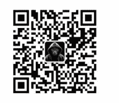

微信: lazhelper

## 我眼中的微信、抖音、小红书、知乎、B站

业内人应该知道，今年年中开始，IP 的概念特别火。

但对小白来说，摆在面前的第一个问题往往是：

**我做什么 IP?**

紧接着第二个问题是：

**我去哪个平台做？**

说实话，如果不是行业厮混多年，不是有意研究各行业 IP，大家确实很难明白：

- 为什么微信用户最值钱？
- 抖音竟然有一半直播间在亏钱？
- 小红书的用户数远不如抖音，为什么在品牌里这么吃香？
- 知乎的用户很喜欢抬杠，一个知乎问答可以做出上亿的生意？
- 都说 B 站是未来，怎么没有 B 站 UP 主的培训？

这篇文章就讲讲花爷眼里的微信、抖音、小红书、知乎、B 站吧。

### 1. 微信

去年 12 月，我们开始做第一期 IP 初阶训练营。

到今年 IP 概念大火的时候，我们训练营已经一路做了七期，培训了 1000 多个学员，有二十多个 IP 做过 10 万+的月营收。

不止如此，我们还是小鹏汽车等几个大品牌的 IP 内训老师。

那不管我们教谁，不管什么生意，花爷都有一个建议：

**一定要把用户加到微信。**

换句话说，不管你觉得微信老了好，公众号下坡了也好，视频号不如抖音也好，都不重要，记得一个不争的事实。

**微信用户价值是所有社交平台里最高的。**

在各大平台投放广告，一个非常重要的衡量指标，就是获取一个用户加到微信要多少钱。

微信有几个优势，是其他平台无法代替的：

- 随时私聊——其他平台的私信系统，聊不了几句就会断片。
- 朋友圈让别人看到你——其他平台哪怕用户关注你，也不一定看的到。

换句话说，只要你私域运营的不错，不讨人厌，有价值观，微信可能是唯一可以针对用户长期做深度运营的平台。

当然，今年私域的概念也很火，但不是所有生意都适合做私域。

典型的例子，完美日记的私域就很难搞。

大家都知道，完美日记堪称国货第一美妆，而且非常早就重视私域，前几年就有数百人的私域团队。

但完美日记平价美妆的定位，就不太适合私域。第一价格不高，第二平价美妆用了几次，女生就用更好的品牌去了，复购有限。

上次@kosan 总结了适合做微信私域的 3 类生意，我觉得特别对：

- 高频次、高单价，比如医美、奶粉。
- 高频次、低单价，比如奶茶、零食、鲜花、水果。
- 低次、高单价，比如汽车、家居、买房、成人培训。

所以，以上三类生意，不管你在什么平台、用什么方法获取用户，最好都加到微信上来。

私聊+群+朋友圈+视频号，这套私域玩顺了，用户粘性会高到可怕。

这也是今年最流行、效率最高的玩法，做公域（抖音小红书知乎社群论坛）引流、私域（微信）成交的 IP 生意。

### 2. 抖音

抖音是摆在明面上的红利，核心原因有两个：

- 用户基数巨大，群众覆盖率仅次于微信。用户多到一定数量级，也是本事。这一点你看其他公域平台，包括小红书知乎微博 B 站，都跟抖音比不了。
- 抖音的算法，具备最强的穿透圈层的能力。这一点可能不好理解。

所谓圈层，花爷在《在存量的世界里赚到钱》里提过，经济越发达，圈层就分的更多，不同圈层之间互不待见，形成圈层隔离。

所以，想触达到尽可能多的人，就很困难。

比如，你是做汽车的，你想让尽可能多的车主看到你。

在微信里，这件事非常困难。因为汽车号虽然很多，但不同汽车号，调性不同。有的专注豪车，有的专注越野改装，有的平价。

这么多号，每一种风格，都代表了一种人群，想穿透圈层，就要把所有的号都覆盖一遍，这就是穿透圈层的阻力，是需要你人为克服的。

而在抖音，只要你内容数据好，算法会帮你穿透圈层，触达到所有人。

这是算法的红利。

但红利终归是有限的。

抖音的算法，就像一个抽奖系统，当然，这个抽奖不是完全随机的。

你的内容质量和数据会提高中奖率，平台近期想拉哪个类型的 IP 也会影响中奖率。

但不管如何，中奖的人是有限的，而所有人都想中奖，所有抖音生态比微信卷的多。

今天你的直播间有古装剧，明天马上有 100 个直播间跟上；今天张同学的乡土剪辑风格火了，明天再看，全是分析和模仿张同学的。

最后的结果就是，顶部的特别火、特别赚，其实呢，市面上少说一半的直播间都在亏钱。

那花爷的建议是啥？

**别指望中大奖，能中小奖就很好了。**

围绕着实现做IP，不用上千万上百万粉，我们学员里几千粉照样赚钱的多的 是。

心态放平，抖音还是一个很好的低门槛平台。

拍短视频门槛并不高（只要你不拧巴），表达门槛也不高，掌握一点基础的技巧，剩下的就交给大力出奇迹吧。

### 3. 小红书

在男性里，花爷绝对算刷小红书比较多的。

大家要想清楚一个问题。

小红书的月活跃用户只有1个亿不到，这个数据也就跟知乎差不多，连抖音微信的膝盖都摸不到。

但一提到种草、一提到品牌营销，为什么品牌方想到的都是微信、抖音、小红书，声量上甩开知乎一个档位？

**因为小红书虽然用户数不如抖音，却切到了最值钱的一批用户。**

这些小姐姐们，有经济基础，有审美，追求美好生活，互相信任包容。

她们构造的小红书，可能是中文社交平台里，最友善的。

举个例子，花爷玩了这么多社交平台，小红书是戾气最小的，几乎看不到在评论区吵起来的情况。

这种信任环境，是非常适合做内容获客的——这也是品牌往小红书砸钱的原因。

在小红书的用户看来，装修、求职、买菜买花、买房买车、创业副业、育儿母婴，……**生活中几乎没有任何需求，是小红书上找不到答案的。**

盗坤老板之前就分享过一个故事，他老婆买了块几万的手表（金额忘了），竟然是在小红书一篇评论都没几条的笔记下面，加了微信代购买的。

花爷也有类似经历。

今年九月底，我们公司去长沙团建，我准备借着这趟机会跟女朋友求婚。但我人在上海，长沙做求婚布置的，我不认识啊，咋办呢？

我就是刷小红书，看图表笔记，联系了几家店加到微信，最后下单的。

整个场地+布置花了一万一块，直到求婚活动到场之前，我都不知道现场具体布置成啥样了。

这还不是最夸张的，我们学员还碰到过，小红书粉丝私信问，自家 7000 平怎么装修设计。

你都分不清，她真是有 7000 平，还是 700 平多打了个 0……毕竟小红书的用户，一切皆有可能……

所以，如果你是女性，经常刷小红书，有审美，那你完全可以找一个货源、专长、变现生意，把 IP 做起来。

### 4. 知乎

好了，我知道，大家都觉得知乎不行了，全是杠精，全是广告。

但事实上，知乎还是一个很好的获客平台。它最大的问题是：

知乎用户在知乎上不值钱，加到微信就很值钱……

我跟做知乎 MCN 的朋友聊，他是这么说的。

知乎的用户相信专业，喜欢逻辑，所以如果你想简单的忽悠他们，那肯定是被杠、被喷。

但是，But，如果你的内容够专业，能说服他们，那知乎用户的付费意愿是非常强的。

所以，IP 用专业的长内容，在知乎特定的人群中获客，是效率极高的一种方法。

一个用户，他带着明确的需求进知乎，看到你的内容并被你的专业性说服，这个用户 70% 就是你的了。

我们有个学员，在知乎写某二线城市省会城市的房产长文，加到微信才十几个人，就卖了两三套房了。

花爷还有个朋友，通过一个精准的知乎问答，卖极高客单价的产品，卖了一个亿——当然，你可以觉得这是“我有个朋友”系列的吹牛，你可以选择不信，当个笑话听好了。

总之，想做 IP 的花友们，一定存在这样一群人：

你们不想露脸做短视频，也融入不了小红书的姐妹氛围，那就选择做知乎图文引流吧。

再配合我们教的社群论坛引流大法，效果不比抖音小红书差的。

### 5. B站

B站是公认的年轻人聚集地，明日之星。

但是，等等。

为什么微信、抖音、小红书各个平台都有IP培训，B站却很少有UP主培训？

因为B站这种长视频，真的很靠天赋。

李自然老师的前进四，是B站头部的MCN。我之前跟他聊，问，你们怎么孵化UP主？

他说，很难孵化，有天赋的人，你帮你做好辅助工作，他自己会做出来；没天赋的人，再怎么孵化，成才率都不高。

这也是B站和其他平台的本质区别，新入门槛高出一截。

哪怕是有过自媒体多年从业经验的人，想做一期高质量的长视频，从写稿、拍摄到剪辑，一套流程下来，也要好几周才能搞得定。

所以，花爷最近给IP初阶训练营做升级时。

我们加了抖音、小红书、知乎、社群论坛这几种渠道的内容模板和引流方法——但B站没加进去。

当然，B站引流的案例，也不是绝对没有。

在《讲几个悄悄赚钱的IP案例》一文里，花爷就讲了一个做考研B站视频，引流到微信做培训生意的案例。

但整体案例数量，跟其他平台确实没法比。

目前B站UP主最主要的变现方法，还是广告。

### 6. 其他

其实还有些平台可以说，比如社群、比如垂直论坛，但这几个放公众号讲比较枯燥就带过了。

上面几个平台，大家如果感兴趣想让花爷再挑几个细讲，就留言吧。

对了，看到这，估计有人要问了，咋没有微博呢？

主流社交平台，花爷是不是把微博忘了？

说实话，我看微博的频次非常高，但如果大家做 IP 选平台，那我建议：

忘了微博吧，干点啥不好呢？别想不开。

# 微信、抖音、小红书、知乎的“旺铺逻辑”

上次写《我眼中的微信、抖音、小红书、知乎、B 站》，刚扫了眼数据，2 万的阅读，1000 多次分享。

没想到大家这么感兴趣。

花爷回想了一下，我们 IP 相关的业务，受益于大家支持，一直还蛮稳定。

但是公众号上，都有想起来才聊 IP，还没有系统的聊过 IP 相关的知识。

所以准备建一个话题标签，就叫 #花爷的 IP 知识库。

今天接着上次的话题，讲了这么多平台，新人做号做 IP，到底选哪个平台？

## 1. 新人陷阱

一般新人做 IP，从入门到放弃的 10 步是这样：

- 这种号都能火？那我也行。
- 好，最近 XX 平台很火，马上注册账号。
- 埋头就干？呵呵，我没这么傻，先找点资料看看。
- 万事俱备，想到一个绝佳的选题，兴奋到睡不着，果然天才就是我。
- 用了两个礼拜，终于做好了文案/视频，发布！
- 发布后半小时，刷新后台 100 次，数据还是不咋涨。
- 很受打击，决定再试一次。
- 还是没效果，难道我真不是天才？
- 在竟然还是不火和鼓起干劲再做一次之间，循环往复。
- 放弃，垃圾平台！

好吧，让我们看看问题出在哪里。

自媒体 IP，不管任何平台，最大的谎言就是谁都能干。

花爷做这行这几年，为什么每次培训报名之前，要劝退？因为劝退才能筛出合适的人，人合适才能保证培训交付。

我把话放在这里，账号做点播放量、阅读量，不难，蹭蹭热点就行。

要把IP做出来，让用户对IP有信任，肯定是有门槛的。

第一步就是选平台。

## 2. 旺铺逻辑

平台怎么选，照例，我们先讲原理，后讲方案。

自媒体IP，新人起号选平台时要明白，选平台就是选“旺铺”。

做生意，万变不离其宗。

其实互联网玩法，跟传统线下生意，很像的。

咱们类比一下，传统生意，要在最旺的地方开个店，自媒体上做IP，也要选对平台赛道来做，你的号就是你的店。

线下开店讲究的是什么？

要找旺铺。

这个旺铺，不是简单的人流量大这么简单。

市里最繁华的商场，人气最旺了，你去开一家千里香馄饨试试？客单价太低，人再多，你也赚不到钱。

同理，农村赶集的市口人也不少，你去开家潮鞋店试试？人再多，也不理解你卖的啥玩意儿。

线下旺铺，人流量只是一部分，重要的是目标用户在哪里，旺铺就要开在哪里。

气质，人群，要匹配。

以前大家都逛步行街，步行街的店是旺铺；现在大家都逛大商场，大商场的店才是旺铺。

店跟着人走，不是人跟着店走。

自媒体IP选平台也是一样。

你的生意、你的气质，要跟这个平台的人群一致。

微信、抖音、小红书、知乎，每个平台都有他们的“旺铺”。

但并不是每个平台的旺铺，你都有能力插一脚——你得找到属于自己的那间旺铺。

这也是为什么，像我们这样的团队，给大家做IP规划可以节省很多时间。

我们看过几千个IP，你什么情况、怎么发展，我们马上可以做一个判断。

真要新人自己琢磨，不一定得花多长时间。

## 3. 个微

当然，今天这篇，咱们还是把选平台的一些大原则，给大家捋一捋。

说明一下，各平台发展很快，后面看到这篇的花友，需要结合下时代背景做一做变通。

先讲一点，花爷反复强调的。

无论你在哪个平台做 IP，视频号、公众号、抖音、小红书、知乎、………

只要你做以下三类生意，不管你在什么平台获取用户，只要可以，最好都想办法加到你的个人微信上来。

这三类是：

- 高频次、高单价，比如医美、奶粉。
- 高频次、低单价，比如奶茶、零食、鲜花、水果。
- 低次、高单价，比如汽车、家居、买房、成人培训。

因为这三类生意在微信，要么可以长期复购，要么可以频繁聊天完成高价成交，个人微信都是最合适的。

如果说在其他平台做 IP，等于开了一间旺铺，那把用户加到个人微信，等于让铁粉注册了个会员。

再想极端点，等有一天，你的 IP 出现黑天鹅，比如动，封号。

你这不有有几个加满用户的微信，那就是救命稻草。

这个大前提讲完，下面分别来讲讲，怎么选公众号/知乎、视频号、抖音、小红书。

## 4. 公众号/知乎

公众号和知乎放一起讲，这俩有太多相似之处了。

比如，都是文字为主，最近被短视频冲击的厉害。

比如，都被大家看衰，认定红利不在。

但这些一定是劣势吗？

开头就说了，每个平台，都有它的旺铺逻辑，公众号/知乎的旺铺就是：高质量文字。

虽然大众更爱看短视频，但总有一波爱看文字的人。

并且，喜欢通过文字获取价值的用户，群体素质往往更高。

虽然公众号和知乎有很多广告，很多营销号，没有红利，但这两个平台的用户，永远渴望高质量内容。

所以在这两个平台，你能写出高质量文字，你就是红利本身。

都说知乎和公众号的用户挑剔，其实背后还有个定律：

一旦你的内容质量满足了用户的挑剔，用户的信任度会指数级增加。

那什么人可以写出高质量文字呢？

- 你的行业/爱好，有一点的专业知识壁垒：比如营销、买房、财税、护肤、装修……
- 在你的行业/爱好，有拿出手的成绩可以分享：比如项目复盘、经验汇总、获奖背书……
- 你更喜欢写文字，有写 3000 字以上的能力：而且不喜欢拍视频、不想露脸。

满足以上三个条件，放心大胆的选择公众号和知乎。

配合一些分发、选题的技巧，完成 IP 起步没有问题，起步之后可以再换打法。

花爷自己就是典型案例。

我的公众号 18 年 12 月发了第一篇文章，那时候大家已经在说公众号不行了。

现实是，我一路发展过来，挺好的，现在基本盘稳定了，再切入视频和直播，也没啥难度。

## 5. 视频号

视频号绝对会在 2022 年爆发一波红利。

红利的底气在哪里？

底气在于，国内你不管是做销售、做微商、做任何生意，你的微信里，大概率加过 500 个以上的客户。

注意，是 500 个以上的好友，客户才算。

这种被加到微信的客户，群体总量是无比巨大的，肯定是上亿级别。

而这些客户，之前能够接收到的营销方式，无非是朋友圈、群聊、私聊，都是文字和图片为主。

现在有了视频号，直播的互动形式，相比朋友圈和群聊，是降维打击。

这是花爷开视频号直播的数据，平均观看时长一直高达半小时。

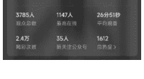

花爷的观点很明确。

视频号有两个主要形式， 短视频和直播。

视频号的短视频，怎么做爆款、怎么涨粉，花爷看了一些成功案例，但我说实话，并不是每个人都能复制。

但视频号的直播，是真真正正，能把巨大的私域客户存量重新互动一遍的方法。

原理弄清楚，结论也很明显，哪些人适合去做视频号呢？

- 你有现成的生意：任何让用户付费的生意都可以。
- 你微信至少有 500 个客户起步：你从自己的客户里，拉一个老人进直播间，视频号系统就推一个新 人进你的直播间。有存量，才能带动新量。新量通过直播，又被转化为存量，循环往复。

有生意、有私域存量客户，视频号就是你的旺铺。

## 6. 小红书

除了视频号，小红书也是今年比较明显的红利。

小红书这个平台，用户体量其实远不如抖音微信，但就是有新人红利。

小红书，是新人的旺铺，是高审美小姐姐们的旺铺。

原因如下。

- 用户都是小姐姐，有经济基础，包容性强，说直白点就是愿意花钱还不喷人。
- 小红书的笔记很短，创作难度比公众号知乎小多了。
- 小红书平台算法，对新人非常友好。

你看抖音微博公众号，都有全网大火的大 V。但说起小红书，大火的小红书大 V 是谁？没有固定人选。

我们找 Sherry 老师带学员两周左右的时间，纯新人新号，经常能出下面这种小爆款。

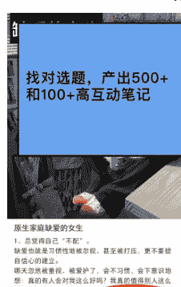

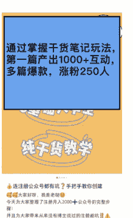

小红书适合哪种类型的新人呢？

- 有一个自己能分享的领域：不一定要多专业，哪怕你在边学边分享，也没问题。
- 审美好，会调动情绪，能跟女性用户共鸣？其实这才是小红书的绝对天赋点，不过这块是能够培养的。

想象一下，如果是宝妈群体、普通女白领，小红书确实是 IP 起步的绝佳实验田。

如果是做女性生意的小老板，做个小红书 IP 引流，其实也很棒，但前提是......你自己得玩小红书。有些小老板光想去引流，自己都懒得看，头疼。

## 7. 抖音

抖音是最受关注的平台，也最复杂。

其实现在抖音上玩法很多，有做 IP 的，有做电商的，有做播放量和矩阵的。

这里没法全讲，咱们还是围绕着主题，IP。

抖音上新人做 IP，门槛确实不低。

原因很简单，抖音变化太快了。大部分抖音 IP，都是在对标账号的基础上，做优化改进。我称之为，创意改造。

今天你的号发现一个噱头，火了，那我最快捷的方法，不是重新想一个噱头，而是在你的噱头上再加点花样。一层套一层，这不就卷起来了吗。

## 4. 主流平台与IP打造

而且光创意改造还不够，数量也得怼上去，大力出奇迹。抖音知名电商相声演员狠狠不是说了么，咱对标的就是生产队的驴。

既要有技巧，也要有数量，抖音看上去简单，门槛其实并不低。

我们通过一个数据也能看出来，大部分爆火的抖音 IP，你看上去你爆火的，往往都有半年以上的成长期。

比如下面这张图，利用工具，我们可以看到一个直播间慢慢变火的过程。

这是多少个小时的坚守啊。

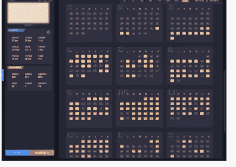

其实抖音看多了，你反而发现，抖音 IP 各有各的厉害，但永恒的旺铺逻辑，是找一个合适的方法坚持下来。

比如你带货，但你不善言辞，那就忍着产品拍，想办法拍出噱头，总比不拍了强啊。

所以抖音适合的人群包括：
- 有行业经验，并且很能讲，擅长热点和行业结合：比如运营、求职、母婴、情感……
- 有才艺技能，并且能漂亮的展示：比如运动、舞蹈、书法、绘画、唱歌……
- 小老板有生意，并且能讲，并且有时间坚持：抖音是非常适合小老板的放大器，但小老板 IP 的魅力来自小老板本身，自己的表现力无法代替。

## 8. 其他主流平台

主流的平台，咱们上面已经过了一遍了。

还有一些其他平台，比如 B 站，我们说过对天赋点卡得很高，比如微博，对新人太不友好，这里就不啰嗦了。

### 公众号懒人找资源，懒人专属群分享

选完平台，下一个问题是：

我在平台做什么内容？我这个水平，有什么值得分享的？

其实根据花爷的经验，IP 有三种类型。

专家型、成长型、总量型。

专家 IP，只是其中的一种。更适合普通人的，反而是成长型和总量型，而普通人恰恰对这两个类型最不了解。

#花爷的 IP 知识库 的下一篇，我们来讲这三种类型。

## 9. 建议收藏：我总结了 10 大行业的 IP 方法论

最近在给《花爷一对一》做 IP 规划的答疑，答了 100 多个，再加上【IP 实战俱乐部】最近在搞私域带练，感觉每天键盘敲的冒烟。

有天我突然想，做了这么多 IP 规划，其实按行业划分，无非也就那几个大类，不超过 10 个，为什么不总结一个“10 大行业 IP 玩法汇总”？

照例，发了个朋友圈，让想看的花友点赞，几个号加起来有小一千人点赞。

行，那就干。

也强调下，因为文章不好写太长，这 10 大行业，花爷都讲一个核心玩法，但不代表全部，想更细聊，可以文末扫码看明晚的视频号直播。

### 1. 说在前面

汇总 10 大行业 IP 玩法之前，还得先啰嗦几句。

首先，这么多行业，很多其实花爷并没有做过，怎么花爷你都能聊啊？

很简单，看的够多、带的够多就行了。

从视野层面看，我从几年前开始，就保持每天刷各大平台，看到 IP 就顺便拆解一番的习惯，我的拆解能力老花友应该不会质疑吧？

几年下来，上千的 IP 拆解，肯定是有了。

从实操层面看，很多行业我确实没有做过，也没那个精力，但我带的学员做过啊。

【IP 初阶训练营】至今带了上千个学员，你想想这个数量，基本上什么行业都给你覆盖了。

在《花爷的半年工作汇报》里，我说过，很多优秀的学员都已经干起来了，更优秀的已经创业开公司了，光花爷有直接入股或参与分成的 IP，就有 10 个左右。

所以，这份“10 大行业 IP 玩法汇总”，可能不够全面，可能不会高大上，可能没有夸张的数字成绩。

但，肯定够真实，够接地气。

### 2. 用户为什么付钱？

其次，要强调的是，我研究最多的是《商业化 IP》。

简单理解就是，奔着变现去的，而不是奔着涨粉接广告去的。

比如你家猫特别可爱，抖音一拍，一堆人关注；或者一个团队拍搞笑段子涨粉——这个不在我们的讨论范围之内。

我感觉自己肯定做不到，一般人也比较难。

在我们的方法论里，做 IP 其实一点都不高大上，就是线上做生意嘛，IP 主要解决的是信任问题。

只要是做生意，那用户之所以愿意付费，必须有所收获。

也就是我们常说的，购买动机。

那用户最愿意为什么付费？

- 当能够赚到钱的时候，用户愿意付费，比如：职场的培训和服务、考证考公考级、投资理财、创业副业的技能、企业服务……
- 当能够省钱的时候，用户愿意付费，比如：源产地卖货、二手奢侈品、品牌折扣团购、保险、代运营……
- 当解决生活问题的时候，用户愿意付费，比如：情感问题、沟通技巧、亲子关系、习惯养成、健康……
- 当获得精神满足的时候，用户愿意付费，比如：旅行、时尚穿搭、社交活动……

所以，做 IP 的核心就是：

抓住任意一个用户愿意付费的需求，定一个与你的能力匹配的价格，然后用内容向所有人展示：你是靠谱的。

基于以上的需求分类，这次汇总挑的 10 个行业，分别是：
- 线下到店——从线上引流到线下店。
- 卖货——包括工厂直卖、个人分销两种。
- 垂直技能——职场技能、考证考公考级、副业技能等。
- 个人成长——沟通、写作、习惯养成、演讲等。
- 企业服务——企业咨询、代运营、外包服务等。
- 投资理财——房、股、基、债、币等。
- 情感命理——情感挽回、占星、取名等。
- 健康——减肥、养生、慢病管理等。
- 生活——旅游、美食探店、相亲等。
- 时尚美妆——穿搭、美妆、护肤等。

哇，全部列完后感觉好多……一个个来吧。

### 3. 线下到店

先说线下到店吧，很多传统的线下老板关心。

线下店做 IP，第一大错误，就是老板想把店直接搬到线上来。

你要明白，线下店，是一个集获客、销售、复购于一体的产物。

而线下店做 IP，特别是线下服务很贵、很重的店，比如家装、乐器、婚庆、珠宝……用户不太可能线上直接购买，你们做 IP 的目的却只有一个：吸引到店。

“吸引到店”的核心玩法，就是：老板以业内人的身份做科普。

这里有两个要点。

**第一，不要做店铺 IP，要用老板的身份做 IP。**

你用店铺的身份，跟用户讲什么都像在打广告。哪怕你再掏心窝子，用户也不买账，毕竟店铺是死的，根本就没有心窝子啊……

但人就不一样了，店铺的老板是**人**，有多年经验、有自己的经营理念、有性格，这样的身份更容易交朋友。

当然，有老板说，我就想要店铺品牌露出，有没有办法吧。

也有，说个最简单的方法，直接用“店铺名+人名”做 IP 名，比如 XX 珠宝李老板、XX 瓷砖刘老板……

**第二，用行业老手身份，做行业科普，给解决方案。**

一般用户买线下大件，最怕的就是套路深。现在人也不傻，谁买之前不上网查查啊。

而你，行业多年经验的老手身份一亮，不仅不搞套路，反而把行业的潜规则、套路给普通人讲清楚。

比如常见的选题包括：
- “从业 12 年老司机，讲讲 XX 行业的常见套路，是真的坑”
- “20 万预算做出 40 万的 XX 效果，一套业内方案直接拿走，不多花一分冤枉钱”
- “买 XX 时卖家到底坑没坑你，一招教你辨别真假”

诸如此类，完全为用户考虑，真诚的态度摆出来，信任直接拉满。

这两点一结合，你就不是销售的卖方了，你就像用户在某个行业从业多年、真诚靠谱的老朋友一样，用户真有需求的时候，会不到你店里看看吗？

到店这块我们学员里最成功的案例，就是一个做高端家居的，之前也讲过的。

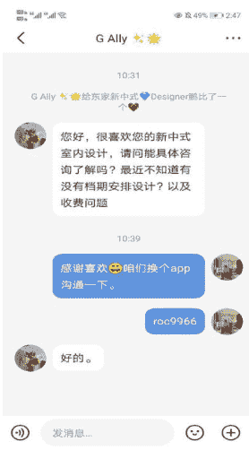
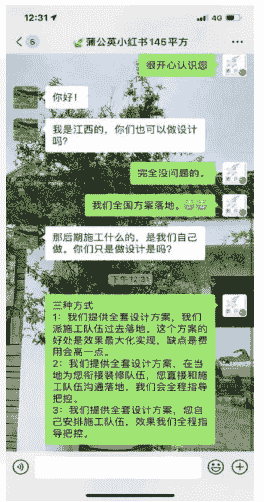

V5 从 0 踏入家居行业，如何做到 1 年内 3 家店营收 2000 万？

http://shimowendang.com/docs/0FYvS5ux6QRYtXc--资料参考

一套家居上百万，原来纯靠线下卖场销售，家里觉得做互联网是趋势，但是不会做，于是派 4 个年轻人来尝试。

粉丝并不多，浏览量并不大，但就是精准啊，做了没几条内容就有询单。

### 4. 带货

如果你自己是店主、工厂主，销售的产品价格不高，比如服装、饰品、零食……那上面到店的方法也完全能用。

唯一的区别是，到店生意，加到微信是促成到店，而你因为价格不高，加到微信就可以直接线上成交了。

这里讲带货，再介绍另一种方法，就是：没有掌握货源、纯分销的带货 IP 还能怎么玩？

直接放核心玩法：做测评。

动手做测评，是普通人成本最低、吸引力最高的带货内容形式之一。

比如最近是大闸蟹的季节，朋友圈很多卖螃蟹的都是在硬推，看的我都着急。

其实很简单：

- 要么，用老板的 IP，做行业科普揭秘，参考上面到店行业的玩法。
- 要么，你纯第三方角度，把市面上各个档次的大闸蟹都买一份，做一份深度测评，评价好的大闸蟹，人家自然会问你要链接。

另外，测评不光是测质量、价格、服务、使用场景、目标人群等，都可以作为测评的角度。
- “100 元以下洗面奶，哪一款才是敏感肌·真救星？”
- “当场比价！10 大平台 iphone 13 价格对比，最低只要 5500”
- “200 万首付，不考虑学区，在 XX 市可以买哪里的房子？”
- “15 种热门绘本，哪个最适合你家孩子，我给你整理好了！”

看，类似的题，都是测评玩法，护肤、服装、餐饮、母婴、数码……等等领域，都有效。

带货的案例，我们学员里做的非常多，举一个偏冷门的例子吧，之前也说过的，一位卖炭小姐姐。

想不到吧？卖炭也能带货？

可以的，通过行业科普、测评、避坑等一系列内容，吸引采购竹炭的烧烤店老板看。好家伙，群里晒成单，都是按吨计的。

### 5. 垂直技能

先定一下，什么叫垂直技能。

就是你明确知道，学了这个技能，可以做什么事。比如你学了编程，可以应聘程序员；比如你考了会计证，可以去当会计；比如你学了这个技能，可以做地推单赚佣金……

职场技能、副业技能、面试简历、考证考级考公，都属于这个范畴。

做垂直技能的 IP，因为非常目的导向，且目的往往与钱挂钩，所以变现能力很强。

花爷经常开玩笑，最喜闻乐见的垂直技能是什么？新东方烹饪、蓝翔挖掘机、还有各种美容美发、汽车修理……

只不过，互联网起来之后，垂直技能更多了，做垂直培训的也不仅限于线下学校了，IP 照样能做。

那垂直技能 IP 的核心玩法就是：**专业性+晒案例**。

垂直技能跟带货不一样，带货你哪怕没货，做做测评也有说服力。但做垂直技能，你至少自己得行啊，不然就是骗了。

那在专业能力没问题的情况下，宣传上怎么发力呢？晒案例。

你不仅要自己行，你的学员也得行；不仅你的个别学员行，你得有很多学员都行。

所以，做垂直技能 IP 的人记住，**前期你哪怕不赚钱、把自己榨干，也要带出成功案例来，不然你的商业逻辑就不成立**。

当然，根据花爷带了这么多人的经验，还有个典型的问题是，很多人脸皮太薄了，有了案例不好意思晒，觉得 low——然后用户就被别人抢走了，用你觉得 low 的方式。

垂直技能这块，我们学员的案例涉及面也挺广的，简历优化、教编程、产品运营进阶、考公考级……都有。

同样的，举一个比较冷门的例子，对外汉语言培训。

说实话这个赛道我之前都没听说过，后来明白了，是教你如何接单教老外汉语的。逻辑有点绕，但市场上真的有这个需求，出单量不大，但是一直有出单。

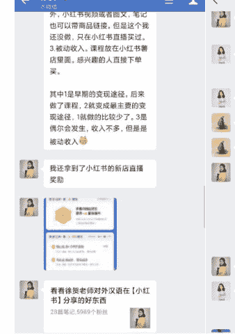
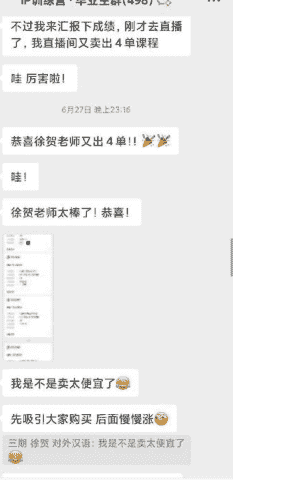

### 6. 个人成长

个人成长和垂直技能有什么区别？

个人成长的 IP，也是带人学习，但学的技能比较通用，比如沟通、写作、读书、演讲、习惯养成……这些能力肯定有好处，但不像垂直技能的目的性那么强。

所以个人成长 IP 的核心，和垂直技能也有不同。

个人成长 IP 的核心是：**方法论+自我改变**。

个人成长的各个分支，更通用，适用范围更广——也就意味着更容易泯然众人，大家讲的都一样，没什么特色。

所以，**一定要总结方法论，给自己的方法取一个名字**。

你是读书的，太普通，但如果你专攻史书，总结了一套“和史书学管理”的方法，就有记忆点。

你是演讲的，太普通，但如果你专攻 7 天演讲速成，总结了一套“演讲开口 7 日法”，就有使用场景。

类似的情况，其实我们在很多图书市场的书名中，也能窥得一二。

比如，经济学是一个大众想看、但又很难懂的领域，于是有了《牛奶可乐经济学》、《小岛经济学》等更特别的名字——实际上还不是那套核心理论吗？

**有了方法论之后，个人成长 IP 还要展示，你的人生通过这套方法论，获得了什么改变。**

花爷以前碰到一个学员，想做习惯养成，他说我每天早起、每天写日志复盘，为什么不能做？

我反问，你虽然有好习惯，但你通过它改变了什么？

如果你自己都没有改变，你这个 IP 怎么说服用户呢？

所以，无论你是写作也好、沟通也好、演讲也好、什么都好，所谓个人成长，最后的落脚点，还是要在成长上。

升职加薪、家庭和睦、影响力提升……这些成长后的直接改变，你总归都往上架的。

个人成长这块，花爷之前发过一篇优秀学员的复盘：《复盘：6 篇回答圈粉 5000 的全记录》

她就是通过自我管理，职场上一路升职加薪的。

那碰到有自我管理需求的用户，当然想跟榜样 IP 学。

### 7. 企业服务

花爷说过，我以前做过专业的商业咨询，也就是说，企业服务算是我的老行当之一。

很凑巧，我自己带 IP 学员，也带出过成功案例，哈哈。

还是直接说核心，企业服务的核心就是：**经历背景+整套方案**。

为企业服务付费的，都是企业老板，哪怕是管理层采购，一般也要老板审批。

要知道，虽然我们常常觉得老板是大笨蛋，但没有哪个傻子能当上老板，而且一涉及采购，老板都特别抠。

**本质上，企业服务的 IP，就是在向老板汇报。**

汇报什么呢？

想象下，今天公司要买一个服务，比如营销策划案吧，管理层跟老板说，我们意向买 A 的服务。

老板问：A 是谁？

这时候管理层怎么汇报？必须要说 A 的经历背景。

**要么你在行业大公司有资深背景，要么你运营过其他品牌的成功案例，不然你连自己是谁都说不清楚。**

所以，我一般建议做企业服务 IP 的话，如果你本来就很大牛，那最好。

如果你刚起步，一定要积累案例。

一开始哪怕不赚钱，也要接单，做出效果后，做内容复盘，借着复盘接更大的企业单，如此循环，滚雪球。

经历背景，主要是传播、获客、接单。

真要做转化，还得看整套的系统方案。

这点跟上面的垂直技能、个人成长不同，那些都是面向普通人的，只要 IP 够牛，用户都可能付费。

但面向企业老板，总归要拿出一套系统方案出来，这点做企业服务 IP 的应该都懂，就不多说了。

花爷的学员里，做企业服务 IP 的也不少，有设计外包、私域代运营、直播代运营等等，挑一个熟悉的案例说吧。

这个学员是我朋友，以前给很多大牌做过私域代运营，但是 IP 没做起来，影响力不够。

通过几篇复盘把 IP 立起来，培训和代运营接了不少单，后来因为比较忙还把培训的单子给退了。

### 8. 投资理财

投资理财这个嘛，现在比较敏感，你们懂的，刚刚封了一批。

不说太多，直接说几个简单的问题吧。

还能做吗？能做。

做投资理财 IP 最重要的是什么？**控制预期。**

我们始终要明白，在这个领域，无论你是大牛也好，小白也好，都不会一直赢的。

你总有赢的时候，因为行情好，所有理财 IP 都赚。

你也总有输的时候，重要的是，如何控制预期，在输的时候让自己的 IP 继续活下去？

所以，理财 IP，花爷强烈建议，要有自知之明，只做自己能力范围以内的事。

你说你只会可转债、打新这些基础，能不能做理财 IP，能啊，带帮小白嘛。

但你就老老实实做擅长的事，别行情一好，其他领域你稍微赚了点儿，也开始飘了、觉得自己是股神了，那就离完蛋不远了。

综合以上逻辑，你会发现，理财真正的大 IP，大部分都不是顶级专业。

逻辑很简单呀，在这个领域，真有个那本事的牛人，很多看不上 IP 的钱了，觉得比较辛苦——向下兼容是很累的。

如果你碰到一个投资理财的大牛，还愿意做 IP 天天跟你唠嗑，那真是性格使然，其实是很幸运的。

这赛道说实话我们案例也不少……安全起见，不晒了。

### 9. 情感命理&健康

情感命理行业，包括情感、占星、运势、起名、风水等等。

健康行业，包括养生、垂直病、慢性病管理、减脂等等。

这两个行业之所以一起讲，因为核心玩法是一样的。

情感命理&健康行业，核心玩法都是：**问题要细，名头要响。**

情感命理健康，都是很宽泛的领域，单一个健康来说，分 500 个细分问题出来没问题吧？

举个例子，腰痛，可以怎么细分：
- 人群不同，有老年痛、有白领坐久了痛、有孕妇月子腰痛……
- 方法不同，有中医、西医、保守方法、激进方法……

你做腰痛 IP，别人不知道具体干嘛的，你细分到孕妇腰痛保养，用户有需求会主动找你。

情感命理也是一个道理。

所以我们往期办训练营，学员里经常有不同流派的，比如中医西医、中国和西方的命理，花爷都说，你们各做各的就行，没必要吵架，用户群根本不一样嘛。

**问题细分之后，在这个细分领域里，最好有比较响亮的名头，最直接的就是证书。**

情感命理和健康，是很吃证书的，这点跟其他赛道略有区别。

你做垂直技能，比如你教 python，不需要证书，你证明自己能力牛逼就行。

但你做健康，比如营养、减脂，有一个正经的营养师证书，肯定比没有好。

我们之前最牛的一个健康类学员案例，是正经的医院高职，细节也不好多说，这块也很敏感……

- 全国第三届医技比武大赛第一名（民间组织）
- 中医万里行特聘青少年视力防控培训专家
- 从业 20 多年的中医临床经验

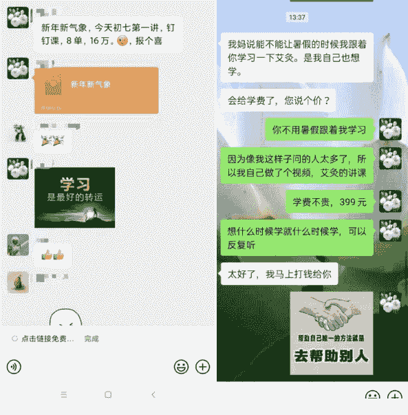

### 10. 生活

生活类范围很广，旅游、美食探店、相亲等等，都算。

这几个需求，看上去没啥关系，其实所有生活类需求，都有一个共性：

**烟火气。**

有烟火气，才有生活。什么是烟火气？有人，就有烟火气。

所以，做生活 IP 的核心：**抓热点，聚人。**

其实传统的自媒体课程，一般都会教人蹭热点，但你们也发现上，上面几个行业，花爷都没有强调过蹭热点。

因为垂直，因为专业，可以不蹭热点，或者说，蹭热点没那么重要。

但生活类不一样，生活的热点一直在换，聚人的话题一直在变。

你必须跟着人走。

比如，你做旅游的。你的内容选题怎么做？
- 环球影城开了，你要跟；
- 疫情了出不去，国内酒店大促销，你要跟；
- 机票 bug 单，你要跟；
- OTA 平台搞给力活动，你要跟。

比如，你做美食的。你的内容选题怎么做？
- 新开的网红店怎么样，你要跟；
- 情人节去哪里吃，你要跟；
- 春节家庭聚餐去哪里吃，你要跟；
- 周末逛夜市哪家小吃最好，你要跟。

生活类 IP，一定要随时观察，人在哪里，人们的注意力在哪里。

有人问了，相亲没什么热点啊，怎么聚人？

首先相亲肯定也有热点，每逢情人节、七夕、万圣、圣诞节、元旦，可以搞活动嘛。

其次，相亲更是聚人的生意。你不可能上来就办一场 100 人的相亲活动，但你从 5 个人的活动开始办，慢慢聚人，总会办到百人规模的——还是聚人的艺术。

我们学员里，做美食烘焙的，最容易爆发的是什么时候？

就是过节的时候。

（高夫人中秋节爆单）

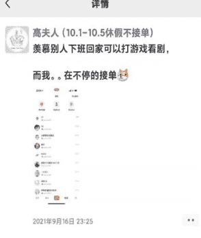

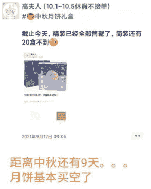

## 11. 时尚美妆

其实在上面的带货部分里，已经讲过美妆带货了。

但时尚美妆，值得再切出来讲一下，这个赛道太大了。很多平台，变现最牛的赛道就是时尚美妆，比如 B 站。

时尚美妆的核心是：真人出镜+反差。

真人出镜这点，不用多说了，如果你不想出镜，有想做时尚美妆类，那就往纯带货方向发展吧，纯粹内容引流到微信带货。

重点说说反差。

最常见的反差，是前后反差。

比如妆前是个普通人，妆后是个大美女；比如穿搭改造前土了吧唧，改造后秒变潮男。整个人前后有强烈的反差。

但还有两种反差，效果也很好。

一种是价格反差，用便宜的价格，获得看上去非常昂贵的效果。

比如，全身上下 200 元，穿出时装周模特 的感觉；比如，平民版神仙水、1688 工厂店合集。

还有一种是品位反差，用很土的东西，做出很潮很好看的效果。

比如花爷上次在【愚公掘金】写的，有人用农村的布料家居，在家办了一场时装秀。

总之，谁都知道时尚美妆赛道钱多，谁都进来做 IP，没反差可能真的活不下去，不然你就老老实实做纯带货。

像我们学员里，穿搭美妆都是带货偏多，当然纯做时尚的也有，前几周才帮她复盘了自己的成长经历，一篇典型的反差内容就爆了。

## 3 月份的 IP 玩法研究汇总

昨天直播，展示了下我们 4 月独家研究的“小号爆款案例库”。

直播效果很爆，只播了一个小时，6000 人场观，从头到尾在线人数都维持在 1000 人左右。懂行的就知道，这个数据是什么水平了。

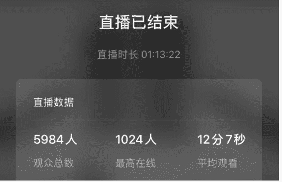

不过 4 月的研究成果太多了，昨天一小时讲不完（时间长了我嗓子不行），等五一回来，会再开播几次，感兴趣可以预约。

话说回来，今天这篇呢，是花爷团队，3 月份的 IP 玩法研究汇总。

当时研究完，也做了一场直播，这篇是直播后整理的文字稿，虽然跟直播比，删掉了一些爆料和段子，不过还很硬核的。

毕竟像我们团队这么硬核，每个月做全平台 IP 研究的，应该也不多了。

### 一. 3 类典型 IP

我们目前看下来，IP 有三种类型最火。

专家型、成长型、怨量型。 这 3 个类型，它的实操难度是逐步递减的。 专家型是最难的；成长型难度相对低一些，能力稍微强一点的人就可以做；

慧量型是最简单的。 以前大家熟悉的那些IP，几乎都是专家型IP。

包括花爷自己的IP也是专家型。

但是专家型IP有一个问题，它的准入门槛比较高，不是人人都能做。

越来越多的普通人，他们不是专家、牛人，做不了专家型。但是他们也想做IP，怎么办呢？

他们就自己找出路，发展出来了成长型、慧量型这两个IP类型。

在过去的一年里，成长型IP和慧量型IP，慢慢地也能做起来了，属于就是普通人也能做的IP类型。

#### 1.1 专家型 IP

花爷还是先从最稳定、最经典的专家型IP开始讲。

专家型IP比较常见，你在短视频、小红书、知乎上经常可以看到，博主把自己的背景、经历公开介绍出来。

比如说：

- 我在这个行业从业十几二十年了；
- 我自己做过多大的生意；
- 我这一年年收入上百万、上千万；
- 我自已带过多少牛逼的学员等等。

这是典型的专家型IP。

他有听起来很牛的头衔，有项目经验背景；还有干货可以出来分享。

别人一看就觉得，他比我牛，他讲的干货也非常有用，我听他的没错。

这种能力档次的压制，会快速建立信任关系，甚至带一点冲动。

就好比，今天马云教你做生意，你可能激动的翘脚，但其实吧，马云并不擅长教普通人做生意……

这是专家型IP的一个优势：

他靠自己的专业身份、专业内容来获客，别人自然会对他有比较充分的信任。

专家型还有个优势：

专家型IP的价值天花板很高，是全平台IP价值最高的类型。

大部分做得好的专家型IP，坚持做一两年，可以做到上百万营收；

更高的，一个IP做到上亿营收也是有的。 我们来看几个专家型IP的例子：

**案例 1：考研英语**

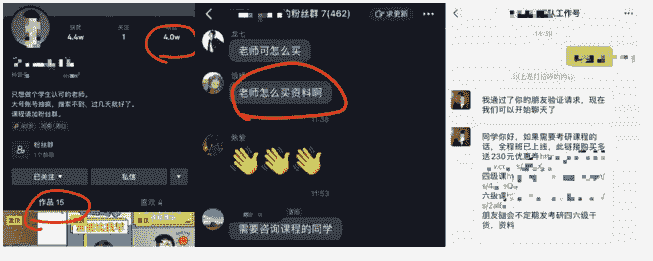

这是一个抖音的考研英语老师。

她以前在抖音非常火，但是被封号了；后来她又弄了一个新号，在只有4万粉丝的时候，就有一大堆粉丝追在后面，问她怎么买课。

这个就是专家型 IP 的魅力：人家一旦认准你，就算你号被封了，也一样追着你跑。

**案例 2: 考公**

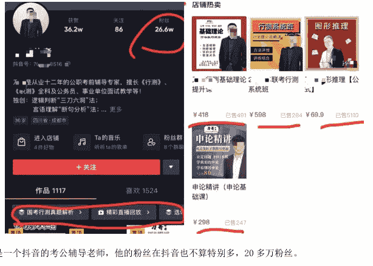

这是一个抖音的考公辅导老师，他的粉丝在抖音也不算特别多， 20 多万粉丝。

他们在抖音卖这种考公的课程，几百块钱几十块钱都有，价格不高，但销量还算比较高的。69.9 的课已经销售了 5000 多份，400-500 的课也销售了三四百份。

所以什么样的人适合做专家型 IP 呢？

有能力、有经验的人，适合做专家型 IP。

比如你的工作能力还不错，自己是某个大公司的主管、总监；

比如你操盘过什么大项目，虽然不是什么公司的高管，但是这个项目是你负责做出来的；

比如同样是考公考研，你考过绝大多数人考不到的高分……

像这样有突出能力的人，是非常适合去做专家型 IP 的。

但是，很多人其实都是普通人，并不是专家，那怎么做 IP 呢？

#### 1.2 成长型 IP

做不了专家型 IP，可以做成成长型的 IP。

成长型的 IP，就是我自己也在学；虽然我不是专家牛人，但是我是你们学习的一个的榜样。

就像我们在上学的时候，除了跟老师学之外，我们还请教班里学习好的同学，希望学习好的同学能带带我。哪怕就跟人家一起写作业，都觉得有收获。

这就是边学边分享，带动身边的同学一起学。

比如说：你家里在装修、你在学习英语、你在学习育儿知识、你在研究亲子关系、你在选车买车……

你在学任何东西、你在做任何东西，哪怕你去买个化妆品，先做一下攻略，你都可以去做这样的一个成长型 IP。

有一大批的人，他们懒得自己做攻略，他们不想学，他们就想抄你的作业。 我们来看一看成长型 IP 的案例。

**案例 3：考研**

同样是做考研的 IP，是名师你可以做专业型 IP。

但是如果你不是名师怎么办？

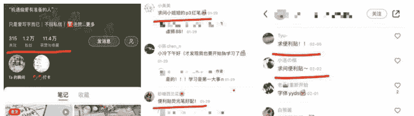

这个一个小红书的号，只有 1.2 万的粉丝，但他的获赞和收藏高达 11.4 万。

他发什么内容？

很简单，就是他在考研时做的笔记。

用了什么便利贴来做小标签、用的什么笔、复习大纲是什么、复习计划是什么？

评论里，就有问他用什么便利贴的，有问他用的是什么笔，问他复习计划能不能发一份。

你想象一下，自己刚准备考研了，学习之前，去网上去搜一下，看看别人是怎么学的。

然后发现有一个人，比自己先学，而且学得好，推荐的学习方法、学习用品都想用的一模一样，想跟着复习大纲来一遍，就想跟着一起学。

这样的成长型 IP，也有很多种变现方法，它既可以带货，也可以做打卡型的社群，甚至做单次辅导的服务。

**案例 4：健身打卡**

再来看个更简单的，打卡健身的案例。

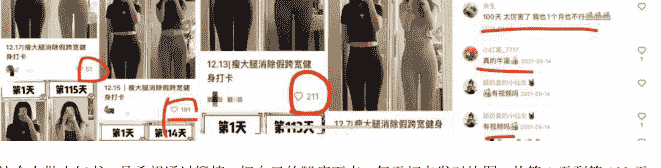

这个人做小红书，是希望通过锻炼，把自己的腿瘦下来，每天打卡发对比图，从第 1 天到第 100 天。

做这样的 IP，别人会问你很多东西。

比如瑜伽健身：别人会问你，你的这个瑜伽垫是什么样的？在哪里买的？有没有瑜伽相关的设备可以推荐啊？很多人愿意跟你一起买。

你如果组建一个瑜伽打卡群，价格不要太贵，别人也会愿意跟你一起打卡。

那成长型 IP 适合什么样的人？

擅长做攻略、总结、学习的人，适合做成长型 IP。如果一个人愿意把自己做的攻略、总结晒出来，这样做出来的 IP，影响力其实也很大，有非常多的人愿意跟着做。

#### 1.3 怨类型 IP

花爷知道，肯定有人会诶，我根本不会学习，我也不会做瑜伽，我也不会考试，那我怎么办？

有没有更简单的方法？

有，比成长型 IP 更简单的类型，就是怨类型 IP。

憋量型 IP 这个方法其实是去年下半年开始的变火的。

做专家型 IP 你可能有 1000 个人看，做成长型 IP 可能有 500 个人看。

憋量型，可能只有 100 的流量。

但没关系，因为制作成本低，它不需要让你分享什么干货，也不需要去学习，就是大力出奇迹，就忍着它拍就行了。

一个视频的流量少，那我拍 5 个，100 × 5，积少成多，流量就上来了。

这个就是质量不够，数量来凑，你用最简单的方法，通过数量，来弥补质量的问题。

这种案例其实有很多，一般不怎么起眼，花爷直接带大家看案例。

**案例 5：燕窝**

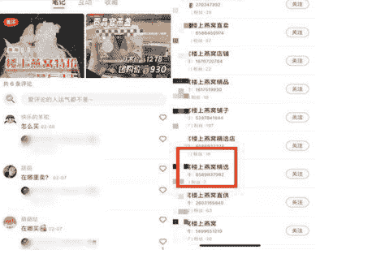

这个这个号是做燕窝的。

她只有 22 个粉丝，但是忍了非常多的笔记，全都是她们家燕窝的照片。

上面写着日常价格是多少钱、团购价格是多少钱。笔记里有很多人在问怎么买，在哪买。

他除了笔记多，其实号也很多，粗略摸了一下至少 10 个号。

粉丝数对她根本不重要，只要某篇内容爆了就有流量，有流量就有淘单，粉丝多不多有什么所谓？

这个模式跟店群逻辑类似，适合基础差的人做。

**案例 6：女装**

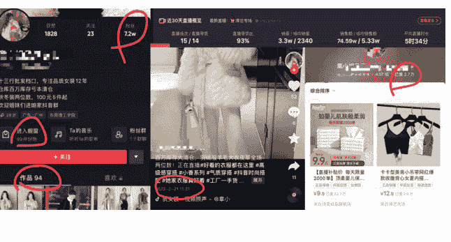

这是抖音的一个女装号，这个号只有 7.2 万粉丝，94 个作品。

他的很多作品，连视频都不是，就是发图片，把模特照、好看的买家秀图片发出来。他这样惹的结果是什么呢？

我们可以看他橱窗，单月的销售额是 75 万，一个月卖了 2.7 万件。

虽然他也还做了直播，但我们主要看他惹量的思路：他卖的东西很便宜，可以靠惹量的方法，把销量带上。

你没有貌美如花，没有好策划，那不加惹量来的实在。

### 二. 5 类爆款选题案例

根据上面 3 类案例，知道自己能做什么类型的 IP 之后，就可以开始考虑，自己做什么类型的内容了。

花爷把最近比较新、比较火的内容分了一下类，一共是 5 个类型：干货攻略、真实测评、大V扒皮、新奇展示、日志追剧。

#### 2.1 干货攻略

干货攻略，其实对应的是成长型 IP。这里花爷直接带大家看案例。

**案例 7：考研干货**

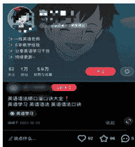

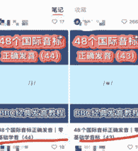

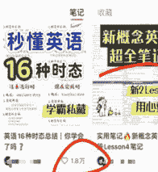

这个小红书号，号主是一位英语老师，有五年的教学经验。

虽然他是英语老师，但是他不做专家型 IP，而是做成长型 IP：他来小红书也不是来给大家讲课，而是来给大家带来分享各种攻略的。

大家可以看一下他笔记的标题：

- 概念英语超全笔记，用心整理秒懂英语；
- 16 种类型时态学霸私藏；
- 48 个国际音标正确发音

他发了有四五十个视频，一个月就涨粉 8000。

虽然这些笔记其实就是整理，看起来没有什么难度，但是很多人就是不爱自己整理，喜欢看别人整理好的资料。

就拿花爷自己的直播来举例子，如果有人说：

> 我整理了花爷今天直播的干货内容，做了一个笔记，想要的加我。
> 一定会有人加的。

做干货攻略永远都有市场，我们生活当中，有很多事情可以做攻略，买什么东西、出去旅游、怎么备考、租房……这些都可以做攻略。

#### 2.2 真实测评

测评大家可能看得很多，比如说美食测评、化妆品测评…… 真实测评，是最近很火的一种内容形式。

主要是很多人发现，网红带货，有很多讲的太夸张了。这时候有人就去测这些产品，到底是不是像网红们说的那么好，这个就叫真实测评。

比如下面这个案例：

**案例 8：真实测评**

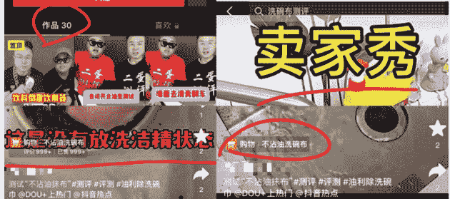

这个视频标题是，“测试不沾油抹布到底怎么样？”

这个“不沾油抹布”是一个网红产品，有很多人买，它到底好不好用？这个博主就真买了，自己去测试，不粘油抹布到底沾不沾油？他发了 30 个作品，一个月涨了 1000 粉。

这种测评真的有人喜欢看吗？

你可以想想，假设，最近上海有一家咖啡店特别火，排队排特别长。

这个网红店大家都去排队，你没去过，不知道到底怎么样。

然后有人发了个测评：这家排队老长的咖啡店，味道到底咋样？他把自己去排队、买咖啡、喝，全程都拍下来。最后告诉你，这个店的味道怎么样，这么长的队到底排得值不值。

你对这个店很好奇，那这个视频你肯定会愿意看完的，因为你认为这个视频会告诉你答案。

#### 2.3 大V 扒皮

大 V 扒皮最近特别火，为什么？

因为抖音上有很多大 V 卖课、卖加盟，这时候有人做了个视频来说，我买了 xx 的课，到底怎么样？蹭到大 V 的流量，一下子就引爆了。

**案例 9：大 V 扒皮**

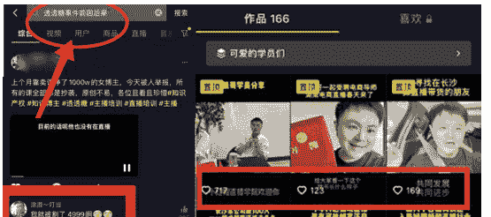

这个例子，他是讲透视糖（透视糖是抖音卖课的顶流）。

这个博主一开始只有几百个粉丝，然后他发了一条内容，是这么写的：

上个月靠卖课挣了 1000 万的女博主，今天被人举报，所有的课全部都是抄袭，原创不易，各位且看且珍惜。

这条视频就是讲，这个大 V 到底是什么套路。拿到几千赞，然后马上火了。

扒皮这些大 V 背后的情况，不是让你给大 V 泼脏水，而是真的发现这里面有一些猫腻。很多人会对这种东西好奇的，你把它讲出来，等于蹭了大 V 的热度。

#### 2.4 新奇展示

新奇展示，就是你去网上找一个新奇的产品，然后拍成视频，这同样是可以带货的。

这类内容最主要的，就是展示效果。

**案例 10：魔术带课&魔术道具**

这类内容里面，最典型的就是变魔术。

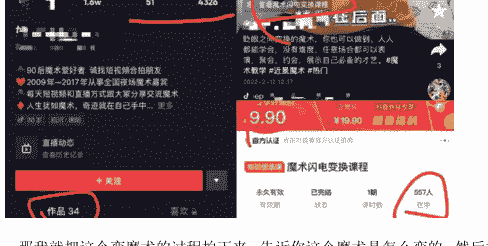

变魔术很吸引人，那我就把这个变魔术的过程拍下来，告诉你这个魔术是怎么变的，然后卖教程。

你们看这个号就有 4000 多粉丝，他的 9 块 9 的魔术课有 557 个人买。

除了卖魔术课，还可以卖魔术道具，比如扑克牌。你看了魔术觉得很有意思，道具的价格又便宜还包邮，可能就买了。

除了魔术，还有大家可能经常会看到的，5 块~20 块就能买到的，改变生活质量的小玩意。

#### 2.5 日志追剧

日志追剧有很多种，常见的是每天唱首歌，还有每天跟一个帅哥合影，每天讲个故事等等。

日志追剧，就是为了完成某一个目标，每天做一点点，最终去达成这个目标，有一种追剧的感觉。这种其实也是典型的成长型 IP 。

**案例 11：装修日志更新**

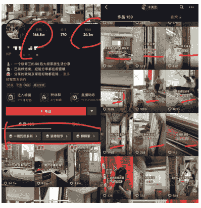

装修就是每天完成一点点，最后全部装修完可以住进去了。

像花爷这里举例的这个号，他就是把家里装修的过程拍出来，装修途中有哪些坑，就做到 20 多万粉。

你想象一下，你看了一个号，从 0 开始，看着它从毛坯房开始装修，装到成品，你会对他产生一种亲切感，会有信任关系。

你看到他家沙发挺好看的，就会去想，沙发在哪里买的？用什么洗衣机？设计在哪里做的？

他的视频、直播下面，都是问这些问题的人。

这个过程当中，你就会发现，如果你有买这个东西的需求，然后你看到这个东西还蛮好看的，你真的会买。

### 三、总结

上面的分析、案例，有些是我们之前的存货，有些是3月份看的案例。

其实整个看下来，花爷还是坚持那个看法：

IP是有门槛的，啥也不行肯定做不了，这是硬门槛

但IP的玩法在丰富，软门槛正在降低

而我们在做的事，就是承认硬门槛的存在，帮大家降低软门槛。

## 多赚一倍，还有机会

大家都知道，今年整体的经济大环境不行。

但是我可以很明确地告诉大家：

有一些团队，在今年这样的大环境下，依然在保持着增长。

只不过环境如此，他们不方便高调地宣传罢了。

这些生意有两个特点。

第一，规模不大，年营收都在千万以下。

特别是 500 万以下的规模，放在哪个行业都是小玩家，不太受市场环境的影响，有增长的空间。

第二，专业，不仅自身业务专业，做起 IP 和营销来，也专业。

在草莽时期，野路子能抢滩登陆。但大环境变差，红利不再时，最稳定的增长壁垒，还是专业性。

所以，如果你有生意，不信邪，今年还想保持增长，甚至多赚一倍，到底还有没有机会？

有的。

这篇文章，会从三个方向，讲到一些真正行之有效的、让 IP 放大的细节。

文章有点长，有生意的老板建议一定要看完。

没生意的普通人，这篇看完就当是预习了，因为下周，我们讲到普通人的自媒体机会，运用的一些理论跟本文也有关联。

### 1. 引流

很多有生意的人，想做自媒体、做 IP，最主要的原因，就是想要解决流量问题。

大家都说，拍抖音、写知乎、写小红书，可以做流量。

但是你搞了半天，发现流量都不行。为什么？

因为答案的本质是，流量的红利消失了。

早期做起来的大 IP、大 V 的模式，已经是不可复制的了。

在公众号还有红利的时代，公众号一个粉丝才几毛钱，【一条】这样的公众号，通过投放拿到了百万量级的粉丝。

今天，去投放买公众号粉丝，一个粉丝要卖几块钱，甚至十几块钱朝上。

公众号的获客成本，已经翻了几十倍。

抖音的大 V 也是一样。

你可能发现，**最近抖音很少出现特别大的新大 V 了**。

可能要集平台全部的力量，才可以捧出一个新的 大 V 出来。

为什么？因为全平台的流量，就那么多，不够分了。

所以我们会看到，有一些想要做 IP、做自媒体的老板，他一上来，就先找一些专业的团队，给自己拍短视频。

这样做抖音，无非是两个结果：

**要么，给你拍的很专业，看上去很牛逼，但是没有火。**

**要么，给你拍了，火了，但是过了几周的服务期，专业的团队一走，你还是啥也不会，没有任何的持续性。**

几个月后，你恍然大悟：

**方法很专业，但是跟你不匹配。**

不是越专业的方法越好。

我们跟非常多的老板有过合作，在实践中我们发现，大部分老板，他们整不会那些太专业的东西。

**真正见效快、门槛又低、又适合大部分生意的 IP 引流方法，一共就两个。**

**第一个方法，做平台引流。**

花爷说的做平台引流，不是大家通常认为的涨粉、做大 V。

**换个思路，才有可能多赚一倍：**

**不要追求粉丝，只要求询单。**

大家都知道，现在像小红书、知乎、抖音这样的公域平台，都是系统给你推流量。

对于你来说，只要有流量，只要有人看，你的产品就有曝光，感兴趣的人就有可能来询单，加你微信来找你买。

这样就够了，他关不关注你，真的无所谓。

所以这里面的关键就是，**你一定要会晒产品，让人一看就感兴趣**。

怎样才是正确地晒产品？

根据我们的实践总结下来，就是一点：

# 公众号懒人找资源，懒人专属群分享

一定要照着我们给的模板做。

很多人想不明白，为什么同一个类型的内容，别人做了都火了，换我来做，就不火？

别人做爆，为什么我不行？

因为你模板的细节没有抠到位。

花爷给大家看两个例子。

第一个，带货的例子。

下面这两张图，都是曲奇饼干半成品饼干胚。

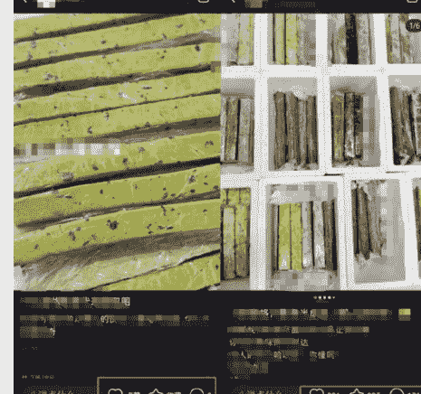

你看左边这个笔记首图，他把饼干胚横着摆，直接怼着拍。

笔记数据是 0 赞，2 评论，几乎没有流量。

但是你再看右边这个笔记首图，他把饼干码得很整齐，凑齐了 12 个盒子，还配了不同的颜色，码得整整齐齐再拍。

笔记数据是 300 多赞，100 多评论，已经是个妥妥的小爆款了，评论里面全是问怎么买的。

这两个笔记，卖的是一样的东西，但是因为你模板套得不对，做出来的效果是千差万别。

第二个，知识付费的例子。

下面两个笔记，都是做法语培训的，通过电子书教材来引流，但是流量差别非常大。

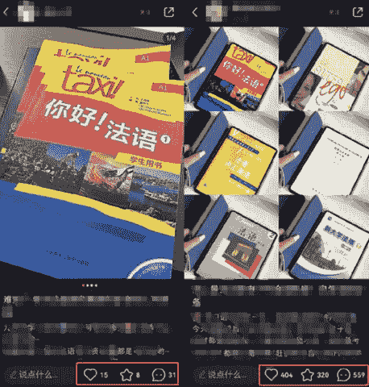

左边这个笔记首图，直接对着一个书的封面拍，15个赞30个评论，看上去还行。

但是右边这个笔记首图，他把6个书的封面，在iPad上展示，用同样的角度摆好，拼成一张图，整整齐齐放在一起，做成一个合集。

这条笔记的数据，直接到400多赞，500多评论。

不同的模板，引流效果直接差了几十倍。

这就是我们说的，在小红书做内容并不难，哪怕你没有拍摄团队，你也可以做。

但是你一定要有一个很专业的人，带你把这个模板调整到位，不然你花同样的时间，做出来的效果甚至差10倍以上。

很多人做的事情，看上去做的是对的，实际上，全是错的。

因为错了1%，也是全错。

还有人讲，我们没有做内容的能力，连拍照也不会。

花爷你就说还有没有别的方法吧？

这就是第二个方法，合作引流。

这个方法对于有生意的老板来说，出效果特别快。

合作引流的逻辑是：

合理花钱，也可能多赚一倍。

因为我们出去推广，本来也要花广告费、代运营的等等费用，这个钱总是要花的。

但是如果你把这个费用，用在合作推广上，你会发现，效果比其他的方法要好得多。

合作引流的形式有很多。

你可以去上访谈节目，加社群做分享，和大 V 连麦，上播客等等。

你只要找到这些现成的，有影响力的人，去跟他们合作。他们会帮你调整内容的。

简单举个例子，我们上篇《[抖音、小红书、微信的真实现状](https://example.com)》讲过刘杰，他去找了一个抖音大 V 合作，这个大 V 是做商业访谈的百万粉大 V。

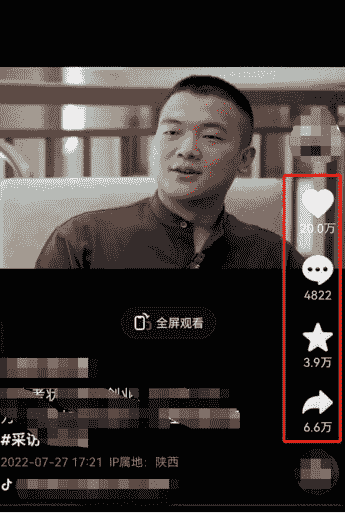

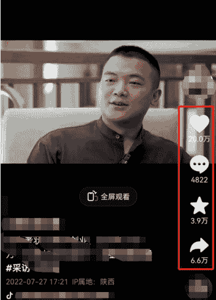

刘杰那条采访的视频，800w 播放量，20w+赞，给他自己 0 粉的抖音号，直接涨粉 2w。

如果你觉得这种访谈，自己做不了，还有一个更简单点的。

- 你找个大 V 连麦，讲自己的业务，当时在这个直播间里听的人，感兴趣就会来找你的。

一般一个大 V 的连麦，其实也就花 500 块钱左右。

但你一次连麦，获得几十、上百个精准用户，轻轻松松。

如果你客单价很高的话，上百个精准用户，已经很赚钱了。

类似的思路，还有加社群、上播客等等。

总之，如果你实力硬，你去访谈、分享、连麦，人家热烈欢迎。

- 如果你实力不硬，那就花钱。花钱跟人家连麦，花钱买人家的社群，花钱上访谈。

钱虽然花了，但这个性价比，这个确定性，钱花得不值吗？

## 2. 产品

一般讲完引流，就要讲转化了，但花爷觉得，这次一定要先跟大家讲产品。

花爷过去带了这么多的老板，我发现：

很多人卖得不行，并不是转化不好，而是产品不行。

一个产品，你讲得天花乱坠，我不需要的话，我为什么会买？

所以你设计产品矩阵的时候，一定要想好：

你想通过线上 IP 来卖产品，那么你的产品，一定要适配线上 IP 的调性。

适配好产品，你也可能多赚一倍。

举个例子，我们最近有一个 IP 全案，是卖燕窝的，他的燕窝是 2000 块钱一盒，想做一个燕窝的 IP。

我们在接这个全案之前，去研究了小红书和抖音上，做燕窝的爆款内容。

然后发现，燕窝的爆款内容，他们都不按盒卖燕窝，他们都是按克卖碎燕窝。

因为一盒燕窝几千块钱，还是挺贵的，直接买的人不多。

但是你按克卖碎燕窝，一克只要十几块钱，等于卖个体验装，很多用户愿意买来试一下。

体验装吃了感觉质量还不错，后续就转买正价产品了。

所以在设计产品的时候，你一定要多做一个 “碎燕窝” 这样十几块钱的产品，作为第一道转化。

如果你没有这第一道转化产品，来适配线上 IP 的模式，可能再多人找到你，也没多少人成交。

另外，你做带货的，你一定要有好看的款来做展示。

同样的产品，换个图片也可能多赚一倍。

举个极端的例子，比如说你有 100 个款，但是这 100 个款全部都很丑。

那对不起，你一定要花最大的精力，再做一个好看的款。

像下面这个图里的两篇笔记，都是铁皮石斛。

左边这个笔记首图，晒的是一箩筐铁皮石斛，但是看上去黑不溜秋的，像一堆小虫子，也不知道是什么。

这篇笔记7 赞 3 评论，根本没有什么流量。

但右边这个笔记首图，它晒的这一小碗铁皮石斛就很明亮，产品特点很清晰。

这篇笔记就有 200 多个赞，将近 100 个评论，是个小爆款。

类似的还有卖衣服的，卖鞋的，卖各种首饰的产品，如果你没有一个好看的款，几乎没法做自媒体 IP 卖产品了。

除了带货，做知识付费的也是一样，产品是知识付费的最大瓶颈。

像我们带的知识付费 IP，他们做 IP 起步的时候，卖的都是低价产品，有几十的，也有一百多两百多的。

卖了一年、卖了两年之后，他发现，遇到瓶颈了，产品卖不动了，营收涨不上了。

花爷告诉他，你换一个价格带，可能就多赚一倍。

知识付费 IP，前期低价产品跑稳定了以后，一定要出高价产品。

因为你的用户人群里，一定有人是有高价需求的。

今天你不出产品，这些人不在你这付费，他就会跑掉，他就会去找别人付费。

这样对你有高额价值的用户，就全部都流失了。

像我们有一个做职场 IP 的会员，他一开始只卖一个 300 多块钱的社群。

但是这个 300 多块钱的社群，他很快就把几千个用户全部转化完了。

这之后，没有办法再转化了啊，因为转化率再怎么提，也不可能提升到 50%、100% 吧。

怎么办呢？我们建议他，跳出低价的价格带，做一个高价产品。

于是他出了一个 3000 多的陪跑服务。

最后发现，在他的用户里面，竟然高达有 5% 的用户，愿意花 3000 多让他陪跑。

这就是“换个价格带，可能就多赚一倍”的逻辑。

那如果各种价格带产品都有了，还有办法吗？

像花爷团队这样，社群、训练营、高价社群、全案，这些服务，我们价格带从 365 到 2000、到 1w、到几十万，我们什么价格的产品都有了。

没有办法再拓宽价格带了，怎么办呢？

换个版本，可能多赚一倍。

任何一个课程、训练营、社群，过一段时间之后，你的玩法一定会疲急的。

不可能我今天做一门课，我一辈子都靠这门课赚钱，不可能一劳永逸的。

你一定要定期升级换代，保证自己在行业的最前沿。

比如我们 IP 初阶训练营，做了 11 期，已经迭代了三次了，这个月底我们还会继续迭代。

这个迭代的逻辑就是：

- 第一，为了保证我教的方法真的有效，所以我一定要把市面上最新的玩法给到大家。
- 第二，从卖产品的角度来说，如果我一直不更新的话，用户会审美疲劳，他不会再跟着你去学习了。

所以，你换个版本，可能多赚一倍。

## 3. 转化

未来所有的转化方式里面，私域转化，是最重要的方式。

因为抖音、小红书里超过 1000 块的产品，成交率都不高，复购也不高。

你别看现在 1000 元以上的产品，在抖音、小红书也卖得出去啊？

那是因为系统推的流量多。

一旦有一天，平台给你分配的流量下滑，你要么充钱买流量，要么营收跟着流量一起下滑。

所以私域转化，会是未来最重要的转化方式。

而在私域转化当中，视频号直播又是私域转化里，最重要的一种转化方式。

所以如果你现在的私域，已经有不少人了。

那你做好视频号直播，可能多赚一倍。

根据花爷给自己的经验，我们单场直播，最高的销售额差不多 50~100w。

视频号直播转化的核心有两点：

第一个，私域的流量引入，可以给视频号直播间，带来公域的流量。

根据视频号的机制，如果你拉你私域的用户进来，那视频号的推流系统，基本上会 1：1 地给你公域免费流量。

这样一来，你的流量盘马上就扩大了一倍。

第二个是，在直播的时候，你最重要的其实不是销售。

这也是很多人的误区。

虽然我们想转化，但是直播的时候，我们做的不是销售。

我们做的是什么？

我们做的是展示。

直播的时候，真正要做的事情是：

我们有一个好产品，我把这个好产品，完完全全地展示给用户。

举个我们自己的例子。

我们之前有一次，直播卖视频号带货训练营。

像视频号带货这个东西，其实没有特别复杂的方法，花爷直播的时候，也没有讲太多复杂的逻辑。

那为什么我们视频号带货训练营，播一场就卖几十万？

- 不露脸直播
- OBS抠像+视频背景

我们把这个过程，和这个产品最后的效果，展示给大家看。

不过视频号直播这个事儿，说起来简单，其实蛮复杂的。

我们做全案 IP 的时候，直播这个模块，都要 IP 本人来花爷公司，当面指导一下午才行。

## 月入 1000 和月入 30000 的自媒体到底差在哪？

上周《多赚一倍，还有机会》，讲了有生意的老板，如何做自媒体的方法。

有人问：花爷，你们太专业了，专业到感觉普通人没法做了啊……

别急。

这个礼拜开始，**【IP 升级月】**开始讲，适合普通人的自媒体方法。

这套玩法，我们已经从最早的 1.0 版本，更新到现在的 4.0 版本。

可以说，最近两周花爷分享的方法，可以极大地降低普通人做自媒体的门槛。

为了让大家更好地理解我们的理念。

今天先来探讨一个问题：

普通人做自媒体，月入 1000 和月入 30000 的人，到底差在哪？

很多答案，都在这个问题里藏着呢。

### 1. 自媒体这个行业，挣多少是一道槛？

头部的自媒体团队，年收入上千万，肯定是的，但基本上都是有团队的。

对普通人来说，花爷觉得：

**稳定月入 30000 是一个硬门槛。**

基本上，这是普通人单干自媒体的天花板了。

除去个别、真正特别牛的案例之外，想往上走到稳定月入 5~10 万，基本就需要线上的小助理，或者搭建团队了。

实际上，往上的咱就不说了。

普通人干自媒体，能稳定月入 30000 的，已经是寥寥可数了。

大部分人，都卡在稳定月入 1000 的水平。

比如说我们看到小红书、抖音、知乎上，数不清千粉万粉的 IP，其实他们的收入差别并不大。

好的时候会多一点，但是稳定的月收入，就是一两千的水平。

而且越往后做，他们发现，有一些隐形的门槛，在阻拦他们往 30000 大关迈进。

恨不得销号重开。

门槛究竟是什么？花爷觉得，门槛有三。

### 2. 第一大门槛，起点不同。

大家一定要明白，做自媒体，认知和思路，决定了这个人的上限。

月入 1000 的自媒体，做的时候基本是一腔热血。

实际上，没有什么太大的目的性，每天发完内容，最喜欢看的就是点赞和浏览量。

举个例子。

这是一个小红书博主，做小红书三个月后的总结。

数据不稳定，怀疑平台限流，图怎么拍都拍不好，收入也非常非常不稳定。

然后陷入自我怀疑。

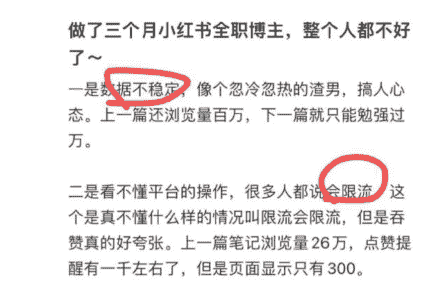

三是照片怎么都拍不好，几乎拍不出自己满意的照片，这个跟自己状态有很大关系，需要自己去调整。

四是收入不稳定。收入由数据直接决定。每一次输出都很认真对待，呈现的效果确实不佳，需要自己去提升。但是很多时候，自己看不上的数据非常好，自己满意的很拉垮，着实不知道该怎么做，给人整懵了～

新人的心路历程，大多如此。

一开始做号那个兴奋。

接着每天都在不停地刷自己的数据。

数据不好了，就去找爆款来抄，今天换一个风格，明天换一个风格。

好不容易涨了一点粉，还没来得及高兴，才发现——好像没有办法赚钱啊！

运气好一点，偶尔有一两个小广告找上门，接完后又觉得，食之无味。

最后觉得自己方向选错了，唉，销号重做得了！

**但月入 30000 的自媒体是怎么想的？**

**他们并不在意这些数据。**

这些人非常明白，做自媒体，其实是在做一门生意。

**做生意，最重要的就是，获取意向用户。**

哪怕意向用户不多，也能带来确定的收入。

我们之前有很多学员，不管是卖产品，还是知识付费。

他们的内容非常非常垂直，就是展示自己的产品，从不发有的没的。

比如上期有个做命理，他小红书一共只有 19 个粉丝。

但是他引流微信，加了 13 个人，为啥？

因为他的笔记浏览量还不错，这些人看了这条笔记后就直接加他微信了。根本不会关注他，关不关注也无所谓。

引流到微信的 13 个人，成交了 6 单。

加上命理的客单价相对较高，两周直接变现在 2 万以上。

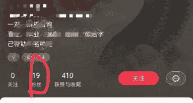

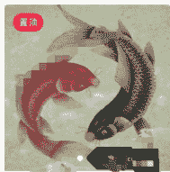

这个号，如果不知情，只看他小红书粉丝数，19 个。

你会觉得做得一塌糊涂。

但是他两周的变现，比很多千粉号一年的收入都高。

所以，要数据还是要意向用户？这是起点的本质区别。

如果你还是带着看数据的心态去做自媒体的话。

要么做不起来，要么做了几个月，发现收入不高，想要弃号重新做。

因为从根上就错了：

流量数据若不能为我所用，食之无味，弃之可惜罢了。

### 3. 第二大门槛，对内容的理解不同。

这是我们今天讲的核心重点。

也是目前我们 IP 方法革新最大的地方，可以说极大地拉低了普通人的准备门槛。

月入 1000 的自媒体，单纯地认为，好内容就是一切。

但什么是好内容？

是用户需求、习惯的内容，不是你觉着好的内容。

举几个反面案例。

比如下面这个，整理这么多思维导图，花不花时间？用不用心？

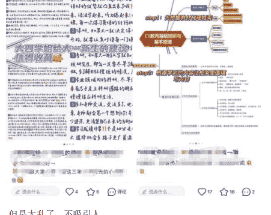

内容可能很干货，但是太乱了，不吸引人。

这种内容出现在用户的首页，大概率不会点开的。

所以他的点赞只有个位数——内容再好，吸引不了用户点进来看，白瞎了。

有人说：

**花爷我懂了，我去抄那些长得好看、点击率也高的内容模板！**

**抄完之后，很多人发现没用，数据还是起不来。**

然后来问我，说花爷，我抄了这个爆款，怎么一点用都没有啊。

我说，你抄的肯定不一样。

他说，不，我抄得肯定一模一样。

结果我们拿过来一看，这叫一模一样？？？

比如说这个例子，右边是我们给用户的一个模板，首图点击率特别高。

左边，是模仿右边做的内容。

效果差多少？点赞数据差了几万倍......

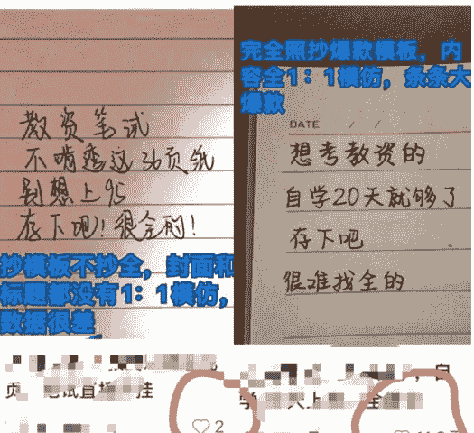

看上去，都是笔记本上写字。

但是笔记本怎么放？字多大？什么字体？多少个字？

这些细节加一起，看上去一样，效果差远了。

其实月入 30000 的自媒体，秉持的策略非常简单：

- 第一，找到一个好模板，一比一复制 5-10 篇，看是否有效。
- 第二，如果有效，照着模板一直憋，憋到这个模板失效为止。

信不信，就这么简单……

看几个正面案例吧。

比如说，上面提到的教资 IP，既然效果好，那所有内容都是一个模板。

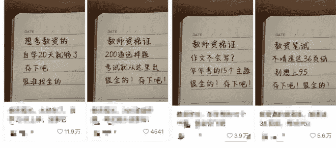

花爷这边也总结了很多模板，小红书、抖音、知乎都有。

随便举几个例子。

同样是做好物分享，我们经常用“平铺法”。

就是把你的内容、产品全部平铺开，放首图。

然后次图开始，挨个介绍产品，这个模板在很多很多领域都验证有效。

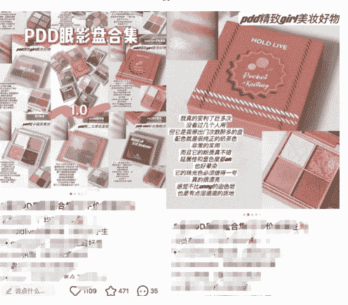

再比如，测评模板，也好用。

像餐饮、美食、美妆、知识付费等等的行业都可以用。

首图把所有产品拼在一起，然后去做一个类似于红黑榜单的模板。

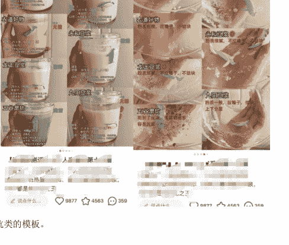

对了，还有避坑类的模板。

我看有些人做避坑内容，洋洋洒洒手写好几页稿子，比如下图这样。

辛苦是辛苦，关键谁看得清你写了啥啊……

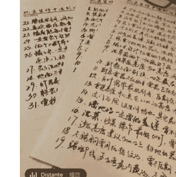

其实很简单呐，直接用手机备忘录来写。

其中一些重要的点，用各种颜色的极好笔来做重点标记。

最后取个好标题，完工！比如下图这样。

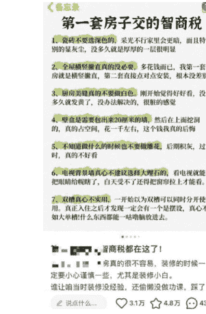

再看几个抖音的模板吧。

有很多线下实体店，想抖音引流，结果拍的视频那叫啥啊……

比如下图这个，篮球培训 IP，内容没有固定模板，这是没有明白人指点啊。

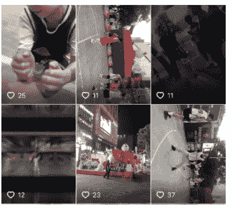

看看同样是篮球训练 IP，随手找了正面案例。

每一条视频，都是一个老师，带着 3 个以上的小男孩打球，青春活力。

灯光、角度、标题、剪辑节奏，都是固定的，每个视频都一样。

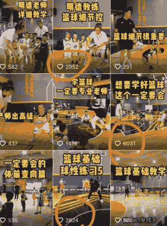

其他行业，其实也一样。

比如下面这个抖音卖红薯的，只有一个产品，就红薯干。

每条都是同一个人，在村里吃红薯干。

一样的道理，同一个模板，使劲儿拍，400 多条视频都一个样。

有的点赞几万，有的点赞个位数——无所谓！

反正这个模板有效，就忍到无效为止，中间有点波动很正常，管他呢。

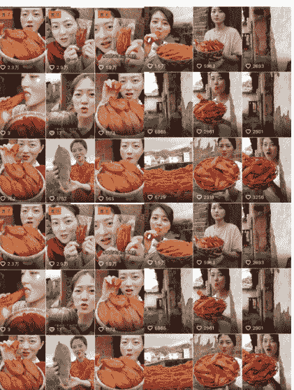

所以，**有个好用的模板，真正做到一比一复制，非常非常非常重要。**

你想啊，有模板之后，做内容的时间，反而压缩了，剩下就是用数量坚持到胜利了。

上面讲的是小红书和抖音。

其实知乎我们也有模板……

放几个知乎的案例，都是自己家带出来的。

# 公众号懒人找资源，懒人专属群分享

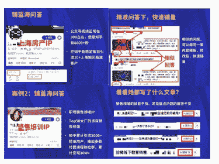

知道为什么花爷说，4.0 玩法又一次降低了普通人做自媒体的门槛了吧？

我们给模板，抠细节。

把被成功过无数次的糗子，套到你的 IP 上去。

只要你做到位、数量也到位，做起来的概率就大大增加了。

### 4. 第三大门槛，对变现的理解不同

前面说了，月入 1000 的自媒体，一开始没做好规划。

所以他哪怕涨粉了，对于变现的想象力，也仅限于——接广告。

甚至他接广告的方式是——等别人找上门。

如果你告诉他，你可以去带货呀，可以做知识付费呀。

他嫌带货麻烦，嫌知识付费 Low。

但实际上，我明确跟大家讲，今年广告的行情是非常非常差的。

像微博这个平台，200 万粉的一个账号，半年的广告收入才 20 万。

平台腰部尾部的这些账号，广告收入很多都腰斩了。

# 公众号懒人找资源，懒人专属群分享

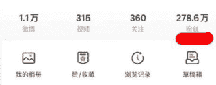

# 环境自媒体越来越难了……

今天某品牌商务加我沟通合作，突然很想复盘下今年以来的广告商单。

- 大环境不好，几乎品牌的市场预算紧缩，对我们这些 KOL 来说也蛮惨的，即使是领域头部也不好过，拉了下数据，今年以来，广告将近下滑 50%。
- 上半年，还曾被以垃圾粉、违规用户为由清了大概三十万粉，平台的商单价格也是一压再压。

但说实话，变现强的 IP，200 万粉的变现能做到他的 100 倍……

月入 30000 的自媒体，都有自己明确的商业架构。

广告收入可以有，但一定要有更多元的变现方式。

不管是卖货还是知识付费，都是以低价产品先切入，等用户慢慢多起来，再一点点开始做高价的产品。

今天花爷才发了一个朋友圈。

我们有个非常非常励志的学员，他是一个少见的全职奶爸。

一开始只做九块九的产品，当月就出单了，但他不嫌少，又坚持了几个月，爬坡到千元级产品。

目前已经稳定月收入 20000 以上，离 30000 大关不远了。

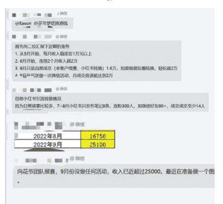

这里，还有个很隐蔽的点……

有非常明确的商业架构，往往干起来更带劲。

今天我虽然卖 9 块 9，月入才几百，但我知道，按节奏走，我一定能爬坡爬上去，爬上去了我就不一样了。

很多月入 1000 的自媒体，缺乏变现的理解，收入有一茬没一茬。

时间久了，换你你也没干劲啊。

## 5. 通过上面的三道槛，你们明白了吗？

哪怕是普通人做自媒体，专业的和不专业的，也是天壤之别。

花爷有一个坏消息，和一个好消息，跟你们分享。

坏消息是，自媒体这个行业，前两年释放了大量红利，大家都知道这个赚钱。

越来越多的人进场，未来自然会很卷。

但好消息是，这行的大部分人都在瞎干………

这个时候，但凡你专业一点，真的可以淘汰很多人。

# 公众号懒人找资源，懒人专属群分享

这也是花爷为什么要做【IP 升级月】吧。

把我们最新的一些方法，整理整理，对大家还是蛮有用的。

## 放弃大 V 幻想，IP 就是赚钱赚钱赚钱

最近埋头在做几个 IP 的全案。

说实话我们全案不贵嘴，基础费用只要 20 万，盈利的大头是从收入里分成。

所以我们测试了非常多，圈外人难以接触的玩法。

整个过程下来，很明显的感受到：

很多 IP 表面数据都是光鲜的，但真正有效的方法，大多藏在水下。

所以，这个月，花爷终于要回归正题了。

我们准备把 9 月，做成 【IP 升级月】。把我们所有的 IP 服务，都升级成最新玩法。

并且呢，在公众号。

把花爷团队最近半年攒的干货，一股脑跟大家聊个遍。

这个月我们讲的内容，和你平常看到的 IP 行业分析，会有质的区别。

今天先简单讲几个趋势。

想到哪写到哪。

### 1. 做 IP 遇到的第一个难题，一定是：没有流量

其实这已经不是你的问题，而是整个行业的问题了。

整个行业的流量，就是不够分了。

除了视频号，抖音、小红书等平台的总流量增速，都下来了。

不仅你的流量不行，头部大 V 的流量也不稳。

公众号打开率持续下跌，自不必说。

连时代的宠儿，抖音，整个头部知识付费的流量和收入都在跌。

别看营收数据好像还不错，问问投流花了多少钱先。

一场直播卖个 20 万，结果光投流就花了 15 万以上，这样的大 V，没你想的那么轻松。

# 公众号懒人找资源，懒人专属群分享

但对很多人来说，不做 IP 也不行。

线下眼看着做不动了，必须要线上做 IP。

没有内容、投流能力的老板和团队，有没有简单直接的 IP 引流方法呢？

也是有的。

## 合作引流

比如有个用户，刘杰，做云家政的。

老花友应该有知道的，毕竟他从 0 到 200 多家加盟店，是一路跟着我们做过来的。

在抖音，刘杰的基础是 0，之前连账号都没有。

但他跟一个百万粉丝的抖音商业 IP 合作，做了一个采访，录了短视频。

采访内容，讲述了他个人经历、创业史、经营理念。

这条视频，播放量 800 万，给他的抖音新号，新增了 2 万粉丝。

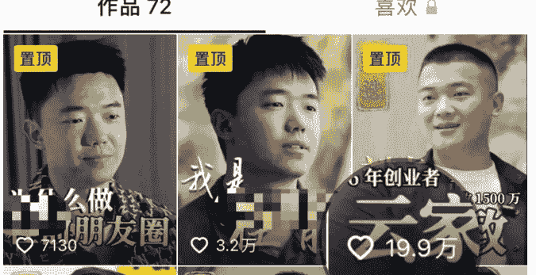

后续的加微信、咨询、变现数据，也很厉害，不方便说具体数字了。

这里的重点是啥？

直接，有效。最低成本，撬动最大的杠杆。

对你来说，大到选题、拍摄，小到标题、剪辑，全都不用管。比自已从 0 起步快多了。

# 公众号懒人找资源，懒人专属群分享

就拿最基础的拍摄举例。

你自己搞，半路出家的能明白要架几个机位，怎么推进景远景吗？

类似的合作引流，玩法还有很多。

太多了，一篇都写不下。我们【IP 升级月】，后面还会继续提到。

有生意的老板，想做 IP，如果有人建议你，上来先搭文案、拍摄、剪辑团队等等。

让他走远点。

## 2. 还有一种流量瓶颈，叫：我做到几千、几万粉丝，就做不上了，怎么办？

你可能遇到这么几种问题：

1. 单号流量见顶，想做更大，感觉自己没大 V 那个命。
2. 某条内容爆了，私信疯狂涌入，被平台处罚。
3. 有些行业，是容不得大号的。到一定粉丝量，你的对手比你还急，小动作不断。

最好的解决方法，还是：

做矩阵号。

当然，矩阵号不是随便做做就起来的，挑 2 个方法讲讲。

#### 1. 多账号，换内容形式，反复发

我们有个用户，一开始只做长视频，比较爆的长视频，能有几万播放。

这个播放量，在他们细分行业，算很高了。

再往上冲，不好做。

同样的努力，换个方法，效果就完全不同。

只要这条长视频，拆分成多个短视频，重新取标题，换其他账号再发布。可以做到所有视频，每条都是几万播放。

这量不就上去了吗？

#### 2. 一个内容模板，多帐号批量发

这个玩法，将是本月【IP 升级月】的重点。

**公众号懒人找资源，懒人专属群分享**

真正意义上，降低了 IP 做内容的门槛。

先说一下大概的步骤，看你们能不能猜到背后的原理。

以小红书举例。

第一步，还是找对标。

比如，我做留学的，去搜这个行业，发现有很多爆款。到底对标谁呢？

注意，在这一步，不对标选题、不对标人设、不对标内容。

只看一点，内容的样式。

如果同一个样式，有多个爆款，那这个样式，就是你的对标了。

比如下图左边，用备忘录写思维导图，你能找到一批用备忘录写出来的爆款。

那它就是一个好的样式模板。

这背后的原理，花爷先不说，后面会有一篇文章专门来讲。

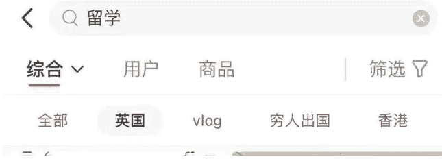

# 公众号懒人找资源，懒人专属群分享

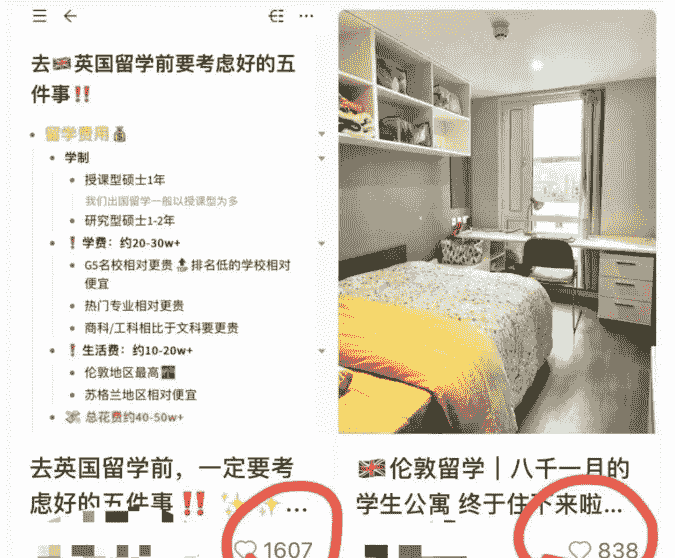

第二步，模仿对标。

跟对标的样式，几乎一样，但又不要完全一样。

比如，下图的左右对比。

图的排版一致，但图的颜色，不一致。

文字的意思一致，但表达的方式，不一致。

# 公众号懒人找资源，懒人专属群分享

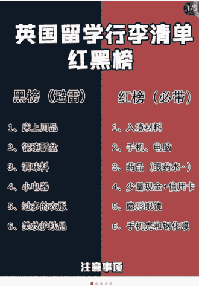

# 2021英国留学行李清单红黑榜，有的真不用带

大家好，今天洋仔整理了一份英国留学行李清单的红黑榜，把没必要带和必须带的物品都列出来了，大家收拾行李和准备出国的时候可以参考一下哟~

📢说说什...

💬 3786 ☆ 4727 187

# 英国留学必带行李清单丨文档可编辑

留英5年老学姐吐血大整理，英国留学真的别再带这些了[emoji]

📢衣物、鞋不要多带！尤其夏装

从平价primark到高奢的Selfridges，英国买衣服简直不要太方便，快消、运动品牌基本都有学生

📢说说什...

💬 347 ☆ 523 31

第三步，准备 3 个号打底，按上面的样式，每天每个号发 3-5 篇。

第四步，如果数据不好，换对标模板。如果数据不错，3 个号、10 个号、30 个号……你就加吧。

说实话，就上面这个玩法。

如果你是做生意的老板，花爷下个线下课，把上面的玩法原理给你讲一遍，收费几千块一点都不冤枉。

我们有用户，用这个方法，8 个号，每天收到 300 多个私信咨询。

其他的平台，知乎、抖音，也都是同理，操作细节不太一样罢了。

### 3.

# 公众号懒人找资源，懒人专属群分享

另外，花爷接触这么多 IP，发现还有另一类人，也很典型。

他们已经是大 V 了，还来找花爷咨询服务，你知道为什么吗？

也焦虑啊。

当初糊里糊涂就做起来了。商业模式、变现，从没好好规划过。

害怕现在的变现业务，说没就没了，也完全不懂怎么流量效益最大化。

这部分人，建议既简单，也老生常谈：

赶紧粉丝加到私域吧。

只要把用户加到私域，理念就领先一大批 IP 了

前面也讲了，自媒体各个平台，流量增量基本没有了。没有增量，只能做复购。

抖音也好，小红书也好，做复购就是没有微信牛。

大家可以观察一下，特别是抖音、小红书。

你关注的一众大 V，会有越来越多开始引流做私域。

甚至条条视频、笔记，都在引导你加私域。

以前完全不做私域的，现在一天 4 条朋友圈打底。

而且，加私域真没那么难。

# 公众号懒人找资源，懒人专属群分享

我们一个用户，写一条最简単的微博，3 分钟。

发完就能加几百人进私域。第一个月就加了几千人。

所以有时候，有些人来咨询，但是花爷怎么劝就是不做私域，我很心痛……浪费资源啊。

### 4. 玩法方面，今天就讲到这。放心，【IP 升级月】，肯定会讲更多的。

最后想跟大家聊一下，为什么 IP 要以赚钱为导向？

怎么就这么俗呢？

逻辑其实很简单，流量已经见顶，粉丝无限增长成为大 V 的可能性极低。

能够稳定赚钱，已经是一个 IP 能否长期发展的重要标志了。

谁也不能永远用爱发电吧？

更何况，如果你是有抱负的 IP，你想给用户多提供价值——这些还是要花钱嘛。

**IP 能赚钱，并不俗。**

IP 不能有原则的赚钱，才俗。

花爷团队能一直吭哧吭哧的研究最新的玩法，也是秉持着一样的信念吧。

## 涨粉千万、卖课 500 万的张琦，大家都分析的太浅了

张琦最值得我们学习的是什么？

是让我们了解到，下个时代的 IP 竞争力——【内容频次】的重要性。

如果你平时看商业号，那你最近一定刷到过张琦。不管是抖音、小红书还是视频号，你搜【张琦】，会发现她有一堆的矩阵号（如图）。

动不动十几个号，合计千万粉丝。

动不动所有账号一起开播，一播就变现几百万。

张琦为什么爆了，网上已经有非常多的人分析过了。

比如，有讲她如何通过内容获取流量的：

主题有热点，有争议，容易火；讲的内容面向中小企业老板，符合现在的商业环境；视频节奏，三秒内吸引注意力。

比如，有解读张琦背后的机构博商的：

博商是个讲课平台，签约了 N 个讲师，张琦是其中之一。博商让每个老师，讲课 2 天，然后录像给到编导，去剪辑做号，批量生产视频，看哪个能爆。

对张琦来说，她爆是随机的；但是对博商来说，就算张琦没爆，也总会有其他的讲师爆。

但上面这些，还太浅了。

张琦和博商的模式，其实验证了花爷今年对 IP 的一个大趋势判断：

**【IP 想做火，内容质量还不够，高频率生产内容才是关键】。**

你要是 IP 刚起步，变现百万以下，那内容质量，就够了。

一旦变现在百万以上的 IP，再想扩大，谁的内容没有质量？没质量的变现不了百万。

所以，变现百万以上的 IP，核心进这个就是：

**【保证稳定质量的高频输出，去覆盖更大的流量范围，跟粉丝做高频的触达。】**

你跟用户一个月互动一回，人家跟用户每天互动 8 回，你怎么比的过？

这也是为什么，小红书、抖音、视频号、知乎会兴起。

小红书的图文，一篇很短，生产很快。

知乎的回答，写一篇，可以改一改，复制铺到 500 个类似的问题里去。

抖音、视频号、小红书的视频，只要你表现力强，一天可以录 200 段。

但是写公众号，日更难度都非常大。

除非你像花爷这样，很能写，客户面向高知人群。

不然你费劲三四个小时写一篇公众号，用户 2 分钟读完，人家拍段视频+剪辑 5 分钟搞定，用户也花 2 分钟看完——你多亏啊。

像花爷团队，后端的交付已经磨练的无比强大了，今年前端内容，也要开始入侵小红书和短视频了。

无他，我们这么多内容、这么多案例，批量生产内容，不好意思同行真的打不过。

这件事情，对普通人来说，有什么启发？

启发太大了。

你看人家专业团队，都是批量去做了，都在拼内容频次了。

还有一大批普通人，天天纠结做啥？主题是啊？总想整个大招——你能憋的过谁啊？

实践出真知啊，同志们。

星球里、IP 俱乐部里，好多小白都做成公司老板了，人家主要就是因为干，花爷做啥他就模仿呗。

不过，花爷还要强调一点，也是做 IP 的一个趋势：流量不是终点，销售转化才有变现。

一个好的生态系统就是：

【打磨好销售和交付，然后不断做内容、做投放，重复进行销售和交付。】

顺便一提，大家现在吹上天的博商，巅峰期其实是去年。

今年博商也有难题。

博商这套玩法，做 IP 的起号、流量没问题。

但后续的量承接，没有做透，销售体系不够强，没有人跟进，很多意向客户，在后续更高价的销售、线下课销售时，转化率不好。

再加上今年疫情，线下课的销售，复购也不好。

所以一旦流量做到头，增长就遇到瓶颈了。

# 公众号懒人找资源，懒人专属群分享

嗯，再回顾一下，爷爷的话。

**【打磨好销售和交付，然后不断做内容、做投放，重复进行销售和交付。】**

理解透这句话，商业模式变现一定在百万级别以上。

# 公众号懒人找资源，懒人专属群分享

# 新东方带货火了，K12 教培转型能学吗？不行啊，想歪了。

东方甄选的直播带货，出口成章的老师，是大公司的核心资源。

小 IP 能学吗？

学不了。

K12 教培转型，做不了学科培训，真正应该做的，是学科的“周边知识”课程。

比如，家庭教育、学习方法、记忆力方法……

不是学科，但跟学科强相关，关联巨大。

抖音上有个叫【爱会学习力】的号，是清华北大的学霸，不讲课。

讲的是家长如何做好家庭教育，讲什么样的学习方法最高效。

他们讲家庭教育、讲学习方法的课，销量最高的一个，699 元卖了 3.5w 份，销量第二的也是 699 元，卖了 2.4w 份。（图 1）

抖音还有一个【超强记忆王老师】，专门讲提升记忆力，比如快速记住古诗，背英语单词怎么过目不忘等等。她卖的记忆法课程，也是 699 卖上了万份。（图 2）

这两个号，都不是在讲学科，但他们都还是在讲教培，在讲 K12 学习阶段的课程。

虽然“双减”打压教培行业，但你会发现，那些卷来卷曲的家长，会善罢甘休吗？不会的。

再透露一句，我们有个 IP 学员，做 K12 培训的。

他 IP 也没太名气，只做当地的 K12 线生意，私聊跟我说，这个月收入是去年总和。需求还是在的，水面下的需求，也是需求啊。

在抖音做涨粉，做的不错的人很多，但是涨粉像张同学这样快的，确实很少。

## 加花爷训练营助手

领资料&看 IP 前沿玩法

# 公众号懒人找资源，懒人专属群分享

## 张同学 2 个月涨粉 1400w+，但花爷给做抖音的你提个醒

在抖音做涨粉，做的不错的人很多，但是涨粉像张同学这样快的，确实很少。

张同学不但自己火得一塌糊涂，新发的视频，点个点赞过百万。他还成了一个自带流量的“视频素材”：

有非常多模仿他风格的视频，也火了；甚至评论他为什么火的视频、分析他拍摄剪辑手法的视频，也火了。

### 1、为什么跟他有关系的视频都火了？

其实这跟抖音的平台逻辑有关系。

抖音的流量倾向，是一阵一阵的，推流系统会在一段时间内，给特定类型的视频流量加持。

也就是大家说的，“平台喜欢这种视频”。

类似的事情，抖音以前也做过。

比如 2018 年的温婉、代古拉 K，都是跳舞火了，那段时间抖音推流，总是推送跳舞的视频；

比如 2019 年，搞笑剧情大火，其中的代表毛毛姐，讲一句话就有 100w 赞。

2018 年初到 2019 年，也是抖音火起来，日活跃用户数量从 0.3 亿增长到 4 亿的时候。

带火过其他 APP 的“美女跳舞”和“搞笑段子”，在其中也起了不小的功劳。

还有罗永浩，第一次在抖音带货直播，累计 4800w+人围观，6 天涨粉 500w。

罗永浩签约抖音的时候，正是淘宝有李佳琦薇娅、快手有辛巴散打哥的时候。

也是抖音需要这种高人气带货主播、需要罗永浩的时候。

为了给老罗造势，抖音给了他流量倾斜——4800w+人围观。

要知道，现在罗永浩的直播间，在双十一的时候，才有 1300w+人围观。

这次的张同学，又代表了什么呢？

代表了抖音现在的内容板块中，缺少的“乡土风情”。

“乡土风情”的视频在快手有很多，但是在抖音是稀缺品。

尤其是，张同学的剪辑手法非常高明，不是为了土而土，在“乡土”中又透出一丝优雅。

所以你看，抖音平台推流，像是个抽奖系统，“中奖”的视频，会获得流量加持。

做抖音想大火，也得看时势的，或者有些牛逼的人，他判断了时势，主动去抓了一波。

这也是为什么，抖音大 V 的粉丝，慢慢的黏性就不强了，变现也比较急。

比如上面提到的，温婉、毛毛姐……曾经的抖音网红，现在热度比以前差了十万八千里。

因为大多数的用户都是跟着推流走，系统推谁就看谁，系统不推、看多了看腻了，就不看了。

### 2、

所以花爷要提醒你的是，不要盲目跟风模仿。

很多人知道，做抖音模仿了火的号做，你很有可能也会火。

但是你不知道的是，那些迅速跟上热点、真正大火的号，背后都有专业的团队在运作，并不适合我们普通人模仿。

像张同学的一条短视频，几百个分镜、电影剪辑手法，也不是一个新手，短时间就能学会并且做出来的。

你强行去模仿自己不熟悉的热点，可能等你模仿得像模像样了，这个热点已经凉了。

就像花爷一直强调的，不要为了蹭热点，而去强行模仿跟自己没啥关系的东西。

花爷在 IP 训练营课程里面也讲过，我们更该模仿的，应该是自己本行业的爆款。

就像这次张同学火了，一批拍乡土生活的号跟着模仿，也火了。

这次还有讲剪辑的号，蹭上热点火了，其他讲剪辑的号纷纷模仿讲解，也火了。

但如果你本来是个护肤号，去模仿拍乡土生活、去做分析、讲剪辑会非常奇怪，而且也很勉强。

热点一定要跟自己的行业扯上关系，蹭热点才有用。

**不然尬蹭热点，很容易蹭成四不像。**

## 小红书最近的流量密码，简单又粗暴

爸妈和朋友，最近常常担心花爷：经济这个样子，你们生意还好吗？

其实吧，最近做自媒体 IP 的更多了……

不管是【IP 初阶训练营】，还是 IP 全案，都是满负荷运行。IP 全案还没宣传过呢，每个月 2 个名额，都满的。

带了这么多，花爷发现一个共性。

所有自媒体 IP，在还没感受过流量之前，都会遇到一个抓心的问题：

搞到流量，到底是一种什么感觉？

因为他们搞来搞去，用尽了各种偏方，最后还是没什么曝光量。

然后忍不住灵魂拷问：

流量密码真的存在吗？

实际上，流量密码肯定是存在的。

不管是抖音、视频号，还是小红书、知乎，各种平台上都有对应的流量密码。

大部分人拿不到效果，主要是对流量密码的理解错了。

你们把这件事，想得太复杂了。

花爷对于流量密码的形容，就五个字：

简单的重复。

这 5 个字，在各个平台都是通用的。

我们以小红书这个平台举例，带大家看看小红书最近的流量密码有多简单粗暴。

### 1.

首先，流量密码一定是简单的。

我给大家举几个，小红书火过的案例。

第一个例子，之前小红书有一个非常火的首图。

图上写着，“当有人说 xxx 时：我，”，下面是一个穿黑西服的黑人，摊手展示。

几乎任何一个行业，你都能用上这个首图。

这个首图有多神奇呢，在那段时间，一模一样的内容，只要你用了这个黑人推手的首图，数据就容易爆。

当时我们有一个做独立家居设计的学员，用这个首图之后，笔记数据马上就上去了。

第二个例子是最近的，小红书有个“左滑”标题。

标题里告诉你，左滑帮我卸妆、左滑帮我摘口罩……勾起你的好奇心，引导你点击进去，看前后的一些变化。

第三个例子是我们最近看的，一个咖啡店的号。

一个咖啡店，他不拍咖啡，不拍价格，不拍环境。

专门拍店里的帅哥服务员，每一条都是这么拍的，每天都挺火。

很简单粗暴吧？这其实是小红书的推荐机制决定的。

小红书的特点是，用户在首页看到很多笔记预览，会不会点进去，主要就看首图和标题。

你的首图和标题越吸引人，点进去的人就越多。

点的人越多，系统认为你受欢迎，推的流量就越大。

所以小红书撬动流量的关键，就是让更多的人感兴趣。

要让更多的人感兴趣，就一定不能复杂，越简单越好。

曲高和寡。

优雅就是在跟人民作对。

越复杂的东西，能够看懂的人就越少，想看的人就更少了。

所以花爷才说，流量密码一定是简单的，因为简单才有广泛的受众。

这些简单的东西，往往都切中了人性的本能。

比如，美女长腿、好奇心、整理癖、收集癖、强迫症……

都是简单但非常有效的流量密码。

这也是为什么花爷经常说，一个新手开始做内容时，最好直接用一个现成的，最近很火的模板。

因为一个模板能火，就说明它暗暗命中了人性本能，是一个流量密码。

虽然有时候，你弄不清流量密码到底好在哪里。

但不影响，只要火了，就是被算法、用户喜好检验过、验证过的，你直接用就行了。

说句题外话。

很多新手，抗拒把流量密码加在自己的内容里，觉得 low。

实际上，你只是在自己的内容里，加上流量密码，让更多人可以看到你。

流量密码和做自己，并不矛盾。

### 2.

其次，流量密码一定是重复的。

我们经常会碰到一些同学问，他有个图或者文案模式爆了，接下来应该换什么？

“万一我的粉丝老是看到我发这个，他会不会觉得我江郎才尽？”

其实根本不会。

找到流量密码之后，你要做的事就是重复用、重复用、重复用，一直到用户腻了为止。

比如说我们上面讲的咖啡店。

他所有的笔记，都是在拍帅哥店员，因为他这样拍，每一条的数据都很好。

如果有一天，他的粉丝看腻了帅哥店员，那时候再换也不迟。

流量密码的正确使用方法，就是要反复用。

包括小红书最近比较火的模板，备忘录、梨云绿等等，也有大量的账号，在用同一个模板反复发，而且数据都很好。

我们【愚公掘金】最近搞的小红书读书打卡营，学员也用了这些模板发笔记，效果也还不错。

这样重复使用的好处是：

第一，可以节省你内容制作的成本。

因为找到了流量密码后，你一直用，套模板就行了，实际上花不了多长时间。

第二，你每换一次流量密码，本质上就是一次试错，可能成功，更可能失败。

而试错是有成本的，换流量密码的次数越少，试错的次数就越少，失败的可能性就越低。

高手做事，把简单的事情重复做。

新手做事，往往把简单的事情做得很复杂。

### 3.

最后，流量密码一定是流动的。

上面花爷讲了，流量密码被我逮住了，那我就一直要用。

但是它一旦不见效了，不要多抱幻想，患得患失。

一定要立刻放弃它，马上换。

给大家看一个典型案例，这个号是做高中学科的。

它的一开始的模板，是在书里面夹一张小纸条做首图。

前面数据不错，慢慢的数据不行了，就换成了一个无脸男举小纸条的首图模板。

这里就涉及一个问题：

**当你的老流量密码失效时，你得知道最近的流量密码是什么。**

所以像花爷这样的专业团队，内部做了一个【IP 参谋】的数据库，里面有最新的选题、模板、人设等等，专门解决这类问题。

这就像你站在河水的上游舀水。

**只要你在河水的上游，河水再怎么流，只要你去舀水，一定会有水喝。**

### 4.

为什么很多人始终入不了门，就是做不起来流量？

看了上面流量密码的 3 个特点，就明白了。

因为很多人的认知是错误的呀。

他们觉得，流量的趋势是今天 30，明天 50，后天 100，大后天 150。

只要看到流量每天没什么增长，就着急想放弃。

**而实际上，流量是跳跃式的。**

你没找到流量密码，一直是 10、20、30。

找到流量密码之后，立马到 300、500，然后再到 1000、2000。

它是蹦着往上涨的。

等到有一天，这个流量密码失效了，它可能突然从 3000 变成了 30，这个时候你就该去找下一个流量密码了。

然后又是一个漫长的等待测试，测试成果了，再蹦到下一个 3000，下一个 5000。

**所以做 IP 开不开窍，其实就在的一瞬间，这是一个跳跃式的增长。**

很多人在等待跳跃的过程中，就放弃了。

打个比方。

掌握流量密码的过程，很像骑自行车，一开始你摔了无数跤，就是学不会。

但是某一刹那，你突然会骑自行车了。

**一旦你学会了，那种感觉，你一辈子也忘不掉了。**

**但在找到这个感觉之前，你摔的每一跤，都没有白摔。**

## AI 能帮一些人提高效率，那它就能赚钱啊！

上次花爷讲了，AI 绘画对一些人来说，不但不会抢他们饭碗，反而可以提高他们的工作效率。就有敏感的人意识到了，诶，这里是不是有商机了？

确实，赚钱机会来了。

花爷先来列 5 个 AI 绘画的赚钱思路，给大家参考参考，也欢迎大家继续在评论区补充~

### 1、卖软件、卖教程

每次有点什么新东西，肯定会有人出来卖软件和教程。

有人喜欢花时间找免费的，就有人愿意付费节省时间精力。

淘宝上搜 AI 绘画软件或者教程，有 100+ 人付费买了。（图 1）

淘宝上如果想排名第一，可能比较难了。

可以在小红书抖音上用画的画引流，卖软件教程（图 2）

### 2、教 AI 绘画关键字

AI 绘画里，决定画出来的是什么样的，是关键字。

不同的关键字跑出来的画完全不同。

相同的关键字，不同的人可以跑出类似的画。

你可以简单理解为，关键字，就是画家画画的能力。

所以，有一部分人，就是专门卖自己发掘出来的关键字。

打包卖关键词，10 块钱能买到 200 组。

里面的内容也很简单，就是一个 Excel 表格，关键字旁边附上生成的图，告诉你这组关键字大概会生成什么样的图。

你复制粘贴就能得到一个类似的图。

修改部分关键字，可以对图做细节的改变。

除了打包卖之外。

还有人开班教怎么用 AI 画画，其实就是教关键词。

一个人学费 200，500 人的群已经满了。

### 3、壁纸号

做壁纸号的人不少，现在做壁纸号更容易了！

之前你还需要自己去收集照片，现在用 AI 能批量生产图片，质量还高。

这天然就适合批量做号了。

壁纸号一般在【闪闪壁纸】的抖音小程序做变现。

只要有人进去，根据口号找到你的壁纸，下载，你就会有 2~3 毛钱的收益。

花爷看到有人，用 AI 绘画做了十几个壁纸号。

就算视频没爆，但是积少成多，每个月收入还是很可观的。

也有爆的，用 AI 做十二生肖壁纸，百万点赞。（图 3）

大家可以推算一下，这个壁纸有多少收益？

### 4、做视频配图

尤其适合做音乐类的视频。

你把歌词丢进 AI 绘画软件里，就能出来风格统一，且和歌词相关的图。

B 站有个 up 主，用 AI 绘画，做了《漠河舞厅》这首歌的 MV。（图 4）

爆了 70 万的播放。

放个链接：《漠河舞厅》全由 AI 作画竟然把我看哭了！！！！_哔哩哔哩_bilibili

大家感受一下。

### 5、做 AI 绘画定制品

花爷在搜 AI 绘画的小程序的时候，看到一个小程通过做定制品变现。

点进去，是一个能正常做画的界面，当你生成自己的 AI 图后。

会跳出界面，推荐你把自己的画印在实物上作为礼物。（图 5）

- 马克杯，35；
- 帆布包， 68；
- 卫衣，99……

这个小程序做得挺粗糙的，但是定制印花的思路可以参考。

大家可能发现了，AI 绘画最大的价值，就是把生产图画的门槛降低了。

之前要人工画图的生意，现在用 AI 绘画都能再卷一遍。

## 10w 人围观的 T97 咖啡直播间，真正卖的未必是咖啡

最近 T97 大嘴妹的直播间在抖音是非常火的，场观 10w，大嘴妹的形象和 rap 很魔性很洗脑。

我怎么知道这个东西火的呢？

是因为有一天，我一个跟互联网八竿子打不着的朋友，在我们群里分享了这个直播间，他说最近在这个直播间都不出去了。

这个直播间连非互联网行业、非商业圈子的人都开始主动传播，那确实是非常火了。

我们星球有人来跑来问我，说这个能不能搞，能不能加盟？

那我就肤直说了，可能会有点得罪人……

像 T97 这样的项目，它最后大概率卖的不是咖啡，而是在割韭菜。

为什么这么说呢？

我先给你们讲两个关于这个行业的，可能很多人不知道的，共识。

### 1、

第一个共识什么？

就是直播间再火，看的人再多，并不代表赚的多。

那 T97 的直播间哪怕有 10w 场观，很多人都是冲着主播大嘴妹来的，不是来买咖啡的。

更重要的是什么呢？

咖啡券本身是有线下的核销率的。

如果你今天是在三顿半的直播间买了咖啡，买完他就给你发货了，这笔交易就结束了。

就算有人觉得不好，去退货，也没有问题，线上咖啡退货率最多就是退个 20%30%。

所以如果三顿半卖了 100w 的咖啡，去掉退货，实收也可以收到七八十万。

但是 T97 咖啡不同，它是线下的。

就是说你得到线下门店去消费，这个钱才能算到 T97 的账里。

一般餐饮，特别是抖音里面餐饮，线下券的核销率也就 30%左右。

就算 T97 做的不错，卖了 100w 的货，最终也只有 30w 会核销掉。

而且这 30w，还是 T97 的 45 家门店分，到单店消费的量更少。

你这么一算账就会发现，它跟那些直接卖线上咖啡的，比如三顿半，相比起来效率要差很多。

那么如果是跟瑞幸或 manner 这样的线下咖啡店相比呢？

瑞幸、manner 这些品牌，它们在抖音上虽然有营销，但是抖音只是它们很小的一个渠道，人家主要也不靠抖音营销。

但是 T97，线下店完全不能打，基本上全靠抖音的营销来做生意了。

所以我们认真算下来，就是虽然它直播间很火，但是真正到手的钱并没有那么多。

### 2、

那大家可能会问，直播间这么火，他的目标是哪些人呢？

是看了直播间，觉得这个东西很火，然后花几十万去加盟的人。

这就涉及我们的第二个共识，餐饮店的加盟很难做。

难在哪？

第一是因为，单店模型跑通之后，其实也很难复制到加盟店上。

你得需要严格的管理和完善的制度，才能让加盟店赚上钱。

比如说，华莱士的加盟。

他除了实现了单店盈利之外，做加盟的时候管理是非常严格的。

每一个城市的管理人会持有相应加盟店的股份，从选址到运营，这个管理人都会去参与其中，因为加盟店能赚钱，他们才能赚钱。

华莱士现在全国有 1 万多家加盟店，即使在这样的制度下，也不能保证都赚钱。

第二个原因是，真正赚钱的店根本不做加盟。

这种店就是单店模型跑通之后，直接通过融资做自营，有钱自己赚。

举个例子，比如我今天在商场里开一家咖啡店，6 个月就可以回本。

那我根本不需要加盟商，我自己大量融资，大量开店，六个月之后，所有店赚的钱都是我自己的。

比较典型的就是瑞幸咖啡。

除了在他们闹退市的时候，开放过一波加盟，后面完全不开加盟。

你就算有钱都没有办法加盟，人家就自营，因为人家开了店就可以赚到钱。

还有 tims 咖啡，2019年入驻中国后一直是亏损，但是它的融资没有断过，店也开到了400多家。

回到 T97，它是做得很热闹，然后你会发现，有一些人因为这些热闹，以为它很火，冲动地去加盟他们。

但是大家可以想一下三个问题，

- 第一，T97的单店模型跑通了没有？
- 第二，它的单店模型能不能复制到100家、1000家？
- 第三，如果T97真的很赚钱，那他为什么不自融资去做？

### 3、

T97的这个牌子很多人来问我，我也没有必要藏着掖着。

我跟大家说，按照现在的情况来看，卖咖啡，只是它很小的一部分。

往后走，我觉得大概率还是割韭菜的。

有些看上去很火爆的东西，其实背后的逻辑完全不一样。

## 最近看到一个 IP 例子，简直把我笑死了

一个卖栗子的 IP，视频爆了 9000 赞后，被迫去转行卖木制品了。

花爷最近看了挺多有意思的 IP 案例，其中有一类非常搞笑，我给它取名叫做【被迫转行】。举个例子，有一叫【非凡商务（被迫转行）】的账号，你看他把被迫转行四个字，直接写进了账号的名字里。

挺特别的，他是做什么呢？

他原来是卖农产品的，主要在卖栗子。

大家都在卖栗子，为啥在他这买呢？

所以他就想着，跟他的同行差异化竞争。

客户栗子买回去了不好剥，他就定制了一批栗子的开口器。

然后在直播的时候，他还专门展示怎么用他的开口器，来开栗子，为直播间增加趣味性。

结果没想到，他这个直播间栗子没火，开口器反而火了。

这个商家连夜找 3 家代工厂，做了很多的开口器去买。

最后他把栗子和开口器捆绑销售，销量最好的一个月，卖了 2 万多单，全部都是 3~6 斤的栗子加上开口器售卖。

那除了栗子配开口器之外，主播在卖农产品的时候，还有很多有意思的木制品出镜。

有装栗子的竹篓，拍竹荪的木质手机支架，装橙子的折叠果篮等。

这些木制品好看又实用，每次出现，评论区基本上都是哭爹喊娘让他转行的。

这个【主业不行副业行】的形象，也让这个账号变得更有辨识度。

别看他的粉丝量只有 4.9w，但是几乎每一个视频都是几千赞。

类似这样被迫转行的案例，其实不止这一个，花爷再给大家看个例子。

一个做竹编制品的商家，视频火了之后，被迫转行成宠物用品商家。

这个是怎么回事呢？

这个号本身叫【刘家人竹编】，现在他的账号加了五个字，有竹编猫窝。

它本身是做竹编制品的，主要是日用品比较多，比如说果篮菜篮之类，之前这些竹筐子一直不温不火，销量基本上都是个位数。

他一条带支架水果篮的视频爆了之后，他就开始卖猫窝了。

为什么呢？

因为很多人发现，他这个竹筐子特别适合当猫窝，又好睡，可以磨爪子，还特别好清洗，用水冲冲就好。

最后商家含泪把水果篮改成了猫窝。

他这个竹篮改做猫窝，也不是一帆风顺的。

一开始网友也不太满意，发现这个尺寸太小啦，底部的凹陷太深，猫睡得不舒服，有毛刺啦。

经常在他的评论区提建议，他就真的采纳了这些意见，不断地改善这个竹篮子，最后真的把自己的竹篮子，做成了一个理想的猫窝，甚至还为多猫的家庭做出了双层猫窝。

他转行卖猫窝之后，基本上他生产多少就能卖多少，目前已经卖了 4000 多个了（图 4）。他们家甚至现在开始卖狗窝了，仓鼠窝、兔子窝全都开始卖，全面承包宠物房产。

这些 IP 全部都是被迫转行的，但是都取得了不错的成绩，非常有意思。

花爷给大家讲这两个含泪转行赚钱的案例，想说的是什么呢？

就是你真的要去听一听，用户在想什么，顺应市场的需求。

如果你说自己干这一行的，就只守着这些做。

我是卖板栗的，我为什么要卖开口器呢？我就只卖板栗。

我是做竹筐的，我为什么要去做猫窝呢？我就要卖竹筐。

如果是这样闭门造车地做生意，就是死路一条了。

顺应市场，听用户的话，感受到用户的需求，你的生意才能够长远地走下去。

## 讲几个悄悄赚钱的 IP 案例

上篇文章结尾，说六月份是地狱模式……

为啥呢，因为六月份每周末都在出差！好几个大会，都邀请我上台分享做 IP 的经验。

再加上我们自身的 IP 初阶训练营、IP 实战俱乐部，衍生出来的 IP 孵化业务，还帮生财带了一期 IP 的小航海。

我现在整个人都麻了……

每次分享后，总有人追问，我们的玩法跟传统的写文章的、拍视频的有什么不同。

所以干脆，讲几个没那么受关注、但在悄悄赚钱的 IP 案例吧。 比较简单易配，配合案例也好理解花爷的 IP 理念。

### 1、

先说一下，市面上做 IP 的方法、老师很多，抛开一些只会吹的大水货不谈，有真材实料的老师们，其实相互并不冲突，只是流派不同而已。

比如有的是教微商、传统销售做 IP 的，有的是教 IP 涨粉的，有的是教做内容的。

而花爷教的流派，可以称为【商业化 IP】，也就是利用你的势能差做 IP，并且快速变现的一套方法。

不要求涨太多粉，尽量从第一个粉丝开始赚钱。 所以定位就很重耍，直接关系到你卡哪个赛道、服务什么人群、卖什么服务。

很多人不会做定位，直接讲几个围绕定位下功夫的 IP 案例。

为了不得罪人，所有案例的名称我都会去掉一个字用 X 代替，全称我会放在【愚公掘金】里小范围交流。

### 2、

其实大家都知道，做 IP 要找垂直细分赛道。

但什么是细分赛道？

记住花爷一句话：付费需求就是细分赛道。

胖子想买合适的衣服，这是细分赛道；女学生想买可爱便宜的发卡，这是细分赛道；美业老板想学怎么降低员工流失率，这是细分赛道；服装老板想把客户加到微信上复购，这是细分赛道……

每一个特定人群，愿意付费的特定需求，都是细分赛道。

举第一个例子，【古琴】。

古琴这个小众乐器，可能大家只在历史剧中见过，相比吉他、钢琴这些家喻户晓的乐器，它足够细分和小众了吧。

但你觉得一个专门卖古琴的 IP，能有多少粉丝？每年的营业额能做到多大呢？

有个叫【古琴 x 记】的公众号，面向的粉丝就是精准的古琴爱好者。

他每天早上 5 点钟公众号准时发文，一篇头条文章带着七八条次条。

头条文章的阅读数一般在两三千左右，次条文章的阅读数差不多只有几十到几百。

阅读原文 阅读 3692

分享 收藏 31 29

实话说，两三千的阅读量，在很多自媒体大 V 眼中不值一提，我们按照公众号 5%左右的打开率去计算，他的粉丝差不多有 5-10 万。

但就是这样一个粉丝数量没有那么多，又在古琴这样一个小众又细分领域的号……如果你打开他的古琴商城，看看它的销量......

售价 1999 的古琴，销量 1592。

售价 2999 的古琴，销量 603

售价 7000 的古琴，销量 19

售价 12 万的古琴，销量 5。

等等等等。

除了卖古琴，其实很多学琴的人，是不买琴的——他们租琴。

所以租琴也是这个号的一大业务。

除了卖琴、租琴，还有古琴周边产品、古琴教学课程……售价 599 的课程，200 多人付费，售价 99 的小课，付费人数数千。

这样一个定位在古琴这种小众但是垂直领域的 IP，年营收几百万很正常。

再看另一个案例，【考研】。

大家都知道，B 站是广告变现最香的平台之一，也是直接付费变现最惨的平台之一。

大部分 UP 主，只能恰到金主爸爸的钱，没办法直接赚到用户的钱。

但给大家看一个另类案例，考研领域的 up 主——【李其林老师】。

大家都知道研究生专业考试的类目非常非常多，而李其林老师这个 IP，就定位在一个非常小众的领域，结构力学。

按理说，不好变现的 B 站平台，再叠加上一小众的考研类目，似乎是很难做起来来的。

我们看李其林老师视频的播放量，大都维持在几百左右，播放量最高的视频，其实也不过 8.8 万。

这个播放量，在 B 站不算高，但他精耕结构力学这个领域，愿意通过视频添加微信的，都是对结构力学考研有着强烈感兴趣的精准用户，同时有着强烈的付费意愿。

我们再看一下李其林的付费产品：

21 年的考研课程，全程班收费 1580 元/人，保姆班收费 6880 元/人，差额补漏班收费 1000 元/人

我们先来看看 21 考研的课程安排：

- **全程班详情：**
  (1) 全程班型：每月 2-3 次直播讲课，含学期基础课（1-4 章、15 天）、两章强化课（1-4 章、7 天）；
  (2) 课堂反馈：直播学习结束之后，全程班可领取：所有习题为专业老师批改及在线讲解；作业不用等待改的学员，将不再做高贵的留白；
  (3) 随堂练习—一季季学练课程，期中老师每讲完一章会布置一次测验，测试卷及讲解直接由老师以及资料包提供，每次练习完成后会提供详细的知识点总结。
  (4) 授课时间：2020 年 4 月 27 日----7 月 27 日
  (5) 价格：1180 元/人

  **（全程班：1580 元/人）**

- **保研班详情：**
  (1) 包括上述全程班所有内容；
  (2) 保班班考的真题题库及答案；
  (3) 有真题试卷解析与回顾讲解、真题班、真题补录班所有服务；
  (4) 安排私人老师“1 对 1”辅导；
  (5) “2 小时分” 答疑视频讲解；
  (6) 服务时间：一直到上考场的前一天；
  (7) 价格：6880 元/人

  **（保研班：6880 元/人）**

而今年才仅仅 6 月份，收费 1999 的结构力学保研班，付费用户已经达到 179 人

以上 4 个打包打包起来，就是我们的【**目标院校保研班**】，原价 3996 元，限时优惠价仅 1999 元。

**截止到今天，已有 179 位同学加入我们。跟着【** _**结构力学团队**_ **】一起过关斩将。**

根据我们的了解，这个 IP 做的时间并不长，变现也是百万级别的。

具体数字是多少，其实不重要，无非是打鸡血而已。

重要的是领域其中的道理。

不怕你的定位小众，不怕你的领域太过细分，怕的是你的定位模糊，不够精准。

只有精准的定位，才是保证商业化 IP 转化的生命线。

你可以定位在一个小众而又细分的赛道，即使阅读量不高，粉丝不多，但只要用户足够精准，同样可以成功变现。

任何一个细分赛道，在 14 亿中国人面前，都有机会将营收做到百万、千万级别。

有人问了，我做细分赛道，会不会天花板太低呢？

不会。

你可以用一个细分赛道，先把 IP 做起来，然后横向拓展变现产品，拓宽收入来源。

卖古琴的，可以接着卖其他乐器；教结构力学的，可以接着做其他科目；卖二手车的，可以导量接着卖二手奢侈品；讲简历优化的，可以接着讲面试、升职……

IP 前期要像一颗钉子，深深扎进行业的“木块”里，只要有了裂缝，就能把“木块”一劈两段，切出一块市场来。

### 3.

前面我们说了，要找准一个细分赛道，来保证精准的定位。

有了定位，就要围绕着定位做内容，去巩固你的定位，让用户对你这个 IP 有黏性，产生信任。

有些 IP，定位偏专业性，那产生信任最好的办法，就是做好你的专业内容。

举一个案例：【增长黑盒】。

这是一个专门做企业增长策略分析的公众号，本身增长这个赛道，其实蛮小众的，深入研究的并不多。

增长黑盒的更新频率其实也非常低，每个月最多更新 2-3 篇文章，甚至一两个月才更新 1 篇文章，在很多提倡日更公众号的人眼里，似乎不可理解。

但是，他发布的每篇内容都非常专业，全是干货。

不说别的，看看他们最近几个月发布的文章标题：

- 《12000 字解读元气森林：套利与降维的游戏》
- 《万字拆解孩子王：充满矛盾的母婴零售之王》
- 《万字拆解 Ubras：年销 15 亿、暴涨 10 倍，内衣新秀的春天到了？》
- ……

光看这几个标题，你就知道，基本上每篇案例的拆解内容都是万字起步，这种专业性，一般人可写不出来，不信你看他的文章内容。

首先，文章调研周期特别长。

拿解读这篇《12000 字解读元气森林：套利与降维的游戏》 https://mp.weixin.qq.com/s/T2yhbmFIUqlc1gGABGd7GGd

为了能把这篇文章写出来，作者花了 2 个月时间，查阅百篇资料、访谈多位专家、分析百万数据，甚至，混入社群潜伏……

这也激发了我们的好奇心，为了一探究竟，我们用了两个月时间查阅百篇公开资料、访谈多位行业专家、分析百万销售数据、混入社群进行潜伏。

其次，文章数据精准，全面而又深度。

整篇文章从元气森林的发展史，聊到其核心驱动力，又从借鉴互联网行业的 AB 测试、测试口味、电商渠道、线下场景……聊到其扁平化渠道管理，私域流量的布局，每一个单独拿出来，都是响当当的干货。

而在这些深度的内容中，作者又引用了极具说服力的数据。

例如，从电商销售数据中，发现仅气泡水的销售额，就占到接近 50%，而气泡水中，又是白桃等 SKU 占销售大头，所以元气森林目前还是在依靠单品爆款驱动，急需加快爆品开发流程，扩充产品线。

甚至，他还根据元气森林的成分、包装，算出它为了做好口感的产品，每瓶成本要达到 2 元，远高于行业平均，基本没什么净利润，目前完全在用产品为王的思路抢用户。

当你看完这篇深度干货文，估计没人不服，很容易建立信任，让用户相信：你就是专业的。

这篇长达 12000 字的文章，阅读量是：10 万+。

分享 收藏 597 1051

在我们的理解里，一篇 120000 字的文章，普通人要看完都很困难，怎么会 10 万+呢？怎么会这么多人转发呢？

因为能看完这么深入研究的，都是消费品这个行业的从业者，特别是高管、老板，而这么专业的内容，老板、高管、从业者是特别喜欢转到公司群、朋友圈的。

一篇内容，把整个行业打穿。

后续再对接增长相关的培训、社群、咨询变现，就顺理成章了。

花爷带小航海、我们 IP 实战俱乐部成员写的故事名片，用一篇文章介绍你的成绩、经历，也有很多人写了 1 个月才出一篇，其实也是一样的逻辑，但是只要内容够好，涨的都是精准粉丝。

除了增长黑盒，再给大家举一个投资理财领域的案例：【投资聚 x 厅】。

做股票分析这个领域的 IP，很多人都在提倡日更，分析每日行情。

每天写写水文来维护一下黏性当然没问题，但是，用专业性的风格，也能做。

投资聚 x 厅这个号的更新频率同样非常低，基本维持在每个月写 1 篇的节奏，但每篇都有着非常深度的思考，阅读量基本都在几万朝上。

我给大家拿最近的一篇文章举例：《股价的微粒二象性思考》

https://mp.weixin.qq.com/s/M4qtrrn8wt5-JUGjkYkx2uQ

作者将高中实验中的光的微粒二象性和股票做类比。

用观察三五年后业绩、估值的方式比作类似粒子的线性角度，用指标观察股票中期走势的方式，类比波的周期性特征。

能从一个非常新奇的视角去看待股票市场的波动性，这样的思考总能给对股票投资感兴趣的人一些启发。

虽然他没什幺付费产品，但是经常在评论区看到有人催着他建立付费社群。

做 IP 就是这样，一旦用户相信你，你没有付费产品，用户也会催着你收钱。

所以，专业内容，就是你跟用户之间建立信任最重要的桥梁。

这种内容不需要多，更不需要耗费大量的时间精力日更，只要维持在每月 1-2 篇的频率，坚持下去，做好渠道分发，一定能看到成果。

### 4.

有人说了，我做不到这么专业啊！我的能力做 IP，只能服务小白，要怎么做内容呢？

其实专业有专业的做法，小白有小白 的做法。

很多时候，有些行业专家因为太过一本正经、放不下身段，反而不太受用户欢迎。

这一点在短视频领域特别明显。

给大家看一个抖音上的案例——【王 x 乒乓】

一般的乒乓球 IP，都是刻板的教学视频，这是专业 IP 的通病。根本不能引起用户的兴趣，一看到几十集的教学内容都想放弃了。

那你想想，乒乓球新手最喜欢 YY 的场景是什么？

偶遇高手，习得绝技，回来把昔日打不赢的朋友、教练，打得落花流水……

王开的视频，就这种大家喜闻乐见的扮猪吃老虎系列为主。

花爷印象最深的一个视频，点赞过百万，是他跟一位大姐打比赛，故意输到 10 比 0（乒乓球比赛谁先拿到 11 分算赢），在大姐以为胜券在握的时候，王开才开始他的表演……

这个视频的点赞目前接近 200 万，远超很多教学视频，因为用户对这种内容感兴趣，喜欢看！

再举个例子，很多人说自己的专业能力没那么强，写不出特别专业的内容。

投资理财这个领域，对专业性的要求算是足够高了吧。

但是你能想象一个非金融专业的大学生，一样能把理财这个 IP 做起来吗？

就有这样的一个公众号，叫做：二 x 养鸡场。

号主是一名刚毕业不到 1 年的大学生，学的也并不是金融相关专业，主要通过知乎分享校园生活、成长干货涨粉，用户多以大学生等小白群体为主。

而公众号的内容也以盘面分析，基金、股票实操操作为主，专业性并不强，但是通俗易懂，非常合小白的胃口。

他售价 199 的基金课，付费人数有 800+，

499/年的知识星球，付费成员 400+。

所以即使你写的内容，没有那么强的专业性，但只要是用户想看的内容，那涨粉、付费也都不是问题。

因为这个世界上，永远是 90 分的人教 80 分的人，80 分的人教 70 分的人，60 分的人去教不及格的人。

只要你的能力能达到 60 分，你就可以去教小白群体。

小白群体是根本看不懂 90 分、80 分的人写的内容，因为对他们来说太专业，吸收不了，60 分的内容反而对他们更有吸引力。

### 5.

其实上面 6 个案例，思路都很相似：

- 找到一个细分领域的赛道。
- 写你的用户想看的内容（面向专业还是面向小白？），去巩固定位。

如果你都做到了，那么你的用户都是精准用户，理论上不管用户量多少，都会开单成交。

## 拍三个帅哥店员， 两个月小红书涨粉了 13.6w

拍三个帅哥店员， 两个月小红书涨粉了 13.6w， 我跟你们讲， 流量密码到底是多么的简单。

上次花爷讲到了 t97 的咖啡， 说想做一个咖啡的品牌很难。

但是如果 你只做一个咖啡单店， 想要引流， 其实就没有那么难了。

最近我们在小红书上， 看到一个杭州咖啡店的号， 非常有意思。

这个账号主要是通过线上获客， 给线下店引流。

它的内容非常简单， 但是每一条点赞都非常高， 两个月内就把粉丝做到 13w。

做的什么样的内容呢？

拍它店里的三个服务员， 这三个服务员呢， 全部都是很帅的小哥哥。

它每一条内容， 都是拍帅哥服务员的日常， 比如做咖啡、 和客户互动等， 很多女生在小红书上看到了， 就会去它的线下店打卡。

那通过这件事情， 花爷其实想讨论的是： 什么是流量密码？

就是五个字：

【简单的重复】

很多人觉得流量密码要足够精彩， 所以它需要有很多设计。

其实是不对的， 真正的流量密码一定是非常简单的。

比如说像我们上面看的那个咖啡店， 它拍摄就很简单， 灯光道具都不讲究， 就是趁着这三个帅哥上美颜拍， 再加上一些非常简单的特效， 数据就会很好。 （图一）

## 流量密码的简单法则

它的流量密码就是帅哥的脸。

很多人去做自媒体，花了很多的钱买设备，做了非常多的准备，但是到最后才发现，简单的东西才是真正的流量。

这就是花爷想说的，流量密码一定要足够简单，只有简单的东西，才能够被足够多的大众所认可。

你做的东西越复杂，越高雅，那就是在跟广大的人民群众作对。

找到了流量密码后，要做的就是重复。

你不需要给它加戏，不需要给它再任何 的点缀。

就是简单地重复，不断地获取流量。

像这个咖啡店的账号，它也没有特去拍店里门头，或者是咖啡。

唯一做的，就是重复地拍帅哥店员，拍一条爆一条。

等到有一天，拍帅哥店员也没有流量了，还可以再去寻找下一个流量密码。

但是既然今天我找到了一个流量密码，能让我爆，我就一直发，发到没有流量为止。

而且流量密码，也不是什么高大上的东西，甚至看起来有点 low。

比如说最近很火的椰树椰汁直播间，你说它高不高级？根本不高级。

就是四个美女，穿得凹凸有致一些，拿着椰树的产品在那里土味摇。

它整个场景也非常简陋，根本就没有太多的布置。

但是它就是火，因为流量密码抓得准。

类似的流量密码还有很多。

比如之前的美少女嘻购，几个美女在直播间唱唱跳跳，跟着 DJ 音乐蹦迪，人气也非常高。

再比如，美食博主好做饭，不一定有流量，但是发了做饭翻车视频，搞不好就火了。

还有小红书的博主，在一张非常好看的图上，故意留一个瑕疵，比如说鼻子上多一根头发，或者故意写一个错别字，它可能也有流量了。

所以说，流量密码真的没有那么复杂，很多时候就是简单的人性。

如果越做越复杂，可能是方向就错了。

其实不管你在做什么事情，当它变得越来越复杂，但是没有太多收益的时候。

你最大的问题，不是你做错了，而是你做多了。

公众号懒人找资源，懒人专属群分享
