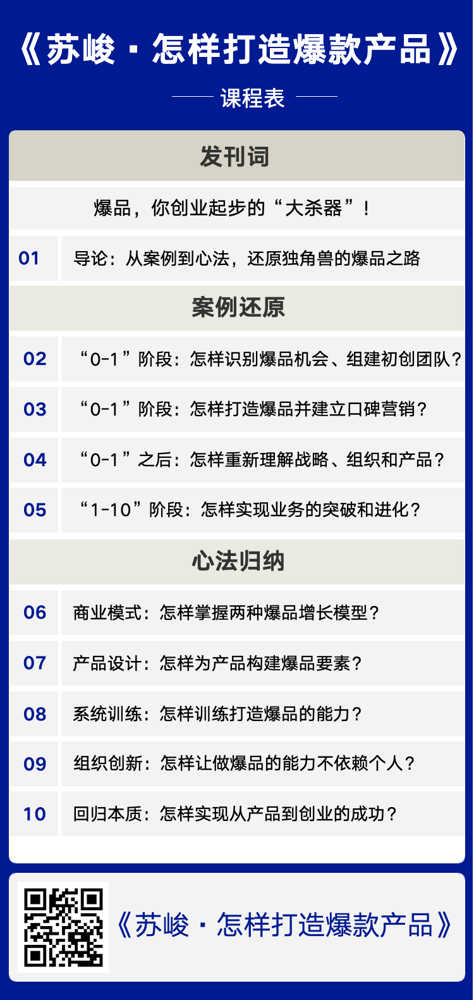
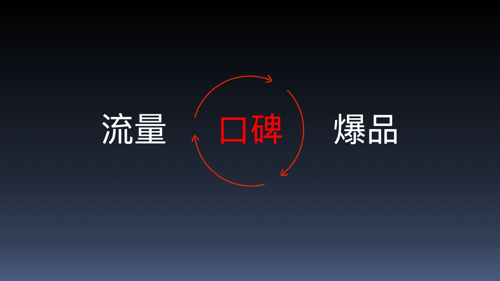
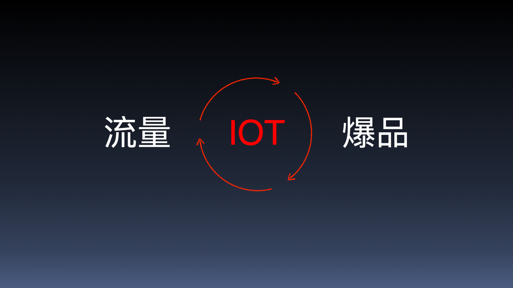
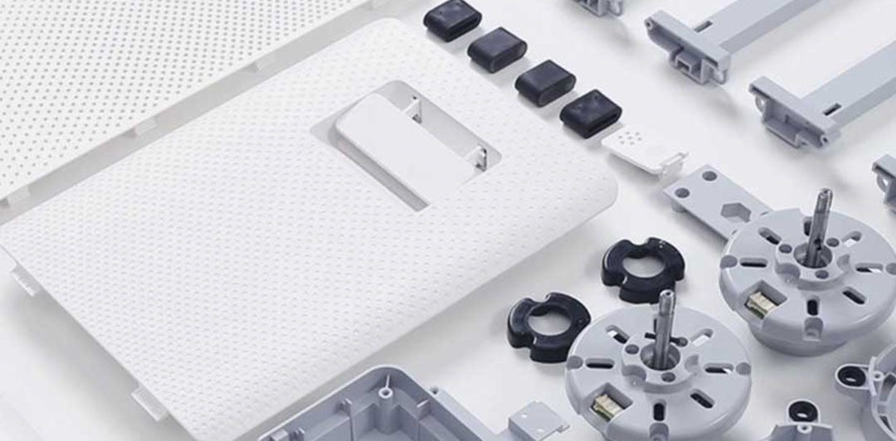
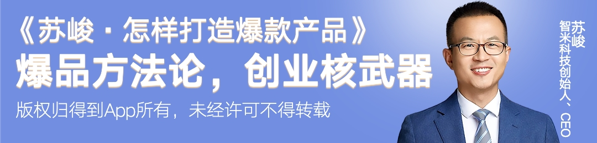
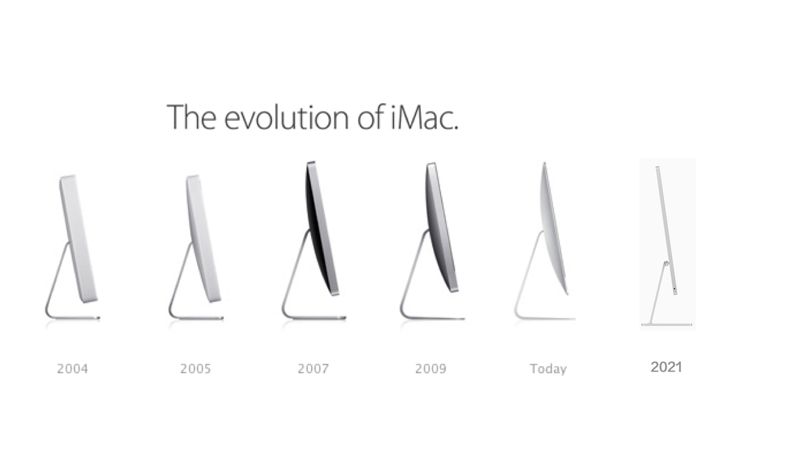
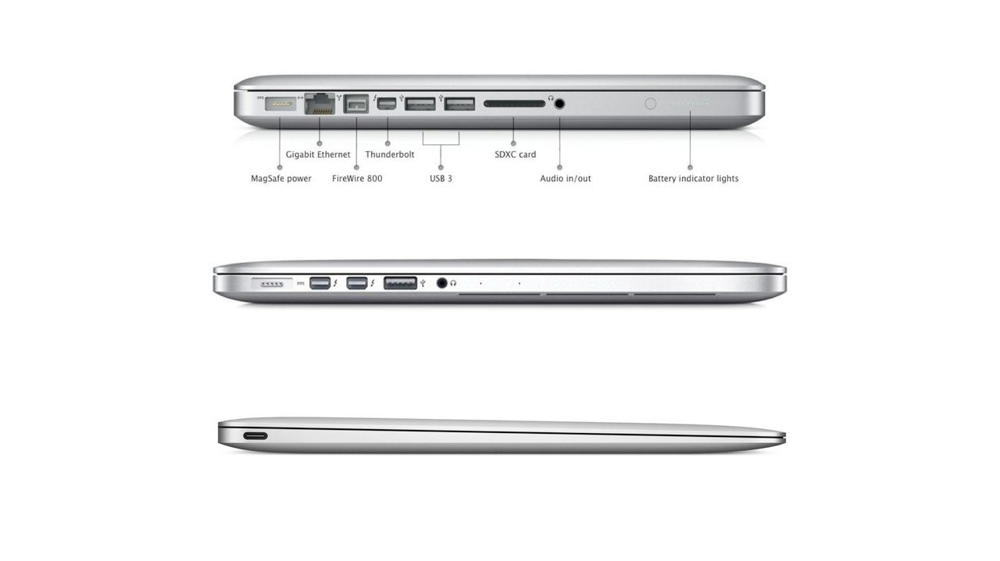
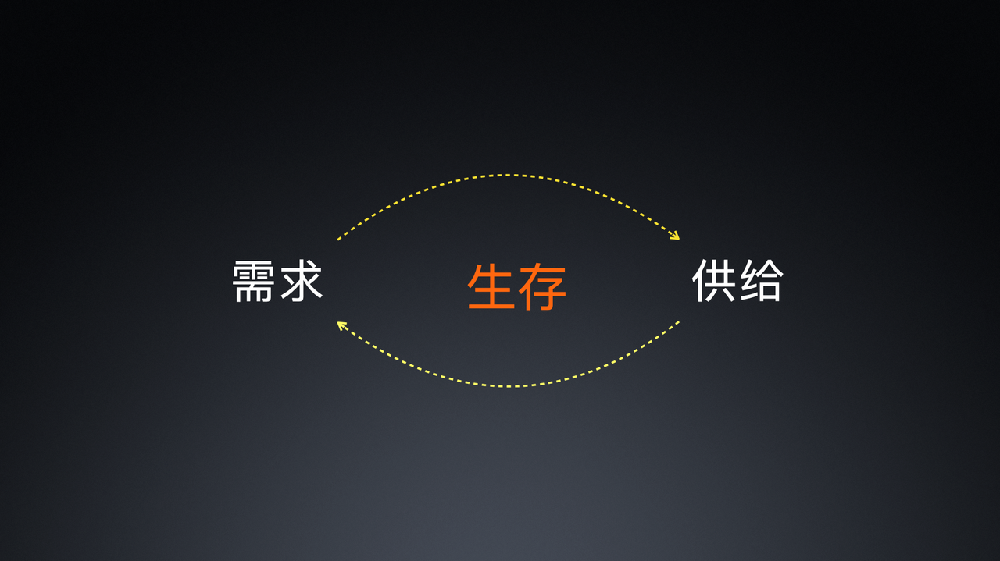
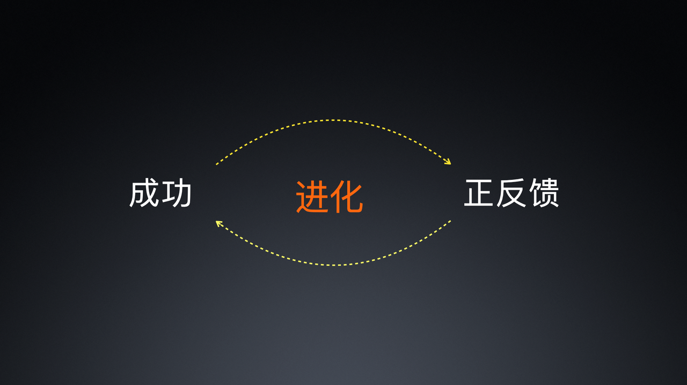

# 苏峻·怎样打造爆款产品(公众号懒人找资源)

> 公众号懒人找资源,懒人专属群分享

群友们好，这是小懒人给大家的《通才计划》更新的课程。

得到上 199 RMB 的课程《苏峻·怎样打造爆款产品》

已整理添加到专属群《通才计划》，几十份付费课程到咱们专属群 Q 群公告自取。

通才计划目录：[`lazybook.fun/#/data/13\_course`](https://lazybook.fun/#/data/13_course)

懒人手册：[`lazybook.fun/#/`](https://lazybook.fun/#/)

懒人专属群：[`lazybook.fun/#/blog/group`](https://lazybook.fun/#/blog/group)

专属群更新记录：[`lazybook.fun/#/blog/record2`](https://lazybook.fun/#/blog/record2)

* * *

## 目录

苏峻·怎样打造爆款产品(公众号懒人找资源)  
 目录  
发刊词｜爆品，你创业起步的“大杀器”！  
 为什么和苏峻老师开发这门课  
 他会怎么给你讲这门课？  
 谁适合学这门课？  
01 导论：从案例到心法，还原独角兽的爆品之路  
 从象牙塔到生意场  
 这门课我会怎么讲  
02“0-1”阶段：怎样识别爆品机会、组建初创团队？  
 02 “0-1”阶段：怎样识别爆品机会、组建初创团队？  
 识别机会  
 组建团队  
 定义产品  
03“0-1”阶段：怎样打造爆品并建立口碑营销？  
 产品打造  
 产品传播  
 小米生态中的假定成功原则  
 专注、极致、口碑、快  
04“0-1”之后：怎样重新理解战略、组织和产品？  
 创业者的迷失  
 使我跌落谷底的三大困惑  
05“1-10”阶段：怎样实现业务的突破和进化？  
 唯有深挖自己，才能获得原始动力  
 从机会主义到战略规划，需要达成共识  
 从单一爆品到产品矩阵过渡的两种策略  
 管理是门科学，到你该主抓的时候了  
 产品 or 组织？  
06 商业模式：怎样掌握两种爆品增长模型？  
 爆品不只是产品，更是一种商业模式  
 规模效应与差异化创新  
07 产品设计：怎样为产品构建爆品要素？  
 通用设计就是降低用户使用难度的设计  
 字少也是一种极简  
 超预期可以激活用户的分享欲  
08 系统训练：怎样训练打造爆品的能力？  
 人和物的密切关系  
 同理心是产品人的重要思考原点  
 能力圈的三种状态  
 观察和换位，需要刻意练习  
 爆品素养训练的底层是哲学思考  
09 组织创新：怎样让做爆品的能力不依赖个人？  
 识别人才，找眼里有光的人  
 培养专家型团队  
 产品创新要平衡目标与自由  
 让团队进化  
10 回归本质：怎样实现从产品到创业的成功？  
 爆品的本质，以简求真  
 产品型创业的两点一线  
结尾

* * *

# 发刊词｜爆品，你创业起步的“大杀器”！

你好，我是得到课程主编祝子。你现在看到的这门课，是由智米科技创始人、CEO 苏峻主讲的《怎样打造爆款产品》。我将为你介绍为什么我们要和苏峻老师合作开发这门课，以及它对你有什么价值。

说起“爆品”这个词儿，咱们都不陌生，都明白它的意思，所有做产品，或者在创业的人，都希望自己能做出一个甚至多个爆款产品，继而带来极大的影响力和商业价值。

人人都想做爆品，可是到底多爆才算爆呢？你看像 iPhone、可口可乐、福特 T 型车等等这样在全世界范围都带来了巨大影响的产品，我们当然会毫无疑问地说，它们是爆品。但也有很多产品，生命周期没有那么长，昙花一现，可出现的时候的确是掀起了挺大风浪，获得了不少关注，它们是爆品吗？似乎，也是？至少你可能会说，它们曾经爆过。甚至啊，咱们现在有时候做十个产品，只要有一个比其他九个要卖得好，咱可能都会说，这个可是我们这的爆款产品。比如去饭店，菜单里卖得最好的那道菜的名字旁边，写个“爆”字，一个卖拖鞋的淘宝店，也可以给店里最畅销的款式，挂上“全网爆款”。

你看，很多时候我们都是感性地知道，爆品就是卖得好的、用户喜欢的，但对于那个标准，我们往往并没有那么明确的、统一的共识。

小米的创始人雷军，在他 2022 年出的新书《小米创业思考》中，对爆品做了一个定义，里面有四个关键词，叫做

单款、精品、海量、长周期。

单款的意思指的是产品越精简越好，最好是一款产品，是一个标准品，就像 iPhone，哪个国家卖的都一样；那精品自然不用多说，就是品质要好；海量指的是这个产品能以单款最大规模地复制；最后，长周期，这个要素似乎是我们比较少地会去苛求常规爆品的，当然，那些最成功的爆品，一定都是生命周期足够长，能穿越时间，成为经典。

听到这儿，你可能会说，如果能具备这四个要素的产品，那当然是不可多得的好产品、爆品了，可是这件事可没那么容易吧？

确实不容易，甚至可以说是非常不容易。但是，如果我们能摸清楚这四要素标准下的爆品它背后的规律，找到一条能和自己的优势相结合、且行之有效的落地路径，不一定能造出经典，但想要打造出一个能超越同行的小爆款，也是一定会有的必然性。

这一次，在探索和学习究竟如何打造像这样的爆款产品的路上，我们毫不犹豫地，把目光投向了有“爆品生产线”之称的小米生态链。

## 为什么和苏峻老师开发这门课

这些年大家都有目共睹，在小米生态链上，诞生过一个又一个百万、千万级别的爆款产品，也跑出了多家上市公司和独角兽企业。  
一时间，有媒体评论称，“小米生态链，款款皆爆品”。而在这个创造了无数“爆品神话”的生态系统里，我们把目光又聚焦在了智米科技。2014 年智米成立，它是小米孵化的最早期的生态链公司，仅仅用了三年时间，就成长为一家估值十亿美金的独角兽。

比起“小米”，“智米”这个名字你也许相对陌生，但是提到他们的产品，你一定有所耳闻。2014 年刚刚成立之初，它推出了第一个产品，小米空气净化器，出世即爆品。这个产品在投入市场的第一个财年后，就做到了全中国市场销量的第一位，单就小米空气净化器 2 代这一个单品，在全球的销售量就超过了 500 万台，这在整个家电领域几乎是一个没有过的现象。我举个例子来说，过去家电行业比较大的爆品是什么样的量级呢？就比如说空调吧，在空调这个领域，一般来说单品销量超过 30 万台，就已经可以定义为爆品了。而截至 2022 年，小米空气净化器，已累计销售达 1700 万台。

只用一个产品，就为智米的创业之路开疆拓土，打响了胜利的第一枪。在这之后，智米又布局了加湿器、电暖、 风扇、空调等产品矩阵，  
提供智能家庭整体环境健康解决方案，凭借着产品创新和高性价比，很多产品在销量和口碑上都取得了不错的成绩，还拿下了国际上很多设计大奖，对整个小米生态链上的产品设计风格的建立，都起到了非常重要的作用。

说到这，我估计你已经跟我一样，迫不及待地想要去更深入地了解一下，智米到底是如何打造出这些爆品的？这一路走来，有哪些经验是无论生态链里外的公司都可以借鉴的？在这当中，所有做爆品的心法，从 0 起步成功创业的心得，无疑有一个人是最清楚最有感受的。很高兴我们把他请来了，智米科技创始人、CEO 苏峻老师，来为你揭开这些问题的答案。

说起苏峻老师，他在创业圈也是一位“非常规”创业选手，不走寻常路。他身上有这样的几个经历标签：清华大学设计艺术学博士，在大学里做了 14 年的老师，后来做到工业设计系的系主任、教授，39 岁毅然走出象牙塔开始创业，带领团队打造出小米空气净化器这个名副其实的大爆品，用 3 年的时间让智米这家公司成长为独角兽企业。

你看，苏老师身上的角色实在是丰富，

既是懂专业的设计师、产品人，又是转型成功的创业者、管理者、企业家，既在打造产品上有极为细致、落地的方法论，又在商业模式和组织管理上有清晰的全局观。

说起来，距离苏峻老师上一次公开地做关于产品的系统性分享，已经是三年前了。而这三年，在经历了不同的经济形势、企业发展的不同阶段后，苏峻老师和他的智米团队也有了很大变化，从识别机会做爆品，靠业务驱动来拉动公司的成长，到逐渐地具备系统思考能力和战略思维，来对企业做更成熟的管理和布局。苏老师说，这三年其实是整个创业期中一个非常痛苦和煎熬的过程，而他呢也有一个小小的私心，就是借由和得到合作这门课程，将这三年最新的思考做一个系统的整理，站在当下的位置，再用最新的视角回看爆品、创业、组织与管理，也希望这些最新思考能让更多的创业者们可以做一个有效参照。

## 他会怎么给你讲这门课？

那这样一位“非常规”的、集多重身份于一身的企业家，又会怎么来给你讲这门课呢？会不会也不走寻常路？

没错。

你已经看到我们的课表了，

这门课程分为两个大模块，案例还原，和心法归纳。

在案例还原这部分，苏峻老师作为案主本人，为你还原一个可以让你照镜子的大案例，他会给你讲他是如何在 0 到 1 阶段，从业务和产品出发，用非常快速的方式去达成一个突破点，达成创业的成功。

而 0 到 1 之后，他也像无数的创业者一样，陷入到困扰之中。有时候是个人成长的不足，有时候是环境的干扰。而他在这个痛并快速成长的过程中有什么样的思考和校准方法，也都会毫无保留地分享给你。

然后他会给你讲当企业来到 1 到 10 阶段，已经获得了一个稳定的基盘，那创业者在这个过程中应该如何完成自我蜕变，以保证一个以做好产品为使命的企业，具备继续向前走的能力。

你看，这部分是他整个创业过程的大案例，当然，大案例中也会有很多小案例，包括拆解小米空气净化器这个大爆品是如何炼成的。

而在第二模块心法归纳中，苏峻老师会站在当下，给你系统地讲述如何打造爆款产品，以及如何强化做爆款产品的能力。他还会给你讲如何建立和培养产品创新型组织，让做爆款产品的能力沉淀在组织上和系统上，而不是简单地依附在创始人个人身上。

你看，光从这个讲述顺序来看，确实有那么一点“非常规”。为什么要这么安排呢？苏老师说，假如他还是作为当年那个大学教授，今天来给你讲怎么做产品做爆品，他也许会按教科书的方式，一上来先从很多的概念啊、理论啊、分析啊等等给你讲起。但是，现在的他，用了近 10 年的时间，作为一个产品型创业者，亲历了 0 到 1、1 到 10 这所有的一切过程后，才更加深刻地认识到，

爆品的本质不单单是一个产品，更是一种商业模式，

它需要你站在一个更全局的视角来看问题，才能真的理解它的本质，才能知行合一。

所以，想更好地学习做爆品，就得先完整感受一个爆品诞生甚至是整个创业的全过程，再去学习从中总结出的心法，才能更好地理解它，也是更切实可落地的最佳方法论。那在案例模块中，咱们就可以就先跟着苏峻老师，从 0 到 1 再到 10 的，来一次创业！

## 谁适合学这门课？

说了这么多，这门课适合谁来学呢？

首先，我要邀请广大创业者来学习这门课程，如果你希望通过打造爆款产品，来完成从 0 到 1 的突破，实现公司的快速增长，那在这门课里，你已经是在另一个平行时空感受了一场独角兽的创业，你一定会很有收获。

然后，我要推荐企业的创始人、中高层管理者们来学习，你可以在这套课里，带走小米生态链的爆品方法论，构建出能持续打造爆品的产品力和组织力。

当然，我还要推荐给所有的产品人，包括工业设计从业者，你们可以在这套课里以一个更顶层更全面的视角，来审视自己的产品全景，精进自身的优势，获取更大的商业价值。

以上就是我对这个课程的所有介绍，在发刊词的最后，我想再送给你苏峻老师的一句话。他说：

如果你是一个创业者，0 到 1 阶段你可能没钱，也没人，也不会管理企业，也不知道企业的运营、组织效率从哪儿来，那这个时候，爆品就是那个唯一的能弥补和对冲你所有弱点的东西。它是那个最强悍的“大杀器”。

得到同学，期待你也拥有这样的“大杀器”，能在属于你的那个痛并快乐着的创业之路上，杀出重围。

这门课程的主讲人苏峻老师，在课程里等你。

  

* * *

# 01 导论：从案例到心法，还原独角兽的爆品之路

[懒人专属群](https://lazybook.fun/#/blog/group)的群友，你好，我是苏峻，很高兴得到“得到”的邀请在这儿跟大家作一个分享。

我来自于智米科技，是小米生态链的头部公司。智米科技成长自 2014 年，当时正是整个中国智能硬件行业生态最繁盛的时候，同时也是小米孵化的最早期的生态链公司。我们在小米体系中快速成长，很快地成

长为一家独

角兽公司，经过九年的时间，今天我们已经从创业的雏形发展成为一个相对稳态的中型企业。

但这九年来，想一想恰恰是这三年多以来，没有在公开场合做过什么分享。因为在小米生态链刚刚早期蓬勃发展的时候，整个行业的热度非常高，也有很多的机会跟各位朋友一起交流。但是这三年多以来，一直在默默地，或者说静静地修炼自己企业的内功。

回想起来这三年的变化是非常大的，从一个识别机会做产品，靠业务驱动拉动公司的创业者，逐渐成长为一个具备一定系统思考能力，具备一定战略思维的企业管理者。这三年之所以没做分享，是因为这三年其实是整个创业期中一个非常痛苦和煎熬的过程。每每反思起来会发现有的事情自己做得不对，自己思考得不全。所以在这个过程中，既没有了分享的时间，也没有了分享的心态。

前一段时间，得到的老师向我发出了盛情的邀请，忽然触发了我跟大家分享的强烈愿望。我在想，

我的整个创业过程，或者说这九年的创业过程，恰恰是一个非常有趣的，从创业期、痛苦期到稳定发展期的案例。

如果把这个案例按照时间线跟大家讲出来，可能会对大家起到很好的参照和启发作用。

## 从象牙塔到生意场

好，接下来我给大家讲讲我是怎么从一个大学老师变成一个创业者的。从大学老师变成创业者，是一个巨大的转换，这发生在九年前。在 2014 年的时候，其实我已经在大学做了 14 年的老师，我是大学的系主任，同时也做到了教授的职位。如果按照一个正常发展的时间线，我会沿着这条路一直走下去，因为我本人是非常喜欢教育教学这个岗位的，可以说站在讲台上，我会很开心、很兴奋。而我也同时得到了学校和同学们非常正向的评价。

在小米雷军总的引领下，德哥，刘德（小米联合创始人）他是我 20 多年的朋友，忽然找到了我。他说他要做生态链这件事。为什么找到我呢？因为我们在以前的交往过程中有过很好的信任基础，他认为做生态链这件事要做得快、准、狠，所以他说他先翻自己的通讯录，去找他熟悉的人，他认可的人，大家能够快速地协同和打成一片的人，这个时候就找到了我。

我印象中我们是在一个非常简单的环境下，做了一个非常透彻的深聊。德哥说，现在有一个大的机会，可能稍纵即逝，如果你抓住了，可能成仙。当然这个只是我们的一个玩笑，他的意思是说，可能会让你快速地成长，让你跟现在比会发生很大的变化。当时主要的市场机会识别，是空气净化器。

他的逻辑是什么呢？小米在手机端已经做到了一个相当大的规模，当时已经做到了每一年的手机销售量是几千万部，当然到今天，每一年的手机销售量都已经超过了两亿部，但在当时几千万部也是一个非常大的量。

这个时候小米做了一些手机周边的产品，这儿产生了最好的生态链公司。比如说紫米科技，它做移动电源，因为我们知道每一个手机其实都大概率会有一个移动电源的配置。接下来又孵化了万魔声学，它是来做耳机的，因为耳机对于手机来说也是个标准化的配件。这两家企业在这个以手机为带动的体系下快速地成长。这时候雷总其实做了一个更大的布局，他要做智能家庭的 IoT（Internet  
of Things，物联网），也就是说面向未来的以物联网为核心的这套产品服务体系。

如果要切入到 IoT 领域，智能家电就是非常重要的一个领域。

因为我们知道家电长期以来处在一个相对传统的、固化的这样一个阶段，但智能性产生的协同性，跟用户密切的关联性，能够深刻地改变整个家电产业。

所以我们就把智能家电做成一个重点突破的状态。

而在家电里面，实际上我们必须找到一个突破口。假设我们做空调，做风扇，这样的行业既有传统的巨头，同时整个行业也没有什么痛点，我们就没什么机会，所以在这里面，空气净化器变成了一个非常有机会的领域。

2014 年的时候大家知道不像现在，是一个所谓叫绿水青山的生态环境。那个时候其实空气雾霾的污染是非常严重的，

空气净化器变成了很多老百姓的刚需。但是市场的产品非常的分散，也非常的多，同时用户选择产品也很困难

。

所以这个时候就把这个做成了创业的突破口。

我跟德哥在聊这件事的时候，实际上我们是有一个规划，我们设想的是把这一仗打赢，智米这家公司也就建立起来了。但是这时候就又回到一个深刻的问题，就是说加入小米生态链就要涉及到一个从大学离职的问题。从一个大学的教授转向一个创业者，这是一个非常大的人生转换。但我仔细地考虑了一段时间，然后还是跟德哥说 yes，我要加入。在这里面，实际上就是一个对个人发展和个人核心能力的识别。

在那样一个创业阶段，我也意识到，创业的机会实际上是稍纵即逝的。而在做老师跟做产品之间，我最后还是果断地选择了做产品。做老师是让我很快乐、很开心的一件事情，但做产品是我的梦想。

我一直相信，其实每个人来到这个世界上都有自己的角色。这个角色在某些程度上是与生俱来的，因为从遗传的角度来说，每个人身上都承载着过去的某些信息。

每个人都有自身的，在这个社会中的角色跟天分。如果我们能把这个识别出来，发挥到最大，可能是一种最精彩的人生体验。

当我决定要加入生态链的时候，我跟德哥再聊，德哥又跟我说了一句话，他说你确定好了吗？我当时也是，怎么说，脑子里有些波澜。我说本来是你努力地在说服我加入，当我决定加入的时候，你要跟我问这个问题，为什么呢？德哥说，这是一条不归路，你要想好了再来。我认为他是完全出于一个朋友，出于一个负责任的角度，在跟我很认真地谈这句话。这是一条不归路，这是一个你需要义无反顾做的事情，你想好了再来。

现在回想起来这句话，应该说是发自内心的一种提示。因为创业九年以来，我发现创业就是一条不归路。创业的过程中，你会有非常开心的时候，非常顺的时候，但更多的时候，是非常痛苦、非常煎熬，不断地学习、成长、寻求蜕变的时候。所以我今天主要的想法，就是要把我这个过程，完整地从一个真实感受者的角度，完整地分享给大家。

## 这门课我会怎么讲

好，接下来我说一下我要如何讲述这门课程。这门课程我刚才说了，其实它是一个案例，它是一个大家可以照镜子用的案例，我会用一个时间线的方式来讲。它不像教科书一样，可能出现很多的概念和概念的分析，我就是用一个创业者的时间线来讲。

首先，我会给大家讲我如何做 0 到 1。因为做 0 到 1 的时候，你会从业务出发，从产品出发，组建一个非常精悍的团队，用非常快速的方式去达成一个突破点，达成创业的成功。

接下来，我会讲述 0 到 1 之后。因为 0 到 1 之后，每一个创业者，或者说我目光所及的创业者，所有的人都会陷入到困扰之中。而这些困扰有多方面，它有的时候是个人能力的局限，有的时候是成长的不足，有的时候是环境的一种干扰。而 0 到 1 这个过程中对于创业者来说，是一个痛并快速成长的过程。

接下来，我会讲述 1 到 10。1 到 10 它意味着企业已经获得了一个稳定的基盘，具备了一个继续向前走的能力，而创业者在这个过程中也会完成从创业者到企业管理者的蜕变。

最后，我会站在当下，系统地讲述如何打造爆款产品的过程，然后爆款产品的定义、爆款产品的类型，以及如何学习做爆款产品的能力。

当然，我还会提到，如何建立和培养产品创新型组织，让做爆款产品的能力沉淀在组织和系统上，而不是简单的依附在创始人个人身上。

以上就是课程的全貌，也是我们一起学习的路径。我希望在每讲之后，大家能给我一个反馈，这样也能够帮助我去更好地提炼和修整我后面的课程，同时也让我有机会跟大家互动，相互地学习。

以上就是这个课程的导论，下一讲就是我们这个课程内容的开始，我会给大家讲产品创业中如何从 0 到 1，爆款产品是如何在整个从 0 到 1 的过程中起到核心关键作用的。

下一节再见。

* * *

# 02“0-1”阶段：怎样识别爆品机会、组建初创团队？

## 02 “0-1”阶段：怎样识别爆品机会、组建初创团队？

[懒人专属群](https://lazybook.fun/#/blog/group)的群友，你好，我是苏峻，欢迎来到我的课程。接下来我们进入第二讲。

这一讲我们讲述创业的 0 到 1。

首先我们回到 0 到 1 这个创业阶段。

在 0 到 1 这个阶段里面，爆款产品是最核心的竞争力。

我们来这么解释吧，如果你是一个创业者，你对比过去在这个行业中既有的成功者，你的优势是什么呢？

首先肯定不是钱，因为正常的创业者都是用一种融资的方式，历经千辛万苦从投资人那获得了初始发展资金。这个资金和那些传统巨头相比，肯定是微不足道的。

第二点，也肯定不是人。因为你的团队无论规模，无论你建制的完整性，甚至包括你综合性的人才水平，你跟这些传统的巨头相比，一定也处于劣势地位。

但是我们知道，

一个企业在整个创立、发展过程中，最核心的东西是什么呢？是满足用户需求，创造用户价值。

但创造用户价值的过程中，企业要获得增长，要给股东提供回报。而整个过程中，竞争最核心的武器是什么？是效率。

如果你的效率等于常人或者甚至比别人还低，那你注定不可能创业成功。

所以我们再回到为什么爆款产品这么重要，

因为爆款产品就是创业团队效率的核心优势。

所以我们把爆款产品称为产品创业中最大的杀器。

我们识别了爆款产品重要的作用，接下来我从五个方面，跟大家说从 0 到 1 是如何具体的去打造爆款产品的。

## 识别机会

好，现在我假设你是一个创业者，你要开始的时候一定是什么呢？是发现了一个机会，我并不是说是机会主义的这种，短期的投机性的行为。它一定是什么呢？一定是发现了一个用户没有被满足的需求。用户没有被满足的需求就是商业价值的原点，或者我们说得再生动一点，叫用户痛点。

商业价值的规模或者说商业价值的大小，对社会贡献度的大小，它就来自于痛点本身。

而痛点越痛，商业价值就越大。

什么概念呢？比如说有一件事情，用户觉得非常的痛苦，非常的难受，他恨不得马上要解决掉这件事。所以如果出现这样的痛点，它就意味着巨大的商业机会。为什么呢？因为用户在这端的痛足够痛的时候，就证明他的需求足够强，也足够大。所以机会识别、痛点的识别，就成为创业的第一步。

但是会有一个误区，有的人说我发现了很多的用户痛点。或者说我发现了很多的用户需求。这个是创业者往往会犯的第一个错误。机会的识别和痛点的识别一定是聚焦的，一定是效用最大化的。也就是说，当你作为一个创业团队，你没有钱也没有人的时候，你能做的事，是从一个点开始的，而不是从一个面。

我们设想一下，如果我做一个产品追求大而全。我发现用户在这里面有十个不同的需求我都要满足，这个时候你会发现，你在产品痛点的识别上出现了一个很关键的误区，就是你没有聚焦。

用户只有在这种最核心的痛点上，才愿意去尝试新的产品，才愿意付出一定的代价，或者说承担一定的价格来解决这个问题。

所以机会识别这一点，核心是要识别到用户最大的痛点。

具体到我们的案例本身来说，空气净化器这个产品，其实在当时是用户一个非常痛的东西，为什么呢？因为当空气的雾霾值达到了一个非常高的状态。其实在当时，天气预报或者空气质量预报中，大家也开始明确的标志出 PM2.5 的值以及它对人体的危害。这个市场教育完成之后，几乎所有的城市用户都认为他需要一台空气净化器。

但这个时候市场出现了什么状态呢？不能够满足，因为整个行业是非常分散的，整个行业的价格，这个产品价格是虚高的。整个行业所提供的产品，并非针对用户核心需求来打造的。所以，这个时候用户出现了非常大的选择困难，或者因为品牌信任度不够，或者因为产品功能不够好，或者因为价格太高。总而言之，呼吸空气这件事对于每个人来说都是平等的。从我作为一个消费者的角度来说，我觉得非常痛。因为我面对着这样一个问题，我无法找到一个具备一个合理价格和合理性的解决方案。

所以在这一点上，我们一定要识别出这个行业最大的问题是什么。如果我们把这个最大的问题找出来，把用户最强烈的，没有被满足的需求找出来，我们才能有一个创业的原点。

## 组建团队

第二步，假设你是个创业者，你发现了需求，第二步要干什么呢？当然是建团队。因为一个好汉三个帮，一个巴掌拍不响，一个人单打独斗的创业是不可能的。任何一个产品的创新，产品整个的产业都是一个系统协同的过程，所以你需要团队。

在团队的组建上，我给大家一个创业者建立团队非常有效的词来描述，叫“任人唯亲”。很多人肯定马上会觉得有些不可思议，明明是任人唯贤，怎么可能任人唯亲？任人唯亲其实在我们的成语里是个贬义词。它表示我们是基于关系，而不是基于能力来选择人，所以在这儿其实我的课程大纲里是打引号的。

“任人唯亲”这件事的关键是什么？关键还是围绕着效率来做的。因为如果你是个创业团队，你需要最短的团队磨合时间。团队最短磨合时间最好的基础，就是你对这个团队的人事先有信任，有了解的基础。

最好的方式是大家相互之间都有信任和了解的基础。

你会发现，这个团队实际上你的管理成本会极大的降低。你们的磨合成本会非常低，你们进入状态的速度会非常快，最终还是回到把效率提升这件事上。

“任人唯亲”具体怎么做？我给大家讲讲我是怎么做的，我是从小米生态链的德哥那得的真传。我是先

梳理我的通讯录

。那会儿微信还没有那么普及，我们就是把我们过去的电话本里面，可能几百个甚至上千个联系人全部弄出来。然后我们一一对应，我们看这里面到底有没有我们以前连接过的，可以建立信任的，且在整个过程中能够嵌入发挥作用的人。可以说，团队的第一波人我就是这么找到的。但是单靠一个人的关系链条，你是无法把这些人找全的。

好，这里面还有第二点，叫

用熟人的熟人

。熟人的熟人有一个什么好处？实际上他虽然有间接的信任关系，但他也比你从社会招聘的角度，找到一个陌生人去建立信任的成本要低。且大家回想一下，当你们还是一个初始团队的时候，你有完整的人力资源部门吗？如果没有完整人力资源部门，你怎么去识别和做社会招聘呢？你连组织上支持这件事的基础条件都不具备，所以要用熟人和熟人的熟人。当然在这个里面，你核心是要把这些关系链条上的人的核心能力搞清楚，让他们能够嵌入和支持你的创业过程。这个时候你就获得了一个磨合成本最低，效率最高的团队组建方式。

作为一个在产品这个专业领域中沉浸了十几、二十几年的一个人，其实我的社会关系是能够支持我找到这些人的，同时我的朋友圈也可以再扩展着找到相应的人。所以这是我们的人才基础。

## 定义产品

好，接下来我们就要进入第三步。第三步做什么？当然是做产品，而做产品的第一步是定义产品。产品定义这件事情其实是很大程度上会决定你创业的成败。

产品定义定的是创业团队的战略方向。

如果你的战略方向搞不清楚，你大概率会失焦，会耗散，会打不准这个市场，导致错失目标。

说到产品定义，它的核心是聚焦、专注、做减法。因为当你们还是一个创始团队、创业团队的时候，你在人力和资源上有限。所以这个时候，你一定要把你的所有力量，集中在能够满足用户最核心价值的这个区域里面。

以空气净化器为例，我们说这个产品为什么在当时走向市场的时候产生那么大的爆发力？小米空气净化器投入市场的第一个完整的财年，就做到了全中国市场销量的第一位。小米空气净化器 2 这个产品，在全球的销售量超过了 500 万台，并且还是一个单品。这个在整个家电领域是从未出现过的现象，一个单品卖 500 万台。因为我也曾经了解过，跟家电行业沟通过，在家电行业什么叫爆品呢？家电行业比较大的爆品容易出现在什么领域呢？是空调，但是在空调领域的爆品一般是单品销量超过 30 万台以上，就可以建立一个非常好的盈利模型。大家可以想像一下，当一个单款产品销量超过 500 万台的时候，它会带来多大的规模效应，以及效率上的本质改变。

在做这个产品的时候，实际上我们有一个很细微的观察。中国大部分家庭的房间单体面积在 30 平米以内，即使一个客厅，总体也在 30 平米左右。

另外，用户当时为什么对净化器产生那么大的需求？核心就是一个污染物，叫 PM2.5。因为 PM2.5 在当时从一个很疏远的科学概念变得深入人心，所有人都了解它了。大家知道我们的呼吸系统是无法阻隔 PM2.5 的，PM2.5 会进肺，然后通过毛细循环进入血液，最后对身体造成无法逆转的伤害。所以用户看的就是这个产品能不能去除 PM2.5。

好，我们整个产品实际上去掉了几乎其他所有的功能。我们第一代产品把所谓的除异味、除甲醛、分子筛、等离子体等等所有过去空气净化器上叠加的功能全部去掉。

我们只关注一件事，30 平米以内空间 PM2.5 的快速去除。

当然我们后面还有一个很重要的定义就是精准检测。精准检测这件事能够给用户提供明确的反馈，比如说我房间的 PM2.5 现在爆表，非常高。但当我开启净化器之后，几分钟之后它变成了个位数，使我的房间进入了一个非常洁净的状态。用户在这种反馈机制的情况下，他会意识到这个产品非常强劲的作用，进一步的让他认为这个产品是好产品，是他的刚需产品。

所以我们在聚焦的时候，大家注意到只有一句话，30 平米以内的空间 PM2.5 的检测和去除。这个产品的出发点就变得非常的精简。

如果一个产品的出发点变得精简，你会发现你后面一连串的连续动作就会变得精简。

因为你需要的研发，你需要投入的资源，你需要最后所获得的供应链的支持，以及你最后向用户传达的价值都会变得非常聚焦。它是一系列的效率提升动作，而且用户恰恰需要的就是这个。

好，产品定义好了之后就要进入产品打造。

下一节再见。

* * *

# 03“0-1”阶段：怎样打造爆品并建立口碑营销？

[懒人专属群](https://lazybook.fun/#/blog/group)的群友，你好，我是苏峻。接下来我再仔细讲一下产品的打造和传播。

## 产品打造

产品的打造里有两个关键词，就是极致和快

。

我们来看极致这件事，可以从三个角度来入手。第一个，我觉得应该叫成本，或者我们叫性价比。第二个，它的美学和品质。第三个，我觉得就是它的性能，这个产品本身的能力。从这三个点入手，我逐一给大家分解一下空气净化器这个产品是如何打造的。

首先，从成本角度来说，这个产品我们应该做得足够便宜。

为什么？因为净化器从早期作为生活品质的附加品，在当时（2014 年）变成了刚需品。刚需品意味着什么呢？意味着这个东西要为我解决生活的基本问题，所以我们有义务把这个产品做得足够便宜。因为当时市场上的产品大部分价格都超过了 3000 元、4000 元，这个价格其实对应这个产品，对老百姓来说是非常贵的，甚至还有大几千、上万的机器。

把价格做下来的一个很重要的原因，就是我刚才提到的产品定义中的精简跟聚焦。

一旦你精简、聚焦了，你就有了一个好的原点。再有，在整个设计和开发过程中，要从这个性价比或者低成本的角度入手去把控每一个环节。

这里有一点很重要，

低成本并不意味着这个产品要用差的原料、差的工艺或者在各个方面去节约成本，它其实是一个精简意义上的高品质

。

我举个例子，实际上我们的整个产品在设计开发的时候，我们用了一些降维打击的工艺。比如在产品的电子电路和软件控制设计上，我们用了大量来自于手机和移动互联网行业的结构工程师。他们一开始就在产品的集成度、可靠性上有超越这个行业的经验。这个时候他们就能把这个产品做到精简，也就是说产品本身

元器件的数量就比过去的产品减少了很多，甚至减少了 40%。

所以这个产品本身它就变得精简。

再有，我们利用了高集成度和面向未来的自动化生产方式，这是种提升生产效率、以终为始的设计方式。然后让这个产品一开始就面向大规模的生产和制造。所以一旦效率提升起来，它的整个制造成本就会显著的下降，所以这个产品从一开始就是按照性价比方式去打造的。

第二点是审美跟品质。

这个不得不提一下我们团队创业的初心，其实我们团队中非常核心的人员都叫产品控、产品极客。大家都是喜欢那些好的、精致的、有科技属性并且能为我们创造美好生活的产品。我们进入家电行业，其实大家是有一种激情创业的心态的，为什么呢？因为我们认为，在当时的家电行业里，产品的品质确实跟整个中国经济发展和人民生活水平的品质不相吻合。

举个例子，我们用的是非常精致的手机，但当我们买回来一台家电的时候，发现什么呢？发现包装粗糙，甚至还有毛刺。功能说明不清，操作体验也很差。甚至由于原材料的不好，会导致有些不良的气味，可能还对人体产生危害。这个都是因为整个家电产业长期处在高度内卷型的，成本价格竞争导致的。其实是忘掉了真正的用户核心价值是什么。因为家电是我们生活的伙伴，它是 24 小时在你家里默默为你服务的。如果它的品质不够好，它的审美不够好，它其实会变成我们的一块心病。它会变成我们整个家居环境中的一个 bug（错误），其实我们就是来解这个 bug 的。

家电其实在某种程度上是你家庭的一部分，是你的一件家具。

如果它的美学不过关，它很丑，它很粗糙，我们会在生活中始终觉得有块缺憾。

可能我们这个团队创业的激情很大程度是来自于这儿，我们希望把家庭变美变漂亮，把这个 bug 给它解掉，把这个污点给它抹掉。所以我们在这儿非常重视审美跟品质设计。

我举个例子，我们产品的模具实际上用的是复印机和打印机同精度的模具。这个模具的特点是什么？

它的

精度会比传统家电所用模具的精度高

，

当然成本也高，大概高出三倍左右。

怎么来解释这件事？产品实际上是有精度差的。手机的精度非常高，然后复印机、打印机这种办公的产品电器在第二个层面，再往下是家电。

我们用这种降维的方式，把家电做到了复印机、打印机的精度。

当然，我们也不能说要把家电做到手机的精度，这个就会发生错配。因为手机是我们天天拿在手里的，家电跟我们始终保持一米以上的距离，所以当精度到一个阶段的时候，它的用户感知力就不强了，所以不能用手机的工艺。但是我们可以用超出过去家电的这种工艺。我举个例子，比如我们零部件之间装配的段差做到 0.3（mm），而不像手机的 0.1（mm）。这个时候它给人产生的视觉和感观精度会远远的好于过去的家电产品。你会觉得这个产品很精致，你会对它的品质产生信任感，你会对它的美学产生欣赏感。

再举一个美学的例子。比如大家看我们的这件产品，上面有很多的微孔、小孔，它其实是用来通风的。

我们当时其实就纠结一个细节，因为如果为了最大的通风效率，为了产品最高的性能，你应该把孔径做得越大越好。但是孔径越大，由于视觉的混色效应，你从远处看，因为孔是黑的，所以一件洁白的产品在它的下部就会呈现出一种很深的黑色状态。而黑色会给人有一种脏的感受。我们很纠结，这个孔到底做到多大合适？实际上我们打了很多的手板样件，然后在实验室里做测试。我们测试过孔径 3.3 个毫米、3.5 个毫米、3.6 个毫米、3.9 个毫米，我们是按照一级一级的，每 0.2 个毫米作为一个梯度去测试，测试最后我们找到了一个合理的值。这个值是什么概念呢？从美学角度，看上去很漂亮很精致，但性能完全达成了这个产品小体积高性能的水准。这个时候我们就确定了这个值。

大家可以看到，整个产品由于这个孔精密的排列跟分布，包括对孔径大小的推敲，使它呈现出了一种优雅的美感。我认为这是新一代年轻人能够真实感受到的用户价值，所以我们在这儿也做了极致的追求。

第三点的产品极致是性能。

大家知道，

一个空气净化器核心是什么？是它能够在单位时间内净化的空气量。

而这个空气量如果你无限扩大产品的体积，是可以轻松把量做到很大的。但是我们要考虑一件事，我们的居室面积是有限的。我们居室中所能摆放的物品的体量是有限的。所以我们一定要在占地面积最小的状态下实现最好的功能。所以我们设定了一个性能标杆，同时我们努力缩小这个产品的体积，最终我们达成了什么呢？在不到一张 A4 纸的占地面积上，达成了这个产品的高性能。这个里面有很多的故事，就是如何去优化它的气流，优化它的风道，优化它铝材的材料，让它形成低阻力、高通过性。甚至还要用静电驻极的方式，增强它对 PM2.5 的捕捉能力。

所以看似一个小小的空气净化器，实际上里面有一系列的 Know-  
how（技术诀窍）。通过这些过程，我们把它做到从成本、性价比、美学品质，到它的小体积和高性能的极致。这个产品能够成为爆款，有它很重要的原因，产品、工程、设计、研发，大家这种不懈的追求在里面起了非常重要的作用。

好，接下来我说产品打造的第二个关键词，

快。这是什么概念呢？因为

你做的是商业，你做的不是艺术创作。

快，意味着你能够抓住稍纵即逝的商机。

如果慢，慢工出细活，慢可不可以呢？慢有慢的道理跟原因，但是我认为在创业初期，快是非常重要的。

在这儿我跟大家说一个可能有点反常识的概念，在创业期要坚决地反对完美主义。有人说了，我打造产品就应该完美，完美的产品最后才能感动用户，让用户买单，才能创造商业价值。

但一定要注意，

完美这件事是有条件的，完美是在你能抓住市场机会前提下的完美，而不是无上限地追求完美。

其实可能苹果的故事讲多了，乔布斯的故事大家耳熟能详了，它就会给创业者造成某种误解。让大家以为只有在某些细节上不停地打磨，不停地纠结，才能成就某种状态？但是记住一点，乔布斯他本人是一位伟大的战略高手，也是一位伟大的商业家和企业家。他知道市场机会的重要性，所以你们会看到所有的完美主义，其实都是建立在能够抓住市场稍纵即逝机会这个时间线上的。

比如我们举 iPhone 的例子。在 iPhone4 出来的时候，我们说产品非常的好，但大家知道它的天线门事件吗？产品有没有缺陷？其实是很大的缺陷。当时应该是用右手持握的时候，这个手机的信号会受到非常大的干扰。所以当时甚至出了一个来弥补天线门的一个塑料手机壳，用一个框架壳来弥补这个产品缺陷。但这其实没有妨碍它成为一个伟大的产品，因为它的核心功能，它作为一个手机、一个音乐播放器和一个移动互联网工具，它是非常棒的。

我们想想，苹果还犯了这么大的 bug，何况我们呢？我们在产品端如果追求绝对的完美主义，它一定会让你贻误战机。空气净化器也一样。我们在第一代的时候，实际上由于当时行业的条件限制，整个传感器产业并不是很成熟，所以我们采用了红外线的形式。

红外线形式数字化程度不高，缺乏数据上的高精度。但是我们当时基于这个产品要推出的速度，我们还是在这个产品中用了第一代的红外传感器。

虽然我们当时已经在努力的推进激光颗粒物传感器的成熟跟应用，但还是没来得及。你说这是不是缺憾？我认为是，但我们抓住了这稍纵即逝的商机。

我举个例子，如果智米科技不能在 2014 年把这个产品推出来。大家想想会发生什么？空气净化器是一个季节性产品，我们当时是 2014 年的 3 月份开始组的队，实际上只有九个月的时间来保证这个产品在 2014 年的旺季推出。假设我们错过了这个旺季，将意味着什么？意味着你需要到下一年才能赶上这个产品的销售旺季，由于冬季人们取暖需求和能耗需求比较大，所以冬天的空气污染尤其严重，加上空气流动性也相对较差，这个时候空气净化器会变成一个爆发式的需求。所以只有在冬季，在 2014 年的冬季把产品推出来，才能抓住这个时机。

如果贻误了这个战机，错失了这个战机，耽误到了下一个年度，我可以负责任地讲，智米科技的规模可能是现在的几分之一。

所以大家注意，在产品打造中，快、不追求完美主义也是很关键的。所以在这儿我们讲的就是极致跟快这两件事。

## 产品传播

接下来就是第五步，叫产品传播。

产品传播其实本质上就是卖产品的过程，

卖产品的过程大家注意，其实作为一个创业公司，你会遇到什么问题？

第一，你可能原来的影响力就不够，虽然我们在小米生态链的体系上，但小米是没有做过家电的，空气净化器是它做的第一件家电产品，在家电产品端它的口碑如何建立呢？

第二，你的营销费用实际上是极其有限的。可以这么讲，在一开始我们营销费用叫零预算，因为你在整个融资建立这个公司的过程中，你几乎没有能力在这儿做预算，所以意味着它是零预算，零预算的产品怎么卖？听上去是个不能解的题。

但是我们知道产品或者爆品有这样的能力，也就是产品自身具有说服力，产品自身是能销售自身的，这叫产品传播的裂变。首先我得承认这一点，我们的产品并不是从 0 开始销售的，为什么？因为小米有非常大的手机核心用户群，在这一端我们把这个产品推出来的时候，实际上从手机用户群会获得一个初始的转化率。但是躺在这个转化率上就能成功吗？不会的，因为在生态链的整个过程中，打造过很多产品。你会看到有的产品就是爆发了、增长了，支撑出一个很好的企业。而有的产品就是昙花一现，就销声匿迹了。那它意味着什么？意味着（不管在什么样的平台）你的产品都需要建立口碑。

当你把一个好的产品给到用户的时候，当你把一个极致性价比的产品给到用户的时候，我给你描述一下用户的心情。用户买到一个空气净化器，他说别人都卖三四千块钱，你这个东西 699，我想想大概可能应该是个小小的东西，大概可能也不会很精致，大概可能能满足一些基本需求。

好，当他买到这个产品的时候，从打开包装箱，从无说明书（操作简单到不需要说明书）的这种极佳的使用体验，到这个产品的触感、精致度，最后到他实际使用的时候，感受到的性能和对他生活的改变，你猜他会做一件什么事？第一，他会说现在买了一台，那我家里有三个房间。对，首先就是再买两台，把我家每个房间放一台。接下来他会想，这是个刚需品，我老爹老妈需要，老爹老妈在冬季尤其更需要这个产品，给父母买。接下来会有一个更有趣的事情，由于自媒体在当时刚刚开始蓬勃发展，他们会开始给朋友推荐，会晒朋友圈，会在（网络）空间中去共享这个产品的信息。其实这个产品就像产品自己卖自己这样一个状态，它产生了一个高速的裂变，一传十、十传百，在零广告预算的情况下产生了一个病毒式的传播。

这种爆发方式，它的原点是你整个产品的打造过程。

从一开始聚焦地抓用户核心痛点，到极致做减法的产品定义，再到从极致的角度和快速的角度打造出产品，最后形成口碑式、链条式的裂变传播。

我们画一张图，这张图会非常形象，右边是爆品，左边是流量，中间我们放一个口碑，然后我们用一个飞轮的图把它串起来。

你会发现你的产品做得越好，你获得的流量越大，你的流量越大，你的产品卖得越好。

而中间有一个必须要支撑住的叫口碑，永远永远口碑不能塌，口碑不塌，产品就能够持续的放大，就能够稳态的发展，所以我们知道这里面就有一个

流量、爆品和口碑形成的飞轮效应。

小米其实还有一个优势，在这儿给大家补充一点，小米有一套 IoT（Internet of  
Things，物联网）的体系，智能硬件 IoT 的体系很有趣，它让你这个产品本身也能产生流量。

我举个例子，当你的家庭中有了一件、两件、三件甚至更多的智能家庭 IoT 产品时，你让它们跟你的手机联动、跟你的语音联动，它们之间相互组网协同联动。这个时候它就跟你有了更多的信息触点，你可能用手机控制它，你可能用小爱同学控制它。当这个流量产生之后，你会发现你跟这个产品之间会产生一个数字流量。

我举个例子，其实小米的有品平台是完全没有任何的前期投入，就是基于 IoT 产生的流量做起来的。因为用户在用 IoT 设备的时候，他要经常打开这个 APP 跟产品做交互，而这个时候我们只需要在里面放出一个有品的链接，有品就自然承接了很大的流量。而当你使用的互联网或者说 IoT 设备越多的时候，你的这个流量就越大，流量越大，转化到有品销售平台上的流量也越大，所以它直接就助推了这个精品电商平台的产生。所以这个是 IoT 的能力。

当然，IoT 有很多的能力了，比如说 IoT 可以卖耗材，IoT 可以持续地跟用户之间产生互动，通过数据的收集挖掘，持续地让产品变得更好，提升体验，提升用户黏性。在这儿我就不展开了，因为 IoT 万物互联其实是面向未来的，它是整个小米生态体系面向未来的布局。目前在全世界，除去手机已经有 5.8 亿台，接近 6 亿台的连接量，这是全世界最大的智能家庭 IoT 网络，实际上也给整个小米生态体系建立了一个稳固的流量基池。

好，我刚才讲的整个产品的打造过程，其实完全跟雷总雷军的互联网创业方法论对应上了，也就是七个字的关键口诀，叫：

专注、极致、口碑、快

。

大家回想一下是不是每一个环节加起来正好就是这互联网七字诀的对应。

## 小米生态中的假定成功原则

接下来我再补充一点，就是小米整个生态体系为什么能够把东西做得又好又便宜，其实这个是几乎所有的人、所有的朋友都会问的问题，为什么呢？因为这里面最重要的，是一开始有一个巨大的用户粉丝群，这个粉丝群实际上是一个基础流量，这使得产品在前期销售的时候它不需要很大的启动力，就能够产生一个初始销售量。

第二点，就是我们在

定义产品的时候始终抓住最核心的用户，坚定不移地做减法。

我们可以这么讲，一个产品最好只抓用户的一个痛点，一般情况下 1 到 2 个痛点就足够了，所以这个时候你的产品才能够在定义端做得足够精简，极致的精简。而极致的精简就让你的产品在后期的成本不可能变得很高。

接下来，实际上我们用了一个叫假定成功的原则去打造这个产品，什么概念呢？我们一开始做这个产品就设想这个产品是爆款。当然，这是基于市场需求和机会的判断，我们设想它是爆款之后，

我们从设计、研发、再到供应链的选择，都是按照年销量 100 万台以上的量来布局的。

它产生了一个以终为始的滚动效应，什么概念？我们可以跟供应链去聊，我们说这个产品一年要卖 100 万台。这样一个单品的元器件价格是不是可以给我们做到一个比较好的折扣呢？这个时候你会发现有的供应商是相信的，他会以终为始，跟我们一起做到。当然也有的人是不信的，这是可能的，这个时候，我们就在成本中先承受这个价格。等到事实发生，它滚动起来了，所有的供应商都会跟进的。

这样的话，就会形成一个正向的循环。而我们整个的设计开发，从一开始就按照一个年销量 100 万台的方式去布局。怎么来布局呢？一开始就要考虑如何自动化，如何减少整个产业产线的节拍，减少整个流水线上的环节，它其实是面向大规模和生产制造的效率提升。

有了这样一个假定成功原则之后，我们又形成了什么呢？我们最后还是要利用小米生态平台的力量进一步扩大这个优势。我举个例子，比如说我们在传感器端，刚用激光颗粒物传感器的时候，这个传感器是 120 块钱一支，非常惊人的高。但我们现在已经把它做到了 30 块钱以内的价位，为什么？因为整个平台在使用的时候，所有产品都可以选择这个标准的元件型号，这样的话，我们就是一个大规模的采购。

最典型的就是电源线，因为电源线是一个高度标准化的，基于铜的这种原材料的供应链体系。我们整个平台体系规范出几根标准化的电源线，整个集团采购。甚至从原材料端就可以锁定它的一个价格基点，这个时候你会发现，当你采购 1000 万根同型号电源线的时候，你获得的规模效应有多大。可能有的人是 20 块钱一根，那你可能真的能拿到 6 到 8 块钱一根。这是非常惊人的效率提升和成本节约。所以最后就形成了一个滚动效应，在规模经济中能够把这个优势持续地扩大。

## 专注、极致、口碑、快

我们看到从爆品的原点，从极致的产品定义，从假定成功的原则，我们最后能够形成一个什么？我们不是烧钱在做又好又便宜的产品，我们不是补贴，我们不是用短期的行为去恶性占领这个市场。我们是从整个产品、从需求端、市场端，到生产端、制造端，从它的底层效率出发，全系统地去提升效率。让我们既能给老百姓提供又好又便宜的产品，同时企业的经营盈利模型又是健康、可持续的。这就意味着你的企业可以发展、可以壮大，然后为老百姓提供更多更好的产品。

好，以上就是这一讲的内容。前面我重点描述了爆品是创业团队提升效率跟取胜的关键，同时用五个步骤来描述打造爆品的过程。

第一个，机会识别，要抓用户的需求，抓用户最痛的痛点。

第二个，叫团队组建，这里面一定要用磨合成本非常低的，“任人唯亲”的熟人关系圈，这是一个提升效率的方法。

第三个是产品定义，产品定义一定要聚焦、专注、做减法，一定要控制住自己的贪念，别做多。

第四点是产品打造，在这里核心就是极致和快。

第五点是产品传播，一定要让产品建立口碑，让产品自己卖产品，形成裂变的飞轮效应，这样的话效率才能得到最大的提升。

而以上这些点都印证了雷军雷总他的互联网创业方法论这个七个字的口诀，叫：专注、极致、口碑、快。

好，谢谢大家！下一讲我会给大家讲企业发展过程中 0 到 1 之后的一些经历，在这个过程中我们又经历过哪些痛苦、反思和蜕变。

* * *

# 04“0-1”之后：怎样重新理解战略、组织和产品？

[懒人专属群](https://lazybook.fun/#/blog/group)的群友，你好，我是苏峻，欢迎来到我的课程。

上一讲我们讲了产品创业企业从 0 到 1 的阶段，包括如何去打造产品，聚焦打造产品提高效率。接下来这一讲我讲一讲 0 到 1 之后，这个是我感受非常深的一部分。

当你做到 0 到 1 的成功以后，特别是在取得了相当漂亮的成绩之后，恭喜你，你创业最激情最快乐的一段时间其实基本上就结束了。为什么这么讲呢？就是只有在 0 到 1 那个阶段，你用一种相对简单的规则、精悍的团队，靠着这种热情、激情去驱动。虽然可能会没日没夜，可能会很辛苦，但你始终会有一种新鲜感和兴奋感。我认为这个是创业过程中最快乐的时候。这个之后基本上你就不再会有这种快乐的感受了，后面会有一系列的煎熬、痛苦、反思、蜕变、成长。

但是就像我们现在回想，少年时候我们轻松自在地和小伙伴们去玩、去开心一样，你是再也回不到那个阶段去了。

所以雷总有一句话，他说创业是阿猫阿狗才干的事情。这句话当时不理解，事后真的很理解，因为

在创业的整个过程中，它的快乐是短暂的，它的痛苦、反思，在煎熬中的成长才是长期的。最后考验的不是你的激情，考验的不是你对新鲜事物的好奇心，它考验的是你能不能有韧劲，能不能坚持，考验的是支撑你的底层力量到底有多强大。

## 创业者的迷失

具体来说，我觉得绝大部分创业者，特别是产品创业者在成功之后大概率会犯两个错误。

第一个错误，就是把自己的能力，当成你创业第一个阶段成功的最重要的要素。

进而想去用自己的这一点能力去持续地放大你的成功。但是如果我们从整个商业的底层来看，0 到 1 的成功，创业的成功基于什么呢？基于你发现了需求，基于你有一个好的方式、好的路径，在发现这个需求的基础上满足了用户，也就是为用户创造了价值。核心在于需求、用户价值，在于你在对的时间点做了对的事，所以，如果总体来看创业成功这件事，我们发现外部因素的作用可能远远超乎你的想象，也就是说，时势造英雄，顺势而为，其实势或者所谓客观条件，在创业成功第一步起到了非常重要的作用。

但是当你做到 0 到 1 的成功之后，激情创业成功的喜悦，包括你在商业上取得的成绩，跟周围人的褒奖，这些都会让人很容易迷失掉。你会想平台的能力也许只是助力，我的核心能力才是成功的关键。而这个核心能力如果被我用好，把它放在其他的相关领域中，同样可以做得好。那会出现什么呢？你会想要基于自己的能力向用户做输出。

而在这里面，你这个时候恰恰会最容易忘掉一个点，那就是用户价值。比如说我举个例子，我们的团队就是有一个执念，因为我是工业设计出身，而我们团队有很多对于审美、对于产品有非常高追求的，大家一起创业的人。大家认为美学、审美这些东西应该就是我们的核心能力，而当我们把这个能力放在其他的领域中，我们再给用户提供这样的东西，用户会同样认可，同样买单吗？

这里面实际上有一个偏差，美学是产品的加成项，美学并不是产品本身的底层核心价值。因为我们知道产品是干什么的？产品是拿来用的，而用它的核心，是你的功能如何满足用户的需求。所以在这儿你看，包括我们都很容易出现这样的偏差。出现这样偏差的结果，就是当你认为这是放之四海而皆准的一种能力延展的时候，你会发现它的边际效应非常差。当你延展的时候你发现你的效率降低了，很多产品甚至市场都不认可，这个时候会有很强的挫败感。所以整个创业的第一个困扰，就是你过分放大自身能力特点的作用，而忽略了所谓时和势的作用，核心还是忘记了用户价值。

第二个容易犯的错误我觉得是基于风险投资的这种创业模式造成的。因为整个资本的助推，会形成这样一个基本的逻辑，如果你这个公司有一个估值，那么你需要用一个盈利模型去说服投资人，我为什么值这个钱。这个在资本或者整个投资逻辑里，是个非常合逻辑的东西。因为投资是一个需要非常谨慎的风险性决策，所以他一定要说，我这个账能不能算得清楚，能算清楚我就投给你，认可你这个值。如果算不清楚，那我就不给你。

但是从创业者的角度来说，当资本在助推的时候，其实创业者一般情况下都渴望自己公司有个高估值。也会努力地获得一个高估值。高估值有它的好处，它会获得更大的融资、更多的钱，包括整个公司在社会上的影响力也会随着增高，所以大家都渴望高估值。

但是我们会发现，

商业的成功是基于需求和对需求的供给，而不是基于估值

。

估值本身实际上是个过程的衡量点，不是终点，所以这里面就会忘掉以终为始的初心。

如果不从以终为始的角度去想，我举个例子。假设我开了一家餐馆，这家餐馆有它特色的食品，非常的受老百姓的欢迎，甚至酒香不怕巷子深，得到了很多人的认可，它本身也有一个很好的单店的盈利模型。但这个时候资本说了，我认为你这个东西有很好的发展空间。我希望给到你一个估值，然后给你融资，助推你可能去上市或者更进一步地扩大你的规模。

但是这个时候需要去说服投委会，需要去说服整个投资机构，如何相信给出的这个值。这个时候需要成本盈利模型的倒算。假设我这个公司价值忽然从一百倍成长到一千倍，接下来我就说我单店模型是怎样的，我一百家店应该是一个什么样的模型，我这样倒算最后能支撑这个估值。

但是你恰恰忘了，你的店之所以在单店的时候能有非常好的盈利模型，它有很多的要素。它很可能是基于你在这个单店的时候，有优良的经营体系，包括你这个店所处的位置跟它的消费群体。这个东西是不是可以按模数化的方式进行规模性地扩展，这是有很大不确定性的。

我们换个思路，如果让它一家店一家店逐步地延展，你会发现它可能有一个健康的盈利性。但如果你从一家倒算一百家、一千家店的角度快速地做扩张，你会发现你的边际效应会快速地递减，直到最后形成巨大的亏损。

我们在消费品领域其实有过这样的投资和融资案例，我们也看到了这样的结果，其实这个就是脱离了以终为始的概念，被资本绑架，或者说由估值来反向倒算自己的经营逻辑了。

第二个东西也跟资本有关，就是所谓 IPO 的目标。因为大家知道 IPO，公司到股市上去融资，其实它是一个把自己的公司从私人投资公司变成公众公司的概念。所以这时候你要承担很大的社会责任。在这个过程中实际上会有非常多的、严苛的手段，来评估你这家公司是不是会造成社会性风险。每一套资本逻辑，无论是美股、港股还是我们的创业板和上交所，都有它的评估体系。

这套体系实际上是有很多量化约束的，但是我们也不能把 IPO 变成自己的一个终点或者终局。当你以 IPO 为导向的时候，我们可以类比刚才从资本估值向后倒算的逻辑，你一样会让自己的动作变形。

你无论从战略的制定还是营收模型的计算，到你组织结构的扩张还是调整，你都会

忘掉从用户需求出发，从用户价值出发，去以终为始地推演这个过程。反而是以某一个中间的量化节点反向地来决策公司的经营决策。

所以这个就会产生一个边际效应快速递减的现象，甚至会产生企业战略决策上的错误。导致大规模的亏损，以及整个商业模式的崩塌，这是非常危险的。

所以这两点具体的错误，不仅我们自身，还有我周围的创业者同伴，大概率都会发生。

## 使我跌落谷底的三大困惑

基于这两个大家容易犯的错误，我再给大家描述一下从 0 到 1 时你会面对的困扰。

困扰里面，我要从自身的角度，从创业者自身的认知角度来讲一讲。这个困扰是怎么发生或者怎么出现的呢？

第一个困扰，公司在早期的时候是完全靠着发现市场的机会点成长起来的。这个时候公司没有战略意识。

很多人说我有啊，我当时发现了机会点，建立了组织，让整个公司做出对应产品，然后形成营收模型的闭环来运转。这不叫战略吗？

如果严格从一个企业的角度来说，这不叫战略。战略是企业一个从短期、中期到长期的远景规划。为什么没有战略意识呢？很简单，因为创业者本身在从 0 到 1 的过程中，其实他的成功不太需要底层战略意识的支撑。

那你说有没有人创业一开始就有战略意识？也有，我见过，但大多数是所谓的二次或者三次创业者，因为他们经历过那样一个过程，他们就知道战略的重要性。而从创业者本身的角度来讲，如果你是第一次创业，你大概率很难有战略意识。

战略是什么概念呢？战略不是一个简单的口号，比如说我想成为什么什么。不是的，

战略需要有目标，需要有策略，需要有计划，需要有执行，它其实是一个系统的东西。

所以我们要求一个创业者从一开始就有战略意识，这是不现实的，这也就是说为什么大家会经历从 0 到 1 的痛苦，是因为这个东西是要你自己慢慢长出来的，是你经历过痛苦，经历过波折，你才可能长得出来的。

第二个困扰是组织。企业的最核心的要素，使命愿景价值观、组织、人才、KPI，加上战略，这几点你会发现在创业的初期，这些系统性你都没有。你是靠着业务的拉动，靠着小团队的激情，靠着市场机会的洞察，得到了一个阶段性的成功。但接下来所说的这套系统是需要花费大量的时间和精力才能补得上来的。

这就是第二个困扰，组织。在组织里面其实有两个最典型的问题。第一，创业者大概率是不知道什么才是真正的管理者，也就是说你在建组织的时候，你的人才体系跟你企业发展到 0 到 1 之后的阶段是很难匹配得上的，而这时候最大的困扰在于你自身的认知，你不知道什么样的人才才能支持你从 1 到 10。

为什么会出现这样的现象呢？其实也很好解释，假设我们是一支特种部队，我们要干的是非常聚焦的一个目标。比如说我们做的是一个斩首行动，或者我们做的就是拿下一个据点。如果我们用这样的方式，我们想象一下我们需要什么样的人呢？我们需要在各个方面有特点的人，我们需要实操能力很强的人，我们用一个很小的团队一呼百应，然后大家用一个非常高效的方式就往前冲。

这个时候需要管理吗？其实你回想一下，创业组织它不需要系统化的管理，它需要的是业务驱动。这就是为什么在早期的很小的创业组织，有的人上来就要搭组织文化建设，上来就要搭组织部，上来就要搭大规模的人力资源部，其实这叫资源的错配。因为创业者是不需要这些东西的，创业者需要的是聚焦，以业务拉动团队向前快速奔跑，达成阶段性目标。

但是过了 0 到 1 之后，你会发现团队规模大了，这个时候你真的需要有管理，有担当意识的人，而不是大量的实操者，大量的完全靠感情连接的人去共同成就一件大事。所以这个时候识别管理者，什么是管理者，重新调整你整个公司的管理体系就变得非常重要。

我再举个更生动的例子，其实就好像说过去大家是兄弟情义，我们是一个团伙，但是接下来我们要向正规军走，怎么走？怎么调？原来的人是不是能胜任？在这儿大概率是要打问号的。

从个人角度来说，我也是经历过很大的这样的痛苦。我是从一个大学老师转向一个创业者的，所以我比很多在公司有过非常多经历的人再创业，有一个劣势，就是对于公司整个的体系其实也没有那么了解。

我后来读了两本书，对我启发很大，一个是德鲁克的《卓有成效的管理者》，一个是安迪·格鲁夫的《给经理人的第一课》。这两本书实际上把管理的概念跟管理者的概念做了清晰的识别。

基于这个，你再反身一看，你发现原来我们搭的是个团伙，我们搭的不是一个体系性的，有管理的企业组织。好，这是第一个问题。

第二个问题是什么呢？

第二个问题是你很

难深刻地认识到组织对战略的支持作用。

也就是说当这个团队从 0 到 1 成功之后，你大概率会喊出更高的口号。比如说你现在已经从 0 做到了五亿的规模，接下来你说我们能不能用五年的时间冲进一百亿的营业收入呢？好，这是一个很宏大的目标，对吧？但是，这个目标的达成我刚才说了，它需要什么？需要策略，需要计划，需要资源配置的支持，而其中组织就是最重要的一项，因为事是人做的。所以在这个时候，口号是喊出来了，但如果你没有意识到组织这件事对于战略的支持，其实大概率这是个空口号。所以这是组织这块你面对着的两个困扰。

第三个困扰，我觉得成功大概率是从一个单品开始，而企业的发展是要增长，是要为用户跟股东创造更大的价值，所以你需要扩张你的产品线。也就是说你要从单一的产品发展为产品矩阵，从简单的业务到业务架构。这个时候基于战略的迷失，基于组织的支撑不足，这个时候所有的这些任务会落在谁身上？它就会落在创始人一个人身上。而创始人在从小的特种部队的带领，到一个相对中等或者大型规模的组织带领过程中，他的精力是分散的，他跟第一线业务的关联度会因为某种干扰开始会有所疏离。这个时候他就很难持续的把决策做对。也就是说我第一个产品成功了，比如说我的第一个奶茶品类成功了，我的下一个品类能不能成为爆款？如果这个判断力只在这个创始人个人身上，其实是风险非常高的。因为你会发现这就变成了个人灵感的迸现，变成了个人对于整个行业、趋势、商业的洞察，这种方式即使你第二次能做对，第三次能做对，它也没有可持续性。它迟早会陷入一个相对困惑迷惘的挫折感中去。所以这是三个困扰，从战略、从组织、从单一产品到产品矩阵的扩张，从 0 到 1 的时候你都会面临困扰。

实际上从 0 到 1 的困扰我认为大家大概率都会遇到。它原因是什么呢？我再举个形象的例子吧，我有一个同学，商学院同学刘夜，他对于运动医学有很好的理解。我有一次去练一个我很喜欢的运动，我说我的这个动作就是做不出来，真的做不出来。他说很正常，是因为你那块还没有形成肌肉记忆，你那个地方没有被锻炼过，没有被训练过，所以你那个地方是薄弱点，所以你的那个环节就不能够支撑你把这个动作做完整。

由这个我想到了，其实我们从 0 到 1 面对的是什么问题？就是因为你个人的肌体实际上并没有为下一个阶段做好准备。比如我的下一个目标，要把北京马拉松的全程跑完，我要跑到 2 小时 40 分以内。那基于这个目标，你是不是要做很多的准备动作呢？首先你需要在个人的作息上根据这个东西去调整，你在训练的计划上根据这个去调整。我对于有氧运动的适应性是不是够，我的肌肉群是不是能够支撑我用一个相对轻松的方式来跑，或者我跑步的姿势有没有被校正过，我是不是已经形成了伤害最小的，持续跑动方式等等。接下来你可能要想，我的装备是什么，你还要去想我的饮食习惯，我的个人生活节奏是不是都要跟着调整。

所以你会发现，其实放在个人身上，这个事情是很清楚的。但是放在企业身上反而就不清楚了。因为对个人来说，如果我想达成一个目标，我无论想跑完北京马拉松，还是想成为一个数学学霸，我都要根据这个目标，围绕着这个中心去做一系列的动作。有我的目标，有我的时间规划，有我实现每一个阶段性目标的策略，而且有我的自制力去执行。

但是放到企业，所有的人都困扰了，所有的人都迷惘了，所有人都不知道怎么样去解这道题了。我们把企业比喻个人成长，我们也可以比喻为解题。当解一道题的时候，你要把这道题分解。你要知道哪些东西的解决可以有助于最后你把这道题解完整、解漂亮。实际上它是一个目标的分解，到策略，到执行的过程。

所以这样的一件事放到企业端，我们会发现会变得很难。创业从 0 到 1 之后这个阶段其实每遇到一个坑、一个困扰、一个问题，到我们所做的一个蜕变，它都有一个共通的特点，就是往往都是被动的。因为企业从 0 到 1 发展到从 1 到 10 的这个过程中，它经历的蜕变是非常痛苦的，我们很难想象，或者我几乎没有见过一个企业、一个创业者能够主动地完成这个过渡过程。他往往都是从 0 到 1 之后，面对着很多的痛苦、纷争、矛盾，让自己跌入到一个谷底，进而做反思、做复盘，然后再重整自己的思路，重新走上一个正确的发展道路。

所以，从 0 到 1 这个过程我觉得更多是我在讲体感，我在更多的强调它的客观必然。而作为一个创业者，其实大概率你要为之做好准备，因为通过一系列的创业故事，你就会发现这是一个非常正常的，每一个创业者都会经历的过程，在这个过程中如果你能把心态调整正确，你就会发现，这只是你遇到问题和解决问题的一个过程，这是你迈向下一个阶段，下一个让企业持续健康增长、发展的，从 1 到 10 的必然经历。

下一讲我会讲述企业如何从 1 到 10，也是结合自身的体感把这件事情跟大家讲讲我的体验。好，下一讲见。

* * *

# 05“1-10”阶段：怎样实现业务的突破和进化？

接下来我们进行下一讲的内容，就是企业从 1 到 10。经历过从 0 到 1 的这个问题的呈现之后，

总的来说，我觉得达成从 1 到 10 用的是达利欧的五步法，帮助我完成这个蜕变。

基本上是我们设定一个目标，我们行动，行动之后遇到问题，在问题的基础上做诊断识别，然后重新规划，再做行动。其实这样一个循环的过程，就是一个企业甚至一个人、一个生命体逐渐进化的整个基本逻辑。

我觉得用生命体来形容企业是最恰当不过的。当它遇到问题、接受反馈、重新调整自己，然后重新去适应环境，进而形成了一个进化的，一个生物学正反馈的过程。

## 唯有深挖自己，才能获得原始动力

从 1 到 10 实际上我们有几个关键点是可以做的，下面我一一给大家陈述。

从 1 到 10 可能最重要的一步或者第一步就是回归初心。

我刚才提到了，使命愿景价值观、组织人才 KPI，加上我们的战略，实际上是一个初创企业没有系统建立的东西。一个从 0 到 1 的企业在这儿必然要回来夯实它的基础。

有人说我为什么要回归初心，我本来就没丢过初心，我就是激情创业，我就是识别了机会，我发现了需求，基于我的核心能力我把这件事做了。重新回归创业的初心，回归外，是需要我们到更底层去识别，我们到底为什么出发。这有什么意义呢？大家设想一下，其实这件事是很难的，为什么？一个人要重新梳理自己内心最底层的原动力是什么，它也许来自于你的潜意识，也许来自于你童年的经历，也许来自于某件事对你的整个心理状态的改变，都有可能。但实际上它会深入地挖掘到一个人内心的底层，特别是创始人内心的底层。

说起来容易，这件事其实它的识别是一个很漫长、深刻和痛苦的过程。但只有这样，你才能够真正的把所谓的使命愿景价值观找出来，然后让你的团队、让你的用户真正的相信这件事，也就是你挖掘得越深，你找得越准。

从激情的驱动到使命愿景，其实是你蹲下来，让自己的根基更扎实，再往前继续走的那个核心点。因为其实我们在后面要讲的无论是战略制定、组织调整，还有你的整个业务跟运营系统的建立，实际上是一件件非常痛苦的过程。如果没有最底层的一种原生的动力，或者说我们为什么出发这件事深刻的支撑着你，你很难坚持着把这一步一步做下去。

从我的角度来说，我是一个大学老师，我的父母都是老师，他们为我制定的人生路径，或者包括我原来设想的人生路径，原本我是要在大学里完成我的整个职业生涯的。做出创业这样的转换，实际上它一定是有某种深刻的原动力的。如果不能够识别到这一点，实际上当你遇到挫折和困难的时候，你就会想到退缩，你就会想到改变，你就会想到不正面面对这个冲突。

其实我们第一台电器里面，我们在说明书封面印了一句话，叫：做感动人心的家用电器。我认为好的产品是能从基底上感动人的，因为我们知道人跟产品之间的关系非常微妙。人跟动物最本质的区别就是人会制造工具，所以人跟物之间的关系，与动物跟物之间的关系有着天然的区别。因为这是人跟动物之间的一个根本性的区别。所以人跟物的这个底层连接会导致物对人会有触发和影响力。

对于产品的热爱，包括我对于整个市场上粗制滥造产品渗透进我们生活，对我们生活产生不良影响的这种反感，促使着我一直就想做一件事，用我原来对产品喜爱，能够真正把东西做到极致这个核心能力，把我的这个能力最大化的释放。

所以使命愿景它本身是在识别，人做什么才是符合自己定位的角色的，或者是上天给你的使命。人做什么才能够最大程度让自己的价值实现。因为从人快乐的层次来看，人最大的快乐就是个人价值的最大化。所以如果能够识别到什么是你的原生动力，并且把它用简练、精准的语言描述出来，你在这一点上就获得了一个坚实的基础，就能够真正的去影响企业，影响团队，影响用户，形成你企业的一个坚实支撑。

## 从机会主义到战略规划，需要达成共识

第二点，讲战略。我刚才说了，初创企业其实它大概率不需要一个完整的战略规划，因为它是从机会识别达成的这件事。但是，机会主义或者机会这件事是短暂的，做企业这件事过了前面快乐的激情创业期之后，后面是漫长的煎熬。这个漫长的煎熬过程中，你需要一个思考很深刻的长期规划。它不是简单的一个口号，比如我要三年之后营收达到 100 亿人民币，这个叫口号，这不叫战略。因为战略要涉及到我达成这个目标需要用什么样的策略，什么样的资源支撑，又需要什么样的执行跟行动，所以从机会主义到战略规划这件事实际上是一个非常复杂的过程。

现在很多企业流行开战略会，战略会其实是一个非常有效的方式。但是在这儿结合我在商学院学到的东西，其实我们很多同学在真正的上过战略课之后才理解，战略实际上是一个共识和共创的过程，是一个持续迭代的过程。它不是说我靠一个洞察就能够直指核心，我们这个企业应该往哪去，也不是说一旦制定了之后就不能改变，它实际上是需要整个管理团队大家共同去拼图，拼出我们对这个产业、这个行业、这个大环境的识别，然后在这个基础上去共同构建我们想要到哪去，我们应该怎么做。只有这样，我们才能够真正达成所谓战略的规划。

阿里巴巴是在企业战略方面做得非常出色的公司，它的首席战略官曾鸣教授，后来我们上了他的课才知道他实际上并不是制定战略的，他是叫战略运营官，他是组织大家一起共识和共创战略，组织大家一起共同迭代战略的。

所以当我们知道这件事的时候，企业的创始人他在制定战略的时候，你发现其实你就找到了更好的依托，因为

战略并不考验你这个企业老大个人的判断力，并不考验你独自不停地给企业找正确方向的能力。战略实际上是你可以获得很多资源的支持和心理的支撑，大家一起共创和共建共识的东西。

## 从单一爆品到产品矩阵过渡的两种策略

好，（从 1 到 10 的）第三个关键点是产品。因为企业要求增长，要求高效率的增长，企业要求不断地满足用户，创造用户价值，所以你企业从 1 到 10 的发展过程中，必然需要从单一爆品到产品矩阵过渡。但是，从一个产品到多个产品时，为什么很多时候我们会发现边际效应的严重递减？也就是说一个产品的时候我效率很高，但做了多个产品我反而效率变得很差。这是因为在整个产品的规划过程中，其实没有一个矩阵式的规划逻辑，我们始终还在迷恋从 0 到 1 时候的创业逻辑，还在用所谓的洞察，所谓的机会主义的方式在市场上找机会，做东西。

产品的延展实际上可以大致分为两个逻辑。

第一个是纵深发展，也可以这么讲，

当一个初创企业在一个行业没有完全穿透的时候，最好的方式就是要心无旁鹜的继续坚持穿透。

因为企业只有在一个行业中树立出它在消费者心目中的定位跟形象时，用这个产品类别作为企业的标签，比如我是这个品类的专家，我是这个品类做得最好的，能够明确通过产品识别出企业的定位。

再有，只有在这个纵深中打透，你的企业才能获得最好的规模效应。所以只要这个行业没有完全打透，只要还存在机会，纵深的发展也就是产品的持续迭代，是你在企业发展的过程中应该持续坚持的方向。这里面主要涉及的其实就是产品的迭代，我们刚才说纵深的概念其实就是个垂线。从产品的角度来说，你可以根据你对于用户需求的识别，根据技术发展的逻辑，让产品持续地向上延展。

我们举个例子，比如说 iPhone 这个手机从它的第一代迭代到标志性的比如说 iPhone4、iPhone6 到 iPhone10，它的整个过程中实际上是不断地沿着这个纵深在做，不断地夯实在这个行业中的霸主地位。当然，这个涉及到产品品类的天花板，是否能不断升级。这种情况下你可以在每一个阶段都领先对手一步，也就是说你在每一个阶段都能产生跟对手的差异性区别。这个时候消费者就会进一步的认同你，认同你的品牌，你也能够给消费者持续地提供他需要的用户价值。

第二种方式是延展型的。我们也知道有的品类其实产品的技术迭代天花板并不是那么高，但是它能不能支撑创业的逻辑呢？也是可以的。

因为每一个产品其实都是基于生活场景，如果从一个生活场景的角度来说，你按照

一个基于场景的扩展逻辑，可以形成一个有特点的产品矩阵，且产品之间相互的协同效应可以形成它的复利模型。

也就是说用户会对你产生一个系统性的黏性，你也能够系统性地，持续不断地为用户提供价值。

举个例子，比如说从小米生态链 IoT（物联网）品类的扩展，其实它是基于场景的延展。智米科技实际上是在环境电器方面做了一个矩阵式的延展。在这里面，我们以为用户提供 24 小时的，无感的，舒适健康智能生活空间为核心，我们的产品就会按照一个合理的逻辑去延展。同时，会出现产品之间相互连带，让用户产生一个系统性的购买决策，进而通过搭建好的系统为用户提供多角度全场景的服务。所以这个就是横向延展逻辑。所以我们看到从单一爆品到产品矩阵是有两个延展逻辑，一个是纵深，一个是基于场景的扩展，这两个逻辑都能够让你的产品在更合理的方向上做扩展，而不是完全基于市场机会打一枪换一个地方，产生系统性的消耗。

## 管理是门科学，到你该主抓的时候了

接下来就是从企业的整个发展角度来看，之前我说企业甚至不需要大的 HR 部门，甚至不需要所谓的组织发展部门，是因为这个时候的企业完全是基于业务驱动的。好的产品和你业务的快速上升就是对团队最大的激励，也是对人才最好的吸引。但是当你经历过那个阶段之后，你在下一步其实就需要基于你的业务架构和精细化运营去发展。不建立这个体系的话，你会发现每天都是在不停地解决一件一件的琐碎事，你会发现可能有的环节运行不畅，可能有的环节效率很低，可能有的地方人才有缺口，有的地方有很多的冗员。所以，从简单的业务驱动到靠业务架构跟精细化的运营，靠管理驱动，它也是一个蜕变的过程。

## 产品 or 组织？

再深入讲一下组织。产品创新组织往往是一个特种部队，这个特种部队像尖刀连一样，他发现一个机会，用很小的团队，很有力的产品快速的切入。但是如果你想要持续的发展，做一家持续地为用户提供价值的企业，这个时候你的所有的产品能力就不能简单的沉淀在个人身上，必须转换成组织的能力。

其实我经历过一个很大的盲区，曾经有一次，一个商学院的大咖问产品重要还是组织重要？我心里默念当然产品重要，因为我原来是个产品主义者，我是一个无创新不产品，产品就是最核心的效率驱动力的坚定信仰者。他说组织重要，我不太理解。但是经历过一系列的企业发展过程，我深刻地理解了这句话。

肯定是

组织重要，因为产品是基于组织，是组织打造的，而产品的能力必须沉淀在组织之上。

组织需要有它的结构体系，需要有它的人才梯度。一旦形成组织，它是合力，它不完全依赖于某一个个人或者某一个单体，它是协力的，它的协同效应最后形成的能力是远远大于个人的。所以在创新型发展组织这一部分，我们也在持续迭代和打造，我在这个课程的后面，会专门去讲如何打造创新型的产品组织。

好，我们下讲见。

* * *

# 06 商业模式：怎样掌握两种爆品增长模型？

[懒人专属群](https://lazybook.fun/#/blog/group)的群友，你好，我是苏峻，欢迎来到我的课程。前面几讲我讲了企业从 0 到 1 的快速发展过程，也讲了企业从 0 到 1 之后的阵痛跟反思，后面又讲了企业如何稳步通过由 1 到 10 走向一个稳态的发展阶段。接下来我紧扣这个课程的主题讲爆品。

爆品是我们这堂课的关键词，因为智米这家公司最重要的能力是产品能力。我们在企业价值观里有两个关键词，一个叫极致，一个叫创新。极致是指我们用做感动人心的产品的心态，不断地去追求更好的东西。创新源于我们有一个概念叫做无创新不产品，我们并不想简单的、重复的，做跟别人一样的东西，然后去内卷和抢占别人的市场。

所以，智米的团队打造跟核心能力是围绕着产品来的，它也处在整个小米生态链的独特生态位置，特点就是在产品端，特别是在打造这种畅销型的爆款产品，有着独特的能力。在这儿我就跟大家分享一下我们如何做爆品。

## 爆品不只是产品，更是一种商业模式

爆品的定义，我们首先说爆品最重要的定义就是它不简单是个产品。因为大家说爆品的时候往往说它就是一个产品。

但其实爆品是一个商业模式的代称，它指

通过产品的爆发式成长而获得极大的企业效率提升，从而让企业获得结构性优势的模式。

雷总在他的新书《小米创业方法论》里面其实对爆品做了一个定义，这里面有四个关键词，叫做

单款、精品、海量和长周期

。单款的概念指的是产品其实是越精简越好，最好是一款产品。比如 iPhone 这个手机，你会发现它包装盒上采取的这个印刷除了 iPhone 这个标识之外，它的各种文字说明都是不干胶贴在包装盒上的。大家知道什么原因吗？是因为在全球每年销售的 2 点几亿部 iPhone，它其实是由极少的 SKU 组成的。也就是说在中国卖的手机和在非洲某个国家卖的手机，它本身其实在苹果的内部是完全一样的东西。为什么呢？因为它的产品可以支持全球通行的网络，它是一个标准品，也就是说它是一个真正的大单款。但为了要出口到各个国家，所以它不得不把说明文字，包装盒的说明文字用语言区分开。但是它为了让包装盒标准化，所以它只更改不干胶的标贴。这是一个非常极致的用单款，用非常少的产品做大爆品的思路。

第二个要素叫精品。精品当然指的就是这个产品好，因为产品不好，口碑不好，它必然不能够形成爆款。

第三个叫海量。海量实际上指的是这个产品用单款形式进行最大规模的复制。最典型的就是空气净化器的爆款，我们曾经在双 11 这一个时间节点，小米空气净化器几乎用这一个产品卖了 40 万台。这种海量的销售导致这个产品形成了巨大的规模效应。

第四个是长周期。长周期指的是产品的生命周期要长，长周期这件事我觉得有几个解释，第一，这个产品它达成了一个经典的状态，它可以长时间的不迭代。那就意味着什么？别人的产品卖一年，你的产品卖三年、五年，甚至十年。大家知道，随着时间的延长，这个规模效应有多大，企业的这个效率会有多高。可能最终会发展成这样，你的产品在生产流水线上就像印刷品一样在持续地被复制。其实我们在发展过程中会有很多这样的经典产品，是在长周期中持续的积累它的销量。

还有一个逻辑我们叫产品的小迭代，或者叫小改款。因为消费市场在持续变化，这个时候如果你为了适应消费市场某种变化，可以基于产品的经典结构做一些局部的改进。这个改进的过程你会发现产品实际上出现了变化，但它始终是顺着一个更好、更极致、更强大、更精致的方向去做的。但是产品的核心供应链结构没有改变，所以也就意味着你这个产品在供应链的底层效率依然是被最大化的。所以，单款、精品、海量、长周期就成为爆款产品我认为到目前为止最精准的定义。

## 规模效应与差异化创新

这样的产品实际上由于它的这种状态，它会形成极致的成本和价格，进而极大的提升企业的效率。我们先从宏观角度来说爆品的类型。爆品在整个人类的商业史里面是不停的在发生的，也不停的给我们整个的商业史、给我们的产品史留下一些很经典的案例。我们智米的每一间会议室都是用一个产品公司的名字命名，但我们选择的是哪些产品公司呢？比如耐克，比如乐高，比如宜家等等。我们选择的是那些产品对世界产生影响力，产品具备某种文化影响力的公司。

这些公司的特点是什么？这些公司都有非常强大的爆款。因为既然你要产生文化影响力，它就必然需要有规模化，必然需要真正的能给很多老百姓，很大基数的人创造价值。而且它不仅只局限于所谓的低价品，比如我们说宜家的 BILLY 书架很便宜但又很实用，在全世界平均每 4 到 5 分钟就可以销售的一个家具大爆款。

当然反过来，我们说爱马仕的 Kelly 包算不算爆品？其实也是，因为它这样一个经典的一个形态，也经历过历史的考验，持续地对人类或者说对我们的奢侈品行业产生了深远的影响。所以爆款并不简单的局限在价格上。

我们如何去发现爆品的机会，或者我们如何去识别爆品的类型呢？爆品如果从它的类型上，我把它分为两种，第一种叫做规模效应。

规模效应大爆款这个真的是要看历史机会的，它不常有。

我举例子，最典型的是福特的 T 型车。福特的 T 型车是当时以美国工薪阶层能负担得起，或者说他几个月的月薪就可以支付的这样一辆车。它是支撑着汽车普及到家庭的这么一个大爆品。这个爆品单一化到什么程度？它只有黑色。福特曾经说人们为什么需要黑色以外的汽车呢？为什么只有黑色呢？因为这样可以最大可能性的降低成本，同时增加它在规模化效应上的持续生产能力。

这种规模效应的产品实际上都是一些历史性的机遇，它往往产生在什么状态下？就是这个产品类别的基本功能，或者说它的一个标准品在社会上的供给并不充足的时候。这个时候在商业竞争里面大家会以价格为第一性原理去做竞争。极致地去控制产品的价格，然后让它的基本功能最大限度的以最大的规模去满足消费者，进而建立出规模优势到成本优势的全方位的壁垒。所以，我们看到福特的 T 型车实际上是个现象级的产品。

我们再说我们的产品，就是空气净化器。当时为什么出现过单款销售 500 万台以上的这个量？大家想一想，当时这个产品是一个刚需品，而这个市场的供给从刚需角度来说是没有被充分满足的，甚至是没有被满足的。因为消费者只能去买那些贵的产品，那些看不懂的产品，和那些有着花里胡哨功能，但其实并没有打中他们核心需求的产品。而当我们把这个产品精简到极致，精简到消费者最需要的那个状态，我们用了一个最大化的工业生产规模，把产品降到了 699 元的时候，其实它是以一个风暴式规模化的效应席卷了整个刚需市场。进而支撑我们在行业中做到市场占有率第一和规模化第一，这个时候如果别人想在成本端再和你竞争，就很难再获得系统性的优势。

所以规模效应的产品，它产生的一个前提是它的核心功能，也就是说这个核心的基本需求在市场上尚未得到充分供给。

而这个时候领先者是以价格、以性价比为第一导向快速地扩大规模，进而占领市场，形成自己的壁垒。

当然也有很特别的例子，比如智能手机。智能手机其实以苹果手机领先行业的状态，其实完全可以用低的价格让这个移动互联网工具建立一个垄断性的市场地位，从而席卷更多的用户。但苹果这个公司非常特别，它对自己的创新能力和持续发展能力非常有信心，所以你会发现智能手机这个行业是用另外一种方式发展的，或者我们可以说它是用了一种不是那么卷的，更健康的发展方式。苹果手机一直是在行业里面处在创新的领导者地位，但它没有向下去持续的卷价格。同时，它又靠产品的创新能力跟整个智能手机生态系统的搭建能力建立了一个超大规模的体系。所以，这也是一个非常经典的案例，值得大家好好去琢磨。

我们知道规模效应这样的机会不常有，但我们作为产品创新者，我们如何去找机会呢？我们当然需要找常态化的机会，

常态化的机会其实就是差异化创新的机会。差异化创新同样可以出现爆品

，但差异化创新它所走所用的思路，其实是跟规模化效应相反的。

或者我们举一个比较经典的案例，福特当年靠 T 型车大有垄断整个汽车市场趋势的时候，通用靠什么和它竞争？通用实际上靠的是差异化竞争。因为我们知道通用当时做了类似于凯迪拉克、别克这样差异化的升级型的品牌，它发现了当人们的基本需求被满足的时候，人们会产生各种各样差异化的需求。比如说会不会有更好的音响，更拉风的造型，更强劲的马力，我会不会需要我的车承载更多的人，适应家庭的场景等等。所以它用差异化的方式也打开了它的爆品之路，所以商业成功并不只有唯一的路径。这就是商业生态的多样性，它能给所有有意愿做好产品的人提供各种各样源源不绝的机会。也就是说爆品是能够持续产生的，而创新也能够持续产生。

再回到我们的产品，我举一个例子。我们做空气净化器的时候实际上确实用的是规模效应。当我们在市场中占据到 40%、50%甚至更多的市场份额的时候，我们确实在这儿形成了一定的以规模效应、成本导向的护城河。但当我们延展到加湿器、电风扇这些品类的时候，我们发现那套东西不灵了，为什么？因为中国的电风扇一年销售量五六千万台，全世界两三亿台，加湿器的量其实也很大，特别是北方市场。而产品的价格是多少？可以说基本在百元左右，这个市场根本就不存在着所谓的纯靠低价去碾压对手，把这个市场拿下来的机会，也就意味着你需要用另一套逻辑来组织你的产品创新。你需要反其道行之，你需要发现原来的规模化产品弊端，它本身忽视了用户需求。

我举个例子，电风扇这个产品。实际上我们就是敏锐地发现空调的普及率越来越高，而在日本那样一个空调大国，电风扇的平均单价远远高于中国。我们会去观察它的市场，发现它的电风扇原来是以跟空调的配合成为它的卖点的，也就是说空调制冷，而电风扇跟空调组合之后形成更舒适的、带微气流的、让用户感觉更舒适更凉爽的这样一个状态。所以，这个时候它对产品提出了更高的要求，它需要你用变频技术、用直流无刷电机，用智能控制把风调的更好更柔和。当时还发现了一个需求，有的用户可能不愿意买那么多的电器，他希望一台电风扇能够从客厅照顾我到卧室，从室内照顾我到室外。我们在电风扇里基于直流变频技术的低能耗，在电风扇里集成了动力电池，使得电风扇充一次电就可以持续运行 16 个小时以上，所以给用户创造了一个新的使用场景。这样的电风扇根本不需要打低价，因为它一出来就是市场上的稀缺品，所以你可以以相对高的定价，用你的创新力作支撑，依然可以打出非常好的爆款。

我们后来很高兴发现其实我们引领了整个市场电风扇的发展趋势。我们看到现在整个行业都在向更舒适、更节能和多场景来转换。反观加湿器，可能南方用户痛点不大。但北方用户没有加湿器在冬天简直是水深火热，因为暖气一供，整个空气的湿度极低。但过去的加湿器有很大的痛点，比如说注水，每天我们给加湿器灌水这件事就变成一个非常痛苦的事情，我们要抱着加湿器到水管那去接水，再把很沉重的水箱抱回来再放在加湿器上面。加湿器的注水这件事其实就是用户的一个大槽点，我们天天都在经历。需要你能敏锐发现，用技术去解决。我们当时用了非常好的磁控阀，加上水位传感器和霍尔开关，让用户拿取任何的盛水工具都可以直接往里添水，所以根本不存在加湿器的移动问题了。你加湿器的加水工作一下减轻了一半。再有，加湿器在使用的过程中容易发臭，容易产生霉菌。我们在里面整合了深紫外杀菌的功能，让里面的水始终保持无菌环境，这样得到的是一个健康温润的加湿环境。

所以你看，简单的两个产品看上去好像规模经济都已经做得很好，成本都已经降得很低了，但是如果你能够真正留意和关心用户，你真正去体验、去挖掘，你发现你完全能够找到新的成长点，而且完全可以生成新的爆款，并不见得非要以规模经济和价格方式去建立你的护城河，打击你的对手。所以我们看到规模效应和差异化创新都可能产生新的爆款。

我是苏峻，我们下讲见。

* * *

# 07 产品设计：怎样为产品构建爆品要素？

[懒人专属群](https://lazybook.fun/#/blog/group)的群友，你好，我是苏峻。

我们前面讲了爆品的定义，我们讲了爆品是一种商业模式，我们也把爆品区分开了两类。接下来我说爆品必须具备的几个要素，也是从我整个学习经历的角度，从我个人的角度把它总结为叫

通用、极简和超预期

。

## 通用设计就是降低用户使用难度的设计

我们先说通用的概念。什么叫通用呢？通用实际上是一个很学术化的概念，因为大家可能听到这个名词挺新鲜的，既熟悉又陌生。通用实际上是原来美国的北卡罗莱纳大学做产品研究的时候，它给产品的一个定义，它叫 General  
Design，也就是通用设计。

这个设计源自哪呢？其实它是源自一个人文关怀的项目，它是在想如果我们做产品只面对正常人，就是无残疾、无视觉障碍、肢体健康，各个方面都很正常、非常标准的人类画像，我们可以做出某种产品。但是这种产品对于有残障、有缺陷或者不同年龄段，无论是小孩还是老年人，他在使用上是有障碍的。

我们发现这个项目是非常有意义的，为什么？因为它能够转换产品人的视角，原来我们做的产品并不够好，我们以为它够好用，但实际上并不够好用，因为它对于很多人并不友好。

好，这个时候就展开了一系列的研究。后来我们出现了什么样的产品呢？我给大家举一个例子，比如说我们现在所用的墙上的按键开关，也就是灯的开关，大家发现是不是按键都非常大？但是我们回想一下十年以前甚至再早以前，20 年以前它是这样的吗？真不是，因为我是经历过完整过程的，我们小的时候是没有按键开关的，我们小时候是用拉绳的，那个时候都是拉绳把灯打开，那个时候没有按键开关。但是最早的按键开关都非常小，它是一个开关对应一个灯，它正好是一个指头可以触碰上去。

但后来人们就发现一件事，说如果手部有残疾的人，他按这个开关他根本就按不动，因为这个翘翘板效应它需要的力矩很大，所以后来就做了大按键开关。大按键开关非常有趣，当大按键开关推向市场说这是面向残障人士的时候，大按键开关迅速取代了小按键开关，这是什么概念？就是发现给残障人士设计的这个产品普通人用起来更好用。

好，这就引出了什么叫通用设计。

通用设计实际上是降低用户的使用难度的设计，也就是说它会在一个极限值的条件下考虑用户的使用，进而对于普通人来说更好用的设计。

这样的设计是非常有趣的。

我举个例子，iPad 这个东西你会发现一两岁的小孩都可以用得很好，为什么？它具备着一键回 Home 回主页的能力。当你不知道怎么操作的时候，按一个键就回来了。所以你会发现其实它是基于最简化这个产品使用逻辑的设计，但它对于低幼人群和老年人来说很好用，对普通人更是极好的体验。

通用设计，可以说它针对特殊人群设计，但它实际上对普通人更好用。所以在做产品的时候，我们就需要有一个什么心态？就是我们要换位。

我举个例子，为什么我们的产品说明书你是不需要看的？为什么我们很多产品只有一个按键开关？是因为我们在这儿的设想，他是一个非常急需这个产品的人，他非常着急地把这个产品买回来，他非常急迫地打开这个包装箱，他希望这个产品马上发挥作用，这个时候你告诉他，对不起，请看看说明书。你说他会是什么心情？他一定是痛苦、愤怒的，他一定会对这个东西产生负面情绪，他说这个东西为什么这么难用？现在的产业环境，现在的用户已经对产品没有那么强的学习耐心了，大家希望到手即用。

为什么用一个按键？因为当有一个按键的时候，你不需要任何的指引，用户就知道怎么去做。所以在整个过程中，我考虑到最通用的情况下用户怎么使用，从而给普通用户创造了超预期的体验。

## 字少也是一种极简

第二个点叫极简。极简的概念我刚才已经反复提到了，极简的作用非常重要：

第一，使你的企业在原点上聚焦。

第二，让你的企业所有资源的投入效率最大化，因为当你简到一定程度的时候，你的产品就会出现非常精简的，对产业规模产生规模效应的效率提升。

第三，极简的产品能极大地提升用户体验。

在我们推出空气净化器之前，实际上是没有所谓三个指示灯或者一个按键的产品。都是一大片的按键，一大片的中文说明，一大堆的功能。所有的用户在面对这样产品的时候，或多或少都会有一种不知所措的茫然感，所以

极简是产品全方位的效率提升和用户体验提升的基础。

## 超预期可以激活用户的分享欲

第三个点叫超预期，超预期概念的核心在超上面。当然，走到今天超预期越来越难了，因为所有的用户都有适应性，当一个产品他认可的时候，下一个产品他希望更好。但是这也给我们提出了挑战，当一个 699 元的产品买到家里的时候，他发现它的精巧性，它性能的强大，它的易用性等等，对他形成超预期的这个影响之后，他才愿意主动去传播。

这里面这个超跟主动非常重要。比如说我们买了一件产品，如果它的性价比不好，我们可能会抱怨，这是产品的负效应。如果他的性价比还好，我们会接受。只有它的性价比超好，我们才愿意主动去分享和传播。因为对于每一个个体来说，他都愿意把他获得的好的、有优势的东西主动向外扩散。

就像我们的朋友圈，朋友圈转发的是什么东西？都是他认为好的东西，他认为超出预期的东西。所以

如果要想用好产品的裂变能力，超预期这个要素是必须要有的。

所以爆品的三大要素，通用、极简、超预期，这个是在打造爆品的时候必须关注的三个点。

上面这个部分我讲述了打造爆品中必须关注的三个点。当然，我也结合了大量的产品的案例跟大家作了说明。下一讲我会讲如何打造爆品，或者叫如何学习打造爆品。因为爆品既然是一种能力，它需要我们去训练和获得。

* * *

# 08 系统训练：怎样训练打造爆品的能力？

[懒人专属群](https://lazybook.fun/#/blog/group)的群友，你好，我是苏峻，欢迎来到我的课程。

上一讲我们主要解析的什么是爆品，我们仔细的甄别了爆品的定义，我们区分的爆品的类型，我们也讲述了打造爆品的关键要素。这一讲我从我的自身感受出发，跟大家讲讲怎么学习做爆品。当然，这个并不是放之四海而皆准的方法，因为它这里面需要一些要素的叠加。但是，我认为做爆品是有方法的，是有一定的学习路径的，所以在这儿从我自身的经历跟大家作一个分享。

## 人和物的密切关系

首先我们说做爆品，做产品，或者说如果你想做产品创业，需要有一定的素养。这个素养就好像说你需要去看一下你是不是擅长做这个，或者你有没有一种基础性的能力。我们每个人其实都有自身的天分，我们一定要基于自身的核心能力，自身的特长去做事情，这样的话你的人生才能顺势而为。

爆品里面有一个最基本的素养，就是你要认真地去识别你跟物之间的关系。我前面曾经讲过，人类跟动物最大的区别是人会制造工具，所以人跟物之间特别是跟这种人造物之间有着天然的密切连接。大家想象一下为什么几乎所有的人都喜欢精致、美好、漂亮的东西？这个其实就是人在这么长时间的发展过程中所积累的一个特质。但每个人其实又各不相同，我确实是感受到

产品做得好的人，他对产品是出于兴趣，或者我们管它叫热爱。在人跟物之间的交流中他能感受到快乐。

这一点从我自身出发吧，比如我从小对量产化的工业品就有一种偏爱。产品其实有很多，我们说服装算吧，我们说工艺品其实它也是某种产品，我们说美妆算吧？也算，汽车算吧？都算。

但是我个人非常喜欢的是精致的、好的、而且大批量生产的工业化产品。这个从我自身的角度来说，无论是观察、收集还是认真地揣摩，我都把这个视为一种乐趣。后来在选择专业的时候，我也发现了一些特点，如果要做产品，实际上经常会处在一个非常嘈杂的环境之中，为什么？因为产品在设计和研发过程中你要经历一系列的过程，你可能要制作模型，制作样机，到工厂中去试制，去观察生产线的布局，去优化它的生产成本和生产工艺。整个过程中你会发现，坐在办公室里听着音乐构思草图只是前面一个很短暂的时间，或者是一个过程，在整个过程实际上你会发现有很多环节，有些地方是枯燥的。

比如说我印象中曾经在一个工厂，里面非常嘈杂还很热，我们在琢磨一个产品如何让它的精度提升，如何克服量产的难题。在这个过程中我会感受到我很容易脱离开环境的困扰，很聚焦的在产品本身上。我头脑中始终憧憬着将来这个产品如何对人们的生活产生影响，我能体会到的那种快感，所以脑子里始终关注的是产品本身，关注的是产品打造的过程，而恰恰忽视了周围的这种不舒适的环境。所以我确实一直在想，人跟物之间的关系确实有某种特殊性，有些人可能天然喜欢跟物之间的这种密切的关联性。所以我觉得

人跟物之间的关系，你是不是真的喜欢它，这个是首要素养。

## 同理心是产品人的重要思考原点

第二个素养，我觉得是对生活的热爱。因为对生活的热爱，这个人才能够真正地发现生活之中有趣的东西，才能够让他主动地去理解用户，才能够真正产生所谓的同理心。而同理心是产品经理换位思考的一个思考原点。

所以大家看到我提到的两个素养，一个是人跟物的关系，一个是对生活的热爱，其实恰恰没有提到任何技能跟方法的问题。也就是说所谓的美术基础，所谓的绘画能力，甚至包括所谓的计算机辅助操作的技术，其实这个在基本素养里面它并不是一个最关键的要素。最关键的要素还是你能不能从根儿上认为这是你的兴趣所在。因为只有它是你的兴趣，你才能够真正的在做的过程中克服那些枯燥繁琐和各种困难，努力达成目标，从而实现个人价值的最大化，他反过来又印证到我们说的那一点，

人最大的快乐来自于自身价值的最大化发挥，或者最大化的被认可。

说完素养，我们来说如何做训练。也就是说，做产品实际上它是可以有提升的路径的，我刚才所说的某种感知的或者天分的识别只是一个基础，如果你不持续通过某些系统的方法做训练，这个东西还是转化不成自身独特的能力。我把如何做训练这件事分为三个层面，第一个层面叫表层，第二个叫中间层，第三个是底层，我们一个一个来说。

## 能力圈的三种状态

从表层上来说，我认为它叫天赋或者叫能力圈。我们每个人到这个世界上来，其实都是带着信息来的，你天然的有一部分东西是你后天训练的，有一部分是先天的。说到人对物的兴趣这一点来说其实很有趣，我发现几乎每个人都会对特别的东西产生特别的兴趣。

举个例子，我非常喜欢电子类产品，这种有技术含量的电子类产品。但是我会发现也许有些人对于美妆、对于服装这样的产品极有兴趣，而他们能识别的东西从我的角度来说是完全感知不出来的。所以这个时候我就发现其实是人各有志，每个人各有各的特点。所以从天赋角度来说，每一个人都是自己的主人，并不存在着说这个事情只有他有，我没有，只是说大家的角度不同。所以如果做产品的创业，我觉得这一点是非常重要的，你必须努力的识别出来你的兴趣点在哪里，进而识别出你的能力圈在哪里，当你能够把事在你的能力圈里做的时候，你就会天然的比别人基础好，做得比别人好。

我在这儿再延展一下，兴趣点跟能力圈这件事是这样的，我们可以说每个人都有，但是它需要你去识别、发现、训练和强化。如果你不做后天的训练和强化，这个事情不会变成你的专长。我们一定要注意天赋跟专长的差异，就像我们说有一个非常优秀的运动员，他是被发现他先天素质好，识别出他的能力，再做科学系统的训练，他才在这儿有超人表现的。

第二个，如果你的兴趣点和能力圈恰恰跟你要做的这个产品事业相吻合，我认为你是很幸运的。这个时候你成功的概率会比较高，你的天分能力跟你要做的事业正好能够贯穿在一起。

第三个层面我觉得是可遇不可求的，

当你的兴趣点、能力圈的能力恰好跟社会的发展趋势相一致，我觉得这个时候你就有可能创造很大的社会价值。

从一个设计师的角度来说，我认为今天的中国社会对一个设计师来说，他的审美和设计素养能够发挥非常大的效用。为什么这么说呢？如果我们放到某个时间点以前，我们发现人的基本需求没有被满足的时候，这个时候人们需要的是规模化。基本需求的满足，温饱的解决，基本生活条件的配给。在造物的精致审美这一端的有能力，其实在那个时间点并不能真正发挥出非常大的作用。但今天这个时间点恰恰给了这样人很大的机会。我们这么说，如果你的兴趣点跟能力圈能够跟整个社会发展的趋势相一致，它是你价值呈现最好的时机。

## 观察和换位，需要刻意练习

第二个层我说中间层。中间层其实主要是一个刻意训练层，刻意训练这件事实际上还是很重要的，因为所谓的能力圈它并不能够形成一个完整的能力支撑。

我举个例子，比如说如果你是一个自由搏击运动员，你可能本身的核心力量很好，但是你的反应能力，你的移动速度等等这些东西其实还是要通过持续刻意的练习才可能达成的。

中间层我觉得我们可以用两种方式、两个角度去讲。第一，我觉得要学会观察生活，或者说学会观察。因为每个人做产品的能力其实并不是完全与生俱来的，我们为什么会做爆品？是因为你见过爆品，你理解爆品的底层规律，你知道什么是爆品，然后你反过来又知道如何向这些爆品学习。

我举两个例子。如果你去了一个国民品牌，或者说我们说宜家，它是以民主化设计为它的核心点的，它希望把产品做得够用、便宜。到这儿来，很多人可能走马观花，看到的都是琳琅满目的家具。如果我去我会怎么看呢？我会看它销量最大、销量最持久的那些产品，我会仔细地揣摩为什么会这样。比如说宜家有一个 BILLY 的书架，BILLY 这个书架其实已经畅销了 40 年，它在全球的销售速度大概是每 4 到 5 分钟一个，这是不是爆品？这肯定是宜家非常大的爆品。你要观察它是怎么呈现的，它是由什么样的出发点，用什么样的生产组织方式，用什么样的供应链体系产生了如此大规模的对消费者的影响力？

有人说是不是我只能看这些所谓高性价比的低价产品呢？不是的，反过来如果你去爱马仕的店，你依然可以发现有些产品的生命力如此的持久，有些产品的细节如此的动人。无论是它包上的线脚，它上面金属工艺的处理，你会发现很多产品在那已经成为了经典。虽然它的爆品逻辑不是按照我们所说的，因为它是奢侈品，它不是按照什么千万级、百万级的量，但相对来看它就是达成了我们所谓的长周期销售的，非常有影响力的爆款产品的能力。

所以你会发现

生活中不同的消费层面、不同的卖场场景、不同的生活场景，你都能够捕捉到某些真正产生持久大规模影响力的爆款，而你要从这点入手反求它为什么会爆。只有你持续地去发现和观察它，这个时候才能够真正理解底层的原因。

爆品不是出现在现在，也可以回溯历史。比如索尼的 Walkman，它最早只是出于创始人在飞机上听音乐的需求，把一个收录机跟一个耳机结合在一起，最后它形成了销售量超过千万级的，几千万级的大爆款 Walkman，甚至用 Walkman 这个名词代替了所谓随身听这个更功能化、规范化的名词。这是不是爆款？在那个时代其实它是等同于现在 iPhone 的爆款。

所以，无论是在现代的生活中，还是在历史的沿袭中，你都可以发现爆款产品的迹象，只要你感兴趣、会琢磨，你都能够反求它为什么能爆的逻辑。

第二个中间层的训练我认为是叫同理心或者叫换位思考的训练。换位思考实际上是被很多产品经理反复提到的，也就是说叫瞬间变小白。如何从一个产品专家角色，一个产品的制造者的角色迅速的换到产品使用者角色。

这个能力是怎么获得的？其实它也是刻意训练获得的。在做这种转换的时候你要迅速地抹掉自己对这个产品的前期的理解，迅速地让自己的感知力下降到下一个层面去。你要设想如果自己是一个老人，如果自己是一个婴儿，如果自己是一个心烦意乱却对一个产品有急迫需求的购买者，你会对这个产品怎么看。正是因为有了这种反复换位思考的这种训练，我们才会发现很多优秀产品经理能够瞬间的转换。

当然，其实做产品的原点最好就是源于自身的生活。我们会发现很多的我们对于生活的观察和对产品的理解都是从自身在生活中迫切的某种需求产生的，这个时候你对这个东西最熟悉，所以你对它看得最透，你的识别率最强，反过来你就能把产品做得最符合逻辑，最符合消费者的需求，这个就是中间层的两个部分，一个是叫持续的观察，一个就是反复的训练做换位。

## 爆品素养训练的底层是哲学思考

第三个，我说一些底层的积累。底层实际上我认为它看上去跟产品无关，但其实跟产品有密切的关联性。我个人在整个的学习过程中，在硕士研究生以前我是没有学过哲学的，但因为读了博士，因为我们知道博士叫 Doctor  
of Philosophy，所以我们说其实每一个博士都应该有哲学思考。

但是 Ph.D 对人的要求是必须具备那部分知识，而恰恰我写的这个论文的题目又跟哲学相关，我当时是做了一个关于后现代主义设计的研究。所以如果你想把后现代主义研究清楚，你必须回溯到现代主义、后现代主义，整个的历史的沿袭，你要把这个东西搞清楚。所以机缘巧合我就把整个哲学系统梳理了一遍，我真正发现原来哲学叫无用之用方为大用。就是说这个东西实际上它并不是在解决你生活中某一个具体的问题，但是它会让你认识到其实世界是有某些底层规律的。而这个底层规律会驱使着你在做产品的时候去找到第一性原理。

比如我们说做极简，它为什么要简，它往哪个方向简，它简到什么程度才能够真正的实现质的改变？实际上它本身是跟哲学相关的。当然我这儿就不展开了，其实哲学等一些基础学科，比如说美学，比如说系统学，比如说混沌学，实际上所有这些东西都在揭示着整个人类社会发展的底层规律。同时在做产品这件具体的事上，它其实能给你底层的指导。

我们曾经听过一个故事，其实你应该也大致能想象那个场景。

当乔布斯本人跟乔纳森（Jonathan），他的这个设计 VP(副总裁)，两个人在讨论问题的时候，一开始是从产品入手，但最后一定会讨论到哲学问题。

所以你会发现做产品真的要做得好，它原来是从第一性原理、从哲学原理出发的。我们今天讲的很多的规律、很多的方法其实你仔细想想，它在哲学那一端都有着明确的印证，或者说都有着非常明确的思考出发点。

接下来再讲一个大家经常提的问题，因为我是设计师，同时变成了一个企业的创业者。很多人问我一个问题，说

设计师是不是具备了成为企业家的天然优势呢？其实这个回答是否定的

，因为我们并不是说某一个职业的人就具备着成为企业家的天然的能力，但是我们一定要说其实任何一个行业的人在成为企业家的时候，可能都有它某种特定的优势。从我的体感讲，我说设计师变成企业家，他的天然优势是啥呢？他的天然优势就是因为设计这个学科是综合性的，它的整个学科架构是科学、工程和艺术的交叉，所以它的知识是一个比较庞大的综合系统。正是基于科学跟艺术交叉学科的这个知识的积累，所以设计师会更懂人性，更懂人。原因是什么？原因是它并没有在工程、科学跟艺术中非要偏向哪一方面，它是人和产品之间的连接点。所以设计这个学科我们说它有它的优势，它给设计师成为企业家提供了一个我们管它叫素养，或者一个叫必要条件，当然这不是充分条件。

所以我们说

设计师在成为企业家过程中他具备着更懂人的这个素养上的优势。

从天分或者说你对于设计的热爱，你对于生活的热爱角度来，再讲到如何系统地做训练，再讲到设计师在做企业的时候是不是有他天然的优势。总体上来说，我觉得这一讲核心的概念就是对自己做深刻的挖掘跟识别，你一定要识别出你的能力点，你一定要在识别出能力点的前提下，去刻意训练，而且在训练的过程中讲究方法、讲究层次，最终会更有机会，更有空间能成长为一个优秀的产品人。

我是苏峻，我们下讲见。

* * *

# 09 组织创新：怎样让做爆品的能力不依赖个人？

[懒人专属群](https://lazybook.fun/#/blog/group)的群友，你好，我是苏峻，欢迎来到我的课程。

这一讲我想给大家讲一讲产品创新（型）组织是如何建立和如何发展的。因为智米科技在小米生态链里面是以产品能力为特点的，所以在这九年的创业时间里，我们也积累出一套打造产品创新型组织，让创新能力沉淀在组织上的一些心得。

## 识别人才，找眼里有光的人

创新型组织的建立，首先是人才的识别，特别是在早期建立这个组织的时候，我觉得它基本上能给这个组织定调。所以从我的角度来说，我会找那些对产品真正有爱、有兴趣的人。

如果用非常具体的方式描述，就是当你跟他聊产品的时候，你看他的眼神里有没有光彩，因为这是没有办法用任何应对面试的方式伪装出来的。

所谓

眼里有光，实际上就是心里有爱，实际上就是对产品本身发自内心的喜欢。

为什么找这样人很重要？因为我前面说过了，做产品实际上是一件很苦逼的事情，他需要耐得住寂寞，耗得起时间，最终慢慢地等待那个产品的呈现，等待市场的检验。所以如果你没有一个兴趣的支撑，没有一种热爱的支撑，这件事是很难坚持下去的。再有，产品的能力需要持续的迭代，如果你对它没有那么大的兴趣，在做的过程中不能真正让你产生乐趣，那你产品能力的提升就会变得非常有限。

在这儿我可以举一个例子，比如说索尼这家公司。其实索尼这个公司在产品能力上是极其出色的，大家知道其实乔布斯当年做出苹果的 MacOS 系统的时候，苹果还没有自己的笔记本电脑，所以他当初是希望把自己的系统装在索尼的产品里面，包括他后来做 iPod 等产品，其实乔布斯都是受到了索尼产品非常大的启发。

我觉得我本人也可以称为叫索尼的粉丝，拥有大量索尼的产品。从最早的收录机 Walkman 到今天的微单相机。索尼这个公司有一个非常有趣的制度，叫做内部人才招聘。也就是说当你进入这家公司之后，并不是从一开始你的岗位角色就固定了，这个内部人才招聘制度其实特别有助于产品部门来发掘那些对产品有爱的人才。在索尼内部，如果你对产品非常喜欢，比如说你对 Walkman 这个产品非常喜欢，你可以主动去应聘，然后这个部门会对你进行面试，如果他认为你合适，那么你就可以跨行业跨专业进入这个部门。

它的这个过程，非常符合索尼创始人井深大当时创立索尼的逻辑。

他有一个非常重要的概念，是让索尼成为工程师的乐园

，我们注意这句话，是工程师的乐园，其实他们是把工作当游戏，把工作当乐趣，是一群成年人在用工程、用设计在这个乐园里尽情地玩耍，这是一种非常快乐的，从底层出发的，有价值感的工作体验。

所以索尼通过这种方式不断地遴选人才，在非常长的过程中，它能够持续不断地迭代爆品。大家想象一下索尼当年无论是 Walkman、特丽珑彩电、CD 机，包括后来的 PS 游戏机，这些产品实际上每一个我们都可以称为大爆款，这后面就是一套非常完整的人才机制体系。

索尼更有意思的是它的第二任领导人大贺典雄。毕业自东京音乐学院，他是一个真正的指挥家，他是个地道的音乐家。但是索尼的两位创始人跟这位音乐家沟通的时候，发现他其实对硬件是非常感兴趣的，而且对硬件有自己很好的独特的理解。最终这个人成为了索尼这两位接班人的后续者，他接力索尼，然后做出了包括 CD 机这样改变整个音乐行业的数字化产品。大家可以看到这个跨界有多大的跨度，它识别的就是这个人眼睛里有没有光，心里有没有爱。

## 培养专家型团队

第二个阶段，当你把人招进来了，这个时候你需要让他用一种什么方式去工作呢？智米科技是坚信的用 inhouse（与外包相对的概念）的团队来持续而长期地关注并深耕一个领域。什么叫 inhouse 呢？其实设计和产品过去对于企业来说它是一个可以外包的服务。比如说苹果早期做的鼠标，包括它早期的 Macintosh 电脑，就是德国的 FROG（青蛙设计）这家公司来做的。也跟美国的 IDU 这些公司合作过。但最终我们看到苹果回归到了 inhouse  
design  
team（自有设计团队）。苹果最终还是招拢了一群人，然后让这些人持续地在这一个领域里深耕，而这个设计团队是专属于这家公司，聚焦于一些产品方向，长时间专注一个领域的。

为什么要这么做呢？因为我们设想一下，如果你想要打造极致的产品，你这些人应该是什么？我认为应该是专家，但专家是怎么成长出来的呢？专家一定不是在各个领域中今天做一下，明天做一下这个过程中成长出来的，他一定是需要在某个领域长期聚焦，形成积累。

我们从产品的角度来说，产品不仅是所谓的产品定义，产品的外观设计，它要跟技术结合，它要跟产品的内核结合，它最后是一个由内而外生发的系统。它

必须要求一个人在这个行业里有足够深的沉淀和理解，才有可能打造出让用户超预期的产品。

所以

用 inhouse 的 team 长期聚焦在一个领域，培养专家型的团队，这是产品创新型公司持续建立自己优势壁垒的一个非常重要的因素。

## 产品创新要平衡目标与自由

第三个，其实靠创意创新做产品这件事是有自由度的，你需要给这个团队一定的自由空间。

我们发现

很多创造性的东西，它不是按照一个时间节奏，或者说按照一个系统规划的方式一步一步产生的，它有可能需要一个静默期，在这个时间点可能没有太多的收获。但如果你给它足够的空间，一群在这个领域中真正有爱的人，大家用心去沉淀，它就可能进入一个爆发期。当爆发期的时候就是这个团队的高光时刻。

如果说系统驱动是现代企业效率提升的关键，那就天然存在一组矛盾。因为系统要求我的输入和输出之间有高度咬合的节奏，而产品创新本身又是需要灰度和自由度的。这一点可能我还有一些天然的理解，是因为我在大学工作过很多年，我发现想要培养出有创造力的学生并不是靠对他进行严苛的指导，而是给他某些提示，并且给他很好的成长空间，所以这里面是有一个所谓浸染跟培育的过程，而不是一个强制的系统驱动。

但是我们也能理解为自由的创造过程就是天马行空，因为企业是一个组织，企业有自己的战略，有自己的商业目标，所以作为一个设计团队的引领者和管理者，

创始人或者企业的管理者必须要给产品创新团队明确的方向指引。

如果没有明确的方向指引，我们会发现会出现效率的严重损耗。可能大家都在各自做自己的工作，最后你发现大家没有形成合力。

我再举一个例子。比如索尼当时在做 Walkman 小型化的尝试，因为它需要这个东西尽量的小，需要它的便携性达到极致。所以当时甚至有一个非常经典的例子，是这个部门的研发负责人把这个产品扔入水中，他说你看还有气泡冒出来，意味着这个产品依然还有小型化的空间。而具体怎么小型化？其实是这些设计师自由发挥，从自身的能力出发，最后综合得出解决方案。但是带领者需要从用户价值出发，他认为作为便携式音乐播放器，轻量化和小型化就是用户价值的体现，所以他们给了他一个非常明确的方向指引。

再有一个更经典的例子，我们可以看这张图。这张图是苹果的 iMac 电脑从第一代发展到今天的过程，单纯从设计演变的角度来说，你会发现从第一代 iMac 到今天，它的整个变化节奏，特别是这个产品发展的中后期，它是一个非常缓慢的变化过程，就是每一代跟每一代之间的差距都不大。为什么会这样呢？因为整个团队带领者或者乔布斯把这件事想得很清楚，他认为 iMac 是什么？它是一个桌面的算力工具，而桌面的算力工具以现代的技术点来说，最好的方式是什么？最好的方式就是一块漂浮或者说悬浮在桌面的屏幕。它本身就应该是一个和用户友好的交互界面，而其他的部分应该是越小越好，越少越好。所以我们看到整个 iMac 的进化是按照这样的一个思路，从一个原型出发，最终走向工程的极致，创造出了艺术品一般的产品美学。现在它就好像悬浮在我们桌面上的一个屏幕，但是又具有强大的算力，它就变成我们一个非常优雅且非常强悍的算力工具。

再有，比如我们再看这张图，苹果的 Macbook，它从早期的多接口到非常少的接口，甚至到最后单一接口，直到有可能发展到没有接口，这个阶段其实一直是有一条宏观的路线在牵引。因为苹果认为既然 Macbook 笔记本是人类用来可移动的算力工具，一定要减少它的束缚，所以始终沿着一个无线化、轻薄化的方向发展。

用这样的思路指引，但里面所有复杂工程问题的解决又非常具有创造力，所以我们会看到自由度跟明确方向，是企业做产品创新要平衡好的一个一体两面的事情。

## 让团队进化

当团队有了人才的引入，有了长时间在一个领域的聚焦和积累，同时又给了自由度，也给了方向指引，团队就进入了一个成长的过程。真正的好团队是越战越勇的团队，真正的好团队是一个越做越强的团队。这里面就涉及到一个概念，在生物学里叫做进化，生物学里的进化是通过正反馈的方式实现的。

什么概念呢？我们看这张图。首先，如果生物有简单的需求，基本的需求，同时这边给它基本的供给，这在生物学中也是一个闭环模型，叫生存，这个生物就具备了一个生存的能力。但是这种生存的方式就是一个原地的闭环，有需求、有供给，这个生物就可以生存下去。

但是大自然的发展，中间为什么出现了生物的进化？是因为存在一个所谓的正反馈逻辑。正反馈逻辑是当某些变化涌现的时候，当它得到环境的正向反馈时，这个变化就会被反过来再次强化，所以这个时候就出现了所谓进化的逻辑。也就是说你有

一个小小的成功，这边给了你一个正向反馈，这时候会强化你继续向这个方向成长和进化的动力，这个时候就形成了一个持续向前和向上的进化逻辑。

而一个好的产品创新团队，它是需要建立在这个体系上的。

这个体系怎么做到呢？实际上是有它一个逻辑的。首先我们应该确保团队在正确的方向下，聚焦做正确的事。比如说我们现在要做一台产品，要做一台空气净化器，我给出明确的方向，一个明确的目标，而这个目标是我们通过充分的挖掘和市场调研做出来的，所以这个团队就不会迷失，他们不会盲目地给你出无数个方案，给你出各种变化，然后让你在里面做选择。因为一开始大家的方向就是清楚的，且是大家达成的共识，所以一开始它就可以非常聚焦。我们甚至发现当大家达成非常好的共识的时候，我们会在第一版方案中就能找到最终方案的原型，这是非常高效率的。原因在于前面的方向指引工作做得好。

如果我们这样做的话，大家想象一下会出现什么状况？所有团队倾力打造的一件精品，它会在市场上获得用户的正向反馈，而正向反馈会给团队极大的信心和激励。他们反过来在下一次迭代产品的时候，他们会更加聚焦，他们会更加地力出一孔，全力地把产品打造到更极致的状态。

其实很多经典的产品，比如苹果的一些产品，你会发现它为什么能用单 SKU（Stock Keeping  
Unit，库存量基本单位）或者用一个产品创造那么大的成功，而它每迭代一次，它的方向都是如此清晰和聚焦，就是因为团队持续在这种正向反馈中进化和发展，同时又能呈现出更好的结果。

反过来说，如果管理者不清楚，管理者也不知道方向是什么，管理者只说我把团队组建了，你们帮我解决问题吧。那团队可能会迎合管理者，也不知道管理者想要什么，就会做很多的变化，很多的方案，漫无目的的尝试。当管理者也没有办法做判断的时候，就会出现失焦状态。

再详细一点，比如我们现在要做一个产品，我也不知道想要做什么，你们先出 30 个方案给我看看。团队做这个 30 个方案的时候，就不能利出一孔，就出于只要能够把方案做得更多，我们就可以完成这个项目的想法，用发散的方式去做。最终得到的结果很可能是这样的，大家用一种也不是很清晰的原则，做了一个选择，继而推向市场，大概率市场会给这样的产品一个负向的反馈，也就是销量不佳、用户评价不好，反过来给团队一个负反馈，团队会觉得更加迷失。

而在下一次管理者跟团队磨合的时候，管理者会说这一次做 60 个吧。我们发现这就变成了一个负反馈的退化机制。

如果

一个相同素质的人，在不同的团队，不同的组织形式，不同的管理方式中经过一段时间，他们的能力变化会产生巨大的差异。

举一个非常极致的例子，苹果这家公司做出如此优秀的工业设计，它只用了 20 几名工业设计师。而这 20 几名工业设计师都是在苹果这个 inhouse 的 team 里面工作长达 20 到 25 年的人。他们既是这个行业的专家，也经过长期的积淀，并且他们有带头人给他们明确的方向，所以他们不停地给世界呈现出异彩纷呈，让人赏心悦目的，让人迷恋的产品。所以这就是团队的正向激励。

从上面这一讲中，我们看到了一个创新组织的搭建、管理和成长过程。识别眼里有光的人才，给他们聚焦的方向，让他们长时间在一个领域中变成专家。接下来给他们自由的创造过程，让好的东西涌现，同时给予明确的方向指引，而从团队能力的沉淀来看，一定要用生物学的正反馈逻辑，让整个团队持续进化。

经历过这样一个过程，我们会得到一个什么结果？

这个公司的

创新力不再是创始人个人的事情，它变成了一个团队的系统能力，它变得有传承，有梯队。真正形成了在创新能力上不依赖于某个人，而是沉淀在组织系统上。

所以产品创新型组织是需要精心的呵护和认真的打磨，在这儿我是真实地把我们打造创新型团队的体感分享给大家。

我是苏峻，我们下讲见。

* * *

# 10 回归本质：怎样实现从产品到创业的成功？

[懒人专属群](https://lazybook.fun/#/blog/group)的群友，你好，我是苏峻，欢迎来到我的课程。

接下来我们进入课程的最后一讲，因为整个课程实际上我们是围绕着爆品来讲的，在这一讲我想回到原点，再把打造爆品的核心点跟大家做一个分享或者对课程做一个强化和总结。

## 爆品的本质，以简求真

爆品的本质，我们把它称为叫

“从人性出发的最优解，以简求真”。

怎么理解这句话呢？爆品是一个在现代大工业生产中出现的非常独特的现象，大家有没有意识到我们举的例子，无论是福特的 T 型车、索尼的 Walkman、iPhone、小米空气净化器，它都是现代工业的产物。

它是在现代大工业生产基础上出现的一种社会平权现象，如果没有这种社会平权的普惠意识，其实是没有爆品的。大家设想一下，过去在工业化生产之前，整个消费体系是分层的，有些东西是普通老百姓永远不可能奢求和享受到的。而在工业化时代，这些东西都一件一件成真了，我们甚至会发现社会无论哪个阶层，大家都用同样的产品，这是一个非常好的普惠现象。

这件事情是怎么发生的呢？它其实是工业化大生产所决定和产生的这种批量化复制的生产方式，使得生产每一件单品的成本最优化，而爆品就是在这个基础上涌现出来的现象性产品。

现代的产品逻辑依然遵循着现代主义所倡导的，形式追寻功能的基本原则，形式追寻功能这句话看似简单，但其实它描述了非常深刻的产品逻辑，也就是说一个产品并不是你随意发想的，一个产品是从它的功能向外生长的。也就是说它从发现用户需求，到基于现有的技术条件跟生产能力，再到它的产品形式提供给用户的优质体验，它是一套内生性的逻辑，它是一个由内而外向外生发的逻辑。所以这样的产品它是一个系统化的生成方式，而不是一个天马行空的任意塑造。所以如果从这个逻辑出发，你就会发现在这里面有个非常重要的关键词，叫做简。因为如果你不能够足够的简化，你就无法让产品真正聚焦地跟随功能，无法让现代化大工业生产把效率放到极致，无法让这个产品最大化地普惠于民。

同时，我们也看到另一个词叫真，真是什么？真其实就是产品的本质。

产品的本质是基于人性出发的，人的需求，

爆品的逻辑就是用简洁的方式寻求事物的本质，用最简洁的方法达成满足用户需求，提供用户价值，实现真正的产品普惠这一产品理想。

所以从这个逻辑来看，大家就非常能够理解为什么产品要简，为什么产品是一套体系，是一套系统，而不是单纯的一个表面形式。

## 产品型创业的两点一线

第二个要点，我们来讲的就是产品创业整个链条中最核心的部分。也就是产品创业到底是一个什么逻辑？我们想象一下，你可能有自己天然的天赋能力圈，自己的感知力，从而产生出你想为社会创造价值的这个愿望。另外一端是用户切切实实的需求，我们怎么实现自己的价值？就是用我们最擅长的能力，通过一个载体满足用户的需求，实现用户价值。

我们看到这是一个

两点一线的结构，一边是你的天赋能力，和你创造价值的愿望，一边就是用户的需求。连接它的是什么？连接它的其实是我们呈现的产品，但这个产品的后面是什么呢？产品的后面其实就是你创立的这家企业

，也就是说，这个企业就是你的天分、你的愿望跟用户价值之间的连线。

所以这样一个两点一线的结构就能够把产品创业的这件事描述得非常清楚。

当然，这条线是复杂的，为什么？这条线它并不是单纯是一条简单的线，它需要用户需求的洞察能力，它需要组织的搭建能力，它需要中长期的战略规划能力，它需要企业的精细化运营和管理能力。所以这一条线其实是很丰富的内容。

做产品创业，如果你把两点一线这个逻辑想清楚，你就会非常的明确什么事情是应该做的，什么事情是可以舍弃的。

当然，这条线本身又在不同的阶段会有不同的形式，我们想象一下，你不可能用创业期的方式去管理一个成熟的团队，你也不可能在成熟的团队里面一直用着一个游击队的打法。所以这条线是演化的，也就是意味着你的企业在不同的阶段需要经历持续的变化和迭代，而它的目的就是要连接你的天分、你的核心能力跟用户的核心价值。

如果我们把这件事想明白，实际上很多问题特别是战略思考问题，我们该做什么，不该做什么，实际上会变得更清晰的。

好，就是最后一讲的内容，经过这么长时间跟大家的分享，其实我把我从一个大学老师懵懵懂懂开始创业，靠产品、靠爆品支撑了企业从 0 到 1，后来又经历了很多的困惑，在 0 到 1 之后持续地复盘、阵痛、思考、蜕变，然后成长为一个能够带领企业持续向前走的管理者。因为这家公司是一个产品创新型公司，所以在分享的过程中我始终围绕着爆品打造，如何学习做爆品的方法，如何培养自己的爆品素养，以及如何建立和发展创新团队，我始终围绕着这些点给大家作了一系列的分享。

当然，做企业是一个持续的过程，实际上我也持续在思考和不断地丰富自己的知识结构。我希望通过这个分享跟大家能够产生互动，也希望大家多给我反馈，多给意见，我们一起互动起来，然后在产品创业的道路上一起进步。

再次感谢得到给了我们这样一个机会，让我能够对过去的创业过程做一个系统性的思考，同时有机会把有些想法真实地分享给大家。

* * *

# 结尾

更多内容，见咱们*懒人专属群*的群文件和群公告！

懒人专属群介绍：[`lazybook.fun/#/blog/group`](https://lazybook.fun/#/blog/group)

专属群更新记录：[`lazybook.fun/#/blog/record2`](https://lazybook.fun/#/blog/record2)

懒人通才计划：[`lazybook.fun/#/data/13\_course`](https://lazybook.fun/#/data/13_course)

懒人手册：[`lazybook.fun/#/`](https://lazybook.fun/#/)

