  

北大经济学课程

  

薛兆丰教授课件

薛兆丰　著

Dr\_wk 制作

2018 年 1 月

目录 第 001 讲 战俘营里的经济组织 第 002 讲 马粪争夺案 第 003 讲 看得见的和看不见的 第 004 讲 经济学不关心阴谋论 第 1 周问答 薛老师敲黑板帮你划重点 第 005 讲 不确定性，进化与经济理论 第 006 讲 亚当斯密的人性观 第 007 讲 铅笔的故事 第 008 讲 商业是最大的慈善 第 2 周问答 帮助弱者，才叫慈善 第 009 讲 稀缺 第 010 讲 选择和歧视 第 011 讲 凡歧视必得付代价 第 012 讲 歧视的作用和限制歧视的恶果 第 3 周问答 选总统比选伴侣更容易出现歧视行为 预告 学懂成本概念就学懂经济学一半 第 013 讲 一句话给成本下定义 第 014 讲 你的成本由别人决定 第 015 讲 别只盯着钱 第 016 讲 沉没成本不是成本 第 4 周问答 药价为何越来越贵 第 017 讲 从成本角度理解盈利与亏损 第 018 讲 最终产品的供需决定原材料成本 第 019 讲 “租”是对资产的付费 第 020 讲 寻租—乞丐没有白拿施舍 第 5 周问答 当皇帝不一定是好职业 第 021 讲 社会成本问题——伤害与被伤害 第 022 讲 社会成本问题——值得与不值得 第 023 讲 谁用得好就归谁 第 024 讲 越富足越健康 第 6 周 为什么女人越来越自由了？ 第 025 讲 有人群就有交易费用 第 026 讲 征地的权衡 第 027 讲 寻求合作解 第 028 讲 成本概念的递进 第 7 周问答 中国式过马路到底好不好？ 第 029 讲 个人主义的主观价值论 第 030 讲 边际革命 第 031 讲 需求第一定律（1/2） 第 032 讲 需求第一定律（2/2） 第 8 周问答 人们为什么送礼而不送钱 第 033 讲 需求第二定律（1/3） 第 033 讲 需求第二定律（2/3） 第 035 讲 需求第二定律（3/3） 第 036 讲 需求第三定律 第 9 周问答 人们如何应付意外事件？ 第 037 讲 经济计算问题 第 038 讲 知识在社会中的运用 第 039 讲 如何分饼决定饼做多大 第 040 讲 换个角度看发国难财的行为 第 10 周问答 为什么人工智能不能代替人 第 041 讲 世上有哪些竞争规则 第 042 讲 各种竞争规则孰优孰劣 庆十万 陪你排队买早餐的经济学家 第 043 讲 何谓短缺和过剩 第 044 讲 最省事儿地违反价格管制 第 11 周 美国石油短缺为何在一夜之间消失 第 045 讲 春运火车票价还不够高 第 046 讲 美国的房租管制 第 047 讲 解除价格管制——果断与沉稳的拿捏 第 048 讲 实物补贴和货币补贴的权衡 第 12 周问答 讨好领导和讨好客户哪个更划算？ 第 049 讲 房价上升好不好 第 050 讲 廉价保障房更贵 第 051 讲 没有“使用需求”就没有“投资需求” 第 052 讲 价格是高度分权的结果 第 13 周问答 城市兴衰有其内在规律 第一季复盘 为什么珍稀动物越保护越少？ 第 053 讲 权利有别于能力 第 054 讲 权利是人赋的而非天赋的 第 055 讲 自由不等于免费 第 056 讲 产权保护物理属性而非经济属性 第 14 周问答 广告拦截软件到底有没有侵权？ 第 057 讲 产权的兴起 第 058 讲 使用权、收益权和转让权 第 059 讲 产权保护之一：财产原则 第 060 讲 产权保护之二：责任原则 第 15 周问答 应不应该和刘翔竞争短跑？ 第 061 讲 产权保护之三：不可转让原则 第 062 讲 产权保护之三：不可转让原则（续） 第 063 讲 边际收益递减规律 第 064 讲 集体所有制 第 16 周问答 生活就是经济学的实验室 第 065 讲 私有制 第 066 讲 全员所有制 第 067 讲 公地真会悲剧吗？ 第 068 讲 政府所有制 第 17 周问答 每个人都有自己的“渔船” 第 069 讲 经济学家百年论堵 第 070 讲 拥堵费的实践 第 071 讲 公用品和私用品 第 072 讲 灯塔的故事 第 18 周问答 成长就是变得复杂 第 073 讲 易耗品与耐用品 第 074 讲 不耐产生交易 第 075 讲 利率管制与高利贷 第 076 讲 利率变化支配资本现值 第 19 周问答 养育孩子：质量比数量重要 第 077 讲 投资是时间上的平衡消费 第 078 讲 股市究竟能不能预测 第 079 讲 股市到底有没有泡沫 第 080 讲 肥猪丸与回报率 第 20 周问答 为什么人类的未来不可预测？ 第 081 讲 米奇老鼠的阴谋诡计 第 082 讲 买债券后回报率上升就是亏钱 第 083 讲 未雨绸缪：储蓄还是买保险 第 084 讲 保险的运作原理 第 21 周问答 怎样花钱效率更高？ 第 085 讲 那些不是保险的保险 第 086 讲 全民医保可以持续吗？ 第 087 讲 当商品不被当做商品 第 088 讲 用期货合约来重新分配不可避免的风险 第 22 周问答 时间维度下的经济学原理 第 089 讲 比较优势原理 第 090 讲 顺差和逆差，哪个好点？ 第 091 讲 贸易对等和贸易报复 第 092 讲 贸易保护理由辨析 第 23 周问答 为世界打工让中国繁荣 第 93 讲 成本与产出 第 94 讲 投资加速器效应 第 95 讲 供应的真相 第 96 讲 企业家精神 第 24 周问答 人在什么时候最爱大手大脚 第 97 讲 受价者和觅价者 第 98 讲 价格歧视能给觅价者脱罪 第 99 讲 价格歧视的策略 第 100 讲 行业竞争程度不看企业个数 第 25 周问答 飞机上的乘客谁补贴了谁？ 第二季复盘 人类如何增进彼此的幸福 学习加餐 行业产能对股价的助推器效应 第 101 讲 柠檬市场的故事 第 102 讲 何谓优质 第 103 讲 重复交易与第三方背书 第 104 讲 担保、延保与共享合同 第 26 周问答 该不该取消医生的行医资格证 学习加餐 经济学辞典—01 第 105 讲 沉没成本、人质与抵押 第 106 讲 巨额广告与代言人责任 第 107 讲 特许经营合同中的强者和弱者 第 108 讲 如何保障食品、药品、化妆品的质量 第 27 周问答 缔约自由比自由更重要 学习加餐 经济学辞典—02 第 109 讲 签约前是否应该让对方知情 第 110 讲 馈赠有没有约束力 第 111 讲 违约与赔偿 第 112 讲 婚姻经济学 第 28 周问答 遇到不靠谱的人和事怎么办？ 学习加餐 经济学辞典—03 第 113 讲 汉德公式 第 114 讲 监管要看边际效应 第 115 讲 监管要分事前和事后 第 116 讲 监管本身也要引入竞争机制 第 29 周问答 网上买到假货谁负责？ 学习加餐 经济学辞典—04 第 117 讲 企业的团队本质 第 118 讲 谁来当老板——资本和劳动力 第 119 讲 谁来当老板——专用资源和通用资源 第 120 讲 谁来当老板——固定收入和剩余索取 第 30 周问答 年轻人应该跨界发展 or 坚守本行 学习加餐 经济学辞典—05 第 121 讲 收入的高低和节奏由什么决定 第 122 讲 事与愿违——同工同酬 第 123 讲 事与愿违——最低工资法 第 124 讲 基尼系数与收入分配 第 31 周问答 年轻人该未雨绸缪 or 及时行乐 学习加餐 经济学辞典—06 第 125 讲 工人违约是否应该成为权力？ 第 126 讲 罢工的性质 第 127 讲 工作权力遇到的障碍 第 128 讲 最富裕的穷人在今天 第 32 周问答 做难做的事情容易成功 学习加餐 经济学辞典—07 第 129 讲 股份有限责任制的兴起 第 130 讲 刺破公司的面纱 第 131 讲 M 定律：邀人入股 or 借钱？ 第 132 讲 所有权和经营权的分离 第 33 周问答 法律能为战胜贫困做些什么？ 学习加餐 经济学辞典—08 第 133 讲 股东文化和利益相关者文化 第 134 讲 信托原则与商业判断原则 简评 2017 诺奖 地道的经济学从不假定人是理性的 第 135 讲 清官难断家务事 第 136 讲 恶意收购的重要功能 第 34 周 法官的智慧是一种地区竞争力 学习加餐 经济学辞典—09 第 137 讲 法律经济学的缘起 第 138 讲 反托拉斯法 第 139 讲 美国铝业公司案：做大就是错？ 第 140 讲 相关市场的判定无从定则 第 35 周问答 没有输赢的竞争毫无意义 学习加餐 经济学辞典—10 第 141 讲 网络效应和路径依赖 第 142 讲 市场是有效的 第 143 讲 自然垄断的难题 第 144 讲 勾结定价如何可能？ 第 36 周问答 串通勾结和商业成功没有必然联系 学习加餐 经济学辞典—11 第 145 讲 倾销策略——洛克菲勒发家史 第 146 讲 倾销策略 第 147 讲 IBM 案 第 148 讲 捆绑销售——微软案 第 37 周问答 好的就必然是少的 学习加餐 经济学辞典—12 第 149 讲 最低零售价限制 1 第 150 讲 最低零售价限制 2 第 151 讲 最低零售价限制 3 第 152 讲 最低零售价限制 4 第 38 周问答 企业是一连串契约的组合 学习加餐 经济学辞典—13 第 153 讲 本身原则和理性原则 第 154 讲 假阳性和假阴性 第 155 讲 反思反垄断法 第 156 讲 对反垄断法的四层认识 第 39 周问答 竞争从来都是无孔不入的 学习加餐 经济学辞典—14 第 157 讲 小心思和大现象 第 158 讲 货币的起源 第 159 讲 商业银行创造货币 第 160 讲 中央银行的作用 第 40 周问答 比特币的局限 学习加餐 经济学辞典—15 第 161 讲 通货膨胀的根源 第 162 讲 通货膨胀的过程 第 163 讲 通货膨胀与失业 第 164 讲 通货膨胀与汇率 第 41 周问答 通货膨胀买房好不好？ 第 165 讲 对抗经济周期的货币政策 第 166 讲 对抗经济周期的财政政策 第 167 讲 奥地利学派看经济周期（上） 第 168 讲 奥地利学派看经济周期（下） 第 42 周问答 提高利率无法抑制通胀 学习加餐 经济学辞典—16 简评 特朗普税改 第 169 讲 凯恩斯主义学派看经济周期 第 170 讲 货币主义和理性预期学派 第 171 讲 真实经济周期理论 第 172 讲 聪明人为什么会彼此不同意 第 43 周问答 一个人做决策不要关注宏观经济大势 学习加餐 经济学辞典—17 第 173 讲 公共选择学派 第 174 讲 官僚体制的经济学分析 第 175 讲 选举由中间派说了算 第 176 讲 阿罗不可能定理 第 44 周问答 应该用 GDP 考核地方官员吗？ 学习加餐 经济学辞典—18 第 177 讲 选票交易的经济学分析 第 178 讲 民主为何会产生不良经济政策（上） 第 179 讲 民主为何会产生不良经济政策（中） 第 180 讲 民主为何会产生不良经济政策（下） 第 45 周问答 每个人都会在内心之中做选票交易 学习加餐 经济学辞典—19 第 181 讲 赤字中的民主 第 182 讲 戴维德定律 第 183 讲 陪审团能否带来真相和公正 第 184 讲 解构公共选择过程 第 46 周问答 公正是不是商品 学习加餐 经济学辞典—20 第 185 讲 人的理想都是相近的 第 186 讲 经济自由与经济增长 第 187 讲 效率是最大的公平 第 188 讲 脱贫致富之路知易行难 第 47 周问答 国富民强也需要很好的运气 第 189 讲 米尔顿.弗里德曼 第 190 讲 阿曼.阿尔钦 第 191 讲 罗纳德.科斯 第 192 讲 亨利.曼尼 第 48 周问答 专业之外的知识，是否学的越深越好？ 

##### 1

# 第 001 讲  
战俘营里的经济组织 

你好，今天是开学第一讲，我来给你讲讲经济学究竟有多大用处。我们经常听说一种观点：经济学的分析非常有道理，逻辑非常自洽，听上去好像无懈可击，但是经济学分析的对象毕竟是完善的市场经济。可咱们中国的市场经济，离完善这两个字，还有相当长的一个距离，所以要解释中国的现象，不能用经济学原理，我们得用一些有中国特色的经济学才能解释。每当我听到这种观点的时候，我就想跟持有这种观点的朋友推荐一篇文章，这篇文章非常著名，它名字叫做《战俘营里的经济组织》（ The Economic Organisation of a P. O. W. Camp ），这篇文章的作者 R. A. Radford 是一位经济学者，在二战时，被当作战俘投到德国人的战俘营里面去了。二战结束被放出来以后，他就写了这篇文章，详细描述了战俘营里面的各种经济现象、经济组织和有趣的事情，读起来令人印象非常深刻。战俘营肯定不是什么市场经济，但它里面发生的事情，人们所遵循的行为规律，跟外面的世界有多大差别呢？里面的世界是不是很独特呢？

## 1、有人的地方就有交易

首先，作者说战俘营里面的市场行为，是迅速地发展起来的。最开始关到战俘营里面的人，他们一开始的时候可能是互相关心、互相爱护、互相支持的。但是他们马上就会发现，仅仅用爱心是不够的，必须发展起市场交易才能够互相帮助，也只有通过市场交易，才能够公平地得到他们自己想要得到的东西。

我们看看作者的原话：“ 事实上，一个战俘物质享受水平的显著提高，不是依靠自身攫取生活必需品的能力，而是通过商品和服务交换得以实现的。”

这句话，听上去好像平淡无奇。他其实讲了一个很重要的道理，物质的总量哪怕不发生变化，只要人与人之间能够进行交易，幸福就能够无中生有地产生。在战俘营里，流传着一个很有意思的励志故事。

有一位随军牧师，他手里拿着一罐奶酪和 5 根香烟，在战俘营里转了一圈。回来以后，他手里就凭空多了一袋食物，而他原来手里拿的那一罐奶酪和 5 根香烟一点没少。这位牧师可不是什么骗子，他是一位增加福利、创造幸福的商人，他手里拿着的那一袋食物，就是他创造幸福的证明。

当然，战俘营里的交易，也有一个发展成熟的过程。比方说有两种不同的战俘营，一种叫中转营，中转营里面的战俘，都是关 3-5 天就转到别的地方去了。

在这样的中转营里面有没有交易呢？也有交易，但是由于战俘只在里面暂时呆着，大家互相不太认识，所以发生的交易比较零星，而且成交价格也比较离散，差距比较大。同样一宗交易，在战俘营里的一头成交价是这样，到另外一头成交价可能就发生了很大的变化。

另外一种营叫固定营。固定营的犯人长期居住在里面，互相认识，交易频繁了，他们就发展起一些交易平台。他们有固定的地方进行交易，而且还会把成交价格写在公告板上。这时候交易价格的差距就会渐渐缩小，基本上，这些交易价格只反映了时间、品质的不同。

而且战俘营里面不仅有商品的交易，还有劳动服务的市场，有人开始给别人提供各种各样的服务，比方说洗衣服、熨衣服，甚至是画肖像等等。

想想看，我们今天遇到一些贫困地区，说这些贫困地区没有发展起来，原因是因为缺乏投资、缺乏资金，这样的想法其实不太对。你看集中营里面哪有什么投资，哪有什么资金？但是，只要制度许可，只要人们有那么一点自由，人与人之间就开始服务，市场就会发展起来，经济也会发展起来。

## 2、战俘营中的价格与价格波动

有了市场就会有价格，有了价格就会有价格波动。

比方说，在战俘营里面，他们的面包是红十字会提供的，一个礼拜两次，礼拜一和礼拜四早上每人发一份面包。拿了这面包以后，每个人保存着慢慢吃，反正就管三四天。

这时候面包价格有没有变化？肯定有变化！什么时候价格最高？就是发面包之前的那一天晚上，也就是礼拜天、礼拜三的晚上，这时候大多数人都把面包吃光了，面包价格就达到了最高，比平时多一根香烟。这时候如果有人坚持在礼拜天、礼拜三的晚上不吃面包，他就肯定能赚到一根香烟，那天晚上他就一定有香烟抽。

## 3、战俘营里的货币

有了交易就会产生对货币的需求。你会问战俘营里面哪会有什么货币啊？有的。那不是传统的货币，他们用香烟来做货币。

有了货币，就有所谓的劣币驱逐良币。他们用的是香烟，那是用好烟还是坏烟呢？用坏香烟，他们舍不得用那些机器造的烟来做交易。所以他们把烟拆了，重新包装，里面混上一些头发丝，卷得又比机器做的烟细一点，劣币驱逐良币。当然，如果他们卷的烟太细的话，别人也会拒绝接受。

## 4、战俘营里的通胀与通缩

既然有了货币，那么会不会有通货膨胀和通货紧缩呢？也有。什么时候发生通货紧缩？每当营房周边发生空袭，炮弹就在营房边上爆炸的时候，人们就变得非常沮丧，觉得差一点就没命了，存那么多香烟干嘛？还是今朝有酒今朝醉吧，他们就抽起香烟来了。

他们抽的香烟可是货币，第二天早上，他们就发现整个营房都出现了通货紧缩，原来能卖的价格，现在到不了那个价格了。

既然有通货紧缩，那么有没有通货膨胀？也有通货膨胀。有一天早上有谣言，传说红十字会要送一批香烟过来，香烟可是货币，送一批香烟过来，意味着货币流通量就会增加。

这时候，所有物价都上涨了。一份糖浆，从来没卖过两根香烟，那天早上卖到 4 根香烟，其他好多商品也都涨价了。但是到了早上 10 点钟，消息被证实是假的，辟谣了。这时候所有的价格又下跌了。那天以后，糖浆再也没卖过两根香烟以上。回过头来看，经济学家就会说，当时那是泡沫，泡沫已经被吹破了。

## 5、战俘营里的跨境贸易

你肯定想不到的是，在战俘营里面还有跨境贸易。你说战俘营里面怎么可能有跨境贸易，那不是有铁丝网吗？

你想想看，英国人喜欢喝茶，战俘营外面的德国人喜欢喝咖啡，这时候英国人就会把他们分配到的咖啡存起来，偷偷把它运到铁丝网外面去，跨过铁丝网，换外面的茶叶，这叫跨境贸易。

## 6、战俘营里的户籍制度

更有意思的是，战俘营里面的市场经济也不是完美的，它竟然有户籍制度。在这个战俘营里面，德国人对欧洲人还算是比较友善的，那些来自法国、俄罗斯、意大利、南斯拉夫的战俘，他们可以在不同的营房之间走动。德国人最恨英国人和美国人，英国战俘、美国战俘不能到处走动。

这时候，欧洲战俘做生意的机会就更大一点。当然，英国人和美国人如果给点贿赂，也能走动，但毕竟增加了麻烦，增加了障碍。你看，都是不自由的人，但有些人还比别人更不自由。

## 7、战俘营里的舆论压力

我觉得最有意思的是，战俘营里除了这些经济组织和交易以外，竟然还有舆论的压力，人们还会议论纷纷。有一些人就坚持认为我们不应该进行交易，交易是不道德的，因为在交易当中，经常伴随着虚伪、欺诈，结果有人觉得是交易使人变坏。而且很多人也觉得不应该跟德国人进行交易，跟德国人交易是不道德的。

还有人认为，交易的数量太多了。有些人为了抽烟把食物都卖出去了，结果他们自己的身体受到了伤害，受到伤害以后需要住院，住院就会消耗更多的物资。而这些物资可是属于大家的，也就是说，有的人产生了很强的外部负效应。大家觉得应该抑制这种行为，不能让人们随心所欲地进行交易。

还有很多人认为，物价的波动也不对，物价波动幅度太高了，他们应该实施基准指导价。事实上，他们真的有过这种指导价，并且曾经实施过。但是当条件发生剧烈的变化以后，这个指导价也守不住了。

## 8、战俘营中的仇富情绪

当然，他们当中还有很强的仇富情绪。他们对中间商普遍存在敌意，他们认为那些中间商自己不劳动，巧取豪夺。人们特别讨厌那种具有垄断色彩的中间商，比方说有一些中间商懂一种独特的语言叫：乌尔都语。这些会讲乌尔都语的人就能够跟印度人和巴基斯坦人交易。

他们当中保存了很多商业秘密。别人不知道他们是怎么进行交易的，他们也不轻易地告诉别人，就包括这位写文章的作者，他想要去了解，最后也了解不到。大家对这种掌握了不对称信息的中间商，特别记恨，觉得他们压低了收购价，抬高了售出价。其实，每个人都从这些中间商的活动中得到了很大的好处。

当然，到后来，1945 年 4 月 12 号这一天，美军的步兵师进驻了战俘营，大家解放了。这时候物资都运进来了，稀缺的情况一下子就缓解了。于是原来精心设计，精心维护的种种经济组织也就瞬间瓦解了。

## 课堂小结

我们看到的社会，只要有人在，就会有需求在；

只要有两个以上的人在，他们的需求就不一样，需求不一样就会有交易；

有交易就会产生对货币的需求，有货币就有劣币驱逐良币的现象，有货币就有宏观经济的波动，有通货紧缩，有通货膨胀；

有交易就有信息不对称，有信息不对称，就会有中间商；

有人在的地方就有情绪、就有舆论、就有外部性。于是整个战俘营里面的现象，跟战俘营外面所发生的现象就是一致的。

所以我们说，如果经济学能够解释战俘营里面的现象的话，它就一定可以解释战俘营外面的经济现象。至于经济学是怎么描述、怎么解释我们所处的社会的种种现象的，那就是今年整个专栏，我们要探讨的内容，期待你的加入。

## 课后思考

我们今天讲的主题是说经济规律在哪里都起作用，哪怕是在战俘营里面都起作用。现在倒过来，请你举一个例子，在这个例子里面，经济学规律是不起作用的，你能举出这样的例子吗？

欢迎你给我留言，我们下次再见。

##### 2

# 第 002 讲  
马粪争夺案 

你好，公平和效率之间的关系是一个大家经常讨论的问题，大家一般会觉得，要么是公平优先，要么是效率优先。它们两个是此消彼长、互相对立的关系。每当我听到有人这么说的时候，就想起一个故事，那就是非常经典的马粪案，那是 100 多年前的一个真实案子。

## 马粪案的故事

这个案子发生在美国，1869 年 4 月 6 号，案中原告请了两个帮工，到马路上捡马粪，晚上 6 点钟开始干活，干到晚上 8 点，两个小时。这两个帮工，在马路上堆了 18 堆的马粪。马粪可是宝贝，堆起来以后，马粪太多拿不动，两个帮工就回去拿车去了。

这 18 堆马粪也没做任何标志。第二天早上，案中的被告看见了这 18 堆马粪，就问巡逻的人这马粪有没有主人，有没有让别人把这马粪给搬走。巡逻的人说，不知道这马粪是谁的，也没有让别人搬走。被告听了以后，觉得这马粪没有主人也没有标志，就把马粪搬回自己家里，撒到自己的田里去了。

到了中午，昨天的那两个帮工带着车过来。看见马粪没有了，一问之下，才知道原来是被告拿走了。双方发生争执，最后闹到法庭上。

## 鼓励创造财富，还是鼓励对财富做标志

如果你是法官的话，会把马粪判给谁？要是很较真的话，你当然会说，这马粪真正的主人是马，粪是马拉的，或者第二个主人，就是马的主人。在案子里面，这点确实也是辩论过的。他们双方，原告和被告都认为马粪的第一个主人就是马的主人。但马的主人已经放弃了对马粪的拥有权，他把马粪丢在路上，已经走了。

于是原告说，是他自己派两个帮工把马粪堆起来，付出了劳动，所以马粪应该属于他。但是被告说，不对，这马粪掉到地上，它就属于地上的一部分，这个地是公家的，所以不属于原告。原告让帮工把马粪堆起来，只是改变了马粪所在的位置，并没有改变它原来的所有权，所以马粪不归原告所有。

从公平的观念出发，你能说出谁对吗？双方好像都有一点道理。但我们想想，这马粪是经过人类无差别的劳动堆积起来的，它是财富，那么这财富应该归谁？最重要的是，我们到底要鼓励创造财富，还是鼓励对财富做出标志。

仅仅 18 堆马粪属于谁并不重要，重要的是这个判决本身对后代人的影响，以及对后代人行为规范的影响。

## 鼓励人们创造财富，社会才会越来越好

我们先把公平放在一边。设想一下，这世界有两个村子发生同样的案子，唯一不同的是，在第一个村子里，把马粪判给了原告，也就是堆积马粪的人。第二个村子把马粪判给那个看见马粪，就把马粪拿走的人。这两个村子，过 50 年、100 年后，会发生什么样的变化。

可以设想，在第一个村子里面，由于把马粪判给了创造财富的人，那么生长在这个村子里的人，就会有一个预想，凡是聚积了人类劳动的财富，你就不能随便拿走它，你就要设想它是有主人的，要尊重别人的财富，不能见到好东西就拿走。那在这个村子里，人们保护财富所需要的努力就不用很大，就不会抵消财富本身的价值。只有这样，人们才会积极地去创造财富、积累财富。这个村子里的人就能活下来，而且会活得越来越好。

另一个村子，你只要看见别人的东西没人看管，就可以把它拿走。这时候，在那个村子里面，人们花在保护财富上的努力就很大，大到足以抵消那财富的价值。那么在这个村子里，大家就没有积极性去创造和积累财富。或者说他积累的财富也会被他们保护财富的努力所抵消掉。50 年、100 年后，一个村子能够繁荣，另外一个村子可能就消失了。这是一个很重要的故事。

## 公正背后是效率考量

在生活中，我们经常听到很多人讨论什么才是公正。他们没有想到，其实在这公正背后，讨论的是一个效率权衡的问题。

我们不能随随便便就把一个人投到监狱里面去，除非我们给他一个公正审判。不然的话，它是不公正的。它的含义是什么？不仅是不公正，也是低效率。

如果你能随便把一个人投到监狱里去的话，那人力资本就会受到很大破坏，没有人会有积极性去积累自己的人力资本，所以这是低效率的。当我们说不能随便拿人家的东西，除非你给出补偿，如果不给补偿，这是不公正的。在我们说这话的时候，它背后的含义是说，如果你随便拿人家的东西，那就不会有人有积极性去爱护、积累自己的财富，或者为了保护自己的财富，而花了太多的努力。

我们说一个交通肇事者，他应该负责任，当我们这么说的时候，我们是说，如果交通肇事者不需要负责任的话，那么马路就会非常混乱，马路的价值就会消失。

## 课堂小结

每当我们在讲公正的时候，背后的含义是说，它是符合效率的。只有那些让社会里每个人都有积极性去积累财富的规则，才是公正的规则；只有那些让社会能够存活下来的规则，才是公正的规则。也就是说，效率决定了公平，这就回到了我们在开头提到的问题。

当别人在讨论到底是公平重要，还是效率重要的时候，学过经济学的人会明白，其实在公平背后是效率的考量，不是单个人效率的考量，而是整体社会长远发展的效率的考量，它们两者是一体的。

## 课后思考

你能不能在生活中找一个例子，看上去是个公正的规则，但它背后其实是有效率的考量的？

欢迎给我留言！！！！

##### 3

# 第 003 讲  
看得见的和看不见的 

你好，经济学是一门研究比较和选择的学问。一个人聪明有很多种，记忆力好、想象力丰富、模仿能力强等等都是聪明，但是有一种非常重要、不可或缺的聪明，那就是在关键时刻能够做出正确的选择。

要做出正确选择，你首先得把要比较的东西拿出来，放在天秤两边去对比。经济学则教你，在比较的时候不仅要看见那些看得见的东西，同时也要看见那些看不见的东西。

在北大教经济学，每当教入门课的时候，我给学生推荐的第一篇文章，总是法国经济学家巴斯夏（ Frédéric Bastiat ，1801－1850 ）100 多年前写的一篇文章《看得见的和看不见的（ What Is Seen and What Is Not Seen，1848 ）》，这也是巴斯夏去世前写的最后一篇文章。

我们知道经济学家分很多种，有分学界的，有分业界的；有做宏观的，有做微观的；有奥地利学派，有凯恩斯学派，有芝加哥学派，还有各种各样的学派。但还有一种分法，就是好的经济学家和坏的经济学家。

巴斯夏在他的文章开头，就斩钉截铁地说，好经济学家和坏经济学家的区别只有一个，那就是坏的经济学家仅仅能看到那些可以看见的后果，而好的经济学家却能同时考虑那些可以看得见的后果，以及那些只能通过推测看得到的后果。

也可以说，这是一个人有没有接受好的经济学训练的重要的标志。

## 破窗理论的故事

我们都听说过破窗理论的故事。它说的是，一个顽童把窗户打破了，这时候窗户的主人，就要去买窗户，这将刺激窗户的生产。制造窗户的工人接到订单，有了钱以后，他可以去买面包。面包工人又可以去买衣服。这样就推动了一连串的生产。所以破窗理论的支持者说，有破坏才有进步，破坏本身是好的。

这种思维在社会中非常常见。每一次社会经历灾难，每当有飓风、地震、海啸，总会有那么一些经济学者走出来，说这个灾难虽然造成很大的伤害，但它又为下一轮就业和 GDP 增长带来了机会。

这种说法真的有道理吗？多难真的能够兴邦吗？如果多难能够兴邦的话，那些避免了灾难的国家，岂不是吃亏了？

## 破窗理论变种之一：国家发展

这种破窗理论有一个变种，它说的是有些国家走了很大弯路，做了一些很错的事情，但回过头来看，幸好做了这些错事，这个国家后来才发展了。他们举例说，德国经历了二战，日本挨了几个原子弹，所以后来发展得很快。

一个事情发生在前，另外一个事情发生在后，我们当然不能假定，如果这个国家没有前面的话，后面会怎么样。但是，我们可以问一个问题，如果其他国家也想像德国、日本那样有高速发展的经济，那它们是不是也得像德国那样，先被二战摧残一遍，像日本那样，先挨几个原子弹？显然不是。

其实这两个国家如果不遭遇那些创伤，资本的积累会更丰富，经济基础会更好。同样的道理，刚才那个破窗的故事，如果窗户没有被打破的话，这户主人所拥有的资源，其实可以拿来做其他生产，可以带来更多的财富。这是我们不容易看见的。

## 破窗理论变种之二：工人就业

破窗理论还有一种变种，是关于工作机会的。这种说法说，老人不早点退休，不把职位让出来，年轻人就不会有工作。同样的，他们说机器会替代工人，如果机器太好的话，工人就没有工作做。所以，机器太先进、老人工作时间太长，对社会发展也不是好事。

让我们倒过来想想。我们的社会本来是有推土机的，现在不用推土机，我们改用勺子挖土了，这样的话，我们的社会是会变得更富裕，还是更贫困呢？如果我们所有的人，都提前 20 年退休，那整个社会是会变得更富裕，还是变得更贫困呢？

## 认识破窗谬误的难点

前面讲的各种破窗理论的变种，它共同的错误，就在于只看到由于自然灾害、人为破坏、人的衰老、工具落后——那些本身我们要应付问题所造就的就业机会。

如果我们避免了自然灾害、人为破坏，如果人能生活得更健康，如果机器更先进的话，那么省下来的时间、资源和劳动力，本来可以用在生产其他更有效的东西上面，那样我们的生活会更加富足。

问题在于，我们眼睛能够看见的，是那些已经存在的工作，而那些能省下来的人力、时间和资源能放到什么新的工作和生产上，这一点经济学家也说不清楚，只能靠想象。认识破窗谬误的难点就在这。这是一个通过推理，我们明确知道肯定存在的东西，但是谁都说不清楚它在哪。

## 看见看不见的东西要靠想象力

巴斯夏还曾经用反讽的方式写过一篇文章《蜡烛制造商关于禁止太阳光线的陈情书（The Candlemaker' s Petition，1845 ）》。这文章说，阳光照射在地球上以后，蜡烛工人的工作减少了，所以蜡烛商希望国会议员阻止大家使用阳光。

确实如此，如果大家都尽量采用阳光，蜡烛工人的工作是会减少。但实际上，有了阳光以后，蜡烛工人不会永远失业，不会永远找不到工作，蜡烛工人可以做别的工作，问题是别的工作是什么呢？没有人能够说出来，这得靠想象。

马车跟汽车之间的替代也是一样的。有了汽车，马车夫就要失业了。经济学家会说，我看得见那些看不见的东西，我预测马车夫最后能找到工作，问题是新的工作是什么呢？没人知道，只能想象。

巴斯夏还问，国家应不应该补贴高雅艺术，很多人都会说当然应该。但巴斯夏回答说，当国家用纳税人的钱去补贴高雅艺术的时候，那些钱就不能用到别的地方去了，就肯定有人在别的地方受损了。

我们要比较的，不仅仅是那些高雅艺术本身，我们不仅要看到那些高雅艺术带来的效应，还要看到那些丧失了的效应。至于那些丧失的效应到底是什么，我们也说不出来，而只能依靠推测。去看到那些看不见的东西，是需要通过经济学来寻找的一种眼光。

## 做决策时要充分考虑看不见的东西

芝加哥大学的史蒂芬·列维特（ Steven Levitt 1967- ）写过一本名著《魔鬼经济学（ Freakonomics ，2005 ）》，这本书在罗胖这也卖得相当好，这书里面有个例子：

今天有很多环保主义者，都反对我们用大量的塑料袋来包食物，因为这会造成很大的浪费。但这位经济学家说，塑料袋用得越多，那么食物保鲜的时间就越长，食物的浪费就越小。我们要看到的，不仅仅是用了多少塑料袋，还要看到，如果不用塑料袋的话，你要扔掉多少食物。你到底想要多扔一点塑料袋，还是多扔一点食物呢？你得做个比较。

当然，有必要专门澄清一下，我并不是说凡是看不见的都比看得见的重要。我只是说，每当我们做决策的时候，还要充分考虑那些暂时还看不见的，甚至是永远也看不见的因素。

## 课堂小结

经济学关心的一个最核心问题是比较和选择。而要做好比较和选择，一个重要前提，就是不仅要看见那些看得见的东西，还要尽量去看见那些不容易看见的东西，那些需要通过推测才能看得见的东西。

## 课后思考

请你举出一个例子，有什么东西，是我们看不见，但实际上又非常重要，在我们做决策时不容忽视的。

欢迎你给我留言，咱们下次课见。

##### 4

# 第 004 讲  
经济学不关心阴谋论 

你好，经济学是一门研究个人如何致富，国家怎么富强的学问。现代经济学鼻祖，亚当·斯密（ Adam Smith ，1723 年 6 月 5 日-1790 年 7 月 17 日 ）最出名的著作《国富论》，全名就叫《国民财富的性质和原因探究（ An Inquiry into the Nature and Causes of the Wealth of Nations，1776 ）》。

不过，关于国民财富的性质和原因的探究，可不是 200 多年前，有了经济学家才开始的。早在 500 年、5000 年以前，人们就开始这样的探究了。但是，以前的学问为什么不叫经济学？现代经济学跟以前的那些探究又有什么不同？

我觉得最大的不同，在于过去的学问研究的是事与愿符的规律，而经济学研究的是事与愿违的规律。

## 1、美好愿望不一定带来美好结果

让我来解释一下。过去人们认为好人做好事、坏人做坏事——在社会上有好的事情发生，一定是好人做的；社会上有坏的事情发生，一定是坏人做的。那这个社会要怎样才能变好呢？只要让好人多做事，只要把坏人消灭掉，这社会就能变好。

比方说，我们看到劳动人民的生活收入非常低，生活非常贫困。我们就去问是谁造成的，他们的收入为什么那么低？因为有坏人，因为资本家发的工资太少，那么我们让资本家多付工资，不就行了吗？

一个国家经历了严重的通货膨胀，这是谁造成的，那一定是因为有坏人，因为有人提价，地产商提价，食品商提价，那抑制住他们涨价的冲动不就行了吗？

一个国家白银严重外流，是因为很多人不爱国啊，他们把白银卖到国外去了，那我们逮住一个就抓一个，把他们投到监狱里面去，这不就行了吗？

房价越来越高，我们真正自住的人买不起房了，怎么办？那一定是坏人在炒房，咱们不让那些炒房的人得逞不就行了吗？

失业率一直居高不下，资本家却不断地把工厂迁到海外去，主要就是资本家的责任，咱们限制资本家在海外开工厂，这不就行了吗？

在很长很长的时间里，人们都抱有这种非常淳朴的思想。这是一种“事与愿符”的想法。你有什么样的愿望，就会产生什么样的结果。如果要产生好的结果，我们从小就要怀有美好的愿望，同时让那些怀有美好愿望的人多干事。

## 2、坏人干坏事的影响其实有限

但经济学家的想法可不是这样的。经济学家会说，一个坏人，很坏很坏，他到底能做多大的坏事？一个坏人，拿着机关枪在人群里面扫射，他能杀死多少人？10 个，50 个，100 个？

他造成的影响是有限的。为什么？因为大家有反应，因为人是有能动性的，当一个人在做恶的时候，所有人都警觉起来，就开始制止他。所以做恶的人造成的影响其实是有限的。

哲学家康德曾经说过：“愿上帝保佑我们免受友人的攻击——要是攻击来自敌人，我们倒能设法自卫。”

这是什么意思？他是说，上帝要教我们，怎么识别朋友当中坏的思想。那些敌人的思想，那些一眼就能看出好坏的思想，我们能够识别，能够抵制。倒是那些用良好愿望包装起来的思想，我们比较难识别。

如果有人说，大家跟我来，我带大家去一个饥寒交迫、妻离子散的世界，你猜有多少人愿意跟他去？就算有也有限。但如果倒过来，有一个人说，大家跟我来，我带大家到一个美好的世界去，那里没有通货膨胀，没有失业，人人平等，人人都有工作，想要什么就有什么，想吃什么就能吃什么，大家愿意跟着去吗？我想愿意跟着去的人很多。尽管它不一定能够实现。

## 3、好人好心不一定干好事

所以经济学要研究的，恰恰不是“好人做好事、坏人做坏事”的问题。它要研究的，是那些事与愿违的现象。它要问的，是为什么有时候好心办坏事：

1、最低工资制度，本来是要保护穷人的，它真的保护他们的利益了吗？

2、同工同酬制度，本来是要保护那些弱势群体的收益的，但它最后保护他们的收益了吗？

3、福利制度，本来是让那些没有依靠的人能够找到依靠，最后这些群体的生活，是变得更好了，还是变得更糟了？

4、为保护那些濒临灭绝的动物，我们颁布了各种的法律，最后这些动物的命运是更惨了，还是更好了？

5、我们鼓励循环利用，本来是要保护地球的资源，但是循环利用的政策，最后是破坏了环境，还是保护了环境？

这些例子，我们都会在后面的课程中逐一详细讨论。

## 4、政府立法不是解决问题的终点

今天举一个简单例子，关于废物循环利用的故事。香港的电台，经常教人家，瓶子要先清洗干净再扔掉。这时候问题来了，为什么要清洗即将扔掉的垃圾呢？难道每个家庭清洗过后，垃圾被回收以后就不清洗了吗？

如果垃圾处理厂最后还是会清洗，还是会分类的话，那么你鼓励每个家庭在扔掉这些瓶子以前清洗一遍，这到底是爱护环境，还是破坏环境？这是保护资源，还是浪费资源呢？

这是经济学需要研究的问题。每当我们看到社会上有各种各样不公正、不如意的现象，很多人的第一直觉就是要让政府立法，阻止这个事情发生。一旦法律通过了，大家就会觉得事情画上了一个句号。

经济学家不这么看。经济学家觉得法律通过了，画上的不是句号，而是冒号。为什么？因为人是有能动性的，在这个新的法律下，每个人都会有他的对策。最后局面、事态的走向，会跟我们的想法有很大的出入。

经济学有意思的地方，很像自然科学的地方，就在于其专门关心事与愿违的现象，而不是事与愿符的现象。

还有一种流行的说法，说中国经济改革需要搞顶层设计。但你想想看，我们中国之所以要改革，就是因为过去搞的计划经济不成功。过去搞了 30 多年的计划经济没能成功的原因，就在于人有能动性，每个人都有他的“对华政策”，所以才推不下去。所以我们才来关心事与愿违的规律，怎么改革又可以顶层设计了呢？这本身是有问题的。

我们并不是说世界上没有阴谋，我们是说，世界上许多的阴谋都没得逞，那是因为其他人也有反应。那些得逞的阴谋，不归经济学家管，而归公安部门管。

## 课堂小结

经济学家关心的，是那些人们出于良好的愿望而产生的有害的经济政策，那些事与愿违的现象。如果你要问，经济学家和普通大众有什么区别的话，其中一个很重要的区别，就是经济学家不关心阴谋论，他只关心事与愿违的因果规律。

## 课后思考

你能不能举一个例子，是人们出于美好的愿望，却产生了事与愿违的结果的？

欢迎你给我留言，我们下节课再见。

##### 周

# 第 1 周问答  
薛老师敲黑板帮你划重点 

你好，现在我们开始第一周的问答时间了。

这个礼拜二老罗在“得到”的例会上面提到了我的专栏，他说得没错，我是一个喜欢追求完美的人。我告诉你一个秘密，我写文章，不喜欢一行里面最后一个字是标点符号，也不喜欢一行里面头一个字是标点符号。如果出现这种情况，我一定会把句子改来改去，改到它们对齐为止，这不是强迫症，不是有病吗？我就是有这种追求完美的习惯。

## 1.同学们给老师的最佳奖赏

但是这个语音专栏，我自己完全没有经验，过去只是操控文字。现在我听到自己的音频，感觉有很多地方要学习，很多地方是可以改进的。

这让我想起我们北大法学院的一位老院长，朱苏力老师的一个故事。这个故事是他学生跟我说的，他说有一次朱老师上课的时候，一上课，他就给大家看他的讲义，说：“你看，我给你们的这堂课准备了讲义，我是做了准备的，但是我觉得我上一堂课没讲好，所以如果大家不介意的话，我很想把上一节课，重新再讲一遍。”

我相信我在这里给你上课，也一样会这样讲上瘾的。

这两天我花了很多时间，看你们给我的留言。留言的质量真的非常高，这又让我想起了我们北大另外一位前辈，周其仁老师的故事。有一次某个大公司请他去给这个公司的高管上课，周老师说：“我可以给高管上课，但是作为回报，你们的中层管理人员得先倒过来给我上一门课。”

结果那天去到这个公司，下午 2 点钟开始，二十几位中层干部围成一堆给周老师上课，这课一上就上到凌晨 12 点多。周老师受完教育以后，第二天早上才给那些正襟危坐的高管上了一个上午的课。

所以我想跟你说的是，如果你觉得你在我这里能够学到一点东西，那么对我的最好的奖赏，就是你倒过来教我一点，你觉得我应该知道的知识，这就是对我最大的奖赏。

所以我期待在留言板里看到你的分享。

## 2.课后思考题没有标准答案

我现在回答同学们在留言板里面提出的一些具有普遍性的问题。

首先第一个问题，很多人问，我在每一堂课的最后留了一个思考题，我能不能给出思考题的标准答案？我这里明确的告诉你，我是不会给标准答案的。因为我提出来的思考题，通常有以下几种类型，它们都不具备提供标准答案的可能性：

（1）、这些问题本身可能就没有标准的答案，本来就是一个开放性的问题。经济学家是一个比较独特的群体。在外人看来，经济学家他们内部挺团结的，因为他们都受过非常接近的教育，他们都接受理性的思维，他们思考问题都有一样的范式，所以在外人看来他们挺团结的。

（2）、从经济学家内部看来，他们并不是铁板一块，他们经常争论，经常有不同的的意见，还有各种的派别，以及各种的流派。所以我提这些问题，是想让你慢慢知道，你的想法其实并不孤单。你的想法跟很多经济学家，很多经济学的流派是一脉相承的，很多问题还在探索之中。这是第一种类型的问题，不会有标准答案。

（3）、因为我八卦，我想听你的故事，我想让你给我举一些例子，增加我的案例库，那这种问题当然也不会有标准答案。

（4）、我提的问题，将会在后面的课程里面专门讨论，我先提出来是想让你先思考，先预习。你要知道，对于同一个知识点来说，你在接受这个知识点以前，自己思考过还是没有思考过，学习的效果是很不一样的。我先提思考题，目的是想让你做个预习。

我一般都不喜欢给出非黑即白的标准答案，我更喜欢苏格拉底式的问答、交流、碰撞，大家一起讨论，这种氛围对学习才最有帮助。

## 3.天下有经济规律不起作用的例子吗？

那么，这一周我提到了大家集中回答的几个问题：

第一是天底下有没有经济规律不起作用的例子。

同学们有很多回答，大家首先要注意，我问的是“有没有经济规律不起作用的例子”，而不是问“有没有人做违反经济规律的事情”，这是两回事。

天底下有没有人摔倒？当然有很多人摔倒。这摔倒本身是不是物理规律不起作用的例子？不是，那是物理规律在起作用，人们才可能摔倒。有人摔倒是物理规律在起作用的例子。

所以现实生活中，有很多人做了违反经济规律的事情，结果他们失败了，他们亏损了，把事情搞砸了，但这恰恰是经济规律起作用的例子。

那究竟有没有什么地方？经济规律真的不起作用呢？

我觉得有些答案，可能是对的。比方说，有人说在没有人的地方，经济规律不起作用，我想连人都不存在，那当然就不会有经济组织了，对不对？剩下的动物会不会符合经济规律呢？这难说，可能有一点经济规律会符合，但不是所有的经济规律都能够起作用。

也有人说，物质无限丰富的社会里面经济规律不起作用，我觉得这个可能也是正确的。

你还记得我们讲战俘营里面的故事吗？战俘营里面有各种各样的经济组织，当他们解放那天，盟军到来那天，物资涌进来那天，所有精心维护的经济组织一下子就瓦解了，不需要了，所以物质极大丰富的社会，可能人们就不需要遵守什么经济规律了。问题是这样的社会真的会到来吗？我想在我们可见的未来不会见到这一天。

同学们也提出另外一些情况，我想在那些地方，经济规律显然是适用的。如果我们在战俘营里面的经济规律都适用的话，那在监狱里面、在军队里面、在教会里面、在家庭里面，等等，经济规律都是适用的。这些内容我们在这门课的后面，都会慢慢讲到。

还有人说在儿童的世界里面，是不是存在经济规律不起作用的社会？我觉得这个回答挺有意思的。因为在我看来，儿童确实是非常不遵守经济规律的人，所以他们经常吃亏，所以他们生活不能自理。

人和动物有一个很大的区别，就在于动物很快就能够自立，基本上生下来它就能够自立，而人却不行，他到养到他们十几岁以后才开始慢慢的自立，在这以前他们都得有人看护着才能生存下去。

他们是高度非理性的，所以经济规律在他们的世界里面，能起多大的作用，确实存疑。但是你也不能说，儿童的世界里面完全没有经济规律。你如果是有孩子的家长，你可能还记得你送小孩到托儿所以后，他们最早学回家的是什么词。

在美国，据说小孩最先学到的 3 个词是：more、mine、no。什么意思呢？

• more 是说“我还要”，“我还要”是什么意思？这是需求定律；

• mine 是什么意思？这是“我的”，“我的”是什么意思？这是产权保护；

• no 是说“不”，“不”是什么意思？这是要自由，要独立。

你看我们很难说，儿童的世界里面完全没有经济规律吧。

## 4.公正与效率的考量

另外就是关于公正和效率的问题，很多的回答都非常精彩。当中古小千同学的回答最有深度。他在评论里说：“公正的背后其实是效率的考量。在司法实践里面，各国都有这么一条惯例，就是犯人如果配合司法部门自首认罪，那么他们的量刑就会比较轻。”

如果完全从公正的角度看，你只要做了坏事，那就应该得到一样的惩罚，对不对？但是如果你又自首了，你就可以得到轻判，这当中不是不公平吗？这不公平背后有效率的考量。这是因为要给一个犯人定罪，当中要消耗很多的资源，如果这个犯人主动配合的话，他浪费的资源就比较少。这样的话就要给他一点奖励，所以这公正背后其实是有效率考量的。

我给古小千同学的回复，我觉得也值得大家进一步的思考，我没有标准的答案。

既然减少司法资源的消耗，是咱们要考虑的一个目标，那你倒过来看：

有钱有势的人，他们被定罪的难度就要比普通人更大，因为有钱有势的人，他可以请最好的律师组成律师团，跟司法部门较劲，因此司法部门同样也要动用大量的资源才能把他们绳之以法。越是遇到有钱有势的犯人的话，国家要消耗的资源就越多，那么我们可不可以说，为了节省国家的资源，节省纳税人的金钱，我们就适可而止了，到一定程度就放那些有钱有势的人一马。

这种想法听上去当然是离经叛道的。但有意思的是，所有的人，所有的国家其实都受到了有限资源的约束，他们真实的司法实践，是不是已经体现了他们对效率的考量呢？

这是一个挺有意思的问题，欢迎你继续做深入的探究，并且在留言板里面跟其他同学分享。

后面礼拜三和礼拜四的两篇文章，讲的是“看得见和看不见的”以及“经济学不关心阴谋论”，这两篇文章下面的留言也非常精彩。大家提到了很多非常有趣而且深刻的例子。

比方说最低工资的例子，比方说价格管制的例子，美国禁酒的例子，美国禁枪的例子等等。特别有意思的是，有人还讲到，印度曾经为了鼓励大家消灭眼镜蛇，提出了一个悬赏方案，谁杀的眼镜蛇多谁得奖就多，结果眼镜蛇的数目不减反增。为什么呢？因为大家都去饲养眼镜蛇去了。

## 5.为你建构扎实的经济学体系

我们头一个礼拜的 4 讲内容，都没有涉及到具体的经济学的一些术语、经济学的一些图表、经济学的一些概念，而是一个基本的方法论。

这 4 讲有机地结合起来是一个整体。它反映了我们对经济学的一个总体的、方法论的看法，那就是：

（1）经济规律普遍存在；

（2）我们人世间各种制度的安排，更重要的不是看过去，而是看未来，看它怎么样指导未来社会和经济的发展；

（3）经济学训练人怎么去看见那些看不见的东西，怎么样才能通过想象力来进行正确合理的比较和选择；

（4）经济学的一个关注重点，是事与愿违的现象和规律。

这四点必须有机地结合起来，反复地进行思考和运用，因为它们是统率整个课程的基本的方法论。

这里我还要提醒你，要再去留意一下我在发刊词里给你准备的全年课程表。这个课程表你不仅要仔细看，而且我还建议你最好用彩色打印机把它打出来贴在墙上，这是你今后一年思想进步的地图。

咱们这个课，这讲讲，那讲讲，我们当中有很多例子把它串起来，你想不到这些例子当中，它们是有共同的规律的，你别以为咱们是东一榔头西一棒槌。所有讲的内容都是精心安排，循序渐进，按部就班，有的放矢的，最后的目的是要为你建构一座扎实的经济学体系。

欢迎留言

最后我还要提醒你，我还为你准备了黑板报，黑板报上面贴了这个星期我认为最精彩的留言。你下拉专栏文稿就可以看到，欢迎你踊跃留言，希望下周能够在黑板报上看到你的分享。

好了，这就是这一周问答时间里，我特别想说的内容，谢谢你。

我们下周再见。

##### 5

# 第 005 讲  
不确定性，进化与经济理论 

你好，今天我给你讲一篇经济学里面非常重要的论文，这篇论文给经济学整栋大厦找到了一个坚固的基础。这篇论文的名字叫《不确定性，进化与经济理论（Uncertainty, Evolution and Economic Theory ）》，作者叫阿尔钦（ Armen Alchian ，1914 年 04 月 12 日-2013 年 02 月 19 日），文章发表在 1950 年的《政治经济学期刊（Journal of Political Economy ）》，这篇文章为什么那么重要呢？

## 1、两大经济学家的理性之争

你可能听说过这样一种说法：经济学是建立在人是理性的基础之上的，它假定人是理性的，但实际上，人是经常不理性的，所以经济学理论有时候对有时候错。当人是理性的时候它对，当人不理性的时候它就不对了。

这种争论其实很早就有了。曾经有两个大经济学家，他们也发生过这样的争论，还把争论写到经济学的期刊里面去了。其中一位经济学家叫理查德·莱斯特（ Richard Lester ），他说，经过调研，发现企业家做事的方式，跟经济学里面所说的不一样。

比方说，每当雇员工资率上升的时候，他们的产品的价格并没有多大的变化，反而供求关系发生变化，产品的价格才发生较大变化。有时候工资率上升，企业家也没有少雇工人，所以他们对成本变化的反应并不敏感。实际上，企业家在做决策的时候，并没有完全根据经济学家所说的最优化原则去做。所以经济学理论中，所谓的边际分析，跟现实不相符，并不靠谱，这是这位经济学家的观点。

另外一位经济学家，他的名气更大，叫弗里兹·马克卢普（ Fritz Machlup ），他替"边际分析"辩护。他说，每个人在做决策的时候，当然不懂经济学，当然没有拿着计算机在计算，但是他们在不知不觉中，已经符合了经济学的假设，已经符合最大化原理了。

他举例说，一个人开车在路上，有时候加速，有时候减速，有时候换车道，有时候超车，他当然没有拿着计算机在计算，但实际上，他已经在遵循最优化的原理了。

到底企业家在做决策的时候，手头上有没有拿着一张“供应需求表”来做决定，到底每个人做决定的时候，是不是符合最优化的原则，这是他们争论的问题。

## 2、年轻教授拨开云雾见真容

这时候，年轻的阿尔钦，美国加州大学洛杉矶分校（UCLA）的一位年轻教授，刚刚从部队服役回来，之前从斯坦福大学毕业。他听说了这样的争论以后，就说，经济学的争论怎么那么低档次啊，如果经济学所有的讨论都这么低档次的话，他就不做经济学家了，回去当兵算了。那时候阿尔钦年轻，说话还是挺冲的。

他私下跟学生说，你看，两个经济学家的争论其实都有一部分对，有一部分错，他的看法是这样这样的。这些学生听到他的看法以后，就到处传散，把他的看法告诉其他教授。

这当中有一位教授，他名字叫斯蒂芬·安克（ Stephen Enke ）。这位安克教授听到阿尔钦这个观点以后，觉得很重要，就劝阿尔钦把它写下来。阿尔钦说这不值得写啊，这不是普通的想法吗，谁都知道。安克教授说不对，你要写下来，至少当作讲义对学生负责，也要把它写下来。阿尔钦于是就把他的想法写下来。安克教授看了以后，又要求他拿去投稿。

结果阿尔钦把它投给了《政治经济学期刊》。过了不久，《政治经济学期刊》的主编回信说，你的文章，只要略作修改，他们就发表了。这位主编也是很有来头的人，他名字叫米尔顿·弗里德曼（ Milton Friedman ）——大名鼎鼎的经济学家，自由经济的旗手，后面我们再讲他的故事，这里按下不表。反正，咱们知道这两位大经济学家弗里德曼和阿尔钦是这样认识的。

阿尔钦这篇本来是给学生准备的简单讲义，就在 1950 年发表了。这篇文章从此就成了经济学里面被引用得最多的两三篇文章之一——《不确定性，进化和经济理论》。

## 3、万物存活看条件，和理性与否无关

那么阿尔钦的观点究竟是什么呢？前面两个经济学家，争论人到底是不是理性的，他们能不能精确计算。一个经济学家说没看见他们在计算，他们做决定的时候从来没有经济学家手上那种供应需求表。另外一个经济学家说他们其实计算了，暗中就在计算了。他们争的是这个事儿。

阿尔钦则说，首先世界是充满不确定性的，从统计学的观点看，只要存在不确定性，咱们就没办法算出所谓的最优解，顶多只有一个最优的概率区间。

比方说，有两套投资方案，一套是高风险高回报，另外一套是低风险低回报，哪一个更优呢？逻辑上它们可以是等价的，你说不出谁是最优的。所以在现实生活中不存在最优，每个人生活在世界上，求的不是最优，求的是存活。

阿尔钦说，经济学关心的是存活的条件，一个人，一个组织，甚至一个制度，是怎么存活下来的？它有什么条件才能够存活下来？这跟人是不是理性的没有关系。

他举例说，有几个人他们要开加油站，开在哪呢？一个人把加油站开在自己家的后院，另外一个人把加油站开到山顶上，还有一个傻瓜，他把加油站误打误撞开到了路边，结果谁能够存活下来，谁有生意？

是那个误打误撞的人，是那个傻瓜，他把加油站开到路边，他就成功了，他是不是聪明人？他是不是有计划？他是怎么想的？这些都不重要，只要他刚好把加油站开到了正确的地方，他就能够存活下来。

他再举一个例子，说有一帮人，他们要逃离芝加哥，每个人选择自己的路线。我们作为外人远远看去，只有一条路线，只有那个刚好选择了沿途都有加油站路线的人，才能成功逃离芝加哥。其他人，不管他是怎么想的，怎么决策的，不管他的用意是什么，最后他都离不开芝加哥。

所以经济学关心的是存活的条件。在什么样的情况下，人们能够存活下来，如果条件发生了改变，人们存活的情况又会发生怎么样的改变。经济学关心的是这个，跟当中的人是不是理性的没关系。

阿尔钦继续举例说，一棵树，朝阳光的那一面，树叶就长得比较茂盛，背着阳光的那一面，树叶长得就比较稀松。那么，这些树叶是不是有理性的？它们是不是想到了这一点，明白了这个最优化的道理，于是争相长在朝着阳光的那一面呢？我们不知道。

树叶很可能是没有理性的，但不管树叶有没有理性，我们关心的只是一个规律，就是朝阳光的地方树叶长得茂盛，背着阳光的地方树叶长得稀松。这是我们经济学关心的问题，跟树叶本身是不是理性的没有关系。

这样，阿尔钦就替经济学找到了一个坚实的基础。它关心的事情跟人是不是理性的、是怎么想的、意图是什么没有关系。

## 4.游戏规则决定胜负概率

你可能会说，阿尔钦的理论也不新奇啊，这不就是达尔文的理论吗？这不就是优胜劣汰吗？其实阿尔钦自己也是这么说的。他觉得自己的理论没有新奇的地方。他说去看看达尔文吧，达尔文说的就是这个故事。

同样，如果我们改变规则，就能知道胜负概率的不同。比方说篮球，如果我们改变篮球的规则，说得穿高跟鞋来比赛。这时候，你就能预测，到时真正的篮球明星就不再是乔丹了，而可能是林志玲了。阿尔钦这篇文章，每年我在教书的时候，都会重新读一遍，都会有新的体会。

比方说，很多学校喜欢请成功的师兄师姐，回来给师弟师妹讲成功经验。其实我经常在想，哪怕他们的故事是真的，后面的师弟师妹照着逐一来做，他们也不一定能够成功，因为情况不一样了。相反，如果你倒过来，请那些失败的人回来，讲讲他们失败的经验，可能也同样具有启发性。唯一的问题是，那些失败的师兄师姐可能不容易找到，他们已经消失在人群当中。

## 课堂小结

经济学关心的是存活条件。一个人，一个组织，甚至一个制度，能不能存活下来，和各种条件、情况的变化有关，而跟人是不是理性的没有关系。

## 课后思考

识时务随大流和特立独行，这两种不同的风格，哪一种成功的机会更大？

欢迎你给我留言，我们下次课见。

##### 6

# 第 006 讲  
亚当斯密的人性观 

你好，昨天我们讨论了人到底是不是理性的问题。我们的回答是，人理性和不理性跟经济学没关系，经济学关心的，不是人理性不理性的问题，而是人们要怎样才能存活下来的问题，在什么样的条件下，人比较容易存活，什么样的行为比较容易存活。这样经济学就找到了一个稳固的基础，它跟人具体是理性的还是不理性的没有关系。

## 1、人性自私推动社会进步

今天，我们讨论另外一个问题，就是人到底是自私的还是不是自私的。

有一种说法，说经济学是建立在人性自私的前提之下，但实际上，人经常又是不自私的，所以经济学不一定对。当人自私的时候经济理论说对了，但是当人不自私的时候，经济理论就错了。

还有一种说法，说人有时候可以自私自利，但人也要讲道德。特别是商人，一方面他在商场上要拼搏，要厮杀，但是同时商人的血管里应该流着道德的血液。

很多人说，亚当·斯密的《国富论》（ Wealth of Nation，1776 ），主张人是自私的。

斯密的名言我们都记得：“每一个人，不需要自己关心社会福利，他也不知道自己怎么去推动社会的福利。他只需要关心自己，追求他自己的福利就可以了。但是他在追求自己福利的过程中，会有一只看不见的手，让他的努力转变为对公共事业的推动。这只看不见的手，会让他的自私自利推动社会福利的改进。”

但是，人们还会同时指出，其实亚当·斯密还写过另外一本著作，叫做《道德情操论》（ The Theory of Moral Sentiments，1759 ）。这本《道德情操论》你看标题就知道，它讲的是人应该有道德，所以人应该有两面性，一方面是自私的，但另外一方面要讲道德。

到底亚当·斯密的看法是不是这样自我对立的呢？有时候要自私，有时候要讲道德？那什么时候自私，什么时候讲道德呢？我们来看看亚当·斯密到底是怎么说的。

首先，亚当·斯密在 1759 年发表了《道德情操论》，隔了 17 年，也就是到了 1776 年才发表《国富论》。《道德情操论》是亚当·斯密整个理论框架的一个总和，一个总的体现，《国富论》是当中的一部分。

当然，这本 17 年后才发表的《国富论》篇幅要更长，也更出名。这是后话。那么，人到底是不是自私的呢？亚当·斯密是怎么回答的呢？

## 2、人性自私，同时具有同情心和爱心

亚当·斯密首先说，人是自私的，那些完全不自私的人，连自己都不爱的人，自暴自弃的人，这种人在社会上是不受尊重的。

但亚当·斯密紧接着说，人不仅仅是自私的，他们同时也具有同情心，也就是有设身处地的一种能力。他把他认为的别人幸不幸福，当作自己幸不幸福的一部分：你幸福，我幸福；你痛苦，我也感到痛苦。这是一种天生的能力，这叫“同情心”，人人都有的。

当然，今天我们知道，并不是每一个人的同情心都一样强。有些人强一点，有些人弱一点；正常人强一些，自闭症患者可能弱一点；女人强一点，男人可能弱一点。

但不管怎么样，人是能够同情的，有同情心，也就是有爱心的，也就是有爱的能力。这是亚当·斯密说的第二句话，人是自私的，但人有同情心。

## 3、人的爱心有限，随着距离拉远而下降

紧接着，亚当·斯密又说了第三句话：“人的同情心，是随着人与人之间距离的拉远而急速下降的。”

我们自己看看，我们自己手机里面的通讯录，里面有多少人呢？微信里面的联系人有多少啊？几十人是至少的，很多人有几百人甚至上千人。

那我问你，这几百人上千人的朋友里面，有多少人是真正爱你的？有多少个是你拿起电话来，对方就放下手上所有的东西，听你倾诉的？有多少人是说我要借钱，我需要帮助，对方就不顾一切不顾成本的去帮你的？

有 20 个吗？有 10 个吗？有 5 个吗？很少的。这是说，我们只能爱很少的人。爱心是不能扩展到很大的范围里面去的。

亚当·斯密在《道德情操论》里面就讲了这么一个故事：

我们假设伦敦有一位非常得体的绅士，这位绅士听说，远在东方中国发生了一场地震，这场地震让中国人全死了。这个消息传到伦敦，传到了这位得体的绅士的耳边，这位得体的绅士会做什么？你猜他会做什么？听说全中国人都因为地震死了，他会怎么做？

他会首先拿出地图来查一下，中国离伦敦有多远，先看看这场地震会不会波及到伦敦。一看，半个地球呢，很远，伦敦是安全的。

然后他会做什么？他会哀悼一下死难的中国人，他会到微博上面发一个蜡烛，概叹一下人的脆弱，大自然的强大。

然后他再干什么？该干什么他就干什么。他会回到自己的生活，关心自己的起居饮食。这时候，如果他自己的手指头被刀割了一下，这件事情的重要性，那就远远比发生在中国的事情更重要了。

你要注意，这是一个得体的英国绅士，他的爱心也就这么一点。这是一个正常人的应有的反应，也就这样了。

## 4、仅靠爱心不够，陌生人互助需要市场协调

所以，亚当·斯密非常睿智的看到了这一点：

我们终我们的一生，花一辈子的时间，都很难赢得和维持几个人对我们的友情和爱情，但我们无时不刻需要成千上万人的帮助。我们看看自己吃的穿的住的，有多少人涉及其中，有多少人在帮助我们，但他们都不爱我们，他们都不认识我们。这怎么办？这么大的一个空隙怎么填补？

答案就是市场。市场是一个陌生人跟陌生人之间打交道的地方，是一个陌生人服务陌生人的地方。

## 5、人际互动二分法：小圈子靠爱心，大世界靠市场

所以这是一种二分法：

人是自私的，他有同情心，它能够爱，但是爱是非常有限的，随着人与人的距离的拉开，爱就会下降。我们不能靠爱，爱是不够的。靠的是什么，靠的是市场。市场是陌生人和陌生人打交道的地方。

所以，亚当·斯密有另外一句名言：

我们每天之所以能够吃上晚饭，不是因为面包师，不是因为屠夫，不是因为酿酒商，他们爱我们，他们的慈善，而是因为他们要自私自利，他们要追求他们的利益。每当我们跟他们做生意的时候，我们不说我们自己需要什么，而是说他们需要什么。

我上课的时候，我总是跟同学说，你们为什么应该学点经济学，经济学为什么对你们会有帮助。而我从来不会告诉同学们我家里还缺钱，要买一个洗衣机，要买一个微波炉。

商业才是最大的慈善，所以我们看到的，是这样一个连续的光谱：

人是自私的 —> 他有爱心 —> 爱心有限，爱心不能扩张 —> 于是我们需要一个陌生人互助的平台，那就是市场。

我们不会把陌生人跟陌生人打交道的规则，用到我们的小圈子里去，不会把市场的规则用到家庭、用到朋友圈里去。同样，我们也不会用家庭里面的要求和标准，去要求社会上其他的陌生人。

## 课堂小结

我们今天介绍的二分法非常重要。也正是因为亚当·斯密看清了人性的这种两面性，也看清了我们对付这种两面性的基本方法：在小圈子里面，我们讲的是爱心；在大圈子里面，在陌生人的范围里面，我们讲的是规则。也正是这样，他替市场经济找到了坚实的基础，正是因为这样，我们把亚当·斯密看作是市场经济之父。

## 课后思考

你认为，市场经济会不会让人情变得淡薄？

欢迎你给我留言，我们下次课见。

##### 7

# 第 007 讲  
铅笔的故事 

你好，今天我给你讲铅笔的故事。我们生活在城里的人，都喜欢大自然，一看到大自然就赞叹、敬畏，觉得大自然真美，真厉害。对于咱们自己身边的生活，却觉得平淡无奇，索然无味。

但其实大自然没什么新奇的，500 年前是这个样子，5000 年前是这个样子，也许 5 万年前也是这个样子。但是我们人类社会，它有许多精彩、神奇的地方，只是你没发现而已。不信我给你举个例子，就拿我们身边一支简单的铅笔来说吧。

## 1、神奇的铅笔

你看它挺简单的，一根木杆里面有个笔芯，上面有个铁圈，捆着一块橡皮。这么一支简单的铅笔，它的故事可多，可神奇了。

首先，它的原料就非常复杂。这个木杆不是普通的木杆，它是专门用一种叫做雪松木的木材做的。它上面的油漆不是一层，而是 6 层，这漆是蓖麻油做的，深究起来，它还不仅仅是蓖麻油，它里面还有很多复杂的元素，我也说不清楚。

这笔芯里的石墨，还要加上黏土和石蜡，再往细，我也说不清楚了；你看上面那铁圈，据说是用黄铜做的，今天的技术是不是还用黄铜，我也不知道；还有那橡皮，它是红色的，红色的颜料，据说是硫化镉，为什么要用硫化镉来做？我也不知道。

不管怎样，它的原料非常复杂，它的产地来自世界各个角落。

再有就是它的制造工艺也非常复杂。细细地深究下去，一支铅笔的生产规模，你说有多大？有多少人曾经参与生产一支铅笔？50 人，100 人，1000 人？都不对，是成千上万的人。

你想想看，要生产木杆就要锯树，要锯树就要有钢铁，要有钢铁就得炼钢，要炼钢就得挖矿，要挖矿工人就得吃饭。工人不仅要吃饭，还得喝咖啡，要喝咖啡，咖啡得航运，要航运就得有人造船，船只要远航得先发明一个精确的时钟。这涉及多少人？这涉及成千上万人一代一代的努力。

## 2、市场力量造就铅笔神话

一支铅笔如此神奇，它到底有几个意思？

（1）世界上没有任何一个人，掌握了制造一支铅笔所需要的全部知识。怎么样才能造一支铅笔，这些知识从来不可能集中在一个人的大脑里面。没有单个人知道怎么做铅笔，但是这支铅笔却做出来了。这是它神奇的第一个地方。

（2）每一个参与生产铅笔的人，也不知道自己的努力会导致一支铅笔的产生，每个人只是做他手头上的事情。有些人根本就不知道铅笔是什么，有些人根本就不需要铅笔，但是他们的努力，却使得铅笔能够自动自觉地生产出来了。

（3）生产铅笔的这些人，生活在世界各个不同的角落，他们互相不认识，说着不同的语言，信仰不同的宗教，互相不理解，有时候互相看不起，有时候互相敌视，甚至可能互相打过仗。但这没关系，他们能够共同合作，把一支铅笔造出来。

（4）更神奇的是，虽然一支铅笔凝聚着成千上万人的努力，积聚着一代一代人的知识，但是我们购买一支铅笔，所要支付的代价是微乎其微的。我只要上几分钟课，赚到的钱就可以买一支铅笔。

如果我跟成千上万的人说，我给你们上两分钟课，你们给我制造一支铅笔，你说有可能吗？笑话，不可能的，谁会理你。但现实恰恰就是这样，只要我讲课两分钟，就能买到成千上万、几代几代的人一起努力产生的一支铅笔。

这是多么奇妙的现象！再看看大自然，有这样的事情发生吗？不可能。到底是什么力量，能够让这么神奇的事情发生呢？那就是市场。那就是我们前面说的，那个让成千上万陌生人互相协调工作的平台。

## 3、猎人与老虎的故事

北大的周其仁老师也曾经讲过这样的故事，他说他当年，在完达山打了 10 年的猎，跟他的师父两个人住在山上，什么都没有，什么都得靠自己做。他说他的师父啊，非常厉害，手非常的巧，什么都能做。肥皂，他能做；子弹，他也能做。

他说，就这么一个那么能干的师父生活却非常的穷，衣服补了又补，生活非常的困顿。然后他再比较一下城里人的生活，城里人的本事比他的师傅差多了，懂得事情少多了，但是城里人过的日子要比他师父过的好多了。

我自己还喜欢举一个老虎的例子。我挺喜欢老虎的，我从小就喜欢到动物园看老虎，觉得老虎非常厉害：它的爪子很利，跑得很快，能够爬树，还能游泳，它白天能看见东西，晚上也能看见东西。

就是这么厉害的老虎，它却非常穷，身无旁物，身边一件东西都没有，孤家寡人，家徒四壁。人比老虎的本事差多了，但是人比老虎富裕得多。哪怕是路边的乞丐，他身边也有许多财物，而且他同时也极大地依赖着周围的公共设施。

人比老虎要富裕很多，这是为什么？这是怎么造成的？这是分工合作造成的，这是市场的结果。所以这个神奇的铅笔的故事，有一个人把它写成了一篇短文，名字叫《我，铅笔（ I, PENCIL ） 》，作者名字叫伦纳德·里德（ Leonard E. Read ），文章发表在 1958 年，我一直都很喜欢这篇文章，后来这篇文章被我们国内的学者秋风翻译成了中文。

我到美国留学买第一辆车的时候，发现车牌是可以定制的，叫 Vanity plate，就是虚荣的车牌，显摆的车牌，或者个性化的车牌。我知道以后，就把我的车牌改成了 I PENCIL, 就是“我，铅笔”。

并不是每个人都知道这篇文章。比方说我的房东就不知道，她看到我的车牌以后，就说你怎么换个叫 ONE PENCIL 的车牌啊，那其实不是 ONE 是 I。但是经济学者知道，好的经济学者知道这篇文章。在路上，一个好的经济学者一看到这车牌，他就知道，车里面坐着另外一位好的经济学者。

## 课堂小结

一支简单的铅笔，在这世界上从来没有人能够掌握生产它的全部知识，它需要成千上万人通力合作，才能生产制造出来。而这些共同合作生产这支铅笔的人，可以互不相识，彼此憎恨，甚至互相敌视，但这并不妨碍他们合作生产一支铅笔。而当这支铅笔被生产出来之后，我们每个人只需要付出很小的代价就能得到它。**这个神奇的故事之所以能够发生，是因为有市场机制在协调人们分工与合作。**

## 课后思考

现代社会的分工和合作已经到达如此精细和复杂的程度，为什么世界上还有那么多穷人呢？

欢迎你给我留言，我们下次课见。

##### 8

# 第 008 讲  
商业是最大的慈善 

你好，今天我们继续讲市场和慈善之间的关系。我们前面讲了亚当·斯密的人性论，讲人虽然是自私的，但是也有爱心，但仅靠爱心不够，所以需要市场的补充。我们也讲了铅笔的故事，讲一支铅笔是怎么经过成千上万人的努力制造出来的。那么市场和慈善之间力量的对比是怎么样的呢？

## 1.世界银行的失败扶贫史

我先给你介绍一本书，《白人的负担》（The White Man’s Burden，2006 ），作者威廉·伊斯特里（William Easterly ），是纽约大学的经济学教授，他曾经在世界银行工作 16 年，做世界银行的经济学家。我们知道，世界银行可不是普通银行，它是国际扶贫机构，专门给世界上贫穷的国家提供援助，帮助他们脱贫致富。

这个扶贫组织的业绩怎么样？其实不怎么样。伊斯特里就在书里说，过去 50 年，西方对非洲的援助达到 2.3 兆美元，却未能给每个儿童 12 美分，让死于疟疾的全部人数减半。也就是说 2.3 兆美元砸下去了，要是每个儿童能拿 12 美分，打上一针疫苗的话，死于疟疾的人数就会减少一半，但做不到。

要是当中有 3 美元能够到达妇女的手里面，儿童死亡人数又可以减半，但是做不到；如果每个家庭能够拿到 3 美元买蚊帐，那么大量的疾病就可以避免，但是做不到。

## 2.哈利·波特的商业奇迹

在 2005 年 7 月 16 号这一天，英美两国却能够设法把 900 万册《哈利·波特》送到读者的手里面。书店从来没有出现缺货的现象，即使出现了缺货现象，也能够迅速补充，从来也不需要有什么哈利·波特的马歇尔计划，这事就做成了。

读到这段文字的时候，我感受特别深。因为 2005 年 7 月 16 号那一天，我刚好就在美国。那天晚上，我们跑到书店去，想在凌晨的时候买到最新出版的《哈利·波特》。去到书店里面，看人山人海的，好多人在排队，都等着十二点这一刻买到新书。结果我们觉得排队时间太长，就打道回府了。

第二天 10 点钟，再回到书店的时候，人龙已经消失，所有在昨天晚上排队的人都拿到书了。现在货源充足，书架里面摆满了新书，随便买。当天下午 2 点，网上就已经出现书评。有人已经把书读完，发出书评了。就那么一件为了娱乐的事情，西方世界做得这么有效率。

而为了救助非洲的儿童，这么严肃的事情，效率却这么低，这是为什么？

显然不是爱心强弱的问题。我们当然不能说，世界银行官员的爱心就比较弱；我们更不会说，英美出版商的爱心就特别强烈，所以他们能把这事办得特别有效率。

人的爱心其实是差不多的。我们前面讨论过亚当·斯密的人性论，那么区别就不在于爱心的强弱，而在于行善和商业这两种模式之间的对比。

## 3.四大原因让行善扶贫难见成效

在实践中，至少会有如下四大原因让行善扶贫难见成效：

（1）缺乏反馈机制。最重要的一点，是市场有很好的反馈机制，而扶贫行善，则缺乏适当的反馈机制。

比方说，在市场里面，我卖一碗牛肉面给你，10 块钱一碗，你吃了以后有两个选择：你可以继续要，也可以离开。看到你离开后，作为商人，我也有两个选择：要么把质量做上去，要么把成本降下来。否则我就做不下去。

但是在慈善里面，没有这种反馈机制。我送你一碗牛肉面要不要？不要钱的，你说要。不管质量怎么样，下一碗你还要不要？你说还要。我不知道我做的对还是不对。

在商业里面，我很容易挑选谁是善于从商的人，因为标准非常明确。有 10 个人，我给他们每个人 2 万块钱，让他们出去做生意。半年之后回来，我看他们赚了多少钱，就能够判断谁是会做生意的人。

但倒过来呢，我给 10 个人每个人 2 万块钱，让他们去做善事。半年之后回来，我用什么标准来判断，他们谁是最会做善事的人呢？没有明确的标准。

我们遇到两个孩子，一个又穷又笨，一个又穷又聪明。你如果手上只有一笔奖学金，你会把这笔奖学金给谁？是又穷又笨的孩子，还是又穷又聪明的孩子？有标准吗？

我们先不讲这笔钱最后应该给谁。我要说的是，在行善里面，我们缺乏明确的关于效率的标准，所以我们不知道行善怎么才是有效率的，这是最重要的一点。

（2）委托代理问题。许多负责行善的人，他花的钱不是自己的钱，只要不是自己的钱，他的认真程度就要打折扣。

（3）所托非人问题。有很多地区的贫困，恰恰是政府造成的，而国际扶贫机构却把钱交给这些造成了当地贫困的政府。那么这时候，如果我们要依靠这些政府去扶贫的话，可能会产生适得其反的效果。

（4）养懒汉效应。持续的扶贫会造成人民的依赖，使他们不愿意再去尝试，不愿意再去努力。相反，他们努力的不是力争上游，而是力争下游。他们争取的是，怎么才能保住贫困地区的称号，怎么才能够持续获得援助。

当然扶贫是一个很大的问题，我们后面还会专门讨论。今天的要点是，商业是一种非常重要的改善我们生活福利的手段。

我们环顾自己身上的财物，有多少是来自于那些爱我们的人生产的？有多少是来自于那些，仅仅是为了赚我们的钱，根本不认识我们、也不爱我们的商人生产的？绝大部分来自后者。或者说，我们每天都要依靠大量的陌生人给予的慈善，那就是——商业。

## 课堂小结

由于存在缺乏反馈机制、所托非人、养懒汉效应等问题，行善扶贫效果往往大打折扣，完全无法到达预期目标。而商业行为，则由于有市场机制发挥作用，协调和鼓励人们分工合作，所以能大幅、持续而高效地改进人们的福利。

## 课后思考

如果你有一笔钱可以资助一个学生，在你面前有两个学生，一个是又穷又笨，一个是又穷又聪明，你应该把钱给谁？

欢迎你给我留言，我们下次课见。

##### 周

# 第 2 周问答  
帮助弱者，才叫慈善 

你好，我们开始第二周的问答时间。  

这一周的问答有一个特点，就是我没有用原来的录音设备，大家听上去，可能声音跟以前的音质有点不同，是因为我刚好在外地。这次出行，刚好跟咱们“得到”的另外一位专栏作者吴伯凡老师在一块。我们在飞机上坐一块，在车上也坐一块，谈得非常投契。

你一句我一句的，他说：“没办法，我们坐飞机也不能做别的事情，只能聊天。”我说是的，我也经常幻想，如果有一天，我跟亚当·斯密一起坐牢，那他也不得不陪着我，跟我聊天。

当中我们聊到很多有趣的事情，我已经做了一个笔记，回头我看我们能不能两家做个串门，一起做一期专栏节目。

## 1.学习贵在坚持，留言宜短不宜长

学习进入第二周，同学们交作业、写留言的积极性非常的高，我花了好多时间看大家的留言，有时候隔几个小时再查看一下后台，又见到好几百条新留言，而且有些留言，写得特别长。

我想提个醒：

第一，是咱们的学习刚开始的时候，积极性很高，这当然是好事。但是贵在坚持，要一步一个脚印的，慢慢进步；

第二，留言、作业都是一个道理，写长容易写短难，越是经过仔细思考的回答，就越是言简意赅。别的同学也更容易从你的回答中得到启发。

所以我建议大家在写留言的时候，不用急，先有个谋篇布局，先把中心思想写清楚了。这样写出来的留言更容易被选中，供大家分享。

上个礼拜的模块，我们讲了好几个重要的问题：第一个讲理性和非理性，是不是经济学的基础的问题；第二是讲人性自私和不自私，是不是经济学的基础的问题；然后我们还讲了铅笔的故事，以及商业是最大的慈善这个观点。

看了大家的留言，我有几点想要补充的。

## 2.经济学规律，不因人的理性与否而转移

关于经济学是不是建立在“人是理性的”这一个假设的基础上，我希望大家能够把握课程的重点，那就是：经济学所研究的规律本身，不以人是理性的还是不理性的为转移。

正是因为这样，我们才说，阿尔钦（Armen Alchian）1950 年的文章《不确定性，进化和经济理论》，给经济学找到了一个非常坚实的基础，因为人具体是理性还是不理性的，跟它没关系。

当然，我们在现实生活中知道，人经常是不理性的。因为要理性，是非常痛苦的事情，要追求事件的真相，要客观、理智地去思考，是非常痛苦的事情。

所以在日常生活中，你能够观察到很多这样的现象：那就是如果一个人不理性的话，他承受的成本、他承受的代价不是那么高的话，人们就宁愿不理性；但是如果他们承担的代价足够高的话，他们就会变得比较理性。

比方说，如果你在大学食堂吃饭，两个食堂之间它们的鸡腿的价格有差别，一个贵 5 毛钱，一个便宜 5 毛钱。这个差别你可能很容易知道，那是因为 5 毛钱也是钱，如果你随便选餐厅的话，那你就要为自己的非理性付出代价。

但是倒过来，我问你，地球的历史到底是三十亿年还是五十亿年呢？你们会说这无所谓，三十亿、五十亿虽然差很远，但随便吧，多少都行。为什么？那是因为，地球的历史到底是多少，跟你其实没什么关系。你在这个问题上非理性的话，你不会付出什么代价。

## 3.人们思想中的伪劣商品，比你想象的更多

我跟你讲一个我印象很深的事情，那也不过是十来年前的事情。

当时我在美国华盛顿一家中餐厅吃饭，当时吃饭的时间比较晚了，厨师已经下班了，他们就坐在另外一桌聊天，我就不小心听到这些厨师的聊天内容。其中一位厨师说：“你们说地球是圆的，这一点我不太相信，你想想地球是圆的，这好像一个鸡蛋，那谁站在下面呢？”

我听了这样的言论，非常惊讶，这是公元 2000 年以后的世界，竟然有人还怀疑地球是圆的这个观点。但其实我想想，这也不奇怪，因为地球到底是圆的还是方的，对这些厨师的生活并没有造成任何的影响。他们在这些问题上非理性那可能才是理性的。

所以我经常觉得，在我们的现实世界里面，我们吃的穿的用的，这些商品当中的伪劣商品，比我们脑子里面的伪劣商品要少得多。

为什么呢？因为现实生活中，如果你买一件伪劣商品，你是会感受到的。你买一副眼镜，如果看东西还是不清楚的话，你是知道的。但是如果你思想里面有许多伪劣商品，只要不影响你的生活，那它们就会长期和你共存。

我再给你举一个理性和不理性对比的例子：你说发脾气是理性还是不理性？当然，发脾气不理性。但是我问你，你是经常跟上司发脾气还是经常跟下属发脾气呢？当然跟下属发脾气的机会要多于跟上司发脾气的机会。为什么？因为你哪怕是不理性的，你也是理性地去选择不理性。

所以，我们称之为“理性胡闹”，英文叫 Rational irrationality。

## 4.随大流与特立独行，成功率不相上下

在我们讲理性的那一节课里面，我留了一个作业，当时是问：“识时务随大流和特立独行，哪一个更容易成功？”同学们有各种各样的答案，我自己的答案是：不知道。

你知道吗？阿尔钦在他 1950 年的文章里面就有一句警句，他说，"Nothing succeeds like success"，译成中文就是“成功是最大的成功”，你真的成功了，说什么都是对的。

问题是你怎么才能成功呢？如果特立独行，失败了，人家就会说，不听老人言吃亏在眼前；如果你特立独行成功了，人家会说你把握了时代的脉搏。你去听听很多管理学的课，他们有时候会说做事情要果断，有时候又会说做事情要有耐心，到底果断好还是耐心好？其实不知道。

我们回过头来看看历年高考最热门的专业，它的变化情况，最早的时候，我记得是文史哲、数理化，那时候说“学会数理化走遍天下都不怕”。那时候，博古论今能写几句现代诗的男孩，最受女孩欢迎。

后来呢，热门的专业就开始变化了。国际金融、管理学成为热门的专业；再后来就是生物工程、IT，等等。这些变化非常快，有时候选择这些专业读书的同学，还没毕业风口就已经变了。你想想看，跟风会怎么样？如果不跟风，坚持要学文史哲，那又会怎么样？

所以我觉得，到底是识时务随大流好，还是特立独行好，得具体问题具体分析。

## 5.市场经济会不会使人情淡薄

关于亚当·斯密的人性论，我觉得他的重点、亮点以及被许多人忽略的盲点，就是二分法。也就是说，人们处理亲戚朋友之间的关系，应该使用一个标准处理，跟陌生人的关系应该使用另外一个标准，这两个标准不应该混淆。

我们在和亲戚朋友交往的时候，不应该斤斤计较。我们跟陌生人相处的时候，我们也不能要求他们对我们具有不切实际的爱心。在那一讲里面我留的问题是，市场经济会不会使人情淡薄。

我自己的回答是市场经济，看上去确实会使人情淡薄，因为过去我们都维持一个大家庭的关系，家庭内部成员之间的来往非常密切，但我们也要看到他们之所以这么做，不是没有经济上的考虑的，人们实际上还是计算得非常清楚的。

哪怕是普通老百姓的家庭，遇到嫁女儿娶媳妇，这样的事情，给红包多少，给礼金多少，这些事情大家心里面都还是有明确计算的，每个家庭都还有一本账。人们之所以不厌其烦地维系这种熟人之间，人情往来的关系，主要是因为社会上缺乏适当的商业保险机制，而礼尚往来就是一种保险。

今天，社会上可得的商业保险越来越丰富了 ，人们所维系的熟人关系也就发生了变动。确实，我们现在不知道邻居是谁了，我们跟亲戚的往来也减少了。

但是，我们跟那些志同道合趣味相投的人互相合作，互相交流，互相关心，互相支持的机会就更多了。所以我觉得，市场经济使得我们交友的方法、方式和对象发生了质的变化。

## 6.帮助弱者，才叫慈善

昨天的一讲讨论的是“商业是最大的慈善”，当时留了一个作业：如果你只有一笔奖学金，面对一个又穷又笨的学生，和一个又穷又聪明的学生，你会把奖学金给谁。

我看了大家的答案，觉得特别好玩，因为我的答案跟大多数人的答案不一样。

因为所谓的慈善，顾名思义就是要帮助弱者，那才叫慈善，又穷又笨的学生，又穷又聪明的学生，究竟谁才是弱者？

当然是又穷又笨的小孩才是弱者，因为你要是笨的话就很难改变，要是聪明的话，哪怕暂时运气不好，你总是有机会的。

前几年有一位商人，他给哈佛大学捐了一大笔奖学金，说这笔奖学金要给那些考上了哈佛大学，但是没钱去读的中国学生。

你想想，这些能考上哈佛大学的人，跟那些得到了好几轮融资、差不多要上市的公司有什么区别？他们就差一点点了，他们的屁股已经坐在金矿上了，就差那么一锄头了。

你把钱给他们，这到底是行善，还是投资？我看这不是行善，这是投资。

我举这个例子，想说明的是这样一个道理：如果人与人之间的关系是要从商，是要赚钱，是搞商业的话，那么他们之间还是比较容易达成共识的。

如果两个人一起合作，想要解决人类的幸福问题，那这样的话，由于慈善并没有一个明确的标准，他们要达成共识的难度就很大。

欢迎留言

最后我还要提醒你，我为你准备了黑板报，黑板报上贴了这个礼拜我认为最精彩的留言，在专栏文稿里可以看到。欢迎你踊跃留言，希望下周能在黑板报上看到你的分享。好了，这一周的问答时间就到这里了。

谢谢你，我们下周再见。

##### 9

# 第 009 讲  
稀缺 

你好，今天我要给你讲经济学最基础的一个概念：稀缺。

经济学这栋大厦，应该建立在什么样的基础上才是最稳固的。前面我们讨论过，“理性人”不能作为经济学的最基本假设， 因为人不一定是理性的；“人性自私”也不是一个最基础假设，因为人也不一定是自私的。

我们还有一个选择，就是“稀缺”。

## 1.稀缺是一个基本事实

我们把经济学建立在“稀缺”这个前提上，但稀缺并不是一个假设。因为只要我们活在世界上，就必须面对稀缺，稀缺是一个基本的事实。稀缺有两个原因：

（1）你想要的东西别人也想要。

（2）人的需求在不断变化，不断升级。

先说第一个原因，你想要的东西别人也想要。你有没有这样的经验，你跑到商店里，找到自己最喜欢的商品，一看价格发现它是最高的。这说明什么？说明你喜欢的别人很可能也喜欢。

稀缺的另一个原因，是人的欲望是无限的。当人们只有野菜的时候他们想吃馒头，有了馒头，他们还要吃肉，还要喝酒。为了吃上一口肉，喝上一口酒，你就得消耗好多的馒头。

有了馒头，有了酒肉，人们还觉得不够，他说还要欣赏艺术，这时候你就要用更多的馒头，更多的酒肉去供养艺术家，让他们给你拍电影、演话剧。

这时候人们说还不够，还要去登山，满足自我实现，这时候就会用上更多的资源。曾经有一位女登山家，她在登珠峰的时候，有一段路程用了直升机，本来挺省事的，用一段直升机似乎没什么不好，结果同行纷纷指责她。因为她这样登顶的话，就会稀释了登顶的荣誉，人们要确保登顶的荣誉是稀缺的、很难实现的。

你看，这样的一种需求，明明就是人刻意造出来的。你说人的需求会有满足的一天吗？不会有的。那种物质无限丰富，人类欲望得到充分满足的日子，我相信是不会到来的。

## 2.稀缺的宽广含义

稀缺的含义很广，首先很容易理解的：稀缺是有形物质的稀缺。铁是稀缺的，矿是稀缺的，水是稀缺的，木材是稀缺的，这比较容易理解。还有无形的资源，比如美好的景色，新鲜的空气，这也是稀缺的，这也比较容易理解。

其实，时空也是稀缺的，有时候同一个航班，它在物理上提供的服务是一样的，但在不同的时间点上，价格就差距很大。

地理位置也是稀缺的，很多人说土地是稀缺的，土地是有限的，我不同意这个看法。你坐在飞机上往下看，茫茫大地，你会发现土地是无限的。所有的大城市，北京、上海、广州、深圳，在地球仪上看，它只是一个针眼那么大。土地其实是无限的，但有许多城市，还要填海造地，这是为什么？不是因为土地稀缺，缺的是什么？缺的是位置。

信任也是稀缺的，不是随便建立起来的。同学为什么重要？因为同学决定了你将来社交的圈子，工作的层次。许多人读书，不是冲着教授来的，而是冲着同学去的，因为同学之间的信任不是一朝一夕能够建立起来的。

经常听有人批评现代生活，说现代人培养了许多不必要的需求。真有不必要的需求吗？你看看，哪怕是最简单的一支铅笔，它上面就有不同的颜色，不同的形状，不同的印记。为了满足人们对美的需求，这当中也消耗了大量的资源。

我还记得，很多年前我们刚开始使用去屑洗发水的时候，我就产生过这样的一个想法，头屑真的那么可恶吗？我们真的要去掉头屑吗？还是卖洗发水的广告商，刻意营造了一种需求？

当然可以说，这种需求是被营造出来的。但是一次一次使用以后，我们就觉得，没有头屑是个人清洁卫生的一个基本标准。我们今天的人，肯定要比 20 年前 50 年前 100 年前的人更干净、更卫生、更悦目。

## 3.人的需求永无止境

每当说到稀缺的时候，就有同学跟我较真。他说，老师你说所有的商品都是稀缺的，但其实有些商品并不稀缺，人们要了以后就不会多要。比方阑尾炎的手术，人们做完一个，就不会要求再做一个。

当然，这同学说得对，阑尾炎手术和治病的药我们不需要很多，只要把病治好就行了。但是，治同样的病有不同手段，有些药会带来很大副作用，有些药用起来特别舒服。在这个维度上面要进取的话，它消耗的资源就很多。

周其仁老师给我举过一个有趣的例子：有两种治疗高血压的药，一种是国产的，一种是进口的，这两种药在疗效上是完全一致的，唯一的不同，是国产药吃了以后手会抖，进口药吃了以后手不会抖。你要治的是高血压，手抖与不抖有那么要紧吗？当然要紧了，病人这时候就会选择吃进口药。为了研制一种吃了以后手不抖的药，就得消耗好多好多资源，你说人的需求到底是有限的还是无限的？

当然，这是周老师非常有洞察力的一点。他说，人治病吃药，大多数不是为了救命，而是为了减少痛苦。你想想看，从过去 50 年 100 年到今天，我们所知道的疾病数量是多了还是少了？是变多了很多。为什么多了那么多病呢？因为我们对健康的标准提得越来越高，我们越来越挑剔了。你说咱们的需求有止境吗？

我还听过一种说法：政府可以把全民的医疗费用包起来，不外乎多少多少钱。这种说法忽略了一个最根本的问题，就是人的需求其实是无限的。我经常说，一个普通人平时能吃三两，到了自助餐厅，他就能吃一斤。当政府把所有医疗费用包起来以后，人的需求就不再是原来的需求了。

## 课堂小结

经济学最基础的那块石头，不是理性人假设，也不是人性自私的假设，而是稀缺这个基本的事实。稀缺有两个原因，第一是你喜欢的东西别人也喜欢；第二是人的需求，其实是无限的。

## 课后思考

人们说，今天我们所生活的时代，一切都有机器人代劳了，什么东西机器人都会替我们去做，那么，在这样的世界里，还会存在稀缺吗？

欢迎你给我留言，我们下次再见。

##### 10

# 第 010 讲  
选择和歧视 

你好，今天我要给你讲的，是怎么从经济学角度，以一种全新的视角看待歧视行为。我们前面讲了稀缺——东西不够——这时候你就必须做选择，一旦做选择，你就必须有选择的标准，而选择的标准就是区别对待，区别对待就是歧视。

## 1.歧视不可避免

稀缺、选择、区别对待和歧视这四个概念，其实是一体的，只要有一个就意味着同时有其他三个。也就是说，我们不能够避免歧视，而只能够讨论：人在什么时候会歧视，歧视的条件又是什么，谁来歧视，以及歧视的后果是什么。

我们永远不能避免歧视。比方说：

（1）资源有限，一块木材，拿来做铅笔，就不能拿来盖房子了；

（2）时间有限，今晚我去看电影，就不能留在家里面看电视了；

（3）金钱有限，我买了王菲的唱片，就不能买别人的唱片了。

当我购买王菲的唱片的时候，其他歌手在我这里就被歧视了。如果你不喜欢说这是歧视，那咱们换个词，叫区别对待。但不管你叫什么，其实是同一个意思。

我跟太太结婚，也是做了选择。我娶了她，就歧视了世界上其他的女人，也歧视了世界上所有的男人，因为现在有的国家同性也可以结婚了。虽然我挺想平等对待所有人的，但是法律不允许我这样做。

所以说，只要稀缺不可避免，选择就不可避免，区别对待就不可避免，歧视，也就不可避免。

到这里，你可能觉得太啰嗦，讲来讲去，不就是东西有限，必须区别对待吗？其实，这个道理说来简单，但很多人说说就忘，并不容易懂。

## 2.歧视与逆向歧视

世界上很多国家都有反歧视的法律。比如美国就有反歧视的法律，他们“ 平权运动 ”的宗旨是：让那些弱势群体也能得到平等待遇。

有很多大学为了不歧视黑人或其他少数族裔学生，规定要照顾黑人和少数族裔的学生入学。那么它的后果怎么样呢？是不是有了平权运动的条款，有了平权运动的意识，歧视就消失了？

1978 年美国发生过一个非常著名的案子。这个案子的名字叫“巴基诉美国加州大学董事会案”（ Regents of the U. Of California vs. Bakke ）。案子里面，原告人巴基（ Bakke ）是一个工程师，早年学的是工程，后来参加越战，在越南打仗的时候看到许多伤病员，萌发了治病救人的愿望，所以回到美国，就打算报考医学院去学医。

可是，他年纪有点大了，30 多岁。他考了十几所大学，当时美国的大学有严重的年龄歧视，觉得 30 多岁的人就不应该再接受大学教育。结果所有的大学都把他拒绝了。这时候，巴基发现加州大学招生有一个特别条款，是专门照顾弱势群体的，他们在 100 个招生名额中，留了 16 个名额专门照顾弱势群体。

因为年龄偏大，巴基觉得自己也是弱势群体，于是向加州大学戴维斯分校的医学院提交申请，说能不能把他当作弱势群体照顾，允许入学。实际上他的成绩，离必然录取的分数也只差两分。

可是他万万没想到，由于自己是个白人，所以加州大学从来没把他当作弱势群体，于是明确告诉他，他不能够利用这个条款入学。巴基觉得自己受到了歧视，就把加州大学告上了法庭（这个案子最后到了美国最高法院）。

加州大学明文规定要照顾弱势群体，而弱势群体不包括白人，这种条款到底是不是一种歧视？你看，原来是为了消除歧视，却产生了新的歧视。我们称之为逆向歧视。

## 3.不准明晃晃亏待白人，就只能静悄悄照顾黑人

这个案子最后打到了美国最高法院。有意思的是，最高法院 9 位法官的意见高度不一致。他们总共发布了 6 份裁决书。简单来说，他们的主导意见是：学校根据学生的种族因素予以照顾，并不违反宪法。但是，实施刚性的配额制度是违法的。

也就是说，你要照顾弱势群体可以，但不能公然的、有指标的、定量的、有配额的推行平权运动。最后这个巴基被允许入学了。

这个判决最有意思的地方，是法官绕来绕去，却没明白一个最基本的道理：由于资源是稀缺的，总的入学名额只有 100 人，所以必然要实施歧视，必然要区别对待。你照顾了这个群体，就会让另外一个群体有所损失。如果你不准明晃晃地亏待白人，那就只能静悄悄地照顾黑人。

正因为这个逻辑，其中一位大法官才公然说：“为了平等待人，必须待人有别。我们不能够，也不敢让平等保护条款延续种族上的优越性。”他的意思是，得亏待白人，优待黑人，结果才能公平。另一位法官则反驳说，投票支持平权运动的法官，其实都是铁杆的逆向种族歧视者。

这些法官没有明白，其实核心就一个，凡是选择就必有标准，其实就是歧视。歧视由于稀缺性是不可避免的。

## 4.歧视不是问题，如何歧视才是问题

这个案子，要是我来判的话，我会这么说：

第一，由于资源是稀缺的，所以学校招生的时候，必然要对学生进行选择，选择是不可避免的；有选择就有歧视，所以歧视也是不可回避的。不管你是平权运动的支持者，还是平权运动的反对者，都没有资格声称自己的立场是中立的。谁的立场都是有倾斜的，谁的立场都是有偏颇的。

第二，既然歧视是不可避免的，那么我们讨论的重点，就转到了另外两个问题上：

（1）谁有权进行歧视；

（2）谁来承担歧视的后果。

第三，学校是招生的主体，所以学校有权制定任何歧视性的招生标准。学校可以多元化招生，招一些来自弱势群体的学生，哪怕他们的学习成绩差一点；也可以招一些体育优等生，哪怕他们的学习成绩低一些，但他们对整个群体有帮助。

学校这么说、这么想是可以的，因为学校是招生的主体。无论是明晃晃的规定，说有一个刚性指标，要用这个指标照顾弱势群体，还是隐性的、暗中的照顾弱势群体，都可以。无论是显性的还是隐性的都可以。但学校要承担他们这样招生，这样歧视的后果。

第四，除了学校以外，毕业生的用人单位，也就是这项招生政策的后果承担人，应该有权知道，每个学生在入学的时候，是因为体育好还是成绩好，还是因为种族、肤色特别才因此入学的。他们应该有知情权。

## 课堂小结

这个案子够复杂的，是一个世纪大案，但需要我们记住的，其实就是大多数人容易忘记的一点：稀缺必然导致歧视。我们不应该问要不要歧视，而是要问：应该如何歧视。

## 课后思考

很多人都喜欢说：“我不赞成结果平等，但我主张机会平等。”你觉得这话有意义吗？

欢迎你给我留言，我们下次再见。

##### 11

# 第 011 讲  
凡歧视必得付代价 

你好，今天我要跟你讲一个只有经济学家才会有的观点，那就是“凡歧视必得付代价”。一般人认为，歧视别人就是欺负别人，被歧视就是被欺负，歧视是一种单向的行为。

第一位对这种观点提出不同看法的，是芝加哥大学的加里·贝克尔（ Garys Becker ），他在博士论文《歧视经济学》（ The Economics of Discrimination ）中说，歧视别人的人，自己也得付代价。

他的老师就是我们在前面介绍过的弥尔顿·弗里德曼。弗里德曼第一次看到这篇论文的时候，心里面也不高兴，因为弗里德曼是个犹太人，以前也受过别人的歧视。你说歧视别人的人自己也付代价，好像有点替歧视别人的人辩护的意思，但是弗里德曼很快就转变了思路。我们今天就介绍这种观点。

## 1.歧视的起源

歧视有两个最根本的起源：

第一是偏好。比方说，我喜欢王菲的歌，就会花钱买王菲的唱片，而不买其他歌星的唱片。很多人喜欢看白人跳的四小天鹅，这时候，黑人就没有机会表演四小天鹅了。

第二是信息不对称。你想象一下，如果我们在房间里面，忽然跳出一只老虎，你会怎么做？你会赶紧跑！因为老虎会吃人。如果我跟你说：“先别跑，这只老虎不一样，它不吃人。”你会怎么说？你会说：“我怎么知道它吃不吃人，我还是先跑为上。”

我说：“你这是歧视，你是以对一般老虎的印象来判断这只具体的老虎，你应该多花一点时间了解这只老虎。”你会说：“我了解不起，时间太紧，风险太高。”

这告诉我们一个道理，人们经常以偏概全做判断，那是不得已，因为信息费用很高。以偏概全作判断当然会发生错误。但是跟他要付出的成本相比，还是值得的。

## 2.对人歧视越多，自己代价越大

经常有人说，东北人怎么样、南方人怎么样、北京人怎么样、上海人怎么样、美国人怎么样、日本人怎么样。这都是一种以偏概全的视角，这种视角是一种歧视。因为信息不对称，这样做比较省事。

但我们不能够忽视，当你以偏概全的时候，就要为之付出代价。比方说，马云早年到处找人投资，如果你是个投资者，不喜欢他的长相，没把钱投给他，那你现在可能后悔极了。做出错误的歧视，可能要付出巨大代价。

顺着这个思路去想，我们会明白，歧视造成的后果越严重，我们就越有积极性去减少歧视。如果歧视带来的后果不太严重，我们可能随随便便就歧视别人。

比方说，我从小在广东长大，那时候，在广东人眼里，所有的人就分三种：

（1）广东人；

（2）广东以北的所有人，我们都称之为北方人；

（3）中国人以外的，我们都称之为外国人或者鬼佬。

那时候，我们广东人经常说北方人坏话。说他们的坏话要紧吗？不要紧。因为那时候很少和北方人打交道，所以歧视他们不会有什么损失，相反，我们还能得到一些自我满足。

后来到了美国，在一个班里，有中国人，有美国人，有白人，有黑人，有印度人。这时候要组成学习小组，如果我还坚持小时候歧视的习惯，说不是广东人就不跟他交往，不跟他做学习小组的话，我的学业就不能完成。

这就是我想说的道理，当你不需要支付多少代价的时候，你会纵容自己歧视的习惯；当你要付出很高代价的时候，就会节制自己歧视的习惯。

## 3.市场竞争让人心胸宽广

有两个地方，一个是繁华的大都市纽约，另外一个是德克萨斯州的偏远小镇。这两个地方，哪个地方的歧视更严重？当然是偏远的小镇歧视更严重。

因为在那里，歧视别人不会有多大损失，而在纽约这样的地方，如果你要进行歧视的话，自己就得蒙受巨大损失。有时候，并不是每个人生下来就心胸宽广，人们不歧视别人的心态，是在竞争当中慢慢学习而得的。

不同行业，歧视的程度也是不同的。如果我是个同性恋者，如果我想在身上刻很多文身，想在鼻子上面加一个鼻环，还想梳一个小辫子，那么，我是在一个国营企业里面受到压力更大，还是在一个私营企业里面受到压力更大？

显然，我在私营企业里受到的压力会小得多。因为在激烈竞争的私营企业里，人们更看重的是我的工作能力，而不会太在乎我在其他方面的偏好。

所以市场竞争越激烈的地方，就是越能够做到豁达开放、兼容并包的地方。越是竞争激烈的地方，就越是那些少数派的避风港。如果你是一个少数派，不管是在宗教信仰上面，卫生习惯上面，还是在性别取向上面，甚至是在政治观点上面，如果你遇到了一位唯利是图的、只想多挣钱的雇主，那就是你的福音。

## 课堂小结

凡歧视必得付代价。歧视的起源有两个，一个是人的偏好，二是信息不对称。而不管是哪一个起源，只要歧视所付的代价越高，人们就越会努力去减少不必要的歧视。

## 课后思考

人们的歧视行为，是在选总统的时候更严重，还是在选伴侣的时候更严重？

欢迎你给我留言，我们下次再见。

##### 12

# 第 012 讲  
歧视的作用和限制歧视的恶果 

你好，我们在前面两期讲了，由于存在稀缺性，我们必须作出选择，有选择就要有选择的标准，这时候就不得不歧视。歧视是不可避免的，所以更有意义的讨论是：

1、谁来歧视；

2、歧视的后果谁来承担；

3、凡是歧视就一定要付出代价。

有了这个基础，我们就可以用歧视的概念分析更复杂的现象。比如我们今天要讲的这两个：

第一，为什么有时候歧视是合理的；

第二，如果合理的歧视被政府禁止，会酿成什么样的恶果。

## 1.东南亚华人的歧视故事

我们先看一个故事，为什么有时候歧视是合理的。

人们一般认为，凡是歧视别人的人，都是比较强势的人。但有一个经济学家指出，有时候情况并不是这样。这位经济学家说，中国人在美国本来是个弱势群体，但他们很喜欢歧视别人。在很多行业，比如赌博业、零售业、金融业，中国人就喜欢自己围成一个圈子，不跟外人玩。

我认识一位华人女经济学家，名字叫詹耐特·兰达（ Janet Landa ），她是来自马来西亚的华侨，从小在马来西亚长大。她跟我说，她从小就发现当地有许多排华行动，当地人为什么排华呢？因为当地人觉得中国人做生意的时候排斥外国人。

她要解释这种现象。于是找到一个小橡胶园，她发现，这一带的橡胶园是由来自福建泉州和永春县的五大家族把持的。这五大家族分别姓陈、李、林、黄、严。这五大家族把持了这里的橡胶业。她发现中国人之所以强调儒家思想，是要用儒家思想来进行关系计算。这种关系计算是一种信用评级的办法。

东南亚的华人怎么进行信用评级呢？他们把人分成七等：

第一等，直系亲属，也就是近亲；

第二等，大家庭当中的远亲；

第三等，同族或者同姓的人；

第四等，同村的人；

第五等，同方言的人或者其他说本方言的中国人；

第六等，说其他方言的中国人；

第七等，非中国人，包括欧洲人、印度人，还有居住在马来西亚的土著等等。

他们把人分成七等以后，做生意的时候，每个等级的条款就不一样，贷款收取的利息也不一样。他们为什么这么做呢？他们是不是太狭隘了？我们要知道，狭隘是要付出代价的。你只跟中国人做生意，只跟同村人做生意，生意的范围不就减小了，赚的钱不就少了吗？

## 2.歧视行为的效率含义

兰达通过分析告诉我们，其实闽南人做这种歧视是有道理的。因为我们中国人生活在马来西亚，语言不通，寄人篱下，真发生借钱不还的情况，很难把别人告上法庭。中国人在那里没有关系，不通当地语言，也不懂他们的法律，可能他们的法律本身也不健全。这时候，正式的司法系统很难保护我们，那么我们怎么才能自我保护呢？就用这种距离的计算。

这种距离的计算，其实是一种保护自己的办法。它不仅不会减少当地华人做生意的收益，反而能够增加他们的效益。这就是兰达所提出的同族中介理论。

这个理论的意义，是让我们脱离黑板经济学，不能简单地把人理解为单独的人，没有文化背景的人；不能把人们做生意的环境，简单地理解为有或者没有法律保障。

你要看到，所谓的保障其实是一个连续的光谱，当正式的法律体系不能保障人们做生意的利益的时候，就得利用其他形式的约束来保障。比方说，同村的人、同族的人、同是中国人，我们就有自己的道德约束，有自己的关系，有自己的声誉。这些都是用来保障我们生意信用的重要工具。

这个例子说的是，为什么歧视有时候是非常有建设性的。

## 3.平权运动，一场反歧视运动

我再讲另外一个例子：如果政府禁止了本身合理的歧视的话，会造成什么样的后果。

我们都知道，十年前美国经历了一次“次贷危机”。2000 年前后，美国房价一直攀升，直到 2006 年房价开始掉头向下。2006 年第四季度，人们停止还房贷的情况越来越普遍。2008 年，出现次贷危机，联邦政府和中央银行都出面干预。

大家会问，怎么会有这样的次贷危机？美国房地产业为什么会出现这么大的泡沫？房价为什么忽然会下跌那么多？

有人说，因为资本家贪婪。可是，资本家从来都是贪婪的，贪婪，并不能解释为什么会出现次贷危机。

也有人说，这是金融创新犯的错。有各种各样的资产和债务，被银行打包卖来卖去，链条太长，出现委托人和代理人之间的信息不对称，从而导致了金融危机。

但是，银行家从来都是精明而审慎的，在别的行业里面，怎么就没有商人，把东西包来包去，最后卖个好价钱糊弄别人呢？

这两个说法都没说到点子上。真正的原因是这样的：

历史上，美国人的购房率一向都比较低，其中一个原因是银行家非常的审慎，不轻易放贷，所以大多数的美国人是买不起房的。而美国从 1960 年开始，就进行了轰轰烈烈的“平权运动”，目的是希望矫正社会上不公正的现象，支持所谓的弱势群体，鼓励他们买房。

1991 年，美国商业银行放贷的数据被公开化，大家可以拿这个数据来做研究。这时候就有人发现，能够拿到贷款的人多数是白人，而那些少数族裔，那些弱势群体，他们拿到贷款的可能性比白人低很多。

这时候，有很多记者，就经常拿这个数据库来说事、曝新闻，这些新闻能成为他们报纸很好的卖点。大家觉得，商业银行有特别强的歧视弱势群体的倾向。

我们知道，商业银行迫于竞争，是不会随便歧视弱势群体的。凡是歧视就要付代价。如果你真的还得起房贷，而银行不给你借钱，这就是银行的损失。所以在竞争之下，银行是不会随便歧视弱势群体的。

如果它歧视弱势群体，对弱势群体进行区别对待，那肯定是有它的道理的。但是大众不相信这个。

到了 1992 年，联邦储备局波士顿分行发布了一份所谓的科学统计报告，声称：我们不需要再做任何研究了，经过非常严密的计算，美国的商业银行肯定是对弱势群体进行了歧视。

这份报告出来以后，虽然有专业人士指出，这份报告做得很烂、数据处理不及格。但是大众不听这个，整个社会就掀起了一股要对弱势群体发放更多贷款的运动。为了让弱势群体拿到更多贷款，商业银行就得降低他们的放贷标准。

## 4.政府威逼利诱反歧视，酿造次贷危机恶果

商业银行是自私自利的，不会随便放松放贷条件，承担它不应该承担的风险。政府的办法，是威逼加利诱，双管齐下。

所谓的威逼，政府规定：你如果歧视别人，歧视弱势群体，我们查出来了，就要兴起集体诉讼，罚你很多很多的钱。

所谓的利诱，就是让有政府背景的两家房地产公司——房地美和房利美——去收购商业银行的房贷合同，也就是让政府来承担所有放贷的风险。

这时候商业银行看懂了，他们已经没有风险，无论怎么放贷，最后都有政府兜着。既然政府要送礼，他们当然乐于接受了。

这时候他们就改变观念，不再对借款买房的人进行严格审查，相反，他们鼓励大家来借款。其中有一家叫 Countrywide 的银行，对借款人的审查放得最松，于是业务做得最大，而借款人对他们的满意度也最高。他们不再审核借款人的财务状况，相反，他们请明星拍视频，有人来借钱，就给他们播放这视频，教他们怎么样才能顺利通过借款申请，借到钱以后怎么开开心心成为业主。

当所有银行都这么做的时候，房地产市场当然会有一段繁荣的时间。因为每个人都不是在花自己的钱，每个人都在花别人的钱。但一向审慎的银行知道，这些债务是有毒的，所以他们把这些债务包来包去、卖来卖去，就像击鼓传花，只是不知道谁最后捡到这个有毒的资产。

他们还相信一点，就是所谓的“大而不能倒”——你欠债越多，影响就越广，政府就越不会让你倒，所以他们就毫无顾忌地这么做下去。

最后的结果，就是次贷危机。

这个故事告诉我们，当银行家实施合理的区别对待的时候，如果政府出于政治上的原因，强迫他们扭曲区别对待的标准，就会产生严重的后果。

今天这个故事，是很有启发性的。每当讲起美国的金融危机，很多人就说：这是市场失败，这是资本主义的失败。很少有人明白，其实真正的原因，是政府强迫商业银行改变区别对待贷款申请人的标准造成的。这不是市场失败，而是政府失败。

## 课堂小结

在现实中，歧视往往都是有原因的，尤其在激烈竞争的市场经济下，歧视往往是有效率的。如果出于政治原因，政府逼着商业银行改变歧视标准的话，就有可能酿成恶果。

## 课后思考

你能不能举一个歧视的例子，社会上大多数人都认为这种歧视不合理，但你却觉得它是合理的？

欢迎你给我留言，我们下次再见。

##### 周

# 第 3 周问答  
选总统比选伴侣更容易出现歧视行为 

你好，我们开始本周的问答时间。这个礼拜的留言特别丰富，特别有意思。  

尤其是关于歧视的问题，什么样的答案都有。甚至有些同学，早上站在正方，下午站在反方，晚上又回到正方。

还有些同学，生怕自己会改变，上午坚持一次自己是在正方，下午看到了别的同学站在反方，还要出来声明一次，自己仍然站在正方。

还有些同学说，自己看着看着都糊涂了，不知道该站在哪一方了。

这其实就是咱们课堂的风格：苏格拉底式的讨论。正确答案到底是哪一个并不重要，讨论本身最重要。

## 1.歧视经济学的起源

在说我自己对这个问题的回答以前，我先回答一个同学的问题，他说：“歧视的问题算是经济学的问题吗？”

这当然是经济学的问题。

这个问题恰恰体现了最地道的经济学思维。大家记得吗？我在课堂里面讲过，有位经济学家写了关于歧视的经济学分析，这位经济学家的名字叫加里·贝克尔（ Garys Becker ），他是一位“经济学帝国主义者”。所谓的帝国主义者，就是他们声称他们的国界就在他们的皮鞋尖上，他们的脚走到哪儿，国界就到哪。

经济学的帝国主义者认为，只要有人的地方，就可以用经济学的分析来解释各种现象，所以经济学研究的不仅仅是货币商品等市场现象，它还研究人与人的各种伦理、道德、法律。

所以经济学入侵到了社会学、政治学、法学等领域，用这种方式来研究各种跟人有关的、真实世界的问题的经济学家，就被称为“经济学帝国主义者”。贝克尔就是这样一位经济学帝国主义者。

你还记得阿尔钦吗？就是我们前面介绍过很多次的那位经济学家，写《不确定性，进化和经济理论》的那位经济学家，阿尔钦的女儿好几年前告诉我一个真实的故事。

当年贝克尔开创了用经济学的方式，去研究歧视现象的方法，他在芝加哥大学经济系拿的经济学博士，毕业论文题目就叫《种族歧视经济学（ The Economics Of Discrimination: An Economic View Of Racial Discrimination ）》，这篇论文发表在 1955 年。

论文发表以后，阿尔钦非常赞赏，一边读着这篇论文，一边自言自语地说这篇论文写得真好，可以拿诺贝尔经济学奖。这时候，阿尔钦的女儿在旁边听到了，她说：“爸爸，咱们现在还没有诺贝尔经济学奖呢。”

你要知道，诺贝尔经济学奖第一次颁奖是在 1968 年，而贝克尔的论文是写在 1955 年。阿尔钦回答说：“这不要紧，如果将来有诺贝尔经济学奖的话，他就能得奖。”

果然到了 1992 年，贝克尔拿到了诺贝尔经济学奖。

根据贝克尔自己的回忆，当年他自己作为一个经济系的博士生，用经济学的方法研究一些不是传统经济学领域内的问题，很多老师都不以为然。

但是有一些大师，包括弗里德曼、阿尔钦都给予支持，他说，既然有这几位大师的支持，其他人赞成或者反对都不重要了。

## 2.竞争压力迫使人们减少不恰当的歧视

现在回到周三的问题：“人的歧视行为，是在选总统的时候更严重，还是在选伴侣的时候更严重？”

我们首先要给所谓的歧视下一个定义。我们说过：有稀缺就得有选择，有选择就必须要有标准，选择的标准就是歧视。在这里，“歧视”是一个中性词，不是一个贬义词，这就是歧视的定义。

所以我们没办法避免歧视，也就是没办法避免做选择。剩下来的问题就是歧视的标准是否得当。

什么叫得当呢？我们从一个角度来看，表里如一就算得当。你通过一个表面现象做判断，然后你得到的是真正你想得到的。比方说我选了王菲，我确实就喜欢王菲——表里如一，那这个歧视就不算我们通常意义上讲的歧视。

这个歧视就是我个人的品位，我个人的偏好。大多数人喜欢看白人跳的四小天鹅，那么他们确实喜欢看白人跳的四小天鹅，那这就叫表里如一。这种歧视也是源于偏好，没什么好说的。

有一些歧视，是表里不如一的。比如我现在要乘坐互联网约车，我要坐滴滴专车。这时候，滴滴专车的司机的户籍到底重不重要呢？是不是要有北京户口的司机才安全呢？这里面就会出现一个表里不如一的问题，不是北京户口的司机，他们也挺可靠的。

如果你说非要北京户口的司机才可靠的话，那有好多其他更重要的行业，也应该要求有北京户口。比方说卖麦当劳的人，他们给你的是食物，是吃到肚子里去的，那是不是也要有北京户口的人来卖麦当劳呢？还有护士，护士给你打针，那是性命攸关的事情，那是不是所有的护士都得是北京户口呢？

这种歧视就是表里不如一的，不得当的选择标准。我们通常称这种标准为歧视。

然后我们的课程介绍了，如果代价越小，人们就越看重表面，越不注重实际；

如果代价更大，人们就不得不去注重表里如一，要尽量地去做出表里如一的选择——尽量减少以貌取人的情况，以籍贯取人的情况，以毕业的专业取人的情况，以性取向去取人的情况等等。也就是说，减少了人们常说的那种歧视。

竞争的压力，会迫使人们减少那些不恰当的歧视。

## 3.选总统比选伴侣更容易歧视

到这里，就容易回答我们的问题了：选伴侣或选总统，哪一个你会更介意表里如一呢？选错了的话，哪一个你要付出的代价更高呢？

当然是伴侣，伴侣是每天陪着你的，所以那些不重要的标准你会放到一边去，你会看重实际，你会用更多的时间去了解你的伴侣，是不是值得跟他一直相处下去，生活下去。

而选总统呢？他离你太远了，你只会挑选一些无关紧要的特征，作为你选择的标准。这些特征，有时候甚至是虚无缥缈的，根本不重要。有一位很出名的女企业家，我就不提她的名字了，她曾经在网络上写过这么一段文字：

“我虽然是女性，但没有成为希拉里的粉丝，虽然很多报道都说她如何智力超人，毅力也超人，但我看她的表情，很少有温暖人心的微笑，或真诚感人的眼神，我要是美国人就不会投她一票。还是奥巴马谦虚的笑容更感动人。”

你看她讲得多好，但是你要想，这是在选总统，而不是选明星。一个影响国家未来至少 4 年的重要决策，你神圣的一票就建立在这么一点点捕风捉影的感受上面，你觉得这是不是有点轻率？

其实也不算，因为代价为零，选哪个不重要。所以我自己的回答是选总统的时候，歧视要比选伴侣的时候严重得多。

与此相关的，我还想到另外一个问题。美国最高法院 9 位法官的开庭辩论，一向是不做电视直播的，现在外面有很大的呼声，希望美国最高法院能够开放他们的法庭辩论，向全国直播。

我个人觉得全国直播不是好事，为什么呢？因为在镜头面前，法官就得照顾观众的感受。这时候，无论是法官自己本人的注意力，还是观众的注意力，都会被引向一些无关紧要的，跟案件无关的特征上面去了。法官的任务，他们的“里”就是判案，把案子办好，“表”是怎么样不重要，不要把镜头对着他们。

还有一个故事，在 1952 年的美国总统竞选，其中有一位竞选人叫罗伯特·塔夫脱（Robert Taft）。塔夫脱在各地巡回演讲，这时候有一个小姑娘跑过去，想要塔夫脱给她签个名，塔夫脱就非常直率地告诉她，他说他宁愿握手而不愿意签名，因为签名太花时间了，如果每个人都要求签名的话，那他就没时间真正去竞选，没时间去关心国家大事了。

塔夫脱的话当然是对的。问题是就这么一瞬间被电视台拍下来，在全国反复播放，一个小姑娘问你要个签名，你这样对她，你好意思吗？最后塔夫脱就在初选当中落败了。每当看到类似的故事，我就会想，他们选的其实是什么人呢？

所以你说，人们在选伴侣的时候，理智一点，注重表里如一一点，还是在选总统的时候更理性呢？欢迎你继续表达意见。

## 4.在现实中不可能做到机会平等

本周另一个引起同学们热烈讨论的问题，是大家对这句话的评论：“我不赞成结果平等，但我主张机会平等。这句话有意思吗？”

我个人认为，这句话意思不大。因为我们每个人的人生，从来就不是从哪个时刻才忽然开始的，早就开始了，不是在考大学的那一瞬间开始，也不是在上小学的那一瞬间开始，甚至也不是在出生的那一刻开始，在出生以前老早就开始了，因为不是还有 DNA 吗？不是还有胎教吗？这些因素其实对我们每一个人的成长都起着至关重要的作用。

你说要起点平等，要机会平等，哪有那么容易？哪有这回事？

有小孩的父母知道，特别是有几个小孩的父母，更知道，每一个小孩都有他们自己的个性，有他们的长处，有他们的短处。哪怕是“机会平等”，在同样的机会面前，不同的人具有不同的表现，也会有不同的结果。

西方研究早期教育的专家还指出，他们发现有一个很微妙的因素，会影响儿童未来的发展。那就是父母跟小孩对话之间的往返次数。

你比方说，当小孩指着路上的各种车辆问这是什么的时候，父母可以回答“车”，这就完了，对话就结束了，这是一种家庭。

还有另外一种家庭，他们之间会有往返多次的问答，爸爸会说那是公共汽车、那是垃圾车、那是警车、那是出租车。然后父母还会告诉他们，什么人乘坐什么样的车，下次再给他们提问，让他们回忆父母教给他们的知识。

所以美国甚至有一些扶贫的项目，就是专门针对这些低教育背景的家庭，向他们的小孩提供多次往返的对话辅导，不让他们输在起跑线上。但你想想，这谈何容易。

## 5.单位招聘能看求职者 DNA 吗？

昨天礼拜四留的问题是：“你能不能举一个歧视的例子，社会上大多数人都认为这种歧视不合理，但你却觉得是合理的。”

我们看到有不少留言，举的例子都非常好。我自己想举的例子，是我们今天对 DNA 读取和解读的技术，越来越强了，将来我们要买保险的时候，要通过一个 DNA 来确定你是不是比较容易得某种病，来确定你买保险的价格；或者我们求职的时候，就要看你的 DNA，看你合不合适做一份工作。这样的话你觉得合不合理呢？

很多人觉得，到了用 DNA 这一个地步的话，好像有点不道德，好像有点不合理。但其实我们想想，我们前面想方设法花了各种努力，就是要想做到表里如一。通过你毕业的学校，通过别人给你的评语，通过你考试的成绩，通过你拿到的各种证书，通过你的履历，目的就是想要尽快地知道你是谁，你怎样？那既然我们有更好的技术，有 DNA 的技术，我们为什么不能用呢？

当然，我明白，从 DNA 的排序，到一个人的生理特征、社会特征之间要建立一个强关联的话，还有很长的路要走，当中有很大的不确定性。我们就对这种技术的发展拭目以待吧。

欢迎留言

最后我还要提醒你，我为你准备了黑板报，黑板报上贴了这个礼拜我认为最精彩的留言，在专栏文稿里面你可以看到。欢迎你踊跃留言，希望下周能在黑板报上看到你的分享。

好了，这一周的问答时间就到这里了。谢谢你，我们下周再见。祝你周末愉快。

##### 预

# 预告  
学懂成本概念就学懂经济学一半 

成本概念的深挖和运用，贯穿整个经济学体系，许多经济学大师都曾经在成本的概念上下过功夫，作出永久性的贡献，他们包括弗兰克·奈特（Frank Knight ）, 阿尔钦（Armen Alchian ）, 罗纳德·科斯（Ronald H. Coase ）,詹姆斯·布坎南（James M. Buchanan, Jr. ） 和戈登·塔洛克（Gordon Tullock ）。

什么是成本？

原始社会有没有成本？

谁决定了你的职业？

“出国扫便宜货，买得越多，赚得越多，能把机票都挣回来”——这种想法对不对？

在预习的时间里，你可以先天马行空地想想，你对“成本”是怎样理解的呢？你不妨先写下来，跟下周的内容作个比较。这样学习，是最能活动你的脑筋的，印象也是最深的。

欢迎你给我留言，我们周一见。祝你周末愉快。

## 咱们的课堂风格

1.虽然我自己有明确的观点，但是我不喜欢把自己的观点强加给学生。有时候，是为了完成教学任务，才不得不给别人的思想打分。  

2.我喜欢的课堂永远是“苏格拉底式讨论”的课堂。在那里，没有尊卑贵贱，没有先来后到，而只有提问、回答、交流、比较和碰撞。权衡一种观点，尤其是经过深思熟虑的观点，其标准往往不是对或错，而是高或低，轻或重。

3.如果你觉得你在我这里能够学到一点东西，那么对我的最好的奖赏，就是你倒过来教我一点你觉得我应该知道的知识，这就是对我最大的奖赏。

4.我最常布置的作业，就是让你随意挑选一个经济学观点，清楚准确地陈述正方观点，然后同样清楚准确地陈述最强有力的反方观点。你站在哪一方并不重要，学会如何判别思想的高低轻重才重要。

5.鼓励大家预习，因为我希望你能够把握一个稍纵即逝的机会。这个机会永远不会再来了：你既知道下周的话题，但又还不知道具体内容，这样你就可以利用这个机会来练习，如果你来讲这个话题的话，你会说些什么。再过两天，你就能够看到其他经济学家的观点。到时你就不能装着自己不知道了。

6.通过这种切磋比试，你得到的不是我给你的分数，不是我灌输给你的观点，而是一周一周积累的思考的功力。

##### 13

# 第 013 讲  
一句话给成本下定义 

你好，今天我跟你讲成本的概念。成本的概念在经济学里占有重要地位，如果你对成本的概念有了深刻的理解，那可以说，你对经济学已经了解一半了。

在美国兴起过一场轰轰烈烈的“法律经济学”运动，它的含义是一些经济学家向联邦法官讲授经济学原理。这个运动最早在 1976 年就开始了。那些上完经济学原理课的法官，感触非常深，其中有一位说，“ 我怎么活大半辈子了，从来都没人告诉我，做任何事情都有成本。 ”

成本的概念在经济学里很重要，但是对外人来说，它经常被忽略。我们要花相当长的时间来讲成本的概念。我们稳扎稳打，一步步来，别着急。

复习一下我们开学以来讲过的内容。首先，我们讨论人是不是理性的，要不要把人是理性的当做经济学的基础，我们抛弃了这个基础；我们讨论人是不是自私的，要不要把人是自私的当做经济学的基础，我们也抛弃了这个基础。

接着，我们讨论了人是不是追求利益最大化的。我们说，其实人也没有这样的算计，人们最终要追求的，只不过是在不确定的情况下的存活。然后我们讨论了稀缺，我们把稀缺当做经济学最坚实的一个基础。因为稀缺不是一个假设，而是一个基本事实。然后，我们讲凡是有稀缺就有选择，而有选择必有标准，必有歧视，接着我们讨论了歧视的合理性问题及反歧视的后果。

今天，我们继续沿着这个主线来解释成本的概念。在这之前，我想跟你讲一个真实的故事。

## 1.采石场的故事

我有一个朋友，他开了一家采石场，专门采石头。有一天，他请我们去采石场玩，我们发现他在采石场旁边买了一块空地，这块空地上面有鱼塘，还有一个小树林，挺好玩的。我们就问他，你买这块地是要卖鱼呢，还是拿来开发房地产？

他说：“我既不打算卖鱼，不打算把它开发为旅游区，也不打算开发房地产，买这块地，我只是为了让它空着。”

这就奇怪了，为什么买块地空着呢？其实，这是有原因的。因为他知道，他做的生意是采石，旁边有这块地空着，始终会吸引一些地产开发商。如果地产开发商把这块地买过去，修建住宅，居民住进去了，肯定会抱怨采石场发出来的噪声，这时候就会对他的采石场生意造成影响。

当然，这件事情如果告到法庭上，我的这位朋友不一定败诉，因为毕竟还是居民自己搬过去的，他们自找的。但是你知道，凡是有官司，官司的结果就不确定。他要的是一种稳定性，他要让自己的生意能够稳定地进行，所以把这块空地买下来，什么也不开发。

## 2.企业家是资源配置的中间人

我第一次给同学们讲这个故事，是在介绍侵权法概念的时候，有一位女同学，课后就跟我说：“薛老师，你这位朋友买了一块地又不用，你知道，北京的房价已经挺高了，如果人人都像他这样，买了地又不用的话，会使得房价进一步上升，所以我觉得你这位朋友挺自私的。”

我当时第一个感觉，是这位同学没有理解问题的关键，我们讲的是侵权法，里面是讲怎么防止别人告自己。后来我想想，这位同学的提问也挺有意思的，从此，我就每次都拿这个例子作为我讲解成本概念的开始。

那我来问你，我的这位学生说的对吗？我的朋友真的是一位自私的人吗？你也可能替我的朋友辩护，说这并不自私，他毕竟是花自己的钱，他爱干什么就干什么。但是我要接着问你，这块地真是我朋友出钱买的吗？你会说：是啊，薛老师，你刚才不是说是你朋友买的吗？

再问你一句：你真的觉得这块地是我朋友买的吗？其实，你要想，我朋友为什么愿意生产石头。他也不是无端端地要生产石头，而是因为有人愿意买石头，对吗？

他买这块地，表面上看是他自己付的钱，但实际上，他之所以愿意付这个钱，是因为他深信有人会替他付这个钱，那就是买石头的人。再进一步想，买石头的人无端端就买石头吗？不是的，他买石头可能要修一个博物馆，他为什么要修博物馆呢？因为他相信有人会愿意掏钱去参观博物馆。

所以，一层一层推导下去，你会发现，我们看得见的，是我朋友掏出真金白银买这块地，看不见的，是最终有消费者愿意为石头买单。那样实际上，最终其实是消费者买下了这块地。

我的朋友只不过是一个中间人。他只不过是通过合理的猜测，认为最终有人愿意买单，他才去买这块地。这时候，我的朋友其实是个隐形的拍卖者。

其实，所有的企业家都在充当这个角色。他在猜有没有消费者愿意为他的经营活动买单。如果猜对了，社会不需要奖励他，他已经得到奖励，那就是他赚的钱；如果猜错了，他也不需要承认错误，因为他已经亏损，亏损就是恰当的惩罚。

## 3.成本是放弃了的最大代价

我朋友买这块空地的一个经济学教训，就是我们要看到，这块空地其实是他平稳生产石头的一种重要原料。这位朋友是个隐形的拍卖人，其实他也面临两个选择。

他在猜测，这块地到底是用来做石头好，还是拿来修房子好。他愿意出价买这块地，让它作为采石头的原料，原因在于他相信这块地拿来采石头，将来得到的回报，会比拿这块地来修房子更高。

这时候，如果民用住宅的价格涨到足够高，会发生什么情况？我的朋友还会继续采石头吗？不会。他会把采石场给关掉，拿这块地来修建住宅。

这块地有两种竞争性的用途：要么拿来做采石场，要么拿来做居民区。最终哪一种用途能够获胜，则取决于这两种用途的使用者，谁的出价更高。

这两种用途，我们现在说是两种人，一种是参观博物馆的人，一种是要住房子的居民。他们可以是两拨人。但其实，他们也有可能是同一个人，一个人可以同时有两种需求，他要在这两种需求中做一个权衡，做一个取舍。这时候成本的概念就自然而然地出来了：成本就是放弃了的最大代价。

这块地，如果拿来修博物馆，那么就放弃了民宅，修博物馆的成本就是那个没有修成的民宅；如果倒过来，这块地如果用来修民宅的话，博物馆就修不成了，修民宅的成本就是放弃了的博物馆。

我们把这个概念再说清楚一点。一块地不仅仅可以用来做博物馆或者修民宅，它还有好多其他用途：A、B、C、D、E。我们现在简化，说只有这两种用途：修博物馆或者建民宅。修了博物馆就不能用来做民宅，民宅就是修博物馆的成本；倒过来，如果修了民宅就不能做博物馆，博物馆就是修民宅的成本。

一个资源，它有若干的选项，被选中的那个选项，它的成本是那些所有落选的选项当中，价值最高的那个。简单说，成本就是放弃了的最大代价。

## 4.成本概念看似简单，实则深不可测

我印象很深的一个例子，是在考大学时发生的事。我记得在考大学前几天，家里人对我可是百依百顺的，因为我的时间可能产生的价值很高，所以他们什么家务都不让我做。当我考完最后一科，回到家里，把书包一放，我爸爸就跟我叫了一声，他说：“兆丰，你去倒垃圾去。”你看，选择的机会不同，成本就不一样，这是成本的概念。

你可能会说，成本的概念挺有意思的，但听上去好简单，我也能明白啊。但其实，成本的概念可以说是深不可测。

为什么？你仔细看这句话：“放弃了的众多选项当中价值最高的那个选项”。现在的问题是，所有放弃了的选项，它不是没实现吗？既然没实现，你怎么知道自己放弃了什么东西？

你放弃了的东西正因为没实现，你得靠想象才知道它到底有多大的价值。这个想象空间吸引了好多大经济学家，在成本的概念上面下大功夫。他们包括了：

• 弗兰克·奈特（Frank Knight ）

• 罗纳德·科斯（Ronald H. Coase ）

• 阿尔钦（Armen Alchian）

• 詹姆斯·布坎南（James M. Buchanan ）

• 戈登·图洛克（Gordon Tullock ）

这些经济学家，他们充分挖掘了这种想象空间，把我们对世界的理解拓宽到前所未有的领域。

比方说，公共品使用的成本，制度变迁的成本，社会的成本，竞争本身带来的成本。他们当中有些还因此拿了诺贝尔奖。刚才提到的这些经济学家，如果你还不熟悉的话，你可以搜索查看他们的中英文姓名，到网上去八卦一下他们的故事。

## 课堂小结

用一句话给成本下定义：成本是放弃了的价值最高的代价。做一个选择，你放弃的是所有其他选项当中价值最高的那个选项。选项是选项的成本，选项与选项互为成本。

## 课后思考

中国工人有两个选择，要么制造袜子，要么制造飞机。制造袜子的成本，是放弃了的飞机；制造飞机的成本，是放弃了的袜子。请问，对于中国工人来讲，究竟是制造袜子的成本高，还是制造飞机的成本高？

欢迎你给我留言，我们下节课再见。

##### 14

# 第 014 讲  
你的成本由别人决定 

你好，昨天我们讲了“成本是放弃了的最大代价”，从今天起，我们开始一点一点地深入解释这个概念。今天要讲两个要点：

第一，负面的感受不是成本；

第二，你的成本由别人决定。

## 1.负面感受不是成本

首先第一点，负面的感受不是成本，很多人容易犯这个错误。

比方说，你决定在后院修一个游泳池，修游泳池的过程，有许多负面感受，你得辛苦、流汗，后院有一段时间脏乱差等等，这些都不是你修游泳池的成本，因为没有放弃什么东西。

修游泳池的成本是什么呢？比方说，后院修了游泳池，这个地儿就不能搭帐篷了，所以那个放弃了的帐篷是你修游泳池的成本。

我们用几个简单的数字，把这个概念说得更清楚一点：如果游泳池给你带来的正面感受是 100 分，那些脏乱差、辛苦流汗的负面感受是 70 分，那么游泳池给你带来的净幸福是 30 分；而搭一个帐篷，我们假设它给你带来的正面感受是 50 分，负面感受是 10 分，所以帐篷给你带来的净幸福是 40 分。

这时候你比较的是什么呢？你要比较的是，游泳池的净幸福 30 分和帐篷的净幸福 40 分。也就是说，你要修一个游泳池，你放弃了的代价是 40 分帐篷的净幸福，而不是 70 分修游泳池的负面感受。同样，你要搭一个帐篷，它的成本是你放弃了的游泳池净幸福 30 分，而不是你搭帐篷的负面感受 10 分。

总之，游泳池和帐篷互为成本，我们不应该把修游泳池的辛苦或者搭帐篷的辛苦，看作是修游泳池的成本，或者搭帐篷的成本。

## 2.你的成本由别人决定

让我们来谈第二点，你的成本由别人决定。

你知道吗？我们家在长安街上有一个祖传铺位，业务是卖茶叶蛋。到今天，我还坚持在长安街的铺位上卖茶叶蛋。我的想法是，因为这个铺位是我们家的，不用交铺租，所以我继续经营茶叶蛋的成本是零。你觉得这想法对吗？

这想法是错的。当然，这个铺位是我们家的，产权是我们的，所以我们不需要交房租，但是，我们不能忘记经济学中成本的概念。

成本是什么？成本是放弃了的最大代价。我坚持用这个铺位来卖茶叶蛋，成本是放弃了的其他可能性。这个铺位如果租给别人，我能赚很多很多钱，那么我坚持卖茶叶蛋，放弃了的就是把这个铺位租出去所能赚到的铺租。

铺租是谁决定的？不是我们家决定的，是社会上所有其他人共同决定的，是他们的看法决定了长安街上这个位置的铺租值多少钱，所以是社会上其他的人决定了我坚持卖茶叶蛋的成本。他们看法的改变会影响我卖茶叶蛋的成本。

这个铺子是我所有也可以，是别人所有也可以，只要我坚持在这里卖茶叶蛋，我卖茶叶蛋的成本，就由别人对这个铺子的看法决定。

如果有人愿意出 2 万块钱租这个铺位，那么坚持卖茶叶蛋的成本就是 2 万；如果有人愿意出 3 万，那么坚持卖茶叶蛋的成本就 3 万，如果是 4 万，那成本就是 4 万。跟这房子是谁的没有关系，坚持卖茶叶蛋的成本，只跟一个事情有关系，那就是放弃了的最大的收入机会。

## 3.你的职业范围由社会决定

今天的人喜欢讲“不忘初心”，为什么不忘初心那么难呢？

因为当初你有“初心”的时候，选择的机会可能没那么多，所以比较容易坚持。随着你的境遇发生变化，机会增加，你要坚持原来的看法就越来越难了，成本就越来越高了，放弃的东西就越来越多了。所以“不忘初心”不是一件容易的事。

为什么？因为你坚持“初心”的成本是放弃的最大代价，这事可不由你做主，那是由社会上的其他人做主的。

我们把这个逻辑再推到极致。我问你，谁拥有你的生命？是谁决定了你如何度过自己的一生？是谁决定了你今天的职业？你肯定会说：生命是我的，当然由我决定自己的职业，或者是我的父母帮我一起做主决定的。

真的吗？

经济学可不这么看。其实你的生命跟刚才卖茶叶蛋的铺位是一个道理。没错，你拥有你的生命，但是你的生命怎么度过、放在哪个用途上使用，是由社会其他人共同决定的。

你选择职业，在很大程度上要受别人对各种职业的看法的影响。如果你明明能成为一个优秀的程序员，但是你却非要去读《红楼梦》，把研究《红楼梦》当作你的终身职业，那么，你放弃的最大的代价就是你做程序员的收入，你扛得住吗？你不一定扛得住。

其实，我们年轻的时候花大量时间去学习不同的课程，参加不同的社会实践，目的就是要搞清楚，哪个职业能给自己带来最大收益，能最大满足自己的兴趣，同时自己所花费的成本是最低的。

你可能以为，你能选择的职业范围非常广，但是你想想，50 年前的那些职业，你现在能选吗？100 年前的那些职业，你现在能选吗？

其实，你今天能选择的职业，只是一个非常狭窄的范围，这是今天大多数人都认可而存在的职业范围。你在这当中选择自己兴趣最大、付出成本最低，而且在相当一段长时间里，你的总收益最大的职位。

所以经济学的看法是：你拥有你的生命，但是你的生命是怎么度过的，你的职业是怎么选择的，很大程度上是由社会其他人决定的。

## 课堂小结

做一件事情，负面感受不是你的成本，只有你需要付出的最大代价才是成本。而你要付出的代价是什么，到底有多大，很大程度上取决于社会评价。从一个商铺的用途选择、租金收入，到一个人的职业选择、工作收入都是如此。

## 课后思考

请告诉我，你为了满足自己的兴趣，在职业选择上付出了多大的代价？

欢迎你给我留言，我们下次课再见。

##### 15

# 第 015 讲  
别只盯着钱 

你好，今天我们继续讲成本，讲全部成本和货币成本之间的关系。这一点对于准确理解成本的概念非常重要。

很多人以为经济学家眼里就是钱，但我要告诉你，好的经济学者，他眼里永远不只是钱。他看到的除了钱，还有钱以外的所有方面。

## 1.货币成本有别于全部成本

我们去淘旧货，买便宜的东西，货币成本就比较低，但货币成本只是全部成本的一部分。你除了钱给得少一点以外，别的东西都给多了——你的时间给多了，买到假货劣货的可能性增加了，这些都是你淘旧货的成本。所有这些成本加起来，才是你淘旧货的总成本。

所以每当我们做决定的时候，不应该只看着钱，而要看到所有的成本。

比方说，你住的地方离公司远一点，房租当然会低一点，但是你同时又付出了时间，这都得算到成本里面去；

我们在 711 便利店买东西，货币成本更高更贵，但在那里买东西，你能省很多时间，省很多麻烦，这时候你的总成本可能是更低的；

我们付钱在得到里面订一个专栏，货币成本当然更高，但是比起那些免费的资源来说，你得到有价值信息的可能性就大得多，这时候你的总成本反而是下降的。

## 2.给士兵发薪比免费征兵更便宜

再举一个例子：征兵制。国防是政府开支当中很重要的一块，给士兵付钱是其中很重要的一部分成本。有人就认为，如果我们把征兵看作一项义务，让国家通过一项法律，说只要是适龄青年，他们就有义务被征去当兵。

一纸法律，能省好多成本，因为这个法律一旦通过，当兵就是年轻人的义务，政府找你当兵，爱给多少钱就给多少钱，这不是省了很多国防开支吗？

这样的想法对不对？这样的想法有问题。因为他只盯着钱。没错，你这样征兵的话，政府付出的货币成本比较低，但是你没有看到另外一个重要成本，就是放弃了的最大代价。

一个青年，被你征去当兵以后，就不能从事他原来的职业了。这时候咱们是多了一个廉价的士兵，但是可能少了一个化学家，少了一个小提琴手，少了一个企业家。所以义务兵制总的来说，它的成本是非常高的，因为它放弃了的代价是不可估量的。

那么，兵源问题应该怎么解决呢？最好的办法，是把义务兵制改为志愿兵制，政府出钱请士兵。政府说我出 1 块钱请你当兵，当然没人愿意，出两块钱也没人愿意，出 100 块 1000 块呢？最后可能出到 2000 块就开始有人愿意了。

第一个愿意接受 2000 块钱就去当兵的人，他是在别处机会最少的人，也是认为当兵能给他带来最大满足感的人，这种人是最适合当兵的材料。也就是说，政府能够以最低的代价雇佣到最合适的兵，这才是我们解决兵源问题的好办法。

你看，我们不能只盯着货币成本，我们得看全部成本。

我们前面介绍过的经济学家米尔顿·弗里德曼（ Milton Friedman ），他曾经给国家提过不少建议，好多都没被接受。但是这一条，建议将征兵制改为志愿兵制，就被美国接受了。这对于减少国防总成本，提高征兵效率，提高兵员质量，有莫大帮助。

## 3.中间商赚差价，让商品价格更便宜

再举一个例子，今天好多人对中间商有很多批评。他们认为，我们每天买的日用品、消费品之所以那么贵，是因为中间商在当中赚了很多钱，如果我们直接跟供应商打交道，直接从那里进货的话，我们买东西就会便宜很多。

甚至有些记者喜欢做一些调查，说我们在超市里花一块钱买的一瓶水，实际上出厂价只有一毛钱；咱们买的马铃薯，在地里一袋只要一毛钱，到了商场就要一块钱。也就是说，中间商赚的钱，通常占商品价格的百分之七八十，甚至九十。你看，要是没有中间商的话，咱们的生活是不是幸福很多？

这种看法，其实也犯了同样的错误，就是只盯着货币成本，没有看到全部成本。

你想想看，咱们每天下了班，已经挺累了，在附近超市里，就能够买到筛选过的、分类过的、质量放心的产品，你要达到这个效果，自己亲手去操办，有可能吗？

你要跑到马铃薯地里，跟农民伯伯讲价钱，买一堆马铃薯，然后再到青菜地里买一堆青菜，再到屠宰场里面买一块猪肉，这当中的成本是不可以想象的贵。

所以经济学会告诉你：没错，统计数据是准确的，一块钱的最终商品里面，中间商占了百分之七十八十九十，但是经济学的教训告诉我们，这百分之七十八十九十，已经是中间商所赚取的最低比例了。因为中间商和中间商之间也在竞争。

在地里面只值一毛钱的青菜，你再付 9 毛钱，就能够在你家旁边的超市买到，这已经是所有可能性当中，你支付的最低成本了。

## 4.减少中间环节，将让药品价格不降反升

这个道理你想明白以后，咱们再想想药品的价格。过去我们也看到很多新闻，说卖药的中间商怎么腐败，怎么打高尔夫球，而他们打高尔夫球的成本，最终当然也会体现在药价里面，由买药的人支付。

这时候你会问：薛老师，你刚才讲的道理还正确吗？还适用吗？这些案例，不恰恰说明中间商肆无忌惮地增加了中间成本吗？

其实，你想想，腐败分子腐败的时候，是随意腐败，还是小心翼翼的腐败？那些坏人行贿的时候，是随便行贿，还是精打细算的行贿？当然是后者了。他们哪怕是行贿，也是要小心计算、节省成本的。

他们要在有限的预算下把事情给办好，否则，如果中间商可以随意扩大中间成本的话，他们为什么不把所有的亲戚朋友都招进来，成为他们当中的一分子呢？

这显然说不通。所以，哪怕当中有许多浪费，中间商和中间商之间，仍然有着激烈的竞争；中间渠道的成本，仍然是目前所有可能性当中最低的。

那么，我们有什么办法让药品价格再下降一点吗？难道就没有办法了吗？当然有办法，关键是要改革制度，而不是强令中间商压低价格。我们应该做的，是增加制度的宽松程度，使得供应渠道进一步扩大，而不是减少。只有这样，药品的价格才能够真正降下来。否则，你只盯着中间商，非要减少中间环节，这样的效果很可能适得其反，使得药品价格不降反升。

## 课堂小结

今天的核心主题，是货币成本和总成本之间的比较。我们不仅仅要看到货币成本，不仅仅要看到钱，还要看到钱以外的其他成本。每当做决策的时候，我们要权衡的是全部成本，而不仅仅是货币成本。在大多数情况下，中间商是帮我们减少总成本，而不是增加总成本的。而中间商之间的竞争，会使我们的总成本降到最低。

## 课后思考

我们今天享受到的许多科技产品，价格都越来越便宜，包括电脑、电话、音响、照相机等等，但药品价格却一直很贵，当中的真正原因有哪些？

欢迎你给我留言，我们下次课再见。

##### 16

# 第 016 讲  
沉没成本不是成本 

你好，今天我给你讲两个非常重要的概念，一个是沉没成本，一个是边际成本。

## 1.“沉没成本”知易行难

有选择就有成本，没有选择就没有成本。当我们没办法再做选择的时候，就不存在成本，这是“沉没成本不是成本”这句话的含义。这句话说的人很多，大家似乎都懂这句话是什么意思，但这句话真正难的，不在于理解它是什么意思，而在于我们当机立断，真的去实践。

比方说去看电影，我们坐在电影院里面 15 分钟、20 分钟，就知道这部电影好不好看。其实电影票已经买了，钱已经付了，如果这部电影不好看的话，你最合适的做法就是当场离开。因为买电影票的钱已经沉没了，不再是成本了。

但是你看，电影院里面要播一部烂片，有多少人会在电影播到 10 分钟 20 分钟的时候，就当机立断地站起来离开呢？很难做到。

大多数的大学生，在学他的专业一年半两年的时候，其实就已经非常清楚地知道，这个专业是不是适合他了，但是能够当机立断转专业的人又有多少呢？

谈恋爱同样也是这个道理。大多数人谈恋爱，半年之后就过了恋爱的盲目期。这时候他们已经能够理性判断，这段感情是不是真的适合他们，但是又有多少人能够果断地提出分手呢？好多人都是拖了又拖。

所以说，“沉没成本不是成本”这句话知易行难。既然沉没成本不是成本，那我们用什么来做我们行动的指南呢？

## 2.边际成本

我跟你讲另外一个非常重要的概念，那就是边际成本。

我们永远要盯住边际成本和边际收益，把它作为我们未来行动的指南。每当我们要做出决策的时候，总要问一个切中要害的问题，那就是我们还要投入多少才能得到预期的回报。

举个例子，我们手上有两个方案，A 方案和 B 方案。A 方案说，如果我们投入 100，就能得到 150 的回报。B 方案说，如果我们投入 100，就能获得 200 的回报。

这时候，如果 A 方案没有开始投入，B 方案也没有开始投入。这两个方案摆在你面前，选哪个更好？当然是 B 方案更好。

如果情况发生改变，我们在 A 方案上面已经投入 50，同样，在 B 方案里面也已经投入 50。你会在哪个方案上继续投入？在 A 方案里面，你再投入 50 能得到 150；在 B 方案，同样是再投入 50，你能得到 200 的回报。这时候，当然还是选 B 方案。

但是，如果情况不是这样，如果你在 A 方案里面已经投入了 90，也就是说你只要再投入 10 就能得到 150 的回报；而 B 方案你还完全没有开始投，也就是说，你得投入 100，才能得到 200 的回报。这时候，A 方案就比 B 方案更有吸引力。因为 A 方案的边际回报要比 B 方案的边际回报更高。

所以说 A 方案和 B 方案的比较，不是绝对的。它取决于我们在 A 方案和 B 方案里面还要投入多少，才能够获得多少回报。可见真正能够指导我们决策的，是在当前的时点下，未来的投资回报率。

## 3.将就错误可能是更有效率的决策

上面的数字也告诉我们，我们有时候在开始时做了错误决策，我们将就这个错误决策也可能是对的。

我给你举个例子。很多年前我买了个空调，当时是夏天，所以一心想的就是制冷，我花 3000 块钱买了一个只能制冷的空调，当时没考虑，到了冬天我也需要制暖功能。

其实，当时我只要多付 1000 块钱，就能够买到一个既能制冷又能制暖的空调。但是我当时做错了决策，我花 3000 块钱买了一个只能制冷的空调，到了冬天我才发现问题。这时候我应该怎么做选择呢？

沉没成本不是成本，3000 块钱，买这个只能制冷的空调的钱已经付出去了，我继续享受它的成本几乎是零。如果我要制暖，就得重新买一个有制暖功能的空调，那得再付 4000 块钱。而现在这个只能制冷的空调，即使把它卖掉，也只能得到 1000 块。也就是说，边际上我要获得空调制暖的功能，得多付 3000 块钱。

你看，在不同的决策点上，边际成本是不一样的。我在夏天买空调的时候，如果要制暖的功能，只要多付 1000 块就可以了。但到冬天我才意识到问题，这时候我要把原来的空调卖掉，再买个新的，获得制暖功能的边际成本，就从 1000 块变成了 3000 块。

对我来说，这太贵了。所以我的选择是，将就着用这个只能制冷的空调，而另外再花 300 块钱买一个暖风机。将就着过就算了。将就着过，当然不够理想，但是错误的决策已经做出，木已成舟，所以将就着过是更经济的决策。这是永远盯住边际成本和边际收益的含义。

## 4.边际概念在产业政策中的运用

我们再把这个例子用到产业政策上面去。比方说，无线通讯的基础设施有 3G，有 4G。如果我们从零开始的话，4G 当然要比 3G 好。但是，如果 3G 已经上马，已经建成，这时候应不应该再引入 4G 呢？这就成了一个值得思考的经济问题。

也就是说，我们应不应该，将就着使用 3G 呢？

比方说，原来提供 3G 的供应商，他会威胁想要进入市场的 4G 供应商。他说，我们的沉没成本不是成本，我们已经投入了，设备已经在这里了，所以我们可以把服务费用降到非常低，低到你 4G 进来赚不到钱，低到用户不愿意买你的服务。

那么，如果我们站在一个中立的立场来看产业政策的话，应该支持 3G 提供商，还是支持想要进入市场的 4G 提供商呢？

这时候，我们就必须用上边际成本和边际收益的概念，如果 4G 所提供的服务，性价比不是足够高的话，那么用户暂时将就着使用更便宜的、沉没成本已经是零的 3G 服务，可能是更有效率的。

## 课堂小结

沉没成本不是成本，这句话知易行难，我们要多多实践，学会当机立断。既然沉没成本不是成本，那么我们用什么来指导未来的行动呢？答案是盯住边际成本和边际收益。

## 课后思考

请问，如果一件事情的成功概率是 1%，那么反复尝试，会不会提高成功的机会？

欢迎你给我留言，我们下次再见。

##### 周

# 第 4 周问答  
药价为何越来越贵 

你好，我们开始本周的问答时间。

前天晚上我在得到的平台上面，第一次做直播，很兴奋，也很好玩。很多话题，都是刚刚开始，意犹未尽。

我也看了大家的留言，感谢大家的支持。当中有些同学提到，广告植入的时间，有点突兀，这个我们后面也会做改进。我觉得主要的问题是，直播的内容和广告的时间之间切换的时候，大家没有产生一个明确的预期，如果像看电视剧一样，大家有一个明确的预期，什么时候做广告，广告的时间有多长，大家就会慢慢习惯了。我们一点点改进吧。

## 1.这门课的目的，是让人们听到经济学的音乐

直播结束以后，我在回家的路上还在想直播的内容，当中有一个环节说到，其实学过经济学的人，确实在中国已经相当多了。但是，他们都没有理解好经济学的核心内容。所以呢，他们都记不住，学过也就忘了。

我想起经济学家弗里德曼，大家都熟悉的 Milton Friedman ，他曾经说：“好多人，甚至那些受过长期、专业训练的经济学家，他们往往都只是记得一些技术上的东西，他们没有掌握经济学的精髓。就像一个人背诵了好多的乐谱，但是他却从来没有听过音乐。”

我想，我们这门课，目的就是让那些不管学过经济学的，还是没学过经济学的人，都能听到经济学的音乐。

前天晚上，由于已经超时了，匆忙之中，我还忘了讲一个挺重要的事情，我很多经济学家朋友看到我做这个专栏，也纷纷出来表示支持。

其中携程网的创始人，人口专家梁建章博士，他就特意约我见了面。他见面第一句话就问：“为什么你的课程大纲是 208 期，而不是 365 期啊？”

我说：“52 个礼拜乘 4 就是 208 期呀。”

他说：“为什么要休息啊？一年是 365 天，天天都要学习。学生一旦习惯了要学习，就天天学习，不应该有休息的。”

我听了之后，哈哈大笑。然后，他也答应给我提供一些弹药，关于人口方面、劳动力方面的经济学洞见，请大家耐心等待。

还有我们北大国发院的其他教授也出来支持，我们很快，会陆续请到国发院的其他教授来我的专栏，和大家分享他们的真知灼见。

## 2.中国工人制造飞机的成本比生产袜子的成本更高

我们来谈谈这个礼拜的课后思考题，其中第一天的题目是针对成本的概念。

成本是放弃了的最大代价。既然成本是放弃了的最大代价，那么中国人有两个选择，要么制造袜子，要么制造飞机。对中国工人来讲，究竟是制造袜子的成本高，还是制造飞机的成本高呢？

同学们什么答案都有。我想这是这个礼拜分歧最大的一道题目，同学们的答案五花八门。

有的说，一般的飞机不稀缺，一般的袜子会稀缺；高级的飞机又稀缺不稀缺，高级的袜子又稀缺不稀缺，这是一个角度。有些人又在分，物质匮乏的年代怎么样，物质丰裕的年代又怎么样。

各种各样的答案摆在面前，让我想起一个规律，在道理没有被清楚地指出以前，各种各样的说法看上去都是言之成理的。只有你清晰地指出，哪个才是真正解决问题的角度的时候，大家才容易看清楚。真理不是昭然若揭的。

我自己的答案是这样的，成本是放弃了的最大代价，不是你的东西就不算是放弃。比方说薛老师有两个选择，一个是当老师教书，另一个是像乔丹那样当篮球明星。你说薛老师当教师的成本就是放弃了当篮球明星？

这话不对，因为薛老师根本不可能当篮球明星，那只是他的梦想，他的幻想、他的幻觉而已。薛老师去当篮球明星，谁看呢？他的收入不仅仅可能是零，还可能是负的，贴钱给人家，人家都不看。

这时候薛老师当教师的成本，也就是放弃了的、不当篮球明星的那个选择，其实不算一个什么样的选择，它的代价是很低的。

这样来理解，中国人到底是做袜子还是做飞机的成本就容易了。中国工人目前还不能自主地造出别人能够接受的客运飞机，所以不造飞机的成本其实很低。但是中国人做的袜子要的人可多了，咱们中国人做袜子能赚的钱可多了，那可是真金白银，所以做飞机而不做袜子的成本反而是很高的。

这个道理，其实就是经济学上最坚如磐石的一两条道理当中的一条，那就是比较优势原理。现在反全球化的声音非常之强，其中很大原因，是还没有充分理解这个原理。这个原理，我们后面还会有专门的章节来讨论。

你看，成本是放弃了的代价，这句话谁都会念，但是理解和不理解，理解的有多深还是不一样的。通过这些例子，你对这句话的理解就会和别人不一样。

## 3.你为了兴趣爱好，在职业选择上付出了多大代价？

第二天的问题是，你为了满足自己的兴趣，在职业选择上付出了多大的代价。这个问题，同学们也有各种各样的答案，都是来自他们亲身的经历。我看了觉得非常真实，这就是真实世界的经济学。

其实这个问题，我很多年前就跟朋友讨论过，当时讨论的背景是收入不均。不同的职业，他的收入不一样。我们发现，明明市场上有一些职业，收入挺高的，但人们就不去选择。

人们往往为了迁就自己的兴趣，在金钱上做很大的牺牲，所以一旦人们做了选择以后，咱们就不能倒过来，怪咱们收入不均。因为其实收入不仅代表了你的货币收入，还代表了你的心理满足。

你选了一个职业，这个职业能带给你很持久的满足感的话，这也是收入的一部分，很重要的一部分。当然，这也是我对今天好多关于收入不均研究的一个质疑，关于这一点，后面我们也还会专门讨论。

当然挺有意思的是，还有另外一些同学，他回答的角度刚好相反。他们说他们不是因为兴趣而改变了工作，而是因为工作培养了兴趣，干一行，后来慢慢地就变成了爱一行。

这个角度非常有意思，这种反过来的看法，也就是说，先选了工作才有兴趣的看法。给我们一个新的视角，就是我们对人的偏好的一种新的理解，其实偏好也不是天然的、固有的，与生俱来的，它是随着我们的选择而改变的。

我们在关键时刻有什么样的选择，我们后来的一些选择，就取决于这个关键时刻的选择。有时候我们称之为“宪法时刻（ Constitutional moment ）”，就是你定你的操作系统的那一刻。

这个回答的角度很好，我把这位同学的回答放到了黑板报上。

还有很多同学讨论到底应不应该辞职，到底应不应该换工作。我自己个人的经验是这样的，无论在什么样的岗位工作，你看看比你年长的那些事业有成的同事，你自己扪心自问，再工作二三十年，变成他们甘心不甘心，愿意不愿意，高兴不高兴？

如果你觉得很满意，这就是你要的生活，那你就好好在这个岗位上继续工作；如果你觉得，再用二三十年换成他们那样的状况，你真的不甘心，真的不快乐，那就赶紧找一份新的工作重新开始，沉没成本不是成本。

## 4.医保系统使得药价越来越高

第三题问的是，电子产品越来越便宜，药品越来越贵，原因是什么？

有些同学回答药品的研制成本非常的高，但是你要想想，电子产品的研制，它的成本也挺高的。

所以药品的成本贵，我觉得原因之一，是要研制一款新药，往往需要 10 年，数以亿计的金钱来研究，而且当中的不确定性非常高。

第二个原因，是因为药物它有一个专利期，还有一个审核期，审核期是在专利期之内的。由于有了审核期，它的专利有效时间也就变得更短了。它必须在很短的时间内把所有的成本都收回来。

还有更重要的，是制度上的原因。有很多国家，都给药品施加了各种各样的管制，进入门槛非常的高，这样也会使得供给的途径大大减少。

同时，还有各种各样的非常繁复的医保系统，使得用药的人（病人）和掏钱买药的人（这里通常是保险公司或者各种各样的机构）不是同一个人。这时候真正买药用药的人，他没有积极性去控制用药的支出。在美国你看一个病，你用的那个药做的手术到底值多少钱？你怎么问都问不出来。

这种糊里糊涂的大锅饭，当然会使得药价越来越高。

还有一个有趣的现象，虽然大多数的药物都是越来越贵，但有一种医疗服务就是做近视眼治疗的激光手术，LASIK，它的价格却越来越低。你知道为什么吗？

那是因为 LASIK 刚好不在医保的范围之内，病人必须自己掏钱，所以价格哪怕是低 100 美元，低 200 美元，这对病人来说都很重要，有人就在乎这么一点钱。结果在竞争之下，这你可以设想一下，如果 LASIK 进入了医保的范围，当然对做这种手术的医生来说，他们巴不得进入医保，为什么？因为掏钱的人已经不再是一个具体的掏钱的人了，那是一个庞大的机构了，不再在乎价格了。

## 5.范进中举的做法不值得效仿

接下来大家踊跃回答的另外一个问题是，如果一件事情的成功概率是 1%，那么反复尝试会不会提高成功的机会？答案是不会的，如果每一次你做这个尝试成功的机会都是 1%的话。

有一位同学的回答就非常精彩，他说好比一个人，他每次考试都拿一分，那如果他每天都参加考试，他会不会拿一个 100 分呢？答案是不会的。

这里很重要的一个概念是，我们不能把每一次参加考试，所赚到的分数加起来，当做一个分数来考虑。我们不能把这个人反复进行尝试的成本，当做只是一次的成本。他每做一次尝试，都会产生新的成本，每做任何一件事，他都有成本。

范进中举那样的做法，是不应该仿效的，他是有成本的。

有同学在留言里面说，听了这堂课才知道，过去我们总是说只要有一点点机会，我们就决不放弃，这样的想法是错的。

刚好昨天我在国发院参加研究生的面试，我们几位老师还谈起，其实在北大清华附近，住着好一批的学生，他们常年住在这些大学旁边，一次又一次地参加考研，目的就是要考上他们心目中的大学，考上他们心目中的研究生项目。

有些人六七年都在考同一个项目，有恒心是好的，但是世界的机会也很多。这些同学，其实应该好好地再去理解一下，沉没成本不是成本的道理。

沉没成本不是成本，这一讲挺重要的，大家应该再听一遍。因为这句话包含着两层意思。有时候我们应该学会果断地放弃，但有时候，我们又要学会将就。

所以这是两个不同的策略，到底采用哪个策略呢？

我们不看沉没成本，而看边际成本和边际收益。不看过去花了多少，而看再花一点钱所得到的，是不是你真的想得到的。

上两个礼拜跟吴伯凡老师在外面出差，他就举了一个例子，他说他有朋友到国外扫货买便宜东西，本来不太想买了，但他还是坚持要多买，因为多买才能把他的机票钱赚回来。

你想想这种想法有没有问题？机票钱已经花了，但是他还要再买一些便宜货，不管需要不需要，都要买到他认为当中的差价足以弥补他的机票为止。如果买的东西是他不需要的话，那就是盯住了以前花的钱，盯住了沉没的成本，而没有盯住边际成本和边际收益的结果。下次你出国花钱的时候，好好记住这个道理。

欢迎留言

好了，这一周的问答时间就到这里了。最后我还要提醒你，我为你准备了黑板报，黑板报上贴了这个礼拜我认为最精彩的留言，在专栏文稿里面你可以看到，欢迎你踊跃留言，希望下周能够在黑板报上看到你的分享。

明天是预习时间，祝你周末愉快。

##### 17

# 第 017 讲  
从成本角度理解盈利与亏损 

你好，今天我要跟你讲经济学里两个很重要的概念：盈利和亏损。这两个概念，也是从成本的角度进行理解的。

## 1.凡是盈利都是意外

成本是放弃了的最大代价，放弃的东西越多，代价就越高；放弃的东西越少，代价就越少。如果没有放弃，就没有成本。

举个例子，如果我们到邮局用一块钱买一张邮票，买到以后，假设我们随时可以拿它到邮局换回钱，再假设我们跑到邮局换钱的折腾不算折腾，忽略不计。如果这样的话，我们用一块钱买一张邮票的成本是多少？成本是零。因为你什么都没放弃，你随时可以把钱换回来。

换一个例子，我们到快餐店买个汉堡包，然后吃下第一口。那么你吃这第一口的成本是多少，这汉堡包还能卖出去吗？卖不出去了，可能一分钱都卖不了。这时候，你吃第一口的成本，几乎等于整个汉堡包的成本。你吃这一口，就把汉堡包换回钱的机会完全消灭了。

再举一个例子，如果我买一辆新车回来，新车上路，开了半年，这半年的使用成本，你说高还是低？

这半年的使用成本，相当于新车的价格，减去使用半年之后，那个二手车的卖出价格。这当中差价是非常高的，所以新车开始启用的时候，它的使用成本特别高。等这辆车用的差不多了，挺旧了，多用半年少用半年都差不多的时候，这辆车的使用成本反而降下来了。

再举一个例子，我在街边买一个碗，花了 10 块钱，准备用来吃饭。买回来以后发现，这个碗是乾隆皇帝曾经用过的，现在市场价值 10 万块钱。那么，我继续用这个碗吃饭，成本是 10 块还是 10 万块？答案当然是 10 万。因为我放弃的最大代价，是这个碗被送到博物馆，吸引游客所能赚回来的收入。

也就是说，当我们得知这碗不是一只普通的碗，而是一个珍贵古董的那一刹那，我们获得了盈利。凡是盈利都是意外，英文叫做 windfall profit，可以译成“横财”。横财是你意识到这个商品的价值跟你预期不一样的那一刹那发生的。

从这一刻起，这个产品的价值就发生了变化。你继续使用这个产品的成本，就要以新的价值进行估算。赚取盈利只是一刹那的事情，一旦赚取了盈利，这个碗就变成了不同的资源，是另外一种资源，它未来带来的服务就不一样。

如果你再把这个碗用作其他用途，那么放弃了的最大代价，就是以它未来更高的收入作为基准了。也就是说，你继续拿这个碗来吃饭，要以它在博物馆里赚取收入的水平来作为计算了。所以说，盈利提高了资源未来使用的成本。

## 2.亏损会降低资源使用成本

我们把这个例子反过来。我到古董店花 10 万块钱买了一个碗，我相信这个碗是乾隆皇帝用过的。回到家才发现是个假货，是个普通的碗，只值 10 块钱。那么，我拿这个碗来吃饭，它的成本是 10 块钱，还是 10 万块钱？答案是 10 块钱。

当然，我亏损、被骗了。我蒙受亏损，只不过是一刹那的事情。我重新调整了对这个碗的预期。在这一刻，在蒙受亏损的这一刻，亏损是意外的，是没有想象到、预料到的，英文叫 windfall loss，中文可以译成“横祸”。

一旦蒙受损失，我们就重新对这个资源进行估值，继续使用这个资源所放弃的最大代价，就以这个资源现有的价值水平来做估算。所以我拿这个碗来吃饭，成本不是 10 万，而是 10 块。也就是说，亏损会降低资源未来使用的成本。

无论是盈利还是亏损，在经济学的概念里，都是意外发生的。经济学是容纳不了盈利和亏损这两个概念的，我们都把它当作意外来处理。

每当发生意外，我们就重新调整资源的未来估值，一旦重新调整了资源的未来估值，那么资源使用的成本，就要按照这个新的估值来计算。所以，一旦出现盈利，资源的使用成本就会提高； 一旦出现亏损，资源使用的成本就会下降。

## 3.重新估值不难，难的是找出盈利或亏损原因

在现实生活中，困难的地方，在于你要找到那些带来亏损或者带来盈利的资源。因为现实生活中，所有的资源它都是组合在一块用的。

比方说，一家咖啡厅挣钱了，那么它挣钱的那一刹那有了盈利，这盈利当然是意外的。有了这盈利，我们就得重新调整整个咖啡厅的估值，它的估值更高了。

这一点理解起来不算难，难在什么地方呢？难在这个咖啡厅是由一组资源构成的，我们搞不清楚，在这一组资源里面，到底由哪些资源带来了“意外收入”，也就是盈利，我们得把它找出来。

反过来道理也一样。如果一个咖啡厅出现了亏损，那么我们要重新调整这个咖啡厅的估值，这一点没问题。难的地方在于，是哪些资源造成了咖啡厅的亏损，我要把它找出来。

总的来说，在现实生活中，你要重新调整资源的估值不难，但是你要把它找出来。要么去“归功”，要么是“归咎”，这两个过程是困难的。

比方说咖啡厅赚钱了，到底是什么使它赚钱了呢？

可能是服务员的态度特别好，如果是服务员态度特别好的话，服务员的服务素质这一点，就要升值，因此成本也就要增加。为什么呢？因为如果我们不给这些好的服务员付更高工资，我们就留不住他们。

咖啡厅之所以赚钱，也有可能是咖啡豆质量特别好。这时候，我们就要重新评估咖啡豆的价值，我们要在市场上争抢这些质量更好的咖啡豆。

也有可能是选址选对了，这时候，对那些负责选址的经理，我们就要对他们选址的才能重新估值，对他们的选址才能付更高价格。

也有可能是由于连锁反应、由于规模经济。你的咖啡厅遍布全城，人家都认得，这样增加了你的品牌效应。如果是这个因素导致你赚取盈利的话，那你可能就要增加投资，给投资人更高回报，从而筹集更多资金开更多的店。

当然反过来也是一样的。如果咖啡厅蒙受了亏损，你得把造成亏损的原因找出来，降低对它们的估值，减少对它们的付费。至于具体怎么样，才能在一组资源构成的团队、公司或者企业里面，进行合理的归功和归咎，我们今天点到即止，在后面的课程里面，我们会有更详细的介绍。

## 课堂小结

今天的重点，是要从成本的角度定义盈利和亏损这两个常见的经济学概念。我们的定义方法非常独特：无论是盈利还是亏损，都是意外，都是刹那间完成的。一旦出现盈利或亏损，我们就重新评估资源。资源未来使用的成本，就在新的评估水平上进行计算。

## 课后思考

经济学教科书《经济学的思维方式》（ The Economic way of Thinking ）里面，有一道题说：“好生意如果旱涝保收的话，当人们逐渐了解之后，好生意就不再是好生意了。”这句话你怎么理解？

欢迎你给我留言，我们下节课再见。

##### 18

# 第 018 讲  
最终产品的供需决定原材料成本 

你好，今天我给你讲两套理论的对比，一个叫成本决定论，一个叫供需决定论。

先考考你。现在很多城市，政府高价拍卖土地收了不少钱。人们说，政府拍卖的土地那么贵，最后盖成的房子当然就贵，所以是政府高价卖地推高了房价。你认为这种说法对不对？

如果你认为这个观点对的话，你就得好好听完我这一讲。

## 1.资源有价，是因为最终产品有需求

我们回到前面第 13 讲里“采石场的故事”，那个故事挺重要的，当中有很多道理得慢慢深挖。

我的朋友在采石场旁边买了一块地，搁置不用，目的是要把这块地作为他稳定经营采石场生意的一种原材料，而不让别人拿这块地去盖住宅。

这块地之所以有价，是因为最终消费者在争夺这个原材料。那些去看博物馆的人，和那些买住宅区的人，两方出价。竞争之下，我的朋友认为，应该是那些去看博物馆的人能够胜出，所以他把这块地买下，作为生产石头的一种原材料。

这块地之所以有价，是因为有最终的需求者，要么是看博物馆的人，要么是住房子的人。他们在竞争，这块地才有价。你看到这个因果关系了吗？是最终产品的需求导致了这块地有价。这样一种观念，跟我们传统的观念是格格不入的。

## 2.成本决定论站不住

传统观念认为，一块地本来就有价值，这价值是客观存在的，我们买了这块地，那么这块地的价值，就会传递到最终产品上面去。地的价值越高，最终产品就越贵，这是我们的传统观念。

我们在会计学上学到的内容是怎样的？根据会计学，最终产品的定价，等于它一层一层原材料成本加起来，再乘上一个合理的利润率，就等于最终产品的售价。这就是所谓的“成本决定论”。

你要想想，如果我们在会计课上学到的这个原理是正确的话，那么，企业家怎么才能赚钱呢？

产品最终的售价，等于所有成本加起来，再乘以一个合理的利润率。不管合理的利润率是多少，3%也可以，5%也可以，1%也可以，你把这个合理的利润率给固定住，利润率固定了，成本越高，产品的售价就越高。

那么企业家怎么才能赚钱？他们每天会琢磨什么事？他们琢磨的事，就应该是怎么才能把成本弄高。成本越高，乘上那个利润率，他们能赚的钱就越多。这个结论太荒唐了。

比方说，我在北大有一辆二手自行车，现在拿去卖只值 100 块钱，我怎么才能多赚钱呢？根据刚才说的会计学原理，就要增加这自行车的成本。我要给它上油漆，上了一道又一道。这样这辆车就凝聚着人类无差别的劳动，这辆车的成本就变得很高，所以它就能卖很多钱了。这样行吗？当然不行。市场上是不会有人认账的。

如果刚才说的会计原理正确的话，那么世界上所有过时的产品都不会消失：马车不会消失，蜡烛不会消失。不管它的成本多少，只要乘上一个所谓合理的利润率，它就能卖出去。我们现在的世界，不是这样的世界。

成本决定论是错的。更清楚地说是：成本决定论所隐含的逻辑关系，也就是产品的原材料成本决定了产品的最终售价，这个因果关系是错的。

## 3.供需关系决定商品价格，商品价格决定资源成本

合理的逻辑关系刚好反过来。不是产品的原材料决定了产品的最终售价，而是最终产品的供求关系，决定了最终消费品的价格，而这个价格再反过来，决定它上面一层又一层、一环又一环的原材料价格。

这是倒过来的一个关系。最终产品的供需决定了最终产品的价格，这个价格再反过来决定原材料的成本。

事实上，一个企业家，当他把产品生产出来，放到市场上卖的时候，他会看着供求关系决定产品的售价。他是能卖多少就卖多少，能赚多少就赚多少。

赚完这个钱以后，再把他赚到的钱——我们称之为盈利也好，或者称之为亏损也好——把它倒过来归功，或者归咎到前面每一个环节的生产要素里面去。从而给这些生产要素定价，决定它们的价值。

如果他们赚到的钱，能够把这些生产要素留住，留在自己的生产线上，那他们就能够继续生产，如果他们留不住这些资源，这些资源就会跑掉，那么他们的商业计划也就失败了。

所以，世界上并不存在合理的利润率，商人是能赚多少就赚多少的。赚完以后，再把他赚的钱，归功到前面的生产要素里面去。同样，世界上也不存在合理的亏损率，要真的亏起来，没有什么合理不合理的，就是血本无归的事情也经常发生。

能够进行这种逆向思考的人很少。

比方说，我们跑到北京的 CBD 热闹繁华的地区，在里面的餐厅吃一碗牛肉面，价格挺高的，你就问餐厅老板，这牛肉面为什么这么贵？老板会跟你说，牛肉面之所以这么贵，是因为我租的这个铺租本身就比较贵。

你看，原材料贵了，牛肉面就贵。他说的是事实，但他理解的因果关系反了。

正确的因果关系，是 CBD 这个地方的生产效率高，人们愿意在这里呆着，在这里呆着能够多赚钱，所以人们纷纷争抢这块地，从而使得这里所有的原材料都变得更贵。人人都愿意在这呆着，同时也要在这个地方用餐。是这里的餐饮更贵，才导致这里餐饮的铺租更贵。因果关系刚好是倒过来的。

以前有一位经济学者，他说深圳开始改革开放的时候，盒饭就很贵，所以深圳人的工资就得特别高。他的说法对吗？错了，事实恰恰相反。应该是深圳这个地方的生产效率特别高，愿意跑到深圳的人特别多，所以推高了深圳各种各样资源的成本。

我再举一个例子。在美国有三种学院，他们的毕业生工资特别高：医学院、法学院和商学院。有人就说，正因为医学院、法学院、商学院的教授工资特别高，所以他们同学交的学费特别高，所以他们毕业出来的工资就得特别高。

这种说法对不对？实际上也是刚好倒过来。应该是医学院、法学院、商学院的毕业生工资特别高，使得生产他们的原材料，也就是教授的工资特别高。因果关系是倒过来的。当然，这些学院里面的教授工资特别高，也能吸引更好的人才在这些学院任教。

再举个例子，你就彻底明白了。有人说，王菲在演唱会中的酬劳特别高，所以她演唱会票价就特别贵。王菲要的多，她的票就卖得更贵，这说法对不对？不对。是因为喜欢王菲的人多，争抢王菲门票的人多，他们愿意出的价更高，才使得王菲的劳动力资源变得更贵。因果关系刚好是反过来的。

这些例子你都想清楚以后，我们再看这一讲刚开始提的问题，你就知道答案了。

## 4.政府拍卖土地不会推高房价

政府高价卖地会不会推高房价？政府之所以可以高价卖地，不是因为政府想高价卖地，它就能把土地以高价卖出去。政府卖的地之所以高价，是因为最终需求者对这个土地有需求，这个土地的价格才会涨上去。

是人们对最终产品的需求，也就是对房屋的需求导致房价更贵，而更贵的房价导致土地价格更贵。原材料和最终产品价格之间的因果关系是反过来的。

你想想看，只要最终的房屋数量不发生变化，哪怕政府免费把土地给出去，最终的房价会不会有变化？

比方说，如果市场上只有一套房子，那么这套房子归谁所有呢？有一百个人在排队，第一个人出 100 万，第二人出 99 万……如果市场上只有一套房的话，这套房就归愿意出价 100 万的人所有。所以，政府无论是免费把土地给出去，还是高价拍卖土地，它对最终的房价都不会造成影响。

那么，政府免费派地和拍卖土地，会产生什么差别？唯一的区别，就是政府的收入是明钱还是暗钱。

如果政府拿土地去拍卖，那么政府收到的土地使用金，就是明钱，这笔钱能够进入国库；如果政府把土地免费分派给开发商的话，第一个拿到免费土地的开发商，赚了免费的礼物，后面的开发商会跟着上来，通过各种各样的办法，包括黑箱作业的办法，去获得政府免费派出的土地。

最后的结果，是政府本来明着能够收到的土地出让金，只能在官员和地产商之间暗中分配。这是唯一区别。

## 课堂小结

今天讲的内容，是批驳成本决定论，树立供需决定论。成本决定论是错的，不是原材料成本，决定最终产品的价格。而是最终消费品的供需，决定了最终消费品的价格，而这个价格，再反过来决定前面每一种生产要素的成本。

## 课后思考

请问，凝聚人类劳动越多的产品，价值就越高，这个观点对不对？

欢迎你给我留言，我们下节课再见。

##### 19

# 第 019 讲  
“租”是对资产的付费 

今天我要给你讲一个概念，这个概念你学好以后，在适当的时候用，被内行的人听到，他们一定会觉得你的经济学功力非常了得。

今天我要跟你讲的概念，叫“租”，租金的租，房租的租。租就是对资产的付费，这里所说的资产含义非常广，包括土地、矿山、人的才能、发明创造，甚至是特权，只要能够带来收入的就叫资产，而对资产的付费就叫租。

当然，“租”这个词最早指的是地租，所以今天的经济学家，当他们把“租”这个词用到更广的范围去的时候，为了区别起见，有时候叫“准租”。但这是比较细枝末节的事情，不用太关心，只要记得今天讨论的是租就可以了。

## 1.旱涝保收的收入：租

我们前面说“成本是放弃了的最大代价”，这什么意思呢？比方说，我在北大教书，理论上我有许多选择：我不在北大教书，可以在清华教书，可以在人大教书，在好多的大学都能教书。选择是无限的。

而在这些不同的大学教书，他们给我的收入都应该是差不多的，所以只要北大给我的工资稍微少那么一点点，我就转到清华去教书，清华给我的工资再少那么一点点，我就转到人大去教书。

但这只不过是理论上这么说，现实生活中，哪有那么多选择？你看清华没说要请我教书，人大没说要请我去教书，所以如果我不在北大教书，我的下一份工作，我的次优选择，很可能就是我 30 年前干的那份工作——程序员。我这把年纪要是重新去当程序员，收入一定要比北大低很多。

这时候，我的当前最优选择，在北大教书，跟我的次优选择，回去当程序员之间的收入是有一段巨大落差的。换句话说，如果北大知道了这件事情，它给我的工资砍 1 千块，我会留在北大，砍 5 千块，我会留在北大，砍 1 万块，我可能还会留在北大。

可是，北大并没有砍我的工资，所以这多出来的 5 千、1 万，其实是北大白给我的。这是我白赚的收入，经济学就把这部分白赚的收入叫做租。

而我在北大提供的教学服务，就是不以收费的变化而变化的资产。

我再举一个例子。以前有位歌星叫猫王，Elvis Presley。他在当歌星以前，是一位卡车司机。卡车司机的收入，假设是 10 万块钱，当歌星的收入，假设是 1000 万，那么这 10 万到 1000 万之间的 990 万收入，其实就是猫王赚取的租。

什么意思呢？也就是说，他当歌星的收入减 10 万，减 20 万，减 500 万，减 900 万，他都照样当歌星。这 990 万是他白赚的，这就叫租。

很多城市的出租车，都是受政府数量管制保护的，出租车牌是有价的，是一个排他性的垄断经营权，这种特权获得的收入，我们也把它叫租。

为什么这么说？因为拿着这个经营权，赚多一点，他继续这么做，赚少一点，他也继续这么做。赚多赚少都是白得的，那叫租。当然，有时候我们也把它叫做“垄断租”，因为它是在数量管制的保护之下从事的一种垄断经营。

别以为只有垄断者能够赚取租。其实我们每个人，都在享受一定的租。比方说，你在公司上班，老板给你 1 万块钱，他指望你好好工作，全心全意工作，但实际上，你每天在工作时间，抽出半小时来刷朋友圈。这时候老板不会因为这样而炒你鱿鱼，你就赚了半个小时的租。

## 2.作为相对概念的“旱涝保收”

要全面理解租的含义，我们还得从另外一个角度进行考虑。

我们前面说，租是你旱涝保收的收入，是你白赚的收入。但现实生活中，随着时间的变化，随着竞争条件的变化，真正让你旱涝保收的情况并不存在。实际上，旱涝保收这个概念是相对的。

比方说猫王，虽然他的次优工作是卡车司机，无论收入怎么样，他都会继续当歌星。但是，努力与不努力，他的收入还是会产生差距。他有没有好好研究舞姿？有没有好好控制曝光率？有没有好好跟歌迷互动？有没有传出大家不喜欢的绯闻？这些都会影响他的收入。

同样当教授，理论上说我留在北大，无论工作怎么样，收入都不会有很大变化。但实际上，我努力不努力，是不是经常更新课件，是不是经常跟同学互动，是不是经常参加学校活动？所有这些都会对我的收入产生长远的影响。

政府提供的土地，表面上看是一种租，不论地租的价格怎么变化，这块地都是地，不会改变。但实际上，你用放大镜来看，这些地和地之间还是有不同的。有些地是一块荒地，有些地已经三通一平，有些地是五通一平，有些地是七通一平，有些政府不仅把土地平整得非常好，还在土地上提供了很多软服务。这些都会对土地的价值有长远影响。

租的概念在经济领域非常常见，经济租、准租、寻租，这些概念我们常见，但是真正理解这些概念、用得好的人并不多。如果你觉得没有彻底理解，你应该再听一遍，或者回到我为你准备的专栏文稿，对照文字看一遍。你只要愿意花上一点时间去思考，就一定能够理解透彻，用起这个概念来，就好像一个行家一样。

最后，给你讲一个我印象深刻的故事。

有一次几个朋友在聊天，讲起电影圈里的潜规则，我就有一个存在已久的疑问：这电影都是私人投资的，他们都非常注重效益，如果导演潜规则女演员，假公济私，以次充好，选择了一个不那么好的演员，最后投资人不会吃亏吗？他不会去管吗？导演怎么能够为所欲为？

但实际上，我们还是时不时听说电影圈确实有潜规则的事情，到底是哪一个更符合实际情况呢？这时候我有一位朋友，这位朋友不是经济学专业的，但喜欢读经济学方面的书，他就不经意地说了一句：“我也觉得奇怪，难道导演的租真的那么高吗？”

我听了这句话，当场就认定他是一位经济学高手，以后他再说什么我不同意的话，我都不敢怀疑他的经济学本领。

## 课堂小结

有一种资产，不以收费的变化而变化，这种资产带来的收入就是租，这是一种相对“旱涝保收”的收入。我们每个人，都在享受一定程度的租。但随着时间、竞争条件的变化，真正旱涝保收的收入并不存在。

## 课后思考

请问，你觉得你现在的工作，它的租有多高呢？

欢迎你给我留言，我们下节课再见。

##### 20

# 第 020 讲  
寻租—乞丐没有白拿施舍 

你好，今天我跟你讲一个也是非常常见的经济学概念——寻租。理解了这个概念，你就能理解，为什么每个国家里面的人都非常忙，但有些国家很富裕，有些国家忙了以后还是非常穷。

## 1.乞丐没有白拿施舍

我先问你一个问题，路边乞丐得到别人的施舍，他拿到的施舍是白拿的吗？

你可能会说，当然是白拿的。但你仔细看一看，乞丐为了拿这一点施舍，也要付出好多努力。他一天到晚在那蹲着，他要看着路过的行人，如果行人给的钱多的话，那会吸引一群乞丐，这时候乞丐和乞丐之间就会有竞争。

这个现象，就是经济学家戈登·图洛克（ Gordon Tullock ）发明“寻租”概念的起点。 图洛克是我的老师，话说当年他在芝加哥大学毕业，拿了一个法学学位就到外交部工作，外交部又把他派到中国。

他发现乞丐之间是会有竞争的。你口袋里有一块钱，要给一群乞丐，你会给谁呢？

要么是给你遇到的第一个乞丐，那么如果乞丐发现这个规律，他们每天就要抢占最优的位置；你也有可能把钱给外表最惨的乞丐，乞丐发现这个规律后，他们就会互相比惨，不洗脸不洗澡，把自己弄得脏兮兮的。如果这样还斗不过对方的话，他们甚至会自残。

所以，图洛克很早就发现，乞丐好像能够凭空拿到施舍，但他们拿施舍的过程本身是有竞争的，而竞争本身是要消耗资源的。

## 2.政府规制下的资源消耗

那么，图洛克为什么要拿这样的事情大做文章呢？原因在于当时有一些经济学家写文章，说政府给企业特殊照顾、给他们垄断权其实是无伤大雅的。

有些企业得到政府特别庇护，具有垄断经营的权利，他们照理说应该赚很多钱。但是有些经济学家去调研，发现这些企业赚的其实不多。既然他们赚的不多，也就算了，别批评他们了。

这时候图洛克就站出来说话了。他说，我们不能只看那些企业本身赚了多少钱，他们多赚的钱当然是由消费者掏腰包的，但是，还有另外一块很大的社会损失：这些企业在获得政府支持、优惠政策的过程中，本身就消耗了大量的资源。

比方说，我是政府官员，手上有一项优惠政策，它值 100 块钱。张三想要得到这个优惠政策，花了 50 块钱来争取，李四也想得到这个优惠政策，又花了 50 块钱，最后这个政策落到了李四手里。但是你要看到，社会付出的成本，不仅仅是这项价值 100 块钱的优惠政策，张三和李四付出的代价也是社会成本的一部分。

图洛克又举例说，在印度，一个人要成为海关关员，之前得有一段很长时间的学习，还要去拉关系。所有这些努力，对于他个人来说可能是值得的，因为他最后能成为一位海关关员。

但从社会角度看，却不一定值得。作为海关关员，他的收入可能并不是太高，但是，我们不应该只看这位海关关员的收入。我们还要看到，他为了成为一位海关关员所付出的各种努力。这些努力，对于整个社会来说，都是一种资源的消耗。

这样，图洛克就把“垄断利润”跟“乞丐收入”两件事情联系起来了。同样的道理，乞丐拿到的收入并不是白得的，他们在争抢施舍的过程中，浪费了真实的资源。

## 3.寻租概念的起源

图洛克还写过一篇文章，他问了一个天真的问题：贼对社会造成什么害处？我们都知道，贼偷东西当然不对，但从经济的角度看，贼并没有减少资源的总量，他只不过是把资源从一个人的口袋转到另外一个人的口袋而已。

图洛克指出，贼之所以对社会有害处，最重要的原因，是由于贼的存在，使人们增加了做锁的成本。社会为了防范这些贼，得消耗资源，而贼为了偷东西，也要进一步消耗其他资源。所有这些资源都是社会不得不付出的净损失。

图洛克这篇题为《关于税、垄断和偷窃的福利成本》(The Welfare Costs of Tariffs, Monopolies and Theft )的文章发表在 1967 年，这一年就正式标志着寻租概念的诞生，虽然当时他在这篇文章里并没有用到寻租这个词。

寻租这个词，是过了 7 年，到 1974 年另外一位经济学家安妮·克鲁格（ Anne. Krueger ）发表了《寻租社会的政治经济学》（The Political Economy of the Rent-Seeking Society ）一文才正式确定的术语。

但不管怎么样，经济学界就把 1967 年看作是寻租概念的起点，把图洛克看作寻租概念的创始人。

## 4.寻租概念的特定含义

又过了好多年了，图洛克被邀请替最权威的经济学百科全书撰写“寻租”这个词条。我们知道，百科全书是由最权威的学者给有教养的门外汉写的工具书，图洛克被邀请撰写“寻租”这个词条，也就表示他在这方面是权威。

他在这篇文章里面指出，我们要区分两种不同的行为。一种是，比方说一个医生花很多时间去研制一种治疗癌症的药物，或者歌星迈克尔·杰克逊（ Michael Jackson ）花很多时间去研究他的舞姿，让观众得到更高的娱乐享受；而另外一种活动，是那些利益团体想方设法，怎么去获得政府特殊的优惠政策。

这两种活动，表面上看都是在努力工作，都是在积极进取，但他们实际上对社会财富有不同的意义。

前者对社会财富有正的贡献，而后者，是在消耗社会的财富。从此在经济学界，“寻租”这个词就专门用来指那些向政府争取优惠政策，让自己得到好处，而社会总的资源会发生耗散的行为。

在很多国家，由于制度设计不当，寻租行为非常活跃。这解释了为什么在这些国家里，人们虽然每天都很忙，但整个国家却非常穷。

## 课堂小结

竞争无处不在，而只要有竞争，就必定有资源消耗。在政府规制下，人们为了争取特殊优惠或经营权利，就会展开各种竞争，在这过程中总会产生社会资源的耗费。在经济学界，寻租一词特指这种向政府争取特殊优惠或权利的行为。

## 课后思考

你认为，一个国家，怎样才能减少寻租活动呢？

欢迎你给我留言，我们下次再见。

##### 周

# 第 5 周问答  
当皇帝不一定是好职业 

你好，我们开始本周的问答时间了。

## 这才是系统化学习

这个礼拜一我接受了《好奇心日报》的采访，当时记者问我一个问题，她问我怎么看待今天的碎片化学习。

她问我是不是希望“得到”的用户先订阅了我的这个专栏，用碎片化的学习方法，先学一遍经济学，然后再进行系统化的学习，再去看一些经典的系统的经济学教科书，比方说曼昆、萨缪尔森的经济学教科书，来系统化地学习。

我当时问她，你学的是什么专业，你学过经济学吗，曼昆的经济学教科书，你买过吗？她说她学的是历史专业，也学过经济学，曼昆的经济学教科书她也买过好几版。

接着我又问她，那你看完了吗？她说没有一本看完的。

所以我对她说：你问我碎片化的学习之后，是不是还要进行系统化的学习，我告诉你，咱们这个课程本身就是系统化地学习。

这个课程是精心打造的，是把经济学里面最深邃的思想，最深刻的洞见，把它系统化地组织起来。跟咱们日常生活怎么使用，把它连接起来，打造成这么一个系统的课程。

你学习的时候，使用的时间可能是碎片化的，但整个课程是一个浑然一体的体系，它是一个完整的、自洽的、牢固的体系。

## 当皇帝不一定是好职业

我来谈谈这个礼拜的几道思考题。我觉得这个环节特别有意思的地方，是我不仅仅是在点评同学们的回答，而且还在点评我自己的上课。我自己听了自己讲的课，再看看同学们的回答，这当中产生好多的互动，这是一个 Review 的过程，这是一个复盘的过程。

第一道题，“好生意如果是旱涝保收的话，当人们逐渐了解以后好生意就不再是好生意了”。这句话有几层的含义。

第一层含义，我们是讲在企业的内部的。在企业的内部，一门生意如果是赚了钱，企业的主管人就要在这企业的各种要素里面，寻找那些能够带来额外收益的、也就是盈利的要素，把它们确定下来。

一旦确定下来以后，它们的要价，它们的付费就会涨上去。而那些拥有这些要素的人，不一定是企业的所有者，有可能是劳动者，有可能是参与企业经营的。

反正就是这些要素的所有者，他们自己也会感觉到，他们自己是给企业带来盈利的那些要素。他们这些要素，会受到其他用途或者其他企业的争抢。所以，迫于竞争的压力，企业的所有者也好，带来意外收入的资源的所有者也好，他们就会重新评估他们的价值。

如果企业遇到亏损，同样的过程也会发生。企业的所有者就会去判断，到底是哪些资源被高估了，然后重新给他们做价值的调整。所以整个经营活动，就是一个不断重新发现，不断修正对各种生产要素的估值的一个过程。这是第一个含义。

第二个含义，是在企业的外部，一旦出现旱涝保收的生意，其他竞争者就会争相提供替代品。然后他们会夺走原来被你独占的那些用户，被你独占的那些需求。这是第二个含义。

第三个重要的含义，是那些铁饭碗、金饭碗，一旦人们发现这份工作是个铁饭碗，这份工作是个金饭碗，那么对这些工作的竞争就会加剧，进入的门槛就会逐步抬高，高到后来再进去的人已经得不到什么额外的好处了。

比方说，过去好几年，大家觉得公务员是一份非常好的工作，结果大家花很多的时间去竞争公务员的岗位。

当很多人都这么做的时候，为争夺这份工作所花的成本，就跟他将来的收益相抵消了。

把这个逻辑推到极致，你说做皇帝是不是一份好职业，看上去做皇帝挺不错的，可以为所欲为，但其实为了保住这份职业，他要付出的努力也相当可观。 

比方说过去在欧洲，你的领地越大，你要视察的地方就越多，你一定要现场办公，才能体现你的权威。所以那时候的国王，大部分的时间都是在马背上面度过的，他们的寿命也不长。

## 世界上不存在“合理的利润率”

第二道问题，“凝聚人类劳动越多的产品价值就越高，对不对？”

这道题好多同学都能够正确回答，说这不对。这句话的难点，其实在于相反的命题，那就是有时候你要看看，那些没有凝聚多少劳动的产品，它价值也挺高的，这时候你要有平常心，你要能接受这个事实。

比方说问答里面有同学说了，美国总统肯尼迪遇刺那几秒钟的视频，电视台就开出天价来购买。你说拍摄视频的人，付出了多少人类无差别的劳动？没有，那只是纯粹的运气。

名人穿过的衣服，用过的用品，拿去拍卖能卖得很贵，那你说当中凝聚了多少人类的劳动？不比别的生活用品多。你打开电视，翻开报纸，你就会发现不理解这个道理的例子，到处都是。比方说，有记者说，iPhone6 的成本只有多少多少钱，但是它的要价却是多少多少。

这是他们没有明白，最终产品的定价，从来不以它的生产成本为标准，而是以最终产品最后的供需为定价的依据的。

所以礼拜二的这一讲，我们讲的产品定价的逻辑顺序，经济上的因果关系，总是从供需再到生产的原材料的成本，而不是从生产的原材料到最终产品的价格。

这个颠倒过来的因果关系是这一课的重点，是只有在咱们经济学课里面，在好的经济学课里面才能学到的。

它的一个重要的含义就是，其实世界上并不存在合理的利润率，也并不存在什么合理的亏损率。没有这回事。但是你去看看说合理的利润率的人有多少？

世界的真相，经济运行的真相是反过来的，是商人赚了钱以后，再把这些钱往前推，往前归功，或者归咎到不同的生产要素上面去，从而改变他们的估值。

跟这个问题相关的还有一个挺流行的理论，叫“深口袋理论（The Deep Pocket Theory ）”。这个理论是说，那些有钱人，那些大商人，他们赚钱赚的可多了，赚了很多不合理的利润，他们的口袋很深，钱包很鼓。

这时候，如果咱们什么时候需要钱的话，问他们要一点，克扣他们一点，让他们给工人多发一点工资，无所谓的，他们有的是钱，因为他们赚的钱里面没有凝聚多少人类无差别的劳动。

你看这还是成本决定论的思想。但是从供需决定论的角度看，这些商人没多赚钱，他们赚的每一分钱，赚了以后，他都是要归功到每一种生产要素上面去的。

比方有人还说，LV 包，这些奢华的包包，实际上它的生产成本也并不高，凭什么要卖好几万，甚至几十万啊？他们是没有明白这些产品的全部意义。

## 一个事情，有“租”的一面，也有成本的一面

第三个问题，是关于“租( Rent )”。

好多同学觉得这一讲特别难,音频听了三四遍，文稿又看了三四遍，觉得还是理解得不够透彻。你觉得难是正常的，因为租这个概念，Rent，在经济学上一直就是个艰深的概念。

从 200 年前的经济学家大卫·李嘉图（David Ricardo ）开始一直到今天，经济学家还在它上面下功夫。比方说我经常说的，最权威的经济学百科辞典，《新帕尔格雷夫经济学大辞典（The New PalGrave A Dictionary OF Economics ）》里面，大经济学家阿尔钦（Armen Alchian）就写有两个条目，一个是私有产权，另外一个条目就叫“租( Rent )”。

所以我也挺为咱们“得到”的用户感到自豪的。在这里，你能够学到像“租( Rent )”这样的概念，而且能够把它学透。

我来再讲一遍，看看是不是能更好地理解。

一份资源，如果它提供的服务跟它的收费没有关系的时候，它体现出来的就是租。比方说，我们今天周五的问答环节用不用语音这个事儿，在咱们专栏设计的时候没承诺用语音。

所以你看，我要是想懒一点也可以的，我们就用文字来回答大家的问题，制作成本是要比现在低很多。那我就决定把这个费用省下来，多一点空余的时间去休息一下，如果我这么做没有后果的话，我就是在享受“租”。我提供的服务，跟我的收费没有关系。

但反过来，如果提供的服务跟收费其实是相关的话，那么它就体现为一种成本。你看，如果我把周五的问答做得再好一点，精益求精一点，其实还是会影响咱们学员的感受的，也会影响这个专栏的口碑的。口碑是能够带来新的用户的，所以我稍微懒一点，其实是有成本的。

你看一个事情，有“租”的一面，也有成本的一面。我们从两个角度来看同一种行为，它的核心含义是，竞争会逼着那些旱涝保收的资本逐渐变成成本，让那些本来可以懈怠的做法，从长远来看，还是要付出代价。

前天晚上，我听了得到专栏《5 分钟商学院》的刘润老师在得到平台上面的直播，我看了真佩服他，他就是坚持要把每天的专栏做成 5 分钟，背后花的时间不知道是多少。

表面上看他可以懈怠一点，时间不用掐得那么紧。有时候 4 分钟，有时候 8 分钟，如果他这么做，他是在享受自己这份工作的“租”，他让自己好过一点。

但我相信，他就是不信邪，他就是相信自己的每一份努力会带来不一样的结果。这时候，他就不感到自己的工作有那么多的“租”，而是感到他每做一件事情或者不做一件事情，都是会有成本的。

## 政府和企业之间应该有一个合理边界

最后一个问题，是一个社会，怎么样才能减少它的寻租活动。

我想从根本上看，政府手上能够给出去的好处越少，寻租的活动就会越少。政府和企业之间应该有一个比较合理的边界，政府做自己擅长的事情，守住自己的本职工作，向社会向企业提供好服务，而把那些冒险的事情，创造价值的事情，争夺好处的事情留给市场、留给企业。

寻租可是一个大的话题，今天我们只是开了个头，我们后面再讲政府的行为，讲民主体制，甚至讲到陪审团制度的时候，我们还会再详细讨论寻租这个概念。

本周这个单元 4 讲，其实内容是很深的，它们之间是有关联的，你再听一遍会有新的感受。它的核心思想就是竞争会让静态的格局变成动态的格局。你看看你能不能把这 4 讲的内容，跟我总结的这个中心思想联系起来。

这一周的问答时间就到这里了。

欢迎留言

最后我还要提醒你，我为你准备了黑板报，黑板报上贴了这个礼拜我认为最精彩的留言，也欢迎你踊跃留言，希望下周能够在黑板报上看到你的分享。

明天是预习的时间，祝你周末愉快。

##### 21

# 第 021 讲  
社会成本问题——伤害与被伤害 

你好，今天我们开始讲社会成本问题，只有懂了社会成本问题，你才会懂得社会和经济的基本运行规律。

我们前面花了整整两个单元讲成本问题，但是还没完，只是一个开头。我们前面说，懂得成本的概念，就懂了经济学的一半，这话没有夸张。

社会成本问题，顾名思义，既然有社会成本就有个人的成本，是个人成本跟社会成本之间的分离。

比方说扔垃圾，你要承担一定的成本，但是把垃圾扔到大街上，你自己的个人成本就小了，但社会因此承担的成本就大了。个人成本和社会成本之间有一定的分离，这样的理解没有错。但是今天咱们讲的要比这个复杂得多。

最早把社会成本问题讲清楚的，是一位叫罗纳德·科斯（Ronald H. Coase ）的经济学家。我经常说，他之所以那么厉害，拿了诺贝尔奖，并不是因为他聪明，而是因为咱们糊涂。

## 牛与小麦

举个例子，有两块相邻的地，左边的地种小麦，右边的地在养牛。这时候，那头牛如果冲过栅栏，跑到小麦地上吃小麦，那你觉得那头牛的主人是否应该阻止？你可能觉得当然要阻止了。    

## 泳池阳光与酒店副楼

有两家相邻的酒店，左边那家酒店，有一个很漂亮的游泳池；右边那家酒店，它刚好要在自己的土地上盖一幢 14 层楼的副楼，要是这幢副楼盖起来的话，就会挡住东边过来的阳光。

游泳池没有阳光，它就没有以前那么吸引人了，游客可能减少，酒店的收入会受影响。于是，左边这家酒店跑到法院，要求法院颁布禁制令，禁止右面这家酒店盖这幢副楼，理由是它们会挡住阳光。

那么，这阳光到底归谁所有呢？你可能会觉得，阳光是每个人都应该享有的一种自然权利，那么右面的酒店就不应该只顾自己赚钱，而挡住了别人的阳光。

## 烟囱与邻居

如果你觉得这两个例子，答案都很明显的话，那我举一个更难一点的例子。有两户人家相邻，相安无事好多年。左边那家有一个烟囱，烟囱出口就是右边人家的房顶，由于烟囱高过人家的房顶，所以烟囱冒出来的烟，对别人并没有影响。

但是忽然间，右面那家人家，打算把房子盖高一点，他们把房子盖高以后，就把左边人家的烟囱给挡住了。挡住以后，左边那家人家在自己生火的时候，他们自己造成的烟，就会回流到自己的房间里面去。你要注意，这烟可不是人家造的，是他们自己造的，但是之所以烟会回流过来，是因为右面那家人家把房子盖高了。

这时候，左边那家人家就去告右边那家人，说右边的人家不应该擅自把房子盖高，因为房子盖高了，他们自己造成的烟会呛到他们自己。如果你是法官，会怎么判？

## 火车与亚麻

再举一个例子，从前火车都是烧煤的，烧煤就会喷出火星，这种烧煤喷出火星的状况是改不了的，所有火车都有这个特性。

这时候，一辆火车经过一块农地，这块农地的农夫种的是亚麻，他们把 700 吨亚麻堆在了铁路边上。这亚麻是农夫的，铁路边的农地也是农夫的。亚麻放在这农地上，没有碍任何人的事儿。但是火车经过的时候，它喷出的火星，把那 700 吨亚麻给烧了。

火车公司把人家的 700 吨亚麻给烧了，你觉得火车公司要不要赔偿？你肯定说应该赔。

## 糖果商与医生

曾经有过一个真实的案子。一条街上有两户人家，其中一家人是糖果商，他们家是做糖果的，有一个作坊，这作坊会发出很大的噪音；右面那家是给人看病的医生，但是在两间房子当中，隔着一堵墙，还隔着一个花园，所以他们相安无事住了很多年。

但有一年，当医生的那家人，在自己的院子里面重新修了一个诊所，这个诊所靠近右面那家糖果商的作坊，他们共用一堵墙。修好这个诊所以后，医生发现隔壁糖果商的作坊，经常发出各种噪音，使他根本没办法给病人看病，因为听诊器听不清楚了。

于是医生就告这个糖果商，说他造成了污染，要他停工。但人家糖果商已经在那干好多年了，是你医生自己把诊所修到了离他作坊更近的地方。这时候你如果是法官，你会怎么判这个案子？

## 养鸡场与新居民

今天这节课有点特别，整节课都是给你留问题，让你好好想。如果你是法官，你会怎么判这些案子。

有一家养鸡场，他们知道，自己养鸡会发出各种恶臭、各种污染。所以在选址的时候，就把养鸡场选在了偏远的郊区，这样不会影响别人。这家养鸡场经营了好多年。但是城市不断发展，不断扩大，就像北京从二环扩充到三环、四环、五环、六环一样。

终于这个城市扩张到一定程度，有开发商在这家养鸡场旁边修了居民区。居民住进去以后，才发现原来这养鸡场会发出恶臭。居民当然就去告这家养鸡场，说养鸡场污染了环境，破坏了他们清洁的空气。如果你是法官，你会怎么判？

你要知道，养鸡场确实损害了周围居民的健康，损害了周围居民的美好环境。居民可是自己搬到养鸡场附近的，这在法律里面叫自找的（Approached nuisance），叫自己接近骚扰源，如果你是法官，你怎么判？

## 水泥厂与老居民

还有一个跟这个例子相似的，也是真实的案子。有一家水泥厂长期发出各种灰尘、臭味，甚至是震动，对周围居民造成了严重污染。居民就去告这家水泥厂，要求赔偿。他们的控诉，可不是一次半次，他们时不时就去告这家水泥厂，时不时就拿点补贴。如果你是法官，会怎么判？

## 系列案例的共同点

你看，之所以讲那么多例子，这些例子都是有关联的，它们都有一个特点，就是一方伤害了另外一方：

1、牛吃小麦，牛伤害了小麦；

2、修高楼的酒店，它修起来的高楼会伤害了游客在游泳池边上享受阳光的权利；

3、火车喷出来的火星伤害了农夫宝贵的亚麻；

4、糖果商的噪音，伤害了医生给病人看病所需要的安宁；

5、养鸡场发出来的恶臭，伤害了居民应该享受到的新鲜空气；

6、水泥厂带来的灰尘和震动，伤害了周围居民的健康。

还有跟我们日常生活相关的例子，比方说抽烟，一个人抽烟，周围的人就被迫吸二手烟；北京周边的地区由于工业的原因，由于烧秸秆的原因，北京市民就要忍受雾霾。所有这些例子，都是一方伤害另外一方，需不需要赔偿？答案是非常明显的，当然需要伤害者对被伤害者做出赔偿。同时，我们要限制伤害者对周边居民、周边环境造成的伤害。

## 科斯的非凡见解

所有人都这么看，只有一个人不同意，这个人就是刚才说的罗纳德·科斯。他说不对，科斯为了说明为什么这种想法不对，还特意写了篇文章。

这篇文章寄到芝加哥大学，芝加哥大学的好多经济学家和法学家都认为科斯错了，但他们都挺喜欢科斯的，所以决定刊登他这篇错误的文章。但是在刊登这篇错误的文章之前，他们要把科斯请过来，好好教育一下科斯。

于是他们在著名的《法律经济学期刊》（Journal of Law & Economics ）主编亚伦·戴雷科特( Aaron Director )家里面，举办了一次晚宴。这些大经济学家，包括我们前面讲到的米尔顿·弗里德曼（ Milton Friedman ）、 乔治·斯蒂格勒( George Stigler ）这些后来拿诺贝尔奖的大经济学家，还有亚伦·戴雷科特( Aaron Director )，当然还有科斯，一起吃了个饭，然后就讨论到底伤害别人的人是不是要做出赔偿。

那天晚上，还有人记得，有人为了把问题说清楚，还搬着椅子来比划牛吃小麦的情景，但是那天晚上的辩论，峰回路转。

辩论进行到一半的时候，最聪明的弗里德曼，就开始批评在座的其他人，而科斯没有受他批评。一个晚上下来，所有人都倒下了，只有科斯还屹立不倒。每个人都非常惊讶，他们目睹了一场经济学思想史上重要的一夜，他们都被科斯说服了。究竟科斯是怎么说的呢？

我今天先不告诉你。你要好好利用现在到明天上课之间的时间，好好想想，如果你是科斯，你会怎么说？看看你有没有科斯的智慧。    

## 课堂小结

在社会中，有众多交互案例，一般看来都是一方在伤害另一方，都是一方需要对另一方做出赔偿，都需要限制加害于人的一方。但经济学家科斯却有不同看法，至于科斯有什么不同看法，我们需要下一节课才能揭晓。

## 课后思考

有一句希腊文格言很有名：“行使你的权利，但应该以不伤害别人的权利为界”。这句格言你听过吗？听起来挺深刻的。请问，这句格言能不能用来指导我们，判断今天所说的例子里面的是和非？

欢迎你给我留言，我们下节课再见。

主要参考文献

1\. Ronald Coase, 1960, “The Problem of Social Cost,” JLE  

2\. Steven N. S. Cheung, 1989, “Ronald H. Coase,” New Palgrave Dictionary of Economics

##### 22

# 第 022 讲  
社会成本问题——值得与不值得 

你好，还记得上节课我给你留的问题吗？

今天要揭晓答案了。上节课举了好多例子，都是一方伤害另外一方的，当时说有一句希腊文格言“行使你的权利，但应该以不伤害别人的权利为界”，能不能作为判断谁是谁非的指导思想。喜欢这句话的人很多，我们时不时就能听到。仔细想想，其实这句话不能作为判案的指导思想。

## 所有的伤害都是相互的

就以酒店的例子来说，你说“行使你的权利，但应该以不伤害别人的权利为界”，左边那家有游泳池的酒店，可以拿这句话来为自己的利益辩护，它可以解释成这样：右面那家酒店，你可以在自己的土地上修副楼，可是别修得那么高，把我要的阳光给挡住了。

但是，右面那家酒店，也同样可以拿这句话为自己的利益辩护，它可以解释成：左边那家酒店，你要在游泳池旁边享受阳光，就好好享受，但是别妨碍我修自己的副楼。

你看同样一句格言，其实谁都可以拿它来为自己的利益辩护。

水泥厂的案例也是如此。居民可以拿这句话来替自己的健康权做辩护，水泥厂也可以拿这句话替自己的生产权做辩护。所以科斯提出了一个非常重要的观点：所有的伤害都是相互的，咱们得用新的眼光看待这些案例。

这些案例，在我们看来都是一方在伤害另外一方，但科斯说不对，咱们应该换个角度，把这些案例，看成双方在争夺一些稀缺的资源。

比方说，牛跟小麦争的是那块地，两家酒店争的是享受阳光的权利，医生和糖果商争夺的是安静的权利，养鸡场和附近居民争夺的是新鲜空气，等等。

感觉科斯的想法强词夺理的，可不是一个两个人，有好多人都这么看。所以在亚伦·戴雷科特( Aaron Director )家那场著名的晚宴辩论之后，科斯就被邀请再写一篇文章，好好陈述他的观点。于是科斯在 1960 年发表了《社会成本问题》（The Problem of Social Cost ），这篇文章发表后，还是有很多人批评他。

有趣的是，因为批评他的文章，就得引用他的文章，所以在后面的 30 年里，他的文章就成了被引用最多的经济学文章之一。结果他在 1991 年获得了诺贝尔经济学奖。

这些争论，并不完全是没有意义的。它们都有一定的含义，因为科斯的想法用到现实当中来，涉及很多具体问题，所以 30 年的争论确实是必要的。我们怎么样才能理清这 30 年来的争论呢？

## 爱泼斯坦的 123 归纳法

有一个办法。法律经济学者、芝加哥大学法学院教授理查德·爱泼斯坦( Richard Epstein )做了一个总结：关于科斯想法的所有争论，我们有一个很好的办法把它们归纳起来，那就是 123，什么叫 123 呢？

他说，我们先假设前面提到的所有案例，如果两个资产的所有者是同一个人，会发生什么情况；如果是两个人会发生什么情况；如果是三个人会发生什么情况。这样看问题，就一下子豁然开朗了。

比如牛跟小麦之争，我们先做个头脑实验，假设牛跟小麦都同时属于一个主人，这时候他一定会说，牛绝对不能吃小麦吗？不会。牛能不能吃小麦，取决于牛肉能卖多少钱，小麦能卖多少钱。

如果小麦价格贵，那牛当然不能随便吃小麦；但是如果牛肉价格卖得足够高，那牛当然可以吃小麦，不仅吃小麦，我们还要给它听莫扎特的音乐，给它按摩呢。

做这个头脑实验非常有意思。再比如那个酒店的例子，如果左边有游泳池的酒店，和右边要修副楼的酒店，它们都归同一个人所有，那你说同一个主人，他会做什么样的决定？

他会问，游泳池的阳光不受干扰，到底能带来多大收入；同时也会问，这 14 层副楼修起来以后，能给自己带来多大收入。如果 14 层楼的副楼带来的收入，远远大于阳光给游泳池带来的收入的话，他当然会说，我们要把副楼给建起来。

其他的例子也是这样的。

比方说，火车喷出火星烧着亚麻的案子，如果铁路公司、亚麻和农地都是同一个主人的话，他会怎么做？你要知道，要防止火车喷出来的火星烧着亚麻，有好多办法。如果你说铁路公司要负全责，那么铁路公司就得采取这样或者那样的措施，来防止它喷出的火星烧亚麻。

比方说火车要改成动车，这可能吗？这是在 1914 年的案子，不可能吧；那可以在铁路沿线修筑起高墙，这样能防止火星喷出来，但这成本就非常高了；也可以让铁路改道，这样的成本也非常高了；也可以跟沿途所有的农夫达成协议，多买他们铁路边上十米的地，好让农夫不把亚麻堆放在靠铁路太近的地方，这样也能防止意外，但这样做的成本也是非常高的。

你能想象到，如果铁路跟农庄是同一个人所有的话，他当然会采取最便宜的办法来避免意外。其实这个案子当时判决的时候，就有过这么一个细节。

## 谁避免意外成本最低，谁的责任就最大

当时大部分的法官都认为铁路应该赔偿农夫，但是有一位著名的法官，他名字叫奥利弗·温德尔·霍尔姆斯(Oliver Wendell Holmes )，译成中文就是福尔摩斯，但是一般我们译成霍尔姆斯，其实英文是同一个词。

这位福尔摩斯法官就在判词旁边写了一个个人意见。他说：“虽然我们都认为铁路应该赔偿农夫，但是我们设想一下，如果铁路跟农夫的总收入总产出不能够达到最大的话，那么农夫可能是要负一定的责任的。”在现实生活当中，如果铁路和农地都归一个人所有的话，他当然会说，“我能不能把堆放亚麻的地点稍微挪远那么一点点，意外就能够避免了。”

这是最便宜的办法，你不会买了一些鞭炮回家，说你非要放到炉子边，因为鞭炮是你的，这个家你做主。你会倒过来说，既然鞭炮是你的，炉子也是你的，那就把鞭炮放得稍微远一点。

这个想法非常重要。正是基于这个想法，科斯的意思是说，铁路烧着了亚麻，但是责任可能在农夫。因为农夫避免意外所要付出的成本，比铁路避免意外所要付出的成本低得多，谁付出的成本更低，谁就应该担当更大的责任。

如果这样来分摊责任的话，整个社会为了避免意外所要付出的总成本就会达到最小。沿着这个思路，你再去理解法官对前面讲的一些案子的判决，你就觉得非常有意思。

比方说养鸡场和居民的案子，法官是怎么判的？法官说：人家养鸡场可没妨碍你们居民，人家特意把养鸡场设得离你远远的，是你们自己靠近人家，所以污染的权利在养鸡场。

但是法官笔锋一转，他说城市发展也是难以避免的，也是应该鼓励的。城市最后不断扩张，居民最后会住到这些地方去，我们不能让居民住在养鸡场周围，所以养鸡场应该搬走。也就是说养鸡场拥有污染权，但是，法官再判居民能够剥夺养鸡场的污染权，所以居民应该承担养鸡场搬迁的成本。你看，这样的一个判决是不是比较合理？

再说水泥厂污染居民的案子，法官也是这么判的。法官说水泥厂发出震动，放出灰尘，造成污染。这种状况是现有水泥生产技术所不能避免的，现在的技术水平就这样，而居民已经反复得到赔偿了。所以法官判这是最后一次水泥厂给居民做出赔偿，赔完这次以后就不用再赔了。水泥厂可以继续生产，而居民到底是不是继续住在水泥厂附近呢？悉随尊便。

这就是科斯的洞见。他说不是一方伤害另外一方，而是双方都在争夺稀缺的资源，伤害都是相互的。

科斯 1991 年拿到诺贝尔奖，不是因为科斯特别聪明，而是因为我们特别糊涂。因为在每一个具体的例子里面，我们都很容易不自觉地混进了个人的情感，有了先入为主的判断，而只有科斯的看法，才是真正客观和中立的。    课堂小结

## 课堂小结

所有的伤害都是相互的，不是一方伤害另一方，而是双方都在争夺稀缺的资源。在会产生互相伤害的事件中，谁避免伤害的成本最低，谁就应该承担最大责任，这样分摊责任，整个社会为避免意外所要付出的总成本就会达到最小。

## 课后思考

科斯认为，谁能够把资源用得更好，资源就应该落到谁手上，这句话有没有条件？这种说法是不是有点强盗逻辑？那穷人怎么办？环保问题怎么办？

欢迎你给我留言，我们下节课再见。

##### 23

# 第 023 讲  
谁用得好就归谁 

你好，今天我们继续举例子，来说明科斯定律的一个重要含义：谁用得好就应该归谁。

科斯说，我们不应该把问题看作一方伤害另外一方，而应该把问题看作是双方都在争用稀缺的资源。这道理好懂，但我得多举几个例子。

举例子挺重要的，因为没有例子，干巴巴地学一个经济学原理，你不会记住。只有反复使用这些经济学原理，用到现实生活当中去，你最后才能形成自己的经济学思维，好像走路、游泳、呼吸一样，能够自然而然地运用经济学的思维。

说起举例重要，我忽然想起一个例子。前两天跟周其仁老师吃饭，他就跟我讲了一个故事。我们都说官员也是自私的。这句话没错，我们都能理解，但仅仅说这句话没人会记住。

周老师就举例说，弗里德曼以前给政府当经济学家，去政府里面解释税务政策的时候，有一位官员每次就问他，如果收入到了 1500 块钱，个税该怎么交？弗里德曼当时也纳闷，这官员怎么那么关心 1500 块钱的税率是多少呢？噢，后来他才明白，原来这个官员自己的收入就是 1500 块。

淘宝网店数据归谁所有？

谁用的好归谁，我给你举个例子。我们今天讲大数据是资产，有许多顾客在淘宝逛店，逛店就会留下逛店的电子痕迹，这就是大数据。这数据归谁所有？

你可以说这数据归顾客所有，因为店是他们逛的，数据是他们逛出来的；你也可以说数据归电商所有，顾客既然来到电商的店里逛，那么留下的电子足迹就应该归电商所有；淘宝平台也可以说归自己所有，因为这些数据是在淘宝的平台上产生的，存在其平台上，所以这些数据应该归其所有。

公说公有理，婆说婆有理，你觉得这些数据应该归谁？

根据科斯定律，我们可以预测，这些数据不管最开始是谁产生的，不管它存在哪里，最后谁能够把这些数据用好，他们就会不断折腾、不断争取，最后数据会落到他们手上。

谁能够把这些数据用好呢？逛店的顾客用不上这些数据，电商也不太能够把这些数据用好，淘宝平台用好这些数据的可能性更大。最后，是那些做电商商品页设计的人，他们对这些数据特别敏感，这些数据对他们特别有用，他们就会努力去获取这些数据，从而把网页设计得更加得体。

所以，如果我们能够做制度设计的话，就应该把制度设计成，尽量方便能够更好运用数据的人得到这些数据，尽量减少当中的阻碍。这样这些数据就能产生更大的效益。

## Kindle 阅读器中的数据产权

我再举一个例子。我们常用的手持阅读器 Kindle，在阅读的过程中，可以加 Highline 着重线做笔记。你知道这笔记位置的数据信息归谁所有吗？

你可能会说 Kindle 是你的，这本书是你花钱买的，这本书的阅读是你做出的努力，下划线也是你亲手做的，这个数据应该归你；你也可能会想，这可是在书上做的笔记，所以这个笔记数据应该归作者或者出版社；当然亚马逊也会说，这些数据产生在它的平台上，存储在它的平台上，所以应该归它所有。

那么，到底应该归谁呢？也是公说公有理，婆说婆有理。最后这个数据归谁？归亚马逊，为什么归亚马逊了呢？

在你买 Kindle，第一次开机使用的时候，它问你同不同意使用合约，那时候你说同意了，那个时候，你就已经把这权利给亚马逊了。那个使用协议你看了吗？当然没看。那个使用协议很长，用最小的字符 8 号字把它打出来，有好几十页，不会有人看的。这时候你会说亚马逊真不地道，这么偷偷地就把那么重要的隐私权给偷走了。

但是在我看来，亚马逊这个做法是合理的。为什么？还是科斯定律的含义：谁用得好就应该归谁。你做的这个笔记，对你来说是隐私，把它保存起来，对自己来说有那么一丁点的价值。但这些数据，如果亚马逊平台把它收集起来做统计，然后再发还给每一位买书的读者，就会产生更大的价值。

我自己就经常干这事，有时候开会、参加论坛，听到别人推荐一本书，就马上到亚马逊上购买，一个点击就能买到这本书，一分钟之内这书已经下载到我的阅读器里面去。这本书上最多人标注的重点，我只要 5 分钟就能把它读完。

这时候这本书给我带来的价值，就远远高于一本崭新的、没有任何标志的书了。可见亚马逊能把这个数据用得更好，好得多。所以在制度设计上，我们是不是应该把这个着重标志的所有权默认地给亚马逊比较好？

你要明白，哪怕亚马逊拿不到这个权利，亚马逊也会通过这样那样的办法，向每一个读者重新把这个权利购买回来。但是那样做的话，交易费用就高了，与其那么做，那还不如在使用合约里藏着一句话，让你一个点击就把它卖给亚马逊来得便宜。

## 隐私权与公共安全的权衡

今天大数据的使用，经常引发隐私权应该归谁的问题。好多人对隐私权非常敏感，觉得隐私权一点都不能出让。当然我能够理解这种感受。

我今天晚上跟谁在一起，跟谁吃烛光晚餐了？跟谁坐飞机出去旅游了？这些数据对别人来说可有可无，但对我来说可能非常重要，所以保护隐私确实挺重要的。

但是你要明白，有些数据对大众来说也是挺重要的。

比方说，一些犯罪分子的数据，公安机关拿到这些数据，它就能够产生极大的效用，避免很大的损失。这时候公安机关应不应该有一点权力，去征用私人的隐私权？我觉得是应该有的。

我们知道，根据科斯定律的预见，关于隐私权的争论，最后解决的方案不会一边倒。既不会允许政府肆无忌惮地侵犯个人隐私权，个人也不可能绝对地保有所有的隐私权。最后一定会在这两者当中取得一个平衡，而当中的一个指导原则，还是科斯定律：谁用得更好就归谁。

钻石归矿工还是白富美？

另一个例子。我自己经常感慨，钻石最早是归谁的。钻石最早是归矿工的，因为是矿工把钻石给挖出来的，但你有没有见过，那些矿工满脖子都挂了钻石项链呢？没有。钻石都跑到哪去了？钻石不远万里跑到了白富美的脖子上，跑到了她们的手指尖上。谁用得好就归谁。

## “绝命毒师”中的经济学

我平时不怎么看电视剧，但是一旦看上了，就会一口气把它看完。几年前，我挺爱追一部叫《绝命毒师》（Breaking Bad ）的美剧。这部电视剧，讲的是一位普通的化学老师，发现自己身患重病，家里又穷，为了给家里留点钱，就不惜利用自己的化学知识替别人制造毒品。最后他竟然成为世界顶级毒王。这是一个知识改变命运的“励志故事” 。

其中有一集，这个叫沃尔特·怀特（Walter White ）的主人公，偷了另外一批毒贩的制毒原材料——甲胺。不幸被别的毒贩给抓起来，那些毒贩要杀死他，于是这个男主怀特就跟准备杀他的毒贩讲道理。

他说，你们拿这些原材料做出来的毒品，纯度只有 70%左右，而他做出来的毒品，能够达到 99.1%，而且这个纯度，是相当稳定的。纯度越高，消费者愿意给的钱就越多（A batter high means customer pay more ），这句话我还记得。

他说，如果让他来处理，他就愿意把利润的 35%分给毒贩，哪怕这些毒贩子拿利润的 35%，也比他们自己造出来的那种纯度只有 70%的毒品要赚得多。结果毒贩被说服了，原材料归男主所有，让他来处理，让他来使用。各得其所，皆大欢喜。

看到他快要被杀死的时候，还跟毒贩侃侃而谈。我忽然就想，眼前这位不正是罗纳德·科斯教授吗？

## 女朋友与科斯定律

最后，我跟你讲一个真实的故事。好多好多年前，我跟一位经济学家来往非常密切。有一次我跟他说，我遇见一位女孩子，这位女孩子，非常好，我非常喜欢她，唯一的问题就是这个女孩已经有男朋友了。我的这位经济学家朋友，不用半秒钟就给我回应一句。他说，噢，原来你是不相信科斯定律的。

你知道他什么意思吗？他的意思是，如果你真的相信科斯定律的话，你会知道，只要交易费用足够低，那么不管这个女孩现在跟谁谈朋友，她最后会跟最合适她的人在一起。

## 课堂小结

一项有价值的资源，不管从一开始它的产权谁属，最后这项资源都会流动到最善于利用它、最能最大化利用其价值的人手里去。这是科斯定律的一个重要含义。而在制度设计中，我们应该尽量让这种资源的流动和分配更方便容易，从而提高各项经济资源的使用效率。

## 课后思考

今天给你留的问题是：你能不能举一个身边的例子，给那些不知道科斯定律是什么意思的人解释什么是科斯定律？

欢迎你给我留言，我们下节课再见。

##### 24

# 第 024 讲  
越富足越健康 

你好，今天我们继续应用科斯定律。我要彻底改变你对环保的看法。你一定很支持环保吧？认为不惜一切代价都应该保护环境吧？

## 汽车与马车谁更环保？

今天生活在大城市的人经常被雾霾困扰，雾霾很重要的一个来源，就是汽车尾气。现代化的生活破坏了环境，以前不会发生这样的情况，以前没有汽车。那时候的空气，你猜怎么样？你会说那时候的空气当然很好，既然没有汽车，那就都是新鲜空气。

没错，那时候是没有汽车尾气的污染，但你知道那时候的交通工具是什么？是马车。马车得用马来拉，马有什么副产品？马的副产品是马粪，马粪有什么了不起的？

你要知道，在 20 世纪初，整个美国有 300 多万匹马，仅仅纽约就有十几二十万匹，每匹马每天拉出几十磅的马粪，这些马粪都堆在马路上面。太阳一晒，这些马粪就变成马粪干，车轱辘一压过，马粪干就变成马粪粉，风一吹马粪粉就弥漫在空中，腐蚀你的皮肤，腐蚀你的衣服，腐蚀你的眼睛。

你会因为这些马粪都是“有机”的而感到庆幸吗？不会的，一样是污染，非常可怕的污染。那时候用马来拉车还有其他污染，比方说那时候马的铁蹄跟马路的石头碰撞，发出巨大的噪音；有许多马非常疲倦的时候，就会死在路上，没有人搬走它；马还会失控，造成严重的交通问题，等等。

所有这些我们都忘记了。其实当年汽车被发明出来的时候，很多人都在欢呼，我们终于可以摆脱马粪的污染了，所以咱们的生活，其实是在改善，我们只不过是忘记了过去的日子是怎么样的。

在当年，中央公园到处可见的可不是天鹅，你知道是什么吗？那是猪。因为猪是可以吃垃圾的，大家都认为它对保护城市环境有那么一点贡献，所以不能把猪赶走，但是猪本身就带来了极大的骚扰。人跟猪生活在一起，那是上个世纪初纽约的情形。

左图是满街马粪的真实场景，右图是当时的一幅漫画，讽刺空气非常糟糕，需要带过滤器才能上街。这本书详细地讲述了美国早年的生活实况，无论是食品、街道、治安、教育、出行等等方面，以今天我们生活的标准来看，都是触目惊心，不堪回首的。

## 昔日美好的时光，它们糟透了

有一本书，我很喜欢推荐给朋友，这本书的名字叫《昔日美好的时光，它们糟透了》（The Good Old Days, They Were Terrible ），它里面就讲我们生活的每一个方面，在上个世纪初的时候是多么的糟糕。

其实只要年纪大一点的人都记得，我自己就记得，我小时候早餐吃的油条用什么包的。用报纸来包的。报纸上面有什么？有油墨，油墨里面有铅，铅对身体是极其有害的。但那时候我们哪有这样的观念，能够吃上油条已经很不错了。其实今天的现代化生活给我们带来的才是更绿色、更环保和更健康的。

这就是科斯定律的基本含义：我们必须用持平的眼光看待污染问题。因为这不是一方污染另外一方的问题，而是双方或者多方在争用一种稀缺资源的问题，我们得取得一个平衡。

## “科斯对价”化解狼群之争

我再举一个例子。在好几年前，那是克林顿在职的时候了，当时的生态学家发现，美国黄石公园整个生态链里面缺了重要的一环，就是缺狼。狼群不够了，得给黄石公园引入狼群，问题在于引入多少狼才算合适呢？

如果你拿这个问题来问主流经济学家，他们可能给你做个数学模型，再做一个求解，说最佳的狼数目是多少。但实际上，真实生活可不是这样处理问题的，因为在黄石公园里面，不同的人对于狼群数目是多少，具有不同的答案。

比方说在黄石公园里面，有些人是在里面饲养牲口的，这些饲养牲口的人，你说他们想要多少狼群？他们认为最佳的狼群数目是多少？他们认为最佳的狼群数目是零，一只狼都不要最好。

当然也有些人是在黄石公园里面打猎的，那他认为狼群数目是多少合适呢？对了，这要看他打的是什么猎，如果他打的是狼，那当然狼越多越好，一枪打死两个最好。但是如果他打的是其他动物，比如他打的是兔子，打的是鹿，那么他也会认为狼群的数目最好是零。

当然，如果你问黄石公园的管理员，他们可能会说，引入的狼群越多越好，因为引入的狼群越多，他们得到的经费就越多。你再问环保分子，可能环保分子也认为狼群数目越多越好，因为狼群数目越多，整个环境就越原始。

这就引发了一场关于狼的战争，大家为到底要引入多少狼争论不休，最后怎么办呢？

最后他们从科斯定律的角度找到了解决办法。那就是养牲口的人，如果他能够证明自己的牲口被狼咬死了，那么养狼的人就得向他们提供多少多少的赔偿。

有了这个价以后，养狼的人就知道养狼是有代价的，他们必须把狼群数目控制在一个合理的范围之内。我们通常把这个价叫做“科斯对价”(Coase in payment ),所以求平衡才是最重要的。

## 干净的煤和肮脏的空气

有时候市场本身就能够找到更好的办法，用行政强制的手段去搞环保，反而会适得其反。

当时在美国有两种工业用煤，一种是美国东部生产的，这种煤含硫量比较高，杂质比较多，价格比较便宜。另外一种是西部生产的，这种煤含硫量比较低，杂质比较少，当然价格比较贵。

许多工厂为了提高效益，愿意买这些西部生产的煤，而使用这些西部生产的煤对环境的污染比较少，这本来挺好的。

但是东部的煤矿工人，他们联合起来游说政府，要政府增加环保力度。

于是政府强迫所有工厂安装一种昂贵的过滤器，当所有的工厂都付了钱，装完这种昂贵的过滤器以后，他们的生产成本已经上升了。所以他们就没有积极性再去买那些含硫量低、污染比较少，但价格比较贵的西部煤了。反而只好去买那些含硫量高、污染严重的东部的煤，结果是空气质量变得更糟。

20 世纪 80 年代初，有一本叫做《干净的煤和肮脏的空气》（Clean Coal/Dirty Air ）的书，专门记载了这件事情。

## 布餐巾和纸餐巾：哪个更环保？

讲到不同用途的平衡使用，我还喜欢举一个例子，就是高级餐厅的布餐巾。你说用布做的餐巾更环保，还是用纸做的餐巾更环保？常见的回答有 4 种。

考虑最不周到的回答是，用布当然更环保了，因为布可以重新使用。

没错，布是可以重新使用，但是，如果重新使用布做的餐巾的话，你得清洗，这是不是得浪费水？是不是得使用很多清洁剂？你还要烘干，实际上还要浆洗，让这布变得很直很硬。同时餐巾也必须用簇新的，不能用补丁的，所以它稍微旧一点，就要把它扔掉。所有这些都是成本，都是对环境的负担。

第二层的回答我觉得好一点，那是说我们得考虑、得衡量、得算一算，这是第二层的回答。

第三种更好的回答，是说想都不用想，肯定是用布对环境的破坏更大，因为用布做的餐巾更贵。更贵就意味着消耗的资源更多——不管什么资源加起来——它消耗的资源肯定更多。用纸更便宜，也意味着纸对环境的破坏更少。

但我认为还有一种回答比这个回答更好。那就是哪怕是用布做的餐巾，也不一定是浪费。为什么这么说呢？你看，我们到很高级的餐厅吃饭，用上用布做的餐巾，通常都是有原因的。一个朋友 20 多年没见了，咱们好好吃一顿，吃个烛光晚餐，留个好纪念。

这时候根据科斯定理，我们就能明白：我们吃一顿用布做餐巾的晚餐，确实伤害了环境，但是所有的伤害都是相互的，如果我们今天晚上不吃这一顿烛光晚餐，不用布来做餐巾，就会伤害我们的友情。

当然，环境的破坏是不可逆的，但是咱们的生命也是不可逆的，过去了就过去了。所以关键是什么？是平衡，是要看值得还是不值得。

## 课堂小结

我们必须用持平的眼光来看待污染问题，因为这不是一方污染另外一方的问题，而是双方或者多方在争用一种稀缺资源的问题，我们得取得一个平衡。

## 课后思考

我们所生活的城市，很多公共场合都能见到垃圾分类箱，每当我们扔垃圾的时候，要把垃圾先做个分类，哪一部分扔哪一个箱子里。请问，你觉得这种垃圾分类的做法有助于保护环境吗？

欢迎你给我留言，我们下节课见。

##### 周

# 第 6 周  
为什么女人越来越自由了？ 

你好，我们开始本周的问答时间。

这个礼拜开始的时候，我们卖的关子、后来讨论的问题，关于牛吃小麦、火车喷出火星烧着亚麻，这些关于科斯定律所产生的争议，引起了大家广泛的关注和热烈的议论。

## 多做正外部性的尝试

连《薛定饿了么》这个视频节目，也关注咱们的课程了。原来《薛定饿了么》的团队也是咱们“得到”的用户，每天都在听咱们的《北大经济学课》。《薛定饿了么》是薛定谔的“薛定”，饿了么的“饿了么”。这是一个用非常生动又有点鬼畜的方式探讨科学内容的视频节目。

他们最早把脚本寄给我看的时候，我吃了一惊。首先我觉得他们对课程的内容，对科斯定律的把握，非常精准，找不到一点逻辑问题。当时他们问我意见，我还跟他们说，你得多给我一点时间，我非得挑出点错才甘心，结果我也没挑出什么错误。

建议你去看看，你在微信公众号或者 B 站(www.bilibili.com )里面搜索“薛定饿了么”，就能够找到他们为咱们这一课——“科斯定律”所制作的内容。B 站就是给年轻人看的二次元网站，只要你去看了这个网站，你就是个年轻人，所以我也准备去看一看。

我看过咱们的学员，给咱们的课程内容做笔记的、做思维导图的，甚至现在做视频节目的，我觉得这些都是非常好的尝试，因为这些制作本身，就是对课程内容加深理解的过程。而且它还有很强的正的外部性，让其他的学员也能够分享你的学习心得和学习成果。这些做法都非常好。

## 科斯定律要反复思考、反复掂量

那好，接下来我来回应一下同学们的留言。对于这一讲的内容，同学们的观点不一致，有很多的争议，这些争议是非常正常的。

你要想，科斯就因为他的想法获得了诺贝尔经济学奖，要得这个奖哪那么容易，如果一说出来是大家都同意的普通常识，大家没有不同意见，怎么可能得奖？

真理要越辩越明，要反复思考，反复掂量，你才知道它当中的意义、它当中的价值。

“应不应该”不重要，重要的是世界运行的规律

有同学说，听了这期课程，觉得科斯定律讲的就是“胜者为王，败者为寇”的道理。“成王败寇”这样的结果，在短期看可能是正确的，但长期看是弊大于利的。

科斯定律怎么能解释这么多的现象呢？

我觉得，首先咱们先不要谈“应该不应该”，这世界应该怎么样，每个人都有各自的想法，我们先关注这个世界是怎么样的，它本来是怎么样的。

有学员已经指出了，他说我们来看看：

文物最后是不是到博物馆的？

垃圾最后是不是倒入垃圾处理厂的？

道路的使用权是不是越来越让位于汽车，人行道是不是越来越窄了？

自行车道是不是越窄了，甚至消失了？

钻石是不是从矿工的手里，最后到了白富美的身上？

首先我们要看，这世界运行的规律是不是这样的，然后再讨论“应该不应该”。而且更重要的是，我们在看“应该不应该”也就是“道德规范”的时候，要明白一点，道德规范是根据效率的考量而发生改变的。

这个道理，从一开始我们讨论马粪的故事的时候，就已经指出来了。我们看科斯定律的基本含义，它是说：“只要交易费用足够低，那么无论资源归谁所有，资源的用途都应该是一样的，谁用得好资源就归谁用；谁避免意外的成本更低，谁避免意外的责任就更大。”

## 男人守规矩的责任为什么越来越大

有些同学会问：任何伤害都是相互的，这个话是不是有条件，是不是有时候太绝对？女孩走到路上被流氓欺负，那明显就是流氓欺负女孩，你能说所有的伤害都是相互的，女孩也要负有一定的责任吗？

只要你有一点“历史感”，只要你有一点“全球感”，你就知道，这当中的责任划分，可真不是那么理所当然、一成不变的。

火星遇到亚麻会产生巨大的麻烦，男人遇到女人也同样会产生巨大的麻烦，这麻烦由谁来负责任呢？我们把所有的男人给管住了，可以避免麻烦；但同样的，把女人管住了也能够避免麻烦。那么剩下来的是，到底管男人的成本高，还是管女人的成本高。

管住一群男人，把所有的男人管住，这不容易；但是把女人管住，把一个女人管住，这容易多了。所以在火星和亚麻的案子里面，我们说宁愿管亚麻比较容易，把亚麻挪一下，成本比较低。

男人女人之间呢？在很长的历史阶段，在很多国家里面，今天我们还能看到历史遗留的痕迹。那就是，大多数的时候我们是管女人，而不是管男人的。把女人管住，女人不能随便上街，女人不能随便抛头露面，女人不能随便跟男人嘻嘻哈哈、说说笑笑。

这是过去很长时间里面的、普遍的道德规范。为什么会有这样的道德规范？因为管女人比较容易，成本比较低，所以责任就落到女人身上。

当然今天情况已经大为改变了，改变的原因主要不是因为人们的观念发生了改变，而是因为技术发生了改变。避孕技术不仅非常成熟，而且非常普及了，男女在一块，已经不像火星和亚麻在一块那样那么危险，那么麻烦了。

而同时，由于世界和平、技术进步，社会上可得的白领工作越来越多了，女人的各种天赋越来越有用武之地了，再禁锢女人的成本变得越来越高了。我们越来越不能够承受，把女人关在家里所要付出的成本了，成本是放弃了的最大代价。

在罗辑思维里面，17 位副总裁中有 9 位是女的，你看这个就知道未来发展的趋势了。

所以这时候女人出来了，抛头露面了，出来工作了，在职场上面升职的机会甚至比男人还大了。这时候检点、守规矩，这些责任就越来越多地落到了男人身上。

从火星烧亚麻，再到鞭炮和炉子的关系，再到男人和女人检点守规矩的责任的划分，你能把它串起来吗？能把经济学的逻辑推到极致、推到生活的每一个方面，这就是地道的经济学思维。

## 准确理解科斯定律要注意的五个要点

科斯定律不是一天两天就能够理解透的，我们要反复思考。

这里面我们插一句，科斯本人从来都拒绝清楚地写出什么叫科斯定律，这是后来其他的经济学家，尤其是那位 1982 年获得诺贝尔经济学奖的斯蒂格勒，不是斯蒂格利兹（Joseph Stiglitz ），是乔治·斯蒂格勒( George Stigler )，他把科斯的含义写出来并称之为科斯定律。

科斯定律有很多不同的版本，有不同的含义，其中一个最普遍、最常见的含义是：“只要交易费用足够低，不论资源归谁所有，资源的用途都是一样的。”

在理解科斯定律的时候，你要注意：

第一，资源归谁所有，资源用在什么用途上，它跟产权的所有者无关。无论小麦，还是牛归谁所有，最后牛该不该吃小麦，这是根据谁能够产生更大的效益来决定的，所有者是谁没有关系。

第二，与当事人的数目也没有关系。你看工厂和邻居之间的数目，工厂主只有 1 个邻居，也可能有 10 个、20 个、200 个，这当中人数没有关系，咱们数的不是人头，而是经济价值。

第三，和补偿与不补偿也没有直接的关系。可能要补偿，可能不需要补偿，但这不重要，重要的是这资源最后归谁所有。就拿火车的火星烧亚麻这个案子来说，这个案子当初 1914 年的判决是要赔偿的，因为当时大家都觉得火车是负有责任的。

当时霍尔姆斯法官，就是那位福尔摩斯法官，他写的那个结案陈词叫 concurring ，意思是同样的结果，但有不同的看法。他写了自己不同的看法。

他也认为铁路是需要赔的，但是你要想想，自从这个案子以后，人们越来越觉得责任应该在农夫——放亚麻的那个人，而不在铁路身上的时候，人们的观念就会逐渐发生改变，责任的划分发生了改变，将来可能就再也不需要赔偿了。

所以到底赔与不赔，不是科斯定律所要讲的重点，他要讲的重点是，这稀缺的资源最后到底会在什么样的用途上面使用。

第四，随着默认责任的改变，原来要补偿的，后来可能就变得不需要补偿了。

第五，大家还容易犯的一个错误，就是大家会认为，谁的收入更高谁就有更大的责任，这也不对。铁路的收入可能要比农夫的收入更高，但并不见得收入更高的人，他们的责任就更大。

咱们这里面讲的是，谁避免意外所要付出的代价越低，谁的责任越大，跟他赚多少钱没有关系。

用到现实生活中的例子，最近一个热门话题，就是电视台做的广告，如果广告内容有虚假，电视台要不要负责任。很多人的观点，是认为电视台赚了很多钱，所以应该负责任。但是从科斯定律出发，从经济学的思维看，问题的核心是谁更容易避免误导，是电视台还是做广告的企业？

如果是电视台的话，那电视台就成了一个质检中心，要雇用各种各样的专业人才，来确定产品服务是否真的货真价实。而倒过来，如果责任放到做广告的那些企业上面去，他们对自己的产品当然有更好的理解，他们当然应该负有更高的责任。如果是这样的话，整个社会避免广告误导的成本就能够降到最低。

当然还有很重要的一点，大家不能忽视，科斯定律刚才讲的那个定义里面，我们有一句前提，说的是“只要交易费用足够低”。那么如果交易费用不够低，那又会怎么样？这是我们下礼拜讨论的重点，大家要留意了。

## 垃圾分类：好处微小，成本高昂

最后我们过一遍这个礼拜的几个问题：

周一我们卖了个关子，问如果你是法官，怎么对各种伤害的案件作出判决，其实到周二我们已经给了答案了；

周三说的是举例说明，科斯定律是什么，同学们给了很多丰富的例子，刚才也提到了。像博物馆的例子、马路使用权的例子、谁做饭的例子等等，更多精彩的例子可以看我们这一期的黑板报。

最后一天——昨天的问题，垃圾分类是否有用，这就引发了更多的讨论了。有些同学说，日本人垃圾分类就做得很细，所以他们的环境就特别干净，我觉得这里面的因果关系有问题。

其实，日本人是因为他们的卫生习惯很好，环境本来就很干净，但这种卫生习惯也促成他们把垃圾分类做得很到位。

但我们的问题是，垃圾分类本身到底能不能够促进环保。这里面核心的经济学问题是，到底垃圾分类的这个环节，是交给每一个个人来做，还是放到工厂最后的环节里面统一处理，哪种做法成本更低。

“垃圾分类从我做起”这种做法本身是有成本的，每个人对垃圾进行分类，他必须学习。在日本，垃圾分为七八类甚至十几类，手上拿一件垃圾，你要确定它是属于哪一类的，这可不是容易的事情。同时，一件垃圾，它不同的部件属于不同的分类，你得把它拆分开来，这也是需要成本的。

更重要的是，有没有人不小心做错了？在日本，据说做错了还要受到重罚的，这可见有人在做错。接着的问题是：这样分类之后的垃圾，你得分开运送，分开运送的成本就很高。

在日本很多社区通常的做法是，一三五扔哪种垃圾，二四六又扔哪种垃圾。这样来扔垃圾，不仅耗费大量的时间成本，而且还花费大量的精力。很多日本人，怎么分类垃圾、怎么倒垃圾、哪天要等着那个垃圾车来，成了他们挥之不去的阴影。

其实，让老百姓来分类垃圾，带来的好处是很微小的，但是要让垃圾分开来运送，带来的运输成本是巨大的。更重要的问题是，这些表面上已经经过分类的垃圾，到了垃圾处理厂以后，他们还要不要统一处理，他们信不信老百姓自己做的分类？

就凭日本人那种较真的劲儿，我就不相信在日本垃圾到了垃圾处理厂以后不重新进行处理，不重新进行分类。既然要重新进行处理和分类，这些固定成本都是付出去了的，那让老百姓自己先分一遍又有什么意义呢？

据我所知，在日本的垃圾处理厂，他们自己就主张政府减少甚至完全取消老百姓的垃圾分类，因为集中处理更有效。现在反对的，是那些已经习惯了把垃圾分成十几类的老百姓。他们分垃圾分出乐趣来了，分出瘾来了，不分不行了。宁愿浪费时间，宁愿浪费垃圾袋，宁愿浪费垃圾箱，宁愿浪费运送的汽油，都要满足这种分垃圾的瘾了。

也好，我觉得这也不是浪费，香港 TVB 每一部电视剧里面不都有一句经典台词吗？人活这一辈子，最重要的就是开心啦。

好，这一周的问答时间就到这里了，我还要提醒你去看一看《薛定饿了么》制作团队特意为我们本周科斯定律所制作的节目。

欢迎留言

最后不要忘了，我为你准备了黑板报，黑板报上贴了这个礼拜我认为最精彩的留言，也欢迎你踊跃留言，希望下周能够在黑板报上看到你的分享。

##### 25

# 第 025 讲  
有人群就有交易费用 

你好，今天我们开始讲交易费用，有人群的地方就有交易费用，听完这一讲你就能明白，我们社会上各种各样制度安排的作用是什么。所谓的制度安排，不仅仅是有形的、写在法律条文上面的，也包括我们的家庭、风俗、习惯、舆论，所有这些都是一种制度安排。

## 交易费用的定义

我们讲科斯定律，讲的是交易费用，但前面我们几乎没碰过这个概念。科学的思维有时候得这样，我们先把问题推到极致，看一个理想状况是什么样子的，这时候我们对一个问题就有很好的把握，然后再把真实的条件一点点加上去。

在前面的单元里科斯告诉我们，所有的伤害实际上都是交互的，他不把伤害看做伤害，他只把伤害看作是对资源的争用，谁能够把资源用得更好，资源最后很可能就会落到谁手上。

我们在前面讲这些内容的时候，有一个假设，你还记得吗？我们假设所有的资源，都属于同一个人所有。

我们假设铁路跟种亚麻的农场是同一个人所有；假设有游泳池和修副楼的酒店是同一个人所有；假设麦田和吃小麦的牛是同一个人所有。如果这些资源都是同一个人所有的话，有一个好处，就是他在做计算、做衡量的时候，几乎不需要成本，只需要一个人脑袋里面打架就可以了，只需要自己说服自己就可以了。

但现实生活中，问题当然没那么简单。哪怕是一个人，有时候晚上想好的事情，睡一觉起来也许就有不同的主意了。现实生活中，我们是两个人，甚至更多的人，那么人们之间要达成资源争用的协议，就麻烦多了。

比方说，人们会隐瞒自己的真实想法，在讨价还价的时候会虚张声势，大家互不信任，有时候互相根本就不知道对方的存在，有时候即使知道对方存在了，要见个面也很困难，语言不通，距离很远，还有互相敲竹杠的行为。所有这些我们都称之为“交易费用”。

经济学家张五常曾经给交易费用下过一个非常广泛的定义：凡是在一个人的社会里不存在，而在多个人的社会里存在的成本，就叫交易费用。

当然，只有一个人存在的社会，是一个想象中的社会。我们知道小说里面有，《鲁滨逊漂流记》中的鲁滨逊就生活在一个人的社会里。当然，后来还加了一个人——星期五，那就另当别论了。

一个人的社会里面也有成本。比方说，他今天要打鱼，那就不能打猎；他今天要修房子，那就不能挖井。成本是放弃了的最大代价，所以哪怕只有一个人的社会也会有成本。

但是有一些成本是一个人的社会里不存在的，比方说他不需要给自己的财产做公证，他不需要给自己的房子加一把锁，他不需要跟别人打官司，他不需要有人来监督他的劳动、给他记工分等等。

但所有这些活动：给人记工分，给人做公证，给人打官司，在一个人以上的社会，就必然会存在。所有这些活动所产生的费用，我们就称之为交易费用。

## 科斯的经济学忠告

现在倒过来说。我们在前面讲科斯定律的时候，说科斯定律的意思是：当交易费用为零的时候，不管产权谁属，资源都会落到最有价值的用途之上。

这是科斯定律的一个通常解释，因为大家这么说习惯了，很多人就会产生一个误解，以为科斯说现实生活中交易费用是零。其实科斯没这个意思。相反，他是说，现实生活中的交易费用可大了，要达到他所推测的那个结果——资源不管归谁所有都能够推到最高的用途上——当中的障碍很多。

所以当那篇为他赢得诺贝尔经济学奖的论文，1960 年发表的“社会成本问题”发表三十年后，在 1990 年，他特意写了一篇文章“社会成本问题的笔记”("Notes on The Problem of Social Cost" )。

在这篇文章里，他特意说：“我从来就没有说过现实生活中的交易费用是零，相反，现实生活中的交易费用是很高的。这恰恰是我想劝我的经济学同行们要放弃、要离开那个世界，不要活在那个以为交易费用是零，以为你只要有一个政策，人们就能够执行的社会里面。你永远要看到，在现实生活中的种种困难，种种障碍。

我们得考虑、我们得关心、我们得思考现实生活中的问题，而不是黑板上面的问题。”这是科斯给我们的忠告。

罗纳德·科斯（Ronald H. Coase. 1910.12.29-2013.9.2）这张照片是 2010 年 7 月 19 日我在芝加哥大学法学院参加研讨会时拍摄的

## 科斯对中国经济学人的期许

我还记得我最后一次见科斯，那是在 2010 年。当时科斯邀请了二十多位来自中国的经济学家，到芝加哥大学法学院举办一个为期一周的研讨会。

那天科斯出席了，科斯是 103 岁去世的，2010 年科斯一百岁。那天我还记得是法学院的院长推着轮椅把科斯带到会场，年迈的科斯坐在那里，我真担心他不能讲完他的演讲，他准备了一张草稿纸。

他看着那张草稿纸，开始他的演讲，他第一句话讲了 5 遍，他说：“今天这个会议非常重要，不是因为我将要说什么，而是因为你们将要说什么，这个会议之所以重要，是因为你们在，来自中国的经济学家在。”

他这句话连讲了 5 遍，我真担心他说不下去，后来他还是把话说完了。我觉得讲得很有道理，他说中国为什么重要呢？

原因有两个：第一中国的人口多，你们经济学家在中国形成的影响，就会比别的国家要大，撬动的人口就多，撬动的影响就大，这是中国重要的一个原因。

第二是中国的经济学还没有完全成形，不像西方已经走上了歧途，用了大量的数学，走上了僵化的道路。而中国的经济学，还没有完全僵化，所以还有希望。

这离他所倡导的“真实世界的经济学”，而不是“黑板经济学”比较近，所以他非常看重这次会议。我对科斯的印象也就定格在那一天，定格在他对我们的最后的忠告，要关注真实世界的经济学，而不是黑板经济学。

## 现实中交易费用可能高不可攀

我们回来继续讲交易费用的问题。

先举一个例子，有一个工厂喷出黑烟，危害了周围居民的健康。我们先假定周围有 5 户居民，每户居民遭受的损失是 100 块钱，所以这黑烟喷出来，造成的伤害就是 500 块钱。

这时候，大家都知道，只要在工厂里安装一个过滤器，那么居民的健康就有了保障，而这个过滤器的总价格只要 50 块钱。这时候根据科斯定律，在没有交易费用的情况下，无论法官把污染权判给谁，他判给工厂也好判给居民也好，工厂最后都会装上过滤器。

如果法官说工厂不准随便污染居民，工厂就会自己掏 50 块钱把过滤器装上去；反过来，如果法官把污染权判给了工厂，说工厂你可以随便污染，这时候居民就会凑钱，5 户居民每户拿出 10 块钱来凑成 50 块钱，跑到工厂里面说：工厂啊，我帮你装一个过滤器吧。

也就是说，不管污染权判给哪一方，居民还是工厂，过滤器都会被装上。资源会达到最佳的使用方式。这是交易费用为零的情况下科斯定律的含义。

但是，在现实生活中哪有那么好的事？真实生活中，我们要看到居民一起凑够 50 块钱，再跑到工厂里说服工厂，把过滤器装上，这当中就有一系列的麻烦。

比方说，这 5 户居民有些家庭人口多一点，有些家庭人口少一点，他们会不会同意平均出 10 块钱？人口多的，是不是受惠就要大一点呢？那些人口少的家庭会不会说他们家只有两个人，他们能不能出少一点？

还有，有些家庭小孩多一点，空气质量对小孩的影响更严重一点，这些家庭是不是应该多付一点？有些家庭离工厂近一点，有些家庭离工厂远一点，有人处在顺风的位置，有人处在逆风的位置，他们是不是都愿意平均出 10 块钱，而不会要对方多给一点，自己少给一点？

所有这些都是现实生活中的交易费用，而这些交易费用有可能大到整个交易没办法完成的地步。

## 风俗习惯与道德规范为何重要

今天，我们有一些老居民小区，他们当初修建的时候没有装电梯，现在住在房屋里面的人已经年纪大了，需要装一个电梯，一幢七八层楼的房子总共也就几十户人家，要达成关于装不装电梯、怎么装电梯的协议，交易费用可高着呢。这里面就会产生两个问题，值得我们进一步思考。

第一，如果这几十户人家，他们明明可以达成协议，但最后没有达成协议，因为交易费用太高了，互相扯皮，互不认识，互相抬杠等等，那么这算不算是市场失败呢？我的观点是，这不算市场失败。这是世界的失败，这是造物主的失败，因为上帝安排的人，人就是这样的，人就是互不信任的。这只能说是世界的失败，不能说是市场失败。

第二，由于存在交易费用的障碍，权利和责任的分配没有达到最优。这时候，如果第三方，比方说政府或者一些有识之士，他看到了资源应该分配的方向，他们使用手上的权力对资源进行重新调配，这样做是不是能够有效地促进资源的分配？

我认为答案是肯定的。也就是说，我们有时候要鼓励第三方，在确认资源最佳分配方案的情况下，在知道资源应该怎么使用才更好的情况下，在非常有把握的情况下，使用手上的强制力对资源进行重新分配。而这就是所有的制度、风俗、习惯，以至政府、法院存在的最根本理由，也就是对资源、责任、权利进行初始的界定。

你想想看，如果交易费用是零的话，在任何一个社会里面，我们的资源、权利、责任怎么分配都可以，都无所谓，随机分配都可以，因为咱们可以重新达成协议，资源可以重新调拨，重新落到用途价值更高的人手上。

但是恰恰由于现实生活中的阻力，交易费用是很高的，所以初始的分配就变得很重要，制度就变得很重要，习俗就变得很重要，道德规范就变得很重要。

## 风俗习惯与道德规范节省交易费用

你想想看，我们生活一辈子，在这个世界上，七八十年从头到尾。虽然我们都说人是有能动性的，但是回过头来看，我们每个人对社会里面的那些道德规范、制度约束有多大的改变？改变大吗？改变是很小的。

我们很大部分都是在遵从我们所沿袭的那些习惯。这些沿袭的习惯有一个很重要的作用，就是节省了我们重新计算，重新讨价还价，重新和别人协商的成本。所以凡是遇到传统的东西，咱们首先都得理解它为什么会存在，它的存在一定是有道理的，它也不会轻易地随随便便被改变的。

我很喜欢举的一个例子就是醉驾。如果这个世界交易费用是零的话，那我们就不需要有一条规则禁止人们醉驾，因为爱喝酒的司机和路上的行人可以互相达成协议。行人上街以前可以联络那个爱喝酒的司机说：我今天要上街了，你能不能花钱请一个代驾？

如果那个爱喝酒的司机说他不愿意请代驾，这时候行人就会说：你不愿意请的话，我来替你请。这是理想状态。这是交易费用为零的时候可能出现的情况。

在那样的社会里，我们不需要有任何规则。但现实生活中，我们任何一个人上街前，要知道哪位司机打算喝酒开车上路，是不可能的事情。你要跟他们协商，说给他们请一个代驾，那是不可能的事情。

这时候，规则就变得很重要。哪个国家都有相应的规定，说喝了酒就不能驾驶。想想看，“喝了酒就不能驾驶”这样的规则，对爱喝酒的司机来说是一种剥夺。因为他们会说，喝了酒驾驶本身不是罪，撞了人才是罪，为什么不等他撞了人才罚他？为什么喝了酒开车，就开始罚他？

那是因为我们知道，要避免交通意外，各方所要付出的成本是不一样的，路人所要付出的成本是极高的，他们要识别路上哪辆车是由喝醉了酒的司机来驾驶，这种成本高不可攀。

倒过来，司机在喝酒以前，就知道自己要喝酒了，很可能就要喝醉了，所以先把钥匙交出去，先跟朋友商量，等他喝醉以后帮忙请个代驾。这成本是相对低的。所以，我们的风俗习惯、道德规范，就把避免意外的责任加到了司机身上，形成了禁止醉驾的法律。

## 课堂小结

今天我们讲了两个主题：

第一，上个单元说的科斯定律：“资源不管谁拥有，它最终都会落到使用价值最高的人手上。”那是一种理想状态，跟我们的现实生活有很大差距。现实生活中到处都有交易费用。

第二，恰恰由于到处都有交易费用，所以制度、风俗、习惯就变得非常重要，因为它们是所有权利和责任的初始界定。

## 课后思考

你能不能举出一个例子，你认为它是合理的社会习俗，因为它能够把资源界定给合适的人使用，或者把责任界定给比较容易避免意外的人来承担的。

欢迎你给我留言，我们下次再见。

##### 26

# 第 026 讲  
征地的权衡 

你好，今天我要给你讲一个社会热点问题，那就是政府征地的问题。

我们这两个单元讲的是科斯定律。我们昨天讲现实生活中，交易费用永远不是零，只要有人的地方，只要有两个人以上的社会，它就存在着大量的交易费用。

正因为有大量的交易费用，所以资源的初始界定就变得很重要，如果资源没有落到用途更高的人手上，也就是第三方，比方说政府、法院，如果他们能够确认资源应该用到哪里，那么他们动用手上的强制力重新分配资源，就应该是有效的。

## 政府有没有征地权

你听到这里，一定会联想起我们现实生活中的征地问题，就是政府到底有没有权力向私人征用土地，并把土地用到他们认为价值更高的用途上面去。

我们有很多人，非常重视土地的私有产权。他们会说，土地产权保护应该做到“风能进，雨能进，国王不能进”的地步，只要土地是私人的，那就私人绝对的拥有。别人一点权力都没有，政府一点都不能侵犯私人的产权。这种想法对于保护私有产权来说，当然是非常重要，非常有帮助的。

但是我们考虑问题，得从多个方面来讲。比方说，假如有个人到美国去买土地，他在美国的最北面到美国的最南面买下宽度一寸的土地，这样他就能把美国一分为二了。如果我们奉行刚才说的“风能进，雨能进，国王不能进”的原则的话，他就能把美国东西两侧所有的交通都给阻断了。那是非常可怕的事情，也是非常不合理的事情。

在这种情况下，政府动用手上的征地权，我认为就是合理的。

事实上， 政府征地在美国由来已久，宪法第五修正案规定：“假如没有公正的补偿，那么私人财产也不得被取用于公共用途。”（“…nor shall private property be taken for public use, without just compensation. ”）这意味着，美国政府征用私人土地，必须同时符合两个基本条件，一是被征用的土地必须用于公共用途，二是征用时政府必须给予私有产权所有者以公正的赔偿。

问题是什么样才叫公正的补偿？什么样才叫公共用途？整个宪法关于征地也就这么一句话，它的含义不是很清楚，得靠后人慢慢通过实践加以解释。

所谓公正的补偿，还比较容易确定，有些州就规定，征地的话，你周边的地产的收购价格你得公开，让卖地的人知道周围的价格是多少，让被征地者有一个参考。

更大的问题是，怎么样才算是公共用途呢？

如果说用这块地来建一个警察局是公共用途的话，那么如果用它来盖一个私人保安公司，算不算公共用途？如果用这块地来建一所学校是公共用途的话，那么用它来办一所 MBA 商学院算不算公共用途？如果拿这块地来修个医院算是公共用途的话，那么一家私人的制药公司用这块地来做一个研发中心，算不算是公共用途

所以所谓的公共用途，其实没有一个明确界定。

## 征地权的界限有待摸索

2005 年，美国发生过一个著名的案子，叫做“基洛诉新伦敦市政府案” （Kelo v. City of New London ）。

这个案件里面，有一家著名的制药公司——辉瑞公司，你可能听说过，就是制作伟哥的那家公司，它想要征一块地来修建研发中心。它说修完这个研发中心以后，它能够多雇人，解决社会就业问题，同时，也会向政府多纳税，多做贡献。

在这块地上，有一户人家，户主是一个名字叫基洛的女人，她有一幢粉红色的小房子，她就是不愿意把小房子卖给辉瑞公司，她就是喜欢自己的小房子，结果她就把帮辉瑞公司征地的政府告上了法庭。

这个案子后来打到最高法院去了。你可能会说，如果一家私人公司雇几个人交一点税，这就算是公共用途的话，那么哪家私人公司都有权力去随便征用别人的土地了，法官一定会站在这个女人基洛的一边。你可想错了。

这个案子，美国最高法院以 5:4 的比例确认基洛败诉，而她的粉红色的小房子最后被夷为平地。

更富戏剧性的是，最后辉瑞公司又决定不再修建研发中心了，结果基洛原来房子的这块地，变成了垃圾堆填区。美国也能发生这么荒唐的案子。

在这个案子里面，美国最高法院代表大多数法官的法官约翰·保罗·史蒂文斯（John Paul Stevens ）判决说：“基洛想要咱们法院提供一个明确的边界，清楚地解释什么叫做公共用途。但是我们都知道，政府一直在致力于推动经济的发展，而有时候征用私人的土地能够很好地促进经济的发展。所以我们决定，我们就故意不给出公共用途的明确定义，让这个界限变得模糊，保持这个界限处于模糊的状态。这样好让政府有足够的灵活度，来决定哪些做法是对经济和城市的发展更有好处的。”

法官继续说：“政府不能够从一个私人手上，把他的资产拿给另外一个私人，哪怕补偿是足够的，也不能这么做。但是，政府可以把资产从一个私人拿给另外一个私人，只要他是为了公共用途就可以了，只要他给出公正的补偿就可以了。”

他这句话字里行间的含义，就是说：只要政府说这是公共用途，只要政府说这是公正的补偿，它就可以随便地把私人的资产交给另外一个私人。

这个案子也就这样了，摆在那里供后人瞻仰了。但美国实施的是判例法，判例法有一个好处，就是那些不同意多数派法官判决的少数派法官，也可以把自己的想法写出来，同时给后人参考。

当然，他们的意见不具有法律的约束力，但他们的意见也肯定会给后人带来新的思考和启发。这个案子里就有一位少数派的法官桑德拉·戴·奧康納（Sandra Day O'Connor，1930 年 3 月 26 日－ ），写了一份义正词严的反对意见，也摆在那里。

每次上课我都喜欢念一次她的这段判决，她说：   

“Any property may now be taken for the benefit of another private party, but the fallout from this decision will not be random. The beneficiaries are likely to be those citizens with disproportionate influence and power in the political process, including large corporations and development firms. As for the victims, the government now has license to transfer property from those with fewer resources to those with more. The Founders cannot have intended this perverse result.”

她是说，这个案子这么判以后，政府就可以随意地把私人的财产交给另外一个私人了，一旦开了这个口，将来的结果可不是随机的，将来肯定是那些更有权有势的人，比方说大公司，比方说大的地产开发商，更有可能抢到别人的土地，而咱们最早的立国者，可不希望产生这样的结果。

你看这个案子，也就是 2005 年，距今也就十多年，就这么近的时代，也发生了这样荒唐的案子。

我举这个例子是要说明，在征地问题上，两边倒都不对，得中间取一个平衡。但问题是中间的平衡怎么取得，是一个没有确定答案的问题，还有待摸索。

## 香港的征地制度

香港也是对私有产权保护非常有力的地区，但政府同样有征地的权力，他们称之为《强制销售条例》。这份条例的目的，是为了帮助开发商解决无法联络的所有人，以及不合作的所有人的问题。什么叫无法联络，就是那个主人不知道去哪了。

台湾也有这样的问题。在台湾很多人有自己的土地，但是由于没有子女，在去世前，他们就把自己的土地交给土地公，土地公是谁？就是他们村里的那个庙。到最后开发商要开发土地的时候，找不到土地公了，他们没有土地公的电话，也没有土地公的微信，怎么找呢？这就是无法联络所有者的问题。

另外一个问题就是不合作的所有者，那就是敲竹杠的人，也就是我们说的钉子户。根据香港的《强制销售条例》，只要不可分割的物业的 90%以上的所有者同意出售，那么剩下的 10%的业主，就必须出售他的土地，就必须出售他的资产。

到 2010 年，这个《强制销售条例》，又做了修改，从 90%下降到 80%，也就是说，只要有 80%的业主愿意出售，那么剩下的 20%的业主，就必须出售他们的资产。当然，他们还加了一条，要进行这种征地，必须经过行政长官的批准。

到底是 90%合理还是 80%更合理呢？我们不可能有一个科学的界定。但这里的要点，是我们必须在私有产权和政府的征地权之间取得一个平衡，这是解决问题的基本方向。

中国征地问题的症结所在

同样在中国，征地问题的症结，也不在征地本身，政府确实应该具有征地的权力，同样政府也应该保护私有产权。而在这两者当中，应该取得一个平衡。

中国征地的真正问题，在于政府是所有土地的唯一买家和唯一卖家，也就是说，政府是对土地进行统购统销的，这才是问题的所在。

你想想看，我们在农贸市场，农民卖给我们一把白菜、几块豆腐都皆大欢喜，各得其所。为什么土地这么重要的资产，它带来的那块饼，带来的增值那么大，交易双方的关系还会闹得那么僵，有时候会大打出手，有时候会头破血流呢？那就是因为大家没有回旋的余地。

如果我们能够形成一个土地交易的市场，政府不再充当唯一的买家和唯一的卖家，那么我想，问题是能够得到更妥善的解决的。

## 课堂小结

今天我们讲了科斯定律的一个非常重要、非常现实的应用，那就是对征地问题要有一个持平的看法。对土地产权的保护，做到“风能进，雨能进，国王不能进”的地步，不一定是最合理的。

## 课后思考

我们有时候在国外旅游，看到有些城市非常好的地段，在这些地段里还保留着一些私人的墓地。你认为是应该尊重墓地的私人产权，保持原貌，还是让政府行使征地权，把地价这么高的土地征过来使用，推动商业发展，哪一种做法更合理呢？

欢迎你给我留言，我们下节课再见。

##### 27

# 第 027 讲  
寻求合作解 

你好，今天我要给你讲讲，我们怎么根据科斯定律的启发，解决我们现实生活中遇到的各种资源使用冲突的问题。

我们讲过黄石公园引入狼群的故事，黄石公园到底要引入多少狼，各方争执不已，你要请经济学家找个模型来解决问题，那是不可能的。最后人们找到了一个办法，那就是一头牲口，如果被咬死了，养狼的人要赔多少钱，这时候就能够找到一个平衡解。

这就是周其仁老师喜欢说的：我们很多问题，不要讲理，要讲数。讲理谁都有道理，讲不清楚的，我们要找合作解，就是讲数。找一个平衡点，这是科斯定律给我们的一个重要启发。

## 怎么在大学宿舍办 Party

比方说，大学宿舍里经常会遇到一个问题：几个人住一个宿舍，当中有两位同学，他们要马上考试，需要安静复习；另外几个同学，想要办一个 Party。那么这天晚上的安静权是留给复习功课的同学呢？还是留给那些要办 Party 的同学？

这时候我们就能够用上科斯定律了。我们说这个问题，不是谁伤害谁的问题，而是资源怎么使用的问题。我们可以让要复习的同学出个价，说他认为的安静权值多少钱，两个同学说值 50 块钱，那么加起来就是 100 块钱。但办 Party 的同学会说，如果咱们不在宿舍里面办，要跑到外面去办，至少得花上 300 块钱。

这时候要办 Party 的同学，说最多愿意出 300 块钱买下安静权。要办 Party 的同学愿意出的 300 块钱，跟希望能够安静复习的同学愿意出的 100 块钱，之间有 200 块差价，这 200 块钱就是这两种同学之间的交易剩余。他们在当中找任何一个数字达成交易，都会皆大欢喜。

比方说，最后办 Party 的同学只给 260 块钱，就能把安静权买下来，还省了 40 块钱；同时超出了要复习的同学的预期，他们拿到了 260 块，而不是 100 块。他们拿着这个钱，在外面可以找一个很好的咖啡厅，在那里有喝的，有吃的，好好地刷夜，好好地复习，这就是寻找合作解的一个例子。

## 联邦通讯委员会

科斯在他的文章“联邦通讯委员会”（"The Federal Communications Commission" ）里，也举过关于无线电频谱争用的例子。

无线电频谱，就是我们听收音机的波段。两个电台之间，它们挨得很近，一个电台的信号就会干扰另外一个电台的信号。同样无线电传输也有这个问题，当时很多人都认为，像这种无线电频谱互相干扰的情况，一定得由政府来解决。

但是科斯说，不一定要政府帮忙，只需要把无线电频谱一段一段地切割开来，就好像停车场里面一个一个的车位，然后拿去拍卖，就可以解决问题了。

这个想法，在今天我们看来好像没有任何新奇之处，但是在当年，政府官员第一次听说这个想法以后，觉得简直是天方夜谭。

## 餐厅该不该禁烟

吸烟的情况也是如此。公共场合该不该吸烟？这个问题其实是能够交给私人解决的。比方说，餐厅老板就能够很好地解决这个问题。

我们设想一下，一个餐厅老板，他开的是一家音乐餐厅，他餐厅里面播放的是重金属音乐，人们可以载歌载舞大声喧哗，除了听重金属音乐，人们还喝酒。这时候，你觉得应不应该配上吸烟的权利？当然应该配上，因为酒再加上烟，再加上重金属音乐，加起来是一种独特的享受。

但是，另外一位老板，他要开一家很有情调的高级西餐厅，在里面用餐的人，不点灯，要点蜡烛。在这种餐厅里面，你说该吸烟还是不该吸烟？当然是不该吸烟可能更好。

最后两位餐厅的老板都为他们的决定付出了代价，也就是说，他们的决定，能不能确保空气得到最有价值的使用，这得看消费者的钞票投票。

## 蜜蜂的寓言

说起合作解，经济学家张五常还写过一篇著名的文章，名字叫“蜜蜂的寓言”（"The Fable of the Bees: An Economic Investigation" ）。

我们知道蜜蜂和果树是互相利用的一对，蜜蜂利用了果树的花蜜，而果树则利用蜜蜂来传授花粉，它们互相利用。问题是，它们之间的互相利用并不完全对等，其中一方会占另外一方更多便宜。

于是有一位经济学家，诺贝尔经济学奖获得者米德（James Edward Meade ），出来说这是一种真正的市场失败。

他说，蜜蜂占了果树的便宜，但是养蜂人没有给果农足够的补偿，所以果树的种植就没有达到最大化，如果果农能够得到养蜂人一些补偿的话，他会种更多果树，这时候对蜜蜂采蜜，才会有更大的帮助。由于果农和养蜂人之间没有交易，所以这是一种市场失败。因此米德建议说，政府应该补贴果农，让他们多种树。

但是张五常去做了实地考察，他发现，其实果农和养蜂人之间，早就形成了互相付费的习惯，那里早就形成一个市场了。

在美国华盛顿州，苹果树的花蜜不足，蜜蜂传授花粉的贡献更大，这时候，当地的果农就向养蜂人交补贴。相反，在佛罗里达州，橘子的花蜜非常充分，而蜜蜂传授花粉的服务就显得不够，这时候倒过来，就是当地的养蜂人向果农支付补贴。

## 大学纪念品让谁占了便宜

我再举一个例子，在美国很多大学都出售纪念品，大学的书店里面卖些衣服、茶杯等等，都刻上了大学的标志。

那么，究竟是买这些纪念品的人，利用学校品牌沾了光呢？还是学校利用买这些纪念品的人，在外面做了宣传？谁占了对方更大的便宜呢？

答案是很容易找的，我们看看这些纪念品的价格就知道了。如果这些印了学校标志的纪念品比没有印的更便宜，那就是学校在补贴那些使用者为学校做广告；如果倒过来，印了标志的更贵，就说明是使用者在沾学校品牌的光。

事实上，我们都知道，所有这些印了学校标志的纪念品都老贵老贵的，这说明什么？这说明买这些纪念品的人，大多数在沾学校的光。

## 瑞格利球场的门票

要说起合作解，我还想起一个非常有趣的例子，那就是在芝加哥市中心非常著名的瑞格利球场（Wrigley Field ）。这个球场很有意思，请看上面的配图，这张照片的亮点是什么？

这张照片的亮点在于，这座球场周边的房子顶上全是座位，每当瑞格利球场举办比赛，周围的居民也向别人卖门票，观众不仅可以进入瑞格利球场看球赛，他还可以到周围居民区，跑到他们的房顶上去观看比赛。

这些居民区的房顶，建得还相当有规模，它有座位，有看台，还有双层看台，还能提供一些饮食服务。

你会想，这球场的主人能同意周围的居民这么来卖门票吗？

当然不同意了。我们知道每年芝加哥的小熊球队，就在这个体育场比赛，门票可是一笔巨大的收入，球场的主人当然不愿意让周围的居民分占他们的收入。

其实这种居民的看台早就有了，以前是稀稀落落的，直到 1980 年代，芝加哥小熊球队开始崛起，他们的球赛变得越来越好看了，门票收入越来越高了，这时候居民卖门票，搭顺风车的行为也越来越嚣张了。

这时候小熊球队还有这个球场，他们就不同意了。到 2002 年，球场的管理者开始采取行动，想要加进一些挡风的设施，阻挡居民观看比赛。居民也不示弱，他们说：“我可不一定想要看你的比赛，但是你建的这些挡风设施，挡住了我们的视线。”

到后来他们双方斗到了法院，斗过一阵以后，他们又在法院以外达成了和解。最后和解的方案是居民向球场交纳收入的 17%作为回报。然后球场也就同意居民成规模地修建他们的座椅、看台。

17%这个数字，我也不知道他们是怎么得到的，跟咱们中国的增值税刚好是一个数。不管怎么样，球场和居民达成了合作解，球场的视觉资源得到了最佳的使用。

这是我们寻求合作解，“不讲理，只讲数”的一个很好的例子，下次你去芝加哥，一定要跑到这个瑞格利球场，拍上一张照片。

## 课堂小结

今天我们讲的内容是，怎么样充分领会科斯定律的精神，在现实生活的各种冲突当中，积极地寻找合作解。

## 课后思考

男女结婚成家，他们都是相互需要对方，但是他们对对方的需要程度是不一样的，你能给出证据，说明谁更需要谁吗？

欢迎你给我留言，我们下节课再见。

##### 28

# 第 028 讲  
成本概念的递进 

你好，今天我要帮你对成本概念做一个总结。我们前面花了足足 4 周时间，仔细对成本的概念做了分析，这个概念的运用千变万化。现在是时候做个小结了。

我想除了咱们“得到”这个专栏以外，没有哪个学校的课程，能够这么肆无忌惮地在这么值得的话题上花那么多时间了。但我们这一讲只是一个小结，后面还有几个重要的部分，都是跟成本密切相关的。

我把咱们这 16 讲的内容再一次列出来了，你可以对照着回忆一下，咱们讨论过的内容。

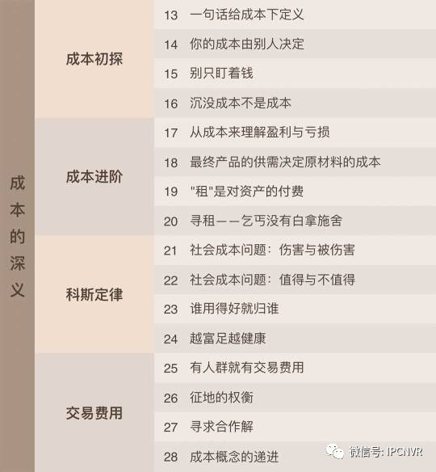

## 成本概念深不可测

我们一开始就介绍过，许多大经济学家，都曾经在成本这个概念上面下过大功夫，而且取得了巨大的成就，甚至拿了诺贝尔奖。

成本的概念之所以深不可测、千变万化，最重要的一个原因，就在于它是靠想象出来的，所以它变化很大。正因为是想象出来的，所以成本的概念就可以从具体到抽象、从个体到群体、从静态到动态这样去发展。

而这个变化过程，也就形成了一系列不同的成本概念。我们最早讲普通的成本，会计的成本，后来讲交易的成本，制度的成本，再后来讲制度变迁的成本。

这就是从具体到抽象，从个人到社会，从静态到动态之间的变化。你要记住，成本的概念千变万化，非常深邃，但是它最底层的基石，就是阿尔钦（Armen Alchian ）说的：“成本就是放弃了的最大代价。”

这句话不变，别人听了也就是一句简单的话，但在你听来，这是一个需要 4 个礼拜才能完全消化的、具有深刻含义的概括。

## 成本是放弃了的最大代价

你来看，成本的概念是怎么推进的：

最简单的情况是一个人的社会有形的物资，一棵木材，它用来取暖，就不能拿来盖房子了，这是成本最早的概念。

然后我们又把它扩充了，它不仅仅是指有形的物资，它也可能指无形的物资。我们盖房子的时候，需要阳光权，可能会产生安静权的问题，还会产生空气权的问题，这些抽象的资源也纳入我们对成本的考虑。

我们讲，讨论成本的时候千万别只看着货币成本，我们要看到全部的成本。所以你可别怪 711 便利店里面的东西贵，它的货币成本可能比较高，但它给我们带来的许多便利，使得我们获得这些商品的全部成本变得更低了。

成本就是放弃了的最大代价，如果没什么可放弃，也就不存在成本，所以我们说：“沉没成本不是成本”。凡是说成本，我们一定是向前（未来）看，而不是向后（过去）看的。

产品价格与成本无关

讲到成本的时候，我们还讲了一个非常重要的因果关系，那就是：最终商品的供求关系，决定了最终商品的价格，而最终商品的价格倒过来决定商品生产的原材料的成本。而不是我们在会计课程上学到的商品原材料的成本，决定了最终产品的价格。

这个倒置的因果关系是我们学习成本概念的一个重要的收获。这个思想也是“成本是放弃了的最大代价”这句话所包括的。    

## 所有的盈利与亏损都是一次性的

然后我们还讲了“盈利”和“亏损”的含义。我们说所有的盈利都是横财，都是意外的收入；所有的亏损都是横祸，都是意外的损失。只要发生了盈利或者发生了亏损，我们对资源未来的使用价值就作出了新的调整，成本也因此相应地进行了调整。

所以旱涝保收的生意，过一段时间以后，它就不再是旱涝保收了，因为当中的资源的价格发生了变动，使用这些资源所要付出的成本也发生了变动。所以盈利永远只是一次性的，亏损也是一次性的。

## 租与寻租的概念

另外，我们从成本的角度出发，还解释了“租”的含义，租就是租金的租，租就是对资产的付费，而这个资产的供给在一定程度上，是不以付费的变化而变化的，那就是白赚的收入。

记得吗？猫王的下一份工作，要比他今天做歌手的工作差很远，所以无论赚多赚少，他仍然会当猫王，仍然会继续唱歌。这当中就有一大部分的收入，是他作为歌星这种资源，而白赚的。这叫租的概念。

讲完租的概念以后，我们还讲了“寻租”的概念。寻租的概念指的是，企业在向政府争夺垄断性优惠政策的过程当中，也要付出巨大的成本。所以我们说乞丐并没有白拿施舍，乞丐拿施舍的过程本身就耗费了好多的资源。这是寻租的概念，也是从成本的概念中衍生出来的。

## 社会成本问题引发科斯定律

讲完寻租的概念，我们花了很长的时间，来讨论社会成本问题和科斯定律。

我们举了一系列所谓伤害的例子，牛吃小麦、修副楼的酒店挡住了有游泳池的酒店的阳光、糖果商的噪音影响了医生给病人看诊、养鸡场的恶臭影响了居民的健康、水泥厂的污染影响了居民的健康、火车喷出来的火星烧了 700 吨的亚麻等等。

所有这些“一方伤害另外一方”的案例，在科斯看来，都不是伤害，而是资源的使用。所以科斯说所有的伤害都是相互的，所谓的伤害只不过是资源的争用而已。这时候就产生了一个理想状态之下的科斯定律：在交易费用为零的情况下，谁能把资产用得好，资产就会落到谁的手上。

## 交易费用永远为正

紧接着，我们再把这个理想状态跟现实拉近一点，加进现实的元素。也就是说，在现实社会当中交易费用永远是正的，交易费用不是零，交易费用往往是很高的。

这时候我们就能明白，为什么资源、资产和责任的初始界定非常重要。这就是制度、风俗、习惯和法律之所以存在的原因。而整个社会为那些经理、中间人、法官、监督人、律师、会计所付出的工资，就是这个社会所要付出的交易费用。交易费用是巨大的。    

## 交易费用越低越好

要理解好交易费用的概念，我们不仅要向下看，也要向上看。

我们一方面要理解交易费用当然越低越好，因为交易费用低的话，人们就能够更方便地进行交易，能够更好地配置资源，所以一个社会，交易费用越低是越好的。

但同时，有些经济学家做统计发现，现代社会越是发达、文明的社会，他们当中有些交易费用，不仅没有跌，而且在涨。比方说律师的费用、通信的费用、教育的费用。

他们因此得出一个错误结论：交易费用越高越好。这种看法是错的，交易费用当然是越低越好。但是为什么会看到在现代生活中，在文明社会当中，有些交易费用在不断上升呢？

原因在于，那些落后地区交易费用不是零，而是无限大，所以它们没有被纳入计算当中。

比方说通信费用，在过去没有互联网的情况下，你要交网费吗？在没有电话的情况下，你会交电话费吗？在没有邮差的情况下，你会交邮票费吗？不会交。那时候看上去我们不会因为通信花一分钱，而那个时候，通信的交易成本其实是无限大，而不是零。

是技术使得我们进行通信变得可能，这时候，我们的生活费用当中，就多了一项通信费。这通信费看上去是挺高的，但其实它比原来的无限高已经低了很多了。唯一的差别是，在过去它没有纳入计算，而今天它纳入计算了。

所以，我们要有一个正确的眼光，来看待今天的交易费用。

## 制度费用与制度变迁的费用

所有的交易费用加起来，我们称之为制度的成本。在这个制度下面，我们要为学校、教会、商会、家庭、企业、法庭、政府、军队等等这些组织付出费用，这叫制度费用。

如果我们从静态的角度，改成动态的角度来看问题的话，我们又会发现还有另外一种费用，那就是制度变迁的费用。从一种制度改变成另外一种制度，这当中也要花费巨大的成本。

我以前是用打字机来打字的，现在我知道了，要用电脑来打字会更好更快。但是你要买一台新的电脑，要学习使用电脑，这本身就有一个成本。这是从一种制度变成另外一种制度的时候，所要付出的成本，我们称之为制度变迁的成本。    

## 存在于想象中的体制成本

正是通过这些不断的比较、不断的想象，经济学家形成了一种又一种的成本概念，他们不断地训练自己拥有一种我们一开课就讲的能力：看见那些看不见的东西，看见那些看不见的损失，从而优化我们的政策，改善我们的生活。

我前面讲了，我们今天讲的这个关于成本的小结，只不过是一个小结，后面我们对成本还有几次非常重要的应用，其中一个是在制度变迁上面的成本，另外一个是在国际贸易上面的成本，还有一个是关于责任分摊的成本。

现在离我们讲这些话题，还有一段时间，我希望你能够抽点时间来想一想，你会怎么通过想象力来推进这些成本的概念。

我们都知道丘吉尔的口才非常好，你知道他是怎么练口才的吗？他以前在印度当兵的时候，就让他爸给他寄英国议会的辩论记录。他拿到这些辩论记录以后，不马上看，而是先看辩论的题目，然后合上辩论记录。他自己想，如果他是参与辩论的议员，他会怎么说，他想好了以后再去看人家议员是怎么辩论的。在这个过程当中，他学到的东西就非常深刻。

## 课后思考

我们花了一个月的时间来学习成本的概念，你最重要的心得是什么？记得哦，写长容易，写短难，这是一个留给你自己的笔记，让你几个月以后、一年两年以后回来再看看自己的思想曾经停留过的地方。

提炼一下，写短一点，关于成本的概念，你最重要的心得是什么？

欢迎你给我留言，我们下节课再见。

##### 周

# 第 7 周问答  
中国式过马路到底好不好？ 

你好，我们开始本周的问答时间。

关于成本概念的讨论，我们暂时告一个段落。不知道你有没有这样的感受，时间过得真快，一晃就一个月了。当时我跟你说“用一句话给成本下定义”的时候，那是一个月前，好像还是昨天的事情。

成本的概念容易吗，还是很难？有时候觉得容易，有时候觉得难——我自己的感受也是这样。

我不是常说嘛，不是科斯聪明是咱们糊涂，其实科斯教我们的事情很简单。但是，有时候我们又会想，成本的概念，应用非常的广泛，这个概念高深莫测。其实这就是学习的过程。

书有时候读厚，有时候读薄，往返要好多次，真理往往只有在它被清楚地陈述之后，才是显而易见的，才是昭然若揭的。我们需要反复的思考，才能形成自己通过经济学的角度来理解世界的习惯。

## 中国式过马路符合科斯定律

我们来谈谈这个礼拜留的几道作业题。周一的问题是：“你能不能再举一个例子，你认为它是合理的社会习俗，因为它能够把资源界定给合适的人。”

同学们举了不少很贴切的例子。我觉得最有意思的，是王帅同学讲的“中国式过马路”的例子。我们都知道很多人批评中国人过马路的方式，说中国人不守规矩。

但王帅同学提出不同的看法。他说，中国式过马路，其实挺符合科斯定律的，完完全全遵照交通灯来过马路，其实有很大的损失，因为有时候车多，有时候人多，交通灯的时间是固定的，这当中就有很大的时间浪费。

中国式过马路的核心就是数人头，计算利益的总和。当人聚得差不多了，声势浩大，浩浩荡荡地过马路的时候，这时候就是人群应该获得路权的时候，他这个观点很有意思。

## 经济学如何改变观念

另外有两位同学，一位是杨国强同学，一位是叫 Rothbard 的同学，他们说，他们以前是自由主义者，最讨厌陈规旧俗，最喜欢自由，学了经济学以后才明白，咱们在日常生活中大致应该随大流，因为随大流遵守社会的习俗能够节省交易费用。

你要知道这位 Rothbard 同学挺有意思的，他名字叫 Rothbard，译成中文叫罗斯巴德。罗斯巴德是美国一位著名的自由放任经济学者，甚至是位无政府主义者。你看，咱们的课不仅仅能够改变计划经济者的思维，还能改变那些无政府主义者的思维，看来咱们的课确实有点作用。

我自己年轻的时候，也特别不喜欢循规蹈矩，比方说我就不喜欢结婚，我觉得结婚没意思，就一张纸，相信爱情就不需要用那张纸来证明什么东西。现在慢慢长大了，学的经济学也多了，才开始明白婚姻其实是有很重要的作用的。

## 墓地争端：新人新办法，老人老办法

周二的问题：“我们在国外一些城市里面，看到有一些非常好的路段，那里有私人的墓地，我们到底是应该尊重产权，保持原貌，还是把它征用过来推动商业的发展，哪种更合理？”

很多同学根据课程的内容都答对了，没有一刀切的答案，得平衡、得看具体的情况。在美国，在不同的地区，在不同的州，在不同的时期就有不同的做法。

我印象比较深的是 2010 年在芝加哥发生的故事。当时我刚好住在芝加哥，芝加哥的国际机场 O'Hare 机场要扩建跑道，这时候就必须拆迁 O'Hare 机场旁边的一个古老的墓地。这个古老的墓地是在 1849 年建的，而 O'Hare 机场是在 1942 年才开始建的。也就是说，在机场开始建以前 93 年，人家的墓地就已经在那儿了。

当 2001 年市长宣布要拆迁这个墓地的时候，马上就遭到了教会的激烈反对。神父说你们应该尊重在这里安葬的死者，他们在被安葬的时候，是确信自己将会永远安息在这块地方，一直等到复活的那一天的。

说什么他们也不妥协，说什么也不让政府拆迁这块墓地。市长宣布要拆迁是 2001 年，他们就开始抗争。

但是市长有市长的办法，芝加哥原来有一大堆的法律是保证墓地不被政府征用的，但是到 2003 年芝加哥就通过了一项新的法律，说明政府有权征用任何的土地，包括私人的墓地。有了这个法令以后，教堂要保住他们的墓地就难了。

最后到 2010 年，法庭判决政府有权征用这块土地，安葬在墓地的死者的家属，总共获得了 130 多万美元的赔偿。

不多吧？但是为了张罗这件事，为了请律师，为了请家谱专家把那些安葬在这个墓地里面的死者亲属找出来——有些人根本不知道自己的亲属是葬在那个墓地的，是人家找到他，他才知道的——所有这些张罗的费用，总共花了 1700 多万美元。

而更有意思的是，整个 O'Hare 机场的扩建工程总额是 150 亿美元。你看，直接的赔偿只是 130 万，但整个张罗墓地拆迁的费用是 1700 万，而这只不过是整个机场扩建工程的一个零头。

这一头是一块 160 年的墓地，那一头是一个 150 亿的在建工程，哪个重哪个轻？科斯定律起不起作用，这挺值得回味的。

其实在美国不同的州，他们保护墓地的法律是不一样的。据我所知德克萨斯州的保护是相当强的，他们的法律就规定政府不能征用墓地，就这么简单。但是随着城市的发展，它最后还是扛不住，到 1993 年的时候他们出了新的规定。

他们规定，新人新办法，老人老办法。老的墓地，哪怕是在城市中间，那政府也不能动它；但是 1993 年以后，墓地本身就不能修在城市的当中，必须修在城市以外，到底离城市多远则取决于城市的大小。

其实法律不是死的，保护私有产权、保护私人的意愿，也不是完全绝对的。在英美的习惯法里面，就还有一条原则叫“反对永久原则”—— The rule against dead hand 或者 The rule against perpetuities。它的意思是说，有些人在遗嘱里面有一些嘱托，这些嘱托等他们死去以后当然是有效的，但是不可能永久有效。

当这些人的嘱托里面所涉及到的所有人，都已经死去 21 年，他的嘱托就失效了。比方说，有人在遗嘱里面说，他的这块地给后代继承有一个条件，就是在上面不准盖工厂，那这样的嘱托就不可能永远地执行下去。到了一定时间，事过境迁，规则就要发生改变。

## 彩礼的制度功能

周三的问题，男女结婚成家的时候，互相都是需要对方的，但需要的程度不一样，你能不能给出证据？

有证据，证据就是有一方要向另外一方给彩礼。当然有时候也还有嫁妆，嫁妆和彩礼互相抵消，有一个净值。也就是说，我们在婚姻当中经常能够看到，一方向另外一方做支付。支付的方式可以是现金，可以是财物，甚至可以是劳动服务。

这个原理跟果农和养蜂人互相支付的原理是一样的。传统上，女孩嫁到男孩家里面去，女孩家好不容易把女孩养大了，一下子把女孩嫁出去，家里至少少了一个劳动力，这时候需要得到一定的补偿。这就是为什么彩礼如此普遍的原因。

当然彩礼包含的不仅仅是钱，也可以是一些食物。有一些比较贫困的地区，他们还有娃娃亲。娃娃亲就是说，男孩从小就可以到女孩家里提供劳动服务，这是一种彩礼的分期付款方式。到时候真的结婚成家，可能就不需要付彩礼了，或者彩礼就不需要那么多了。

这是对彩礼现象的一个初步的经济解释，但这样的解释还不够，还不完整。女孩家当然在意彩礼的多少，但是他们也不会只看彩礼的多少，毕竟女孩家不是在卖女儿，他们也关心女儿的幸福，所以他们不仅收彩礼，还会赔上嫁妆。

彩礼的作用不仅仅是钱，我们说过，好的经济学者眼里不只是钱，北大法学院朱苏力老师就有一篇非常精彩的论文，叫“ 坚硬的软法——彩礼的制度功能 ”。

在这篇文章里面，他分析的是，彩礼除了支付的功能以外，还另外具有克服信息不对称问题的功能。

比方说，如果男方给女方的彩礼，是他们家打猎打到的动物的毛皮，这就能说明他们家的生产能力，如果彩礼是他们家借钱借回来呢，那也能说明他们筹措资金的能力。

有时候越是贫困的地区，越重彩礼，那是因为彩礼所代表的不仅仅是钱，他也代表着男方对这桩婚姻的重视程度，彩礼是一种很重要的表决心的方法，至于为什么总是男方向女方表决心呢？这里面也隐藏着信息不对称的问题，如果你有兴趣，我们后面还会专门讨论信息不对称的问题。    

## 机场扰民不一定要赔钱

最后一个大问题：机场旁边的民宅成天受到飞机轰鸣声的骚扰，居民是否应该要求机场作出赔偿。

在开始讲社会成本的时候，我们讲过 123 的概念，我们怎么理解社会成本呢？

最好的办法，是先把所有的纠纷、所有的冲突，看成是一个主人，然后变成两个主人。一个主人的时候他会怎么处理，也就是说交易费用为零的时候会怎么处理，这是一个参照系。

然后我们引入交易费用，我们说有两个人的情况下，存在交易费用的时候，情况会怎么样？

还有一种情况，是三个人，我们把整个社会都引进来，情况就会更复杂。当然这也更贴近我们的现实。机场的例子就是这样。

我先跟你讲一个故事。好多年前我住芝加哥，芝加哥有一个非常漂亮的植物园——Botanic Garden。这个植物园去参观的时候是免费的，不用门票，免费进去就可以。

但是它有另外一个规定，是如果你开车去的话，停车费是要收钱的，不管里面坐多少人，一辆车 17 块美元。这个植物园离市中心挺远的，绝大多数人都得开车去，所以实际上是要付钱的，17 块钱一个车位。

但我注意到在这个植物园旁边，有一些居民区，有人住在那。如果你住在这个植物园旁边，不是就不用开车进植物园了吗？这植物园不就免费了吗？我问你，住在植物园旁边的居民，他们赚了吗？你可能会想：当然赚了，他不是免费能够进去看植物园吗？不用交停车费吗？经济学的答案是说他们没赚。

为什么没赚？你看这些居民，当年他们买这些在植物园旁边的住宅的时候，或者租这些房子的时候，原来的房东会跟他们说，你看我们这房子可不是普通的房子——我们这是一间普通的房子，跟别的房子一样的房子，再搭上一个免费的植物园。

加多少钱，大致上加 17 块钱一天，所以他们没赚。谁赚了？除非是那些，当初早就住在那里，后来植物园才修起来，植物园忽然宣布他们是免费进入的，在那一刻，原来已经在的户主他们赚了，除此以外，后面再来的人都没赚。

用这个原理，我们来看飞机场旁边的居民，到底有没有受到损害。只有那些当政府宣布要在那个地方修机场的时候，就已经住在那里的居民，在那一刻他们受损了。

但是，从那一刻开始再搬进来的人，不管是新买房的还是租客，他们都没有受损。为什么，因为那个地方有噪音，谁都知道了，那个地方的价值，那个地区房屋的价值已经下降了，已经贬值了。所以从这以后再来买房再来租房的人，其实已经买到了便宜货了，已经得到了补贴了，所以他们不应该得到补偿。

再举个简单的例子，我租了套房，住进去以后，这栋楼旁边才开始有人盖房，工地发出了很多的噪音，有一天我在电梯里面忽然看到一个告示，说这个工地要给大家支付噪音赔偿费，我问这个噪音赔偿费，是应该我这个租户得到呢，还是房东得到？

答案是应该我得到。因为我租房的时候，我付的那个价是没有噪音的费用的，然后这个工地一开工以后，我忽然间受到了损失，这个钱应该我得。

如果倒过来这工地老早就已经开工了，我这时候才住进去，然后这个工地答应支付噪音赔偿费，这个赔偿费应该我得，还是房东得？

应该房东得。因为我支付的房租其实已经是便宜了的，是房东在这个工地开工的时候受到了意外的损失。

## 今日思考

根据这个原理，我给你出一道难题：北京在奥运期间，忽然宣布所有的地铁票价都降为两块钱，这个优惠政策出台以后谁是受益者？后来北京政府又决定把票价调回去了，谁是受害者？    

欢迎留言

最后我还要提醒你，我为你准备了黑板报，黑板报上贴了这个礼拜我认为最精彩的留言。欢迎你踊跃留言，希望下周能够在黑板报上看到你的分享。好了，这一周的问答时间就到这里了。

明天是预习的时间，祝你周末愉快。    

##### 29

# 第 029 讲  
个人主义的主观价值论 

你好，今天我们开始讲需求定律，开始一个新的单元。

有一次我经过美国海关，海关关员问我是干什么的？我说我是经济学家，这个海关关员就说：“噢，你就是那些懂得说需求和供给的人吧。”

没错，经济学家萨缪尔森曾经说过，你只要教一只鹦鹉，让它学会说需求和供给这两个词，它就能成为一位经济学家。换句话说，只要你能说需求和供给，你就是个经济学家了。你说需求定律有多重要。

我们在前面讲稀缺的时候，已经谈过人的需求了，需求有两个特点：

你想要的东西，别人也想要；

需求有一个层层递进的规律。

你表面上想要吃一条鱼，但实际上你是要蛋白质，表面上你是要蛋白质，实际上你要的是更高层的精神享受。

表面上我们吃药是为了治病，为了求存，但实际上是想要让我们自己活得更舒服，需求是层层递进的。

今天我们继续探求需求的内在规律。

## 个人估值的多层含义

在讲需求定律之前，我们先要引入一个非常重要的概念，这个概念叫“个人估值”，英文叫 Personal Worth。什么是个人估值呢？根据阿尔钦（Armen Alchian ）的定义：“一个人对一件商品的个人估值，是他为了得到这件商品所愿意支付的其他商品的最高数量。”用英文说就是：A person's personal worth of a good is the most of other goods the person would be willing to pay to get that good。

倒过来，我们也可以说：“一个人对一件商品的个人估值，是他卖掉这件物品所必须得到的其他商品的最低数量。”

个人估值这个定义，虽然简单——为了得到一件商品，他所愿意放弃的其他商品的最大数量——但它有好几层含义。

## 只有个人才有行动能力

第一层，个人估值是个人的估值，不是集体的估值。集体不会感受，不会思考，也不会评估，做出个人估值判断的一定是个人。我们要知道集体不会做任何的事情，机构也不会做任何的事情，学校、机关、民族都不会做任何的事情。我们所说的，我们口头上喜欢说的哪个集体、哪个机构、哪个组织做的什么事情，其实最后都是个人做的。

## 所有价值与估值都起源于个人

第二层，它是主观的，绝对主观的。并不存在什么客观的估值，如果没有了人，世界上的财富就没有价值，价值都是人赋予的。

这一点是经济学很重要的一个方法论。许多经济学家还特意写过文章，或者在他们著作的开头就声明，他们是“个人主义的主观价值论者”。首先，他们的研究从个人主义开始，所有的个人估值、所有的价值起源于个人。其次，这些价值都是主观的判断，从这样的起点开始他们的研究。这叫“个人主义的主观价值论（Individualistic Subjectivism ）”

## 个人行动都是可观察可记录的

第三层，个人估值不是以个人的愿望为基础的，而是以他所愿意放弃的其他商品的数量来计算的。这是以行动为基础的，而这些行动是可以观察到的。这一点很重要。

你看它有两面性，第一，个人估值是个人的判断；第二，它不是一个纯粹的愿望，不是你空想的愿望，而是你以一种实际行动表现出来的一种现象，是外人可以观察、可以衡量、可以刻画、可以计算的。这一点也非常重要。

比方说，我们喜欢问，你觉得这位女孩漂亮不漂亮啊？好多人说，漂亮不漂亮，那完全是主观的判断，见仁见智。没错，经济学讲的首先是主观的判断，但是外人可不可以衡量，到底这个女孩漂亮不漂亮？

当然也可以。我们到街上看看，那些珠宝广告选的是哪位明星，这位明星的漂亮就是公认的漂亮。因为珠宝商不会随便选一位路人来做珠宝广告，他一定会选一位大家公认的美女来做珠宝广告。

实际上，一个特定的社会，在一个特定的时期，他们认为什么样才叫美，外人是可以评判的，可以观察的，可以记录的。

又比如说，人对于什么是舒适，看上去是一个主观的判断。当然，这确实是一个主观的判断，但是你看看世界上所有大众化的五星级酒店，里面的席梦思床、灯光、气味、设施都是高度一致的，因为其实大多数人，对于什么是舒适有共同的感受。

如果你说人的体验是千奇百怪的话，那理论上，你应该看到有各种各样不同的五星级酒店，有些五星级酒店是有席梦思床的，有些只提供木板床，有些是有抽水马桶的，有些是完全没有的，但实际上你找不到这样的五星级酒店。

## 微妙的个人估值论

所以个人估值的概念非常微妙：

它是由个人决定的，集体不能决定，一定是个人的；

它是完全主观的；

它是基于行动的，不是单纯的愿望。因为它基于行动，所以我们外人也可以观察，也可以记录下来，也可以刻画，也可以从中找到它的规律。

这是个人估值的概念。你可能会说：薛老师你讲这些太抽象了，有什么意思吗？有挺大意思的，有许多重要的经济学原理，有许多重要的经济政策，都从这个坚实的概念出发的。

比如说什么是消费者剩余、卖家进行价格歧视对不对、我们能不能用所谓的社会总体函数，来支持政府对房地产进行限购等等。所有这些关于政策的辩论，都起源于我们对个人估值的这种精准的理解。

## 主观价值论与客观价值论的区别

关于个人估值的应用很广，我今天先着重讲一点，个人主义的主观价值论跟“客观价值论”之间的区别。我们以前学过所谓的客观价值论，它的意思是说，所有世界上的物品，都有客观的、内在的、本质的，不以人的意志为转移的价值，而价格只是围绕这个本质的、客观的价值上下波动的一个现象。

而今天我说的，是所有的物品，它没有什么本身内在的价值，只有人对它的判断，人觉得它有价值，它就有价值。这两种不同的价值观怎么比较？哪一种才对咱们理解这个世界更有帮助、更好用？

## 客观价值论能解释的现象，主观价值论也能解释

我们来比较客观价值论和主观价值论，它们之间至少有三个区别：

第一，凡是客观价值论能够解释的现象，主观价值论，或者说个人估值这个概念也能解释。

比方说一辆名贵的跑车，它里面是不是凝聚的贵金属比较多一点？它凝聚的技术含量比较多一点？它凝聚的人类无差别的劳动多一点？是的，所以它比较名贵。

如果你觉得客观价值论能解释这个车为什么贵，那么通过个人估值，或者通过主观价值论这个概念，也能解释：那就是人们喜欢它，人们看重它，所以它就比较贵。

## 客观价值论不能解释的现象，主观价值论也能解释

第二，客观价值论不能解释的现象，个人估值、主观价值论也能解释。

比方说，一个明星，花几秒钟喝一瓶矿泉水拍下来的广告，它值很多钱。薛老师也喝矿泉水，拍下来的视频，就不值钱。这两段视频里面凝聚的人类无差别的劳动是差不多的，但市场价格却相差非常大。这一点客观价值论没办法解释，但是个人估值、主观价值论就能解释。因为人们看重的是明星的效应，因为明星短缺，普通的薛老师、普通的经济学老师不短缺。

比方说一张家庭老照片，也不外乎是一张照片，为什么对有些人来说非常珍贵呢？对有些人来说，它就是一张普通的照片呢？这从客观价值论上看，它得不到解释。但是从主观价值论上看就很清楚，因为人们看重它、觉得它有价值，它就有价值。

我还记得，在 20 世纪 80 年代初，经济学家张五常他说当时中国有两个姓邓的人最红，一个是老邓：邓小平；一个是小邓：邓丽君。

邓丽君为什么重要呢？因为邓丽君现象打破了当时人们对客观价值论的看法。邓丽君吃的跟别人吃的没多大差别，用的跟别人用的没多大差别，她的嗓音跟别人的嗓音从物理学上来看、从声波上来看没多大差别，但只要人们喜欢她，她就能够创造大量的财富。这是客观价值论觉得挺为难，而主观价值论能够轻而易举解释的现象。

客观价值论和主观价值论的两个区别：第一是客观价值论能解释的，主观价值论也能解释；第二是客观价值论不能解释的，主观价值论，或者说个人估值这个概念也能解释。

## 主观价值论能够更好地指导生产

第三个区别，是主观价值论能够更好地指导生产。为什么这么说呢？因为根据客观价值论，你只要在一件商品里面花了努力，付出了劳动，这件商品就具有价值。

但是主观价值论不这么看，主观价值论认为，你花不花时间、用了多少心思、花了多大的投资，这本身并不重要，最关键的是你能不能把它卖出去，你能不能适销对路，有没有人需要你生产的产品。

就这么一点区别，形成了计划经济体系和商品经济体系的重要区别。

计划经济体系里面，人是按照工分算的，你只要工作了，只要努力了，你就创造了财富；但是在商品经济里面，那是结果导向、需求导向，如果你生产的产品没人要，那么不管你投入多少资源，花费多少劳动，它也是不值钱的。所以主观价值论能够更好地指导生产，减少浪费。

## 课堂小结

我们总结一下今天的内容。从今天起，我们开始讲需求定律。需求定律当中遇到的第一个重要的概念是个人估值，个人估值有 3 个特点：

第一，它是个人的，不是集体的；

第二，它是主观的，不是客观的；

第三，它是由行动支撑的，不是凭空的愿望。

而且正因为它是行动，所以外人是可以观察、衡量、记录的。然后，我们还讲了主观价值论和客观价值论的三个区别：第一是客观价值论能解释的，主观价值论也能解释；第二是客观价值论不能解释的，主观价值论，或者说个人估值这个概念也能解释；第三是主观价值论能够更好地指导生产。

## 课后思考

今天，我给你留的思考题，是要满足我自己的好奇心。你有哪件物品，市场上的价格很低，而你对它的个人估值却是非常高的？

欢迎你给我留言，我们下节课再见。

##### 30

# 第 030 讲  
边际革命 

你好，这个单元我们讲需求定律，昨天做第一个铺垫，讲了一个重要的概念“个人估值”。今天讲另一个重要概念：“边际”。

## 钻石与水的故事

我先来问你，你们家里有钻石，有矿泉水，是钻石给你带来的幸福大还是矿泉水给你带来的幸福大？

这个问题不好回答。最早提出这个问题的，是经济学鼻祖亚当·斯密（Adam Smith，1723 年 6 月 5 日—1790 年 7 月 17 日 ），他问道：“水对于人的生命来说是非常重要的，但是水的价格却非常低。钻石对人的生命来说，一点用处都没有，但是钻石却非常贵，这是为什么？”

要回答这个问题，就必须用到边际的概念。边际这个概念有多重要？过去快 20 年的时间里面，我一直给报刊杂志写经济专栏，要写好经济专栏，有一个秘诀，就是一定要写得清晰易懂。

我经常说，要是电视节目做得不好，人家要换台的话还得去找遥控器。但是看报纸看杂志，如果人家不喜欢你的文章，眼睛一溜就过去了，所以你要把人家留住，就一定要写得清楚明了。为了写得清楚明了，我尽可能地避开所有的经济学术语。

实际上我发现，什么术语都可以避开，我都能把话说清楚，但只有一个经济学的术语，我是怎么避都避不开的，这个概念就是“边际”。如果非要不说“边际”这两个字，那么在文章当中表达的意思，要么就不够准确，要么就比较含糊，不能百分百表达我的意思。当然，写文章有时候只能做个取舍，留个破绽。

实际上，整个经济学的思维都是关于边际的。经济学早期的时候是一种哲学的思辨。到今天是一种科学的范式，这两者之间转变的一个重要关口，就是引用了边际的概念。

引入边际概念的是奥地利学派，奥地利学派对经济学做出了很多贡献，其中有一点贡献特别大，就是他们引入了边际的概念。这个贡献太大了，以至于没有人再提起这是奥地利学派的贡献。因为大家都觉得只要是现代经济学，它当然就建立在边际的概念之上。

你还记得吗？我们在前面讲科斯定律的时候我说过，不是因为科斯聪明，而是因为我们糊涂。我这么说的一个重要的原因，是因为科斯的贡献，其实并没有超出他念本科的时候，他看了一本经济学入门教科书，当中关于边际的概念。

这本书的名字叫《政治经济学常识》（The Common Sense of Political Economy: Including a Study of the Human Basis of Economic Law ），作者名字叫菲利普·威克斯蒂德（Philip H. Wicksteed ）,如果你感兴趣的话，可以去看一下这本名著。（《政治经济学常识》英文原文链接：http://www.econlib.org/library/Wicksteed/wkCSCover.html ）

同时，不知道你知不知道，在美国人气最旺的经济学家博客，由乔治·梅森大学的两位经济学家合写，一位叫泰勒·考恩（Tyler Cowen ），另外一位叫亚历克斯·塔巴罗克（Alex Tabarrok ），他们这个博客的名字就叫边际革命(Marginal Revolution 网址：http://marginalrevolution.com/ ）

## 何谓边际

说了这么多故事，到底什么叫边际？边际就是“新增”带来的“新增”，这就是边际的概念。

边际成本就是每新增一个单位产品，所要新增的成本叫边际成本；边际收入是多卖一个产品，你能够新增的收入叫边际收入；边际产量是你多增加一份投入，所能够多获得的产量叫边际产量；边际效用是你多消耗一个单位的商品，所能带来的新增的享受叫边际效用。新增带来的新增就叫边际。

我们在消耗产品的时候，我们在吃馒头的时候，馒头给我们的边际效用是递减的。这句话什么意思？这句话的意思是，你吃第一口馒头，这口馒头给你带来的效用很高，第二口馒头它给你带来的新增的效用就会少一点，第三口又再少一点，一步一步地减下去，这叫边际效用递减。

美国的罗斯福总统，是美国历史上唯一一位连任 4 届的总统。当他第四次当选总统以后，有位记者就来问他：“第四次当选总统是什么感受？”罗斯福没有当场回答他的问题，而是请这位记者吃三明治。

吃第一块三明治的时候，这位记者觉得这可是殊荣啊，真是了不起，面子真大；第二块的时候他觉得已经感觉平平了；第三块的时候，他已经很难咽下去了。

然后罗斯福把第四块三明治放到这位记者的面前，他说：“你把这第四块三明治吃下去，你刚才问我的问题，我就不用回答了，你自己会有亲身感受。”

这就是边际效用递减的规律。

## 边际收益与边际成本趋同

我们同时要知道，边际效用和边际成本是一个成对的概念。我们吃馒头，馒头带给我们的效用在递减，但与此同时，我们每吃一块馒头，都要付出一定的成本。比方说你要为馒头付钱，这时候边际效用递减，它减到某个程度，边际效用就会低过你为馒头所付的价格。这时候你就会停止买馒头，停止吃馒头。

换句话说，当你吃馒头的边际效用，高于你为多吃一个馒头所付出的边际成本的时候，你会继续吃馒头。但是倒过来，如果你为馒头所付的边际成本，高于馒头带给你的边际效用的话，你就要减少吃馒头。

也就是说，人们会朝着边际平衡的方向迈进，边际收益要尽量等于边际成本。

这是关于边际的第二个概念。你明白了这两点，咱们就可以回答，一开始我问你的问题：到底是水带给你的幸福高，还是钻石带给你的幸福高。

当然，亚当·斯密（Adam Smith，1723 年 6 月 5 日—1790 年 7 月 17 日 ）说的没错，水才是我们真正的必需品。事实上，整个过程是这样的。水对我们来说非常重要，所以当我们有钱的时候，我们花的第一个铜板用来买水，因为它是必需品；第二个铜板，也还是买水，因为我们太需要水了；第三个铜板，还是买水；第四个还是买水，第一千个铜板，咱们还是买水。这时候水带给我们的边际收益怎么样？

在下降，下降到一定程度，假设说到第一千个铜板的时候，边际上带给我们的收益已经相当低了。这时候，我们会动一个念头，说第一千零一个铜板，咱们能不能换一个花样，买一点点钻石？

那一个铜板给我们买来的一点点的钻石，能够很好地满足我们的虚荣心。于是咱们就把第一千零一个铜板用来买钻石。也就是说，在边际上你们家的水和你们家的钻石，给你带来的幸福是一样的。

你没有想到吧？你的回答可能是说水比钻石更重要，或者说钻石比水重要。你可能没想过，合理的答案，是它们在边际上给你的回报是一样的。

你想想，如果不一样会怎么样？如果第一千零一个铜板，你觉得还是需要多喝水，你会怎么做？你会继续买水，不会买钻石。倒过来，如果第 999 个铜板，你已经觉得买钻石更值得的时候，你就会用它来买钻石。

你在一个一个铜板花出去的时候，你在追求一件事情，就是水带给你的边际收益，要跟钻石带给你的边际收益相等。

也就是说，我们怎么才能保证，我们有限的铜板能带来最大的效用呢？办法就是我们一个一个铜板花出去的时候，要确保它永远花在边际效用最大的那个产品上面。

如果是水给我们的边际效用更大，我们就在水上面花钱，直到水的边际效用跌到跟钻石带给我们的边际效用一样为止，到那一步，我们就开始把铜板转向购买钻石。

## 每个人都是边际平衡的高手

我们把这个图景再扩大一点。我们举目看过去，我们身上的所有的财物，我们所进行的所有的活动，我们跟所有不同的人打交道，所花的时间，实际上每一个活动每一件商品，它带给我们的边际效用都是一样的。

如果不一样会怎么样？如果不一样的话，我们就会作出调整。所以我问你，你爱薛老师的“得到”专栏更多，还是爱你的家人更多？

经济学的回答是：在边际上，你对这两者的爱是一样的。当然你很爱你的家人，所以你花很多时间跟他们在一起，但是由于你花的时间多了，所以跟他们待在一起所带给你的边际效用就开始递减，减到一定的程度，你就会想，“如果我腾出 10 分钟时间来听薛老师的专栏，而不是跟家人待在一块的话，我得到的收益会更大”，这时候你就打开了你的手机，开始听薛老师的专栏。

所以在边际上，你对这个专栏的爱，跟你对家人的爱是一样的，有意思吧！

经济学挺重要的，如果你是个在校学生，你应不应该在经济学这门课上拿个 100 分？如果你在经济学上努力地拿 100 分，我就说你不是一个好的经济学学生，为什么？

因为你要花时间的地方太多了，在经济学这门课上，你从 60 分变成 80 分是相对容易的，80 分变成 90 分那就更难了。因为边际成本在增加，而边际效用在递减。你提高的只不过是几分，你的学习总分，除了经济学这门课，还有好多门课。最后，当你从 99 分到 100 分的时候，你要花的努力非常的大，而这些努力带给你的边际收益却非常的低。

所以每一个人都应该是一个边际平衡的高手。也就是说，他应该利用自己有限的时间、有限的精力，在他所可能涉及的所有领域、所有活动、所有选项当中，根据边际平衡的规律，来分配他所有的时间、金钱、精力和其他资源，从而使他的总收入达到最大。

## 课堂小结

我们今天讲了一个非常重要的概念“边际”。边际就是新增带来的新增。边际成本就是每多生产一个单位的产品所要新增的成本；边际收入就是多卖一个产品所新增得到的收入；边际产量就是多做一个单位的投入所能够得到的新增的产量；边际效用就是多消费一个单位的商品所带来的新增享受。

而且我们说，我们带来的新增的享受，总是有一个递减的规律。由于资源是有限的，每个人怎么样才能够最有效地利用他们有限的资源，得到最高的效用呢？

办法就是边际的平衡。就是在每多花一个单位的成本，不管这个成本指的是多一个单位的时间、多一个单位的金钱、多一个单位的注意力、多一个单位的努力，他们都要把这多一个单位的成本，花在那些带给他们收益最大的那种活动或商品上去。从而使得所有这些商品和活动给他们带来的边际收益是相等的，这就叫边际平衡的概念。如果一个人这么做了，那么他得到的总收益就会达到最大。

## 课后思考

今天我留给你的思考题有点难：“穷者越穷，富者越富”，这句话你觉得对不对？

欢迎你给我留言，我们下节课再见。

##### 31

# 第 031 讲  
需求第一定律（1/2） 

你好，今天我们正式开始讲需求定律。一般的教科书，会有两条需求定律：需求第一定律、需求第二定律。咱们会讲三条需求定律：第一、第二、第三定律。今天我们讲的是需求第一定律。

## 需求曲线中的自变量和应变量

需求第一定律的内容是说：“无论何时何地，价格提高，商品的需求量就减少，价格降到一定的程度，需求量就会增加。”

这就是需求第一定律。就这么简单。你可以对照我给你准备图 1，在一个坐标轴上，纵坐标是价格，横坐标是需求量，一条倾斜向下的曲线，那就是需求曲线。

图 1：需求曲线

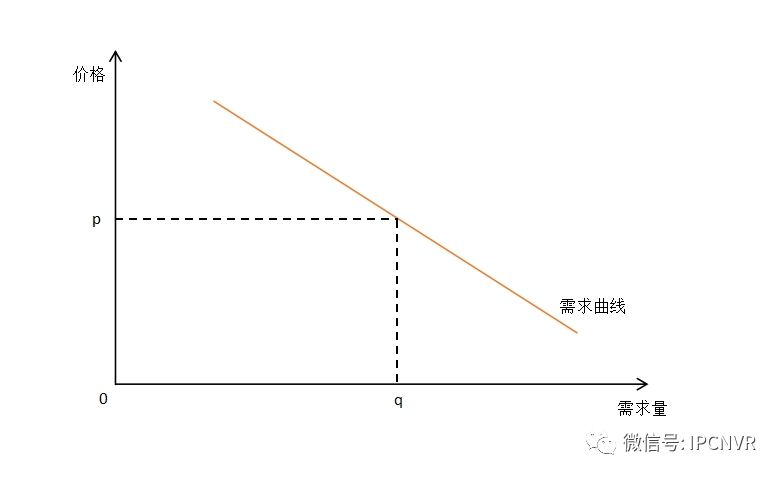

根据这条需求曲线，我们说：当价格上升到一定程度的时候，横坐标需求量就减少；当价格下降，横坐标需求量就增加。这就是需求第一定律。

你会说这好简单，这张简单的图，蕴含着丰富的规律。

首先，我们看横坐标和纵坐标之间的关系。一般我们的习惯是横坐标是自变量，纵坐标是因变量。但是经济学家遵循一个老的传统，从马歇尔开始的一个传统：在需求曲线上，纵坐标用的是价格，其实可以把它理解为，它才是自变量，横坐标需求量是一个因变量。也就是说，当价格发生变化的时候，需求量会发生变化。这是我们要说的第一点。

## 需求与需求量存在重要区别

第二点非常重要，就是我们要区分需求和需求量之间的区别。好多人，包括很多的经济学者，他们都没把这两个概念分清楚，时不时他们就混淆。你不能够混淆这两个概念：需求量和需求。

你看，在需求曲线上的任何一点，它刻画的是价格和需求量之间的关系。也就是说，当价格发生变化，需求量所发生的变化，这是它每一个点所代表的含义。这些点，整个需求曲线上面的所有的点，它们共同构成了一条需求曲线。

这条需求曲线对应的，是一组关于价格和需求量之间的关系，这整条曲线被称之为一个需求函数，或者一个需求表，或者简单地说是一种需求。

整条曲线是一个需求函数，或者需求表，或者简单地称之为需求。而这条曲线上的任何一个点所对应的横坐标叫需求量，也就是说，一个点对应的是一个量，需求量。整条曲线对应的是一种需求。

那么在经济学里面，一条需求曲线或者一个需求，它刻画的是：当所有其他条件不变的情况下，价格和需求量之间的对应关系。

听清楚，我说的是“所有其他条件都不变”，那么这条曲线刻画的两个量：横坐标、纵坐标，价格和需求量。而当其他的因素，其他的条件发生变化，价格和需求量以外的任何其他的条件发生变化以后，需求就会发生变动，我们就用另外一条位置不一样的需求曲线，来刻画新的价格和需求量之间的关系。

 

注解 1：当只有价格发生变化时，需求量沿同一条需求曲线滑动。注解 2：当价格以外的任何因素发生变化时，整条需求曲线发生变动和转动，但依然保持倾斜向下。

你看这里面我们就有两种不同的变化：

一种是需求曲线本身不动，我们沿着这条不动的需求曲线滑动，需求曲线上面的每一个点代表其他条件不变，只有当价格变化的时候，需求量的相对变化。

而另外一种变化，是整条需求曲线发生平移，发生转动，位置发生变化，这表示其他的因素、其他的条件发生了变化。

所以我们要区分，到底是沿着一条不变的需求曲线上下滑动，还是整条需求曲线发生了平移，发生了转动。

我举个例子，来考考你。下面哪种情况会改变对假发的需求。我说的是会改变对假发的需求，不是需求量。

秃子的收入增加，会不会改变对假发的需求？

帽子的价格上升，会不会改变对假发的需求？

护理头发的成本上升，会不会改变对假发的需求？

重归单身生活，会不会改变对假发的需求？

假发的价格下降，会不会改变对假发的需求？

答案是前面 4 种情况都会改变对假发的需求。只有假发的价格下降，不会改变对假发的需求，它改变的只是对假发的需求量。也就是最后一条，假发的价格发生变化，它是沿着一条不变的需求曲线上下滑动。

其他的 4 种情况：

第一，秃子的收入增加，他的财富发生了变化，他对假发的需求也会发生变化。这时候，他对假发的需求曲线就会发生移动；

第二，帽子的价格上升，帽子是假发的替代品，这时候帽子贵了，他对假发的需求曲线，也会发生变动，也会发生移动；

第三，护理头发的成本上升，道理是一样的，这时候他对假发的需求也会发生变动，假发的需求曲线也会发生移动；

第四，重归单身生活，这时候他更要美了，他更要出去约会了，他对假发的需求也会发生变动。

只有最后一点，假发的价格下降不会使他对假发的需求曲线发生移动，而只是在同一条不变的需求曲线上面滑动。所以，什么时候在同一条需求曲线上面滑动，什么时候要移动需求曲线，理解起来并不难。

其他任何条件都不变，只有价格发生变化的情况下，我们用滑动来表现；当价格以外的其他条件发生了变化，我们就得平移需求曲线。

但是你要知道，经济学家可是非常较真的人，他们就开始讨论了：世界上哪有绝对不变的情况啊？哪有价格变了，而其他情况不变的条件呢？他们说，只要价格发生了变化，其他的条件也一定多多少少会发生变化。

所以他们就做了各种各样较真的讨论，参与讨论的有好多大经济学家，包括约翰·希克斯（John Hicks ）,米尔顿·弗里德曼（ Milton Friedman ）, 尤金·斯勒茨基（Eugen Slutsky ） 等等，他们画出各种各样的补偿曲线，说这种情况，这样画才能更精准一点，那样的情况那样画更精准一点。在我们的课上，我们不去深究。有兴趣的话，你可以去看中级微观、高级微观的课程。

你看关于需求曲线，我们现在讲了两点：第一是它的坐标轴的关系；第二是需求和需求量之间的差别。第三，我们要讲，需求曲线永远是向下倾斜的。

## 需求曲线永远向下倾斜

刚才我跟你说了，需求定律的含义是什么？价格上升需求量就下降，价格下降需求量就上升。这时候你一定会问，薛老师，好像还有一些例外的情况。比方说，玻璃做的项链一般人要的很少，但如果是钻石项链，我们买的更多，是不是社会上有一些商品，我们是喜欢越贵越买的呢？那越贵越买，是不是得用一条倾斜向上的需求曲线来表现啊？

那我给你讲一个有趣的故事。我经常说，如果按照地区来划分的话，我觉得经济学教育水平最高的地区是香港。为什么呢？因为张五常曾经在香港当过 18 年的高中考大学的经济学试题的出题人，所以一般的中学生只要修过经济学这门课，就能回答这个问题，到底需求曲线有没有向上的。

有一次，我们有几个朋友坐在一块聊天，其中一位就说：“世界上其实是有倾斜向上的需求曲线的，因为存在着越贵越买的行为。玻璃的项链，人们买得很少，钻石的项链人们买得很多。”

这时候我们当中的一位女孩，她是在香港读过高中的，她也不是什么经济学家，就读过高中。她脱口而出：“那都不是同一条 Curve。”她的意思是，那不是同一条曲线。玻璃所代表的是一条倾斜向下的需求曲线，而钻石代表的是另外一条位置更高，但仍然是倾斜向下的需求曲线。

股票市场也是这个含义。当股价上升，人们愿意多买一只股票的时候，经济学家怎么来描述？这并不是一条倾斜向上的需求曲线，而是一条位置更高，但仍然是倾斜向下的需求曲线。

它的含义是什么呢？是人们对这只股票的评价已经发生了变化，这只股票已经变成了另外一种产品，但是如果购买的代价更低，那么人们还是愿意买更多。

所以我们要记住，不同的商品或者条件发生了改变，我们都用位置不同的需求曲线来表示。而任何一条需求曲线它都是倾斜向下的，世界上没有倾斜向上的需求曲线。

## 课堂小结

这就是我们今天讲的，需求定律的基本含义：价格提高，商品的需求量减少；价格降低到一定程度，需求量就会增加。这是需求第一定律的基本含义。

## 课后思考

今天留给你的课后思考题是：假如你是个菜农，你是种菜的，如果市场上的菜价上升了，那么你对蔬菜的需求量是上升了，还是下降了？

欢迎你给我留言，我们下节课再见。

##### 32

# 第 032 讲  
需求第一定律（2/2） 

你好，今天我们继续讲需求第一定律。

我们昨天说，需求第一定律的含义非常简单，就是价格上升，需求量下降；价格下跌，需求量上升。

## 供应曲线

这时候，凡是学过解析几何的同学都能明白，你看着我给你准备的这个图：当价格很低的时候，需求量横坐标就很高；价格逐渐上升，需求量就逐渐减少；当价格上升到一定程度，需求量就萎缩成为零。

那你会问，如果价格再进一步上升，需求量是多少？这个图就跑到了第二象限，需求量是个负的了。

也就是说，当价格高到一定程度的时候，需求量就是负的。  

负的需求量是什么意思？负的需求量，意思就是说需求变成了供给。所以你看图里面那条虚线，就是第二象限里面的虚线。其实，它就是一个供给，你把它镜像的折返回来，折到第一象限里面去，它其实就是一条供应曲线。

这话是什么意思呢？这话是说需求和供给没有黑白之分，它取决于市场价格。当一件商品的市场价格比较低的时候，你是个需求者，你要买入，你要消费；但是当这件商品的价格逐渐升高的时候，你对它的需求量就逐步减少；当这个产品的价格进一步上升，你就停止购买，停止消费；如果它的价格还在上升，你就从需求者变成了供给者。

## 价格上升，需求者可变供给者

我给你举个例子。好几年前，我有一位经济学同行，在微博上发了这么一个帖子：

“今天早晨从北京北五环仰山桥去河北廊坊开会，接连询问了 9 辆出租车，没有一辆车愿意去，一共 70 公里的路程，条件是一不打里程表，二要三百元钱，三要 50%的回程空驶费，合计要 450 元钱；空驶费有这么算的吗？只好愤然取车自驾去了。”

我的这位经济学同行还发出感慨：“对于有些人来说，如果灵魂的表坏了，单靠提价是解决不了问题的。”

我看了他的帖子，就转发并做了一个评论。我说，你这个例子很生动，恰恰说明了价格的重要性。

第一，当价格提高到 450 块钱的时候，原来你是个需求者，现在变成了供给者。我可以想见，如果价格不仅仅是 450 块钱，是 4600 块钱的时候，你可能就不当经济学老师了，去当出租车司机了。

第二，如果连续九位司机都不肯接活，恰恰说明这条路线的定价系统出了问题，因为概率上你很难连续找到九个跟金钱过不去的傻瓜。出租车司机出来，他不就是要赚钱吗，他不就是要提供服务吗？他怎么会不干呢？

那我们可以断定恰恰是定价系统出了问题，而不是什么人的灵魂出了问题。

说起需求者随着价格的上升会变成供给者这一点，我还想起我当年到美国读书的时候，给我提供住房的就是一对年轻的夫妇，他们都是音乐家，刚买了房，但是他们自己不住，提供给外来的学生。那是为什么？那不就是因为价格比较高，他们宁愿牺牲自己的享受来为别人提供服务吗？

## “消费者剩余”最好叫“交易者剩余”

讲到需求曲线，我们还得讲另外一个重要的概念，叫“剩余”，或者叫“消费者剩余”。

你看这条需求曲线，曲线上任何一个点，都代表一个人对这件商品在这个单位上面的个人估值，也就是说，他愿意为了获得这个单位的服务所愿意付出的最大的代价，最多的其他商品。

但是你要知道，一个人对一件商品的个人估值，跟他为了得到这件商品所付出的代价之间有很大的差距。

比方说，在我的冰箱里面，有各种各样的食物，有冰激凌、水果、蔬菜，还有肉类，假设它们的总价是三百块钱。这时候忽然停电了，没有了电，里面的食物都会坏掉，三百块钱，眼看就会付诸东流了。这时候如果有人跟我说，他愿意给我提供电，那我愿意付多少钱呢？

1 块钱我愿意付、2 块也可以、10 块、100 块、200 块，250 块我都愿意付。因为冰箱里面的食物值 300 块钱，所以只要电价不高于 300 块钱，我都愿意支付。但实际上我们每天支付的电价是多少呢？大概就是一度电一块钱左右。

为了保住冰箱里的食物，你愿意花 300 块钱，但你实际上每天所付的电费也就是一两块钱。这一两块钱跟 300 块钱之间的差距叫剩余。所以我们在日常生活当中，消费各种各样的商品所享受到的剩余是巨大的。

同样，生产者和商品的提供者，他们也享受很大的剩余。

你想想，发电厂卖给你一度电几毛钱，但实际上如果价格再低一点，他们也愿意卖，所以他们也享受了他们对电的个人估值和电的实际价格之间的差价，他们也享受了剩余。

这当中的剩余，到底应该归谁所有呢？我们通常的名字叫“消费者剩余”，这个名字容易产生误导，让人以为这当中的剩余是属于消费者的，而如果生产者占有了这个剩余，就不地道。

但实际上，我们知道，这个剩余也就是消费者的个人估值，和他们实际上付出的价格之间的差距，是消费者和生产者共同产生的。

没有消费者的估值，就不会有剩余；但是如果没有生产者生产和提供，那也不存在这个剩余。所以我们把它称之为“消费者剩余”是容易产生误导的。我的建议是把他们称之为“交易剩余”，只要有交易，买卖双方就都能够享受到无中生有的效用。

你还记得战俘营里面的励志故事吗？那位随军牧师手里面拿着一罐奶酪和 5 根香烟，在营房里面走一圈，达成了许多交易，他的商业活动所创造出来的剩余，最好不要叫“消费者剩余”，也不要叫“生产者剩余”，最好叫“交易剩余”。

交易剩余这个概念，在后面我们讲反垄断法的时候，讲价格歧视的时候，讲各种各样的营销策略的对错的时候，还会用上。

## 课堂小结

我们今天继续介绍了需求第一定律的含义，那就是需求和供给之间没有绝对的区别。当价格比较低的时候，人们是需求者，当价格高到一定程度，人们就会从需求者变成供给者。第二，我们还讲了剩余的概念，我们说最好我们称剩余为交易剩余，而不是消费者剩余或者生产者剩余。

## 课后思考

今天我留给你的思考题是这样的，我们讲，凡是交易就有剩余，有剩余，买卖双方都皆大欢喜。但如果是这样的话，为什么世界上许多国家都有所谓的价格法，专门打击商人定价过高的行为呢？

欢迎你给我留言，我们下节课再见。

##### 周

# 第 8 周问答  
人们为什么送礼而不送钱 

你好，我们开始本周的问答时间了。

昨天我在留言区里，看到有位同学给我留言，他说薛老师的课轻松自然，容易接受，一听就懂，但是一到思考题的部分，就被难住了，一下子拿不准答案了。

我觉得这就对了，学习过程就是这样。我也经常有这样的体会，有很多同学，如果仅仅买市面上流行的经济学教科书来看的话，一页一页翻过去，波澜不惊，但是重要的知识点，其实都没有在脑子里面留下印记。

经济学原理光听懂了还远远不够，你得反复思考反复用，最后才会逐渐成为你理解这个世界的思维方式。

## 边际概念才能指导对未来的行动

这个礼拜我们开始讲需求定律，首先介绍的是一个非常重要的、经济学里非常基础的概念，那就是边际。

我们永远要盯住边际，边际就是新增的新增。跟盯住边际相对的，那是盯住平均值和总量。平均值和总量，不是我们关心的，我们关心的是边际。

我口袋里面还有一块钱，这一块钱是拿来买水，还是拿来买钻石呢？我们做这个决定的时候，不是根据我们已经喝了多少水，水的总量；我们家里有多少钻石，钻石的总量。过去已经花了多少钱在喝水上不重要，过去已经花了多少钱在钻石上不重要，总量、平均量不重要。我们关注的是，现在手上的这一块钱，到底应该继续用来喝水，还是再买一点钻石。

我们关心的，是对未来行动的指导，而只有边际的概念，才能指导我们对未来的行动。平均的概念、总量的概念，对指导未来的行动没有帮助。

## 经济学家为什么不喜欢讨论人性善恶

很多哲学家、社会学家喜欢讨论一个问题，人本性到底是善的还是恶的，经济学家不关心这个问题。人的本性是善的还是恶的，讨论的其实是平均量和总量的概念。

经济学家关心的问题是，如果条件变化，人的行为会朝着哪个方向变化。一个人原来是多么善良或者多么不善良，这一点我们不关心，这是过去的总量或者平均量。

经济学家关心的是，如果条件变化，如果这个人饿了两三天，他人性不善良的一方面，会不会多暴露出来一点呢？如果社会对良好行为的赞许和奖励增加了，那么他人性当中善的一面，又会不会多表现出来一点呢？经济学家关心这样的问题。

人情究竟淡薄还是不淡薄？经济学家不关心这个问题。他们关心的是，如果时间成本高一点，那么人情是不是就会淡薄一点，人与人之间交往的礼数会不会就简化一点？

你在一个很少见到陌生人的乡村里面问路，和在一个大城市的地铁站里面问路，别人对你的耐心程度有没有区别？这是经济学家关心的问题。

这是为什么平均和总量并不重要，而应该盯住边际的意义。

## 边际平衡：边际收益等于边际成本

我们先讲了边际的概念，在边际概念的基础上，我们有边际平衡的概念。也就是我们手上拿着有限的资源，把它投到哪一种用途上面去、从事哪一种活动，取决于哪一种活动带给我们的边际收益更大。

我们要追求的，是我们手上的有限的资源，在每一种不同的资源或者每一种不同的活动上面，带给我们的边际收入要均衡。

我们口袋里面的每一块钱，都是我们拥有的资源，它能用在不同的用途上，各种不同的用途都能给我们带来收益，那么到底这块钱应该用在哪呢？我们首先把它用在给我们回报最高的那种用途上面去。

我们点菜的时候，点一个菜不够我们点两个，两个不够我们点三个，当然这时这顿饭给我们带来的收益就一点一点下降了。下降到某个程度，我们觉得再多一盘菜给我们的收益，比不上我们付出的这一块钱，那么我们就停止点菜了。这就是边际收益等于边际成本的概念。

所以我们一般说，每当边际成本等于边际收益的时候，我们所获得的总效用是最高的。

## 自助餐为什么流行

但你要注意，这里面有一个小的例外，较真地说，我们吃的自助餐，那就是一个边际收益应该等于边际成本的反面案例。

你看自助餐跟点菜不一样：点菜是多吃一份多给一份钱，自助餐是你给完钱以后，再怎么吃都不用再付钱的。这时候，你吃自助餐的话，就不会在你认为不值得再多花一份钱的时候停下来，因为你不需要再花钱了。这时候你会一直吃，吃到你完全不想再吃的时候才停下来。

这是两个不同的点。前面那个点是比较早的，你觉得不值得再花多一份钱来吃的时候，那是一个早一点的时间点；而如果你不需要为多吃一口而付任何代价的话，你就会一直吃，直到多吃一口你自己得到的效用是负的、是痛苦那一点为止，那是一个晚一点的时间点。

所以，从“边际效用应该等于边际成本”的概念来看，自助餐这种形式对社会资源来说是一种浪费。那我们怎么解释自助餐这种形式，在世界上还那么流行呢？

这时候，我们就得把其他的一些因素考虑在内，比方说点菜缺乏灵活性，比方说餐厅要监督顾客到底吃了几口，监督成本也太大了。把这些因素考虑在内，自助餐的安排也是合理的。

音乐是否好听有没有客观标准？

这个礼拜我们还讨论了一个重要的概念，就是“个人主义的主观价值论”。

我们说所有关于价值的评判，都是由个人主观作出的，但是他们的评判是可以观察到的，这一点非常重要

前两天我也全程看了罗振宇和罗永浩的《长谈》，当中他们讲到，手机到底好看不好看其实有客观的标准。我非常同意这样的看法，因为人的品位最后是有生理基础的。

比方说，我自己对白色的日光灯就很敏感，觉得这种惨白的灯光简直不可以忍受。但这是不是一个见仁见智的问题呢？你去看看好的酒店，五星级的酒店，你就找不到一盏发出这种惨白光线的灯，它的灯光都是黄色的、温暖的。

同样我也觉得，音乐是不是好听，其实也有客观的标准。虽然音乐风格、音乐形式多种多样，每一位作曲家其实都是兼任创作者和鉴赏者的。他一方面有创作的能力，能够想象出很多的旋律；但他们同时也是鉴赏者，对自己创作出来的东西进行评判。

这两种能力，有些人都很强，有些人一个强一个弱。但是没有例外，他们都是很好的鉴赏者。比方说，莫扎特就两者都很强，他写出来的就是好听的。但贝多芬、勃拉姆斯他们可能不能一下子就把好的音乐写出来，但是写来写去，最后他们根据他们的评判，能够发表的都是好听的。

## 传递学习经济学的快感

好，接下来我们看看这周的几道问答题。

周一我问：“你有哪件物品，市场上的价格很低，而你对它的个人估值却非常高的？”

27 度 同学回答说，薛老师的经济学课就是。这个回答，还获得好多其他同学的点赞，谢谢大家。

其实我自己也这么觉得，我做这个专栏很大的一个原因，就是想传递学习经济学的快感。如果你也这么觉得的话，那你把这个专栏也多推荐给一位朋友，人有时候是应该享受一下智力的愉悦的。

另外 4hua 同学举例说，旅游区里面总有些摄影师给人家拍照，拍完以后放在那里，你要的话就得付钱买，不要的话过一会他们就毁掉。这个例子也非常好，个人的照片对你来说有特殊的价值，但对别人来说拍得再好也没有什么用，所以就不会留存下来。

## 人们为什么送礼而不送钱？

这里我顺便想到了一个很有趣的经济学问题，就是人为什么要互相送礼而不送钱。你看，很多礼物都是花钱买的，那为什么人们不直接送钱呢？送了钱以后，那个收礼的人不是有更大的自由度，可以爱买什么就买什么吗？

送礼而不送钱，从经济学的角度看，也能给出很多很好的解释。

我在德国法兰克福机场，给我的专栏主编小娴买小礼物。这点小礼物，它的市场价值其实挺高的，因为小娴真的要请人在德国给它买一点小礼物，那个运送费用可高了。但是对我来说呢，就是举手之劳，所以是我个人估值不高的东西送给她，让她觉得挺有价值的。这是送礼不送钱的一个原因，顺手方便。

你看有很多大公司，在赈灾的时候他们不是给钱，而是给他们公司的产品，这也是因为比较顺手的缘故。

当然送礼还有别的原因，其实也是自私的，比方说你想要人家记住你。

我到美国读博士的时候，我心里面就非常感激那位录取我的老师。因为我当时的一份成绩单就怎么都寄不到学校，所以我的申请根本就不被考虑，最后是这位老师网开一面，他说他们可以先考虑我的申请，但是到我入学的时候，如果你还不能提供这份材料，那我就不能入学。

他给了我这个机会，非常感谢他，所以去美国的时候，我就带了一幅画。这幅画的价值大概三四百块人民币的样子。但是我算了一下，它超过 40 美元，太贵了，不能送给老师，因为有收买老师的嫌疑。

一般我们都不给老师送任何礼物，这位老师时不时会请同学到他家里吃饭，同学们作为回报，会买一盒巧克力或者买一张明信片，甚至买一瓶酒，但是价值都不超过 20 块美元，一般十来块美元的样子，做个意思。我那幅画 40 美元太贵了。

我是时隔五年之后，已经毕业了，才把这幅画送给老师的。当然，为什么送画而不送钱呢？我是希望过好多年以后，到他家里面，还能看到我的画挂在他的客厅里，而不是反过来问他，老师我当时给你那 50 美元，还在你钱包里吗？

送礼而不送钱可能还有其他功能。

有一位叫苏珊·伍德沃德（Susan Woodward ）的女经济学家，她发现一个现象，就是在家庭主妇常看的杂志里面，经常有给男人用的各种修理工具的广告，原因是什么？

原因是家庭主妇喜欢给她丈夫买各种修理工具，买了这些修理工具，男人就会老老实实呆在家里修理东西，不会到处乱跑了。

## 强者越强的趋势不会永远继续下去

周二的问题：“穷者越穷富者越富这句话有道理吗？或者说强者越强弱者越弱，这种趋势会永远继续下去吗？”

狐狸炼丹 同学的回答非常好，他说强者不会无止境地发展，因为使强者变强的那些因素，带来的效益是会边际递减的，是会回归的。世界上没有任何一种禀赋，它的边际收益是永远上升的。这个道理我小时候就懂。

我不知道你有没有玩过，我们小时候玩的“斗兽棋”：猫比老鼠强，狗比猫强，老虎又比狗强，狮子更强，最后最强的是大象，但是大象会被谁征服？被老鼠征服。

这是个循环，身体越庞大，它的缺点也会逐渐显露出来，边际收益总有下降的时候。

## 菜农的需求曲线

周三的问题，假如你是个菜农，如果市场上的菜价上升了，那么你对蔬菜的需求量是上升了还是下降了？

Nicholas 同学回答得最准，他说这是两条曲线，一条是市场上一般人对蔬菜的需求曲线，当蔬菜的价格上升，其他的因素不变，蔬菜的需求量就会下降。但这时候菜农是个例外，因为他的财富状况明显受到他卖蔬菜的收入的影响。蔬菜贵了，他卖的更好了，收入增加了，财富状况发生了变化。也就是说，他自己的需求曲线发生了移动。这是另外一条需求曲线，他变得有钱了。所以不论在哪个价位上面，它的需求量都上升了。

## 供应者不和需求者竞争

周四，昨天的问题：“既然凡是交易就有剩余，买卖双方就应该皆大欢喜，为什么很多国家还有《价格法》打击商人定价过高的行为？”

我看到同学们有各种各样的讨论，有为价格法辩护的，也有批评价格法的。这个问题我们后面讲价格的时候，还会很详细地讨论，但在这里，我们运用前面学过的知识，我觉得就能够回答。

那就是太多人，包括许多的政府官员，都误解了价格形成的机制。他们以为价格是商人自己确定的，所以商人定价的时候就应该有良心，不能把价格定得太高。

他们没明白，价格其实不是商人定的，而是需求者定的，是供需情况决定了最终产品的价格。商人只不过是向社会汇报了这个价格，而不是由他们自己决定了这个价格。

本周二，罗胖老师在“罗辑思维”公众号上的 60 秒语音里说过，商人之所以能够卖高价，那是因为有人愿意买。你看，他学了咱们的经济学课以后，对成本的概念理解就非常准确。

你要记住，供应者和需求者之间从来不展开竞争，竞争永远是供应者和供应者之间展开的，是需求者和需求者之间展开的。

欢迎留言

最后我还要提醒你。我为你准备了黑板报，黑板报上贴了这个礼拜我认为最精彩的留言，你下拉专栏文稿就可以看到。欢迎你踊跃留言，希望下周能在黑板报上看到你的分享。

这一周的问答时间就到这里了，明天是预习的时间，祝你周末愉快。

##### 33

# 第 033 讲  
需求第二定律（1/3） 

您好，今天我们开始讲需求第二定律。需求定律，无论是第一、第二，还是第三定律，都是对人性非常深刻的刻画。你懂了需求第二定律，你就会更懂人性。

需求第二定律有很多版本。需求第二定律是说：需求对价格的弹性，和价格变化之后流逝的时间长度成正比。也就是说，随着时间的推移，需求对价格的弹性会增加。

## 需求的价格弹性

那么，这里面我们就遇到了一个术语，什么叫“弹性”。

我们这个专栏，几乎没有数学公式。我想这可能是咱们唯一一次，遇到数学公式的地方，不得不用数学公式。但实际上它也很简单。

需求对价格的弹性，就是需求量的变化百分比，除以价格变化的百分比。它的含义是说：每当价格变化百分之一，需求量会变化百分之几。你看看我给你准备的下图的公式就非常清楚了。

需求对价格的弹性是一个百分比除以百分比的常数。比方说，如果价格变化了 2%，需求量因此变化了 5%，那么就是 5%÷2%=2.5，也就是说弹性大于 1。弹性大于 1 是什么意思呢？它是说，价格稍微有点变化，需求量就有很大的变化。

 

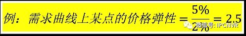

需求价格弹性（the price elasticity of demand）(因为永远是负的，所以不提是负的)

什么样的产品会这样呢？一般来说奢侈品是这样的。香水、名烟、名表、名照相机，它们有这个特点。当价格上升一点点以后，人们可用可不用，这时候它们的需求量就会有比较大的变化。

这样，需求量的变化率除以价格的变化率除出来，就是一个大于 1 的常数。弹性大于 1，它指的是奢侈品。倒过来，如果 1%的价格变化导致的需求量的变化不足 1%，那么这时候除出来的弹性数字就小于 1。弹性小于 1，什么意思呢？它指的是必需品。

比方说我们生活中的盐，盐的价格再怎么变化，我们对盐的需求量不会产生太大的变化，盐的需求量也不会下降一倍，这样除出来的弹性就小于 1。每当我们见到需求对价格的弹性小于 1 的商品，我们通常就说它是生活的必需品。

这里要注意的是，由于价格的变化方向，和需求量的变化方向永远是反向的，价格增加需求量下降，所以弹性永远是一个负数，由于它永远是负的，咱们也就不提它是负数了，所以一般我们只要讲到弹性，就讲它的绝对值就可以了。

需求曲线上的弹性处处不等，价格越高弹性越大

好，弹性的公式介绍到这里，我们就要做一个重要的区分。

你还记得我们中学学过的解析几何吗？同一条曲线上面，每一点的斜率它们都是相等的，但是你要注意弹性的公式，并不是斜率的公式。弹性不等于斜率。在一条需求曲线上面，它的斜率是处处相等的，但是在同样一条需求曲线上面，它每一点的弹性是不一样的。  

你要注意这个公式，你就能看出区别来。

一条倾斜向下的需求曲线，当它价格比较高的部分，它的弹性是大于 1 的；它的价格比较低的部分，它的弹性是小于 1 的。而每一点的弹性都是不一样的，是在渐变的。  

这个特征非常有意思，你想，它的含义是什么？

刚才我们不是说，弹性大于 1 代表的是奢侈品，弹性小于 1 代表的是必需品吗？但是同样一条需求曲线随着价格的变动、随着价格的不同，它的弹性就会发生变化。

当价格比较高的时候，弹性大于 1，也就是说，这时候这种商品是奢侈品；但是当价格跌到一定程度以后，这种产品就变成了必需品。

没错，它的含义正是这样。也就是说，同样一种商品，它究竟是奢侈品还是必需品，没有定数，取决于价格的高低。这是一个很重要的经济学的含义。

## 一件商品是奢侈品还是必需品，完全取决于价格

我们凡是见到有人讨论一种商品，一口咬定说它是奢侈品的，或者一口咬定说它是必需品的，你就知道他对弹性的概念不理解。因为掌握了弹性概念的人，他会明白任何商品，都既可以是奢侈品，也可以是必需品，这完全取决于价格的高低。

比方说，坐地铁到底属于奢侈品还是必需品啊？很多人说，这当然属于必需品啊，没有地铁咱们就上不了班。

我给你举一个例子。北京自从奥运以后，地铁票价就一直是一个统一价——两块钱。不论你跑多远，都是两块钱。这么做，对政府的财政压力就很大，地铁公司就一直希望重新调整价格。很多人就说不能调整，因为地铁是必需品，无论价格高低，人们都是会同样坐地铁的，所以不应该调整这个价格。而实际上，地铁公司终于在 2014 年 12 月 9 日，恢复按路段收费。

那一天，你猜需求量有没有变化？价格产生了变化，需求量当然会发生变化，这是咱们坚如磐石的需求第一定律预测的，那天北京地铁的乘客数量在不同的时段、不同的路段分别下降了 9%、15%、20%之多。所以说一个商品到底是必需品还是奢侈品，跟价格有密切的关系。

再比方说水，水到底是奢侈品还是必需品？一般人会说，水当然是必需品。

但是你要看，在水资源特别匮乏的地方，人们使用水的数量，跟水资源非常丰富的地方，人们使用水的数量是完全不一样的。

在水资源丰富的地方，人们不仅喝水，他们还洗澡，不仅洗淋浴，他们还泡澡，不仅自己泡澡，还要浇花，还要洗车，还要做喷泉。

在水资源不够的地方呢。那他们当然很省了，他们不会浇花，也不会随便洗车，澡也不是随便洗的，他们洗完脸又洗脚，洗完脚又擦鞋，擦完鞋还要拿来冲厕所。

同样，我们生活在大城市的打工一族，往往都认为今天坐出租车是一种必需品。但实际上，10 年前、20 年前、30 年前出租车肯定是奢侈品，一般人是坐不起出租车的。出租车司机只在宾馆门口趴活，他们接的都是外宾。随着价格的下降，出租车才变成了我们上下班必需的交通工具。

## 课堂小结

今天我们介绍了弹性的概念。我们说弹性跟斜率不一样，在一条需求曲线上面，斜率是处处相等的，但是在同样一条需求曲线上面，弹性却处处不等。在价格比较高的部分，弹性大于 1，也就是说一种商品具有弹性，代表这种商品是一种奢侈品；在价格比较低的部分，弹性小于 1，它代表的是，这种商品是一种必需品。同样一种商品，到底它是奢侈品还是必需品，取决于价格的不同。

## 课后思考

今天我留给你的问题是，究竟有没有什么商品是无论价格多高，人的需求量都是一样的？

欢迎你给我留言，我们下节课再见。

##### 34

# 第 033 讲  
需求第二定律（2/3） 

你好，今天我继续给你讲，非常重要的、刻画人性的需求第二定律。我们昨天做了一个铺垫，先介绍了一个概念：弹性的概念。

我们说需求曲线上面的弹性处处不等。也就是说，同样一个需求，当价格比较高的时候，弹性就比较高，意味着这种商品，是一种奢侈品；但是同样一种需求，当价格比较低的时候，弹性就比较小，意味着它是一种必需品。

换句话说，同样一种商品对同样一个人来说，随着价格的变化，它心目中对这个产品的评价也发生了变化。价格高的时候，它就是个奢侈品；价格低的时候，它就变成了必需品。

## “垂直的需求曲线”

这时候你会问，薛老师，你们经济学家的这种说法有点抬杠。因为生活当中有些商品，无论什么情况下，它都是必需品，无论价格多高，它都不会变成奢侈品。

你比方说盐，咱们人少不了盐吧，无论盐的价格去到多高，咱们还得吃盐，你怎么能说盐会变成奢侈品呢？所以你会说，世界上总有这么一些商品，无论它的价格有多高，咱们的需求量都不会发生变化。

这种想法是有一定的代表性的，有一些经济学的教科书，就用一条垂直的需求曲线来代表这种想法。

我们前面讲需求第一定律的时候，再三强调，需求曲线一定是倾斜向下的。

也就是说价格变化会导致需求量的变化。价格高了，需求量就会减少一点；价格低了，需求量会增加一点。但是既然有倾斜向下的需求曲线，会不会也有垂直的需求曲线呢？

我们学数学的人、学几何的人，很容易有一个倾向，你既然能画一条斜的线，咱们也能画一条垂直的线，对不对？

画一条垂直的需求曲线，是什么含义呢？意思是无论价格多高，它的需求量都不变。这种需求通常被称为刚性需求，简称刚需。

你看看我给你准备的下图就清楚了。

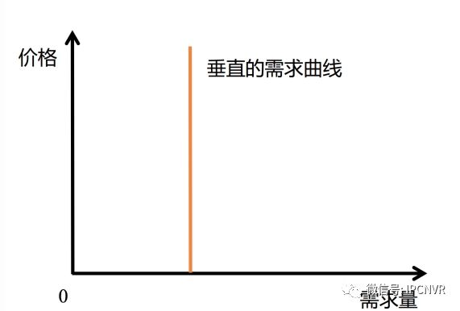

不存在垂直的需求曲线！

问题是，随手画一条垂直的需求曲线是容易的，但是你要真正明白这一条垂直的需求曲线，它究竟在真实世界里面是什么含义。它的含义是说无论多高的代价，它的需求量都不变，它代表的是一个人没有本事寻找任何的替代方案。

## 人会寻找替代方案

如果说人不会找任何替代方案的话，那么人类早就灭亡了。比方说盐，当盐的价格高到一定程度的时候，人们就一定会想办法寻找别的替代方式，最后生病也是一种替代方式，甚至死亡也是一种替代方式。

还有人们喜欢举的例子，是说治病的药也是一种刚需产品，无论价格多高，需求量都不变，但真是这样吗？

假如我得了病，医生说你看有一种药可以治你的病，1 千块钱，你愿不愿意付？我说我可以付；1 万呢？1 万我说我也可以付；10 万呢？10 万我也可以付。

但医生说 100 万呢？这时候我就会问医生这 100 万能管多久，如果能够根治这个病，那也行。但如果医生说 100 万只管一个礼拜，那我会怎么办？我就会说，那就别治了，我把钱省下来给孩子吧。

你觉得这是一种抬杠的说法吗？这当然不是一种抬杠的说法。每一天，每一间医院，每一个病人都面临这样的选择。

所以，我们说需求定律是刻画人的基本人性的。**人性的特点，就在于它能够寻找替代方案。**而且随着时间的变化，时间越长，它能找到的替代方案就越多。这是需求定律的含义。

我建议你用“一瓶水洗澡”这几个关键字去网上搜索一下，网上就有好多的帖子，教人怎么用一瓶水洗个澡。这说明人在没有办法的时候，是会想出很多办法来解决资源稀缺的问题

## 几千几万年不变的人性规律

经济学家阿尔钦（Armen Alchian ）在他的教科书里面，还曾经用过这么一个表。这个表我也把它复制到我们的专栏文稿里面去了。这个表能够非常生动地反映，人们是怎么样面对资源稀缺的困难，来寻找替代方案的。

这个表分四栏，左边一栏讲的是某种商品的生产，比方说生产一个单位的钢铁、生产一个单位的玻璃、生产一个单位的橡胶等等；第二栏写的是生产这一个单位的商品所需要的最大用水量是多少；而第四栏是最小用水量是多少；第三栏是一般情况下的用水量是多少。

Source:H.E.Hudson and Janet Abu-Lughod,“Water Requirements”in J.B Graham and M.F.Burrill(eds.)Water for Industry (Washington,D.C.:American Assocican for the Advancement of Sicience,1956),Pub.#,pp.19-21.  

这个表的亮点在于第二栏和第四栏之间的差别。你会看到，同样生产一个单位的产品，无论它是钢铁、玻璃，还是橡胶，它的用水量可以有巨大的差别。有时候会用很多的水，有时候会用很少的水。

比方说第一栏，每千瓦时的蒸汽发电最大的用水量是 179，而最小的用水量竟然只有 1.3。这说明人是能够发挥巨大的能动性去寻找替代方案，来适应他们身处的环境的。

到底用水多好，还是用水少好呢？这里没有统一的答案，得看你所处的资源环境是什么样子的。

比方说，在芝加哥这个地方，它面对的一个密执根湖，湖水非常的冷，可以用来冷却。这时候炼钢厂设在那里，冷却的费用就非常低。但是炼钢厂离煤矿的距离可能就比较远，运输的成本也会上去。这时候，商人要决定的不是用水量的最小化，也不是运输成本的最小化，而是所有生产总成本的最小化。

我还特别喜欢阿尔钦在这个表下面所写的一小段注释文字。他说这个表里面所用的数字，是来自 1956 年的一个统计。你会说，这 1956 年的统计今天是不是过时了？

阿尔钦特别写道：“虽然这些统计数据是 1956 年的，但是经济学的规律，要比 1956 年古老得多，这就是人性的规律。

有时候有些同学会跟我说，薛老师，你教的经济学很古老，那是 30 年前的经济学，我就纠正他们说，不对，我教的经济学可不是 30 年前的，我教的经济学是 3 千年前的，是 3 万年前的经济学。

## 随着时间推移，需求弹性会越来越高

如果你理解了弹性的概念，理解了人性的基本特征，那理解需求第二定律就是水到渠成的事情。

需求第二定律的含义是说，每当出现新的情况，出现新的冲击的时候，人们寻找替代方案的范围一开始的时候可能没那么大，但是随着时间的推移，他们选择替代方案的空间会越来越大，他们能够找到的对策就越来越多。

比方说，我今天跟往常一样，8 点钟出门准备上班，一出门发现外面下着倾盆大雨，外面等着一辆出租车，司机跟我说要涨价 3 倍，这就是一个突如其来的冲击。

面对这个冲击，一开始的时候，我没有多大的选择余地，我只能从了，给这个出租车司机 3 倍的价钱。因为我上班不能迟到，同学们在等着我上课。

如果第二天还发生同样的情况，还在下着倾盆大雨，而同样是这个出租车司机在门口等着我，也要我 3 倍的价钱，那我会怎么样？如果第三天也还是这样，第四天也还是这样，这时候我就开始会去想其他的替代方案。

如果我能预测这样的情况，还会一直发生下去的话，那么我可能会另外再找一个相熟的司机，我可能会在学校附近找一家酒店住下来，我也可能跟我们的院长说，我们把上课的时间调整一下。

这种变化趋势就是需求第二定律所说的：随着时间的推移，需求弹性会变得越来越高，也就是说替代品越来越多，对策越来越多。

再举一个例子，比方说石油价格上涨，石油价格刚刚涨上去的时候，汽油的需求量并没有跌下来，因为人们还暂时找不到好的替代方案，但是如果石油的价格一直高涨，一直跌不下来的话，那么人们就开始会寻找新的替代方案。

人们不可能在石油上涨的第一天，就把他原来笨重的耗油大的汽车卖掉，但是一年后，两年后呢，在他们重新买新车的时候呢？他们要不要考虑油耗的问题。同样，汽车生产商也会对这种现象做出调整。

结果我们看到，如果石油的价格一直居高不下的话，随着时间的推移，人们就会对石油价格上涨，这种变化做出越来越充分的应对。

## 课堂小结

今天我们讲了需求第二定律的含义：随着时间的推移，需求弹性会变得越来越高，人们寻找替代品的空间会越来越大，对策越来越多。

## 课后思考

今天我留给你的思考题是：你能不能举一个上有政策下有对策的例子？

欢迎你给我留言，我们下节课再见。

##### 35

# 第 035 讲  
需求第二定律（3/3） 

你好，今天我跟你讲需求第二定律的应用。

需求第二定律的涵义是说，随着时间的变化，弹性会逐渐增大，也就是说随着时间的变化，人们能够选择更多的替代方案，能够形成更多的对策。

我们在现实生活中有许多冲击，有许多的成本，比方说有政府收税、有自然灾害、有人为灾害、有好多的交易费用产生等等。

这些冲击和成本，在现实生活当中，在人与人之间是怎么分摊的？听完今天这一讲你就明白了。

## 房地产交易税由谁承担？

我先问你，咱们政府不是规定所有的雇主要替雇员交养老保险吗？你说这养老保险是雇主付的还是雇员付的？

我再问你，政府规定我们在卖房的时候，卖房的人要交房产交易税，这一笔税金，其实是卖房的人付的还是买房的人付的？

我再问你，一个卖水果的人，比方说他卖的是香蕉。假设一块钱一根香蕉，这时候政府忽然插进来，他说要对每一根交易的香蕉收 5 毛钱的税。那么我问你，这 5 毛钱的税到底是卖香蕉的人付的，还是买香蕉的人付的？

每当我在北大上课问同学们这样的问题的时候，同学们的回答都是五花八门的。

一般他们会说那个养老保险，是雇员付的，雇主没有付；那个房产交易税，是买房的人付的，卖房的人实际上没付；那个香蕉税，是买香蕉的消费者交的，那个卖香蕉的人，他会把这个税务的成本推给消费者。

问题是，这当中的道理是什么呢？这雇主为什么总有本事把他们的成本负担推给雇员呢？为什么卖东西的商人，他总有本事把成本推给买东西的消费者呢？为什么卖房的人，他就有本事把房产交易税的负担推给买房的人呢？

你想一个工厂老板，如果他有本事无条件地把其生产成本推给工人的话，那他为什么不多推一点呢？比方说一个工厂老板，他娶了一个很爱花钱的太太，他太太一天到晚买奢侈品，他家里的开支因此就大了，那么这个老板可以把更多的成本转嫁给工人，没有止境。

现实情况当然不是这样。工厂老板当然不可能得寸进尺，毫无止境地把他自己的成本转嫁给工人。

税负由买卖双方共同承担

那么，实际上我们刚才提到的养老保险、房产交易税、香蕉税，到底是怎么样在卖家和买家之间分摊的呢？

你看看我给你准备的第一张图：

第一张图  

这张图里面有一条倾斜向下的需求曲线 D，有一条倾斜向上的供给曲线 S，这两条曲线相交的点是一个平衡点叫 N。

在政府没有征税的情况下，在没有收取养老保险的情况下，买卖双方的均衡点就在 N 这一点上。在这一点上的均衡价格是 P0，其均衡销售量或者需求量是 Q0。

这时候，政府说要征税。征税的后果，是需求者要比原来付的价格要多，所以需求者付的价格，从以前的 P0 便成了 Pd；而同时，供应者他比原来拿到的收到的钱要少收一点，也就是说他能够赚到的钱从 P0 便到了 Ps。

而这时候，整个交易量从 Q0 收缩到 Q1。这就是政府收税之后的新的均衡状态。

也就是说，需求者买方多付了钱，卖方少收了钱。

买方多付的钱，再加上卖方少收的钱，这两笔钱加起来恰好等于政府增加的税收。

在图里面 Pd 和 Ps 之间的距离恰恰就是政府所征收的税率。

最后的结果是，在我们图里面标志为 A 的那个矩形，它是消费者买家所承担的政府的税收部分。而标志为 B 的那个矩形，是卖家所承受的政府的税收的部分。A 加 B 的总面积，恰好等于政府的税收收入。

所以通过这个图，咱们对政府征收税务的结果，就有一个非常清晰的认识了。政府征收房地产交易税，它的结果是什么？结果是买房的人要多付钱，卖房的人少赚了钱，他们的损失之和等于政府的税收收入。

我们国内曾经有一位很出名的经济学家，他说咱们的房价太高了，所以他建议政府通过收取很高的房产交易税来压低房价，这种想法是完全错误的。重税怎么可能压房价呢？重税只会增加买房人和卖房人的负担。

所以，一个 3 室 2 厅的房子，在政府征收房产交易税以后，实际上有一间房就已经归了政府了，重税怎么能够压房价呢？

供应者与需求者，谁承担更大税务？

所以税务的负担到底是由谁承担呢？你看下图（第二张图）就能够找到线索。

  

第二张图  

需求者承担的部分是上面的矩形，供应者承担的税务部分是下面的矩形。到底上面的矩形大，还是下面的矩形大呢？这取决于需求曲线和供应曲线的相对斜率。 

  

我们前面讲过需求曲线上面的弹性处处不等，当然供应曲线上面的弹性也处处不等。

但在这里我们做一个简化的处理，我们简单地把比较陡峭的需求曲线说成是比较缺乏弹性的需求，我们把比较陡峭的供应曲线说成是比较缺乏弹性的供给，而同时把比较平缓的需求曲线说成是具有弹性的需求，而把比较平缓的供应曲线说成是具有弹性的供给。

我们再看一下第二张图，我故意把供应曲线画得比较平滑，需求曲线画得比较陡峭，这时候上面的矩形就比下面的矩形要大很多。这说明什么？这说明当需求缺乏弹性、需求曲线比较陡峭的情况下，大部分的税收是由需求者承担的。

第二张图：注解 1 的需求曲线，相对陡峭，相对缺乏弹性，需求者将承担大部分税负  

而情况倒过来，我们看下面第三张图，我故意把需求曲线画得比较平滑，而供应曲线画得比较陡峭，也就是说，供应者比较缺乏弹性，这时候你就会发现上面的矩形比较小，下面的矩形特别大，这说明税收的负担大部分落到了供应者头上。

 

第三张图：注解 2 的供应曲线，相对更陡峭，相对缺乏弹性，供给者将承担大部分税负

现在我们就可以来回答我们这一讲一开始提的 3 个问题：

养老保险究竟是雇主付的还是雇员付的？

房产交易税到底是买房的人付的还是卖房的人付的？

香蕉税到底是买香蕉的人付的，还是卖香蕉的人付的？

正确的答案分两句话：

第一句是说这税务是双方共同承担的；

第二句是谁付的多谁付的少，取决于需求者和供应者，他们双方的相对弹性。

谁的弹性低，谁对这份交易的需求更迫切，谁就付得多一点。

弹性大小决定承担税负分摊比例

比方说，雇主和雇员之间的关系，不管政府规定是雇主付养老保险还是雇员付养老保险，这取决于雇主和雇员，谁更需要这份工作，谁越需要这份工作，他们的谈判能力就越低，这时候他们就会承担更大比例的税务负担。

比方说，政府忽然规定国发院的院长要替我们每一位教授多交一笔养老保险，当这个命令一下来的时候，我们的院长没有其他的办法，只能听从国家的政策。

这时候付这笔养老保险的人是咱们国发院，是雇主；但是随着时间的变化，咱们院长就会有许多的对策，他会重新调整跟我的劳动合同，重新调整给我的工作量。

这时候我接受还是不接受，取决于我对这份工作的需求程度，如果实在离不开这份工作，那么我就会接受他提出的新的条件。到最后，这笔养老保险的负担是会落到我的头上，而不是由学校支付。

同样香蕉的例子也是这样。如果政府规定买香蕉的人必须付这笔香蕉税，实际上你说这香蕉税是谁付的？你要想谁更需要这份交易。

买香蕉的人，他今天不吃香蕉，他还有好多其他的水果可以选择。但是卖香蕉的人呢？它的弹性可就低了。香蕉今天卖不出去，第二天就会坏掉，所以卖香蕉的人，他有更迫切的需求，要把这个香蕉卖出去。

这时候不管政府的规定是怎么样的，卖香蕉的人会都说：“表面上政府规定是要由买香蕉的消费者付税，但是我可以替你付，因为我实在很需要把香蕉卖出去。”

所以这笔香蕉税到底是消费者多付，还是商人多付，取决于商人跟消费者之间的相对弹性。

## 法律无效定律

所以政府额外地征收一笔税收，这笔税收实际上是由买方付，还是由卖方付，我们的正确答案是：他们双方共同付，而谁付的更多则取决于它们之间的相对弹性。而这相对弹性的大小，跟政府的规定本身没有关系。

有时候我们开玩笑，称这个规律为“法律无效定律”，在英文里面叫做 The law of the irrelevance of the law。挺有意思的是英文里面规律和法律用的都是一个词，都是 law。

法律为什么没有效果,为什么政府规定是谁付的，跟实际上是谁付的，没有关系，它只取决于交易双方的相对弹性。这个规律之所以起作用，它背后产生的原因,就在于需求第二定律所刻画的基本人性，就是人是会去寻找对策的，而且时间越长，他们寻找的对策就会越好。

需求第二定律，在我们现实生活中还有一些有趣的应用。比方说男女关系，两个人谈恋爱总有一些交易费用吧？到底是男生去找女生还是女生去找男生？谁来付这笔交通的交易费用？男生跟女生讲的语言不一样，谁迁就谁的语言，谁迁就谁的饮食习惯。这时候我们就能够看出谁更需要谁，谁的需求弹性更低更刚需。

还有，今天我们有这样的习惯，男生跟女生结婚的时候，男生要给女生买一个钻石戒指，这是风俗习惯，规定好了一定是男生买的。但今天你学了“法律无效定律”以后，你就知道这个戒指实际上是谁买的。正确的答案是，这个戒指是双方共同买的，谁付的钱多，谁付的钱少，取决于谁更迫切地想要结婚。

## 课堂小结

最后我给你总结一下，今天我们讲的是需求第二定律的一个重要的应用，那就是税负的分摊。税负通常是由供需双方共同承担的，至于谁承担的多，谁承担的少，取决于它们之间的相对弹性，而与法律或者风俗的规定没有关系。

## 课后思考

今天我留给你的思考题是，你能不能再举一个你身边的例子，来说明税负分摊的规律？

欢迎你给我留言，我们下节课再见。

##### 36

# 第 036 讲  
需求第三定律 

你好，今天我给你讲一个应用非常广泛，非常有趣的需求定律，需求第三定律。

我们说过，市面上绝大多数的教科书，只有两个需求定律：需求第一定律、需求第二定律，咱们这有第三个需求定律。

发现这个定律的是两位经济学家，一位是我们熟悉的阿尔钦（Armen Alchian ），另外一位是威廉·艾伦（William Allen ）。这个定律是在他们合写的教科书《大学经济学》(University Economics )里面提出来的。

## 需求第三定律要回答的问题

我先问你，薛老师写过两本书，一本叫《经济学通识》在罗辑思维卖，另外一本叫《商业无边界》讲反垄断的。亚当·斯密也写过两本书，一本叫《国富论》，一本叫《道德情操论》。我们俩都写过两本书，哪两本书更有价值？

当然，你如果为了让我开心，你会说薛老师的两本书要比亚当·斯密的两本书更有价值。在北大我也喜欢问这个问题，因为同学们怕我给他不及格嘛。但实际上我们都知道，当然是亚当·斯密的两本书更有价值。问题是，为什么？

那我再问你，假设我手头上有两段文字，一段是从某块石碑上面抄下来的；一段是随机从我的 Email 里面抄出来的。这两段文字哪一段的质量更高？

我再问你，我手头有两张音乐会的门票，一张是咱们北京朝阳区群众组织的乐团演出的节目；另一个是来自美国的国家交响乐团演出的音乐会。哪一个音乐会的欣赏价值更高？

我再问你，在哈佛大学，如果我们算同学的平均成绩，那么是所有哈佛大学同学的平均成绩更高呢？还是在哈佛大学读书的中国留学生的平均成绩更高？

我还要问你，每年有许多人跑到美国的拉斯维加斯赌博，那么是美国当地人下的赌注大，还是不远万里，从中国跑到拉斯维加斯去的中国游客下的赌注更大？

我再问你，咱们超市里面卖肉，其中有一盒肉，上面写着是澳大利亚进口的，那么这一盒肉，更可能是含骨头的，还是去了骨头的？

我再问你，在美国规定，儿童是不能单独呆着的。假设有一对夫妇他们要外出去庆祝结婚纪念日，他们就得请人来照看小孩。那么，这对夫妇付完给保姆的钱以后，在外面，他们更可能吃一顿麦当劳，还是吃一顿牛排烛光晚餐？

所有刚才问的问题，他们都有共同的特征，这就是需求第三定律所要回答的问题。需求第三定律是什么意思呢？

## 精选苹果价格何以下降

你先看看下图里面的表格。

我们假设有两种苹果，一种是普通苹果，一种是精选苹果。普通苹果 1 块钱一个，精选苹果 2 块钱一个。那么这时候，你吃一个精选苹果，它的成本就是放弃了的最大代价，就放弃了两个普通苹果。

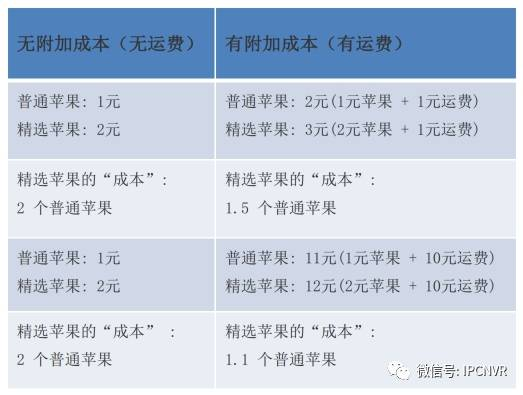

但是如果要把苹果运到外地去，再加上一笔运费，情况就不一样了。假设运费也是 1 块钱，那么运精选苹果的成本和运普通苹果的成本是一样的，因为苹果的重量是一样的，体积也一样。

这时候精选苹果的成本是 3 块钱，就是原来的 2 块钱加上 1 块钱的运费；普通苹果的总成本是 2 块钱，也就是原来的 1 块钱再加上 1 块钱的运费。这时候你会发现，加上运费以后，你再吃一个精选苹果的话，它的成本，需要付出的代价就比原来少了。

这时候你就会发现，你再吃一个精选苹果的话，付出的代价只不过是 1.5 个普通苹果。照着这个逻辑推下去，如果运费不是 1 块钱，而是 10 块钱，金额特别大的时候，情况会怎么样呢？

你会发现，精选苹果的总成本是 12 块钱，而普通苹果的总成本是 11 块钱，12 块钱跟 11 块钱之间只差了一块钱。换句话说，加上了一笔巨大的运费 10 块钱以后，你吃一个精选苹果的代价，只不过是 1.1 个普通苹果。

你看到对比了吗？没有加运费的时候，你吃一个精选苹果的代价是两个普通苹果，加了一笔巨大的运费以后，你吃一个精选苹果的代价，只不过是 1.1 个苹果。也就是说加上一笔运费以后，消费精选品的代价变低了。这就是需求第三定律的含义。

它是说，精选品和普通品之间的价格本来是有差距的，但是加上一笔附加费以后，它们的差距就缩小了，精选品显得便宜了。而附加费越大，这种效果就越显著，精选品就会显得越便宜。

倒过来，每当人们不得不支付一笔巨大的附加费的时候，那就只有那些精选品才值得人们去运送，才值得人们去提供，才值得人们去享受。

这时候我们就可以回过头来解释我们前面讲到的例子。

## 附加成本使精选产品相对价格下降

在 200 多年前，亚当·斯密的那个年代，印刷成本是非常高的，所以不是谁都能够著书立说的，也只有亚当·斯密这样的大思想家才可以著书立说。因为那个时候出版书籍的附加成本非常高，只有高质量的内容才值得印刷。

你想想看，那时候一般的家庭可能只买得起一本书，那么全世界如果只印一本书的话，这本书是什么书？那可能就是《圣经》。如果印两本书呢，那第二本可能是亚当·斯密的《国富论》。

而到今天，印刷成本急剧下降，出书已经变得非常便宜，非常容易了，结果我们说的“需求第三定律”的效果就不显著了，连薛老师这样的人也能出两本书了；

能够刻在石碑上的文字，那一定是精心雕琢的，而发电子邮件，那是非常便宜的事，所以电子邮件里面的文字质量当然是比较低的；

不远万里从美国跑到中国来演出的乐团，他们要支付高昂的交通费用、住宿费用，这时候只有高质量的乐团，才值得花这笔钱；

跑到拉斯维加斯去的中国游客，他们下的赌注比美国当地人下的要大，也是这个道理；

中国的留学生要跑到美国去读书，他们也要付出更大的成本，所以一般来说，是好的同学更容易跑到外面去读书；

从澳大利亚进口到中国的肉，运输成本可不低，当然事先要把骨头去掉；

如果你有机会从美国坐飞机到中国，你能够带一瓶液体，那么你更可能带的是红酒或者香水，比较不可能带的是一瓶矿泉水或者一瓶啤酒；

50 年前出的唱片，它的艺术价值，跟今天出的唱片的艺术价值相比，当然是 50 年前的更高。因为 50 年前出唱片的成本可高了，所以只有最好的音乐家才能出唱片，而到今天，好多走音的歌手他也能够出唱片。

## 附加成本上升并不是好事

很多人会抱怨说，今天我们出版物的平均水平在下降，这确实是对的。你看当年由于出版的成本非常高，只有一流的作家才能出版，当然他们的平均质量就很高。到今天由于出版的成本很低，谁都可以出版，那么这时候出版物的平均质量就下降了。

问题是，出版物的平均质量下降，是好事还是坏事？是好事。为什么？那是因为由于出版的成本下降，出版物增加了，人们的选择增加了，虽然平均水平下降，但是人们的选择增加，这本身也是一件好事。

同样，中国是出口大国，很多西方国家都对来自中国的产品，实施配额保护制度。那么中国的产品要卖到国外去，中国商人得额外购买配额，也就是说多付一笔附加费。

你猜，这时候中国出口商品的质量是上升了，还是下降了？

你猜对了，是上升了。由于中国商人在出口商品的时候必须多付一笔附加费，这时候只有价值更高，品质更高的产品才配得起这笔附加费，所以这使得中国出口商品的质量提升了。

这是好事坏事？这是坏事。虽然中国出口商品的平均质量提高了，但是出口商品的品种减少了。国外的消费者和中国的生产商，都因此蒙受了损失，减少了机会。

比方说，在市面上我们有各种各样品质的香烟，有 1 块钱一包的香烟，有 5 块钱一包的香烟，也有 10 块钱一包的香烟。如果政府要对香烟征税，说每一包香烟我们征 5 块钱的税。那么我问你，这时候市面上留下来的，是便宜的香烟还是贵的香烟？答案是：只有贵的香烟才能留下来，便宜的香烟就留不下来了。

## 课后小结

这就是需求第三定律。它的含义是，每当消费者必须支付一笔附加费的时候，高品质的产品就相对低品质的产品变得便宜了，这笔附加费越高，高品质产品就变得越便宜。有时候我们把这个定律叫做“好东西运到远方去定律”。

有一次我讲完需求第三定律以后，有位同学上来跟我说：“薛老师，我再给你提供一个例子。”他说，他以前一直听说四川是出美女的地方，后来终于有机会去四川了，但他发现四川并没有那么多的美女。他当时就觉得奇怪，今天终于知道答案了，原来四川的美女都跑到远方去了。

## 课后思考

今天我留给你的问题是，你能不能再举一个例子，向那些不了解什么叫“需求第三定律”的人，说明需求第三定律的含义。

欢迎你给我留言，我们下节课再见。

##### 周

# 第 9 周问答  
人们如何应付意外事件？ 

你好，我们开始本周的问答时间了。

随着课程的推进，大家感觉到内容有一点点难了，但不要紧，这是值得的。因为在经济学的基本原理里面，又有用又有点难的，也就这个程度了，所以你努力一点，就能够把那些又有用又有点难的学到手，这还是很值得的。

大家感觉到有点难的另外一个原因，可能是这两讲我们讲需求定律用到了一些图表，得对照着图表看才能有更深的理解。其实你看完图表以后，把图表抛在后面，它的基本原理很容易就能够理解，很容易就能够记住。你要掌握了它们的核心思想，就不再需要依赖图表了。

咱们这两周讲的需求定律非常重要，我们不用图表来回顾一下，重点其实是很突出的。

## “需求量”与“需求”存在重要区分

需求第一定律有几个重点。首先，它一定是倾斜向下的，需求量和价格成反比，价格越高需求量越低；价格越低，需求量就越大。

这里有一个知识点，就是需求量和需求之间的区别。当我们讲需求量的变化的时候，我们讲的是只有价格发生了变化，所以人们的需求量在同一条不变的需求曲线上面滑动。

但是当其他的条件发生了变化，那么人们的需求就会发生变化，它表现为需求曲线的移动。

所以要回答我们留的那个关于菜农的问题，就得用上这个知识。还是感觉理解不透的同学，可以看上个礼拜的问答，还有我们礼拜天的加餐。

需求第一定律的另外一个亮点，是需求和供给没有必然的区分，当价格高到一定程度的时候，原来的需求者就会变成供应者。

我们讲需求第一定律的时候，还谈到了“交易剩余”的概念。有些人把这些剩余称为“消费者剩余”，也有人把它称为“供应者剩余”，实际上最好的叫法是“交易剩余”。不论是买家还是卖家，在任何一宗交易里面，其实都是赚了便宜的，这便宜往往还不小。

## 没有永远的奢侈品，也没有永远的必需品

需求第二定律，讲的是随着时间的推移，人们的弹性会变得越来越大。弹性的概念是重点。弹性跟斜率不一样，在一条需求曲线上面，斜率是处处相等的，但弹性处处不等。

它告诉我们一个非常重要的基本规则，那就是人们到底把一件商品看作奢侈品还是必需品，取决于这件商品的价格。没有永远的奢侈品，也没有永远的必需品。

当然，人是善于找替代方案的，我们画几何图形的时候，很容易画一条垂直的需求曲线，但垂直的需求曲线，它的含义在经济学里面、在人性里面并不适用。因为它意味着人是没有办法寻找替代方案的，所以在经济学里面不存在一条垂直的需求曲线。

需求曲线一定是倾斜向下的，因为人是善于找对策的。世界上并不存在什么人们绝对需要、不管代价多高、它的需求量都不变的商品。

## “税负分担原则”的应用

需求第二定律一个非常重要而且有趣的应用，就是税负的分担原则。突如其来的一个冲击，到底是买卖双方，谁承担了这个税负？我们的答案是买卖双方共同承担了税负，而谁的相对弹性越低，它承担的比例就越大。

所以我们说，雇主和雇员是谁付的养老保险呢？共同负担。至于谁付得多，则取决于谁更需要这份工作。房产交易税谁负担？买卖双方共同负担。谁付得多？看谁更迫切地想要达成交易。

在课上我让大家再举一些例子，大家举的例子都非常不错，但是我们还要把这个概念再往前推进一点。

实际上，我们在课上为了简化，说是买卖双方共同负担，但我们把镜头再拉远一点的话，我们会看到，每一个人既是需求者也是供给者。

我需要这份工作，我卖的是劳动力，雇主买的是我的劳动力，雇主好像是个买家，但是雇主的后面还有消费者，要买我的雇主所生产的产品。供应者、需求者是一环跟一环连接起来的，所以税负是像涟漪一样，向整个社会一层一层、一波一波地分摊出去的。

任何一种成本，都不是仅仅由买卖双方付的。因为买卖双方，他们又会进一步把他们所承受的税负，向跟他们打交道的人、跟他们做交易的人分摊出去。

## 人们如何提前应付意外事件

所以我问你，类似 9·11 这样的事件，谁是真正的受害者？当然首当其冲的是这个事件当中的死难者，还有他们的家属。他们完全没有弹性，完全没有躲避的机会。

但是我们看，这 9·11 两栋楼的所有者他们受损了吗？看上去好像他们的楼没有了，但实际上他们买了保险，所以受害者是保险公司吗？没有，保险公司其实也做了准备，它还有再保险；再保险公司受了损失吗？没有，它们其实已经把相应的成本，向整个社会一层一层像涟漪一样分摊出去了，提前就分摊出去了。

所以像 9·11 这样的事件，你说它是意料之中的还是意料之外的？当然它是意料之外的——意外，顾名思义就是人们想不到的事情。但是，人们知道自己会有一些事情想不到，所以就会尽量为这些想不到的事情做好准备，这些意外也就变成了意料之内。所以说 9·11 事件不完全是意外，因为人们已经买好了各种保险，做好了各种安排。

同样的道理，我们说铁达尼号事件到底是不是意外，当然它是意外，但是它其实也不是意外。为什么？因为海上的事故和灾难，不是从铁达尼号才开始的，人们早就知道会有海难的发生，所以不仅为它尽量做好了各种准备，而且人们还为他们的安全提前支付了保险费。

在铁达尼号事件里面，不同舱位的生还率是不一样的，在头等舱的生还率高达 61%，到二等舱就下降为 42%，到三等舱就只有 24%了。

更值得注意的是，人们早就形成了一个共识，甚至是一个道德标准。遇到重大的灾难，让女人小孩先逃生，因为这对保持一个群体的生命的延续是至关重要的。

人们把这个事情已经想透了，想清楚了，遇到紧急的关头不再想了，执行就是了。所以在铁达尼号事件里面，生还的人当中，男性只占了三成，女性占了七成。

我们在理解税负分担的原理的时候还要注意，我们讲的税负，是意外，是冲击。但是，好事也是同样的道理。比方说，某位教授获得了诺贝尔经济学奖，谁是真正的受益人呢？当然，他自己是最大的受益人，但那并不是全部。

他的学生，他们就可以永远声称是这位诺奖得主的学生，他们能够从中得到好处；稍微远一点的，他的同事也可以这么声称；再远一点，他所在的教研机构、他的学校也可以这么声称；再远一点，他的同乡也可以这么声称；再远一点，他整个国家都为之感到自豪。

好处也是这么分的。趋利避害时间越长，人们做准备的时间就越长，通过充分的考虑，好处和坏处都分摊出去了，这是需求第二定律当中“税负分担原则”的应用。

我再问你两个问题。过年的时候，好多亲戚朋友会给小孩压岁钱，但是他们的父母会替他们把压岁钱收了。我问谁是这压岁钱的真正受益者？

在国际上，有些国家受到其他国家或者联合国组织的经济制裁，那么我问你，真正承担这些制裁后果的，是这些国家的普通民众，还是这些国家的领导人呢？

学习一个原理，就要想这么多，就要用这么多。我们学习需求第二定律的时候，学到这个地步，想到这个地步，那算是到家了。

## 连动物和植物都不存在刚需

好，我们来看一下本周的几个问题。

周一问究竟有没有什么商品，无论价格多高，人的需求量都是一样的，在周二我们已经回答了这个问题了，在我看来没有这样的商品。人是善于找替代品的，是善于妥协的，否则不可能生存。这个原理不仅适用于人，连动物、植物都是这样的。

周二的问题，是你能不能再举一个例子，是上有政策下有对策的，同学们都举了很多例子，非常精彩。

我自己想到的例子，是政府实施的一个叫做“增减挂钩”的土地政策。我们中国政府对农地的总量，有一个基本的要求，说 18 亿亩红线不能碰，我们的农地必须保持一个总量不变。

但是随着城市发展，人们对土地的需求增加，农地不减少，城市就不能够很好地发展。这时候，政府就推出了一个“增减挂钩”的政策，那就是说，能够在空间上进行置换，如果你能够在比较偏远的地方开垦出一些新农田来，那你就能够在城市的周边，把相应面积的农地转化为城市用途。

你看，政府先给自己定了一个不能改动的政策，然后又想办法找到了一个灵活处理的对策，所以不仅是“上有政策下有对策”，这还是“上有政策上也有对策”。

周三是让大家再举一个税负分摊的例子，例子很多，刚才也讲了。

其实我觉得，学谁的语言就是一个很好的标志。你看什么样的话、什么样的口音流行，其实跟那个地方的经济发展很有关系。过去我们学英语，学的都是英国口音。有些同学留言，说我的英文里面还有那么一点英音，那是小时候学来的，后来是美国口音更流行了，所以我现在就尽量模仿美国口音。

## 好东西运到远方去

周四的问题，是请同学再举一个例子，说明什么是需求第三定律。

有同学首先对需求第三定律有疑问，说你看在日本好的东西也会留在日本销售。这当然是对的，我们并不是说当地人不消费好的东西，而是说再运到外国的商品里面，人们通常选那些质量更高的商品。

当然，这也跟运送的技术、保鲜的技术有关，在冷冻车发明以前，啤酒就只能在当地销售，要喝好的啤酒，你就要到生产啤酒的地方去。

我们是说，在技术许可的情况下，高质量的产品和低质量的产品都可以送到远方去的时候，人们更倾向于选择高质量的产品。

针对需求第三定律，我还可以举一个例子。

咱们北大国发院的院长姚洋老师，曾经回忆第一次和国发院创始人林毅夫老师见面的情景。他说，林老师和他们谈了一个上午，现在能够想起来的，就只有林老师当时问他们的一个问题。

林老师问，如果你去新疆把西瓜运到北京来卖，你会运最好的西瓜还是最差的西瓜？姚老师说这个问题成了他现在面试研究生的时候，经常问的一个问题。所以要是你或者你的孩子，将来要考咱们北大国发院研究生的话，你先听听这个专栏还是有好处的。

周末又到了，顺便说一下，我在得到上发现了一个新的专栏，叫《给孩子的博物学》，我觉得这个专栏特别好。好多人都说：“我们不要让孩子输在起跑线上”，问题是，我们不知道起跑线在哪里。确实是这样，每一个孩子都有他的天赋，都有他非常擅长做的事情，也有他不擅长做的事情，做家长的，最重要的就是给他们提供各种机会，让孩子们知道，也让家长们发现，他们到底擅长做什么，不擅长做什么。

我在美国和中国生活，有一个体会特别深，就是关于科学方面的内容，我们能给孩子的实在是太少了，得到上面的这个专栏《给孩子的博物学》，是一个在知识上经得起推敲的，在内容上生动有趣的，在获取方式上非常方便的一个科普来源，我自己订阅了这个专栏，我也把这个专栏推荐给你。

欢迎留言

好，最后我还要提醒你，我为你准备了黑板报，黑板报上贴了这个礼拜我认为最精彩的留言，你下拉专栏文稿就可以看到。欢迎你踊跃留言，希望下周能够在黑板报上看到你的分享。

##### 37

# 第 037 讲  
经济计算问题

你好，今天咱们开始一个新的单元，讲价格。  

首先我要带你参观一场经济学史上非常重要的辩论，带你看一个热闹，让你欣赏一下经济学家讨论问题，是从怎么样的角度来切入的。

我们在开篇词里曾经说过，一匹骏马在很多比赛里面屡屡获胜，但是它对赛道的设计可能一无所知。我们许多人取得了很大的成功，但是他对于我们生活所在的这个社会，是采取什么样的一种制度安排的，人与人之间是怎么协调的，他们知道得非常少。

所以我们经常看到，有些人是非常成功的人士，在谈论他们专业领域以外的问题的时候，特别是谈到经济问题、谈到价格问题的时候，却显得非常幼稚。

我今天带你欣赏完这场辩论以后，你肯定能够缩短这当中的差距。

这场辩论是关于“经济是不是可以计划”的问题，已经持续了 100 多年了。从 100 多年前开始，在讲德语的那几个国家的知识分子之间开始，延续到今天还没有结束。

## 1.人类的雄心：预测未来，推知过去

这场辩论分正方和反方，正方认为经济是可以计划的，哪怕当时暂时做不到，将来也一定能够做到。

他们的意思是，人和自然界一样，都会产生许多数据，都根据一定的规律行事，所以只要咱们掌握的知识——关于经济运行的规律——足够充分，然后咱们的计算能力也跟得上的话，咱们就可以对经济作出预测，对人类社会作出预测，甚至作出控制。

持正方观点的学者，他们在很大程度上是受物理学的巨大成功所鼓舞的。自从人类掌握了牛顿定律，开始运用牛顿定律，他们就能够非常清楚地、准确地刻画物体运动的规律。

比如说发射一颗导弹，你只要知道推出这颗导弹的力度、角度还有空气阻力，那么，你就能够精准预测这个导弹落地的位置。

这种成功是相当鼓舞人心的。人们越来越相信，只要掌握了数据，掌握了规律，人们对世界就有更强的掌控能力。

这种自信，最早可以追溯到 200 多年前的一位数学家兼哲学家拉普拉斯（Pierre-Simon Laplace, 1749－1827）。

拉普拉斯提出过一个“拉普拉斯假说”：

“你只要给我一个时间片段上所有分子原子的状态，我也掌握了所有分子原子运动的规律，那我就可以告诉你，世界任何一个时间片段上的分子、原子、人类社会、动物，以及自然界所有的状态。我可以推知过去，也可以推知未来。”

这就是“拉普拉斯假说”，你看人类的雄心，那是非常强大的。

当然，那个时候他们还不知道物理世界有所谓的测不准原理。原子的运动是随机的，不是严格决定的，因和果之间没有必然的逻辑通道等等，但当时的人们还不知道。

但是人类要预测未来、推知过去的那种雄心，那种愿望你能够想见，所以二战之后，全世界有一半的国家，有一半的人口生活在计划经济之下。计划经济的支持者，是深受物理学的成功鼓舞的。

这种想法很自然，你看咱们在自然界能够通过物理学来掌握自然规律，那咱们在社会学界，也可以用同样的思路，通过经济学、社会学、政治学来掌握人类社会发展的规律，从而预测未来。这种想法非常自然。

## 2.预测经济：三个不可逾越的根本障碍

但是，这种想法只是一派观点，还有另外一派观点，也就是我说的反方意见。反方意见认为，人类社会跟自然界有许多根本的不同，所以人类社会是不可以预测的。

持有反方意见的学者不仅仅是经济学家，他们还有大量的哲学家、物理学家、社会学家等等。这当中知名的经济学家就包括了米塞斯（Ludwig von Mises ）、哈耶克（F. A. Hayek ）、拉赫曼（Ludwig Lachmann ）、柯兹纳（Israel Kirzner ）等等。

他们主要生活在欧洲的德国和奥地利，讲德语的地区，他们发起了一场运动。

他们从 1920 年左右开始就互相聚会，互相见面，互相传授知识，互相影响，互相评论各自的著作，共同形成了一场运动。那就是反对正方的意见，要指出人类社会或者经济发展，为什么是不可以预测的。

这场关于经济是不是可以预测、是不是可以计算的大辩论，从 1920 年代开始在德语地区，后来到 1930 年代、40 年代扩展到英语地区，一直延续到今天的这场大辩论，我们称之为“关于经济计算的辩论”。

反方的观点是什么呢？反方认为经济不可预测，因为在预测经济的过程中，人们会遇到 3 个不可以逾越的、非常根本的障碍。

## 3.人际之间的效用不可比较

根本障碍之一，是人际之间的效用不可以比较。这个问题挺深刻的，我们不容易理解，好多人，甚至是一些经济学家，也会在这个问题上犯错误。

每个人对不同的商品，有不同的偏好，不同的个人估值。我喜欢苹果多于橘子，喜欢橘子多于香蕉。你可能刚好倒过来，最喜欢香蕉，然后喜欢橘子，最后喜欢苹果。

每个人有自己不同的偏好，一旦遇到人与人之间要互相协调的时候，到底苹果重要还是香蕉重要？你用一把什么样的尺子来衡量呢？

经济学里有一个非常根本的观点，就是人与人之间的效用是不可以比较的。尽管人自己，每个单个人，他对不同物品的效用是可以比较的。

比方说，我们社会上有好几个人都需要木材：你需要木材，替你心爱的小狗盖一所小木屋；他需要木材，要替他的儿子多买几支铅笔画画；我需要木材，因为我需要取暖。

这 3 个人，他们都知道自己需要什么，愿意放弃什么，但是横向做比较的时候，谁的需求更重要呢？

我们没办法判断，没办法权衡，没办法协调。

你会说，咱们能不能排个序，根据这个排序的结果，进行数学上的加总，那么我们就能看出社会上谁更需要什么了，这不是一个解决的办法吗？

经济学家会告诉你，这样的做法实际上是不可能的。因为每个人，尽管他们知道他们对不同物品的个人偏好的相对高低，但是横过来比较，你是不能计算出每一种物品，他们的效用的绝对高低的。

举一个很简单的例子：张三家的老大，一定比张三家的老二要大。李四家的老大，也一定比李四家的老二要大。但不能因此就说，张三、李四家的老大，一定比王麻子家的老二要大。因为很可能王麻子家的老二，年纪要远远大于张三家的老大和李四家的老大。

同样的道理，世界上有穷人和富人，我们问了 10 个有钱的人，他们都说苹果比番薯好吃，但是你能不能因此就说苹果比番薯重要呢？不能，因为对于第 11 个穷人来说，番薯要比苹果重要得多，因为他连温饱问题都没有解决。

所以个人的偏好，是不能做横向比较的。我们说，人际之间的效用不可比较。

正是因为这个原因，你会看到一个有趣的现象，那就是个人的高度计划和企业的高度计划，以及整个社会的无计划，这两种现象是可以并存的。

为什么？因为个人，他有明确的目标，他知道自己的效用所在，所以他会追求他自己心目中的目标；一个企业，要协同不同的资源，也有一个明确的目标，也可以朝着那个目标去进攻。

但是对于整个社会来说，每一个人的目标，每一个企业的目标都不一样，所以整个社会你不知道应该朝哪个方向去努力。

过去我们打仗，是单目标行为，你说把那个山头给攻下来，那么我们不惜一切代价，就把那个山头攻下来，这容易。

但是到了发展经济的阶段，你说我们要把经济发展起来，这话怎么理解呢？发展什么呢？是做面包还是做黄油？还是做大炮呢？不知道。我们不知道往哪使劲。

这是经济问题，这是计划经济遇到的一个根本性的问题。我们不知道怎么才能横向比较人与人之间的效用，怎么才能知道社会的总目标应该是什么，这是计划经济的第一个大问题。

## 4.数据不可得

计划经济的第二个问题，是数据不可得。前面我们说过了，在自然界，我们只要有大数据，掌握了数据和拉普拉斯假说，就能够预测。但是到了人类社会，情况可就复杂了。

第一，很多人根本就不知道，自己真正的兴趣排序是怎么样子的，有时候你问他们，他们自己也分辨不出来。

第二，人家凭什么告诉你？时间挺宝贵的，人家不愿意告诉你。

第三，人们会误导你，因为人是有能动性的。比方说，咱们中国要做一个人口普查，这个普查的数据能准确吗？这取决于人们对普查目的的理解。

如果人们认为这次普查的目的，是要惩罚那些超生家庭的话，那么统计出来的人口数据就会偏低；但是如果人们认为这一次人口普查的目的，是要给每家人口都分宅基地的话，那么统计出来的人口数据就会偏高。

统计的结果是随着人们的预期而变化的，这也是社会科学中的一条“测不准原理”。

第四，很重要的一点，人会对你的预测本身作出新的反应。一个陨石要飞过来了，地球不会作出反应，但人会作出反应。你预测什么是流行的，就会倒过来，影响什么会流行。

第五，数据永远保存在不同的人那里，永远无法集中，所以要把这些数据收集起来是非常困难的，根本做不到。

当然，更有意思的是，我们都以为计划经济的官员会努力去做到，他会努力地去收集数据。其实还远远不是这样，官员本身有很强的惰性。

科斯曾经讲过一个有趣的故事，他说，他曾经在政府机关里面工作过一段很短的时间，很多人都以为政府官员多多少少都会统计数据吧。他说，其实他们办公室那个电话从来就没响过，从来就没人报过数据。

## 5.奖惩很难恰如其分

计划经济遇到的第三个根本困难，是奖惩很难恰如其分。人总是会犯错误的，更何况是预测未来，那犯的错误可大了。谁来对正确的预测做出奖励，谁来对错误的预测做出惩罚呢？

这是一个很大的问题。如果我们不能够很好地解决奖惩问题的话，人们就不能够及时修正他们对未来的预测，并做出调整。

人要认错是很难的事情。有什么办法能让他们认错呢？有什么办法能让他们调整对未来的预期，从而更好地配置资源呢？这是一个很难的问题。

## 课后思考

今天，我先给你呈现了 3 个难题，这是 100 多年前两派大经济学家争论的焦点：

人际之间的效用不可以比较，你怎么解决？

数据不可得，你怎么解决？

怎么样才能适当地奖惩，让人们主动地调整他们对未来的预期，不会犯过大的错误，这个问题怎么解决？

欢迎你给我留言，我们下节课再见。

##### 38

# 第 038 讲  
知识在社会中的运用 

你好，今天我给你讲一篇非常非常重要的经济学论文，这篇论文的名字叫《知识在社会中的运用(The Use of Knowledge in Society )》。你说你学过经济学，但是没听说过这篇论文，这怎么都说不过去。

这篇文章是著名的经济学家、1974 年诺贝尔奖得主哈耶克（F. A. Hayek ），1945 年发表在著名的《美国经济评论（Journal of Economic Review ）》上面的一篇文章。

这篇文章有多重要呢？在 2011 年，《美国经济评论》要庆祝它创刊 100 周年，所以请了世界上顶级的经济学家，来做一个评选，要在这本出了一百年、发表了无数文章的期刊里面，挑出 20 篇最经典的文章。今天我要给你介绍的这篇，《知识在社会中的运用》，就是当中的一篇。

## 1.重温边际平衡的概念

昨天我跟你讲了关于经济计算的大辩论，经济计算的辩论有正方和反方。正方认为经济是可以预测的，反方认为经济是不可能预测的，因为预测经济的计算里面会遇到三个根本的问题：

人际之间的效用不可以比较；

数据不可以得到；

很难恰如其分地去奖惩人们的行为、人们的预测。

哈耶克的这篇文章就系统地回答了这三个问题，给出了一个近乎完美的解决方案。

这个解决方案就是价格。

在这篇文章里面，哈耶克首先说，经济体系要解决的问题，不是平衡边际的问题。

这是什么意思呢？我们前面讲过边际的概念，也讲过平衡边际的概念。边际就是新增的新增，你多花一块钱，能够给你带来多大的收益。

边际平衡就是说，你手上的钱有限，你每一块钱应该花在哪里呢？你有不同的选择，花在面包、花在黄油、花在水果上面。

你每一块钱，都花在那些给你带来收益最大的那件商品那里。一块一块钱花出去，最后你在每一种商品上面得到的边际效用就是平衡的。这样，你通过有限的资源，你手上有限的钱，能买到的商品、所能给你带来的效用，能够达到最大化。这就是边际平衡的概念。

所有的经济学家，所有的经济学教科书，你翻开来看，他们讲的就是怎么样平衡边际的问题。怎么让你的边际成本、你的付出，跟你的边际收益、你的得到相等。如果这两个数字能够相等，那么你的总收益就能够达到最大。这是贯穿所有经济学教科书的核心问题。

咱们讲科斯定律的时候也讲过，不是科斯聪明，是咱们糊涂。科斯只不过是使用了边际平衡的概念。一块地到底应该用来种小麦，还是应该让牛来吃小麦，这取决于小麦能卖多少钱，牛肉能卖多少钱。这当中的概念，就是边际平衡的概念。

## 2.经济体系要解决的是变化的问题

但是哈耶克在这篇非常重要的文章里面，一开头就说经济体系要解决的问题，不是边际平衡的问题。他说边际平衡是小问题，经济体系要解决的是变化的问题。

人类社会跟自然界一个根本的区别是，自然界是循环往复的，而人类社会每天都在接受各种各样的变化的冲击。

他说，如果人类社会仅仅是要解决边际平衡问题的话，那实施什么样的社会制度，最终的结果都是一样的。计划经济也可以，市场经济也可以，什么样都可以。因为你可以从不断试错的过程中，发现我们应该如何计划未来的生产。

如果我们的人口是不变的，我们的品位是不变的，每年都消耗 100 万件蓝色的西装、100 万件黑色的西装、100 万件白色的裙子，如果这个世界每天都像太阳系一样周而复始的话，那么我们不论用什么样的方式，都可以找到最佳答案。实施什么样的社会制度，那是无所谓的。

但是人类社会要解决的问题，恰恰不是怎么让边际平衡的问题，而是有了变化，你怎么去应付。这是非常重要的观念。

## 3.关于变化的知识，永远没法集中在一个大脑里

第二点，哈耶克继续说，关于变化的知识，从来没有被集中过。每当发生变化，总是有个别的人，在某个局部感受到了变化。而这些关于变化的知识，它是永远没有办法集中在一个大脑里面的。

哈耶克解释，每当我们说起知识，看这篇文章的标题《知识在社会中的运用》，会很自然地望文生义，认为知识当然讲的是科学知识，高大上的、在课本里面的知识。

哈耶克说，这仅仅是知识的一部分。更多更重要的知识，是关于谁在什么地方需要什么东西，需要什么样的品质，需要什么样的数量，而他愿意付出什么样的代价来获得这些东西——这些具体的信息，哈耶克称之为“知识”。

谁能掌握这些信息，谁能够好好地利用这些信息呢？

当然是商人。所以过去我们有很长一段时间，不仅仅是中国，也包括欧美等国，都有一种重视工业、农业生产，而轻视商业的倾向。觉得商人只不过是炒买炒卖，倒卖一下商品，他们对社会没有真正的贡献。

但是哈耶克指出，这些知识由于永远分散在不同的人的大脑里面，而且经济体系遇到的最根本的问题，最大的挑战就是应变。新的信息存在不同的人的脑子里面，存在局部的范围里面，怎么利用，这才是经济体系要面临的最重要的问题。

第三，哈耶克也讲到，怎么奖惩对错的问题。这也是一个大的困难，怎么解决呢？

## 4.价格能够提供近乎完美的解决方案

哈耶克说，所有这些问题，都能够找到一个近乎完美的解决方案，那就是价格体系。

价格能解决我们这些问题。

首先，我们前面说的计划经济的第一个障碍——人际之间的效用不可以比较。这一点，通过价格人们就能够找到一个共同的尺子。因为每当出价，人们就知道这个人愿意用什么样的代价获得商品。这时候，价格就是一个可观察的、可统计的、可加总的数据。

第二，价格传递了关于稀缺的信息，什么东西不够了，那件产品的价格就上升了。

第三，也非常重要，价格传递关于稀缺的信息的时候，它是用最经济的方式去传送的。

比方说，你不是为了你家的小狗，要买点木材修小房子吗？这时候它反映出来的，是木材的价格上涨。只有这么一个简单的信息，非常节俭。价格上涨，别人不知道你买这个木材要干什么，你有多爱你们家的小狗，你们家的小狗是公的还是母的，这些都不知道，也不需要知道。价格传递关于稀缺的信息的方式是非常节俭的。

第四，价格所传递的关于稀缺的信息，它也只会传到相关的人那里。不相关的人，他不会收到这个信息。不买木材的人，他不知道木材上涨，只有那些跟使用木材有关的人，他才会收到相关的信息。这一点非常重要。

你想想看，如果没有价格，这时候你需要买木材，要做一个狗窝的话，你要在互联网上登一个帖子，说这个事儿，它的成本有多高？有多少人愿意花时间去看这个帖子，他们又怎么能够分析出来，你做狗窝的需求，要比别人买铅笔的需求，要比别人取暖的需求，更高还是更低？这怎么计算？这是一个不可能的事情。但是通过价格，非常轻便、非常有效，干净利落地解决了。

昨天我们说起收集信息的困难的时候，还有一点，是人们没有兴趣告诉你关于稀缺的知识。

还有一种情况是，人们有时候会把自己掌握的信息藏着掖着，不告诉别人，但是价格也能解决这个问题。你藏着吧，但是只要你愿意购买某件商品，你的行为就已经背叛了你，你对这件商品的需要已经公之于众了。

哈耶克接着说，价格不仅仅能够传递关于稀缺的信息，它同时也能够指导生产，指导人们在不同的生产方式当中，选择适当的生产方式。

我们讲需求第二定律的时候，有过一个表，说生产同样一件产品，有不同的用水量，记得吗？生产同样的东西，你有好多不同的生产方式，到底应该选哪一种生产方式呢？价格能够告诉你。

第三是关于奖惩的问题，怎么样才能恰如其分地去奖励和惩罚人们对未来做出的预测呢？价格本身就是最好的奖励和惩罚。

任何人只要做错了决定，他不需要写检讨书，也不需要公开认错，价格已经惩罚他了；任何人他只要做对了决定，我们也不用给他发奖状，不用表扬他，他已经得到恰如其分的奖励了。

在现实生活中，有时听到有些经济学家说，政府应该去奖励那些成功的商人，成功的商人还需要你去奖励吗？有没有人说，我们要去奖励那些中了福利彩票的人呢？不需要奖励他们，他们已经得到了最佳的奖赏。

## 课堂小结

总结一下，今天我给你介绍了一篇非常重要的论文，哈耶克的《知识在社会中的运用》。他指出，经济体系要解决的不是边际平衡的问题，而是应变的问题，是怎么处理，存在于不同的人的大脑里面的、各种各样的知识的问题，怎么解决奖惩的问题。

他指出，解决这些根本问题的最好办法就是价格。价格有三个作用：

价格能够非常有效、非常节俭、目标非常明确地传递关于稀缺的信息；

价格能够指导人们进行生产，选择不同的生产方式；

价格能够解决奖惩的问题。

## 课后思考

今天我留给你的思考题是，你再做一下减法，在价格的这三个作用里面，你认为哪一个作用是最重要的？

欢迎你给我留言，我们下节课再见。

##### 39

# 第 039 讲  
如何分饼决定饼做多大 

你好，今天我继续给你讲价格的作用。我要让你对价格的成因有最地道的理解，不会犯许多人会犯的错误，甚至是经济学家也会犯的错误。

我们昨天说了价格有三个作用：

它能够传递关于稀缺的信号；

它能够指导生产；

它能够做出奖惩，或者说它能够指导人们对商品的分配，有钱的人多拿，没钱的人少拿。

关于价格这三个作用，人们有不同的看法。许多人都能够接受价格的前面两个作用，也就是传递稀缺性和指导人们生产的作用。但是对第三个作用，就是有钱的人先拿多拿，穷人少拿后拿，这一点，大家有不同的看法，情感上似乎很难接受。

你还记得吗？就在第一讲，哪怕是在战俘营里面，人们通过交易，有些人变得有钱了，有些人变得穷了，有些人多消费一些商品了，营房里的很多人，就有不同的意见，觉得这样做不道德。

所以人的感情，对于理解社会运行的客观规律，是一个很大的障碍。

## 1.价格只能在具体的交易中形成

我先给你讲一个故事，讲讲要真正理解价格的起因、价格的根源，是不容易的。

我上研究生的时候，有位老师给我们讲过一个例子，这位老师是教计算机模拟的，但也是经济学家。他说，我们可以在一个课时里面，把同学分成两半，给其中一半的同学，每个人送一个马克杯，而另外一半的同学，没有马克杯。所以，他们就得从有马克杯的同学那里购买。

他们一对一对地进行交易，通过不同的配对，不同的讨价还价的过程，最后所有的马克杯都卖出去了。每个马克杯都有一个成交价。同学们把这个成交价写到黑板上，这时候，就能够算出马克杯的平均价格。而且你能看出，每一宗具体的交易，实际上它们的成交价都是围绕着这个平均价上下波动的。

这时候我的老师就说，明明马克杯有一个平均的价格，如果有一个第三者——老师或者政府，宣布马克杯的平均价格，所有的人都根据这个平均价格进行交易，这样的话，不就省了很多讨价还价的过程吗？同时也就不会出现定价过高或者过低，从而使得有买方或者卖方占便宜或者吃亏的情况。

当这位老师这么说的时候，坐在我旁边的同学反应非常快，马上就跟我说：这老师说得不对。我说：是的，老师确实说得不对。

老师错在哪里？他错在把因果关系搞反了。如果没有每一宗具体的交易，没有每一个马克杯的成交价，你怎么能够算出平均价？平均价是一个汇总的数字，是一个事后总结的数字。它是一个抽象的数字。

而现实生活中，永远是具体的情况、具体的案例发生在先。每一宗交易，你都要在一个具体的情境下面进行，没有了它就不会有汇总的数字。

价格是每一个人发自他们内心，根据他们的实际情况，最后达成的一个经济行为。如果你不这样去理解价格的成因的话，肯定会出问题。

这个例子给我的印象是非常深刻的。因为我确实看到，讨论价格的人，拿价格说事儿的人，实在太多了，但是能够真正明白价格的成因，重视价格，尊重每一宗具体交易的价格背后的成因的人很少，他们喜欢这个价格，觉得这个价格合理的时候，他们说他们支持价格，支持市场经济，但他们觉得这个价格不合理，不喜欢这个价格的时候，他们就说这个价格不对，他们就说这种价格的形成机制要管一管。

甚至是一些经济学者讨论价格的时候，其实忘记了价格真正的本源。他们以为价格是一个可以随意控制的指标。当你喜欢它的时候，你说我尊重价格；但不喜欢它的时候，他就要去调这个价格。

他不知道价格只是一个指标，只是一个信使，它只是反映事实的一个信号。

在现实生活中，没有人会说如果控制不了温度，那么就要去控制一下温度计。但他们会说控制不了价格，就要去控制市场机制。

## 2.富人不能优先享受，人们就不会对价格作反应

人们对价格的作用，是爱恨交织的。

人们喜欢价格能够传递信息，能够指导生产的作用，对于价格能够分配财富的作用则总是有所保留。

人们经常会说，有钱人先享受稀缺的资源，那穷人怎么办？比方说，打不到车，我的解决方案是出租车应该涨价，大家的直觉反应是，那穷人怎么办？

有钱人可以先打到车，有钱人先可以做心脏搭桥手术，有钱人可以优先登机，有钱人可以上好的学校，有钱人可以先买房子，买大的房子，买好的地段的房子。这时候，你会问穷人该怎么办？

这样的质问，真是掷地有声，让人不敢回答。

但是你要倒过来想想，如果有钱的人不比穷人能够享受任何更多的优先待遇，没有任何的特权，那么他们为什么要折腾变成一个有钱人呢？他们为什么要去赚钱呢？那这个世界就不会有人努力，也不会有人奋发，也不会有人创新了。

我们看价格的三个作用：

传递稀缺性；

指导生产；

指导分配。

因为能够指导分配，因为有钱的人能够先享受、能够多享受，所以人们才会对价格信号作出反应。

如果有钱的人不享受任何的优先待遇，那么他为什么要对价格信号作出反应呢？这时候整个价格体系就会瘫痪，就不能起作用了。

## 3.如何分饼，决定了饼能做多大

社会上还有一种说法挺动听的：“我们既要把饼做大，同时也要把饼分匀。”这种说法有什么问题？

这种说法误解了做饼和分饼之间的逻辑关系。他以为可以先把饼做大，然后再把饼分匀。实际上，怎么分饼决定了这饼能做多大。中国改革开放 30 多年最重要的一条经验，就是重新界定分饼的方式，从而决定了饼能做多大。

中国 30 多年前的土地改革，实际上就是对农民说，你只要向政府交纳一定的收成，剩下的都归你。一旦剩下的都归农民，那么他们的积极性就一下子被调动起来了。所以过去同样一块土地，甚至不能把人养活，更不能把人养好，但今天，咱们的粮食太多了，不仅能把人养好，而且养得太好了，还能腾出一大片的土地，来满足工业化和城市化的需求。

这是一个有形的土地的例子，就是关于土地，你怎么分饼会决定这个土地能长出多少粮食来。

还有一个是无形的，关于知识产权的例子，那是美国著名的《拜杜法案（Bayh Dole Act ）》。今天美国科技蓬勃发展，不是没有原因的，它有它的制度根源。

过去，美国政府也一直支持高校的科研活动，政府和高校的科学家之间，是一种简单的雇佣关系。政府提供资助，科学家搞发明创造，最后去申请了专利，就算交差了。

交差以后，科学家又去申请下一笔政府资助，又去搞新的发明创造，然后又是一个新的循环。这样的结果，导致大量的科学发明躺在专利局里面，没有转化为商用和民用。

最后，美国在 1980 年颁布了著名的《拜杜法案》，是由两位参议员提出的，一个叫拜（Birch Bayh ），一个叫杜（Robert Dole ），两个人的名字加起来叫《拜杜法案（Bayh Dole Act ）》。

这个拜杜法案的意思是说，政府过去资助的所有这些科研项目，其知识产权仍然归政府所有，但是它的商业开发权，科学家或者科研机构可以选择拥有，他们可以去开发，开发完了以后，收益归这些机构。

这就是一个新的分饼游戏。一旦有了这个分饼游戏，科学家搞科研的积极性就不一样了，科学家搞科研的方向就不一样了。这个《拜杜法案》带来了今天美国科技的蓬勃发展。

## 课堂小结

总结一下今天的要点：

第一，我们对价格最地道的理解，是要理解价格的形成机制，价格永远是由一宗一宗的具体交易、一个一个人的具体需求出发，来形成的一个综合指标。我们不能把这个逻辑顺序给搞混了。

第二，价格的三个作用：传递需求的信号，指导生产以及指导分配，这三个作用里面，指导分配这个作用，奖惩的作用最重要。也就是说，如何分饼会决定饼能做多大。

## 课后思考

今天我留给你的思考题是，跟我们今天的主题倒过来，你再想想，到底有什么样的商品，它确实是应该由政府进行价格指导的？

欢迎你给我留言，我们下节课再见。

##### 40

# 第 040 讲  
换个角度看发国难财的行为 

你好，今天我要给你解释一个离经叛道的观点，那就是我们应该赞美那些发国难财的人。

## 1.乘人之危有别于拦路抢劫

我先给你举两个例子，看看这两个例子有什么区别：

第一，你有一天下班回家，经过一个黑暗的拐角，忽然从旁边冲出一个人来，手里拿着刀问：“你要钱还是要命？”这时候你会说：“我当然要命了。”他说：“行啊，那给我 1 万块钱！”你对这个强盗说：“1 万块钱我身上没有，我家就住在附近，你跟我去取吧。”那个强盗说：“好啊，那我跟着你去。”结果，你到了人多的地方就跑掉了。这时候强盗追上来说：“你违约了。”

如果你是法官，你怎么判？

第二，另外一种情形，在沙漠里面，你没有水，快要渴死了，这时候有人跟你说：“我这有一瓶水，1 万块钱卖给你，你要不要？”你说：“好啊！但是 1 万块钱我身上没有，等我回到家里，我再给你 1 万块钱吧。”那个人也答应了，你喝了这瓶水，保住了性命。结果你回到家里，也没有给这个人 1 万块钱，因为你觉得 1 万块钱一瓶水太贵了，这不是乘人之危吗？这时候那个人把你告上了法庭。

如果你是法官，你该怎么判？

一个是拦路抢劫，一个是乘人之危，他们当中有什么区别？如果你没有看出这两者之间的区别，我建议你再想 15 秒。

这两个案子的根本区别在于：

在第一个案子里面，一个人面临着要钱还是要命，这两个选择是那个强盗自己制造出来的；

而在第二个例子里面，一个人他到底要失去生命，还是要付出 1 万块钱来买一瓶水，这种困境不是提供那瓶水的人制造出来的。提供那瓶水的人，只不过是帮助了那个非常需要喝水的人，给他多提供了一种选择而已。

所以，拦路抢劫跟我们平常所说的乘人之危，其实是有本质区别的。这个道理其实很简单，但是用到现实生活中，大家又很容易犯糊涂。

大家都批评发国难财的行为，但你想想，国难是那个发财的人造成的吗？如果不是那个发财的人造成的话，那么发国难财其实是帮了别人，是给别人多了一个选择而已。发国难财的人可能是利用了别人，但是这种利用，对对方来说也是有好处的。

其实，医生不就利用了病人的生病吗？老师不就利用了学生的无知吗？但是医生对病人来说是有帮助的，老师对学生来说也是有帮助的。但不管怎么说，这个道理还是不容易明白，不管是中国人还是外国人。

## 2.阻止别人发国难财，只会让遭受灾害的人处境更糟

在美国曾经发生过这样一个事情。好几年前，美国发生过一次叫做“卡崔娜”的飓风灾难，造成了密西西比河附近大规模断电。

电视台播出这个地区大规模断电的消息以后，有位哥们儿就想，能够赚点钱。所以他把自己的积蓄拿出来，买了 19 台发电机，又租了一辆大卡车，开了 1000 多公里的路程，从肯塔基开到了密西西比。

来到这以后，他用双倍的价钱出售这 19 台发电机，当时的很多居民都迫切需要发电机。但就在这个时候，警察出现了。警察认为，这个人违反了当地所谓的反价格欺诈条例，也就是说，这个人在牟取暴利，把价格抬得过高了。

结果警察把这个人投到监狱里面去了，他的那 19 台发电机也被没收了。这人在监狱里面待了 4 天后放出来了，而那 19 台发电机，还扣押在政府的仓库里面。

美国广播公司的一个实事节目叫“20/20”的，就专门报道了这个事情。顺便说说这个节目为什么叫“20/20”，那是因为在美国，他们测视力用的指标就是 20、20，不是咱们的 1.5、1.5，所以 20/20 的意思是我们要把事情看个清楚。

这个节目的主持人叫约翰·斯托塞尔（John Stossel），他就问了一个问题：

到底是想要发财的哥们儿帮助了居民，还是把所有发电机都扣押在政府仓库里面的警察、政府帮助了居民，到底是谁对居民造成了伤害？

当他采访那些居民的时候，居民都说，“我们要的是发电机，我们要电，我们要食物。”

我们会很自然地想发国难财不对，但是如果不能发财，你怎么能让别人跑 1000 多公里路，把自己的积蓄拿出来，买那么多发电机，送到人们需要的地方呢？

我们学习价格的作用，在风平浪静的时候，你觉得一切都可以接受，一旦有了具体的事例，价格的作用，你就往往会忽略。

这个节目的主持人，斯托塞尔还挺有意思的。他跑到街上问大家：“发国难财对不对？”所有人都告诉他：“发国难财是不对的，我都不知道你是怎么想的。”

紧接着，约翰·斯托塞尔又跑去采访了 3 位诺贝尔经济学奖得主，问他们发国难财到底对不对。

这三位经济学家，一位是 1992 年获得诺贝尔奖的加里·贝克尔（Gary Becker ），他说发国难财是增加供给的最好办法，当然应该鼓励。

第二位经济学家，是 2002 年拿诺奖的弗农·史密斯（Vernon Smith ），他说发国难财是好事。

第三位经济学家，是大家熟悉的、1976 年诺奖得主弥尔顿·弗里德曼（Milton Friedman ），他说：“这些发国难财的人，是在救别人的命，他们应该得到一个奖章，而不是得到惩罚。”

同样，好几年前在中国也发生过类似的事情。贵州发生旱灾，缺水。这时候有些志愿者跑到缺水的地方给缺水的人送水，我自己对这种行为当然非常敬佩。

但是，效果呢？我想是有限的。你想，你千里迢迢跑去送水，你自己要喝掉不少吧，去到当地，虽然剩一点，你给别人是好的，但也是有限的。

更有趣的是，当外来的志愿者把矿泉水送到当地人的手里以后，当地人并没有饮用这些矿泉水。

你猜他们怎么着？他们把矿泉水给卖了。卖了以后，他们用卖矿泉水得来的钱买一些更脏的水。为什么？因为他们不需要这么少而这么干净的水，他们需要更多、稍微不那么干净的水。

这就是哈耶克所说的知识。不是科学知识的知识，而是关于谁在什么地方，需要什么质量，需要什么数量，愿意以什么代价购买的商品的具体的信息。

所有这些自愿行为都是值得钦佩的，但是它的效果是有限的。不管你自己愿不愿意免费给别人派发矿泉水，重要的是，你千万别阻止有一些人高价出售矿泉水。

因为如果你阻止别人发国难财，阻止别人用高价出售矿泉水的话，那这些人就不会出现了。它的结果很简单，就是水的供给会更少。

所以阻止一些人发国难财的直接后果，是让那些遭受灾害的人的处境变得更糟。这是我们经常说的，经济学是一门关于事与愿违规律的学问。

## 3.价格不是请客吃饭，价格永远起调节的作用

我们在经济学当中学到的最重要的教训之一，就是要把愿望和结果分开来看。愿望是一回事，但是愿望造成的结果是另外一回事。

一个人想要买最便宜的苹果，但是当他进入市场寻找最便宜的苹果的时候，他的寻找行为本身就使得苹果的价格上升了。

一个人想要卖最贵的苹果，但是当他进入市场，想要把自己的苹果以最高的价格卖出去的时候，他的行为本身就已经使得苹果的价格下跌了。

所以那些发国难财的人，他们自己本身的行为就能够增加更多的供给，使得商品的价格下降，缓解供需之间的矛盾。

今年春节期间很多人提前回家过年，滴滴打车的价格就上升了。有人就说，最受不了滴滴在所谓的高峰期恶意加价。我心想，在消费者眼里，任何涨价不都是恶意的吗？但是，如果不涨价的话，凭什么轮到你来坐车？别人又凭什么在过年期间给你提供租车服务？

要理解价格的作用还真不容易，有些同学还会说：“薛老师，你怎么老是说要涨价，涨价不是治本，只是治标而已，真正解决问题是要增加供给啊。”

我的回答是，供给永远是不够的，在供给不够的情况下，价格永远要起到调节的作用。价格不是请客吃饭，不是开玩笑的。

我们在超市里面看到一个鸡蛋，标价是一块钱，你知道这一块钱什么意思？它不是装饰，它的意思很清楚，它是在说，那些口袋里面只有九毛九分钱的人，你离开，我在这里是等待那些口袋里面有一块钱的人。

## 课堂小结

今天我们讲了拦路抢劫和乘人之危之间的区别，我们讲了发国难财，我们在感情上好像难以接受，但是在实际效果上，发国难财的人，是给那些遭受灾害的人更多的帮助，更多的选择。鼓励发国难财的人，才能使问题得到更好的解决，他们应该得到的是奖励，而不是惩罚。

## 课后思考

今天我留给你的思考题是，如果一种商品它本来就是垄断性的，它的供应量本来就是受到严格控制的，那么它是否适用于今天我们所说的原理，也就是说，还是让它的价格随着市场的供需波动而波动。

换句话说，供给不自由，价格是否还有意义？

欢迎你给我留言，我们下节课再见。

##### 周

# 第 10 周问答  
为什么人工智能不能代替人 

你好，我们开始本周的问答时间了。

## 1.为什么人工智能不能替代人力

在上周预习的部分，我给大家留的一个思考题：“很多人认为通过计算机、大数据、人工智能，我们能够对未来人类社会的供应和需求有更准确预测，你赞成还是反对？”

我自己是反对的。也就是说，我认为通过大数据、计算机、云计算，并不能够对人类未来的需求和供应，做非常准确的预测。

同学们都说得非常好，我这里提供一个“同向意见书”，concurring opinion。

我们在讲习惯法的时候，说过有两种意见，一种是反对意见,叫“异向意见书（dissenting opinion ）”；另外一种叫“同向意见书（concurring opinion ）”,也就是说结论是一样的，但是理由、观点、方法可能有所不同。

我自己认为需求是不可预测的，因为人们的需求是无限的，需要不断得到满足，这一点是确定的。但是他们通过什么样的方式，来满足他们的需求呢？这些可能的方式是多种多样的，是不断变化的。

你比方说十来岁的小朋友，他们攀比什么？可能就比一双新的鞋、一套新的衣服、一个新的玩具。再长大一点，在中学读书的同学呢？他们比的是他们的手表，比他们的 iPad。当大家刚出来工作的时候，比什么呢？比你买的手机，比你去过什么地方旅行、去了一个比较有情调的餐厅。

年纪再大一点，比的是在哪儿买的房。年纪再大一点，比的是自己的孩子上哪个学校。年纪再大一点呢？攀比的是自己的孩子，有没有有空就回来看自己。如果再大一点呢，比的是自己有没有存好钱，可以做心脏搭桥手术。最后比的是自己进的是哪家养老院。

攀比是永远存在的，需求是不断增长的，但是攀比什么需求什么，这跟当时的条件、当时的技术水平、生活水平高度相关，而这些都是不可预测的。因为创新本身，顾名思义就是一些明天才知道、今天不知道的东西。

还有我们把这个问题看得再深一点，大家今天都在说，使用大数据可以做出预测，但是我们想想大数据，数据本身是怎么来的。你要知道，数据永远是根据观察、观点、立场和理论而来的。如果没有理论，没有观察的角度，就不存在数据。

我拿出一个苹果，要你写下关于这个苹果的数据，把这个苹果给记录下来，你马上就会问：薛老师，你要记录什么呢？是它的形状、色泽、甜味、重量、硬度，还是别的什么维度呢？你必须先有一个维度，才可能有记录下来的数据。

所以不存在什么纯粹的、没有立场的、不从任何理论角度出发的数据。也就是说，我们在进行大数据收集的时候，本身就需要理论的创新、角度的创新、维度的创新。你得先有想法、先有角度，才会有数据。

比方说现在的互联网公司，它们要做身份的验证，仅仅密码不够了，仅仅指纹也不够了，它们会计算用户敲密码的节奏，来判断这个密码是不是同一个人输的。

这是大数据，但你要收集用户敲密码的节奏，也就是他敲一个键与另外一个键之间的时间间隔。这个指标，你必须先有了想法，才能让计算机去记录这样的数据。如果没有这样的想法，那大数据就不会把这个信息给记录下来。

简单地说，在大数据背后我们还需要观点、立场和理论。而这些观点、立场和理论，是人的想象力造出来的，而人们可能造出来的理论、观点和立场，数量上是无限的，我们必须通过人类的价值观、取向、好恶来做一个选择，选择那些有用的观点，选择那些有用的理论、有用的角度，而这些都必须由人来完成。 

所以预习里面的这一道思考题，计算机和人工智能，他们当然很厉害，但是我们人的想象力、价值判断，也会随着技术的变化而变化，最终世界走向何方是不可能预测的。

## 2.如何做饼决定饼的大小

好，我们讲讲本周的几道思考题。

周一问的是：“我们人类社会面临的三个困难，人际效用不可比较、数据不可得、如何奖惩怎么解决？”

周二我已经给出了答案，那就是利用价格的作用。

周二的问题是：“价格的三个作用，第一传递关于稀缺的信号，第二指导人们生产，第三指导人们分配，哪一个更重要？”

我在周三也给出了答案，那就是第三个功能——分配功能是最重要的。因为如果没有分配功能、不能激发人们的积极性，前面两个功能也就自然会瘫痪。

其中徐徐同学给的回答特别有意思，他说徐小平老师在直播过程中也说过，企业能做多大取决于合理的股权配置，只有合理的配置才能激发团队成员最大的斗志。

徐小平老师那一期直播节目我也有看。我当时印象非常深的，是徐老师说他去考察那些创业团队，只要大老板占股份 96%，后面 4 个百分点留给另外的四位联合创始人，这样的团队成功概率就很低了。这就是我们所说的“如何分饼决定了饼的大小”的道理。

## 3.政府指导价与商品供给

周三的问题是：“有什么产品是应该由政府调控的？”

同学们非常努力，想了好多的例子，有些同学说像盐、像水、像基本的药物，这些必需品，它们的价格应该由政府来调控。也有说像石油这种垄断产品，政府应该管制它的价格。也有人说政府提供的公共服务，政府也应该管制它们的价格。

我之所以提这个问题，其实是希望大家思考一个问题，那就是政府给了指导价，做了价格的调整，对我们所讨论的这些商品本身的供给，到底是有促进的作用还是抑制的作用。

你比方说盐，政府当然可以指导盐的价格，甚至用法律来控制盐的价格。政府做什么都行，问题是你这么做了以后，盐的供给是增加了还是减少了，还是维持不变？这是问题的重点。

云腾同学提到，在日本核泄漏的时候食盐恐慌的事件，那时候一小袋食盐涨到了五块多钱，但下午又回落了。食盐的价格大幅上升，是不是政府应该管一管呢？我不这么认为。

因为在当时看，核泄漏会不会污染我们可得的食盐，还是一个不确定的因素。

在这不确定性下，这时候食盐价格的上涨是有好处的，因为它传递了稀缺性的信号，传递了人们对未来食盐可得性的预期，人们就会好好地省着食盐来用。

当时由于食盐价格上涨，人们囤积的积极性也上涨。为囤积投入的资金也在上涨，这时候万一他们的判断做错了，亏损的可能性也在上涨，所以人们同时也就会积极地去寻找真相，了解这次核泄漏是不是真的会影响大量的可供应的食盐。

然后到了下午，人们获得了更多可靠的消息，作出了更准确的判断，食盐的价格就下跌了。这价格的一涨一跌都是有意义的，不能说既然下午都跌了，所以上午的上涨就没有意义。

因为我们要记住，我们生活在不确定性之中，我们永远要在当时的环境下，判断一种行为到底是正确还是错误，而不能用事后的信息倒过来判断。囤积居奇是有积极意义的，这一点我们在后面讲利息理论的时候会详细地阐述。

## 4.供给不自由，价格依然有意义

昨天给大家留的问题是：“供给不自由，价格是否还有意义？”

好多同学的回答都被“供给不自由”这句话迷惑了，他们会觉得，如果供给不自由的话，价格就没有意义了。

但你想想，供给什么时候自由过？这个世界上钻石不够，你可以理解为上帝没有让石头随便就可以变成钻石，这是供给不自由；石油不够，这也是上帝造成的，他没让每一块地下面都有石油，他只让世界个别地区的地底下有石油；医生的供给不自由，因为任何人要行医，还得取得行医执照、行医许可；出租车供给不自由，因为经营出租车，还必须得到经营许可。

那你说钻石的价格、石油的价格、看病的价格、乘出租车的价格，有意义没意义？它们一样有意义。

我们说供给不自由，有些不自由是很难改的，上帝造成的不自由，那就很难改。但有些不自由是可以改变的，可以通过政策改变的。问题是无论可不可以改变，在给定的供给下面，价格总是有意义的。

供给自由不自由，跟价格有没有意义没有关系，不管供给自由不自由，价格都有意义。价格的意义就在于传递稀缺性的信号，指导人们用适当的方式生产，以及指导人们进行产品的分配。

## 欢迎来北大听课

另外我还想说一下，我给大家争取了一个福利。5 月 6 号的晚上，我们北大国家发展研究院 MBA 项目，将会举办一场宣讲会，也就是咱们北大国家发展研究院“工商管理硕士课程 2017 年秋季入学”的宣讲会，我们院里著名的管理学家陈春花教授和我会一起做个讲座。

陈春花教授演讲的题目是《成为未来的领导者》，我演讲的题目是《为什么要学经济学》，欢迎你也来北大校园和我们现场交流。

在得到 APP 首页有报名申请的入口，你的申请通过以后，会收到邮件通知，里面会详细告诉你具体的时间、地点，和进入北大校园的通行证。因为我只争取到了 30 个名额，感兴趣的同学请你尽快报名。

## 欢迎辩论

好，话说回来，我们礼拜一到礼拜四给大家留了思考题，今天礼拜五，我给大家留一个辩论题，大家一起辩论。

今天的辩论题是什么呢？我们今天讲了供给自不自由，价格都有意义。那出生证、公证费，这些政府提供的服务；还有政府修筑的公路，各种公共设施，这些公共服务应不应该收费？

正方是应该收费，反方是不应该收费。欢迎大家积极参与辩论。

最后我还要提醒你，我为你准备了黑板报，黑板报上贴了这个礼拜我认为最精彩的留言，你下拉专栏文稿就可以看到。欢迎你踊跃留言，希望下周能够在黑板报上看到你的分享。

这周的问答时间就到这里了，明天是预习的时间，祝你周末愉快。

##### 41

# 第 041 讲  
世上有哪些竞争规则 

你好，今天我们要开始一个新的单元，我们讲关于竞争的规律。

听完这个单元以后，你不仅会对好几个人们很容易混淆的概念，比方说稀缺、短缺、过剩等等，有全新的、扎实的认识。而且每当有新的经济政策颁布，人们会做什么样的反应，你能够掌握一些规律，做合理的预期。

你看我们前面讲的主要的内容，不论是关于选择，关于成本，还是关于需求的规律，基本上都是集中在单个人的情况。我们现在要扩展一点我们的视野，扩展到人与人之间的竞争这样一个视角。

## 1.暴力依然是非常重要和常见的竞争规则

我们用非常淳朴的眼光来看，世界上稀缺的东西人们是怎么分的，我们说人面临的一个最基本的约束，东西怎么分的，我们通过什么样的办法来分东西。

咱们想象一下，在一个岛上有 100 个人，但是只有一块面包，这面包归谁？怎么决定谁是赢家？谁是输家？我们通过什么样的游戏规则，来确定谁能得到这块面包？有哪些办法？

最常用的一个办法就是暴力—— 打！看谁能把对方打倒，打赢的那个人，最后还站着那个人，最后从人堆里爬出来的那个人，他能得到这块面包。可别小看暴力，暴力是人类社会里面，备受尊重的一种竞争方式。

一个人杀了一个人，这个人叫什么？我们叫他杀人犯。一个人杀了 10 个人，叫他什么？连环杀人犯。一个人杀了 10 万个人呢？那是个将军。

暴力，只有当它失败的时候，人们才会谴责它；当它成功的时候，人们会膜拜它。所以别小看暴力，暴力是非常常见的一种竞争办法，决定胜负的一种办法。

你可能会问，到今天我们不用暴力了吧？其实不是。你仔细想想，今天有大量的经济资源，经济活动的范围，经济活动的壁垒，都是由国家机器在背后支撑的。

比方说好多经营活动，就有一个壁垒，政府有规定，别人不准经营，只有某一些组织，某一些公司可以经营。电信、邮政、石油、交通，好多行业都是这样的。比方说今天满街跑的快递，在 20 年前就是不合法的，只有邮政一家可以运送包裹。

我们今天能够通过互联网，非常便宜地跟海外的亲戚朋友联系，在过去只有中国电信，只此一家。

我印象还很深，那个时候我在深圳，我奶奶在香港，每个礼拜我给我奶奶打一通电话，报告我的情况。那时候一通电话 8 块钱一分钟，而打到美国的长途是 26 块钱一分钟。

我还记得在深圳，他们想出一个办法能够让电话费便宜下来。香港和深圳隔得很近，在沙头角有一条街叫“中英街”。这条中英街，有一半是属于香港的，当时是港英政府管的，另外一半是属于大陆的。

于是就有人想出一个节省电话费的办法，那就是把属于香港那边的电话接到另外一边来。同时他们在深圳卖一种电话卡，通过这个电话卡，你只要打他们家的电话，他们就能够转接到香港的电话里面去，再通过香港的电话转到海外。好多做生意的人，发传真的人需要这样的办法，这样能够节省他们的通信费用。

结果在深圳兜售这种电话卡的人下场怎么样？被抓起来投到监狱里面去了。所以，暴力不仅仅在过去，而且到今天为止，还是一种非常重要的，非常常见的，决定谁是赢家谁是输家的竞争规则。

## 2.靠智力高低竞争资源

除了暴力，还有什么别的办法？常见的办法是用智力。谁的 IQ 高，谁就能得到那块面包。小朋友从两三岁开始就去读书了。

中国有句古话，“书中自有黄金屋，书中自有颜如玉”，好多人们争取的东西，房子、车子、票子，最后都是看文凭。你要争夺文凭，基本就靠智力，所以考试是人们竞争的一个重要的办法，当然它相比暴力要文明一点。

## 3.以论资排辈界定产权

除了智力的高低，还可以用年龄的大小，年纪大的多得、年纪轻的少得，论资排辈，这也是一种竞争的办法。

在过去的中国，辈分特别重要，为什么？它其实是一种社会公认的界定产权的办法。谁的辈分高一点，谁的辈分低一点，人们会在各种各样不同的场合反复重申。吃饭的时候谁先夹菜？吃饭的时候鱼头对着谁？祭祖的时候祭品怎么分配？

这些全都有讲究。讲究这些不仅仅是为了讲究，而是为了重申、彰显每一个人的产权，他们的社会地位，他们分配社会上稀缺资源多寡的权力。

## 4.按社会身份分配财产

除了按年龄，按辈分，咱们还可以按社会的身份来做分配。你是什么官、你是什么职业等等。

在美国读大学的时候，不论是老师还是学生都得开车去，停车场就非常大。因为停车场非常大，所以有些人就不得不把车停在离教学楼很远的地方，那么谁有资格把车停在靠近教学楼的地方呢？

是校长，是教授，还是学生？按身份来做界定。令我印象最深的是，当时我在乔治·梅森大学读书，经济系里面有一位 1986 年就拿到诺贝尔经济学奖的教授，詹姆斯·布坎南（James M. Buchanan, Jr. ）。

他的停车位就是离教学楼最近的那个位置，而且他的停车位上面还竖了一块牌子，牌子上面写着：“这是詹姆斯·布坎南博士的停车位”。一个礼拜七天，每天 24 小时，别人都不能把车停在这个位置上。

过去咱们计划经济的年代，有很多经济商品，不是你有钱就能买到的。比方说火车的卧铺，那得一定级别的官员才能乘坐。

## 5.按照劳动时间、先到先得与随机分配

咱们还可以按照劳动时间来进行分配，赚的工分多，能够分配到的资源就比较多。

当然，除了这些以外，还有一种办法就是随机分配。你看咱们北京买车的资格，那是随机分配的，摇号决定。摇号决定，既不按暴力，也不按智力，也不按年龄，也不按身份，完全随机。这是一种分配资源的办法，你看看到底哪种办法好。

当然还有一种分配办法，也挺常见的，那就是先到先得，谁先来谁先得到服务，谁先来谁先得到商品。这也是一种竞争办法，看上去也挺公平的。

## 6.按需分配与价高者得

还有一种分配办法，当然也是一种竞争规则，那也是被很多人所接受的，就是按需分配，谁需要给谁。

当年我爸妈的年代，还是福利分房，那就不是看谁有钱就能买到房的，那是基本上按需分配，谁更需要就分配给谁。那时候单位分房有一个公式，根据这个公式，不同的人要去做计算，谁更需要。

那些夫妻分居两年的，就不如那些分居 10 年的更需要，那些 10 年的就不如 30 年的需要。当然，如果夫妻分居了 50 年，那么我觉得他们也没有分房的需要了。

所有这些竞争的办法，都是我们人类社会曾经试过的。暴力、智力、先天的禀赋，比方说你的种族，你的种姓，你的出生，你的户籍，你付出的劳动时间，你付出的等待时间，你的社会关系，需求的高低，甚至是随机分配的运气等等。

还有一种竞争的办法，就是出价的高低，有钱你就能买到，是我们今天的社会特别常见的一种竞争的办法。

## 课堂小结

我来给你总结一下，我们今天把人类竞争稀缺资源的种种，曾经尝试过的、至今还反复尝试的竞争规则，列了出来。

由于资源是稀缺的，所以我们一定要找到一个竞争的规则才能治乱，不然社会就乱哄哄了。你一定要找到一个规则，从而决定谁是赢家，谁是输家。一定要的，不管是哪一种方式。

但问题是，我们发现选择不同的规则，就有不同的人比较容易胜出。

比方说，如果你用暴力作为标准的话，那么身体比较强壮的人比较容易胜出；你用智力做标准的话，比较聪明的人容易胜出；根据后天的禀赋，他们的种族、种姓、出身户籍，那出身比较好的人，根正苗红的人就比较容易胜出；根据等待的时间来判断，先到先得作为规则的话，那时间成本比较低的人就比较容易胜出；如果按照出价的高低，那有钱人就比较容易胜出。

所以，选择不同的规则，禀赋不同的人机会就不一样。

## 课后思考

今天留给你的思考题是，在我们列出的这些竞争规则里面，哪一个最公平？

欢迎你给我留言，我们下节课再见。

##### 42

# 第 042 讲  
各种竞争规则孰优孰劣 

你好，今天我要接着昨天留给你的问题。我们讲了，世界上有各种各样不同的竞争规则。今天我要给你解释，到底哪种竞争规则更好。

## 1.没有任何一个规则比别的规则更公平

昨天我留给你的问题是，所有这些竞争规则里面，哪一个更公平？

昨天到今天相差的时间只有 24 小时，24 小时是不够你思考，到底哪一个办法，哪一个竞争规则是更公平的。为什么？因为它们之间，根本没有哪一个竞争规则，会比另外一个竞争规则更公平。

公平与不公平要看谁说了，不同的人，具有不同的公平观。

身强力壮的人、喜欢练武的人，他会觉得暴力是个挺好的规则；学霸会觉得用智力、用考试、看文凭是一个挺文明、挺公平的办法；

根正苗红的人，他们会说咱们按身份来决定；有北上广深户口的人，他们说户口挺好的；

那些事业发展顺利的人，平步青云的人，他们说按照咱们的职位高低来确定谁得多，谁得少，这也是挺公平的；勤勤恳恳的人，他们会觉得按照工分的多少来决定谁得多谁得少，这样才是公平的；

时间多的人，平时百无聊赖的人，他们会觉得，先到先得挺公平的；那些善于交际的人，觉得凭着社会关系来决定谁得多谁得少，这也挺公平；

有些人还经常觉得社会亏欠他们挺多的，他们经常怀才不遇，很多需求也没有得到满足。这时候他们会说，按照谁需要多，谁需要少，谁的需要更迫切，得按照这个来分配，这才公平；

还有些人资质平平，已经觉得这世界留给他们的机会实在太少了，他们可能会觉得随机分配最好，咱们这社会重新来次洗牌，那更好；

当然有钱的人他们会说，按照出价高低更公平。

所以，关于竞争的规则，我要说的：

第一，是咱们必须有竞争的规则，不然这社会就乱了。无论如何，不管什么样的规则，咱们都得选一个，至少选一个，决出胜负。这样，社会才能维持秩序，这是第一句话，一定要有一个规则。

第二，是没有任何一个规则比别的规则更公平。因为你选择不同的规则，那么禀赋不同的人，胜出的机会就不一样。不同的人有不同的立场，你要争取所有的人都同意，说这个规则才是最公平的，那没门，永远不可能。

## 2.每种竞争规则本身都会带来成本

第三，是其实每一种竞争规则本身，都会导致竞争的成本。因为，你一旦把竞争规则确定下来，人们就会朝着一个特定的方向去努力。这个努力的过程，就会消耗真实的资源，时间、金钱、注意力等等。

如果按暴力作为竞争的标准的话，人们就经常要去练武，这练武本身就是一种成本；如果按智力作为标准，用教育水平来做标准的话，人们就整天去学习，整天去考试，这本身也是成本。

当然，很容易我们就推广到其他的竞争方式去。

如果是根据社会职务的高低，那么就有攀附的成本；如果根据先到先得作为标准，那就会浪费许多的时间成本；如果按需分配，根据社会亏欠你多少来分配的话，人们就要花费不少装穷的成本。

如果随机分配，摇号分配的话，那么参与摇号的人就会越来越多，稀缺的资源最终就会有越来越大的可能，落到那些其实并不需要这些产品的人手上，这当中带来的也是一个成本。

这是我要说的第三句话，就是每当你决定一个竞争规则以后，每种竞争规则本身都会带来成本。

## 3.许多竞争带来的成本，其他人都难以得益

但是，有意思的是，所有这些竞争带来的成本，其他人都是很难得益的。

当然，如果你练武练得很出色，最后抢到你需要的东西了，练武本身所花费的成本对你来说是值得的，但是社会上其他人，却不能够从你多出来的那些肌肉上得到好处；

你花很长时间排队，当然你能得到你要的东西，对你来说，这些时间花得值得，但是社会上其他人，却不可能从你排队所浪费的时间当中得到任何的好处；

同样的，如果你得到过多的教育，你脑袋里面那些唐诗宋词的拷贝太多，别人也不可能从中得到什么好处，因为咱们今天有互联网，想要找哪句唐诗，查一查就知道，不需要你背那么多；

有些人去攀附权贵，有些人努力钻营，所有这些努力本身，对于得到资源的人来说似乎都是值得的，但是对于社会其他人来说，所有这些努力都是一种无谓的损失。

还记得这个概念吗？我们在讲寻租的时候讲了无谓的损失，无谓的损失就是说，社会其他人不能够从中得到任何好处的付出。

## 4.按出价高低竞争，可让社会财富高速增加

但是，按照出价的高低来竞争的话，就有一个特点：凡是要用出价高低来竞争的话，人们就会努力地去赚钱。

怎样才能赚到更多的钱呢？

当然，打砸抢是一种办法，但那是非法的，大多数人不会这么做。你为了赚更多的钱，正当的途径是去生产一些别人需要的东西，让别人自愿购买。

这种竞争方式，会指引人们去从事一些积极的、有收益的、对社会其他人带来福利的服务。所以按照出价高低，这种竞争办法一下子就跟其他的竞争办法区分开来了。它带来的不是多余的肌肉，不是多余的教育，不是多余的社会关系，也不是多余浪费的时间，它带来的是，社会其他人也愿意付钱购买的商品或者服务。

因此，按照出价的高低来竞争，我们说它造成的无谓损失是最小的。换句话说，在竞争的过程中，整个社会的饼不是越做越小。它不会因为竞争的过程消耗资源，使得整个社会的饼越来越小，而是在竞争的过程中，整个社会的饼，整个社会的福利，是越做越大的。

你为了能够争取你想要的东西，你就必须生产一些别人也想要的东西。在这个竞争的过程中，每一个人都去这么做的时候，这社会带来的财富集聚，就大得不得了。

所以我经常说，如果只用一句话来概括，中国的经济改革是改什么东西，我就说它是一个游戏规则，一个竞争规则的改变：从过去看你排队的时间，看你出生的地点，看你的政治面目，看你的需求大小，变成另外一个规则，就是出价的高低。

到今天改革开放 30 多年，巨大的成果就是我们今天所需要的绝大多数的商品服务，基本上都是按照出价的高低来分配的。就这么一个简单的社会竞争规则的转变，造成了我们整个社会财富积累的巨大变化。

## 课堂小结

我来给你总结一下今天的主要内容：

（1）在所有的竞争规则当中，没有任何一个规则是比别的规则更公平的，不同的人站在不同的立场就有不同的偏好，不同的选择；

（2）不论你选择哪一种竞争方式，人们都会按照这种竞争方式去竞争，而竞争本身就会耗费资源；

（3）在竞争过程当中所损耗的资源，通常都是一种无谓的损失。也就是说，对竞争者本身，对那些赢家来说，这是值得付出的代价，但是对社会其他人来说，他们从中得不到好处；

（4）用出价的办法来竞争的话，有一个特点，跟其他的竞争方式不一样，那就是每当人们为了赚更多的钱，从而在出价的过程当中胜出的时候，人们不得不向社会其他人提供他们所需要的产品。这时候，整个社会因为竞争带来的不是无谓的损失，而是更多的财富。

所以从公平的角度看，出价高低不是一个更公平的办法。但是从效率的角度，从社会财富积累的角度，从如何减少竞争带来的无谓损失的角度来看，出价高低是比别的竞争方式更有效率的，它直接带来了社会财富的高速集聚。

## 课后思考

既然按出价高低这么好，今天我留给你的思考题是，我们到底还有没有别的什么商品，是不应该按出价的高低来分配的，钱不能买什么？

欢迎你给我留言，我们下节课再见。

##### 庆

# 庆十万  
陪你排队买早餐的经济学家 

你好，昨天我们专栏的订阅用户数突破了 10 万，这是一件非常值得庆祝的事情。这不仅说明我对这个专栏付出的努力，这个专栏的呈现方式和它的内容都得到了大家的认可。最重要的是，这还说明大家是有眼光的。

回想起刚刚打磨这个专栏的时候，我还是比较松散的，我当时还花了不少时间，去找录音设备、去找麦克风。我记得有一次开会，得到的总经理曾老师让我把这几天准备的稿子给他看看，我把稿子放在桌上，他看了一眼，说：“这不是前几天的吗？你这几天干什么去了？”

我说：“我这几天主要是去找录音设备，找麦克风去了。”我记得很清楚，他听了以后就把脸一拉：“薛老师，这样的话，咱们没法完成这个任务。”

这时候我的专栏主编小娴接上话头，跟我说：“薛老师，你看看人家吴军老师。”她把手机递给我：“你看人家一有空就打磨稿子。”小娴就差没说你学学人家。我从那天开始就受到了刺激，从此就以吴军老师为榜样，每天都按时完成作业了。

当然，为这个专栏所付出的努力，还远远不止准备稿子这么简单。要把复杂的内容清楚地说出来，还要循序渐进，这对内容的编排得花不少的功夫，而且还不能对着稿子念，得自然而然地说出来，这也不是一下子就能够做到的。

当所有的工序都完成以后，为了给专栏文稿找到更好的配图，我们也要花不少的时间。有时候到了大半夜，专栏要上线前几个小时，我们几个人还在那里吹毛求疵，一张图要换五六遍，直到满意才罢休。

这个专栏的呈现方式，我也花了不少的功夫，主要体现在全年的课程表上，这一点我是向刘润老师学的。

## 1.陪你排队买早餐的经济学家

现在有人提出“反对碎片化学习”，我自己不完全认同这样的看法。碎片化的时间，既可以用来做碎片化的学习，也可以用来做系统化的学习。

像我们这个专栏，它的内容是经过系统化设计的。用户每天花十分钟循序渐进，一年后就能够把整个经济学的体系学到手，这是一种系统化的学习。

相反，在中国希望学习经济学的人很多，他们都指望能够有一天，能够有一大片的时间，好好地、系统化地把经济学学一遍，所以他们买了曼昆、买了萨缪尔森等等经济学家的教科书，放在家里，期待着有一天能够有一大片的时间，沐浴更衣、正襟危坐来好好学习。但学了不久以后，很快又被别的事情打断了，结果下一次他们又重新再来。结果他们往往只是把一本系统的经济学教科书的头几十页反复地看了，其实这种学习方式才是碎片化学习。

相反，我现在通过这个语音专栏，能够成为大家“被窝里的经济学家”，能够成为大家“洗手间里的经济学家”，“地铁里的经济学家”，“陪你排队买早餐的经济学家”，只要你决心利用碎片化的时间来学习，学习反而能够系统化。

当然，我相信大家真正看重的，还不仅仅是我在这个专栏里面付出的努力，或者这个专栏的呈现方式，而更重要的是，这个专栏所呈现的内容。

我在设计教学大纲，做内容取舍的时候，就有一个非常清楚的标准，那就是你们并不准备以经济学为职业，你们需要的是地道的经济学思维，你们需要的是对你们有用的经济学思维。

所以每当遇到值得深入讨论的概念的时候，我就会肆无忌惮地使用时间，不仅要把这个概念讲透，还要让你看到这个概念是怎么用的，还要让你学会自己怎么用。因为经济学并不难学，难在你时刻不忘地使用它。

学习一个经济学概念，好像懂了，但一下子就会忘了。只有融会贯通，举一反三，反复使用，它才能好像我们呼吸、走路、游泳、骑车一样，变成我们思维的习惯，让我们自然而然地对世界作出恰如其分的反应。

正因为这样，就“成本”这一个概念，我们用了整整一个月的时间来讨论；也正因为这样，我们每一节课后面都留了思考题；也正因为这样，我们才一再强调我们课堂的风格是苏格拉底式的。

也就是说，我们之间没有尊卑贵贱，也没有先来后到，有的只是提问、回答、交流、比较、衡量和碰撞。只有通过这个过程，你才不会学了又忘记了，也不会人云亦云，才能把经济学变成你自己的思维习惯。

这个专栏上线 70 天，时间还很短，才刚刚开始，但是回想起这个专栏打磨的这段时间，那感觉很漫长，仿佛是很久以前的事了。

## 2.传递经济学的震动与快感

最开始我接到罗振宇老师的邀请，让我在得到上面开专栏的时候，我其实是拒绝的。我当时觉得，第一我普通话讲得不准；第二要用语音来呈现教学的内容，不像我以前用文字来表达那么得心应手，好多东西得重新学习；第三要把复杂的讲课内容细分成一段一段，这可能有很多的困难，我不想克服这些困难。

所以我连见面，都不肯跟罗振宇老师见面，不是不喜欢他，我们很早就认识，是好朋友，但是我不想浪费他的时间，因为我肯定是拒绝的。

直到有一天实在没办法了。那天是周其仁老师带队，来罗辑思维参观学习，我也跟着来了。我答应提前一个小时到，见了面我就开诚布公地跟罗振宇老师说：“我不是你要的人，你看错人了。”但我没想到罗老师回答说：“你上课是什么样子，我知道，我听过你上课的录音。”我听了有点惊讶，心里想：“ 看来他是真爱啊 ！”

这时候我才想起，自从 2010 年我回国到现在，我每年都在北大教两门课，也就是《经济学原理》和《法律经济学》。很多同学都告诉我：“没想到经济学是这样的！”“经济学原来这么有趣！”“其实我上过很多次经济学课，但这一次很不一样！”

当然我知道他们不是客气，其实我自己就亲身经历过，经济学带来的各种震动、各种快感，才一直渴望把它们再次传递出去。

我还记得很清楚，在我快要回国的时候，我参加了当时已经是百岁老人的经济学家罗纳德·科斯（Ronald H. Coase. 1910.12.29-2013.9.2）组织的一个经济学论坛。科斯当时邀请了 20 多位来自中国的经济学家，到芝加哥大学法学院举办一个为期一周的研讨会。

那天科斯出席了，我还记得当时是法学院的院长推着轮椅把科斯带到了会场。你要知道科斯是芝加哥大学法学院的，他不是经济学院的。

我记得我还参加过另外一个会议，当时那位老院长，也就是科斯在 1991 年得诺贝尔经济学奖的时候当院长的那位老院长，当时介绍说，他可能是世界上唯一一位法学院的院长，他的下属得了诺贝尔经济学奖。

罗纳德·科斯（Ronald H. Coase. 1910.12.29-2013.9.2）这张照片是 2010 年 7 月 19 日我在芝加哥大学法学院参加研讨会时拍摄的

这一次，是一位年轻的院长推着轮椅，把他推进会议室。科斯年纪可真大了，气色还不错，但我真担心他不能完成他的演讲。他准备了一张草稿纸，他看着那张草稿纸，第一句话讲了五遍，他说：“这个会议非常重要，不是因为我将要说什么，而是因为你们要说什么。这个会议之所以重要，是因为你们在，来自中国的经济学家在。” 他这句话讲了五遍，结果还是把它说下去了，讲得还挺有道理的。

他说，中国的经济学家之所以重要，原因有两个：

因为中国的人口多。你们经济学家在中国形成的影响，就会比别的国家要大，撬动的人口就多，撬动的影响就大，这是中国重要的一个原因。

中国的经济学还没有完全成型，不像西方那样已经走上了歧途，用了大量的数学，走上了僵化的道路，而中国的经济还没有完全僵化，所以还有希望。他所倡导的真实世界的经济学，还有希望在中国普及。

那是我最后一次见科斯，但他当时的话，一直是我回国教书、写文章、出书的一个动力。所以我心想，既然有了得到这个平台，我是不是能够好好地利用这个平台，把我在北大课堂上讲课的精华，向更大的范围传播呢？越想我就越觉得应该答应罗老师，好好地做这个专栏。

## 3.经济学让你更理性、从容和进取

这个专栏上线 70 天了，我在一天一天为你准备专栏内容的时候，自己也觉得这个专栏真好。因为我以前也总有这个想法，哪一天等我有一两个月时间的空闲，我就能够坐下来，把我上课的内容好好地编成一本教科书。

但做了这个专栏我才发现，如果没有这个专栏的高标准、严要求，如果没有你们这么上进的用户，有这么多精彩的留言反馈，我是不可能把这么多精彩的内容，一点一点的、成体系地展现出来的，所以我自己很喜欢这个产品。

这个产品收费 199 元，这种收费订阅也是一种非常好的制度设计，因为收费并不在乎价格的高低，而在于筛选用户的上进心，没有谁会缺最后两百块钱的，但是如果你的思想里缺了经济学这一个体系，那倒是很大的遗憾。

因为这门课最后要留给你的，永久地留给你的，还不是具体的一个概念，一个定理，一个应用，而是要帮助你变得理性，变得从容，变得更加进取。

我们这门课里面有大量的篇幅，是要训练你能够把愿望和结果区分开来判断的，这就是理性。同时我们也会举大量的例子，让你明白那些现象背后的真正原因，知道了这些原因以后，你就不会动不动地抱怨、指责和愤怒了，这样你就会变得更加从容了。

更重要的是，你会在所有的例子当中，深刻地体会到人的能动性的重要性，企业家精神的重要性，创新精神的重要性，你会变得更加积极进取，更加乐观向上。

这是我们这个专栏，最终希望你得到的。

好，我们就这样庆祝专栏用户破 10 万。

最后还要提醒你的是，我给你准备了全年的课程表，你应该用彩色打印机把它打印出来，贴在墙上，这是你一年思想进步的地图，这个专栏刚开始 70 天，后面每一天都有精彩的内容等着你，不要掉队哦。

谢谢你的收听，我们明天再见。

##### 43

# 第 043 讲  
何谓短缺和过剩

你好，今天我要给你解释的是稀缺、短缺和过剩，这三个概念之间的区别。听完这一讲，你再也不会发生混淆了。当然，你也可以根据今天学到的知识，来打量别人的经济学水平。

## 1.稀缺与短缺的关系

你还记得吗？一开始上课，我们就讲，稀缺是这个世界基本的事实，对不对？稀缺这个概念是咱们的基础。但是，你知道我们还有另外一个词，叫短缺。短缺跟稀缺有什么关系？

更有意思的是，咱们还有另外一个词叫过剩。既然稀缺是一个基本的事实，那怎么还会有过剩啊？

我们先来讲稀缺跟短缺之间的关系。你看，稀缺不是什么新闻，这个世界基本的事实是好的东西不够，好的东西别人也要，咱们在抢，这叫稀缺。

为什么还有一个短缺的概念呢？还有，稀缺不是什么新闻，但是短缺却经常成为头条新闻。你看报纸，你看杂志，你看电视，经常听说什么什么商品又成为短缺商品了。这稀缺不是什么新闻，为什么短缺能够成为新闻呢？

有人会说，短缺是暂时的，稀缺是永久的，这种说法不对。既然稀缺是永久的，那任何一种产品，它短期来说也是稀缺啊，对不对？所以它不应该成为新闻。

还有，美国的石油，在 20 世纪 70 年代尼克松总统开始，直到里根总统上台，当中十多年的时间，一直都短缺。这不能说是一个短期的现象，是一个长期的现象。

还有人说，稀缺讲的是所有的物品，而短缺指的是生活必需品，这种说法也有问题。

你看我们很多大城市里面的人，经常遇到出租车短缺，出租车根本就不是什么必需品，算是一种中等的或者是奢侈的消费品，也会短缺，这是为什么？

实际上，经济学对短缺有它独特的定义，它是根据不同的竞争方式这个角度，来给短缺做定义的。你记得吗？我们前面讲过，我们竞争一个稀缺产品，有各种各样的竞争方式，其中有一种很独特，就是按出价的高低来竞争。

如果一种商品，用出价的高低来竞争，而且只用出价的高低来竞争的话，这种商品就永远不会短缺，而只会稀缺。

奔驰汽车什么时候你听说过短缺的，不会短缺，它永远在商店里面等着你。哪怕是暂时的缺货，也不会成为一个新闻，不会成为一个社会现象。

蒂芙尼的钻石也一样，它永远等在那里，你只要进去把钱放下，就可以把它带回家去。我们从来没有看过哪个报纸说，蒂芙尼的钻石短缺了。实际上钻石的数量是非常少的，但我们没有抱怨过它短缺，为什么？

因为只要出价，我们就能买到它。这时候这种商品，就只有稀缺而不叫做短缺。

## 2.短缺是因为价格受到了抑制

而短缺，是什么意思呢？短缺的意思是，它的价格受到了抑制，人们仅仅用出价的办法买不到这样的商品，人们不得不采取其他的竞争方式才能得到这种商品。这时候，我们就称这种商品处于短缺的状态。

出租车短缺了，什么意思？出钱打不到出租车，你得站在那，等上 20 分钟 30 分钟才打到车，你得付出时间的竞争才能打到车，这叫短缺。

春节期间买不到火车票了，你得找黄牛党才能买到火车票，这叫短缺。

过去在计划经济年代，你有钱买不到吃的，买不到穿的，买不到用的。你得有粮票，你得有布票，你得有电灯泡票，才能买到你要的东西，这叫短缺。

所以短缺不是供应的减少，而是商品的价格受到抑制，人们不仅仅要通过出价的方式去竞争，还得依靠其他非价格的方式去竞争的一种特殊的现象。所以我们受过训练以后，一听说什么商品是短缺的，我们就知道，这种商品短缺的意思是仅仅用钱是买不到的，你得通过其他的竞争方式才能得到。

至于所谓的其他竞争方式，是什么呢？到底是排队还是凭关系？还是凭你的票证？这个且不说，反正我们知道，一旦什么商品是处于短缺的状态，那么我们就得展开价格以外的手段去竞争才能得到，这叫短缺。

你可能不知道，在过去计划经济年代有一个词叫“短缺经济”。讲的就是，在那个社会什么东西都不够。所谓“什么东西都不够”，它实际上指的是人们必须采用价格以外的方式去竞争。

比方说在苏联，人们就非常习惯排队。那个时候，每个人上街口袋里面都放一个网兜，一看到有人排队，你就先加入他们的队伍，至于他们排什么队你不用管，排上了，只要得到了，那就是好的。时间不值钱，那些你排队能够分配到的商品才值钱，那叫短缺经济。

所以我们从经济学的角度看，为什么那些产品根据排队来分配的国家很穷，这一点我们就能够得到很好的解释，因为每一个人排队所耗散的资源对其他人没有用。人们都很忙，人们每天为了争取到一点物资所花的时间都很多，但整个社会是低效的，因为他们排队所耗费的资源不能让社会其他人得益。

同样，几年前在北京，人们普遍打不到出租车，人们说车不够，实际上是出租车的价格不到位，北京有 6 万辆车。6 万辆多还是少？我不知道。

北京有多少间总统套房，我想不超过 60 间，但是我们听说过有人抱怨北京的总统套房短缺吗？没有。人们不知道总统套房好吗？不想住总统套房吗？不对。人们都知道它好，但是为什么它不出现短缺的现象呢？很简单，因为总统套房的标价足够高。所以你只要根据价格就能得到，这时候就不叫短缺。

## 3.“过剩”是价格被人为拔高的结果

同样，过剩的概念也是通过竞争的规则，这个角度来理解的。过剩不是供给过多，而是产品的价格受到人为哄抬，以至于卖家不能简单地通过价格，就能够把产品卖出去。

他必须加上其他的竞争手段，搭配其他的服务，才能把商品卖出去，这种现象我们称之为过剩。所以说过剩是价格被人为拔高的结果。

我们知道农产品就经常出现过剩。为什么？原因在于农产品的价格经常被政府拔高了。

社会上经常流传一种说法，说农产品是一种国家安全的产品，农民很穷，需要扶持，怎么扶持呢？政府把农产品的价格拔高。

价格过高，你就不能顺利地卖出去。这个道理很容易明白。政府用来扶持农产品价格的资金是有限的，而由于农产品的价格高于市价，农民多生产就多赚，当然他们就会拼命地生产。

但最后由于政府的资金是有限的，农民和农民之间就会展开竞争，看谁能得到政府的扶持。

这时候，你真的要顺利把你的农产品卖出去的话，你必须得到政府的配额，所以农民就会展开对政府的配额的竞争。

每当农民不能顺利地把他们的产品卖出去，而必须加上他们对配额的竞争的时候，我们就称之为“农产品过剩”的现象。

我小时候经常听说资本主义很腐朽，牛奶都要倒掉，肉要腐烂掉，土豆烂在地里面，当时的解释是资本主义生产盲目，没有计划性。但今天我们才知道，它其实就是我们说的过剩。

那是因为农产品的价格被人为抬高，以至于农民必须展开其他方式的竞争。

有什么办法解决过剩？有几个办法：

政府减少补贴，过剩就会消失；

政府必须限制农民的产量，这时候农民之间，就会争夺所谓的配额；

强制勒令那些超出需求量的产品，让他们自找门路进行处理。

在美国还发生一种非常可笑的现象，那就是政府为了鼓励农民不要做过多的生产，而直接补贴农民，给钱请他们不要生产。这就是所谓的过剩现象。

## 课堂小结

我来给你总结一下，稀缺是永恒的，而短缺和过剩都是价格受到人为干预的结果。

当价格过低的时候，人们不得不展开价格以外的竞争方式，来争夺他们需要的商品，这时候就会出现短缺。

而当价格被人为拔高以后，卖家就不得不采用价格以外的方式，才能把东西卖出去，这时候就会出现所谓的过剩现象。

## 课后思考

今天留给你的思考题是，请你举一个短缺或者过剩的例子，并且提出你的解决方案。

欢迎你给我留言，我们下节课再见。

##### 44

# 第 044 讲  
最省事儿地违反价格管制 

你好，今天我要给你讲的是，当产生价格管制的情况下，人们所要采取的各种各样的对策所遵循的基本规律。跟今天所讲的内容相比，前几天讲的都是铺垫，今天算是临门一脚，今天最重要。

## 1.张五常最重要的论文

咱们讲价格管制，是通过一个很特别的角度来讲的，不直接讲价格，而是讲竞争方式。讲人是怎么抢东西的，各种各样的竞争方式，每一种竞争方式都不比别的更公平，而且它们都会消耗资源。 

但有一种竞争方式，虽然也不是特别公平，但它挺特别的。从效率的角度看，它导致的无谓损失最少，那就是出价的方式，所以用价格来分配有它的好处。

而每当价格受到人为的干预过高或过低的时候，会出现价格以外的竞争，非价格的竞争，我们称之为短缺或者过剩。

但是我们留了一个尾巴。就是每当发生短缺的时候，也就是人们不得不采取价格以外的竞争方式进行竞争的时候，人们到底会采用哪一种竞争方式呢？我们前面列了好多种，到底是哪一种呢？这是一个没有解决的问题。

咱们怎么预测，人们会采用哪些对策来应付价格管制呢？

回答这个问题的，是华人经济学家张五常一篇最重要的经济学论文，题目叫做《一种价格管制理论（A Theory of Price Control ,1974）》。这是他最重要的一篇论文，没有之一。

他在这篇论文中，首先解释了什么叫价格管制。价格管制跟收税不一样。比方说一间公寓，它的市价是 100 块钱，政府说这 100 块钱当中，要征收 40 块钱的税。征税是这样一回事，如果政府征 40 块钱的税，政府就变成了二房东，也就是说这房子的租金 60%归房东，40%归二房东——政府。这叫收税。

但价格管制不是收税，政府不要你的钱。政府只不过是说，这房子的市价是 100 块钱，但我觉得它太高了，咱们加个限制，这房租不能超过 60 块钱，所以房东就少拿了 40 块钱。这少拿的 40 块钱，政府并没有得到。政府只不过是颁布了一个命令，说房租不能超过 60 块钱。

## 2.价格管制必然导致价值耗散

这时候会产生什么后果呢？张五常在他 1974 年这篇著名的论文里面，提出了两个命题：

第一个命题，价格管制必然导致资源价值的耗散。只要有价格管制，房东得不到那 40 块钱，这时候他就不能够把房子用到价值最高的用途上面去。这时候，这房子的价值就会耗散掉。简单地说，就是资源，每当它不能用到刀刃上的时候，它就不那么值钱。

一间明明是市价 100 块钱的房子，你非要按 60 块钱的价格租出去，它最后就会落到那些使用价值只有 60 块钱的人手上。这房子最后就只值 60 块钱。而本来应该实现的那 40 块钱的价值，就白白地耗费掉了。这是张五常在他的论文里面，所写下来的第一个命题—— 价格管制必然导致资源价值的耗散。

## 3.人是追求损失最小化的动物

第二个命题，经济学家一般说，人是追求利润最大化的动物，但这句话也可以反过来说：人是追求损失最小化的动物。

刚才说有价格管制的话，就会产生资源价值的耗散。市价 100 块钱的房子，政府规定它的最高价只能 60 块钱的话，就有 40 块钱会白白耗散掉。

但人是有对策的，人可不愿意看着那 40 块钱白白地耗费掉。这时候，当他们展开价格以外的竞争的时候，他们就会选择那些能够最大程度挽回那些将会耗散掉的 40 块钱的竞争方式。这是他的命题二所说的，一种人们行为的规律。

也就是每当出现价格管制，每当人们看到资源价值马上要被耗散掉的时候，人们会选择一种最合适的竞争方式。这种竞争方式，能够使得那些耗散的价值减到最低，也就是损失最小化。

## 4.人们如何应付价格管制？

我们还继续举刚才房租管制的例子。100 块钱市价的房子，政府说只能收 60 块钱，这时候你预测一下，房东会有什么样的行为？

第一，当房子要跌价的时候，他首先利用跌价的部分纵容一下自己的偏好，选择一下租户。过去，在价格没有受到管制的时候，房东是唯利是图的，谁出的钱够多，他就把房子租给谁。

现在，反正都要受到价格管制的影响了，反正都收不到那 40 块钱了，门口排着一大堆要租你房子的住户了，这时候就可以纵容一下自己的偏好，实施歧视：有小孩的，我不要；养狗的，我不要；养猫的，我更不要。这是第一种对策。

当然，房租从 100 块钱跌到 60 块钱，耗散的 40 块钱仅仅用来纵容自己的偏好，有点浪费了，还有什么办法能够减少损失？

还有，咱们可以用“捆绑销售”的办法。

你对住户说，这房子因为政府的管制，现在我只收你 60 块钱，不过我顺便问问你，你要钥匙吗？钥匙就值 40 块钱。或者我问你，你喜欢我们家的这件家具吗？你看见这张旧椅子吗？这是我们家的传家宝，如果你喜欢，说明你识货，我卖给你，咱们是朋友。这张破椅子值多少钱？40 块钱。

当然，在实施价格管制的情况下，还有一些工厂的老板，他们把房子租给自己的员工，房子的租金不会违反政府的管制，60 块钱而已，但是另外那 40 块钱他们可以从工资里面扣除。

宣传起来，他们也名正言顺，他说他们的员工可以享受低房租的宿舍，所以工资低一点也是可以理解的。通过这样的办法，他们就把损失的 40 块钱尽可能地挽回来了。

同样，租客实际上也要付出相应的代价。要去讨好那个房东，这是一种成本，要去讨好那些中介，这是另外一种成本。要让中介给你找一家原来市值 100 块钱，现在只需要付 60 块钱的房子，那可难了。

最终的结果是，你要给中介付“鞋金（shoe money ）”。什么意思？就是说，中介你替我找房子，实在太辛苦了，把鞋子都给磨破了，我另外给你 40 块钱买鞋子用。最后租户付出的全部代价，其实也接近这 100 块钱。

这些做法明明是违法的，明明是违反政府的管制的，好还是不好？好。为什么？因为他们能够使得这房子，尽量回到那些用途价值更高的人手上。只不过是竞争的方式更迂回了，没有直接付钱那么直截了当。

还有另外一种规避房租管制的办法，就是房东改变房屋的用途。

通常房租管制，只是用于民用的房屋，而商用的房屋不受房租管制的影响。这时候，房东他们就会把原来用于民用的房子转为商用。

本来这房子用于民用，能够收到 100 块钱的租金，用于商用只能收到 80 块钱租金。但是在价格管制之下，用于民用只能收到 60 块钱，那房东就会把它转为商用。能收到 80 总比收到 60 好吧。

甚至有一些房东愿意把自己的老房子给推平了，重新再修一栋。重新再修一栋的时候，他们可就不再修民用的房子了，他们修仓库，修办公室。长期的效果是，民用房屋的供给更少了，民用房屋更贵了。

## 课堂小结

我给你总结一下，今天我们介绍了经济学家张五常对“价格管制理论”一个非常重要的贡献，他提出两个命题：

第一，价格管制必然导致资源的耗散；

第二，人是损失最小化的动物，人们会依次选择那些能够最大程度挽回价格损失的竞争方式，从而使得损失最小化。

## 课后思考

今天，我留给你的思考题是，我们经常听到有人说，这个政策可是好政策，只不过执行起来比较困难，你对这句话有什么评价？

欢迎你给我留言，我们下节课再见。

##### 周

# 第 11 周  
美国石油短缺为何在一夜之间消失 

你好，我们开始本周的问答时间了。

在预告里面，我们提了三个问题：有什么是不应该用金钱来买卖的？如果不用金钱来买卖，那又根据什么来分配才公平？如果实施这些分配标准的话，事实上的效果是怎么样的？这是三个一连串的问题。

## 1.商家为什么会放弃“价高者得”

在留言区里面，问天同学回答：“大学会录取最优秀的学生，而不是那些付钱最多的学生。医院的急诊室是根据病情的紧迫程度，而不是是否支付额外的费用对待病人的。”这是一个很好的回答。

而且有很多同学都提到了，大学的名额、从爱情到婚姻的盟约、官职、还有选票，都不应该用金钱来买卖。

但同时也有同学说，病人到医院就诊获得医疗服务，应该用金钱、价格来筛选病人的需求，否则所有的病人都挤到最好的医院里面去了，这样的话反而会影响医疗资源用到最合适的地方去。

对这个问题，我给你提供一个评判的标准，那就是卖家到底需不需要挑客，也就是说卖家有没有必要选择把东西卖给谁。

如果有必要的话，那么他卖的东西就不能仅仅是价高者得。但与此同时，由于他挑客了，他选择了他的顾客，这时候他的顾客的范围就缩小了。这些更小范围里面的顾客，他们愿意出的价格就会降低，卖家就得承受因为他挑客而蒙受的金钱上的损失。如果他觉得这么做是值得的，那么他就会这么做。

比方说有些学者举办的一些讲座，他就是要针对学生，那么这时候他就要做出挑客的行为，门票就不应该是价高者得。甚至有些音乐会，明星是刻意想把自己的门票，卖给那些收入比较低、年纪比较轻、狂热程度比较高的歌迷的，那么他们也会放弃价高者得的办法。

而倒过来，如果卖家并没有兴趣去挑客，也就是说卖给谁都无所谓，只要能卖出去多赚钱就可以了的话，那么他们就应该采取价高者得的办法。

挑客和不挑客，把这两个标准加起来，你就能解释许多复杂的现象。

## 2.不同教育阶段的消费准则

比方说教育，不同阶段的教育服务，它的功能是不同的。越是初级的教育，像幼儿园、小学，他们更大的是服务性的功能。提供这些教育的人，其实没那么在乎或者根本不在乎是谁接受教育。这时候他们提供的教育就往往应该根据价高者得的办法来进行分配。

比方说幼儿园，有些是免费的，如机关幼儿园。有些是低价的，有些价格是比较高的，也有天价的幼儿园，一年要收几十万。这时候上幼儿园的机会，基本上就是根据价高者得的标准来分配的。

而倒过来，到中学，到大学，尤其到了研究生的阶段，教育的功能就逐渐发生转变。这时候教育机构就越来越倾向于挑选顾客，也就是挑选学生了。

到最后，到了研究生的阶段，教授带博士的阶段，他们提供的不是整齐划一的教育服务，而是找徒弟，找合作伙伴了。这时候，如果你是找合作伙伴的话，当然是选人，当然是挑客。

研究生受教育的机会，当然就不应该按照价高者得的标准来进行分配。

## 3.医疗服务的分配标准

根据这个标准，我们再来看医疗服务的分配标准。

除了在特殊的情况下，比方说在急诊室里面，由于交易费用太高，人们来不及议价，来不及筛选病人。凡是病人进了急诊室，医生就要抢救以外，在其他的诊室里面，医生基本上是没有必要挑选病人的。这时候医疗的服务就应该根据价高者得的标准来分配，因为如果不用价高者得的标准来分配，我们一定要选择另外的一种标准，而别的标准就会带来其他的公平问题，而且会带来其他的效率问题。

每当我们指责以金钱为标准的时候，我们要牢牢记住放弃了金钱的标准，我们还得选另外一个标准。我们得看，另外一个标准是不是比用金钱的标准更好。

当然，我们不能忘记，医院和医生也有很多时候是会挑顾客的。比方说做一些非常前沿性的手术，他们要增加成功的几率，这时候他们就会挑选病人。

又比方说在器官移植的时候，把器官给谁呢？他们不会把器官给病得太重的人，因为那样的病人哪怕接受了器官移植，可能存活的时间也太短了。同时他们也不会选择那些病得太轻的人，因为他们可能还没有到需要器官移植的程度。他们会选择适当的病人，这时候医生挑客可能是有必要的。

同样，谈恋爱、结婚都是选人，选伴侣，选合作伙伴，生活上的合作伙伴。所以人们往往不会把价格当做他们考虑的唯一因素。

但这里我们要澄清，人们不仅仅考虑价格，并不意味着他们不考虑价格。在选择伴侣的时候，价格肯定也是考虑的因素之一。

有些同学说：“在爱情问题上我可从来不考虑价格，只要是真爱，不管对方是有钱还是穷，我都义无反顾。”我可不这么看。因为你可能会以为你不在乎金钱，你不在乎对方的背景，但实际上跟你打交道的人，其实已经被你的生活圈子筛选过了。

## 4.美国石油短缺为何在一夜间消失

好，接着我们来看看本周的思考题。

周一的问题是：“在这么多的竞争规则里面哪一个最公平。”这个问题在周二的讲课里面做了回答，那就是没有哪一个是公平的，都不公平，因为一旦规则确定就会有赢家和输家。而不同的人具有不同的禀赋，在不同的规则下面他们胜出的机会就不一样。选择不同的标准，你实际上就偏向了不同的人，要论公平，都不公平。

周二的问题也就是预告的问题，刚刚已经回答过了。

而周三的思考题是：“你能不能再举一个短缺或者过剩的例子，并且提出解决方案。”

在周三这一讲问答的留言区里面，@\_@咕嗼@\_@咕嗼同学回答：“我不太明白为什么要讨论有什么办法来解决过剩，如果说短缺和过剩都是价格受到干预的结果的话，那不要干预，让一切回归市场，不就好了吗？比如政府不要提高农产品的价格或限制出租车的涨价，那不就可以了吗？”我觉得这个答案答得非常准确。

比方说在美国，就曾经有过针对石油价格的价格管制。在 1971 年 8 月 15 日，当时的尼克松总统发表全国电视讲话，他说：“我今天下命令冻结整个美国的所有工资和所有的价格。”而从那天以后，石油产品的价格就被他摁住了。

在这过程中，短缺的现象就从来没有消失过。

最开始的时候，人们不得不排长队，在加油站门口等着加油。后来，根据张五常的“一种价格管理的理论”，人不仅是追求利润最大化的动物，而且也追求损失最小化。他们发现排队浪费的时间太多了，结果就有了所谓“单双号加油”的规定。

今天双号车牌加油

当然，这种规定不能解决问题。后来他们又有了“预约加油”的规定，这也不能解决问题。

排队加油

有些加油站就推出了“熟客优先加油”的规定，当然，这也不能解决问题。

仅向熟客出售汽油

非常符合经济规律的是，有些加油站就推出了各种各样的巧立名目的捆绑销售办法。比方说，如果你在咱们加油站洗个车，你在咱们加油站再做个额外的保养，那么我们就能够把你的油箱加满。当然，实际上价格都加到保养服务上面去了。

这些都不能解决石油的短缺问题。接着，有些地方还出现过这样的规定，说星期天不准开车，但很快就有人举报，说这种规定违反宪法，因为宪法规定咱们有宗教自由，星期天我们是要去教堂的。

还有些地方规定，一家最好就只开一辆车。这时候家庭主妇就开着那辆车成了专职司机，一天到晚接人送人，耗油量也没减少。

最后国家出动了电视媒体，要求大家省一点能源，不要天天洗澡。有些学校还鼓励学生们放了学以后不要回家做作业了，拿着温度计跑到公共场所里面，去测量室内、室外的温度，如果温差大的说明他们耗能大，开的空调，开的暖气，用的电过多，实施举报制度。

所有这些做法都不能够解决问题。在高速公路上面也出现了这样的路牌，说由于我们要节省能源，所以路灯没有了，请大家小心驾驶。

为了节省能源，高速公路照明不足，请小心驾驶

就这么一种短缺现象，大家会以为短缺只不过是短期发生的，但它维持了十年。

直到有一天，里根总统上台了。有很多人喜欢说，他上台的同一天，我专门查过这个事情，不是同一天，但确实是他上台的那个礼拜——他签署了一份命令，这可能是他签署的最早的命令之一。他说：“从现在开始，我要解除一切针对石油产品的价格管制。”

就这么一句命令，一夜之间，前面说的“石油短缺”的现象消失了。油价上涨了，涨到恰如其分的价位。人们开始节省使用各种各样的石油产品了，当然最主要的就是汽油。

但更重要的是，有一些长期没有开工的油田开工了。为什么？因为那些油田的生产效率可能不是那么高，地底下的油可能比较深，要把油从地底下抽出来成本比较高，在价格管制下，那个价格得不偿失，所以他们停工了。这时候，由于石油的价格已经上涨到恰如其分的价位，这些油田重新开工了，供应增加了。

你看，从尼克松总统宣布价格管制那一天，1971 年 8 月 15 日，到里根总统上台签署这个新的法令的那一天，1981 年 1 月 28 日，石油短缺想要多久，就能有多久？但要它结束很容易，一纸命令就解决了问题。所以@\_@咕嗼@\_@咕嗼同学的回答很到位。

## 5.执行困难的政策往往不是好政策

周四的思考题是：“人们经常会说，这个政策可是个好政策，只不过执行起来有困难，你会做何评价。”

当然，很多同学都说对了，执行起来有困难的政策往往就不是好的政策。

尤其是那些违反价格规律所做出来的政策，它就不是好政策。为什么？因为人们总有一股不可抗拒的力量，有一股不可抗拒的冲动，想要扭转这种违反经济规律的做法。这时候你执行起来就很难。

我经常觉得，很多经济的问题都是人们在一开始的时候，把明明是商品的商品说成不是商品而造成的。比方说很多幼儿园、小学或者中学的上学机会，本来就是商品，非要把它说成不是商品，结果就出现了所谓的学区房等等奇怪现象。

一个普通门诊本来就是商品，非要把它说成不是商品，价格压得过低，然后就出现了看病难、排队长，社区医院的医生反而被闲置等等怪现象。

而另一方面，每当我们看到一些违反经济规律的政策实施以后，人们就会有各种各样的积极性去钻空子，去找法律的漏洞，去打擦边球。

过去，每当看到这样的现象，我们往往就会批评，人太坏了，世态炎凉，世风日下，社会的道德标准在下降。

但是今天，我们知道了价格管制的现象以后，我们就明白，每当那些违反经济规律的政策颁布以后，就会造成各种各样的资源价值的耗散，而人是追求损失最小化的动物，他们就会想出各种各样不太符合规定的办法、迂回的办法，来尽量减少损失。这是一种不可避免的趋势。

我在北大每年都教一门课叫《法律经济学》，有时候我也开玩笑说，这门课也可以叫做“非法律经济学”，专门研究那些非法的现象，为什么它们是合理地产生的。

周五辩论

好，我们礼拜一到礼拜四给大家留了思考题。今天礼拜五，我给大家留一个辩论题，大家一起辩论。

今天的题目是：“医院在做器官移植手术的时候，器官的分配到底应该是认人还是认钱。”

正方是应该认人，不应该收钱，不应该价高者得；而反方是应该认钱，应该根据价高者得的标准来分配。欢迎大家积极参与辩论。

欢迎留言

最后我还要提醒你，我为你准备了黑板报，黑板报上贴了这个礼拜我认为最精彩的留言，你下拉专栏文稿就可以看到。欢迎你踊跃留言，希望下周能够在黑板报上看到你的分享。

这周的问答时间就到这里了。明天是预习的时间，祝你周末愉快。

##### 45

# 第 045 讲  
春运火车票价还不够高 

你好，从今天起，我们这个模块给你讲一些价格管制的例子。

通过这几个例子，你也可以做一个自我检验，看你是不是在不知不觉中已经改变了思维，和你周围的人已经不一样了。我认为春运期间火车票价不够高，而被人骂了 17 年。

## 1.经济学思维品质的试金石

我们说经济学其实不难学，因为它的原理都是很简单的。难是难在一刻不忘地去使用它，把它运用在每一个场景；难是难在你能客观地去评价周围的事物，而把自身的利益抽取出来。

我发现很多人，在讲道理的时候没问题，但是一旦自己的利益稍微受损，他的整个思路就发生了改变。换句话说，他们没有建立稳定的思维品质。

当然，经济学的思维也不是一朝一夕就能建立起来的。我们学习、运用，然后可能会被自己的感情、会被别人的观点打破，然后又重新建立起来，又再打破，又再建立。这样一次一次，你才能建立一个稳定的思维品质。

比方说，春运期间“火车票应不应该涨价”这个问题。过去 17 年来，每一年到春节的时候，就有媒体请我写篇文章，讲讲春运火车票为什么要涨价。当然，我知道他们的目的，他们就是要热闹。但是我觉得，这确实是一个人们是不是掌握了经济规律的试金石。

我们都知道，中国改革开放 30 多年，城市化高度发展，每年到春运期间，大量的农民工就要回乡，这时候就会产生一个春运的高峰期。

其实问题很简单，有高峰期我们就要用价格来调整，如果你只是这么抽象地说，在经济学的课堂上指着需求曲线这么说，没有人会不同意。

但是你一旦把它带入一个具体的商品，说春运期间的火车票，人们的感情一下子就涌上来了。他们不能接受春运火车票要涨价这个事实，他们搬出种种的理由说不应该涨价。我们最后就要看，到底经济规律适用不适用、起不起作用。

## 2.不承认火车票是商品属于鸵鸟心态

人们反对春运火车票涨价的第一个理由，他们说回家过年不是商品。我认识一位朋友，他在美国学习，他反对春运火车票涨价，写了一篇几万字的文章，寄过来要我给他提意见。

我打开这篇几万字的文章，第一个小标题就是“回家过年不是商品”，一看这个标题我就摇头，回家过年是不是商品，这讨论起来有意义吗？我说是商品，你说不是商品，这个争论会影响火车票的供给吗？你说它不是商品，火车票就会多起来吗？其实这是一种鸵鸟的心态。

我的观察是，我们有许多社会短缺的现象，不管是教育，不管是交通，不管是能源，它的起源，都在于我们有很多人坚持，要把明明是商品的东西看作不是商品。既然不是商品，就要特殊地对待，而这特殊对待根本不能增加供给，所以问题就会一个接一个。

火车票也是这样，不管你承认不承认火车票是商品，它就是人们争相要获得的东西，经济规律在这当中就会起作用。

## 3.春节回家过年不是刚需

还有人说，回家过年是刚需。他的意思是，只要是刚需，那价格就不起作用。我们前面讲需求第二定律的时候，已经讲过，世界上不存在垂直的需求曲线。垂直的需求曲线是什么呢？是不管价格怎么涨，人们需要的量不变。

春节回家过年，不是刚需。咱们中国人过去离开家乡，那就不回去了，哪有每年都回去过年的。我们现在的人之所以有一个习惯，每年过年都要回家，主要原因就是因为交通的成本下降了。

记得吗？我们在讲弹性的概念的时候说过，当价格足够高的时候，同样一件商品，它就会变成奢侈品。当价格降到一定程度的时候，它就会变成必需品。

留学在外的留学生多少年没回家，还不是一样能过年吗？

如果你说，年三十晚上留在家里过年是真的刚需的话，是不惜一切代价都要获得的享受的话，他应该在去年过完年以后，就不惜一切代价呆在家里面等着今年过年。这才叫刚需。

## 4.黄牛党可以为社会节省无谓的损失

还有一种观点就是责怪黄牛党，认为火车票价之所以高，是因为黄牛党炒高了。你要想想，黄牛党如果能够随便把任何一件商品的价格炒高的话，他们为什么不炒别的商品？为什么不去炒奔驰汽车？为什么不去炒珠宝？他们为什么非要炒春运火车票？

如果黄牛党能够随便涨价，把自己想要赚取的价格随意地转嫁到乘客身上的话，那么他们为什么不把价格抬得更高一点，再高一点呢？

实际上，我认为春运火车票价应该涨价，就是在 1999 年开始，我看到有黄牛党在春节前夕被扭送到公安机关，觉得挺想替他们打抱不平的，所以我写了篇文章。从那时候开始，我就被一直骂到现在。

其实我们今天掌握了价格理论以后，就能明白，之所以会出现黄牛党，原因在于火车票价不够高，人们不得不展开价格以外的竞争，也就是排队。而排队的过程，会带来所谓的无谓的损失，也就是排队的时间，社会上其他人不可能享受到。

人们会追求利润的最大化，同一句话把它翻过来说就是，人们也是追求损失最小化的。人们会为了节省自己宝贵的时间，请一些时间成本比较低的人去排队，所以黄牛党的存在，是可以减少因为排队而产生的无谓损失的。黄牛党是替社会节省无谓的损失做了贡献的。

## 5.实名制让火车票价格更贵

当时还有一种观点认为，我们要实施火车票的实名制，只要实施了实名制，买火车票难的问题就能解决。而事实上，现在已经实施实名制了，有意思的是，火车票价因此涨还是跌了？

我曾经做过一个调查，我问同学们，曾经买过的最贵的黄牛票是多少钱，是原价的多少倍？同学们普遍回答黄牛票只比原票价涨了 100 块钱、200 块钱、300 块钱，基本上不到一倍。

只有一个同学，他说原票价是 30 块钱，而最后的黄牛价是 200 块，钱涨了接近 7 倍。

我说怎么会这么高？这位同学解释：火车票实施实名制以后，要查身份证，身份证不对是进不去的，而这 200 块钱是包带进去的价格。

## 6.春节运力不可能做到毫不吃力

还有一种观点，把问题归咎于我国铁路部门的运力不足，这种观点也经不起推敲。你要想想，每到春运期间，我国就经历两次大规模的人口迁移，几亿人在短短的时间内，从一个地方去到另外一个地方，待会又从一个地方回到另外一个地方。

如果我们能把铁路运输的运力，提高到在春运期间都毫不吃力的话，那么剩下来那 11 个月，铁路的运力不就闲置了吗？这当中带来的损失又由谁负担呢？

## 7.垄断商品不是反对市场定价的理由

也有一种观点认为，火车票之所以难买，火车票之所以贵，是由于铁路垄断。这种观点认为，正是因为铁路是垄断的，所以咱们应该对火车票实施调控，让这个火车票的价格降下来。

这种观点犯了一个很大的错误，你要想，如果垄断本身是能够证明把价格控制下来是对的话，那么垄断岂不是成了我们应该追求的目标了吗？凡是垄断部门生产的产品，我们就有理由通过行政的办法把价格压下来，这不挺好吗？咱们应该鼓励更多的垄断才是啊。这个道理说不通。

一件商品，不论它是由垄断的企业提供的，还是由竞争的企业提供的，它的价格都应该由市场来决定，它的定价都应该是市场价。只要它的定价不是市场价，它就会出现我们前面解释的短缺现象或者过剩现象，从而会引发所谓的“无谓的损失”。

## 8.火车票定价应该参照航空公司的做法

还有一种观点认为：穷人买不起火车票。这种观点，也值得仔细推敲。一个农民工跑到北上广深来工作，他一天的工资不到 100 块钱，他是很难生存下去的。因为咱们中国的工人的工资水平，在这些年里面已经上涨了，所以哪怕火车票的价格是随着市场的需求波动，他因此而多付的钱可能也就是一个礼拜、十天的工资。

他在城里面工作一年，他付不起这个钱吗？如果他付不起的话，他为什么一定要在最高峰的时候跟别人竞争呢？春运期间，火车票的定价完全可以参考航空公司的做法，他们的做法就是票价非常灵活的波动。

最贵你知道是什么时候吗？最贵的票价在大年廿七、廿八、廿九，最便宜的票价在年初一、年初二。

我自己在美国读书的时候就是个穷学生。连续 7 年没有回家过年，我当时就非常羡慕我那位香港同学，他每年都能回家过年，那么贵的机票回家也就是两天，这种奢侈的旅行我支付不起，这也证明并不存在什么刚需。

## 9.限制火车票价格诱发官员腐败

我们分析完前面的种种常见的错误，我们可以总结一下，看看人们的行动是多么符合经济规律的预测的。

你看，一开始由于人们的需求有了变动，价格本来就应该随着波动，但是人们否认回家过年是一种商品服务，接着就要去限制回家过年的价格，回家过年的价格受到抑制以后，人们就不得不展开价格以外的竞争方式，那就是排队找黄牛党，政府再进一步执法，把黄牛党扭送到公安机关，人们就不得不展开更加迂回的竞争。

其中一种现象，就是对那些有特权能够批火车票的人行贿。周其仁老师就曾经发表过一篇文章，题目叫做《难得的教材》，讲的就是一位铁路局长，长期通过票价的差距获得黑色收入的故事。

## 10.价格管制下的“电话追拨器”

我们说过，排队不是会引起无谓的损失吗？人是会追求损失的最小化的，对不对？那么这些年，人们就开始了所谓的电话订票的办法。但是你要想想，电话订票能缓解供需的不平衡吗？不可以，它只能改变人们竞争的方式。人们从过去排队变成回公司、回单位、回家里打电话了。

那些有电话的、有闲时间的人就更容易打通电话。当然，电话能打通吗？不能打通了，很难才打通了。这时候市场又应运而生一种新的设备：“电话追拨器”。

你想想，这些电话追拨器贵不贵，其实不贵。它价格是多少？大概就是黑市价和民意票价之间的差距，顶多乘以一两倍。因为电话追拨器可以重复使用，可以几个人用，也就这么多。

你看，由于人们不能简单直接地通过价格来竞争火车票，他们就只能展开迂回的竞争，把他们的努力都放在设计、购买和使用电话追拨器上面了。

当然到今天，人们又进了一步，开始使用所谓的刷票软件。但不管怎么样，经济规律一直在显灵。那就是，只要用价格竞争的方式受到抑制，人们就不得不采用其他的非价格的竞争方式。

## 课堂小结

我来帮你总结一下，今天我们介绍了，对价格管制的执法越严，人们所不得不采用的迂回方式就越浪费。所以我一直觉得，一张小小的火车票是一个人能不能够掌握经济规律，能不能懂得价格的作用，能不能把自身的利益和客观的规律分开来考虑的一块试金石。

## 课后思考

今天留给你的思考题是，春运期间火车票价不够高，你看看还有什么值得补充的。

欢迎你给我留言，我们下节课再见。

##### 46

# 第 046 讲  
美国的房租管制 

你好，今天我要给你讲讲，美国人搞房租管制的事情。违反价格规律的事情，什么地方都会发生，而经济规律，却又是在哪里都起作用的。

美国有很多大城市，都曾经实施过房租管制，有些还延续到今天。

早在 1981 年，就有三位诺奖得主，分别是 1974 年获奖的哈耶克（Friedrich Hayek ）、1976 年获奖的弗里德曼（Milton Friedman ）和 1982 年获奖的斯蒂格勒(George Stigler )，他们合写了一本书，名字叫做《房租管制：神话与现实（Rent Control: Myths and Realities, 1981 ）》。这本书非常有意思，在网上你能找到电子版。

## 1.地震能摧毁房屋，但不能制造短缺

你还记得吗？我们前面分析过价格管制的效果，每当我们对一种商品实施价格管制的时候，这种商品就会有一部分价值耗散掉。

这本书当中穿插了好多老房子的照片，这些房子都非常破旧。作者邀请你猜一猜，这些破旧的房子，到底是因为炸弹炸的，还是房租管制弄的。你是看不出其中分别的。

图 1：炸弹伤害，德国；图 2：价格管制，纽约。

当然，这本书最后结尾的时候有一个表，准确地告诉你哪张图是炸弹炸的，哪一张图是房屋管制造成的。

这本书的第四章，就是两位诺奖得主：弗里德曼和斯蒂格勒写的，在这一章里，他们比较了旧金山的两段历史。这两段比较，生动地说明了稀缺和短缺之间的关系。

在 1906 年 4 月 18 日这一天，旧金山发生了一场大地震，这场地震之后，又发生了一场连续三天的火灾。地震加大火。当时这座城市有 40 万人口，当中有一半的人失去了家园。整个城市的建筑，有一半被地震或者大火摧毁掉了。

你想想看，整个城市的住房一下子少了一半，所有酒店都被摧毁了，你猜它会不会出现房屋短缺的现象？

两位大经济学家查阅了当时的主要报纸《旧金山纪事报》，看上面房屋租售的广告，他们得出一个结论，当时没有出现所谓的“房屋短缺”现象。

为什么？因为当时房屋的价格是随行就市波动的，一半的房屋被摧毁了以后，房价当然就是窜上去了，涨上去了。在房价够高的情况下，人们就会做出各种各样的调节。

记得价格的三个作用吗？其中包括传递稀缺性和指导人们进行生产——有些人暂时搬离了这个城市，有些人找亲戚朋友一起居住，更多的人，只要他们的房屋还在，他们就愿意腾出来租给别人。

结果他们发现，报纸上愿意把房子租出去的广告，远远多于找房子租的广告。所以我们说，当时旧金山没有出现短缺，意思是说，人们只要出价，就能够找到自己愿意找到的房子，不需要展开价格以外的其他竞争。

## 2.价格管制不能直接摧毁房屋，却能制造房屋短缺

而到了 1946 年，旧金山开始实施房租管制，从那以后情况就大为不一样了。看同样一份报纸，愿意把房子租出去的广告大幅减少，求租的广告则大幅增加。1946 年求租的数量是 1906 年的 300 多倍。

还有更有趣的现象是，房租管制管的只是租，但是对房屋的买卖并没有管制，所以由于价格管制，房东就不愿意把房子租出去了，但是他们挺愿意把房子给卖出去。

而相当有钱的人，为了找房子，只能够买房子，而不能够租房子。因为在租赁市场上，你不容易找到房子租了。

这时候就出现了一个事与愿违的现象，也就是本来房租管制是要帮助穷人，更容易找到房子住的，但结果是他们找不到房子住了。而只有那些有钱人，愿意出钱把整个房子买下来的人，才能更好地解决住房问题。

## 3.纽约房租管制故事

美国好多大城市的房租管制延续到了今天。比方说纽约，就到今天为止还有房租管制，好多房东一直想要抗争，想要政府取消这种价格管制，都一直没有成功。

在 2012 年的时候，发生过这么一个案子，一个房东，他的名字叫詹姆士·哈门（Mr. James D. Harmon Jr. ）。他自己有一幢楼，自己住一层，楼上几层都租出去了。而楼上的租客，由于受到房租管制的保护，他们交的租金，只是市场租金的 60%左右。

因为纽约有一个规定，一旦你房子租出去了，就不能随便涨价，而同时你也不能够把房客赶走，不仅不能够把房客赶走，而且这位房客如果有亲戚跟他住了两年以上的话，那么哪怕这位房客去世了，他的亲戚也可以继承继续居住的权利。

也就是说，租客享受低价房租的权利，可以一代一代地继承下去。这时候哈门就告纽约政府，最后这个案子到了美国最高法院。美国最高法院仿佛想要审理这个案子，就去通知哈门说，你的材料不够，能不能再准备一点材料？

这时候整个美国反对房租管制的人，一下子就热闹起来了，觉得这一下子有戏了，最高法院可能会推翻各个城市的房租管治条例了，所以他们纷纷写文章、找签名来批评房租管制。

这里面有一点有意思的法理细节。大家记得我们在讲政府征地权的时候讲过，如果政府征用了私人财产的话，就要给予合理的补偿。那么哈门提出的理由是，政府通过房租管制，实际上征用了他们的财产，所以政府应该给予他们合理的补偿。

结果地方法院的判决说，政府的政策不算是物理性的征用，所以不适用于政府征地的条款，所以不能给予经济的补偿。最后，令人失望的是，最高法院也没有审理这个案子，所以各地的房租管制还在继续。

对这个问题，美国最高法院的大法官斯科利亚（Antonin Scalia ）曾经做过非常精辟的评论：

“哪怕我们通过房租管制，可以达到一些伟大的社会目标，可以帮助穷人，我们也应该通过民主的方式征求大家的意见，并且通过政府收税的办法向大多数人征税。取得了这部分款项以后，再跑到市场上向私人业主购买他们的房子，然后把房子分给有需要的穷人。而不应该把实施价格管制的负担，让那些刚好成为房东的人来承担。”

## 4.弗里德曼论公平与权利

我觉得他说的话非常有道理，这也让我想起了经济学家弗里德曼的另外一段话：

他说，一个社会如果把个人的权利置于公平之上的话，那么这个社会运行的结果，当然不会是公平的，但是它却离公平很近。

而另一种社会，如果要把追求公平，放在追求保护个人的权利之上的话，这个社会就既不能保证个人的权利，也不能达到所谓的公平。

因为每当你要追求公平的时候，肯定会出现的结果，就是甲和乙两个人商量，怎么逼着丙去替丁做一些事情，而甲和乙自己还从中分一杯羹。

## 课堂小结

今天我给你讲了美国房租管制的经验教训：

首先我们应证了学过的概念，什么叫稀缺什么叫短缺；

更重要的是我们讲到政府如果真的要帮助穷人的话，公正而合理的办法，是通过民主的方式，让大多数的纳税人出钱向房东购买住房，分给那些有需要的穷人，而不是通过行政命令，让那些恰好当上房东的人来承担对穷人提供帮助的责任。

## 课后思考

今天留给你的思考题是，租房买房是我们生活中一个很大的开销，如果住房不搞市场化，改为政府给我们分房的话，那么我们的住房条件会变得怎么样？

欢迎你给我留言，我们下节课再见。

##### 47

# 第 047 讲  
解除价格管制——果断与沉稳的拿捏 

你好，前面几讲我给你讲了价格管制的弊病，那么解除价格管制到底是容易还是困难呢？

我给你讲几个故事。第一个是德国的故事，希特勒 1933 年上台，他从 1936 年开始实施价格管制，二战结束后盟军继承了他的价格管制政策，所以德国 12 年来一直在实施价格管制。希特勒是希望通过价格管制，便宜地买到他需要的商品。

到了二战结束盟军接管以后，他们延续了希特勒所实施的价格管制。原因有点不同，原因是当时物资非常稀缺。人们普遍认为，在物资非常稀缺的情况下，如果你让价格飞涨的话，人们会受不了的。

当时德国物质匮乏到什么程度呢？当时有规定，物质匮乏要凭票领取生活必需品，而残疾人可以领到多一点的票，领到多一点的生活必需品，但是由于物资实在是太匮乏了，断一条腿的人都不被认作是残疾人。

当时德国的情况，可以用三句话来形容，那就是物质匮乏、恶性通胀、价格管制。

你看两个数字就知道，1947 年的货币发行量是 1936 年货币发行量的五倍，也就这十年间，货币发行量涨了五倍。

但是生活指数呢？1948 年的生活指数，仅仅是 1938 年的生活指数的 30%，钱多了五倍，生活指数降到了原来的三分之一。你可以想见，价格管制是多么的严重。

当然，我们知道价格管制的一个直接后果就是短缺。当时由于德国马克已经不值钱了，人们就只能展开物物交换，拿着自己仅剩的一点财物，走几十里地换一点点的粮食。这种现象比比皆是。

## 1.解除价格管制让商品在一夜之间重回商店橱窗

这时候德国的财政部长艾哈德（Ludwig Wilhelm Erhard，1897 年 2 月 4 日—1977 年 5 月 5 日 ），他掌管全国的财务，他是我们前面介绍过的大经济学家哈耶克的粉丝，他相信价格的作用，所以他就着手进行改革。

他的改革总结起来有两点。第一就是抓紧货币，第二就是放开价格。

所谓抓紧货币，原来的德国马克不是不值钱吗？他就用新的德国马克取代旧的德国马克，而新的德国马克，他再也不乱发，这叫抓紧货币。这使得马克能够坚挺，能够为人所接受。

第二，放开价格。他有一天偷偷跑到电台里面去，宣布全国范围内，当场解除所有的物价管制。第二天，接管德国的盟军司令克雷（Lucius Clay ）就跑来找艾哈德算账。

克雷说：“我听说你放松了这个国家的物价管制？”

艾哈德回答：“我没有放松这个国家的物价管制，我是完全废除了这个国家的物价管制。”

克雷说：“我所有的经济助手都告诉我，你的做法是错的！”

艾哈德回答：“我所有的经济助手也告诉我，这是错的。但我就是这么做了，怎么地？”

结果德国一夜之间，解除了价格管制之后，十多年没有出现在橱窗里面的商品出现了。人们停止了囤积，人们开始交易了。当然也开始生产了，开始供货了。德国的市场经济就这样滚动起来了。

这个故事，被拍成了一部非常优秀的纪录片，名字叫《制高点：世界经济之战》，对这个故事做了很生动的介绍，很值得去看一下。

当然，我们都知道德国起飞，很多人相信有另外一个原因，就是美国实施的所谓“马歇尔计划”。

实际上，马歇尔计划并没有传说中那么神，因为它只是一个小规模的援助计划。同样规模的援助计划也发生在其他国家，而其他国家并没有发生德国那样的经济奇迹。

所以德国重新崛起的一个重要原因，是它采用了市场经济的办法，是它既维持了一个稳定的货币，又放开了市场的结果。

## 2.经济改革：果断与沉稳的拿捏不容易

咱们中国也遇到过类似的问题。我们过去实施计划经济，人们争夺商品不仅仅通过价格，还得凭票。当时不仅有粮票，还有布票、糖票、自行车票、电灯泡票。那么改革的一个目标，就是取消所有的票证，只用一种票，那就是钞票。

但是这个改革并不顺利。1988 年第一次“价格闯关”，政府决定放开价格，消息一传出去，抢被单的、抢暖水瓶的，甚至有抢火柴的，有人买了 500 盒火柴放在家里面，后来发生了火灾。

结果第一次价格闯关失败，整个放开价格的行动停止了，经过了好多年，价格才慢慢又再一次放开。

对这个问题，周其仁老师在他的《改革的逻辑》这本书里面，有过这样的评论：全盘私有化，听上去很过瘾，但这种主张看轻了制度变迁要付出的代价，只要过时的观念和既得利益缠住了相当多的人群，任何激进和彻底的改革在实际上都寸步难行。

周老师这本书发布的时候，我参加了他的发布会。当时，我们有一个圆桌讨论，我就问周老师：要放开中国的价格管制，你觉得要慢慢来，但是你看德国放开价格管制是一夜之间的事情。艾哈德跑到电台里面宣布一声，德国的价格管制就解除了。人家是有勇气，咱们是有耐心，勇气和耐心之间，应该怎么拿捏？

周老师回答说，德国的例子，咱们当初也仔细研究过。周老师反问我：德国一夜之间解除价格管制的时候，盟军在不在？我说在。他说：盟军在就好办，盟军在，德国就乱不起来，盟军这个稳定因素是非常重要的。而中国的改革，是自己给自己改革，所以如果没有一个稳定的社会秩序，改革就会遇到危险。

## 课堂小结

周老师的这一番话给我很大启发，价格管制是不对的，这一点我们容易理解，但是解除价格管制，我们需要考虑的因素就要复杂得多。

当然，现实生活中还有另外一种可能性，那就是不愿意改革的人，总拿社会稳定来作为借口。不管怎么样，要在勇气和耐心之间，大胆和沉着之间进行合理的拿捏是不容易的事情。

## 课后思考

今天我留给你的思考题是，既然经济学的分析指出，价格管制带来那么多不好的后果，为什么那么多国家还屡屡实施价格管制？为什么还有那么多人赞成价格管制？

欢迎你给我留言，我们下次课再见

##### 48

# 第 048 讲  
实物补贴和货币补贴的权衡 

你好，今天我来给你讲，解除价格管制的另外一个维度：穷人该怎么办？

我们讲了，价格竞争跟其他方式的竞争比较起来，确实有它的优势，那就是它带来的无谓损失是最小的，它是最有效率的一种竞争。但人们还是会问，如果样样都是凭着价格来分配的话，那穷人应该怎么办？

## 1.桑德尔来到中国

哈佛大学著名的道德哲学家迈克·桑德尔（Michael Sandel ），我们都知道他，他在网上有一段视频是非常出名的，叫《公正》，传得很广。他在哈佛大学上的课，也是哈佛大学最受欢迎的课之一。

哈佛大学有两门公开课最受欢迎。一门是桑德尔讲道德公正的课。另外一门是经济学家曼昆讲的入门经济学——基础经济学。他们两个的思维角度非常不一样，他们在校园里面碰到，有时候还会互相抬杠。

桑德尔出过一本书，在中国也有中文版，名字叫做《钱不该买什么（What Money Can Not Buy ）》。《中国青年报》的冰点专栏，曾经对他这本书做过专题报道。

报道说，以公正出名的哈佛教授桑德尔来到中国，他记住了这里的黄牛党：有钱可以买黄牛票，看病可以不排队，春运可以不受罪，有钱还能让孕妇超生，让污染企业排污。在这个钱的时代，我们应该让金钱在社会中大获全胜吗？市场的伦理边界是什么？钱不该买什么？

这些都是桑德尔提出的质疑，掷地有声啊！他的课相当受欢迎，他的书相当受欢迎。但是我自己对桑德尔教授的观点却不以为然。

## 2.桑德尔的享受要不要花钱？

我提两个问题。第一，桑德尔教授自己的个人享受，主要是靠公正的排队来获得配给的，还是靠金钱购买的？

你从照片上看，可以断定桑德尔教授的生活非常优越。他在美国写的书跑到中国来推销，你看他的行程非常紧密，第一天在北京，第二天就跑到上海，第三天可能又到了武汉。这么紧密的行程是怎么安排到的呢？

当然，当中要靠飞机、要靠酒店，但是飞机和酒店争夺的人可多了，要是排队，他排不上。他靠的，就是用钱把需求较低的人赶走。

我想他接受的医疗服务是一流的。为什么？那是因为哈佛大学所在的剑桥地区，医院非常好，医生也非常好。在那里的医院之所以好，医生之所以好，那是因为被金钱所吸引的。如果世界上所有的病人都不用钱来付费，都只靠排队的话。我想桑德尔教授得排在很多非洲儿童之后。

## 3.桑德尔的解决方案是什么？

第二个问题，我想质疑桑德尔教授的观点的是：桑德尔教授的一个策略，是不断地提出问题，但不给答案。他不断地说“这个用钱买道德吗？”“那个用钱买道德吗？”

他没有回答一个其实每个人都必须直面的问题，那就是如果不根据钱来决定，谁应该得到一件稀缺的资源，那我们应该凭什么？

不用钱的话，那就只能够通过别的竞争标准，而我们都知道别的竞争标准带来的问题更大，没有一个竞争标准是比别的竞争标准更公平的。

## 4.帮助穷人：实物补贴还是货币补贴？

事实上，经济学家之间早就形成一个共识，不论是左派的经济学家，比如詹姆士·托宾（James Tobin，1918-2002 ），或者是右派经济学家，比如弗里德曼（Milton Friedman ），他们之间都有一个共识，就是怎么帮穷人。

他们说：帮穷人的最好办法，就是以金钱的方式给穷人补贴，同时让市场发挥它自己本身应该发挥的功能。而不是直接去干预商品价格，不去直接干预面包的价格，不去干预住房的价格，不去干预交通工具的价格。

你给穷人一瓶牛奶，他就只能得到这一瓶牛奶；你给穷人牛奶券，他就能够从不同牌子的牛奶里面，选择他喜欢的牛奶；但是如果你给穷人钱的话，他就不仅仅可以选择牛奶，他还可以选择鸡蛋、蔬菜、肉类；甚至他还可以选择不要食品，反而去要更好的居住环境，甚至是更好的教育条件。

所以经济学家总是相信，给穷人钱比给穷人食物要更有帮助。

但有趣的问题是，你看所有的社会，政府经常不给穷人钱，而是给他们实物；或者不给他们实物，仅仅是对那些实物，比如说住房、面包、牛奶等等，实施价格管制。

通过这样的方式来帮穷人，这是为什么？

原因有很多。第一是因为如果你要给穷人钱，政府自己必须有钱。政府自己找钱的本事不大，除了印钞票，当然还有收税，这两点都不容易做到。而实施价格管制，好处在于他自己不用掏钱，只要用一张纸下个命令，说这东西别那么贵，就可以实施了，就能够把好事给做了。这样的便宜事，政府喜欢干。

第二是政府有父爱主义。他们不相信穷人，他们怕把钱给了穷人以后，穷人乱花，赌博就赌掉了。所以他们给穷人实物，政府知道你缺面包，政府知道你缺牛奶，政府知道你缺教育。政府觉得只要把实物给了穷人，就能真正地帮助他们。

还有一个更微妙的理由，是每当实施那些实物补贴的时候，政府可以优惠帮助跟他自己有关系的商人，比方说给穷人牛奶，那谁来提供牛奶呢？当然是跟政府关系比较好的牛奶供应商。他们能得到政府的订单。

## 5.公交补贴：把钱交给公司还是交给市民？

所以推而广之，我们在补贴穷人这个旗帜下面，其实有两种完全不同的补贴方法：一种是补贴那些商品的提供商；另外一种是以货币的方式，直接补贴那些受益人。

这两种补贴的办法效果差别很大。比方说一个城市，要补贴公交，有两个办法：

第一，它可以把钱直接交给每一个市民；

第二，它可以把钱交给公交系统。

通常它使用的是后者。在这两种不同的补贴形式下，公交系统的行为方式有很大差别。如果补贴的钱直接来自政府的话，那么公交系统要讨好的人也就只有政府一家，所以它只要集中公关政府，让政府相信它就可以了。

至于乘客是否得到他们应该得到的服务呢？他们并不关心。比方说很多大城市随着时间的变化，市民居住的位置发生了很大的变化。公交的路线本来应该随着变化而变化，应该不断进行新的策划。但是你看看大城市里面，公交系统的路线多少年没变过？

如果倒过来，政府补贴公交系统的钱，是直接交给乘客的话，那么公交系统就从要讨好政府转为要讨好每一个乘客，他们的行为方式当然就会发生很大的变化。他们重新规划公交路线的积极性，当然就会大增。

## 6.弗里德曼的教育券建议

教育，也是类似的故事。政府要补贴教育有两种方法：一种是把钱交给家长；另一种是把钱交给教育机构，交给学校。

通常都是用后者，政府把钱直接交给学校。这时候，学校要讨好的对象，就是教育管理部门，教育质量怎么样？学生和家长是否满意很难说。

经济学家弗里德曼常年主张在美国实施“教育券”制度。这种建议的实质，就是要从补贴学校改为补贴家长和补贴学生。

他的建议是，政府应该向家长发放教育券，然后让家长自由地选择学校，那些能够在竞争当中脱颖而出，由于更好的教学质量吸引到更多学生的学校，就可以凭着家长交给他们的教育券向政府要钱，向政府兑换教育经费。

这种补贴方式的转换，实际上就给了家长和学生更大的自主权，让教育体系市场化。

当然，弗里德曼的这个建议，在美国到今天为止都没有实现。那是因为美国的中学小学都有非常强大的工会组织，对这种市场化的建议一直有着顽固的抵抗。

很多大学的食堂也是有一样的故事。大多数的学校都对学生有伙食补贴。问题是这些补贴，往往不是直接交给学生，而是补到了餐厅。这时候，餐厅要讨好的就是学校的行政管理人员，而不是每一位学生顾客。

你可以想见，如果把伙食补贴直接交给学生，然后让校园内的餐厅自由经营，学生所享受到的伙食质量应该有很大的改进。

## 课堂小结

今天我给你讲了实物补贴和货币补贴之间的权衡，对政府来说，实施实物补贴做起来可能更容易，更满足他们父爱主义的精神，而且可能更容易照顾亲近自己的供应商。但是要真正达到帮助穷人的目的，实际上，货币补贴才是浪费更小，效率更高，给穷人自由度更高的办法。

## 课后思考

今天我留给你的思考题是，你赞不赞成大学把补贴学生的住宿费直接交给学生，然后由市场提供宿舍，学校不再负责。你赞成还是不赞成，原因是什么？

欢迎你给我留言，我们下节课再见。

##### 周

# 第 12 周问答  
讨好领导和讨好客户哪个更划算？ 

你好，我们开始本周的问答时间了。

首先我跟你讨论一下，我们在预告里面留的题目，这道题目也是咱们这一周整个模块的核心问题，这个题目是：“既然价格管制会导致效率的损失，为什么世界各地还有那么多的价格管制政策在实施？”

## 1.“不患寡而患不均”不是真实人性

同学们的回答五花八门，非常有意思，从不同的角度分析了问题的原因。

其中法比亚诺同学的回答就很有启发性。他说，中国有句古话叫“不患寡而患不均”，他的外祖母从来就不认为改革开放是好事，当他问他外祖母如果让富人的资产增大十倍，你自己的资产增大两倍，你愿意吗？他得到的回答是“我不愿意”。

法比亚诺同学分析说，难道他外祖母不知道两倍的财富意味着什么吗？难道她看不见改革开放带来的巨大利益吗？不见得。法比亚诺同学认为，这些他外祖母都看到了，她只不过是因为不满贫富差距，所以才会有这样的回答。

这个例子，让我想起了经济学里面一个术语，叫做傅里叶综合症（Fourier complex ）。这个词指的是一种绝对平均主义的主张，是说一些人为了达到社会绝对的平均，不惜接受所有人都贫穷、所有人都挨饿、所有人的生活都得不到改善，这样的一种心态。

以前有个笑话，说你的邻居有两头牛，你合理的想法是，你也要有两头牛或者你要有四头牛，这个想法是正常的。如果你说你可不要牛，但你邻居那两头牛得死掉，这样的想法就不对了。

你的闺蜜结婚了，你正常的想法是你也想结婚，而不是你结不了婚，她也应该要离婚，这样的想法就不正常了。

自己的资产如果能够扩大两倍，这不是好事吗？人家扩大多少倍和你没有什么关系。人最重要的是看重自己的改进，而不是跟别人的距离。

跟别人的距离到底有多少，其实完全取决于你的视野。你的视野如果很窄，总是盯着身边的几个人，那你会变得越来越斤斤计较，但是如果你的视野放宽一点，看远一点，多看一下社会上各种各样的人的话，那你就会有一个很深的感受：世界可大了，要跟人比根本没法比。

你如果真的那么在乎不均，真的以患不均为乐的话，那唯一的办法就是把眼睛蒙起来、把耳朵塞起来，这世界上的不均比你想象的要大得多。当然，我也相信这位外祖母也只是说说而已，只不过是问她，她就这么回答而已。

在现实生活中，真的不介意自己的财富扩大的人，我没见过。人们真正每天在患的不是不均，而是寡，他们在乎的是自己的东西还不够多。

## 2.政府维持价格管制政策的三大原因

好，言归正传。为什么那么多国家还有价格管制政策呢？同学们的回答归纳起来大概有三方面的原因：

维稳问题。如果让价格自由浮动的话，社会可能因此发生剧烈的动荡。

既得利益在起作用。比方说每当过年的时候。各个大学的学生往往能够享受优先统一购票的特权。既然他们买票不那么难，他们当然就不愿意看到火车票价上涨。有些同学还提到，如果解除价格管制，让价格自由浮动的话，总会招来群众的不满和批评，这时候的主管官员也懒得招惹这些麻烦。

反正价格是不是自由浮动，社会有没有因为价格不浮动而产生排队、黄牛党等等非价格的竞争方式，这些非价格的竞争方式，又会导致多少无谓的损失，这些都不会直接计到他们的账上。

人们确实无知，确实不明白价格管制所导致的，那些非价格的竞争本身是引发了巨大的成本的，经济学上称之为无谓的损失（Deadweight loss ）。

这三层原因，维稳因素、既得利益因素、经济学无知的因素，都在起作用。

我觉得，每当我们看到现实生活中具体的价格管制案例的时候，我们可以依次从这三个标准来推敲，到底是哪一层的因素在起作用。

比方说，在我们国家改革开放刚刚开始的时候，要全面的放开价格管制的话，这可能会出现维稳的问题。在二战刚刚结束之后，德国大量的物资都非常匮乏的时候，要全面放开价格管制，可能会有维稳的问题。

但如果我们讨论的问题，是北京的地铁票价从两块钱恢复到原来的按路段收费，那么就跟维稳扯不上任何关系。因为地铁票价按路段收费，在别的大中城市也是这么做的，根本不会有维稳问题。那可能就是既得利益在起作用，是很多人习惯了给两块钱的票价，如果你去做问卷调查，他怎么都说不愿意。

同学们还讲到另外一种情况，比方说大公司里面的停车场，位置应该怎么分配的问题。有些公司按先到先得的办法，谁早上班谁停车，有些公司按照入职的时间，有些公司干脆按照拍卖的办法，每半年或者一年拍卖一次。

在公司内部的管理问题肯定不涉及维稳，也没有什么既得利益可言，这就是一个经济学有知或者无知的问题，你只要想到了、想明白了就可以做的问题。

你拿着这三个标准，依次来判断世界上各种各样的价格管制现象，你对问题的理解就会比较深。

比方说，在网上我经常见到印度的火车，这些印度的火车乘客不是坐在上面的，不是站在上面的，而是挂在上面的。当然这种卖“挂票”的火车，它的速度肯定是很慢的，当中的效率损失可想而知。要解决这个问题，困难障碍在哪里呢？到底是维稳的问题，有什么既得利益的问题，还是他们确实无知的问题呢？

我觉得维稳不是主要的原因。印度不见得因为火车票比较贵就会出现政局动荡的问题，我觉得更重要的是，他们的政治家不愿意得罪民众，而民众也普遍缺乏想象力。他们要明白，如果火车票价比较高，火车的速度比较快，他们得到的比失去的更多。这一点不容易理解。

## 3.铁道部为何取消火车票价格折扣

好，我们来谈周一给大家留的思考题：“你对春运火车票价还不够高，还有什么补充？”

同学们的回答都非常精彩。其中一叶生同学回答说，他忽然想到大年夜在酒店工作的人，在边防站岗的人，他们之所以不回家过年，是因为有更重要的事情要做，可见回家过年不是刚需。

我自己还要补充的是，可能很多同学不知道春运票价，在过去十几二十年，其实不是一成不变的，是曾经有过改变的。

2007 年，曾经有一位学法律的研究生，郝劲松，他特意给当时的铁道部部长写了一封信，他在信里面呼吁铁道部要在 2007 年的春运期间停止火车票价上浮。而在这以前，他已经多次叫板春运涨价了。

郝劲松说，春节是中国人最为隆重的传统节日，漂泊在外的人千方百计想回家过年团聚，铁道部门应该通过周到、细致、人性化的服务，让人们最大限度地减少旅途的拥挤和疲劳，有个好心情回家过春节，而春运涨价加重了旅客的经济负担，同时破坏了节日祥和的气氛，缺乏人性关怀。

不仅如此，郝劲松还在北京召集了一百多名在校学生和律师，准备集体向铁道部提出诉讼。铁道部一看这个阵势，就决定不涨价了。

但实际上，铁道部从来就没涨过价。什么意思呢？其实铁道部是在平时降价了，给车票打折了，而在春运期间不打折，票价恢复到原来的全票金额——这就是郝劲松他们所说的涨价。为了避免这种涨价，铁道部就把平时的折扣给取消了，不管是闲时还是忙时都一个价，不涨价了。

这又让我想起，周其仁老师对我常年主张春运期间火车票价应该上涨的反应，他在课堂上公开说：“薛兆丰主张春运期间火车票应该涨价，我本来是支持他的，但是一看那么多人骂他，我也不敢支持他了。我只敢说火车票价平时应该降价，不管涨价还是降价都不重要，最重要的是要有差价。”

你看，周老师的情商还是比我高吧。周老师的意思是，价格波动是必须的，至于大众怎么才能比较容易接受价格波动，这里面可能有一些技巧。

比方说现在的高铁票价，它的全票价定得就相当高，这时候再往下打折就有了很大的空间，乘客平时很高兴能够享受打折票。到了高峰期，买全票也总比要在全票的基础上涨价容易接受。当然，这些做法还是不能够说服像郝劲松同学这样的人，多学一点经济学可能会对事情有帮助。

## 4.讨好老板跟讨好客户有什么区别？

周二的问题是：“如果不搞市场化改革，改为政府分房，那么我们的住房条件会变成怎样。”

同学们的回答也丰富多彩，非常贴近事实。

我自己非常相信两点。

住房的条件会变坏；

分配住房的标准会变得非常复杂。

这时候人们就会经常跟单位里面的其他同事展开竞争，还要千方百计地讨好单位领导，那是一个非常累人的过程。不仅如此，很多人还会因此被绑在这个单位上，要移动、要换工作，成本变得非常高。

曾经有同学问我：在认钱的社会里面，也就在今天的市场经济社会里面，我们工作很累；在认人的社会里面，我们的工作也很累。两个社会都很累，这不是逻辑上差不多吗？

其实这里面有巨大的差别。在今天，在市场经济下面，我们工作的主要目标是要讨好自己的客户；而在过去认人的时代，人们主要的工作是讨好领导。这两种方式，是两种根本不同的生存方式。

前一种你在讨好顾客的过程中，积累的是自己的人力资本，这些人力资本你到哪里，它跟到哪里，你是能够积累的，是对社会有正的贡献的。

而如果你的时间精力和才智，都用在讨好领导上面的话，那是一种耗费自己人力资本的做法。因为你精心构建的那些关系不能跟着你走，很容易随着时间的变动、人事的变动就变得一钱不值，而且它们对社会其他人也不带来什么贡献。

周三的问题，也就是我们在预告里面的问题，是这个礼拜最主要的问题，我们刚才已经做了解释。

## 5.给学生实物补贴还是货币补贴：没有标准答案

周四的思考题：“你是否赞成学校把补贴直接交给学生，而不再提供免费或者低价的宿舍。”

同学们各种回答都有，我觉得同学们的理解都是正确的，因为这是一个开放的问题，没有一个标准的答案。

这里要提醒大家的是，每当我们说到价格管制的时候，我们通常指的是政府对企业的定价所作出的行政约束，只有这种行政约束，我们才叫价格管制。

企业内部、机构内部对价格的不同选择不叫价格管制。但它的逻辑是一样的。如果你限制了价格，就会引导人们在非价格领域展开竞争。到底应该选择哪一种竞争方式、哪一种分配方式，这取决于不同的机构、不同的企业的取向。

在我们这个问题里面，学校有它许多的考虑。一方面它可能要让学生统一住在一个地方，增加学生之间的交流，加强对学生的管理。但同时我们也要认识到，这种用实物也就是住房补贴学生的做法，降低了学生选择的自由，也降低了学校提供更好的住宿条件的积极性。

我们经常看到有一些大学，哪怕它拿到了很多政府资助，学生的宿舍还是很糟糕，而且学生之间跟谁住在一起，也没有选择的自由。

我比较赞成的做法，是到了大学这个阶段，低年级的同学规定他们要住在学生宿舍，让他们接受一定的训练，而且也考虑到他们的自立能力比较弱；到了高年级，他们就应该可以在外面选择自己喜欢的方式，和自己喜欢的人住在一块。尤其是今天年轻人独立自主、自我照顾的时间，已经比上一代人大大提前了。

周五辩论

好，我们周一到周四都给大家留了思考题，今天礼拜五，我给大家留一个辩论题，大家一起辩论。

有一位名字叫刚的同学，他提了一个很好的话题。他说很多大城市都面临停车难的问题，但是每当政府要提高停车费就会有大量的反对者，大家都希望政府出台价格管制政策。

我们今天就辩论一下这个事儿：

正方主张停车场的价格应该随行就市，该涨多少就涨多少；

反方则认为停车场的位置是公共区间、公共场所、公共区域，不应该随便乱涨价，政府应该实施价格管制，否则就会伤害公众的利益。

欢迎大家积极参与辩论。

欢迎留言

最后我还要提醒你，我为你准备了黑板报，黑板报上贴了这个礼拜我认为最精彩的留言，你下拉专栏文稿就可以看到。欢迎你踊跃留言，希望下周能够在黑板报上看到你的分享。

这周的问答时间就到这里了，明天是预习的时间，祝你周末愉快。

##### 49

# 第 049 讲  
房价上升好不好 

你好，前面我们用几个礼拜的时间，讨论了好多关于价格的知识，这都是理论上的知识，纸面上的功夫。庖丁的刀到底好不好用，得看它能不能解牛。

我们从今天开始，就用我们学到的知识，来分析一些我们身边的经济现象。

## 1.无论房价涨跌，都不应该人为管制

比方说房价，关于房价有许多有趣的观点，给我印象很深的是，有一次在出租车上，听到一位出租车司机说房价太高了，但是政府就是没有决心把房价压下来。我说，政府真的有本事把房价压下来吗？

他说在他看来政府是无所不能的，只要愿意把这个价格压下来，就一定能够把价格压下来。我心想你太高看政府的能力了。如果政府真的无所不能的话，那么我们早就没有任何经济问题了。

我们先讲这位司机讲的第一个问题，大家也非常关心，就是政府能不能把房价压下来。

对于这一点，政府确实做了不少努力，比方说各大城市从几年前开始，就实施了很多限购政策。北京从 2011 年开始就有了房地产调控的细则，有北京户籍的家庭不允许购买第三套住房，没有北京户籍的，在北京必须纳税五年才有资格买房等等。

限制住了购买者，房价照理应该跌下来了吧？我们应该怎么看这个问题？

我们已经学了好几个礼拜的价格理论，我们知道价格是现实的一个反映。反映的现实是多方面的，你仅仅按住价格，并不能改变价格所反映背后的现实。这好比你管不住温度，却非要去管温度计一样荒唐。

房价上升是由多方面的因素造成的，有正的也有反的。同样，我以前也遇到过有人坚决地认为房价不能跌，跌了就会天下大乱。好多年前，我认识一位香港著名杂志的主编，他写了一连串的文章证明香港的房价不能跌，为了防止香港房价下跌，他坚决反对当时的特区政府，为穷人推出更多的土地，推出更多的廉租房。

为什么？因为他认为香港很多人是贷款买楼的，他们的财富都放在一个指望上面，就是房价会继续涨，如果房价跌了，有一大批人，他们的房子就会变成负资产，他们就会破产，所以房价不能跌。

这个看法也挺荒谬的。你看，住房是咱们生活、生产、从商、教育的一种要素，任何一种要素当然是越便宜越好，它的供给越丰富越好。在香港怎么会是变成越稀缺越好、价格越贵越好呢？这是没有道理的。

许多人赞扬香港是一个低税率的城市，实际上它并不是这样。因为香港人除了交税以外，还交了很高的地产税。也就是说他们为住房交了太多的钱，背上了太重的负担，这使他们的实际生活质量打了很大的折扣。

我的意思是说，不顾一切一定要把房价降下来的做法不对，不顾一切一定要把房价抬起来的做法也不对。咱们得仔细区分，是哪些因素导致了房价上升，哪些因素导致了房价下跌。

我们要让那些正面的因素、改善我们生活的因素更好地发挥。同时，我们要克服那些负面的因素，减少负面的因素，使得房价能够正确地反映人们对房屋的真实需求。

## 2.房价上涨的正面因素

在我看来，北上广深这些大城市的房价一直在涨，它是有原因的。很重要的一点就是集聚，人们聚在那儿。很多人涌到这些城市里面生活居住，你想想那么多人争着涌进来要在这些地方生活的话，房价怎么会不贵呢？

比方说在北京，北京有非常好的医院，有非常好的剧院，也有很多好的大学。就像北京大学，有好多课程都是对外开放的，只要你进去听，只要你找到位置，坐在地上也可以听。近水楼台先得月，生活在北京的人，他们所付的房价，不仅仅是一套普通的房子，还要加上这些周边可得的服务，它们的价格怎么会不比别的城市、边远的城市更高呢？

我们今天有很多人批评集聚，说分散居住才更绿色才更合理。但是，说这样的话的人，大多数自己就住在北上广深。他们自己愿意成为例外，他们自己不离开，而认为别人应该离开。

对大城市抱怨最多的，就是生活在大城市里面的人，这是矛盾，他们自己的行为就背叛了他们自己。

当然我们随口就能说出很多城市病：拥堵、空气不好、人与人之间发生摩擦的机会更大等等。但人们为什么还愿意留在大城市，那是因为人口高度集聚的地方，能够提供比别的地方多得多的机会。

在美国，如果你是个穷人，那你有一幢房、一辆车、一条狗，你生活在阿拉巴马州；如果你是个富人，那你也有一幢房、一辆车、一条狗，但你生活在纽约上东区。

有什么区别？区别就在你的位置。为什么纽约上东区的位置那么值钱，因为在那里你见到的是不同的人，你遇到的是不同的经历，你得到的是不同的机会。

重要的不是你是谁，而是你跟谁在一起。

我们见过很多的例子，那些一早就到大城市打拼的人，他们回到自己的家乡，见到自己童年的伙伴。那些童年的伙伴，他们的生活没有太大的改变，而他们当年的能力、智力、本事其实是差不多的。他们因为在不同的平台上发展，遇到的是不同的机会，结果人生的道路就非常不同了。

不要以为你非得有天大的本事，才能够在大城市里面立足。人与人之间讲究的，不是你个人的本事有多大，而是你的本事跟别人的本事能不能相匹配，你们之间能不能够互相服务。

## 3.人口集聚提高大城市的经济效率

现在有一个说法，他们说在大城市，北上广深这样的城市，要留下高端的人口，而把中低端的人迁离这个城市。这种说法是有问题的。

你想想，如果一个城市只剩下高端人口的话，这些高端人口就自然变成中低端的人口，谁打扫卫生、谁修车、谁送快递、谁看孩子呢？

在美国，一个钢琴老师的收入不一定比一个修车师傅的高，开垃圾车的清洁工，他的收入很可能要比大学老师还要高，这是为什么？谁赚得多，谁赚得少，讲的不是职业的贵贱，讲的是互相依赖的程度。

大城市的人口集聚，是一个全世界都存在的大趋势。请你看一下面这两幅图，来自 2009 年世界银行发布的一个报告。这两幅图讲的是日本和美国这两个国家，GDP 在不同的位置所占的比例。

你可以清楚地看到，日本有三个地方 GDP 特别高，那就是东京、名古屋和大阪，这三个地方的 GDP 加起来，占全日本 GDP 总量超过 80%。换句话说，即使整个国家别的地方都没有产出，只剩下这三个地方，那么日本的 GDP 总产出基本不变。

同样，我们看美国的那张图。美国绝大部分的 GDP，就是由那十几个我们都喊得出名字的大城市所产生的。这些城市包括纽约、波士顿、华盛顿、西雅图、旧金山、洛杉矶、丹佛、休斯敦等等，就那么十来个城市。哪怕全国都不生产，只剩下这十来个城市生产，那么美国的 GDP 也基本上不会产生变化。

这就是美国和日本多年城市化，人口自然集聚所产生的后果。

当年世界银行的这份报告没有发布跟中国相关的数据，但是我们可以想想看，要是讲中国 GDP 产出占比最高的城市，有哪几个？北、上、广、深，可能还有成都、重庆，接下来可能就要算上香港和台北了。

从这个角度看，中国的人口集聚，中国的城市化还没有完成，还要集聚，所以这些地方对房屋的需求还在增长。

如果房价上升是因为人口集聚造成的，那么这种集聚就是正面的，就是好的，我们不应该抑制它。相反，如果你非要把人赶走，或者剥夺那些已经来了的人，留下来买房生根发芽的机会，其实对这些城市的发展是不利的。

## 4.一个城市不可能只有光鲜的街道

在这里我想强调的，是我们应该尊重人口迁移的基本规律，还有人与人互相服务的这么一个生态的环境。同样的道理，一个城市也不可能只有光鲜的街道，一个家庭也不能只有客厅，白领要跟蓝领互相配合。

北京有非常漂亮的长安街，往南走两条街，它的景色就不一样。在美国纽约也是一样的，在曼哈顿那是非常漂亮的街道，再过几条街，它有不同的功能，街道的景象也不一样。每个家庭也是这样，他们都有招待客人的客厅，但是也有厨房，也有后院，也有储物间，搭配起来才是一个完整的生态。

我印象最深的是我住过的芝加哥，芝加哥是在密歇根湖的西边，所以如果我们扬帆在密歇根湖往西看，那你能看到芝加哥的天际线，非常漂亮。但是如果你有机会乘火车，从西面往东面看芝加哥，也就是从背后看芝加哥的话，你看到的是完全另外一副景象，那就是烟囱、工厂、仓库，但这才是一个完整的城市。

一个没有垃圾桶，没有储物间，没有厨房的家，客厅不可能是干净漂亮的。

上面我讲的一些是房价上升的正面因素，也就是说有一些好的原因使得房价上升了。人口集聚，各种人聚在一块，这个城市提供的功能越来越多了，越来越好了，所有这些都是使房价上升的正面因素。

5.房价上涨的负面因素

当然同样存在另外一些因素，这些因素也使房价上升了，但它们是负面的因素。比方说房屋的交易不够灵活，不够频繁，城市规划部门对房屋容积率的限制可能太大了，也就是房子不能建得太高，这也限制了土地的使用效率。

同样一块地，如果房屋能够建高一倍的话，那么它能够提供的建筑面积就会多一倍，也就是说在同样的土地面积上，它能够提供多一倍的住房服务，这也能够缓解。如果这一点限制不放开的话，那么这也是房价上升的一个不利的因素。

当然这涉及到一个观念问题，我们到底能承受多高多密的房屋。事实证明，世界上各大城市的经验表明，高密度的城市在技术上是完全可行的。

## 课堂小结

今天我跟你讲的主题是，我们要客观地去分析、去对待房价上升的正面因素和负面因素，不能一刀切说房价涨了就是好的，或者房价跌了就是好的，因为价格只是反映现实各种因素的一个综合指标而已。如果管不住温度就去管温度计，这是一种自欺欺人的做法。

## 课后思考

今天我留给你的思考题是，我想听听你给我提供的信息。你所知道的房价持续增长的地区有哪些？房价持续下跌的地区又有哪些？

欢迎你给我留言，我们下节课再见。

##### 50

# 第 050 讲  
廉价保障房更贵 

你好，今天我要跟你解释的，是为什么廉价的保障房其实更贵，它并不是解决中低收入人士住房问题的好办法。

## **1.人们如何应对房屋限购**

要解决房价上升好多人暂时买不起房的问题，很多人想到的是一种治标的办法，直截了当的办法：就是限制人们购买。

但是你没想到，人是有对策的。如果你限制每个家庭只能买一套房，那么人会有什么对策？他们的家庭就会裂变成两个家庭，他们可以做假离婚。

如果你说每个人只能买一套房，那么每套房的面积就可以发生变化。人们可以买一个很大面积的房子，交付以后再把它隔开，变成两套房。

这时候你又说，一套房面积不能超过一百平方米，别人还有对策，就是把房子建高一点，交付以后再把它隔成两层。

你要限制每家一套，人们就改变家庭的数字；你限制每人一套，人们就改变每套的面积；你要限制每套的面积，人家就在体积上面做文章。人是有对策的。

## 2.房屋限购只能让实际房价更高

我们讲的是需求的一方，同样你要再看供应的一方。

不要以为那些盖房子的人天然就是要盖房子，这辈子就是要盖房子，不管怎么都要盖房子。如果他们真是那样的话，那可以说他们反正盖了好多房子，不让有钱人买，剩下的就给穷人买了。

但实际上不是这样。盖房子的人是看着他们的收益去的，如果他们盖的房子不能够赚钱，他们就不盖房子了。如果限制住有钱人多买房子，他们接着就会减缓他们的投资，新楼盘推出的数量就会逐步减少，最后整个市场可得的房屋总量就会下降，住房的供需矛盾就会更加激烈，实际的房价就会更高，而不是更低。

## 3.住房市场化让人们买房更容易

为了让中低收入的人更容易买房，有人建议通过政府大规模提供保障房的方式来实现，这也是一种不切实际的想法。你想想，我们这些年有所谓的商品房，实际上恰恰就是因为当年的福利分房制度，实在走不下去了，才走上这条路的。

我不知道你有没有这样的记忆，如果你没有，你很年轻，那么你可以问问你父母那一代，问问他们当年的经历。当年要分一套房子可难了。很多人到了退休的年纪还分不到半间房子，经常要跟人家合住、共用，很多家庭之间的争执矛盾都起源于这一点。

而看看我们的今天，我们买第一套房，买第二套房，甚至买第三套房的时候，每一套房的质量、设施和周边服务，都有质的飞跃。这恰恰是通过房屋的商品化而实现的。

我见过有一些大学生写的帖子，他说他大学刚毕业，月薪也只有 1 万块左右，现在的房价一平方米就是好几万，他们怎么买得起？我觉得他们要求也太高了，刚毕业就想买房。

还有一种说法挺有趣的。据说现在没有房子的人娶不到老婆，那我就问，如果有房已经成了今天的男人要娶老婆的一个必要条件的话，那么这说明买房比以前容易了还是难了？比以前容易多了！只有比以前容易多了，买房才会成为必要的条件。

你比方说，现在英语不过四级的娶不到老婆，这说明什么？这说明大家都能拿到英语四级证书了。所以如果买房真的成了娶老婆的必要条件的话，这说明买房比以前容易多了。过去我们父母那一代，哪有说一定要有房才能结婚的？有一张床板就可以结婚了。

## **4.政府提供廉价住房将减少社会流动性**

政府向每个人每个家庭提供廉价住房的想法，来自几个错误。

第一个错误就是把住房看作一种标准品。他们把房子看作是一块手表、一支铅笔、一瓶可乐那样的标准品。你说全国人民每人都拥有一瓶可乐，能不能做到？这比较容易做到。你去生产，生产了把它派给每个人，每个人手上就一瓶可乐。标准品，这能做到。

但是房屋并不像可乐那样是一种标准品，房屋是一种非常具体的服务，我们不可能抽象地说一个房屋。一个房屋代表着不同的质量、楼层、位置、周边的设施、朝向、地段、学区。它周围提供的医疗服务、交通服务、治安服务，还有未来的规划和发展，每一间房，每一个单位原则上都是不一样的。那你怎么实现政府向每个人都提供所谓的住房？

有些房子在市中心，有些远一点，有些很接近地铁出口，有些连公交车都搭不到。每个人一套住房、每家人一套住房的想法，说起来好听，但实际上根本做不到。还有人说，我们要参考新加坡的做法，好像许多人都能够得到廉价的政府的住房。

新加坡的情况跟中国的情况比起来差别大了。新加坡只有弹丸这么大，一点点大，所以它相对比较容易提供一个标准品，因为它方圆也就几公里，大家离地铁口都差不多远，人口基本不流动。

但中国没有这些条件，城市和城市之间差别很大，城市的面积非常大，一个小区的设施和另外一个小区的设施，有很大的差距。如果一开始就给每个家庭分一套房，然后让他们住在那里的话，那就相当于把人绑在这个廉租房上，极大地减少了他们的流动性，由此付出的代价是巨大的。

其实国外也有类似的经验，那就是分了廉租房以后，他们都舍不得离开。他们就住在那里，结果子女也在那里受教育，当他们的情况有所改善以后，他们还舍不得离开，本来他们的子女可以到更好的地方就读的，但他们不得不留在原来的地方。这使得所谓的社会流动性减少了，上升的渠道收窄了，所以咱们泱泱大国不应该学新加坡。

## **5.廉价保障房不是免费午餐**

让政府提供大规模保障房的第二个错误，是没有看到这样做的挤出效应，也就是说，当政府要提供大规模的廉租房的时候，他们必须找地，必须找材料，必须找钱。这些资源，政府用得越多，私人用的就越少。所有这些资源都是排他性的，一个人用了，另外一个人就不能用。政府用了，私人就不能多用。

这时候我们就得权衡，这些资源放在私人开发商里面，还是放在政府手里面，能够得到更好的应用。是谁更能够设计出适销对路的房型、质量、地区、周边设施，是政府还是私人开发商？答案是显而易见的。

在美国也有这样的情形，就是政府为了大量修建廉租房，推倒了一些他们认为房屋质量不及格的社区，结果推倒这些质量不及格的社区的速度，远远高于重建的速度，而穷人就不得不搬到更远的、政府提供的住宅区里面去，他们的居住情况反而变得更糟糕了。

在中国的深圳，你能见到许多城中村。城中村你可以说它不够漂亮，不够标准，但确实是一种市场提供的适销对路的廉租房。我就参观过华为和富士康旁边的那个城中村，好多今天华为的高管，他们事业起步的时候就是住在那个城中村的。

第三个错误，是政府提供住房后，肯定会限制这种廉租房的有偿转让，这样会使得房屋之间的交易减少、流动性减少，这也进一步限制了资源的有效使用。

## **课堂小结**

所以低价保障房不可能是免费午餐，我们需要看清楚这几个要点：

房屋不是一种标准品，它是一种服务，是一种综合的服务；

私人开发商是这种综合服务更好、更适合的提供商；

如果让私人能够拥有房屋，而不是租用公租房的话，这些房屋的流动性会更高，会鼓励人们积极上进，能够扩大不同家庭上升的渠道。

只要我们看清楚这几点，我们就应该坚持房屋服务市场化、商品化的道路。

## **课后思考**

今天我留给你的思考题是，请你描述一下，你印象中 20 年前的老住宅标配是什么？十年前的标配是什么？今天住宅的标配是什么？我们来做个比较。

欢迎你给我留言，我们下节课再见。

##### 51

# 第 051 讲  
没有“使用需求”就没有“投资需求” 

你好，今天我来给你谈谈，投资需求和使用需求之间的关系。很多人在这个问题上犯了糊涂，于是错误理解了房地产价格波动的根源。你要是理解了投资需求和使用需求之间的关系，就不会犯这个糊涂了。

我们在前面两节课讲过，很多人对房屋服务有一个误解，以为房屋服务是一个标准品，每个人、每个家庭有一套，好像问题就解决了。实际上它不是一个标准品，是一种综合的服务，所以它不能通过政府大规模的廉价提供来解决问题。

很多人以为，我们不让那些有钱人多买，剩下的房子就可以给穷人了。其实你想想，在远远没轮到你以前，房屋的供应可能就已经减少了，而每个人他们都有不同的对策，去争抢市场上稀缺的房屋。

## **1.空置率不可能客观衡量与计算**

和刚才这种定向的、用行政的办法来分配住房的想法一脉相承的，就是所谓“控制空置率”的想法。

很多人喜欢举空置率的例子，说市场上很多房子是空置的，咱们要收空置率税，谁空置了房子，咱们就惩罚他，要让他多交税，那么人们就不敢囤积房子了。

这种说法，也是太过简单地把房屋看作是一种标准品的想法而产生的。实际上你想想，空置率怎么算？我有两套各 50 平方米的房子，我自己住当中的一套，那么你可以说另外一套 50 平方米的房子是空置的，你惩罚我。

但是如果倒过来，我有一套一百平方米的房子呢？我一个人住呢？里面有两个洗手间，有一个洗手间我长期不用，这算不算空置？你能算出来吗？你能探测出来吗？你能惩罚我吗？不能。

实际上你能明白，如果我有两套 50 平方米的房子，当我不需要的时候，当市场上的价格合适的时候，我把其中一套租出去的可能性，远远大于我把一百平方米的房子里面的一间房租出去的可能性。

所以很有可能，拥有两套小房子的人，比拥有一套大房子的人，对市场有效配置住房资源的贡献要更大。但如果要实施空置率税，惩罚那些有空置的房子的人，那么效果就会适得其反。

当然，如果政府真的要对我那一套 50 平方米的房子征税的话，我也有很多对策。

你怎么证明那套房子是空置的？你看水表吗？还是看电表？不管你看的是水表还是电表，我都很容易雇人定期去开开水龙头开开电闸，让里面的电表动一动，让里面的水表动一动。

所以除了平添一种新的职业，像遛狗一样遛房以外，空置率税起不到任何实际的效果，它只会扭曲市场对房型设计的实际需求。

## **2.任何价格管制都不可能成功**

当然，我们要从这个故事里面去提取一些更抽象的原则：

实际上任何类似的价格管制都是不能成功的，从这一点上我们还能够得到更多的启发，就是凡是政府要进行价格管制的地方，人们就总有不同的对策，绕过他们的管制。

比方说，你要锁定每个家庭一套房，那么人们就在什么叫“一套”这个概念上面下功夫。如果你要限定一只手表不能超过多少钱，人们就会在有多少根指针，有没有表带，有没有旋钮等等这些指标上面做文章。

如果你说一台手术不能超过多少钱，人们就在什么叫一台手术上面做文章，手术以外，诊断、检验、麻醉、药物、手术台的费用可以另算。

如果你说学费不能超过多少钱，那学校就可以把教育服务切割为学分费、服装费、伙食费等等不同的费用。这是我们在实施任何一种价格管制的时候，就应该预想到的人们的合理反应。

## **3.使用需求是投资需求的基础**

跟打击空置率相关的另外一个概念，就是要打击“投资需求”，要区分“使用需求”和“投资需求”。

现在市场上有一种普遍的观点，说你看房屋空置，人们为什么买了房放在那啊？是因为他们想投资，他们自己不实际使用。所以曾经就有过一位学者，她提出了一个想法，她说我们要积极地去满足实际的需求，而同时要打击投资的需求。

她的建议是，在那些非常好的地段批出一些地来，专门用来修建廉租房，让有实际需求的人住上这些好房子，而在那些偏远的地方批出一些没人要的地来，供那些喜欢炒房的人、喜欢投资人去投资。你说这个想法可笑不可笑。

如果是这样，我们政府就可以往天上一指，说月亮——喜欢炒房的人，你们去投资月亮，你们在那炒吧。好的地段，我们用来修廉租房。这可能吗？这种把使用需求和投资需求区分开来，甚至对立起来的看法是不合理的。

实际上所有的投资需求，都是以实际使用需求为基础的。没有实际使用的需求，就不会有投资需求。给你块烂地，你会去炒吗？当然不会。

出高价做投资，到底是怎么回事？出高价做投资，是人们表达不同意见的一个和平、有效的办法。

一幢房子放在那里值不值一块钱？所有的人都认为它值一块钱，那没有不同意见；值不值两块钱？大部分人都觉得它值两块钱，那这也不是表达不同意见的办法；到最后这房子值不值一千块钱？有两个人同意，这房子值一千块钱，这时候，他们之间还要再进一步表达不同的意见，它值不值一千零一块钱？

到最后，只有一个人认为这房子值一千零一块钱，那么他胜利了。他花一千零一块钱来表达他跟所有其他人不同的看法。对还是不对，我们走着瞧，看下一回合市场的价格是多少。

但不管怎么样，他用自己的真金白银表达了他不同的看法。到明年这个时候、到后年这个时候，市场就会告诉人们，他到底是正确的还是错误的。这就是投资。

如果我们硬要把使用需求和投资需求区分开来，对立起来的话，就不会有人投资，就不会产生满足未来市场需求的供给。这样长远来说，我们的居住条件会变得更差，而不会变得更好。

所以，凡是那些打击投资需求的政策，不为投资开绿灯的政策，最终也满足不了使用需求。

## **课堂小结**

今天我跟你澄清了两个容易让人混淆的概念。

是空置率，我要说明的是，我们不可能客观地去衡量或者计算所谓的房屋空置率，因为房屋是一种综合的服务。

使用需求和投资需求之间没有本质的区别，不应该把它们对立起来。任何投资需求都是建立在使用需求的基础之上的。

## **课后思考**

今天我留给你的思考题是：投资和投机有什么不同？

欢迎你给我留言，我们下节课再见。

##### 52

# 第 052 讲  
价格是高度分权的结果 

你好，今天我要给你做两个小结。一个是关于房地产讨论的小模块的，一个是关于整个价格理论的大模块的。

## **1.大城市平均房价还有上升余地**

关于房地产市场，我的几点简单的看法：

第一，我相信最基本的供给和需求决定论，也就是它一定有基本面的决定因素。

大城市因为集聚、因为人们喜欢聚在一块，而且这个集聚过程还远远没有完成，我们对比欧洲、美国、日本等等发达国家的集聚程度，我们还有相当一段距离，可见我们的城市还会进一步集聚。

而不管这些城市采取的人口政策是什么，人还是会往那些高度集聚的地方迁移过去的。因为那里的机会更多，分工更细，生活的品质更高，所以在这些地方，平均的房价可能还有上升的余地。

第二，是回顾我们前面讲的，房价决定了地价，而不是地价决定了房价。由于人们愿意去那些大城市，所以那里的地价才会涨起来，而不是相反。

第三，房价上升有正面的因素，也有反面的因素。有许多使得房价上升的因素是正面的，比方说城市办得越来越好了，它里面的设施越来越齐全了，它里面的政府提供的服务越来越周到了，所有这些因素，都是使得房屋价格上升的正面的原因。我们不应该为了仅仅让房价下跌而让它下跌。

比方说雾霾是一个不好的因素，如果城市保持高度的雾霾，房价肯定会下跌，但是我们不会因为房价可以下跌，就说雾霾是好的。

当然，使得房价上升也有一些负面的因素，比方说我认为房屋的“容积率”还不够高，也就是说房子可以建得再密一点，这样市场提供的房源就会更丰富，房价就会有下跌的余地。

房屋的交易也不够频繁，除了大产权房还有小产权房，如果他们都能够进入流通，都能够合法，都一样能够享受法律保护的话，那么房屋的平均价格也会大幅下降。

第四，我们不应该把投资需求和使用需求对立起来。投资需求是以使用需求为基础的，没有投资者会无缘无故地做投资，会在没有人要的烂地上面做投资。投资者看重的是未来的使用需求，那些打击投资需求的政策，最终也会打击到未来的使用需求。

## **2.中美房价租售比的差异**

那么你会问：薛老师，到底房子买还是不买啊，你讲了那么多的道理。

我自己的看法也很简单。你看在美国，如果你看到一幢房子的月租金是一千块钱的话，你乘 200 大概就是这幢房子目前的售价。也就一千块钱月租金的房子售价大概是 20 万。

而在中国，一幢房子如果它的月租金是一千块钱人民币的话，那你得乘上 600，售价大概是 60 万。也就是说，中国房屋的租售比，要比美国的低得多。

从值不值的角度来看，两个人住同一栋楼，同一个单位，一模一样的大小，一模一样的朝向，一个人是买房，一个人是租房。买房的人和租房的人，他们享受到的房屋服务是完全一样的。

唯一的不同是，买房的人他枕头底下多一张房产证，租房的人没有这张房产证。这时候买房的人付出的代价，要比租房的人付出的代价高三倍，你觉得值得还是不值得吧。

所以我的看法是，如果你要的仅仅是居住服务，那你租房要比买房合算多了。当然，如果你买房还看中这套房子可能附带的户口等功能，则另当别论。

如果你要的是投资的回报，你看着别人不断地、一年一年因为房价在涨而赚钱，你最后看不过去了，忍不住了，你要投身到投资者的行列里面去，那你去买房。

## 3.旅居地产为什么不值得购买

还有顺便说说，我有不少的朋友到外面旅行，看到一个地方就很喜欢，说一定要买房子在这里养老。于是，他在这买一栋房，在那买一栋房。其实这种想法是有问题的。

你想想，你以一个游客的身份买下一栋房，你将来所有的假期怎么过？你是不是都得回来这里看看你的房子？你是不是把以后所有的空闲时间都绑在这个地方了？

如果你不在这个地方买房，如果你需要的仅仅是居住需求，而不是为了投资，你用你买房的钱，世界各地哪个酒店不能住，哪个地方不能去？你要花的钱，比你买房的钱要少得多，而你要付出的折腾也要少得多。

## 4.价格协调人与人之间的关系

最后，我们总结一下，关于价格的整个大单元所学到的内容。我们毕竟花了整整四个礼拜，来学习关于价格的理论和它的应用。

首先我们讲了人的基本的需求和偏好。每个人的需求和偏好是可以排序的，但是人与人之间的偏好需求，是不可以比较的。这好比每个家庭都有老大老二老三，但是张三家的老大不一定比李四家的老二要大，道理是一样的。

那么，既然人与人之间的效用不可以比较，我们通过什么样的方式进行互相协调呢？那就是价格。

价格有三个基本的作用：

以最直接、最节俭、最有效的方式向有需要的人、向相关的人传递关于稀缺性的信号。

指导人们根据稀缺性的信号来安排生产的方式。

指导产品的分配。

在这三个作用当中，第三个作用最重要，如何分饼决定了这个饼能做多大。

## **5.价高者得是最有效的竞争方式**

接着我们讨论了，人与人之间竞争稀缺资源的各种方式。我们讨论了一个长长的列表，我们可以按暴力的强弱来分配，可以按论资排辈的办法来分配，也可以按先到先得的办法来分配，我们还可以按智力的高低，按人际关系的亲疏，按政治手腕的强弱等等办法来分配。

还有一种办法，就是按出价高低来分配。我们说没有哪种分配的办法比别的办法更公平，因为不同的规则就有不同的赢家，不同的输家。但是确实有一种办法比别的办法更有效，那就是按价格的高低来决定分配的方式。

因为这种方式所导致的无谓损失，因为竞争而产生的资源耗散最低。

当每个人都努力去赚钱的时候，他们总的来说，赚钱的办法，就只能是向别人提供他们愿意付费的服务，这时候因为竞争而产生的无谓损失就会降到最低。人与人在竞争稀缺资源的同时，就产生了一个正面的副效应，就是他们创造了新的社会财富，被别人认可的、别人愿意付费的社会财富。

所以我们说，用出价的办法来竞争是最有效的。

## **6.过剩与短缺均源于价格管制**

然后我们从这个角度出发，还讨论了短缺和过剩这两种独特的价格现象。我们说不论是短缺还是过剩，都不是因为供给或者需求发生变化，而是因为价格受到人为干预。

短缺是当价格被人为压低以后，人们不得不采取其他非价格的方式，才能获得他们的需求的一种现象。

而过剩是那些卖东西的人，供给者不得不采取其他非价格的方式，才能把他们手头上的东西成功地卖出去的一种社会现象。

而不论短缺还是过剩，都会导致大量的、无谓的浪费。而要解除短缺或者过剩的现象，办法很简单：就是解除价格管制。

## **7.没有任何人可以控制市场价格**

最后，我们讨论了样样都看价格的话，穷人应该怎么办。

我们说帮助穷人更好的办法，不是去干预具体商品的价格，而是给穷人钱，让他们拿钱去购买他们所需要的产品。这样既能够补贴最穷的人，同时也不会影响市场机制发挥它的正常效用。

我们花了那么长的时间来学习价格理论，得到最深的印象是什么呢？得到最强的启发是什么呢？

我喜欢举这样一个例子。我昨天把我们家的房子卖了，卖了一百万。这房子是我们家的，我卖了一百万，我问你，一百万这个价格是我定的吗？不是我定的，是市场定的。

与其说我把这个房子卖了一百万，不如说我向全社会汇报了这所房子，它在这个时点、在这个地区、在这个质量上，它的价格是一百万。虽然我是房子的主人，但是我并不能决定它的价格高低。

我觉得这是我学习价格理论最深的一点启发。

我很喜欢一位经济学家，他的名字叫哈罗德·德姆塞茨（Harold Demsetz, 1930—），他在讨论到价格的时候说过一句话，让我用他的这句话来结束我们这个模块的讨论。

他说，从亚当·斯密到欧文·费雪（费雪是一位很伟大的经济学家，我们后面马上就会讨论他的重要贡献），半个世纪的经济学成就，就是建立了一个高度分权的抽象模型，其中没有任何人可以控制价格或其他重要的市场指标。

我觉得，这句话概括了经济学发展 150 多年最基本的教训。

## 课后思想

今天我留给你的思考题就是，请你针对德姆塞茨的这句话，谈谈你的感受。

欢迎你给我留言，我们下节课再见。

##### 周

# 第 13 周问答  
城市兴衰有其内在规律 

你好，我们开始本周的问答时间了。

这个礼拜我们集中讨论的是价格理论的一个应用，用在房价上面。因为房价是我们每个人都没办法回避的问题。

虽然房价是每个人都会遇到的问题，每个人都有自己的经验，每个人都有自己的感受，但是学习过经济学和没有学习过经济学的看法，就应该有所不同。

而我认为最重要的不同是，现象大家都能看到了，但学过经济学逻辑的人能够把各种现象之间的因果关系理得比较顺。

我们来看看本周留的几个问题。

## **1.什么样的城市房价在上涨？**

周一的问题是：“哪些地方的房价持续增长了，哪些是持续下降的？”

同学们都提供了很多非常有趣的情报。其中 Tony to ni 同学的一个总结，我觉得概括性是挺强的。

“房价持续上涨的地方是那些人口和资金净流入的城市，北上广深、杭州、成都、南京等等。而在这些城市里面，地段位置，包括距离市中心的距离、周边的学校、商圈等等，都能够决定房价的高低。房价持续下降的地方，也就是人口和资金净流出的地方。人口净流出意味着需求减少，资金净流出意味着发展减缓。”

其实城市的兴衰是有它的内在规律的，这个规律虽然有许多的学者在做研究，但是我们还没有完全掌握。

我是南方人，到美国以前还没见过下雪。到了美国，我住的城市是美国首都华盛顿，在那儿见了下雪，太高兴了，下雪真美。那里不仅下雪，而且它的春、夏、秋、冬都特别分明。而以前我在南方，只经历过夏天，所谓的春天，那就是潮湿、多雨、东西发霉。

在我的印象中，春天并不那么美，所以我从来都不能理解文艺作品里面对春天的描述。到了华盛顿，我才明白春天原来可以这么美。当然，华盛顿的冬天也挺好的，它零下三四度的样子，下几场大雪。如果下的雪比较大，那天就停课了，大家在家里面休息。

所以当我知道自己将要去芝加哥进行博士后研究的时候，心里就特别高兴，因为我知道芝加哥要比华盛顿更冷，下雪更多，到时候不用上课能够休息的机会就多多了。

结果去到芝加哥，果然好冷，那不是零下三四度的问题，是零下二三十度的问题。芝加哥因为它前面是宽广的密执根湖，风从东面吹来，毫无阻挡，所以芝加哥也叫风城。天气预报报道的是两个气温，一个是测量的气温，一个是皮肤感觉到的气温，那要更冷。但出乎我意料的是，那里的人由于习惯了很冷，所以下大雪，无论多大，他们都不放假。我的如意算盘落空了。

所以在芝加哥的两年，我有无数的时间在反复想一个问题，这么冷的一个地方，为什么会成为美国那么重要的一个城市？人们当初来到这里的时候，为什么决定就在这里落脚？

你要知道，我们现在的生活已经是高度舒适的，有暖气、有汽车。但过去完全没有这些条件，人们为什么决定就待在这里。这个问题我到现在还有兴趣。如果你知道答案，请你留言告诉我。

我们周一这一节课的核心内容，是要让大家区分房价上涨的正、负原因，它内在的原因。昨天晚上罗振宇老师在知识发布会上，讲到了他 40 年后住养老院的事情，这也让我再次想到关于城市集聚的问题。

还是讲芝加哥，那时候我每天上下班都开车经过美国一条最著名的公路，就是湖滨大道（Lake Shore Drive ）。在这个湖滨大道快拐到西北大学的那个拐角那里，有一幢楼好像古城堡一样非常漂亮，我每次经过那里就在想，是什么人住在这里面。后来我终于知道了，答案非常意外，那是一家养老院，老人住在非常好的市中心。

大家都很熟悉我们在课堂里面反复提到的经济学家罗纳德·科斯（Ronald Coase ），他活到 103 岁。你知道他住哪儿吗？不是像很多人说的，老了就住到乡村去，住到开门见南山的地方去。他住在芝加哥的市中心。为什么？因为最好的医院——西北大学医学院在那里。为什么最好的医院在市中心啊？因为最好的医院的医生，他们的家属也离不开市中心。

其中 Mindy1207 同学说：城市的房价上涨我认为是一件坏事，房价过高导致城市的竞争力下降，越来越多高校毕业出来的年轻人，因为生活成本过高而离开大城市，长久来看对城市的发展是不利的。

我自己要做一个评论：城市上涨导致城市的竞争力下降，这个说法有那么一点点问题，那就是我们要区分房价上升是结果，而不是原因。这些地方之所以房价上升，是因为它的竞争力比较强，人们愿意来，房价才上升。

比方说美国的硅谷，房价上升得也很厉害，这是结果，是它的机会比别的地方多，房价才上升。所以我们做判断的时候要非常仔细地去区分因和果，这是我们这一节课要强调的。

比方说，我问你，发烧是好事，还是坏事？你要仔细地说，你说生病不是好事，但如果生了病在发烧，那说明人的防御系统在起作用，这反而是好事。如果有人发烧了，你去修改温度计，这不是好事。但你去治病，这是好事。

如果一个城市的竞争力强了以后，要去住的人多了，这是好事。房价高了以后，我们想办法去解决住房问题，增加供给，增加流动，增加交易，这是好事。我们得把话说到那么细，我们才能够把因果关系分清楚。

另外，咬牙切齿 55242922 同学，他的回答也非常全面。他说：房价上涨是好事，但涨幅与需求不成比例就不是好事，那是房产泡沫。北上广深的房价高，因为外来的人多，这是好事，需求决定嘛。但全国范围内的房价虚高，就不健康。

这里面有一个问题，他可能触及到了，那就是如果价格是全面上升的，没有例外的，那可能就是另外一个因素在起作用，那就是全国性的货币增发。只有全国性的货币增发才会导致所有产品的价格全线上涨。

而这个问题我在周四的课程里面其实也谈到了，那就是租房和买房到底哪一个更划算。如果仅仅是为了获取和享受住房的服务的话，租房就够了，很合算。

买房是要把自己投身到投资的人流里面去，这当中有一个合理的原因，就是使自己不至于在货币增发的大潮中吃亏。因为如果货币大量增发，钱就越来越不值钱，只有物才值钱。在这个过程中，尽可能地借钱买物是一种保值的办法。这个问题在后面我们讲通货膨胀的时候，会仔细分析。

所以咬牙切齿同学说：如果没有对小孩教育的问题，租房是合算的。

出于同样的视角，快快同学说：房价上涨的一个原因是房子跟户口，跟教育，跟医疗这些资源绑定得太紧了，房价其实是这些价格管制资源成本的转移。原本只要稍稍提一下价，把教育的价格提高一点，把医疗的价格提高一点就够了的。现在，非要变成买一套房才能做到，这样房子这一个单点就承担了太多的作用了。

我觉得他说得特别好，这也是我一再说的。如果我们非要把那些明明是商品的商品说成不是商品，不把它们当做商品来处理，就会引发一连串的问题。

## **2.原来今天我们过得这么好**

周二的问题是：“你印象中房屋的标配二十年前是怎样的？十年前是怎么样？现在是怎么样的？”

大家的留言非常踊跃，这又是一组精彩纷呈的大数据，好多同学都在忆苦思甜，不想想以前是怎么样的，都不知道今天有多好。

总的来说，是以前的房子小，配套不齐全，分配办法非常僵化。

而今天，房子大，功能全，周边的设施比较齐备，而且选择灵活，每个人都有自己的自由度，每个人的自由度都增加了。这也印证了我们的一个很重要的观点，那就是房屋不是标准品。

全国人民每个人一张身份证，就这一点到今天还没完全能够做到，每个人的身份有些是第一代身份证，有些是第二代身份证。要让房屋标准化是完全不可能的事情。

我这里提供一点个人的看法。既然房屋是一种服务，不是一种标准品；既然我们是享受服务，那么是不是真的占有就不是那么重要。这也可能是一个观念的问题。比方说计算机软件，以前我们是把一套计算机软件买下来，占有了才能用。而今天，很多软件是提供，而且只提供在线服务。当然，这些在线服务是收费的。

但区别在于，以前你要把整个软件买下来，你买的是整个存量。好比你要把整个矿山买下来，把整个森林买下来，把整个鱼塘买下来，然后才能开发。而今天的软件很多都是以在线有偿服务的方式来提供的。

你比方说微软的 office，每年你交一个年费，Adobe 图形处理软件，比方说 Lightroom 等等其他一系列的产品，就都是每个月你付费就能够使用。这是流量逻辑，不是存量逻辑。

当然，转变观念是需要时间的。我自己见过一些好房子，我在留学的时候租的房子就非常好。所以我对比一下，那个地方的房价跟北上广深的普遍的房价，看看这些房况，我觉得这些房子那么贵的价钱真有点不值得。哪怕是学区房，用那么多价钱，上什么学校都能上得到。

## **3.投资和投机有什么区别？**

周三的问题是：“投资和投机有什么区别？”

当然，有好几个同学的回答不完全正确。他们说，投资是普通话，投机是粤语。投机在粤语里是 tau gei（粤语拼音）。同学们，你们这么嘲笑广东人的普通话，真的好吗：）

投资和投机在平常使用的时候，我自己没做太大的区分，它们都对供给能够产生促进的正的作用。虽然这一点不容易理解，得真的很仔细地考虑，才能接受这样的观点。

七年前，我搬到北京住。到了北京，我就找到了住房。这件事情一般人不会觉得太奇怪，但是学过经济学的话你会对市场的力量感到惊叹。

为什么我来了就会有房子住？为什么这房子在等着我？盖一幢房子至少需要一两年的时间，而我现在住的房子都快有二十年了。二十年前我有没有可能给自己做好规划，在北京准备好一套房子，让我搬来以后就能住呢？完全不可能。把不可能的事情变成了现实，那就是投资的作用。投资是能够促进供给的。

而投机呢？有些同学说，投机是短期的，不经研究的赌博行为。但其实短期和长期没有必然的区分，做研究和不做研究也没有必然的区分。只能说研究多一点，研究少一点而已。而最终成和败跟做研究多少没有必然的关系。至于说赌博的成分，投资和投机都有，不就是应付未来不确定性嘛。只要未来是不确定的，任何行动都有冒险的成分。

你可以想见，如果没有投资或者投机，我在北京的住房，得由我自己在二十年前就开始张罗的话，那我住房的不确定性会因此大增，而不是大减。有了投资和投机，每个人获得服务的稳定性和预期性反而增加了，这一点不容易理解，却是事实。

当然，投资和投机也不是完全没有区别，还有一些微妙的区别。我先给大家做一个预告，在后面当我们讲到股份有限责任公司的治理的时候，讲到内幕交易的时候，我们会再谈投资和投机之间的一点微妙的区别。

## **4.重要的市场指标有哪些？**

周四的问题是：“请同学们对：价格是高度分权的结果这句话，写下感受。”

同学们写得非常好。而最大的感叹是，既然没有人能够决定价格，为什么还有那么多价格管制呢？这个问题我们也再想想，在后面我们讲到公共选择问题的时候，会再提供不同的视角。

其中有一些特别好学的同学非常敏锐地提出，哈罗德·德姆塞茨（Harold Demsetz ）说的“没有任何人可以控制价格或其他重要的市场指标”，这句话里面“其他重要的市场指标”指的是哪些？

我想这些重要的市场指标包括利率、汇率、平均工资率、失业率等等，这些其实都是汇总的宏观经济指标。你还记得我们讲过个人主义的主观价值论吗？任何的交易都是每一个人根据个人的判断，根据个人的估值来做出的。

而每一个具体的判断，每一个具体的交易它们汇集起来，就有一些宏观的经济指标。比方说利率、汇率等等。这些指标不是由任何一个人，任何一个机构，任何一个团体决定的，是由所有人决定的。每一个人都生活在一张巨大的网当中，他们只是这些网格当中的一个单元。

当然，这里面又留了一个非常有趣的问题，大家可以先想想。我们说利率是一个没有任何单个人可以操控的市场指标，但是我们看电视经常听说，美国联邦储备局的主席隔三差五就要宣布调整利率。这是怎么回事？有趣的问题。在讲宏观经济学的时候我们来分析。

周五辩论

好，我们周一到周四都给大家留了思考题。今天礼拜五，我给大家留一个辩论题，大家一起辩论：

假如你是一位正在兴办养老产业的企业家，你会把养老院建在什么地方，为什么？

正方是把养老院建在偏远的郊区，那里地价比较便宜，环境比较优美；

反方是把养老院建在城市的中心，那里人口非常集聚，空间相对狭小。

欢迎大家参与辩论。

##### 季

# 第一季复盘  
为什么珍稀动物越保护越少？ 

你好，今天是星期天的早上，不知不觉《薛兆丰的北大经济学课》已经陪伴你三个月了，我今天来是要跟你做一个复盘的。

到今天为止，我们已经通过 13 周的时间讲完了四个模块 52 讲的内容，并且深入地讨论了经济学当中最重要的四个概念：稀缺、成本、需求和价格。

如果你是认真学习，一课一课地听下来，又认真做思考题的话，你对这四个基本概念的理解就再也不是望文生义所能够达到的了，你的思想境界跟三个月前的你已经完全不一样了。

今天我从另外一个维度帮你梳理一下这 52 讲的内容，我把这 52 讲的内容归纳为四句话。

## 1.凡选择必有歧视

第一句是“凡选择必有歧视”。这句话的含义有以下几点：

第一，我们生活在一个以稀缺为基本事实的社会里面，稀缺不是一个假设，而是一个基本的事实。东西不够，好的东西不够，经济商品不够。这时候你要运用这些商品的时候，你就必须做出排他性的选择，也就是说一件商品如果用在一个地方就不能用在别的地方，这时候你就必须做出选择。

第二，凡是有选择就要有选择的标准，选择的标准就是歧视，歧视其实就是区别对待。所以在经济学里面歧视是一个中性词。产生歧视的原因有很多，最自然的一点，是因为世界上总是存在信息不对称，你对一个人的了解往往是需要花很多时间的，你时间不够，给不起这个时间，所以就只能根据这个人所从属的群体、你对这个群体的一般印象来对这个个体做出判断，这就是歧视的一种。

我们常说中国人怎么样，美国人怎么样，欧洲人怎么样，这种判断当然是不够准确的，但是在信息不对称的情况下，在要掌握准确的信息需要付出成本的情况下，这种判断还是有它的价值的。但是随着必要性的增加，人们就会愿意付出更多的时间来更准确地了解对方，这时候歧视就会减少。所以我们说在竞争之下那些不必要的歧视就会减少。

我们讲过一个对比，那就是在国营企业和私营企业里面，哪一个地方歧视更严重？我们也讲过一个对比，在选总统的时候和选伴侣的时候，哪一种情况下人的歧视会更严重？这两个问题统一的答案都是，那些越是能够直接承受歧视后果的人或者机构，他们不必要的歧视就越少。所以你看稀缺造成了歧视，信息不对称也造成了歧视。

第三，人的偏好、人的不同品位也会造成歧视。比方说人们更喜欢听女高音，而比较少喜欢听女低音。

第四，凡选择必有歧视的第四个含义是，如果政府干预人们做出歧视的自由，实际上就是干预了人们在信息不对称的情况下做出比较合理选择的自由，这时候就会产生不良的后果。

比方说当银行根据人们的收入来歧视那些前来借款的人的时候，这种歧视是合理的。如果政府禁止他们进行这种歧视，那就会增加潜在的不良贷款率。如果将这种不合理的干预推广到整个国家，甚至会酿成整个国家的金融危机。

还有一些时候，貌似不合理的歧视，其实它们也有内在的根源。在马来西亚做生意的华人，他们比较喜欢跟同族的人做生意，而比较排斥外人。看上去这种做法不够大方，有违合作的精神，但实际上这是由于司法的成本比较高，华人不容易获得当地有力的司法帮助，所以他们就只能借助这种歧视的方式进行自我保护。

最后我们还讲到了美国的“平权法案”，学校招生的时候到底有没有权歧视学生？我们说这当中最关键的问题是谁有资格歧视？谁是学校的主人？谁对学校未来的声誉负责，他们就应该有权利进行歧视，歧视并不是一个贬义词，在这里只不过是区别对待的意思。

## 2.凡竞争必有成本

我给你总结的第二句话，是“凡竞争必有成本”。这个观点也非常重要。如果你没听过这门课，你很可能忽略了这一点，以为竞争本身就是决一个胜负，决胜负本身不带有成本，但其实完全不是这样。

我们从一开课的时候，讲的“马粪的故事”就指出了这一点，你看那堆马粪权利的确定和维护本身就是有成本的。一个社会如果让确权和维权的成本过高，人们就会把过多的资源用来争夺那些资源，而这时候那些资源本身所带有的经济价值就会被抵消掉。

所以一个成功的社会必须有明确的规则，这些规则的一个特点是要使得确权和维权的成本降到最低，只有这样才能最大限度地保有那些资源的价值。所以在“马粪的故事”里面，那堆马粪默认的要归那些为堆起这堆马粪，付出过人类无差别劳动的人。

竞争必有成本，这句话我们还在另外的地方重申过，我们讲“寻租故事”的时候也讲过。乞丐没有白拿施舍，一般人不容易看到这一点，觉得乞丐不是伸手就拿到施舍了吗？那是凭空得来的。

经济学家图洛克清楚地看到了别人不容易看到的一点，那就是乞丐得到的施舍也是通过竞争得来的。

从同样的道理出发，他问了一个非常天真的问题，那就是“小偷对社会为什么造成危害？”小偷表面上只不过是进行了财富的转移，社会财富的总量好像没有改变，但图洛克指出，小偷的危害在于他增加了人们做锁的成本。

把同样的道理放到现实生活当中去的时候，我们就能够看到，许多企业在争夺政府所给出的好处，表面上看这些好处只不过是随机落到一些企业的手上。此消彼涨，社会的总财富好像没有改变。但实际上，企业之间在争夺这些好处的过程中也要消耗真实的资源，这就叫寻租。

这当中损耗的成本就是寻租给社会带来的成本，给社会造成的无谓损失。一个社会要发展就要尽量减少这种寻租的行为，否则的话，你看到这个社会里面的人忙忙碌碌，最后国家还是很穷。

凡竞争必有成本，我们第三次重申这个概念是在我们谈论非价格竞争的时候。

你记得吗？我们讲价格管制下面，人们为了争夺他们心目中想要的商品所要付出的代价，总的代价并没有减少，只不过是付出代价的方式发生了改变，不用货币的方式去争夺了，而是使用非货币的方式进行竞争。

而所有这些非货币的竞争方式，包括排队、找关系、论贫富、论需求、论资格等等，所有这些其实都是竞争，所有这些都会带来竞争的成本。所以这是我们要反复理解的第二个核心概念——凡竞争必有成本。

## 3.凡政策必遭遇对策

我要给你总结的第三句话是“凡政策必遭遇对策”。人是有能动性的，我们一开始就讲经济学不关心阴谋论，因为阴谋论的一个假设是“好事是好人做的，坏事是坏人做的，好人就会做好事，坏人就会做坏事”，这种直截了当的思维方式太天真了、太简单了。

坏人当然也会做坏事，但这不是经济学家要管的事，那是公安部门要管的事。经济学家关心的是，好人在什么情况下所做的事情会变成坏事；而那些自私自利的人，什么时候他们的所作所为会变成对社会有利的事情，这是经济学家关心的核心问题。

凡政策必遭遇对策，我们在讲如何分饼会决定饼的大小的时候，又体现了这一个概念。记得吗？价格有三个作用，彰显稀缺性，指导生产的方式，还有指导分配。

第三个作用指导分配最重要。因为它怎么样指导分配会倒过来影响前面的两个功能：彰显稀缺性和指导生产。如果价格不能够影响人们的分配，如果人们不能指望自己能分一个比较大的饼，人们就不会对价格做出反应，人们就不会努力，结果整个社会的饼就做不大。

我们在讨论价格管制的时候，又再一次遇到了“凡政策必遭遇对策”这个核心概念。你记得吗？我们在讲美国在石油价格管制的情况下，人们通过排队的办法、预约的办法、单双号的办法、熟客才能加油的办法、把油存起来的办法等等，来规避价格管制的政策。

而更有意思的是，我们指出在这一连串的非价格的竞争方式当中，人们总是选择那些成本比较低的，使得资源耗散比较小的方式，但是当政府执行价格管制政策的力度越强的时候，人们就不得不采用越迂回的方式，这时候社会所蒙受的无谓损失反而会更大。

凡政策必遭遇对策，我们在讲需求第二定律的时候又体现了这个思想。你记得吗？需求第二定律的一个核心概念是弹性。弹性是人们对价格变化所做出的反应，当价格发生变化的时候，人们一开始不能做出太大的反应，但是随着时间的变化，他们做出反应的空间就会变得越来越大。

政府规定雇主要为雇员支付养老保险，实际上养老保险是由谁支付的呢？我们知道一开始的时候，当政策刚刚颁布的时候，确实是由雇主支付的，但随着时间的推移，雇主的弹性就慢慢增大。最后，政府规定的这笔养老保险的负担是由雇主和雇员付的，谁付得更多呢？取决于谁更需要这一份工作，这就是“法律无效定律”。

你还记得吗？我们也讨论过环保的问题，其实在环保问题上“凡政策必遭遇对策”这一个思想也是适用的。我们经常听到人们说要保护濒临灭绝的动物，最重要的是要让人们意识到“没有买卖就没有杀戮”。但实际上经济学家的看法可不是这样。

经济学家亨利·乔治（Henry George ）就曾经说过这样的话：

人要吃小鸡，鹰也要吃小鸡，鹰多吃一只小鸡世界上的小鸡就少一只，人多吃一只小鸡世界上的小鸡就会多一只；海狮要吃三文鱼，人也要吃三文鱼，海狮多吃一条三文鱼，三文鱼就少一条，但人为了吃三文鱼，他们就会想出各种各样的办法栽培养育三文鱼，结果人要吃的三文鱼越多三文鱼的数量就越多。

想想看，人吃鱼、人吃牛、人吃鸡、人吃猪，这些动物都没有濒临灭绝，反而数量有增无减，这就是人和动物之间的区别。

英文里面有一句谚语叫做“If it pays, it stays.”“如果是有用的东西，它总能留下来。”其实我们要保护濒临灭绝的动物，如果你仅仅禁止人们杀戮，那么世界上那些需要这些濒临灭绝动物的人，他们要得到这些动物的唯一办法就是比别人提前杀戮这些动物，这反而造成了这些动物加速灭绝。

实际上，如果能够使得这些动物变成对人有用的资产、有回报的资产、能够得到产权保护的资产，它们的生存条件和生存机会反而会更大。

## 4.凡争夺必有妥协

我要给你总结的第四句话是“凡争夺必有妥协”。你看，稀缺是我们生活所在这个世界的一个基本事实，人们对资源的争用，一方争到了资源，那么其他人就必定无法使用，也就是说对别人造成了伤害。

我们讲经济学家科斯一个最重要的洞见，就是他认为，世界上所有的伤害其实都是交互的、双向的，而不是单向的。工厂污染确实影响了周围居民的健康，但是如果禁止工厂继续生产，那么居民实际上是影响了那些工厂产品的消费者。

所以学完这门经济学课以后，我们就会转变观念，把过去认为的单向伤害看成是双向对资源的争用。这一下子我们就有了一个持平的角度，我们能够平衡地来讨论资源到底应该归谁使用。当然结论是谁能够把资源用得更好，在交易费用足够低的情况下资源就会归谁使用。

通过深刻地理解科斯定律，我们能够得出一个非常有用的生活经验，那就是在现实生活中我们要讲数，不要讲理。讲理的话谁都有理，讲数就是找一个平衡点，让双方都得益的平衡点，让双方都得益的解决方案。马上浮现在我脑海里最生动的例子，记得吗？就是“芝加哥瑞格利球场”的例子。

凡争夺必有妥协的这个思想，我们在讲需求定律的时候也有体现。记得吗？我们讲需求第一定律的时候说过，当价格足够高的时候，需求就会转变成供给。需求和供给没有本质的区分，价格够低人们就是需求者，价格太高人们就会变成供给者，这也是“凡争夺必有妥协”的一个体现。

你思想进步的地图

你看，我们通过这四句话，把我们学到的 52 讲里面主要的知识，有机地串起来了。再重复一次：凡选择必有歧视，凡竞争必有成本，凡政策必遭遇对策，凡争夺必有妥协。这四句话讲出去别人听了觉得很自然，他觉得他也懂，但实际上你所懂的，跟他们望文生义所懂的已经是完全不一样了。

前面总结的是我们前三个月刚好是四个模块的主要内容，我们后面还会以同样的深度、广度和生动程度，来讲权利、所有制、人的时间偏好、信息不对称、商业模式和竞争政策，宏观经济、政治和法律。

另外，我留意到刘润老师的订阅专栏，上个礼拜人数也突破了 10 万，我听了他的庆祝感言真的非常感动，刘老师的课讲得非常认真。我还得到一个启发，原来我发现刘老师的课表已经迭代了 19 次，我受他的启发，我们后面的课表也要做更新迭代。

你下拉专栏文稿，就能看到我为你准备的新的经过迭代的课程表，同样你也要把最新迭代的课程表用彩色打印机打出来，这是你思想进步的地图。当全年课程完成以后，你通过手上几个不同版本的课程表，还能看到思想地图迭代的过程。

我们这门课已经学了四分之一，不长也不短，你已经完全体会到这一门课是什么样子，它的难度是怎么样的。确实有一点点难，但它再难也就这样了，要挺住、要坚持住，值得这么做，因为这样一年下来你就能把最好的经济学学到手。不要掉队，你也不会掉队的。

请你来复盘

今天我给你做的复盘，真的是我在讲完这 52 讲以后最新的感受，我在以前、在别的地方，没有总结过这四句话。

所以我今天留给你的思考题是，你也来对这过去 52 讲的内容做一个复盘，不能简单地把内容重复，而要从新的角度讲新的体会。同样，复盘的内容也宜短不宜长，因为长的文章容易写，短的文章不容易写，短的文章反而要花工夫。

今天我给你做的学习小结就到这里，欢迎你给我留言，我们下节课再见。

##### 53

# 第 053 讲  
权利有别于能力 

你好，今天我们开始一个崭新的单元，讲权利。包括权利的定义、权利的兴起、权利的保护、权利的治理等等。

权利是文明的产物，文明的特征。作为文明社会的一分子，哪怕不学习经济学，你也应该掌握关于权利的知识。

而经济学是社会科学当中的皇冠，它对权利的理解既独特又很不流行，所以你学习咱们这个模块，不仅能够让你作为一个文明人，掌握应该掌握的关于权利的知识，还能够让你比一般人平添一个更锐利的角度。

## 1.权利是文明的产物

人跟动物最大的一个差别，就是咱们人类社会有权利的现象。这里的利不是力量的力，是利益的利。权利，照字面的理解就是对利益的占有权。

在发刊词里面我就提到，我们怎么样才能用一个纯真的眼光，来看我们所处的社会。我说咱们想象自己像外星人，慢慢地接近地球，想要了解这个地球上人类社会是怎么安排的、怎么运作的。

在你接近地球的时候，你会发现，人类社会跟动物社会，有一个很大的一个区别，那就是在动物社会它们的竞争是直接的竞争。

在“铅笔的故事”里面，我们也讲过，你看老虎攻击性非常强，它要什么就去抢什么，它爪子很利，它跑得很快，它能够爬树，也能够游泳，它白天能看见东西，晚上也能看见东西。它要什么，外人一看就知道它想要什么；它得到什么，别人一看也知道它得到了什么。

但是你作为一个外星人，看看人类社会，看看我们每天是怎么生活的，你会觉得很奇怪。这些人每天不互相争斗。我经常问我坐在北大课堂的同学们，你们此时此刻在竞争吗？表面上他们没有互相竞争，他们都是同学，一起来学习，但实际上他们在互相竞争。

你看看你每天的生活，一大早七点钟起床，刷牙的时候你已经听完了古典老师的《超级个体》；到每天下午 5 点钟下班的时候，在地铁上你又在听吴伯凡老师的《伯凡日知录》，在做每天的自我迭代；上班的时候，你给客户打电话，给领导回邮件，给同事开会。

忙忙碌碌这么一天下来，你没有用过你的爪子，也没有奔跑过，没有跟人家抢过什么东西。但是忙忙碌碌下来，抬起头，你要的东西一件一件都有了，这就是人类社会。

我还记得我自己的故事，那时候我不仅在上班，同时还在写专栏，每天也是非常的忙碌。我请了一个钟点工，她每个礼拜天早上，就来到我的房间里面给我打扫卫生。在她印象中，我永远是坐在电脑前面打字，除了这个我什么都不会做。

但是有一天我忽然跟她说，下礼拜你就不需要来了，因为下礼拜我要到美国去读书了。我还记得她非常惊讶的样子，怎么一个整天在电脑面前打字的人，忽然就有机会跑到美国去读书了呢？

我在美国读书期间，还有个亲戚问我，他说你读书的学费是谁给的？我说那是美国人给的奖学金。他说美国人给你奖学金，那你毕业后包分配吗？要在美国服务多少年？我说不用服务多少年，就是白给的。

这时候我也为自己的回答感到惊讶了，为什么人类社会会有这样的制度安排？我们的竞争为什么会这么迂回？我明明是抢占了社会非常宝贵的资源，学位、学费、机票、住宿。但是我没有抢，我做的事情只不过是默默地在电脑前面打字，我就得到了所有这些东西。

人类为什么会有这么奇妙的制度安排，但这就是咱们人类社会的竞争方式，迂回的竞争方式。咱们中国那句古话，“书中自有黄金屋，书中自有颜如玉”，这里面讲的，就是人类社会的迂回竞争。这也是人类社会跟动物社会的一个本质区别。

## 2.权利的定义

讲到权利的概念，我就要跟你介绍我们已经非常熟悉的大经济学家，阿尔钦（Armen Alchian ）关于“权利”的解释。我们知道，百科全书是专门写给有教养的门外汉看的。它是由权威人士写的，但是它的读者对象，是那些不在本专业之内的，但是有教养的、能够学习的人。

假设我们是外星人，我们来到这地球上，想要了解人类社会的关于权利的安排，想要在最短时间内，以最准确的方式了解人类社会关于权利的安排，那有什么办法？办法就是读一读在经济学界最权威的百科全书，就叫《新帕尔格雷夫经济学大辞典（The New Pal Grave A Dictionary OF Economics ）》。

这本辞典挺有意思的，它在 1987 年的时候第一版四大卷，整整四大卷，体现了整个经济学界对各个领域的最扎实的研究。隔了 21 年，到 2008 年它再出版的时候，从四卷篇幅变成了八大卷的篇幅。这里面的条目也发生了很多变动。有一些原来有的条目，被新的条目取代了；有一些原来有的条目没有被取代，而是被补充了——同样一个条目，有一个新的版本，有一个旧的版本，并列在一起。

阿尔钦描写的条目叫“财产权利（Property rights ）”，这个条目在 1987 年的版本里面有，到 2008 年的版本里也还有，既没有被替代，也没有被补充，一个字都没有改过。这就是经典文章。

我们来读读阿尔钦“财产权利（Property rights）”这个条目，他劈头一句话，举重若轻，扣人心弦。他说：

“产权是一种通过社会强制而实现的，对某种经济物品的多种用途进行选择的权利。（A property right is a socially enforced right to select uses of an economic good. ）”

这句话里面，Socially enforced，由“社会来保障执行”，这句话分量非常重。

你看，权利是要由社会来保障实行的，是别人对你的认可，不是你自己认为有就有，是别人认为你有、别人愿意出来保护你行使的，那才叫权利。这是权利的特征，这是人类社会跟动物社会区别的地方。

## 3.权利有别于能力

我是一只狮子王，我武功最厉害，没人斗得过，我占有了一块肉，这块肉没人敢跟我抢，这时候我体现的是什么？我体现的是“能力”，英文叫 Might，不是权利。

在人类社会里面呢，倒过来。我有一辆车，我停在了办公室楼下，我不需要拿根棍子站在车旁边守着它，我可以离开这辆车去办别的事。只要谁想偷这辆车，社会上就总有一些人会主动站出来说：你不能偷这个车，这是薛老师的车，你要偷这辆车，我跟你急，我把你投到监狱里面去。这叫什么？这不叫能力，这不是我的能力，这叫我的权利，这叫 Right。

能力，Might；权利，Right。在英文里面就差一个字母，头一个字母。MIGHT、RIGHT，就差一个字母，一个字母之别，天差地别。在动物世界里面，你看到的只有能力，没有权利。

狮子王很厉害没错，它不是占有一块肉吗？但你不会见到这样的情形：当狮子王走开了以后，有别的一只狮子想要占有那块肉，而其他狮子马上起来说，你不能吃这块肉，这块肉是咱们狮子王的。动物世界，它转不过这个弯来，它们不会想，如果我保护了别人的财富，那么我将来的财富也会得到保障。

## 课堂小结

没有经过文明熏陶的动物，脑子是转不了那么多弯的。所以我们说，哪怕是一个杀人犯，他也不愿意生活在一个随便被人杀的社会里面；哪怕是一个盗贼，他也不愿意生活在一个自己的财物随便被人偷盗的社会里面。这是文明一步一步进化的结果。

这就是我们今天要讲的重点，权利和能力之间的区别。能力取决于自己能够占有多少，而权利取决于别人、社会的其他人愿意给你多少。

## 课后思考

今天我留给你的思考题是，经济学对“权利”的定义跟我们所说的“天赋人权”的概念有没有冲突？如果有冲突的话，你认为哪种解释更合理呢？

欢迎你给我留言，我们下节课再见。

##### 54

# 第 054 讲  
权利是人赋的而非天赋的 

你好，今天我要给你介绍一个既离经叛道又实事求是而且合情合理的观念，那就是权利其实是人赋的，不是天赋的。

上一讲我跟你讲了权利和能力之间的区别。我们说在动物世界里面，动物有的只有能力，Might；而在人类社会里面，当然每个人有能力，而他们更重要的是有权利，Right。

能力取决于你自己能够占有多少，而权利取决于社会愿意给你多少，维护你多少。

你要仔细听，就会发现咱们这个定义，跟社会上大多数人对权利的定义、对权利的理解，有很大的冲突。外面的人都喜欢说“权利是天赋的”，说起来掷地有声，铿锵有力，但咱们说“权利是人赋的”，这对吗？

## 1.“人赋权利”是一种实证观点

我要先说明一下，权利是社会其他人赋予的这个观点，它是一种实证的观点，不是一种规范的观点。所谓“实证”是说，它是什么，是怎样，世界上目前是怎么样的，是一个客观的描述；所谓“规范”，是说我们应该怎么样。

我们现在讨论的，不是人“应不应该有这个权利”，“应不应该有那个权利”；我们现在讨论的是，人有还是没有这个权利，这是一个客观的描述，这叫实证，不叫规范。

你比方说，我国过去实施计划生育政策，一家一孩，那么一对夫妇往往就没有生育第二胎的权利。没有，这是一个客观的描述。应不应该有，那是另外一回事。

我自己当然也认为应该有，但那是应该、应然、规范。

实证上说呢，当时还没有这个权利，所以要先做这个区分，规范的权利和实证的权利。

我们今天有许多权利，我们都认为它是理所当然的，我们忘了它是怎么来的。很多人以为，我们今天所拥有的各种各样的权利是本来就如此，天生就如此，古今中外、古往今来都如此，其实不是这样的。

## 2.你的权利从哪里来？

我在这里要给你介绍一本非常好的书。这本书是一位美国著名的律师、法学家写的，这位法学家名字叫艾伦·德肖维茨（Alan Dershowitz,1938— ）。这个名字你可能不熟悉，但你记得辛普森杀妻案吗？记得克林顿绯闻案吗？在这些案件面，他都是充当辩护律师的。他也是当年最年轻的哈佛大学法学教授。

德肖维茨这本书的中文名叫《你的权利从哪里来》，它的英文名字更有意思，叫 Rights from Wrongs: A Secular Theory of the Origins of Rights , “权利来自错误”。当然这是一语双关，在英文里面“正确”和“权利”是同一个词，Right。实际上的含义，它是“权利来自错误”，Rights from Wrongs，但也可以读成“正确的事情来自于错误”。

德肖维茨在书里面，首先反驳了很多流行的观点。他说：

首先，权利不来自于神。每个人有他自己心目中的神，每个国家有不同的宗教，每个国家之间的法律不一样。如果法律是来自神的话，到底是来自哪个神呢？听谁的呢？所以法律不来自于神。

第二，权利也不来自于自然。自然本来就是中性的，没有客观价值的，不带有主观价值倾向的，所以权利不来自于自然。

第三，权利也不来自于逻辑。逻辑是自洽的，你要知道一个自洽的逻辑它是永真的，就是永远正确的。不管是在这个地球还是在那个月球，不管是在这个银河系，还是在天边的另外一个银河系，逻辑它只要是自洽的，那么它就是永真的。

但是它有一个代价，那就是永真的逻辑，不告诉我们关于我们所在的世界的任何知识。三角形的内角和等于 180 度，它就永远等于 180 度，天变地变人变 180 度内角和不变。但是，它是一个基本的假定推出来的公理体系，它不告诉我们任何关于这个世界的具体知识。

有另外一套知识，它不是永真的，你比方说地心吸引力是多少，重力加速度是多少，它是可错的，但是它能够告诉我们一些关于我们生活所在的世界的知识，虽然它是可错的。

所以德肖维茨也认为，权利也不来自于逻辑，因为逻辑不会告诉我们，任何关于我们世界应该怎么去管制、怎么去运行的知识。

第四，权利也不来自于法律。因为法律是有了权利以后对权利的一种体现。否则的话，如果权利来自于法律的话，我们又凭什么去评判一个法律体系的正确和错误，一个法律体系的合适与不合适呢？

## 3.权利来自于人类的经验教训

他说这些都不对，这些流行的观点都不对。权利既不来自于神，不来自于自然，不来自于逻辑，也不来自于法律。来自于什么？他说权利来自于人类的经验，尤其是那些惨痛的经验、巨大的错误。

每当我们经历了惨痛的经验、巨大的错误以后，我们就想避免再次发生这样的错误，于是我们就逐渐建立起对权利的约定、对权利的安排，目的是要减少错误，减少损失，减少失败。所以权利来自于错误，正确来自于错误。是我们过去惨痛的教训，让我们一点一点地前行，一点一点地改变我们的社会制度安排。

我觉得德肖维茨的观点，虽然没有“权利是天赋的”那种说法那么掷地有声，但非常实际，也符合我们人类历史发展的现实。好多我们今天认为理所当然的权利，其实就是这么一点一点的，从有人提出，再有人实践、有人实施，再越来越多的人赞成，再把它写到法律文书里面，慢慢成为习惯，就是这么一个过程当中来的。

德肖维茨指出，许多我们认为理所当然的权利，这些权利之间它本来就是有冲突的，怎么找到这些冲突的权利之间的一个平衡点，才是我们要处理的关键问题。

比方说，胎儿的生存权就跟母亲选择堕胎的权利产生冲突；还有人生存的权利，就跟他要求别人协助他安乐死的权利有冲突；人有吸取营养的权利，那动物也有不被吃掉的权利，这两种权利之间就会产生冲突。

一个人言论自由的权利，跟另外一个人不受别人冒犯的权利，这两者就有冲突；抽烟的权利，就跟拒绝吸二手烟的权利产生冲突；同性恋结婚的人收养子女的权利，就跟儿童要求异性恋的夫妻收养的权利产生冲突。

我们只要具有历史的观念，看得广一点，我们就知道，世界上几乎没有任何一种我们能够想象出来的权利，历史上不曾经存在过相反的权利的。我们今天所习以为常的各种权利，包括财产权、隐私权、污染权、征地权、申请破产权、同性恋结婚权等等，都是人类经过长期的冲突，经过长期的博弈慢慢形成的。

有些人会说权利还是天赋的，有些权利我不需要别人帮助我执行，我自己就能执行，你比方说做白日梦算不算是一种基本人权？没错，如果你做白日梦不对别人产生任何影响的话，那看来好像是一种权利。但是每当我们界定权利的时候，都是我们要使用的资源、我们所产生的效应会跟别人冲突的时候，我们才需要界定权利。而且哪怕是白日梦，世界上也有很多的时间、很多的地点，胡思乱想是不行的，是违反当时的法律或者政策的。历史上有大量这样的例子。

## 4.权利需要社会上其他人的共同认可和执行

再举一个例子，你就更能明白为什么一个人的权利，是要社会其他人共同的认可和执行。

生命总是属于每个人自己的吧，那自杀的权利呢？每个人有自杀的权利吗？如果每个人都有自杀的权利的话，那我们会看到，如果一个人想要自杀的时候，他宣布我准备自杀了，社会上其他人就会说：好啊，恭喜你啊，准备行使你的天赋的权利了。

但现实中，情况并不是这样。一个真想自杀的人，他最重要的一件事情就是不让别人知道，因为他一旦被别人知道以后，别人会出面阻止他。而更多旁观的人，看见有人阻止一个人自杀的话，他们会帮助那些阻止人的人，而不会去帮助那些自杀的人。

这说明什么？这说明自杀是一种不被社会普遍认可的行为。

为什么生命属于一个人自己所有，但是他却没权自杀？事实上，世界上罕见——我是为了谨慎起见说罕见——世界上罕见鼓励自杀的文化，没有哪个民族、哪个文化是鼓励人们无端地去自杀的。

为什么？因为一个人死去，受害的不仅仅是他一个，而是他周围的好多人，甚至是整个社会。所以，保存社会的人力资源，是几乎所有文明、所有社会的基本共识，所以今天大多数社会都是不赞成自杀的。哪怕是对重病患者实施安乐死的问题，大家的讨论也是极其谨慎的。

明白了这些道理，我们再回头看一遍，阿尔钦对“产权”这个条目的头一句话，他说：产权是一种通过社会强制而实现的，对某种经济物品的多种用途进行选择的权利。

读到这句话，“通过社会强制而实现”这句话，真的再次觉得它分量很重。

而且我特别高兴的是，阿尔钦写这篇文章是在 1987 年，德肖维茨的书第一版是 2004 年，我不知道他们之间是否认识，但是英雄所见略同。我看到知识和见解相通的时候，心里面特别高兴，这就是知识的魅力。

## 课堂小结

好，今天的重点，我们讲了权利不起源于神，不起源于自然，不起源于逻辑，不起源于法律。权利来自于人类的经验，尤其是惨痛的经验教训，来自于人与人之间长期的博弈，权利来自于制度的设计。

## 课后思考

今天我留给你一道思考题，听完今天这一讲以后，你怎么理解“人生而平等”这句话？

欢迎你给我留言，我们下节课再见。

##### 55

# 第 055 讲  
自由不等于免费 

你好，今天我要继续跟你讲“权利”的概念。我要给你澄清两个连美国的大法官都分分钟弄错的概念，那就是自由和免费。

在英文里面，自由和免费刚好是同一个词，Free。我们今天要讲的是政治上的自由，政治上的自由权利并不等于经济上的免费（Political freedom is not economically free ）。

## 1.财产权利与政治权利同样重要

美国在 1980 年有这么一个案子，发生在美国加州，《果脯园购物中心诉罗宾斯案（Pruneyard Shopping Center v. Robins ）》。

这个案子不复杂。在这个果脯园购物中心里面有一群中学生，他们要抗议联合国的一个决议，他们在购物中心里面拉开了架势，要征集顾客的签名。但是，购物中心是人们买东西的地方，你变成了一个征集政治签名的地方，购物中心就觉得，这帮中学生侵犯了顾客安静购物的权利，于是对这帮学生提起了诉讼。

但问题是，言论自由在美国的宪法里面是受到高度保护的。美国宪法的第一修正案明文规定：“国会不得制定剥夺言论自由或者出版自由的法律。”

最后，加州最高法院作出了判决，说“人们可以在向公众开放的私人场所和平地行使言论自由的权利。”

但有意思的是，在 1972 年的时候，美国的联邦最高法院也曾经对类似的案件做过一个判决。他们当时的判决说：“私人购物中心里面并不存在法律所赋予的言论自由的权利。”也就是说，那些私人购物中心的主人，没有义务向别人提供一个场所，让他们去行使言论的自由。

现在，加州说：在我们加州，我们说可以，你最高法院怎么说？当然，法律并不必然意味着私人领地的所有者有这个义务，但是人家加州说：“我们现在增加这个义务，你最高法院赞成不赞成？同意不同意？”

最后这个案子到联邦最高法院，他们判决说：“（1）行，你加州说行就行。（2）别的州如果说行的话，那也行，你们可以给言论自由更大的权利，只要你们的法律不跟联邦的其他法律冲突就行了。”

美国最高法院这个判决下来以后，美国有 30 多个州，他们的州宪法里面都有明文规定，要有言论自由的权利，他们就跟随了加州。当然也有十几个州拒绝跟随，甚至指责这种判决太离谱了，私人的领地怎么能够被征用来作为公共用途呢？

不管怎么样，这个判决下来以后，很多人就在测试这个法律的边界。你看这个案子本身，讲的是一帮中学生反对联合国的一个决议，反对联合国决议可以，那反对失业可以吗？呼吁同性恋结婚合法化可以吗？要求捐款可以吗？自己讨钱可以吗？这就成了人们不断尝试的一个方向。

同时从场所上看，最高法院判决的是购物中心可以，那既然购物中心可以，居民区也是向公众开放的私人领地，停车场也是，那么在停车场里面搞示威活动，去请愿、去征集签名，可不可以呢？结果利用别人的物业，来达到自己的目的的这种行为，就得寸进尺。

最后商场实在没办法，就只好贴出醒目的布告，上面写着：

不要给兜售的人钱，我们商店外面的兜售者给你带来不便，我们深表歉意。他们的言论和他们表达言论的方式，都跟我们没有关系。他们之所以出现在我们的物业区域，不是我们要他们来的，那是因为现在加州的法律允许他们这么做。如果你不想见到这些兜售者，那请跟你的州议员联系。

这是一张布告照片，你看看：

## 2.行使权利所要动用的经济资源并不免费

实际上，这里法官没有搞清楚的一个事情，就是他们在理解美国第一修正案的时候，没有深刻理解，你要行使言论的自由，行使一种政治的权利，是一回事；但是你在行使你的政治权利的时候，你要动用一些经济资源，这是另外一回事。

经济资源本身是有主的，你应该尊重这些经济资源的主人，尊重他们的权利，尊重他们的产权。因为他们的权利、他们的产权，跟你所要保障的那些政治权利同样重要。

每当我们要行使言论自由的权利的时候，实际上我们要消耗大量的经济物品，包括纸张、印刷机、无线电频谱、麦克风、广播设备、收音设备、场地、灯光。

这些还不算，还有最贵的，就是人的注意力。人的注意力可贵了，值多少钱？你去看看，晚上 7 点钟新闻联播之前的那段广告值多少钱，你就知道人的注意力有多贵了。

我还记得几年前我看到过一个欧洲的新闻，是一群失业者冲进了电视台的直播间，在里面宣读了一份他们的声明：“我们要反对失业。”但是这种行为，好多人以为是一种政治权利的宣泄，但实际上你要知道，电视台的直播间是私人财产，那是别人的产权，你这样剥夺别人的产权来宣泄自己的政治主张，是一种侵权的行为。

实际上，我们只要把政治上的权利，跟经济上的产权保护这两个概念区分开来，就很容易理解这件事情。

我还记得在 2011 年的时候，中国政府就开始禁止电视台在播放电影和电视剧期间插播广告。我平时不看电视，但是据说这个规定到现在还在执行。当时这个规定出台以后，我就有一些法学家的同事，他们说：“这个规定好啊！因为电视剧表达的是一种言论自由，插播广告是干预了言论自由！”

我觉得这种说法，就混淆了政治上的言论自由和经济上的经济产权这两个概念。电视台，它是需要资源来运作的，它是需要收回成本的，它们的成本很高的，插播广告是它们基本的生存之道。你剥夺了他们基本的生存之道，最后观众享受到的电视节目也会打个折扣。

## 3.经济权利是人的基本权利

当然，还有很多人认为，政治上的权利要比经济上的权利高一个级别，高那么一档，这个观点也很值得商榷。

实际上经济的权利也是咱们基本的权利之一，对我们的生活，对我们的言论自由，对我们的思想自由，都有非常重要的作用。

我们知道阿尔钦是公认的产权大师，他不仅在最权威的《新帕尔格雷夫经济学大辞典》里面写“产权”这个条目，同时也受邀请在《简明经济学百科全书（International Encyclopedia of Economics ）》里面写“产权”这个条目。

他在《简明经济学百科全书》的“产权”条目中清楚明确地写道：

私有产权与人权并不冲突。它们都是人权。私有产权是人们使用和交换特定物品的人权。如果产权的行使受到抑制，那权力会朝着其他方向倾斜。（也就是说，如果在产权上的保护不平等，那人们在别的权利上也就不平等）。这是产权为什么那么重要的原因：产权保护个人自由。

Private property rights do not conflict with human rights. They are human rights. Private property rights are the rights of humans to use specified goods and to exchange them. Any restraint on private property rights shifts the balance of power from impersonal attributes toward personal attributes and toward behavior that political authorities approve. That is a fundamental reason for preference of a system of strong private property rights: private property rights protect individual liberty. (“Property Rights, Alchian, The Concise Encyclopedia of Economics, http://www.econlib.org/library/Enc/PropertyRights.html )

我们前面介绍过另外一位大经济学家，米尔顿·弗里德曼。他是市场经济的旗手，一直替市场经济辩护，在公共领域非常出名。他得诺奖很早，64 岁就拿诺奖，94 岁去世，扛着这个诺奖 30 年。而且他的兴趣非常集中，只关心一个事情——经济学。他从来不跟人家讨论任何其他的事情，但只要有人跟他讨论经济学，他就奉陪到底。据说他还亲笔回信，跟人家辩论经济学问题。

就这么一个高调的公共知识分子，也就是我们今天说的“公知”了，他在 1995 年接受《理性（Reason ）》杂志采访的时候，说过一句话，给我很大的震动。

他说，批评公共政策只是一份兼职，只是一份业余爱好，你必须有一份正职，你要找一份工作，你要有稳定的收入来源。

有一些学生想要模仿他，却以批评公共政策为生，其中一些留在华盛顿的日子还过得好一点，有些不在华盛顿的日子就越过越惨，如果没有稳定的收入，最后你的观点也靠不住，也不够客观。

到最后，真正能够不偏不倚表达自己观念的人，是一个功成名就、在私立大学任教、行将退休的老教授，那这个人就是他自己。他说人只有做到这样的地步，你说起话来才有底气，才不会受其他的因素干扰。

可见，要行使政治的自由，经济基础也非常重要。

## 课堂小结

今天我给你讲的政治自由是人们重要的权利，但是要行使政治自由，往往也需要动用经济资源，而经济资源并不是免费的，我们不能让人们为了实现政治自由，而去伤害别人的经济自由，因为经济自由本身就是人非常重要的权利，同时也是政治自由的非常重要的基础。

## 课后思考

今天我给你留的思考题是，如果你在汽车站忽然想要上洗手间，自己的行李需要请人代为照看。眼前有两个人，一个是衣着破旧的穷人，另外一位是西装革履的有钱人，你更愿意请谁来照看你的行李呢？为什么？

欢迎你给我留言，我们下节课再见。

##### 56

# 第 056 讲  
产权保护物理属性而非经济属性 

你好，今天我要继续跟你讲权利的概念，我们继续深化权利的概念。我来给你澄清三个比较常见的误解。

## 1.世界上不存在绝对的产权

第一，世界上不存在绝对的产权。我们前面已经说了，权利是人赋的不是天赋的。权利是人们在博弈当中慢慢形成的一些规则。

在权利的行使和保护过程中，有两个极端都是不可取的。一个是完全不尊重权利，随意破坏别人的权利，这不可取。

另外一个极端，则认为权利是绝对的，丝毫不能侵犯，丝毫不能减损，这种看法实际上也行不通。我拥有一件物品，绝不意味着我能够利用这件物品为所欲为，产权永远是有限选择的集合。

我拥有一把菜刀，当然可以拿来切水果，切肉，切瓜，但是不能拿来伤人。否则的话，我拥有一把水果刀，我就有绝对的权利，爱怎么用就怎么用。那拥有一把水果刀，就相当于拥有全世界。因为可以拿着这把刀为所欲为。

当然，法学家或者法律经济学家，他们在讨论权利到底是怎么形成的过程中，有两派观点：有一种认为权利是“减下去”的，有一种认为权利是“加起来”的。

所谓减下去的看法，是说我们拥有一件物品，就自然拥有跟这件物品相连的所有权利，但是由于社会的各种约束，我们得把一些相应的权利减下来。比方说，有了水果刀以后，我们要相应地把它减下来，不能拿来抢劫，不能拿来做坏事等等。

另外一种看法，是认为权利是加起来的，有了一把水果刀以后，你什么权利都没有，是政府和社会一点一点地把这个权利加上去的。有了水果刀以后，你可以切菜；然后再加一下，可以切肉；再加一下，可以切瓜等等，慢慢加上去。

当然这“减下来”和“加上去”之间，会有很大的灰色地带，这是法学家或者法律经济学家讨论的问题。到底是“法无禁止则可为”，还是“法无准许不可为”呢？这是法学家和经济学家争论的问题。不管怎么样，我们这里的要点是，任何权利都不是绝对的。

## 2.权利不等于福利

第二个人们经常误解的概念是，他们会把权利和福利等同起来。其实权利并不等于福利。

我们回顾过去，所谓人权的观念曾经有过好几波重大的演变。最早的时候，人们规定了一些所谓的基本人权，当时的一个初衷就是为了防止政府对个人自由造成太大的威胁。所以就要确定一些基本的人权，让个人的自由能够得到保障。

这些基本的权利，就是第一波的基本人权，它包括自由迁徙权、生育权、选择职业权、选择专业权等等，因为在当时的社会，还有明显的阶级之分，贵贱之分，世袭职业壁垒等等问题。所以第一波的基本人权，讲的是个人怎么免受政府的过度干预而形成的权利，这是比较好理解的。

但是后来到了第二波，基本人权的概念又做了扩张。人们把另外一些权利也包括进去了，包括所谓的就业权、免费享受教育权、免费享受医疗权等等。他们说这些也是基本人权，这叫第二代的人权。

我自己对这些所谓的第二代基本人权，有不同的看法。如果你说享受福利是基本人权的话，如果你说就业是一项基本人权的话，那么别人向你提供福利，别人向你提供就业岗位，就是他们的基本义务。否则你的基本人权怎么实现？

我希望你能够小心的是，每当人们说他有享受这种福利的权利，有享受那种福利的权利的时候，你就要给自己提个醒，你就要问一下，如果人们真的天然有权享受这些福利的话，那谁来提供？谁有义务来提供？

## 3.中国经济成就源于人权大幅改进

过去这些年，还有一种说法似是而非。说中国经济发展得益于中国的低人权状态。你要想想，如果低人权状态能够带来经济发展的话，那世界上好多人权状态更差的国家，他们岂不是世界上最发达的国家？

事实恰恰相反。中国之所以能够取得这些年的经济增长，很重要的一点就是个人的自由得到了很好的保障，人们享受了比以前多得多的权利。最基本的一点，就读、就业，人们享受的自由就比以前大很多。

过去毕业以后是要靠组织分配的，今天的毕业生是自己找工作的，每一个人拥有对自己人力资源的使用权、收益权和转让权。这一点自由，当每一个人都拥有的时候，他给整个国家带来的活力，那就是不可估量的。

所以在我看来，中国之所以能够取得这么辉煌的经济成就，很重要的一点就是因为有人权，而且是相当不错的人权状态。当然，这并不意味着我们完全没有改善的余地，我们还有很大改进的余地。

## 4.产权保护的是物理属性，而不是经济价值

第三点我想要跟你澄清的是，产权保护，永远保护的只是资产的物理属性，而不保护它的经济价值。

我开了一家茶馆，受到产权的保护，这是什么意思？意思是说，你不能跑到我的茶馆，破坏里面的财物，你不能在我茶馆的门口喷上油漆，你不能阻挡客人进入我茶馆的通道，所有这些，保护的都是我茶馆的物理属性。

但是如果你在我家茶馆对面开一家咖啡馆，你把我们家客人都吸引过去了，我们家茶馆的经济价值一落千丈，我们家茶馆的经济价值受不受产权的保护？不受。

你可以在我对面开咖啡馆，可以把我的顾客吸引过去，可以把本来是让我赚的钱赚到手，对此我无能为力。那是因为，产权只保护资产的物理属性，而不保护它的经济价值。

这是我在讲产权经济学的时候，必须强调的一个基本的原理。

最近刚好发生一个案件，印证了“产权保护不保护经济价值”的看法。这些年互联网约车特别流行，不仅仅是在中国有滴滴打车，在美国也有优步打车（Uber）。由于互联网约车流行，它特别受欢迎，传统出租车司机的利益就受到了很大的伤害，不仅如此，传统出租车的牌照价值也大幅下跌。

最后，出租车司机非常不满，联合起来把互联网约车公司告上了法庭，认为政府偏帮那些互联网出租公司，这些出租车司机说：

我们的出租车是有牌照的，他们的互联网约车怎么就没有牌照？我们在有牌照的情况下，利益受损了，政府为什么不好好治一下这些互联网约车公司呢？

## 5.法律经济学大牛波斯纳

有意思的事情来了，这个案子最后到了美国第七巡回法院，由著名的波斯纳法官（Richard Allen Posner，1939— ）主审，你可能没听过波斯纳这个名字，他在咱们法律经济学界是个大牛。

他是“法律经济学”的一位创始人，他从 1972 年开始出版的一本名著，叫做《法律的经济学分析（The Economic Analysis of Law ）》，从那年开始，就标志着经济学全面入侵法学，这本书到今天已经印到第九版了。

波斯纳还有好多故事，以后我们有机会再讲。他最大的一个特点，是著作非常多。多到什么地步？多到我不相信他是要睡觉的。因为你把他写的文章排起来，再把他写文章里面引用过的那些书籍、论文，再把它连起来，他要读完这些论文，然后再写文章，他不可能有时间睡觉。

## 6.互联网约车为什么不需要牌照

我们刚才说的“出租车司机告互联网约车公司”的案子，到了波斯纳法官的手里，他是怎么判的？他判互联网约车公司胜诉。

波斯纳法官的判决写得非常漂亮。他说持有咖啡厅营业牌照，并不意味着持牌人可以阻止另外一家茶馆开业。实际上，当新技术或者新商业模式诞生的时候，通常的结果，是老一代的技术或者商业模式会式微甚至消失。

如果老一代技术或者商业模式获得宪法赋予的权利，将新生事物排除在自己的市场之外，那么经济发展将可能停滞。我们可能就不会有出租车，而只有马车；不会有电话，而只有电报；不会有计算机，而只会有算盘。

波斯纳法官的这个判决有十多页纸，讲得非常精细，但核心思想就这么一个：私有产权保护的只是财产的物理属性，不保护它们的经济属性。

## 课堂小结

如果新的技术让一种新的服务应运而生，我们就应该鼓励这种新的技术替人们服务，否则的话，新的技术永远没办法普及，我们永远生活在那些旧技术的年代。

## 课后思考

今天留给你的思考题是，现在很多网站是靠弹出广告来赚钱的，而市面上又有另外一些软件公司，可以帮助用户阻止页面弹出广告。那么你认为，这些第三方的、阻止页面弹出广告的软件，有没有侵害网站所有者的财产权？

欢迎你给我留言，我们下次再见。

##### 周

# 第 14 周问答  
广告拦截软件到底有没有侵权？ 

你好，我们开始本周的问答时间了。这个礼拜，我们开始了一个全新的模块，我们讨论权利。当然，摆在我们面前的第一个问题，就是权利到底是人赋的还是天赋的。

在预告里面，我们提了一个问题：“我们常听说天赋人权的说法，但如果权利是天赋的，那为什么各个国家和各个时代的权利会有那么大的差异？”这个预告的问题再加上周一的问题：“经济学说权利是通过社会强制而实现的，这个概念和天赋人权有没有冲突？”

这两天的问题，引来了同学们非常多的回答。而这些回答，绝大多数都是同学们根据过往的知识和经验做出的。

我连续两天问这么相似的问题，用意就是让大家先把脑海里的想法写下来，然后看看我们课堂里提供的答案。只有这样做，你才能真切地体验到经济学看问题的角度给你带来的认知的差距。

## 1.“天赋人权”动听诱人，但不能信以为真

“权利是天赋的”、“天赋人权”这样的概念实在太诱人了，听起来特别激动人心。所以当人们一再重复这样的说法的时候，就容易信以为真，把显而易见的事实都给忘记了。

权利很明显不是天赋的，它是随着时间的变化，随着约束条件的变化，随着相关利益者博弈的力量的变化而衍生出来的。把权利看作是天赋的这种观点有几个问题。

第一，它没有看到权利变化的过程，不知道很多权利是争取过来的，是慢慢形成的，它无视了这个基本的事实。跟我们应该持有的科学态度有抵触。

第二，它也太过自信了，持“权利是天赋的”这种观念的人，他们总觉得自己认可的那些权利代表了自然的力量，代表了天的意愿，不能改动，没有商量的余地。自己就站在道德的制高点上。持这样的态度，在生活当中不仅不容易变通，而且当他们犯了错误的时候，他们还会变得尤其固执，这是天赋人权观的问题。

而如果认为权利是人赋的，是随着时代的发展而变化的，那效果就刚好相反。首先，它符合事实；第二，它也能够促使人们实事求是的、进行理性的讨论和积极的争取。

## 2.美国“协助避孕权”的故事

在美国的早年，教育、协助别人避孕是违反《刑法》的行为。结果就有两位先驱人士他们要挑战这个法律，一位是家庭计划协会的会长，另外一位是耶鲁大学医学院的教授，他们两位就故意成立了一家诊所，帮助别人避孕。

结果，当然是意料之中了，他们就被逮捕、审讯，并且被判有罪，罚款 100 美元。接着他们就上诉、再上诉，结果案子到了美国最高法院。

他们的目的是要让帮助别人避孕成为合法的行为，但是他们采取的战术却是迂回的。他们说，《宪法》里面赋予了人们隐私权，所以当一对夫妻到诊所求助的时候，他们的隐私权是受《宪法》保护的。

但问题是，在美国整部《宪法》里面也没有找到“隐私权”这个字眼。最后最高法院的法官判决是：“是的，虽然隐私权在法律的条文里面，在《宪法》里面找不到这个字眼，但是隐私权这个概念在整部美国的《宪法》里面到处都是，已经隐含在里面了，所以隐私权是存在的，是受美国的《宪法》保护的。”

去诊所寻求避孕帮助的夫妻，因此就受到隐私权的保护，政府就没法提出证据，控告那些开诊所帮助别人避孕的人。

美国最高法院的这个判决是在 1965 年做出的，而这个判决在当时只适用于合法夫妻。一直到 1972 年，这个判决才被广泛地应用。

## 3.权利是在变化当中争取过来的

只要我们关注一下事实，我们就知道，权利是在变化当中争取过来的。

人的能动性很重要。这让我想起咱们学经济学经常讲均衡，讲因果，讲事物发展的趋势。在讲这些内容的时候，可不能忘记了细节和过程。细节和过程非常重要，我们说世界上有需求就一定有供给。

原理上是这样的，但谁来供给呢？一个灯泡坏了，在市场经济下面就一定会有人来修灯泡。这个原理我们知道。但现实生活中谁来修灯泡呢？如果我家的灯泡坏了，那我坐在那儿一直想着供应、需求、经济规律、市场的力量是巨大的，那灯泡也不会自己修好啊。

世界上有苹果手机以后，我们知道一定会有后来者。但这是谁啊？经济学家不知道。管理学家知道，企业家知道。你看这就是经济学、管理学和创业经验之间的互补关系。

比方说昨天下班的时候，我听罗永浩的《干货日记》。他讲到怎么样挖人才，怎么挖那些特别难挖的人才。那些燃点特别低的，跟他讲什么激情，讲什么愿景，讲什么理想，都兴奋不起来的人。

对这种人，应该把他请到一个高大上的地方，比方说银泰中心的顶楼餐厅，在晚上看着下面长安街川流不息的车流和人流，再点上一两瓶好酒，这样的话他就会被燃起来了。这就是细节，这就是多少钱都买不到的经验。

罗永浩老师这个专栏，我觉得最大的价值在于他非常的诚实，他是一位内心非常坚强的人，他是敢于剖析自己内心想法的人。有很多人是没有勇气直面自己过去犯的错误、自己性格上的缺点、自己走过的弯路、做错的事情。

罗永浩老师是这样的人，巴菲特也是这样的人。我有一位学生去采访巴菲特，他问巴菲特：“你能不能讲讲你犯的过错？”巴菲特说：“你有多少时间听：）？”

其实，我们在前面介绍阿尔钦的著名论文《不确定性、进化和经济理论》的时候也讲过，对我们有帮助的不仅仅是成功的经验，失败的经验其实更难得、更珍贵。唯一的问题是，我们找不到那些失败者了，那些失败者通常不愿意再露脸给我们介绍经验了。

罗永浩老师非常成功，但他愿意跟我们分享他失败的经验，我觉得这是他的《干货日记》最宝贵的地方。

## 4.看清楚这个世界真实的一面

周二的问题是：“如何理解人生而平等这句话。”

Jack Han 同学回答说：这一课给我打击很大，明白了一个道理，说人生而平等，在权利的定义下实际上是不成立的，它只是人们追求的目标而已。

这也让我想起了前天罗振宇老师在他的音频里面讲到，欧洲尤其是英国的长子继承制，只有长子才能够结婚，才能够继承家产。你说这公平吗？从咱们中国人的角度看来不公平。但在西方，多少年了，也就这样。

学习经济学，我觉得有一点非常重要，就是首先咱们要学会睁开眼睛，看清楚这个世界真实的一面，而不是咱们想象的一面。

所以经常我也会反思，童话故事到底是好还是不好。它给我们描绘了一个跟真实世界非常不一样的世界，描绘完了，我们沉浸其中，陶醉完了，又回过头来重新要认识这个真实的世界，这不是折腾吗？

如果咱们教育小孩，从小就告诉他真实社会是什么样子的，这是不是省事一点呢？还是说咱们应该先给孩子们灌输一些美好的故事呢？这个问题我没有答案。

## 5.与法有缘

周三的问题是：“如果你在汽车站急着上洗手间，你要别人给你照看行李，你会把行李给一个衣着破旧的穷人，还是一个西装革履的有钱人。”

当然，这是一个想象当中的问题。有些同学的回答，是针对我所提出的这个过分简化的场景做出补充：可能有钱人时间更贵，有些穿西装革履的也不一定是好人，还要同时看看他的气质怎么样，还要看看他会不会对自己微笑等等。

当然我们知道，这些不重要，我们描绘的这个简单场景想要表达的是，财富状态不同，积累不同，做坏事所付出的代价也就不同。

那些有钱的人，功成名就的人，有相当积累的人，通常就是那些更犯不起错误的人，是那些不容易被蝇头小利所诱惑的人，是那些更愿意执着地追求自己内心的标准的人。

我想起我看过的一本书，非常好的书。这本书的作者是香港第一位华人检察官余叔韶（Patrick Yu ）先生写的。书的名字叫《第七个孩子和法律（A Seventh Child and the Law ）》，他写的是英文，译成中文叫《与法有缘》，这翻译也非常漂亮，从来没有见过那么漂亮的翻译。

余先生的父亲、他自己，还有他的孩子，都毕业于牛津大学。在香港，他们属于上流社会。他们的生活可能跟咱们老百姓的生活有很大的差距，但是要说起秉承法律的精神，追求判案的公平，我相信他们的执行力更强，因为他背负了家庭的荣誉。如果他犯错的话，他付出的就会更多。

## 6.浏览器广告拦截：权利博弈进行时

周四的课程，我们讲的是产权保护只保护物理属性，而不保护经济价值。我们提出的问题是：“有些软件、浏览器的插件能够阻止网站弹出广告。这种软件本身是不是对网站的产权产生了侵害？”

这个问题就牵涉到网站弹出广告，是不是网站自己本身所应该具有的物理属性。

厂家在自己卖的矿泉水上面印上自己的商标，这是物理属性；电视台在自己播放的电视剧当中插播广告，这也算是物理属性；网站在自己提供的内容旁边弹出一些广告窗口，其实也应该属于物理属性。我就是这么认为的。

但是，在德国前些年出了一个大案子，那就是一家浏览器的插件公司，名字叫 Adblock Plus，中文的意思是“广告拦截加”。这家软件公司就专门去拦截别的网站的广告。

而那些网站都是一些大的出版商，而一些因此受到伤害的出版集团就联合起来告这家公司，连告了五六次都败诉了。

当然，你看这些内容提供商他们非常自信，弹出广告是他们应该有的权利，网站上的广告是他们物理上的产权。这些出版集团也一再声称，弹出广告是这种商业模式的特点，目的是为了让读者能够不交费就阅读到他们提供的内容。

但德国汉堡的法庭却一再以消费者的利益为由，判这家插件公司胜诉。更难以理解的是，这家专门生产软件阻止广告弹出的公司，还向那些要弹出广告的网站收费，只要交够了费，他们就可以让广告弹出。

所以咱们说，权利的界定是一个博弈的过程，这个博弈是现在进行时的。

周五辩论

好，我们周一到周四都给大家留了思考题。今天礼拜五，我给大家留一个辩论题，大家一起辩论。

辩论的内容是，如果你是家长，到底应不应该让你的孩子在童话故事里面长大。

正方是应该多给孩子讲童话故事，让他们对世界葆有美好的印象。

反方是我们应该尽量减少给小孩讲童话故事，让他们早一点接触真实的世界，看清真实的世界，不要对世界抱有太多不切实际的幻想。

欢迎大家参与辩论。

欢迎留言

最后，我还要提醒你，我为你准备了黑板报，黑板报上贴了这个礼拜我认为最精彩的留言。你下拉专栏文稿就可以看到，欢迎你踊跃留言，希望下周能够在黑板报上看到你的分享。

这周的问答时间就到这里了。明天是预习的时间，祝你周末愉快。

##### 57

# 第 057 讲  
产权的兴起 

你好，今天我继续跟你讨论关于产权的知识。前面一个模块，我们对权利做了一些一般性的介绍，今天这个模块，我们深入分析产权的一些基本的属性。

## 1.人类社会需要产权安排

首先要讲的，是产权兴起的过程。产权的兴起有两个动力，一个是外部性，一个是人口的集聚。

产权也就是权利，我们前面讲了，它不是无缘无故的、天然的、本来的、固有的就存在我们的社会里面，它是经过一个漫长的发展过程而得到的。

而且你要知道，产权的明确、产权的行使、产权的保护，所有这些过程都是挺耗费成本的。如果没有需要或者必要性不大，是没有必要进行各种产权的安排的。

我要跟你分个馒头，那只是个馒头，怎么分呢？掰一下就可以了。但是如果我要跟你分的是金条，那我们得用上天平，我们得用上各种测量的仪器。所以，只有当权利的安排带来的好处足够大的时候，人们才去操心，怎么样才能界定产权，怎么样才能行使产权，怎么样才能保护产权。

## 2.产权兴起动力之一：外部性

经济学家德姆塞茨（Harold Demsetz ）曾经分析过，在美洲产权兴起的一个过程。他说最早在美国，特别是北美，那里并没有非常明确的产权界定，当时人们是在打猎，见到一只动物就打一只动物，谁见到就谁打，谁打到就是谁的，不需要进行非常明确的产权界定。

直到有一天航海开始兴起了，动物的毛皮，慢慢可以通过航海的运输，送到欧洲去卖了，这时候毛皮值钱了。去打猎的人越来越多了。猎人打的动物越来越多，动物也就越来越少。这时候就产生了所谓的“外部性”。因为我多打一只，你就少打一只，这时候社会就慢慢产生了对“产权保护”的需求。

但还有一个问题，是动物的产权你怎么界定？动物是到处跑的，你不能指着一个动物说“这只动物是我的，那只动物是他的”。这时候人们就得依靠一些自然环境的帮助。

刚好在美国的东北部，大多数动物都是穴居动物，它们是有个窝的——有个窝的动物有个特点，就是离它的窝不会跑太远。那么这时候，人们虽然很难界定动物到底是归谁的，但是他们可以界定哪个山头是归谁的。只要山头确定好了，山头里面的动物归谁，那就大概可以确定下来。

这时候美国的东北部，就逐渐形成了产权界定和产权行驶的一个雏形，一个一个山头，就从原来的公有制、谁都拥有慢慢界定到集体所有制，甚至界定到家庭所有制。

## 3.三文鱼的产权界定

依赖地理位置优势形成产权安排，从而促进生产，还有另外一个例子，就是三文鱼的例子。

三文鱼的生长有一个非常有趣的规律，那就是大鱼通常会回到小溪，它们的生长地来产卵，所以小鱼苗是在它们父母生长的地方出生的，也就是小溪边。

小鱼苗出生以后，会顺着小溪重新游回到大海里面去，跑到大海里面呆三年、五年、七年。在大海里面搏击，在大海里面找食物，把自己养得肥肥胖胖的，然后它们会顺着原来进入大海的路线，回到它们的出生地，在那里产卵，然后会死在那里。

渔民知道这个规律以后，其实是不需要跑到大海里面捕捉三文鱼的，只要在它们出生地守着，就能够抓到很多三文鱼。当然，大量的三文鱼进入大海以后，并不能够成功地回到故乡，这些鱼苗出海以后，哪怕只有 5%、10%回到故乡，渔民只要在它们回到故乡的入口处守着，就能够有非常丰富的收获。

你看美国的东北部，人们利用动物穴居的规律进行了产权的界定，根据山头的地理位置，根据一个一个山头的特点，对动物的产权进行了间接的界定。

## 4.美国西部的产权界定：牛仔与铁丝网

而与此同时，美国的西南部，虽然也有大量的动物，但在那里却没有形成所谓的产权制度安排。为什么呢？因为在美国的西南部是大量的平原，那里的动物大部分是迁徙动物，它们从一个地方迁到另外一个地方，不是穴居动物，所以你很难确定哪个山头、哪块地是谁的。

要“画地为牢”并不容易。你要知道，过去怎么能确定一大片的平原，这块地是张三的、那块地是李四的，那是很难确定的。你得修墙，但是一大片的平原，修墙成本非常高。那时候用的是什么墙？那时候用的是人肉墙，也就是牛仔。牛仔骑着马，那是人肉做成的墙。只能靠这个方式来进行产权的界定。

美国的西南部，由于没有自然条件能够帮助他们，他们那里的不是穴居动物，你知道他们的产权界定从什么时候才开始？他们的产权界定，是从铁丝网的普及才开始的。

美国有产权经济学家做过研究统计，在 1860 年代的那十年间，国家专利局颁布了 360 多项关于铁丝网使用的专利，那是一个重大的发明。而到了 1880 年，也就是 20 年间，美国总共卖出了超过 8000 万磅的铁丝网，能够修筑 50 多万英里的墙。这时候，美国这些大面积的平原，土地的产权界定才成为可能。

## 5.产权兴起动力之二：人口集聚

产权兴起的另外一个重要原因，是由于交通运输成本持续大幅地下降，这使得人远距离的旅行成为可能，货物远距离的运输成为可能，而这直接的结果，就是人和货物的高度集聚。

你看一个普通的商品，它的许多部件，是由世界各个不同的角落共同生产的；而人由于旅行和搬家的成本大幅度下降，变得可以密集居住在一起了。这时候，人与人之间产生的各种冲突，也就越来越多，过去是井水不犯河水，现在他们都在一块了，就产生了对产权界定的需求，也就是对“排他性权利安排”的需求。

有一个挺有趣的例子。你知道，美国有一个黄石国家公园，那是一个保护大自然的天堂，你猜是谁把它建立起来的？可不是环保人士，而是铁路公司。为什么呢？因为当时美国有《宅地法》，基本上它的意思是，一块地谁占了，谁在上面耕作，它就归谁，大片的荒地就被人占有了。

这时候，铁路公司发现他的利益会受损。因为很多人坐火车，交通运输是他的需求，但是沿途观光也是一大享受，如果所有的地都被人开发了，沿途美景都遭到了破坏，铁路公司的生意就会大受影响。所以铁路公司就开始不断地向国会游说，说要保护沿途的自然景观不受破坏。最后黄石国家公园就在这样的目的下建立了。

## 6.紧密联系而又生活丰裕的现代人

我们今天生活在大都市里的人，每时每刻都在享受着交通成本下降，货物和人不断流动的好处。我记得我看过一本给小朋友看的书，这本书讲的是过去的人生活和今天的人生活的对比。过去人生活在一个什么样的环境，他基本上一辈子就生活在那个环境。他们吃的东西，都是方圆几十里地内长出来的，不会吃到更远的地方生产出来的东西。

一本讲解今昔生活方式对比的儿童书

而我们今天生活在大都市的人，上午可以吃一顿欧式早餐，中午可以吃一顿泰国餐，晚上再吃一顿巴西烤肉。在大城市的市中心，基本上一两公里的范围内，你能够吃到来自全世界不同角落的食物。

与此同时，陌生人跟陌生人之间的协调，各种资源之间的协调，也变得非常的紧密。

有一次我坐飞机，在办登机牌的时候，乘务员告诉我：“不好意思，您坐的这趟飞机晚点了，因为天气不好。”我说：“不对啊，我这趟是从深圳飞北京的，北京的天气很好啊，北京可以降落。”乘务员告诉我说：“不是北京天气不好，而是这架飞机要从武汉飞过来，武汉天气不好，飞不过来，所以您没办法准点飞北京。”

你看，我们现代人的生活，相互之间的制约、相互之间的联系是多么的紧密。

还有就是我经常非常感慨的，是我们在不同的城市之间穿梭，在每一站之间预留的、缓冲的时间空间都非常小。很多人早上从北京飞到深圳，开完上午的会议，下午就到了广州，到晚上人已经在香港，再过一夜，可能就飞到欧洲去了。

我就在想，如果是古代我们上京赶考，那得留多少缓冲的时间啊！从广东到北京一路有各种的意外，有时候还会误入歧途。一个雷电交加的晚上，又饿又累，晕倒在路上，醒来的时候，发现自己躺在一个古庙里面，身边有一位美女在替自己烤那件湿了的衣服。这样一折腾，你想想，至少得三个月才能重新上路。

## 7.陌生人之间的交往与合作

专门研究产权兴起的经济学家德姆塞茨，他在 1967 年写了一篇关于产权兴起的文章；到 2002 年，时隔 35 年，再写第二篇关于产权兴起的文章，把这两个产权兴起的原因加起来了。

前面那个外部性打猎的故事，人与人之间为了争夺猎物，产生了对产权安排的需求；2002 年的文章，他讲人与人之间的集聚，陌生人跟陌生人之间的合作，再一次产生了对产权和制度安排的需求。

我们最开始的时候介绍亚当·斯密对人的看法，就讲过人与人之间是有爱心的，但是人跟陌生人之间得讲规则。这时候大量陌生人之间，所要遵循的规则，就取代了过去熟人之间常用的那些礼尚往来。

我们说，市场经济会不会使人情淡薄呢？从某个角度看，它确实使人情变得淡薄了，但是这种产权和制度的安排，也使我们的物质生活变得非常的丰富，同时也使我们的精神生活变得非常的丰富。

那些物理距离相近的人之间，他们的感情可能拉远了，我跟我的邻居之间可能交往不多，但是，物理距离相远的人之间，互联网上志同道合的人之间，他们的思想、他们的感情交流，却可以拉得非常的近。

## 课堂小结

好，今天我们讲了产权兴起的两个重要动力。一个是为了减少外部性；第二是由于交通成本下降、集聚带来的，对陌生人之间协调的需要。

## 课后思考

今天我留给你的思考题是：过去在美国三藩市，也就是我们称之为旧金山的地方，人们发现了金矿，对金子有两种界定的办法：一是谁挖到金子，金子归谁；第二是谁发现了金矿，这金矿里面的金子就归谁。那么，对金子做产权界定和对金矿做产权界定，这两种界定哪一种更好呢？

欢迎你给我留言，我们下节课再见。

##### 58

# 第 058 讲  
使用权、收益权和转让权 

你好，今天我给你介绍产权的三个要素或者三个重要的环节，那就是产权当中的使用权、收益分配权和转让权。这三个权加起来才能成为一个完整的产权。

## 1.产权的第一个环节：使用权

首先，你说你对某种商品或者某种资源拥有产权，它的意思是你必须要有“使用权”。使用权，就是你能决定它是怎么样去使用的。这一点表面上看比较容易理解，但是，我们还有另外一个权叫“所有权”。

“所有权”跟“使用权”之间有什么区别吗？

你想想看，一件物品如果“所有权”归一个人，“使用权”归另外一个人，而另外一个人每时每刻都拥有“使用权”的话，那么“所有权”它又怎么体现呢？实际上，这两个概念有它冲突的地方。

为什么会有两个互相冲突的概念并行呢？是为了处理对产权主张的矛盾。

也就是说，对资源使用有冲突的双方，各自为了让对方下一个台阶，找了一种新的说法，说所有权归你，但使用权归我。这样就找到了一个双方都能接受的解决办法。也就是说，“ 一份资产，两种说法，各自表述，互不影响 ”这样一种格局。现实生活中这种冲突是非常常见的。

我举一个例子，你看咱们中国的《宪法》。中国的《宪法》有多个版本，其中 1982 年的版本，第十条第四款明文写着：“任何组织或者个人不得侵占、买卖、出租或者以其他形式非法转让土地。”这是 1982 年的版本，清清楚楚。

但隔了六年，1988 年《宪法》有一次修订，这次修订，第十条第四款变成了这样：“任何组织或者个人不得侵占、买卖或者以其他形式非法转让土地。”这一句话跟 1982 年的一模一样，但后面紧接着加了一句：“土地的使用权可以依照法律的规定转让。”

你能明白这条法律的规定吗？前面写着转让不行，但紧接着后面那句话，就写着“土地的使用权可以依照法律的规定转让”，你能理解吗？很难理解。

事实上背后发生的事情，是在几个月前，也就是在 1987 年的年底，1987 年 12 月 1 日，深圳就已经违反了《宪法》，拿出了一块国有土地进行拍卖。这就是历史上著名的“深圳第一拍”。那是在违法的情况下拍卖的土地。

深圳第一拍

当时深圳发展需要资金，深圳市政府的官员说没资金怎么办？外商说你们怎么会没资金？你们手头上有土地啊，土地就是资金，你把那个地卖了，你的钱就有了。

但是《宪法》明文规定，第十条第四款规定不准转让土地，但深圳是改革的特区，它就实验了——“第一拍”。拍了几十天以后，广东省人大才在年底通过了第一个地方法规，确认城镇国有土地的使用权可以转让。过了春节咱们再改《宪法》，再重新确认了深圳的做法。

所以，你仅仅看条文，是没办法理解这个条文之间、字眼之间的冲突的。你必须把它放到一个经济背景里面去看。一个新的说法，一个新的词，就能够把僵局给解开了，就能够把资源给释放出来，这是最重要的。

除了找一种说法，让对方下个台阶把僵局打破，“所有权”和“使用权”的区分还有别的作用。

你比方说在英国，土地的所有权归英国女王，使用权归个人。它的意思是什么呢？是在平时不打仗的时候，土地怎么用归个人；而在打仗的时候，女王可以征用土地。“所有权”和“使用权”之分指的是在不同条件下面的使用权。

还有一种有趣的现象，是在很多国家，地主是土地的所有者，地主拥有土地的所有权；而佃农拥有土地的使用权，他们决定在一片土地上面耕种什么、如何耕作。这实际上是一种分工。

因为地主通常直接跟国家机器打交道，他跟收税的国王打交道，这时候他能够少交税多要保护，地主比较善于干这个事儿，所以名义上他们拥有的是土地的“所有权”。而农民比较善于耕作，他们做的是技术活，所以他们决定土地该怎么使用、该怎么耕作。

所以一块土地它分了两种权，所有权和使用权。实际上它代表了一块土地，一份资源不同环节、不同侧面的使用和分工。这里咱们说的是产权的第一个环节，使用权。

## 2.产权的第二个环节：收入分配权（收益权）

产权的第二个环节是“收入分配权”，也就是“收益权”。

一份资产在一个时间的维度上，它不断地提供服务，这时候提供服务就有报酬，无论是产权的暂时拥有者，还是它的永久拥有者，他们都有权去分配资产得到的收益，这是资产的“收益权”。

能够支配产权的收益权的人有可能是房东，也可能是一个公司的经理，或者是一位国资委的官员。这一点容易理解。

## 3.产权的第三个环节：转让权

第三点，产权的第三个部分，最重要的部分，是“转让权”。

我们经常看人们在资产的使用上，会有“使用权”，也有“收益分配权”，但未必有“出让权”。如果一个人只拥有使用权和收益权，但没有“出让权”的话，那他往往只是暂时拥有。

为什么呢？因为“出让权”意味着把一份资产未来永久的、所有的使用权和收益权，一下子批发转让了。一个人，只有当他完全拥有一份资产的时候，他才能一次性的，把一项资产未来每一个时刻的使用权和收益权都转让出去。

现实生活当中，经常有人是暂时拥有，却不能永久拥有。比方说一位国资委的官员，他手下控制着国有资产，他能决定这份国有资产当前如何使用，也能决定这份国有资产当前的收益如何分配，但是他没权把国有资产卖了，然后把收入占为己有。这一点说明他并不是真正地拥有这份资产。

从产权的角度看，你是不是真正拥有某件物品，最有效的试金石就是看你有没有本事把它给卖出去。

## 课堂小结

好，今天我给你讲了产权的三个构成部分：使用权、收益权和转让权。而当中转让权是最重要的，因为转让权意味着永久地占有使用权和收益权。

## 课后思考

今天我留给你的思考题是：国有资产算不算是一种明确的产权？

欢迎你给我留言，我们下节课再见。

##### 59

# 第 059 讲  
产权保护之一：财产原则 

你好，从今天开始，我给你解释产权保护的三种基本的方法，也就是财产原则、责任原则和不可转让原则。

这三点不是传统经济学的内容，但却是传统“法律经济学”的内容。也就是说后面连续几讲，我们讲的是跨学科的内容。

## 1.大教堂的一个视角

这里我要重点介绍的是一篇著名的论文，它的名字叫《财产原则，责任原则与不可让渡性：大教堂的一个视角（Property Rules, Liability Rules, and Inalienability: One View of the Cathedral ）》。作者是一位叫做圭多·卡拉布雷西（Guido Calabresi，1932— ）的法学家；另一位是叫做道格拉斯·梅拉默德（Douglas Melamed，1945— ）的法学专家。

这篇文章的题目挺有意思的，One View of the Cathedral, 大家知道，天主教堂八面玲珑非常复杂，One View of the Cathedral 就是大教堂的一个视角。

这是作者非常谦虚，他说人类进行财产权的保护有各种各样的方式，咱们做一个初步的研究，研究出当中三个基本的原则，这只不过是大教堂里面、非常复杂的事物里面的一个角度，一个管窥，管中窥豹的意思。

这两位作者当中的第一位，卡拉布雷西（Guido Calabresi ），他是美国第二巡回法院的法官，曾经做过耶鲁大学法学院的院长，被认为是“法律经济学”这门交叉学科的四位奠基人之一。他是一位大学者，今年 85 岁，他当年写这篇文章的时候也不过 40 岁。

而另外一位作者，道格拉斯·梅拉默德（Douglas Melamed ），今年也 72 岁了。他写这篇文章的时候，我算了一下 27 岁，可能就是卡拉布雷西的助教。但是在我的印象中，这篇文章相当经典，我感觉写这篇论文的两个人的年纪当时都已经相当大了。

直到 2008 年的时候，我在一个会议上面听到有人说梅拉默德的名字，我非常惊讶，我说这个梅拉默德是不是就是写这个“管窥”文章的那位作者，结果确实是他。看上去还挺年轻的。实际上他在法学院毕业以后没有做学者，就到业界里面工作，他当时是英特尔的首席法律顾问。

## 2.财产原则

好，我们回头讲这篇文章。文章说产权的保护分三种：第一个叫“财产原则”，第二个叫“责任原则”，第三叫“不可转让原则”。

什么叫财产原则呢？它是说：一个人想要剥夺别人的所有权的话，他只有一个办法，就是向原来的所有权持有者付费，付到原来的所有权持有者愿意放弃为止。如果只有这种办法才能把所有权从别人手里拿过来的话，那么我们就说这种产权是根据“财产原则”进行保护的。  

也就是说，你必须给钱给到人家愿意为止，人家才让渡给你，这叫“财产原则”。这个定义不是太准确，但是它的英文是很漂亮的：

An entitlement is protected by a Property Rule to the extent that someone who wishes to remove the entitlement from its holder must buy it from him in a voluntary transaction in which the value of the entitlement is agreed upon by the seller.

在财产原则下，政府只对财产权进行了一次干预，就是确权。确权以后，财产权的让渡完全是别人的事情，产权人和其他人进行的自愿的交易，政府不再干预。对转让的价格、转让的条款没有任何影响，政府只干预一次。

## 3.责任原则

第二个原则叫“责任原则”。责任原则的意思是，当一个人侵害了别人的产权以后，侵害者就要向原来的产权所有者进行赔偿，但是赔偿的金额不由原来的所有者定，而由第三方定。

这第三方可以是国家，可以是保险公司，也可以是政府官员，或者法官。你想想，这个原则跟财产原则就不同。财产原则是产权交换的时候，由财产权人自己定价，而这个“责任原则”是由第三方定的，是由别人定的。

在实施“责任原则”的时候，政府干预了两次：第一是确权；第二是对产权的定价作出裁决。产权的价格不由财产权的原来所有者决定，而是由第三方决定，这叫责任原则：

Whenever someone may destroy the initial entitlement if he is willing to pay a third-party determined value for it, an entitlement is protected by a Liability Rule. This value may be what it is thought the original holder of the entitlement would have sold it.

不管怎么样，在责任原则下，政府对财产权的保护做了两重的干预。第一是确权；第二是当发生侵权行为的时候政府来决定赔偿的金额。

## 4.不可转让原则

第三个原则叫“不可转让原则”。顾名思义，就是政府禁止所有权人把他所拥有的资产卖给别人。

在不可转让原则下面，政府对财产权的保护进行了三重干预：第一，确权；第二，如果产生侵权的行为，那么由政府决定这个侵权的赔偿金额；第三，政府还禁止原来的产权所有者出让他的产权，不准卖，这也是一种保护：

An entitlement is inalienable to the extent that its transfer is not permitted between a willing buyer and a willing seller.

## 5.哪种产权保护原则更好？

产权的这三种保护形式，在现实生活中往往是混合使用的。

比方说我想要侵占你家房子的时候，你家的房子受到的是“ 财产原则 ”的保护；

但是当国家要修营房、要修消防局的时候，你们家的房子受到的是“ 责任原则 ”的保护，也就是国家可以征用你家的土地，然后给你合理的补偿就可以了；

当你喝醉酒不省人事的时候，你家的房子受到的是“ 不可转让原则 ”的保护。你喝醉了酒签的合同无效。

这三种原则哪种更好？当然你会说，财产权要保护人的自由，政府干预越少越好，所以肯定是“财产原则”比“责任原则”更好；“责任原则”又比“不可转让原则”更好。是这样吗？不一定。

在一般情况下，财产原则当然是很好的。我看中了你的手表，但是我要你的手表的唯一办法，就是给你出价钱，出到足够多的时候，你愿意把手表卖给我。这时候你才是这只手表真正价值的最好的决定人，这当然是比较理想的状态。

但是有时候，我们不一定能够完成这样的交易，比方说我的手臂值多少钱，应该我来决定，但现实生活中却不一定。如果发生了交通意外，你是意外的肇事者，你负全责，这时候我的手臂能不能通过财产原则来保护呢？能不能通过我问你要一个价钱，来保护我的手臂呢？不能。

因为交通意外已经发生了，如果让我来开价的话，我不会要 20 万，不会要 200 万，不会要 2000 万，我要 200 个亿。事实上这没办法实施，所以我的手臂值多少钱，得由第三方决定，这是“责任原则”。

也就是说，在交易费用非常高的情况下，在没办法事前进行议价的情况下，我们只能退而求其次，使用“责任原则”。

## 6.由于交易费用，大量的产权不能通过“财产原则”保护

当然，这两位作者在论文里面，也详细地讨论过，到底交通意外的手臂有没有事前定价的可能性。

比方说，你可以去保险公司，先给自己身体每一个器官、每一个部位定个价，买好保险，假如发生交通意外，你就能够得到相应的赔偿。这时候我们的身体仿佛就可以通过“财产原则”进行保护。

但实际上真要这么做，成本非常的高：

你要给身体每一个部位定价，保险公司也认可，这里面的议价成本就非常高；

有大量的财产是无法定价的；

要引入第三方来进行裁决，它里面的组织费用、行政费用也非常高；

如果定价不合理也会出现碰瓷的现象。

所以在现实生活中，由于交易费用的存在，大量的产权不能够通过“财产原则”保护，而只能够通过“责任原则”来进行保护。

## 7.为什么要惩罚刑事犯罪分子

最后，财产原则和责任原则的区分，还给我们一个重要的提示，那就是为什么我们要惩罚刑事犯罪分子。

你可能会想，根据经济学的原则，如果有人做了侵权的行为，犯了刑事罪，那么我们不要把他投到监狱里面去，让他在外面继续工作，赚了钱赔给受害者，这不是减少了无谓的损失吗？但通常没有哪个社会会是这样的。

原因是什么？原因是犯罪分子犯了两重罪。

第一，他伤害了别人；

第二，他改变了规则。他把原来明明可以根据“财产原则”进行保护的资产，改到人们只能通过“责任原则”来保护的局面。

所以我们对刑事犯罪分子的惩罚，其实要惩罚他的是两宗罪。我们也经常会见到这种情况，就是在刑事犯罪案里面，受害人已经受害了，他不太愿意出来继续指证这个犯罪人。

在这个时候我们用的是公诉。为什么要公诉？因为我们要阻吓后面的人，不让他们擅自改变游戏的规则，擅自把那些明明可以用财产原则保护的资产，变成只能用责任原则来保护。

## 课堂小结

好。今天我们介绍了一篇经典文章，它是关于产权保护的三种基本方式的，那就是财产原则、责任原则和不可转让原则。

## 课后思考

今天留给你的思考题是，我们对犯罪分子的惩罚，如果过轻会产生什么样的后果，如果过重又会产生什么样的后果？

欢迎你给我留言，我们下节课再见。

##### 60

# 第 060 讲  
产权保护之二：责任原则 

你好，今天我们继续讲产权的保护方法。昨天我们重点讲了财产原则，今天我们继续讲第二个产权保护的方式——责任原则。

## 1.码头紧急避险案

我先给你讲一个在美国法学院只要讲到侵权法，就一定会引用和讨论的经典案例，那是 1908 年的，或者我们称之为“码头紧急避险案（Ploof v. Putnam ）”。

1908 年的案子是这样的，原告带着他的妻子、孩子，在湖上开船，在船上玩，这时候忽然遇到风暴，原告就把自己的船绑到了被告的码头上。这时候被告的仆人看见有人入侵了他们的领地，把船绑到了自己的码头上，这个仆人就去把这条船给解开。

这条船于是就漂回到湖里面去了。由于外面有大风暴，这条船最后就被风浪打翻了。船毁了，原告的妻子、小孩儿也受了伤，于是原告就告这个码头的所有者及其仆人，说他们导致了他家人和财物的损伤。

这时候我们遇到的是两种财产权之间的冲突，一个是码头的财产权，一个是船的财产权，到底应该保护谁？

我们学科斯定律的时候曾经遇到过一句拉丁文的格言，“行使你的自由直到不影响别人的自由为止”，这句格言在这里管用吗？不管用，因为这句话既能够替原告辩护，也能够替被告辩护，它没有指导意义。

但是我们从经济学的角度来看，就能推算到底谁应该胜诉，谁应该败诉。

船绑到码头上，当然对码头有一定的损害，但是这样的损害是比较轻的。倒过来码头的主人为了保持自己码头的完整无缺，把别人的船给解开了，这船漂到湖里面去，受到的损失就是巨大的。两害相全取其轻，我们的道德习俗会认为,这个时候我们应该让原告有紧急征用、使用码头的权利，用现代的术语说这叫“ 紧急避险权 ”。

事实上这个案子进行了二审，不管是一审还是二审都确定了一个判决，那就是原告胜诉。

所以我们得到一个重要的启发，就是我们在保护财产权的时候，到底是用财产原则还是责任原则，这当中的一个很重要的权衡方式，就是看交易费用。

因为在 1908 年的“紧急避险案”里面，原告没有办法跟被告，也就是码头的主人进行任何的协商，因为暴风雨已经来临了，协商的时间已经没有了，这时候他就可以紧急征用别人的财产。

而倒过来，如果法院认为这个码头必须根据财产原则进行保护的话，如果有别的船入侵，那么法院就可以颁布紧急禁制令（Injunction ），禁止别的船只使用、停靠在这个码头上面。

前面我们在讲科斯定律的时候也说过，水泥厂如果不断发出污染，居民起诉水泥厂的话，法院也有一种可能就是向水泥厂颁布禁制令，禁止它继续生产。也就是说居民的健康得到了财产原则的保护，除非水泥厂向居民支付足够的费用，让他们自愿放弃自己的健康权，水泥厂才能继续生产。

这里的要点是，申请禁制令是一种以财产原则对所有权进行保护的方式。

## 2.陈冠希应当如何应对“艳照门”

你还记得吗？在很多年前香港发生过一次叫做“艳照门”的事件，影星兼歌星陈冠希流出了很多艳照。当时陈冠希有一件事情做得不太对的，那就是他没有及时挺身而出承认那些照片是他的，因为在香港根据香港的法律，照片的所有人是相机的所有人，谁拿着相机，照片就是归谁的。

当然我们也可以讨论一下这样的规定合理之处在什么地方，但不管怎么样这些照片的主人是陈冠希，如果陈冠希当时能够挺身而出承认这些照片是他的，他就可以向法庭申请禁制令，法庭当晚就可以禁止香港所有的媒体，包括杂志、报纸、电台、电视台去传播流出来的照片。如果他这么做的话，那么对涉及艳照的其他人的伤害就不会那么严重。

## 3.现代产权案件中的责任原则

我再给你举一个例子，在现代产权案子里面，法院是怎么交替地使用财产原则和责任原则的。比方说制药厂，有一家药厂花了好多钱、好长的时间研制出了一款新药，这时候有另外一家药厂仿制他们的新药。这时候法官通常会采用财产原则来保护受害的药厂，那就是对那些仿造的药厂颁布禁制令，禁止他们继续仿造，这是财产原则。

而在另外一些案子里面，比方说在软件业，苹果公司或者微软公司在他们几千万行、上亿行的代码当中有一部分侵权了，侵害了别人的专利。这时候法官就不会采用财产原则来保护专利权人了，他们不会勒令苹果公司或者微软公司停止销售他们的产品，召回他们所有的产品，改掉里面侵权的代码再重新销售。

因为这样的成本太高了，上亿行的程序里面多多少少有点侵权那还是正常的，这时候法官通常会采用责任原则的办法，勒令那些有侵权行为的公司对被侵权的公司进行赔偿，而赔偿的金额通常是由第三方来决定的。

## 4.炉具公司诉美国铁路运输公司案

所以，采用责任原则的一个核心理由，是我们没有办法采用财产原则对产权进行保护，因为采用财产原则来保护产权的成本太高了，很有可能伤害已经造成了，这时候只能由第三方对伤害做一个赔偿定价，这样的概念也可以延伸到合同法当中的违约赔偿上面去。

比方说在美国的合同法里面就有一个经典的案例，那是安全炉具公司诉美国铁路运输公司 1932 年的案子，案中的原告发明了一种炉具，他认为这种炉具是世界上最好的炉具，他决定把炉具运送到一个贸易博览会上面展销，他相信在这个博览会上，一定能够签下大单，赚大钱。

于是他找来了铁路运输公司，把自己的炉具分拆成 21 包，然后交给运输公司，千叮万嘱让他们按时按点送到，他自己就坐上火车到了博览会，到了博览会以后，他左等右等这些炉具就是没有送到，最后博览会结束了，炉具也还没有送到，他签大单的希望落空了回来他就告运输公司，对这种违约行为法官该怎么判呢？

这位发明炉具的人到底能够签多大的单，谁也不知道，铁路公司该怎么赔呢？

结果法官就做了这样一个判决，他对原告说，你本来是想要请运输公司帮忙，在博览会上展览你的炉具，签下大单赚大钱的，那是一个未来的世界，但是现在法律实在没有办法把你送去那个未来的世界。

法律有本事做的，只能是把你送回到以前的那个世界，那个你还没有跟铁路运输公司签订任何合同的那个世界，那个状态，所以我现在就把你送回去那个状态，于是他就判决，让这个铁路运输公司赔偿这位原告所支付的所有交通运输费用，包括他在博览会上的食宿费用，这样仿佛一切都没有发生过，这算是赔偿。

这种赔偿的方式也属于今天我们所讲的，责任原则的赔偿，由于交易费用过高，没办法执行财产原则的保护，只能由第三方定一个违约的，或者侵权的赔偿标准。

## 课堂小结

今天我们通过交易费用的角度对财产原则和责任原则进行了比较。

## 课后思考

今天我留给你的思考题是，在刚才我们讨论的小船停靠码头案里面，如果船停靠在码头上又破坏了码头的设施，那么船主是否需要对码头的主人做出赔偿？

欢迎你给我留言，我们下节课再见。

##### 周

# 第 15 周问答  
应不应该和刘翔竞争短跑？ 

你好，我们开始本周的问答时间了。

我们这一周讲了权利的兴起；讲了权利的三个基本特征，包括使用权、收益分配权和转让权；我们还讲了保护权利的三种基本方法：财产原则、责任原则和不可转让原则。

## 1.产权界定的两种办法：存量法与流量法

周一我们留的问题是：“当人们发现了金矿的时候，对金子有两种界定的办法，一是谁发现了金矿，整个金矿就归谁；第二是谁挖到金子，金子就归谁。这两种对金矿的产权界定，哪一种好？”

其实这两种产权界定的办法，各有特点。第一种，谁发现了金矿，整个金矿就归他，这是一种对存量的产权界定办法。第二种办法，是对流量做界定，谁挖到了金子，金子才归那个人。

按存量确定产权有它的好处。这样确定了产权以后，金矿的主人，就会合理地分配开采时间，不会匆忙地进行过度开发。他会根据市场上对金子的需求，合理安排开发节奏。

如果这个金矿换成了森林，换成了鱼塘的话，他就更会合理地安排，新的树木种植之间，和老的树木砍伐的频率之间的平衡，捕鱼的量和养鱼的量之间的平衡。这是对存量进行产权界定的好处，那就是业主可以合理地规划资源开发的节奏。

## 2.似非而是的禁制令

美国历史上曾经有过这么一个案子，有一艘船沉了，有几家不同的打捞公司，一起出动，想要寻找和打捞这艘沉船。谁打捞到了这艘船，船里面的东西就归他们。

这时候其中一家打捞公司，就跑到法院里面去申请禁制令，要求法院禁止其他的打捞公司再做出打捞的努力。

凭什么，凭什么你不让别人打捞？这家打捞公司跟法院说：

现在谁都打捞不到那艘船，但是我们这家公司，是在这么多公司里面，目前唯一能够精准确定沉船所在位置的公司。我们打捞上来这艘船的可能性最大。

如果你不阻止其他的打捞公司再做努力的话，也就是说你不把这艘沉船的存量完全界定给我们公司的话，那么大家就会在竞相打捞的过程中，付出太多的成本。打捞得太急了，节奏太快了，动用的资源太多了，以致打捞本身的成本可能超过打捞之后得到的收获。

如果法院能够阻止别的公司进行打捞的话，我们公司可以慢慢来，这时候打捞的成本能够降到最低。打捞的总收入能够达到最大，社会效益能够得以保存。

结果法院听了他们的话，颁布了禁制令。于是，这家公司就可以慢慢的，按照自己的节奏来进行打捞了。

## 3.不要和刘翔竞争短跑

我们再举一个类似的例子。假设我们一伙人在一块，离我们一百米的地方有一袋金子，你想跑过去抢这袋金子，我也想跑过去抢这袋金子，谁都想跑过去抢这袋金子。但是，通过理性的思考我们知道，咱们当中只有一个人能抢到这袋金子，其他人都是陪跑的。

最好的制度计，是只让一个人跑去拿金子，甚至走过去拿金子，而别的人不要跑了，这样社会的损失会降到最低。但是你劝谁不要跑？谁会听你的？谁都要跑，谁都不服谁。

但是这时候，如果我告诉大家，咱们当中有一位就是刘翔，他短跑非常厉害，其他人还陪跑吗？不跑了，就让刘翔去跑吧。这样的话，就节省了大量陪跑的成本。

## 4.专利池降低竞争的成本

在现实生活中，专利制度就符合这个原理。你看许多人发明了许多专利，这些专利单独看，它们未必有什么用处，但是专利多了以后，它就像过河的石头，一块石头，两块石头都归你的时候，那最后你就能找到一条路径过河。石头越多，过河的机会就越大。

占有大量的专利，目的之一，是向别人宣示，你们不要再进入这个领域了，你连石头都没有，一个专利都没有，你们怎么可能成功呢？只有那些同样也拥有大量专利的公司，才可能跟我们公司合作。

咱们一起建立一个专利池，一池子的专利，这样咱们成功的机会可能更大。看上去这是一种阻止竞争的行为，但实际上它减少了竞争的成本。“ 凡竞争必有成本 ”。

## 5.国有资产算不算一种明确的资产

周二的问题是：“国有资产算不算一种明确的资产。”

apple 同学回答说，国有资产没有明确的产权，它有使用权、收益权，但没有出让权。她的回答最有代表性，也跟我对国有资产的理解相符。

当然，管理国有资产的官员是可以依法出让国有资产的使用权的。但问题在于，出让所得基本上不会落到这些官员手上。换句话说，这些资产不是由严格的私有产权来管辖的。

这里我们要强调的是，世界上产权的治理方式多种多样。记得吗？我们周三所介绍的那篇经典论文，它说的就是，人类治理产权的办法精彩纷呈。哪怕是我们对当中的规律做出总结，也只能是管中窥豹。国有资产是一种产权的治理方式。

其实现在在英美各国，大学的产权也非常接近共有产权。实际上，没有具体哪个人拥有一所大学，而好的大学，它的价值，无论是社会价值，还是经济价值，也是可以高得无法估量的。

## 6.经济学如何把握惩罚的力度

周三我们留的问题是：“对犯罪的惩罚太轻会怎么样，太重会怎么样。”

徐 1 一同学的回答很有代表性，他说我们对犯罪分子的惩罚如果过轻，就起不到警示的作用；而如果过重的话，反而会产生比惩罚过轻还要严重的后果。因为如果入室抢劫和杀人是一样的惩罚结果的话，那入室抢劫的人就会顺带把人也杀了。

从经济学的角度来看，所有的惩罚都应该有一个度，这个度怎么计算呢？有一个简单的公式，那就是：惩罚的力度应该等于违法造成的伤害除以违法被逮住的机会。（惩罚力度=违法造成的伤害/违法被逮住的机会）

换句话说，违法被逮住的机会越低，惩罚的力度就应该越大。它应该是按照违法造成的伤害的倍数来计算的。

举个简单的例子，如果一瓶牛奶达不到卫生安全标准，吃了会拉肚子，拉肚子的医药费是 100 块钱，但 100 瓶有问题的牛奶里面，只有一瓶会被人们事前发现，发现的概率是 1%。那对生产和销售不合格牛奶的厂商的惩罚，就应该乘以 100 倍。100 块钱乘以 100，那就是要罚他们 1 万块钱。

## 7.船撞坏了码头应该由谁负责

周四的问题是：“我们讲那艘紧急避险的小船，如果小船可以紧急避险，但如果小船伤害了码头，那是否需要赔偿。”

很多同学都说，小船应该做出赔偿，原因是小船用了人家的码头，已经避免了重大的损失了，那你把别人的码头给撞坏了，当然应该赔偿。紧急避险权，并不等于你伤害了别人的产权也不用赔偿。

我们周四讲的这个小船的案子（Ploof v. Putnam ），是 1908 年的案子。隔了两年，在 1910 年，就发生了另外一起案子，那是“船损害码头案”。

有一艘船在码头上停靠，卸货了，本来就应该离开，这时候发生了风暴，船主就把这艘船绑到码头上面，没有离开码头。但是由于绑得不够好，这艘船不断地拍打堤岸，最后把堤岸给弄坏了。

这时候码头的主人就提出要船主赔偿。法官判决说：“船主已经避免了重大伤害，而船对码头造成了破坏，应该做出赔偿。”

但是在这里，我要多问一句，真的应该由船主来赔偿吗？

我们说的紧急避险，是谁都没有预料到的意外情况，但是作为一个商业经营的码头，这个地方会发生风暴，这样的事情是完全不可以预料的吗？

如果你对当地的天气比较了解，知道当地是会一而再，再而三发生风暴，这时候为避免意外，把船绑好，或者把码头加固的责任，到底是应该由过往的船只的船主担负，还是由码头的主人负担呢？谁负担所造成的社会成本会更低呢？

这是一个值得深思的问题。实际上对这个问题的回答，也导致了今天所有的超市、商场，为了避免意外所付的成本，绝大多数是由商场的主人，而不是由过往的顾客和游客负担的。

所以船只使用紧急避险权以后，伤害了码头，损失到底应该由谁来负担，这个问题还是值得进一步深思的。这里也做一个预告，我们在后面讲侵权法的时候，还会有详细的讨论。

## 8.给小孩看童话故事的好处

我们再讲讲上周留的辩论题。上周的辩论题，是到底该不该让孩子在童话故事里面长大。

我在北大的同事，也是得到平台上的邻居——Dr. 魏，昨天在他的专栏里面也说了他的看法。他说，听故事是我们小时候最常用的学习方法之一，家长其实不用担心小孩听童话故事太多，因为听故事可以促进小孩大脑发育，孩子喜欢听故事，家长要学会挑故事。

我非常同意魏老师的看法，听故事、讲故事，是学习的一个重要手段。

顺便说说，这里比较有趣的事情是，在我们印象当中，凡是童话故事都是天真无邪的，都是如诗如画的，都是美好和善良的化身。但从历史上看，情况完全不是这样，我们今天所耳熟能详的那些童话，当年的版本往往都是很残忍、恐怖，和反映扭曲的心态的。

我知道我这个专栏有很多十来岁的孩子，跟着他们的父母在听，所以过分的例子我就不举了。我只举一个魏老师也提到的“三只小猪”的例子。

在早期的版本里面，那只狼是掉到三只小猪煮的一锅开水里面被烫死的，到后来结局就改得更委婉、更含蓄了。其实早期的童话，往往不仅仅是给儿童听，而且也是给大人听的。

为什么从小就让小孩听那么恐怖血腥的故事呢？很重要的一点，是为了吓小孩，为什么要吓小孩呢？因为那时候的治安是很差的。

罗振宇老师的专栏“罗辑思维”第 256 期，讲的就是“安全悖论”。他讲了一个我们很多人可能都忽略的事实，那就是当年的治安是很差的。同时他还提到了另外一点，也非常重要，也就是那个时候的人，是没有娱乐生活的。传诵这些恐怖的童话故事，能够起到寓教于乐的作用，既能教育小孩，又能娱乐大人。

是什么使得童话故事画风转变了呢？原因也在这里，社会治安变得很好，不需要吓小孩了。反过来，让小孩感受更多的美，更多的善，显得更有价值了。而大人可选择的娱乐方式已经太多了，时间都不够用了。

归根结底是经济的发展改变了治安的情况，也改变了娱乐的方式，使得人的心灵能够保持着柔弱和纯真，也能很好地活着了。

周五辩论

我们周一到周四都给大家留了思考题，今天礼拜五，我给大家留一个辩论题。大家一起辩论。

我们刚才讨论了专利制度，今天的音乐版权保护有越来越严格的趋向，以前在网上能够随便下载听到的歌曲，现在都得付费才听得到了。我们今天就辩论一下，这样的趋势好不好。

正方：应该尽量保护音乐版权人的利益，每一首歌曲都要付费之后才能收听。

反方：应该取消知识产权的保护，让所有的知识产品都由人类免费共享。

欢迎大家参与辩论。

##### 61

# 第 061 讲  
产权保护之三：不可转让原则 

你好，今天我们继续讲产权的保护方式。我们前面讲了产权保护的三种办法当中的两种，也就是财产原则和责任原则。我们今天讲的是第三个原则——不可转让原则。

根据这种原则，政府对财产的保护做了三重的干预：

1 确权；

2 当遇到侵权行为的时候，由第三方来决定侵权行为的赔偿方式；

3 产权所有者本身也无权转让他自己的产权。

这种产权保护方式也很常见，比方说一个人当他神智不清的时候，他所签的协议就无效；一个没有到法定年龄的人，哪怕是他自愿成为童工，这个劳动合同也不合法；很多国家也禁止卖淫，不管是男人女人，卖淫都是违法的。 

虽然说身体是属于个人的，也受到政府的保护，但是个人无权出让他的身体，无权出租他的身体给别人。当然，器官的买卖在大多数的国家里面也都是非法的。我们知道在伊朗器官买卖是合法的，但那也只是极少数的国家。

政府之所以要禁止交易，通过不可转让原则来保护产权，它也有多方面的原因。

## 1.为避免社会麻烦而禁止交易

第一个原因，就是政府可能会认为，买卖会引起社会很大的麻烦，一旦让人进行买卖，再来收拾买卖之后产生的各种矛盾，成本太大了，所以一开始就阻止这个买卖。比方说政府可能规定不能把土地卖给那些带来大量污染的工厂，或者把一些涉及重大国家安全的企业卖给外国人等等。

第二个原因，是社会普遍认为这些买卖会威胁他们现存的道德观，比方说卖淫、买卖器官等等，政府代表大多数人的意愿来禁止这种买卖。

## 2.父爱主义与不可转让原则

还有一种原因是所谓的“ 父爱主义 ”，也就是说政府觉得自己比个人还更了解他们的利益所在，就像父亲爱儿子一样，替个人作主。比方说在中国，农地是属于农民的，农民有居住权、有耕作权，但他们却没有权力把土地卖掉。

为什么呢？因为有很多的学者都认为，如果农民一旦有权力把土地卖掉，他们就会把土地给卖掉，紧接着他们就变成失地者（没有土地的人），将来他们的生活就没有依靠，就会变成游民，给社会造成各种各样的问题。

当然我自己对这种看法是很怀疑的，我们这些生活在城里的人，生下来那天开始就没什么土地，我们从来就是失地者，我们也没给社会、给没给政府带来多大的麻烦，对不对？我们会有各种各样的职业，我们能够生活自理。

## 3.自我执行的父爱主义

除了父爱主义，还有一种所谓的“ 自我执行父爱主义 ”，也就是自己对自己信不过，这种情况也很常见。

比方说，有很多人第二天早起有重要的事情，他们知道一个闹钟是不能把自己闹醒的，所以他们要调两个、三个闹钟，而且他们要把闹钟放到自己的手摸不到的地方，要起床走几步才能把它按停的地方。这是一种“自我执行的父爱主义”，他们知道自己在某个时刻、某种情形下就会失去理智。

很多人，在喝酒以前他就先把钥匙交给朋友，因为喝了酒以后，他就再也不承认自己喝醉了。所以很多人反对器官买卖，是他们相信到了自己真穷的时候，真会做出出卖自己器官的事情，索性就提前把这件事情给禁止了。 

不管怎么样，不可转让原则在我们生活中还是非常常见的，但是我们经济学的分析，还不在于讨论应不应该实施不可转让原则，应不应该尊崇道德。我们从经济学分析的角度看，感觉有趣的地方，在于一个因果的分析，就是如果你禁止人们买卖某件商品，法律已经做出禁止了，人们会又做出什么样的行为？它的后果是什么？这种因果分析才是我们要分析的重点。

就拿器官买卖来说，你赞成器官买卖吗？我猜你可能不赞成，器官买卖想想都恐怖。有些人因为穷就出卖自己的器官，那个场面多残忍，想起来就不舒服，所以很多人觉得真的应该禁止器官的买卖。

## 4.摩尔诉加州大学董事会案

我先给你讲一个真实的案子，看看如果你是法官你会怎么判。这个案子是美国 1990 年的“摩尔诉加州大学董事会案”（Moore v.Regents of the University of California ）。

原告人约翰·摩尔（John Moore ），他在 1976 年在加州大学的一个医学院里面被诊断出患有白血病，他就接受这个加州大学医学院的治疗。医生让他签署了一个同意书，切除了他的脾脏，这个同意书里面明确地表明，医院有全权去处理他切除之后的任何组织器官。

医生切除完约翰·摩尔的脾脏以后，就发现他的血细胞非常独特。他的血细胞能够刺激产生一种蛋白质，这种蛋白质又能进一步刺激白细胞的生长，这种白细胞又能抑制癌症的生长。所以这个医学院就开始用这个病人的脾脏开发出一些菌株，变成一系列的产品来治疗白血病。

这些医生不仅拿了大笔的奖金，还成立了公司，在 1990 年这个案子判决的时候，公司的市值达到 30 亿美元，但是医生一直就没有告诉这个病人，他被切除的器官那么值钱。

医生只是让这个病人反复回到医院里面复查，从 1976 年到 1983 年，病人一直不断地定期回访，直到 1983 年以后，这个病人搬家搬到西雅图去了，病人就跟医生说他已经搬到那么远去了，还回来洛杉矶挺远的，能不能把他的病历转到西雅图去呀？医生说：“不要不要，你还是回来，机票、住宿费我们给你付。”这时候这个病人就觉得有点纳闷了。

等到 1983 年的时候，医院要病人再签一份合约，声明自愿放弃他或者他后代所拥有的一切由他的器官而开发出来的产品的权利。这个病人也签了，签完以后就越发觉得奇怪，后来他就拒绝去看病了，他还找了个律师去调查这件事情，终于把真相调查出来了，所以他就把加州大学告上了法庭。

这个案子从初审最后到加州的最高法院，经过漫长的审判，当中法官有这样那样的意见。如果你是法官，你觉得这个病人有权分享由他的器官而开发出来的产品而得到的利益吗？不管你怎么判，问题的核心在于你是否认为病人对他的器官有所有权。

案子到了中级法院，大多数的法官都认为这个病人当然拥有他对自己器官的所有权。因为在美国的宪法和所有其他的法律里面，都没有明确反对个人拥有器官的所有权的，所以大家的共识是自然而然器官应该属于个人。

而且加州大学本身就利用了病人的器官进行一系列的商业开发，为什么加州大学可以买卖病人的器官？而病人自己不能拥有对自己器官的所有权利呢？所以中级法院的观点认为，人对自己器官的所有权跟他的其他财产权没有本质的区别，他是应该具有这种权利的。

但上诉法院另外还有一位少数派的法官，他持不同的观点。他说法官没有权力去自己擅自立法，宪法里面没写的事情，他们就得保持沉默。宪法和法律里面当然也没明确说个人不拥有自己的器官，但同时也没有明确说个人拥有对自己器官的所有权，所以法官不能随便地越雷池半步，他们应该保持缄默。

而且这位法官说，这个病人摩尔他知不知道这个器官能够卖钱有什么关系呢？病人摩尔自己也承认，如果他自己知道自己那个有病的脾脏能够卖那么多钱的话，他就会在不同的医院之间兜售，这就是明晃晃地出售器官，这个病人自己在法庭上就承认他想这么做的。所以法院如果判病人摩尔胜诉的话，那就等于承认个人具有兜售自己器官的权利，这可不行。

这位法官说，在文明的社会里面有一些东西是钱所不能买的，比方说劳动力、爱情或者生命（There are in a civilized society some things that money can' t buy, be it labor, love or life ）。这位法官的道德感非常的强，他的判词掷地有声。

## 课后思考

今天留给你的思考题是，如果你是法官你会怎么判？

欢迎你给我留言，我们下节课再见。

##### 62

# 第 062 讲  
产权保护之三：不可转让原则（续） 

你好，今天我们继续讲产权的第三种保护办法，不可转让原则。

昨天我们留了一个问题，约翰·摩尔（John Moore ）的案子你怎么判？一个病人跑到医院里面去切除了自己的脾脏，医生用他的脾脏开发出一系列产品，赚了一大笔钱，而不让这个病人知道。这个病人后来发现了真相，就把医院告上了法庭。

法院的法官有两种不同的看法。一种认为人的器官当然属于他自己本身所有，从宪法以下的所有法律，都没有规定人不能拥有自己的器官，所以应该判这个病人胜诉，它至少有权分占一些由他自己的器官开发出来的产品的收益。

但另外一位法官的看法是，法律当然没有规定人不拥有自己的器官，但同时，法律也没有规定人拥有自己的器官，而且可以兜售自己的器官。所以法官无权立法，不应该随意地给法律条文附加自己的主观意志。

而如果判这个病人胜诉的话，就等于判病人可以随意地兜售自己的器官，因为这个病人自己也承认，他要是知道自己的脾脏那么值钱的话，就会找别的医院去做手术。这位法官说，有些东西是钱不能买的，像爱情、像生命、像器官，这些都不能随意买卖。

昨天我们卖了个关子，把问题留给你，今天我们继续讲这个案子。

## 1.器官移植之争：重要的是权衡愿望与后果

最后这个案子到了加州最高法院，加州最高法院就推翻了加州上诉法院的判决。他们认为，原告不具有买卖自己器官的权利，他自己身体里面所带有的这个独特细胞，它的所有权不归原告所有。

至于医院的实验室，由于他们每天接到的各种样本来自于四面八方，成千上万，所以这个实验室也没有义务去确定，这些样本本身取得的途径是不是合法的，所以医学院也没有责任。

最后还有一些法官认为，这个病人虽然不拥有对自己器官的所有权，但他至少也应该有知情权，他应该知道自己的器官那么值钱。

但是另外一些法官也认为，他知道跟不知道没有关系，哪怕是他知道，由于他没有拥有这个器官的权利，他也不能够分一杯羹，所以他并没有损失。既然没有损失，他不知道也可以。

你还可以继续讨论，你对这个案子判决的看法，到底合理还是不合理。

我自己的看法是，如果约翰·摩尔自己对器官没有任何所有权的话，那他当然一分钱也挣不了。但是如果他拥有对自己器官的所有权的话，那他能挣多少呢？确实是个未知之数。因为你从一个极端上看，他对后来研发的产品没有任何贡献，所以他拿到的钱不应该很多。

但是与此同时，因为他自己的禀赋、他有那么独特的细胞，他自己的细胞能够产生那么有价值的科研成果，他本身就包含一定的租值（只要能够带来收入的就叫资产，而对资产的付费就叫租）。所以一定会有许多医学院争相抢购这个细胞，如果他能够分到可观的收入，也是不奇怪的。

但我们讲这个案子，重点还不在于说他到底应不应该拥有自己的器官。我们的分析重点，在于一个人如果拥有自己器官的买卖权的话，会产生什么样的后果；如果不拥有这个权利的话，又会产生什么样的后果。

我们来做制度上的因果分析，不同的制度、不同的约定，就会产生不同的后果。这样的分析，才是我们经济科学所关心的重点问题。不管是器官买卖、毒品买卖还是烟酒买卖，都有类似的情况，都符合类似的逻辑。

## 2.器官移植的成本与效果

我们先讲器官买卖吧。人类一直都禁止器官买卖。禁止器官买卖，它带来的成本不是那么高，因为人类从来就不善于进行器官移植。最早的时候，那些贵妇人为了把牙齿整一整、把脸形整一整，做的手术都不成功。也有医生尝试做器官移植，但移植了新器官的病人很快就死去了。

最后人们觉得，这种尝试不应该再继续下去了，肯定不会成功的，因为我们不应该干预上帝的意志。直到有一天，有医生在一对孪生兄弟身上进行器官移植，结果成功了，他们才发现，原来人是有器官异体排斥效应的。他们后来攻克了这个难关，器官移植才慢慢变成可能。

当器官移植变成可能以后，再禁止器官移植的成本就变高了，而且随着器官移植的技术越来越成熟，器官移植的价格越来越低，这个禁令所带来的损失就变得越来越大。

今天器官移植到了一个什么样的技术水平呢？一个人除了他的神经系统，除了他的大脑不能换以外，其他的器官都可以换了。像肾脏这样的器官，可以通过快递从一个地方送到另外一个地方。如果再执行器官移植的禁令，那么受影响的病人就很多了。

成本是放弃了的最大代价。我们当然要看到，不得不出售自己器官的人，他们可能是不情愿的，可能是迫于贫困。

但是我们也要看到问题的另外一面，就是那些一直在等着器官，因为没有器官而在等死的人，这样的人本来可以得到器官，但是现在由于器官买卖禁令而得不到器官的人，越来越多了。

经济学的一个基本道理就是付费能够增加供给，很多人认为如果放开器官买卖，那么穷人就会不得不因为想赚点钱，而出售自己的器官。其实如果器官买卖合法化，谁都斗不过死人，因为对死人来说沉没成本不是成本，他们会成为最大的器官供应群。有很多因病而死的人，他许多器官还是能用的，而且每天因为交通意外而死的人也挺多的，他们提供的是更鲜活的器官。

有什么办法能让人们主动捐献他们的器官呢？如果发生意外，一个人可以把所有的器官都卖出去，能够赚几十万上百万的话，那么他们就更愿意在驾驶执照上面填上一项，说万一发生意外，他们愿意出售的器官。这时候的供应源会比今天大得多，这个效应我们应该考虑。

其实现在医学界还在推一个新的概念，就是脑死亡的概念。大家知道，脑死亡要先于人其他器官的死亡，以脑死亡作为宣布一个人死亡的标记，会使得人被宣布死亡的时间往前推。一个人被宣布死亡的时间往前推，会有什么后果？那就是如果实施器官移植的话，那么其他病人会得到更新鲜的器官。

所以这个运动推动的一个力量，当然一方面是减少医药费开支；另外一个方面，就是器官移植所产生的需要。我想，在判断这个运动能不能成功的时候，我们要看到背后的经济原因。

## 3.毒贩为什么反对毒品合法化

我们再来谈毒品买卖。大家都认为毒品当然应该禁止买卖，但是你知道吗？有不少德高望重的经济学家，长期主张毒品合法化，包括得诺贝尔奖的、我们前面介绍过很多次的米尔顿·弗里德曼（Milton Friedman ），包括研究歧视、家庭、犯罪问题而出名的加里·贝克（Garys Becker ）。

弗里德曼说，我们跟瘾君子摆事实、讲道理，说吸毒是不好的，这当然是对的，当然是可以的，但是你用法律来惩罚他们就缺乏法理的依据。因为哪怕一个人自杀，咱们也没办法去惩罚它，那么他选择慢性自杀，咱们有什么理由去惩罚他呢？

他说一旦毒品合法化以后，吸毒的人可能变多也可能变少，这个不知道。但是有一点很重要，那就是非自愿吸毒的人数肯定会下降。

过去很多人吸毒是被人诱惑、被人陷害的，因为一旦上瘾你就被别人控制了，所以坏人会主动提供一些毒品让人上瘾，一旦上瘾以后你在别的地方买不到毒品，你就非得跟着这个坏人了。

但是如果毒品合法化，好像苹果、牛奶满街都可以买卖的时候，就没人可以因此控制别人，所以到时候吸毒与不吸毒就完全变成个人的选择了。

缉毒所需要花费的精力和各种资源非常庞大，各种地下组织、黑社会也应运而生。

你想想看，如果毒品合法化，谁会是第一个出来反对的人？是那些毒贩，因为他们本来能够利用他们犯罪的天赋进行贩毒，一旦合法化以后，一个普通人都可以买卖毒品的话，那么他们的天赋就不能够赚钱了。

关于毒品是否合法化的问题，在美国一直都是一个争论的热点。在加州大麻的合法化已经越来越近了，所以法律到底应该怎么走，最后经济力量的考量其实有很大的决定作用。

## 课堂小结

总结一下，我们知道产权的保护有财产原则、责任原则，还有我们这两天讨论的不可转让原则。

不可转让原则之所以实施有各种各样的原因，而我们经济学分析的重点，是当禁止人们买卖某种商品，而市场上仍然有需求的时候，会产生什么样的效果，这些效果是不是符合我们当初的良好愿望。

## 课后思考

这两天我们讨论的内容够离经叛道的，你一定有你自己的看法，所以今天的思考题是，请你对我们这两天讨论的问题，说说你的评论。

欢迎你给我留言，我们下节课再见。 

##### 63

# 第 063 讲  
边际收益递减规律 

你好，从今天开始的模块，我给你讲关于所有制的比较。人类曾经尝试过多种所有制，简单来说有“集体所有制”、“私有制”、“全员所有制”，还有“政府所有制”。这四种所有制，它们之间的比较是怎么样的呢？

## 1.所有制概念渊源之一：《新帕尔格雷夫经济学大辞典》

这几讲的内容来自于两个来源。其中一个是在经济学最权威的词典《新帕尔格雷夫经济学大词典》（New Palgrave Dictionary of Economics ）里面阿尔钦（Armen Alchian ）写的“产权”这个条目的内容。

我们在前面刚刚开始讲“权利”的时候，就讲过这部百科全书和阿尔钦写的“产权”条目。当时我们只介绍了整个条目当中的第一句话，就是“ 产权是由社会认可和执行的，人们对经济资源的使用方式进行选择的权利 ”，我们当时着重解释了“社会认可和执行的（socially enforced ）”，这句话的含义。

记得吗？我们讲“权利”不是天赋的而是人赋的，讲的就是这句话。这个条目非常重要，我们要花好多时间来慢慢解释，它整个条目不长，几页纸，但是它涉及的内容，我在北大上课的时候，得花两个学期的篇幅，才能把当中所涉及的每一个知识点解释清楚。

今天我们开始的这个模块，是解释它这个条目当中的其中一个核心内容，也就是对四种所有制的比较。

## 2.所有制概念渊源之二：交易和生产

咱们这个课的另外一个来源，也是阿尔钦的另外一部书。那是阿尔钦和另外一位经济学家威廉·艾伦（William R·Allen ）合写的一部经济学教科书，名字叫《交易和生产——竞争、协调与控制(Exchange & Production: Competition, Coordination, & Control，1983 )》，里面关于“渔村故事”的章节。

1999 年，阿尔钦送我一本《交易和生产》，扉页上是他的亲笔赠言

这个渔村的故事有一些数据，有一些图表，它实际上讲的就是不同所有制之间的比较。

现在的问题是，那些仅仅读百科全书条目的人，他们没看到这些图表，所以他们读百科全书条目这些文字的时候，文字都能读懂，但它的含义究竟是什么呢？由于没有图表，我相信每一个只读百科全书条目的人，并不能完全理解那些文字的含义。

而如果你仅仅看这些图表，你了解到的只是经济学当中一个最基本的定律，就是“边际收益递减定律”。你不一定能够把这些图表跟产权、跟所有制的比较挂钩。

咱们这个课，把这两者结合起来，把它放在一块，好像一个拼图一样，让你能够看到全貌。

## 3.边际收益递减定律是假定，也是基本事实

关于四种所有制之间的比较，集体所有制、私有制、全员所有制和政府所有制，这四种所有制的比较，咱们就通过一个渔村的故事来解释。

你看下面有一个表格，表格里面有些数据，下面有几条曲线。用这些曲线和数字，我们就能够清晰地看到，这四种所有制之间的比较。这个表格数字挺多的，这是精心编造的数据。

 

这时候你会产生第一个疑问，今天我来解答这个疑问。你会说：“薛老师，你要比较的是人类曾经尝试过的、最一般化的所有制，但你用的数据却是自己编造的，就这么一个表格，万一这个表格里面的数据发生一些改变，你编的这些故事发生一些改变，你讲的那个大道理还能成立吗？你能够用一些编造的数据，来解释人类非常一般化的现象吗？”

我今天先来回答你这个问题。我要告诉你，这个表格里面关于渔村的数据，它具有非常强的一般性，它不是随便编造的，它体现了经济学里面颠扑不破的基本规律，这个规律我们称之为“ 边际收益递减规律 ”。

在这些图和数据当中，只有一条线是决定性的，就是那条叫做“边际生产率”的曲线。这条曲线一旦定下来，其他的都定下来了。其他的曲线——平均生产率定下来了，边际成本定下来了，总产量也由此定下来了。

那么我们所做的唯一的假定，就是这条边际生产率的曲线，它上升然后下降。这是我们所做的唯一的假设。实际上，这并不能叫做假设，这是一个基本的事实。

什么意思呢？我们说这条边际生产率上升然后下降，它的意思是，我们有一组生产要素，一起生产一种产品，比方说你要在一个花盆里面种小麦，那花盆里面有土壤、有水、有肥料、有种子。

这时候别的因素不变，种子不变，土壤不变，水不变，你往里面加肥料，加一勺肥料，因此而产生边际收益，你种出来的小麦就会多一点；再加一勺肥料，你种出来的小麦又会再多一点。这叫边际收益。

边际收益开始的时候有可能有递增的阶段，但不管怎么样，边际收益递减规律说的是，不管前面边际收益上升的期间有多长，总会有那么一点，你再往这个花盆里面加肥料的话，它带来的边际收益就开始慢慢减少了，它就会掉头向下了。

所以这条曲线上去再下来，说的是：当其他的生产要素不变的时候，你再往一个生产要素的组合里面加其中的一种生产要素，它带来的边际收益总有掉头向下、边际收益开始递减的那么一点。上去再下来的边际生产率，这是我们在这个图里面的一个基本的假定。

实际上它还不是一个假定，它是一个基本的事实。因为你想想，如果世界不是这样的话，你往一个花盆里面不断地加肥料，它长出来的小麦就会越来越多的话，那你就能够在一个花盆里面种出全世界所需要的小麦。这是不可能的。

## 4.边际收益递减定律在世界上普遍适用

其他任何一个例子都是这样的。你养猪，在其他条件不变的情况下，你给这只猪喂饲料，多喂一点，它长的肉就多一点，再多喂，再多一点肉；但是总会有那么一个点，你再加饲料的话，它身体就会生病；再加，它也不会长肉，最后它会死掉。

喝酒也是这样，第一口酒我们觉得挺辣的不好喝，第二口酒、第三口酒慢慢喝顺了，每一口酒喝下去你得到的边际收益在递增，但是总有那么一点，你再往下喝，你的体验就开始下降，你就会越喝越难受，最后会喝醉。

我们在前面关于“边际”的那一节里，曾经讲过一个思考题，我们问“贫者越贫富者越富”这个道理对不对，答案是不对。因为资本和劳动力都有各自的回报，当资本的比重越来越高的时候，资本带来的收益就总有开始下降的那么一点，而劳动力带来的收益就会开始上升。

否则的话，如果刚才说的那句话，“穷者越穷富者越富，有钱的人能够赚更多钱”的话，我们把所有的钱都聚在一块，那么这个世界就会越来越有钱，达到一个幻想中的世界，而在现实中，这是不可能的。

所以这里我们关键要解释的，是边际生产率这条曲线，上去然后下来这一个规律。就是不管前面上升的阶段有多长，总有那么一点，从那一点开始，某种要素的边际收益就开始递减，这个规律在世界上普遍适用。

一旦这条曲线定了，另外一条曲线——“平均生产率”那条曲线也定了。它的特点是像一个翻过来的碗，而边际生产率这条曲线就穿过这个碗的顶点。

与此同时，你在一个生产组合里面不断加一种生产要素的话，总产量的变化，它先有一个加速上升的阶段，它对应着边际收益率上升的那个阶段，总产量是加速上升的，到了边际生产率开始掉头下降的时候，总产量仍然上升，但是上升的速度就变慢了，那里有一个拐点。

## 课堂小结

而当边际生产率等于边际成本的时候，总产量就到达最高峰，再往下去，也就是你继续投入这种生产资料的话，这时候这种生产资料的边际生产率就会低于它的边际成本，也就是得不偿失。这时候，总产量就会从它的最高点往下滑，就开始减产了。

这四条曲线的关系，也就是：

上升然后下降的边际生产率曲线；

像一个碗一样倒过来，碗底被边际生产率穿过的平均生产率曲线；

还有那条边际成本曲线；

还有那条先是加速上升，然后减速上升，最后掉头向下的那条总产量曲线。

这四条曲线的相对关系，是在任何一本经济学教科书中都能够看到的内容，这是一个普遍适用的经济学基本原理。

所以，咱们渔村的故事里面那些数字不是随意编造的，它具有非常强的一般性。

当然，你看一般的教科书，它里面不会讲渔村的故事，它不会把这个图跟所有制的比较联系起来，但这是我们将要讲的内容。

## 课后思考

今天的功课，是要你好好理解这四条曲线之间的关系，其中我给你提一个问题，测试一下，你对这四条曲线之间的关系是不是真的理解。

这个问题也有点难：边际收益开始下降的时候，总收益是上升还是下降？

欢迎你给我留言，我们下节课再见。   

##### 64

# 第 064 讲  
集体所有制 

你好，今天我开始正式给你讲“ 渔村的故事 ”。

记得吗？我们前面做了铺垫，讲了什么叫“边际收益递减定律”，我们解释了专栏文稿里面，给你看“渔村的故事”那个表格和两张图。给你解释了一个重点，这个表格和这个图具有非常强的一般性、普适性。

咱们就根据这个表，讲四种所有制的比较。咱们开始讲，渔村的故事。

## 1.渔村的故事

话说很久很久以前，有一个渔村，渔村里面生活着 1000 位渔民，这 1000 人他们每天都在岸边打鱼，每天每个人都打 4 条鱼。日出而作，日落而息，每天都重复。这时候我问你，这个渔村每天打鱼的总产量是多少？每人 4 条，总共 1000 人，总产量是 4000 条鱼，天天如此。

忽然间，从天而降一艘渔船，村里面多了一艘渔船。其中一个人发现了这艘渔船，当然，这艘渔船就是他的。乘坐这艘渔船，出到海里面去打鱼的话，能打更多的鱼，所以他就用这艘渔船出海打鱼了。

而发现这艘渔船的人，是个民主党人，是个爱好公平的人，爱好平等的人，是个集体主义者，所以他决定：这艘渔船我要依据“集体所有制”的方式进行管理。

## 2.集体所有制的含义

所谓“集体所有制”的方式，包含两个含义：

1、所有在船上工作的人，他们平均分配每天打到的鱼货，经济权平等；

2、所有在船上的人，他们一人一票，有平等的政治权，来决定是否让更多的人上船。就是每当外面有人想要上船一起打鱼的话，船上原来的人一人一票，来决定让不让新人加入。

你看，一个是经济的平等权，一个是政治的平等权，这是集体所有制的特点。你说这样的制度好不好？听上去挺美的，对不对？好，那他就开始。

## 3.集体所有制下，“平均产量”决定集体成员数量

现在的问题是，在集体所有制下面，最多有几个人能够上船呢？

你不能胡乱回答，你必须看着下图，我给你准备的数据来回答。

你要看，船上的人数是零的时候，这艘船的总产量是零，当然它的边际产量、平均产量也是零。当船上有一个人，这艘船开到远方的时候，他就能打 6 条鱼。打 6 条要比岸上 4 条鱼多，所以第一个人会上船。  

同时，这一个上船的人，他得到的边际产量是 6 条鱼，平均产量也是 6 条。

如果第二个人上船呢？第二个人能带来的总产量是 16，也就是说，第二个人自己本身带来的边际产量是 10，比第一个人的边际产量 6 还高。你知道为什么吗？为什么第二个人上船以后，整艘船的总产量不止涨了一倍呢？那是因为，船上的两个人不是简单的重复劳动，而是有分工合作，他们的效率提高了。

这时候，第一个在船上的人，会不会让第二个人上船呢？会的，因为第二个人上船对他自己的收益也有增加。记得吗？我们在船上实施的是经济平等权，所以每一个船上的人，当他决定让不让新人上船的时候，他会盯住平均产量那一栏，所以第一个人会让第二个人上船。上船了以后，平均产量会从 6 条鱼变成 8 条鱼。

他们会不会让第三个人上船呢？也会。当第三个人上船的时候，虽然第三个人带来的边际产量开始下降了，但是，这三个人的平均产量还是维持原来的 8 条鱼，所以原来的两个人会让第三个人上船。

他们会不会让第四个人上船呢？我们要看这个表。当第四个人上船的时候，这第四个人的边际产量进一步下降，而平均产量从 8 变成了 7.5。原来这三个人，他们每天能够分到的是 8 条鱼，但自从第四个人上船以后，他们得到的鱼就会减少，所以原来船上这三个人会拒绝第四个人上船。

答案是，在集体所有制下面，最多只有三个人上船。因为他们盯住的是“ 平均产量 ”这一栏，他们不想让自己的平均产量下降，一旦下降，他们就拒绝新人的进入。

## 4.“上船费”换取集体成员权

问题是，那第四个人想上船吗？想啊，因为上船以后他能够分到的鱼是 7.5 条，要比岸上好。但人家船上的人不喜欢他，不让他上船，那怎么办？

他可以偷偷贿赂原来船上的人，他给船上的每一个人半条鱼，贿赂他们，好让他们的平均产量维持 8 条鱼不变。给完贿赂以后他还有收益吗？还有。因为他 7.5 条鱼，给完 1.5 条鱼的总贿赂以后，他还剩 6 条鱼，那还是比他在岸上的收益更好。所以他就会给原来船上三个人每人半条鱼的贿赂，然后他就能够挤进去了。

当然了，“贿赂”这个词太难听了，有没有办法换个好听一点的词？有，咱们不叫贿赂，咱们叫上船费、入会费、见面礼、会员费，都可以。不管怎么样，只要有真实的需求，人们去换一个说法的能力还是有的。结果你看，原来美好的经济平等权被打破了。

但实际上，船上原来的三个人和第四个人，他们的收益都增加了。

这里面我们得到一个很重要的经济规律，那就是在集体所有制下面，当每个人都平均分配他们的收入的时候，船上的人数规模偏小，外人会有打破规则重新上船的积极性，而船上的人，也有收取贿赂或者补贴让外人进来的积极性。

## 5.择校费和奖学金的集体成员权解释

同样的道理我们可以用到学校上去。你看不同的学校，如果他们是根据学生的平均成绩来攀比的话，那么这时候，你猜学校的平均人数会偏大还是偏少？学校里面学生的人数会偏低。

为什么呢？因为当成绩低于平均分的同学想要进来的时候，他会拉低平均分，所以学校原来成绩比较高的同学，就不愿意让那些成绩比较低的人进来。

但是成绩比较低的人想要进去吗？想啊！有什么办法？行贿，他给里面的人补贴，他多交一点学费。我们不叫行贿，我们能想出一个好一点的词，我们说这叫“择校费”，我们把这叫做“赞助费”，我们还可以叫“插班费”。

如果教育部门说不准收择校费，不准收插班费，不准收赞助费，那学校还有办法吗？学校还有办法，他们会积极想一些新的办法，毕竟好处放在那儿。

他们还可以用一种灵活的办法，他们可以把那些更高的学费称之为标准学费，然后向那些成绩好的同学返还一部分学费，他们称之为“奖学金”，这事情不就办妥了吗？

其实所有的学校都是一样的，他们是实施价格歧视最频繁的地方，不同的学生收不同的费用非常常见。像美国很多大学本科收费一点都不手软，收到的钱用来补贴那些研究生。研究生替学校增光，做出尖端的研究成果，本科生要蹭这个光就付钱。

城市的居民也有这个特点，你看每一个城市，特别是那些城市居民享有相当福利的城市，他们一般都是比较排外的，因为外来的移民会分薄他们的福利。但是外来的移民想进来吗？想。那有什么办法能够说服原居民，让他们进来呢？可以交一笔“户口增容费”。

## 6.“顶替制”让成员关心集体企业的长远收益

我们来继续讲集体所有制的故事。你看船上有三个人，忽然间他们发现，如果这艘渔船拿去升级换代，装上一个 GPS，那么这艘渔船就可以跑到更远的公海里面去捕鱼。捕到的鱼，那就会更多，就更甜美了。

但问题是，你要对这艘船升级换代得用两年的时间，船上有两位老员工，两年之后都退休了。你猜他们做决策的时候，会赞成去升级换代，还是反对呢？

当然他们会反对。他们对这艘渔船效益的关心，只在他们任期之内，他们退休以后，这时候渔船能打多少鱼跟他们没关系。哪怕这艘渔船将来能打很多鱼，他们也不在乎，他们宁愿这艘渔船不去升级换代，今天能打多少他们就能得多少。

也就是说，集体所有制里面行使的是成员权，每一个成员只关心他们所占有的资源，在他们成员权仍然有效的范围内产生的收益，超过这个有效期，资源带来多少收入他们不关心。

那我们有什么办法，让这些成员多关心一点这个资源、这艘渔船长久的收益？当然，你可能会说给他们一点期权，给他们一点未来的股票，但是股票期权不是集体所有制的产物，那是私有了。

其实有一个办法，过去很多国家、很多地区实施的集体所有制就有这个问题，很多工人他们对工厂的生产，对工厂的设备并不关心，其中让他们增加一点关心的办法，就是让他们的子女顶替他们的工作。

他们的子女如果能够顶替的话，这无形中延长了他们的任期。很多人批评子女顶替不是一种很好的选择职业的办法，但是你要知道，在当时的约束下，子女顶替是增强集体所有制下面，成员对集体资源关心的一个办法。

## 7.集体所有制下，资产交易的成本更加高昂

集体所有制还存在一个问题，那就是每当这些集体所有的资源要发生买卖的时候，你必须征得每一个成员的同意，而要达到一致的赞同，成本是非常高的。

在中国的大部分农地，实际上就是集体所有的，它既不是政府所有，也不是家庭或者个人所有，而是村集体所有。在土地是村集体所有的情况下，每当要发生交易，交易的成本就非常的高。

由于一块集体所有的地，每当交易的时候都要所有人的同意，所以大家都得互相陪着，一直“奉陪到底”。哪怕你离开农村，到城里工作很多年了，你还是割舍不下这块地，时不时要回去重新参与到各种决策当中去。

周其仁老师对这种状况写过一篇非常生动的文章，他把这种互相奉陪的状况称之为“ 血战到底 ”。我在专栏文稿里面给你准备了这篇文章的链接。

## 课堂小结

总结一下，集体所有制的特点，在于让每一位成员平均分享经济权，平均分享政治权，但它带来三个

问题：

资源利用不够充分，因为每个人都是盯着平均收益不下降的那个点；

成员缺乏对资源长远收益的关心，他们只关心成员权有效期内，资源能够带给他们的收益；

集体的资产在发生转让的时候，交易的费用特别高。因为你必须取得每一位成员的同意。

## 课后思考

今天我留给你的思考题是，既然集体所有制有这样或那样的缺点，为什么我们还经常见到好多不同形式的集体所有制，在世界不同角落、不同时间，反复使用、反复实施呢？

欢迎你给我留言，我们下次再见。

附：

周其仁：血战到底的逻辑

http://zhouqiren.org/archives/1385.html

##### 周

# 第 16 周问答  
生活就是经济学的实验室 

你好，我们开始本周的问答时间了。

这个礼拜，我们不仅完成了关于产权保护的三种模式的讨论，也就是财产原则、责任原则和不可转让原则，我们这个礼拜着重讨论的，是不可转让原则，而且我们还开始了一个非常精彩的单元，那就是关于人类四种最典型的所有制的讨论。

我们说，人类行使权利、保护权利的方式精彩纷呈。在我们做理论概括和总结的时候，只不过是对这个精彩纷呈的世界做一个管窥，管中窥豹的意思。

这个礼拜二，我遇到了几位 2000 年就在我们北京大学国家发展研究院读 EMBA 的同学。回想起当年上课的内容，一位同学说，他印象最深的，是周其仁老师讲产权的时候所概括的两句话，周老师说：“警察有枪，但不能打劫银行；你家买了音响，但过了晚上 12 点它就不属于你的啦。“

警察有枪，但对枪的使用是有条件的。我们前面也解释过，世界上不存在绝对的产权，否则你拥有一把刀，那你就拥有了全世界。因为你可以拿着刀为所欲为了。同样，虽然你们家有音响，但是过了晚上 12 点，你随意调高音响音量的权利，就得让位于你的邻居所拥有的安静权了。

周老师对权利的解释不仅特别准确，而且他总结的这两句话特别生动，让学生一辈子都能够记得。

我不仅希望你能够多记住咱们专栏里面的金句，我还希望你能够在留言里面，也多创造和分享这样的金句。

好，我们来看看本周的思考题。

## 1.器官权利界定，将随着技术的变化而变化

周一，我们讲了一个病人的器官被切除以后，医院重新利用的案件。病人是否对已经被切除的器官还拥有所有权，如果你是法官，你会怎么判。

午梦周同学说：“就器官本身所有权来看，禁止个人的买卖是对的，避免了鼓励交易器官的后果。但是，大学的研究院后续的一系列行为，包括诱导病人复查病情以获得更多的器官样本，让病人以及后代放弃器官研究的所有权等等，超出了知识产权的界定范围，是利用了信息不对称来骗取病人的利益，这种行为是不值得鼓励的，或者说是需要惩罚的。”

我们看，午梦周同学的观点其实还是存在矛盾的，因为如果器官不允许买卖，病人就没有权利决定这个器官应该给谁，也就不存在什么损失了。

有不少同学说，病人至少应该有知情权啊。但你要知道，如果器官已经不属于病人，而病人还享有知情权的话，那医院要不断地告诉病人，他的器官用在什么地方，这个成本也是巨大的。而且，这种不断的告知，如果跟病人的利益没有瓜葛的话，这么做也没有意义。

所以，这个案子最有趣的地方，是大家感情上总是觉得，病人至少应该知道自己的器官用在了什么地方，但他们为什么要知道呢？知道了以后他们能够有所行动吗？一旦病人可以根据他们知道的信息作出选择，那就意味着他们可以兜售器官了。

这又跟大家心目中的另外一个标准，也就是说器官不应该买卖相矛盾了。这是这个案子最有意思的地方。

当然，我自己相信，对器官权利的界定，会随着器官移植技术的进步，社会上对器官的需求的变化而改变。

## 2.生活本身就是经济学的实验室

周二留给你的问题是，我们这几节课讲的内容，听上去挺离经叛道的，请你说说你的评论。

竹醉同学说：“我的一个姐姐在加拿大生活，昨天还在聊天说起吸毒这件事，马上要在加拿大全国合法化了。本来很担忧的，但听了课上的分析以后，好像就释怀了。”

竹醉同学的感受，是我在学习经济学的过程中一直都有的，那就是生活本身就是一个巨大的实验室。

最宝贵的学习素材，就是我们能够在时间上，有一个前后的对比，一件事情过去是禁止的，后来又许可了，对比一下效果怎么样；或者横向对比，在一个国家它是允许的，在另外一个国家是被禁止的，它们的效果又是怎么样的。

通过这种对比，我们对经济规律的理解就会加深。

## 3.美国禁酒往事

禁毒的故事也让我们想起另外一个故事，就是美国不仅禁毒，它在 1920 年到 1933 年长达 13 年的时间里面，也曾经禁酒，喝酒也是非法的。到今天美国也还有干州和湿州之分，干州就是不能喝酒的地方，湿州就是能喝酒的地方。他们对喝酒还是有各种各样的规定。

刚开始禁酒的时候，大家都相信酒很快就会从市面上消失，人们很快就会培养起良好的生活习惯，不再喝酒了。再没有男人喝完酒以后打老婆了。

但现实并不是这样。大富翁洛克菲勒在 1932 年，也就是美国禁酒令被解除的前夕，写过这么一封公开信——

禁酒令刚开始实施的时候，我本来希望这个禁酒令能够得到大众的广泛支持，而酒精带来的祸害也很快会被人们认识到，大家就不再喝酒了，但是后来却发现，禁酒令实施的后果并不是这样的。

人们不仅没有痛恨喝酒，反而私下喝酒的情况越来越普遍，明目张胆违反禁酒令的行为越来越多，法律受到蔑视，而和贩运私酒相关的各种黑社会活动，各种犯罪活动也越来越频繁了。所以他呼吁要减少甚至取消禁酒令。

你想想，只要喝酒的需求还在，公开市场上禁止卖酒，那么在黑市里面买卖酒精的生意就会越来越红火，人们会想尽各种各样迂回的办法来喝酒。

比如在美国实施禁酒令期间，很多超市里面卖葡萄汁，葡萄汁的瓶子上面就贴着这样的公开警告：

千万不要按照以下 12 个步骤来处理这些葡萄汁，因为如果你按照这 12 个步骤一步一步做的话，这些葡萄汁就会不幸地变成葡萄酒了。

这不是明晃晃地教人怎么在家里私酿葡萄酒吗？

## 4.铁面无私，一段令人唏嘘的禁酒故事

我还想起另外一部电影，我们有时间的话，再讨论这部电影，这部电影叫《铁面无私（The Untouchables，1987）》，在香港译作《义胆雄心》。由四位顶级的男明星主演，包括凯文·科斯特纳（Kevin Costner）、肖恩·康纳利（Sean Connery）、罗伯特·德尼罗（Robert De Niro），还有安迪·加西亚（Andy Garcia）。

这部电影给我的印象非常深刻，它讲的是芝加哥警察局里面的四位警察，他们铁面无私，对贩卖私酒的黑帮展开了你死我活、寸步不让的斗争，最后伤亡惨重。

但是这部电影快要结束的时候，忽然间政府取消了禁酒令，这时候有人就去问这位铁面无私的警察凯文·科斯特纳：“现在政府取消禁酒令了，你怎么办？”凯文·科斯特纳的回答是：“ 那我去喝一杯！ ”

## 5.经济分析中最漂亮的一幕

周三我们讲课的内容，是边际效用递减原理。这个原理不仅仅是经济学原理，它还是整个世界运行的基本规律。当然，这一次你是在学习经济学的时候，学到了这个原理。

我们这几讲不仅有表格，而且有图表，你会一下子觉得这课程怎么难起来了？确实有那么一点点难。

你回过头，来看一下表格，看一下图表，仔细琢磨一下这四条曲线之间的关系。

这四条曲线刻画的分别是边际的量、平均的量和总量。你在理解这几条曲线之间的关系的时候，可能确实增加了一点点难度。但我相信你一定会得到巨大的回报的。

你看到的是经济分析中最漂亮的一幕。你会惊叹，就这么几条简单的曲线，怎么就能够把我们习以为常的生活模式解释得那么透彻呢？当然，你要等到下礼拜四，才会完全明白我在说什么。

## 6.生产决策，总产量并不是越高越好

周三，留给你的思考题是：“边际收益开始下降的时候，总收益是上升还是下降？”

沈天一同学的回答非常生动。他说：“总收益仍然上升，就好比我们开车的时候踩刹车，汽车开始减速了，边际收益下降，但车仍然是向前运行的，总收益上升。”这说得很好。

这里有一个技术细节，我觉得需要说明一下。在一般的教科书里面，每当讲到这四条曲线之间的关系的时候，他们通常会假定边际成本为零。如果边际成本为零的话，那么边际收入和边际成本相交的那一点，也就是边际收入为零的那一点，恰好就是总产量达到最高值的那一点。

但是，在咱们这个例子里面有一点不同，我们没有假定边际成本为零，相反我们假定的是边际成本等于 4——4 条鱼。每一个上船的人，都放弃了在岸上打的那 4 条鱼，那是放弃了的最大代价——边际成本。

这样假定的结果，使我们看到，当边际成本等于边际收益，也就是有五个人上船的时候，这艘船的总产量还没有达到最大值。而只有当第六个人上船的时候，这艘船才达到了它的总产量的最大值，也就是 36 条鱼。

但是，我们说这个最大值并不是我们要追求的。因为这第六个人在船上的边际贡献只有两条鱼，比他在岸上所放弃了的代价——4 条鱼要低，也就是第六个人上船其实是得不偿失的。

这给我们一个重要的教训，就是每当我们做决策的时候，我们应该盯住的不是总量的最大化，而是边际收入和边际成本之间是否达到了均衡。超过了这个均衡点，就会得不偿失。

而你仅仅看那些假设过于简单的教科书的图表的话，就看不出这一层的含义了。

## 7.产权硬度不同，人们的积极性就不同

周四，我们讨论了集体所有制。我们说集体所有制有几个特点：

集体里面每一位成员，都盯着平均收益不下降的那个点；

成员普遍缺乏对资源长远收益的关心；

集体在资产转让的时候，交易费用会特别高。

你要知道，集体所有制所保护的是成员权。但问题是，在集体里面的成员他会不会变化呢？当然会变化。随着时间的推移，有人会在这个村庄出生，有人会离开这个村庄，还有人嫁进这个村庄。

所以，在实施集体所有制的村庄里面，每隔一段时间，人们就要把他们拥有的土地拿出一块来，重新进行调整。他们称之为“调田”，或者“调地”。

你想想，如果你自己耕作的那块地，时不时会被别人拿去调一下的话，那你对这块地的关心程度会怎么样？关心程度就比较低了。

当然，我们说人不仅是追求利益最大化的动物，也是追求损失最小化的动物。许多的村集体意识到这一点以后，他们为了减少这种不断调田、调地对积极性的破坏，他们通常就会划出一块地来，说这块地专门是用来调的，而其他的地，会相当稳定的、长期的落到家庭的手上。

这时候，人们就会对那些长期掌握在自己手里的地，更加精耕细作。产权的稳定性不同，产权的硬度不同，人们的积极性也就不同。

## 8.集体所有制为什么那么流行？

周四我留的思考题是：“集体所有制有这样那样的缺点，但为什么集体所有制还那么流行。”

坚石石践同学说：“人类能在地球上实现霸主的地位，互相之间的分工协作是极其重要的一个原因。而集体所有制一直从人类最早的协作延续至今，从经济学的眼光看，它固然有缺点，但它却是一种相对合理的制度。更重要的是，它在刚开始的时候，边际收益是递增的，成员之间的合作实现了共赢。”

我觉得他的回答非常好。集体所有制的规则清晰易懂，容易操作。它讲究公平和平等，也容易打动人。当然，人是会有偷懒的倾向的，但在集体里面，人们还会不断地强调集体主义精神，这是对偷懒行为的一种约束。加起来这就是一个不错的制度。

真实世界总是丰富多彩的，而不像黑板上面的线条，只有一个唯一的答案。

周五辩论

好，我们周一到周四给大家留了思考题，今天礼拜五，我给大家留一个辩论题，大家一起辩论。

我们这一周讨论了集体所有制，也谈到了集体主义精神。我们今天就辩论一下，企业应不应该把员工当做家人。

正方的观点是企业应该把员工当做家人，最好是实施终身雇佣制，这样员工就会一心一意地为企业服务了。

反方的观点则认为，企业绝不应把员工当家人，当员工的才华和企业发展的方向不匹配的时候，他们的合作关系就应该终止，各谋发展（这跟家人就很不一样了，我们不会解雇一个家人）。

欢迎大家参与辩论。

欢迎留言

最后，我还要提醒你，我为你准备了黑板报，黑板报上贴了这个礼拜我认为最精彩的留言。欢迎你踊跃留言，希望下周能够在黑板报上见到你的分享。

这周的问答时间就到这里了。明天是预习的时间，祝你周末愉快。

##### 65

# 第 065 讲  
私有制 

你好，今天我们继续讲渔村的故事，通过渔村的故事对不同的所有制进行比较。今天着重讲的是私有制。

我们前面讲，有个人发现了一艘渔船，因为他自己特别爱好平等，所以让这艘船以“集体所有制”的方式运行，也就是每个人有平等的经济权，平分这艘渔船所得到的鱼货。而且每个人也有平等的政治权，一人一票来决定船上的事务。尤其是这艘船让不让新人进来这样的事情，一人一票来决定。

问题是发现这艘船的人，他喜欢平等，但是他太太没那么喜欢平等，而且他太太得操持家务，看着家里很多开支，她就整天跟她丈夫说：“你瞧，这艘船是你发现的，你跟别人平分这些收入，那多不好，你要把它收回来，变成你的私有财产，这样咱们家里的收入才会增加，咱们家里等着开支的地方好多。”

他太太这么磨啊磨，最后他也是个好丈夫，还是听了太太的话，就决定把这艘船从“集体所有制”变成“私有制”。

变成“私有制”是什么意思呢？变成私有制的意思是，他是这艘船的老板，他雇佣别人上船来打鱼，他付别人工资，只要工资够了，别人愿意上船了，付完工资以后剩下的收获全归他，“剩余索取者”。除了工资和其他开销以外，剩下的都归这个所有者，这叫私有制。

那么还是原来的老问题，在私有制下面最多能有几个人上船？你不能随便回答，你得看着下面，我给你准备的那个表来回答。

## 1.机会成本决定你的工资议价能力  

这时候首先我们要先插入一个问题，在私有制下，他做老板请别人上船，那个工资是多少？给多少钱人家愿意上船给他打鱼？你记得吗？每个人在岸上本来就能够打 4 条鱼。工资是多少呢？他付的工资就不能少于每个人在岸上所得的收获，那么理论上，他的工资应该是比 4 条鱼多那么一点。

4 条半太多了，4.4 条鱼也太多了，4.1 条鱼也太多了，4.01 条鱼吧？4.01 条鱼太多了，4.001 条鱼吧。就是多一片鱼鳞片别人也愿意上来。但是为了计算的简便，我们就说工资也就是 4 条鱼，跟岸上刚好一样。为了计算的简便，我们就说 4 条鱼就能把人请上来。

我们回到现实生活中来。我问一下你，你觉不觉得，你对你的工资缺乏议价能力？好多人都有这个感觉，觉得我是个弱势群体，怎么才能够跟老板讲一个好的价钱。

比方说，我去跟我们院长说：“院长，我的工资不够，我觉得你应该提我的工资，涨 50%。”这时候院长会跟我说什么？院长会问我：“薛老师，你在别处有什么机会？清华大学请你了吗？人民大学请你了吗？”如果我说没有，外面没人找我。他就会说：“那你好好工作吧！”

在经济学里面，工资的议价力等于你在别处的机会，你在别处的机会越大，你在你原来单位工资议价能力就越强；你在别的地方机会越少或者没有机会，而在你现在的工作岗位上面的工资议价能力就很弱。

## 2.边际成本与边际收益决定上船人数

回到我们渔村的故事，每一个被雇佣上船的人，他们的工资 4 条鱼是由他们在别处的机会，也就是他们在岸上能够收获多少鱼来决定的。老板为了请他们上船，不可能付得比他们在别处还少，但是也不会多多少。在这里，我们假定就是 4 条鱼。

那么我们来回答，到底在私有制下有多少人能够上船。这时候这艘船的主人，他关注的就不再是“平均产量”这一栏了，而是“边际产量”这一栏。他关注的是他请上来的每一个工人，能够给他这艘船总的收获在边际上带来多少增量。

你看他会不会招第四个人上船？会的，第四个人的边际产量是 6，而他付给第四个人的工资只是 4，所以第四个人上船以后，能够给他的船带来两条鱼的净收入，他会雇佣第四个人。

第五个人呢？第五个人的边际产量刚好是 4，边际成本也是 4，工资率也是 4，所以刚好相等，他不在乎。第五个人也能上船，最多能够上五个。

他会雇佣第六个人上船吗？不会。因为你看第六个人的边际产量，他能够给这艘渔船带来的产量是两条鱼，是 2，而工资是 4，除非你给 4 人家不上船，但是这个人上来以后，给这艘渔船带来的贡献只是 2，所以他不会请第六个人。

刚才问题的答案：在私有制下最多只有五个人上船。很奇妙的是，当有五个人上船的时候，边际产量刚好等于边际成本，也就是工资。你要看我们给你准备的图。

这时候总产量达到了最高，也就是 34 条鱼，而总成本呢？总成本是多少？总成本就是雇佣这五个人的总工资支出，那就是五乘以四等于 20。净收入是多少？净收入是 14 条鱼，这 14 条鱼全归发现这艘渔船的人了，这是私有制。

我们看图就能够明白，这是完全符合经济学规律预测的。也就是说，当边际产量等于边际成本的时候，净利润达到最大，也就是 14 条鱼。

你看，如果船主雇佣了第六个人，总产量表面上要比雇佣五个人的时候还要高一点，达到 36 条鱼，但是，雇佣六个人成本就变成要付六个人的工资，那就是四六二十四。36 减 24 那是等于 12，净利润就从 14 变成 12 了。这时候净利润就开始下降了。所以只有雇佣五个人的时候，净利润才能达到最大。

而这时候，从天而降的渔船的经济价值也实现了最大化，就是 14 条鱼。从天而降一艘渔船它到底值多少钱？14 条鱼。在私有制下面，由于这个船主盯着的是边际产量和边际成本，所以他实现了这艘船的最大经济价值，这是私有制的特点。

记住，私有制是盯着边际收益和边际成本的，因为剩下的东西都归他。所以，船主有积极性让资源发挥最大的经济效益。

## 3.所有权与经营权的分离

我们继续讲渔村的故事。这个船主每天赚 14 条鱼，赚着赚着，他有点疲劳了，想好好享福了，他决定把这艘渔船给卖出去了。这艘渔船卖价是多少？

你猜对了，简单地说，这艘渔船的价值就是以它每天能够打到多少鱼为计算基础的，14 条鱼一天。那么这艘船能用多久，你按着每天 14 条鱼来计算，它的价值大概就是多少。

为了简单起见，我们就说这艘渔船值 14 条鱼，那么他按 14 条鱼作为基数的价格，把这艘船卖给了别人。

这时候别人买了这艘船以后，他也开始去打鱼了，打着打着就发现他打不了一天 14 条鱼那么多，他回来找原来的船主说：“你是不是做假账？你当初跟我保证说这艘船能打 14 条鱼，我也付你这个公道价格了，现在我去打，我没打到 14 条鱼。”

原来的船主说：“那不对，我可没骗你，你带我看看，我看你是怎么打鱼的？”

结果原来的船主一看这个新船主打鱼的方法，他就说：“你打鱼方法不对，不是这么打的，你这么打当然打不了 14 条鱼。”

这时候新船主会怎么说？这时候新船主会说：“我把你请回来当专家，我要把这艘船打到 14 条鱼为止，发挥它应有的经济价值为止。”

你看这是私有制另外一个特点，就是所有权和经营权可以分离。船的主人不需要是打鱼的专家，但是他有积极性请那些打鱼的专家来，把他们所拥有的渔船，把他们拥有的经济资源的经济价值发挥到极致。

## 4.私有制下，人们更关心长远利益

我们前面说过，在集体所有制下面，如果这艘渔船拿去升级换代，装个 GPS，可能受到成员的反对，因为成员关心的只是他们成员权有效期内，这艘船带给他们的收益，对成员权有效期以外的收益他们不关心。

但私有产权下面，私有制的主人他不会这么想，他会关心这艘船长远的利益。为什么？哪怕他自己将来退休了，只要能够把这艘船卖出去，他就能够获取这艘船未来的价值。因为这艘船今天的卖价，是以这艘船将来以后能够打到多少鱼为计算基础的。

## 课堂小结

我们总结一下，在私有制下面有好几个特点：

（1）工资的决定是由工人在别处的机会确定的；

（2）船的主人盯着的那一栏是边际，边际收入和边际成本。而盯住边际收益和边际成本，就能够实现他手上的经济资源——这艘船净利润的最大化；

（3）由于船是他的，他能够行使转让权，他不会因为转让这个资源而吃亏。因为这艘船，这个经济资源的现值，等于这艘船未来能够给他带来的所有收益的总和；

（4）所有权和经营权可以分离，哪怕是个傻瓜拥有一项资源也无所谓，哪怕是个门外汉拥有一项资源那也无所谓，只要他关心他手上资源经济的价值，他就会任用贤能，他就会请专家来帮忙，使资源的利用达到收益的最大化。

（5）同时，在私有制下面，物主也会关心资产长久的、未来的收益，因为资源的现值总是反映了资源未来收益的总和。他们什么时候想要不干了，只要把资源卖掉，他们就能够享用这些资源未来才能实现的利益。

## 课后思考

你看，私有制看上去挺好的，它有什么问题？它还有一个问题，那就是贫富分化。

你想想，原来这个渔村有 1000 个人，每个人在岸边打鱼，每个人都打 4 条鱼。收入是很平均的。现在忽然间，就你一个人因为幸运发现了一艘渔船，每天比别人多打 14 条鱼。日复一日，年复一年，你比别人多挣了好多，这是私有制下面带来的问题。

今天我留给你的思考题是，这样的制度能持续下去吗？为什么？

欢迎你给我留言，我们下次再见。

##### 66

# 第 066 讲  
全员所有制 

你好，今天我们还继续讲“渔村的故事”。

昨天我们讲，这艘渔船从集体所有制变成了私有制，私有制是有挺多优点的。

比方说船主由于能够盯着边际收益和边际成本，使得这艘渔船的经济价值发挥到最大；又比方说他能够转让这艘渔船，来享受他未来还没能享受的收益；又比方说所有权和经营权可以分离，船主能够雇佣职业经理人，来代替他们运营这艘渔船。

但私有制有一个缺点，就是收入不均。原来渔村里面 1000 个人收入都是挺平均的，现在忽然就冒出那么一个富翁来，一天比别人多赚 14 条鱼，而且一直维持下去，大家可就开始有意见了。

## 1.全员所有制的产生

有些人开始议论，说你看找到船的那个人，他以前小时候跟我们一块玩儿，他本事并不比我们大。另外渔村里面有一些思想家，他们就说：其实不患寡患不均，我们还是需要一个平等的社会。村里面还有一些学过现代经济学的渔民，他们引用了效用函数的概念，建了一些模型，说这个财富应该怎么分配才能达到全社会总效用的最大化。

这些议论声音越来越大，最后有些人就直接提出了，我们要进行渔业的改革，要把这艘渔船收归全渔村所有，人人都有权使用这艘渔船。一边是 999 个人，一边是只有 1 个人，最后你猜谁能赢？最后这艘渔船就收归全渔村所有了。

这艘渔船的管理方式就变成了全员所有制，也就是说，这艘渔船每个人都有份，谁想上船谁就可以上船，这船是咱们大家的。

## 2.经济价值荡然无存的渔船

还是那个老问题，在这样的全员所有制度下面,你说有多少人上船？你不要以为是 1000 个人都上船，不是的，不能乱答的，你得看着表格，根据表格来回答。

我们假设上了船的人，也是平均分配他们的收获，这时候第六个人会上船吗？第六个人会上船，大家盯着的还是那个平均产量，6 比 4 要大，在岸上打 4 条鱼，上船能打 6 条，所以第六个人会上船。第七个人会上船吗？5.14 大于 4，所以第七个人也会上船。第八个人也会上船，因为第八个人上船收入跟岸上收入刚好相等。  

在全员所有制下面，人人随便都可以上船的情况下，最多有八个人上船，第九个人是不会上去的，为什么？因为第九个人上船，他获得的收益只是 3 条鱼，比他岸上还少。

为什么上船打到的鱼还少？因为船上太挤了，船上的人和这个船的资源之间的配比已经不对称了。虽然上船的人越来越多，但是打到的鱼却不能越来越多，所以平均产量在不断下降。

这在全员所有制下面达到一个均衡点，最多只有八个人上船。

现在我问你，当有八个人上船的时候，这艘渔船的总产量是多少？你得看着图来回答，32，总产量是 32。我再问你，当有八个人上船的时候，这八个人上船的总成本是多少？成本是放弃了的最大代价，八个人上船，也就是说这八个人在岸上不能打鱼了，四八三十二，也是 32。

总产量 32，总成本也是 32，净利润是多少？净利润是 0。我问你这艘船还在吗？这艘船物理上还在，但是这艘船的经济价值还在吗？没有了，变成 0 了。

记得吗？在私有制下面，这艘船的经济价值是 14 条鱼的，当你改变了规则，人人都可以上船以后，上船的人数从五个人变成八个人以后，这艘船物理上还在，但经济价值荡然无存。这真是像变魔术一样的，你看着这个表就觉得神奇。这不奇怪，这种情况有一个著名的说法就叫“公地的悲剧（The Tragedy of the Commons ）”。

## 3.公地的悲剧

公地悲剧这个词很早就提出来了，1833 年英国经济学家威廉 · 劳埃德（William Lloyd ）提出了这个概念，但不是很流行。它在经济学界流行，是在 1968 年，一位生态学家格雷特 · 哈定（Garrett Hardin ），在《科学》杂志上面发表了一篇文章以后。

这篇文章叫《公地的悲剧》。这篇文章发表以后，“公地的悲剧”这个词才流行起来。

一棵苹果树如果没有主人，那么你摘我也摘，这时候你摘了我就没有了，我得提前一天摘；你摘的是红苹果，我提前一天摘小一点的红苹果；他再提前一天摘，再小一点的绿苹果；再早下去，那就变成没有苹果。红苹果变小红苹果，再变小绿苹果，再变没苹果，这叫公地的悲剧。

鱼塘也是一样，鱼塘里的鱼不打到手里不算是真正你的，你也打他也打，这时候鱼塘里面剩下的鱼，就会从大鱼变小鱼，最后变没鱼。

这是全员所有制人人都能够使用资源、人人都能够占有资源，所带来的一个重要的缺点。好多经济学的教科书，就是这么教“公地的悲剧”这个概念的。

## 课堂小结

今天我们是继续我们的渔村的故事，我们集中讨论的是全员所有制，也就是说这艘船归社会上的每一位成员所有，任何人只要想上船就可以上船，这时候大家盯住的，也仍然是平均收益这一栏，我们的问题是：“ 在这种治理模式下面，最多有几个人上船？ ”

要回答这个问题，大家要盯住的也还是平均收益这一栏，但跟集体所有制不一样的地方在于，在集体所有制下面，只要当平均收益从上升转变为下降的那一刻起，船上的人就开始排斥别人上船了，但在全员所有制下面，船上的人没有权利阻止别人上船，而只能决定自己不上船，所以他们关注的是自己在船上的平均收益，不要低于他们在别处，在岸上所得到的收益。

一旦他们在船上所得到的平均收益，低于他们在岸上能够得到的收益的时候，他们就选择不再上船了，人们是在这个时候停止上船的，而结果呢，是人们在船上得到的收益，跟他们在岸上得到的收益是一样的，换句话说，上船并没有使他们得到更多额外的收益，这艘船在物理上还存在，但是在经济价值上就荡然无存了，这种现象被一些学者称为公地的悲剧。

## 课后思考

这些教科书说得对吗？在现实生活中，我们有好多资源仍然是人人都能够用的，但这些资源还是一直能够存在下去，并没有因为出现所谓的价值耗散而消失掉。现实生活中的例子，并没有出现经济学教科书所说的“公地的悲剧”，原因是什么呢？

欢迎你给我留言，我们下节课再见。

##### 67

# 第 067 讲  
公地真会悲剧吗？ 

你好，昨天我们讲到了“公地的悲剧”的概念，但是我们留了一个问题：公地真的会产生经济学教科书所预言的那些悲剧吗？

我今天给你讲一个故事。一个不算是经济学家的经济学家，她就是不信邪，她就是要在理论上面较真，最后拿到了诺贝尔经济学奖的故事。所以今天的课，你不仅能学到经济学，你还能学到逆向思维的重要性，还有实事求是是多么的重要。

## 1.三种“公地的悲剧”模型

在经济学里面通常有三个不同的模型，来刻画“公地的悲剧”这种现象。

你还记得吗？亚当·斯密的名言是，我们不需要关注公众的利益，当我们每个人都追求自己的利益的时候，就会有一只看不见的手，能够在无形当中推动公共利益，每个人只要求自己的生活过得好就行了，这时候公共利益就能够得到保障了。这是亚当·斯密的名言。

他通常既不打算促进公共的利益，也不知道他自己是在什么程度上促进那种利益。……象在其他许多场合一样，他受着一只看不见的手的指导，去尽力达到一个并非他本意想要达到的目的。也并不因为事非出于本意，就对社会有害。他追求自己的利益，往往使他能比在真正出于本意的情况下更有效地促进社会的利益。（亚当.斯密著，郭大力、王亚南译，《国富论》第四篇第二章《论限制从外国输入国内能生产的货物》）

经济学里面有三个基本的模型跟他的论断相反，也就是说，当每个人都在追求自己的利益的时候，公众的利益受到了很大的损害。第一个模型就是昨天我们介绍的“公地的悲剧”。除了这个模型以外，还常见的是博弈论里面的“囚徒困境”。

有两个嫌疑犯被警察捉起来了，分别接受审讯。在博弈论里面构造的一种情境是说，如果两个人同时都保持沉默，不把对方供出来，他们就只会被判一个月的监禁。但如果当中有一位把对方供出来，那么他就可以将功赎罪，无罪释放，当然另外一个人就得坐整整一年的牢。

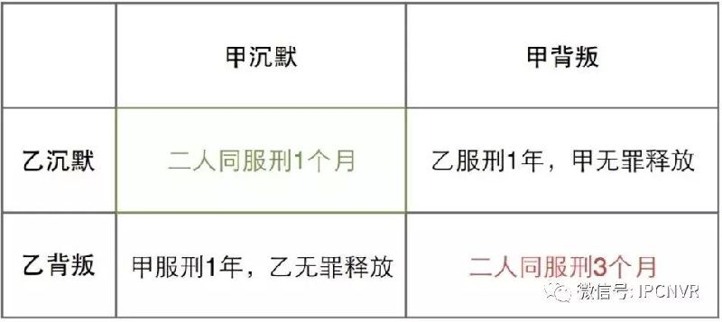

囚徒困境

从外人来看，如果两个人都保持理智，两个人都保持沉默，结局会是最好的。但实际上因为他们两个人各自都在追求自己的最大利益，想着怎么样才能够无罪释放，所以都背叛了对方，把对方供出来了。

结果由于两个人都被供出来了，最后法庭判他们两个人都要入狱三个月，这个结局当然远远不如两个人都维持着攻守同盟那么好。

所以这个博弈论模型，也是刻画这么一种情况，就是每个人都在追求自己最大利益的时候，共同的利益受到了损害。

第三个类似的模型是所谓“集体行动的逻辑”，是由著名的经济学家曼瑟·奥尔森（Mancur Olson，1932—1998），在 1965 年出版的名著《集体行动的逻辑（The Logic of Collective Action ）》中提出来的。

他说，一群志同道合的人一起追求一个共同的目标，大家都应该出力，但是当中要是有谁偷懒，在整体的效果上看不会有什么损耗。比方说工人要求罢工，大家都出去罢工了，你躺在家里面睡觉好像是赚了，因为别人罢工成功了，涨工资了也有你一份，但是每个工人都这么想的话，就没人出去罢工了。

你看，每个人都在追求自己的利益的时候，集体的利益就会受到损害，所以一个集体要保持有效性，就不能让这种自由主义的思想泛滥，不能让每个人都在追求他自己利益的最大化。

一个组织成功它有好多秘诀。比方说经济学里面还有一个分支叫宗教经济学，它研究的是宗教组织怎么能够维持下去。

你看许多宗教有很多的清规戒律，什么时候要斋戒，什么时候要祷告，非常繁琐。你会想宗教的目的不是要招揽人吗？这门槛不是降得越低越好吗？他为什么要搞那么多的清规戒律？如果没有清规戒律，进来的人不是更多吗？

其实所有这些清规戒律，是要把那些不虔诚的人、搭顺风车的人，把他筛选出去。只有这样这个组织才有凝聚力，才能够维持下去。这是曼瑟·奥尔森的名著《集体行动的逻辑》的中心思想。

不管怎么样，我们有三个常见的模型都讲一个事：每个人在追求自己最大利益的时候集体利益会受损。

## 2.挑战“公地悲剧”理论的女经济学家

但是就有这么一位学者，她说现实不是这样的，那就是 2009 年获得诺贝尔经济学奖的埃莉诺·奥斯特罗姆（Elinor Ostrom, 1933-2012 ），一位女经济学家。

这位女经济学家在经济学界并不出名，很多人都不认识她，那年她得奖的时候我记得很多人问，她是谁呀？在“罗辑思维”这里卖得非常好的一本书，《魔鬼经济学》它的作者史蒂芬·列维特（Steven Levitt ），他就公开说：“我就不认识埃莉诺·奥斯特罗姆是谁。”

而我自己刚好认识她是谁。因为埃莉诺·奥斯特罗姆和她的丈夫文森特·奥斯特罗姆（Vincent A. Ostrom，1919-2012 ），两位学者都是非常关心另外一个经济学的分支，叫公共选择学派的，埃莉诺·奥斯特罗姆还当过公共选择学会的会长。有一年我还见过他们夫妇，有过一段短暂的交谈。

奥斯特罗姆夫妇他们就不信邪，他们说一份公共资源，无论是一片森林、一片湖泊或者一片草地，每个人都可以使用，所以它就会遭受公地悲剧的结局。但是人不仅仅是追求利益最大化的动物，而且他们也会追求损失最小化，他们见到这个资源的价值在耗散的时候，他们就会想办法组织起来形成一些规则，阻止这些资源的价值进一步耗散。

## 3.公地并不一定悲剧

他们从此就树立了一个坚定的信念，他们花了很长时间持续地做 workshop（工作坊），请世界各地的人来给他们讲故事，讲那些公共资源实际上是怎么管理的，是怎么样避免公地的悲剧的。

你听他们介绍的故事那是非常精彩。比方说在牧羊的地方，草不能吃得太低，如果你把那个草吃尽了，这个草第二年就不能长出来了。这草看上去是公共资源，但是牧民互相之间是认识的，祖祖辈辈是认识的，他们之间就形成了一个规矩，草吃到什么地方他们就要换地儿，从而保证这草每年都能够长出来。

他们还考察了日本的农民组织，他们发现日本也有所谓的公共资源。农地是属于大家的，都可以耕作，但是它里面有非常明确的规矩。所有的资产都是以组，由几个家庭组成的组，而不是以家庭为基本的单位。到收割的时候每家派一个人，一字排开，以相同的节奏挥舞镰刀收割。收割完了以后庄稼捆成一捆一捆的，大小都一样，最后每家人抽签决定谁拿哪一捆。

就是通过这样持续的研究，奥斯特罗姆夫妇纠正了经济学界一个普遍的误解，那就是公地是一定会产生悲剧的。我们来看看，诺奖评审委员会做的公告。

Elinor Ostrom has challenged the conventional wisdom that common property is poorly managed and should be either regulated by central authorities or privatized. Based on numerous studies of user-managed fish stocks, pastures, woods, lakes, and groundwater basins, Ostrom concludes that the outcomes are, more often than not, better than predicted by standard theories.

这个公告是说，奥斯特罗姆挑战了传统的思维，这种传统的思维认为公地一定是管理很差的，而它们应该被彻底地私有化或者完全交给中央集权来管理。奥斯特罗姆找到了无数的研究，这些研究都是以用者自我管理为基础的，这些案例包括了鱼塘、森林、牧场、湖泊，还有地下水资源等等。奥斯特罗姆得出结论，现实中的情况往往要比经济学教科书所预测的更好。

## 4.张五常的原创贡献被忽视了

最后我想说一点题外话，我认识奥斯特罗姆夫妇，他们拿奖当然应该恭贺他们。

但是我觉得这里面有一点遗憾，就是他们的思想，特别是埃莉诺·奥斯特罗姆的思想，那就是“人们不仅仅是会追求利益的最大化，当见到持续损失的时候也会自发地组织起来形成一些规则，减少资源的耗散”，这样的思想，在更早的文献里面就曾经有过清楚的陈述。

我指的是张五常在 1974 年所写的重要的经济学论文，《一种价格管制的理论（A Theory of Price Control ）》，里面写得非常清楚。

这篇论文我们在前面讲解价格管制现象的时候，就曾经专门介绍过。2009 年奥斯特罗姆获奖的时候，我就写过一篇博客文章，题目叫《2009 年诺奖忽略了张五常的原创贡献》

http://xuezhaofeng.com/blog/?p=945。

## 课堂小结

今天我们反转了昨天所讲的内容，指出公地不一定会产生悲剧，因为人会组织起来形成规则，减少损失。

## 课后思考

今天留给你的思考题是，你能不能再举出一个现实的例子，说明公有资源在好的规则下面，也仍然能够存活下去，发挥它的价值。

欢迎你给我留言，我们下节课再见。

##### 68

# 第 068 讲  
政府所有制 

你好，今天我们继续讲渔村的故事。

前天我们讲了公地的悲剧，也就是说当有八个人上船的时候，这艘船物理上还存在，但是这艘船的经济价值就会荡然无存。

渔村里面的村民一开始觉得人人都能上船，这艘船是属于我们自己的，属于大家的，刚开始的时候还挺兴奋的。但是当人人都能上船的时候，这艘船的经济价值荡然无存以后，大家慢慢就会发现这个渔村少了点什么东西。当然，那是因为这艘船额外带来的经济价值完全消失了的缘故。

人们开始回忆起以前的美好时光，想想看，实施集体主义的时候还有些人能分到鱼；实施私有制的时候虽然收入非常不均，只有一个人拿到 14 条鱼，但你想想看，其他的人难道就一点都不能从中受益吗？

这个每天多打 14 条鱼的人，他的家庭富裕了以后，家里要不要请个家庭教师，平时要不要请人打扫一下卫生，逢年过节要不要请人来唱个戏？毕竟整个社会每天都能多 14 条鱼，这个饼大了，有钱的人他挥霍起来，周围提供服务的人也能够从中受益。

人们开始觉得，这人人都能上船的制度可不一定是个好制度，但私有制也不够好，因为那会导致贫富分化、收入不均。

于是有些思想家、改革家，他就说我们能不能做一些改革？我们既保留私有制下面的特点，就是让五个人上船，但是又让收入分配均匀一点，我们能不能选拔一些德才兼备的官员？把他们送到好的大学里面去学习经济管理知识，学完以后他们就知道怎么管理这艘渔船，他们就能够确定五个人上船是最优的，这时候就能保证这艘船产生最大的经济效益。但与此同时，收到的 14 条鱼的净利润不要分给一个人，归全社会所有，共同分配，这样的办法是不是更好呢？于是大家觉得没错，这是个更好的办法。

## 1.政府所有制：无从预测的上船人数

结果这艘渔船就从全员所有制改变为“政府所有制”，由德才兼备的政府官员来管理这艘渔船。他们为了好好管理这艘渔船，还特意成立了“渔村资产管理委员会”。那么，还是老问题，在渔村资产管理委员会的管理之下，最多有几个人上船？

你回忆一下，过去我们每一个答案都是有确定理由的。在集体所有制下，每一个在船上的人都有一票，决定让不让新人进来。这时候他们盯住的是平均产量，他们要在自己的收益不下降的那一点作为一个均衡点，所以他们只让三个人上船。第四个人上来他们的收益就开始下降了，他们会拒绝第四个人上船。  

在私有制下，渔船的所有者船主盯的是另外一栏，盯的是边际收入和边际成本这一栏。这时候他要确保边际收入等于边际成本，也就是他支付的工资，这时候无形之中，他就能够使这艘渔船的经济价值发挥到最大，14 条鱼。

而在全员所有制的情况下，每个人都可以上船，每个人盯住的再一次是平均收入，但是这次平均收入就是要跟他们在岸上能够打到的鱼相等，所以有八个人能够上船，第九个人再上船就得不偿失了。

你看，在这三种制度下面有多少人能够上船，都有一个确定的答案。现在问，在渔村资产管理委员会，政府所有制的制度下面有多少人上船？你要看哪一栏？到底是平均产量不下降呢？还是平均产量不低于岸上的收入呢？还是边际产量呢？政府的官员到底想要最大化什么呢？答案是：不知道。

但这恰恰是问题所在。

## 2.目标多元是政府存在的价值

我们前面介绍了，我们这几讲的内容，渔村的故事必须把两个内容加起来看：一个是渔村的故事，是这些图表；另外一个重要的来源，是阿尔钦在《新帕尔格雷夫经济学辞典》里面，“私有产权”这个条目里面所写的内容，他对这四种所有制进行了系列的比较。

有意思的是他对前面三种所有制，分析得都非常细致，但是到了政府所有制这一节，他的篇幅却极其的短，只有一段。

他说什么？他说：“不知道，不能预测，我不知道政府官员到底想要最大化什么东西。”

他们有可能让上船的人数最大化，从而让就业的人数最大化；他们也有可能有除了打鱼以外其他的目标，他们觉得打鱼并不重要；他们甚至可能认为打鱼并不是政府追求的唯一目标，让大家能够出海游玩这可能更重要。

政府的目标是多元化的，不像私人那么简单、明了、直接，而这恰恰是现实生活中政府存在的理由。政府需要平衡各方的利益，所以政府到底会怎么做？到底会让多少人上船？不知道，无法预测。

现实生活中也有很多这样的例子，你看一个商业银行的目的是什么？赚钱。低买高卖，以低的价钱吸纳存款，以比较高的价钱贷出存款，从中赚钱。商业银行的目的非常明确。

但是一个国家办的银行，它追求的目标是多元化的，它一个要赚钱；同时要保持国家和国家之间的友好关系；它还要扶贫，它还要照顾地区之间的和谐。这么多的目标加起来，它到底追求哪一个呢？不知道。

到这里我们渔村的故事就告一段落了。你想想看真的很神奇，我们用一根“边际收益曲线”，记得吗？是上去然后下来的这么一根曲线，确定了边际收益递减原理，从而确定了渔村故事里面的这个数字表，然后我们讲了一个渔村的故事，把最常见的几种所有制进行了比较。真是挺好玩的。

## 课堂小结

今天我们讲了政府所有制这种产权治理模式，前面我们讲的三种治理模式：集体所有制、私有制和全员所有制，我们在回答最多有多少人上船的时候，都有一个明确的答案，用经济学的术语说——都有一个均衡点。

在集体所有制下，人们盯着的是平均收益不下降；在私有制下面，人们盯着的是边际收益要等于边际成本；在全员所有制下面，人们盯着的是船上的平均收益不要比岸上的低；但在政府所有制下面，我们没有办法做出一个准确的预测，因为政府的目标是多元的，我们不知道它多个目的之间的组合和权重是什么。

我们也同时提到，目标多元恰恰又是政府存在的理由。

## 课后思考

今天我留给你的思考题是，从经济的角度看，四种所有制各有优劣，但现实生活中四种所有制其实都是并存的，没有哪个完全取代哪一个之说，你认为原因是什么？

欢迎你给我留言，我们下节课再见。

##### 周

# 第 17 周问答  
每个人都有自己的“渔船” 

你好，我们开始本周的问答时间了。

这两个礼拜，我们讲了渔村的故事。我们用一条向上然后向下的“边际收益曲线”——这条边际收益曲线一旦定了，平均收益曲线也定了，总产量曲线也定了，边际成本曲线也定了，这四个量都定了，我们就拿这四条曲线——其实最重要的就是边际收益曲线，上去下来那么简单的一条曲线，就把人类曾经尝试过的最典型的四种产权治理方式、四种所有制串起来了。

我们全年的课程有许多的亮点，实际上每一堂课都有亮点。

上礼拜，我在北大的校门口打车的时候，遇到一位又高又帅的年轻人，他笑着走过来跟我打招呼。

他自我介绍说，他不仅是咱们这个专栏的同学，而且是“罗辑思维”的 CEO 脱不花的先生。他就跟我说，咱们这门课最大的特点是听了以后能记住，因为每次都有生动的案例，使那些枯燥的经济学原理变得有意义，有意义就能记住。

虽然每节课都有亮点，但过去这两个礼拜的八节课，包括两次问答加起来十节课的内容，我觉得它们的地位还是不一样的。曾经有人问比尔·盖茨，说你们微软生产那么多软件，你最引以为豪的是哪个产品？比尔·盖茨说是 Excel，是 Office 里面的 Excel。

如果你问我，咱们整年的课程给你自己印象最深的是哪一部分？我会说这过去两个礼拜，咱们用一条最常见的边际收益曲线，把人类最常见的四种所有制串起来，用“渔村的故事”来讲解的这一部分，是给我自己印象最深的部分。

有些同学给我留言的时候，运用他自己丰富的想象力，描述了船上各种可能发生的事情，我回答说：别看咱们的数据干巴巴的，其实各种情况都被它们概括了，它的应用是极其广泛的。

咱们隔壁《5 分钟商学院》的刘润老师，他也关注咱们这个专栏，他给我发来了评论，他说：“渔村的故事是说明了边际收益递减的道理，而不是证明这个道理。”我觉得他的理解非常准确。

咱们所说的渔村的故事，可不是想要证明什么东西，因为用一个寓言来证明什么东西那太不严格了。咱们要刻画的，是各种权利治理模式下面，人们不知不觉要遵循的规律。事实上细细琢磨的话，你会发现，渔村的故事还给我们许多的启发。

我来帮你总结几点。

## 1.每个人都有自己的“渔船”

第一，在渔村的故事里面只有一艘渔船，我们讲的是一艘渔船在不同的治理方式下，会产生什么样的结果。但是现实生活中有多少渔船？有无数条渔船，每个人都有无数条“渔船”，那就是他拥有的各种资源禀赋。

这可以是自然禀赋，比方说你拥有的一块田；也可以是社会禀赋，比如你所拥有的社会关系；还可以是你后天习得的禀赋，那就是你通过不断的学习和训练，所形成的人力资本。

当每个人都有机会善用他自己的各种资源、他自己的各种“船”，这个社会就能够获得巨大的财富增长。

## 2.产权界定减少竞争损耗

第二，是产权界定对减少竞争带来损耗所起到的作用。这一点说起来有一点点难。

我们在讲“公地的悲剧”的时候说，如果一个鱼塘人人都去捕捞，这时候大鱼就会变小鱼，最后变没鱼。所以人人都去捞鱼，这种局面会导致整个鱼塘的价值荡然无存，这是“公地的悲剧”的意思。

但是你想想，有另外一个看起来相似的例子，渔民随意进入鱼塘捞鱼，跟出租车司机在城里面找客人“捞人”不是一样吗？捞鱼和捞人区别在哪里？如果没有区别的话，我们就会得出一个结论，说城里的出租车太多了，会导致“公地的悲剧”，应该限制出租车的数量。

但实际上，捞鱼和捞人这两个情况，是有根本区别的。

区别在哪里呢？区别在于捞鱼的那个情境里面，鱼没有形成产权，渔民们是为了追逐和确定对鱼的产权，展开了过度的竞争。但是在捞人的例子里面，乘客口袋里的钱是有产权的、有主的，他能决定到底把这个钱分配给谁。权利已经确定了。

如果钱还没有确定，是这个城市里面很多没有主人的钱放在那里，大家去抢钱的话，那么抢钱所花的努力最后会等于钱的价值，而这个钱本身的价值就荡然无存了，我们说这是“无谓的损失”。

但是，在城市里面，每个人口袋里的钱不存在这种情况，每一分钱都是有主人的。这时候出租车司机再去争夺的，只不过是人们对他们所拥有的钱的不同分配方式而已。

这种情况下，由于钱的产权已经被确定了，所以就不会产生无谓的损失，社会的资源就不会因为竞争而耗散掉。

## 3.不存在“大多数人的利益”

渔村的故事给我们的第三点启发是，不存在所谓的“大多数人的利益”。

过去，每当说起我们要“追求大多数人利益”的时候，“大多数人的利益”这个词好像是顾名思义、不言而喻的。但学习了渔村的故事以后，你会发现这个词的意思太多样化了，每一个意思都跟别的意思有矛盾之处。

比方说，在集体所有制下，大多数人指的是已经在船上的人；

在私有制下，指的是那 14 条鱼使得整个社会的总财富达到最大化——这也算是一种大多数人的利益，尽管它的分配不是那么均匀；

在全员所有制下，大多数人指的是整个渔村的每一个人；而在政府所有制下，大多数人指的是那些代表大多数人的官员。

平时我们讲起大多数人的时候，常常是脱口而出，不假思索，但咱们这门课，全年的课程里面，会通过三个知识点，给你解释“大多数人”是一个不确定的概念，使用它的时候要特别小心。

渔村的故事是其中的一个场景，其中的一个知识点，你能看出大多数人没有一个确定的含义。

## 4.好的制度需要大家共同呵护

我们来看本周的思考题。周一的问题是，私有制虽然能带来效率增长，但却导致了收入的不均，这样的制度能维持下去吗？

这个问题没有标准答案，我们看看古今中外的历史就能明白，有时候它能够维持下去，有时候就不能维持下去，就会被人们推翻。一种制度是需要大家共同呵护才能维持下去的，而如果社会上有更多的人能够理解一种制度，那么对它的呵护就会增强。

所以经济学对不同制度的分析和探讨，对我们呵护和维持那些好的制度，有重大的贡献。

## 5.公地为什么不那么悲剧？

周二和周三的问题是关联的。周二问的是，公地为什么会不那么悲剧？而周三问的是，请你举例说明公有资源在好的规则下面，也仍然能够存活下去，发挥它的价值。

有很多同学的回答都非常精彩，他们说当人们看到资源有那么大耗散的时候，人们就会自发组织起来，通过规则、道德规范、奖惩制度，使得公地的悲剧减少，甚至显著地减少。

事实上埃莉诺·奥斯特罗姆（Elinor Ostrom ）之所以获得诺奖，她的贡献也就在于，指出人们通过自治能够使情况变得好一点，不至于像教科书所说的那么糟。她就因为这个获得了诺奖。

## 6.制度本身有漫长的尝试和筛选过程

周四的问题是，从经济的角度看四种所有制各有优劣，现实生活中四种所有制却是并存的，没有哪个取代哪个之说，原因是什么？

我认为最重要的原因有两点：

第一，制度本身就有一个漫长的尝试、筛选、存活、消亡的过程。我们现在也处在这个过程当中。人有为所欲为做自己想做的事情的自由，但他们却没有逃避自己所做的选择的自由。

人们会通过丰富的想象力，选择做这样的事情、做那样的事情；这样的治理方式、那样的治理方式。——当然，他们也得承受他们自由选择之后所导致的结果。这是一个比较的过程，我们看到这个过程还在发生当中。

第二个原因，有一些同学也指出了，私有制看上去能够带来很大的收益，但是实施这种制度本身就有巨大的成本。

确权有成本，监督权利的行使有成本，惩罚那些违权的人也有成本，值不值得这么做，这是一个考量。

我常说，分一个馒头掰一下就可以了，分金子咱们得用天平。

面对大量的陌生人，咱们可能用私有制；一个小区里面的业主，用的可能是集体所有制；一个家庭内部，可能就是公有制。

## 7.跨学科比较和学习，让你得到更多

顺便说说，前天我们讲“公地的悲剧”，留言区里出现大量留言，提起隔壁《熊逸书院》的熊逸老师那一天也在讲“公地的悲剧”，原来我们有那么多跨学科的同学：）

我和熊逸老师有一点是高度相同的，那就是在一个社会里面，尤其是一个有许多陌生人构成的社会里面，仅仅靠道德的规范，不能够阻止竞争所带来的耗散，要有规则、要确定产权，资源才能够积累，财富才能够增加。

人们建立规则，社会变得高度组织化，这并不见得是一件坏事。看起来每个人的自由都好像受到了限制，但其实它是增进每一个人的利益，所需要做出的妥协。

我们前面说过，在大都市里面生活，过了 12 点你家的音响就不属于你了。这是一种对权利和自由的限制。你跑到荒郊野岭去居住，就不需要受这个限制。但你之所以愿意放弃这一点自由，选择到人口密集的地方居住，那是因为在那里你会得到更好的回报。

我已经发现好几次了，每当我们同一个平台上面，不同的老师在讨论同一个话题的时候，同学们就表现得特别雀跃。那是因为你订阅一个专栏已经很有收获了，但是如果你订阅多个专栏，通过不同的角度来进行跨学科的比较和学习，那你的收获会更大。

## 8.参加线下课程，与三千位同学相聚相识

正好我们给你准备了一个非常难得的机会，7 月 15 号礼拜六，我将和《得到》另外三位专栏订阅达到 10 万+的老师——李笑来老师、刘润老师和万维钢老师，在上海开一场线下大课，帮助你完成“知识大通关”。

所谓的“知识大通关”，就是由我们 4 位老师把我们专栏的精华，在一次课上呈现给你，让你感受到“认知升级”、“自我管理”、“精英精进”、“人际协作”之间的碰撞和共鸣，这是一种全新的独特体验。

在这个线下课上，我们还能够进行面对面的互动，感受现场课堂的氛围。

更重要的是，你将和三千位终身学习者相聚相识，从此结伴同行。

点击下图你就可以购买了。如果点击图片没办法跳转的话，请你先把《得到》App 升级到最新的版本。7 月 15 号，我们上海见。    

周五辩论

我们周一到周四都给大家留了思考题，今天礼拜五，我给大家留一个辩论题，大家一起辩论。

咱们前面讲了每个人都有自己的船，也就是自己的长板和短板，你觉得是应该集中发挥自己的长板呢？还是集中精力补足自己的短板？

正方：因为社会分工是取长补短的，所以应该集中精力发挥自己的长板。

反方：补足短板的边际收益最大，能够迅速提高综合素质，所以应该集中精力补足自己的短板。

欢迎大家参与辩论。

欢迎留言

最后我还要提醒你，我为你准备了黑板报。黑板报上贴了这个礼拜，我认为最精彩的留言。欢迎你踊跃留言，希望下周能够在黑板报上见到你的分享。

这周的问答时间就到这里了。明天是预习的时间，祝你周末愉快。

##### 69

# 第 069 讲  
经济学家百年论堵 

你好，今天我要给你讲一个中国各大城市，乃至世界上各大城市都共同遇到的一个问题，那就是拥堵问题，以及我认为最好的解决方案。

我们前面的单元讲了“边际收益递减原理”，还讲了用这个边际收益递减原理来解释的人类四种所有制之间的比较。你掌握了这些内容，我们就有了讨论拥堵问题所需要的知识储备。

## 1.庇古的税收建议

在 100 多年前有一位经济学家，他的名字叫庇古（Arthur Cecil Pigou，1877-1959 ），他在 99 年前，1918 年出版过一部书，叫做《福利经济学（The Economics of Welfare ）》，庇古是最早讨论拥堵问题的经济学家。

庇古（Arthur Cecil Pigou，1877-1959）

他说，人们要从 A 到 B，在 A 和 B 之间有两条路：一条是快速通道，但是快速通道有一个缺点，就是路比较窄；还有一条慢速通道，它都是泥泞的道路，但是它很宽。

那么要从 A 到 B，你会选走哪一条路？你会选择比较狭窄的快速通道，第二位旅客也会选择快速通道，第三位也会选择快速通道，每一个人都会选择快速通道。

但这时候有一个问题，就是快速通道上由于车辆越来越多，它就开始变得拥堵了，车辆行进的速度就一点一点地慢下来了。

到最后，终会有那么一个人，站在两条路当中做选择的时候，他感觉到还是那条快速通道要快一点，这时候他义无反顾地选择了那条比较窄的快速通道。

但是恰恰是由于他的进入，这最后一位旅客的进入，导致这个快速通道上车辆运行的速度又再进一步下降，下降到了跟那条泥泞的道路上的车速一样的水平。

庇古就说，最后这位司机为了让自己得到好处，选择了这条比较窄的快速通道，但实际上，他的行为、他的选择对这条快速通道上面的每一辆车都造成了影响，这使他们的速度下降到了跟泥泞的道路一样的水平。

庇古得出一个结论，就是自由经济不好、自由放任不好，每个人都在追求自己利益最大化的时候，就会伤害别人。他提出的解决办法就是政府应该管一管，政府要想办法阻止一些人上这条比较窄的快速通道。

用什么办法呢？他提出可以通过征税的办法，把一部分的司机从这条路上赶走。庇古建议的这种税，后来经济学家也称之为“ 庇古税 ”。庇古是位大经济学家，他的书非常流行，他的思想也被大家接受。

## 2.被诺贝尔经济学奖遗忘的弗兰克·奈特

到了 1924 年，芝加哥大学有位叫弗兰克·奈特（Frank Hyneman Knight，1885-1972 ）的经济学家，他有不同的看法。这位弗兰克·奈特是位非常著名的人物，他自己没得过诺贝尔奖，但是他有好几位学生都拿了诺贝尔奖。这当中肯定是有原因的。

弗兰克·奈特(Frank Hyneman Knight，1885-1972)

我的一位老师詹姆斯·布坎南（James Buchanan ），是 1986 年诺贝尔经济学奖的得主。当时有人问他：“你觉得你最好的老师和最差的老师是谁？”他说：“我最差的老师就是弗里德曼（Milton Friedman ），为什么？因为他在课堂上很严厉，对学生各种奇怪的想法经常给予打压，有时候一场交谈下来什么信心都没有了。”

这时候他就会去找弗兰克·奈特。他到了弗兰克·奈特那里，说他有这样的想法、有那样的想法。弗兰克·奈特是完全不一样的态度，他会说：“哎呀，这个想法很好，你可以继续努力试一下。”不断地给他鼓励，所以他从弗兰克·奈特那里出来，又变成另外一个人了。

当然这只是一种说法。我把这个事情告诉芝加哥大学的另外一位经济学教授萨姆·佩尔兹曼（Sam Peltzman ），他也是弗里德曼的学生。他说那可不是这样，弗里德曼很鼓励大家把经济学原理跟日常生活遇到的各种问题相联系。每次上课，总是讲讲生活里面的故事，总是讲讲他在电台里面听到的新闻。

到底真实的情况是怎么样的，我们留给经济思想史的学者去探究。

我们回来讲弗兰克·奈特对拥堵问题的看法。他在 1924 年发表了一篇论文，论文的名字叫做《关于社会成本问题解释的一些谬误（Some fallacies in the interpretation of social costs ）》。

这篇文章很厉害，我看完这篇文章以后，我就说这篇文章怎么会得不到诺贝尔奖呢？我的一位资深经济学家朋友，他说你也觉得弗兰克·奈特应该拿到诺贝尔经济学奖啊？

我说：“弗兰克·奈特应不应该拿到诺贝尔经济学奖，我可能没有这个判断力，这是诺奖评审委员会他们的品位。但是你要看这篇文章所讲的内容，再对照 1960 年科斯那篇《社会成本问题》的内容，你把它们对照起来看，你就知道他们讲的是一回事儿。如果诺奖评审委员会把奖给了科斯，那也同样应该把奖给弗兰克·奈特。你不需要懂得经济学，你只要懂得英文，对照这两篇文章，你就知道他们在讲的是同一个事情。”

事实上科斯在年轻的时候是听过弗兰克·奈特的课的，弗兰克·奈特的文章写于 1924 年，科斯的文章发表在 1960 年。

我想大家对弗兰克·奈特这篇文章的注意力不够，可能是因为他表达有问题，可能是他的例子不够生动，也有可能是他太前瞻了。他讨论这个问题的时候，其他人的注意力还不在这里。总之他的运气就没有科斯好。

## 3.以产权私有及道路收费解决拥堵问题

弗兰克·奈特说什么呢？弗兰克·奈特说庇古认为，人们争着选用那条狭窄的快速通道，是由于放任的市场经济不好。奈特认为事实正相反，那条路之所以人们会争着使用，没有人阻止，最后导致无序的现象发生，根本的原因是那条路没有主人，它不是私有产权。

如果有主人，那个主人就能够行使排他性的权利把一些人赶走，就不会出现这种混乱的局面。一旦这条路有了产权、有了主人，这个主人就会善用这条道路，他就会有积极性让这条道路保持畅通无阻。

这时候我们刚好可以再用一次前面我们讨论渔村的故事所用到的那个表格，一模一样的表格。你想想，如果这条道路有主的话，这个主人就会尽量使这条道路发挥它最大的经济价值。

他会让多少司机上路呢？他不会只让一个司机上路，这条道路如果只有一个司机，它太空了，这条道路的经济价值没能反映出来。  

如果你去问在路上的每一位司机，他们愿不愿意多让一辆车上路，也就是实施集体所有制，那么每一个司机都会说，他们只让三个司机上路，这时候他们得到的平均速度，他们得到的平均收益会是最大的。

但是，这条道路的主人可不这么想，因为他知道再多让一些人上路，这条道路适当的拥挤会给这条道路带来更高的收益。他会让多少人上路？根据渔村的故事那个表，我们知道他会让五个人上路。

这五个人上路，平均每个人交纳 6.8 元的道路使用费或者说是拥堵费，这条路就是一条快速通道，这时候这条路就能够发挥它作为快速通道的最大经济价值。

当然这个道路的主人也不会让这条道路过分拥挤。他不会让八个人上路，因为八个人上路以后，这条道路的速度就降到跟没有道路一样了，它就会产生公地的悲剧了。

这时候就会出现庇古前面描述的，那条快速通道物理上还存在，但它的经济价值就跌到跟泥泞的道路一模一样了，它作为快速通道的经济价值就完全消失了。

你看，这是经济学家讨论拥堵问题的切入视角，多么独特，他是用渔村的故事，他是用资源怎么样才能够发挥最大的经济效益，他是从这条道路到底是不是有主的这个角度来切入的。

道路上面没有车，太空了是不经济的；道路太过拥挤，挤得寸步难行这也是一种浪费，这也是一种公地的悲剧，道路要适当的拥挤。

而什么才叫适当呢？那是它的经济价值能够发挥到最大，那就是适当的拥堵。这一点由谁来定呢？由道路的主人来定，由道路的主人来追求，由道路的主人来摸索。这是我们讨论拥堵问题的经济学工具。

## 课堂小结

好，我来给你总结一下，今天我们回顾了关于城市如何治堵的近一百年的经济学争论，两位著名的经济学家庇古和奈特，他们对治堵的观点有相同的，也有不同的。

两位经济学家都认为，随意的让人们上路，道路的价值就会收到贬损，但是庇古认为，道路拥堵是自由放任的结果，政府应该管一管，而奈特认为，问题的关键在于道路没有形成排他性的产权，一旦形成排他性的产权，治堵的问题就能够解决。

而今天我们讲的最关键的是，我们把治堵的问题跟渔村的故事，完全结合起来了，因为这本身就是一个经典的公地悲剧的例子，我们要追求的是道路上的车辆数目，跟道路的价值最有效的结合，车辆太少，这是浪费；车辆太多，拥堵，也是浪费，能让道路的价值发挥到最大的行车数量，才是最适当的数量，很显然，我是赞成征收道路拥堵费的。

## 课后思考

今天我留给你的思考题是，很多人会说我不是不赞成收拥堵费，关键是收了以后这些钱用在什么地方？你也赞成这种说法吗？为什么？

欢迎你给我留言，我们下节课再见。

##### 70

# 第 070 讲  
拥堵费的实践 

你好，上一堂课我讲了通过收取拥堵费，来治理交通拥堵问题的经济学理由。今天我们继续讨论，这种做法到底好不好、行不行得通、会带来什么样的问题。我的想法

我先来问你，在你所在的城市，不管哪个城市，任意两点之间，任意一个时间，你要经过这一段路程，从 A 点到 B 点，你所在的城市让你交拥堵费。比方说在每天上下班的高峰期，从北京大学到天安门这两点，在你的交通费原来的基础上，再交一个拥堵费，200 块钱，你觉得贵不贵？

当然很贵，每天这样的通勤，城市之间两点任何时候交 200 块钱，那是相当贵。一个月下来，每个月四个礼拜五天上班，200 块钱一程，来回 400，一个月 8000 块钱的交通拥堵费，好贵。我觉得可能除了跨国公司的 CEO 付得起之外，一般人付不起，这样的拥堵费太贵了。

## 1.拥堵费筛选的不是贫富，而是需求

交 200 块钱足以把大多数人、绝大多数人，都挡在门外，不让他们上路了，把道路空出来了。

那我来问你，这时候如果有一个乞丐，他太太要生小孩了，赶着去医院。他是个乞丐，他交不交得起这 200 块钱？把其他人赶出道路，让这条道路空出来，留给他太太赶快上医院。他能不能付得起 200 块钱？

一个乞丐，当然可以。哪怕付不起 200 块钱，他去借 200 块钱来交这交通拥堵费，有可能吗？当然有可能。

这时候，问题就很清楚了。任何人，当他需要使用道路的时候，他凑 200 块钱来使用这个道路，凭着这 200 块钱把其他人劝退，可能性很高。

所以说，交通拥堵费筛选的不是贫富，而是需求。不是说你有钱了就不在乎钱，就整天占着那个道路。再有钱的人也会在乎那 200 块钱，也会在他不需要的时候把道路让出来。有钱人也要省钱。

你听过吴伯凡老师的《伯凡日知录》吗？他里面讲过，他有一个富豪朋友买了一辆直升机，功能比别的直升机强那么一点点，就贵了 4000 万。4000 万不是直升机的钱，是它额外这点功能的钱。就这么一个富豪，他还为自己怎么样在停车场里面省了一点停车费，而感到非常高兴、非常满足。有钱人也要省钱，拥堵费筛选的不是贫富，而是需求。

## 2.交通拥堵费在美国的实践

征收交通拥堵费的想法真的能够实施吗？真的可以实施。在我以前生活过的城市美国首都华盛顿，有一条道路叫 495，这条道路每到上下班高峰期就非常拥堵。

以前是通过一些行政的办法来治堵的，比方说早上七点半以后的高峰期，就不准一个人开车上路，车里面必须坐两个人。所以那时候我去上班，每天都要赶早，要七点半以前就下高速公路。

他们现在引进了一套“实时道路拍卖系统”，你看我给你准备的图，路牌上标着当时道路的价格。

如果那条快速通道里面的车多，这个价格就会往上蹿，上不封顶，一直往上升，升到这条道路里面总有一些人他觉得给不起了，太贵了，他撤下来。从而保证这条车道上面的车辆总数，维持在一个合理的范围内，使得车速能够有保障。每小时 40 英里以上，让你准时上下班。如果快速通道上面车辆数目下降，没那么多车了，价格就往下跌，鼓励别人使用这条道路。

这样一种收费系统，你猜美国人能接受吗？一样不容易接受，所以他们在网站上做了一些广告，加了一些宣传语，让大家能够接受这种新生事物。

他们的网页上面就写着：Designed to Provide a Predictable Trip. “我们的目的是为了让出行更有计划，把你的时间省下来留给你和家人相处，留给你工作和学习。让出行更有计划。”

将来我从北大到天安门，无论何时，我都知道 15 分钟一定能到达，唯一不确定的，就是不知道要给多少钱。

## 3.无论拥堵费如何使用，征收拥堵费本身都有意义

道路收拥堵费的想法，很多朋友都不接受，他们提出各种各样的质疑。最常见的一点，就是昨天我留的那个思考题：“ 拥堵费我也不反对收，关键是钱用在哪去了。 ”

持有这种观点的人，其实还没有完全理解收拥堵费的意义。收拥堵费是为了让道路产生排他性的使用权，让这条道路不至沦为公地的悲剧，要让这条道路仍然是路，而不是停车场。

所以不管收到的拥堵费用在什么地方，收拥堵费本身是有意义的。我们说收到的拥堵费如果把它扔到海里面去，还收不收拥堵费？还收。把钱扔到海里面去当然不对，但是，我们不能够因为把钱扔到海里面去不对，就不收拥堵费。因为收了拥堵费至少让路仍然是路。

所以拥堵费收了以后，政府能不能够善用拥堵费，这是一回事。我们当然希望这个钱能够得到善用。但是，这个钱能不能够得到善用，跟该不该收拥堵费，是两个不相关的问题。

## 4.征收拥堵费与公车改革无关

也有人说，收拥堵费最大的问题是官车太多了，持这种观点的人也是忘掉了收拥堵费的意义。收拥堵费的意义，是让道路发挥它本来应有的经济价值，而不是进行政府机构的改革。

官车多和少，这是政府内部进行改革的事情，我们不能指望通过收拥堵费或不收拥堵费，对政府内部的结构、车辆的多少进行改革，我们关注的要点只有一个：就是让路发挥它的价值，让路仍然是路。

也有人说收拥堵费以后，官员可以不计成本地上路，这种说法当然也是不对的。官员做事怎么可能不计成本，官员办公买一支笔、买一张纸都要计算成本，用的汽油要计算成本。如果上路也要交拥堵费，那么他们当然也会在意成本。

## 5.征收拥堵费与优化城市道路可双管齐下

还有人说，别老是想着收拥堵费，关键是我们的城市规划道路设计不合理，先把这个不合理的解决了再收费。

这种说法也没有理解收取拥堵费，跟优化城市道路设计之间的关系。其实这两个做法并不矛盾，可以双管齐下。但是，你要知道，一个城市的道路设计无论多么完善，到一定程度它总还是会发生拥堵的。

而且有趣的是，一个城市如果设计得越得当，一个城市提供的服务越周到，来这个城市生活的人就会越多，拥堵迟早会发生。相反，有些城市规划得不好、发展得不好，人越来越少，你想它产生拥堵都难。

## 6.征收拥堵费可以刺激道路供给

还有一种想法认为收费不能够刺激供给。

我记得好多年前有一个晚上，一位经济学家朋友给我打电话，聊一个别的什么事情，他问我你在忙什么？我说我正在写文章，写一篇叫“论堵”的文章，我主张收拥堵费。

这位经济学家朋友很惊讶，他说：

真的？你不会真的这么想吧？我们经济学上说价格能够刺激供给，那是有一定条件的。比方说玉米的价格高了，种玉米的农民就多了，就会增加玉米的供给，这时候经济学原理是对的。但是对于道路，你要收了拥堵费，出行的成本增加了，但不会因为收了拥堵费，上班的路就多出两条车道来。提价不能够刺激供给，所以不能随便提价。

我回答说：收拥堵费当然不能够平添两条车道，但是收了拥堵费以后，那些需求比较弱的人他们就会被劝退，他们空出来的道路实际上就是增加了供给。

你还记得吗？我们在讲需求定律的时候说过，供给和需求并没有截然的区分，只要价格上升到一定程度，原来的需求者就会变成供给者。

## 7.征收拥堵费的目的就是调节需求

还有人会说，如果征收了道路拥堵费，其他道路出行的方式就会产生新的拥堵，这是自然的。我们要让每一种交通出行的方式，都有它的价格，都通过价格来调整。

猪肉贵了牛肉当然会贵，牛肉贵了鸡肉也会贵，这时候人们就可以根据不同食品的稀缺程度，来选择他们的需要，从而使资源能够达到最佳的配置。

## 8.征收拥堵费有益于穷人

还有很多人认为收拥堵费对穷人是不利的。

在我看来恰恰相反，收拥堵费是对富人的惩罚，对那些在上班高峰期还要坚持一个人开一辆车的人的惩罚。而穷人，哪怕公共汽车都要交拥堵费，我们不说公共汽车要得到豁免，我们说哪怕公共汽车都要交拥堵费，但穷人可以联合起来，十几个人、二十几个人一起跟那些一个人开车的富人竞价。

每当我在冬天上下班时间经过公交汽车站，看着那密密麻麻的人群，他们在等公共汽车的时候，我就想，如果真的能够收交通拥堵费，公共汽车都能够准点到达，他们每一个人只需要多付几分钱、几毛钱就能够得益。

其实国际上有一些大城市，早就开始实施收拥堵费的做法了，比方说伦敦、新加坡都是很好的例子。当然这种做法还没有得到更大范围的普及，这当中的困难不仅仅是技术上的，更重要的是思想上的。

## 课堂小结

今天我们讨论了，如果征收交通拥堵费的话，人们最常见的各种质疑。

我们说征收交通拥堵费，最重要的作用是保证道路仍然是路，而不是停车场，保护道路应有的经济价值，而征收拥堵费能够起到筛选需求的作用，筛选需求，有别于筛选贫富，道路使用效率的提高，哪怕是对穷人也是有利的，同时我们也介绍了美国征收交通拥堵费的实践经验。

## 课后思考

如果你也认为实施交通拥堵费可以缓解交通拥堵问题，为什么在很多国家和地区，这种做法都得不到采纳和执行？困难来自哪些地方？

欢迎你给我留言，我们下节课再见。

##### 71

# 第 071 讲  
公用品和私用品 

你好，今天我们讲两个经济学里面特别容易被人望文生义、产生混淆的概念，那就是私用品和公用品的概念。这两个概念对于我们理解政府和市场之间的分工有很重要的作用。

## 1.公用品与私用品的关键区别

私用品英文叫 Private goods，公用品英文叫 Public goods，这两个词特别容易望文生义。你可能以为私用品就是私人用的商品，公用品就是大家用的商品，这不对；你也可能以为私用品是私人提供的商品，公用品是政府提供的商品，这也不对。

在经济学里面，公用品和私用品有它非常独特的含义。私用品最关键的含义是一个人用，别人就不能用的商品，那叫私用品；公用品相反，一个人用不影响别人使用的商品，叫公用品。

你看，一个鸡蛋我吃了你就不能吃，一个苹果我吃了你不能吃，一支铅笔我在用你就不能用。一个人用，别人就不能用的商品叫“私用品”。

“公用品”最好的例子是旋律，一首歌我在哼你也可以哼，我哼一万遍都不会破坏这个旋律，你也照样可以哼。一个科学定律我用一万遍不影响你用。一个故事情节，我无论怎么使用，拿来拍电影，拍电视剧，拿来讲故事，不影响你用。这些都是公用品最好的例子。

那我来考考你，道路是属于私用品还是公用品？你可不要以为道路是政府提供的，大家都可以用，就说道路是公用品。

道路是私用品。为什么这么说呢？因为在一个相同的时段，就是相同的时间和路段上面，一个人占用了或者一辆车占用了，别的人或者别的车就没法占用，所以道路是私用品。

当然有些同学会说，那不对呀，有时候道路是空着的，谁都可以上去，不会影响呀。这空着本身，并不影响道路是私用品，也就是“在同样的时段一辆车占用了，别人就不能占用”这个基本的物理属性。就好像鸡蛋，在商场里面也有很多鸡蛋放着，还暂时没人吃，但你不能说因此鸡蛋就是公用品。

那我接着问你，老师在课堂上上课，他的讲课是私用品还是公用品？这个有点难，一个课堂里面坐着好多的同学，然后多一个人进来听课，对其他的同学会造成影响吗？好像不会造成影响，所以你会说老师上课是公用品，一个人用不影响别人用。但是你再想想，如果不止一个同学进来，两个呢？三个呢？四个呢？二十个呢？

我们说，在北大国发院林毅夫老师的课、周其仁老师的课，同学都是爆满的，不仅仅座位坐满了，走道上、窗台上都是人，这时候多进来的同学对原来选课的同学有没有造成影响？答案是 有的 。所以老师上课还不完全是公用品，它也有一定的私用品的属性。

我们再看电影院和音乐厅的比较就更明显了。电影院里面不同的位置票价不一样，这说明一个好的位置被人占有了别人就不能占有，所以电影院它其实也是一种私用品。

音乐厅就更明显了，你要订一场在国家大剧院举办的音乐会，你到网上去看，你去看它的座位分等，它分了十几、二十等。为什么？因为每一个座位的质量都是不一样的，每一个座位都是私用品。

我们要理解私用品和公用品的区别，关键在于看它们的基本物理属性，一个人用别人能不能用。在运用这个标准的时候，有一些商品是在这两个标准的极端，那是比较容易分辨的。

像我刚才说的，鸡蛋是私用品，旋律是公用品，但是有好多的商品是处于这两个极端的中间，不是那么容易分辨。我们要看具体的问题，才能给它做一个合适的分类。

## 2.治安服务为什么是公用品？

比方说治安，你说这是公用品还是私用品？一个警察站在街上维持治安，他提供的是私用品的服务，还是公用品的服务？

我们说如果有人被小偷偷了东西，他去报警，这个警察帮他把小偷给捉住了，警察这时候帮一个人捉小偷，就不能帮另外一个人捉小偷，这时候警察提供的显然是私用品的服务。

但实际上，有警察在就有威慑力在，他起的作用不仅仅是针对已经发生了的犯罪，他在那里，实际上还阻止了很多没有发生的犯罪。其他的人虽然没有直接得到这位警察的帮忙，但实际上是享受了这位警察所提供的服务。所以警察提供的治安服务是一种公用品。

从一个警察在一个具体的时间内，只能为具体的一件案件工作这个事实看，警察看上去像是个私用品，一个人用了别人就不能用了，一件事情上用了别的事情上就不能用了。但实际上，警察所提供的治安服务具有全局性、共享性，别人其实也能够从中获益。所以警察所提供的治安服务其实是公用品。

跟警察相对照的是私人保镖，你看私人保镖服务的对象就非常明确。他保一个人就不保其他的人，这时候私人保镖更大程度上是私用品，而不是公用品。

到这里公用品和私用品最关键的区别、最关键的物理属性，一个人用别人能不能用，已经解释清楚了。

## 3.“有竞争性”与“没有竞争性”

在经济学教科书里面，一个人用别人能不能用称之为“竞争性”。一个人用别人也能用的，就说它“没有竞争性”；一个人用了别人就不能用的，我们称之为“有竞争性”。

有没有竞争性，说的就是一个人用别人能不能用这个属性，是区分公用品和私用品的一个关键标准。

## 4.“排他性”和“非排他性”

但是一般的经济学教科书里面，还会对公用品和私用品再做另外一个维度的区分，叫做“排他性”和“非排他性”。我这里也解释一下。  

所谓的排他性，指的是一件商品它在实际使用的时候，物主能不能够很方便地把其他的使用者排除在外。如果比较方便做到的，就说它有“排他性”；不方便做到的，就说它“不具有排他性”。

举个例子，鱼塘里面的鱼，首先它是具有竞争性的，也就是说一个人捕了一条鱼别人就不能捕这条鱼，一个人吃了这条鱼别人就不能吃这条鱼，所以鱼只能一个人用别人不能用，它具有竞争性。

但是在鱼塘里面，实际上你很难把别人赶走。一个很大的鱼塘，它的边界很长，你不容易把其他人赶走。这时候我们说一个鱼塘里面的鱼，具有非排他性，你很难把其他人赶走。

同样，森林里面的树木也是一样的道理。树木本身一个人占有了别人就不能占有，所以它具有竞争性。但是一个森林很大，你要把别人赶走不容易，我们说的是在能不能够很容易地把别人赶走这一点上，森林具有非排他性。

## 5.一张表格看懂公用品和私用品

我给你准备了一个二乘二的表，把产品的竞争性和排他性做了一个分类，有四个格子，不同的商品就能够落入不同的格子，你看了以后就有一个全盘的了解。

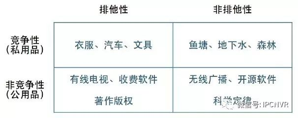

左上角的是私人财物，比方说你穿的衣服、你开的汽车、你用的文具，这些一个人用别人不能用，所以它具有竞争性。而同时你也很方便能够排除他人的使用，车锁上了别人就不会开了，文具在你的书包里面别人用不到。

右上角讲的是很多共有的财物，比方说森林、鱼塘，还有地下水，虽然它们都是竞争性的，也就是一个人用了别人就不能用的，但是你很难一下子把其他的使用者排除在外，你实施产权保护的时候成本比较高。

左下角的那个格子讲的是另外一种商品。首先它是非竞争性的，一个人用不影响别人用，比方说有线电视里面的信号，其实只要电视节目制作好了，多少人看都一样。但实际上有线电视台故意把这个产品变得很稀缺，你要付了费才能看，所以它具有很强的排他性。它要控制多少人看就能控制多少人看。所以有线电视的信号就是一个很好的例子。

右下角那个格子讲的例子，是既具有非竞争性的，又具有非排他性的例子。比方说国防，比方说我们用收音机收听的广播节目，一个人收听不影响别人收听，它具有非竞争性。而同时你也很难阻止别人去收听，所以它也具有非排他性。

所以你看我们左下角举的是有线电视的例子，右下角举的是无线广播的例子，它们的异同在哪里？它们同的地方是它们都具有非竞争性，一个人听一个节目不影响别人听一个节目，一个人看一个节目也不影响别人看一个节目，这是它们同的地方，都具有非竞争性。

它们的差异在哪里？它们的差异在于，有线电视是有线电视台能够严格地控制使用者的数量，你不交钱他们就不给你接入，他们就不给你播放，所以有线电视是具有非常强的排他性的。

而无线广播，广播电台是很难控制、很难阻止别人通过收音机来接收的，他们控制不了使用者的数量，所以无线广播具有非排他性。

## 课堂小结

今天，我们解释了两个重要概念的区别，一个是公用品，一个是私用品，我们不能望文生义，以为公用品就是政府提供的，私用品就是私人提供的。公用品和私用品的关键区别，在于一个人用影不影响别人使用这一物理属性，这个属性称之为竞争性。

同时我们还解释了什么叫排他性，所谓的排他性，指的是一件商品它在实际使用的时候，物主能不能够很方便地把其他的使用者排除在外。

## 课后思考

今天我留给你的思考题是，牙科医院和传染病医院提供的是公用品还是私用品？为什么？

欢迎你给我留言，我们下节课再见。

##### 72

# 第 072 讲  
灯塔的故事 

你好，今天我来给你讲灯塔的故事。

这是两位大经济学家保罗·萨缪尔森（Paul Samuelson，1915 年 5 月 15 日-2009 年 12 月 31 日 ）和罗纳德·科斯（Ronald Coase, 1910 年 12 月 29 日-2013 年 9 月 2 日 ）之间，关于公共服务一段非常著名的争论。

科斯你很熟悉，我们前面讲科斯定律，讲了很多他的故事和思想。

## 1.大经济学家萨缪尔森

保罗·萨缪尔森也是一位大经济学家，他是第一位拿到诺贝尔经济学奖的美国经济学家。他写的经济学教科书就叫《经济学（Economics ）》，是全美销量第一的经济学教科书。我最开始学经济学的时候，看的就是商务印书局翻译的他的《经济学》，这本书当时是分上中下三册的。

萨缪尔森是数量经济学（Quantitative Economics ）的创始人，他数学特别好，把经济学变成一门严格的带有科学性质的学科。据说他当年博士论文答辩的时候，整整用了六个多小时，教授从里面出来满头大汗，人家都在问这位教授，到底是你考学生呢，还是学生考你？保罗·萨缪尔森，非常厉害的经济学家。

## 2.萨缪尔森：灯塔是公用品，应由政府免费提供

萨缪尔森提出一个什么观点呢？他说灯塔是一种公用品，所以政府应该有责任提供公用品。故事是这样的，他说：

一个灯塔远远地在海的中间发出光芒，周围的船只看到了灯塔，就知道该怎么行进，怎么避开漩涡。一艘船使用灯塔发出来的光芒不影响另外一艘船使用灯塔，所以灯塔发出来的光芒、灯塔提供的服务，是一种地地道道的公用品。而公用品不应该收费，因为无论多少船只在使用这个灯塔,边际成本都不会增加。

如果你非要收钱的话，哪怕你只收很少的钱，总有一些比较穷的船主给不起这个钱。比方说收一块钱，总有很穷的船主给不起这一块钱，如果他不能利用灯塔发出来的光芒的话，他就可能误入歧途，这船可能就会迷失方向，遭遇损失。

提供灯塔，边际成本为零，如果你限制别人使用，带来的损失可能是巨大的。所以灯塔应该由政府提供，而且应该免费提供。

这是保罗·萨缪尔森的看法。

## 3.科斯：现实中灯塔不仅由私人建设，而且能够收费

科斯看到了萨缪尔森的看法以后，就在 1974 年特意写了一篇文章，《经济学当中的灯塔（The Lighthouse in Economics，1974 ）》，提出不同的看法。

他说，萨缪尔森讲的是黑板经济学，是他想象出来的，实际上灯塔在英国早就有了。而且灯塔可不是由政府提供的，是私人提供的，私人从政府那里拿到特许以后，就修建各种各样的灯塔。

你会问，私人修建灯塔，那他们怎么收回成本呢？船只一看见灯塔就远远地离开了，灯塔的建造者怎么能够收钱？科斯告诉我们，灯塔的建造者在码头那里收钱，船只只要停靠在码头，就有人在那里等着收钱了。

科斯讲的故事是，灯塔虽然发出来的光芒是公用品，但实际上它是由私人提供的，它是在收费的。而且你想想，灯塔发出来的光芒确实是一个人用不影响别人用，而建造灯塔本身，还有维持灯塔的运作本身，都需要耗费大量的资源，所以我们不能够因为灯塔在使用的时候没有边际成本，一个人用不影响别人用，就得出结论说它应该免费，修建它、维持它的运作是要有成本的。

同样的道理，你说我们在网络上搜索，一个人搜索影响别人的搜索吗？看上去搜索引擎提供的是一种公用品，一个人用不影响别人用。但你知道吗？实际上像谷歌这样的搜索引擎，每年都花费大量的资本，来进行服务器和带宽的建设。

科斯所讲的灯塔的故事，给我们一个重要的教训，那就是很多的公共服务虽然它本身是公用品，但它的建设和运作是需要成本的，它是可以由私人来提供的，而且私人是会有积极性去提供的。

你去看看当年修建灯塔的这些英国商人，他们为什么愿意在茫茫大海上修建灯塔？因为这些灯塔是码头服务设施当中的一部分。不要以为商人唯利是图，他们就没有积极性去提供公共物品的服务。

## 4.商人乐于提供公共物品

我自己很爱举一个例子，就是五星级酒店。你进去看看，你一走进五星级酒店，就能够感受到很多“ 一个人用不影响别人用 ”的公用品。

比方说，它的灯光设计得特别舒服，它还有香味，有时候还有人在旁边弹钢琴，还有喷泉，它的沙发也整理得非常干净，所有这些都是对外开放的，每个人都可以享用。

你这时候就应该问，商人不是唯利是图吗？他们提供这些公共服务赚不到钱，为什么五星级酒店不是一进门就是房间呢？而是有那么宽敞的、任人免费使用的大堂呢？

那是因为酒店的客人需要这样的公共空间。没错，提供这样的公共空间是需要耗费资源的，所以应该收费，实际上也收了费，在哪里收费？在客人付的房费里面，就包含了这些公共空间的费用。

在北京我还经常去一个很大的购物中心，叫颐堤港。它非常有意思，当然它里面有许多很好的商铺，但是它同时也有一个巨大的公共空间。

北京-颐堤港购物中心

每次我看到这个巨大的公共空间，就觉得这个设计者特别有胆识。因为稍微唯利是图一点，稍微斤斤计较一点，就会觉得这么大的空间如果全拿来做商铺，那该收多少铺租啊？但设计者没这么做，他留下了这个巨大的空间，反而吸引了好多的顾客。他们不仅自己来，还把家人带过来，还把小孩带过来，当然也只有这样他们才能安心地购物。

现在很多城市的规划部门，对私人楼盘的设计都有很多过细的规定，比方说要求他们公共空间要留多少，公共道路要留多少，给幼儿园、给学校、给医院要留多少空间，我觉得这些操心有点太过细了。实际上只要是有点远见的开发商，都会充分地考虑各种公共空间所能带来的好处，而且他们也一定有办法从中收费，得到补偿。

## 5.灯塔之争的两大启发

萨缪尔森和科斯之间的争论，给我们两个重要的启发：

第一，哪怕是公共设施，私人也有积极性提供，私人也能够从中收费。

第二，政府提供的公共服务，尤其是政府提供的私用品的服务，如果收费能够达到两个效果。当然政府可以选择不收费，但是如果选择收费的话，它有两个效果：

它可以筛选需求。因为你提供的私用品，一个人用别人不能用，比方说是道路，如果你选择收费的话你能够筛选需求，看谁更需要，让谁先用。

能够进行经济核算。你修了一条隧道，如果免费的话，你不知道它在经营上到底合算不合算。如果收费的话，你就能够计算出来，修这条隧道在经济上到底合不合算，如果你再要修一条隧道到底能不能收回成本。

比方说，前些年我们国家修了好多高铁，高铁的平均时速如果从每小时 250 公里提升到每小时 350 公里，这多提高的这么一点速度，建造的成本就要大幅增加，这大幅增加的成本到底合算不合算？

如果不对高铁车票进行市场化的收费，你就永远不知道，为了节省 15 分钟人们愿意付多少钱，而为了节省人们的 15 分钟，你得增加多少的投资，你不算这笔账，你就永远不能做出合理的决策。

## 课堂小结

我们要做一个总结了。不知不觉我们前面用了整整五个礼拜的时间，来讨论关于权利的经济学。

我们讲了权利有别于能力；讲了权利是人赋的，不是天赋的；我们讲了自由不等于免费；我们还讲了权利要保护的仅仅是物理属性，不是经济属性；我们还讲了产权的三种保护办法——财产原则、责任原则和不可转让原则；我们对四种所有制进行了比较；我们还讲了公用品和私用品之间的区别。

今天我们讲了有趣的灯塔故事，讨论了公共服务能不能也由私人提供，政府提供的公共服务能不能够也收费这样的问题。

## 课后思考

今天我不留具体的思考题了，我想听听，经过连续五个礼拜的学习，你最大的收获是什么？

欢迎你给我留言，我们下节课再见。

##### 周

# 第 18 周问答  
成长就是变得复杂 

你好，我们开始本周的问答时间了。

这一周，我们利用前面两个礼拜所讲的关于所有制的知识，完美地运用到拥堵治理的问题上去。同时，我们还讲了两个重要的，跟公共政策密切相关的概念：公用品和私用品。更重要的是，我们这一周结束了为期五个礼拜的，关于权利的经济学分析和讨论。

我来给你边做一个总结，边回答这个礼拜所提的问题。

## 1.征收拥堵费让最需要的人使用道路

这个礼拜最难、最有深度，而且如果你不学前面两个礼拜的知识，就没办法很好回答的问题，是咱们在预告里面提的第二个问题。这个问题是问：

如果征收交通拥堵费的话，那么开车的人就得支付金钱；如果不征收交通拥堵费，大家都堵在路上的话，那么开车的人就支付在路上等待的时间。无论是支付金钱，还是支付时间，他们都支付了成本，所以这两种方式其实是等价的。收拥堵费和不收拥堵费是一样的，没有优劣之分。这种看法对不对？

这个问题最尖锐，最难回答。我自己写专栏，参加一些论坛，谈到这个问题的时候，也没有办法很好地回答。原因是什么呢？原因是要回答好这个问题，咱们得有渔村的故事，得有那个表。有了那个表，才能清楚地把答案勾勒出来。

但你们已经具备了这个基础。支付金钱和支付时间，有两个根本的不一样：

第一，在收拥堵费的情况下，上路的人数不一样。道路是私有的，具有排他权的所有者，为了使道路达到最大效益，他会让 5 个人上路。

而如果道路是公共用地，谁都可以上路的话，那么上路的人是 8 个人。拥堵的情况不一样，这是收拥堵费和不收拥堵费的第一个区别。

第二，在收拥堵费的情况下，上路的那 5 个人，跟不收拥堵费的情况下上路的那 8 个人，不是同一种人，这是关键。收拥堵费的情况下，那 5 个人是对道路具有高估值的人，他们每一个人都愿意支付 6.8 元的道路拥堵费。

他们把这条路看作是有价值的路，而他们使用这条道路的时候，获得的回报要高于他们支付的拥堵费。否则，他们就会把道路让给其他对这个道路具有更高估值的人。

而在没有征收交通拥堵费的情况下，在人人都可以上路的情况下，会有 8 个人上路。这 8 个人，在他们的心目中高速公路跟泥泞的道路是一样的。

第一，人数不一样，拥堵的情况不一样；第二，人不一样，上路的人对这道路的估值是不一样的。这是关于道路拥堵费我要总结的第一点。

## 2.实践中的拥堵费其实不一定很贵

第二点，在我们的例子里面我们讲到，如果交通拥堵费收 200 块钱的话，那就足以让绝大部分人把道路让出来。但这只不过是为了把问题说清楚，所以我们才把拥堵费的金额说得夸张一点。实际上，拥堵费远远不需要收 200 块钱那么多，就足以达到效果了。

比如，我说的华盛顿的那条 I-95 收费公路，通常的实时拍卖价格也就是 6 块钱、8 块钱，就完全能够达到效果了。6 块钱、8 块钱折合成人民币也就是 50 块钱左右。这是我要补充的第二点。

## 3.收不收费与收到的钱怎么用无关

好，我们来看周一的思考题。周一的思考题是：“很多人会说，我不是不赞成收拥堵费，关键是收了拥堵费以后，这些钱用在什么地方。”

Koant 同学的回答非常清楚，他说：我不赞成这种说法，我认为收费之后，把这些钱用在什么地方是其他的问题了。而收费的目标是为了解决道路拥堵的问题，这才是关键。不要本末倒置了。

Koant 同学的逻辑思路非常清楚，收不收费，和收了费以后这钱该怎么用，这是两个问题。即使收了费以后，这部分钱得不到善用，我们也还是应该收费。当然，毫无疑问，我们希望收到的这部分拥堵费，能够得到非常妥善的使用。

## 4.征收拥堵费的困难与阻力

周二的问题是：“如果你也赞成征收交通拥堵费，那为什么在很多国家和地区都有拥堵，为什么这种做法得不到采纳和执行，困难来自哪些地方？”

很多同学的回答都非常好，把大家的回答加起来，可能就是全部答案了。

其中 an 同学点到了最重要的几点，她说：

成本太高。如何建立高效公平的收费机制依然是核心的问题；

思想落后。大多数人会抱怨拥堵费太贵，而不会意识到这是在花钱买效率；

监管机制可能不完善；

无相关的法律出台。

在我看来，同学们提到的这些问题，都是实施拥堵费的困难和障碍。

## 5.实施拥堵费困难之一：公众意识跟不上

第一，公众的意识跟不上。

这个礼拜三，我们讲了两个重要的经济学概念，很容易望文生义的经济学概念，公用品和私用品。你能够明白这当中的含义和区别。但其他人，外面的其他人，绝大多数是分不清楚这个概念的，是会对这两个概念望文生义的。

他们会以为，只要是政府提供的服务那就是公共服务，那就不应该收费。他们思考的角度，是从路这个词前面有没有一个“公”字，如果这路叫做“公路”的话，那就是大家都可以使用的，顾名思义嘛。

他们不会从经济学的角度出发，说一件产品只要是一个人用，别人不能用的，那就是私用品，不管它是由政府提供的还是由私人提供的，这都没关系。

公众不接受征收拥堵费的建议，还有另外一层原因，那就是顾及到自己的利益可能要受损。

很多人会觉得，只要让我付钱我就不愿意。很多人其实没有意识到，我们今天生活在现代社会，我们享受到绝大多数的良好服务，正是因为有了收费，实施了“用者自付”的原则以后，这些商品、这些服务才变得可得，才变得便宜，才变得优质。

## 6.实施拥堵费困难之二：决策程序漫长繁杂

实施拥堵费的第二个困难，是公共决议的程序上面的困难。

比方说，我们国家有不少城市有规定，凡是政府要出台收费措施，那得经过当地人大的批准。这本来是一项保护民众，不被政府乱收费的好的法规，但这就给治堵增加了难度。

哪怕是负责的官员和专家都意识到，都明白到征收拥堵费的好处，那也远远不够。想到要经过一个漫长的立法过程，官员和专家可能就不得不先采取一些权宜之计，一些不需要收费的办法。比如说抽签买车，比如单双号上路，比如拍卖车牌等等。效果远远不如征收拥堵费好，但是，这是比较容易实施的措施。

我来给你举个例子，如果大家都认为吃饭是天经地义的事情，只要手里面有碗就有权去盛饭。那接着会发生什么？接着发生的事情就是，饭不够了。

针对饭不够的这个事情，正确的解决办法是对饭收费。但大家说，不行，饭可是基本人权，饭是公用品，不能对饭收费。那怎么办？那人们就只能去限制用碗的权利。

我们要对每一个碗加个编号，单双号盛饭，没有本地户口的人无权买碗，谁要买碗要抽签，还要拍卖买碗的权利。所有这些措施，都是不能切中要害的。你想想，限制人们买碗能够控制的，只是这市场上的碗的增量，碗的存量还在那里。

通过这个角度来看各个城市治堵的办法，你就能豁然开朗了。任何拥堵，它都不是永远的堵，而是某个时间，某个路段的堵。如果你要通过摇号或者拍卖的方式控制新增车辆的数量，那效果是微乎其微的。因为一旦摇号成功，一旦拍卖成功，人们就会尽可能上路。那些发生在某个具体时间和地段的拥堵依然得不到解决。

如果你非要把整个城市车辆的存量，降到在特定的时间和路段都不发生拥堵的话，那么这个城市的车辆数目就会过少了。正确的解决办法是，对饭收费，而不限制人们买碗的权利。你买多少碗都可以，但是盛饭要交钱。

拥堵的本质问题，是路权的争用，咱们对路权收费。你爱买车，买多少都可以，只要不经常上路就可以了。

在很多发达国家，每个家庭都有车，但是很多人上班是不开车的，或者只开半程车，把车开到地铁站门口就改乘公交地铁了。这才是切中要害的解决方案。

官员担当的勇气也非常重要。我们在课上说过，英国经济学家庇古（A. C. Pigou ），在一百年前就开始讨论拥堵的问题。而伦敦在 1960 年代就开始讨论实施交通拥堵费的可能性。

一直到 2000 年，当时竞选伦敦市长的肯·利文斯通（Ken Livingstone ），他就明确地在自己的政纲里提出，如果当选，他就要实施交通拥堵费。后来，他当选伦敦市长了，他已经有言在先，又获得了选民的支持，这时候他才做得成。这些条件都得凑起来，得看运气。

## 7.实施拥堵费困难之三：定价标准

实施城市交通拥堵费，我最大的担心是在定价问题上。

在渔村的故事里面，我们定价 6 块 8 毛钱，让 5 个人上路，这是在私有制下能够摸索出来的一个平衡点。在现实生活中，如果对公共的道路进行收费，这个摸索的过程很可能不会那么畅顺。

如果收费的标准是通过一群社会贤达，通过公开听证会的形式来确定的话，那么这个定价很可能就会过低。结果，治堵的效果不明显，人们还抱怨你收了我那么多钱，我们还堵在路上。

所以，最理想的解决办法，是政府事前进行公开招标，给一个足够长的营运时间，让私人公司进行全盘的规划。具体使用什么样的测量办法，具体如何定价，才能让道路的使用率达到最高。而政府也能收到最大金额的收费，这些钱他们拿去善用。

## 8.牙科医院提供的是不是公用品？

周三的问题是：“牙科医院和传染病院提供的，是公用品还是私用品，为什么？”

很多同学都答对了，一个人牙有问题，他对社会的影响比较小，所以牙科医院提供的主要是私用品，一个人用，别人不能用。而一个人得了传染病，他对公众的影响会很大，治疗一个人的传染病，其实是对整个社会提供了预防服务。所以，它在很大程度上提供的是公用品。

一个人牙痛去不去拔牙，这基本上是他自己的事情。一个人得了传染病，他去不去看病是大家的事情。政府什么时候管，什么时候不管，跟一种疾病的外部性是强是弱密切相关。

## 9.利益计算不同，决定了人们选择的理由不同

周四的问题是：“我们经过五个礼拜的学习，五个礼拜专门讨论权利的经济学分析，你最大的收获是什么？”

我觉得杨健同学提到的一个概念，给了我最大的共鸣。

他说：“薛老师，你在好几次课上都提到了‘光谱’，在两个极端的事物很好分辨。但大多数的事物都具备了两极属性，需要我们用心去分辨。”

我觉得杨健同学的感受非常到位。是的，我们的课程，已经逐渐把看问题的度走向复杂化了。吴伯凡老师在“得到”平台上的《伯凡日知录》专栏里面，也曾经提到过灰度的问题。

吴伯凡老师的专栏是我每天都听的，特别的精彩。他讲的“灰度化管理”实际上就是一个光谱的概念。在黑和白当中找一个平衡点的艺术。

最近几年一直非常火的一个网络综艺辩论节目《奇葩说》，上个礼拜播出了这一季的最后一集，罗振宇老师在里面有一段演讲非常精彩，他说：成长就是一个复杂化的过程，人变复杂了，看问题的角度变复杂了，这就是成长。我推荐你到爱奇艺上搜索“奇葩说”看看这个节目。

针对昨天周四的问题，学了整个关于权利的模块，我自己最大的感受是什么？当然，你可能猜到了，我对渔村的故事感受特别的深。

其中有一点，人是善于制造理由的。你看，在不同的所有制下面，他们有不同的收益，不同的收益决定了他们说什么样的话，提出什么样的论据，营造什么样的文化。利益计算的不同，决定了人们选择的理由的不同。

周五辩论

好，我们周一到周四都给大家留了思考题。今天礼拜五，我给大家留一个辩论题，大家一起辩论。

我们刚才提到了，吴伯凡老师谈到的“灰度管理”的问题，今天我们就辩论一下，人要不要坚持原则。“坚持原则”这句话说来容易，但是每当人们想起这句话的时候，就是因为他们遇到了一些值得纠结的事情。如果不值得纠结的话，那当然坚持原则就好了。

正方：我们应该任何时候都坚持原则，因为只有在每一件事情上都坚持原则，那才叫坚持原则，不然这句话就是一句空话。

反方：坚持原则是要有条件的，在适当的时候我们不坚持原则，也算是一种艺术。

欢迎大家参与辩论。

##### 73

# 第 073 讲  
易耗品与耐用品 

你好，今天我们开始一个全新的模块，讲时间和耐心的作用。

我们刚开学的时候，把整门课做了一个很大的区分。我们说，每个人生活在世界上，他至少面临四种最基本的约束，那就是：东西不够、时间有限、互相依赖，还有需要协调。

我们在今天以前的整个课程，所讲的其实都围绕着第一个中心，就是东西不够。东西不够，人与人之间是怎么进行财富分配的，是怎么进行交换的，怎么对财产进行所有权管理的。

所有发生的一切，好像没有时间的存在，一切都好像在一个刹那间完成的事情。今天，我们把我们的世界观延展到一个新的维度，那就是时间的维度。

在时间的维度上，照样存在着我们前面讨论的核心问题。也就是稀缺，东西是不够的，不仅在一刹那间不够，我们在时间的维度上也还是不够。人们把今天的货品叫现货，明天的货品叫期货，现货跟期货之间怎么交换，达到更大的幸福。

这是我们这一个单元开始要讨论的问题。

## 1.费雪及其名著《利息理论》

要讨论时间和耐心，我们就不得不提一部重要的著作，美国经济学家欧文·费雪（Irving Fisher, 1867—1947 ），在 1930 年出版的《利息理论（The Theory of Interest ）》。这是一部经典名著，我自己非常喜欢。

欧文·费雪（Irving Fisher, 1867—1947）

原因是什么呢？原因是我们讨论关于利息理论的各种概念，在欧文·费雪出版这部著作以前，都已经在了，各种概念，比方说回报率、时间、不耐等等这些概念都有了。好像所有的东西，所有的珍珠都已经放在桌面上了，但是就是没有人能够把它们系统地、顺理成章地串起来。

我们知道，奥地利学派对经济学有很大的贡献，前面我们讨论的边际概念，实际上就是由奥地利学派发展出来的。

关于利息,也是奥地利学派一帮学者研究出来的，但它是以欧文·费雪的研究，他 1930 年的这个著作《利息理论》为一个高峰，把所有的问题都解释清楚了。

我们来介绍欧文·费雪的《利息理论》。翻开这本书，第一页第一句话，劈头一句：收入是一连串的事件（Income is a series of events ）。

这样一句话，劈头一句，你得愣好久，你要想想这是一种什么样的角度。

他说收入是一连串的事件，未来发生的一件一件一件的事情，连续加起来，就是你的收入。这是一种很新的角度，看所有资本是怎么提供服务的角度。

我们怎么理解这句话呢？我们首先看，世界上所有的产品、商品、资源，都可以简单地划分为两种：一种叫易耗品，一种叫耐用品。

## 2.何谓易耗品

所谓易耗品，就是一次性就能把它消费完毕的。一个苹果、一个鸡蛋、一杯牛奶，这算是易耗品，一次就能把它消耗掉的。一块奶酪呢？一块奶酪也是易耗品，当然我们知道，你要生产奶酪的时间是要很长的，比牛奶要长，但只是说它生产的时间长，并不是它消耗的时间长。

我们说奶酪，它也是一口吃下去就能消耗掉的，所以它是一种易耗品。

当然我们讲，今天的牛奶到底是拿来喝还是拿来做奶酪，这当中是一个决策。到底是把这牛奶当做今天的易耗品，还是当做 未来的易耗品 （把它变成奶酪以后再一口吃掉），这是一个选择。

但无论是哪一种，我们说奶酪也是易耗品。因为在后面我们可能会提一些问题，同学们容易混淆，以为奶酪是经过一段时间生产的，就以为奶酪是耐用品，其实不是。

## 3.何谓耐用品

耐用品是什么呢？耐用品是它提供的服务、它发挥的功能，必须是在一个时间段内慢慢发散出来的，它要有时间你才能享受的，这叫耐用品。

比方说一幅油画，你要欣赏这幅油画，很珍贵的油画，你必须搭上时间，才能欣赏它。很好的油画，你没办法一下子把它完全享受掉，你得在时间的流逝当中观看这幅油画，慢慢欣赏，所以油画是一件耐用品。

一棵苹果树是一件耐用品。它今年结十个苹果，你吃掉十个苹果，明年结十个苹果，你吃掉十个苹果，后年十个你吃掉十个。你不可能一口气把这棵果树将来可能结的苹果都吃掉。所以一棵果树是在时间的流逝当中，才可能散发出它所有服务的耐用品。

## 4.人力资本是一种耐用品

我们每个人的人力资本也是耐用品，他必须在时间的维度上才能发挥他的功能，散发他的服务。比方说很多老板现在招人，他们都要让员工加班，他为什么要让员工加班呢？员工加班的话，他必须付加班费，那加班费不是多给的钱吗？

他有两个选择：一个是给同样的员工加班费，成倍地给；还有另外一个选择，是多雇一些人两班倒。他会选哪个？当然他会选员工加班。为什么？因为员工加班更合算。

怎么合算了？工资不是成倍吗？因为他还能省很多固定的成本。比方说工位，他只要一个工位就可以了；培训的费用，他只要培训一个人就可以了；管理的费用，他只要管理一个人就可以了。不是两个人，不需要成倍地增加这些费用，所以老板喜欢让员工加班。

但是倒过来呢？员工喜欢加班吗？如果所有的员工都不喜欢加班的话，那你可以想见，会有一些老板招聘的时候就说：我们不需要加班。那么这种老板自然就能够招到更多更好的员工。但事实上，员工自己也喜欢加班。

为什么？所以我想问问你，你每天的工作时间，其实是多于八小时还是少于八小时？我猜你每天的工作一定多于八小时。但是你要想想，我们过去曾经奋斗了好多年，说我们一定要把劳动时间、工作时间减到八小时以下。而且我们每个人的收入都比以前，比 50 年前、100 年前的人要高多了，已经很有钱了，为什么还要那么辛苦地工作？

过去还有很多理论，说工作时间太长人就会异化，忘掉自己是什么，我们还是要腾出更多的时间，好好充实自己，做一个完整的人。但实际上我们绝大多数人工作时间都超过八小时，为什么？

我觉得原因很简单，因为我们每个人都集聚了大量的人力资本，这些资本是耐用品。耐用品必须在时间的流逝当中才能兑现。你不能把它一口气卖掉，你不能一下子就把它兑现。

比方说我攒了个博士学位，如果能够一刹那就把它批发掉、卖掉兑现的话，那可好，我就剩下好多时间了。但实际上，你没办法把这个学位给卖掉，你把这个学位价值兑现的唯一办法就是时间，你需要工时。所以我得讲课、写文章。

一种耐用品，只有在时间的维度上才能发挥它的价值，才能散发它所蕴含的服务。这是耐用品的含义。任何一种能够带来收入的资源、本领或者禀赋，都是一种耐用品。

北大国家发展研究院的周其仁教授，他有一个很重要的本领，就是他切换注意力的速度非常快，他从一个事情转到另外一个事情，几乎不需要时间。他总能集中精神做前一个事情，但是下一秒钟他就完全关注下一个事情。

我跟着他出去调研，去一个地方回来以后，那得躺半天，想想昨天、前天发生的事情，沉浸在过去几天发生的事情当中。要好久才缓过神来，而当下要做的事情就没做好，得几天才能切换过来。

周老师能够很快地切换，我们谈起这个本领的时候，周老师加了一句：“这也是一种资本，这也是一种收入。”你看，吃的是经济学，喝的是经济学，呼吸的是经济学。无论任何事情，他都跟经济学里面的概念相联系。

油画是一种耐用品，一棵苹果树是一种耐用品，注意力切换的本领是一种耐用品，小孩儿也是一种耐用品。

## 5.儿童也是一种可消费的耐用品

当经济学家加里·贝克（Gary Becker，1930 年 2 月 25 日-2014 年 5 月 4 日），头一次在一个演讲里面说“儿童是一种可消费的耐用品”的时候，引起全场的哄然大笑，儿童怎么是消费品？儿童怎么是耐用品？

经济学家就是有不同的看法。他们说，每个家庭生儿育女其实是理性的决定，生下这个小孩实际上就是一个消耗品，实际上就是一个长期投资。

很多人以为生育是偶然的，是听天由命的，哪有这种事情。哪怕是那些相信不许避孕、不许堕胎宗教的那些人群里面，他们生育的规律、他们生育的数量，其实也是符合经济规律的。他们暗中也在避孕，甚至也在堕胎。

小孩儿很可爱，可爱得你有时候巴不得啃他两口，但是你不能真的把他吃了，你只能在时间的流逝当中，去爱他、去欣赏他，去从中得到快乐。

儿童是消费品，这个概念我自己有很深的体会。你的小孩，他十岁以前那真是你的消费品，你能从中得到莫大的快乐，而且他还挺听你话的，你要是到幼儿园看见他，他会很自豪地跟同学说：“你看，那是我爸爸！”

但是过了十岁以后情况就不同了，你要跟他上街，他未必跟你上街了；你哪怕是去学校接他，他也会跟你说：“你就待在车里面等我就好了，不要出来。”

## 课堂小结

1、今天我们为稀缺的概念引入了一个新的维度——时间；

2、我们介绍了一本名著，费雪的《利息理论》；

3、我们区分了两种产品：易耗品和耐用品。我们甚至还讲了，连儿童也是一种可消费的耐用品。

## 课后思考

今天留给你的思考题是，如果儿童是耐用品的话，那么为什么比较贫穷的社会，人们生小孩生得比较多？比较富裕的社会，人们生小孩反而生得少呢？

欢迎你给我留言，我们下次再见。

##### 74

# 第 074 讲  
不耐产生交易 

你好，今天我要跟你讲的主题是“ 不耐产生交易 ”。昨天我们开始了一个新的模块，讲时间和耐心。为稀缺的概念引入了时间的维度，我们讲了易耗品和耐用品的概念。

## 1.不耐是人的自然倾向

我们今天再引入一个概念，那就是“不耐（impatience）”，就是不耐烦。人对消费其实有一个时间上的偏好。

今天一个苹果是一个苹果，明天的一个苹果就不一定是一个苹果了。明天指不定会发生什么事情，明天的苹果，不仅仅得推迟消费，得等到明天才能吃这个苹果，还有可能，明天根本就吃不上这个苹果了。

未来是不确定的。产生不确定的原因有很多，自然灾害、人为灾害等等，还有一个很重要的，谁都避免不了原因——那就是衰老。人的生命是有限的。

所以只要其他情况不变，人们总是希望早一点消费比晚一点消费好，因为早一点消费就是确定的消费，晚一点消费就是不确定性的消费。所以不耐有时候经济学家也喜欢称之为“确定性偏好”。

人们更喜欢今天确定的消费，而不喜欢明天不确定的消费。人的这种非常自然的倾向就叫“不耐”。欧文·费雪（Irving Fisher ）称之为 impatience。

而当时最早翻译欧文·费雪《利息理论》的陈彪如（1910 年 12 月-2003 年 7 月 ）老先生，他翻译成中文就叫“不耐”，不够耐心的不耐。这个词今天我们读起来有点怪，但这是一个挺经典的翻译，咱们就沿用陈彪如老先生的翻译，不耐。

但是我们再看，我们说不耐是每个人都有的自然倾向，但其实每个人不耐的强弱是不一样的。有些人强一点，有些人弱一点；有些情况下强一点，有些情况下弱一点。是什么因素决定了不耐的强弱呢？

## 2.耐心与年龄

这里面的因素有好多，比方说年龄。老人和年轻人相比，老人的不耐就比较强，年轻人的不耐就比较弱。因为年轻人能够看到更久远的未来，年龄是不耐的一个影响因素。

## 3.耐心与想象力

第二，想象力也能够影响不耐。大家可能听过一个著名的实验，老师跟几个小孩做一个游戏，老师把棒棒糖交给小孩，然后跟小孩说，如果你能坚持半小时内不吃的话，老师会再给你一颗棒棒糖。结果有些小孩儿比较不耐，一下子就把棒棒糖吃了；有些小孩儿能忍住，最后没吃，就能够得到奖赏。

科学家还做了追踪，发现那些比较自律的孩子，他们的成绩比较好。针对这个现象就有不同的解释，有些人说你看那些比较自律的孩子，他们能忍住不吃棒棒糖，所以自律同时也对他们的学习成绩有帮助。

但是其实还有另外一种解释，就是想象力。这些孩子的想象力不一样。那些想象力强的孩子，他们能够把以后得到的奖赏看得很大、看得很重、看得很具体、看得很明确，这种小孩当然自律能力就比较强。但其实自律能力背后是想象力。

我们看，今天有许多人做出伟大的成就，他们都是在黑暗当中坚持下去的，靠的是什么？靠的就是信念，信念其实就是对未来前景的那种想象。

## 4.耐心与文化

耐心跟文化也有关系，每次我到上海外滩，看到那里的洋房，到青岛看到那里的洋房，到香港看到那里的洋房，都是用石头砌成的洋房。这些用石头砌的房子，可以屹立一百年、两百年不倒。

我在想，这些殖民者当时修这些房子的时候，真的认为他们能够殖民中国那么长时间吗？他们真的有那么长远的打算吗？当然不一定。其实他们为什么要修这么坚固的房子呢？

很重要的一个原因，不是因为他自己觉得自己能在这个地方待多久，而是他们习惯上，要盖房子就盖这样的房子。他们习惯了，要做一件事情，就把它做得很长远，非常的耐用，要修房子就修得牢固。所以耐心跟文化有关系。

## 5.耐心与时局

耐心跟时局也有关系，兵荒马乱的年代大家觉得未来就不明确，这时候大家就看不到未来，他们看手上的耐用品就觉得没那么值钱。而那些生活在和平环境里的人，他们看未来就看得比较远。

所以这时候文物，重要的文物，它们是非常耐用的商品，就会从兵荒马乱的地区流到那些和平的地区。因为这两个地方的人，对这种耐用品的估值不一样。

## 6.不耐产生交易

所以，不管是什么原因影响了耐心，不管是年龄、想象力、文化传统，还是时局，人与人之间的耐心不一样，他们对手上耐用品的估值就不一样，这时候人们就会产生交易。

有些人喜欢要现货，有些人喜欢要期货。有些人看重商品今天所发挥出来的效用，有些人看重商品未来所蕴含的价值。

那么这些偏好现货的人和那些偏好期货的人之间，就会产生交易，也就是说不耐产生交易。而在这个交易当中，现货和期货的比价，就是我们所说的利息率，简称利率。

## 7.不耐程度决定利率高低

到这里，我们要澄清一个广泛存在的误解，好多人以为存款之所以要有利率，那是因为存款自己本身会涨起来。东西会涨起来使得东西会有利率。这种观念是有问题的。

你想，任意一宗现货跟期货的交易之所以存在利率，关键是人们都有时间偏好，人们都愿意早一点消费，而不愿意晚一点消费。而那些想要换取现货的人为了说服别人，让他们推迟消费、接受期货，他就只有一个办法，对那些推迟消费、接受期货的人给予补偿，这补偿就是利率的基础。

所以，未来越是不确定，补偿就要越大；消费推迟得越久，补偿也要越大。不耐是利率的基础，未来越是不确定，接受期货的人所要索取的补偿就越大，这时候利息率就越高。

所以，到了兵荒马乱的年代，未来高度不确定的年代，你说利率是高还是低？利率是高，因为你要劝人家接受期货，你得给予很高的补偿。

不能说在兵荒马乱的年代东西涨得特别快，所以利率特别高。而是相反，你要记住，利率是人们推迟消费所要索取的一种补偿，所以未来越是不确定利率就越高。

## 课堂小结

我来给你总结一下。今天我们讲了不耐的概念，未来是不确定的，而且生命有限，所以在其他条件不变的情况下，人们总是宁愿早一点消费比晚一点消费要好，这也可以称之为人有“确定性的偏好”。

影响不耐的因素有多种，比方说年龄、想象力、文化传统、个人的遭遇和时局等等。

但不管怎么样，只要人与人之间对确定性的偏好不一致，也就是他们不耐的强弱不一样的话，他们就会进行交易，用现货跟期货进行交易。

每当现货和期货进行交易的时候，接受期货的那一方，就要索取更大的补偿，这个补偿就是利率的基础。未来越不确定，补偿越高，利率就越高。

## 课后思考

在一个原始社会里面，在一个连货币都没有的社会里面，有两幢房子，一幢是茅草房，它不是那么耐用；一幢是石头房，它挺耐用的。这时候人们发现石头房的价格相对于茅草房的价格下降了，石头房变得相对便宜了。这时候我问你，利率是上升了还是下降了？为什么？

欢迎你给我留言，我们下节课再见。

##### 75

# 第 075 讲  
利率管制与高利贷 

你好，今天我给你讲的话题是利率管制和高利贷。高利贷我们都听说过，是个贬义词，今天我们从不同的角度来理解这个事。

首先，我们前面两天已经有了知识准备。

我们引入了时间的维度，所有的商品可以分为易耗品和耐用品。耐用品是在一个时间的流逝当中，才能发挥它所有经济价值的资本。

我们讲了人有一个自然的偏好，就是喜欢确定的东西，喜欢早一点消费。对于未来才能消费到的东西，思想上要打个折，如果你要劝人家接受未来的东西，放弃今天的享受，你得给人家一点补偿。

而未来越不确定，前景越不明朗，这种补偿就越大。这种补偿就是利息率的基础。记住了，利息是一种补偿。

## 1.收取利息是一种天经地义的行为

根据这个道理——每个人都有一个非常自然的倾向，偏好今天多于偏好明天——我们要记住，我们永远不能拿处于不同时间点上的商品直接进行比较。

比方说，今天的一个苹果和明天的一个苹果，就不能直接进行比较。你要对它们的价值进行比较有两个办法：

要么把明天的苹果打个折，算成是今天的苹果，只有这样，今天的苹果才能跟明天打了折的苹果进行比较。

或者你反过来，把今天的苹果折算成明天的价值，那么经过折算后今天苹果的价值，就可以跟明天的苹果相比较。所以永远要记住，一定要把不同时间点上的商品折算成同一个时间点，它们才能进行互相比较。

正是因为利息是对人们延迟消费、接受不确定性的一种补偿，所以只要把时间这个因素考虑在内，收取利息就是一种天经地义的行为。

## 2.人们普遍反对收取利息

但是不知道为什么，我自己还没有找到全部的理由，在大多数的国家，在人类历史上大多数的时间里面，收取利息被认为是不道德的行为，是被禁止的行为。

而大多数的宗教、大多数的法律、大多数的舆论，都对收取利息的行为采取了批评和谴责的态度。这是挺奇怪的事情，但这是事实。

在美国，一直到了 1980 年，他们颁布了“储蓄机构放松管制和货币控制法”以后，才完全解除了美国各州对高利贷的限制。

在我们中国，根据《合同法》和最高人民法院的《关于人民法院审理借贷案件的若干意见》，民间借贷利率不得超过银行同类贷款利率的四倍，超过部分的利息不受法律保护。你看利率不能太高，这其实是一种价格管制。

天主教长期认为收取利息是不道德的行为，是不公平的行为，是不可以接受的行为。而高利贷者是这些社会里面的反面人物。

## 3.反对收取利息的观点自古就有

这种反对收取利息的观点自古就有。

公元前 300 多年，希腊哲学家亚里士多德（Aristotl，公元前 384 年-公元前 322 年 ），他认为货币是没有繁殖能力的，钱就是钱，钱不能再长钱，所以收取利息是不自然的行为。

公元 13 世纪的神学家托马斯·阿奎纳（Thomas Aquinas，1225 年—1274 年 ），他认为收取利息其实是两次收费。好比卖了面包不能再卖一次给别人一样，你不能收两次钱，人家把本金还你了就是还你了，你不能再收人家的钱。

所有这些宗教的禁律，所有这些人们的舆论，所有这些哲学家、神学家的观点，他们都有一个共同之处，就是忽视了时间的维度。

莎士比亚的名著《威尼斯商人》里面，就有一个反面人物犹太人夏洛克，他唯利是图，心胸狭隘，报复心重，一心想要别人还他的贷款，还要加上利息，如果不给利息他要切人家的肉，一磅肉。

好在《威尼斯商人》这部剧里面的一位才女，非常巧妙地利用了合同上的说法，说你要切一磅肉，那可以，但没说血，切一磅肉但不能流血，可以吗？最后夏洛克只好罢休。

在这样的文学作品里面，收取利息都是不正当的行为，是被人讥笑、被人反讽、被人谴责的行为。

## 4.人们为什么反对收取利息

到今天为止，还有很多人认为，只有工人、农民才是真正创造财富的人，而那些靠借钱给别人赚钱的人不道德，他们坐享其成，他们做的不是实业。

那是因为，人们到今天仍然认为，等待、承担风险、推迟消费、提供流动性等等，都不属于真正对社会的贡献，所以才会产生“靠食利生活”是不自然和不道德的观点，所谓食利就是吃利息的意思。

这当中的原因，我也没办法完全解释，为什么人们普遍对收取利息这么反感？其中有一点我觉得是有解释力的，那就是自古以来，人类的真实利息率是非常高的。

我们前面一再解释，利息是对延迟消费的补偿。在过去，人类的生活是高度不确定的，人的寿命很短，各种自然灾害、各种人为灾害非常多。所以你要劝人家推迟消费，你要给的补偿很高。那个时候利息率普遍是非常高的，年利率达到 30、40、50、60 个百分点都不奇怪。

这么高的利率往往会给人一个印象，就是这些能够贷款出去的富人为富不仁、趁人之危、巧取豪夺、落井下石。可能是因为这样的原因，大家对收取利息持有很强的反感。

后来到了 16 世纪，技术发展了，人类的平均寿命延长了，社会也变得文明了，未来变得比较确定了，这时候真实利息率才发生显著的下降。所以可能是因为这个原因，从那个时候开始，人们才逐渐接受收取利息的行为。

## 5.利率管制产生不良后果

不管人们为什么对收取利息产生反感，我们这里一个经济学分析的要点，就是利息是一种比价，是一种价格，如果这种价格受到抑制，受到人为的抑制，也就是出现了价格管制，会出现什么样的后果。这是我们感觉到有趣的地方，可以分析的地方。

明明时间是要起作用的，借钱给别人是要付出代价的，所以应该获取回报，但这种回报被人为的，被宗教、法律、文化、舆论限制住了，这时候会产生什么后果？

你还记得吗？价格受到抑制就会出现短缺。什么叫短缺？就是人们不得不采取价格以外的非价格竞争方式，来竞争那些稀缺的资源。

对利息的价格管制会出现什么样的后果呢？

第一点，是人们不愿意借钱给别人，因为有钱人知道你借钱给别人，人家顶多就是还你本金，不会给你利息的，而当中的风险你自己要承担。所以没有人愿意让别人知道他是有钱可借的，装穷是第一个现象。

第二个现象，是黑社会会应运而生，因为明规则不保护就需要暗的规则，暗规则或者潜规则也是一种规则。黑社会就是那些有信心、有本事让你还钱的人。因为他们有信心、有本事，他们也就愿意借钱给你。这时候，黑社会所经营的这种地下的借贷市场，就是对公开市场的一种替代。

由于借钱这种需求还是存在的，有需要就有供给，也有人愿意把钱借出去，但是收取利息是不合法的、不合道德的，所以人们就会采取一些迂回的办法。

比方说借钱不可以，但是合作做生意可以，表面上是合作一起做生意，实际上是借钱，将来生意不管做成做不成，利息总是要还的，暗中要规定一个利息率，这是一个办法。

给予非金钱的回报，比方说劳动力的服务，这也是一种办法。给予非金钱的抵押，比方说房产或者其他的资产，也是一种收取利息的办法。

不管怎么样，只要社会上对收取利息的行为越谴责、限制越多，人们借钱的方式就越迂回，借贷的真实成本就越高。

## 6.贷款利息越低，穷人贷款越难

对利息进行价格管制，还有一些事与愿违的后果。比方说现在很多政府为了扶贫，指明给穷人借贷贷款利息要低一点，这当然是好心，但实际上后果是什么呢？

你给穷人的贷款利息要低一点，你要知道穷人还款的能力没那么高，实际上有钱的人是不太愿意把钱借给穷人的，而他能够收取的利率又更低，他们就更不愿意把钱借给穷人。

实际上这种低利率，特别是低于市场标准的利率，就会被那些有钱、有势、有关系的人得到，穷人反而拿不到。

所以有些经济学家主张，你要借钱给穷人有一个办法，就是给穷人的利率要稍微比市场的利率还要高一点，这时候那些有钱、有权、有关系的人看不上这些利率，这些钱才更容易落到穷人的手里。

## 课堂小结

我给你总结一下，今天我们讲了历史上不同的宗教、国家、文化，对收取利息率的普遍敌视态度。

我们也解释了当中一些可能的原因，可能是因为过去生产力水平很低，未来非常不确定，真实利息率非常高，所以人们接受不了。随着生活技术、人类文明程度的普遍提高，人们平均寿命普遍延长，人们对未来看得比较清楚了，真实利息率才得以下降，收取利息的行为才慢慢被接受。

但不管怎么样，利息是对延迟消费的补偿，这种补偿如果受到人为限制，也就是出现价格管制的时候，那就会出现短缺的现象。也就是说，人们就不得不展开各种价格以外的竞争方式来竞争。

## 课后思考

今天留给你的思考题是，你会通过哪些具体的现象来判断一个人或者一群人，甚至是一个民族他们对未来的耐心程度？请你来分析分析。

欢迎你给我留言，我们下节课再见。

##### 76

# 第 076 讲  
利率变化支配资本现值 

你好，今天我要跟你讲的话题是“ 利率变化支配资本现值 ”。选择不同的利率，或者利率发生了变化，对资本的现值——今天资本的价值是多少，有举足轻重的影响。

未来越不确定补偿就越高，利率就越高。而未来越不确定，那些在未来才能实现的价值，在今天看来就越不值钱，打的折扣就越大，就这么一个道理。

## 1.贴现率的概念

今天，我跟你讲讲贴现率这个概念。贴现率这个概念就是：“未来价值在今天看来打折的程度。”

我说明年给你 100 块钱，这 100 块钱在今天看来值多少钱，这跟贴现率有关。如果你把未来看的很不确定，贴现率高，打折程度就高，明年的 100 块钱折算成今天的钱就没那么多。

如果未来很确定，你很有信心拿到这笔钱，你也不在乎当中等待的时间，这时候贴现率就低，打折的程度就低，明年的那 100 块钱，在今天看来的现值就比较接近 100 块钱。这就是贴现率的概念—— 在今天看来的未来价值打折的程度。

## 2.贴现率变化影响人们的投资决策

贴现率的变化影响人们对未来投资的决策。

比方说教育，一个人或者一个国家、一个政府，到底应该投资应用学科好，还是基础学科好呢？应用学科短平快，学了就能上手，学了就有收益；基础学科投入大，见效时间慢，成功机会小。当然，在基础学科上面一旦有新的发现，它对人类的认知能力会有一个本质的提高。

投资哪个好？这取决于我们怎么看未来。如果我们看的未来不是那么远，我们的耐心不是那么足，我们就应该多投入应用学科，做一些短平快的事情，赶紧获得回报。就像打鱼一样，赶紧在岸边打一些小鱼就算了，别去张罗造大船了，因为有可能船还没造好，人已经饿晕了。

所以在一些发展中国家，人们普遍愿意学一些容易上手的学科，这是合理的；而一些比较富裕的国家，他们对基础学科的投入比重就比较大，这也是合理的。

这取决于什么？这取决于不同国家、不同的人的贴现率不一样，也就是他们对未来价值打折的程度不一样。在这里，我们把应用学科理解为近期的商品，把基础学科理解为远期的商品。

## 3.贴现率与酿酒时长

同样，酿酒也是这样，你是要出售新酒呢？还是要出售陈酒呢？

这取决于你对未来的看法，你的贴现率。你把未来看得非常久远，那你就打算酿陈酒、卖陈酒。如果贴现率发生了变化，时局发生了动荡，你对未来不那么有信心了，你就赶紧把酒给卖了。你卖的是新酒，你卖的是近期商品，还要早一点开酒瓶。

## 4.贴现率影响树木种植时长

种树也是这个道理，你把未来看得很久远，很有耐心，贴现率很低，这时候你就致力于种一些大树，晚一点再砍树。但是如果未来时局发生变化，你的贴现率上升了，你觉得未来不值得等待了，这时候你就把树给砍了，早一点砍树。什么时候砍树取决于你的贴现率。

## 5.贴现率影响音乐品位

欣赏音乐也是这个道理。你没有时间、缺乏耐心，追求短平快，那听一些快餐文化、听一些流行歌曲，三分钟、五分钟就能获得快感。如果你有耐心，这时候就值得学习一下古典音乐的知识，享受一下古典音乐带来的更淳厚的音乐美感。这就是比较长期的投资了，到底你打算欣赏哪种音乐，取决于你的贴现率。

## 6.贴现率决定项目盈利前景

一个投资项目的盈利前景，跟贴现率也有莫大的关系。如果你是个经理，你的手下给你汇报一个投资项目，他跟你说再过多少年就能够赚钱，这时候，这个项目到底值得投还是不值得投，关键取决于你选择一个什么样的贴现率。

如果你选择一个比较高的贴现率，未来赚的钱在今天看来就不太值钱，因为打的折扣比较高，所以这很可能就变成一个不值得投的项目。

但是你的手下，如果想要力劝你投这个项目，他们会故意把贴现率说得低一点，把未来的钱说得价值高一点，打的折少一点，这时候一个项目立马就变成一个盈利的项目。所以你作为一个决策人，就要特别小心，你的手下到底选择了一个什么样的贴现率。

## 7.贴现率影响个人自律程度

一个人到底选择自律还是不自律，跟你的贴现率也有很大的关系。我和周其仁老师，曾经做过一个关于“政商关系”的研究，研究官员和商人贪腐的规律。

当中有一条，就是好多人他们当年在发生贪腐行为的时候，没有想到自己的生意能做那么大，没有想过自己的官能做那么大，当时觉得做做这些事情无所谓，为了眼前能够活下来，他们对未来的眼光看得不远。

等到他们生意做得很大、官做得很大的时候，就挺后悔当年做过的事情。当年做过的事情就被称为“老寒腿”，就是早年积下来的一些隐患。所以一个人越是能够把未来看得大、看得清楚，他对自己的自律就会越强。

## 8.贴现率选择与环境保护

在气候变化和环境保护问题上，贴现率的选择也是举足轻重的。2009 年，世界银行首席经济学家斯通（Nicholas Stern ）发布了一个报告，通常被称为“ 斯通报告 ”，这个报告是关于环境保护的。

环境保护是一个自然科学的问题，经济学家怎么会有发言权？他能够说出什么样的话呢？经济学家大有发言权。

因为环境保护实际上是这么一个问题：今天我们要做出多大的牺牲，来换取明天得到的好处。今天我们要限制多少能源的消耗，来换取明天更晴朗、更美好的环境。

这是一个现货跟期货之间进行比较的问题。而现货跟期货我们前面说了，是不能直接进行比较的。除非怎么样？除非把它们换算成同一个时间点上的价值，才能进行比较。而你要换算现货和期货的价值，就必须选择一个适当的贴现率。

这个贴现率的选择，对你的比较结果起着决定性作用。用通俗的话来讲，我们 100 年后得到的更美好的环境，如果是值 100 块钱的话，那么为了赢得这 100 年后的 100 块钱，今天做多大的牺牲才算值得？

100 年后的 100 块钱相当于今天多少钱？这取决于我们选择一个怎么样的贴现率。

## 9.不切实际的斯通贴现率

在下图我给你留了个公式，但是，我们不用公式，也能把这话说清楚。

如果贴现率是 6%，100 年后的 100 块钱只相当于今天的 3 毛钱。如果贴现率低一点，也就是说，如果我们把未来看得更明确一点，把未来的价值看得更高一点，贴现率如果是 4%，100 年后的 100 块钱相当于今天的两块钱。

如果我跟你说：“我 100 年后给你 100 块钱。”你就说：“薛老师，你今天给我两块钱得了，因为它们是等价的。”因为，如果贴现率是 4%，今天的两块钱，跟 100 年后的 100 块钱是等价的。

而 4%、6%，甚至 10%，是今天这个社会比较通行的贴现率。

但是斯通报告，这位经济学家斯通，他选择了一个什么样的贴现率呢？他选择了一个非常奇怪的贴现率——他选择的是 0.1%的贴现率。如果贴现率是 0.1%的话，100 年后的 100 块钱相当于今天的 90 块钱。

这是什么意思？选择 0.1%的贴现率，意味着人们对未来极其看重，人们有超强的耐心，把 100 年后的事情，看成好像是明天发生的事情一样的。如果是这样，我们今天就值得做出非常大的牺牲，来换取明天——而不是 100 年后的——那 100 块钱。

所以斯通整个报告的核心思想，是我们为了换取明天更好的环境，今天要做出巨大的牺牲。而他的理论依据就在于，他选择了一个超低的、不正常的贴现率。

于是，另外一些非常好的经济学家，包括威廉·诺德豪斯（William Nordhaus ）和凯文·墨非（Kevin Murphy ）等等，他们就站出来写文章，批评斯通故意选择了一个不切实际的贴现率，来支持他不切实际的环保政策。

## 课堂小结

我给你总结一下，今天我们举了好些例子说明一个道理，贴现率的选择对我们估算未来的价值起到至关重要的作用。

## 课后思考

今天我留给你的思考题是，商人囤积居奇，也就是在商品紧俏的时候，商人还故意把商品存起来不卖，这种做法对公众来说，是有害的还是有益的？为什么？

欢迎你给我留言，我们下节课再见。

##### 周

# 第 19 周问答  
养育孩子：质量比数量重要 

你好，我们开始本周的问答时间了。

在这个礼拜以前，我们假装时间是不存在的，我们看问题的角度还是比较单纯的，但即便是这样，经济学也已经给我们提供了许多精彩的分析。从本周开始，又多了时间这个维度，经济学对现象的分析就更加犀利了。

我昨天自己听周四的讲课内容，就有这种感觉，一开始的时候波澜不惊，讲的都是太简单不过的概念——未来越是不确定，资产现值打折的程度就越高——但就这么一个简单的概念，越用它就越锋利。到最后，把它用到环保问题上、用到囤积居奇上，就真有惊心动魄的感觉。经济学是很漂亮、很有魅力的。

## 1.奥地利学派和《利息理论》

我们讲到利息理论，利息理论最早是由一批奥地利学派的经济学家在研究的，最早是门格尔（Carl Menger, 1840 年 2 月 23 日- 1921 年 2 月 26 日 ），后来是他的学生庞巴维克（Eugen Böhm von Bawerk，1851 年 2 月 12 日-1914 年 8 月 27 日 ）。

但很快，他们的研究就从奥地利的维也纳大学，转到了欧洲大陆、转到了英国，许多其他国籍的经济学者，也加入了他们的研究范围。尽管这样，“奥地利学派”这个标签一旦被使用，就一直被人使用了。尽管它所指的研究方法、研究内容、研究结果和参与研究的学者，都不限于奥地利。

比如这个礼拜我们所介绍的经济学家，《利息理论》这本书的作者欧文·费雪，他是一个美国人，但是在许多人看来，他也属于奥地利学派的学者。

当然更有意思的是，“奥地利学派”这个标签，是由这个学派的敌人，反对这种研究方法的学者提出来的。这个八卦故事我们在后面讲“宏观经济学”的时候，再来介绍。

我还要说的是，我在周一介绍《利息理论》这本书的时候，说我自己非常喜欢这本书，所以也想买一本原版的。顺便告诉你，如果你要买英文版的旧书，就要到 addall.com 这个网站，直译是“全部加起来”的意思，你到这个网站上搜索。

这个 Addall 是一个搜索平台，几秒钟之内，它能够把欧洲所有旧书店网站上面的旧书资料搜罗出来。

其实说起来，这也是一个事与愿违的结果。自从我发现了这个网站，试过几次，觉得这个网站太好用了以后，我自己不仅不去逛书店了，而且连书都不太买了。原因是，我总觉得好书就在指尖上，真要的话，两三天内就能送到自己的桌子上，没必要提前收藏了。

我们来看看本周的思考题。

## 2.贫穷社会，人们生孩子为什么比富裕社会更多？

周一的问题是：“如果儿童是耐用品，为什么比较贫穷的社会，人们生孩子比较多，而比较富裕的社会，人们生孩子比较少？ ”

这个问题的答案，把同学们的留言加起来就比较全面了。我自己概括原因，大概有五点：

第一，是存活率。在贫穷的社会，在医疗条件很差的时代，婴儿的夭折率是很高的，所以多生小孩，才能保证存活下来的数量。

第二，是在贫穷的社会，孩子通常是体力劳动的补给。多生孩子，特别是生男孩，家庭就能够多增加劳动力的补给。而在富裕的社会，孩子更大的机会是从事脑力劳动，而要从事脑力劳动，所需要培养的时间就比体力劳动要长很多。

结果造成这么一个现象，就是在贫穷的社会，孩子很早就替父母工作了；而在富裕的社会，孩子在很长的时间里面，到二三十岁，父母还在替孩子工作，为他们完成漫长的教育投资而努力挣钱。

这一点，帝亚·梵同学就总结得很好，她说：“贫穷的社会孩子多，富裕的社会孩子少，主要原因是贫穷的社会，儿童的劳动力可以快速变现，比如说跟着做农活。但富裕社会就很难。与此相对的是，富裕社会抚养儿童的成本更高，需要更多的教育时间、更多的金钱投入，这在不知不觉中调节了供需。”

第三，是父母的时间成本。通常在富裕的社会里面，父母的时间成本更高，我们说生小孩是一种享受，但是为了这种享受，付出的代价越高需求量就越低。这是需求定律最基本的含义。

今天大多数人，很难像过去那样一下子照顾五六个、七八个小孩。不仅这样，他们生育的时间也不断地往后推，因为早年的拼搏，是他们事业定调子的阶段，输不起、输不得。这是时间成本的因素。

第四，在贫穷社会里面，孩子通常是家长的储蓄。在那样的社会里，市场化的金融服务通常不健全，人们得靠养儿防老，青壮年的时候多养几个小孩，等于多给自己增加一点储蓄，或者是增加储蓄的可靠性。

而在富裕的社会里，情况发生了改变，市场化的金融服务和养老保险都非常健全了，因此风尚就发生了改变，孝顺、赡养父母不再是年轻人最主要的考虑。

相反，为人父母的，都鼓励孩子早一点独立、早一点出去闯天下，而且他们也以不成为孩子的负担为荣。既然是这样，养那么多小孩儿干嘛呢？

第五，我认为最重要，那就是随着富裕程度的增加，孩子的质量比数量更重要。

你今天收入不高，给自己买了一辆自行车。过了五年，收入提高了、储蓄增加了，你不会给自己买十辆自行车，而是会给自己买一辆摩托车；再过五年，你的收入又提高了，你在公司里面的职位也提高了，这时候，你不会给自己再买十辆摩托车，而是会给自己买一辆小汽车。

你看，质量提升给你带来的满足感，要远远大于数量给你带来的满足感。

孩子也是一样的，在贫穷的时候，你生了十个小孩，他们小学没读完就开始工作了。等你慢慢有钱以后，你会说：我宁愿只有三个小孩，而他们都能够读完大学。再有钱一点，你可能会说，我更愿意好好培养我唯一的小孩，让他变成出色的钢琴家或者画家，这样给我的满足感更大。

既然孩子在质量上面给你的满足感，要比数量上给你的满足感更大，你就得把钢用在刀刃上，你就得集中资源培养数量较少的孩子，而不是分散培养。

## 3.只要存在时间，人们就会存在不耐

周二的问题是：“在一个原始社会，一个连货币都没有的社会里面，有两间房子，一间是茅草房，一间是石头房。如果石头房的价格相对于茅草房的价格下跌了，石头房变得相对便宜了，那么，你由此推断，利率是上升了还是下降了？ ”

我们在这个思考题里面强调的一点，是连货币都没有的社会，这要说明一个问题，那就是利率的现象跟货币没有必然关系，只要存在时间，人们就会存在不耐。

不耐的程度有所不同，人们就会在现货和期货之间进行交易，只要他们有现货和期货的交易，那现货和期货之间就有比价，这个比价就是利息的基础。

石头房比茅草房更耐用，所以石头房本来应该比茅草房更值钱的，但它现在没那么值钱了，也就是说人们对它未来提供的服务不那么看重了，觉得它以后能用不能用不那么重要了。

你可以设想一下，如果明天是世界末日，那么茅草房的价格和石头房的价格差距变大了还是变小了？会变得非常小了，反正就是用一个晚上，这时候石头房的价格就会跌到跟茅草房差不多的水平。

当然，如果情况反过来，人们看到了未来，而且未来很确定，人们充满乐观、充满希望，那么耐用品的价格就会相对上升。

## 4.从耐心角度看，世界多姿多彩

周三的问题是：“你通过哪些具体的现象，来判断一个人或者一群人，甚至是一个民族他们对未来的耐心程度？ ”

成洁 getit 同学说：看一群人的耐心程度，可以看他们对“长远”和“耐用品”的看法。看他们愿不愿意升级渔船，看他们愿不愿意储蓄，看他们愿不愿意在教育和提升审美这样的事情上做投资。

我同意她的看法。很多年前，我学习了利息理论以后，就经常从耐心的角度看这个世界，在生活当中总是能找到这样那样的例子。

你看建筑，看他们是用什么东西砌房子的；看绘画，看它的色调是明艳的还是含蓄的；看瓷器，看它有多少道工序；看教育，看父母愿不愿意在一些很耐用的技能上面给孩子做投资。语言、表达、阅读能力、写作能力，这恐怕是一个人一生中最耐用的本领了。

不仅如此，我还看司法程序。我的研究领域是法律经济学，经常要看英美法官的一些判例，尤其是一些古老的判例。在讲课中我也时不时会用到。

那些一百年前、两百年前的判例，你看那些法官他们多较真，就为了一件小事，一堆马粪应该归谁？牛吃了小麦谁应该赔偿？骑马的人，他的马被邻居在自己家门口放的东西给惊吓到了，责任应该由谁来负？

就这些看上去很小的事情，他们的法官用很大的精力，来仔细分辨当中的逻辑关系、责任轻重、道德高低，这些都是构成一个文明社会非常重要的耐用品。

我观察人与人之间的关系。娱乐圈里面，人与人之间的竞争就比较激烈、比较白热化、比较公开；学术圈里面就比较含蓄、比较隐秘、比较温和。

我想这其中的原因跟耐心也有关系。娱乐圈里面时间非常宝贵，隔了一年行情和风向可能就完全不同了，竞争不可能不白热化。学术圈来日方长，有很多学者在一个小圈子里面工作，可能要一辈子待在一块儿，所以相处起来，他们就小心翼翼、温文尔雅，保护他们人际关系的耐用品。

我还看书籍的装订质量。我自己有几本 1945 年出版的经济学书籍，它的装订质量、排版质量，今天很多书籍都赶不上。你要想，那时候二战刚刚结束，人们要保有着一份从容、耐心和乐观，真的很难得。

## 5.因为可能紧缺，商人才会囤积居奇

周四的问题是：“商人囤积居奇，也就是说在商品紧俏的时候，商人还故意把商品保存下来不卖，这种做法对公众来说，是有害的还是有益的？ ”

在外面很多没有学习过经济学原理、没有学习过利息理论的人会认为，囤积居奇这种行为加剧了产品的短缺。

但学过利息理论以后，你会认为，商人之所以囤积居奇，很重要的一个原因，是因为产品可能短缺。不是商人囤积居奇导致了产品未来的供应短缺，而是人们预见到产品将来可能要短缺了，所以他们才囤积居奇，这因果关系给倒过来了。

你想，如果一种产品将来根本不会发生短缺，而商人故意买了一大堆自己存起来，将来他能赚钱吗？他不能赚钱，他就要为自己错误的预测付出代价。

但如果他的预测是对的，将来真的发生了短缺的话，那么他今天囤积居奇的行为，就起到了一个重要的作用，那就是让人们从今天开始就省着点用，把重要的资源、把日渐稀缺的资源，分摊到未来的时间流里面使用，这样能产生的效用更大。没错，他可能因此赚了钱，但他赚钱，是因为他提供了服务——提供了熨平消费（指错峰消费）的服务——而获得的。

在整个囤积居奇现象里面，我们值得去讨论的，是那些关于“未来产品是不是真的会短缺”的信息，到底正确不正确。而囤积居奇本身是合理的反应，我们要分清楚，到底什么是因、什么是果。

李坚 同学答得就非常清楚：商品紧俏是现货，如果可预见的未来有大量同样的商品补充，那囤货就是自杀。如果未来充满了不确定性，囤起来慢慢销售对社会就更有利。

周五辩论

我们周一到周四给大家留了思考题，今天礼拜五，我给大家留一个辩论题，大家一起辩论。

我们这个礼拜讲了，养小孩是一件耐用消费品。我们今天也讲了，孩子的质量给我们带来的满足，比孩子的数量给我们带来的满足更大。我们今天就来辩论一下，随着社会的进一步变化，将来的人还要不要生小孩、要不要养小孩了？

正方的观点认为，抚养小孩儿所带来的乐趣，能够满足人类的天性，所以不管社会怎么变化发展，甚至人们不管结婚还是不结婚，他们还是很希望能够养小孩的。

反方则认为，既然养小孩儿是一种乐趣，那么这种乐趣，就能够被游戏的乐趣、事业成功的乐趣、游山玩水的乐趣所取代，将来还喜欢养小孩的人，会越来越少。

欢迎大家参与辩论。

欢迎留言

最后我还要提醒你，我为你准备了黑板报，黑板报上贴了这个礼拜我认为最精彩的留言，欢迎你踊跃留言，希望下周能够在黑板报上见到你的分享。

这周的问答时间就到这里了，明天是预习的时间，祝你周末愉快。

##### 77

# 第 077 讲  
投资是时间上的平衡消费 

你好，今天我要跟你讲的是，经济学怎么看待投资和消费之间的关系。

你觉得投资和消费两者之间，投资就是投资，消费就是消费，这不是很清楚吗？我问你，今天中午吃盒饭，这是投资还是消费？吃饭当然是消费，但是中午不吃饭晚上还能工作吗？为了晚上能工作，中午吃的这个盒饭就是投资。投资跟消费之间的关系好像真的没那么清楚。

度假旅行，这是投资还是消费？你说这当然是消费。但我也可以把它看作是投资，这是对记忆力的投资，将来我老了、走不动了，只能坐在安乐椅上了，这时候我能回忆起我美好的过去。这一次旅行是为了我以后年纪大了所做的投资。

## 1.投资是时间维度上的平衡消费

投资和消费之间没有必然的区别。

欧文·费雪（IrvingFisher）在他的《利息理论》里面有一句名言：投资是时间维度上的平衡消费（ Investment is the balancing of consumption over time ），投资其实就是消费，投资只不过是在时间维度上面的平衡消费。

这句话非常精彩。投资一下子就跟消费打通了，它们是一回事儿，只不过是人们为了追求最大的收益，在时间上做一个平衡而已。

今天的年轻人有很多时间，今朝有酒今朝醉，把所有的时间都用来玩，这是可以的。连续玩一个礼拜，连续玩一个月，连续玩一个季度，可以的，但是如果一直这么玩下去的话，将来的日子可能就没那么好过了。

所以，我们来个平衡消费，今天稍微吃点苦，多花一点时间来学习，多花一点时间来改进自己，将来的日子会更好过。这是一种平衡消费的观点。

所以每一个人追求的，不是今天的消费最大化，也不是明天的消费最大化。我们要追求的，是我们终身每一个时间点的收入之和最大化。

一棵苹果树今年结 10 个苹果，明年结 10 个苹果，后年结 10 个苹果，它的现值是什么呢？它的现值是今年这 10 个苹果，加上明年 10 个苹果折算成今年的价值，后年 10 个苹果折算成今年的价值，把所有这些现值加起来，就是这棵苹果树的现值。

耐用品的现值等于未来收入流的折现和。我们追求的不是今天结的苹果数目最多，也不是明年或者后年结的苹果数目最多，我们追求的，是所有未来每一年收入流的折现和最大。所以投资是时间维度上面的平衡消费。

这也让我想起阿尔钦（Armen Alchian ）在他的教科书里面提过一个有趣的问题：我们都知道，要是连饿三天吃才一顿饭，那顿饭可香了，感受可好了。

但是我们每个人，为什么不会为了追求那种特别美味的感觉，连饿自己三天才吃一顿，而是每天都吃三顿饭呢？

答案是什么呢？答案在于，我们追求的不是一刹那的最高幸福，我们要追求的是幸福总量的最大化。所以我们每天都吃三顿饭，这样使得我们的幸福总量最大化。

我们追求的是一个收入流的折现和最大，不是一刹那的收入最大，这一点挺重要的，我们后面还会用这个原理来分析一个非常重要的社会现象，就是收入不均的现象。

## 2.未来预期决定一个人是否选择健身

人们追求永久收入的最大化，而不是某个刹那的收入最大化。这个原理能解释很多生活中的现象。

比方说，人们选择到底抽烟还是不抽烟，健身还是不健身，这两个问题的正确答案，其实都是因人而异的，不同的人在不同的处境下面就有不同的选择。 

过去人们普遍生活非常贫困，见不到未来的前景，人均寿命比较短，这时候及时行乐就显得比较重要，所以那个年代抽烟的人特别多。

今天人们可以选择的娱乐活动范围比以前大多了，人们对寿命的预期也大大提高了，这时候他们的平衡消费就会发生变化。今天节制一点，未来就能得到更大的享受，吸烟的人数就大大下降了。

节制饮食、运动健身，这些决定其实都跟人们对未来的预期有关，人们追求的是未来收入的最大化，而不是一刹那享受的最大化。

同样的道理，有些医生就说，如果他的病人超过了 80 岁，他就不会让他们太过节制饮食，因为享受当下的快乐也是挺重要的。

## 3.卡特尔组织能决定国际油价吗？

我再问你一个有趣的问题，石油输出国是一个卡特尔组织，他们组织在一块决定石油的产量、决定石油的价格。因为石油是他们的，所以他们是垄断者，他们能够决定石油的产量，也能够由此决定石油的价格。

石油的产量和价格，真是石油输出国组织他们自己定的吗？

现实的情况是，今天的石油多少钱一桶，大概 50 块钱一桶。但是在现有的条件下，油井管道所有的基础设施不变的情况下，从地底下多打一桶石油出来的边际成本，只是一美金的样子。多打一桶石油多花一美金，你能在市场上卖出 50 美金，你能赚 49 美金，他们为什么不把石油都打出来赶紧卖掉，赶紧实现他们的利润呢？

你可能会说都打出来了石油价格会下跌，但是我觉得，下跌也还远远没下跌到一块钱的程度，多打一点总是多赚一点，早一点享受比晚一点享受好，为什么成本只有 1 美金，收入有 50 美金他们不干？

答案就在于，我刚才问你的问题，这问题本身是错的，这问题本身留了个陷阱，我说打一桶石油的成本是一块钱，但是实际上多打一桶石油出来的真正成本不是一块钱。为什么呢？因为成本是放弃了的最大代价。

今天多打一桶石油出来使用，放弃的是明天这桶石油所能够产生的收入，把石油从地底下抽出来这个成本不算成本，真正的成本，是放弃了明天的使用，放弃了明天的收入。

我现在问你，假如现在权威机构发布了一个报告，大家都非常相信这个报告的内容。它说三年后每一个中国人都会买一辆烧汽油的汽车。

如果大家相信这份报告的预测，那么我问，今天的石油产量会上升还是下降？答案是今天的石油产量会急速下降。

为什么？因为石油输出国组织看到了，再过三年会有巨大需求，他们得给我们中国人留一点石油。不是他们爱我们中国人，而是他们知道，三年后他们要赚到的钱要比今天更多。今天把石油用掉，放弃的代价就太高了。

## 4.市场力量决定石油产量和价格

假设刚才说的这份报告被辟谣了，大家都不相信了，这份报告没有依据，没这回事儿。相反另外一条消息出来了，我们北大化学系有三位教授，共同研究发现了一条方程式，非常重要的一条方程式，就是他们能够把水变成油。从明天早上开始，打开水龙头，你就能够把水变成油了。

假设这条消息是真的，那么我问你，今天石油的产量会上升还是下降？今天石油的产量会急速上升，石油输出国组织要把所有蕴藏的石油，都拿出来卖掉。为什么？因为到了明天，石油就再不值钱了。

所以表面上看，石油输出国组织这个卡特尔机构垄断了石油，他们能够控制石油的产量，能够控制石油的价格，而实际上，他们是遵守“ 投资是时间维度上的平衡消费 ”这个原理，来确定石油的产量和石油的价格。

他们追求的不是今天赚最多钱，也不是明天赚最多钱，他们要追求的，是在一个长的时间维度里面赚最多的钱。石油产量表面上是他们定的，但实际上他们是被动的，他们必须看着未来石油的替代品出现的机会，来确定今天石油产量的高低。

当然你明白，现在石油替代品出现的机会越来越高了。太阳能的成本在下降，页岩气的使用也在普及，所有这些替代品都逼着石油输出国组织增加石油的产量，石油价格也因此一直在下跌，他们挡也挡不住。

表面上垄断者可以确定产量和价格，实际上他们的决策，也是受市场的力量所左右、所决定的。

你记得吗？我们总结价格那个模块的时候，曾经提过经济学家哈罗德·德姆塞茨（Harold Demsetz ）的一句话，他说经济学在过去 200 多年里面，最大的教训就是建立了一个高度抽象的模型，在这个模型当中，没有任何人可以决定价格或者其他重要的市场指标。

## 课堂小结

今天我们引入了时间的维度，在这个维度上面，我们理解了投资和消费之间的关系，我们又更深一层地理解了哈罗德·德姆塞茨的这句话。

## 课后思考

今天留给你的思考题是，经济学家研究股价历史，是否有助于预测股市未来的变化？

欢迎你给我留言，我们下节课再见。

##### 78

# 第 078 讲  
股市究竟能不能预测 

你好，今天我要跟你解释，股市究竟能不能预测。具体地说，就是我们能不能够通过研究股票价格变化的历史，来更好地帮助我们对股票未来的变化做出一点预测。

我们没说研究了就一定能够知道未来股票怎么变化，我们只是说，这些研究能不能够对未来变化有那么一点帮助。这是一个很弱的判断。大家要知道，这个判断越弱，它成立的机会就越大。我们只是说它能够有所帮助而已。能不能有所帮助呢？这是一个有趣的问题。

## 1.做学问的基本信念：相信凡事皆有规律

你看，我们学任何的学问，背后都有一个基本的信念，就是通过这个学习、通过这个研究，通过我们对已知现象的各种把握，我们能够总结出一点规律来，这个规律对我们未来预测能有帮助。

这是我们从事任何一门学问研究背后的一点信念，如果连这点信念都没有，你就不要做学问了。做学问有什么意思呢？如果这世界的变化是完全随机的，你没办法掌握规律，那做学问没有意义。

从这个角度看，经济学家一天到晚在研究价格，他一定能够比别人多知道那么一点点。但是你从另外一个角度看，你又觉得好像经济学家不能够预测股市。如果经济学家都能够预测股市的话，他们还来上课干什么？他们还要教书干什么？

他们对股市预测的成功几率，只要比市场水平高那么一点点，他们早就变成百万、千万、亿万富翁了。所以从实际情况看，他们的预测能力似乎又不比市场上平均的水平更高。

到底股市能不能预测呢？今天我们来回答这个问题。

## 2.预期收入流决定资产的现值

我们前面已经讲过了，一份资产的现值，等于它未来收入流的折现和。这里我们要再加一个补充，未来收入那是没有实现的收入，所以只能是“预期中”的收入。

我们把这个定义再改一改：资产的现值等于 预期 的未来收入流的折现和。

你看，加入了“预期”这两个字非常重要，预期变了，现值就发生变化。预期什么时候发生变化，现值就什么时候发生变化。

这时候我们面临的是两个世界：

一个世界是我们真实的世界、物理的世界，看得见摸得着的那个世界。一棵树会长大、会开花、会结果，在这个世界里面，事物是根据现实世界的发展规律在发展变化的。

但与此同时，我们有另外一个世界，抽象的世界、思想的世界、预期中的世界或者说经济的世界。在那个世界里面，每一项资产它都有现值。这个现值取决于预期中收入流的折现和。预期变了，现值就变；如果预期不变，资产的现值就不变，它会是一条直线。

这是两个世界。真实世界里面的事物在变化，但是在那个抽象的经济世界里面，事物的价格服从另外一个规律，它只取决于一个因素——预期有没有变。如果预期没有变，所有资产的价格会是一条直线，永远不变。

## 3.消息披露过程决定价格变化节奏

什么才会改变预期呢？新的知识。只要有新的知识，预期就会发生改变，也只有新的知识才能改变预期。

当然知识这个含义非常广。我们在前面介绍哈耶克（F.A.Hayek ）著名的文章《知识在社会中的运用》的时候已经讲过，知识这个词包括的含义非常广，包括了各种信息。

什么叫新的知识？新的知识，顾名思义就是那些今天不知道、明天才知道的，那才叫新的知识，不然就叫老的知识了。所以新的知识，顾名思义就是今天不知道的信息。

既然是今天不知道的信息，那它一定是意外，不是意外的信息就不是新的知识。所以只有意外的消息、想不到的消息，今天不知道、明天才可能知道的那些消息，它们才会改变资产现有的价格。

那你说，资产现有价格的变化能预测吗？不能预测。

因为我们没办法知道明天才会知道的知识。也就是说，只有新的消息才能够导致资源现有价格的变化。如果是尽人皆知的消息，那它就已经是当前的消息，已经是被消化了的消息，它们不可能改变资产现有的价值。

所以我们刚才说的这两个世界里面，在真实世界，是事物发展的规律决定了事物变化的节奏；但是在资产的世界里面、在预期的世界里面、在经济的世界里面，是那些新消息被披露的过程，决定了价格变化的节奏。

有新的消息披露出来，资产的价格就有变化。没有新的消息，资产的价格就不会发生变化。

## 4.价格的波动为什么是随机的

我们还是以苹果树为例。苹果树每年能结十个苹果，假设昨天晚上有一场暴风雨，把这苹果树劈掉了一半，从明年开始它每年只能结五个苹果了，而不是十个苹果了。这时候你会明白，这棵树的现值减了一半。

那我问你，这棵树的现值减一半，是现在就发生，还是明年才发生？是现在马上就发生。

一旦你知道这棵树被劈掉一半以后，这棵树的现值当场现在就减一半，不需要等明年结果子的时候这棵树才贬值。你什么时候知道消息，这棵树就什么时候贬值。

在这棵树贬值的过程中，在我们重新估算这棵树现值的过程中，有没有运用我们的科学知识？有的，因为专家会来检查这棵树，看看这棵树受损的程度，根据过往的经验、根据科学知识做出一个准确的预测，重新调整他们的预测，重新评估这棵树的现值。这时候已经用了这个科学知识，并不是说我们不用科学知识。

但是使用这个科学知识的过程，消化这个信息的过程是非常短暂的，速度是非常快的。消化完了以后，这棵树价格的变化，它本身是服从随机行走的，也就是随机的。

为什么它是随机的？因为消息披露出来的这个过程，本身是随机的，是不可预测的，所以我们看到，价格的波动是随机的。虽然它背后蕴含了对科学规律的消化过程。

## 5.人们对新消息做出反应需要多长时间？

有意思的是，人们从接收到新的消息，到根据过往的经验和事物发展的规律，对资产进行重新评估，确定资产新的价格，这整个过程需要多少时间？你觉得，需要的时间是一年、一个月、一个礼拜、一天、一小时、一分钟还是一秒钟？

我给你举一个例子。在 2013 年 9 月 18 日的那一天下午两点钟，美国联邦储备局要宣布一个重大的货币政策，这个货币政策肯定会对当天的市场交易产生重大的影响。预先说好了，这个货币政策是在下午两点整宣布的，那天两点整消息一宣布，两点钟刚过市场就做出了剧烈的反应。

你看看我给你准备的上面那个图表就清楚地显示，两点钟刚过市场就开始做出剧烈的反应。但那一天，有一个奇怪的现象，那就是在芝加哥的市场反应，竟然比纽约的市场反应要快那么几毫秒。

你要知道，消息是在美国首都华盛顿联邦储备局的总部发出的，这个消息传到纽约需要两毫秒，传到芝加哥需要 7 毫秒。所以通常每一次在华盛顿发出新的消息，都是纽约市场要比芝加哥市场早那么几毫秒做出反应。

但是这一次，芝加哥的反应比纽约的快，这是一个反常的现象。最后联邦储备局成立了一个专门的委员会调查这件事情，看是不是消息事前就被走漏了。

几毫秒，消化一条消息的时间只需要几毫秒，再晚就完全晚了。所以你想想，每天你辛苦加班，回到家里洗个澡，把饭菜热一热，打开电视，听听里面股评家怎么分析未来股市的变化，太晚了，黄花菜都凉了。

## 课堂小结

今天我们讲的一个道理是，只有新的消息才可能对资产价格的变化产生影响。而新的消息，顾名思义就是今天不能知道的消息，所以新的消息一定是以随机的方式出现的，因为我们事先不能预测。

所以价格的变动也是随机的，尽管事物发展和变化是有规律的。而人们根据已经掌握的自然规律和社会规律，来消化新的知识、新的信息，所需要的时间是极短的。

## 课后思考

今天我留给你的思考题是，股市到底有没有泡沫，为什么？

欢迎你给我留言，我们下节课再见。

##### 79

# 第 079 讲  
股市到底有没有泡沫 

你好，今天我们要讨论一个非常重要的问题，就是股市到底有没有泡沫。

昨天我们讲了，资产价格的变动其实是随机行走的，它当中没有规律。之所以没有规律，是因为资产价格的变动只取决于新的消息发布的过程。而新的消息，顾名思义就是我们不知道它是什么时候出现的消息，所以资产的变化就是随机的。

这个推理的过程逻辑井然，非常漂亮。大家可以重新回去，再回味一下、欣赏一下。

昨天我们上课的内容，有一个重要的含义，那就是每当事物发生了新的变化，形成了新的消息，这个消息就会很快被人们接收到并且消化，然后体现在对资产价值的重新估算上面。这个新消息走漏的过程，真的那么顺畅吗？

## 1.股票市场泄露天机

我给你讲一个故事，还是讲我们非常熟悉的大经济学家阿尔钦（Armen Alchian，1914 年 4 月 12 日-2013 年 2 月 19 日 ）的故事。

话说阿尔钦从军队退役回来，在 UCLA——加州大学洛杉矶分校——教书，而当时的兰德公司(RAND )，一家非常出名的智库，也在洛杉矶，兰德公司也雇佣了阿尔钦做他们的经济顾问。阿尔钦是他们雇佣的第一位经济顾问。

当时兰德公司承接了很多军方的项目，他们雇佣经济学家主要是从事关于成本核算、生产规模等方面的工作。而当时兰德公司内部的员工，还在热烈地讨论另外一个事情，那就是那时候氢弹差不多要试爆了，做氢弹的原材料是什么呢？这是大家挺好奇的一个问题。

当时这些可能的元素里面，包括了锂（lithium ）、铍（beryllium ）、钍（thorium ）等等材料。到底是哪种元素呢？大家众说纷纭，讨论不休。这时候，阿尔钦说他知道这是什么做的。一个经济学家怎么可能知道做氢弹的材料是什么呢？阿尔钦发表了一篇短文，在兰德公司内部流传，这篇文章的题目叫《股票市场告诉我们（The Stock Market Speaks ）》。

阿尔钦当然没有去刺探什么军事秘密，他只是利用了公开信息。

他去看了生产这几种元素的工厂的股票价格。他发现，所有工厂的股票价格在过去半年内都没有变化，基本上都是一条直线，只有一家除外，这家公司的股票在过去八个月里面，从价格只有两三美元一下子跳升到十三美元。他说就是这家公司生产的那种元素了。

结果，阿尔钦这篇文章在兰德公司内部流传几天之后，上司就打电话给他，说你这篇文章要被收回。当然，背后的原因是他说对了。

这个故事告诉我们，有很多所谓的“秘密”，其实早就不是秘密了，早就有人泄露出来，体现到资产的价格当中去了。

## 2.尤金·法玛与有效市场假说

这个观点最后由一位经济学家系统地提出来，他认为市场上的价格就已经是最有效的价格，就已经是消化了所有信息的价格。

这个理论叫“有效市场假说（Efficient Market Hypothesis ）”，提出这个理论的经济学家名字叫尤金·法玛(Eugene F. Fama,1939 年 2 月 14 日- )。

有效市场假说的核心含义，是资产的价格已经反映了关于资产内在价值的所有可得信息。

有效市场假说分三个版本：

弱版本。市场上所有关于价格和其他重要市场指标的那些数字，都已经被人们彻底地消化了，你不用再去研究了。所有关于市场变动的指标，都已经没有研究的价值了。这是它的弱版本。

半强版本。除了那些跟市场交易相关的数字以外，所有的公开信息，包括政府文件，各大公司年报、公告，还有各种的新闻、各种的揣测、各种学术期刊的内容，全都被人们消化好了。你不用再去研究了，今天资产的价格，已经充分地反映了所有这些公开信息所包含的内容。这是半强版本。

强版本。不仅是那些跟市场交易相关的指标，不仅是那些公开的信息，连那些秘密的、私人的信息其实也已经走漏了，这些信息也已经被消化好了，体现在资产现有的价格当中了。你也不需要再做研究了。

如果尤金·法玛提出的有效市场假说是对的，那么我们用不着做任何股票研究。我们怎么买股票？我们把所有股票的名单贴到墙上，然后你往里面掷飞镖，掷到哪一家就买哪一家。这就可以了。

而这样的做法，还能帮你赚钱，为什么呢？因为你能把做研究的费用给省下来。不是因为你买对了股票赚钱，而是因为你省下了做研究的时间和金钱赚了钱。

## 3.漫步华尔街

关于股票投资有一本书非常经典，叫《漫步华尔街（A Random Walk Down Wall Street，1973 ）》。这本书不断地翻版，卖几十年了，但它的中心思想没有变，它是教我们，不要再做研究了，买一揽子的股票放在那里，就等着它升值。

这本书第十版的中译本，是在 2012 年出版的。它前言里面有句话是这么说的：

最新版严格检视了以前各版一直有的、关于股市“随机漫步”的基本观点，也就是说，股票的定价非常有效，连被蒙住眼睛的大猩猩朝股票行情板飞掷飞镖，完全随机地选出来的投资组合，也能跟专家管理的投资组合一样，取得同样的业绩。经过了 40 年，这一观点一直颠扑不破。

这是说经济学家，至少是跟尤金·法玛同一派的经济学家认为，资产的价格非常有效，没有泡沫，准确反映了市场可得的所有信息。但这只是一派经济学的观点。

## 4.罗伯特·希勒与市场泡沫论

还有另外一派经济学家，他们认为市场是存在泡沫的。这一派的领袖之一是经济学家罗伯特·希勒（Robert J. Shiller，1946 年 3 月 26 日- ）。

他的一本名著就叫《非理性繁荣（Irrational Exuberance，2000 ）》，他指出了一次又一次的股市泡沫，他证明市场并不是那么有效的。人是非理性的，资产的定价有时候过高、有时候过低，人们的反应有时候又不足、有时候又过激。事实证明，很多时候他说对了。

你到底是赞成罗伯特·希勒的市场泡沫论，还是赞成尤金·法玛的有效市场假说呢？

这个问题真难，不仅是你觉得难，诺贝尔经济学奖评审委员会也觉得难，结果最后他们把 2013 年的诺贝尔经济学奖，同时颁给了尤金·法玛和罗伯特·希勒。可能评审委员会也实在分不出到底谁比谁更正确。

## 5.资产价格与博傻行为

其实关于资产的价格到底是由什么决定的，人们一直有激烈的争论。

有一派认为，资产的价格最终是由资产本质的、内在固有的价值决定的。一位女孩儿最终能不能赢得选美大赛，取决于她自己本身是不是漂亮。

但另外有一派却认为，资产的价值，不取决于资产内在的价值，而仅仅取决于人们认为它是否有价值。一位女孩儿最终能不能赢得选美大赛，取决于人们觉得她能不能赢得选美大赛。

人们投票选美的时候，选的不是他们心目中最漂亮的那位，而是根据他们认为的别人会选谁来投票。所以一位女孩，你觉得她漂亮不漂亮不重要，关键是你觉得别人会不会选她。人们看重的，不是这女孩自己本身漂亮不漂亮，而是别人会怎样选。

所以一只股票，哪怕它的业绩很差，不存在什么持续的盈利能力，但只要你相信有人在炒这只股票，有人愿意买这只股票，你就继续增持这只股票。你知道这么做是傻的，但是你还这么做，因为你期待后面有人比你更傻，能够以更高的价格接手你的股票。这就叫 博傻 。

尤金·法玛的有效市场假说和罗伯特·希勒的市场泡沫论，哪一个更正确呢？

我自己更偏爱尤金·法玛的有效市场假说。因为他说的是，知识、规律一旦被人们掌握，就会融入到他们对新的消息的消化过程当中去。哪怕罗伯特·希勒所讲的泡沫理论说的是对的。

今天兴起的一个新的学科，叫行为金融学，专门研究人的各种非理性的行为，什么时候反应会过激，什么时候反应不足，什么时候会犹豫不决，什么时候会有“博傻”的行为等等。

这些研究一旦取得成果，人们那些愚蠢的行为一旦是有规律的，这些规律就会被人们掌握，用来预测股票和其他资产价格的变化。从这个意义上讲，尤金·法玛所讲的有效市场假说概括能力更强。

## 课堂小结

我来给你总结一下，今天我们讲了股市到底有没有泡沫，我们讲了有效市场假说的核心含义，是说资产的价格已经反映了关于资产内在价值的所有可得信息。

## 课后思考

今天我留给你的思考题是，既然股票价格不可预测，为什么市场上还存在那么多的分析师？包括基本面的分析师、技术派的分析师，他们为什么还会存在呢？

欢迎你给我留言，我们下节课再见。

##### 80

# 第 080 讲  
肥猪丸与回报率 

你好，今天我要给你讲一个经济学里面的基本道理，那就是所有资产的回报率都趋向于相等。

我们就先从一个养猪场的故事开始吧。我们知道一个养猪场有很多生产要素，包括场地、资金、劳动力、管理、技术等等。

这个养猪场日复一日在生产。忽然有一天，有一位营养学教授，发明了一种肥猪丸，就那么一个小丸子，猪吃了以后，只要吃一颗就能长 100 斤的猪肉。

这是一个了不起的发明创造。这个肥猪丸一旦发明出来，它的配方一旦确定下来，它的生产成本几乎就是零，一颗肥猪丸吃下去就变成 100 斤的猪肉。

那么，让我来问你一连串的问题。

## 1.生产力增加不会改变社会真实利率

第一，这位营养学家发明的肥猪丸，会不会改变社会的真实利率？答案是不会的。

社会的真实利率取决于人们的耐心程度，取决于人们的不耐程度，也就是人们用现货和期货进行交易的时候，发生的比价。教授发明一颗肥猪丸，基本上不会影响人们的耐性，所以利率不会因此发生改变。

第二，养猪场的收益会不会提高？答案是肯定会。

因为多一颗肥猪丸，这颗肥猪丸的成本基本为零，猪吃下去以后多长 100 斤猪肉，收益当然会提高。

## 2.资源回报会逼近其边际贡献

第三，猪肉多了 100 斤，收益归谁呢？答案是基本上归教授所有。

当然你可以想象，这位营养学教授发明了肥猪丸以后，他就开始向不同的养猪场兜售肥猪丸。养猪场的主人当然唯利是图，他当然想压低这个肥猪丸的价格，他给这位教授一斤猪肉的回报，他自己留 99 斤猪肉的回报。

但这位教授会找不同的养猪场，第二家会提高一点收购价，第三家又会再提高一点，结果这位教授的收入就逐渐接近 100 斤猪肉。也就是说，到最后这颗肥猪丸的市场价格，将会接近于这颗肥猪丸带来的边际收入，也就是 100 斤猪肉。

但我们说“基本上”而不是全部，原因在于，这 100 斤猪肉不完全是这颗肥猪丸带来的，因为很明显，教授拿着这颗肥猪丸本身也不能变成 100 斤猪肉。他得把这个肥猪丸用到养猪场里面去，让猪吃了，这新增的猪肉才能够实现。

养猪场的各种要素其实都是有帮助的，所以新增的这 100 斤猪肉，实际上要在养猪场的各种要素，包括营养学教授的这颗肥猪丸之间进行分配。但这新增的边际收入，多增的 100 斤猪肉，主要是由营养学教授的这颗肥猪丸带来的。

这也就印证了一个非常一般化的经济学原理，那就是在竞争之下，任何资源所能够获得的回报，会逼近于这个资源本身所能够带来的边际收入。

## 3.为什么回报增加，回报率却没有增加？

第四个问题是，养猪业的“回报率”会不会因为肥猪丸的发明而提高呢？答案是不会的。

我问的是“回报率”而不是“回报”。回报当然会增加，但回报率没有增加，原因在于肥猪丸本身的价格就在上涨。

当人们充分地认识到肥猪丸的作用以后，肥猪丸的价格就会上涨到一个合理的程度，这时候养猪场的回报率就会趋向社会平均回报率。

## 4.出租车服务由多种生产要素共同提供

有了上面这些知识准备以后，我们就可以对传统的出租车行业，做一个符合经济学原理的分析。

我们说很多城市都有打车难的问题，很多司机在高峰期不愿意出车，很多经济学者包括我就建议，我们要提高高峰期的出租车费，这样增加出租车司机出车的积极性。

但也有另外一派反对意见认为，别老是想着通过涨价来提高司机的收入，提高司机的收入还有另外一个办法，就是降低司机要交的份子钱。

持这种观点的人认为，我们可以通过行政命令，减少司机所要交的份子钱，增加他们的收入，而不需要增加车费。这时候我们打车难的问题又能解决，他们又不用多交费，多好。

这可行吗？我们这么来看，出租车是一种综合的服务，它综合了各种生产的要素，提供一种运输的服务。哪些生产要素呢？它包括我们要有车、要有司机、要有油，当然还有一个很重要的资源，那就是垄断性的经营牌照。

这垄断性的经营牌照本身，就是能够带来收入的资产，它所带来的收入我们前面分析过叫“垄断租”。而这些凑起来一起提供出租车服务的生产要素，每一种要素都取得它应有的市场回报。

## 5.降低份子钱并不能增加出租车司机的收入

还有一种说法认为，出租车司机很冤，每天一睁眼就欠人家几百块钱的份子钱。这种说法是有问题的，每个乘客坐完一程以后，交给出租车司机 20 块钱，这 20 块钱只是出租车司机“代收”的钱。

这 20 块钱包括了汽车折旧的费用，包括了汽油钱，包括了对司机劳动力的报酬，当然很重要的一点，还包括了出租车牌照的垄断租。司机只不过是代收而已。

明白了这个道理，我们就可以设想一下，如果真的像有些人建议的，通过行政命令硬性地降低司机所要交的份子钱，将会产生什么样的后果？

颁布了硬性的行政命令以后，司机和出租车牌照的所有者之间，就得重新签订合约。份子钱被迫降低了，比方说降低了 1000 块钱，司机的工资就等于涨了 1000 块钱。

司机工资无端端涨了 1000 块钱以后，司机这份职业的吸引力就涨了 1000 块钱。原来有好多在别处的收入比出租车司机更高的人，他们现在觉得，当出租车司机更划算了，他们也会参与竞争了，他们也来抢这 1000 块钱了。

他们愿意花多少钱来抢 1000 块钱呢？1 块值得、10 块值得、100 块值得、500 块也值得，他们愿意花接近 1000 块钱，来争夺这份更具吸引力的工作。

你看看那些出租车牌照的主人，他们会采取什么样的行为？这不是一种价格受到抑制之后的短缺行为吗？他们不就可以开始挑人了吗？他们不就可以私下接受一些好处了吗？

最后或明或暗，出租车牌照的主人还会把由于行政命令，让他们白白给出去的那 1000 块钱收回来。该他们得的，还是会被他们得到的。

所以，硬性改变出租车司机跟出租车牌照主人之间所签订的合约，降低份子钱的做法，从长远看不仅不能够增加司机的收入，而且也不能解决乘客在高峰期打车难的问题。

当然要解决打车难的问题，我们需要双管齐下：

让车费自由浮动，这样才能鼓励出租车司机在高峰期多拉活；

放开牌照管理，以共享经济的方式，让更多车辆能够被利用起来。

## 课堂小结

今天我们通过一个非常简单的例子，通过肥猪丸的故事解释了一个普适的经济学原理，那就是所有资产的回报率都趋向于相等。你要注意，我们讲的是“趋于相等”，其实所有资产的回报率本身是不相等的，但是在竞争之下，人们会趋利避害，人们会通过这样那样的办法去追逐利益，这追逐本身就像我们刚才讲的出租车车牌回报率的例子一样，就会把不同资产的回报率扯平。

这是竞争、全球的竞争、无所不在的竞争、对利益追逐的竞争，使得所有资产的回报率就像一张互联网一样，趋于平衡的过程。

## 课后思考

今天我留给你的思考题是，投资绩优股的回报率更高，还是投资垃圾股的回报率更高？为什么？

欢迎你给我留言，我们下节课再见。

##### 周

# 第 20 周问答  
为什么人类的未来不可预测？ 

你好，我们开始本周的问答时间了。

这个礼拜我们讨论了一个核心的问题，那就是股票的价格可不可以预测。当然，股票只不过是我们举的一个典型的例子，我们要讨论的是所有的资产的价格，能不能预测。

这是一个巨大的问题，人人都会问的问题。要回答这个问题，咱们的起点很简单，那就是耐用品的现值是怎么确定的。

## 1.资产价格不可预测

回想一下，上个礼拜我们的起点，我们把世界上的所有商品分成两种：耐用品和易耗品。

在任何一个时间点上，耐用品的现值跟它过去的投入没有关系，沉没成本不是成本，它只跟它未来的收入有关。因为有不耐，所以未来的收入流要打个折。而既然是未来的收入，它还没有实现，所以它是“预期当中的未来收入流的折现和”。

而精彩的地方来了。既然资产的现值是由预期决定的，预期一旦改变，现值就马上改变。而重点中的重点，就落到了这一句话上：预期的改变本身是随机发生的，所以价格的变化也是随机发生的。不可以预测。

当然，在这个基础上，经济学家做了理论的概括和完善，尤金·法玛提出了“有效市场假说”。这就是我们这两个礼拜，一步一个脚印走过的风景线。经济学漂亮吧。

资产的价格是随机游走的，这个观点确实很精彩。它解决了一个很大的困难，因为它糅合了两个看起来针锋相对、水火不相容的因素。

任何事物都一定遵循着某些客观规律。否则，我们就没有必要做研究了。

我们经验中的价格变动，又是非常自由、非常随意的。

这两个在许多人头脑里永远在打架的因素，到了经济学这里，被令人信服地、却又令人失望地糅合在一起了。

说令人信服，是因为这当中的逻辑井然，条理清楚，颠扑不破；说令人失望，那是因为，人天生就有能够预测未来的愿望。这种愿望像熊熊的烈火，永远不愿意熄灭。

## 2.人类的未来不可预测

而我自己最早被浇一盆冷水，明白人类的未来其实是不可以预测的，还不是在我读经济学的时候，而是在我读哲学的时候。

我自己最早，是在读哲学家卡尔·波普尔（Karl Popper ，1902 年 7 月 28 日-1994 年 9 月 17 日 ），波普尔爵士所写的名著《历史决定论的贫困（The Poverty of Historicism，1944 ）》第一页的时候，了解到“人类的未来是不可以预测的”这个思想的。

《历史决定论的贫困》是一本薄薄的小书，波普尔说，很多人看见物理学、天文学的成功，看见它们能够准确预测行星的运行，就萌发了“我们能不能运用同样的科学原理去预测人类社会的发展”的想法。

当然，有这种梦想的人都承认，当时的计算机还不够快，他们了解的人类社会的运行规律还不够多，但他们深信，总有一天当计算机足够快了，好像今天有云计算了，有大数据了，然后他们对人类社会运行的规律也了解足够了，那就有能力预测人类未来的发展。

波普尔说这是不可能的。他说预测行星的运转和预测人类的发展是两回事，他提出一个简单的三段论。

哪怕是那些坚信人类的未来已经被决定了的人都会同意，人类的知识、人类对世界的看法，对人的行动都会有所影响。这是第一句话。

人类的知识本身是增长的，总有一些事情是明天才知道，今天不知道的。否则，知识就没有增长了，总有一个知识的增量吧。

这个只有明天才知道、今天不知道的知识增量，也对人类的行为有影响，而它就不可预测，所以人类未来就不可预测。

我还记得，我在大学的时候，在一页纸上读完这个三段论，真是叹为观止。

要知道，《历史决定论的贫困》这本书写于 1944 年。

而提出有效市场假说、2013 年获得诺贝尔经济学奖的尤金·法玛，是 1939 年才出生的，1944 年的时候他才 5 岁，他提出有效市场假说是在 1970 年。哪怕是再惊天动地的思想，也是在前人的智慧上不断迭代而成的。

## 3.大数据也不能预测价格变动

由此我就想到 Charlene 同学在思考题里面提出：大数据和 AI，也就是人工智能能不能复活计划经济的问题。

这个问题最近被一些科技界的名人重新提出来了，大家的讨论非常热烈。但其实，只要运用我们刚才所讲的简单而又钢铁一般的逻辑，我们就能得出结论：只要知识是进步的，只要信息是变化的，我们就不可能完全预测人类未来的发展。

我们前面讲过，我们有两个世界的划分：1）真实的世界是有规律的。2）预期中的世界，思想的世界，或者说经济上的世界，在那里面，价格的波动是没有规律的，因为它只取决于信息披露的过程。

大数据和 AI 不能改变这一点，它们不可能预测新的知识。如果它们可以预测，那就不是新的知识。所以，价格的变动不可能被大数据和 AI 预测到。

## 4.信息的真假要通过市场竞争来甄别

关于有效市场假说的理论还有一个重点，我在这里想要跟你点明的，那就是我们所说的知识包括了所有的信息，不仅仅是真实的信息，也包括了各种小道消息，各种揣测，甚至各种谣言。

有很多人会情不自禁地幻想一个完美的世界，说：“哎呀，我们市场上的假消息太多了，各种不理性的行为太多了，各种有赌博心态的人也太多了。”

他们忘记了一点，那就是，真实的世界从来就是这样的。信息不对称，未来不确定性，这些词的含义指的就是这样的世界。

有些人说，我们要让正确的思想、准确的消息得以传播，同时也要封锁那些小道消息，流言蜚语和不正确的揣测。

但这么说的时候，你已经假定，我们确知什么是准确的信息，什么是不准确的信息了。你已经假定我们把信息不对称的问题解决了。而实际上我们要解决的问题，恰恰就是在众说纷纭当中，你怎么去选择，怎么去甄别。你还不知道哪些是真的、哪些是假的。

解决问题的方向只有一个，那就是让它们，让这些各种不同的信息互相竞争，让不同的信息处理机构互相竞争。这一点，我们后面讲“信息不对称”模块的时候，会进行非常详细的讨论。

## 5.信息披露过程影响价格变化

好，我们来看看本周的思考题。

周一的思考题是：“ 经济学家研究股价历史，是否有助于预测股市未来的变化？ ”

这个问题的答案我们在周二已经详细讨论了。

其中 独钓寒江雪 同学还是提出了一个疑问：“如果我们加深对历史数据的复盘，一个人对新知识的反应速度也会因此提高，那是不是说，对历史数据的研究也能增强他对市场的预测能力呢？”

对这个问题，我想提醒你的是，我们说过两个世界的划分，哪怕是那些历史数据，它们本身也是随机的数据，它体现的只不过是信息被披露的过程，而不是事物发展本身的过程。

所以，紧紧盯着那些价格数据本身的变化，勾勒出各种不同的几何形状，说这是脑袋，这是肩膀，这是主力位，这是支撑位，都是没有充分依据的。

当然，哪怕是一个不走的钟，它一天也有两次是完全精准的。你要在浩瀚的交易数据中，找到一点证实自己理论的依据，也还是很容易的事情。

## 6.“泡沫”是事后的盖棺定论

周二的问题是：“ 股市到底有没有泡沫？ ”

王祚 同学的回答很有意思，他说：“泡沫是事后的盖棺定论，是行情走低后人们的称呼。因此，是行情先走低，人们后把它称为泡沫。因此，泡沫和所谓的命运都是不存在的，只是人们事后的一种解读。真正存在的只是引发行情走低的新知识。”

王祚同学的评论，跟波普尔爵士的《历史决定论的贫困》异曲同工。

我的看法是，从事前和事后的角度来评判泡沫之说，是非常有价值的，是非常锐利的角度。事后说什么都行，但事前要知道，而且采取了行动，这才重要。

其实，人们每时每刻都在担心泡沫的存在。赌注越大，追求新知识，消化新知识的积极性也越大，新的信息体现到资本现值的速度也就更快。    

## 7.股票分析师在市场中的作用

周三的问题是：“ 既然股票价格不可预测，那市场上为什么还有那么多的分析师，包括技术派的分析师和基本面的分析师，他们为什么还会存在呢？ ”

我认为原因有几个。

虽然“股票价格不可预测”这个原理是不变的，但金融市场上还是会不断产生许多新的品种，有许多新的玩法。分析师要向客户解释这些新的品种和新的玩法。

这些分析师——尤其是那些名气大、影响大的分析师——多多少少参与了造价的活动。造价就是制造价格的意思。他们的评论，他们的观点，他们的预测本身，也构成了影响资本现价的因素。他们的工作能够影响资本价格的短期震动。

更重要的是，他们也参与了消化信息的过程。我们不是说一个消息自从它发生，到股票市场上做出反应，当中只需要几毫秒的时间吗？之所以会压缩到几毫秒这么短，跟金融分析机构的努力直接相关。有一些分析师告诉我，他们为了节省那么几毫秒，仅仅在设备投资上就已经不惜血本了。

到这里，周四思考题的答案也就很清楚了。

周四问的是：“投资绩优股的回报率更高，还是投资垃圾股的回报率更高？”答案是一样高。

周五辩论

我们周一到周四给大家留了思考题，今天礼拜五，我给大家留一个辩论题，大家一起辩论。

今天的题目应该是有史以来最难的。

我们前面说，一个信息从披露到被消化，往往只需要几毫秒的时间，而各个国家都有禁止内幕交易的法律——禁止那些事前就知道了信息，而在这些信息还没有公之于众之前，就利用这些信息来为自己牟利的行为。

但问题是，绝大多数人都是在信息披露之后几分钟，几小时，甚至几天之后才得到信息的，他们肯定赚不到那几毫秒造成的差价。哪怕是允许人们进行内幕交易，那也只不过是那些拥有内幕信息的人，和那些有本事在几毫秒之内就做出反应的短期炒家之间争夺利益而已。

内幕交易是否合法化，对普罗大众而言，对那些进行长期投资的人而言没有影响。

那我们就来讨论一下，禁止内幕交易到底有没有必要？

正方观点认为应该禁止内幕交易，因为在消息被公之于众以前，就利用信息进行牟利的做法是不公平的。

反方认为可以不禁止内幕交易，内幕交易应该合法化，因为反正普罗大众都不可能利用那几毫秒的时间来盈利，利益只不过是在那些掌握了内幕消息和那些极短期的投资者之间进行分摊的过程。利益在他们之间怎么分配，本来是无所谓的事情，允许内幕交易反而可以节省大量的执法成本。

欢迎大家参与辩论。

欢迎留言

最后，我还要提醒你，我为你准备了黑板报，黑板报上贴了这个礼拜我认为最精彩的留言。欢迎你踊跃留言，希望下周能够在黑板报上见到你的分享。

这周的问答时间就到这里了。明天是预习的时间，祝你周末愉快。

##### 81

# 第 081 讲  
米奇老鼠的阴谋诡计 

你好，今天我要来跟你揭露米奇老鼠的阴谋诡计。

当然，米奇老鼠的阴谋诡计肯定也是跟利息理论相关的，我们把所有关于利息理论的知识加起来，就能够戳穿米奇老鼠的阴谋诡计了。

## 1.年金的概念

首先，今天我们要先解释一下“年金”的概念，持续多期的收入称之为“年金”。今年我赚一块钱，明年我赚一块钱，后年我赚一块钱，每一期都赚一块钱，这些收入加起来就称之为年金。

一份年金就是多期的收入，它的现值——也就是今天的价值总和，跟两个因素有关：

期数，你收多少期，10 期、20 期，还是永久；

贴现率，也就是未来价值折算成今天价值的转化率。

当然我们要记得，贴现率越高，表明人对未来看得越轻、看得越淡，未来越不确定；贴现率越低，说明人的耐心更足，看未来看得更清楚、更明确，也就是把未来的价值看得更高，打的折扣更少。

通常会计会使用一种叫“年金现值系数表”的表，这个表现在在网络上随便一查就能够查到。根据这个表，你就能够非常方便地确定，在某个固定的贴现率下，多少期年金的现值是多少。

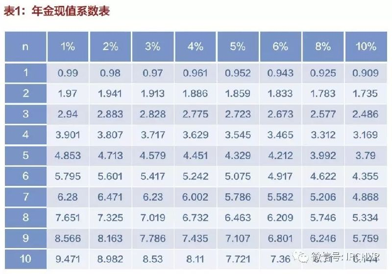

在上图里，我给你截取了这个表的一部分。你能够看到，一份 10 期的年金，也就是我今年给你一块钱，明年给你一块钱，后年给你一块钱，总共给你 10 年，在贴现率是 1%的情况下，这整份年金，这 10 期的年金现值是 9 块 4 毛 7。

而如果贴现率变化了，从 1%升到 5%了，也就是说你对未来的看法看低了，耐心减少了，这份 10 期的年金它的现值是 7 块 7 毛 2。

如果贴现率进一步上升，升到 10%了，你对未来价值打一个更大的折扣了，这时候，这份 10 期的年金现值只有 6 块 1 毛 4。

可见一份期数固定的年金，它的现值非常敏感地受到贴现率的影响，贴现率越高它的现值就越低。

## 2.永续年金：收入无限，价值有限

一份年金如果它的期数不是有限的，不是 10 年、不是 20 年，而是永久的，永远给下去的，那叫“永续年金”。

永续年金的现值是多少呢？数学上有一个非常方便的计算方法，那就是把一期的年金金额除以贴现率，刚好就等于这一份永续年金的现值。

这里面我们要注意，永续年金的期数是无限的，无限项加起来，但是无限项加起来是有一个极限的，它是一个固定的数字。之所以这样，是因为越到遥远的未来，以后的那些收入越不重要，它的数额就越小。无限个越来越小的金额加起来，是一个有极限的数字。那就是一期年金的金额除以贴现率，就是这个极限。

比方说一份每期一块钱的永续年金，如果贴现率是 1%，那么它的现值就是 1 除以 1%等于 100。如果贴现率是 5 呢？那就 1 除以 5%等于 20 块钱，如果贴现率是 10 呢？那是 1 除以 10%等于 10 块钱。

这是永续年金现值的计算方法。你获得一份年金，你当场就可以计算它现在的总价值是多少。

## 3.年金价值在时间维度上的分布

我们接下来讨论第二个问题，一份年金的全部价值，在时间的维度上它是怎么分摊的呢？它分摊的规律是什么呢？换句话说，我们对比较靠近现在的收入有多关心，对遥远未来的收入又有多关心呢？

在下图表格里就显示得很清楚。

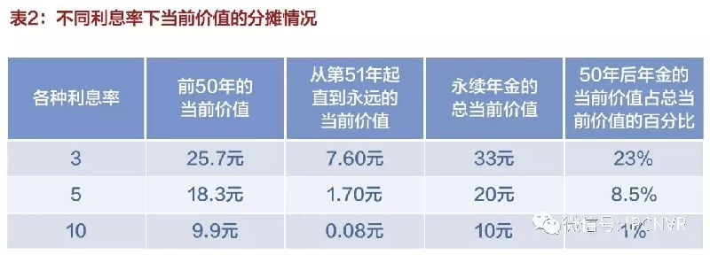

一份每期一块钱的永续年金，它今天的总价值是 33 块 3 毛 3，这总共 33 块钱里面，前 50 年的价值就差不多有 26 块钱；

而从第 51 年起一直到永远，它的价值加起来也只有 7 块 6 毛钱。也就是说，50 年以后年金占当前总价的百分比只不过是 23%。

如果贴现率发生变化，贴现率再高一点，不是 3%而是 5%，那么从第 51 年后的年金，占年金总价的比例就降到了 8.5%。

如果贴现率再进一步上升，升到 10%，那么第 51 年后的年金总值就只占整份年金的比例不到 1%。

换句话说，离今天越近的收入，占比越高；离今天越远的收入，占比越低。如果贴现率上升，这种情况会加剧。当贴现率上升到 10%以后，也就是说人们对遥远的未来看得很轻的时候，第 51 年以后的收入根本微不足道。

这个规律非常重要。我们今天讲土地政策，许多土地政府拨出来，给你的使用权是 30 年、50 年、70 年。有些人做对比，说你看香港、你看西方有些国家，他们得到一块土地的使用权有时候是 999 年。

两份土地使用合同，一份 70 年，一份 999 年，它们的使用价值有没有区别？有区别，当然有区别。它们的区别大不大？不大。在 70 年以后的那部分收入，其实占整个土地价值的占比是不大的。

明白了这个道理以后，我们就能够明白米奇老鼠的阴谋诡计了。

## 4.知识产权保护期限不宜过长

大家知道，专利和版权是政府对知识产权实施的一种保护，目的是要刺激发明创造的人能够做更多的发明创造。

问题是版权应该保护多长时间呢？知识产权保护，目的是要奖励发明创造者本人，但如果他本人已经去世了呢？我们还要继续进行知识产权的保护吗？

我们根据刚才讲的年金的原理就知道，我们保护一份知识产权，授予它专利，授予它版权，发明创造人能够从中得益——最早的几十年，他已经得到了这份年金收入的大部分，如果再往后延，他得到的其实是很小的一部分。

而这时候，问题的另外一个因素就值得考虑了：我们是不是觉得已经到时间，应该把知识产权普及化，让它成为公用品，让它成为人类共享的财富了。所以这当中有一个平衡。

所有的版权、商标、发明创造、专利，我们对它们的保护都应该有一个期限，这个期限有几十年其实已经相当足够了。

## 5.加长版权保护期限，米奇老鼠“功不可没”

但实际上，美国对版权的保护期限，从最早的 14 年，延长到今天差不多一个世纪。

很重要的一个推手就是米奇老鼠。美国的知识产权保护期非常长，米奇老鼠“功不可没”，功不可没是打引号的。

我们看一段历史，米奇老鼠是 1928 年问世的。在美国 1790 年最早的版权法规定，版权的期限就是 14 年，后来这个法律有了修改，说可以再延一次，变成 28 年；后来又做了修改，又往后延了。

到米奇老鼠问世的时候，也就是 1928 年，米奇老鼠的版权有 56 年，也就是说到 1984 年它就要到期了。快要到期的时候，米奇老鼠做了不少的工作，到 1976 年国会又通过法律，使米奇老鼠的到期日从 1984 年延长到 2003 年。

又快接近 2003 年了，米奇老鼠又继续努力，到 1998 年国会又通过了法案，使米奇老鼠的到期日，又从 2003 年延长到 2023 年。

现在 2023 年眼看又快到了。我们要看看，米奇老鼠怎么发功了。

## 6.经济学家为什么反对米奇老鼠版权延期

我印象很深的是，在 1998 年美国国会修改法律的时候，有好多经济学家，包括大名鼎鼎的米尔顿·弗里德曼（Milton Friedman ）、肯尼斯·约瑟夫·阿罗（Kenneth J.Arrow，1921 年 8 月 23 日—2017 年 2 月 21 日 ），斯坦福大学的经济学教授，也是拿诺贝尔经济学奖年纪最轻的一位学者。

还有科斯（Ronald H. Coase ），还有布坎南（James M. Buchanan, Jr. ），还有写高级经济学教科书出名的哈尔·范里安（Hal Ronald Varian，1947 年 3 月 18 日- ），他后来到谷歌当了首席经济学家。所有这些经济学家聚在一块，一起签署了一份公开请愿书，要求政府不要再给米奇老鼠延期了。

在我的印象中，这些经济学家都是非常赞成保护产权，包括知识产权的，但是这一次，他们站出来说不能给这个版权再延期了。他们的理由是：

再延期、再增加的垄断租，不可能去奖励那些原来的发明创造者，他们已经去世很久了，现在得益的是那些“啃老族”。

要继续实施知识产权的保护，需要浪费大量的交易费用，好多的官司、好多的诉讼、好多授权的过程等等。

这也会促使海外盗版的生产，在美国国内不能生产，在国外就能够生产。

最后，也会使得美国的民众、美国的消费者承担不必要的版权费用。而这些已经保护了好几十年的知识产权，早就应该成为公共领域的内容，为人类所共享。

我觉得他们讲得都挺有道理的。背后的依据，就是我们今天讲的，年金在时间维度上分摊的规律。

## 课堂小结

今天，我给你解释了年金和永续年金的概念，一份年金的现值，大部分现值集中在它前面短短的几十年时间里面。

根据这个原理，我们就知道对知识产权的保护时间期限不需要太长，因为只需要前面的时间，我们就能够把发明创造所蕴含的大部分价值，归还给发明创造者，就足以鼓励他们进行发明创造。

## 课后思考

你看，一方面我们今天的社会有很强的知识产权保护的机制，有专利和版权的诉讼、维权等等。但同时，我们也有另外一块很大的领域，是人们愿意把知识拿出来免费共享的，比如很多免费的开源软件。

今天我要留给你的思考题是，如果我们没有了知识产权的保护，人类会变得更好还是变得更糟？为什么？

欢迎你给我留言，我们下节课再见。

##### 82

# 第 082 讲  
买债券后回报率上升就是亏钱 

你好，今天我要从利息理论的角度，解释一种非常常见的金融产品——债券。政府可以发债券，公司也可以发债券。

## 1.债券的含义

债券是一种投资者凭着它定期获得利息，到了到期日还能获取本金的证书。这是从投资者的角度来看的。

倒过来从发行债券的人角度来看，它是一种期票，也就是他答应投资人，在未来的某一天——也就是债券的到期日，他会还本，可能还会加上利息。这是一种对未来付款的承诺。

所以我们从利息理论的角度去理解债券，就是举债的人承诺了一个期票，一张票据，说未来哪天哪天——有不同的时点——他答应还你多少钱。记得，这些钱都是未来的钱。我们说过，无论是货物还是钱，在不同时点上不能直接进行比较，我们要把它换算成同一个时点才能够比较。

人家举债人现在答应你的，是在未来每一个时点上给你多少钱，这笔钱值多少钱呢？要根据利息率或者贴现率折算回来，看今天的现值是多少。这就是整个债券的概念。

## 2.利息率决定债券面值（期值）

举债人答应在未来的一系列时点，给你固定金额的支付，这些都是期货，未来的东西。你今天用多少钱，来换取这种未来的承诺，你今天给他的，就是他借到的债。

债券一般可以在市场上自由流通、自由转让，它是一个未来收益的凭证，大家互相可以买卖。这个凭证大家互相买卖的时候，它今天值多少钱呢？它是怎么算的呢？这取决于当前市场利息率的变化。

你看，举债人先答应未来还你一笔钱，这笔钱是固定的；而且他也指明了，这份债券所依据的利息率是多少，这个利息率是不变的，是规定了的。

根据这个利息率，你能算出这份债券今天值多少钱。

你要牢牢记住一个要点，举债人答应的是一个期值，是一个未来的金额，然后他根据他指明的利息率，来算出这份债券今天的价值。

这个利息率是期货跟现货之间进行折算的一个比率，利息率越高，一份固定期值的现值就越低。因为利息率越高意味着人们对未来看得越轻、越没有耐心，你必须给更高的回报，人们才愿意推迟消费。所以利息率越高，未来的一份固定金额的期货在今天看来它的现值就越低。

## 3.市场利率越高债券越不值钱

接下来有意思的问题是，当你购买了一份债券以后，市场的利息率发生了变动，你买的这份债券，到底是赚了还是亏了呢？

如果市场的利息率——一般人所说的市场回报率——下降，也就是说人们对未来的看法变得更有耐心了，所以举债人所答应的那份期货，在今天所有其他人看来比原来更值钱了，人们愿意以更高的现价来购买这份期货了，那就意味着，你可以把你手上的债券以更高的价格卖出去。这时候你赚钱了。

我们强调一遍，当你购买了一份债券以后，如果市场的回报率下降，你手上的这份期货就变得更值钱了，所以你赚钱了。

我们倒过来再说一遍。如果你购买了一份债券以后，市场的利率上升了，也就是人们所说的市场的回报率上升了，利率上升、回报率上升意味着什么？意味着人们的耐心减少了，期货的现值下降了。

这时候你买的这份期货，按原来的价格卖不出去了，因为大家的耐心都减少了，他们觉得这份期货现在没那么值钱了，除非你打个折再卖出去。所以当你买了债券以后，市场的利率或者回报率上升，那就意味着你亏钱了。

这个道理你一定要记得，因为在经济学界有时候也会闹笑话，有时候甚至是经济学家，他一个不小心，也会说出“市场的回报率上升了，我们中国买了好多美国的债券，所以我们中国赚钱了”这样的话。

这个原理非常简单。受过训练的人一定明白，但有时候一个不小心就会犯错。这就是从利息理论的角度出发，我们对债券所必须掌握的最基础的知识。

## 4.政府举债与李嘉图等价理论

关于政府的债券，经济学家长期有一个热烈的争论，那就是政府高额举债到底是不是个问题？经济学家也不是铁板一块的，他们吵了好几十年也没吵出个答案来。究竟是怎么回事呢？

最早的是 200 年前的经济学家大卫·李嘉图（David Ricardo, 1772 年 4 月 18 日—1823 年 9 月 11 日 ），他提出了一个“李嘉图等价理论（Ricardian Equivalence Theorem ）”。

他说：政府需要开销，钱不够从哪儿来呢？有两个办法：一个是征税，一个是借钱。

政府选择了借钱，那么借的钱越多，征的税就越少。借了钱以后，政府会花到每个老百姓身上，让老百姓觉得日子过得挺好的。但是借的钱总要还的，今天政府借了钱，老百姓交的税少了，得到的享受多了。

但是，老百姓只要是有理性，他们就会明白，到明天政府总要增加税收，来还他当年承诺的这些债务，这时候税收就增加了。

今天借钱明天要还，那么政府举债跟政府征税，在原则上就没有区别，唯一的不同，是如果政府今天征税，那么被强迫交钱的是纳税人；如果今天政府决定举债——卖债券，那么今天买债券的人、今天借钱给政府的人是自愿的。

但是到明天，政府要还钱、要还债的时候，明天的人、下一代人，他们就被迫要交税了。也就是说，政府发债和政府征税唯一的不同，是政府强迫以后的人纳税还是强迫今天的人纳税而已。

所以经济学家就发生分歧了。

## 5.政府是否应该高额举债

有一派经济学家就说，政府举债没问题，我们只是欠自己的。政府从我们身上借的钱用在我们身上，将来又向我们自己征税，又还给自己。自己欠自己的，政府举债债务再大也没问题。

这是一派的观点。前几年获得诺贝尔经济学奖的、在《纽约时报》长期写专栏的经济学家保罗·克鲁格曼（Paul R. Krugman ），他就持这样的观点。

当然，还有另外一派经济学家老早就批判这种想法，说这种想法太愚蠢了、太不合常理了。比方说更早得诺贝尔奖的，1986 年得诺贝尔奖的经济学家布坎南（James M. Buchanan ），他在 1958 年就发表了一本重要的著作，叫《公共债务的公共原理》，他就驳斥了这种“李嘉图等价理论”。

他说，从宏观经济学家的角度看，这种说法可能是对的，因为宏观经济学家关心的只是加总的数据，今天借的等于明天还的，最后是相等的。宏观经济学者不关心具体的人，他们可以这么说。

但是你仔细看一下社会，每个人在做出判断的时候，是根据他自己的感受来做判断的。今天政府借钱，借了钱以后，把钱掏出去的人少了消费，而政府手上拿了钱，它可以增加它的消费。

今天借钱的人和今天用钱的人，不是同一个人；到明天、到下一代要还钱的时候，被迫纳税的人是一批人;而收钱的又是另外一批人。这四种人都不是同一个人，没有人会觉得这是一样的事情。哪怕是一个家庭，只涉及几个人，他们借债也会出现有些人得益、有些人受损的情况。

所以“李嘉图对等理论”从宏观上来说，从加总的意义上来说可能说得通，但是从每一个人的感受来说是不一样的。

但克鲁格曼说，政府借债打仗是值得的，今天不打仗后代人会受损。

所以我觉得，这才是经济学家应该争论的核心问题，就是政府借债本身不能说明它是对还是错，问题在于政府借的债、做的事情到底值得不值得。政府有多少场仗是值得打的，政府有多少路是值得修的，政府有多少大工厂是值得建的，是这个问题。

跟我们每一个人、每一个家庭遇到的问题其实都是一样的。

借债本身不一定是坏事，我们说投资是时间维度上的平衡消费。我明明已经考上哈佛商学院了，再过两年毕业出来就有高薪的工作等着我了，我为什么现在不可以借点钱先花一下，平衡一下消费呢？

所以最后的核心问题是，你到底有没有做到真正的平衡消费？你举的债是不是用在合适的地方？当然，政府高额举债出现了一个不可避免的结局，就是人与人之间财富的大量转移。

## 课堂小结

今天我们讲了债券的基本原理，它是举债人承诺的一种期票、一种期货。然后我们还讲了买债券之后回报率上升其实就是亏钱的道理。最后我们还讨论了政府应不应该高额举债的问题。

## 课后思考

假设我们有两个社会：一个社会是每个人的手，都放在自己的口袋里面花钱；另外一个社会，是每个人的手，都放在别人的口袋里面花钱。这两个社会发展下去会有什么不同？你认为哪个好？为什么？

欢迎你给我留言，我们下节课再见。

##### 83

# 第 083 讲  
未雨绸缪：储蓄还是买保险 

你好，今天我来给你解释，储蓄和买保险之间的区别。

中国有句话叫未雨绸缪，意思是说我们今天要为未来的不确定做准备。储蓄和买保险，都是为了为未来不确定做准备的办法，它们有什么不同呢？

## 1.人的三种风险偏好

我先给你介绍三个基本的概念：一个叫风险厌恶，一个叫风险偏好，还有一个叫风险中性。三种对待风险的不同态度。

举个例子，薛老师说：“我愿意给你 10 块钱，但有不同的给法，其中一个给法就给你 10 块钱，没有任何的风险，10 块钱就 10 块钱。”

你如果愿意选择这种给法，那么你是一个“风险厌恶型”的人，你不要任何风险，你要稳稳当当地拿这 10 块钱。

还有不同的给法，薛老师说：“我可以给你 10%的机会拿 100 块钱，你抓个阄，如果幸运的话，你能拿上 100 块钱；当然，你有 90%的机会一分钱都拿不到。”

平均来说，这 10%拿 100 块钱的机会，跟实实在在拿 10 块钱，是一样的。你会选哪个？

如果你喜欢那个带有风险的选择，而且风险越高你越喜欢，那你是一个“风险偏好型”的人。

如果我给你 1%的机会拿 1000 块钱，那么 1%的机会拿 1000 块钱，跟 10%的机会拿 100 块钱，跟实实在在地拿 10 块钱，对我来说是一样的，给出去的数是一样的。

但对你来说，如果你喜欢那种高风险、高回报的选择，也就是说，你宁愿要有一次拿 1000 块钱那种感受，如果真有那种感受，你可以承受 999 次拿不到钱的沮丧，那你是一个“风险偏好型”的人。

我在赌场里面就见过这种人。好多年前我到拉斯维加斯，进到赌场里面，既然来了就赌一把，我换了 20 块钱的筹码，心里想着就一个事情，赶快把这 20 块钱赌光了。赌输掉了，那我就不用玩儿了，我就好好休息了。我是一个“风险厌恶型”的人，从来不喜欢赌博的。

当时在赌场里面我就看到一个人，他胸前抱着一桶筹码，双手不停地往三台老虎机里面塞钱，机械式地塞钱。这种赌博上瘾的人之所以会上瘾，原因就在于他会不惜一切代价，不管亏多少钱都可以，他要再重温一次赚大钱的那种感受。这种人就是“风险偏好型”的人。

当然还有一种人，处于这两者中间，怎么都可以，怎么都无所谓，稳稳当当给我 10 块钱也行，给我高一点风险也行，给我很高的风险也行。这种人叫“风险中性”的人。

## 2.储蓄的理由

解释完风险厌恶、风险偏好和风险中性这三个概念以后，我们回过头来回答刚才提出的问题。储蓄和买保险有什么区别？

我现在还年轻力壮，将来年纪大了可能会生病，为了防止以后生病要花一大笔医药费，今天就开始存钱，每个月拿出 10%的收入存起来，未雨绸缪。这是一种做法。

另外一种做法，是我每个月也拿出 10%的收入去买保险。

这两种做法有什么区别呢？

区别在于，如果我是用储蓄来未雨绸缪，那么未来可能就会发生两种不同的情形。

如果我将来年纪大了也没生病，我存的钱就还是我的钱，我不需要花出去，这时候我还是很幸运的，能够保有我原来的收入，这份储蓄没有被花掉，我赚了。

但是如果我运气不好，生病了，这份储蓄就会被用掉，这时候我的财富就会减少。

所以通过储蓄来未雨绸缪，它的特点是未来的结局是可变的，是变动的、是带有风险的。要么高、要么低，要么能够保有原来的这份储蓄，要么这份储蓄就被用掉了。

## 3.保险的原理

但是买保险的原理就不一样了。

买保险的原理是这样的：未来是不确定的，未来我可能落入不同的世界，你看，我前面面前有若干个不同的可能世界：可能世界一、可能世界二、可能世界三。

我落入到这些不同的可能世界里面，收入会不一样。

如果我落到一个幸运的世界里面，那我将来不会生病；如果我落到一个没那么幸运的世界里面，那我可能会生病，我可能变得穷一点。

买保险的人知道，自己未来面临这种局面，知道自己落入不同的世界，会有不同的收入。但他们是风险厌恶型的人，不喜欢变化，不喜欢未来有高有低的这种可能性，他想要一种服务：无论他落入到哪一个世界，他希望自己的收入都是一样的。

你要注意，不是说他希望未来的收入都很高或者很低，他想要的那种服务很独特，他是说，他希望无论自己未来落入到哪一个世界，他获得的收入都是一样的。他要的是那种“收入一样”的感觉。

有人有这种需要，就有人提供这种服务，这种服务就是保险的服务。

你看，一个人如果通过买保险来未雨绸缪，他每个月拿 10%的收入去买保险，买完以后，他如果生病了，保险公司会替他支付医药费；但是如果他不生病，保险公司也不会还他的钱。

他每个月给保险公司交的那 10%的收入，就那么交出去了，再也拿不回来了。这笔钱用来干什么了？用来购买他希望的“未来收入一样”的这种服务。

这就是储蓄和买保险的区别。

储蓄，你未来的日子是有高有低的，如果你不生病，你存的那笔钱就可以拿去花了，可以买东西了。

但是你买了保险以后，无论你落入哪一个世界，健康还是生病，你的收入都是一样的。健康的话保险公司不会把钱赔给你，生病的话保险公司把钱赔给你做医药费。结果你的收入都是不变的。

所以保险公司就是专门为了满足你的需求，向你提供“未来收入一致性”这种服务的机构，是一种商业机构。

这是一种商业的买卖。原则上跟有人喜欢吃巧克力，就有人生产巧克力，有人喜欢喝咖啡就有人生产咖啡、提供咖啡，原理是一样的。

## 4.保险服务的三个前提条件

保险公司要提供你所需要的这种“收入一致性”的服务，它有什么前提呢？它有三个前提，保险公司要保的事情必须符合三个基本的标准：不相关性、独立性和概率性。

要保的事情一定是要有概率性，不能够是确定的。你已经生了病，那就不叫买保险，因为已经是确凿无疑的。如果你已经生了病，还要保险公司保你，那就不叫保险，那叫保险公司补贴你，向你行善。

每一个投保人所具有的风险概率是互不相关的。如果反过来，他们所具有的风险概率是相关的，这个风险是全局性的，涉及所有人的，那么保险公司就没办法设保。比方说，全球性的核污染、全球性的气候灾害，这种风险保险公司没办法保。

每一个概率事件都是独立于投保人意愿的。也就是说，投保人自己不能够控制风险的概率。生病投保人没办法控制，这可以保；交通意外投保人没办法控制，这可以保。

谈恋爱分手，这不能保，因为分手和不分手，投保人有很大的主观能动性；考试不及格，不能保，因为考试及格和不及格，投保人有很大的能动性。如果保额过高，那好多学生说我的零花钱不够，所以这个学期的考试不要及格算了。

所以保险公司理赔的事件，一定是具有概率性的，互不相关的，而且是独立的。

## 课堂小结

今天，我们介绍了人们对待风险的三种不同态度：风险厌恶型、风险偏好型和风险中性型，还有三种对待风险的不同态度。解释了储蓄和买保险有什么区别。

## 课后思考

今天留给你的思考题是，商业保险公司，他们的功能究竟是能够减少社会上总的风险，还是不能够减少社会总的风险，而仅仅能够重新分摊社会上既有的风险？

欢迎你给我留言，我们下节课再见。

##### 84

# 第 084 讲  
保险的运作原理 

你好，今天我要给你解释商业保险公司的运作原理。

我们昨天解释了，保险公司是一种向客户提供“ 未来收入一致性 ”服务的机构。它们怎么提供这种服务呢？它们互相怎么竞争呢？

## 1.保险公司的运作和竞争

我们先设想，社会上如果只有一家保险公司，它接受所有人的投保。为了讨论的简单化，我们再假设每个人都有生病的机会，但每个人生病的机会都跟年纪有关，而且只跟年纪有关：年纪越大生病的机会、生病的风险就越高。

在这种情况下，一家保险公司接受所有人的保险，所有人都在这家保险公司里面投保，会发生什么样的情况呢？

这时候，年轻人基本上不生病，但他们也要交保费；年纪大的人常常生病，他们也要交同样的保费。这时候，年轻人就被年老的人搭了顺风车。

## 2\. 保险公司竞争招数之一：细分

这时候，就有另外一家保险公司走出来，跟所有人说：

你看，这家保险公司的经营模式不够好，我提供一种更好的经营模式，那就是我打算把人群分为两种：一种叫年轻人，一种叫老年人，把人分成两类。年轻人买年轻人的保险，他们的保费比较低；老年人买老年人的保险，他们的保费自然比较高。

这第二家公司出现了以后，它就更具有吸引力，许多年轻人就愿意到这第二家保险公司去投保，因为他们被占便宜的机会就减少了，当然，他们要交的保费也就下降了。

这时候又有第三家保险公司跑出来，他说：

我不仅仅把人群分为两种，年轻人和老年人。我把人分成 100 种，同岁的人放在同一个组里面。

它进一步把人群做细分，当然我们可以想见，第三家保险公司又比第二家保险公司更具吸引力。

照这个逻辑推下去，保险公司之间的竞争会更加白热化。

它们不仅仅把人按照同岁的标准来区分，即使是同一年生的人，他们还分上半年出生还是下半年出生，他们还按月来把人做区分，按天来把人做区分，按出生的时辰来把人做区分。

因为分得越细，同一个细分组里面人的风险就越接近，他们被别人占便宜的可能性就越低，他们要交的保费也就越低，所以他们更愿意来这样的公司买保险。

这就是保险公司之间展开竞争、提高他们产品质量一个重要的办法，叫细分（Segregation ），把不同的人的风险做精确的细分。

## 3\. 人群划分越细，搭顺风车情况越少

当然，刚才我们说的假设太过理想化了。我们说人生病只跟一个因素有关，就跟他的年龄有关，现实情况当然不是这样，一个人生病的机会跟好多因素有关。

这时候，保险公司就要请来精算师，请来对概率统计有专门研究的人，来仔细地区分不同因素所造成的风险到底有多大，从而把复杂的人群进行比较准确的细分。

比方说，在美国你要给汽车买保险，做法很简单，你就去不同保险公司的网站，网站那里有一系列的问题，你要回答：

你年龄有多大？你的驾龄有多长？你是单身还是成家？你家庭住址的邮编是多少？你每天上班地址的邮编是多少？你开的是什么车？

你的违章记录，当然他们一下子就知道了，根据所有这些因素，他们能够准确地算出你是一个什么样的人，开车有多小心，你每天上下班经过的道路发生交通意外的概率是多少。

这是保险公司在背后做的一系列计算，就是把来投保的人做精分，把他们细分。

保险公司把人群做的细分越细，每个小组里面的成员，被搭顺风车的机会就越少，他们交的保费就越低，这份保险的吸引力就越高。这是保险公司要做的第一个事情——细分。

## 4\. 实施歧视符合保险运作原理

你看,保险公司要把人群细分，想尽一切办法，把人的风险做细分，但是有时候它会遇到障碍。

问人家的年龄是可以的，问人家的性别是可以的，问人家过往的病史也是可以的，问人家住哪里是可以的，问人家成家没成家是可以的。问所有这些问题，目的就是要把人的风险确定在一个细分组里面。

但有趣的是，现在新技术的发展，比方说基因技术的发展，保险公司可以通过基因技术比较准确地预测，你将来得某种病的可能性，这种技术能不能用？这种技术有没有涉及歧视？

你要是对这个问题感兴趣，你得去前面我们讲歧视的课程里面做个复习。

歧视其实就是区别对待，从经济学的角度看，这是一种中性的描述，歧视是一种很自然的行为。而在保险业里面实施歧视，也就是把人做细分，是一种很正常的、符合保险运作原理的做法。

但有趣的是，根据基因来把人做区分，这一点在美国是非法的，因为政治家和大多数的民众认为这是一种歧视，不能这样歧视人，人人都应该公平地享受保险的服务。

这下子问题就复杂了，到底保险是一种人人自愿购买的商业服务呢？还是一种对所有人公平开放的社会福利？这个问题就有待争议了。

## 5\. 保险公司竞争招数之二：加总

而保险公司同时还做另外一个事情，就是加总（Aggregation ），在每一个细分的组里面，他要增加每一个细分组成员的人数。

同样风险的人越多，根据数学的规律，他们之间产生风险的数学期望就越准确，离差就越小——这是大数定律的原理——这样的话，每一个小组所要交的保费也越低。

所以保险公司就是通过双管齐下，同时运用这两招——细分和加总。把风险分得越细越好，在每一个细分组里面参与的人越多越好。

通过这两招，它就能够使它的保险产品性价比提高，从而吸引更多的顾客，提高它的竞争力。

## 课堂小结

今天我们讲了保险基本的竞争原理，那就是细分和加总。我们这里要强调的是，保险是一种能够自我维持的、能够适销对路的、能够满足市场需求的商业产品，它虽然很抽象，但它是一种能够自我维持下去的商业模式。

## 课后思考

今天我留给你的思考题是，既然买保险是一种个人的选择，是一种买卖商品的行为，为什么有些国家，比如美国，它们要强迫所有的人都买保险呢？理由是什么呢？

欢迎你给我留言，我们下节课再见。

##### 周

# 第 21 周问答  
怎样花钱效率更高？ 

你好，我们开始本周的问答时间了。这个礼拜我们讲的内容挺丰富的：

年金的概念；

买了债券以后，市场回报率上升，到底是赚钱还是亏钱的问题；

政府借债的本质，也就是说，我们能不能把政府借债，看成是我们向我们自己借债，所以借多少都无所谓的问题；

保险和储蓄的区别，以及保险的运作原理。

## 1.“七二法则”的运用

关于利息理论的应用，有一个小窍门，我要告诉你的，那就叫“ 七二法则 ”。

我们经常会遇到一个问题，就是在固定的年利率下面，一份本金到底要隔多久才能够翻倍，怎么算，这是一个常见的问题。当然，你可以拿计算器计算，但是你也可以根据这个小窍门，掐指一算，八九不离十。

这个小窍门就是，你拿 72 除以当前的利率，除出来的那个商，就是隔多少年你的本金能够翻倍的大致数目。

比方说，如果年利率是 5 的话，那么 72 除以 5 那是 14.4，大概 14 年以后，你这份本金在年利率是 5%的情况下能够翻倍；如果利率上升了，是 10%了，那么 72 除以 10，那是 7.2，那 7 年多一点，你的本金就能翻倍，这叫“七二法则”。用 72 除以当前的年利率，除出来的商，就是一份本金翻倍所需要的年头数。

这个法则挺好用的。比方说，如果当前的利率是 10%，你手头上有只股票不太好，但有人劝你说：“这只股票现在不太值钱，但别卖，因为再过 10 年，这只股票的价值就能翻倍了。”

你到底是听不听他的呢？很简单，根据七二法则算一下。如果现在年利率是 10%，72 除以 10 等于 7.2，7 年这份本金就可以翻倍，而你手头上的股票据说要 10 年才能翻倍。太慢了，不值得持有，把它卖掉。这就是七二法则的运用。

## 2\. 不能脱离时间点讨论年金现值

关于永续年金的计算，有同学提出了疑问。W..T 同学就说：

课程里面之所以得出年金在后 50 年收益占比很低的结论，是基于年金每年都相同的这个前提的。但是，年金真的是每年都相同吗？对一个专利来说，也许今年不太值钱，但是到第二年、第三年反而就更值钱了。如果随着时间的推移，年金的数量一直在增长，那么一份年金的现值当中，未来的占比肯定就比较大。

这个说法非常正确。我们前面是为了讨论的简化，把每年的年金数量都看作一个常数，这样比较便于计算。但如果每年的年金数量是变化的，那就要根据具体的情况做计算。

这里面，问题的重点在于，我们不能脱离时间点来进行讨论。在一个时间点上做出的决策，在另外一个时间点上看，评估就完全不一样了。

而我们在做一个统一的规定，确定知识产权保护的年限的时候，是做一个概率上的权衡。那就是到底要在多大程度上，保护发明创造者的利益；又要在多大程度上，让那些“一个人用不影响别人用”的知识，能够尽量让更多人享受。

要在这两者之间做出一个权衡的时候，我们做的是一个概率上的决定。

也就是说，在讨论知识产权保护年限的时候，我们要记住两点：

我们在做这个决定的时候，是站在颁发专利或者商标保护的那一个时间点上说；

这是一个具有普遍性的规则，而不是一个个案的讨论。

第三点，今天我要补充的是，我们讨论了不同的风险偏好，有风险中性，有风险厌恶，也有风险喜好。但其实同一个人在不同的场合，他是有不同的风险偏好的。

最简单的例子，一个买保险的人，他也可以同时买彩票。在这两个不同的场合里面，他就展现了他不同的风险偏好。

买保险的时候，他是一个风险厌恶型的人，他要减少未来收入的大起大落。但买彩票，他要的是另外一种享受，他要追求的就是大起大落。

这一点非常重要。将来我们在讨论人们究竟是不是天生就追求一个公平的社会的时候，我们会重新利用今天讲到的，人有不同的风险偏好的知识。

好，我们来看看本周的思考题。

## 3\. 知识产权保护强度应视情况斟酌

周一，我们讲到了米奇老鼠，讨论了从年金的概念出发，知识产权保护期应该多长的问题。所以，周一留的思考题是：“ 如果没有知识产权保护，人类是会变得更好，还是会变得更糟？ ”

我在留言区看到，大多数同学都回答说，没有知识产权我们的生活会变得更糟。

我自己也基本同意这个结论。但是，我自己更欣赏那些提出反面理由的同学，因为这个问题——知识产权到底应该不应该由政府出面来保护，答案并不是显而易见的。在经济学界有过长期的讨论。

最早期的经济学家，比如说 1795 年的边沁（Jeremy Bentham，1748 年 2 月 15 日—1832 年 6 月 6 日 ），1803 年的萨伊（Jean-Baptiste Say，1767 年 1 月 5 日-1832 年 11 月 15 日），1848 年的密尔（John Stuart Mill，1806 年 5 月 20 日-1873 年 5 月 8 日）等等。他们的观点非常简单，他们认为知识产权肯定应该保护，因为这可以鼓励人们的发明创造。

但后来经济学家有了更复杂的思辨，到了庇古（Arthur Cecil Pigou，1877 年 11 月 18 日- 1959 年 3 月 7 日 ），大家记得吗？讨论拥堵费的那位经济学家，他就认为专利体系本身很大程度是多余的。

再后来，还有一些经济学家认为，专利体系弊大于利。

而到了当代，获得过诺贝尔经济学奖的阿罗（Kenneth J.Arrow,1921 年 8 月 23 日—2017 年 2 月 21 日）、萨缪尔森（Paul A Samuelson，1915 年 5 月 15 日-2009 年 12 月 13 日），就更进一步地认为，知识应该为人类共享，那些从事发明创造的人，他们的收益应该由政府来统一支付。

记得吗？我们前面在讲“灯塔的故事”的时候，介绍过经济学家萨缪尔森对公用品的论述。他说，既然公用品是一个人用不影响别人用的东西，我们就不应该收费，而它的生产，应该由政府来统一提供。当然，在这里，知识就是一种典型的公用品。他的观点是一以贯之的。

其实，在历史上反对知识产权保护的经济学家，他们提出来的理由有不少是具有启发性的。

其中最重要的一点，是由于知识、思想、发明、创造本身很难界定。它不像一个物品，能够清楚地指出它的边缘、形状和质量。一个思想跟另外一个思想，一个发明跟另外一个发明，一个旋律跟另外一个旋律，它们到底有没有相似之处，到底有没有互相抄袭，很难说得清楚。

一项发明，究竟是靠灵机一动而得到的，还是经过大量的投入而得到的，这当中就有很大的区别。世界上有多少人，能够独立地想出，用轮子来运东西呢？有多少人，能够独立地想出，把铅笔和橡皮擦捆在一起，使用会更方便呢？

如果车轮的发明是一项排他性的专利，带橡皮擦的铅笔也是一项排他性的发明，使用的人都得得到批准，而且得交专利费，那有多少人得花多少冤枉钱啊。

而当然，有许多的知识产权，它是要经过大量的努力、巨大的投资才能得到的。

比方说，一种新药的研制，需要十年、二十年，需要十亿美金，二十亿美金。而一种新药一旦做出来了，要仿制的成本就微乎其微。这种知识产权就应该得到很强的保护。

所以，我总的看法是，知识产权保护的问题非常复杂，肯定不能一刀切。不同的情况，要予以不同强度的知识产权保护。

## 4\. “一人做事一人当”的社会制度最有效率

周二的问题：“是假设有两个社会，一个社会是每个人的手，都放在自己的口袋里面过日子；而另外一个是每个人的手，都放在别人的口袋里面过日子。这两个社会发展下去会有什么不同，你认为哪个更好？ ”

我同意大部分同学的回答，那就是每个人的手，都放在自己口袋里面过日子，这样社会会发展得比较好。

沈天一 同学说：

弗里德曼说过一句话，花自己的钱办自己的事最为经济；花自己的钱给别人办事最有效率；花别人的钱给自己办事最为浪费；花别人的钱为别人办事最不负责任。

所以，我们在看一个社会制度的设计、评估这个社会制度的设计，是不是有效的时候，其中有一个很重要的标准，就是看这当中每一个人的行为，到底有多大程度是由他自己来负责的。

一人做事一人当，而不是一人做事别人当，别人做事自己当。用经济学的语言说，那就是尽量减少一个人的行为，或者他的言论的外部性。这是衡量一个社会制度设计是否有效的一个重要标准。

## 5\. 保险公司的重要作用是分摊风险

周三的问题是：“ 商业保险公司，它们的功能究竟是减少社会总的风险，还是不能降低总的风险，而仅仅能够分摊社会上既有的风险。 ”

我的想法是有了保险公司提供的保险，人们的行为多少会做出改变，这时候总的风险是增加了还是减少了，不容易一下子做出判断。或者更准确地说，是有些风险减少了，而另外一些风险又增加了。

商兴华 同学回答说：

保险公司不能减少社会总的风险，只能分摊社会总的风险。有时候甚至会增加社会总的风险。比如下冰雹的时候，汽车正好在室外放着，没有投保的人可能会想，冰雹别把玻璃砸了，赶紧把车挪挪。投保的人就会想，玻璃坏了没事，反正保险公司会赔。

所以，我们说保险公司只保那些独立的事件、人对它们不能产生能动性的事件，这种说法也只能是相对的，不是绝对的。

人到底会不会生病，这看上去像是一个客观的现象，不以人的意志为转移的现象。

但是，人真的就不能控制自己生病的几率吗？在一个提供全额医疗保障的国家里，和一个医疗费全得由自己支付的国家里，人们爱护身体，不暴饮暴食，不酗酒，经常锻炼的积极性会是一样的吗？很可能是不一样的。

但不管怎么样，社会上存在的风险，不可能由于保险公司的存在而降为零。所以，保险公司更重要的作用是分摊风险。

人们为什么愿意接受被摊派的风险呢？最重要的原因，是人们对风险的评估不一样。有些是“风险厌恶型”的人，而有些是“风险喜好型”的人。正是由于这些偏好的不同，使得本来就存在的风险经过分摊以后，人们普遍的幸福感提高了。

这就跟我们开学的时候讲的，在战俘营里面，面包、牛奶、香烟的总量即使没有变化，但经过重新分配，所有人的幸福都得到了提高的道理一样。

## 6\. 政府强制购买保险的理由

周四的问题是：“ 既然买保险是个人的选择，是一种买卖商品的行为，为什么有些国家，比如美国，要强迫所有的人都买保险，理由是什么？ ”

我觉得一个很重要的理由，是政府觉得自己不能够见死不救。但如果它真的对所有遭受灾害的人都做全额赔偿的话，政府自己也承担不了那么沉重的财务负担。所以，它就事前逼着所有的人都先购买保险。

而在这个过程中，私营的保险公司能够以更精确的方式计算风险，收取保费，从而使保险服务的成本能够降到最低。

我记得我们留学生到美国读书的时候，正式注册前就一定要购买保险，否则学校不让你注册。这种做法，是学校为了避免入学以后，学生发生各种意外，再进行集资帮助这位学生的困难。

我们在国内的大学，经常见到这种情况：哪位三好学生忽然得了什么病，哪位同学遇到什么意外，要大家出手帮助。当然，大家总是慷慨的。但是，要知道人的善心是有限的，来一个可以帮，来两个可以帮，十个呢？二十个呢？

最终还是应该通过制度来解决问题。毕竟，政府是一种提供最后援助的国家机构，谁真的有事，还得找政府帮忙。但政府帮忙成本有时候是巨大的。

我印象很深的是，以前我在南方居住，每年都有台风季节。每当有台风的时候，天文台就会告诫大家，要留在家里注意安全，而这时候，总有人要跑到海边去看浪花。这些人如果遇到意外，政府还是要出手帮助的。但他们实际上极大地增加了政府运作的成本。

在芝加哥，每年的冬天，密执根湖就结成了冰，由于天气很冷、冷得快，整个湖面的波浪都是凝固的。但到了 5 月份，冰块融化了，政府就会警告大家，这时候千万不要再去凿冰钓鱼了。但就是有人去凿冰钓鱼，然后掉到湖里面去，要政府去救他们。我赞成去救他们，但是把他们救回来以后，我觉得应该让他们承担一笔罚款。

周五辩论

好，我们周一到周四给大家留了思考题。今天礼拜五，我给大家留一个辩论题，大家一起辩论。

我们发现，现在大多数的民主国家，他们的政府都承担着巨额的债务，每年的财政都有巨大的赤字。他们都是一些入不敷出的政府。我们就来讨论一下，这到底是好事还是坏事。

正方认为，政府欠债是为了更好地解决当前的经济问题，也是为了更好地谋求未来的发展。欠债本身不是问题，只要将来能还就行了。

反方认为，政府不应该欠债，政府应该量入为出。政府巨额的欠债是现在的人对将来的人的剥夺，将来的人还没有出现，还没有参与投票，我们现在的人，就把债务推到他们身上是不公平的。

欢迎大家参与辩论。

欢迎留言

最后，我还要提醒你，我为你准备了黑板报，黑板报上贴了这个礼拜我认为最精彩的留言。欢迎你踊跃留言。希望下周能够在黑板报上见到你的分享。

这周的问答时间就到这里了。明天是预习的时间。祝你周末愉快！

##### 85

# 第 085 讲  
那些不是保险的保险 

你好，上一期我给你解释了保险的基本运作原理，为了加深你的理解，这一期我给你讲讲，一系列其实不是保险的保险，它们被称为保险，其实不是保险。

这个问题为什么重要呢？这是因为，如果误解了保险的基本原理，设计出来的那些制度安排，就会起到适得其反的效果。

我们上节课说了，保险公司能够理赔的那些事件，

一定要符合三个基本前提：

一定是随机的事件；

一定是独立的事件；

而且是不相关的事件。

但在现实生活中，有很多所谓的保险，他们要保的那些事件，并不满足这些条件。

## 1.失业保险是一种社会补贴

比方说有很多国家的政府，他们就提供所谓的“ 失业保险 ”。问题是，失业本身既不是随机的事件，也不是独立的事件。失业和就业一样，都是人自愿的选择。

你听到这里，你可能会说：“薛老师，不对，至少有一种失业叫‘非自愿失业’呀，是人们被人解雇了。被人解雇了，那可不是自愿的事件。”

我先来问你，我们一开课说的一件最基本的事实：这世界资源是稀缺的。这并不是假定，这是一个基本的事实。既然资源是稀缺的，劳动力就必然是一种有价值的经济商品，需要劳动力的工作岗位是充分的，到处都是。

曾经有过这么一位市长，当时这个城市失业率挺高的，为了安抚民众，他就设立了一条热线，他说：“任何人只要需要工作，打这个热线，我 48 小时之内，保证给你找到工作。”

你说这位市长能做得到吗？一定能做到。不用 48 小时，4 个小时就可以了，因为资源是稀缺的，工作岗位是无限的。这位市长并没有说给你多少工资，只不过是给你找份工作而已。给你找份工作还难吗？有的是工作。

道路还需要更多的人打扫一下，幼儿园里面的小朋友，多几个人陪他们玩，他们的身心发育会更健全。如果你不讲报酬，到处都有工作。你为什么不一失业就去工作？

我在商学院上课的时候，经常问商学院里面已经有工作的同学：如果你们今天失业了，你们要维持你们现有的生活状况，一点都不改变，每个礼拜下两次馆子，每个月看一次音乐会，每年出去休假两次。这些都不变，维持原有的生活水准，但是没有工作了，你们能维持多久？

不同的同学有不同的回答，有些人说能维持三个月，有些同学说能维持半年，有些同学说能维持两年。

我印象最深的，是有一次我在一家大公司里面做讲座，我也用同样的问题问台下的一位女学员：“你要是没有了现在这份工作，你能维持多久？”

其他学员都笑了，大家都指着她说，她能够永远维持现在的生活方式。后来我才知道，原来她是这家公司 18 位创始人之一。

这说明什么？这说明从经济学的角度看，一个人失业以后，花多长的时间去找他下一份工作，取决于他能够付出多少搜索的成本。谁也不会一见到工作就做，因为这当中有很多的考虑。

是机会成本。他一见到工作就做了，那么他后面可能有更好的工作呢？他没时间去选择，没时间去比较了。

一个人的工作履历本身也很重要。比方说我是教书的，如果我丢了现在这份工作，我至少得花上三个月、花上半年去找下一份教书的工作。我不能马上就去做我几十年前的那个老本行——程序员。

因为做了这个工作以后，万一再有人来找我教书，他看着我的履历就会奇怪，他会说：“你一直在教书，怎么忽然又当程序员了？”这对我的履历本身也不好看。

所以我们说，一个人如果被解雇了，这一刹那，他不是自愿的；但是我们说，如果在紧接着那个小时，他没有一看见工作就做，那就说明他是在做自己的选择，他在付出他认为物有所值的搜索成本。

既然是这样，我们回过来说我们的主题，失业保险到底是不是保险？这就不是一种保险，因为失业不是随机的，是个人的选择，是一种符合经济规律的选择。失业保险其实是什么呢？失业保险其实是一种社会补贴，政府补贴那些没有工作的人。

## 2\. 失业保险金越高失业率越高

当然这是一个普遍的经济规律——政府补贴什么，什么就会更多；政府向什么征税什么就会减少。政府补贴失业，你猜失业率会上升还是下降？失业率会上升。

想想看很容易理解。如果不工作，每个月就能得到 1000 块钱的失业救济，工作了以后，你只能够得到 1200 块、1500 块钱的工资。这时候，政府其实是对你的就业征了很高的税收。

你辛苦工作一个月，得到的额外收入只是 200、只是 500，还不如不工作，不工作也能得 1000。所以在那些社会福利越高的地方，失业保险金或者失业救济金越高的地方，失业率就越高。

## 3\. 养老保险为何不可持续

还有一种常见的——“ 养老保险 ”，养老保险其实也不是保险。每一个人都会老，这不是一个随机的事件。养老保险其实也是一种政府补贴，一种转移支付，把财富、把收入从一群人那里，转到另外一群人那里。

很多国家的退休保险，比方说美国的退休保险，它的名字叫社会安全基金（Social security fund ）。

这个基金，其实不是人们以为的，每个人在年轻的时候替自己供款，自己有一个账户，政府替他管好这个账户，让这账户里面的钱保值、增值，等他年老的时候再用回自己的钱。

其实不是这样的。政府是在做一个转移的支付，是向那些正在工作的人征收一笔钱，直接把这笔钱给那些已经退休的人。这是一种在同一时期里面，在不同的人群之间进行财富分配的办法。

这种办法有一个问题，那就是今天缴纳社会安全基金的人，等他们退休以后，社会上必须有相应的年轻人在工作，他们才能够得到补贴。因为当年他们付出的那些钱，已经被当年的老人家用完了。

美国和欧洲很多国家实施的所谓养老保险，实际上就是不断地靠年轻人加入才能维持的制度。

在他们设计这个制度的时候，他们没想过，老人家退休之后竟然能活那么久；他们也没想过，年轻人增长的速度怎么那么慢，人们越来越不愿意生小孩、养小孩了；他们也没想到医疗费、生活费，涨得那么快。

所以他们的养老保险已经走向破产的边缘。他们实施的，实际上不是一种可持续的商业保险，而是一种不断地靠新人来维持的补贴制度。

## 4\. 鼓励风险的“保险”

还有一种保险，是美国政府提供的，专门保那些商业机构不愿意保的保险。我们来看看这种保险有什么特点。

美国还有一个机构，叫飞马，FEMA（Federal Emergency Management Agency，联邦突发事件管理机构），他们就专门负责国家的洪灾保险计划，对那些保险公司不愿意提供保险的房屋，以远远低于市场价格的保费提供保险，结果呢？

你看下图里的这一幢在海边的别墅，看上去非常漂亮。你要是住在这个别墅里面，那可真是一种享受。早上起来，打开窗户，把脚往外一伸，你的脚就能碰到大西洋的海水。

这样的房屋漂亮吗？漂亮。你想要吗？想要。它有什么问题？它的问题是风险很大，它离海边太近了，容易一下子就被海浪卷走，这样的房子你得买保险。

保险公司也知道这样的房子风险高，你得付很高的保费，贵到你望而却步为止。但这时候，政府就出来替你撑腰了。

著名的电视主播约翰·司托索（John Stossel ），曾经记载了这么一个事情，他说：

1980 年，我在海边建了一幢房子，非常棒的一幢房子，四间卧室，每间房间都可以看到大西洋的风景。

这幢房子的建筑地点非常荒谬，因为它就在海的边缘上。我爸爸跟我说别那么做，太危险了，不应该把房子建到离海那么近的地方。但我还是建了。

为什么呢？因为我那位设计师也跟我说了，他说赶快建，没问题，当然他也想赚我的钱，反正你的房子遭到海水破坏以后，政府又会出钱给你盖一幢新的。政府愿意理赔。

政府的这种做法，用纳税人的钱，去理赔那些商业保险公司都不愿意理赔的高风险事件，实际上不是在减少风险，而是在鼓励风险。

## 课堂小结

今天，我讲了一系列不是保险的保险，它们被称作为保险，其实不是保险，所以我们经常碰到这样那样的制度安排，说这是什么保险，那是什么保险。

我们知道了保险运作的基本原理以后，就可以对它们做一个判断，判断它们是不是一种真正可以自我维持的商业保险，还是一种实际上在鼓励风险，而不是减少风险的制度安排。

## 课后思考

在很多国家的健康保险里面，都有所谓的扣除（deductible ）和分担（copayment ）部分，也就是说，低于多少钱的医药费保险公司不付；而高于多少钱的，病人和保险公司一起共同承担。很多健康保险都有这种安排。我的问题是，这种安排合理吗？为什么？

欢迎你给我留言，我们下节课再见。

##### 86

# 第 086 讲  
全民医保可以持续吗？ 

你好，今天我们根据这两个礼拜讲的保险的原理，来分析美国的奥巴马医改方案。

## 1.奥巴马医保方案的三大特点

奥巴马总统的医改方案，被他自己认为是他任内最伟大的成果之一，奥巴马医改的全称叫《患者保护与平价医疗法案（Patient Protection and Affordable Care Act ）》。这个方案是奥巴马在 2010 年签署的一项联邦法案。

奥巴马医改最大的“亮点”有几个：

他要把 3000 万没有医保的美国公民纳入医保的范围；

保险公司不能因为投保人有过往的病史而拒绝投保，也就是说，不能歧视投保人；

保险公司也不能因为投保人过往的病史而索取不同的保费。

把所有的公民都纳入保险范围，然后禁止保险公司进行歧视，这是奥巴马医改一个重大的特点。

这样一套医改方案听上去确实令人兴奋，因为所有的人都能够得到“公平的对待”，不会有人因为自己过去得了什么病，不会因为自己买不起保险而受到歧视。

这么好的一个方案，为什么要等到奥巴马才实施呢？那是因为实施这样的方案有很大的障碍，几乎是不可能的，所以才这么难。奥巴马终于把它推行成功了，所以他很“了不起”。

## 2\. 奥巴马医保方案违反了保险的运作原理

这样一套医改方案，有什么问题吗？有问题。比较我们前面讲过的保险业的原理，我们就发现，它要把所有的人都纳进保险的范围，同时还不准保险公司对投保人进行歧视，这就违反了保险运作的基本原理。

我们说保险是一种能够自我维持的商业行为，保险公司之间要进行竞争，必须通过两个基本的办法：细分和加总。

细分，把风险不同的人细分到不同的组里面，防止他们互相搭顺风车；

加总，在同样风险的组里面增加投保的人数。通过大数定律，减少他们的风险造成的离差，从而更准确地计算风险，使得投保人要交的保费达到最低。

细分和加总是保险公司能够健康运作的一个基本前提，但是奥巴马医改把这两个基本前提给打破了。它还能够维持下去吗？不能够维持下去。

## 3\. 奥巴马方案只能依靠强制力施行

奥巴马医改非常复杂，2000 多页，没有任何一个人是能够完全懂的。不仅这样，他们做出来的网站也错漏百出，到现在也没有能够很好地运行。

但是尽管整个系统非常复杂，它当中有一个核心的部分，当然也是引起最大争议的部分，就是“个人强制令（Inpidual Mandate ）”。设计这么复杂制度的人，心里面明白，真的要实施这个制度，靠自觉是没办法维持下去的。

你要维持这么一个“大锅饭”的体系，必须强迫所有人都进来，不准离开。所以整个奥巴马医改方案的成败关键，就在于“个人强制令”能不能实施。

什么叫个人强制令呢？它是说：所有的人都必须缴纳保险，不管你是年轻的还是年老的，不管你是健康的还是有病的。

比方说，每个人必须从 2014 年就开始缴纳保险，那些拒绝缴纳保险的人，他在 2014 年的时候，得交 95 块钱的罚款，或者是他们年收入 1%的罚款。看这两个数字哪个高罚哪个。

而到了 2016 年，罚款就会大幅提升，从 95 块钱变成 695 块钱，或者是他们可征税收入的 2.5%。看哪个高罚哪个。

当然，它也规定，所有的公司必须为雇员缴纳医疗保险。

你记得吗？我们在学习“需求第二定律”的时候，学过“法律无效定律（The Law of the Irrelevance of the Law ）”。讲的是什么？

讲的是，如果你强迫公司替雇员交保险，这保险究竟是谁出的？这个保险是由雇主和雇员共同出的，谁交得更多，取决于谁更迫切地需要这份工作。

所以奥巴马医改，表面上看，是强迫公司替雇员支付保险，实际上是强迫公司和雇员一起支付保险。

奥巴马医改的设计者，要么不懂“法律无效定律”，要么是装着不知道“法律无效定律”。

## 4\. 联邦政府能否强制民众购买“奥巴马医保”

奥巴马医改还涉及一个基础问题：

我们前面讲过，保险是一种商业产品，是一种人们自愿购买的商业产品，但现在奥巴马逼着所有人都购买。联邦政府有权逼着每一个公民都购买某种商品吗？这会不会违反美国的宪法呢？

有人把这个事情告上了法庭，案子最后到了美国最高法院。案子的核心法律问题就是：政府有没有权逼着民众去购买一种商品。

有些赞成奥巴马医改的人说：当然有，因为医疗保险是每个人最终都要购买的，你年纪大了就要购买，早一点购买、晚一点购买都要购买，所以它逼着你买也是对的。

但是反对奥巴马医改法案的人会说，这样说没道理，人确实老了要买拐杖，但你不能逼着年轻人说：“你老了以后，反正要买拐杖，你现在就把拐杖给买了吧。”

所有的法律问题，最后到了一点，那就是美国宪法里面的“商务条款（The Commerce clause ）”，第一章第八款第 3 条规定：

国会有权……管制同外国的、各州之间的、和印第安部落的商业（\[The Congress shall have Power\] To regulate Commerce with foreign Nations, and among the several States, and with the Indian Tribes）。

也就是说,美国宪法里面的这个“商务条款”规定了，国会有权管州与州之间的商业，而保险是州与州之间的商业，所以国会有权逼迫人们买保险。

这样的理解对不对？最后有意思的是，美国最高法院在 2012 年 6 月 28 日颁布了判决。他们的判决是：奥巴马医改当中的“个人强制令（Inpidual Mandate ）”部分符合宪法，部分违反宪法。

为什么说它违反宪法呢？那是因为，宪法当中的“商务条款”，说的是国会有权管制州与州之间的商务，但是并不表示国会因此就有权逼着人民买东西。因为如果你这么理解，说有了商务条款，国会就可以逼着人们买东西，那么人们的生活就会完全被国会、被政客操纵，不能这么理解。

但是法官笔锋一转，他说：奥巴马医改法案其实也是符合宪法的。为什么？因为奥巴马医改里面所说的保险其实不是保险，它是政府所安排的一种补贴制度，它不是我们前面反复讨论的那种“能够自我维持的商业保险”，它是一种向一群人征税，政府拿了纳税人的钱，然后再向另外一群人发放补贴的财富转移制度安排。

既然不是传统的商业保险，既然它不是一种产品——当然国会和政府没有权逼迫人们去买一种产品——它是一种补贴政策，所以国会和政府，根据美国的宪法是有权这么做的。

最后法官说：“我知道有些人不喜欢奥巴马医改法案，但是我们最高法院对此无能为力。我们只能判断它合法还是不合法。如果大家都不喜欢奥巴马医改方案，下次选总统的时候，大家把他选下去就是了。”

我觉得美国最高法院这个判决非常精准，他们的判决是充分理解了保险的基本运作原理而做出的。

当然，对奥巴马医改法案，我自己是持很强的批评态度的，为什么呢？

因为这个法案一旦实施，它就很难废除。因为当年曾经做过贡献的人，当他年纪大了以后，你很难说服他们，说“从你们开始，你们得不到以前许诺的回报了”。但这种不断靠新人的加入来维持的回报，其实是很难维持下去的。

所以我自己也非常同意，《华尔街日报》在奥巴马当年连任成功的时候，所发表的一则评论：

政府做的很多事情，如果发现做错了，再修改过来其实并不太难，税收太高了可以降低，管制太多了可以解除。但是奥巴马医改，一旦上马就不可能回头了，它会像白蚁一样，慢慢地腐蚀这个国家的经济基础。

## 课堂小结

今天，我们根据保险运作的原理，分析了奥巴马的医改方案。根据保险的原理，我们看得出奥巴马医改方案并不是一种可持续的商业保险，而是一项由政府施行的社会补贴、财富转移计划。

## 课后思考

今天我留给你的思考题是，人人都享受相同的医疗保险，接着会产生哪些事与愿违的结果呢？为什么？

欢迎你给我留言，我们下次再见。

##### 87

# 第 087 讲  
当商品不被当做商品 

昨天我们讨论了奥巴马医改法案，我们从经济学的角度对它进行了分析。

我们在前面做了铺垫，介绍了保险运作的基本原理，有了这个基本原理，再对照奥巴马医改的做法，我们就知道，这不是一种可持续的商业保险。

当然，美国最高法院的法官，也清楚地看到了这一点，说这不是一种商品，所以国会和政府逼着人们去参与，并不是逼着人们去买一种商品。

美国的宪法，当然没有授权国会和政府逼着人们去买一种具体的商品，但是由于奥巴马医改法案不是一种商品，是一种征税和补贴的政策，所以美国最高法院对此无能为力。

## 1\. 那些不被当做商品的商品

这时候，我们就引申出一个其实挺有普遍意义的问题。我们今天看到，我们生活中有许多的商品，都不被当做是商品，这样做的结果会是什么样子？

在日常生活中，我经常看到很多的同学、很多的朋友，在网上也见到很多的言论，他们都喜欢说这么一种话：

我可是市场经济的坚定支持者，但是医疗很特殊，它不能用市场化的办法来解决。教育很特殊，它不能用市场化的方法来解决。能源、交通很特殊，它不能用市场化的办法来解决。住房很特殊，它不能用市场化的办法来解决。

说这些话的人，通常都学过一点经济学原理，他知道经济学原理是自洽的，但是他又不能够接受这么一个事实：那就是他正在讨论的那种商品或服务，成为商品要收费、要涨价，有钱人先得到，穷人晚一点得到。他没办法接受这样的事实。

那怎么办呢？他们通常会宣布这些商品不是商品，他们宣布说：教育其实不是商品，医疗其实不是商品，药物其实不是商品，交通、能源、用水、住房，其实不是商品。

这么宣布一下有用吗？当然有一定用处，后面有一系列的政策会跟进。

但问题是，所有这些他们讨论的问题，医疗、教育、交通、住房、能源、用水，所有这些，符不符合商品的基本特征？它们的生产需不需要耗费真实的资源？它们的品质有没有高低之分？人们会不会对它们展开争夺？

如果答案都是确定的，那么实际上它们就是一种商品。明明是一种商品，但又不准人们以商品来对待它们，会产生什么样的后果？

## 2.看病难为什么在世界各地普遍存在

第一，从需求者的角度看，比方说从病人的角度看，那就是短缺，人人都要，但价格又特别低，人们就只能展开价格以外的竞争方式，那就是排队。

在中国排队挂号现象，维持了好长时间。为了挂上一个号，要排几天几夜都是常见的事情。明明是医生和医院应该赚的钱，现在却落到了黄牛党的手上，而病人并没有少给。

我曾经看过这么一段电视新闻，当时警察扫荡了一个医院里面的黄牛党，而记者采访了黄牛党的领头人。那个领头人跟记者说：“你看，昨天警察扫荡了我们黄牛党，好多人都被抓进去了，但是不要紧，现在在排队的那些人，也是我们雇佣的。”

在挂号费不够高的情况下，人们得花很长的时间排队，这种现象并不是中国独有的。在每一个挂号费不够高的地方，在每一个实施低价公费医疗的国家，都会出现这样的状况。在英国、在加拿大、在美国，排队都是一种非常普遍的现象。

有很多时候，一个人生的病其实并不重，但拖垮他们身体的，是等待的时间太长了。美国著名节目主持人约翰·司托索（John Stossel ），在他的书里面讲过一个有趣的事：

在加拿大，你到任何一个公立医院去看病都得排队。但是有一种患者，到医院里面就不用排队，只要到那诊所，就能够享受最先进的诊断和治疗，不用等。什么电脑断层扫描（CT），什么内窥镜检查、什么胸腔镜检查、什么腹腔镜检查，马上就能做。

你猜这是一种什么样的患者？你可能以为他们是有钱人吧？不是。你可能以为他们是很有权力的人吧？不是。你以为他们是明星吧？不是。它们有一个特点，它们都有四条腿，它们是宠物。宠物到医院里面看病、接受先进的治疗不用等，人到医院里面要等。

为什么？因为人有政府提供的免费医疗保险，而动物没有。动物用的是市场化的服务，所以动物到了就可以得到服务。人不行，人得等。

美国节目主持人约翰·司托索（John Stossel）

## 3.追求绝对公平不如实行“双轨制”

在这些国家里面，人们等得实在不耐烦了，所以就有人提出，我们能不能换个思路，我们搞个“价格双轨制”。

像我们中国以前搞经济改革的时候试过的方案一样，我们可不可以排两条队：一条队是便宜的甚至免费的，爱等的人等在那；而另外一条队是要付费的，而且要付高价的，那条队我们就可以快一点。

这本来是一个不错的解决方案，但是有很多人反对，因为他们认为这样做会违反公平。因为这么做的话，那些好的医生，都会跑去替那些付高价的病人服务了。

这种追求绝对公平的思路，其实是有问题的。这种思路是说，除非人人都能够同时得到快速的服务，否则谁也别想得到快速的服务。

其实给人们多一种选择是永远不会错的。就在这些那么强调公平的国家里面，在英国的海关，每一个离开英国的游客，都可以把在英国国内购物所交的税要回来，因为他们不在英国国内生活。这个退税的人龙很长。

就在这长长的退税人龙开头，我竟然看到了一个标志，说“ 如果你付钱就可以不排队。 ”

这是一种多好的制度安排，为什么就不可以用到医疗上面去呢？

我给你附了一张我在英国海关拍的照片，上面写着交了钱的人可以不用排队。

在英国海关退税时，交付 10 英镑就不用排队

## 4.政府提供廉价医疗，将产生庞大管制和管理费用

政府提供免费或者廉价医疗，产生的另外一个问题，是在医疗服务的提供者一端。那就是它会形成事无巨细的开支管制和庞大的行政管理费用。

你要知道，每当有免费午餐产生以后，人们就会浪费资源的使用，为了使这个机制能够延续下去，政府就一定要对人们这种滥用行为进行管制，管着谁用多少、谁用多好。

在市场体制下，我们根据的是谁出钱谁就可以使用，但是这时候，钱已经不起作用了，价格已经不起作用了。

所有的服务都低价甚至免费提供了，但是，由于资源是稀缺的，由于你提供的这些资源本身其实还是商品，人们还是会争用的。所以政府就必须采取其他措施，限制人们的消费。

你可以想象一下，我们今天到餐厅里面，你爱吃什么吃什么，爱点什么点什么，只要你付钱就可以了。

但是倒过来呢？如果政府提供食品的免费服务，政府说你把所有吃饭的钱都交给我，我给你打理，然后你到餐厅里面就可以随便吃。这时候会出现什么情况？这时候餐厅里面好吃的东西全不够了，全没有了。

为了维持这个制度，政府就不得不规定，每个人每个礼拜最多吃多少鸡蛋，最多吃多少斤猪肉，最多吃多少斤牛肉，请客吃饭每个月不能超过多少次，举办生日 Party 不能超过多少人，超过多少人就要申报。

这些管制措施是必须的，是使得这个制度维持下去的必备条件。但与此同时，它就产生大量的行政管理费用。

在美国、在英国、在加拿大都会出现这个问题，那就是为了管理医院的开支，他们必须雇佣越来越多的行政人员，进行文书的处理。同样，他们对不同的疾病所能够得到的服务，也做了越来越细的规定。

你把所有的伙食费交给政府，然后政府给你提供免费的饮食，这不是一个好主意。同样，你把所有的医疗费都先交给政府，然后政府向你提供免费的医疗，也不是一个好主意。

## 课堂小结

今天，我们分析了社会上普遍存在的一种心态和做法，那就是把明明是商品的商品不当做商品来处理，这种心态和做法，出发点可能是好的，因为人们往往会以为你不当它是商品，那人们就不用交费了，穷人也能够得到了。

但实际上，不管你怎么称呼这种商品，不管你怎么处理这种商品，背后的经济规律还是仍然在起作用的，这时候那些不恰当的分配方案，就不但不能解决稀缺的问题，反而会引致更多的问题。

而要解决这些连环出现的问题，最好的办法还是回到问题的起点，把那些本来就是商品的商品当做商品来处理。

## 课后思考

今天留给你的思考题是，当商品不被当做商品，就会产生一连串无解的问题，除了医疗以外，你还能举什么例子呢？

##### 88

# 第 088 讲  
用期货合约来重新分配不可避免的风险 

你好，今天我来跟你介绍，除了保险以外另外一种我们用来对付未来不确定性的产品，那就是期货合约和期货市场。

你要注意期货这个词在英文里面叫 futures，要有一个 s 的，就是 future（未来）再加一个 s，像复数一样加一个 s。英文一定是 futures，不要错。

在很多人的印象中，炒期货是一种高风险的行为，是一种赌博、一种投机的行为。

在期货市场里面，价格大起大落，确实有时候赚大钱，但有时候就亏得很厉害。

人们实际上都是坐在电脑面前、在交易室面前进行工作，没有涉及真正的生产活动。所以这是一种很虚的经济，它应该跟我们很实的经济，如生产、劳动、工业、农业等区分开来，这种很虚的经济不应该鼓励。

这种看法完全误解了期货的作用。

## 1\. 期货市场满足人们对“确定性”的需求

期货跟保险一样，它满足了人们的一个基本需求，那就是对确定性的需求。总有一些人，他们希望未来不管发生什么情况，他们的收入或者支出是相同的、是稳定的、是可以预测的。

比方说全国连锁的咖啡厅，他们就不希望他们卖出咖啡的价格天天变动，这样消费者的心理感受不好。但是咖啡豆的价格，却是随着天气的变动而变动的。有什么办法，让咖啡豆的价格在变化的时候，他们卖出咖啡的价格却不变化呢？

要注意，咖啡厅指望的、想要的，并不是便宜的咖啡价格，当然也不是贵的咖啡价格，他们要的是稳定的咖啡价格。这时候就有人愿意提供这种服务，愿意给咖啡厅提供，无论天气怎么变化，价格都一样的咖啡。这就是期货。

## 2\. 期货合约的基本安排

期货的全称是期货合约，它是这么一种安排：其中一方被称为期货合约的买方，他答应在未来规定的时间内，按照规定的价格，向期货合同的卖方购买规定数量的某种产品。

而每签订一份期货合约，必须包括三方，而不是双方。不仅仅是买方和卖方，还有一方——那就是期货市场，它是个中介。也就是说，买期货合约的人，是向期货市场买合约；而卖期货合约的人，是把期货合约卖给期货市场。都通过一个中间人。

通过一个中间人的作用在于，买卖双方都免除了对方不能履行合约的风险，因为期货市场具有不管发生什么事情，它都履行单边合约的信誉。

## 3\. 交易者通过期货市场表达对未来的不同看法

我们前面在解释利息理论的时候说过，任何资产的现值，取决于人们对这份资产未来收入的折现和。

但是对于未来商品，也就是期货的价格，人们通常会产生不同的看法。每当人们出现不同看法的时候，他们就可以通过期货市场来表达他们的不同看法，从他们的不同看法当中获取利益。

如果人们对未来的价格没有异议，没有不同的看法，那就不会有期货。只有人们对某种商品未来的价格，产生不同看法的时候，才会出现期货合同的买卖双方。

而随着时间的推移，交割日越来越近了，也就是未来价格的不确定性越来越少了，交割日产品的价格越来越清晰、越来越稳定了，期货合同买卖双方的意见不一致就会慢慢地收窄。当然到期货价格的那一天，真相大白，大家就不会有不同的意见。

这时候购买期货合同的人获得了稳定性。比方刚才说的咖啡厅，他们说明年的今天，他们要以 10 块钱的价格购买咖啡，到明年的今天，他们就以 10 块钱的价格购买咖啡。

如果当时咖啡的价格已经涨到 15 块钱，他们就免除了高价购买咖啡的风险。他们每一家咖啡厅的菜单都不需要重印了，消费者的良好感受也能够维持了。

但如果明年的今天，咖啡的实际价格已经跌到了 8 块钱，而不是 10 块钱呢？这时候咖啡厅也非常高兴，仍然以 10 块钱的价格购买他们的咖啡。为什么他们亏了钱还高兴呢？

那是因为，他们额外付出的这两块钱其实是购买稳定性的代价，就跟购买保险是一样的。买了保险以后没生病他们也高兴，因为实际上他们还是得到了稳定的价格，10 块钱的咖啡，他们是愿意付的。

## 4\. 期货市场的本质：分配风险

这里要指出的一点，是期货合同本身并不能够减少风险。风险是我们生活所在的这个世界所特有的，没有人能够彻底地消除风险。

但期货合同起的一个很重要的作用，是重新分配风险。有些人喜欢风险，让他们承担风险；有些人不喜欢风险，让他们减少风险。在这种重新分配当中各得其所，他们的处境都得到了改善。

你记得我们在开篇“ 第 001 讲丨战俘营里的经济组织 ”里面讲过：有一位随军牧师，他手里拿着一罐奶酪、五根香烟，在军营里面走了一圈，手里面就多了一袋食物。

有学员特地给我留言问，这多出来的一袋食物到底是怎么来的？我们在这一讲里面解释过，这一袋食物，是这位随军的牧师为交易的各方提供了更多幸福的证明。

更直白地说，是在这军营里面有人对这位牧师说：“你要是能够给我弄一块面包来，我这个苹果就归你了。”还有另外一个人说：“你要给我弄两根香烟来，这个橘子就归你了。”

最后，随军的牧师手里面多了好多的苹果，多了好多的橘子。当然，军营里面物资的总量没有变化，但每个人的幸福感都提升了。

回过来看期货市场，也是一样的。在整个世界里面，风险的总量没有变化，人们不可能改变大自然，不可能完全消除风险，但是由于风险的分摊不一样了，所以那些讨厌风险的人，哪怕他们多付了一点钱，他们也得到了满足；而那些喜欢风险的人，喜欢大起大落的人，他们得到了金钱的补偿，也非常满意。

在期货市场里面，你总能见到那些赚大钱的人，你仔细问问他们，他们也曾经有过一次甚至多次大亏的经历，但他们喜欢那样。期货市场不是赌博，它只是重新分配了本来就不可避免的风险。而赌博是制造了本来并不存在的风险，期货市场跟赌博是有本质区别的。

所以期货市场不是一个零和游戏，所谓零和游戏，意思是整个社会总的幸福程度没有提高。期货市场是一个正和游戏，也就是他们经过一系列的制度安排以后、重新分配风险以后，每个人的幸福都得到了提高，这是期货市场的本质。

## 5\. 期货市场鼓励人们对未来做更准确预测

在期货市场上，对未来价格的预测越准确，你就越有机会赚钱，所以人们会孜孜不倦地分析他们手头的所有信息，做深入的研究，以便更准确地对未来价格做出预期。所以期货市场实际上是一个发现价格的良好机制，因为你的判断正确自然会得到回报，你的判断错误自然会受到惩罚。

我们经常会看到这样的情况，人们为了某个观点争论不休，但是一旦有人提出“我们赌一赌”，他们马上就变得非常谨慎了。那是因为言论是廉价的，但是要承担后果的言论，那就得谨慎了。

所以你猜猜看，对天气的预测，到底是气象局更准，还是期货专家更准？经济学家理查德·罗尔（Richard Roll ）的研究表明，期货市场对佛罗里达州未来气温变化的预测，比国家气象局还要准确一点。

其实他的研究结果一点也不奇怪。你想想看，气象局里面的专家预测天气的变化，气温高一点、气温低一点有什么要紧的。但是对期货市场里面的当事人来说，气温的预测，直接影响对产量的预测，直接影响对价格的预测，差一点就意味着盈和亏。

正是因为期货市场有这样一个特点，所以它会鼓励人们尽量披露信息，利用知识深入研究。

## 课堂小结

今天，我们介绍了期货合约和期货市场。和人们通常认为的不一样，期货市场并不是一种赌博，也不是一种零和游戏，它是一种重新分配风险的市场机制。

由于人们的风险偏好不同，通过重新分配风险，参与重新分配风险的各方，他们的处境都能够得到改善，而由于有期货市场的存在，人们会尽量利用自己占据的知识，对未来做出更好的判断。

## 课后思考

在 2003 年，有一位经济学家罗宾·汉森（Robin Hanson ），他要建立一个恐怖袭击的期货市场，让人们去预测什么时候、什么地方，将会出现什么样的恐怖袭击活动。

因为预测准确了会得奖，人们就会把各种各样的信息，反映在期货市场上面。这时候，政府就可以利用这个恐怖袭击的期货市场，来进行反恐的活动。

今天留给你的思考题是，这样一个关于恐怖活动预测的期货市场，是否可行？它会造成什么样的问题？

欢迎你给我留言，我们下次再见。

##### 周

# 第 22 周问答  
时间维度下的经济学原理 

我们开始本周的问答时间了。

这个礼拜，我们在理解了保险运作原理的基础上，讨论了一系列不是保险的保险，还特别分析了美国的全民医保政策。接着，我们介绍了期货市场的运作原理。

更重要的是，完成了这个礼拜的学习，我们也就完成了关于耐心和回报的整个大单元的学习。我们实际上做的，就是引入了时间的维度来分析问题。

在这个大单元以前，我们假装时间不存在。资源是稀缺的，而每一个人的偏好和需求都不一样，在这个基础上，人们就会展开交易，从而提高自己的幸福程度。整个关于选择、成本、需求、市场、交易、产权的知识体系就建立起来了。

## 1\. 时间维度下的经济学原理

而在耐心和回报这个单元里面，我们引入了时间，在稀缺的基础上，又增加了一个约束条件，那就是不确定性。过去我们说人有不同的偏好，在这个单元里面，我们说人们对风险也有不同的偏好。

这几个因素加起来—— 时间的维度、未来的不确定性、每个人对风险不同的偏好 ——就构成了整个单元知识体系的要素。

这些要素的互相作用，就形成了今天精彩纷呈的金融市场。回顾整个大单元，我们环环相扣地讨论了好几个问题：

易耗品和耐用品之间的区别。

引入了不耐的概念。

我们给资本现值——也就是那些耐用品的现值做了定义，那就是预期当中的未来收入流的折现和。

我们区分了两个世界，一个是自然规律起作用的物理世界；一个是想象当中的、预期当中的、经济上的世界。

我们对那个想象当中的，经济上的世界做了分析。在这个世界里面，我们说价格是由新消息被披露出来的节奏所决定的，所以价格的变化是随机行走的。理解这一点至关重要。

我们讲了肥猪丸的故事，那就是在竞争之下，所有资产的回报率都是趋于相等的。

我们介绍了年金的概念。解释了为什么在一份永续年金当中，它大部分的价值是落在了它的早期，而它的后期，哪怕期数更多，它的总价值——由于它们是在遥远的未来——所以它们现值所占的比例，是越来越低的。

我们讲了米奇老鼠的故事，讨论了知识产权保护期应该有多长的问题。

我们讨论了储蓄和保险之间的区别。当然，我们深入解释了保险的运作原理。在这个基础上，我们还讨论了美国全民医保的重大漏洞。

我们讨论了期货市场的运作原理。我们说期货市场和赌博之间，存在着本质的区别。期货市场是在分摊风险，而赌博是制造风险。

这是我们整个大单元的内容清单。

## 2\. 庞氏骗局的原理与祸害

这两天在留言区里，有很多同学提到了庞氏骗局，我在这里解释一下。

庞氏骗局就是靠投资者或者后续的投资者的钱来还钱，而不是靠实际盈利来还钱的运作。它通常是靠“ 人所不能的回报 ”来吸引新的投资者。这些回报要么是高得不正常，要么是一以贯之的不正常。

无论市场怎么变动，他们的回报率都不受影响。不管怎么样，他们生生不息的回报，不是靠实际的盈利，而是靠不断增长的现金流来维持的——这就是庞氏骗局。

而庞氏骗局当中的“庞氏”，指的就是查尔斯·庞兹（Charles Ponzi，1882-1949 ）这个人。就是他在 1919 年策划了这种拆东墙补西墙，空手套白狼的骗局。

查尔斯·庞兹（Charles Ponzi，1882-1949）

正是由于庞氏骗局必须依靠不断注入的资金来维持，所以它注定会是失败的。而一旦失败，它就会导致大量投资者的财务损失。问题是，人们一旦参与了庞氏骗局，就很容易从一个受害者的角色，转变成一个施害者的角色，那就是他们希望后面还有人来接盘。

所以，庞氏骗局通常都是由政府来发现、阻止和打击的。而每当这个时候，那些已经参与了庞氏骗局的投资者，往往会反过来责怪政府，过早地终止了他们的计划，说如果让他们继续下去，他们还是能够挣钱的。

现实当中的困难在于，如何区分庞氏骗局和合理的借债、投资、创业行为。

我们要知道：

第一，借债本身不是骗局。

第二，投资失败本身也不构成庞氏骗局。举债人只要没有违反举债的时候所承诺的资金用途，那么即使是血本无归，那也不构成诈骗。

第三，投资回报率极高，也不构成庞氏骗局。只要高额的回报来自经营所得，那么高额回报也不构成庞氏骗局。

第四，甚至借新钱来还旧债，本身也不构成诈骗。只要举债人如实汇报亏损，而后续的放款人或者投资者，仍然指望靠着经营的转机，而不是靠新借进来的钱来扭亏的话，那也不构成庞氏骗局。

庞氏骗局的特征，是举债人刻意、反复、系统地向放贷人或者投资人，谎报他们经营所得和还款的资金来源。

所以，区别庞氏骗局和合理融资之间的区别有两个关键点：

还款究竟是来自经营的盈利，还是来自新的举债。

就是举债人在举债的时候，在邀请新的投资者加入的时候，有没有对公司的经营状况做出刻意的瞒骗。

好，我们来看看本周的思考题。

## 3\. 医疗保险“扣除与分担规则”可减少资源浪费

周一的问题是：“ 在很多国家的健康保险里面，都有所谓的扣除（Deductible ）和分担（Copayment ）的部分，也就是说，低于多少钱的医药费，保险公司不付；而高于多少钱的，病人和保险公司一起共同承担。我的问题是，这种安排合理吗？ ”

米贝 同学回答说：本来是不知道如何回答的，因为是我和妈妈一起听的，我就问妈妈，妈妈说不合理。本来既然叫保险，为什么还要个人来出钱啊。这给了我思路，保险公司这么做，是为了杜绝因为免费之后有一些人不需要花钱治病，而因为有免费保险而产生的浪费。

米贝 同学的回答，算是触及到了问题的要害。我们说，保险是要针对那些独立的事件而做出的。但接着我们又说，所谓的“独立”，指的是事件的发生独立于投保人的意愿，投保人对事件发生不能产生影响。

但后来我们又补充，这种独立性是相对的，人投保以后，可能会不那么爱惜自己的身体。这就像绑上了安全带以后，人们开车会变得稍微鲁莽一点儿一样。

而更重要的是，什么叫一种病，什么叫治病的药，怎样才算是把病治好。从来没有一个既定的标准。

跟前面我们解释过住房不是一种标准品一样，医疗也不是一种标准品。它是一种质量高低参差不齐的服务。如果没有合理的约束机制，滥用医疗资源，是极其常见的事情。

## 4\. 人人享受同等医疗保险，结果就是人人的待遇都下降

周二的问题是：“ 如果人人都享受相同的医疗保险，那么接着会产生哪些事与愿违的结果呢？为什么？ ”

这个问题，我们其实在周三的课上已经做了回答。我们不要忘记对资源稀缺和竞争的分析，这是我们的全年课程，在一开始就介绍、重复和强调的。

人们对医疗服务的要求在不断提高。50 年前，如果我们谈起免费医疗的话，那么大家的共识，就只是红药水、蓝药水、止痛片和退烧针。到今天，各种昂贵的抗生素，各种复杂的检查，甚至连 CT，都成为常规的项目了。

要求越来越高，资源却是有限的，那就必须找出分配的规则；人人都有同等的待遇，那每个人的待遇就只能往下降，限制条件就会越来越多；而限制本身带来的成本，也会越来越高。

## 5\. 广州“房屋租售同权”的入学规则可能更公平

周三的问题是：“ 当商品不被当做商品，就会产生一连串无解的问题，除了医疗之外，你还能举什么例子呢？ ”

很多同学都举了学区房的例子。人们普遍接受了一种观念，认为教育不应该按学费的高低来筛选学生，他们以为就近入学的原则能够解决问题。

但很显然，这样的规则形同虚设，人们很容易就可以变成那个学区附近的居民。结果呢？过去只要付得起比较高的学费，就有资格入学了。现在，你买得起一套房子才能入学。结果不仅造成了房价的不合理的上升，而且使得本来比较公平的入学资格，向极富裕的家庭倾斜了。

这两天，也就是 2017 年 7 月 17 日，广州市政府发布了新的公告，赋予符合条件的承租人的子女，享有就近入学的权益。也就是“租购同权”，现在不需要买房了，只需要租房，子女就可以就近入学。

租得起房的人，比买得起房的人多多了。这时候入学的一条重要的规则，也就是买得起房，基本上就被废除了。很多人很高兴，觉得这下子，孩子们想要到哪上学就可以到哪上学了。

你已经学过经济学了，应该从经济学的角度来看看这个问题。

既然原来那个重要的筛选规则被废除了，买房的价格当然会跌，租房的价格当然会涨。但更重要的是，由于能租得起房的人比买得起房的人多多了，所以有资格就近入学的学生人数也大涨了。

这时候，在教育资源不变的情况下，学校一定会增加其他方面的筛选条件，来选择学生。有一种可能，就是入学的孩子，从拼父母的存款数，改为拼自己的智商数了。当然，如果真的是这样的话，我认为对学生而言是更公平的。

## 6\. 期货市场让人们对未来做更准确预测

周四，我们谈了期货市场，有助于人们更好地利用知识来预测未来。

我们提到了 2003 年，美国曾经酝酿推行一个恐怖袭击的期货市场。而当时美国国防部采纳了这种建议，已经要推出这个期货市场了，后来因为有一些国会议员反对，最后被叫停了。

我们留的思考题是：“ 这样一个关于恐怖活动预测的期货市场，是否可行，它会造成什么样的问题？ ”

首先，任何一个关于未来事件的期货市场，它的预测往往都比其他的预测更准确。其中的核心原因，就在于当人们要为自己的预测付出代价、为预测的准确性承担后果的时候，人们就会更谨慎、更充分地挖掘信息、利用信息。

所以，在世界各地有过各种各样的期货市场，它们能够更准确地预测未来的天气变化，更准确地预测谁能拿奥斯卡金像奖，预测谁能当美国总统，预测那些被告上法庭的名人最后会不会判罪。

在原理上，这一点是站得住脚的。但反对的意见认为，我们不应该拿别人的痛苦和灾难来赚钱。但显然，预测本身并没有造成问题，它只不过是及早地反映问题。

在美国就有专门预测未来失业率的市场，有人在上面赚钱。你也可以说，他们赚的钱，是建立在别人失业的痛苦之上的。但实际上，他们帮助提高了失业率预测的准确性，他们提供了有效的信息服务。

当然，美国政府最后叫停恐怖袭击的期货市场，很可能是担心恐怖分子会操纵这个期货市场。

一方面，靠散布假的信息来赚钱；第二方面，他们也可以通过期货市场上面价格的波动，知道政府在哪些防范措施上比较松，哪些比较紧，然后利用这些信息，来搞破坏活动。

但不管怎么样，一个关于恐怖活动的期货市场，是市场经济原则的一个很好的运用，不管它最终能不能实施，也还是能够给我们很好的启发。

周五辩论

我们周一到周四给大家留了思考题，今天是礼拜五，我给大家留一个辩论题，大家一起辩论。

这两天的热点话题，是广州市政府推出的“租购同权”政策，我们来讨论一下，租购同权到底会抬高房价，还是会压低房价。

正方认为，租购同权的结果，使得学区房的概念消失了，为了入学而买房的必要性不存在了，所以好学区地段的房价肯定会下降。

反方则认为，只要是租户就能入学，这会激活甚至点燃房屋租赁市场。既然租金上涨，那么买房的回报率就会上升。所以，租购同权会使得房价上升。

欢迎大家参与辩论。

欢迎留言

最后，我还要提醒你，我为你准备了黑板报，黑板报上贴了这个礼拜我认为最精彩的留言，欢迎你踊跃留言。希望下周能够在黑板报上见到你的分享。

##### 89

# 第 089 讲  
比较优势原理 

今天我要给你讲“比较优势原理（The principle of comparative advantage ）”。

如果你要在经济学里面找最普遍适用，但是又最违反直觉的原理，那么首推这个比较优势原理。比较优势原理，是在经济学里面两三个最坚如磐石的基本原理之一。

## 1\. 比较优势原理的含义

比较优势原理的含义是说：在一个社会里面,不论个体是一个人、一个家庭、一个地区，甚至是一个国家，如果他们把有限的资源，包括时间和精力，只用来生产他们的机会成本比较低的那些产品——也就是他们具有比较优势的产品——然后进行交换，这样整个社会产品的总价值能够达到最大，而且每一个个体都能够得到改善，而不论他们的绝对生产能力是高还是低。

你仔细看，这个原理有几个要点：

它指的个体可以是个人，可以是家庭，可以是地区，甚至是国家都可以，都能够适用。

它有一个前提条件，那就是每个个体的时间和资源是有限的。这看上去像是个假设，但其实是一个基本的事实。任何人每天他就只有 24 小时，每个人、每个家庭、每个国家，上天给他的禀赋都是有限的。

这最重要，比较优势不是自己的优势跟别人的优势相比，而是自己跟自己比。自己生产一种产品，自己从事一种活动，所放弃的其他机会。我们拿这种放弃的机会之间进行比较，然后找一个放弃的机会最小的那种。所以，每个人都有自己的比较优势，因为是自己跟自己比，不是自己跟别人比。自己跟别人比，从绝对优势来讲，你可能样样都比别人差，没有绝对优势。但是自己跟自己比，一定会有比较优势。这是比较优势的含义。

如果每个个体，都集中生产他们具有比较优势的那种产品，把有限的时间、精力和资源，放在那些放弃的机会最小的，也就是成本最小的那些生产活动上面去，这时候，整个社会总的产量就会达到最大。他们每一个个体的处境，通过交换，都能够得到改善。

## 2\. 比较优势永远是自己跟自己比

这个比较优势原理，最早是大卫·李嘉图（David Ricardo，1772 年 4 月 18 日-1823 年 9 月 11 日 ），在《关于政治经济和税收的原理（On the Principles of Political Economy and Taxation，1817 ）》里面提出来的。

我们原汁原味地用他给的例子：

假定英国人用 100 小时能做一件衣服，用 120 小时能酿一瓶酒，所以英国人如果有 220 小时，就分别能够生产一件衣服和酿一瓶酒。

而葡萄牙人用 90 个小时能做一件衣服，用 80 个小时能酿一瓶酒，所以葡萄牙人有 170 小时，也分别能够生产一件衣服和一瓶酒。

显然，无论是做衣服还是酿酒，葡萄牙人用的时间都比英国人少，在这两件工作上，葡萄牙人都具有绝对优势。照这么看，葡萄牙人似乎应该亲力亲为，既做衣服又酿酒。如果是这样，英国人也只好亲力亲为，既做衣服又酿酒。这是分工和交易前的情况。

这时候，英国人有 220 小时，葡萄牙人有 170 小时，就能够生产社会总财富两件衣服、两瓶酒。

然后，我们就可以分别计算一下，英国人酿酒的成本是多少，葡萄牙人酿酒的成本又是多少。根据上面给出的条件，我们能够算出来：英国人每酿一瓶酒，就得放弃 1.2 件衣服；而葡萄牙人每酿一瓶酒，他们放弃 0.89 件衣服。  

葡萄牙人每酿一瓶酒所放弃的衣服数量，比英国人每酿一瓶酒所放弃的衣服数量要低，所以葡萄牙人酿酒具有比较优势。

这时候如果英国人和葡萄牙人分工，葡萄牙人全力以赴酿酒，把所有的时间都用来酿酒，而英国人全力以赴做衣服。这样，英国人在他们原有的 220 小时里面，就可以生产 2.2 件衣服；而葡萄牙人在他们原有的 170 小时里面，就可以酿 2.125 瓶酒。  

这时候，社会财富总量就发生了变化，整个社会能够生产 2.2 件衣服和 2.125 瓶酒，比原来的两件衣服和两瓶酒都增加了。

社会的饼做大了，无论是英国人还是葡萄牙人，用他们生产出来的产品，再跟对方进行交换，双方的处境都改善了。  

这就是比较优势原理。我们不跟别人比，只是自己跟自己比，看自己有什么样的生产优势，就集中生产哪种商品。

## 3\. 分工与合作给人们带来更大财富

你记得吗？我们前面的问答题就曾经为今天的课做过铺垫，我们问：中国人制造袜子的成本高，还是制造飞机的成本高？

那道题的答案是，中国人制造飞机的成本更高，因为放弃了真能卖钱的袜子。所以中国工人在当时的条件下，就应该集中精力制造袜子。

说到这里，有同学可能会抬杠：“薛老师，你说两个人的情况不同，所以每个人总能找到自己的比较优势。但如果两个人的情况完全一样呢？他们的 DNA 都一样，是孪生兄弟呢？这时候分工合作还有好处吗？”

这个问题，我们得请另外一位经济学大师亚当·斯密来回答，他说：

即使两个人是完全一样的，他们随机掷骰子各自选择一个职业，全力以赴专注地干下去，然后进行交换，也会比他们两样工作都做会更好。

也就是说，两个人即使他们天生的禀赋是完全一样的，李嘉图所讲的比较优势原理也仍然有效，分工和合作仍然能够替双方带来更大的财富。

亚当·斯密解释，之所以会这样原因有三个：

（1）分工可以减少工作之间往返的成本

分工可以减少人们从一件工作到另外一件工作之间往返的成本。这个成本可不能小看。

你还记得在学生时代，你到图书馆占位置的日子吧？那时候好不容易跑到图书馆里面去，找到一个位置，把东西都摊出来放好，这时候你已经累得够呛了才开始读书。

就读了那么一会儿，又到中午吃饭的时间了，你又得把东西给收拾起来离开。待会儿下午的时候，又要重复这一个过程。没有一个固定学习的地方，学习的成本就提高了很多。

在一些好的公共图书馆，如果你经常去，图书馆会给你一种服务，就是给你一个专用的位置，你要借的书不用每天都还，他们可以让你把书摊在那里，明天你到的时候你坐下来就可以看。这是减少了从一件工作到另外一件工作之间往返成本的意思。

（2）分工促进“熟能生巧”

亚当·斯密说两个人的禀赋哪怕是完全一样的，分工也还能带来好处的另一个原因，是分工可以促进熟能生巧。专注地做同样一件事情，你的能力就会逐步提高，甚至达到别人所不能企及的程度。

我跟着我们北大国发院的同事，周其仁老师去做过调研，发现周其仁老师做调研的能力非常的强。他不仅精力充沛，能够很自然地跟各种各样的人打交道，能够听得懂各种各样带着浓重口音的普通话，而且他还很善于把从不同的人嘴里听到的故事编织起来，成为一个合理的整体。

用他的话来说，那就是能够把事情缝起来，他有把事情缝起来的这种能力。我说我真佩服你这种能力，我真想学。他问我你真的想学吗？我说是啊，我真想学。他说很简单，一万小时。我说那就算了吧。分工可以促进熟能生巧。

（3）分工使机器替代成为可能

亚当·斯密说的第三个原因，是分工能够使机器替代成为可能。一个人做一件事情，你看着很复杂，但是经过分工变成很多道工序以后，有些工序就可以由机器来替代。

亚当·斯密在《国富论》里面，有这么一段非常生动的描述：

一个没有受过训练的工匠，即使竭尽所能，一天也做不成一根别针，更别想做成 20 根了。

但是，一个人抽铁线，另一个人拉直，第三个人切断，第四个人削尖，第五个人磨平。把整个工作分成 18 道工序，由十多个工人来完成。有些工人只专注完成一道工序，有些工人完成两三道工序，然后再配备一些必要的机器设备。

这样的话，如果他们努力工作，一整天下来，他们能够做出 12 磅别针，这相当于每人做了 4800 枚别针。

两位经济学大师，大卫·李嘉图加上亚当·斯密，为我们今天的分工合作、自由贸易，奠定了一个坚实的经济学理论基础。以比较优势为指导，分工合作一定是对双方都有利而无害的。

## 课堂小结

今天我们介绍了李嘉图的比较优势原理和亚当斯密的分工合作原理，李嘉图的比较优势原理的核心，讲的是自己跟自己比，总有效率比较高，成本比较低的生产项目，专注这种生产项目然后跟别人进行交换，整个社会的财富能够得到增加，而个人的财富也能够得到增加。

亚当·斯密的分工协作原理的核心，是哪怕是天生禀赋一样的人，他只要专注某个细分领域的生产，就能够减少在工作当中切换往返的成本，能够熟能生巧，能够让机器的替代成为可能。

## 课后思考

今天我留给你的思考题是，会不会存在一些生产能力比较强的国家，他们对外出口的数量，总是大于进口的数量？同样，会不会也存在一些生产能力比较弱的国家，他们出口的数量，总是少于进口的数量？这种情况值得担心吗？为什么？

##### 90

# 第 090 讲  
顺差和逆差，哪个好点？ 

今天我来给你解释顺差和逆差的概念，顺差和逆差哪个好一点，还是不存在好坏的问题。

我们昨天介绍了非常重要的比较优势原理，它的含义非常清楚、非常简单，它的推理过程逻辑井然。

那就是在一个社会里面，每一个个体——不管这个个体是个人、地区还是国家，他专注生产自己具有比较优势的产品，把有限的时间、精力和资源都用在刀刃上，这时候整个社会总的财富会增加。每一个个体通过交换，他们的处境都能够得到改善，这是比较优势原理的含义。

这个原理理解上不难，但是放到现实生活中，就会出现种种问题。比方说，我们经常在电视里面，看到一些专家，忧心忡忡地讨论国家和国家之间，所谓贸易顺差、贸易逆差的问题。

## 1\. 贸易顺差或逆差都不重要

贸易顺差、贸易逆差究竟是怎么回事呢？

贸易逆差，（进口量>出口量）就是一个国家从另外一个国家进口的产品，多于这个国家向另外那个国家出口的产品。也就是两个国家之间，货币净流出的那个国家就会出现贸易逆差。

而反过来，货币出现净流入的那个国家，我们就说它出现了贸易顺差。（进口量<出口量）

两个国家之间，如果产生并且长期存在贸易逆差或者顺差，那么它是一件值得担心的事情吗？

我们先从个人的情况来看，比方说我，每天到楼下的咖啡馆买一杯咖啡，这时候我跟咖啡馆之间的关系，永远是我付钱，他们提供货物。也就是咖啡馆和我之间，永远保持着货物的单向流动，我和咖啡馆之间存在着贸易逆差。

我跟我们家旁边的杂货店，也同样道理，存在着贸易逆差；我跟出租车公司也存在着贸易逆差；我跟社会上为我提供服务的所有商家，都存在着贸易逆差。

而只有我跟北大国发院，我的工作单位，保持着贸易顺差，我向国发院提供服务，永远是我向国发院提供服务——存在着贸易顺差。你也一样，你也想想，你在社会中和谁保持着贸易顺差，和谁保持着贸易逆差？这种贸易失衡的关系有可能调节过来吗？不可能调节过来。

但这要紧吗？这不要紧，世界运作得非常好。虽然我单方面跟你保持着贸易顺差，我单方面跟其他的商家保持着贸易逆差，但总的来说，我整个人、我的收支在长期而言是平衡的。  

我付出的劳动，跟我获得的享受是大致相等的。具体我跟谁有贸易顺差、跟谁有贸易逆差，这不重要。

上升到国家跟国家之间的关系，道理也一样。美国永远买中国的纺织品，这要紧吗？这不要紧。因为美国也源源不断地把他们的电脑卖到意大利去，而意大利又源源不断地把他们的皮具卖到中国来。

这时候，你单独地看美国，由于一直从中国进口纺织品，所以它对中国保持着贸易逆差；意大利一直从美国进口电脑，所以它对美国保持着贸易逆差；中国由于一直从意大利进口皮具，所以对意大利保持着贸易逆差。

这都不要紧，因为我们把镜头拉远一点，把这三者都放到同一幅图画里面看的时候，我们就会发现，他们的收支是相抵的。单边的顺差或者逆差不重要。（秦俑语：经常看到媒体提到中国与某个国家的单边逆差，以后在听到这类信息就不用过分紧张了，因为它并不重要。）  

通过这种国际间的分工和合作，每一个国家都专注生产他们擅长生产的产品，专注生产他们具有比较优势的产品，专注生产他们成本较低的产品，然后进行交换，每一个国家都能够从中获益。

## 2\. 为什么总有人反对自由贸易？

但你会问：“薛老师，经济学的原理是这样的，但你怎么解释，为什么每个国家里面，总有那么多声音反对自由贸易、反对分工合作？”

你要明白，任何一个国家，都不是铁板一块的，其实不存在一个国家抽象的利益。所谓的国家利益，最终都会落实到一个行业、一个地区、一个集体，最后是每一个个人。

任何一宗国际贸易，至少都涉及三个方面：第一是本国的消费者；第二是本国的生产者；第三是国外的生产者。至少有三方的关系。

所以任何一宗成功的国际贸易，本国的消费者，从国外的先进生产者那里买到了商品以后，本国比较落后的生产者就受损了，他们就会说分工和合作的各种坏话了。

如果这种跨国的贸易持续进行下去，本国的落后生产者很可能就维持不下去了，他们得另外再找新的职业了，再找新的职业那也要付出很大的成本。

这就是为什么，我们经常看到本国的生产者会以各种各样的理由，反对国际贸易的原因。

## 3\. 每个国家都能保持收支平衡

有趣的是，在新闻里面，我们会听到各种各样的抱怨。有时候人们会抱怨贸易逆差，说我们国家的钱都被外国人赚走了。这时候，他们没有提到，进口许多外国的商品，我们享受了很多外国好的商品。

而人们也同样会抱怨贸易顺差，他们会说，我们国家的资源都被外国人给买走了。但这时候他们没有提，我们赚了不少外国人的钱。

这些抱怨都是没有道理的。我们不能够仅仅因为贸易出现了逆差，或者出现了顺差，而抱怨或者赞扬。这个现象本身不给我们足够的信息来判断，顺差和逆差到底值得还是不值得，到底是顺差好还是逆差好。因为我们本来就生活在一个分工合作的社会里面。

任何一个人，不可能长期保持贸易顺差，也就是说他不可能长期只工作不消费。国家也一样。同样，任何一个人也不可能长期保持贸易逆差，也就是他只消费不生产，永远不劳而获。这不可能。国家也一样。

从长期而言，从整个世界的格局而言，每一个国家，都是能够保持收支平衡的。

所以，以后你再听到有人感叹：“微软在中国拿走了一个亿的钞票。”那么你就可以马上回答：“中国人享受了微软一个亿的软件服务。”

同样，如果有人说：“外国人挖走了中国宝贵的矿产。”那你也可以马上说：“中国人赚了不少外汇，可以到外国开心旅游消费了。”

## 课堂小结

我们今天讲了顺差和逆差的概念。我们说，任何两个国家之间，出现顺差或者逆差都是非常正常的事情，跟个人的情况是一样的。

我们不能够单凭顺差或者逆差，就说这是好事还是坏事。因为我们本身就生活在一个高度分工、高度合作、大量交易的社会里面。

## 课后思考

今天我留给你的思考题是，很多人会说：“自由贸易虽然好，但是贸易必须对等。如果一个国家不对另外一个国家开放，那么另外那个国家也不应该对这个国家开放。贸易自由必须以贸易对等为前提。”这个说法对不对？为什么？

##### 91

# 第 091 讲  
贸易对等和贸易报复 

今天我要对反对自由贸易的一些常见观点做一个回应。

我们这个单元是关于比较优势原理和自由贸易的，这个单元的篇幅虽然不长，只有四讲，但它的内容非常重要，而且非常反直觉。

一个逻辑井然的结论，在现实生活中会受到各种各样的挑战。

我们有时候会遇到这样一种状态，我们知道那个基本原理肯定是对的，但是那些跟基本的原理相矛盾的方案、说法、观点，具体错在哪里呢？如果你不仔细去看，还不容易发现。

永动机的故事就是这么一种情况。根据热力学定律，我们知道人类不可能发明永动机。但市面上，有各种各样非常复杂的永动机设计图纸，这些永动机的设计一定是不能够实现的，但它具体在哪里出了问题，错在哪里呢？你得花时间才能发现。

反对分工合作和自由贸易的观点，肯定是有问题的，但它的问题到底在哪里呢？我们得具体分析才能明白。

## 1\. 国家安全

反对自由贸易的第一个常见理由是国家安全。从概念上看，这确实是一个理由，但到了具体的行业、具体的产品，我们还是要具体分析。

在军事上，很多国家的军队往往还用外国人生产的武器，用外国人生产的通讯设备，到了平民使用的电脑产品、通讯设施或者是老百姓吃的粮食，怎么就不能依靠外国的供应呢？

很多人认为，我们中国有必要保有相当面积的农地，自己种粮食。理由是万一中国跟外国人打仗，外国人不给我们提供粮食那怎么办？原理上是有这个担忧，但我们仔细想想，我们中国的边界线有多长，要封锁我们中国有那么容易吗？

而且一旦打起仗来，中国的粮食价格一旦上升，愿意向我们中国送粮食的国家就会多起来，积极性就会大为提高。

而且你想想，我们种一季水稻、种一季番薯，要花多少时间？三个月、半年顶多了。如果国际贸易的渠道真的完全切断了，那么我们自己种粮食，也就三个月、半年就能种出来。

理论上说，我们国库里面只要放着一两年的粮食那就足够了。国家安全这个概念成立，但得具体分析。

## 2\. 扶持幼年工业

反对自由贸易的另外一个常见理由，是说一个国家必须扶持他们的“ 幼年工业（infant industry ）”。

所谓的幼年工业，就是一个国家还没发展健全的工业。很多人认为国家如果不对它们进行保护，如果不逼着国内的消费者买这些幼年工业生产的产品，大家都一窝蜂去买外国的产品，那么这些幼年工业就永远长不大。

结果，很多国家都有这样的经验教训，那些他们要扶持的幼年工业，越扶持就越长不大，最后变成年迈的幼年工业。

主张扶持幼年工业的人，他们的根本问题在于，他们没有意识到，其实只要国家的政策保护，私人的投资能够盈利，那么私人是能够做出非常长远的规划的。一个项目只要它的收益足够大，私人等多久都愿意。

今天研制一款新药，平均要花费 10 年的时间，数以亿计的美元，这么长的投资回报期、这么巨大的投资金额，如果私人也有足够的远见，也愿意投资。

所以每当我们讨论投资周期长、投资金额巨大的项目的时候，我们说政府做还是私人做更好？关键是谁对成败更敏感，谁会有更大的积极性去追求真相，谁会更迅速地认错。

## 3\. 把钱留在本地（spend locally）

反对自由贸易的还有一种观点，是认为我们应该“ 把钱留在本地（spend locally ）”，把钱留给自己人赚，别让外人给赚了。

这种说法的真实含义，实际上就是让消费者倒退回到过去的时空，让他们享受小范围内合作分工的好处，而不是大范围内合作分工的好处。

这时候，我们得回忆一下铅笔的故事。如果有人跟你说：“我们应该只吃本地生产的食物，只用本地制造的铅笔。”

你想想看，那是一种什么样品质的食物？那又是一种什么品质的铅笔？

## 4\. 长期不练会生疏

反对自由贸易还有一个理由，叫做“ 长期不练会生疏 ”，还有经济学者为此写过论文来发表。

我记得我小时候，第一次用上计算器，我就明白这个道理。当时刚有计算器觉得很神奇，不用心算，也不用学算盘，我妈妈就跟我说，你还是得学心算，否则将来没有计算器那怎么办？

我当时就想，计算器肯定会越来越普及，真的没有再学也不迟。结果我到今天既不会算盘，心算也很差。但我年轻的时候，省了很多学习心算的时间，我觉得值得。

我们中国的农民，长期不种地，都跑到工厂里面工作了，都到城市里面经商了，对种地确实是会生疏，但这不要紧，值得。大不了重新回去耕地，头一两个月是有点生疏，但很快就熟能生巧了。

## 5\. 工作流失

人们反对自由贸易还有一个理由，就是工作流失论。他们认为，一个国家实施自由贸易以后，他们国家的工作会流到外国去，结果本国的工人就没有工作可做了。

美国现任总统特朗普，在他竞选总统的时候就信誓旦旦地说：“如果我当了总统，我就要把工作从日本人手里面抢回来，从墨西哥人手里面抢回来，从中国人手里面抢回来，让美国人有工作可做。”

他的这种观点其实是犯了一个错误，他认为一份工作好像一把椅子、一张桌子一样，它是一种有形的物资，人们可以抢来抢去。

我们上礼拜在分析失业保险的时候，就已经指出，工作其实是一种机会，由于世界的资源是稀缺的，所以工作总是充分的，到处都有工作。问题是我们不会为了工作而工作，我们只选择那些有价值的工作来做。

如果我们仅仅是为了工作而工作，那么我们就应该把推土机给砸了，每个人分一个勺子，这样大家都有工作了。我们要寻找的，是那些收益大于成本的工作。

美国著名经济学家曼昆（N. Gregory Mankiw ）——我们很多同学都买过他的经济学教科书——他曾经在美国国会以专家的身份作证，说自由贸易实际上让绝大多数的美国人，能够享受更多物美价廉的产品。自由贸易对每一个美国的消费者来说都是有好处的。

而对于美国工人而言，在新的国际分工和合作的格局当中，找到自己的位置，他们应该不断地学习，他们应该进一步解放劳动力市场的各种限制，这才是他们提高竞争力的正确方向。

但美国总统特朗普似乎没明白这个道理。我看过一段他接受采访的视频，当他说到，当了总统以后要把工作从外国人手里抢回来的时候，采访他的女记者就问：“那你自己为什么把工厂设在中国呢？”特朗普马上回答：“我可是个商人。”

你看，这是有意思的地方，他在商言商做了正确的事情，但他却觉得当了总统以后，他就要逼着别的商人，做出违反经济规律的事情来。

所以哪怕是一个非常成功的商人，他对自己为什么会成功的市场规律，可能也会一无所知。一匹在比赛中屡屡获胜的骏马，对赛道的设计可以是一无所知的。

## 6\. 贫富分化

人们反对自由贸易还有一个理由，是说它会加剧贫富分化，但这个跟现实肯定是不相符的。

自由贸易能使那些先进国家的资本，跟落后国家的廉价劳动力结合起来，这对生产力的提升有莫大的帮助。越是那些贫困的国家、越是那些有大量廉价劳动力的国家，他们在开放、分工、合作、自由交易的过程中，得到的好处就越大。

那么原来发达国家的劳动力怎么办？他们以前是跟他们的资本相结合的，现在资本都跑到发展中国家去，跟那里的廉价劳动力相结合了，这些发达国家的劳动力怎么办？

正确的解决办法，是不断地学习、不断地改进、不断地自我迭代，而不是固步自封，企图通过阻止竞争来保住自己的地位。

我到欧洲旅游的时候，发现他们有一个规定，每到一个景点，他们都要让当地人做导游带我们进去参观，这些当地人导游其实什么服务都不提供。很显然，这是一种保护当地人就业机会的规定。

这种规定表面上看对当地人有好处，但从长远看，实际上就把当地人自我更新、自我迭代的机会给剥夺了。他们以为这是一份好工作，那将来你就只能继续干这份工作。

过去改革开放刚开始的时候，大量的外地人涌入上海，上海为了保护当地人的工作机会，就曾经规定，在餐厅里面跑堂的必须有上海户口，在后院洗碗的可以是外地人，因为跑堂的收入要比洗碗的高那么一点点。这种规定，短期看对当地人是有好处的，但长期看，反而把当地人进一步发展的机会给剥夺了。

## 课堂小结

今天，我们分析了反对自由贸易的各种理由。包括：

国家安全

扶持幼年工业

把钱留在本地

防止工作流失

减少贫富分化

这些理由，即使有的在理论上是对的，但只要具体分析，我们就会发现，在现实生活当中，它们仍然是站不住脚的。通过专业分工，然后进行自由贸易，总是能给人们带来更大利益。

## 课后思考

今天留给你的思考题是，有人认为，如果中国人总是靠低工资跟外国人竞争，自己的收入不足以投资孩子的教育，那么中国人将来永远只能给世界打工，你是否同意这种观点？为什么？

##### 92

# 第 092 讲  
贸易保护理由辨析 

今天我给你解释贸易对等和贸易报复的问题。

我们前面讲了比较优势原理，讲了社会中每一个个体，只要专注生产自己具有比较优势的产品，然后进行交换，每一方都能够得到好处。

我们也讲了单边的贸易顺差和逆差，其实无所谓。因为总体来说，每一个个体，不管是个人、地区还是国家，对他们长远而言，都是收支相等的。

我们不能够仅仅从两个国家之间，存在着贸易顺差或者贸易逆差这个事实本身，得出任何结论，说贸易顺差或者贸易逆差是好事还是坏事。

我们还讲了一个重要的看问题的角度，那就是：任何国家都不可能是铁板一块，任何一宗国际贸易，至少涉及三方：国内的消费者、国内的生产者以及国外的生产者。

如果国内的消费者买了国外的产品，那么国内的生产者就会受损，他们就会对国际之间的自由贸易有抱怨，甚至会阻挠。

## 1\. 贸易报复将伤害国内消费者

反对贸易自由化的理由当中，有一个很受欢迎的观点，那就是贸易必须对等。

很多人说：“自由贸易虽然好，但是它不切实际，你想公平贸易，可人家不干，所以每当遇到那些对我们进行贸易封锁、贸易限制的国家，我们就只能如法炮制，对他们的产品，我们也进行限制，我们也做出阻挡。贸易自由必须以贸易对等作为前提。”

这样的观点，跟我们前面讲的结论其实就有冲突的地方。我们前面说，两个个体不管是国家还是个人，他只要专注自己的生产，进行分工合作，他们的处境就会得到改善。但是贸易对等的观点却认为，我们必须对等才能进行交换。哪种观点对呢？

我们来看，比方说中国向美国出口纺织品，美国的国内政策对这个有阻挠，美国国内的纺织品生产者有意见，他们对来自中国的纺织品实施了贸易保护、实施了配额制度。这当然对我们中国先进的纺织品生产者，造成了伤害。

但是我们应不应该因此就对美国进行贸易报复？说美国人卖到中国的电子产品，我们中国也要对它们进行贸易保护，也要对它们进行配额限制。

如果把我们昨天讲的基本原理，也就是说把每一宗国际贸易所涉及到的三方，都考虑进去，那你就很容易明白。

你看，如果美国对来自中国的纺织品进行贸易保护，那么受损的是美国国内的消费者，以及先进的中国纺织品生产者。

美国针对纺织品的贸易保护政策，已经造成了伤害。如果我们中国人再进一步进行贸易报复，报复来自美国的电子产品，那么中国电子产品的消费者，和美国电子产品的生产者，也会进一步受到损失。

两次损失，并不等于没有损失。两错加起来，并不等于一个正确。

这好比说，美国人，你们已经在我的左腿上插了一刀，伤害了我们先进的纺织品生产者了，正是因为这样，我打算在我右腿上面再插一刀，要伤害我们中国电子产品的消费者。正是因为你插了我一刀，所以我还要插自己另外一刀。这个道理讲不过去。

所以好多年前，我记得是我有史以来写的第二篇专栏文章，这篇文章讨论的就是贸易对等问题，专栏的题目叫做“你毁你的独木桥，我修我的阳关道”。

我当时说，既然别人已经愚蠢地捣毁了贸易的道路，双方都已经遭到了损失，我们就不应该靠进一步捣毁贸易的道路来报复对方，因为这样做只会加重双方所遭受的损害，而且往往会诱使对方变本加厉。

当然，我们可以在特定的场合虚张声势，说我要报复你，但是绝对不要真的报复。因为真的报复，那就会造成二次伤害。

打开国门，欢迎自由贸易，解除贸易壁垒，解除我们国家对外国进口货物的限制，这永远都是对的，这不叫让步。

## 2\. 解除贸易壁垒不是让步

我们中国在 2000 年前后，正式加入国际贸易组织的时候，有一种流行的说法：“我们中国做出了很大的让步，才加入了国际贸易组织。”我对这种说法不以为然。

在 1999 年，中国加入国际贸易组织的谈判，取得重大成果的时候，我就写过一篇文章，题目叫“愈让步，愈进步”。我说中国所做出的那些解除贸易壁垒的承诺，其实不是让步。

你想想看，进口更多的美国汽车，这不叫让步；进口更多的美国电影，这不叫让步；让我们的银行业、让我们的保险业早一点开放，这都不叫让步。你只要把贸易的三方都考虑进去，你就能够明白这个道理。

## 3\. 中国加入世贸组织的最大好处

这时候你可能还会问：“薛老师，既然打开国门解除贸易壁垒本身就是好的，我们单方面就可以这么做，我们为什么要那么辛苦谈判，加入国际贸易组织呢？”

确实，我们只要自己开放就可以了，不需要征得别人的同意，我们就能够从中获益。加入国际贸易组织的一个重要好处，是倒过来根据一个国际协议逼迫国内的保守势力进行改革。

因为，比较优势原理逻辑上虽然非常强，但是一旦遇到具体的行业，一旦遇到具体的利益团体，要打开国门进行自由贸易，就会遇到很大的障碍。每一个行业的既得利益者都会说：“自由贸易当然非常好，但是我这个行业非常特殊。”

每一个行业都强调他们自己的独特性，结果改革开放就寸步难行，所以我们就要在事前规则和事后酌情之间做一个取舍。我们先一揽子签订一个国际协议，先把这件事情从原理上、从原则上给确认下来，然后回来国内，一个一个行业突破。这要容易一点。

如果不是出于这个原因，我们确实可以不参加任何国际贸易组织，我们让每一个行业都自己开放就可以了。

值得注意的是，这些年还出现了一些新型的国际贸易组织，他们还要求国家和国家之间要有平等的交换条件，各国劳动者的工作条件必须相同。这些条款其实是限制贸易的条款，所以要加入这样的国际贸易组织，我们反而要谨慎。

## 课堂小结

今天，我给你讲了贸易对等和贸易报复的问题。我们解释了为什么自由贸易，其实是不需要以贸易对等作为前提条件的，只要开放就能够获益。

我们加入世贸组织所做出的那些所谓的让步，其实不是什么让步。而且加入世贸组织的真正目的，是要签订一揽子的国际协议，从而促进国内各个行业的改革开放。

## 课后思考

今天我留给你的思考题是，一个国家如果在它还不够强大的时候就打开国门，它的很多行业，就会受到国外更强的竞争者的冲击，就会产生企业倒闭和工人失业的问题，所以我们是不是应该等到国力加强了以后，才打开国门呢？

##### 周

# 第 23 周问答  
为世界打工让中国繁荣 

我们开始本周的问答时间了。

这个礼拜我们开始了一个很小的单元，也就四天的时间，讲一个经济学当中非常重要的原理，也是我们生活当中非常普适的经济规律，那就是比较优势原理。

比较优势原理，可以看成是我们专栏刚开始的时候，就花了很多时间来讨论的成本问题的一个重要应用。

当时，我们已经埋下了伏线，我们问过一个问题：中国人制造飞机的成本高，还是制造袜子的成本高，这是我们这个礼拜所讲的“比较优势原理”的基础。

当时之所以没有展开，等到今天才仔细讨论，原因是我希望在讲完了利息理论，引入了时间的概念以后，我们再讨论这个原理，肯定能让我们的理解变得更加丰满，更加具有现实感。

要注意的是，这么重要的经济学原理，我们用一个礼拜的小单元的篇幅，就能够把它讲清楚了。

而可能也由于我们前面做过铺垫，同学们对课程的思路跟得也比较紧，以至在留言区里，同学们对思考题的回答，几乎是一面倒的，没有出现我预期的同学们发生激烈争论的情况。

比较优势原理看上去简单，在现实生活当中，由于它牵涉了许多人巨大的利益，所以这个话题总是一而再、再而三的引起各种各样的激烈争论。

你将来还会再遇到，跟这个话题相关的具体案例；还会身处针锋相对的各种观点之中；还会产生困惑，这时候你就需要回来，重新温习这部分的内容。

## 1\. 粮食进口量逐年上升，不等于中国有粮食安全问题

我们昨天在讨论各种贸易保护的理由的时候，提到了粮食安全问题。我们说如果粮食真紧缺的话，再种也来得及。

实际上，我们国家的粮食生产是连年增产的，但有意思的是，尽管这样，我们国家的粮食进口量也在逐年上升，而且是大幅度上升，一年一个台阶。

是我们国家的粮食越来越不够吃了，粮食安全问题越来越严峻了吗？仔细看看数字背后的故事，我相信你心头的大石就会落地。

根据有关的报道，我们国家粮食总产量和总消费量都是世界第一，生产的多，消费的也多。但是，其中的口粮消费只占 30%，而另外饲料用粮占 40%，工业用粮占 20%，其它种子用的粮食、还有耗费等等占 10%。

也就是说，在咱们中国，粮食不仅仅是给人吃的，更多的是给牲口吃的，甚至是给机器吃的。人吃的只占 30%，牲口吃的和机器吃的加起来占 60%。当然，牲口吃完粮食以后，咱们人吃牲口。

国际食物政策研究所，在北京发布了《2016 年全球粮食政策报告》，这份报告显示，我国人均肉类消费量大约是 59 公斤，达到世界平均数的两倍。中国人的生活水平极大的提高了，吃肉比以前多多了，这当然是一个好现象。

这给我们一个重要的教训，就是在讨论问题的时候，我们不能仅仅看数据，还要看数据背后的情况。粮食不够会直接影响生存，但咱们现在粮食是还不够，但它影响的，顶多是吃肉的问题，工业生产的问题。

更重要的是，我国本身就是粮食生产大国，粮食生产大国还要进口粮食，这是个问题吗？从全球分工贸易的国际趋势来看，这根本不是问题。

这好比如果有统计数据表明，现在很多教师，时间都用来教育别人的小孩了，花在教育自己的小孩上的时间越来越少了，自己的小孩反而都是让别人来教了，这是个问题吗？当然不是问题。

中国人生产某种他们善于生产的粮食，或者用来生产别的产品再卖给别人，把赚到的钱从别人那里再进口粮食，满足自己特定的需要。这是好事，根本不值得担忧。

## 2\. 中国为什么也需要产业升级

刚才我们说了，讨论比较优势原理，是故意放在利息理论的课程之后的，目的就是想让大家对问题理解得更加深刻。

大印 同学针对比较优势原理提出了一个问题，他说：

我有一个疑问，如果大家只生产自己擅长的东西，那像印度和中国这样的人口大国，专心做世界工厂就好了，创新的事让硅谷去干，那为什么大家还要去搞什么产业升级和创新呢？日本专心做电子产品就好了，为什么还要和美国人去竞争汽车行业呢？

我们说，根据比较优势原理，谁擅长做什么，谁自己跟自己比生产什么东西的机会成本更低，就应该集中精力生产这种东西。在这么陈述这个原理的时候，一切仿佛都是静态的，没有时间的概念，没有发展的观点，也没有想象的空间。

但在现实当中，我们必须加入这些因素。所以，每当我们讨论到一个人，一个地区，一个国家，它的比较优势是什么的时候，我们必须动态地、加入时间地、加入想象地去讨论。

既然加入了这些要素，印度人和中国人，也就有可能把创新做好了，日本人也就可能把汽车也做好了。但问题是，有可能做到，并不等于一定能做到。这里面还是存在一个权衡、拿捏、判断、决策、猜想、试错的过程。

你比方说，虽然说未来一切皆有可能，但我就觉得再怎么样，我自己不可能成为篮球明星，不可能成为钢琴家，不可能成为带兵打仗的将军。

在讨论各级政府到底应不应该推行产业政策的时候，人们有各种不同的观点，有一派观点认为，政府什么都不应该做。香港前财政司郭伯伟（Sir John James Cowperthwaite，1915 年 4 月 25 日－2006 年 1 月 21 日 ） 就曾经这么说过：

要政府发挥扶持产业的效力，政府官员就必须对过去、现在、未来掌握充分的资料，才能知道什么是值得鼓励的好行业，什么是要抑制的坏行业。但这是任何凡夫俗子都无法胜任的。

况且，许多国家的经验也清楚地指出，给某些行业提供优厚的发展条件，也就无可避免地扭曲及抑制另外一些行业的发展。所谓理想的行业，不恰恰就是那些在正常的市场环境下，无需依赖任何津贴和优惠，也能站稳脚跟并蓬勃发展的行业吗？

但当然，还有另外一派观点，认为政府在产业政策当中应该起主导的作用，指东大家就打东，指西大家就打西。

我自己的观点是，政府的远见和决策，能够克服许多在具体实施当中的障碍。问题不是要不要政府，而是政府和市场，怎么才能更好地结合的问题。

所以，当任何一个层级的政府，在制定产业政策，要扶持这个产业，扶持那个产业的时候，就要特别注意市场和政府之间的协调，政府的产业管理部门应该怎么做，监管部门应该怎么做，在市场里面投资界应该怎么做，学界应该怎么做，制造业怎么做，营销市场应该怎么配合。笼统的讨论政府和市场之间的关系，恐怕不能解决具体的问题。

好，我们来看看本周的思考题。

## 3\. 任何国家不可能永远处于贸易失衡状态

周一的问题是：“会不会存在一些生产能力比较强的国家，它们对外出口的数量总是大于进口的数量；同样，会不会存在一些生产能力比较弱的国家，它们出口的数量却总是少于进口的数量。这种情况值得担心吗？ ”

我们实际上在周二的课程里面回答了这个问题，那就是不用担心。

因为任何一个国家跟任何一个人一样，不可能永远处于贸易失衡的状态。一个人不可能永远只替别人干活，自己从不消费。当然也不可能一直在消费，从来不给社会做任何贡献。

每当我们说起失衡的时候，总是单边的失衡，某个时期的失衡。仅仅说失衡本身，看不出任何的问题来。只有我们掌握了更具体的情况，才能做出判断，说“这是好事”、“这是坏事”。

如果我仅仅告诉你，现在咱们中国人在国外花了很多钱，买了很多外国的东西，买了很多外国的服务，这是好事坏事？你没法做出判断。

你肯定会问，他们到底买了什么，是名牌包包，是邮轮，是矿山，还是去留学去了？具体问题得具体分析。

## 4\. 贸易自由不需要对等

周二的问题是：“很多人会说，自由贸易虽然好，但贸易必须对等，如果一个国家不对另外一个国家开放，那么另外那个国家也不应该对这个国家开放，贸易自由必须是以贸易对等为前提的。这个说法对不对？为什么？ ”

我们周三的课，实际上也回答了这个问题。那就是贸易自由不需要对等，那些主动采取贸易自由化政策的国家或者地区，它们就必定会率先得益。

Run＆Happy 同学的回答非常好，他说：

两个国家的贸易不需要对等，即使一方完全不开放贸易，另外一方单方开放贸易也是利大于弊的。从本质上说，开放贸易的一方，进口的都是对方有比较优势的产品，这样就能使本国的资源更多的放到自己有比较优势的地方。两个国家单边不对等，但放到全世界范围，总体上就是平衡的了，与今天个人的例子是相同的。

赵旭晖 同学的回答也非常有意思，他说：

英国在完成工业革命后，就实行了单边自由贸易，大幅降低本国的关税，而不管其它国家的政策。其结果是，英国非但没有在这种不对等的贸易政策中吃亏，反而一跃成为世界的霸主。

## 5\. 加入世贸让中国变得更加强大

周三的问题是：“一个国家如果在它还不够强大的时候就打开国门，它就会受到国外更强的竞争者的冲击，就会产生企业倒闭和工人失业的问题，所以我们是不是应该等到国力加强了以后，在某个产业、某种商品上面非常强大了以后，才打开国门呢？ ”

比较优势原理，恰恰就是针对这种观点所做出的强有力的、否定性的答案。

它是说，哪怕一个国家在哪一个方面、在哪一个产业上都不具有绝对优势，它都一定具有比较优势，因为这比较优势是自己跟自己比出来的。

裸機同学的回答非常好，他说：

国力强大再打开国门的逻辑，就好像成绩优秀了再好好学习一样，因果混淆。如果关着国门能让国家强大，那还打开国门干什么呢？

我记得中国在 2000 年前后，在参加加入世贸组织谈判的过程当中，国内有许多知识分子，都是反对中国那么早加入世贸组织的，理由就是那个时候中国还不够强大。

我记得那时候遇到过一位畅销书作者，著名的记者，他激动的对我说：“中国只要搞自由贸易，失业率马上就会上升 30%、40%，中国的第二产业就会全部垮掉，别人的日子过不下去了，你也不会有好日子过。”

我当时百口莫辩，因为比较优势原理是一个干巴巴的原理，而人家手上好像有许多的统计资料在支持他。

但我知道，他肯定是错的。我知道中国肯定会在开放中变得强大。但我当时也远远没有想到，中国在加入世贸之后，在开放国门之后，竟然在这么短时间里面，变得这么强大。

对于开放国门之后，会出现一些企业的倒闭，一些人的失业，我看当中的道理是非常清楚的。企业倒闭，资源就要重新挪到新的地方去。人失业了，就要重新寻找新的工作岗位。这些转型本身是需要支付成本的，是需要有人帮一帮的。

但既然是需要帮一帮，我们就直接去帮一帮他好了，我们不应该仅仅为了帮一帮他们，而去撑起一家本来就不应该存在的工厂，生产那些本来就不应该生产的东西。直接帮他们，而不需要撑起一个企业，撑起一个产业，这才是正确的处理问题的方法。

## 6\. 打工是发展的开始，生活只会越来越好

周四的问题是：“有人认为，如果中国人总是靠低工资跟外国人竞争，自己的收入不足以投资自己孩子的教育，那么中国人将永远只能给世界打工。你是否同意这种观点？为什么？ ”

这个问题其实有一个背景。那就是历史学者薛涌曾经出版过一本书，名字就叫《中国不能永远为世界打工》，薛涌博士在博客里面回忆说：

记得两年前，陈志武先生在美国耶鲁大学，请我和国内的一位经济学家吃饭，这位经济学家是真诚之士，大家没有废话，很快就进入观点的交锋。我提到自己的一篇文章《中国不能永远为世界打工》。

这位经济学家马上就直言不讳，他说：这种话我一听就烦，不打工怎么办？美国人难道不打工吗？

薛涌博士回答：中国发展过分依赖外资，对工人的权利保护不够，老百姓挣的太少，自己无法发展，除了永远给人打工，别无出路。

这位经济学家马上就驳斥，他说：打工是老百姓愿意，他不打工能干什么，打工是发展的开始，工资一开始就这么高，哪里还有什么竞争力。

薛涌博士后来就解释，他的理念是，中国应该牺牲一点 GDP 的发展，让老百姓在医疗、教育上满足自己的需求，只有让他们有充分的资源，教育好下一代，民工的孩子才不会继续成为民工。

我的观点是，我们必须以发展的眼光来看问题。今天不像昨天，明天又怎么会像今天呢？

十年前，一个家庭只要用几百块钱，就可以请一个阿姨照顾自己家的小孩。今天要几千、上万。再过十年，家里再请阿姨，那是一件非常奢侈的事情了。

世界自然是会发展的，生活是会越来越美好的。但我们必须一步一步的走。

周五辩论

好，我们周一到周四给大家留了思考题。今天是礼拜五，我给大家留一个辩论题，大家一起辩论。

在许多韩剧里面，男主、女主用的都是韩国的手机，开的都是韩国的汽车，吃的都是韩国的食品，包括韩国的拉面、韩国的牛肉。我们就来讨论一下，贸易保护是不是可行的。

正方认为，贸易保护有它积极的一面，它能够帮助本国产业的发展，是可行的。只要大家保持一致的偏好，就能抵制外来商品的诱惑。

反方则认为，这种现象肯定是以牺牲消费者的需求为代价的，如果没有强大的行政力量做后盾，它肯定持续不了。

欢迎大家参与辩论。

##### 93

# 第 93 讲  
成本与产出 

今天我们开始一个新的模块，从供给一方来看经济问题。关于供给的行为，我们首先要掌握几个非常重要的概念。

## 1\. 价格由需求量与供应量共同决定

第一个，当然是关于供给曲线的概念。我们前面花了很长时间，讲需求定律、讲需求曲线，讲需求曲线什么时候是滑动、什么时候是移动。

其实在讨论这些问题的时候，我们都有一个假定，那就是供给是不变的，但实际上，供给是发生变化的。

我其实早就留意到，有同学在我们讨论需求的时候，在留言里面谈到：如果发生供给不足的情况，那么价格就会往上涨，价格往上涨了以后，需求就会降下来，需求降下来以后，供给又足够了。整个情况就表现为，在同一条不变的需求曲线上面滑上滑下。这种理解是错的。

犯这个错误的人，还不只是我们普通的同学，连上次我们提到过的写那本非常出名的《21 世纪资本论》的那位法国经济学家，托马斯·皮凯蒂（Thomas Piketty ），他也犯这样的错误。

在这本《21 世纪资本论》的序言第 7 页里面，就有这么一句话：“如果某种商品的供给不足，价格太高，那么对该商品的需求就会减少，这将导致其价格下降。”

情况不是这样的。不是这个需求上去又下来的。真实的情况是，价格是由那一条——我们都已经熟悉的——倾斜向下的需求曲线，和另外一条倾斜向上的供应曲线共同决定的。

向上的供应曲线，跟向下的需求曲线相交的那个点，就是供求平衡的那个点。当然很有可能是由于供应不足，它们相交的那个点纵坐标太高了，价格太高了；横坐标太短了，供应量不足。  

这个问题是怎么解决的呢？这个问题要解决，是要随着技术的发展、资源的重新调配，供给曲线向右移动，也就是整个社会的生产能力得到了提高。

这时候那条向右移动了的倾斜向上的供应曲线，就跟原来不变的需求曲线在一个新的点上相交，这个点的纵坐标要低一点，也就是成交价要低一点，而它的成交量、需求量要大一点。

这是我们要说的第一个重要的概念，这下子我们看世界的图景算是补全了—— 需求曲线跟供应曲线。

我给你准备了一张图，这张图讲的是从 1880 年到 2010 年，这 130 年来，全世界消耗铜的数量以及铜的价格。

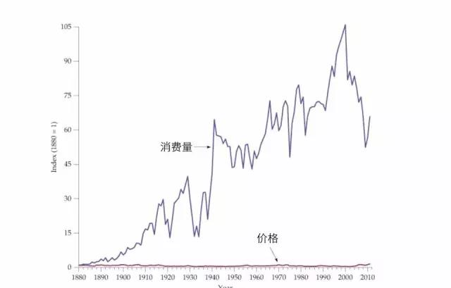

铜的消费和价格：虽然铜的年消费量增长了近 100 倍，但铜的价格没有太大变化

我们消耗铜的数量一直在涨，但是铜的价格却是一条平直的线，几乎就没涨过。

原因就在于，供给在变化，供给在不断地增加，这使得我们虽然消耗了很多的铜，但铜的价格却没有因此而有多大的增长。这是我们首先要介绍的关于供应曲线的概念。

## 2\. 事前看和事后看

关于供应的行为，第二点我要介绍的非常重要的一个概念，就是事前看和事后看的区别。

现在的主流经济学教科书，每当讲到供应的行为、生产的成本，里面就有大量的公式、图表、方程。它讲的是人们应该怎么规划未来的生产，才能达到成本最小化、利润最大化的目标。

这给人的印象，它藏着的潜台词，是人们早就知道应该怎么去规划生产的。生产就好像事前已经编好的一幕幕话剧一样，是能够按部就班完成的。现实的情况远远不是这样。

在现实生活中，任何一个企业家，他的成功道路都不可能是计划好的。当然，你事后看、往回看，你可以把以前发生过的很多不确定性都抹掉。这样看，你会觉得成功是一条必由之路，有一条清晰的道路。

但实际上，你回到事情还没明朗的时候看，当时有大量的不确定性。无论是再大的企业、再聪明的企业家、再多的数据，在做决策的时候，他们都没办法避免猜测的本质，否则那些有大量研究人员的企业，他们就永远不会失败了。

有时候，有些很明显的势头，最后并没有成为主流；有时候一些微小的事件，最后却成为了事件发生的主要方向。

我的一位经济学家朋友告诉我一个例子，他说他非常清楚地记得，他曾经参加过一个研讨会，那个研讨会的主题，是讨论当时刚刚兴起的微博会不会取代博客。

他们恐怕都忘记讨论的结果了，因为隔了一两年后，另外一种全新的社交传播方式——微信兴起了。你说当时的讨论有多重要呢？当时谁画过什么方程式，用过什么样的模型来预测未来的发展吗？有什么用吗？

所以我非常赞成我的同事，北大国发院管理学教授马浩老师出的一本书的标题，那就是《决策就是拍脑袋》。商人永远不可能等信息完备了以后才做决策，这是我们每当讨论供应行为的时候，一定要记牢的一个概念。那就是我们到底是在事前看，还是在事后看。

## 3\. 长期与短期

关于供应的行为，第三个我要介绍的概念，是长期和短期。在经济学里面，长期和短期的概念挺有意思的，长期和短期的标准，不是以时间的长短来判断的。

短期是指只有个别的生产要素可以调整，大量其他的生产要素不能调整的情况；长期是指所有的生产要素都可以进行调整的情况。

所以，如果所有的生产要素，在一天内都可以调整，那么一天就算是长期；如果大量的生产要素，在十年内都是不能进行调整的，那十年也算是一个短期。

## 4\. 经营与歇业

在讨论供应行为的时候，第三个重要的概念，就是商人判断什么时候继续经营、什么时候关门大吉的一个标准。

你还记得前面，我举例子的时候说过，我们家在长安街有个卖茶叶蛋的铺位吧？

有同学在留言里面问我，我们家是不是在长安街真有一个卖茶叶蛋的铺位？那当然是虚构的。

假设这个铺位，每个月摊销的固定成本是 1 万块钱，包括房屋的装修、设备的购买等等，固定成本是 1 万块钱。而可变成本是 1000 块钱，包括灯油火蜡的费用、人工的费用。

这 1 万块钱的固定成本和 1000 块钱的可变成本，就构成了几个关键的决策价位。

如果每个月我的收入是在 11000 块钱以上的，那这个铺位就处于盈利的区间，可以继续经营下去，能够赚钱。

如果这个铺位每个月的收入，是处在 1000 块钱跟 11000 块钱之间呢？也就是说它的收入不足以弥补所有的固定成本，但是它足以弥补每个月的可变成本，这时候这家店就可以继续经营下去，虽然它是亏损的。

为什么亏损的还可以继续经营下去呢？那是因为固定的投入，很可能已经不是成本了。只要这个店不能转售出去，不能再换成钱，投入的那些资金就沉睡在那里了。

这时候，只要每个月赚的钱，能够超过每个月的可变成本——1000 块钱，那还是值得继续经营下去的。所以收入从 1000 块钱到 11000 块钱之间，我们可以保持赤字经营。

如果这个铺位每个月的收入不足 1000 块钱，连它的灯油火蜡和人工支出这些可变成本，都不足以 Cover（覆盖）、都不足以冲抵，那这个铺位就应该关门大吉了。

所以一家企业根据固定成本和可变成本,就能够形成这几个关键的价位，从而决定他们到底是盈利的，还是能够赤字经营的，还是应该关门大吉的。

当然,这里面有一个很重要的要素，就是固定成本的摊销，跟商人的远见有关系。

虽然是付出同样的固定投资，但是对未来的看法不一样，把未来看得到底是远一点还是近一点，急功近利一点还是理想远大一点，对固定资产的折旧，就有不同的计算。到底是盈是亏，到底应不应该坚持下去，就会产生不同的决策。

## 5\. 生产速率和生产总量

关于供应的行为，第四个非常重要的概念，就是要区分生产速率和生产总量。

当我们讲一个企业的产量是多少的时候，人们往往混淆了这两个概念，你讲的到底是生产的速率——在单位时间里面的产量，还是总产量？这好比我们讨论交通问题的时候，你讲的到底是速度，还是总的距离？这两个概念有重大的区别。

我们都非常熟悉的经济学家阿尔钦（Armen Alchian ），他当年被兰德公司请去当经济顾问，他要研究的一个重要话题，就是关于生产成本的问题。

他讲了两个非常重要的定律：

第一，如果总产量不变，随着生产率的不断提高，平均成本最终就会增加。也就是说如果你生产的总量不变，但是你要得快、要得急，那么你生产的成本就得提高。

英文有句话叫 Haste makes waste，急迫导致浪费（秦俑语：要想快速发展就得付出成本。比如说，中国经济的高速发展内在需求，就需要付出更大的社会成本，比如说资源消耗、环境影响等）。很多时候，你要一个很急的东西，你就得通过很贵的方式来满足。一次性的。

但是你如果要得多，又要得慢——他的第二定律就讲这个——你就可以从长计议，慢慢规划，这时候平均成本就会降下来。

最简单的例子，是你在开车的时候要行走的路程不变，但是你的速度要提高，你的耗油量肯定会增加。急迫导致浪费。

又比如，在日常生活中，如果我们遇到什么急事，哪怕是几倍的价格，我们打一个滴滴专车，这就能解决问题。但是急迫导致浪费，导致更高的付费。如果你天天都有这么急的事，那就应该买辆车，每天出行的平均成本肯定会降下来。

阿尔钦在《成本和产出》这篇文章里面讲的，第二个非常重要的定律，是倒过来的：如果生产速率不变，而生产的总量越大，那么平均成本就越小。这也是容易理解的。

生产商如果接到一个大订单，他知道自己可以从长计议，好好规划，而生产的速度又不比那些小订单要更快，那么他总能够想出更好的资源配置、更合适的生产组合，来减少每一个单位的产品的平均成本。

在生产过程中还难免有所谓试错的成本、打磨的成本。

## 课堂小结

今天我们讲了供应行为几个重要的概念：

要区分向前看还是向后看；

要掌握在经济学里面短期和长期的概念；

要从固定成本和可变成本的角度，来理解盈利经营、赤字经营和关门歇业等几个关键的决策价位；

要区分生产速率和生产总量的区别。

## 课后思考

今天我留给你的思考题是，我们现在市面上流行的很多不同品牌的手机，其实是由同一个工厂来代工的，它们的质量为什么会不一样？

##### 94

# 第 94 讲  
投资加速器效应 

今天我给你讲一个跟供应的行为相关的基本规律，这个规律叫做“ 投资加速器效应 ”。

这个词听上去有点专业化，我还给你准备了一个表，那个表上面的数字，你看上去，又觉得这个问题挺难的。当然，你看这个表能够加深理解，但是即使你不看这个表，你也能明白我讲的这个道理：投资加速器效应。

这个投资加速器效应，我们分两个版本来讲。第一个版本我们叫做理想版，是纯理论的一个参照系；我们讲完这个理想版，再讲一个现实版，然后我们把这个原理用到现实生活当中去，看看它在现实生活中起作用的程度。

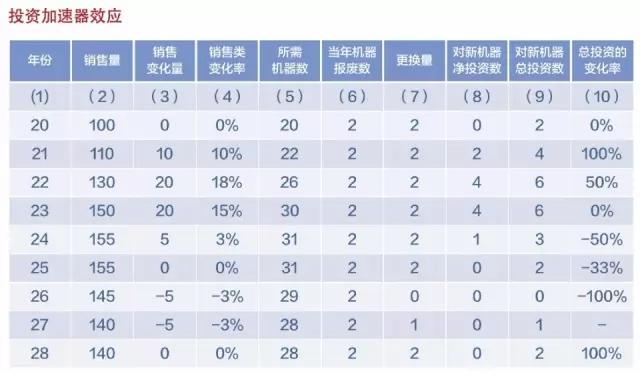

## 1.“投资加速器”理想版

我们先来介绍“投资加速器效应”的理想版。

我们来看，我给你准备的表格，我们要关心的问题是，厂家什么时候决定追加投资。我们先假定有一家工厂，每年都生产 100 双鞋；而他投资的每台机器，每年能够生产 5 双鞋，所以他每年要生产 100 双鞋，需要 20 台机器。

我们再假定，这些机器，每台都能够用十年，也就是说，机器每用十年就得更新一次。我们再进一步假设，这些机器都是他每年两台、每年两台那么投资来的，所以过了十年以后，更换机器也是每年两台、两台这样来更换的。

这时候，厂家就进入了一个非常均衡的状态。如果世界的需求永远不变，什么事情都不变，那么他就能够年复一年地生产。每年 100 双鞋，总共 20 台机器，每年要重新更换两台机器。

也就是说，他不需要进行新增的投资，就能够维持原来的生产速率。他这么一年一年地生产，头 20 年都这么生产了、都这么做了，但是到了第 21 年，你看表里面的数据：到了第 21 年，忽然他们家的鞋子销售量上升了，不是 100 双，而是 110 双了。

这时候，他的销售量增加了 10%，但问题是，他要完成这 10%的销售量，原来的机器不够了，他必须对机器进行新增的投资。

你还记得吗？他们家的机器，每台能生产 5 双鞋，所以要满足这 10 双鞋的新增销量，必须投资两台机器。这两台新增投资的机器，再加上原来他就必须更新的两台机器，这一年，他对机器的总投资，就变成了四台，而不是两台。

这时候，他投资的变化率是百分百，翻倍了。你看有意思吧？他的销售量增加了 10%，但是他投资机器的增长率增加了百分之百。

我们再继续看表里面的数据，到第 22 年销售量继续增长，又增长了 20 双鞋，他的销售量的增长比率是 18%。这时候，工厂为了完成这一年又新增长出来的 20 双鞋的销售量，又得另外再投资四台机器。

所以在第 22 年对新机器的总投资量，达到了六台，而总投资的变化率是 50%。更有趣的是，到第 23 年，新增的销售量也还是 20 双，这时候厂家又要新增投资机器，但这时候新增投资机器的数量，跟上一年是一样的，结果总投资的变化率是零。跟去年一样持平，没变化。

你看到这两组数据有趣的变化了吗？这一年虽然销售量还是涨的，但是总投资的变化率已经下降为零了。到第 24 年，销售量还是增长的，但是它增长的速度减慢了，只有 5 双鞋了。

这时候，为了应付这新增 5 双鞋的销售量，工厂只需要多投资一台机器就可以了。这时候从总投资的变化率来看，工厂的投资率在下降，是一个负数，比去年减少了 50%。

依着这个表，我们继续看，在第 25 年、第 26 年、第 27 年里面，如果销售量的变化率是零，是-3，那么总投资的变化率下降，竟然达到了-50、-33，甚至是-100。

这就是我们要讲的“投资加速器效应”，就是一个工厂销售量的轻微变化，会导致它对机器的投资率产生剧烈的变化。

在开始的时候，如果销售量发生轻微的增长，那么它对固定资产的投资就会发生迅速的、巨幅的增长；如果它的销售量增长的速度开始减缓，这家工厂对机器投资的增长率，就会明显减慢下来，甚至会掉头向下，变成负数。

为什么会有这样的变化呢？原因就在于，工厂应付的是短暂的、瞬时的销售量变化。而他们做出的投资，他们投资的机器是耐用品。一旦投资，这个机器就能用很久。所以这些新增投资的机器价值，跟厂家当年新增的销售量价值相比是要大很多的，正是这个原因，轻微销售量的变化，就会产生投资额的巨大变化。

举一个简单的例子你就好明白了。假设你们家有四口人在吃饭，用一个电饭煲。忽然间你们家请客，又请了另外四个人来吃饭，这时候为了应付新来的这四个人，你们家理论上说，应该再买一个电饭煲。为了多做一顿四个人吃的饭，多买了一个电饭煲。为了满足新增的那么一点点需要，增加了大额度的投资，这就是投资加速器效应。

你会说，一个电饭煲不就 100 来块钱吗？那不算什么。但实际上你根据这个原理，你就能够明白很多现实中的场景。

比方说很多国家都争办奥运会，为什么要办奥运会？很多人说因为在奥运期间，那十来天我们会产生很多新的需求，很多外国友人来我们国家参观、旅游、消费，我们能挣很多钱，所以我们要修很多的场馆。

但是我们要看，为了应付这十几二十天的运动会，我们所做的投资，那可是耐用品。这十几二十天的收入能 Cover（覆盖）掉、冲抵掉这巨额的耐用品的投资吗？这是一个问题。

所以我们说，有客人来吃饭，我们就买一个电饭煲，为了十来天的一个运动会，我们就做一个长期耐用品的投资，这属于投资加速器原理的理想版。

## 2\. “投资加速器效应”的作用

这个理想版跟现实版当然有距离。这个理想版有什么用？有挺大的作用，我们明白了这个道理，就能够知道，我们怎么样去解释、怎么去演绎企业对固定资产的投资。

因为企业对固定资产的投资，是一个很好的晴雨表，是一个很好的指标，我们可以根据这个指标，来看整个社会对经济周期的预测。因为它会放大人们对未来预测的乐观和悲观情绪。

越是耐用的投资产品，比方说那些能用 10 年、20 年的重型机器，一旦有厂家购买大量这样的重型机器，这说明他们挺看好未来经济增长的。一旦这些重型机器投资额的变化率开始减缓、开始下降，就说明人们对未来经济的看法持保留的态度了。

这时我们对比两种经济指标：一种是易耗品的销售量 CPI，一种是耐用投资品的投资额 PPI。这两种数据，都能够反映人们对未来经济的看法，但他们所反映出来的敏感程度是不一样的。

耐用品投资额变化率所反映出来的，是夸张得多的情绪。但我们前面说了，这只不过是理想版。

## 3\. “投资加速器”现实版

现实生活中，没有哪个家庭会那么笨，来几个客人就马上买一个电饭煲。他们会想一想，这些新来的客人到底来几次，是不是值得买一个电饭煲？还是我们暂时向别人借一个电饭煲？还是这个电饭煲能够多用两次，煮两锅饭。他们会想这种缓冲的策略。

同样的道理，每一个举办奥运会的国家，当然他们会加强基础建设，但他们所做的投资，也不会仅仅为了满足这十几二十天的需求，而进行规划。无论是一个普通的家庭，还是一个准备举办奥运会的政府，他们都会为“投资加速器效应”打一个折扣。

所谓的打折扣，就有很多的具体办法。

比方说，客人来以前先煮好一锅饭，这叫库存的办法；比方说当生意减少的时候，不急着把所有的设备都卖掉，等一等、看一看，这叫空置的办法；比方说那些特别火的餐厅，不随便开连锁店，因为好的厨师不容易找，食物的品质不容易控制，他们宁愿让顾客在外面排队；又比如说明明应该买新的机器了，但工厂还是要再等一等，延长设备的折旧时间，凑合着用那些旧的设备。

所有这些办法，都是对“投资加速器效应”打折扣的办法。

我们从一个角度看，这些做法都是不经济的。库存，我们不应该有库存，应该零库存才好；空置，我们不能够让设备空置；每当见到因为供不应求而产生排队现象，我们就说应该涨价、应该增添设备，等等。

但实际上，我们从另外一个角度看，从信息不对称的角度看，从投资加速器效应所带来损失的角度看，那些等一等、看一看，增加一点库存，延长一点机器的折旧时间，增加一点空置的时间，所有这些做法，就变得利大于弊了。

我们也再不会把这种等一等、看一看、闲置机器、延长机器的折旧时间等等这些做法，称之为市场失败的表现了。

## 课堂小结

今天我给你介绍的是“投资加速器效应”。它有两个版本：一个是理想版，它讲的是长期耐用品的投资，往往是根据需求的变化率来变动的，所以它比需求的变化率变得更加夸张、更加敏感。

只要现实生活中的供需情况发生轻微变化，那些耐用品的投资量，比如说重型机器的销售量，就会发生剧烈的变化。

然后我们讲了投资加速器的现实版。它的意思是，其实人们不会那么夸张，人们会悠着点，他们会通过各种各样看上去不够灵活、不够市场化的办法，来抵消由于“投资加速器效应”所产生的损失。

## 课后思考

今天我留给你的思考题是，每当经济出现波动，比方说出现了产能过剩、出现了失业、出现了短缺，那么政府主管经济的部门，究竟应该听其自然，还是逆势而为，马上进行调节呢？为什么？

##### 95

# 第 95 讲  
供应的真相 

今天我要来给你讲讲供应行为的真相。

这是为了针对我前面讲的，很多主流经济学教科书，它们设立为供应的行为、生产的成本，建立了太多的经济模型、太细的经济分析。仿佛所有的生产都是能够事前规划的，但真实世界可不是这样的。

我今天讲三点：

盈亏是由全盘计划来核算的；

规模经济是向前探索出来的；

产业集群是供应的趋势。

## 1\. 盈亏是由全盘计划来核算的

我们先讲第一点，一个企业到底是赚了钱还是亏了钱，是由通盘的生意、整盘的生意核算出来的。

我们在做经营盈亏核算的时候，通常都要依赖会计所做的报表——会计把不同的成本摊在不同的产品上面。当然他们这么做的时候，有一些既定的规则。但这些规则的运用，实际上都是根据现实情况的变化而变化的。

供应的行为，真实的情况是这样的：商人在开业以前，先做一个全盘的预测，是一个计划、一个猜想，觉得他的产品只要生产成这个质量、只要生产成这个规模，他就能卖出去，就能赚钱。

当然，我们说了，无论他掌握的数据有多丰富，他都是片面的，他都不可能在完全预知未来的情况下做出预测。他的任何决策，都带有猜测的成分。这时候，只要他有信心，他就让项目上马。项目一旦上马，到底能赚钱，还是要赤字经营，还是得关门，这得由市场说了算。

这时候，所有成本的核算，是根据项目的变化、市场的反应做出的。举个简单的例子，一位养猪专业户养了猪拿去卖，这时候他不仅卖猪肉，还卖猪骨头、猪皮、猪毛。

会计当然会把养猪的各种成本，摊在猪肉、猪皮、猪骨头上面。但是你要想想，这种摊分有道理吗？同样是一份养猪的饲料，成本到底有多少应该由猪肉来承担，有多少是应该由猪骨头来承担呢？是没有一个定则的。

我们不妨天马行空地想一想，如果社会上的消费者对猪肉不屑一顾，不喜欢吃猪肉，他们只喜欢猪皮，因为猪皮可以拿来做各种皮革，这时候，这猪还养不养？

还养，只要卖猪皮的收入能够 Cover（覆盖）掉、能够冲抵掉所有养猪的成本，这猪就会养下去。跟会计怎么核算没有关系，会计的核算，只会根据情况的变化而变化。

所以在现实生活当中，有许多商业会出现所谓的“羊毛出在猪身上狗买单”的例子。只要整盘生意能够赚钱，具体哪个环节是免费的，哪个环节是优惠价钱卖出去的，哪个环节是赚取超额利润的，这都无所谓。

比方说，广播电台的收入通过广告来维持，这就是一种非常创新的想法。过去你知道吗？当广播电台不靠广告的收入来维持的时候，那它是靠什么来维持的？

在香港，最早的电台是靠卖收音机来维持的，一个电台卖只能接收这个电台的收音机。所以，如果你要听几个广播电台，就得买几台收音机。这种场面现在想想都滑稽。

据我所知，只有香港作家倪匡是这么做的，他家里就有好多台收音机，一台收音机设定一个电台，要听哪个电台他就开哪个收音机。因为他是个技术盲，怎么都学不会怎么给收音机调台。但这种一台收音机只能听一个电台的做法，很快就被人们破解了，最后电台才想到了通过广告的收入来维持经营的办法。

供应行为的第一个特点，是盈和亏要靠通盘的项目来核准。

## 2\. 经济规模是向前探索出来的

关于供应的真相，我想说的第二点规律，是规模经济是向前慢慢摸索出来的，我们永远在事前没办法知道规模要多大才经济。

最好的例子是集装箱的故事。我们知道今天的集装箱，是非常有效的大规模运输的一个例子，几艘巨大的油轮围绕着地球，全年无休地这么运转，它到每一个港口，都由计算机精确地控制着货物的装卸。

当那些装载集装箱的货轮到达码头以后，每台起重机一小时可以从船上卸下 30 到 40 个集装箱，一分钟也不耽误。而与此同时，集装箱的尺寸，跟陆上运输卡车的尺寸相匹配，而且全球联网。

要达到这样的规模，要让全世界不同的油轮公司、不同的码头、不同的卡车公司，都愿意达成一个统一的规格，这当中就磨了好几十年。

集装箱的采用，还遭到了码头工人激烈的反抗。因为以前，没有集装箱以前，码头工人在码头卸货，通过敲诈勒索是能得到很多好处的。

正是因为这样，整个集装箱的事业从形成理念、形成想法，到开始尝试，到遇到一个一个的障碍，不断地去克服，再到找到成功的案例，做出示范的作用，直到全世界都往一个标准靠拢，最后能够把这个事情做成，至少花了 30 年的时间。

在把这个事情做成以前，每一次努力看起来都是亏损的，没有人知道这规模要做到多大才算成功。

当然，到今天集装箱已经达到了应该有的规模，它已经取得了巨大的成功。它有多成功？它使得运输的费用急剧下降，下降到微不足道的程度。

一个工厂的两个车间，可以在地理位置上是相邻的，背靠背在同一个园区；它也可以一个在中国，另一个在马来西亚。——不管是哪一种，零部件在这两种车间之间的运送成本，都可以忽略不计。

这是我要讲的第二点，生产的规模要到多大才有效应，这得不断地摸索才能知道，没有人能够在事前知道。只有坚持到最后，胜利了才知道这是能胜利的。

## 3\. 产业集群是供应的基本趋势

第三点，我要说的是，产业集群是供应的基本趋势。

我们常说，竞争总是在供应者和供应者之间展开的，在需求者和需求者之间展开的。照理说，供应者应该远离其他供应者才是，供应者为什么会愿意聚在一块呢？这是因为，供应者聚在一块有他的好处，虽然他们是互相竞争的。

好处之一，是能够让需求者、购买者很方便地做出比较。不怕不识货，最怕货比货，所以供应者往往跟其他的供应者待在一块。卖鱼的跟卖鱼的待在一块，卖肉的跟卖肉的待在一块，教书的跟教书的待在一块。表面上他们是在竞争，但实际上他们是在彰显他们的品质。

供应者跟供应者待在一块的第二个原因，是因为他们可以互相协同、互相帮助，互相抵消由于生产不确定性带来的损失。

我们昨天不是讲了投资加速器效应吗？每当新来了订单，我们可能就要增加投资，而增加投资可能是一个判断错误，可能是反应过激。供应者跟供应者待在一块，产业集群能够解决这个问题。

那是因为，如果有太多的订单我可以不新增机器，我把我的订单给旁边那个厂商，让他们来完成。这时候就能够给我一个缓冲的机会，让我看准了这新来的订单，到底是一次性的还是多次的，是偶然的还是持久的。等一段时间，我再做出是不是要增加投资的决定。

所以供应者和供应者待在一块，能够互相协同，抵消风险。

第三，很重要的一个原因，是供应者和供应者聚在一块的时候，能够形成一个生态。高度的分工本身，能够带来质量的提高，也能够带来创新。“一万小时定律”在这里也是起作用的。

去年，我跟我们另一个“得到”订阅专栏《前哨·王煜全》的王老师，在美国做科技项目考察，当时我们看了一个有表情的机器人项目。你知道吗？机器人跟人做交互分三个阶段：

第一个阶段，是那个机器人完全不像人，就是个机器，这时候人不害怕这个机器；第三个阶段，是这机器人长得跟人一模一样，人也不害怕这个机器人；第二个阶段，是它既不像机器，又不像真的人，这时候的机器人看上去挺恐怖的。

这个有表情的机器人项目，就是要逾越这第二个阶段，让完全像机器的机器人，变成跟人很像的机器人。这时候，他们就要在这个机器人的脸部，增加很多所谓的肌肉，让它有丰富的表情。

这个有表情的机器人，不仅要模仿人的表情，同时也要解读它所看到的别人的表情。有意思的是，你知道这个项目在哪里落地吗？这有表情的机器人在哪里生产吗？这个项目在深圳东莞落地。

我们问这个项目的创始人：“为什么选择深圳东莞？”他说：“深圳东莞有全世界最好的生产玩具的产业集群，要什么有什么。那里不仅有全套的产业链，而且那里的产业工人和专家掌握了所有生产的秘诀。”

## 课堂小结

今天我们讨论了供应的真相，我们谈了三个问题：

企业的盈亏是由全盘的项目来核准的；

规模应该有多大才算是经济，得向前摸索才能知道；

产业集群、供应者高度集聚，这是现在和未来供应行为的一个基本特征。

## 课后思考

今天我留给你的思考题是，政府到底是应该制定产业政策，指导企业的发展，还是让企业自发寻找自己发展的路径更合适？为什么？

##### 96

# 第 96 讲  
企业家精神 

今天我给你讲企业家精神。

前面几讲我已经介绍过，今天主流的经济学教科书，讲到供应行为的时候，都使用了大量的公式、模型、图表。这给人的一个印象，好像生产计划是能够一早就计划好的。

这当中缺了一个很重要的因素，那就是企业家精神。因为真正的生产活动、供应的真相，其实是在不确定当中摸索出来的，要进行这种摸索，我们必须依靠企业家精神。

## 1\. 五花八门的企业家精神衡量标准

企业家精神就是那种不折不挠的精神，在不确定的情况下做出决策，在人人都不看好的时候，满怀希望往前冲的精神。

但问题是，企业家精神很难具体地描述、很难具体地衡量。这是经济学教科书里面，很少给企业家精神应有位置的原因。

很多年前，我自己对企业家精神做过一点点研究，当时研究的主题，就是我们怎么样去衡量一个地区、一个国家企业家精神的强弱。当时我翻看了上千篇的论文，他们提出了种种衡量企业家精神的标准。

比方说，可以通过利用可靠信息的速度来衡量，国有企业收到可靠的信息，他们做出反应的速度，跟民营企业做出反应的速度做一个比较，这是一种衡量企业家精神的尺度。

又比方说新兴企业的数量，这是一个指标；又比方说研发资金所获得的回报率，这也是一个指标；申请专利的数量，这是一个指标；还有一些研究表明，利润率越低的地方，企业家精神就越旺盛，这又是一个指标。

还有一些研究表明，农业的比重越大企业家精神就越弱；还有一些研究表明，工作的流动性越强企业家精神就越强；

甚至还有一些研究表明，遗产的数量越多，继承了大笔遗产的人更可能去创业，这种情况下企业家精神就会更强，所以少收一点遗产税能够鼓励企业家精神；

所有这些关于衡量企业家精神指标的研究，我都觉得不太满意。比方说，个人创业的数量是一个衡量企业家精神的指标，但哪些国家个人创业最多呢？那些拉美国家，巴西、阿根廷、墨西哥这些国家很多小贩，他们就自己雇佣自己，自己创业。如果根据自雇人数来衡量企业家精神，这些国家的企业家精神最强。显然鼓励人们自己雇佣自己、自己创业，并不见得是增加经济效益的好办法。

## 2\. 不是单靠兴趣，而是一门产业

这些年，我开始关心科技创新背后的制度原因，过去我觉得企业家精神是一种难以琢磨、难以形容、难以刻画的东西。今天我再看，它其实是可以形容、可以刻画、可以体现、可以扶持的。

我印象比较深的，我给你准备的一幅图，那是美国麻省理工大学（MIT）的地图。

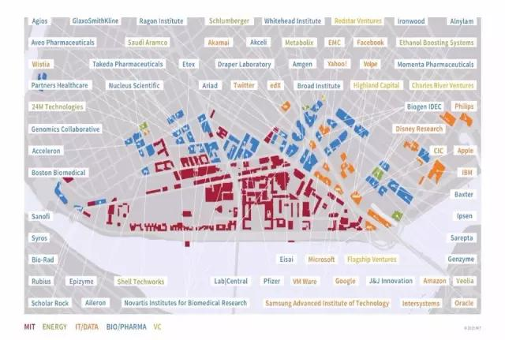

这幅图当中，红色部分是麻省理工学院的校舍，绿色的那些建筑物是能源公司，橘色的那些建筑物是 IT 和数据公司，蓝色的那些建筑物是生物制药公司，而黄色的建筑物是风险投资公司。所有这些公司把麻省理工大学（MIT）团团围住。

这些公司的利益、这些公司的诉求、这些公司的市场导向，牵引着麻省理工大学的研究方向。

过去我们总以为，科学家之所以做研究是因为兴趣，但今天，你看了这幅图就知道了，哪有科学研究是单凭兴趣就可以完成的。任何的发明创造，背后都要有大量的投入才能够完成。

就说实验室里面那些小白鼠，贵的可以到几千美元一只。小白鼠怎么可能那么贵？你想想看，这些小白鼠是用来测试那些治糖尿病的药的，你要先把小白鼠变成某种类型的糖尿病，它才能测试这种药的疗效。

当你要做实验的时候，它背后耗费的大量资源，不可能让那些科学家单凭着兴趣就能走得远的。一切都是精心设计、精心规划的结果。

还有就是从理论上的发明创造，到这些发明创造转化为真正能够商用的产品，当中的转化过程，也是非常漫长的，必须由专业人士来完成。

爱迪生自己亲自尝试了好多种乃至上千种物质来做灯丝，发明成功以后，他自己办工厂，自己想要来发电，想要一揽子把所有该赚的钱都由他一个人赚了，结果他没做成。他晚年就跟很多的仿制者打官司，耗费了他所有的精力。

今天一个科学家必须跟风险投资家、企业家、制造商、营销专家紧密合作，才能把他的想法一步一步地从理论推向实际，从想法变成产品。这当中制度的设计就尤为关键。

## 3\. 制度创新带来产业兴旺

其中导致美国今天大量科技创新涌现的重要原因之一，是美国在 30 多年前，1980 年颁布的“拜杜法案（Bayh-Dole Act ）”。

在这个法案颁布以前，许多的科学研究都是由联邦政府拨款资助的，问题是科学家拿到资助以后，就去搞发明创造，怎么才算项目完成呢？申请了专利就算是项目完成了。这时候他们又申请下一个项目的资助，因为他们的工作就是搞发明创造而已。

政府拨了钱，取得了发明创造的专利以后，负责科技项目拨款官员的任务也算完成了。结果是大量的专利被束之高阁，没有转化为民用、没有转化为商用、没有转化为产品。这当中有大量的浪费。

1980 年的拜杜法案就突破了这个问题。拜杜法案是由两位议员，一位姓拜（Birch Bayh ），一位姓杜（Robert Dole ），他们两位共同提出的。

拜杜法案的中心思想，是那些由联邦政府资助产生的知识产权，科学家或者他们所在的机构，有权选择使用他们的商业开发权——知识产权仍然归政府所有，但是商业开发权，可以由科学家或者他们所在的机构拥有，他们可以进行产品的转化，从中得到的收益归他们所有。

这一下子就激发了科学家把思想变成产品的积极性，科学研究和商业利益之间的隔阂被打通了。这时候，很多科学家被聘请到产业里面去当顾问，帮助解决产业里面遇到的问题。

而同时，科学家也由于在产业里面接触到许多真实的问题，而能够把市场的需要带回到实验室里面去。科研和资本的结合再不是单纯的兴趣了，科研和资本的结合，导致了创新创业的热潮。

## 4\. 知识确权的艺术

我们在斯坦福大学拜会著名的物理学家张首晟教授（秦俑语：张教授最近也创立了自己的科技风投公司，最近也频繁来中国做路演），他给我们介绍，他除了在斯坦福大学当物理学教授以外，还成立了一家投资公司，他也做投资。我们现在用的华为手机，在屏幕上敲两敲就能够拷屏，这个专利就是他们公司卖给华为的。

他跟我们说，他现在是百分百的时间来做科学研究，百分百的时间来做投资。

我们当中有人可能没听清楚，也可能不相信他的话，再问他一次，说你的时间是怎么分配的？他说：“刚才我不是说了吗？百分百的时间当物理学教授，百分百的时间做投资。”

当我们从美国的西岸斯坦福大学飞到美国的东岸，在参观麻省理工大学（MIT）的时候，我们问他们同样的问题：“你们的教授做研究和在外面兼职，时间分配上面有没有限制？”

麻省理工大学的教授告诉我们：“我们学校可没有斯坦福大学那么慷慨，我们是有规定的，我们有四比一的规定，也就是说教授要有四天在学校当教授，但有一天可以在外面兼职。每到年底的时候，教授们是要填时间分配报表的。”

尽管他们有时间的限制，但这时间的限制，实际上是不那么严格的。

科学创作讲的是思想，要分辨一个想法到底是前四天想出来的，还是后一天想出来的，可不那么容易。

不管具体的规定怎么样，大学都是相当慷慨的。这种慷慨、这种鼓励知行合一的做法，也是美国的科技创新，能够带来巨大商业价值的一个重要原因。

## 5\. 企业家精神的贡献占多大比重

在麻省理工大学，我还听到一个最令我印象深刻的数字，他们专门负责科技成果转化为商用的老师告诉我，每一块钱的科研投入，需要 100 块钱的商业运作，才能把思想转化为产品。

1:100，那是什么意思？那是说，一位科学家已经做出了发明创造，一个商人跑来跟这位科学家说：我帮你把这个思想转化为产品，我跟你五五分，1:1，你同意吗？科学家说：好，我们这么分。结果这事做不成。

后来这个商人说：我拿 2 你拿 1，我们试试能不能做成。做不成。

商人又说：我拿 50 你拿 1。还是做不成。

最后是商人说：我拿 100 你拿 1。这才能做成。

你说这个科学家服气吗？他开始的时候很可能不服气，当然到最后他肯定愿意这么做。因为他百分之百占有这个专利所得到的好处，远远没有他占百分之一，而这个思想能够成功地转化为产品所得到的收入大。

这个摸索的过程可真不简单。这背后就是他们不断摸索出来的，从一个想法变成一个产品所应有的制度安排。

这也印证了我们前面，在讲价格理论的时候讲到的一个规律：怎么分饼决定了饼能做多大。

## 课堂小结

我们今天到处都在讲创新创业，热情很重要，但热情的背后，能让这个热情持续下去生根、发芽、开花、结果的制度，也很重要。这是今天我对企业家精神的新的理解。

## 课后思考

今天留给你的思考题是，你认为中国人和美国人相比，中国人擅长哪方面的创新创业？美国人又擅长哪方面的创新创业？各自的专长不一样，主要是人的原因还是制度的原因？

##### 周

# 第 24 周问答  
人在什么时候最爱大手大脚 

我们开始本周的问答时间了。

我们最近这三个礼拜讲的是生产的规划这个模块。上个礼拜我们讲的是根据比较优势原理，供应商怎么样选择生产的方向。这个礼拜我们讲的是一旦选择了生产方向以后，怎么样做生产的规划。下个礼拜我们讲的是产品生产出来以后，怎么样进行市场营销。

## 1\. 需求增减的“变化率”决定新增投资行为

本周的四讲课程里面，我认为最重要的是投资加速器那一讲。    

那一讲一开始的时候波澜不惊，甚至有点沉闷，还引入了一个表格。但不管你有没有跟上，只要到了电饭煲的例子那里，你就能豁然开朗了。一家四口人用一个电饭煲，又来了四位客人到家里吃饭，理论上就应该多买一个电饭煲。

那个表格里面略微复杂的数据，跟这个电饭煲的例子要讲的原理都是同一个。

那就是生产者为了应付新增的需求，就要做出新的投资，而他们的投资是耐用品，新增的需求只是易耗品。靠投资耐用品的办法来满足易耗品的需求，就会产生一个投资错位。要投资的耐用品越耐用，这个错位就越明显，越夸张，当然也越不合理。

所以我们说，投资加速器效应分两个版本，一个叫理想版，一个叫现实版。理想版讲的是一个参照体系；现实版讲的是人们怎么对投资加速器效应打折扣。而无论是理想版还是现实版，对我们理解生活中的现象都有很大的帮助。

理想版和现实版缺一不可。通过现实版，我们能够理解，现实生活当中有很多看上去是市场失败的例子，实际上不是市场失败。

人们会对经济波动故意做出慢一点的反应，人们能够容忍一点库存、一点过剩、一点供不应求的现象，一点凑合着使用的不方便，一点定价不够合适带来的损失。

所有这些看上去有点笨、不够敏捷的做法，放到信息不对称、未来不确定的市场当中去，它们就变得合理了。

而投资加速器的理想版，同样也能够解释大量的现象。

投资加速器效应的本义是，人们做出的投资不是跟需求的增减挂钩的，而是跟需求增减的变化率挂钩的。需求虽然一直在增加，但只要增加的速度在减慢，投资就会减慢，甚至会掉头向下。

同样的道理，需求可能还是在减少，但是减少的速度在放缓。经济有回暖的迹象，投资就会马上做出反应。

## 2\. 用“投资加速器原理”理解身边现象

这种效应，哪怕人们会悠着点、打个折扣，但现实生活当中，我们还是能够见到大量的现象，是符合这个效应的。只要我们心目中有这个效应，我们的眼睛就能够看到这些现象。

我自己到过国外的很多唐人街，旧金山的唐人街，华盛顿的唐人街，波士顿的唐人街，伦敦的唐人街，发现那里很多中餐馆，在今天的标准看来装修都挺古旧的。

但如果以八十年代香港的餐厅标准来看，他们又是能够拿满分的。这说明什么？这说明人们在做重大投资的时候，也恰恰是他们感觉到收入在高速增长的时候，是收入的高速增长最后把人们说服了，让他们觉得未来的日子非常光明，值得做大量的耐用品的投资，那些投资错位是值得的。

就像我们举的电饭煲的例子，今天来了四位客人，明天又来四位客人，最后主人把自己给说服了，觉得以后每一天都来四位客人，甚至更多的客人都不成问题，买一个电饭煲，这种投资错位是值得的。那时候，就在那个时候，他会买一个电饭煲。

当然，如果后面需求增长的步伐放缓了，投资者也就会非常敏感地减少投资。

结果我们看到的现象是，不论是个人、家庭、地区还是国家，那些最奢华的投资，都是在他们经历经济高速增长的时刻做出的。当经济增长的步伐一旦开始减缓，他们就不会再做类似的投资了。

英美各大城市唐人街里面，港式茶餐厅的装修水平停留在八九十年代香港的标准，就很好地说明了这个问题。

好。接下来我们看看本周的思考题。

## 3\. 边际效益决定企业是否存续经营

在预告当中留的第一道思考题是：“ 一旦生意上马之后发现是亏本的，应该继续经营下去吗？为什么？ ”

这个问题我们在周一、周二和周三的内容当中都能找到答案。

供应的行为并不是教科书当中刻画的那种，事前就已经做好详细规划的行为，它最重要的特征，是开放性的、非确定的、非均衡的、探索性的、走一步看一步的、走到哪算哪的行为。这是供应行为非常重要的特征。

裸機 同学的回答非常好，他说：

一盘生意上马之后发现是亏本的，到底应不应该经营下去，应该用边际的思维来考虑，把边际思维通俗化，就像看 GPS 导航，不管如何走错了，此刻导航要走的路都是到目的地最近的路。

我们在课堂里面讲的，哪一个收入范围是盈利的范围，哪一个收入范围是应该赤字经营的范围，在哪一个收入以下就应该关门大吉，背后的决定标准，就是边际收益和边际成本相比较的思维。

## 4\. 短期要与长期相结合，确定性要和不确定性相结合

预告里面问的第二个问题：“受欢迎的餐厅经常出现顾客排队的现象，店主既不涨价又不开分店，背后有哪些合理的原因？ ”

我们说背后的原因是多种多样的，最重要的就是长期和短期的预算。到底新增的需求是一种短期的现象，还是一种长期的现象。

还有就是服务质量和价格的均衡。不提高价格，让顾客等候，确实可能会减少收入，也会降低服务的品质，这一个拥挤不堪，座位也不舒服的餐厅里面，客人吃完就不想待下去了，就得走了。

但这可能恰恰就是店主希望发生的事情，他们已经瞄准了他们的消费群体。这些消费群体的消费能力和消费习惯，能够最大限度地保证店主未来的收入流。如果轻易做出改变，就会对它的收入带来风险。

这是本周课程的重点，那就是：短期要跟长期相结合，理想要跟现实相结合，确定性要和不确定性相结合。

## 5\. 生产速率直接影响产品质量

周一的问题是：“ 我们现在市面上流行的很多不同品牌的手机，其实是由同一个工厂来代工的，它们的质量为什么会不一样？ ”

很多同学都提出了合理的解释。不同品牌的设计者，他们心目中所设计的产品的质量不一样，投资的规模不一样，要求完工的速度不一样，这些都会影响产品的质量。

当然，结合本周课程的内容，我觉得其中一个关键因素，就是生产速率和生产总量对产品质量的直接影响。在生产的总量不变的时候，生产的速率越高，成本就越高。如果要付出的成本是一样的话，质量可能就会下降。

倒过来，如果生产的速率不变，生产的总量越大，也就是订单的总量越大，那么代工厂就有更大的积极性去做试验，把生产的细节调试好。试产的成本，也就试验生产的成本，摊销到更大量的产品当中去，犯错误的平均成本就更低，产品的质量就更高。

也就是说，生产的速度会直接影响质量，生产的总量也直接影响产品的质量。

从这个角度看，我们也能够解释，为什么在小语种的国家里面，要产生一个好的作家，比在一个大语种的国家里面产生一个好作家更难。

## 6\. 认识耐用品投资和易耗品需求之间的错位

周二的思考题是：“ 每当经济出现波动，比方说出现了产能过剩，出现了失业，出现了短缺，那么主管经济的政府部门究竟应该听其自然还是逆势而为，马上进行调节呢？ ”

我的理解是，投资加速器效应给我们带来的启示是深刻的，也就是说不仅是个人，而且政府都应该认识到耐用品投资和易耗品需求之间的错位。

Nina 酱 同学的回答非常好，她说：

政府经济部门对经济的波动做出反应，根据投资加速器效应，它们所做的投入也会是很夸张的。一见到经济有波动，就去安排就业，就去调度资源，这种投入很可能也是过多的。这样做的结果，反而会让一些真正需要资金的项目被搁置，所以政府部门对经济问题的调节，也应该更现实一点，先等一等，看一看。比如失业，尽量让市场吸收那些过剩的劳动力，再看看那些过剩的劳动力，能不能通过技能培训之类的方法自己找到新的出路。

## 7\. 产业政策应由私人或企业制定

周三的问题是：“政府到底是应该制定产业政策，指导企业的发展，还是让企业自我寻找发展的路径更为合适，为什么？ ”

这可是一个巨大的问题。我们可能需要整年的课程，许多的知识点，才能够很好地回答这个问题。

在今天以前，我们已经积累了一些知识要点了。比如我们详细讨论了的价格问题，价格是在无数的具体交易当中自发形成的，没有任何人，没有任何权威机构可以决定价格的形成。

我们也讨论了在不同的所有制下面，人们是怎么进行决策的。不同的制度安排、不同的位置、不同的收入预期，决定了不同的人会选择怎么样的策略。

我们今天也讲到了生产规划的开放性、不确定性。当我们一个一个地积累这些思考的角度，加深对现象的理解以后，我们才能够对这个大问题有深刻的理解和回答。

从这个礼拜所讲的内容看，既然生产的规划是开放性的、是不确定的，而且投资和它所要对应的需求之间，存在着明显的错位，需要非常仔细地拿捏，从这些角度来看，政府官员都不具备解决这些问题的优势，产业政策的制定和选择还是应该落到私人的手上，企业的手上为好。

当然，我要说的是，这只是问题目前的答案，我们还没有到总结的时候。

现在还很值得思考的一个问题是，不管怎么样，政府都是在现代经济体当中一个非常重大的参与者，它的一举手一投足，都会对经济的发展产生重要的影响。

所以我们在考虑政府和市场应有的关系的时候，我们首先要回答一个问题，就是我们仅仅是想要说话，还是想要做事。如果我们仅仅想要说话的话，我们就可以纸上谈兵，理论上怎么漂亮就说什么。

但如果我们想要做事，想要完成一个具体的目标，想要取得一个阶段性的成果，那我们就要把现实生活当中，所有参与者的立场、观点、利益、诉求都考虑在内，寻找实事求是的解决办法。

## 8\. 制度重要，但人更重要

周四的问题是：“ 你认为中国人和美国人相比，中国人擅长哪方面的创新创业，美国人又擅长哪方面的创新创业？各自的专长不一样，主要是人的原因还是制度的原因？ ”

我自己的体会跟很多同学的留言一样，那就是中国人比较善于模式的创新，那些开源的，不需要涉及专利技术的创新。

比方说在互联网上许多营销方式的创新，我们的淘宝就比 Ebay 要好，我们的微博就比 Twitter 要好，我们的微信就比 Whatsapp 要好。所谓的好，至少就是用户体验更好。

但那些包含大量专利保护技术的创新创业，美国人似乎要更强。

各自的专长不一样，背后首先是制度的原因。美国有许多常年积累的、行之有效的、值得我们借鉴的制度经验。但问题是，这些制度本身最后也是人来推动的。

比如这个礼拜我们讲到“拜杜法案”，这当然是一个制度的安排。美国从 1980 年就开始实施了。但如果我们再看得再远一点，看得再细一点，就会发现，拜杜法案也不是从天而降的，它也是许多有心人看到了问题以后反复博弈而形成的。

制度重要，但人更重要。

周五辩论

好，我们周一到周四给大家留了思考题。今天是礼拜五，我给大家留一个辩论题，大家一起辩论。

这个礼拜我们主要讲了“投资加速器原理”，人类社会有许多伟大的工程，都是由于当时的人处于政治、军事、经济的高速上升期，自己被自己鼓舞了才修建而成的。金字塔、长城、登月计划、各大城市的摩天大楼，都是很好的例子。

我们来探讨一下，人们到底应该顺势而为呢，还是应该未雨绸缪，藏富于民。

正方认为，在自信心高度膨胀的时候，修建伟大的工程能够进一步鼓舞士气，并给后代留下伟大的遗产。

反方则认为，只有民强才能国富，应该未雨绸缪，藏富于民，把钱留给需要的人，点点滴滴地改善他们的生活才是最重要的。

欢迎大家参与辩论。

##### 97

# 第 97 讲  
受价者和觅价者 

我们这个单元开始讲定价的规律。

我们整个模块讲的是生产的规划。我们要根据比较优势的原则来确定，我们从事哪一个行业的生产；我们也讲了生产的规律，我们的生产成本怎么计算，我们什么时候开工、什么时候可以盈利、什么时候应该增加投资、生产经营的现实条件是怎么样的，我们的雄心和想象力，对我们的生产又有什么样的影响。这是我们这个模块前面的两个单元。

今天这个单元，我们讲东西生产出来了以后定价的规律，我们是怎么定价的。

今天我们讲两个概念，受价者和觅价者。受价是接受价格的意思，觅价是寻找价格的意思，寻觅的觅。

## 1\. 完全竞争状态与受价者

首先要跟大家介绍的，是经济学里面所谓的“完全竞争状态（perfect competition ）”和“不完全竞争状态（imperfect competition ）”。

所谓的完全竞争状态，指的是这样一种状态：首先市场里有大量的买家和卖家，数不清的买家和卖家，他们交易的商品没有任何质的差别，都是同质的，同样一种商品。任何一位买家或者卖家，他都不能够通过控制他的买卖量来影响价格，因为他的买卖量跟整个市场的买卖量相比都是微不足道的。

与此同时，任何一位买家、任何一位卖家，都可以随时进入或者退出市场；市场的信息也是完全自由流通的，大家都知道他们要买卖的商品是什么，价格是多少；整个市场的交易费用也很低，没有讨价还价的过程，没有尔虞我诈的过程。

这样一个状态，在经济学里面就被称为“完全竞争状态”，或者“理想竞争状态”。

在我们现实的生活当中，有哪些市场是符合“完全竞争状态”条件的呢？一般我们会说农产品市场比较接近这个标准。由于农产品市场上农民的数量相当多，而他们生产的农产品，质量之间的差距非常小，他们自己的产量跟整个市场的产量相比微不足道，他们只能被动地接受市场的价格，这就是“受价者（price taker ）”的意思。

而更典型的例子，是股票市场上面的股票。在股票市场上面，我卖 1 股苹果公司的股票，跟你要卖 20 股苹果公司的股票，这 1 股跟 20 股之间，是完全没有质的区别的。

这甚至就是一个抽象的概念，所以在股票市场上，你要把你手上的股票卖出去，你定价不能高那么一点点，再高就卖不出去了；当然，如果你的定价比市价低那么一点点，你一下子就能把它卖出去。当你要买卖的股票数量不是太大，不占市场任何显著份额的时候，你就是一位地道的受价者。

## 2\. 不完全竞争状态与觅价者

而跟“完全竞争状态”相对的另外一种状态，我们称之为“不完全竞争状态”。它是什么意思呢？

它是指市场上每一位卖家所卖的产品，在品质上都有一定的差距。当然，我们也假定，在这样的市场里面，信息不完全流通、信息不完全对称，交易费用是正的，存在讨价还价，甚至存在尔虞我诈的现象。

正是因为每一位卖家卖的产品有品质上的差别，所以买家不能够在不同的卖家所卖的产品之间，进行自由的切换。

一家厂商的产品跟另外一家厂商的产品，总有那么一些区别是消费者在意的，正是因为这样，卖家哪怕把价格提高那么一点，消费者也不会像在受价者市场那样完全跑掉，他愿意多付那么一点，尽管可能他们买的数量会减少一点。

如果卖家把价格降低那么一点，他当然能够多卖一点，但不会把全世界所有的买家都吸引过来，因为他们家的产品跟别家的产品毕竟还有区别，消费者不会因为这家的产品降了那么一点点价，就放弃他们原先在别处购买的产品。

在这种市场里面，卖家具备一个最重要的特征，就是他们对价格和产量具有一定的操控权。价格提高一点不会把顾客完全赶走，价格降低一点，不会把世界上所有的买家都吸引过来。

换句话说，这种卖家的特点，是他们面对的是一条倾斜向下的需求曲线，我们把这种卖家，面对一条倾斜向下需求曲线的卖家，称之为“不完全竞争者”。

大家想一想倾斜向下需求曲线的样子——当价格定得过高的时候，需求量就会萎缩为零，这时候卖家获得的收入或者利润等于零。

同样，这种卖家也不会把价格降得过低，因为他们把价格降得过低，确实可以扩张他们的市场份额。但是尽管市场份额很大，如果他们的定价过低的话，他们总的收益或者利润也等于零。

他们要追求的是，他们收入和利润的最大化，他们要想办法摸索一个合理的价格，而这个价格能够使他的总收入达到最大。

你看看我给你准备的图，就更容易明白这一点。在这幅图里面，这种卖家所要追求的，是倾斜向下需求曲线下面那个矩形的面积最大化。

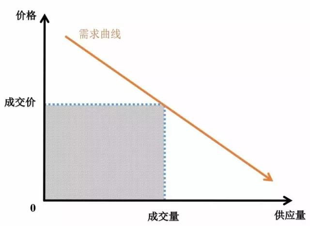

问题是我们所说的需求曲线都是示意性的，只是画一个倾斜向下的需求曲线而已，在现实生活中，整个市场的需求曲线是怎么样的，没有人会给厂商把这条线画出来。

所以到底定价是多少才合适呢？如果价格再涨一点，消费者就会少买多少？价格降一点，消费者又会多买多少？这个度不容易掌握。卖家必须不断地摸索才能知道。

也就是说，怎么定价、怎么定产量，才能使得销售的总收入达到最大这得摸索。这个最优点不是显而易见的，是必须摸索的。正是因为这样，我们把这种卖家称为“觅价者”，找价格的人（price searcher）。

在现实生活中，哪些市场符合不完全竞争的条件呢？那多了，我们见到的几乎所有的生产商都属于觅价者。比较明显的，我们用的不同品牌的手机，它们之间的区别很大，小米、锤子、苹果，它们的品质不一样、风格不一样、侧重点不一样，价格也不一样。

事实上，哪怕是你家小区那个小卖部，也是属于觅价者，而不是受价者。表面上，他卖的水跟别家卖的水是一样的，但实际上他提供的服务是独特的。他卖的不仅仅是一瓶矿泉水，他还在那个具体的位置给你卖水，所以你买到的这瓶水、得到的服务——综合服务，是跟你在别处买一瓶水不一样的。

这家小卖部，他如果让每箱水涨价 2 块钱、涨价 5 块钱，甚至涨价 10 块钱，你可能还会买他们家的水，为什么？因为他们这家店铺的地理位置，决定了他们所提供的综合服务是具有独特性的。

他多收你 2 块钱、5 块钱、10 块钱，你不会跑掉，你还是会买他们家的水，只不过可能买少那么一点点。如果他们把价格下降一点点，他也不会把全世界要买水的人都吸引过来。所以一个小区里面的小卖部，实际上也属于觅价者，而不是受价者。

## 3\. “不完全竞争”是市场常态

完全竞争状态对应着受价者，不完全竞争状态对应着觅价者。

而在真实的生活当中，只有极个别的市场符合完全竞争的模式，而其他大量的场合，实际上都是不完全竞争的状态。甚至包括我们住宅小区里的小卖部，实际上他们都是觅价者，而不是受价者。竞争都是不完全的，而不是完全的。

说到这里，我就要给你做一个澄清，经济学家们把完全竞争和不完全竞争、理想竞争和不理想竞争之间的关系，刚好弄反了。

在现实生活中，那种所谓的完全竞争状态，所有的厂家都在生产同样的产品，这不是什么好事。你愿意活在那样的社会里面吗？

真实的社会，是每一位供应商，都力争给消费者提供有那么一点不同的产品，力争把自己的产品做得多那么一点特色，那样的社会才是理想的竞争状态，那才是完美竞争（perfect competition ）。

而经济学家把这两个词给搞反了，他们认为的那种理想的状态，恰恰是不理想的。他们批评的“不理想状态”，恰恰是我们每天都遇到的、商人和消费者都孜孜不倦在追求的状态。

正是因为这样，商人们不断地生产新的产品，追求差异化的过程，本身就是一个动态的过程，从来没有过市场上只有一种产品的状态。

也正因为这样，经济学家哈耶克（F. A. Hayek，1899 年 5 月 8 日－1992 年 3 月 23 日 ）——记得吗，我们前面介绍过他重要的文章《知识在社会中的运用》——哈耶克说：

竞争的本质就是动态的过程，但这个本质却被经济学家们——那些追求静态分析的经济学家们——完全忽略了，大多数人似乎认为，判断真实生活中的效率标准，就是所谓的“完全竞争状态”。如果现实中的市场不符合完全竞争状态，那我们就说这是不理想的。这种看法不仅不可取，而且是有害的，我们不应该用“完全竞争状态”来作为制定经济政策的标准。（ F.A. Hayek, "The Meaning of Competition," in Individualism and Economic Order, 1948, http://mises.org/daily/4181）

但不管怎么样，这就是现状，我们把概念弄清楚了，具体怎么评判，可以是另外一回事。

## 课堂小结

今天我给你讲了两组概念：一组是完全竞争和不完全竞争的概念；另外一组是受价者和觅价者的概念。

完全竞争状态对应着受价者，不完全竞争状态对应着觅价者。

经济学家们把完全竞争和不完全竞争、理想竞争和不理想竞争之间的关系，刚好弄反了。

## 课后思考

今天我留给你的思考题是，你能不能告诉我，有哪两个品牌的产品是完全同质的，一点差别都没有的？对你来说有没有这样的两个产品？

##### 98

# 第 98 讲  
价格歧视能给觅价者脱罪 

今天我们讲价格歧视的作用，我要给你把价格歧视的原理讲透。

我们知道，价格歧视这个概念，在很多商学院的课程里面，都有讲怎么样进行价格歧视。在现实生活中，我们也会在不同的场合听说价格歧视，甚至在法学院的课程里面，也会提到价格歧视。歧视，这是个贬义词，大家都觉得这不太对。

不管怎么样，价格歧视的含义，就是对不同的用户收取不同的价格。

当然你不一样，你是系统地跟着这门课一步一步走过来的，我们在课程的前面很早的时候就讲过，“歧视”是一个中性词，它讲的只不过是“区别对待”。

价格歧视的含义，就是根据用户的不同身份、不同位置、不同的购买量、不同的购买时间，收取不同的价格。这样做的理由是什么呢？这样做究竟是促进了社会的福利，增加了公平；还是减少了社会的福利，减少了公平呢？我们今天就把这个问题说透。

昨天我们解释过了，所有的卖家就分为两类：一类叫受价者，一类叫觅价者。觅价者的特点，就是他们面对的是一条倾斜向下的需求曲线，他们能够通过适当地调整产量，来调整价格，从而追求利润的最大化。

我们要知道，觅价者涵盖的范围非常广。我们昨天说了，小区里面的小卖部属于觅价者。而我们通常所说的各种各样的垄断者，包括在市场竞争当中取得一定市场支配地位的私营企业，包括那些具有垄断经营权的国营企业，他们都是觅价者。

## 1\. 觅价者的罪过

既然是这样，那么觅价者或者我们说垄断者，它到底有什么错呢？经济学的教科书通常是这么说的：

觅价者或者说垄断者，他们面对的是一条倾斜向下的需求曲线。也就是说价格定得高一点，消费者买得就少一点；价格低一点，消费者买得就多一点。

那么觅价者或者垄断者，他们在寻找合理价格的时候，就会遇到这样一种情形：每当他想要多卖一件产品的时候，他就必须降价——因为他面对的是一条倾斜向下的需求曲线。

他每降一点价格，当然可以多卖一点产品，这样他能够增加收入。但问题是，他每降一次价格，他前面卖出去的所有产品也都降了价，这样的话他的收入就会减少了。

这一增一减，就会产生一个平衡点，也就是说过了这个平衡点，他如果还继续为了多卖产品而降价，他虽然可以多卖，但由于之前他卖的每一个单位产品都要降价，他的收入反而减少了，他的总收益就会出现下降。

所以觅价者，就必须在某个适当的时候，停止生产、停止销售，停在这个使他利润能够达到最大化的平衡点上。

这时候觅价者或者垄断者的罪名就来了。经济学家通过简单的计算能够证明，觅价者也就是垄断者，他们所停下来的这个平衡点，也就是他们能够追求利润最大化的这个产量和价格，比他们本来能够生产的量要低，比他们能够提供产品的价要高。

也就是说，觅价者为了追求个人利益的最大化，不惜使得他们产品的生产量变得过低，产品的价格变得过高。而他们有一部分生产能力，也就是本来可以生产，他们却没有生产的那一部分，被白白浪费掉了，成为经济学家所说的“无谓损失”。

这就是觅价者，在定价的过程当中所犯的罪过。

## 2\. 经济学家眼中的“无谓损失”

你翻开任何经济学的教科书，讲到垄断定价的这个章节，你就能够看到一个图表，这个图表当中，通常用阴影画了一个三角，然后旁边注解写着“无谓损失（deadweight loss ）”。

这个区域所代表的,就是经济学家所说的，它本来能够生产出来，本来可以满足消费者的需求却没有被生产出来，仅仅是因为垄断者或者觅价者想要追求更大的利润，就被白白的浪费掉的那部分资源。这就是垄断者或者觅价者犯的过错。

我也给你准备了一张这样的图，你可以看看。

你应该记得，经济学家的视角是很独特的，在我们讲寻租概念的时候，我们曾经讲过，经济学家会问：“小偷为什么对社会不利？他偷东西只不过是产生了财富转移而已。”只要社会的总财富量不变，财富发生转移本身并不会使得经济学家皱眉头，并不会使得经济学家做出谴责。

经济学家真正责难小偷的地方，是说小偷增加了社会上做锁的成本，做锁消耗掉的真实资源，这种消耗掉的资源叫做“无谓的损失”。只有当经济学家看见无谓损失的时候，他们才会生气，他们才会指责。

所以同样的道理，你看在这里觅价者或者垄断者，由于他们在追求利润的过程中产生了无谓损失，也就是这个黑三角，经济学家们生气了，说垄断者或者觅价者有过错。

但你仔细想想，这些经济学家、这些教科书，说得对吗？

## 3\. 价格歧视可消除无谓损失

他说的是社会上有那么一些商品，它们本来是可以生产出来满足消费者的，却没有被生产出来，白白浪费掉了。经济学家不是说人是追求利益最大化的吗？追求利益最大化的另外一种说法，是追求损失最小化，如果真有一部分产品明明是可以生产出来的，那它为什么就不被生产出来了呢？

你只要仔细听我前面推导的逻辑就会发现，这部分产品之所以没被生产出来，是因为经济学家们假定，厂商每多卖一件新的产品，他必须对他以前卖的每一个单位产品都降价。也就是说，经济学家做了一个简单的假定，就是厂家卖东西必须卖“划一价”，就是整齐划一统一价格的意思。

只有当生产者遵守这个规定，也就是说无论卖多少产品，它卖的价格必须是统一的价格，只有这样的情况下，才会出现有一部分的产品没有被生产出来的现象。

但只要我们放开了这个假定，我们不要求生产者，对他们卖的每一个单位产品都收统一的价格，不同单位的产品可以卖不同价格，刚才的那个结论——生产者会放弃一部分的生产能力，故意不生产一些产品——就不成立了。

换句话说，只要生产者对不同单位的产量收取不同的价格，顺着需求曲线一级一级地走下来，那经济学教科书里面的那个黑三角、那个无谓损失的区域就会消失。

也就是说，只要供应者、生产者能够对消费者实施价格歧视，对不同的人、对不同的销量，在不同的时间、在不同的地点收取不同的价格，那些经济学家假定的，“本来可以生产却没有被生产出来的产品”就不会存在，它们就会被生产出来。

也就是说，经济学教科书所指责的那些觅价者所犯的过错，就是说他们制造了“无谓损失”的这个罪过，恰恰是由于经济学家们自己的假定，假定人家生产者只收取统一的价格才产生的。

如果不存在这个假定，允许生产者、允许供应商对不同的消费者收取不同的价格，这个无谓损失就会消失，觅价者的罪过就不存在了。

再直截了当地说，只要生产者和供应者能够实施价格歧视，那么所有教科书里面所说的“觅价者会产生的无谓损失”就不会存在，觅价者就不会有过错。

所以，价格歧视是好事，它能够帮助生产者尽量地生产、尽量地销售，同时帮助消费者尽量地满足他们的需求。价格歧视是大好事。

## 课堂小结

今天我给你讲了这样一个逻辑，经济学教科书通常会指责垄断者或者觅价者，说他们为了追求利润的最大化，会不惜牺牲一部分的生产能力，使得他们产品的产量过低、价格过高，从而产生无谓的损失。

但事实上，这个结论是建立在所有的厂商，只收取统一价格的前提下才能得出的。只要厂商能够进行价格歧视，也就是说对不同的产品、对不同的产量、对不同的消费者收取不同的价格，那么这种无谓的损失就会消失，生产者就可以把可以生产的、值得生产的所有产品，都生产出来，满足消费者的需要。

所以价格歧视能够促进生产、消除浪费，最大限度地满足社会的需求。是好事，不是坏事。

## 课后思考

我今天留给你的思考题是，既然垄断者或者觅价者，实施价格歧视本身并没有过错，那么我们还有什么理由来反对垄断呢？或者说垄断还会造成哪些不良的经济后果和社会后果呢？

##### 99

# 第 99 讲  
价格歧视的策略 

今天我来给你讲讲价格歧视通常会采取的策略。

昨天我给你解释了，价格歧视其实是一种非常有意义、能够促进生产、减少浪费、最大化增加消费者满足感的商业行为，但它同时也是一种被深深误解的商业行为。

## 1\. 价格歧视的三种方法

在经济学里，价格歧视通常分三种：

第一种叫完美的价格歧视，也就是卖家对消费者所消费的每一个单位产品，都分别收取最高价格。

我们在前面讲交易剩余的时候讲过，任何一宗交易的成交价，都比买家心目中的最高价要低，要比卖家心目中的最低价要高，所以买卖双方是皆大欢喜的，他们都获得了剩余。

这部分剩余我们称之为“交易剩余”，我们既不说它是“消费者剩余”，也不说它是“生产者剩余”，因为这两种说法都有一种暗示，好像这部分剩余是专属消费者或者生产者的。其实这部分剩余，是他们双方共同产生、共同拥有、共同瓜分的，谁多得一点、谁少得一点，没有必然的对错。

但在这里，完美的价格歧视，指的是卖家把交易剩余全占有了、全夺走了。

他怎么卖？他向一个饥肠辘辘的消费者说：“来，我一口一口地给你卖食物，第一口你愿意出的最高价是多少啊？”这个很饿的人说：“我出的最高价是 100 块钱一口。”卖家先赚第一个 100 块钱，然后说：“第二口你愿意出的最高价是多少啊？”消费者说：“第二口是 99 块钱，第三口是 98 块钱。”这样一口一口地卖，结果交易剩余就全归卖家占有了。

这种价格歧视——对顾客消费的每个单位产品，都分别收取最高价格的办法——叫完美的价格歧视。当然，这基本上是一种理论上的假设。在现实生活中，要实施这种完美的价格歧视，有很多的障碍，实际上不会这么实施。

更常见的是所谓的“ 二级价格歧视 ”，也就是对不同的购买量收取不同的价格，多买就便宜一点，多买多送。

但有时候，要仔细衡量消费者到底买了多少，还是比较麻烦。于是卖家就会采用第三种更加粗糙的价格歧视办法，叫“ 三级价格歧视 ”，就是对不同的人群或不同的地域，收取不同的价格。

我们知道，很多产品有学生版、有家庭版、有专业版、有终极版，它们针对的就是不同的人群。

也有很多产品，它们在不同的地域、不同的国家，有不同的销售策略、有不同的定价。这是由于不同地域、不同国家的消费者，对同样一种产品，具有不同的需求弹性。

记得需求弹性的概念吗？那就是消费者的需求量对价格变动的敏感程度——价格提高一点需求量有多大的变化。人们对一种产品趋之若鹜的地区价格就定得高一点；相反，如果一个地区的消费者对一种产品的需求弹性很高，对价格的变动很敏感，那么定价就会低一点。

我们要知道，要成功地实施价格歧视——就是对不同的顾客、对不同的销量、对不同的地区收取不同的价格——要做成这件事情，最重要的，就是要防止消费者之间对同样的产品进行转售。

越是难以阻止消费者转售的产品，你就越难实施价格歧视。比方说瓶装的可口可乐，就很难实施价格歧视。你卖给学生一个低价，卖给教授一个高价，教授就会让学生去代自己购买，价格歧视策略就会失败。

但对于那些不能转售的商品或者服务，商人就会大量进行价格歧视，比方说在餐厅里面喝的水、饮料，它们的价格差距就非常大。

## 2\. 航空公司

实名制的飞机票，也是大量实施价格歧视的例子。你坐飞机的时候环顾四周，你身边几乎没有一个人，付的机票价格跟你是完全一样的，虽然你们获得的服务是完全一样的，一起起飞、一起吃饭、一起到达。

航空公司可以说是机关算尽，用尽了所有的办法，把不同需求的乘客区分开来。

他们按照乘客买票的时间段、按照乘客过去的里程数、按照乘客所买的舱位，还按照乘客同行的人数，以及乘客和同行人之间的关系来做细分，来收取不同的价格。航空公司之所以能这么做，是因为机票不能在乘客之间自由转售。

## 3\. 教育机构

教育也是一个道理，学生的学籍不可以在学生之间自由转售，这时候学校就对学生实施了大量的价格歧视。

成绩好的、成绩差的同学待遇不一样；第一次到这个学校读书的学生，跟祖孙三代都在这个学校读书的，待遇不一样；同样一所学校，读的年级不一样，收费也完全不一样。

一般来说，一所综合性大学，给这个学校贡献钱的是本科生，因为本科教育是比较同质化的教育，学校不那么挑人，所以只要符合基本的条件他们就招收，本科生的数量很大，他们向本科生收钱。

而研究生是教授选择的研究伙伴，他们更挑人，这时候研究生交的钱就很少，甚至不用交钱，甚至还拿钱。一般的研究生都要承担一定的助教工作，但其实这些助教工作都非常简单，不算太辛苦，跟他们获得的奖学金相比是过高的收入，但其实学校就是找一个理由给研究生补贴。

不管怎么样，教育机构是一个大量实施价格歧视的地方。

## 4\. 旅游景点

很多旅游景点，他们也是实施暗中价格歧视的。比方说我到美国的环球影城去游玩，买门票之后，进去每一个游玩的地方还得重新排队，每一个队伍基本上都要排上一个小时。

也就是说，这个影城放进去的游客过多，人们实际上一天下来只能完成大概三分之一到一半的游乐项目。而与此同时，环球影城还卖另外一种门票，那就是不用排队的门票。

这种门票的价格是普通门票的一倍。

买了这种门票，你去每一个游乐项目都不用排队。每一个游乐项目开始的时候，影城先让持这种票的人先坐定坐好了，才放其他的人进来。如果买了这种票的话，一天下来，影城就保证游客能够把所有的游乐项目都玩完。

而如果不买这种门票，你要把所有的游乐项目都玩完，得花上三天的时间。算上这三天的交通费、酒店住宿费，游客是不值得的，这样的话，影城实际上就实施了价格歧视。

就是说，对它们的游乐项目，不是那么热衷的那些消费者，付了钱以后大概能够完成三分之一，这也就算了。对那些特别着迷的游客，多付一倍价格，就能够把所有的游乐项目在一天内玩遍。

不同的消费者交不同的价格，这是隐性的价格歧视。

## 5\. 图书

图书出版也常有价格歧视的安排。在欧美一般新出的书都是精装的，精装的书当然成本要高一点，但只不过是高那么一点点，它的定价却高很多，它的目的是制造一个理由，向那些特别热心、特别渴望读到这本书的读者，收取更高的价格。

等过了一年半载以后，他们再出平装版，那就让那些需求不是那么强烈的读者，能够以较低的价格、较晚的时间读到这本书，这也是一种价格歧视的办法。

## 6\. 演唱会

还有一种非常有趣的价格歧视，是歌星在发售他们演唱会门票的时候，刻意把门票的价格降低。当然，如果是政府强令他们这么做，这叫价格管制，如果是歌星他们自己自愿这么做不叫价格管制，但起到的效果是一样的。

如果演唱会门票价格过低，歌迷就不得不展开价格以外的竞争，那就是排队等候。什么人更愿意排队，更愿意等候呢？是那些时间成本比较低的人。通常是年轻人。这样做的结果，是能够把那些更年轻、更热情、更奔放的歌迷吸引到演唱会现场，这样演唱会的现场就会更加火爆。

## 课堂小结

今天我给你解释了一些常见的价格歧视策略，要成功实施价格歧视，最重要的是要防止顾客之间进行产品的转售，越是能够成功地阻止他们转售，商家实施价格歧视的程度就会越高。

## 课后思考

今天我留给你的思考题是，世界各大城市的迪士尼乐园，都提供两种门票：一种是年票，一种是单次入场的票，而这两者的价格差距是很小的，原因是什么？

##### 100

# 第 100 讲  
行业竞争程度不看企业个数 

这个礼拜我们介绍了完全竞争和不完全竞争，也介绍了受价者和觅价者的概念。今天我要进一步向你解释，一个行业、一个市场的竞争激烈程度，不应该取决于在这个行业里面竞争企业的个数。

## 1\. 企业合并是为了应对更激烈的市场竞争

我先问你，在一个小区口有两个卖早餐的摊位，他们之间有竞争吧？但是有一天，这两家摊位合并，变成一家摊位了，那你说，在这个小区口，卖早餐这个行业的竞争程度上升了还是下降了？

你可能会说，两家摊位变成一家摊位，竞争者的数目减少了，那肯定是竞争减少了。但如果竞争者的数量减少，竞争的程度就减少的话，那我们看看，今天社会上有许多大企业，雇佣的人不是十个、不是百个、不是千个，而是上万个，这些企业不就对竞争有极大的破坏吗？

如果我们要促进竞争，岂不是应该把这些企业一分为二、二分为四，把他们最后分成一个一个人的自雇型企业，才能够增加市场的竞争程度？这显然是有问题的。

我们仔细想想，这两家卖早餐的摊位，他们合并起来会发生什么事情？你记得我们讲“渔村的故事”吗？两个人、三个人上船以后，他们不是简单地重复劳动，他们之间会有新的分工和合作，他们会产生新的规模效应。

也就是说，这两家早餐摊位合并起来以后，他们的竞争能力更强了。如果你仅仅盯着这个小区门口，你会说生产者的数量减少了，竞争的程度可能下降了。

但是，如果你把视野放宽一点、看得更远一点，你就会发现，这两个早餐摊位合并起来以后，变成了一家竞争能力更强的早餐摊位，他们之所以合并起来，是为了跟外面其他的早餐摊位，展开更激烈的竞争。竞争程度没有减少，反而很可能增加了。

我们看任何一个企业，都应该通过这样的角度来理解。今天你看所有的大企业，企业内部有高度紧密的结构的。没错，在一个企业内部，人与人之间是不竞争的，他们是合作关系，但这种高度组织化的合作，目的只有一个，那就是在别处展开更激烈的竞争。

所以我们不能够仅仅从企业的数目多寡，来判断市场竞争的激烈程度。我们不知道企业的边界到底在哪里，怎么样才算是最激烈的竞争。

## 2\. 企业规模大小由企业家摸索确定

企业的边界也就是企业的大小，什么时候两个企业应该合并成为一个，什么时候一个大企业又应该分成若干个小企业，这需要企业家在竞争当中不断地尝试、不断地摸索。

外人，不管是经济学家、政府官员还是各种社会贤达，他们都没有办法在事前做出一刀切的判断。

很多时候，企业的数量取决于消费者的数量。比方说，在咱们北大国发院里面，可能有一位理发师就够了。因为院子里面，也就二三十位教授，再多就是浪费，两位理发师都会亏本。

这位理发师收取的，到底是垄断价还是市场价呢？这不取决于在朗润园里面有多少位理发师，只取决于一点，那就是行业的入口有没有人为设置的障碍。

如果院长说只能让这位理发师理发，别人不能够进入理发，或者规定教授不能自己理发，那么，这位在朗润园里面被指定的理发师，收取的价格可能就是垄断价。

但如果大家能够随意地选择替代方案的话，这位理发师哪怕是园子里面唯一一位理发师，他收取的价格也很可能仅仅是市场的竞争价格。因为如果他收取的价格太高，就会吸引别的替代者进入市场。

在这个市场里面，竞争程度到底激烈不激烈，不看企业的个数，只看行业入口有没有人为设置的障碍。

## 3\. 有竞争必有成败，有成败必有企业退出市场

判断一个市场的竞争程度，不取决于竞争企业的数量，还有一个重要的原因，是因为我们鼓励竞争。既然鼓励竞争，有竞争就必然有成败，有成败就必然有一些企业要退出市场。

如果我们非要在一个市场里面，维持一定数目的竞争者数量，那我们就会遇到一个两难的问题。一方面我们鼓励竞争，但另外一方面我们又不让那些在竞争当中败下阵来的企业退出市场，这算什么竞争？

所以，基于这些理由，我们不要犯一些常见的错误，包括一些经济学教科书都会犯的错误，那就是根据市场上竞争者的数量，来判断这个市场的竞争激烈程度。

## 4\. 竞争激烈程度的衡量标准：市场准入

我们用什么标准，来判断一个市场的竞争激烈程度呢？我们只看一个标准，那就是行业的入口处，到底有没有人为的、行政的障碍。

我给你准备了一个表格，它按照两个不同的标准：受价者和觅价者的标准，以及开放市场和封闭市场的标准，把世界上各种不同类型的供应商、生产者分成了四大类。

也就是说，受价者被分成了两类——在开放市场、在行业入口处没有任何准入障碍的受价者，以及在封闭市场在行业入口处有准入障碍的那些受价者，这是两种受价者。

以及在开放市场下面的觅价者，和封闭市场下面的觅价者，四种不同的类型。

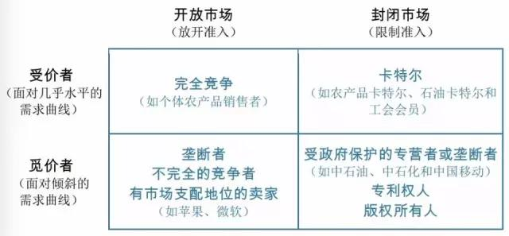

比如在开放市场里面有受价者，他们是个体农产品的销售者，这一点我们可以理解。

在开放市场里面，也有所谓的垄断者或者觅价者，比方说在市场竞争状态下面取得一定市场支配地位的企业，比方说苹果公司、微软公司。他们的市场支配地位，是通过创新、通过产品的特色、通过消费者的投票来获得的。

而在封闭市场里面，受价者就会形成所谓的卡特尔，比方说在许多国家里面就有农产品的卡特尔；石油输出国组织他们卖的石油高度同质的，他们也会形成卡特尔。他们的特点是他们在行业的入口处，设置了行政障碍，形成了所谓的石油卡特尔。还有工会会员，实际上也是一种卡特尔。在后面我们会有专门讨论工会的内容。

而在封闭市场里面，也会形成觅价者或者垄断者，那些具有专营权的国营企业，还有那些受政府保护的专利权人和版权所有人，他们都属于在封闭市场里面形成的觅价者。

衡量一个市场的竞争程度，主要的一个标准，就是看一个行业的入口处，有没有行政设置的障碍。有，这个市场竞争程度就有限；没有，市场就是激烈竞争的。

所以一般来说，只要在行业入口处没有行政设置的障碍，这个市场就是充分竞争的市场。

这里只有一个例外，那就是政府授予的专利权和版权，这是一种促进发明创造的行政准入。虽然经济学家对此也有争议，但大多数的经济学家，还是支持政府对知识产权实施人为的保护。

## 课堂小结

今天我给你介绍了一个重要的概念，那就是一个市场的竞争程度，不能靠数数目、不能看企业的个数来决定，而应该倒过来，去看这个行业的入口处到底有没有行政准入的障碍。

## 课后思考

今天我留给你的思考题是，私营的垄断者和国营的垄断者，他们有没有不同？为什么？

##### 周

# 第 25 周问答  
飞机上的乘客谁补贴了谁？ 

我们开始本周的问答时间了。

这个礼拜所讲的几个知识点，其实都是具有颠覆性的，都是和你以前所学到的有所不同，甚至是针锋相对的。

## 1\. 觅价者比受价者更常见

一开始我们介绍了经济学当中非常常见的两对概念：受价者和觅价者，完全竞争和不完全竞争。而完全竞争人们有时候也会说它是“理想状态的竞争”，不完全竞争人们也会说它是“不理想状态的竞争”。

## 2\. 所谓“完全竞争市场”并不值得追求

我们这一讲，重要的是要告诉你，完全竞争或者理想竞争这些概念，这些词是具有误导性的。

很多学经济学的同学，读完相关的章节，他们就会去追求那些完全竞争市场，他们就会有意无意地认为，那些完全竞争市场，或者理想竞争状态是值得追求的，是我们衡量这个世界好与不好的一个准绳。

而我要跟你解释的是，恰恰相反，那种有无数生产者生产同一种没有区别的商品的市场，是一种静态的、停顿的、僵化的，毫无生气、毫无新意的市场，那不是什么完美的市场，不是什么理想的市场。

在真实的世界里，厂商永远在追求跟别的厂商有所不同，他们要创新，要与众不同，要制造差异化，要满足顾客新的需求，要找到新的利润增长点。而这些动态的过程，也就是不完全竞争的过程，其实恰恰才是理想的、才是真实的、才是有效的。

我们还经常听到有人说，现实还不够规范，离理论还比较远，其实这种说法应该倒过来才对。我们应该说：这理论离现实还是比较远，这理论讲得还不够到位，这理论还有待完善、有待跟进。这样看问题才对。

## 3\. 价格歧视能为觅价者脱罪

本周讲的第二个重要概念，是价格歧视能够为觅价者脱罪。这一讲的内容也是非常深刻的，你在别的地方是很不容易听到的。

我在留言区里见到有一些同学说，这一讲有点难，确实是有点难的，我再来给你解释一下。

你看，我们说无论是垄断者还是觅价者，他们都是同一种人，他们做同样一件事情，那就是调整产量，调整价格，追求利润的最大化。

通过简单的推理，我们就可以确定，觅价者或者垄断者他们能够获得利润最大化的那个平衡点，不是生产资源能够充分利用的那个平衡点。

也就是说，他们如果要追求利润的最大化，那就会产生生产资源的浪费。

本来可以再多生产一点，但他们为了追求利润的最大化，产生了资源的浪费，这才是传统的经济学对垄断者的最强烈的指责。说他们在追求利润最大化的过程中，使产量过低、价格过高，导致了浪费。这种浪费被称为“无谓的损失（deadweight loss ）”。

在经济学教科书的图表上看，有一个黑三角，这是觅价者、垄断者的罪过。

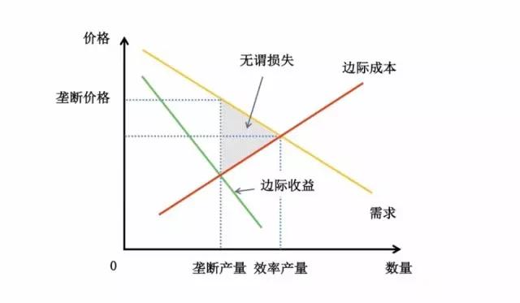

但实际上，这个“罪过”只不过是经济学家想象出来的“罪过”。因为他们在推理的过程中，假定了觅价者或者垄断者只能以统一的价格销售产品。如果真是这样的话，那确实会产生这种“无谓的损失”。

但只要我们放宽了这个假定，或者说我们更现实一点，承认觅价者或者垄断者，他们是可以进行价格歧视的——也就是说，他们可以针对不同的消费者、针对不同的地区、针对不同的销售量收取不同的价格的话，那经济学家所假定出来的那个垄断者的罪过，产生无谓损失的那个罪过就会消失。（秦俑语：想想大家吐槽的滴滴雨天调价的案例，现在你会有什么新的理解？）

觅价者或者垄断者不会浪费生产资源，生产资源会得到充分的利用，消费者的需求能够得到极大的满足。所以，价格歧视是好的，是能够促进生产的。

## 4\. 价格歧视的本质是交叉补贴、各取所需

现实生活当中，我们见到很多价格歧视的现象。坐飞机的时候，你会看到经济舱里面黑压压的一群人，在公务舱或者头等舱里呢？乘客可以躺着睡觉。

上餐饮的时候，经济舱的乘客得伸长脖子等老半天才轮到自己，而头等舱、公务舱的乘客，一走进机舱，乘务员就会给你挂起衣服，送上不同的饮料，换上舒适的拖鞋，他们甚至还知道你姓什么。如果遇到终身白金卡会员，机长还会专门过来跟你打招呼，这种不公平的现象是显而易见的。

但很多人不能够透彻地理解，这是一种交叉补贴的现象。你想想看，无论是经济舱的乘客还是头等舱的乘客，他们对飞行服务的要求有一些是共同的，比方说安全，比方说时间，比方说路线；而有些是不一样的，比方说价格，比方说服务质量，比方说舒适程度。

如果要消除这种不公平的现象，让这两种人群分别乘坐两架不同的飞机，那也是做得到的。但这时候，这两种不同的人群就得额外支付更多的成本了。而航空服务的设计者把这两群人放到一块儿，既满足了共同的需求，又满足了差异化的需求。

价格歧视的同义词是交叉补贴，各取所需，这是价格歧视的本质。

## 5\. 垄断与否不能通过企业数量判定

这个礼拜我们讲的第三个也是具有颠覆性的概念，是我们判断一个市场到底是垄断性的还是开放性的，不在于去数那些市场上已有的供应者的数量，而是要看行业入口处，有没有政府设置的行政准入障碍。

你看，既然完全竞争市场是一种不现实的假设，不完全竞争才是现实的情况，生产者总是标新立异，追求有个性、有特点的，那任何一种产品，任何一种我们喜欢的产品，它就不可能由无数的生产者来提供。好的产品总是由个别的生产者提供的。

更重要的是，如果我们是鼓励竞争的，那么竞争当中就有赢家，就有输家；有人能够在市场里面存活，有人就会被淘汰离开市场，这时候供应者的数量也会下降。这也同样说明，我们不能靠数数来决定一个市场的竞争程度。

不是说竞争者越多，市场的竞争性就越强，我们要彻底转变观念——看行业入口处的准入障碍，来判定一个市场的竞争程度。

把这三点加起来，我们就能够明白，觅价者或者垄断者，也就是那些能够提供有独特价值的产品的供应者，他们追求利润最大化的行为本身是没错的。要指责垄断行为，我们得从别的角度入手。

你比方说有些企业的经营行为是受到行政保护的，有些生意只能这一家做，别人不能做，这是一种妨碍竞争的行为。

我们说有些垄断企业，它的经营管理模式比较落后，经营者的业绩和他们的收入并不能够准确地挂钩，所以经营的效率很成问题。我们要批评垄断行为，只能通过这些角度来入手。

## 6\. 时间地点不同，产品品质就不同

好，我们来看看周一的思考题：“ 你能不能告诉我，有哪两个品牌的产品是完全同质的，一点差别都没有，对你来说有没有这样的两种产品。 ”

我还记得我在读研究生的时候，我有两位教授就这个问题展开了激烈的辩论。

有一位说就是没有，每天早上我对着衣柜挑衣服的时候，我根本就不在乎哪件更好，更合适，我是随手拿起来就穿的。另外一位教授说，哪怕是你挑最顺手的那一件，那也说明那一件跟别的衣服是有不同的。

对这个问题，我的回答是，从观察上来说，没有哪两个品牌的产品是完全同质的。也就是说，不同的品牌，品质就有所不同。别说不同的品牌了，在不同的时间、不同的位置上销售的产品，哪怕是同一个品牌，它其实也有不同。

在超市里面的一瓶矿泉水，跟泰山顶上的一瓶矿泉水，跟在酒店里的一瓶矿泉水，你能说它们是完全同质的吗？当然是不同质的。

从观察上来说，如果消费者认为它们都是同质的，而价格区别那么高，那就必然会产生一个后果，那就是价格稍微高出一点点的那些商品，它们的销售量应该为零。而现实并不是这样。

所以我的答案是：哪怕是从物理角度看，两件产品是完全同质的，从经济的角度看，时间、地点、买家、卖家不同，产品就有所不同。

## 7\. 批评垄断要找到正确角度

周二的问题是：“ 既然垄断者或者觅价者是同义词，都是同一个意思，实施价格歧视本身并没有过错，那我们还有什么理由来反对垄断呢？ ”

答案刚才说了，垄断有不同的成因，有些是因为行政保护形成的，有些是因为他们的产品具有差异性，消费者喜欢他们的产品而造成的。

我们批评垄断者，重心不是他们的定价行为，而是他们的生产行为。我们要看他们的生产是不是有效率的；我们要看他们的生产是不是排他性的，他生产了别人就不能生产的。这是我们要批评垄断的角度。

当然，这个礼拜所讲的关于垄断的问题，只不过是开了一个头。我们的课程在后面还有专门的大模块，深入地讨论垄断问题和竞争的逻辑问题。你把这个单元的内容理解透彻，就会有助于我们后面的学习。

## 8\. 迪士尼年票是一种价格歧视

周三的思考题是：“ 世界各大城市的迪士尼乐园都提供两种门票，一种是年票，一种是单次入场的票，而这两者的价格差距是很小的，原因是什么？ ”

当然，很多同学都答对了，这是一种价格歧视的做法。

我记得两年前，上海迪士尼乐园快要开园的时候就有学者指出，上海迪士尼应该实行差别定价，也就是说在节假日对上海本地居民涨价一倍，对外地游客不涨价。

其实迪士尼乐园提供的两种门票选择，也就是单次票和年票本身，就已经很好地解决了这个问题。

你看年票和单次票的区别有两点：

时间上的区别，单次票只能一次入场，年票全年都可以入场；

价格上的区别，年票比单次票贵，但贵得不多。

这贵一点又贵得不多，说明有两个含义：

第一是入园观光的边际收益下降得很快，第一次看觉得挺好玩的，第二次看享受就会大幅度地下降，所以哪怕全年天天都去看，它新增的效用也很少。也就是好的体验会明显下降。

这跟另外一种情况形成鲜明的对比，你想想看，在一家餐厅，一顿自助餐的费用和全年免费自助餐的费用，差别应该是很大的。那是因为如果是吃自助餐的话，那顿顿的享受都差不多大。

第二个区别是全年票覆盖的时间相当长，它实际上就起到了鼓励本地游客在非高峰期入园参观的作用。

竹青 同学的回答就很完整，她说：

购买单次票的绝大多数是外地游客，一年之内重复入园的可能性很小， 而购买年票的绝大多数是本地居民，他们会重复入园，通过这样的价格歧视策略，就能够吸引更多的本地居民，在平日非高峰时段入园游玩，提高非高峰时段的客流量，增加收入。

## 9\. 私营垄断者和国营垄断者有何区别

周四的问题是：“ 私营的垄断者和国营的垄断者，他们有什么不同？ ”

他们主要的不同在两个方面：

第一，在经营管理的效率上面不一样。私营者盯着的最重要指标，是企业的边际收入等于边际成本，像我们在“渔村的故事”里面解释的，他们要追求的目标非常明确，也就是更高的利润。

而国营企业的经营者，他们追求的目标非常多元化，有企业的利润，有社会的效益，也有政府的政策取向。这当然，追求的目标越多，对利润指标的兼顾就越少，他们的经济效益当然就会打折扣。

第二个区别，是在竞争的排他性上的。私营企业往往没有权利阻止其他的竞争者，进入同样的行业跟自己竞争。而国营的垄断者，他们往往能够利用行政准入的限制，阻止潜在的竞争者和自己竞争。

这是私营垄断者和国营垄断者最主要的区别。

好，不知不觉我们已经完成了第二季度的学习。在这个礼拜天早上 7 点钟，我给你准备了第二季度复盘，每当完成一个阶段性的学习，不做总结的话学到的东西就留不住。所以你一定要留意收听。

周五辩论

好，我们周一到周四给大家留了思考题，今天是礼拜五，我给大家留一个辩论题，大家一起辩论。

这个礼拜我们讨论了垄断究竟有什么过错的问题。当然，我们课程的内容主要是集中在价格歧视问题上的。我们现在可以做一个更广泛的讨论，那就是垄断到底有没有好坏之分。

正方认为垄断一点都不好，不管是国营垄断还是私营垄断，只要垄断了市场，它们对消费者的利益就会造成伤害，所以凡是垄断者，政府都应该予以管制。

反方认为垄断也有好的一面，因为垄断者毕竟是消费者用钞票选出来的，它们获得了市场垄断地位，也就证明它们获得了消费者的认可。所以，我们应该允许它继续垄断。

欢迎大家参与辩论。

##### 季

# 第二季复盘  
人类如何增进彼此的幸福 

今天是我们全年课程第二季度复盘的时间。

时间过得真快，全年课程不知不觉竟然已经过了一半了。在这半年里，每天 10 分钟，我给你仔细地讲解经济学看问题的角度，它运用的概念、它遵循的基本原理。

回过头来看，内容非常丰富，这是一个把书读厚的过程。而复盘则是一个把书读薄的过程。

高度概括起来，第一季度也就是仔细地探讨了四个概念：选择、成本、需求和价格。而咱们第二季度，也就是探讨了另外四个基本的概念：权利、时间、耐心和分工。

这四个概念你以前都知道，但经过这三个月的学习，你对它们的理解肯定是大不一样了。究竟发生了什么变化呢？今天我就来给你做个回顾。

## 1\. 博弈产生权利，权利影响动机

我们学到的第一个知识点，可以总结为“博弈产生权利，权利影响动机”。

在这一部分里，我们首先讨论了权利跟能力之间的区别。能力只存在于动物界，是动物之间弱肉强食的一种现象。而权利存在于人类社会，是一种文明的现象。

权利是社会其他人自愿维护的、一个人做选择的自由，别人都愿意自愿维护的才叫权利。仅仅是你自己想象当中的自由，不属于权利；仅仅是靠你自己争取得到的，也不属于权利。

权利必须是社会上大部分的其他人自愿给你的，所以我们说权利是人赋的，而不是天赋的。把权利说成是天赋的这种说法，只不过是在语气上做了强调而已，仔细分析，它说不通。

因为我们今天所认可的各种各样的权利，它们之间是存在冲突的，这种冲突没有办法仅仅靠声称它是天赋的而得到解决。

自然不是权利的来源，神也不是权利的来源，数学和逻辑也不是权利的来源，法律本身也不是权利的来源。因为它们都不能告诉我们，怎么样才能协调不同的权利之间所产生的冲突。

要协调这些权利之间的冲突，只能靠不断的博弈，只能靠不断的吸取过去的经验教训。我们提到一部重要的著作，那就是《你的权利从哪里来》，答案是权利从错误中来（Right from wrongs ）。 我们从不断犯错的经验当中，找到避免重蹈覆辙的办法，找到合理界定权利的分寸。

接着这个话题，我们又讨论了“自由并不等于免费”。因为有意思的是自由和免费这两个词，在英文里面都是一个字，free。我们说政治上的自由并不等于经济上的免费（Political freedom is not economic free ）。

一个人要行使他的政治权利，可以，但当他行使他的政治权利的时候，往往不得不动用经济资源，他所动用的经济资源就不是免费的，而往往是有产权的，是有物主的，是有人要为此付费的。

如果我们只看到了政治的权利，说行使政治的权利可以不惜一切代价，那就只会伤害其他人的经济权利，损害他们的财产权利。而财产权本身就是一种重要的政治权利，财产权就是人权的一部分。

接着我们提到了一个重要的注意事项，那就是产权保护指的仅仅是资源的物理属性，而不是它的经济属性。如果你开的餐馆被别人搞破坏了，那你应该受到产权的保护。但如果你开的餐馆，被对面新开的餐馆抢走了很多生意，而你因此蒙受的经济损失，就不在产权保护的范围之内。

紧接着，我们花了不少的篇幅讨论产权的三个重要的属性，那就是使用权、收益权和转让权。

我们说使用权和收益权往往是产权一个刹那，一个时间片段上面的表现。而转让权呢？则是使用权和收益权在相当长的一段时间，甚至是在永久的期间内，对财产的控制能力。人们是否真正拥有对一项资源的转让权，是它的产权的硬度的一个重要指标。

接着，我们仔细地讨论了财产权的几种保护方式。这几种保护方式，是从人类纷纭复杂的保护产权的各种实践当中总结出来的，它只不过是一个粗略的总结，只不过是大教堂的一个视角，只不过是对精彩世界的一个管窥。

产权保护的第一种方法是财产原则，人家愿意卖给你，你才能得到；产权保护的第二种办法是责任原则，一个人的产权被剥夺了以后由第三方做出裁决，确定赔偿的金额；产权保护还有一种方式，就是不可转让原则，东西是你的，别人做了破坏也应该得到赔偿，但你自己不能转让。

我们说，通常财产原则才是更好的，因为它更能保护人们的自由。但在交易费用特别高的情况下，我们就不得不退而求其次，采用责任原则。而为了防止人们不理智，做出伤害自己的决定，有时候我们又会采用不可转让原则，来保护人们的权利。

接下来，我们讨论了全年课程当中非常精彩的部分，那就是用一条边际收益曲线，把人类曾经尝试过的四种最典型的所有制串起来的部分，那就是“渔村的故事”。

在不同的所有制下，也就是集体所有制、私有制、全员所有制和政府所有制下，人们由于权利的安排不同，采取的立场也就不同，做出的决策也就不同。他们所掌控的资源，所能带来的回报也就不同。

我个人的感受是，这一部分是全年课程最精彩的部分。

我们在讨论渔村的故事的时候着重讲的，是在不同的所有制下，人们会盯着不同的经济指标。有时候是要让平均产量不下降；有时候是要让边际成本等于边际收益；有时候是要让平均收益不至于低到他们在别处的平均收益；而有时候人们就根本不会盯着经济的指标，而会关注经济以外的目标。

渔村的故事给了我们两个层面的启示。第一是简单的经济层面的启示，那就是在不同的所有制下会有不同的产出。另外一个更深层次的，是制度层面的启示，那就是人在不同的制度下面会有不同的想法。

人选择了制度，但制度又会倒过来影响人的想法。这让我想起丘吉尔在谈到建筑物的重要性的时候，曾经说过一句名言：楼房是我们盖的，但它又会反过来影响我们（We shape our buildings; thereafter they shape us ）。

在介绍完所有制的基本知识以后，我们还做了一些更深入的，带有普遍性的讨论。

比如说公地是不是真的会产生悲剧，人们阻止公地产生悲剧的办法有哪些；什么是公用品，什么是私用品，道路到底是公用品还是私用品；灯塔到底应该由政府建造还是私人建造，政府提供的公共设施应不应该收费，公共设施可不可以由私人来提供等等。

权利是经济现象当中的核心概念，但我相信，没有哪本经济学教科书对权利的概念会讲解得这么细致和深入。

这是我们第二季度学到的第一句话，博弈产生权利，权利影响动机。

## 2\. 耐心决定利率，利率影响价值

我们学到的第二句话是耐心决定利率，利率影响价值。

我们开始了对时间维度的讨论，我们说所有的商品都可以简单地分为耐用品和易耗品，所有的耐用品它都必须在时间维度上面散发它的服务。

而既然涉及到时间，它就要受到人们耐心的影响，耐用品的价值是预期当中的未来收入流的折现和。那是因为越在遥远未来的价值，由于未来总是不确定的，人的耐心总是有限的，所以它们的现值总要打个折扣。

于是，耐心的强弱就会决定性地影响耐用品的现值，从这个角度出发，我们做了两个世界的区分。一个是遵循自然规律的物理世界，另外一个是由想象力和预期决定的经济的世界。

在那里，资产的价格随着耐心的变动而变动，随着人们的预期的变动而变动。由于人们预期的变化是随机的，所以价格的变动也就是随机的。

## 3\. 消息影响价格，价格随机行走

这就带出了我们的第三句总结，那就是消息影响价格，价格随机行走。

这可以说是一个石破天惊的发现。人们既是可以运用他们所掌握的自然规律的，但价格的变动又是随机行走的。这两点在利息理论当中得到了完美的结合。

紧接着我们就讨论了有效市场假说。它有一个弱版本，说的是所有价格指标都被人们消化过了，不用再做研究了；它有一个半强版本，是说所有的公开信息都被人们消化过了，不用做研究了；它还有一个强版本，说的是不仅是所有公开的信息，而且包括那些秘密的私人信息，也都已经被人们消化过了，都不用做研究了。

任何一个时刻的资产现值，就是人们对未来预测的最好的反应。我们运用这个理论，讨论了资产到底存不存在泡沫的问题。

在整个关于耐心和回报的章节里面，我们还讨论了年金的概念，讨论了知识产权保护的年限应该有多长才合适的问题。

## 4\. 风险影响收入，保险可买平稳

很重要的是，我们还讨论了风险的分摊问题，风险的分摊不是简单地把风险分给别人，风险就不存在了。风险的分摊就跟财务的重新配置一样，由于人们对风险有不同的偏好，通过风险的分摊，各得其所，所有人的幸福都得到了提高。

从这个视角下，我们讨论了保险的运作原理，我们明白了什么才是真正的、可以自我持续的商业保险，什么只不过是增税和补贴的政府政策。

我们还讨论了各种医疗保险方案，最后我们还解释了，为什么签订期货合约不是一个零和游戏，而是一个正和游戏，是一个能够给社会各方带来正效应的市场安排。它不仅可以重新分配不可避免的风险，还可以提高人们对未来预测的能力。

这也就是我们第四句小结所说的，风险影响收入，保险可买平稳。

## 5\. 分工提高产量，交易增进幸福

既然我们在第一季度已经深入地了解了成本的概念，在第二季度又仔细地学习了从时间的维度来看问题，那么这两部分的内容加起来，就能够让我们充分地理解比较优势原理的含义。

比较优势原理，说的是在生活当中每一个人都具有他的比较优势，哪怕是在生活的每一个方面，他都不具有绝对的优势。但他自己跟自己比，总能找到机会成本比较低的生产方向。而他只要专注这种生产方向，发挥他的所长，然后再把他的产出跟别人做交换，这样整个世界的总产量都会得到提高，每一个人的处境都能够得到改善。不管他在生产的任何一个领域，是否具有绝对优势。

比较优势原理为全球范围内展开的分工和交易，提供了坚实的理论基础。

我们讨论了到底是顺差好还是逆差好的问题，答案是顺差和逆差本身说明不了任何问题。一个人，一个地区，甚至一个国家，可能跟别的人，别的地区，别的国家长期保持着单边的顺差关系，或者长期保持着单边的逆差关系，这都不要紧，这是正常的。

我们还讨论了贸易对等和贸易报复的问题。我们说哪怕是单边开放国门，欢迎自由贸易，不需要别人也采取对等的政策，这个开放的国家也能够从中受益。

紧接着我们讨论了生产的规律，我们讲到了现实当中的生产和经济学教科书中所讲到的生产当中，非常重要的一个区别，那就是教科书通常都是事后看问题，把真实世界所发生的投资、生产、销售，看成是事前已经知道的一种规划。

而在现实生活当中，从来没有人能够成功地规划未来。所有的商人都只能是见一步走一步，在每一个关键的时间点上做新的决策。能挣多少就挣多少，能减少多少亏损就减少多少亏损，实在没办法了就关门歇业。

这些决策都不是事前可以确定的，它只能在事到临头的时候，由企业家在信息不对称的情况下做出决策。成和败，事后看来好像是顺理成章的，事前其实是不可知的。在这当中，企业家精神起着重要的牵引作用。

最后一个单元，我们讨论了生产者的定价问题，我们区分了售价者和觅价者的概念。

我们讨论了为什么价格歧视其实是能够促进生产的。它不仅帮助生产者提高了在竞争当中存活的机会，它也帮助了那些愿意付高价的需求者，让他们尽快得到满足。而更重要的是，他也帮助了那些需求比较低的消费者，让他们可以消费他们本来支付不起的消费。

价格歧视看上去像个贬义词，在美国的反垄断法里面是明文禁止的。但实际上它是一种促进生产和消费的自然的经济现象。

这就是我们第五点的总结，分工提高产量，交易增进幸福。

这就是我们第二季度的复盘。五句话把这部分的内容有机地串起来了。让我再重复一次这五句话。

第一，博弈产生权利，权利影响动机。

第二，耐心决定利率，利率影响价值。

第三，消息影响价格，价格随机行走。

第四，风险影响收入，保险可买平稳。

第五，分工提高产量，交易增进幸福。

每一句话都有落脚点，每一句话都有丰富的内容。好，这就是我们第二季度的复盘。

我们的课程过半了，你能从开始跟到现在很不容易，我为你点赞。如果你是刚订阅不久的同学，听了这个复盘，你也会发现这个复盘能够帮助你尽快地赶上来。

请你复盘

最后还是老规矩，我留给你的思考题是，你也对过去这一个季度的内容做一个复盘，不能简单地把内容重复一遍，而要从新的角度来讲新的体会。

复盘的内容宜短不宜长，因为长的文章容易写，短的文章不容易写，短的文章反而要花工夫。

今天我给你做的第二季度复盘就到这里。

##### 加

# 学习加餐  
行业产能对股价的助推器效应 

本文版权归夏春教授所有。

摘选至此，恰与本期经济学内容相关，作为扩充读物吧。

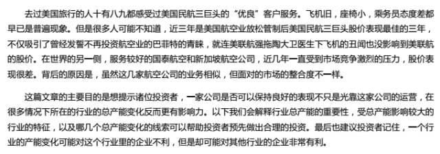

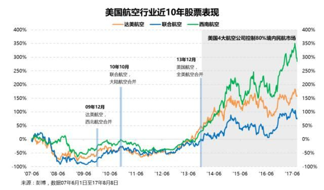

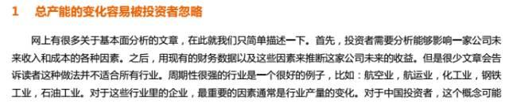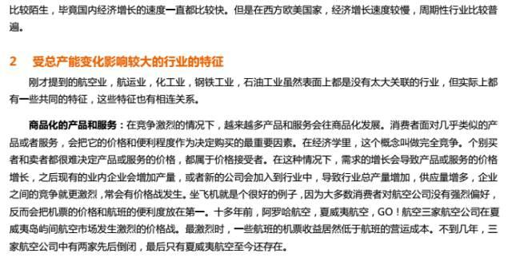

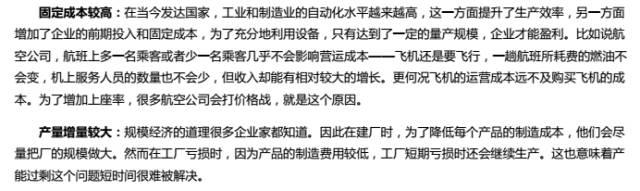

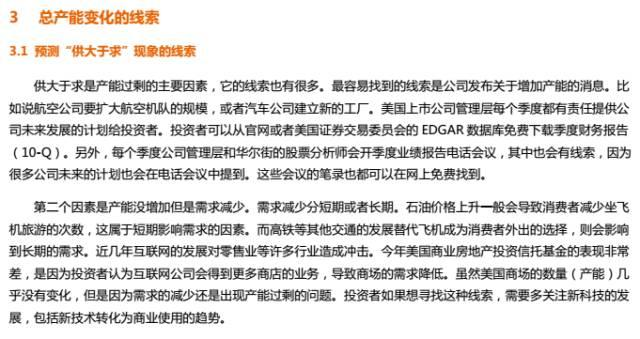

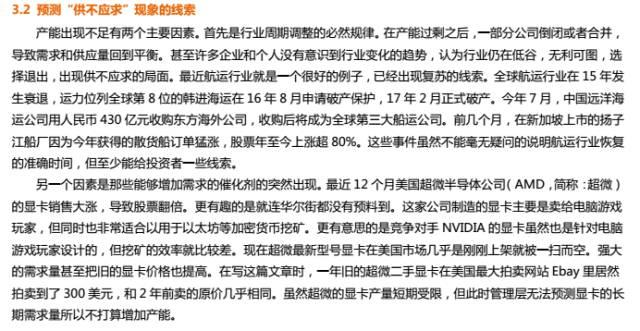

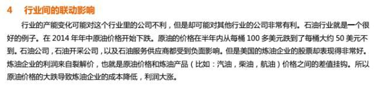

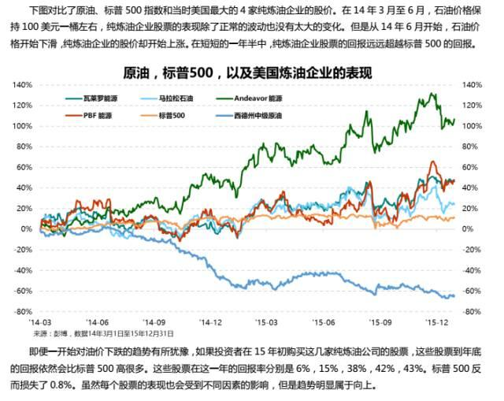

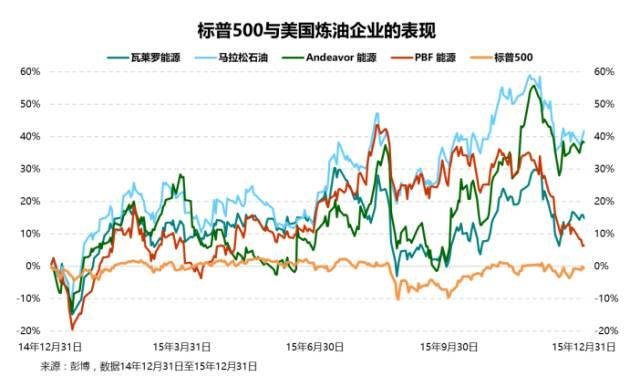

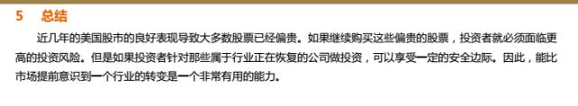

##### 101

# 第 101 讲  
柠檬市场的故事 

从今天开始我要给你讲一个崭新的模块，那就是信息不对称，我们通常叫 “ 互相依赖 ”。

你记得吗？我们开始的时候说，我们把人类遇到的约束分成四种：第一，东西不够，人们是怎么抢东西、怎么争东西的。第二，生命有限，人们在有限的时间里面，怎么分配现在的商品和未来的商品。第四，人们互相怎么协调，这个我们后面再讲。今天讲的是第三部分，互相依赖。

## 1\. 互相依赖与人际互信

没有谁生活在一个单人的世界里面，哪怕是小说里面的鲁宾逊，他生活在一个孤岛上，但他也有星期五，还有另外一个人陪着他。

我们所有的人都生活在社会里面，需要跟别人合作。跟别人合作、跟别人相处，我们得到的要比一个人生活要多得多。

但问题是，没有任何一个人是绝对值得信赖的，我们的父母、我们的配偶、我们的亲戚，当然他们都信得过，但是你想想看，总有一些他们知道的事情你不知道，总有一些他们可以操控的行为，你事前没办法操控。

所以每一个人都面临这样的问题，就是怎么样才能够紧密地和别人合作，从中得到好处，但是也要防范，由于别人可以做出一些不受我们控制的行为而受到损害。

比方说我想要盖一幢十层的大楼，愿意花 10 万块钱，我一开始就把这 10 万给你了，你拿着这 10 万就跑掉了。

后来我吸取教训，我让你先把这楼修好了，我再给你 10 万。你把这楼修好了，然后我会跟你说，你看这楼是修好了，但现在世道不一样了，我们重新谈一下价钱，不给你 10 万了，给你 8 万可以吗？如果你不愿意，那你把楼搬走好了。楼都修好了怎么搬呢？你只能答应 8 万。

后来你也学聪明了，说我们不能把楼完全修好了才拿钱，我们一层楼一层楼地付钱。这样双方的地位就完全平等了吗？那也不完全平等。你看，如果你今天把楼修到一半，这楼是完全不能用的，你也拿了我 5 万，但这幢楼的价值可能远远还不到 5 万。

这个简单的故事讲的是，人与人之间合作的时候，互相欺负的能力是随着时间的变化、随着事情的进展而变化的。

同样的例子，我跟你约好一起种地，你先播种我来负责收割，我们说好了，到时候一人一半。但真的等到收割的时候，所有的收成都在我手上，我再跟你重新谈条件，那时候你就被动了。

上游跟下游的人商量说，我们一起修一个大坝，下游的人答应了，把大坝修好了，然后上游的人就会跟下游的人说，我们重新谈谈分成的条件，如果你不答应，我就把河水引到别的地方去了。所以下游修好的大坝要是没有水，这大坝就是废物。

## 2\. 信息不对称引发侵权行为

人与人之间有着各种各样密切的依赖关系，但由于存在着信息不对称，所以总会有一方欺负另外一方的行为。这种利用信息不对称来欺负别人的做法，现实生活中有很多不同的表现。

表现之一：欺骗。明晃晃地骗别人，那是因为要对商品的质量做检验，交易费用可能很高。

表现之二：偷懒。在工作的时候不是真的卖力，你看两个人在搬一块石头，石头朝其中一个人倾倒，这说明这个人没有真的卖力。

表现之三：逆向选择。你设置了一些选择的条件，但恰恰你把那些你不愿意吸引过来的人吸引过来了。银行把利率提高了，本来是要吸引那些有还款能力的人，这时候跑来借钱的，有可能是那些根本就不打算还钱的人。

表现之四：道德风险。保险公司卖保险本来是要 cover（覆盖）掉、要冲抵掉意外所发生的成本。但是人们买了保险以后，就变得肆无忌惮了，做事情更加掉以轻心了，从而增加了意外发生的机会，这种行为保险公司不容易控制。

表现之五：敲竹杠。刚才说的上游让下游修完大坝以后，上游的人就跟下游的人说要重新谈条件，这就是一种敲竹杠的行为。

生活当中，上面说的这种现象比比皆是，人类社会是怎么应付这些问题的呢？

## 3\. 柠檬市场的故事

我先给你讲讲，经济学家乔治·阿克罗夫（George A. Akerlof，1940 年 6 月 17 日- ）关于柠檬市场的研究。

柠檬就是我们吃的水果柠檬，它在美国也可以是个俚语，它的意思是指那些成交了以后，买家才发现有问题的汽车。

我们都知道，买一辆汽车特别是二手车，有什么毛病，不是买车的那一瞬间就能够发现的，有时候你要开上一段时间，甚至要开上一年，经过四季气候的变化，你才知道它到底有哪些问题。

阿克罗夫在他的文章里面，就讲了这么一个思想，他说我们先假定有 100 位二手车的卖家，他们都要把自己手上的二手车给卖出去，这些二手车的质量从 1 块钱到 100 块钱平均分布。也就是说有些卖家的车值 1 块钱，有些卖家的车值 2 块钱，有些值 50 块钱，有些值 100 块钱，平均分布，从 1 到 100。

而这时候，另外还有 100 位买家，他们想要买二手车，而且这些买家对每一辆车的估值，比它们原来的主人要高 50%。

也就是说，同样一辆车的价值如果是 1 块钱，那么对卖家来说，他心目中觉得这辆车值 1 块钱，但是买家觉得它值 1 块 5。如果是一辆 50 块钱的车呢？卖家觉得它值 50 块钱，但买家觉得它值 75 块钱。

对任何一辆车来说，买家的个人估值要比卖家的高 50%，所以这 100 辆车里面，每一辆车都能够顺利地卖出去，买家和卖家会皆大欢喜。

这时候阿克罗夫再加一个条件，他说如果只有卖家知道他自己车的质量，而买家并不知道这辆车的质量。买家只知道 100 家卖家要卖的车的平均质量，但是没办法知道具体一辆车的质量。那会发生什么样的情况？

我们想想看，这时候 100 位卖家守着他们自己的车一字排开，质量从 1 到 100，但是买家不知道哪辆车质量高、哪辆车质量低，他们只知道一个平均数，他们知道如果随手捉的话，他们能买到一辆平均质量为 50 块钱的车。

当然，我们前面假定了，他们对这辆车的估值要比卖家高 50%，所以买家最高愿意付 75 块钱，来买这些他并不具体知道质量的车。

买家只愿意出 75 块钱来买车，这时候有一部分卖家，也就是他们手上车的质量高过 75 块钱的那些，他们知道自己手上车的质量比 75 块钱要高，但买家最多只愿意出 75 块钱，这部分高质量汽车的卖家就会离开市场，他们不卖了。

于是市场就只剩下比较低端的汽车，也就是品质从 1 块钱到 75 块钱之间的汽车。

买家知道这个消息吗？买家也知道，好车都不在这个市场上卖了，于是买家又进一步调低他们的期望值。

如果市场上汽车的品质只是 1 块钱到 75 块钱，那期望值就不是 50 块钱了，而是 37 块 5 了。这时候买家愿意出的最高价，就下降为 56 块钱了。这时候那些手上汽车的质量要比 56 块钱更高的卖家，他们又离开市场了。

于是，在这个市场里面剩下的车的平均质量，又进一步下降了。这个过程循环往复几次，卖家就都跑掉了。

结果，原来每一辆车都能够顺利卖出去，买家和卖家都皆大欢喜的局面不复存在，市场崩溃了。

市场之所以崩溃，并不是因为市场里面有低端的产品。有低端的产品不重要，低端的产品可以卖低价。市场之所以崩溃的根本原因，在于刚才我们做的那个假定，买家不知道每一件商品具体的品质。

（秦俑语：我想到了优信二手车等平台，首先基于互联网技术，二手车的交易相比较以往北京花乡等二手车传统交易市场会相对更透明，交易更方便.....不过我有个疑惑：是谁在支持那么高的二手车交易量和频率？）

## 4\. 人际互信并不天然存在

阿克罗夫写好这篇文章以后，就把它寄给大名鼎鼎的学报，包括《美国经济学评论（AER，The American Economic Review ）》——前面我们说过发表哈耶克《知识在社会中的运用》的那份学报，这份学报拒绝刊登他的文章。

他又把文章寄给另外一份学报，另外一份学报也拒绝刊登他的文章。评审人认为：这个故事太荒唐了，现实生活中怎么会发生这样的事情？如果真会发生这样的事情，我们市场上所有的交易都不会存在，没有任何一辆二手车能够卖出去。

结果，阿克罗夫还是找了点关系，最后于 1970 年，在另外一份杂志上发表了这篇文章《“柠檬”市场：质量不确定性与市场机制，经济学季刊（The Market for “Lemons”: Quality Uncertainty and the Market Mechanism，Quarterly Journal of Economics，1970 ）》。

这篇文章发表以后，经济学家才开始意识到，其实阿克罗夫讲的那种状况，是人类社会一开始就遇到的约束条件。人与人之间本来是不存在互信的，大家开始关心，互信是怎么慢慢建立起来的。

于是人们展开了各种各样的讨论，去发现、去解释那些帮助人们建立互信，克服信息不对称的方法，当然他们在做这些研究的时候，都得引用阿克罗夫的文章。

结果，阿克罗夫在 31 年后的 2001 年，获得了诺贝尔经济学奖。

这篇文章的重要性，在于他用天真的眼光揭示了一个基本的道理：那就是人和人之间本来是没有互信的，人的脑子跟脑子之间是没法相连的，高品质的产品要跟低品质的产品区分开来，把自己彰显出来，是需要很大成本的。

如果这个问题不解决，就会出现劣币驱逐良币的现象。当消费者无法分辨哪一件是高品质的产品、哪一件是低品质的产品的时候，他们就会离开这个市场，卖家也同样会离开这个市场，市场就会崩溃。

（秦俑语：好货不怕比。提供好货的人要勇于与市场的烂货去比较，让买者理解这种差别，才有利于市场的发展）

这时候一个卖假冒伪劣商品的人，他伤害的不仅仅是那些买了他商品的消费者。他的这种行为，还有严重的外部性，那就是他也伤害了那些本来在卖优质产品的商人。

所以不是世界上的商品有高质量、有低质量之分的问题，高质、低质不要紧，问题是怎么把商品的品质准确地体现出来，这是整个信息不对称问题的核心。

## 课堂小结

今天，我们开始进入一个大的模块：互相依赖。人与人之间的分工合作能给彼此带来极大利益，但由于存在信息不对称，总会有一方欺负另外一方的行为。

而经济学家阿克罗夫通过“ 柠檬市场 ”的故事，向我们揭示了一个基本道理：人与人之间本来是没有互信的。这也就引出了我们接下来这段时间，要一步步回答的问题：人们是怎么解决信息不对称问题的。    

## 课后思考

今天留给你的思考题有点宽泛，因为我们这是一个大模块的开始，人与人之间本来是互相不信任的，有哪些办法能够帮助人们逐渐建立信任？

欢迎你给我留言，我们下节课再见。

##### 102

# 第 102 讲  
何谓优质 

昨天我们介绍了信息不对称问题的本质。那就是，世界上存在优质商品和低质商品。这一点其实不重要，重要的是优质商品和低质商品要区分开来，这一点不容易做到，这是所有信息不对称问题的本质。

今天我来给你进一步解释，从经济学的角度看，什么才叫“ 优质 ”。

## 1\. 品质稳定是优质

平时我们讲优质产品的时候，指的都是质量上乘的产品，东西的材质、商品的材质越好，功能越强大，或者使用更安全，这些都叫优质。

但从经济学的角度看，答案并不完全是这样的。在各种关于产品质量的标准当中，有一个经常被人们忽视的标准，那就是均匀、匀质。匀质本身是质量的一个重要标志。

不是说这产品的质量高，或者产品的质量低，而是说这个产品的质量要维持一个稳定的水平。同一批产品当中，一件产品的质量，跟另外一件产品质量之间的差距不能大，差距越小越好。这也是我们追求的一种优良品质。

比方说，大型的国际快餐连锁店，它里面卖的食物你可以喜欢它，也可以不喜欢它，但它有一个特点，它要努力做到，在世界任何一个角落，你只要走进它的连锁店，你吃到的东西的品质、烹饪的口味，还有你享受到的服务，都是一模一样的。这是他们标榜的品质。

我曾经听过台湾大成集团董事长韩家寰先生的一个讲座，他说我们中国人特别喜欢吃三黄鸡，觉得三黄鸡的口味特别好，但是在快餐店里面有各种的鸡肉，但就没有三黄鸡。你知道为什么吗？

因为按照目前的饲养技术，还没有开发出一种能让三黄鸡均匀生长的鸡苗，所以他们在工厂里面养的三黄鸡，有时候大一点、有时候小一点；有时候肉紧一点、有时候松一点，没有办法像其他的鸡一样，整齐划一地生长。既然不能够提供质量严格一致的三黄鸡，那么他们就只能忍痛割爱，只能继续等鸡苗技术的发展了。

其实厂家要保持整齐划一的服务质量，是一件不容易的事情，但这也能够间接地说明，他们在质量上面下过的工夫。好的餐厅你今天去是这个味道，明天去是这个味道，两年以后去、五年以后去，甚至十年以后去，还是同样的味道。这样的餐厅很难得。

## 2\. 性价比相当才是优质

优质产品的优质，从经济学的角度看还有第二层的含义，那就是为了提高产品的质量，所要付出的边际成本，应该跟它得到的边际收益相等。当提高产品质量的边际成本等于边际收益的时候，我们说它达到了优质的标准。

要再强调一遍，我们这里讲的，不是质量绝对的高或者低，我们讲的，是在提高质量的过程中，边际收益应该等于边际成本。用大白话讲，不是质量越高越好，也不是价格越低越好，一分钱一分货，对用户而言是值得的，这才是好。

（秦俑语：所谓“性价比”其实就是说边际收益和边际成本相比。）

1976 年，经济学家弗里德曼（Milton Friedman，1912 年 7 月 31 日-2006 年 11 月 16 日 ）在康奈尔大学有过一次演讲，当时有位年轻的学生站起来挑战他，问他一个不容易回答的问题。这位年轻的学生名字叫迈克尔·摩尔（Michael Moore ），后来他还成了美国的一位有点名气的导演。

迈克尔·摩尔说：

福特汽车公司生产的一款汽车，它的设计有点问题，如果汽车发生追尾的话，汽车的油箱就会爆炸，很容易造成车里人的伤亡。这时候，如果福特汽车在油箱旁边加一块挡板，这块挡板只需要 16 块钱，就能够大大降低伤亡的数字。

福特公司知道这个情况，但他们算过一笔账，如果每辆汽车都加一块 16 块钱的挡板，成本会增加多少？成本会增加很多，超过了他们对意外的赔偿，所以他们宁愿不加这块挡板，而去赔偿那些伤亡者。

迈克尔·摩尔举这个例子是想说明，资本主义社会有它的问题，因为生命是无价的，而有些厂商为了追求利润置人命于不顾，这是不道德的。

如果是你遇到了这样的问题，你会怎么回答？经济学家弗里德曼当时的回答非常精彩，他说：

福特汽车公司到底应不应该装这块挡板我不知道，我没算过，但是无论是我还是你，迈克尔·摩尔，还是社会上所有的任何其他人，都要同意一点，这件事得算过才知道。

我们不能说生命是无价的，所以就无止境地提高汽车的安全性能，因为提高汽车的安全性能是有代价的、是有成本的、是必须计算的。到底怎么算这是专家的事情。

但这里我们要明白的一个基本事实，那就是我们必须计算。哪怕是涉及生命，也要放到计算的公式里面去计算。

实际上，汽车制造商要不要给汽车加一块挡板，表面上看是制造商自己的决定，但其实最终是消费者的决定。

你要明白，要提高汽车的安全性能，加一块挡板是可以的，换一种材质也是可以的，换一种刹车的设计是可以的，换另外一种安全气囊也是可以的。所有这些加起来，都会成为汽车的成本，由消费者承担。

这里加一点，那里加一点，汽车的总价就上升了，消费者接受不接受呢？我们都学过边际的概念，消费者愿意把他们最后一块钱，放到安全性能上呢，还是汽车里面的功能上？还是放到汽车外面的美观上？

不同的消费者有不同的选择，所以在汽车市场上，我们见到各种各样的汽车。有些是以安全性能著称的，有些是以舒适性著称的，有些是以耗能低、省油著称的。

如果我们说生命是无价的，安全性是我们不惜一切代价都应该追求的目标，那我们就再也不会在马路上，见到我们今天见到的那些汽车，马路上跑的只有坦克车。

好几年前，在一个乡村一辆校车发生意外，造成了严重的伤亡，结果社会各界人士就出来说，应该制定校车的安全标准。

我有一位做律师的朋友跟我说，他还真参加过制定这样的标准，后来他放弃了。因为他发现，如果这么凭空写校车的安全标准，写出来的那个标准，真有点接近坦克车的标准。

因为如果这标准写得不够高，那是写标准的人的失职；但是把这个标准写得那么高，后果是什么呢？后果是学校和孩子的家长，都买不起这样的校车。

如果法律真的逼着学校只能使用这样高标准的校车，那实际的效果，就会让家长和学校使用安全性能更低的交通方式，比如自己骑自行车去送小孩。

秦俑语：所以说，校车，这种特殊群体的用车，只能针对群体有些特殊的设计，区别于成人的，但是不是用最好的材料等等，那就成本上去喽。

## 课堂小结

今天，我们从经济学的角度，给优质这个概念做了两重解释：

质量均匀本身也是优质的一个表现；

人们追求的不一定是质量的绝对提高，而是性价比相当，用经济学的话来说，在追求质量的时候边际收益应该等于边际成本。

如果一分钱的投入能够带来两分钱的质量提高，那就应该继续投入下去；如果一分钱的投入，只能带来半分钱的质量提高，那就应该减少投入。我们应该在边际成本等于边际收益的地方停下来。

## 课后思考

今天留给你的思考题是这样的，我们在市场上能买到的牛奶，里面的蛋白质含量有高有低，如果政府规定所有牛奶的蛋白质含量，必须达到一个最低的标准，这样的规定会导致什么样的后果？

##### 103

# 第 103 讲  
重复交易与第三方背书 

前天我们讲了信息不对称的含义，昨天我们解释了从经济学的角度看，什么叫做优质。

我们今天开始，一个一个地讨论，人们是通过哪些办法，逐渐建立信任、克服信息不对称造成的障碍的。

## 1\. 重复交易

第一个最常用的办法，是重复交易。“信任起源于重逢”，这句话是我从吴伯凡老师那里听来的，非常精彩。克服信息不对称的问题，重复交易是一个好办法，骗你一次、骗你两次，总不会骗第三次。人们知道会重逢，就会减少欺骗。（秦俑语：出来混，迟早要还的....）

在过去，人们生活在熟人社会里面，祖祖辈辈都互相认识。谁做了不地道的事情，人们总能够找到他，总会记住他。重复交易是克服信息不对称、逐渐增加信任的一个办法。

当然，它也有成本，你得有机会重复交易才行。

## 2\. 第三方背书

第二个办法，是通过中间人的背书。买家和卖家互相不信任，但如果他们都认识一个中间人，通过这个中间人的担保，买家和卖家就可以克服信息不对称的障碍。

推荐人、推荐信这种办法很常见。在我们国内，学生要挤到某个好的学校读书，找人递个条子——也就是写推荐信，这种做法在国内还不够流行，但在国外却非常常见。

在国内推荐信之所以不受重视，那是因为人与人之间互信程度比较低，你找人给你说几句好话，这几句好话好像是没有成本的。在国外，要把对别人的评价正式写下来，成为一封推荐信，这是一件很郑重的事情，所以它的分量就特别重。

更重要的是，要衡量一个学生的品质，他的品质是有很多维度的，仅仅看成绩还远远不够。这时候一封推荐信，一个活生生的人、一个在社会里面有地位的人写来的推荐信，它的说服力就比单纯的成绩要强很多。

第三方推荐是非常重要的，前面我们说阿克罗夫（George A. Akerlof ）的文章，最开始得不到学报的接受，其实也不是完全没有道理，因为在美国这么一个在车轮上面的国家，有些二手车的经销商本来就做得很好。

在美国有一家做得特别好的二手车经销商，就叫卡尔·马克斯（CarMax ）。讲到人们是怎么通过市场的机制，来克服信息不对称问题的时候，周其仁老师就喜欢举 CarMax 的例子，他说他一直想写一篇文章，叫“美国的卡尔·马克斯”。

这家二手车市场的“卡尔·马克斯”，我也跟他们打过交道。我在离开美国回中国教书的时候，我的车就是卖给 CarMax 的。你要卖车的话，把车开到他们公司的任何一个营业厅，经理就出来招呼你，请你喝咖啡，工程师就把你的车开到一边去检查。

这时候经理问我：“你要卖车啊？你的车有什么毛病吗？”我说：“这车有什么毛病，我可不想告诉你，告诉你了岂不是卖的价格要低了？”那位经理说：“那也不要紧，那就别告诉我好了，咱们喝咖啡吧，反正我们的工程师肯定能发现。”

过了不到 20 分钟，工程师就检查完那辆汽车了，报了个价。他们的服务还非常周到，保证一个礼拜内，你只要把车开回来，他们就不再检查了，还是会按照这个价格当场给你付钱。

实际上，我是隔了一个多月，才把车开过去卖给他们的，他们也没有修改这个价格，还是按照那个老价格把钱付给我了。当然他们付给我的钱，要比我亲自把它卖给一个买家少一点，我是亏一点的，但是当中我省了很多的麻烦，而且我能保证我拿到的支票不是空头支票。

当然，与此同时 CarMax 还会把他们收到的车，好好地检查一遍、好好地修理一遍，然后以更高的价格卖出去，买家因此也得到了产品质量的保障。

## 3\. 通过增加附加成本发信号

提高信任程度、克服信息不对称的困难，还有一个办法，那就是发信号。

你记得我们学过的需求第三定律——“好东西运到远方去定律”吗？每当一个产品要加上一个更高的附加值以后，那就只有那些品质更高的产品，配得上这个更高的附加值。

所以倒过来，人们会根据一件产品所配置的附加值高低，来判断这件产品质量的高低。因为如果你提供的产品质量是有问题的，那么迟早会被人们发现，一旦人们发现了，你配置了更高的附加成本，就会造成你更大的损失。

卖橘子的时候故意留两片叶子，这能够说明这橘子的新鲜程度。如果餐厅里面的餐具是用银子做的，那么它里面请的厨师手艺也不会差，否则就会糟蹋了这用银子做的餐具。

很多学生都要申请国外的学校或者找工作，来找我签推荐信，我就发现他们准备推荐信远远不够认真，每一个字的边缘不够锋利，用的纸不够好。

你要知道，你前面十几二十年积累的求学经历，写在你的简历里面，过别人手的时候，可能就是几分钟，甚至几十秒钟的时间，你对自己的简历都这么不认真，别人怎么会认真对待呢？

你必须尽量把自己的简历准备得清晰、整齐。如果有可能，要用尽量好的纸，不用 70 克的，用 80 克的，如果你能买到含棉 25%的纸，那就用那种纸，别人摸到手上一下子感觉就不一样，这怎么有点像布？我多看它十秒钟，你的机会就会增加一点。

美国医学院毕业生去医院面试，他们一身行头就要几万美元，这是向别人发出信号，我的手艺、我的本事配得上这一套行头。

昨天我提到了大成集团养三黄鸡的故事，韩家寰先生还告诉我们，他们为了提高他们产品在市场上的识别度，专门在他们产品的包装上加了追踪二维码——用户通过扫描这个二维码，能够在网上追踪他们买到的食品的生产过程。比方说用户买到一包鸡肉，他们就能够看到相应养鸡场的视频，甚至是现场直播的视频。

我当时就向韩先生提了这个问题：“哪怕是用户亲眼看见养鸡的过程，也不能够保证他们买到的食品是安全的，因为视频上只有图像，你没办法检验饲料的质量，你没办法监测视频以外发生的事情。你如果真的对生产过程那么不放心，只有一个办法，就是你自己养鸡自己吃，这样才安全。”

韩先生回答说：“没错，这个追踪系统确实不是为了让用户能够监测整个养鸡的实际过程，但是要立这样一个监测系统，本身要花费巨大的成本，一般的食品公司不愿意付这个成本，我们愿意付这个成本，就说明了我们的品质是有保证的。”

你看，这实际上就是需求第三定律，只有那些高品质的产品配得起更高的附加值。

## 课堂小结

从今天起，我们逐个讨论人们增加信任、克服信息不对称困难的办法。今天讲了三个：

重复交易；

第三方背书；

通过增加附加成本来发信号。

## 课后思考

今天我留给你的思考题是，在互联网时代，互联网技术有没有减少信息不对称？它又有没有增加信息不对称？为什么？请你举一个例子。

##### 104

# 第 104 讲  
担保、延保与共享合同 

今天我们继续讨论解决信息不对称问题的办法。昨天我们讲了几个办法，比方说重复交易、第三方背书、发信号等等。

今天我们继续讲另外一种办法，那就是实施质量保证。

## 1\. 以品质三包替代品质检验

对品质实施三包，包修、包换、包退，是对产品质量的一种担保。当消费者对你的产品没有信心的时候，你让他们试用一下、感觉一下，这当然能够克服信息不对称问题。

从另外一个方面来看，品质检验也是需要成本的。当你的产品及格率从 50%上升到 60%的时候，这比较容易做到；从 60 到 90 也还是比较容易做到；但是从 90 到 99 就比较难做到了；从 99 到 99.99 呢，那相当难了。

这时候质检的成本会急速上升，上升到一定程度，就不值得再花钱去找那么一两个有问题的次品了。

有什么办法？我们把产品先卖出去，实施三包，让广大的用户自己来发现那些有问题的次品，只要承诺他们一旦发现次品就可以拿来换，那就可以了。

所以实施包修、包换、包退的办法，确实是对解决信息不对称有很大的帮助。

但是你要知道，信息不对称永远是双向的。顾客当然不了解厂家的产品，但是厂家对顾客也有一层信息不对称的问题。如果消费者普遍是可信的，那么这种三包的政策，就能够得到很好的实施、很好的贯彻。

很多年前我刚到美国的时候，买了一台 CD 播放器，买回来就发现这台播放器的缓存时间不够长，所以你稍微有点震动，声音就会出现卡顿。我想把这台 CD 播放器给退了。退货之前的那个晚上，我想了好多理由，明天见了售货员该怎么解释。第二天硬着头皮到了商店，我说我要退这个 CD 播放器，没想到售货员二话没说就答应了。

前两年苹果手表刚出来的时候，我想都没想就买了一个，回到家里用了一会儿，我才发现，它对我来说有一个很大的缺点。那就是必须晃动它，你才能看到时间的显示，如果不晃动你把手表放在那，时间就不显示，整个手表就会处于休眠的状态。

我上课的时候经常把手表放在桌上，我要看时间的，我不能上课的时候，讲一会儿课就拿起手表来晃一下吧。结果第二天我去退手表的时候，苹果店的售货员问我为什么退？我告诉他原因，他乐呵呵地说：这个理由太充分了。

在中国现在有许多电商，也实施七天无理由退货的政策，这本来是非常好的，但是我了解到的一些情况，是有个别顾客滥用了这种政策。

比方说有些键盘在搞促销，刮开键盘上面的标签就能够兑奖，结果有人竟然买了几千套键盘回去刮奖，刮完了以后全部拿来退货。这给厂商造成了很大的损失。其实七天无理由退货，有些商品是不适用的，比方说婚纱、墨盒、食品等等。

不管怎么说，一个社会的信任程度是双向的，整个社会的互信程度提高，每一个人——不管是买家还是卖家，都会从中得益。

厂家卖的产品不容易取信于消费者，所以厂家实施三包的政策，让消费者试用这种产品，这可以减少信息不对称。

## 2\. 以延保合约甄别用户

接着就有一个有趣的问题，厂家除了实施三包以外，为什么还提供延保的选择呢？

延保就是延长保质期。你到苹果店里面买一台电脑，店员会问你：你要不要加一点钱买个延保？每一台苹果电脑自动有一年的保质期，再加一点钱可以把一年的保质期延长为三年。

问题是这延保的价格可不低，所以一般人是不会买这种延保的。一般人都不买，厂家为什么要提供？他难道想多赚一点钱吗？他如果为了想多赚一点钱，那应该把延保的价格降下来，让大多数人都愿意买延保才对，他为什么偏偏要把延保的价格提得那么高呢？

你可能会想，他可能是为了做宣传，让人家觉得他的产品可靠。但如果真的是这样，他为什么不索性就送大家三年延保，不就真能做这个广告了吗？他产品的形象不就更好了吗？他偏不，他要提供延保，但这延保价格特别贵。

目的是什么？要回答这个问题，我们得看什么人会买延保。如果不买延保，你会怎么对待你自己的电脑？

如果不买延保，一年以后，你就会特别小心爱护你自己的电脑，买个套、买个包，喝水、喝咖啡的时候，要把杯子放得远远的，因为保质期过了，你要特别爱护你的电脑。

而另外有一种人，他知道自己粗心大意，知道自己整天把咖啡洒到键盘上；知道自己经常出差，电脑经常会受到撞击，有时候还掉到地上。

还有一些人，他对电脑的品质要求特别挑剔，容不得屏幕上有任何一个盲点，听见风扇太响就难受，这些人他会买延保。

还有一种可能，电脑是单位买的，电脑由不同的人使用，这时候它损坏的机会也更大，这样的买主会愿意付多一点钱买延保。

所以厂家提供高价延保的目的，是要克服另一个方向的信息不对称，他要把那些粗心大意和特别挑剔的顾客甄别出来，对他们收更高的费用。

因为这样，他们就能够使得，他们要确保产品质量所要付出的边际成本，不至于太高。他们的键盘，不需要做到绝对的防水；他们的屏幕，不需要做到坚硬得可以抵抗小刀的涂刮；他们的机身，不需要坚固得可以抵抗一米高度的坠落。

市面上还真有这种武装得像个坦克车一样的电脑，但在这里，厂家做了一个取舍，他们的潜台词是，我们的产品不需要做得那么坚固，所以我们能省很大的成本，消费者只要稍微小心一点就可以了。

而针对那些特别粗心大意或者特别挑剔的顾客，我让他们再加一笔费用，三年之内他们要换就给他们换吧。

这符合我们前天所讲的，从经济学角度衡量的优质标准，那就是为了确保产品的质量，边际成本应该等于边际收入。

## 3\. 以共享合约保障品质

要建立信任、要克服信息不对称的困难，除了质保和延保以外还有一种办法，那就是买卖双方签订共享合约。

我们在进行交易、买卖的时候，有些产品的质量是比较容易判断的，一眼就能够看出来的，有些产品的质量很难判断，事前无论你规定多少个维度，你还是很难保证产品的质量，这时候使用共享合约就能很好地解决这个问题。

这十几二十年来，我一直给报纸杂志写文章，他们向作者付费，通常有几种不同的办法：

一种是说，你给我写一篇 1000 字的文章，我给你 200 块钱，这是一种付费办法；还有一种办法是说，你无论写多少都可以，我一个字付你一块钱，你多写我就多给；还有一种办法，是你写多少字都没关系，我们把书卖了以后，赚回来的钱给你 10%。

一种是按篇收费，一种是按字收费，还有一种是按收入分成来付费。你说这三种不同的文章，哪一种文章的质量高一点？哪一种文章的质量普通一点？

文章质量最普通的，是那种按篇算的，这时候报社所关心的，是要把版面填满，你写来的文章，只要能够符合标准的文法，只要交待了时间、地点、人物、事情的经过，我就给你 200 块钱，这样的文章质量通常一眼就能够判断出来。

而质量比较难判断的，是我写的那种专栏文章，这时候报社就给我更大的自由度，说随便你写，你写长一点也可以，写短一点也可以，我们按字给你钱。

这时候我当然可以滥用一下这种权利，我今天下馆子吃饭又花了 300 块钱，这 300 块钱哪来？我可以在我文章里面多加一个设问句，这是为什么呢？然后自己回答一下这个设问句，这一下子 300 字出来了，我那 300 块钱就到手了。

但问题是，每一个专栏作家，都要对自己专栏的质量负最后的责任，他如果老是这么做，他的声望就会下降，他的收入也会下降。事实上我从来没用过这一招，只有简练、清晰、开门见山、为读者省时间的文章才是好文章。

第三种付费办法，就是先把作品卖出去，然后作者和出版社之间再按比例分成的办法。这是为了解决作者和出版社之间，信息高度不对称的困难而采用的。

比方说出版社现在请我写一本书，书名叫做“我和罗振宇不得不说的故事”，如果出版社答应给我一笔固定的收入，不管我写什么，那么我在书里面就不爆什么猛料，我的料放到另外一本书里面再去爆，这样出版社就吃亏了。倒过来，如果我爆的料实在很猛，书卖得非常好，这时候我分到的钱就不够了，就轮到我吃亏了。

所以，在这种事前很难对产品的品质做出明确规定的场合，人们就会采用收益分享合同。这种合同能够促使签约的各方都尽力把事情做好。

## 课堂小结

今天我们讲了三种克服信息不对称的办法：质保、延保和收入共享合同。通过质保，我们可以让消费者帮助发现质量问题，有效降低质检成本；通过延保，商人也可以把那些对产品质量要求比较高的消费者甄别出来，让他们承担更高费用，从而让产品的生产成本与收益更加接近；而收入共享合同，则可以鼓励合作各方尽力保证自己所提供产品或服务的质量。

## 课后思考

今天我留给你的思考题是，我作为一位作者，常和出版社打交道所遇到的，那就是在给图书定价的时候，作者通常希望把书的价格定得低一点，这样销量会大一点，作者的影响力会扩大一点。

而作者虽然卖书的时候亏了一点，但不要紧，因为他们名声在外，他们可以在别的地方赚到钱。但出版社总希望把书价定得高一点，这样他们能够多赚一点，因为除了通过卖书赚钱，他们没别的办法增加收入了。

在给图书定价的时候，作者的偏好和出版社的偏好不一致，这种矛盾有什么办法能够比较好地解决？

##### 周

# 第 26 周问答  
该不该取消医生的行医资格证 

我们开始本周的问答时间了。

这个礼拜我们开始了一个重要的大模块——信息不对称。

我们之所以说它重要，是因为它反映了经济学近半个世纪以来最重要的研究成果，而这些研究成果在目前流行的经济学教科书中，还远远没有得到充分的展露；我们之所以说它是一个大模块，是因为它内容非常丰富。

你可能会说：“不对，薛老师，信息不对称我们也常说，它不仅仅是经济学当中的一个常用术语，而且已经成为我们日常语言里面的一个常用术语了，这个概念我们都知道啊！”

是的，这个概念我们已经很常用了，但是它丰富的含义却往往被大家低估了。我们要从简单开始，细致地、深入地、全面地探讨信息不对称这个概念的丰富含义。

它所包含的内容、它带来的启发、它对经济政策所造成的影响，肯定会比我们刚刚开始讨论这个概念的时候，要深入得多、有力得多、常见得多。

## 1\. 理解信息不对称，要建立五种不同思维

我们在第一周的时间里面，就首先要充分意识到信息不对称问题的难度。它比我们想象的要难。

我们至少要建立五种不同的思维：

第一，对策思维。 在现实当中没有谁是完全无知的，没有谁是完全被动的。你知道，我也知道你知道，你也知道我知道你知道。这是对策思维。

不要忘记我们课程前面反复讲到的一个核心思想，那就是“凡有政策必遭遇对策”，人是能够建立起一套反应机制的。

在回答人们通过什么样的办法来建立信任的时候，不少同学会说，我们要让政府做出相应的规定，我们要对品质设立一定的评判标准。

这当然是对的，但这还不够。因为我们知道，一旦设立了规定、设立了标准，这些规定和标准就会被别人利用，或者说被人俘获，或者说被别人劫持，经过一段时间的博弈和较量，这些规定、这些标准可能就不起作用了。

第二，我们还要建立动态的思维。 情况总是在发生变化的，主导权也在交易的各方之间换手。今天你主导，明天我主导，情况总是在发展和变化当中的。

第三，要充分地理解信息不对称的含义，还要建立多边的思维。 利益相关者永远不止两个，而是多个。买家、卖家、政府，还有各种各样的协会、团体，他们都会参与博弈。

第四，我们还要建立边际的思维。 这是我们的课程一直在强调的思维方式。

节约用水好不好？当然好，但过分地节约用水就会浪费煤、浪费电、浪费木材，甚至浪费健康。我们要追求的不是某一个指标的最大化，而是要在边际上追求一个平衡。

质量高的产品好不好？当然好，但质量过高成本可能也会过高，我们要追求的是边际质量和边际成本之间的平衡。

保护消费者的利益对不对？当然对，但过分地保护消费者利益，就会伤害供应者的利益，就会有人利用制度上的缺陷，就会出现“职业差评师”这么一种奇怪的现象。

第五，我们还要建立非量化的思维。 有大量关于质量、信任和保障的指标是不能够量化的。要衡量一个人可靠不可靠，要衡量一件产品质量是高是低，到底应该引入多少种指标才够？

10 个不够，100 个不够，1000 个也不够。而这些指标当中，有大量是不能够直接量化的。哪怕是可以量化的，它们之间的权重哪个更重要一点，哪个没那么重要，也是难以确定的，也是会随着时间的变化而变化的。

所以说要理解信息不对称给我们生活带来的困难，我们首先就要建立对策的思维、动态的思维、多边的思维、边际的思维和非量化的思维。

建立了这些思维，我们才能在后面的课程当中，充分地理解和欣赏人类社会为了克服困难所衍生出来的种种精妙的解决方案。

## 2\. 建立信任要靠制度，也要靠道德力量

接下来我们看看本周的思考题，周一的问题是：“人与人之间本来是互不信任的，有哪些办法能够帮助人们逐渐建立信任。 ”

我们说好了，这个思考题本来就是有点宽泛，所以同学们的答案也各有千秋。

Neil 同学回答得言简意赅：在空间上近的关系，自然靠相处建立信任；远的关系，靠反复重复来建立信任关系；没有关系的人，靠制度或者第三方的担保来建立信任。

S.S.Tina 同学集中谈了第三方认证的问题，她说可以通过熟人推荐，通过名人推荐，通过网络平台上面各种陌生人的推荐来建立信任。

童童 同学说，要建立信任还得从娃娃做起，这是人性最难控制和最难掌握的地方。

这也是非常好的答案，要建立起信任，我们远远不能仅仅靠那些有形的东西，不能仅仅靠那些可见的法律制度、契约条文，也要靠社会的舆论和每个人内心的道德力量。

## 3\. 牛奶质量管制引发以次充好现象

周二的问题是：“我们在市场上能买到的牛奶，里面的蛋白质含量有高有低，如果政府规定所有牛奶的蛋白质含量，必须达到一个最低的标准，那这样的规定会导致什么样的后果？ ”

Haory’s World 同学回答，假如蛋白质含量和牛奶价格正相关，本来蛋白质含量低的牛奶是可以卖得便宜一点的，但是如果规定了最低含量，就间接规定了最低价格。那卖牛奶的一方就会想方设法造假，以次充好。如果监管没有跟上，最终的结果就会是劣币驱逐良币。

确实是这个问题。我自己曾经写过一篇经济评论文章，题目叫“缺奶、淡奶、浓奶和毒奶”。

随着人们生活水平的提高，市场对牛奶的需求不断增加，缺奶成了问题，在这种情况下有人提供淡一点的牛奶，蛋白质含量比较低的牛奶，也有人愿意接受。这本来就是一种合理的现象。

淡奶当然不如浓奶好，但是如果硬性对奶制品的蛋白质含量做规定的话，就会逼着人们想出各种各样的对策，最后甚至就会产生毒奶的现象，有毒的牛奶。

林曦 同学也说，今天的思考题让他想起了几年前闹得沸沸扬扬的三聚氰胺事件。这个事件就是某些商家为了达到国家所制定的蛋白质含量的标准，以及降低生产成本，违法添加了三聚氰胺这种对人体有害的物质。

ggg 同学也谈到了这个问题，他建议商家可以将蛋白质的含量标出，由消费者自己选择，而不是由政府设定最低的标准。

这看来也是一个可行的办法，也就是仅仅规定商家披露自己产品的质量，让消费者做出自由的选择。我们后面还会深入详细地讨论这个解决办法。

## 4\. 互联网改变了信息不对称的状况

周三的问题是：“在互联网时代，互联网技术是减少了还是增加了信息不对称的情况？ ”

隔夜 同学的回答非常好：

互联网既有降低信息不对称的一面，也有增加信息不对称的一面。

一方面，电商的出现极大地降低了人们重复购买的成本，再加上开店的成本也大大降低了，从而使得电商的竞争激烈程度极大地增加，电商不可能通过一次交易就获得丰厚的利润，所以他们也会更注重用户的重复购买行为，也就是说会减少信息不对称的情况。

但与此同时，互联网也带来了信息爆炸的现象。用户如何在海量的信息当中做筛选成了问题，在那么多信息、在那么多的商家当中，应该如何做出选择呢？信息不对称的情况好像又有所增加了。

我同意这种看法，也就是说互联网技术改变了信息不对称的状况。我不是说增加，也不是说减少，而是说改变了，有些地方增加了，有些地方减少了。

以前开一家商店不容易，有钱才能开商店，竞争确实不够激烈。但那个时候商店的声誉靠口碑，靠一个一个真实的个人的评价和传颂，这些真实的个人评价不会造假。

而在网上，真实的个人虚拟化了，一个人可以有好多的马甲，也就是虚拟的身份。这时候那些网评，那些网络上的口碑就很容易造假，也就出现了刷信用级别的做法。

所以说信息不对称问题变化了，但本质还是存在的，它也仍然是人与人之间交往的一个重要障碍。

在过去，一个骗子可能是当着你的面跟你说话；后来有了电话，骗子通过电话来行骗；有了互联网，骗子通过一个虚拟的 ID 来进行欺骗。

形式变化了，本质没有变化。

## 5\. 以长期合同解决利益不对称问题

周四的问题是：“我作为一位作者，经常和出版社打交道，遇到这样的情况，那就是给图书定价的时候，作者通常希望把书的价格定得低一点，这样销量会大一点，作者的影响力会大一点。作者卖书的时候虽然亏了点钱，但不要紧，因为他们名声在外，可以在别的地方赚到钱。 ”

但出版社他们总是希望把书价定得高一点，因为这样他们就能够多赚一点，除了卖书赚钱以外，他们没有别的办法增加收入了。给图书定价的时候，作者的偏好和出版社的偏好不一致，这种矛盾有什么办法能够解决？

我想到的一个办法，就是出版社和作者之间签一个时间更长、覆盖范围更广的合约。出版社不仅仅卖作者的书，还卖他的讲座，还卖他参与各种活动的出场费，一个大而全的“卖身”合同就能解决这种利益不对称的问题。

当然我们也可以想一想，病人每一次去医院，医生就给他打抗生素，这里面也存在着利益不对称的情况。医生希望当场见效，病人希望维持长时间的好的抵抗力，这当中的矛盾又有什么办法解决呢？

周五辩论

我们周一到周四给大家留了思考题，今天是礼拜五，我给大家留一个辩论题，大家一起辩论。

这个礼拜我们讨论了信息不对称的问题，很多同学都提到了行业管制的重要性，其中一个信息不对称情况最严重、看起来很需要管制的是医疗行业。

但经济学家弗里德曼（Milton Friedman，1912 年 7 月 31 日-2006 年 11 月 16 日 ）就曾经强烈地主张，应该废除医生的行医资格证，而让更广泛的市场竞争来解决问题。那就是让不同的连锁医院建立自己的品牌，同时建立自己的品质检验标准，用医院的品牌效应来解决问题。

我们今天就来辩论一下：到底应不应该取消医生的行医资格证。

正方：应该保留医生的行医资格证，要有统一的标准，才能为病人提供高质量的服务。

反方：应该取消医生的行医资格证，让医生在市场当中通过自由竞争来获得顾客，同时也让病人享有自由选择的权利。

欢迎大家参与辩论。

##### 加

# 学习加餐  
经济学辞典—01 

我们的全年课程，由于逻辑一贯，结构紧密，所以既可以按照“东西不够、生命有限、互相依赖和需要协调”等四大模块的顺序展开，也可以针对核心概念逐一进行层层剖析。  

前者，是我们现在课程每日迈进的路线；后者，则是这部《薛兆丰的北大经济学课辞典》的编写方针。

从今天起，每个周日，我都会为你整理一篇按关键字分类、按关键字首字拼音排序、以单句基本原理为词条、包含解释、案例和一键直达等内容的知识纲要。

不论你是跟上了课程进度的老学员，还是刚刚订阅的新学员，都可以根据我在每周日发布的知识纲要，作“温故知新”式的阅读和思考。这样，等到这部辞典水到渠成地编好的时候，你就已经同时以两个不同的角度，对整个经济学体系作了纵横交错、融会贯通的学习了。

从今天起，每个周日，记得阅读和收藏《薛兆丰的北大经济学课辞典》，加油！

C

慈善（charity）

市场给爱心接力

The market extends the power of empathy. 

解释：小圈子靠爱心，大世界靠市场。 

案例：面包师逐利让消费者受益 一键直达：第 006 讲丨亚当·斯密的人性观

 

成本（cost）

成本是放弃了的最大代价

The cost of an action is the best opportunity foregone. 

 解释：选项是选项的成本，选项与选项互为成本。 

案例：修博物馆和修民宅的石头  一键直达：第 013 讲丨一句话给成本下定义

 

你的成本由别人决定

The cost of your action is defined by the rest of the society. 

 解释：你的成本其实是由全社会决定的，所以决策时不能只考虑自己的支出。  

案例：长安街上卖茶叶蛋 一键直达：第 014 讲丨你的成本由别人决定

 

沉没成本不是成本

A sunk cost is a cost that cannot be recovered. 

 解释：沉没成本作为一种历史成本，对当下的决策而言，其实是没有指导意义的。  

案例：遇到烂片果断离场 一键直达：第 016 讲丨沉没成本不是成本

 

供需关系决定商品原材料的成本

It is the supply and demend for the end-user product that define the price of the inputs of production, not the other way around. 

 解释：最终消费品的供需决定了最终消费品的价格，而这个价格再反过来影响原材料的成本。 

案例：商业区的牛肉面比较贵 一键直达：第 018 讲丨最终产品的供需决定原材料的成本

Q

歧视（discrimination）

歧视不可避免（Discrimination is inevitable. ）

 解释：稀缺必然面临选择，选择必然导致区别对待，区别对待就是歧视，我们不应该问要不要歧视，而是应该问如何歧视才好。 

案例：巴基诉美国加州大学董事会案  一键直达：第 010 讲丨选择和歧视

 

凡歧视必得付代价（Discrimination is not costless. ）

 解释：歧视者其实也限制了自己的选择范围，所以凡歧视必然要付出代价；歧视所付的代价越高，人们就越会努力去减少不必要的歧视。 

案例：规模越大的城市歧视越少，竞争越激烈的行业歧视越少 一键直达：第 011 讲丨凡歧视必得付代价

X

效率（efficiency）

有效率的才是公平的（Efficiency defines fairness. ）

 解释：人类社会的公平观来自于对社会整体效率的考量，只要社会效率的计算发生长远而显著的变化，社会的公平观念就会随之变化。 

案例：马粪的故事 一键直达：第 002 讲丨马粪争夺案

 

稀缺（scarcity）

稀缺是基本事实（Scarcity is inevitable. ）

 解释：经济学最基础的那块石头，不是理性人假设，也不是人性自私的假设，而是稀缺这个基本的事实。 

案例：女登山家用直升机登珠峰 一键直达：第 009 讲丨稀缺

Y

盈利（profit）

无论是盈利还是亏损都是意外（Both profits and losses are windfall and thus cannot be anticipated. ）

 解释：一旦出现盈利或亏损，我们就会重新评估资源，使得资源未来使用的成本，在新的评估上进行计算，结果是在下一回合盈利和亏损都会消失。 

案例：星巴克有没有赚取暴利 一键直达：第 017 讲丨从成本的角度理解盈利与亏损

Z

租（rent）

租是对资产的付费（Rent is the payment for use of resource, whether it be land, labor, equipment, ideas, or even money. ）

 解释：只要能够带来收入的就叫资产，而对资产的付费就叫租。 

案例：影视圈潜规则与导演的租 一键直达：第 019 讲丨“租”是对资产的付费

 

寻租产生无谓损失（Rent seeking incurs deadweight loss. ）

 解释：指那些向政府争取优惠政策，让自己得到好处，而社会总的资源会发生耗散的行为。 

案例：乞丐没有白拿施舍 一键直达：第 020 讲丨寻租——乞丐没有白拿施舍

##### 105

# 第 105 讲  
沉没成本、人质与抵押 

我们上周介绍了信息不对称的问题，它的核心模式是本来好的商品可以卖出去，差的商品也能卖出去，买家和卖家都能皆大欢喜。

但如果加入了一个条件，买家和卖家之间存在信息不对称，买家不知道产品的真实品质，他们没办法正确地估价，整个市场就会因此萎缩甚至崩溃。

好的产品和坏的产品怎么区别开来，是我们的核心问题，我们讨论了什么叫优质产品。我们也讨论了一些人与人之间建立信任、克服信息不对称困难的办法，比如重复交易、第三方认证背书、担保和延保等等办法。

我们这一周继续沿着这个思路讨论其他的办法。

今天我们讨论三个非常接近的办法，那就是付出沉没成本、给出人质或者给出抵押的办法。

## 1\. 以沉没成本取信于人

我们前面介绍沉没成本的时候，解释过“沉没成本不是成本”，有些成本你付出了以后没办法收回，覆水难收，那就不要再考虑它了，那就不要再计较它了，我们继续向前看就得了。

那是我们在介绍沉没成本这一课的时候，讲的主要内容。但是你要知道，事前和事后的区别，如果沉没成本已经付出了，我们就没必要往后看，而要往前看，忘掉过去。

但正因为沉没成本是不能够收回的成本，所以你事前看，就总要避免自己付出那些不必要的沉没成本，人人都会这么想。所以从博弈论的角度看，如果你故意付出一些不必要的沉没成本，那就能够取信于人，让别人觉得你是打算干下去的，你是不会走的，否则你不会这么傻。

所以故意付出沉没成本是取信于人的一种办法。换句话说，我们故意背水一战能够取信于人。

比方说如果你开一家餐厅，你用金子砌一个招牌，那这金子就很难再回收了，这就是沉没成本。你如果打算只做一个短线投资，赚个快钱，你就不会用金子做招牌。

很多好的酒店，他们的地毯刻上了他们的名字，他们的器皿刻上了他们的名字，他们的床单、毛巾上都有他们的名字。这说明他们打算把生意做得很长久，不会轻易离开。这是取信于人的办法。

谈恋爱的人，如果在身体上文上一些特定的符号，甚至是对方的名字，要是真的文上去的话，将来再和其他人谈恋爱，那是不容易交代的，那可真的是沉没成本。一对恋人如果真的这么做，他们之间的信任就能够迅速增加不少。

银行是一个很难取信于人的行业，因为别人把钱交给你了，你哪天把钱卷走了，那可是个大事儿，所以银行怎么才能取信于人呢？

他们把总部设在最繁华的地段，他们的总部不是租的，是买的、是自己修的，甚至是用石头盖的，这能让人们相信，他们打算一直在这里，不会搬走，做 50 年、做 100 年。这比较容易取信于人。

## 2\. 以人质与付出抵押取信于人

跟付出沉没成本比较相似的另外一个办法，是给出人质。一个大国的国王跟小国的国王说：“你放心吧，我不会侵略你的，你们不要搞军备、不要武装起来了。”

小国相信吗？小国不相信。大国为了让小国相信，大国国王把自己的女儿嫁到小国去作为人质，这时候小国就比较容易相信。

当然，除了交出人质以外，付出抵押也是同样的办法。如果既没有人质、没有女儿，又没有抵押，那怎么办？还有一些比较便宜的办法，就互相分享一点秘密，那也算是一种无形的抵押，互相交个底，说点自己以前见不得光的事情。

我就曾经跟一位德高望重的朋友一起吃过饭，当时一桌人谈得非常兴起的时候，这位朋友忽然讲了几句脏话，我从来没听过他说脏话，这种场合他为什么要说脏话呢？

我觉得当中有一个作用，就是拉近了我们的距离，让我们看到他的另外一面，他故意给我们交出一点点抵押，这时候我们之间的信任就会增加。

## 3\. 明星如何获取经纪公司的信任

如果没有人质，又没钱给抵押，又没有什么秘密可以分享，那怎么办？那很容易，没有秘密就制造一点秘密，一起做一点坏事那也行。

那我问你一个问题，明星和他的经纪人之间，谁更容易操纵谁？是明星操纵经纪人，还是经纪人操纵明星？要回答这个问题，我们可以先看看另外一个例子。

一个园丁，他投资了十种不同的树苗，其中有一种树苗长得特别好，他赚了大钱，哪怕是前面九种树苗他不太赚钱，那也不要紧，因为这第十种树苗赚的钱能够 cover（覆盖）掉、冲抵掉前面九种树苗的投资。这件事情值得做。

同样，一位经纪人他投资捧了十位演员，这十位演员当中一位大红大紫，赚了大钱，他赚的钱就能够补回前面九个不太红的演员所做出的投资了。

所以你觉得，园丁种树和经纪人种人是一样的吗？不一样，区别在于种树树不会跑，种人人会跑。到底是明星支配经纪人，还是经纪人支配明星，这要看不同的时间段。

在这位明星还没红的时候，是经纪人能够支配还没成名的明星；但是当这位明星大红大紫以后，他就有更大的话语权了，他可以反过来支配经纪人。

这时候有其他的经纪人找他说：“你原来那位经纪人给你多少分成？哦，才这么少，他太苛刻了，你来我这儿吧，我给你更高的分成。”为什么其他经纪人能够开出这么好的条件？当然那是因为他们没有做出其他的投资，他们不需要 cover、不需要冲抵其他的成本。

这时候这位大红大紫的明星，就有了跟原来的经纪人谈判的筹码了，你可能会说签合同不行吗？把合同签死不行吗？其实情况没那么简单，因为明星当然可以签合同，但签合同之外，他还有很多其他的办法暗中违约。

比方说，他可以跟经纪人说：我现在要谈恋爱了，我现在要结婚了，我现在要生小孩了。一位明星可不能随便谈恋爱、不能随便结婚，更不能随便生小孩。这些事情，对于一位有很多粉丝的明星来说，很可能是致命的打击。

但不准谈恋爱、不准结婚、不准生小孩儿，这样的条款是不能写到合同上的，哪怕写在合同上，也没有法院会遵照执行的。因为谈恋爱、结婚、生小孩是基本的人权。

明星跟他的经纪人、跟他的经纪人公司、跟他所在的商业机构，要有许多默契的配合。

当年张国荣刚刚开始红的时候，月薪只有 900 块钱的时候，无线电视就已经跟他说，你从现在开始不能再坐地铁了，你不能让别人看见你还在坐地铁了。结果他只能在公司旁边租了个公寓，这公寓的月租金是 1100，比他 900 块钱的月薪还要高。

这种明星大红大紫以后会反过来操纵经纪人的情况，经纪人在还没有把明星捧红以前，知不知道这种情况会发生？当然知道；还没有红的那些明星，知不知道这件事情会发生？也知道。那怎么办？

那些还没有红的明星，得向经纪人证明他自己是信得过的。但凭什么呢？你要么给出人质，没有人质；你要么给出抵押，他还没钱；你要么分享一点秘密，这可能行。那这些明星就专门制造一点秘密，把这些秘密交给经纪人，让他们吃个定心丸。

总的来说，要取信于人，你要么故意付出一些沉没成本，要么给出人质，要么给出抵押，要么专门制造一点秘密，这都行。

## 4\. 喝酒也是获取信任的办法

都没有呢？还有一个办法，我们跟陌生人打交道，迅速拉近距离的办法，常见的还有喝酒，喝很多酒。

喝很多酒是一种伤身的做法，是一种自残的行为。但我在北大上课，跟一些外国学生讲到这个观点的时候，这些外国学生都不同意，他们说不对，薛老师，喝酒是娱乐、是 entertainment。

我说在中国可不是这样，如果喝酒是一种享受，那我们中国人敬酒的文化就会颠倒过来，下属会拿着酒杯走到上司面前说：“老板，这杯酒是娱乐、是享受，你喝三杯，我随意。”

在中国我们喝酒的文化中，刚好是相反的，下属会对上司、晚辈会对长辈说：“这杯酒您随意，我喝三杯。”

这时候上司、长辈他心里就会想，你看这个人走过来，跟我不太熟，他自己无端端的自残三杯，这说明他付出了一定的沉没成本，他将来会好好地珍惜我跟他之间的关系，否则他今天付出的代价将来是收不回来的。

所以越是愿意自残的人，他越是比较信得过。所以中国人才有所谓“感情深一口闷”之类酒桌上面的谚语。

当然，我们说的是在人们既没有重复交易的机会，又没有办法找到第三方认证，又不能够付出沉没成本，又没有抵押、没有人质、没有秘密可分享的时候，想要迅速拉近距离，那就只能靠自残。

但是，当我们这个社会信任机制建立得越来越健全，人与人之间可以通过各种各样其他的方式建立信任，通过喝酒来建立信任的办法就会越来越少用。

## 课堂小结

今天，我们介绍了人们建立信任的一些常见办法，包括故意付出一些沉没成本、给对方交付人质、制造抵押、分享小秘密，甚至中国人以近乎自残的方式大量喝酒等等，都是和陌生人建立信任的办法。

## 课后思考

今天我要留给你的思考题是，在有些行业里面，人们离开自己原来的工作单位非常困难，比方说足球运动员要交很高的转会费，才能到别的球队踢球；医生需要院长审批，才能到别的医院行医。而有些职位的跳槽却没那么多障碍，当中有什么规律？

##### 106

# 第 106 讲  
巨额广告与代言人责任 

今天我们继续谈人与人之间怎么建立信任、克服信息不对称的办法。我们今天讲的主题是巨额广告和代言人的责任。

## 1\. 明星是否应该为广告代言负责

首先我们看巨额的广告。很多公司为他们的产品花大笔钱做广告，但你要想想，这些做广告花的钱，其实到最后还是消费者付的，这些钱是“浪费”。

我们是不是应该减少广告的费用呢？广告的作用到底是什么呢？当然广告有一个作用就是传达信息，但是仅仅为了传达信息，也用不着找这么多的明星，花那么多的钱。

在美国有一个规定，是专门约束那些明星代言人的。他们规定，如果你是明星代言人，为某种产品做代言，你自己要亲自使用这种产品。如果你替电视做广告，你家里得装这种电视；如果你替某种矿泉水做广告，你得喝那种矿泉水；如果你替某种洗发水做广告，你洗头的时候得用这种洗发水。

你觉得这种规定合理吗？我曾经问过很多同学，他们的回答一开始的时候说合理，但当我再追问两次的时候，慢慢有些同学就会说好像不太合理。有什么问题呢？

很难监督明星是否真的使用他们所代言的产品，或者他们真的用了，用多少次呢？频率是多少呢？起不到作用。

更重要的是，明星替这些产品做代言的时候，他们自己本身不是生产这些产品的专家，他们没办法因为代言了、负有一定的责任了，而通过他们的努力去提高产品的质量。

他们在决定接受或者不接受代言邀请的时候，主要考虑的就是他们赚的钱够不够多，如果赚的钱够多了，他们就接这单生意。将来万一这个产品发现有问题了，他们顶多就做个道歉，说他自己也是受害者，他自己也不知道。毕竟他们不是专家，他们没办法通过自己的专业知识提高产品的质量。

那么厂商用巨额资金聘请明星做代言，到底作用是什么呢？我们先把这个问题放一边。

## 2\. 厂商花费巨资做广告可取信消费者

我来问你，假设我是矿泉水生产商，你是矿泉水的消费者、普通顾客，是我更容易操纵你？还是你更容易操纵我？你有多少种办法操纵我、欺负我？我有多少种办法操纵你、欺负你呢？

作为顾客，你基本上只有两种办法欺负我，那就是不给我付钱或者给我付假钞票。除了这两种办法以外，你没办法操纵我，你没办法欺负我。

但是矿泉水生产商，有多少种办法操纵你、欺骗你、欺负你呢？那多了——

我装矿泉水的瓶子，当室温到 40 摄氏度以上的时候，它就会散发出一种有毒的物质，但平时 30 多摄氏度、20 多摄氏度的时候，不容易被发现。

我的矿泉水有一批是干净的，另外一批又是有问题的。你能喝得出来吗？喝不出来。有问题的矿泉水，喝了以后你马上生病吗？不一定。这时候我跟你之间，就存在着严重的信息不对称问题。

我的产品信不过，这种情况，你作为消费者知道吗？知道。

这时候，很可能由于你没办法分辨，我生产的矿泉水和其他厂家生产的矿泉水哪一家的质量更好，你就完全不敢喝矿泉水，这个市场就会萎缩、就会崩溃。

我有什么办法能取信于你呢？有一个办法，那就是我花一个亿，请一位明星做一个广告。这一个亿砸出去了、用掉了，成为沉没成本了，我是用实际行动告诉你，我已经把我操纵你的那种能力给废了，我已经无端端花掉了一个亿。

只有一个办法，我才能把这一个亿收回来。那就是我将要在未来十年里，持续地卖出 10 亿瓶水，每瓶水都保证质量，每瓶水都多收你一毛钱，这样我才能把今天一下子就浪费掉的、花出去的一个亿给赚回来。

在这未来十年里面，在这 10 亿瓶水里面，任何一个时间如果我被逮住了，发现我的水有问题，你停止买我的水了，那我前面付出的那一个亿就血本无归了。我通过花这一个亿自残了，把我能操纵你的地位给严重削弱了，这样你就开始相信我了。

这是生产商花巨额资金做广告的作用，这作用就是通过请明星来乱花钱，从而取信消费者，这样才表明自己不会欺负消费者的决心，才能取信于消费者。所以明星本身用不用这产品无关紧要，只要乱花钱就可以了。

所以你看很多大的厂商，尽管已经名声在外，但还要不断地做广告，而且他会不断地翻出以前的广告来做，他是要向消费者不断地展示，你看我一直在乱花钱，我一直在自残，我一直在削弱我自己操纵你的能力。这样他就能取信于消费者。

## 3\. 餐厅如何取信顾客

同样的道理，餐厅和顾客之间的关系，谁更容易操纵谁？当然顾客可能只有两种办法欺负餐厅的老板，那就是吃了不给钱或者给假钞。

而倒过来，餐厅却有无数种操纵顾客的办法，这种情况、这种地位的不对等，顾客知道吗？顾客知道，所以他不敢随便进去餐厅吃饭。

这时候，餐厅就要做出各种各样的姿态来示弱，来取信于顾客。他们把顾客说成是上帝，他们提供微笑服务，他们把餐厅装修得干净整洁，服务员穿上整齐的制服，到了时间就开始微笑。

所有这一切，都是要向顾客表明，他们虽然是强者，他们虽然有能力操纵顾客，但他们不打算这么做，他们今天心情很好，做的菜不会有问题。

表面上的强者，那些被尊称为上帝的顾客，他们其实是弱者；表面上的弱者，他们其实是强者。 这是人们解决信息不对称的一种办法。

## 4\. 学校如何取信学生

再同样的道理，老师和学生也是这种关系，学生怎么欺负老师？顶多就是不交学费。

但老师操纵学生的方法那可多了，他们在课上所传授的知识是真的吗？没有过时吗？真的对学生将来的就业和工作有用吗？太多不确定性了。

所以任何一所学校，都要做出各种各样的努力，证明自己办校的历史，证明自己师资的质量，还有学生的就业去向等等。

越是收费高的学校、越是信息不对称程度严重的专业，学校就会付出越大的努力来做各种姿态。我常说你只要去看看学校的网站，看看他们老师的照片，看看照片的分辨率，就很能说明问题。

## 5\. 医院如何取信患者

同样的道理，病人和医生之间的信息不对称情况，也是非常严重的，所以医院也要做出种种的姿态来取信于病人。

医生和护士要穿上白大褂，医生的职称、履历要清楚地挂出来，医院用种种方式维护自己的声誉。而一位医生如果是连续三代行医，那是能加不少分的。为什么？

那是因为医生的声誉是不容易积攒起来的，连续三代行医，那说明他行医的质量有保证；同时反过来，他也愿意继续利用这三代行医的品牌，发挥他的价值。

## 课堂小结

今天我们讨论的是品质保证问题，我们说通过巨额广告和明星代言，能够保证产品的质量。

在市场交易中，做出种种示弱姿态的商家，其实恰恰是强者，他们有更多机会欺负消费者，所以需要做出示弱姿态，从而取信消费者，才能表明自己不会欺负消费者的决心，才能取信于消费者。

## 课后思考

今天我留给你的思考题是：在检验产品质量的时候，我们通常会遇到两种不同的机制，一种是消费者本身就是品质的最好检验者，一部电影好不好看消费者说了算，一个明星是不是明星消费者说了算。

但另外一些里面，比方说老师，老师是不是好老师，不是由同学定的，通常是由老师之间互评而决定的；医生是不是一个好医生，那不是由病人定的，而是由医生之间互评决定的。

为什么会有这样的区别？

##### 107

# 第 107 讲  
特许经营合同中的强者和弱者 

今天我来跟你谈谈在商业社会里面，普遍存在的“ 不公平合约 ”的问题，尤其是在特许经营合同中，一直存在着强者和弱者之间不对等关系的现象。

所谓的特许经营模式，就是很多家独立的店铺参与经营同一个品牌的商品，提供统一标准服务的这种商业模式。

多家独立的店铺，我们称之为加盟商，他们经营那个共同品牌的所有者叫总店。美式快餐店麦当劳、肯德基就是这种经营模式。

## 1\. 表面上的强者与弱者

总店和加盟店之间的关系，谁是强者、谁是弱者呢？看看他们之间签的合同，你就很容易知道“答案”。

一家加盟店要参与总店的经营，他首先要向总店交一笔加盟费，然后他得根据总店的明确要求，租店铺、给店铺装修、购买设备、购买餐具，培养员工、进原料、生产、提供服务，每一个细节都必须做到位。

而这还不够，任何时候，只要总店不满意，就可以随意地终止合同，甚至连理由都不做公布。谁是强者、谁是弱者，一目了然。

但问题是，这种强者和弱者不对等的关系，为什么能够一直维持下来呢？为什么得不到挑战呢？

理论上说，在竞争之下，就总有一些别的品牌总店，他们稍微对加盟店友善一点，那么加盟店就更愿意加入他们的品牌经营，或者提供更好的服务，或者缴纳更高的加盟费。随着时间的推移，这种强者和弱者不对等的关系就会逐渐拉平。

为什么我们见不到这种现象？强者和弱者的关系为什么一直会持续下来？我们得解释这个现象。不能仅仅说有强者、有弱者，大资本就是欺负小资本，强者会越强、弱者会越弱，我们不能简单的这么看问题。我们再重新看看，总店和加盟店之间到底谁是强者、谁是弱者。

## 2\. 真正的强者与弱者

我们前面在“什么叫优质”那一讲里讲过，好像麦当劳、肯德基这样的国际快餐连锁店，它的核心价值，就在于向顾客提供匀质的食品。

不是说它的食品质量特别高，也不是说它的食品特别便宜，而是说它的食品的味道、品质、烹调方式，它保证你进入世界任何一个角落的麦当劳、肯德基，你吃到的口味是完全一样的。

这时候为了保证做到这一点，炸出来的薯条一到 7 分钟就得扔掉，但是加盟商是自己支付成本。炸出来的薯条 7 分钟之内还没有顾客买，能不能等 8 分钟再扔掉？多等一分钟顾客吃不出来吧？你 8 分钟才扔掉，那么另外一家加盟商就会想，9 分钟行不行？10 分钟才扔掉行不行？

依此类推，品质管理一下子就乱了套。总店要监督这种擦边球违规的现象，他们的监督成本是非常高的。

任何一位顾客走进一家麦当劳加盟店，吃到不合口味的麦当劳，他不会怪这家加盟店，他会怪总店这个品牌。每一家加盟店所做出的违规事情，这笔账最后都会算到总店的头上，让所有其他的加盟店共同承担。

用经济学的术语说，每一家加盟店都对其他的加盟店具有很强的“ 负的外部性 ”。也就是说，这家加盟店自己的利益得到了保障，他自己稍微赚了一点好处，但是别人、其他人、他周围的人、跟他同类的加盟商，就要承担很大的代价，这叫负的外部性。

## 3\. 以“不平等合约”保护真正的弱者

正是因为这样，总店就要对加盟店做出种种看上去很不公正的约束，让他们承担额外的代价。因为只有这样，才能约束每一家加盟店，对其他的加盟店造成的负的外部性，也就是不好的影响。

不仅如此，总店往往还会要求加盟店提供额外的服务，从而提高整个品牌的价值，哪怕在具体的某件生意、某件活动中，这个加盟店可能暂时蒙受了损失。

比方说，很多眼镜店他们就会免费给顾客洗眼镜，哪怕这个眼镜不是在他们眼镜店里面配的。这时候你想，免费给顾客洗眼镜，那个眼镜又不是在他们店里面配的，这时候他们是不是有所损失？是，表面上是有损失，但是整个连锁品牌的价值因此就提升了。

同样的道理，正是由于总店要监督每一个加盟店违规行为的成本非常高，所以在经济学或者法律经济学里面，有一个基本的定律，就是每当监督的成本很高的时候，对那些违规行为的惩罚，应该等于违规行为造成的损失除以违规行为被逮住的机会。

一包品质不及格的薯条，对顾客产生的影响是 10 块钱，但是逮住这个事件的机会只有 1%，那罚款就是 10 除以 1%，那等于 1000 块钱。也就是说，违规的行为一旦被逮住就要成倍地罚款，越难逮住的行为惩罚的倍数就越大，只有这样才能起到阻吓的作用。

正因为这样，总店才会跟加盟店签下所谓的“不平等条约”，说任何时候，只要总店不满意，总店就有权随意终止合同，甚至连原因也不公布，因为有时候公布原因反而会对品牌造成影响。

当然你会说，这样总店是可以约束加盟店违规的行为了，但是这样会不会助长总店为所欲为的倾向呢？会的，总店可能会滥用他们的权力。但是总店滥用他们权力的倾向，不通过合同来约束，而通过另外的途径来约束。

你看，总店跟加盟店是一对多的关系，一家总店下面可能有成千上万家加盟店。这时候如果他滥用手上的权力，消息是很容易传出去的，在这成千上万家加盟店之间，他们一下子就会知道总店滥用了他们的权力。这时候，总店对加盟店的吸引力就会急速下降。

通过这种方式，加盟店可以利用他们人多势众的优势，来反过来制约总店为所欲为、滥用权力的倾向。

你看，总店和加盟店之间都有违约的可能，但是约束的办法由于他们所处的地位不一样，由于监督的成本不一样，由于他们数量比例的不一样，所以解决问题的办法也不一样。这是一种商业社会里面非常奇妙的现象。

## 课堂小结

今天所讲的内容，特许经营合同中的强者和弱者，告诉我们一个道理，每当我们见到一种合约形式不公平，但是它却持续很久，在很多领域都存在的时候——比方说今天我们讲到的这种不公平合同，随意解除合同条款的形式，不仅仅在特许经营模式里面有，很多分销商也存在着这种条款。

每当我们见到这种普遍的、不公平的条款的时候，我们先不要抱怨、先不要指责，我们要想想为什么，我们要去解释它背后的原因。

它背后的原因是：没错，合同本身看上去是不公平的，但它的目的，是要去纠正现实社会当中的另外一种不公平。

## 课后思考

今天我留给你的思考题是，你能不能在你所从事的行业里面，举一个类似的例子，表面上看上去是一种不公平的合约，但实际上，它是为了纠正真实生活当中的另外一种不公平现象。

##### 108

# 第 108 讲  
如何保障食品、药品、化妆品的质量 

我们连续两周在讨论信息不对称的问题。我们讨论了一连串人们怎么互相建立信任、克服信息不对称困难的办法。

今天我们讨论一个很现实的问题，我们怎么样才能保障食品、药品和化妆品的质量问题。

## 1\. 零部件产品与管道产品的区别

食品和药品都是吃进肚子里去的，化妆品是抹到脸上的，都对身体发生直接的影响，但它们的品质不容易检验。它们的副作用有时候不仅严重，而且经常会经过很长时间才显露出来。这样的商品，我们怎么样才能够保证它们的质量？市场能不能解决这个问题？

我们中国改革 30 多年，很多不同产品的质量，都得到了大幅度的提高。我们不仅洗衣机的质量没问题了、空调的质量没问题了、冰箱的质量没问题了，我们今天生产的电视机、手机、电脑，质量都没问题了。

不仅是没问题，甚至是很好了，iPhone 中国人做的，联想电脑中国人做的。但我们的食品、药品、化妆品，质量怎么样？中国的奶制品品质怎么样？大家觉得还不够好，原因是什么？

原因在于，前一类商品，冰箱、洗衣机、空调、电脑、手机，它们都是零部件构成的产品，每一个零部件都是可追溯的。哪怕一个小小的螺丝钉，装得不对、用料不好，我们都能够追溯，知道是谁干的。正因为生产的人知道，自己会被追溯到、自己会被盯着，所以他们能够保证质量。

但是另一类的产品，它们不是零部件产品，它们是管道产品。

一瓶牛奶有问题，它可能是包装盒造成的，它可能是运送的过程造成的，它可能是加工的过程有问题，它可能是牛有问题，它可能是挤奶的过程有问题，它可能是牛吃的草有问题，它可能是种草的那块地有问题。

一旦一桶有问题的牛奶倒进了奶罐车里面，人们就无法再追溯它的出处是在哪里了。正是因为产品的这种特性，造成了它们品质检验的难度，要比那些零部件产品品质检验的难度要大得多。

正是因为这样，它们的品质就难以保证。

## 2\. 管道产品质量控制的困难

好几年前，中国奶制品市场出现了三聚氰胺事件，消费者对奶制品质量的担心还没有完全消退，劣币驱逐良币，连质量有保障的奶制品人们都不相信了。这个信任要重新建立起来，得花很长的时间。

当时为了做关于中国产品质量问题的调研，我还跟周其仁老师特意去了内蒙古，参观了一家奶制品公司。

我们去到他们的厂区，那是一家完全由现代化设备构成的工厂。它的整个生产过程，从牛奶被倒进储存罐，到低温消毒、加工、包装、入库、发货，整个流程都实现了全封闭的自动化生产。

我们参观的整个生产过程，是在这家工厂外面一个长长的用落地玻璃做成的过道——我们走过这个过道来参观的，里面是密封的，而且这厂区里面的空气压强要比外面的大，所以外面的空气也没办法进去。

参观完这样一个现代化工厂，我有一个强烈的印象，那就是这个工厂他们所做出的投入非常大，沉没成本非常大，他们不会另外再买一些毒药放在奶里面，自毁长城。

三聚氰胺是哪来的呢？是从奶农那里来的，因为加工厂每天要向许多的奶农收集牛奶。从那么多的奶农那里收集到的牛奶倒进奶罐车，这时候追溯就成为困难了。而奶罐车停到了工厂门口，通常还要进行一次取样检验，检验时间 20 分钟左右。

这位工厂的负责人跟我们说，他们跟奶农收集牛奶，这些年来一直在跟他们斗智斗勇。奶农开始的时候掺水，后来有时候掺盐水、有时候掺淀粉、有时候再掺其他的杂质，他们就只能见招拆招。

就连开奶罐车的人也不能完全信得过，有时候他们会把车开到非指定地点收集牛奶，于是工厂就得给奶罐车装上 GPS，跟踪他们的走向。一桶不及格的牛奶，一旦倒进奶罐车里面，就追踪不出来了，造假的诱惑力还是很强的。

## 3\. 以垂直整合保障管道产品的品质

三聚氰胺事件出现以后，工厂就想出了一个克服信息不对称、增加牛奶可追溯性的办法，那就是办托牛所 ，不是托儿所，是托牛所。奶农把他们的牛送到统一的地方挤奶，这管理的成本就下降了。

而且每次挤完奶以后，托牛所总会用试管留一点小样本，等奶罐车通过了检验，他们就会打电话回来给托牛所，说通过检验了，这时候他们就把那个试管给洗了，下一次再用。如果奶罐车里面的奶有问题，他们就通过试管里的样本追溯来源。一个小小的发明解决了大问题。

这里我们能总结出一个重要的规律，那就是散养的奶牛不容易进行品质管理，把它们集中到托牛所就容易管理了。你想想看，将来托牛所会再进一步进行所谓的垂直整合，也就是说托牛所可以直接跟加工厂合并在一块，加工厂自己养奶牛，品质管理又更容易了。

当然较真地说，加工厂有自己的奶牛还不能完全解决问题，因为奶牛吃的饲料对奶的质量也有很大的影响。加工厂不仅要有自己的奶牛，还要有自己的饲料来源，这样整个产品的垂直链条才能建立起来。产品的垂直链条越是整合，企业和企业之间换手的环节就越少，品质检验的成本就越低。

你看，从亚当·斯密那个时候起，我们就知道分工能够提高生产的效率，越是分工，人们就越能够集中生产自己擅长的东西，熟能生巧，然后进行交换，这对生产是有很大帮助的。

但是你看，我们今天在讲品质管理的时候是反其道而行的，我们要做的是垂直的整合，加工厂不仅要有自己的奶牛，还要有自己的饲料来源，只有这样才能尽量减少管道产品的中间环节。从种草，到割草、到送草、到养牛、到挤奶、到检验、到加工，全是一家企业内部完成的工序。

当然这么做跟分工合作的原理就背道而驰了，但它获得的是另外一种好处，那就是半成品在工序和工序之间转换的时候，所需要的品质检验成本大为下降，因为它们都是在一个工厂内部完成的。

所以什么时候更多的进行分工，什么时候更多的进行垂直整合呢？当中有一个规律，那就是半成品或者成品，它的品质检验成本如果比较低的话，它换手的次数就可以比较多，那就可以进行更多的分工。

相反如果半成品或者成品的品质检验成本比较高的，那就要更多地进行垂直整合，减少中间环节。

比方说，如果是猪肉罐头，换手的时候质检的成本就比较低，所以猪肉罐头可以进行多次的换手。而生鲜猪肉质检的成本就很高，所以生产、运输和销售的渠道就应该尽量进行垂直整合。奶粉和鲜奶的比较也是如此。

所以，要提高和确保管道产品的品质，有一个好办法，那就是要进行产业的垂直整合。

## 4\. 以“多样性损失”换取“产品可靠性”

在美国，今天人们在日用品商店里面买到的各种食品、药品和化妆品，看上去琳琅满目，其实都是由几家屈指可数的垄断企业生产的。

我给你准备了一张图，这张图是由一家叫做 OXFAM 的研究机构发表的。从这张图可以看出来，上百种不同日用产品的品牌，实际上都是由十家左右的大企业提供的。

当然很多人看到这样的结果，是持批评的态度的，说我们日常生活那么多的东西都被几家大企业垄断了，很不公平。  

但如果我们换个角度，从产品品质检验和保障的角度出发，这种垂直整合大企业垄断的趋势，恰恰能够保证产品的质量，恰恰能够降低产品所带来的风险。

因为只有这样的大企业，他们才具有足够的研发能力；只有这样的大企业，他们的沉没成本才足够大，万一产品质量出了问题，也只有这样的大企业他们才赔得起。

我相信，随着人们越来越注重身体健康，越来越注重食品、药品和化妆品的品质，也由于这些商品的检验成本非常高，不确定性非常大，信息不确定的障碍很多，所以人们最后会选择宁愿放弃产品的多样性，而在几家大的垄断企业所生产的产品当中做有限的选择。

损失掉一部分的多样性，换来的是稳定性和可靠性，这么做可能是值得的。

## 课堂小结

我们今天讲了零部件产品和管道产品之间的比较，我们说管道产品的品质检验要更困难，而其中一种非常有效的解决办法，就是进行产业的垂直整合。

## 课后思考

今天我留给你的思考题是，很多报社都会有自己专有的印刷厂，而大多数的出版社却并不拥有自己的印刷厂，这是为什么？

##### 周

# 第 27 周问答  
缔约自由比自由更重要 

我们开始本周的问答时间了。这个礼拜我们继续深入讨论信息不对称的问题。

前面我们说过，信息不对称不仅是经济学里面常用的词汇，而且在日常生活当中也是很常见的，但大多数人还是低估了信息不对称这个概念的丰富含义。这两个礼拜的课下来，有同学就在留言区里面说，原来解决信息不对称问题的办法还真是多得让人眼花缭乱，确实是这样。

但万变不离其宗，我们讲的场景虽然很多，解决的办法虽然很丰富，但问题的核心，还是我们第一讲所讲的那个信息不对称的模型，记得吗？为什么柠檬市场、二手车市场，在信息不对称的情况下可能崩溃的模型。

这个模型有几个要点：

第一质量高还是低不是重点。高质量的东西有人买，低质量的东西同样有人买，问题的重点是，要把质量的高低准确地彰显出来，让买家和卖家如愿以偿地配对。

第二个重点，是那些劣质的产品，不仅仅伤害了购买这些劣质产品的消费者，它造成的更大伤害，是鱼目混珠的行为本身，具有很强的外部副作用，它让其他提供高质量产品的商家也被消费者拒绝了。当然反过来我们也就能够理解，一旦我们能够很好地解决信息不对称的问题，那就不仅仅能够帮助那些受伤害的消费者，而且能够帮助整个行业蓬勃兴旺地发展起来。

第三个非常重要的含义，是那些解决信息不对称问题的办法，很多都是自发地衍生出来的，而不是靠权威机构规定出来的。

在回答我们是怎么样能够解决信息不对称问题的时候，同学们的回答往往是我们要建立规模化、流程化、自动化和制度化的办法，来解决信息不对称的问题。这样的回答看上去是对的，但其实这样的回答只是结果而不是原因。

随着课程的推进，留言的质量也在提高，越来越多的同学能够理解到，我们之所以看到今天的生产和供应行为已经是规模化、流程化、自动化和制度化的，背后的原因在于我们已经建立了一个制度，能让供需对接起来，能让供需双方都对自己的行为负责，能让在市场交易中每一方的行为产生的外部性都缩到最小。

当我们在市场上提供了足够探索的空间，当我们允许各种各样的合约形式自发地衍生出来，当我们看到千奇百怪的供应和需求能够对接起来以后，我们才看到相应的结果——那就是规模化、流程化、自动化和制度化。

这当中的因果关系，是我们在理解信息不对称模型，以及它的解决方案的时候需要注意的重点。

## 1\. 区分制度安排前后的强者和弱者

当然，这个礼拜我们还讲了一个非常重要的概念，这个概念在后面的讲课当中，也还会反复出现和强调，那就是我们要区分制度安排产生之前和之后的强者和弱者。

在我们这里所谓的强者弱者，指的是那些能够操纵别人，能够敲别人竹杠，能够在信息不对称关系当中占有更有利的地位，能够主导别人或者说能够欺负别人的一方。

这种强者弱者的关系，现实当中有很多例子，总店和加盟店，厂家和分销商，教师和学生，医生和病人，明星和经纪人等等，他们之间的关系是靠合约制度来制约的。

在相应的合约制度产生以前，他们具有一种强弱关系；在这合约产生之后，他们又具有另外一种很可能是截然相反的强弱关系。我们去看他们之间签订的契约、合同，字面上看这些契约、这些合同制造了一种不公平的关系。

但我们把镜头拉远一点，把这样的合同放到现实的背景当中去理解，我们就往往会发现，在现实当中，他们之间的强弱关系又是另外一种形态，他们之间签订的合约，是为了扭转、纠正现实当中的强弱关系而制定的。

我们不能只盯着合同本身看问题，我们要把合同放到现实的背景当中去理解。这是我们这个礼拜学习的重点。

## 2\. 足球明星转会费为什么那么高

我们来看看本周的思考题，周一的问题是：“ 在某些行业里面人们要离开自己原来的工作单位非常困难。比方说足球运动员要离开的话，他要交很高的转会费才能到别的球队踢球，医生需要院长的审批才能到别的医院行医，而有些职位的跳槽却没那么多的障碍，当中有什么规律？ ”

有些同学回答：原因在于职业的可替代性，有些职业你不可替代，工作单位少不了你，足球队少不了你，所以老板、领导就规定你不能够随便地离开。

我觉得这样的答案说服力还不够强，因为哪个用人单位当然都想把人才留住，但是人才真的要走你也没办法，真正能够留住人才的，只有更高的工资、更高的待遇、更好的发展机会。

所以仅仅说职业的可替代性，解释不了我们问题所问的那种情形，我们问题所问的那种情形，是一个行业里面普遍遵守的规则，也就是人才本身、老的用人单位、新的用人单位、整个行业都自愿遵守的规则。问题是为什么在某些行业里面，人们会形成这种大家都遵守的规则？

王黎璐 同学的回答比较有启发性，他说一方面沉没成本比较高，因为那些难以跳槽的行业企业，为了培养员工付出了大量的成本；另一方面，那些跳槽员工就业的新单位，通常就在同一个行业里面，他会对原来的企业造成比较大的竞争冲击。

其实这个道理，就是我们在讲课当中讲到的，明星和经纪人之间的那个故事。当中的规律，是经纪人对明星的投资、栽培越多，他投资和栽培的风险越高、不确定性越大，人员流动的门槛就越高。

运动员的选拔、呵护和培养，不仅需要大量的专业知识，大量的耐心、爱心，还要消耗大量的金钱，这样培养出来的足球明星他要转会，为别的球队服务，跟自己的球队对抗，这种生意不是不能做，回报要足够高才能做。

## 3\. 缔约自由比自由更重要

医疗行业也有非常相似的问题，一个在医学院刚刚毕业的学生，学的都是书本上的知识，真到临床往往还是两眼一抹黑的，有经验的老医生的“ 传帮带 ”就变得非常重要。为什么有那么多的好医院都是某某医学院的附属医院呢？

那是因为那里的教授，每个礼拜都有好几天带着高年级的学生到医院的病房里面查房，接触真实的病例，好的医院、病人多的医院、老医生多的医院是培养人的地方。

师徒之间经验的传递非常重要。你年轻的时候接受过不少老医生的提点，你现在经验丰富了，就想马上自立门户、另谋高就，经验传承的传统就会被打破。你也应该留下来服务一段时间，回馈栽培过你的机构。这是医生流动门槛设得比较高的一个重要原因。

今天有许多的体育活动，尤其像足球、篮球这样的运动，已经成为一个国家很重要的娱乐项目，通过电视转播，球队俱乐部赚的钱越来越多，转会费也越来越高。看上去球员好像商品一样被买来买去、卖来卖去，有人批评这种做法，说人不是商品，说这是剥削，问题是人力资本是不是商品呢？

我们前面解释过，如果明明是商品又不把它们当作商品来处理的话，就会出现更多的问题，而相反如果直面事实，把商品当作商品来处理，问题反而能够得到改善。

我们在考察不同的人力资本运用方案的时候，在分析各种千差万别、各出奇招的劳动合同的时候不要忘记，人与人之间在特殊情境下面，信息不对称的关系才是问题的关键，这些契约、这些劳动合同，是为了解决信息不对称的问题衍生出来的。

我们评判一个行业的规则，不能够仅仅以就业自由为原则，我们还要考虑它内在的特殊性，人与人之间互相依赖的关系、信息不对称、利用与被利用趋势之间的转化。

电视台让张国荣不要再坐地铁，看上去是不公正的，限制了张国荣的自由，但那是为了保护张国荣的形象，从而使他的形象更值得投资、更值得包装而设计的。契约的自由比自由更重要，也就是说具体问题具体解决的空间，比一句抽象的口号更重要。

## 4\. 专业性决定产品质量评定准则

周二的问题是：“ 在检验产品质量的时候，我们通常会遇到两种不同的机制：一种是消费者本身就是质量检验者，一部电影好不好看消费者说了算，一个明星是不是明星消费者说了算，一本小说好不好看读者说了算；但在另外一些领域里面，比方说教育、比方说医疗，他们是由同行之间的互评来决定品质高低的，不是由消费者决定的，为什么会有这样的区别？ ”

小钢炮 同学回答说，因为前者不需要专业知识来评判，电影观众的喜好体现在票房上面，而后者需要大量的专业知识作为评判，所以就有了消费者评判和供应者评判之间的区别。

确实是这样，有些产品的质量评判本身就是非常主观的，演员漂不漂亮，歌唱得好不好听，这些由消费者判断就可以了。

但有些产品的质量是有客观标准的，而这个标准外人很难掌握，一篇论文的学术水平高不高，一台手术的流程有没有问题，风险和收益之间有没有一个好的平衡，这得由供应者当中的专家来确定。

当然这只是这个问题目前的答案，钟摆不是一面倒的，由专业人士自己来评判产品的质量，也会产生另外的问题。

医生自己形成的协会，可能会偏袒他们自己；学者形成一个很小的评判圈子，可能会夸大自己所做研究的重要性。一旦有规则，人们就会开始学会利用、操纵、劫持、俘获这些规则。

随着课程的推进，我们会继续深入地讨论相关的问题。

## 5\. 以不公平合约纠正现实中的不公平现象

周三的问题是：“ 你能不能在你所从事的行业里面举一个例子，说明表面上看上去是一种不公平的合约，但实际上是为了纠正真实生活当中的另外一种不公平的现象。 ”

这一讲下面，同学们的留言特别精彩，我建议大家抽时间去读一下。一旦你戴上了经济学的眼镜，你就会发现身边的平常事物，原来是那么有意义的。

麻麻爸爸 同学举的一个例子就很有意思，他说在快递服务当中如果物品被损坏了，原来责任是由寄件人负的，而不是由快递公司负的。这听上去好像不合理，这东西不是快递公司给摔坏的吗？怎么你不负责反而要让寄件人负责呢？

问题在于快递公司不知道你寄的是什么，轻拿轻放要到什么地步。轻拿轻放是要有成本的，是要有巨大成本的。如果搬运报纸的时候也像搬运鸡蛋那么搬运，那搬运的成本就会大幅上涨。所以到底要用怎么样的包装还是由寄件人来决定。

## 6\. 报社以垂直整合避免敲竹杠行为

周四的问题是：“ 很多报社都有自己专用的印刷厂，而大多数出版社却并不拥有自己的印刷厂，这是为什么？ ”

很多同学都答对了，那是因为出版社出书并没有太强的时间性，如果有哪家印刷厂不听话、敲竹杠、消极怠工，忽然要求涨工资，想各种理由刁难出版社，出版社有足够的时间另找一家。

但报社由于每天都要在固定的时间出报纸，时间性很强，根本经不起折腾，所以他们就要进行垂直整合，要有自己的印刷厂，采编印一条龙才不至于被敲竹杠。

周五辩论

我们周一到周四给大家留了思考题，今天是礼拜五，我给大家留一个辩论题，大家一起辩论。

这个礼拜我们讨论了企业内部或者企业之间，那些看上去不公平的合约，为什么其实是公平的问题。我们今天就继续来讨论一下，企业内部的公平问题，我们的辩论题是企业内部到底应不应该讲民主？

正方 认为企业内部应该讲民主，众人拾柴火焰高，三个臭皮匠胜过一个诸葛亮，群众的眼睛总是雪亮的，平等的民主讨论气氛有助于让企业集思广益，找到正确的方向。

反方 认为企业内部不应该讲民主，企业内部的信息不对称情况是非常严重的，企业家和一般员工所看到的情况完全不同，他们的自身条件和所接受的约束也很不一样，所以凡事都应该由企业家说了算。

欢迎大家参与辩论。

##### 加

# 学习加餐  
经济学辞典—02 

B

边际（marginal）

理性的决策，永远要盯住边际值，而不是总值或均值

（It is the marginal, not the total or average, that governs people's rational decisions. ）

 解释：边际就是新增带来的新增。  

案例：水和钻石哪个带来的幸福更大 

一键直达：第 030 讲丨边际革命

 

边际平衡带来效益最大化

（Maximization is achieved when marginal cost equals marginal benefit. ）

 解释：边际收益等于边际成本，当这两者相等的时候，我们所获得的总效用是最高的。 

案例：餐厅吃饭停止点菜时的状态 

一键直达：第 8 周问答丨人们为什么送礼而不送钱

C

成本（cost）

讲数不讲理，寻求合作解

（Win-win solution makes every one better off. ）

 解释：既然使用权的确定，视不同用途的价值而定，那关于权利争用的问题，就应该以“提高共同的产出，合理分配收益”原则，也就是说，要寻求合作解，不要讲理要讲数。 

案例：瑞格利球场门票、黄石公园牲口和狼群的比例 

一键直达：第 024 讲丨越富足越健康&第 027 讲丨寻求合作解

 

个人估值是主观的

（Personal worth is subjective. ）

 解释：价值都是由个人评估的、主观的。一个人对一件商品的个人估值，是他为了得到这件商品所愿意支付的其他商品的最高数量。 

案例：五星级酒店的舒适有相同的感受 

一键直达：第 029 讲丨个人主义的主观价值论

 

超过一个人的社会就必然存在交易费用

（Transaction cost is the cost incurred when multiple individuals interact with each other. ）

 解释：只要有人群的地方，就有交易费用，比如给人记工分、给人做公证、给人打官司，所有这些活动产生的费用，就称之为交易费用。 

案例：居民会对于老小区是否要装电梯的事情争论 

一键直达：第 025 讲丨有人群就有交易费用

 

谁的成本低，谁就承担责任

（The least cost avoider shall be held liable for the accidents. ）

 解释：在会产生相互伤害的事件中，谁避免伤害的成本最低，谁就应该承担最大的责任，这样分摊，整个社会为避免意外所要付出的总成本就会达到最小。 

案例：铁路火星燃烧亚麻案 

一键直达：第 021 讲丨社会成本问题——伤害与被伤害

K

科斯定律（Coase Theorem）

谁用得好就归谁（Resources shall be put in the highest valued use. ）

 解释：一项有价值的资源，不管从一开始它的产权谁属，最后这项资源都会流动到能最大化利用其价值的人手里去。 

案例：kindle 阅读器数据、钻石归属、绝命毒师 

一键直达：第 023 讲丨谁用得好就归谁

X

需求（demand）

价格越高，需求量越小

（Less is demanded at a higher price. ）

 解释：无论何时何地，价格提高，商品的需求量就减少；价格降到一定的程度，需求量就会增加。 

案例：秃子对假发需求随着价格变化而变化 

一键直达：第 031 讲丨需求第一定律（1/2）

需求者可以变为供应者

（A demander becomes a supplier when price gets high enough. ）

 解释：价格上升，需求者可变供给者，需求和供给之间没有绝对的区别。 

案例：经济学同行因打车太贵转而自驾 

一键直达：第 032 讲丨需求第一定律（2/2）

 

偏好差异产生交易剩余（Differences in preference results in trade surplus. ）

  解释：消费者的个人估值和他们实际上付出的价格之间的差值就是“交易剩余”。而“交易剩余”是由消费者和生产者共同创造的。 

案例：为了保住停电后冰箱里的食物所愿意支付的费用 

一键直达：第 9 周问答丨人们如何应付意外事件？

 

需求弹性

（Elasticity of demand is a measure of the relationship between a change in the quantity demanded of a particular good and a change in its price. ）

 解释：需求对价格的弹性是一个百分比除以百分比的常数。 

案例：奢侈品和必需品随着谈弹性大小相互转换 

一键直达：第 033 讲丨需求第二定律（1/3）

 

时间越充裕，对策越丰富

（Adjustments are more fully accomplished with the passage of time. ）

 解释：随着时间的推移，需求弹性会变得越来越高，替代品越来越多，对策也越来越多。 

案例：如果汽油一直高涨不下跌买家会考虑买电动车 

一键直达：第 034 讲丨需求第二定律（2/3）

 

法律无效定律（The Law of the Irrelevance of the Laws. ）

 解释：税负通常是由供需双方共同承担，各自承担多少，取决于他们之间的相对弹性，和法律规定无关。 

案例：结婚戒指其实是夫妻双方共同购买的 

一键直达：第 035 讲丨需求第二定律（3/3）

 

好东西运到远方去定律（Better quality is shipped away. ）

 解释：每当消费者必须支付一笔附加费的时候，这笔附加费越高，高品质产品的相对价格就变得越便宜。 

案例：四川的美女都跑到远方去了 

一键直达：第 036 讲丨需求第三定律

##### 109

# 第 109 讲  
签约前是否应该让对方知情 

前面两个礼拜我们讲了在信息不对称这个约束下面，人们通过哪些办法来增进信任。

今天开始的这个小单元，我通过经济学的角度，来给你分析英美习惯法里面关于合同的一些原则，看看它们是怎么和经济规律相符的。

## 1\. 合同与承诺也是一种经济资源

我们前面介绍过，经济学是怎么去看待关于财产保护的法律规定的。有财产的地方就容易出现侵权的地方，凡是有侵权人们就会对侵权的行为进行惩罚或者矫正。

产权保护的办法有财产原则，也有责任原则：

财产原则——你不能侵害别人的权利，除非人家自愿出让他们的权利；

责任原则——如果一项财产已经被侵害了，那么就需要第三方对侵害造成的损失做出一个评估，让侵害者根据这个第三方定出来的标准，而不是原来物主定出来的标准进行赔偿。

而事实上，经济学就是以同样的视角，来理解合同法当中的规定的。在法律经济学者看来，一项合同就是一个承诺，一个承诺就好像一个产权一样是一份资源，而违约就是对这项资源的侵害。

也就是说，在经济学家眼里或者在法律经济学家眼里，一项承诺、一个合同就跟一块地是一样的。这块地既可以通过财产原则来进行保护，也可以通过责任原则进行保护。那么一个合同、一个承诺，也同样可以通过财产原则或者责任原则进行保护。

所谓财产原则的保护就是说，你答应人家做什么你就不能违约，你答应了什么就得做什么，这是一种对合约的保护方式。

另外一种方式，是你已经违约了，但是你答应的事情是不可能再实施了，这种情况下你要做出适当的赔偿，赔偿的金额由第三方确定。这是责任原则的思路。

所以这一下子，经济分析的光芒也就照射到了传统的合同法里面去了。

## 2\. 合同法的功能和目标

整个合同法的功能和目标，从经济学的角度来看也是非常清楚的，那就是促进人们之间的合作，让合作变得更稳定、更可预期，同时尽量减少各种意外和浪费。    

（1）阻止机会主义行为

简单地说，合同法的第一个功能，就是要阻止机会主义的行为。

两位种田的农民约定他们要分工合作，一位先施肥，另外一位负责收割。负责收割的那位，就比较容易欺负前面负责施肥的那位。因为施肥是先付出的劳动，收不回来了，合同法就要尽量防止后面那位农民，对前面那位农民做出敲竹杠的行为。这是合同法的第一个功能。

（2）给不完备合同填补默认条款

合同法的第二个功能，是要在那些不完备的合同条款当中，塞进默认的条款。我们时不时听到有人会说“不完备合同”这个词，它的意思是说合同的条款签得不够细，有一些情况没有预想到、没有商量到、没有写下来。

其实这个词是多余的，世界上没有任何一份合同是完备的，合同一定是不完备的。

合同的执行涉及到时间的维度，它不是一刹那就能完成的。既然加入了时间的维度，也就加入了不确定性。合同是要帮助人们在不确定性当中，尽量找到共同的利益。

比方说曾经有过一个案子，一个代理商跟一位画家签订了代理合约，签完合同以后，这位代理商完全没有花力气去替这位画家的画做宣传、做推广。画家把这位代理商告上法庭以后才发现，在合同里面竟然没有签下这么一个条款，说这个代理商应该尽力去替画家做宣传。

但法庭却认为既然签了代理合约，代理人替委托人尽力工作是一件不言而喻的事情，哪怕合同没写，也都默认它存在。

合同法的功能之一，就是给不完备的合同填上合理的默认项。

（3）减少可以避免的意外

合同法的第三个功能，是尽量减少那些可以避免的意外。

比方说在一份合同里面，说 12 号我给你送货，没写哪个月，这到底是谁的责任呢？合同法说这得看行规，不同的行业有不同的规矩，对条款内容的具体程度就有不同的要求。

通过合同法就能够约束大家，说同样的话、用同样的术语、遵守同样的行规，这样可以减少意外的成本。

（4）合理分摊责任

合同法的第四个作用，是合理地分摊责任。

在 1889 年美国的威斯康星州，曾经有过这样的案子，州政府要盖一栋附楼，找来了包工头，包工头拍着胸脯说：“我盖的楼肯定不会倒。”结果楼盖完以后不久就倒了。仔细地追查原因，发现楼之所以倒塌是因为图纸有问题，而不是包工头的施工有问题。

但是这位包工头曾经拍过胸脯，说他盖的楼是不会倒的，现在就倒了，他有责任吗？

法官的判决说：虽然包工头承诺他盖的楼不会倒，但真正的原因不在他，而在图纸的设计者那里，所以威斯康星州政府应该自己承担起相应的责任，包工头没有过错。

看上去没有按照合同来执行，但实际上这个判决才是有效的。

（5）减少不必要的纠纷

合同法的第五个功能，是要尽量减少不必要的纠纷。

比方说签约者如果神志不清，如果没有到合法的年龄，如果签约的条件非常特殊合约就无效，这些规定都是为了减少合约纠纷的数量而设计的。

## 3\. 合同法中作为准则的“意会”

今天我先给你介绍英美合同法里面，一个最基本的准则：意会。意会就是“只可意会不可言传”的“意会（Meeting of minds）”，直译是“头脑见面”。

第一个案子发生在 1855 年（Harris v. Tyson ），在这个案子里，原告把自己的房子和地卖给了被告，被告是一家专业的铬矿开发公司。这家公司买了原告的房子和土地以后，就在这地底下挖出了铬矿，赚了大钱。

这时候原来的房东不愿意了，他控告铬矿公司，说他们在签约的时候、在买房子的时候没有告诉他，他们知道这地底下有铬矿，如果早知道地底下有铬矿，他卖的价钱就不是这么低了，甚至他可能就不卖了。

所以法律的问题是，铬矿公司在买这块地以前，需不需要告诉这位房东，他们知道这地底下藏着宝贝。

这个案子可是一个经典的案例。1855 年的判决，法官说被告铬矿公司不需要告诉原来的房主这地底下是什么，只要他们双方都知道成交的东西是什么，就是那栋房子和地，双方都愿意达成协议，这就够了。

铬矿公司能够找到地底下的铬，是他们的本事，原来的房主可能永远都不知道自己的地底下有铬，所以也就没有蒙受任何的损失。

在这个案子里，法官非常清楚地指出：“买家没有法律上的义务，要让卖家变得跟自己一样的聪明。（ A purchaser is not bound by laws to make the seller as wise as himself. ）”

你会说这个案子的原理很清楚、很简单。我们再来看一个难一点的。

时间到了 1990 年，案子的名字叫“Wilkin v. 1st Source Bank”。Wilkin 这个年轻人告一家银行。

有一个有钱的女人去世了，她的遗嘱由一家银行负责执行，根据她的遗嘱，银行把这个女人的一幢房子给卖了。买房子的年轻人买到房子以后才发现，这屋子里面乱糟糟的，他就跟银行说：你看，这屋子乱糟糟的没有打扫，你得给我打扫。

银行嫌麻烦，就跟这位年轻人说：我给你两个选择，要么我就帮你打扫；要么你自己打扫，但如果你自己打扫的话，这屋子里面你捡到的各种杂物、各种东西归你所有，你觉得怎么样？

这位年轻人想了想，就选择了第二个方案，他自己打扫，然后把捡到的各种杂物收归己有。就在收拾这些杂物的过程中，这位年轻人在地下室发现了八幅油画和一尊雕像。

这八幅油画和这尊雕像，是这屋子的男主人留下来的，而男主人在女主人去世前就已经去世了。银行知道了以后就非要把这八幅画和雕像收回来，因为根据女主人的遗嘱，油画和雕像得另行处理。

这男主人留下的八幅油画和雕像可不一般，这位男主人的名字叫伊万·梅斯特罗维奇（Ivan Mestrovic，1883-1962 ），他是一位著名的雕塑家，被公认为是文艺复兴以后，宗教题材最伟大的雕塑家，他也是第一位活着的时候，就在美国大都会艺术博物馆（Metropolitan Museum of Art ）举办个人展览的艺术家。

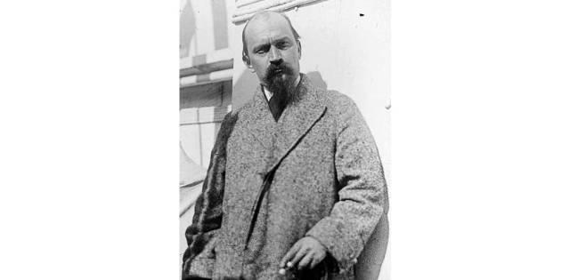

伊万·梅斯特罗维奇（Ivan Mestrovic，1883 年 8 月 15 日-1962 年 1 月 16 日）

这八幅油画和雕像，到底应该属于这位答应打扫房间并赚取各种杂物的年轻人呢？还是应该根据女主人的遗嘱，归还给银行另行处理？这是案件的核心问题。如果你是法官你会怎么判呢？

同样，法官在判决的时候，也援引了一个更古老的案子，那是 1887 年的案子。在这个案子里面，有一个人跑到农场里面去买牛，他看中了一头牛，这头牛买卖双方都认定它是不育的，它是不能生小牛的。

签约以后，买主并没有当场把牛取走，过了一段时间他才来取牛。但是回来的时候他们才发现，这头牛原来是可以生小牛的。

一头牛能生小牛和不能生小牛，价格差别可大了。原来以为这头牛不能生育的时候，它价值是 80 美元；如果可以生育，它的价格就涨了差不多十倍，是 750 到 1000 美元。那么这头牛应该归谁？

法官说这两个案子的核心问题都是一样的，应该做出相同的判决。

## 课堂小结

今天我给你介绍了，经济学是通过怎么样的角度，来分析英美合同法当中通过多年的案例，积累下来的经验和准则的，然后我给你讲了铬矿公司买地以后发现铬矿的案子，然后又讲了一位年轻人买了房子以后，发现房子里面有八幅油画和雕像的案子。

## 课后思考

今天留给你的思考题是，如果你是法官，你认为这八幅油画和雕塑，应该归年轻人所有还是归银行所有？为什么？

##### 110

# 第 110 讲  
馈赠有没有约束力 

今天我继续给你从经济学的角度，来理解英美合同法当中积累下来的基本原则。

昨天我们讲了一个概念：意会，只可以意会不可以言传的“意会（Meeting of minds）”。

讲了一个年轻人在买房以后，卖房的银行跟他说，你自己打扫收拾到的杂物就归你，结果他意外发现了价值非常高的八幅油画和一尊雕像，那么这意外所得应不应该归这年轻人所有。

昨天大家的留言也非常精彩，各种说法都有一定的道理。

## 1\. 合同的合法性应以签约双方的原意为基础

但在这个案子里面，法官判决最基本的依据就是“ 意会 ”，那就是双方在签订合约的时候，大家心目中所认为的标的物是什么。

很显然，银行是为了省事，不愿意去打扫，所以把这房子留下来的杂物留给年轻人。在银行心目中，这些杂物的价格也就跟打扫卫生的费用不相上下。而年轻人他接受了这个方案，自己打扫，他心目中想要得到的东西，大概也就是跟打扫卫生的费用差不多的经济价值。

双方在交易的过程中，压根没想过，他们交易的标的物会是价格这么高的艺术品。 或者说，这种纯属意外的标的物，完全不在交易双方的预期之中，不是意会的内容。所以法官判这八幅油画和雕像应该归还给银行。

当然我们昨天说了，法官还援引了 1887 年的那个卖牛案。同样，在那个案子里，法官也设立了一个后人都反复遵循的原则，那就是那一头能够生育的牛，不是双方意会的内容，所以那头可以生育的牛归原来的主人所有，而不归新的买家。

这样的判决，其实也是非常符合经济效率原则的。因为在任何合同的履行过程中，人们都会遇到各种意外，要完全避免这些意外，人们就得付出非常高的成本。

比方说在这个案子里面，银行除非彻底地搜查这个房子，他们才可能签订这个合同，而银行之所以提出这个方案，恰恰就是因为他们不愿意付出仔细搜查这个房子的成本。

双方是在一种大致确定的情况下就签约的，如果这种做法受到了惩罚，人们就不敢这么做，世界上的交易就会因此大减，这对交易双方来说都是弊大于利的。

所以任何一个合同，它的合理性、合法性，都要以签约双方当时的原意为基础。虽然双方的原意不容易准确客观地把握，但它总有一个合理的范围。

而英美的习惯法就是善于把抽象的问题，放到具体的情境里面，在具体的背景下做出大致合理的判断。

## 2\. 合同必须要有约因或对价

另外一个重要的概念，在英美的合同法当中也是一个非常重要的准则，那就是所有的合同必须要有约因或者对价。约因就是契约的原因，对价就是对等的出价，英文叫 consideration。

所谓的约因或者对价，它指的是在任何一个合同关系当中，做出承诺的一方必须有所得；接受承诺的一方必须有所施，他必须付出一点什么，这样的话这合同才算有效。

我给你举一个例子，在 1825 年的时候，有一位生病的年轻人，接受了修道院修女的帮助。这位修女照顾这位年轻人的时候，完全出于好心，没有想过要回报，后来这位年轻人还是去世了。

有一天这位年轻人的父亲出现了，他知道这个事情以后非常感谢这位修女，他后来就给这位修女写信，说要给这个修道院捐钱。可是过一段时间以后，他没有真的捐钱，这位修女就把这位父亲给告上了法庭，说他答应了捐钱现在又不捐钱，这是违约。

结果法院的判决是，这位父亲虽然做出了承诺，但他自己并没有得到什么，他的儿子已经去世了。而这位修女照顾他儿子的时候，也是不求回报的，所以这位没有履行承诺的父亲，可能会遭到良心上的审判，但法庭却不会要他履行承诺。

我们很多人都会遇到类似的例子，小时候我们一些长辈会对我们说：好好学习，将来叔叔给你买糖、将来叔叔给你奖励。到你真的考取了好成绩以后，他们并没有给你什么好的礼物。这算不算违约呢？这不算违约。

因为在现实生活中这种轻巧的承诺很常见，如果把它们都当做违约的话，那么法律诉讼的成本就会大增。

## 3\. 如何让承诺具有法律约束力

在现代，单纯馈赠的承诺，是不构成法律约束力的。如果你希望别人对你的承诺产生法律约束力，一般有两个办法：

第一，你尽快地采取行动，做一些什么事情，有所付出。这样将来如果人家不履行诺言，你把别人告上法庭的时候，你的胜算可能会大那么一点；

第二，更正规的办法，是要让对方签署法律上的文书，使得馈赠具有法律效力。具有法律效应的馈赠可信度高，经济价值就更高。

一份契约就是一份承诺，你相信这个承诺你就会有收获；但是如果你太相信这个承诺，你就会遭受损失。这当中有一个度的问题。

一方面你要让那些馈赠的承诺变得更坚实、更有约束力。但同时，接受承诺的一方，也要提防这些承诺如果得不到履行，怎么样才能更好地防范风险。

## 4\. 合理分摊违约责任：违约者不一定承担百分百责任

在美国的法学院里面，只要讲到合同法，就一定会提到 1854 年的“Hadley v. Baxendale”这个案子。

这个案子里面，原告请被告去给自己修一个磨，一个作坊里面的工具，原告给了被告 24 英镑，可是被告去修这个磨，他没有及时把磨拿回来，延迟了很多天。

原告以为这磨能够及时返回来，所以他雇了好多工人等在那里，结果没有开工，总的损失达到 300 英镑。这时候原告就要求被告赔偿这所有的损失——300 英镑，虽然这修磨的成本也只有 24 英镑。

最后法官的判决是，修磨的人他只管修磨，他不知道你原告做了那么大规模的张罗，所以修磨的人误了事儿是要有责任，但他承担的责任也就是 24 英镑，或者成倍地增加 50 英镑而已。再大的损失他自己不知道，也无从控制，这得由原告来负责。

换句话说，违约所造成的损失，并不一定百分百由违约者承担，合约的双方都得共同担负责任。原则是谁更知道损失有多大，谁就负相应的责任。

我准备明天去参加公务员考试，我跟出租车司机约好了，明天早上接我，结果第二天他没接我，他迟到了，于是就耽误了我的考试，我当不上公务员了，因此我就当不上科长、当不上处长，甚至当不上部长了。

你说这位出租车司机，要担负所有这些责任吗？不需要。他不知道他的责任是这么大的。如果这件事情这么重要的话，那我就应该多约几位出租车司机，甚至在考场附近找个酒店住下来，自己来避免自己能够预见的风险。

一位摄影师在喜马拉雅山上待了半年，拍了二三十卷胶卷，他把这胶卷送到冲印店去，冲印店的店员把它们丢失了。那么冲印店应该赔偿多少呢？

几十卷空白胶卷的钱？还是这些照片如果被登上《国家地理杂志》所应该得到的版税？还是他在山上待了半年的所有成本？

答案是只用赔胶卷的钱就差不多了。因为照片的社会价值、经济价值，只有摄影师才知道，如果遇到特别珍贵的照片，他自己应该特别小心，或者跟冲印店签订特别的合约。只有这样分摊违约的责任才是最经济的。

## 课堂小结

今天我给你讲了，怎么样才能减少违约的风险和违约带来的损失。

如果你遇到了馈赠的承诺，你就应该把这种馈赠的承诺变成法律的文书，这样它才更可靠； 如果你跟别人签订合约，当中的风险是巨大的话，那么你自己就要做出更多的防范。 因为对方如果违约的话，他们承担的责任也是有限的。    

## 课后思考

今天我留给你的思考题是，在现实生活当中，我们会经常遇到不靠谱的人、不靠谱的事情，每当遇到对你来说非常重大的事件的时候，你是通过什么样的办法来尽量减少这种违约、不靠谱的事情发生的？

##### 111

# 第 111 讲  
违约与赔偿 

今天我给你讲讲违约了怎么办，从经济学的角度看，违约的解决办法有没有道理。

我们前面讲过，经济学把一份合约、一个承诺看作是一项资产，把违约看作是对资产的侵害。既然对资产有侵害，就有不同的解决方式。

一种解决办法叫“财产原则”，就是你得付够了物主所愿意接受的钱，你才能伤害这个资源；另外一种办法叫“责任原则”，那就是如果你伤害了资产又没办法挽回的话，那么赔偿金由第三方而不是物主做出决定。

## 1\. 具体履行：答应什么就给什么

在英美的合同法里面，按照财产原则来保护的合约称为“具体履行”。

1848 年就有过这样的一个案子（Campbell Soup v. Wentz, 1848 ），著名的做罐头汤的公司“金宝汤公司”，跟温氏农场早早就签订了合约，要买他们的胡萝卜。合约里面规定，胡萝卜收购价是每吨 20 多美元。

但是那一年胡萝卜特别紧俏，价格涨到了 90 美元一吨，结果温氏农场就偷偷把他自己生产的胡萝卜卖给了别人，因为别人出的价格高得多。

金宝汤公司知道了就起诉温氏农场，要求法庭颁布禁制令，禁止温氏农场把他们自己的胡萝卜卖给别人。理由是他们工厂里面的机器要给胡萝卜削皮，他们的机器只能削由温氏农场生产出来的那种胡萝卜，也正是因为这样，他们才早早签订了合约。

当然，判决非常清楚明了，那就是金宝汤公司胜诉，合约里面规定温氏农场要给什么，他们就得给什么，具体履行（Specific performance ）。

同样的，1982 年也发生过另外一件具体履行的案子（Madariaga v. Morris, 1982 ），是美国合同法的教科书里面也常用的。

有个人承包了一家餐厅，餐厅的主人跟这位承包者说，“如果你持续承包五年，合同期满的时候，我就会把我们家做肉酱的秘方卖给你。”结果五年合约期到了，这秘方的主人后悔了，不肯卖了。承包者就把这秘方的主人告上了法庭。

法庭的判决也很清楚，你答应什么你就要给人家什么。如果你觉得这秘方价值实在太高，真的舍不得卖，那也可以，你就可以向这位承包者重新把它买回来。

这就是具体履行的概念，你答应什么就给什么。

但有时候，你答应的东西时过境迁就给不了，1983 年发生过一件叫做“Deitsch v. The Music Company”的案子。

在这个案子里，有一对年轻人要结婚，付钱请了一个音乐公司的乐队来给婚礼做伴奏，而且他们还预先付了押金。到了婚礼举办的那一天乐队没有来，结果这对新人只能自己想办法，找来了录音机、扩音器，现场那么凑合着播点音乐，就把婚礼办完了。

事后这对新人把音乐公司告上了法庭，音乐公司也承认他们犯错，承认他们违约了，问题的焦点在于：赔多少呢？这对新人说由于乐队没来参加婚礼，他们的婚礼给搞砸了，整个婚礼的费用是 2600 美元，音乐公司要做出全额的赔偿。

但音乐公司认为，他们只不过是让婚礼减分而已，也没有让婚礼的意义变得荡然无存，少了现场乐队的婚礼，也仍然是一场婚礼，而且更重要的是，这种违约没办法再进行具体履行了，婚不能再结一次，亲戚朋友不能再把他们请过来一次了，所以音乐公司愿意退回 65 美元的押金。

当然无论是原告的看法，还是被告的看法，法官都不予以采纳。法官认为合理的赔偿，应该处于 65 美元的押金和 2600 美元的整场婚礼费用之间的一个数字，最后法官罚了被告 815 美元。

我们讲的是违约两种不同的赔偿方式。还有一种违约就更有意思了，就更符合经济学的思维方式了。

## 2\. 不具体履行合同的效率含义

我给你讲一个案子（Groves v. John Wunder Co., 1939 ），这个案子判决的时间是在 1939 年，但案子发生的时间是在 1929 年，大萧条以前。原告把自己的土地租给了被告，条件是被告用完这块土地以后，在归还的时候得把这块土地给平整了。平整土地是这块土地租金的一部分。

这个合约是在 1929 年大萧条以前签订的，结果到了被告要归还这块土地，要履行他承诺的时候，已经发生了大萧条。那个时候所有的土地都不值钱了，而平整这块土地得花很多钱。

当时的情况是，如果要雇人来平整这块土地得花 6 万美元，但一块平整了的土地，在市场上的价格只值 1.2 万美元，花 6 万美元平整出一块只值 1.2 万美元的土地，这不值得。

所以被告故意违约，他就是不干这事儿，因为真的具体履行了会造成社会资源的损失。但原告坚持合同上写的要你平整土地，无论花多少钱你都要平整这块土地。

这时候，如果你是法官应该怎么办？

如果你逼着被告平整这块土地，那会造成社会资源的损失；如果你允许被告违约，这显然对原告不公平，因为他在合约里面要求的东西他没得到，有违契约精神。

最后法官的判决还是比较聪明的，他判被告败诉，被告要赔偿原告，但是他并没有要求被告真的平整那块土地，相反他只是要被告给原告 6 万美元。

原告在判决以前信誓旦旦地说一定要执行合同，但他拿到这 6 万美元以后，他真的花这 6 万美元去平整土地了吗？没有。他拿钱以后用到别的地方去了，没有真的平整土地，没有真的造成资源的损失。

所以不具体履行合同有时候才是有效的。

这个原理在“Lake River Corp. v. Carborundum Co. (1985 ) ”这个案子里面也得到了应用。这个案子是我们提到过的著名的法律经济学家波斯纳法官（Richard Posner，1939- ）做判决的。

这个案子是这样的，被告有一大批的铁矿砂，要求原告帮他打包，被告就跟原告说这笔可是个大生意，他要接这个单得更新他们的设备，他们得买一套打包的设备。结果原告就真的听了被告的话，引进了一部新的设备，然后就开始给被告做铁矿砂打包的业务。

当这笔大生意进行到一半左右的时候，被告就跟原告说不好意思，现在市场的情况发生了改变，咱们没那么多的生意了，咱们不能做下去了，也就是说原告指望的那笔大生意落空了。

现在摆在法官面前的问题是，到底应不应该逼着被告完成他的承诺，把那桩大生意给做完？很显然，这桩生意已经不值得再做下去了，因为会出现亏损了，但合同上写的人家是指望要赚这笔钱的，你不能违背契约的精神。

波斯纳法官做了一个非常聪明的判决，他说原告指望要赚的钱应该让他赚，但是由于情况已经发生了变化，生产不应该再进行下去了，所以被告不需要真的让原告去装什么铁矿砂了，他只要把原告所指望的那些还没赚到的利润补够就行了。

结果是原告得到了他指望的利润，但是生产用不着真的继续下去，可以避免的损失避免了，这就是有效违约的概念。

## 3\. 具体履行合同可能产生的社会成本

我再给你讲一个有趣的案子（Ruxley Electronics & Construction Ltd. V. Forsyth, 1995 ），你就更能够明白有效违约的概念了。

有一家人请了一家建筑公司，给他们后院修一个游泳池，合同规定游泳池最深的地方应该有七尺六寸深，也就三米左右，他们的目的是要跳水。

结果这个游泳池修好了以后，最深的也不过是六尺九寸，而在人们本来要跳水那个位置只有六尺深，跳不了水了，建筑公司违约了。

这时候怎么办？当然你可以说这合同得具体履行，答应什么你就给人家什么，把游泳池给拆了重新修，但这会造成重大的浪费。结果法官怎么判？

法官说他们成立一个小组去调查一下，那些有比较深的游泳池的房子值多少钱，那些只有比较浅的游泳池的房子值多少钱，算出两者当中的差价，这就是违约造成的差价，建筑公司就赔这个差价就可以了。

调查的结果是，这两种游泳池不造成什么差价，差价基本是零，所以最后建筑公司不用赔钱。

类似的案子以前也发生过（Jacob & Youngs, Inc. v. Kent, 1921 ）。一幢大楼本来指定是用某个牌子的水管，结果整个楼修好了以后才发现，用的水管牌子不一样了。

当然，如果你根据具体履行的原则来办，你得把这个大楼给拆了重新装水管，但实际上，由于楼已经建好了，法官就去研究，这两个不同牌子的水管究竟对这大楼的价值产生了多少影响。

最后发现这两个牌子的水管功能、质量差不多，最后建筑公司不需要赔偿。

这种判决反映了法官综合的考虑，因为如果反过来，履行合同的一方稍有差池就得推倒重来的话，那社会成本也是巨大的。

## 课堂小结

今天我给你讲了违约的处理办法，以及有效违约的几个案例，违约有时候反而是有效的，值得鼓励的。

## 课后思考

今天我留给你的思考题是，在中国绝大部分的商店买东西，买来的商品都是不能退货的，但是如果你真的买了一件你不需要的商品，留着也是浪费，那你用什么办法来处理呢？

##### 112

# 第 112 讲  
婚姻经济学 

今天我要给你从经济学的角度，分析一个人类非常古老的合约现象——婚姻，经济学是怎么看男女关系，怎么看婚姻的。

你记得吗？前面讲需求第二定律的时候，我们讲过“法律无效定律”，在那里我们解释过，究竟是谁付钱买结婚戒指的。我们说结婚戒指的成本是由男女双方共同支付的，谁付得更多取决于谁更迫切需要结婚。

## 1\. 以风俗习惯替代婚姻合同条款

那么关于男女关系、关于婚姻，经济学家还能说些什么呢？当然，经济学家的视角是理性的。

早在 1887 年，就有一位法官说过：婚姻当然有它浪漫的一面，但是咱们法官只看重它商业的一面，我们把婚姻看作一个商业合同。我们关心的，是双方怎么才能够缔结一个比较公平的合同，这合同怎么才能够更好地履行下去。

这实际上也是经济学家的观点。

你看日常生活当中，如果双方要约定的事情比较简单，那合同就比较简单；如果比较复杂，合同也就变得比较复杂。但是婚姻很奇特，由于男女双方的责任、权利和义务太复杂了，所以他们签订的婚约只有一张纸那么简单，里面几乎没有任何其他条款。

这并不意味着他们不在乎，而是说要写条款的话，写都写不完。他们采用了另外的办法，那就是社会习俗、社会舆论、双方的生活习惯等等——用这些办法，来确定婚姻的条款和婚姻的履行。

人都有浪漫的一面，他们喜欢说“我找到的这个人是我一生中唯一最爱。”

经济学家听了会宽容地笑一笑。

记得大经济学家弗里德曼（Milton Friedman ）吗？他的一位侄子曾经给他写信，说他为了他女朋友要放弃事业，跟他女朋友到另外一个城市去，因为这个女朋友是他一生中唯一最爱。

弗里德曼就回信说：当然，你可以做你自己的决定，但是如果你真的认为这女孩儿是你一生唯一最爱的话，那么我以一位统计学家的身份告诉你，世界上两个唯一最爱的人，相遇的机会是零。茫茫人海，你们在有限的生命里面根本不可能遇见对方。

听起来不那么浪漫的是，人们其实就在自己身边，随便找一个比较合适的人就结婚了。婚姻实际上没有文艺作品里面说得那么浪漫。

## 2\. 为什么女人往往嫁给年纪比自己大的男人

经济学家还解释了另外一个现象，那就是为什么古往今来，女人往往嫁给年纪比自己大的男人。我们知道女性的平均寿命比男性长，而如果她们还找一位年纪比自己大的男人结婚的话，那就相当于延长了她们将来守寡的时间，但她们还是这么做。为什么呢？

有一位法律经济学家名字叫劳埃德·科恩（Lloyd Cohen ），他写过一篇挺有意思的文章，名字叫《结婚、离婚和准租》，他说题目也可以叫《或者，我把最美好的年华给了他（Marriage, Divorce, and Quasi Rents; Or, "I Gave Him the Best Years of My Life" ）》。

他在这篇文章里面解释说，男性跟女性的价值高峰期不一样，通常我们怎么称赞女人的？我们说她年轻、漂亮、身材好，这些都跟生育有关，而生育发生在人生的早期。

我们通常怎么称赞男人呢？我们说他有事业、有成就、有安全感，而这些品质通常都发生在人生的中年，甚至中老年。所以在高中、在大学期间，女性的价值已经彰显出来的时候，男性的价值还远远没有彰显。

这时候女性的追求者就比较多，女性就比较挑剔。跟女性同龄的那些男生要追求这些女生的话，他们就显得比较吃力；而那些较为年长的男生，优势就比较突出，因为他们的才能和价值已经逐渐彰显出来了。

如果一位女生在大学期间，就跟同班同年龄的男生谈恋爱结婚，那会发生什么事情呢？这位女生就会先对家庭做出各种投入：先养育孩子、先照顾家庭、先扶持丈夫。

随着时间的推移，那位丈夫就会逐渐积累他的人力资本，走上事业的高峰。这时候他就有更多的选择机会，而女生生理上的价值就会逐渐下降，这时候男生就会增加背叛女生的机会。

所以你看这篇文章的题目“我把最美好的年华给了他”，下半句通常是什么？“他竟然跟着一个年轻的女人跑了。”

这种情况正在谈恋爱的女生知道吗？她们知道。即使她们不知道，她们的父母都知道，她们的父母都会要求自己的女儿要小心，要好好挑选对象。

结果是如果女生找一位年纪比自己大，个人价值已经比较清楚彰显出来的男生，那么这段婚姻的不确定性就比较少，婚姻关系就会比较牢固。

这是为什么大多数的女生会嫁给年纪比自己大一点的男生，而当第二次婚姻的时候——如果有的话——男生会娶比自己年纪小更多的女生的缘故。

当然这篇文章所谈的只是问题的一个侧面，今天随着科技的进步、女性受教育机会的增加，现代女性的价值早就不单靠生理条件来展现了，教育、修养、见识都是男人和女人越来越重要的品质了。

## 3\. 一夫一妻，谁得谁失？

经济学还能解释一夫多妻和一妻多夫制度，它的分析结论也是让很多人感到意外的。很多人会觉得一夫多妻制对男人有利，对女人不利，但经济学的分析指出：结论应该恰好相反。

首先，一夫多妻和一妻多夫在逻辑上好像是对等的，两种婚姻模式都应该有人尝试过，但最后，历史上看，一夫多妻要比一妻多夫更常见，一妻多夫不那么常见，原因是什么呢？

原因很简单，因为子女的产权在一妻多夫制度下面并不确定，妈妈是谁当然是确定的，但爸爸是谁在一妻多夫制度下面很难确定。不确定爸爸是谁，那么对孩子的抚养义务就不容易落实，养育的效果就会大打折扣。

与此相比，一夫多妻就没有这个问题，妈妈是谁很清楚，爸爸是谁也非常清楚。

在一个社会里面，如果普遍实施一夫多妻，那会产生什么样的结果呢？不喜欢、不接受一夫多妻制度的女人，她们在结婚的时候，可以跟她们的丈夫先约法三章：我是不赞成一夫多妻的，如果你要娶第二个女人的话，那你就是违约，你要做出赔偿。

但是，哪怕她自己不接受一夫多妻制度，如果她赞成一夫多妻制度，对她来说也是有好处的。为什么？因为世界上不见得每一个——但是总有一些女人——她愿意和别人分享一个丈夫。分享一个非常成功的丈夫，可能要比独占一个很普通的丈夫更好。

只要社会上有一些男人和女人愿意实施一夫多妻，就会有更多的男人空出来，女人的选择范围就大了。而同时，未婚女人的数量减少了，男人可选择的范围就少了。

结果是，有个别的男人能够娶多个女人的同时，有一些男人可能终生娶不到老婆了；而即使是能够娶到，他娶到的女人的质量也没有原来的高了。

所以实际的结果是，那些赞成一夫多妻的男人，绝大部分是比较普通的男人，他们在一夫多妻制度下，情况反而变糟了。而女人，哪怕她们自己是反对一夫多妻的，但只要有别的女人进入了一夫多妻的婚姻状态，那么她们自己的选择范围也增加了，她们的处境也变好了。

波斯纳法官在他的名著《法律的经济学分析（Economic Analysis of law ）》中清楚地指出，一夫一妻制度实际上就是一种对成功男人限购的政策，它的效果是财富转移。它让女人的选择范围减少了，让成功的、更有吸引力的男人的选择减少了，而让那些年纪较轻、收入较低的男人处境变好了。

The prohibition of polygamy, by limiting competition of men for women increases the sexual and marital opportunities of younger, poorer men. The prohibition is in effect a tax on wealth, for only wealthy men can afford multiple wives. The tax does not generate revenue directly, but by reducing the cost of a wife it transfers wealth from the more affluent to the less affluent (and more numerous) men. （Richard Posner, Economic Analysis of Law ）

它把女人从比较有钱的人手上，转到了比较没钱的人手上；从比较少的人手上，转到了比较多的人手上。这就是一夫一妻的实际效果。

## 课堂小结

今天我给你讨论了怎么从经济学的角度，来看男女关系和婚姻，我们解释了婚姻为什么有它理性的一面、商业合同的一面；我们也解释了男女双方信息不对称状况变化的过程；解释了女人为什么通常会嫁给年纪比较大一点的男人；也分析了一夫多妻、一妻多夫、一夫一妻这些婚姻制度的实际后果。

## 课后思考

今天我要留给你一个开放的问题，为什么在现代社会、今天这个社会，剩男、剩女越来越多了？不论是男生还是女生，越来越多的人不愿意结婚了？我们能不能从经济学的角度解释这个现象？

##### 周

# 第 28 周问答  
遇到不靠谱的人和事怎么办？ 

我们开始本周的问答时间了。

这个礼拜我继续把你带入信息不对称的深水区，我们通过一系列丰富的例子，主要就是在英美判例法当中，涉及合同法当中的经典案例，来展示信息不对称的微妙情境，以及人们处理这种微妙的关系所发展出来的法律规则。

而这些规则，如果我们通过经济学的角度来重新审视的话，就会发现它们是符合经济规律的。

## 1\. 一份合约其实也是一份资产

回顾一下，一开始的时候，我们先打量了整部合同法，就好像我们第一次拿到一颗土豆，把它放到手里把玩一样。我们说从经济学的角度看，这合同法跟我们以前学过的财产权法有共通之处，那就是我们人类保护财产的方式有三种：有财产原则、责任原则和不可转让原则。

而一份合约其实也是一份资产，或者更准确地说它是一份期货，在未来的时间流里面，逐步变成现实的资产。而保护它的方式同样也可以分为财产原则、责任原则和不可转让原则。当一份合同被违反的时候，那就好像一份资产被损害一样，人们就要寻找补偿的办法。

在财产权法里面，人们使用的办法就有归还物件、实施禁制令、由第三方确定补偿的方式和金额等等。而同样，在合同法里，一旦出现违约，人们的解决办法就有所谓的具体履行，各种不同程度的事后赔偿，甚至为了从效率角度出发而实施的有效违约条款等等。

紧接着我们提纲挈领地介绍了合同法的五个重要作用，我希望你把这五个作用记在脑海里，而在后面讲到的那些丰富多彩的真实案例当中，对合同法的这些基本原则和作用进行印证。

合同法的基本作用包括：1）要阻止机会主义的行为；2）要被不完备的合同填补默认的条款；3）尽量减少可以避免的意外；4）合理地分摊意外所产生的责任；5）减少不必要的纠纷。

## 2\. 违约就应该承担责任

在讲有效违约的时候，我们还特别讲了游泳池的案子和大楼水管案。建筑商没有履行合同，把游泳池修够可以跳水的深度，游泳池竣工以后不能用来跳水了。这时候法官判决，建筑商只需要赔偿这种不可以跳水的游泳池和那些可以跳水的游泳池之间的差价。

当然在这个案子里，最后调查委员会调查出来的结果，说这两种游泳池没有差价，所以根据法官的判决，那位违约的建筑商不需要做出赔偿。

在留言里许多同学对此表示异议，我自己认为这个判决也是有问题的，违约总是需要负担一定的成本的。

同样这件案子的法官所援引的另外一个案子——大楼水管案，大楼竣工以后发现水管没有选用合同指定的牌子，而当时的判决也是要去对比，两种不同牌子的水管对大楼的价值所造成的影响。结果发现大楼的价值不受影响，所以建筑商也不需要赔偿。

这两个案子的结果都有不够合理的地方，那就是违约其实多多少少都应该负责任，否则不就是鼓励大家在执行合同的过程中粗枝大叶、掉以轻心了吗？

但这个问题还是次要的，我们不要忘记我们所讨论的这两个案子的重点，那就是具体履行原则和有效违约原则，这两种原则之间的选择。

因为一点缺失而重修游泳池的成本是太高了，因为用了不同品牌的水管，把一幢大楼推倒重来的成本太高了，具体履行是好的，遵守合约的精神是好的，但也要考虑成本，成本太高我们就选用其他的变通的原则。这是我们本周学习的要点。

我们看一下本周的思考题。

## 3\. 意会原则：在具体情境中理解缔约内容

周一的上课内容，我们讨论了银行和年轻人争夺八幅油画和雕像的案子。我们留的问题是：“ 这八幅油画和雕像，应该归年轻人所有还是归银行所有，为什么？ ”

同学们的回答什么样的角度都有，比较多的同学说我们要尊重合约的精神，无论价值是高是低，我们都要遵守这个约定，八幅油画和雕像归年轻人所有。但也有同学根据同样的原则，说这八幅油画和雕像女主人在遗嘱里面已经另有规定，不应该给年轻人。

还有些同学说，那头后来发现可以生育的牛的案子，跟这个八幅油画的案子不一样。那头牛不管能生育还是不能生育都是同一头牛，不能分开，所以那头牛就归买家所有。而油画和房子是可以分开的，所以房子归年轻人所有，油画和雕像归银行所有。

读着这些留言，我又想起了一个我经常有的感受，那就是有说服力的道理总是被清楚地说出来以后，它才是显得很清楚的。我们在这个案子里面选用的原则，是“意会”的原则，我们要看合同的原意是什么，缔结合同的双方，心目中的标的物是什么，要以缔结合约时候的具体情境为依据。

意会这个概念的作用非常明显，那就是说凡合同都是不完备的，都是有语境的，在执行的过程中都是会遇到各种各样奇奇怪怪的突发状况，坚持意会的原则，目的就是要排除这些突发状况的干扰。

李庆 同学的回答很清楚，他说从债权的角度看，银行和买房者已经达成有效的合意，合作的合，意见的意。双方的心理预期显然不包括上述特定的物品，也就是那八幅油画以及那头可以生育的牛，因此银行不将特定物品交给买房者也不构成违约。

## 4\. 承担更多责任，让局面更加可控

周二的问题：“ 在现实生活当中，我们经常会遇到不靠谱的人、不靠谱的事，每当遇到对你来说非常重要的事情的时候，你是通过什么样的办法来尽量减少这种违约的、不靠谱行为的发生？ ”

同学们的回答都不错，归纳得都很好。

比如 Jessica Chen 同学说，不靠谱的人分两种：一种是那些长期会相处的人，比如同事、比如朋友，在这种情况下我尽量不把重要的事情交给他们做，当然还有另外一个办法是时刻提醒他们。另外一种情况是一锤子买卖，比如快递员、出租车司机等等，这种情况下就要自己多留余量，想好各种备用的方案。生活不容易，我们还要多留个心眼。

我自己的办法就是尽量让自己多承担一点责任，从而让局面变得自己更容易把控一点。

比方说早上上班时间的交通就不靠谱，很多时候我在外面参加会议，会议开始的时间都是早上 9 点钟，如果 8 点钟出门就很可能迟到，原本半个小时的车程，因为早高峰可能一个小时都到不了，所以 9 点钟的会议 8 点钟出发自己就很被动。

所以我的习惯是 7 点前就出发，先到会场看了地形，然后再到附近的咖啡厅坐下来，既可以安心地享受早餐，使用自己的时间，也绝不会迟到。

## 5\. 把商品卖给信息不对称最不严重的人

周三的问题是：“ 在中国绝大部分商店买东西，买来的商品都是不能退货的，但是如果你真的买了一件你不需要的商品，留着也是浪费，那你用什么办法来处理呢？ ”

同学们都答对了，那就是以二手货的价格卖出去，这总能挽回一点损失。

但我自己的回答是，第一个卖出去的对象就是原来的卖主，因为他是把东西卖给你的人，他是最了解这产品的性能、价格和来路的，信息不对称的情况最不严重。

他之所以不愿意接受退货，那只不过是因为他不愿意把赚了的钱再退出来，而如果你能够让他保有他已经赚了的钱，那他很可能是愿意把这商品收回来的。因为他了解这件商品，所以他接受的价格也可能是最高的。

## 6\. 女性社会地位为什么越来越高？

周四我们讨论了婚姻问题，我们是从经济学的角度、从合约的角度、从信息不对称的角度来看婚姻的，婚姻是人类社会最古老的现象，但从经济学的角度看，看到的也还是别开生面的。

在人类历史上，女性的地位一向比较低，近几十年来女性的地位不断地提高，今天甚至有超越男性的趋势。为什么会产生这样的现象呢？很多人以为这是观念的作用，人们有不同的观念了，人们有不同的诉求了，人们有不同的口号了，但我自己还是喜欢那些从经济学的角度出发，或者说符合经济规律的解释。

著名的历史学家艾伦·麦克法兰（Alan Macfarlane ），也就是那位写《英国的个人主义起源》的大历史学家。他曾经写过一本小书给他的孙女，他以一位历史知识渊博的老爷爷的口吻，给孙女讲一点人类社会的基本经验，这本小书的名字叫《给莉莉的信》。

艾伦·麦克法兰，给莉莉的信——关于世界之道，2006 年，商务印书馆

在这本书里，他介绍了女性地位变化的原因。他说在避孕技术还不是很有效的时候，女生发生婚外的关系是非常重大的罪过。她们不仅会被羞辱，还会被投到监狱里面去，或者被投到疯人院里面去，有时候被投到妓院里面去，一辈子抬不起头。

而如果遇到婚外情的情况，社会对男人和女人的惩罚也是双重标准的。社会对男性很宽容，对女性很严苛，这种现象不仅在西方社会如此，在印度、在中国、在韩国都如此。

它背后根本的原因是女性的生育能力非常有限、非常稀缺、非常珍贵，所以需要用尽各种各样的办法来保护，女性的自由因此也受到了严重的抑制，是避孕技术彻底地改变了这个约束，解放了女性。

昨天留的开放性的思考题是，今天不论是男生还是女生越来越多的人不愿意结婚了，原因是什么？我们说婚姻如果是一种契约的话，那么家庭实际上就是一个企业，人们成家实际上就是注册一家公司，这家企业的投入是夫妻双方的时间、精力、感情。产出呢？

它的产出是一系列工种所提供的服务，这些工种包括厨师、裁缝、护士、采购员、司机、秘书、室内设计师、心理辅导员、清洁工、搬运工、形象顾问、前程顾问、公共关系助理等等，这是家庭的产出，这是家庭的作用。

维系一个家庭，也就是说维系一个企业是有成本的，当所有这些功能越来越多地被社会上、被市场上的其他同等服务所取代的时候，维系这个企业的价值就在下降，而人们更愿意把时间精力用到别的地方去了。

这可能是今天人们越来越往后推迟结婚的时间，越来越减少生育，甚至不结婚、不生育的原因。

## 7\. 比特币替代品很容易出现

另外，这个礼拜的预习还有一道思考题，王煜全老师在他的《全球创新 260 讲》里面给我提了一个问题：“ 比特币新增的速度非常缓慢，由此确保了它的稀缺性，这是否就意味着比特币具有很强的抗通货膨胀的能力？ ”

我的回答是，稀缺性确实就意味着抗通货膨胀性，当初人们选择黄金、白银或者其他贵重金属作为国家货币本位的时候，主要的原因就在于它的稀缺性，因为它们很难增加数量，不论是通过伪造的办法增加数量，还是通过挖掘或者通过生产，或者制造的办法来增加数量。

但是当然通用的货币还具备其他的特性，其中重要的一个特点就是要得到国家的认可，得不到国家认可的货币有可能也会流行，但它有很大的局限。国家选择支持一种货币有很多的考量，其中的一点，就在于中央银行希望通过控制货币的流通量，来制定那些逆经济周期的货币政策对抗经济周期，从而达到政府在经济上、社会上或者政治上的目标。

正因为是这样，我们就要注意比特币本身确实很难增加数量，它最终的数量是恒定的、是固定的，但是制造比特币的替代品却很容易。

比特币不就是一套算法吗？当比特币的技术比较成熟以后，会不会出现另外一种情况，那就是某些国家以国家的信用为担保参考比特币的发行规则，发行他们国家自己的电子货币，有没有这种可能？

这种电子货币既可以具有比特币的优点，它又能让政府有一定相机行事的空间，也就是说对货币流通量做一定程度的调节，从而得到政府的认可和推广，有没有这种可能，我自己还没有答案。

周五辩论

我们周一到周四给大家留了思考题，今天是礼拜五，我给大家留一个辩论题，大家一起辩论。这个礼拜我们从经济学的角度对婚姻契约作了解释，那我们今天就来继续讨论一下，在婚姻当中，彩礼的观念是不是应该淡化？

正方 的观点认为彩礼的观念应该淡化，今天时代已经不同了，男女已经平等了，他们在婚姻家庭关系当中，享受的权利、承担的义务都是对等的，巨额的彩礼不仅没有意义，而且会对家庭造成财务的负担。

反方 认为彩礼的观念不应该淡化，彩礼是男方对女方尊重的体现，在力所能及的情况下哪怕增加一点财务负担，准备一份丰厚的彩礼还是应该的，毕竟婚姻是人生的大事。

欢迎大家参与辩论。

##### 加

# 学习加餐  
经济学辞典—03 

B

不平等（inequality）

不患寡而患不均不是真实的人性

（One wants to be rich regardless of the rich getting richer, rather than to be poor while the rich gets less rich. ）

 解释：现实生活中，人们每天都在患的不是不均，而是寡，他们在乎的是自己的东西还不够多。 

案例：邻居的牛和你的闺蜜 

一键直达：第 12 周问答丨讨好领导和讨好用户哪个更划算？

 

C

成本（cost）

凡竞争必有成本

（Competition is costly in itself. ）

 解释：一旦把竞争规则确定下来，人们就会朝着一个特定的方向努力，这个努力的过程，就会消耗真实的资源、时间、金钱、注意力。 

案例：花时间排队获得商品，别人不能从你的排队中得到任何好处 

一键直达：第 042 讲丨各种竞争规则孰优孰劣

 

F

福利（welfare）

给穷人钱比给穷人食物更有帮助

（Subsidy in money is more helpful than subsidy in kind. ）

 解释：如果你给穷人一瓶牛奶，他就只能得到一瓶牛奶，如果你给穷人钱，他就可以选择鸡蛋、蔬菜、肉类或者其他。 

案例：公交补贴该给公司还是市民 

一键直达：第 048 讲丨实物补贴和货币补贴的权衡

 

G

公共选择（public choice）

经济改革：果断与沉稳的拿捏不容易

（It is difficult to balance between patience and determination in the process of economic reform in China. ）

 解释：如果没有一个稳定的社会秩序，改革就会遇到危险。 

案例：1988 年中国第一次价格改革失败 

一键直达：第 047 讲丨解除价格管制——果断与沉稳的拿捏

 

J

激励（incentive）

如何分饼决定饼的大小

（The way to share a pie governs the size of it. ）

解释：如果富人不能优先享受，人们就不会对价格作反应。

案例：《拜杜法案》促进美国科技蓬勃发展 

一键直达：第 039 讲丨如何分饼决定饼做多大

 

竞争（competition）

暴力是一种竞争规则（Violence is a rule of competition that is not only everlasting but also highly respected. ）

解释：暴力依然是非常重要和常见的竞争规则。 

案例：在深圳兜售电话卡被抓 

一键直达：第 041 讲丨世上有哪些竞争规则

 

价格（price）

价格就是用来筛选需求的（Demand is screened by price. ）

 解释：价格不是请客吃饭，价格永远起调节的作用。  

案例：想买便宜苹果的人使得苹果价格上升 

一键直达：第 040 讲丨换个角度看发国难财的行为

 

价格无处不在（The phenomenon of price is universal. ）

 解释：供给不自由，价格依然有意义。 

案例：石油、钻石、医生的供给都不自由 

一键直达：第 10 周问答丨为什么人工智能不能替代人

 

短缺和过剩都是价格受到操纵的结果

（Both shortage and surplus are the results of the manipulation of price. ）

 解释：抑制价格导致短缺，拔高价格导致过剩。 

案例：蒂芙尼钻石从不短缺；农民倒牛奶的故事 

一键直达：第 043 讲丨何谓短缺和过剩

 

价格管制必然导致资源耗散

（Price control results in rent dissipation. ）

 解释：每当价格受到人为的干预、过高或过低的时候，会出现价格以外的竞争。  

案例：市价 100 元的房子管制到 60 元，导致 40 元价值耗费 

一键直达：第 044 讲丨最省事儿地违反价格管制

 

垄断商品不是反对市场定价的理由

（Price control does not help to make bad monopolies any good. ）

解释：一件商品，不论它是由垄断还是竞争企业提供的，它的定价都应该是市场价，否则就会出现短缺和过剩的现象。 

案例：春运火车票一票难求 

一键直达：第 045 讲丨春运火车票价还不够高

 

Z

知识（knowledge）

知识在社会中的运用要靠价格机制来协调

（The use of knowledge in society is facilitated by price mechanism. ）

 解释：各种具体信息的处理永远是分布式、非集中地进行的。 

案例：简单如一支铅笔，也没有任何一个人知道生产它的全部知识，这些林林总总的知识，总是分散在成千上万的、不同的人头脑中的 

一键直达：第 038 讲丨知识在社会中的运用；第 007 讲丨铅笔的故事

##### 113

# 第 113 讲  
汉德公式 

这个礼拜开始我给你讲一个小的单元，主要讲侵权法里面一个非常重要的计算公式“汉德公式”，然后我们讲讲政府管制的经济学。

今天以前的三个礼拜（回复本公众号“经济学 26”、“经济学 27”、“经济学 28”即可查看），我们讲了信息不对称以及信息不对称的解决方案，这些解决方案主要是市场化的解决方案。当然，要应付信息不对称的问题，光有市场还不够，政府监管也是一个重要的组成部分，我们这个礼拜讨论这个问题。

## 1\. 汉德法官

汉德法官（Learned Hand，1872 年 1 月 27 日-1961 年 8 月 18 日）

我们今天先讲侵权法里面非常重要的一个公式：汉德公式。汉德（Learned Hand（1872 年 1 月 27 日 - 1961 年 8 月 18 日）是美国非常著名的一位中级法院的法官。

他很有思想，他写下的判决是美国中级法院的法官当中被人引用最多的，他的英文名字看上去也有点怪，叫 Learned Hand，直译起来是“熟手”的意思。

我们在整门课程里面会提到汉德法官两次，这里在讨论侵权法的时候是一次；后面我们在讲反垄断法的时候，会再提到他另外一个著名的判决。

## 2\. 美国诉卡罗尔拖船公司案

我们今天所说的汉德公式的来源，就是 1947 年的“美国诉卡罗尔拖船公司案（United States v. Carroll Towing Co. ）”，在这个案里有一艘驳船叫“Anna C”，它是一种自己不带动力的货船，它要接驳到别的拖船上面才能被拖走。

这艘驳船 Anna C 是跟其他几艘船绑在一块绑在码头上的，这时候有一家拖船公司，为了拖走跟 Anna C 绑在一块的一艘船，就解开了绳索，然后就把他要拖走的那艘船拖走了。但是这时候他没有把绳索重新绑好，Anna C 被松绑了，不知不觉漂出了海岸。

当然卡罗尔拖船公司的人也没发现这一点，他们拖着自己本来要拖的船就驶离了海港。而 Anna C 一点一点地漂移，意外地撞到了旁边一艘油船，Anna C 就被撞坏了。而油船的主人也没发现撞坏了 Anna C，被撞坏的 Anna C 就在海上漂着，没人照顾。

过了整整 21 个小时，Anna C 沉没了，这时候装在 Anna C 上的满满一船美国政府的面粉也都泡汤了。于是美国政府就告卡罗尔拖船公司，要它赔偿整艘驳船以及驳船上面装的整船面粉。

## 3\. 汉德公式

这个案子就到了汉德法官手里。

你看这个案子有趣的地方是，最早的肇事者是卡罗尔公司，他们由于没把绳绑紧让 Anna C 漂出来了；但对 Anna C 造成致命伤害的是那艘油船，是油船撞坏了 Anna C；而这艘船被破坏以后，造成更巨大的伤害，是由于船上装满了美国政府的面粉。

这重大的损失应该由谁来承担责任呢？显然卡罗尔公司是有责任的，那油船公司有责任吗？美国政府本身有责任吗？

整个造成重大损失的过程是环环相扣的。如果卡罗尔把船都绑好了，那么 Anna C 就不会漂出来；哪怕是 Anna C 漂出来了，如果油船不把 Anna C 撞坏，Anna C 也不会沉没；但哪怕是油船把 Anna C 给撞坏了，只要船上的人在 21 小时内尽早地发现，也不至于发生全船沉没、整船的面粉都泡汤的结果。

到底责任在谁？到这里著名的汉德法官就说出他的“汉德公式”了。

他说在绑满了船的码头上，每一艘船实际上都有可能被松绑，有可能碰到别的船，这种可能性总是存在的。所以对任何一位船主来说，他要避免自己的船受到意外碰撞而产生损失的责任，取决于三个因素：

这艘船发生意外的可能性；

这艘船发生意外的严重程度；

它要为了避免意外所要付出的成本。

（秦俑语：读到这里，你已经为被智慧的光芒照耀而激动喜悦）

当船主所要避免意外所付的成本，低于意外发生的概率乘以意外发生以后产生的损失——也就是预计损失的时候——再说得简单一点，也就是说避免意外的成本，低于意外所造成损失的时候，船主就应该负有责任。

汉德法官还把他的想法用公式写出来了，他把避免意外的成本记作 B，把产生意外的概率记作 P，把意外所产生的损失记作 L，那么船主所要负责任的条件。这个公式我帮你列出来了，根据这个公式汉德法官做了判决。

 

首先卡罗尔公司没有把绳子绑好，这一点卡罗尔公司要负全部责任，而正因为绳子没有绑好，Anna C 撞到了别的船上，这个损失是直接由卡罗尔公司造成的，所以卡罗尔公司要承担这艘驳船被损坏的全部责任。

但是这艘驳船被损坏了以后，在海上漂了足足 21 个小时，没有人照看，而它上面竟然是装满了美国政府面粉的，那是宝贵的财富。负责绑绳子的卡罗尔公司不知道这艘船那么值钱，旁边的那艘油船也不知道 Anna C 这么值钱，只有 Anna C 的主人知道自己船上装的是什么。

所以你看，根据汉德公式，船没有绑好被别的船碰上的机会是有的，P 是大于 0 的，L 潜在的损失是巨大的，这两项相乘，预计中的损失是相当巨大的，也就是根据风险概率预算的损失还是相当大的。

而要避免这么大的损失，Anna C 只要派一个人到船上查看一下，时不时查看一下，不要一整天整整 21 小时都不去查看，就可以及早地减少损失，甚至是完全避免损失的。

所以汉德公式的条件满足了。也就是说 Anna C 的主人负有责任，原告人美国政府负有责任。最后的判决是卡罗尔公司不需要对所有的面粉做出赔偿，美国政府要承担相当一部分的责任。

你看有意思的是，在整个案件里面，Anna C 的船主或者美国政府，他们本身似乎什么事情都没做错，但恰恰是由于船上的面粉够值钱，潜在的损失够大，法官就判他们应该为自己的财富负有一定的“注意义务”，支付一定的“注意成本”，为避免潜在的损失做适当的预防措施。

## 4\. 邻居把墙打穿应该如何赔偿

我的邻居在装修，不小心把我家的墙给打穿了，这时候他们应该付全额的赔偿。因为你看汉德公式，装修的时候把别人的墙打穿，这种可能性并不大，而且哪怕是墙给打穿了，把它修补回来成本也可能是几千块钱而已。

总的来说预期的损失并不是太大，但是我要避免这种意外所要付出的代价却很高，我怎么才能防止邻居在装修的时候不把墙给打穿呢？我得守着它吗？那这样的话成本就太高了，所以我自己不需要为此担负责任，邻居真的把墙打穿了，那他付全额赔偿好了。

但是如果我们把这个场景改变一下，邻居不仅把我家的墙给打穿了，而且我那墙上正好挂着一幅价值一个亿的名画，这时候邻居要不要付全额的赔偿呢？

你再看汉德公式，这时候邻居把墙打穿的概率是不变的，但是由于我在墙上挂了一幅上亿元的名画，所以潜在的损失却增加了上万倍。

这时候我再付出相当大的成本，做相当多的预防措施，来防止意外的发生也就变得有意义了，汉德公式右面的一项增大了，左边那一项也就相应地增大了。

普通民宅的邻居，怎么知道你在房间里会放一幅上亿元的名画呢？只有我自己知道，所以我有责任，责任还挺大的。这就是汉德公式的含义。

## 5\. 铁路检修工诉铁路公司案

25 年后，在 1972 年,法律经济学的领军人物波斯纳法官（Richard Allen Posner，1939 年 1 月 11 日- ）也判过一个案子，严格应用了汉德公式。

在这个案件里，有一个铁路检修工，他钻到了火车底下检修火车，铁路公司的人看见他钻进去了也没吭声，过不久以后这火车忽然开动了，这工人来不及爬出来，一条腿被轧断了，于是这个工人就把铁路公司告上了法庭，要求 300 多万的赔偿。

理由有三点：第一，铁路公司的人明明看见他钻到了火车底下，却没有汇报给铁路公司，而竟然让火车开动了，所以他要求铁路公司给予赔偿。

波斯纳法官的裁决是，根据汉德公式这一点不成立，因为那是一个火车站，有工人爬到火车底下检修是非常正常的事情。 如果铁路公司的人凡是见到有工人爬到火车下面检修就要回去公司总部汇报的话，那么避免意外的成本也太高了，所以铁路公司没有责任。

第二，这位被轧断腿的工人说，铁路公司的工作人员在火车开动以前，应该检查每一辆车厢下面，是不是还有工人在工作。

波斯纳法官的判决是这一点也不成立，因为列车很长，你要检查下面有没有人，检查完一轮以后，你又得检查第二轮了，这火车永远都不用开了。

这工人提出第三个要求赔偿的理由，是火车司机在开动列车的时候没有鸣笛。

波斯纳法官说这个理由就成立了，因为不管火车站是否嘈杂，不管这个检修工人是否能够听得见鸣笛声音，火车司机在开车以前鸣一下笛成本是非常低的，而这一声鸣笛所能够避免的潜在损失可能是很高的。

所以汉德公式所列出来的条件符合了，火车司机负有责任，就因为火车司机没有鸣笛这一点，波斯纳法官最后判受伤的工人胜诉，获得 300 多万的赔偿。

## 课堂小结

我给你总结一下，今天我给你讲了侵权法当中，计算各位当事人所应该负有责任大小的公式叫汉德公式，它的含义是：在意外发生当中的任何一方当事人，只要避免意外的成本低于意外造成的损失，他就负有责任，他就要为避免意外采取适当的措施。

## 课后思考

今天我留给你的思考题，也是来自于一个真实的案件，一位女病人在长期接受了医院的输血以后患上了艾滋病。当然根据汉德公式，我们会想医院应该负有责任。

但是问题在于，这个案件发生在 1987 年，那一年人类才刚刚发现有艾滋病这回事。在这以前整个医学界是不知道有艾滋病存在的，在这种情况下，医院或者血液的提供者是否应该承担责任呢？为什么？

##### 114

# 第 114 讲  
监管要看边际效应 

今天我来给你讲监管也要看边际效应。

我们先从昨天讲的汉德公式说起。汉德公式的思路挺清楚的，但是这个公式有点粗糙，因为在现实生活中这几个变量的具体数值是多少不容易确定。

汉德公式提供给我们的是一个思考的工具，具体的数值没办法确定，但是每当我们把环境、背景、具体的约束都考虑进去以后，我们的解决办法就会越来越逼近准确的责任划分。

而在侵权法当中，针对责任的强弱不同，在强和弱之间的这个光谱上，我们就有一些定性，但还不是定量的分类，比如疏忽责任、严格责任、连带责任等等。

## 1\. 生产商的“严格责任”

早在 1944 年，就曾经发生过一宗跟可口可乐相关的案子（Escola v. Coca Cola Bottling co. Fresno , 1944 ），可口可乐公司给一家餐厅送了好几箱用玻璃瓶装的可口可乐。这家餐厅把这几箱可口可乐放在室外，放了足足 36 个小时，当时天气炎热。

而餐厅的一位女服务员正要把这些可口可乐放进冰箱的时候，其中一瓶可口可乐发生了爆炸，炸伤了这位女服务员。女服务员要求可口可乐公司赔偿，但是根据当时的法律，原告必须提出证据证明可口可乐公司在生产的过程中存在疏忽。

在一审的时候，陪审团员一致认为，可口可乐公司有疏忽。

但可口可乐公司不服，他说，“我们的生产过程一直是这样，你们来工厂看，你们来看我们怎么生产、怎么送货的，我们都是有严格程序的，你找不到证据。而且这几箱可口可乐已经交付给客人，在客人那里放了 36 小时了，我们的责任早就完结了。”

结果这个案子到了上诉法院，上诉法院的法官还是很维护这位女服务员的，他们说，“虽然我们也找不到证据，但初审法院的陪审团员们肯定是有理由判可口可乐公司疏忽的”，结果可口可乐公司还是赔了钱。

但在上诉法院的判决当中，有一位法官提出了“协同意见（Concurring opinion ）”，意思是他跟大多数法官的判决结果相同，但是他要提供一个不同的理由。

他也认为可口可乐公司应该负责，但是他认为可口可乐公司之所以要负责的原因，并不是肯定存在可口可乐公司疏忽的证据，而是在这种产品发生意外对顾客造成伤害的案件当中，要让顾客提出证据证明厂商存在疏忽是非常难做到的一件事情，他们必须得是生产工业专家才有可能提出证据。

他说应该修改法律，只要生产产品，生产商、供应商就欠消费者一个保证，他们应该对自己销售的产品负有严格的责任，顾客不需要提供关于疏忽的证据，他们就能够获得赔偿，厂家就负有责任，这叫“严格责任”。

也就从那个案件以后，“严格责任”的概念在这类产品安全的案件当中，越来越被人接受，厂家对自己生产的产品担负严格责任基本上成了常态。

这样的做法有它合理之处。因为一件产品销售给千家万户，每一位顾客都有不同的使用场景，如果用玻璃瓶装的可口可乐，在一些比较正常的状态下面也会发生爆炸的话，那就得要求每一位顾客都成为专家，对气温、压强、搬动的程序等等，都有比较深入的了解，才能避免意外的发生。

这样整个社会避免意外发生的成本也太高了。而倒过来只要可口可乐公司能够把瓶子做得更严实一点，就能够一劳永逸地解决问题，让所有顾客都不需要担心了。所以严格责任有它的道理。

## 2\. 商家责任过大会事与愿违

但我们不要忘记我们是学经济学的，我们要盯住的永远不是某一个指标的最大化，我们要盯住的是多个指标之间的平衡。换句话说，我们要盯住的是边际收益和边际成本之间的平衡。任何事情都得有一个度，因为过分的安全、过大的责任也会带来事与愿违的结果。

就拿昨天我们留的思考题，血液当中带有艾滋病毒的案子（Doe v. Miles Lab, Inc., 1987 ）来说，套用可口可乐公司的原则，当然医院或者血液的提供者应该负有全责。但是在 1986 年以前，人们对艾滋病是一无所知的，医院和血液提供者即使负有全责，他们对于避免意外也是无能为力的。

任何一个生产者，当法律给他们分配了一定的责任以后，他们会怎么做呢？他们会依次做以下几件事情：

第一，根据他们的学识、才能、能力，看看能不能避免意外。

如果能而且值得这么做的，他们就这么做，这么做的好处大于因为意外所要赔偿的金额他们就赚了。所以法律把责任压到这些人身上，有能力避免意外的人身上，就能以较低的成本减少意外。

但是如果责任人事实上是没有能力解决问题、避免意外的话，那他会怎么办？他的一个合理做法是去买保险，让风险分摊给其他人。与此同时，他也可以提高产品的售价，把自己所要承担的风险重新分摊给所有顾客，让所有顾客一起来承担。

第三步，如果他的责任还是太大，既没有办法通过买保险来分摊，也没有办法通过提高商品的价格来分摊。那么他就会面临两个选择：一个是铤而走险，继续生产，一旦出了事就破产、坐牢；如果他小心谨慎一点，他会做第二个选择：那就是不再生产，完全退出市场。

对血液产品的安全责任也面临着这个过程，首先让医院负责，医院可能会积极地跟踪医学文献，尽快地跟上医学发明发现的步伐。接着它会提高产品的售价，同时购买一定的保险。

但是如果它的责任太大的话，有一些根本无法预见的责任，它也要全部承担的话，那它可能就退出这个市场。退出这个市场对所有人，包括病人、医学研究者和整个社会都不是一件好事。

这也就关联到经济学家对政府监管功能的分析上来了——政府需要对产品安全做出监管。

## 3\. 政府监管产品安全的理由与成本

商人唯利是图，有时候不管产品的质量好坏都往外面卖，都拼命地卖给消费者。这时候引入一个第三方——政府机构——它是非盈利的，产品卖多卖少跟它没关系，引入了这个组织，让这个组织对产品的质量做监管，就能够使产品的质量不受盈利的动机所影响。

你说这是不是一种很好的制度设计？看上去是的。

比方说美国的“食物和药物监督局（Food and Drug Administration ）”——FDA，就是这样的组织。FDA 成立于 1906 年，从那时候开始，它就对美国的食物和药物的安全进行监督，有很长一段时间，他们的监督职能是处于比较低调的状态。

一种新的药品要上市，它就送去给 FDA 审批，如果 FDA 60 天之内都没有给予答复，也就是默认它没有问题了，这种药品就可以上市了。

而在 20 世纪 60 年代，美国 FDA 成功阻止了一种安静剂的上市，这种安静剂对孕妇会造成严重的影响。受这种药物影响的孕妇，生下来的小孩儿四肢是不健全的。而这种副作用欧洲人并没有发现，这种药物在欧洲大行其道，所以那几年欧洲就出生了大量四肢不健全的婴儿，数量之大，市场上出现了各种各样替儿童定制的假肢。

而 1962 年，当时的美国总统约翰·肯尼迪还专门给 FDA 的局长颁了一个勋章，表彰 FDA 的贡献。

从此 FDA 的功能就大大加强了，他们的监管活动从过去的低调变成了高调，他们要负责的不仅要确保药物和食品安全，而且还要确保它们有效。这两个标准加起来，厂商就不容易满足了。

你会说食品和药品的质量提高没有什么坏处，但经济学的分析告诉我们，凡事都有成本。对销售利润没有任何牵连的审批官员，他们不追求销售利润，但他们不是没有追求，他们追求的是产品的极致安全。追求产品的极致安全就有成本。

最重要的一个成本就是时间。官员越是谨慎，审批的时间越长，新药上市的时间就越晚，而许多病人因为吃不到新药病情恶化了，或者他们只能吃那些在市面上已经通过了的，质量反而比较差的药，副作用加大了，但这些都没有纳入监管官员的绩效考核公式里面去。

药物滞后期（Drug lag ），是 FDA 监管当中发生的一个事与愿违的严重社会后果。

现在，时不时就有艾滋病人和他们的家属，跑到 FDA 总部门口去抗议，要求加快新药的审批过程。他们说：“我们不需要那么安全的药，我们剩下的日子已经屈指可数了，赶快让我们试试那些新药。”

FDA 追求极致安全的另外一个后果就是成本。医药公司得花费巨大的成本，来为药品的安全提高产品的边际质量。

在美国有一位叫 Ellen Chow 的医生，根据这个拼音我猜他是个香港人，姓周的香港人。这位医生发明了一种眼科治疗手术，能够让盲人复明，但是这种手术一直没有通过 FDA 的认证，原因在于这个认证过程得花很多钱，但这位医生没那么多钱。

而且在市场上，潜在能够接受这种治疗的病人为数本来就不多，把他们能够付的钱凑起来，也还不够 FDA 审批手续所要花的钱。一些病人就对着那些来采访的电视台记者说，“我们不需要那么安全，我们本来就看不见东西，最坏也就是这样了，让周大夫给我们做手术，我们不需要 FDA 来监管。”

当然 FDA 还是要监管的。监管官员所要追求的目标，跟病人所要追求的目标，并不总是一致的。

## 课堂小结

今天我给你讲了安全责任分摊的光谱，有疏忽责任、有严格责任。我也给你讲了追求极致安全并不是我们的唯一目标。经济学告诉我们的是，我们总要在不同的指标上面取得平衡，我们要关注边际成本和边际收益之间的平衡。

我还给你讲了从经济学的角度看，让一个非盈利的组织来对产品安全负责会产生的一些事与愿违的后果。

## 课后思考

我今天留给你的思考题是，如果我们让厂商把产品的所有副作用都清楚地列出来，也就是说政府强迫厂商对产品的所有副作用都做出强制性的披露，然后让消费者自己做一个选择，这会不会是一个好的解决安全问题的监管方式呢？为什么？

##### 115

# 第 115 讲  
监管要分事前和事后 

我们这个礼拜集中讨论监管的问题。

在礼拜一的时候我们讲了汉德公式，一个简单但非常有启发性的公式，它讲的是一件意外事故所涉及到的各个当事人，他们应该担负的责任，要跟他们避免意外所要付出的成本相关。

越是那些比较容易避免意外的人，他们所要担负的责任也就越大，所以责任的划分本来就是一个连续的光谱，对应着法律术语就有一些定性的概念，比方说疏忽责任、严格责任等等。

## 1\. 责任分摊决定行为规则

我们所熟悉的经济学家弗里德曼（Milton Friedman，1912 年 7 月 31 日-2006 年 11 月 16 日），他的儿子大卫·弗里德曼（David Friedman，1945 年 2 月 12 日-）也是一位经济学家，而且是一位法律经济学家。

在他所写的一部畅销书《法律和秩序》里面，他就举了一个非常生动的例子，说明不同的责任规则会使得当事人采取不一样的相应行为。而如果我们事前能够知道这些行为的组合，我们就能够更好地设计我们的规则。

我来给你简单地说说他举的这个例子。他说假设路上有一辆坦克车、一辆汽车，它们在路上走的时候总是难免会发生碰撞，那么为了减少发生碰撞以后所产生的损失，我们应该怎么去设计交通规则呢？

 

他说我们首先假定汽车跟坦克发生相撞受损的只有汽车，坦克是毫发无伤的——这么假定只是为了方便讨论问题——而为了避免发生碰撞，以及发生碰撞之后小汽车所受到的损害，无论是小汽车还是坦克的主人，都可以同时采取两种措施：

第一就是增加预防性的投资。比如先给汽车装上挡泥板、防撞条，甚至安装先进的电子警报器，在坦克和汽车的距离相当接近的时候就发出警报，所有这些我们简单地称之为预防措施。

而与此同时，开车和开坦克的司机在行驶的过程中也要遵守交通规则，也要付出相应的注意力，我们简称为注意力。也就是说做预防措施和付出注意力都能够降低意外发生的几率。

那么，不同的交通规则设计，对坦克和汽车司机的行为会发生什么样的影响呢？

情况 1：坦克不承担任何责任

这个表标着“1”的那一栏，说的是交通规则规定，无论任何时候汽车和坦克发生碰撞，坦克车的司机都不需要负任何责任。在这种情况下，你细看，坦克车司机既不会付出注意力，也不会做出任何的安全防范措施，所有责任其实都落在了汽车司机身上。

所以汽车司机会先付钱、先做投资给汽车做防范措施，防撞条、挡泥板、电子报警器等等。他支付的这些防范措施，支付到什么程度为止？支付到边际收益等于边际成本为止，他的车有多值钱，他就相应地做多少防范措施。

与此同时，他也付出注意力，也就是说要小心驾驶，要遵守交通规则。

所以你看这一栏，在这种情况下坦克车司机和汽车司机，为了防止意外所要做的贡献分别是“否、否、是、是”。

情况 2：坦克承担严格责任

而你看这个表当中被标志为第“2”的那一栏，在这一栏里情况刚好相反，交通规则规定，无论发生什么情况，只要发生相撞，坦克车司机便负有全部的责任。这 1 和 2 的两种情况刚好倒过来了，所以坦克车和司机对防范意外所做的贡献刚好相反，是“是、是、否、否”。

情况 3：坦克承担疏忽责任

在标志为“3”的那一栏里面，交通规则规定坦克车只需要负疏忽责任，也就是说坦克车司机只要能够付出注意力，只要他在驾驶的过程中遵守交通规则就可以了，于是坦克车司机不会投资做任何安全防范措施。

与此对照，汽车司机不仅要投资做防范措施，而且开车的时候也要小心，还要遵守交通规则。结果他们两者对避免意外所做的贡献就是“是、否、是、是”。

情况 4：坦克承担严格责任+疏忽责任

在标志为“4”的那一栏里面情况更复杂了，那就是一旦发生相撞，坦克车要负全部的责任。而与此同时，如果汽车司机没有遵守交通规则，他就要负连带责任，也就是说汽车司机他只要遵守交通规则就可以了，只要付出注意力就可以了，所以他就不会对汽车进行任何安全措施上面的投资。

结果他们两者对避免意外所做的贡献就是“是、是、是、否”。

你看四种不同的交通规则，就会产生四种不同的行为规则，交通规则本身是可以相当精准地支配人们的行为的，至于我们应该选择哪一种交通规则呢？那就要看在具体的情境里面，哪一种交通规则使得我们整个社会为了避免意外所需要付出的成本最低，我们就选择哪种规则。

这个归纳很有意思，这体现了法律经济学的一个重要作用，那就是通过经济分析，给我们的决策者提供可行性方案的比较和选择。

## 2\. 事前监管和事后监管的区别

当然，除了对当事人的责任分摊是我们以尽量低的成本避免意外的一个办法以外，政府有选择地进行事前或者事后的监管，也能够降低监管的成本，提高监管的效率。事前监管和事后监管有什么不一样呢？

事前监管就是在商业活动发生以前就进行监管，人家还没开始活动你就要监管，这种监管必须是有预见性的、标准一致的、适用于所有参与者的，而且是可执行的。

而反过来，事后监管就要求要存在伤害的证据，要证明伤害跟行为人之间具有因果联系，而且它是偶发的，不可能是涉及所有参与活动的人。

到底是事前监管好还是事后监管好呢？答案是不一定，我们要看具体的情况，才能计算事前监管和事后监管总的社会成本。

那些放在药店里面，面对成千上万消费者购买的日常药品，它们就适合使用事前监管；餐厅里面的安全标准、屠宰场里面的安全标准、熟食流动小贩的安全标准，也同样是面对成千上万顾客的，所以也适用于事前监管；其他的消费产品，比方说头盔、儿童商品、商品房、航空服务，所有这些都适合使用事前监管。

当然，事前监管的成本也特别高，因为每一位参与人，每一种商品，甚至每一件商品都涉及其中。

事后监管，所谓事后监管是出了事以后再去监管，再去追究责任。这种监管发生的数量要比事前监管少多了，所以从这个角度来看它更便宜。比方说在一些偶发性的侵权案里面，事情发生的几率本身并不大，但它确实发生了，这时候我们才去追究当事人的责任。

又比方说一些欺诈的案件，现实生活当中欺诈的手法多种多样，政府事前很难做出统一的、包罗万象的规范，说这是骗人的，那不是骗人的。在这种情况下只有发生了伤害，有人能够提出伤害的证据了、提出控告了，我们再去追究，这样便宜一点。

当然事前和事后监管混合使用的例子也非常常见。

交通规则就是事前和事后规则混合使用的。在司机上路前就有一系列的规则，要司机拿驾照、要司机买保险，还要对汽车的安全做年检等等；但这还不够，发生了交通事故我们还要做事后的追究。

医疗事故也是一种事前和事后的混合监管，医生行医以前就得拿行医执照，但尽管是这样，医生对病人的处理从来就是多种多样、各具特色的，事前很难做出完整的规范。所以真的出了医疗事故以后，人们会再做追究。

## 3\. 事前监管和事后监管的选择标准

在选择事前监管和事后监管的时候，一个很重要的标准就是谁获得的信息更全面。

如果是监管者，比方说是政府、比方说是立法者，他们事前就对情况了如指掌的，那他们就知道药物怎么样才算安全，房子该怎么建，餐厅应该怎么提供服务，那他们就进行事前的监管。

如果倒过来，当事人才知道自己是不是真的受骗了，他手头才掌握更多切中要害的证据，那咱们就使用事后监管。

尽管事后监管的范围要小，看上去发生的几率不高，所以好像是更便宜，让事情发生、让坏事发生了以后再追究能省很多成本。但实际上，事后监管也有一些它不能避免的缺点。

比如在证明因果关系上可能就存在困难。一个人吃了路边摊的食物，回家感觉不舒服了，他要控告这家路边摊，但因果关系怎么建立起来呢？他今天吃的可不只是一顿路边摊，他还在别的地方吃了东西，怎么把他肚子不舒服，和路边摊的安全隐患建立起因果关系呢？这不容易。

而有一些食品和药品，它产生副作用的时间要很长，有一段很长的潜伏期，要证明当中的因果关系就更难了。

还有一种重要的情况叫当事人不受判决的影响（judgment proof ），不管法庭怎么判，有责任的人就是负不起这个责任，遇到这种情况也只能进行事前监管。比方说有许多超载的汽车经过路桥，把路桥给轧坏了，事后怎么追踪啊？追踪不了，那就只能在事前让经过的车辆称重。

我认识一些喜欢探讨极端自由主义是否可行的朋友，他们爱讨论如果完全没有政府，这个社会能不能够运作下去。

他们争论的一个核心例子，就是私人有没有权利在自家的后院做危险实验。他们有一派认为私人应该有这个权利，真的发生什么危险，波及到邻居了，到时候再说、到时候再赔。

其实正确的答案是不言而喻的，政府当然应该有权在这种情况下，对这种危险的活动做出管制。原因是什么？原因是真的发生了危险你赔不起。

## 课堂小结

今天我通过汽车和坦克车相撞的例子，给你解释了不同的责任规则，是怎么影响当事人对风险做出不同的防范行为的。我还跟你从经济学的角度，分析了政府进行事前管制和事后管制的利和弊。

## 课后思考

今天我留给你的思考题是，请你举一个现实生活当中管制不当的例子，也就是说本来应该事前管制的，但现在实施的是事后管制；或者本来是应该事后管制的，现在实施的却是事前管制。请你举一个这样的例子，并请你说明原因。

##### 116

# 第 116 讲  
监管本身也要引入竞争机制 

今天我来给你讲监管也要引入竞争机制。

我们一连四个礼拜，讲了信息不对称的问题以及它的解决方案。前半部分，我们讲的是市场化的解决方案，比方说重复交易、增加沉没成本、提高披露信息的积极性等等。

后半部分这个礼拜，我们讲了政府也应该发挥监管的作用，但是政府监管的作用本身也有问题，有时候它把监管的标准提得过高，也会产生边际成本大于边际收益的后果。

## 1\. 广受欢迎的强制披露令

那还有什么办法能够有效地提高监管的效率呢？人们想到了还有一种，那就是强制披露（Mandated Disclosure ）的做法。政府命令厂家把产品的所有副作用，清楚地列出来告诉消费者，让消费者自己做一个决定。

你说这样的办法好不好？这样的办法其实挺受各方欢迎的。

首先学者觉得这种强制披露的办法，是挺适合解决我们今天在复杂社会里面遇到的复杂决策的情况。产品有不同的特性，消费者有不同的特性、有不同的偏好，每个人根据自己的情况做决定，不要一刀切，这挺好的。一刀切要做出一个全社会都适用的标准，成本也太高、太难了。

第二，它符合我们自由经济的理念。自由经济一个很重要的理念，是认为每个人都应该替自己的福利负责，晚上过了十一点还不睡觉会不会伤身体？会伤身体，但有些人就喜欢彻夜长谈，自己对自己负责。

有些药物刚刚研制出来，还没有经过周全的测试，但有些病人比较喜欢冒险或者他们根本就等不及了，他们要先行先试，也可以。只要厂家把可能的副作用都告诉他们就可以了，就算尽义务了。

政府官员也欢迎这种做法，因为这种做法不会增加多少立法和执法的成本，只要发一个命令，说所有的厂家都要把相关的信息披露出来，一张纸就行了。

大家都会认为，这种做法哪怕效果不是那么明显，它至少是无害的。厂家把副作用列出来增加产品的透明度，这总归是好事。如果做得不好，我们还有机会再修正，再要求厂家披露得再多一点，这不就行了？

## 2\. 强制披露令为何失败

纸上谈兵是容易的，但真的实施起来，强制披露令，在执行的过程中还是遇到了很多问题。

第一，很多人对文字不敏感、对数字不敏感。在说明书里面，如果出现了大量专业的术语，还有很多关于剂量的数字，那么人们就搞不清楚了；

第二，信息负担过重的问题。一个简单的产品，有厚厚一本的说明书，看不过来。美国的监管者就经常苦于一个两难状态，到底是要让药商把药品的副作用写得清楚一点，还是要把药品的副作用所印得字体印大一点，这两者是有矛盾的，是此消彼涨的关系；

第三，决策厌恶症的问题。如果一个人面临一个决策，他可能会花心思去考虑，两个决策他还可能会仔细再想想，如果面临 50 个决策、100 个决策，他可能就懒得再去做任何决策了。简单地说，复杂性削弱了强制披露可能带来的好处。

芝加哥大学法学院教授，也同时是芝加哥大学法律经济学研究中心的主任欧姆瑞·本·沙哈尔（Omri Ben-Shahar ）和另外一位作者卡尔·施耐德（Carl Schneider ），前几年合著了一本书，书名叫做《你不想知道这么多：强制披露政策的失败（More Than You Wanted to Know: The Failure of Mandated Disclosure ）》，这本书就举了许多强制披露失败的例子。

你不想知道这么多：强制披露政策的失败 （More Than You Wanted to Know: The Failure of Mandated Disclosure）  

比方说我们在电脑上装一个音乐管理软件 iTunes 的时候，就会遇到一份电子协议书，你得同意了才能继续安装和使用，这份电子协议书从来没有人仔细看过。

欧姆瑞把它拷贝下来，用最小的 8 号字打到 A4 纸上，能打 30 多页那么长。他每次演讲都带着这么一卷纸去给现场的观众看，令人印象深刻。

我给你附了一张照片。这么长的协议书是不会有人看的，在这里，强制披露没有任何的作用。

iTunes 协议书，用 8 号字打到 A4 纸上，能打 30 多页。图中人物为芝加哥大学法学院教授欧姆瑞·本·沙哈尔（Omri Ben-Shahar）  

再举一个例子，美国联邦储备局，要求人们在金融市场上购买金融产品的时候，必须先要理解一系列概念的含义，包括期货指数是什么意思，期货保证金、贴现率、负摊销、付款方式等等这些概念是什么意思。

更重要的是，你必须理解将来如果让你付更多钱，承担更高的付款责任，你能不能付得起。

在美国房屋买卖也需要签订一系列的文书，有几十种之多。事实上你要买卖房屋，你得聘请专门考取了营业执照的人，来帮助你完成所有的文件服务。当然我知道有一些中国留学生，他们特别聪明，时间也够，他们为了买卖自己的一套房屋，就专门去考了这样一个证书。

## 3\. 被误导的消费者

披露的信息过多，还会对消费者产生意想不到的误导作用。

欧姆瑞举了一个非常生动的例子，他说有这么一个实验，这个实验是要让那些被测试者去猜测，一罐装满了硬币的瓶子里面到底有多少钱。

被测试者分成两组，每一组的测试者都配备了一位顾问专家，这位顾问专家是一位比较有经验的，能够猜出一罐硬币到底里面有多少钱的人，他们提供参考意见，当然最后由被测试者决定他猜测的数值。

不同的是，在第一组里面，专家只不过是给意见，没说别的，被测试者可以根据专家的意见做出自己的选择。

而第二组里面，专家不仅给意见，同时也告诉被测试者，他所提供的意见是跟他所预测的金额相挂钩的，也就是说他预测的金额越高，他分得的利益越高，也就是说他有夸大预测结果的倾向，他先把自己的这一点利益冲突给说出来了。

实验的结果表明，在那个专家声明了自己利益冲突的小组里面，被测试者更相信这些有利益冲突的专家了。他们预测的数字更接近专家给出的建议了，简单地说，专家要是把自己的缺点说得越多，他就显得越可信。

欧姆瑞举了一些国外常见药品的例子，这些药品也列出了很多的副作用，当人们看见这些副作用以后，反而相信这些药品的作用了。

也就是说，我们一开始看来既受学者欢迎，又受自由市场支持者的欢迎，又受消费者欢迎，也受监管官员欢迎的强制披露令，在实践当中会遇到各种困难，很难达到它的目的。

## 4\. 监管机构也要有竞争机制

原因是什么？原因在于我们不要忘记，我们整个大模块的核心问题——信息不对称。我们要解决的是信息不对称的问题——而要解决信息不对称，不是要让每一个人都变成专家，而只能是通过分工、交易的办法，让专家提供信息的收集、整理、分析、权衡的服务才能解决问题。

我的看法是，垄断性的、独此一家的监管机构，很难完成在信息高度复杂的社会里面，为广大情况各不一样的消费者做正确决定的任务。

解决的办法是什么？为监管引入竞争，我们要的不是只此一家的监管机构，我们可以有多家竞争之下的监管机构。

不同的认证机构根据不同的标准、不同的风格、不同消费者的偏好给出认证，消费者不需要知道具体的知识，他们只要选择不同认证机构的品牌就可以了。让监管机构之间也形成竞争的态势，这应该是解决问题的出路。

## 课堂小结

今天我给你分析了看上去挺好的强制披露令，在现实生活当中遇到的实际困难。    

## 课后思考

今天我留给你的思考题有点难，经济学家弗里德曼（Milton Friedman）很多年前就建议，要取消统一的、由官方发放的医师职业认证，他建议改为由不同的医院发放职业认证。

不是不要认证，而是不同的医院有不同的认证标准，有些高一点、有些低一点，有些保守一点、有些激进一点，从而让不同的认证标准之间展开竞争。你认为这种做法是否可行？为什么？

##### 周

# 第 29 周问答  
网上买到假货谁负责？ 

我们开始本周的问答时间了。

这个礼拜，我们继续在信息不对称的模块里进行深入的讨论。一个月前，当我们刚刚开始讨论的时候，信息不对称看来只是一个稀松平常的概念，但随着讨论的深入，我们发现这是一个非常精妙复杂的问题。

开始的时候，我们先讨论了各种市场化的解决信息不对称的方案，这个礼拜我们又讨论了，通过政府监管的方式来解决问题的各种考量。当然，一个大的思路就是我们礼拜一介绍的汉德公式，它的中心思想是：要根据避免意外的成本来分摊避免意外的责任。

当然，这句话或者这个公式还是太抽象、太粗糙了。我们这礼拜的四讲，讲的就是怎么样具体地：

在个体之间做一个平衡；

在成本收益之间做一个平衡；

在时间先后上做一个平衡；

在知识的分布上做一个平衡。

## 1\. 强制披露令与专业分工的理念背道而驰

我们昨天还特别讨论了强制披露令，这种做法在今天的产品质量管理当中很常见，政府通过法律，要求商人把产品的副作用全部披露出来，让消费者做自主选择。

这种做法看起来能够满足各方的诉求，但在实践当中我们就会发现，它实际上是一个不可能完成的任务。这种做法实质上是要求消费者变成专家，而这恰恰跟我们一向追求的，要通过分工交易的办法来更有效地解决信息不对称的方向，是背道而驰的。

我想起几年前在美国考察当时新兴的众筹行业，一些众筹平台的创始人跟我们介绍说：“我们这种众筹方式非常特别，我们的钱用在哪里，对投资者是完全透明的。我们拿着筹来的钱盖房子，盖到哪一层，用什么样的材料，竣工以后卖出去多少、租出去多少，都会实时向投资者汇报，这是我们对传统行业的改进。”

我当时听了就不以为然，我觉得这不是改进，而是改退，因为它违背了在解决信息不对称问题上分工和交易的方向。

你真的把盖楼的进度告诉投资者，投资者也没有时间、精力和知识来消化这些信息，否则他们就自己来盖楼了。任何的合约或者由合约固化而成的经济组织、经济机构，它的目的都是为了更有效地通过分工和交易的方式，来解决信息不对称的问题而成立的。

## 2\. 以社会总成本最小化为责任分摊的原则

我们这个礼拜所讨论的经济学原理，还可以用在电商平台的假货问题上。我们在电商平台上有时候会买到假货，到底责任归谁呢？

我自己是从汉德公式的角度出发，来考虑这个问题的。你看，如果我们说把责任完全归消费者的话，也就是说我们在电商平台上，要实施一种完全自由放任的政策，谁买到假货谁就自认倒霉好了。如果是这样的话，我们就会使得消费者的损失达到最大化，显然这是不可取的。

如果我们把责任完全推给平台，只要买到假货，电商平台就负全责，那么平台就要承担过大的成本，不仅有赔偿的成本，还有管理的成本，要雇好多的人，要做出很多独创性的技术来进行打假。的确，今天的电商平台已经在沿用这些技术，已经雇了大量的人来从事这方面的工作，但是谁也不可能承担无限大的责任。

回顾一下我们对坦克车和小汽车的例子，你就会明白，当他们的努力达到极限以后，他们就会设法把成本转嫁给消费者，他们就会设法去买保险，最后甚至把平台给关了。

有人说能不能让政府来担责呢？但你要想想，如果让政府来担责的话，政府能花多少钱、雇佣多少人、使用多少新的技术呢？

我们知道，政府的一个监管部门通常就是几个人，顶多十几个人，你要他们担负起全部的监管责任，他们担负不了。结果往往是他们会颁布一些高度防御性的政策，在消灭假货的同时，把电商平台的发展空间也极大地限制了。如果是这样，那就得不偿失了。

比如为了履行监管责任，有关部门规定，凡是从国外进口的化妆品都要在生产国先销售一年以上。负责统管全国质量安全的官员，做出这样的规定是可以理解的，因为出了问题他们要负责任。

但这样的规定并不实际，因为在化妆品的市场新品推出的节奏很快，推出一年以上的产品就已经算是旧产品了，这和这个市场的消费习惯不相符。

而且有些化妆品在生产国本身可能是没有市场的。比如美白护肤品，如果生产者是在欧美的话，当地的白人甚至黑人都不用这样的产品，他们不需要美白，怎么能要求他们在当地卖这种美白产品超过一年呢？要求生产者在本国先销售一年的规定，广大真实的消费者会很不习惯，而且收效会很小。

我们要明白，提高和确保产品质量从来不能只靠一个维度，比如只靠销售的时间来达到。在这个问题上，我们可能要更倚重生产者的品牌、信用，他们投入的沉没成本，他们生产链条的垂直整合程度，产品质量一旦出现问题所会遇到的集体诉讼的威慑，要通过这些各种各样的办法来确保。

我们要追求的，不是单独某一方责任的最大化，或者单独某一方的成本最小化，而是整个电商平台治理的社会总成本的最小化，它的利益最大化。也就是说，我们要把整个监管责任在消费者、电商平台以及政府部门之间做一个合理的分摊，哪些问题谁更善于处理就由谁来处理。

在这当中没有谁是完全免责的，也没有谁是负全责的。这样的结果将是一个平等的、协同治理的生态，而不是一个自上而下的命令体系，这才是解决问题的方向。

好，我们来看看本周的思考题。

## 3\. 让所有病人共同分担未知的疾病风险

周一的问题是：“一位女病人在长期接受了医院的输血以后患上了艾滋病，根据汉德公式我们会说医院应该负有责任，但问题在于医院在给病人输血的时候，人类还不知道存在艾滋病这回事。在这种情况下，医院或者血液的提供者是否应该承担责任呢？ ”

许多同学都回答，医院不应该负有责任。

代华友 同学说，根据汉德公式这个案例不应该赔偿，当时的条件要检验出血液中是否含有致病的病毒成本是巨大的，更何况是一种还没有被人类认识的病毒。而且在输血前病人都被告知过潜在的风险，更重要的是，要无止境地排查血液产品当中所存在的隐患，成本是巨大的。即使在今天，排查的种类也是有限的，不可能穷尽。

我自己也是相当同意代华友同学的看法的，但是这个案件本身的判决并不是这样的。

法院最后认为，虽然医院没办法在事前判断血液制品当中是否存在艾滋病病毒，但医院和血液的提供者仍然负有严格的责任。因为只有这样判决，才能逼迫医院和血液的提供者把相关的成本，向那些有可能降低风险的参与者分摊。

你想一下，这样做的实际后果是什么？让那些没有办法避免风险的人去避免一些没办法事前预测的风险，当他预见到这个负担以后，他就只能去购买保险，或者把产品的价格提高，预先把罚款给收回来，实际的效果是，所有的病人共同分担了赔偿。

## 4\. 强制披露令解决不了信息不对称问题

周二的问题是：“如果我们让厂商把产品的所有副作用都清楚地列出来，也就是说政府强迫厂商对产品的所有副作用都做强制性的披露，然后让消费者做一个选择，这会不会是一个更好的解决安全问题的监管方式呢？ ”

实际上周四的课程内容，就全面地回答了这个问题。

Jessica Chen 同学的回答也言简意赅，他说药物厂商披露药物的所有副作用，似乎解决了信息不对称的问题，为买家自行决定是否使用产品提供了所有判断的依据，但从边际成本和边际收益的角度看，是很不划算、以至难以实施的。

首先对于药物厂商而言，要判断出新药物的所有副作用可能要花费特别高的成本；其次就算副作用全都列出来了，病人由于不专业也很难做出准确的判断。

所以这种做法是不可行的。    

## 5\. 追问原价注定徒劳无功

周三的思考题是：“请你举一个现实生活当中管制不当的例子，也就是说要么是本来应该事前管制的变成了事后管制，要么是本来应该事后管制的变成了事前管制。 ”

同学们在留言当中举了不少现实生活当中的例子，讲了他们的看法。

我自己想到的例子，是前段时间物价部门曾经有过规定，互联网上的电商在销售商品的时候，如果搞打折促销活动的话，必须把产品的原价清楚地标示出来，要标出原价听上去是一个合理的要求，但实际上做不到。为什么？

我们回忆一下我们学过的经济学原理就能够知道，因为产品的定价，是根据需求、根据不同的环境而具体做出的，是产品的最终需求、具体的情境决定了产品的售价，从而倒过来再决定产品生产要素的成本，要确定一件产品的原价是一个伪问题。

针对这个政策，我自己曾经写过一篇评论文章，题目叫《追问“原价”注定徒劳无功》。产品的原价是不存在的。当然电商有可能出现欺诈的行为，但对付这种欺诈的行为，不能通过事前的、一刀切的、标出原价的办法来解决，只能根据事后具体的案例来做追溯、来做追究。

## 6\. 让不同认证标准展开竞争，可持续提高医院服务质量

周四也就是昨天，我们讨论了监管也应该引入市场竞争机制。我们留的思考题是：“经济学家弗里德曼（Milton Friedman）曾经建议，要取消统一的由官方发放的医师职业认证。他建议改由不同的医院发放职业认证，让这些医院之间形成品牌之间的竞争。你认为这种做法是否可行？为什么？ ”

木头离 同学的回答很有意思，他说弗里德曼的这个观点让他第一时间想到了武侠小说里的各门各派，各有压箱底的功夫，也有各自的主张，行走江湖只需要报自己的门派，别人就大致知道你的本事了。

同样的，病人看病之前也像学武的人找师门一样，哪个医院擅长治什么病，就像哪家门派擅长什么功夫一样，直接找上门去这不更省事吗？

医疗服务是非常精巧、非常微妙的，不仅带有高度的科学性，也带有艺术性，需要有轻重缓急、因人而异拿捏的一门手艺。在一个庞大的市场里面，不可能有统一的、最理想的标准，也不可能有永恒不变的标准，所以让不同的标准之间展开竞争，可能是促进整个行业的服务质量持续提高的最好办法。

实际上，即使在医师职业认证是统一颁发的情况下，不同的医院也仍然存在着品牌之间的竞争，有不同的品质、有不同的特长、有不同的口碑，这是通过竞争机制持续提高产品质量的好办法。

周五辩论

我们周一到周四给大家留了思考题，今天是礼拜五，我给大家留个辩论题，大家一起辩论。

我们今天讨论了产品质量问题，讨论了假货问题，其实假货只不过是一个现象，真正要消灭假货的制度安排，是尽量减少销售的渠道。如果销售渠道是唯一的，假货就会被杜绝；但销售渠道多样化，也能带来产品价格之间的竞争，也能给消费者带来好处。那我们今天就来辩论一下，销售渠道是越多越好，还是越少越好？

正方：认为销售渠道越多越好，多个并行的销售渠道可以互相竞争，增加透明度、减少信息不对称，而且有助于降低产品的价格。

反方：认为销售渠道越少越好，只有尽量减少销售渠道，才能从根本上杜绝假货，尽量减少平行的销售渠道，市场上所有的产品来源都是单一的、固定的、容易追溯的，这样产品质量才能有保障。

##### 加

# 学习加餐  
经济学辞典—04 

C

产权（property right）

产权保护物理属性而非经济价值

（Property rights proctect physical attributes, not economic values. ）

 解释：如果你在我家茶馆对面开一家咖啡馆，你把我们家的客人都吸引过去了，我们家茶馆的经济价值一落千丈，但是我们家茶馆的经济价值也不受到保护。 

案例：出租车司机告互联网约车公司的案子。 

一键直达：第 056 讲丨产权保护物理属性而非经济属性

 

技术进步改变产权保护方式

（Technology defines the ways to protect property rights. ）

 解释：在美国西部，人们最早用人肉墙——也就是牛仔——保护产权，钢铁价格下降后，人们用铁丝网保护产权。 

案例：铁丝网的使用解放了牛仔人肉墙。 

一键直达：第 057 讲丨产权的兴起

 

转让权是产权最重要的表现形式

（The right to alienate is vital with respect to property rights. ）

 解释：从产权的角度看，你是不是真正拥有某件物品，最有效的试金石就是看你有没有本事把它给卖出去。 

案例：官员拥有使用权但没有转让权就代表没有产权。  

一键直达：第 058 讲丨产权：使用权、收益权和转让权

 

G

规模经济（scale of economy）

人口集聚提高大城市的经济效率（Population convergency brings about scale of economy. ）

 解释：人口集聚，各种人聚在一起，那么这个城市提供的功能就会越来越多，越来越好。 

案例：美国日本的大部分 GDP 是由最出名的几个城市贡献的。 

一键直达：第 049 讲丨房价上升好不好

 

J

竞争（competition）

价高者得是最有效的竞争方式

（Rationing by price is efficient, because the deadweight loss of competition is minimized. ）

 解释：当每个人都努力去赚钱的时候，他们需要向别人提供愿意付费的服务，这时候因为竞争而产生的无谓损失就会降到最低。 

案例：人与人之间竞争稀缺资源的各种方式。 

一键直达：第 052 讲丨价格是高度分权的结果

 

M

免费午餐（free lunch）

廉价保障房不可能是免费午餐

（The public housing subsidized by government is not a free lunch. ）

 解释：只有让私人拥有房屋，而不是租用公租房，这些房屋的流动性才会高，人们因此会积极上进，扩大不同家庭上升的渠道。 

案例：人们分到廉租房之后舍不得离开，也阻碍了更大的发展空间。 

一键直达：第 050 讲丨廉价保障房更贵

 

Q

权利（right）

权利是文明的产物（Rights are products of civilization. ）

 解释：产权是一种通过社会强制而实现的，对某种经济物品的多种用途进行选择的权利。 

案例：老虎狮子有能力却没有权利。 

一键直达：第 053 讲丨权利有别于能力

 

权利来自于人类的惨痛教训（Rights arise out of wrongs, i.e., human experiences with injustice. ）

 解释：每当我们经历了惨痛的教训和巨大的错误以后，我们想要避免悲剧再次发生，于是就建立起对权利的约定和安排。 

案例：权利来自于错误。 

一键直达：第 054 讲丨权利是人赋的而非天赋的

 

经济权利是人的基本权利（Property rights are human rights. ）

 解释：经济权利对我们的生活、言论自由、思想自由都起到至关重要的作用，没有经济权利，我们很多权利就会丧失。 

案例：没有经济权利，我们连言论权都可能无法保有和使用。 

一键直达：第 055 讲丨自由不等于免费

 

“天赋人权”只是人们的美好愿望（The notion of rights defined by nature is just wishful thinking.）

 解释：权利是随着时间的变化，随着约束条件的变化，随着相关利益者博弈的力量的变化而衍生出来的，而非天赋。 

案例：站在道德的制高点进行批评是天赋人权观的问题。

 一键直达：第 14 周问答丨广告拦截软件到底有没有侵权

 

刑事犯罪分子有两宗罪（Criminal act has two sins. ）

 解释：刑事犯罪分子不仅伤害了别人，还改变了规则，因为受害人已经受害了，无法再以财产原则主张和保护权利，导致财产原则和责任原则失调。 

案例：为什么要惩罚犯罪分子。 

一键直达：第 059 讲丨产权保护之一：财产原则

##### 117

# 第 117 讲  
企业的团队本质 

我们今天讲企业的团队本质。

今天开始我们讲企业了，我们把注意力聚焦到企业上面去。但不要忘记，前面有两个礼拜我们开始的新模块，讲的是信息不对称，讲的是人与人之间既要合作，又要防止互相欺负、互相牵制、互相支配、互相敲竹杠的行为。我们今天开始在这里讲企业，也是从这个视角出发来理解企业的本质。

## 1\. 解释之一：企业存在是因为有交易费用

为什么会有企业呢？人们为什么会联合起来形成一个企业，互相协作来进行生产和提供服务，而不是各自为营、单打独斗，把各自生产的产品和提供的服务拿到市场上和别人交易呢？

一个人要到企业里面工作，他放弃了很多自由，他得听别人的指挥，他得放弃自己产品的定价权，而在市场里面他能够自己作主，爱干什么干什么，爱怎么干怎么干，爱卖多少钱卖多少钱。

人们为什么要选择企业，而不选择单干呢？

这个问题最早是在 1937 年，我们熟悉的经济学家科斯（Ronald H. Coase，1910 年 12 月 29 日-2013 年 9 月 2 日 ）回答了这个问题，他写了一篇重要的论文叫《企业的本质（The Nature of the Firm ）》。他在这篇文章里面提出了这个天真的问题，然后给了一个非常深刻的回答。

他说人们之所以要进入企业工作，而不在市场里面单干然后互相交易，原因在于市场有很高的交易费用。如果你单干的话，你每天要跟很多的陌生人打交道，你每天要跟别人讨价还价，才能把你的产品或者服务卖出去，你每天都得应付那些跟你做交易的人各种各样不靠谱的行为。

而如果你愿意进入企业工作，上面说的这些成本就会大大缩减，你每天跟熟悉的人一块工作，互相信任没有问题，互相配合会越来越好。你付出的劳动力，已经一次性地批发给企业了，不用每天、每个小时、每件工作都去议价，议价的成本基本上都省下来了。

而且企业内部有各种各样的规章纪律，企业的经理就可以协调这些问题、解决这些冲突，做出适当的奖惩，这样就免得你每当遇到不靠谱的人、遇到不靠谱的事，就得跑去法院跟人家打官司。

所以，市场上存在着巨大的交易费用，是人们愿意放弃自己一部分的自由、放弃自己一部分的权益，进入企业、听任于人、听别人指挥进行工作的原因。

## 2\. 交易费用限制企业规模

但紧接着又产生了一个新的问题，既然市场是有交易费用的，进入企业能够节省交易费用，那所有的人都会愿意进入企业，而企业与企业之间进行交易那仍然是市场行为。

如果八家企业变成四家企业，四家企业变成两家企业，两家企业再变成一家企业，这岂不是又可以节省大量的交易费用了吗？如果真是这样，那世界上可能就只剩下一家企业了，为什么我们还看到有那么多的企业并存呢？企业不会无限地越做越大呢？

科斯接着又做了回答，他说企业之所以不会越做越大，那是因为企业内部也有管理成本，协调工作的难度会随着企业内部员工的人数增加而急剧增加。

所以科斯的理论非常简单，为什么人们会进入企业工作呢？因为市场有交易费用；为什么企业不会无限做大呢？因为企业内部有管理费用。这就是科斯的理论，听上去挺正确的。

## 3\. 解释之二：企业存在是因为团队效应

而对于社会上到底为什么会形成企业呢？人们还有不同的解释，还有另外两位著名的经济学家，一位是我们熟悉的阿尔钦（Armen Alchian，1914 年 04 月 12 日-2013 年 02 月 19 日），另外一位是德姆塞茨（Harold Demsetz，1930- ），我们在讲产权兴起的时候提到过他的贡献。

这两位著名的经济学家，1972 年在著名学报《美国经济评论（American Economic Review ）》上发表了一篇文章，这篇文章的题目叫做《生产、信息成本和经济组织（Production, Information Costs, and Economic Organization,1972 ）》。

你记得吗？这本杂志《美国经济评论》在创刊 100 周年的时候，曾经评选过 20 篇最经典的论文，哈耶克的《知识在社会中的运用》是当中的一篇，这一篇《生产、信息成本和经济组织》也是其中的一篇。

在这篇论文里，关于为什么会有企业，这两位经济学家给出了一个跟科斯不一样的解释。他们说之所以有企业，那是因为企业是一种团队，而团队就具有非常独特的特征。

什么是团队呢？他们说团队就是那些能够带来比每一个成员单独产出之和还要大的产出的那些组织。有一组资源，把它们凑在一块，它们能够带来的效用、带来的满足，比这一组资源、每一个成员单独所能带来的效益加起来还要大，那就是一个团队。（秦俑语：1+1>2 的效应）

两个球队一起打一场比赛，它带来的娱乐效果，要比这两个球队的每一位球员轮番单独上场表演，所带来的娱乐效果之和还要大，所以球队和比赛是一个团队。

一个交响乐团一块演出一首交响乐，要比每一个成员轮番单独上场表演加起来的效果还要好，所以交响乐团是个团队。

一杯苦的黑咖啡再加上一块甜的芝士蛋糕，加起来一起吃给人带来的享受，要比你单独嚼咖啡豆、喝点水、吃点面粉、再吃点糖、再嚼一块芝士，带来的享受要大得多，所以黑咖啡再加芝士蛋糕是一个团队。

一盘麻婆豆腐端上来好吃，它要比你先吃豆腐然后再吃麻婆感觉要好得多，所以麻婆豆腐也是一种团队。

换句话说，这两位经济学家认为，团队具有一种神秘的功能，它把东西加起来以后，就会无中生有一些新的效用。

而这些新的效用，是没办法完全追溯到构成这个团队的每一件要素上面去的。

一首交响乐很好听，你不能说这首交响乐到底是谁贡献了多少，整个效果是每一个要素加起来一起产生的。球赛也是这样，咖啡芝士蛋糕也这样，麻婆豆腐也这样。

所以科斯、阿尔钦和德姆塞茨，三位经济学家，他们就提供了两种不同的理论，你喜欢哪种理论？哪种理论你觉得更漂亮你来决定，我自己喜欢后面一种理论。

阿尔钦就曾经跟我说，只要是明眼人都能够看出，他和德姆塞茨的理论跟科斯的理论不一样，但他们是好朋友，他从来不会公开谈论这个事实。科斯也是谦谦君子，从来不会强调他跟阿尔钦和德姆塞茨之间观点的不同。

事实上在阿尔钦发表自己的文集的时候，还请了科斯作序。科斯的序言头一句话非常精彩，他说: Economists treat their heroes well. 直译就是：经济学家是会善待他们的英雄的。翻译成地道的中文就是： 经济学家是识英雄、重英雄的。

## 4\. 边际贡献决定单个成员在团队中的贡献率

我们回过头来讲阿尔钦和德姆塞茨的理论，他们认为团队能够无中生有地产生一些新的效用，这是人们结成企业的根本原因。

但这里面有一个难题是他们得回答的，那就是一个团队、一个企业无中生有的、新增加的这些效用，是怎么归功到他原来的每一个生产要素上面去的、每一个成员身上去的？

你要知道，这企业的产品是一个不可再分割的整体，一首交响乐你没办法再分割了，一场球赛你没办法再分割了，一个企业生产出来一个 iPhone、一个电话、一台电脑，它没办法再分割了。

当中每一个成员的贡献是多少呢？你怎么算呢？他们要回答这个问题。

我小时候就曾经幻想过，我将来长大了要做乐团的指挥，为什么呢？不是因为我特别有音乐天赋，而是我认为做乐团的指挥最轻松愉快，什么都不用干，拿根“筷子”指手划脚就可以完成工作了。当然，事实不是这样。

但问题是，作为一个乐团指挥，他对乐队的贡献到底有多少呢？阿尔钦和德姆塞茨的文章要回答这个问题。解决的办法就是看边际的贡献，同样一个乐团由不同的人指挥，它带来的边际收益，就是这个乐队指挥所带来的边际贡献。

同样是柏林爱乐管弦乐团，卡拉扬（Herbert von Karajan，1908 年 4 月 5 日－1989 年 7 月 16 日 ）指挥一场、薛老师指挥一场，没有人指挥再表演一场，我们看这三场演唱会的收入，我们就知道有了卡拉扬整场音乐会的增值是多少，没有指挥它的价值是多少，有了薛老师，这场音乐会贬值了多少。

简单地说， 企业是能够无中生有的带来额外收益的一种经济组织，每一个成员的收入取决于他对团队的边际贡献。当然在企业里面每个人的边际贡献不是昭然若揭的，不是写在他们脑门上的，所以每个企业人力资源部的同事，就会通过各种线索，来判断每一位员工对企业的边际贡献。

## 课堂小结

今天，我们介绍了企业存在的两种可能的解释。一种是科斯提出来的，他认为企业之所以存在是由于市场里面存在交易费用，人们是为了节省市场里面的交易费用形成了企业；当然，企业内部也有管理的费用，此消彼长，人们会在不同的形态当中，取得一个平衡。

另外一种关于企业之所以存在的理由，是阿尔钦和德姆塞茨提出来的，他们认为，团队能够无中生有的产生一些新的价值，人们为了追求这些价值，就愿意结成团队，而在一个团队当中，每一个成员所应该获得的报酬，由他们对团队产出的边际贡献率决定。

## 课后思考

今天我留给你的思考题是，既然团队的每一位成员都对团队的最终产品有贡献，那么他们应该都是平等的。那为什么在团队里面，也就是在企业里面有些人整天指手划脚指挥别人，而有些人却要听从别人的指挥呢？

欢迎你给我留言，我们下节课再见。

##### 118

# 第 118 讲  
谁来当老板——资本和劳动力 

今天开始连续三期我们来回答一个问题， 在一个企业里面谁来当老板、谁来指手划脚发号施令、谁来服从指挥。

我们昨天讲了企业是一个团队，什么是团队呢？团队就是一组要素加起来能够无中生有地产生更大的效益，这个效益比每一个单独的要素所能产生的效益加起来还要大，这样的组织、这样的集合我们称之为团队。

但昨天留下来的问题是，既然每一个要素、每一个成员都对这个企业、都对这个团队有贡献，那么他们的地位应该是平等的。为什么有人指手划脚发号施令，有人得听从指挥呢？

## 1\. 人们为什么不会争着当老板？

我们来看企业的资产负债表。一张资产负债表分左右两边，左边罗列的是企业所占有的资产，它包括现金、应收账款、短期投资、长期投资、固定资产、库存等等，这个企业有什么写在资产负债表的左边。

资产负债表的右面写的是所谓的负债，借来的钱有多少，应付的账款是多少，应付的工资是多少，短期负债是多少，长期负债是多少，所有者权益是多少。整个资产负债表右面讲的是企业内部的资产是谁的，所有权是谁的，主人是谁的。

资产负债表的左边讲的是企业有什么家当，右面讲的是这些资产的主人是谁，左边的总金额跟右面的总金额必定相等。

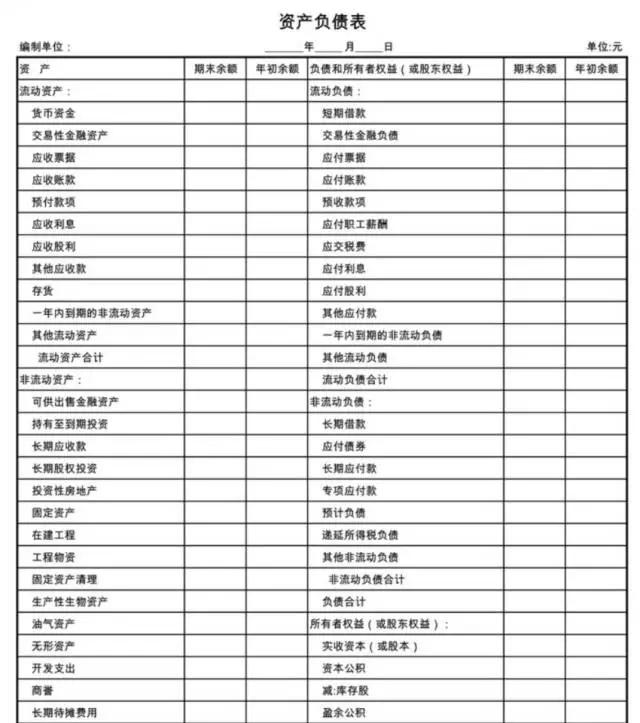

你看着这个资产负债表，就会产生刚才我提出来的疑问。既然一个企业是由投资者、债权人，还有劳动力共同组合而成的，为什么当中有些人能够成为老板，而有些人则成为员工得听别人的命令。

我们都有经验，一个新员工入职，到公司的第一天他会拿到一本厚厚的员工手册。这本员工手册告诉这位员工，你该做什么、不该做什么。我还记得我自己上班的第一天，就拿到一本这样的员工手册，我翻到自己的岗位那一页，好长，一二三四五六七八九，好多注意事项。

我现在都忘了，但是最后一条我印象还是很深刻的，上面写着“完成领导交办的其他工作”。但是我们新员工入职的时候，却不会给老板一本相同厚度的老板手册，指明老板要做这个、要做这个，不应该做那个、不应该做那个。

所以很多人得出一个看上去挺合理的结论，那就是资本家通常都有能力支配、牵引、指挥、控制劳动力，或者简单地说，资本家天然就具有剥削工人的能力。但问题是如果资本天然的就可以剥削劳动力，那为什么我们不会去争着做资本家呢？

你可能会说当资本家可得有资本、可得有钱，但问题是资本家有大有小。现在的打工者年薪收入可以几万、可以有十几万、可以有几十万，好像苹果公司、微软公司的 CEO，他们的收入是千万级别的，他们仍然在打工。而要当一位小老板，可能你投资一两万就可以了，为什么大家不会争着去当小老板呢？

## 2\. 资本与劳力：谁是弱者谁当老板

我们在讨论到底是资本强还是劳动力强，到底是资本牵制劳动力，还是劳动力牵制资本的时候，我们就回想起来，我们前面在讨论信息不对称的时候，好像讨论过这个问题。

还记得吗？我们讲特许经营权的时候，我们说的是加盟商更容易欺负总店，所以他们才会签订一些不平等的条约，来加强弱者也就是总店的地位，来削弱强者也就是加盟商的地位。

现实中谁强谁弱，跟合同上反映出来的刚好是相反的。病人和医生之间也有这样的关系，餐厅和顾客之间、老师和学生之间都有这个关系。表面上看上去的弱者其实是强者，表面上看上去的强者其实是弱者。

那资本家强还是劳动力强呢？谁更容易牵制谁、操控谁、剥削谁呢？

我们来看一个团队要成功，劳动力和资本要形成一个良好的合适的搭配才能够有效率。而资本家他们建好了工厂、铺好了生产线，把资金投入到位以后，他们基本上就无能为力了。东西已经在那了，他们想要撤都不容易了，肉在砧板上了。

而劳动者他们投入的是他们的劳动，他们随时可以付出，也随时可以收回。

这里面有趣的一个对比是，资本家所投入的东西无论是厂房、生产线还是资金，资本家自己的脑袋不安在这些资本上面，他不可能 24 小时看着他的资本。而劳动者他付出的刚好是劳动力，他的脑袋刚好长在他的四肢上面，他随时可以掌控他所提供劳动力的品质和数量。

偷懒很容易，假装卖力很容易，多吃多占也很容易。所以我们说在资本和劳动力之间，资本是弱者，劳动力是强者。（秦俑语：在西方国家，“工会”更是一种强大的存在。）

## 3\. 企业管理的本质：防止劳动力滥用资本

我不知道你有没有看过这样的场面，就是在旧社会很落后的时候，有一种职业叫纤夫。他们就是在岸上拉船的人，那是一种苦工。一群衣衫褴褛的工人，在岸上卖力地把船从一个地方拖到另外一个地方，而这时候，这群辛苦工作的纤夫背后还有一位举着鞭子的监工，为什么会有这样的职业？

如果可以选择，你愿意当纤夫还是当监工呢？很多人会说那我宁愿当监工，被人抽还不如抽别人。但问题是为什么就没见到大家都变成了监工呢？你要再想想这船是纤夫拉的，收入是他们挣的，凭什么他们挣来的收入还要分一块给这个监工，他们可不可以合计一下，说下次我们找到工作就不要这个监工了。

事实上，监工这个职位一直存在，我们需要对它进行解释。这个解释就是，纤夫们自己知道，他们自己会偷懒，他们会虚张声势地卖力，他们知道如果是这样的话，他们的总收入会下降。出钱请了一个人来鞭打他们自己，他们的收入反而会增加。

这是经济学家看问题的角度，这是通过信息不对称的角度，来对雇佣关系做出的新的解释。

所以回答我们昨天提出来的问题，在一个企业里面谁当老板，第一个原则是谁提供的资源更容易被欺负、被滥用、被支配、被牵制，这种资源的所有者充当老板。而与此对应，那些更容易偷懒、更容易滥用别的资源，更容易虚张声势假装卖力资源的所有者，他们会充当被管理者的角色。

而当我们把资本和劳动力作比较的时候，我们发现，资本是更容易被欺负、更容易被滥用的；而劳动力是更容易偷懒、更容易滥用资本的。所以企业管理的核心问题，就是如何防止劳动力剥削、滥用、操控资本，而不是相反。

到底企业管理的本质是什么？定义是什么？管理学家有各种各样的解释，我对企业管理的定义就一句话，那就是如何防止劳动力滥用资本。大量关于企业管理、企业文化建设的经验，目的都是一个，那就是让劳动力的利益向资本的利益看齐。

## 课堂小结

今天，我们从资本和劳力的角度解释了在企业里面谁当老板的问题。在一个企业里面，谁当老板的一个原则是谁提供的资源更容易被滥用、被支配、被牵制，谁就当老板；而在资本和劳动力的比较当中，我们会发现其实资本才是弱者，劳动力才是强者。

所以，往往是提供资本的人，而不是提供劳动力的人在企业当中当老板。

## 课后思考

今天我留给你的思考题是，在创新创业的热潮当中，究竟是资本追逐创新还是创新追逐资本？资本家和创业者到底谁更需要谁？

欢迎你给我留言，我们下节课再见。

##### 119

# 第 119 讲  
谁来当老板——专用资源和通用资源 

今天我们继续讨论我们这个礼拜的主题，在企业里面谁来当老板。我们今天讲第二个标准，判断谁是企业的专用资源，谁是企业的通用资源。

我们昨天讲了第一个标准，那就是从资本和劳动力之间的比较引发的。我们说在企业里面哪一种资源更容易被欺负、被牵制、被滥用，那么这种资源的所有者就应该成为指挥者。

相反，有哪些资源，特别容易被拿来欺负别人、控制别人、牵制别人、甚至是滥用别人的资源，那么，这些资源的提供者应该成为被管理者和被监督者。

今天我们来讲另外一个标准。

## 1\. 专用资源与通用资源：谁更在乎企业成败

我们先来设想一下，如果我是某家汽车制造商的设计师，我专门设计汽车的外形，我花了几十年的时间钻研这么一门学问。我学的、我擅长的就是这么一点技术，就是怎么给汽车外形做设计。我知道怎么样好看，知道怎么减少空气的阻力，怎么省油，汽车在高速行驶的时候怎么才能更稳定，我就这点儿本事。

而同样在我们家企业里面还有其他的工种，有行政秘书、有清洁工、有出纳、有保安、有门卫，那么我跟他们在一起谁更可能是企业的领导人，谁更可能是企业的指挥人呢？当然你知道答案，我更可能是企业的经理，而他们是被管理者。

为什么？仅仅是因为我提供的人力资本比较稀缺吗？不见得。在一个企业里面，很多工种所占有的人数也非常少，比方说保安和门卫人数就不可能很多，负责内部审计的人员数目也非常少。有些大工厂里面有他们自己的医院，医院里面的医生人数也比较少，但是这些医生、这些审计、这些门卫，不可能因为人数少就成为企业的经理。

我们提供的同样是劳动力资本，但是我所提供的资本跟刚才说的行政秘书、出纳、保安、工厂的医生，有一个很大的不同，那就是如果我们共同服务的这家企业经营不善倒闭了，我们各自的出路有什么不同。

你想想看，如果一家汽车制造厂倒闭了，专门负责设计汽车外形的这位设计师，也就是我，在世界上还能找到几家同类的汽车制造公司，能够给我提供类似的职位？

是的，奔驰如果倒闭了，那还有宝马，还有英菲尼迪，还有特斯拉，还有宾利，但是也就这么几家屈指可数了。如果不在这些企业工作，我所积累的人力资本就会大大贬值，我在别的地方根本就一无是处，除了到这几家企业工作以外，我的收入肯定会大减，因为我在别的地方用不上。

但是刚才我说的其他同事，行政秘书、出纳、保安、工厂的医生，他们可选择的可以获得类似收入的工作有多少？那很多，成千上万，他们不在微软工作可以到苹果工作，可以到谷歌工作，他们在这些不同的公司里面发挥的功能差不多，获得的收入也差不多。

所以经济学家把那些其价值高度依赖于他所在的企业平台的劳动力资本，称为企业的专用资源；而把那些无论放到哪个企业平台里面去，都能够发挥差不多的功能、获得差不多收益的资源，称之为企业的通用资源。

所以，如果我们让企业专用资源的所有者来充当企业的经理或者领导，而让那些通用资源的所有者接受命令、服从管理，这时候那些专用资源的所有者，因为他们更在乎企业的成败，他们就会成为更好的掌舵人。（秦俑语：“专用资源”可选余地小，转换成本高；“通用资源”相反。）

## 2\. 专用资源必须在特定平台上发挥作用

我们要强调的是，我们说的企业的专用资源、企业的通用资源不仅仅是指劳动力，它指任何的资源都可以做这样的划分。

一家工厂的厂房、输油管、模具、设计图样、交易软件等等这些，其实都属于这个企业的专用资源，放到别处去价值就会大大下跌，甚至一无是处。提供这些资源的人他们应该成为老板、成为决策者、成为指挥者。

还有另外一种资源，他们放到哪里去发挥的功能都差不多，这些资源的提供者就应该成为执行者和被监督者。

以我为例，我是一位经济学老师，过去花了很长时间钻研一门学问，我擅长给学生讲解什么才是地道的经济学思维。但我必须在一个非常独特的环境、非常独特的平台上面，我才能发挥我的价值。

我要在大学里面，在一个已经解决了信息不对称问题，已经招收了好多的学生，已经建立了讲台，已经安排好了上课时间，在这么一个具体的条件下面，我能发挥我的所长。只有在这样的条件下面，我给同学们讲解需求曲线为什么一定是倾斜向下的，大家才觉得这有意思、有收获。

但是如果换一个环境，我想买一份早餐，我走到路边跟卖烧饼的大爷说：大爷，我给你讲讲需求曲线为什么一定是倾斜向下的，你给我两块烧饼可以吗？你想想这个场面就够滑稽的。

## 3\. 杰克逊与灯光舞台

我再举一个例子，美国的大歌星迈克尔·杰克逊（Michael Jackson ），他也是劳动力的提供者，他做一场秀需要灯光、音响、舞台，这时候谁是这个团队的通用资源，谁是这个团队的专用资源呢？

当然杰克逊本人是这个团队的专用资源，他自己知道自己的舞姿稍微有所不同，就会显著地影响他受欢迎的程度，显著地影响他的收入。他如果不当歌星，离开了舞台，他的价值会极大地贬损。

而相对的那些提供舞台、灯光、音响设备的资本家，他们所提供的这些资源其实就是团队或者企业的通用资源，一个麦克风给杰克逊用可以，给小甜甜布兰妮也可以，给王菲也可以。

所以在杰克逊和这些资本家构成的组合里面，杰克逊虽然是劳动者，提供舞台、音响、灯光的是资本家，但杰克逊是老板，杰克逊说了算。

所以你看，今天我们讲的这个原则，企业通用资源和企业专用资源的权衡，跟昨天我们讲的资本和劳动力之间的权衡，就有一定的冲突。我们得看具体的情境才能决定，应该根据哪一个原则来确定谁来做决策、谁来执行决策。

## 4\. 资深律师与年轻律师

我们再举一个例子，我们看看在律师事务所里面，哪些是企业的专用资源，哪些是企业的通用资源。是律师事务所的办公楼吗？家具吗？电脑吗？写法律文书的那种本领吗？还是资深律师的客户名单？

当然一个律师事务所最核心的资本，就是资深律师的客户名单，资深律师走到哪儿这份名单跟到哪儿，业务就跟到哪儿，而其他都是从属的。所以在律师事务所里面，资深律师被称为合伙人，他们是企业的专用资源，他们说了算。

而其他资本的提供者，包括那些年轻律师，他们虽然也提供专业的本领，但他们的专业本领太同质化了、太通用了，放到哪个律师事务所里面价值都差不多，他们就在更大程度上处于从属的地位，得根据指令来工作。

在这里我们要强调的是，职业确实没有高低之分，那些所谓的老板、发号施令的人，他们之所以这么做那是因为他们承担着更大的风险。我们说了如果企业倒闭，他们所拥有的资本，不管是人力资本还是有形资本，放到别的地方去都会大大地贬值。

而那些企业通用资源，他们到哪儿都基本上能够旱涝保收。到底是努力把自己变成企业的专用资源还是变成企业的通用资源呢？这得视个人具体的条件、情况和偏好来定。

当然我喜欢补充的是，通用资源、专用资源的划分并不是非黑即白的。

## 课堂小结

今天我给你解释了在企业里面谁当老板的第二个规律，那就是通用资源和专用资源的区分。通常是专用资源的所有者充当经理，通用资源的所有者执行命令、接受管理。

## 课后思考

今天我留给你的思考题是，请你告诉我根据你的工作性质，你觉得你是属于通用资源呢？还是专用资源呢？你更愿意成为通用资源呢？还是更愿意成为专用资源？

欢迎你给我留言，我们下节课再见。

##### 120

# 第 120 讲  
谁来当老板——固定收入和剩余索取 

今天我继续给你回答我们这个礼拜的核心问题，在企业里面谁来当老板。我们今天讲第三个准则，那就是通过固定收入和剩余索取所做出的区分。

前两天我们讲了在企业里面谁当老板的两个准则：

第一是哪种资源更容易被滥用，这种资源的所有者充当老板，资本和劳动力相比较的时候资本比较容易被滥用，资本家当老板。

第二准则是企业的通用资源和企业的专用资源的区分，企业的专用资源更在乎企业的成败，所以让他们来掌舵。

今天我们要讲的准则我们先从一个例子开始。

## 1\. 一明一暗带来的监督难题

很多年前，我们北大国发院的创始人之一张维迎老师，曾经举过一个非常生动的例子，他说：

假定有两个人共同构成了一个企业，他们一起生产某种商品。这两个人分别负责两道不同的工序：第一道工序是在阳光下面完成的，负责这道工序的工人在阳光底下干活；而第二道工序是在一所黑屋里面完成的，第二个工人在黑屋里面工作。

问题是，第一道工序工作的工人，到底有没卖力、有没偷懒、有没按时上班？在黑屋子里面那位工人是能够看得见的。但倒过来，黑屋子里面那位工人，工作有没有偷懒、有没有按时到岗、有没有小心翼翼，在外面阳光底下工作那位工人是没办法对他进行监督的。

一个在明里，一个在暗里。

假设这两道工序对产品的贡献都是 5 块钱，5 块钱在阳光底下，再加 5 块钱在黑屋子里面，这个产品最终的价值就是 10 块钱。所以这两道工序的工资就应该是一半一半。如果最终的产品做出来值 10 块钱，那阳光底下的工人拿 5 块钱，黑屋子里面的工人也拿 5 块钱。

但问题是，正是由于在黑屋子里面工作的工人不受监督，他肯定会偷懒，这时候他的贡献比方说只有 3 块钱，所以最后的结果这整个产品卖出去只值 8 块钱。如果还按照对半分成的分配方案呢？

那么，阳光底下的工人虽然卖力工作，他也只得 4 块钱；黑屋子里的工人虽然偷了懒，他的实际贡献只有 3 块钱，但他也得了 4 块钱。外面的工人亏了 1 块钱，里面的工人赚了 1 块钱，这不公平。

如果你是制度设计者，你会通过什么办法来解决这个问题呢？

当然，你可能会说我们轮岗，里面的人有时候到外面工作，外面的人有时候到里面工作。但这不实际，因为你知道，每一份工作都需要经过长期的培训和许多经验的积累，我们不能有两天在车间工作，有两天又到办公室工作，还有两天又到厨房里面工作。专业分工这个假定不能改变。

你也可能会说，那我们能不能派一个人到黑屋子里面去，监督那个在黑屋子里面工作的人呢？我们说不行，因为我们所做的这个假定，说假定这个人在黑屋子里面工作，顾名思义，我们所指的就是，他在这份工作上卖力不卖力没办法监督，派个人去不是解决的办法。

你可能还会说那我们通过 KPI 考核的办法，也就是绩效考核标准，来确定里面的人到底有没有卖力，这个办法也不靠谱。那是因为 KPI 的制定本身是根据每一个职位应有的贡献来决定的，是我们先知道了每一个职位应该贡献多少，企业才会制定相应职位的 KPI，也就是这个职位的绩效考核标准。

而在刚才的例子里面，我们说在黑屋子里工作的人肯定是要偷懒的，如果他总是偷懒，那么人们就会以为，在黑屋子里工作最多就只能做 3 块钱的贡献，所以给黑屋子里人的 KPI 考核标准那就是 3 块钱，结果他真的就做 3 块钱，大家以为他已经尽力了。所以通过绩效考核，还是不能解决在黑屋子里面工作的人持续偷懒的问题。

## 2\. 以“剩余索取权”激励难以监督的合作者

有一个办法能够很好地解决问题，那就是通过固定收入和剩余索取权的区分来解决这个问题。

每当这个企业，这两个人的企业生产出产品卖了 8 块钱以后，这 8 块钱先支付外面的那个工人——就是那个提供的劳动力很容易被监督、很容易被衡量、很容易被计算的那个工人——的工资，你赚了 8 块钱先给他 5 块钱。

外面这个工人的工资，是按照他的投入来计算的，为什么？因为他的投入容易观察、容易衡量、容易被监督。赚来的 8 块钱，付完这 5 块钱的固定工资以后，剩下的给黑屋子里的人。在黑屋子里工作的人，被经济学家称为“剩余索取者（residual claimant ）”，他负责拿剩下的。

剩余索取者的收入不根据他们的投入来计算，而根据企业剩余的利润来计算。企业剩下多少他们拿多少，他们越努力企业剩下的就越多，他们得到的就越多。所以不需要再有人监督他们的工作、他们到底卖力不卖力，他们自己监督自己。

企业里面有很多管理工作，就属于这种在黑屋子里面工作的性质。你是一位企业经理，一上班就把自己关在办公室里面，把百叶窗一拉你在里面干什么谁知道。

你给别人打电话，那是客户还是你的朋友？中午你约人吃饭，你是在发展个人友谊还是发展公司关系？你到了周末还到北大上 EMBA 班，这学习到底是为了提高你自己的人力资本，还是对企业的发展有贡献？谁知道，谁说得清楚？这永远不可能有一个明确的衡量标准。

怎么办？我们让这种人拿企业剩下的利润，让他们自己监督自己。所以在企业里面，这种工作业绩很难用固定的方法来衡量的人，让他们来当老板，让他们拿企业的剩余。

## 3\. 制度经济学，让人耳目一新的科学分支

所以你看，我们接连三天，从信息不对称的角度，解释了在一个企业里面，什么人来当老板的普遍问题，我们的答案跟以前我们在别的地方学到的非常不一样：

我们是说看哪种资源更容易欺负别的资源，让那种容易被欺负的资源的所有者当老板；

我们看哪种资源是企业专有的资源，放到别处去他的价值就会大大贬损的，那么我们让这种资源的所有者，充当企业的老板或者管理者；

我们看哪种资源的投入是容易观察、容易衡量、容易计算的，我们对这种资源的所有者先给予固定的回报，企业不管是赚钱还是亏本先给他们付工资。而对于那些不容易观察、不容易衡量、不容易监督的资源，我们对他们的所有者给予剩余分配，他们拿企业剩下的利润。

顺便说说，去年 2016 年，获得诺贝尔经济学奖的经济学家奥利弗·哈特（Oliver Hart，1948- ），他就是因为从“剩余索取权”概念的概念出发，进一步提出了“剩余控制权”而获奖的。

我们这个礼拜所讲的企业理论，是非常新的经济学的发现。

在过去很长的时间里经济学家关心的都只是一些非常宏观的概念，比如说 GDP、汇率、失业率等等，他们所关心的只有这些宏观经济数据。

在他们的眼里，像企业、家庭、组织、政府，所有这些机构看起来都只不过是社会大生产当中的一个黑盒、一个原子，它里面没有固定的结构，你只要投入它就能有产出。

而经济学家是在过去 50 年左右，才开始深入研究这些不同的机构、组织内部的治理关系，刻画、描述、解释这些组织内部的责权利关系。

这门学问在经济学里面就被统称为“制度经济学”，这是一门让人耳目一新的分支学科，它的研究成果在今天很多流行的经济学教科书里面，还没有得到充分的反映。

## 课堂小结

今天我们介绍了在企业当中谁当老板的第三个原则，那就是在企业当中那些提供容易被观察、容易被衡量、容易被计算的资源的一方，他们拿固定的工资。

而那些提供的资源不容易被观察、不容易被衡量、不容易被监督的人则拿企业剩下的利润——我们称之为“剩余索取者”，用这样的办法就能巧妙的解决某些劳动力的绩效不容易被衡量、不容易被观察、不容易被计算的难题。

## 课后思考

今天我留给你的思考题是，人们在规则越多的公司里面工作越卖力，还是在规则越少的公司里面工作越卖力？

欢迎你给我留言，我们下节课再见。

##### 周

# 第 30 周问答  
年轻人应该跨界发展 or 坚守本行 

我们开始本周的问答时间了。

这个礼拜我们仍然在信息不对称的大模块里面进行讨论。前面四个礼拜，我们讨论的是关于信息不对称的一般性问题，人与人之间要合作，但又不完全可信，那有什么办法把合作带来的好处推到最大，把人与人之间不靠谱的行为带来的损失减到最小，是我们讨论的核心问题。

我们分别从市场的角度、法律的角度、行政管制的角度，讨论了各种解决方案。

然后，这个礼拜我们聚焦一个具体的场景，那就是企业。企业是人类伟大的发明，企业内部的信息不对称关系是整个大社会的缩影。我们去考察企业内部是怎么解决问题的，就能体会人类文明的精彩之处。

我们说企业治理是文明的体现，原因在于它吸取了丰富的人际交往的经验，衍生、发展、构造了许多精妙的人际关系规则，让人们能够以非常体面的、迂回的方式进行竞争，进行合作，进行生产，进行创造。

这个礼拜所讲的内容，所介绍的看问题的角度，也是具有颠覆性的，也是咱们全年课程当中的一个高潮。记得吗？我们前面讲“渔村的故事”的时候，已经涉及人与人之间的关系了，不同的分配方案，人们就会选择不同的团队规模，上船的人数就不一样。

渔村的故事当然非常精彩，但今天看来，那个故事还是太粗糙了。因为在那个故事里面，每一个人都是同质的，他们之间没有强弱的关系，没有管理与被管理的博弈，也没有卖力与不卖力之间的算计，每一个人都只盯着几个简单的数字，要么是平均数，要么是边际数。

但咱们全年的课程是环环相扣、步步推进的，到了今天这里，我们眼里的世界就更贴近现实了。人不再是简单的、同质的、没有反应的，在现实社会当中，各种假公济私、虚张声势、推诿搪塞、背信弃义等等行为，都被我们考虑在内了。

而相应的对策，也不仅仅是过去我们所讨论的，告知、披露、遵守合同那么简单，我们要根据人们之间的主从关系、可替代关系、收入分配关系，重新构造人和人之间的架构和问责机制。我们是通过这样的办法，很大程度上解决了信息不对称的问题。

好像透视镜一样，你戴上它以后，你会看到一个从来没看到过的精彩世界。

## 1\. 三位大师对企业本质的不同解释

这个礼拜我们比较了三位制度经济学大师对企业本质的不同解释。

科斯认为，人们之所以结成企业，是因为市场上有交易费用，而企业又不会无限扩大，整个社会不至于变成一个大企业。原因在于企业内部也有管理费用，企业的边界，取决于市场上的交易费用和企业内部的管理费用之间的平衡。

科斯的解释当然非常有启发性，确实，我们每天到熟悉的环境，跟熟悉的人一起工作，能够减少大量的交易费用。

但阿尔钦却觉得，这样的解释还不够。你说两个人结婚组成一个家庭，仅仅就是为了降低交易费用吗？这么说有点牵强。

1+1 不等于 2，大于 2。一个家庭能够带来的产出，往往要比每一个家庭成员单独能够带来的产出之和还要大得多。夫妻两人生下几个小孩，很难说只不过是交易费用的降低而已，企业的构成、交响乐队的构成、家庭的构成，它的现实含义要比降低交易费用丰富得多。

阿尔钦就找了德姆塞茨，把德姆塞茨给说服了，两个人一起写了一篇非常重要的文章，这篇文章成了《美国经济评论（American Economic Review ）》100 多年来最经典的 20 篇文章之一。

这两套理论的比较牵动了咱们很多同学的心，虽然这不属于思考题的内容，但是很多同学还是在留言里写下了他们的心得和评论，这样学习很有意思。学问做到最后，不是简单的谁对谁错的问题，而是谁浅一点、深一点，高一点、低一点，粗糙一点、优美一点的问题，最后比的就是智力上的美感。

## 2\. 为什么说纤夫雇佣了监工

我在留言区看到，有的同学说：纤夫的例子理解起来有困难。因为从观察上看，明明是老板或者监工雇佣纤夫，我们在课程里面为什么说是纤夫雇佣了监工呢？这么说的原因，一方面是为了生动，为了理解的深刻；但更重要、更根本的原因，是它刻画了经济学内在的逻辑。

在讲课的时候，我已经解释了，如果监工这个角色是不必要的，那纤夫最后会意识到这个问题，他们会自己去揽生意、自己分享所得，随着时间的推移，监工这个位置就不会存在了。经济学的逻辑是纤夫养活了监工。

我们在全年的课程当中，很多地方都体现了这样的思维。比方说我们在讲“采石场的故事”的时候，我们说是最终消费者出钱购买了采石场旁边的那块土地，我们这么说所要强调的也是经济的逻辑。因为从观察上来说，把钱从口袋里掏出来购买土地的是那位开采石场的老板，而不是最终消费者。

也是基于同样的道理，我们说产品的最终的供需关系，倒过来决定了产品原材料的成本，我们所强调的也是一种经济上的逻辑。因为很显然，你要看会计账本的话，当然是产品的原材料发生在前，最终产品的出售发生在后。

人人都容易看得到的是时间上的顺序，咱们要强调的，别人不学经济学就看不到的，是经济学的逻辑。

最近，特别是这个礼拜，我看同学们的留言、看同学们回答思考题，我就看到同学们明显的进步。

那就是已经很少有人会简单地从剥削、欺负、不正当歧视的角度，来理解这种社会现象和企业内部的依存关系了。大家很自然地就会觉得剥削谈何容易啊，因为每个人都有对策，我们时刻都要把别人的对策考虑在内，想要剥削别人那是容易的，要实现那可难了。

有了这样的前提，大家的注意力就集中在怎么样才能对现实做更好的解释，怎么样才能把信息不对称这个约束，具体地运用到对现实的解释当中来，这是很重要的进步。

好，我们来看看本周的思考题。

## 3\. 企业家探索与试错的自由最重要

周一的问题是：“既然团队的每一位成员都对团队的最终产品有贡献，他们应该都是平等的，那为什么在团队里面，也就是在企业里面，有些人整天指手划脚、指挥别人，而有些人却要听从别人的指挥呢？ ”

答案在周二、周三、周四的内容里面做了详细的解释。那就是因为在企业里面：

有一些人做出的投资一旦做出就收不回去，他们比别人更输不起；

或者因为有一些人，他们更知道他们的资源该怎么用，他们的资源一旦离开了企业的具体场景，就会大大地贬值，所以他们更在乎；

或者因为有一些人的贡献很难做绩效考核，很难在事前做定量的规定，所以我们让这些人说了算，所以我们授权他们立规定，所以我们让他们享受酌情处理的权利，让他们拿企业剩下来的利润。

但在这里我要强调，人与人之间的关系是复杂多变的，企业或者团队管理的模式也是丰富多彩的。比如在大学里，教授就应该有比较大的话语权，但也并不是完全没有例外。我在麻省理工大学参观著名的“媒体实验室（Media Lab ）”，那是一个专注研究前沿科技的实验室，它的领头人就不是学者，而是商人。

我还在波士顿参观过另外一家生物科技的公共实验室（Mass Innovation Labs ），在那里，哪怕是很高级的工程师，都是被当做通用资源来使用的。他们收取相对固定的报酬，也就是说在这样的机构里，教授、资深工程师、资深专家都已经是被当做通用资源来看待了。

对这些机构真正起牵引作用的，是一些更具有创新精神，有更敏锐的市场触觉的企业家。不管成与败，尝试不同的合约关系，尝试不同的团队治理模式，这种尝试的自由最重要。

## 4\. 资本家和创业者谁更需要谁

周二的问题是：“在创新创业的热潮当中，究竟是资本追逐创新还是创新追逐资本，资本家和创业者到底谁更需要谁？ ”

我自己的观察是，没有一成不变的答案，谁更厉害，谁就被人追逐，谁就被人需要。在一个人的创意不是太新颖，或者不是太被人接受的时候，创新者在追逐资本；但当创意的价值比较明显以后，那就变成了资本追逐创意。

我们看到许多创新者，虽然他也需要钱，但他不是见钱就收的，他要反过来考察投资者，看看他除了给钱以外，能不能带来其他的资源、其他的帮助。

比如中国的企业家有钱，想要投资美国硅谷的创新产业，人家要看的当然不只是钱，他还要看你对产品的改进会不会有帮助，对开拓中国的市场会不会有帮助，对一个原始创意的应用推广会不会有帮助。

你真的去看看，今天创新创业当中的人际关系和制度安排，那可真是精妙绝伦。

## 5\. 人力资本积累：先做通用资源，再做专用资源

周三的问题是：“请你告诉我，根据你的工作性质，你觉得自己是属于通用资源还是专用资源，你更愿意成为通用资源，还是更愿意成为专用资源。 ”

看了这一课的留言，感觉咱们的同学真是卧虎藏龙，大家对自己职业的分析非常透彻。

嗨！冷酷无情 同学的回答是，我现在是一名学生，毕业之后就属于通用资源，在任何一家企业工作，都是从头做起，没有所谓的特殊价值。而经历过社会的锤炼，逐步锻炼出自己的专项技能之后，我就会逐渐地从通用资源变成专用资源，专用资源是未来的一个目标。

我觉得这是大多数人事业发展的一个趋势，事业刚开始的时候拿不准，到处碰一下运气，即插即用，U 盘式生存。但这样的发展空间还是有限的，最后还是要在某一个细分领域上沉下来，钻进去，好好打磨自己的手艺，才能有不断增长的空间。

没错，这样的话，你对一个行业，对一个企业的依赖程度会增加，但你也会变得越来越不可替代。

## 6\. 规则少鼓励创新，规则多保障品质

周四的问题是：“ 人们在规则越多的公司里面工作越卖力，还是在规则越少的公司里面工作越卖力。 ”

冰山一角 同学的回答很清楚，他说：我觉得今天的问题应该一分为二看，对于有创造性的工作、可以通过自己的主观能动性创造价值的工作，人在规则越少的公司里面会越卖力；但创造性弱、员工主观能动性不强、人员流动性比较大的工作，只有规则多了才能更容易地保证产品整体的质量。

比如我的产品经理小娴，我看她就从来没有按时上班过，当然，她也没有按时下班过。我记得有一天晚上 12 点多了，我听完最后一遍第二天要播出的语音，在群里跟小娴说，语音没问题了。没想到 2 点钟的时候，她忽然又给我发来一句话，说这个地方要笑死她了。她笑了 10 分钟，瞌睡都笑醒了。

原来她半夜两点钟还在检查语音，发现了问题。当然，问题及时修正了。我现在给你听听那一段已经剪掉的语音吧：

有一艘船在一个码头上停靠、卸货了，本来就应该离开了，这时候发生了风暴，这艘船就把自己绑到码头上面，没有离开码头。

你看，像小娴这样的工作性质，需要大量的心思，具有很高的主观能动性。这样的工作，硬性的规定越少，工作的效果就越好。

周五辩论

我们周一到周四给大家留了思考题，今天是礼拜五，我给大家留个辩论题，大家一起辩论。

我们这周讨论了企业的通用资源和专用资源之间的关系，在个人的职业生涯规划方面，到底是要把自己变成一个通用资源，还是专用资源呢？ 我们就来辩论一下，到底应该不断地跨界，还是坚守自己的领域。

正方：认为，我们应该不断地跨界，因为世界发展的潮流是日新月异，不持续地跨界就没办法认识变化、拥抱变化、适应变化。

反方：认为，应该坚守自己原有的领域，因为世界上职业发展的趋势是越来越细分，越来越专业，不坚守自己的领域就很难做出超越别人的成就。

欢迎大家参与辩论。

##### 加

# 学习加餐  
经济学辞典—05 

B

不可交易性（inalienability）

为避免社会麻烦而禁止交易（Inalienability may be adopted in order to minimize significant externalities.  ）

  解释：政府可能会认为，买卖会引起社会很大的麻烦，一旦让人进行买卖，再来收拾买卖之后产生的各种矛盾，成本太大了，所以一开始就禁止这个买卖。 

案例：政府规定不能把土地卖给带来大量污染的工厂。 

一键直达：第 061 讲丨产权保护之三：不可转让原则

 

边际收益（marginal utility）

边际效益递减定律在世界上普遍适用（The law of the diminishing return applies everywhere.  ）

 解释：不管前面上升的阶段有多长，总有那么一点，从那一点开始，某种要素的边际收益就开始递减。 

案例：再好的酒肉吃到临界点收益就开始下降。 

一键直达：第 063 讲丨边际收益递减定律

 

禀赋（endowment）

每个人都有自己的渔船（Everybody is talented and endowed in one way or another.  ）

 解释：当每个人都有机会善用他自己的各种资源、他自己的各种“船”，这个社会就能够获得巨大的财富增长。 

案例：无论是先天拥有还是后天习得，每个人总会有他自己的禀赋。 

一键直达：第 17 周问答丨每个人都有自己的“渔船”

 

C

产权（property right）

交易费用的高低影响产权的保护方式（The magnitude of transaction cost governs the specific methods to exercise property rights.  ）

 解释：产权保护，到底是用财产原则还是责任原则，当中很重要的权衡就是看交易费用的高低。 

案例：码头紧急避险案中的责任原则。 

一键直达：第 060 讲丨产权保护之二：责任原则

 

世界上不存在绝对的产权（The freedom to exercise one's property rights is always contingent upon social limitations.  ）

 解释：产权的界定和执行总是有限度的，在不同的背景下，就有不同的产权范围和强度。 

案例：警察有枪但不能抢银行，否则你拥有了一把枪，你就拥有了全世界；你家买了音响，但是过了晚上 12 点它就不属于你了。 

一键直达：第 16 周问答丨生活就是经济学的实验室

 

成本（cost）

禁止器官交易的成本，随着器官移植技术的成熟而增加（The cost of forbidding the trading of human organs increases as the technology of transplant operation develops.  ）

 解释：不同的制度、不同的约定，会产生不同的经济和社会后果。 

案例：器官移植技术越成熟，禁止器官移植的成本就越大。 

一键直达：第 062 讲丨产权保护之三：不可转让原则（续）

 

J

竞争的成本（the cost of competition）

不要和刘翔竞争短跑（There are social norms that tend to minimize the costs of competition.  ）

 解释：一伙人准备在离他们一百米的地方抢金子，如果注定只有一个赢家，最好的制度设计就是只让本来能赢的那个人跑过去拿，别的人就不要跑了，这样社会的成本会降到最低。  

案例：颁布沉船打捞禁制令的官司和判决。 

一键直达：第 15 周问答丨应不应该和刘翔竞争短跑？

 

集体所有制（mutual property rights）

集体所有制下资产交易的成本更高（The transaction cost incurred in a mutual property right system is significant.  ）

 解释：每当这些集体所有的资源要发生买卖的时候，你必须要征得每一个成员的同意，而要达成一致的赞同，成本是非常高的。 

案例：土地是村集体所有的情况下每当要发生交易，成本就会非常高。 

一键直达：第 064 讲丨集体所有制

 

Q

全员所有制（common property right）

人人所有的结果是人人都没有（To be owned by everyone is to be owned by no one. ）

 解释：一项资产，当人人都可以无限制地使用的时候，其经济价值就会大幅损耗甚至下降为零。 

案例：大家都可以无限制地去鱼塘打鱼，鱼就从大鱼变小鱼最后变没鱼。  

一键直达：第 066 讲丨全员所有制

 

公地并不一定悲剧（People tend to minimize the dissipation of rent subject to constraints.  ）

 解释：人是会争取利益最大化的动物，这句话的另一种说法是：人是会争取损失最小化的动物，在这样的规律下，人们就会组织起来形成规则，尽量减少“公地悲剧”所造成的损失。  

案例：在牧羊的地方大家会约定好，草不能吃得太低了。 

一键直达：第 067 讲丨公地真会悲剧吗？

 

S

私有制（private property right）

你在别处的机会决定你的议价能力（Your bargaining power is the opportunities you have elsewhere.  ）

 解释：劳工的议价力等于你在别处的机会，你在别处的机会越大，你在原单位工资议价的能力就越强。 

案例：私有制下老板请别人上船。 

一键直达：第 065 讲丨私有制

 

Z

政府所有制（governmental property right）

目标的多元是政府存在的价值（Government has a variety of social goals.  ）

 解释：在政府所有制下，我们往往无法推测一项资产的使用效率会如何，因为政府的目标的是多元的。而目标多元，恰恰是现实生活中政府存在的理由。 

案例：政策性银行和商业银行不同的经营目的和效率。 

一键直达：第 068 讲丨政府所有制

##### 121

# 第 121 讲  
收入的高低和节奏由什么决定 

上一个单元我们讲了在企业里面谁当老板，这一个单元我们讲讲工资收入是怎么决定的。我们讲两个问题：

一个是工资收入的高低是怎么定的，有哪些因素决定工资收入的高低；

第二个问题我们讲讲工资收入的节奏，它的节奏是根据什么定的。    

## 1\. 员工的议价能力，取决于他在别处的机会

第一个问题，我们来回顾一下，最早我们讲渔村故事的时候，那个发现船的人，要把这艘渔船按私有制的方式来管理的时候，他请别人上船，这时候他给别人的工资是多少呢？是四条鱼。这四条鱼是怎么定的呢？那是这些工人在别处收入的机会。

一个人在一个企业里面的议价能力，取决于他在别处的机会。他在别处的机会越高，他在这个企业里面议价的能力就越高，因为他随时可以选择离开。而如果一个人在别处的机会已经用尽了，在当前的企业里面，他的收入已经是在众多选择里面最高的了，那么他就没有什么议价能力可言了，他只能老老实实待在这个企业里面工作了。

你看看我们的月嫂，她们都是散兵游勇，她们并没有联合起来，但是月嫂的工资为什么会越来越高呢？那是因为总有别的人在别的地方给她们开更高的工资。所以哪怕月嫂并没有形成一个组织，她们的工资也仍然可能会节节地提高，只要她们在别处的议价能力在增加就可以了。

## 2\. 边际贡献决定团队成员的收入水平

还记得吗？我们在讲肥猪丸的时候，我们说有一位教授发明了一种肥猪丸，他能够使猪多长 100 斤，那么这位教授的工资——这种肥猪丸的价格大概是多少？

大概就是他给猪带来的额外贡献，就是那 100 斤的猪肉。这是工资决定的一个非常重要的原则，那就是任何资源在团队里面应该得到的回报，跟他对这个团队所带来的边际收入应该相称。

## 3\. 出租车司机收入和份子钱高低无关

所以根据这个原理，我们也讨论过出租车司机的收入，跟份子钱之间的关系的问题。

份子钱是由出租车的专营权决定的，它是垄断的权利带来的收入。如果我们硬性地修改专营权所有者和出租车司机之间的合同，硬性地提高出租车司机的收入，那就会在其他的行业吸引跟出租车司机相似的劳动力来竞争这些职位。

最终由于竞争——这些潜在的竞争者还是会把出租车司机的实际工资压低，把他们获得的收益还给专营权所有者。

在一个团队里面谁拿多少，是由他们带来的边际收入决定的。专营权这种特权、这种垄断权利也是带来收入的一种资源，它该得多少，也是由市场的力量决定的。

## 4\. 信息费用高低影响收入分配方式

到了上个礼拜，我们还讲了工资决定的另外一个重要因素，那就是在一个企业里面什么人拿固定的工资，什么人拿剩余的收入。

有些人的工作绩效比较容易衡量、比较容易监督，所以这种人就根据他们工作的投入来获取工资回报，拿固定的工资。

而另外一种人，他们对企业的贡献很难衡量、很难监督，这种人就后拿收入，拿企业剩下的收入，他们被称为“剩余索取者（residual claimant ）”。

我们在这里通过上面这些不同的角度，所讲的一个核心要点，那就是工资是由市场的力量、市场的规律来决定的，而不是由老板的慷慨或者由老板的贪婪决定的。

这是今天我要跟你谈的第一个问题，工资收入的高低由什么决定。

## 5\. 时薪、月薪与年薪的区别

今天要跟你讲的第二点，是收入的节奏是怎么决定的。

你仔细看看不同的职业，他们的工资支付的方式有很大的不同，比方说有些工作叫小时工，按小时算的；

有些工作叫计件工，是按产品的件数来计算的，这种工作的特点是这种工作的绩效是很容易衡量、很容易考核的。干一个小时给你一个小时的工资，在流水线上完成一件产品的加工就给你一份工资；

还有一种工作支付的时间长度要长一点，月薪按月支付；还有一些工作不是月薪，它计算的是年薪。

月薪跟年薪有什么不同？时间跨度越大的薪水，它给人们的灵活空间就越大。比方说我们教授，我拿的是年薪，它的意思是你不需要每天都有贡献，这样你可以做一个长远的打算。

如果你每天、每个小时都要有贡献，你就只能完成一些重复性的工作，你就只能在岸边打一些小鱼，你不可能有整片的时间来修筑你的船，安装你的航海仪，把船开到更远的地方去打更大的鱼。

这种灵活的空间，让人可以做一些新的尝试、创新性的尝试，这种人拿的是年薪。

## 6\. 以投入与产出划分收入节奏

我们再看有些工作是按照投入来计算的，你只要干了就有收入。扫地的工作、打字的工作、营业员的工作，甚至我们老师上课的工作，付出了劳动就获得收入。

但有些工作却不是按照投入来支付的，而是按照成果来支付的。肖邦国际钢琴比赛的第一名可以获得一张唱片公司的合同，从此名闻天下，第二名、第三名就几乎什么都得不到了。这种工作冒险性很强，它根据结果来支付收入，前期投入多少几乎没有关系。

在一部电影里面，群众演员按投入来支付工资；而明星的工资可能就分成两部分：一部分是固定的片酬，而另外一部分是跟票房挂钩的。

## 7\. 工作品质鉴别难度决定收入节奏

我们再来看另外一种有趣的现象。刚才说的群众演员和大明星，他们的收入几乎是很短时间内就支付完毕的。群众演员拍电影的时候可能就已经拿到收入了，大明星电影上映以后不久可能也拿到所有的收入了。

但是大学老师，他们的收入是在一个很长时间里面支付的，很多大学老师签的是终身合约。你会倒过来想，为什么演员不签一个终身合约，一辈子做演员、一辈子做明星呢？而教授为什么不一下子拿一大笔钱，而是要把工资收入摊在一个漫长的收入里面，一直在拿一份不太高的收入呢？

那是因为演员所提供的产品，它们的品质很容易鉴别。一部电影受不受欢迎，几乎在电影上映之后的几天就能够知道；但是学者的产品、学者的论文、思想、观点，他们往往需要很长时间的鉴别、评估和比较，人们才能够正确地认识他们所做的贡献大小。

我自己做过一个不完全的统计，我把自己喜欢的诺贝尔得奖人，他们得奖的时间跟他们得奖的作品问世之间的时间做一个计算。有些得奖人比较幸运，他们的作品发表以后 19 年就获得了诺贝尔奖，有些就没那么幸运，要等 40 年才获奖。

而经过了这么漫长的时间，他们的生产力往往已经下降了，这时候如果根据人们到时候的评估来决定他们的收入，那可能会产生许多不对称、错位的现象。

结果人们想出一个解决的办法，那就是先让教授们做一段时间的竞争，当他们的绩效达到一个基本水平以后，学校就跟他们签订一个长期的合同，工资虽然不算高，但他们也能够衣食无忧，安心做研究。

## 8\. 产权保护需要决定收入节奏

有些收入是当场给的，有些是终身给的，这个跨度还不算大，有些收入是代际之间支付的，一代人跟一代人之间支付的。

比方说，以前的师父跟徒弟之间的关系，徒弟在很长的时间里面收取的工资都很低，不仅低，还有可能是负的，没拿钱还要做出各种各样的付出，来赢得师傅的赏识，这是为什么？

原因之一是师父的手艺往往得不到知识产权的保护，一旦师父教会了徒弟，师父就没饭吃了。所以这时候师父教徒弟他会特别小心，他选的不仅仅是徒弟，他选的是忠心耿耿、像儿子一样的徒弟。

所以这种师徒关系就要经历一个很长时间的训练期、试用期，等到师父完全放心了或者师父根本就做不动了，他才会把生意的命脉交给徒弟。你会说这徒弟不是亏了吗？徒弟没亏，多年媳妇熬成婆，当徒弟成了师父以后，他又可以“剥削”新的徒弟了。

所以这种错位关系，只要这个风俗习惯、这个传统能够一代一代地传承下去，那么谁也不会亏，谁也不会赚。问题就在于，如果这种传统忽然间发生改变，那么就会有赢家和输家。

比方说如果一个老徒弟，好不容易刚当上了新师父，传统上的这种师徒关系就被打破了，这位新师父就要蒙受亏损。

这跟我们社会上另外一种现象也挺像的，过去我们都要尊重老人、孝敬老人，这时候只要自己的子女长大了，他们也会孝敬我们。

而现在习俗忽然发生了改变，父母不再依靠子女来赡养了，子女长大就有他们的天地了。在这个年代里面，上有老下有小的人，他们可能就要蒙受亏损。

## 课堂小结

今天我给你讲了收入高低是由什么因素决定的，收入的节奏又是通过什么因素来决定的。无论是收入的高低还是收入的节奏，它背后都有很多隐形的因素在起着作用。充分了解这些因素，能让我们在看到各种各样工资收入差异的时候，保持理性的态度。

## 课后思考

今天我留给你的思考题是，有些人会说工人的工资实在太低了，因为市场竞争并不完善，所以如果政府规定企业主给工人多付一点工资，这样是能够保障工人最起码的、有尊严的生活的，你怎么评论这种想法和做法？

欢迎你给我留言，我们下节课再见。

##### 122

# 第 122 讲  
事与愿违——同工同酬 

我们这整个单元讲的是工资收入的问题。

昨天我们谈了工资收入的高低和节奏都是由市场的因素决定的，但是总有人会说市场竞争是不完善的，有很多人的工资其实是长期偏低的，同工不同酬现象是到处都存在的。

那么我们来好好探讨一下这个问题。

## 1\. 竞争之下同工不同酬现象趋于消失

首先让我们先构造一个同工不同酬的现象。

我们假设在一个企业里面有两位员工，一位是男员工，另一位是女员工，男工、女工，他们的工作质量是完全一样的。假设他们是两位打字员，他们打字的速度完全一样，错字率也完全一样，这叫同工。

但是老板是有歧视的，他重男轻女，给男工的工资是 100 块钱，给女工的工资是 80 块钱。完全相同的工作，付不同的工资，这时候我们构成了这么一个现象，这叫“ 同工不同酬 ”现象。

但是我问你接着呢？接着会发生什么事情？当然你可能从一个角度出发，你说这是不公正的，我们政府得管一管，立一个“同工同酬”法，这样通过这个法律来保障妇女的合法收入权益。

但我们也可以换个角度看，如果政府不干预市场会做出什么样的反应？你看，每当雇佣一位女工老板就能省 20 块钱，女工是可剥削的（exploitable ），但可剥削也就意味着是有利可图的（profitable ）。

那既然女工是有利可图的，那些天天想赚钱唯利是图的老板，至少总有一些他们会说“我们去找女工去”。如果女工真的是这么有利可图的话，你打开世界 500 强企业的大门，你会发现里面全是弱势群体、全是女工、全是没有经验的新工人、新移民。事实上并不是这样。

这时候我们假定所有的老板都是重男轻女的，他们喜欢男工，不喜欢女工，但总有这么一些老板，在喜欢男工的同时也喜欢钱。这时候就总有那么一些老板，愿意克制自己重男轻女的倾向，多招一些女工，每多招一位女工他们就赚 20 块钱，或者说他们的劳动力工资就省 20%。

竞争之下，这些偏见稍微少一点的雇主，他们的竞争力就会加强一点。所以，老板越是能够克制自己重男轻女的倾向，那他的竞争力就越强。换句话说，他越贪钱他重男轻女的倾向就越弱。

你记得吗？我们在讲歧视的时候也讲过这个主题，那就是那些少数派，不论你是在性别上、性取向上，在个人的宗教信仰上面，还是个人的卫生习惯上面，无论在哪一个问题上面你是少数派，如果你遇到一位唯利是图的雇主，那就是你的福音，因为他以貌取人、戴着有色眼镜判断别人的倾向会最弱。

最后的结果是怎么样？最后的结果是企业之间由于竞争有压力，所以他们不得不去增加雇佣那些受剥削的少数派。这时候结果会怎么样？结果越是竞争激烈的地方女工就越吃香，女工的收入就会节节上升，最后接近男工的收入。

也就是说，在市场竞争之下，同工不同酬的现象会趋于减少，甚至消失。这是我要说的第一点。

## 2\. 岗位相同不等于工作相同

第二点，同学会说薛老师，你说的是在市场竞争之下，同工同酬现象应该消失，但是现在有很多数据表明，女性的收入还是远远不如男性，有很多统计表明女性的收入只占男性的 70%、80%左右，这又怎么解释？

我先来问你，假如你们家请了一位阿姨，替你们家管理家务，这位阿姨的月薪是 2000 块钱，每个月她工作 20 天，平均每天工资是 100 块钱。然后这位阿姨就对你说：“我能不能这样，我爱来工作就来工作，不爱来工作就不来工作，来的那天你付我 100 块钱，不来的那天你扣我 100 块钱好了。”

如果是这样的话是她赚了还是你赚了？还是双方都没赚没亏？答案是她赚了。

为什么？因为你付的工资这 2000 块钱，可不仅仅是日薪，那是月薪，你要求的是她在上班时间在岗，随时提供服务。其实她每天的日薪不值 100 块钱那么多，可能只有 60，可能只有 70、80，你多付她一点工资，要的是一个持续的服务。而她如果爱来不来的话，她就不能够提供这种持续的服务，所以她赚了你亏了。

通过这个角度我们再倒过来看，女性收入为什么会低一点。

在一个夫妻双方都工作的家庭里面，妻子如果要生小孩，连生两个小孩，再把这个小孩儿养到三四岁甚至五六岁，他们上小学了以后，妻子再重新回去工作，这当中至少有五六年甚至七八年的时间。

有什么工作是你撂下来五六年、七八年回去干还能够马上捡起来的？程序员的工作？投资家的工作？工程师的工作？很可能不是。相反很可能是秘书的工作、图书管理员的工作、历史老师的工作。也就是说那是一些低风险、低回报的工作，因为家庭的缘故，女性做出了很大的牺牲。

所以从持续工作的角度看，男工和女工提供的工作质量并不完全一样，他们不同工。他们的收入之所以存在区别，是因为他们其实不同工。

话虽然是这么说，我得赶紧补充，现在随着科技的进步，大量白领工作的涌现，在这些岗位上，女性的禀赋往往比男性强；与此同时随着医学的进步，生育带来的干扰和风险也在显著降低；还有另外一个因素，是女性推迟了结婚生小孩儿的时间。

所有这些，都解释了女性在职场中的地位，为什么这些年一直在上升。     

## 3\. 同工同酬法让弱者失去工作机会

第三我要讲的是，我们假定在刚才的例子里面，男工的工作质量就是比女工高，男工的工作值 100 块钱，女工就只值 80 块钱。这时候我问你，女工有没有可能跟男工展开竞争？答案是有的，只要女工要求一个合理的工资那就行了。

如果她的贡献是 80 块钱，而她要求一份 80 块钱的工资，那么在唯利是图的老板眼里，这位女工跟那位男工他们就是没有差别的。而如果女工再狠一点，她少要一块钱，她说我要 79 块钱就可以了，这时候这位女工就能够把那位绝对工作质量比她高的男工秒杀掉。

换句话说要求一份合理的工资，有时候甚至要求一份稍微比市场价格低一点的工资，是那些绝对竞争能力比较低的人，跟绝对竞争能力比较高的人，展开竞争的最强有力的武器。

但这时候我们要看，如果一个国家、一个地区实施了所谓的“同工同酬法”，那就意味着老板必须付出高额的工资，他必须给出 100 块钱，如果他必须给出 100 块钱的话，那他会请男工还是女工？

他当然只会请那些配得上这个工资的工人，这时候对那些竞争力实际上比较弱的工人来说，就是一个致命的打击。因为同工同酬法不管它的用意是多么的善良，在实际效果上，它是剥夺了那些竞争力比较弱的人跟竞争力比较强的人展开竞争的最强有力的武器。

这时候就会产生一个事与愿违的结果，也就是我们刚才假设的那位女工，在同工同酬法的保护之下找不到工作了。

## 课堂小结

今天我和你讨论了同工同酬法的问题。我要讲的是三句话：

第一，这个世界上真的有同工不同酬的现象，真的有老板对员工进行这样或者那样歧视的现象，但是由于竞争的存在，迫于竞争的压力，老板会把歧视降到最低，同工不同酬的现象会减弱甚至消失。

第二，在竞争的条件下，如果我们还观察到长期存在男女不同酬的现象，那只能说明他们并不同工。因为我们在衡量一份工作品质的时候，不能只看一个时间的刹那，我们还要看它不同的维度，比方说它持续的能力怎么样，它的稳定性怎么样等等。

第三，哪怕是弱者也能够跟强者展开竞争，弱者跟强者竞争最强有力的武器，就是要一个合理的价格，而同工同酬法，很可能剥夺了弱者手上这把最强有力的武器，结果是事与愿违，让这些弱者连工作的机会都失去了。

## 课后思考

今天我留给你的思考题是，既然同工同酬法是一种事与愿违的法律，那为什么现在还有那么多人在积极推行这种法律呢？

欢迎你给我留言，我们下节课再见。

##### 123

# 第 123 讲  
事与愿违——最低工资法 

今天我来跟你谈谈最低工资法。昨天我们讲了同工同酬现象，关于同工同酬我们说了三句话：

第一，竞争会使得那些同工不同酬的现象趋于减少甚至消失；

第二，在长期竞争之下如果男女或者其他不同的群体之间，存在着持续的工资收入差距，那么这时候我们得出的一个合理结论就是他们可能不同工。因为到底是同工还是不同工，我们得从不同的角度进行考量，比方说从时间的维度、从工作持久性的维度、从工作稳定性的维度等等来考虑才能得出合理的结论；

第三，要一个较低的工资是弱者向强者竞争的最强有力的武器，同工不同酬法往往剥夺了弱者这一强有力的武器。

明白了这个道理以后，我们再来看世界各国普遍推行的最低工资法，我们就很容易对它的愿望和结果之间的区别做出合理的分析了。

## 1\. 最低工资法符合大多数人的良好愿望

最低工资法之所以受到世界各国的普遍推行，其中一个原因是因为它符合大多数人的良好愿望。大多数人会认为，如果没有法律的约束，那处于强势的资本家就会爱给多少工资就给多少工资，工人得不到应有的收入。

但其实我们应该想一想，在每一个国家、每一个地区里面，最低工资所规定的数目都是非常低的。如果你去问问那些老板，既然他们这么唯利是图，他们为什么不仅仅按照法律的规定，给工人最低工资就算了？他们为什么要付出比最低工资高得多的工资呢？

原因很简单，他们会告诉你，如果只付那么一点工资他们招不到人。

那为什么给临时工这么低的工资？为什么给实习生那么低的工资？老板会再告诉你，这些实习生、这些临时工他们造成的麻烦，要比他们做出的贡献大，他只不过是给他们提供了学习的机会。

今天我要再从经济学的角度，对最低工资法做几点评论。

## 2\. 最低工资法会导致失业

第一，最低工资法会导致失业。在一个国家最低工资法刚刚实施的时候，或者在那些已经实施了最低工资法，而最低工资的水平在政府的推动下进一步提高的时候，那些刚好已经被雇佣的人得益了，因为他们已经在岗位上了，当然这样他们就能够获得更高的收入。

但是你记得吗？我们在讲需求第二定律的时候讲过，人是有弹性的，人是会寻找对策的，而且随着时间的推移，他们能找到的对策就越来越多，弹性就越来越强，老板、资本家也不例外。

在最低工资刚刚开始实施的时候，他们没有办法，只能多付工资，但是随着时间的推移，他们可能就增加机器的投入了，减少对劳动力的需求了，他们甚至干脆把工厂迁到别的地方去了。所以最低工资法会导致失业，这是绝大部分的经济学家都具有的共识。

## 3\. 最低工资法剥夺穷人自立自强的机会

第二，最低工资法会剥夺穷人或者年轻人尝试自立、自律和自强的机会。你要知道要让穷人脱贫致富，最重要的不是给他们一份收入比较高的工作，不是给他们一点补贴，而是让他们学会自立、自律和自强。让他们有一个学习的机会，有一个上升的机会，有一个被社会接受的机会。

乔治·梅森大学经济学教授、辛迪加作家沃特·威廉斯（Walter Williams）

我在读博士研究生的时候有一位导师，是一位黑人经济学家，他名字叫 Walter Williams，沃特·威廉斯教授。他也是我们非常熟悉的阿尔钦（Armen Alchian）的学生。

而他跟阿尔钦的女儿艾琳（Arline Hoel），在读经济学博士的时候是同班同学，都是阿尔钦的学生。据阿尔钦的女儿艾琳告诉我，当年的威廉斯可是个愤青，他是那种进了教室几乎要举着双臂抗议、示威的愤青。而且加上他是黑人，他总觉得社会存在着这样那样的不公。

艾琳告诉我，阿尔钦在回家的路上就跟她说，“我要好好用经济学改造这个学生”，结果威廉斯被彻底地改造过来了。他当了教授以后，也一直没有停止过在全美国的报纸杂志上连载专栏文章，他要普及经济学的基本常识。当然他开口闭口也说阿尔钦是他的恩师。

威廉斯教授在他的专栏文章里面，就一直不遗余力地批评美国的最低工资法。由于他自己本身是黑人，所以当他说，那些看上去好像在帮黑人青年的最低工资法，实际上伤害了黑人青年利益的时候，就显得特别引人注目，就显得特别有说服力。

他说过，一个黑人青年只要做到“三不”，他就能够找到得体的工作，能够脱离贫困，能够出人头地。这“三不”就是：不违法、不未婚先孕、不游手好闲，好歹找份工作做。

第一不要违法，因为你一违法、一坐牢，监狱是坏人的大学，你本来没那么坏，住过一次监狱以后，各种各样的坏事都学到手了。

第二不要未婚先孕，因为未婚先孕有了小孩儿就会给你拖累，你所有长期的计划就没办法实施。

第三非常重要，找一份工作，从一份工作做起。不管这份工作的收入一开始的时候多么微薄，因为你开头几份工作的意义不在于收入，而在于你锻炼自己融入这个社会，学会自我依靠。也就是我刚才说的学会自立、自律和自强。

而对年轻人来说，尤其是那些受教育水平不是很高的黑人青年来说，最低工资法的后果就是增加了失业，使得这些年轻人失去了一个学习起步走的机会。

根据统计，在美国没有实施最低工资法以前，黑人青年的就业率其实要比白人高。你知道原因是什么吗？我们前面解释过，什么人能够失得起业、能够挑三拣四、能够付得起寻找下一份工作的成本呢？是那些比较有钱的人，是那些积蓄比较多的人，是那些家庭情况比较好的人——通常是白人。

而黑人青年，由于他们的积蓄比较少，由于他们的家庭情况比较差，所以他们不得不一见到工作就做，所以以前有过很长的时间，黑人青年的就业率要比白人青年高。

但是最低工资法实施以后，最低工资的水平逐步提高以后，黑人青年的就业率就变得比白人青年的低很多了。这是为什么最低工资法实质上是害了它本来想要保护的那些人的原因。

有意思的是在一些国家，比方说在法国，政府规定最低工资法不适用于残疾人。

你看这个规定有意思，最低工资法本来是要保护弱者的，为什么不适用于残疾人？因为实际上大家都明白，最低工资法不能保护弱者，如果最低工资法适用于残疾人，那残疾人就连工作的机会都没有了。所以为了真正地保护残疾人，最低工资法不适用于残疾人。

## 4\. 以最低工资法提高竞争对手成本

第三，我要讲的最重要的一点是，真正在背后推动最低工资法实施的，还不是那些心肠好、只不过是不懂经济学原理的人，而是那些希望通过最低工资法提高竞争对手成本的那些竞争者。

最低工资法的实际效果很差，推行它的美好愿望跟它实际的效果是背道而驰的，那为什么在这么多的国家里面还有人推行呢？当然其中一部分人是因为经济学上的无知，他们只有良好的愿望，他们认为最低工资法能够帮助人民脱贫致富。

但其实你只要想一想，如果最低工资法真的能够帮助人们脱贫致富，那么我们干脆就把最低工资提高就好了，我们跑到那些贫穷的国家说，我们提高你们的最低工资，把每小时的工资提高到 20、30、50、80 美元就好了。

实际上怎么可能通过这样的办法使一个国家脱贫致富呢？但这种经济学上的无知，只不过是最低工资法受到欢迎的原因之一。

更重要的原因，最低工资法背后真正强有力的推手，实际上是那些因为最低工资法而得益的人。

比方说那些大公司、大商场里面的职员，他们的工资本来就比较高，如果推行最低工资法，那些小工厂、小商场、小店铺的工人，他们的工资由于比较低，提高了最低工资以后，他们的经营成本有可能就上升到他们无法继续经营的地步。他们破产了，他们失业了，这对那些大工厂、大商店的工人来说是好消息。

南非的反资本主义之战（South Africa's war against capitalism，1989） 沃特·威廉斯（Walter Williams）著

刚才说的那位经济学家威廉斯，他曾经写过一本书，书名叫做《南非的反资本主义之战（South Africa's war against capitalism ）》，1989 年出版。

他说在南非那些清一色由白人组成的工会，在他们工会的章程里面就有这么一个规定：他们要致力于支持政府针对黑人所执行的最低工资法。

你看，他们不是爱黑人、不是关心黑人的收入，而是想要增加黑人竞争的成本。如果最低工资法得到了贯彻执行，如果法定最低工资的水平得到了提高，那工作就会从黑人那里流回到白人手上，这种办法叫提高竞争对手的成本。

## 课堂小结

今天我跟你讨论了最低工资法的三个特征：第一，最低工资法会导致失业；第二，最低工资法会剥夺穷人或者年轻人尝试自立、自律和自强的机会；第三，最低工资法之所以得到推行，一方面是由于人们善良的愿望，而另一方面其实更重要，是那些竞争对手希望抬高别人的竞争成本。

## 课后思考

今天我留给你的思考题是，现在很多国家越来越流行一种制度，那就是女性雇员如果生小孩的话，当爸爸的也要放产假，这种政策是女权主义者提出来的。你知道是为什么吗？

欢迎你给我留言，我们下节课再见。

##### 124

# 第 124 讲  
基尼系数与收入分配 

这个礼拜我们专门讨论收入问题。今天我要跟你讲的是基尼系数和收入不均的问题。

今天我们社会上很多人，都很关心人们的收入差距问题，认为收入差距本身就是个问题，他们也希望通过政府的政策进行收入再分配。今天我就跟你解释一下收入差距的问题。

## 1\. 在数学上直观而优美的基尼系数

我们这节课会用两个图表，非常简单的图表，来解释这个问题。

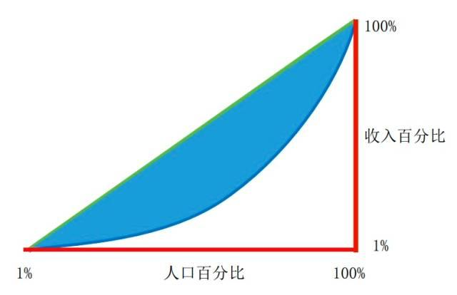

绿线（对角线），红线（边），蓝线（真实情况线）

在第一张图里面我们有一个坐标轴，横轴和纵轴由红色的线代表，横坐标代表的是人口百分比，纵坐标代表的是收入百分比。

我们看从左到右，如果一个社会里面 1%的人群，他们的收入占所有人群收入的 1%，2%的人群占所有人收入的 2%，3%占 3%，50%占 50%，100%占 100%。

如果是这样，我们就能画出那一条绿色的对角线。这种社会是一种收入绝对平等的社会，所以绿色这条线代表的是一个收入绝对平等或者平均的社会状况。

而另外一个极端是社会上 1%的人收入是 0%，2%的人群占收入的 0%，50%的人群占收入的 0%，99%的人群占社会总收入的 0%，只有最后 1%的人群占整个社会 100%的收入。

如果是这种情况，那代表的是另外一个极端的情况。那就是社会的收入极端的不平均，这时候我们通过这两条红色的边来代表。

但我们知道，实际上任何一个社会都不可能出现这两种极端的情况。也就是说，他们的收入不可能是绝对平均的，也不可能是那么的不平均，所以真实社会里面的状况，很可能是由图里面的那一条蓝色的曲线代表的。

这条蓝色的曲线处于绿色的曲线——也就是绝对平均线，跟红色的两条边——也就是绝对不平均的状态之间。这条蓝色的曲线越是靠近绿色的那条线，那证明这个社会越接近于收入平均的状态，如果这一条蓝色的线越是靠近红色的两条边，那说明这个社会的收入状态越不平均。

这时候经济学家就非常巧妙地，用蓝色这条线跟绿色这条线，所构成的那个区域面积来代表一个社会收入不平等的状况。这个面积越大——也就是蓝色这条线越接近于红色的两条边，那么这个社会收入不均的状况就越严重；这个区域的面积越小，它就越接近于收入平均、平等的状态。

你看，首先我要说，这个基尼系数的计算方式非常漂亮。在数学上你想想，一个社会的收入分配状况，能用一个简单的数字——基尼系数——也就是蓝色区域的面积来表示，这充分体现了数学方法的简单和优美。

基尼系数在数学上虽然是美的，但它在经济上却很有问题，我来跟你解释一下。

## 2\. 在现实中具有不同收入节奏的职业和人群

我们先看第二张图，横坐标是年龄，纵坐标是收入。

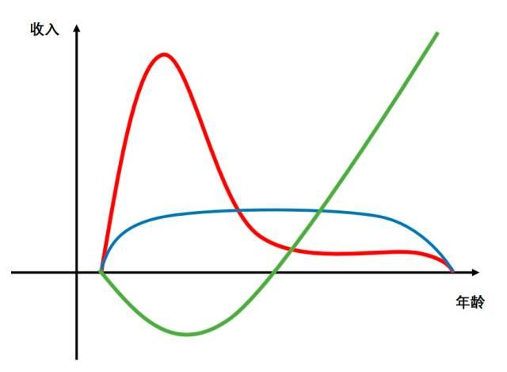

1\. 蓝线（早工作，早收益，低风险，稳收入） 2. 红线（大部分收入集中在中青年以前） 3. 绿线（大部分收入集中在中青年以后）

这个社会上有些人的终身收入节奏，是跟那条红色的线相符的。也就是说，他们在年轻的时候收入非常高，但随着年纪的增长，他们的收入就迅速下降，到了中年和晚年收入几乎为零。

这是一些什么工作？对了，明星、吃青春饭的，属于这种情况。这个社会上另外有一些工作，他们终身收入的节奏是跟那条蓝色的线相符的，这条蓝色的线是一开始就上升，但是一直就平平稳稳，既不上也不下。那是一些什么样的工作？有些同学喜欢说那是公务员、事业编制的老师、洗碗工、体力劳动者等等。

还有一种工作，他们终身收入的节奏是用那条绿色的线表示的。你看这条绿色的线，一开始有相当长时间是在负的区域，也就是说他们年轻的时候有很长的时间是负债的，但是随着年纪的增长，他们的收入稳步提高。

这是一些什么样的工作？同学们会说这是博士、这是医生、这是教授，差不多是这样。

现在我问你，这三种不同的终身收入节奏哪一种最好？

## 3\. 不能以刹那收入衡量收入差距

你回忆一下我们学过的利息理论，你记得年金收入的概念吗？人追求的不是刹那收入的最大化，而是追求终身收入的最大化。

所以这三种不同的职业类型，到底应该选哪一个呢？人们是要根据他们对未来的预期，选择那些能够使他们终身收入最大化的职业，也就是说要选择那些曲线在坐标轴之上的面积最大化的职业。

人对未来的预期不一样，他们选择的职业就不一样，当然人的兴趣不一样也可能选择不一样的职业。这时候我们再回过头来看基尼系数的计算方法，你就会发现它有一个致命的缺陷，基尼系数算的是刹那间人与人之间收入的差距。

你要看我们这个图在任何一个时间刹那，人与人之间收入都是有差距的，有时候红色的线比绿色的线要高，但有时候绿色的线又比红色的线和蓝色的线要高。不管你选哪一个刹那，你看到的都是社会收入的不平均，但实际上你完全忽视了人们终身收入这一个维度，而只有终身收入这个维度才是更好的衡量人们收入差距的指标。

这好比说，当一个成年人走进幼儿园的时候，这幼儿园里面体重的基尼系数上升了，大多数的体重集中在这个成年人身上了，你会说人与人之间体重的差距太大了吗？你不会这么说。那是因为之所以存在体重这种差距，主要是因为有很多小孩儿他们还没长大，人与人之间体重是有差别的，但是他们的终身平均体重之间的差别并没有刚才那种情境——就是一个人走进幼儿园里面的时候那么大。

今天很多人穷，之所以穷的一个最重要的原因，是因为他们年轻。你看看今天收入中上以上的人群，他们 10 年前、20 年前，他们的收入位置在哪里？那个时候他们是穷人。

这就是我对使用基尼系数来衡量收入差距的批评。基尼系数计算的，只不过是人与人之间刹那收入的差距。它忽略了一个基本事实，那就是不同的人会选择不同的职业，不同的职业有不同的终身收入节奏。而不同的终身收入节奏，会极大地影响你在每一个时刻所计算的收入差距。

换句话说，你仅仅看着基尼系数，你根本不知道这社会背后发生了什么事情。我不是说基尼系数上升是好事，也不是说它是坏事，我是说，你如果仅仅看着基尼系数，你不知道背后发生了什么事情。

比方说一个本来要读博士的人，他放弃学业了，他出来工作了，这时候社会上负债的人就少了，赚取工资的人会多了，基尼系数可能因此就下降了，这是好事还是坏事？这不一定是好事。

我们要明白的是，造成人与人之间刹那收入差距的原因有很多，不同的年龄、不同的职业、不同的生命预期、不同的人力资本投资、不同的运气、不同的职业模式，都会影响人和人之间收入的差距。

## 4\. 收入不平与收入不公是两回事

仅仅通过基尼系数的高低，来判断一个社会收入分配的状况，还会犯另外一个错误，那就是忽视了社会不同阶层之间的流动性。

有很多人喜欢说，今天富人跟穷人之间的差距，比以前富人和穷人之间的差距拉大了。当人们这么说的时候，他们忽略了一个重要的因素，那就是今天的富人可不是昨天的富人。

每一个收入阶层里面的人是在改变的，收入阶层之间人是流动的，这一点我们在 4 月 16 号的加餐“年轻人的上升空间从来没有今天这么大”那一节里讨论过这个问题。

收入的差距较不平，造成不平的原因有很多，当然其中有一个原因是不公，我贪污腐化、我违法乱纪，这叫不公。那么我们要问，我们要对付的到底是收入的不平，还是所作所为的不公，当然我们要对付的是不公，而不是不平。

所以一个社会如果仅仅看见基尼系数上升、人与人之间收入的差距增大，就执行所谓的收入再分配政策，那就不仅不能够正确地打击那些不公的行为，它反而会使得那些造成本来是合理的收入不均的因素，受到了不正确的抑制。

## 课堂小结

今天我跟你讨论了基尼系数和收入不均的问题，我们说基尼系数在数学上非常直观、简单、优美，但是在经济含义上它有一个重要的问题，那就是它衡量的是人与人之间刹那收入的差距。

而人们真正追求的是终身收入的最大化，而不是刹那收入的最大化，所以仅仅通过基尼系数的高低，来判断一个社会收入分配的状况，会完全不知道这个社会到底发生了什么事情。

而如果根据基尼系数的高低来策划收入再分配的政策，那就很可能不仅解决不了不平的问题，而且还会增加更多的不公。

## 课后思考

今天我留给你的思考题是，今天的医学越来越发达，人的预期寿命越来越长，退休以后的日子还很长，你心目中退休以后的第二职业会是什么呢？

欢迎你给我留言，我们下节课再见。

##### 周

# 第 31 周问答  
年轻人该未雨绸缪 or 及时行乐 

我们开始本周的问答时间了。

这个礼拜，我们仍然在讨论信息不对称的复杂现象。我们聚焦的问题是，企业内部劳动力的报酬。

## 1\. 千差万别的收入节奏都不是偶然的

一开始我们讨论了收入的高低和节奏。收入的高低是符合资源定价的普遍规律的，也就是说劳动力跟其他资源——土地、房屋、森林、湖泊一样，它们都是生产各种不同的最终产品的要素。

各种最终产品的供需决定了最终产品的价格，这个价格再倒推回来，一级一级地分给生产过程中所投入的各种资源。劳动力的价格，就在各种不同的用途互相争夺的过程当中，自发地形成、展示和调整。

这个礼拜我们学习的一个重要心得，就是加深了我们前面在讲解价格的时候所总结的那一个最重要的心得：“从亚当·斯密（Adam Smith ）到欧文·费雪（Irving Fisher ）之间，一个半世纪的经济学成就，就是建立了高度分权的抽象模型，其中没有任何人可以控制价格或其他重要的市场指标。”

而今天我们所学到的是，劳动力的价格也不例外。

在讨论收入高低的决定因素的同时，我们还讨论了收入节奏的决定因素。

有些工作是计件付费的，有些工作是按小时付费的，有些则是按月、按年，甚至是按代际收费的；有些工作是按投入来付费的，你人来了，在岗了，提供服务了，就能拿到报酬，比如电影里面的群众演员；而有些工作则主要是按照成果付费的，比如按票房收入分成的大明星，比如参加国际赛事的明星运动员。

这些千差万别的收入节奏都不是偶然的，而是受制于信息不对称的制约和劳动力的品质是否容易评估相关的。

## 2\. 最低工资政策对低收入者有害无益

接着，这个礼拜我们还讨论了两项事与愿违的收入政策，一个是同工同酬法，一个是最低工资法。

我们说这两项收入政策之所以经常出现事与愿违的结果，主要在于这两项政策的制定者没有充分地考虑到，“人其实是会形成各种各样的对策的”基本事实。

我们在讨论需求第二定律的时候，讨论过所谓的“法律无效定律（The Law of the Irrelevance of the Laws ）”。

我们说的是一项政策在刚刚推出来的时候，和这项政策相关的各方，可能都来不及做任何的调整，这样的政策看上去就是有效的。但随着时间的推移，人们就会做出各种各样的反应，寻找各种各样的对策，进行各种各样的博弈，最后人与人之间的关系又会回归本源，工资收入的高低又会回归平衡点。

所谓的平衡点，就是每一个人所应该得到的收入，跟他在团队当中所做的边际贡献应该大致相等。当法定工资过高的时候，雇主就会采取各种隐形的对策，从增加劳动强度，减少雇佣，到最后甚至把工厂都迁到别的地方去。长期而言，这些政策对全体低收入者是有害无益的。

我们在讲课的过程中，还介绍了黑人经济学家沃特·威廉斯（Walter Williams）的观点。沃特·威廉斯自己是黑人，生长在一个单亲家庭。他自己就是从低做起的，他现身说法，表明最低工资制度其实对黑人青年是有害，而不是有益的。

## 3\. 基尼系数混淆了不平和不公的区别

接着，在昨天我们还讨论了基尼系数和收入分配的问题。我们说基尼系数是一个数学上非常漂亮的指标，它可以用一个简单的数字，就刻画出一群人收入分配不平等的情况。但我们说，它尽管在数学上很漂亮，可是在经济含义上却有很大的缺憾。那是因为它所选取的角度错了。

人们在选择职业的时候，要追求的不是任何一个刹那的收入最大化，而是终身的收入最大化。你回忆一下，我们所讲的利息理论的原理，就能够很透彻地理解这个问题。而不同的职业有不同的收入节奏，不同的收入节奏，就会在不同的时间刹那上产生很不同的收入水平。

如果人们仅仅盯着某个刹那的收入水平，他就会得出一个结论，说人与人之间的收入差距太大了，太值得我们担心了。

但如果我们变换角度，从终身收入最大化的角度来看，人与人之间的收入差距就会小得多，而剩下的差异也能通过人的禀赋、人的努力程度，以及行业之间的兴衰来解释。

也就是说基尼系数的衡量方式有很大的局限，它用刹那的度量取代了终身的度量，它忽视了年龄和年龄之间的收入差异，忽视了不同职业的收入模式，忽视了人力资本投资的重要性。

最重要的是，它混淆了不平和不公之间的区别，收入的不平是有各种各样原因的，有许多原因都是合理的。当然，其中有一个原因是不公。我们要反对的不是不平，而是不公。

好，我们来看看本周的思考题。

## 4\. 劳力工资由市场决定，企业家也没有多余的钱

周一的问题是：“ 有些人会说，工人的工资实在太低了，因为市场竞争并不完善，所以如果政府规定企业主给工人多付一点工资，这样是能够保障工人最起码、有尊严的生活的。你怎么评论这种想法和做法。 ”

我们复习前面学过的内容，社会上确实有一种理论认为，企业家财大气粗，本来赚得就很多，让他们多付工人一点钱，没什么大不了的。这种想法在英文里面叫做 The Deep Pocket Theory，深口袋理论。有钱人不在乎钱，有钱人有钱，让他们多付。

但我们前面讲采石场的故事的时候，就已经解释过，企业在经营的过程中是能赚多少就赚多少的，其实不存在所谓的“合理的利润率”的问题。但是，当他们赚了钱以后，这些钱得逐级地归功给前面的各种生产要素。如果这些生产要素得不到应有的回报，它们就会被别的用途争夺过去，企业主就留不住那些能够带来利润的生产要素。

当然，企业的经营管理是一个“猜想与反驳”的过程，运气好的时候能赚多少是多少，运气不好的时候亏多少没有底线，血本无归也是常事。企业家挣到的钱，每一分钱背后其实都是有主的。在残酷的竞争之下，企业主所赚到的钱最后都得分出去，回报各种生产要素，没有多余的钱。

DSK 同学对这个问题的回答也相当不错，他说：

工资是由市场决定的，规定一个最低标准的话，就会出现“法律无效”的现象，也就是说表面上雇主按照规定支付工资，实际上可能会通过减少交通补贴等其他的福利，来把工资成本重新调节回市场的标准。还有一个问题是，在实施最低工资法之后，那些贡献实际上低于最低工资标准的人就会找不到工作了。

当然，DSK 同学所说的这种实际后果也往往会被人利用，用来在竞争当中抬高竞争对手的成本。

在南非就有这样的事情，虽然白人是普遍歧视黑人的，但那些唯利是图的白人雇主却会有意无意、或明或暗地多雇佣黑人，结果是使得黑人的处境变好了。

但白人雇主之间，就经常有人对这种做法提出质疑，说咱们白人不能只顾钱，要顾全咱们的种族利益，少雇黑人，多雇白人。

## 5\. 人们为什么积极推行“同工同酬法”

周二的问题是：“ 既然同工同酬法是一种事与愿违的法律，那为什么现在还有那么多人在积极推行这种法律呢？ ”

沈天一 同学的回答非常全面，他说：             

第一个原因是“温度计错觉”，以为捂住温度计就可以不让气温下降，以为规定了同工同酬法，人们的收入就能够达到平等了；

第二，是剥削思想的诱导，人们以为员工的工资是企业家可以随意克扣的，他们没有看到企业家确实是会付低工资，但他们也会付高工资；

第三，是出于补偿心理，认为女性生育本身很辛苦，做了很大牺牲，我们不能在职场上再亏待她们了。而没有意识到这么做会带来意想不到的后果。

父母为子女尽责任的方式应该有所不同

周三的问题是：“ 现在很多国家越来越流行一种制度，那就是女性雇员如果生小孩的话，当爸爸的也要放产假。这种政策是女权主义者提出来的，你知道原因是什么吗？ ”

当然，原因是多种的。我认同一部分同学所说的其中一个原因，那就是增加职场中男性的竞争成本，好让男女之间的差异缩小。总的来说，我非常赞成父母双方对抚养孩子，具有同等重要的责任、同等重要的作用，当爸爸的不应该不管不顾。

但我有所保留的是，父母尽责任的方式应该有所不同。在抚养和教育小孩的时候，有人唱红脸，有人唱白脸；有人在养育的问题上多付心思，有人在教育的问题上多花时间。

比如就男女共同休产假的问题，有研究就发现那些低收入家庭，刚生了小孩以后，爸妈是一起休产假的。这说明在这些家庭当中的男人，认为自己是女人的帮手、补充品。

而在中等收入的家庭，男女是一前一后，当爸爸的是在妈妈的产假结束后才放产假的，也就是说，在这样的家庭里男人把自己看作是女人的替代品。所以，我看中的是男女角色和功能的互补，一刀切的政策不合适。

## 6\. 预期寿命加长，更应该以长远眼光看待自己

周四的问题：“ 是在我们讨论完基尼系数，终身收入的节奏之后提出的，这个问题是：今天的医学越来越发达，人的预期寿命越来越长，退休以后的日子还很长，你心目中退休以后的第二职业会是什么呢？ ”

林曦 同学的回答很有启发性，他说：

听完这一节课，确实认识到应该用一种长远的眼光来看待自己、看待世界。说起退休之后的第二职业，他想起了《百岁人生》这本书。

这本书罗振宇老师提过，在咱们得到 App 的每天听本书产品里就专门解读了《百岁人生》这本书。在专栏文稿里，我为你准备了它的链接，我建议你去听一下。

林曦同学说，随着科技的进步，寿命的延长，我们对退休之后的生活变得诚惶诚恐。他的梦想是当一名厨师。林曦同学的梦想不错，我也喜欢美食，希望将来能尝到林曦同学的手艺。

周五辩论

好，周一到周四我给大家留了思考题，今天是礼拜五，我给大家留个辩论题，大家一起辩论。

我们这个礼拜讨论了终身收入的节奏，讨论了职业生涯的规划和选择，我们就来辩论一下年轻人在做规划和选择的时候，到底是应该未雨绸缪，关注未来，还是及时行乐，活在当下。

正方：应该未雨绸缪，关注未来。因为人生很长，只有打好了知识基础、人脉基础和财富基础，将来的选择空间才能够比较大。

反方：应该及时行乐，活在当下。因为青春一去不复返，把每一天活好，把每一天过得精彩，人生也就自然精彩了。

欢迎大家参与辩论。

##### 加

# 学习加餐  
经济学辞典—06 

G

公用品和私用品（public goods and private goods）

公用品和私用品都既可以由政府也可以由私人来提供（Both public goods and private goods can be supplied by either the public sector or the private sector. ）

 解释：私用品就是你用别人就不能用的商品，而公用品就是一个人用，不影响别人用的商品。我们不能望文生义，以为公用品就是政府提供的，私用品就是私人提供的。 

案例：苹果和鸡蛋是私用品；歌曲和科学定律是公用品。 

一键直达：第 071 讲丨公用品和私用品

 

商人乐于提供公共物品（The provision of public goods by the private sector might be profitable. ）

 解释：只要是有点远见的商人，都会充分地考虑各种公共空间所能带来的好处，而且他们一定也有办法从中收费，得到补偿。 

案例：五星级酒店不收费的大堂。 

一键直达：第 072 讲丨灯塔的故事

 

J

价格（price）

适当拥堵才能使道路的价值发挥到最大（The economic value of a road can be maximized by moderate congestion. ）

 解释：想要解决道路拥堵的问题，就需要让道路有主人，他不会让道路太空或者太挤，而是会让它的经济价值能够发挥到最大。 

案例：从渔村的故事分析道路的价值。  

一键直达：第 069 讲丨经济学家百年论堵

 

L

利益和理由（vested interest and excuse）

立场决定观念（The vested interest governs the excuse one chooses to stand behind. ）

 解释：人是善于制造理由的，在不同的所有制下面，就会有不同的收益，不同的收益决定了他们说什么样的话，提供什么样的论据，营造什么样的文化。 

案例：渔村故事中人们在不同身份中对不同产权制度的态度。 

一键直达：第 18 周问答丨成长就是变得复杂

 

利息（the rate of interest）

收取利息天经地义（Charging interest on loans are justifiable. ）

 解释：利息是人们对延迟消费、接受不确定性的一种补偿，只要把时间这个因素考虑在内，收入利息就是一种天经地义的行为。 

案例：高利贷者不是反面人物。 

一键直达：第 075 讲丨利率管制与高利贷

 

贴现率影响个人自律程度（Time preference governs the extent of self-discipline. ）

 解释：一个人越是能够把未来看得很大、看得清楚，他对自己的自律就会越强。  

案例：官员如果想到将来会做大官就不会轻易贪污。 

一键直达：第 076 讲丨利率变化支配资本现值

 

N

耐用品和易耗品（durable goods vs. perishable goods）

人力资本是一种耐用品（Human capitals are durable goods. ）

 解释：世界上所有的物品，都可以简单地划分为两种：一种叫易耗品，一种叫耐用品。易耗品，是一次性就能够把它消费完毕的；耐用品的价值，则需要在一个时间的维度上才能慢慢散发出来。 

案例：苹果和鸡蛋是易耗品，油画和房屋是耐用品。 

一键直达：第 073 讲丨易耗品与耐用品

 

S

生育（bearing）

孩子的质量比数量更重要（People prefer higher quality of children to larger quantity of children. ）

 解释：质量提升给你带来的满足感，要远远大于数量给你带来的满足感。 

案例：你收入提高了，会给自己买一辆小轿车，而不是给自己买十辆自行车。 

一键直达：第 19 周问答丨养育孩子：质量比数量重要

 

X

需求（demand）

拥堵费筛选的不是贫富，而是需求（Congestion charge tells people's need, rather than people's wealth. ）

 解释：愿意支付过路费的人才是真正需要道路的人。一个人无论多么有钱，只要不需要，他就不会支付一笔过路费；而反过来，一个人再穷，如果他非常需要，那总能凑够一笔过路费。 

案例：乞丐借 200 元拥堵费让太太能够快点到医院。 

一键直达：第 070 讲丨拥堵费的实践

 

现货和期货（present goods and future goods）

不耐是人的自然倾向（People are born to be impatient. ）

 解释：对于现在和未来的消费，人们总是更多地偏向于现在的消费。这就产生了现货和期货的区别。 

案例：同样给你一笔钱，你可能宁愿要今天的 95 块，而不要一年后的 100 块。 

一键直达：第 074 讲丨不耐产生交易

##### 125

# 第 125 讲  
工人违约是否应该成为权力？ 

上一个单元我们讨论了劳动力的价格问题，我们讲了工资收入的高低和工资收入的节奏问题。我们今天用更大倍数的放大镜，从经济学的角度来看劳资关系。

我们今天要讨论的问题是，违约应不应该成为工人的一项基本权利。

我们前面在讨论劳动力和资本之间的关系的时候就曾经介绍过，事实上劳动力更容易欺负资本。因为资本一旦投入，它就已经在那里了，很难收回，而且它缺乏实时的监管。

资本的所有者——也就是资本家——他不可能 24 小时守在他投入的资本旁边；而劳动力的主人——也就是劳动者——随时就跟劳动力在一块儿，他能够非常自如地控制劳动力的强度和质量。

## 1\. 阿拉斯加捕鱼案

我们今天就先讲一个在劳动关系当中经典的案例，那是发生在 1902 年的阿拉斯加捕鱼案（Alaska Packers’ Association v. Domenico 1902 ）。在 1902 年有一家渔业公司，它张罗了一艘渔船，雇佣了一批渔民，他们要开船从旧金山出发到阿拉斯加捕捞三文鱼。

他们在出发以前说好了条件，基本工资是 60 美金，然后每捕一条三文鱼给两分钱美金。船就从旧金山出发驶向阿拉斯加，到了阿拉斯加，这群海员就开始重新谈条件了，他们要求把底薪从 60 美金提高到 100 美金，不然的话就不愿意干活了。

我们知道捕捞三文鱼是讲季节的，船不能够往回走，回去谈好了条件再开过来，这时候船上渔业公司派来的经理就得为这件事情作主。这名经理签下了一个合约，说愿意把底薪从 60 美金提到 100 美金。但是他在签这个合约的时候，口头上也一再强调，他自己觉得自己没权签这样的合约，但实际上他没办法，不能够错过渔期，所以他签了这个合同。

结果这群渔民就开始工作了，工作完了，回到旧金山，果然渔业公司不认账。渔业公司只愿意支付原先答应的 60 块钱底薪，而不愿意把底薪提高到 100 块钱，这时候渔民就把渔业公司告上了法庭。那到底是谁违约呢？

当然这个案子的判决遇到了一些具体的法律问题，我在这里给大家介绍一下。

这位渔业公司派出来的经理，他答应的、额外多付的这 40 美金，算是给工人的一种奖赏，这种奖赏没有所谓的对价。那就是说，工人本来答应要付出的劳动，是跟原来合同里面的 60 块钱形成对价的，60 块钱就已经支付了你提供的服务了。这位经理额外签署的那份附加条款，答应多给的这 40 块钱是送给工人的，工人并没有提供额外的服务，这算是一种礼物。

法庭辩论的要点是，这种礼物由于它没有对价，也就是工人不提供相应的服务，这样一种单向的礼物有没有法律的约束力？最后这个案子，法官通过这个角度——也就是说那额外的 40 块钱并没有相应的对价，它只是一种无缘无故的礼物，没有法律的约束性，所以渔业公司不需要向渔民支付这 40 块钱额外的奖金。

但是在这个案子的审讯过程中，还有另外一种考虑被提出来了，那就是渔业公司所派的这位经理，他本来可以不做任何表态，他既不答应也不拒绝工人涨工资的要求，他可以让大家把船驶回去，回到旧金山重新谈条件这不更好吗？

如果到时候渔业公司不答应他们的条件，认为渔民已经违约了，对渔业公司造成了损失，这时候渔业公司可以告渔民违约。理论上这种说法好像是站得住脚的，任何人只要他违约我们就可以重新回到谈判桌上，让一切重新开始。

没错，这帮渔民到了阿拉斯加以后，有违约的行为，你可以回旧金山去告他们。但实际上回到旧金山告这些渔民，有一个具体的问题，那就是渔民哪怕是打输了官司，他们也未必付得起这笔赔款。

这种情况在英美习惯法里面叫做 judgment proof，也就是无执行力判决。我们知道 proof 就是防止、抵抗的意思，water proof 就是防水的意思，judgment proof 就是防判决的意思。就是不管法院怎么判，法院都拿他们没办法。用我们中国的大白话说，叫“死猪不怕开水烫”，反正他就是赔不起。

所以，渔业公司为了防止这种情况发生，可能他们就没办法，只能在现场临时答应这些渔民，结果造成渔业公司自己的被动，反而他们自己成了违约的一方。

说到底，遇到这种工人临时放鸽子、临时敲竹杠的情况，老板也就是资本家通常还是会吃亏的。

我们今天讲这个案子虽然发生在 1902 年，好像很古老，但其实在 1902 年以前，好多好多年前早就有类似的案子发生了；当然到今天为止，类似的案子发生的情况就更多了。

## 2\. 工人违约的案例屡见不鲜

捕鱼的渔船好不容易出海，到了海上渔民才开始要罢工，临时要求提高工资，如果不答应，整个打鱼的季节就会落空。

一个葡萄园种好了葡萄等着收割，收割的季节非常短，只有一两个礼拜，指望着工人在这一两个礼拜里面把全年的葡萄采摘完毕。但这时候工人罢工了，只要他们罢上一两个礼拜的工，全年的收获就泡汤了。这种情况怎么办？

精心装配、高度协调的流水线一旦安装成功，它就在那里了，工人必须每天开工；高温锅炉火一旦生起来它是不能再灭的，它得一直开工开下去，但这时候工人要求罢工，那怎么办？

学校好不容易把学生招进来了，都已经坐好在课室了，这时候老师忽然跟院长说我要涨工资，不给我涨工资的话我这堂课就不上了。所有的固定投入，从课室到招生都已经做完了，最后劳动力来敲竹杠，这时候怎么办？

这就是我们前面一再说的，出资本的人和出劳动力的人相比，出资本的人通常会比较吃亏、比较容易被人敲竹杠。但是根据需求定律我们知道，随着时间的变动人的弹性，也就是寻找不同替代方案的本事会逐渐增加的。

资本家、雇主头一次遇到劳动力敲竹杠、违约的情况可能束手无策，只能乖乖就范给工人涨工资。

但随着时间的推移，院长就会跟其他的老师说好，说要当心这个临时敲竹杠的老师，如果他再次敲竹杠，你们给补上。葡萄园主会跟别的地方的工人预先说好，说如果我们这些工人再临时敲竹杠的话，我就不用他们了，你们补上。

所以老板不是完全没有对策的。

## 3\. “黄狗合约”有助于劳资双方达成合作

在美国，老板要对付工人临时敲竹杠的一个办法，就是在他们的劳动合同里面加一项“我不罢工”条款。每当招工签合同的时候，摆在工人面前的是两份几乎一样的合同，一份是标准合同；另外一份是标准合同之外还加了一个条款，是保证“我不罢工”的条款。让工人选择到底签哪个。

有工人愿意签那个有保证不罢工条款的合约吗？当然有了，因为工人各有各不同的情况，有些人没那么在乎眼前的工作，他们可能会觉得不惜放弃目前这份工作，也值得去争取一份更高收入的工作。

但有些人不愿意冒风险，他们觉得只要勤勤恳恳地工作，能拿到老板答应给的这份工资就很不错了。这时候，对那些愿意签“我不罢工”条款合约的工人，老板甚至愿意多给一点工资，因为这多给的工资相当于一笔保险费。

你看只要法庭认这种合同，雇主就能够通过增加合同条款的方式，避免工人敲竹杠的行为。这种保证“我不罢工”的条款，在过去经常被人讥笑为“黄狗合约（yellow-dog contract ）”，它的意思是说签这种合约的人太懦弱了，怎么能答应老板说自己不罢工呢？

但现实生活中有人愿意签这种合同，而且这种条款对企业的平稳生产有很大的帮助。

大家如果从信息不对称这个模块开始听下来，你们就会记得，人与人之间必须互相依赖达成合作，这才是我们能把饼做大的一个关键要素。

而要减少人与人之间信息不对称的情况、增加每一个人对自己提供服务品质的彰显能力，防止人与人之间通过敲竹杠的方式而互相伤害的情况，是人们一直致力于解决的问题，守信、守约是我们能够把饼做大的一个关键要素。

而这种“黄狗合约”，不论它听上去多么的不光彩，实际上是能够起到积极作用的，而那些临时敲竹杠的行为起到了相反的作用。

## 课堂小结

我来给你总结一下，今天我们所讲的要点是，工人在关键时刻做出敲竹杠的行为，对劳资合约关系是一种伤害，而雇主为了做出防范可以有不同的对策。其中一种重要的对策就是“黄狗合约”，那就是在标准的劳动合同之上再加上一条“我不罢工”的条款，而只要法院能够认这种私人和私人之间自愿达成的条款，那么工人临时敲竹杠的企图就会落空。

## 课后思考

今天我留给你的思考题是，你认为工人面对资本家到底应不应该有罢工的权利？如果没有的话，那工人的权利应该怎样才能得到保障？但如果有的话，资本家的权利又如何得到保障？

欢迎你给我留言，我们下节课再见。

##### 126

# 第 126 讲  
罢工的性质 

今天我要从三个角度跟你解释罢工的性质，让你对罢工这种行为有一个从经济学的角度来分析的全新认识。

## 1\. 罢工的违约性质

首先第一点我要谈的是罢工的违约性质。

我先问你什么叫罢工？不上班？不上班那叫旷工，大家约好一起不上班那叫集体旷工；大家约好了再也不干了，那叫集体辞工。如果我每天下班都给领导写一封信要求涨工资，那只不过是要求涨工资；如果我让所有的同事一起联合每天下班都给领导写一封信要求涨工资，那就是集体要求涨工资，这也不叫罢工。

这些都不叫罢工，什么才叫罢工？罢工有两个特点：要么他是在关键的时候提出不干活，这叫敲竹杠，昨天我们解释过了；另外一种情况，是自己不干活的同时还阻止别人干活，这才叫罢工。

正是因为这样，经济学家对西方社会里面罢工的描述，跟一般人的看法非常不一样。比如说在一本由许多大经济学家合写的经济学百科全书《简明经济学百科全书》中，关于工会这个条目是这么说的：

研究工会的经济学家——包括其中公开支持工会的经济学家——都通过分析得出一个结论，那就是这些工会组织只不过是一种卡特尔，他们通过限制公司和企业的劳动力供给，来获得高于竞争市场的工资水平。（Economists who study unions—including some who are avowedly pro-union—analyze them as cartels that raise wages above competitive levels by restricting the supply of labor to various firms and industries. (Morgan O. Reynolds, "Labor Unions." The Concise Encyclopedia of Economics. 2008. Library of Economics and Liberty. 25 September 2017. ）

你看经济学家看工会，把它看作一种卡特尔，一种勾结垄断的组织。只不过美国的反垄断法后来有了一条特赦令，说工会劳动力这种卡特尔不在美国的反垄断法限制范围之内，因为劳动力很特殊而已。

事实上，在美国历史上工人罢工的权利得到确认，最重要的是 1935 年的瓦格纳法。

这个法律规定一旦一个企业确定要成立工会，那么那些本来不愿意加入工会的人也会被代表，他们也得参加集体行动。资本家没办法通过“黄狗合约”分化他们，你不愿意参加罢工也得参加罢工了。

当然 1935 年的瓦格纳法规定的也太过分了，只要工会决定罢工，所有的工人都不能参加工作。这时候，摆得太过的钟摆也要慢慢摆回来。

在 1947 年美国又通过了另外一套法案，对瓦格纳法做出了修正，这套法案名称叫“劳动权法”，它的意思是说工人有劳动的权利，它禁止工会强迫那些非工会会员参加罢工，让那些不愿意罢工的人可以参加工作。到现在为止美国有 22 个州实施了劳动权法。

这是我要讲的罢工的第一个特征，它要么是一种敲竹杠，要么具有暴力的特征。

## 2\. 罢工的经济后果

第二我要跟你讲的是罢工的经济后果。

有些经济学者做研究，他们发现那些有工会的工厂、可以罢工的工厂，他们工人的收入比较高。所以得出一个结论，说罢工能够帮助工人增加集体议价的能力，使得他们能够增加收入。

这种看法跟我们前面一再强调的，“工人工资、一个团队里面的任何一种资源应该得到的回报，跟他对这个团队所做的边际贡献应该相等”这个规律是矛盾的。

你看只要罢工、只要临时敲竹杠、只要通过暴力的方式阻止别人替代自己，就能够得到工资的上涨，这是为什么？这时候我们要注意一个问题，那就是局部收入的增加和全局工人付出的代价。这两者之间你要做出一个区分。

没错，那些爱罢工的工人、经常罢工的工会，他们的工资水平是会比较高的，因为老板在短期内没办法，只能给这个工资。

但是在长期来看，老板就会减少雇佣工人的数量，增加机器的投入，所以从全局看，部分工人工资的增长是以其他人的收入下降为代价的。这里所说的其他人包括了老板、消费者、投资者，也包括了那些非工会的、得不到雇佣的工人。

我们再来看，如果加入一个工会你的收入就会增加，你想加入这个工会吗？你会说我想加入这个工会，你想加入，他也想加入，谁都想加入这个工会，那结果会怎么样？

加入工会本来是一种好处，本来是能够获得更高工资的，但随着加入的人数增加这个好处就会分薄。所以工会会员要保持他们比较高的收入，要做一个关键的事情，就是要防止太多外人进入，要给加入工会设置一个门槛，不能让人人都加入，否则加入工会的好处就会被分薄。

怎么样才能把人赶出去呢？过去比较简单粗暴的办法，当然也是成本最低的办法，那就是看肤色。白人可以形成一个白人工会，那加入工会的标准就很明确，如果不是白人你就加入不了。

这样的工会以前是可以明目张胆组织起来的，他们甚至在他们生产的产品上印上这样的标志，说 Made by White Hands.（白人制造），我们自豪地声称我们的产品是白人的手做的，不是黑色的手做的，不是棕色、黄色的手做的。

当然这种种族主义倾向那么严重的做法今天再也行不通了，但是那个基本的要求就是要尽可能地把外人赶出去，保持工会人数的最小化、福利的最大化，这点要求没有改变。

那怎么才能把人赶出去？现在采取的是一些更迂回、更隐秘的办法，其中一种非常常见的做法就是实施执业资格准许制度。每一个行业都要进行考试，考试的内容通常都是由这个行业内部已经获得执业资格的人来设定的，所以他们设定的考试标准越来越难，能够通过的人越来越少。

比方说在美国，理发师就要经过培训，拿到执照才能够给人理发。一个理发师必须先到美容美发学院学满 1600 小时的课程，修完剪发、烫发、美容美发、化妆品等等课程，交完各种学费，考完试才能拿到执业的资格，而且每年还要进行年审，还要再交费。就这样经过高级专业培训的理发师，他们理发的服务怎么样，你要是在美国剪过发就知道了。

我在美国理发店剪发，坐下来他就问你一句，你是几号头？因为他们剪发都是用推子推的，他们的那个推子有不同的编号，4 号、5 号，我经常会忘记自己是几号头，然后他们比较仔细，说“你这个头可以分两种，旁边用 4 号，上面用 5 号，以后记住了，我把这个 4 号、5 号输入电脑，以后我再也不用问你了。每次来我就给你把不同的那个套，套在那个推子上面就帮你推，推完了就了事了。”这就是他们学完 1600 个小时提供的服务。

我记得那个理发师还跟我聊天，他说你们中国是怎么理发的？我说我们中国理发可不像你们这样，我们是用剪刀一点点根据你的头型来慢慢剪的。这位理发师听了说那不行，如果用剪刀这样剪的话他们得剪上 100 年。

这是我要跟你讲的罢工的第二点性质，那就是它的经济后果。它确实能够使得部分已经进入了工会或者拿到了执业许可的人增加收入，但同时它会使其他的人，包括老板、投资者、消费者和其他没有得到雇佣的人蒙受损失。我们既要看到局部收益的增加，也要看到全局收益的损失。

## 3\. 罢工事与愿违的性质

第三点是罢工事与愿违的性质。

罢工本来目的是要帮助工人获得更高的收入，但是由于他们的做法违背了合作的原则，违背了“每一种生产要素应得的回报应该跟它的边际产出相配”这样的一个经济原则，所以长期而言，爱罢工的地方反而是生产力水平在下降的地方。

## 课堂小结

今天我跟你分析了罢工的三个特征： 

第一是罢工的违约性质；

第二是罢工的经济特征，那就是从局部看工会工人的工资可能得到了提高，但是从全局看整个社会为此付出了代价；

第三是罢工事与愿违的特征，它表面上是能够使得工人增加收入，但从长期角度看它反而使得工人减少了改善生活的机会。

## 课后思考

今天我留给你的思考题是，在一个经常罢工的国家比较容易找到工作，还是在一个不经常罢工的国家比较容易找到工作？

欢迎你给我留言，我们下节课再见。

##### 127

# 第 127 讲  
工作权力遇到的障碍 

今天我来给你讲工作权利遇到的各种障碍。

你看人与人之间的竞争，是从各个不同的层面上展开的，首先不同的劳动力之间，他们要比拼的是他们劳动力服务的质量怎么样。我是做鞋子的，你也是做鞋子的，谁做的鞋子更好，谁的手艺更好，这是一种竞争的层面；我是做钟表的，你也是做钟表的，谁做的钟表更准，这是一种竞争的层面。

但是竞争还有别的层面，我们有别的办法来打压竞争的对手，在劳动力市场上这种情况经常会发生。

我先来问你，人有没有跟别人签订合约，向别人提供他们所需要的服务，同时获得相应报酬的权利？通过诚实的劳动获得收入的自由，算不算人的一种最基本的权利？你很可能会说这当然是人的一种非常基本的权利，一种基本的人权，但现实生活往往不是这样的。

## 1\. 竞争者会利用法律来提高对手的成本

我先给你讲一个在美国劳动法上非常经典的案子，那就是 1905 年的“面包师加班案（Lochner v. New York ）”。

这个案子非常简单，在 1905 年的时候，美国纽约州有一个法律规定，那就是工人每周的工作时间不能超过 60 小时，而每天的工作不能超过 10 小时，如果工人工作的时间超过了这个限度，那就是违法的。

结果有一个小面包作坊的主人就被纽约市政府控告，说他违反了纽约州的劳动法，让工人工作的时间每天超过了 10 小时。当然这些面包作坊的工人他们是自愿加班的，自愿加班算不算一种基本的权利？政府是不是应该保护这种自愿加班的权利呢？

最后美国最高法院做出了判决，说纽约政府管得太宽了，人家工人愿不愿意加班工作，人家老板愿不愿意给加班费，那是他们的事情。

法庭的判决是，他们研究了纽约政府这个劳动法案的必要性，也考察了这种法律到底是不是对个人权利没有必要的干预。法庭最后认定，纽约州政府的这种劳工法令缺乏合理的依据，它是对雇主和雇员之间自由签约权利的一种伤害。

自从 1905 年最高法院对这个案子做出判决以后，美国各州的各个法庭就对美国 200 多项类似的法律做出了裁决，推翻了这些法令，认为它们违反了基本的正当程序。

后来的学者在对 1905 年这个“面包师加班案”做了很多的分析后，他们发现其实问题在于，这个面包作坊由于比较小，雇佣的工人比较少，这些工人实际上就住在面包作坊里面。所以，实际上这些工人在两班倒的过程中是有休息时间的，但是由于他们没有离开面包作坊，就被当做了一班倒，所以他们的工作时间就被算成了超过 10 小时，其实他们当中是有休息的。

而与此相对，为什么有人会针对这样的小面包作坊呢？是因为那些大面包作坊，雇佣工人比较多的那些面包作坊，他们能够实施非常正式的两班倒、三班倒的做法。而这种做法就使得每个工人的实际工作时间低于 10 小时了，符合法律的规定了，这些大的面包作坊，就比较倾向于支持政府的这种对劳工工作时间做出限制的法律。

因为这种法律限制不了他们自己，他们本身就符合法律的规定，而对他们的竞争对手，那些小作坊能够构成威胁，能够提高小作坊的经营成本，提高了竞争对手的经营成本，对大的面包作坊来说就是好事。

所以你看这是我们说的第一点，竞争者之间他们会有意地通过法律、利用法律来提高竞争对手的竞争成本。

## 2\. 竞争者可能设法提高对手的进入门槛

第二点，竞争对手也可能会设法提高对手的进入门槛。我们昨天就讲到了行业准入制度，说到了行业准入制度的门槛，通常是由那些已经获得执业许可的人来设定的，他们就有一个积极的倾向，就是不断地提高准入的门槛。

一般人会说当然医生的经验越丰富越好，我们把医生的准入门槛提得越高越好。但经济学的回答不是这样，因为提得太高是会有成本的，是会有后果的。

怎么样才算是一个好医生，怎么样才算是一个好教师，怎么样才算是一个好的美容师、理发师，这些标准都应该由市场来决定。如果一味地拔高这些行业的执业标准，最后会使能够进入这些行业的劳动者人数减少，消费者为此会付出过高的成本。

但是现在美国存在一个非常流行的现象，这在全世界各地观察到的现象也是非常接近的，那就是就业许可制度越来越流行。美国现在至少有 500 多个行业，有 1/5 甚至到 1/3 的职业，在至少一个州里面要受到就业许可的限制。

那些建立就业许可制度的人、推动就业许可制度的人，以及为就业许可制度制定实施细则的人，他们就是那些行业内部的人，而不是消费者，这时候他们就有既得利益。

## 3\. 就业许可制度的常见要求

就业许可制度通常包括四个基本的要求：

你必须要在正式的学校毕业；

你要有一定的经验；

你个人的身份得符合一定的标准，比方说你是公民、你是居民、你有户口等等；

要完成必要的考试。

（1）对就业者的身份要求。我们来看比如身份这一点，美国有很多行业就规定你必须是美国公民，但实际上很少人知道，要求一个行业的执业者是美国公民这一点是违反美国宪法的。

在 1981 年美国最高法院就曾经做过一项裁决，当时路易斯安那州要求一位医生，他要当了美国人以后才能行医。这个案子当时告到美国最高法院，美国最高法院的裁决是说，美国的宪法是没有要求一个人要当了美国人才能够执业的，宣布路易斯安那州这样的规定违反宪法。

但实际上美国各州有大量类似的法律，不仅要求执业者是美国人，有些甚至还要求他要当了美国人多少年，5 年、10 年后才能执业。这种情况除非有人起诉，除非法院受理，它才会受到法律的挑战，它才有可能被废除。如果没有的话，它就仍然在那里，而类似的规定实际上是很多的。

（2）要求有正规学校的培训。这一点有很多行业实际上是不需要的。

在美国华盛顿地区就曾经有过一个旷日持久的案子，那就是有一家美发店，这位美发店的店主他一直在帮黑人女人梳小辫子，也就是大家俗称的“脏辫（dreadlocks ）”。这位美发师强调他帮人家梳脏辫子的时候，没有用任何的化学药品，他只不过是帮人家梳辫子。

但是华盛顿特区的美容协会就三番五次地去骚扰他们，要他们取得牌照，要他们到正规学校接受培训，通过考试。原因是他们给人家梳辫子这个店属于美容店，凡是美容店的从业人员都要进学校学习的。这个案子斗了好多年都没结果。

（3）执业许可通常要求有经验。怎么才算有经验呢？当然这门槛会越提越高，有时候提到了匪夷所思的地步。

在美国伊利诺州当一名管子工，所要求的工作时限，甚至要比医学院毕业的学生当上主治医生的时间还要长，最后还是有人上诉，法庭叫停了这种做法。

（4）考试也是必不可少的门槛。考试的门类非常繁多，考试的内容跟工作内容相距非常大，大部分的内容是工作时候根本用不上的，但这也要考。曾经有经济学家做过研究，他们的研究表明，各种考试的不及格率跟当年的失业率有高度的相关性，也就是说工作越不好找，这个行业允许新人进来的门槛就越高。

当然还有内外有别，行业协会组织考试的目的，表面上是要提高整个行业的服务水平，但实际上他们实施的是双重标准。对那些还没有进入行业的人，他们高标准、严要求；但对于那些已经进入行业的人，如果有什么做错的话，他们通常是睁只眼闭只眼。

## 4\. 提高执业门槛事与愿违

事实上提高执业门槛会有事与愿违的后果。美国曾经有过这么一项研究，就是有人去看美国各个州电工资格证考试的难度，跟这个州触电死亡人数之间的关系，学者发现这两者有相关性。

电工资格证考试越难，考过的人数就越少，市场上提供服务的人数也越少，收费更高，能够请得起他们的家庭就越少，人们就更愿意自己动手去折腾家里的电器电路，结果触电死亡的人数也更高。提高资格证考试的难度，表面上看来是要提高服务质量的，结果却事与愿违了。

## 课堂小结

今天我给你总结了劳动力与劳动力之间的竞争，除了直接比拼服务质量以外，他们还会通过其他的手段，尤其是提高竞争对手的竞争成本，提高竞争对手的准入门槛等等办法来进行竞争。

## 课后思考

今天留给你的思考题是，很多国外的劳工组织对中国工人的工作条件特别关心，原因是什么？

欢迎你给我留言，我们下节课再见。

##### 128

# 第 128 讲  
最富裕的穷人在今天 

今天我来给你讲穷人应该怎么样改善他们的生活。

我们前面几个单元讲的都是劳资关系，我们前面讲了谁来当老板、谁来发号施令；后来又讲了劳动力工资水平的高低，是由劳动力对企业所做的边际贡献决定的，我们不能人为地拔高工人的收入，否则就会有适得其反的效果；我们也讲了罢工、不合作、违约等等做法，也不是持久地提高工人收入的好办法。

那大家免不了还会反复问一个问题：那穷人怎么办？

## 1\. 穷人怎么办：寻求个人进步

我们说什么才叫穷人？穷在中文里面就是“尽”的意思，就是没有前途的意思，只有没有前途的人才是真正的穷人。

只要是有前途的人，只要是有一技之长的人，我们都知道有比较优势原理，哪怕是你在绝对能力上比别人都差，但是只要你自己跟自己比，就能够找到你自己的比较优势，你就能够在分工合作当中改善自己的生活。

而且更重要的是，每个人都能够通过教育积累自己的人力资本。有一位经济学家名字叫托马斯·索维尔（Thomas Sowell ），他写过一本书叫《美国种族简史》，里面有一个表非常有意思。

他说如果把美国人的平均收入水平定为 100 美元，在美国国内有一个种族的收入达到了 172 美元，而其他种族依次的收入是 132 美元、115 美元，当然也有 100 美元，那就是所有美国人，但也有 99 美元的、94 美元的，76、63、62，甚至是 60 美元的。

这些不同的种族是哪些种族呢？172 的是犹太人，132 的是日本人，115 的是波兰人，112 的是中国人，而墨西哥人只有 76 美元，黑人只有 62 美元，印第安人只有 60 美元。不同的种族收入不一样。

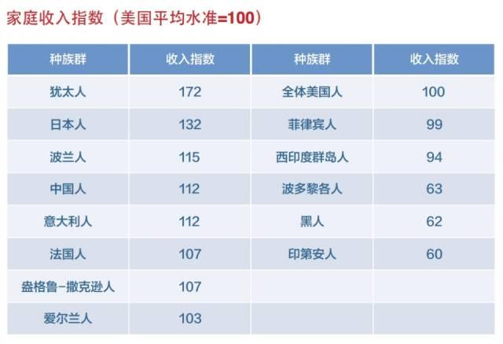

托马斯·索维尔《美国种族简史》书中列出的表格

他其中讲到犹太人就特别爱学习。犹太人喜欢学习，有可能跟他们的命运有关系，你看犹太人经常遭到迫害，所以积累固定资产不是一个好办法。他有地，逃难的时候地就带不走，逃难的时候要带那些容易带走的东西，所以珠宝比较容易带走，犹太人做珠宝做得好；钱比较容易带走，犹太人做银行业做得比较好。但是最后被迫害，钱、珠宝都是身外物，真正能够跟着你走的是什么？是你头脑里面的知识，所以犹太人特别重视教育。

托马斯·索维尔说在纽约求生存的犹太人，白天工作不管多忙，晚上还坚持去听讲座，他们的成功不是偶然的。

同样，中国人、日本人也有相似的地方，他们自己非常努力，而且他们在美国的政治地位并不高，他们也不高调，但政治地位不是那么高并不影响他们的经济收入。相反黑人的群体他们要求的政治权利就很高，但是他们的经济收入不见得有同步的增长。

我们要知道，写这本《美国种族简史》的经济学家托马斯·索维尔，他自己本身就是黑人，所以当他对黑人有所批评的时候特别有说服力。

而另外一位经济学家也是位黑人，沃尔特·威廉斯（Walter Williams ），他写过一本书叫《种族经济学：有多少可以归咎于歧视？（Race and Economics: How Much Can Be Blamed on Discrimination? ）》，他在这本书里面就提出一个观点，他认为一个种族经济条件的改善不需要以他政治权利的提升为前提。

这个看法非常重要。我们不一定要取得很高的政治地位，才能提高经济收入。反过来，那些政治地位很高的人群、得到了很多福利的人群，他们的生存能力反而会受到削弱，他们的经济收入反而会因此减少。

所以穷人怎么办？第一个最重要的出路就是自强，增加自身的教育，增加自身的人力资本投资。简单地说就是要不断学习、终身学习。

## 2\. 穷人怎么办：搭社会进步的顺风车  

第二，穷人改善自己生活的另外一个办法，就是随着社会的进步参与分享，搭社会进步的顺风车。

20 世纪 70 年代的时候，曾经有过一本书非常出名，叫《增长的极限（Limits to Growth ）》，是当时一个叫“罗马俱乐部（Club of Rome ）”的协会，一帮人一起通过计算机模拟的方式写出的一本书。当时这本书的主题是说，世界上的资源非常有限，而人口不断地增加，所以这世界发展快要到头了。

增长有极限，而且他们预测这个极限还会提前到来，那是因为人的寿命在增加，各种资源的消耗在加速。

到今天 40 多年、50 年过去了，罗马俱乐部预言的增长极限并没有到来，事实上在过去 200 年间，人类的生存条件有了前所未有的改善，有几个硬指标：

第一是人口的数量在过去 200 多年来急剧上升，而伴随着人口上升的是大量先进技术的发明和使用，包括了蒸汽机、织布机、铁路、微生物理论、电话、汽车、盘尼西林、DNA 的发现等等。

人口不仅在增加，而且人的寿命——人的寿命可是人的生活品质一个非常重要的不可辩驳的指标——在翻倍。在 1900 年的时候，全球的人均寿命是 31 岁，而到了 1950 年全球人均寿命是 49 岁，到 2010 年是 67 岁，人类全体的生活条件无可置疑地变好了。

而且经济学家对人类生活品质的不同方面，也通过基尼系数的计算方式来做了一个统计——大家记得吗？基尼系数是衡量人群里面不同的收入之间差距的一个指数——经济学家发现，人均寿命的基尼系数在缩小，也就是所有的人，不管是有钱人还是穷人，他们都普遍长寿。

教育的基尼系数也在下降，不管是穷人还是有钱人，他们受教育的年限都越来越接近。

消费的基尼系数，不管是穷人还是有钱人也在缩小，过去只有超级富豪才能享受到的服务，比方说越洋快递、国际长途电话、家庭影院、异国风情的餐厅、前所未有的医疗服务、飞行距离的拉长和客舱条件的改善等等，有钱人能享受，穷人也往往能够同样得到这些享受。

由于社会进步，全球的贫困正在急剧地减少，那些每天消费少于 1 美元的赤贫人口，在 1970 年的时候占全球人口的 1/4，而到今天下降到了不到 5%。

而同时每个家庭开销的结构也发生了变化，我们经常说你看自己是变穷了还是变富了，就看看你支出、你买的东西到底有用没用。如果你每天买的东西大量都是没用的东西，那证明你变富裕了。

根据美国经济分析局（BEA ）的统计，家庭用于现代生活基本开销的比例，从 1950 年基本开销是 53%，到 1970 年下降到 44%，而今天下降为 32%，换句话说 70%的支出是不必要的。你想想看，你每个月的支出有多少是用在买包包、买鞋这些没什么用的东西上面的。

## 3\. 最富裕的穷人在今天

我还记得在 1998 年世纪之交的时候，我在《华尔街日报》读到了一篇报道，我印象非常深刻，那篇报道的题目叫做“最富裕的穷人在美国”。

那篇报道说有七成的贫困家庭今天有汽车，其中有 27%以上的家庭有两辆以上的汽车。绝大部分的家庭都有彩电，有一半的贫穷家庭有两台以上的彩电，当然他们也有微波炉、空调、自动洗碗机等等。大多数穷人的孩子确实营养过剩，他们长大以后比 1944 年登陆诺曼底的美军平均高 1 英寸、重 10 磅。

这说明什么？这说明哪怕是穷人，只要社会在进步，只要整个社会的饼在做大，他们所得到的物质享受都比过去一个中等家庭的人所获得的要更多。所以一个社会能够把饼做大是非常重要的。

还有经济学家做出统计，他们发现发明家和企业家的收入，仅占他们的发明给社会带来总价值的 2%左右。

也就是说，每当我们看到那些企业家、发明家，看见他们赚了很多钱的时候，我们要明白，他们赚的只不过是他们发明创造，带来的社会价值当中的一个小零头而已。科技创新使得社会上每一个人都能够得益，包括那些最贫困的人。

## 课堂小结

今天我们讨论了“穷人应该怎么办”，答案基本是两个：

第一自己寻求进步；

第二是搭社会进步的顺风车。

## 课后思考

今天我给你的思考题，也是为了满足我自己的好奇心。如果你可以重新选择你生活的年代，你愿意生活在哪个年代？为什么？

欢迎你给我留言，我们下节课再见。

##### 周

# 第 32 周问答  
做难做的事情容易成功 

我们开始本周的问答时间了。

过去三个礼拜我们完成了一个完整的模块——依存与对抗。我们讨论的核心问题，是企业内部的劳资关系和劳动力的报酬问题。一开始，我们就从一个非常独特的角度，也就是“信息不对称问题的处理办法”这个角度，分析了企业的团队本质。

我们问了一个有趣的问题，那就是在企业内部，既然各种不同的资源都是由不同的人提供的、凑起来的，那究竟是哪一种资源的主人，应该有更大的话语权，也就是谁来当老板背后应该遵循的规律。

我们总结了三条经验规律：

第一，当资本和劳动力相结合的时候，通常资本的主人有更大的话语权；

第二，当专用资源和通用资源相结合的时候，通常专用资源的主人有更大的话语权；

第三，当那些业绩比较容易衡量的劳动力和那些业绩很难衡量的劳动力相结合的时候，容易衡量的劳动力按投入来取得报酬，而那些业绩难以衡量的资本，则根据剩余来获得报酬，来当老板。

这个看问题的角度，回答企业内部谁来当老板的理论是别开生面、很有说服力的。它是近几十年来，经济学当中的制度研究学派所取得的学术研究成果。

## 1\. 劳动力收入高低的决定与规律

接着我们转向讨论劳动力的收入问题，团队当中的劳动力是被一般化地看作资本来处理的，他应该获得的报酬跟他在团队当中所做出的边际贡献相符合。而劳动力获得报酬不仅有金额高低的问题，还有收取的节奏问题，不同的行业、不同的工种有很不一样的收入节奏。

在完成了这些基础问题的讨论之后，我们又再转向一个难度更高的问题，那就是对收入政策进行讨论。所谓的收入政策，就是那些通过行政的办法、法规的办法对收入进行调节的努力，比如同工同酬法、最低工资法，基于调节基尼系数而产生的收入再分配政策。

如果说这些政策和措施都还是比较被动的话，那工人的罢工行为就是一种主动争取提高收入的办法。除此以外，人为地在行业入口设置障碍、提高准入的门槛，也是劳动力之间展开竞争、争夺高薪职位的一种常见办法。

我们一个一个环节地分析下来，会发现世界是很复杂的，但它背后的规律却是很简单的。任何一种资本——劳动力也不例外，它的回报应该跟它带来的边际收益相符。

人可以选择做违反经济规律的事情，但却免不了承担相应的事与愿违的后果。

在这三个礼拜的讨论中也隐含着深刻的博弈的思想。所谓博弈的思想就是每当我们做设计、做决策、采取行动的时候，总要把别人的对策考虑在内。

最旱涝保收的买卖，就是能让对方有钱可赚、有利可图的买卖；最稳定的工作岗位，就是为企业提供别人不能替代的服务的工作；要给自己的竞争者设置竞争的门槛，最好的办法就是自己先主动地去做那些最难做的工作；最强的议价能力，就是保证自己在别处还有机会。

## 2\. 基尼系数不能反映社会贫富状况

在分析基尼系数的时候，我们曾经指出基尼系数刻画的，是人群当中瞬时的收入差距。从它的高低变化，我们没有办法推测背后究竟发生了什么事情，所发生的事情究竟是好事还是坏事。人们真正追求的是终身收入的最大化，而不是某个时段的收入最大化。

有同学提出疑问，说基尼系数确实在短期内不能反映一个社会的收入差距，但长期而言由于各种因素都会互相抵消，它是不是仍然能够体现一个社会的收入差距呢？

我的回答是不能。根本的原因是，基尼系数只不过是两三位小数点的数字，而影响基尼系数的因素不仅非常复杂，而且也是动态变化的，不是周而复始循环的。

比如人口结构的变化对基尼系数肯定有影响，但人口结构就从来不是周而复始变化的。一个国家贫困和富裕的程度、统计方法的变迁，也会逐层递进地改变基尼系数的计算结果，所以循环、抵消、再现，这些因素并不能用来矫正基尼系数所呈现的结果。

比如说美国的基尼系数，在过去一个世纪当中就经历了两个高峰，其中一个是大萧条的前夕；另外一个是今天。而当中有一段很长的基尼系数比较低的时期，仅仅看这一时期基尼系数的高低，你可能会说你喜欢平等式的生活，宁愿生活在基尼系数比较低的时期。

可你知道那个是什么时代吗？那是一战、二战、冷战的时期，你真的要生活在那个时期吗？在今天，美国的基尼系数确实比较高，但哪怕是穷人的生活，都比上个世纪的富人过得舒适、过得健康、过得快乐。

所以我们的结论非常简单，基尼系数本身说明不了什么问题。

## 3\. 歧视无处不在，充分利用市场就能取得骄人业绩

我们在讲课的过程中还介绍了黑人经济学家沃特·威廉斯（Walter Williams ）的观点。沃特·威廉斯自己就是黑人，他自己就生长在一个单亲家庭，他自己就是从低做起的。他现身说法，他表明最低工资制度对黑人青年是有害的，而不是有益的。

我们在讲课当中还介绍过他写的另外一本书，《种族和经济学（Race and economics ）》，这本书深入地讨论了歧视的问题，我觉得他的观点是值得你留意的。

他说，在生活当中歧视总是不可避免的，而且歧视不一定是白人针对黑人、白人针对黄种人的。历史上还有过各种各样的歧视，比如乌干达人就曾经大规模地驱赶亚洲人，非洲的黑人就经常歧视阿拉伯人、黎巴嫩人、印度人和中国人，而在东南亚，华人也经常受到各种各样的歧视和刁难。

哪怕到了今天，有很多国家，在拥有物业的资格上、在就业的资格上、在成立企业工商登记的资格上面，都会有明显的歧视外国人的做法。

当然我们都知道，在美国有许多大学也还在歧视来自亚洲的学生，其中就包括来自中国的留学生，他们的考分要比其他种族高许多才有可能入学。

但尽管是这样，亚洲人尤其是中国人的经济地位，却不论在哪里、在哪个时候，都是有目共睹的。

我们得到的教训是什么呢？沃特·威廉斯说，如果我们在某些禀赋上面的差异确实是很难克服的，我们确实会受到别人歧视的话，那就应该“既来之，则安之”。因为改变的成本太高了，不要花太多的资源、太多的精力去追求所谓的平等，追求那些平等太难了。我们应该把精力集中在我们擅长的地方，在我们擅长的领域求生存、求发展，赢得更好的境遇，从而弥补我们在别处的损失。

他在这本书里面说，纵观各个不同种族的奋斗史、政治地位史、经济状况史，能够得出一个结论，那就是哪怕政治地位不平等，只要充分地利用市场的优势，人们也能够在经济上取得骄人的成绩。

我们来看看本周的思考题。

## 4\. 企业资源得不到保障，工人利益最终也会受损

周一的问题是：“你认为工人面对资本家到底应不应该有罢工的权利？如果没有的话，工人的权利应该怎么样才能得到保障？但如果有的话，资本家的权利又怎么样才能得到保障？ ”

有些同学认为工人应该有罢工的权利，资本家也有解雇工人的权利，这样工人和资本家就平等了。

当同学们这么说的时候，大家对“罢工的权利”这个词理解得还不够深。所谓权利就是说，如果你罢工了，你不会受到任何的惩罚，你的工资不会被克扣，你的岗位不会被夺走，你的工作不会被别人替代，你因为在关键时候没有工作而造成的企业损失，用不着你来负责。但如果真是这样的话，那资本就得不到保障了。

所以我的看法是，协调劳资关系当然是一件很困难的事情，正确的方向应该是增加沟通、增加理解、增加互信，尽量减少不确定的行为对企业造成的伤害。因为如果企业的资源得不到保障，企业的价值下降，最终受损的是与企业相关的所有人。

## 5\. 罢工越多工作越难找

周二的问题是：“ 在一个经常罢工的国家比较容易找到工作，还是在一个不经常罢工的国家比较容易找到工作？ ”

答案是显而易见的，我们在思考问题的时候，千万要记得把别人的对策也要考虑在内。

Hit 同学回答，一个国家经常罢工，用工的成本会急剧增加，企业家对此也会有预期，减少用工的数量，寻找可替代的方案，甚至会停止生产，在这样的国家，工人更难找到工作。

## 6\. 为工作设置障碍只会让穷人更穷

周三我们讨论了工作权利所遇到的各种人为设置的障碍。

Suli 同学的回答很有意思，他说外国人关心本国劳工的劳动条件，美其名曰是为了关心别人，但实际上他们安了一个心眼，那就是可以提高竞争对手的竞争成本。

Suli 说他在美国住过，美国人他们找水电工困难是出了名的，所以他们每个人都要自己学习怎么样处理水管堵塞的问题。他们的卖场，也都是在强调贩卖各种可以在家里自己进行修水管的工具。

这种本来可以请专业人士来完成的工作，却因为准入门槛过高，劳动条件设立得过于严苛，就让这个重要的需求和商机没有办法被满足。让每一个人自己来完成，而这样的结果，是对整个社会造成了无谓的损失。比如说大家白天都要工作，晚上家里才有人，但规定水管工晚上不能工作，就让这个需求没有办法得到满足。

周三的问题是，很多外国的劳工组织对中国工人的工作条件特别关心，原因是什么？

当然原因有多种，首先是平常心、同理心。人心都是善良的，这一点我们要予以肯定。但这样的解释还不够，因为如果你真的要关心穷人，就不能仅仅看到意愿，还应该更关注结果。

你要么对穷人做慈善，给他们钱、财、物，直接帮他们脱贫致富。如果做不到，那至少不要在他们脱贫致富的道路上增设障碍。

不合理地提高竞争对手的生活成本、工作成本、运营成本，只会导致一个结果，那就是工作会重新流到比较富裕的国家，而贫穷国家里面的穷人会失去更多的机会，会变得更穷。

## 7\. 最美好的生活时代就在今天

周四的问题是：“ 如果你可以重新选择你生活的年代，你愿意生活在哪个年代？为什么？ ”

人的记忆是有选择的，愉快、美好、进步的事情容易记得住，忧伤、丑陋、落后的事情会有意无意把它们忘掉。所以每当我们说起昔日美好时光的时候，我们都要打一个折扣。

你要说昔日有美酒佳肴，我们今天随便哪一个自助餐厅不能提供那样的餐饮？你要说琴棋书画，最好的博物馆、歌剧院、唱片、书籍、电子出版物都在今天。你要谈笑有鸿儒，往来无白丁，今天你只要下载一个得到 APP 就可以了。要我选择，就活在今天。

当然我知道，我们都很熟悉的经济学家阿尔钦（Armen Alchian ），他曾经多次说过，他对未来充满了好奇，如果能看一眼未来世界，哪怕是五分钟，那该多好。

周五辩论

周一到周四我给大家留了思考题，今天是礼拜五，我给大家留个辩论题，大家一起辩论。

我们刚才讨论了不同时代的幸福感，我们现在就来辩论一下，现代化的生活究竟是使人更幸福了还是更焦虑了？

正方认为，现代化的生活把人从繁重的体力劳动当中解放出来了，所以现代化生活使人更幸福了。

反方认为，现代化生活使人面临更多的选择、更激烈的竞争、更复杂的人际关系，所以现代化生活使人变得更焦虑了。

##### 加

# 学习加餐  
经济学辞典—07 

B

保险（insurance）

未来收入一致性是一种商品（The equality of income in the future is the service that insurance provides. ）

 解释：购买保险，就是购买“未来收入一致性”，哪怕你遭遇意外，也能通过保险机制保持一定的收入水平。 

案例：风险厌恶型的人喜欢买保险。 

一键直达：第 083 讲丨未雨绸缪：储蓄还是买保险

 

人群划分越细，搭顺风车的情况越少（Segregating is a role to separate uncorrelated risks into narrowly-defined risk pools in order to control adverse selection. ）

 解释：保险的核心之一，是人群细分，人群划分越细，风险越接近，被别人搭顺风车的情况就越少。 

案例：保险公司的竞争招数。 

一键直达：第 084 讲丨保险的运作原理

 

H

回报率（rate of return）

所有资产的回报率都趋于相等（The rates of return of all assets tend to be equalized by arbitrage. ）

 解释：人总是趋利避害的，当一项资产的回报率特别高的时候，就会吸引更多人参与竞争，从而降低该项资产的回报率，因此该项资产回报率必然趋同于其它资产。 

案例：出租车车牌把不同资产回报率扯平。 

一键直达：第 080 讲丨肥猪丸与回报率

 

J

价格（price）

资产的价格已经反映了所有可得信息（Prices reflect all public and private information. ）

 解释：有很多所谓的“秘密”，其实早就不是秘密了，早就有人泄露出来，并体现到资产价格中去了。 

案例：尤金·法玛的有效市场假说。 

一键直达：第 079 讲丨股市到底有没有泡沫

 

大数据也不能预测价格变动（The change in price cannot be predicted even with the technology of big data. ）

 解释：只要知识是进步的，只要信息是变化的，我们就不可能完全预测人类未来的发展。 

案例：价格的变动不可能被大数据和 AI 预测到。 

一键直达：第 20 周问答丨为什么人类的未来不可预测？

 

L

利息（interest rate）

利息率决定债券价值（The interest rate governs the present value of a bond. ）

 解释：利息率越高意味着人们对未来看得越轻、越没有信心，而未来才能兑现的债券其价值也就越低。 

案例：你买了债券以后，市场的利率上升，就意味着你亏钱了。  

一键直达：第 082 讲丨买债券后回报率上升就是亏钱

 

T

投资（investment）

投资是时间维度上的平衡消费（Investment is the balancing of consumption over time. ）

 解释：人们追求的不是一刹那的最高幸福，而是要追求幸福总量的最大化。  

案例：一天只吃一顿饭会更香，但一天吃三顿饭幸福总量更大。

 一键直达：第 077 讲丨投资就是时间上的平衡消费

 

贴现率（discount rate）

期数为无限多的永续年金，其现值是有限的（The higher the discount rate, the lower the present value of a perpetual annuity. ）

 解释：一份期数固定的年金，它的现值非常敏感地受到贴现率的影响，贴现率越高它的现值就越低。 

案例：年金现值系数表可以看出。  

一键直达：第 081 讲丨米奇老鼠的阴谋诡计

 

W

外部性（externality）

一人做事一人当的社会制度最有效率（A world where personal responsibility is stressed is a world where efficiency is achieved. ）

 解释：花自己的钱为自己办事效率最高；花别人的钱为别人办事浪费最大。  

案例：不同花钱模式带来的效果。 

一键直达：第 21 周问答丨怎样花钱效率更高

 

X

现值（present value）

资产现值等于预期未来收入流的折现和（The present value of an asset is the sum of anticipated stream of future income capitalized into the present. ）

 解释：资产现值等于预期的未来收入流的折现和，预期什么时候发生变化，现值就什么时候发生变化。

 案例：物理由自然规律决定，经济的世界由信息披露程度决定。  

一键直达：第 078 讲丨股市究竟能不能预测

##### 129

# 第 129 讲  
股份有限责任制的兴起 

今天我们又开始一个新的模块了。我今天要跟你讲的是股份有限责任制的经济学，学完这一部分你会感叹制度发明是多么的重要。

我们今天讲“股份有限责任公司”是一路走过来的，我们最早讲的是信息不对称、后来我们又集中到了一个具体的问题，那就是企业的内部治理结构。今天我们的焦点要再聚焦一点，再更清楚地分析一种具体的企业结构，那就是股份有限责任制。

## 1\. 股份有限责任公司的兴起

“股份有限责任公司”是怎么兴起的呢？它最早是在 16 到 17 世纪的时候，最著名的是在欧洲的几家公司。

第一家叫“联合股份公司（joint-stock Company ）”，或者叫做“新大陆探险商人公司”，这家公司是在 1553 年建立的，当时有 250 位股东。

另外一家公司是英国的“东印度公司（ The British East India Company ）”，这家公司是在 1600 年成立的。

第三家公司是荷兰的“东印度公司（Dutch East India Company ）”，它在两年后的 1602 年成立。

最后还有一家“哈德逊湾公司（Hudson's Bay Company ）”，以前有一个译法叫“乞臣比公司”或者又叫做“海湾百货公司”，这家公司是 1670 年注册成立的。

这些公司之所以兴起有一个共同的特点，那就是它们的起因都是航海和探险。航海和探险是一项不同寻常的商业活动，它高风险、高投入，当然也有可能带来高回报。

这种高投入不是一般人能够承受得起的，最早在一个国家里面也就只有国王才能做这样的事情。到后来航海的技术慢慢成熟了，很有钱的人凑在一块也能做了。这是“股份有限责任公司”的雏形，那就是合伙制。

一帮人志同道合凑在一块儿要做一点事情，当中的协调成本可是很高的，而“股份有限责任公司”一些基本的特征，也就是在协调不同的人的利益诉求的时候，慢慢形成的。

## 2\. 股份有限责任公司特征之一：股份可转让

股份有限责任制的第一个特点，是股份的可转让性。最早在东印度公司成立的时候，那 250 位股东就说好了，“我们凑钱一起做一件事情，到了某年某月某日，我们把赚到的钱分了就散伙。”

结果到了那一天，有些人不愿意散伙，觉得公司继续经营下去还更有前途，但有些人就指望着分红，他们坚持履行合同要把公司给分了。这时候双方就打到了法庭，说来也奇怪，虽然合同写明了是要散伙的，但法庭不知道为什么就判决了公司可以不散伙。

那些要求散伙的股东当然很失望，但他们却意外地发现，他们可以把他们的股份给卖了。卖给别人，这时候他们所得到的收益，比他们指望散伙之后所得到的利益还要多，这时候想散伙的和不散伙的人都各得其所了。

这就带来了现代“股份有限责任公司”的第一个特征，那就是股份的可转让性。

## 3\. 股份有限责任公司特征之二：无限期经营

股份的可转让性，马上就带来了“股份有限公司”的另外一个特征，就是无限期经营。

由于股份是可以转让的，谁失去了兴趣，谁急着等钱用，谁对公司的管理感到不满，他就可以简单地把股份给卖掉。而这公司只要有人承接股份，就可以无限期地经营下去，不管股东的构成发生了什么样的变化。

无限期经营是股份公司的一个特征，因为无限期经营，所以这个公司的视野就能够放得很远，能够做很远大的设想，可以完成很伟大的使命。

## 4\. 股份有限责任公司特征之三：有限责任制

“股份有限公司”紧接着就产生了第三个特征，那就是有限责任制。

你想想看，由于股份、股票是可以自由买卖的，这时候股东的数目就在增加。原来联合股份公司就有 250 位股东，那人数已经够多了，要取得一致意见已经几乎不可能了，而现实当中股份公司的股东数目要远远大于这个数目。

一个永远在运作的公司由大量的股东构成，没有任何一个股东是完全同意这个公司所做的每一件事情的，这个公司出现了问题谁来承担责任？这是一个很现实的问题。

有限责任制在英国，是在 1855 年正式得到法律的认可的。他们当时规定一家公司只要超过了 25 位股东，那么这家公司的交易费用也就足够高了，里面的成员是不可能参与所有的经营决策，所以他们就获得了免责，也就是说他们承担的责任是有限的。这是英国 1855 年的法案。

结果人们就创造了一个虚幻的概念——法人，这不是一个真的人，而是一个想象中的人，一个法人，我们让法人来承担责任。这是一种伟大的发明，你看人类的想象力能够帮我们做很多伟大的事情，这是一件。

有了法人以后，投资者就可以躲到法人的背后，免于承担公司做错了事情所需要负的责任了。一旦公司做错了什么事情，要赔钱，如果借了钱还不了，所有这些事情由法人来承担，股东只要承担他们所交出来的那点股份的钱。如果他们付出的钱亏完了那就算了，股东可以全身而退，不影响自己在其他方面积攒的财富。

有限责任是“股份有限责任公司”的第三个特征。

你看股份有限公司的三个基本特征：可转让性、无限期经营、有限责任制，这三个特征就这么自然而然地形成了。这三个制度特征刚刚出现的时候，招来了大量的批评。

## 5\. 股份有限责任公司遭受的批评

在 1824 年 5 月 25 日的《泰晤士报》上就有这样一篇评论，它说如果一小撮有钱人，他们拿出自己一部分过剩的财富，成立了这种公司，然后把他们的名字跟这家公司捆绑起来，取得公众的信任，这样来筹集资金，来做他们所要做的生意，可是到最后，如果这家公司资不抵债呢？他们就宣告破产算了，他们的其他财富不会受到影响，而这时候那些信了他们的小股东、把钱交给他们的小股东，还有其他的债权人，就颗粒无收了。用这种方式来引诱那些可怜的小鱼小虾，这是多么不公平啊！

Nothing can be so unjust as for a few persons abounding in wealth to offer a portion of their excess for the information of a company, to play with that excess — to lend the importance of their whole name and credit to the society, and then should the funds prove insufficient to answer all demands, to retire into the security of their unhazarded fortune, and leave the bait to be devoured by the poor deceived fish. (The Times, May 25, 1824)

同样我们今天大家都非常熟悉的，在英国伦敦出版的《经济学人》杂志，也对有限责任制做出了类似的批评。他们曾经批评说，股份有限责任公司的作用被高估了，社会并不需要这样的制度。（Never, perhaps, was a change so vehemently and generally demanded, of which the importance was so much overrated.）

我们想想看，股份有限责任制这种制度，确实有它的缺点。借钱的时候跟人家说我借的钱、我负的责任可不是无限的，我负的责任可能是有限的，如果我实在还不了我就不还了。

这种观念在今天好像也不太容易被人接受，在当年就更不被人接受了，那时候借了钱不还是要坐牢，甚至要卖身为奴的。这样来借钱在道义上都说不过去，谁会借钱给你？

但从另外一个方面看，这种集资方式又有它的好处。可转让、无限期经营、有限责任，它马上还导致了另外一个特点，那就是股东的匿名性。

以前你要做一番事业的时候，不是要找合伙人吗？你必须对你的合伙人有充分的了解，他必须足够有钱，他必须对你们所经营的事业有共同的兴趣，同时他的兴趣爱好要维持相当长的时间。

你必须了解你的合伙人，这跟谈恋爱结婚是一个道理。但今天由于股份是可以自由买卖的，你不需要了解你的合伙人，也就是说你省掉了一大笔谈恋爱的成本，这个好处可大了。

你看股份有限公司，它有缺点、它也有优点，这优点和缺点哪一个更强呢？当时不知道，你得试过才知道。试过以后人们发现，原来它的好处远远大于它的坏处。

## 6\. 股份有限责任公司是一种伟大的发明

股份有限责任公司蓬勃发展，人们发现它至少有几个重大的优点：

第一，它能带来巨额的资金，以前仅仅是国王才有钱，或者仅仅来自于几个大富豪，这样筹集到的资金是很少的。当一种制度安排能够吸引大量的中产阶级投资，它能筹集到的资金是前所未有那么多的。

第二，是不同的投资者共同承担投资，他们资金的来源是非常丰富的，有时候一个行业走下坡路，但另外一个行业又处于上升的阶段，所以资金来源的抗风险性非常强，资金的供给非常稳固。

第三，是公司的运作期间，比任何一位投资人所愿意承担投资的时间还长，公司就能够做非常远大的规划。

看到所有这些优点以后，当年批评股份有限责任制公司的《经济学人》杂志，在 1925 年发表评论说：

股份有限责任公司是一种伟大的发明，这种伟大的发明不知道是谁发明的，是无名氏发明的，但将来的历史学家肯定会授予这位无名氏一个光荣的称号，这个光荣称号和那些发明蒸汽机、织布机的人得到的称号是一样崇高的。(The economic historian of the future. . . may be inclined to assign to the nameless inventor of the principle of limited liability, as applied to trading corporations, a place of honour with Watt and Stephenson, and other pioneers of the Industrial Revolution.)

## 课堂小结

我来给你总结一下，今天我给你讲了股份有责任限公司的兴起，这种制度是一种伟大的发明，它具有三个特征：第一是股份的可转让性；第二是公司的经营期是无限的；第三是每一位股东只承担有限的责任。

实践下来它有三个非常大的优点：第一，它能够筹集到巨额的资金；第二，资金的来源非常可靠；第三，公司可以追求非常远大的事业。

## 课后思考

多人的合作是很困难的，今天我留给你的思考题是，你能不能告诉我一个真实的故事，那就是开始的时候几个人一起志同道合，一起打拼事业，到后来就逐渐意见不合，最后分道扬镳的真实例子。

欢迎你给我留言，我们下节课再见。

##### 130

# 第 130 讲  
刺破公司的面纱 

昨天我给你讲了股份责任有限公司是一个伟大的发明。它解决了一个问题，那就是众多的投资者他们在一块要完成一个事业，他们之间是怎么协调、怎么承担责任的。

你要让任何一位投资者来承担责任都不可能，因为他们本身互相协调的成本非常高，没有任何一项决议是得到所有人同意的。既然他没同意，怎么能承担相应的责任呢？如果他们不承担责任，这公司谁负责呢？

无中生有地创造一个“法人”的概念可以解决这个问题，有了法人，每一位单独的投资者就可以躲在这位法人的背后，有事法人挡着。这是人们设计出来的一种解决方案。

有了这种安排，原来担心要承担无限责任的人们就开始走出来了，开始有所行动了，可以合作了，可以有所作为了。但我们说，事情有正的一面也就会有反的一面。

事实上，历史上曾经出现过一次又一次的，人们呼吁、要求推开这个法人，让躲在后面的那些真实投资者承担责任的例子。这种做法叫做“揭开公司的面纱（lifting the corporate veil ）”，或者“刺破公司的面纱（piercing the corporate veil ）”。

它的意思是，要让那些股东、董事、高管，甚至是公司的下属职员，对本来应该由公司承担的责任让个人来承担。这些责任可以是连带责任、补充责任或者共同承担的责任等等。

所以说法人的制度不是绝对的，它是酌情使用的，它是有例外的。我们来看几个例子。

## 1\. “刺破公司面纱”的由来

最早提出要“刺破公司面纱”的例子，是发生在 1955 年的一宗“ 退休老兵住房案 ”。

在这个案子里有一家总公司，它是一个合作社，合作社社员大多数是退休老兵，而这家总公司又成立了一家子公司，这家子公司专门给这些退休老兵修房子，就好像我们很多单位成立了一家公司，给员工集资建房一样。

结果这家子公司所盖的房子就以低价卖给员工，这些员工、退休老兵当然很欢迎，因为房子的价格比市价要低。但是子公司的财务状况不好，最后子公司破产了。这时候借钱给子公司的债权人就不满了，他们说这个子公司破产了，那家总公司要负责，所以他们就要求“刺破公司的面纱”，让总公司承担子公司的债务。

当然，这个案子最后的判决是，法官认为这些债权人借钱给子公司的时候，是知道他们用来集资盖房的，是知道他们房屋的价格是低于市价的，既然你明知道还把钱借给他们，那你自己就要承担责任。所以在这个案子里面，法官并没有让总公司承担责任。

但不管怎么样，“刺破公司面纱”这个概念被提出来了，那是在 1955 年。

## 2\. 无力履行下的“刺破公司面纱”

到后来在 1961 年，又发生了另外一个更经典的案子，那是“ 游泳池责任案 ”。

在这个案子里面，一个女孩在一家公司所经营的游泳池里面淹死了，这女孩的监护人就起诉这家经营游泳池的公司，当然这家公司要负责任。但后来发现这家公司没有任何的资产，连游泳池都是租借过来的，它更没有发行过任何的股票，也就是说这个公司的所谓法人其实负不起这个责任。

记得吗？我们前面讲过这个概念，法院判了他也负不起这个责任，叫 judgment proof，我们在讲罢工的时候讲过这个概念。

最后法院认为，任何公司在成立的时候，股东有义务要根据公司的经营性质和风险衡量他的投资是否合理。

而在这个案子里面，这个公司的所有者是故意让这个公司的资产变得很小，因为他们恰恰意识到他们公司经营的风险性，而不对这个公司做任何的投资，只不过是想要将风险转嫁给其他无辜的人。

所以最后法院判定可以刺破公司的面纱，让相关的人而不是法人负责任。

## 3\. 城市管理在出租车行业中的作用

另外一个最常被引用的例子，是 1966 年纽约州的“ 出租车责任案 ”。

有一辆出租车把人给撞了，交通肇事负有责任。但后来法官发现，这个出租车公司就只有一辆出租车，而这个出租车公司的主人是挺有钱的，他手下有十几辆出租车，他成立了十几家公司，每一家公司只有一辆出租车。如果出了事，那么这家公司就可以宣告破产，而不影响他其他的资产。

这样来注册出租车公司，也是故意逃避责任的做法，最后法庭也判可以刺破公司的面纱，让这个出租车公司的主人承担相应的责任。

这个案子让我想起了最近国内这几年关于网约车问题的讨论，很多人批评现有出租车公司的做法，认为他们的垄断经营很成问题。很多人建议只要谁愿意提供出租车服务，他们只要向政府做个登记，连出租车公司都不需要他们就可以经营了。

这样完全没有准入的限制，是不是一种符合市场经济精神的做法呢？我自己并不这么看，世界上绝大多数的国家、政府都对出租车行业有管制。既然是一种普遍的现象，我们就得问问，这背后是什么原因造成的。

你要知道，早在 1654 年英国就有了出租马车，那个时候政府就已经对马车实施牌照管理了。到今天这种做法已经维持了 300 多年，背后原因是什么？原因在于信息不对称。

你看如果办餐厅我们主张没有准入门槛，谁愿意办餐厅都可以，我们不应该对一个城市的餐厅实施什么数量管制，说一个城市里面只能有两万家餐厅、三万家餐厅，这种限制没有必要。

任何人只要办了餐厅，顾客去光顾，将来慢慢就会有口碑，如果这家餐厅不好吃，顾客下次就不去了，甚至可以在报纸上、在网上做出评价。信息不对称的问题比较容易解决。

但出租车呢？以北京为例，北京有 6 万台出租车，你上了一台出租车，你感觉他的服务不好，你下来以后，下次再碰上这辆出租车的机会接近零。你没有办法通过口碑、评论、重复交易的方式，来约束这辆出租车服务的品质。这是随机游走的出租车，跟经营地点固定的餐厅之间的根本不同。

这时候，城市管理作用就出来了，政府来管理，政府来对这个城市提供的基本公共设施品质，来做一个担保、做一个监督。正是因为信息不对称的缘故，世界各地的政府都对出租车公司有所管制，这是问题的背景。

其实有些人主张的不要政府的管制，连公司的控制都不要，只要登记就可以提供服务的做法，在台湾就曾经实施过。

在 2013 年，我的一位学生，台湾的记者杨泰兴先生，他就发表过一篇文章，题目叫做《台湾出租车治乱之路》。这篇文章讲的故事很有意思，他说早在 1986 年台湾就开放了出租车牌的管制，谁都可以去经营出租车，只要他们去做个登记就可以了。

开始的时候人们很爱自己的出租车，也很爱护自己的品牌，出租车有不同的装饰，有些贴上自己最喜欢的照片，有些摆满了自己最喜欢的工艺品。乘客上了这种出租车经常有意外惊喜，好像进了不同的博物馆一样。

但是慢慢问题也显现出来了，这些出租车司机有时候非常关心政治，有时候成群结队地宣传他们的政治主张，甚至参与街头的暴力活动，令乘客产生不必要的担心。

各种问题出现以后，那些愿意提供长期稳定优质服务的出租车司机，他们就自发组织起来，说“我们还是不要单打独斗的好，我们还是组织在一起好，我们穿同样的衣服，我们把车装饰成同样的风格为好。”最后，已经消失了的那种公司的形式，又重新回来了，市场还是得认公司而不是认个人。

所以对于这些信息不对称严重的行业，我们应该借助公司的品牌和内部管理来解决问题，而不是靠个人的自律来解决问题。

这是我要说的第一点，是说长期以来各国政府对出租车都有管制是合理的。

## 4\. 出租车管制的理由已经不复存在

但我还要说第二点，这更重要，那就是今天互联网约车的形式出现以后，原来我们说的这种持续了几百年的格局，已经发生了重大的变化，这个重大的变化就是：通过互联网新的技术，公司已经可以对那些参与提供网约车服务的司机，做出非常好的监管了。

你看今天网约车的车况，司机的着装、司机的态度、行走的路线这些都可以统一管理，而且收费也是统一管理的，司机不碰钱。表面上，车在外到处游走；但实际上，车的每一举一动都在公司的监控之下。

最重要的是出租车费，过去为了统一管理，让乘客知道明确的收费标准，所有的收费办法都印好了醒目地贴在出租车车厢内，但这有一个缺点，就是这样的车资僵化、不灵活。

但今天通过互联网约车软件，车费自由浮动，计算车费的标准明确而且有规律，所以车费绝对高低的波动和车费计算的规则明确，这两点都能够同时做到。所以互联网约车这种新的技术出现，可能使得我们维持了几百年的、政府对出租车进行管制的背景发生了重大的变化，原来管制的理由可能已经不复存在了。

## 课堂小结

今天我给你讲的是，虽然有限责任制是一种伟大的发明，但这个原则并不是绝对的，有时候我们应该采取相反的原则，那就是“刺破公司面纱”的原则。每当我们采用这种原则的时候，都是我们觉得个人而不是公司应该承担更大的责任的时候。

## 课后思考

今天留给你的思考题是，你觉得有哪些产品由大公司来提供比较好？有哪些产品由小公司来提供比较好？

##### 131

# 第 131 讲  
M 定律：邀人入股 or 借钱？ 

今天我要跟你讲的是公司内部治理的复杂性。

我先问你个问题，一家股份有限公司需要筹集资金，它是通过借钱的方式来融资好呢？还是通过出让股权的方式来融资好？前一种方式会增加一些债主，后一种方式会增加一些股东。

在 1958 年有两位经济学家，一位叫弗兰科·莫迪利安尼（Franco Modigliani，1918 年 6 月 18 日-2003 年 9 月 25 日 ），另外一位叫默顿·米勒（Merton Miller，1923 年 5 月 16 日-2000 年 6 月 3 日 ），他们一起发表了一篇文章。

他们说一家公司既可以通过借债的方式来融资，也可以通过发行股票的方式来融资，这两种方式从本质上没有区别，到底是选择哪种方式，对公司的价值不造成影响。

他们举例说市面上有两家公司：一家公司是完全没有外债的，他们运作的资金百分百都来自股权，而另外一家公司则是股权和债权兼有。这两家公司分别都赚了 100 块钱，你投资哪家公司获利比较大呢？

在那家完全由股权构成的公司里面，这多赚的 100 块钱就百分百全部发给股东了，如果你拥有这家公司 10%的股票，你就能够分到 10 块钱。

而在另外一家公司，由于这家公司的资本构成既有股权也有债权，所以这家公司赚到的 100 块钱得先还债权，先还了债剩下来的才能分给股东。

如果你既买了这家公司 10%的股票，而同时也拥有这家公司的债权，那么你首先是通过利息的方式，从这家公司获得债权的回报。

而这家公司还了债以后剩下来的部分，再以股东分红的方式分给股东，这时候你也能拿到这剩下来的股东分红的 10%。债权的收益加上股权的收益，刚好也是这家公司总利润的 10%，所以你的收入也是 10 块钱。

换句话说，只要两家公司的盈利情况是一样的，那么他们采取融资的方式到底是股权还是债权都没有关系，这家公司的价值在外人看来是一样的。一家公司的价值只取决于它赚钱、盈利的能力，而不取决于它融资的方式到底是股权还是债权。

## 1\. M&M 定律：公司价值与融资方式无关

这个道理听上去已经很清楚了，其中的一位作者默顿·米勒还曾经打过一个比喻，听上去就更清楚了。他说你们设想一下，我们有满满一个浴缸的牛奶，这缸牛奶能卖多少钱，跟他怎么卖这缸牛奶没有关系。有两种卖法：

一种卖法，是把这缸牛奶一勺一勺地卖出去，你赚到的是一个价钱；

还有另外一个做法，是把这缸牛奶先提炼出一层厚厚的奶油，把奶油和下面剩下来的比较稀薄的牛奶分开来卖。当然奶油能卖一个更好的价钱，能多赚一点，但是下面的牛奶由于它的浓度稀薄了，它卖的价钱就少了，这一增一减，实际上你收入的总量没有变化。

这跟我们前面讲的债权、股权之间的关系就是一个道理，一个公司赚了钱以后，它如果完全没有债权的话，它们的利润就全由股东享受；但它如果也同时有债权的话，它有一部分利润就要先去还债。这时候股东手里面拿着的股票价值就下降了，就等于刚才所说的稀释了的牛奶。

这个道理太简单了，简单得近乎幼稚，这两位作者的文章在 1958 年发表以后就受到了猛烈的批评。大家说你们这个想法逻辑上虽然是自洽的，但却和事实不相符，人们通过各种各样不同的角度，写了一篇又一篇的文章，批评这个简单甚至是简陋的模型。

当然，你们可以预见，由于要批评这篇文章都得引用这篇文章，这篇文章又成了引用率最高的文章之一。

结果这两位作者，莫迪利安尼在 1985 年、米勒在 1990 年分别获得了诺贝尔经济学奖。而他们的理论，也就是说一个公司的价值跟它融资的方式没有关系，这个理论在经济学上就成了 M&M 定律。

我们知道，M&M 通常指的是小朋友喜欢吃的彩色巧克力豆，但在经济学上讲的是一个公司融资的定理。我们从现在开始，就把这个定理称之为“莫米定理”吧。

你看这也是我们经济学这个行当里面成功的规律，你提出一个简单、简陋的模型，但只要这个模型跟事实相符，哪怕它有漏洞、哪怕它有破绽，只要你能吸引其他的学者来指出这个漏洞，弥补这些破绽，你也能成功。如果你不太理解我说这句话的含义，那我建议你回去复习一下科斯定律的内容。

## 2\. 对 M&M 定律的挑战：税制影响出资人收益

对“莫米定律”提出的第一个批评就是，人们通过债权的利息或者股权的分红，这两种方式获取收入实际上是不相等的，因为在美国法律规定，公司赚了钱首先要交公司税，交完税以后的利润才能以分红的方式分配给股东。

也就是说，如果通过股权方式来投资，有 34%的收入会先以公司税的形式交给政府，所以股权投资并不合算，债权投资才更合算。税务制度的不同造成了收益的不同。

所以理论上，一个公司应该百分百通过借债的方式来运作，这样才能最节省公司的税务负担。而任何一位投资者，都更愿意以借钱的方式，而不是入股的方式来支持这家公司的运作。

这场争论过了不久，两位作者又发表新的文章，说百分之百通过债权来集资的方式其实也不实际，那是因为通过债权来获取收益虽然不用交公司税，但是个人却要交个人所得税。如果个人所得税比公司税还高的话就不合算，还是以股权的方式来获取回报更好。所以到底哪一种融资方式更能吸引投资人，得看具体情况来定。

后续的讨论其实就在这个框架下面，人们把各种各样的税法、各种各样具体的考虑，把各种各样具体的约束都放到这个框架里面去，产生了好多的论文，这个研究一做就是几十年。

## 3\. 多方博弈催生股权与债权结合

人们对公司内部治理的关系有了更清楚的认识，这个认识的核心就在于如何理解三方的关系，那就是公司的管理层、股东和债权人之间的关系，谁更容易占别人的便宜，谁更容易约束对方不负责任的行为等等。

公司的所有者，包括投资人和高管比较愿意借钱，而不太愿意增加股权，原因在于借钱能够限制股东的数量，股东的数量少交易费用就低，做决策就比较容易。这是其中的一个趋势。

但公司也不会无止境地借钱，为什么呢？因为首先如果公司是无止境地借钱，债权的比例过高，这个公司看上去债台高筑，形象就不好。而且债台高筑的公司未来更加不确定，人家不敢跟你做长期生意，这对公司健康的发展不利。

同时高管和股东也容易有各种各样的方式欺负债权人。比如说发现公司经营不善了，高管和股东给自己发一大笔奖金，然后公司就解散、破产了，这种情况也会发生。

有时候会发生另外一种情况，那就是在公司的经营前景不是那么明朗的时候，高管和大股东会选择一些高风险、高回报的项目赌它一把，因为反正公司的前景已经不明朗了，赌它一把如果赌赢了大部分的收益归股东和高管，而债权人永远只能拿固定的利息。

如果赌输了呢？损失也主要由债权人负责，他们可能拿不到利息，也有可能连本金都拿不回来。

正是因为这样，人与人之间的关系是博弈的，债权人明白了这个道理以后，也不愿意轻易把钱借给那些已经债台高筑的公司。所以最后形成的结果，是债权和股权是有机地结合在一起，形成一定合理的比例，当然这个比例在不同的经济条件下会有不同的呈现。

这时候我要提醒你注意的是，我们今天讨论公司内部的治理结构，在讨论债权人、股权所有者和公司高管之间关系的时候，他们互相制约的情况，已经比我们一开始讲信息不对称的时候，两个人搬石头，石头朝哪一方翘起来，两个人上班，谁上班的业绩比较容易衡量，要复杂得多、微妙得多了。

## 4\. 公司治理，一门方兴未艾的学问

正是因为这样，公司内部治理的问题从来就不是靠一招就能够解决的，而是靠一揽子的方案，多管齐下、八仙过海才能够得到解决。这当中就形成了一门学问，到现在还是一门非常开放的学问、不断进步的学问，这门学问叫做公司治理（Corporate Governance ）。

我们简单地列举一下，要解决这种公司内部微妙的关系，我们常用的方式有董事会、有股东大会、有内幕交易，有各种债权人和股权所有者兴起的集体诉讼，还有公司上市的审查，还有各种评级机构的监督，还有证监会和股票交易市场的监管，还有各种对冲基金对上市公司所施加的制约。

这些内容都非常复杂、非常好玩，而且它会严重地影响一家公司、一个行业，甚至是一个国家的财富状况。但它的起点，不要忘记，很简单，就是信息不对称以及它的解决方案。

## 课后思考

今天我留给你的思考题是，我们为了妥善处理公司内部的复杂关系，用尽了各种各样精巧的办法，那么这么多的办法最大的共通点是什么呢？

##### 132

# 第 132 讲  
所有权和经营权的分离 

今天我要给你解释股份有限责任公司一个天然的缺陷，那就是所有权和经营权的分离问题（the separation of ownership and control ）。

我们这个单元刚开始的时候，我给你讲了股份有限责任公司的发明，说这种发明很伟大，因为它解决了人与人之间交往信息不对称障碍非常高的问题。

它的好处是省了大量股东和股东之间互相了解的成本，它一下子就能吸引大量中产阶级的投资，能够汇集大量的资金。而这些资金汇集起来以后，可以聘请专业人士来进行经营管理，股东们不用亲自管理了，这是股份有限责任公司的优点。

但正是因为这个优点，它带来了另外一个缺点，那就是股权的稀释。在一个公司里面找不到一个大股东——哪怕是所谓的大股东——他占的股权可能也就是几个百分点、十几个百分点、二十来个百分点。

这样的情况下，绝大部分的股东都既没有兴趣、没有时间精力，也不具备足够的专业知识来监管公司日常的运作。这时候，能够主导股份有限公司这个庞然大物的是一些专业人士，但问题是，这些专业人士并不真正拥有这个企业。

而另外一方面，那些真正拥有这个企业的人他们没有兴趣、他们没有知识，他们也没有能力来管理这家公司，这就是所谓的现代企业当中经营权和所有权分离的问题。

经营者和所有者要追求的目标是不一样的，所有者追求什么？很简单，就是要回报、就是要钱，公司要在合理合法的范围内给他们多挣钱，这是他们要求的，别的他们都不管。

而公司的经营者，他们追求什么？公司最后赚了多少钱，哪怕他们也有股份，他们分的也只是其中一部分，他不关心这个，他们关心的是什么？他们关心更多的津贴，英文叫 Perks，他们关心更大的权力，英文叫 Power，他们关心要有更大的名声，也就是 Prestige，简称 3P。

你去看一下公司的总经理，他要一间办公室，是一个 10 平方米的办公室好呢？还是 20 平方米、30 平方米的办公室好？坐飞机是经济舱、头等舱，还是有一架私人飞机更好呢？要雇佣秘书是三个好呢？还是三十个好呢？住酒店是四星级酒店好呢？还是五星、超五星级酒店好呢？

显而易见，经营者所要追求的东西，跟所有者想要追求的东西存在着相当大的差距。

在很多时候，这个差距还不是我刚才所说的，大一点的办公室、多一点秘书、飞机豪华一点，这么容易就看出来的。

有时候有一些重大的决策，关乎公司未来的，企业经理到底应该冒险还是不该冒险？有时候他们不愿意冒险，得过且过；但有时候他们也会太爱冒险，拿股东的钱来赌博。这种不尽忠职守的行为就更难被察觉和监督了。

这些问题早在 200 多年前，经济学的鼻祖亚当·斯密在《国富论》里面就有过精彩的描述：

在钱财的处理上面，股份公司的董事是为他人尽力，而私人合伙公司的合伙人则纯粹是为了自己盘算。所以你想要让那些股份公司的董事，像私人合伙人那么兢兢业业、尽忠职守是不现实的。就像那些有钱人家的管家一样，他们所想的事情还不一定是主人所关心的事情。所以在那些股份公司里面，就经常有疏忽和浪费的现象，正是因为这样，凡是那些从事国外贸易的股份公司，他们的经营业绩总是比不上私人公司。（亚当·斯密《国富论》第四篇第九章第三节）

亚当·斯密当年就已经看出问题所在了，随着股份有限责任公司的发展壮大，这种经营权和所有权分离的问题，就越发变得严重。

## 股份公司与大型国企的区别

在 1932 年有两位作者 Berle & Means 出版了一部名著，名字叫《现代企业与私有产权》，其中 Berle（阿道夫·伯利，Adolf A.Berle ）是一位律师，Means（加德纳·米恩斯，Gardiner C.Means ）是在哈佛大学教书的经济学家。

他们两位的这部著作准确地指出了现代企业的核心问题，就是管理权和经营权的分离问题。我们也可以把它叫做“花别人钱”的问题，也可以叫做“强经理和弱主人”的问题。

当时很多人就觉得这个现象不合理，这种现象跟资本主义延续了几百年、上千年基本的传统有违背之处，应该予以纠正。

有趣的是，资本主义里面出现的大企业，产生了经营权和所有权分离的问题——所有者由于人数太多、股权太稀薄，所以他们不关心企业的运作；经营者权力很大，但他们并不真正拥有企业——这种现象在社会主义国家好像也存在。

你看在社会主义国家里面，大量的资产都是归全民所有的，虽然这些资产名义上都归每一个人所有，但他们的掌控权却落在了个别官员手上。所以当时甚至有很多人认为，资本主义和社会主义开始融合了——它们都遇到了相似的问题。

中国曾经有一位著名的经济学家，名字叫杨小凯，他在普林斯顿大学学习经济学，当然，他也接触到了这样的思想，也就是说资本主义跟社会主义可能融合了。

有一次他路过香港，去拜访经济学家张五常，张五常刚好不在，他就给张五常留了一连串的问题，其中包含了这个问题，他问：

我和一些美国经济学家谈到私有产权的时候，他们总会引用 Birley & Means 在《现代公司和私有产权》这本书里面的观点，也就是大公司的经营权和所有权分离，使得股东的私有产权变得越来越不重要，所以大公司变成准公有制，私有产权制度已经式微。您对此有何评论？

张五常后来回到办公室，看到了杨小凯留给他的这个问题，觉得问题重要，于是特意写了一篇文章在报刊上发表，公开回答杨小凯提出的问题。张五常的回答是：

大的股份公司和大的国企之间确实有相同之处，那就是经营权非常集中，产权或者股权非常分散。

但它们有一点非常不一样，那就是在股份制公司里面，每一份的股权都是非常清楚的，都是有明确的主人的，这些主人之所以愿意把股权集合在一起形成一家大公司，那是因为他们认为这么做可以给他们带来更大的收益。

哪一天他们觉得他们的目的达不到了，他们就可以通过卖出股份的方式来投反对票，这时候公司的运作，经营者实际上是受到了约束的。

而对于大型国企来说，他真正的主人——也就是全体人民，他们手上是没有什么股份可以卖掉，来对经营者实施制约的。而就这一点，对两种公司的业绩会有重大的影响。

## 课堂小结

我给你总结一下，今天我给你讲了股份有限责任公司的一个天然缺陷，那就是经营权和所有权分离的问题。经营者不拥有或者拥有很少公司的股权，而公司的所有者他们的股权是非常稀薄的，他们既没有积极性，也往往缺乏专业的知识来监管公司日常的运作。

## 课后思考

今天留给你的思考题是，我们在昨天的课程里面讲过，要解决公司内部的各种微妙的关系，常用的办法有董事会、股东大会、内幕交易、各种债权人和股权人兴起的集体诉讼，还有上市公司的审查，各种评级机构的监督，还有证监会，股票交易市场的监督，各种对冲基金对上市公司所施加的制约等等。

在所有的这些办法当中，针对经营权和管理权分离的问题你认为哪一种办法是最有效的呢？

##### 租

# 第 33 周问答  
法律能为战胜贫困做些什么？ 

我们开始本周的问答时间了。这个礼拜刚好是国庆节和中秋节，祝大家假期愉快。

我在微信的朋友圈里面看到，很多人在讨论高速公路拥堵的问题，而你学过公用品和私用品的区别，也知道征收拥堵费的意义，明白免费才是最贵的道理，相信你会有意识地避开拥堵，把假期安排得有效而精彩的。

## 1\. 伟大发明创造的背后是制度、法律和观念

这个礼拜我们开始讨论股份有限责任公司的治理问题。

从复杂性来说，它要比我们刚开学的时候讨论的牛奶、面包、香烟、战俘营里面的故事要复杂多了；从真实性来说，它已经跟我们日常生活当中经营活动的现实非常贴近了；从重要性上来说，它是关乎一个国家、一个社会、一个时代，经济增长命脉的制度安排。

不知不觉当中，我们的视野已经上升到半山腰以上了。我们在课堂里讨论的都是我感觉到非常奇妙的内容，我也为你能够一步一步地跟上感到自豪。

在留言区里有同学问了一个很好的问题，他说：

老师你在讲“肥猪丸的故事”的时候，说那位发明肥猪丸的教授，能够取得那一颗肥猪丸为团队所带来的边际贡献；而你在“最富裕的穷人在今天”这一讲里面，又谈到了科学家对社会所做的贡献，你说有经济学家做过估算，科学家自己所获得的回报，大概只是他们对整个社会贡献的 2%。这两种解释的不一致如何理解？

这位同学学得非常细致，问的问题也非常深刻。我想答案就在于，这两种说法是针对发明创造的不同阶段而言的。在发明创造的早期，发明创造本身多多少少是一种秘密，当这种秘密可以被排他性占有的时候，它所带来的收益就能够流到秘密的所有人手里。

但秘密往往是会被扩散开来，成为公开知识，成为公用品（public goods ），被世人无偿掌握的。这时候这些秘密、这些科学发明创造的知识就会外溢，像煮开的牛奶溢出来一样，它能创造出来的财富和享受，就会成倍地增加，而且往往也不会再流回当初的发明创造者那里。

很多人以为社会发展、经济增长、财富积累、科技进步，这些都是世界发展的必然趋势，自然而然它就会有的，理所当然就如此。

但学习我们专栏的同学能够明白，如果没有这些经过奇思妙想、精心构造的制度安排，许多思想的火花只会一闪而过，许多财富资本也只会被挥霍殆尽，而有许多努力也只会是徒劳无功，它们凑不起来。要把它们凑起来，把思想和资本结合起来，做出伟大的发明创造，背后是制度、法律和观念。

我们这个礼拜讲股份有限责任公司的兴起，最早的时候，最重要的起源之一是探险。

英国人和荷兰人为了寻找新大陆的探险，船长懂得航海，他有专业的技能，他也有自己的野心，他也知道海盗的存在，他有自己的秘密，但他需要资本的扶持。

资本家有的是钱，他如果能掌握船长所拥有的秘密，或者如果有本事把船长利用完了就把他抛到一边，他很可能也会那么做的。

股份有限责任公司，就是为了解决这种困境而逐渐衍生出来的。这种困境跟我们今天在硅谷，科学家掌握了一点秘密，但他需要资本的支持，而资本家也很想探究科学家所掌握的秘密，完成自己点石成金的梦想是高度一致的。

## 2\. 所罗门之结：法律能为战胜贫困做什么？

在这里我给大家介绍一本好书，我们的法律经济学家罗伯特·库特（Robert Cooter ）所写的《所罗门之结：法律能为战胜贫困做什么？（Solomon's Knot: How Law Can End the Poverty of Nations ）》。（所罗门之结，源自西方寓言，比喻事物之间的关系盘根错节，难以找到破解之道的困局。）

《所罗门之结：法律能为战胜贫困做什么？（Solomon's Knot: How Law Can End the Poverty of Nations ）》罗伯特·库特（Robert D. Cooter）/ 汉斯-伯恩特·谢弗（Hans-Bernd Schafer），北京大学出版社，2014

库特在这本书里指出，创新者需要放心地把自己的点子透露给投资人，而投资者则需要放心地把自己的钱交给创新者，这是发展的“双边信任困境（double trust dilemma ）”，而股份有限责任公司是解决这个困境的最好办法。

他在这本书里介绍了一个他发现的非常有意义的规律，那就是在那些公司法执行得非常好的国家，也就是发明创造、想法、点子，能够得到很好的照顾、得到很好的保护的国家，公开的上市公司就比较多，这些想法和点子就能够很好地跟从公众那里募集过来的资金相结合。

而相反，在那些公司法执行得不好的国家，想法和点子就不能够在这些公开的上市公司落户，他们只能够被拽在手里，在私人公司里面落户。当然，这样的话，这些思想和点子能够接触到的资金量就有限了，而这一点是制约了这些国家和地区经济持续发展的重要因素。

库特在这本书里要论证的一个主题是，无效的法律——尤其是公司法——是今天世界国家贫困的根源，而只有改变这一点，才能够激励创新和资本的结合，从而刺激经济的发展。

## 3\. “可进可退”的制度如何催人奋进

我们来看看本周的思考题。

在预告里面我问了一个问题：“背水一战和可进可退，哪种情况更能够催人奋进？ ”

有人认为背水一战更能催人奋进，有只老虎在后面追着总归会跑得快一点，人在绝境的时候更能激发潜力。但两碗面 同学回答，背水一战更能催人奋进，也更能催人放弃，这个观点有意思。

我小时候上体育课就观察到一个现象，我们在跳高杆的后面放了一张垫子，为什么要放一张垫子呢？如果没有垫子后面就是硬硬的水泥地，甚至是铺满了玻璃渣子的水泥地，那是不是更能催人奋进呢？让人跳得更高呢？是，也不是，如果是那样的话，人们可能就干脆放弃了。有一点保护，让人觉得哪怕失败也不要紧，这样的话可能更能鼓励人们去尝试。

我们今天有很多家庭，男女有一方从事高风险、高回报的创业活动，而另外一方就坚守一份比较稳定收入的工作，这其实是一种合理的安排。失败了不要紧，还有退路，这也能够让人更放心地去尝试。

之所以在预告里面问这个问题，是因为他跟我们这个礼拜讨论的有限责任制度是一个道理。

## 4\. 企业成功背后的制度安排

周一的问题是：“多人的合作是很困难的，你能不能告诉我一个真实的故事，那就是开始的时候，几个人一起志同道合，一起打拼事业，到后来就逐渐意见不合，最后分道扬镳的真实例子。 ”

有很多同学举了新东方三位创始人的故事，这个故事后来还被拍成了电影——《中国合伙人》。也有同学举了乔布斯和苹果公司分分合合的故事，当然这些分分合合到最后也不影响苹果成为伟大的公司。

除此以外，很多生意的合作伙伴、球队、乐队的组合，也发生过同样的故事。我问这个问题让大家一起回答的用意是，人的想法是多元的，成功不是必然的，而背后的制度安排很重要。

## 5\. 学会在灰度当中把握分寸

周二的课程内容讲的是股份有限责任公司的局限，我们说有限责任是很有用的安排，但有时候也必须越过这个安排，刺破公司的面纱。我们离那个非黑即白的世界越来越远了，我们要学会在灰度当中把握分寸。

周二的思考题是：“ 你觉得有哪些产品由大公司来提供比较好？有哪些产品由小公司来提供比较好？ ”

不思则退不用则废 同学回答，化妆品的好坏对人体的影响只有通过长期使用才能够体现出来，小公司出了事哪怕被披露出来，他们只要换个壳又可以卷土重来了，所以这一类的产品通常由大公司来提供更为可靠。

Adele 同学也回答说，他觉得有安全隐患的，如果出现问题需要高额赔偿的产品，由大公司来经营比较好，比如建筑、医疗、医药、航空、保险等等。事后责任比较小的产品，由小公司来提供，这些小公司的产品和服务个性化就比较强。

这一道思考题，也为我们后面关于反垄断法的课程埋下了伏笔。许多人喜欢说小的是美好的，但我们透过信息不对称的角度，也能够理解大的也可以是美好的。我们后面会详细地讨论这个问题。

## 6\. 让债权人、股东和经理的利益保持一致

周三的问题是：“我们为了妥善处理公司内部的复杂关系，用尽了各种各样精巧的办法，这些办法最大的共通点是什么呢？ ”

很多同学的回答方向都是正确的，那就是尽量地减少信息不对称的情况，也有很多同学说是尽量地增加公司运作的透明度。

心无猛虎，牛嚼牡丹 同学的回答是，共同点是利益分配明确，让每一份利益回应到各自的责任、特殊的表现上来。

我的理解是，这一切安排的目的就是让债权人、股东和经理之间的利益保持一致。他们是三种不同的角色，功能不同、立场不同、利益所在不同，但各种各样公司内部的制度安排，目的是让他们变得好像是同一个人。这一点不容易做到，因为公司不是一锤子交易，它永远是在发展和变化当中的。

要不同的角色达成一致的利益，需要在时间维度上面进行权衡，有人想早点分红，有人想晚一点分红；也需要在风险和收益之间进行权衡，有人喜欢冒进一点，有人喜欢稳健一点。

更重要的是，也需要在大股东、小股东、经理层、员工，乃至其他的利益相关者之间进行权衡，先投入的开荒牛，跟后投入的跟风者，他们分享的利益应该均等吗？是功劳重要还是苦劳重要？公司挣钱重要还是维护集体的感情重要？

所有这些问题都没有固定的、唯一的、客观的答案，这是我们有那么多公司治理的方式，不断地涌现出来的原因。公司治理到今天也仍然是一个开放的问题，我们还需要无尽探索。

## 7\. 成功的公司治理需要“组合拳”

周四的思考题是：“要解决公司内部各种微妙的关系，常用的办法有董事会、股东大会、内幕交易，各种债权人和股权人兴起的集体诉讼，还有上市公司的审查，各种评级机构的监督，还有证监会、股票交易市场的监督，各种对冲基金对上市公司所施加的制约等等。在所有这些办法当中，针对经营权和管理权分离的问题，你认为哪一种办法是最有效的呢？ ”

答案是只有用上所有这些办法才是最有效的。这些招数当中，没有任何一招是可以取代其他招数的。

我记得我念过一本在公司治理领域，美国的一位学术权威 Jonathan Macey，梅西教授所写的书，这本书的名字就叫《公司治理（Corporate Governance ）》。

Corporate Governance: Promises Kept, Promises Broken, by Jonathan R. Macey, 2010

这本书是 2010 年出版的，他集中讨论了 2008 年美国的那一场金融危机，公司治理的各种策略，十八般武艺都用上了，为什么还会出现那么严重的金融危机？

他在这本书里提出了一个非常有趣的观点，他说这些策略都有效，但有效的程度不一样。只要是那些政府没有看重、没有强调的策略，它就特别有效；相反，政府看重的、强调的策略，它的效果就很弱。

他的结论是，政府看重、强调、加强管制的后果是适得其反的。

比如说会计原则和审计行业本来是很有效的，但恰恰由于政府看得特别重，对审计师事务所提出了这样那样的准入限制，结果最后能够存活下来、符合政府监管规则的审计师事务所就剩下四家五家，而这些大的审计师事务所，也并不是每一家都涵盖所有的业务。

结果就是某些行业可选择的审计师事务所，只有三个、两个，甚至只有一个，这些审计师事务所成了免于竞争的垄断者。这种无形的垄断地位，导致了这些审计师事务所的懈怠甚至是腐败。

周五辩论

周一到周四我给大家留了思考题，今天是礼拜五，我给大家留个辩论题，大家一起辩论。

我们这个礼拜刚刚讨论了经营权和所有权分离的问题，我们现在就来辩论一下：每当公司遇到重大的决策，到底是应该听股东的还是听经理的？

正方认为：应该听股东的，股东是出资人，资本的保值增值最重要，股东最知道自己的利益所在了。

反方认为：应该听经理的，经理才是经营决策的专业人士，有钱不等于有知识，相信专业人士才能挣到钱。

欢迎大家参与辩论。

##### 加

# 学习加餐  
经济学辞典—08 

F

分工与合作（division of labor and cooperation）

分工与合作给人们带来更大财富（Division of labor and cooperation bring about the wealth. ）

 解释：不要和别人比，只是自己跟自己比，看看自己有什么样的生产优势，就集中生产哪种商品，这样社会的饼就能做大。 

案例：中国加入世贸初期，我们专注于生产袜子衬衫，美国专注于生产飞机，这样两国都能获得更多财富。 

一键直达：第 089 讲丨比较优势原理

 

Q

期货（futures）

期货市场鼓励人们对未来做更准确的预测（The futures market facilitates the preparation for the future. ）

 解释：在期货市场上，对未来价格的预测越准确，你就越有机会赚钱，所以人们会孜孜不倦地分析他们手头上的所有信息，做深入的研究，以便更准确地对未来价格做出预测。  

案例：人们经常会为了某个观点争论不休，但是一旦有人提出“我们赌一赌”，马上就会变得非常谨慎了。 

一键直达：第 088 讲丨用期货合约来重新分配不可避免的风险

 

S

失业（unemployment）

失业保险金越高失业率越高（The more the subsidy of unemployment, the more of unemployment. ）

 解释：政府补贴什么，什么就会更多；政府向什么征税什么就会减少，这是一个普遍的经济规律。政府补贴失业，失业率就会上升。 

案例：你如果不工作每个月能得到 1000 块钱的失业救济，工作了以后，你只能够得到 1200 块的工资，辛苦工作一个月只多得到 200 元，还不如不工作。 

一键直达：第 085 讲丨那些不是保险的保险

 

顺差和逆差（trade deficit and trade surplus）

每一个国家都能够保持收支平衡（Every country will remain balance of international trade in the long run. ）

 解释：国家和人一样，不可能长期保持贸易顺差或者逆差，就像人不可能长期只工作不消费，或者只消费不工作。 

案例：以后你再听到有人感叹：“微软在中国拿走了一个亿的钞票。”那么你就可以马上回答：“中国人享受了微软一个亿的软件服务。”   

一键直达：第 090 讲丨顺差和逆差，哪个好点？

 

X

选择（options）

追求绝对公平不如实行“双轨制”（A system of price is an alternative option of a system of rationing by waiting. ）

 解释：有两种排队方案。一是所有人严格按先到先得排队；二是允许一部分人出钱走优先通道。前者看起来是更“公平”，但后者效率更高，且不损害他人  

案例：在英国海关退税，交钱就可以不排队。 

一键直达：第 087 讲丨当商品不被当做商品

 

Y

医疗保险（health insurance）

有的医疗保险不是保险（Obama care is not an insurance policy, but tax on the people. Such legislation is within Congress's power to tax. ）

 解释：把所有人都纳进保险的范围，同时还不准保险公司对投保人进行歧视，这就违反了保险的基本运作原理：细分和加总。 

案例：奥巴马医保方案。

 一键直达：第 086 讲丨全民医保可以持续吗？

 

人人都享受同等医疗保险，结果就是人人的待遇都下降（Equality of treatment is bound to deteriorate into equality of poor treatment. ）

 解释：资源总是有限的，当要求每个人都必须享受同等而且免费的待遇的时候，人们所享受到的医疗条件就必然下降。 

案例：今天昂贵的抗生素、检查、甚至 CT 都是人们就医的常规项目。而在 50 年前，当医疗以免费形式提供的时候，人们所能得到的只有红药水、蓝药水、止痛片和退烧针。 

一键直达：第 22 周问答丨时间维度下的经济学原理

 

Z

自由贸易（free trade）

贸易报复将会伤害国内消费者（Protectionism of international trade hurts domestic consumers. ）

 解释：实行贸易保护，不仅伤害了外国生产者的，同时也伤害了本国的消费者；同理，实行贸易报复，在伤害外国生产者的同时，也会伤害本国消费者利益。 

案例：如果美国实行纺织贸易保护，那会伤害我国纺织工业的利益；但如果我们为此实行贸易报复，提高电子工业关税，那么，我们的消费者也会成为受害者。 

一键直达：第 091 讲丨贸易对等和贸易报复

 

自由贸易不会导致工作流失（Free trade does not destroy jobs. It changes jobs. ）

 解释：自由贸易会增加人类社会的财富，但不会让工作机会减少，因为世界资源总是稀缺的，总是需要有人去提供新的劳动。 

案例：如果我们仅仅是为了工作而工作，那我们就应该把推土机给砸了，每个人分一个勺子，这样大家都有工作了。 

一键直达：第 092 讲丨贸易保护理由辨析

 

加入世贸让中国变得更加强大（Joining the WTO makes China much stronger. ）

 解释：中国加入了世贸之后，开放国门之后，在非常短的时间里面，变得非常强大。  

案例：加入世贸之后，中国 GDP 突飞猛进，世界 500 强企业不断增加。 

一键直达：第 23 周问答丨为世界打工，让中国繁荣

##### 133

# 第 133 讲  
股东文化和利益相关者文化 

这个礼拜我们继续讲股份责任有限公司内部的治理结构。

我们上个模块讲了股份责任有限公司兴起的过程，也讲了这种公司形式几个巨大的优点。比方说它能够筹集到前所未有的资金，资金的来源非常广泛，能够抗风险，它能够做非常持久的、实际上是没有止境的投资活动。

但与此同时，我们也指出了股份责任有限公司内部治理一个很大的缺点，那就是经营权和所有权的分离。经理大权在握，但并不真正拥有公司；股东虽然拥有公司，却没有积极性去照看公司日常的运作，这个问题怎么解决呢？

这是一个大问题，曾经有过不同的流派、不同的尝试来解决这个问题。

## 1\. 在公司内部实施“民主”治理

其中一派学者认为，公司的经理层自己不拥有这个公司，却能够对别人的资产指手划脚、发号施令，甚至为所欲为，这是不公道的。要解决这个问题，就要在公司内部实施真正的民主治理。

你看，实际上在股份责任有限公司内部有一个微妙的情况，那就是每一位股东的股份数目是不一样的，他们入股的时间是不一样的，他们对公司的贡献以及关心程度也是不一样的。

公司虽然很大，但是控制权往往是落在少数的经营者以及少数的大股东身上，或者少数的早期股东身上，他们对公司的使命有更深的认识。而这时候，后来加入的股东往往搭了前面股东的顺风车，他们自己没做研究，看好就上。正所谓前人栽树后人乘凉。

所以在很多公司里面，早期的股东和早期的经营班子有很大的话事权，但有人认为这样是不公平的。

既然股份责任有限公司实施的是股份制，既然是共同拥有股票，那么每股就应该有同样的权利，同股同权。而为了抑制少数稍微股份多一点的股东，对公司的决定权有不成比例的增长这种现象，有人就提出要把一股一票改成一人一票的制度。

这种做法比较极端，是把股份责任有限公司的治理，跟国家的治理等同起来了。

你看国家的治理里面，每一个人一人就算一票，人与人之间的决定权是公平的。而这种极端的主张把股东称为公民，把董事会称为立法机关，然后又把经营班子的执行官称为行政机构，他们把公司的章程称为宪法，把公司的制度称为私有条例，而同时又把公司和公司之间的合约称之为条约。

这种公司治理的方式，虽然跟国家的治理方式挺接近的，但是在商业领域并不流行，原因在于这种做法会极大削弱大股东和专业管理团队的领导作用。

那些既缺乏专业知识又缺乏应有的兴趣，也缺乏应有积极性的小股东，他们得到的权力太大了。而那些本来具有知识，又具有相当大积极性去管理公司的经营管理团队和大股东，他们得到的权力、他们得到的好处太少了。结果就是两败俱伤。

## 2\. 盛行于不同地区的两种治理文化

而另外一种解决办法跟民主治理非常接近，但没有那么极端，那就是有人要提出要治理现代企业，要解决所有权和经营权分离的问题，我们要像选拔政府的官员一样选拔大企业的领导班子。

大企业的领导班子不仅仅应该向股东负责，而且要向整个社会其他不同的人负责。

这时候就出现了这个世界上两种流行的股份责任有限公司的治理文化，一种叫做股东文化，stockholder culture；另外一种称之为利益相关者文化，stakeholder culture。

什么叫股东文化呢？股东文化就是说经营班子向股东的利益负责，而且他们只向股东的利益负责，在他们眼里只有股东的利益。

股东拿出钱来办这个公司，想要的就是多得资金的回报，那经营管理者在合法合理的范围内，就是要替股东多挣钱，别的都不想，这叫股东文化。

利益相关者文化，指的是经营管理团队不仅要向股东负责，还要向利益相关者负责。Stakeholder，利益相关者。

那么一个企业里面谁是利益相关者呢？利益相关者多了，首先股东本身是利益相关者，员工是利益相关者，员工的家属也是利益相关者，上游企业、下游企业、消费者、社区、社会，所有的人，里里外外，都是一个企业的利益相关者，经理不仅要向股东负责，而且要向所有的利益相关者负责。

这两种文化虽然没有截然的区分、非黑即白的区分，但是它们的区别是非常明显的，而且这两种文化都很流行，在这个世界上都能够看到。总体来说，在美国奉行的基本上是股东文化，而在欧洲和日本奉行的主要是利益相关者文化。

有人做过调研，你去问在美国的大公司高管，他们是在替谁服务？在美国的大型上市公司里面，有 76%的高管毫不犹豫地回答，说他们是替股东服务的。

而与此相对照，拿同样的问题去问那些在日本和欧洲大型上市公司的高管，问他们是在替谁服务的话，在日本有高达 97.1%的高管，在德国有 82%的高管，在法国有 78%的高管，说他们是在为利益相关者服务的。

你看，这两种文化之间的对比还是相当明显的。

## 3\. “利益相关者文化”难以取信投资者

那么我问你，这两种文化哪种文化更好？这个问题的答案取决于你是谁了。如果你是普通人或者你属于某一种利益相关者，比方说你可能是员工的家属、你可能是上下游的企业或者这个社区里面的人，那你估计会说利益相关者文化更好，因为它会顾及你的利益。但是，如果你是股东的话，那当然是股东文化更好。

对于那些奉行利益相关者文化的公司而言，那些公司的管理经营团队，他们到底为谁服务？根本就看不清楚。他们有时候说是为了股东的利益，有时候又说为了员工的利益，有时候又为了员工家属的利益，有时候还上下游，有时候还整个社会，你不知道他替谁服务。

所以如果你是股东，你手里有钱的话，你根本信不过这样的经营管理团队，你就比较不愿意把钱投给他们。这就是区别。

你要知道，所谓的投资者并不一定是腰缠万贯的大富翁，我们股票市场上许多的投资者都是普通的老百姓。他们好不容易攒下一点点钱，把钱放到股市里面去，这就是我们说的中小股民，你要取得他们的信任可不容易。而你要让那些奉行利益相关者文化的经营团队，取得他们的信任那就更难了。

## 4\. 经理担负“企业社会责任”等于违约

奉行利益相关者文化的人还提出一个概念，叫“企业的社会责任”，他们认为大企业的经营管理团队，应该担负起社会责任。

问题是怎么样才算是企业的社会责任呢？遇到具体的问题，企业的社会责任就很难成为行动的指南。

在招聘员工的时候你遇到两位应聘者，一位是已经失业了好几年的人，他没什么本事，其实他很需要一份工作；而另外一位是从另外一个公司刚刚准备跳槽来的人，他能力很强，收入本来就很高，他其实没了这份工作还能撑一阵子。那你到底是出于公司的利益出发，招聘这位有能力的人呢？还是出于社会的利益出发，招聘那位挺需要有一份工作的人呢？

这个问题不仅不容易回答，而且经理只要在这个问题上表现出犹豫，这对股东来说那就是一个隐患、那就是一个担心。

经济学家弗里德曼（Milton Friedman ）曾经专门写过文章，批评利益相关者文化的这种做法，批评企业社会责任的这种提法。他说如果要让企业的经理担负起企业的社会责任，实际上我们是要求他同时扮演两个角色：

第一，是一个违约的角色，是一个偷窃的角色，他偷偷把应该给股东的钱、给股东的利益偷出来了，拿去分给社会上其他的人；

第二，他充当了政府官员的角色，他进行了财富的再分配，他来决定，从股东那里得到的利益分给谁，谁更需要这些补贴。

所以弗里德曼指出，公司的经营高管他们并不是政府的官员，他们既没有权利向股东征税；也没有权利决定向股东征来的税收怎么使用。

那经营管理者的责任是什么呢？他说仅存在一种，而且是唯一一种企业的社会责任，那就是经理要遵守职业的规则，从事那些能够增加收益，而且是在没有阴谋诡计、没有欺诈，公开的、合法的情况下，能够追求最大利益的行为，这就是经理唯一应该做的事情。

## 课堂小结

我给你总结一下，今天我们讲了公司治理的两种流行文化：一种叫股东文化，一种叫利益相关者文化。这两种文化都有它的市场，都有它流行的区域，哪种文化好呢？这取决于你是谁，你站在什么立场上看问题了。同时我们也讨论了企业的社会责任问题，到底企业的经营者应该担负怎么样的社会责任。

## 课后思考

今天我留给你的思考题是，我们看到一个普遍的现象，那就是在美国许多的公司，他们由大量的中小股东组成，而在欧洲或者日本的公司他们的股东构成相对单一，这些公司经常是由家族、大企业、银行甚至政府所拥有，你能不能从股东文化和利益相关者文化的比较来解释这种现象呢？

##### 134

# 第 134 讲  
信托原则与商业判断原则 

我们这个单元仍然是在讲股份责任有限公司的问题，那就是所有权和经营权分离的问题应该怎么样去解决。昨天我们讲了一个解决的方案、一个解决的角度，那就是股东文化和利益相关者文化之间的对比，这两种解决方法的利和弊。

今天我们再来深入地讲在英美股份制公司里面，他们的两个治理原则：一个叫信托原则，另外一个叫商业判断原则。所有者和经营者之间微妙的关系，可以根据这两个原则——信托原则和商业判断原则——来协调处理。

我来问你，我们的核心问题是经营权和所有权分离的问题，经理会为所欲为，他会为自己的利益、谋自己的利益而忽视了股东的利益，那股东就要监管他们、监督他们的行为。

这时候董事会是一个重要的监管机构，董事会和经营团队之间的关系，你说是和和气气的好，还是比较对立好？

这个问题不容易回答，或者说没有非黑即白的答案。如果他们太和气了，那董事会就起不到监督的作用；如果太对立的话，经营管理团队也不能够轻装上阵发挥所长，为股东谋福利。

今天我们要讲的信托原则和商业判断原则，就是为了处理这种微妙的关系而衍生出来的。

## 1\. 信托原则：一仆不侍二主

所谓的信托原则（Fiduciary Principle ），它指的是那些经理、管理层，你们凡事都要替股东的利益着想，人家委托你做什么你就要完成什么，你不能欺骗人家，不能违约。

具体地说，企业的经营者要时刻把自己想象为企业的所有者，要好像企业的所有者那样行事，那样注意事情的细节，那样去掌握各种必要的信息，那样审慎地做出判断，那样去衡量各种做法的不同后果，给自己也就是企业的所有者带来的影响，时刻把自己代入到企业所有者的身份、立场和利益来考虑问题、来做决策。这叫信托原则。

如果企业经理做不到这一点，那就算是违反了企业的信托原则，有时候甚至会受到企业所有人的挑战，甚至是起诉。所以信托原则或者信托责任，强调的是经理时刻要以投资人的利益为最高原则。

用我们中国的一句俗话说叫“ 一仆不侍二主 ”，心目中不想别的，就想着自己的投资者。信托原则或者信托义务是专门针对企业的经营管理者而言的。

## 2\. 商业判断原则：用人勿疑，疑人勿用

跟信托原则相对的另外一个原则，叫商业判断原则（Business judgment rule ），它说的是另外一个角度的事。它是说，那些企业的所有者请了专业团队来管理公司日常的运作。你既然请了人家来，你就要信人家，别给人家添不必要的障碍，要大胆地让人家放手干。

如果你样样都过问，时刻都要人家汇报经营的业绩，那他们就没法做长远的规划。如果你样样都指手划脚，那你来干好了，你就根本没法发挥人家的专业能力。如果一个经营团队总是在所有者面前畏手畏脚，那他最终也会一事无成。

所以商业判断原则，实际上是给经理层一个安全网，让他们在不受压力的情况下发挥他们的所长，鼓励他们去冒险。因为在商业社会里面，我们知道冒险不一定成功，一点险都不去冒的话就肯定不会成功。商业判断原则是针对股东而言的，用我们中国的俗语说就是“ 用人勿疑，疑人勿用 ”。

这时候如果你小心的话，你就听得出来了，刚才我们讲这两个原则它们是有矛盾的地方的。

信托原则讲的是一仆不侍二主，经理你们要替股东的利益服务；商业判断原则讲的是用人勿疑，疑人勿用——股东你要信人家，你要让经理放手去做，要让他们敢于尝试，甚至要让他们敢于失败。

这两个原则之间是有矛盾的，怎么拿捏好难。

## 3\. 股东文化下股东和经理之间关系更融洽

这当中有个有趣的现象，昨天我们说世界上奉行两种不同的文化——股东文化和利益相关者文化。你说在哪种文化里面，股东和经理之间的关系更加融洽、更加互信？

答案是很显然的，是在那些“股东文化”里面。由于大部分的经理都把替股东服务当做一种默认的状态、一种自然的状态、一种不用争议的状态，所以反而股东对经理的所作所为就特别放心。

而在那些奉行“利益相关者文化”的地方，股东反而对经理的所作所为特别小心，处处提防，因为实在不知道这些经理到底是为谁服务的。

一仆侍候着多个主人，结果是在那些奉行“利益相关者文化”的地方，那些由股东发起的、控告经理层违反了信托原则的案件，就更多、更常见。

这种股东告经理违反信托原则的案件多起来，是好事坏事？是坏事。因为这些案件到了法庭、法官那里，其实得到了更差的解决方案。为什么？因为在股东和经理之间都闹不清的事情，到了法官那里，法官就更闹不清了。

法官第一他不是商人，他没有相关的经验；第二，法官不因为正确的商业判断而增加收入，也不因为错误的商业判断而减少收入，他对商业判断本身是否合理就没有多大的关心。

所以这类违反信托原则的案件越多，股东和经理之间的信任关系就越差，企业的经营业绩也就更差。

这种微妙的关系，不能够通过文字、不能够通过规则、不能通过人们口头上说什么来判断，而只能通过公司最后的冒险精神、他们的创业精神、他们长期的业绩来体现。

## 4\. 信息不对称程度决定公司融资与管理结构

在公司结构问题上我们有一个有趣的现象，有许多的炼钢厂，它的特点是炼钢厂的股东数目挺多的，而且炼钢厂的经营管理人员他们通常是非股东，他们是专业人士。炼钢厂的股东有很多，而经营管理者是非股东。

而另外一种企业是制药厂，制药厂的股东人数很少，股东数目不多，而经营管理者通常也是股东，钱是他们的。

为什么这两种公司的融资和管理结构，有这么明显的区别呢？原因就在于经营者和所有者之间，关系的微妙程度是不一样的。虽然也存在着信息不对称的问题，但这个问题比较不严重。

一家炼厂钢即使经营不善，即使倒闭了，这家炼钢厂值多少钱，它的原材料、它的炼钢炉，它炼出来的钢铁，这些都是肉眼可见的，都是容易估值的。所以这种企业，外人哪怕是外行，都比较容易看得懂，它不容易骗人。这时候它就能够吸引大量中小股民的投资，所以它的股东数目挺多，它也放心去聘请那些专业人士来进行经营管理。

药厂的信息不对称程度就非常的高。我们知道要研制一种药通常平均的时间要十年以上，花的钱要数以亿计的美元。而这家制药厂如果倒闭了呢？它里面的东西根本无法估价，你很难拿去拍卖，因为里面除了老鼠、一些仪器，就是一些实验的数据。

这种很难看得懂的行业，就只能吸引比较少的股东。而一旦吸引了这些股东进来，这些股东往往也参与经营、参与做研发。

这时候，谁能在边际上更妥善地解决信息不对称的问题，解决经营权和管理权分离的问题，这对发展这个行业里面的产品至关重要。

我经常感叹，花那么多的钱，经历那么长的时间，才研制出来一种药，而当中的不确定性那么高，也只有世界上最好的体制，能够最妥善地解决投资者和管理者之间微妙关系的制度，才能够做得到。

## 课堂小结

今天我给你讲的是两个概念，信托原则和商业判断原则。这两个原则分别是针对企业的经营者和企业的所有者提出来的。我们也讲了跟利益相关者文化相比，在股东文化下，信托原则和商业判断原则能够更自然地被经营者和所有者执行，他们之间产生的官司更少。而如果因为信托原则和商业判断原则产生了很多的官司，企业的经营活动，从企业的会议室转移到法庭去解决，那将会是一个更糟糕的结局。

## 课后思考

今天我要留给你的思考题是这样的：我们一直讲的是企业经理人，他要对那些给钱的人负责、付钱的股东负责，背后是一个默认的判断，那就是钱比经营管理的知识更重要。我给你的问题是，现实生活中真的永远是这样吗？企业家精神难道就不比钱更重要、更值钱吗？为什么？

欢迎你给我留言，我们下节课再见。

##### 评

# 简评 2017 诺奖  
地道的经济学从不假定人是理性的 

今天我还给你准备了一份加餐，因为就在昨天晚上，2017 年的诺贝尔经济学奖揭晓了，获奖人是芝加哥大学布斯商学院的理查德·塞勒（Richard Thaler ），塞勒教授。诺奖的消息一传出来，网上就涌现出了大量介绍塞勒教授贡献的文章，他的最核心的贡献就是列举了大量人的非理性行为。

当然，借这个机会咱们专栏的同学也能够好好温习一下，我们这大半年来关于“人到底是理性的还是非理性的”这个重要问题的一系列讨论。人是理性的还是不理性的，这个问题是经济学的根本问题，是经济学大厦的基础，所以我们的专栏一开始就在《第 005 讲丨不确定性，进化与经济理论》这一讲里，正面讨论了这个问题。

我们说地道的经济学思维从来不假定人是理性的，经济学真正研究的是关于存活的条件，存活的规律，人到底是理性的还是不理性的不重要。

当然，毫无疑问，人在大多数时候都是非理性的，但是随着人的成长，随着非理性行为带来的成本的增加，人就会逐渐变得理性。而更重要的是，不管人最后有没有变得理性，那些非理性的行为——和经济规律、社会规律和自然规律相违反的行为——在物竞天择的竞争下，他们最终是会被淘汰的，尽管这个过程可能很漫长。

所以现在网上有不少介绍塞勒教授贡献的文章，都说塞勒教授的观点和主流经济学相矛盾，但咱们专栏的同学知道，其实一点都不矛盾。

相反，塞勒教授只不过是极大地丰富了我们对自身非理性行为的认识，他所发现的大量关于人的非理性行为的案例，恰好为人们进一步纠正自己的行为、提高存活的机会、变得更加理性，提供了扎实的基础。

今天这篇加餐汇总了咱们专栏，关于“人是非理性的”这个研究所做的各种讨论，点算下来，至少有六篇高度相关的文章，我希望你能够重读这六篇文章。

这六篇文章能够帮助你巩固你本来已经学到的关于理性这个概念的讨论框架。从这个框架出发，你就能够更好地理解和驾驭其他关于人的非理性行为的讨论了。

##### 135

# 第 135 讲  
清官难断家务事 

昨天我们讲了公司治理的两个原则，信托原则和商业判断原则。

我们说这两个原则是有互相对立、互相冲突的地方的。信托原则讲的是公司的经理一仆不侍二主，要好好地为股东服务；商业判断原则讲的是，公司的股东要相信管理层，用人勿疑，疑人勿用。

这两天的内容都有点抽象、都有点枯燥，今天给你讲一个具体的实例，你就能够明白这枯燥、抽象的原则在现实生活中是怎么应用的了。

## 1\. 范高科案诉讼理由：经理违反信托原则

今天要讲的案子是 1985 年结案的范高科案（Smith v. Van Gorkom ）或者叫环联公司案（TransUnion Case ），这个案子的主角是一家大公司的 CEO 范高科（Van Gorkom ），他在这家公司当 CEO 已经 17 年了，快退休了。

有一天他的一些投资家朋友跟他说，“我们对你们家公司有兴趣，我们想收购你们家公司，你说行吗？”范高科说，“行，你们要收购可以，我回去跟董事会说一下，我跟他们都挺熟的，我回去跟他们打个招呼，我们就把这个公司给卖了。”

范高科回去就召集了董事会，但他并没有预先把会议的主题告诉董事们。直到会议开始前一个小时，董事们已经陆续到场了，有人问起他今天开会什么事，他说是卖公司的事。这时候消息才开始披露出去。

真正开会了。范高科介绍了别人想要收购他们公司的情况，还请了一位律师，大概介绍了一些法律背景。范高科就问董事会的成员同不同意把公司卖掉，董事会的成员一致决定同意把公司卖掉。整个会议只持续了短短两个多小时就结束了。一家大公司就这么给卖了。

会议结束以后，范高科就到当地一家剧院去看歌剧了，而他的秘书非常卖力，当场就把所有的法律文件都给准备好了。因为人家提出买这家公司时间也很急，很短的时间他们就得决定卖还是不卖，所以这位女秘书也非常敬业，把所有的文件都准备好了，就追到歌剧院请范高科签字。

范高科就在歌剧开始前那段短短的时间里，匆忙在文书上签字了，公司就这么给卖了。当然，这一次会议以后，他们还开了一次董事会，在那次会上大家也没提出什么异议，公司就这么一步一步地走完程序卖出去了。

当公司完全卖出去以后，人们才发现由于公司做了交割，一部分股东他们原先拥有的股票必须转成现金，这时候就得向政府缴纳一笔不小的税收，股东因此蒙受了一定的损失。

其实如果公司不卖的话，这些税收是可以推迟缴纳的，于是这批股东知道了整个卖公司的决策过程是这么仓促，而且范高科是在歌剧院里面签署卖公司的文件，他们挺生气的。他们就集体起诉范高科以及整个董事会，告他们违反了信托原则，也就是说董事会和高管们没有替股东掌握所有的情况，没有采取审慎的态度替股东的利益着想。

## 2\. 范高科应诉理由：用人勿疑，疑人勿用

范高科和董事会的成员被告以后，他们怎么替自己辩护？他们用的就是另外一个原则——商业判断原则来替自己辩护，用人勿疑，疑人勿用。

他们说，他们这个董事会是股东们请过来做决策的，他们才有专业的知识。他们说，“我们这个董事会里面的成员，在公司里面工作的，都已经工作了几十年；而非公司内部的董事会成员，加起来有 78 年独当一面做首席执行官的经验，这位 10 年、那位 15 年、那位 20 年，加起来有 78 年首席执行官的经验；还有一位独立董事，那位是位学者，他是芝加哥商学院的院长。这整个董事会的资格看上去是无可挑剔的。这彻头彻尾就是一个全明星阵容，我们做的决策你还来怀疑，记得吗？用人勿疑，疑人勿用。”

这里要讲清楚的是，董事会所做的卖公司的决策，根据公司的章程，这个过程、这个流程本身没有错误、没有瑕疵、没有问题。

如果有硬伤、在程序上有问题的话，这个案子倒好判；程序上没问题，就是董事会开会的时间太短了，没有充分考虑所有股东的利益，要他们提前交了不少的税。而更戏剧性的是，这位范高科是在歌剧院里面签的文件，这些加起来让一部分股东看来觉得不可以接受。    

## 3\. 清官难理家务事：法官判决争议及后续影响

如果你是法官，你会怎么判这个案子呢？这个案子真不容易判吧？我觉得这个案子所涉及的问题，是人与人之间信任关系的问题，是经理和股东之间微妙关系，达到登峰造极地步一个很好的案子。

以前我们讲信息不对称，讲的那都是低级的信息不对称，讲的是一个人怎么迟到了、怎么偷懒了，搬石头怎么不卖力了。今天这种隐形的、微妙的关系，才是真正的、制度上要解决的难题。

公说公有理，婆说婆有理，到底是应该运用信托原则还是商业判断原则？这时候你可能会问一个非常关键，我刚才故意没说的问题，那就是别人要收购这家公司，他们提出的收购价格是多少。

别人收购这家公司的价格是 55 块美元，而这家公司在过去五年里面，平均的股价是在 24 到 39 美元之间波动，在别人提出邀约的时候公司的股价是 38 块美元。也就是说，收购价比公司当时的股价高出了大约 60%。

其实董事会主要就凭这一点，很快地做出决定把公司给卖掉。因为这家公司过去经营了五年，它的市值远远达不到 55 块钱。如果能以 55 块钱卖掉，其实对大多数股东的利益而言是更好的。

有了这一点，其他的问题就显得不那么重要了，你说开两小时的会不够长，那多长的会才算够长呢？三小时、四小时？你说披露的信息不够详尽，你说要多详尽才算够详尽呢？如果你说两个小时的会不够，要三个小时，他们非要把一个两个小时的会拖成三个小时来开，那也很容易做到，但这有意义吗？

当然，你也可能认为两个小时的会就是太短，在歌剧院里面签文件就是太草率。

不管你怎么看，我先把判决结果告诉你，特拉华州最高法院的终审判决是：范高科和董事会他们违反了信托原则，因此要做出赔偿。他们赔偿的金额太高了，这帮董事会成员自己拿不出那么多钱来，最后是由那家收购的公司帮他们赔了这笔钱。但这只不过是法庭的判决，并不意味着法庭的判决就是正确的判决。

这个判决出来以后，许多研究公司法的专家就猛烈地抨击这个判决，其中包括我非常敬佩的公司法研究专家，美国西北大学法学院的丹尼尔·费舍尔（Daniel Fischel ）教授，他说：

这个判决太糟糕了，因为它破坏了美国商业判决原则的美好传统，那就是你请来的专家，你要信任他们的专业判断，而不是根据他们做出专业判断所用的时间来指责他们的判断。你如果是这样判决的话，以后再也没有董事会的成员，再也没有独董、再也没有专家，愿意为公司的风险做任何的承担了。

事实上，这个案子判决以后产生的结果也是这样，董事会的成员再也不敢自己做决定了。每当要做重大决策的时候，他们就会花一大笔钱请投资银行来给做论证，论证完了他们才签字。

这一下子投资银行就多了很多生意，有人开玩笑说这个案子的判决是“投资银行的挽救法案”，投资银行快没生意做了，好在因为有这一宗案子，他们又多了很多生意，每家大公司都得花好多的钱，请第三方来论证 55＞38。    

## 课堂小结

今天我给你讲了范高科的案子，这是一个很难的案子，众说纷纭的案子，在美国引起了很大的争议，到今天还没结束。

## 课后思考

今天留给你的思考题很简单，你来讲讲你的看法，你是赞成最高法院的终审判决呢？还是赞成费舍尔教授的批评呢？为什么？

欢迎你给我留言，我们下节课再见。

##### 136

# 第 136 讲  
恶意收购的重要功能 

今天我要跟你讲企业之间的恶意收购问题。

你听说过“恶意收购”这个词吗？收购是“恶意”的。这是什么意思？你看，我们平时无论买什么都不存在恶意收购这一说。我看中了你们家的房子，我提出要收购，给你出个价，你愿意就把它卖给我，不愿意我们就谈不拢，也就算了，不存在所谓的恶意收购这一说。

为什么一家公司购买另外一家公司，人们有时候会称之为恶意收购呢？这句话的含义是什么？

## 1\. 强买强卖不是恶意收购

首先有人说恶意收购指的是非自愿的出卖，不想卖别人硬买了。不存在这样的事情，你不愿意卖就不卖，不卖别人怎么可能硬买呢？

别人不可能动用武力，不可能用枪逼迫你，如果别人这么做那是违反刑法了。当然是在你愿意卖的情况下，公司才会卖出去，恶意收购又从何谈起呢？

## 2\. 乘人之危不是恶意收购

然后有人说这可能是乘人之危，当公司经营不善的时候，人家出一个价，我不得不卖。任何出卖都是乘人之危，别人出一个价，你怎么才愿意把它卖出去？你公司如果经营得好，你怎么会舍得把公司卖出去？

所以你也是看中了别人付的价，你才把公司卖出去。这对你来说也是好的，任何交易都是双赢的，任何交易都有所谓的剩余。所以“乘人之危”也不能够成为恶意收购这种说法的解释。

## 3\. 出价太低不是恶意收购

有人说恶意收购的含义是对方的出价太低了、价格太低了，这当然也说不过去。什么情况下你才会把公司卖掉？那就是别人出的价格高于你所能够想象的、自己经营这家公司的收益，否则你不会把它卖掉。

这家公司在你眼里面，如果努力地工作，它最高能够达到 100 块钱一股，人家出 130 块钱一股来购买，你才会把它卖掉。如果你觉得对方价格太低，你就不卖。所以价格太低这一说，也解释不了什么叫做恶意收购。

事实上在公司并购的过程中，大家比的就是谁看得更远、谁能够把未来看得更大。

我听说过这么一个故事，在十多年前互联网刚刚兴起，互联网公司的股票在大涨的时候，我们国内有一家互联网公司遇到了国外的收购者。

这些收购者谈判要收购这家公司，当时谈判的气氛非常紧张，收购者出了一个价格，被收购者神情凝重，说这个价格太低了不能卖，接着他们说，“我们要退场商量一下”。结果被收购者就离开了会议室，进到别的会议室里面去了。

过不久他们又回来了，继续谈价格，对方又把价格抬高一级，被收购者还是神情凝重，又回到他们的密室里面去商量事情了，过一会儿他们又回来了。

你知道他们去密室里面干什么？他们到密室里面大笑，“世界上怎么有人那么笨，花那么高的价钱买我们公司？”太好笑了，实在忍不住了，笑一场然后出去，再神情凝重，再让对方把价格再提高一个级别。

但实际上你知道谁对谁错？你知道谁能够把未来看得更准、看得更大，谁才是笑到最后的人。

深圳市中心叫蔡屋围，原来就是农民住的地方，有一个农民他有好多的房子，当时有开发商要买他这块地。结果这位农民获得了 2000 多万的赔偿，2000 多万那可是个大数目，原来只是几间房子而已，他当然很高兴。

但你知道是谁买的他这块地吗？买这块地干什么用吗？这块地买了以后，现在建起的叫京基 100，100 层的大楼，这 2000 万根本只是一个小零头。谁在赚大头，我们不知道。

## 4\. 垄断程度上升不是恶意收购

什么是恶意收购呢？还有一种解释是说收购了一家企业以后，市场上面企业的数目就减少了，竞争程度就下降了，垄断程度就上升了，所以这叫恶意收购。

这种说法你仔细想也说不过去，如果一个市场的竞争程度仅仅是看企业的数目，那么我们今天的大企业就全都应该拆分、拆分再拆分。

如果真是这样的话，任何企业之间的并购都是恶意的，都是反竞争的，就再也没有什么善意的合并了。

## 5\. 让公司闲置不是恶意收购

还有一种对恶意收购的解释，那就是大公司把别的公司买了以后放在那里不用，这也解释不了。

你要把别人的公司买下来，可是花了血本的，花了大价钱的，放在那里不用那不是自找麻烦吗？那不是给自己造成巨大的损失吗？公司的股东怎么会愿意呢？

## 6\. 限制决策时间不是恶意收购

当然有人还认为，恶意收购指的是提出收购以后，让对方考虑的时间太短了。通常，让对方考虑的时间确实都是很短的，那是因为市场的波动是非常剧烈的。市场的条件一旦发生变化，收购的价格也就发生变化，这一点也可以理解，算不上恶意。

## 7\. 恶意收购的重要功能

那究竟恶意收购指的是什么呢？我先来问你，一旦你发现竞争对手做错了事情，你会怎么做？

有一种做法最实际，如果你发现竞争对手犯了错误，经营不善，也就是说他们公司的资源得不到最好的利用，你就把它收购过来。记得科斯定律吗？把资源收购过来，是因为你确信，这些资源在你的手里面会产生更大的效益，这是公司之间发生并购一个最重要的原因。

在过去所谓的恶意收购是这样发生的，通常一家公司看准了他的目标企业，觉得这家目标企业的竞争者没有好好干，出现了经营上的漏洞，他们的资源没有得到充分的利用，他们决定把它收购过来。

但消息不能走漏，一切要秘密地进行。收购者把相关的专业人士召集在一块，在礼拜六下班以后，让他们秘密地住到纽约一家酒店里面去，同时跟《纽约时报》说好了，留一整版的广告位置，但是具体的内容先不告诉他们。

这些专业人士住进了酒店以后就连夜开会，这种会议通常称为“神秘的周六之夜（Saturday night special ）”。

这些专业人士在一块谈什么内容呢？谈收购的条件。你想要从别人的手里把股票给买过来，你一定要给对方的股东一定的甜头，条件要够甜，但也不能太甜了，因为你放的糖是你自己的成本，所以你得仔细考虑。

到礼拜六的晚上一切都敲定了，知道该给多甜了，然后把文稿送到《纽约时报》去，第二天登报纸，给对方三天的时间、两天的时间做决定，卖还是不卖。通常对方的股东就会被钱给打动了，扛不住了，就决定把股票给卖了，收购就这么完成了。

## 8\. 恶意收购其实不是恶意的

为什么叫恶意收购？买卖是在两家公司的股东之间进行的，买家和卖家都皆大欢喜，谁不高兴来着？被收购的那家公司的高管不高兴了，他们被称之为利益相关者。

但实际上公司之所以被收购，很重要的一个原因就是他们经营不善。所以当公司被收购过去以后，他们的前途就不是那么光明了，这时候真相就大白了，我们看到了整幅图景。我们要从信息不对称的角度，从经营权和所有权分离的困难的角度，来理解公司之间的并购。

经营权和所有权分离是一个很难解决的问题，经营者经营不善也是一个很难识别的问题，这时候有一把利剑悬在这些经营者的头顶上，那就是竞争对手也在看着自己。如果自己真的做得不好，竞争对手、别的股东他们会来收购。

简单地说，公司之间的收购是解决一个老问题，经营权和管理权分离问题一个非常有力的、有效的办法。只有这样来理解公司之间的并购才是合理的，公司之间的并购才有意义，恶意收购其实不是恶意的，是有效的、有用的。

当然，在相当长一段时间里面，人们对这种所谓恶意收购的功能并不完全理解。在美国不同的州设立了不同的法律，给这种恶意收购设置了各种障碍，结果美国不同的州进行恶意收购的难度就不一样，有些州比较容易、有些州比较难。

结果学者们通过研究发现，那些恶意收购比较容易进行的州，他们这些公司高管的忠诚度就比较高，公司的经营活力就比较高，公司的业绩也比较好。

而且他们发现一个规律，每当公司发生并购以后，通常是那些高管被调离岗位甚至被解职，而蓝领工人的收入却上升了。这个也可以理解，一家公司经营不善通常不是由蓝领工人造成的，而是由高层白领造成的。

同时公司并购以后，也没有出现人们担心的新官不理旧账的情形。在我们的经验看来，一般公司宣布并购以后，两家公司股票的价格都会上升，这表示市场普遍认为这是一个能够提高经营效率的并购。当然也有两家公司股票下降的情况，这说明市场不看好这一次并购的效果。

## 课堂小结

今天我给你讲了恶意收购的实际功能，它是解决所有权和经营权分离问题一种非常有效的手段。

但这里我们要说明，要解决经营权和所有权分离的问题，到今天都没有确切的答案，这仍然是一门开放的学问。

## 课后思考

今天我留给你的思考题是，公司之间的并购除了解决所有权和经营权分离的问题以外，还会不会产生别的后果？比方说企业会对市场产生垄断的后果，我们需不需要提防这些后果？为什么？

欢迎你给我留言，我们下节课再见。

##### 周

# 第 34 周  
法官的智慧是一种地区竞争力 

我们开始本周的问答时间了。

这个礼拜 2017 年诺贝尔经济学奖揭晓，获奖人是专门研究非理性行为的芝加哥大学经济学家理查德·塞勒（Richard Thaler ）教授。我们在消息公布的第二天早上做了一个加餐，对这次颁奖做了一个简评。

很多人都有一个根深蒂固的观点，认为经济学是以“人是理性的”作为基本的假设的，所以他们都觉得，塞勒教授的贡献是挑战了主流经济学的基础。但咱们专栏的同学非常明白，地道的经济学思维从来不假定人是理性的。

我们在全年专栏一开始，在《第 5 讲丨不确定性，进化和经济理论》那一课里，就非常清楚地解释了经济学研究的是关于存活的现象，存活的规律，存活的条件，它跟人是否理性没有必然的关系。

所以，塞勒教授的研究是在这个框架下面进行的，他丝毫没有改变地道的经济学思维的基础，他只不过是用大量的、丰富的案例，加深了我们对非理性行为的认识。

人们喜欢讨论人的非理性行为，这是可以理解的，因为人本身在很多场合都是非理性的。但我们也不要忘记，在讨论的时候，不要忽略了那些重要的隐形的因素。

比方说很多貌似不合理的行为习惯，其实都是为了节省时间，或者为了节省计算的麻烦而导致的。比如有人愿意花很多钱买一辆名贵的跑车，同时也会为了节省一点点的停车费而大费周折。

这看上去不合理的行为，其实是因为人有不同的心理账户，不同的项目有不同的预算，这形成习惯以后，就不需要每次进行计算了。

## 1\. 主张政府“助推”的时候一定要审慎

塞勒教授所研究的行为经济学，曾经有一个很重要的应用，那就是人们对于捐赠器官的态度。

在领取驾驶执照，填表的时候，表格上面写：“如果你愿意在发生交通意外之后捐赠器官，请打勾”，这样打勾的人会很少；如果表格做一个轻微的改变，反过来说：“如果你不愿意在交通意外之后捐赠器官，请打勾”，那打勾的人也会很少。

有些城市就这么尝试过，结果愿意捐赠器官的人数就急剧上升。但这种做法，实际上是利用了人们一些本来是合理的阅读习惯，利用了其中的漏洞，带有误导的成分。

当人们意识到自己的偏好和自己的选择，产生了很大的反差之后，是会形成反弹的。这恰恰是我们在阅读塞勒教授和卡斯·桑斯坦（Cass Sunstein ）教授合著的《助推》这本书的时候应该注意的地方。你认为好的东西，别人不一定认为好；你认为喝软饮料不健康，但人家觉得健康不如喝软饮料过瘾。

更重要的是，各种各样曾经流行过的健康建议，比如水果要在饭前吃，不要汤泡饭，胆固醇要少吃甚至不吃，吃饭的时候不要看电视、不要看书，饭后要百步走。这些随着医学知识的进步，可能会被证明是没有根据的，甚至是错的，所以在主张政府进行“助推”的时候，也一定要审慎。

最好就是按我们在《第 116 讲丨监管也要引入竞争机制》当中所说的，我们当然要请专家来帮我们出谋划策，但是这些专家，这些不同的健康方案之间，也应该有一个互相竞争的市场机制，而不是自上而下一刀切，没有回旋、没有选择的余地。

我们在礼拜二的这一篇加餐，汇总了我们专栏关于人是非理性的这个研究所做的各种讨论，共有六篇高度相关的文章。你可以去读一下这篇加餐，并且利用一键直达，温习这六篇文章。

加餐 | 简评 2017 诺奖：地道的经济学从不假定人是理性的

## 2\. 法官的智慧是一种地区竞争力

好，我们回头谈这个礼拜的课程。这几天，我们继续围绕公司治理当中，非常困难的经营权和所有权分离的问题做深入的讨论。

我们比较了信托原则和商业判断原则之间的权衡和拿捏；我们介绍了精彩的又充满争论的范高科案，也就是环联公司案；我们说在股份有限责任公司内部，经营权和所有权分离的问题，达到了信息不对称困境的巅峰境界，人与人之间的各种斗智斗勇，在权力、名声、财富的驱动下，在那里有了淋漓尽致的表现。

我们说这个问题还没有得到彻底的解决，这还是一门开放的学问。为了对付这个问题，美国人找到了一种很好的解决路径，那就是让州和州之间竞争。

不同的州，他们的法庭有不同的判决传统，有的州是比较偏向经理的，有些州是比较偏向股东的。所以当一个新公司注册的时候，公司的创始人就会有意识地去选择不同的州，也就是选择不同的法律传统。

结果，州和州之间就产生了竞争，他们竞争的产品是一种无形的产品，那就是对公司事务的判决能力。

结果是在美国那么多的州里面，有一个州脱颖而出，在世界五百强企业里面，有超过一半的企业选择在美国的那个州注册。而在美国所有的股份有限责任公司里面，不在本州注册的、跑到别州注册的，有 80%就是去了这个州。

这个州就是美国东北部的一个非常小的州，叫特拉华州，Delaware。这个州最著名的特产，就是他们的法官对公司事务的判决；而这个州最主要的收入，就是那些为了购买这种独特的司法服务，而在这个州注册，因此也要在这个州所缴纳的税收。

## 3\. 企业并购不是单纯的大鱼吃小鱼

这个礼拜的课程还有一个亮点，那就是我们把所有权和经营权分离的解决方案跟企业并购，这两件貌似没有关系的事情联系起来了。

我们说企业并购是解决所有权、经营权分离问题一个非常重要的办法。这让我们对企业并购产生了更深一层的认识，他不是单纯的大鱼吃小鱼，不是单纯为了垄断市场，不是单纯为了排斥对手。

而正是这一个亮点，让我们把全年课程两个非常重要的模块连接起来了。这两个大模块一个是从下礼拜开始的，一连 5 个礼拜的，关于竞争政策和商业模式的讨论。而另外一个模块，是我们刚刚结束的，一连 9 个礼拜的关于信息不对称的讨论。

9 个礼拜的信息不对称，内容可真是丰富。我们最先引入了什么叫信息不对称的问题，接着我们介绍了各种不同的对策，讨论了合同法当中的案例，介绍了政府监管尺度的权衡，以及为什么监管应该引入竞争的机制。这里面贯穿了经济学里面对边际概念的应用。

接着我们开始聚焦企业，我们讨论了谁来当老板，讨论了劳资关系，讨论了劳动力报酬，讨论了罢工问题。

然后，我们再聚焦股份有限责任公司，我们讨论了这种组织形态的兴起、优势，还有它至今完全没有解决的难题——所有权和经营权分离的问题。

但我们得出一个经验，充分利用市场，我们就能够发挥想象力，设计出各种各样的新的机制来帮助解决问题。而美国的联邦制度，州和州之间竞争，也能够鼓励制度之间的比较和进步。

最后我们触及了企业并购的问题，即将在下周自然地过渡到对竞争政策和商业模式的讨论。这一连 9 个礼拜，我们在认知上稳扎稳打，步步深入，回顾起来真的令人感到兴奋，沿途的景色美不胜收。

好，我们来看看本周的思考题。    

## 4\. 利益相关者文化伤害股东利益

周一我们问：我们看到一个普遍的现象，那就是在美国的许多公司，他们由大量的中小股东构成；而在欧洲或者日本的公司，他们股东构成相对单一，这些公司经常是由家族、大企业、银行，甚至政府所有。你能不能够从股东文化和利益相关者文化的比较，来解释这种现象呢？

何聪辉 同学回答：

欧洲的高福利和日本社会追求稳定的需求，也要求给予利益相关者更多的福利，但这种做法在一定程度上伤害了股东的利益，所以就造成了欧洲或者日本企业股东构成相对单一的状况。而在美国，他们对福利没有那么高的追求，在这种环境下，公司只为股东的利益考虑，所以中小投资者的热情就会更高。

## 5\. 企业家精神重要，还是金钱重要？

周二的思考题是：我们一直强调的是企业经营要对股东负责，好像钱比经营管理的知识更重要似的。那在现实生活当中，企业家精神难道不比钱更重要吗？

我的回答是，到底企业家精神重要，还是钱重要，没有一成不变的答案，公司治理的方式最有价值的地方，就在于它可以不断地创新、不断地尝试。

比如阿里巴巴所实行的合伙人制度，就是加强保护企业家精神的一种尝试。它的核心含义是，虽然它是一家上市公司，但是同股不同权。股东可以给钱，但公司的重大决策很大程度上掌握在那些合伙人手上，也就是企业家手上，也就是具有企业家精神的经营管理阶层身上。这种尝试的成败我们拭目以待。

## 6\. 法官不应越过雷池代替董事会思考

周三的讲课，我们介绍了环联公司案，也就是范高科案，而思考题是请大家谈谈看法，到底是赞成最高法院的判决，还是赞成费舍尔（Daniel Fischel ）教授的批评。

我看了大家的留言，大概有七成是赞成费舍尔教授的观点，有三成是赞成最高法院的判决的。

王黎路 同学说：

我赞成费舍尔教授的批评，程序正义大于实质正义，股东对董事会和 CEO 有相关的授权，只要董事会和 CEO 没有越权的行为，没有为自己谋私的证据，这种看似儿戏的过程就不应该受到法院的质疑。

我也觉得王黎路同学的留言有道理，其实美国法律界对这次判决的最大批评就在于法官越了雷池，超越了程序本身，对董事会决策的内容做出了主观的判断。这条界线本来是不应该逾越的，法官是不应该代替董事会去思考的，董事会会议的时间长短不重要，文件在哪里签署不重要。

费舍尔教授也说，法官把董事会做决策的细节描述得绘声绘色的，说得好像侦探小说一样，渲染了董事会不负责任的形象，这么做是不恰当的。不管怎么样，思考这些现实生活中活生生的案例，是我们理解经济学原理的最好办法。

周四的问题是，公司之间的并购除了解决所有权和经营权分离的问题以外，还会不会产生别的后果，比方说对市场产生垄断的后果，我们需不需要提防这些后果，为什么？

这是一个开放性的问题，目的是为了迎接我们从下周开始的关于商业模式和竞争政策的模块，通过公司并购，企业就会做大，而人们对大企业就会产生许多的担心。

比如消费者的选择减少了，价格会提高了，产品质量会下降了，创新会受到抑制了，竞争对手进入的门槛会提高了，甚至官商会勾结了。我们马上就会讨论这些问题，而且也会一如既往地给你颠覆性的认知。

周五辩论

好，周一到周四，我给大家留了思考题。今天是礼拜五，我给大家留个辩论题，大家一起辩论。

我们这两个礼拜都讨论了企业的社会责任问题，我们现在就来辩论一下企业应该只求发财，还是应该强调情怀。

正方认为，企业应该只求发财，因为股东出钱，目的就是要获取回报，别的目标都不重要，都应该舍弃。

反方认为，企业应该强调情怀，因为强调情怀的企业，能够获得更多的社会认同，从而获得更持久的生存能力。

欢迎大家参与辩论。

##### 加

# 学习加餐  
经济学辞典—09 

G

供应（supply）

生产能力提高体现为供应曲线向右移动，这将使得产品的价格下降（The enhancement of productivity is represented as the rightward shifting of the supply curve, which in turn lowers the price of the products. ）

 解释：真正使得产品价格下降的原因，不是高价吓跑了顾客，而是生产能力的提高。  

案例：皮凯蒂的错误。 

一键直达：第 093 讲丨成本与产出

 

J

价格歧视（price discrimination）

价格歧视可以消除无谓的损失（Price discrimination eliminates deadweight loss. ）

 解释：价格歧视是好事儿，它能够帮助生产者尽量地生产、尽量地销售，同时帮助消费者尽量地满足他们的需求。 

案例：商家多元定价可提高销售额。 

一键直达：第 098 讲丨价格歧视能给觅价者脱罪

 

要实施价格歧视就要防止产品在顾客之间转售（Price discrimination does not work well without prohibiting resale. ）

 解释：对于那些不能转售的商品或者服务，商人就会大量进行价格歧视。 

案例：在餐厅里喝的水和饮料价格和超市的差距非常大。 

一键直达：第 099 讲丨价格歧视的策略

 

M

觅价者（price searcher）

觅价者是垄断者的中性称谓（Price searcher is the neutral label of monopoly. ）

 解释：觅价者就是对价格有调控能力，抬高价格不会吓跑所有顾客，降低价格也不会把产品完全卖掉，因此需要寻找使得自己利润最大化的价格水平的垄断者。 

案例：小区里的杂货店属于觅价者。 

一键直达：第 097 讲丨受价者和觅价者

 

N

耐用品（durable goods）

人在自信的时候最爱大手大脚（Accelerating growth rate makes people extravagant. ）

 解释：人们在做重大投资的时候，也恰恰是他们感觉到收入在高速增长的时候，是收入的高速增长让他们觉得未来的日子非常光明，值得做大量的耐用品投资。 

案例：英美各大城市唐人街里港式茶餐厅的装修水平停留在八九十年代香港的标准。 

一键直达：第 24 周问答丨人在什么时候最爱大手大脚？

 

Q

企业经营（management）

企业的盈亏要以通盘核算为准（Profitability is measured by lump-sum revenues of all products of a firm. ）

 解释：只要整盘生意能够赚钱，具体哪个环节是免费的，哪个环节是优惠价卖出去的，哪个环节是赚取超额利润的，这都无所谓。 

案例：在香港最早的电台是靠卖收音机来维持的。 

一键直达：第 095 讲丨供应的真相

 

企业家精神（entrepreneurship）

发明创造需要大量的投入才能转化为实用商品（It is costly to commercialize innovations and inventions. ）

 解释：从理论上的发明创造，到这些发明创造转化为真正能够商用得到产品，当中的转化过程也是非常漫长的，必须由专业人士来完成。 

案例：MIT 与斯坦福相关实验室的故事。 

一键直达：第 096 讲丨企业家精神

 

企业合并（merger）

企业合并是为了应对更激烈的市场竞争（To merge is to compete. ）

 解释：在一个企业内部，人与人之间不是竞争的，他们是合作关系，这种高度组织化的合作，目的只有一个，就是在别处展开更激烈的竞争。 

案例：两家早餐摊位合并起来以后，他们的竞争能力更强了。 

一键直达：第 100 讲丨行业竞争程度不看企业个数

 

T

投资（investment）

增加库存、资产空置不是市场失灵（Stock and idleness are not necessarily signs of market failure. ）

 解释：各种各样看上去不够灵活、不够市场化的办法，其实是人用来抵消“投资加速器效应”的结果，而不是市场失灵。

 案例：餐厅宁愿让客人排队也不急着扩张店面。  

一键直达：第 094 讲丨投资加速器效应

 

W

完全竞争（perfect competition）

完全竞争既不可取，也不可能（Perfect competition is not desirable, nor is it possible. ）

 解释：完全竞争的意思是说，所有的商家都以同样的价格提供完全同样的产品和服务，而这样的市场并不值得追求。 

案例：静态的、停顿的、僵化的、毫无生气、毫无新意的市场。 

一键直达：第 25 周问答丨飞机上的乘客谁补贴了谁？

##### 137

# 第 137 讲  
法律经济学的缘起 

你好，从今天起我们开始一个全新的模块，我们讲商业模式和竞争政策。

我们很多人都会说，要维护一个良好的市场竞争环境，我们需要有良好的竞争规则，我们要鼓励那些良性的竞争，打击那些恶意的竞争。但是，什么样的竞争才是良性的？什么样的竞争才是恶意的呢？这可不是拍脑袋就能知道的。

要明白当中的究竟，要明白每一种商业模式它为什么是这样的，为什么它是好的或者为什么它是坏的，这可是一门学问，一门经历了 100 多年的学问。

这一门学问的起点，我们可以定在 1890 年美国通过谢尔曼法——也就是反托拉斯法的那个时候起。美国的谢尔曼法（The Sherman Act）1890 年颁布，距今 127 年了。

这套法律专门打击两种行为：一个是限制贸易的行为，第二是垄断行为。但什么才叫限制贸易的行为？什么才叫垄断的行为呢？人们的观念发生过重大的改变，这当中很重要的一个里程碑就是经济学家的介入。

经济学家介入了反垄断法的研究以后，不仅给反垄断法提供了一个崭新的视角，而且还催生了一门新的交叉学科，那就是法律经济学。这不仅是经济思想史的一个里程碑，而且也是颠覆式思维的一个成功案例。    

## 1\. 法律经济学创始人戴瑞德

今天我就给你讲讲法律经济学的起源当中的英雄故事。这整场运动的创始人是一位名叫艾伦·戴瑞德（Aaron Director ）的经济学家。

艾伦·戴瑞德出生在 1901 年，一个叫 Charterisk 的地方。这个地方挺有意思的，在戴瑞德出生的时候，这个地方属于俄罗斯，后来又归波兰所有，而现在这个地方属于乌克兰。所以你说戴瑞德是什么地方人呢？如果按他出生的时候算，他应该是位俄罗斯人。

这位艾伦·戴瑞德是位学经济的学生，他的妹妹名字叫萝丝·戴瑞德（Ross Director ）也学经济学。萝丝·戴瑞德当年在学习经济学的时候，跟我们知道的另外一位大经济学家米尔顿·弗里德曼（Milton Friedman ）是同班同学，他们的经济学教授是雅各布·维纳（Jacob Viner）。

雅各布·维纳喜欢给同学们排座位，他排座位的办法是根据同学姓的字母顺序来排的。你看萝丝·戴瑞德（Ross Director ）她的姓的第一个字母是 D，米尔顿·弗里德曼（Milton Friedman ）他的姓的第一个字母是 F，D 跟 F 中间隔了一个 E，但他们班里面没有哪位同学的姓是以 E 字母开头的，结果萝丝·戴瑞德就跟米尔顿·弗里德曼坐在一块了。

很多年以后他们就结为了夫妻，萝丝·戴瑞德（Ross Director ）改名为萝丝·弗里德曼（Ross Friedman ）。所以我们熟悉的大经济学家米尔顿·弗里德曼，是我们今天的主角、法律经济学的创始人戴瑞德的妹夫。

戴瑞德自己本身也是一位非常优秀的经济学博士生，他在芝加哥大学念书，他的导师名字叫保罗·道格拉斯（Paul Douglas，1892 年 3 月 26 日 - 1976 年 9 月 24 日）。这位导师也非常出名，在经济学里面有一个非常出名的函数叫柯布-道格拉斯生产函数（Cobb-Douglas production function ），这个生产函数就是戴瑞德的导师联合发明的。

戴瑞德因为成绩非常好，拿了一份奖学金，在 1937 年的时候去英国，要完成他的博士论文，他写的论文题目是关于英格兰银行的——英国的中央银行。可是他到了英国以后，英格兰银行拒绝给他相关的数据，到最后戴瑞德就永远没有完成他的博士论文，他没有拿到博士学位。但当时他人已经到英国了，他就留在了英国，在那里的经济学界出没，也受到了当时在伦敦的许多大经济学家的赏识。

一年之后，1938 年回到美国，结果没办法在大学教书，他在外面工作了一段时间。8 年后到了 1946 年，机会来了，另外一位大经济学家，我们熟悉的哈耶克（Friedrich August von Hayek，1899 年 5 月 8 日－1992 年 3 月 23 日 ），他弄了一笔钱在芝加哥大学成立了一些研究机构。于是他就把老朋友戴瑞德给请回芝加哥大学，请他做研究员了。

戴瑞德当时的办公室设在法学院的图书馆里面，他坐在图书馆里面，看看周围的书都是法学的书，他得找一些跟经济学最相关的来看一看。在整个法学体系里面，跟经济学最相关的就是《反垄断法》，而当时的《反垄断法》已经实施了半个世纪，有许多的案子发生了，戴瑞德就开始看这些案子。

## 2\. 李维教授的学术风范

话分两头，法学院的院长名字叫李维（Edward H. Levi，1911 年 6 月 26 日至 2000 年 3 月 7 日 ），李维教授很厉害，他不仅当过芝加哥大学法学院的院长，还当过芝加哥大学的校长，还当过美国司法部的总检察长。李维教授在芝加哥大学法学院教的专业就是反垄断法，不知道为什么，他听说了戴瑞德对反垄断法有他自己独特的视角，所以他就把戴瑞德请到了他的课堂。

结果他是这样安排上课的：从礼拜一到礼拜四，由他给学生讲课，教学生怎么样打反垄断法的官司，什么样是有罪的行为，怎么控告、怎么辩护，法律的要点是什么，戴瑞德坐在台下听。

礼拜五轮到戴瑞德上台，他来告诉同学们，为什么前面四天，李维教授教给大家的全是错的。你看这就叫学术的风范。

李维教授被公认为美国最受尊重的法学家，他也非常大度，但是他跟戴瑞德在课堂上的争斗一点也没有松懈。两个人斗，斗的不是一年，而是很多年。斗到最后李维教授认输了，不斗了，他去当美国司法部的总检察长去了。

## 3\. 法律经济学先驱追忆戴瑞德

而这多年来的课堂，就培养了第一代法律经济学的先驱。当时的一位学生李伯乐（Wesley Liebeler ），他后来成为加州大学的法学教授，他回忆说：

上完这些课他们就明白，在经济学面前，法学的分析根本就站不住脚。我们发现，原来有这么一套分析体系，那就是价格理论体系。它不仅与我们在法学院里面讨论的问题密切相关，很接地气，而且比法学教授们、比李维教授教的任何内容都要锐利得多。（W. Liebeler: For four days Ed would do this, and for one day each week, Aaron Director would tell us that everything that Levi had told us the preceding four days was nonsense. He used economic analysis to show us that the legal analysis simply would not stand up. … We learned that there was a system of analysis \[price theory\] that (1) was quite relevant to the stuff we talked about in law school and (2) was much more powerful than anything that the law professors, than any thing Ed Levi had to tell us.）

另外一位当时的学生名字叫博克（Robert Bork ），这个人可非常特别，他是当年戴瑞德课堂上的学生。学完以后自己就成了芝加哥大学法学院的教授，当了教授以后又不甘寂寞出去当法官了，最后被里根总统提名为美国的大法官。可惜他在议会的入职答辩当中，没有控制住情绪，越回答问题脾气越暴躁，最后没有通过，没当上美国的大法官。

但是他写过一本反垄断法的经典著作《反垄断法悖论（The Paradox of Antitrust，1978）》，我自己的导师跟我说，他到今天还认为这本书是反垄断法界的圣经。我们后面在讨论微软捆绑案的时候，还会提到这位法官兼教授博克。

我们今天要讲的，是这位博克教授怎么夸奖我们今天的主角戴瑞德的，他说：

我们当年上课一个最大的乐趣，就是看见李维教授目睹自己深深信以为然的那些知识体系，在戴瑞德的分析面前，变得土崩瓦解之后那种焦虑不堪的神情。李维教授他使尽了浑身解数，最后还是以失败告终。

当然，博克说戴瑞德在反垄断法界名声显赫，但是在这个狭窄的行业以外没多少人知道戴瑞德，主要的原因是因为戴瑞德一直拒绝写文章，他不爱写文章，他只爱口述，他只爱跟别人说。但正是因为这样，在博克看来这才是最纯粹的学者。

先做一个预告，后面我们讲扶贫政策的时候，还会提到戴瑞德定律（Director's law ）。这个定律是戴瑞德提出的，但是他一直拒绝把它写下来，最后是由诺贝尔经济学奖得主乔治·斯蒂格勒（George Joseph Stigler,1911 年 1 月 17 日-1991 年 12 月 1 日 ）把它写成文章才流传下来。

而这位斯蒂格勒教授——1982 年的诺奖得主，他是这样回忆戴瑞德的，他说：

只要戴瑞德开始问简单、幼稚的问题的时候，大家可就要当心了，每当问到这样的问题，我们马上给出那些理所当然回答的时候，戴瑞德就会再进一步追问。最后，很大的机会，是我们发现自己认为理所当然的看法其实是错的。

## 4\. 科斯与法律经济学

当然对反垄断法的经济学反思，还有法律经济学的缘起，都不是仅仅起源于一个人，有好多学者一起加入了这一场运动，其中也包括我们熟悉的科斯（Ronald H. Coase ）。

科斯到了芝加哥大学以后就教过一门反垄断法经济学，他自己回忆他教这门课的时候，对反垄断法一无所知，根本就不了解这门学问，但是他就开始教了，你看大学问是这样开始的。

他自己回忆，其他同学也证明，他当时的教学方法就是拿大段大段的法庭判决文件，在课堂上一段一段地跟同学们一起读。科斯说：“具体的细节我不记得了，我只记得当时课堂上，笑声一阵又一阵的，觉得那法官的判决好荒唐。”

而其他的同学——后来也成为著名的法律经济学者大教授的拜恩·克莱恩（B. Klein ）教授，他说当时上这门课最大的感受，是反垄断法里面有巨大的让经济学施展的空间。

## 课堂小结

今天我给你讲了法律经济学这门交叉学科的缘起，讲了它的创始人戴瑞德的故事，讲了他如何用纯真的眼光、天真的发问来改变人们对反垄断法的传统看法。这里面有一个解释，法律经济学的含义（law and economics ），它的含义不是法律再加一点经济学，它也不是经济法，它是从经济学的角度来看待法律现象的一门学问。    

## 课后思考

今天我留给你的思考题是，我们前面一再强调生活当中到处都有竞争，但政府推行竞争政策的目的是要促进竞争，既然竞争到处都有，为什么还要促进呢？

##### 138

# 第 138 讲  
反托拉斯法 

今天我给你解释美国最早的反垄断法，它几乎也是世界上最早的反垄断法，叫《谢尔曼法》（The Sherman Act，1890）。之所以说它几乎是最早的，是因为加拿大的反垄断法比它还早一年，但是名气远远没有《谢尔曼法》大，所以世界公认反垄断法起源于 1890 年美国的《谢尔曼法》。这部法律在 1890 年国会通过的时候只有一票反对，可见它是多么受欢迎。

这部法律很简单，它分两个部分：第一部分和第二部分。

## 1\. 《谢尔曼法》第一部分：合同联合或密谋限制贸易即非法

第一部分说的是，每个合同以垄断或其他形式的联合或密谋，以限制各州对外贸易的就被宣布为非法。（Section 1: Every contract, combination in the form of trust or otherwise, or conspiracy, in restraint of trade or commerce among the several States, or with foreign nations, is declared to be illegal. ）

我们分清主谓宾，它说的主语是每个合同，那些以垄断或者其他形式进行的联合或者密谋，主语是合同联合或密谋。表语是，只要它是限制贸易的，不管是各州或者是对外贸易就被宣布为非法。合同联合或者密谋，只要是限制贸易的就是非法的。

《谢尔曼法》的第一部分专门管的是两个或两个以上的主体。只有两个或者两个以上的主体他们才可能有联合，他们才可能有密谋，他们才可能签订合同。两个或两个以上的主体，只要是从事限制贸易活动的就是非法的。    

## 2\. 《谢尔曼法》第二部分：垄断或企图垄断为重罪

《谢尔曼法》第二部分的条文是说，每个垄断或者企图垄断的企业应该被责以重罪。《谢尔曼法》第二部分管辖的是单个的主体，只要是单个的主体垄断或者企图垄断那就会被定为重罪，联邦的重罪。当时还算触犯了刑法，犯罪的人是可以被投到监狱里面去的。（Section 2: Every person who shall monopolize, or attempt to monopolize, or combine or conspire with any other person or persons, to monopolize any part of the trade or commerce among the several States, or with foreign nations, shall be deemed guilty of a felony….）

整部法律很简单，第一部分管的是两个或者两个以上的主体，第二部分管的是单个主体的垄断行为。

那我考考你，1998 年美国政府控告微软公司，在它自己的产品视窗操作系统上面，捆绑了一个免费的互联网浏览器 IE（Internet Explorer），这种把自己的产品捆绑到自己的另外一件产品上面免费销售的行为，它触犯了美国的《谢尔曼法》，它触犯的是第一部分还是第二部分呢？

没错，它因为是单个主体的行为，微软的这种做法触犯的就是《谢尔曼法》的第二部分。所以美国政府当时就是以微软触犯了《谢尔曼法》第二部分来起诉微软公司的。

## 3\. 反垄断法执行重点不在于证据，而在于如何解释

现在我问你，你觉得这套《谢尔曼法》清楚还是不清楚？我们说这套谢尔曼法文字上是非常清楚的，干净利落；但是在逻辑上，它却非常含糊。

为什么呢？因为它跟其他的法律有很大的不一样。比方说刑法，刑法规定不准偷东西，我们都知道什么叫偷东西，所以在执行刑法的时候，最缺的、最重要的一环就是证据。

只要我找到了人证、只要我找到了物证，甚至在今天如果我找到了监控视频，就能够指证一个人偷了东西，只要证据这一环补上了那就可以定罪。这是因为什么叫偷东西这个概念大家都很清楚，没有疑问。

但反垄断法呢？《谢尔曼法》呢？它规定限制贸易的行为是非法的，垄断或者企图垄断的行为是非法的，那什么叫限制贸易呢？什么叫垄断和企图垄断呢？这没有一个明确的定义。

到底有没有违法，当然证据可能很重要，两个人有没有勾结、有没有互相通电话，这些证据可能是重要的。但更重要的是对这些行为的解释——这些行为到底是不是限制了贸易，到底是不是垄断或者企图垄断。

所以反垄断法的重心不在证据上面，证据是可以提供的，但它的核心在于你怎么理解这些证据。不同的理论、不同的视角、不同的解释，就会对相同的证据贴上不同的标签。

就拿限制贸易来说，两家公司通过谈判签订了合作意向，这时候第三家、第四家、第五家公司是没有被邀请加入的，如果不让他们加入，这算不算是限制了贸易呢？但如果让所有的公司都加入，任何商业谈判都即时对外公布，对外进行实况转播的话，那公司之间又怎么可能开展竞争呢？所以限制贸易这条罪在现实生活中怎么应用是一个难题。

又比如说合作和勾结到底有什么区别，在一所综合大学里面有两家商学院，这两家商学院的院长打了一通电话，说咱们一起把 MBA 的学费提高 5 万块钱，你觉得这种行为是勾结还是合作呢？你可能说这是一种勾结行为，两个学院一起提价那学生一定蒙受损失。

但问题是，这两个学院都从属一所综合性大学，他们一起提价的行为到底是勾结还是合作呢？当然每当我用这样的问题问同学们的时候，同学们的回答总是五花八门的。

有些人说为了自己利益的那就是勾结，但哪有两家公司的商业行为，不是为了谋取更大私利的？有些同学说自己赚了钱但让其他公司亏钱的那就是勾结，但你看商业竞争当中，永远都会出现一些公司赚钱，另外一些公司亏本的情况。这不能拿来作为区分勾结和合作的标准。

实际上，勾结和合作到底有什么区别，这一道题是出现在阿尔钦（Armen Alchian ）著名的经济学教科书《大学经济学（University economics ）》里面的，当年一些经济学博士生的资格考试，老师会出各种各样奇怪的题目，同学们没有办法事前知道，但他们都拿这本书背后的问答题来做复习，勾结和合作的区别就是大家经常讨论的问题。

我自己也参与过很多次这样的讨论，到今天为止，我还不知道勾结和合作到底有什么区别。当然一个是贬义词，一个是褒义词，仅此而已。对于这两个词所指代的实际经济活动有什么区别，我还没有看出来。

《谢尔曼法》的第二部分，垄断或者企图垄断也是一种重罪，这又更难理解了。

我们去问每一位从事商业活动的人，问他们想不想增加市场份额？想不想增加收入？想不想提高利润？他们都说梦寐以求，天天都在为这个目标努力。但根据反垄断法，这就是垄断或者企图垄断，是重罪，你还干不干了？

如果真的是较真来执行的话，世界上怎么还会有任何一家公司能够在反垄断法下面幸存下来呢？所以反垄断法的执行重点不在于证据，而在于你怎么解释。

有一些反垄断法执行机构，在调查一些大公司垄断行为的时候，就高调地对新闻媒体说，他们已经掌握了这些公司违反反垄断法的证据。这样的新闻出来很吓人，让外人觉得这些公司肯定有罪，你看证据都已经掌握在执法部门手里了。

但我们得明白，违反反垄断法的证据，跟违反刑法的证据、跟被别人掌握了一个人偷东西的证据，可完全不一样。

刑法的证据、偷东西的证据，可能是铁证如山的，但反垄断法的证据本身并不能说明问题。因为重点在于你用什么样的理论做什么样的解释。而整个反垄断法经济学的发展，就在于经济学者不断地改变对一些既有商业行为的解释上面，是解释不断地更新，使我们对商业行为有了新的认识。

## 课堂小结

今天我给你解释了美国最重要的反垄断法《谢尔曼法》的两个部分：第一部分和第二部分的含义。根据这部宪法，凡是限制竞争的，或者垄断和企图垄断的行为就是违反反垄断法的行为，应该受到制裁。但问题是怎么样才算限制竞争，怎么样才算垄断和企图垄断，重点不在证据，而在于不断翻新的理论和视角。    

## 课后思考

今天我留给你的思考题是，请你先历数一下垄断到底有哪些不好的地方？它对社会、经济和消费者的福利，会造成什么样的损害？垄断不好的理由是什么？

##### 139

# 第 139 讲  
美国铝业公司案：做大就是错？ 

今天我来给你讲美国铝业公司案，“做大就是错”。

昨天我留给你的思考题是“垄断到底有什么不好”，大家提了很多垄断不好的地方，比方说垄断者他会使产量下降、价格上升，他会产生消费者的损失，他会阻碍创新，他会使得消费者的选择减少，他也会增加准入的门槛，使得别的竞争者比较难进入这个行业。这些都是垄断对社会、对消费者、对商业竞争带来的伤害，企业做大就是不好。

我们来看看 1945 年判决的“美国诉美国铝业公司案”，这里的美国就是美国政府的意思，在美国有大量的案件，都是以美国诉某个被告人作为案件名称的。美国铝业公司简称 ALCOA，它的全名是 Aluminum Company of America，这家公司的兴起其实就是一个励志的创业故事。

## 1\. 美国铝业公司：一个励志的创业故事

人类在 1807 年发现了铝，并且对铝这种元素做了命名，发现者是汉弗莱·戴维爵士（Sir Humphry Davy）。铝在地球上的蕴藏量非常丰富，到处都是铝，但问题是，铝总是以化合物形式存在的，它不是以单质铝形式存在的。人们在很长的时间里，还不懂得怎么样才能提炼单质的铝。

在 1886 年，一位年轻人查尔斯·霍尔（Charles Hall，1863 年 12 月 6 日-1914 年 12 月 27 日）发现了用电解的方式能够生产单质的铝。过了三年，1889 年他获取了专利。在这个专利保护下，他又找到了一位有钱人投资家艾尔弗雷德·亨特（Alfred E. Hunt）船长，这位船长投资了两万美元，他们就开始能够设厂批量生产铝了。

当时要电解铝需要稳定的电源，没有稳定的电源，所以他们只能专门建一个发电厂，自己发电来电解铝。当时每磅铝需要耗电 1 万千瓦时，最后电解出来的铝锭比金子还贵，两个年轻人就守着这个金子开始创业。当然，在专利的保护下，通过他们不断的创新，铝的产量不断上升，铝的价格不断下跌。

1889 年铝的日产量只是 50 磅，到了 1937 年，也就是 48 年之后，铝的日产量达到了 100 万磅。1887 年每磅铝的价格是 8 美元，而到了 1941 年，也就是 54 年后，价格从 8 美元降到了 1 毛 5 分钱一磅。

你看，大家印象当中垄断者他们是提价、减产，抑制创新、减少消费者的选择。而铝业公司做的恰恰相反，增产、减价、增加了消费者的选择，铝这种金属被广泛运用到生活和生产当中去。

## 2\. 树大招风：美国政府盯上铝业公司

由于铝业公司不断地做大，根据已有的反垄断法——谢尔曼法——垄断本身就是过错，政府就发起了漫长的控诉过程。

从 1937 年开始，他们就收集各种证据，控告美国铝业公司。在四年间他们传召了 155 位证人，收集了 1803 件证据，还写下了 58000 多页的法庭文件，目标只有一个——控诉美国铝业公司违反反垄断法，垄断市场。

最后地方法院的法官判美国铝业公司胜诉无罪。美国政府不服再上诉，结果案子到了美国最高法院那里，美国最高法院受理了政府的上诉。

但有意思的是，美国最高法院受理了上诉以后才发现，他们没有资格审理这宗案子。为什么呢？因为美国最高法院有好几位大法官，在他们当大法官以前，就曾经卷入到对美国铝业公司的控诉案件当中去了，他们过去已经有过恩怨了，所以他们不适合再在这个案子里面充当法官。

那怎么办呢？最后美国国会通过了一项特殊法令，说这个案子虽然是美国最高法院的案子，但咱们可以让一位美国巡回法院的法官，也就是中级法院的法官来审理，他审判的结果就相当于美国最高法院的审判结果。

在中级法院，美国的巡回法院里面，请谁来审这样一个最高法院的案子呢？当然要请一位最德高望重、最厉害的法官来判决，这位法官就是**汉德法官**（Learned Hand，1872 年 1 月 27 日 - 1961 年 8 月 18 日）。

这位汉德法官是美国司法史上一位非常著名的法官，在我们讲侵权法的时候提到，有一个公式是专门计算卷入意外的各方所应该承担责任的大小，这个计算公式就叫汉德公式。侵权法里面有这么一个公式，以他的名字命名的。

不管怎么样，我们要说的是汉德法官是一位非常睿智、非常有思想、非常有影响力的法官。

## 3\. 一个引人深思的判决：拆分美国铝业公司

这个案子的核心问题是，一个企业当它在它的行业里面具有充分市场支配定位的时候，它本身是不是就属于非法的垄断？汉德法官判决说：“是的，企业在自己的行业内拥有足够强的市场支配地位，这本身就是违法的。”

我们来细读汉德法官的判词，他说：

当然这家公司激发了需求，开拓了金属的新用途，它让我们知道原来铝还可以这么用，但是它也从来没有停止确保自己有能力去满足它所激发出来的需求。是你告诉我们铝能够这么用的，然后你自己又亲自来满足我们的需求，这就是错。

法官继续说“这是不容争辩的”，为什么是不容争辩的呢？他说：

铝业公司自己就给自己辩护，‘我们是通过技术努力和创新精神来开展业务的，我们是以公平的手段取得成功的，所以我们应该得到赞许，我们公司不应该受到分拆。’当他们这么说的时候，他们就承认他们就是自己努力来做到这一点的，这不就是企图垄断吗？

汉德法官继续说：

谁也没有逼着这家公司，在其他人还没有进入这个行业以前，就不断地把他们公司的规模翻倍再翻倍。这家公司一直坚称自己从来不排斥对手，但你看看他们做什么了？他们坐拥自己的技术优势、贸易渠道、人力精英，然后自己从来不放过那些初露萌芽的机会，总是用新的规模来面对新的对手，人家都没准备好，你就先准备好了。

我们想不到有什么比这种行为能更有效地排斥对手了，这就是明晃晃地排斥对手。如果我们不这么理解排斥对手的含义，咱们的反垄断法就会受到阉割，本来要去阻止的那些结盟、做大，就会被放任、被放纵。

True, it stimulated demand and opened new uses for the metal, but not without making sure that it could supply what it had evoked…

It was not inevitable that it should always anticipate increases in the demand for ingot and be prepared to supply them. Nothing compelled it to keep doubling and redoubling its capacity before others entered the field.

It insists that it never excluded competitors; but we can think of no more effective exclusion than progressively to embrace each new opportunity as it opened, and to face every newcomer with new capacity already geared into a great organization, having the advantage of experience, trade connections and the elite of personnel. 

所以汉德法官判美国铝业公司有罪，案件发回去重审。

最后美国铝业公司看到这个判决以后，就自己提出了一个自我肢解的方案，说他们把他们公司分成这几大块可以了吧？这个方案再递交给地方法院，地方法院的法官说：行，就这么办了。

就这样，美国铝业公司就被肢解成几家小公司。到今天美国铝业公司还存在。

## 课堂小结

今天我们讲了美国铝业公司案，在这个案子里面，法官认为美国铝业公司本身做大就是错。他的判决很引发我们思考。

我们很多同学都担心企业做大了以后，会有这样那样的缺点，但是如果你看汉德法官的判决，又似乎觉得他是明晃晃地反对创新、反对企业家精神、反对商业行为、反对竞争，那些通过不断创新而做大的企业，到底应不应该因为做大本身就是错，而遭到分拆的惩罚呢？这是一个值得思考的问题。

## 课后思考

今天留给你的思考题是，你是否赞成汉德法官的判决？为什么？

##### 140

# 第 140 讲  
相关市场的判定无从定则 

今天我来给你解释在反垄断法里面，相关市场的判定是通过什么准则来做出的。

我们说一个企业具有市场支配地位，这个支配地位你是怎么核算的，你是以什么样的标准来判断的，当然很重要的一个指标就是市场份额。所谓的市场份额应该是个百分比。这个百分比，分子应该是跟企业相关的数据，分母应该是跟市场相关的数字，企业除以市场就是这个企业在市场当中的市场份额。

所谓跟企业相关的数据——也就是在这个公式里面的分子，它可以是企业的收入，也可以是企业的利润，也可以是企业的用户数量。反正这些数字你通过企业的报表就能够找到精确的答案。

但市场呢？所谓相关市场，就是那些由这种商品的各种替代品所共同构成的市场，但一个商品的替代品有哪些呢？这里面没有确定的答案。

## 1\. 相关市场划定没有统一标准

在我研究生课上老师提一个问题，说取暖有哪几种方式。当然，开电热器用电是一种取暖的方式，烧柴是一种取暖的方式，多穿几件衣服是一种取暖的方式，把墙做厚一点、把窗户做小一点也是一种取暖的方式，喝点酒也可以取暖，有一辆车在冬天的时候开到热带的地方去，这也是一种取暖的方式，吃辣椒也是一种取暖的方式。

最后当我们班上每一位同学，都提出了一种取暖的方式以后，老师还做了一个补充：结婚也是一种取暖的方式，因为两个人抱在一起就可以互相取暖。

他的这个提问是要告诉我们，一种商品的替代品其实是无限的。

飞机在跟铁路竞争、在跟公路竞争；同时互联网技术、宽带技术其实也是飞机的替代品，视频会议普及了，人们坐飞机的次数可能就会下降；同样麦当劳的替代品可以是肯德基，可以是吉野家，也可以是必胜客，甚至自己带的干粮、自己带的午餐，甚至方便面都是替代品。到底要把哪些替代品划入相关市场的范围，哪些排除在外，这里面没有统一的标准。

我还给你列出了一个在反垄断法里面常用的，计算一个行业市场集中度的指数，叫赫芬达尔-赫希曼指数（Herfindahl-Hirschman Index）。这个指数你看上去挺复杂的，其实它的计算很简单，它是在这个行业当中，每一个企业在这个行业当中占比的平方和构成的。

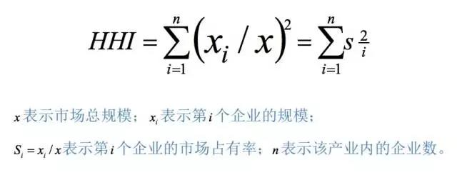

赫德芬-赫希曼指数（Herfindahl-Hirschman Index）

简单地说如果一个行业里面只有一家企业，那么这个指数就会等于 1；如果这个行业里面的企业数目无限多，每一家企业的占比都非常小的话，那么这个指数算出来的结果就是接近于 0。一个在 0 和 1 之间的简单数字，就能够反映出这个行业的市场集中度。

从数学上来说，这个指标非常漂亮、非常优美；但从经济含义上说，这个指标有一个重大的问题，那就是相关市场本身很难确定。

一般来说，在反垄断案里面那些原告要告具有市场支配地位的那一方，他们往往倾向于要把这个公司里面的相关市场划得小一点，也就是说要把相关产品的替代品说得少一点。替代品越少、相关市场越小，这家企业的市场份额就越大，它垄断的可能性就越高，它罪名成立的机会就越大。(公式中“分母”越小，占有率越大)

而反过来，在反垄断法里面那些被告企业，他们总是努力要把自己产品的替代品说得多一点，这样的话相关市场就大一点，他们企业占市场的份额就小一点，市场集中度就低一点，垄断程度也就低一点，罪名成立的可能性也就低一点。    

## 2\. 3Q 大战：腾讯是否拥有市场支配地位

我举个例子，2010 年发生过所谓 3Q 大战的事件，3Q 大战就是 360 和 QQ 之间的大战，奇虎公司的软件 360 和腾讯公司的 QQ 两个软件之间发生的冲突。

奇虎 360 的软件修改了 QQ 程序，腾讯公司认为这种修改是不合理的，所以就反过来让用户做一个选择，说如果你的计算机里面安装和运行了 360 的程序，那你就不要用 QQ 的程序了。这是所谓的腾讯公司二选一的反击。这个反击只持续了一天，但奇虎公司咬住不放，告腾讯滥用市场支配地位。（同样的，在 2017 年双十一前，网传淘宝天猫系、京东系也出现了这样的竞争，猫让大家二选一选择--进而引发了阿里系、腾讯系两大阵营的“暗战”，甚至一度在 11 月的乌镇互联网大会上，出现了貌似“反阿里联盟”的传言。）

“滥用市场支配地位”这个罪名要成立有两个要件：第一，腾讯公司的 QQ 必须拥有市场支配地位；第二，腾讯公司滥用了这种市场支配地位。

那么，腾讯的 QQ 在 2010 年有没有市场支配地位呢？我在课堂上每一次问这个问题，同学们都异口同声地说：“QQ 当然有市场支配地位了。”

那我们先看，如果你是奇虎公司雇佣的律师，你要告腾讯的 QQ 具有市场支配地位，那你的策略是什么？你要把 QQ 的相关市场说大还是说小？没错，要把它的相关市场说得小一点，要把它的替代品说得少一点。这样就能够凸显 QQ 的市场支配地位了。

那什么才叫 QQ 的替代品呢？奇虎公司这边提出的标准就是 QQ 是一种即时通信软件，只有那些能够同时传送声音、文字、文件、图片、图像的软件，才算得上是 QQ 的替代品，而且提供商的服务器还必须在中国，软件的界面还必须是中文那才算数。

这样的标准，一下子就把大量的其他通信工具排斥在外了，电话不算、手机不算、手机的短信也不算，电子邮件当然也不算，当时的网站、微博、博客、人人网等等上面的那些发私信的功能也不算在内了。这样很显然，腾讯 QQ 的市场支配地位就凸显出来了。

但反过来如果你要替 QQ 辩护，你会怎么给 QQ 的替代品做个标准呢？没错，那就是要把标准弄得宽一点。

腾讯这方面说，只要一种软件能够传达声音或者图像、或者文字、或者视频，那就是 QQ 的替代品。而且服务商的服务器也不应该只限于在中国国内，甚至界面也可以是英文、外文，因为现在好多年轻人的英文、外文水平都很高了。这样一下子就把相关市场扩大了。

## 3\. 用动态眼光看待相关市场

后来广东省高级人民法院做出了判决，他们说：“腾讯说的是对的。当然，电子邮件有点过分，我们把电子邮件排除在外，但即使把电子邮件排除在外，QQ 的相关市场也非常大，QQ 其实并不具备市场支配地位。”

广东省高院的判决还提出了两个非常有意思的角度，他们引用了一些市场调查的结果，这些市场调查显示，半年内用户使用超过两款以上的即时通讯软件的比例高达 63%，另外有 8.7%的即时通信用户在半年内更换过聊天工具。也就是说，用户在不同的即时通信软件之间切换的成本是非常低、非常灵活的。这是腾讯 QQ 不具备市场支配地位的证据。

同时法院的判决也指出，大多数关系密切的人之间，他们不仅仅拥有一种通信方式，你和你关系亲密的朋友和亲戚之间，联系的方式不仅有 QQ，而且有无线电话、固定电话、电子邮件，甚至还有其他社交网站所提供的交流工具，比方说微博的私信，这也是 QQ 不具备市场支配地位的证据之一。

还有，不少网站也做过压力测试，说如果这些免费的即时通信软件收费的话，那么用户就会迅速地大量流失。这也间接地表明，QQ 这种即时通信软件不具备市场支配地位。最后法院判决腾讯胜诉。

而这个案子到了最高人民法院终审的时候，最高人民法院又对广东省高院的判决再做了一点修正，说手机短信是收费的，也应该排除在相关市场的计算之内，但即使是这样，腾讯 QQ 还是没有市场支配地位。虽然腾讯二选一的反击是错的，但其也只不过是做了一天，算了吧。最后最高法院的终审判决是腾讯胜诉。

我认为广东省高院和最高人民法院的这两个判决，都是非常好的判决，因为它不仅符合了互联网发展的趋势，从一个动态的角度来看待相关市场，而且给传统相关市场界定的技术，提供了一个非常有力的新的工具。

（秦俑语：也许这场起诉，360 并没有特别期待胜诉，这更是一场品牌公关、加强品牌在消费者心智中印象的手段，通过“以弱告强”、“以小博大”，能迅速在市场中扩大相对弱小者的品牌知名度。这是一招很管用的策略--可以看做是另一种更高明的广告行为）

## 课堂小结

今天我给你讲了市场集中度的计算方法，那就是跟企业相关的数据除以跟市场相关的数据。在这里面，跟企业相关的数据——分子是比较清楚的；但跟市场相关的数据，也就是怎么才能正确地划分相关市场，这没有一个标准的答案。有些人希望把相关市场说得大一点，有些人则想把相关市场说得小一点，这当中并没有科学的标准。

用美国巡回法院法官伊斯特布鲁克（Frank Easterbrook）的话来说，寻找正确的相关市场是一种徒劳无功的游戏，它通常是你定了要什么样的结果才有什么样的论据，我们要尽量避免使用这种方法。

而经济学家科斯（Ronald H. Coase）则说，这种划分相关市场的游戏，使经济学家变成了那些“假装有本事去回答其实没有答案的问题的人”。

## 课后思考

今天留给你的问题是，既然在经济学里面一件商品的替代品其实是无限延展的，那在反垄断法当中，经济学家为什么还会不断地努力去界定所谓的相关市场呢？

##### 周

# 第 35 周问答  
没有输赢的竞争毫无意义 

我们开始本周的问答时间了。

从这个礼拜开始，我们进入一个新的大模块，集中讨论各种常见的商业模式，以及相关的反垄断政策。这一部分的主题可以称之为“竞争的逻辑”。它的核心，是我们想要了解，究竟在现实生活当中竞争是怎么展开的，它跟想象当中的竞争又有什么区别。

我的经验是，在这一部分的学习过程中，容易犯几个错误。

第一，是没有分清楚哪些是因，哪些是果。

比如一个企业到底它是因为成功了，生产了消费者喜闻乐见的产品，降低了成本，增加了就业岗位，创造了大量的交易剩余，它才做大。还是倒过来，这个企业只要无端端地把规模做大，不断地兼并对手，它就能够挣钱。

在因和果之间如果不能够做正确的区分，就容易犯错误。

第二，是没有对有无和多寡之间做出区分。

当我们说一些在市场竞争当中胜出做大的企业，说他们反而减少了消费者的选择的时候，我们到底是拿什么跟什么做比较。

是这个大企业根本没有出现以前的状态和这个大企业出现以后的状态做比较，还是说一个这样的大企业以及有许许多多这样的大企业做比较。

当然，市场上有 20 家标准石油公司，20 家微软公司，20 家苹果公司，20 家阿里巴巴，20 家腾讯。看上去可能是一种更美好的竞争局面，但那只不过是一种想象出来的局面。

现实生活中我们要考虑的是，如果我们市场竞争的制度比较合适，它就会产生一家标准石油公司，一家苹果公司，一家微软公司，一家阿里巴巴，一家腾讯。如果不合适的话，创新的想法就不可能落地，就不可能生根发芽，那就连一家这样的公司都没有了。

那是有和无的问题，而不是多与寡的问题。这两者的区分，也是我们在讨论反垄断法的实际效果的时候，应该特别注意的。

第三，大家容易混淆的是事实与传闻之间的区分。

我在预告里先提了一个问题，说垄断到底会造成什么样的危害，同学们普遍的回答是，垄断企业会阻止创新，会使产量降低，会使质量降低，会使价格上升，会使消费者的选择减少，这都是大家耳熟能详的传闻。

但当我们具体地去考察，在竞争当中脱颖而出的那些企业的时候，我们就要注意，这些标签打在他们身上是否真的合适。

大企业就不创新吗？腾讯有了 QQ 就不再做微信了吗？微信的版本只停留在 1.0 吗？他们如果稳坐垄断地位的话，为什么还要把微信的版本不断地更新，推到今天的 6.5.15 呢？

美国铝业公司生产的铝锭，产量是在上升还是在下降？价格是在上升还是在下降？当初如果没有年轻的发明家查尔斯·霍尔（Charles Hall）和投资家艾尔弗雷德·亨特（Alfred E. Hunt）的结合，人类开始大规模享用铝的年代又会往后推迟多少呢？

我们在前面的讲课介绍过，大发明家，大投资家，他们当然赚了不少钱，但是跟人类普遍享受到的做比较，那也只不过是个零头。

第四，大家还比较容易混淆的，是现实和理想之间的区分。

我们常听到有人说：“竞争不完美，那些有天赋、聪明的人，那些勤奋、积极向上、不懈努力的人，提高了别人竞争的门槛。”

但这世界本来就是这样的。乔丹就是比别人长得高一点，灵巧一点；爱因斯坦就是比别人聪明一点，特立独行一点；有些人工作到 12 点就要睡觉了，但就是有些人能够坚持到 12 点 15 分。

难道把长得高的人削低一点，聪明的人脑袋上要戴上思维干扰器，规定所有的人 12 点就得关灯睡觉，这才叫公平竞争吗？这也是我们在讨论反垄断法的时候，要特别考虑的问题。

刚才所讲到的重要区分，因和果之间的区分，有无与多寡之间的区分，事实与传闻之间的区分，现实与理想之间的区分，是整整几代优秀的经济学家和法学家，围绕着一个又一个真实的反垄断案例，经过长期的深入讨论而总结出来的。

## 1\. 回到学术大师华山论剑的现场

这场跨时代讨论的起点，我们可以定在芝加哥大学法学院院长李维（Edward H. Levi）和那位没有拿到经济学博士学位的戴瑞德（Aaron Director）共同教授的课堂上。那个课堂上两位学者激烈争论的温馨画面，经常浮现在我脑海里，我非常向往，我也把那种气氛，那种态度，那种风格看作是学术交流的最高境界。

也正因为是这样，无论是我在北大教书，还是在“得到”给你上课，我都要坚持这种苏格拉底的原则，也就是没有尊卑贵贱，没有先来后到，有的只是提问、回答、交流、比较和碰撞。

我看过一部电影，叫《午夜巴黎》，主人公时空穿越，回到他自己热爱的作家所生活的年代，跟他们把酒言欢，谈笑风生。而咱们的这门课，也是要为你搭建这样的时空隧道，把你带到这群优秀学者华山论剑、追逐真理的现场。

好，我们来看一下本周的思考题。

## 2\. 用经济学思维颠覆反垄断法思维

周一的问题是：我们前面一再强调生活当中到处都有竞争，但政府推行竞争政策的目的是要促进竞争。既然到处都有竞争，为什么还要促进呢？

当然，答案看上去是显而易见的，到处都有竞争，但是有恶性的竞争，也有良性的竞争。我们对竞争进行规制，目的不是要改变竞争的本身，而是要改变竞争的方式。

还记得吗？我们前面在讨论价格管制的时候，就解释过，价格管制并没有减少人们对稀缺物品所展开的竞争。价格管制所能改变的，只是人们竞争的方式，也就是从价格竞争变成其他的非价格的竞争。

还有，我们在讨论工作权利遇到的障碍的时候，也讨论了同样的问题。人与人之间展开竞争，比的不仅仅是劳动力的绩效，人们往往还会在别的层面展开竞争——比提供劳动服务的资格、借助法律限制别人进入市场与自己竞争——这种做法本身也是一种竞争的方式。

但是，我们对周一的思考题还要再往深处想。那就是当我们试图把竞争引向正确的方向的时候，我们对“什么才是正确的”到底有多少了解。而这恰恰是我们用经济学思维颠覆传统的反垄断法思维所积累的最宝贵的经验。

有同学提到了标准石油的故事，说美国政府控告标准石油公司，原因是不希望这个企业变成铁板一块，阻止社会的流通。

那我们就得反问，无端端的，仅仅为了社会的流通，就把一个好不容易精心缔造起来的组织，有效的企业，为社会带来巨大福利的制度安排，硬生生地把它敲碎，这是值得的吗？

也有同学说，在现实生活当中确实存在不正当竞争的现象。比如两个苹果园之间进行竞争，有一个苹果园的主人可能就会到另外一个苹果园里面搞破坏，这时候的竞争就是无序的。

但问题是，如果到苹果园里面搞破坏，那这个搞破坏的人他所违反的就是刑法，而不是反垄断法。刑法是在有人类社会以来就存在的法律，比反垄断法古老多了。刑法存在的意义和反垄断法存在的意义不是一回事，我们也要注意区分这一点。

## 3\. 没有赢家的竞争毫无意义

周二的问题是，请你先历数一下，垄断到底有哪些不好的地方，它对社会、经济和消费者的福利会造成什么样的伤害。

有同学说，垄断的公司一般实力都很雄厚，在一个领域造成垄断以后，别的公司就没法进入，市场就会失去竞争，效率会变得低下，失去活力，没有创新精神，从而对社会造成危害。

但我们有没有想过问题的另外一面，那就是凡是有竞争，尤其是在人们鼓励竞争的时候，就肯定会接着出现赢家和输家。没有赢家和输家的竞争不算真的竞争。但既然有赢家和输家，赢家就难免做大，而刻意不让它做大，这又算是什么意思？

Lara 同学的留言值得大家注意：

推荐一部纪录片叫《The Men Who Built America》 ，国内翻译成《美国商业大亨传奇》。整个纪录片的制作和情节刺激程度不输电影。讲了几个可以说是“创造了垄断这个词”的人的故事。范德比尔特、卡耐基、洛克菲勒、JP 摩根……故事的尾声是反垄断法的推出，洛克菲勒在法庭上为自己辩护的一席话非常精彩，发人深思。点击文末“阅读原文”，即可收藏此纪录片。

这部纪录片我也看过，越是留意这些发明创造的细节，越是令人感慨，人类的幸福生活真的来之不易。不管你喜不喜欢这些大亨，看这部纪录片你能更好地了解，真实生活中的竞争、竞争的常态究竟是什么样子的。

## 4\. 企业家发现需求满足需求是造福人类

周三，我们讨论了美国铝公司案，我们介绍了汉德法官的判决，他对这个案子的观点是，企业做大本身就是错，没有人逼着这家企业那么积极向上，那么不断地创新，那么不断地扩大规模，降低成本，发现用户的需求，又自己来满足用户的需求。

我留的思考题是，你是否赞成汉德法官的判决。

有同学说：“美国铝业公司自己满足它自己所激发出来的用户需求，这样来竞争的话，其他的竞争者就没有力气抗争了。”

每当看到这一类的评论的时候，我脑海里就会冒出一句话，那就是你究竟想它怎样？发现用户需求和满足用户的需求，这两者不是常常密不可分的吗？

发现人们喜欢坐马车，所以就造更多的马车；发现人们原来更喜欢坐汽车，所以就造更多便宜的汽车；发现原来家庭也可以使用电脑，所以就把每家都有一台电脑作为公司的愿景，把这种电脑称为个人电脑，从而努力去普及。

这究竟是一件有过错的事情，还是一件伟大的事情，造福人类的事情？

当我们仅仅为了制造社会的流动性，增加进入市场的竞争者的数目，为了让企业的规模看上去不至于那么大，我们就去惩罚那些因为消费者钞票投票而成功、而做大的企业的时候，我们就得静下来想一想，人家究竟应该怎么做，才能让我们满意。

## 5\. 反垄断法让经济学家“名利双收”

周四的问题是：在经济学里面，既然一件商品的替代品其实是可以无限延展的，那在反垄断法当中，经济学家为什么还会孜孜不倦地去界定所谓的相关市场呢？

23J4H 同学回答：

第一，虽然某种商品的替代品可以无限延展，但是相关性有强弱之分；第二，垄断经济学这门学问还没有定论；第三，这是一门生意，可以使得经济学家名利双收。

我觉得他的回答是很好的概括。当然，替代品的相关性有强弱之分，但是强与弱也是没有标准可言的。

最重要的是，如果没有反垄断法，如果不是为了在法庭上面战胜对手，这种对产品相关性强弱的讨论就没什么意义。换句话说，这种讨论，这门学问是因为司法诉讼的需求而催生出来的。正是因为这个原因，科斯才会说：“这种划分相关市场的游戏，使得经济学家变成了那些假装有本事去回答其实没有答案的问题的人”。

在反垄断法的案件里面，我们经常会指责一些企业，说他们所提供的产品，他们提供产品的方式，他们提供产品、质量、数量和价格伤害了消费者。

这时候我们就值得反问，如果这家企业完全不生产这种产品，完全退出市场，它不伤害你了，那世界会变得更好还是更糟。

秦俑语：这种思辨，真是太精彩，让我们不至于成为“乌合之众。

周五辩论

好，周一到周四我给大家留了思考题，今天是礼拜五，我给大家留个辩论题，大家一起辩论。

刚才我们谈到了给美国带来繁荣的美国商业大亨的故事，仔细去看他们的故事，会觉得人类的进步来之不易，但抽象地、概括地来看人类的发展，进步又好像是必然的。我们现在就来讨论一下，人类的进步到底是偶然的还是必然的？

正方认为：人类的进步是偶然的。很多发明创造都来自灵光一现，而这些发明创造的思想火花又必须跟相应的资本，劳动力和制作环境相结合，才能够成功的完成商业转化。如果没有这些偶然事件，人类可能就不会进步了。

反方认为：人类的进步是必然的。一个好的想法，你没有想到，别人迟早也会想到；一个企业基于一点发明创造，把规模做得太大，占据社会太多的资源，反而是不公正的。我们应该看到进步的必然性，不应该夸大进步的偶然性。

##### 加

# 学习加餐  
经济学辞典—10 

X

信任（trust）

人际互信并不天然存在（Trustful relationships develop over time. ）

 解释：人与人之间本来是不存在互信的，人的脑子跟脑子之间是没有办法连接的，高品质的产品要跟低品质的产品区分开来，把自己彰显出来，需要很大的成本。 案例：柠檬市场上的二手汽车。 一键直达：第 101 讲丨柠檬市场的故事

信任起源于重逢（Trust results from reunion. ）

 解释：克服信息不对称的问题，重复交易是一个好办法，骗你一次、骗你两次，总不会骗你第三次，人们知道会重逢，就会减少欺骗。 案例：熟人社会里信息不对称的程度低。 一键直达：第 103 讲丨重复交易与第三方背书

建立信任要靠制度，也要靠道德力量（Both the legal rules and the social norms help to establish trust. ）

 解释：要建立信任不能仅仅靠那些可见的法律制度。契约条文，也要靠社会舆论和每个人内心的道德力量。 案例：建立信任还得从娃娃抓起。 一键直达：第 26 周问答丨该不该取消医生的行医资格证

喝酒也是获取信任的办法（In China，drinking wines or liquors help to establish trustful relationship. ）

 解释：大量喝酒是一种自残行为。当一个人没有其他办法取信于陌生人的时候，就会通过大量喝酒发出这样的信号：为了和你交往、获得你的信任，连喝酒自残这样的沉没成本我就愿意付出，我是值得你交往和信任的。 案例：感情深一口闷。 一键直达：第 105 讲丨沉没成本、人质与抵押

信息不对称（asymmetric information）

强者为何处处示弱（Those who show their weaknesses are likely those who are strong. ）

 解释：在市场交易中，做出示弱姿态的商家，其实是强者，他们有更多机会欺负消费者，所以要做出示弱姿态，从而取信消费者。 案例：餐厅服务员整齐的制服，微笑服务。 一键直达：第 106 讲丨巨额广告与代言人责任

以不平等合约保护真正的弱者（Unfair contracts help to re-allocate the responsibilities from the dominated party to the dominating party. ）

 解释：合同本身看上去是不公平的，但它的目的，是要去纠正现实社会中的另外一种不公平。 案例：加盟店总店可以无理由中止与加盟店的合作，收回经营权。 一键直达：第 107 讲丨特许经营合同中的强者和弱者

Y

优质（quality）

品质稳定就是优质（uniformity is an important aspect of quality. ）

 解释：同一批产品当中，一件产品的质量，跟另外一件产品质量之间的差距越小越好，这是我们追求的一种优良品质。 案例：大型国际快餐连锁店。 一键直达：第 102 讲丨何谓优质

Z

质量（quality）

品质三包可以替代品质检验（Warrenty enables the customers to help to identify defective products on behalf of the manufacturers. ）

 解释：品质检验需要成本，实行产品三包，当产品出现质量问题的时候，再进行退换，等于由消费者做产品质检员。这样做可降低质检成本，对厂商和消费者都有利。 案例：退苹果手表的故事。 一键直达：第 104 讲丨担保、延保与共享合同

垂直整合保证产品质量（Vertical integration enhances the quality of products. ）

 解释：专业程度越高、信息不对称越严重的行业，产品生产的质检和监督成本越高，这时候只有通过垂直整合，才能更好地保障产品品质。因此在这些领域，产业的集中度往往会更高。  案例：食品、药品、化妆品几乎都是几家大企业垄断。 一键直达：第 108 讲丨如何保障食品、药品和化妆品的质量

自由（freedom）

缔约自由比自由更重要（The freedom of contracting is more important than freedom itself. ）

 解释：在劳资关系中，有些合约会对出资方或劳动者做出特定约束，减少其自由度。表面上看这不公正，但这恰恰只有这样的合同才能保障双方权益。让人们可以自由缔结这样的合同，比表面上的自由更重要。 案例：电视台让张国荣不要再坐地铁。 一键直达：第 27 周问答丨缔约自由比自由更重要

##### 141

# 第 141 讲  
网络效应和路径依赖 

今天我给你讲网络效应和路径依赖。

我们前面几讲都讲了企业做大的理由，比方说美国铝业公司，是一家不断进取而做大的企业；而腾讯那样的企业，虽然大但也不构成市场支配地位，因为我们对市场支配地位有了与时俱进的衡量标准。今天我来给你从另外一个角度，讨论企业做大的理由。

## 1\. 网络效应：用户越多，价值越大

首先我要给你解释的是一个概念叫网络效应。什么叫网络效应呢？一瓶矿泉水你觉得它值 1 块钱，那么，当这瓶矿泉水的销量是 100 瓶的时候，你觉得它值 1 块钱；当这瓶水的销量涨到 1 万瓶的时候，你还觉得你面前这一瓶水值 1 块钱；它卖到 100 万瓶的时候，这瓶水对你的价值来说还是 1 块钱。也就是说一种产品的价值，跟它的用户数量没有关系，那么我们说这种产品不具备网络效应。

但是倒过来，电话，如果你拥有世界上唯一的一台电话，这台电话对你来说有什么意义吗？那只不过是个玩具。如果世界上有十个人有电话，这电话的价值涨了不少；如果有 1000 人有电话呢？1 万人有电话呢？100 万人有电话呢？这电话的价值对你来说就大增了。换句话说，你对电话的估值，随着电话用户的数量增大而增大，那么这种产品我们就说它具有网络效应。

具有网络效应的产品很多。比方说语言具有网络效应，一种语言只有一个人说，这种语言几乎要消亡，说一种语言的人越多，这种语言的价值就越大。

货币具有网络效应，没人爱用、没人接受的货币没有价值，愿意接受的人、愿意使用的人、流通量越大的货币，它的价值就越大。（秦俑语:比特币呢？）

油站和汽车具有网络效应，在一个地区里面，油站分布得越密汽车的价值就越高。

电脑的操作系统也具有网络效应，使用同一种操作系统的用户数越多，这种操作系统的价值也就越大，越集聚价值越高。

秦俑语：当下，新零售概念兴起，网络电商纷纷收购线下“网络效应”的实体门店连锁，就是看中的这一点。

一种工业的标准也具有网络效应。我们今天所使用的键盘布局，大家看一下自己电脑上面的键盘，它的左上角第二排的英文字母是 Q、W、E、R、T、Y，也就是 QWERTY。QWERTY 这种键盘布局非常流行，它具有网络效应。也就是说，用的人越多它越有价值；越有价值，那么用的人也会变得更多，到最后似乎是这种键盘布局一统天下。

这么做的好处是显而易见的，几乎所有的键盘都使用同样的布局，你学会打字以后，在任何一台打字机、任何一台电脑上面，都可以轻松自如地操作，不用重新学习。但问题是这种键盘布局是不是最有效的？市面上流行一个说法，说这种键盘布局其实是低效的。

为什么呢？这得从最早期打字机的原理说起。在专栏文稿里面我给你附了一张图，是早年打字机的样子。那时候的打字机每一个键连着一根杆，你敲一个键那根杆就往前面摆好的那张纸打一下，字符就敲上去了。

问题是，如果打字的速度太快这些杆就会缠在一起，所以有一种说法是当年设计打印机的人，他们要尽量使得打字的速度慢下来，目的是为了防止那些杆缠在一起，要解开这些缠在一起的杆反而会浪费时间。

问题是那种老式的打印机早就过时了，人们后来已经开始使用电子打字机了，而到今天连电子打字机都从市场上消失了，人们用的是电脑来打字了。那根杆没了，但这个键盘布局却留下来了。由于有网络效应，大家都聚集在、都习惯使用 QWERTY 这种键盘布局，尽管它是低效的。

而那些高效的键盘布局，其实只要在电脑操作系统的键盘布局设计里面，稍微按两三个按钮，就能把整个键盘布局给改过来，但不仅很少有人这么做，连知道的人也不多。人们就一直在使用一个低效的键盘布局，而谁都没有积极性做出转换。

这种情况就使我们引入了一个跟网络效应密切相关的概念，那就是路径依赖。

## 2\. 路径依赖：昨天的选择决定今天的行为

所谓的路径依赖，说的就是由于人们聚在一个平台上面选用同样的商品，会带来越来越大的好处。所以人们一旦做出选择，这种选择就会顽固的维持下去。哪怕事过境迁，当初做出选择的条件已经发生了变化，另外一些标准、另外一些产品、另外一些方式，其实比老的选择更好，人们也不会选择它们，因为切换的成本太高了。

这就是市场上流行的关于网络效应和路径依赖相连的概念。

有经济学家把这种情形抽象化，建立了一个简单的模型，来刻画这种由于网络效应而造成的路径依赖问题。这里我给你提供了一个简单的表格。    

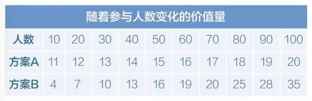

假定市场上有两套可选择的方案，方案 A 和方案 B。表格里面列出了方案 A 和方案 B，随着用户人数的增长其价值变化的过程。

方案 A，当有 10 个人用的时候，它的价值是 11 块钱，40 个人用的时候它的价值是 14 块钱，100 个人用的时候它的价值涨到了 20 块钱。所以方案 A 具有网络效应，因为用的人越多它的价值就越高，从 11 块钱涨到 20 块钱。

而方案 B 也同样具有网络效应，当有 10 个人用的时候，它的价值是 4 块钱；当有 40 个人用的时候，它的价值涨到 13 块钱；如果有 100 个人用，它的价值就涨到了 35 块钱。

方案 A、方案 B 都具有网络效应，它们的价值都会随着用户数的增加而提高。唯一不同的是，方案 A 的起点比较高，它从 11 块钱起步，但它增长得比较慢，有 100 个人的时候，它的价值也只涨到了 20 块钱。

而方案 B 的起点虽然比较低，10 个人用的时候它的价值只有 4，但它涨得比较快，当有 100 人用的时候，它的价值能够涨到 35。

假定市场上有 100 位用户，那么如果我们是能够预知未来的旁观者，我们当然知道方案 B 要比方案 A 更优，因为当 100 个人用上这个产品以后，价值 35 块钱的方案 B 要比价值 20 块钱的方案 A 更优。

但问题是，如果你是第一个进入市场的用户，你会选择方案 A 还是方案 B 呢？很显然由于用户数比较低，比方说只有 10 个人，这时候方案 A 的价值 11 块钱要比方案 B 的 4 块钱要高，你会选择方案 A。

后来的用户，假设你是第 50 位用户，你会选择方案 A 还是方案 B 呢？这时候你还是会选择方案 A，为什么呢？因为尽管在用户数达到 50 的情况下，方案 B 的价值是 16 块钱，比方案 A 的价值 15 块钱要高，但你还是会选择方案 A 的原因是方案 B 其实还停留在 10 个用户的水平上，它的用户数量从来就没有积攒起来，它根本就没有到达 49 位用户的水平，以致使第 50 位用户选择它能有什么好处。

所以当每一位用户都出于自己的利益考虑逐，渐进入市场的时候，他们就会做出具有路径依赖的选择，一个一个的都选择了方案 A，最后 100 位用户都选择了方案 A。

尽管从客观来说、从第三方的角度冷静地看待，方案 B 要比方案 A 更优。这就是一种每个人都自私，每个人都考虑自己的利益，最后使得群体的利益没办法达到最优的现象。

## 3\. 路径依赖是市场的失败吗？

我们知道亚当·斯密的名言，他说每一个人都自私，每一个人都追求自己的利益，这时候就有一只看不见的手能够极大地推动公共的利益。

但在这里，我们讲的网络效应和路径依赖的模型，就是亚当·斯密这句名言的一个反例，人人都看着自己眼前的利益做选择的话，市场没有办法达到最优的结果，因为他们在不知不觉当中受到了路径依赖的绑架。

写这篇文章的经济学家说，你看这就是市场失败，凡是在市场失败的地方，政府就应该有所作为。如果政府官员能够高瞻远瞩，知道哪一种方案更好的话，那就要对市场做出引导，通过行政干预的方式，促使人们放弃对方案 A 的选择，转为选择方案 B。

比方说大家都觉得汽油车很方便，它的动力足，而且加油站的分布广，要看眼前的方便，那都用汽油车，而电动车的网络没有发展起来，动力也不是那么足。所以人们一般不愿意选择它，这时候政府就应该制定扶持政策，鼓励人们从汽油车转向电动车，政府应该引导市场、修正市场的失败。

## 课堂小结

今天我给你介绍了网络效应和路径依赖的概念。我们还仔细分析了一个抽象的、关于具有网络效应的方案 A 和方案 B，产生路径依赖现象的例子。通过这个例子我们暂时得出的结论是，市场会失败，政府应该对不恰当的路径依赖做出引导。

## 课后思考

今天我留给你的思考题是，我们刚刚介绍的这个方案 A 和方案 B 出现网络效应和路径依赖的例子，有没有漏洞？它跟现实相符合吗？现实生活中真的会发生这个模型所推测的结果吗？

##### 142

# 第 142 讲  
市场是有效的 

昨天我们讲了网络效应和路径依赖。我们主要介绍了一个简单的模型，在这个模型里面有两套方案，两套方案都具有网络效应，但是方案 B 比方案 A 网络效应更明显。

从长远来说是应该选择方案 B，社会的总体利益才能够达到最大化，但由于方案 A 开始的时候起点比较高，人们会不知不觉地、惯性地选择方案 A，结果那个效率比较低下的方案，由于它是人们一开始的选择，所以就会出现路径依赖的情况，它就会胜出。

这看上去，就是一种无懈可击的市场失败的例子。但昨天我们留的思考题是问大家，现实生活中真的会发生这样的情况吗？

这个在黑板上面构造的模型，有一个重要的缺陷，那就是它假定了无论是方案 A 还是方案 B——尤其是方案 B——是没有主人的。

如果我们有意识地把这一点加上去，如果你是方案 B 的主人，你手上有一套好的方案，有一个好的产品，你自信它将来一定会比它的竞争对手方案 A 带来更大的收益，你会怎么做？

你会仅仅因为它对初始用户的价值比较低，人们不太愿意选择它而坐视不理吗？而束手无策吗？而让未来可预见的利润跟你擦肩而过吗？你不会的。只要这东西是你的，你是这个方案、这个产品的主人，而且你也是有远见的。

我们在讲利息理论的时候，就非常强调这一点，人是有远见的，人是能够预期未来的，你就不会束手无策，你就不会无所作为。你会怎么办？如果早期的用户觉得利益不够大，你就可以给他们一点利益。

你就不要全价卖这个商品了，你打个折扣行不行？如果打个折扣好处还不够大的话，你免费赠送行不行？如果免费赠送，顾客还不为所动，那么你给他们加一点补贴行不行？

秦俑语：很多新模式的出现（滴滴、共享单车等等），都是以免费或者补贴形式出现，让消费者更多地参与进来，习惯这种消费，进而沿着“有远见”的创始人“笃信”的方向发展，在“未来”获取更大的收益。

这样做值得吗？值得。因为你能够预见未来的利润，你只要把早期的用户攒够，这个产品、这个方案、这个标准的价值就会逐渐凸显出来，它就能吸引越来越多的用户，后面它就会自己照顾自己了。

所以我们昨天在模型里面说的那种“市场失败”的现象，在现实生活当中只有在特定的情况下才会发生。那就是产品、方案、标准是没有主人的，没有私有产权的，人们没有积极性去从中获利的，而且人是完全没有远见的，人是鼠目寸光的。

只有在这样的情况下，昨天介绍的那个黑板经济模型才会成立。但只要你引入了所有权，引入了对未来获取利益的积极性，引入了人的远见，再引入了各种消费者指南、各种产品的广告宣传——总之是生产者和消费者对未来的关心，昨天所讲的这种由于网络效应而产生的路径依赖，那种不良的路径依赖就可以避免。

## 1\. 网约车补贴用户的经济学理由

你看，现实生活中，互联网约车平台，就是一种具有网络效应的交易平台。无论是司机还是乘客，都愿意聚在同一个平台上面，同一个平台上面集聚的司机和乘客数量越大，这个平台的价值就越高。

没有人会希望自己手机里面有 20 个打车软件，每当要打车的时候就分别使用这 20 个打车软件；也没有司机愿意自己的方向盘前面放着十来二十个移动电话，随时在这十来二十个软件之间切换。互联网约车这个行业最终是一个赢者通吃的市场，最后只会剩下一两家，最多两三家的提供商。

问题是聚在哪一家的平台上呢？要开发一个互联网约车软件成本并不是太高，可能几个理工科的学生聚在一块，十来二十天就能开发出一个像模像样的原型，竞争者无数。

这时候，怎么才能让司机和用户尽早地聚在一个可信的平台上面，避免那些无谓的竞争、无谓的切换、无谓的尝试和无谓的博弈呢？有一个办法，那些愿意出大价钱的人，最有希望把这些软件做到极致的公司，它们站出来，它们花一大笔钱补贴用户，鼓励他们来到这个平台上面，然后再继续开发，然后再把投入逐渐收回来。

所以当时两大互联网约车平台，滴滴和快的联手对用户进行补贴，到了胜负局面逐渐明朗的时候，他们又减缓对用户的补贴。

（秦俑语：还记得在补贴结束，甚至在逢“恶劣天气”适当加价的做法，大家纷纷指责滴滴的“不良”行为。如果你深刻理解了这些，你就不会随便发表指责的评论--而这种现象中，有很多人是教授、MBA 学生--当自己作为“用户”时，人们经常是另一种“嘴脸”）

这种做法是促进竞争的做法，这种做法是避免人们陷入低效的路径依赖的做法，这种做法是尽早召集人们来到一个可信的、有希望的、有前途的平台的做法，而不是勾结、垄断、不正当竞争的做法。

所以我们说在竞争的领域，同样一种商业行为，从不同的角度看你会得出非常不一样的结论。

## 2\. IT 公司为什么喜欢开产品发布会

在计算机软件的领域也有类似的现象。你知道吗？微软公司生产过无数的软件，而比尔·盖茨最引以自豪的软件是哪一个？曾经有人问过他这个问题，他的选择是 Excel，这是他最引以自豪的应用软件。

今天这个应用软件一统天下，哪怕是苹果电脑的用户，他们也用 Office for mac，也在苹果机上使用微软公司的 Excel 软件。但是在当年 20 世纪 90 年代的时候，同类的电子计算表软件，可不止微软的 Excel 这么一种，当时竞争的有好几种产品，比较流行的还有 IBM 公司的“莲花 1-2-3”软件。

但是人们发现一个有趣的现象。不同的公司采用不同的计算表软件，这些计算表软件不论是莲花 1-2-3 还是 Excel，它们占有不同的市场份额，但当那些正在使用市场份额只占第三、第四、第五的计算表软件的公司，想要升级换代，换更好的软件的时候，它们会做渐进的选择，从第五选成第四，从第四选成第三，第三选成第二呢？还是会做跳跃性的选择，一步到位就选市场份额占第一的软件呢？

当然它们要一步到位，就选市场份额占第一的软件。为什么？它们明白网络效应的意义，它们明白路径依赖的约束，它们明白自己可能会被路径依赖所绑架，所以它们会用尽心思，迅速地往那个最大的平台上面靠。

你看用户是理性的，同样厂家也是理性的。很多 IT 公司在它们的新产品还没上市的时候，它们早早地就宣布它们会有新产品，这是为什么？这是向市场发出的集结令，告诉大家我要来了，你们等一等，向我靠拢。

但是官员和法官并不是一开始就明白这个道理的。当年 IBM 公司也是这么做的，新产品没有出现的时候，它们就宣布自己的新产品，到了它们要兑现承诺的那一天新产品还没出来，这时候政府就告它欺诈，告它不正当竞争。

从一个角度看，这确实是欺骗了用户，新产品出来以后你再宣布不迟嘛。但从另外一个角度看，从今天我们介绍的角度，从网络效应以及如何避免不良的路径依赖的角度看，IBM 的做法有它合理之处。

当年 IBM 被判有罪，今天很多 IT 公司这么做变得合情合理了，这也是社会认知的进步。

## 3\. 键盘布局的神话

听到这里，你可能会说：“原来是这样，但薛老师，你昨天说的那个键盘布局的事又是怎么回事？我们今天，不还在用那个落后的键盘布局 QWERTY 吗？”

有两位经济学家也对这个问题非常好奇，一位叫莱博维茨（Stan J. Liebowitz），另外一位叫马高雷斯（Stephen E. Margolis）。他们就去研究市场上流传甚广的、关于今天我们使用的 QWERTY 键盘布局不是最有效的这个故事。

他们发现，当年当打字机开始流行的时候，当家庭都可以买打字机来打字的时候，打字机的生产商就意识到，这里面会存在网络效应和路径依赖的问题。一旦他们选错了键盘布局，人们就会被锁定在一个低效的键盘布局上面，所以选择一个高效的键盘布局至关重要。

你看厂家也是有远见的，怎么办？他们当时举办了大量的打字比赛，目的就是要把打字员的熟练程度这个因素过滤掉，选出最优的键盘布局。

在这么多的打字比赛里面，QWERTY 一直名列前茅，它本来就是一个有效的键盘布局。当然，曾经有过一两次，在海军举办的打字比赛里面，另外一个键盘布局叫“德沃夏克（DVORAK）”的键盘布局胜出了，这就是人们一直传说，还有别的键盘布局比 QWERTY 更有效的来源。

在我十多年前使用微软操作系统的时候，在键盘设置那一栏，用户就能够轻易地选择“德沃夏克”键盘格式，但实际上没有人选择这种键盘格式。原因是什么？因为它并不见得比 QWERTY 好多少。所以市场上关于“目前大家使用的键盘布局 QWERTY 是低效的”这种说法，是一种讹以传讹的神话。

这两位经济学家合写的这篇论文发表在 1990 年，论文的题目叫《键盘的寓言（The fable of the keys）》，可能这篇文章的中心思想不够戏剧化，知道这个事实的人还是很少。

## 课堂小结

今天我给你解释了，为什么路径依赖的抽象模型在现实生活中并不成立，我也给你讲了 IT 公司提前宣布自己产品的作用，我还给你讲了键盘布局故事背后的真相。

## 课后思考

今天我留给你的思考题是，你认为产业的标准应该由大企业牵头制定，还是应该由政府牵头制定？

##### 143

# 第 143 讲  
自然垄断的难题 

今天我继续给你讲企业做大的理由。

有一本书非常出名，题目叫做《小的是美好的（ Small is Beautiful ）》，作者是舒马赫（E. F. Schumacher），他是一位经济学者和企业家。当然小企业是美好的，但我从来就不忘补一句：“大的也可以是美好的。”

## 1\. 自然垄断：有些企业规模注定要大

我先给你讲一个广为流传的 AT&T（美国电话电报公司）分拆的案子。我们常听到人说美国电话电报公司很大，后来美国的反垄断执行机构把它分拆了，变成几家互相竞争的公司。这种竞争状态对美国今天的高科技发展、今天的互联网发展都有很大的帮助。事实是怎么样的呢？我们来看看。

美国最早的电话交换局，在 1878 年在专利许可的保护下开始运营，当时拥有这个技术专利的几位年轻人，他们想，赚钱的方式就是出售专利许可，谁要建电话公司、谁要建电话交换局，只要给一笔专利许可费就可以自己去开办公司，就可以自己去经营。

结果在短短的三年间，电话交换局就在美国遍地开花，各大城市、各大城镇都有电话交换局的服务。

这种局面跟经济学家所津津乐道的完全竞争、理想竞争的状态非常接近，那就是市场有大量的提供商，提供高度同质产品的竞争格局。从 1894 年到 1904 年的短短十年间，在美国竟然涌现了超过 6000 家电话公司，这算完全竞争了吧？

而用户的数量也从 28 万增长到 330 多万。这个欣欣向荣的市场只有一个缺点，那就是不同电话公司的用户之间电话是打不通的。6000 多家电话公司之间的互联是个大问题，后来这些独立的电话公司只能走向合并，这个过程又经过了十多年。

到 1927 年，美国电话电报公司开通了越洋电话服务，那个时候隔着大西洋打一通 3 分钟的电话价格是 75 美元。那是一个天价。但有需求就有供给，越洋电话不仅可以从美洲打到欧洲，甚至在 1931 年打到了夏威夷，在 1934 年打到了日本。

虽然那时候的通话质量很低，音量很快就衰减，不断需要中继，但电话服务的需求非常旺盛，那是一个巨大的市场。

而早在 1907 年，美国电话电报公司的总裁威尔（Theodore Vail）就曾经说过，电话注定就是一种自然垄断的产品，也就是市场上只能容纳这种一家独大的企业，来经营这种带有网络性质的服务。但是随着美国电话电报公司的逐渐做大，它们就被美国的反垄断机构盯上了。

## 2\. 硬性分拆大企业带来的难题

1974 年美国政府起诉美国电话电报公司，到 1982 年美国电话电报公司自愿分拆，这当中经历了八年的时间。结果是美国电话电报公司分成了 7 家地方局和 1 家长话局，地方局管地方的业务，长话局管跨州的长话业务。

这样的格局，看上去公司和公司之间是有一定的竞争关系，但也产生了新的问题，那就是过去一通普通的电话，现在有可能得分成三通电话。一个人向另外一个人发起一通电话，过去只是一家公司内部的事情，但现在这一通电话就会被分成三段，本地公司再上长话公司，然后长话公司再落地到对方的本地公司，变成了三通电话。

这时候，参与经营的这三家公司之间的分账问题，就很令人头疼。那位从 1978 年就开始接手审理这个案件的法官，他的名字叫哈罗德·格林（Harold Greene），他从接手案件的那一天起直到他退休，他就没停止过忙活。忙什么呢？忙这些公司之间的利益纠葛。

这一通长途电话，怎么在这三家公司之间分账？还有七个本地局，它们的经营服务范围怎么划分？每一家本地局都希望尽量把那些人口密集、需求旺盛的区域划在它们本局的范围之内，它们之间就会竞争，它们会跑到法官那里去竞争。

法官得一碗水端平，不同的电话局它们的用户数量不一样，互相接入的需求就不一样。当然，用户数量少的电话局，希望自己能够接入那些用户数量大的电话局，因为一旦接入，由于网络效应，小电话局的用户就能得到增值；但是大的电话局不愿意了，它凭什么让这些小电话局随随便便就接入自己的网络？总得给点好处吧。

以前所有这些问题，都是在一家公司内部解决的问题，今天却成了公共问题，需要由并不懂得经营的法官来处理。

这是硬性拆分一个本来自然做大的企业所带来的问题，这个企业之所以做大，有它本来内在的规律。自然垄断的特点需要一个大而全的网络，但是人们出于对竞争的一种特殊理解，觉得应该把大公司分拆成几个小公司那才叫竞争，结果就硬把一个公司给拆开来了。

原来的规模效应大打折扣，经营成本、交易费用反而上升。

## 3\. 自然垄断领域如何引入竞争

这个案件促使我们回过头来重新思考，到底怎么样才算是鼓励竞争，难道自然垄断的领域就不存在竞争，就得由政府来监管吗？情况并不完全是这样。

我们前面介绍过的经济学家哈罗德·德姆塞茨（Harold Demsetz），他就曾经写过一篇论文，叫“为什么要管理公共服务”。他说每一位老百姓买了一辆新车，跑到交管局办新车牌，这个做车牌的公司是一个自然垄断。因为一个地区的交管局只会委托一家公司生产车牌，车牌的规格是统一的，老百姓不能随心所欲地找自己喜欢的厂家来做车牌，做车牌这个行当就具有自然垄断的特征。

自然垄断的领域能不能够引入竞争呢？德姆塞茨的回答是能。有什么办法？事前公开拍卖招标，这就是一种通过市场竞争来解决自然垄断效率问题的办法。

事前的招标是完全可以符合市场竞争的标准的，招标方把条件列出来，各家互相竞争，招完了由中标的企业来经营。这样就既不会出现多家公司同时提供服务的浪费，也满足了通过竞争来提高效率的要求。

再举一个例子，一个城市的停车场应该怎么样来经营呢？停车场的数量是固定的，但一个城市可以把它所有停车场的管理，一次性批发出去，通过招标的办法由中标的公司来统一经营。

事实上，美国电话电报公司的垄断，这种自然垄断维持的时间是有限的。

## 4\. 动态竞争比静态诉讼更加有力

在 20 世纪 80 年代开始，微波通信的技术就成熟了，再到 90 年代，通过互联网而接驳的 IP 电话就已经变得非常普及。这是另外一种格局的竞争。这不是非要把一个做大的企业拆解开来才叫竞争，而是一种模式取代另外一种模式，一种类型的产品取代另一种类型产品的竞争。

模式的迭代、新产品类型的迭代，这是不是一种更有意义的竞争呢？那些在原有的技术下面、在原有的经营模式下面，具有一定垄断地位的企业，我们是不是应该放它一马，就让它赚一点钱，反正技术的发展很快就会超越它们、取代它们。

1992 年的诺贝尔经济学奖得主加里·贝克（Gary Becker，1930 年 2 月 25 日-2014 年 5 月 4 日）就曾经回答过这个问题，他和我们前面介绍过的理查德·波斯纳（Richard Posner，1939 年 1 月 11 日-）法官一起合写了一个博客。他在 2014 年去世以后，我还去他的博客查找了一下加里·贝克关于反垄断法的论述，结果我找到了他 2013 年 9 月 2 日的一段话，他说：

执行反垄断的人应该认识到，动态的竞争通常比那些静态的竞争还要有力。有一个重要的问题需要我们考虑，那就是我们到底应不应该，花费巨大的金钱和精力，去控告那些仍然在创新过程当中的大企业？还是说，我们就让这些大企业享受一下它们的垄断地位和垄断利润，反正它们的垄断地位也不会维持太久。

我自己的回答，也就是加里·贝克本人的回答，他说：

我们不应该花那么多钱去对付这些企业，就让竞争来对付这些企业吧。好的竞争政策应该依靠动态的竞争，而不是这种静态的诉讼。

## 课堂小结

今天我给你解释了自然垄断的问题，也解释了如何在自然垄断的行业里面引入竞争的办法。

## 课后思考

今天我留给你的思考题是，许多城市里面具有自然垄断属性的公共设施，比方说电力系统、供水系统，甚至铁路系统，这些系统有没有办法引入市场竞争的机制？

##### 144

# 第 144 讲  
勾结定价如何可能？ 

今天我给你讨论勾结定价的问题。

两家大企业互相通个电话，说咱们把价格提高一点，结果他们真的这么做了。我问你，他们真的能够提高利润吗？消费者的利益真的会因此受损吗？

## 1\. 勾结定价需要克服的障碍

我们首先来看，勾结定价需要克服哪些障碍。

我们先来举个例子，北大的一位女同学说：“你看那些男生总喜欢来约我们吃饭，咱们不能随随便便答应他们，要出去吃饭的话，就得订一个好一点的餐厅，麦当劳、肯德基咱们不去，要去就去必胜客。”

当一个女生这么提出的时候，她如果坚持这个高价的话，她旁边的女生可能就会因此得益了。所以她一个人这么做不够，她要把她旁边的女生联合起来。

仅仅是把旁边的女生联合起来够吗？不够，她要把整个宿舍的女生联合起来；这还不够，整栋楼联合起来，这还不够；那得整个北大，北大还不够；那你得把清华的女生也联合起来。

这是勾结定价的第一个障碍，你要把每一个可能的竞争者都包罗进来，这很不容易。

第二点，你必须让每一位被包罗进来的勾结者，都答应同一个价格。到必胜客是不是一个合适的价格呢？有些人会说，麦当劳也可以了。而有些人会说，麦当劳不行、必胜客也不行，至少要米其林西餐厅才可以。

不同的人心目中的价格不一样。

不仅如此，我们还要防止作弊的行为。不同的男生，约同一位女生吃饭难度是不一样的。有些人请客，那非得要到米其林餐厅才可以；而有些人，可能吃个路边摊就满足了。如果非要规定去米其林餐厅吃饭的话，女生可能会愿意暗中补贴那位男生。

记得我们讲过的法律无效定律吗？对于那些额外的负担，交易的双方是共同承担的，谁更需要这宗交易谁负担的比例就更大。这种暗中作弊的行为不容易被发现。

最后，当这个联盟体发现有人作弊的时候，还要对作弊的人做出适当的惩罚。

所有这些障碍加在一起，勾结就很难持续下去。

## 2\. 趋于瓦解的“勾结定价

美国的航空公司一度是有勾结的，它们刻意把机票的价格提得过高，价格提高以后，航空公司之间的竞争并没有减少，航空公司就在价格以外展开了竞争。

你看看它们的广告，它们宣称它们重新设计了座椅，哪怕是经济舱的座椅，乘客的腿也可以伸直了；再看那些飞机餐，都有鱼子酱、龙虾；空姐年轻漂亮；除此以外，还有廉价的陆地服务，有豪车来机场接你；入住四季酒店打个五折。

所有这些廉价的高端服务，都是为了绕开价格管制而提供的。管住价格容易，要管住服务的质量就很难，结果机票的联盟很快就土崩瓦解了。

后来经济舱的座位双脚再也伸不直了，鱼子酱和龙虾没有了，哪怕是买一个汉堡包也要额外付钱了，漂亮的空姐变成空叔、空婶，甚至是空爷了，陆地服务一概取消。

这种状况好还是不好？答案是好。为什么？因为乘客本来不需要这些额外的服务，如果真的需要的话，他们可以买商务舱、头等舱。

这是说，企业之间要形成勾结有许多天然的障碍，这些障碍会使得他们的勾结趋于瓦解。

世界上只有一种勾结是能够长久地维持下去的，那就是背后有政府支持的勾结。比方说我们前面讨论过的工会，在有法律保障下面的工会和罢工，他们就能够持久地维持下去。

## 3\. 勾结能够增加企业的利润吗

我要跟你讨论的第二点是，勾结真的能够增加企业利润吗？

我们回忆一下需求曲线。需求曲线是一条必然倾斜向下的曲线，它的含义是说，企业的收费越高需求量就越低，企业的收费越低需求量就越大。无论是价格过高还是销量过高，它都不能够使企业获得最大的利润。

当面对一条倾斜向下的需求曲线的时候，企业家需要做的，是寻找那个使得他的收入和利润能够达到最大化的定价和销量，所以他们被称为“觅价者”。这是我们前面讲过的内容。

所以当两家企业它们都企图去寻找同样价格的时候，驱使它们这么做的很可能不是勾结的意图，而是市场的力量。

在美国反垄断历史上，曾经就有过两家电器公司，它们都在卖电灯泡，它们两家的价格非常接近，一家的价格变化总是跟随着另外一家价格的变化。

这时候，其中一家电器公司就被告上了法庭，当政府的律师向这个公司的高管出示证据的时候问他：“你们公司为什么要这样步步紧逼地，跟着别人的价格变化而变化呢？”

这位公司的高管说：“我们没办法，只有这样我们才能赚钱。”

这时候法官就说：“你看这就对了，你不就是为了赚钱而进行暗中的价格勾结吗？有罪。”

我经常说，如果你看到两只鹰在天空上飞翔，一只飞到左边，另外一只也飞到左边；一只飞到右面，另外一只也飞到右面；上面，上面；下面，下面。那我问你，这两只鹰有没有勾结？

你会说：“这两只鹰肯定有勾结，至于证据我暂时还拿不出来，它们是怎么样互相联系的、怎么样勾结的，我不一定知道，但从它们的行为看，它们一定有勾结。”

但这时候我建议你把镜头拉远一点看看地面上。地面上有一只奔跑的野兔，原来这两只鹰并没有勾结，它们只不过是在追逐地面上同一只野兔而已。

再看那两家电灯泡公司，它们卖的是高度同质的产品，市场的需求有变动，它们都要跟随市场的变动而变动。它们不是为了勾结而勾结，它们是要对市场的变化做出反应。

## 4\. 约定价格不等于决定价格

我再给你举一个例子，你就彻底明白了。两家电视台，有两位报天气的主持人，他们在开播以前互相打了一通电话，他们说明天你说是下雨还是不下雨？两个人约好说：“我们一起说下雨。”结果两家电视台的天气预报都开播了，两位播音员都说明天会下雨。

这时候，你觉得明天到底下雨不下雨，是由这两位播音员决定的吗？不是，他们只不过是勾结起来，预测明天下雨不下雨罢了，至于明天下雨不下雨不由他们定。

两家公司如果约好要提价的话，它们只不过是约定了一种定价策略而已，至于它们能不能够取得利润的最大化，不由它们定。

它们只不过是价格的探索者，它们只不过是觅价者。它们定的价格，能不能使得它们的收入和利润达到最大化，这由它们所面对的那条需求曲线决定，而不由它们贪婪程度来决定。

## 课堂小结

今天我给你讲了勾结定价所面临的种种障碍，自然的勾结定价总是趋于瓦解，只有通过行政力量支持的勾结才可能长久地维持下去。两家企业哪怕是在进行勾结定价，也不能确保它们获得的是最大的利润。

## 课后思考

今天我留给你的思考题是，在很多国家里面勾结定价是违法的，但如果勾结定价是能够赚钱的，能够赚足够利润的话，要避开法律的监管而达成勾结究竟有多难？

##### 周

# 第 36 周问答  
串通勾结和商业成功没有必然联系 

我们开始本周的问答时间了。

这两个礼拜，我们开始集中讨论各种商业模式，以及竞争政策之间的关系，有很多商业模式自古就有了。而到了近现代，尤其是人们有了《反垄断法》，又有了经济学，开始对各种商业竞争方式进行反思以后，我们就遇到一个庞大的研究课题，那就是怎么样的竞争方式才是正常的、合理的和有效的。

从上个礼拜开始，我们集中讨论了一个问题，那就是企业做大，背后有哪些言之成理的原因。人们对大企业的态度，往往陷入一种自相矛盾的状态。现实生活中，他们离不开大企业所提供的产品，他们实际上是喜欢大企业的；可一旦上升到了理论化的讨论，人们又对企业做大感到忧心忡忡。

我们这两个礼拜课程的主要内容，就是要澄清大家的一些常见的误解。我们说企业的规模做大，往往是有合理的原因的。企业的效率提高就是原因之一。

## 1\. 效率提升使企业规模变大

我们在前面的模块，在讨论供应的行为的时候，第 100 讲的题目就叫《行业竞争程度不看企业个数》。

你还记得吗？我们在那里举了一个路边摊合并的故事，两个路边摊合并，企业的数目减少了，但合并以后，他们不是简单重复自己原先的工作，而是会展开进一步的分工和合作。合并之后的路边摊，效益会提高，竞争力会加强，结果是它会和更大范围内的竞争者展开更激烈的竞争。

如果不这样去理解企业做大，那我们今天所见到的任何一家超过两个人的企业，都应该被分拆、分拆、再分拆。

实际上，只要我们是鼓励竞争的，那凡是有竞争的地方就有赢家，就有输家。能够看得见的竞争者数目，就有时会增加，有时会减少。所以，行业竞争的程度，不能靠数数、靠看竞争者的数目来决定。

而我们这两个礼拜所讨论的，一些凭着自己的努力不断做大的企业，包括美国铝业公司、微软公司、苹果公司、阿里巴巴、腾讯，也都是这样的例子。你只要参观访问过这些企业，跟在这些企业内部工作的人接触过，你就能感到他们所感到的竞争压力。

为了保持活力，他们会鼓励内部部门之间的竞争，鼓励新思想的呈现，会对新思想做出奖励，提供尝试的资源。同时，他们也会非常注意公司以外的创新，通过收购、重组，给公司增添新鲜血液。

## 2\. 网络效应促使企业做大

接着，我们还讨论了企业做大的另外一个重要的原因，那就是世界上存在着“网络效应”这回事。很多产品，是越多人用价值越高的，多人用本身就是价值的一部分。

我还记得很清楚，很多年前 Windows95 刚出来的时候，有一位资深的程序员对我说：“这个操作系统很差，要找真正好的操作系统，你得找别的。”但我当时就意识到，哪怕 Windows95 有很多缺点，但这恰好说明很多人在用，才会暴露出这么多问题，而多人用本身就是价值。

其实今天的大城市也是这样，大家对大城市有各种各样的抱怨，但这些抱怨本身就说明，人们离不开大城市，大城市带来的好处比它带来的坏处要多。当然，人们也在通过各种各样的创新办法，越来越妥善地解决大城市所带来的问题。

我们这个礼拜所讲的重点，除了解释企业为什么会做大，还讲了一个同样重要的问题，那就是当社会只能容纳一个大企业的时候，有没有办法再引入竞争，加强竞争。

有一个办法，就是提前竞争。在自然垄断的行业，以提前招标的方式来竞争。我们在前面的课程当中，详细地讨论过治理城市拥堵的一种有效办法，就是对路权征收拥堵费。

拥堵问题的本质，不是一个城市里面的车太多了，也不是一个城市里面的路太少了，而是一个城市里面的道路，在某些时间，某些路段车太多了。

所以要切中要害地解决问题，既不应该是通过限制车牌总量的办法，也不应该是通过增加汽油费用的办法来解决。咱们得解决的，是某个时间、某个路段，路权的分配问题，按标价来分配是最好不过的办法。这一点，我们已经详细解释过了。

但问题是，在实施的过程中，这个价格应该怎么定呢？它是一个动态的过程，是一个需要反复摸索的过程。

如果我们成立一个拥堵费听证委员会，请社会上的各方贤达共同参与定价，那就很可能出现一个问题，那就是这些贤达，这些名人会为了显示他们的良知和道德感，会有意无意地把拥堵费的价格定得过低。

结果是虽然征收了拥堵费，但路还是堵的，这时候大家就是会抱怨：“你看收费不起作用吧，上路是刚需吧，你们故意把路弄得那么拥堵好赚钱吧。”

其实我们都知道，只要价格定得合理，是一定能够起到治堵的效果的。但问题是，谁才会有真正的积极性去摸索合理的定价呢？合理而有效的办法，就是这个礼拜我们所讨论的事前公开招标的方式。

一个城市先列出条件，然后给出一个足够长的经营期，各大公司通过招标来竞争，招标一旦结束，中标公司就会好好地进行规划，以专业化的知识，市场化的手段，以及根据招标时所承诺的社会规范来解决城市拥堵的问题。

秦俑语:市场上也许现在并不存在这样的专业公司，哪些公司具备成为这样的能力潜力呢？我认为市场化程度高的滴滴这样的公司具备。他掌握海量出行数据，能通过计算机模型测算数来拥堵时段，也有海量过往数据提供拥堵费合理定价---如果有一天，政府愿意让滴滴这样的公司参与到大城市交通拥堵改良设计中，那一定会取得非常不错的结果。

好，我们来看看本周的思考题。

## 3\. 市场中人能够推广长远有利的方案

在周一的讲课里，我给大家介绍了一个经济学家基于“路径依赖”特点所构造的模型。在这个模型里，每一位进入市场的顾客都由于只顾自己眼前的利益，而选择了暂时比较有效的方案，结果从长期而言，对大多数人更有效的方案就被放弃了。我的问题是，这个模型跟现实相符合吗？

很多同学的回答，跟我在周二讲课当中所做的解释是不谋而合的。

张永涛 同学回答：

在现实生活当中，B 方案的主体会补贴用户，滴滴、摩拜、美团都这么干过。当然，如果 AB 方案的差别很小，就不会有人费力去改变。但只要边际收益大于边际成本，就有人会去改变。

Bison Zhou 同学也回答说：

这个模型有漏洞，人是会根据情况做出对策的，亚马逊提供会员免运费，早期是亏损的，但贝佐斯看到未来的发展，坚信客户数量的提高，可以反过来降低成本，结果他是对的。亚马逊今天发展成为电商巨头。

我们在思考周一的问题的时候，我觉得要特别注意的是，由于只要人能够有远见，能够获取未来的收益，他们就会有积极性，去推广一些暂时看起来不那么受欢迎的方案。

既然市场已经有能力做到这一点，我们就不要凡事都去求助政府，动不动就请政府来“助推”。

因为政府助推也是会有成本的，决策可能发生错误；认识到决策错误以后，改错的速度可能没有私营企业改地那么快；为了纠正错误所做的投入，结果又变成错上加错的机会，也可能会更大。

不管怎么样，讨论市场失败是有意义的，但市场失败并不意味着政府成功，真正有意义的比较，是市场的失败和政府的失败。两利取其重，两害取其轻。

## 4\. 产业标准由企业制定更符合成本收益比

周二的问题是：“ 你认为产业的标准应该由大企业牵头制定，还是应该由政府牵头制定。 ”

千の夜 同学的回答比较全面，她说：

产业标准应该由大企业牵头，但同时也不能缺少政府的约束。大企业能够牵头的原因是，他们之所以能够做大，就是因为它的产品质量、生产效率都优于竞争对手，他们的标准是经过市场的考验、筛选而浮现出来的，它应该是当前市场最优的产业标准。

但政府不牵头，也不等于它可以放任不管。比如企业有可能仅仅因为顾及自身的利益，制定出破坏环境，造成污染的标准，这时候政府就需要有意识地管控风险。

当然，在推广执行一种标准的时候，政府的号召力和执行力也有可能比大企业要强。在这个问题上，我想强调的是，只有那些身处管理、生产和营销第一线的企业，他们才会对不同的标准之间的迭代所产生的边际收益和边际成本，有最切身的体会，做出最恰如其分的选择。

我们在更新电脑操作系统的时候，就经常会遇到这样的问题，新的标准固然好，但如果它不能兼容老的设备，它可能就不被接受。

但反过来，如果固步自封，又会影响发展，影响新的、更先进的设备的普及。

这当中的权衡不仅非常微妙，那些决定有时候甚至是痛苦的。这种决策还是由那些直接承担后果的企业来做出比较妥当。

## 5\. 自然垄断行业也可以做市场化改革

周三的问题是，许多城市里面具有自然垄断属性的公共设施，比方说电力系统、供水系统、铁路系统，这些系统有没有办法引入市场竞争的机制。

小星姐 的回答是：    

这类行业本身就具有网络效应，不用刻意从外面引入竞争，行业内部就会产生新的模式，新的产品做替代式的竞争。比如发电，就从火力发电到水力、风力、地下热能发电等等；又比如铁路，从跑绿皮老式火车，慢慢就会变成动车、高铁，甚至连铁轨都不需要了，直接磁悬浮了。

马车夫 的回答是：

哪怕是自然垄断的行业，它也有很多工作环节可以外包，做市场化的改革。比如在电力系统，运行、检修、故障诊断等等环节，都可以引入民间资本，让竞争当中的私营企业来完成。最后的格局甚至有可能变成除了电网调度、运行、指挥权的保留以外，其他的业务一律都由社会资本参与竞争。

## 6\. 串通勾结和商业成功没有必然联系

周四的问题是：“ 在很多国家里面，勾结定价是违法的，但是如果勾结定价是能够赚钱、能够赚到足够利润的话，那么要避开法律的监管而达成勾结，究竟有多难？ ”

我们的回答是，根本不难。人与人之间要达成勾结，办法多的是。见面开会当然是一种办法，但暗地里打个电话，通个邮件，请中间人捎个话，甚至仅仅是发一个暗号，交换一个眼神都能够达成勾结。

所以有意思的是，既然达成勾结这么容易，如果只要达成勾结，人们就能挣钱，就能够牟取暴利的话，那应该满世界都是商业成功的例子，我们不会再见到有人经营不善，破产倒闭了。

现实的情况不是这样，所以合理的推断应该是，哪怕人们经常勾结，经常串通，成功的几率还是很低的。串通勾结和商业成功之间没有必然的联系。

而更重要的是，我们今天逮住的那些、曝光的那些勾结和串通的案子，跟勾结、串通潜在的可能性相比实在是太少了，这个现象不正常。

“Why the dog didn't bark?” 狗为什么没叫，你记得吗？这是《福尔摩斯探案集》里面的一句名言。国王的马场发生了命案，赛马也丢失了，福尔摩斯被请去调查，问来问去问不到相关的情况，探长说，一个晚上都没有什么异常的现象。

福尔摩斯说，你没注意那条狗吗？探长说，狗可没叫啊。福尔摩斯回答，恰恰是因为那条狗没叫，这才是异常的现象。这说明来偷马的人跟狗可能认识。

现实生活中，人与人之间达成勾结很容易，但被曝光的勾结案件很少，这恰恰说明，相关的制约的法律用处不大。这一点，我们在后面讨论内幕交易的时候会再谈到。

你可以先思考一下，企业经理偷偷利用自己所知道的信息，在股市上为自己牟利，做这种事情的时候容不容易被发现，而被发现的案子又有多少，这说明什么？

周五辩论

好，周一到周四我给大家留了思考题，今天是礼拜五，我给大家留个辩论题，大家一起辩论。

这个礼拜我们讨论了大企业，大家集中关心的问题之一，是大企业能否持续地保持创新的动力，我们现在就来讨论一下：大企业是否有利于创新？

正方认为：大企业不利于创新，因为企业一大，规章制度就会多，船小好掉头，船大难掉头，各种新生的创意，一定会被层层叠叠的体制和规则所磨灭。

反方认为：大企业有利于创新，这不仅是因为大企业本身就集聚了很多具有创造性思维的人才，更重要的是，今天的许多创新都需要大量的资本，而只有大企业才有能力从事这方面的创新。

欢迎大家参与辩论。

##### 加

# 学习加餐  
经济学辞典—11 

D

定价（pricing）

追问原价注定徒劳无功（There is no such thing as original price of any product. ）

 解释：是产品的最终需求、具体的情景决定了产品的售价，从而倒过来再决定产品生产要素的成本。因此要确定一件产品的原价是一个伪问题。 案例：电商促销时把原价标注出来实际上做不到。 一键直达：第 29 周问答丨网上买到假货谁负责？

H

合同（contract）

合同与承诺也是一种经济资源（Promises are regarded as valuable goods. ）

 解释：在法律经济学者看来，一项合同就是一个承诺，一个承诺就好像一个产权一样，是一份资源，而违约就是对这项资源的侵害。 案例：八幅油画和雕像的案子。  一键直达：第 109 讲丨签约前是否应该让对方知情

合同必须有约因或对价（Law enforces the contracts in which the promisor gains something and/or the promisee loses something, i.e., consideration. ）

 解释：在任何一个合同关系当中，做出承诺的一方必须有所得；接受承诺的一方必须有所施，他必须付出一点什么，这样的话合同才算有效。 案例：答应捐钱又不捐不算违约。 一键直达：第 110 讲丨馈赠有没有约束力

具体履行合同可能产生巨大的社会成本（Specific performance may incur very high social costs. ）

 解释：在履行合同过程中，如果稍有差池就要推翻重来的话，那么社会成本就会非常大。 案例：大楼里的排水管道案。 一键直达：第 111 讲丨违约与赔偿

婚姻（marriage ）

婚姻既有情感的一面，也有商业的一面。婚姻法建立在商业合同的原则之上（Marriage has its sentimental and its business sides.The whole law of marriage is founded upon business principles, in which the utmost good faith is demanded of the parties and least fraud in regards thereto is the subject of judicial cognizance. ）

 解释：婚姻很奇特，由于男女双方的责任、权利和义务太复杂了，所以他们签订的婚约只有一张纸那么简单，里面几乎没有任何其他条款。他们采用了社会习俗、社会舆论、双方的生活习惯来确定婚约的条款和履约。 案例：一生唯一挚爱基本不存在。 一键直达：第 112 讲丨婚姻经济学

汉德公式（Learned Hand Formular）

当避免意外的成本低于意外发生的期望值时，人们应该担负责任（One is held liable as long as B(his burden to pay care) is less than P (the probability of accident) multiplied by L (the loss), B<P\*L. ）

 解释：在意外发生当中的任何一方当事人，只要避免意外发生的成本低于意外造成的损失，他就负有责任，他就要为避免意外采取适当的措施。 案例：美国诉卡罗尔拖船公司案。 一键直达：第 113 讲丨汉德公式

J

监管（regulation）

监管机构也要有竞争机制（Competition among the regulatory agencies may be desirable. ）

 解释：垄断性的、独此一家的监管机构，很难完成在信息高度复杂的社会里面，为广大消费者做出正确决定的任务。只有让监管机构之间也形成竞争态势，才是解决问题的思路。  案例：药品监管机构可以引入竞争机制。 一键直达：第 116 讲丨监管本身也要引入竞争机制

Z

责任（responsibility）

承担更多责任，让局面更加可控（Precaution reduces accidents. ）

 解释：生活中有很多不确定的事情，也会遇到不靠谱的人，只有让自己承担更多责任，才能让局面变被动为主动，让局面更可控。 案例：开会提前两个小时出发。  一键直达：第 28 周问答丨遇到不靠谱的人和事怎么办？

商家责任过大会事与愿违（Holding the sellers too much liabilities may result in unexpected outcomes. ）

 解释：我们要盯住边际收益和边际成本之间的平衡，任何事情都得有一个度，因为过分的安全和过大的责任也会带来事与愿违的结果。 案例：可口可乐爆裂并不能全怪商家。 一键直达：第 114 讲丨监管要看边际效用

谁成本低谁承担避免意外的责任（The least cost avoider should be held liable. ）

 解释：在具体的情景里面，哪一种交通规则使得我们整个社会为了避免意外所需要付出的成本最低，我们就选择哪种规则。 案例：汽车和坦克相撞的四种规则导致不同结局。 一键直达：第 115 讲丨监管要分事前和事后

##### 145

# 第 145 讲  
倾销策略——洛克菲勒发家史 

今天我给你讲掠夺性定价，洛克菲勒的发家史。

掠夺性定价在英文里面叫 predatory pricing。 “掠夺性”看上去好像是定价过高的意思。我刚开始接触这个概念的时候，也以为它指的是定价过高，后来才知道它指的是定价过低，是定价低了以后把别的企业的市场份额都抢走了的意思。

而另外一个词叫倾销，这个词看上去就比较直观，无论倾销还是掠夺性定价，指的都是定价过低。那在反垄断法里面，掠夺性定价或者倾销，为什么是一条罪状呢？它会造成什么样的危害呢？

很多人会说，倾销者故意把商品的定价压到成本价以下，这样的话市场份额都会被倾销者占有了，其他的企业没办法把产品卖出去，时间一长就没办法继续生存下去了，他们就会被迫退出市场，或者被倾销者收购。

这时候，市场上就只剩下倾销者了，他就成了具有市场支配地位的垄断企业，接着倾销者就会利用他在市场上的支配力重新把价格抬高，剥削消费者以便获得垄断利润。所以反垄断机构应该及时下手，看见有人倾销的时候就阻止他们、惩罚他们。

这是人们反对、惩罚掠夺性定价或者倾销的理由。

而在美国的反垄断历史上，最早的反倾销大案就是“美国政府诉标准石油案”，我们知道美国标准石油公司的创始人约翰·洛克菲勒（John D. Rockefeller，1839 年 7 月 8 日–1937 年 5 月 23 日），曾经是美国历史上最富有的人。

我不知道大家对他的印象怎么样，但你看我给你准备的一张漫画，在这幅漫画里面，洛克菲勒虽然穿的像个小丑，但他眉头紧锁，霸气外露，双脚站在标准石油的油桶上面，头上还顶着盘旋着的列车。

这幅画的含义太清楚了，说的是洛克菲勒不仅垄断了石油，而且还支配了美国的铁路网。看他的样子，三岁小孩儿都知道，他不是个好人。

## 1\. 勤俭节约，精打细算

洛克菲勒到底是怎么发家的呢？石油成为宝贵的资源，是最近 100 多年来的事情，在这以前人们不仅不知道石油的用途，而且还要避开它。

那时候石油在地底下冒出来了，有时候烟头不小心碰到石油就会着火。人们也曾经尝试过用石油来治病，但效果也不怎么样。后来人们才逐渐发现，石油可以通过精炼制成不同的石油产品，它还是很有价值的。

年轻的洛克菲勒，24 岁的时候就加入了这个行业。他这个人特别细心、特别节省。一份石油别人的利用率达到三四十也就算了，剩下的都扔掉了。而他非常仔细。

一份原油他能够提炼出 300 多种副产品，包括卖给客户的不同纯度的汽油，还有送去给别人铺路的沥青，还有送去工厂的电白油，用来去油渍用的，甚至还可以拿来做蜡烛、做凡士林等等。他真的是非常节俭、非常精打细算。

## 2\. 善于创新，坚持不懈

洛克菲勒还喜欢做创新。有一种油田，这种油含有硫，看上去就像里面有臭鸡蛋一样，根本不能够使用，但洛克菲勒相信一定有办法把当中的硫给分离出来。所以他不仅买下了很多含有硫杂质的油田，而且他还投入了巨大的资金，请两位化学家去研究怎么把原油当中的硫分离出来。

可惜花了很多钱以后，这两位化学家还是没有找到分离硫的办法。最后公司董事会开会，大家都认为这件事情应该适可而止了，应该止损了，不要再继续下去了。

洛克菲勒说：“ 如果大家都觉得应该停止的话那就停止，我尊重大家的意见，但是我会自己掏钱继续这项研究。 ”结果有一天，也就一夜之间，两位化学家发现了分离硫的办法，一下子洛克菲勒以前买到的这些含硫的油田增值了。

标准石油公司的一些油产品是用铁罐装的，要给这些装了油的铁罐封口，他们用一种叫做“ 焊锡（solder ） ”的可溶性金属，一滴一滴地把铁罐的口封住。洛克菲勒观察工人焊接的过程，问他们你滴多少滴？工人说滴 40 滴。为什么是 40 滴？工人回答他们从来就是 40 滴，40 滴就能够把铁罐口给封严实了。

洛克菲勒说为什么不省一点？你试试 38 滴怎么样？结果工人试了，38 滴也可以，只不过偶尔还会漏那么一点点。洛克菲勒说那就 39 滴，果然 39 滴就够了。

到洛克菲勒晚年，他接受记者采访的时候，说起这件事情还两眼放光，为自己节省了一滴焊锡而感到自豪。他真的是一位非常节俭、非常精打细算的人。

石油产品的一大部分成本还落在交通运输上面。为了节省交通运输的成本，洛克菲勒找到了当时的铁路大王范德比（Cornelius Vanderbilt ）。他对他说：“ 我一天有 60 车皮的运输量，你能给我什么折扣？ ”范德比说：“ 如果有 60 车皮运输量的话，那我给你一个谁都享受不到的最大折扣。 ”

结果这件事情，也成了后来美国政府指责洛克菲勒和铁路公司勾结的一个罪状。但铁路公司的发言人辩解说：“ 不管是谁给我这么大的运输量，我都会给他这个折扣的。 ”

但事实上，市场对石油产品的需求，远远没有达到洛克菲勒向铁路大王所许诺的那么大。

## 3\. 让煤油进入平常百姓家

洛克菲勒为了扩大生产要找人投资，在投资大会上，投资人就对他提出了质疑：“ 你看看报纸、你看看市场，大家都不喜欢用煤油灯，因为煤油不安全，经常着火。 ”  

人们更愿意用比较安全的燃料，比方说当时流行的是用鱼的油来照明的。你可以想象如果用鱼油来照明的话，它虽然是安全，但它有多贵啊？投资人还顺便问他：你怎么把你的公司叫做“ 标准石油公司（Standard Oil ） ”？

洛克菲勒回答：“ 我的理想，就是要把我们的石油产品，做成标准化的产品，我们要让石油产品的生产、运输和使用过程，都变得安全和高效。 ”

结果洛克菲勒做成了。石油产品的需求量节节上升，尤其是煤油的价格从 1885 年的每加仑五毛八分钱，降到了 1905 年的每加仑八分钱。

人们常常说垄断者的特点，是他们使得产量下降，价格上升，而洛克菲勒做的刚好是相反。他使石油产品的产量大增，价格大跌，点一个小时的灯只需要一分钱。

他使得绝大多数美国人入夜之后的生活成为可能。在过去天黑了以后人们做的事情只有一件——睡觉，都点得起灯以后，生命仿佛翻倍了，不管穷人还是富人差别都不大。

我在读《洛克菲勒传记》的时候，有一句话还特别感动我，传记里面写道：

尽管洛克菲勒把石油产品的价格降到了前所未有的水平，但是美国人民还是把他变成了美国的首富。

洛克菲勒能赚那么多钱，不是因为他剥削了人民，而是因为他给人民提供了巨大的机会和福利。

看着标准石油公司的生意越做越大，铁路公司坐不住了，他们不断提高铁路运输的费用。铁路运输是美国整个石油市场的瓶颈，在当时的美国有 60%的铁路运力不是用来运人的，而是用来运油的。

眼看铁路公司的要价不断上升，你想想，如果你是洛克菲勒你会怎么办？你可能会说我把铁路公司给收购了。没错，我们前面讲过，垂直整合是防止别人敲竹杠的一个办法，但洛克菲勒没有收购铁路公司。

你可能会说我自己修铁路，洛克菲勒也没有自己修铁路。相反，他铺管道。第一期的管道工程 1600 英里，不算长，但开通的那一刹那市场震惊了，用管道来运油再也不用求你了，风雨无阻，早期的固定投入有点高，但后面的边际成本几乎为零。

一夜之间，铁路公司的股票全线下跌，跌得太厉害了，最后股市停市了十天，一些铁路公司倒闭，铁路工人大罢工，甚至把一些铁路大王的别墅给烧了。“罪魁祸首”就是洛克菲勒。

## 4\. 爱惜人才，善待人才

当然，洛克菲勒也逼着很多其他的石油公司倒闭了，洛克菲勒把别人的油田买下来以后还不一定开采，因为他觉得还不到时候。要把运输石油的铁路网铺到那些油田成本还太高。

那他为什么要收购这些油田呢？其中一个原因是他喜欢里面的人，他爱惜人才。他曾经给一位高管写信说：“你给公司做出了巨大的贡献，你要有薪假期，一个月可以、三个月也可以、半年也可以、一年也可以。”

他对人才非常慷慨。

## 5\. 遭受反垄断调查与处罚

这就是洛克菲勒发家的故事，他搞倾销、他搞掠夺性定价的故事。当然，他没有逃过美国反垄断机构的法眼。

标准石油公司被告上了法庭，最后美国最高法院判标准石油公司犯了倾销罪，处罚是美国标准石油公司被肢解成 34 个子公司，还要交纳巨额的罚款。

我看过一个介绍洛克菲勒和标准石油公司的纪录片。在片里面洛克菲勒的曾孙、美国的一位参议员说了这么一段话：

我的曾祖父洛克菲勒开创的标准石油公司，市场份额曾经达到 98%以上，这是一件了不起的成就。我为他取得的这个成就点赞，但是我却无法为他为了取得这个成就而采取的手段点赞。

简单地说，他的意思是，巨大的市场份额本身不是错，但取得这个巨大市场份额的竞争手段却是错的。

## 课堂小结

今天我给你介绍了洛克菲勒发家的故事，也讲了他为什么触犯了美国的反倾销法。

## 课后思考

今天留给你的思考题是，你认为洛克菲勒究竟做错了什么？为什么？

##### 146

# 第 146 讲  
倾销策略 

昨天我们开始讲倾销，我们讲了洛克菲勒倾销的故事，专业的术语叫 predatory pricing，掠夺性定价。意思是把自己产品的价格压得过低，使得竞争对手没办法继续生存。

一般来说，掠夺性定价或者倾销是一个两步曲：第一步是要把成本弄得足够低，把竞争对手赶出市场；第二步是当自己的市场份额达到一定程度以后，就开始重新涨价，剥削消费者。

## 1\. 竞争对手卷土重来的成本并不高

我们先来问，这当中的第一步，把竞争对手赶出市场这到底是什么意思。

你听说一家航空公司破产了，这意味着什么？你能看到什么？观察到什么？我问你，航空公司破产了飞机还在吗？飞机还在；飞机还飞吗？飞机还飞；空姐还在吗？还在；空姐还工作吗？还工作，她们不会闲着。

航空公司破产，你能观察到的，只不过是几个人在会议室里面签了几份文件，公司换手了。每一辆飞机上面印着的标志都不会变，只不过是它们背后的所有人变了，甚至连管理层也不会有多大的变动。这意味着什么？这意味着所有的资源还在市场里面，只要供给方的资源没有变化，产品的价格在竞争之下就不会出现大的变化。

一家报社停刊了，这意味着什么？记者人还在吗？他们还在；他们的专业技能还在吗？还在；采访用的电脑、照相机、摄影机还在吗？还在；印报纸用的印刷机还在吗？还在。

这家报社停刊前和停刊后唯一的区别，是那些记者可能回家带小孩去了，电脑用来打游戏了，印刷机用来印别的报纸或者别的宣传品去了。但关键是，所有用来组成一家报社的资源还在。

这时候，如果产生了我们所说的倾销或者掠夺性定价的第二步曲，也就是说当倾销者占据一定的市场份额以后，他们开始涨价了，赚取垄断利润的时候，那些刚刚离开了市场但仍然存在的资源，它们很容易就会被重新召集起来，重返市场，争夺相关的市场份额。

这是对倾销者如意算盘“两步曲”最有力的威慑。

如果市场上只剩一家报社了，报纸开始涨价了，别人要重新办一份报纸的难度其实是很低的。一天可能不行，一个礼拜可能不行，一个月、两个月、三个月一定可以。

这是说靠大出血、靠低于成本价来销售，从而把对手赶出市场，然后再重新提价把利润赚回来这种策略其实不靠谱，风险很大。因为竞争对手的资源要么本来就没离开市场，本来就每天还在运作；要么就是回来的成本其实比很多人预想的要低。

## 2\. 詹尼斯公司诉松下公司案

我们昨天说了，美国最高法院判标准石油犯有“掠夺性定价罪”——那是在 1911 年。到了 1986 年，美国最高法院又判决了另外一起掠夺性定价案（Matsushita v. Zenith Radio，1986）。

1986 年的这个案子，是美国的一家电器公司，詹尼斯收音机公司（Zenith Radio），告日本松下（Matsushita）以及其它 21 家日本电器公司在美国倾销产品的做法。詹尼斯公司控诉，松下等 21 家日本企业，在美国市场倾销他们的电器产品长达 21 年，目的是要把美国公司驱赶出这个市场。

你看，倾销大出血了 21 年都没把这个公司赶出市场，它还能告人家，你觉得这可能性大吗？

我们前面讲勾结的时候就指出过，要大规模的勾结，持续时间长，它的难度是极高的。你要 21 家公司勾结在一起，用 21 年的时间在整个北美市场上坚持做亏本生意，这太不容易了。

你想想看，如果一家公司连续亏损了 5 年，董事会把 CEO 召过来问：“你怎么搞的，我们公司怎么亏那么多钱？”

这位 CEO 该怎么回答？他说：“老板，我们在下一盘很大的棋，我们联合了 21 家企业，要在未来 16 年里面继续亏损，这样我们就能够把对手詹尼斯公司赶出市场了。”

听听就知道不靠谱。

事实上，如果你真的要消灭一家竞争对手，更靠谱的做法是直接提出收购，当然这就涉及到你开的价是不是足够高的问题了。公司兼并的话题，我们在讲经营权和所有权分离解决方案的时候，有过详细的讨论，你可以回去再复习一遍。

但在这里我要指出的是，通过自己的产品大倾销而把竞争对手赶出市场，然后再提价谋取垄断利润的做法，很不可靠。

## 3\. 反倾销罪其实是贸易保护的借口

事实上，美国最高法院的法官也意识到这一点了。他们在 1986 年的判决里面清楚地指出，詹尼斯公司提出的控告证据不足，如果下属法院觉得还是想帮詹尼斯公司，那你们去再收集多一点证据回来再说。

但最高法院的法官说：

经济学家已经清楚地解释了当中的逻辑，那就是掠夺性定价这种阴谋成功的机会天然就是很低的。因为短期的损失是很明显的，你要大出血当然就有损失，但是长期的收益，却取决于垄断者要维持市场的权力足够长的时间，他们才能够收回先前的损失，并且赚取额外的利润。但你怎么能够保证别人不卷土重来呢？基于这个原因，掠夺性定价很少被人们采用，更罕见成功的。（The success of such schemes (predatory pricing) is inherently uncertain: the short-run loss is definite, but the long-run gain depends on maintaining monopoly power for long enough both to recoup the predator's losses and to harvest some additional gain. For this reason, there is a consensus among commentators that predatory pricing schemes are rarely tried, and even more rarely successful.）

所以美国最高法院判詹尼斯公司败诉。

这是美国最高法院，自从 1911 年判美国标准石油公司犯了掠夺性定价罪以后，经过了 75 年后，重新对问题有了新的认识的里程碑——1986 年松下案的判决。

这是说，人们普遍相信的倾销或者掠夺性定价的两步曲，其实是不现实的。而在商业社会里面，绝大部分的倾销，其实就是生产力提高的证明。

你看过去六七十年代，日本的产品在欧美市场经常被人告倾销，后来是亚洲四小龙国家的产品被人告倾销，到今天中国的产品被告倾销。其实背后的原因非常简单，那就是这些国家的生产力水平在提高，他们的生产效率在提高。

反倾销罪其实是一个借口，是贸易保护的一个借口。

## 课堂小结

今天我给你解释了，为什么在现实生活当中，掠夺性定价或者说倾销的策略实际上很难实施。它是一种阴谋论，也是一种贸易保护的借口。

## 课后思考

今天我留给你的思考题是，我们前面在讲网络效应和路径依赖的时候讲过，竞争者有可能要先补贴用户，才能尽早地把用户召集在同一个平台上来。而今天我们又讲了，倾销实际上是不可能成功的。这两种对公司采用低价竞争策略的解释，有没有矛盾的地方？为什么？

欢迎你给我留言，我们下节课再见。

##### 147

# 第 147 讲  
IBM 案 

今天我给你讲在反垄断法里面，另外一条非常常见的罪状——捆绑销售。

## 1\. 捆绑销售的传统之见

什么是捆绑销售？为什么捆绑销售是有罪的？捆绑销售在日常生活里面，就是强行把顾客不需要的东西卖给他们。

具体地说，卖家所卖的产品，A 产品本身是具有一定的垄断性，消费者对它有一定的依赖性。用咱们的术语说，“卖家面对的是一条倾斜向下的需求曲线”，他是一位觅价者。而卖家利用消费者这个特点，强行要他们购买另外一件产品，我们称之为 B 产品。

卖家要消费者同时购买 A 和 B 这两种产品，这样，卖家就不仅在 A 产品上赚了钱，而且他还能在 B 产品上也赚钱，他不仅能够在 A 产品上享受一定的垄断地位，而且可以借助捆绑销售，把他在 A 产品上的垄断优势扩张到 B 产品上面去。

如果说卖家在 A 产品上享有一定的垄断地位不算是过错，那么他利用捆绑销售，把自己的垄断地位扩充到新的一种产品上面去，就肯定是企图垄断了，这当然就是有罪了。

传统上大家认为捆绑销售有害，原因就在这里。

## 2\. 强行搭配并不能扩充垄断地位

但你再想想，我刚才说的这个理由，讲的这一套道理，真的成立吗？真的没有漏洞，说得过去吗？

法律经济学的创始人戴瑞德（Aaron Director）对这种说法就不以为然。他提出一个天真的问题，那就是垄断者为什么能够赚两次利润呢？他在销售自己具有垄断地位的产品 A 产品的时候，如果觉得自己的定价还不够高，他还能够多赚一点钱，他直接对产品 A 的定价做调整不就行了吗？

提高一点售价，不就能够找到使他利润最大化的那个价位了吗？他为什么要多此一举，多捆绑一件商品呢？如果多捆绑一件商品，那么对他来说是有利的还是有害的呢？

我们要知道，消费者的需求没有变化，愿意出的总价没有变化，如果你多搭配一件产品，让消费者的负担加重，对你的销售其实是不利的。

J.K.罗琳（J.K. Rowling，《哈利·波特》作者）卖的是什么？她卖的是故事情节，实在没办法她才把自己的故事情节印到书里面去。但是她不会因为书也能卖钱就把书里面的字号变得特别大，从而把一本书的篇幅变成两本书、三本书、五本书。归根到底她卖的是故事情节，她的产品 A；她卖的不是书、不是纸张，不是产品 B。

我再给你举一个例子。咱们法律经济学的一本经典教科书，是波斯纳法官（Richard Posner）在 1971 年出版的《法律的经济学分析（The Economic Analysis of Law ）》。

这本书第七版我有，第八版我也有，等到它第九版，2014 年出版的时候，我真的犹豫了。

这本书内容上没有太大的改变，只是增加了一章，30 多页纸，售价是 240 美元，到底买还是不买呢？这时候，亚马逊书店上，也同时推出了这本书的 Kindle 版。

我现在让你猜猜，这本书的 Kindle 版价格是离 240 美元很接近呢？还是比 240 美元便宜很多呢？

根据我们前面的分析，波斯纳法官卖的不是纸，卖的是他的思想，他只要把思想的价格标得足够高，他就不在乎要不要卖纸质版的书。所以答案是，他这本书电子版的定价，跟他纸质版的定价 240 美元非常接近，Kindle 版的定价是 181 美元。

而现在此时此刻，我查看亚马逊的平台，这本书的纸质版正在打折，价格是 179.5 美元，比电子版还便宜那么两块钱。

这是说，我们传统的理解，商人得通过强行搭配才能获得更高的利润，才能把垄断地位从一个产品扩充到另外一个产品的想法是有问题的，是说不通的。

事实上任何一位垄断者，也就是觅价者，他面对的那条倾斜向下的需求曲线没有变化，他只能在这个约束下面寻找他的利润最高点。任何增加消费者不必要负担的行为，都是搬起石头砸自己的脚。

戴瑞德当年就是因为这样一个简单的质疑，令所有的人都刮目相看的。

明白了这个道理，我们来看历史上经典的“美国政府诉 IBM 案”。

## 3\. 美国政府诉 IBM 案

IBM 是国际商业机器股份有限公司的简称，它是最早生产和提供计算机服务的公司。

我给你准备了一张 1950 年代 IBM 公司开发的电脑系统的照片。注意，这是一张从天花板上照下来的整个房间的照片，这整个房间里面摆满的只是一台电脑，这台电脑的名字叫 360。

这台电脑可真是够大的，当时人们就已经有预测，说未来的电脑会越做越轻便，最后一套电脑的总重量会低于一吨的。你看今天实现了吧？

但哪怕是这么复杂的电脑系统，它也还没有用上键盘，也没有用上显示器，它的输出输入方式是用打孔纸来实现的。

你能看到那个打孔纸的样子，还有那位坐在终端前，往机器里面塞打孔纸的工作人员的照片。

这样一套庞大的电脑系统没有人买得起，只有大公司、大银行、大学、天文台，他们出钱租用这种电脑。大家对租用的合约也非常满意，因为既然是租的，IBM 公司就负责它的维护、负责它的更新，哪怕是租金比较贵，大家也觉得值得。

租户们对 IBM 只有一个抱怨，那就是 IBM 要求所有的租户都只能用 IBM 提供的打孔纸，而不能到市场上去买其他品牌的打孔纸。而同时，这种打孔纸的价格非常贵，远远高于一般纸张的价格。

当然 IBM 为此做辩护，说你得用他们提供的纸，因为这样才不会伤害他们的机器。但顾客发现，这些纸张跟市面上能买到的其他纸张没有区别，有时候就是同一家生产商生产的同一种型号的纸张，但 IBM 坚持得由他们来提供纸张。

这就涉及美国反垄断法当中捆绑销售的禁令了。IBM 公司为什么这么做呢？当然一种直观的解释，是 IBM 想多挣垄断利润，它利用自己在计算机上面的垄断优势，逼迫用户在纸张上多花钱。所以他们不仅可以在计算机上面挣钱，而且还能在纸张上面挣钱，不仅在计算机上获取垄断地位，而且他们还要撬动在纸张市场上面的垄断地位。

但如果你理解了前面戴瑞德（Aaron Director）对捆绑销售的质疑，你就会感到不解，IBM 如果真的想要多挣钱，它简单地提高自己计算机的租金不就可以了吗？它为什么要多此一举去捆绑纸张呢？

很显然 IBM 公司不擅长生产纸张，它不太像是想要垄断纸张的市场；它是不是想要先欺骗一下用户，让他们以为租金比较低，签了合约以后才发现原来纸张那么贵呢？这也很不可能，因为这些用户都是高端用户，他们当然明白使用计算机的成本，等于租金机器和购买纸张的总成本。

但不管怎么样，捆绑销售在当年美国反垄断法里面，是按照本身违法的原则来判决的。也就是说你只要做了，不管你是什么原因都有罪，结果美国政府告 IBM 捆绑销售成功了，法院判 IBM 罪名成立，处以罚款。

## 4\. 捆绑销售是为了区别定价

很多年后，法律经济学者才完全揭开了当中的秘密。那是因为 IBM 公司强迫用户购买和使用他们提供的纸张，原因不在于 IBM 公司想要扩充自己的垄断地位，而是因为由于机器是租用的，他们负责维护，维护的费用很难计算。

有些用户使用的频率低，惹的麻烦少，维护成本就比较低；有些用户使用频率很高，维护的费用很高。但这不好计算，结果 IBM 公司就选择了纸张的使用量，来作为维护服务的计算依据。

IBM 卖的不是纸张，卖的是服务。IBM 公司是根据纸张的使用量，来对用户进行区别定价的。

这种策略其实延续到今天，我们也还能够见到。我们今天买的打印机墨盒和硒鼓都是不通用的，它是捆绑到这个打印机上面的，你一旦买了打印机，以后就都得用同样一款的墨盒或者硒鼓。这是一种捆绑销售。

厂家这么做的目的是什么呢？目的是要通过墨盒和硒鼓的使用量，来对消费者进行区别定价。

他们要尽量把打印机的购买成本降到最低。我们新买的打印机，里面的墨盒或者硒鼓都是只装了一半的。不是他们想要骗人，他们是想要尽可能地把进入门槛降到最低，让更多的人用上他们的打印机，然后，谁用得多谁买的墨盒和硒鼓就比较多，谁的付费就比较高。

这种做法对广大的消费者来说是好的，因为它能够让那些哪怕是需求非常低的用户都用上了很好的打印机。当然，那些需求高的用户，他们更换墨盒和硒鼓的频率就比较高。

## 课堂小结

今天我给你解释了捆绑销售的经济学分析。捆绑销售并不能够帮助卖家增加他的垄断收入；也不能帮助卖家把他的垄断地位，从一种产品扩充到另外一种产品。

卖家进行捆绑销售有其他目的。其中一个重要的目的，就是对消费者进行区别对待，进行价格歧视。而这么做我们前面已经解释过了，是能够促进生产、促进交易、减少无谓的损失的。

## 课后思考

今天我留给你的思考题是，微软公司在销售他们的操作系统视窗系统的同时，也搭配了一个免费的互联网浏览器 IE，这种做法对其他提供互联网浏览器的公司来说，算不算是一种不正当的竞争呢？

欢迎你给我留言，我们下节课再见。

划重点：

1、任何一位垄断者，也就是觅价者，他面对的那条倾斜向下的需求曲线没有变化，他只能在这个约束下面寻找他的利润最高点。任何增加消费者不必要负担的行为，都是搬起石头砸自己的脚。

2、捆绑销售并不能够帮助卖家增加他的垄断收入；也不能把他的垄断地位从一种产品扩充到另外一种产品。卖家进行捆绑销售的重要目的，就是对消费者进行区别对待，进行价格歧视，这么做能够促进生产、促进交易、减少无谓的损失。

##### 148

# 第 148 讲  
捆绑销售——微软案 

我们昨天讲了捆绑销售的经济学分析，传统上认为捆绑销售就是强制搭售，是垄断者滥用自己市场支配地位的做法。垄断者逼着消费者多买一点别的产品，好让自己多挣钱，好让自己的垄断地位从一种产品扩充到另外一种产品上面去。

但经济学的分析指出，这种策略其实是站不住脚的。垄断者面对的还是一条不变的、倾斜向下的需求曲线，他如果想要多挣钱就不可能为所欲为，他只能在那条不变的倾斜向下的需求曲线下面，寻求他利润最大化的定价和销售量。任何二次收费的行为，都只能是搬起石头砸自己的脚。

## 1\. 微软：遭受质疑只因太强大

我们今天继续从这个角度出发，看美国反垄断法历史上另外一件大案。那是 1998 年“美国政府诉微软捆绑案”。1998 年 5 月 18 日，美国司法部以及美国 20 个州，包括华盛顿特区在内的司法部检察官共同起诉美国微软公司，告它涉嫌违反美国的《反垄断法》。而核心的诉讼，是指微软违反《反垄断法》第二部分。

也就是说，微软将它自己的互联网浏览器，捆绑到它已经具有市场支配地位的个人电脑操作系统 Windows 上面去，这种做法对其他也在开发互联网浏览器的公司造成了打击，这可能构成了不正当竞争。

我们知道，普通用户使用的互联网是在 1996 年、1997 年、1998 年的时候才开始逐渐兴起的。在这以前，比尔·盖茨没有预想到互联网能有这么大的发展，那时候他最远大的理想，就是每个家庭都有一台电脑，所以他把电脑称为个人电脑，但他没想过这些电脑可以互相连接起来。所以当互联网刚刚开始兴起的时候，互联网浏览器是别的公司在做。

我自己用过的最早的软件，名字叫 Gopher，黄鼠的意思，只能看目录，不能看文件的画面。后来有一个软件叫 Mosaic，马赛克的意思。再后来有一家公司做得非常好，那就是网景公司，Netscape，网上景色的意思。

这家公司所做的互联网浏览器非常成功，它浏览的网页不仅非常漂亮，而且我还记得左上角一个按钮，一按你就能够看到整个网页的源代码，你就可以做出修改。我自己做的第一个个人网站，就是用网景公司这个互联网浏览器做的。

比尔·盖茨看到这个状况以后就奋起直追。很快，微软就开始向它自己的用户免费赠送他们自己开发的互联网浏览器 Internet Explorer，简称 IE。这一招给已经占据了互联网浏览器市场的 Netscape 网景公司造成了重大的打击。

这件事情还挺有意思的。你看，在浏览器市场上，本来处于市场支配地位的是网景公司，而微软只不过是急起直追的挑战者，人们应该喜欢挑战者才是，但由于微软太强大了，大家当时的想法是，如果微软也做浏览器的话，那别的公司就不用生存了。一下子大家都把矛头指向了微软，觉得微软这么做不地道。

具体地说，微软已经在操作系统上取得了相当大的市场支配地位，如果它在自己的操作系统上再捆绑一些应用软件，那么其他相关应用软件的开发公司，生存的空间就会受到严重的打压。这就可以理解为运用捆绑销售的办法，来滥用市场支配地位，微软这就被告了。

## 2\. 操作系统发展的历史本身就是一部捆绑的历史

我记得这个案子刚开始的时候，舆论一面倒都站在网景公司的这一面，指责微软公司的做法。其中就包括一些一向都非常支持市场经济的媒体，比如说英国出版的《经济学人》杂志。这份杂志的社论就公开表明，他们赞成美国政府对微软的控告。

但他们也非常讲究言论的均衡，发表了这一期社论以后，他们又邀请比尔·盖茨写一篇文章来做辩护。比尔·盖茨后来发表的这篇辩护文章我印象非常深，他讲了一个道理，他说：“操作系统发展的历史，本身就是一部捆绑的历史。”

他在这篇文章里面用了一个表格。

他说当时的用户装完操作系统以后，还得再向第三方购买许多的驱动程序，才能把电脑用起来。这些第三方的驱动程序，我们今天大多数人都是听都没听说过的。

比方说，上网所需要使用的调制解调器（Modem），很多人叫猫的，这个猫本身就需要驱动程序，卖 155 美元；内存需要驱动程序，当时的操作系统只能辨认 640K 的内存，再多的内存需要一个特殊的软件来管理，这个软件要付 79 美元才能买得到；光驱也要一个驱动程序，得花 99 美元。

所有这些驱动程序加起来价值超过 400 美元，但是如果你买一个新版本的操作系统，比方说 Windows95、Windows98，哪怕是最贵的，在街上单买的价格，那也只不过是 89 美元而已。

整个操作系统不断发展的过程，就是把各种各样的驱动程序整合到一个大的软件里面去。这样不仅替消费者节省了安装的时间，节省了金钱，还极大地增加了软件之间的兼容性。

## 3\. 微软案的三大争论焦点

比尔·盖茨讲得也挺有道理的，但案件不会因为比尔·盖茨的一篇文章而停止，案件还在继续。负责审案的是美国华盛顿特区的地方法院法官汤姆斯·杰克逊（Thomas Penfield Jackson），这位法官意识到这件案子的重要性，他还特地报了一个电脑学习班学习电脑，从而使自己能够把案子判得更准确一点。

到了庭审阶段，大家集中讨论了三个问题：

第一，微软有没有给竞争对手造成准入的障碍。微软说没有，别人的软件在他们的平台上面安装起来、运行起来都非常畅顺。微软说，“你不信我提供一段视频给你看看，Netscape 网景公司的软件装到我们操作系统上面有多顺畅”。

可惜细心的法官发现，微软提供的这段视频做了手脚，他们故意把运行所需要的时间给弄短了。

第二，微软声称他们的所作所为不是捆绑，而是整合。他们的浏览器 IE 是新的操作系统一个不可分割的部分，如果把 IE 给删了，整个系统都会慢下来，你不信的话，微软给你提供一段视频。

细心的法官又发现这段视频又造了假，微软故意把删除 IE 以后，系统运行的时间弄长了，法官非常生气。

第三，那就是微软的竞争，到底是友好竞争还是恶意竞争。法庭调阅的资料发现，微软的一些高管在他们通信的内容里面，有“消灭网景公司”、“切断网景公司的空气供给”这样的字眼。你看，这种竞争很恶意。

地方法官实在太生气了，结果他判微软公司罪名成立，微软公司应该一分为二，分成两个公司。一个专门做操作系统 Windows；另外一个做操作系统以上的其他应用软件，包括 Office 和 IE。

## 4\. 微软在促进竞争，而不是破坏竞争

我们回忆一下昨天对捆绑所做的经济学分析。

微软首先提供的一个带有市场支配地位的产品，是它的操作系统。这个操作系统是对其他的应用软件开发商开放的，它的接口是开放的，它欢迎其他人在这个平台上面开发各种各样不同的应用软件。

只要这些应用软件有用、精彩、好玩、好卖，人们就一定会回来再买操作系统本身，因为这些应用软件是在操作系统的基础上运行的。

但问题是，微软公司自己也在开发应用软件，他们开发的应用软件就跟别人开发的应用软件产生了竞争，这时候微软会不会偏袒他们自己开发的应用软件呢？这是一个问题。

我们要明白，如果微软是明智的话，就不应该偏袒自己开发的应用软件。因为无论是自己的应用软件好一点，还是别人的应用软件好一点，只要有竞争，只要这个应用软件好卖，那么他们自己的操作系统就好卖。

这好比 J.K.罗琳不需要坚持她自己的小说，一定要印在她自己做的纸张上面一样。谁的纸张便宜好用就用谁的，因为 J.K.罗琳的核心产品是她的故事情节。而微软的核心产品是他们的操作系统。

事实上，微软开发过很多应用软件，最后也是以失败告终的，它也不在意。比如它开发过百科全书叫 Encarta，消失了；财务软件 Money，消失了；图形处理软件 Painter，太失败、太幼稚了，根本不能够跟 Photoshop 相比。但这样的道理，看来地方法院的法官汤姆斯·杰克逊不能理解。

我记得在这个案子进行的时候，经济学家阿尔钦（Armen Alchian）跟我通信的时候说过，他认识的经济学家里面，没有一位赞成政府对微软的控告。而他曾经给 400 多位联邦法官教过反垄断经济学，那些比较资深的法官，是明白到底是怎么回事的。

果然，这个案子到了上诉法院，上诉法院的法官似乎就更明白，微软做的事情其实是促进竞争，而不是破坏竞争的。上诉法官的判决帮了微软一个忙，上诉法院的法官说：微软的所作所为是整合（integration），不是捆绑（bundling）。所以微软没罪。

案子发回地方法院重审，而且地方法院的法官汤姆斯·杰克逊对微软有偏见，他当时可能由于太生气，在还没有正式公布判决以前，他就把一帮记者召到了自己的办公室，臭骂了微软一顿。正因为这样，汤姆斯·杰克逊没有资格再审理微软的案子了。结果微软就全身而退，没有受到什么冲击。

## 5\. 微软在欧盟：欲加之罪，何患无辞

但是微软在美国的麻烦结束了，在欧洲的麻烦又来了。欧盟控告微软在自己的操作系统上，免费捆绑媒体播放器。这次微软就没那么幸运了，在 2008 年欧盟的法院驳回微软的上诉，罚微软 14 亿美元。

其实，比尔·盖茨说得好，操作系统的历史本身就是一部捆绑的历史，你可以告它捆绑 IE，你可以告它捆绑媒体播放器 Media Palyer，其他的国家也告过它捆绑 MSN。欲加之罪，何患无辞。

但问题是，如果微软向用户提供免费的媒体播放器是违法的，那交完 14 个亿的罚款以后，微软应该怎么修正自己的行为呢？

欧盟说纠正的办法，就是你在欧洲销售微软的操作系统 Windows7 的时候，你必须“背靠背”同时卖两个不同的版本，让消费者有选择。一个是带有媒体播放器的，另外一个是没有媒体播放器的，叫 N 版本。

这两个不同的版本，价格怎么样？价格是一样的。

所以你看，这场 14 亿美元的官司，最后的结果是欧盟逼着微软要在市场上以相同的价格销售一款性能减弱的产品，功能减少了的产品。而微软的网站上面，清楚地告诉大家，N 版本和其他的版本价格是一样的，而媒体播放器在网上也还能够免费下载。

消费者得到什么呢？消费者什么都没得到，顶多就是二三十兆的硬盘空间，一张高分辨率照片的空间而已。

更有意思的是，这样的 N 版本卖出了多少呢？我在 2013 年听到的一个数字，是这种 N 版本总共卖出了 1700 多份。当然，当中还包括那些不小心买错了的。

## 课堂小结

今天我给你分析和回顾了微软捆绑案的过程，这可是一个世纪大案。人们的争论从来没有停止过。

## 课后思考

今天我留给你的思考题是，像微软公司这样具有市场支配地位的平台型公司，不断地在自己的软件上增加新的功能，挤压竞争者的生存空间，我们应不应该事前给它设定一个合理的限度？这个限度在哪里？

欢迎你给我留言，我们下节课再见。

##### 周

# 第 37 周问答  
好的就必然是少的 

我们开始本周的问答时间了。

这个礼拜我们继续深入地讨论，美国传统的反垄断法当中常见的罪名。这些细致的讨论，有一个重要的作用，就是让我们抛开传统经济学上，常见的那些黑板上的图线、公式，还有抽象的博弈论模型，看看真实社会当中，竞争究竟是怎么样展开的。

我想通过具体的故事，有血有肉的故事，让你发现很多人头脑里面所存在的，关于反垄断法问题自相矛盾的地方。

比如，很多人认为，市场上应该有激烈的竞争，但同时他们又不喜欢看到有人败下阵来，退出市场。

又比如，人们希望市场能够出现非常优秀的产品，得到大众的追捧，但同时又希望市场上同类产品的选择非常多，各种选择都一直能够存在下来。问题是，只要是好的产品，喜欢的人就肯定多，市场份额就一定大，其他品质较次的产品，生存空间就会受到挤压，好的东西顾名思义就不可能多，这是一个矛盾。

还有，很多顾客希望好的产品是浑然一体的，用起来方便，但同时有人又会说，同一件产品所要达到的功能，应该由多家厂商共同来完成，不应该有捆绑，消费者可以随意选择。这两个目标也是互相矛盾的。

当然，所有的消费者都希望商品越便宜越好，但谈起反垄断法，大家又反对倾销。这两者也是矛盾的。

这些矛盾的想法，在泛泛讨论的时候，比较容易和平相处，不被暴露出来。只有到了具体的、真实的、生动的例子，甚至推到了唇枪舌剑、刀光剑影的法庭，这些矛盾才会被暴露出来。

经过思考，我们才会发现，我们原来的想法是有问题的，而这一念之差，很可能就会对人类文明的伟大的推进者，做出了惩罚，造成了伤害，对未来的进步形成了阻碍和威慑。

## 1\. 石油大王洛克菲勒值得敬佩

Dacy 同学留言说：“听完洛克菲勒的故事，无论是文章字里行间，还是老师讲解的声音感情里面，都能感受到薛老师对这位石油大王的深深敬佩和惋惜。我自己听完后的感受也是这样的。”

Dacy 说得没错，我对每一位成功地改善了人类生活方式的企业家，总是充满了敬意。抽象而粗略地看，人类总是会进步的，没有这位发明家就会有另外一位发明家，没有这位企业家就会有另外一位企业家。

但是具体地、细致地用放大镜来看，任何一个伟大的成就，都是由一件一件的具体的小事组成的。没有这些发明家、企业家、科学家的具体贡献，我们就不会有今天的幸福生活。

## 2\. 美国政府控诉 IBM：一场劳民伤财的闹剧

在讲到捆绑销售的时候，我们提到的 IBM 公司也不例外，由于 IBM 公司不断进取，不断做大，政府就一直盯着它不放。20 世纪 50 年代，60 年代，70 年代，反垄断部门都在调查它，起诉它，惩罚它。

当时美国司法部有一位经济学家，名字叫理查德·德拉马特（Richard T. Delamarter），他对 IBM 公司恨之入骨，写了一本厚厚的书控诉 IBM 的罪状，名字叫《蓝色巨人：IBM 对权利的运用和滥用（Big Blue: IBM's Use and Abuse of Power Hardcover，1986）》。

我自己特意买了这本书来收藏，还真的挺厚的。我仔细读，看看 IBM 究竟做错了什么事情。尽管这本书的作者，这位经济学家对 IBM 的做法非常不满，但他对 IBM 公司的所作所为的描述，还是非常客观的。

他说：

IBM 公司早期做的计算机虽然是贵，但用户都非常满意，大公司用它做财务计算，都觉得很惊讶，说用计算机来记账，它竟然不会出错。而且 IBM 公司的成功之道，从那个时候开始到今天，都是善于紧密地跟用户相联系。

他们不是简单地把计算机扔给用户，说这是计算机，你自己学着用吧，而是跟用户一起深入地研究每一行业务内在的逻辑关系，帮助他们实现业务流程的逻辑化、规范化和电算化。IBM 公司是因为这样，才取得成功的。

在 1934 年，恰好是美国经济处于大萧条的最低谷时期，IBM 公司的创始人托马斯·沃森（Thomas J. Watson），他的年收入达到了 36 万美元，这是一件光荣的事情，还是一件丢脸的事情呢？

沃森他自己肯定会说，这是追逐美国梦的结果，这是努力工作的结果，这是敬业的结果。但他肯定不会说，这是垄断的结果，而垄断才是 IBM 从那个时候开始到现在最好的代名词。

我对这本书的作者所做出的客观描述感到敬佩，但同时也没有办法理解他对 IBM 所作所为的评价。

当然，也很有意思的是，政府一直没有停止对 IBM 的诉讼。在 1975 年，政府又兴起了一场为期 7 年的对 IBM 违反反垄断法行为的调查。

有意思的是，到 1982 年，当所有的证据、指控、文书都已经准备就绪，就差一个签字，就可以开炮了的时候，一位斯坦福大学的法学教授威廉·巴斯特（William Baxter），当时美国司法部的副总检察长大笔一挥，把整个案件撤销了。

理由很简单，政府的这些指控没啥意思（The government's charges were without merit）。7 年过去了，时代已经变化了，技术已经进步了，行业的格局已经焕然一新了，微软都要长大了，再去铺张浪费，劳民伤财地告人家图什么。

好，我们来看看本周的思考题。

## 3\. 产品捆绑与产品整合没有必然区分

在预告当中我问，有利于消费者的低价和有害于竞争对手的低价，两者如何区分？若干个部件凑成的一件产品叫做整合，若干产品凑成的一套产品就叫捆绑，前者肯定是无罪的，后者或许有罪，那么一件和一套应该如何区分？

我自己的回答是，没办法区分。低价对消费者有利，那么对竞争对手就是有害，这是一枚硬币的两面。

我们在讨论经济学的比较优势原理，在讨论自由贸易的好处的时候，就曾经解释过，讨论自由贸易的好坏、利益的得失，至少要从消费者、先进生产者和落后生产者，这种三角关系来考察。

有人得，也会有人失，最后的标准应该是追求整个社会的总的利益的最大化，而不是某些局部利益的最大化。这就是“我们应该保护竞争，而不应该保护竞争者”这句话的含义。

商品的整合（integration）和商品的捆绑（bundling），没有必然的区别，任何一种商品的发展历史，也必然就是一部捆绑的历史，而电子产品，软件产品尤为如此。

今天的智能手机就是电话和照相机的捆绑，捆绑到一定程度就成了整合。先给智能手机一个定义，然后就说后面的捆绑或者整合违反了这个定义，这是一种固步自封，刻舟求剑，削足适履的做法。

## 4\. 竞争有赢家，就会有输家

周一，我们介绍了洛克菲勒发家的故事，最后也介绍了洛克菲勒的曾孙，一位美国的参议员，他说他愿意为老洛克菲勒做的贡献点赞，但却无法为他为了取得这些贡献而采取的竞争手段点赞。这句话什么意思？洛克菲勒究竟做错了什么？

Paladin 同学回答：

我认为他并没有做错，他掠夺性定价，其实只是将油的价格降到了所有人都用得起的程度，是造福了大众；他铺设输油管道，造成了铁路公司的大批破产，但是反过来，如果任由铁路公司联合起来提价，那破产的就是石油公司。竞争有赢家，就会有输家。

我自己很同意 Paladin 同学的看法，这也让我想起，咱们课程一开始就介绍过的，法国经济学家巴斯夏写的《看得见的和看不见的》这篇文章。新的更方便，更有效的技术的出现，必然会淘汰旧的技术，而那些被淘汰出来的资源，一定能够找到新的用途，只是我们不容易看见它而已。

油管当然排挤了铁路，但被省下来的资源一定会用到别的、更有效的地方去的。人类的所有进步，都是一点点地通过这种资源的重新配置、配置、再配置而实现的。

## 5\. 应以市场准入为垄断的评判标准

周二的问题是，我们在讲网络效应和路径依赖的时候讲过，竞争者可能要先补贴用户，才可能尽早地把用户召集在同一个平台上来；而在我们讲掠夺定价的时候，我们又说倾销实际上是不可能的。这两种不同的对公司采用低价竞争策略的解释，有没有矛盾的地方，为什么？

楷 同学回答说：

没有矛盾，想起了得到平台上曾鸣老师《智能商业 20 讲》当中说过，网络效应是达到了一定规模以后取消补贴，培养消费者打车的这种行为习惯，企业达到一定规模以后，停止补贴，那只不过是回到了正常的定价而已。长期而言，企业还是要追求收支平衡，甚至是创造利润的。

去年滴滴和优步在中国合并，很多人讨论这个合并有没有涉嫌垄断。我就曾经给出了明确了评论，滴滴和优步的合并应该从三个方面来理解：

第一，就是网络效应。在网约车的领域完全竞争指的是有无数个平台，网约车市场是一个具有网络效应的市场，最后只剩下一两家、两三家大企业为用户提供服务，是一种有效率的，正常的市场现象。

第二，我们评判一个市场是不是垄断，应该看行业入口有没有限制，其他企业做一个同样的 App 有多难，行政上面有没有阻力，算不算是一种非法行为；为了集资去找投资人，是不是一种非法的行为，如果不是，那么这个行业入口就是完全畅通的，这个行业内部的竞争就是动态的，激烈的。

第三，我们要看在用户的层面，他们切换选择不同的服务，成本高不高。网约车和地铁、出租车、快车、自行车的转换成本低不低，如果很容易切换，相关市场界定的范围就很大，垄断也就不存在。

## 6\. 搭配免费产品与服务不是不正当竞争

周三的思考题是，微软公司在销售他们的操作系统 Windows 的同时，也搭配了一个免费的互联网浏览器，Internet Explorer，IE，这种做法对其他提供互联网浏览器的公司来说，算不算是一种不正当的竞争呢？

多活一天 同学说：

我认为不算，装了 IE 浏览器同样可以装其他的浏览器，如果自带的浏览器不好用，市场上不缺其他好用的浏览器。

沈天一 同学回答：

事实上真正资深的网民早已抛弃了 IE，改用 Chrome、Firefox 这些浏览器了。一句话，是 IE 为 Chrome、Finrefox 培养了早期的用户。

我同意这种理解，其实这种现象是具有普遍意义的，是有规律性的。

曾经有一些大型的电商平台，它自己当然也在首页做导购，但它的导购服务做的不够好，不够到家，不够有效，就很自然地引发了第三方的导购服务。不管这些导购服务是平台自己做的，还是第三方做的，只要他们之间存在竞争，只要让更优秀的胜出，电商平台本身就能够获得更大的利益。

## 7\. 以暂时的竞争格局规范市场弊大于利

周四的问题是，像微软公司这样具有市场支配地位的平台型公司，不断在自己的软件上面增加新功能，挤压竞争者的生存空间，我们应不应该事前给它设定一个合理的限度，这个限度在哪里？

我的回答跟很多同学的回答一样，不存在合理的限度，也更不应该去设限。今天不像昨天，明天又怎么可能像今天呢？

有时候我喜欢去看科学博物馆、工业产品博物馆，看看当时所谓的先进产品，今天看来，其实是多落后。技术发展的前景是无限的，在任何一个时刻，人的想象力都是不够的。

以当前暂时的竞争格局来硬性规范市场的话，回过头来看，一定是短视的，弊大于利的，甚至是可笑的。

周五辩论

好，周一到周四我给大家留了思考题，今天是礼拜五，我给大家留个辩论题，大家一起辩论。

这个礼拜我们讨论了捆绑问题，讨论了平台和应用之间的关系。我们现在就来辩论一下，提供平台服务的大企业本身，是否应该同时也做应用？

正方认为：提供平台的企业本身不应该再涉足应用，因为既做平台，又做应用，身份就会冲突，也容易涉嫌不正当竞争。

反方认为：提供平台的大企业，也可以同时做应用，因为有时候应用的服务跟平台的服务密不可分。而同时，应用和应用之间的竞争，总是能够使得平台得益的，所以提供平台服务的公司，也不会偏帮自己所提供的应用。

欢迎大家参与辩论。

##### 加

# 学习加餐  
经济学辞典—12 

G

规则（rule）

规则少能鼓励创新，规则多能保障品质（Flexibility translates into innovation, while regimentation ensures quality. ）

 解释：对于有创造性的工作、可以通过自己的主观能动性创造价值的工作，人在规则越少的公司里面会越卖力；但创造性弱、员工主观能动性不强、人员流动性比较大的工作，只有规则多了才能更容易地保证产品整体的质量。 案例：艺术创作者一般都不用坐班。  一键直达：第 30 周问答丨年轻人应该跨界发展，还是坚守本行？

J

激励（incentive）

剩余索取权能够激励难以监督的合作者（The right to claim residuals in the firm motivates the workers in a firm whose performances are hard to measured and monitored. ）

 解释：在企业里面，有些资源和劳力的支付容易衡量、观察，有些则难以衡量和观察。对于难以衡量其付出的资源和劳动力，则让他们当老板，让他们拿企业的剩余。 案例：普通职员与企业老板不同的收入分配模式。 一键直达：第 120 讲丨谁来当老板：固定收入和剩余索取

Q

企业（firm）

谁是弱者谁当老板（The less dominant party in a firm are likely to be made the boss of the firm. ）

 解释：资本家建好工厂、铺好生产线，把资金投入到位以后，他们基本上就无能为力了，而劳动力要偷懒就很容易，假装卖力、多吃多占也很容易，所以说资本是弱者，劳动力是强者。 案例：在一个企业里，谁提供的资源更容易被滥用谁就当老板。 一键直达：第 118 讲丨谁来当老板：资本和劳动力

T

团队（team work）

企业存在是因为团队效应（A firm is an example of team work effect where the output of the team is greater than the sum of what the team members can produce respectively. ）

 解释：有一组资源，把它们凑在一块，它们能够带来的效用、带来的满足，比这一组资源、每一个成员单独所能带来的效益加起来还要大，那就是一个团队。 案例：一个交响乐团一块演出比每个成员轮番上场表演效果好。 一键直达：第 117 讲丨企业团队的本质

Y

议价能力（bargaining power）

员工的议价能力取决于他在别处的机会（Your bargaining power in a firm is determined by your opportunities you have elsewhere. ）

 解释：一个人在别处的机会已经用尽了，在当前的企业里面，他的收入已经是在众多选择里面最高的了，那么他就没有什么议价能力可言了，他只能老老实实待在这个企业里面工作了。  案例：如果你已经在行业第一的企业里工作，那么不是想着找外面的机会，而是努力让自己变成专用资源。 一键直达：第 121 讲丨收入的高低和节奏由什么决定

z

资产（asset）

专用资源更在乎企业的成败（The owners of firm specific assets are more concerned with the profit prospect of the firm. ）

 解释：只有在特定的平台和企业中才能发挥更大作用的资源，被企业家称作专用资源。这些资源一旦离开特定的平台和企业，价值就会大降，因此他们更加在乎企业成败。 案例：奢侈品包包设计师。 一键直达：第 119 讲丨谁来当老板：专用资源和通用资源

##### 149

# 第 149 讲  
最低零售价限制 1 

今天开始我们又一个新的小单元，我们一连四讲，讲“垂直销售限制”。这个话题值得深入讨论。

你看，我们在开始讲反垄断法的时候说，任何限制贸易的行为就是违反《反垄断法》的。但现实生活中，有大量的商业模式本身就是限制贸易的。这些商业模式，到底是促进竞争，还是破坏竞争？到底对消费者来说是好的，还是坏的呢？

## 1\. 最低零售价限制

我们今天就从美国反垄断法历史上，非常著名的一个案子，“迈尔斯博士案（Dr. Miles Medical Co. v. John Park & Son）”说起。

这个案子发生在 1911 年，距今有 100 多年的历史。迈尔斯博士医药公司（Dr. Miles Medical Corporation），是一家生产配方药的公司，它们生产的一种药非常流行，这是一种安神静心药，服用了以后心情就会放松，晚上睡得着觉。这种药有药片状，也有液体状。

我在西北大学的时候，一位教《反垄断法》的教授还自豪地跟大家说，他在家里还保留着一瓶 Dr. Miles 的药，据说里面的液体是绿色的。这对任何一位在美国教反垄断法的经济学教授来说，都是一件非常珍贵的纪念品，因为这个案子非常著名。

话说 Dr. Miles 的这个药很好卖，广告也做得铺天盖地的，我给你附了广告的图片。

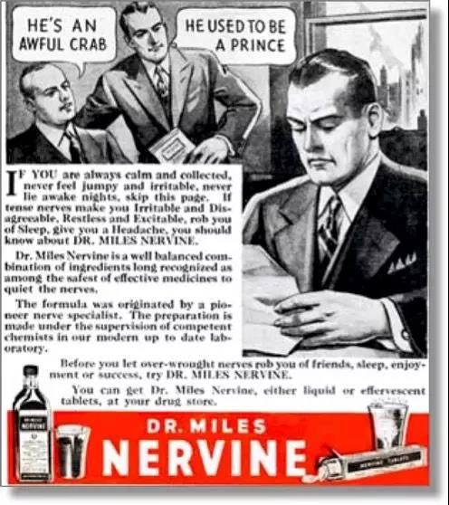

在美国当时有上万家零售商。Dr. Miles 的销售策略有一个特点，它跟零售商之间还隔了一层批发商，这药卖给批发商的批发价是 70 块钱，而它同时规定，零售商卖给消费者的价格，不得低于 100 块钱。

你卖 130 块钱可以、120 块钱可以、110 块钱可以、100 块钱也可以，但不能低于 100 块钱。这样做的目的，是要保证中间渠道商有 30 块钱以上的利润空间。

这其实就是一种限制最低零售价的安排。每一个参与这种安排的零售商，实际上就加入了一个联盟，一个维持最低销售价格的联盟。

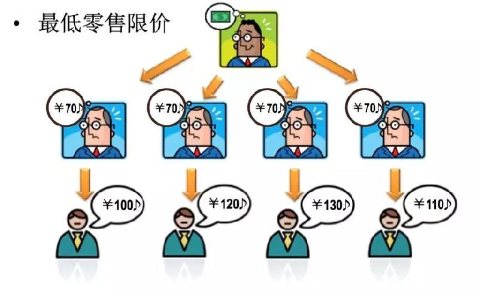

这时候就出现了一家零售药店，它们卖的药 90 块钱，被 Dr. Miles 发现了。Dr. Miles 就去追查这件事情，它们发现这家药店本来就不在联盟里面，是谁把药偷偷给你以低价卖出去的呢？Dr. Miles 要追查。

Dr. Miles 本来就为了维持它们最低零售价限制的安排，在每一瓶药上面都做了标志，有序列号，很容易查出这药是经谁手而来的。但这家公司也知道这个事，它们就故意把这个序列号给磨掉了，Dr. Miles 查不出来。Dr. Miles 很生气，把这家公司告上了法庭。

这家公司也不示弱，它反告 Dr. Miles，它说：

你们公司维持这种最低零售价的联盟，根据我们国家的《反垄断法》，它本身就是违法的，因为你们维持了一个更高的价格。而我以更低的价格销售，这本身就是一种价格竞争，本身就是对消费者有利的行为。

## 2\. 百年前的判决：最低零售价限制违法

这个案子就一直打到了美国最高法院，美国最高法院的看法是：（秦俑语：通过对薛兆丰老师经济学课程的学习，我现在对“美国最高法院的判例观点”非常感兴趣，因为他充满了思辨的光辉.....）

首先，我不知道 Dr. Miles 为什么要苦心经营这种最低零售价限制的安排。因为对你来说，你只要把产品批发出去就可以挣钱了，你挣的是批发价当中的利润，至于零售商他们怎么竞争、零售价能够拼得多低，你应该不关心。

零售价格越低——根据需求定律——需求量就越大，你的总销售量就越大，你挣的钱就越多。你还要去管那些零售商的零售价格，这何苦呢？我不明白你们为什么要这么做。

当然，有一种可能，是这件事情不是你们本身要做的，而是那一万多家零售商想要做的。他们想要达成一个价格联盟，想要互相勾结定价，但是一万多家勾结起来成本很高，不容易做，你替他们做了。你替他们提供一个统一的合同，一下子就降低了这一万多家零售商互相勾结的成本，你帮他们勾结。可能是这样。

但不管原因是什么，不管是你自己想要勾结，还是你想帮别人勾结，在咱们这个国家里面，价格维持（price fixing）本身就是违法的。

何况，这些药你已经卖给了渠道商，产权已经发生了转变。渠道商——包括批发商和零售商——他们爱怎么定价就怎么定价，爱怎么转售就怎么转售，这是他们的事。所以人家把你药瓶上的序列号给磨掉，那也是他们的权利，你管不着。你还想管人家转售的价格，管得也太多了。

基于这两个原因：第一，价格维持本身就是违法的；第二，产权保护的原则，也使得你没有权力再去管人家转售的价格。

最高法院判 Dr. Miles 公司败诉，最低零售价限制的安排，在美国被宣布为非法。那是 1911 年的事情。

## 3\. 最低零售价限制是常见的商业行为

在商场上稍微有经验的朋友都知道，这种最低零售价限制的做法是非常流行的，今天随处可见，但是在美国，早在 1911 年就被宣布为违法了。

这里就有两个有趣的问题：

第一，如果一种商业行为长期被普遍采用，它一定有合理之处，它合理之处是什么呢？

第二，这么流行的商业做法，在美国历史上这么早就被宣布为违法，那么美国这些年又是怎么过来的呢？

事实上，在这个案子里面就有法官提出异议，霍尔姆斯（O. W. Holmes, Jr. ）法官就反对这样的判决，他说：

如果那些价格联盟以外的企业，以低于约定的价格销售，也被说成是一种竞争的话，那么竞争的含义就被严重地夸大了。价格由供需决定，市场会决定产品能卖出什么样的价格，咱们法官别管太多了。

而同时，美国企业为了绕过最高法院的这个禁令，它们就采取了一些迂回的做法。比方说，它们再也不签订明确的最低零售价限制的合同了，他们会在产品的标价上面写上“建议零售价”，只是建议而已，这样就能绕过法律。

同时他们也不签订转售合同，而改为签订代售合同，产权没有发生变化，这样厂家就能够继续对产品的价格和销售方式有所规定。

就这样一种很常见的商业销售模式，在 1911 年美国最高法院的一纸裁决，就被禁了差不多一个世纪。直到 2007 年案子才翻过来。    

## 4\. 百年后的平反：最低零售价限制无罪

是怎么翻过来的呢？那是当时有一家公司叫 Leegin，里根公司。这家公司生产女用的包包和皮带。这家公司的 CEO 说：我们生产的包包和皮带可是高档产品，我们不希望我们的产品，出现在那些中低档的卖场，我们要有自己的高档专卖店，我们要提供一对一的专门服务。

这家专卖店的名字叫 Brighton，今天在许多美国的大型超市里面，还能见到它的身影。我给你配了一些图片，让你看看这家店的门面是什么样子的。   

 

这家公司采用了连锁加盟的经营模式，谁要开分店都可以加入，但有一个条件，就是你开了分店以后，卖他们家的包包和皮带不得打折。这实际上就是一种最低零售价的限制。

然后有家加盟店它们就打折，被总店发现了，总店警告它：“别打折了，再打折我就不给你供货了。”这家加盟店还打折，总店就停止供货，这家加盟店就破产了。

这家加盟店的律师告诉他们：    

在这个国家里面，在美国实施最低零售价限制可是违法的，早在 1911 年，美国最高法院就在迈尔斯博士案里面做出过明确的判决。咱们告里根公司去。

结果他们就把里根公司告上了法庭，里根公司也寸步不让，跟他们斗下去。结果案子辗转又到了美国最高法院。

美国最高法院在 2007 年，也就是迈尔斯博士案 1911 年判决之后的 96 年之后，又对最低零售价限制这种商业模式重新做出了判决。

这一次，美国最高法院说：

最低零售价限制是合法的，里根公司胜诉，我们正式推翻 96 年前在迈尔斯博士案里面的判决。

最低零售价限制这种商业模式终于被平反了，这当中经历了差不多一个世纪的时间。

## 课堂小结

今天我给你介绍了，在 1911 年迈尔斯博士案当中最低零售价限制的做法，以及美国最高法院认为它违反《反垄断法》的理由。接着我又告诉你，在 2007 年美国最高法院，又推翻了自己当年的判决。

## 课后思考

今天我留给你的思考题是，你认为最低零售价限制的这种做法，究竟有什么积极的经济意义？

##### 150

# 第 150 讲  
最低零售价限制 2 

我们昨天开始了一个新的单元，讨论垂直销售限制。我们讲了 1911 年的迈尔斯博士案，这个案件影响了美国接近 100 年的商业实践——最低零售价限制在美国是非法的。直到 2007 年，美国最高法院的里根案判决之后才扭转过来。

昨天我们讲的是这一段司法的历史，留下来的问题是，最低零售价限制这种做法究竟有什么好处？

因为当年最高法院的看法——也是今天我们很多人会产生的看法，那就是零售商之间制定攻守同盟，约定一个最低零售价格，不让这个攻守同盟以外的商家加入竞争，以更低的价格向消费者提供同样的服务。

这种做法，看上去明显是限制贸易，增加消费者的负担，维持不正当利润的。为什么经过 96 年，美国最高法院又推翻了自己的判决，说这种做法是合理的呢？

## 1\. 最低零售价限制的理由

事情是这样的。在 1960 年，也就是迈尔斯案判决之后的 49 年，芝加哥大学的一位经济学家泰舍尔（Lester G. Telser），发表了一篇文章，题目是“企业为什么要公平竞争”，他解释了最低零售价限制的理由。

我们看，许多零售商销售产品，他销售的不仅仅是商品本身，在销售商品的同时，他还搭配了许多服务。

比方说卖音响的人，他能不能指着一箱箱封装好的音响设备说：“你看，这就是音响设备，你爱买不买。”这样的话，他能把音响设备卖出去吗？很难。要提高音响设备的销售量，不能简单粗暴地卖，你得通过迂回的办法。

你得在商场里面预留一个比较舒适的空间，甚至把这个空间好好地装修起来，里面有沙发，有音响，有灯光，可能还有咖啡和饮料。顾客经过的时候，销售员就说：“进来听听，进来欣赏一下音乐。”顾客会说：“我不买，我只是看看。”销售员说：“不买不要紧，进来坐坐，了解一下。”

只有把门槛降低，才能够让产品接触到更多潜在的消费者。消费者听完以后，也不会马上购买。他离开了，心里面播下了一颗种子。隔几天他又来了，他说：“我这次来，还是看看而已。”销售员赶紧得说：“看看不要紧，你就再看看、再听听。”

这样几个回合，顾客最后才会买单。

这时候，如果零售商之间不达成最低零售价协议的话，顾客会怎么做？顾客会跑到那些提供周到的试听、试用和咨询服务的商店，享受所有的售前服务，做出了决定，然后他买还是不买？他不买了。他跑到那些不提供任何服务的商家，到那里购买，因为那里的价格肯定更便宜。

这时候就会出现这样的现象，就是那些不提供销售服务的零售商，搭了那些提供服务零售商的顺风车，结果对零售商而言，谁提供服务谁吃亏。所以他们就竞相不提供服务了。

当没有任何一家零售商提供售前服务以后，产品就不好卖，生产商的利益就受损。这是生产商要求零售商之间达成最低零售价协议的原因。    

## 2\. 售前服务直接影响产品销量

你可能会说，卖音响的是有一些售前服务，但卖药的又有什么售前服务呢？卖药的售前服务可多了。

你跑到药店里面去说：“我身体不舒服，我想要吃点什么药。”药剂师给你的忠告、给你的建议就非常管用。他不仅得耐心，而且给你的意见是中肯的。你们之间，最终会建立良好的信任关系，他推荐什么你基本就买什么。这种服务是需要回报的。

如果药剂师得不到这种回报，他们的处理办法就会不一样，当顾客跑到药店里面说“我睡不着觉、脾气不好、精神紧张，我听说 Dr. Miles 的药挺不错的，我想买一瓶”的时候，药剂师会说“我们这儿不卖这个药，我们只卖别的药，你要不要试试这个、试试那个”，这时候，这个药的销量就会打折扣。

我们经常会在餐厅里面点啤酒，说我要这个牌子的啤酒、那个牌子的啤酒，餐厅的服务员每次都会跟你说：“我们只卖这个牌子的啤酒，别的牌子我们卖光了、我们估清了。”真的是估清了吗？不是的，他们从厂家那里得到的回报不够多，他们就不卖这个产品了。

零售商给一种产品所提供的展示空间，他放到货架的位置是否显眼，当顾客问起来的时候他们的解释是否耐心，他们提供的关于产品的信息是否准确，顾客和销售员之间是否有良好的信任关系——这些都直接影响产品的销量。

经济学家泰舍尔说，这是企业要求公平竞争的原因，所谓的公平竞争，就是零售商之间，要达成最低零售价限制的做法。

## 3\. 最低零售价限制是促进竞争的行为

泰舍尔的这篇文章发表在 1960 年，最高法院对里根案的判决是 2007 年，当中又经历了 47 年。

美国最高法院在 2007 年里根案（Leegin Creative Leather Products, Inc. v. PSKS, Inc.）的判决里面，清楚地说道：

最低零售价限制，确实会抑制了同一个品牌不同零售商之间的价格竞争，因为价格被锁定了。但是由于价格被锁定，他们没办法在价格的维度上展开竞争，所以他们就会在价格以外的维度，也就是服务的维度展开竞争，他们服务的质量就会提高。而结果是整个品牌的产品体验提高了。

也就是说，同一个品牌内部零售商的竞争削弱的同时，品牌和品牌之间的竞争加强了，品牌的综合服务提高了。这是促进竞争的行为，这是对消费者有利的做法。

最高法院的判词继续解释：

1911 年以后，最低零售价限制的做法被禁止了，厂家为了达到同样的目的，他们只能够通过迂回的办法，绕过法律的规定，有时候，他们就直接成立自己的门市部销售自己的产品。

但成立自己的门市部来销售自己的产品，跟与零售商之间签订最低零售价协议，在效果上是非常接近的，只不过是成立自己的门市部成本更高而已。既然效果相同，咱们法院何苦要逼着人家去做成本更高的事情呢？

继续维持这种禁令对厂商没有好处，对零售商没有好处，对消费者没有好处，唯一拿到好处的，就是那些靠打官司挣钱的律师。

最高法院法官说：

既然经济学家已经告诉我们当中的理由了，理由也非常充分了，我们就要认识自己的错误，因此我们在这个案件里面，正式推翻 1911 年 Dr. Miles 迈尔斯博士案当中的判决，我们判，从此最低零售价限制在美国是合法的商业行为。

## 课堂小结

今天，我给你解释了最低零售价限制背后的经济学原因，最低零售价限制确实能够显著地，甚至完全地消灭它们之间的价格竞争。但是竞争是无所不在的，减少了价格维度上面的竞争，零售商之间就会在价格以外的维度——也就是服务的维度展开竞争。

所以这种做法，会促进零售商之间提供服务的积极性，而这是厂家所希望达到的效果。最低零售价限制，在削弱了同一个品牌不同零售商之间的竞争的同时，增强了不同品牌之间的竞争，这对消费者而言是利远远大于弊的。

简单地说，最低零售价限制这种做法，历史上早就有了，但是在 1911 年被美国最高法院判作违法。经历了 49 年，也就是差不多半个世纪之后，经济学家终于给出了理由充分的解释。又再经历 47 年，差不多也是半个世纪，美国最高法院才接受经济学家的建议，正式修正自己的错误，让最低零售价限制变得合法。

一个认识上的错误，要经历差不多 100 年才得到纠正。

## 课后思考

今天我留给你的思考题是，厂家做分区销售也是一种常见的商业模式，就是厂家规定不同的区域，由不同的销售代表来负责销售，不同地区之间的货品不能流通、不能串货，这种划分销售区域的做法，到底合理还是不合理？为什么？

欢迎你给我留言，我们下节课再见。 

##### 151

# 第 151 讲  
最低零售价限制 3 

这个礼拜我们讲垂直销售限制。

前天我们讲了 1911 年的迈尔斯案，昨天我们讲了 2007 年的里根案。两个案子相隔 96 年，里根案推翻了迈尔斯案的判决。美国最高法院经过 96 年的时间，终于明白最低零售价限制的好处了。

昨天的里根案当中有一个有趣的细节，就是迈尔斯案在美国已经实施了 96 年的时间了，最低零售价限制都是违法的，里根案当中的主角——里根公司他们为什么那么有信心要抵抗到底？最后在最高法院获得了胜利，他们的信心是从哪儿来的？

里根公司跟他们律师团队的信心，不是凭空而来的，是有原因的。原因在于在 1911 年到 2007 年的 96 年当中，不是风平浪静的，当中有过几宗重大的相关案件。这些案件的判决，使得里根公司和它的律师团队有了十足的信心，觉得最低零售价限制这件事，能够重新杀回美国最高法院，能够有重见天日、平反昭雪的一天。

这 96 年当中发生了什么事呢？最重要的是两件大事：第一是分区销售合法化了；第二是最高零售价限制合法化了。这两种商业行为的合法化，最终为最低零售价限制合法化铺平了道路。

## 1\. 分区销售的经济学意义

我们来看，最低零售价限制这种安排的核心理由。它的经济学理由就在于，它要通过限制价格的竞争，鼓励零售商在服务的维度上面展开竞争，防止一些不提供服务的零售商，搭那些提供服务的零售商的顺风车。防止别人搭顺风车，这是核心问题。

秦俑语：在中国，国酒茅台的价格体系，也是类似的。

分区销售这种商业模式，背后的机制也是一样的。

比方说，我们国内有成百上千家零售商在卖苹果手机，如果有人——不管是谁——他能够在中央电视台上做一个苹果手机的广告，那一定能够促进销售。

但是，任何一家单个的零售商，他都没有积极性做这件事情。为什么？因为在央视上投放广告成本可高了，但收益呢？收益会落到其他所有的零售商手上。出钱做广告的那家单个零售商自己不会得到多少好处。

解决的办法，是厂家指定一个地区总代理。这家总代理负责整个地区的独家销售，只有他才能从厂家那里进货。这样总代理就有积极性做全局的推广了，不仅是售前的推广，售后的服务他也有积极性去张罗、去布局了。

这是分区销售的经济学意义。

你看，我们前面说过反垄断法最重要的核心不在证据，因为事实只有一个，但看问题的角度却可以很不同。不同的角度看同样的事实，会得出不同的结论。所以反垄断法之所以复杂多变的原因，在于人们看待同一种商业行为的角度不同。

商人做地域的划分，不让货物在不同的销售地域之间流通，不允许串货，可以看作是划分区域进行垄断的行为。但是换个角度，却可以看作是鼓励地区总代理，进行全局性布局、推广和提供服务的一种积极运营策略。

这个道理，咱们刚才用了 5 分钟左右，就把它说清楚了。但历史上却相隔了十年，通过两个案件才彰显出来。

注意，我前面讲的迈尔斯博士案和里根案，以及今天所要讲的四个案件，这总共六个案件，全部都是美国最高法院判决的案件。美国最高法院的法官可忙了，管的事也够多了。

## 2\. 第一场战役：划分销售区域是否合法

话说 1967 年，发生了“施文自行车案（United States v. Arnold, Schwinn & Co.）”。在这个案子里面，自行车生产商划分了销售区域，其中有一家零售店不顾这个划分，跑到别人的地区去销售了。结果这家公司就跟当地的销售公司发生了冲突，形成了案件，最后打到最高法院。

最高法院的法官认为，划分区域进行销售是一种违反《反垄断法》的行为，是一种反竞争的行为。结果判自行车生产商有罪。划分销售区域是违法的。

结果隔了十年，1977 年，又发生了“电视机销售案（Continental Television v. GTE Sylvania）”。这个案件案情是类似的。厂商要划分区域，个别的销售商违反厂家的划分，产生纠纷，案件又打到美国最高法院。

这一次，十年之后，美国最高法院明白了划分区域的经济学意义了。这也是历史上，美国最高法院第一次采纳经济学家，尤其是芝加哥学派经济学家关于反垄断看法的案件。

他们正式推翻了十年前——1967 年施文自行车案的判决，认为划分区域进行销售是促进竞争的行为，合法。

这是关于垂直销售限制之争的第一场战役，划分销售区域合法了。

## 3\. 第二场战役：最高零售价限制是否合法

第二场战役，是关于最高零售价限制的。注意，我们讲的是最高零售价限制。战役的起因，是 1968 年的“Albrecht 报纸案（Albrecht v. Herald Co. ）”。报社卖报纸，都给报纸规定了最高零售价，而不是最低零售价。

为什么报社不想把报纸卖得贵一点？因为报社不靠卖报纸挣钱，他们靠发行量挣钱。发行量上去了，广告收入才能增加。所以报社总是小心翼翼，不能让这个报纸价格过高。

但是报纸分销商的出发点就不一样了。有一家报纸某个区域的分销商，他就擅自提价卖报纸，而且发展了 1000 多名订户。报社知道了这件事情，就赶紧跑去跟订户说你们千万不要多付钱，我给你另外找一家经销商，多收的钱退回去。

前面那家经销商就不愿意了，他们把报社告上法庭：“你们维持报纸的最高售价，不让报纸随便涨价，这也是一种价格维持的做法，也是违反反垄断法的。”

这个案子最后也打到了美国最高法院，美国最高法院的法官在 1968 年做出判决：“没错，维持最高价格也是一种价格维持的做法，它本身就违反了美国的反垄断法。”

因此判报社败诉。不仅维持最低零售价限制是违法的，维持最高零售价限制也是违法的。这个判决一下来就是 29 年。

## 4\. 波斯纳与奥康纳法官改变历史

直到 1997 年，又发生了“可汗汽油案（State Oil Co. v. Khan, 522 U.S. 3）”。在这个汽油案里面，故事是这样的，石油公司跟油站说：

你看，石油的价格每天在波动，这个我们管不了，每天我们卖给你的汽油是随行就市波动的。但是我们要管的是，你的利润空间不得过大，无论我卖给你的汽油是多少钱，你只能涨价两毛钱，不能多涨。

石油公司的这种做法，目的是要让他们的销售网络维持足够低的利润率，从而保障足够高的营运时间，整个网络都处于服务的状态。但油站不答应，油站说：

凭什么你管我的利润空间？我爱涨价涨多少就涨多少。咱们这个国家，还有 1968 年的那个报纸案呢，最高零售价限制也是违法的。

结果油站把石油公司告上了法庭，案子在上诉阶段到了美国第七巡回法院，负责审理这个案子的，是我们熟悉的波斯纳（Richard Posner）法官。

当然，波斯纳法官明白当中所有的经济学原理，你猜他怎么判决？他说：

我们手上的这个石油案，援引的先例是 1968 年最高法院就报纸案做出来的判决。但我们要知道，1968 年这报纸案的判决，从判决的那一天起就是错的。它的理由根本不成立，最高零售价有它内在的经济学原理，所以这个案件石油公司的规定是合理的。

但是波斯纳法官笔锋一转，他说：

1968 年的报纸案，可是最高法院做出的判决，最高法院是我的领导，我是下属法院，我没有权利改变我领导的判决，我只能服从。所以根据 1968 年的报纸案，我只能判石油公司败诉。

石油公司虽然败诉了，但他们一看波斯纳法官的理由，觉得有戏，咱们还得抗争下去，结果又再次上诉。

美国最高法院法官奥康纳（Sandra Day O'Connor，1930 年 3 月 26 日-）

案子最后又到了美国最高法院手里。美国最高法院法官奥康纳（Sandra Day O'Connor）代表大多数法官做出最终的判决，她说两点：

第一，波斯纳法官的态度是端正的，没错，哪怕咱们最高法院做了错误的决定，也只能由咱们最高法院自己来推翻，下属法院是没有权利逾越半步的。

第二，咱们最高法院 29 年前的那个判决，那个报纸案的判决确实错了，咱们现在终于明白，最高零售价限制的经济学意义在哪里了，所以咱们判石油公司胜诉。

这是关于垂直销售限制争论的第二场战役。

经过这两场战役，划分销售区域合法了，最高零售价限制也合法了。

到了 2007 年，里根公司临门一脚，又再次把最低零售价限制送进了美国最高法院，最后使得最低零售价限制也变得合法了。这当中经历了整整 96 年。

## 课堂小结

今天，我给你系统地串讲了垂直销售限制之争的三场战役：

第一场是关于销售区域划分的；

第二场是关于最高零售价限制的；

第三场是时间跨度最长的，关于最低零售价限制的。

三场战役打下来，垂直销售限制算是在美国合法了。

## 课后思考

今天我留给你的思考题是，像反垄断法这种复杂的案子，要经过将近 100 年才能彻底理解的案子，执法的权力往上移，也就是全国只有一个统一的执法机构来执行呢；还是往下移，让地方的司法机构也可以执法。你认为哪一种的效果会更好？为什么？

欢迎你给我留言，我们下节课再见。

##### 152

# 第 152 讲  
最低零售价限制 4 

我们这个礼拜集中讲了垂直销售限制。

不管是最低零售价限制、最高零售价限制，还是销售区域的划分，它们都有一个共同的特点：表面上看，它们都是一种限制贸易的行为、限制贸易的约定，但从另外一个角度看，它们又引导了经销商在另外的一些维度展开了竞争，提供了更多的增值服务。

这是垂直销售限制积极的经济学意义。

## 1\. 如何拯救没落中的实体书店

我记得自己在十多年前，2006 年第一次在美国教书的时候教《反垄断法》，讲到最低零售价限制的时候，有同学就提出质疑：

我们在美国买书就会遇到这样的问题，那些线下书店都提供非常好的服务体验，书店的位置往往都定在交通方便的商业中心，当然商业中心的铺租就比较贵；书店的环境也非常舒适，有地毯、有轻音乐，旁边就有咖啡厅，只要你有时间，你可以在书店里面待上一整天。

最后即使不花钱买书，知识也能够增长，时间也过得很充实。如果你看中了哪本书也不用急着买，用手机给它的封面拍个照片，回家上网，到亚马逊买打折的。

同学问我，这不就是你说的要防止搭顺风车的行为吗？但在美国这两种商业行为都并存。说实在的，在那时候，在 2006 年，我还真不能很好地回答这个问题。但是十多年过去，这个问题变得好回答了。

美国的很多实体书店经营不下去了，其中最大的一家叫 Borders，博德书店，倒闭了；而另外一家，目前最大的线下实体书店 Barnes & Noble，邦诺书店，业务也在收缩。而网上书店亚马逊，则乘风破浪一往无前。这种商业模式最终是会有问题的。

合理的做法，是网上书店亚马逊开自己的实体书店，线上线下都是一家，这时候就不会出现所谓正的外部性，肥水就不会流到外人田了。哪怕读者在线下的实体店一本书都不买，都跑到线上去买，那销售收入也还是他们家的。 

秦俑语：这就是为什么在 2017 年下半年，腾讯、阿里、亚马逊开始转账线下实体零售门店的收购、布局.......   

## 2\. 网上服装为什么不再便宜

今天我们许多年轻人买衣服，还是喜欢到线下店去试款式、试尺码，试好了以后他们并不购买，而是跑到网上旗舰店去，想要寻找价格更低的同款。但现在他们发现有一个趋势，那就是网上的价格，和线下实体店的价格越来越趋同了，这是为什么呢？

本来网上的价格应该便宜很多才是，因为网店毕竟省去了很多销售成本，但从我们这个礼拜所讲的垂直销售限制经济学原理，我们就能够明白，只有当网上的价格和线下的价格保持一致的时候，才能够确保线下实体店有提供销售服务的积极性。(秦俑语：但这个前提是--线上、线下的所有者是一同一个主体)

## 3\. 汽车“平行进口”对消费者未必是好事

汽车行业也有这个问题。今天大家都在讲“平行进口”，其实就是汽车的跨区域串货，汽车都可以平行进口以后，消费者在短期内，当然能够购买到更便宜的汽车。但由于汽车的来源非常复杂，汽车品质的不确定性增强，保修服务的成本就会上升，实施一段时间的串货销售以后，人们在购买汽车上面省下来的钱，很可能就会在维修汽车上重新花出去。

这是我们在讨论汽车随意平行进口的时候，需要注意的问题。

我对这个问题的看法是，具体应该采取哪种销售策略，我们应该听汽车生产商的。因为毕竟他们是想多销售的，毕竟他们是跟其他的厂商在竞争的。他们所愿意采取的销售策略，一定是他们认为长期而言对所有的消费者更好的。    

## 4\. 贵州茅台最低零售价限制案

讲到最低零售价限制，很多人都会想起 2012 年的茅台酒案。在 2012 年年底，茅台经销商大会上，茅台公司的董事长在台上表示：整个公司的重点是要维持住、要顶住市场的价格，不让茅台酒跌价，也就是维持茅台酒的最低零售价限制。他说：“一定要沉着、一定要挺住，谁卖低价酒就取缔谁，毫不含糊。”

这个消息出去以后，公众纷纷批评，因为茅台酒降价才是大家喜闻乐见的事情。

到 2013 年年初，国家发改委和其他的政府部门，就开始调查茅台集团的价格维持行为。到 2013 年 2 月，贵州省物价局就因为茅台集团维持最低零售价格行为，而对它罚款 2.47 亿元。（秦俑语：不过是钱从左口袋到了右口袋）

罚款的消息出来以后，许多人拍手称赞，但你听过我们这几节课就能明白，最低零售价限制是有它积极意义的。哪怕是要降价，也应该由茅台集团自己做出决定，而不是每一家零售商擅自做出决定。

## 5\. 中国《反垄断法》潜藏风险

总的来说，我们国家的《反垄断法》对于垂直销售限制，也是有严格规定的。我国《反垄断法》第十四条规定：

禁止经营者与交易相对人达成下列垄断协议：第一，固定向第三人转售商品的价格；第二，限定向第三人转售商品的最低价格。

也就是说，转售价格限制是被我国《反垄断法》第十四条所禁止的。

其实这样的禁令，是没有充分考虑到垂直销售限制在美国 100 多年的实践史。在这过去 100 多年里面，人们对垂直销售限制的认识发生了很大的改变，我们的《反垄断法》并没有充分地吸收当中的经验教训。

当然，我们国家的《反垄断法》，除了第十四条限制了垂直销售限制以外，还在第十五条规定了许多例外的情形。它规定：

为了改进技术、研究开发新产品的是例外；为了提高产品质量、降低成本、提高效率的是例外；为了提高中小经营者经营效率，增强中小经营者竞争力的是例外；为了实现节约能源、保护环境的是例外；因为经济不景气，为了缓解销售量严重下降或者生产明显过剩的是例外。

当我们把所有这些例外都加在一起，第十四条跟第十五条共同发生作用以后，整个《反垄断法》的效果是怎么样呢？很多人说样样都是例外，加起来总的效果就是零了。

但我自己的看法是，效果可能比零还差，可能是负的。因为如果《反垄断法》既没有第十四条也没有第十五条，那么商人该干什么就干什么。

但是有了第十四条，又有了第十五条以后，执法机关就有了一个巨大的酌情空间，这当中有巨大的不确定性，这对生产者和经营者而言，就是一个巨大的风险。这是我们在实施《反垄断法》的时候，需要非常注意的事情。

## 课堂小结

今天我们讲了垂直销售限制，背后的经济学原理的一些具体应用。我们把它用到了书店的例子、买服装的例子、茅台酒的例子。我们还对中国的《反垄断法》当中，对垂直销售限制的规定做了一个简单的评论。

## 课后思考

今天我要留给你的思考题，这也是我好奇的问题，你对哪些商品是坚持要买行货的？有哪些商品是不在乎买水货的？

欢迎你给我留言，我们下节课再见。

##### 周

# 第 38 周问答  
企业是一连串契约的组合 

我们开始本周的问答时间了。

这个礼拜我们集中讨论了一种古今中外都极其常见的商业模式——垂直限制。上游企业跟下游企业，或者是厂商跟经销商之间结成某种形式的商业同盟，一方面增强了他们之间的合作和协同，而与此同时，也增加了他们对其他竞争者的排斥性。

比如在最低零售价限制的协议当中，达成协议的人就排斥了那些协议以外、愿意以更低的价格向消费者提供服务的供应商；在最高零售价限制当中，就妨碍了那些本来可以以更高的价格获取利润的供应商的自由；而在分区销售协议当中，同盟者就限制了消费者在不同销售区域之间进行选择的自由。

问题是，这些看上去属于反竞争的行为，如果换一个角度来看，它又具有极大的促进竞争的作用。无论是最低零售价限制，最高零售价限制，还是分区销售的限制，都能够鼓励下游企业——也就是分销商——在价格以外的维度展开竞争，为消费者提供更好的服务。

这些服务包括售前的咨询、售后的保修、整个区域的广告推广，以及公共关系等等。在现实生活当中，在真实的商业社会里面，这些因素在学者或者官员纸上谈兵的时候，往往被忽略不计，他们甚至可能就根本没有看到。但在现实生活当中，在真实的商业环境里面，这些因素却是必不可少甚至是至关重要的。

秦俑语：可是，现在在当下中国，不是生产商来决定垂直限制了，反倒是电子商务销售平台来决定。阿里系、京东系，在双十一前的竞争火热化，传言，阿里让品牌商们“二选一”。这样的状况我们该怎么思考呢？

## 1\. 企业之间的合约比企业的边界更重要

我们这个礼拜所讨论的关于垂直限制的反垄断经济学，至少给我们两个重要的启示：

第一，就是企业之间的合约比企业的边界更重要。企业之所以形成，是由于人们想要把一组资源凑合起来，以某种比较固定的形式互相协调、互相牵制。这些能够把不同资源凑合起来的合约，积累到一定程度，当它具有某种比较固定形态的时候，就形成了企业、形成了公司。

工商部门为了管理的方便，把这些具有比较固定形态的合约方式称之为企业、称之为公司，把它们注册为企业、注册为公司。但这只不过是为了方便而已。

我们不要忘记的是，一个表面上看来有明显边界的企业或者公司，它实际上也仍然是由一组合约构成的，也就是说公司或者企业的合约性质不变，它是一组合约。既然是这样，那些表面上有明显边界的企业之间如果达成某种方式的合约，那也是可以的。

我们在理解垂直限制的时候就应该从这个角度来看，公司的内部是合约，公司之间也是合约，只是形态稍有不同而已。

有人会认为，一些约定，如果在公司内部实施，就可以被看作是合法的，但如果是在公司之间实施，就会变成不合法了。也就是说，一种约定究竟是否合法，取决于它是在公司内部实施，还是在公司之间实施。

比如，持有这种观点的人会说，两家酒店，如果属于一个连锁集团，那么它们之间的商定一个价格就是没有问题的，但如果它们是不同品牌的酒店，它们之间商定一个价格，就不合法了。

从“企业是一连串契约的组合”的角度看，这种观点就显得太鲁莽、太武断了。不管是公司内部还是公司之间，都是合约的关系。而合约的方式可以有多种。

我们说“缔结合约的自由比自由更重要”，缔结合约是一种发明创造的过程，是一种试错的过程。

从这样的高度来看，公司之间的垂直限制合约，就不至于有什么天然的不妥之处。哪怕它是不适当的，它也能在试错的过程中得到纠正，而那些长期普遍得到采用的合约方式就一定有它的道理。

## 2\. 经济学家要学会谦虚谨慎接地气

这个礼拜我们讨论的公司之间的垂直限制合约，还给我们第二个启示：商人早就知道行之有效的方式，经济学家、官员、法学家需要花费很长的时间，甚至整个世纪的时间来理解消化。他的教训是咱们学者得谦虚一点、接地气一点、谨慎一点。

我们常见到这种现象：一些学问在黑板上、在象牙塔里能够自圆其说，它们待在那里可以高枕无忧，可是一旦放到真实世界里面，就显得捉襟见肘、力不从心。

经济学家张五常曾经讲过一个故事，给我很深的印象。他说有一次，一群研究渔业改革的经济学家，聚集在一家酒店的高层会议室开会，讨论关于渔业的学术问题。

中间休息的时候，有人在窗边张望，看到对面那条河开来一艘渔船，他就惊喜地叫道：“大家快来看啊，那有渔船！”这一群研究渔业的专家一下子都聚到了窗边，去看渔船去了。原来，他们都没怎么见过渔船。

每当想起这个故事我都提醒自己，有机会还是多了解一点现实社会。

对反垄断法一直不以为然的科斯（Ronald Coase）就曾经说过：“经济学家一看见自己理解不了的商业现象，就会往反垄断方向去想。”

我自己跟着周其仁老师出去调研也有这样的感受，看到的事情都符合经济学原理、都符合逻辑，但如果你不去看，你是不会知道有这样的事情发生的，这就叫“情理之中、意料之外”。

我们来看看本周的思考题。

## 3\. 以最低零售价限制维持企业形象和市场定位

周一的问题是，你认为最低零售价限制的这种做法，究竟有什么积极的经济意义？

腾飞 同学回答：

最低零售价限制至少有三个作用：

第一，它能够维持企业的形象和市场定位，给消费者一个合适的价格锚点，树立与企业定位相符的产品形象；

第二，形成稳定的企业利润分成体系，用让渡利润的方式，使得不论是批发商还是零售商，都能够努力地推销企业的产品，提高整体的销量，与企业形成利益共同体；

第三，形成对产品市场信息的控制，及时感知市场的各种反应。由于售价基本稳定，企业可以明确地感知到市场中业绩的变化，从除了价格以外的因素找原因，以便及时更新产品，确定新的价格，继续保持竞争的优势。

## 4\. 以分区销售避免品牌营销的公地悲剧

周二的问题是，厂家做分区销售也是一种常见的商业模式，不同地区之间的商品不能流通、不能串货，这种划分销售区域的做法，到底是合理还是不合理？为什么？

失去的开始 同学回答：

这种做法对于创造价值，也就是制造产品的人来说是非常合理的，这么做是要建立销售区域，本质上就是给销售人员明确的产权，用这种方式来避免公地的悲剧。

从一片区域获利是容易的，开发维护一片区域是需要成本的。当自己的付出得不到保护的时候，大家就不付出了，没有人耕种了，而企业的品牌就无法在市场里面生根发芽了，所以就必须保护那些对品牌建设付出了努力的人。

这个回答是很有启发性的，人们付出的努力得到保护，人们才会去努力。这个道理，是我们的专栏从第一天起就反复强调的。

从马粪的故事到如何分饼决定了饼能做多大，再到知识产权、专利制度的作用，我们谈的都是这个主题，你肯定已经不陌生了。

但是今天借着分区销售的例子，把前面学过的内容再串起来，那肯定能够加深你对这个问题的理解。

## 5\. 反垄断执法机构下移会带来更多混乱

周三的问题是，像反垄断法这种复杂的案子，要经过 100 年才能彻底理解的案子，它的执法机构是往上移，也就是全国只有一个统一的执法机构来执行好呢？还是往下移，让地方的司法机构也参与执法比较好？理由是什么？

杨健 同学回答：

在我们中国这种成文法的国家，这种全局性的执法案例只能选择将执法权往上移，最好在立法层面予以确认，否则就会造成法律适用的混乱。

而在美国这种习惯法的国家，法律是生长出来的，所以我觉得可以尝试将执法权往下移。反垄断法关键不在于事实，而在于事实发生的场景，而地方法院更贴近于场景，在判断场景应用方面应该更有优势。

我自己对这个问题的回答，也正好是基于杨健同学所提到的那一点，也就是反垄断法的判决，最重要的不在证据，而在他选择的理论、选择的角度、选择的解释。

正因为是这样，如果执法机构往下移，执法者的理论素养下降，反垄断法的执行就会带来更多的混乱。

## 6\. 什么样的商品应该买行货

周四的思考题是，你有哪些商品是坚持要买行货的？有哪些商品是不在乎买水货的？

我们知道，这堂课要讨论的恰恰就是水货和行货之间的区别，尤其是它在售后服务方面的区别。

所以我的看法是，如果一个产品基本不涉及售后服务，或者售后服务没有区别，那买水货也可以；而如果售后服务很重要、区域性很强，那就应该尽量买行货。

当然，价格的差异也是很重要的因素，只要价格差别不是太大，买行货还是比较合算的。

周末辩论

周一到周四我给大家留了思考题，今天是礼拜五，我给大家留个辩论题，大家一起辩论。

双十一马上就到了，今天大家在电子商务平台上的消费比例已经非常高了，而海外代购也占据了跨境贸易一个非常显著的份额。海外代购的本质就是串货，原有的、传统的分区销售模式，受到了海外代购的严重冲击。我们现在就来辩论一下，这对于消费者来说究竟是好事还是坏事。

正方认为：海外代购是好事。串货确实对原有的销售格局造成了冲击，但只要商品足够便宜，消费者愿意支付，消费者愿意支付，也愿意承担后果，那就听消费者的。

反方认为：海外代购不是好事。因为它破坏了传统的分区销售格局，而这个格局，是为了确保消费者能够在长期内获得有保障的服务而建立的，如果串货成为时尚，那将来产品服务质量就得不到保障。

##### 加

# 学习加餐  
经济学辞典—13 

B

罢工（strike）

罢工会导致局部收益的增加和全局收益的损失（The threat of striking results in higher wage rate of the union workers at the expense of the non-union workers. ）

 解释：罢工是有经济后果的，他确实能够使得部分已经进入工会或者拿到执业许可的人增加收入，但同时它会使得其他的人，包括老板、投资者、消费者和没有得到雇佣的人蒙受损失。  案例：罢工的人不仅自己罢工，还要通过暴力的方式阻止别人替代自己。 一键直达：第 126 讲丨罢工的性质

H

合约（contract）

“黄狗合约”有助于劳资双方达成合作（Yellow dog contract ensures trustful relationship between the employers and the employees. ）

 解释：人与人之间必须相互依赖达成合作，这才是把饼做大的一个关键要素，签署“我不罢工”条款对企业的稳定生产有很大的帮助。 案例：工人签署了这个条款之后，老板甚至愿意多给一点工资。 一键直达：第 125 讲丨工人违约是否应该成为权利

L

劳动力（labor）

劳动力工资由市场决定，企业的每一分利润都会被归功到贡献者那里（Wage rate is determined by market forces. All profits shall be attributed to their contributors. ）

 解释：企业的经营是一个“猜想与反驳”的过程，运气好的时候赚钱，不好就亏钱，企业主赚到的钱最后都得分出去，回报各种生产要素，没有多余的钱。 案例：南非的白人歧视黑人，但唯利是图的商人却有意无意的雇佣黑人，结果黑人的处境变好了。  一键直达：第 31 周问答丨年轻人应该未雨绸缪还是及时行乐？

S

收入差距（income inequality）

不能以刹那收入衡量终身财富（Momentary income is a misleading measurement of life time wealth. ）

 解释：只有终身收入这个维度才是更好的衡量人们收入差距的指标。不同的年龄、职业、生命预期、人力资本投资、运气，都会影响人和人之间收入的差距。所以刹那的收入差距是不准确的。 案例：你看到今天收入中上水平的人群在 10 年前，他们都是穷人。  一键直达：第 124 讲丨基尼系数与收入分配

T

同工同酬（equal work equal pay law）

同工同酬法让弱者失去与强者竞争的最强有力的武器（Equal Work Equal Pay Law deprives the weak of the most powerful weapon to compete with the strong. ）

 解释：弱者跟强者竞争最强有力的武器就是要一个合理的价格，而同工同酬法，很可能剥夺了弱者手上这把最强有力的武器。结果是事与愿违，让这些弱者连工作机会都失去了。  案例：如果男工和女工的工钱都必须是 80，那没有人会用女工。 一键直达：第 122 讲丨事与愿违之同工同酬法

Z

最低工资（minimum wage law）

最低工资法打击了穷人自立自强的积极性（Minimum wage laws encourage the poor people not to try to become independent. ）

 解释：让穷人脱贫致富，最重要的不是给他们一份收入比较高的工作，不是给他们一点补贴，而是让他们学会自立、自律和自强。 案例：最低工资的水平提高以后，黑人青年的就业率就比白人青年低了很多。 一键直达：第 123 讲丨事与愿违之最低工资法

##### 153

# 第 153 讲  
本身原则和理性原则 

我们前面用了四周的篇幅，详细讲了多种常见商业模式内在的经济学规律。

这些常见的商业模式，都是曾经被反垄断法的执法者认为是抑制竞争的。但一方面，商业社会对这些商业模式有一种自发的强烈的需要，使得它们能够改头换面又活下来了。

而同时，经济学家也开始孜孜不倦地，对这些常见的商业模式做出不同角度的探讨，从而加深了对这些商业模式的理解。最后——有时候往往是经过很长一段时间——终于把反垄断法的执法者、把法官们都说动了，把他们的想法改变过来了。

这是一个在商业发展史上非常重要的、非常有意思的过程。当然最基本的经济学原理起了关键的作用。有了前面我们四周所准备的丰富素材，我们这周给你变换不同的视角，让你能够对商业模式和竞争政策有一个更深入的、更全局的理解。

## 1\. 本身原则：只要做了就违法

今天，我具体给你介绍在反垄断执法当中两种不同的执法原则：其中一种叫本身违法原则，简称“本身原则（per se illegality）”或者简称 per se rule，另外一种执法的原则叫“理性原则（或称合理原则，rule of reason）”。

我们来比较这两种原则。所谓的本身原则就是在执法的过程中，不问原由，只要被告人做了某件事情，事实上做了，有证据表明他做了他就违法。

法官不需要问你为什么这么做，这么做的动机是什么，这么做的后果是什么，这么做对你自己的影响是什么，对社会的影响又是什么——这些一概不用讨论，只要你做了就是违法的。

本身原则在现实生活中也是很常见的。学生考试迟到，只要考试开始了 15 分钟，不管迟到的原因是什么，学生都不能再进入考场了，这是本身原则。只要闯红灯就是违反交通规则，不论你闯红灯的原因是什么，后果是什么，这是本身原则。

## 2\. 理性原则：是否违法要看具体条件

而理性原则是跟本身原则相对的，当事人做了一件事情，他不见得一定是违法了，公诉人、陪审团员和法官得全面地衡量这件事情的前因后果。

我们要看一种商业行为，是在怎么样一种条件下面被选用的。

当事人选用这种商业模式的动机是什么？而实际后果又是怎么样的？对其他竞争者的影响是怎么样的？对消费者的影响又是怎么样的？对当前的技术进步和普及，会产生什么样的作用？从长远看是不是又得做出重新的评估？

所有这些因素加起来，我们称之为理性原则。

## 3\. 反垄断法执法早期盛行“本身原则”

有意思的是，在美国 100 多年来的反垄断执法当中，有大量的商业行为最早的时候，是归类为由本身原则来执法的，也就是说当事人只要做了他就是违法的。

这些根据本身原则来判断的商业行为，包括了价格维持——不同的供应商之间约定一个价格——是本身违法的；捆绑销售是本身违法的；拒绝交易是本身违法的；分区销售是本身违法的；价格歧视也是本身违法的。

这个事实本身就说明，反垄断法的执法者在早期是非常有自信的，他们自信自己知道什么样的商业行为是促进竞争的，什么样的商业行为是阻碍、抑制竞争的。

美国反垄断执法者自己知道什么是对的、什么是错的这种强烈的自信，受到严重挫败的其中一个重要的案例，是 1979 年著名的“哥伦比亚广播公司诉音乐广播公司案（Broadcast Music, Inc., v. Columbia Broadcasting System）”。

这是一个在 1979 年由美国最高法院判决的案子。这宗案件的被告音乐广播公司，是一家替许多作曲家管理音乐版权的公司，作曲家对自己创作的歌曲拥有知识产权，但是维权的成本却非常高。哪个电台、哪个公共活动的组织者播放了他们的音乐，播放了多少次，听众有多少人，这些都影响到他们的版税收入，但要统计、收费、纳税等等，过程是非常繁琐的，音乐广播公司就帮他们干这件事情。

当然，音乐广播公司本身也得考虑节省成本，结果他对所有的广播公司提供了一张格式合同，也就是统一的合同。这个合同规定，不论是哪家广播公司，只要签了合同，在合同期内它不论播放这家公司所拥有的音乐版权多少次、多长时间、听众是多少，他们都收统一的一个价格，多用少用、多人听少人听、听哪一首曲子收费都一样，这种合同称为“一揽子许可合同（Blanket license）”。

这种一揽子合同的优点在于便于授权、便于使用、便于缴费、便于监督，其实就是使得监管的成本降到了几乎是零。

但对每一位版权的使用人来说，比方说案件里的哥伦比亚广播公司，他们就感觉到不公平，因为一旦签了这个合同，他们播放的音乐数量可能不是那么多，时间不是那么长，听众不是那么广泛，他们也必须承担全部的费用。这是他们控告音乐广播公司的原因。

控告的理由是，音乐广播公司的这种合同，涉嫌违反反垄断法禁止价格维持的规定。也就是说，在哥伦比亚广播公司看来，这种一揽子的合同其实是一种价格维持（price fixing）合同。根据美国的反垄断法，价格维持是一种本身违法，只要你做了那就违法。

但音乐广播公司觉得自己太委屈了、太冤了，这样的合同为的是省麻烦、省监督的成本，用意是好的，怎么能够说只要做了就是错的呢？

案子就这样一级一级地打到了美国最高法院。幸好美国最高法院的法官这一次不是书呆子，他们做出了合乎常理的判决，他们说：

这种合同能够跳过音乐广播公司旗下那么多作曲家各种各样具体的细节，减少监督和计费的成本，这对签约的双方来说都是共赢的。这种合同当然也是一种价格维持的合同，但是它的目的很可能不是为了抑制竞争，而是要追求其他方面的经济效率，所以这个案子不适宜使用本身原则来判决。

案子发回去重审，最高法院的法官也没说音乐广播公司胜诉，他们只不过是说这种做法可以不用本身原则来衡量，这就是一个重大的口子。从此以后，价格维持就可以不使用本身原则来判决了，任何采用价格维持这种经营模式的商人，他们都有机会在法庭给自己的行为找理由做辩护。

当然与此同时，反垄断执法者当年的那种勇气、自信也就削弱了一大半，审慎、客观、实事求是的态度也就随之增强。这是好事。规则简单易行是有好处的，但如果一个规则是错的，破坏了特定商业行为所带来的巨大经济价值，造成了损失、造成了巨大的成本，那么人们花费法律资源来纠正它也是值得的。

当然，美国从 20 世纪 70 年代开始就通过一系列的案件，包括我们前面介绍过的许多案件，使得捆绑销售、拒绝交易、分区销售、价格歧视等等，这些非常常见的商业行为，都从本身原则的管辖下，转到了理性原则、合理原则的管辖之下。

一位法官可能是固执的、可能是短视的，甚至可能是无知的，但是众多案件、众多法官的经验加起来，法律判决的传统朝着符合经济规律的方向靠近的机会也就越来越大了。

法律的条文是静态的，层出不穷的案件是动态的；法律约束了人们的行为，但层出不穷的案件，又会倒过来影响法律的改变。

## 课堂小结

今天我给你讲了本身原则和理性原则之间的区别，讲了这两种原则在美国反垄断实践当中的进退过程。

## 课后思考

今天我留给你的思考题是，我们能不能改变一下观念，倒过来把某种商业行为规定为本身合法，商人们只要做的是这件事情就一定合法，谁也不能够挑战，有没有这样一定正确、本身合法的商业行为呢？

欢迎你给我留言，我们下节课再见。

##### 154

# 第 154 讲  
假阳性和假阴性 

今天我们继续讨论反垄断法商业模式和竞争政策。

但是我们今天换一个很新的内容，我们从统计学开始讲，我给你讲一个统计学里面非常重要的概念，那就是一类错误和二类错误，或者说假阳性的错误（false positive）和假阴性的错误（false negative）。

我们先介绍这两个概念，从这两个概念出发，我们再引申到反垄断法的实施上面去，再进一步扩展到所有的政府监管政策上面去。

## 1\. 假阳性错误和假阴性错误

刚才说的这两个统计学概念，第一类错误、第二类错误（type I error、type II error），或者叫假阳性和假阴性的错误，实际上应用非常的广。你学物理学会碰到这个问题，学化学会碰到这个问题，学医学、学社会学都会碰到这个问题，只不过今天，你是刚好在学习经济学的时候，碰到了这个问题。

这两个概念是什么意思呢？第一类错误（type I error），假阳性错误，意思是你认错人了，把不具备你所指特征的对象当做是具备这种特征的对象了。

你要捉一个坏人，你捉错了坏人，捉了一个好人，这时候你犯的是假阳性的错误。一个人头晕去看病，医生说他患了高血压，实际上他并没有患高血压，只不过是工作太紧张而已，这时候医生犯的错误就是第一类错误、假阳性错误。

依此类推，假阴性的错误指的是放错坏人了，你把那些本来就具备你想要确定特征的对象，当做是不具备这些特征的对象而放过了。

同样举刚才看病的例子，一个人明明患有高血压，去医院里面，医生却没有把它诊断出来，说他没病，这时候医生犯的就是假阴性错误。

在现实生活当中，我们经常说一个人做了错误的判断，这种说法是一种笼统的说法，因为所谓的判断错误，同时包含了两类的错误，假阴性的错误和假阳性的错误。这两种错误其实是有区别的。

## 2\. 假阳性错误和假阴性错误的区别

如果我们要准确地刻画一个人犯错误的几率，我们就要分别计算他犯这两种错误的几率，因为这两种错误指的实际上是两件事，犯一种错误并不等于犯另外一种错误。而且更重要的是，这两种错误之间有一定的替代关系，你多犯其中的一种错误，就会减少犯另外一种错误的可能。

还记得经济学家沃特·威廉斯（Walter Williams）吗？他当年学习统计的时候，学到了第一类错误、第二类错误，假阳性、假阴性错误的时候觉得很兴奋，他理解了这个问题，他就跑到老师阿尔钦面前炫耀一番。他说：

我有一个很好的理解什么是假阳性、什么是假阴性错误的办法：我对一个人是不是值得跟他交朋友有很严格的标准，除非他证明他确实是有价值的，我才跟他做朋友。

这时候我就把第一类的错误、假阳性的错误降到最低，也就是说我几乎不会交上那些不值得交的朋友。但同时我犯假阴性错误的几率却增大了，我可能错过了很多本来是值得交朋友的人。

“而我太太她相反。”沃特·威廉斯说，他太太的特点是把所有人都当朋友，除非这个人后来被证明不值得做朋友。这样他太太就极大减少了犯第二类错误、假阴性错误的几率，她几乎不会错过任何的朋友。但是，她却增大了第一类错误、假阳性错误的机会。也就是说，他太太极大增加了被损友伤害的可能。

沃特·威廉斯很得意，他觉得自己的理解非常到位。

我必须先指出，沃特·威廉斯理解得确实非常漂亮，让人一下子就记住了第一类错误、第二类错误的区别。但沃特·威廉斯没想到的是，阿尔钦听到了以后不为所动，眼角轻轻一抬问沃特·威廉斯：

你有没有考虑过还有第三种可能，就是别人既不把你当朋友，又不把你当敌人，根本不把你放在眼里这种可能。

实际上，在真实生活当中这种可能性最大，爱你的人当然很少，但哪怕仅仅是在乎你的人也不多。这一点我们在专栏刚开始，讲亚当·斯密的人性论的时候就已经讲过，你要是忘记的话应该回去复习一遍。

有时候，我们会太过在乎别人对自己怎么样，自己有很多的想法。比方说我给他寄了邮件，他怎么老不回？他是不是对我有意见？其实大多数时候，别人不回邮件、不回短信，主要是因为别人太忙了，别人对你没有看法。

## 3\. 第一类错误与第二类错误具有此消彼涨的关系

再举一个例子，我们今天的照相技术跟过去比发生了很大的改变。过去我们用的是胶卷照相机，一卷胶卷只能有 24 张或者 36 张，拍完了以后还要拿去冲洗，成本非常的高，所以每拍一张照片我们都非常小心地设计。这时候我们第一类错误——拍错照片的错误就会减到最低；但与此同时，就极大增加了犯第二类错误，错过精彩画面的机会。

而今天我们普遍用的是数码相机，拍摄甚至是高速连拍都是没有成本的。这时候我们就跟过去相反，把错过精彩瞬间的机会降到了最低，但与此同时又拍了很多根本不值得收藏的照片。也就是说第一类错误和第二类错误，是具有此消彼涨关系的。

这就是统计学里面的第一类错误、假阳性的错误和第二类错误、假阴性错误的概念。这个概念又怎么和反垄断法的实践结合起来呢？

## 4\. 反垄断领域：放错坏人远不如抓错好人危害大

1984 年，法律经济学家弗兰克·伊斯特布鲁克（Frank Easterbrook）写过一篇在反垄断法领域非常著名，文章的名字叫《反垄断法的限制（The Limits of Antitrust,1984）》。这篇文章充分运用了统计学里面，第一类错误和第二类错误的概念。

它是说，在我们判断什么样的商业行为是反竞争行为的时候，我们同时会犯两种错误——假阳性的错误和假阴性的错误，也就是捉错了好人和放过了坏人的错误。

但是犯这两种错误，所引起的后果是不一样的。回顾整个反垄断法实践的过程，法官要是一旦犯了第一类错误、假阳性的错误，捉错了好人，把一种明明是促进竞争的商业行为判定为有罪，那它对整个商业发展就会产生很大的负面影响，形成很大的阻力。

比方说我们前面讲过的，最低零售价限制、最高零售价限制、分区销售等等，法官一旦说它是违法的，整个商业领域都不能实施了。而法官如果犯了这种错误，再要纠正过来时间是很长的，成本是很高的，过程是相当复杂的。

就美国最高法院关于垂直限制这一点的判断错误来说，它就经历了 96 年才把错误修正过来。当中的一个重要原因，是法官自己本身的收入、升迁、声誉都不受他所做的错误判决的影响。一个错误，你得等好几代法官换了人，才能纠正过来。

但与此同时，我们比较另外一种情形，如果法官犯了另外一种错误，让一种破坏竞争的行为逍遥法外，放错了坏人，后果又怎么样？

后果远远没那么严重。因为一种破坏竞争的行为，哪怕它逃过了法官的法眼，在激烈竞争的市场里面，它也维持不了多久，它很快就会被别的竞争行为所取代、所修正、所超越。

也就是说，在反垄断领域放过一个坏人对社会所造成的伤害，远远不如捉错了一个好人所造成的伤害大。

## 5\. 让子弹飞一会：宁愿放错坏人也不要抓错好人

而前面我们解释了，犯第一种错误和犯第二种错误的概率之间是有取舍关系的。既然是这样，我们在选择避免哪一类错误的时候，我们就应该有所侧重，我们宁愿犯第二类错误，也不要犯第一类错误。

对我们看不懂的那些商业行为，我们宁愿网开一面，哪怕是放错了，他也作恶不了多久，也比我们捉错一个好人，打压了一种本来是有意义的商业行为要好很多。

直截了当地说，反垄断法执行机构，每当在见到自己看不太懂的商业行为的时候，要尽量保持审慎的态度，与其犯假阳性错误，不如犯假阴性错误，在自己看不准的情况下让子弹多飞一会儿。这种管理哲学我认为是非常睿智的。

今天新经济蓬勃发展，有许多新的商业模式涌现出来，我觉得政府有关的管理部门也应该奉行相同的管理哲学，做弹性管理，做园丁式的管理，做底线管理。新的业务模式产生了，先让它存活一段时间，看看问题在哪里，看看商业机构本身是不是已经有能力解决问题，再来监管、再来立法。

## 课堂小结

今天我给你解释了普遍适用的一个统计学概念，第一类错误、假阳性的错误和第二类错误、假阴性错误的概念。我们说任何人犯判断的错误，实际上指的是这两种不同的错误，这两种不同的错误发生的概率是不一样的，而且它们之间有取舍的关系，有此消彼涨的关系。

而把这个概念运用到反垄断法的实践，以至对商业行为的监管，得出的结论就是政府应该尽量减少犯第一类错误的机会，让行业有一个自我发展的空间，让子弹飞一会儿。

## 课后思考

今天留给你的思考题是，你能不能在生活当中举一个例子，是你同时可能犯第一类的错误、假阳性错误，同时也会犯第二类的错误、假阴性错误的，而你更需要避免的是其中的一种错误，你能举一个这样的例子吗？

欢迎你给我留言，我们下节课再见。

##### 155

# 第 155 讲  
反思反垄断法 

今天我想带着你跟随一些学者，尤其是跟法律经济学运动相关的学者，对反垄断法 100 多年来的实践、对它给商业活动造成的影响、对它给学术研究造成的影响做一个反思。

我们前面介绍过，法律经济学这门交叉学科，其实就是从反垄断法的经济学分析开始的。这 100 多年来，随着反垄断法实践的增加，也随着对这些司法实践的反思，尤其是过去 50 年来，经济学家对企业内部构造、商业行为的结构和逻辑所进行的分析，学者们对反垄断法和竞争政策产生了很大的思想转变。

## 1\. 波斯纳：反垄断法惩罚成功者偏袒失败者

波斯纳（Richard Posner）法官就曾经说过：

反垄断法的目标不够明确，你看，反垄断法有的时候指的是要保护竞争，而不保护竞争者。如果是要保护竞争而不保护竞争者的话，那么有竞争就必有成功和失败。

这时候，我们看到一个成功的企业取代一些失败的企业，成功企业的市场份额不断增加，市场上存活的企业数量不断减少。看到这样局面的时候，反垄断法的执行者就应该袖手旁观，因为这本来就是竞争的结果。

但很多时候，反垄断法的执行者又认为这样的结果不够理想，因为市场上可见的企业数目如果太少了，可能会引起寡头和垄断的问题。所以他们会有意无意地去帮助那些在市场竞争当中败下阵来的企业，好让他们待在这个本来已经要离开的市场里面。

但这么做的时候，实际上又违背了他们的初衷，那就是他们应该保护的是竞争，而不是竞争者。如果失败者不出局，成功者反而受到惩罚，哪怕市场上还有足够数量的企业在竞争，这种竞争也只不过是人为的、造作的。

更重要的是，要让这些本来就应该失败离场的企业还活下来，那么谁来买单呢？谁来支付那些本来已经失去市场吸引力的商品呢？不管怎么样，这么做就会伤害消费者的利益，伤害纳税人的利益。

同时，波斯纳法官指出：    

竞争的本意是要增加财富，减少损失。通过经济学的分析我们知道，厂商如果能够成功地实施价格歧视的话，就能够把生产过程中所存在的无谓损失降到最低。但恰恰是《反垄断法》限制了商人进行价格歧视的自由，是《反垄断法》的制定者和执行者，他们认为价格歧视是不公平的行为。

而如果厂商不能够充分自由地进行价格歧视的话，他们的生产能力就会大打折扣，各种设备、各种资源的利用率就会下降，社会就会蒙受不必要的、无谓的损失。

再有，波斯纳法官指出：

供应商提供廉价的服务本来是值得鼓励的，因为竞争使得消费者得益了，但是反垄断法的执行者，同时又去惩罚那些所谓的掠夺性定价行为或者说倾销的行为，而事实上，掠夺性定价或者倾销行为，是不能够使得厂商获得垄断地位的。

日常生活中，我们见到的所谓掠夺性定价行为、倾销行为，往往不是出于垄断的意图，而是出于生产者效率的提高。说别人进行掠夺性定价、说别人倾销，往往是市场当中成本更高的生产者，指责更成功的竞争对手的一种借口。但反垄断法的执法者，往往又站到了这些在市场竞争当中失败的一方。

## 2\. 科斯：我被反垄断法烦透了

在法律经济学者当中，波斯纳法官对反垄断法的批评算是很温和的。我们熟悉的科斯（Ronald Coase）平时谦谦君子，但批评起反垄断法来也毫不留情，非常尖锐，行业里面流传最广的他说的一句话是：

我被反垄断法给烦透了。当价格上升的时候，法官就说这是垄断；当价格下降的时候，法官就说这是掠夺性定价或者说是倾销；当价格不变的时候，法官又说这是一种价格勾结。法官到底想怎么样呢？

科斯不仅批评法官，他连我们经济学家也批评，他说：

经济学家一旦看见自己看不懂的、没看过的商业模式，就会想到反垄断法，他们怎么就不好好想想，当中是不是有经济学的规律在里面呢？

对于大量的经济学家参与反垄断法的诉讼，对企业的经营模式进行各种分析，科斯还曾经这么说过：

由于有反垄断法，由于这些案件都涉及大量的金钱，所以各大公司都愿意出钱资助经济学家对商业模式进行研究，从而我们也兴起了一门学问叫做‘产业组织（Industrial Organization）’，简称 IO，多了这么一门学问，从这个角度来看是好的。

但是从另外一个角度看，反垄断法又使经济学家变成了另外一种玩弄手段的人，有时候他们明明知道问题没有答案，他们却假装自己能够提供答案。

比方说我们前面讲过的相关市场的划分，本来就不可能有什么标准的答案，因为任何一种商品的替代品，都是一个无限的光谱，中间不存在非黑即白的一个界线，但经济学家却往往假装自己能够提供这么一个答案。所以科斯说：

利弊相权，如果真的可以选择的话，我宁愿选择经济学家从来都不涉及反垄断法的诉讼，没有了产业组织——IO 这门分支学科也无关紧要。

## 3.弗里德曼：反垄断机构造成的问题，比他解决的问题还多

我们熟悉的大经济学家弗里德曼（Milton Friedman），对反垄断法的反思也非常真诚，他说：    

我一直是一位市场经济的坚定支持者，所以我在早年的时候也非常赞同政府实施反垄断法，我认为政府应该做的少有几件事之一，就是实施反垄断法，保持市场一个健康良性的竞争状态。

但是随着时间的变化，随着我积累经验的增加，我看到越来越多的反垄断案件，它们是被那些在竞争当中占下风的企业所利用了，政府对市场所施加的管制造成的问题，比他解决的问题还更多。

这时候我就慢慢地改变了自己的看法，我现在认为，反垄断法弊大于利，如果这个世界上根本不存在反垄断法的话，我们会过得更好，可惜的是我们已经有这些法律了。

## 4\. 贝克：垄断企业很容易被市场超越，无需政府干预

另外一位获得诺贝尔经济学奖的经济学家，加里·贝克（Garys Becker），他就曾经在跟波斯纳法官一起合写的博客里面，谈到过他对反垄断法的认识。

2013 年 9 月 2 号，是微软公司 CEO 鲍尔默（Steve Ballmer）退休的那一天。鲍尔默曾经是跟比尔·盖茨一样红极一时的人物，他率领着微软公司打败了许多对手，赢得了巨大的市场，但转眼之间别的公司就赶上来了，鲍尔默就得服老了，得退休了。

加里·贝克因此在博客里面发表感言，他说：

我们看着政府花那么多钱、花那么多时间去对大企业进行反垄断的诉讼，这到底值不值得？我们到底是要让政府花纳税人的钱，去对付这些大企业，还是让这些大企业在竞争当中自生自灭？

加里·贝克的答案是：

我们应该选择后者，即使让大企业在竞争的过程中，赚取那么一点垄断的利润，那也是小事。因为激烈的竞争，很快就会让那些新兴的企业超越和取代那些暂时获得垄断地位的企业。让市场来修理这些大企业，比用政府来修理这些大企业来得更合算、来得更合理。

## 课堂小结

今天我带着你跟随几位经济学家，对《反垄断法》进行了反思。《反垄断法》的初衷是好的，但是在实施的过程中，如果我们把人的因素考虑在内，把犯错误的可能性考虑在内，把动态的竞争过程考虑在内的话，我们就要对《反垄断法》实际上起到的积极效果，做一个重新的评估。

## 课后思考

今天我留给你的思考题是，现在全世界有超过 90 多个国家和地区，都已经有他们的《反垄断法》或者竞争政策。但《反垄断法》或者竞争政策做好事的同时，也会做很多坏事，我的问题是，有什么办法才能尽量减少《反垄断法》做错事的可能？

欢迎你给我留言，我们下节课再见。

##### 156

# 第 156 讲  
对反垄断法的四层认识 

今天我来给你总结一下，前面五个礼拜我们对商业模式和竞争政策所做的深入分析。

五个礼拜讲同一个问题，可见这是我们全年课程的重点之一。我的用意是要让你对真实世界当中，竞争的逻辑有深刻而且生动的认识。我们对商业模式的理解和我们对竞争政策的打造是相辅相成的。对商业模式有不同的理解，就会对竞争政策有不同的看法。

这些理解我们大致总结一下，可以分成四个学派，也刚好构成了对商业行为和竞争政策四个层面的认识。

## 1\. 哈佛学派：用静态模型分析商业行为

第一个层面，我们称之为哈佛学派。它是从静态数学模型的角度来分析商业行为和竞争政策的。

这一层的认识到今天为止，还是大多数经济学教科书的主要内容，那就是所谓的完全竞争模式。所谓的完全竞争模式指的是这样一种市场状态：在这个市场里面有无数的竞争者、有无数的生产商，提供质量相同的、没有区别的产品。

每一位厂商、每一位供应商都是所谓的受价者，被动地接受价格。而这种市场状态在经济学里面叫做完全竞争模式，英文叫 Perfect competition，或者译成“完美的竞争模式”。这被当做是一种理想的竞争模式。

而现实生活当中，这种理想竞争状态跟我们生活所在的现实，有相当大的距离。现实当中的企业，是想尽了办法要让自己的产品，和别人的产品有那么一点不一样，区别开来。

也就是说，这是一种讽刺。被经济学家奉为“完全的”或者“完美的”市场竞争，在现实生活当中几乎是见不到的，它也不那么完美。而被经济学家称为不完全的或者不完美的市场竞争，在现实生活当中却随处可见，真正反映了竞争的本质。

经济学模型和真实世界之间的关系，跟语法和语言之间的关系非常相像。语法是用来描述人们使用语言的方式，而语言本身是活的，它会发生变化，而且越是被广泛使用的语言，它的变化速度、变化程度就会越大，这时候需要改变的是语法而不是语言。

每当语言发生了变化，语法的描述就要跟进。同样，市场竞争是剧烈变化的，现实生活当中的每一个具体案例，构成了市场竞争逻辑的整体。每当模型和现实不符的时候，我们不能要求现实改变得像模型那么完美，而是要让模型变得跟现实更加贴近。

经济学家哈耶克就曾经说过，竞争本身就是一个动态的过程，这是竞争最重要的特征，但是这个特征却被经济学的静态分析所忽略掉了。

## 2\. 芝加哥学派：供应者和需求者从不竞争

对哈佛学派造成很强攻击的是芝加哥学派，也就是五个礼拜前我们在“法律经济学的缘起”这一讲里面所讲到的这一个新兴的学派。我们过去五个礼拜所讲的主要内容，也来自于这个学派的研究成果。

在芝加哥学派看来，仅仅用数学模型、用博弈论的模型，在纸面上做一些抽象的分析，在这些分析里面，最细的分析单位就是企业了，企业内部没有结构，企业之间的合约不存在现实的约束，产品也就只有价格和数量这两个维度，而完全看不到质量的区别，这样的分析跟现实离得太远了。

相反芝加哥学派要做的事情，就是要解构企业，解构产品，解构企业之间的关系，解构市场上的营销策略。他们对一个一个案件，对一种一种的商业行为，也就是一种一种《反垄断法》限制的罪行进行研究。

你还记得吗？我们说企业做大为什么可能也是对的；企业是怎么通过补贴的方式，来摆脱路径依赖束缚的；掠夺性定价也就是倾销，为什么在现实生活当中并不可行；垂直限制有什么样的好处，捆绑销售的目的究竟是为了什么。

针对自然垄断——好像 AT&T 的电话网，我们应该用哪种方式来促进竞争，是肢解它们，把它们分成多个公司，还是鼓励不同的竞争模式，用一种商业模式取代另外一种商业模式，用微波通信、用互联网来取代原来的电话网呢？

这些都是芝加哥学派研究的成果。在我看来，芝加哥学派对反垄断法的贡献比哈佛学派要更进一步。这是对反垄断法的第二重认识。

## 3\. 奥地利学派：市场不需要反垄断管制

对反垄断法的第三重认识，是奥地利学派的看法。我记得我曾经被邀请做一个讲座，介绍对《反垄断法》的认识，我讲了大概两个小时，主要的内容都是芝加哥学派对反垄断法的观点和研究成果。

那一次讲座还请来了另外一位点评嘉宾，就是我在北大国发院的同事张维迎教授。我们知道张维迎教授是奥地利学派的坚定支持者，等到他上台点评的时候，他说：

首先我同意薛老师所讲的每一个细节，他讲的我都同意，但是他用的方法是芝加哥学派的方法。那好像是一个人拿着一块块砖头在审视，说这块砖头这里有毛病，这块砖头不应该这么来做，那一块砖头也不应该这么来放。

他说：

我的看法是，这不是每一块砖头的问题，是这整整一堵墙就不该建的问题。薛老师的办法或者说芝加哥学派的办法太琐碎了，我的看法是，根本就不应该有反垄断法。

因为学者、官员、竞争对手，所有这些人对竞争的理解还是很浅的，有时候花上 100 年，都理解不了市场经济真正在发生什么事情，有时候你不要去管不就行了吗？

这是对反垄断法的第三层认识，奥地利学派的看法，他们认为竞争本身就会好好照顾自己，我们理解不了那么多，也管不了那么多，所以也不应该管那么多。

## 4\. 弗吉尼亚学派：反垄断法是一种寻租工具

对反垄断法的第四层认识，是所谓的弗吉尼亚学派，它其实就是我们后面将会详细讨论的公共选择学派。这个学派之所以又被称为弗吉尼亚学派，是因为这个学派最早的许多先驱人物，他们都是在弗吉尼亚的几所大学里面任教的。

弗吉尼亚学派或者说公共选择学派，他们对反垄断法的研究换了一个角度，他们首先是赞成芝加哥学派和奥地利学派的看法，认为不应该对自发形成的商业模式做太多的干预，但他们同时提出一个问题：为什么反垄断法里面有那么多荒唐的案例，这个法律还那么受欢迎呢？

他们要从另外一个维度来解释这种现象。

那是因为喜欢这种法律的人可多了，唯一受损的是那些作为垄断者而被告的企业。而其他人——控告者通常是竞争对手，他们在市场里面败下阵来，就跑到法院去，就跑到政府的办公室里面去，希望在那里反戈一击，把在市场里面输掉的东西赢回来。

在美国反垄断法败诉的一方，可能要对竞争对手做三倍损失的赔偿。如果你在市场里面失利了，又能够在法院或者政府的办公楼里面找回三倍的赔偿，那就是一宗值得打的官司。

律师也摩拳擦掌。我参加过美国反垄断法的年会，一连几天在首都华盛顿的大酒店里面挤满了西装笔挺的律师，他们都是按每工作一小时几百甚至几千美元收费的律师。他们挤满了酒店的大堂，在酒店大大小小的会议室里面，他们在如饥似渴地寻找各种所谓反竞争的行为，这种行为找得越多，官司就越多，收入就越高。

除此以外学者也能够从中得益，无论是原告还是被告，只要他们来请，学者就有生意可做，而在纸面上开发各种反竞争的模型也是一举多得。

我们真的是要小心，在反垄断法里面出现的这种大规模的寻租行为。

## 课堂小结

今天我给你总结了反垄断法的四层认识：

第一层认识，是哈佛学派的认识。他们从静态的数学模型出发，特点是简单易懂，而且容易出成果，缺点是跟现实相去甚远。

第二层认识是，芝加哥学派的认识。他们深入到过去没有深入到的细节当中去，包括企业内部的结构、产品的质量、企业之间的契约关系、整个市场的商业结构等等，从而对许多常见的商业模式做了新的解释。这个学派的工作，如果说它有缺点的话，那就是比较繁琐。

第三层认识，是奥地利学派的认识。他们认为竞争本来就是开放的，竞争本来就是多元的，竞争模式的涌现本来就是不可预测的，学者和官员都是后知后觉的，最好不要管那么多。

第四层认识，是弗吉尼亚学派的看法，也就是公共选择学派的看法。他们换了个角度，要解释为什么错漏百出的反垄断法，竟然在世界各地还那么受欢迎，原因是有很多人都从中得利了。

## 课后思考

今天留给你的思考题是，知识是不是一定会为社会带来进步？为什么？

欢迎你给我留言，我们下节课再见。

##### 周

# 第 39 周问答  
竞争从来都是无孔不入的 

我们开始本周的问答时间了。

这个礼拜我们对过去一个多月的，关于反垄断法的讨论做了一个升华和总结。

我们讨论了在反垄断法执法过程中的两个原则：

本身原则和理性原则；

我们也讨论了在统计学上两种典型的犯错误的类型：假阳性错误和假阴性错误；

我们对反垄断法或者竞争政策 100 多年的实践做了反思；

也比较了经济学上四种流派对反垄断法的不同看法。

这个礼拜我们所讲的内容还是比较深的，你能坚持下来很了不起。

## 1\. 法庭上的竞争从来都是无孔不入的

我们之所以讨论本身原则和理性原则之间的比较，用意有两个：

一是想要说明，法庭上的竞争从来都是从多个角度进行的，从来都是无孔不入的。法律规定得再明确不过的事情，用本身原则做了规定的事情，只要这么做就一定是错的事情，为自己辩护的一方，他们也可以努力转而在这个原则是否适用的问题上做抗争。

法庭的辩论在一个领域好像减少了，但在另外一个领域又增加了。竞争的成本没有减少，只是竞争的形式发生了变化。这是一个观察的亮点。

我们介绍本身原则和理性原则比较的另外一个用意，也就是另外一个观察的亮点是，我们看到美国的反垄断法执行者，在过去 100 多年来自信心下降了。

过去大量被认为是只要用本身原则，就可以判断是非对错的商业行为，现在反垄断法的执行者，他们认为得动用理性原则、合理原则来做出判断了。

问题是怎么样才算是理性原则或者说是合理原则呢？

那就是我们必须考虑一种商业行为的事实本身是什么样子的。采用这种商业行为之前、之后，整个商业的环境是怎么样子的，这种商业模式的本质是怎么样的，效果又是怎么样的。而在讨论它的效果的时候，还必须讨论实际的效果以及可能的效果，这种商业行为过去实施的历史又是怎么样的？人们过去认为它有什么毛病？这种商业行为如果真的实施了，又应该采取什么样的矫正措施来消除它的伤害？管制这种商业行为的目的是什么？它的手段又会产生什么样的副作用？The court must ordinarily consider the facts peculiar to the business to which the restraint is applied; its condition before and after the restraint was imposed; the nature of the restraint and its effect, actual or probable. The history of the restraint, the evil believed to exist, the reason for adopting the particular remedy, the purpose or end sought to be attained, are all relevant facts.（Frank Easterbrook, “The Limits of Antitrust”, 1984）

所有这些都必须考虑在内。问题是，我们把所有这些都考虑在内的话，整个理性原则或者说合理原则，也就变成空洞无物的原则了。

## 2\. 监管者应以守住底线的方式监管市场

我们本周讨论的第二个重点问题是，假阳性错误和假阴性错误之间的比较。

讨论这个问题的目的是说，其实从广义来说对市场商业行为进行规制的管理者，都应该明白他们所犯的两类错误所造成的后果是不一样的。很多时候，一刀切地禁止一种刚刚初露萌芽的商业模式所带来的后果，要比放任了这个新生事物所带来的不良后果要大得多。

如果这是事实的话，那反垄断法的执行者或者监管部门就应该尽量地克制自己，让子弹飞一会儿，以包容的方式、以守住底线的方式来监管市场。

## 3\. 不同经济学派对反垄断法的不同看法

我们本周所讨论的第三个重点，是不同的经济学派对反垄断法的不同看法。

我们说哈佛学派或者加上其前身剑桥学派，对市场上的竞争现象采取了相对静态的分析方法。这种分析方法在数学上很优美，在黑板上能够自圆其说，但跟现实相比经常对不上号。

很多经济学教科书今天还在津津乐道的所谓完全竞争（perfect competition），实际上恰恰是不完美的、不真实的，也是不可能的。

当然，我们也介绍了另外一些更愿意从现实出发的经济学派，包括芝加哥学派，尤其是奥地利学派。

其实在传统上芝加哥学派是经历了思想的转变的。最早期的芝加哥学派的领军人物，包括我们在专栏里面多次介绍过的斯蒂格勒（George Stigler）和弗里德曼（Milton Friedman），早年的时候都是坚定不移地支持反垄断法的。

斯蒂格勒回忆说，“在 1950 年的时候，我相信垄断是美国公共政策中的大问题，我们应该大刀阔斧地对付垄断，把那些具有支配地位的企业拆分，并且对那些参与勾结的企业处以严厉的惩罚。”

当然斯蒂格勒后来改变了看法，他说竞争本来就是野蛮生长的野草，而不是一朵娇嫩的鲜花。有一次在飞机上，另外一位经济学家对斯蒂格勒说：“你是我所知道的在垄断的问题上错得最离谱的两位经济学家之一。”斯蒂格勒坦率地承认：“谢天谢地，我只是错了一会儿。（Thank heaven it was a short trip. ）”

而另外一位芝加哥学派的代表人物弗里德曼教授，他也坦率地承认，他早年是非常支持反垄断法的，但是后来经过不断的观察，就觉得反垄断法做错的机会要远远大于它做对的机会。所以到了 1990 年代，美国政府控告微软的时候，弗里德曼就已经完全改变了立场，说这些官司会严重地破坏硅谷的创新精神。

当然在反垄断法的问题上，奥地利学派的看法要更彻底。熊彼特（Joseph Alois Schumpeter）早在 1950 年就明确地说，完全竞争不仅是不可能的，而且也是不可取的，它根本没有资格成为理想竞争的模型（Perfect competition is not only impossible but inferior, and has no title to being set up as a model of ideal efficiency. ）。

对整套反垄断法的研究，尤其是那些静态数学模型的研究方法，我觉得最有意义的忠告是阿尔钦（Armen Alchian）所说的一句话：

供应者只和供应者竞争，需求者只和需求者竞争。供应者和需求者之间是不竞争的。

我觉得这句话最深刻。无论一个厂商采用什么样的策略，在那些提供了真正能够满足消费者需求产品的对手面前，他们各种各样的策略都只不过是螳臂当车。

## 4\. 本身合法原则可以给商人一种确定性

我们来看看本周的思考题，周一我们讨论了本身违法原则。有些商业行为只要做了就一定是违法的，于是我们留的思考题，是想要换个角度来看问题。我们问能不能改变一下观念，倒过来把某种商业行为规定为本身合法（Per Se Legality），商人只要做的是这件事情就一定合法，谁也不能够挑战，有没有这样一种一定正确、本身合法的商业行为呢？

上邪 同学回答：

我认为不应该有这样的规定，还是那句话，有政策必有对策。一旦政府规定某种行为是受保护的，神圣不可侵犯的，那么必然会导致商家围绕这个行为去打擦边球、搭顺风车，同时也会产生很多不必要的官司，徒增社会成本。

但是 李洪戎 同学的回答也值得思考，他说：

把某种商业行为规定为本身合法，我觉得是可行的。可能有点像自贸区的白名单，这种规定可以给商人一种确定性，他们可以确定地知道干什么事情不会被反垄断竞争者告上法庭，不需要在法庭上跟对手进行辩论。可以把所有的心力专心地放到市场竞争上去，节省一大笔法庭控辩的成本。

这个角度看问题也是正确的，事实上现在有许多的商人，他们担心自己将要采用的商业行为，日后会受到反垄断执行部门的追究。他们就提前向反垄断执法部门做出申请，申请到了通行证他们才跑步前进。

如果说反垄断执法部门，一定要对市场上的商业行为做出规制的话，这种事前申报的办法也还是要比事后追究要好。

## 5\. 让子弹多飞一会，避免假阳性错误

周二的问题是，你能不能在生活当中举一个例子，是你可能犯第一类错误（假阳性错误），同时也可能犯第二类错误（假阴性错误）的，而你更需要避免的是其中一种错误，你能不能举一个这样的例子？

青岛罗刚 同学回答：

其实改革开放的过程，中央政府还是基本上采取了宽容的态度，避免了很多假阳性的错误，所以出现了很多创新，包括所有制、市场模式等等。阿里、腾讯、滴滴等公司都是直接受益者，老百姓的生活也因此而改变。水至清则无鱼。

我自己非常同意这个看法，就以互联网约车这种新兴的业务为例，当这种业务刚刚开始迅猛发展的时候，有关部门就试图对它进行严厉的管制。

在 2015 年 10 月，政府有关部门就推出了《网络预约出租汽车经营服务管理暂行办法（征求意见稿）》。这个《征求意见稿》太严厉了，受到了不少批评。而政府有关部门就听取和吸收了大量的公众意见，在十个月后就推出了《网络预约出租汽车经营服务管理暂行办法》，这个《暂行办法》获得了公众的一致好评。

让子弹先飞一会儿，今天咱们中国的网约车服务是走在世界最前面的。

针对周二的问题，Sherlock 同学的回答也很有意思，他说：

我觉得确定恋爱对象也有类似的感觉。选个不合适的恋爱对象，这个错误要比错过一个合适的恋爱对象，带来的问题更严重。错过了还可以再找，但是一旦确定了一个不合适的交往对象，由此带来的损失就会更大。宁可放过，不可选错。

## 6\. 反垄断法官应该专业化而不是通才化

周三的问题是，现在全世界有超过 90 多个国家和地区，都已经有了他们的反垄断法或者竞争政策，但反垄断法或者竞争政策做好事的同时也会做很多坏事。我的问题是，有什么办法可以尽量减少反垄断法做错事的可能？

潘连宇 同学的回答是：

第一，对看不懂的市场行为不要武断地判断是非，尽量让市场本身去验证这种行为是否有效，是否有利于竞争，是否能够把饼做大；

第二，限制反垄断法执法的力度，政府有形之手也要有规则，也要有权力的范围、要有权力的清单；

第三，重新修订或者废除不合规律的法律。

我自己补充几条：

第一，执法者要专业化，而不是通才化。

美国有许多反垄断法的官司都是由通才式的法官来判决的，这些法官早上判离婚案、判偷窃案，下午就判反垄断法案、判知识产权案，这叫 docket rotation。

什么案都判，缺乏专业化的深度，这对专业知识要求很高的案件而言不是好事。

第二，集中化。反垄断法的案子最好不要下放给地方，越往上收，处理起来就越专业、越严肃。

第三，要以动态的眼光看问题。有些垄断者暂时获取一点利益，随着竞争的发展，后浪推前浪，市场一定会推陈出新，执法者就不要斤斤计较。

第四，要区分原告人究竟是消费者还是竞争对手。

如果是消费者受损了，这个案子的意义可能比较大；如果是竞争对手受损了，这个案子的意义可能就很小或者是没有意义，甚至对竞争而言是有反作用的。

## 7\. 知识不一定为社会带来进步

周四的问题是，知识是不是一定会为社会带来进步？为什么？

我问这个问题是有所指的，经济学家科斯（Ronald Coase）在谈到反垄断法的时候，对这个问题就持有否定性的答案。他说：

历史上很多反垄断法的案子，都是涉及金额巨大的案子，所以不管是原告还是被告，都有积极性要在学理上替自己辩护。他们会花很多钱请经济学家来替自己找理由，结果，这就会逼得经济学家，在一些本来就是没有答案的问题上，假装自己知道答案。在一些本来无关宏旨的问题上，煞有介事地吹毛求疵、无事生非。

It has therefore encouraged men to become economic statesmen–men, that is, who provide answers even when there are no answers.

你看，有时候经济学家对自己所在的行业的分析，还是挺不留情面的。

周五辩论

周一到周四我给大家留了思考题，今天是礼拜五，我给大家留个辩论题，大家一起辩论。

在第 112 讲《婚姻经济学》那一讲里，我们提到经济学家弗里德曼（Milton Friedman）对谈恋爱找对象的看法，那就是适合咱们结婚的对象不可能是唯一的。如果是唯一的话，茫茫人海，而人生苦短，两个人根本不可能见面，咱们遇到一个差不多的就行了。而这个礼拜咱们讨论假阳性错误、假阴性错误的时候又说，宁可放过也不要选错，选错了就天天都难受了。

我们现在就来辩论一下，谈恋爱找对象到底是标准高一点好还是低一点好？

正方认为：谈恋爱找对象标准不应该过于完美，适合你的恋爱对象其实有很多，有很多种过日子的方法都不错，差不多就行了。

反方认为：谈恋爱找对象应该高标准、严要求，放过了机会损失并不太大，但选错的话就会天天都别扭，所以谈恋爱找对象要特别小心，不能将就。

欢迎大家参与辩论。

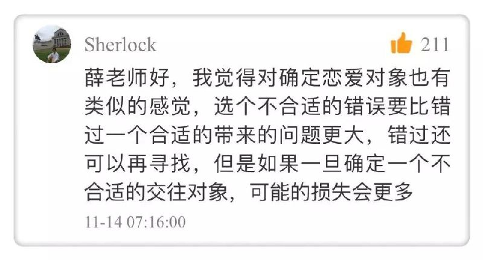

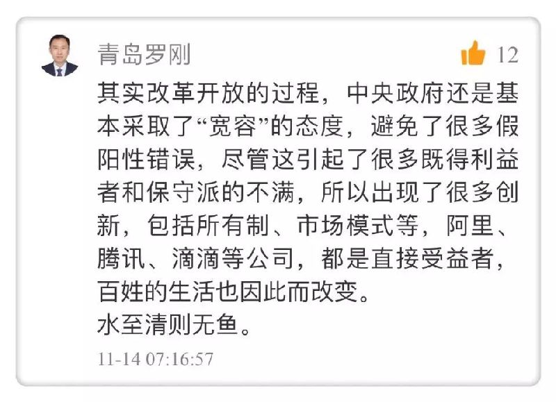

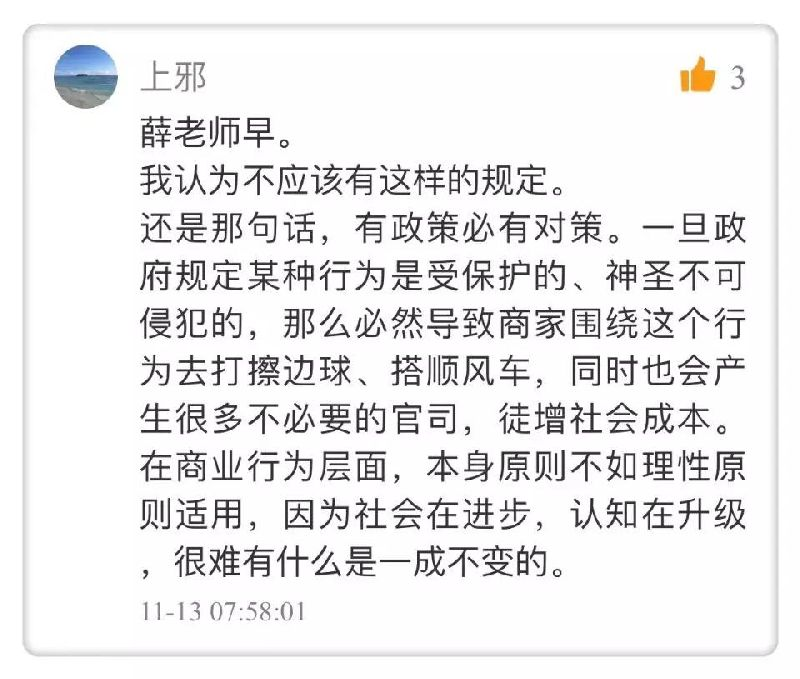

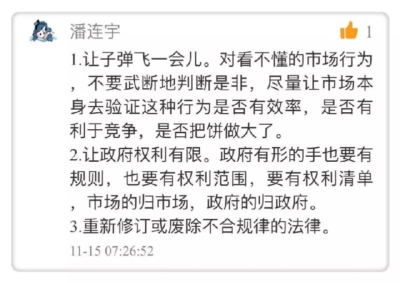

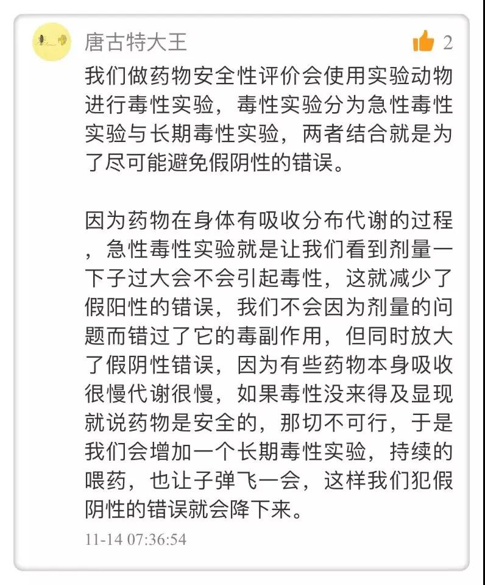

##### 加

# 学习加餐  
经济学辞典—14 

C

财富（wealth）

最富裕的穷人在今天（The richest poor people live in the contemporary society. ）

 解释：哪怕是穷人，只要社会在进步，只要整个社会的饼在做大，他们所得到的物质享受都比过去的一个中等家庭的人所获得的要更多。 案例：在今天，只要来到发达城市或地区，即便是最贫困的人也不会食不果腹。 一键直达：第 128 讲丨最富裕的穷人在今天

G

公司（corporation）

股份责任有限公司的兴起让公司可以追求非常远大的事业 （Modern corporations make long-term investment possible. ）

 解释：有了法人以后，投资者就可以躲到法人的背后，免于承担公司做错了事情所需要负的责任了，每位股东只需要承担有限的责任，公司就可以追求非常远大的事业。 案例：股份有限公司的出现，使得英国东印度公司远航东方并发展壮大成为可能。 一键直达：第 129 讲丨股份有限责任制的兴起

刺破公司面纱：让人而不是法人承担责任（Piercing/lifting the Corporate Veil is to hold shareholders, rather than the corporate,  liable. ）

 解释：有限责任制是一种伟大发明，但这个原则并不绝对。在一些特定情形下——比如一些个人为了转嫁风险而特意成立没有能力履行责任的公司，则应该由相关个人而不是法人承担最大责任。 案例：1961 年游泳池责任案。 一键直达：第 130 讲丨刺破公司的面纱

公司价值与融资方式无关（The value of a firm is independent of its ratio of debt to equity. ）

 解释：一家公司的价值取决于它赚钱、盈利的能力，而不取决于它融资的方式到底是股权还是债权。 案例：一个公司，如果完全没有债权，利润将全由股东享受；如果有债权，利润就要先用作还债，这时候股票的相对价值就会更低。 一键直达：第 131 讲 | MM 定律：邀人入股还是问人借钱？

J

竞争（competition）

竞争者会利用法律来提高对手的成本（Competitors may increase their rivals' cost by taking advantage of the laws. ）

 解释：当大企业各项指标都符合法律规定的时候，他们就希望用法律来约束自己的竞争对手，提高对方的经营成本和竞争成本。 案例：大面包房告小面包房工人工作时间超过 10 小时。 一键直达：第 127 讲丨工作权利遇到的障碍

Q

歧视（discrimination）

歧视无处不在，充分利用市场就能取得骄人成绩（If a given level of discrimination is not insurmountable, then spending resources to eliminate every vestige of it would be wasted, because those resources might be more productively used elsewhere to promote the same kind of advancement. (Walter E. Williams)）

 解释：追求平等不仅困难而且没有意义，我们应该在擅长的领域求生存求发展，赢得更好的境遇。 案例：犹太人、中国人和日本人在美国政治地位并不高，但他们的经济收入总是名列前茅。 一键直达：第 32 周问答丨做难做的事情容易成功

##### 157

# 第 157 讲  
小心思和大现象 

今天开始我们讲一个全新的模块——宏观经济学。这可是我们全年课程的一个分水岭。在今天以前，我们讲的都叫微观经济学。

宏观经济学这个概念，是在上世纪三四十年代，英国经济学家凯恩斯所创立的经济理论开始风行以后，宏观经济学这个概念才出现的。

## 1\. 微观经济学：关注需求与供给

微观经济学和宏观经济学有什么不同呢？远远地看、粗略地看，微观经济学风平浪静，从来没有发生过什么翻天覆地的革命，它研究的核心简单地说，永远只有一个，那就是需求和供给。

你回想一下，我们前面所讲的内容，选择、歧视、成本、产权、产权的冲突、产权的治理，所有这些都是对人的需求的一个深入的研究。

交易、比较优势原理、贸易自由化，厂家如何克服信息不对称的困难，各种不同商业模式的兴起，这些都是对供给的行为做深入的分析。

需求和供给这两大块非常的清楚。有时候我们把这两个大的概念用到一些具体的情境、具体的商品上面去，就成了经济学的一个分支。

比方说，把供给和需求用到劳动力这种商品上面去，就有劳动经济学；把供给和需求的概念，用到不同时间点的商品上面去，这时候就有了所谓的利息理论，也就有了对金融市场的研究。

但万变不离其宗，微观经济学讲的是供给和需求，而更重要的是，微观经济学所研究的供给和需求，都是建立在个人选择上面的。记得吗？我们曾经有过一讲专门讲“ 个人主义的主观价值论 ”，这是整个微观经济学的基础，任何一宗交易都是以个人的偏好和选择为依据的。

## 2\. 宏观经济学：研究加总变量之间的关系

宏观经济学就很不一样了，后面这几个单元你会更深切地感受到，宏观经济学最大的一个特点，就是它研究的是加总变量之间的关系。它所考察的变量是由无数具体的交易汇总起来的抽象概念。

比方说总需求、总供给、价格指数、总失业率，一个国家货币的汇率，当前市场的利率，整个国家的失业率，这些都是汇总的指标。宏观经济学试图研究这些汇总指标之间的因果关系，它们之间互相影响、互相起作用的规律。

接下来在宏观经济学这一部分，我要重点给你解释的，是这些不同的宏观经济学学说，它们究竟在争什么、在斗什么，核心的问题、核心的难点究竟是什么。

今天，我先给你提纲挈领地介绍几点宏观经济学为什么难的原因。

## 3\. 困难之一：加总变量之间因果关系难确定

第一，宏观经济学是关于汇总经济指标之间的关系的，但这些汇总的经济指标之间究竟有没有因果关系呢？这其实是不确定的。

比方说，我们见到整个社会出现了供给过剩的情况，我们讲的供给是总供给过剩的情况，宏观经济学家会得出一个结论，说那是因为总需求不足。接下来的问题是，刺激总需求有帮助吗？我们每天生活所做的决定，从来都不是根据总需求来做出的。

我们以前就讲过，你出门的时候到底需不需要多添一件衣服，取决于当时当地的气温变化，不取决于全球平均气温的变化。总需求到底足还是不足，跟我们具体的消费决定有关系吗？也就是说宏观汇总的经济指标之间，可能根本不存在人们预想的那种、在微观经济世界里面才存在的直接因果关系。

## 4\. 困难之二：微观动机与宏观现象因果关系不显著

宏观经济很难研究的第二个原因，是在于宏观的数量变化和人的微观行为之间的关系可能不是那么显著。有时候你看到一个宏观现象，并不容易马上就知道它是怎么形成的。

经济学家托马斯·谢林（Thomas C.Schelling）出版过一本畅销书，书的名字叫《微观动机与宏观行为（Micromotives and Macrobehavior，2006）》。他的这本书就分析了很多不经意发生的微观动机和非常奇特的宏观现象之间的关系。

比方说高速公路上发生大堵车了，到底发生了什么事？其实就是前面有一辆车发生交通意外，每一辆经过交通意外现场的汽车都停下来多看 15 秒钟，八卦一下看看发生了什么事情。每个人多 15 秒不算多，但这就造成了好几个小时的大塞车。

托马斯·谢林走进演讲会场，发现所有的人都坐在会场的后半部分，前排没有人坐，大家为什么要离他那么远？

其实没有人真的想离他那么远，只不过是每一个进入会场选择座位的人，他心目中只有一个小小的愿望，那就是“我不想坐第一排，我希望我的前面还有人坐”。但当每一个人都这么选择的时候，他们就会越来越往后退，所有的人都聚在会场的后半部分了。

我们看美国的很多城市，有唐人街、有意大利人街、有印度人街，人们的种族意识怎么会这么强，形成这种种族分离的居住方式呢？

托马斯·谢林说，其实人们可能没有意识到这个宏观的结果，开始的时候只不过是每一个人选择自己邻居的时候想，只要他前后左右四个方位里面，至少有一位或者两位他的同胞就好了。他们其实也是心态开放的，他们没有要求周围的人全是跟他自己同种族的人。

但是你知道吗？通过多次博弈，每个人都要求自己前后左右至少有一个自己的同胞，很快他们就被自己的同胞所包围，一个大的生活区，唐人街、印度人街、意大利人街就这么形成了。

生活中有很多人们不太想做，但是又不得不做的事情。比方说在节日的时候给对方寄节日卡，往年都寄了如果今年不寄别人会怎么想，所以大家都互相寄节日卡。万一寄晚了，人家以为我是收到了他的节日卡以后我才寄的，那人家会怎么想，所以我还是早一点寄，结果就一个比一个寄得早。

这种情况，在美国的法学院和商学院的学生，毕业以后找工作的时候就显得很明显，找工作、找实习的时间一个比一个提前。结果在法学院，第一学期结束，就一定要找一份好的实习工作；而在商学院，入学的第一天，就要开始参加应聘面试了。

托马斯·谢林这本书《微观动机与宏观行为》非常有意思。当然托马斯·谢林也因为他对博弈论的研究以及对冲突解决方式的研究，在 2005 年获得了诺贝尔经济学奖。

## 5\. 困难之三：影响因素多而案例数据少

宏观经济很难研究的第三个原因，是它的数据少但变量多。以至于在宏观经济领域，经济学家提供的理论、故事、版本很多，但谁也说服不了谁。

我们初中的时候解方程就知道，你有五个变量的话，至少要有五个方程式才能解出这些变量。

而现实生活中，影响宏观经济指标，也就是那些汇总指标的因素实在太多了，但人们掌握的宏观经济现象——而且要有精确数据描绘的宏观经济现象，相比起来并不多。所谓大数据是今天这个时代的特征，这就造成了在宏观经济学界对同一个现象众说纷纭，理论版本层出不穷的原因。

## 6\. 困难之四：经济现象和政策措施之间存在时间滞后

宏观经济学困难的第四个原因，在于人们要对付的宏观经济问题出现的时间、对策形成的时间、对策执行的时间、对策起作用的时间，这几个时间点之间存在着时间差。这个时间差有时候长一点、有时候短一点，这对研究宏观经济问题来说又增加了很大的难度。

## 7\. 困难之五：政府很难把裁判员和运动员的身份分开

宏观经济学很难研究的第五个问题，是在于政策的制定者他们本身就在市场当中。

比如人们经常说，政府不应该既当裁判员又当运动员，但这种意见实际上太理想化了。政府就在市场当中，它是很难把裁判员的身份和运动员的身份完全区分开来的。用经济学的话来说，政策有很大的内生性。

但不管宏观经济学有多难，宏观经济都是跟我们每一个人的生活息息相关的。我们今天就接受这个挑战，看看宏观经济学到底研究什么，宏观经济学家到底在争论什么，我们从中又能够学到什么。

## 课堂小结

我给你总结一下。今天我们讲了微观经济学和宏观经济学之间的区别，我们也讲了宏观经济学之所以困难的五个原因：

第一，它研究的是加总的变量，加总变量之间的因果关系很难确定。

第二，微观动机和宏观现象之间的因果关系不那么显著，不容易一眼就看出来。

第三，影响宏观经济的因素太多了，但可得的案例和数据太少了，结果是理论多、共识少。

第四，经济现象和政策措施之间存在着时间的滞后，要评估一项宏观经济政策的效果，往往会遇到测不准的困难。

第五，政府就在市场当中，很难把自己当裁判员的身份和运动员的身份截然分开，这也增加了形成有效政策、评估政策的困难。

## 课后思考

今天留给你的思考题是，请你告诉我，在你印象当中，经济学家对经济未来的走势预测最准的是哪一次？请你举一个例子。

欢迎你给我留言，我们下节课再见。

##### 158

# 第 158 讲  
货币的起源 

今天我给你讲货币的起源。

昨天我们说我们开始一个新的篇章，我们讲宏观经济学。整个宏观经济学研究的问题其实就是货币的问题,而货币所牵涉的核心问题，两个字 —— 协调。整个社会怎么通过货币来达成协调和合作？我们一点一点开始展开。

## 1\. 货币为什么有用？

货币——钱很有用吧？我们都觉得有用，但学者喜欢反思，最早的时候，哲学家反思金钱作用的时候，就得出一个结论，觉得钱没什么用。哲学家亚里士多德他就说钱是无用的，用英语来说，他说：“Money is barren. ” barren 这个词就是贫瘠的、不能生育的、没有价值的、不能开花结果的意思。

到今天，也还有很多人视金钱如粪土，但金钱不可能真的这么没用。如果真的这么没用，怎么会延续这么长时间，这么普遍地被使用呢？记得我们开学的时候第一课，讲的是《战俘营里的经济组织》，在那里也有他们的货币在流行。

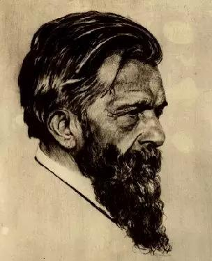

卡尔·门格尔（Carl Menger, 1840 年 2 月 23 日- 1921 年 2 月 26 日）

货币有什么用呢？这里介绍一篇经典的论文，那是 1892 年奥地利学派的鼻祖门格尔（Carl Menger, 1840 年 2 月 23 日- 1921 年 2 月 26 日）所写的一篇论文，名字叫《论货币的起源（On the origins of money ）》。

他在这篇文章里面讲到的一个概念，货币之所以有用最重要的原因在于，只要别人觉得它有用，只要别人愿意接受它，它就起作用了。所以门格尔说货币的起源、货币的形态，跟语言的发展非常相像。你想语言也是这样，一句话、一个词能不能流行开来，不仅仅在于说的人，还在于听的人，在于别人接不接受。

奥地利学派里面有一个非常重要的概念就叫“自发秩序（spontaneous order）”，它的意思是，我们今天在社会上看到的秩序，不是由哪一个个人或者哪一个权威机构主动设计出来的，它是由无数人的行动汇合而成的。我们日常使用的语言是一种自发秩序，货币也是一种自发秩序。

## 2\. 货币作用之一：避免交易中双重偶然性的要求

货币为什么会流行起来呢？

它为人们提供的第一个帮助，它的第一个作用就是避免了双重偶然性（double-coincidence）。

你想一想在物物交换的年代，人们要达成交易，他得有条件，我有面包要出售，而我需要牛奶，这时候我遇到怎么样的人才能达成交易呢？我必须遇到一个刚好手上既有牛奶要出售，而且同时又需要面包的人，只有刚好遇到这样的人，我们才能够达成交易。

这就是所谓的双重偶然性。我遇到了一位卖牛奶的人，这是一个偶然性；而同时这个人也需要我的面包，这是第二重偶然性。两重偶然性加在一起缺一不可，我们才能达到交易，这不容易。

而有了货币以后，交易就不需要满足双重偶然性了，只要满足一重偶然性就可以达成交易了。

在货币的帮助下，我只要遇到那些想买面包的人，我们就可以完成交易。我把面包卖给他，然后把赚到的钱存起来；同时，只要我见到那些卖牛奶的人，我们也可以达成交易，在货币的帮助下，我用存起来的钱向他买牛奶。这就是货币带给我们的极大的便利。

由于有了货币，我们摆脱了物物交换的情况下我们必须满足的双重偶然性的要求，它带给我们巨大的方便。

在现实生活当中，我们还有什么情况是需要双重偶然性的呢？谈恋爱就是需要满足双重偶然性的，仅仅我喜欢你不能谈恋爱，仅仅你喜欢我也不能谈恋爱。得在我喜欢你的同时你也喜欢我，我们才能谈恋爱。正因为这样，能够谈成恋爱的机会，就比能够达成交易的机会要少得多。

每当我想起货币功能的时候，我就经常异想天开。要是在谈恋爱的领域我们也有一种恋爱币，能够把别人对我的喜爱集中起来，再去获取我所喜欢的人的芳心这该多好。但谈恋爱就是不行，谈恋爱就只能是物物交换。

不管怎么样，货币的第一个作用就是让我们摆脱了双重偶然性的束缚，所以亚里士多德怎么能说货币没有用呢？

我也不赞成人们视货币如粪土。货币只代表机会，多挣钱不代表你爱的只是钱，没有人是吃钱的，没有人是抱着钱睡觉的，钱多只代表你的机会更多、你的选择更多，至于你怎么用这个机会、怎么使用你的选择，不同的人有不同的志向。    

## 3\. 货币作用之二：降低质量检验成本

货币的第二个作用，是使得交易当中的质检成本减半。

你想想看，如果没有货币的帮助，人们只能进行物物交换。我作为一个卖面包的人，屠夫来买我面包的时候，我得学会检验他给我交换的肉合不合格；酿酒商来买我面包的时候，我得品尝他的酒合不合格；裁缝来买我面包的时候，我得检验他的衣服合不合格。

我得成为天下所有商品的质量检验者，我学习的压力好大。有了货币就不需要了，我只需要检验货币的真假就行了。

## 4\. 货币作用之三：增加市场交易量

货币的第三个作用，是根据货币的第一和第二个作用应运而生的。我们不需要满足双重偶然性的要求、质检的成本减半，结果是什么？结果是交易量大增。交易量大增的结果是什么？社会上每一个参与交易的人，幸福都得到了极大的提高。

所以在任何社会，哪怕是在集中营里面，人们都会很自然地利用货币的帮助。至于用什么来做货币？相比之下这是一个次要的问题，用什么来做货币都可以，历史上几乎任何东西都曾经拿来做过货币。

我给你列了一个表，这个表格是历史上曾经用来做过货币的物品，五花八门，无奇不有。比方说羊、猪、牛、马、大米、盐、酒、茶叶、铁、铜、金、银、象牙、指甲、动物的毛皮等等，当然还有最常见的石头。

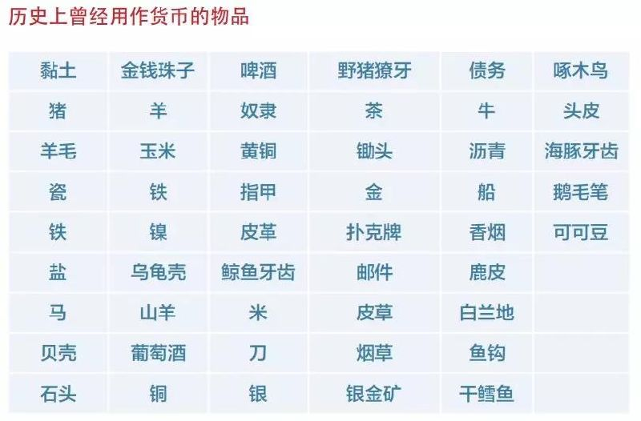

## 5\. 石头货币的故事

我给你讲一个石头货币的故事。

在太平洋上有一个岛，在这个岛上人们使用的货币是石头，谁家的石头多谁家就更有钱。由于石头很大不方便搬动，所以每一家通常都把他们家的石头放在门口，你只要在小区里面走过，看看每一家人门口放的石头，你就能知道哪一家更有钱了。

而这个小岛上被公认为最有钱的一家人，他们门口放的石头还不算大，为什么？因为岛上所有的人都知道，他们家最大的那块石头在海底。

有一年他们家在别的岛上发现了一块巨大的石头，在把那块石头搬运到这个岛上的时候船沉了，石头掉到海底下去了，但是邻居们都看见、都目睹了他们家这块大石头，眼见为实，所以他们家依然被认为是这个岛上最富裕的家庭。

你说他们可笑吧？这个岛曾经是德国人的殖民地。有一年德国人要求岛上的居民把路给修好了，居民没听德国人的话，德国人生气了，说要没收居民的财富，结果德国人跑到每一块石头上面标上德国人的印记，说这块石头我们德国人给没收了，岛上的居民一下子就恐慌了，这钱都给德国人收走了，怎么得了？于是他们赶紧就把路给修好了。

德国人也守信用，路修好了以后他们就把在石头上做的标志都给抹掉了，把石头又还给了岛上的居民，居民终于松了一口气。我给你附了这个岛上的照片，你可以看一看，挺有意思的。

石币之岛（W. H. Furness III, The Island of Stone Money, 1910, 选自弗里德曼《货币的祸害》）

你觉得这个岛上的居民可笑吧？愚蠢吧？其实不可笑、不愚蠢，为什么？因为我们文明人所作所为跟他们如出一辙。我们的文明社会有多少年来，货币发行量就根据这个国家金、银等稀有金属的存量来作标准的。即便是发行纸币，纸币的发行量也要以金、银作本位。

在 1932 年到 1933 年间，法国人就担心美国人守不住他们的承诺，以 20 块 6 毛 7 美元的价格兑换一盎司黄金，法国人担心美元换不了那么多黄金了，所以他们开了艘船到美国，说：“我们还是不要美元了，我们得把黄金给换回来。”

美国人也慌了，赶紧对法国人说：你们不用来、不用来，黄金归你们，我们在国库里面放的黄金还给你。于是美国人就把他们国库里面的金条上面贴的标签，从美国的标签换成法国的标签。这跟德国人在石头上做标志，后来又把标志给擦掉是一样的，就换个标志，美国人就把法国人给安抚了。

但是消息传出去了，人们觉得美元背后的黄金支持少了，美元变弱了，结果就导致了 1933 年美国的银行危机。

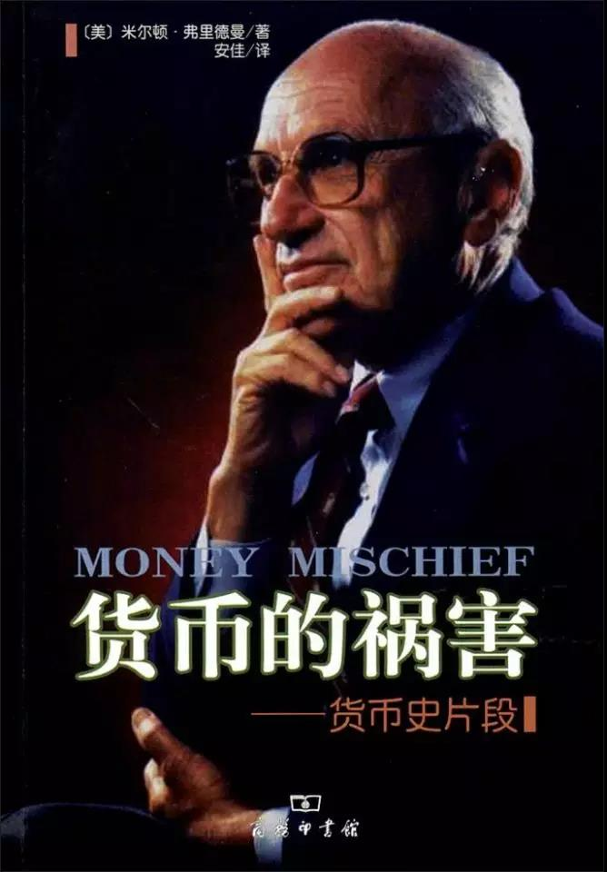

货币的祸害，米尔顿·弗里德曼，2006 

这个故事在 1976 年获得诺贝尔经济学奖的弗里德曼（Milton Friedman）所写的《货币的祸害（ Money Mischief ）》这本书里面能够找到。

## 课堂小结

我给你总结一下今天的内容：

第一，货币像语言一样，是一种自发秩序，货币最大的作用在于人们相信它有用。

第二，货币可以避免我们在交易的时候对双重偶然性的要求。

第三，货币可以降低质量检验的成本。

第四，货币增加了交易。而正因为这样，世界上绝大多数的社会都会采用这样那样的商品来作为货币。

## 课后思考

今天我留给你的思考题是，一个国家发行货币，货币发行量的多少，究竟是根据某个客观的标准来定，还是根据货币发行人自己的意愿来定的呢？

欢迎你给我留言，我们下节课再见。

##### 159

# 第 159 讲  
商业银行创造货币 

货币的起源，今天我们继续谈货币，讲商业银行创造货币的过程。

你看，昨天我们说的是，货币之所以有用就在于人们都相信它有用。有了货币我们能够避免双重偶然性的约束，我们能够减少质检的成本，所以不管哪个社会，都需要货币的帮助，具体用哪种商品来做货币反而是次要的。

## 1\. 劣币驱逐良币符合经济效率

问题是，具体用哪种商品呢？

当然用哪种货币都有，金子、银子都可以，但是在 500 多年前，16 世纪英国的伊丽莎白铸币局局长格雷欣（Thomas Gresham，1519 - 1579），发现了所谓“劣币驱逐良币”的规律。

那就是，一个社会一旦确定了用某种商品来作为货币，这种商品在流通当中的质量就会发生变化。质量较高的品种会被人们保存下来，质量较低的会留在流通当中，质量不高的货币会把质量较高的货币驱赶出流通的领域。这就是人们常说的“劣币驱逐良币定律（Gresham‘s law: Cheap money drives out valuable money. ）”。

但很多人忘了补充的一句话是，记得吗？我们说货币之所以有用，就在于人们相信它有用。只要人们相信它有用，它就不需要用那么高质量的商品来充当。也就是说劣币驱逐良币是对的，是符合经济效率的：“劣币就是有效率的货币（ Cheap money is efficient money. ）。”

这个规律发展到今天，你看人们基本上抛弃了用真实的商品来充当货币了，大家用的都是纸币，不用消耗真实的资源了。只要你相信它有用，它就有用，这就行了。

## 2\. 商业银行如何创造货币

我们再来看商业银行是怎么创造货币的。

我们来看一个封闭的社会，假设里面有 1000 块钱在流动。人们利用这 1000 块钱所提供的方便来进行交易。而这个社会里面有一个商业银行系统，专门帮人们把钱存起来，然后它自己又把钱贷出去，它自己从中赚取利息的差价。

你想象一下，这 1000 块钱落到每一个人的口袋里面，到晚上下班的时候人们迫切要做的一件事情，就是把这个钱存到商业银行体系里面去，这时候商业银行多了 1000 块钱。

而商业银行收到钱以后，它最迫切要做的事情是把钱贷出去，借给别人。它把钱借给别人以后，那些借钱的人，他一旦借了钱，他最迫切要做的事情就是要把钱花出去，不到花钱的时候他不借，因为借钱本身是要支付利息的。

这些借钱的人把钱花出去以后，到第二天下班的时候，所有口袋里面有钱的人，他们迫切想要做的一件事情，又是把钱存回到商业银行体系里面去。

经过这两天的过程，你看商业银行的账户，你就会发现它账户里面从第一天的只有 1000 块钱，变成了第二天的有 2000 块钱，到第三天它变成 3000 块钱。一天一天地累积下去，这银行账户上的钱，也在无止境地增长。

还记得吗？这个社会原来总共流通的货币也就 1000 块钱，但你看银行的账户一天一天在涨，这就是一个创造货币的过程。

当然，这个过程实际上不是无止境的，商业银行体系不能这么肆无忌惮地创造货币。实际上政府对每一家商业银行都有规定：他们在收到存户的存款，再把这笔钱贷出去以前，必须留下一部分作为所谓的“法定准备金”。

假定政府规定的法定准备金率是 20%，那意味着什么？那意味着银行第一天收到 1000 块钱以后，它得留下 20%不能贷出去了，这是准备金，只能拿出当中的 80%，也就是 800 块钱贷出去；

第二天这 800 块钱放到市场里面去，它再回流到商业银行体系里面，商业银行又必须留下当中的 20%，也就是 160 块钱作为准备金，于是只有 640 块钱可以贷出去。

这样循环往复，最后 1000 块钱在 20%的法定准备金率下，它就只能够创造 4000 块钱的新生货币。再加上我们称之为基础货币的 1000 块钱，就只能导致整个社会有 5000 块钱的货币在流通。

这就是商业银行创造货币的过程。它创造货币的能力跟法定准备金率成反比，法定准备金率越高，它能够创造货币的倍数就越低。

商业银行创造货币原理：每增加 1 元基础货币，商业银行系统就能创造出超过 1 元的活期存款。（存款扩张乘数：法定准备金率的倒数）

## 3\. 商业银行固有机制催生流动性风险

问题是，刚才我们所说的模型是一种理想状态的模型，最早的那 1000 块钱好像是无摩擦的，就能够产生 4000 块钱的新增货币。

但现实生活中，这创造货币的过程是有摩擦的，创造货币的实际倍数跟市场对货币的需求也有关系。所以这个社会最早的那 1000 块钱，能够创造出多少再流通的货币，是一个波动的数字——有一部分资金相当活跃，有一部分资金在沉睡。

货币银行学里面，对这些不同活跃程度的货币有专门的衡量标准，分别叫 M0、M1、M2、M3 等等。

其中 M0 被称为基础货币，它是公众和商业银行持有的通货；M1 是在 M0 的基础上，再加上活期存款和支票存款；M2 是在 M1 的基础上，再加上低于 10 万美元的定期存款；M3 指的是更广义的货币，也就是在 M2 的基础上，加上那些高于 10 万美元的定期存款，也就是那些更稳定、更不活跃、更不流通的货币。

我们再来仔细地看一下，商业银行创造货币的过程：

整个社会有 1000 块基础货币，有 1000 块纸币或者硬币，在 20%的准备金率下，商业银行就能够创造出 5000 块钱账面上的流通货币。这是商业银行本身固有的特征。

你想想看，这时候如果社会上存在传言说：

商业银行里面存的钱，那些看得见摸得着的纸币或者硬币，实际上是不能满足所有存户的兑换需求的，我们赶紧去把钱拿出来。

如果市场上有这个传言，大家都去取钱的话，商业银行够不够钱给大家取？不够。所以只要所有的存户听到传言去挤兑的话，商业银行一定倒闭。这并不是商业银行经营不善的问题，这是由于商业银行能够创造货币这种固有的机制所造成的。

这种商业银行无法满足所有存户提现要求的困难，我们称之为“流动性困难（convertibility  problem）”。遇到这种困难，我们不能怪任何一家商业银行。这时候我们需要商业银行背后有一个更强大的支撑，去尽量满足所有兑换的要求，平息人们的传言。只有这样才能挽救整个商业银行系统。

## 4\. 什么样的银行困境值得挽救

但问题的另一面在于，每一家商业银行都是低买高卖的商业机构，它跟我们楼下的小卖部本质上没有区别。既然是这样，任何一家商业银行也会遇到经营不善、资不抵债的困难。

如果是这样的话，这家商业银行就该倒闭，就跟任何一家经营不善的小卖部都应该倒闭的道理一样。这种“资不抵债的困难（insolvency problem）”，是商业银行系统所面临的另外一类困难。

你看，一个商业银行遇到两类问题：

一类是整个银行系统本身所固有的，如果出了事有了挤兑的传言，大家应该携手来帮助它，才能挽救整个银行系统的生存。

但同时，它又面临另外一个问题，那就是有可能是自己经营不善可能要倒闭的困难，遇到这样的困难，我们就应该让它受到市场的惩罚。否则如果经营商业银行是肯定不会倒闭的话，那就不会有人负责任地经营了。

问题就在于，在任何一场金融危机当中，我们都要很好地分辨一家有问题的商业银行，到底是因为资不抵债的困难而造成的，还是由于流动性的困难而造成的呢？这当中有一定的困难。

这也是为什么每当金融危机发生的时候，人们会争论不休，到底政府应不应该出手相救。这个问题不好解决。但今天你至少明白经济学家们、官员们究竟为什么而争论。

## 课堂小结

我来给你总结一下，今天我们首先讲了劣币驱逐良币定律。我们说劣币驱逐良币的现象是存在的，但往往劣币，也就是使用真实资源比较少的货币，本身就是有效率的货币。今天我们已经不用金银铜铁这些真正的资源来做货币了，我们用纸币更省、更有效率，只要人们相信它有用它就有用。

今天我们还谈了商业银行创造货币的过程，商业银行创造货币的能力跟法定准备金率成反比。

任何一家商业银行都有可能遇到两类困难：第一是流动性的困难，那是商业银行体系本身所固有的；另一类的困难是资不抵债的困难，那是由于经营不善造成的。

对第一类困难我们应该出手相救；对第二类困难我们可能应该让它自生自灭。但是要区分到底是哪种困难，在现实中并不容易。这是为什么学者和官员，经常就金融问题进行争论的原因之一。

## 课后思考

今天我留给你的思考题是，我们常听说一句话叫“大而不能倒”，用到银行业中说的是，越是大的银行，我们越是不能让它倒闭。但问题是，那些银行家越是知道有这个保护伞，他们就会越不顾风险为所欲为。今天我留给你的问题是，你赞不赞成“大而不能倒”这种政府干预原则？为什么？

欢迎你给我留言，我们下节课再见。

##### 160

# 第 160 讲  
中央银行的作用 

今天我来给你讲中央银行的作用。

昨天我们讲了商业银行创造货币的过程，商业银行这种机制，整个体系就有自动创造货币的本领。如果不是由于准备金率的要求，商业银行把钱存进来再把钱贷出去，这循环往复就能把有限的基础货币无限放大，凭空地增长账面上流通的货币。

当然，我们不能这么无限地增长，背后起控制作用的其中一种机构就是中央银行。

## 1\. 货币是国家发行的负债证明书

在一个社会里面，谁有权利发行货币，谁就能够享有一种很重要的特权，那就是无中生有地凭空占有一定社会资源的特权。

首先你看，货币是一种负债证明书。发行货币的人是对那些使用货币的人说，你用我们的货币，我保证你什么时候不想用这个货币了，你到我这里能够兑换相应的自然资源，可能是金子、可能是银子，这是一张货币背后的本位支持。

但现实生活中，货币总是在流通的过程当中，人们口袋里面总会多多少少地存有货币，而永远不会拿它来兑换真实的货物。这个数量整个社会加起来可不得了。换句话说，发行货币的人可是一本万利，他永远不需要用真实的财富来兑换他所做出的承诺。

好些年前，我们中国发生过一起针对美国的示威抗议游行。在那场游行里面，有人为了抗议美国，拿着美元在燃烧，当然这是一种表达愤怒的做法。但当时我的经济学本能就告诉我，这事情有点不对。

结果我在博客上写了一段话：

不要烧美元，因为美元是美国人发行的负债证明书，这是证明美国人欠了我们的债。你把这张负债证明书给烧了，也就是把美国人欠我们中国人的债一笔勾销了，这是美国人得益，我们不能烧美元。

结果当时的一份报纸《南方周末》把我这句话登到了报纸上。很多年以后，我太太给我整理文稿的时候，忽然发现了这张报纸，她惊讶地说：“原来说这句话的是你呀？”因为她记得，当时在大学里面，就有同学给她看这份报纸，说“你看这个人说得挺逗的”，她有印象。

不管怎么样，我们今天说的道理是，货币是发行货币的人所发行的负债证明书，发行货币的人能够无中生有，凭空地占有一些好处，就是实际上只要货币在流通，他永远不需要兑换他发行货币的时候所承诺要兑换的那些资源。

## 2\. 以国家实力维持货币信用

这时候你一定会问，那发行货币不是一门只赚不赔的生意吗？这得考考你学习和应用经济学原理的能力了。前面我们讲过，任何一种垄断地位都会遇到挑战，要维持这种垄断地位本身就要付出成本。

一个国家要发行一种人人都愿意使用的货币，他要建立这种信用本身就不是一件容易的事情。他要把国力做得足够强大，人们相信哪怕是在危难的时期，身上揣的这些货币也会被别人所认可的，要做到这一点那可不容易。

更重要的是，如果有哪个国家、有哪个地区胆敢假冒制造你这个国家的货币，你有你的军事能力能够把他们拿下。维持这种军事的威慑，本身就有巨大的成本。

美元是世界流通的第一大货币，你再去看看美国在军事上的开支是多少？他是有道理的。不管怎么样，控制一个国家货币的发行和流通，一般是这个国家中央银行所要完成的任务。

在不同的国家里面，他们的中央银行有不同的名称。在美国中央银行叫联邦储备局，在英国叫英格兰银行，在日本是日本银行，在中国是人民银行。

## 3\. 中央银行如何控制货币发行量和流通量

中央银行是怎么控制一个国家的货币发行和流通量的呢？

比方说在美国印钱的过程是这样的，首先由美国的中央银行，也就是联邦储备局批准，美国的财政部就可以印钱了，印出来的钱叫联邦储备券。

这个券印好了以后，美国财政部就把它等价卖给联邦储备局，卖完以后，出售所得就存入了美国财政部在联邦储备局所开的账户上。从此美国财政部做任何的开支，也就在这个账户上，这个在联邦储备局开设的账户上支出了。

你注意这个过程，联邦储备局叫财政部印钱，财政部印好了以后就卖给联邦储备局，卖完了以后，联邦储备局就在财政部的账户上添上那么一笔。从此财政部就可以花钱了。缺钱就印，印了就可以花了，就这么一个过程。

美国财政部印钱的成本非常低，就是纸张的钱，他们印完以后能够花的钱，跟印钱所要支付的成本之间的差价，就是财政部印钱的利润，叫铸币利差，也就是铸币税。这样印出来的钱不需要任何支撑，没有任何的标准，靠的是这个国家背后的实力。

联邦储备局除了通过批准财政部印钱来影响货币流通量以外，通常还有两个调整美元货币流通量的办法：

第一叫公开市场操作。它在公开市场上面买卖美国的债券，从而向市场发放或者回收美元。它向公众购买美国的国债，买的过程中就把钱交给了公众、交给了市场，于是就增加了美元在市场中的货币流通量。如果它倒过来向公众出售美国国债，那就是回收市场中流通的美元，从而起到紧缩美元流通量的作用。

美国联邦储备局控制美元发行量的另外一个办法，是调整利率。利率不一样，人们借贷的行为就会发生变化，这对市场流通的货币量也会有影响，但是这一点涉及的内容比较多，我们后面会有专门一节课来讨论这个问题。

当然，联邦储备局也可以修改法定准备金率，从而影响商业银行创造货币的倍数或者叫乘数，但实际上这种办法很少被采用。

## 4\. 中央银行充当最后贷款人

不管怎么样，中央银行还充当一个重要的作用，那就是最后贷款人的作用（Lender of last resort）。

记得吗？昨天我们介绍过，商业银行体系本身固有一种困难，那就是流动性的困难。如果存户出现恐慌要把钱都取出来的话，整个银行体系是没有那么多钱给存户提取的。这时候中央银行就要发挥作用，帮助那些有流动性困难的银行，让他们尽量满足存户的要求，从而平息存户的恐慌。

以上所说的这些，都是各国的中央银行所要完成的基本任务，那就是保持一个国家货币发行量的稳定。当然我们后面还会专门讨论，有些中央银行还担负着除了稳定货币发行量任务以外的其他任务，尤其是调整经济发展速度、保持就业稳定、保持经济持续增长的任务。

## 课堂小结

我来给你总结一下，一个国家发行的货币是这个国家发行的负债证明书；谁发行货币谁就能够凭空地占有一定的社会资源，经济学上称为铸币利差或者铸币税；各国的中央银行都有一个基本的任务，那就是控制和调整一个国家货币的发行量和流通量；同时还要充当商业银行最后贷款人的角色。

## 课后思考

今天我留给你的思考题是，中央银行充当最后贷款人的角色，它的意思是：当商业银行需要资金的时候，它就给商业银行提供资金。可是如果中央银行总是这么做的话，那商业银行会不会就滥用中央银行所提供给它的资金呢？为什么。

欢迎你给我留言，我们下节课再见。

##### 周

# 第 40 周问答  
比特币的局限 

我们开始本周的问答时间了。

这个礼拜我们开始了全年第四季度的学习，主要就是关于宏观经济学的内容。而宏观经济学所要研究的主要问题，是各种加总变量之间的关系。这些加总变量，比如汇率、利率、通货膨胀率、GDP 等等，它们都是由大量的单个交易组成的。

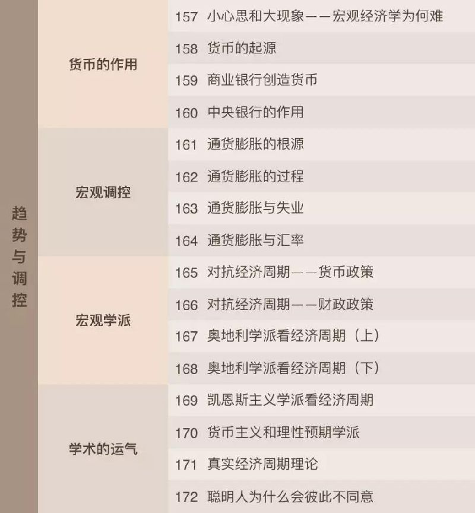

加总的变量之间其实可能根本没有因果关系，不能够互相作用，只是宏观经济学者想当然地构造了这样或者那样的因果关系，编了一些故事。这个故事编得好，就能够把他们想要解释的事情串起来，但是当要被解释的事情增加以后，这故事可能就说不圆了。

所以跟我们前面三个季度所学的微观经济学相比，宏观经济学作为一门学科的分支，还是处于比较初级的阶段。

我们这个礼拜还集中讲了货币的起源、商业银行创造货币的过程，以及中央银行的作用。

## 1\. 比特币还远远不完美，能不能被人接受还是未知数

货币的最大作用就在于人们相信它有用。所以今天的比特币，确实也可以用来交换、用来储值，甚至用来投资。但问题是，比特币跟其他曾经用过的各种货币一样，也还存在着自身的各种问题，它还远远没有到完美的地步。它能不能够流行起来，能不能够被人民和政府所承认，又会不会被其他的、更完善的电子货币所取代，都是未知之数。

举几个简单的例子：

第一，比特币只是一种加密的算法，它能使所有的人都确信，它的发行上限就是 2100 万个，不会再多了。这一点确实能够使人建立起信心，认为使用比特币的话，人们可以摆脱通货膨胀的危险。

但我们不要忘记，货币的职能是要充当价值的尺度，它需要避免的不仅是通货膨胀，而且也要避免通货紧缩。上限为 2100 万个，这个数量跟全球每天发生的交易量相比是微不足道的，你要用 2100 万个比特币来为海量的商业交易做支付的尺度，结果必然使整个社会陷入没有止境的通货紧缩过程。

一个鸡蛋，今天是一个比特币，明天是 0.1 个比特币，后天是 0.01 个比特币，再后天是 0.001 个比特币。如果这个收缩是没有止境的，而收缩的速度又是个未知数的话，它就很难起到方便人们互相协调的作用。

又比如，我们说“劣币其实就是有效的货币（Cheap money is efficient money.）”，只要人们相信这种货币，那用于制造这种货币的成本越低越好。如果是这样的话，今天通过大量的计算机运算能力，来创造比特币的挖矿行为就是不必要的。

当然，比特币的设计者可能认为，通过这种要浪费真实资源的困难，可以控制比特币新增的速度。但实际上，要控制比特币新增的速度，有的是其他既廉价又可行的办法。

比特币还存在另外一个问题，就是它只不过是一套算法，这种类型的算法谁都可以复制，谁都可以占用。事实上，今天已经有各种各样比特币的替代产品了。

有趣的是，我们看到那些对比特币的未来充满希望的人，同时也是那些对比特币的替代产品充满希望的人。其实这两者是加不起来的，是有矛盾之处的。

一个人人都能发行自己货币的社会，比特币就只是当中的一种，它的价值是有限的；反过来，如果比特币能够一统天下，那人人都能够发行的那种自我的货币就不会值什么钱。

## 2\. 经济学家预测未来：错的机会比对的机会大

我们来看看本周的思考题。周一我们讨论了宏观经济学为什么很难，留给你的思考题是，在你的印象当中，经济学家对经济未来走势的预测，最准的是哪一次？请你举一个例子。

留这道思考题，言下之意，是经济学家对未来的预测，错的机会比正确的机会要多。预测不容易。

经济学是一门研究社会发展当中因果规律的学科，微观经济学可以比较准确地告诉我们，有怎么样的因就会有怎么样的果。

你对市场价格实施调控，进行严厉的价格管制，那就一定会出现黄牛、一定会出现黑市、一定会出现各种非价格的竞争；你只要实施大锅饭，不对人们的行为做出恰如其分的奖惩，那一个团队的工作效率就一定会下降，最后甚至会到难以为继的地步。

作为一个国家的经济政策，你补贴什么，什么样的行为就会增加；你向什么样的商业活动征税，什么样的商业活动就会减少。这些都是经济学家非常自信的部分，有什么样的因就有什么样的果。

但问题是到了宏观经济学，有许多的因共同互相作用，在一段长时间里面，有一些因会继续存在，而有一些会消失。当情况复杂化以后，要再对整体经济做出准确的预测，困难度就大增了。

而有时候，经济学家虽然能够很好地预测未来发展的总趋势，但至于这个趋势在什么时候、什么地点才会呈现出来，要做出精确的判断，这又很不容易。

在我的排名当中，经济学家对未来经济的走势判断最准确的，就是当年一些奥地利学派的经济学家，包括哈耶克、米塞斯，对计划经济肯定难以为继做出的预判。

当时他们在学者当中属于少数派，他们自己被边缘化，但事实证明他们是对的。当然，连他们自己也不知道，他们具体哪一天会被证明是对的，他们顶多就是有一个强烈的信念而已。

## 3\. 各国超发货币是一个比丑的过程

周二的问题是，一个国家发行货币，货币发行量的多少，究竟是根据某个客观的标准来定，还是根据货币发行人自己的意愿来定的呢？

王黎璐 同学的回答很好地概括了问题的实质：

教科书上说，一个国家货币发行量，是以货币流通中所需的货币量决定的。但实际生活中，大多数都是由执政者自己决定的。

这就好像有人问，一个人每天吃多少是由什么决定的？书呆子的回答是，一个人吃多少取决于他一天消耗的能量是多少。

说是这么说，这个人可能也会给自己制定各种饮食的限量标准，甚至发过誓、许过愿，说不能贪嘴。但实际上，就是想吃多少吃多少的，只不过忍不住嘴的话，吃多了，发胖了，自己得承受后果。

各个国家发行货币也是一样的道理，说是不能滥发，说是有标准，但到最后也还是他们自己说了算。

各国发行货币或者说超额发行货币，其实是一个比丑的过程，不是一个比美的过程。只要你超发货币的速度比别人低一点，那你国家的货币就比别的国家的货币更坚挺一点，五十步笑百步。

一个国家的货币发行到底有多克制，取决于其他的国家到底有多不克制。

## 4\. 商业银行创造货币，背后支撑就是一个信念

周三我们介绍了商业银行创造货币的过程，我们说一笔基础货币经过反复的借贷，社会上就仿佛新增了一大笔货币一样。

有同学产生疑问，说这个过程是反复借贷的过程，但如果借款还了呢？还款的过程是不是新增的货币减少的过程呢？这个想法非常仔细，是正确的。

如果一个社会再也没有人借钱，借款总量为零，基础货币就存在银行里面一动没动过，那商业银行就没有新增任何的货币。但问题是这个社会总有人在借钱，尽管每天都有人还钱，但也总有很多的债务没有被归还，这个余量其实大部分就是商业银行创造出来的。

我们能理解这新创造出来的货币，背后支撑的就是一个信念或者说是信用。大家总相信，别人借了钱都是会还的，整个社会就建立在这种信念、这种信用上面。它当然也是脆弱的，一旦出现重大的判断失误，金融业就容易陷入危机。

## 5\. 应对大银行倒闭，更应该防范于未然

周三的问题是，我们常听说一句话，叫大而不能倒，用到银行业当中，说的就是越大的银行，我们越不能让它倒闭。但问题是，那些银行家越是知道有这个保护伞，他们就越会不顾风险为所欲为。而我留给你的思考题是，你赞不赞成大而不能倒这种政府干预原则呢？为什么？

潘连宇 同学回答：

大银行倒闭是什么景象？是不是导致人心浮动、社会动荡、政局不稳？难以想象，很可怕。大而不能倒的问题是，要考虑既然做大了为什么还要倒，是经营不善造成资不抵债，还是准备金率造成的流动性差？如果是经营不善，已经资不抵债，那就应该倒。为了防止社会动荡，就要减少信息不对称，让银行真实经营状况始终向社会公开，避免积重难返。

我觉得 潘连宇 同学的回答谈到了关键的问题，那就是大银行倒闭是一件非常可怕的事情，我们应该尽量防患于未然。问题是怎么样才能够更好地防范未然呢？

我们都知道人是会有预见性的，如何分饼决定了饼能够做多大，政府怎么对待破产企业，影响了企业会不会做出那些能导致自己走向破产的行为。如果大而不能倒的话，那么商业银行在做决策的时候，就不会在乎它倒不倒，培养这种心态是跟防范未然的目标背道而驰的。

我的看法是，要建立人们的预期，做错事是要承担后果的，人们才会小心谨慎。不管怎么样，着眼未来，防患未然最重要。

## 6\. 商业银行的大部分资金并非来自中央银行

周四的思考题是，中央充当最后贷款人的角色，它的意思是商业银行需要资金的时候，它就给商业银行提供资金。可是如果中央银行总是这么做的话，那么商业银行会不会滥用中央银行所提供给它的资金呢？为什么？

事实上，商业银行的大部分资金不来自于中央银行，中央银行只不过是一位最后贷款人，提供最后帮助的人。它远远地站在其他人的后面，它只起一个保底的作用。

更有意思的是，哪怕是中央银行向商业银行提供贷款，也是要收取利息的。这个利息也会随着市场的利息波动而波动，这一点我们在后面会再做详细的解释。

周五辩论

周一到周四我给大家留了思考题，今天是礼拜五，我给大家留个辩论题，大家一起辩论。

我们刚才谈到了比特币，讲到了根据比特币的原理，每个人都可以轻而易举地发行自己的货币了，我们就来辩论一下，这究竟是好事还是坏事。

正方认为：货币是一种具有网络效应的商品，越多人用，它的价值才越高，整个社会应该尽量地集中使用一两种、两三种货币，只有这样，它才能发挥货币应有的功能，所以每个人发行自己的货币并不是好事。

反方认为：每个人发行自己的货币是好事，因为只有这样，才能避免某些权威机构一刀切所带来的弊端。那些滥发的货币最终会被淘汰，只有那些审慎发行，受到大家欢迎的货币才能够存活下来，这符合市场竞争的一般原理。

欢迎大家参与辩论。

##### 加

# 学习加餐  
经济学辞典—15 

G

公司治理（corporate governance）

股份有限责任公司存在经营权和所有权分离的问题（Modern corporations are faced with the problem of the seperation of ownership and control. ）

 解释：经营者所要追求的东西，跟所有者想要追求的东西存在着相当大的差距。这样的差距尤其会体现在一些会关乎公司未来的重大决策上。 案例：企业经理有时候会得过且过，而有时候会拿股东的钱来冒险。 一键直达：第 132 讲丨所有权和经营权的分离

商业判断原则：用人勿疑，疑人勿用（Trust the managers you the shareholders select. Business judgment rule presumes that ordinary business decisions are made in good faith, on an informed basis, and in the best interest of the corporation. ）

 解释：那些企业的所有者请了专业团队来管理公司日常的运作。你既然请了人家来，你就要信人家，别给人家添不必要的障碍，要大胆地让人家放手干。如果你样样都过问，时刻都要人家汇报经营的业绩，那他们就没法做长远的规划。 案例：清官难断家务事，范高科应诉理由。 一键直达：第 135 讲丨清官难理家务事：环联公司案

S

收购（merger）

恶意收购其实不是恶意的（Most mergers virtually are civilized alternative to bankruptcy or the voluntary liquidation that transfers assets from falling to rising firms. ）

 解释：公司之间的收购是解决一个老问题，经营权和管理权分离问题一个非常有力的、有效的办法。只有这样来理解公司之间的并购才是合理的，公司之间的并购才有意义，恶意收购其实不是恶意的，是有效的、有用的。 案例：各种常见的上市公司并购案。 一键直达：第 136 讲丨恶意收购的重要功能

Z

制度（institution）

伟大发明创造的背后是制度、法律和想法（Institutions, laws and ideas bring about innovations. ）

 解释：如果没有奇思妙想、精心构造的制度安排，许多思想的火花只会一闪而过，许多财富资本也只会被挥霍殆尽。要把它们凑起来，把思想和资本结合起来，做出伟大的发明创造，背后是制度、法律和想法。 案例：拜杜法案对美国科技创新的激励作用。 一键直达：第 33 周问答丨法律能为战胜贫困做什么？ 第 096 讲 | 企业家精神

信息不对称程度决定公司融资与管理结构（The asymmetry of information defines the financial and managerial structure of a firm. ）

 解释：很难看懂的行业只能吸引少数股东，这些股东一旦进来往往也参与经营和研发。这时候谁能够在边际上更妥善地解决信息不对称的问题，对产品的发展至关重要，只有最好的体制，才能够做到。 案例：药品研发时间长，不确定性高，因此股东数量往往比较集中。 一键直达：第 134 讲丨信托原则和商业判断原则

责任（responsibility）

经理担负“企业社会责任”等于违约（Managers who exercise corporate social responsibility tend to break the promises they make with the shareholders. ）

 解释：经理唯一要遵守的职业规则，就是从事那些能够增加收益，而且是在没有阴谋诡计、没有欺诈、公开的、合法的情况下，追求最大利益的行为。 案例：日本和美国不同的企业文化。 一键直达：第 133 讲丨股东文化和利益相关者文化

##### 161

# 第 161 讲  
通货膨胀的根源 

今天开始我们讲通货膨胀，这整个礼拜我们都集中讨论通货膨胀的问题。

通货膨胀这个词你听过，你非常熟悉，但我们跟过去每一讲一样，我们都要尽量深挖这个概念，让你学到一些不进入经济学课堂就学不到的知识。从而比其他人对问题有更深的理解，并且帮助自己做决策和行动。

## 1\. 通货膨胀的定义

首先我们来讲通货膨胀的概念，通货膨胀就是指物价的持续增长。这里面的物价指的不是某种商品的价格，而是指一般的物价总的水平。所以通货膨胀的概念有两个关键点：

第一，它指的是总的物价水平；

第二，持续的增长，不是一个短期的增长。

衡量通货膨胀的指标有很多，其中一个很常见的叫“消费者物价指数（consumer price index）”，简称 CPI，在美国这个指数是每个月由劳动统计局（U.S. Bureau of Labor Statistics）公布的。

比如说，如果消费者物价指数是 120 块钱，它指的是原来用 100 块钱就能够买得到的一篮子货物，现在得用 120 块钱才能买得到了。这一篮子货物事前是有约定的，是不变的，而这一篮子货物并不等于你日常所要消费的具体货物种类。所以当消费者物价指数上涨到 120 块钱的时候，并不绝对意味着你的日常开销就会增长那么多，这只不过是一个大致的统计而已。

除了通货膨胀以外，我们还有另外一个概念叫“恶性通货膨胀（hyper inflation）”。恶性通货膨胀指的是当每个月的通货膨胀率超过了 50%的情况，那是说 1 月 1 号你用一块钱就能买到的商品，到了明年的 1 月 1 号你得用 130 块钱才能买得到。

历史上有很多国家都经历过恶性通货膨胀，比方说德国，就曾经试过每个月的通货膨胀率是 322%，三倍多。而在二战之后的匈牙利，他们就经历过每天 19%的恶性通货膨胀率。

1923 年的德国恶性通货膨胀，纸币比木柴还便宜

## 2\. 理解通货膨胀的基本视角——货币数量论

我们讲完通货膨胀的定义以后，我来给你讲一下，经济学家是通过一个怎么样的理论框架，来分析理解通货膨胀这种普遍现象的。

其中一个古老、扎实，而且到今天还被广泛使用的理论框架叫“货币数量论”。这个理论有一个简单的公式来代表，你看我们又遇到公式了，但是这公式真的很简单。

那就是货币流通量乘以货币流通的速度，等于一个社会里面货物的总量乘以平均物价。用符号来代表就是：

MV=PY

M 指的是货币总量，V 是货币的流通速度，P 是平均物价，Y 是社会的货物总量。

我们稍微做一个移项就能够看到，一个社会的平均物价跟这个社会的货物总量成反比。换句话说，货物总量越大产生通货膨胀的机会就越低。

而同时，这个社会的平均物价也跟货币流通总量成正比，货币流通总量越大产生通货膨胀的机会也越大；同时它也跟货币流通的速度成正比，货币流通的速度越快通货膨胀的机会也越大。

也就这么一个四个变量之间的简单关系，货币数量论，这是到今天为止经济学家理解通货膨胀的最基本框架。

这里先给你做一个交代，宏观经济学家经常有很多的争论，比方说就这个货币数量论的公式大家都会同意，如果货币发行量过大，M 无限增大，那当然最后会体现在物价上涨上面去。

但是有经济学家却会说，如果与此同时货物的总量，也就是它的分母也在增大的话，那么通货膨胀的现象就会被抵消掉。

也有经济学家会争议，说哪怕货币流通总量根本不变，但由于技术的变化使货币流通的速度发生了改变，比方说今天大家都用信用卡了、都用网上支付了，一块钱在社会里面流动的速度、换手的速度大大增加，这也会产生通货膨胀，不能只怪那些印钞票的人造成了通货膨胀。

所以每当见到有通货膨胀现象的时候，到底是货物总量不够大，货币流通量太大，或者货币流通的速度加快了，这些都是宏观经济学家们争论的话题。

## 3\. 对通胀成因的两派解释

今天我先给你介绍关于通货膨胀成因的两大派别。是什么导致了通货膨胀呢？你去看各种经济学家的言论，你去看他们在各种论坛上面的发言，你就会发现他们基本上分两派。

一派认为造成通货膨胀的原因是多种多样的，年轻人急着要买房结婚，造成了通货膨胀；工会组织起来要求增加工资，造成了通货膨胀；女士们喜欢买国外进口的名牌包包，进口数量和金额都大增，这也造成了通货膨胀；庄稼的收成不好，大豆贵了、葱贵了也能造成通货膨胀。这是一派经济学理论，你经常能够遇见的。

而另外一派的经济学家，他们一成不变地认为通货膨胀的成因只有一个，那就是钱印多了，货币流通量太大了。

虽然我们说了，通过货币数量论的公式我们知道，影响一般物价水平的因素至少有三个。但是这一派的经济学家认为，在相当长的一段时间里面，一个国家的货物总量，它的体量是基本不变的，而货币流通的速度也是基本不变的。

在这个公式里面，分母 Y 基本不变，分子里面的 V 也基本不变，所以大部分的物价上涨，P 的上涨都可以归咎于 M 的增长，货币流通量的增长。这是一派经济学的观点。

## 4\. 应对通货膨胀的两种办法

而由于理解通货膨胀的成因不同，这两派经济学家所提出来的对付通货膨胀的措施也不同。

根据第一派经济学家的观点，既然通货膨胀是由于各种各样原因造成的，那么要对付通货膨胀、要抑制通货膨胀，措施也应该是各种各样的。

进口太多，如果是进口货物造成的，我们就得限制进口；如果是农产品的收成不好造成的，我们政府就应该对农产品进行补贴；如果是年轻人买房买得多的，我们就得限购；如果是贪得无厌的房地产商故意把房屋的价格提高的，我们就得实施物价管制。

我记得在 2010 年的时候，那时候我们经历了一定程度的通货膨胀。我就留意到有这么一条新闻，某个城市的发改委开查餐饮业价格行为，乱涨价将被处罚。

餐厅怎么会乱涨价呢？你跑去餐厅找到他们的老板，跟他说你能不能乱涨价一下，他会跟你急的。我们学过倾斜向下的需求曲线的同学都知道，餐厅的老板怎么敢乱涨价、怎么会乱涨价。这是一派言论。

另外一批经济学家认为，通货膨胀的原因只有一个，那就是钱发多了，解决的方案也只有一个，很简单，就是少印钱，控制货币发行量。

## 课堂小结

我来给你总结一下，今天我们讲了通货膨胀以及恶性通货膨胀的概念。我们介绍了经济学家一直以来，分析通货膨胀的一般性理论框架，那就是货币数量论。

我还给你介绍了关于通货膨胀成因的两个经济学派：一派认为通货膨胀是由各种各样不同的原因造成的，因此他们提出来的对抗通货膨胀的措施也是各种各样的；另外一派经济学家，他们一成不变地认为，造成通货膨胀的原因只有一个，那就是钱发多了，解决的办法也非常简单，那就是减少发钞，控制货币发行量。    

## 课后思考

今天我留给你的思考题是，通货膨胀只不过是货币数量不断地增加而已，而货币本身只不过是一个记账的符号，如果每个人的工资、收入、支出都加一个零的话，那对真实生活会有影响吗？为什么？

##### 162

# 第 162 讲  
通货膨胀的过程 

今天我来给你讲通货膨胀的过程。

昨天我留给你的思考题是，既然通货膨胀只不过是货币数量不断增加而已，而货币又只不过是一个记账符号，那么在通货膨胀的时候，只要我们把每件事物的价格，包括你的工资、包括你所有的支出，都以同等的比例增加，那对真实生活会有影响吗？

粗略地看，确实不会有影响。我们今天不同的国家有不同的货币，有些国家的货币金额比较小，比如英镑、美元，你在美国吃个快餐，有吃有喝的 10 块左右的美元就可以了，在超市里面买一瓶不错的红酒也是 10 来块钱就可以了。

而在日本吃个馒头可能就要几百日元，吃个饭可能得几万日元，价格尺度的变化对真实的生活没有影响，我们只要换算一下就可以了。顶多我们说，在日本可以锻炼一下心算的能力。

## 1\. 通货膨胀的坎蒂隆效应

但仔细地看，通货膨胀在发生的过程当中，对我们的真实生活还是有很大影响的。因为毕竟每当发生通货膨胀的时候，尤其是当过多的钞票进入到我们的流通当中影响我们生活的时候，并不是一下子就均匀地影响每一个人的。

如果政府每多印一批钞票，都用直升机在整个国家里面平均撒下去，每一个人得到的货币增量都一样，而且所有商品和服务的标价也同时灵敏地做出调整，那确实货币增发对我们的真实生活不会有影响。

但现实生活中，新增的货币总是通过某个出口逐渐流向社会的。这个流动的过程需要一段时间，货币对整个经济生活的影响是不均匀的，这时候它对人们的决策和行动就会产生影响。

这种货币要经过一段时间才逐渐在整个社会里面摊匀的现象，被称为“坎蒂隆效应（Cantillon Effect）”。经济学家哈耶克曾经这样描述过：

这种效应更像我们把一种黏性液体，例如蜂蜜，倒入一个容器当中的时候发生的现象。这个液体会有扩散到整个瓶底表面的趋势，但是液体流动、扩散会有一个过程。

刚开始，蜂蜜倒下去的时候，会有一个轻轻的隆起，而这个隆起会慢慢地向外扩散。即使我们不再往里面倒入更多的蜂蜜，要达到完全持平的表面，仍然需要一段时间。

我在北京大学国家发展研究院的同事周其仁老师，就曾经写过一篇文章解释这种现象，文章的题目是《货币似蜜，最后还是水》。每当货币增发的时候，这种像水又像蜜的过程，就会对我们的行为产生一系列的影响。

## 2\. 通货膨胀让人做出错误决策

最重要的是，在经济生活当中每一个个人，他们都很难分辨物价的上涨究竟是一种相对价格的变化，还是一种全局物价水平的变化。

一个餐厅的老板，他觉得最近生意越来越好了，客人越来越多了，人们越来越愿意花钱了，原因是什么？原因有两类：

一类是由于他自己餐厅的服务做得好，他把顾客从别的店里面吸引过来了，他们所提供的服务具有了更高的相对优势。也就是说，一个市场里面不同商品之间的相对价格发生了变化。

但另外一种可能，是他们家餐厅的服务，跟其他餐厅相比并没有发生什么改变，相对价格没有发生变化，产生变化的只不过是一种货币增发的后果，整个社会都变有钱了。

这两种可能，对于在经济体里面的任何一个个人、任何一家企业，都是难以判断哪个是真、哪个是假的。而这又会直接影响人们的决策和行动。

如果是自己的相对优势增加了，那就应该扩张生产，多招人、多开分店；如果这只不过是一个普遍的物价上涨，你在收入增加的时候，就得同时预计着，得承受更高的工资成本、原料成本、房租成本，你就应该按兵不动。这是两种完全不同的决策。

但你在物价刚刚上涨的时候，是很难合理分辨的。通货膨胀的发生、波及和人们采取对策不是顺势完成的，这是一个渐进的过程。在这个过程中有些人相对得益，有些人相对受损。

## 3\. 通货膨胀具有转移社会财富的效果

通货膨胀是钱太多了，钱不值钱。钱不值钱什么意思？钱相对于物来说不值钱了。所以在整个通货膨胀发生的过程中，财富主要以钱的形式保存的人会受损；而财富主要以物的方式保存的人会相对得益。

那些靠已经约好了的、以固定金额的收入来过日子的人会受损；而那些靠不断出售他们的资产兑现现金的人会得益。

比方说有房产的人，比方说有大量人力资本积累的年轻人。所谓的人力资本就是生存技能，一个还在职场里面不断工作的人，他的工资在通货膨胀过程中也一定会水涨船高。这时候他们可能因此获益，至少比那些拿固定收入的人损失要小。

人们不是一下子就能够判断出通货膨胀的效应的。这一点还带来一个重要的后果，那就是我们经常能够观察到，某些人、某些行业、某些企业，他们会对已经来临的通货膨胀率先做出反应。

有些企业先涨工资，有些房地产开发商他们卖的楼盘先涨价，有些人会先借一大笔钱来买房。他们这么做，是要对一步一步逼近的通货膨胀做出反应，调整自己资源的定价，调整自己资源的组合方式，从而减少损失，甚至增加收入。

## 4\. 通货膨胀与商家涨价无关

但是作为旁观者，作为对这种现象的观察和记录者，我们很容易得出一个错误的印象，那就是我们会觉得通货膨胀是由这些人造成的。

如果这些大公司不急着提价，如果大工会不急着提高工资，如果房地产商不急着把房价卖得那么高，如果人们不争先恐后地去买房，是不是就不会发生通货膨胀了呢？

这个问题，又跟昨天我们所讲到的，关于通货膨胀成因的两派经济学观点之争有关。

如果你认为通货膨胀是由于这些各种各样的原因造成的，你就会谴责这些提价的人、提高工资的人、买房的人。

但如果你认为通货膨胀的根源，就在于发行的钞票过多，你就会觉得，这些提价、涨工资和买房的行为，是对通货膨胀的一种合理反应。就跟冰是冷的、石头是硬的、水是会往低处流的一样，没什么可指责的。

通货膨胀并不是这些人造成的，只不过是被这些人察觉出来，率先做出反应而已。而惩罚这些人，限制他们所采取的行动，并不能改变正在发生通货膨胀的这个事实。枪毙信使并不能改变坏消息，英文有句谚语叫 Don't shoot the messenger，不要枪毙信使，说的就是这个意思。

## 5\. 通货膨胀是一种无形的税收

在通货膨胀发生的过程中，不仅在那些财富配置状态不同的人之间会发生财富的转移——比方说那些拿钱的人会亏了，靠生存本领挣钱的人可能会赚了——在私人和政府之间，也会产生财富的转移。

政府多印钞票，政府的购买力就会增加，而民众的购买力就会下降。这实际上是政府向民众征收的一种无形的税收。

同时，通货膨胀也会使得纳税人因为被迫上档而增加交税。所谓的被迫上档，档次的档，说的是在很多国家里面都有增收累进税的制度，就是收入越高交税的税率就越高。

通货膨胀使得他们的工资水平上了一个档次，结果要承受的税率就更高，而实际上他们的财富状况并没有增加。也就是说，在累进税制度下面，通货膨胀使纳税人多交了税。

当然，政府也向那些持有债券的人征了税，因为政府将来向民众偿还债务的时候，这些还款的实际购买力是下降了的。

## 课堂小结

今天我给你解释了通货膨胀发生的过程。我们说在通货膨胀发生的过程当中，每个人都很难判断，这究竟是相对价格的变化，还是一般物价水平的变化。由于他们很难做出判断，他们的决策和行动就会失误，而同时在通货膨胀的过程当中，也会发生大量的财富转移。不同资产配置的人之间会有财富转移，私人和政府之间也会发生财富转移。

## 课后思考

今天留给你的思考题是，既然通货膨胀有这么多不良的后果，那么要避免通货膨胀，你认为最有效的办法是什么？

##### 163

# 第 163 讲  
通货膨胀与失业 

今天我来给你讲通货膨胀和失业之间的关系。

市面上有一个观点，到今天还广为流传。那就是通货膨胀跟失业之间有一定的关系，具有反比的关系。也就是说，每当社会出现比较高的失业率的时候，我们可以通过制造一些通货膨胀来解决它；相反，失业率越低，也就是就业率越高的话，社会的通货膨胀率也会越高。这样的说法有没有道理呢？

我们来看经济学家关于通货膨胀和失业之间的关系，最典型的就体现在他们对所谓的菲利普斯曲线的看法上。

## 1\. 菲利普斯曲线的原意与由来

什么是菲利普斯曲线呢？英国有一位经济学家，威廉·菲利普斯（A·W·Phillips，1914 年 11 月 18 日-1975 年 3 月 4 日），他在 1958 年发表了一篇论文，题目叫《1861 年-1957 年英国失业与货币工资变化率之间的关系（The Relationship between Unemployment and the Rate of Change of Money Wage Rates in the United Kingdom, 1861-1957）》。注意，他研究的是两个变量之间的关系，一个是失业率，一个是货币工资的变化率。

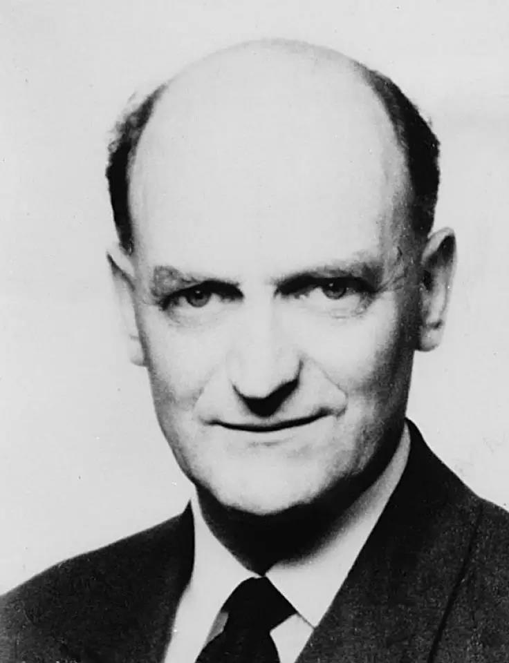

英国经济学家威廉·菲利普斯（Alban William Phillips）

他在论文里面画了一张图，这张图的纵坐标是货币工资的变化率，横坐标是失业率。

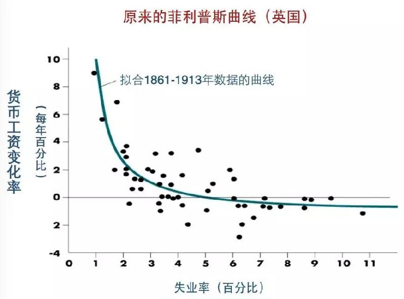

原来的菲利普斯曲线：货币工资越高，失业率越低

他根据英国在 1861 年到 1957 年的统计数据标出了很多点，他把这些点串联起来，能够看到一个从左上角到右下角，倾斜向下的趋势。换句话说，货币工资率跟失业率成反比的关系。这本来是符合常理、不难理解的。

如果一个社会的货币工资率比较高，社会上工资高的时候，人们就愿意出来就业，失业率就比较低；而相反，工资率比较低的时候，人们就会更愿意停下来寻找就业的机会，就业水平就比较低，换句话说，失业率就比较高。

这是货币工资变化率跟失业率之间的反比关系，这本来是符合常理的，容易理解的。

## 2\. 菲利普斯曲线为何失灵

但是不知道为什么，后来的经济学家把当中的一个重要概念改了一下，那就是把货币工资变化率改为通货膨胀率。他们画出了一个新的图，注意这个新的图跟旧的图横坐标不变，都是失业率，但纵坐标就从货币工资变化率变成了通货膨胀率。

这时候经济学家又再往前跨一步，他们说：根据英国的统计数据，失业率跟通货膨胀率之间存在着反向的关系，通货膨胀率越高失业率越低；相反，失业率越高通货膨胀率也就越低。

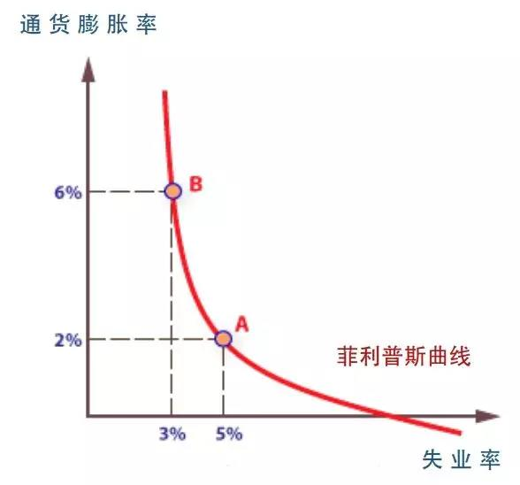

菲利普斯曲线，经济学家把货币工资变化率改为通货膨胀率，表示通胀率越高失业率越低

经济学家菲利普斯的这篇论文在 1958 年发表以后，就有越来越多的人相信，制造通货膨胀是对付失业的一个有效措施。当比较严重的失业率出现以后，政府就可以通过制造一点通货膨胀来解决问题。而事实上，当人们真的付诸行动，真的制造通货膨胀的时候，他们确实看到失业率有所下降了。

原因是什么呢？原因就是我们在昨天讲过的道理，每当发生通货膨胀的时候，新增货币的扩散是需要时间的，人们对通货膨胀来临的认识是需要时间的。在这个过程中，就会迷惑一些人，让人们做出错误的决定。

我们说，当一家餐厅老板发现他的客源滚滚的时候，他最开始可能是不相信的，这可能只不过是一天生意好了而已。一个礼拜以后，老板还是不敢轻举妄动。但一个月以后、两个月以后、三个月以后，老板终于被自己说服了：“这真的是我们经营有方，我们应该扩展、我们应该多招人、我们应该多开分店。”

这时候，被制造出来的通货膨胀就开始收到“ 正面 ”的效果了：雇主开始招人了，人们的收入增加了，人们的消费也增加了，失业率下降了，人们期待的通过制造通货膨胀来对付失业的想法实现了。

但问题是，昨天我们说了，货币像水又像蜜，它在开始的时候像蜜，它的分布是不均匀的，它能够误导人们。但是随着时间的推移，它会向整个社会、整个经济体扩散出去。人们逐渐明白了，这原来只不过是一场通货膨胀而已。我收入增加的同时，我的人工、我的成本、我的铺租全涨上去了。

经济实体之间的相对关系并没有发生改变，而我所做的那些新增投资、我所雇佣的新员工，我那些雄心勃勃的商业计划，可能都是失算的、可能都是错误的。

而终于有一天政府不得不采取行动，抑制通货膨胀的时候，我需要的资金就接续不上了，我正在进行当中的计划可能就要被搁置了，我招来的人可能就得解雇了。这时候，通货膨胀率和失业率之间，那条优美的曲线、亦步亦趋的反向关系，就会被打乱了。

换句话说，一个社会如果人们对通货膨胀预测的能力在提高，那么通过制造通货膨胀来减少失业率的努力，就会越来越失效，这一招就不灵了。

## 3\. 以通胀对付失业可能出现滞涨

事实上在 1968 年两位经济学家，一位是我们熟悉的弗里德曼（Milton Friedman），另外一位是埃德蒙·费尔普斯（Edmund Phelps，1933-），他们两位独立发表了他们的论文，认为在长期内，不存在通货膨胀率和失业率之间的反向关系。

如果政府反复地使用通货膨胀来对付失业的话，失业就减不下去了，到时候有可能会出现通货膨胀和失业同时并存的现象。这就是所谓的滞胀——既存在通货膨胀，又存在经济停滞的现象。

果然，他们说中了。

我给你准备了美国、英国和加拿大通货膨胀率和失业率的关系曲线。你会发现，早期在经济学家预测的模型当中的那条优美的倾斜向下的曲线不见了，取而代之的是好像蜘蛛网一样乱七八糟的曲线，通货膨胀和失业之间没有必然的关系了。

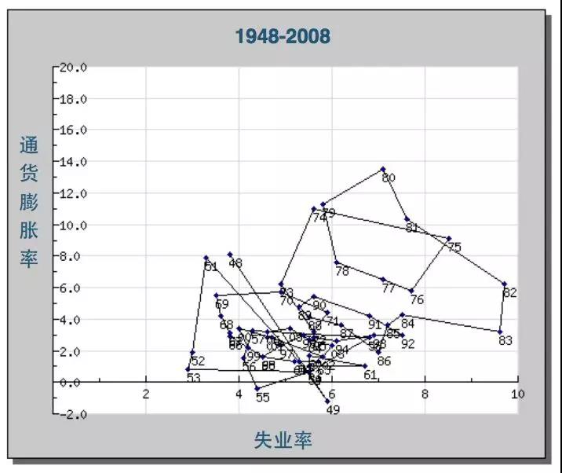

通胀率和失业率的关系曲线（美国，1948-2008）

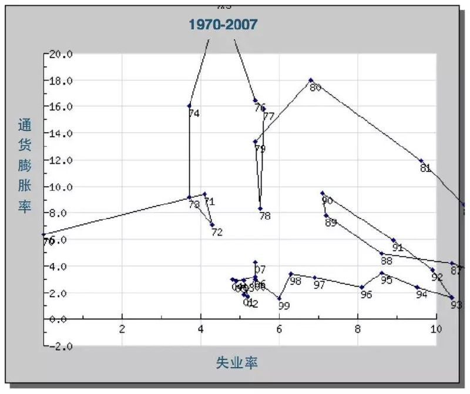

通胀率和失业率的关系曲线（英国，1970-2007）

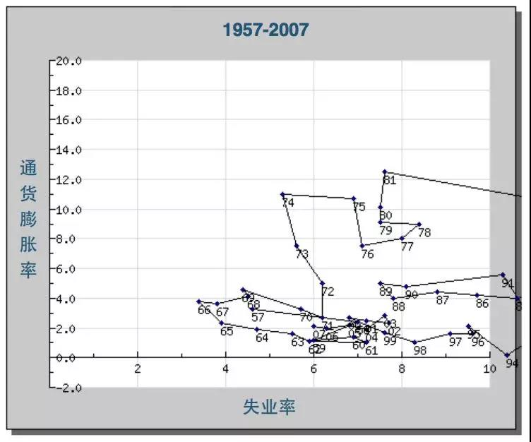

通胀率和失业率的关系曲线（加拿大，1957-2007）

弗里德曼是在 1968 年预言滞胀的可能的，在 20 世纪 70 年代初滞胀就出现了。他因此名声大振，在 1976 年获得了诺贝尔经济学奖。

而另外一位和弗里德曼同期发表相同观点的经济学家，埃德蒙·费尔普斯（Edmund Phelps）运气没那么好，他到了 2006 年，也就是 30 年后才获得诺贝尔经济学奖。

到今天，大多数经济学家都有一个共识，那就是在长期看来，菲利普斯曲线是垂直的。也就是说在长期而言，不论通货膨胀率是多高多低，失业率或者就业率都是一个比较固定的常数。

垂直的菲利普斯曲线（Phillips Curve），是今天大多数经济学家的一个共识。

## 课堂小结

今天我给你讲了失业率和通货膨胀率之间所谓的替代关系，人们曾经相信它们之间是有替代关系的，到今天大家相信从长期而言是没有这种替代关系的。

## 课后思考

今天我留给你的思考题是，当一个社会出现了比较高的失业率以后，政府应不应该有所作为？政府应该做些什么呢？

##### 164

# 第 164 讲  
通货膨胀与汇率 

今天我来给你讲通货膨胀和汇率的关系。

通货膨胀和汇率都是两个加总的宏观经济指标，通货膨胀我们已经密集讨论三天了，而汇率是不同国家之间货币的比价。

我们在讲比较优势原理和自由贸易的时候，还缺了那么一节，就是关于汇率的。我们留在这里，把汇率和通货膨胀率联系起来一起讲。

## 1\. 汇率决定因素之一：国际资源供求关系

一个国家的汇率是怎么确定下来的呢？汇率的确定有几个关键的因素，最重要、最根本性的一点，就是国与国之间资源的供给和需求。

我记得很多年前曾经遇到过一个朋友，我们讲起汇率是由什么决定的，这位朋友当时在美国读 MBA，他很兴奋，他说：

我们刚刚学完这个内容，汇率是由购买力平价决定的，比方说同一种商品在不同的国家里面，不同的货币就应该对相同的商品具有相当的购买力。国与国之间的汇率是根据这个标准计算出来的，这计算最后还要依据很多复杂的公式。

我当时觉得他理解反了，后来还特意写了一篇文章解释这个问题。国与国之间的汇率不是根据什么公式计算出来的，而是人们对他们这两个国家的资源，对那些以他们本国货币标价资源的供给和需求决定的。是这种每一个人对外国货物的需求，以及他们能向外国人提供货物的供给共同决定的。

比方说中国在 2000 年以后加入了 WTO，加入了国际贸易的大潮，逐渐成为世界的制造工厂，生产的产品质优价廉，这时候外国人对中国资源的需求就在稳步上涨。他们愿意以他们手上持有的外币，换取那些在中国国内用人民币标价的资源。而由于他们的需求增加，当他们以手上的外币换取人民币的时候，他们少换得一点人民币也愿意，这就是人民币的升值。

这种升值不是根据什么公式计算出来的，而是根据每一个人真切地对外国货物的需求而决定的，或者更准确地说，是根据他们兑换的实际行动决定的。这是汇率的第一个决定因素，国际资源的供需。

## 2\. 汇率决定因素之二：货币发行量

汇率的第二个决定因素，是一个国家货币的发行量。这也很容易理解。一个国家的货币发行量越大，这种货币跟其他外币的比例就越高。在刚才所讲的国与国之间资源的供需不变的情况下，这种货币的价值就相对下降，也就是贬值。

也就是说，当其他情况不变的时候，如果一个国家不断地增发自己国家的货币，这种货币和其他外币的汇率就会下降，就会贬值。这也不难理解。

## 3\. 汇率决定因素之三：外汇管制

决定汇率的第三个因素，是一个国家实施的外汇管制。我们知道汇率波动是一种风险，对从事国际贸易的人来说，这种风险可能会造成巨大的损失，他们往往希望避免这种失算的机会。

从一个国家来说，一个国家的汇率如果保持稳定，这对国际贸易而言是有好处的。所以有时候一些国家的政府就会强令，通过行政的手段，去控制他们国家货币汇率的变化，也就是说进行汇率管制。

## 4\. 关于汇率的“不可能三角定律”

你看我们刚才讲的三点汇率的决定因素，这三个因素之间就有冲突。

我们说：第一，国与国之间资源的供需决定了汇率；第二，货币发行量又决定了汇率；第三，政府的意愿、政府采取的行政手段又决定了汇率。

这三个因素打起架来谁赢谁输？到这里，经济学就有一个关于汇率的著名的“不可能三角定律（The law of impossible trinity）”。

这个定律是说，对任何一个国家而言，有三个目标都是可取的，都是人们希望达到的：

第一是资本的自由流动，本国的货币和外币之间可以自由地流动、自由地兑换。这是一件好事。

第二件大家希望达到的好事，是汇率稳定。稳定的汇率对国际贸易而言特别有好处，政府希望达到一个稳定的汇率。

第三件好事，是很多政府希望通过中央银行来调节本国货币的流通量。通过调节本国货币的流通量，来影响国民经济的发展。

比方昨天我们谈到的，有很多政府还相信通过制造通货膨胀能够抑制失业率，至少能够在短期内抑制失业率。也就是说货币自主政策，中央银行能够自主地调节货币发行量。这是各国政府希望达到的一个目标。

“不可能三角定律”说的是，在刚才说的这三件好事当中，任何政府只能占两件，不能三件好事都占了。外汇自由流动、稳定的汇率和货币发行量的自主权，这三者任何政府只能任意选择两个，而不能三者兼有。

## 5\. 香港的货币局制度：放弃发钞权

比方说当年的许多英国殖民地，包括香港，他们实施的是所谓的“货币局制度（Currency Board）”。在这“不可能三角定律”里面，他们选择了外汇自由流动和固定的汇率这两项。

在香港，外币跟港币之间是自由兑换的，而同时港币跟美元之间的汇率是永远不变的，钉在了一美元兑 7.8 港元之间。在“不可能三角定律”里面选了这两个选项以后，第三个选项，也就是货币当局对货币流通量的控制权就得放弃。

在香港，金融管理局没有能力去控制港币的发行量，整个港币的发行制度，跟我们以前很多大学里面发行的菜票、饭票是一样的。你拿一块钱来就换一块钱的菜票，你用不完把一块钱的菜票还给学校，学校就还你一块钱。在赌场里面的筹码也是这样的制度。

一块美元就换 7.8 港元，7.8 港元也能换一美元，实际上港币只不过是美元的代币，整个香港实际上流通的是美元。如果美元发生通货膨胀，香港就发生通货膨胀；如果美元发生通货紧缩，香港就发生通货紧缩。

理论上讲，香港的整个货币管理局只要一台计算机，就可以自动完成所有的兑换任务了。它对港币的流通量没有酌情权，也就是说没有调节的能力，这样做有一定的好处，那是因为滥发货币制造通货膨胀，是许多政府难以抑制的诱惑。

通过这种货币局的制度，比如港币跟美元挂钩的制度，就把货币当局调控港币发行量的双手给绑起来了，他们只能无所作为，这对一个小地区而言是有好处的。

他们的潜台词是：“我们相信美国人在发行货币的时候会更谨慎，我们把我们的小船绑到了美国这艘大船上面，这总是安全一点的，万一连这艘大船都沉没了，我们也没话可说了。”

## 6\. 大国不宜放弃发钞权

当然，这种制度对一个大国而言就不合适。为什么？因为前面我们已经解释过发行货币的当局，他们会赚取所谓的铸币利差——铸币税，谁发行货币谁赚钱。如果一个泱泱大国用的是别国的货币，那么那个发行货币的国家就赚大了。

因为货币是负债证明书，在流通当中的货币总是不需要兑换的，发行货币的人无中生有地发行了货币，就获得了他们的购买力，而永远不需要用真实的货物来偿还。

所以在很多比较大的国家，他们是有中央银行的，而不是一个简单的货币局，中央银行是可以控制他们本国货币的发行量的。

这样的话，“不可能三角定律”他们先占了一个——货币的酌情权，而他们就只能在剩下的两个选项里面——外汇的自由流动和固定汇率当中做一个选择。

有些国家选择了外汇自由流动，他们国家的汇率，就是在市场上每天、每小时、每分钟都在波动的。

而有些国家，他们要追求稳定的汇率，如果真要这么做，他们就不得不放弃外汇的自由流动这一个选项，他们就只能对外汇进行这样或者那样的管制。比方说，你要换外汇一定要到指定的地方换，一定要按照规定的汇率来换，每天每人只能换多少等等。

## 课堂小结

我给你总结一下，今天我给你讲了汇率的三个决定因素：

第一，国与国之间对真实资源的供给和需求；

第二，一个国家货币发行量的变化；

第三，一个国家的政府对外币兑换所施加的各种管制。

接着我给你介绍了经济学里面非常重要的“不可能三角定律”，这个定律是说，任何一个国家在三个可取的选项当中，也就是资本的自由流动、汇率的稳定性和本国货币流通量的控制权这三者当中，只能任意选择两个，不能三个兼有。

## 课后思考

今天留给你的思考题是，你认为对一个国家的普通老百姓而言，他们本国货币对外币的汇率，是高一点好还是低一点好呢？为什么？

##### 周

# 第 41 周问答  
通货膨胀买房好不好？ 

我们开始本周的问答时间了。

这个礼拜我们集中讨论跟通货膨胀相关的宏观经济学问题。古往今来，哪怕是在很原始的社会形态里面，人们都需要使用货币，几乎任何一种物品都曾经被尝试过用来做货币。但是货币这种协调工具，是在人类不断试错的过程中，才得以不断的改善，变得更加巧妙、更加灵敏、更加有效的。

人类社会至今还没有制造出一种完美的货币工具，主要原因是货币同时受好几个因素的共同作用，要在这些不同因素之间取得平衡，现实当中并不容易拿捏。

货币这种协调工具打磨得好的一个重要标准，就是一个国家的价格水平应该是稳定的。

## 1\. 货币政策的主要目标：物价稳定

记得在 1996 年，美国联邦储备局曾经组织过一次学术会议，参加会议的不仅有当时的联邦储备局主席格林斯潘（Alan Greenspan），还有一群著名的研究货币问题的宏观经济学家，包括史丹利·费希尔（Stanley Fischer，美联储副主席）、劳伦斯·萨默斯（Lawrence Summers，第 71 任美国财政部部长）和马丁·费尔德斯坦（Martin Feldstein，白宫经济顾问委员会主席）。

在这个会议上，联邦储备局主席格林斯潘明确地说道：“我们货币政策的目标就是要保证物价的稳定。所谓物价稳定，就是每一个经济人在他们做出经济决策的时候，再也不需要考虑未来物价水平的变化了。”

参加会议的所有官员和学者都对此表示赞同。但问题是怎么才算物价稳定呢？有些经济学家论证说，通货膨胀率在 1%到 3%之间就算是物价稳定了；有些经济学家则说，得 1%到 2%之间才算是物价稳定；而有些经济学家则强烈建议，通货膨胀率必须是 0 才算是物价稳定。

但不管怎么样，经过长期的讨论大多数经济学家都认为，通货膨胀率应该比 0 稍微高出那么一点点，1%、2%，顶多 3%，这样才是最合适的。为什么不是 0 最合适呢？因为这当中往往会出现统计的误差，如果把通货膨胀的目标瞄准在 0 的话，一不小心就会弄出一个负的通货膨胀率，也就是通货紧缩了。

一旦出现通货紧缩，要在劳动市场上让人们下调工资，感情上就不容易接受。所以通货膨胀率还是宜高不宜低，在 0 以上留那么一点空间，算是劳动力市场的润滑剂。

## 2\. 央行独立性越高，通货膨胀率越低

要打磨好货币这种协调工具，除了设定一个比较理想的通货膨胀目标以外，增加中央银行的独立性也非常重要。经济学家很早就发现一个规律，那就是一种货币的稳健会受到两种因素的影响：

一是经济因素的影响。新技术的冲击，战争与和平的冲击，贸易壁垒的建立和打破的冲击，甚至自然灾害的冲击，都会对物价的一般水平造成影响。

而另外一个重要的因素是政治的因素。经济学家发现，一种货币的通货膨胀周期，经常跟这个国家的政治活动周期有相关性。比如选举的年份，不同政党交替执政的年份，不同经济理念的政治家执政的时间，都跟通货膨胀发生的节奏有着明显的因果关系。

正因为是这样，要打磨好货币这种协调工具，就要增强中央银行的独立性。

这种经验在世界各个国家推行以后，经济学家就发现，一个国家中央银行的独立性，跟这个国家货币的通货膨胀率呈反比的关系，也就是独立性越高通货膨胀率就会越低。

## 3\. 央行应专心对付通胀，不宜兼顾太多职责

要打磨好货币这种协调工具，还有一个非常重要的经验，那就是要让中央银行专心对付通货膨胀，一心不能二用，不要让中央银行同时兼顾就业问题。

我们这个礼拜介绍了垂直的菲利普曲线的含义，意思是说，从长期而言通货膨胀率和失业率之间没有任何关系。正因为这样，我们就不应该通过制造通货膨胀，在短期内改变就业的情况，因为这么做除了短期的误导市场以外，没有任何的好处。

有远见的中央银行，就不应该把就业问题当做他们的任务。世界各国的经验也表明，任务越单一的中央银行，他们的通货膨胀率就越低，他们的货币就越坚挺、越可信。

而那些目标多元化的中央银行，既要管通胀，又要管就业，又要对付经济周期，又要管扶贫安康。这种多任务的中央银行，他们在对付通货膨胀的问题上，成绩就比较差。

## 4\. 通货膨胀为何对经济发展不利

我们来看看本周的思考题。

周一的问题是，通货膨胀只不过是货币数量不断增加而已，而货币本身只不过是一个记账的符号，如果每个人的工资、收入、支出都加一个零的话，那对真实生活会有影响吗？为什么？

慢魚 同学回答：

要是所有人的收入支出都加个零的话，理想的封闭系统是可能没有差别的，不影响已有的平衡。但实际上，收入和支出是不可能同时、等比例增加的。

我觉得 慢魚 同学的回答谈到了问题的重心，那就是我们在周二的时候介绍的概念，货币像水也像蜜。

在通货膨胀的效果平均地扩散到每个人身上以前，有些地方、有些行业、有些个人，对通胀的感受就比较深、比较快；而其他的地方、其他的行业、其他人感受就比较浅、比较慢。这时候这种不均衡的状况就会误导人们的经济决策。这也是我们为什么普遍地认为，通货膨胀对经济发展不利的原因。

## 5\. 避免通胀的最佳办法就是控制货币发行

周二的问题是，既然通货膨胀有这么多不良的后果，那么要避免通货膨胀，你认为最有效的办法是什么？

我们前面解释过，为了遏制通货膨胀，有些人主张使用金本位，回到金本位，因为金子是一种稀有金属，它的数量有限，不可能仿造。但金本位其实并不绝对可靠，金子虽然是稀有的，但忽然发现一个巨大的金矿也不是不可能的事情。而金子也还有其他的用途，比如在工业上、在民用上，而这些用途也会影响金子作为货币的流通量。

上个礼拜我们也分析过，像比特币这种固定数量的电子货币也不可靠，也有问题，如果用它来作通行的货币，那会引发持续的通货紧缩。

有些学者主张，把中央银行所要保持的通货膨胀目标写到宪法里面去，做一个硬性的规定，把这个目标定作 2%、3%，具体多少没关系，只要固定下来谁也改动不了，那就行了。

这种做法也不一定可靠，这是由于一个国家的经济体，它的生产总值会发生变化，而货币的流通速率也会发生变化。我们看看货币数量论的公式就可以知道，如果 Y 和 V 都在变的话，M 和 P 之间的关系就不能稳定下来。

当然在这里不得不提的是，有一些经济学家还提出过自由银行的概念，那就是给予商业银行自由发钞的权利，让他们自己发行的货币在市场当中自由竞争。

这个想法是有他合理之处的。其实今天每个国家都有自己的货币，这些货币就在全球金融市场上面互相竞争，越是坚挺、方便、可靠的货币，就越能得到人们的采用。

问题只不过是今天互相竞争的这些货币都是国家发行的，不是私人银行自由发行的而已。你可以理解成今天的货币市场是国营企业之间在竞争，而这些自由银行的主张说的是，不仅要让国营企业之间互相竞争，而且要让私人企业也参与竞争。

这种自由银行体系的想法，经济学家哈耶克（F.A.Hayek）就曾经讨论过，到今天也还在被持续讨论。而历史上有许多的商业银行，包括中国的钱庄，采用的也是接近于自由银行的体系。但在今天自由银行制度还没有找到机会，好好地再做一次实验。

对于我们应该怎么应对通货膨胀的问题，XTANK 同学回答说：

从微观而言，也就是针对个人而言，应付通货膨胀的办法就是不断地修炼自身的技能，提高自身的竞争力；另外就是要合理投资，购买实物资产、股票、基金等抗通胀的产品。

而从宏观而言，也就是对国家而言，避免通货膨胀的办法就是要控制货币的发行；另外要加大对基层教育的投资，培养更多新时代的商业领袖、科学人才等等，用技术和商业创造出更多物美价廉的产品。

## 6\. 不应该通过制造通货膨胀来减少失业

周三的问题是，当一个社会出现了比较高的失业率以后，政府应不应该有所作为？政府应该做些什么？

关于失业的问题，我们前面在讲公司内部治理的时候详细讨论过，我们说失业是一种个人的选择。一个工人他在被解雇的那一刻可能是非自愿的，但是在之后一个小时内，他如果还没有找到新的工作，那就肯定是自愿的。

因为劳动力是一种稀缺的资源，所以世界上到处都有工作，工作是充分的，但人们不会一见到工作就做。人们会花时间去搜索，寻找值得做的事情来做，而越是有钱的人、越是有积蓄的人，他们越是付得起寻找的成本，失业其实是一种信息搜索的过程。

也正是因为这样，失业也跟失业者得到的补贴有关，补贴越高人们失业的时间就会越长。你看欧洲很多高福利国家，他们的失业率很高，那是一个结果，那是因为他们国家对失业者进行大量的补贴而造成的。

更重要的是，我们说失业其实是一种劳动力过剩的现象，过剩就是必须搭配其他的竞争才能卖出的商品，过剩的根本原因就是价格被人为地提高了。很多国家往往在实施一些不合实际的最低工资政策，这些硬性提高最低工资的做法增加了工人失业的可能。

所以当一个社会出现了比较高的失业率以后，政府确实应该有所作为，他们应该减少对失业的补贴，他们应该鼓励企业家创业，他们应该增加劳动力市场缔结合约的自由度，解除劳动法当中种种不必要的限制，修改甚至是废除最低工资法，鼓励劳动力和资本的自由结合。这些都是政府应该针对失业而采取的有效措施。

而政府不应该做的事情，是通过货币政策人为地制造通货膨胀，在短期内误导经济、误导就业，因为长期而言，通货膨胀率和失业率之间没有必然的关系，所以我们不应该通过制造通货膨胀来减少失业。

## 7\. 汇率过高或过低都不好，只有合适的汇率才最好

周四的问题是，你认为对一个国家的普通老百姓而言，他们本国货币的汇率是高一点好，还是低一点好呢？为什么？

我们知道，一个国家货币的汇率，其实是这个国家货币的价值，更准确地说是这个国家以这种货币为标价的各种资源的价值。你说一种资源的标价是高一点好还是低一点好呢？答案是高也不好、低也不好，适当的才好。

一个国家的汇率过高，人们就会抛售这种货币，换取其他的货币来持有；反过来，如果一个国家的汇率过低，那就会使得这个国家的资源标价过低，这个国家的资源就会源源不断地输到国外，这相当于贱卖了这个国家的资源。这也不合算，所以只有合适的汇率才是最好的。

当然，短期来说，一个国家汇率高的话，购买外国货的老百姓得益了；一个国家货币的汇率过低的话，向外国人出售自己制造的商品或者自己提供的服务的老百姓得益了；但全局来看，只有合适的汇率才是最好的。    

周五辩论

周一到周四我给大家留了思考题，今天是礼拜五，我给大家留个辩论题，大家一起辩论。

我们刚才谈到了对付通货膨胀的办法，当然经常被人采用的一种办法就是购买房产，我们今天就来辩论一下：在通货膨胀期间买房到底好不好？

正方认为：在通货膨胀期间买房是一种很好的办法，因为货币不值钱了，实物才值钱，而房屋就是用大笔资金购买的实际物品，所以不管房子有多贵，它都能够起到很好的抵御通货膨胀的作用。

反方认为：在通货膨胀期间买房不是好事儿，因为在通货膨胀期间，房屋的价格都被争夺房屋的人哄抬得过高了，而通货膨胀肯定不能够永久地持续，它总有慢下来、停下来的一天，这时候泡沫就会破灭，房子就不值那么多钱了。如果这房子是借钱买来的话，那买房的人就不仅不会赚钱，还会背上债务。

欢迎大家参与辩论。

##### 165

# 第 165 讲  
对抗经济周期的货币政策 

今天我来给你讲世界各国对付经济周期，两大常用办法当中的一个——货币政策。

整门宏观经济学的兴起一个很重要的背景，就是经济周期。

正是因为在现实当中，自从 1929 年美国发生大萧条以后，世界各国不断经历大大小小的经济周期，才使得经济学界产生了一个持久而且迫切的需求，就是要好好地研究经济周期到底是怎么回事，我们能不能通过什么样的人为干预办法来调节经济周期。

好的学术问题都是由现实的困难激发的，经济学家在理解分析经济周期产生的根源、发生的过程以及应对措施的过程中，形成了不同的经济学派。但是不管哪一种经济学派，他们之间都有一个基本的共识或者说都有一个共同的梦想，那就是他们通过宏观经济调节希望达到的目标。

## 1\. 调节宏观经济的四个目标

他们希望达到的目标概括起来有四点：

第一，要消除经济周期，实现生产、就业、财富的稳步增长，波动变化越小越好，未来的变化越稳定、越能够预测越好。

第二，要实现低的或者平稳的通货膨胀率，最好是通货膨胀率为零，通货膨胀不是好事情。

第三，要实现高的就业率，人人都有工作做，想要工作就能找到工作，所有的资源，尤其是人力资源都能够被充分地调动起来，不会被长期闲置，不会被浪费。

第四，要实现生产力的高速增长、GDP 的高速增长。

你看这四个目标，没有波动、低通货膨胀、高就业率、高经济增长率，都是好事，它们能同时实现吗？不管怎么样，宏观经济学在很大程度上，就是经济学家们为了达到这四个目标，进行学术讨论和政策实践而逐渐形成的。

要消除经济周期的波动，也就是说要对抗经济周期，要逆经济周期而行，最直接的办法，就是动用经济体当中最强大的政府力量。政府能做什么呢？政府基本上能做两件事情：

第一是采取货币政策，这是今天我们要讨论的；第二是采取财政政策，明天我们讨论。

## 2\. 调节货币流通量的三个办法

所谓的货币政策，就是政府通过调节经济体当中货币的流通量，来调节经济的发展，从而起到逆经济周期而行的效果。世界各国的政府，是怎么样调节货币的流通量呢？

1）控制基础货币发行量

我们前面讲中央银行作用的时候已经提到过，中央银行往往能够决定一个经济体内经济货币的发行量，造硬币、印钞票，发行这些基础货币。改变基础货币量，这些基础货币就能够在商业银行的不断借贷当中以倍数新增货币，从而改变经济体内货币的流通量。

2）调整商业银行存款准备金率

你还记得我们前面讲过“商业银行具有创造货币的功能”，在这个创造货币的功能过程中，中央银行对商业银行规定的准备金率，起到了很重要的限制作用。

如果商业银行不需要提取准备金，它不断借贷的过程就能够把基础货币放大无限倍，但有了准备金的要求，每一次借贷，商业银行都要预存一笔准备金。这时候它新增货币的乘数、它新增货币的本领就受到了限制，它新增货币的乘数就有一个上限。

调节准备金率是中央银行控制货币发行量的一个办法，虽然这种办法不常用。 

3）通过公开市场买卖债券

政府还可以在公开市场上买卖债券来影响货币的流通量。

政府大量地买入他们发行的债券，就能够收回债券，同时向社会发放货币，增加货币的流通量；反过来，如果政府出卖债券，那就能够把在社会上流动的资金给收回来。这也是一个中央银行控制货币流通量的办法。

## 3\. 一个被误解的货币政策：央行调节贴现率

中央银行除了调节基础货币量，除了调节它对商业银行所规定的准备金率，除了政府通过在公开市场上买卖债券，来影响社会中的货币流通量以外，人们还常常认为中央银行还有另外一个控制货币发行量的手段，那就是调节贴现率。

在美国也就是调节联邦储备局的贴现率（The FED discount rate），我们时不时就会在财经新闻上听到这样的消息，说联邦储备局又宣布要调节贴现率了。每次美联储要调节贴现率都是大新闻，它调节完贴现率以后，其他各种不同的利率也会随之做出调整。

经济学家、市场分析师就有各种各样的说法，来分析这样的事件。

但你只要跟着我们的课一直学下来，特别是如果你在价格理论上面花了工夫去思考，如果你还记得经济学家德姆塞茨（Harold Demsetz）所说的一句话——

自从亚当·斯密到欧文·费雪这 150 多年来，经济学最大的教训、最大的成就，就是建立了一个抽象的模型，在这个抽象模型里面，没有任何个人、没有任何单个组织，能够影响那些最重要的市场指标。当然就包括了价格、汇率、利率等等。

如果你记得这些内容，你就会发生一个疑问，那就是为什么在利率问题上，美国联邦储备局有这么大的权力？它说往上调全社会的利率就往上调，它说往下降全社会的利率也跟着往下降，这跟我们前面学过的内容是不是有点冲突呢？

利率按照我们前面讲课的内容理解，是人们用现货和期货之间进行交换的比价，这个比价取决于人们的耐心程度，而人们的耐心程度，是取决于人们在每一宗交易当中所受到的真实世界因素的影响的。

联邦储备局的几个官员，怎么能有力量对抗无数人在一个一个具体交易当中形成的价格汇总呢？

真实的情况其实是这样的：

联邦储备局是银行的银行，它是所有商业银行的后盾，它也是所有商业银行的管理者，这时候，银行之间如果出现了流动性困难，也就是短期的缺钱，（你记得吗？由于商业银行具有创造货币的能力，真实的货币量跟市场上、账面上体现的货币总量不相符，如果人人都去提款的话，那真实的钱是不够的，这是流动性困难），中央银行要帮助所有的商业银行，应付流动性不足的困难。

所以联邦储备局向所有商业银行承诺，他们如果急着借钱的话，可以向联邦储备局借钱，而借钱的利率要比市场上流行的利率稍微低那么一点点，这是鼓励各家商业银行真的有需要的时候可以来求助。

但是联邦储备局所提供的这个利率，也不会比市场流行的利率低多少，因为如果太低了，那么商业银行就会有套利的欲望，故意来向联邦储备局借钱再贷出去赚钱。

而事实上，商业银行很少向联邦储备局借钱，他们之间互相帮忙就几乎能够解决 95%以上的困难，所以联邦储备局向商业银行所许诺的这个借款服务，以及它所提供的稍微优惠一点的贴现率，实际上只有象征的意义。

而联邦储备局隔三差五在新闻媒体上面发布的、他们要调整的贴现率，也就是这个具有象征意义的优惠贴现率而已。

## 4\. 联邦储备局只是市场利率变化的汇报者

但为什么它的影响这么大呢？那是因为联邦储备局对市场利率的变化做大量的研究，它总是跟随市场变化而变化。

而其他的经济组织，他们做的研究往往没有联邦储备局做得深入、准确、及时，所以他们是盯着联邦储备局的变化而变化，这样比较省事。

也正是因为这样，每次联邦储备局要开会，要决定利率的升降之前，市场的灵通人士，几乎总能够准确地预测联邦储备局调节利率的方向和幅度，八九不离十。

但不管怎么样，正是因为这个时间上的顺序，使联邦储备局先做出了关于贴现率的升降决定，而其他的金融机构跟随。这个时间顺序使得人们产生了一个误解，以为这也代表了逻辑上和因果关系上的顺序，以为是联邦储备局对贴现率的调节影响了市场贴现率或者利率的调节。

而事实上，联邦储备局只不过是反映了、汇报了市场利率变化的走向和幅度，而不是决定了市场利率变化的方向和幅度。联邦储备局是一个汇报者、是一个信使，而不是一个决定者、操纵者。

联邦储备局能不能够控制货币发行量？可以的，它通过影响基础货币量或者它在公开市场上买卖债券，都能够影响货币的流通量。但改变它自己，向商业银行提供贷款的贴现率，本质上只能够是反映市场利率变化的方式，而不是决定市场利率的方式。

## 课堂小结

我给你总结一下，我们今天讲了人们希望能够逆经济周期而行，提出了宏观调节的四大目标。

而要实现这四大目标——低的经济波动，低的通货膨胀率，高的就业率以及高的生产力、增长率——政府通常可以采取两大类的政策：一类叫货币政策，一类叫财政政策。

而我们也分析了货币政策当中，哪些方式是真正有效的，哪些只不过是人们误以为它有效的。

## 课后思考

今天留给你的思考题是，在做贷款买房的时候，利率的高低对你买房的决策应该有多大的影响？为什么？

欢迎你给我留言，我们下节课再见。

##### 166

# 第 166 讲  
对抗经济周期的财政政策 

今天我给你讲的内容是对抗经济周期、反经济周期，政府所能够采取的另外一种非常重要的手段，那就是财政政策。

政府反经济周期的措施主要是两种：货币政策和财政政策。昨天我们介绍了货币政策，今天集中讲财政政策。

财政政策是说，在经济不景气的时候、在总需求下降的时候，在人们没有信心、不愿意花钱的时候，政府主动地替人们花钱；在雇主不愿意雇人的时候，政府成为最大的雇主，雇人来修建一些工程；在私人不愿意投资一些项目的时候，政府主动地去投资一些项目。

昨天讲的货币政策，讲的是政府直接干预经济体中货币流通的总量，而财政政策讲的是在不改变货币总量的情况下，政府怎么通过税收多挣点钱，而且怎么把这钱花出去。政府采用财政政策来对付经济周期，听上去是言之成理的，但执行起来会遇到一些普遍的困难。

## 1\. 财政政策困难之一：时间滞后

第一个困难是时间滞后的困难（time lag）。

你要看在整个财政政策执行的过程当中，有几个重要的环节：

当经济体出现了问题，这是一个时间点；

当人们确认这是一个问题，这是一个持久的问题，而不是转瞬即逝的日常波动，这个判断本身就需要一段时间；

确定了问题存在，提出解决方案需要一段时间；

把这个解决方案拿到国会、拿到政府里面去通过，又需要一段时间；

当这些对抗经济周期的政策真的付诸实施，那又是另外一个重要的时间节点；

这些经济措施能够逐渐见效，它还得花一段时间；

再对这些经济措施进行评估，那至少是两三年后的事了。

到两三年以后回过头来看，当初要解决的问题可能已经面目全非了。

时间滞后的问题持续出现、普遍存在，这使得经济学家越来越相信，政府即使有本事调节经济，反经济周期而行，它也不能对经济进行微调了，它只能进行大方向的调整，小的调节其实是做不到的。

## 2\. 财政政策困难之二：政府支出排挤私人支出

各国政府普遍采用财政政策还遇到第二个天然的困难，那就是政府的支出和私人的支出总是互相排挤的。政府多花一点钱，私人就少一点钱可花。

我们前面讲过的破窗理论说的是，一个顽童把别人家的玻璃窗给打碎了，这种破坏性的行为会引发一连串的生产行为：

有人要造玻璃窗，造玻璃窗的人拿了工资以后就会去消费，就会去买面包、买牛奶，于是就会产生一个乘数效应，也就是一个玻璃窗的钱诱发了、刺激了社会上相当于好几个玻璃窗价值的生产。这就是所谓的乘数理论。

这个理论的含义是说，政府每花一块钱，它就能带动好几块钱的社会生产。比方说，好几年前就有经济学家测算过，政府如果举办一次奥运会，在奥运会上花一块钱，就能够带动好几块钱的旅游消费，这笔账本身算得是对的，政府支出有乘数效应。

但问题是，私人支出也有乘数效应。这一块钱如果是由私人花出的，它也能够带动一系列的生产和服务。

所以恰当的问题，不是讨论政府的支出有没有乘数效应，而是讨论一笔钱由政府支出带来的乘数效应大，还是由私人来开销带来的乘数效应更大。

政府的支出往往用在一些大型的工程上面，这些大型的工程调动的资源比较集中，他们完成以后比较容易被人们看见；但如果同样的一笔钱，由分散的私人支出就不容易被看见。

但是不容易被看见并不等于没有效果，我们说通过经济学的角度来看问题，有一个很重要的收获，就是要训练自己学会~看见那些看不见的东西。

一个巨大的体育馆修好了，这是比较容易看见的，但这还不够，我们还要问这个大型的体育馆使用率怎么样，它用来干什么了？它让谁得益了？如果修建这个体育馆的钱落在私人手上，他们又会花在什么地方？对私人的福利又有什么样的改进？

如果这些钱用在教育上，如果我们国家的每一位儿童，在 15 岁以前，都有一次出国学习游玩的机会，哪怕只有一个礼拜、两个礼拜，这对他们的人生又会产生什么样的影响？这些效果很不容易被看见，但却很重要。

## 3\. 财政政策困难之三：政府花钱效率低下

政府采用财政政策遇到的第三个很重要的问题跟挤出效应相关，那就是政府的效率问题。

现代社会的政府，尤其是那些民主体制下面的政府，它的规模已经变得非常庞大了。

有一个简单的证据来看美国政府的规模，那就是看美国联邦政府在每一个工作日都发布的联邦政府公告，他们叫做 Federal Register，译成中文可以叫《联邦政府纪事》。这是一本像书一样的小册子，联邦政府每天所发布的总统文件、规则和管制，还有各种建议当中的规则，还有各种公告，全都体现在《联邦政府纪事》当中。

在哪儿买？你可以购买它的全年订阅，全年订阅多少钱？我知道 2010 年的定价，全年是 929 美元，大概是今天 6500 块钱人民币的样子。我刚才说了，它每个工作日都发布，一年下来有多少页？有 81000 多页。

也就是说，你每个工作日都要了解一下联邦政府有什么新的规定，你要从头到尾读一下这个《联邦政府纪事》，每天平均得读 300 多页，没有谁能够读得过来。从这个角度看，你说联邦政府的规模有多大。

政府花钱的效率又是怎么样的呢？经济学家弗里德曼讲过，花钱有四种模式：

第一种是花自己的钱替自己办事，那得小心翼翼，要什么才买什么；

第二种是花自己的钱替别人办事，那只要花了，做到家了，就可以了。去医院探望住院的朋友，在医院门口买点香蕉和苹果，至于病人是不是真的喜欢吃香蕉和苹果，那不重要，心意到了就行；

第三种花钱方式是花别人的钱替自己办事，那也会特别慷慨。

第四种是花别的钱替别人办事，这种花钱方式可能是最粗心大意的。

1982 年，当时的美国总统里根组织过一个委员会，叫 The Grace Commission，我们姑且把它译作“体面委员会”。这个委员会由 161 位在美国私营企业担任首席执行官的人自愿加入，他们的任务就是根据他们在私营企业工作的经验，去检查美国政府部门的浪费现象，他们发现的例证真是令人叹为观止。

比方说，美国海军要处理一份工资付款要花一美元，而 IBM 和通用汽车只需要花费两毛钱；退休军人管理委员会写一封信需要 20 天，而私人机构写一封类似的信只需要一个小时；私人公司通常有一种工资系统，而美国联邦政府当时采用了 330 种不同的财务系统以及 300 种不同的工资系统。

1975 年，美国科学基金 NSF（National Science Foundation），花费了 84000 美元的研究经费，研究人们为什么会爱上别人；美国邮政局花费了 340 万美元，研究如何通过做广告的方式鼓励美国人多写信；美国的国家高速公路安全管理局，花费了 12 万美元，研究了一种可以倒着开的摩托车，而这种摩托车是没有人会骑的。

## 4\. 财政政策困难之四：资金来源有限

政府采用财政政策，除了怎么把钱花得合理以外，还有另外一个重要的问题，就是钱从哪来。

当然，政府自己不会挣钱，它只能通过收税来寻找收入。随着政府开支的增加，不断地提高税率，能够帮助政府收到越来越多的钱吗？不一定。跟私人卖东西不是价格越高，他赚到的利润越多的道理一样，政府不断地提高税率，它收到的税收可能反而会下降。这就是经济学家拉弗提出来的“拉弗曲线”。

拉弗曲线：当税率超过一定限度时，税率越高政府税收收入反而越少

据说在 1974 年 12 月，当时还是大学教授的阿瑟·拉弗（Arthur Laffer，1941 年 8 月 14 日-），他和当时的几位政府高官，包括后来成为美国副总统的迪克·切尼（Dick Cheney），和后来成为美国国防部长的拉姆斯菲尔德（Donald Rumsfeld），在餐厅吃饭。拉弗为了讲这个道理，讲政府提高税率也不一定能够提高税收的道理，他在餐巾纸上画了一条著名的拉弗曲线。

当然后来的人采访拉弗，问他有没有这件事情，他说他不记得这件事情了。而且他说，那家餐厅是一家很好的餐厅，用的是餐巾布，他奶奶从小就教育他要有教养，所以他应该不会做在高档的餐厅里，在人家的餐巾布上乱写乱画这种行为。但不管怎么样，这个故事成为了美谈。

拉弗曲线的概念不胫而走，甚至对各个国家的税收政策形成了持久的影响。拉弗曲线的重要含义是，政府不断提高税率，收入可能会降低，而政府减税可能有助于促进经济效益，他们最终收到的税收可能反而会更多。

## 课堂小结

我给你总结一下，今天我给你介绍了财政政策的含义，同时也讲了财政政策遇到的四个重要的困难：第一是时间滞后的困难；第二是挤出效应，政府支出和私人支出之间互相排斥的关系；第三是政府的效率问题；第四是政府资金来源的问题。我还给你介绍了著名的拉弗曲线。

## 课后思考

今天我留给你的思考题是，有不少主张提高针对富人税率的经济学者认为，富人努力工作是他们的本能，哪怕是提高了税收，他们也仍然会努力工作，甚至会更努力地工作，你觉得这种说法有道理吗？为什么？

##### 167

# 第 167 讲  
奥地利学派看经济周期（上） 

今天和明天我给你讲奥地利学派是怎么看经济周期的。

我们说宏观经济的一个重要起源，是由于大家都对经济周期的问题感兴趣，从问题出发刺激了这门学问的发展。面对同样的经济问题、同样的经济周期，不同的学者提出了不同的理论。一个学派跟着一个学派，层出不穷，好戏连场。

我们接下来就一个学派一个学派地介绍，他们对经济周期的不同看法，而首先要介绍的是奥地利学派。

## 1\. 三个经济学派

在各种经济学派当中，给我自己经济学的体系影响最深的是三个学派：

第一是芝加哥学派，前面我们在讲反垄断法的时候，我们比较深入地介绍过芝加哥学派的看法。

第二是奥地利学派，奥地利学派对经济学的贡献非常大，由它发展的一些基本概念，已经变成了经济学的重要组成部分。以至于没有人再去归功，说这是奥地利学派的东西了，因为它就属于经济学内在不可以切割的最重要内容了。

第三是公共选择学派，我们在后面再讨论那些非市场的组织，包括政府、包括非营利组织、包括科研机构等等，他们在做决策的过程中所遵循的经济规律的时候，我们会详细地讨论公共选择学派的贡献。

## 2\. 奥地利经济学派的兴起

而今天我先给大家介绍奥地利学派的核心理论。

我们前面在讲利息理论的时候，在第 19 周的问答中，已经略微提到过奥地利学派的兴起。我们说奥地利学派最早是两位经济学家，卡尔·门格尔（Carl Menger）和他的学生庞巴维克（Eugen Bohm-Bawerk）共同创立的。

而奥地利学派这个标签，是由他们的理论对手提出来的。他们的对手是当时德国的历史学派——经济学当中的一个学派。他们主张的是，在经济现象当中不存在普适的规律，每一个经济事件都有它发生的独特环境，我们只能就事论事，一件事情和另外一件事情之间没有必然的联系，它们背后没有客观的、普适的经济规律。

但是门格尔和庞巴维克却认为，纷繁复杂的经济现象背后有一般性的规律。比方说，由门格尔总结的边际的概念，这就具有很强的普适性。当时的历史学派在奥地利的维也纳大学里面占上风，他们就把门格尔和庞巴维克戏称为奥地利学派，是带有讥讽成分的。

而事实上，奥地利学派就没有继续在奥地利发展了，他们的研究方式、研究的范围、研究的思想转移到了欧洲，转移到了英国，其他不同国籍的学者也加入了这个阵营。

所以今天我们在讲奥地利学派的时候，我们指的不仅仅是门格尔、庞巴维克、哈耶克（Friedrich Hayek）、米塞斯（Ludwig von Mises），我们把英国的经济学者亚当·斯密（Adam Smith）和大卫·休谟（David Hume）也能加进去；把美国的学者欧文·费雪（Irving Fisher），甚至是布坎南（James M. Buchanan, Jr.），甚至是科斯（Ronald H. Coase），甚至是德姆塞茨（Harold Demsetz）和图洛克（Gordon Tullock）都能够加进去。

奥地利学派指的不再是学者的国籍，而是一种特有的研究方法和思路。

## 3\. 奥地利经济学派的基本主张

奥地利学派有什么基本的主张呢？

第一，只有个人才能做出选择。在今天我们看，这个主张觉得很理所当然，但是在当年或者在没有上过我们这门课的同学那里，这并不是那么清晰的。因为我们经常会讲一个国家怎么样、一个集体怎么样，甚至一个部门怎么样，仿佛一个国家、一个集体、一个民族、一个部门都是一个能够思考的个体。

事实上并不是这样，真正能够思考、能够行动的只有个人。这一点我们的课程其实是强调了的。我们前面有一讲，叫做《个人主义的主观价值论》，我们就专门讲到了这一点。只有个人才会有感受、才会有意图，才会采取行动，这一点我们在做经济学研究的时候要贯彻。

第二，研究交易所在的市场，是我们研究经济学的焦点所在。世界上没有抽象的交易，所有的交易都是在某个市场里面完成的、是在某个平台里面完成的。在这个平台里面，有不同的规则、有不同的约束、有不同的前提条件。不去看这些具体的情况，我们没办法理解交易的本质。这一点也是贯穿始终的。

我们从来不喜欢讲一条曲线什么形状，怎么旋转、怎么相切，每当我们讲一个原理的时候，总是尽可能多地把它跟现实生活中的例子结合起来。

第三，研究经济现象要研究人的动机，得有人文背景。我的一位经济学导师，奥地利学派的专家彼得·贝奇（Peter Boettke）就经常举一个例子，他说：

如果你看美国纽约中央汽车站，你看里面的人群不断地从车里面走出来，又走进去。你仅仅去分析这些数据，你可能可以得出一些规律，说人们每到 7 点钟，就会走进一个盒子里，这些盒子把人从城市的一头运到另一头；到了下午 5 点钟，这些盒子又把人从城市的一头运到另一头，人又从盒子里面走出来。

但你却没办法解释，为什么到了礼拜六、礼拜天，这种现象就变得非常不明显了。你只有明白人们周一到周五要工作，周六、周日是休息的这个人文背景，你才能充分地理解经济的现象。

## 4\. 奥派看经济周期的特别之处

而具体的奥地利学派关于经济周期的看法，它和别的学派有几个不同的地方，有几个特别具有个性的地方：

第一，它主张货币不是中性的。我们前面讲过货币像水也像蜜，货币从长远来看它像水，它能铺到社会每一个角落，结果我们每个人的存款都加一个零的话，真实的经济体，人与人之间真实的相对关系不会发生什么变化，但这个过程却是漫长的。

在货币蔓延到社会每一个角落的过程当中，货币像蜜，它对人的行为会产生引导的作用。如果政府发行货币的数量和过程不得当的话，它对人们的行为就会有误导的作用。货币不是中性的。

第二，奥地利学派认为资本是异质的，不是同质的。也就是说，资本有它独特的使用方式。一种资本形成了，它就只能用在具体的用途上面，不能随时地转到其他用途上面去。

我们砌积木，我们的原料是沙子的话，那沙子就是同质的，相同质地的意思。哪儿要多一块、哪儿要少一块都不要紧，你只要有沙子，沙子随时就可以填补形成你所需要的形状。

但现实生活当中，资本不像沙子，而更像乐高玩具，大的模块就不能替代小的模块。而其实现实生活当中的资本，连乐高都不像，有很多生产设备，比方说炼钢炉，它做成了以后它就只能用来炼钢，它不能用来生产玻璃，也不能用来生产烤鸭。

奥地利学派的这个主张是说，错误的投资决策一旦做出，要修改就得花费很大的工夫，就得付出代价，它为后面的政策建议埋下了重要的伏线。

第三，奥地利学派认为，社会机制是人们行动的结果，而不是事前计划的结果。

最好的例子，是新建的校园里面草地上的小路，设计师如果要做一个计划铺好一条路，人们未必会走那条路。比较好的办法是先让子弹飞一会，让人们先走一会，人们走出来那条路，你再去铺石头、再去铺水泥。

我们一开始讲课的时候，就强调上有政策下有对策，讲的就是这个道理。

在我们理解社会上各种纷繁复杂的社会机制的时候，我们要明白，这不是谁、不是哪个单个人的设计，这是人们共同行动、自然形成的结果。当然，奥地利学派对这种现象有一个专有的名词，就是自发秩序（Spontaneous Order）。

## 课堂小结

今天我给你介绍了奥地利学派的兴起以及它的基本观点，包括只有个人才能做选择；研究市场上的各种约束条件，应该是经济学研究的重点；交易总是在市场当中完成的，而市场当中的各种具体约束条件，是经济学研究的重点；人的动机是我们理解经济现象的一个重要内涵。

同时，我们也讲了，奥地利学派对经济周期的一些独特看法，那就是货币不是中性的，资本是异质的，不是同质的；而且各种社会机构和安排，是人们共同行为的结果，而不是计划的结果。

## 课后思考

今天我留给你的思考题是，在一个荒岛上，根本就没有尺子，那么，人们要做尺子的话，到底怎么做才能确保这尺子的精确度永远不变呢？

##### 168

# 第 168 讲  
奥地利学派看经济周期（下） 

今天我给你讲奥地利学派对经济周期的看法。

昨天我们介绍了奥地利学派一般的方法论和它的核心思想，也介绍了奥地利学派对货币问题的一般看法。他们的看法主要是三点：

第一，货币不是中性的。政府发钞以后货币流到市场当中有一个过程，这个过程不像下雨那样，一下子就能够达到经济体的每一个角落，所以在这个过程中，货币的增发就会影响商品的相对价格，从而误导人们的行动。

第二，资本是异质性的，不是同质的。它不能像金钱那样，能够随时灵活地在不同用途之间挪用。厂房、设备、大楼，乃至人力资本，一旦投资、一旦形成，就不能轻易地转移到别的用途上面去。也就是说，一旦做出了错误的投资决策，人们就得承担代价。沉没成本不是成本。

第三，社会机制是人们行动的结果，而不是事前纸上谈兵计划的结果。

根据这三点基本的方法论，奥地利学派是怎么看待在欧洲、美国多次发生的经济周期的呢？    

## 1\. 经济周期的起源是政府过度发钞

奥地利学派认为，经济周期的起源是政府过度发钞。

政府抵不住诱惑过度发钞的原因有很多，最根本的一点，就是它需要花钱。但政府自己不能挣钱，它只能通过收税、借钱或者自己印钱的办法，来增加自己手上的钞票。

征税和借钱基本上都得别人答应才行，印钱就不用，所以政府总有过度发钞的冲动。政府多印了钱，通过政府部门或者银行系统把钱注入经济体以后，整个社会货币流通量就增加了，钱多了。

在短期内，由于钱多了人们借钱就容易了，借钱所需要付的利息就下降了，利息下降本身就发出了一个信号，那就是未来商品变得值钱了。

记得吗？我们在讲利息理论的时候讲得很清楚，利率是衡量人们耐心的一个指标，利率越高耐心越低，利率越低耐心就越高。真实利率如果下降，那就意味着人们觉得未来的前景更明朗，期货在今天看来就越值钱，于是人们就会觉得投资未来是有利可图的。

也就是说，政府通过大量发钞造成的一个影响，是产生了一个并不真实的利率下跌的过程，而利率下跌会诱发人们增加对未来的投资。

一开始，社会就会出现一种欣欣向荣的景象，人们制定长远的规划、筹措大笔的资金，雇佣那些本来不会雇佣的劳动力，摩拳擦掌准备大干一番。

但不要忘记，这个时候政府增发的货币，也悄悄地像蜂蜜一样，向社会、向整个经济体的每一个角落慢慢地渗透。尽管这需要一定的时间，但每一个人都感觉到，货币增发的那一天还是会到来的。慢慢的，人们感觉到物价开始飞涨了，原来挺好挣的钱，即使挣了也买不到原来能买到的那么多东西了。人们最后真切地感觉到，通货膨胀到来了。

这时候，政府就会遇到一个两难的选择：要么继续增发货币，对通货膨胀袖手旁观，对民众的抱怨充耳不闻；要么就是得多少顺应民意，对增发货币的步伐放缓，甚至停住增发货币的步伐。

事实上，没有任何一个社会能够忍受日益恶化的通货膨胀，政府迟早要采取行动，收缩货币的发行量。只要那一天到来，当初人们制定的那些长远规划，就找不到足够的资金来维持了，资金链断裂了、泡沫破灭了。

这就是奥地利学派所理解的经济周期发生的过程。要避免经济周期，最根本的办法，就是政府不要在一开始的时候乱印钞票，要抑制住政府乱印钞票的冲动。

奥地利学派的一位主要人物米塞斯（Ludwig von Mises）就经常说：

要彻底地解决经济周期问题，办法很简单，那就是跑到政府的印钞厂，把电源给关了。

也正因为这样，奥地利学派也一直在想办法，想怎么样才能有效地抑制政府乱印钞票的冲动。他们提出两个基本的主张：第一是要回到金本位；第二是实施自由发钞制度。

## 2\. 奥派建议之一：回到金本位

我们先来谈金本位。

所谓金本位，就是以黄金的数量为发钞的依据。

奥地利学派认为，在一个国家里面或多个国家组成的经济体里面，乃至整个地球上面，黄金的数量是有限的、是基本不变的，如果以黄金作为发钞的依据，那就基本可以锁住货币发行的总量。

他们的想法很简单，就是要找一种世界上数量不变的东西作为发钞的依据，这样货币发行的总量也就不变了。

这种办法可行吗？昨天我留给你的思考题是，在一个荒岛上根本没有尺子，那么我们用什么来做尺子，才能够确保长度永久精准不变呢？这个问题的难度在于，你用任何东西做尺子，这种东西的长度本身也都还会变化。

你知道今天我们是怎么保证一米的长度不变呢？物理学家达成一个共识，那就是光在真空中于 1/299792458 秒所经历的路程长度，那个长度就叫一米。这够精确了吧？

但问题是光能够走多快呢？光速是多少呢？你如果再倒过来看看光速的定义，光速就是每秒走 299792458 米，这叫光速。看到了吧，这是一个循环定义。

这只不过是物理学家相信一点，那就是经过测量，光速是不变的常数，这是一个信念。这跟奥地利学派经济学家相信金子的数量是一个常数一样，这只不过是一个信念。在宇宙当中，光速是不是变化的我们先不讨论，但在现实当中，金子的数量肯定是在变化的。

所以金本位的想法虽然好，但是它并不能解决问题。原因在于：

第一，经济体在发展，用金子所衡量的货物和服务本身在变化，所以物价不可能稳定。第二，金子的数量本身也在变化，如果黄金是作为货币的本位，人们去发现、开采，甚至人工合成黄金的积极性就会大增。

到今天还有一部分奥地利经济学派的学者主张回到金本位，但是这种主张已经不受重视了。

## 3\. 奥派建议之二：实施自由发钞制度

奥地利学派为了抑制通货膨胀所建议的第二个主张，是实施自由发钞制度。

他们的思路也非常简单。货币本身提供的作用是一个度量衡的作用，是一个尺子的作用，它越稳定越好。但是如果由一个垄断的机构，一家唯一的中央银行来负责发钞的话，它就缺乏权力的制衡，它就可能滥用手上的权力。

但如果允许多家银行同时发行他们自己的钞票呢？这些不同银行所发行的钞票之间，就会存在一种竞争的关系。谁乱发钞谁的货币价值就会贬损，谁的货币就不被人接受，谁就会被淘汰出局。

事实上，银行自己发钞的做法在世界上有过很多的先例，到今天也没有完全停止过。中国以前不同的银庄之间发行的银票，就是自由银行制度的一种体现；而今天流行的比特币，也是一种备受关注的尝试。

奥地利学派的自由发钞制度，或者说自由银行制度，虽然实施的难度很大，但到今天也还是彻底解决通货膨胀问题的一个备选方案。

## 课堂小结

我给你总结一下，今天我给你讲了奥地利学派对经济周期发生过程的理解，那就是由于政府过度发钞，在短期内误导了人们对未来的决策，从而产生了暂时的繁荣景象。但当政府停止过度发钞以后，泡沫就会破裂。

而为了抑制政府过度发钞，奥地利学派提出两个基本的解决办法：一个是金本位；一个是自由发钞制度。    

## 课后思考

今天我留给你的思考题是，让私人银行之间自由发钞，当然会形成一种自由竞争的态势，但即使是今天钞票是由国家发行的，那么国与国之间不同的钞票本身，是不是也形成了一种互相竞争的态势呢？

##### 周

# 第 42 周问答  
提高利率无法抑制通胀 

我们开始本周的问答时间了。

这个礼拜我们开始讨论政府对抗经济周期的两种基本办法，就是货币政策和财政政策。

## 1\. 政府是整个经济体的重要组成部分

无论在任何经济体里面，政府都是一个不容忽视的、举足轻重的角色，它的所作所为对经济体的各种指标当然有重要的影响，也就是说哪怕是它只顾着做自己做的事情，它都会影响经济。

而如果公众期待，它自己也意识到要对经济周期有所作用，它主动出击去对付经济周期的话，那它对社会经济状况的影响就更重大了。

整个宏观经济学问题的讨论之所以困难，就在于政府本身是整个经济体当中的一个重要组成部分。用经济学的术语来说，它是一个内生变量，而不是一个外生变量，它不是一个只对别人产生影响，而别人对它不产生影响的个体。

政府要采取行动，它要使用一些资源，这些资源来自社会其他各个方面，那就会产生一个问题，到底是它用这些资源用得更好，还是社会其他个体用得更好。

政府要调整货币流通量，而货币本身是社会上每一个人进行经济活动的尺度，尺度被调整了，货币所产生的诱导作用最终是正面的还是反面的，这也是一个不确定的问题。

正因为这样，围绕着政府对抗经济周期的两种基本方法——货币政策和财政政策——不同的经济学派展开了激烈的争论。不同的视角产生不同的解释，不同的解释就包含不同的政策含义，不同的政策含义就会指导不同的政治和经济的活动。我们可以说这是一场世纪大战。

## 2\. 奥地利经济学派为什么被边缘化

这个礼拜我们揭开了这场世纪大战的帷幕，从奥地利经济学派的观点讲起。

奥地利学派对于发展和推动主流经济学曾经做出过巨大的贡献，主观价值论、边际的概念、开放竞争的概念，对企业家精神的强调，对各种在试错当中发展的商业模式所采取的宽容态度，都是奥地利学派非常有价值的学术贡献。

不过值得指出的是，近几十年来，奥地利学派的发展有走向纯粹、走向极端的倾向，这种倾向使得它在主流经济学当中被边缘化了。

我记得经济学家瓦格纳（Richard Wagner）曾经说过，他宁愿把自己称为旧时代的奥地利学派学者，而不愿意称自己为新时代的奥地利学派学者。我认同瓦格纳教授的观点，这是我们在学习奥地利学派经济学的时候需要注意的。

## 3\. 个人主观判断也可以被观察、衡量和计算

比如我们全年课程在介绍主观价值论的时候，我就有意地强调过，每个人的价值判断是主观的，但这并不意味着每个人的主观判断是不可被观察、不可被衡量、不可被计算的。

谁长得更漂亮，这是见仁见智的事情，但是作为外人，我们看看广告牌、看看名牌珠宝的代言人，我们就能够观察和记录到，在某个时代整个社会群体公认的美大概是什么样子。每一个人到底喜欢吃牛肉多一点、猪肉多一点还是鱼肉多一点，是个人主观的判断，但这并不影响市场分析师去观察、去记录、去分析牛肉、猪肉和鱼肉的品质和销量。

数学在经济学当中是有作用的，一部分奥地利学派的学者彻底地否认主观行为的可观察性，彻底地否认数学和概率理论在经济学当中的应用，在我看来这是走得太远了。

## 4\. 供给不自由，价格也有意义

还有就是一部分奥地利经济学派学者对价格所采取的极端态度，他们认为只有纯粹的市场才能产生价格，只要是与政府或国营相关的部门，他们就完全没有办法制定价格，完全没有办法对价格做出反应。

正是出于这样的观点，在讨论城市打车难的问题的时候，许多人都会同意，如果让出租车的价格能够有更大的浮动空间，它是能够更好地调节紧张的供需关系的。但一部分极端的奥地利学派学者却认为，只要出租车行业带有政府垄断的性质，对出租车价格进行调节就完全没有作用、完全没有意义。

这种看法显然是和事实不相符的，我们在全年专栏里面就曾经批判性地讨论过“供给不自由，价格无意义”的观点。我们说，哪怕供给不是完全自由的，价格调节也仍然有非常积极的意义。

## 5\. 专利制度具有不可替代的作用

再比如说一部分奥地利学派学者对专利的看法。专利是政府为了鼓励未来的发明创造，对发明创造人所授予的具有时间限制的垄断权利。

有很多发明创造，比如药物，如果没有专利权的保护，那发明创造一种新药所需要投入的资金和时间，跟复制它所需要投入的资源和时间是完全不成比例的。发明创造者的利益得不到专利权的保护，是不可能去开展长达 20 年涉及资金可能 20 亿美元的新药物研制的。

实事求是地看，专利制度具有不可替代的作用。当然政府在颁发专利的时候会发生这样那样的错误，发得过多了、发得过细了，专利之间容易打架了，造成的诉讼费用很高了等等，但这些都是如何更好地使用专利制度的问题，而不是要不要专利制度的问题。

有一部分奥地利学派学者认为，就因为专利是政府颁布的，所以它就是不好的。这种观点不够实事求是。

## 6\. 银行提高利率无法抑制通货膨胀

我们来看看本周的思考题。

周一的问题是，在做贷款买房的时候，利率的高低对你买房的决策应该有多大的影响呢？为什么？

我之所以提这个问题，是因为我们经常听到有人会说，银行提高利率可以抑制通货膨胀，这种说法基本上把通货膨胀跟利率提高之间的因果关系弄颠倒了。

我们在全年课程前半部分介绍利息理论的时候解释过，由于未来总是存在着不确定性，所以人们站在今天评估未来资源现值的时候总要打个折扣，未来越不确定，打的折扣越大。

这时候，如果我们要跟别人做一笔现货和期货交易的话，你要劝别人推迟消费，你就得给别人一笔补偿，未来越是不确定，这笔补偿就越大。这是利率或者贴现率存在的理由。我们说哪怕是在原始社会，连货币都不存在的社会，也仍然存在利率或者贴现率。

现在我们讨论宏观经济学的时候，已经引入了货币，把通货膨胀的因素考虑进来了，但原来产生利率和贴现率的机理并没有改变，我们只是在原有的基础上加上了对通货膨胀的考虑而已。

长期而言，名义利率等于实际利率加上预期的通货膨胀率。在没有货币、没有通货膨胀的时候，实际利率是 10，那么名义利率也是 10。但如果加上了对通货膨胀的预期，比如说预期通货膨胀率是 2%，那么名义利率就应该等于实际利率 10%，再加上 2%的预期通货膨胀率，名义利率等于 12%。

通货膨胀是因，名义利率的增加是果。名义利率的增加并不会反过来改变通货膨胀的成因，并不会抑制通货膨胀。天气冷了我们会多穿衣服，但多穿衣服并不能使天气变暖。这个道理我们要理解清楚。

古小千 同学回答：

贷款买房的用途不外乎两种：投资或者自用。而前者的回报率或者资本使用的效率够高的时候，利率的高低不应在决策的重要因素当中，利率即使垫高了成本，也不应该因噎废食，不能因为早餐涨价了而不吃早餐。

## 7\. 税率太高肯定打击富人的工作积极性

周二的问题是，有不少主张提高针对富人税率的经济学者认为，富人努力工作是他们的本能，哪怕是提高了税收，他们也仍然会努力工作，甚至会更努力地工作。你觉得这种说法有道理吗？为什么？

我自己认为这种说法忽略了边际这个概念的核心含义，那是说凡事我们都要看事情发展的方向，边际就是新增的新增，增加一点税收会增加多少懒惰、会增加多少懈怠。

没有人会因为新增了一点税收就完全放弃工作的，但重要的是，在边际上新增一点税收，人们就总会或者至少总有一些人会增加一点懈怠的情绪。

我们在全年课程里面还专门强调过，经济学所重视的不是总量、不是平均量，而是边际量。人到底是善的还是恶的，这讲的是总量、讲的是平均量，这不重要。咱们关心的是，只要不断地增加鼓励，人们做好事的机会就会增加，经济学教我们的永远是要在边际上看问题。

对周二的问题，小杜 同学回答：

哪怕是提高了税收，富人也仍然会努力工作，这个事实是不会改变的。但是富人也是商人，为商者便要逐利，商人们会设法钻法律的漏洞，尽可能少交税。如果一个地区、一个国家税率太高，超出了承受的范围，商人们大不了不赚这个钱，换个税收低的地方还不行吗？

小杜 同学关注的就是税收的边际效应。

乘物以遊心 同学也回答说：

在全球市场上税收也是在竞争的，如果对富人的税收过高，富人是会选择移民，离开这个国家的。法国的著名演员大鼻子情圣，就是因为税收问题移民俄罗斯了。

我同意 乘物以遊心 同学的看法。我在本周二针对特朗普总统提出的税改方案给你做了一份加餐，也谈到了这个问题。如果你错过的话，请你注意收听。

## 8\. 货币与财富不可能保持恒常不变的关系

周三的问题是，在一个荒岛上根本就没有尺子，那么人们要做尺子，到底应该怎么做，才能确保这尺子的精准度不会改变呢？

这个问题在周四的课程里面做了回答，他的答案是我们其实很难避免循环定义的局面。

比如在物理学上，什么才叫一米呢？光线在一个短时间内经过的路程就是一米；但问题是，光速本身又是包含了米这种长度单位的定义。所以我们说这是一个循环定义或者是循环衡量。

回到经济问题，我们要在货币流通量和货币所要衡量的财富之间取得一个平衡，是不可能做到完全准确的。因为财富的总量总在变化，货币的总量也在变化，让它们之间取得一个恒常不变的关系，是不可能做到的。

## 9\. 各国发行的货币每分每秒都在竞争

周四的问题是，让私人银行之间自由发钞，当然会形成一种自由竞争的状态，但是即使是今天的钞票是由国家发行的，那么国家与国家之间不同的货币本身，是不是也形成了一种互相竞争的态势呢？

答案是肯定的。

今天由国家发行的货币之间，每分每秒都存在竞争。它们之间的汇率时刻在波动；人们选择用来结算的货币种类，也会随着这种货币的可信程度和方便程度而改变，至少在边际上存在被改变的可能。

可以把今天世界各国货币之间的竞争看作是国企之间的竞争，如果真有哪一天奥地利学派自由银行的建议得到了实施，那我们就可以说，除了国企竞争，我们还引入了民企竞争。

当然，我的猜测是，那些在自由竞争的私人银行当中具有决策权的专家，很可能也就是今天在国家的中央银行当中具有决策权的专家。他们仍然是最有经验的银行家，唯一的区别是，有时候他们服务于国企、中央银行，有时候他们服务于民企、私人银行，仅此而已。

周五辩论

周一到周四我给大家留了思考题，今天是礼拜五，我给大家留个辩论题，大家一起辩论。

这个礼拜我们分别讨论了货币政策和财政政策，我们今天就来辩论一下到底货币政策更有效，还是财政政策更有效？

正方认为：货币政策更有效，因为政府在执行货币政策的时候，在调节货币流通量的时候，不需要事无巨细地取得公众的认可，这样能节省大量的决策成本，有效地缩短政府执行政策和政策取得效果之间的时间间隔。

反方认为：财政政策更有效，因为政府要征税得获得人民的认可，因此能够取得社会最大程度的共识，而政府投放资金也更能够做到有的放矢，不像货币政策那么笼统，用这样的办法来对付经济周期，目标会更精准、效果会更具体。

欢迎大家参与辩论。

##### 加

# 学习加餐  
经济学辞典—16 

F

法律判断（judicial judgment）

法官智慧是一种地区竞争力（States compete with each other in terms of judicial judgment. ）

 解释：不同的判决思路和传统，会形成不同的营商环境，进而对企业界有不同的吸引力。 

案例：聚集了超过一半全球 500 强企业的特拉华州。 

一键直达：第 34 周问答 | 法官的智慧是一种地区竞争力

反垄断法（antitrust law）

是否有罪取决于如何解释（The choice of theory affects the convictions in the enforcement of antitrust law. ）

 解释：一种行为是否有罪，判定重点不在证据，而在于判决的理论和视角。  

案例：《谢尔曼法》第二部分：企图垄断就是重罪。 

一键直达：第 138 讲丨反托拉斯法：是否有罪取决于如何解释

 

J

竞争（competition）

大的也是美的（Big firms may be good firms. ）

 解释：企业规模不断做大，本身是消费者选择的结果，本身是他们不断给人们提供更加物美价廉的产品的结果。 

案例：美国铝业公司发展壮大的故事。 

一键直达：第 139 讲丨美国铝业公司案——做大就是错？ 

 

S

市场（market）

相关市场划定没有统一标准（The search for the “right” relevant market is a fool’s errand. ）

 解释：寻找正确的相关市场是一种徒劳无功的游戏，它通常是你定了要什么样的结果才有什么样的论据，我们要尽量避免使用这种方法。 

案例：取暖的方式有很多种，甚至连结婚都算。 

一键直达：第 140 讲丨相关市场的判定无从定则

 

W

网络效应（network effect）

用户越多，价值越大（A network effect is the effect where the larger the number of users, the greater the value of a product. ）

 解释：有些产品，用户越多，使用价值越大，这就是具有网络效应的产品。  

案例：语言、货币、电脑操作系统，都是具有网络效应的物品。 

一键直达：第 141 讲丨网络效应和路径依赖

 

X

需求（demand）

企业家发现需求、满足需求是造福人类（Entrepreneurs create wealths by supplying the demand they have stimulated. ）

 解释：当我们仅仅为了制造社会的流动性，增加进入市场的竞争者的数目，为了让企业的规模看上去不至于那么大，我们就去惩罚那些因为消费者钞票投票而成功、而做大的企业的时候，我们就得静下来想一想，人家究竟应该怎么做，才能让我们满意。  

案例：发现人们喜欢坐马车，所以就造更多的马车。 

一键直达：第 35 周问答丨没有输赢的竞争毫无意义

##### 评

# 简评  
特朗普税改 

今天我给你准备了一份加餐。因为在当地时间 12 月 3 号的凌晨，美国参议院以 51 票赞成、49 票反对的结果，通过了美国总统特朗普提出的重大税改方案。

这个税改方案的特点就是简化税收制度，大幅降低企业和个人的税负，目的就是鼓励大量的资金和经营活动重新回到美国，刺激美国的经济发展。

细看这个税改方案，特朗普总统要把美国企业的最高税率从目前的 35%降到 20%，而个人所得税最高边际税率，则从 39.6%降低到 35%。而其他不同档次的个人所得税也有显著的下调，同时特朗普总统还要大幅度地简化税收制度，他要将当前的七个税率级，简化为三个。

更重要的是在公司税制方面，美国现在每一个需要向美国政府交税的人，他在全球哪一个角落赚了的钱都得向美国政府报税。

而特朗普总统的新税制改变了这个做法，新的制度规定，哪怕是那些需要向美国政府交税的人，他们在海外所得只要在海外交税就可以了，不需要再向美国交税。

这个改变非常重要，它会鼓励那些在海外赚了钱的人，把钱拿回到美国去消费、去投资、去从事各种各样的经营活动，这样就能够进一步增强美国企业的活力。    

## 1\. 适当减税反而能增加政府税收

事情来得也真巧，咱们全年专栏《薛兆丰的经济学课》，今天所讲的内容就是政府所执行的各种财政政策所要遵循的经济规律。而在这一讲里面，我们还专门提到了减税这种经济政策所依据的经济学原理，那就是著名的“拉弗曲线（Laffer Curve）”。

早在 1974 年，当时还是大学教授的拉弗（Arthur Laffer），和几位政府的高官在讨论政府税制的时候，在餐厅的餐巾纸上形象地画了一条曲线，说明了一个简单的道理：那就是政府征税的税率如果接近于零的话，那政府可能一点钱都收不到；但如果政府的税率接近于百分之百的话，他也同样可能一点钱都收不到。原因是人们从事生产经营活动的积极性已经被最大化地打击了，而各种避税、逃税的努力也被最大化地鼓励了。所以适当地降低税率，简化税收的制度，会增大经济体的活力，最后反而能够使政府的税收增加而不是减少。

拉弗曲线被提出来以后，一直是美国各界倡议供应侧改革，为企业和个人减税减负，增进经济活力的标志。但是说来容易做来难，欲擒故纵是需要远见和勇气的。里根总统身体力行过一段时间，遇到的阻力可不小，拉弗曲线的理念没有得到很大程度的实践。

今天到了特朗普总统，一位典型的特立独行、大刀阔斧的企业家，这件事情在他身上得到了实践，真的很难得，我觉得美国可以因此迎来一次经济上的振兴。

所以你把今天的这一份加餐，跟今天专栏的内容《第 166 讲丨对抗经济周期——财政政策》结合起来看，那今天的加餐内容，就好像是特朗普总统为咱们专栏的同学准备了一份实战演练的案例。

我们对这一次美国总统特朗普提出的税改方案的关注，实际上并不是偶然的，因为在咱们全年的课程里面，反复地介绍、重申和强调了它所遵循的基本经济学原理。

## 我来给你回顾一下。

2\. 如何分饼决定了饼的大小

我们最早讲价格作用的时候就明确提出，如何分饼能够决定饼的大小。

人是有远见的，知道自己的收入，自己公司的收入有 35%以上要交出去，他们在行为上会产生对策的，他们可能就会少干一点。

反过来税改以后，当他们知道自己能够占有的剩下的收入增加了以后，他们工作的积极性就会提高。减税能够使社会的饼变大，无论是企业、个人还是政府都能够分得更多。

这种意想不到的结果虽然符合经济规律，但生活当中却是需要一定的想象力才能够充分理解的，这种逻辑我们在讲同工同酬法和最低工资法的时候也运用过。 

## 3\. 劳动法规为什么会伤害劳工

表面上你想帮助穷人，于是用法律强制的办法规定雇主给低工资的工人加薪，但雇主是会有对策的，时间一长他们就会想办法用机器来替代工人，或者把工厂迁到别的州、别的国家去。

劳动法规定企业主凡是雇佣工人，就要给他们提供养老保险，这好像是保护了这些工人，但企业主可能因此就不再雇佣工人了，有一些职位从此就会在市场上消失了。

过去在美国，在电影院、在歌剧院里面有一些给人带位置的退休老人，他们本身没有工作，也喜欢电影、喜欢歌剧，在里面帮帮人，得一点零花钱，皆大欢喜的事情。但如果政府规定剧院一定要给这些工人上养老保险的话，这种工作就因此消失了。

规定谈恋爱的人约会一次就得结婚，结果是谁也不敢谈恋爱了。劳动法如果规定连续工作七年的工人，就能够得到一份永久雇佣的合约，那雇主很可能就会在七年合约期满之前一点点，把工人给解雇了。

我在北大国发院的同事 席天扬 老师最近跟我说，美国学者最近有份研究，他们比较了特朗普总统修筑一条长城阻挡来自墨西哥的非法移民。这种情况下美国境内的非法移民数字与美国如果完全开放，让来自墨西哥的非法移民自由进出美国，这两个数字作一个比较，研究发现后者可能要比前者更低。

那是因为如果有一堵高墙阻挡着非法移民的话，那非法移民一旦进入美国，好不容易进来就不会再离开了，所以在美国境内的非法移民数字只会增不会减。而相反，如果非法移民可以自由进出美国国境的话，他们可能天天都从墨西哥过来上班，或者当美国就业情况好的时候他们过来美国，就业情况不好的时候就离开美国。

这种逻辑在经济学里面经常出现，非常有趣。

## 4\. 一连串经济体受益于减税政策

当然我还希望你温习的是，在我们讲解需求第二定律的时候讲过税负分担的原理，那就是政府的任何税务，其实都是像涟漪一样，一层一层地向整个经济体波及、分散出去的。真正承受企业或个人税负的不仅仅是交税的企业或者个人，而是跟他们相关的一连串经济体。

所以同样的道理，特朗普总统这次的税改方案降低了企业和个人的税负，它由此带来的好处，也会像涟漪一样，一层一层地触及社会当中的所有人，让所有人都能够受益。

## 5\. 政府多花一块钱，私人就少花一块钱

我们在全年的经济学课程里面还提到了替代效应，那就是政府的支出实际上是替代了私人的支出，政府多花一块钱，私人就少花一块钱。

所以我们真正应该关心的，是政府所花的一块钱带来的效益更大，还是私人花一块钱所能够带来的效益更大；花别人的钱更小心，还是花自己的钱更小心的问题。

## 6\. 特朗普减税促进全球税制竞争  

当然，当我们要谈到美国所要实施的这次税改对全球所产生的影响的时候，你就得想起“制度竞争”这个概念。

记得吗？在我们讨论公司法的演进、公司内部关系处理问题的时候，我们谈到美国不同的州、不同的法庭、不同的法官，实际上是在进行市场的竞争，他们的产品，就是他们的智慧、他们的判断、他们的司法传统。

同样的，国家与国家之间也是在时刻进行着制度的竞争，谁的制度更好，谁就能够吸引更多的资金、人才和项目，谁就能够发展得更好。这是特朗普总统促进世界范围内的税务制度的竞争，是特朗普总统这次税务改革对全球产生的影响。

## 课堂小结  

因为美国刚刚通过了重大的税务改革方案，我给你准备了这份加餐，我给你介绍了这次税务改革的亮点，它对美国经济所可能产生的影响，对世界各国所形成的启发作用。我还给你复习了跟税务改革相关的，在咱们全年课程中反复介绍过的基本经济学原理。

##### 169

# 第 169 讲  
凯恩斯主义学派看经济周期 

上个礼拜我给你讲了奥地利学派对经济周期的看法，这一整个礼拜我继续给你介绍其他的经济学派对经济周期的看法。

这挺像盲人摸象的故事，摸到耳朵的学派说这是扇子，摸到大腿的学派说这是柱子，摸到尾巴的学派说像一根绳子。你听完了所有这些学派的解说以后，你可能更明白经济周期究竟是什么。

## 1\. 师出名门凯恩斯

今天我要给你讲的是凯恩斯学派对经济周期的看法，当然凯恩斯学派来自于大经济学家凯恩斯（John Maynard Keynes）。他生于 1883 年，逝于 1946 年，享年 63 岁。

我想所有的经济学家都同意，如果凯恩斯能活到今天，他一定能够拿诺贝尔经济学奖。并不是因为他的理论完全正确，而是因为他的思想、观点和著作激发了经济学家持久而广泛的探索。不管这些经济学家自己形成了什么派别，他们都会向那位最早提出问题和解决问题的经济学家致敬。

凯恩斯出生在英国剑桥，后来到剑桥大学的国王学院学习，1905 年取得数学学位。他的两位老师我们前面都介绍过，一位是马歇尔（Alfred Marshall，1842 年 7 月 26 日 - 1924 年 7 月 13 日），是他确定了需求曲线纵坐标是价格，横坐标是需求量；另外一位是庇古（A.C.Pigou，1876 年 11 月 18 日 - 1959 年 3 月 7 日），我们在讲拥堵费的时候介绍过他的观点。凯恩斯是师出名门。    

## 2\. 凯恩斯学派看经济周期

凯恩斯是怎么解释经济周期的呢？他说由于不知道什么样的原因，不知道这个原因叫什么，反正就是会有这样的原因，使得人们忽然间都不消费了。这种原因莫名其妙，姑且就称之为“动物精神（Animal spirits）”。

人们都不消费以后，本来经济体如果是灵活的话，那么大家就做相应的调整，你吃的、穿的、用的都少了，那负责生产的人也少生产一点，就不会出现什么经济危机了吧？

但情况不是这样。当需求和消费忽然间由于“动物精神”下降以后，经济体里面的很多安排不能够马上做出调整，有些甚至是非常顽固地停在那里，改动不了的。

需求减少，商人本来应该降价吧？但是菜单已经印好了，要换菜单是要有成本的，你什么时候见过哪家餐厅三天两头换菜单的？

除了菜单成本，还有所谓降价的外部性。你这一家公司降价了，消费者的钱省下来了，他们可以到别的地方多买一点产品。你少赚了，别人多赚了，你可不亏了？你就忍着不肯降价。

第三，需求降低了，生产减少了，本来应该给员工降工资吧？降工资可不容易了。这不仅仅是合约精神的问题，因为涨工资的话大家没意见，降工资伤感情。

凯恩斯学派的经济学家提出了所谓“效率工资（Efficiency-wage）”的概念，它是说老板会把工资定得比市场的水平更高一点，而我们知道工资被人为抬高的一个结果，就是外面的失业大军过剩，好多人找不到工作，而老板也可以因此逼迫在岗的员工格外卖力地工作。

简单地说，凯恩斯学派认为：社会的总需求降低、总消费下降，它对就业、产量和价格这三者的影响不是对等的，由于每当出现需求不足的冲击以后，价格的调整总是迟钝和缓慢的，所以真正受到冲击的是就业和产出。这是经济周期产生的原因。

换句话说，要是价格调整是灵敏的话，世界本来应该是太平的，需求高一点、低一点也不会出现危机。

而正是由于凯恩斯学派学者罗列的各种价格刚性的理由，经济体没有办法自行调整，政府就应该担当一定的责任。在社会总需求不足的时候，社会总消费不足的情况下，代替人们形成需求，产生消费。人民不花钱，政府来花钱。这样才能够渡过经济波动的难关。

## 3\. 凯恩斯学派基本主张：加大政府开支

所以凯恩斯学派的基本主张是，政府应该逆经济周期而行。人们都在消费的时候，政府就少采取动作；人们都不消费的时候，政府就积极消费、积极投资、积极生产。

这里要说明的是，凯恩斯本人其实还是深信市场自行调节功能的。他指出一旦社会回到了正常的状态，政府就应该停止干预，让市场机制自己发挥作用。

换句话说，凯恩斯主义者关心的是要解决短期内出现的问题，尤其是短期内出现的失业问题。这时候，创造需求、制造就业岗位就成了政府的责任了。

怎样才能做到这一点呢？基本办法有两个，那就是我们前面所说的货币政策和财政政策。

货币政策是通过发钞的办法影响人们的预期，使得人们增加就业。当然发钞会引起通货膨胀，但早期的凯恩斯主义者相信，在通货膨胀和失业率之间存在着替代关系。

记得吗？我们在前面讲菲利普斯曲线的时候讲过，人们曾经相信政府多发钱失业率就会降低，当然到后来这一招不顶用了。市场出现了通货膨胀率和失业率同时高涨的情况，也就是所谓滞胀的情况（stagflation），停滞和通胀并存的意思。

货币政策不太灵，凯恩斯主义者就集中主张通过财政政策进行干预，那就政府花钱办大事。

政府的钱哪儿来呢？不准印钱，那就只能通过收税或者借债的办法。这解释了二战以后，绝大多数信奉凯恩斯主义经济学派的国家，他们的政府都债台高筑的现象。

## 4\. “长远而言我们都将一命呜呼”

在互联网上有一段虚拟剧情的短视频，浏览量非常高，它挺说明问题的。在这个虚拟剧情里面，一个人跑到银行去借钱，银行的客户经理就跟他打听他的收入状况和债务情况。

这个人已经欠债 14 万了，他每年的收入也只有 2 万，他每年的开销达到 3.8 万。换句话说，他在过去积累的 14 万总债务之外，每年还新增 1.65 万的债务。这个人有没有想过要开源节流呢？有的，他每年通过努力省了 300 多块钱，债务都是以万为单位的，省的钱是以百为单位的。

银行的客户经理听了确实为难：“你这种情况，无论如何我都不能把钱借给你了。”

这个人说：“那不行，不借钱给我，我活不下去，我太太跟我吵架，家里的小孩儿也没人管了。”

听到这里，银行的客户经理忽然眼前一亮：“你家有小孩？”

这个借钱的人也眼前一亮，忽然想起来了：“对呀，我们家有小孩！”

镜头一切换，27 分钟以后，这个要借钱的人抱着他家的 3 岁小孩。这 3 岁小孩就在银行的借款合同上乱写乱画算是签字了。

这个故事说的是，今天的人债台高筑，解决办法是让将来的年轻人来还债。

更有意思的是，这段视频最后镜头再一转，刚才这个借款人的财务状况，后面再加上若干个零，把万元变成兆元（trillion），就成了美国联邦政府实际的财务状况。

这么做靠谱吗？把今天的责任推给将来的人，这国家长远怎么办？凯恩斯的经典回答是：“从长远而言，我们都将一命呜呼。”他的意思是，管不了那么远的事了。

## 课堂小结

我给你总结一下凯恩斯主义是怎么看经济周期的。简单地说，凯恩斯学派是说，不知出于什么原因，姑且称之为动物精神，人们的消费忽然减缓了。人们本来是应该通过价格来调整的，但价格的调整非常迟钝和缓慢，所以就会直接影响到就业和产出。要抵抗经济周期政府就应该有所作为，逆经济周期而行，在人们不愿意消费的时候替人们进行消费。钱从哪来？主要靠政府举债。

## 课后思考

今天留给你的思考题是，在你看来，凯恩斯学派所主张的反经济周期政策，在实施的过程中会遇到哪些障碍和困难？

##### 170

# 第 170 讲  
货币主义和理性预期学派 

昨天我给你讲了凯恩斯学派对经济周期的看法，今天我来给你介绍另外一套解释，那就是货币主义和理性预期学派。

这两个学派之所以兴起，就是因为有一些经济学家不同意凯恩斯主义学派的主张。他们认为经济周期不是这么产生的，对付经济周期的办法也不应该是那样。

记得吗？凯恩斯主义认为之所以出现经济周期就是人们不消费，所以政府应该替他们消费，但货币主义者构建了一整套的理论来反对凯恩斯主义者。

## 1\. 货币学派见解之一：通货膨胀就是因为货币超发

他们有几个重要的看法，第一就是货币数量论。

你记得吗？前面我们介绍过货币数量论的概念，我们讲过一个公式叫 MV=PY，货币流通量乘以货币流通的速度，等于价格一般水平乘以社会的生产总量。根据这个公式，影响物价水平的因素包括了货币流通量、货币流通的速度，以及一段时间的生产总量。

经济学家米尔顿·弗里德曼（Milton Friedman）和另外一位经济学家安娜·施瓦茨（Anna Schwartz），在 1963 年发表了一篇经典巨著——《美国货币史》。

他们通过研究 1867 年到 1960 年之间长达 93 年的美国货币史，得出一个结论，是这个公式里面货币流通的速度基本不变，年度经济增长总量基本不变，所以货币流通量是物价水平上升的主要因素，通货膨胀就是由于多发了钞票造成的。

弗里德曼的名言是：“通货膨胀到处以及永远都是一种货币现象（Inflation is everywhere and always a monetary phenomenon. ）。”

《美国货币史》这本巨著由我们国内的巴曙松博士主持翻译，这是一件功德无量的事情。

## 2\. 货币学派见解之二：货币长期中性

货币学派的第二个主张是货币长期中性论。

前面我们说过奥地利学派学者认为，货币在短期内不是中性的，它对人的行为和决策有引导的作用，它对经济的结构会有影响。也就是说，奥地利学派认为短期内货币是蜜。但货币主义者却集中关注货币增发的长期效应，他们说货币长期而言还是水。

当新增的货币流动到社会每一个角落以后，除了物价水平上涨，什么事情都不会改变。长期而言，政府通过货币政策来干预经济的努力是无效的。

## 3\. 货币学派见解之三：制造通胀不能降低失业率

货币主义者第三个重要的见解，就是他们认为菲利普曲线应该是垂直的，也就是说他们预言了滞胀这种现象的发生。

长期而言，通过制造通货膨胀不仅不能降低失业率，反而会造成失业和通胀并行的现象。我们前面已经有一讲专门介绍这个问题，对这种现象独立地做出预言的两位经济学家，弗里德曼以及另外一位经济学家埃德蒙·费尔普斯（Edmund Phelps），分别在 1976 年和 2006 年获得诺贝尔经济学奖。

## 4\. 货币学派见解之四：永久收入假说

货币主义者对凯恩斯主义理论所做的第四个重要的攻击，就是提出了所谓的“永久收入假说（Permanent Income Hypothesis）”。

你看凯恩斯主义者认为，经济周期产生的原因是人们忽然间不消费了。人们不消费，政府可以替他们消费。政府也可以给人们发钱，人们拿了钱就会去消费了。

但货币主义者认为，人们拿了钱也不会消费，他们说：“你想想看，你一天消费多少钱不是根据你那一天的收入而定的，而是根据你对未来平均收入的预期而定的。”

你如果月薪就是 2000 块钱，今天忽然间有人给了你 1 万块钱，你会怎么花这 1 万块钱？你会用这 1 万块钱买一瓶红酒把它喝了吗？很可能不会，因为喝一瓶 1 万块钱的红酒，跟你平时的饮食习惯并不相称。

如果你真的打算把这 1 万块钱用来改善你的饮食，你可能会在未来一段时间里面，多买一些饮料、多买一些啤酒或者多买一些二锅头，让每一顿饭都有改善，这样得到的效用才会更大。

美国曾经有过这样一个电视节目，电视节目的制作者找到了一家穷人，他们给这家穷人购买了所有富人应该有的东西，包括一幢房子、一辆好车和一些好衣服。

半年之后他们再回访这家穷人，你猜他们还住在那栋好房子里面，还开那辆好车，还穿那些好衣服吗？不是的，他们把这些都卖了，他们把换来的钱平摊在时间更长的消费里面去，这样他们的满足感才更大。

这就是我们前面在利息理论的部分所讲的“熨平收入”——在时间维度上面平衡消费——才是人们提高幸福感的办法。

人们今天消费多少不取决于今天的收入，很少人会因为今天发了工资就大手大脚地把它全部花光，而在其他不发工资的日子里面，过着饥寒交迫的生活。人们的消费水平是根据他们的永久收入而定的。

所以政府的短期刺激政策不会奏效，永久收入假说本来我们在欧文·费雪（Irving Fisher）的利息理论里面就看到了清楚的原型，弗里德曼把它再一次阐述出来，作为对凯恩斯政策的批评。他就因为这个获得了 1976 年的诺贝尔经济学奖。

## 5\. 弗里德曼的主张：将货币增长比例写入宪法

既然通货膨胀在哪里、在什么时候都是一种货币现象，那怎么样才能抑制政府乱发钞票的冲动呢？

奥地利学派认为，要回到金本位或者要实施自由发钞制度。而弗里德曼提出的办法是要盯死货币发行增量。哪个政府都忍不住会乱发钞票，所以解决的办法是把货币增长比例写到宪法里面去，谁也改不了。

一个像美国这样的发达国家，每年的 GDP 增长、国民生产总值的增长比例是比较确定的，2%、3%，根据这个，货币增长量也是 2%、3%，把这个当做一个常数写到宪法里面去。

究竟具体写多少，是 2%、3%、还是 3.5%，不要紧，关键是要把它当做一个常数写到宪法里面去，关键是谁都改不了，关键是人们都有一个明确的预期。这是货币主义者提出的对付经济周期的办法。

## 6\. 理性预期学派：政府越管经济波动越大

在货币主义理论基础之上，经济学家还发展出了一套新的理论，那就是“理性预期学派”。

这个学派跟货币主义非常接近，他们基本上都接受了货币主义的主张，但他们进一步提出，人们不仅仅在决定自己消费水平的时候是有预期的，是会盯住自己永久收入的，而且他们在解读政府经济政策的时候也是会产生预期的，上有政策下有对策。

如果社会上的失业率高涨，政府就去制造通货膨胀来对付失业率的话，那么第一次、第二次人们会真的以为经济变好了，就开始增加投资多雇佣人了，但试过一两次以后，人们就会形成更正确的预期，知道这只不过是政府对付眼前问题的花招，他们再做投资和雇人决策的时候，就会格外小心。这时候政府的政策就会失效。

同样的道理，当政府看到社会上的消费不足，给人们发钱让他们消费的时候，人们就会逐渐明白，“政府所发的钱可不是白给的，迟早要通过增加税收来问我们要回去。所以咱们哪怕是拿了政府的钱也别乱花。”这时候政府的政策又失效了。

美国总统林肯的名言：“你可以暂时欺骗所有人，你也可以永远地欺骗一些人，但不可能永远地欺骗所有人。”

政府的政策会失效，不是因为政府的政策制定得不好，而是因为政府的政策会被人们的预期所抵消。

那些政府的政策赖以形成的经济模型，模型里面的那些参数是会随着人们预期的改变而改变的。当人们一旦形成预期，那些模型就不中用了。

而政府企图平息经济周期的措施，本身可能就会增加经济的波动，就像在一个嘈杂的环境里面政府大喊一声“大家不要吵”，这句话本身可能就增加了噪音。

## 课堂小结

今天我给你介绍了货币主义学派和理性预期学派对经济周期的基本看法。

货币主义认为，通货膨胀的根本原因就是政府增发钞票，而凯恩斯学派所提出的对付经济周期的措施是没用的，是不会产生明显效果的。因为人们的消费不取决于瞬时的收入，而取决于他们的永久收入预期。

而更进一步的是，理性预期学派认为，市场跟政府存在一个博弈的行为，市场可以对政府经济政策做出预期，从而使政府的经济政策失效，政府越管，经济的波动可能会越大。

## 课后思考

今天留给你的思考题是，货币主义者主张，把每年的货币增长率当做一个常数写到宪法里面去，但我们知道，每个国家——尤其是发展中国家，好比中国——国民生产总值的变化幅度是比较大的。以不变的货币增长率来适应变化的国民生产总值，以不变应万变这种做法可行吗？为什么？

##### 171

# 第 171 讲  
真实经济周期理论 

今天我继续跟你讲不同的经济学派对经济周期的不同解释。今天集中介绍的是“真实经济周期理论（The theory of real business cycle）”。

你看，我们前面介绍的几大学派都分别指出了经济周期产生的根本原因：

奥地利学派认为，那是乱印钞票造成的；

凯恩斯学派认为，那是因为人们忽然不消费、总需求不足引起的；

货币主义认为，通货膨胀不仅是政府印钞过多而引起的，而且认为凯恩斯学派所提出的反经济周期措施是无效的；

理性预期学派更进一步认为，政府对抗经济周期的行动本身可能就增加了经济的波动。

而真实周期理论又再往前走一步，他们甚至认为经济周期本身就是一件很自然的事情，政府连管都不应该去管。

## 1\. 冲击无处不在，经济周期是很自然的事

你看别的理论都得指出一下经济周期产生的原因，这些原因被称为冲击，或者在经济学里面有个术语叫“外生变量”。它的意思是，整个经济体本来运作是好端端的，但由于这个体系以外忽然来了一股力量，破坏了这个经济体本来应该有的平衡，所以产生了经济周期。

但“真实经济周期理论”却认为，经济学家所说的外生变量、所说的这些冲击，其实是无所不在，总是在发生的，发生意外的冲击是我们真实生活里面的常态。

自然灾害、干旱、地震、飓风、洪水，当然是一种冲击；新的科技发明、新的技术创新、新的市场营销手段、新的支付和结算方式，也是一种冲击；新的观念、风尚、潮流，也是冲击。

冲击无所不在，而经济体当中，每一个个体得花一段时间才能对新的冲击做出反应——这一段时间，我们所说的时间滞后、迟钝、刚性——一切被我们前面描绘为调节缓慢、反应不够充分、市场无效的现象，其实都是正常的。

## 2\. 市场出现一定程度库存、积压是合理现象

请你回忆一下，我们前面在讲生产过程的时候提到过投资加速器原理。它讲的是，理论上如果你们家今天晚上来了几个客人，吃饭的人数倍增了，你们就应该多买一个电饭煲来应付新增的需求。

但电饭煲可是一件耐用品，一旦投资了这个新的电饭煲，你能确保你们家明天也有那么多的客人来吃饭吗？后天也有吗？将来一年内、两年内，在整个电饭煲的生命周期里面，都有那么多新来的客人吃饭吗？

很可能不会，正因为很可能不会，人们才不会一有客人来家里吃饭就买电饭煲。反应过快是错误的、是不经济的，会带来巨大的损失，停一停、看一看，对时局做个判断再采取行动，那才是合理的。

正因为这个道理，当市场的需求增加以后，老板并不会马上多雇佣员工，相反他会先看一看，让原有的员工加班，加班实在成为常态了才增加工资，再没办法了才多招人。

同样的道理，市场里面存在库存、存在一定程度的积压，房屋出现一定的空置，这些都是合理的现象。

## 3\. 有些失业现象是生产力提高的结果

再举个例子。假定有几个人一起做砖头、一起砌墙，其中三个人做砖头，一个人砌墙，他们合作本来是天衣无缝的，三个人做好的砖头刚好让那个砌墙的人满负荷工作。但是随着时间的推移，砌墙的那个人熟能生巧了，他砌墙的速度比以前快了，而做砖头的人速度并没有跟上。这时候会出现什么情况？这时候砌墙的人就会出现一段时间的劳动力闲置，在外人看来那就叫失业。

闲置的这部分劳动力该用到哪里去？一时半会儿是找不到出路的。你看那个人闲着也就闲着了，他既不可能跑去帮人家做砖头，也不可能另外找一份兼职。只有当这种情况维持相当一段时间以后，人们才会逐渐地想出对策来，把那一部分闲置的劳动力利用起来。

如果在这以前，政府觉得出现了闲置的劳动力、出现了失业，应该管一管，从而刻意制造一些本来市场不需要的岗位让人们去做，让多余的劳动力去填充。这实际上是造成了浪费，妨碍了人们去寻找真正有价值的工作机会。

## 4\. 错误的商业决策也是经济衰退的成因

还有，我们经历的很多经济衰退，它都是由于过去错误的商业决策而造成的。

比如，在政府制造的通货膨胀之下，人们打错了算盘，做了过分长远、过分宏大的规划，招错了人，当政府开始悬崖勒马，开始抑制通货膨胀的时候，当然就会出现泡沫破裂、工程烂尾、人员解雇等现象。

但这些现象是由于过去的错误决策造成的，错误已经造成了，工厂停工、劳动力闲置，本来是回归合理经济格局的一个必然过程。

就好像一个人得了病，他去住院就是正常的，住院当然是劳动力的一种浪费，但产生这种浪费的根源——得病——已经发生了，再阻止这个人去住院是于事无补的。所以不让那些本来应该失业的人失业，那也是错的，错上加错并不能变成对。

出于这个非常朴素但又非常真实的想法，真实经济周期理论的学者会积极去寻找宏观现象背后的微观原因。也就是说，一些很自然就会发生的小事，往往会导致一些先看上去难以解释的宏观现象。

## 5\. 应对冲击，人的反应有滞后性

这个学派的一部分学者，还喜欢通过计算机模拟的办法，把真实经济的复杂情况模拟出来说明问题。比方说我就见过这么一个简单的计算机模型，一个关于堵车的计算机模型。

在这个模型里面有一条路，这条路上有许多的小车，这些小车每一辆都以尽可能快的速度往前行驶，只有当它跟前一辆车的距离小于 3 米它才会慢下来，以防止撞上前面那辆车，每一辆车都根据这个规则前行。

我们可以确保每一辆车向前行进的速度是最快的，但尽管是这样，只要前面某一辆车出现了某些状况稍微停顿下来，这时候就仍然会发生拥堵。而且有趣的现象是，拥堵的位置不断往后移，而车辆不断往前进。

所以，到底有没有出现危机取决于你怎么看，如果你盯着车辆本身的速度，那天下本无事，每辆车都以最快的速度在前进。

但如果你盯着拥堵的位置，你会发现这条路一直存在拥堵。问题是你怎么样才能保证通过干预，让每一辆车的速度都得到提高呢？

这就是真实经济周期理论的核心思想。

生活中到处充满了冲击，要应付这些冲击，人们的反应不是瞬时的，而是有滞后的；不是全面的，而是渐进的。这本身就是合理的。额外的干预不会解决问题，而只会产生新的问题。

这个学派的两位领军人物芬恩·基德兰德（Finn Kydland）、爱德华·普雷斯科特（Edward Prescott），在 2004 年共同获得了诺贝尔经济学奖。

## 课堂小结

回顾一下这两个礼拜的内容，不同的学派对经济周期产生的过程，以及政府应该采取的措施都提出了非常不同的理论。这些不同的理论有时候是互补的，有时候是针锋相对的，但有意思的是，这些理论的领军人物都先后获得了诺贝尔经济学奖。

奥地利学派的代表人物哈耶克（F.A. Hayek 哈耶克）在 1974 年获得诺奖；

凯恩斯学派的代表人物约翰·希克斯(John Hicks)在 1972 年、詹姆士·托宾（James Tobin）在 1981 年获得诺奖；

货币主义的代表人物弗里德曼（Milton Friedman）在 1976 年、埃德蒙·费尔普斯（Edmund Phelps）在 2006 年获得诺奖；

理性预期的代表人物罗伯特·卢卡斯（Robert Lucas）在 1995 年、托马斯·萨金特（Thomas Sargent）在 2011 年获奖；

最后真实经济周期理论的代表人物芬恩·基德兰德（Finn Kydland）和爱德华·普雷斯科特（Edward Prescott）在 2004 年获奖。

八仙过海，百花齐放，这就是今天宏观经济学的局面。你也可以有你的看法。

## 课后思考

今天我留给你的思考题是，针对货币主义学派、理性预期学派和真实经济周期学派的理论，你认为面对失业，政府应不应该袖手旁观、无所作为？为什么？

##### 172

# 第 172 讲  
聪明人为什么会彼此不同意 

今天我要帮你对前面四个礼拜我们对宏观经济学的讨论做一个总结。

听完前面四讲你肯定有一个印象，那就是宏观经济学家对于经济周期的看法太不一样了，众说纷纭，互不相让。你很可能会提出一个问题，那就是聪明人为什么会彼此不同意？我来给你解释一下当中的原因。

## 1\. 宏观经济学家争论不休的三大原因

第一，最根本的原因在于，宏观经济现象涉及的变量太多了，而我们研究的宏观经济现象本身，数量还是有限的，特别是到了近现代对经济的统计数据才比较健全，人们的研究才比较有依据。

你想想看，如果研究的真实事例不够，而要研究的对经济现象产生影响的因素数量太多，这就像我们解方程，变量数比方程数多，这个方程组就解不出来。

所以你经常会看到这样的现象，一个经济学派建立了一个宏观经济学理论，他们也找到了一些历史数据来证实他们的理论。看上去是自圆其说的，但只要你把视野放宽一点，把他们的理论多放到几个不同的历史情境当中去看，他们的理论好像又说不通了。

每个学派都截取一段对自己理论有帮助的历史，但他们的理论也就仅仅适用于这一段历史。这是我们常看到的现象。

宏观经济学家彼此不同意的第二个原因，在于宏观变量本身是一些加总的变量，这些变量之间未必具有必然的因果关系。

比方说在微观经济学里面讨论的需求和供给，它们之间是能够有相互作用关系的，一个产品的价格发生变化，对这种产品的需求量就会发生变化，这也是比较真实、比较容易复制的现象。

但是到了宏观经济学的层面，如果我们考虑的不是对单个产品的需求和供给，而是考虑整个社会的总需求和总供给呢？这些变量之间就未必有清晰的因果关系。

我们常听一句话说“总需求不足”，你会纳闷，我们的生活显然还不够富裕，我的需求很足，总需求不足说的是对那些被统计商品的购买量不足；我们常听说“产能过剩”，其实真正适销对路的产品还远远没有过剩。

观念越宏大，就越不清楚，既难以被证实，又难以被证伪。这是宏观经济学家争论不休的另外一个原因。

第三个重要的原因，是人会形成预期，会产生对策。

知识和信息不仅会影响人的行为，更重要的是，知识和信息本身就存在一个增长的过程，它们本身就是不可预测的。在这些不可预测的知识和信息影响下，人的行为也就变得不可预测，这当然就增加了宏观经济学研究的难度。

## 2\. 宏观经济学家争论不休的八大问题

宏观经济学家争来争去到底争什么呢？我给你列了一个表，纵向有八列，指的是宏观经济学家争论的八个大问题；横向有七行，代表的是七种经济学派对这些问题的不同看法。七八五十六，那就是五十六种不同的观点。

A modern Guide to Macroeconomics, Brian Snowdon, et.al.

这八大问题是：

第一，经济周期当中存在波动的根源、振动的来源是什么？

有些学派认为是消费忽然不足，有些学派认为是政府印钞票过多，有些学派认为到处都是冲击，大自然给我们冲击，科技文化给我们带来冲击，政府政策也会给我们带来额外的冲击。

第二，人究竟能不能够形成预测？

有些学派认为人是聪明的，能够形成预测；有些学派认为人是短视的，总是能够被忽悠，不会形成对策。

第三，价格能不能够灵活地进行调整？

有些学派认为，价格调整存在着很大障碍，价格是刚性的、相对僵化的，存在着所谓的菜单成本；

但另外一些学派却认为，价格的调整是非常灵活的，不存在所谓的菜单成本。他们举例说超市里面的商品成千上万种，要调整它们的价格也就是一个键盘按键而已。

第四，市场结构本身能不能够做出灵活的调整？

当然也有认为可以的，有认为不行的，还有些学派认为虽然开始的时候难，将来会越来越容易的，也有些学派认为资本本来就是抑制性的，一旦做出了投资，资本就很难转为其他的用途。

第五，市场到底存不存在着均衡？

你打开财经新闻，听听那些宏观经济学家讨论问题，他们一天到晚都说这个失衡、那个失衡。当然，要到处失衡他们才有课题可以研究，他们才有存在的价值。但是时间长了，你会这么问：如果天天都失衡，到处都失衡，那世界上失衡就应该是常态，不存在所谓均衡吧？

针对这个问题不同的学派也有不同的观点。比方说一个社会到底能不能够实现充分就业，凯恩斯主义学者认为，能够通过政府的干预实现社会的充分就业；但货币主义学派则认为，失业是一个常态，任何社会都存在着一个自然失业率，要把真实的失业率降到这个自然失业率以下是不切实际的想法。

第六，经济周期持续的时间到底是长还是短？

凯恩斯主义学派认为，经济周期都是短期的，政府只要稍做干预经济就能够恢复常态。这时候政府就可以停手了，自由市场就可以正常运作了。不要忘记，凯恩斯本人是市场经济的支持者。

但有些学派却认为，经济周期一旦发生，它要调整的时间可长了。

经济周期持续的时间长短，也就影响了这些经济学家对政府干预政策的态度。

第七，是到底应该采取相机的政策，还是采取规则化的政策来对付经济周期？

所谓相机的政策就是见机行事，有什么样的情况做什么样的对策；

而主张通过规则来处理问题的经济学家却认为，政府官员很难做到就事论事，相机对策反而会增加波动，要用一成不变的制度来应付变化。比如货币主义学派就主张，把货币增长率写到宪法里面去，以不变应万变。

第八，收入政策到底有效无效？给人们发钱人们会不会把钱花出去？

凯恩斯主义学者认为会的；货币主义学派认为不会，人们只会根据永久收入预期来决定他们的消费水平。

所有这些都是聪明人彼此不同意的原因。不能怪经济学家不聪明，只能怪问题太难了，比物理学的问题难多了。

## 3\. 宏观经济学家的六大共识

当然，我也要说明，经过那么多年的争论，宏观经济学家还是达成了一些共识的。

第一，经济增长的长期趋势，主要靠供应方面的因素。一个国家的长期发展还是要看它的生产力。(供给侧改革？)

第二，短期的经济波动，则往往来自于需求方面。比如人在消费的时候所表现出来的非理性，货币流通量变化对人的行为所产生的引导作用，政府短期的经济政策所造成的影响等等。

第三，在长期里，通货膨胀和就业之间并不存在稳定的替代关系，也就是说不可能通过制造通货膨胀来降低失业率。

第四，在长期里，货币增长率决定了通货膨胀率，滥印钞票迟早是会造成通货膨胀的。

第五，政府试图微调经济周期是做不到的。我们前面说过，要调节经济周期，你必须面对一系列的时间滞后。从发现问题到提出方案，到具体实施，到这些具体措施能够奏效，存在着一连串的时间滞后，微调是不可能的。

第六，大家普遍接受了“人是有对策的”这一点。结果大家就从过去的控制论角度，觉得这个社会是可以通过政府来控制的，转化为博弈论的角度，觉得政府只不过是在众多玩家当中的一个。学者要解决的问题不是怎么控制这个社会，而是怎么协调的问题。

## 课堂小结

今天我给你解释了宏观经济学为什么这么困难，为什么使得这么多经济学家经过长期的研究，还仍然彼此不同意的原因。当然我也给你介绍了宏观经济学当今取得的一些基本共识。

## 课后思考

今天留给你的思考题是，学了这四个礼拜的宏观经济学，请你举一个经济学家的观点，既针锋相对又言之成理的例子。

##### 周

# 第 43 周问答  
一个人做决策不要关注宏观经济大势 

我们开始本周的问答时间了。

过去四个礼拜，我们集中讨论了宏观经济学问题，它的核心就是货币的协调作用。

一开始我们讨论了货币的产生，我们说货币有两个基本的作用：

第一，它能够帮助我们在交易的过程中，避免对双重偶然性的限制。有了货币，我们再也不需要像在物物交换的时候那样，我有的东西刚好是你要的，而你身上有的东西又刚好是我要的。

借助货币人们就能够达成交易，这样交易量就会大增，因为交易带来的幸福感也就增加。

货币的第二个基本作用，是减少在交易过程中所需要付出的质检成本。只要你能够识别你接受到的货币是真的就可以了，不需要检验真实的货物，也就减少了学习质检知识的负担。

## 1\. 沉睡与苏醒：货币流通速度并非一成不变

接着，我们分别讨论了在现代社会里商业银行和中央银行的作用。我们说整个商业银行体系具有创造货币的功能，一个单位的基础货币能够创造出多个单位的流通货币。

我们分析整个货币现象的基本框架，是货币数量论的基本公式：MV=PY，货币流通量乘以货币流通的速度，等于物价水平乘以国民总产出。

从这个公式我们可以看出，货币流通量和物价水平是成正相关关系的，但不要忘了，这个公式里面还有一个 V——货币流通速度。如果货币流通速度 V 是一个不变的常量，情况就简单了，问题是这个速度本身是在变化的。

所以我们说，在衡量一个经济体内部货币流通量的时候，我们有一些特殊的指标，我们把货币流通量分别计算为 M0、M1、M2，它们分别指的是硬币和活期存款、小额定期存款以及大额的定期存款。

做这样的区分，原则在于这些货币的活跃程度或者说沉睡的程度是不一样的。

有些货币是沉睡的，有些是苏醒的，有些是活跃的。问题在于，这些不同情况货币之间的比例是在变化的。有时候更多的货币睡着了，有时候更多的货币苏醒了、活跃了。要让银行体系精准地控制货币流通量，可真不是一件容易的事情。

## 2\. 单纯印钞不可能从根本上解决经济问题

接着我们又详细讨论了通货膨胀和通货紧缩的问题，我们说货币是一把尺子，如果这把尺子本身在发生变化，那么它对人们的行动就会产生误导。

而问题的微妙之处在于，每当货币这把尺子发生变化的时候，经济体当中的每一个个体，都很难判断究竟是自己的相对竞争力发生了变化，市场上的相对需求发生了变化，还是货币这把尺子发生了变化。

比如说在经济萧条期间，许多企业就面临一个问题，究竟是全员降薪还是解雇部分员工。这两个选择都不是容易的选择，而他们都是根据对时局的不同判断而做出的。

如果经济萧条是由于通货紧缩造成的，是货币总量发生了变化，而经济体制间的相对关系并没有发生改变的话，那全员降薪可能是一个比较好的办法。每个人的工资都降 10%、20%，大家都仍然保有工作，大家都还按原来的比例进行分工、协调和生产。

但反过来，如果经济不景气，生意减少，是因为自己的竞争力减小的话，那可能就要对企业的结构进行重组，有些产品线、有些部门就得关停并转。

我富裕的时候，晚餐吃的是龙虾、牛排和红酒，当我变贫困以后，放在我餐桌上的不会是半只龙虾、半块牛排和半瓶红酒，而只会是面包、黄油和白开水。其中的含义是，当经济真的发生了变化，我的财富状况真的发生了变化那我会进行结构性的改变，而不仅仅是量的改变。

同样的道理，在经济危机的时候，一个企业最终如果判断是他自己出了问题，那他就会进行结构性的改变。在 2008 年金融危机期间，有一家世界著名的 IT 公司，最终就判断是他自己出了问题，于是开始裁员，最先裁的是他人力资源部当中 100 位负责招人的人，因为他们知道暂时他们不需要有那么多人来负责招人了。

而这就是我们所讨论的，货币到底是蜜还是水的问题，不同的学派有不同的着眼点，就有不同的结论。短期而言货币是蜜，它对经济的局部现象会发生误导的作用；长期而言货币还是水，货币还是中性的，单纯靠印钞票不可能从根本上解决经济的问题。

## 3\. 利用微观场景判断宏观经济理论有效性

在这四个礼拜关于货币问题的讨论当中，我们强调了一点，那就是宏观经济现象，它研究的是一些加总的变量，加总的变量之间并不一定具有因果关系。这是宏观经济问题之所以困难，宏观经济学家之间之所以争论不休的原因。

也正因为是这样，宏观经济学家越来越注重所谓的微观基础，也就是说他们在讲一个宏观经济故事的时候，往往要提供一个现实生活当中的微观场景。如果经济学家所提出来的宏观经济规律和这些微观的场景不相符的话，这些被提出来的规律可能就有问题。

比方说凯恩斯主义者提出来的政府开支的乘数理论，说政府只要花一块钱，就能够刺激整个经济好几块钱的增长。这时候关注微观基础的经济学家就会说，政府花一块钱确实可以带来好几块钱的增长，但是我们还要做一个比较，就是如果私人拿来花这一块钱的话，效果会不会更好呢？同样一块钱到底由谁来花效果会更好，这就是一个微观的场景。

又比如说，凯恩斯主义者认为，在经济不景的时候给人们发一笔钱，就能够带动他们疲软的需求。但关注微观场景的经济学家，比如弗里德曼（Milton Friedman），他就会提出终身收入假说，他就会提出质疑：

在现实的微观场景当中，人们意外发了一笔横财，也知道就这么一次了，后面不会再有了，如果是这样的话，他们不会一下子把钱花掉，而只会设法熨平他们的消费，这样带来的效果会更好。一般人每个月只有一天是拿工资的，但他们不会在这一天大吃大喝，在其他的日子里面饥寒交迫。

这也是一个利用微观的场景来判断一个宏观经济理论是否有效的例子。    

## 4\. 政府花钱总不如私人花钱来得小心

我们来看看本周的思考题。

周一的问题是，在你看来凯恩斯学派所主张的反经济周期政策，在实施的过程中会遇到哪些障碍和困难？

凯恩斯学派所主张的反经济周期政策，主要就是政府应该逆经济周期而行，当人们不消费的时候它多消费，当人们消费的时候它减少消费。

成洁 getit 同学列举了一些困难：

（1）时间滞后问题，政府要意识到问题，形成对策，加以实施，这当中有时间的滞后，不可能太灵敏；

（2）高地低谷不均匀性，政府花钱的时候总有对应的消费对象，所以不同行业受到的影响会不同。

（3）资源使用的效率可能会比较低，政府花钱总不如私人花钱来得小心。

失去的开始 同学指出：

凯恩斯学派所主张的反经济周期政策，可能存在“请神容易送神难”的问题，开启一项新的支柱项目容易，维持这个支柱项目就比较难了，要结束可能就更难了。

而 林曦 同学则提到：

可能造成“投资加速器”的效应，政府所做的投入往往不是简单的一次性消费，而是一种在时间维度上面的消费。就像新闻报道所说的，雅典和里约热内卢当初为举办奥运会兴建了大量的体育场馆和设施，结果奥运一办完，很多场馆用不上，就只能荒废了。

我觉得这些都是现实当中存在的困难和问题，在政府实施反经济周期政策的时候要特别审慎的考虑。

## 5\. 货币流通量不完全由政府决定

周二的问题是，货币主义者主张把每年的货币增长率，当作一个常数写到宪法里面去。但我们知道在每个国家里面，尤其是发展中国家，好像中国，国民生产总值的变化幅度是比较大的，以不变的货币增长率来适应变化的国民生产总值，以不变应万变，这种做法可行吗？为什么？

大印 同学说：

我认为是可行的，增长多少不重要，重要要的是给予市场一个稳定你的预期。在这种制度下，市场的各种信号至少就不再有货币的杂音，货币不但长期中性，短期内也会中性。

而 麻东睿 同学则认为：

这种做法不可行，很多时候，增发货币多少并不完全由政府的喜好决定，更多的是反映了在一定时间内市场上对货币的需求量。

我自己对这个问题并没有明确的答案，这个问题难就难在 麻东睿 同学所指出的，货币流通量不完全由政府决定，银行体系有一个创造、激活货币的功能。

刚才说了，货币有时候很活跃，有时候会安静下来，有时候甚至会沉睡，各种因素都会起作用，它们起作用的强度有多大，得在现实生活当中不断地监控、不断地测试，才可能比较准确地把握。所以我觉得货币主义的政策建议不一定切实可行。

## 6\. 面对失业，政府肯定不会无所作为

周三的问题是，针对货币主义学派、理性预期学派和真实经济周期学派的理论，你认为面对失业，政府应不应该袖手旁观、无所作为？为什么？

carefree 同学说：

我比较认同真实经济周期理论的观点，失业是意外冲击、技术进步、错误的商业决策等等因素共同造成的结果，失业相当于人力资源暂时的库存和积压，一定程度上可以迫使劳动者加强培训、学习，跟上知识进步的步伐。

政府如果为了给这些暂时失业的劳动者，创造本来不应该有的工作岗位，反而就会延误了他们知识和技能的进步，长远而言是对经济资源和人力资源的浪费。

所以政府应该做的，而且一直应该做的，是救助鳏寡孤独者，是保证那些没有能力工作的人有基本的生活保障，维护社会的稳定，政府和市场应该划好边界。

我自己当然也同意 carefree 同学的观点，但这还不够，我们还要进一步考虑，现实生活中政府肯定不会无所作为。很多时候我们不仅要讨论世界应该是怎么样的，而更要讨论的是世界是怎么样的，为什么是这样的。

面对失业政府肯定会有所作为，而这当中又有哪些有意思的现象，又有哪些规律可循呢？这是我们值得进一步思考的问题。

## 7\. 宏观经济现象：远看近看又不同

周四的问题是，学了四个礼拜的宏观经济学，请你举一个经济学家们的观点，既互相针锋相对，又各自言之成理的例子。

一叶生 同学回答：

我觉得对于给人一笔钱，人会不会马上花出去这个问题，凯恩斯学派和货币主义学派的观点，在微观表现上其实都可以找到依据，所以也都具有合理性。

对月光族，如果偶尔得到一笔奖金，他们很可能就会把它花掉；而对于精打细算的人，他们可能会推迟消费。

而我自己想到的例子，是货币流通速度，到底是变还是不变的问题。

从很远的地方拿着望远镜看，也就是粗线条地说，货币流通量当然决定了通货膨胀的程度；但如果你走近看或者用放大镜看，你就会发现，许多具体的政策、商业银行内部的一些行为方式、人们一些现实而具体的需求，都会改变货币的沉睡或者苏醒程度，从而改变货币的流通速度，对通货膨胀率有所影响。

远一点看、近一点看，看到的就不一样。这当然也是宏观经济众说纷纭特别精彩的地方。

周末辩论

周一到周四我给大家留了思考题，今天是礼拜五，我给大家留个辩论题，大家一起辩论。

这连续四个礼拜我们讨论了宏观经济问题，我们今天就来辩论一下，我们每个人做个人决策的时候，是否需要关注宏观经济走势？

正方认为：我们应该时刻关注宏观经济走势，因为宏观经济的格局对我们每一个人都会有影响，不看大局而做个人的决定，很容易就迷失方向。

反方认为：我们不需要关注宏观经济走势，每个人所做的决策，都是在一个很小的环境内做出的，宏观经济再好也有一些行业在衰落；宏观经济再差也有一些行业、也有一些个人在走向成功。我们只要关注眼前的事情、手上的工作就可以了。

##### 加

# 学习加餐  
经济学辞典—17 

B

剥削（exploitation）

商人致富不是因为剥削人民，而是因为造福人民（Wealth is not brought about by exploitation, but by the supplies of goods and services. ）

 解释：尽管洛克菲勒把石油产品的价格降到了前所未有的水平，但是美国人民还是把他变成了美国的首富。 

案例：洛克菲勒发家史。 

一键直达：第 145 讲丨倾销策略：洛克菲勒的发家史

 

G

勾结定价（price fixing）

勾结定价不可持续

（Price fixing without governmental enforcement is doomed to fail. ）

 解释：有多种障碍阻止达成勾结定价，自然的勾结定价总是趋于瓦解，只有通过行政力量支持的勾结才可能长久地维持下去。进行勾结定价，也不能确保它们获得的是最大的利润。  

案例：校园里“勾结定价”的大学女生。 

一键直达：第 144 讲丨勾结定价如何可能

 

K

捆绑销售（tie-in）

捆绑销售并不能扩充垄断地位，是为了区别定价

（Tie-in cannot expand monopoly. It is just one way of price discriminations that promote transactions. ）

 解释：捆绑销售并不能够帮助卖家增加他的垄断收入；也不能帮助卖家把他的垄断地位，从一种产品扩充到另外一种产品。这种行为重要原因之一是对消费者进行区别对待，进行价格歧视。 

案例：美国政府诉 IBM 案。

 一键直达：第 147 讲丨捆绑销售——IBM 案

 

L

路径依赖（path dependency ）

市场可以应对路径依赖

（The issues of path dependency can be well solved by market-oriented arrangements. ）

 解释：只要产权明晰，商家可以通过相关平台获利，人们就会有积极性选择长远高效的解决方案，从而避免路径依赖。 

案例：网约车补贴用户。

 一键直达：第 142 讲丨市场是有效的：键盘布局的神话

 

Q

倾销（dumping/predatory pricing）

倾销是一种阴谋论，也是一种贸易保护的借口（Dumping/predatory pricing is a common excuse of trade protectionism. ）

 解释：倾销成功的机会是很低的，因为短期的损失很明显，长期的收益却取决于垄断者要维持市场的权力足够长的时间，这期间对手随时可以卷土重来。 

案例：詹尼斯公司诉松下公司案。 

一键直达：第 146 讲 | 倾销策略——詹尼斯诉松下倾销案

 

Z

自然垄断（natural monopoly）

自然垄断未必效率低下（Natural monopoly may be efficient. ）

 解释：自然垄断的行业也可以引入市场竞争。动态的市场竞争可以解决效率问题，不需要依靠静态的诉讼解决自然垄断问题。 

案例：美国电话电报公司硬性分拆。  

一键直达：第 143 讲丨自然垄断的难题：电话公司越多越好吗？

##### 173

# 第 173 讲  
公共选择学派 

今天我们开始一个崭新的大模块，我们讨论政治和法律当中的经济学规律。

开课的时候我们总结人类面临的四种约束：东西不够，时间有限，互相依赖，互相协调。我们这个政治法律的模块，讲的就是一群人在一块做出集体决策的时候所要遵循的经济规律。

今天我要给你介绍的，是经济学当中一个专门研究非市场决策问题的学派，那就是公共选择学派。

这个学派的一个重要学术阵地是在美国乔治·梅森大学的经济系，也就是我拿经济学博士的地方。这个学派的两位创始人，詹姆斯·布坎南（James M. Buchanan）和戈登·图洛克（Gordon Tullock）曾经在那里教书。我虽然没有把公共选择学派当做自己最终研究的方向，但是它的核心思想对我还是有很大的影响。

## 1\. 内心高冷的诺奖得主布坎南

今天我先给你讲一点，我两位老师布坎南和图洛克的故事。布坎南生于 1919 年，逝世于 2013 年，享年 94 岁。图洛克也是同龄人，1922 年出生，2014 年去世，享年 92 岁。两个人都在芝加哥大学毕业。

布坎南读的是经济学博士，毕业以后找工作、晋升教授，最后在 1986 年拿诺贝尔经济学奖，都非常顺利。布坎南工作非常勤奋，总是第一个到办公室，最后一个关灯，别人给他写信、请他批评学术论文，他总是当天就能回信。

由于他写作非常勤奋，最后自由基金出版社（Liberty Fund）给他出全集的时候，他出了整整 20 卷。他平时文质彬彬，待人有礼，但内心其实是很高冷的，他脾气其实不是那么好，也缺乏耐心。

我们熟悉的经济学家阿尔钦（Armen Alchian）曾经写过一篇文章，说布坎南早年曾经在加州大学洛杉矶分校工作，是阿尔钦的同事。那里的经济学研究生院的启动资金就是布坎南找来的，但由于他跟行政人员处不来，他就跑到别的学校去了，后来也接连换了几所学校。

这点从他带学生的数量也能看出来，他自己带的博士生很少。我们前面介绍过的那位詹耐特·兰达（Janet Landa），写为什么华人在马来西亚容易受到歧视的那位华人学者，就是布坎南的入室弟子。

我自己在美国西北大学做博士后研究的时候，自己的导师亨利·巴特勒（Henry Butler）也是布坎南正式的博士生。布坎南的学术品位也一样固执己见，他对计量经济学相当质疑和排斥，但是对博弈论却热情地拥抱。

虽然能入他法眼的经济学者和经济学研究方式并不多，但他却盛赞咱们的华人经济学家杨小凯博士。我就听过他多次盛赞杨小凯，并为杨小凯的英年早逝感到惋惜。

当时在乔治·梅森大学经济系念书的同学都有一个福利，就是他们都能够选修布坎南教授开的为期五天的一个学分的课程，修了这门课你就可以正儿八经地宣称自己是布坎南的学生了，我也修了这门课。

记得那五天当中的一天，应该是礼拜二的早上，那天漫天大雪，我早早就到了学校给他专用的那一幢独栋小屋，叫布坎南之屋（Buchanan house）。到了那才知道，由于风雪太大，学校宣布停课两个小时。过不久布坎南教授也到了，其他几位学生也到了，我们就静静地坐在一起，消磨那两个小时的时间。

我们每个人都在看书，而布坎南在读报纸，他读的是当天的《华盛顿邮报（Washington Post）》。屋里静悄悄的，暖洋洋的，厨房里飘来烤饼干和咖啡的香味。我身边的同学低声地提醒我：“ 这一刻真美。 ”我给你准备了当时拍下的一张照片。

布坎南之屋（Buchanan house）

## 2\. 见识广博的学术天才图洛克

当时在乔治·梅森大学的另外一位公共选择学派的领军人物、创始人是戈登·图洛克教授。

他跟布坎南一样，也毕业于芝加哥大学，不同的是他读的是法学院，拿的是法学博士，但所谓的法学博士也只是三年，其实相当于一个硕士。他基本上没有受过经济学的训练，他只修过一门经济学的课，但修完那门课以后他就对经济学感兴趣了，算是自学成才。

在芝加哥大学法学院毕业以后，图洛克到一家著名的律所工作了很短的时间，接着他就考取了公务员，加入了外交部，最后被派到了中国。他对中国一直怀有很深的感情，晚年还到长江三峡游览过。而且有趣的是，据其他教授观察，他跟别人辩论一旦处于下风，他就提在中国发生的事情，别人就接不上话了。

当然，图洛克实际上是一位天才，他有海量的阅读，而且记忆力超人。他的大部分作品不是写出来的，而是对着录音机口述出来的。他只要说完，秘书把它打出来，就基本上已经成文了。

图洛克和布坎南在 1962 年合作出版的《一致赞成的计算（The Calculus of Consent）》，是公共领域学派的开山之作。布坎南拿到诺贝尔经济学奖，这本著作算是他的核心贡献。遗憾的是，布坎南在领奖致辞的时候一个字也没提图洛克的贡献。

图洛克后来就跑到亚利桑那大学教书去了，据当时他在那里的一位同事、后来也一起回到了乔治·梅森大学教书的丹尼尔·豪瑟（Daniel Houser）教授说：

当时大家中午吃饭总喜欢七嘴八舌地讨论各种问题，图洛克就会动用他丰富的知识储备，告诉大家许多稀奇古怪、闻所未闻的事情，最后大家一致认定图洛克肯定是在瞎说。

于是大家约定，暗中把图洛克所说的事情记下来，然后跑到图书馆去查，结果发现图洛克说的是对的。

## 3\. 公共选择学派：去掉浪漫的政治学

我们回过头来，讲布坎南、图洛克以及其他学者共同开创的公共选择学派。这门学科的重点是什么？这门学科可以去掉浪漫的政治学。

在过去，人们通常都对那些追求人类远大理想的机构、非盈利机构，包括政府，抱有许多浪漫的想法，认为在他们活动的领域里面传统的经济学规律不适用，因为在那里人们追求的不是交易、不是金钱、不是利益。我们常听到人们说：

“没错，我也赞成市场经济，我也知道人是会追求自己的利益的，但是在这个领域的人不一样，他们追求的是理想。”

这种说法公共选择学派的学者不买账。在他们听来，这就好像说“我是相信牛顿定律的，但牛顿定律在我们家的厨房不适用”一样，说不过去。

公共选择学派的方法论，就是要把经济学研究人们在市场当中行为的方法，逻辑一致地用到人们在非盈利机构的活动上面去。这种研究方法最重要的有几点：

第一，个人主义主观价值观。也就是说任何决策都是由个人做出来的，集体不会做决策，根本就不存在集体意志这一说，有的只是在一个集体当中活生生的个人。（秦俑语：或者说是以集体为幌的个人主义）

第二，动机主导论。不论在什么样的组织内部，人们在约束条件下追求最大利益这一点不变。我们只要仔细地去分析一个人处在什么样的环境下面，处于什么样的制度约束下面，我们就能够分析他的行为，合理地解释他的行为。

第三，人的偏好、主张、观念、思想具有外部性。我们知道物理资源、产品和服务具有外部性，我们在讨论科斯定律的时候有过很多的例子。我们家的高楼挡住了你们家的视线，我们家排出来的黑烟污染了你们家的空气。

公共选择学派认为，人的思想、观点和言论也同样具有外部性。在一个集体当中，人们所传播的思想不仅可以满足他自己的欲望和偏好，同时也会对别人产生这样那样的影响。公共选择学派关注这些个人言论和观点对社会整体造成的影响。

## 课堂小结

我给你总结一下，今天我们开始讨论一个大的新的模块，那就是政治和法律，它研究的是人们在非市场决策过程中所要遵循的经济规律。我们讲了公共选择学派两位创始人布坎南和图洛克的故事，我们也讲了公共选择学派最大的学术特点，以及它遵循的最基本的方法论。

## 课后思考

今天我留给你的思考题是，社会上遇到的各种各样公共决策，大致上分，都可以通过市场的方式或者选举的方式来完成，也就是投钞票的方式和投选票的方式来完成。那么，投钞票的方式和投选票的方式，这两种做出公共选择的方法有什么根本的区别？

##### 174

# 第 174 讲  
官僚体制的经济学分析 

今天我给你讲官僚体制的经济学分析。

我们说公共选择学派研究的是非市场的决策。我们生活当中除了市场机制、工厂、公司、商场以外，还有许多非市场的机构。它们是我们生活当中一个重要的组成部分，这些机构和组织最大的特点是它们的行动不以钱为指导。

## 1\. “官僚机构”是个中性词

什么叫官僚机构呢？bureaucracy，要注意这可是个中性词，它指的是具有这样一些特征的机构或者组织：

第一，这个机构的雇主和雇员不从这个机构所获得的收入当中直接分配收入。也就是说，不管这些机构的收入是高是低，这个机构雇主和雇员的收入都不受影响。

第二，这种机构至少有一部分的营运资金不来自于他们的营运活动，钱是从别的地方划拨过来的。

这样的机构叫官僚机构。用这个标准来看，政府当然属于一种官僚机构，大学很大程度上也是这样的官僚机构。除此以外，私人机构里面的研究所、研究中心也具有这样的特征，慈善机构、宗教团体也具有这样的特征。

我们这里所说的官僚体制，泛指那些具有这些特征的机构和组织。在这些机构里面的人也服从一些特殊的约束。

比如说，这当中工作的每一个人，他们不能随便地去找工作，不能今天在这个部门，明天又跑到另外一个部门去。虽然也会发生一个人在不同部门之间的调动，但那得经过特殊的批准才行，不像在市场当中的人能够到不同的地方找工作。

第三，每一个在官僚体制下面的人，他的绩效评估基本上是由他的上司决定的。由于整个机构都不看钱，所以对每一个人的绩效评估就得看钱以外的指标，这些指标的拿捏基本上由上司说了算。你的顶头上司怎么看你，对你升迁的前途起着举足轻重的作用。

## 2\. 官僚中人的追求：津贴、权力与声望

对官僚体制的经济学分析，开山之作是图洛克（Gordon Tullock）在 1965 年发表的名著，叫《官僚体制的政治（The politics of bureaucracy）》。这本书在 2012 年由商务印书局作为“汉译世界学术名著丛书”出版。

图洛克在这本名著里面，就画了一个简单明了而又生动的图。那是两条交叉的曲线，我给你复制了这张图。

这张图说的是，在官僚体制工作的人有许多上司，这些上司离他越近对他的影响就越大；他的上司离他越远，哪怕官职更高，对他的影响也越小。（秦俑语：怪不得上篇提到，图洛克被派到中国，对中国情有独钟，据说只要他在辩论中出于下风，一提到中国的案例，对方就立刻不语--虽然不知道具体辩论的是什么，但是不是和 China 的特殊体制与他的研究方向有很大关系？这里，有特多的特殊案例）

一个普通的科员，他顶头的科长对他有很大的影响，但离他很远的其他官员，哪怕是一位省长，对他的影响可能也不大。正因为是这样，每一位官员都会把那些官职比他们高，但离他们的岗位比较远的人看作是跟自己职位相等的人。

在官僚体制里面，每一个人要取得他顶头上司的认可，是他们面临的非常重要的约束。而在官僚体制里面的上司，他们追求什么呢？由于整个官僚体制追求的都不是金钱——他们不能直接追求金钱——他们追求的是金钱以外的其他因素，包括办公津贴（Perks）、权力（power）、照顾下属的机会（patronage）。三个英文字母都是 P 开头，简称 3P。

## 3\. 官僚体制中的信息失真

官僚体制还有一个重要的特点，它内部的信息传递是一层一层传达的。图洛克是当代最早研究这些信息传达过程的特点的经济学家，他指出信息在传达的过程中会有大量的失真。而如果领导要找下属了解情况，他做过很细的分析：

每个领导听 20 个人向他汇报，那一天的工作基本都已经排满了；而这 20 个人又顶多只能听另外 20 个人的汇报。这样一层层发展下去，用不了多少层，信息的丢失就会非常严重，到最后，金字塔上方的领导根本就不知道下面的人在干什么。

这是一种非常普遍的现象，是一种任何官僚体制都难以克服的天然困难。

## 4\. 为什么有野心的人最谦虚

而由于绩效考核跟钱没有关系，所以人们就会产生不一样的行为。

图洛克在这本汉译名著里面说，无论干什么，野心是非常重要的，如果一个人连野心都没有，不在一个问题上、不在一份事业上比别人多付出的话，他几乎肯定不会有成就。所以有成就的人一定是有野心的，或者称之为雄心也可以。

但有意思的是，有一些官僚体制的升迁恰恰把谦逊当做一个重要的衡量指标，比如在一些宗教组织里面，你要能升迁必须是个非常谦逊的人。

这时候你想，一个非常聪明又有野心的人，发现自己身处这样的一个官僚体制，他如果要升迁的话，他会怎么办？他就会比别人显得格外谦逊。而那些本来就没有什么大志向的人，反而会大大咧咧，有时候会沾沾自喜，这种人反而没有野心。

你看图洛克的观察是非常敏锐的。

## 5\. 什么样的人能在官僚体制中存活下来

他还指出，所有这些官僚体制由于它们不和金钱收入挂钩，他们追求的都是更远大的社会理想和目标，人们就会倾向于认为，在这里面工作的每一个人做的每一件事，都是在推动社会的远大目标。

但实际上，在这个体制当中待着的每一个人，由于他们要在这个体制下面存活下来，取得发展的机会都必须赢得上司的认可。所以他们每做一个决策都遇到一个两难的选择，到底是要服从上司的意愿还是服从社会远大目标的要求。我们知道这两个目标肯定是会有冲突的，不可能完全重合。

所以图洛克说，我们假定有两种人，一种叫理想主义者，每当面临这种两难选择的时候，他总是把社会的目标放在第一位；而另外一种人称之为现实主义者，每当遇到这种两难选择的时候，他总是把上司的意愿放在第一位。结果会发生什么事情呢？

结果会发生不以人的意志为转移的结果，那就是只有那些服从上司意愿的人，才能在一次一次的筛选当中，在体制中存活下来。你要成为一位伟大的科长，首先要当一位科长；你要成为一位伟大的参议员，首先要当上参议员。

图洛克举了一个在物理实验里面分子分离器的例子。不同的分子由于有不同的同位素，它们的质量是有轻微区别的，但是在实验室当中，如果对这些具有不同同位素的分子做分离处理的话，那么经过一次过滤、二次过滤、三次过滤，不同质量的分子就会被分离开来，而且纯度就会越来越高。

所以，不管你进入一个行业之前是一个怎么样的人，怀有什么样的愿望，追求什么样的理想，经过一次一次的洗礼以后，能剩下来的就是想法、经验、态度都非常接近的人。

## 课堂小结

今天我给你介绍了官僚体制的经济学分析。我们特别提到了一本汉译世界名著，图洛克在 1965 年发表的《官僚机构的政治》这本书。

我们对官僚体制做了一个定义，官僚体制并不是一个贬义词，而是一个中性词。它泛指那些机构活动本身跟收入没有直接的关系，机构里面工作人员的升迁跟他们赚钱多少的能力没有直接关系的社会组织。

而在这些组织里面，约束条件跟在市场里面的约束条件不一样，里面人的行为方式也就跟市场里面人的行为方式不一样。但不管怎么样，最后能在这个系统里面存活下来的，都是具有相同特质的人。

## 课后思考

今天我留给你的思考题是，任何的政府官员他们都有服务社会的雄心，这一点跟他要升迁的目标，怎么样才能更好地结合起来呢？

##### 175

# 第 175 讲  
选举由中间派说了算 

今天我给你讲选举的经济学原理。

我们都知道选举是一种政治行为，它跟经济学有什么关系呢？当然有关系，经济学家很早就开始研究选举问题。我们先从简单的模型开始。

## **1\. 市场与投票在公共选择中的区别**

我们先假定有三个人，他们决定一起去吃午饭，但是他们对吃午饭的开销有不同的偏好：

第一个人喜欢吃便宜的午饭，5 块钱就刚好了，离 5 块钱越远，不管是太便宜还是太贵，他都不喜欢。

第二个人，认为 10 块钱刚好，不论是比 10 块钱越便宜还是比 10 块钱越贵，他都不喜欢。

第三个人，他喜欢吃贵的，最理想的是吃 50 块钱的午饭，无论是离 50 块钱越便宜还是离 50 块钱越贵，他都不满意。

这样我们就构造了一个三个人的团体，每一个人都有一个所谓的单峰偏好，也就是他的理想状况是一个点，如果公共选择的结果，越是接近他们心目中的这个点，他们就越满意；越是远离这个点，他们就越不满意。

在这种情况下，这三个人最终会选择吃多少钱的午饭呢？我们先来看一下，如果是在市场当中会发生什么样的情况。在市场当中，遇到这样选择的时候，你还记得科斯定律吗？谁用的价值越高权利就归谁。

吃午饭这个决定权谁的出价最高？第三个人，他愿意出 50 块钱。这时候他就愿意花钱，把选择吃午饭的权利买下来，他可以选择吃一顿 20 多块钱的饭。

这时候第一个人不答应，第一个人只愿意出 5 块钱，这 20 多块钱的饭，多出来的十几块钱第三个人补给他；第二个人也不答应，第二个人只愿意出 10 块钱，这第三个人也补给他。补完以后，也就是说第三个人向第一和第二个人购买了他们手上的选票以后，还能够剩下一笔钱来提高他午餐的质量。

通过选票的买卖，三个人都皆大欢喜，这是公共决策的问题放到市场当中产生的结果。

简单地说，如果用市场的方法来解决公共选择的问题，那么公共选择就会落在大家都愿意出的那个价格的平均数上，这三个人愿意出的价格加起来是 65 块钱，三个人分摊，最后午餐的质量由平均数决定，20 来块钱。

当然，我们知道，这是在市场中才会发生的事情，在政治当中、在选举当中，选票是不准买卖的。我们先假定真的是这样，选票不能买卖，这时候这三个人的午餐又由什么决定呢？投票决定，少数服从多数。

低端一个人说 5 块钱，高端一个人说 50 块钱，他们说了都不算，中间那个人说了算，因为无论他朝低端倾斜还是向高端倾斜，他们都能够组成大多数。结果他们三个人共同吃的午餐价格，就是中间那个人的偏好，10 块钱。中间的人说了算。

简单地说，在选票投票的情况下，公共选择的结果相当于中位数，由中位数决定。刚才在市场里面是平均数，这里是中位数，中间那个人的偏好。

## **2\. 赢得中间投票人支持，就能获得选举成功**

经济学家就是从这个简单的模型开始，对政治选举进行经济分析的。在现实生活中，政治选举所要考虑的选择、所要考虑的内容、所要考虑的选民意愿，当然比简单地吃一顿饭值多少钱要复杂很多。

每一个政党都有非常复杂的政纲。这些政纲涉及政治、经济、文化、外交、军事等等方面，有些决策是涉及一个国家里面每一个人的，而有些决策则只涉及一个国家里面的部分人。比如最低工资水平要不要往上提一点，退休的年限要不要往后延一点，公立学校的数目要不要增加一点等等。人们要做的公共选择，数量哪怕不是无限的，也是非常庞大的。

人们实际上不可能有足够的精力和金钱，来对这些选择逐一做出投票。所以政治的现实是，人们只能够在若干个数量极其有限的套餐里面做一个选择，最后能够脱颖而出参加政治选举的政党数目不会太多，通常是两个，三个、四个已经挺多了，一个选区里面的候选人数目大概也就是这么多。

人们往往不可能全盘接受任何一位候选人、一个候选政党的全部政纲，但是也只能做出妥协。我们说这些妥协本身，就是一个人内心的选票买卖，你觉得哪件事更重、哪件事更轻，哪件事值得坚持，哪件事可以放弃、可以得过且过，在你内心已经做了一番衡量了。

最后的结果是，我们可以把选民放到一个连续的光谱上面，从左到右，我们抽象地来理解这个问题，一个政党他要赢得竞选，就是要获得从左到右的选民当中大多数人的支持，做到这一点他就能够赢得选举。

为了赢得选举，他应该选择怎么样的政纲呢？从左到右他应该站在哪一个位置上呢？我给你画了几张示意图。

我们先假定，在一个选举里面只有一位候选人，无论他站在哪里他都能赢的，那么我们让他随意地选择一个地方一站，他在中间偏左的地方选择了一个位置，站在那儿了。他左边的选民，能够选择的也就是他了，所以都会选择他；他右面的选民，能够选择的最靠近的也就是他了，所以也都会选择他。他全票当选。

接着我们假设，有第二位选举人加入竞选，他应该站在哪儿呢？他应该选择一个位置，这个位置既在第一位候选人的右面，又离第一位候选人不太远的地方，他应该选那个地方站。为什么呢？

因为他只要站在那里，他右面的所有选民都会选择他，而不会选择比他更左的那位第一位候选人了，这时候他把右面的所有选民，都囊括在自己的阵营里面去了；而同时，他和第一位候选人之间的那些选民，靠近他的那一半，也就是比较接近右面那一半也会选择他，这时候他获得的选票就是最多的。

他为什么要跟第一位候选人保持一定的距离呢？目的仅仅是为了形成识别度，不要让选民以为他俩是一块的，这就够了。

接着如果有第三位候选人加入，他也会采取相同的策略，那就是他既要与前面的候选人产生一定的识别度，同时他又能够尽可能多地招揽来自左边和右边选民的支持。

这样的博弈持续下去，结果很简单、很清楚，那就是只有那些刚好选择了站在中间的选举人，才能获得最大多数人的支持。

这就是说，在任何的选举当中，不管那些参选人的政治理想原来是怎么样的，只要他们还想获得胜利，能够在竞选当中存活下来，他们就必须选择那些能够讨好中间选民的政纲。

这就是政治选举的经济学分析当中，非常重要的中位数投票原理，也就是说，你要获得最大多数的支持，你就要去迎合那些中位数者的偏好。

每年春节央视的《春晚》播出以后，在网上你总能见到各种各样的评论，有时候不满意的人还不少。我就经常说，这《春晚》是做给全国人民看的，那些在网上爱发议论的人，往往不代表这个国家中位数者的偏好。

## **3\. “中位数投票人原理”的重新发现**

在当代，中位数投票人原理是由经济学家邓肯·布莱克（Duncan Black）在 1948 年重新发现的。所谓重新发现，就是在以前——16 世纪的时候，法国数学家早就发现这个原理了，但是这个原理被淹没了很多年。

邓肯·布莱克 1948 年发现以后，在 1957 年，另外一位经济学者安东尼·唐斯（Anthony Downs），把它写到了对民主进行经济分析的经典著作里面去，这本著作的名字叫《民主的经济理论（An Economic Theory of Democracy）》。这本书的中文版由我们北大国发院的姚洋教授，和另外两位学者邢予青和赖平耀共同翻译出版。

这本书的意义非同一般，因为在这本书以前，人们都相信政治家攀比的是他们的政治理想，哪位政治家好、哪位政治家差，区别在于他们的政治理想，谁的更高远、更伟大、更动听。谁更动听、谁更高远、谁更伟大，咱们就应该选谁。

但自从中位数选民理论被清楚地提出来以后，人们对政治选举的看法来了一个 180 度的改变，那就是不论政治家的理想是什么，只有那些能够满足中位数投票人偏好的政纲，才能获得大多数人的支持，持这种政纲的候选人才能获得选举的胜利。（秦俑语：在我们这儿，适用嘛？能解释吗？）

过去人们以为，政治家是为了实现他们远大的理想而参加竞选；现在人们明白，政治家是为了赢得选举而去刻意剪裁他们的远大理想，只有讨好中间投票人，他们才能获得选举的成功。

## 课堂小结

今天我给你介绍了当人们只有一个单一偏好的情况下，选举结果所要依从的经济规律，那就是中间人说了算。这种看法让人们看清楚了政治当中不浪漫的一面、现实的一面。

## 课后小结

今天我留给你的思考题是，在所有的选举当中，我们要追求的、我们要满足的都是大多数人的意愿。我的题目是，在任何一个社会里面，真的存在大多数人的意愿这回事吗？为什么？那有哪些社会目标是真的符合大多数人意愿的呢？请你举两个例子。

##### 176

# 第 176 讲  
阿罗不可能定理 

今天我要给你介绍的是政治经济学当中最著名的“阿罗不可能定律”。

阿罗就是经济学家肯尼斯·阿罗（Kenneth Arrow），他在 1921 年出生，今年 2017 年 2 月 21 日去世，他一直在斯坦福大学任教，他和我们熟悉的经济学家阿尔钦（Armen Alchian）是好朋友。阿罗夫妇、阿尔钦夫妇四个人经常一块打桥牌，赢得最多的是阿尔钦太太。

阿罗是最早获得诺贝尔经济学奖的美国经济学家之一。阿罗不可能定律所讲的原理，其实在 18 世纪两位法国百科全书派的数学家马奎斯∙德∙孔多塞（Marquis de Condorcet）和让∙查尔斯∙德∙波尔达（Jean Charles de Borda）就已经提出过，但他们提出之后，他们的著作就被淹没、被遗忘了，很多年以后才被重新发现。

到 1950 年，阿罗用严格的数学方式，把这个思想再阐述一遍，结果后人就称之为“阿罗不可能定律”。

## 1\. 选举不一定反映大多数人的意愿

阿罗不可能定律说的是什么呢？你看，昨天我们在讲选举的时候，假定人的偏好是单峰偏好，也就是说人只有一个幸福点：离这个幸福点越近，就越满足；离得越远，就越不满足。

但现实生活中，人们往往有不止一个幸福点，比方说有些人喜欢吃热的，很热的东西他喜欢吃，但很冷的东西他也喜欢吃，就是不喜欢吃温温的东西，这时候他就有两个幸福点，而不是一个。

遇到一群人，他们都有两个幸福点，在投票的时候会发生什么情况呢？假定一个单位里面有三个人，他们面临一个选择，就是要选一个地方去开他们的公司年会。这三个地方分别是最热的夏威夷、最冷的芝加哥和气温中等的华盛顿，这三个城市在这三个人心目中的排序分别是：

第一位选民的顺序是：夏威夷比芝加哥好，芝加哥又比华盛顿好；

第二位选民的顺序是：华盛顿比夏威夷好，夏威夷又比芝加哥好；

第三位选民的顺序是：芝加哥比华盛顿好，华盛顿又比夏威夷好。

你猜他们通过投票，最终会选择哪个城市去开他们的年会呢？如果我们组织一次选举，让这三位选民在夏威夷和芝加哥之间做出选择的话，那么根据他们的偏好夏威夷得两票，芝加哥得一票。

第一位候选人和第二位候选人，他们喜欢夏威夷多于芝加哥；而只有第三位候选人是喜欢芝加哥多于夏威夷的。二比一，结果夏威夷会被选中。

但是如果让这三位选民在芝加哥和华盛顿之间做选择呢？那芝加哥会获胜。

因为第一位选民和第三位选民，都是喜欢芝加哥多于喜欢华盛顿的；只有第二位选民是更喜欢华盛顿，而不喜欢芝加哥的。二比一，芝加哥会获胜。

还有一种情况，就是让这三位选民在华盛顿和夏威夷之间做选择，这时候华盛顿会获胜。

因为第二和第三位选民都是更喜欢华盛顿，而不那么喜欢夏威夷的；只有第一位选民，他喜欢夏威夷的程度多于他喜欢华盛顿的程度。二比一，华盛顿会获胜。

发现有趣的问题了吧？在这三次选举当中，夏威夷、芝加哥和华盛顿都分别获胜了。这三个不同的城市都可能获胜，它们面对的是同样的选民，在这选举当中，也没有任何不正当的事情发生，每个人都如实地做出了自己的选择。

但即便是这样，他们也选不出到底哪个城市才是最合适的，三个城市都有可能获胜，到底哪个城市获胜，完全取决于这些选举是怎么组织的。他们面临的选择是什么，被选中的城市就是什么。

你看，在现实生活中，我们经常说大多数人的意愿，如果真的举办几次这样的选举，每一个人都会认为自己的意愿达到了充分的表达，最后的结果一定是符合大多数人意愿的。

但他们不明白，经济学家早就刻画了，早就通过阿罗不可能定律指出了，他们要选择真正能够代表大多数人意愿的那个选项，实际上是不可能的，选择的结果其实是循环的。

那个组织选举的人或者说会议召集人（agenda setter），他看上去挺公正的。他只不过是问大家夏威夷好还是芝加哥好？芝加哥好还是华盛顿好？华盛顿好还是夏威夷好？但实际上，不同的问法就决定了不同的答案，并不存在什么大多数人的意愿这一说。

## 2\. 已经被暗中决定的投票结果

你越看这阿罗不可能定律就越觉得神奇。我们过去认为理所当然的事情，在这简单的模型里面就一下子变得模糊起来了，当然你可能会说：

薛老师，这只不过是黑板上的经济学而已，在现实生活当中，每当我们要做一个选择，不论是要到哪吃饭还是到哪开公司年会，还是确定公司未来的方针政策，我们都没有遇到这种循环不已、选来选去都找不到最佳答案、议而不决的事情。

公共选择学派的创始人图洛克，他就写过一篇文章回答这个问题，文章的题目是《为什么这么稳定（Why so much stability）》。他的意思是说，阿罗不可能定律预测的是一个动态的结果，议而不决的结果，但现实生活中不会出现这样的情况。为什么？

原因就在于，现实生活中，每一次人们投票决定什么事情，都有一个会议召集人，都有一个议程设计者。这个会议召集人、这个议程设计者，他设计了怎么问别人，他设计了选举方案，他设计了选举的选项，从而也就很大程度上决定了选举的结果。

这就是为什么在我们现实生活当中，虽然开会是民主的，虽然大家都可以充分表达自己的意愿，虽然最后都是投票表决的，但是那个会议召集人、那个主持会议的人，实际上是个非常重要的角色，因为投票的结果，在他选择投票方案的时候就已经暗中决定了。

## 3\. 投钞票可对偏好轻重做出排序

当然在现实生活当中，如果你真的要逃避阿罗不可能定律所预言的这种循环，除了确定一位会议召集人，确定一个固定的会议程序以外，还有一个办法，那就是不要让人们投选票。

你要让那三位分别选择芝加哥、夏威夷和华盛顿的选举人，分别对这三个城市标上价——标上金钱上的价格，说他们愿意出多少钱去这个地方开会，愿意出多少钱去那个地方开会。

只要把这个价格明确地标出来，一合计，最受欢迎的城市就出来了。而且这个选择不会出现循环，那就是一个确定的答案。不信的话，以后你们公司几个同事出去吃饭、出去看电影，遇到要选择的时候用这一招试试。

这给我们一个很重要的启示，那就是用选票投票和用钞票投票，它可能遇到一个根本的不同。那就是用钞票来投票，不仅能够反映出选民对不同选项之间的排列顺序，还能够反映出他们对不同选项偏好的轻和重，因为不同的价格能够反映出量的不同。

而用选票投票，它只能反映出人们对不同选项之间偏好的顺序，而他们偏好之间的轻重却没办法显示出来了。这是选票投票和钞票投票之间一个重要的区别，这个区别会产生什么样的结果呢？我们后面还会再做解释。

## 课堂小结

今天我给你讲了著名的阿罗不可能定律，它的含义是，在人们有多种不同选择的情况下，选举不一定能够反映出大多数人的意愿。选举会出现议而不决、循环不已的情况，而要阻止这种情况，要么是由议程决定人决定会议的程序，要么把选票改成钞票。

## 课后思考

今天我留给你的思考题是，在你所在的单位，会议召集人是怎么确定的？他们对会议讨论的结果有没有起到主导的作用？

##### 周

# 第 44 周问答  
应该用 GDP 考核地方官员吗？ 

我们开始本周的问答时间了。

这个礼拜我们开始了一个新的模块，从经济学的角度出发分析官僚体制和政治程序。我们说过，经济学的分析方法无孔不入、无微不至，只要有人的地方就有需求，只要有需求的地方人们就会进行交易，有交易的地方就会存在信息不对称。这样一来，经济分析就自然而然地有了施展的空间，官僚体制和政治程序当然也不例外。

最早的时候，经济学家就把官僚体制和政治程序看作一种“非市场化的决策”过程来研究。他们希望发现，当人们不以金钱为基本驱动的时候，他们的权衡、他们的决策、他们的行动有什么特殊的规律。逐渐地，他们为非市场化的决策找到了一个新的词，叫“公共选择（public choice）”。从此公共选择就作为经济学的一个研究分支被固定下来了。

## 1\. 追寻图洛克人生轨迹的岁月

在这个礼拜的课程当中，我们首先介绍了经济学家戈登·图洛克（Gordon Tullock）对官僚体制的经典分析。图洛克从芝加哥大学法学院毕业以后，在私营律所短暂工作之后就到了外交部工作。他自己就是庞大的官僚体制当中的一员，身临其境，耳濡目染，他积累的素材为他日后别开生面的研究打下了坚实的基础。

他是我在乔治·梅森大学读博士时候的老师，我们好几位同学都非常喜欢他，以至于有一年的暑假我们决定轮流开车一连七天，到隔壁的马里兰州美国国家档案馆里面，寻找他当年在外交部工作时候的人生轨迹。

美国政府的档案馆有一个规定，凡是超过 50 年的文献就会被公之于众，再也没有什么秘密可言了，所有的原始材料都放在一个一个的盒子里面。你到了国家档案馆，只要根据分类的标准和索引，调用相关的存放原始材料的箱子，就可以看到所有的真迹，这像是一个探险的旅程。（秦俑语：真是向往）

首先要猜我们要找的东西应该在哪个箱子里，这得费一番工夫；而箱子到手了，一件一件地翻看，里面有各种意想不到的原始材料。比如我就看到了罗斯福总统签署的文件，也看到了太平洋战争时期美军散发的传单，看着这些东西很容易就分神，忘记自己大老远地跑来这里究竟是要找什么了，一晃一天就过去了，又到闭馆的时间了。

七天下来，我们还真找到了不少跟图洛克相关的材料，包括在一次空袭之后，他给他妈妈写的亲笔信，还有他在朝鲜查问难民的谈话记录，我们还找到了他写的汉字。最后我们把找到的所有材料都复印了一份，厚厚一摞，交给专门研究图洛克思想的另外一位教授查尔斯·罗利（Charles Rowley）。

## 2\. 官僚体制在社会中不可或缺

我们回来看，这个礼拜我们首先介绍了官僚体制的经济分析。我们首先说官僚体制不是一个贬义词，而是一个中性词，政府机关、大学，甚至私人机构里面的研究所都具有官僚体制的性质，所以也体现了官僚体制的一些规律：

它们基本上不以金钱为导向，而这是有意义的，因为人类要追求的目标从来就不仅仅是金钱那么简单。问题在于一个追求多目标的官僚体制，要进行绩效考核就变得格外困难，有时候我们看到官僚体制的效率比较低，原因也在这里。

针对这一点，我觉得我们应该从一个更大的图景来理解问题，仅仅看官僚体制的效率可能是比较低的，但从整个社会来说，官僚体制又是不可或缺的，否则我们就不可能解释，为什么官僚体制在当前所有存活的文明社会里面都是必然存在的。当然，这也不否认它有巨大的改善效率的空间。（秦俑语：“去中心化”思想的“区块链技术”及其应用比特币，用此去理解，会有未来怎样的发展？）

## 3\. 为什么有些政客喜欢大打出手？

介绍完官僚体制的经济分析之后，我们又讨论了选举的问题，不知道你有没有发现，在搞民主选举的国家里面有两种不一致的现象。

在有些国家，参加选举的候选人力求折中，说话圆滑，左右逢源，滴水不漏，生怕得罪任何一位选举人；而在有些民主体制当中，参加选举的候选人却喜欢剑走偏锋，咄咄逼人，有时候恶语相向，甚至还大打出手。

这是为什么呢？难道是修养的原因？难道是文化传统的原因？其实这些现象都可以通过经济学的角度，在选举制度安排当中找到答案。

在一个大的选区里面，如果只有一个当选的名额，那么所有的候选人就会往中间靠，只有这样他才能讨好大多数人，这时候他就会力求中庸。

但如果在一个选区里面有多个获胜的名额，那么候选人的策略就不一定是往中间站了，而是哪儿有空位就在哪儿，哪里人少就在哪儿，持哪种观点立场的候选人少，他自己就充当哪种观点和立场的候选人。这时候主动选择一些激进的策略，胜算可能反而比较大。

同样的道理，我们看媒体也是这样的，受众越广的媒体就会越注意折中，就会越追求温和，就会越积极地去找平衡；小众媒体就会更强调自己的特色，也更容易走极端。不同的选举安排，不同的游戏规则，就会诱发不同的行为方式。这是经济学分析的精彩之处。（秦俑语：屌丝逆袭靠博出位）

## 4\. 投票反映意愿的有无，投钞票反映意愿的强弱

我们来看看本周的思考题。

周一的问题是，社会上遇到各种各样的公共决策，大致上分都可以通过市场的方式或者选举的方式来完成，也就是投钞票的方式和投选票的方式来完成。那么投钞票的方式和投选票的方式，这两种做出公共选择的方法有什么根本的区别呢？

细水长流 同学回答：

投选票的方式，每个人都有相同的权利，一人一票；而用钞票投票的方式，每个人具有的权利就不同了，钱多的权利就大，钱少的话语权就比较小。

23J4H 同学回答：

投钞票是花自己的真金白银，自己需要付出代价，决策者会考虑自己的收益，选择预期边际收益大于边际成本的决策；而投选票是自己的权利，投与不投成本一样，或者说是无须付出代价的。

而同时，每一张选票对选举结果的影响几乎是零，这时候投票者就更倾向于表演，人们会倾向投那些能够彰显自己品格的项目，而没有积极性去追问政策将导致的经济后果。

我觉得这个回答是非常到位的。当然，针对周一的这道思考题，如果我们结合礼拜四，也就是昨天的讲课内容阿罗不可能定律，我们的理解就会更深一层。

投选票的话，有时候会产生选民的意愿循环不定的现象，公司开年会，地址到底是选在夏威夷、芝加哥还是华盛顿，选举哪怕没有作弊，哪怕如实地反映每一位选民的意愿，选举的结果也仍然是不确定的。

而如果人们投的不是选票，而是钞票的话，这种循环不定的现象就会消失，人们就能够找到确定的答案。这当中的奥妙在于，用选票来投票往往只能反映投票人意愿的有无，但不能够反映他意愿的强弱，而用钞票投票意愿的强弱就会被精准地反映出来，并被加以计算。

## 5\. 政府官员为民办事得讲究妥协和折中

周二的问题是，任何政府官员他们都有服务社会的雄心，这一点跟他们要升迁的目标怎么样才能够更好地结合呢？

我自己的感受是，要在政府部门里面为民办实事，首先要想清楚自己要追求的是说话的漂亮，还是事情被扎扎实实地完成了。而在政府体制里面要有所成就，后者显得更重要，要把事情办了，有时候就得讲究妥协和折中。

AJ 同学回答：

升迁和施展抱负在官僚体制下面怎么才能结合得更好？这个问题可以向前人寻找答案。曾国藩看上去保守迂腐，实际上精明有度。他的处事风格徘徊于锋芒毕露和墨守陈规之间，虽然一身正气，但有时候也会表现出俗套。用一个词来形容这个策略就是中庸，中庸不是平庸，不是没有立场，而是在有自己立场的前提下学会妥协、学会顺势而为，这是一门大学问。

## 6\. 大多数人的意愿是一个伪概念

周三的问题是，在所有的选举当中，我们要追求的、我们要满足的都是大多数人的意愿，而在任何一个社会里面，真的存在大多数人的意愿这回事吗？

对这个问题我想给你复习一下，在咱们全年课程里面，我们至少有三次对大多数人的意愿这个概念有批评：

第一次批评，是在讲渔村的故事的时候，大多数人的利益指的到底是什么呢？它可能是指上了船的人的利益；也可能指的是整个渔村总的经济利益；当然它也还可以指所有人上船的权益；甚至也可以说，它指的是代表大多数人利益的官员的决策。这四种不同的含义是有区别的，究竟是哪一种并不清楚。

第二次批评，是在这个礼拜讨论阿罗不可能定律的时候。阿罗不可能定律清楚地表明，在特定的场景下大多数人的意愿是一个伪概念，因为大多数人的意愿其实是循环不定的。会议召集人、程序确定者，他们怎么问人们就会怎么答，选举的结果在很大程度上是可以被操控、被预测的。所以我们在谈大多数人意愿的时候，我们就要特别注意这个概念的模糊性。

我们后面还会再对大多数人的意愿这个概念做批评，那是我们在批评英国哲学家边沁所提出的“最大多数人的最大利益”这个概念的时候。我们说，想同时追求“获益人数的最大化”和“获益程度的最大化”，同时追求两个指标的最大化，在数学逻辑上是做不到的，对这一点我们后面还会有详细的讨论。

## 7\. 会议召集人凭借经验与权威影响议程>

周四的讲课内容是阿罗不可能定律，我们留的思考题是，在你所在的单位里面，会议召集人是怎么确定的？他们对会议讨论的结果有没有起到主导的作用？

对这个问题我自己的看法是，在每一个单位里面会议召集人往往都是有经验、有影响力的资深从业者，他们说的话有分量。这种分量，是他们在跟同事长期合作的过程中自然而然积累起来的。

在召集会议、确定议程、介绍情况、引导大家思考的过程当中，会议召集人的经验、判断和权威就会微妙地体现出来，从而影响其他人的选择。这是一种非常重要的、非常有价值的知识的利用过程。

我就听说，有一个机构过去在做决策的时候都是面对面做决策的。大家先公开地讨论问题，然后面对面地做出投票选择，这时候成熟的经验就能够起作用，做出来的决策就比较明智。后来这个机构改成背对背来做决策，成熟的经验体现不出来了，没有被用上。那样的决策从程序上看好像更公平，但决策的质量却下降了。这是值得我们思考的问题。    

周五辩论

周一到周四我给大家留了思考题，今天是礼拜五，我给大家留个辩论题，大家一起辩论。

这个礼拜我们讨论了官僚机构的绩效考核问题，我们今天就来辩论一下：一个地区的经济发展情况，是否应该成为这个地区官员绩效考核的指标之一？

正方认为：经济发展情况，比如 GDP 的增长率应该成为地方官员考核的指标之一，因为只有那些能把经济发展起来的官员才是好的官员。

反方认为：我们不应该把经济发展情况，比如 GDP 的增长率纳入地方官员的考核范围，因为政府的基本职能就是维持一个安定团结的社会环境和公平竞争的市场环境，其他的事情，比如经济发展就应该交给市场去完成。

欢迎大家参与辩论。

##### 加

# 学习加餐  
经济学辞典—18 

C

垂直销售限制（vertical restraint）

最低零售价限制无罪（Vertical restraints may have solid economic grounds. ）

 解释：最低零售价限制通常是为了保证产品或服务的质量，这本身是一种正常而有效的商业行为。 

案例：里根公司诉加盟商打折案。

 一键直达：第 149 讲丨最低零售价限制（1/4）

 

垂直销售限制（Retail Price Maintenance is pro-competitive. ）

 解释：通过限制价格的竞争，鼓励零售商在服务的维度上面展开竞争。在削弱了同一个品牌不同零售商之间的竞争的同时，增强了不同品牌之间的竞争，这对消费者而言是利远远大于弊的。 

案例：美国最高法院在 2007 年里根案的判决。

 一键直达：第 150 讲丨最低零售价限制（2/4）

 

分区销售、最高零售价限制都是促进竞争的商业模式（Both division of market and maximum price maintenance may be pro-competitive. ）

 解释：最低零售价限制这种安排的经济学理由就在于，它要通过限制价格的竞争，鼓励零售商在服务的维度上面展开竞争，防止一些不提供服务的零售商，搭那些提供服务的零售商的顺风车。 

案例：可汗汽油案中波斯纳与奥康纳法官的判决。 

一键直达：第 151 讲丨最低零售价限制（3/4）

 

K

捆绑销售（tie-in）

捆绑销售并不能扩充垄断地位，是为了区别定价（Tie-in cannot expand monopoly. It is just one way of price discriminations that promote transactions. ）

 解释：捆绑销售并不能够帮助卖家增加他的垄断收入；也不能帮助卖家把他的垄断地位，从一种产品扩充到另外一种产品。这种行为重要原因之一是对消费者进行区别对待，进行价格歧视。 

案例：美国政府诉 IBM 案。 

一键直达：第 147 讲丨捆绑销售——IBM 案

 

产品捆绑与产品整合没有必然区分（All goods are goods with tie-in features. ）

 解释：商家改进商品的过程，就是在产品上添加更丰富功能的过程，而这正是一种捆绑。正是这样的捆绑在不断提升消费者体验。 

案例：微软在自己的软件上面增加新功能。 

一键直达：第 148 讲丨捆绑销售——微软案

 

L

垄断（monopoly）

以暂时的竞争格局规范市场弊大于利（Dynamic competition is more desirable than static competition. ）

 解释：技术发展的前景是无限的，在任何一个时刻，人的想象力都是不够的。以当前暂时的竞争格局来硬性规范市场的话，回过头来看，一定是短视的，弊大于利的，甚至是可笑的。  

案例：微软公司在软件市场的行为与地位。

 一键直达：第 37 周问答丨好的就必然是少的

##### 177

# 第 177 讲  
选票交易的经济学分析 

今天我来给你讲关于选票交易的经济学分析。

选票交易一听就觉得是个不对的事情。投票是每位选民神圣的权利，当然也是不可让渡的权利，我们不能够把它卖给别人。很多人都会觉得选票交易本来就是一件应该禁止的事情，那我今天就给你讲讲经济学是怎么分析选票交易这种现象的。

## **1\. 选票交易的结果可能更好更恰当**

首先，我给你讲一个布坎南教授给我们上课的时候讲的故事。他说有一次学校组织夏令营，有许多同学报名参加，每一位报名参加的同学都要递交一份作品，学校就根据同学们提交的作品选出获奖者，获奖的人就可以参加这个夏令营。

而同学们递交的作品内容可以涉及不同的学科，有社会学的、有哲学的、有心理学的，当然也有经济学的。学校因此也组织了一个评审委员会，评审委员会由来自不同学科的教授组成。这个评审委员会按照一人一票的办法，对同学们递交的作品进行评审。

布坎南教授作为经济学家是评审委员会当中的一员，这时候布坎南教授就跟他身边的社会学教授说：

“你看，我们这个评选委员会一人一票对学生的作品做评审，但是我不是社会学家，我对那些社会学的作品其实没有什么鉴赏能力，我们来个分工合作怎么样？凡是那些社会学的作品，我都听你的，你说好我这一票也跟着你投；作为交换，遇到那些经济学作品你跟我，我说好你也投他一票，你看怎么样？”

那位社会学教授一听就生气了，他说：“这分明是在做选票交易。每一位教授对每一份作品做一个投票，这是神圣不可让渡的权利。”当然，这位社会学教授不知道身边的布坎南教授是研究投票问题的专家，后来他还因此拿了诺贝尔经济学奖。

那我来问你，在选择学生作品这个问题上，是让那些评审委员会里面的非专家一人一票选择出来的结果更有效，还是让那些评审委员会里面的专家，专门由他们来做评审选出来的结果更有效？

当然是专家选出来的更有效，其他人的投票只会为选举的结果增加噪音。在选择学生作品这个案例上，如果能够进行选票交易，也就是说那些非专家的票跟随着专家的票去投，从而减少非专家投票的权重，减少非专家投票所产生的噪音，这样投票的结果更有效。

也就是说，从这个例子上看，选票交易是适当的、是好的。

## **2\. 只要专家权重更大，选举结果就更有效**

其实在现实生活中，有大量应该由专家而不是普通人来做决策的例子。

一个人生病了，要决定是否应该做手术，那到底是应该由所有关心他的亲戚朋友一人一票来投票决定呢？还是应该让医生专家来做决定呢？当然应该由专家来做决定，这样的决策过程噪音最小。

事实上，企业所做的绝大部分决策也都是由专家做出，而不是一人一票由所有的消费者做出的。苹果手机为什么要做成这样？那是乔布斯一个人一意孤行的结果，不是事前把所有的方案问了所有的消费者，让消费者一人一票投票决定的结果。

整个程序是乔布斯一意孤行，非要把手机做成这个样子。做成了以后消费者再用钞票做出选择，买还是不买，认还是不认。让懂的人，而且是最懂的那个人来做决策，而不是让其他人来增加噪音。

那既然是这样，为什么一到了政治问题人们就会说懂与不懂不要紧，投票是每个人神圣的权利，大家都应该去行使自己的权利呢？

我记得曾经读过一篇报道，说印度有一个老人 90 多岁了，一直生活在高山上面，与世隔绝，但是每到大选，他总是不忘记要到山下去投下他神圣的一票。既然他已经与世隔绝这么久了，他还来投票，这不是增加噪音吗？所以我常想，为了减少选举当中所产生的噪音，使得选举结果更加有效，不懂就不去投票才是每个公民应尽的义务。

到这里我给你讲了一个道理，那就是在选举当中那些懂的人、那些专家，如果他们的投票具有更大的权重，选举的效率就更高。（秦俑语：那会不会存在“精英政治”？只有懂的多的精英，才拥有更多公共政策决策群？）

## **3\. 猪肉桶与滚木桶**

但是情况还不是这么简单，经济学家还看到了问题的另一面。

我再给你举一个例子，就说美国。美国东北部有一个州，这个州政府想要修一条铁路通往它北面接壤的加拿大。有了这条铁路交通就更方便了，旅游业就可能兴旺起来，这个州的人民就能够获得更高的收入，问题是要修这条铁路得要好多钱。

这个州的议员于是跑到联邦政府那里去，要求联邦政府拨款，动用全国的财力帮这个州修铁路。你猜这位北方议员提出了这个建议以后，其他各州的议员同意吗？他们当然不同意，他们会说：“你们北方那个州修铁路，那是造福你们北方那个州的人民而已，要我们全国各个州的人民都出钱，那说不通，我们不同意。”

这时候南方有一个州，他们也想修一条豪华的高速公路，通到墨西哥去。这样跨境贸易也能繁荣起来，对南方那个州的经济也有很大的促进作用，但是钱从哪儿来呀？问全国人民要，南方那个州的议员也跑到国会去，要求国会拨款，动用全国人民的财力来帮他们修公路。全国人民当然也不同意，说你们家的工程用你们家自己的钱。

这时候北方的那位要修铁路的议员和南方这位要修公路的议员，两个人遇见了，一拍即合，他们说，“我们来个选票交易怎么样？你答应我修铁路的方案，我也答应你修公路的方案，这样我们两家都各得其所了”。

结果真的通过选票交易，这两个州的方案都得到了通过，这两位议员回到自己所在的州就受到当地人民夹道欢迎，说你真是位好议员，替我们家乡争取到了好的政策。

这里给你介绍两个政治术语：一个叫 pork barrel，猪肉桶，它指的是议员跑到中央为地方争取建设费用。另外一个词叫 log rolling，滚木桶，指的是议员们互相投赞成票，以便使得法案得到通过的做法。

你看这两位议员，通过选票交易分别都为自己的家乡争取到了好处。当然，我们知道世界上没有免费的午餐，他们争取到的好处都是别的州的人民共同支付的。

这时候在北方一位头脑清楚的学者，就对这位北方议员提出了质疑：

世界上哪有这么便宜的事情？没错，你为我们州争取到了好处，但你肯定放弃了一些我们的利益，你没说而已，究竟是什么？

这位北方州的议员愣了一下，回答：

是的，我确实放弃了一点我们北方州的利益，那不就是答应南方那个州帮他们修公路吗？但你要知道，答应南方那个州的可不仅仅是咱们这个州，全国 50 多个州都答应了，我们只是出一份钱，1/50，帮一帮南方那个州，他们也就把我们州修铁路的议案给同意了。我们修铁路拿到的钱是百分百的钱，出 1/50 的钱拿百分百的收入，这不是很值得的事情吗？

这位学者听了觉得有道理，还是给这位北方议员热烈鼓掌了。同样的事情也发生在南方，那位南方的议员在当地也是一位为自己家乡争取财政支持的英雄。

## 4\. 选票交易可能让选举结果变得非常低效

但问题是如果每个州都这么做，每个州的议员都互相进行选票交易的话，每个州的人民实际上要为别的州所承受的负担就会成倍数地增长。你看出问题来了吧？每个州的人民都在选票交易当中觉得自己赚了，但实际上他们承受的负担是成倍增加的。

这好比我们在单位吃午饭，如果每一个人都给自己点菜、给自己点盒饭的话，那你会吃什么？你会吃豆腐、猪肉、青菜。但是如果我们改变游戏的规则，我们说我们吃圆桌菜，每一个人都可以点一份自己最喜欢吃的菜，费用由同桌的所有人共同负担。

这样的话你会明白，自己哪怕是点最贵的那个菜，自己承受的部分也只不过是 1/5、1/8、1/10，你点得越贵你就越赚。但当每一个人都这么做的时候，桌上点出来的就不再是豆腐、猪肉、青菜，而是龙虾、牛排和生蚝了。（秦俑语：逻辑推测尽管如此，可人心各不同，不一定会不约而同的这么做。）

这就是选票交易所产生的问题。在很多国家，当人们做公共决策的时候，看上去所有的方案都是公开、公平、公正的，每个人都可以去查阅那些公共支出的议案，每个人也都有提意见的时间。所以很多学者认为，民主程序本身就能够有效地抑制政府庞大的支出。其实这种想法太天真了。

这种允许选票交易的游戏规则一旦定下来，这就好像吃圆桌菜的时候每个人都可以点自己喜欢吃的菜一样，整桌菜的预算就再也按不住了。说到底这是两种不同的社会生活方式：

一种是每个人的双手都放在自己的口袋里面过日子；另外一种是每个人的手都放在别人的口袋里面过日子。这两种生活方式所导致的公共支出是完全不一样的，也就是说，选票交易也有可能使得选举结果变得非常低效。

## 课堂小结

我给你总结一下，今天我给你讲了选票交易，我们说选票交易有时候能够使得选举结果更有效，有时候又使得选举结果变得低效。这两种看上去截然不同的结果，共同点在于只要进行选票交易，那么选举的结果就会从选举人的中位数偏好向平均数偏好偏移。

在没有选票交易的时候，选举人的中位数说了算；在有选票交易的情况下，选举人的平均数说了算。所以选票交易最后的结果到底是有效还是无效，取决于选票交易之后，选举人偏好的平均值到底是有效的还是无效的。

## 课后思考

今天我留给你的思考题是，你赞不赞成选票交易合法化？为什么？

欢迎你给我留言，我们下节课再见。

##### 178

# 第 178 讲  
民主为何会产生不良经济政策（上） 

从今天起连续三讲我给你回答一个问题，民主为什么会产生不良的经济政策。

我们这门课讲到今天，不断有同学提出问题，他们问既然那么多的经济政策根据经济学原理的分析，它们都是低效的、无效的，甚至是起反作用的，那为什么这些经济政策还一而再，再而三地被采纳、被执行呢？而且更重要的是，执行和采纳这些政策的往往还是那些民主国家。

很多人都会说：“民主是最不坏的制度。在民主制度下面并不是每个人都聪明的，也不是每一个人都永远聪明的，但大家都有一个基本的信念，那就是大多数人在大多数时候是对的。通过反复的公开交流和比较，人们最终总能够找到合适的经济政策。”

那为什么被很多经济学家一直批评的经济政策，大多数人都始终没有意识到呢？我们来回答这个问题。    

## **1\. 公共选择学派让政治忘掉浪漫**

我们先简单地回顾一下，我们说公共选择学派的经济学，是一门让政治忘掉浪漫的学问。过去人们认为，我们有什么远大的理想，我们就去追求，就去说服别人跟我们一起去追求好了。但从公共选择学派经济学看来，情况并不是这样的，选举的结果取决于中位数投票人的偏好，参选人必须投其所好，否则就不能够获胜。

而在选举的过程中，阿罗不可能定律在起作用，要确定什么才是大多数人的愿望，在逻辑上往往是不可能的。这时候，我们只能借助于会议召集人、会议程序的制定者等等这些办法，才能使那些循环不断的选举停下来。

而同时，一个集体、一个国家也不可能凡事都让选民投票。这时候人民的代表、议员的作用就非常重要了。议员们会进行选票交易，选票交易也会使得选举的结果发生偏离。这些都是我们通过经济学的角度对选举进行的冷静分析。

今天我们要回答，在民主制度下面，为什么会经常产生那些违反经济规律的政策这个问题。我们先讲两个可能的理由：第一，人是无知的；第二，选举的机制有问题。

## **2\. 理由之一：人是无知的**

很多人都相信民主是最不坏的制度，在民主制度下大家都可以公开地进行讨论，对公共政策进行辩论，人们迟早会认识到正确的做法是什么。人们对民主有一个基本的信念，那就是大多数人在大多数时候是对的。为了让大众尽快地接近真理，那些掌握了更多的信息，掌握了社会运行规律的人，应该尽量地给普罗大众做教育。人民被教育好了，民主也就健全了。

这种想法 100 多年前的法国经济学家巴斯夏（Frederic Bastiat）就曾经表达过。还记得巴斯夏吗？那位写《看得见和看不见》那篇著名文章的经济学家，他说：    

伪劣经济学知识之所以能够指挥内阁成员，只是因为它在国会议员中深受欢迎；而之所以如此，则只是因为它在选民中具有代表性；而选民之所以对此耳熟能详，只是因为它在公共舆论中根深蒂固的缘故。（Frederic Bastiat:Bad economics guides our cabinet ministers only because it prevails among our legislators; it prevails among our legislators only because they are representative of the electorate; and the electorate is imbued with it only because public opinion is saturated with it.）

你看，关键要对人民进行经济学的教育。

第一位拿诺贝尔经济学奖的美国经济学家萨缪尔森（Paul Samuelson），他也说过一句名言：

只要由我来写经济学教科书，我就不在乎谁来制定国家的法律，谁来起草缜密的条约。（Paul Samuelson: I don’t care who writes a nation’s law – or crafts its advanced treaties – if I can write its economics textbooks.）

我相信，我们熟悉的另外一位经济学家弗里德曼（Milton Friedman），他也持有同样的想法。我们前面说过弗里德曼 1976 年就获得了诺贝尔经济学奖，他到 2006 年去世，他扛着诺奖整整 30 年。他利用公众媒体做电视节目，用简洁的语言、生动的例子向大众传播经济学的基本原理。

但结果怎么样？从巴斯夏到萨缪尔森，再到弗里德曼，大众对经济学的认识有多少增加呢？没多少。到晚年弗里德曼自己也曾经反思：

拿今天跟 30 多年前比，人们只不过是在口头上更接受市场了，Lip service，“嘴上说得好听”，但在实际政策上却没有多少改进。

与此同时，我们再看选民的政治知识，那也是相当贫乏的。在美国有持续的跟踪研究，这些研究都反映出选民对政治知识是相当的无知。

比如知道总统的任期是四年的只有 94%，有 6%的选民连这一点都不知道；不到一半的人能够在一帮政治家当中认出谁是副总统；不到三分之一的人知道国务卿是谁；也不到三分之一的人知道自己家乡的参议员是谁。

与此同时，也有大约三分之一的美国人认为，在他们的宪法里写着“各尽所能、各取所需”这句话。当然，因为这句话说得好，他们都不知道这句话是马克思说的，没有出现在美国的宪法里。

当然还有超过一半的美国人，连美国军事干预过的伊拉克在地图上的哪个位置都没办法标出来。其实也不奇怪，他们当中准确地知道纽约在哪里的，也只不过是刚好有 51%的人。

所以选民无知是在民主制度下面，会不断产生不良经济政策的原因，这是一种解释。

## **3\. 理由之二：选举机制天然容易被利益团体操纵**

还有另外一种解释，那就是选举机制天然地对利益团体有利。

我们看前面我们说过，在选举当中真正起决定作用的是中间选民，如果你不是中间选民你去投票，你的这一票是没有意义的。谁投票才有意义呢？是那些如果你不去投，选举的结果会是这样；如果你去投了，你就能够把选举的结果反转变成那样的那些选民。他们去投票才有意义，中间选民投票才有意义。

那么我们要问，我们自己有多大的可能成为中间选民呢？我给你准备了一个公式：

这个公式看上去很复杂，但是不需要记的，你只需要了解，你要成为中间选民的概率跟两个因素有关：

第一是参选人赢得大选的几率，他们赢得大选的概率越接近，你成为中间投票人的机会就更大。如果是一个基本上已经是一面倒的选举，那么谁都不太可能通过自己的一票力挽狂澜了；

第二个因素是选民的人数，如果选民只有两三个人，比方说我们几位同事决定去哪儿看电影、去哪儿吃饭，这时候你成为中间投票人的机会是挺大的。美国最高法院 9 位法官对一个案子做出判决，他们当中的任何一位成为中间投票人几率也还是比较大的，但是在一个国家上千万人的投票，你要成为中间投票人机会就非常渺茫。

总的来说，把这两个因素加起来，任何一个人跑去投票，而刚好能够扭转选举结果的几率，任何一台计算机都会告诉你是零。图洛克教授就曾经说过：

安东尼·唐斯（Anthony Downs，公共选择学派的创始人）早就把我说服了，我在前往投票站的路上遇到车祸一命呜呼的概率，比我的选票改变了选举结果的概率要大得多。那我为什么还要折腾去投票呢？

他说他从来不去投票，这时候他身边的人会说：“那如果人人都跟你一样不去投票，这国家不就没人投票了吗？”这时候他会反驳说：“如果人人都不去投票，那我去投票就有意义了。”

在这种情况下，在任何一个人去投票都不可能改变投票结果的情况下，选举就容易被利益团体所操控。

举个简单的例子，如果我跑到银行的计算机系统里面，在每一位存款人的账户上面偷一分钱，那我一下子就成为百万富翁、千万富翁了。但是每一位账户上损失了一分钱的人，他们会起来反对我吗？不太会，他们只要打一个电话、写一封信，他们付出的代价就已经比一分钱要高得多了，他们不值得联合起来反对我，但是我却值得做这件坏事。

而看任何一个国家的利益团体，他们也处于相同的格局当中，凡是利益团体都是人数比较少，互相可见，他们的得益非常大的一群人。他们利用公共政策赚到的钱，当然都是全体人民付出的。

但是全体人民的特点正相反，他们高度分散，互相不可见，他们每一个人受到的损失也非常小，不值得联合起来，要联合起来成本也非常高。

在这种格局下，那些有巨大利益的少数派，就会有积极性去操纵选举的结果，让大多数分散的选民来承担代价。这就是公共选择学派提出的利益团体操控选举结果的理论。

## 课堂小结

今天我给你提出了一个我们连续用三讲来回答的问题，民主为什么会一再产生错误的经济政策。而今天这一讲我给你介绍了两个可能的理由：第一是选民的无知；第二是选举的机制本身决定了选举容易被利益团体操控。

## 课后思考

今天我留给你的思考题是，既然每一个人的投票都不可能改变选举的结果，那人们为什么还会去投票呢？

欢迎你给我留言，我们下节课再见。

##### 179

# 第 179 讲  
民主为何会产生不良经济政策（中） 

今天我继续给你解释民主制度为什么会产生不良的经济政策。

我们昨天把问题提出来了，许多人认为，在民主制度下面人们都可以非常公开、非常自由、非常平等地讨论问题。通过这种方式，大家总能够越来越接近真理，大多数人在大多数时候是对的。

但与此同时，大家也一直有一个疑问，就是为什么在这样的制度下面，它所一再采用和执行的经济政策，经常会产生事与愿违的现象。比如说最低工资制度、价格管制政策、贸易保护主义政策等等。

经济学家——尤其是研究公共选择问题的经济学家——他们去观察这么一个长长的决策链条，你看，先从选民所受到的教育本身，再看选举的机制本身，再看选举的结果本身，这么一个长长的链条，希望在当中找到问题的症结。

## **1\. 人的无知造成不良经济政策**

昨天我们讲到一个可能的理由，就是人们不懂、人们无知。有许多证据，所以学者就去找证据。证据表明，人们不懂经济学、不懂外交、不懂政治，甚至连地理都不懂。

当然他们本身也不关心政治，没有积极性去做学习和研究，简单地说，这是“垃圾进、机器没问题、垃圾出”的过程。

但问题是，假定人是无知的，假定人是非理性的，假定人是愚蠢的，这一点经济学家本身是最不愿意做的。你看，经济学家在别的场合，总是喜欢假定人是理性的，人能够在约束条件下追求利益的最大化，那些不能追求利益最大化的人会在生存的竞争中遭到淘汰，能够存活下来的总是符合规律的。

所以经济学家虽然暂时提出了一个理由，说人是无知的，但他们对这个理由自己也不满意，他们要去寻找别的理由。

## **2\. 民主机器有问题，会造成不良经济政策**

当然，另外一个理由，那就是说民主的机器有问题，人没问题，人是聪明的，珠宝进，进去以后机器有问题，结果还是垃圾出，出来的是垃圾。民主的机器有什么问题呢？

我们前面介绍了很多学者所做的研究，公共选择学派的学者说选举有投票循环的问题，阿罗不可能定律有选票买卖的问题，有利益团体操纵选举结果的问题等等。

所有这些解释，成了公共选择学派，解释民主制度下面为什么会产生不良经济政策的标准答案。这种标准答案一流行就是几十年。

但这种“人是理性的，只是民主机器不好”的理由，在 20 年前又受到了挑战。    

## **3\. 市场机制能帮助人们做出明智选择**

有一位叫做唐纳德·威特曼（Donald Wittman）的经济学家，他对这种流行的“利益团体操纵选举结果”的理由提出了严重质疑。威特曼也毕业于芝加哥大学，也是一位善于把市场运作的基本规律运用到社会每一个角落的经济学家，他说：

没错，在政治问题上选民是无知的，他们往往搞不清政治家谁是谁，搞不清楚政治的立场是这个还是那个，搞不清楚那些跟美国打交道的国家具体在地球的哪个位置，但是这些无知都不妨碍选民做出正确的政治决定。

你看，在商品市场上、在经济领域，人们同样也是无知的。你到超市里面买一管牙膏，拿起牙膏就走，你知道牙膏的成分是什么吗？你买一台照相机，你知道光学成像的基本原理是什么吗？你买一辆最新的房车，你知道防震系统是怎么设计的吗？

你都不知道，你一无所知。但这妨碍你买一管好的牙膏、买一台好的照相机、买一辆好的汽车吗？不妨碍。为什么？因为市场机制本身就提供了充分的帮助，让你在无知的情况下做出明智的决策。

这一点我们前面在讲信息不对称的时候有过充分的讨论，市场机制就是这么美妙，它能够通过分工和交易的方法，使得信息处理专业化，从而减轻人们做决策所需要的知识负担，让人们做出正确的决策。

## **4\. 声誉对政党至关重要**

在市场当中，帮助我们做决策的，是厂商的品牌，是第三方的认证，是履行各种合约的制度安排。唐纳德·威特曼说：

所有这一切在政治领域也同样存在，你看，政党就好像一家公司，政党的名声就好比一家公司的声誉，它是通过多年努力积累而成的。

党内对各位党员有各种纪律，这好比公司内部的品质管控程序。

在党外有好多的新闻媒体、政治分析员、非盈利组织、智库，都对政党的行为、政治家的一举一动作着密切的观察，进行着密切的监管，一旦有差池就会被曝光、就会被放大。

这不是跟市场体制里面的消费者委员会、违约惩罚、侵权赔偿一个道理、一个功能吗？

## **5\. 政治竞赛至少和市场竞争一样有力**

还有很多人说利益团体是不好的，因为它是少数人赚了钱，而付出代价的是大多数人。唐纳德·威特曼反驳说：

这种说法其实也不完全对，既然有人能够通过占取每一位选民的一点点便宜，从而获得巨大的利益，形成利益团体，那为什么就没有另外一些人，也同样为了大多数人的利益也形成另外一个利益团体，跟那些现有的利益团体做抗争呢？

因为他们也可以通过这种专业化的分工办法，把原来属于人民的东西抢回来分给大家，大家也会支持这样的利益团体，结果是不同的利益团体之间进行竞争。

其实这就是不同人群的不同诉求之间的有效抗衡，有赞成贸易保护的利益团体，也就有赞成贸易自由化的团体。而所有这些利益团体，起到了降低交易费用、统一发声、有效传达信息的作用。

所以众多利益团体互相争夺、互相抗衡，本身就是一种有效的政治机制。跟在市场里面不同的商人进行不同的宣传，不同的广告战、价格战、营销策略战一样，都是正常的情况。

所有这些，都能够帮助那些本来是无知的消费者或者选民，让他们做出正确的决策，到最后在商场里面，那位消费者他不需要知道牙膏的成分，他看看品牌、他看看包装，再看看价格，他就能够做出决定。

而到政治领域，选民不需要再了解政治哲学，不需要再了解军事的战略，也不需要知道那么多的经济学原理，他只要看看候选人的眼神、说话的态度，有没有温暖人心的微笑，就可以投票做决定了。

## 6\. 民主制不会产生不良经济政策

结果，唐纳德·威特曼得出了一个传统公共选择学派学者都不喜欢的结论，那就是：人没问题，机器也没问题，所以决策没有问题。珠宝进，机器是好的，所以出来的就是珠宝。

也就是说，他认为“民主制度会产生不良的经济政策”这说法本身就是个伪问题，民主制度下面产生的经济政策就是好的政策，因为它恰恰反映了聪明的、有理智的人们所需要的经济政策。

这样，人们对经典的公共选择问题——民主为什么会产生不良经济政策——这个问题的研究就陷入了困境。

说人是无知的这说不过去，说机器是不好的也说不过去，但要去承认那些错误的经济政策，包括最低工资、包括价格管制、包括贸易保护等等，说这些政策其实是好的，是符合人们利益的，大多数经济学家觉得这更说不过去。

但怎么办呢？到底哪里出了问题？学者们一下子好像找不到方向了。

## 课堂小结

我先给你总结一下，今天我把人们在政治领域做选择的过程，跟人们在经济领域、在市场领域做选择的过程作了一个比较。根据经济学家唐纳德·威特曼的意见，在这两个不同的场景里面，人们都通过本质上非常接近的制度安排，在信息不对称的情况下，在占有比较少的有用信息的情况下，做出了有效的选择。

## 课后思考

今天我留给你的思考题是，一个公共决策，交给市场来做决定还是交给政治来做决定——更直接地说，是由消费者的钞票投票决定，还是由选民的选票投票决定，这两者的结果有没有不同？有什么不同？为什么？

##### 180

# 第 180 讲  
民主为何会产生不良经济政策（下） 

今天我继续给你讲民主制度下为什么会产生不良的经济政策。

前面两天我们已经做了讨论，今天我要给你揭晓我认为最合理的解释。前面我们说公共选择是一个长的决策链条，每个人都拿着一张选票去做选择，最后大多数人选出来的，一再发生不尽如人意的结果，选出来的经济政策往往是违反经济规律的。

这个现象要怎么解释，经济学家做了不同的尝试。他们先看人是不是无知的，确实人们在政治上是比较无知的，但经济学家一般不喜欢把原因归咎于人的无知，因为在经济问题的其他领域，经济学家总是假定人是理性的，只有合理的行为才能存活下来。

经济学家也去研究选举的机制本身，有人说这个机制有问题；也有人说这个机制跟市场的机制非常接近，都是高效的，都能以最节俭的方式解决信息不对称的问题。

最后经济学家陷入了一个困境，似乎不得不承认，人们投票选择出来的经济政策就是好的经济政策，就是他们要的经济政策。

理性选民的神话：为何民主制度选择不良政策

这时候一位年轻的经济学家走出来提出了他的解释，这就是乔治·梅森大学的 Bryan Caplan，布赖恩•卡普兰教授。他说他花了很长时间研究昨天我们介绍的唐纳德·威特曼教授（Donald Wittman）提出的观点，那就是政治的决策机制本身跟市场的决策机制一样都是有效的，他说问题出在一个细节上。我来给你介绍他的观点。

## **1\. 普罗大众的经济学认识有系统性偏差**

话分两头。第一，他通过研究指出普罗大众的经济学认识是有系统性偏差的。他获得了一个非常有趣的数据库，在这个数据库里面，有 1500 位来自社会不同阶层的美国人，回答了 30 多个常见的经济问题。

这 1500 人具备了各种各样不同的特征，不同的性别、不同的年龄、不同的收入阶层、不同的党派、不同的种族、不同的教育水平、不同的宗教信仰、不同的工作性质，而这 1500 人当中，有 250 位是经济学家，所谓的经济学家就是拿了经济学博士的人。

卡普兰发现，这 250 位受过系统的经济学训练、拿了经济学博士的人，他们对这 30 个问题的回答跟其他人有着明显的差距。

这些差距是上面我们所说的，人们其他的各种特征都没办法解释的，也就是说，通过缜密的经济学分析表明，这 250 位经济学家之所以这样回答这 30 个经济问题，而跟别人不一样，最显著的原因，就在于他们接受过系统的经济学训练。

没有任何一种性别、一种党派、一种宗教信仰或者一种收入阶层，是会以同样的方式来回答这 30 多个问题的。通过这 30 多个问题，这 1500 人就分成了截然不同的两派：一派普罗大众，一派经济学家。他们之间有明显的差距。

只有一群人他们的观点比较接近经济学家，但他们的观点跟经济学家还是有差距。他们这群人的特点是：他们都是男性，受过高等教育，工作稳定和收入在增长。同时具备这四个特征的人，他们的观点跟经济学家比较接近，但也还是有距离。

卡普兰教授就把这种人定义为开明人士。于是这 1500 人就被粗略地分成了三派：第一，普罗大众；第二，经济学家；第三，处于中间的开明人士。

## **2\. 普通人对经济学问题的四大偏见**

卡普兰教授得出一个结论，经济学家是一群看问题非常特别的人。他们之所以这样不可替代的原因，就在于他们受过经济学的系统训练。而其他人对一系列常见的经济问题，都存在着大量的偏见。归纳起来有四点：

第一，排外偏见。大多数人都认为，很多经济问题是由于外人造成的，要么是一个城市里面的外来人口，要么是一个国家以外的其他人。他们跟经济学家相比，往往不能理解外人对本地人、本国人的福利所起到的积极作用。老百姓当中普遍存在的排外偏见，解释了大量贸易保护主义政策挥之不去的现象。

第二，职位偏见。人们普遍觉得工作岗位像桌子、像椅子一样，看得见、摸得着，也会流失到海外去被外国人占有的一种实际物品，他们不明白，工作是一种创造更高价值的机会。正是因为这样，人们普遍欢迎那些创造就业机会、把就业机会留在本地的经济政策。

第三，反市场偏见。人们对供求的关系、对价格的作用理解往往不够深。这造成了很多人虽然口头上会说，赞成用价格进行调整，但每次遇到具体的问题，他们都往往会反其道而行，欢迎那些价格管制的政策。

第四，悲观偏见。人们总是记得失业的感受或者非常担心失业，他们对现状往往不满，对未来往往担忧，而对过去又往往只留下美好的记忆。结果是总觉得今天不如昨天，明天可能会更糟。

这一点我自己有点体会，有时候我坐上出租车，为了跟出租车司机拉近乎，我们就谈谈经济问题、社会问题。如果我说社会问题现在很糟、经济问题很糟，马上就能够获得强烈的共鸣。

尽管事实上，从任何一条统计数据来看，我们所在的时代都是最好的。而人们这种普遍的悲观偏见，也解释了人们为什么强烈地呼吁社会保障、社会福利的原因。

总的结论是人们对经济问题普遍具有偏见。    

## **3\. 政治选择与市场选择的根本区别**

我们刚才说话分两头，我们来讨论问题的另外一面。

民主选举和市场当中人们所做的决策有什么根本的不同？卡普兰教授指出，人们在做任何决策的时候，都要考虑两个候选方案给自己带来的实际收入和面子上的收入。

比方说，在市场当中我要做一个决策，我要买一辆车，到底是买一辆便宜的 10 万块钱的车呢？还是买一辆豪华的 500 万块钱的车呢？当然我知道，如果买一辆 500 万的名贵跑车我会很有面子，但与此同时，我不得不考虑实际的功能、实际的效用和我实际要付出的代价。

如果真的买了一辆 500 万的跑车，我晚上到哪儿住呢？欠那么多的钱怎么还呢？结果我会实际一点，说面子上的好处我就放弃了，买一辆价格 10 万人民币的车吧。这是由于在市场当中做决策的时候，自己必须替自己所做的决策承担全部的责任。

而在政治上，而在人们做出政治选择的时候，他们当然也面临着两个选择：第一是功能上的好处；第二是面子上的好处。

如果有人提议，我们要让每一位国民都得到免费的医疗服务，你同不同意这个建议？从面子上来说当然要同意，同意了说明你是关爱人民的，说明你是有爱心的、有责任感的，但实际后果，如果你这么答应了，你得付出金钱。

但是我们前面已经解释过，在一个选举当中，你作为一位中间关键投票人，由于你的投票，改变了选举结果的机会是零。换句话说，你不会因为自己主张人人都应该得到免费的医疗服务，而国家就会让你多交税。你到底赞成这个主张还是反对这个主张，跟你要不要多交税没有关系，反正对这个政策的投票结果已经定了，你自己对此无能为力。

既然是这样，你当然要追求你在面子上得到的最大效用，因为你不需要为自己的主张负直接的责任。这是你在政治的领域做选择，和在市场的领域做选择最大的不同。

在政治领域，你不会因为支持人人都有免费的医疗服务，政府就单独让你付费的，付与不付已经被决定了。但在市场里面，如果你要买名贵的跑车，你就要单独为此买单。这就是政治选择和经济选择最根本的区别。

也正因为这样，人们在做经济选择的时候，因为自己要承担后果，所以他们就会变得理性；而在政治领域，由于每位选民都不需要对自己的政治主张直接承担责任，人们就会理性地选择不理性，理性地选择胡闹。用卡普兰的话来说叫“理性胡闹（Rational Irrationality）”。

卡普兰的解释是入木三分的，他说人在不同的情况下，抱有错误的观念产生的后果是不一样的。你深信地球是平的而不是圆的，也不影响你活到 100 岁；但如果你相信你会飞，那你很快就会摔断腿。

人们在需要承受代价的时候就会变得理性，在不需要承受代价的时候就会放纵自己的无知，就会放纵自己的感情，就会放纵自己的偏见，支持那些无效的经济政策，让自己错误的观念、不负责任的观念对别人造成影响，产生巨大的外部负作用。

## 课堂小结

我给你总结一下，今天我给你介绍了经济学家卡普兰（Bryan Caplan），对于“民主制度下面为什么会产生不良经济政策”的解释。他的解释是，人们由于没有受过系统的经济学训练，对经济问题存在着四大偏见，而同时，人们由于在政治选择的程序当中，不需要直接对自己的选择承担责任，所以他们就会选择放纵自己的偏见，从而持续产生了不良的经济政策。

## 课后思考

今天我留给你的思考题是，我们经常见到很多人，在处理私人事情的时候还是比较自私、比较斤斤计较的，但是一旦讨论公共问题的时候，他们就变得非常慷慨、非常大方，你能举一个这样的例子吗？为什么？背后的原因又是什么呢？

##### 周

# 第 45 周问答  
每个人都会在内心之中做选票交易 

我们开始本周的问答时间了。

这个礼拜我们继续分析民主投票机制，我们要集中回答的问题是，在民主投票机制下面，为什么会一再产生不良的经济政策。这是一个我们的专栏几乎在一开始，就有同学提出来的疑问。

“民主投票大多数人说了算，这可能是一种最不坏的公共决策制度。因为我们有一个基本的信念，大多数人在大多数时候是对的，只要通过反复地试错、反思、交流，人们就会一步一步接近真理，一步一步提高效率，一步一步达成共识。”

但通过经济学独特的视角来看，情况似乎不完全是这样的。当然所谓的经济学独特视角，它也就是咱们专栏从一开始就反复介绍、反复使用的基本概念和基本规律，比如选择的概念、成本的概念、外部性的概念等等。

只不过很多人从来没想过，这样简单的概念竟然也可以用到对民主投票、公共选择这样的问题上来，要回答为什么民主体制下面会一再产生不良的经济政策，它的推理是层层递进的。

## **1\. 投票的作用：集思广益和信服大众**

首先我们问，人们为什么要去投票？其实投票的作用有两个：

一个是通过集思广益，我们能够提高接近真理的机会，真理不辩不明，问题不议不清，公众在讨论前和讨论后对事物的看法总有不同，这是民主投票的作用之一；

民主投票的第二个作用是服众，不管投票的结果是对还是错，只要大家都参与了投票，大家都把意见表达出来了，那么大家就更容易接受和服从最后的决策。所以哪怕投票的结果是随机的，它的正确性没有提高，它的效率没有提高，它还是比较容易得到人们的接受和执行。    

## **2\. 中位数投票者决定投票结果**

当然，经济学对民主投票的分析并没有到这里就停止了，它往前再走一步，就发现了“中位数决定论原理”。在一个简单大多数人说了算的决策里面，真正能够左右选举结果的是中位数投票人的偏好。

我们可以想象，一群人待在一个房间里面，每个人对空调设定的温度有不同的偏好，有人喜欢冷一点，有人喜欢热一点。如果按大多数人喜好的方式来决定这个房间的温度，那么排中间的那个人——中位数者，他的偏好就决定了投票的结果。

所以在民主投票当中，不是候选人政治家的理念决定了政策的方向，而是中位数投票人的偏好决定了政策的取向。

## **3\. 阿罗不可能定律**

当然，经济学的分析也没有在这里停步，它再往前深究一步，说在人们有多种偏好的情况下，投票的结果会产生循环，这就是所谓的“阿罗不可能定律”。而一旦产生循环，投票的议程、会议召集人的偏好，就对选举的结果起着举足轻重的作用。

## **4\. 投钞票让平均偏好决定投票结果**

经济学的分析继续往前迈进，它讨论数人和数钱之间的区别。数人指的是中位数投票者的偏好，起决定的作用；而数钱指的是，如果选票可以交易的话，那么平均偏好，而不是中位数偏好，将会决定投票的结果。

## **5\. 每个人都会在内心之中做选票交易**

我们接着客观地讨论了选票交易对选举结果可能产生的影响，选票交易到底好还是不好，可能是一个见仁见智的问题。但选票交易在现实生活中肯定是大量存在的，它指的不仅仅是那些违法的、明晃晃的交易，它同时也指每一位选民在内心，在不同的决策主张之间所做的权衡、所做的取舍，也就是所做的交易。

## **6\. 人们的言论和观点也有外部性**

经济学的分析再往前推进，我们分析选民当中普遍存在的无知，普遍存在的非理性念头，普遍存在的噪音，是不是可以互相抵消的问题。

我们分析了市场决策机制和民主投票机制最本质的不同，那就是在市场当中，每一位决策者，基本上是自己的决策自己承担后果的；而在民主投票的过程中，投票者的选择通常不由他自己来承担后果。

换句话说，每当人们在讨论社会的时候，他们的言论就有很强的外部性，而与此相对在市场领域里，每个人买卖消费的决策，他们所产生的外部性就要小得多。

也就是说，在市场里面具有“一人做事一人当”的特点，而在政治领域则是“一人言论众人当”的特点。于是就产生了我们专栏很早就介绍过的一个概念，理性的非理性（rational irrationality），或者我翻译为理性放纵、理性胡闹。

言论和观点的外部性，这是一个看问题的独特视角。我们前面在讲科斯定律、污染问题的时候，介绍过“外部性”的概念。当时所说的外部性指的是一个人的决策和行为，对别人产生的物理性的影响。

但是，外部性的概念也可以用到言论和观点上来。那指的是一个人的思想、一个人的言论，对别人所产生的思想上乃至行为上的影响。散布假消息、制造耸人听闻的言论，从而破坏社会的秩序，这就是一种言论的外部性。

我们知道经济学家科斯曾经谈过“思想的市场”这个概念，其实他在 1974 年就写过一篇论文，题目就叫“商品的市场和想法的市场（The market of goods and market of ideas）”。他在这篇文章里讨论的问题是，既然我们要监管假冒伪劣商品，减少它对人们造成的伤害，那么同样我们也应该对假冒伪劣思想有所提防、有所监管。

当然，怎么提防、怎么监管那是另外一个问题，我们这里要说的是，科斯很早就把外部性的观念，从有形的商品应用到了无形的思想上面去了。

## **7\. 民主制下为什么一再出现不良经济政策**

我们这个礼拜最后还介绍了普罗大众和经济学家之间，对大量经济问题存在着明显分歧的事实。

经济学家内部当然不是铁板一块，他们对问题也有不同的看法，但经济学家这个整体，和社会上的其他人对经济学的看法也有明显的差异。而正是这些差异，导致了选民在对经济问题做投票决策的时候所产生的系统性偏差。

简单地说，民主制度下为什么会一再出现不良的经济政策？原因就在于，在投票机制下面，人们不需要对自己的决策支付成本，而他们对经济问题的看法是有系统偏差的。这两个因素加起来，就使得投票机制下面会一再产生不良的经济政策，这是经济学家卡普兰（Bryan Caplan）对这个问题非常有启发性的回答。

不管怎么样，通过这两个星期的学习，我相信你对民主投票的过程会有更客观、更理性，而且更具怀疑精神的理解了。

## 8\. 无论是否合法，选票交易始终存在

我们来看看本周的思考题。

周一的问题是，你赞不赞成选票交易合法化？为什么？

细水长流 同学回答：

我不赞成选票交易合法化，因为合法化以后，原来的一人一票就变成了用钱投票，整个选票似乎就成了股票。国家做公共决策的时候就很难通过，选票的价格总会出现天价，任何决策也通不过，因此交易选票合法化在全国实施会造成效率的低下。

而沈天一同学认为：

只要是基于自愿，没有强迫和欺诈的交易，就能够促进双方的福祉，给交易双方的处境带来改善，选票交易应该也不例外。比如美国总统克林顿在选举的时候就曾经承诺，要增加女性疾病的研究拨款，这其实不也是一种交易吗？

在我看来，选票交易到底应不应该合法化还有很大的讨论空间，但重要的是我们要意识到选票交易始终是存在的，而它对选举的结果有着重要的影响。

## **9\. 追求公平的心理让人积极投票**

周二的问题是，既然每一个投票人都不可能改变选举的结果，那人们为什么还会去投票呢？

我觉得 Jessica 的回答是很有代表性的：

大多数人并不知道，个人的投票在大选中是很难影响选举结果的。在心理上，人是会放大自己的作用的，他们相信自己的行为会产生影响。

其实即使是今天，我知道了选举的这个奥秘，即使我清楚我对投票的结果不产生影响，但我怀着浪漫的情怀，我还是会去投上自己神圣的一票。

商兴华 同学的回答也有相似之处：

从直觉上看，选举是最公平的一种形式，它能够满足人们追求公平的心理需要。普罗大众中真正了解选举本质的人少之又少，所以很多人为了满足自己心理上对公平的实现感就会去投票了。

## **10\. 投钞票可看边际效果，投选票往往成为糊涂账**

周三的问题是，一个公共决策交给市场来做决定还是交给政治来做决定，更直接地说，是由消费者的钞票投票决定，还是选民的选票投票决定，这两者的结果有没有不同？有什么不同？

战五的学尘 同学回答：

投钞票可以反映意愿的强弱，投选票仅仅只能反映意愿的有无。

对最后结果的影响，就是投钞票的人关心的是自己每投入一分钱带来的边际收益，所有的人都可以对自己的投票定价了，需求的强弱就可以如实地反映出来。最后这项决策的花费会很明确，花费的效果是否达到预期也可以正确地做出评价。

而投选票只是统一记账，大家只是决定是否通过这项决策而已，最后花多少钱、要办多少事是一笔糊涂账，最后没有人知道一项政策从成本和收益的角度看，大家是受益了还是亏损了。

## **11\. 人们在讨论公共问题的时候，为什么特别慷慨大方**

周四的问题是，我们经常看到很多人，在处理私人事情的时候还是比较自私、比较斤斤计较的，但是一旦讨论公共问题的时候，他们就会变得非常慷慨、非常大方，你能不能举一个这样的例子？

我自己觉得最好的例子，就是问问身边的人，他是否赞同让全国人民都享受一视同仁的医疗保障服务；而同时又再问问他，是否愿意在每次下馆子吃饭结账的时候，给服务员多付 20 块钱。

当成本不是由自己负担的时候，人往往会变得很慷慨；当成本由自己支付的时候，就会变得格外小心了。

##### 加

# 学习加餐  
经济学辞典—19 

C

垂直销售限制（vertical restraint）

垂直销售限制促进了品牌之间的竞争（Vertical restraints help to enhance inter-brand competition. ）

 解释：表面上看，垂直销售限制是一种限制贸易的行为、限制贸易的约定，但从另外一个角度看，它又引导了经销商在另外的一些维度展开了竞争，提供了更多的增值服务。 

案例：网上服装为什么不再便宜。 

一键直达：第 152 讲丨最低零售价限制（4/4）

 

F

反垄断法（antitrust law）

反垄断法应该保护竞争，而不是竞争者（The antitrust laws should protect consumers by protecting competition, not competitors. ）

 解释：竞争和竞争者是两回事。有时候，反垄断法为了看上去公平，而刻意打压成功者，这时候，实际上只保护了市场中失败的竞争者，而破坏了市场竞争本身。 

案例：波斯纳法官的意见。

 一键直达：第 155 讲丨反思反垄断法

 

H

合约（contract）

企业是一连串契约的组合（The firm is a cluster of contractual arrangements. ）

 解释：缔结合约的自由比自由更重要。缔结合约是一种发明创造的过程，是一种试错的过程。

案例：两家独立酒店与两家连锁酒店的定价问题。

 一键直达：第 38 周问答 | 企业是一连串契约的组合

 

J

假阴性错误（false negative）

错把坏人看作好人放过谓之假阴性错误（A false negative is a "false release." ）

 解释：你要抓一个坏人，见到坏人，你却把他当好人给放了。 

案例：在交朋友的时候，把所有人都当做朋友，增加了被损友伤害的可能。

 一键直达：第 154 讲丨让子弹飞一会儿——假阳性和假阴性

 

L

理性原则（rule of reason）

理性原则：是否违法要看具体条件（Rule of reason is the criterion to judge the legality of an act by discretionary evaluation. ）

 解释：当事人做了一件事，是否违法需要法官全面权衡前因后果，才能作出是否违法的判断。 

案例：音乐广播公司的“一揽子许可合同”是否违法，取决于法官对其经济效率的考量和判断。 

一键直达：第 153 讲丨本身原则和理性原则

 

z

责任（liable）

避免意外，成本越低的责任越大（The least cost avoiders are held liable in tort laws. ）

 解释：评判制度的成功与否标准就在于它能不能确保每一个人都做到自己做事自己当、别人做事别人当。 

案例：汉德公式。 

一键直达：第三季度复盘丨经济制度如何理顺人际关系

##### 181

# 第 181 讲  
赤字中的民主 

今天我要给你讲的题目是赤字中的民主，我要给你讲讲民主制度和财政赤字之间的关系。

我们前面讲宏观经济学讨论经济周期的时候，讨论过凯恩斯学派的理论。他说我们之所以会经历经济周期，是因为人们忽然间不知出于什么原因——可能叫做“动物精神”——他们不愿意消费了，社会总的消费水平、总需求一下子下降了。

而要应对这个总需求的下降，不同的经济变量它的应变空间是不一样的，总需求下降以后价格本来应该下降，但是价格往往很难下调。由于合约的关系、由于人们期望的关系、由于存在菜单成本的关系、由于厂家之间互相博弈不愿意率先降价蒙受损失的关系等等，总需求下降，价格和产量不能迅速做出调整。

这时候经济危机就会出现、就会持续，政府就应该出手来管一管。解决的办法，是人们不愿意消费，政府代替人们进行消费，政府可以修路、修桥、修体育馆，刺激需求，把生产重新带动起来。这是我们当时讨论的宏观经济现象和对付经济周期的一种办法。

当时我们讨论这些反经济周期措施的时候，主要关心的是这些政策本身能不能够起到效果。比如政府能不能够正确判断危机的来临时刻，能不能够恰如其分地制定政策，这些政策的实施是不是得力，这当中的时间滞后会不会过长，政府能不能够真正微调经济等等。

## **1\. 政府是经济体中的重要参与者**

今天我们重新回到这个问题，但要增加一个维度，从而丰富我们对问题的理解。

我们在前面讨论宏观经济问题的时候，集中关心的是宏观经济理论。我们把政府看作是一个外生的变量，也就是说它不在我们这个体系里面，它是超然的，它看到什么样的经济措施好，它就执行什么样的经济措施。

但自从这两个礼拜我们讨论了公共选择理论以后，我们就明白了政府不是一个超然的机构，不是置身在经济体之外的，它是在经济体当中一个重要的参与人，它所采取的政策，跟这个体系当中不同角色、不同位置人的利益是密切相关的。

我们今天要从这个角度来重新理解，政府为什么偏向于采用这样的政策，而不采用那样的政策，他们在选择政策的时候受到什么力量的影响。

## **2\. 民主国家大幅增长的财政支出**

我们回顾各大民主国家，他们政府的财政支出趋势的时候，发现有一个很明显的现象，那就是政府的规模、政府的支出，在过去的 100 多年来有了突破性的增长。

我给你附了一个表，当中可以看出政府支出所占整个国家国民生产总值（GDP）的比例所发生的变化。

澳大利亚从 1870 年的 10.5%增加到 2009 年的 52.3%，英国从 9.4%增加到 47.2%，法国从 12.6%增加到 56%，美国从 7.3%增加到 42.2%。

平均而言，澳大利亚、比利时、英国、加拿大、法国、德国、意大利、日本、荷兰、西班牙、瑞典、瑞士和美国，他们每年政府支出占当年 GDP 国民生产总值的比例，从 1870 年的 10.4%增加到 2009 年的 47.7%。

为什么会有这个变化？是什么力量使得政府的规模产生了那么大的改变？要注意的是，我们这里衡量的指标是百分比，不是一个绝对的数值，所以经济发展的本身不能够解释这个现象。

如果你仅仅说政府就是愿意花钱的，这也不能解释，因为以前的政府照理也应该愿意花钱，他们的支出占比为什么就低那么多呢？当然，政府支出比例的上升也就意味着他们收税税率的上升。

你还记得吗？我们以前介绍洛克菲勒的时候，说他非常相信上帝的帮助，所以他永远都交十一税，也就是他收入的 10%总要交给教堂。有人就开玩笑说：

你看上帝也是适可而止的，他收 10%的税也就够了，但今天的政府收的税率远远比上帝要高。

但是也有人反驳说：

那当然，上帝用不着真的自己出面去铺道路、建学校、盖医院，他当然收 10%就够了。但今天的政府承担着大量的公共服务项目，向国民提供服务的品种不一样了，质量不一样了，时间长度也大大不一样了。他们当然应该多收税。

这种说法符合事实，但接下来的问题是，为什么今天的政府愿意承担那么大的责任呢？究竟是什么原因形成了政府支出逐年上涨，涨到它的支出占全国收入一半的程度呢？

有些经济学家认为，这当中非常重要的原因就是因为民主。因为在近 100 年来，这些国家所采取的民主制度以及投票人的年轻化、多样化、普及化。也就是说，从过去只有白人、男人和有钱人能够投票，变成今天多种族的人、女人、年轻人都可以投票，是这种情况从根本上导致了政府财政支出的大幅增加。

## **3\. 布坎南与瓦格纳对民主与赤字的大胆预言**

1986 年诺贝尔经济学奖得主詹姆斯·布坎南（James Buchanan），和另外一位作者理查德·瓦格纳（Richard Wagner），早在 1977 年就出版过一部当时争议很大的书，名字叫《赤字中的民主：凯恩斯勋爵的政治遗产（Democracy in Deficit： The Political Legacy of Lord Keynes）》。

布坎南与瓦格纳（从左至右）

这本书很早在上世纪 80 年代就被翻译成中文介绍到中国来了，看题目就知道它的含义。它的意思是说，由于凯恩斯的思想受到人们的追捧，这导致了在民主国家总是产生巨大的财政赤字这种现象。

赤字中的民主：凯恩斯勋爵的政治遗产 布坎南(James Buchanan)，瓦格纳(Richard Wagner) 北京经济学院出版社，1988 年

他们当年这本书，就是要预言这种现象的出现，并且解释这种现象发生的原因。他们要解释的是，为什么在民主制度下，不可避免地就会产生大量的政府赤字。

我们前面解释过公共选择学派的基本思想，那就是政府是在经济体当中的一员，它并不是超然置身事外的，它也要受到经济规律的制约。

政府也是一个集体，它不可能做出决策，不可能采取行动，不可能对问题进行评估，真正做评估、做决策、做行动的是个人。而这些个人，要面对不同选择的时候，就必须采取那些能够让他们生存下来、存活得更好的策略。这是他们分析问题的基本方法论。

那么在民主制度下，政客怎么样才能够生存下来、生存得更好呢？怎么才能够在一次一次的选举当中获胜当选呢？

这两位作者分析，政府官员或者政客总有“欺软怕硬”的特征。

## **4\. 经济学家对失业与经济周期的解释**

就以失业为例，一个国家如果出现了比较高的失业率，经济学家会提供不同的解释，他们可能会说由于信息不对称，买方和卖方、雇主和雇员之间没有得到很好的撮合。

他们也可能会说经济体本身就应该存在着一定的失业率，那叫自然失业率。人们花得起时间、花得起钱去寻找更好的工作，这本身是一件好事，没有人是一见到工作就做的。

他们也可能说失业是由于技术的进步导致的，人们熟能生巧了，人们发明了一些能够替代劳动力的机器，这时候劳动力就被节省下来了。劳动力被节省下来本来是件好事，只不过是人们需要一定的时间去寻找新的工作机会而已。

人们要追求的不是工作本身，而是要追求有价值的工作，否则我们把推土机都给拆了，给每个人分一个勺子，那每个人都会有工作，我们不会这么干。

更有一些经济学家会说，经济周期之所以发生，失业率之所以暂时上升，那是因为过去的经济政策可能出了问题，让人们做了错误的决策。

人们现在发现泡沫了，重新调整劳动力分配的结构，这是对过去所犯错误的纠正，这时候的失业是正常的。硬要用刺激政策来消灭当前的失业，反而会阻止人们纠正过去所犯错误的过程。经济学家会说这些。

## **5\. 民主下的政客：为讨好选民而增大赤字**

但是你想一想，政客有可能说这些吗？政客如果向选民说这些话，他还能当选吗？见到失业工人，政客说：

你得好好重新学习一门手艺，你的失业我认为是自然失业率的一部分，你所在的行业本来就不应该存在，那是泡沫。工程出现了烂尾，资金不能持续下去，那是对过去错误的纠正，你还是即来之则安之。

这样的话听上去伤人，哪怕这些话是真话，政客也不会这么说。政客会说：

你今天找不到工作不是你的错，是社会的错；不是你的责任，是政府的责任；你找不到工作，我给你创造工作。

但怎么创造呢？得要钱，征税不容易，制造通货膨胀，一年半以后通货膨胀就会泛滥，就会被人们发现，摊子也不容易收拾，借债是一种常见的办法。

布坎南和瓦格纳就预测，在民主体制下面政客会欺软怕硬，选择采用增大赤字的办法来讨好他们的选民，让自己赢得选举。

布坎南和瓦格纳的这本书写于 1977 年，当时凯恩斯主义的思想正大行其道，他们的观点不受待见。但在今天，40 年后看来，他们当年符合逻辑，但听上去又是非常大胆的预测，很大程度上已经是事实了。

看到那些负债累累的国家，看到那些不怪自己而怪别人的选民，看到那些不谈怎么样还债，还谈怎么样继续借钱的政客，我就想起布坎南和瓦格纳这本名著，佩服他们的先见之明。

## 课堂小结

今天我给你讲了民主制度和政府赤字之间的关系。过去 100 多年来，民主国家的政府赤字都有大幅增长的趋势，当中很重要的一个原因就是民主制度。政客为了赢得选举，往往要采用避重就轻的办法讨好选民，把好处留到今天，把负担推到明天。民主伴随着赤字，这很可能是制度决定的。游戏规则当初这么定下来的时候，结局也已经定下来了。

## 课后思考

今天我留给你的思考题是，一个国家要减少它的财政赤字，一个政府要减少它所承担的债务，在制度上要做什么样的规定才能做得到呢？

##### 182

# 第 182 讲  
戴维德定律 

今天我给你讲关于收入分配的戴维德定律（Director's law）。

我们前面介绍过艾伦·戴维德（Aaron Director），他是法律经济学的创始人，他的妹妹萝丝·戴维德（Rose Director）嫁给了大经济学家米尔顿·弗里德曼（Milton Friedman）。艾伦·戴维德最早对反垄断法提出了很多洞见，从而推动了法律经济学这一门交叉学科的兴起。

我们也讲过他有一个特点，就是不爱写文章，只爱说话，只爱参加各种讨论会，说自己的观点。这是当年芝加哥大学学者所保留的一个口述传统，不写只说。当然他们也非常重视教学、非常重视上课，非常重视老师和学生这种师徒之间的交流。

问题是戴维德也太不愿意写作了，他很早就提出了戴维德定律（Director's law），一个关于收入分配的有趣规律，但他总是不愿意写出来。

直到 1970 年，后来的诺贝尔经济学奖得主乔治·斯蒂格勒（George Stigler，1911-1991）实在忍不住了，就把戴维德的观点写成了一篇论文，让它流传出来，让更多的人知道。这篇论文的题目就叫做《关于公共收入再分配的戴维德定律（Director's Law of Public Income Re-distribution）》。

## **1\. 对收入再分配政策的传统批评**

在过去，大多数的人都认为，政府承担着一个财富再分配、收入再分配的功能，它能够把社会当中有钱人的收入征收一部分，给社会当中最穷的人使用。我们今天，每当人们讨论收入政策的时候，大家就会说：

有钱人怎么样、穷人怎么样，有钱的人不在乎多赚那么一点钱，但穷人有一点收入他们就很高兴了，他们的幸福感就能够得到很大的提高了，所以财富再分配能够帮助社会的总幸福得到提高。

真是这样吗？首先我们在前面讲人的效用的时候，讲价格所提供的独特作用的时候就讲过，人与人之间的效用不可以进行横向的比较和加总。张三家的长子、李四家的长子，不一定比王五家的次子年纪大，好多穷人的效用加起来不能和一个富人的效用相提并论作比较。

那种通过计算社会总效用的办法，来支持或者反对任何一种公共政策的做法，本身是缺乏合理依据的。或者反过来说，用这种办法，你可以去支持任何你想支持的政策，可以去反对任何你想反对的政策。这是我们根据过去讲到的知识对财富再分配政策的一个批评。

## **2\. 戴维德定律：收入再分配，真正得益的并不是穷人而是中等收入的人**

但戴维德提出了另外一个批评，他说事实上，政府在进行财富再分配的时候也不像大多数人以为的，钱就从最有钱的人口袋里到了最穷的人口袋里。相反，他认为，每当人们通过选举、通过政府的行为进行财富再分配的时候，真正得益的并不是一个社会里面最穷的人，而是这个社会里面处于中等收入的人。

中间的人得益了，而付出代价的往往是这个社会里面最穷的人和最有钱的人。

这当中重要的原因，是一个社会最穷的人，他们的知识、他们的时间、他们的精力和他们对社会问题的参与往往是很弱的，他们根本没有意识、没有能力，也没有资源替自己说话。

而社会当中最有钱的人，他们不屑于替自己说话，他们不在乎多交那么一点税收。而社会处于中等收入的阶层，他们有很大的积极性，他们有动机、有能力通过选举为自己说话，为自己办事。

## **3\. 关于戴维德定律的常见案例**

比方说，政府资助教育谁能得益？大学——特别是那些好的大学，拿到大笔的政府资助，向成绩好但家境比较贫穷的学生提供奖学金，甚至免费教育，谁能得益呢？是那些处于中等收入水平家庭的孩子能够得益，最穷的孩子他们根本得不到相应的教育，他们大多数人无论怎么考都考不上那些好的大学。

而那些极其富裕家庭的子弟，他们的选择更宽广，不一定要跟大多数人争夺公共教育资源。结果政府对教育的资助，往往帮助了那些中等收入家庭的孩子，而不是最需要帮助的赤贫家庭的孩子。

## **4**. 公共医疗服**务**

医疗服务也是接近的，政府对那些好医院进行的资助，谁能够享受这些医院的服务呢？是那些住在大城市，离这些好医院挺近的人，离好的医院接近的地段，房价本身就已经比较高了。谁享受得最多呢？往往是那些交税的比例比较少，但又接近这些医院的中等收入阶层。

## **5\. 社会保险与养老金**

再举一个例子，社会安全保险也是一样的。表面上所有人到了一定的年限就能够接受社会安全保险，能够拿养老金了，这是公平的。但实际上你仔细看，穷人先工作还是富人先工作？穷人先工作，穷人早早就出来工作了，他们早早就向国家交纳社会安全保险金了。等到领养老金的时候，穷人活得长还是富人活得长？富人活得要长。

最后的结果，是穷人很早就交保险，到退休以后享受的时间并不是那么长；而富人往往很晚才工作，很晚才开始缴纳社会安全保险金。但到退休以后，他们有一段漫长的时间享受政府提供的养老金服务。结果是财富从穷人那里转移到比他们更富裕的阶层那里。

## **6\. 免费高速公路**

政府资助建设免费的高速公路，谁出钱？所有的人都出钱。每一位劳动力他不仅要支付工资所得税，他也要支付他们所在公司的公司税。真正的税负是分摊到每一个人身上的。谁得益？有私家车的人得益，经常开车去上班、出去旅行的人得益，财富又再一次从大众的手上转移到中等收入的阶层当中去了。

## **7\. 廉租房与廉价房**

廉租房、廉价房也是一样的道理。政府推倒一片土地，修建一些所谓的廉租房，出售一些所谓的廉价房，这些房子并不是最穷的人能够租得起、能够买得起的。符合条件买房和租房的人，都是有一定经济基础的，相对而言他们是社会当中的中等收入阶层，最穷的人、赤贫的人往往只能望洋兴叹。

## **8\. 弗里德曼的负所得税建议**

一个社会怎么样才能帮助那些真正贫穷的人，是大家一直热烈讨论的问题。我们过去讨论过，政府到底是用实物来补贴穷人好呢（Subsidy in kind），还是用金钱来补贴穷人好（Subsidy in money）？

我们说，用实物来补贴穷人，穷人只能得到那些实物本身，但如果使用金钱来补贴的话，那么穷人就会有更大的选择自由。更大的选择自由，也就意味着他们福利提高的空间更大。而与此同时，用金钱来补贴也能够使得市场机制本身不受到干预，饼能够做得最大。

在这里我还要介绍一下戴维德的亲戚弗里德曼，所一直倡导的“负所得税”补贴穷人的办法。那就是取消所有的实物补贴，包括今天所讲的通过民主投票所形成的各种具体领域、具体服务的补贴，而改为向穷人发放统一的、唯一的负所得税。

负所得税的概念就是，你的收入减去一个常数乘以一个税率。如果你的收入高于这个常数，那减出来的这个差额是一个正数，正数乘上税率那就是正的税收，那就是你要向政府交纳的税收。

但如果你的收入比这个常数要低，那减出来的就是一个负数，这个负数乘以一个税率那就是一个负的税收。什么意思呢？那就是政府应该向你发放的补贴。

你如果是一位高收入人士，你的收入离这个常数越远，当然你要交的税就越多。但如果你是一位低收入人士，你的收入不仅比这个常数要低，而且离得很远，那政府向你发放的补贴，也就是负所得税的金额也越大。

实施负所得税制度的好处是什么呢？它能使得穷人能够得到一定的资助，但是它并不改变社会当中穷人和富人、收入高的人和收入低的人之间的排列顺序。保持这个排列顺序的好处，就在于鼓励人们积极向上，你多努力一点你的总收入总会多一点，而不至于打击人们积极向上的努力。

你要想想看，在一个可以领取失业保险的社会里面，一个人什么都不干，他能够领取 800 块钱的失业保险。他如果找了一份工作收入是 1200 块钱，他可能还要交 100 块钱的税。这时候工作和不工作之间的收入差距就不是这么大，只不过是 300 块钱而已。

完全不工作可以得 800 块钱，努力工作一个月只多 300 块钱，无形中政府对他积极工作的努力征收了很高的惩罚性税收。

而如果实施负所得税的话，他只要多挣一点他的总收入就会上升一点，他在人群当中的排序就会往前提高一点，积极向上的努力就不会受到打击。这是负所得税建议的优点。

## 课堂小结

我给你总结一下，今天我给你介绍了关于收入再分配的戴维德定律。它说的是在一个民主投票的国家里面，政府的再收入分配政策既不是让社会最穷的人得益，也不是让社会中最富有的人得益，而是会让那些中等收入的人得益。原因是他们有更大的积极性、有更大的话语权、有更多的能力，在政治决策过程当中为自己说话、为自己谋利。

最后我也给你介绍了弗里德曼关于通过负所得税来帮助穷人的建议。

## 课后思考

今天我留给你的思考题是，在所有关于帮助那些穷人，一个社会里面最穷的人的那些政策建议当中，你认为哪些政策是最有效的？最能帮助最穷的人脱贫的？为什么？

##### 183

# 第 183 讲  
陪审团能否带来真相和公正 

 

今天我要跟你讲讲陪审团是不是更容易带来真相和公正。

我们这两个礼拜，集中讨论的主题是民主投票的问题，是通过一人一票的表决能不能让我们更接近真理的问题。既然是这样，陪审团制度就顺理成章地成为我们关注的问题。因为陪审团制度就是在司法体系当中，通过一人一票的办法让人们更接近真相的解决方案。

## **1\. 案件审理两大类：抗辩制与纠问制**

总的来说，世界上在法庭上进行案件的审理可以分成两大类：一种叫抗辩制（adversary system），那就是通过正方和反方的辩论来厘清事实；另外一种办法叫纠问制（inquisitorial system），那就是由专家型的法官，通过不断地追问来寻求事实的真相。

英国和美国的司法体系里面，有很大一部分是实施抗辩制的，而陪审团是抗辩制度当中的核心部分；而欧洲大陆的法系里面很大一部分是实施纠问制的。

这两种制度究竟哪一个更好、哪一个更有效率、哪一个带来更大的公正，一直是法律界和法律经济学界热烈讨论的问题。

回答这个问题的权威之一就是戈登·图洛克（Gordon Tullock）教授。我们知道图洛克是公共选择学派的创始人，他对所谓大民主产生的效果，也就是一人一票，所有人具有平等的投票权投出来的结果，是抱有深深质疑的。

而他也把同样的逻辑和思路，一以贯之地应用到对陪审团制度的分析上去，从而提出了颠覆传统观念，但又是逻辑井然、令人信服的观点。那就是陪审团制度往往降低了，而不是增加了人们发现真相和得到公正的几率。

在法律经济学领域有一本辞典是最权威的，那就是《新帕尔格雷夫经济学和法律辞典（The New Palgrave Dictionary of Economics and the Law）》。在这本辞典里面有一个条目叫陪审团（Juries），这个条目就是由图洛克负责撰写的，而他整篇条目的内容就是批评陪审团制度的。

## **2\. 陪审团制度无助于追求事实真相**

图洛克教授开门见山地说，很多人都认为陪审团制度能够帮助我们更好地找到真相，追求公正，但在现实生活中，好像陪审团制度的这种制度安排是很罕见的。

每当我们要做一个事关重大决定的时候，比如我读大学该不该选这个专业，我该不该跟这个人谈恋爱，我该不该结婚，我们家今年该不该生孩子等等，每当我们遇到这些重要决策的时候，我们是怎么做这些决策的？

我们是自己好好思考，我们是去找那些最关心我们、最了解我们，而且我们认为是最有经验的人，我们找他们去谈，这样才能帮助我们更好地做决策。

我们不会跑到大街上找十二个人，尤其是要明确这十二个人跟我自己毫无瓜葛，对我自己正要做决定的事情漠不关心、一无所知，让这十二个人坐下来，然后我在他们面前分别陈述正方和反方的观点，让他们做一个投票，来参与我重大问题的决定。

我们不会这么做，对不对？但为什么在决定一个人有罪还是无罪、应该坐多长时间的牢这么重大问题的时候，我们偏偏会这么做呢？

图洛克说，哪怕是在那些实施陪审团制度的国家，比如在美国，当他们真的想要追求真相的时候，他们也不会采取陪审团制度。

而相反，他们会采用我们习惯的办法，也就是找那些最有经验的人组织一场调查活动，从而取得真相。比如当美国真的想要知道珍珠港事件发生的始末的时候，他们就请了一位法官，组织了一个调查委员会来调查真相，而没有邀请一群陪审团员来帮助调查事情的真相。

我们知道，在美国的司法体系里面，虽然有初级法院、中级法院以及最高法院，但是，对事实进行认证这个环节，只在初级法院完成。中级和高级法院只能够挑战初级法院在审案过程中所遵循的程序，但他们没有权力对那些在初级法院由陪审团做出的事实认证作出挑战，也就是说，只要陪审团认定的事实那就是永远不可推翻的。

这十二个随机选择的普通人，他们对一个复杂案件所作出的判断到底有多准确？

1997 年，著名的辛普森案分别由一个刑事法庭和一个民事法庭来审理。在刑事法庭里面，那十二个陪审团员当中有十位是美籍的非洲人，有一位是美籍的墨西哥人，还有一位白人女人。在这个陪审团当中黑人的比例特别高，而辛普森本人也是黑人，他在这个刑事案当中就被判无罪。

而同样一个事情，在民事案当中他就被判有罪，而在民事案的陪审团员当中没有黑人。我们不能说种族倾向对判案的结果没有影响。

智力水平对判案的结果当然也有影响。理论上说，这十二位陪审团员都是随机抽取的，他们的平均智力应该跟社会上的平均智力相等。但事实上，那些智力水平更高，因此时间成本也更高的人，有各种各样的办法能够逃避充当陪审团员的责任。

图洛克在这部百科全书的词条里面就说，一个人如果真的不想当陪审团员那很容易，当法官在审理陪审团员的资格，问他：“你对这个案子有没有偏见”的时候，他就可以说：“我对这个案子可没有偏见，我只不过是想问问这个被告人，他干这件事情的时候是不是喝醉酒了。”法官一听，就知道你对这个案子有偏见，他就请你回家了。

在这种情况下，陪审团员的平均智力水平是处于社会平均智力水平之下的，往往是那些时间成本比较低，充满了好奇，有时候甚至是那些刚刚获得美国籍很想过一把瘾，但英语还没有完全过关，听不懂法庭上面复杂抗辩的那些人，坐到了陪审团员席上。

图洛克进一步指出一个事实，我们很多人在法庭剧当中也看过这样的情节，那就是这样或者那样的证据不能呈交给陪审团员过目，不能作为呈堂证供。原因是什么呢？在《证据法》里面很早就解释了这么做的原因。原因就在于当时有一个共识，那就是陪审团员的智力水平不够高，不能够理解太复杂的问题。

而事实上，在美国如果是遇到非常复杂的案件，比如知识产权的案件，那是可以选择不用陪审团员来审理的。

## **3\. 抗辩制度让人花钱搅浑水，对追求真相起反作用**

图洛克对陪审团制度最重要的批评，建立在他对抗辩制度追求真相的成本分析上。他说假定在一个案件当中有一个好人、有一个坏人，好人叫 Mr. Right，坏人叫 Mr. Wrong，也可以译成正确先生和错误先生。

好人知道自己是好人，坏人知道自己是坏人，当然，坏人不承认自己是坏人，要到法庭上争取一把为自己辩解的机会。而他们有两种司法体系可以选择：一种是抗辩式的，一种是纠问式的。

在纠问式的体系下，谁是好人、谁是坏人是由法官说了算的。当然，法官有水平高的，也有水平低的，依次排列。我们假定水平越高的法官他判案的准确性就越高，他一下子就能够看出谁是好人、谁是坏人，当然他的收费就更高。

在纠问制里面，那个好人、被人冤枉的人 Mr.Right，他当然愿意多付一点钱为自己辩护，因为只要多付一点钱，他请到的法官就高级一点，这位法官得出正确结论的机会就大一点。

而组织审判的国家、政府，他们当然也希望能够尽量逼近真相，所以他们也愿意多花一点钱去尽量请资深的法官、有经验的法官。

而只有那个坏人 Mr.Wrong，他不太愿意花钱，因为他知道，花钱越多请来的法官水平就越高，自己败露的机会也就越大，所以他不太出钱。如果是这样的话，在整个诉讼当中，大部分的资源，金钱、时间、精力都用在了刀刃上，都用在了聘请更资深的法官追求真相上面，这样的审判效率更高。

而相反，在抗辩制度下，当然好人愿意为自己花钱请好的律师，但由于最后做判断的不是有经验的、专家型的法官，而是在街上随便找来的十二位普通人。这时候那个坏人 Mr.Wrong，他也有很大的积极性多花钱请好的律师为自己辩护，在法庭上展开一场精彩的辩论。

而那些律师是非常善于在陌生人面前表演的，陌生人是很容易被操控的。他们的伎俩如果跑到有经验的法官面前，那是很容易被戳穿的。但在抗辩制度下面，他们获胜的机会就大很多，所以他们愿意花很多钱来搅浑水。

这时候我们观察整个诉讼过程，当中所花费的资金、时间和精力，有一大部分都是由那个坏人支付用来搅浑水的，整个审判的效率就比纠问制下面审判的效率要低很多。

花了那么多钱搅浑水，人们得到的就是一场精彩的辩论，可以用来做电影、电视剧素材的那些辩论，它具有娱乐价值，但对于追求真相而言它起的是反作用。

图洛克的这个分析逻辑井然，令人深思。

关于陪审团的效率，当然我要介绍给大家看一部美国的经典电影，叫《十二怒汉（12 Angry Men）》，这部电影对陪审团员可能出现的偏颇，做了非常生动和深刻的描绘。

## 课堂小结

今天我从成本效率的角度，给你分析了大家都认为挺好的陪审团制度当中所存在的缺憾。    

## 课后思考

今天留给你的思考题是，你认为抗辩制度更好还是纠问制度更好？为什么？

##### 184

# 第 184 讲  
解构公共选择过程 

今天我要给你对前面我们三个礼拜所讨论的，从公共选择的角度来看经济问题的内容做一个总结。

公共选择学派最早的时候叫做“非市场决策理论（Non-Market Decision-Making）”。当时的经济学家，包括图洛克、布坎南，他们有一个坚定的信念，那就是经济学的基本规律不应该仅仅在市场的范围内适用，只要它是适用的，它就一定是人的基本行为规律的刻画，它也必然能够适用在那些非市场的领域。

正是基于这种信念，经济学家开拓了一系列新的领域。他们用经济学的分析方法，来分析人们在政府体制里面的行为方式，来分析他们在宗教领域的行为方式，来分析他们在家庭、爱情、婚姻等等方面的行为方式。

当然，也只有学会把经济学原理用到各种非市场的现象当中去，我们学到的经济学原理才算是真正有用的、普适的和深刻的。

## **1\. 人们选择的理由往往由立场决定**

在我们所有这些分析当中，有一些重要的启发是值得记住的。

启发之一就是制度和理由之间的关系，我们往往认为，人们有不同的想法、持不同的理由，就会采取不同的行动。而人们采取什么样的立场、什么样的态度、什么样的原则、什么样的愿望和什么样的理由，似乎都是外生的，也就是在系统以外天然被决定的。

“我就喜欢这样，我就是这么想的，我就认为这样好。”——但实际上，人们偏好什么样的理由，强调什么样的愿望，可能不是事情的原因，而是事情的结果。人们在不同的制度下，很自然地就会喜欢不同的理由，喜欢不同的说法，有不同的追求。(秦俑语：在一类公司文化下，就会逐渐形成相同的想法/对事情的态度/相同的原则--这不是初心，是一种文化价值观的影响结果)

## **2\. 管制的结果会和管制的愿望发生偏差**

我们通过公共选择的角度来看问题，得到的第二点重要启发是，管制的结果会随着时间的变化而变化。最后的赢家是谁、输家是谁，往往跟原来预想的不一样。

图洛克教授在 1975 年就发表过一篇重要论文，叫《暂时收益陷阱（The Transitional Gains Trap）》。

他在这篇文章里面首先解释了一个看上去挺奇怪的现象。在美国很多城市，早期的时候实施了一种法律叫“蓝法（Blue laws）”。这种法律规定：出于宗教的理由，商家在周末的时候不能营业。

而后来有人提出改革的建议，说让商家在周末也能够营业，表面上看，如果商家在周末也能够营业，那显然能够增加他们的营业收入，他们应该赞成才是，结果却并不是这样，很多商家反对取消蓝法的建议。

为什么呢？图洛克解释说，在刚刚开始实施蓝法的时候，所有的商店都统一行动，在周末不营业，这时候顾客就会做出预期，提前购买他们所需要的产品，所以商家的营业额并没有下降。但是由于周末不用营业，他们节省了相应的营业成本，这时候在那些实施蓝法的地区，商家所享受到的利润率就比别的地方高，蓝法使商家获益了。

但正是由于实施蓝法的地区利润率比较高，商家就更倾向于在这些地方开店，越来越多的商家在这些地区开店，就会分薄了蓝法带来的利润。结果随着时间的推移，在实施蓝法的地区，商家的利润率并不比别的地方更高了。

而这时候，如果有人提出要废除蓝法，让商家在周末也能够营业，从而必须付出周末营业成本的话，那么至少有一部分的商家，他们的营业收入会下降，甚至最终被迫离开市场。这是商家为什么群起反对废除蓝法的原因。

## **3\. 时间越长远，结果与愿望的偏差越大**

纽约的出租车数量是受到严格限制的，你必须有牌才能营业。我给你准备了一张纽约出租车的照片，在出租车的引擎盖上贴了一个小铁片，那个叫 Medallion，就是一块小铁牌。贴了这块小铁牌就表明这辆车的车主拥有排他性的垄断经营权，能够在纽约开出租车了。值多少钱？这块小铁牌值 50 万到 100 万美元。

现在大家说，出租车也不够了，我们放开纽约的出租车牌管制，谁愿意来经营出租车就让谁来经营。这出租车牌主赚那么多钱也太不应该了，少赚一点不可以吗？但要知道，废除数量管制的建议会遭到出租车牌主的强烈反对。

当中一个重要原因是，这些出租车牌主其实并没有赚大钱，真正赚钱的是以前早就获得了这个牌照的主人。而今天，你要获得这样的牌照就得出高价钱来购买。结果回报率只是你做其他投资的一般回报率，如果要放开出租车牌管制，车牌的主人就会受到沉重的打击。

也就是说，一项管制在刚刚开始执行的时候，确实产生了赢家和输家，但是随着时间的推移，赢家和输家的格局在竞争之下已经悄然发生了改变。到底谁是赢家、谁是输家，已经变得不是那么清楚了。那些管制带来的收益只是暂时的，但要废除那些不良管制所遇到的抵抗却是顽固的。

当然，图洛克建议，最好是一开始的时候就不要实施那些不良的管制。他的建议有点一厢情愿。但不管怎么样，我们获得的一个重要启发，就是管制的结果会跟管制的愿望发生偏差，随着时间的推移这个偏差会越发严重。

## **4\. 选民偏好决定候选人的竞选政纲**

我们学习公共选择第三个重要启发，是候选人的政纲和大众利益之间的错位。

我们过去总以为，候选人总是会追求大众真正的利益，但实际上，理想化的政纲往往得不到大多数人的支持。一个政纲要获得支持，它一定是根据选民的偏好分布来定制的、来投其所好的。

## **5\. 永远要仔细分辨什么叫大多数人的意愿**

公共选择学派给我们带来的第四点启发，是我们永远要仔细地分辨什么叫“大多数人的意愿”。

我们在前面介绍过，我们整年的课程要对“大多数人的意愿”这个词做三次批评：

第一次批评，是我们在讲渔村的故事的时候。到底什么叫大多数人的意愿，是船上的人的平均收益最大化，还是整个渔村的收益最大化，还是每一个人的愿望最大化，谁都可以上船？它有多重含义，互相是矛盾的，你得分清楚；

第二次批评，是在讲阿罗不可能定律的时候讲的。阿罗不可能定律告诉我们，在一个多人的社会里面，投票结果存在着循环的可能，有多种选择方案都是符合大多数人意愿的，没有哪个比别的更好，它只取决于选举投票是怎么组织的、是怎么张罗的，讨论的程序是什么。

我们今天还要对“大多数人的意愿”再做一次批评。

## 6\. “最大多数人的最大幸福”存在逻辑悖论

我们知道，英国的哲学家，也是早期的经济学家杰里米·边沁（Jeremy Bentham, 1748 年 2 月 15 日-1832 年 6 月 6 日），曾经提出过一句非常著名的话：

我们改造社会的目标，应该是追求最大多数人的最大幸福。

那么，最大多数人的最大幸福指的是什么呢？假设社会上总共有三个人，他们分别是甲、乙、丙，他们的幸福程度分别是 2、3、4。

如果他们的幸福程度变成 1、2、8，其中甲和乙的幸福都减少了，但是丙的幸福却大幅度提高，使得全社会的幸福总量也提高了。这种情况，和社会财富高度集中的状况有点相似，幸福的人数减少了，但幸福的总量增加了。这符合边沁的原则吗？显然不符合。

第二种情况，社会从 2、3、4 变为 3、4、1，也就是甲和乙的幸福都得到了提高，而丙的幸福却大幅度下降，使得全社会的幸福总量也下降了。这和劫富济贫的社会变革结果比较相近，幸福总量减少，但幸福人数增加。这符合边沁的原则吗？也不符合。

第三种情况，假设社会从 2、3、4 变成 4、6、无——无，不是五，是没有了——最后那个人，那个丙被驱逐出这个社会了，他不存在了。这和排斥外人进入一个城市或者国家的做法相似，幸福总量和幸福人数都增加了，但其中一部分人被忽略不计了。这符合边沁的原则吗？也不符合。

有些人说：“薛老师，你举的例子都太极端了，边沁指的是从 2、3、4 变成 4、6、8，每个人的幸福都有所增加的情况。”这看上去好像是皆大欢喜的格局，但其实也还是有人不满。为什么？因为不公平，甲和乙都只增加了 2 和 3，而丙却增加了 4，增长的数量不一样。

这些例子可以无限地举下去，但实际上，最大多数人的最大利益在逻辑上是不可能的。因为每当我们要追求最大化的时候，我们只能追求一个指标的最大化，不能同时追求两个或两个以上指标的最大化。

我要你以最快的速度从天津赶到北京来，你可以做到，那你就租一架直升机飞过来；我要你以最便宜的方式从天津赶到北京，那你就选用城际铁路赶过来；但如果我说，你要以最快的方式和最便宜的方式从天津赶到北京，你就无所适从了。

如果我说我们要“多、快、好、省”地做好工作，你就会感到困惑了。要多就不可能快，要快就不可能好，要好就不可能省。

## 课堂小结

我来给你总结一下，我们今天回顾了我们开学以来分析问题所采用的几个维度，从单人的维度到多人的维度，再到时间的维度、信息不对称的维度，以及从市场活动到非市场决策的维度的扩展。

我们也总结了公共选择给我们几个重大的启示，包括人们是怎么选择理由的，管制所造成的赢家和输家的格局是怎么变化的，政治候选人是怎么剪裁定制他们的政纲的，以及从逻辑的角度看，最大多数人的最大利益为什么是一句含糊其词的话。

## 课后思考

今天留给你的思考题，是请你谈谈这三个礼拜公共选择学派的理论给你带来的最大收获是什么？

##### 周

# 第 46 周问答  
公正是不是商品 

这个礼拜我们继续讨论以举手表决为特征的公共选择过程的特点。我们解释了西方式的民主社会，为什么通常伴随着巨大的政府赤字。

我们说在那样的制度下，民选议员最主要的奋斗目标就是博取选民当下的支持，争夺选票，赢得选举，保住职位，所以他们会普遍采用避重就轻的办法来解决社会问题，尤其是经济问题。而增加政府的财政赤字，把经济负担推到未来，推给下一代人，相比制造通货膨胀和增加税收等办法要来得更容易一点。

这是为什么自从二战以后，至今有超过半个世纪的时间，世界上绝大部分的民主国家都伴随着巨大的政府财政赤字的原因。

## **1\. 财富再分配的受益人为什么是中等收入的人**

这个礼拜，我们还介绍了一个出人意表的戴瑞德定律（Director’s law），它说的是，在收入分配的过程中，大多数人会以为用来作为收入再分配的财富，是从最有钱的人流到了最穷的人手里的。但经济学家戴瑞德（Aaron Director）告诉我们事实上并不是这样，用于收入再分配的财富，是从最有钱和最穷的人那里流到了收入中等的人手上的。

之所以产生这样的效果，原因在于，最有钱的人人数太少了，在表决的过程中没有分量；最穷的人自我保护意识太弱了，没有动力，也没有能力在选举的过程中为自己争取福利。而大量由税收来支持的社会福利，实际的受益者是社会的中产阶级，而不是最富或者最穷的人。

这个礼拜我们把学过的公共选择的知识推到极致，用到了一个很多人没想过的有趣场景，那就是陪审团的制度安排上。

我们说经济学的分析是无远弗届的，这个礼拜我们对陪审团制度的分析就是一个好例子。我不知道你会不会跟我有同样的感受，当我第一次读到图洛克教授对陪审团制度分析的时候，真的拍案叫绝，学经济学真有意思。

## **2\. 实施陪审团制度主要是为了服众**

当然，我想在这里补充的是，其实实施陪审团制度的一个重要目的未必是追求真相，而是为了服众。

在一个社会当中，随机地选出 12 位和案件毫无关系的普通人，来参与案件的审理，听取正反双方的辩论，对事实予以确认，这样做的目的之一就是要服众，让大家信服判决的结果，而判决的结果究竟是什么其实并不那么重要。

我们知道，无论是过去还是现在，甚至是将来，要追求真相往往是很困难的，有时候甚至是不可能的。而人们进入司法程序的一个重要目的，不一定是要问真相，而只是要向权威机构讨个说法，有个说法、有个判决，事情就了结了。这其实是司法过程的一个重要功能。

在我曾经待过的美国西北大学法学院——Levy Mayer Hall，在这座古老的建筑里面，有一座巨大的雕像，这个雕像是一块鸡胸骨。

美国西北大学法学院 Levy Mayer Hall  

古代的人审案子，在难以断定是非真伪，实在想不出别的办法的时候，他们就会请控辩双方的当事人一起掰一块鸡胸骨。根据掰出来的大小不同或者接口处的凹凸不同，就分出谁是好人、谁是坏人了，掰一下鸡胸骨就算是公正了。

在 21 世纪美国最好的法学院大堂里面，居然还放着这么一尊雕像，它代表着这么一种古老的判案方式，这仿佛在提醒一代又一代来学习法律的学生们：在法庭上，人们对公正的追求高于对真相的追求。公正和真相，如果两者可以兼得，那当然兼得最好；如果不可以兼得，只要有公正，哪怕忽视了真相，有时候也是可以的。

这么做其实也是符合经济规律的，为什么？因为追求真相的代价往往高不可攀，付不起这个代价，人们就追求比较廉价的替代品。

在中国古代，平民如果越级告官是要滚钉板的。那就是说，原告人必须在一块钉满了铁钉的板子上面滚过去，得深深地受一番皮肉之苦才可以告官。原因是只有这么做才能增加诉讼的成本，提高诉讼的门槛，从而减少诉讼的数量，司法部门的资源是有限的，追求真相和公正都是有代价的。

所以从这个角度看，我们就能够理解为什么拿破仑自己本身是个独裁者，但是在法国他也喜欢搞民主陪审员的制度，因为这可以服众。

## **3\. 纠问制审案不一定让法官更腐败**

另外，在我们谈到抗辩制和纠问制之间比较的时候，当然还会有人问，通过纠问制来审案，由法官说了算，法官是不是会很容易被收买呢？相反，如果我们实施抗辩制，在街上随便找 12 个人来判案，收买 12 个人是不是会更难？司法腐败会不会减少呢？这是一个很常见的疑问，但这样的担心不一定正确。

我们看美国的辛普森案就知道，陪审员的选择本身就具有很大的倾向性，而在纠问制下面的法官，如果他是一个腐败的法官，他判案子是要收黑钱的，那么这个消息其实也很容易传出去。据我所知，今天有人通过大数据的办法，来统计法官在判案的过程中所具有的规律性。他们通过这个规律，也很容易看出，哪个法官是腐败的、是不公正的。

我要提醒大家的是，到这里我们就结束了为期三个礼拜的对公共选择理论的介绍。经过这三个礼拜的学习，我们又增加了一个看世界的维度，我们对世界的看法终于可以立起来了。

也就是说，一个社会之所以会采用这样或者那样的制度、这样或者那样的合约安排、这样或者那样的风俗习惯，背后的决定因素，不仅仅是这些做法、这些制度安排、这些社会习俗是否有效，是否符合经济规律，而且也是基于人的利益以及他们的立场。人的位置不同、利益不同，观点、看法、做法也就不同。

这三个礼拜的学习极大地丰富了我们的世界观。

## **4\. 西方政府要减少财政赤字难之又难**

我们来看看本周的思考题。

周一的问题是，一个国家要减少她的财政赤字，一个政府要减少她所承担的债务，在制度上要做什么样的规定才能做得到呢？

唐僧 同学回答：

这很难做到，原因在于如果在一个有限的时间内，让议员们花别人的钱干可以显示自己政绩的事情，这种不对称性会造成决策者的不耐程度非常低，他们不会充分考虑未来的成本和收益，在这样的情况下，规则就无法建立起来，赤字也就很难降下来了。

两碗面 同学回答：

政客的策略，是选择采用扩大赤字的办法来讨好他们的选民，让自己赢得选举。如果一个国家要减少财政赤字，减少所承担的债务，那就得让政客不必去讨好选民，不通过选举制度来产生政客。但这样的制度还是民主制度吗？

我觉得 两碗面 同学的分析指出了问题的症结。我自己的看法是，正因为是这样，我们更要慎重地实施民主制度。

## **5\. 帮助穷人：建立脱贫思维比发钱发物更有效**

周二留的思考题是，在所有关于帮助那些穷人，一个社会里面最穷的人的那些政策建议当中，你认为哪些政策是最有效的，是最能够帮助穷人脱贫的？为什么？

三树 同学回答说：

负所得税的做法很值得倡导。由于种种原因，有的人即便非常非常努力，但能挣的收入也是非常低的，也就是穷人。但他的努力程度一点都不比别人低，甚至付出得更多，比如残障人士，这时候就需要政府给予补贴，负所得税是很好的建议。

一叶生 同学回答：

要提一下蓝翔技校，虽然这算不上是一个政策，但这所学校对帮助穷人做了贡献。这所学校的校训是“输出一个青年，富裕一个家庭，带活一方经济”。

伟坚 同学提到：

授人以鱼不如授人以渔，要帮助社会上最穷的人，一定要帮助他们脱离贫穷思维，中国式的精准扶贫就是解决这个问题的有效办法。

罗振宇老师在“罗辑思维”里面提到，中国式的扶贫就是把穷人登记造册，摸清每个穷人的实际状况，提供个性化的服务和基础支持。

而最重要的，是帮助他们建立一套脱离贫穷的思维方式，让他可以有能力通过自己的力量实现脱贫，而这样的方法比直接给他发钱发物更有效。

## **6\. 纠问制更有效，法官应该做专业化分工**

周三我们从经济学的角度分析了陪审团制度的效率问题，周三留的思考题是，你认为抗辩制度更好还是纠问制度更好？

杨健 同学回答：   

我之所以选择成为律师，就是因为小时候看港剧看多了，觉得在抗辩制度下面的律师好帅，尤其是那一句“反对”（objection），根本就是律师存在的意义。

如今从事律师行业很多年了，个人最深的体会是，在庭审的过程中，法官提问的环节最重要，有经验的法官能一针见血地提出和案件有关的问题。

抗辩制度更好还是纠问制度更好？这是一个很宽泛的问题，不能一概而论。我个人倾向于纠问制度的庭审更有效，有经验的法官组织庭审效率更高，这是毋庸置疑的。

在事实的认定上，恐怕也是法官根据双方提供的证据和供词所推导出来的事实更为接近客观真相。

上面是 杨健 同学的回答，我觉得很有道理。我自己也曾经在这个问题上做过长时间的思考，我也认为纠问制度更有效。

从这个角度出发，我也非常赞成法官应该做专业化分工的做法，经济学从来都是赞成分工和合作的。细分才能专业化，专业化才能提高质量。

但在美国的司法制度里却有一个奇怪的安排，那就是法官轮流审案(docket rotation)。一个法官是一位通才，他可以今天审离婚案，明天审贩毒案，后天审反垄断案。这对法官的知识和经验的积累是极其不利的，为什么要这么做？为什么长期不改变？这是一个有待进一步研究的问题。

## **7\. 依据表面观察做决策容易事与愿违**

周四的问题是，由于我们结束了为期三个礼拜对公共选择理论的介绍，所以请你谈一谈这三个礼拜的学习给你带来的最大收获是什么。

马培元 同学回答：

个人最大的收获是，加深了“熟知非真知”的感受，以前从来没有从阿罗不可能定律等等角度考虑民主的问题，经济学的确是一个有力的武器。

另外，不可能同时追求两个变量的最大值，所以追求最大多数人的最大利益是不可能的事情，对这一点个人也很有收获。

青岛罗刚 同学回答：

人们在进行公共选择的时候，由于不了解人的基本行为规律，无法进行基于长期影响的深刻思考，经常根据眼前所看到的表面现象，进行肤浅的观察和感性决策，这就会产生两个非常常见的错误，就是因果颠倒和事与愿违。

我想这是 青岛罗刚 同学的感受，也是我自己的感受。

周末辩论

周一到周四我给大家留了思考题，今天是礼拜五，我给大家留个辩论题，大家一起辩论。

我们说在司法过程中，追求真相为自己辩护，是要消耗真实资源的，是有成本的。我们今天就来辩论一下，有钱人因此获得司法保护的机会就大一点，而穷人获得司法保护的机会就低一点，这种现象是否合理？

正方认为：这是不合理的现象，司法公正不是一般的商品，法律面前人人平等。在司法过程中，无论是穷人还是富人，享受的待遇必须是一样的才是合理的。

反方认为：这种现象是合理的，司法公正本身也是一种经济商品，有钱的人自然能够聘请更好的律师，花更多的资源替自己辩护，这是符合经济规律的。

##### 加

# 学习加餐  
经济学辞典—20 

宏观经济学（macroeconomics）

宏观经济学研究加总变量之间的关系（Macroeconomics studies the relationships among aggregate variables. ）

 解释：宏观经济学最大的一个特点，就是它研究的是加总变量之间的关系，它所考察的变量是由无数具体的交易汇总起来的抽象概念。 

案例：宏观经济学和微观经济学的区别。 

一键直达：第 157 讲丨小心思和大现象——宏观经济学为何难

 

货币（money）

只要大家愿意接受货币，它就起作用（People accept a currency because they are confident that others will also accept it. ）

 解释：货币的起源、货币的形态，跟语言的发展非常相像，一句话、一个词能不能流行开来，不仅仅在于说的人，还在于听的人，在于别人接不接受。

 案例：门格尔《论货币的起源》。 

一键直达：第 158 讲丨货币的起源

 

商业银行创造货币的能力跟法定准备金率成反比（The size of money that the commercial banking system can create is inversely related to the required reserve ratio. ）

 解释：商业银行创造货币的能力跟法定准备金率成反比，法定准备金率越高，它能够创造货币的倍数就越低。 

案例：1000 块钱在封闭的社会中流动。 

一键直达：第 159 讲丨商业银行创造货币

 

货币是国家发行的负债证明书（A currency is an I.O.U (certificate of indebtedness) from the government. ）

 解释：货币是发行货币的人所发行的负债证明书，发行货币的人能够无中生有，凭空地占有一些好处，就是实际上只要货币在流通，他永远不需要兑换他发行货币的时候所承诺要兑换的那些资源。 

案例：发行货币的特权。 

一键直达：第 160 讲丨中央银行的作用

 

J

竞争（competition）

要让理论更贴近现实，而不是让现实和理论完美契合（It is the competitions in the real world that defines the theories, not the other way around. ）

 解释：市场竞争是剧烈变化的，现实中的具体案例构成了市场竞争逻辑的整体，而不是相反。 

案例：每当语言发生改变，对语法的描述就要跟进。 

一键直达：第 156 讲丨对反垄断法的四层认识

 

监管者应以守住底线的方式监管市场（Regulators should make room for innovation by limiting the regulatory power. ）

 解释：对市场商业行为进行规制的管理者在很多时候，一刀切地禁止一种刚刚初露萌芽的商业模式所带来的后果，要比放任这个新生事物所带来的不良后果要大得多。 

案例：《网络预约出租汽车经营服务管理暂行办法》。 

一键直达：第 39 周问答 | 竞争从来都是无孔不入的

##### 185

# 第 185 讲  
人的理想都是相近的 

今天我们讨论跟民主选举相关的一个重要话题，那就是国家发展的问题。

国家要发展，家庭要和睦，个人要致富，这是古往今来人们共同的理想。我记得我在读大学的时候也是一个愤青，对社会上的许多现象都看不惯，批评这、批评那，尤其是说这个人不好、那个人不好。那个时候我遇到了一位老师，一句话把我说醒了：

人其实没那么糟糕，人的理想都是相近的。你去看看不同国家的立国文献，他们所描述的理想和奋斗的蓝图，都是非常接近的。

后来我发现真是这样。你看，美国的宪法说：

为了建立更完善的联邦，树立正义，保障国内的安宁，提供共同的国防服务，促进公共福利，并促使自己和后代享有自由的幸福，所以才特别制定这部宪法。

你看里面的关键词，正义、安宁、共同福利、自由的幸福。你再看我们中国的宪法，中国的宪法说，我们的目标是要：

推动物质文明、政治文明和精神文明的协调发展，把我国建设成为富强、民主、文明的社会主义国家。

除了社会主义国家这几个字以外，你看其他的关键字，物质文明、政治文明、精神文明、富强、民主、文明，跟美国宪法的那几个关键字，正义、安宁、福利、自由、幸福，没有本质的区别，都是人类共同的美好愿望和理想。

一个国家的发展进程、发展形态、发展结果，跟他们制定的发展蓝图没有必然的关系，发展蓝图和愿望都是美好的，问题都在于具体实施的细节上。

## **1\. 精神文明是物质文明的一部分**

我们把问题看得再具体一点，怎么样才算是把一个国家发展好了呢？人们经常讨论的是物质文明和精神文明之间的关系，到底是物质文明更重要还是精神文明更重要呢？我自己的看法比较简单，那就是精神文明其实往往就是物质文明当中的一部分。

我以前在课程里面也讲过，你到餐厅里面吃一条鱼，你吃的不仅仅是蛋白质，你消费的还包括了口感、餐厅的服务和装修，甚至包括了在这家餐厅消费所带来的荣耀感。

你说你在享受色香味的时候，你在享受别人给你提供的服务的时候，你在享受餐厅的室内设计和装修的时候，你在感受那份荣耀感的时候，到底是在追求物质文明还是精神文明呢？分不清楚。精神文明其实就是物质文明的一部分。

我一直非常喜欢我最早阅读的那一部经济学教科书，萨缪尔森的《经济学》里面所引用的一句话。这句话是著名的小说家弗兰西斯·哈克特（Francis Hackett）说的：

我相信健全的物质主义的一切成果，美食、干燥的住宅、干净的脚、热水、洗澡、休假、骏马、畅谈、戏剧，每个人都应该享受这些东西。

没有尝到这些东西的滋味而死去的人，可能像圣人那样优雅，像诗人那样精神丰富，但是，那都是由于没有这些东西他们也能如此，而不是由于没有这些东西才使得他们如此的。

没有物质文明哪来的精神文明。

## **2\. 人类发展不可能脱离物质条件的制约**

当代的经济学者，对于探究究竟哪些因素能够使国家发展提高一点速度，可以说是无所不用其极的。他们甚至研究气温对生产力的影响，他们发现空调对生产力的提高有着至关重要的作用。

在那些本来就很热的国家，如果平均气温能够降低一两度，或者在那些本来就很冷的国家，平均气温能够上升一两度的话，国民的人均产出就有几个百分点的增长。空调是人类伟大的发明。

事实上，我们看科学、文学、艺术的发源地的纬度，也就是说看这些发源地的平均气温就能看出，他们往往在那些不太冷也不太热的地方，可见人类的发展根本不可能脱离物质条件的制约。

## **3\. 衡量国家发展最简洁有力的指标：GDP 与 GNP**

要衡量一个国家物质条件的发展，最简单、最直接、最有力的指标就是这个国家的生产总值。一个国家的生产总值通常由两个高度相关的指标来表示：一个叫国内生产总值（Gross Domestic Product），简称 GDP；另外一个指标叫国民生产总值（Gross National Product），简称 GNP。

国内生产总值（GDP）是一个与地理概念相关的指标，它指的是一个国家在一个特定的时间内所生产的最终商品和劳务的市场总价值。要注意，它是以国境线这个地理概念为依据的。

而国民生产总值（GNP）指的是一个国家的永久居民，在一个特定的时期内所生产的最终商品和劳务的市场总价值。要注意的是，这个指标“国民生产总值”所关注的对象，是这个国家的永久居民，而不管他们创造的市场总价值发生在国内还是在国外。

## **4\. GDP 与 GNP 指标局限之一：忽略非市场形式的生产**

当然，一个国家的生产总值，无论是以 GDP 来衡量还是以 GNP 来衡量，都有它的局限。

比如说它忽视了所有非市场形式的生产。家庭主妇在家工作，她们所创造的市场价值就没有计算到 GDP 或者 GNP 当中去。但是如果两个家庭做个交换，两位家庭主妇分别都到对方家里工作，帮助料理家务并且领取工资，这样她们所创造的市场价值就会被计算到 GDP 或者 GNP 当中去。

也就是说，GDP 和 GNP 的计算，把相当一部分隐形的在家庭当中发生的服务给忽略掉了。

## **5\. GDP 与 GNP 指标局限之二：忽视非法的生产和地下经济**

而同时它也忽视了大量非法的生产和地下经济，在许多国家，地下经济的规模其实是占整个国民生产很大比例的。

## **6\. GDP 与 GNP 指标局限之三：忽视结构、质量和代价等属性**

GDP 和 GNP 的第三个缺陷，是它忽视了结构、质量、代价等等属性。

一个国家的经济结构可能是低效的，但是低效的重复劳动也会被纳入计算当中；

有时候产品质量的提高，也未必能够马上反映到产品的价格上去，所以就不会被计算在内了；

而同时，生产对环境的污染和生态的破坏，也往往不会被纳入计算。一个国家在短期内好像赚了很多钱，但从长期看可能是做了更大的牺牲，蒙受了更大的损失。

仅仅看一个国家当年的 GDP 或者 GNP 是看不出问题来的。    

## **7\. GDP 与 GNP 指标局限之四：产品未必反映个人真实估值**

用 GDP 或者 GNP 来核算国民收入还有第四个缺陷，就是当前的生产未必是适销对路的，未必能够满足人们真实的需求，未必能够反映个人真实的估值。

比方说很多国家所出现的鸡肋型投资、白象工程、大而无当的生产，堆积如山但人们并不愿意消费的商品，所有这些因素都使得用 GDP 和 GNP 来衡量国家的发展出现了重要的误差。

尽管这样，尽管 GDP 或者 GNP 有这样那样的缺陷，但如果你说，我们就用一个数字来衡量一个国家的发展，一个国家国民的幸福提高程度，那 GDP 和 GNP 就仍然是最简洁、明快、有力的指标。

## **8\. 金钱是否使人幸福，不能只看片面因素**

历史上有很多宗教，当代也有很多学术研究，他们的结果纷纷表明，物质生活的提高、财富的积累，并不一定能够使得人们变得幸福。

这些研究往往建立在一个基础上，那就是他们去采访、去调查那些工作非常辛苦、赚钱非常多的人，问他们幸福不幸福，结果很多人说不太幸福。做研究的学者因此就得出结论：“你看，赚钱多不幸福。”

我们要知道这种研究是有很大局限的，因为这些研究只看到了问题的一个片面，没有看到问题的全部。

那些在华尔街加班加点辛苦工作的人，他们当下未必幸福，但你要看看他们的理想和计划，他们可能希望 40 岁以后就退休，而且依然过着丰裕的生活——有一段不是太幸福的日子，然后换另外一段更幸福的日子。

你还记得吗？我们在讲利息理论的时候，详细地讨论过，投资是时间维度上的平衡消费，你要看这个人幸福不幸福，不能看他一刹那的回答，要看他终身的计划。

## **9\. 金钱不一定使人幸福，却可以使人减少痛苦**

另一方面，金钱确实不一定能够使人幸福，但它却可以使人减少痛苦。

有许多厌恶性的行业，大多数人都不愿意干，那你凭什么吸引某些人来干呢？每个周末都出差，没有跟家人团聚的时间，大多数人不愿意，那你用什么来补偿那些不得不这么做的人呢？只有一个通行的办法是最好的，多给他们金钱的回报。

再有，就是我们要理解人们生存和发展的更远大的理想。你去问很多有家庭、有子女，为子女奔波忙碌的父母，你问他们快乐不快乐，他们可能会觉得太累了，并不那么快乐。

但繁衍后代，关心、爱护、养育后代，是他们更深刻的本能和更远大的理想。

一阵子不够幸福，但长远而言却很幸福，这种事情也是常有的。当我们在看到各种各样关于幸福的研究文献的时候，我们应该用一种持平而全面的角度来理解人的幸福观。

## 课堂小结

今天我给你讨论了人类理想的共同性。我们说人的理想都是相近的，而要享受美好的生活，追求物质享受跟追求精神享受至少是一样重要，而在很多时候，追求物质享受的本身其实也就能够提高精神享受。

从这个角度看，国民生产总值或者国内生产总值 GNP 或者 GDP，是衡量一个国家的发展和国民幸福的一个虽然粗糙，但非常简洁而有力的指标。

## 课后思考

今天我留给你的思考题是，如果让你列出一个国家要走向富强最基本的十个要素，只说十个，你会说是哪十个呢？

##### 186

# 第 186 讲  
经济自由与经济增长 

这个礼拜我们讨论国家发展的问题。

昨天我们谈了人的理想都是相近的，古往今来人们都有共同的理想，那就是获得更美好的生活。但现实表明我们远远没有做到，可见愿望是一回事，能不能做到是另一回事。其实这一点在我们全年课程的一开始我们就点明了。

记得吗？我们说阿尔钦（Armen Alchian）的文章《不确定性、进化和经济理论（Uncertainty, Evolution and Economic Theory）》，在这篇文章里面他讲了一个重要的道理：

你怎么想的跟现实是什么没有必然的关系，无论愿望有多好，都未必使你能够存活下来。我们真正要做的，不是勾画那些美好的蓝图，而是要去寻找那些能够使我们存活下来、活得更好的规律。

当然，今天我们要进一步说，哪怕是知道了这些规律，真正要付诸实践，使它们发挥效用也还是不容易的事情。

我曾经回答过我们得到订阅专栏《5 分钟商学院》的主理人刘润老师的一个问题，他问：“经济学家都是研究经济的，为什么他们看上去都没有想象中那么有钱呢？”我的回答是：

要了解经济的规律，跟是否能够赚钱其实是两回事。我们应该把这两件事情分开来看。了解规律的人不一定能挣钱，同样能挣钱的人也不一定了解规律。否则我们就不需要经济学家这个行业了，我们只需要每年评选富豪榜，请那些富豪到学校里面教经济学就可以了。但实际上，哪怕你是当富豪的秘书，一天到晚跟富豪在一起，你也未必能够学到致富之道。

同样的道理，哪怕是经济学家当政，他们也未必能够把国家管好，把经济带动起来。归根到底，这是因为一个国家的发展是受许多因素影响的，这些因素如果不能互相协调，或者说那些优越的条件如果凑不起来——更直白的说法是，如果一个国家的运气不够好，那它就发展不起来。

当你明白了这些背景，你就能够明白，经济学家所做的一个努力，那就是去寻找、去确定那些促进经济发展的背后因素，他们要探讨一个国家富强的原因和结果之间的关系。

## **1\. 经济自由指数：寻找经济发展的内在动力**

美国传统基金（The Heritage Foundation）和《华尔街日报（The Wall Street Journal）》从 1995 年开始，直到今天，在长达 22 年的时间里面，一直每年都发布年度报告，衡量全球 100 多个经济体的经济自由情况，他们称之为“经济自由指数（The Index of Economic Freedom）”。

要注意，他们编制的这个指数，要衡量的是一个经济区的经济自由程度，并不是它的经济发达程度。在他们看来，经济自由程度是因，经济发达程度是果。

他们不是简单地看经济发展程度，不是简单地看 GDP 的数字，也不是简单地看 GDP 的增长速度，他们去衡量一些制度上的原因、政策上的取向，个人和企业竞争上的空间。他们希望通过对这些指标的衡量，寻找并且确定经济发展的内在动力和条件。

他们编制的这个自由经济指数有十个维度，他们看什么呢？

商业自由，兴办企业的难度；

贸易自由，看国际贸易壁垒的高低；

货币自由，看一个国家价格管制的程度；

 政府规模和支出，看政府的规模在 GDP 当中的占比，相当于计划经济和市场经济的混合比例；

财政自由的程度，也就是纳税人缴税的负担；

产权保护，个人积累起来的财富有没有受到政府严格的保护；

金融自由程度，看金融机构免受政府干预的程度；

投资自由程度，看国内和国际之间资产转移的自由度；

贪污程度，看个人的财富和投资受到强权侵蚀的程度；

劳动自由程度，也就是一个国家的法律和政策，对劳动者自愿缔结劳动合同的自由度的保护。

根据这些指标排出来的各大经济体的顺序，在这过去 22 年里面基本上没有很大的变动，香港始终占第一位，新加坡始终占第二位。经常在前十位出现的国家和地区还包括新西兰、瑞士、澳大利亚、加拿大、智利、冰岛、英国、美国、丹麦和台湾。

这个经济自由指数的编制者指出，他们编制出来的这个指标，一个经济体的自由程度跟它的发达程度密切相关。

比方说排名前 20%的国家和地区，比紧接着的 20%国家的人均收入高两倍，而且这个排名跟其他关于幸福指数的排名高度相关，跟经济表现的排名高度相关。

而且他们发现，自由比民主更能够消除暴力冲突，也就是说那些经济自由程度高的国家，往往是那些更和平的国家；而那些在民主程度上排名比较靠前的地区，却往往和暴力冲突相伴相随。

## **2\. 没有商业自由的国家很难走向富强之路**

我自己看，这个经济自由指数当然有相当大的说服力。就拿这十个指标当中的第一个指标，商业自由——兴办企业的难易来说，一个国家如果兴办企业非常的难，行政限制非常多，企业家精神根本没有发挥的余地，那么很难想象一个国家有走向富强的可能。

这让我想起秘鲁的经济学家赫尔南多·德·索托（Hernando de Soto）所做的一个研究。他和他的同事想要看看在严密控制的体制下面，成立一个小企业到底有多难。

他们在秘鲁的首都利马建了一个只有两台缝纫机的小作坊，然后去申请注册。结果他们发现，要注册这个小作坊需要四位全职工作人员，共花费了 1231 美元，耗时 289 天才完成工作。按照当时的价格计算，这相当于一个人 32 个月的最低工资，合法注册一家小工厂的代价实在是太高了。

经济学家德·索托和他的同事，把这申请过程中的各种文件首尾相接，连成了一条长龙，他让同事把它展示出来，拍了一张照片。我给你附了这张照片，你看了以后就不会忘记。

不仅如此，从直觉上看，同时也符合我们学过的经济学原理，其他的各项指标，包括贸易自由、货币自由、政府支出、财政自由、产权保护、金融自由、投资自由、贪污程度和劳动自由等等，这些都跟一个国家的经济发展有着密切的关系。

这个经济自由指数是很有启发性、很有参考价值的。

## **3\. 我们还没有真正找到经济发展的根本原因**

但我们也不得不指出，这个指数有它许多的问题，换句话说，编制这个指标所要达到的目标还没有完成。也就是说，我们还没有真正找到经济制度和经济发展之间的必然关系。

比方说，有一些在这个自由指数表上排名比较高的国家或者地区，他们的经济表现其实并不那么好，比如瑞士、乌拉圭，他们排名很靠前，但经济的业绩并不高。

而有一些得分很低的国家，比如中国，他们的经济增长却非常强劲，而且这不是一年、两年的事情，是持续多年的事情。换句话说，总有那么一些事情中国做对了，但这个指数并没有捕捉到。

## **4\. 贪污腐化和价格管制有一定的抵消作用**

这个指数还有一些更深层次的问题，比方说这十大标准之间存在着重叠或者冲突、此消彼涨的情况。

你看价格管制是当中的一个指标，贪污腐化是另外一个指标。但你要知道，在价格管制之下就会有贪污腐化，价格管制会对经济造成伤害，但贪污腐化却往往能够缓解价格管制带来的损耗。也就是说，价格管制和贪污腐化之间带来的副作用，在某种程度上是可以互相抵消的。

我自己曾经接触过编制这些指数的工作人员，从旁了解过，他们根据这十大指标对不同的经济体打分的时候，也往往有纸上谈兵、只看表面证据，在数据不足的时候甚至有拍脑袋的情况。也就是说，他们给的评分并不那么科学、并不那么准确。

## **5\. 不能忽视政府在经济发展中的作用**

还有很重要的一点，编制这个指数的大部分经济学家都是高度支持市场经济的，往往都是市场经济的坚定支持者，他们会有意无意忽略了政府在经济发展当中的作用。

我们知道，政府从来都是经济体当中举足轻重的一员，他做错一点事情可以对经济带来很大的伤害，但是他做对一点事情也能对经济带来很大的促进作用。

如果我们的目标，是要客观地寻找经济制度和经济增长之间的关系的时候，我们就应该尽量避免意识形态对我们去寻找真相所造成的影响，尽量如实客观地看待问题。

## 课堂小结

今天我给你介绍了经济制度和经济增长之间，既有联系又互相独立的关系。同时我也给你介绍了美国传统基金和《华尔街日报》，自从 1995 年至今连续 22 年所编制的经济自由指数的编制情况，它给我们带来的启发以及它存在的问题。

总的来说，我们把经济制度看成是原因，把经济增长看成是结果，要探索原因和结果之间的规律，要完成这个任务，要做的事情还很多。

## 课后思考

今天我留给你的思考题是，你认为把一个贫困的地区改造成为一个富裕的地区更容易，还是干脆让那些贫困地区的人搬到富裕的地区生活更容易一点？这两种脱贫的办法，哪种更值得借鉴？哪种更值得采用？为什么？

##### 187

# 第 187 讲  
效率是最大的公平 

今天我给你讨论效率重要还是公平重要，而我们的结论是效率其实就是最大的公平。

在我们的全年课程刚刚开始的时候，我们就讨论了这个问题。我们说公平至少有两个不同的起因：

第一个起因，是人们生来就有对公平的偏好、对公平的追求，这是人性的一部分。

而人的公平观还有另外一个重要的起源，那就是效率。

我们在讲马粪的故事的时候就指出，人们所认可的那些公平观念，有一个很重要的特点，那就是它符合效率的原则。

其实它是因为有效率才变成社会的规范，才被人们认为是公平的，其实人类在效率和公平之间的摇摆从来就没有停过。

## **1\. 对公平和平等有着执着追求的布坎南**

今天我要再给你介绍推动这些摇摆背后的力量。其中一个把人们推向公平一端的，是哲学家约翰·罗尔斯（John Rawls，1921 年 2 月 21 日－2002 年 11 月 24 日）所提出来的理论，叫无知之幕（Veil of ignorance）的理论，也就是无知的幕布的意思、无知的面纱的意思。

约翰·罗尔斯是 20 世纪非常重要的哲学家，哈佛大学的道德和政治哲学教授，只要讨论公平问题，我们就绕不开罗尔斯的无知之幕理论。

在前面的课程里，我给你介绍过公共选择学派的创始人，1986 年诺贝尔经济学奖得主布坎南（James Buchanan）的公共选择学派理论。在我看来，他身上有一些不可调和的气质。一方面，他对政府在经济当中所起的作用深表怀疑，在经济上他是一位右派；但与此同时，他从年轻的时候起，就对公平和平等有着执着的追求。

他曾经给我们讲过深深刺痛他内心的一件往事。那就是在他当兵的时候，长官要给一群人分小组，分小组的办法是根据每个人的姓名顺序，ABC 的一组，EFG 的一组，然后在不同的组里面要选出小组长。

布坎南属于第一组，他的姓是以 B 开头的，但恰好在他这一组里面没有名校毕业的士兵。结果长官就从别的组里面，调来了一个从名校毕业的人来当他们的小组长。布坎南觉得这是极其地不公平，感到被深深地的羞辱了。

尽管到了晚年，他说他明白这么做是有一定道理的，名校毕业的人可能更聪明，更善于当领导，但尽管是这样，他也接受不了这种有违公平原则的做法。

可能也正因为这个原因，布坎南到晚年的时候，也一直坚持政府应该征收高额的遗产税。他认为再富裕的人也不应该把财富转给他的下一代，他的这个主张跟许多经济自由主义者的主张是相悖的。

当我知道了这个背景以后，再知道原来布坎南和哲学家罗尔斯是好朋友的时候，我就不感到奇怪了。我还看过布坎南给罗尔斯通信的手稿，罗尔斯的名字叫约翰·罗尔斯（John Rawls），但布坎南总是称他为杰克（Jack），后来我才知道杰克（Jack）是约翰（John）的昵称。

## **2\. 无知之幕：人们在出生前的一纸协议**

我们回来讲罗尔斯的无知之幕到底是什么意思。罗尔斯说，我们人类追求公平有一个非常强的理由，那就是我们生来就应该这么做，为什么我们生来就应该这么做呢？

他说，我们假想在我们投胎到这个世界以前，我们不仅见过面，我们还聚在一块开过一次会。我们在投胎以前，不知道自己会出生在一个什么样的家庭，可能是富裕的，也可能是贫困的；也不知道自己的命运是什么，可能是健康的，也可能是残疾的；可能是聪明的，也可能是愚笨的；可能是幸运的，也可能是经常遭受逆境的。

面对着这种不确定性，我们在出生前见了面，开一个会，我们会说什么呢？我们一定会说：

既然我们自己每一个人对自己的未来是无知的，我们面前仿佛挡了一块无知之幕，挡了一块面纱，不知道自己将来会是怎么样的。

这时候最好的策略是我们现在就商量好，共同约定无论将来出生以后命运是好是坏，我们都互相帮助，尽量公平地分配我们所得到的财富。这样的话我们的痛苦会减到最小，我们的幸福程度能够达到最大。

也就是说，虽然我们每一个人的命运是不一样的，但只要我们在出生以前见过面，我们就一定会达成一个追求公平和平等的协议。既然是这样，我们已经来到这个世界了，我们就要遵守我们在出生以前所签订的那个协议，尽量地追求公平。

罗尔斯的无知之幕的理论是非常有说服力的，只要我们讨论公平的问题，追求公平，我们就不可能绕过罗尔斯的无知之幕的理论。但是从经济学的角度看，运用我们过去所掌握的经济学知识，我们还是可以对罗尔斯的无知之幕理论作出批评的。

## **3\. 对无知之幕批评之一：每个人的风险偏好不一样**

批评之一，就是罗尔斯的假设并没有考虑到，并不是所有的人都是风险厌恶型的。

罗尔斯的假设说我们出生以前见过面，签了一个风险规避的合约。这一点有一个前提，那就是我们每一个人其实都是风险厌恶型的，我们才会签这样的合约。我们讨厌风险，追求收入的一致性。

但事实上，我们当中至少有那么一些人，他们是风险偏好型的。他们喜欢风险，他们喜欢大起大落。就像那些买彩票的人一样，一次赢钱带来的幸福足以弥补他多次亏钱的痛苦。

这是风险偏好的定义。罗尔斯的无知之幕理论没有考虑到这个因素，并不是每个人都会签约的。

## **4\. 对无知之幕批评之二：有没有知识本身很重要**

对罗尔斯的无知之幕的第二个批评，是人们对由分工而带来的知识增长是看重的，有没有知识这本身是很重要的。

哪怕是咱们在出生以前签过什么追求平等的合约，但来到这个世界上，我们也不会随随便便地说，让谁来当我孩子的家庭教师都可以，让谁来当我的财务顾问都可以，让谁来当我的外科主刀医生都可以。

所以我们每个人在具体的问题上，都不会愿意把权利、特权和工作岗位随意地交给任意一个普通人。

## **5\. 对无知之幕批评之三：人的积极性对财富增长至关重要**

对罗尔斯的无知之幕的第三个批评是，积极性非常重要。

我们前面就有过多次的讨论，说如何分饼决定了饼能够做多大。如果我们生下来就知道我们所有的财富会将被别人平分的话，我们就很可能不会积极努力地去争取，社会的饼就不会做大。

## **6\. 对无知之幕批评之四：真的平均分配也做不到公平**

对罗尔斯的第四个重要的批评是，当你说要平均分配的时候，你到底要平均分配什么。

你非常努力地工作，精心打磨自己的手艺，从来不放过学习的机会，逐渐你挣了很多钱。而我从来就喜欢袖手旁观，从来就喜欢吊儿郎当，从来就好逸恶劳，结果我挣了很多闲暇的时间。

这时候有人说：“我要来执行罗尔斯的无知之幕了，我要来让社会均等化了。”

那好，均等化什么东西呢？你的财富是可见的，有形的资源是比较容易均等化的，而我赚到的那些闲暇时间却很难被均等化，真的均等起来结果不会是公平的。

## **7\. 伊斯特林悖论：人的幸福来自相对财富**

关于效率重要还是公平重要，在经济学里还有一个伊斯特林悖论（Easterlin Paradox），也是到今天还非常流行的。那是美国南加州大学经济学教授理查德·伊斯特林（Richard Easterlin），在 1974 年的一本著作里提出的，这部著作叫《经济增长可以在多大程度上提高人们的快乐（Does Economic Growth Improve the Human Lot? Some Empirical Evidence）》。

伊斯特林发现，通常在一个国家里面，富人报告的平均幸福和快乐水平高于穷人，也就是说，在一个国家里面越有钱越快乐。但如果进行跨国的比较，穷国的幸福水平和富国的幸福水平几乎一样高。比方说他就发现美国的幸福水平居第一，而古巴则接近美国居第二。

伊斯特林悖论的含义是，在一个社会里面，幸福更主要地来自于相对的财富，而不是来自于绝对的财富。既然是这样，经济发展得怎么样并不重要，重要的是把一个社会里面的人际收入拉平，让每个人都感觉到平等，有这种感觉他们就能够过得很幸福了。至于财富的绝对位置并不重要。

这种幸福理论也常常被人们用作反对物质主义和经济增长的理由。

当然，这些年来有不少经济学家通过他们的研究，通过更广泛的数据取样反驳了伊斯特林的结论。这些研究当然都是很有意义的。

## **8\. 伊斯特林悖论跟人的愿望相违背**

但我自己认为，伊斯特林悖论本身并不值得我们认真对待，基本的原因在于它跟我们每一个个人的努力和愿望都是相违背的。我们人类从来就没有放弃过对更美好的物质生活的追求，而更美好的物质生活，也同时给我们带来了更加丰富的精神生活。

在今天大多数文明社会生活的人，都已经从非常繁重和残酷的体力劳动当中解放出来，而这种解放是他们展开精神追求的基础。

伊斯特林悖论的一个逻辑错误在于，他在制作问卷的时候，问人们幸福不幸福的时候，人们只能根据他们相对狭窄的经验，而且只能运用他们相对有限的语言来做描述。

无论在穷的国家还是在富裕的国家，问卷问的都是“你幸福不幸福？”这里的幸福和不幸福都是相对的概念。这就好比    在冰冷的国家，他们也会说冷和热；在炎热的国家，人们也会说冷和热。但他们所说的冷和热在绝对意义上是非常不同的。

所以，在对不同富裕程度国家的人民进行关于幸福程度的问卷的时候，如果你只是问他们幸福和不幸福，那么你得出来的结论永远只是一个相对的结论。除非你问他们，你现在是 100 块钱的幸福，还是 1000 块钱的幸福，还是 10000 块钱的幸福，否则他们所说的幸福是不可比的。

所以说伊斯特林悖论本身就是没有意义的，只要人们看到了更美好的幸福生活，他们很可能就会展开追求。

## 课堂小结

今天我给你再一次讨论了公平和效率之间的关系，我们讨论了两套把公平置于效率之上的理论，包括罗尔斯的无知之幕理论和伊斯特林悖论。我的看法是，这些理论与现实当中人们真实的追求是有很大差距的，它们并不能如实地反映真实的生活，更不能指导真实的生活。

## 课后思考

今天留给你的思考题其实也是出于我的好奇心，我想问的是，你今天觉得赚多少钱就够了？为什么？

##### 188

# 第 188 讲  
脱贫致富之路知易行难 

今天我给你讨论脱贫致富之路知易行难的道理。

我们这个单元讨论了一些跟国家发展相关的问题，我们说人的理想都是相近的，都是在追求一个更加富裕、更加平等、更加和平的环境。而物质生活的生产、经济发展的指标，它们自己本身就是人类孜孜不倦追求的目标，而且它也能够带动人类精神享受的进步。

我们探讨了不同的经济政策和制度，以及一个国家的经济发展表现之间的因果关系。当中有一些规律是比较明确的，是得到反复验证的，而当中也有一些原因是神秘的，还没有确定的。

我们接着还讨论了相对进步和绝对进步之间的关系。任何一个人都是生活在社群之中的，他在这个社群当中和别人的相对关系当然会影响他的幸福程度，但一个人所能够享受到的物质条件，也能决定性地改变他的生活质量和幸福程度，追求经济发展的努力从来不应该停止。

问题是，我们虽然知道一些国家贫、一些国家富，但是这些国家为什么贫，另外一些国家为什么富，当中的原因，到现在经济学——尤其是发展经济学这一门边缘学科——还没有给出明确的答案。

## 1\. 让穷人发挥自己的能动性才是最重要的

不仅是这样，经济学家所尝试给的答案有时候甚至是错误的，你记得吗？我们前面在讲慈善为什么会失效的时候，介绍过威廉·伊斯特利的一本书——《白人的负担》，今天我们要介绍的是他另外一本书《专家的暴政（The Tyranny of Experts）》。

《专家的暴政（The Tyranny of Experts）》 威廉·伊斯特利（William Easterly）

在历史上，向贫困宣战的政治家、慈善家、社会学家、经济学家从来不在少数，但是他们几乎都没有真正成功过。而今天有一派的学者和慈善家，他们认为贫困的主要原因，就在于穷人缺乏一些脱贫致富必须的技术和设施，只要有了这些技术和设施，他们就能够改善生活，和贫困告别。

我觉得最生动的例子，是比尔·盖茨为了解决非洲的贫困所做的努力。他研制出来一台饮水机，这台饮水机能够将污水转化为干净的饮用水。他自己就当众喝过通过这台机器处理的污水。

我看过一个电视节目，比尔·盖茨和节目主持人面前放着两杯水，一杯是正常的矿泉水，一杯是用那台机器处理过的马桶水。他们两人各自要挑其中的一杯水来喝，谁挑中哪一杯就看运气了。结果那个节目主持人虽然挑了，但还是不敢喝下去，结果比尔·盖茨把两杯水都喝完了。

当然我看到这个了不起的成就的时候，心里在想，他一定可以给那些能够接触到这台机器的穷人、非洲的穷人，以更干净、更安全，所以也更美好的生活。但这能够帮助他们脱贫吗？他们之所以贫困就是因为生活当中缺少了这样一台机器吗？

我们中国在改革开放以前经济条件也很落后，经过这 30 多年的经济高速增长，大部分的中国人已经脱离了贫困，这整个过程中我们也没用过这样的机器。

一个孩子如果他面黄肌瘦，原因在于他不能吸收食物当中的营养的话，那你给他吃很好吃的东西，当然比没得吃要好，但这不意味着他就能够吸收，也不意味着他能够改变营养不良的体质。

一个学生如果配备了一台很好的电脑，当然对他写作有帮助，但是如果他根本没有创作的灵感，那你给他配备什么样的电脑，他也还是写不出来的。

我也知道一些专门研究贫困问题的学者，他们为了使贫困山区的经济指标变得好看一点，想出了各种各样的办法。

其中最普遍的一种做法，就是给这种贫困山区各种各样的经济补助。当然有了补助以后，这些地区的经济状况会有所改善，但这些改善不恰恰就是来自于那些补助吗？他们还是没有能够帮助当地的人民掌握脱贫致富的能力。

在《专家的暴政》这本书里，威廉·伊斯特利举了一个又一个的例子。他提醒我们，专家们可能忘记了——在给予技术支持、在给予设备支持、在给予资金支持的时候——他们忘记了有一件最重要的事情，那就是让那些穷人发挥他们自己的能动性。

这应该是经济学，尤其是发展经济学当中最重要的一课。

## 2\. 制度设计上的一点差别，就能产生很不同的结果

你知道吗？我们中国的公路系统在短短的 20 年间，就成为世界上最长的或者是第二长的高速公路网络，到底是第一还是第二取决于不同的计算方法。而跟我们齐头并进的第一位或者第二位的是美国，但你要知道美国的高速公路网已经超过 60 年了。

为什么中国能够迎头赶上呢？很重要的一点，就是中国修筑高速公路的融资方式和美国的不一样。在制度上少许的那么一点区别，就能够使得结果产生重大的变化。

在美国修筑高速公路的资金，是通过征收汽油税而得到的，政府把收上来的资金再分配给不同的地区，修建当地的公路。而中国的许多高速公路是当地政府和当地的企业修建的，他们把路修好了以后，就通过收路费的方式把成本收回来。

粗略地比较而言，美国的方式是更大锅饭的方式，而中国的方式是更加符合用者自付的方式。越是用者自付，用者就会越小心。到底该不该用这一程，司机心里面会有盘算。正因为这样，修路的人也格外小心，到底要不要多绕一个圈？到底高速公路的出口修在哪里？到底道路应该有多宽，过路费应该收多少？这些都要有精准的计算。就这么一点制度设计上的差别，就能够产生很不一样的结果。

问题是，局部的规律性，我们是能够通过一次一次的实验或者说是自然实验来验证的，但是一个更宏观的现象，有些国家长期落后，要面对种种的原因，做出一般性的概括就是一件非常不容易，以至于实际上没有人能够做到的事情。

## 3\. 为什么有些国家会成功，有些国家会失败

前两年有一本书，无论是它的英文版还是中文版都非常受欢迎，那是两位美国的经济学家达荣·阿西莫格鲁（Daron Acemoglu）与詹姆斯·罗宾森（James  Robinson）所写的《国家为什么会失败：权力、繁荣和贫穷的根源（Why Nations Fail：The Origins of Power, Prosperity, and Poverty）》。

这两位学者分析了大量的实例，总结出为什么有些国家会成功，为什么有些国家会失败的根本原因，那就是有些国家采取了包容性的政策，有些国家采取了汲取性的政策（Inclusive policy or Extractive policy）。

所谓的包容性政策，就是那些能够惠及所有的人群，在人际当中保持公正、公平，使得发展能够持续，使得所有人都能够和睦相处，发展自我的政策；而所谓汲取性的政策，就是那些通过垄断、专卖、市场控制等方法，把社会上的资源集中在少数人身上的经济政策。

两位作者洋洋洒洒写了厚厚的一本书，总结出来的，就是这两个没有经过严格定义的概念。这两个概念看上去非常强大，能解释所有的现象，但仔细分析我们就能够发现，他们的任何一种含义你都能够找到反例。

比方说在很多实施民主的国家，人民依然是非常贫困的。在印度有一些议员为了获得当选，甚至呼吁那些债务人，借了债的人用不着还钱。这显然是一种极其短视的政策，你不还钱将来还能借得到吗？这种政策主张到底是属于包容性的还是汲取性的呢？

而在英国和美国，我们分析过许多垄断者，比如说洛克菲勒、比如说比尔·盖茨、比如说 JP 摩根，他们对人类的科技进步和物质文明做出了重大的贡献。洛克菲勒让每一位美国人，哪怕是穷人都用上了煤油灯，让他们入夜之后的生活成为可能；比尔·盖茨让个人电脑进入每一个家庭，但他们自己本身又集聚了大量的财富，前所未有的巨额财富。

你说这样的经济政策和经济制度，到底是包容性的还是汲取性的呢？答案是不知道，原因是这两个概念太空洞了。

## 4\. 枪炮、细菌和钢铁

我在这里还要指出的是，一个国家到底是贫穷还是富裕，经济制度只不过是众多原因当中的一项，此外还有地理的因素、文化的因素、人群基因的因素、自然条件的因素等等。

每当我思考一个国家、一个地区为什么是贫困的，如何致富又找不到答案的时候，我就会想起一部名著，1997 年贾雷德·戴蒙德（Jared Diamond）出版的《枪炮、细菌和钢铁》。

这本书分析了欧亚和北非的文明不仅能够存活下来，还侵略了别的地方的原因。

作者认为这些文明之所以可以这么做，不是因为他们聪明，不是因为他们特别有道德，也不是因为他们的基因更高贵，而仅仅是由于他们所处的地理环境更适合生存，通过一系列的作用和反作用，他们的实力就超过了他们的对手。

## 课堂小结

今天我给你介绍了经济学家对各种脱贫致富方法的研究，与其说我今天告诉你答案，不如说我告诉你为什么还没有答案。经济学家本身就还没有能够给出令人信服的答案，而更重要的答案可能根本不在经济学的范畴之内。回顾整个人类的历史，贫困、野蛮、战争、饥饿是常态，富裕、和平、文明是奇迹。

## 课后思考

今天我留给你的思考题是，一个国家走向繁荣，更大程度是靠人们的理性思考还是靠人们的运气？为什么？

##### 周

# 第 47 周问答  
国富民强也需要很好的运气 

我们开始本周的问答时间了。

这个礼拜我们运用过去所学的各种经济分析工具，来回答一个到今天为止还没有很好的答案的问题： 一个社会怎么样才能够脱贫致富。

这个问题其实也是促使我最早对经济学感兴趣的一个原始的动力。

我在广州出生长大，经历过改革开放前的物资匮乏，而那时候我的祖母生活在香港，时不时她会从香港带过来一些吃的、穿的，我就对香港这个地方充满了好奇。

为什么距离这么相近，文化这么相同，而生活方式会这么不同呢？这是我一直想要弄清楚的问题。

## **1\. 探索人类脱贫致富之路的不同方式**

当然寻找脱贫致富之路不仅仅是我一个人的理想，而是许许多多人的理想，他们选择的路径也各不相同。

说起留学生应该怎么照料自己的生活，怎么做饭做菜，老留学生——我现在在北大国家发展研究院的同事，周其仁老师就给我一个建议：“ 做饭的问题很简单，要么是提高自己的厨艺，要么是降低自己的品位，这两种办法都能维持你的幸福感。 ”当然我选择了后者，这更省事。

而在关于人类追求幸福的问题上，学者们似乎也在采取这两种不同的策略：

有一派学者认为，持续的经济增长、物质的极大丰富，才是人们走向幸福的必由之路；

另外一派学者却认为，物资的增长是没有止境的，人们的幸福只取决于他们的感受，他们觉得快乐就快乐了，知足常乐。通过政府的财富再分配、收入再分配，让社会中大部分人都觉得自己生活在同一个平均水平上，而不管绝对水平是高是低，大多数人就会感到幸福了。

当然，由此再衍生出的两派经济观点也是有分歧的：

一派认为只要社会的饼做得足够大，那么哪怕社会当中最穷的人也能够获益，也能够伴随社会的进步而提高幸福的程度；

而另外一派则愿意牺牲饼的增长，而换取分饼的平均。

我觉得这些争论没有停止过，也不会停止。我们的课程，更重要的是向大家展示这些观点内在的逻辑推理，鼓励大家去观察、去思考，最后形成自己的观点。

## **2\. 十种事与愿违的经济政策**

我们这个礼拜课程的核心内容是“脱贫致富之路知易行难”，我们今天还没有找到治疗贫困的特效药，但反过来，哪些药物不灵，经济学家们倒是积累了不少经验。

回顾我们的全年课程，其实我们一直是在关注脱贫致富问题的。我们至少分析了十种事与愿违的、善良的经济政策，这些政策本来是想帮穷人的，但结果却很可能妨碍了穷人致富。这些事与愿违的、善良的政策包括：

（1）最低工资制度。设定最低工资，反而会保护了那些本来就有工作的人，而伤害了那些收入本来就比较低的人。他们的处境会从低薪水变成零薪水，他们连工作都找不到了。

（2）同工同酬制度。它表面上是能够保护那些弱势群体的，但实际上，它却鼓励了雇主进一步对他们进行歧视。

（3）罢工制度。罢工看上去是工人争取福利的一个好办法，但它本质上是一种集体违约。长远而言资本家就会把工厂迁到别的地方去，或者进一步加快用机器代替劳动力的过程，结果是进一步减少了工人就业的机会。

（4）各种行业的准入限制。这些准入限制短期来看保护了就业者的福利，但从长期来看，从更大范围来看，却剥夺了潜在的竞争者和消费者的利益。

（5）各种各样让人们产生依赖感的福利制度。在过去，政府不提供福利的时候，年轻的女人总要嫁了人以后，组织了家庭以后才生小孩；而在政府提供了大量福利以后，女性再生小孩有政府出来照顾了，男人变成可有可无的了，这种福利制度无形中导致了单亲家庭数量的上升。

在美国半个世纪以前，在不同的州有百分之八九十的黑人孩子，是生活在有爸爸、有妈妈的家庭里的，而到今天只有大概 1/3 的黑人小孩生活在有爸爸、有妈妈的家庭里。过去奴隶制度没有把黑人家庭拆散，种族隔离制度没有把黑人家庭拆散，今天倒是这种福利制度拆散了黑人家庭。这也是一种值得反思的事与愿违的善良政策。

（6）各种过分的政治平权政策。我们前面的课程解释过，人们本来不应该花过分的精力去争取克服那些自己难以克服的个人特征的。忽略了这一点，就使得美国出现了这样一种情况：有一些族群的人，他们的政治权利很高，但经济地位却很低。

（7）贸易保护政策。封闭的生产和流通放弃了比较优势、分工合作带来的好处，从长远来说一定会使这个地区走向贫困。

（8）一些把人绑在贫困地区的政策。不让人流动，不让人寻找新的机会，很有可能是捡了芝麻丢了西瓜的政策。

这种政策其实还有一种常见的类型，就是在世界各地都很常见的廉租房制度。廉租房的用意本来是挺好的，但结果是穷人都住在一块，哪怕当他们的处境改善以后，他们也不容易把房子卖出去，因为房产可能不在他们的手里，这时候下一代孩子们也就只能就近入学，而丧失了孩子们能够到更好的学区去学习的机会。

（9）把人绑在单一的教育体制的政策。政府提供全面的免费教育，看上去是好事，但长远而言教育体制和教育方式就难免变得僵化，缺乏竞争、缺乏活力。

英国教育学家 James Tooley，在 2009 年的时候出版过一本书，名字叫《美丽的树——世界上最穷的人是怎么教育他们自己的（The Beautiful Tree: A personal journey into how the world's poorest people are educating themselves）》

《美丽的树——世界上最穷的人是怎么教育他们自己的》

这本书说的是，他到印度考察私立学校，在他印象中私立学校是中产以上家庭享受的特权。令他没想到的是，在印度最穷的地区，在海德拉巴市的贫民区里，他发现了好几百家私立学校。这些私立学校的学费一个月就是一美金，但穷人也知道，把孩子们送到这些私立学校，能够获得更好的教育。我们可不要忘记竞争带来的好处。

（10）民主投票导致不良经济政策。我们在讨论公共选择理论的时候介绍过，在民主投票制度下面，那些不负责任的、放纵的言论也会产生外部性，导致不良的经济政策。这些不良的经济政策也会阻碍一个社会脱贫致富的进程。

## **3\. 国家富强的原因与结果常常难以区分**

我们来看看本周的思考题。

周一的问题是，如果我让你列出一个国家要走向富强的最基本的十个要素，只说十个，你会说哪十个呢？

同学们的答案都比较集中，比如 风影 同学回答：

要有充分的私有产权的保护，要有自由的市场竞争，永不满足的发家致富的强烈愿望，不断创新的科技，强大的国防军力，开放自信的文化，对专利严苛的保护，庞大的人口基数，教育立国的全民理念，人的自由流动。

伟坚 同学说：

勤劳、开放、包容、公平、竞争、效率、创新、教育、和谐、稳定。

梁敬文 同学说：

合适的经济制度、和平的环境、稳定的政治、公平的法律、良好的教育，倡导正确的价值观，强大的军队、健全的社会体系、财富的保障和有力的外交政策等等。

或者我们也可以从另外一个角度来看。我经常说描述一个健康的孩子和抚养一个健康的孩子，是完全两回事。怎么样才是一个健康的孩子，你可以列出他十个特征；但怎么样才能让一个不太健康的孩子变成一个健康的孩子，仅仅知道那十个特征是远远不够的。

在大家列出的这些特征当中，有哪些是富强的原因，有哪些是富强的结果，我们有没有做一个区分？如果分不清楚，我们就不能说我们已经找到了强国之路。

这好比问大家怎么才能漂亮，大家说要长得好看一样，这是结果，这不是原因。这是我们说为什么要脱贫致富这么难的原因。

## **4\. 让穷人搬迁到富裕地区更容易脱贫致富**

周二的问题是，你认为把一个贫困地区改造成为一个富裕地区更容易，还是干脆让那些贫困地区的人搬到富裕的地区生活更容易一点？这两种脱贫的办法哪种更值得借鉴？哪种更值得采用？为什么？

carefree 同学回答：

我觉得让贫困地区的人搬到富裕地区生活更容易，因为一个地区之所以贫困，是由于没有凑齐让经济快速发展的条件。比如自然环境恶劣、基础设施落后、贪污腐败等等，要改造这些条件并不容易。而那些富裕的地区肯定是因为具备了经济发展的各种有利因素，让贫困的人口搬到富裕的地区，便捷地加入经济的协作网络，成本低、见效快，而且效果更长远。

## **5\. 钱不用很多，能照顾家庭生活惬意即可**

周三的问题是，出于我的好奇心，我想知道你今天觉得赚多少钱就够了？为什么？

其实这个问题真的是纯属好奇，我小时候学英语，最早的课本叫做《基础英语（Essential English）》，是一套四册的 1952 年出版的英语教材。当时有一道作文题目就是“如果你得了 100 万，你会拿来干什么用？”我到今天也时不时会想起这道作文题目。

我看了很多同学的回答，我自己最喜欢的是两个回答。一个是 Run＆Happy 同学说的：

我认为能够攒到足够的钱，支撑我的女儿去她想去的任何国家上学就够了。

我觉得为人父母的想法真是这样。

另外是 古小千 同学的回答：

在台北衣食住行的开销大约是 4000 块钱左右，按理想的理财规划，收入 60%用于支出，其他用于投资、保险和储蓄，每个月 6700 块钱就够了。

不知道为什么，我一下子就想起了邓丽君唱的《小城故事》，那种生活也应该非常写意，当然台北是大城市了。

## **6\. 国家走向繁荣也需要很好的运气**

周四的问题是，一个国家走向繁荣，更大程度是靠人们的理性思考还是靠人们的运气？为什么？

木头离 同学回答：

这个问题就要看我们从什么样的角度去考虑了，如果从大的时空坐标来考虑的话，就像《枪炮、细菌和钢铁》这本书所说的，地理位置、地理分布就起着确定性的作用。人所发挥的能动性，在这几万年里面并没有多少分量，他们所驯化的植物、驯化的动物也没有多少增加。

同样从隔壁施展老师《中国史纲》里面，3000 年中国历史在时空中的演变来看，中国的诞生运气很重要，恰好有适宜的环境起着决定性的作用；中国的演变、人的理性也很重要。无论古代中国的中原和草原的互相碰撞，还是现代中国的中原和海洋的互动，都是中国人在发挥着至关重要的作用。

在我看来，我们永远需要好的运气。

周五辩论

周一到周四我给大家留了思考题，今天是礼拜五，我给大家留个辩论题，大家一起辩论。

我们刚才讨论了追求幸福的两个路径，我们今天就来辩论一下：到底是努力挣钱能够带来更大的幸福，还是知足常乐能够带来更大的幸福？

正方认为：只有努力挣钱才是追求幸福的正确之道，在合法合理的前提下，多挣钱就意味着对社会更大的贡献，而多挣钱给自己带来的机会也更多，幸福感就更强。

反方认为：保持知足常乐才是追求幸福的最好办法，因为追求金钱的道路是没有止境的，但人的生命是有限的，精神上的满足才是真正的幸福。

##### 189

# 第 189 讲  
米尔顿.弗里德曼 

这个礼拜我给你介绍四位经济学家的故事。

## **1\. 用经济学颠覆思想的启蒙家**

我今天要给你介绍的第一位经济学家是米尔顿·弗里德曼（Milton Friedman）。弗里德曼 1912 年出生，2006 年去世，享年 94 岁。他出生在美国，是移民的后代，他是一位犹太人，他是最早颠覆我经济学思想的人。

米尔顿·弗里德曼（Milton Friedman）

当时我在大学念本科应用数学专业，但同时也学了大量的管理学和经济学，当时我反复阅读的经济学教科书是保罗·萨缪尔森（Paul Samuelson）的《经济学（Economics）》，而我当时还喜欢另外一位哲学家卡尔·波普尔（Karl Popper）。

他们两位都是所谓混合经济的倡导者，都主张政府对经济实施各种各样的管制，都是主张政府应该在经济生活当中扮演积极的角色，实施各种各样强有力管制的学者，简单地说他们都是凯恩斯主义者。

所以我那时候，刚刚开始学经济学的时候也是一位凯恩斯主义者。也正是因为这样，听到我的大学室友介绍弗里德曼想法的时候，那简直就像听到歪理邪说一样。我的室友跟我说：

你那么喜欢波普尔，那么喜欢萨缪尔森，那么喜欢凯恩斯式的政府管制，我知道有另外一位学者，他名字叫弗里德曼，他还主张应该取消政府对教育的补贴，他甚至还主张应该废除医师执业考试制度，让那些医生自由地行医。

这哪能行？但我得找他的书来看看，就在那个时候我开始读了他的经典经济学散文集《资本主义与自由（Capitalism and Freedom，1962）》。

我还记得在这本书一开头，弗里德曼就引用了美国约翰·肯尼迪总统的一句名言：

不要问你的国家能为你做什么，而是要问你能为你的国家做什么（And so my fellow Americans, ask not what your country can do for you, ask what you can do for your country. ）

这句许多人都传颂的名言，弗里德曼开宗明义就说这句话大有问题。当然这本书里就有一章详细地解释了他为什么反对医师执业考试制度，其实那是他的第一篇成名作。

他在 1945 年和他的导师西蒙·库兹涅茨（Simon Kuznets），后来在 1971 年获得诺奖的经济学家，一起发表的一部非常有争议性的研究，题目叫《独立专业人士的收入（Income from Independent Professional Practice，1945）》。

在这份研究里他们发现，内科医生的收入要比牙医高出许多，而原因就在于当时的医师协会采取了一种排他性的策略，通过严格的考试制度限制了有资格医生的准入，减少了竞争，形成了垄断。

比如当时有很多从欧洲来的医生，他们在欧洲本来就已经行医了，但到了美国还是要花上三年的时间重新考试、重新实习，才能够给病人看病；而给外国医生的行医许可只占全部份额很低的比例。而在当时 1940 年代，有大量的欧洲专业人士涌入美国的情况下，这种政策显然造成了巨大的医疗资源浪费。

弗里德曼回忆，这份研究从 1941 年开始直到 1945 年才发表，当中二战是一个拖延的原因，但更重要的是，这份研究遭到各种势力集团的强烈反对和阻挠。

## **2\. 逻辑井然巧夺天工的政策建言者**

但不管怎么样，弗里德曼就从这一战开始越战越勇，从 1945 年到他去世的 2006 年，整整 60 年，他不知疲倦地把简单的经济学原理，更准确地说是价格理论的原理应用到各种各样的公共政策领域。在这些领域提出了逻辑井然、难以反驳，但又很不容易被人接受的政策主张。

他的这些重要主张，我们在全年课程中都有过介绍。比如我们在讲货币成本和全部成本的时候，提到过义务兵制度和志愿兵制度之间的比较。弗里德曼就花了整整 10 年的时间，不断地通过写作、演讲、参加研讨会的方式劝阻美国政府，把当时的义务兵制度改为志愿兵制度。

最后尼克松总统接受了他的主张，真的把这个国家的兵役制度改过来了。弗里德曼非常高兴，这是他众多政策主张中最成功落地的一项，没有之一。

他的其他主张，比如负所得税制度，我们尽量不要给穷人发实物补贴，而是要多给他们发钱，增加他们消费的自由，同时对那些收入不够高的人，按比例地增加他们得到的补贴，这样才能够鼓励穷人上进，不至于让他们一获得工作就完全丧失政府给予的补助，这种负所得税制度没有得到实行。

弗里德曼还主张要实施学券制度，把政府直接给学校的补贴改为用学券的方式向家长发放，从而让家长能够增加选择学校的自由，让学校之间增加竞争的激烈程度，他的这个主张也没有得到实施。

弗里德曼和另外一位也获得诺奖的经济学家乔治·斯蒂格勒（George Stigler）一起写过文章，批评美国的房租管制政策，这种制度至今也没有被废除。

顺便说说，弗里德曼和斯蒂格勒是一对好朋友，经常在芝加哥大学里面散步聊天。他们一个是高个子，一个是矮个子，两人同行是芝大校园里面的一景。我给你准备了一张他们背影的照片，你可以去看一看。

## **3\. 善于利用新媒体的经济学传播者**

弗里德曼还是一位利用新媒体传播经济学思想的先锋，他在 1980 年代拍摄了 10 集的电视连续剧。他不但自己主讲，而且还请来了许多著名的嘉宾，包括里根总统和当时的明星施瓦辛格。在这种传播力量下，经济学家弗里德曼成了家喻户晓的名字。

回顾他 60 年的成就，市场经济的形象在美国人民，甚至全世界人民的心目中树立起来了。按弗里德曼晚年自己的评价，他说世界上虽然到处还实施着各种各样不应该的政府管制，但大家至少在口头上都会说市场经济的好话了。这是弗里德曼在公共经济政策领域所取得的伟大成就。

## **4\. 破除成见力压对手的学术探路人**

在纯学术领域，弗里德曼的成就主要体现在他对货币理论的研究上。记得吗？我们在全年课程中详细地解释过，为什么货币发行量的变化对经济增长有着举足轻重的影响？为什么制造通货膨胀是古今中外的政府都难以抵御的诱惑？为什么弗里德曼主张应该把一个国家的货币发行量写到宪法里面去，不让别人随便地改动？

我们也曾经介绍过，以前人们一度以为通货膨胀率和失业率之间存在着反向的相关关系，也就是说通货膨胀率高一点，失业率就会低一点，你要对付通货膨胀，通货膨胀率低一点，失业就会增加一点。

但弗里德曼的研究指出，通货膨胀率和失业率之间没有必然的关系，既存在通货膨胀，又存在高失业率，这种现象是可能发生的。果然在他作出这种预测之后不久，这种不幸的情况就发生了。这使得弗里德曼名声大作，很早——在 1976 年他就获得了诺贝尔经济学奖。

而传统的经济学教科书，比如那本最著名的、发行量最高的，萨缪尔森（Paul Samuelson）写的《经济学》这部教科书，你对照它的不同版本，你就能够清楚地看到弗里德曼所带来的显著影响。

在开始的版本保罗·萨缪尔森说，货币发行量对经济根本没什么影响，到后来他就说货币发行量能够直接影响经济表现；在开始的时候，他说通货膨胀和失业率之间有强相关，后来说相关关系不是那么强，再到后来他说从长期看两者根本没有关系。

我记得在 2006 年，我第一次在美国教法律经济学，弗里德曼的思想也是我们课堂上经常讨论的内容。那天是 2006 年 11 月 16 号，我正在上课，一位同学忽然站起来说，他看到网上的新闻，弗里德曼刚刚去世了，大家谈论一下他的贡献吧。

弗里德曼是我心目中的经济学家英雄，遗憾的是我即使到了美国也从来没见过他。

## 课堂小结

今天我给你介绍了经济学家弗里德曼的贡献和他的一些小故事。  

## 课后思考

今天留给你的思考题是，经济学当然可以解释世界，但经济学或者经济学家改造世界的能力到底有多大呢？为什么？

##### 190

# 第 190 讲  
阿曼.阿尔钦 

今天我来给你讲对咱们全年课程的内容有重大影响的经济学家阿曼·阿尔钦（Armen Alchian）。一直跟着听完全年课程的同学一定非常熟悉阿尔钦，因为在很多不同的章节，我们都重点介绍了他的贡献。

## **1\. 永远充满了天真和好奇的智者**

我很早就知道阿尔钦，佩服他的经济学洞见。在 1997 年互联网刚刚兴起，互联网用户可以制作自己的网页，我那时候就想把我心目中佩服的经济学英雄的照片都放到我的网页上面去。

我很容易就找到了亚当·斯密的照片，也找到了科斯的照片，因为他得过诺贝尔经济学奖，但却找不到阿尔钦的照片，唯一能找到的是他在加州大学洛杉矶分校（UCLA）上面的电子邮箱。

我给他发了一封电子邮件，说我想要你的照片。没想到很快就收到他的回信，信里附了他的照片，我也马上给他回信，说：“我收到你的照片太高兴了，我当时就打电话告诉我女朋友这个好消息。现在我给你发一张我自己的照片，让你看看我长什么样子。”

没想到很快他又给我回信了，他说：“谢谢你的照片，但如果你把你女朋友的照片寄给我，那会更好。”那一年阿尔钦 83 岁，这也让我感觉到，人对美好事物的追求年纪多大都不晚。

后来我还听说，阿尔钦是 UCLA 经济系里面第一个用电子邮件的人，他真是永远充满了天真和好奇，从那以后我们开始通信。

我问他一些经济学的问题，他就把他正在改写的经济学教科书的稿子发给我，并且鼓励我翻译成中文。我试着把它们翻译成中文以后，他又请在加州大学的华人学生重新把中文翻成英文，以此来检验我翻译得怎么样。直到阿尔钦去世，在追思会上我才认识这位当年的华人学生。

## **2\. 纯真善良，经济学贡献与性格一脉相承**

2000 年的时候，我到洛杉矶拜访阿尔钦教授，我还记得那美好的一天。那个时候还没有 GPS 导航，一开始我把酒店到学校之间的距离算错了，以为走路就可以走到，结果我走了一个多小时，阿尔钦知道了以后就说：It must be a nice walk！沿途风光那么好，走走挺开心的。

我们先在他办公室聊天，然后他就带着我逛了整个加州大学洛杉矶分校的校园，他还带我到他以前经常上课的地方，他已经退休 20 多年没上课了，摸摸桌子、摸摸椅子，他回忆起过去上课的情境。

时间到中午了，他带我到教员吃午餐的地方去吃免费午饭，其他的教员看到他来了都很高兴，当中有一位就是他以前的学生。

饭后我们还逛了校园的书店，我买了一本他的合作者经济学家哈罗德·德姆塞茨（Harold Demsetz）的书——大家记得吗？我们在讲产权兴起，讲企业的性质的时候都提到过德姆塞茨。

接着我们又回到他的办公室，他打开电脑，又在跟我讨论他那反复修改的第十三章，关于污染和外部效应的那一章。这时候有人敲门进来了，我抬头一看竟然就是德姆塞茨，他手里拿着一份稿子要交给阿尔钦看。

我一看那稿子，发现是张五常写的一篇文章，题目是“价格理论就要失传了”。有人把张五常的这篇文章逐段逐段地译成英文，中英对照，德姆塞茨要把这篇文章交给阿尔钦看。

阿尔钦向德姆塞茨介绍我，我说我来自中国的深圳，德姆塞茨就说：“啊，深圳，是那个很多房子卖不出去的地方吧？”你要知道那是 2000 年，深圳现在的情况可大不一样了。

接着我就拿出刚刚买的那本德姆塞茨的书，请德姆塞茨给我签名，德姆塞茨落笔就写：“ 送给兆丰，那位知道买来的书比别人送的书更有价值的人。”

这句话写得挺精彩的，后来我还跟张五常讨论，这句话是以前想好了的呢？还是德姆塞茨临场的发挥。后来我还请德姆塞茨给我和阿尔钦拍了张合照。

我还记得阿尔钦在这过程中查了一下电子邮件，他说今天晚上有聚会，要跟另外一位经济学家一起吃饭，那是大名鼎鼎的杰克·赫舒拉发（Jack Hirshleifer），他还跟我说：“你看我今天穿了西装，不是因为你来了，而是因为今天晚上要去赴宴。”

结束了一天的访问，我回到旅店躺在床上休息，忽然间酒店的经理来敲门，说我的电话是不是坏了，为什么不接电话？要我到楼下接一个电话，原来是阿尔钦打来的。

他说他太太 Pauline 知道我晚上一个人待在酒店里面吃饭，没人陪，就说阿尔钦不应该这样。结果阿尔钦推掉了晚上的约会，特意再开车过来陪我吃晚饭。我们当时就选了旅馆对面的一家犹太人的餐厅，在那里他讲起他刚到洛杉矶住下来的故事，他说那时候挺喜欢在星期天坐上公共汽车绕着城市兜风的。

在我看来，阿尔钦最大的特点就是纯真、好奇、幽默、善良，他在经济学上的贡献跟他的性格是一脉相承的。

Alchian 在中文里的标准译法是阿尔钦，但张五常的译法是艾智仁。我去见阿尔钦的时候，特意刻了一枚写着艾智仁三个字的印章送给他。他当时就把玩了很久，隔了几年我再去他办公室的时候，发现他门上就印了这三个字。而阿尔钦最重要的经济学贡献，也就是本着这种纯真的性格提出天真的问题而逐渐形成的。

## **3\. 成长于和谐相处守望相助的族群**

阿尔钦是亚美尼亚人的后裔，所以 Armen 这个词是从（Armenian）亚美尼亚人那来的。他 1914 年 4 月 12 日出生于美国加州，他在一个和谐相处，大家守望相助的族群当中长大。

他学习成绩非常好，考取了斯坦福大学。斯坦福大学的导师找他来谈话，跟他商量学费的事情，商量来商量去，学校最多只能给他 200 块钱的助学金，凑不够学费他只好放弃，选择去读学费更低廉的州立大学，他说他那一次哭了。

阿尔钦人很好，他马上补充说州立大学里的老师也很好，只不过斯坦福大学好的老师可能更多一点。两年后他终于找到了足够的奖学金，回到了斯坦福大学就读。论文写成了以后没有参加答辩，因为战争的原因他就应征入伍了。

## **4\. 创见不断，为经济学奠定坚实基础**

此后阿尔钦的很多精彩故事，我们在课堂里面都提过，二战结束后他成为兰德公司的首位常驻经济学家。

他通过追踪股票价格的方式提前揭露了一个秘密，那就是氢弹到底是用哪一种原料做的。这让当时在兰德公司的其他工程师感到非常震惊，他一下子就名声大振了。

当然，在经济学界让他第一次名声大振的，是他的那一篇 1950 年的著名文章《不确定性、进化和经济理论（Uncertainty, Evolution, and Economic Theory）》。从这篇文章以后，人到底是理性的还是不理性的，这样的讨论已经不重要了。经济学的研究不以人的理性为前提，经济学研究的是生存的规律。阿尔钦为整座经济学大厦找到了一个更坚固的基础。

阿尔钦改善了经济学界对成本的理解。我们在考察生产成本的时候，要区分生产的总量和生产的速度，这两者是有根本区别的。当其他的条件不变的时候，生产的总量越大，产品的平均成本就越低；而生产的速率越高，产品的平均成本就越高。两种情况刚好相反，如果不做区分就会得出令人混淆的结论。

阿尔钦和卡索尔（Reuben Kessel）澄清了歧视的观念，他们解释了当人不需要付代价的时候，他们就会更纵容自己的偏好，进行不必要的歧视；但是当人们要付出代价的时候，他们就会减少歧视，更宽厚地对待别人。而生活当中的那些少数派，越是在市场竞争激烈的地方，他们的生存空间也就越宽松。

阿尔钦是产权概念的权威。至少有两部权威的经济学百科全书，当中“产权”的条目都是由阿尔钦负责撰写的。咱们全年课程中最有意思的那个“渔村的故事”就是阿尔钦创造的。

## **5\. 钟情高尔夫，与诺奖失之交臂**

我的老师 1986 年诺贝尔经济学奖得主詹姆斯·布坎南（James Buchanan），在给我们上课的时候回忆，他在瑞典领奖的时候，评审委员会私下开会讨论未来得奖人的时候，就曾经考虑过同时给科斯和阿尔钦颁一个诺贝尔奖。

当时大家都觉得这是一个挺合适的搭配，科斯研究的是交易费用，阿尔钦研究的是产权，产权加交易费用分享一个诺奖。

不知道为什么阿尔钦没有得到，布坎南自己的解释是，阿尔钦特别喜欢打高尔夫球。他有时候开玩笑说高尔夫和经济学相比，他更喜欢高尔夫。布坎南说这种美国式的幽默，瑞典人不一定能够欣赏，可能真信以为真了，所以就没给他诺奖。

阿尔钦自己说，这只不过是善意的揣测，诺奖委员会当然有他自己的原因。就从这样的小事，也能看出布坎南的善意和阿尔钦不爱占便宜的风格。

## **6\. 重视教学，通过学生改变世界**

阿尔钦还非常重视教学，他的女儿艾琳（Arline Hoel）跟我说，当时录音机刚刚普及，阿尔钦就把自己的讲课录下来重新听，希望能够改进自己上课的效果。

我的另外一位老师黑人经济学家沃特·威廉斯（Walter Williams），当年跟艾琳都是阿尔钦班上的学生，当时的威廉斯可是一位左派的愤怒青年。艾琳说他几乎是要喊着口号来上学的，比如他就深信用最低工资可以帮助穷人，特别是帮助黑人青年。在回家的路上阿尔钦就对艾琳说，“我要是能改变他，我就能够赢得全世界。”

今天沃特·威廉斯不仅是大学的经济学教授，而且是全美报业连锁集团的专栏作家。他的每篇文章都会被大量的报刊同时转载，他的一篇篇专栏文章改变了无数读者对世界的看法。

阿尔钦还非常重视对法官的经济学教育。他一直积极参与“法律经济学培训营”的活动，那是我们在这个单元也会介绍的另外一位法律经济学的奠基人亨利·曼尼（Henry Manne）所做的贡献，那就是面向美国的联邦法官进行经济学的普及教育。

在这个过程中，阿尔钦成了 400 多位美国联邦法官的经济学老师，他所传授的经济学思想影响了联邦法官的判决，在这个实施判例法的国家，也就间接影响了商业制度的发展。

## 课堂小结

今天我给你介绍了一些我所知道的阿曼·阿尔钦的生活轶事，也回顾了他的最重要的经济学贡献，以及他对咱们全年课程的影响。

## 课后思考

今天我留给你的思考题是，你觉得重要的经济学概念、经济学原理、经济学洞见，非经济学专业的人能不能够理解和欣赏？为什么？

##### 191

# 第 191 讲  
罗纳德.科斯 

今天我来给你讨论咱们全年课程当中非常重要的另外一位经济学家罗纳德·科斯（Ronald Coase）。

科斯最重要的贡献在于他不仅改变了经济学家看世界的角度，而且也改变了法学家看问题的角度。

他让经济学家——尤其是法律经济学家掌握了一种特殊的思维方式，把过去分门别类、井水不犯河水的法律门类，财产权法、侵权法、滋扰法、合同法、婚姻法、公司法、竞争法，甚至刑法和宪法，都纳入到一个逻辑一致的框架里面去了。他让人们一下子看清，那些千奇百怪的法律现象之间严谨而一致的经济逻辑。

你知道，我们这门课——地道的经济学思维，一个一般的《经济学原理》课所不具有的特点，那就是我们在讲解经济学原理的过程中，穿插了大量真实的例子，尤其是那些真实的、经典的、严肃的法庭案例。经济学是成体系的，但它却过于抽象、过于笼统、过于枯燥；法学的内容往往是零散的，但它却真实、细腻、有血有肉，把这两者结合起来会收到意想不到的效果。

我记得，我刚回北大教的第一门课就是《法律经济学》，我当时的助教是咱们国发院的一位经济学博士生，他现在已经是某投资银行的首席经济学家了。有一次我跟他逛书店，他翻开一本法律经济学教科书，他看了一下就对我说：“薛老师，我觉得这本书很好、很成体系，你为什么不选这本书给学生做教材？”

我说：“我不喜欢这本书，因为这本书是经济学家写的法律经济学教材，里面是以干净优美的公式和曲线为主导的。‘供应曲线和需求曲线相交的点就是平衡点’，这样的话没错，但没有意思，同学不理解，理解了也记不住，记住了也不会用。”

我喜欢选的教科书，是经济学原理的陈述和真实的案例、法官原汁原味的判词、法律经济学论文的精彩片段都糅合在一起的教材。而这种崭新的、丰满的研究范式，就是由我们今天要讨论的经济学家罗纳德·科斯开创的。

## **1\. 没系统学过经济学，但改变了经济学的思考方式**

科斯在 1910 年 12 月 29 日出生，在 2013 年 9 月 2 日逝世，享年 102 岁。科斯出生在英国伦敦的近郊，当时的生活条件既没有电，也没有电话，更没有小汽车，连公共汽车都没有。他从小膝盖就有问题，要靠铁架来支撑，所以从小是在特殊学校里面完成教育的，一辈子也不参加体育运动，也能活到 102 岁，这是我自己经常偷懒的理由：）

科斯没有系统地学过经济学，当然他说这是他的优势，而不是劣势，因为他的贡献不恰恰就是改变了经济学基本的思考方式吗？

他在伦敦经济学院取得商科的本科学位，他学的是统计、会计、法律和一点点经济学。在伦敦经济学院他听过著名的经济学家莱昂内尔·罗宾斯（Lionel Robbins）约翰·希克斯（John Hicks）和哈耶克(F.A.Hayek)的讲课。

当然，他也在伦敦经济学院认识了后来的法律经济学的创始人艾伦·戴维德（Aaron Director），也正是艾伦·戴维德最后把科斯请进了芝加哥大学法学院，继承了他《法律经济学期刊（Journal of Law & Economics）》主编的位置，让科斯找到了学术的归宿。

我们前面的课程，在介绍团队和企业性质的时候讲过，是科斯提出了一个后来引发大量研究的问题，那就是人们为什么要放弃自由市场的交易，而建立企业这种经济组织，放弃他们在市场上的议价自由，跑到企业里面去接受各种各样的生产指令。

当然科斯的回答是，那是人们比较了市场上的交易费用和企业内部的管理费用而做出的选择。但我们当时没有介绍，他提出这个重要问题的时间，是在他大学本科毕业之后的几年。一位仅仅是本科毕业的年轻人，最后连博士都没读过的人，为什么能够提出这么重要、这么深刻的问题呢？

其中一个重要的原因，就是他深入生活，接触了真实企业的管理，在漫不经心的访谈当中产生了思想的火花。

科斯在读本科的时候获得了一份到美国游学的奖学金，他到了美国以后，就到处找那些大公司的高管做随意的访谈，事前没有准备特定的问题，事后也没有做详细的笔记。这些公司的高管为什么愿意接待他呢？

因为年轻的科斯认识许多工会的大腕，这种人脉给了他宝贵的访谈机会。我经常说咱们现在去旅游有几个档次：跟着旅游团是一个档次；找私人向导定制自己的路线是另外一个档次；还有一个档次就是不仅仅想要到哪儿就到哪儿，还可以想要跟谁谈话就跟谁谈话。要享受这个档次的机会，你说是不是很宝贵？

## **2\. 研究无线频谱，引发经济学界与法学界 30 年争论**

科斯毕业以后主要从事公共事业的定价问题研究。公共事业水、电、路，传统上看来都属于自然垄断的范畴，这些服务很难进行市场化的定价。但科斯深入研究这些问题，捉住了无线电频谱的例子，提出了无线电频谱的使用可以不通过政府监管的方式，而通过市场自由拍卖的方式来处理。

也就是因为他的这个思想，引起了芝加哥大学经济系的一群经济学家的批评反对。这些经济学家包括后来获得诺贝尔经济学奖的弗里德曼（Milton Friedman）、斯蒂格勒（George Stigler），他们把科斯请来芝加哥大学，要好好批评他一下，结果他们之间发生了争论，他们发现自己是错的，科斯是对的。

接着科斯就受到邀请，撰写和发表他著名的《社会成本问题》这篇论文。这篇文章在 1960 年发表，经济学界和法学界争论了 31 年后，科斯在 1991 年获得诺贝尔经济学奖。他是至今唯一在法学院里面获得诺贝尔经济学奖的学者。

## **3\. 专注于真实世界的问题与经济学**

科斯对现实问题极其关注，对学术的花拳绣腿毫不在意，他从来没有提出过“科斯定律”的概念。科斯定律这个词 Coase Theorem 是诺奖得主乔治·斯蒂格勒（George Stigler）给他提的，科斯自己也不懂得什么叫“外部性”的概念，在他的辞典里面没有这回事儿。

科斯坚持的是，我们必须先看到真实的问题才去解决问题，而不是自己幻想一些根本不存在的问题然后去解决，解决根本不存在的问题是世界上最愚蠢的行为。而这也是他对今天许多经济学者的忠告。

科斯自己的研究也贯穿了这种理念。记得吗？我们在讲灯塔的故事的时候说过，经济学家保罗·萨缪尔森（Paul Samuelson）——也是第一位获得诺奖的美国经济学家，他认为公用品，比如灯塔，它的边际使用成本为零，所以不应该收费，所以应该由政府来提供，这是通过黑板上的计算和推演得出的结论。

科斯的出发点就很不一样，他先考察了灯塔在英国建造和使用的历史，他发现英国的灯塔虽然提供的是公共服务，但它却是私人建造的，而且也是收费的。

是科斯改变了我们今天对公用品概念的理解，当然也就深刻地影响了许多相关的公共政策。比如政府修建的过海隧道要不要收费，征收拥堵费是否合理，防治传染病的疫苗是否应该收费等等。

## **4\. 秉持就事论事的治学作风**

也正是由于科斯对真实世界的关注，使他不至于在学术上走极端，他一直就秉承着就事论事的治学作风。他虽然主张政府放松管制，但他自己并不是一个自由放任的支持者。

他曾经清楚地表明，政府在经济生活当中的作用是不可或缺的，他说他主编的《法律经济学期刊》所发表的所有研究，都无一例外地表明政府的干预太多了。但他清醒地提醒读者，这只不过是由于学者专门挑选了那些政府管制过多的领域来研究的结果而已。在政府和市场之间寻找一个恰当的平衡点，而不是非此即彼，才是我们应该追求的方向。

比如科斯在 1974 年发表过一篇文章，题目叫做《商品的市场与思想的市场》。今天在国内很多人喜欢沿用科斯的“思想市场”这个说法，他们可能望文生义地以为科斯说的是，思想也应该像商品那样百花齐放，不受约束。

但科斯那篇文章的中心思想恰恰是说，既然咱们的商品市场是有诸多管制的，伪劣商品会对消费者造成伤害，那么思想也一样，对思想也应该有适当的管制，防止不良的思想对社会造成伤害，所以关键的问题不是要不要管制，而是应该如何管制的问题。

## **5\. 长期关注中国经济发展**

科斯一直非常关心中国的经济发展，遗憾的是他从来没有到过中国，其中一个重要的原因是他太太身体不太好，不宜出远门。当他太太去世以后，102 岁的科斯就着手计划他的中国之旅。

我还记得当时组织这次旅行的几位学者，还在讨论航空公司到底愿不愿意卖票给 102 岁的科斯，承担这个风险，后来听到的消息是航空公司愿意卖票。科斯的计划是 2013 年 10 月到中国访问，遗憾的是他 9 月 2 日就平静地去世了。

## 课堂小结

今天我给你介绍了对咱们全年课程有巨大影响的经济学家科斯，我们谈到了他的一点生平往事，谈到了他特立独行的治学方式，也谈到了他对中国经济发展的关注。

## 课后思考

今天留给你的思考题是，美国的法学家普遍认为科斯的思想对他们有重大的影响，所以我也想请你来谈谈，科斯对你有没有产生重大的影响？是哪些影响？

##### 192

# 第 192 讲  
亨利.曼尼 

今天我来给你介绍法律经济学的创始人之一亨利·曼尼（Henry Manne）的故事。

亨利·曼尼出生在 1928 年，逝世于 2015 年，享年 87 岁。我们今天介绍他的原因非常明确：

第一，他的学术思想贡献对我们的全年课程有重要的影响；

第二，他所推动的法律经济学运动，对我们全年课程的结构，也就是经济学和法学案件结合的特色有不可忽略的贡献。

## **1\. 法律经济学的四位创始人**

法律经济学（Law and Economics）是一个交叉学科的专有名词，它指的不是法学加上经济学，也不是指经济法，它指的是从经济学的角度，来分析各种法律现象、法律条文、法律的发展趋势。

这场学术运动公认的有四位创始人：

第一位是我们在讲解反垄断法的时候介绍过的艾伦·戴维德（Aaron Director）。记得吗？他是一位经济学家，看了反垄断的案例之后非常不以为然，他又不喜欢写文章，而仅仅通过口述、跟别人讨论的方式传播了他的思想，启发了其他的学者。最终用经济学的视角颠覆了美国反垄断法的实践，也鼓励了其他学者用经济学的分析方法，把原来分别独立、互不相干的法律门类有机地串起来了。

第二位公认的经济学运动的创始人是罗纳德·科斯（Ronald Coase），他的交易费用理论，彻底改变了经济学家和法学家对各种各样的社会制度和法律规定的理解。

第三位公认的创始人是圭多·卡拉布雷西（Guido Calabresi），你记得吗？我们介绍过他的重要论文——《财产原则、责任原则和不可转让性：一个大教堂的视角》，他不仅梳理和升华了人类对保护产权所做出的各种努力，而且他还把成本分析的经济学方法运用到对传统侵权法的理解上去了。

第四位法律经济学的创始人，就是今天我们要介绍的亨利·曼尼（Henry Manne）。他最重要有两方面的贡献：一是他的学术贡献，尤其是他对公司治理理论的贡献；而另外一方面的成就，就是他在美国的法学界乃至全世界的法学界，对经济学思维方式不遗余力而且成效显著的推广。

## **2\. 以企业家精神推动学术运动，为法学教授提供经济学教育**

曼尼教授是犹太人，他出生在美国，他说他自己的性格从来就非常开朗，喜欢跟人交往，当然他也聪明好学，这两个特点加起来，其实就成就了他后来的事业。也就是说他既是一位成功的学者，也是一位具有企业家精神的学术运动的推动者。

曼尼教授早年在芝加哥大学学法律，所以他非常幸运地成为戴维德（Aaron Director）的第一批学生。就在那个时候他接触到了经济学，简单的经济学原理给了他巨大的震动，他爱上了经济学，迷上了经济学。

等到他后来在法律专业方面稍有成就，别人请他组建法学院的时候，他就悄悄定下了一个计划，他要向法学界好好地介绍经济学的原理。

经过一番波折，他在 1970 年首次举办了面向大学法学教授的经济学培训班。他考虑得非常周到，这是第一期培训班，不能搞砸了，学生将来的口碑非常重要，要细心地筛选优秀的教授。

结果照他的回忆，第一批学员当中就有三位来自于耶鲁大学，两位来自于哈佛大学，五位来自于弗吉尼亚大学，还有几位来自于伊利诺州大学、杜克大学和其他的名校。

为了吸引这些教授来，他不仅准备了很好的餐饮，还给他们每人发了 1000 美元的津贴。在 1970 年的 1000 美元，可不是一个小数目。他说有个别教授跟他说用不着那么客气，不给钱他们也来学习，但他不太相信这话，因为来的人当中有好几个还跟他讲能不能多给一点。

结果第一期的课程就非常成功，而他的成功是后来慢慢才显现出来的。一位来参加培训的教授隔了 14 个月才给曼尼教授写信，他说，“我学完离开这个培训营的时候，心里面还在嘀咕，你曼尼教授张罗这么一个培训营就是想给我们洗脑而已。”

但他自己没想到的是，参加完培训营，开学以后，他给学生讲的每一个内容，都不知不觉贯穿了经济学的思维方式；他看待很多问题的时候，都不知不觉运用了经济学的原理。他感到经济学太神奇了，思前想后才给曼尼教授写了这封信，承认自己已经被改变了。

## **3\. 向联邦法官传授经济学，授课教员大师云集**

又隔了 6 年，到 1976 年，曼尼教授就不仅仅培训大学的法学教授了，他把美国的联邦法官都招过来培训了。

要培训法官可不是一个简单的事情。他此后好几次被国会议员召到美国的国会去问话，说他去训练美国的联邦法官到底想干什么，联邦法官可是要追求思想高度独立的一群人，不能让你这么随随便便地教育，而曼尼每一次都把心存疑虑的国会议员给说服了。

背后的原理非常简单，没错，法官是要追求思想独立，但是如果为了思想独立而不接受新的思想，接受有价值的教育，那岂不是也被反知识、反理性、反进步的思想洗脑了吗？

曼尼告诉国会议员，他给法官所传授的是最基本的经济学原理，而去给这些法官讲课的，都是美国首屈一指的经济学家。他们包括我们这个专栏的用户都非常熟悉的科斯、布坎南、萨缪尔森，当然还有阿曼·阿尔钦。他们不是来一次，而是来了很多次，甚至几乎每一次都来。

布坎南（James Buchanan），1986 年诺贝尔经济学得奖人，一般被认为是经济学里面的右派，他来；

萨缪尔森（Paul Samuelson），第一位获得诺贝尔经济学奖的美国经济学家，一般认为他是左派，他也来，而且一来就来了 17 次；

阿尔钦（Armen Alchian）不在话下，几乎每一次都来，而且他还说联邦法官是他最好的学生；

弗里德曼（Milton Friedman），记得吗？他是 1976 年得奖的，那年他在瑞典拿完诺贝尔奖回美国的第一站，就是来参加第一届的法官培训营的开营典礼，同时也开始给法官上课。

当然，培训法官就不能像培训法学教授那样，再给他们金钱上的津贴了。实际上美国的法官是有在职培训要求的，请他们过来完成学业就可以了，提供一些比较好的餐饮就可以了。这个针对联邦法官的培训营一直延续到今天。

## **4\. 法律和经济学结合，让法律人大开眼界**

好些年前，我在西北大学法学院做博士后研究的时候，我就跟这个培训中心的工作人员在一个办公室里面工作。我跟这个培训中心在一起的时候，还遇到一件有趣的事情。

当时有一位企业家要给他们捐一笔巨款，一般人捐款都喜欢把本金和利息分开，让本金不动，每年只使用利息，这样这个捐款就可以永远地存在那里，好像诺贝尔奖就是这样的。那这位企业家却要求要在 17 年内一定要把这笔钱花光，原因是他研究了太多的捐赠项目，发现这些钱最后都会落到他们自己并不喜欢的人手里面，所以他要求赶快把这笔钱花掉。

有时候我还会去听听课，看看他们是怎么培训法官的，看看法官有什么样的反应。法官们一般会说，时间安排很紧，内容非常丰富，经济学知识让他们大开眼界。

我印象最深的是一段曼尼教授的回忆，他说有一位法官拍着桌子说，“在这课上听的内容，怎么我这辈子从来没有听过”；另外一位法官说，“虽然我跟曼尼教授看问题的角度不完全一样，但他至少教会了我一个非常重要的道理，那就是生活中的任何事情都有成本”。

法律和经济学结合，就好像两个人结婚一样。法律人和经济学人都得益，但得益的程度不同，在我看来法律人得到的收获要更大。我现在在北大也定期给法学院的同学讲经济学，我觉得他们感受最深、触动最大、收获最大，用我们经济学的术语说边际效用很高。

曼尼教授在生前也是我们北京大学法律经济学研究中心的名誉学术主席。    

## **5\. 探索企业经营问题，揭示企业并购真相**

至于曼尼教授最重要的学术贡献，我们在前面的讲课内容当中已经做了重点的介绍。

比如在经营权和所有权分离的问题上，曼尼教授就非常强调市场化的解决方案。尤其是通过公司控制权的市场竞争方式，也就是并购、调整经营班子等等方法，让那些心存异心的职业经理人能够一心一意地替股东的利益服务。

而更重要的是，曼尼教授把企业兼并和反垄断法联系起来了。过去企业之间的并购被认为是抑制竞争的，但曼尼教授清楚地给我们揭示了一个道理，那就是企业并购其实不是为了抑制竞争，而是为了更好地解决经营权和所有权分离的问题。

当然，曼尼教授还有一个持久的贡献，也是一个极具争议性的观点，那就是他认为内幕交易应该合法化。至于曼尼教授的理由是什么，我们另外再专门介绍。    

## 课堂小结

今天我给你介绍了法律经济学运动四位创始人之一亨利·曼尼教授的贡献，包括他推动法律经济学运动的贡献，还有他在公司法方面的学术贡献。

## 课后思考

今天我留给你的思考题是，要资助一项学术运动，可以对它的源头进行资助，把钱给学生作为奖学金鼓励学生们学习；也可以把钱用在终端，设立各种的奖项，奖励那些取得了研究成果的人。你认为这两种方法哪一种更有效呢？

##### 周

# 第 48 周问答  
专业之外的知识，是否学的越深越好？ 

我们开始本周的问答时间了。

我们这一连两个礼拜将会介绍八位经济学家的故事，之所以选这八位经济学家，最主要的原因，是他们的学术贡献在咱们全年课程里面有多次的展现，他们的思想是咱们课程的重要组成部分。在咱们全年课程进入最后一个模块的时候，我们以介绍这些经济学家的故事为主线，重温咱们课程当中重要的内容，是一种举一反三、温故知新的好办法。

当然，在咱们全年课程里介绍过的经济学家可不止这八位，有不少经济学家的生平故事和学术思想，是在讲课的过程中自然而然呈现的，比如亚当·斯密、布坎南、图洛克等等。

最近我特意邀请了漫画家，替我们全年专栏里面出现过的重要经济学家绘制了精美的头像，我们从这个礼拜开始，把它们做成卡片，陆续在专栏里面刊登，卡片上还用简单的文字记录了他们最令人印象深刻的经济学观察和洞见。

我建议你把这些卡片转发给朋友们，同时如果能把卡片收集齐全，也是一件很有意思的事情。因为当你收集齐全这些卡片以后，你看到的就不是单个的经济学家，而是一个阵营、一个学派，一种研究的风格。

## **1\. 以真实世界的问题为导向的经济学**

我在昨天的专栏里面也讲过，我在北大教法律经济学这门课的时候，特意选择的课本不是那些以优美的曲线、完备的方程式、高深的数学模型为主导的教科书，而是那些紧密糅合了经济学原理的叙述，重要论文的节选、重要案件法官的判词，以及有的放矢提问的教科书。

当然，我也是以同样的思路来设计我们全年专栏的。很多人会说，我们的全年专栏是现行经济学教科书的简化和通俗化的版本。

在留言区里，我时不时看到有同学留言说，他曾经学过很多次经济学，每一次都没有提起足够的兴趣，而这一次不一样。其实秘密就在于我们专栏里面的许多内容，并不是从现行的经济学教科书里面搬过来的，你在市面上的经济学教科书里面，往往找不到我们课程里面所举的许多例子、方法和应用场景。

我们的全年专栏，其实是采用了一种不同的范式，一条不同的经济学路径，当然也是一种新的传授方法。这种范式、这种路径、这种教育方法，不是来自我个人，也不是来自于某个经济学家，而是来自于一群经济学家。这群经济学家当然包括了我们专栏里面常提到的，也就是你要收集齐全卡片的那些经济学家。

我想向你强调的是，我刚才说的不是高深的经济学和简化的经济学之间的区别，而是两种遵循不同方法论的经济学，两派经济学。

我们所遵循的传统，是那些以真实世界的问题为导向，试图看到看不见的因素，理顺因果关系，寻找解决实际问题的研究风格。我深信这种风格的经济学是最值得向你介绍，最值得你用心学习、用心学会的。

## **2\. 改造世界观，经济学具有立竿见影之效**

我们来看看本周的思考题。

周一的问题是，经济学当然可以解释世界，但经济学或者经济学家改造世界的能力到底有多大呢？为什么？

戚志光 同学回答：

从今天弗里德曼的生平当中，我体会到经济学改造世界的能力还是挺有限的。像弗里德曼这样的大师，他的建议被采纳也是很少的一部分。其他经济学家的理论，特别是那些和人们直觉相违背的洞见，想要变成实实在在的政策，想必更加困难。

但是从另外一方面说，经济学可以改造人们的世界观，如果更多的人去学习经济学，了解经济学的原理和规律，那每个人做出的决策就会更理性，更符合经济学规律了。

而 DSK 同学的回答却不一样：

我觉得经济学对改造世界的作用会很大，大到不能描述。但是，任何一个时期内却很难感觉到这种变化。因为经济学或经济学家对世界的改造，是通过一种潜移默化、润物细无声的方式发生的，他依赖于人们的认知逐步地、慢慢地提升，而不是仅仅靠少数精英洞察了经济学原理，就可以大刀阔斧地实施改造的。

空空的心 同学回答：

经济学家改造世界有无限多的可能，他们或者是潜移默化的，或者是振聋发聩的。比如著名的经济学家亚当·斯密，他的《国富论》彻底改变了人们对经济的看法，让市场这只看不见的手充分发挥了作用，为英国的崛起提供了理论支持。

我现在还记得，第一次看见薛老师在他的书《经济学通识》当中，关于春运买火车票和医院排队挂号的经济学解释，让我对一些社会现象有了新的认识。希望有越来越多的人了解经济学。

对这个问题我自己的看法是，经济学对于改造世界当然有一定的作用，但并不能过分夸大。而相比之下，它改造我们世界观的能力就要强得多，效果更加立竿见影。原因就在于，现实生活当中，人们往往是根据自己的利益来决定自己的立场和观点的。身份不同、位置不同、利益不同，想法和说法就会不同。这一点经济学知识本身很难去改变。

有时候，经济学家为了适应理想和现实当中的差距，就会事前调整他们的心态。

比如我在北大国发院的同事周其仁老师就经常说，他教书、写文章、作演讲，也只不过是把自己当做是一个摆摊的，把想法摆在地摊上，谁喜欢谁要，非常被动，对改造世界没什么太大的指望。

而每次我都忍不住要评论说，故意降低希望是为了减少失望，这是不想让自己变得太过沮丧而已。如果真的是不存希望，你就不会去教书、不会去写文章，不会去认真整理和发表自己的看法了。当然我自己也不比周老师乐观多少，我在我的书《经济学通识》的封面上就印着这么两行字：

改造世界非经济学所长，改造世界观却是经济学的强项。

## **3\. 好的经济理论简单而优美，普通人也能理解和欣赏**

周二的问题是，你觉得重要的经济学概念、经济学原理、经济学洞见，非经济学专业的人能不能够理解和欣赏？为什么？

拜鲁 同学回答：

重要的经济学概念、原理和洞见，非经济学专业的人也能够理解和欣赏。其实理解和欣赏精妙的事物并不难，对专业知识的要求并不高，喜欢美食的人不需要懂得厨艺，喜欢音乐的人可以不懂得乐理，欣赏艺术也不需要懂得绘画技法。我自己就是很好的例子，在学习这个专栏以前，我对经济学一无所知，犹豫了很久才订了这个专栏。结果大喜过望，那种智力的愉悦体验立即把我迷住了。问题在于很多人一辈子没有机会接触经济学，也就无从理解和欣赏，如果中小学能够开设经济学的课程，情况肯定会大不一样。

我要对 拜鲁 同学说，我非常同意你的看法，我也正朝着这方面努力，这件事情我会做的。

麻东睿 同学回答：

非经济学专业的人当然可以欣赏经济学之美，经济学和我们的生活关系太密切了，每天都遇到具体的经济学问题。我们也每天听到、看到不同的经济学观点，可能提出这些观点的人，他们自己不知道而已。

作为普通人，看到逻辑井然、言之成理，又贴合我们身边实例的理论，我们自己都会感到非常的欣喜，觉得太不可思议了。竟然还有这样看问题的角度和解决问题的思路，原来这个问题还可以这么去理解。正确的理论都是很简单、很美好的。

我也同意 麻东睿 同学的看法，好的理论都是简单的，但好的理论并不容易产生，只有经过一代一代人的思考，被清晰地陈述出来以后，它才是简单、优美，而且好像是显而易见的。

## **4\. 玉米给人吃还是给猕猴桃吃的权衡**

周三的问题是，美国的法学家普遍认为科斯的思想对他们有重大的影响，所以我也想请你来谈谈，科斯对你有没有产生重大的影响？是哪些影响？

夏天的葫芦架 同学回答：

谁用得好就归谁，我对这句话印象最深。而且我对这句话的理解是：资源在谁的手里使用价值最高，资源就会流向谁。这句话给我最大的启发，是我自己要不断地磨炼自己，从而使自己使用资源的效率变得更高。

溪风 同学回答：

薛老师以前讲的“牛吃小麦”的案例，我开始的时候不是很理解，结果在我身边发生的一个真实案例使我一下子明白了。

我在一个小县城里工作生活，全县的主导农业是种植猕猴桃，有一次我看见一个农民把玉米当做肥料施在猕猴桃地里，我很惊讶地问他：“你怎么把粮食当做肥料？”

他说：“你想一想，我种一亩猕猴桃的收入大概是 1 万元，而一亩地的玉米只有几百块钱的收入。我留够了口粮以后，把剩余的玉米当做肥料，这很划算。”

溪风 同学的例子很有意思，这就是到底玉米是“给人吃”还是“给猕猴桃吃”的权衡。

## **5\. 如何资助学术运动取决于你是否懂行**

周四我们讨论了法律经济学家亨利·曼尼的故事，我们谈到了商人捐赠和资助学术活动的问题。

而周四的思考题是，要资助一项学术运动，你可以对它的源头进行资助，把钱给学生作为奖学金鼓励学生们学习，也可以把它用在终端设立各种各样的奖项，奖励那些取得了研究成果的人，你认为这两种方法哪一种更有效呢？

积跬步 同学回答：

他觉得两种方式各有优势。对普通人而言，当学生拿奖学金的几率比拿到科研成果奖励的几率要高很多。并不是每个人都可以取得科研突破的，鼓励学生好好学习会产生巨大的社会效应。设立这种奖项有很大的好处，而同时科研能够出成果也很不容易，我们也应该鼓励。我觉得把单个奖项的奖金数量提高是很好的办法。

积跬步 同学回答问题的视角是值得我们注意的。

我自己对这个问题的看法是，奖金的使用者，如果懂行的，他就资助过程，把钱用在源头；如果是外行的，他就应该资助结果，把钱用在终端。

就像很多同学说的，把钱用在源头，用在鼓励学生的学习上，那这些学习大部分是按部就班的，它产生的结果是可以预期的，也是比较容易衡量和评估的。所以如果你非常确定，自己需要怎么样的资助效果，那你就资助源头。

而把钱用在终端，奖励结果，那就意味着你对产生什么样的结果事前并没有一个明确的标准，你并不那么懂行，科研创新的结果可以是完全超出想象的，事前没办法明确、没办法量化。如果你想要的是这样一种捐助效果，那你就奖励终端，奖励那些最终取得研究成果的人，而不管研究成果是多么的发散，事前是多么的不可想象。

周五辩论

周一到周四我给大家留了思考题，今天是礼拜五，我给大家留个辩论题，大家一起辩论。

我们刚才讨论了非专业人士学习经济学的问题，我们今天就来辩论一下：对于那些专业以外的知识，我们是学得越广越好，还是学得越专越好？

正方认为：对于自己专业以外的知识，我们应该学得越深越好，业余时间是有限的，深入地掌握另外一个门类的学科，才能最大限度地发挥这个学科和自己本专业结合的可能。

反方认为：对非专业知识我们了解得越广越好，反正不是专业人士，知识的学习也服从边际收益递减规律，开始学的部分是最有收益的部分，学得越广总的收益就越大。

