# 西施的财富2


郑旦叹息说：“想想老娘的一生，就是卖身卖艺卖青春的一生，用欢笑泪水，挣了七八吊养老钱，辛苦积蓄下1000万元，以为晚年好风光，谁能料到，这通胀比无牙老虎还厉害，大笔金钱会这样零落成泥，随风散去，连保持中等水平的生活都勉为其难！”

——摘自《西施的财富 I》

那年，桃花盛开，你骑着白马缓缓而来。浣沙溪边，桃花灼灼，落英如雨，映红满天朝霞，我依然记得你清浅从容的笑脸。彼刻，我的心就属于了你，我认定：你就是我一生一世的白马王子，虽然老点，那就是白马王爷吧！是的，从此以后，你就成为我的白马王爷，我的心为你而跳动了。我暗许心愿：皑如山上雪，皓如云间月；愿得一心人，白首不相离。

——摘自《西施的财富 II》

## 读者感言

- 住房、孩子、教育、医疗、养老等N多问题是压在中国白领和中产阶层身上的诸多大山，对未来的担忧使得我们的幸福指数极低。本书以对话和小说的形式，深入浅出地剖析了我们所关注的每项理财问题，并提出切实可行的解决之道。
——英特尔（中国）公司 陈东旺

- 本书以数据说话，深刻揭示生活背后的本质，对当前中产阶级的生活方式和理念进行庖丁解牛式的分析，令人震撼！绝对是所有中产阶级必须一读的好书！
——大学教授 王宏宇

- 关于投资心理学的描绘，既专业又通俗，我从没见过把心理学写得如此精彩的文字！
——心理学博士 杨斌让

- 书价很高，干货很多，性价比很高，一本书洞察投资真谛！道破投资天机！
——企业主 牛富强


## 前言

当今社会，谁是最可悲的人？
中国股民。
他们，她们，
将辛苦一生的积蓄，
将晚年所需的养命钱，
豪掷在中国股市上，
面对红绿变幻莫测的数字符号，
满怀期望，
结果大都一无所获，
难留伤心。
他们的付出，
于他们，是破灭的泡沫，
却是中国经济高速发展的润滑剂。
他们，
是中国经济的长城之砖！

谨以此书，
献给最广大的中国证券市场投资人！

## 内容提要

**陶朱之术是什么？**

陶朱之术，是可以连续稳定获取投资收益的投资交易系统。

本书的前半部分，是陶朱公对西施传授陶朱之术，用现代的投资技能，帮助西施建立自己的投资交易系统，让西施成为投资大师。通过认真领悟其中的投资知识，大部分人也能掌握一定的投资技能，可以通过投资获得收益，所谓“半部此书富一生”。

西施成为春秋时代的首富，但是，为什么又去做了道姑呢？她的经历，为何如此曲折离奇？这是怎样的人生际遇？又是什么样的人生起伏？

本系列书以历史上范蠡和西施的典故和有关传说为经，以现实生活中的理财和投资等专业知识为纬，分别讲述理财和投资，在理财和投资的专业方面力求系统、深刻和通俗，在历史小说方面力求好看、风趣、可读性强，是一本好看的投资理财专著，又是一本最有含金量的小说。让读者在阅尽西施的爱恨情仇之余，也能学习陶朱公的投资技能！

## 自序

一个卧薪尝胆的典故，历史学家看到的是一个帝王为达目标不屈不挠终成春秋霸主的奋斗史，心理学家看到的是一个有压迫症和焦虑症的精神分裂症患者，保险业、传销业等行业的销售人员看到的是一个顽强奋斗的成功人士，中学老师看到的是一个绝佳的励志榜样，文艺女青年看到的是让人神往的浪漫爱情，中青年精英看到的是“庄周万物外，范蠡五湖间”的逍遥和自由，商人们看到的是祖师爷的致富秘籍，家庭主妇们看到的是一出情节跌宕起伏的好看的肥皂剧：有血腥有春色、有权力争斗有卧底反转，而我看到的则是一个可以传播投资理财理念的绝佳故事。

两千多年前中国春秋时期的吴越争霸时代，是一个英雄辈出的时代，英雄们如群星闪耀，熠熠放光，时至今日，我们仍能感受到其灿烂光辉：勾践之隐忍、夫差之痴情、伍子胥之忠烈，他们人生之精彩，让现代人唯有扼腕赞叹。英雄们或为理想、或为权力，演绎出一场场情节曲折、高潮迭起的对抗和较量，其精彩纷呈程度，堪比当今任何曲折离奇的电视肥皂剧。其中，勾践处弱而不放弃，最终以弱胜强，打败强大的夫差，终成春秋五霸之一。勾践的成功传奇，也成为后世人身处逆境时自励志的最佳典范。

谈到勾践，就不能不谈到一个伟大的智者——范蠡。范蠡之伟大，不仅因其具有精准把握未来的神奇洞察力，也不仅因其曾经拥有至高无上的权力，更不仅因其富甲天下的财富，而是因其于权力和财富间进退自如、收放由我的心境，世上几无人能达的心境！

当勾践成为夫差的囚徒时，范蠡对其忠心耿耿，陪伴他激励他，共同忍受囚犯的屈辱和劳苦的煎熬，是忠臣更是精神导师，如同持有一只低迷的成长股一般，坚定地支持他；在勾践处于弱势时，范蠡帮助他脱离困境、回到越国，辅助他、指导他实施具体的光复计划，如同投资中的高抛低吸一般，时机不成熟时坚决隐忍，在否极泰来形势转强后，坚决出兵，一举复仇；而当勾践转为强势股后，范蠡却毫不贪恋权力地位，如同抛售高位的优质股一般，坚决退出，急流勇退，偕同美女西施，退隐江湖。

范蠡去了哪里？过的是什么样的生活？无人知晓，只有传说：哥早已不在江湖，江湖上却都是哥的传说。人们纷纷传说：范蠡就是富甲天下的文财神，其于财富三取而三弃。太史公司马迁也给予他高度的评价：忠以为国，智以保身，商以致富。后世人尊之为“陶朱公”，陶朱公就是财神的代名词，以至于当今人知陶朱公，却不知陶朱公何许人也。

“仙侣已乘小舟去，此地空余范蠡湖。富贵名禄不复恋，白云千载空悠悠。”范蠡放弃权力和财富的想法很让人费解，他泛舟五湖以后的生活很神秘，他经商致富的“陶朱之术”同样很神秘。为了解开这些疑点，本书从范蠡携爱侣西施离开越国开始，展开情节，对英雄美女的平凡生活进行构想，试图追溯范蠡淡静从容生活的思想根源，同时，通过对范蠡和西施日常生活的刻画，试图剖析理财和投资的本质。

范蠡的“陶朱之术”到底是一种什么样的技能？他到底有何别人无从知晓的致富秘籍？虽然江湖上都是陶朱公的财富传说，但却没有陶朱公亲自撰写的关于致富的文字记录流传下来。《范子计然》相传是范蠡所著，以对话的形式记录越国当时的政策，但流传下来的基本不是原版精华；民间流传的《陶朱公商训》一书，明显内容浅显，思想浅薄，应是古代商人假冒范蠡之名而成的民间商业谚语大成。

为了探索“陶朱之术”的秘密，我斗胆在此天马行空、发挥想象，演绎了范蠡隐退江湖后从事投资理财的故事，通过西施跟随范蠡学习投资、最终成为首富的过程，来讲述理财投资的规律和本质：

- 财富增长的奥秘是什么？
- 财富是如何流逝的？
- 人生财富的生命周期是什么？
- 千万元不够养老是我骂的说法还是对未来的担忧？
- 保险、房子等生活现象背后的财富机会？
- 投资的本质？
- 如何通过投资获取稳定的收益？
- 如何管理财富？

本书以小说形式，通俗风趣地讲述投资理财的理念和技能。通过探究经济现象背后的本质，帮助大众树立正确的投资理念，掌握一定的投资技巧，以投资获取连续稳定的收益，从而少为钱财所累，处事更顺应自己的内心感受，人生也更真实、更自由。

当今社会，大众在对子女进行教育时普遍热衷于学英语、音乐、美术等技能，对学习投资理财知识基本上无甚兴趣，将投资理财当做投机，或嗤之以鼻，或以为骗，视之为不值一学。这种思想观念之所以会盛行，固然是因为在传统教育中，从来未曾有过投资理财方面知识的传授，更主要的是因为普通大众的理财观大都来自父母师长的耳濡目染，大都不懂财富的秘密，普遍匮乏理财技能，基本靠出卖劳动力为生，“千金在手，不如一技傍身”的意识根深蒂固，下一代受上一代思想的长期熏陶，从而使得“重技术轻理财”的观念成为传统价值观而代代传承。殊不知，人生最重要的能力是生存能力——在不同的环境中适应并很好生活的能力；在当代社会，必须具备管理财富的能力，才能更好地适应生存环境，生活才会更有品质。

某些如洛克菲勒之流的商业奇才，天生具有理财的基因：“即使把我的衣服脱光，再放到杳无人烟的沙漠中，只要有一个商队经过，我又会成为百万富翁。”天生具有理财基因的人，天然地按照财富增长的规律行动，很容易就成为财富的集大成者。普通大众不具备这种理财天赋，但是，如果能通过投资理财的培训教育，使其通晓财富增长的秘密，掌握一定的投资技巧，也能把握环境变化的机遇，抓住投资机会，取得满足人生自由的财富。

当前社会，大众心态普遍浮躁，信仰普遍缺失，功利主义盛行，成功的定义也简单而功利化：凡是拥有巨额财富者，就是成功者；凡是拥有权力地位者，就是成功者。按照这种标准来评判成功者的话，成功者就像中彩票大奖的人一样，只是因为幸运。套用巴菲特的话来说，成功者就是精子彩票的中奖者，因为出生于巨富世家或权贵世家的人，天然地会拥有巨富或权力，普通人奋斗一生而获得的财富或权力地位，或许远远比不上这些一出生就注定是富豪和权贵的幸运儿的零头，如果将成功仅仅定义为金钱和权力的话，也就意味着：普通大众奋斗一生所追逐的成功，甚至不如这些幸运精子投胎的成功；也就是说，如果你的一生只是追求财富的话，你的成就永远赶不上李嘉诚刚出生的孙子！对于追逐名利的人来说，这何尝不是个滑稽又可悲的讽刺！

什么是成功？如何看待名利财富？每个人都有自己的感悟。本书阐述理财理念和投资知识的目的，并非教导大众为追逐成功去获取财富，而是期望大众能通过投资实现财务自由，从而注重真实的内心感受，过真实的生活。毕竟，世俗的成功是大部分人的选择，但也有相当一部分人不追逐这种成功，更注重逍遥自在的生活：或游历五湖，一船明月，一竿悠闲；或躺于老树之下，可读书，可叹茶，看夕阳西下，看黄叶飘零。无论如何，自由自在而幸福的人生，是每个人的梦想，只有具备在不同环境中把握投资机会、管理财富的能力，才能少受俗物的束缚，才能相对享有自我


的尊严和自由。

笔者在工作之余，尤好读书，在为中国文化博大精深震撼之余，也深感困惑：中国文化巨著浩瀚万千，却没有一部著作能像《国富论》一样系统地研究金钱和财富；同样，教育传承几千年，直到当前，在基础教育中，也从没有教导学生如何正确获得财富和正确应用金钱；相反，传统文化和教育在理财观上却扭曲和误导大众的价值观：一方面，传统文化不传授财富增长和传承的秘密，却教育大众轻谈钱财，普遍轻视商人和商业；另一方面，会让大众在骨子里看重利益，只相信利益的永恒，视利益为一切。传统文化教育的结果，就是很少有人通过合理的投资方式获得财富，大都误入歧途：市井小民将工作当成赚钱方式和谋生手段；精英们一旦有了机会、有了权力，就会以权力谋取利益，去获取财富；商人们为赚钱更是不择手段。实际上，财富的秘密只为少数人掌握，如果掌握财富的规律，用财富的思想武装头脑，就能通过正确的途径和合适的方式获得财富，从而一少点为金钱奔波的忙碌、无奈、痛苦、卑鄙甚至悲剧。

本书既像投资理财的专著，又像历史小说；既有人生哲理的探讨，又有男女情感分析。实际上，这是一本套用历史故事，通过通俗风趣的故事情节来阐述理财真相和投资本质的专业投资书。或许文笔稍嫌稚嫩，故事情节不够跌宕起伏，但读者一定要相信，本书是作者多年投资经验教训的总结，是作者投资思想的精练，是值得借鉴的精华。

当今社会，大部分中产阶级背负子女教育、住房、医疗问题等三座大山，让人压力山大；年轻一代背负新三座大山：养车子而成为车奴，养孩子而成为孩奴，追求高档奢侈物质的消费而成为物奴。这些新旧大山，让当代人疲惫不堪、烦不胜烦。究其原因，除了社会保障制度不足以外，欲望的无穷尽也是一大原因，当代人投资理财技能的严重匮乏，让人对财富的追求永无止境。本书针对中产阶级的种种现实经济问题，从理财和投资的角度，以科学合理的数据分析，给予深入剖析，揭示本质，给出解决之道，具有很强的现实指导意义。因此，本书适合所有中产阶级人士阅读。

大凡历史上的英雄，有勇者无谋，有谋者无德，智勇双全者无度，有度者无仁，有仁者不能决断，爱决断者不能成事，性情完美的人未必有机遇，有机遇的人又未必有通透达观的人性，只有范蠡好像是被上天格外垂青，人世间一切凡人渴望追求的荣耀他都能轻易得到。但笔者相信上苍是公平的，人生并不总是圆满的，所以在本书中，根据历史史实，加上作者的推测，给范蠡安排的结局很悲惨：妻子西施离他而去；一个儿子被处以极刑，一个儿子自杀，一个儿子纨绔无用。按照传统的看法，范蠡的晚年凄凉而不幸，因此，本书不适合老年人阅读。

是为序。

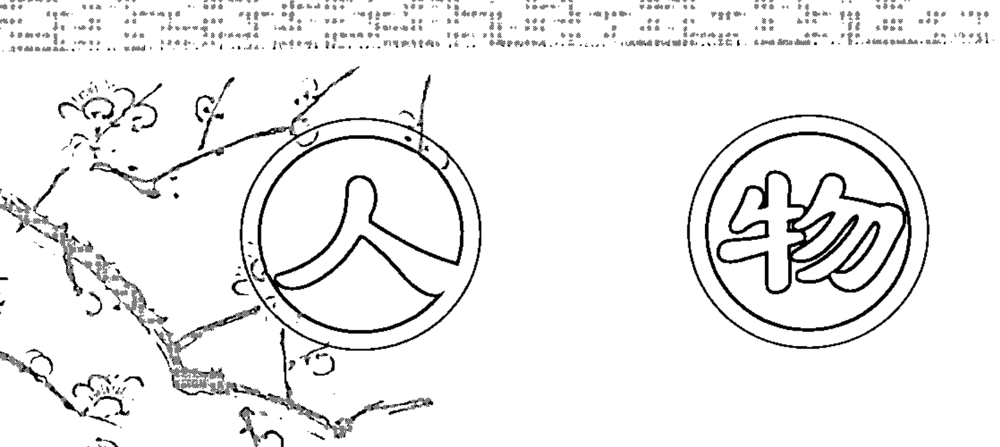

## 人物介绍

### 西施
史上第一次由群众海选的“超级美女杯”选美比赛冠军。经历曲折复杂，身份多变，先后为乡镇企业洗衣厂女工、女间谍、王后、家庭妇女、股神和道姑。夫差的前妻，范蠡之妻。

### 范蠡
号少伯，网名鸱夷(chī yì)子皮，江湖上被尊称为“陶朱公”。本为越国高级公务员，后辞官下海，家族投资业绩斐然，为中国历史上第一大财团家族，其本人也因家族财富，成为历史上第一大富翁，被奉为“文财神”。

### 勾践
越国1号首长，范蠡的老板。

### 夫差
吴国1号首长，西施的前夫。

### 文种
越国高级公务员，范蠡的同事。

### 郑旦
西施的前同事，选美比赛亚军。夫差小妾，后经营房地产，成为春秋时期的女富豪。

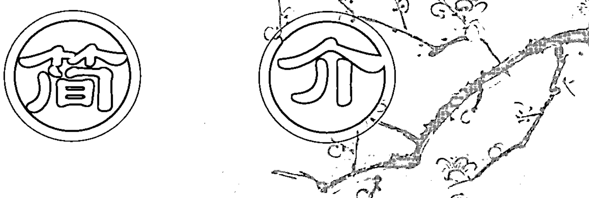

### 其他人物

- **范道生**：范蠡长子。
- **范无为**：范蠡和西施所生，范蠡次子。
- **范若水**：范蠡和西施所生，范蠡幼子。
- **猓顿**：鸱夷子皮的学生，福布斯富豪榜第二大富豪。
- **白圭**：鸱夷子皮的学生，春秋时期的大富豪。
- **李大拿**：煤老板。
- **子宁**：神秘女子，猓顿的前妻。
- **牛总**：大牛证券公司老总。
- **张大户**：大牛证券公司大户。
- **李克**：房地产大亨，郑旦丈夫。
- **子贡**：陶市工商大学校长。
- **庄教授**：楚国1号首长智叟。

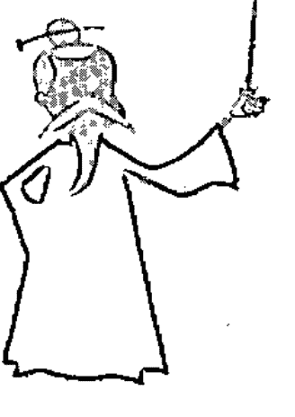

> 本书故事纯属虚构，如有雷同，纯属巧合。
> 本书数据皆为假定，并依据假定数据，进行了一定的推算。如若你对数据有所质疑，大可跳过去不看即可；如若你对推算质疑，也可跳过去，只看故事情节即可；如若你对故事深有疑问，请参照第一句。


## 投资：与技术无关，与理念相连

### 1. 股价：不是风动，不是幡动，是心动

鸱夷子皮在正式讲授投资之前，决定带学生们到证券公司实地感受一下大众进行证券投资的气氛。在进行培训之前，西施、郑旦和范道生从来没接触过股票；猗顿刚进入股市不久，略有斩获；白圭投资股票两年有余，买了几只股票，一直持有，还在亏损中。

当他们进入大牛证券公司的营业部时，只见交易大厅里人头涌动、人声鼎沸，比菜市场还热闹，伴随着大屏幕电子屏上的数字红绿变化，股民们时而大声欢呼，时而齐声叹气，时而紧张得鸦雀无声。下午三点，股市收市了，股民纷纷离场，有的满脸春风，有的却阴沉着脸。

鸱夷子皮盯着大屏幕上不再跳动的数字，问学生们：“屏幕上跳动的是什么？”

范道生抢先回答：“屏幕上跳动的是数字。”

郑旦笑了：“废话！不是数字还是字母呀？屏幕上跳动的是股价。”

白圭说：“屏幕上跳动的是股价，是投资人对股票的价值评估，是股票的真实价值。”

猗顿说：“你们看到的是股价和价值，我看到的却是情绪：是贪婪、是恐惧。屏幕上跳动的，在我看来，是人心在变化。”

鸱夷子皮大喜，拍了拍猗顿的肩膀，说：“孺子可教也！好好跟我混，包你小子以后有大出息。”

鸱夷子皮问大家：“几百年来，华尔街滴满的是什么？”

道生说：“不就是美元吗？源源不断的美元。”

鸱夷子皮摇摇头：“不！是欲望。华尔街永远不变的是人性的贪婪。”

鸱夷子皮看着疑惑不解的学生，指着屏幕说：“这是股价吗？不，是情绪！不是风动，不是幡动，是心动！这上面变动的，不是股价，不是价值，是人性！是欲望！”

猗顿点头附和，他说：“经济学的基本假设和基础是：人是自私自利的，也是理性的。人自私自利，这或许没错，但人一定不是理性的，人更容易受情绪左右，随着群体性的情绪，做出种种匪夷所思之事。”

鸱夷子皮点头称是：“因为心动，人性的欲望发生作用，产生情绪，情绪主导了人们的交易，有人因情绪的主导而买进，有人因情绪的主导而卖出，有人因情绪的主导而跟随别人买进卖出。有一段佛语对于情绪的理解倒是很深刻：心有一切有，心无一切无；心迷一切迷，心悟一切悟；心邪一切邪，心正一切正；心乱一切乱，心安一切安；诸法性如是，一切唯心造。”

道生不好意思地说：“我本来还有点明白，一讲到佛法，我又糊涂了。”

西施说：“鲁迅先生对此也有所解释。”

道生疑惑地问：“鲁迅先生？他也会投资？”

西施说：“鲁迅先生说，世界上本没有涨，买的人多了，就涨了。”

猗顿插话说：“鲁迅先生也说过，世界上本没有跌，卖的人多了，就跌了。”

众人大笑。道生困惑ING。

猗顿解释说：“涨跌是因为人的买卖多少所导致的，而人的买卖受情绪主导，所以，是情绪引发了涨跌，而不是其他原因导致股价发生变化。”

鸱夷子皮说：“是的。情绪会主导投资人的行为。人们在进行证券交易时，大部分人习惯于依据买入成本来决定卖出行为的方式，就是情绪的一种典型反应：卖价如果高于买价，卖出时如果赚钱，就会让人开心，从而容易做出卖出决策；卖出时如果亏损，就会让人痛苦，很难下手卖出；卖出后如果股价下跌，就会让人有解脱、庆幸的情绪；卖出后如果股价上涨，就会让人产生懊悔的情绪。实际上，在进行卖出决策时，正确的决策根本不依据买入价，和买入价没有任何关系，但买入价造成的这些心理因素，却成为卖出决策时的严重困扰。”

范道生问：“那么，到底什么是情绪？”

鸱夷子皮开始讲起了情绪：“你的头脑告诉你应该停止，而你的心灵却告诉你要放手去做——人们经常会饱受理性和感性相矛盾的痛苦。人性中有理性和感性之分，但理性与感性却是相矛盾的：理性是概念、判断、推理等逻辑思维活动，理性通过逻辑推理而非表象感觉得出结论；感性是感觉、知觉等的心理活动，是个人情感的心理感知。人们总以为自己的决策是理性的，但大部分时候，却受到情绪的控制。感性认识实际上是人们决策的重要依据。”

道生穷追不舍：“那么，到底什么是情绪？”

鸱夷子皮说：“所谓情绪，是人类评估现实环境中某些事物对自身所产生的利害关系，并因此而产生的态度体验和身心反应。情绪是一种源自心理程序的生理反应，这种心理程序是一种价值评估，以此判断相关事物对于自身的利弊。

生理反应是情绪表现的必要条件，人类会根据不同的情绪而出现喜、怒、忧、思、悲、恐、惊等七种不同生理反应，对同样的外界事物也会因为不同的情绪而产生不同的反应，例如：小男孩大都喜欢玩具刀，但是，如果某个小男孩目睹亲人被刀所杀后，他就会对刀产生恐惧感，对于玩具刀同样也会表现出恐惧情绪。”

道生继续追问：“那么，人类为什么会产生恐惧情绪？”

鸱夷子皮说：“按照达尔文进化论的观点，愤怒与恐惧是人类在紧急或压力情况下提升生存机会的一种情绪。在许多物种中，愤怒和恐惧都是应付危险的重要情绪。在人类由动物进化为人，以及处于原始文明初期时，这些情绪帮助人类对付危险情况：当人类受到野兽威胁时，恐惧情绪提醒危险的存在，而愤怒则可以帮助人类发挥自身潜力来展开攻击。历经千万年进化，人类不再面临来自树林山洞中野兽的危险，但任何威胁自身利益的都可能成为危险，包括同类的竞争，所以，恐惧情绪依然强烈。

人们对于任何事物的情绪反应，取决于潜意识在既有的知识范围内如何评估事物。情绪来源于人们的价值观，人们会根据价值观来判断事物的对错，进而表现出喜怒哀乐不同的情绪：当人们体验到快乐时，生命将充满动力，从而对未来充满期望；而当人们体验到痛苦时，会陷入沮丧和恐惧中，就会试图逃离造成痛苦的根源。导致非理性行为的强烈恐惧感，来自恐惧犯错误的心理，采取行动，则是为逃避痛苦。”

西施说：“我总结一下，人类之所以会产生情绪，是因为人类具有逃避痛苦、追求快乐的天性，情绪就是这个天性的体现。”

鸱夷子皮欣慰地说：“西子要是去读书的话，也早获得博士学位了。”

### 2. 羊群效应

鸱夷子皮继续说：“人类的行为，不但受自己的情绪影响，更受周围其他人情绪的影响，最典型的一种情绪，就是羊群效应。”

猗顿说：“我知道羊群效应，股市上最多的就是羊群效应。羊群效应是指，个体的人会受到多数人的影响，从而跟随大众的思想或行为的一种行为，也称为‘从众效应’。羊群效应产生的原因，是人们具有从众的心理效应，具有与他人的思想行为保持一致的本能。而影响人们从众的最重要因素，则是持某种意见的人数比例，而非意见本身是否正确。羊群效应中的人，只会盲从、跟随大众，自己却不进行理性的独立思考。羊群效应使得社会群体的行为方式趋于相似。”

鸱夷子皮点头认可，对学生们讲了一个有关羊群效应的笑话：

当萨达姆的宣传部长的萨哈夫死后进入天堂时，被上帝拦住了：“天堂里的人太多了，所有的地方都被占满了，你不能进来。”萨哈夫是位善于把握人类情绪的高手，他对上帝说：“我能否在离开之前，进去跟天堂里的人讲个笑话？如果他们都笑了，我就进去了；如果他们没笑，我就下去。”上帝答应了。萨哈夫挤进天堂，对里面的人说：“你们知道吗？地狱里有金矿了！”话音刚落，天堂大门洞开，天堂里的人都蜂拥而出，冲向地狱。

随着越来越多的人离开，天堂里显得空荡荡的，上帝看到这种情况，自言自语道：“这么多人都去地狱了，难道所有的人都会犯错吗？看来地狱里真的有黄金了，我也去碰碰运气吧！”于是上帝也去了地狱。现在，连这位擅长造谣者也在犹豫了，他并没有马上冲进天堂去占好位子，而是痛苦地思考了一番，说道：“既然上帝都去地狱找黄金了，没准传言就是真的呢，我想我还是随大流去地狱吧。”于是，萨哈夫也冲向了地狱。

鸱夷子皮讲完，大家哈哈大笑。西施说：“谣言重复一千遍，就是真理。这句话之所以是真理，说的就是人人都有从羊群效应。”

鸱夷子皮说：“从众心理并非人类所独有。动物们也具有明显的从众行为，动物之间，在居住地域选择、交配和觅食等方面，就存在明显的模仿行为。羊群效应的起源，就是羊的从众效应，头羊往哪里走，后面的羊就跟着往哪里走。不但羊是如此，蚂蚁、毛毛虫等群居的动物都具有这种现象。”

白圭说：“我看过一个报道，有个科学家做过一个松毛虫的实验，把若干松毛虫放在一只花盆的边缘，使其首尾相接成一圈，在花盆的不远处，又撒了一些松毛虫喜欢吃的松叶，松毛虫开始一只跟一只绕着花盆一圈又一圈地走。这一走就是七天七夜，饥饿劳累的松毛虫尽数死去，其实，只要稍微改变路线，就能吃到嘴边的松叶，但没有一只松毛虫这么去做。”

鸱夷子皮说：“我给大家讲一个神奇的科学现象吧！”

于是，鸱夷子皮给学生们讲起了旅鼠的神秘自杀之谜：

旅鼠是生活在北极圈附近的一种鼠类动物，长得和田鼠差不多大。旅鼠的一大特点是繁殖力惊人，是所有动物里——也包括昆虫在内——繁殖能力最强的，也许只有细菌的分裂能力才能与之媲美。

旅鼠出生1个月左右，就具有了繁殖能力，一只雌鼠每5周就可繁殖一窝，一窝能生七八只小旅鼠。如果环境条件合适，一个旅鼠种群几年之内数量就能增长到原种群的100~1000倍，按照这种繁殖速度增长的话，地球就会被旅鼠所铺盖，但奇怪的是，旅鼠的数量并没有无限增长，每隔4年，鼠群的数量就会达到顶峰。这是为什么呢？原来旅鼠每隔4年，就会进行死亡大迁徙，集体跳海自杀。

那么，旅鼠为什么会进行死亡大迁徙？

北欧寒冷地区的食物本来就非常匮乏，当旅鼠大量繁殖、数量过多时，食物就会被他们吃光。没有了吃的，这些旅鼠就会向外迁徙，它们开始成群结队地旅行，寻找新的食物来源。起初，它们似乎没有什么明确的方向和目标，到处乱窜；后来，不知是谁一声令下，也不知是由谁带头，它们忽然就会朝着同一个方向，浩浩荡荡前进，后面的旅鼠跟着前面的跑，一群一群聚合在一起，越聚越多，越跑越远。它们逢山过山，遇水涉水，前赴后继，沿着一条笔直的路线奋勇前进，决不绕道，更不停止。一直奔跑到大海，前面的旅鼠收不住脚跳了下去，后面的旅鼠会闭着眼睛，跟着前面的旅鼠一致行动，跳进大海里，被汹涌的海浪吞没，就这样，一只接着一只跳，直到全军覆没为止。

旅鼠们每隔三四年，就会这样成群结队地跳海而死。河流、山川阻挡不住它们，老鹰、狼狗的袭击也阻挡不住它们，大部分旅鼠的命运就是：冲向海边，然后毫不犹豫地纵身跳入，被海水淹死。

鸱夷子皮讲完这个神奇的旅鼠自杀之谜后，郑旦大叫起来：“太可怕了！太恶心了！以后我再也不吃石斑、老鼠斑了！我再也不吃海鱼了！”

郑旦的话又惹得大家哄堂大笑。

鸱夷子皮也笑了，他说：“动物群体的这种一致趋向性行为，是长期进化形成的，长期进化的天性必然具有一定的进化优势。人类作为群居动物，从众行为也是进化的产物，是人类成千上万年群体生活遗传下来的一种自我保护的天性，因而是先天性的、与生俱来的，其重要特征就是：人类群体要行为统一、协调一致，即使共同犯大众化的错误，也比个体独自的正确要安全得多。人类自幼会被上一代教育：要做群体一分子，不能标新立异，不能特立独行。在人类社会中生活，从众心理能让人在集体中得到认同，不被孤立，更容易有成就感。所以，出于归属感、安全感和信息成本的考虑，人们自然而然会跟随群体或领袖的思想和行为，而采取一致的行为。”

鸱夷子皮感慨道：“就个体而言，从众效应是一种理性行为，它使得个体在社会生活中的成本最小化和效用最大化。但对整个社会群体而言，从众效应大都是非理性的冲动行为，盲目从众就像成群结队集体自杀的旅鼠那样愚蠢。在世界历史上，在社会政治、经济和文化领域，发生众多的人为性灾难，正是一些天才或领袖，善于把握引导大众情绪，利用了大众普遍具有的盲从性，从而导致这些人类群体性灾难的发生。”

郑旦困惑地说：“羊群效应的跟风会导致大灾难的发生？股民跟风，不就是随大流买卖股票，会有这么夸张吗？”

鸱夷子皮说：“在股市上，羊群效应的表现是盲从和跟风。股民在进行交易时，羊群效应心理会导致股民总是根据其他股民的买卖行为而行动，在他人买入时跟风买入，在他人卖出时跟风卖出。羊群效应发挥作用的结果就是，当股市不被看好时，股民会疯狂卖出，使股市下跌更快、跌幅更深；当股市上涨、股民看好后市时，就会争先恐后进场抢购，使股市上涨幅度更大；而一旦股市稍有调整，又一窝蜂地卖出。羊群效应会导致股市的交易者不断追涨杀跌，严重跟风。”

### 3. 历史上几个典型的资产大泡沫

鸱夷子皮继续说道：“在股市上，如果股民也以旅鼠般的热情盲从，最终也会有旅鼠般的悲惨命运。当然，这句话是巴菲特说的，不是我说的。人类历史上，因股民盲从而吹大资产泡沫、最后泡沫破裂、社会全体亏损惨重的事件比比皆是，其中，荷兰郁金香球茎泡沫、英国南海公司股票泡沫和美国庞氏骗局这几个最为典型，我给大家讲讲这几个历史事件，让大家轻松一下吧！”

鸱夷子皮开始饶有兴致地讲起了故事：

#### 荷兰郁金香球茎泡沫

荷兰郁金香球茎泡沫是历史上最有影响、最典型的投机泡沫。郁金香是荷兰的国花，但从前荷兰却并无这种植物，一位好事者将郁金香球茎引进后，让荷兰人很着迷，郁金香作为高档花卉在荷兰流行开来；初始，郁金香仅是作为一种价格不菲的奢侈植物，在花园仅供富人观赏和炫耀而已，并非一个交易品种，但一种植物病毒却改变了它的命运，让它成为一个人想拥有的暴富品种。

因为感染这种植物病毒的郁金香花瓣能产生鲜艳漂亮的细纹，这种奇异品种让荷兰人爱不释手，于是大众开始疯狂追逐这种受过病毒感染的球茎，球茎越奇异，越让人喜欢，也越值钱。疯狂购买使得郁金香球茎价格暴涨，而价格上涨越急剧，人们的购买越疯狂，投机狂潮席卷全国。投机商们像时装界预测未来时装的流行款式、颜色一样，分析研究预测下年要流行的球茎色彩和形状，大众据此预测，疯狂购进相应球茎，囤积起来，待价而沽。球茎越卖越贵，只涨不跌，开始大多数人还保持理性，视之为投机泡沫，但先参与的亲戚朋友获利丰厚，暴利效应让越来越多的人卷入，最后全国人民全加入，抱着发财致富的梦想全体参与炒作：从贵族、普通市民、商人、农民，到一生谨慎的女仆，全都倾其所有，投入到购买郁金香球茎的致富狂潮中，不惜拿黄金、土地、房子、珠宝来换取小小的郁金香球茎，只是因为球茎更值钱。全国人民都坚信：郁金香的购买狂潮会永远持续，郁金香球茎价格的上涨会永远持续，早买早赚，晚买晚赚，不买是傻瓜。在这种狂炒郁金香球茎的氛围下，投机者从世界各地蜂拥云集荷兰，和荷兰人一样狂购球茎，只要卖家敢卖，开任何价格都有人敢于买入，这种对郁金香的疯狂炒作，持续近4年，球茎价格也被炒成天文数字。

郁金香球茎价格之高，可以从这个让人啼笑皆非的故事看出：一位著名的船长出海远航，几年后回到荷兰，一位富商为他举办隆重晚宴，热烈欢迎他的归航。宴会中富商因故离开，船长发现富客客厅摆有一“洋葱”于金盘之上，船长不知荷兰这几年之大变化，只觉得这“洋葱”与富商的豪宅很不协调，就将此“洋葱”当做开胃菜切开吃掉，他根本没料到他吃的是一只名贵的郁金香球茎，其价值比他的整支船队还昂贵！富商回来，得知情况，立马晕了过去，富商因失去了这个“洋葱”而破产，朋友反目成仇，船长也为开胃菜付出惨重代价：被富商起诉，因让富商破产而要终生坐牢。

郁金香球茎停下了疯牛的脚步后，就开始暴跌，两天之内，就跌得比上涨之初的价格还低得多，甚至都不抵一个普通洋葱的价格，市场瞬间崩溃，郁金香球茎的泡沫终于破灭。

#### 英国南海公司股票泡沫

南海公司是英国的一家私人公司，在它承担英国政府为国内战争而发行的1000万英镑的政府债务之后，被英国政府给予了南海地区的贸易专营权作为对价，而这种贸易专营权可以通过开展南美地区奴隶贸易而获取暴利，股市对这种贸易专营权的概念很是看好，开始追捧南海公司股票，其股价很快从130元涨到300元，大涨吸引了更多人的疯狂加入，全国上下，全民疯狂追捧南海公司股票：律师放弃打官司，医生丢弃病人，店主关闭铺子，牧师离开圣坛，就连贵妇也放下了高傲和虚荣，都只为买到南海公司股票；不仅普通市民如此，国王乔治一世、高贵的议员们也疯狂加入，统统疯狂买入南海公司股票，以持有南海公司股票为时尚。南海公司不断增发、再增发其股票，甚至以先付10%订金再分期付款的方式，不断发行股票；其股价则在这种疯狂的追捧下，一涨再涨，从300元涨到800元，当股价超过1000元后，南海公司的董事和管理层开始偷偷抛售股票，当这个消息被泄露出去后，市场开始恐慌，大众不计成本地抛售南海公司股票，股价一日之间一泻千里，跌到不值一钱，让参与者损失惨重，其中最著名的参与者当属天才科学家牛顿，他本来在130元买入，后又于300元价位抛出，本已获利丰厚，但抛出后南海公司股票价不但不跌，反而一路狂涨，在涨到900元时，牛顿终于按捺不住，将全部资金重仓买入，结果损失殆尽，最后，牛顿感慨地说道：“我能计算天体的运动，却无法知晓人类的疯狂！”

#### 美国庞氏骗局

庞氏骗局也叫庞兹骗局，表现为一种投资形式，本质上却是一种诈骗，庞氏骗局利用新加入投资人的钱向早加入者支付利息和回报，制造出赚钱假象，从而骗取更多的人加入。当庞氏骗局正常运作时，早加入者会得到较高的投资收益；当无人加入、资金链断裂或其组织者逃跑后，所有的投资人将血本无归。庞氏骗局是最古老和最常见的投资诈骗，实质是打着投资旗号的诈骗，很多非法传销集团或骗子用这招来聚敛钱财。

庞氏骗局得名于一个叫庞兹的美国商人。他发现万国邮政联盟的回邮代金券在美国和西班牙两地存在价格套利机会，有10%的利润价差，于是发行庞氏票据，承诺90天给予投资客户50%的收益，50%的收益率太过诱人，给庞兹投资的人蜂拥而至，庞兹很快声名鹊起，成为美国一颗冉冉升起的金融之星。实际上庞兹并没有通过代金券赚取10%的收益来偿还50%的利息，而是通过从事庞氏骗局，不断吸纳新人的钱，并将其付给前期投资人，前期投资人获利巨大，纷纷宣称他是投资天才，于是，更多新人携带现金请求他接受，最后大约有4万人被卷入骗局，当新加入的资金减少、资金链要断裂时，庞兹就卷走剩余的钱财，逃得无影无踪，最终锒铛入狱，但被骗资金再也无法追回，全部被挥霍一空。

庞氏骗局能让骗子一夜暴富，也能让早期加入的投资人获利丰厚，所以会生生不息，在各个时期、各个地方，都有同样的骗局在以不同的形式上演。俄国数学家马夫罗迪建立了一只MMM基金，不在交易所上市，而是由马夫罗迪自定交易价格，通过电视广告宣传，以年收益率为3000%的业绩向大众推销，虽然有人质疑如此之高的收益从何而来，但毫不影响大众对此高收益的品种有浓厚的兴趣，普通大众疯狂追捧此基金，而最初的怀疑者看到半年之内基金从1元钱一直涨到60元，也竞相买入，MMM基金半年时间就拥有500万名持有人。终于，当相信其高收益的傻子越来越少时，MMM基金价格开始下跌，而下跌又促使更多的持有人抛售，一夜之间，基金价格就一落千丈，让参与者损失惨重。

鸱夷子皮讲完，郑旦说话了：“庞氏骗局原来来源于此。一个庞兹倒下来，千千万万个庞兹站了起来，在我国，庞兹的徒子徒孙早已成集团军了。庞氏们利用人们的贪念和羊群效应，通过高收益为诱饵，虚构养蚂蚁、人工造林、保健品、墓地、借债等虚假投资项目或高利贷，做出骗局，吸引无知的大众入蛊，最终，骗子逃之夭夭，只给受骗者留下一地鸡毛。”


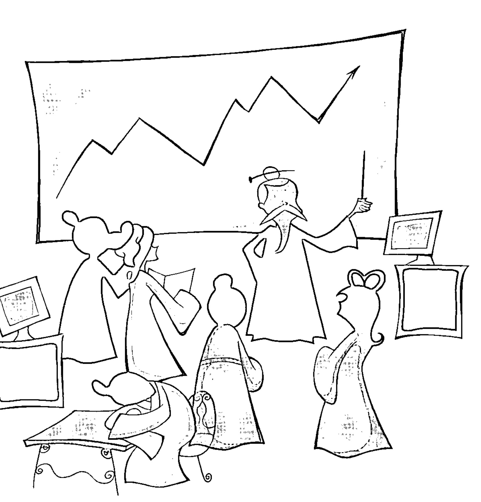

白圭说：“这个问题老师在前期讲过，收益率超过20%以上的高收益投资或高利贷，大都不具有可持续性，一定是骗人的；可惜这世界上的骗子再多，傻子总源源不断。原来是有原因的，原因就是人性在作祟。”

鸱夷子皮点头说：“参与骗局和泡沫狂欢盛宴的大众，大都自诩为聪明人，绝大多数人也深深怀疑骗局，深深怀疑投机品种的价值，但这些聪明人却普遍对‘博傻理论’深信不疑。他们坚信，即使交易的东西一文不值，但只要自己不是最后一个傻瓜，就一定能获利而出。当场外还有大量的傻子在准备加入、还有资金在源源不断地进场时，这种‘击鼓传花’的博傻游戏就还能维持下去，参与者也会产生自己就是投资者的错觉，因为他们获得了收益。当傻子觉醒之时，就是骗子逃跑之时，就是鼓声停止之时，就是博傻游戏结束之时，也就是泡沫破灭之时。”

鸱夷子皮接着说：“羊群效应让参与者容易丧失理性，群体性的亢奋购买会吹大资产泡沫，泡沫在成长阶段，资产增值的美好感觉或许会带给人吸毒式的快感，但资产的泡沫通常随着参与者的增加而增大，随着参与者最后的无以为继，泡沫的最终结果就是破灭，所有的参与者都会损失惨重。”

## 4. 习风新编：渔夫和魔鬼的故事

西施问道：“既然情绪是投资交易的主要影响因素，那么，投资人应如何管理情绪，才能少受从众心理的影响、才能少受情绪的干扰，从而少犯错误呢？”

鸱夷子皮回答道：“人是一种情感动物。羊群效应，作为人性的弱点，是所有人的共性和通病，没人能真正割舍人性，不为情绪所动。一般来说，大众情绪越强烈，个体羊群效应也就越明显，从众的心理效应也会越强烈。对普遍大众而言，投资交易是件痛苦的事儿，因为要受尽欲望、期望、贪婪和恐惧等情绪的折磨。而投资大师的心态，要像魔鬼、像神仙，唯独不能像普通的正常人，因为投资大师能做到不受情绪的干扰，而普通大众则只能协调潜意识和理性的冲突，做到让理性控制情绪，却永远无法消除情绪的干扰。”

鸱夷子皮说：“在让大家明白如何管理情绪之前，我再给大家讲一个故事，渔夫和魔鬼的故事。这个故事，和大家以前所听的故事完全不同，在这个故事中，渔夫的名字叫理性，魔鬼的名字叫情绪。”

于是，鸱夷子皮讲起了习风新编渔夫和魔鬼的故事：

从前，有个渔夫，靠打鱼养活全家。渔夫并不贪心，他打鱼有个习惯：每天只打三网鱼，无论收获如何。

这天，渔夫驾着破船来到深海，开始打鱼。他撒下第一网，等了一会儿，收网一看，里面仅有生活垃圾和水泥碎块，渔夫很失望，整理好渔网，撒了第二网。过了一段时间，他将网收上来一看，网里只有碎石子和几条小鱼。渔夫很沮丧，第三次将渔网撒向大海，希望能有所收获。过了很久，他收网了。他一边求佛祖保佑，一边查看网里的奇怪东西：网里面有一个黄铜的古董瓶子，瓶口用锡印封得很死。渔夫使劲打开锡印，想看看瓶子里装的是啥东西。可怕的事情发生了：瓶子里冒出一股青烟，飘飘荡荡地升到空中，竟然化作一个巨大的魔鬼。魔鬼披头散发，身材高大，头颅硕大，凶恶又丑陋，把渔夫吓得全身发抖。

这时，魔鬼张开大嘴，开始说话，他竟然会说话，他说：“渔夫，我要吃掉你。”

“我把你从瓶中放了出来，救了你的命，你为何还要害我的命？这岂不是恩将仇报吗？”渔夫虽然害怕，但还是大着胆子辩解着。

魔鬼说：“好吧，渔夫，听完我的故事，你就明白是怎么回事了。”

魔鬼开始讲起鬼故事：“我本是一个邪恶之神，吃了许多意志不坚定的小孩。有一次，我头脑发热，竟然和天神所罗门作对，结果触怒了他。所罗门将我捉住，关在这个铜瓶子里，用有其法力的锡印封住瓶口，扔进大海里。在大海里，我受尽屈辱，被大小不等的鱼吞进肚里。在瓶中的第一个千年，我许下心愿：‘谁要是救我，我一定报答他，让他成为李嘉诚那样的有钱人。’可是，第一个千年过去了，没有人来救我。在第二个千年开始之时，我许下诺言：‘谁要是救我，我一定会报答他，让他当大官，满足各种欲望。’可是，还是没有人来救我。”

魔鬼说到这儿，眼泪竟然哗哗地就掉下来了，他哽咽着说：“无人能像我这个魔鬼一样，对孤独和寂寞有如此深刻的体会和恐惧，也习惯了宅居在瓶中的生活。所以，在第三个千年里，我赌咒：‘如果有人敢救我出来，我就吃掉他！’渔夫，现在你明白了吧？你救了我，但是我要吃掉你，哈哈。”

渔夫听完魔鬼的话，感到很害怕，但他很快冷静下来，他心想：“它只不过是个魔鬼，我却是一个有智慧有理性的人，我应该用计谋对付他。”他想到了一个办法。

于是，渔夫对魔鬼说：“你说你当初是被关在这个瓶子里的，可是瓶子这么小，你的身子那么大，瓶子怎么能容得下你呢？”

“你不信我能进到瓶子里，是吗？”魔鬼凑上前来，低头问渔夫。

渔夫说：“我没有亲眼看到，根本不相信，在你吃掉我之前，看在我救了你的份上，能满足一下我这个小小的好奇心，让我明白是怎么回事吗？”

渔夫说完，等待魔鬼化为一股青烟钻进瓶子里。他打算等青烟全都飘进瓶子里时，就马上拿起锡盖封死瓶口。

没想到，魔鬼哈哈大笑，说：“我钻进瓶子，你就去捡盖子，封死瓶子，对吗？”

渔夫很吃惊：“你怎么知道我内心的想法的？难道你前世是一个专偷女人心的魔鬼？所以才能如此洞察人心的真实想法？”

魔鬼呵呵一笑：“你妹的，难道你们渔夫都是如此高智商吗？竟然沦落到打鱼的地步，你们骗起人来的把戏都一模一样。老子几百年前不幸撞到了一个渔夫，这个骗子就是用这个把戏把老子骗回了瓶子里的，让老子在海里又多待了几百年。这次，你随便忽悠，你使劲忽悠，看你能不能再把老子忽悠回瓶子里去。我告诉你，你就是把天说破了，老子也要吃掉你。哈哈。”

渔夫吓呆了，心想：“我怎么这么倒霉，撞到这个上过当受过骗、社会经验丰富的魔鬼，看来，这次我命休矣！”

渔夫又转念一想：“我的理智，一定会战胜魔鬼。”

于是，渔夫眼珠一转，对魔鬼说道：“魔鬼，你在瓶子里一待就是几百年，两耳不闻瓶外事，你有所不知，现在世事变迁，沧海桑田，和以前大有不同了。你想想看，以前的渔夫，可否到深海捕鱼？以前的渔夫，肯定是在浅海打捞到这个瓶子，然后扔到深海来的吧？”

魔鬼想到几百年前的不堪往事，确实是这么回事，它困惑地问：“确实如此。但是，这和我吃你有什么关系？”

渔夫答道：“魔鬼啊，关系可大了。当前环境污染严重，生存条件恶劣，否则，我也不要跑这么远，到深海来捕鱼，结果倒了八辈子的霉捞到了你，对吧？”

魔鬼想想也对，觉得渔夫说得没错，于是说：“Go on, please.”

渔夫唉声叹气说：“现在生存压力这么大，你从瓶子里跑出来闯世界，吃我倒容易，问题是以后每天的伙食怎么办呢？你块头这么大，饭量肯定也大，每天哪有那么多容易给你吃的人哪？”

渔夫接着说：“就算你费尽九牛二虎之力，抓住了几个人，你准备用这些人肉做原料，或清蒸、或红烧、或水煮、或蘸芥末生吃，打算好好犒劳一下你的肠胃，但你以为你就能享用一顿丰盛晚宴了吗？我劝你还是趁早断了这个念头吧。”

魔鬼疑惑地问：“为什么？！”

渔夫叹了口气，说道：“你看，我说你对社会一无所知，结果要吃亏上当了吧？人生处处是凶险啊！你有所不知，当前社会人心险恶，污染成患，我们人类从小就在吃毒食品，什么三聚氰胺、苏丹红、甲醛、苯酚之类的人间毒物，早已被我们尝遍吃遍，我们早已百毒不侵，个个都是金刚不坏之身。你要以人类为食物，相当于也在吃毒食品，可是，你根本没经历过毒物的考验，吃了浑身都是毒的人的话，轻则中毒呕吐，重则即刻丧命。”

魔鬼连连点头称是，渔夫趁热打铁。他继续说道：“还有，你要是几百年前从瓶中出来，困了，随便在深山老林猫一宿也能凑合对付，对吧？可是现在呢？住房条件大大改善，人们都想住豪宅，住的房子旧点都不不好意思告诉别人自己住哪儿。本来，普通人住个一百来方就够了，可是，像您这身材、这地位，怎么着都得住一五星级摩天大楼才行啊。但是，你想想，这么大面积的房子得花多少钱啊？你只能向银行贷款买房子了，但花老钱供着摩天大楼，你这房奴当得多不值啊？你想想，你这每月还贷的压力该有多大呀？”

渔夫看着魔鬼的头点个不停，似乎高度认可自己所言，于是，就大胆向魔鬼走近两步，问道：“鬼兄，你的隐私可否方便透露？能否告诉我，你是男魔鬼还是女魔鬼？”

魔鬼向两旁张望了一下，确信无人偷听其隐私，羞答答地答道：“奴家男鬼是也。”

渔夫继续问：“你单身还是已婚？”

魔鬼害羞地答道：“奴家孤身一人，至今尚未婚娶。”

渔夫一锤定音：“这就对了。你一人在外闯荡，哦，一鬼在外闯荡，一鬼吃饱，全家不饿。但要是一不小心撞个情投意合的女魔鬼，再生个小魔鬼，那你就得一个魔鬼养活三个魔鬼，那么，你不但是房奴，还将是老婆奴，还将是孩奴，你不想想，你要承担多大的生活压力啊!”

渔夫又上前一步，鬼鬼祟祟地说：“风险提示一下，你在瓶子外面瞎晃荡，要是一不小心再撞到所罗门天神，估计这次它不会那么温和地只关你禁闭，肯定要对你扒皮抽筋，折磨死你。当今社会，只要没有赚钱养家的经济压力，都愿意待在家里当宅男，多舒服！我看你，不如就宅在瓶子里：安全，又没有生活压力。困了，只管睡；醒了，想看星星看星星，想看深海鱼就看深海鱼，多美啊！至于你说的孤独和寂寞，人类对此早有总结，对于成功人士来说，孤独是一种态度，寂寞是一种境界。也就是说，只有成功者才容易有孤独和寂寞的感觉，习惯就好了。这样吧，我送你一本书——《西施的财富》，你孤独寂寞的时候，多看看书，学学理财”

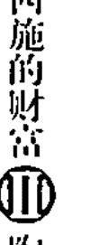

和投资，有能力赚钱了，再来社会上混吧！”

渔夫说完，转身去破船上找出《西施的财富》，送给了魔鬼。魔鬼接过书，跪下道谢，嚎啕大哭道：“人世险恶，小鬼在海底多年，头脑闭塞，完全不知世事。幸好有渔兄提醒，让小鬼幡然醒悟，听君一席话，胜过小鬼千年的思考。看来，宁做瓶中的宅鬼，也好过人间漂泊的孤魂野鬼，也好，以后小鬼就老实宅在这瓶中。”说完，魔鬼化为一缕青烟，老老实实钻进瓶子去了。

渔夫塞好瓶盖，心想：“就这么把瓶子扔到海里吧，哪天给别的渔夫捞到了，里面的魔鬼要是反悔了，就麻烦了；埋在土里吧，河南盗墓人的洛阳铲跟长了眼睛似的，是文物都能给挖出来；我还是献给博物馆保存吧，既安全又有奖励。”

于是，渔夫高高兴兴地带着瓶子回了家。他把瓶子当古董捐献给了博物馆，博物馆奖励了他一大笔钱。

从此，渔夫和他的家人过着幸福快乐的生活。（如果这个故事是对小朋友讲的，这句话是免不了的。）

鸱夷子皮的故事讲得很幽默，学生们笑得前俯后仰，自己却一本正经。

鸱夷子皮总结道：“情绪是魔鬼，冲动是魔鬼，但不管魔鬼如何可怕，只要你能像这个渔夫一样有理智，就一定能战胜它，所以，情绪管理的核心，就是尽量少些冲动，多些理智。投资，是一种孤独的事业，是自己的心与市场的心灵感应，只有对市场保持理性，才能进行全身心的关注，才能将自我的大脑保持在最佳状态，才能控制好情绪。

“那么，应该如何用理智代替情感？应该如何避免跌的时候恐惧、涨的时候贪婪？应该如何避免盲目从众跟风交易？应该怎样克服贪婪、克服恐惧？这些就是以后的课程中，我将对你们进行情绪控制训练的重点内容，通过进行情绪控制方面的专业训练，使你们具有良好的情绪自控能力，从而能战胜冲动这个魔鬼。”

白圭听到这儿，有点疑惑不解地问：“老师，您所讲授的投资课程似乎和股民所理解的传统内容完全不同。当初我学习炒股时，都是从技术分析开始的，什么RSI、KDJ的顶背离或底背离，什么头肩顶、头肩底，什么旗形突破，什么缺口必补等，我花了一年时间苦心研究，好不容易有点感觉，可听您所讲的投资，似乎在我所学的东西里都没有？您讲解投资，先从情绪讲起，与众不同，让人耳目一新。”

西施点头称是，说：“我以前也看过一些投资书籍，大都讲如何对股票估值，如何进行价值投资，从来没有人将投资的重点放在情绪的分析和管理方面。”

鸱夷子皮笑道：“你们是怀疑我会将你们误入歧途吗？”

西施也笑了：“我们可没这么说。不过你这么一说，我倒要怀疑你这个投资教练是不是真要把我们带上歧路去了？”

鸱夷子皮问学生们：“成功的商人夏则资皮，冬则资绵，旱则资舟，水则资车，通过把握商品价格的周期性变化规律而获取巨富，请问，夏天和冬天的皮货有所不同吗？冬天和夏天的丝绸有所不同吗？旱季的船和雨季的船有所不同吗？雨季的车和旱季的车有所不同吗？”

众人异口同声回答：“没有任何不同。”

鸱夷子皮说：“物品的使用价值没有任何不同，也就是内在价值没有任何不同，唯一不同的，是大众的情绪，在物品的淡季抛售，而在物品的旺季抢购，大众的羊群效应，加重了这种情绪。”

鸱夷子皮继续讲到投资上来：“投资亦是如此。如果能像商人把握商品价格的周期性规律一样，把握股价变化的周期性规律，那么，投资的确定性就会大增，投资成功则易如反掌。那么，影响股价变动的主要因素是什么呢？是情绪，是人人都会有羊群效应。

“羊群效应会对交易者的情绪产生严重影响，使得股价严重背离其真实价值，使得股价和价值好似没什么关系一样：当市场因某原因看好某股票时，狂热情绪让人们疯狂买入，股价被大幅推高，远超出其价值；当市场看淡某股票时，悲观情绪又使人们疯狂卖出，股价被打压得很低，远低于其价值；因此，对绝大部分股票而言，其本身并无多少价值，股价中更多包含的则是股民对股票前景的心理预期，是情绪——股价涨，是因贪婪而大量买入；股价跌，是因恐惧而大量卖出。股价和股票的价值根本无关，所以，股价不是风动，不是幡动，而是心动。对大部分股民来说，与其研究股票估值，还不如深入分析大众情绪，判断股价的趋势，通过把握股价涨跌的周期性规律来获利，这种交易方式，或许更容易让大部分股民获利。

鸱夷子皮说：“凯恩斯先生对此深有感受，他说从事股票交易，好比选美比赛一样，冠军并不一定就是最美的那个，但一定是被最多评委认可的那个，无论是贿选，还是评委出现集体性审美失误，都有可能会让一个丑女被评为选美冠军；同理，股市上涨幅度最大的，股民获利最多的，也不一定就是最有价值的，很可能就是只垃圾股。”

这时，同学们突然听到一阵阵响亮的呼噜声从角落传来，扭头一看，原来是范道生同学。原来，师生们在进行热烈讨论时，不知不觉，天已大黑，范道生同学又饿又困，竟然呼呼大睡了。

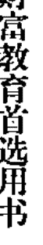

## 5. 投资：你是包子派还是馒头派

老师和学生们坐在麦当当快餐厅里，准备解决晚餐问题。

郑旦和西施去柜台帮大家点餐去了，鸱夷子皮问坐着的学生：“你们能否告诉我：你为什么要投资？你对投资是如何理解的？”

狗顿答道：“投资是一种奇妙的行为，一种充满魔力的技能，它让人痛苦，也让人愉悦；让人迷茫，却又魅力无法抵挡；它带给人巨大压力，却也带来无穷希望；投资既是游戏，又是事业，是世界上相对最公平的行业。”

范道长跟着答道：“我也认为投资是天底下最公平的赚钱方式，无需任何资质，无需任何证书，不论学历高低、智商高低、地位贵贱、年龄大小，甚至无论起始资金多少，只要掌握一定的投资技能，任何人都可能通过投资积累起生活所需的财富，成为财务自由者。”

白圭说：“投资不但是公平的事儿，有时候也是最简单的一件事儿：集市上引浆买车的贩夫走卒，耳聩目昏的老妪老翁，经过简单的了解和学习以后，就可以操作和实践，一买一卖，低买高卖，就完成一次投资，获得了收益。”

白圭喝了口水，接着说：“有时候投资又是天底下最纷繁复杂高深莫测的事儿，高智商的人才通过精确计算可以对火箭和卫星的活动轨道了如指掌，但这些顶尖的精英人士，可以构筑复杂的金融工程，却无法保证投资不亏本，即便是伟大的科学巨匠，如爱因斯坦、牛顿一般的天才人物，也免不了投资巨亏，所以连牛顿都要惊呼，我能计算天体的运动，却无法知晓人类的疯狂！”

鸱夷子皮笑道：“牛顿无法知晓人类的疯狂，是因为他把投资当成一门科学，而不是一门艺术，所以根本没去研究人类的情绪。人类的疯狂正是因为情绪的失控！”

正说着，西施和郑旦端着食物回来了。

西施说：“我喜欢苹果派。”

郑旦说：“我喜欢菠萝派。”

郑旦问鸱夷子皮：“老师，你喜欢什么派？”

鸱夷子皮说：“我喜欢馒头派。”

同学们都惊奇地问道：“什么是馒头派？！”

鸱夷子皮笑道：“我所指的馒头派，是我定义的一种投资流派，是有关我刚才所述的情绪问题。我们前面讲过，股价是大量市场情绪的集中体现；当然，股价也是对股票内在实际价值的一定反映。那么，股价和股票内在价值之间到底是一种什么样的关系？有投资大师将此总结为：人遛狗的关系。股价就像一只狗，而股票的内在价值就像那遛狗的人，狗一会儿在人的前面跑，一会儿在人的后面跑，股价和其内在价值之间的差距，就像人手中那可长可短的绳绳。

实际上，人遛狗只是一种简单的比喻，股价和内在价值的关系，要比这复杂得多。股票的内在价值在一定时间内是相对恒定的、客观的，但股价却经常大幅波动，更多的是市场情绪化的合力，是市场所有投资者的情绪集体投票的结果。人的情绪是主观而疯狂的，时而疯狂看涨，时而疯狂看跌；当疯狂看涨之时，内在价值很低的股票，股价也会很高；当极度悲观时，即使股票实际的内在价值很高，也会被股民疯狂抛售，从而导致股价变得很低；也就是说，股价固然和价值有关，但更多的是和市场情绪有关，股价中包含的更多是市场情绪，如果不了解市场情绪，只单单片面地分析研究股票的内在价值，就难以真正透彻了解股票的内在价值。”

鸱夷子皮一边吃着苹果派，一边继续说道：“因此，我想到了另外一种比喻，或许更恰当。情绪就像面粉，而股票的内在价值就像肉馅，如果股价中包含的内在价值更大，那情绪就相对较少，那么，这只股票就像皮薄肉多的优质包子；如果股价中包含的内在价值较少，而情绪较多，那么，这只股票就像皮厚肉少的劣质包子；如果股价中包含的内在价值少到忽略不计的程度，那么，这只股票实际上就是馒头，而不再是包子了。我说我是馒头派，就是我更愿意研究情绪，研究情绪所导致的股价周期性波动规律。呵呵。”

众人恍然大悟，这才明白老师所指馒头派的意思。

鸱夷子皮道：“包子有包子的吃法，馒头有馒头的吃法。同理，证券市场就像风云突变的大海，股价变幻无常，诡秘莫测，而投资就像在大海中航行，时而风平浪静，风光旖旎，让人感觉无限惬意；时而好似在惊涛骇浪的风雨中飘摇，巨浪中蕴藏着无穷风险让人胆战心惊；不同的人在股价飘忽不定的大海上驾驶投资这艘船，就有不同的风格，形成不同的流派——包子派、馒头派等，包子派进行投资的打法，完全迥异于馒头派。”

西施问：“那么，什么是投资领域的包子派？”

鸱夷子皮：“包子派认可股票的内在价值，忽视情绪的影响，实际上是市场上的价值投资派。包子派进行投资，就要挖掘寻找那些皮薄肉多的优质包子，对优质包子进行估值，通过估值判断包子的合理价值，在市场价格低于其内在价值时买入，在市场价格回升到合理价值或超出其合理价值以后卖出，实现包子派的价值投资。包子派是投资武林中的第一大派，地位堪比少林派，从基金、保险公司等机构投资者到拥有巨资的个人，大”

都喜欢吃包子，包子派是投资领域的主流门派。”

郑旦问：“那什么是投资领域的馒头派？”

“馒头派忽视股票的内在价值，只看重馒头的性质、颜色和质地，实际上是市场上的技术派。馒头派认为，股价可以充分反映市场上的所有信息；历史可以重演；以往的股价走势对未来的股价走向有启示作用。因此，有的馒头派通过研究分析过往的股价、交易数量等市场数据，以及由此形成的指标、图形和型态，对未来的股价走势进行判断；有的馒头派将馒头的信息数据归纳总结，进行数据挖掘，形成公式，定型为指标，通过总结指标的规律性，得出投资判断；还有的馒头派对市场价格直接形成的图形进行总结，得出一定的规律，用历史经验来得出决策结论；更有的馒头派用自然界存在的一些神奇数列如费波那契数列等，对股价进行预测，来指导投资。馒头派是投资武林中的第二大派，就像武当派一样，馒头派大都为包子派所不齿，被鄙视为人不入流，不具有实际操作性，但如索罗斯、西蒙斯等馒头派的代表人物，却取得了比大部分包子派更成就斐然的投资业绩。”

讲到这里，猗顿问道：“老师，您似乎更偏向馒头派吧？”

鸥夷子皮呵呵笑道：“我用的是馒头派的打法，但我挑的是包子。通过研究市场的情绪，掌握包子的周期性波动规律，在低谷买包子，在市场情绪狂热时卖包子。”

喝了一口咖啡，鸥夷子皮又说道：“还有另一派，我称之为咖啡派，他们的特点就是喝着咖啡，指责包子派和馒头派的错误。”

停顿了一下，鸥夷子皮继续说：“咖啡派主要是象牙塔里的那些大学教授，实际上就是那些学院派。咖啡派正如投资武林的丐帮一样——虽然武艺高超，却要靠乞讨为生——咖啡派的教授一边喝着咖啡，一边深入研究着投资，但大都在实际投资时亏得一塌糊涂，没有几个人能通过投资获利。咖啡派的收入基本来自教授的高薪——或许这些薪水可能是包子派或馒头派的大师对高校的慈善捐赠，但是咖啡派却看不上包子派或馒头派，认为他们获利的主要原因仅仅是因为好命而已。”

学生们都笑了。

鸥夷子皮道：“咖啡派的教授们通过对股价等数据进行统计分析和数据挖掘，并进行深入的理论研究，但其结论却与馒头派完全不同。有效市场理论被咖啡派奉为圭臬，该理论认为：在充满信息交流和信息竞争的社会环境中，一个特定信息能够迅速被市场上的投资人知晓，市场的竞争机制会驱使股价充分且及时地反映该信息，股价实际上已经包含了市场上所有可以得到的信息，这样的市场就是有效市场。在市场有效的情况下，凭借信息进行的交易不存在非正常报酬，所有人只能赚取风险调整的平均市场报酬率。

按照有效市场理论，咖啡派还认为，所有通过积极管理资产组合的主动型投资都不可能从市场取得超额利润，投资应以被动型投资为主，通过指数型基金去取得平均化的收益。这种结论直接抹杀了市场上所有的投资英雄，连巴菲特老先生都看不下去了，他挖苦学院派说：‘如果有效市场理论管用的话，那我现在就应该是街角的老乞丐。’

咖啡派质疑主动型投资的另外一个重要武器是随机漫步理论，该理论认为，股价的变化类似于物理学中分子的布朗运动，是永不休止而无秩序的，股价变动的路径不可预期，是一种随机漫步，所以通过判断价格走势来进行投资决策是荒谬的。咖啡派用于佐证随机漫步理论的最好证据是人猴投资大赛……”

猗顿说：“我知道人猴投资大赛，有好事者选取了一只猴子，和投资专家进行投资PK，猴子向一张标有股票名称的报纸随机扔掷飞镖，将掷中的股票挑选出来，作为猴子的投资组合；专家则通过认真研究，精挑细选，形成投资组合，在规定的时间期限内，最终的结果是猴子投资的业绩竟然远胜过专家！”

同学们都哈哈大笑，郑旦说：“笑死我了！这个专家也太蠢了，竟然比不上一只猴子！”

## 6. 塑造你的投资交易系统

鸥夷子皮严肃地说：“咖啡派所用的这个案例是偷梁换柱，偷换概念，正好说明了咖啡派的眼高手低，证明他们对投资一知半解。投资仅仅是挑选个股吗？投资仅仅是做好投资分析吗？咖啡派太不了解投资了！”

鸥夷子皮解释道：“人猴投资比赛是将挑选股票作为投资的唯一。将猴子选择的股票和专家选择的股票，按同样份额平均配置，将所有资金满仓投入，这种投资方式，不考虑配置比例，不考虑资金管理，只看重所选的个股，完全是对投资的误解和扭曲。”

范道生问：“炒股，不就是找到黑马，然后骑上去吗？”

鸥夷子皮说：“大众的投资方式就是这种赌博式的，到处打探内幕消息，在打听到某只股票可能会成为黑马后，就投入全部资金买入，然后等待，期望高点卖出以后，桑塔纳进去，奔驰车出来，虽然确实有人是奔驰车出来，但那个人一定不是人，大部分人的结局都是桑塔纳进去，奔驰牌照自行车出来。”

大家都笑了。猗顿说：“老师所说一点没错，大部分人就是这样炒股的，赚了就大赚，亏了、被套了，就由它去了，不管了！”

鸥夷子皮说：“这种赌博式炒股，只重视个股，满仓交易，赚的话当然赚得最多，但亏损的话，就会亏损严重，而对普通大众来说，大都是巨亏，而不是大赚。为什么呢？这正如你去赌场玩，如果有人偷偷告诉你，他就是百家乐的庄家，他有能力知道押大会赢还是押小会赢，你会相信这种内幕消息吗？你会把所有赌注都押上吗？除了赌红了眼的赌徒之外，恐怕没有几个人敢将全部赌注押在一次赌博上。然而，让人奇怪的是，股市比赌场更诡秘，结果更为不确定，投入的资金更庞大，但人们却像赌场的豪客一样，满仓交易，孤注一掷，希望一夜暴富。”

西施说：“赌博时，不是赚，就是亏，很快就有结果，而且人们都很清楚；赌博只是娱乐，赔钱是必然，赚钱是运气，所以，赌博会谨慎；炒股就不同了，炒股为了赚钱，炒股之人大都有暴富的心理，不想赚大钱的也不会去股市了，所以，人们喜欢孤注一掷，就是为了赚大钱。”

鸥夷子皮说：“投资，本质上和赌博一样，都是关于概率的游戏，都是关于确定性的游戏。在赌博时，人们有风险意识，有不确定盈利的心理准备，所以会小心翼翼地下注。投资则完全不同，人们被盈利的期望蒙蔽了头脑，只看到暴富，不考虑风险；人们被自我的分析能力或者内幕消息所迷惑，完全忽视了投资的不确定性。所以，赌博和投资本质完全相同，人们却用完全不同的态度区别对待，完全没有风险和不确定性的概念，这也是大部分人投资亏损的根本原因。”

鸥夷子皮在纸片上画了一张图：

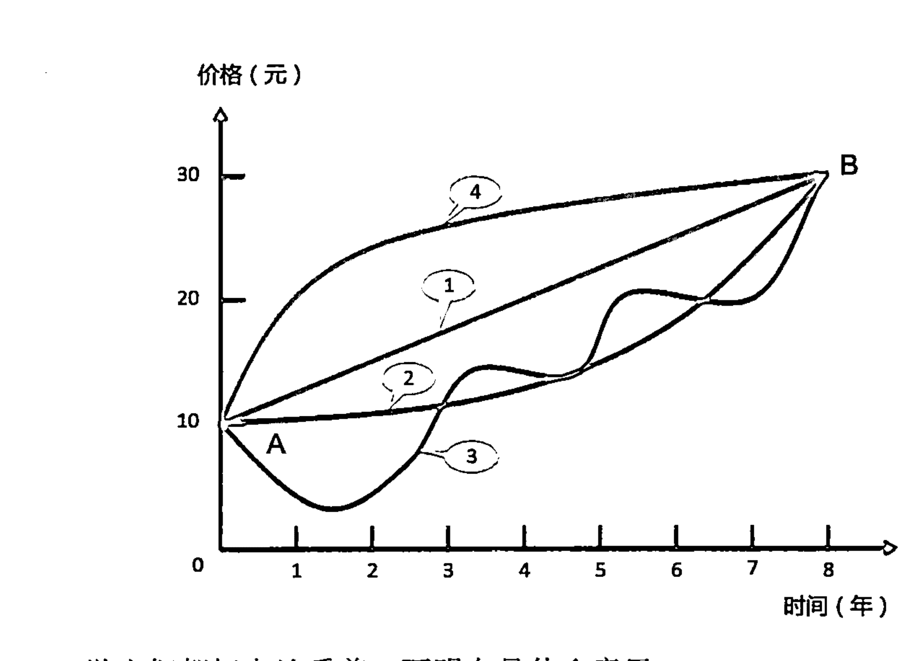

学生们都好奇地看着，不明白是什么意思。

鸥夷子皮讲解道：“这张图画的是某股票在三年时间里从A点的10元涨到B点的20元的可能路径图，即使从A点上涨一倍的确定性是90%以上——这么高的确定性是少有的大概率事件——但仍然要有10%的风险意识。而从A点到B点的具体走势则可能有上百种，我在图上画了四种，有以45度斜率稳定上涨的可能；有先横盘最后再大涨的可能；有先大涨再横盘的可能；还有先大跌再大涨然后大跌接近目标位的可能。也就是说，即使这只股票三年上涨一倍的确定性很高，但其短期内上涨的不确定性仍然很高，即便经过认真的投资分析，精选了这只股票，但是，如果只持有一年就卖出，结果会怎样？盈利仍然具有不确定性。”

鸥夷子皮继续侃侃而谈：“投资分析的目的，是把握投资品种的确定性。包子派寻找的是长期的确定性，馒头派看重的是短期的确定性，正如古有句真理所说：‘你可以把握长期的确定性，你也可以把握短期的确定性，但你不能同时把握长期和短期的确定性。’简单地将对投资品种的投资分析视为完全的确定性，必然隐含着巨大的投资风险，亏损也就成为必然。

实际上，投资分析仅仅是投资的一个方面。索罗斯的经验之谈值得借鉴：判断对错并不重要，重要的是在正确时获得了多大的利润。在进行投资时，绝不仅仅是只需要进行投资分析，更不是只需要决定交易品种问题，而是一整套系统的问题，系统中除了上面的问题，还要解决风险控制问题，更要包括情绪管理。也就是说：一个投资人，如果想要做好投资的话，就要建立一套适合自己的投资交易系统。”

范道生问道：“什么是投资交易系统？”

鸥夷子皮说：“我讲的投资交易系统，就是一套投资交易模式，也是一套适合自己的投资哲学，更是一种适合自己的有效投资方法，也就是说，是一个能稳定盈利的模式。”

于是，鸥夷子皮讲解起投资交易系统。他将投资交易系统分为以下几个方面。

-   投资思想。投资思想就是投资哲学，是投资人的人生观、价值观在进行投资时的具体体现。投资思想决定投资的逻辑，包括对市场运作方式的理解、对股票价值的判断以及对股价变化的看法。投资思想决定投资行为，投资行为决定投资习惯，投资习惯的正确与否，直接决定了投资人的投资是否成功。
-   投资策略。投资思想的不同，必然导致投资人的类型不同，包子派和馒头派的打法完全不同，进行投资分析的方式必然不同，投资交易行为也完全不同，就必然要采取不同的投资策略，而只有适合自身风格的投资策略才更容易获利。
-   风险管理。投资有风险，投资的本质是风险的管理，学会控制风险是投资获取收益的根本保证。在控制风险的前提下追求高收益，还是在追求稳定收益的前提下努力降低投资风险，永远是投资的两大困惑，老练的风险管理者就是高明的投资家。
-   情绪管理。不管技术怎么变化，科技怎么发展，千百年来，股市上永远不变的是人性的贪婪；不管股票的价值怎么稳定增长，大起大落的永远是市场的情绪。索罗斯认为：数学不能控制金融市场，唯有心理因素，才是掌控股市的关键，也就是说，只有有效的情绪管理才能把握住市场。

鸥夷子皮为了更详细地解释投资交易系统，又画了如下一张图表：

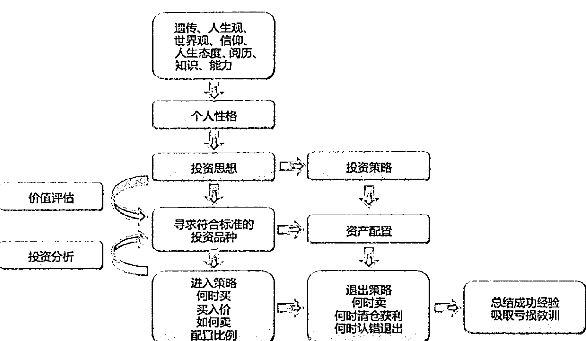

他说：“通过这张图表我们可以看出，每个人的个体遗传、人生观、世界观、信仰、人生态度、阅历、知识、能力等因素各不相同，决定了各人的性格千差万别，从而，其投资思想也各有千秋；每个人的投资思想不同，必然要采用不同的投资分析方式以及不同的投资策略——资产配置、进入策略（何时买、买入价、如何买、配置比例）、退出策略（何时卖、何时清仓获利、何时认错退出）等具体交易方式也完全不同。

所以，要成为成功的投资者，就一定要塑造和定性一套投资交易系统，通过树立良好的投资思想，培养良好的风险管理技能，学会情绪管理，才能克服市场情绪的干扰，进行理性投资分析，投资才更容易成功。”

西旋问：“既然建立一套适合自己的投资交易系统是投资成功的根本，是稳定盈利的前提。那么，什么才是适合自己的投资交易系统呢？”

鸥夷子皮说：“所谓适合自己的投资交易系统，就是投资交易模式中的投资思想、投资策略、风险管理、情绪管理方式等，与投资人本身的个性特征相适应，投资人用这样的交易系统可以取得稳定的投资收益。包子派用包子派的打法，馒头派用馒头派的方式，才更容易取得投资上的成功。”

西施问：“为什么只有塑造、定性适合自己的投资交易系统后才更容易获取持续稳定的投资收益？”

鸥夷子皮说道：“我们前面讲过财富增长的奥秘，即通过每年获取稳定的投资收益，随着时间的推移，财富就会以复利形式飞速增长。财富增值的关键，并不在于本金是否够多，而在于每年一定要有稳定的投资收益，如此，财富才会随着时间的推移、插上复利的翅膀而大幅增长。因此，获取稳定的投资收益就成为投资的重中之重。不同类型的人，只要有定型的投资交易系统，就可以采用适合自己的方式，以自我的风格来成功实现这个目标。

例如，巴菲特和索罗斯的投资交易系统完全迥异。巴菲特是包子派的教主，他以低估的价格购买股票，一直持有到市场发现其内在价值后再抛出，从而成功获利；而索罗斯则是馒头派的领袖，他偏好在高波动的市场里，以高杠杆的方式交易股票、期货、期权、货币等不同品种，通过对冲交易这种普通人看似高风险的交易方式在金融市场谋取暴利。虽然两人的投资交易系统完全不同，但都无碍他们每年稳定获取高达百分之二三十的投资收益率，成为被世人称道的投资英雄。”

猗顿接着问道：“怎么才能建立适合自己的投资交易系统？”

鸥夷子皮将杯中的咖啡一饮而尽，然后说道：“孙子曾经说过，知己知彼，买啥涨啥。要建立适合自己的投资交易系统，就要知己知彼，了解自我，了解客观投资环境。了解自我，才能清楚知道自己的个性和类型，才能明白适合自己的投资思想，才能清楚适合自己的投资策略；了解客观投资环境，才能清楚认识市场，才能理解投资风险，才能管理好风险，从而成功塑造适合自己的投资交易系统。”

西施问：“应该如何了解自我？如何了解客观投资环境？”

鸥夷子皮答道：“要了解自我，不是要了解我是谁、我从哪里来、我要到哪里去等这类只有神和超人感兴趣的高深问题，而是要了解：

-   我的个性特征是什么？我适合做什么样的投资？
-   我有何心理效应？会对投资产生什么样的影响？
-   如何看待我的错误？
-   如何看待亏损？

要了解客观的投资环境，不是要探讨世界是客观的还是主观的，但世界本质是客观存在的物质世界等繁琐复杂的，只有唐僧才能说得清楚的哲学问题，而是要了解：

-   投资市场上的各种投资人有何特征？
-   投资品种有何不同个性？
-   什么是投资风险？如何管理投资风险？

后面的课程中，我们将按照以上不同类别，分别阐述，从而让投资人清楚地认识自我，认识客观的投资环境。”

猗顿问道：“如果说，投资需要建立一套适合自己的交易系统，这套系统需要包括投资思想、策略、情绪管理和风险管理等各方面，而当前市场有一些软件和一些大师，号称能把握买卖点，能进行准确的分析和预测，看来，这些预测和分析其实根本不能解决投资的根本问题，这些所谓精确预测的软件和大师，只能是蒙蔽或欺骗无知的投资人？”

鸥夷子皮点头：“你说得一点没错。投资，是一套人性化的系统，而不是机械式的预测。将投资建立在预测的基础上，无异于缘木求鱼。

投资交易系统的作用，其实就是将正确而简单的行为重复化。也就是将复杂事情简单化，将简单事情重复化。成功——就源自自己简单行为的重复！”

鸥夷子皮环视四周，麦当当餐厅的顾客都走光了，只剩下他在滔滔不绝地讲。他看窗户外，星光满天，夜色已深，于是说道：“今天就讲到这里吧，再晚的话，道生的呼噜表演又要开始了。”

道生不好意思地挠挠头，同学们都笑了。

西施总结道：“投资无定式，条条大路通罗马，适合自己的投资交易系统才是最好的投资交易系统。成功投资的实质，就是要采用适合自己的投资交易系统，获取稳定的投资收益，然后通过时间的累积，获得财富的复利增长。”


## 7. 你的投资生肖：你是属猎豹的还是属龟的

第二天一早，学生们准时赶来上课。

鸥夷子皮说：“中国人有生肖，每个人的生肖都不同。我是属龙的，你们是属什么的？”

各位学生依次报了自己的属相生肖：西施属蛇，道生属猪，郑旦属老鼠，猗顿属猴，白圭属马。

鸥夷子皮说：“人的生肖根据出生年份而定。你们知道吗？每个投资人还有一种投资生肖，是根据其个性特征的不同而决定的。”

西施好奇地问：“投资生肖是什么？”

鸥夷子皮转身，在黑板上写下：猎豹、老鹰、龟、羊、八哥和兔子几种不同的动物名称，然后说：“龙生九子，九子各不同。每个人的性格特征不同，就具有不同的投资特征，我将投资人的投资特征归纳为这几种动物，称之为投资生肖。”

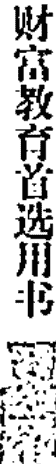

鸥夷子皮继续说：“性格决定投资生肖，性格更决定命运，人的命运之所以不同，是因为性格不同；性格之所以各不相同，是因为其个体特征不同。各人性格因遗传、人生经历、教育水平、知识、经验以及所处生活环境、人生观、价值观的不同而大有不同。”

于是，鸥夷子皮讲起了决定性格的5种影响因素：

-   内向型还是外向型。
    -   内向型（I）：内向型的人思想比较丰富细腻，对自身和周围环境比较敏感。
    -   外向型（E）：外向型的人活泼、冲动、好交际，内心感受相对不敏感。
-   幻想型还是现实型。
    -   幻想型（N）：幻想型的人喜欢憧憬未来，对未来充满期望；喜欢规划未来；喜欢预测未来。想法可能经常不切实际，考虑问题时易对未来乐观而较少顾及现实困难。
    -   现实型（S）：现实型的人更偏重依靠已经发生的事实进行决策，较少寄希望于未来；决策更易依赖过去的经验，而非期望未来；喜欢现状甚于对未来的幻想；稳重，实干。
-   理性还是感性。
    -   理性（T）：理性的人决策时注重逻辑思维，偏向于喜欢理科；自控能力一般较强。
    -   感性（F）：感性的人决策时靠直觉、感觉，而非靠逻辑分析事物的前因后果；偏爱文学和艺术；自控能力较弱。
-   生活是否规律性。
    -   生活规律性差（P）：这种类型的人生活随意强，时间观念差，随心而动，容易应付突发事件，适应性强。
    -   生活规律性强（J）：这种类型的人时间观念很强，做事按部就班，很有条理性，但对计划外的事会手忙脚乱。
-   急性子和慢性子。
    -   急性子（H）：急性子的人行为节奏快，目的导向性强，不重视过程而追求结果，效率高；一般思维敏捷、办事麻利，但是普遍缺乏耐心，宽容性差，易动怒。
    -   慢性子（M）：慢性子的人一般脾气好，耐性好，待人接物能泰然处之、不急不躁、沉着稳重；一般时间观念性差，效率相对较低。

鸥夷子皮说：“以上5种不同的性格决定因素，构成了人类的32种不同性格，这些各不相同的性格类型，决定了各人具有不同的个性、不同的思想，也决定了各自不同的命运。如果人们能清楚自己的性格特点，扬长避短，在适合自我风格发展的领域和行业找到位置，就更容易取得成就。同样，这些各不相同的个性特征，也决定了人们在进行投资时必然具有不同的风格特点。”

鸥夷子皮开始简述不同的性格影响因素所具有的不同的投资特点：

-   内向型的人一般在投资估值方面更敏感、更精确，对情绪控制力较强，不易受大众心理的影响，不易受羊群效应心理的影响；而外向型的人善于人际交往，善于获取信息，善于应对复杂的风险环境。
-   幻想型的人对投资的期望值偏高，一般对投资结果偏于乐观，但善于掌控风险；而现实型的人重视现实的实际状况，容易挖掘估值过高或过低的投资品种。
-   理性的人注重对投资的逻辑分析，倾向于价值投资；感性的人则喜欢跟随人类的情绪，喜欢顺应趋势，更适合技术分析。
-   资本市场具有可测但测不准的规律，虽然变幻莫测，但仍有章可循。生活规律性差的人较易适应这种多变性，容易随波逐流，投资较易顺势而为；而生活规律性强的人投资执行力较强，止损会严格，纪律性较强。
-   急性子的人侧重效率，通常对时间较敏感，投资周期偏中短期；而慢性子的人时间观念性不强，投资时间通常偏中长期。

鸥夷子皮继续分析道：“投资大师们具有各自完全不同的投资风格，正是源于其各自不同的个性特征。比如索罗斯，他的个性特征应该是ENFPH型，即外向、幻想、感性、生活不规律和急性子，这些性格影响因素构筑了他独特的个性；而巴菲特应该是ISTJM型，即内向、现实、理性、生活规律和慢性子，从而形成他特别的性格特征。虽然这两种个性的影响因素截然相反，但却各有其人格魅力，同样都在投资之路上修成正果，可见，无论投资风格如何，只要是适合自己的，就必定会带来成功。

人类各自不同的性格特征，就构成不同的投资风格，这种投资风格，正如自然界中的动物的捕食风格一样，因物种不同，捕食风格迥异。我将人类各种不同的投资风格总结为投资生肖，正是因为人类几种典型的投资风格和猎豹、老鹰、龟、猴、羊和兔子等几种类型的动物的捕食特征具有很大的相似度。”

鸥夷子皮详细阐述起投资生肖和对应动物的相似性：

-   猎豹。猎豹是动物界当之无愧的短跑之王，具有闪电般的反应速度。一只成年猎豹的反应速度，在几秒之内可达到时速百公里以上的起跑速度，和全球加速最快的汽车——布加迪威龙不相上下。选定目标猎物后，猎豹会耐心潜伏，等待出击时机；时机一到，猎豹就会一跃而出，迅速扑向猎物，一旦咬上猎物，不咬死就绝不松口。不过，上天也很公平，赐予猎豹无与伦比的速度，就不会赐予它们持久的耐力，猎豹如果无法在短期内捕捉到猎物，就会放弃，等待下一次出击。猎豹型投资人的投资风格和猎豹捕食完全相似，他们深谋远虑，十分善于捕捉机会，只要机会来临，务求一击即中；他们也有十足耐心等待机会，甚至不惜忍耐许久；他们一般出手谨慎，在风险可把握的情况下重仓投入，投资务求盈利；他们的投资风格像猎豹捕食一样，讲究稳准狠：稳是指出手风格稳定，准是指顺利捕获目标，狠是指行为方式干脆利落。这种类型投资风格的代表人物是索罗斯。
-   老鹰。老鹰抓小鸡的捕食方式是耐心而兼具理性的，出手前会耐

心等待最佳时机，如果出手，则务求必胜。同样老鹰型投资人不会在股市中频繁追涨杀跌，他们具有冒险精神和与众不同的风格，不惧高风险，认可高风险背后蕴藏的高收益，更能承受高风险；他们喜欢刺激和投机，投资时常出现大赢大输的局面；他们擅长捕捉主题投资机会。这类投资人的典型代表是彼得·林奇和约翰·保尔森。

3. 龟。龟是自然界最长寿的生物，具有超强的忍耐力和毅力，确定目标以后就会脚踏实地一步步前进，不靠速度而靠时间去达成目标；龟的风险意识很强，一有风吹草动，就将头缩进坚硬的龟壳，一动不动，直到风险被排除。同样龟型投资者依靠的不是速度，而是耐力，靠不断积累而获利，完全靠复利实现财富的增长；他们在作投资决策之前，会反复衡量资金遭受损失的可能性，风险意识极强；他们普遍注重回避风险，信奉少亏即大赢，倾向于低风险且收益稳定的投资；他们不会轻易受消息或心态的影响，更喜欢亲自进行调查研究，根据自身实际条件和市场环境，制定适合的投资策略；他们不盲目追求赚快钱，而更看重复利的威力；他们有足够的耐心和信心，认准目标，就会坚持走下去，最终获得盈利；这种类型的投资人偏好长期投资，喜爱安全和稳定的投资品种。巴菲特就是典型的龟型投资人。

4. 羊。羊的性情温和，物质欲不强，较易知足，思想不独立，喜欢跟头羊，羊群效应明显，是容易随大流的动物。羊型投资者的独立思考能力较差，普遍喜欢随社会潮流而动，是最容易受情绪感染的投资人；他们喜欢凭借个人直觉进行投资决策，往往仅凭某个美好愿望便匆忙投资、匆忙决策，是最容易跟风的投资人；他们投资带有强烈的个人情感和意识，根据个人喜好决定买卖，因喜而买入，因厌而卖出；他们的盈亏情况要看大势，大势好就易盈利，大势不好就易亏钱。那些牛市赚大钱、熊市亏大钱的投资人就是这种投资类型。

5. 八哥。八哥喜欢跟人学舌，对信息敏感，容易接收和传播信息。八哥型投资者也天然对市场信息敏感有兴趣，喜欢打听信息，然后根据信息或者内幕消息操作；他们天然性格外向，喜社交，迷信内幕消息。喜欢打听内幕信息，根据消息进行投资交易的投資人属于这种投资类型。

6. 兔子。兔子性情温顺，但天性敏感，数量众多，容易成为肉食动物的肚中餐。兔型投資人一般比较盲目投资，急于获利却普遍容易亏损；他们怀疑一切却又普遍盲从、跟风；他们愿意学习却普遍学习能力不强；他们大都投资亏损；他们大都对投资又爱又恨，赚钱时倾尽钱财投入，亏损后又后悔投入资金过多。兔型投資人是市场上最普通、数目最广的散户。

鸮夷子皮道：“认识自我的重中之重，就是要清楚自己的投资生肖。动物们的捕食风格都很鲜明，物种不同、生存方式不同、捕食风格也大不相同，只有自己的才是最适合的。猎豹用龟的方式捕食、鹰用八哥的方式捕食、兔子用羊的方式捕食，都是荒唐可笑的，都是无法生存的。投資亦是如此。各人的个性特征不同，只有适合自己投资生肖的投资方式才更容易取得成功。各人找到自己的投资生肖，按照自己的投资风格去建立自己的投资交易系统，不必刻意去学习模仿他人，适合别人的，未必是对自己有用的；适合自己的，才是最好的。”

讲到这里，鸮夷子皮拿出一沓问卷，让范道生分发给大家。

鸮夷子皮说：“这是一套投资生肖评估系统，大家填写问卷，进行投资生肖测试，根据我的评分标准，就能清楚地知道大家的投资生肖了。”

各人很快填好了表，并按照鸮夷子皮提供的打分标准，对答卷作出评分，很快就得出各自的投资生肖：西施和猗顿都属猎豹，白圭属龟，郑旦属老鹰，而道生的是属羊。

猗顿对着西施开玩笑，道：“师母不但是美人蛇，还是美人豹啊！”

西施狠狠瞪了猗顿一眼，没有说话。

鸮夷子皮盯着范道生，叹了口气，说：“投资生肖属羊的不太适合投资，最终会给那些属猎豹、老鹰和龟的投資人绞杀掉的，看来道生同学以后的投资之路有点坎坷啊！”

道生的脸色有点难看。

鸮夷子皮说：“只有明白了自己的投资生肖，才能建立适合自己的投资交易系统。一般而言，猎豹型投资人擅长进行趋势交易，善于把握股价波动的交易机会，而获取盈利；龟型投资人擅长价值投资，更善于挖掘投资品种的价值，一般通过长时间的复利增长而获得财富；而羊型、八哥型或兔型的投资人，大都不能长期持续地从投资市场获利，基本上是投资领域的失败者，如果投资人的投资生肖不幸是这几类的话，就要通过系统学习投资，有意识地回避投资性格中的缺陷，发扬自身优势，才能增强投资胜算。”

猗顿问道：“很多人从事投资多年，却没什么进步，经常处于亏损境地，每天都为解套而努力奋斗，这些投资的失败者，就是因为没搞清楚自己的投资风格吗？”

鸮夷子皮点头称是：“很多股民从事投资多年，却依然不长进的最主要原因，就是不知道自己的投资生肖，没搞清楚自己的投资风格。投资生肖是猎豹，却按龟型的投资方式交易；投资生肖属龟，却按鹰型的方式交易。例如，属龟的投资人按照龟型特征进行投资估值、谨慎选股，但是一旦获利之后，却又像鹰型投资人那样闪电获利卖出；属鹰的投资人按照鹰型特征追逐强势股，但是被套之后，又像龟型投资人一样持股不动；或者，在牛市像鹰型投资人一样短线交易，在熊市却像龟型投资人一样持股不动。凡此种种，不符合自我的投资生肖的特征，混乱操作，其结果必然是亏损，焉能获利乎？”

## 8. 投资丛林中的动物世界

猗顿大喜道：“学生以前初学炒股时，股民大都如此区分炒股方式，或投资、投机，或长线、中线、短线；而老师或包子、馒头，或各种投资生肖，定义通俗、深刻，还形象；两者相比，简直是云泥之别。老师对投资的讲授让学生豁然开朗，就像迷失方向的船看到了灯塔、丢失的孩子见到了爹娘一样。”

鸮夷子皮笑道：“你对我的吹捧也如滔滔江水，连绵不绝了是吗？说到动物，我们还可以用动物来比喻投资市场中的各种参与者，也可以比喻股市中各种个性不同的个股。股市变幻莫测，充满了危险和恐惧，正如神秘丛林一般，潜伏着各种猛兽和危险；如果我们将股市比做投资的丛林，那么，你们愿意做丛林中的哪种猛兽吗？猗顿，你先回答。”

猗顿回答道：“我愿意当丛林中的老虎。”

范道生说：“老虎不够威猛，要是我的话，我宁可当一只大恐龙。”

鸮夷子皮哈哈大笑，说：“我今天主要讲投资市场中各种参与者和投资品种的个性特征，就有你说的大恐龙，它们是投资市场的庞然大物，指的就是社保基金、养老基金等机构投资者。”

西施问：“市场上的股票也有个性特征吗？”

鸮夷子皮点点头，说：“投资市场中的各种参与者有不同的特征表现，投资市场上的个股也同样有各种不同的特征表现。”

说完，他在黑板上写下这几个字：投资丛林中的动物世界。然后解释道：“投资市场上存在着各种类型的参与者，这些投资主体根据其运作资金规模、投资属性和性质的不同，具有各种不同的风格特征，各种喜好配置的投资标的也完全不同；因为，作为投资标的的股票，其市场活跃度、BETA系数、市值规模和成长性等方面都各不相同，具有千差万别的个性特征。这正如丛林中各种大小迥异的动物，它们禀性不同、个性不同、捕食对象不同，形成了一个循环的食物链系统；如果将股市比做投资丛林的话，那么，股市里的投资参与者与丛林中的动物类似，具有各自不同的猎杀对象，我将它们分别归纳为几种动物。”

鸮夷子皮将股市上的各种参与者归纳为以下几种动物类型：

-   1. 恐龙型：包括社保基金、养老基金、保险公司、财务公司、大型共同基金等机构投资者等。他们是投资市场的恐龙，具有资金规模庞大，投资风格稳健的特征；他们每次大的行动、进出市场，都能使市场产生很大的波动，对市场的中短期走势有很大的影响力；他们是包子弹，是价值投资的信奉者。
-   2. 老虎型：包括那些私募对冲基金和激进的机构投资者等。他们就像老虎，具有以下投资特征：资金规模较大，但投资风格灵活，既追求价值投资，又看中成长性；会主动创造中短线机会来获取交易利润；他们既有包子弹，也有大量的馒头派。
-   3. 群狼型：包括那些小型机构投资者和资金规模较大的个人投资者等。他们就像群狼一样，反应灵敏，投资特征灵活多变，各种类型的个股都可能涉及；喜欢主题投资；一般为风险偏好型，追求高风险、高收益；他们是包子派，更是馒头派。
-   4. 兔子型：包括数量惊人的个人散户。他们处于投资丛林食物链的最底层，数目庞大，但资金量小，不懂投资，却喜欢追逐高收益；他们之中，少部分分成功建立适合自己的投资交易系统，成长为群狼，但大部分却亏损累累，成为其他猛兽猎杀的对象，其亏损就是这些猛兽的获利。

鸮夷子皮讲完，笑嘻嘻地问大家：“你们是投资丛林中的哪种动物呢？”

学生们异口同声地回答道：“我们现在是兔子，以后是群狼，未来是老虎！”

鸮夷子皮继续讲道：“股市中的个股，根据其市值规模、成长性、题材性的不同，具有不同的活跃性，因而受投资主体的喜好程度不同，我称之为股性。股票的不同股性，同样类似于动物世界中各种生物的习性，我将之总结为大笨象型、猎豹型、蛇型、变色龙型和骆驼型等几种。”

鸮夷子皮又分别阐述起个股的不同股性：

-   1. 大笨象型：也称为稳定增长型股票。它们的个性：大都是行业龙头企业，市值高；经营的业务规模庞大，名声响亮，都是几乎不可能倒闭的巨型公司；大都已过高速成长期，业绩增长稳定。
-   2. 猎豹型：也称为快速成长型股票。它们的特点：主营业务专一，规模不太庞大，但成长性很高；可能存在于任何行业中；通常公司规模越小，成长性越高，股价上涨越快；投资者梦寐以求的TENBAGGER普遍存在于这种类型的股票中。
-   3. 蛇型：也称为周期型股票。它们的特点：业务收入和利润像蛇一样起伏不定，不定期地上涨和下跌，不断在扩张和收缩的过程中循环；大都存在于钢铁、化工、金属和非金属、汽车和航空公司等周期性行业中；行业景气度高时，企业利润高，股价高；行业低迷时，企业无盈利或亏损，股价大跌。
-   4. 变色龙型：也称为困境转好型股票或资产重组类股票。它们的特点：主营业务严重衰退，主业经营陷入困境，连续亏损，股票存在退市可能，有重组的压力和动力；存在确定性重组和资产注入的机会；股价经常一飞冲天；短期内的涨跌幅度会很大，一旦有成长性资产注入，就会火鸡变凤凰，摇身变为猎豹型投资品种；但如果重组失败，股价的跌幅就会很大，让投资人亏损惨重。
-   5. 骆驼型：也称为投资型或资产富余型股票。它们的特点：公司投资的股权或房地产等资产具有巨大的增值潜力；存在隐性资产，其价值巨大；股价没有合理反映其价值或严重低估。

鸮夷子皮讲完个股的股性特征后，问学生们：“谁能告诉我各种类型的投资人大都喜欢捕食哪种类型的个股？”

西施答道：“恐龙型投资人一般偏好大笨象型个股，也只有这种规模的个股能满足其庞大的胃口，但也不排斥蛇型个股，这种类型的个股同样市场庞大，符合恐龙型机构的要求，当然，猎豹型和骆驼型的个股也是他们感兴趣的，他们通常不倾向于投资变色龙型个股；老虎型投资人偏好投资猎豹型、变色龙型和骆驼型个股，因为这类个股具有增长的爆发力，他们在蛇型个股处于增长阶段时，也会进行左侧交易，而大笨象型个股一般是他们所回避的类型；群狼型投资人大都采取馒头派的打法，不太看重品种，任何品种——只要具有短期爆发增长的潜力，都会进入他们的视野，为他们所捕获，他们基本采用右侧交易的方式，更看重已形成的趋势；兔子型投资人也是什么品种都涉猎，但大都比较盲目，因为缺乏鲜明的捕猎能力，又不清楚个股的股性特征，最后大都成为其他猛兽的口中之餐。在所有类型的个股中，猎豹型个股最受各种投资人青睐，企业的高成长会让投资人享受到高成长的乐趣，股价上涨数倍甚至数十倍、数百倍的TENBAGGER会让投资人为股市的魅力深深陶醉。看来，成长才是投资永恒的主题啊！”

鸮夷子皮对西施的回答高度认可，他含情地望着西施，感慨不已：“我观世间女子，有才者无貌，有貌者无才，有才有貌者无德。如西子般德才兼备而又聪颖过人的美女，世所少见矣！有妻如此，夫复何求？！”

## 9. 投资心理学：人人都是朝三暮四者

西施的智慧
Ⅱ
陶朱之术

这天，鸮夷子皮准备上课前，发现郑旦埋头在看一本书，一边看，一边偷着乐，乐得终于忍不住了，就哈哈哈哈地放声大笑起来。

鸮夷子皮很好奇：“看什么书呢？有这么好笑吗？”

郑旦这才发现鸮夷子皮的出现，她说说话时仍然抑制不住笑声：“哈哈，我在看一本关于吝啬鬼的书，太好笑了！哈哈哈！我给大家讲一个吝啬鬼的笑话吧！”

郑旦于是讲了一个关于吝啬鬼的笑话：

吝啬鬼不小心掉进了河里。有一个好心人趴在岸边，伸手要救他：“快把你的手给我！”这吝啬鬼死活就是不肯伸出自己的手。这个好心人很纳闷，竟然还有宁愿死也不愿被救之人！路人提醒：落水的是闻名全国的吝啬鬼。好心人突然醒悟，就冲着即将没顶的吝啬鬼大喊：“我把我的手给你，你快抓住！”听了这话，吝啬鬼这才终于伸出手来，一下子就抓住了这个好心人的手。

郑旦讲完，大家也都哈哈大笑起来。范道生说：“这个吝啬鬼名不虚传啊，凡是要给的东西一概不给，凡是别人给的东西一概抓住。”

鸮夷子皮说：“这个吝啬鬼的心理活动，是一种典型的心理效应，在行为心理学里被叫做框架效应，吝啬鬼的所作所为，正是框架效应的典型表现。我们经常提到的朝三暮四，也是框架效应的体现。”

鸮夷子皮问：“有谁知道朝三暮四的来历？”

范道生站起来，答道：“朝三暮四是小学所学的成语，不会有人不知道这个成语的来历吧？”

范道生同学开始讲起朝三暮四的来历：

从前，宋国有一老人，喜养猴，故而深谙猴子心理学。此人饲养着一群猕猴，猴子食欲旺盛，很快将家中食物吃得所剩无几。老人想限制猴子吃橡果的数量，又怕众猴生气不再听从指令，就先骗猴子：“我给你们橡果吃，早上三颗，晚上四颗，这样够吗？”众猴一听很生气，纷纷跳起来，表示不满。老人于是说：“那我给你们橡果吃，早上四颗，晚上三颗，这样总够了吧？！”猴子们很开心，纷纷点头，对此方案表示满意。

范道生笑道：“哈哈，猴子这么蠢，难怪进化不成人类。本来就是一回事，只是换了一种说法而已，心理感受不一样，行为就完全不同。”

鸮夷子皮说：“人们都在嘲笑猴子的愚蠢，殊不知，人类其实并不比猴子强，人类其实和猴子一样，具有同样的框架效应，只是人类不自知而已。人类的框架效应，并非吝啬鬼才有，而是每个人都会产生的心理效应。例如，股民炒股时，如果亏损了10万元，就会很受打击，感觉郁闷；但是，如果是将盈利回吐了10万元、也就是少赚10万元但总体还盈利的话，虽然这和亏损10万没有任何本质的区别，都是损失了10万元，但股民的感觉却完全不同，只会稍感遗憾，却不会像亏损了一样痛苦万分，只会感到盈利的乐趣，这就是股民在炒股时的朝三暮四心理。虽然，人们都会嘲笑猴子的朝三暮四，但却丝毫不会感觉自己愚蠢的。事实上，无论是猴子还是人，正是心理上存在同样的效应——框架效应，才会出现朝三暮四的心理感受。”

西施似有所思的样子：“经过你的分析，似乎人类和猴子的心理效应都存在种种误区。但是，这和投资有什么关系吗？”

鸮夷子皮笑着说：“这正是我今天课程的主题——投资心理学。”

西施：“投资心理学？投资的行为和结果是各种心理效应发生作用的结果吗？”

鸮夷子皮点头：“股市为什么如此诡秘？时而涨起来波涛汹涌、势不可挡，时而跌起来如银河落九天一般飞流直下。按照行为金融学的解释，股价的大幅波动，主要是受股市中投资人的心理效应影响，是股市中全体参与者情绪化合力的结果。那么，人为什么容易被情绪操控、会跟随大众情绪做出种种匪夷所思之事？是自我的内心不够强大吗？”

猗顿说：“是啊！股市中同样的信息、同样的股票，为什么人们会产生不同的情绪呢？既然人们有同样的羊群效应，那也应该有同样的心理效应吧？”

鸮夷子皮说：“人们在进行决策时，抉择的最终结果不但受自身知识和理性思考的影响，更受人类自身情绪的影响，而情绪来自人们具有不同的心理效应；心理效应的影响，往往导致理性判断失灵，心灵控制了头脑，就会做出冲动的决策。正是因为不同类型的人所产生的心理效应完全不同，因而受情绪的影响程度不同，从而会做出各种大相径庭的决策。如果要深入认识情绪，就要认识人类的心理效应。”

白圭问：“那投资行为是否受种种心理效应所控制？”

鸮夷子皮点头：“刚才所提股民亏10万元和少赚10万元的案例，之所以会有完全不同的心理感受，除了框架效应外，还有心理账户的原因。股民将同样10万金额的损失放在盈利和亏损两个不同的心理账户中，所以才会产生截然不同的感受。”

白圭不解地说道：“心理账户？”

鸮夷子皮解释道：“心理账户是另一种心理效应。在人们的心理上会存在不同的心理账户，会将辛苦赚来的钱，和意外之财分放在不同的心理账户中。通常，人们大都会将辛苦工作赚来的钱储蓄起来或投资，不会拿辛苦工作赚来的10万元去吃喝玩乐或赌博，而很快花掉；但是，如果这10万元是意外之财的话，人们的心理上大都倾向于对这笔意外之财任意挥霍，会很快花光这笔巨款。大多数人都会这样做吧？其实，这两笔钱本质上是相同的，都是自己名下的钱，并不能依据其来源不同而有性质上的差别。但人们的心理就是这么奇怪。人们在进行投资决策时，也会将收益或损失放入不同的心理账户，等额的收益或损失在人们的心理上会产生不同的感受，损失往往比收益更大地刺激人们的心理感受，因而具有更大的心理价值。”

郑旦说：“我大致明白心理账户的意思了。例如，某人花费500元买票，准备去看演出，可是，在出发前发现丢了500元，这个人会否因为丢钱就不去看演出了呢？事实上，所有人都会选择继续看演出。但是，如果情况发生改变，出发时丢的是演出票，那么，如果此人还想看演出，就要再花500元买票，他还会选择看演出吗？我想，在这种情况下，会有很多人选择不再去看演出。”

鸮夷子皮含笑点头认可：“两种情况都是损失500元，从金额上看损失完全相同，但是，为什么会出现两种不同的结果？这正是心理账户效应发生作用的结果。在人们的心里，将现金和演出票归属于不同的心理账户，丢失现金不会影响演出票所在账户的预算和支出，所以仍然会继续看演出；但是，丢失的演出票和需要重买的门票都会被归入同一个账户，看上去好像要花多一倍价钱看演出，所以，人们的心理感受完全不同，导致决策会发生改变，也就是相当多的人会放弃看演出了。”

鸮夷子皮继续说：“心理效应是一个很有意思的话题，有很多有意思的研究，我仍以框架效应为例说明。行为金融学研究人员对框架效应进行实证研究，他们假扮成电力公司人员，将研究的用电户分为两组，分别对两组用户提建议。他们对第一组说，如果节电的话，每月可节省50元；而对第二组这样说，如果不节电的话，每月要浪费50元。结果，他们统计所有用户的节电情况后 发现，第二组中节电用户的数量要比第一组高好多倍。”

众人哄堂大笑。西施笑着说：“这不正是猴子朝三暮四的翻版吗？人类朝三暮四的心理和猴子没有任何不同！”

“还有一种心理效应叫盲目自信。人们在决定投资股市之前，普遍都对自己的智商和能力盲目自信，以为自己一定能他人所不能，能战胜市场，取得投资上的成功，获取暴利。当然，最后的结果大家也都知道，大部分盲目自信者都是亏损的。在别的行业是成功人士、是高智商的聪明人，但在股市上，大都碰得头破血流，亏损累累！另一种心理效应叫可得性偏差。人们在购买基金或挑选基金经理时，倾向于凭借过往的业绩判断一只基金的好坏、经理人水平的高低，以过往业绩作为预测未来业绩的最佳指标，人们普遍相信，一只过往三年表现优异的基金，其未来表现一定良好过过往表现较差的基金。这就是典型的可得性偏差的心理效应，这和扔硬币的事例没有任何本质不同。如果你连续三次扔硬币都扔出的是正面，于是，你相信后面再扔几次的话还会是正面。这种凭借先入为主的经验得到的决策实际上是很荒谬可笑的吧？”

鸮夷子皮继而总结道：“股民通常将股市中的情绪简单地归结为‘贪婪和恐惧’，认为‘贪婪和恐惧’是造成判断失误、引起情绪失控的主要心理原因。因贪婪而头脑发热，所以会买在高山之巅；因恐惧而不敢作为，所以在底部大跌时不敢买入或卖在谷底。实际上，决定股民投资行为的心理效应并不局限于贪婪和恐惧，还应包括盲目自信、可得性偏差、框架效应、心理账户、期望、后悔等各种心理效应，是它们左右了投资人的情绪。”

于是，鸮夷子皮对这几种心理效应进行了描述：

-   1. 盲目自信。盲目自信的心理效应使人容易高估自己，在决策时容易出现利于自我的判断。现实生活中，大多数人在自己熟悉的领域，都容
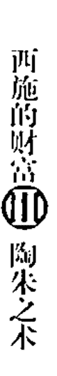


易盲目自信，坚信自己判断的正确性；一般掌握的相关信息越多、越专业、越自信，就越高估自己。高估自己、低估他人，高估自己的优势、低估自己的劣势，是人类共有的心理通病。

2. 可得性偏差。可得性偏差是指：人们在进行预测或决策时，大都喜欢利用自己熟悉或凭空想象构造的信息进行直觉判断，在判断时赋予这些易见的、易记的信息过大权重，从而忽略和淡化大量其他必须考虑但不熟悉的重要因素，从而导致在判断上出现重大偏差。在投资领域里，如果投资人对自身经历的事物特别熟悉和印象深刻的话，就会产生风险评估上的可得性偏差：多数人惧怕未知和不熟悉的事物，对未知事物的恐惧程度要远基于对熟知事物的恐惧程度，因而，会感觉未知事物的风险远大于熟知事物；通常，投资人对事物的信息了解得越多，会认为风险越小。

3. 框架效应。框架效应是指用两种在逻辑意义上相似的说法去解释同一个问题时，会导致不同的心理感受，从而出现不同的决策判断。框架效应通过对决策问题的语义做不影响实质意义的简单改变，就可导致决策的选择行为产生偏好逆转。

4. 心理账户。心理账户指人们在潜意识中有一个账户：会根据财富来源的不同，而对其区分不同的账户进行分类记账、编码、估价和预算，从而对相同金额的钱线因来源不同而形成不同的心理感受。心理账户揭示了人们在进行决策时的心理认知过程，实质上是一种认知幻觉。心理账户通常分为三种情形：一是将各期的收入或各种不同方式的收入分在不同的账户中，不能相互填补；二是将不同来源的收入做不同的消费倾向；三是用不同的态度来对待不同数量的收入。心理账户效应使得人们对每一元钱并不是一视同仁，而是视不同来处、去往何处，会有不同的感受，采取不同的态度。

5. 后悔。后悔是一种因未能做出正确决策而产生的情绪体验。后悔并不只是损失所带来的痛苦，它更是一种自责，是感觉应该对损失负责所导致的痛苦。因此，后悔会比损失还要痛苦。

# 西施的财富

陶朱之术

鸱夷子皮讲完，猗顿说：“关于可得性偏差这个心理效应，我想到了-首诗，可以很好地解释这种心理效应。但是，课堂上既有妇女，又有未成年少年，讲这种诗，恐怕不太好吧？”猗顿看看西施和郑旦，又看看道生，欲言又止。

郑旦哈哈大笑：“我们这种妇女，是重熟女，什么事没见过什么话没听过，我倒要看看，你能讲出多黄的诗来？！”猗顿偷偷看了西施一眼，西施不做声，脸有点红。

道生反而充满了期待的神情，他说：“女子15及笄，15岁已经可以出嫁了，我已年满16，虽然还没熟透，但肯定不是未成年人了。”

鸱夷子皮笑着说：“黄诗？那最好不要讲了。”

猗顿摇头：“不是。是李白先生的《静夜思》。”

道生一脸失望的样子，说：“一首三岁儿童都会诵唱的诗，一首异乡人描写思乡之情的诗，一首妇妪皆知的诗，怎么可能妇妪不宜？”接着他随口背出了这首《静夜思》：

> 床前明月光，疑是地上霜。
> 举头望明月，低头思故乡。

猗顿笑了：“人人都以为这首诗描写的是李白人在异乡对故乡的思念之情的，但是经过好事者的考证，认为大众误解了李白的本意，也就是大众普遍受可得性偏差这种心理效应的严重影响，好事者独辟蹊径，认为这首诗描写的是李白在外打工时，出轨那刻的矛盾心理。”

猗顿这么一解释，连鸱夷子皮都充满了好奇：“此话怎讲？”

猗顿一副豁出去也要讲的样子：“好事者认为这首诗的真实意思应该是这样的。李白在外打工，难耐寂寞。月如钩，独上青楼，找了一个名叫明月的青楼女子。床前，明月脱光衣服，皮肤白得就像地上的白霜。李白同学举头望着明月，春心荡漾，心中欲望难以自抑，但一低头，却想起故乡的贤妻，想到贤妻含辛茹苦托育小儿的身影，让他的心中充满矛盾，难以取舍，所以，一气呵成，此诗脱口而出。”

猗顿解释完，道生狂笑：“李大诗圣在坟墓中要是听到你老人家对他的心理分析如此精辟，一定会惊得起来，大叫三声，‘知我者，猗顿也！’然后吐血4000毫升，血尽气绝，之后倒地，彻底身亡。”

鸱夷子皮也被猗顿的歪才逗乐了，他说：“你讲的这个笑话，确实也能在一定程度上反映可得性偏差。所谓可得性偏差，就是根据人云亦云、自己以往的经验、或是其他人的行为来进行习惯性思维的。”

猗顿不好意思地说：“这不是我的原创，是在网上看到的段子。”

鸱夷子皮继续讲课。

他问同学们：“讲到后悔这个心理效应，我提一个问题，假如有两位股民，一位本来买的是B股票，持股几天不涨，于是换成A股票，结果，B股票大涨，而如果当初不换股而一直持有B股票的话，就能多赚10万元；另一位股民，一开始买的就是A股票，虽然也打算换成B股票，但终究没有动作，而如果换股成功的话，他也能多赚10万元。虽然两人的操作形式有所不同，但都损失了假想中的10万元，这让他们很后悔。但是，哪位股民会更后悔呢？谁能告诉我？”

西施说：“我认为前面那位会更后悔。因为他已经实际持有过这只大涨的股票，相比那位只是动了念头而没实际持有的股民，他的后悔程度会更严重。”

鸱夷子皮点头首肯：“这种后悔的严重程度，又是心理学上的另一种效应，叫做作为效应的体现。通常情况下，‘不作为’在人们的心理上是正常态，而‘作为’是反常态，因此，继续维持‘不作为’的状态较为容易，而如果‘有所作为’了，但却引起负面效果，就会激起人们心理上强烈的后悔情绪。后悔对于人们来说，是一种除了损失之外、还自认必须要对损失负责的感受，人们会因后悔而更痛苦，因此，为了避免后悔，人们通常没有强烈的动机去改变现状，一般会依据过去的原则，目的就是使未来后悔的可能性降到最低。”

西施说：“我明白了。原来，‘不作为’才是人类的天性，难怪这世界这么多人安于现状。做多错多，什么都不干，维持现状，原来就是为了让自己不后悔，同时，还找到机会可以指责那些‘作为’了却出错的人。”

鸱夷子皮道：“同理，在股市中，当股民严重被套时，明知继续持股越久，亏损也会越严重，但宁愿就这样巨亏着，也不愿有所作为、换股交易，这种心理，正是作为效应的典型反应，其潜意识中，是后悔的心理效应在发生作用，所以，不作为，少犯错误，就能少后悔。”

西施恍然大悟的样子：“股市上很多看似不可思议的现象背后，原来都有相应的心理效应在合理地支持。”

鸱夷子皮说：“是这样的。‘可得性偏差’这种心理效应，又能衍生其他的心理效应，‘模糊厌恶’这种心理效应就由其派生而来，也就是说，人们在心理上天生会对了解不多的模糊事物有恐惧感和风险感，所以，在决策时，如果缺乏事物的相关信息和参数，难以进行精确判断的话，就会对这种事物形成高风险的认识，为了回避模糊事物的高风险，人们就会设法避开、远离这些模糊事物。”

猗顿问道：“股市上有一种现象，股民喜欢一切新的品种，认为创新的金融品种能带来高的收益，所以凡是新股、权证或期权等品种，在开始推广时，大都受到市场的热捧。这是不是可以这样理解，在人们的潜意识中，实际上对这些创新的金融品种是具有‘模糊厌恶’的心理效应的，对这些模糊的新品种是给予高风险的评估的，所以，会过度增加对这些新品种的风险报酬，从而认为新品种能带来高收益？”

鸱夷子皮肯定了猗顿：“你看到了金融现象背后的本质。”

他继续讲课：“有一种心理效应与‘模糊厌恶’相对应，那就是‘熟悉偏好’，也就是说，当人们对某一事物、某一领域比较熟悉、比较有把握时，心理上就会调低对这类事物的风险感，从而会更乐意参与，倾向于投入。”

道生说：“球迷会偏好于赌球，拳击迷会偏好于赌拳击比赛，都是不熟不赌；在所谓自己熟悉的领域里更乐意作为，却不见得一定比那些不熟悉的人取得更高的收益，原来这是“熟悉偏好”的心理在作怪。”

鸱夷子皮道：“正是因为心理上存在盲目自信、可得性偏差、框架效应、心理账户、后悔的心理效应，才使得人们在进行决策时，难以保持理性，常常是情绪化的决策，这些基础的心理效应又能衍生出其他各种心理效应，例如非替代性效应、沉没成本效应、交易效用效应、锚定效应等，这些效应反映出心理因素对人们决策行为的影响机制。其中，在投资方面，一个最典型的心理效应就是‘损失厌恶’。”

西施问：“相比盈利，股民似乎更恐惧损失。人们为什么会有‘损失厌恶’的心理呢？”

鸱夷子皮道：“在我讲解‘损失厌恶’前，我先讲个故事，请同学们听完之后回答我的问题。”

鸱夷子皮讲起了故事：

从前，有一座山，山里住着一个老神仙，老神仙脾气古怪。对于经过此山遇到他的游客，他有时会很善良，会给游客钱；有时却很凶恶，会抢走游客的钱。老神仙好赌，无论是给钱，还是抢钱，都喜欢让游客扔硬币，然后让游客自己选择一种收益或损失方式。现在，假定你是一个遇见老神仙的游客，你会怎么回答他的问题呢？

鸱夷子皮提了第一个问题：

### 问题一

如果你运气好，遇到老神仙要给你钱，老神仙给你两种选择：

- 给你一个确定的金额：1500元。
- 通过扔硬币决定给你多少钱：正面就给你1950元，反面的话给你1050元。

那么，你会怎么选择？

鸱夷子皮刚讲完问题，大家就纷纷举手，给出自己的答案：只有猗顿选择的是第二种——通过扔硬币的方式来决定收益，其他人都接受确定的金额。

鸱夷子皮又提了第二个问题:

### 问题二

如果你很不幸地遇到老神仙要抢钱, 同样给你两个选择:

- 抢走你一个确定的金额: 让你损失1500元。
- 通过扔硬币决定抢你多少钱: 正面就抢你1950元, 反面的话, 就抢你1050元。

你会怎么选择?

对这个问题的回答, 也只有猗顿与众不同, 他选择第一种——接受一个确定的损失, 而其他人都选择通过扔硬币来决定损失多少。

鸱夷子皮说: “你们的回答没有出乎我的意料。第一个问题, 从理性的角度来看, 两种选择的期望收益都是1500元, 但你们大都倾向于确定性的收益, 也就是更愿意直接得到1500元, 而不愿通过扔硬币的方式赌博, 或许得到更多、或许得到更少, 可见, 在对待收益时, 大部分人的心理是风险厌恶型的。对于第二个问题, 两种选择的期望损失都是1500元, 但你们大都选择扔硬币碰运气的方式, 实际上是抱着少受损失的期待; 可见, 在对待损失时, 大部分人又是风险追逐型的。这就说明了人们为了减少风险, 愿意承担更大的风险。”

鸱夷子皮总结说: “这种心理效应, 就叫‘损失厌恶’, 也就是说在面对相同数额的盈利或损失时, 人们对损失的感受比盈利更敏感, 损失让人感受的痛苦远远大于相同数量盈利带来的愉悦。‘损失厌恶’心理效应的存在, 意味着人们往往不愿意承认损失; 研究发现, 同样损失带来的负效用, 是同样盈利带来正效用的2.5倍。‘损失厌恶’的心理效应会严重影响人们的决策, 误导人们投资; 例如, 当股民急需现金、必须卖出两只所持有股票中的一只时, 假定一只账面盈利, 另一只处于亏损状态, 大部分人会毫不犹豫选择卖出盈利的股票, 而留下亏损的股票。”

西施说: “看来, 大部分人的投资行为, 确实不是受理智控制, 而是任由天性摆布，更多是受心理的控制。”

鸱夷子皮道：“这种现象，在心理学上也有一个专有效应解释，即为处置效应，股民一般倾向于过早卖出盈利的股票，而长时间持有亏损的股票。”

鸱夷子皮叹息了一声，说：“如果人类能洞察自己的天性，深刻认识自我的心理，能克服人性的弱点，从而避免主观臆断，少点直觉判断，多点理性思考，那么，这世界上或许就再没有了误解、仇恨、怨憎和战争，但是，这可能吗？！”

他接着说：“人类总是自诩聪明、自诩理智，殊不知，大部分人的大部分时间，都受到人类天性的操控，大都处于非理性、情绪化的状态中，生活于自我编制的睿智理智的幻象中，生活在自以为是的思想禁锢中。同样的意思，不同的语言表达，就会有完全不同的效果；所以，人类和猴子一样，都是朝三暮四者。”

猗顿说：“如果还有人坚持认为经济学是一门经纶济世的大学问的话，我们就应该想到‘人是理性的’这个经济学基本假设的荒谬可笑性。或许，还应该再想到这句话，人类一思考，上帝就发笑。”

同学们都笑了。

## 10. 谈谈风险

鸱夷子皮继续讲投资课程。

他说：“说到心理效应，就不能不谈谈风险。风险实际上是人们的一种心理感受，但大多数人将风险普遍理解为损失。在现实生活中，风险更是一个被普遍使用的词语，投资有风险、买垃圾股风险很高、风险投资、做手术有风险等。”

猗顿说：“这年头，普通人还是不要炒股的好，炒股风险太大，我觉得还不如投资豆腐产业实在。”

西施疑惑地问：“为什么？”

猗顿笑着说：“豆腐做硬了是豆干，做软了是豆花，做没了是豆浆，做臭了是臭豆腐，稳赚不亏呀！我本来建议我老婆去做豆腐卖，肯定发大财。结果被我老婆臭骂了一顿，她说我把她推出门去给别人吃豆腐。”

大家都被猗顿惹笑了。

鸱夷子皮制止了猗顿的打岔：“言归正传。同学们对风险是如何认识的？谁能告诉我，风险就是损失吗？”

郑旦答道：“人们对风险这个概念有不同的理解，有人认为风险是一种资金损失；有人认为风险是不确定性；有人认为风险是一种对未知事物的恐惧；也有人将风险看成一种用来量化市场波动的指标。”

道生说：“人类生活本身就是一种风险生活，风险是人类社会生活中的普遍现象。人们在成长的过程中，充满太多的不确定性：不知道何时会得大病，何时会失业，何时会死亡，更不可能知道死亡的方式，这些就是人生的风险。”

鸱夷子皮点头：“确实如此。”

猗顿说：“在投资领域，风险代表的是未来结果的不确定性程度，不确定性程度越高，风险越大。风险并不等于亏损，而是损失的可能性大小。”

白圭说：“我看过的投资书籍中，风险可以计量化，用公式表示的话，就是损失的概率。”

鸱夷子皮说：“你们说得都没错。按照我的理解，风险在本质是人们对于潜在损失可能导致的效用丧失程度的感受。不同的人对同样事件的风险感受可能完全不同，有人过于悲观，会高估损失的风险，会厌恶风险；有人过于乐观，会低估风险，能承受较大的风险。根据各人对风险的偏好程度不同，投资人可以分为风险厌恶者、风险中性者和风险偏好者三种类型；风险厌恶者和风险偏好者在各方面存在明显的差异性，而风险中性者则居于两者中间。”

鸱夷子皮在黑板上写出风险厌恶者和风险偏好者的主要特征：

- 风险厌恶者的特征：比较保守，不愿意承担风险，视风险为危险，普遍高估风险，喜欢低波动性的投资品种，是悲观主义者，偏好确定性甚于喜欢变化，容易从最坏的角度去考虑问题，重视最大损失的可能性。
- 风险偏好者的特征：比较激进，愿意承担风险去追求高的收益，视风险为机会，普遍低估风险，喜欢高波动性的投资品种，是乐观主义者，喜欢模糊，喜欢变化，偏好不确定性，容易从最好的角度去考虑问题，重视最大收益的可能性。

鸱夷子皮说：
“风险厌恶者其实是损失厌恶者，风险偏好者所能承担的
损失程度也要在自身的风险承受能力之内，冒险不能超过自身能承受的
最大损失。风险是损失不确定性程度的感受，但是，不同的人，针对同样
的事件，有不同的风险感受，也具有不同的风险承受能力，这种不确定性
程度完全依赖于个人的知识、能力、经验、偏好等个体特征，那么，如何
判断每个人的风险偏好？”

鸱夷子皮拿出一套风险偏好测评表用来评估学生们的风险偏好风格：

### 风险偏好测试题

1. 在你等待一项影响你人生的重大事件的结果时，你会觉得“焦虑”还是“兴奋”？
   - (A) 很焦虑
   - (B) 比较焦虑
   - (C) 比较兴奋
   - (D) 很兴奋

2. 你对意料之外的坏消息的反应为：
   - (A) 肯定反应过度
   - (B) 可能反应过度
   - (C) 不太会反应过度
   - (D) 几乎不会反应过度

3. 当你在投资环境下想到“风险”一词时，下面哪个词最先浮现你的脑海中？
   - (A) 危险
   - (B) 不确定
   - (C) 机会
   - (D) 兴奋

4. 当你完成一项决策后，你通常有多少把握觉得自己的选择是正确的？
   - (A) 很不确定
   - (B) 有些不确定
   - (C) 有些确定
   - (D) 很确定

5. 避免通货膨胀和保证本金的安全哪个更重要？
   - (A) 保证本金的安全重要得多
   - (B) 保证本金的安全比较重要
   - (C) 避免通货膨胀比较重要
   - (D) 避免通货膨胀重要得多

6. 你面临两项选择：(1) 工作稳定性较高，但薪水较少；(2) 薪水较高，但工作稳定性较低。你选择那一项？
   - (A) 肯定选(1)
   - (B) 可能选(1)
   - (C) 可能选(2)
   - (D) 肯定选(2)

7. 某项投资可能会获取一笔收益，也可能会损失所有或者部分本金。如果你是项目决策人，你主要考虑以下哪种因素？
   - (A) 最大的潜在损失
   - (B) 最小的潜在损失
   - (C) 最小的潜在收益
   - (D) 最大的潜在收益

8. 你做出一项重要的决策时要考虑多长时间？
   - (A) 很长时间
   - (B) 较长时间
   - (C) 较短时间
   - (D) 很短时间

9. 你是否会为寻求高收益的投资项目而进行大笔金额的投资？
   - (A) 从不
   - (B) 极少
   - (C) 比较少
   - (D) 经常会

10. 与你的朋友相比，你对于投资和资金应用的熟练程度为：
    - (A) 很不熟练
    - (B) 有些不熟练
    - (C) 比较熟练
    - (D) 很熟练

11. 你过去的投资中所承担的风险程度如何？
    - (A) 很低
    - (B) 较低
    - (C) 较大
    - (D) 很大

12. 你的资金如果只能投资一项投资项目，你会选择哪一项？
    - (A) 银行储蓄
    - (B) 企业债券
    - (C) 股票
    - (D) 期货

13. 投资会盈利也会亏损，多大程度的本金亏损会让你感觉到无法承受？
    - (A) 10%以内
    - (B) 20%以内
    - (C) 30%以内
    - (D) 40%以上

14. 你的朋友会用以下哪句话来形容你：
    - (A) 从来都不冒险
    - (B) 是一个小心、谨慎的人
    - (C) 经过仔细考虑后，会愿意承受风险
    - (D) 是一个喜欢冒险的人

15. 如果风险和收益是正相关，你认为下面哪个投资组合更适合你？
    - (A) 低风险、中风险和高风险投资的比重分别为：60%、30%、10%
    - (B) 低风险、中风险和高风险投资的比重分别为：30%、40%、30%
    - (C) 低风险、中风险和高风险投资的比重分别为：20%、40%、40%
    - (D) 低风险、中风险和高风险投资的比重分别为：10%、30%、60%

16. 你对未来会拥有大笔财富有何想法？
    - (A) 不太可能，只会比现在更强
    - (B) 谨慎乐观，较有可能
    - (C) 乐观，可能会
    - (D) 很乐观，一定会

17. 你认为自己在做投资决策时是理性的还是感性的？
    - (A) 很理性
    - (B) 比较理性
    - (C) 比较感性
    - (D) 很感性

18. 假设你参加了一个电视节目比赛，分四关比赛。在第一关取胜取得了1000元后，你有两个选择：要么带1000元走，要么一直参加下去，结果可能是胜了就获取上一关5倍的奖金，失败就要失去上一关的奖金，你会怎么选择？
    - (A) 带走1000元；
    - (B) 30%的机会在第二关取胜赢取5000元；
    - (C) 10%的机会在第三关取胜赢取25000元；
    - (D) 2%的机会在第四关取胜赢取125000元；

19. 在投资一只股票一个月后，股票价格下跌20%，假设所有基本面均未改变，你会怎么做？
    - (A) 为避免更大的亏损，全部卖掉，换成现金
    - (B) 卖掉一部分，其余等着看看
    - (C) 什么也不做，静等收回投资
    - (D) 再买入

20. 你投资的目的是：
    - (A) 在本金安全的情况下获得一定的收入
    - (B) 在承担小部分本金损失的情况下追求一定的资本增值


21. 你对投资的预期收益是：

- (A) 获取相当于银行定期存款利率的回报
- (B) 获取每年 5%～10% 的回报率
- (C) 获取每年 10% 以上的回报率
- (D) 获取每年 20% 以上的回报率

22. 一般情况下，你能接受的资产价格波动是：

- (A) 价格波动 -5% 与 +5%
- (B) 价格波动 -10% 与 +10%
- (C) 价格波动 -20% 与 +20%
- (D) 价格波动超过 -20% 与 +20%

23. 如果不用投入任何本金，在以下投资中你会选择哪一个：

- (A) 确定得到 5 万元
- (B) 10% 的可能损失 10 万元，90% 的可能得到 7 万元
- (C) 40% 的可能损失 10 万元，60% 的可能得到 17 万元
- (D) 90% 的可能损失 10 万元，10% 的可能得到 150 万元

24. 如果有个朋友给你准确的内幕消息，某股票即将大涨，你会怎么操作？

- (A) 用多余的资金小笔投资
- (B) 解除存款或卖其他股票变现来投资
- (C) 把所有资金都押在这只股上
- (D) 借钱融资全部买这只股

25. 你觉得自已为了获取更高的收益，愿意承担投资风险的程度是多少？

- (A) 很不愿意承担风险
- (B) 较不愿意承担风险
- (C) 比较愿意承担风险
- (D) 很愿意承担风险

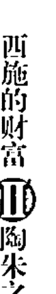

依照鸱夷子皮提供的测试评分标准，各人根据自己的打分很快清楚了自己的风险偏好类型：郑旦和白圭是风险厌恶型，而西施、猗顿和范道生是风险偏好型。

鸱夷子皮继续谈风险问题，他说：“风险既然是人们对于可能的损失所导致的效用丧失程度的感受，那么，风险的核心，其实是考验人们的心理承受能力，以及对损失的心理承受能力，风险，本质上就成为心理效应的问题。所以，我们要洞察投资的风险程度，就要从心理上找根本原因。”

西施道：“是啊！虽然风险不必然带来损失，为什么人们一感受到风险就容易焦虑不安？焦虑会让人惊慌失措，从而容易做出错误的决策。这应该用什么心理效应的原理解释？”

鸱夷子皮说：“风险导致的这种焦虑主要来自‘可得性偏差’的心理效应。当市场剧烈波动、投资人对个股缺乏把握时，不确定性增大，就会出现‘模糊厌恶’的效应，风险感会被强化，投资人会感觉风险可能导致的损失将超出自身的承受能力，从而变得焦虑不安。”

鸱夷子皮认为人们在评估风险时，普遍存在着以偏概全和低估风险的心理误区：

- 1. 评估风险时容易以偏概全。受盲目自信、可得性偏差等心理效应的影响，大多数人经常依据代表性不强的小样本事件来评估风险，而非依据大数规律。因此，在评估风险时容易得出错误结论。
- 2. 容易低估风险。很多人甘愿承担高风险，并非风险承受能力强，而是因其对风险的错误评估，将高风险事件评估为低风险事件。人们在从事风险活动时，往往不能客观评估风险的实际水平，总是盲目自信，对自己的专业技能过度自信；通常，人们总是过分依赖个人经验形成的主观意见，认为自身熟练的技能可以降低所从事活动的风险，从而总是倾向于高估期望收益的概率、低估损失的概率，也就是高估收益，低估风险。

猗顿道：“人们大都喜欢通过在中短期趋势中的亲身体验，从而得出中长期的规律。例如，人们通过房子 10 多年价格的上涨，就会得出房子只涨不跌的结论；人们会因某个基金经理一两年的良好业绩，从而得出该基金经理投资能力优秀的判断；人们也会有‘一朝被蛇咬，十年怕井绳’的心理，在某只股票上遭受过重大损失后，以后就不敢再轻易介入该股票。这些现象，应该都是评估风险时的以偏概全。”

鸱夷子皮说：“评估风险不能不考虑时间因素。人们总是在心理上高估短期风险，低估长期风险。从制定决策到知晓结果，这期间的时间间隔越长，人们的风险承受能力就越强；相反，如果决策的事件很快就知晓结果，人们的危机感就会增加。例如，吸烟是一种高风险行为，但主动戒烟者寥寥，究其主要原因，因为患肺瘤的风险是一种长期风险，所以容易让吸烟者低估；相比长期风险而言，吸烟者短期患癌的风险性很低，于是，人们就会忽视这种风险，更看重吸烟所带来的习惯性愉悦。同样，在投资决策时，人们也更注重短期风险，却缺乏长期风险的意识。”

听了大家的话，白圭问道：“说到风险的时间性问题，我看过一项华尔街的统计结论，就股票而言，从长期来看，股票的年复合收益率要比债券高出 7% 以上，但是，投资人为什么会觉得股票的风险很高？”

鸱夷子皮答道：“债券最主要受利率和到期期限的影响，影响因素相对简单得多；相对而言，围绕着股票有太多让人关注的信息，这些信息对股票未来的业绩有各种不同的影响，股票业绩的不确定性导致个股风险加大，而人们普遍存在‘损失厌恶’的心理效应，会根据信息的性质进行利多利空判断，经常性地对股票进行价值评估，从而不断做出买卖决策，频繁交易，从而加大股价的波动幅度，波动幅度加大让更多的投资人焦虑，所以，就会加入到交易的行列中，采取交易行为，推动股价出现更大幅度的波动。”

白圭：“根源原来还是在于‘损失厌恶’呀！”

鸱夷子皮继续讲座：“从短期来看，股价波动导致的心理恐惧会强化投资人的‘损失厌恶’，从而会频繁进行交易。但从长期的角度看，股价的波动就是噪音，只会对个股的中短期价格有影响，根本无法改变股票的长期价值。因此，包子派寻求股票的长期价值，就应该每几个月一次，甚至一年一次去查看股价，而不应该每天、每周去看股价，如此，他们对包子的估值才可能是个明智的选择。股票的高风险高收益性补偿的就是那些有耐心、有理性、能承受波动风险的包子派投资人。”

“资金是否已投入、成本是否已付出，人们对于风险的感受程度就会完全不同。当人们已做好决策、已投入资金并付出成本之后，就会对其投资产生盲目自信的心理效应，会给出风险较低、风险可控的风险评估结论。实际上，得出这一结论的理由，并非投资风险真的很低，而是心理上出现沉没成本效应的结果。因人们已投入资金，就会在心理上出现沉没成本效应，这种心理效应改变了人们对风险的感受，提高了人们对风险的承受程度。”

“我举例说明沉没成本效应：假设你中了大奖，赢得一次全家泰国游的机会，但当你全家准备出发时，却遭遇了泰国罢工，旅行存在一定的风险，在这种情况下，你会冒险带着全家出发去旅行吗？事实上，大部分人会选择放弃；但是，如果这次旅行并非中奖得来，而是自己埋单，已经支出了 1 万元并且不能退款，在这种情况下，同样的风险之旅，大部分人就会选择冒险。正是因为沉没成本的心理效应，人们在付出成本、付出代价的情况下，就会更容易冒险。”

猗顿：“股民在没投入股市前，大都感觉股市风险很高；而一旦投入了资金，就倾向于投入重金到股市中去，原来是因为沉没成本的心理效应。”

鸱夷子皮：“股民在面对收益时，倾向于避免不必要的风险，风险承受程度较低；但在面对损失时，却可能作出更风险的投资决策，风险承受程度会大大提高。这个结论，我们以前用老神仙的问题检验过，但是，人们的风险偏好类型并非固定不变，而是复杂多变的，会经常根据外围的环境进行自我心理调整。因此，心理效应是投资风险承受能力变化的根本原因。因此，我们继续用老神仙的问题来引导大家。”

于是，鸱夷子皮又用老神仙的故事提出了新问题：

老神仙在给你钱或抢你钱之后，他还会再给你两种选择，由你自己决定是否继续和他玩扔硬币的赌博游戏。

### 问题一

假定老神仙给了你 1500 元，他再给你两种选择：

- 1. 不玩了，拿钱上路走人。
- 2. 扔硬币赌博：如果是正面，他继续给你 1000 元；如果是反面，那么你就要给回他 1000 元。

你会选择扔硬币赌博吗？

鸱夷子皮讲完后，大家马上就给出了答案：全部选择继续扔硬币。鸱夷子皮又问了第二个问题：

### 问题二

假定老神仙抢了你 1950 元，他再给你两种选择：

- 1. 不玩了，上路走人。
- 2. 扔硬币赌博：如果是正面，你可以赢得 1950 元，如果是反面，他还要抢你 1950 元。

你会选择扔硬币赌博吗？

这次，大家的选择又都是第一种选择，不再扔硬币赌博了，直接认赔走人。

鸱夷子皮说：“老神仙所出的问题一，实质上和上次问题一是一样的，都是一个期望收益相等的问题，但实际上，大多数人的风险偏好会出现转移，大部分人会选择继续扔硬币去赌，这是因为心理账户效应的存在，使得人们感觉赌输了的话，也还会获得 500 元；如果赌赢了，人们的心理上就不会将两次赢利合并，而是更享受两次赢利的成功。而问题二实质上也和上次问题二是一样的，都是一个期望损失相等的问题，但实际上，大多数人倾向于不再赌博，以免出现更大的损失。同样，这也是因为心理账户效应的存在，使得人们会将可能的损失和上次的损失分别归为两次损失，从而更痛苦，所以会选择确定性的结果，以免出现更大的痛苦。”

范道生不解地问：“我还是没有搞明白，为什么风险会引起人们这么强烈的心理反应？人们应该如何对待风险？”

鸱夷子皮总结道：“人类面对那些未知的、不确定的事物时，更容易产生紧张和焦虑的心理，这是正常的心理表现，其实是一种自我保护性的身心反应。紧张和焦虑是应付外界刺激的一种反应方式，是行动之前的本能反应，有了这种本能，就能产生应付外界变幻的能力。可见，紧张和焦虑情绪并不是坏事，要以积极的心态去接纳它们。那么，应该如何对待风险？这就意味着要消除担心与焦虑，克服对损失的恐惧，提高承受价格波动的能力。而要解决这些问题，就要进行情绪管理，通过进行克服自我情绪的专业训练等方式加以实现。”

## 11. 亏损是投资的成本

鸱夷子皮接着说道：“风险不是亏损，风险来自对亏损的恐惧。那么，如果真的亏损了，应该怎么办？”

范道生说：“亏损？只有新手才亏损吧？高手应该都是只赚不亏的。”

猗顿摇头说：“此言谬矣。亏损并不是新手的耻辱，更不是新手专有的。即使牛如巴菲特、索罗斯，也免不了亏损。而新手在开始投资时，如果运气好的话，同样会获得盈利，可见，亏损和投资技能无关。”

鸱夷子皮点头：“亏损是投资过程中必不可少的遭遇和经历。即使是高手，同样会出现亏损，这是因为投资市场的诡秘多变和人性的贪婪与恐惧心理无人可以避免，故此，亏损在所难免。但是，这种亏损，就像是商业经营中的成本，必不可少，只要通过合理控制，保持总体投资的稳定盈利，就属正常；高手们也正是通过合理的亏损，去追逐更多的收益。”

“同样，任何投资人，要想成长为投资领域的成功者，其成功道路上的第一块基石，肯定不是赚钱，一定是亏损。亏损就像学习投资的学费，是整个投资过程中的必然产物，而与投资技能的高低没有任何关系。只有那些经历过亏损、学会了控制亏损的人，才能真正掌握投资技能，才能获得盈利。而那些没有经历过亏损、没有学会控制亏损的投资人，在以后的投资道路上就可能会出现巨大亏损、亏损失控的恶劣状况。”

范道生问：“为什么说亏损更像学习投资的学费呢？”

鸱夷子皮说：“投资新人在刚开始投资时，与其说是投资，毋宁说是在学习投资，其投资的本金，实质上是学习阶段的练习资金。新手开始投资时，理所当然会屡犯错误，错误导致亏损，如果能通过亏损发现错误、改正错误的话，错误就成为一种学习的机会，而亏损就成为学习的学费。这种学习过程是通过犯错误——认识错误——改正错误的过程来完成的，不断地犯错误会造成亏损，严重的亏损会迫使一部分人认识错误，通过调整自身的心理认识，减少犯错误的概率，增加正确认识的机会；而改正错误的过程，就成为调整不良投资行为、建立适合自己的投资交易系统的过程。如此，一部分人通过在市场上反复犯错、改错的实践，逐渐减少亏损，提高盈利胜算，成为能成功获利的合格投资者；而相当一部分人呢，虽然一直亏损，却不肯学习，或者找不到正确的学习方式，任由亏损失控，成为亏损累累的投资失败者。”

范道生：“明白了。但是，亏损是学习投资的学费的话，学费到底交给了谁呢？谁是亏损者的老师？”

鸱夷子皮：“当然是市场。市场就像一个公正的老师，惩罚犯错误的新学生，向其收取高昂的学费；而奖励犯错少的高手，将收取的学费奖赏给这些交够学费的高手；新手犯错误而亏损，如果能通过这种不断犯错纠错的学习程序、成功建立自己的投资交易系统、成长为老手后，就有能力通过市场回收以往所付出的学费，获得投资盈利。”

鸱夷子皮认为，新手学习投资，一般要经历这样四个阶段：

- 1. 完全不懂的盲目投资阶段。
- 2. 自以为懂投资的亏损阶段。
- 3. 有意识地系统学习的学习阶段。
- 4. 成功建立投资交易系统的上路阶段。

听了这话，猗顿有所感悟：“自以为懂投资的人容易亏损，看来，股市中侃侃而谈的专家大都在这个阶段，离上路阶段还差得远呢！”

## 12. 如何对待投资中的错误

鸱夷子皮道：“刚才我们一直在说犯错误是造成亏损的根本原因，也就是说认识错误、改正错误，才能减少亏损；如果认识不到错误，那就是亏损了也搞不清原因。我们现在谈谈对错误的认识问题，只有认识错误，才能减少亏损的概率。那么，你们又是如何认识错误、对待错误的呢？”

郑旦答道：“我天性追求完美，做事务求臻于完美，不能容忍一丝瑕疵，如果犯有错误，我就会内疚难受，坚决不能接受自己再犯同样的错误。”

鸱夷子皮点头：“精英人士大都像你这样，都有追求卓越、追求永远正确、厌恶犯错的天性，行为做事力求尽善尽美，不能容忍一丝差错，或许，这种完美主义者则在别的行业更容易取得成功，各行各业的成功人士也大都具有这种追求完美的性格特征。但是，在投资领域，有一个让人奇怪的现象，投资大师在成名之前，大都是一些意志坚定的军人、有过生死存亡经历的哲学家，或是心态平和而不起眼的普通人。相反，很多在其行业内成就卓著的精英人才，兴致高昂地进入投资领域后，以为凭其聪明才智和经验，可以在投资界复制自己过往的成功，结果，大都遭受严重受挫，铩羽而归。”

郑旦有些感慨：“为什么追求完美、拒绝犯错的精英人士反而容易亏损？这到底是为什么？！”

鸱夷子皮笑着说：“精英人士心理上大都有优越感，普遍存在直觉判断的盲目自信，其他种种人类的心理效应也会很突出：在进行决策时坚信自己的判断；当投入资金后又会期望获利，头脑会被这种期望的心理完全占领。但市场是多变无情的，市场的走势往往不以精英们的意志为转移，而是经常和人们的判断背道而驰；如果具有普通而平和的心态，能意识到自己会经常犯错误、从而改正错误的话，就会将损失的风险控制在可承受的范围之内；但是，如果具有的是精英人士的超级自信的心态、坚信自己永远正确、害怕认错、不肯承认自己判断错误的话，就不会正视市场的客观走势，而在心理上完全被期望这种心理效应所控制，不相信自己的错误，不承认市场的正确，只期望市场的走势符合自己的判断，期望和判断相反的走势能逆转掉头，期望由不亏到少亏，这种期望的心态随着市场走势与自我判断的相反程度越大而越强烈，随着损失的严重失控，最终成为投资领域的失败者。”

郑旦感慨道：“精英人士投资需谨慎啊！”

鸱夷子皮道：“实际上，人们在投资时，正是这种坚持自我正确、拒绝认错的盲目自信的心态作祟，从而造成了大部分的亏损。如果能调整心态，改变对待错误的态度，及时认识错误，不受错误心态的影响，发现错误后及时纠正，就能将错误导致的损失控制在可承受范围之内。”

西施问：“怎么调整心态呢？”

“要调整心态，就要认识、理解和认同错误。只有认识了错误，才能理解错误产生的原因，从而避免犯同样的错误。要认识错误，首先应该摒弃精英心态，从内心将自己视为普通人，普通人就会有缺点，有缺点的人犯错误会很正常。

既然犯错是人之常情，所以就应该这样看待错误——你必须学会原谅自己的错误，将之视为普通人的通病；你应将自我的追求完美调整为平和自然的心态；你无须有太强的期望心理，期望得到完美的结果；你应该深深认识到，投资决策本是依赖于不完整、不确定性的信息而作出，未来结果不具有确定性，所以，决策一定是不完美的，犯错也很正常。”

最后，鸱夷子皮有点感慨地说：“但是，古今中外，从专业机构的投资管理人到普通股民，却总是在股市上反复犯着同样的错误，贪婪、期望、恐惧和后悔的心理千百年来从来就没有变过，在不同的时代，披着不同的外衣，演绎着同样的主题。不深刻洞察人性，怎么可能透彻认识股市呢？”

## 13. 思想就是财富：为什么要学习投资

鸱夷子皮接着说道：“工欲善其事，必先利其器。对投资人来说，与其在股市上胡乱投资，让资本在茫茫股海中被动地随波逐流、亏损累累，将学费交给市场，不如向谙熟投资的高手学习，等待真正掌握了投资的要领，再进入市场实践。这种主动学习的代价，恐怕不如被动学习造成的亏损的百分之一吧！”

猗顿说：“在股市中，现在有几个人愿意静下心来埋头学习呢？现代人的心态普遍浮躁，人们愿意投资炒股的根本原因，是因为股市能让人一夜暴富，所以，人们在炒股时，往往心里充满暴富的欲望和期待，投资决策大都建立在预测、小道消息、谣言的基础上，操作手法也惊人地雷同，基本是孤注一掷赌博式的。如相信某个小道消息而将全部资金押注于某只股票，它也许是黑马，会涨得一飞冲天，但这种好事一般轮不到普通股民；对大部分股民来说，黑马常常是黑洞，这种赌博式炒股最终会亏损累累。”

白圭接着猗顿的话语，补充说：“新股民一般在出现严重亏损后，会有两种处理态度，一种是做鸵鸟，遇到危险时就把头埋在沙子中，眼不见为净，逃避处理，新股民就这样对损失不闻不问，不再理会，任其资本在股市中随波逐流，最终亏损严重，成为投资丛林中的羔羊，被其他猛兽分而食之；还有一些人会想办法学习投资，大都通过大量阅读投资方面的专业书籍、报纸杂志，通过这种方式自学，再结合投资实践的体验，慢慢摸索到一套适合自己的投资交易系统，成长为投资老手，在投资市场上获取利润。”

范道生说：“自我学习的过程太漫长，亏损的代价太昂贵，还是找一个名师学习的成本最低，但问题是股市上鱼龙混杂，是个人都号称专家，连证券公司门口卖报纸的都号称可以从《三国演义》中看到炒股的智慧，那么，应该如何判断一个人是不是真正的投资老手呢？”

鸱夷子皮说：“人的命运千差万别，根源于思想观念的不同；同理，投资能力的云泥之别，其根源也在于思想理念。对投资来说，思想就是财富，理念就是生产力；思想和理念是投资的根本、思想对路了，理念正确了，投资技能就是水到渠成的事情。投资，与思想相通，与理念相连，而与技术无关；所谓投资技能，只不过是投资思想的付诸实施而已。而学历的高下程度，在投资中并不起决定作用，教授专家博士的投资能力或许远不如能从《三国演义》中总结炒股智慧的卖报纸的。”

猗顿插话说：“说到思想和财富的关系，我想到了一个笑话，用来说明思想决定财富的道理，或许很形象。”

猗顿讲起了笑话：

一伙劫匪抢银行，大喊到：“通通不许动，钱是国家的，命是自己的！”劫匪得手而返。

有一新劫匪，系因找不到工作而刚加入劫匪队伍的硕士，他对老劫匪讨好地说：“老大，我数学超好，让我来数钱吧，看看这次出手战绩如何？”老劫匪虽然小学都没毕业，但却是抢劫行业的资深成功人士，经验

丰富，他骂道：“你新来的啊？蠢货！这么多钱，数到什么时候？晚上看新闻不就知道了吗？”晚上，电视新闻上说银行被抢一个亿，劫匪们数了八遍，也就两千万，老劫匪感慨道：“老子拼了老命，才赚了两千万；银行行长脑子一动，就轻松挣了八千万！”

狗顿总结笑话的含义：“这个笑话同样适用于投资，投资如抢钱。经验比学历更重要，智慧比经验更重要。思想才是财富，观念才是第一生产力。”

学生们都哈哈大笑。

鸭夷子皮说：“劳心者治人，劳力者治于人。思想者统治一切，不独在政治领域如此。在投资领域，思想理念更是根本，思想有多深，财富的大厦就有多高。投资亏损的原因是因为犯错误，犯错误的根本原因是因为缺乏正确的投资思想作引导，所以，在学习投资的过程中，就是靠自我领悟去发现自身盲点和缺陷、纠正错误理念、树立正确投资思想的过程。但是，如果仅仅只靠自我修炼的话，或许花费十数年的时间精力、累积难以估计的巨亏教训，恐怕也不一定能领悟投资的真谛，而如果经过老手的指点，经过一定时间的投资训练，投资将如捅开一层纸一样简单，会豁然开朗。苹果给了别人，自己就没有了；思想则不同，思想由一个人传递给另一个人，两个人都会有正确的思想作指导。实际上，投资思想可以通过学习获得，经过一定的训练，就能大大缩短取得正确投资思想的时间期限。所以，有可能得遇名师的话，学习投资比自我摸索着前进，要事半功倍得多。”

道生自豪地笑了：“学好数理化，不如有个好爸爸呀！我就不用发愁去哪儿找名师了。”

## 14. 青梅煮酒论英雄：谁是真的投资英雄

这天是八月十五中秋节，鸭夷子皮没有循例开课，而是放假一天，欢度佳节。

下午，骑顿正在自家后院种菜、浇菜，忙得满头大汗之时，白圭和道生赶来，白圭说：“老师有请，晚上一起吃饭赏月，谈谈事业，谈谈爱情。”道生说：“是谈金钱和女人吧？”骑顿大悦：“同去同去。”

鸭夷子皮的中秋赏月宴设于“海上人家”酒楼。“海上人家”酒楼其实是个大排档，位于梧桐山脚下，背靠着山，面向着清江流向大海的出海口，既看海景，又望江景，风景绝佳。

当骑顿、白圭和道生赶到时，鸭夷子皮带着全家早就来了，郑旦也在座。范无为和范若水两个调皮小毛孩东躲西藏，在玩着捉迷藏的游戏，西施在吃力地喊这个，喊那个，生怕他们打碎东西闯祸。

鸭夷子皮笑着招呼大家就座，说道：“今天过中秋，郑旦的朋友从国外寄来好酒佳酿，大家一起品品质酒，赏赏月亮，共度良辰，一起尽兴。”

郑旦说：“这是来自东瀛的名牌青梅酒，用酒中上品浸泡优质青梅达三年以上，才能出厂售卖。”

鸥夷子皮笑着说：“我已偷偷尝过了。酒色清澈剔透，酒味醇香纯正，青梅滋味满口留香，确实是好酒。并且，东瀛美酒，酒中不含甲醇，青梅选用的是纯天然青梅，不含对羟基苯甲酸甲酯等防腐剂，更不含日落黄、诱惑红等人工色素，大家尽管放开喝，大不了醉方休，不会危害身体健康的。”

郑旦盯着鸥夷子皮，也笑了：“闻名天下的智者范……哦，鸥夷子皮先生，真是无所不知啊，不但是投资大师，还是化学大师。”

鸥夷子皮笑道：“这年头，生存环境恶劣，人人都是化学家呀！不把化学元素周期表中的元素通通吃完，都不好意思说自己是在社会上混的。”

西施说：“为什么我的眼中总饱含泪水？因为酸性的空气污染太严重！呛的！”

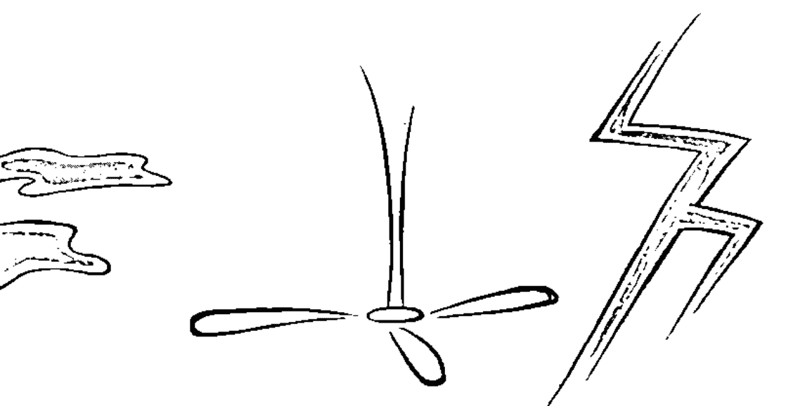

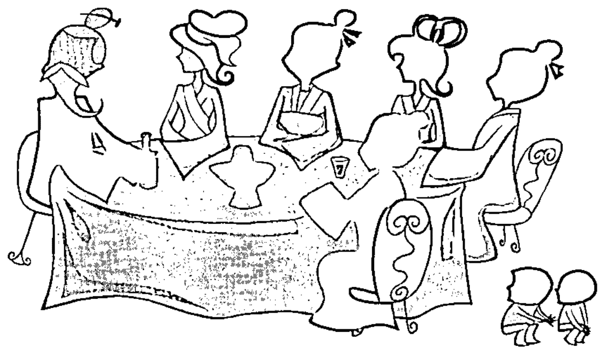

众人都笑翻了。

天色已晚，月出皎兮。放眼远望，江天一色无纤尘，皎皎空中孤月轮。师生们开怀畅饮，其乐融融；江上清风徐来，端的是让人心旷神怡。

酒至半酣，忽然天色大变，皓月不知何时早已隐藏不见，天边阴云漫漫，好像马上要下大雨的样子。大家看到天空乌云的样子，好像有一条龙出没一样。

鸱夷子皮说：“龙能大能小，能升能隐；大则兴云吐雾，小则隐介藏形；升则飞腾于宇宙之间，隐则潜伏于波涛之内。龙乘时变化，犹人得志而纵横四海。龙之为物，可比世之英雄。恰好我们也在畅饮青梅酒，不如我们学学曹操煮青梅酒论英雄的故事，也评价一下投资行业里的各位英雄，大家意下如何？”

西施提醒鸱夷子皮：“曹操比我们晚出生几百年呢！”

鸱夷子皮爽朗地笑道：“我从小化学学得好，历史就没好好学过。既然我们不能学他，那就让他学我们吧！”

道生嘀咕：“这也不是历史没学好吧？是占卜学这门课没学好吧？这是未来的事儿呀！”

鸱夷子皮：“诸位，做大事者，不必拘于细节。我们今天就青梅煮酒论英雄，探讨一下当今投资行业，谁是真正的投资英雄？谁先发言？”

猗倾城说：“遥想德隆当年，蜀中唐氏兄弟，独具投资唐门暗器，气魄举世无双，纵横开阖，收购兼并，全国近半非信托投资公司被纳人其囊中，一举一动，都让股市地动山摇，是有名的股市大善庄，其昔日财富，举国无双。可谓当今投资英雄。”

鸱夷子皮摇头：“唐氏兄弟所为，乃操控，乃赌博，乃邪路。以其当日所控资金，在股市中具有大恐龙一般的超然地位，如若不是图谋操纵股市，而是采用包子弹的打法，多投资猎豹型个股，即使全部买入银行类的大笨象个股，其财富增长又何止数十倍？根本不用身陷囹圄，让庞大的财富烟消云散。他们根本不懂投资，就像一个头脑简单的巨人，只知资金的蛮力，不懂投资智慧，怎么可能是投资英雄？”

白圭说：“投资文人赵黑星，调研要亲力亲为，潜入港口数集装箱数量、数高速公路上的车流量、查看上市公司的用电量，从而得到个股的真实数据；在股市高歌猛进之时，善于情绪管理，激流勇退，此人可谓投资英雄。”

鸥夷子皮点头：“此为投资英雄矣！”

猗顉说：“打工老总阿段，在实业界功成名就后，从实业界进入投资界，实现惊人一跳，投资王一网，获利百倍，可谓投资英雄。”

鸥夷子皮：“此为投资英雄矣！”

道生问道：“宁波敢死队等游资枭雄，今天买明天卖，看似蝇头小利，按年累积复利率惊人，可谓投资英雄。”

鸥夷子皮点头：“此为投资英雄矣！”

郑旦问：“夏华基金的王大伟，连续十年在共同基金中独占鳌头，收益稳定增长，投资业绩让他人只能望其项背，望其扬尘，而莫能及。此人可谓投资英雄。”

鸥夷子皮曰：“此为投资英雄矣！”

西施问：“以你所见，当世投资英雄，还有何人？”

鸥夷子皮指着西施、猗颤、白圭和郑旦：“你、你、你，还有你，都会是当今时代的投资英雄。”

众人大吃一惊，猗颤一紧张，手中的筷子都掉到地上了。这时，窗外一个霹雳，雷声大作。

猗颤笑道：“激动，太激动了！没想重，我会成为投资英雄。难道我要梦想成真？或者是老师发梦，只是为了激励学生？”

鸥夷子皮也笑了：“你可以不相信你的实力，但要相信我的眼光。你会成为超级富豪的，你一定要相信自己。”

西施有点困惑：“在曹孟德眼中，只有他和刘备是当世英雄。可是，在你眼中，谁都是投资英雄，甚至，连我这个家庭妇女，都快成为投资界的精英人士了，这，可能吗？”

鸥夷子皮哈哈大笑：“曹孟德眼中容不下他人，所以，他并非真的英雄。在我看来，只要合适的人在干合适的事，每个人都可能成为英雄。投资亦是如此。只要能建立自己的投资交易系统，只要能稳定盈利，不管是包子派，还是馒头派，都有可能成为投资英雄。包子派认为，投资就是买企业，对于成长性良好的企业，买入其股票，一路持有，这是投资；馒头派认为，投资是一种关于确定性的游戏，可以通过涨跌盈亏概率计算，利用技巧取得盈利。包子派和馒头派为此争论不休，相互鄙视，其实，只要正确掌握了相应门派的精髓，投资能取得稳定的盈利，就是真正的投资英雄。”

## 15. 投资和交易

鸱夷子皮开始讲述起投资英雄的不同投资类型。他将人们的投资行为归纳为以下投资风格完全不同的两种类型：

- 1. 投资。这种投资行为看重股票所代表公司的价值和成长性，通过买进成长性好的公司股票，公司的业绩增长推动股票价值的增长，带动股价的上涨，投资人分享的是所投上市公司经营成果的成长，这种投资行为一般被称为价值投资，我们以后简称价值投资为投资，通过价值投资方式进行投资的就是包子派，包子派的投资人称为投资者。
- 2. 交易。这种投资行为看重的是股价的上下波动，通过利用股价波动所导致的交易机会，来获取可能的收益。如果低买高卖，就能盈利；如果高买低卖，就会亏损，这种投资行为我们称之为交易，这种投资行为一般传统上被称为投机，通过交易方式获利的就是馒头派，馒头派投资人称为交易者。

郑旦说：“什么是交易？交易原来是投机呀！”

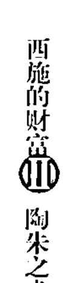

猗顿笑着说：“什么是交易？投资大师钱钟书认为，交易，就是股市外面的人想买进来，股市里面的人却想卖出去。”

鸥夷子皮说：“投资和交易，这两种投资行为本身并无好坏之分，更无道德高下之别，都会产生各种的投资英雄，巴菲特是投资者的代表，索罗斯则是交易者的典型，不同的两种投资行为不妨碍他们同样取得财富上的巨大成功。”

猗顿说：“但是，在普罗大众眼中，却给两种投资行为贴上了道德的标签。投资者普遍歧视交易者，认为交易者的交易方式是缘木求鱼，是赌徒，是幼稚可笑的盲人摸象，看不起交易者的获利方式。同样，在交易者看来，投资者大都属于伪价值投资，只不过在一个更长的时间周期里、去踏着市场的节奏进行趋势投资而已。交易者也嘲笑投资者，认为投资者本身是一个长期交易的交易者，却不肯承认，非要自诩为价值投资的代言人。”

鸥夷子皮摇头：“非也非也！大众在投资时，大都喜欢穿标有‘价值投资’标签的华丽服装，喜欢将自己包装成价值投资者而到处炫耀，却羞于承认自己是交易者。在投资界，包子派是主流，价值投资是高尚行为，是受人尊敬的投资方式；而馒头派从事的买进卖出的交易，则被当做投机，是旁门左道，是无知群众所为，是被人耻笑的投资行为。社会也普遍形成这种印象，价值投资是投资，是在创造社会财富；交易是投机取巧，是赌博行为，迟早会遭受损失。因此，投资专家言必称巴菲特，纷纷以巴菲特的门徒自豪，而鄙视交易者，视交易为不入流者。”

郑旦问：“为什么大众会有这种价值投资的优越感呢？”

鸥夷子皮答：“因为真正优秀的价值投资者和交易者都很少，而对投资和交易一知半解的菜鸟太多，菜鸟们凭着在报刊、书籍或者网上学得以言片语的投资技巧，加上自我经验和教训，胡乱操作，将投资看做是买入大众看好的好公司长期持有，而将交易当做是满仓频繁买进卖出，于是照猫画虎，照单抓药，如此操作的结果，当然是满仓频繁进出的更容易亏损，于是，大众就有了这种印象，价值投资胜过交易投机。虽然，菜鸟们的操作方式既不是投资，也不是交易，但不妨碍他们在缺乏投资知识的情况下得出这样的谬论。”

白圭问：“那么，投资和交易相比，哪种投资行为的难度更高？”

鸱夷子皮说：“真正的价值投资者，不仅需要具备高水平的估值能力，内心要更强大，面对市场的大起大落，能保持内心的平静、客观和理性，不以涨喜、不以跌悲，耐得住长时间亏损所带来的心灵熬煎，以及分析判断不被股市所认可而导致的孤独。实际上，真正具有价值投资能力的投资者非常稀少，只有那些投资生肖属龟的投资者，在拥有丰富的个人阅历和社会经验，并且对企业管理和人性具有深刻的洞察力后，才有能力真正进行价值投资。大部分所谓的价值投资者，实质上就是在一个较长期的时间周期内进行交易的交易者，事实上，绝大多数人的投资行为都是在进行交易。所以，价值投资要难得多。”

西施说：“我可不可以这么形容？投资就像养鱼，通过将小鱼苗养成大鱼而获利；而交易更像钓鱼，凭借一定的技巧，有可能短期内捕获大鱼，但同样有可能一无所获，徒费鱼饵。”

鸱夷子皮大喜，说：“你这个比喻很形象，很生动。但投资比养鱼要复杂得多，有可能养的是蝌蚪，辛苦养育很久后，却都变成蛤蟆跳走了。”

道生问：“除了投资和交易，我国人民还擅长炒作，所谓炒股、炒基金、炒房子、炒物资等，人们习惯于将炒作当成一种投资，那么，炒作是另一种有别于投资和交易的投资行为吗？”

鸱夷子皮变得有些严肃起来，他说：“人们习惯于将投资当做炒作，但炒作绝不是投资和交易之外的第三种投资方式。所谓炒股某股票、某商品、某物资，其实是一种控制价格的操作手法，也被称为坐庄，本质上是一种价格垄断，是一种价格欺诈，是奸商从事的一种囤积居奇、从而使其奇货可居的违法行为。炒作是通过操纵炒作物品的供求关系，人为制造垄断价格，从而谋取暴利。这种违反基本道德准则的操作手法，不符合我的价值观，更不是我要给你们讲授的技能。我今天特此申明，禁止你们炒作牟利，你们若有违反，就不要说是我的学生。”

鸱夷子皮语气缓和了一下，接着说道：“投资和交易，两种不同的投资行为，哪种更适合自身？这就需要你清楚认识自己，明了自己的投资生肖。如果不是龟型之投资特征，那么，交易这种方式，可能更适合你。人们应该摒弃成见，不要盲目迷信价值投资，也不要鄙视交易，吃包子的不见得比吃馒头的高贵，馒头也是干粮，条条大路通罗马，适合自己才是最关键的。对于交易者来说，投资是一门科学，精确的概率计算是获利的基本保证；对于投资者来说，投资更是一门艺术，不同的投资者，价值投资的方式各有不同，估值的方式也因人而异，但都能以自己的方式，取得财富上的成就。”

## 16. 投资思想：先有思想的财富，再有物质的财富

窗外，大雨磅礴。

两个孩子玩累了，分别躺在西施和郑旦的怀里睡着了。

猗顿说：“大雨一时半会也停不了，老师不如继续讲投资课程吧。”

鸦夷子皮：“昨天我们讲过，投资的思想是投资的根本。那现在我们就讲讲投资思想吧。”

白圭说道：“思想有多深，财富的大厦就有多高。这句话让我震撼，让我印象深刻。”

猗顿笑着说：“还可以换一种说法，思想有多远，财富的雪球就能滚多远。因为，巴菲特认为，投资就像滚雪球，无非就是找到很湿的雪和很长的坡。看来，只有拥有正确的投资思想，有了深刻的头脑，才会有善于发现的眼光。”

鸱夷子皮也笑了：“绮顿的领悟能力确实独到。投资思想是人们的投资哲学，是一个人的价值观和哲学思想在投资这项具体事务上的体现。每个人的投资生肖不同，投资行为不同，那么，投资策略、研究分析方式、交易方式等具体的投资技巧也就完全不同，而作为这一切根本的投资思想也必然不同。正确的投资思想才能保证投资人——不管是包子派还是馒头派，都能用适合的投资方式去获取收益。投资本质是一个游戏，思想正确了，就能获胜，金钱只是游戏的副产品，是对获胜者的奖励而已。投资，这种游戏，获胜的关键，就是要用正确的投资思想武装自己的头脑。我给大家讲一个有关投资思想的故事吧。”

鸱夷子皮讲起老和尚的故事：

法门寺百岁老和尚大慈大悲，多年来投资股票竟然收获颇丰。

老和尚的投资业绩让资产管理界各色精英大为羞愧，多年熊市，无论是私募、共同基金、券商资产管理还是保险公司资产管理，大都亏损累累，鲜有获利者，而一个寺庙和尚，既不是博士，更不是海龟博士，竟然强过所有投资精英，这让投资界大惑不解。于是，投资精英们委派一名基金经理，去向老和尚讨教投资秘籍。

基金经理问老和尚：“老和尚不但是佛门大师，更是股神啊，赛过巴菲特，强过索罗斯。是否大师多年修佛，彻悟到我佛智慧，所以炒股有了独家法门？”

老和尚哈哈大笑，曰：“阿弥陀佛！我佛慈悲！老衲看到股市低迷时，尘世间无数股民深陷，不禁恻隐之心，欲普度众生、解救股民于水深火热之中，于是就尽己之所能，将全部资金买进股票，以图善事。而当股市高昂时，众人又疯狂抢购不已，老衲为了遂众人心愿，让股民能如意购得股票，于是就将股票售出，没想到我佛慧眼大开，竟然让老衲屡屡收获甚丰。哈哈哈！”

基金经理恍然大悟。

鸱夷子皮说：“老和尚仅仅掌握了一点投资思想，应用了其中的相反理论，就能把握住股市的周期性波动规律，从而获利甚丰，可见，投资思想对于投资是何等的重要！相反，如果缺乏正确的投资思想作指导，投资就会如汪洋大海中的一叶孤舟，将迷失方向，投资人在面对市场情绪狂热时，就会轻易动摇理念，难以坚守自己的投资风格，更谈不上建立适合自己的投资系统。”

道士问道：“人的投资思想从何而来呢？”

鸥夷子皮：“每个人的投资思想虽然各有不同，都是自我个性、阅历、知识、品位在投资上的各自体现，但是，有一些共通的思想，是所有投资人都必须具备的基本思想，指引着人们在正确的道路上前进。这些正确的投资思想虽然可以通过自我的体验和思考得来，更可以通过学习，有意识地灌输在头脑中。”

鸥夷子皮接着说：“投资的目的，就是为了获利，但是，大部分人追求获利的结果，却是亏损。股民大都有这样的投资历程，投资初始，大都心态谨慎，小笔交易，不敢重仓，有盈利就兑现，这个阶段大多数人通常会盈利；随着投资经验的丰富，股民自我感觉良好，以为自己已经掌握投资技巧，于是重仓交易，投资就会大盈大亏；那些为了追求高收益而容忍大幅度波动风险的股民，最后，高风险大都被兑现为巨额亏损。”

西施提问：“为什么会出现这种现象呢？为什么股民初始会盈利，自以为懂得投资之后反而容易巨亏呢？”

鸥夷子皮答道：“这是因为股民开始不懂投资，所以会谨慎投资，从而将亏损控制在可控的范围内；自以为懂得投资之后，为了取得高收益，就会放大亏损幅度，从而让亏损失控，成为巨亏。相反，如果一直持有战战兢兢、如履薄冰、不能容忍大损失的心态，就不会有大损失出现，投资盈利的可能性也会大增。这种控制风险、将亏损控制在合理状态的思想，就是投资的核心思想。”

于是，鸥夷子皮总结归纳了几大重要投资思想：

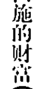

### 1. 保证本金的相对安全性，这是投资的重中之重。

保证本金相对安全，不能容忍大额亏损的出现，这是所有投资人都须具备的基本投资思想，切记切记！这是投资的重中之重，和投资人的投资特征无关，和投资人的投资生肖无关，无论是高风险偏好的猎豹型交易者，还是低风险偏好的龟型投资者，都必须树立这个基本思想。

巴菲特的投资法则一：永远不要赔钱；投资法则二：永远不要忘了法则一。索罗斯的投资法则是：先生存，后赚钱。两者异曲同工，都是这个基本投资思想的精髓体现。

“保证本金的相对安全性，不能容忍大幅度亏损的出现”，为什么要将这个作为投资思想的基本呢？这是因为避免亏钱比赚钱要更容易。亏损30%，需要盈利43%，才能补回；亏损掉50%，需要盈利1倍才能补亏。不亏钱本身就是一种盈利。如果为了弥补亏损，就要花费更多的时间，这种被浪费的时间也是一种机会成本，可能会丧失更多的获利机会。

### 2. 控制风险，将亏损维持在合理状态，让盈利增长，这是投资的核心。

投资是一门艺术，一门风险管理的艺术。投资的本质就是控制风险、控制风险，然后还是控制风险。保住本金并非什么风险都不能去冒，而是要控制风险，让风险处于掌控之中，通过寻求风险收益错配的投资品种，控制风险，将损失保持在可控状态，让盈利增长，从而赢得投资游戏的胜利。

风险与投资人的知识、智力、经验和能力有关，是投资人的内在感受，如果能积极管理风险，风险就是有条件的、可管理的、可控制的、可回避的。索罗斯的总结很经典：投资本身就是一种冒险，冒险不算什么，冒险时，不要拿全部家当下注，要做好及时撤退的准备。

控制风险实质上是要将损失控制在可控幅度之内。虽然损失是投资过程中必不可少花费，就像商业经营中的成本一样，投资人也应投资决策的错误支付代价，要容忍一定程度的亏损存在，但一定要将亏损维持在较小状态，一定要让亏损可控才对。只有具备将风险维持在可控状态，不能容忍长时间大幅度亏损的强烈意识，才有可能通过投资获取收益。


### 3. 不熟不做，只在符合自我投资风格并且自己熟悉的领域内投资。

投资有风险，风险其实来自投资品种的不确定性。确定性越强，风险越低，成功的可能性越高。所有的成功人士，只不过是在自己熟悉的领域内、做对了熟悉的事而已，所谓“财富藏在自家后院里”。投资更是如此，按照自己的投资风格在自己熟悉的领域内投资，就容易获取财富。巴菲特有很多这方面的经验之谈，大家可以一起来分享：

- （1）不同的人理解不同的行业，最重要的事情，就是知道你自已理解哪些行业以及什么时候你的投资决策正好在你的能力圈之内。对你的能力圈来说，最重要的不是能力圈的范围大小，而是你如何能够确定能力圈的边界所在；如果你知道了能力圈的边界所在，你将比那些能力圈比你大5倍却不知道边界所在的人要富有得多。任何情况都不会驱使我自已做出能力圈范围以外的投资决策。
- （2）很多事情做起来都会有利可图，但是，你必须坚持只做那些属于自己能力范围内的事情。实际上，我们没有任何办法可以击倒泰森。
- （3）投资必须要理性，如果你不能理解它，就不要去做；一定要在自己理解能力的允许范围内投资；如果我们不能在自己有信心的范围内找到需要的，我们不会扩大范围，我们只会等待；我们的工作就是专注于我们所了解的事情，这一点非常非常重要。
- （4）我之所以取得目前的成就，是因为我关心的是寻找那些我可以跨越的一英尺障碍，而不是去拥有什么能飞越七英尺的能力。
- （5）同上⼀样，市场会帮助那些帮助他们自己的人；同上⼀不一样的是，市场从不原谅那些不知道自己在做什么的人；对于大多数投资人而言，重要的不是他到底知道什么，而是他是否真正明白自己到底不知道什么。

### 4. 勇于承认错误。承认自己会犯错误，及时纠正错误，才能把错误转变成经验，才会以后少犯错误。

追求完美，不犯错误，或许在其他领域更容易成功，在投资方面却更容易遭受挫折；而那些习惯于生活起伏的人，善于承认自己的错误，及时纠正错误，反而更容易在投资上取得成功。所以投资人都应该具有这样的思想：犯错是投资中的常见行为，犯错误，然后从错误中吸取教训，是投资必不可少的部分。为了避免情绪的折磨，落入自责的漩涡，必须学会原谅所犯错误，不能让错误对心态有持续的影响。

投资有赢有输，赢家与输家的区别，在于处理错误的态度：赢家会发觉错误，吸取教训，争取少犯；而输家会不断重复相同的错误；误判行情，未必就是错误，一旦觉察错误，立即改正，认赔出场，就是赢家；反之，抱着侥幸心理，希望行情按照自己的期盼，忽然转变，让自己有机会脱身，这种思想，即使不亏，也是输家。

投资中，不要怕犯错误，而要把大多数错误变成经验。错误导致的损失是否严重，完全取决于处理错误的方式。索罗斯关于错误的看法值得借鉴：

> 承认错误是件值得骄傲的事情，犯错误并没有什么好羞耻的，只有知错不改才是耻辱。人们认为我不会出错，这完全是一种误解。我的超人之 处在于：我能认识自己的错误，这是我的成功秘诀。我犯的错误可能和任何人一样多，但我能够更快地发现它们，通常在它们造成太多损失之前纠正了它们。

### 5. 谙熟万事万物的周期性变化规律，深刻洞察自然界“物极必反，否极泰来”的变化之道。

对于我们的头脑来说，投资并不缺少规律，只是缺少发现；只有掌握规律，才能采取适合的决策，才能投资获胜。自然界万事万物都呈周期性规律性波动：有高峰，就有低谷；有收益，就有损失；重大转折往往在最鼎盛时期蕴藏，所谓“盛极而衰、否极泰来、日中则移、月盈则亏”。巴菲特投资股票，最主要就是利用个股的这种周期变化规律，所以，他人大胆时你便要小心，他人小心时你便要大胆。

窗外，风停雨歇，空气清新如洗。

鸥夷子皮说：“你看这天气，雨过之后是天晴，秋天后是冬天，四季气候的变化规律人所共知。气候的变化和自然灾害之间的变化同样也存在规律，这个规律就很少有人知道了。”

猗顿问：“气候变化和自然灾害之间有什么规律？”

鸥夷子皮：“岁在金，穰；水，毁；木，饥；火，旱。六岁穰，六岁旱，十二岁一大饥。也就是说：时间年份属金年时，就会是个丰收年；时间年份属水年时，就会歉收，收成不好；属木年时，就会没有收成，出现大饥荒；属火年时，就会大旱；一般来说，六年一丰收，六年一干旱，十二年会有一次大饥荒。”

鸥夷子皮继续说：“如果能把握到事物发展变化的规律性，商业经营就轻松自如。所谓商业经营，无非就是在过去、现在和未来的时间维度上和地域的经度上，发现周期性规律，利用规律，低买高卖，实现盈利。例如，通过‘旱则资舟，水则资车’，也就是在大旱之时备船待涝，在雨季备车待旱，则买入成本极低，经营怎么不盈利呢？”

鸥夷子皮遥指远处大海：“这海边盐泛滥，价格低廉，可是，要是能突破重重关垒，运送到秦国，那便成了稀珍之物，高价奢侈品，想不暴富都难，这就是利用了地域经度上的价格规律。”

“同理，股票的价格波动也依据‘盛极而衰、物极必反’的规律在周期性变动，‘贵上极则反贱，贱下极则反贵’，也就是说当股价暴涨得厉害后，就会大跌；当股价下跌到了极点，又会上涨成为贵价股。如果能把握股价变动的这种规律，就要‘贵出如粪土，贱取如珠玉’，也就是说当股价涨得过分时，要赶紧卖出，视如粪土；当股价跌得厉害时，要大量买进，视如珠宝；也就是‘人弃我取，人取我与’，这一取一与，便可获利无数。更要‘乐观时变，趋时若猛兽隼鸟之发’，也就是敏锐捕捉买卖时机，一旦出手，出击速度就要像猛兽飞禽捕食一样迅捷。”

鸥夷子皮看看外边，已完全停雨，最后说道：“明了股票的周期性变化，并非是要买在最低位，卖在最高位，而是要把握总体的股价变化趋势，在趋势明确时，顺着趋势投资，如巴菲特所说‘要想游得快，借助潮汐的力量要比用手划水效果更好’；而当股票价值严重背离其内在价值时，即便趋势一如既往，也要‘贵出如粪土，贱取如珠玉，乐观时变，趋时若猛兽隼鸟之发’，勇敢地出手。”

鸥夷子皮打了一个大呵欠：“今天就讲到这里，我们回家吧。”

## 17. 对鸡蛋估值

这天，学生们看到鸥夷子皮拿着一个鸡蛋来上课，都面露好奇之色。

晃了晃鸡蛋，鸥夷子皮说道：“我们今天学习如何对资产进行估值。估值是投资者最基本最重要的投资能力。当年，达芬奇凭借画鸡蛋，练就绘画基本功，成为影响深远的艺术大师；今天，我就用这个鸡蛋来训练你们，教会你们估值，希望你们也成为大师，未来的投资大师。”

鸥夷子皮问学生们：“在前面的投资课程中，我们将投资行为区分为价值投资和交易投机两种类型，但这两种投资类型各有哪些具体不同的投资技巧？包子派和馒头派的打法到底不同在哪里？从今天开始，我们集中讲述包子派的打法，现在谁能告诉我，到底应该怎么进行价值投资？”

白圭答：“价值投资，就是要以远远低于上市公司内在价值的股价买入股票，然后一直持有，直到股价高于价值后再卖出，从而获利。”

猗顿道：“我最近在大量阅读投资方面的经典书籍，投资大师们都对价值投资很是推崇，有很多精辟的妙论，如价格是你支付的东西，价值是你得到的东西，这句话的意思是，市场给予的价格常常不符合投资标的的内在价值。短期看，市场是投票机；长期看，市场是称重机。也就是说市场价格在短期内主要受供求关系的影响，当市场看好时，股价就会大涨，虽然它的内在价值短期并无任何改变；股价从长期看，主要受其本身价值的影响，内在价值增长的股票自然会被市场认同。”

西施说：“价值投资最看重时间的价值，价值投资本质是时间价值的复利展现。时间可以让蒙蔽尘埃的黄金光芒四射，让本来耀眼的钢铁锈迹斑斑；时间让好公司的业绩复利增长、推动股价复利增长，坏公司的股价虽然可以短期暴涨，但经不住时间考验，最终会一泻千里，回归价值；时间是好投资的朋友，是坏交易的敌人；时间最终能让市场发现好股票的内在价值，只要股票的内在价值以合适的速率增长，其价格是否被市场认同并不那么重要，市场可能在一段时间内低估其价值，但最终会肯定股票的本身价值，在时间的长期洗刷下，股票的价值最终会显露峥嵘，股价最终会真正反映股票的内在价值。”

鸥夷子皮笑道：“看来你们功课做得很充足啊！你们看书能学到的我就不讲了，你们在书本上学不到的精髓才是我讲授的核心。不过，虽然大师们崇尚价值投资，普通大众大都却无法通过这种投资方式获得稳定的投资利润。”

鸥夷子皮感叹地说：“价值投资，看似简单，却知行行难。市场上升势头良好时，人人都当自己是股神，机构投资者更是自我感觉良好，以为深得价值投资精髓，买入好股票，然后一路持有，就可简单获取暴利。针对大众这种盲目自信的心理效应，巴菲特一针见血地指出，如果你是池塘里的一只鸭子，由于暴雨的缘故，水面上升，你也在水世界中上浮，但你却以为上浮的是你自己，而不是池塘的水面。他警告说，只有当潮水退去之时，才知道谁在裸泳。实际上，当潮水退去之时，大部分的价值投资者都发现自己在裸泳，他们在忍受亏损的痛苦煎熬之余，纷纷感慨卖出太晚，没有把握住卖出时机，根本没有意识到自己的投资行为本质上是交易，完全不是价值投资。”

鸱夷子皮接着说：“投资是一门风险控制的艺术。真正的价值投资者，需要根据对企业未来发展的深刻洞察来控制风险，通过足够的安全边际来控制风险，通过投资组合来分散风险，也就是说，价值投资依赖于对个股的深刻理解及其投资组合，如果对个股的判断出现严重失误，并且集中持股、仓位过重的话，价值投资将面临灭顶之灾，出现巨额亏损。而大部分人不明白这一点，像追求时尚一样追求价值投资，以价值投资为荣，结果却基本亏损。我们在下一节课，集中讲授价值投资的打法以及优缺点，这节课我们讲述价值投资的精髓——估值。”

鸱夷子皮继续讲到：“交易者的研究对象是市场的价格走势，实质上是市场分析师；而投资者必须对股票代表的公司进行全面深入的了解和洞察，其研究对象是公司本身，实质上是公司分析师。投资者的核心能力就是估值能力，只有学会对股票进行正确估值的技能，才能做个合格的投资者。估值追求的是模糊的正确，而不是精确的错误。那么，应该如何对个股估值呢？”

讲到这里，鸱夷子皮拿起桌上的鸡蛋，说：“这个鸡蛋，是我花了1元从清岛市批发市场买来的，我刚才到旁边的超市看了一下，同样的鸡蛋，零售价格为每个1.2元，那么，这个鸡蛋到底应该值多少钱？谁能对这只鸡蛋估值？”

道生站起来答道：“鸡蛋的价值就应该等于它的价格吧？既然是花费1块钱买来的，那它的价值就应该是1块钱吧？”

鸱夷子皮：“这种估法被称为市价法，也就是价值等于市场价格。但是，这种估法无法回答这样的问题，即同样是这种鸡蛋，批发市场的价格是1元，超市价格是1.2元，或许，农民售出的价格是0.8元，那么，鸡蛋的价值到底应该等于哪个市场价格？”

正说着，鸡蛋从桌子上滚了下来，掉到地上，摔烂了。

郑旦惊呼一声，说：“鸡蛋被打碎了，打碎的鸡蛋没有什么价值了吧？即便有用，也就只能当猫食了，这点猫食最多只值1毛钱吧？那么，这个烂鸡蛋的价值最多就是1毛钱了。”

鸱夷子皮说：“这是按清算价值来估值的一种估值法，当资产被清算时，已基本丧失本身价值，所谓的清算价值，和半卖半送一样，恐怕比残值多不了多少，清算价值是所有估值方法中所给价值最低的。”

道生继续回答：“我觉得这个鸡蛋的价值应该等于在旁边超市重新购置所花费的价钱，现在花费1.2元才能买到这个鸡蛋，所以它的价值就应该是1.2元。”

鸱夷子皮：“这种估值法叫重置成本法，也就是认为资产的价值等于它的重置价值。”

这时，猗顿慢吞吞地插话了：“可惜啊可惜！I have a dream，梦到我凭借这个鸡蛋，成就了一个ONE BILLION的国际大公司，在米国MASDAQ挂牌上市，结果，这个估值10亿米元的鸡蛋就这么摔碎了。鸡蛋摔了事小，我的财富梦就这样被摔没了，太可惜了。”

西施大笑起来：“这个鸡蛋价值1B米元？你发烧了吧？烧得再厉害也不会如此妄想吧？”

猗顿却看似很正经，他说：“我没发烧。我的鸡蛋可能会孵化为母鸡，那我就会发达了。母鸡生很多蛋，这些蛋再孵化成很多母鸡，鸡生蛋、蛋生鸡，如此循环往复，复利增长，这个鸡蛋可以凭借‘蛋孵鸡、鸡生蛋’的商业模式快速发展成长为养鸡场，这个养鸡场再成长壮大，就可能成为一个养鸡公司，营业收入主要来自鸡蛋和鸡肉的出售，成本则包括经营管理人员工资、场地租金、饲料等，或许，在创业的初始阶段，只要我一个人运作就够了，短期一两年内，成本会远远大于收入，可能要严重亏损，但只要我能想办法找到投资，就能渡过这段创业难关；随着鸡蛋和鸡肉生产的快速增长，收入也能很快增长，那就能实现盈利，等盈利可观了，市场规模做大了，市场占比在国内达到一定的垄断地位后，我就找机会上MASDAQ上市，没准一不小心，就成为国际性的大公司了。那时，我就是持有米国股票的知識精英了，看在同学一场的份上，你们要鸡蛋我送鸡蛋，要鸡蛋公司股票我就送鸡蛋公司股票。”同学们都笑得前俯后仰。道生大笑道：“大哥，您这梦是南柯一梦？还是黄梁美梦？”

鸱夷子皮制止了大家的狂笑，正色道：“大家不应该嘲笑猗顿同学。伟大的企业或许来自一个疯狂的想法，伟大人物或许依靠一个简单的idea成就伟大事业：肯德基大叔年过半百开出第一家烤鸡餐厅时，谁也不会想到会有遍布全球的肯德基餐厅；山姆大叔开第一家士多店时，谁也不曾料到现在的沃尔玛卖场会覆盖全世界；所以，请尊重你身旁每一个有疯狂想法的人，或许他就是未来的大人物。”

鸱夷子皮又从口袋中摸出一个鸡蛋，举着说：“在普通大众看来，这种‘蛋孵鸡、鸡生蛋’的商业模式简直像个骗局，但是，你们看看那些在MASDAQ上市的网络股、科技股、电子商务股，在开业之初，哪个不像个大忽悠？哪个不是巨亏上市？遥想当年，种花网是在米国上市的股票中的大笨象，鞋城网、王一网这些小公司恐怕连‘蛋孵鸡、鸡生蛋’的商业模式都没找到吧？大都在还为生存而发愁，可如今，鞋城、王一长成为大笨象，而种花网是哪根葱，恐怕没多少人知道了。”

“可见，一个好的投资，并不仅要看商业模式，更要看运作项目的人。卓越的人，可以让看似不可能变成奇迹。比尔·盖茨即便是开火锅店的，估计也是全球最大火锅店的老板；乔布斯搞科技让人惊喜，搞动画也让人惊喜，即便乔布斯去搞服装设计，估计同样会让人惊喜！所以，即便是这一个小小鸡蛋，在不同人的手中，也会玩出不同的花样。”

鸱夷子皮总结道：“那么，应该如何评估养鸡公司的价值？这就要对公司进行财务分析，通过资产负债表、损益表和现金流量表等财务报表，分析研究公司的盈利状况和现金流，计算每股营业收入、每股收益、净资产收益率、盈利增长率、每股自由现金流等财务指标，通过不同的财务指标了解公司的成长性，对公司进行估值。市场上有大量的投资书籍，对公司分析进行了详尽的论述，这方面的内容我就略去不提了，今天就重点讲讲几种估值方法吧。”

于是，鸱夷子皮分别讲述起PS法、PE法、PB法、PEG法和自由现金流贴现法等几种不同的估值方法：

1. PS法，也称为市销率法。市销率PS是股价和每股销售收入的比值。对于一些极具创新性的技术、产品和商业经营模式，虽然看好其未来发展，但因研发或推广成本高企，当前严重亏损，如果要对这些处于亏损状态的创新性公司评估价值，就无法按照传统盈利类企业给予估值，只能根据其销售收入，按照营业收入的一定倍数给予估值，求得其总市值。
2. PE法，也称为市盈率法。市盈率PE是股价和每股收益的比值，PE也是投资期望利润率的倒数；PE估法是用预期的PE值和每股收益相乘，所得数值就是权益资产的价值。例如投资某公司的期望利润率为20%，那么PE就是5倍；如果期望利润率为10%，PE就是10倍；如果预期该公司下每年每股收益为0.5元，按照20%的利润率，其价值就是2.5元，按照10%利润率的话，价值就为5元。PE估法简单实用，是目前投资中被普遍采用的估值方法。这种估值法的关键，是合理确定PE值。通常情况下，PE值随企业经营状况的好转或市场情绪的狂热而提高，而随企业经营情况的转差或市场情绪的冷却而降低，因此，要结合同行业类似成熟公司的PE值，来对股票进行合理估值。判断一只股票是低估还是高估，真正可参考的重要依据并不是其当前市盈率，而是未来市盈率，而未来的经营状况具有很大的不确定性，所以，合理确定未来PE值才能对股票合理估值；对于那些周期性行业的个股来说，收益会随行业景气度不同而有极大波动，市盈率的变化幅度也会很大，往往几年前上百倍，当前或许十倍都不到，而遇上不景气年景时整个行业则出现亏损，对于此类个股，就不适合采用PE估法来估值。
3. PB法，也称为市净率法，市净率PB是股价和每股净资产的比值，市净率反应的是投资人愿意为净资产所给价值溢价的程度。对于那些还没有盈利、或盈利数据缺乏真实性、或业务发展较稳定、或周期性行业的股票，可以用行业的PB值乘以每股净资产得到合理估值。通常，PB值偏低的股票，或许有可能有一个较大的增长空间，但更大可能意味着这是一个已过高速增长期的稳定企业，所以，PB值的大小并不构成判断股票内在价值高低的标准。
4. PEG比率法，PEG比率等于市盈率除以年均增长率数值（增长率去掉百分号）的比值。当股票估值合理时，PEG等于1；当PEG小于1时，意味着股票的成长性高于其合理价值，该股存在投资机会；当PEG等于0.5时，该股相比其当前估值水平，成长性显著，投资机会良好；反之，当PEG大于2时，其估值相比成长性偏高，就要谨慎投资了。关于年增长本数值，不能仅看一年或半年数据，而要联系几年的数据一起观察，得出的增长率才具可参考性。估值时，可根据增长率情况确定一个合理的PE值，再对股票进行估值。
5. DCF估值法，也称为自由现金流贴现法。自由现金流贴现估值法的理论基础是企业的价值，等于其未来产生的全部现金流的现值总和。用DCF法估值时，通过选取适当的贴现率，把企业生命周期内的预期现金流折算为当前现值，从而得出企业的价值。用DCF估值法对股票估值，就要根据对企业收入增长率、边际营业收入、所得税率以及新增固定资本和营业资本的预期，计算出企业未来的自由现金流（自由现金流是指在支付了经营费用和所得税之后，向普通股与优先股股东、债权人支付股息、利息前的全部现金流），然后在考虑风险的前提下，为自由现金流设定一个贴现率，对未来现金流进行贴现，将贴现值汇总，计算出企业的整体价值，最后再减去非普通股权益、债务和其他优先权益的市场价值，就是企业的总价值。在采用DCF估值法时，采用哪种现金流、折现率设定为多少，都有不同的设定，这些设定不同，就会导致不同的估值结果。因此，要对现金流作出合理的预测，在评估中要全面考虑影响企业未来获利能力的各种因素，客观、公正地对企业未来现金流作出合理预测；还要选择合适的折

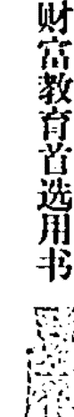

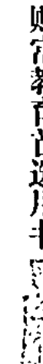


# 18. 价值投资：包子派的打法

“世界上竟然还有盼望着大跌的大傻瓜？”

鸱夷子皮正讲着课，外面走进来两个人。人未到，声先至。

这两个人，一高一矮，一胖一瘦，高者瘦，矮者胖。

狛顿看到这两人进来，高兴地迎上去：“牛总！张大户！你们过来了！”

同时，狛顿将此两人给鸱夷子皮介绍道：“这位是大牛证券公司的牛总，这位是张大户。这是我的老师鸱夷子皮先生。”

鸱夷子皮有点迷惑地问两位不速之客：“两位贵客前来，可为何事？”

张大户个子虽矮，声音嘹亮：“前几日在大牛证券公司无意间撞到先生几人，张某虽然炒股不行，但看人绝对眼光不凡，我观先生器宇轩昂，玉树临风，风流倜傥，超凡脱俗，惊先生为天人在世，绝非我等俗人之辈。后来听狛顿说先生对投资理财深有研究，我怀疑先生是财神在世，于是，相邀牛总，过来旁听先生的课程，想在投资上得到先生提携。”

狛顿道：“这位张大户是我以前在证券公司认识的朋友，是百万富翁。”

鸱夷子皮：“原来是成功人士。久仰久仰！”

张大户面露羞愧之色，自谦道：“哪里哪里！哥当年是亿万富翁，自从来到这股市，就成了百万富翁了。”

鸱夷子皮呵呵笑了：“阿甘同志虽然有点傻，对股市却看得很透彻，他说过，股市就像一盒巧克力，你永远不知道会得到什么。”

狛顿点头称是：“确实如此。对大部分人而言，股市就像一台魔法机器，得到的永远不是自己想要的。一头牛进去，出来的不是牛肉肠，而是一只老鼠；张大户进去，他的钱就像从冰柜拿出来的哈根达斯，慢慢在缩水，很快就要化没了；而张大户本人呢，原来像猴一样瘦，现在却像个猪一样肥。唉！得到的总是不想要的东西。”

张大户悲伤得逆流成河：“鸱夷子皮先生，您可要帮帮我呀！为了炒股，我连名字都改了，我本姓夏，结果股票账户里的市值天天下走，我改姓张，也没见资金涨回去。”

牛总说话了：“张大户为了炒股，牺牲了很多呀！他家里立了很多规矩，不许儿子喊爹（跌），要喊家长（加涨）；不许弟弟喊哥（割），要喊兄长（凶涨）；不许别人喊夏先生（下先生），要喊老张（老涨）。”

张大户嘿嘿一笑：“彼此彼此！牛总也和我一样，是改了姓的，他本姓熊，服从炒股大局，就此改成姓牛。他对‘熊’字很忌讳，而对‘牛’字超喜欢；他以前长得高大肥胖，别人称他为‘虎背熊腰’，他就天天锻炼、节食、减肥，硬是活生生地把他自己变成瘦子，从此成为‘虎背牛腰’；他以前从不沾牛肉的，现在天天吃饭无牛肉不欢。”

牛总说：“惭愧惭愧！我本是巴菲特的门徒，痴迷于价值投资，不像张大户他们那样投机，总是追涨杀跌，但或许是时运不济吧，我的投资业绩甚差，差到难以启齿。微软是米国大公司，是全球跨国公司，价值投资买这样的好公司没错吧？于是，我重仓买入微软的股票，以为肯定可以稳定增长，我儿子的留学费用可以无忧了，结果，这微软的股票何止微软，简直是很软！9年前我在23美元买入时，我儿子还在读幼儿园，现在我儿子上高中，快要留学了，这微软的股价还在23美元！这9年来，我不查看股价还好，它要不涨点，要不跌点，可我每次查看股价的时候，它就是23块！我老婆为此嘲笑我，称我为23块！你们说可恨不可恨，气人不气人！”

牛总说到了伤心处，有点要哭的样子，同学们都笑了。

牛总继续说：“还有，我看到00通讯的股票很有成长性，想着买高成长的股票价值投资总是没错的，结果，自从我重仓买入后，这股票天天向下走，疲软的不成样子，我老婆又嘲笑我说，别人买QQ股票很坚挺，你买的这00股票被阉割了，东西都没了，怎么可能坚挺？”

学生们哄堂大笑。

牛总道：“今天，我和张大户赶来向先生讨教，如何才能做好价值投资？如何才能取得投资收益？”

鸱夷子皮被张大户和牛总逗得也笑得个不停，他笑着说：“价值投资并非只买大众耳熟能详的优秀企业。无论企业多卓越，总会成长为恐龙型企业，规模庞大，业务稳定，增长放缓，这种类型的企业，虽然品牌效应很好，名气很大，但缺乏成长性，不是好的投资品种；而一些当前处于行业低谷期、市值不太庞大的企业，如果未来行业复苏，具有确定的高成长性，这类股票反而具有高成长的潜质，股价具有很大的成长空间，如果能把握住这类高成长的股票，就是价值投资的好品种。”

白圭疑惑地问：“价值投资不仅仅是要以远远低于上市公司内在价值的股价买入股票，更要注重公司的成长性？”

鸱夷子皮点点头：“很多投资人在是要价值还是要成长的跷跷板上摇摆不定，有人注重投资品种的安全边际，有人注重投资品种的成长性，各为此争论不休。”

西施问：“什么是安全边际？”

鸱夷子皮道：“安全边际指的是买入时的市场价格与内在价值之间的差额。用四毛钱的价格，买入价值一块钱的东西，就能确保不亏损，盈利的确定性就会很大。所以，虽然普通大众期望市场持续地上涨，但真正的价值投资者却也期盼市场的大跌，把大跌当成一个好机会，因为大跌为买入理想的投资品种提供了良好的安全边际，从而让投资者能以具有安全边际的价格买到看好的股票。”

牛总恍然大悟：“难怪我们刚进来的时候，老师说大跌是值得期盼的事情，我们还纳闷，原来这个道理。”

鸱夷子皮开始讲述起价值投资。他将价值投资者的投资能力，总结为以下三个方面：

1. 在自己的能力范围内对自己熟悉的公司进行准确估值。
2. 在面对让人心理恐惧的大跌时，敢于以超凡淡定的心态去买入，而不惧怕大跌所带来的短期损失；也就是说，在股价具有安全边际时，具有敢于买入的勇气。
3. 有执着的信念，坚信自己的判断，坚守自己的信念，不恐惧市场的大幅波动，敢于持股，直到公司价值被发现。

鸱夷子皮讲解道：“价值投资，并非简单地买入好公司，然后一直持有，实际上，价值投资和交易相比，是一种更高难度、更折磨人的投资方式，其难度并非体现在是否能以低价买入股票，或者是否具有足够的耐心持有足够长的时间，而是体现在价值投资者是否真正具备了军人的自制力、魔鬼的心态和上帝的洞察力。”

白圭问：“什么是军人的自制力、魔鬼的心态和上帝的洞察力？”

鸱夷子皮于是详细讲解投资者须具备的三种基本素质：

1. 军人的自制力。这是指投资人必须严格遵守自己的信念，只在自己的能力图之内，投资自己完全熟悉的公司。三千弱水，只取一瓢，在色彩斑斓的投资世界中，永远只做自己完全有把握的投资，不为外界诱惑所动。
2. 魔鬼的心态。这是指投资者要具有非凡的心性，能克服普通大众人性的弱点，不为恐惧和期望的心态所左右，像魔鬼一样没有人性，只有这样，才能像奥德修斯抗拒海妖的美妙歌声诱惑那样，不被人性的弱点所摆布，不去从众随大流。
3. 上帝的洞察力。这是指投资者要掌握目标公司的未来发展动向和盈利增长情况，甚至比企业CEO更熟悉企业的产品和未来，要具有上帝一般的深刻洞察力，能在复杂多变的环境中把握住企业的未来发展趋势。

鸱夷子皮说：“众所周知，巴菲特和微软的比尔·盖茨是好朋友，但巴菲特却甚少投资科技股。那么，巴菲特为什么不投资好朋友的科技股呢？就是因为巴菲特具有军人的自制力、魔鬼的心态和上帝的洞察力，他的能力圈里不包括科技行业，他无法确定科技行业未来的发展趋势，所以不投资科技股；他的能力圈里大都是传统行业，所以他能对银行业、能源业、耐用消费品和商业等传统行业内的企业进行精确估值，对这些能力圈内的股票，他具有上帝般的洞察力；他具有魔鬼的心态，敢于当市场大跌、大众恐慌之时买入；他具有军人的自制力，在持股时不为市场上其他的美妙机会所诱惑，一直坚定持有到股票的内在价值被市场发现为止。”

牛总感慨道：“这三个素质都不是我具备的，难怪我进行价值投资会亏损，不但我如此，大部分人恐怕都像我这样画虎不成反类犬吧？”

鸱夷子皮说：“确实如此。普通大众将价值投资当成买入好公司股票，然后一路持有这样的简单行为，普遍相信长期持有这类好公司的股票，必然会有好的回报，确实，也有不少投资人按这种操作方式获得高额投资收益，但其本质，仍是交易，这种操作方式，是一种伪价值投资。”

牛总：“为什么说这种方式是伪价值投资呢？”

鸱夷子皮说：“大众眼中的好公司，大都是些品牌影响力大、名声响的大型公司，其实是那些稳定增长的大笨象型股票，你买入的微软就是这类股票的典型。而价值投资者看重的则是猎豹型的个股，并且，要在这些猎豹型个股不被市场看好时买入，也就是说，要在皇冠上的钻石被蒙上灰尘时就能洞察到这珍品的价值而买入。而伪价值投资者则像大众选美一样，选择那些大众普遍认可的大笨象品种；这种人人看好的大众美女型的好股票，一般没有足够的安全边际，大都是价值高估的品种。”

牛总问：“很多人都将价值投资当成挑选人看好的好股票，既然这不是价值投资，为什么也会有很多人会获利呢？”

鸱夷子皮道：“虽然很多伪价值投资者也能获利，但其获利的原因，并非来自所投资股票的价值被发现，而是因为其他后进入的伪价值投资者，基于同样理由买入，资金的进入从而推高股价，这些伪价值投资者长期持有好股票的高回报，也并非来自企业业绩提升所导致的内在价值的增长，而是来自一个长期上升波段的交易价差；也就是说，伪价值投资者的获利，实质上是在一个长期上升波段里的一次交易。这种获利方式，是交易技巧的典型之——截住亏损，让利润飞奔起来。所以，大部分人所谓的价值投资，是伪价值投资，其实是交易，只是交易的时间周期更长而已。”

牛总道：“我总算明白了。其实我一直在按交易的方式操作，我却浑然不知啊！”

鸱夷子皮说：“对大部分投资人而言，如果不具备龟型投资生肖的话，价值投资的难度更大，执意按价值投资的方式去操作，其结果可能就是邯郸学步。不少人按这种伪价值投资的方式，能取得很高的投资收益，大多数情况是因为运气好，踏准了市场上涨的步伐，顺着上涨方向一直在持股。对更多的投资人来说，这种方式会导致惨重损失。”

牛总说：“我就是这样情况的典型代表，相信价值投资，做的却是交易，结果损失很大。”

鸱夷子皮：“大部分人将价值投资当成买入好股票后长期持股不动，故而会重仓买入那些大众普遍看好、大品牌公司的股票，然后一直持有；而且，大众一般喜欢在市场情绪狂热时、高价买入；当市场趋势向上时，持有一段时间再卖出，或许还能获利；当市场转弱、趋势向下后，大部分股票价格同样会走弱，一直坚定持有的话，持有时间越长，亏损也越多；大多数人在严重亏损后，就会置之不理了，价值投资者于是就成为了长期被套者。”

牛总说：“听君一席话，胜炒十年股啊！我今天才明白我亏损的根本原因了！”

西站问：“既然真正有投资价值的品种像皇冠上的钻石一样稀罕，那么，应该如何选择价值投资的目标品种呢？”

鸱夷子皮说：“我们可以看看投资大师是如何选择投资品种的？如何为投资品种确定标准的？我就以费雪和巴菲特为例说明吧！”

鸱夷子皮在黑板上列出了投资大师费雪选择投资品种时的四个标准：

1. 它们必须有明显的竞争优势：必须是行业内成本最低的企业，有出众的生产、财务、研发和营销技巧。
2. 它们的业务特色必须能够确保它们具有超出行业平均水平的利润，资产收益率、利润率及销售增速会持续增长一段时间。
3. 必须要有超凡的管理，超凡的管理是业绩超凡的根本原因。
4. 它们的价格必须有吸引力。

而巴菲特挑选投资品种时的标准是这样的：

1. 我了解这家企业吗？我将如何处置它？我该考虑哪些东西？我该担心什么？谁是我的竞争对手？谁是我的顾客？
2. 它有理想的经济特征吗？这些理想经济特征可维持吗？
3. 管理层是否持有合适的股份？
4. 如果管理层改变，我愿意拥有这家企业吗？管理层是否具有诚实节俭胜任的品质？
5. 它有超常的净资产回报率为？
6. 我对它的价格满意吗？

鸱夷子皮说：“巴菲特特别重视寻找那些具有‘护城河’特征的企业，也就是说，所投资的企业必须是竞争者难以进入与其竞争的，就好像具有一个护城河一样，让竞争者很难进入，也就是要投资那些具有管理、技术、服务等垄断优势的企业，这些企业的“护城河”特征，主要表现在两个方面，一是是否具有拓宽企业“护城河”的表现稳定的管理队伍；二是是否具有产品需求不断增强的市场。”

价值投资，要价值，还是要成长？鸱夷子皮似乎更偏好成长，他说：“价值投资的核心是什么？成长，持续的高成长，才是投资的重中之重。成长，是指企业内在价值的稳定增长，而非短期爆发性的增长。所以，价值投资不是要注重当前的业绩，不是要注重当前的价值是否低估，而是要注重未来的增长率。”

鸱夷子皮进一步深入分析价值投资，他分别从以下几个方面进行阐述：

1. 企业的内在价值究竟是多少？不能静态地看，不能看现在，而要看其未来。投资一个企业，实质上是投资企业的未来，当前业绩不好，不代表未来业绩不好；当前业绩很好，也不代表业绩会永远都好。从根本上来说，价值投资是投资企业的未来，也是预测企业的未来，这种预测同样具有不确定性，虽然，预测企业的未来，比预测股价，具有更高的概率和确定性，但企业未来现金流存在不确定性，企业的未来也有不确定性；因而，价值投资同样存在风险。
2. 并不存在一个能准确计算内在价值的标准公式。价值投资者要对一个企业估值，就得完全了解这个企业所在的行业情况，更要懂得这个企业的业务，实际上，一个优秀的价值投资者，需要比企业CEO更懂企业的业务前景和财务指标，才能对企业的未来有一个清楚判断，而只有那些具备丰富人生阅历和管理经验、具有深刻投资思想、能在自己的能力圈内决策的智者，才能清楚把握企业未来的发展状况，对企业有一个正确合理的估值。无论是PE法还是DCF法估值，都只是对未来的不确定进行预测，世界上根本不存在一个能准确计算企业内在价值的标准公式，估值只是一种模糊的正确，那些看似利用高深莫测的数据模型建立起来的估值公式，严格进行数量计算，如果方向错误，即使数据再精确，也还是个谬误。
3. 价值投资决策正确的难度很高。价值投资是投资企业的未来，而过往业绩和未来业绩之间并不必然是正相关，资产、盈利、现金流这些财务指标，只能衡量企业过往的经营状况，决定企业价值的，终归是企业未来的盈利和增长前景。那么，什么才能决定企业未来的成长？无非是企业所处行业的增长前景、企业在行业中的竞争优势和定价能力、企业所提供产品或服务受客户欢迎的程度、企业的管理、文化以及对长期竞争优势提供的支持程度等因素，而要了解这些影响企业经营的重要因素，就要大量了解相关企业和行业的资料，熟悉企业的产品和服务，了解企业的管理层和员工，然后凭借投资者的财务、管理知识，进行数据分析研究，最后才能得出结论。因此，进行价值投资，需要对企业进行的分析研究，相比交易所要进行的市场分析，其难度大多了，时间长得多，风险也大得多，实际上，一个优秀的投资者，要比公司的CEO更了解企业。当前世界，真正成功的价值投资者，相比成功的CEO，数量要少得多，从这点来看，投资比交易要困难得多。所以，普通大众，大多不适合做价值投资。

鸱夷子皮说：“真正优秀的价值投资者，也像皇冠一样稀少。只有那些具备全面的财务管理知识和企业管理知识的人，在经历人生风雨、具备一定阅历后，才能兼具军人的自制、魔鬼的心态和上帝的洞察力于一身。龟型投资生肖的人，一般也要在年过40之后，才能兼具这些特点，成为真正的价值投资者。即使巴菲特本人，也是在中老年以后，其价值投资的光芒才熠熠生辉。而绝大部分人，看似经历人生几十年，但大都心理年龄并不成熟，未曾经历人生挫折的历练，很难具有超常定力和淡泊风骨，丝毫不会有魔鬼的心态，因此，只适合交易。”

牛总说：“我彻底明白了。我只是一个交易者，看来以后要多学习交易技巧，按交易的方式赚钱了。”

# 19. 交易高手，更是赌场高手

第二天，当学生们赶来上课时，鸱夷子皮却告诉大家：今天去赌场。

西施瞪大眼睛：“本美女妇从不赌博！”

郑旦也很惊奇：“老师，搞错了吧？我们都是良家妇女，从不参与非法赌博活动的。”

鸱夷子皮笑道：“我们从今天开始，主要讲解交易技巧。社会上普遍将交易当成赌博，交易在本质上和赌博有很多共通之处，赌博和交易的决策原理最为接近，都是关于确定性的概率游戏。要真正掌握交易的实质，就不能不掌握赌博的技巧，实际上，掌握了赌博的本质和技巧后，会大大提高交易技能。”

鸱夷子皮问学生们：“交易和赌博有很多地方相似，如交易是在金融市场投入资金、期望取得收益的一种行为，而赌博同样是投资资金、期望盈利的一种行为，那么，两者之间，到底有何区别？”

狛顿回答道：“交易相比赌博，本质完全不同。交易是一种正和游戏，也就是要求期望收益一定大于0。一个交易品种，有可能让所有交易者同时盈利；盈利交易者的总盈利额，可能会大过所有交易者投入的资金总额。而赌博本质是一种负和游戏，在扣除成本后，所有参与者取得的盈利总额一定少于投入资金的总额，有人盈利，就必然有人亏损。很多赌博项目，如买彩票、赌马，赌场里的百家乐、赌大小、玩21点等，人们普遍将之当做娱乐，这些赌博品种的期望收益会小于0，赢钱当然好，输了，也当是小赌怡情，娱乐而已。但是，如果进行交易赔钱了，人们的心态会很糟糕，普遍难以接受亏损结果。这些都是交易和赌博的区别。”

鸱夷子皮点头认可，他说：“有些投资品种，如期货、期权，还包括一些股票，在扣除相关税费后，交易者总体投入的资金要远大于通过这些品种取得的盈利总额，交易这些金融工具，实质上就是负和游戏，是合法的金融赌博游戏。投资人将资金投入这些品种，实质上和赌博并无任何区别，因此，更要了解赌博。那么，交易和赌博到底有哪些共通之处呢？”

鸱夷子皮分析了交易和赌博的几点共性：

1. 都具有结果的不确定性，决策结果都可能是不确定的收益或损失。
2. 都是一种需要严格控制风险、需要资金管理的风险游戏。
3. 孤注一掷、碰运气的操作方式都会导致损失。
4. 都需要了解自我心理，盈亏结果都会受到期望、贪婪、恐惧等情绪的影响。
5. 都需要精于概率计算。都需要通过对盈利与亏损的概率和幅度进行数量计算，来进行决策。

说话之间，师生数人已来到一间赌场。赌场和证券公司营业部很是相似，都是人声鼎沸，喧闹声不绝。各色人等，都在为利益而搏杀，或紧张屏息，或圆睁双眼，或跺脚悔恨。输赢结果也都浮现在脸上：赢钱者喜笑颜开，亏钱者高声叫骂，尽显人性本色。

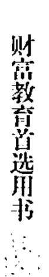

“西施的财富·囚徒之木”

鸱夷子皮和众学生各自换了两千块的筹码，主要玩百家乐。百家乐简单易学，只要押庄押闲即可。半天玩下来，鸱夷子皮大赢，赢了二万多，猪顿赢利两千多，白圭和西施手中各剩一千多，而道生、郑旦、牛总和张大户没下注几次就输了个精光。

张大户疑惑地问：“没看出来，老师原来是赌场老手啊！您这身手，去澳门博彩试试运气，没准能赢个几百上千万的！”

鸱夷子皮呵呵一笑：“我和诸位一样，都是第一次来一试身手的。”

张大户不相信：“不可能吧？头一次赌钱就大赢？”

鸱夷子皮：“交易和赌博在决策原理上是相通的。精通交易，就容易精通赌博；同理，如果掌握赌博技巧的话，对提升交易技能也大有裨益。普通赌徒一般只能靠运气赢钱，但职业赌徒却可以靠技术水平赢钱。一些精通概率计算的数学家，通过亲身在赌场的实践，证明了赌博确实存在着技术，职业赌徒和数学家每次赌博时，都要计算胜负概率，只在自己赢的概率较高的时候下合适的赌注，小额投入，如此不断累积，积小盈成大盈，从而取得赌博的盈利。交易也是如此，交易无须在乎个股的内在价值，主要通过资金管理、止损以及卖出策略等交易技巧进行风险控制，通过交易盈亏的胜算概率计算而获利。”

鸱夷子皮继续讲：“大部分投资人在交易时都做了大量的功课，了解了大量的投资信息，进行了大量的分析研究，但最终结果仍然摆脱不了亏损命运。而赌博本身是一种娱乐，虽然大部分参与者最终会输钱，但那些职业赌徒却能稳定地从赌博中获利。为什么投资的人会输钱而赌博的人会赢钱？就是因为大部分交易亏损的人，根本不懂交易技巧，将交易当做赌博而容易孤注一掷，结果必然亏损。而那些在赌博中盈利的职业赌徒，是将赌博当成技术，善于总结规律，以概率计算严格地进行高胜算分析，同时，严格控制风险，严格资金管理，赌博成为一门确定性高的概率游戏，盈利自然水到渠成。”

鸱夷子皮总结了职业赌徒和成功交易者的相同之处，分为以下几个方面：

- 1. 资金管理方面：清楚如何分配资金；能跟随预计的胜算概率大小不同而调整仓位。
- 2. 投资分析方面：分析每次交易的风险报酬比率，进行高胜算概率计算。
- 3. 卖出策略方面：清楚何时离场。
- 4. 投资思想方面：不怕输钱，不会将小钱输成大钱；承认自己会犯错误，会及时纠正错误，能把错误转变为经验。

鸱夷子皮认为：大部分人交易之所以亏损累累，是因为根本没有掌握胜算分析和资金管理、卖出以及止损等风险控制这些基本的交易技巧，将交易完全等同于孤注一掷的赌博，这种操作方式，怎能不亏损？

鸱夷子皮总结了失败交易者的亏损规律，大都具有以下特点中的几点：

- 1. 缺乏正确的投资思想作指导。
- 2. 随意交易；交易过度频繁。
- 3. 追逐行情，老担心错失机会。
- 4. 过于固执，过于自信。
- 5. 亏损时随波逐流，让亏损加重；而盈利时则过早了结。
- 6. 资金管理失控，过度冒险。
- 7. 情绪失控：贪婪、急躁。
- 8. 缺乏纪律性。

张大户听到这里，说：“怎么老师说的以上种种毛病，我一条都没少呀？难怪我炒股难以获利。”

鸱夷子皮说：“下面，我们继续讲解交易的胜算概率分析和风险控制方面的几个重要技巧。”

## 20. 交易分析：关于确定性的研究

鸥夷子皮说：“无论是投资还是交易，都要追求确定性，只有确定性很高，投资获利的概率才能大大增加。投资分析的核心是估值，准确的估值是确保确定性的前提。交易是一项概率的游戏，分析的核心是要分析计算每笔交易的胜算概率，在不同的概率条件下，从而采取不同的资金管理仓位。交易的确定性高低，完全依赖于对胜算概率的把握。”

犍顿问：“什么是胜算概率？”

“胜算概率，就是每笔交易可能获得的盈利与预期损失的比率。”

鸥夷子皮列出了胜算概率的计算公式：

*胜算概率=预计盈利/预计损失*

*=(预期目标价格-买入价格)÷(买入价格-预期止损价格)*

鸥夷子皮说：“我们还可以用期望值来分析计算每笔交易的盈亏可能性，期望值反映的是每承受1元损失所能获取的盈利数。”

鸥夷子皮又列出了期望值的计算公式：

期望值=盈利概率×盈利乘数-失败概率×损失乘数

鸱夷子皮讲解道：“期望值由两部分决定，一是准确度，一是盈利乘数。一笔交易，盈利的概率很大，盈利准确度很高，但预计盈利的幅度远远低于预计损失的幅度，盈利乘数远远少于损失乘数，那么，期望值仍然可能为负，这笔交易就不是成功的交易。”

鸱夷子皮继续说：“交易的目的，是最终取得总体盈利，而不是追求每笔交易都获利。成功交易员的盈利，往往来自于少数几次获利丰厚的交易，而大多数的交易是失败交易，他们会快速认赔卖出。实际上，对大部分成功交易员来说，获利交易次数占总交易次数的比例还不到40%。”

鸱夷子皮认为：交易盈利的秘密，在于盈利交易的盈利额度，要远远超过失败交易的损失额度，他列出了一个公式：

交易获利率=盈利概率×盈利回报率-失败概率×损失回报率

鸱夷子皮总结说：“大多数人交易亏损的主要原因，就是盈利的金额远不如交易失败的亏损金额。实际上，交易亏损相比交易盈利，应保持这样的关系，如果失败交易的损失较小，那么成功交易只要维持中等程度的盈利就可以；如果失败交易的损失为中等，成功交易就要有更大程度的盈利；总体交易要盈利，成功交易的获利程度就必须要超过失败交易的亏损。”

张大户有点迷茫：“这种交易分析方式，和我以前知道的投资分析完全不同，看来，只能在以后的炒股实践中，多多体会了。”

## 21. 趋势是你的好朋友

鸥夷子皮道：“说到交易的确定性，实际上，胜算概率最高的交易，就是顺着趋势方向的交易。在一个上涨趋势中，顺应趋势，持有股票，直到趋势翻转，然后才退出，这是赚足利润的唯一方法。交易者的策略，就是顺势而为。研究交易的确定性，就是要分析把握趋势，华尔街有句名言，趋势是你的好朋友。”

豗顿说：“屈原同志也有类似的名言。”

西施迷惑了：“屈原同志？讲趋势？”

豗顿：“屈原说过，股漫漫其修远兮，吾将上下做波段而求索。”

同学们都给逗乐了。

鸥夷子皮：“趋势是交易者的好朋友，只有找准趋势，才能做对交易方向。对交易者来说，确定趋势方向的能力，就是最重要的研究分析能力。对交易者而言，在准确分析趋势的前提下，把握趋势，顺着趋势的方向，就能减小交易风险，从而大大提高交易的盈亏胜算，大大提高交易获利率。所以，正确判断主要趋势的方向，在多头市场做多，在空头市场做空，是交易成功与否的最关键因素。”

鸱夷子皮详细讲解趋势的类型和特点：

趋势无非三种情况：趋势向上、横盘和向下。根据时间和主次性的不同，趋势分为长期的主要趋势、中期的次级折返趋势和短期趋势；任何交易品种在任何时点，这三种趋势必然同时存在，彼此方向可能相反。

- 1. 主要趋势，也称为长期趋势，就是从长期看，总体呈现向上或向下的走势，向上为多头走势，向下为空头走势，一般会持续数年之久。
- 2. 次级折返走势，也称为中期趋势。中期趋势是对主要趋势的较大幅度的调整，在多头市场表现为较大幅度的下跌，在空头市场中表现为较大幅度的反弹；一般要持续数星期到数月时间。
- 3. 短期趋势。既是短期波动走势，又是对中期走势的调整，持续数天到数周左右。

主要趋势代表整体的基本趋势。通常根据主要趋势走向，来判断市场走势是多头还是空头。

多头走势是一种总体性上涨的走势。分为三个阶段：

- 1. 第一阶段为价值低估阶段：此阶段大多出现在多头市场初期、空头市场末期。股票经历长期熊市的大幅下跌，卖出动能逐渐衰竭，股价普遍低迷，PE处于低位，随着市场对未来经济景气度信心的恢复，在增量买盘推动下，股市逐波上行，走出底部逐渐抬高的走势。
- 2. 第二阶段为价值发现阶段：此阶段股票利好不断，股价是对企业盈余改善的合理反映。
- 3. 第三阶段为价值高估阶段：此阶段的上涨来自投机性买盘推动，因上涨导致对未来的期望和希望，投机热潮汹涌，股价泡沫严重。

空头走势是一种总体性下跌的走势，也分为三个主要阶段：

- 1. 第一阶段为价值高估阶段：市场先知先觉者对过度泡沫化的股价抛空，股市成交活跃，但股价在高位滞涨，涨幅不大，大多在缓慢下跌。
- 2. 第二阶段为恐慌抛售阶段：这个阶段利空不断，宏观经济衰退，企业利润下滑严重，市场心态不稳，整体性恐慌抛售，接盘稀少，股价大跌。
- 3. 第三阶段为价值低估阶段：经历恐慌性抛售阶段后，市场股价普遍处于低位，猎豹型个股在这个阶段大幅下跌，市场抛售情绪严重，投资人对前景悲观，无论股票价值如何，急于变现。

鸥夷子皮说：“交易，实际上就是趋势交易，交易的主要方向，要与趋势的主要方向保持一致。趋势交易之所以容易获利，是因为趋势代表阻力最小的价格变化路径。要记住，永远不要尝试和市场抗衡！交易者亏损的主要原因，就是尝试与趋势抗衡，猜测市场的头部和底部，结果往往被市场趋势的大潮淹没！”

豗顿问：“应该如何研判市场的趋势？”

鸥夷子皮：“可以通过形态分析和一些技术指标来判断主要趋势的方向。具体如何进行趋势判断，我将在课程后期，对你们进行趋势研判、情绪管理、资金管理和卖出的强化训练。”

## 22. 如果投资让你夜不能寐，就要减少持股，直到安然入睡

最近几日，股市连续暴跌，街上行人大都一副欲断魂的样子。

这天上课前，西施安慰张大户：“最近股市暴跌，股民普遍损失惨重。不过，该睡就睡，该吃就吃，别想那么多。你的睡眠质量如何？”

张大户嘿嘿一笑：“我睡觉像婴儿一般！”

西施说：“那就好。那我就放心了，我最近还经常失眠呢。”

张大户叹息一声，说道：“我所谓的婴儿式睡眠，就是睡一个小时，醒了，就哭一个小时，然后，再睡一个小时，又醒来，再哭一个小时。”

众人都大笑不已。

鸱夷子皮也跟着哈哈大笑。等张大户说完，他说：“华尔街有句名言，如果投资让你夜不能寐，就要减少持股，直到安然入睡。对普通股民而言，巨亏的根本原因，是因为缺乏风险控制，而最直接的原因，是资金管理方面出现了严重问题，大都仓位过重。所以，学会减少持股，学会资金管理，就能让精神压力大大降低。学会了风险控制，也就等于交易成功了一半。”

犍顿说：“老师以前提过风险控制问题，老师认为资金管理、止损和卖出策略这些交易技巧是成功交易的保证，但没展开论述过。”

鸥夷子皮点头：“现在开始，我重点阐述这三个交易技巧。资金管理是三者中最重要的技巧，是风险控制的最重要方式。”

鸥夷子皮认为，资金管理的重要性体现在以下几个方面：

- 1. 帮助交易者保障本金。
- 2. 帮助交易者控制亏损。
- 3. 帮助交易者明确知道何时退场。
- 4. 帮助交易者限制允许发生的最大亏损。

犍顿道：“仓位管理问题是交易中的一个难题，老股民都有认识，锄禾日当午，不如交易苦；仓位补不补，心里多痛苦。”

鸥夷子皮讲道：“严格的资金管理，是所有成功交易者的共同点。资金管理，通过调整仓位来保障本金安全和锁定亏损。仓位比例问题是资金管理的难点和重点，也是决定投资波动和收益率水平的最关键因素。交易分析做得再好，即使一项交易的期望值为正，但是，如果资金管理有大问题的话，也会出现大的交易损失。”

鸥夷子皮总结了资金管理的几大注意事项：

- 1. 在能力允许范围内交易。
- 2. 交易首先要考虑亏损，然后再考虑盈利。
- 3. 不得满仓买入，不能被动听从市场命运的安排。交易中不得动用全部资本，要分批进入，观察市场走势是否符合自己的判断。
- 4. 任何单笔交易所承担的最大损失，不能超过本金的5%。
- 5. 明确自己的最大亏损额。
- 6. 加码的顺序应该是由大而小。也就是说，成本越低，数量越多；成本越高，数量越小。
- 7. 别费力去摊平一只烂股票，避免向下摊平。在出现亏损时，要分析判断是否出错，是应该止损，还是要继续持有，加仓要谨慎，不能一跌就加仓。

西施问道：“索罗斯作为交易者中的佼佼者，他是如何进行资金管理、如何调节仓位的？”

鸱夷子皮于是列出了索罗斯的资金管理经验，让同学们借鉴：

1. 当有机会获利时，千万不要畏缩不前；做对还不够，要尽可能多获利。
2. 如果仓位过重，即使对市场判断正确，仍会一败涂地。
3. 记住：永远不要孤注一掷！

## 23. 如何卖出：没有一棵树可以一直高到天堂里

鸱夷子皮继续讲道：“除了资金管理，如何卖出也是一门重要的风险控制技巧，卖出是交易中的一项重要策略。有一句华尔街谚语，讲的就是如何卖出的——没有一棵树可以一直高到天堂里，不管股票的狂涨如何让人喜悦，总要面临卖出的那一刻，正如猪养肥了必然要被宰一样。要将狂飙的股票卖出，确实是个艰难决定，但是，必须学会将涨幅幅度过大的股票脱手，将获利落袋为安；同样，股票严重被套时，应该如何卖出？是反弹卖出？还是在大跌中挥泪甩卖斩仓？止损，同样是卖出的难题。”

张大户说：“股民将此总结为会买的是徒弟，会卖的是师傅。”

豗顿说：“李商隐同学对卖出这道难题，深有体会。”

西施笑道：“豗顿同学总是怪话连篇，歪诗不断。”

豗顿：“李商隐总结说，买入时难卖亦难，亦涨亦跌亦横盘。”

鸥夷子皮笑着说：“卖出确实是个难题。你们小时候，都玩过用箩筐网麻雀的游戏吧？”

同学们都表示玩过。

鸥夷子皮讲起了箩筐网麻雀的游戏：

十多年前，鸟不是用来吃的，而是用来捉着玩的。小孩子们都会玩箩筐网麻雀的游戏：将一个箩筐，倒扣在麻雀经常出没的空地上，然后，将箩筐的一头用一根上面系了长绳子的小木棍撑起来，再箩筐内外撒上麦粒，小孩子牵着绳子的另外一端，远远地躲在墙后面，等着吃麦子的麻雀进到箩筐里，一只、两只、三只……六只、七只、八只麻雀，都进到箩筐里了，是马上拉绳收网，抓这八只麻雀？还是等更多的麻雀再进去？如果现在没有收网，箩筐的麻雀开始减少：八只、七只、六只……四只、三只，是马上拉绳收网、锁定这三只麻雀？还是再等等、等更多的麻雀进入箩筐中？

鸥夷子皮说：“对于小孩子们来说，何时拉绳收网，才能保证箩筐网住的麻雀最多，就是一个如何实现收益最大化的卖出难题。同理，交易成功的关键，在于如何卖出、何时卖出。卖出的重要性，远远超过买入。理论上，无论买入是如何的错误，只要能正确卖出，就能规避损失。通常情况下，交易如果能制定严格的交易计划，在买入之时，就要明确设定卖出时的目标价位和止损点。”

鸥夷子皮讲述了正常情形下的几种买入和卖出原则：

- 1. 甩掉亏损，让盈利增长。对可能出现较大损失的个股要止损卖出，持有继续盈利的品种。将亏损锁定，而让盈利增长。
- 2. 洞察潜力而买进，兑现利润而卖出。当股价远低于价值，具有上升潜力时而买入，当股价远高于内在价值后卖出，兑现盈利。
- 3. 谣言买进，事实卖出。当市场流传朦胧利好时，可买进；当朦胧利好被落实后，已无后续题材时就要卖出。
- 4. 一直持有的股票，获利良好，当达到自我设定的理想价位后，按自己的计划获利卖出。

他说：“如果投资人是理性人的话，能按照正常的交易计划执行，那么，卖出就应该是一个简单的机械动作，应该和买入一样简单。但是，实际上，对绝大多数投资人来说，卖出行为受到情绪的严重操控，相比买入的随意性，卖出，几乎是一个难以决定的艰难抉择。”

西施问：“为什么买入容易，卖出艰难？为什么卖出会让人痛苦？”

鸱夷子皮说：“人类的潜意识里，蕴藏着逃避痛苦和寻求幸福的强烈倾向，这是人类心理的基础。所以，人类的一切行为，都是在积极寻找方法，降低自己的痛苦，增加自身的幸福。对于投资人来说，获利意味着幸福，遭受损失则会感到痛苦，亏损的痛苦让人潜意识里逃避造成亏损的行为，因此，就会逃避卖出，宁可被套也不愿卖出。”

他总结了买入轻松而卖出艰难的几个原因：

- 1. 人们都有购买偏好的心理效应：买入一般建立在希望和乐观的心理上，而卖出可能导致的亏损，却不是一个愉快体验，卖出伴随的亏损让人有很大的心理负担。
- 2. 人们存在喜欢开始而讨厌结束的心理效应：开始意味着希望，结束意味着机会的丧失；买入意味着新的获利希望，而卖出意味着获利机会的结束，因此，人们存在强烈的不愿意结束的心理效应，不肯卖出。
- 3. 买入决策一般建立在乐观的心理效应基础上：买入时，会认为盈利的确定性很高；但在卖出时，存在卖完以后可能大涨的不确定性，从而使人们难以作出卖出行为。
- 4. 心理账户的存在，影响人们作出卖出抉择。卖出导致的亏损，和不卖出的账面亏损，被投资人分别放在不同的心理账户中：不卖是账面亏损，卖出后是实际亏损，虽然这两者并无任何实质差别，但在投资人的心理上，却把它们分属不同的心理账户。较之账面亏损，实际亏损让人感觉更“真实”，也更痛苦，为了回避痛苦，人们通常难以作出卖出决定。
- 5. 卖完之后却大涨，类似不愉快的记忆被重复若干次之后，就会让人感觉几乎每次卖出都是错误的，从而会逃避卖出。

鸥夷子皮接着讲道：“卖出，确实很难决策，本应理性思考，谨慎决策，但大部分交易者却随意决策，仓促卖出。这种随意性，固然是因为操作简单，手指动几下敲几个键就可以迅速卖出，更主要的却是因为思想的错误，从而导致卖出决策的错误性。”

他总结了卖出决策的几个错误表现：

- 1. 为了尽快摆脱当前的亏损状态，所以仓促卖出而换股。
- 2. 为了尽快了结因亏损而产生的受挫感，所以卖出。
- 3. 一有获利，就要卖出，习惯于落袋为安。
- 4. 希望从不确定性的风险中解脱出来，所以卖出。
- 5. 对市场的变化无所适从，所以赶紧卖出，寻求确定性。

鸥夷子皮说：“关于如何卖出，以下几点很重要。”

他总结了关于卖出的几点原则：

- 1. 卖出时要忘掉你的成本价。投资人普遍存在根据买入价格来进行卖出决策的心理偏好，但实际上，卖出决策和买入价并无任何相关关系。卖出时如果考虑所卖股票的买入成本价，则会受到“逃避痛苦、追求快乐”的人类潜意识的影响，从而严重阻碍自我的理性思考，不利于作出卖出决策。
- 2. 成功的卖出，并不必然意味着利润，更多时候意味着损失锁定。
- 3. 不和股票谈恋爱。要认识到：卖出的是股票，而非这家公司。很多投资人买入某股票的理由，就是因为存在对该公司品牌的名牌偏好，从而将个人的品牌喜好，看作该公司的优势，在心理上进而演变为买入股票的理由，从而一直持有而不卖出，这种因品牌偏好而投资的思路，实质是投资思想上的混乱，从而难以理性判断。
- 4. 不吃鱼尾，不追逐最后10%的利润。当市场狂热时，股价疯涨，这时通常已是上涨末期，如果为多赚10%而不及时卖出的话，反而可能赶上市场大跌，为盈利10%最终却可能损失惨重。

鸥夷子皮讲完这些卖出原则，张大户恍然大悟道：“卖股票原来有这么多名堂，看来我一定要跟着老师进行卖出操作的特殊训练了。”


## 24. 止损：学习壁虎好榜样

鸱夷子皮说：“要想通过交易获取盈利，你只能被动接受市场愿意给的，而不是主动设定你想要的。在别的行业，付出了就会有回报；在进行投资交易时，你的回报和你的付出没有关系，投资回报率不是你设定多少就多少，而是要看市场愿意给你多少，你就得接受多少。同理，卖出并不必然就是获利了结，更多时候，是为了锁定亏损而主动卖出，这就是如何止损的问题。

“在热带丛林的湖泊沼泽里，出没着一种猛兽——鳄鱼。鳄鱼经常会悄悄袭击路过沼泽或湖泊的人，如果在你涉水时被鳄鱼咬住了脚，你会怎么办？”

郑旦叫道：“太可怕了。巴菲特说过，如果知道那里有危险，就永远不要去那儿。我永远不会去有鳄鱼出没的地方。”

鸱夷子皮：“鳄鱼在吞噬猎物时，猎物越挣扎，鳄鱼吞噬的会越多。假定鳄鱼咬住你的脚，如果你试图用手臂挣脱你的脚，鳄鱼就会张开嘴巴，同时咬住你的脚和手臂。越挣扎，鳄鱼咬得越多。所以，要是万一被鳄鱼咬住脚的话，唯一的机会就是牺牲那只脚，不能为了脚而送了性命。”

郑旦：“这太恶心了！太恐惧了！”

鸱夷子皮接着说：“交易也是如此。当发现判断失误时，如果已经出现了一定程度的亏损，就要像被鳄鱼咬住脚的勇士一样，果断行动，勇于止损，敢于退出，改正自己的错误。”

翁顿点头：“对，要像壁虎一样。如果我被套牢的话，没办法，就丢根尾巴了。”

鸱夷子皮大喜：“这个比喻很形象，止损就是要学习壁虎好榜样。”

张大户说：“股市管止损叫割肉，也很形象。”

张大户于是讲了一个关于割肉的笑话：

股市低迷，股市中各色人等亏损严重，生活无以为继，只好纷纷离开去找工作。

“秀色可餐”饭馆老板贴出招聘启事，三位股民前来应聘。

老板问头一位：“你有什么特长？”“我腿特长。”

老板火了：“你以前干什么的？有什么手艺？”

“我坐庄的，能把股价从5元炒到50元。”

老板问：“这么牛的人，还找工作？”

庄家叹了口气：“现在散户比庄家还精，一涨就卖，一跌就买，我坐庄破产了。”

老板：“我这儿正需要一个大厨，就是你了。”

老板翻了翻第二个人递上的履历，说：“噢，你是股评家呀。这样吧，你的工作就是每天站在门口，见人就给我往里忽悠，这是你擅长的吧？”

老板问第三个人：“你又是干什么的？”那人羞得满脸通红，不敢吱声。第二个人说：“他是一个散户，你随便给他安排个活就成。”

老板：“我这里是高级餐馆，要散户做什么？”

正说着，大堂里传来一片吵嚷声。老板急忙把服务员叫过来，问她怎么回事。服务员说：“采购员今天忘了买肉，客人点的菜半天送不到，正发脾气呢。”

老板慌了：“这可怎么办？”这时，只见身旁散户猛地拔出一把尖刀，抬起裤腿，“噌”地一刀，割下一大块肉，丢给服务员：“拿去先应急。”然后转身对老板说：“老子别的本事没有，割肉是长项。”

鸱夷子皮听完笑话，摇摇头道：“割肉不是止损，止损也不是割肉。止损是将小亏损锁定，止损并非每笔交易都要严重亏损而卖出，割肉是止损的形式，并非止损的实质。”

他继续讲道：“学会认输，学会放弃，学会止损，是交易者必须掌握的一项重要技能。交易者一定要明白，止损只代表这次交易不成功，不代表整个交易失败；反之，放弃止损，任交易亏损随着市场的波动随波逐流，让小亏损变为大损失，在损失失控的同时，也让自己的心态崩溃，这才是真正的交易失败。

“真正成功的交易，在于有效地控制损失。如何将损失控制在有效范围内，其重要性甚至超过如何扩大成功交易的盈利。一笔交易的关键，是在制定交易计划时，首先要考虑在什么价位止损，才不至于造成严重损失。只有不产生恶劣亏损，才可能为未来赢得盈利机会。”

鸱夷子皮道：“交易，是风险控制的游戏，做好有效的风险控制，即严格止损、严格进行资金管理、严格执行卖出策略，即使胡乱买入，随机入市，也能得到正的投资收益，这就是交易的秘密。”

他总结说：“止损，就像刹车，其作用是避免失控，关键时刻一定要用，特别是在市场的走势证明自己的错误之后。但如果总是止损，那就是割肉了，那说明开车技术有问题，就要好好反思交易系统了。所以，在遇到连续亏损时，应该暂停交易，好好进行自我反省，评估一下自己的交易系统，这才是一个良好的交易习惯。”

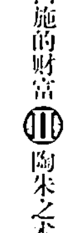

## 25. 像军人一样守纪律

鸱夷子皮开始讲述交易中的执行性问题。

“大道至简，知易行难。无论是交易、减肥或向着任何人人生目标的奋斗，最困难的并不是不知道怎么做，而是知道之后执行的毅力、行动的决心，也就是执行纪律的坚决性。即使你有适合的投资交易系统，但是如果不遵循它的规则，不守纪律，不严格执行，那么，交易的结果必然还是一团糟。因此，无论决策如何完美，只有被有效执行，才能得以实现。严格执行投资纪律，依照既定的交易计划行动，就是交易执行力的体现。”

鸱夷子皮接着讲道：“成功者与失败者的差别，不全在于智慧和知识的差别，更在于执行力的差别。纪律，是一种人生态度，是知行合一者依据的法则和原则。巴菲特关于交易的执行力方面也有见解，‘我之所以能有今天之成就，是依靠于自律和他人的愚蠢；我们没有必要比别人更聪明，但我们必须要比别人更有自制力。’”

最后，鸱夷子皮总结道：“人们的行为，总是遵循自我的行为模式，这就是习惯。在交易中，如果总是重复犯某种错误，那就是不良习惯在作怪。这种不良习惯，会导致交易者的交易系统存在重大缺陷，交易中的亏损，大都来自这个重大缺陷。巴菲特也认为习惯的链条在重到断裂之前，总是轻到难以察觉！因此，要扭转交易反复亏损的局面，完善自我投资交易系统，就要纠正不良的交易习惯，使得习惯与交易模式相适应；而要调整这些不良习惯，只有坚决执行纪律，像军人一样守纪律，如此，才能知行合一。”

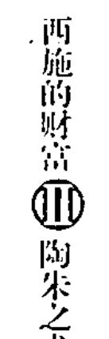

### 人生：不到结局，不知命运

## 26. 商业经营的真谛

鸱夷子皮重点对学生们进行情绪管理、资金管理、趋势研判、卖出和止损的特殊训练，学生们学得都很投入。

时光飞逝，自从开始理财培训以来，一晃两个月就过去了。

这天，鸱夷子皮对大家说：“实践是最好的老师。你能向一条鱼解释陆地上行走的感觉吗？对鱼来说，陆上的一刻行走胜过千年的空谈。所以，最重要的是知行合一。

“经过这段时间的学习，大家都已经掌握投资理财的基本知识和技能，无论是投资，还是交易，所有的实用技能我已传授给你们了，现在，理论学习可以毕业了。你们要去市场的大潮中，经受真正的洗礼，才能深刻体会到这些规律，完全将这些规律为我所用。”

同学们决定集资成立基金，进入股市，实战演练。西施和道生可以投入10万元，白圭投资3万元，猗顿手头只剩2万多资金，最多只能投入2万元。郑旦说：“要不，我的房地产公司不开了？我直接投资5000万元，我们一起管理？赚了算大家的，亏了算我的！”

郑旦同学的豪爽立刻被鸱夷子皮老师制止：“投资实战训练一定要有个人心理对市场的情绪感受和情绪管理，个人投入的资金比例越大，受市场的情绪感染越厉害，学习效果才越好。你一个人全投资了，其他人的训练效果就没那么好了。”

经过众人同意，郑旦也投资10万元，总投资额为25万元，本金太少，大家面面相觑。

鸱夷子皮说：“这些钱投入股市确实有点少，不如我们先进行商业运作，增值后再进行理财投资？”

道生说：“我听说吴越正在进行经济改革，发展势头很猛，近期急需大量二手车，旧车的价格很高；而齐国经济发达，生活富裕，人民大都喜欢新车，新车使用3年就会被淘汰，二手车价格很低，如果收购齐国的二手车，转运到吴越销售，其利润会高达8倍之多。但这个生意看似能赚大钱，却有一大障碍，即吴越和齐国之间，千里迢迢，运输费用比较昂贵且不说，最大的问题是这千里路途间，关卡林立，黑白道都设立各种收费站，向过往车辆收取昂贵的过路费用。如果将这各色杂费都如实缴纳的话，贩卖齐国的二手车到吴越之地，就不一定有多大的赚头了。”

鸱夷子皮略一思考，说道：“商业经营的本质，是在产业链中联合适合的合作伙伴，优势互补，协同竞争，合作共赢，从而以低成本向消费者提供优质产品，向员工负责，向股东创造价值。有时，商业经营看似已走入山穷水尽之地，但如果能转换思路，找到合适的合作伙伴，即刻就会柳暗花明。

“所谓优秀的商人，就是善于整合自我的优势与他人的优势之人，明了自己的优缺点，选择合适的合作伙伴，优势互补，资源共享，就能实现人之所不能，完成惊人的一跃，成为卓越的商人；而苏秦张仪之流，只不过在政治舞台上，整合国家的优势，从而合作共赢。”

于是，鸱夷子皮讲了一个小故事，来证明优势互补、资源共享之重要：

有一个叫老彼得的犹太人，是一名优秀商人，他事业有成，但儿子却不成器，不学无术，整天只知道吃喝玩乐，不工作不结婚，让他很是担忧，于是，老彼得决定应用他的商业智慧，好好帮儿子运作一下。

他先去找儿子：“Hi！小约翰，我说你是不是该结婚了，我介绍一位好女孩给你认识吧。”他的儿子小彼得很不乐意：“算了吧，我的事您就别操心了，我女朋友好多的。”老彼得：“我说的这位小姐，可是比尔·盖茨的女儿呀。”小彼得一听两眼放光：“噢？是真的吗？如果是这样的话，我会马上结婚的。”

几天之后，在一个酒会上，经朋友介绍，老彼得见到了参加酒会的首富比尔·盖茨。老彼得：“Hi！比尔，听说您的千金正在择婿，我介绍一个优秀的小伙子给您认识吧。”比尔·盖茨不乐意：“孩子的事儿就让她自己做主吧。”老彼得：“我说的这位小伙子，可是世界银行的副总裁啊！”比尔·盖茨：“噢？是真的吗？如果是这样的话，那我一定考虑。”

第二天，老彼得马上去见世界银行行长。老彼得：“听说贵行正在重组高层管理人员，我介绍一位优秀的小伙子来做分管VIP客户的副总裁吧。”行长不乐意：“对不起，我们已经有了考虑人选。分管这方面的副总裁得有很好的人脉关系，才能帮助本行获得更多的存款，如果太年轻的话，恐怕难以胜任。”老彼得：“我说的这个小伙子，马上要成为盖茨的女婿，既然您这儿不缺人手，那我就推荐给别的行看看。反正盖茨手里的钱存哪儿也是存。”行长：“噢？是真的吗？您看我刚才不是说了吗，我们也仅仅有了可供参考的人选，如果有更优秀的人才，当然要择优录用，欢迎您所说的这位优秀人才随时就任。”

于是，小彼得和比尔·盖茨的女儿结了婚，也成了世界银行的副总裁。老彼得又运作了一门成功的生意。

鸱夷子皮刚讲完，西施就哈哈大笑起来：“这哪是商业经营啊？这纯粹是骗子，是空手套白狼的骗子呀！”

鸱夷子皮正色道：“对于经商而言，天才和骗子之间，仅仅只有一张纸厚度的差别。一个创新的商业灵感，成功了就是商界精英，失败了就成为骗子。实际上，无论是经商，还是从政；无论是教书，还是管理，只要和人打交道，只要涉及竞争和合作，就会有经营，不同的人，经营水平高低不同，可分为几种不同的境界。”

鸱夷子皮将经营境界分为以下几种：

- 一等人是神：他们贩卖价值观和思想，让他人为其舍命卖命、不计代价，他们被神化，拥有无数信徒和膜拜者。这类人包括：释迦牟尼、老庄、巴菲特，或许也包括我，呵呵。
- 二等人是天才：他们贩卖标准，为个人、企业或其贩卖的商品和服务树立一个标杆，成为其他人或行业学习模仿的对象；他们也拥有无数的粉丝和拥趸，但尚没被神化。这些人包括：乔布斯、曾国藩、比尔·盖茨、韦尔奇等。
- 三等人是鬼才：他们才华出众，经常灵感迸发，他们的灵感实现则为天才，灵感运作失败则为骗子。此类人有：牟其中、庞兹骗局中的庞兹、牛云、苏秦、张仪等。
- 四等人贩卖质量，他们致力于提高商品或服务的质量，努力降低成本，以性价比在同行业胜出。优秀商人和管理者大都属此类。
- 五等人贩卖商品本身，他们忙忙碌碌，但思想平庸；他们围绕商品本身而工作，让顾客为购买而购买。他们是各行各业最普遍最普通的人，绝大部分人都属此类型。
- 六等人是骗子，他们打着贩卖优质商品和服务的旗号，但却提供虚假伪劣产品，或直接骗人钱财，在消费者看来，无论他们是主观行骗还是被动骗人，提供的产品远远满足不了消费者的期望，就是骗子。

猗顿说道：“老师讲到经营行骗，我也想到了一个故事。”

猗顿于是讲起了故事：

某天，一个穿着普通的男人，带着一位漂亮艳丽的女孩，来到HK广东道一家奢侈品商店，女孩很快选购了一个价值8万的新款LV包，付款时，男士掏出支票本，潇洒地签了一张支票，递给店员，店员有些为难，没有接纳，按照规定他们只接受熟客的支票，而这对男女是第一次来店购物。

男士看穿了店员的心思，他笑着对店员说：“你是在担心这是一张空头支票吗？今天是周六，银行关门。你看这样行不行，我把支票和这款包都留下，等到星期一支票兑现后，再请你们把包送到这位小姐所留的地址处。OK？”店员放心了，欣然接受了这个建议。

星期一，店员拿着支票去银行入账，支票果真是空头支票！店员愤怒地打电话给这个男人，这个男人笑着说：“这没有什么要紧吧？你和我也没有损失。上星期六的晚上，那个物质女孩已经和我上床了！多谢你的合作。”

猗顿讲完故事，大家都哈哈大笑。

郑旦大声说：“男人没一个好东西，不花分文就骗了女人。”话甫一出口，就被周围男人仇视的眼光打断了，立马闭嘴不说。

西施有点哀怨地说：“为什么受骗的总是女人？”

鸱夷子皮盯着猗顿看，让猗顿很后悔刚才的多嘴。鸱夷子皮说：“撒谎是一种不道德的行为，为了实现某种目的的撒谎，本身就是欺骗，不管欺骗显得多么风流，多么高雅，仍然是欺骗。但现在，世风日下，是非颠倒，人们把成功的撒谎当成经营，撒谎的人如果能骗倒人（骗倒员工、骗倒客户、骗倒股东、骗倒公众），那就是一种本事，那就成为一门经营的艺术了。商业经营本来最讲究的是诚实守信、公平竞争，但现在却成为骗子的江湖。”

猗顿或许为了纠正大家对他刚才所讲故事的误解，也顺着老师的思路阐述起他的见解：“当前成功的商业经营者，基本分为两类，一类是骗子集团，靠着欺骗他人，做大规模，成为所谓的成功人士；还有一类是垄断集团，如果说骗子集团是靠遮遮掩掩、打着幌子抢钱的话，那么垄断集团说涨价就涨价，说收费就收费，就是明火打劫、明着抢钱，简直是土匪行径。”

猗顿讲到这里，想到平时深受垄断集团之害，语调激昂起来。

道生问道：“垄断集团提价不是也举行听证会吗？涨价不也向公众解释其涨价的合理理由了吗？”

猗顿说：“如果解释权只掌握在垄断者手里，那这种解释就像掩耳盗铃一样，是自欺欺人，是糊弄公众的，这种垄断集团就像下面笑话中的黑社会小混混一样，既是明抢，又是花言巧辩的欺骗。”

猗顿又讲起了笑话：

一个黑社会小混混进一家面馆吃面，先是要了一碗冷面，没吃，换了一碗热面，吃完面，用手抹嘴，准备走人，老板拦住：“客官，请留步，请埋单。”

“埋什么单？”

“您吃完热面，还没埋单。”

“热面不是用冷面换的吗？”

“那冷面也没埋单呀？”

“冷面不是退给你了吗？”

“……”

黑社会小混混扬长而去。

猗顿说：“如果解释权只是一家之言，就常常这样被偷换概念，垄断集团的解释权就是如此荒谬。对于普通大众来说，当前要想生存得好，要不就进入骗子集团，要不就进入垄断集团，如果不能成功成为集团的一分子，就只能自己辛苦，做个成功的骗子，这恐怕也是现在骗子越来越多、傻子不够用的原因吧？”

鸱夷子皮打断了猗顿的讲话：“就此打住！我们回到正题，继续探讨如何进行我们的商业经营，不管外面的世界怎么变化，我们都应该秉持我们内心的信念，以我们的原则来经营。”

白圭说话了：“我听过齐国有一个很有势力的贸易商叫姜子盾，他经常贩运服装、布匹等到吴越，贸易数量巨大，往来频繁，他应该会花钱疏通关系，打点各路关卡，否则，以正常的昂贵收费，他怎么可能赚大钱、成为巨富？我们是否能找到他，求他帮忙，让各路收费的老爷们少收点费，我们还能赚多点？”

西施说：“与其求人帮忙，不如平等合作，我们可以将齐国收购的二手车组成运输车队，以新成立运输公司的形式，向姜子盾寻求合作。我们可以号称新公司为了营销宣传，开业酬宾，免去他的运输费用，只需他承担过路费和汽油费，如此的话，他的运输成本大大降低，我们则可以不用缴纳过路费，大家合作共赢，一举两得。这个办法如何？”

大家对此妙法赞叹不已，拍案叫好。和姜子盾联系，姜子盾果然十分乐意，满口答应。

于是，众同学开始商量分工：郑旦负责和姜子盾那边联系，白圭负责在齐国收购二手车，猗顿和道生负责路途的运输情况和在吴越之地的销售；西施本来协助白圭在齐国收购二手车，但西施离开吴越几年，甚是想念家乡，想到父母的坟头凭吊。鸱夷子皮看到西施回乡的欲望强烈，也不好说什么，就由她和道生、猗顿一起，将收购的二手车雇人开回越国。

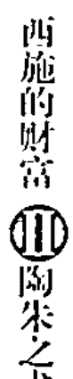

## 27. 酒吧里的暧昧情感

西施、猗顿和道生一路不辞辛苦，披星戴月，在姜子盾强大社会关系的关照下，经过几天长途跋涉，终于平安来到越国。西施回老家探亲，猗顿和道生销售二手车这些事宜略去不表。

这一日，道生回家探望生母未归，猗顿经过几日辛劳，将所有销售手尾全部处理完毕，晚上难得清闲，约西施去酒吧。

西施推辞不去。猗顿道：“师母天生丽质，貌若天人，先生唤您‘西子’，不知您可是那位闻名遐迩的美女西施？不管您是不是西施，想来您和老师经历不凡，一定有很多的人生感悟，能否指导学生一二，我正受情感问题困扰，想向您请教呢。”

西施感慨道：“女人的情感，在不同的年龄段，会有不同的感受。”

西施将女人不同年龄段的感受，用以下诗句来形容：

- 10多岁时，是清纯型：和羞走，倚门回首，却把青梅嗅；
- 20多岁时，是相思型：春花微雨湿轻绡，那将红豆寄无聊；
- 30多岁时，是浪漫奔放型：一枝红杏露凝香，云雨巫山枉断肠；
- 30多岁的剩女，是恨嫁型：时光只解催人老，不信多情，长恨离亭，泪滴春衫酒洒醒；
- 40多岁时，是深宫怨妇型：美人卷珠帘，深坐蹙蛾眉。但见泪痕湿，不知心恨谁；
- 50多岁时，是现实主义型：老妻画纸为棋局，稚子敲针作钓钩；
- 60岁以后呢？不敢想，不敢想了，只剩下空想、回忆和留恋了：此情可待成追忆，只是当时已惘然。

猗顿嘿嘿笑道：“师母是文学女青年，说话高雅，出口成诗。我是俗人，就用俗语说说男人对女人的看法了。女人20多岁是橄榄球，追着抢；30多岁是篮球，追着跑；40多岁是乒乓球，打来打去；50岁以后呢？就是高尔夫球，打得越远越好。”

西施猛捶了猗顿一拳：“你国家大小球管理中心主任啊？讲来讲去就是球呀？”

西施和猗顿坐在一间安静的酒吧里。

昏暗的灯光摇曳，迷离的音乐醉心，一种让人容易敞开心扉的氛围。

猗顿说：“问世问情为何物，直教人生死相许，成熟男女恐怕没有不受感情困扰的吧？这世界有太多复杂的东西，最复杂的那类里肯定包括感情，包括爱情和婚姻，情感的事儿无人能说得清、道得明。当年不懂爱情的时候，就接受了爱情；不懂婚姻的时候，又接受了婚姻。经过几年磨合、几年感受，开始品尝婚姻的滋味之时，婚姻又离我而去了。”

西施小心问道：“你离婚了吗？我看你这几个月上课很认真，没看出有什么异常啊？”

猗顿沉默了片刻，伤感地说：“我是我前妻的初恋，是她青梅竹马的玩伴，10多年前我参军时，她就以未婚妻的身份住在我家，帮我照顾母亲；她是一个名副其实的贤妻良母，我从小父亲早逝，全靠母亲含辛茹苦把我拉扯长大，母亲操劳过度，累坏身体，瘫痪在床，我前妻任劳任怨，”

悉心照顾她，多年如一日，直到我母亲去世。这么多年，我一直在外地，她对内要照顾婆婆，教养孩子，料理家务，对外要努力工作，赚钱养家，10多年从没半刻休闲。多好的女人啊，没被生活的重负压垮，却为我的所作所为伤透了心，坚强的心理筑堤彻底崩溃，执意要和我离婚，带着孩子离我远去。我们长期的婚姻生活，已经你中有我，我中有你，血肉相连，好似连成一体，离婚，就像将自己活生生劈开两半，心痛，真的是伤心裂肺般的伤痛啊！”

荷顿将杯里的酒一饮而尽，继续说：“娶了淑女的男人可能会成为艺术家，娶了悍妇的男人可能会成为哲学家，娶了贤妻的男人会没有家。我现在成了孤家寡人，没有家了！”

西施好奇地问：“此话怎讲？”

“好女人会宠坏男人。贤惠的女人只管相夫教子，不知管教男人，从而会放纵男人，让好男人容易被外面的诱惑所诱惑；贤惠女人若不知男人花心，就会内心平静，幸福感百分百，对男人的信任感也百分百，宁可信全世界男人都是坏人，也不肯信自己丈夫会花心；一旦得知男人变心，内心就会全面崩溃，信任的大厦会彻底坍塌，最后大都无法忍受这种情感背叛，而选择过激行为。有人因无法忍受而自绝，有人会自虐，有人甚至会将儿女残害再自杀，上演一出人间惨剧。坏女人一般只要钱，不要命；贤惠的好女人对钱没感觉，但一旦狠起来，就会要命，要自己的命，要自己孩子的命，也要男人的命。所以，娶个好女人的风险很大啊！”

西施笑了：“头一次听到这种奇谈怪论，你真是一个奇怪的男人！”

荷顿：“女人是一所学校，一所好学校能把一个坏男人教成好丈夫，同理，一所坏学校也能把一个好男人教成坏丈夫。但好女人并不意味着就是好学校，坏女人也不一定就是坏学校，其中的关键，就是女人应该知道怎么管教男人，应该用什么方式让男人服服帖帖。现在太多的女人完全不清楚怎样当好老师，对男人的要求完全是混乱的。男人待在家做家务，照顾孩子，女人嫌他窝囊废；男人爱家，下班准时回家，女人嫌他没应酬，没出息；男人努力工作，早出晚归，女人嫌他缺乏家庭责任感，不管家；男人有事业，晚晚应酬，女人又怕他有外遇；等到男人有外遇了，女人又着急着找父母兄弟、找闺蜜想办法，找对策，或一哭二闹三上吊，或鱼死网破，或你做初一我做十五，女人从没有理智地用脑子想过，男人所有的现状，都是女人这所学校教育的结果；所有的人生结局，都是自我的选择，情感的好与坏，也只不过是自己的选择而已。”

西施说：“上帝造人的基本原理，就是男人理性，女人感性；男人让世界有理有序，按逻辑运行；女人的使命就是添乱，让世界复杂多样；男人让生活成为科学，生活井然有序；女人让生活成为艺术，让男人永远不知道明天会有多大的危机要处理，从而才能充分发挥个人特质，生活才会丰富多彩。男女生理结构完全不同，女人天生要比男人经历太多辛苦，男人如果能像女人一样，忍受每月来例假、十月怀胎、流产堕胎、忍痛生产、遭遇难产、进行剖宫产、哺乳喂奶等痛苦的煎熬，经历过这种种痛苦，男人再来指责女人不迟！事实上，男人为了自己的快乐欢愉，找小姐，找小三，找情人，像个孩子，不，像个动物一样，只知贪玩，风流快活，而不对女人负责任，自己犯了严重错误，反过来还说是女人的问题，怪罪女人管教不好，你说你们这些坏男人呀，吃着碗里的，还想着锅里的，真是严重缺少女人的管教！”

西施说到这里，忽然意识到这么说就是认同了犇顿前面所讲的女人是学校的怪理论，于是收嘴不说。

犇顿苦笑着说：“师母，您如此年轻美丽，称呼您师母太刺耳了，我还是称呼您西子姐姐吧！西子姐姐，不是我男人为人的错误找借口，找理由，而是男人之所以容易犯生活作风问题，确实事出有因——因生理、社会分工和人性弱点等方面的原因，您别急于反驳，先听我把话讲完。”

犇顿解释了他的怪诞爱情论，他说：“彼此忠诚、专一和完全拥有对方，这是热恋男女对爱情的基本要求，但却不符合每一个由肉体构筑的男人和女人的天性。人类的天性，是人类在成千上万年长久的进化进程中，适应恶劣生存环境、物竞天择、适者生存的优质基因保留遗传的结果。在人类的天性中，一个典型的特征就是趋利避害、优胜劣汰，表现在择偶方面，就是男人大都喜欢以貌取人和以慧取人，选择貌美女性为配偶，是为了后代的遗传基因更优质，而选择善持家的配偶，则是为了更好地照顾后代；而女人天性偏向拥有才华和能力的男性，这是因为可以让后代更优质，并且，有才华和能力的男人一般能占有更好的资源，从而为养育后代提供更好的保障。人类男女之间的择偶，也正如自然界中动物的求偶——雄性所承受的压力在很大程度上来自和其他同类对雌性的争夺竞争，这种争夺竞争十分残酷，唯有胜利的强者才能得到交配和繁衍的权利；而雌性也只把交配权给予胜利者，无论年龄、相貌和高矮。所以，动物和人类的自然婚恋观都不是从一而终，而是选强者而从，只在乎强弱优劣，不在乎天长地久。当然，除了草原田鼠，受激素作祟，而不受基因影响。”

西施不认可猗顿的说法，她说：“你说的是动物吧？”

猗顿：“当然，人类毕竟有别于动物，人类用道德和制度来约束社会行为，使其符合公认的社会准则，而社会准则维护家庭的稳定，必然要维护婚姻的稳定，所以强调从一而终，相互忠诚。但是，如果解除道德观念和社会制度的禁锢，舒展人类的天性，无论男女，在和异性接触时，都能产生一种同性所不能带来的愉悦感，这种愉悦感就成为对异性特别的好感，这种好感不会因道德、制度和是否结婚而改变。”

猗顿向后倚靠，让自己坐得更舒服些，继续讲道：“男女之间都会有好感的存在，但有些人仅仅是将好感存乎内心，永远当做一种可以追忆的美好；而有些人，则将这种好感付诸行动，喜欢鲜花，则要盛放于自己的花瓶；喜欢美人，则要据为己有，从而让这世界上，因为不能克制自己的欲望，而发生那么多的悲欢离合，演出那么多的人生悲剧；至于为什么那么多的悲剧或爱恨情仇，多由男人主演，女人多怪罪于男人，是因为男女社会分工的不同——男人主外，外面的世界太精彩，诱惑太多，和年轻貌美女孩的情感碰撞机会太多；女人主内，忙于应付孩子和家务，和才华出众的成熟男人接触的机会太少。所以，男人相比女人，对第三者产生好感的机会何止成千上百倍！而男人容易城门失守，并非缺乏家庭责任感，并非不爱自己的女人，仅仅是因为自制力太差，不能把持自己，任由欲望蔓延，从而毁灭自己，毁灭家庭。”

猗顿喝了口酒，继续说：“女人总是责备男人严重犯错误，这种错误会让女人的天都垮塌，但女人从没意识到，男人之所以会犯天大的错误，只是因为人性的弱点在作怪，无法自制而已。其实，和爱是否缺失无关，和责任心是否缺失无关，男人对年轻美貌、长相酷似梦中情人的异性缺乏自制，就正如女人对漂亮时装和钻石的诱惑缺乏克制一样，都是欲望的不能自抑。”

西施：“你所说的貌似有点道理。但是，难道就这样因为男人无法克制欲望，而让女人永远为男人心痛心碎吗？”

猗顿：“困扰人们情感的因素无非是性、爱情和婚姻。性是人的动物性需求，是肉体的欲望，完全受人性欲望的控制；爱情是人的精神追求，完全遵循内心的感觉；而婚姻则是现实利益的集合，是男女的现实生活，完全需要理性判断。性、爱情和婚姻看似相互联系，却各不相同。性能让人兴奋、欢愉，是人的低级欲望需求；爱情是一种复杂美妙的感情；婚姻则是感情、现实、理性、意志等几方面合力较力的结果。”

他继续说：“男人在这些情感问题上很理性，将性、爱和婚姻分别看待，分别处理——性是性，爱是爱，婚姻是婚姻，各有不同的对象和态度，一个男人在一生中，可能有几十个性对象，没有或有几段爱情经历，有过一两个婚姻配偶，这些不同的对象，在不同的情感问题上，或许有重叠，或许从没交集。

“女人在处理情感方面却很感性。大部分女人，只追求美好的爱情感觉，为爱不顾其他，因爱而性，因爱而婚，将性、爱和婚姻三者合三为一，或许，这也成为女人的悲剧吧？殊不知，虽然爱情的感觉很美妙，但美妙的东西往往太短暂，时间能让任何奇妙的感觉都归于平凡，让任何新鲜的体味都会变成熟悉的乏味。如果只把爱情定义为感觉，把婚姻定义为长久的生活，那么，试图用婚姻这种形式延续爱情的美好感觉，结果必然是失败，从这点来说，婚姻是爱情的坟墓，这句话一点没说错。”

猗顿说：“对于感性女人来说，结婚，就是把美妙的爱情水晶，放到由琐碎平凡的日常琐事铺就的漫长道路中，去经受压榨、磨练和考验，幸福的婚姻注定要比幸福的爱情稀少得多。”

西施感慨道：“你把男女之间的情感看得这么清楚，还要向我请教情感？你是我的老师了。”

光怪陆离的昏暗灯光下，在酒吧的角落，有男女搂在一起，随着音乐的慢节奏，在慢摇跳舞，西施的心里好像跳动了一下。

西施说：“对女人而言，嫁给一个你爱的人，会失去自我；嫁给一个爱你的人，会失去自由，女人就是个感情动物，天生为感情而活。按照你的分析，女人婚姻的不幸福就是必然？我为爱，追随你的老师，时间一过就是二十多年，当初激情万丈，现在生活平静如死水，我生活的全部就是孩子，而他除了对我，对其他人和事都充满兴致，我是做梦都梦不到当年的美好感觉了。唉！反而，我偶尔会梦到我的前夫，他对我是真的好，舍弃一切，只为爱我，可惜我年少不经事，辜负了他的心意。”西施想到了历史往事，爱恨情仇于心胸中起伏，眼光看向远处，眺望着跳舞的男女，忽然心潮澎湃，眼神收回来看着猗顿，有些异样的感觉。

猗顿不知西施此刻心中波涛汹涌，继续发表对情感的看法：“对女人来说，如果少些感性，多些理性，那么就能幸福得多。我们可以对爱情和婚姻进行理性分析：

爱情复杂易变，具有很大的不确定性，这就是爱情的风险性；而爱情的收益则体现在婚姻的各个方面：婚姻是否稳定？婚姻是否适应现实生活？能否从婚姻中得到满足感？对方对婚姻负责吗？

“如果这几方面的回答都是‘是’的话，那么，婚姻的质量就是优质的；而在婚姻中，爱情并不是主要考虑的元素，虽然，美好的婚姻大都由爱情升级而来，但婚姻中过分看重爱情，就无异于缘木求鱼，就是追求风险，如果对风险敏感、承受能力不强的话，就很容易受到伤害，爱情也没找到，婚姻也不再美好；反之，如果婚姻注重以上几点，婚姻现实、稳定，能得到责任感和满足感，那就应该庆幸，这就是幸福的婚姻。”

猗顿说：“婚姻中越是看重爱情，爱情越脆弱，婚姻也越难长久，所谓佳偶难久，天作之合往往难以白头偕老。反观那些以传统伦理和实际利益为基础的婚姻，看似平淡无奇，却可以子孙满堂，携手到老，这才是婚姻的大幸福。”

西施叹了口气：“按照你的说法，爱情竟然成了婚姻的风险？为爱”的婚姻反而容易不幸福，不看重爱情，只注重现实利益的婚姻反而容易幸福？这是男人们的普遍看法吗？看看女人，为了追求爱情，宁愿粉身碎骨，不计任何代价，只为真爱，按你的狥氏爱情理论，婚姻大都难以幸福，这让女人们情何以堪呀？现在回想我和你老师的感情历程，我付出天大的牺牲，只为和他厮守在一起，现在真的日日待在一起了，心里却又感觉空荡荡，并不像当初想象的那么充实美好，你的老师对我并不像我想象得的那么好，他整天忙于钓鱼和写关于鱼的书，对我和孩子不重视，他更重视寄情山水，更重视你们这些学生和朋友，对我缺乏激情，对鱼甚于对我的激情，或许，这就是你们男人眼中的理性吧？我现在经常会怀念起我的前夫，在别人眼中，我的前夫或许不是一个好人，但对我绝对痴情，要美人不要江山，我不是说他真的有江山可以舍弃，我的意思是他为我可以付出一切，他既浪漫，又疼我，唉，可惜我年幼无知，不懂什么是男人真正的爱情，辜负了他的一片深情，也害了他。”西施想到夫差的种种温情和呵护，想到她让夫差亡国亡身，不由得痛哭起来。

猗顿看到西施伤心，慌得不知道如何是好，他掏出纸巾递给西施，宽慰道：“最难消受美人泪，姐姐，是我乱讲，让你多想了。我本想就事论事，没想到会勾起你的伤心往事。”猗顿不由得伸出手来，抚摸西施搁在桌上的右手，以示安慰。

西施并没有收回手，任由猗顿轻拍着，她哭了一会，收住哭声，道：“对不起，情到伤心处，难以自已，让你见笑了。我们继续聊。照你这么说，如果男人不能克制自己，就容易将好感转化为拈花惹草的行动，男人移情别恋，女人只能眼睁睁地看着他们胡作非为吗？”

猗顿说：“姐姐，我要是实话实说，你恐怕又要不认同了，但我只能有一说一。人的天性决定了男女之间并不会由于缔结婚约和承诺相互忠诚等法律道德约束，就自动丧失对第三人产生好感、爱情和发生婚外性行为等权利。很多女人紧张于外面的世界有太多的狐狸精，生怕自己的丈夫发生外遇，一方面耳提面命，一方面严加管教，对男人身边的女人如临大敌，严防死守，却从没想到过男人出轨是人性在作祟，结果，女人越为此焦虑，越为此花心思，似乎男人出轨的可能性更大；女人在纠结于此的同时，却从没想过如果男人发生外遇，自己该如何应对？正常情况下，无非有三种选择，第一种是选择离婚；第二种是劝说男人回心转意，但即使他态度诚恳，女人肯原谅他，但内心的伤痕和创伤恐怕永远无法抹去；第三种选择就是在既不想离婚又心里不平衡的情况下，自己去搞婚外恋，两人扯平。还有两种非正常但很普遍的选择，第一种是一哭二闹三上吊，将家庭的丑事闹得人尽皆知，成为他人的笑谈，最后无论是是否离婚，男女之间的感情彻底伤透；第二种是选择自杀，或者伤害别人再伤害自己。将人人都可能会犯的不能自制的错误升级为悲剧。

“以上这几种方式，对女人来讲，都难以让自己真正内心平和，都难以让自己真能像什么事都没发生一样淡然对待男人的出轨。对于有理性的聪明女人来说，堵不如疏，既然花心是人性的弱点在作怪，与其让自己难受，不如视而不见，虽然有点掩耳盗铃的感觉，却是让自己内心安宁的最好办法；所谓 ‘婚前要瞪大眼睛，婚后要闭上眼睛’，讲的就是智慧女人处理婚姻感情问题的最好方式。不怕猪一样蠢的配偶，就怕猴一样精的伴侣。”

猗顿停了一下，继续说：“当然，除非你愿意做耍猴的。婚姻要靠理性，要靠经营，只有这样，才能将婚姻的帆船平安稳定地驶往人生的终点。婚姻是否稳定幸福，并非看男女双方是否有爱情，而是看男女双方的婚姻配对方式是否般配。”

猗顿将男女的婚姻配对分为三种类型：

- 男女的学识、素质和能力差别极大的婚配方式。
- 男女的学识、素质和能力都很高的婚配方式。
- 男女的学识、素质和能力都偏低的婚配方式。

他说：“这几种婚配方式中，如果男女能力差别很大，女人比较蠢，天然对男人像英雄一样膜拜；或者男女能力都很强，女人大智若愚，装得比较蠢，对男人的所作所为一概视而不见，这两种婚配方式的婚姻都能比较牢固，比较稳定；就怕女人像猿一样精，时时瞪大眼睛，盯紧男人，结果看清男人的本质后，又难以接受，内心痛苦，婚姻也无法守护住。”

他对西施说：“作为一个理性女人，如果你看重婚姻带来的安宁，那么，你就要守护你的婚姻，要能接受男人的弱点，能容忍男人，无论别人怎么做，无论你付出多大的代价；如果你追求自我感觉的良好，注重感情的美好，那么，摆脱第三者困扰的最好办法，是尽早离婚，尽早独身，尽早寻找新的感情，让美好的感情重新开始。无论如何，打闹、自虐或人身伤害，都是将人性的弱点演变成人身的惨剧，是不可取的。”

讲到这里，猗顿忽然发现西施看着自己的眼神很奇怪，好像在含情脉脉地看着自己，有妩媚，有深情，还有激情在闪光。

猗顿心跳加快，他抓紧了西施的手，轻声说道：“你的眼睛比这依云矿泉水还要明亮，还要清澈；你的皮肤比这纸巾还要柔和，还要温软；你的嘴唇比玫瑰花瓣还要娇嫩，还要鲜艳；你的嘴唇湿湿的，比杨枝甘露还要晶莹，还要甜美，好像……”

猗顿看到了西施眼神里的渴望，他像被电击了一样，浑身发烫，他放开西施的手，站了起来，向西施走去。

这时，一个黑影扑倒在猗顿身上，“哗呼呼”将污秽物狂吐在他的身上……

## 28. 猗顿的女朋友

西施、猗顿和道生又回到了齐国青岛市。

道生和西施向鸱夷子皮汇报商业经营情况。

“我们这趟出差，有好消息，也有坏消息，你想先听哪个？”西施说。

鸱夷子皮说：“我是悲观主义者，坏消息放后面，先听好消息吧。”

“好消息是我们这趟经商获利比我们想象的还要好，扣除所有花费，净利润率在10倍以上，现在我们的资本已达到280多万了。”

“那坏消息呢？”

“坏消息是文种先生的命运让你说中了。我这次回去，得知文种两年前已被勾践处死，处死的原因是他意欲谋反，图谋作乱。听说文种是自杀的，当时，勾践赐给文种一把名叫属缕的宝剑，这样说道，‘当初是你帮我想出伐吴九计这样的妙计，我只用其中的5条，就打败了强大的吴王，还剩下4条在你那里，现在请你用这4条，去地下帮我老子的忙，继续打败……’夫差和他老子的联军吧！’文种只好自尽而亡。我还听说，文种死后被投入江中，但他死不瞑目，江中从此多了一种鱼，眼睛大得酷似文种，游动起来仪态端庄，翩翩如文种生前，当地人都称此鱼为‘文种鱼’。”

鸱夷子皮听完，嚎啕大哭，让道生和西施大吃一惊。西施说：“夫君学道用道几十载，我原本以为不会为尘世俗物动情，没想到会这么为故人伤感，死者已矣，生者如斯。夫君还请多珍重。”

鸱夷子皮唏嘘不已，他说：“我们三人，共度艰难困苦，长达二十余载，不是兄弟，胜似兄弟。以文种之个性，虽然权力欲望强盛，但断不至于去图谋不轨；以勾践之个性，虽然控制欲也很强烈，但断不至于去加害于文种。如此结果，一定是有人挑拨离间，勾践是误信谗言啊，误信谗言！文种，我的好兄弟，你当初为何不听我的劝告！”

第二天，猗顿、白圭和郑旦赶过来继续培训。

鸱夷子皮说：“考虑到你们每个人的投资风格各不相同，我感觉实际操作还是以独立操作为好，我将全部资产平均分为4份，每份70万元，道生和西子是一家人，合起来算一份，郑旦、猗顿和白圭各算一份，你们用这些资金，投入股市，独立运作，有困惑可以相互商量解决，难以解决的问题我们再集体商讨。”

对老师的安排，大家一致同意。

猗顿有点不好意思地说：“学生新认识一女朋友，虽然相处时间不长，但双方感觉良好。现在流行闪婚，我们俩商量了一下，择日不如撞日，三天后是良辰吉日，我们选定三天后在卡尔顿宇宙大酒店举办婚礼，备下薄酒，想请老师和同学们赏光出席。”

西施盯着猗顿：“发展这么神速？”

猗顿道：“人生顺意须尽欢，莫使金樽空对月。人生本沉闷，不如多找机会让自己开心了。都是成年人，感觉好就结婚，无非就是多张纸，不合适就再换张纸了。”

西施脸上有些难看。

鸱夷子皮看看西施，又看了一眼犄顿，问道：“怎么回事？”

道生插话道：“犄顿大哥去越国卖车时，在酒吧里被人吐了一身，他本欲发火，没想到酒醉呕吐者是越国超女比赛的冠军，是一青春靓丽超级大美女。”道生看了西施一下，继续往下讲：“犄顿大哥想照顾这位美女，美女小妞想要赔偿犄顿大哥，两人你来我往，当晚就成朋友了。”众人皆大笑。

“这位小姐不但人漂亮，其他各方面俱佳，是米国哈鲁大学的高才生，人也善良，和我们一路回来时，对我也很关心，得知犄顿大哥的老师就是我的父亲时，对父亲您也很关心，向我仔细询问您的爱好、喜好的茶和酒的品牌，说犄顿大哥的老师就是她的师长，以后要好好孝敬您。”道生讲道。

“对我的生活爱好表示关心？”鸱夷子皮自语道，他站起来爽快地拍着犄顿的肩膀，说道：“你放心，三天后，我们一定会去参加你的婚宴，庆祝你的婚礼，更重要的是，欣赏你神秘而美丽的新娘！”


# 29. 鬼谷子的炒作秘籍

第二天，猗顿一早就来找西施和道生。

“老师安排我们各自独立进行投资演练，但我感觉我们的投资风格接近，可以搭伙一起投资，有疑难困惑可以共同商讨，你们意下如何？”

还没等西施开口，道生就满口答应：“猗顿大哥，我觉得你脑子反应最灵活，我也想跟着你多学习。”

西施瞪着道生，不吭声。

猗顿神秘地向四周张望，看见鸱夷子皮没在，就从怀里掏出一个包裹，小心翼翼地打开，里面包着一本看似很破的旧书。

猗顿压低了嗓门，小声说道：“这是一本致富奇书，叫《炒作秘籍》，为神秘策略大师鬼谷子先生所著，是世界难得以珍品，里面全是讲述如何通过炒作牟取暴利的高级技能和顶级操作手法，我最近真是走狗屎运了，运气太好了！既能碰到鸱夷子皮这样的名师，又能不花钱找到美女老婆，前几天又是机缘巧合，在地摊上发现了这本鬼谷子先生亲著的孤本被低价甩卖，我捡了大便宜，买得此宝书，哈哈，财运好得有如神助，我不发达谁发达，谁不发达我都会发达！”猗顿忽然意识到自己的语调不自觉在激昂起来，马上收声，向四周探望。

西施：“老师不是严格禁止我们炒作吗？”

猗顿：“老师主张商业经营和投资‘不敢居贵’，‘薄利多销’，仅逐‘什一之利’，也就是仅仅满足于百分之十几的收益率。这个收益率水平，如果放在币值稳定的经济环境中，每年按复利增长，财富的增长会很可观，我们应对这种收益率水平知足。但是，如果，宏观经济的币值不稳，通货膨胀严重，这个收益率扣除通货膨胀率，时间收益率也就几个点，那就太低了。

“老师可以禁止我们炒作，但火星人也无法阻止其他人从事炒作，炒作利用了人类普遍具有群体羊群效应而容易跟风的情绪特征，可以在短期内轻易获得惊人的暴利，所以，国人从事商业经营，尤喜炒作，炒作是本国商人们最常采用的致富手段，也是最容易获取暴利的不二选择。”

猗顿接着说：“从这点来看，老师和太史公都是文人，不是商人，都有些迂腐，司马迁说积著之理，务完物，无息币；以物相贸易，腐败而食之货勿留，无敢居贵，也就是说积贮货物，应当务求完好牢靠，没有滞留的货币资金；买卖货物，凡是容易腐败和腐蚀的物品，不要久藏，切忌冒险囤居以求高价。

“但在现实生活中，商人们经商的所有作为，却和太史公所说的道德高尚的行径完全相反，他们大手笔购入不易腐败和腐蚀的物品，存于仓库中，收藏起来，囤积居奇，待到奇货可居之时，高价抛售，从而牟取暴利。”

猗顿总结了现实生活中商界成功人士的样子：

在用来炒卖的别墅院子里，种满了炒作的君子兰或郁金香，笼子里养着准备炒的藏獒或京巴，坐在炒来的红檀或紫檀的太师椅上，手边的紫砂茶壶里泡着炒亏了的普洱茶或大红袍，一边欣赏着悬挂在墙上、准备在拍卖行卖天价的仿名人的西洋油画或古人字画，用手摩挲着和田玉或古玉，一边深深陶醉在院中奇石旁边堆着的炒砸了的猪肉和房间里堆着的大蒜、苹果和黄梨木料的混合怪味里，用手机对着操盘手吼叫：“小李啊，今天不把我们那只科技股拉涨停，就扣发你年终的分红啦！”

猗顿讲完，西施将刚喝到嘴里的水全部笑喷，道生也笑得眼泪都流出来了。

西施笑得花容失色，花枝乱颤，她说：“你说得貌似也有道理，但你老师一直反对我们炒作，认为炒作是不道德的行为，这可如何是好？”

## 30. 劣币驱逐强币：道德是这样沦丧的

“道德？道德本来作为社会的基本准则，和法律的强制约束力相辅相成，都是各行业各阶层应该遵守的行为规范，这样的道德规范才能成为社会的稳定剂，如果只是某些行业某些阶层的人群尊重道德，而某些行业某些阶层的人群视道德为无物，那么道德就成为一种口号，一种工具，一种欺骗。现实的情况是，你们和他人讲道德，他人中究竟有谁对你们讲道德？”

猗顿继续讲道：“你们有没有发现，在股票市场上，存在着这种奇怪现象？很多挂牌交易的股票，巨亏连连，亏损累累，戴着ST帽子，有的净资产值为负值，负资产程度甚至很惊人，按常规，这种资不抵债的垃圾公司在任何商业环境中都难以存活，都必须破产，都不可能引起投资者的兴趣，但现实情况却是这些缺乏价值的垃圾股市场表现良好，宛若明星一般，被投资人追捧，股价迭创新高，市值高得惊人；而大部分普通股，业绩稳定，但股价却长期低迷不振，PB和PE偏低，不为市场所关注，市值比一些垃圾股还要低很多。为什么会存在这种不合理的奇怪现象？烂股票要比好股票更受欢迎？你们谁能告诉我？”

西施点头称是：“按照正常的思维逻辑，应该是青春靓丽的美女更受帅哥的追求才是，股市上的这种现象，就和清华园中的丑女生原理一样。一个丑女生的周围，总是有好几个才华出众的男生在竞争；女生越丑，竞争者越多，竞争的男生越优秀，我一直没搞清楚到底是什么原因，是丑女生的数量太少导致供需严重失衡？但现实中，丑女和烂股票的数量并不少啊！还是这世界变化快，快得让人无法理解？是男人们生活压力太大了，所以变得重口味了，喜欢丑女生的品位了？喜欢烂股票的烂风格了？搞不懂啊有木有？”

猗顿笑道：“姐姐也紧跟时尚潮流啊！不但清华园如此，青年人的审美偏好亦是如此，快女里的青春，似男非男，是女非女，让人留恋，连我都是她的粉丝，号称‘春风’。不但股市如此，各行各业都存在这种‘烂的比好的更流行’的现象，只是人们见怪不怪了。例如，在银行领域，有一个著名的‘劣币驱逐强币’的理论……”

道生插话进来：“我知道这个‘劣币驱逐强币’理论，说的是早期货币市场流通的不是纸币，而是用黄金或白银等贵金属制造的货币，货币在制造过程中，因工艺偏差，成色并不一致，有的金属含量符标准，被称为强币，有的金属含量不够，被称为劣币，这些货币在流通交易时，人们普遍会将强币收藏起来，而将劣币用以流通交易，于是，市场所流通货币就逐渐全为劣币，而强币会逐渐退出货币流通领域，这就是劣币驱逐强币的货币现象。”

猗顿：“黑格尔认为存在即合理。这句话让人寒心，让人难以接受，看似是在维护世间现存的不合理和不平等，但是，如果能究究不合理事物背后的本质，我们将发现，那些看似不合理的事物背后，都有其合理运作的规律。”

“就股市上普遍存在的烂股票更受投资人追捧而言，大众只看到垃圾股当前业绩糟糕、资不抵债的严峻形势，于是，就按正常逻辑判断，这种公司应该破产、应该摘牌。确实，按照正常的经济环境，按照正常商业运作游戏规则，这样的公司确实不值分文，早应该关门破产了事的。可是，游戏规则并非大众所理解的那种正常规则，而是这样一种非正常规则——上市公司再烂，也不能破产摘牌，只能被其他公司重组，成为其他公司上市的‘壳’，从而让其他公司可以借助这个‘壳’完成上市。在这种奇妙规则的作用下，本来不值分文的烂股票，反而就成为奇货可居的珍品。这个游戏规则彻底颠覆了大众心目中的正常规则和正常秩序，让僵尸还魂，让死鸡变成凤凰，化腐朽为神奇，让不值钱的垃圾变成了珍奇异宝。烂股票从此因为上市公司资格这个“壳”，而奇货可居，众多急于上市但上市无门的公司就去追捧这个壳资源公司，从而让“壳”的价值远远超出正常公司的市值水平。”

他说：“如果认清不合理事物背后的本质，我们回头再看烂股票在股市上的良好表现，就会觉得一切都合情合理。买股票就是买未来，烂股票现状很糟糕，犹如清华园中的丑女生一般，但其背后，却可能有众多优异卓越的追求者，所以，烂股票较之普通的好股票，其未来前景更好，而且股票越烂，负资产越严重，重组的动力越大，被优质公司借壳的机会越大，摇身一变，成为优质公司的可能也越大；反之，当前看似良好的好股票，虽然现状不错，但是按照‘一年赚，二年平，三年亏损’的上市公司业绩冒险路线，未来业绩存在大幅下滑的可能。因此，从价值投资的角度来看，烂股票现状不好，但未来前景好，好股票现状良好，但未来前景可能不确定，所以，烂股票的市场表现远远强过好股票，就是自然而然的了。”

西施感慨道：“按照这种游戏规则，投资垃圾股才是真正的价值投资，垃圾股差无可差，只能转好，如果能确定未来向好，这就是投资的大机会，看来，在他人恐慌抛售垃圾股的时候，敢于大手笔买入者才是符合国情的价值投资者。”

猗顿点头称是：“之所以会出现烂股票比好股票好、劣币驱逐强币这种现象，根本原因是市场监管缺失，导致游戏规则发生根本改变，从而使优质的东西被淹没，使劣质的东西大行其道。如果施行正常的监管规则，劣质品冒头的话，就会遭遇严厉的监管打击，从而保证优胜劣汰的机制得以正常运作；比如，对连续亏损的垃圾股实行破产和退市，那么，就不可能再出现这种烂股票强过好股票的荒诞现象，但因为监管不力，导致游戏规则发生颠覆，其后果将不再是优胜劣汰，而是劣胜优汰。”

猗顿继续说：“‘优胜劣汰’的良性机制如果失灵，就会出现‘劣胜优汰’的恶性机制，从而在各个行业，出现‘劣币驱逐强币’现象——伪劣产品流行起来，优质产品反而没有市场，最终被淘汰。这套恶性机制的运作原理是这样的，优质产品的成本普遍较高，市场售价也相对偏高；而伪劣产品的成本很低，不良商人通过对伪劣产品美化，使其外表美观，低廉成本导致的低价格、美观的卖相、加上精美的包装，这些优势使得伪劣产品比优质产品在市场上更受欢迎，从而使得劣质产品逐渐驱逐了优质产品，使得制造优质产品的商人，要么从市场上退出，要么也随大流生产劣质产品。

“各个行业出现劣币驱逐强币效应的结果，就是这些行业的优质品退出，而劣质品横行，市场流通的商品或劳务，大都卖相漂亮但品质却低劣，商人们将优质品留作自用，而任由劣质品在市场上泛滥，商人们都自以为聪明——自己可以享用优质产品，通过伪劣产品谋取暴利。当个别行业、个人有如此行为时，是这部分人为一己之私利而在损害他人利益，如果缺乏对这些伪劣产品的严厉打击和惩戒，让劣币驱逐强币效应在各个行业扩散开来，利益受到侵害的大众同样依法炮制。在自己的领域，使用优质品，而让劣质品在市场上被他人使用，随着越来越多的人这么做，从而各行各业都是伪劣产品流行，而优质产品退出市场。在这种环境下，人人都是自私者，在自己的领域给予自我最大的保护；人人也都是受害者，因为每个人都必须消费由他人在其他行业提供的劣质品。这种现象表现在食品生产领域，就是生产者可能既是投毒者，大量生产不符合标准的、添加剂严重超标的劣质食品供给市场；也都是受害者，因为每个人都必须接受其他行业的食品，正如有人总结的，你生产地沟油蒙混别人，别人在牛奶里加三聚氰胺坑你；你在食品里乱加添加剂害别人，别人就在蔬菜水果中乱打农药毒你。

“劣币驱逐强币效应在各个行业出现的结果，就是一种恶性运作的机制被建立起来，人人成为劣质品的生产者，同时，也成为劣质品的受害者；在这种机制作用下，就会形成一种恶性环境，在这种环境下，人人都是劣质品的受害者，而不存在受益者。

“如果任由商业领域里自私自利、损人利己、不择手段的坏意识坏思想，发展蔓延成为全社会见怪不怪的主流思想，那么，就会在人的思想、道德、文化等精神领域，出现‘劣币驱逐强币’效应。如果损人利己、为利益不择手段者的人没有约束，没有被惩处，其以后行为只会越来越恶劣，越来越放肆，也会影响那些遵纪守法者，使得越来越多的人胆大妄为，最后，损人利己的思想就成为社会正常的指导思想；如果整个社会都自私自利，当他人利益被侵害时，事不关己，高高挂起，只要没伤害到自己，就明哲保身，漠不关心，任由恶人肆虐，其最终结果必然是当自身利益被侵害时，将无人帮助，他人同样会冷漠处之。”

猗顿越说越慷慨激昂：“如果人的精神领域出现劣币驱逐强币效应的话，将会出现难以想象的恶果——真善美会消亡，假恶丑将肆虐流行。在这种情况下，假话空话套话官话成风，坑蒙拐骗横行，假冒伪劣猖獗，商业欺诈成为常态，熟人会宰你，陌生人会欺骗你，人们的交往将丧失基本的信任。信任缺失的社会将极其恐惧，人们相互防范，给自己套上厚厚的壳自我保护，只要不伤害到自己，会漠视周围的一切不平，会毫不理会他人的水深火热，如目睹小偷偷窃而无动于衷；看到老人摔倒，绕道而行；看到小孩被车压伤，而无人救助。最后的恶果就是当他人需要帮助时，视而不见；当自己求助时，也无人理会。

当思想领域出现劣币驱逐强币效应时，人们的价值观会畸形，金钱至上、权力至上就会被奉为圭臬，追求物质享乐和物欲满足将成为人生的唯一追求，贪腐骄奢将成为成功标志，金钱和权力将成为精神信仰，整个社会将出现一种道德沦丧、斯文扫地、信任缺失、良知泯灭的恶性社会文化，在这种生态环境下，诚信二字只会挂在嘴上，实际盛行的却是说一套做一套、两面三刀、相互欺骗的虚伪欺诈文化，能适应这种社会环境的人，只能是那些善于欺骗善于伪装的人，也就是说偷奸抹滑、溜须拍马、阴险狡诈的人更容易成功，而正直、老实、不作假的人却容易被淘汰。

“如果在思想文化领域出现劣币驱逐强币效应、优胜劣汰的良好运作机制不复存在的话，那将是整个社会的灾难。初始，或许还只是大众冷眼旁观他人利益受侵犯而不帮助的自私自利；逐渐地，正直、善良、诚实、责任、正义被社会边缘化，阴险凶残之流将成为各行业的主宰，这时，社会将只有两极——上层人群和下层人群，即上层权力者可以肆无忌惮地利用权力侵吞掠夺他人的利益，纵横天下，胡作非为，权力将成为权力者的通行证；而下层人群只求生存，任其利益被他人侵害，对一切与己无关之丑恶，无动于衷，麻木不仁；上层社会穷奢极欲，骄奢淫逸，下层人群为口腹之饱，日夜操劳，看似天上地下之别，本质上都只是追求物欲的满足。为了满足物质欲望，社会道德沦丧，人的尊严被彻底流逝，不知耻的无耻境界成为追求，一切都成为可以用来交易的商品，良心、贞操、尊严、幸福、健康，人性的光辉和美好成为劣币驱逐强币中的强币，成为金钱追逐战争中的祭品。”

西施吃惊了：“社会会糟糕到这种程度吗？如果真的整体沉沦、道德沦丧，作为社会的一分子，我们应该怎么办？”

猗顿长叹道：“如果整个社会从经济、文化到道德、精神都任由劣币驱逐强币效应显现威力，劣胜优汰的逆向汰击机制将成为运作机制，将出现不堪想象的恶果，将成为处处盛开恶之花的恶土。虽然上层权力者可以在权力空间内大肆放纵，但在其权力鞭长莫及之领域，同样也要深受其害。恶土之上不会有受益者，如果劣币驱逐强币效应使得社会恶化到这种程度，人人都是坐而待毙者，无人有破解之法，无人有回天之术，那我们只能自求多福了！

西施也感叹道：“当前，教授摇唇鼓舌，四处赚钱，越来越像商人；商人现身讲坛，著书立说，越来越像教授。上市公司产品价格多年不涨，经营亏损，越来越像非盈利机构；医院等非营利机构收入增长快速，暴利惊人，越来越像上市公司。一切的一切，都丧失了本来面目，被扭曲成其对立面。就连价值投资这种投资技能，也彻底变了性，并非摘取皇冠上的明珠，而是要在垃圾里淘金，要在亏损累累的烂股票中挖掘，才能抓到高成长品种，这才是符合国情的价值投资。在这种环境中为人处世，即便不堕落，也不能自命清高，而要顺应社会趋势，才能适应国情生存下来，这就是你所讲的劣币驱逐强币效应给我的启示吧。”

# 31. 炒作技术探秘

猗顿施展如簧巧舌，终于让西施认可了道德无碍投资经营的现实：经营只看结果，不涉及道德；只有顺应环境，具有了足够的影响力，才能改变环境。

西施问猗顿：“可是，你老师从没讲过炒作的只言片语，我们应怎么炒作？”

猗顿扬了扬手中的《炒作秘籍》：“这本宝书里，关于炒作技巧，无所不包。”

西施接过书，翻阅起来，翻到“炒作对象”这篇，看着书中记载到：什么物品易成为炒作对象？

总结起来，炒作物应具有以下特点：

- 1. 储存性。凡是那些不易腐败和腐蚀的物品，均可囤积起来，以求高价。鲜花、青菜、鲜果等难以储存，切忌囤积炒作，大蒜、绿豆、苹果、生姜等蔬菜水果能长期囤积，就可炒成高价，再待价而沽。
- 2. 概念性。炒作对象一定要能赋予有一定想象空间的概念。例如，君子兰：多好听的名字，只有君子才适合种植的高雅兰花；藏獒：天下无敌之狗，可以打败狮子之狗，最有狼性之狗；普洱茶：延年益寿，百病包治，放得越久越值钱；古董：高贵之人的爱好，让人修身养性；中西字画艺术品：陶冶人的情操；房子：只涨不跌，可以保值；紫檀木家具：皇家珍品，贵族的享受；凡此种种。
- 3. 稀缺性。物以稀为贵，越稀缺越价高。以炒作别墅为例：城区的别墅比郊区的稀缺，价格自然更贵；海边或名胜风景区的别墅比普通的别墅稀缺，自然价高；若是名人住过的，当然要价格飞涨，一房难求；若不幸被前朝某位帝王幸临睡过，自然就是无价之宝，只要开价，无论价位，自然有钱多人傻者抢入。瓷器、字画等古董收藏品莫不如此，越稀有者越无价。死人比活人值钱；量少少，越稀有，越矜贵；历史愈久远，价格愈吓人。
- 4. 大众认同度。大众天性是趋利避害，凡是能带来利益的就疯狂追逐，凡是能避免损失的也热烈追捧。炒作生活必需品，会引发大众对缺乏生活物质带来生活不便的恐慌，为了避害，就会高价抢购；炒作物品能刺激大众产生资产大幅增值的暴利效应，从而得到大众的广泛认同，才容易牟取暴利。

西施继续向后翻，看到“炒作程序”这章：

无论炒作对象怎么千差万别，炒作程序都大致相似：

首先，在价格低廉时，大量收集所要炒作之物品，将这些低价收购来的物品囤积储存起来；随着这些被炒作物品被大量囤积，如果该类物品的供给比较恒定，其在市场的流通量将大幅减少，从而变得稀缺，价格会逐渐上涨；随着被炒作物品收集囤积的数量越多，市场供给越少，价格也越来越高，炒手开始在市场放出风声，人为制造关于这种物品供给不足的虚假消息，加剧市场的心理恐慌，促进大众抢购；随着抢购人群越来越多，羊群效应会带动更多的人参与进来，使得炒作对象的价格飙升，高达初始收购价格的数倍甚至数十倍，此时，炒手分把大量抛售炒作物品，最终可获利数倍甚至数十倍，炒手短期大量的抛售会使炒作物品的涨势停止，先缓慢下跌，再急跌，价格下跌导致跟风的中小炒家抛售，从而使炒作对象价格大跌。

整个炒作中，大炒家牟取暴利，吃的是大鱼大肉；前期跟进的中小炒家，也能赚取收益，跟着喝点汤；后进入的炒家和跟风的大众，则成为鱼肉对象，为整个炒作埋单。

猗顿看西施看得入神，打断她的注意力，说道：“炒作并不复杂，炒作原理都是一样的，关键是要营造概念。无论炒作什么东西，即炒房子、炒萝卜，还是炒白菜，概念越明确，炒作成功率越高；炒古董字画、炒股票，还是炒邮票，概念越神奇，炒作价格越高，获利也越多；例如，如果要炒白菜，也可以像炒房子一样，营造各种稀缺古怪的概念，如白菜位于菜地中心，则有王者之风，是白菜之王，自然价高；如白菜位于菜地东边南边，则每天最早拥抱第一缕阳光，光照好，营养特别好，所以要高价；如白菜位于菜地西边北边，则产量很少，因为稀缺，所以价高。总之，只要有理由，就会有概念，就能成为炒成高价的借口。

“炒作除了要制造概念，更要善于欺诈。炒手对于字画等艺术品的炒作，就是一个典型的欺诈的局。先在低位大量收集那些无甚名气书画家的作品，然后将其中的一两幅于拍卖会上拍卖，通过自拍自买，反复抬价，像股票一样对敲拉高，形成天价，从而将此书画家营造成高价名家，然后就可以将其余的大量低价作品，在高位慢慢派发给那些附庸风雅之人。”

猗顿继续总结关于炒作的本质：“在监管缺位的前提下，炒作本质上是一帮骗子带着一群傻瓜在玩击鼓传花的游戏。炒作物是花，鼓声是炒作物的价格，只要价格不跌，所有的参与者都不会损失，只有利润，各得其乐；而炒作物价格的暴跌就是鼓声停止，最后的接盘者，就是最大的傻瓜，他们将为以前的全部傻瓜埋单，只有骗子能获取暴利而成为赢家。”

猗顿说：“炒作，就是控制炒作物的价格，在低位让他人卖，在高位让


## 庄家与散户

他人买，大炒家控制炒作物价格的操作手法就是坐庄，大炒家就是庄家。

道生说：“说到庄家，股市流行这样的诗，说的就是庄家。

清晨入股市，归来泪满巾；
日进斗金者，不是散户人。

散户不容易赚钱，庄家赚钱易如反掌，原来根本原因在于其控制了股价啊！”

西施说：“我想起一段诗歌，也是讲述庄家的。有人写《再别康桥》，流传久远；有人就仿写《再别股市》，不知能否抚平散户心中的创伤？”

西施于是朗诵起这首《再别股市》的诗：

### 再别股市

偷偷地我抛了，
正如我偷偷地买；
我偷偷地派发，
作别手中的筹码。

那大屏前的散户，
是股市中的羔羊；
K线里的艳影，
在我心头荡漾。

盘面的接单，
假假地在盘口里招摇；
在股价的柔波里，
我决心捞每一张钞票！

那分时图上的成交，
不是拉高，
而是出货；
隐藏在放量中，
寄托着散户们的梦。

寻梦？拉一个涨停，
向股价新高处突破；
满仓的这只股票，
在全面大涨中出货。

但我不能放歌，
打压是离别的笙箫；
市场也为我大跌，
大跌是今年的股市！

悄悄的我跑了，
正如我悄悄的来；
我挥一挥衣袖，
不带走一手股票。

西施朗诵这首打油诗，夸张而看似深情，惹得大家哈哈大笑。

猗顿说：“下面我详细讲述庄家在家在股市坐庄的过程，坐庄实质上是通过控制股票的流通量、进而控制股价的炒作过程。庄家在做坐庄前，要制订详细的坐庄计划，选定炒作对象，明确收集筹码的数量和价格区间，确定拉高出货所需的概念和题材，出货时间和价格范围等。”

### 坐庄的过程

1.  **吸筹**：吸筹指的是在低价位大量买入所要炒作股票的筹码。确定所要坐庄的目标后，就要收集其在市场流通的筹码。一般情况下，庄家所选炒作对象大都是低价位的三线垃圾股，这些烂股票大都成交稀少，只能一点点位抬高价才能吸到筹码，随着吸筹的深入，股票在K线形态上呈现出价升量增的上升走势，这种上升走势会吸引市场短线资金跟风，让吸筹难以继续，庄家难以买入更多筹码，就要进行洗盘。
2.  **洗盘**：洗盘是庄家通过打压股价、让跟风盘恐慌卖出、自己再从大宗量买进的一种手段。洗盘分为两种打压方式：一种是释放该股票的坏消息，如公司即将破产、投资项目停产、收入大幅下滑、诉讼、产品质量问题等利空，引发市场上的恐慌心理，散户在低位因恐慌而砍仓，庄家从而可以轻松接到这些廉价筹码，完成吸筹；庄家还可利用前期收集的部分筹码快速卖出，制造该股破位下跌走势，引发市场跟风盘止损卖出，庄家再趁机接盘；洗盘是吸筹阶段不可或缺的部分，是完全配合吸筹的，只有反复洗盘、吸筹，才能使得庄家在可控的低价区域段内，收集到足够的廉价筹码；吸筹和洗盘的核心，是尽量避免市场游资的跟风，让对手盘多卖出，让庄家多买进，同时，要将股价控制在一定的范围内，不能大幅上升。
3.  **拉高**：当收集完足够筹码后，就要将股价拉高。控制足够筹码后，庄家就能左右股价，可以通过自买自卖的所谓敲鼓技巧、花费不多的成本，就能将股价逐步拉高；同时，还要释放胜利好消息，如市场追捧的热门题材或概念、业绩增幅超过预期、高比例送配、资产重组、实力集团资产注入等，通过利好刺激市场跟风盘抢购，再用少量资金顺势推高；随着股价的大幅上升，K线形态呈现良好的多头走势，会吸引更多的跟风盘买入，庄家趁势推波助澜，连续拉高股价。
4.  **出货**：股价大幅走高后，价升量增的理想走势会吸引更多的散户跟风，股价上升的赚钱效应也导致越来越多的散户加入抢购的行列；当股价上升到庄家预定的出货区间后，庄家会连续放出利好消息，落实或证实前期的朦胧利好，刺激散户高价抢购，市场会呈现狂热状态，炒作目标股价迭创新高，庄家会频繁以小单的形式大量派发筹码；在出货前期，市场追高接盘力仍会很强，股价会保持上升；随着庄家大规模出货，卖盘源源不断，出货中期时，跟风盘已无法承接住卖盘，股价开始急跌，此时，庄家会一边高位抛，一边在低位接，一边大量出，一边少量买，利用操盘技巧，高抛低吸，维护股价不大跌，股价会大幅震荡，升到高点会被打压，跌到低位又被神奇拉起。
5.  **砸盘**：当庄家将大部分筹码抛出后，就不会再护盘，而是将剩余不多的筹码当做无本的库存连续抛出，大肆砸盘，股价会连续快速大跌。砸盘表示庄家坐庄的成功，将跟风的散户套牢在高山上，股价大跌也为庄家下一轮继续坐庄砸出足够大的空间。

狗顿继续总结坐庄技能：“庄家会根据其资源的不同，包括资金多少、和媒体的关系、和上市公司的关系，以及利润目标、运作时间等，进行不同风格和期限的坐庄，一般分为坐短庄、波段坐庄和坐长庄。”

狗顿讲起了坐庄的不同类型：

1.  **波段坐庄**：波段坐庄是在一个大的上升波段里、通过操控股价、实现交易收益的一种方式。波段坐庄一般只需收集所炒作目标股在外流通筹码的20%~40%，控制这种比例的筹码，就能影响股价走势，但无法完全控制股价。因此，波段坐庄要顺应市场走势和节奏，顺势而为，并且，要得到目标股公司一定程度的配合。通常运作波段坐庄时，在筹码收集阶段，市场大升，就要控制目标股小升，市场大跌，就要控制目标股大跌；在拉升阶段，市场大跌，就要控制目标股小跌，市场升时要趁机大升；在出货阶段，就要利用目标股公司出台利好消息，进行配合，兑现坐庄利润。这种手法的坐庄方式，是跟随大盘的涨跌节奏，而不是逆市场而动，从而可以较小的成本，实现坐庄利益的最大化。
2.  **坐长庄**：坐长庄是长期控制目标股股价、通过完全控盘而实现坐庄收益的一种方式。坐长庄一般要收集筹码的50%以上，只有控制这么高比例的筹码，才能完全左右股价走势，可以随意控制目标股按庄家设计的走势路线运行。因此，这种坐庄方式需要雄厚的资金和良好的社会关系，要和目标股公司结成紧密关系。坐长庄的难度不在于拉高，因为股价可以按照庄家的安排任意拉高，而在于出货方式和时机选择。一般来说，坐长庄的庄家都意存高远，更偏好于对目标公司进行脱胎换骨的改造，提升目标股的估值。改造目标公司的方式包括：编造虚假财务报表，对业绩造假；帮助上市公司引进新项目、新产品，货真价实地提高业绩；帮助上市公司引进战略投资者，注入或真实或虚假的符合市场热炒题材的资产；帮助上市公司进行资本运作，提高资产收益率，增加业绩；坐长庄看似收益丰厚，其实风险很大，而收益率如果按照复利方式计算的话，平均下来，并不算高，但是，坐长庄不能出货的话，资金链断裂的风险就很高；股市上曾经有一批枭雄，偏好做长庄，看似风光无限，最后基本丧失流动性，坐庄成为庄家的自拉自唱、自娱自乐，最终，资金链断裂而彻底崩盘。

狗顿讲得很投入，西施笑话他，说：“大哥，你先别发庄家梦，我们总共只有140万元可用，就这三核桃两枣的钱，怎么可能和财大气粗的庄家比？怎么可能坐庄炒作？”

狗顿正色道：“谁说钱少不能坐庄炒作？还有一种坐短庄的方式，我们的资金绰绰有余。所谓坐短庄，就是在几日之内，买入一定量的经历过大跌、股价创出新低的股票。一般情况下，这种股票具有某种朦胧题材或概念，这些概念和市场热炒的概念有点沾边，继而通过报刊、电视或网络推荐，引起散户关注，在推荐后第二天开盘时，通过集合竞价，高开几个百分点，吸引看好的散户跟风买入，从而趁机完成出货。”

狗顿说：“坐短庄的特点是无需太多资金，无需要买入多少数量股票，更无需控盘，只要有媒体资源，能通过媒体平台推荐股票，能有机会引起大量散户关注，能吸引散户跟风炒作特定题材，就能顺利赚到蝇头小利，完成出货。”

西施一副恍然大悟的样子：“难怪天天在电视上看到那些股评家点评股票，慷慨激昂地像打了鸡血一样，原来是有利益在里面啊！”

猗顿继续说道：“坐短庄可以当天买，当天收市后推荐，第二天就完成出货；或者趁低连续买几天，再推荐，完成出货，一般最长也不会超过一周。这种短庄看似赚的是小利，每次只赚几个百分点，但累积下来，利润率会很惊人。每周收益率有5%的话，52周的复合收益率就是12.6倍；每周收益率有10%的话，52周的复合收益率就可以达到142倍，暴利程度出人意料吧？”

西施大吃一惊：“一年上百倍的收益！短庄竟然能有这么高的收益率？天哪，简直不可思议！真的有人能坐庄达到如此之高的收益吗？”

## 32. 涨停板背后的秘密

猗顿狡黠地眨眨眼，说：“市场上有一些游资，号称敢死队，全国大概有几百人，以宁波的游资声势最壮。他们短短几年间，就从几万元、几十万元的小散户，成长为在股市兴风作浪的大鳄，其一夜暴富的独门秘籍，正是这种坐短庄的方式。这种方式，看似每次的利润率不高，但通过资本的快速周转，从而使得年均收益率大幅提高。其实，这种交易方式，在实业投资中，也被充分应用，在投资管理理论中，有一个叫杜邦公式的，讲的就是这种原理。”

于是，猗顿又讲起了财务分析时惯用的杜邦公式：

```
投资收益率 = 净利润 ÷ 股东权益
            = 净利润 × 总资产 ÷ (股东权益 × 总资产)  [注：原文此处公式逻辑稍显混乱，通常杜邦分解为 ROE = Net Profit/Equity = (Net Profit/Assets) * (Assets/Equity)]
            = (净利润 ÷ 总资产) × (总资产 ÷ 股东权益)
            = (净利润 ÷ 总资产) × 杠杆系数
```

其中，

```
杠杆系数 = 总资产 ÷ 股东权益
投资收益率 = (净利润 ÷ 总资产) × 杠杆系数
            = [(净利润 × 销售收入) ÷ (总资产 × 销售收入)] × 杠杆系数  [注：此处插入销售收入以分解利润率]
            = [(净利润 ÷ 销售收入) × (销售收入 ÷ 总资产)] × 杠杆系数
            = 净利润率 × 总资产周转率 × 杠杆系数
```

猗顿说：“根据杜邦公式，很明显，提高投资收益率的方法只有三种，即要么提高净利率，要么提高总资产周转率，要么提高杠杆系数。在净利润率难以提高的情况下，可以通过适度借债，提高杠杆系数；但杠杆系数太大的话，风险就过高，只能通过加速资金周转，提高总资产周转率，所谓货如轮转，从而提高总的投资收益率，无论证券投资，还是实业投资，此原理都适用，这也是短庄操作好的话，收益比其他方式更惊人的道理。”

道生说：“听你这么说，用不多的资金可以进行坐短庄，但关键要有媒体平台推荐才行，我们缺乏媒体的配合，怎么进行炒作？”

猗顿笑道：“山人自有妙计。你有没有注意到，股市中每天总有一些个股涨停？”

西施说：“是啊！我看到股市每天总有一些股票莫名其妙地涨停，难道这里里蕴含着什么秘密吗？”

猗顿说：“涨停板的背后确实有秘密。有些游资，并不靠媒体推介吸引散户注意力，而是充分利用散户的羊群效应心理，将一些有题材的个股拉到涨停，吸引散户注意，在散户追涨时，再顺势出货，这种操作手法被称为拉涨停式炒作法。”

猗顿又讲解起拉涨停式炒作的基本手法：

精选那些价格远离套牢密集区的低价股，在其经历慢慢长跌之后、横盘整理之时，动用数百万至数千万不等的资金，将股价快速拉到涨停，然后用少量资金封涨停，目标股的快速上涨会吸引大量散户跟风，散户会追涨，会跟随一起封涨停，涨停价因远离套牢密集区，一般不会有太多的抛盘。故此，会在涨停价位积蓄一定的买入动量，使得目标股具有继续上涨的动能。第二天开盘时，庄家利用集合竞价，操纵股价开盘高开，让前一天在涨停价格上无法买入的散户追高买，自己趁势派发，高开低走，完成出货。

猗顿说：“这种拉涨停式的炒作，要是操作得当的话，每次能获利百分之几到百分之十几不等；如果失误，第二天就要止损退出，也会亏损百分之几到百分之十八。对经验丰富的游资来说，当然是机会远远大过风险，在市场配合时，年收益率达到几十倍不是神话。”

西施问道：“你讲的这种拉涨停式炒作法，收益率再高，我们也没实力炒作吧？毕竟，我们的资金太少了。”

猗顿笑着说：“我们不作庄，但我们可以跟庄啊。只要我们三个通力合作，把握这类股票的特征，寻找到这类股票，在其上涨6%左右时，跟风买入，第二天趁庄家出货前我们先出掉，轻松搭顺风车，岂不是比自己拉涨停更好？”

道生有点疑惑地问：“可是，股市上有几千只股票，你怎么就知道哪些股票会被短炒、会暴涨呢？”

猗顿道：“这些被做短庄的股票，具有很多相似的形态特征，它们基本受题材刺激而被庄家选中，只要我们坚持主题投资、题材交易，盯着题材，按形态选股，这类股票就会轻而易举被我们选中。”

西施和道生深以为然，说干就干，三人决定组成交易团队，分工协作，研究这类容易被拉涨停的个股。

他们的分工是这样的：由猗顿负责盯着市场，进行潜力个股的搜寻和研究工作，由西施制订详细的操作计划，进行个股决策，并下达指令，由道生负责执行交易和执行止损，整个交易计划的风险控制由猗顿监督，并下达止损指令。

他们的具体操作原则如下：

1.  保本为首要原则。下跌10%时必须止损建仓头寸的1/2以上，下跌15%时必须全部止损完毕，整体亏损幅度绝不能超过15%。
2.  采用分步建仓法，初次建仓不能超过计划建仓量的50%。
3.  上涨超过15%的股票一概不追。
4.  将账面盈利当做本金一样保护，及时分步兑现账面盈利，以免坐过山车。账面利润至少要能够兑现50%，由道生灵活掌握。
5.  西施的交易计划要详细说明可能面临的风险、所能承受的最大损失，列明风险控制措施，风险报酬比须在1：3以上。
6.  每笔交易的最大权重原则不超过总资金的30%，现金头寸比例原则不低于20%。
7.  每天评估资产净值和头寸盈亏，寻找问题，提出改进方案。
8.  分散投资。股票、债券和现金均衡配置。
9.  盈利加仓，亏损减仓。
10. 初始止损线为本金的90%，在本金上涨20%时，止损底线为本金；上涨20%以上时，止损底线为本金的110%；无论何种情况下，亏损不超过账户资产的20%。

后面两天，猗顿和西施、道生按照这种操作方式，小试牛刀，竟然有10%的盈利，三人皆喜，以后照此方式炒作不提。

## 33. 被毒死的猫

三天后，鸥夷子皮带着西施、道生一起去参加猗顿的婚礼。

卡尔顿宇宙大酒店原来是一家小酒家，但却是一家园林式酒家，院子里竹影婆娑，小桥流水叮咚响，也煞是风雅。

酒家生意惨淡，也就猗顿这桌客人，别无顾客盈门，院落的墙上张贴着大红“囍”字，门口张贴着“猗府婚宴”，院子里挂着几个大红灯笼，很有婚嫁的喜庆气氛。

说是婚宴，其实请的客人也就只有鸥夷子皮一家人。鸥夷子皮有些奇怪，看到猗顿穿着新郎官的长袍马褂迎上来，就问道：“请的客人就我们一家吗？你的其他亲戚呢？”

猗顿答道：“新娘子一个人独在异乡为异客，见了我太多的亲戚朋友，难免感觉孤单寂寞，应她的强烈要求，我们的婚宴尽量低调俭朴，所以只请了老师一家。”猗顿然后介绍他身旁的青春女子：“这是我的妻子子宁。”

只见猗顿的妻子子宁：身材高挑，形态婀娜，身着传统红色旗袍，向鸱夷子皮盈盈一躬：“老师久仰，小女子这厢有礼了！”

鸱夷子皮问：“你叫子宁？青青子衿，悠悠我心；纵我不往，子宁不嗣音！是这个子宁么？”

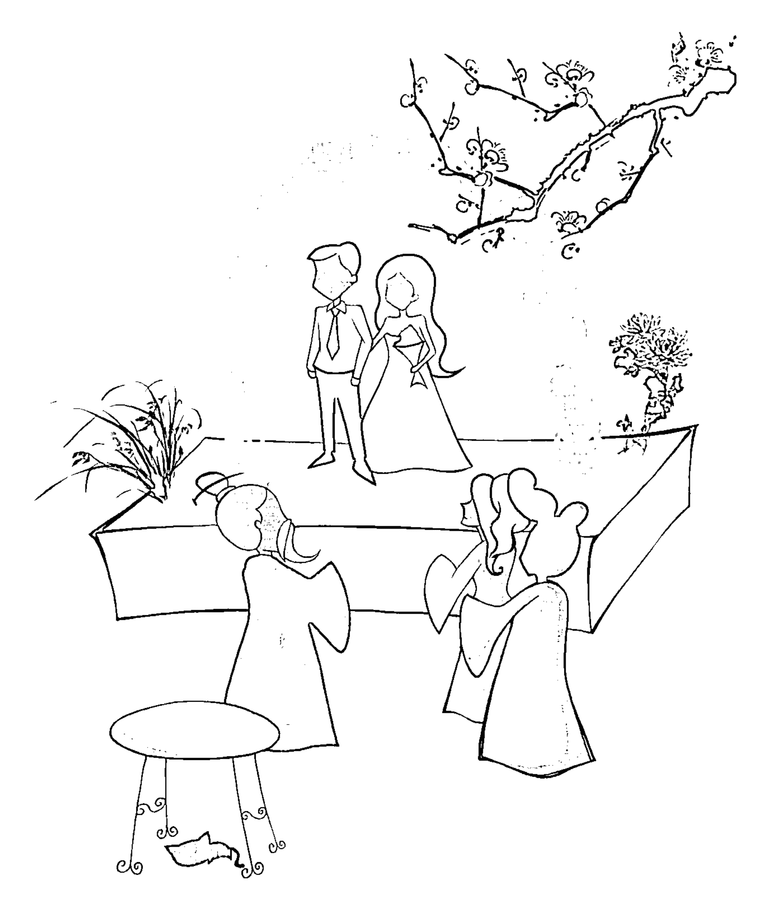

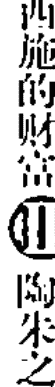

子宁答：“青青子佩，悠悠我思；纵我不往，子宁不来！正是此子宁！”

几入座，鸱夷子皮对猗顿道喜：“如果你不能在股市上被套住，就应该找个像子宁这样的美女套住你。恭喜你们喜结良缘！”鸱夷子皮看着服务员在倒酒：“哦？还是我最喜欢喝的杰克丹尼？”

道生说：“子宁姐在来齐国的路上已经向我打听父亲的爱好，没想到这么心细，婚宴选择了您的心头所好。”

子宁脸上有些难看。

鸱夷子皮说：“我喝酒有个习惯，也喜欢让小动物喝酒。”他看到旁边有猫在吃食，就将杯中的酒倒进猫食中。子宁的脸变得铁青。

鸱夷子皮：“青青子衿，悠悠我心；但为君故，沉吟至今。这酒是为我特别准备的吗？今天是你们大喜的日子，与其沉吟，不如放歌而庆贺。我为你们唱首歌吧！”

于是鸱夷子皮用男中音唱到：

青青的是你的衣领，
悠悠的是我的心境。
纵然我不曾去会你，
难道你就此断音信？
青青的是你的佩带，
悠悠的是我的情怀。
纵然我不曾去会你，
难道你不能主动来？

鸱夷子皮说：“这首歌是寄托一个女孩对爱人的相思之情的，多好听 的歌啊！但是，今天不知道怎么回事，却让我回想起几年前战火纷飞的年 代，这首歌忽然让我体会到仇人上门寻仇的感觉。”子宁的脸色大变。

鸱夷子皮问子宁：“姑娘既从吴越之地而来，可否听说文种为何而 死？可谁知吴国夫差的后人情况？”

听到鸥夷子皮此问，西施也不由得变了神色。子宁说起话来有点慌乱：“小女子虽生于吴国，但长于米国，一直在米国求学，埋首于哈鲁大学的象牙塔中，两耳不闻窗外事。前年家父病故，家境中落，因经济窘迫，才不得已参加快女竞赛，求得名次，只为赚点快钱；你所说的文种、夫差两人，都是吴越的大人物，小女子只能在电视上睹其风采，瞻其尊容，哪有机缘见到真人？何况小女子对政治毫无兴趣，更不得而知了。”

众人听到猫在惨叫，转头一看，小猫七窍流血，已经死亡。

猗顿见此，揪住子宁，怒喝道：“你到底是什么人？竟然敢在酒中下毒？竟然要毒死我的老师？”

鸥夷子皮说：“休得对新娘子无礼！不能错怪子宁，这个品牌的酒最多假酒，这酒一定是假酒，应该是用工业甲醇勾兑而成的，不能再喝了。我看子宁从故乡来，所以多问几句故乡事。怎么能把子宁想象成仇人呢？老夫闯荡江湖几十年，从没有得罪过任何人，就像所有的成熟男人一样，处世不在和平而在平和，不在有友而在无仇，要说有仇人吧，也因国是，夫差是我唯一的仇人，但是，夫差的后人都已全部自尽身亡，怎么可能还会来寻仇？你们不必和子宁过不去。”

听到鸥夷子皮这么说，其他一干人等对子宁的疑虑打消了，子宁感激地望了鸥夷子皮一眼。

## 34. 东施效嫁：如何嫁个有钱人

猗顿得知鸥夷子皮就是大名鼎鼎的范蠡，而西子就是闻名海内的西施，对此两人的敬仰之情如滔滔江水，连绵不绝。

西施、猗顿和道生开始进行短线跟庄交易，她们分工合作：猗顿挖掘研究潜力个股，西施追踪这些易涨停的股票，道生具体执行买卖交易和止损，每个交易日下午两点半以后买入，上午开盘一个小时内卖出，每次赚几个点的蝇头小利，反复操作，屡试不爽，竟然成功率奇高，收益率高得惊人，加之他们也在确定性大的情况下适度融资，充分利用杜邦公式中提到的三个提高收益率的方式，一年下来，他们的账户资产竟然达到1个多亿。

西施以其稳准狠的猎豹风格操作股票，在证券行业逐渐传播开来，行业内开始流传西施坐庄暴富的种种神话，清岛市电视台也赶来对西施的投资心得进行访谈，随后，《齐国证券报》、齐国电视台QCTV等纷至沓来，纷纷采访西施，西施也不推辞，愿意将自己的交易心得与大众分享，

她每次侃侃而谈之前，都这样声明：“其实，我本来就是一个家庭主妇，都是我的先生培训有方，教会我一点投资技能而已。”于是，齐国上下，都知道有一位神秘的隐士，可以预知未来，运筹帷幄，将这位神秘人称为“财神”；而他的漂亮妻子，是投资金手指，买什么涨什么，人们称美丽的西施为“股神”。

这一天，西施来找猗顿，手里拿着一封信。猗顿笑道：“是追求者的求爱信吗？”

西施的粉拳朝猗顿挥去：“没大没小。这是粉丝来信。”

西施猜测道：“难道你老师是有钱人吗？竟然有人羡慕我嫁了个有钱人，向我请教如何嫁个有钱人。”

猗顿接过信，看到：

> 亲爱的西施姐姐：您好！
>
> 虽然我不能确定是称呼您阿姨好呢还是姐姐好呢，但都不妨碍我是您一名铁杆粉丝的事实，我改名为东施就是最好的证明。我仰慕您，仰慕您能嫁给财神这样的有钱人；我羡慕您，羡慕您的机遇和运气；我崇拜您，崇拜您有识英雄的慧眼，崇拜您挖掘优秀男人、驾驭有钱人以及能将锁定的优质男人升级为老公的高超能力。故此，我不揣冒昧，斗胆写信请教，如何嫁个有钱人？
>
> 首先，请允许我做一个自我介绍：我今年25岁，硕士学位，当然，是舞蹈专业的，我自幼学习钢琴、美术、舞蹈，气质高贵典雅，品味卓越，并且貌美，让人惊艳，自信不会逊色过您当年多少，像我们这样的绝色佳人理所当然要嫁个有钱人，或许穷小子要嘲笑我的势利。可是，我觉得自己的要求一点都不高，我并不是要像您一样找个财神做老公，我只是觉得既然上天赐予我美貌，那就应该找一个有能力欣赏和维护我的有钱人才合适。嫁一个有钱人，做有钱人的太太，我相信世界上所有漂亮女孩都是这么想的，毕竟，追求美好生活是人的天性，而有钱人才能带给漂亮女孩

...们公主般的生活，难道不是吗？

现实的问题是：我曾经也和一些所谓的有钱人约会，但他们只对我的美貌有兴趣，只想和我上床，并不想和我结婚。而我，除了能确定他们的衣着和汽车的品牌之外，不能确定他们真的是不是有钱人。所以，我诚心地向您请教几个问题：

- 1. 如何确定一个男人是有钱人？
- 2. 怎样才能嫁给一个有钱人？在哪里更容易结识钻石王老五？是在飞机头等舱里？五星级酒店健身房里？还是在高档酒吧？或是夜总会的VIP房间？您能告诉我其他我没想到的地方吗？
- 3. 为什么很多有钱人的妻子相貌平平？有些女孩子长相平凡，如白开水一样，最后却成功嫁入豪门。而像我这样迷死人的美女却运气不佳，只会碰到色狼，这是为什么呢？
- 4. 有钱人凭什么标准判断谁适合做妻子、谁只适合做女朋友？我恨嫁，只想找个有钱人嫁出去，我对做情人不再有兴趣。

西施姐姐，我希望您能看到这封信，我真诚地希望您能给予我满意的答复，我将不胜感激。

您的忠实粉丝 东施

西施感叹道：“现在的女孩都这么物质、这么现实吗？遥想我们当年，爱情至上，有情饮水饱，谁会如此势力呢？”

狎频道：“不是她们太势力，是你们太傻太单纯了。既然良心、贞操、尊严、幸福、身体都可以用来交易，还逞论什么道德、现实？人们在现实生活中追求平台，无非就是多占有他人的资源，用自己和平台的优势，实现对更多资源的拥有。男人征服世界，女人征服男人，男人以李嘉诚为偶像，女人以邓文迪为楷模，既然男人可以对有限的资源进行有效配置、追求效用的最大化，女孩利用其有限的青春、美貌等资源，征服优秀的成功男人、同样实现效用的最大化，有何不可？现实世界本身是物质世界，既然男人成功的标志是有钱，女孩们追求有钱人也就不出奇了。”

西施笑道：“你真是个奇怪的男人，什么奇谈怪事到了你这儿都成了理所当然。既然你是感情专家，那这封信就由你回复了吧？”

犄頓也不推辞，找来纸笔回信，一挥而就。西施接过来看到犄頓是这样回复的：

亲爱的东施小姐：你好！

我怀着极大兴致，看完你给西施姐姐的信，请原谅我未经你的许可。并非我偷看，而是我作为西施姐姐的合伙人，受她委托，给你一个满意答复。我相信如你所说：年轻貌美的女孩们，和你有着同样的心思，都在为嫁一个有钱人而忙碌、而忧愁。现在，就让我以感情专家的身份、以有钱人的身份，对你解疑答惑。你应该确信我是有钱人，看问题一定是以有钱人的角度。所以，我的答复一定会让你受益匪浅。

成功的商业靠经营：运作良好的公司一定是股东间的资源互补；同理，良好的婚姻也靠经营：幸福的婚姻就像投资，男女双方都得以增值；不幸的婚姻则像糟糕的交易，男女双方交易不公、资源浪费。具体到婚姻中的个体而言，每个人都该自我评估：我的资源是什么？我的婚姻是投资还是交易？

从投资的角度来看，跟你结婚无疑是笔糟糕的交易，道理再浅显不过，你所要的其实是一笔简单的“财貌交易”：你提供迷人的外貌，而我出钱，看似公平交易、童叟无欺。但是，这里有个致命问题：你的美貌会消逝，而我的钱不会无缘无故地减少，事实上，我的资产可能会逐年递增，但你一定不会明年比今年更漂亮。

因此，套用投资理论来说，我的资产会增值，而你的资产会贬值，会折旧，而且是加速直线折旧！你现在25岁，未来5年内，你仍可保持窈窕身段，俏丽容貌，即使每年都会下降；当你年过30以后，美貌消逝的速度会越来越快。如果你仅以美貌为资产，那么，再过10年后，你的价值堪忧。

用投资术语说，每次资本投入，无论是投入到企业还是投入到女人身上，都可以区分为：是投资还是交易？而只看重美貌的婚姻一定是一笔交易——交易的意思就是一旦价值下跌到一定程度就会被抛售，而不会长期持有，也就是说：如果婚姻只为貌美，那么当青春逝去、韶华不再之时，婚姻也被抛弃，这种婚姻肯定不是你想要的婚姻。这听起来很残忍，但对有钱人来说，一件会加速贬值的资产，明智的选择是租赁，而不是购入，有钱人不是傻瓜。因此，只会跟你交往，也就是租赁，而不会跟你结婚，也就是投资。所以，如果仅以美貌为赌注，婚姻的结局一定不会太美满。或许，与其苦苦寻觅嫁给有钱人的秘方，还不如想办法让自己成为有钱人，这比碰到一个有钱傻瓜的概率还要大一百倍。

像你这样的美女们普遍气愤：相貌普通的女人嫁给了优秀的有钱人过着美好的生活，而自己却极其不走运；其实，大多数人都和你一样：喜欢将别人的成功归结为运气，而将自己的成功归结为实力；喜欢将别人的失败归结为实力不足，而将自己的失败归结为运气不佳。你们或许没有意识到：如果自己不是傻瓜的话，那么别人也不是，有钱人亦是如此。人们通常对自己的资产估值过高，而对别人的资产估值过低。殊不知，我们有钱人选妻子也是要理性决策、进行估值的：我们要的效用你没有，我们犯不着为其他不怎么用得着的功能付出溢价；就算我们要的效用你有，但价钱太贵、估值过高的话，我们也是不会买的。

最后，你问到有钱人选择妻子的标准问题，其实，我前面已经说过：估值——在低估值时买入。幸福的妻子大都和男人同甘共苦，或是在男人艰难困苦之时坚定支持他们的女人，也就是在低位被买入的；在此，我再次清楚阐述：一个女人，有教育子女成才的能力、有孝顺双方父母的能力、有持家的能力、有做男人坚强后盾的能力、有和男人共同开拓事业的经营能力、有视金钱为工具而视感情为基本的大局观，女人具备以上的能力越多，那么效用越大，男人愿意给出的投资溢价也就越高；反之，只有外貌，只具备床上效用，那就只有交易价值，只能被租赁了。

希望我的答复能清楚解释你的困惑。如果你对租赁有兴趣，请跟我联系。

你的朋友 犛顿

西施看完，哈哈大笑：“好你个感情专家，用投资和交易的原理来解释婚姻。看来，我要多向你请教情感的困惑了。对了，女人怎么样才能幸福美满？”

犛顿感叹道：“现实就是这样，女人们在关心如何嫁个有钱人时，嫁给有钱人的女人们又在为婚姻的幸福美满而苦恼。

“如何嫁个有钱人？男人们为创富在苦读MBA，女人们为找到有钱人，也不闲着，她们像MBA总结管理案例一样总结一些规律。例如，至少会2~3门外语备用，在不经意间以流利的几国语言震惊猎物——也就是属意的有钱人；会品尝、鉴别红酒，既可以通过酒的等级评估有钱人的身家，又可以貌似酒途逢知己千杯少的样子和有钱人拼酒、然后醉倒、给双方机会；要懂投资，和有钱人有沟通的话题，也为以后接管他的钱财做准备；要有手段，熟知对方家底却装作单纯，强调‘看上的是你这个人而不是你的钱’；要有‘忍者神龟’之精神、‘潜水员’之耐力，不逼婚，甘做小三，以坚忍不拔的毅力拔掉前进道路上的一切钉子；要有‘奉子成婚’的勇气，不畏惧社会压力和指责。”

犛顿继续说：‘上帝造人不知有几千万年了，女性历经几千万年的进化，其择偶观念和择偶能力则一点都没变化，总想找到当时最优秀、最有能力、最能带给自己幸福的男人，但真正如愿者却总是极个别人，女人的择偶能力和男人的投资技能类似，看似精明，实则大都愚蠢；女人嫁人和男人投资也完全类似，女人真正找到一个估值低、貌俊美、重情义、潜力大、喜浪漫、多金钱的完美配偶，正如男人找到一只估值低、成长高、潜力大、贝塔值小的TENBAGGER一样，不但需要睿智的头脑、冷静的情绪、全面的大局观和深刻的思想，而且更需要良好的运气，这是万里挑一的精英男女才具备的技能。

“女人嫁人如果只找有钱人的话，正如男人投资只找绩优股一样，当时感觉良好，一旦为你所有，就业绩下滑，大都不能达到你预期的目的，反而苦不堪言；女人找个富二代，但富二代大都难有作为、容易走下坡路，正如男人只投资蓝筹股，估值高、业绩容易下滑、最后大都亏损；宁为英雄妻，不做庸人妻，给有钱人当小三的话，就像男人买传说中实力很强的重组方可能要进入的ST股一样，都是一种高风险行为；女人嫁给一个行将就木的阔佬，赌他很快死掉，然后进行财产分割、清算资产，从而自己成为有钱人，再资产重组，嫁个奶油小生，正如男人在一只涨幅惊人的蓝筹股上放空，赌其掉头转向，让自己大捞一把，但80岁阔佬也可能再活20、30年，涨幅惊人的股票仍能继续逼空，持有这种理念的男人女人，拿着青春和金钱孤注一掷，大都收获悲剧。”

猗顿感叹道：“其实，女人们一直没搞明白，无论是找老公，还是追求家庭的幸福美满，适合的才是最好的。有钱不是关键，适合自己、般配自己才是最重要的。自己不具备掌控有钱人的能力，或者有钱男人反感太物质欲的女人，强其所为的结果，必然难以幸福。在婚姻中，资源的互补最重要，双方性格的互补至为关键，投资银行的聪慧女分析师不一定就要嫁给有钱人，幼儿园老师或许更受有钱人青睐。对于婚姻来说，适合自己的才是最好的。”

西施叹息道：“你对男女之间的那点事儿洞若观火，了解得如此深刻，幸亏你是个男人，目标只在于征服世界，你要是女人，和我争起男人的话，你一定先是成功的小三，我恐怕要睡不着觉了。”

## 35. 为什么没钱会焦虑、有钱了更焦虑

西施接着对猗顿说：“说到睡觉，我最近老是头疼、头晕、失眠、掉头发，好不容易睡着了，还经常做梦，梦见我们坐庄失败被人追杀，梦见被猛兽追，白天容易紧张、难以放松，这是因为我老了吗？”

猗顿笑道：“你这是精神病的表现。”

西施猛捶猗顿：“你才精神病，你全家都精神病。”

猗顿笑道：“我是严肃的、认真的，才这样说的。不但你，不但我，现在全国的中产阶级恐怕都多少有点精神病了。当代的人啊，不但要为自己赚钱——房子、医疗、生活费用，还要为子女赚钱——教育、养育费用，更要为他人赚钱——交税、养活一帮官员；不但要为现在的支出赚钱，还要为未来的花费赚钱——未来的养老花费，更要为以前人的社保埋单，以前的人并无缴纳社保，现在的人缴纳的社保是按现收现支的方式被当前退休的人领取；收入总是有限，但支出却好像个无底洞，钱永远不够用，在这种生存环境下，个个都是亚历山大，没有精神病都不正常了。”

翁顿从网上搜索出一张表格，让西施填写，翁顿说：“这是一张精神症状自评量表，名叫SCL—90，是全世界最著名的心理健康测试量表，它被广泛应用于精神障碍和心理疾病的检查，从不同的角度，如人的感觉、情感、思维、意识、行为、生活习惯、人际关系和饮食睡眠等，评定一个人是否有精神心理症状以及其严重程度。它对可能处于心理障碍或心理障碍边缘的人有良好的区分能力，可以明确测试出九个精神障碍的因子，包括躯体化、强迫症状、人际关系敏感、抑郁、焦虑、敌对、恐惧、偏执和精神病性，对每个测试因子分为5级评分制，分别为没有、很轻、中等、偏重和严重。你不如填表测试一下吧。”

### 症状自评量表 SCL-90

指导语：以下表格中，列出您可能有的症状或问题，请仔细阅读每一条，根据该句话与您自已实际情况的相符程度（过去的最近一个星期内），以下“没有、很轻、中等、偏重、严重”的具体含义由您自己去体会，然后选择一个适当的数字填写在后面的答案框中：

| 序号 | 问题 | 没有 | 很轻 | 中等 | 偏重 | 严重 | 选项 |
| :--- | :--- | :--- | :--- | :--- | :--- | :--- | :--- |
| 1 | 头痛 |  |  |  |  |  |  |
| 2 | 神经过敏，心中不踏实 |  |  |  |  |  |  |
| 3 | 头脑中有不必要的想法或字句盘旋 |  |  |  |  |  |  |
| 4 | 头晕或晕倒 |  |  |  |  |  |  |
| 5 | 对异性的兴趣减退 |  |  |  |  |  |  |
| 6 | 对旁人责备求全 |  |  |  |  |  |  |
| 7 | 感到别人能控制您的思想 |  |  |  |  |  |  |
| 8 | 责怪别人制造麻烦 |  |  |  |  |  |  |
| 9 | 忘性大 |  |  |  |  |  |  |
| 10 | 担心自己的衣饰整洁及仪态端庄 |  |  |  |  |  |  |
| 11 | 容易烦恼和激动 |  |  |  |  |  |  |
| 12 | 胸痛 |  |  |  |  |  |  |
| 13 | 害怕空旷的场所或街道 |  |  |  |  |  |  |
| 14 | 感到自己的精力下降，活动减慢 |  |  |  |  |  |  |
| 15 | 想结束自己的生命 |  |  |  |  |  |  |

0=没有、1=很轻、2=中等、3=偏重、4=严重

| 序号 | 描述 |
| :--- | :--- |
| 16 | 听到旁人听不到的声音 |
| 17 | 发抖 |
| 18 | 感到大多数人都不可信任 |
| 19 | 胃口不好 |
| 20 | 容易哭泣 |
| 21 | 同异性相处时感到害羞不自在 |
| 22 | 感到受骗，中了圈套或有人想抓住您 |
| 23 | 无缘无故地突然感到害怕 |
| 24 | 自己不能控制地大发脾气 |
| 25 | 怕单独出门 |
| 26 | 经常责怪自己 |
| 27 | 腰痛 |
| 28 | 感到难以完成任务 |
| 29 | 感到孤独 |
| 30 | 感到苦闷 |
| 31 | 过分担忧 |
| 32 | 对事物不感兴趣 |
| 33 | 感到害怕 |
| 34 | 您的感情容易受到伤害 |
| 35 | 旁人能知道您的私下想法 |
| 36 | 感到别人不理解您、不同情您 |
| 37 | 感到人们对您不友好，不喜欢您 |
| 38 | 做事必须做得很慢以保证做得正确 |
| 39 | 心跳得很厉害 |
| 40 | 恶心或胃部不舒服 |
| 41 | 感到比不上他人 |
| 42 | 肌肉酸痛 |
| 43 | 感到有人在监视您、谈论您 |
| 44 | 难以入睡 |
| 45 | 做事必须反复检查 |
| 46 | 难以作出决定 |
| 47 | 怕乘电车、公共汽车、地铁或火车 |
| 48 | 呼吸有困难 |
| 49 | 一阵阵发冷或发热 |
| 50 | 因为感到害怕而避开某些东西、场合或活动 |
| 51 | 脑子变空了 |
| 52 | 身体发麻或刺痛 |
| 53 | 喉咙有梗塞感 |

| 序号 | 描述 | 评分 |
| :--- | :--- | :--- |
| 54 | 感到前途没有希望 |  |
| 55 | 不能集中注意力 |  |
| 56 | 感到身体的某一部分软弱无力 |  |
| 57 | 感到紧张或容易紧张 |  |
| 58 | 感到手或脚发重 |  |
| 59 | 想到死亡的事 |  |
| 60 | 吃得太多 |  |
| 61 | 当别人看着您或谈论您时感到不自在 |  |
| 62 | 有一些不属于自己的想法 |  |
| 63 | 有想打人或伤害他人的冲动 |  |
| 64 | 醒得太早 |  |
| 65 | 必须反复洗手、点数 |  |
| 66 | 睡得不深 |  |
| 67 | 有想摔坏或破坏东西的想法 |  |
| 68 | 有一些别人没有的想法 |  |
| 69 | 感到对别人神经过敏 |  |
| 70 | 在商店或电影院等人多的地方感到不自在 |  |
| 71 | 感到任何事情都很困难 |  |
| 72 | 一阵阵恐惧或惊恐 |  |
| 73 | 感到公共场合吃东西很不舒服 |  |
| 74 | 经常与人争论 |  |
| 75 | 单独一人时神经很紧张 |  |
| 76 | 别人对您的成绩没有做出恰当的评价 |  |
| 77 | 即使和别人在一起也感到孤单 |  |
| 78 | 感到坐立不安心神不定 |  |
| 79 | 感到自己没有什么价值 |  |
| 80 | 感到熟悉的东西变得陌生或不像是真的 |  |
| 81 | 大叫或摔东西 |  |
| 82 | 害怕会在公共场合晕倒 |  |
| 83 | 感到别人想占您的便宜 |  |
| 84 | 为一些有关性的想法而很苦恼 |  |
| 85 | 您认为应该因为自己的过错而受到惩罚 |  |
| 86 | 感到要很快把事情做完 |  |
| 87 | 感到自己的身体有严重问题 |  |
| 88 | 从未感到和其他人很亲近 |  |
| 89 | 感到自己有罪 |  |
| 90 | 感到自己的脑子有毛病 |  |

说明：

9个因子的含义及包含项目为：

- （1）躯体化：包括1、4、12、27、40、42、48、49、52、53、56和58，共12项，该因子主要反映主观的身体不适感，包括心血管、胃肠道、呼吸和其他系统的不适，和头痛、背痛、肌肉酸痛，以及焦虑等躯体不适表现。该分量表的得分在0～48分之间。得分在24分以上，表明个体在身体上有较明显的不适感，并常伴有头痛、肌肉酸痛等症状。得分在12分以下，躯体症状表现不明显。总的来说，得分越高，躯体的不适感越强；得分越低，症状体验越不明显。
- （2）强迫症状：3、9、10、28、38、45、46、51、55和65，共10项，反映临床上的强迫症状群。该分量表的得分在0～40分之间。得分在20分以上，强迫症状较明显；得分在10分以下，强迫症状不明显。总的来说，得分越高，表明个体越无法摆脱一些无意义的行为、思想和冲动，并可能表现出一些认知障碍的行为征兆；得分越低，表明个体在此种症状上表现越不明显，没有出现强迫行为。
- （3）人际关系敏感：包括6、21、34、36、37、41、61、69和73，共9项，主要指某些个人不自在感和自卑感，尤其是在与他人相比较时更突出。该分量表的得分在0～36分之间。得分在18分以上，表明个体人际关系较为敏感，人际交往中自卑感较强，并伴有行为症状（如坐立不安，退缩等）；得分在9分以下，表明个体在人际关系上较为正常。总的来说，得分越高，个体在人际交往中表现的问题就越多，越自卑，自我中心越突出，并且已表现出消极的期待；得分越低，个体在人际关系上越能应付自如，人际交往自信、胸有成竹，并抱有积极的期待。
- （4）抑郁：包括5、14、15、20、22、26、29、30、31、32、54、71和79，共13项，反映与临床上抑郁症状群相联系的广泛精神症状。该分量表的得分在0～52分之间。得分在26分以上，表明个体的抑郁程度较强，对生活缺乏足够的兴趣，缺乏运动活力，极端情况下，可能会有想死亡

的思想和自杀的观念；得分在13分以下，表明个体抑郁程度较轻，生活态度乐观积极，充满活力，心境愉快。总的来说，得分越高，抑郁程度越明显；得分越低，抑郁程度越不明显。

（5）焦虑：包括2、17、23、33、39、57、72、78、80和86，共10项，指在临床上明显与焦虑症状群相联系的精神症状及体验。该分量表的得分在0～40分之间。得分在20分以上，表明个体较易焦虑，易表现出烦躁、不安静和神经过敏，极端时可能导致惊恐发作；得分在10分以下，表明个体不易焦虑，易表现出安定的状态。总的来说，得分越高，焦虑表现越明显；得分越低，越不会导致焦虑。

（6）敌对：包括11、24、63、67、74和81，共6项，主要从思维、情感及行为三个方面来反映人的敌对表现。该分量表的得分在0～24分之间。得分在12分以上，表明个体易表现出敌对的思想、情感和行为；得分在6分以下，表明个体容易表现出友好的思想、情感和行为。总的来说，得分越高，个体越容易敌对，好争论，脾气难以控制；得分越低，个体的脾气越温和，待人友好，不喜欢争论，无破坏行为。

（7）恐怖：包括13、25、47、50、70、75和82，共7项，与传统的恐怖状态或社交、广场和人群恐怖的内容基本一致。该分量表的得分在0～28分之间。得分在14分以上，表明个体恐怖症状较为明显，常表现出社交、广场和人群恐惧；得分在7分以下，表明个体的恐怖症状不明显。总的来说，得分越高，个体越容易对一些场所和物体发生恐惧，并伴有明显的躯体症状；得分越低，个体越不易产生恐怖心理，越能正常地交往和活动。

（8）偏执：包括8、18、43、68、76和83，共6项，主要是指猜疑和关系妄想等。该分量表的得分在0～24分之间。得分在12分以上，表明个体的偏执症状明显，较易猜疑和敌对；得分在6分以下，表明个体的偏执症状不明显。总的来说，得分越高，个体越易偏执，表现出投射性的思维和妄想；得分越低，个体思维越不易走极端。

（9）精神病性：包括7、16、35、62、77、84、85、87、88和90，共10项，反映幻听、思维播散、被洞悉感等精神分裂症状项目。该分量表的得分在0～40分之间。得分在20分以上，表明个体的精神病性症状较为明显；得分在10分以下，表明个体的精神病症状不明显。总的来说，得分越高，越多地表现出精神病症状和行为；得分越低，就越少表现出这些症状和行为。

（10）另外，19、44、59、60、64、66及89共7个项目，未能归入上述因子，它们主要反映睡眠及饮食情况。

西施认真填表打分，按照以上说明要求对照，发现自己其他方面还好，就是有点中度焦虑。西施说：“无为上幼儿园了，调皮得厉害，老是闯祸，打伤别的小朋友，最近老师老找我谈话，或许是这件事让我焦虑过度了吧？”

猗顿解释道：“SCL－90自测量表不适合于躁狂症和精神分裂症。这两种才是真正的精神病，你没有吧？”

西施瞪了猗顿一眼：“讨厌！唉！当我们没钱的时候，我们精力充沛，我们目标明确，我们精神抖擞、斗志昂扬地去奋斗，现在我们有钱了，富裕了，为什么我们反而更焦虑了？幸福好似离我们越来越远了？”

“为什么有钱人更焦虑呢？我认为，可以用以下几方面原因去解释。”

猗顿说完列举了几个让人容易焦虑的理由：

- 1. 盲目攀比。为了求大求好、追求最好，最终力不从心，自添负担，心里感觉很累。
- 2. 欲望无止境。追求财富、追求物质享乐的欲望无止境，当欲望无法满足时，就容易焦虑。
- 3. 缺乏奋斗目标。有钱了，追求金钱的目标实现了，从而缺乏人生奋斗的动力，从而感到焦虑。
- 4. 安全感缺失。在追逐财富时，骗他人也被他人骗，相互欺骗导致信任缺失，信任缺失带来安全感缺失，整个社会缺乏信任、缺乏安全感，人们就会封闭起来，精神上出现封闭就容易导致焦虑。
- 5. 通货膨胀的影响。经济进入滞涨，通货膨胀加剧，币值不稳，财富的购买力不确定，多少财富都无法让人内心安宁、让人踏实，促使人人成为追逐财富的奴隶，狼成为社会的图腾，人们不能不焦虑。
- 6. 信仰缺失。社会只信仰金钱，人们普遍追逐财富，人成为了经济人，但人在本质上却是情感动物，情感没有寄托，信仰缺失，就容易精神焦虑。
- 7. 社会制度缺乏足够的福利保障，人们的生老病死都成为隐忧，对未来丧失希望，心里安全感匮乏，就会焦虑。

猗顿长叹一声，说：“如果社会基本福利保障制度缺乏，就会导致人们重视物质、忽视道德、忽视精神追求，从而一切向钱看；追求金钱的结果，又加剧了人们信仰的丢失、精神的追求，从而更重视物质，由此形成拜物教；这种现象恶性循环的结果，就是道德沦丧、信仰丢失、精神普遍空虚。实质上，是社会保障的匮乏，才导致社会价值观的破碎。”

西施点头说道：“是啊！人们的生存压力越大，就越容易焦虑；越焦虑，就越抱怨，抱怨自己的爹不是李刚，抱怨社会的不公，对什么都会抱怨。”

猗顿：“社会的抱怨，有其合理性，但更多的是一种心理的精神症状。人们的抱怨分为三种：一是不患不均，而患自己不能参与不均；二是不患腐败，只恨自己不能参与腐败；三是人们痛骂贪官，只是因为不是其中一员。”

西施点头称是：“牢骚太多防肠断，抱怨只解催人老。与其抱怨，不如去发愤改变你所抱怨的状况。”

猗顿继续说：“人人都在奋斗。但毕竟，成功晋级上流的人太少，任何时期，任何国家，成功上位者总是少数人。不管奋斗之路是如何艰难，无论如何，只要奋斗，只要不丧失上进的积极心态，就有机会取得成就。只有心态良好，即便英雄迟暮，也会有成功的幸运。你看，姜太公70岁时还能坚持钓鱼，最终钓得一条不知从何方游来的大鱼；米国桑德斯上校60岁开始创业卖炸鸡，最终成就世界第一的肯德鸡公司；如果心态消极，年纪只有二三十岁，却老气横秋，悲观厌世，只见乌云，不见阳光，那么，即使向上晋级的天门洞开，恐怕也轮不到这种悲观而不奋进的人出头。消极心态永无出头之日。”

“确实，社会有太多不公，太多阴暗，太多无奈。如果只是看到社会的美好与光明，那只能说明你太幼稚；可是，如果总是看到社会的黑暗和丑恶，那就会消极悲观、郁郁寡欢，那就是拿别人遭遇的不公来惩罚自己，那就是徒添烦恼；所以，人生处世的态度应该是认识社会的不公，但不是去抱怨，而是以积极乐观的态度去作为，以自我的公平和阳光，去影响他人，改变社会，从我做起。人生要多挑战自我，不惧失败，无论失败或成功，你都会得到某种财富——当你失败了，你的失败教训就是人生财富；万一不小心成功了，你就拥有了财富人生。”

西施含情脉脉地看着琦硕：“我越来越崇拜你了。”

## 36. 西施的出轨

又是一年春来到。小鸟恋爱了，蚂蚁同居了，苍蝇怀孕了，蚊子流产了，蝴蝶离婚了，毛毛虫改嫁了，青蛙也生孩子了。历经一年，子宁怀孕了，子宁流产了，子宁和猗顿离婚了。

西施知道猗顿心情不好，就约猗顿一起去仙湖植物园爬梧桐山。

猗顿和西施一起爬山。

西施看到猗顿一声不出，完全不似平日油嘴滑舌，就说：“我给你说个绕口令，你猜我说的什么意思。”

西施说起了一段很长的绕口令：

羿裔熠，邑绎，义匿，艺诣。

熠姨遗一裔伊，伊仪迻，衣祷，异奕矣。

熠意伊矣，易衣以贻伊，伊遗衣，衣异衣以意异熠，熠抑矣。

伊驿邑，弋一驿，弈毅。毅仪奕，诣弈，衣异，意逸。毅诣伊，益伊，伊怡，已臸毅矣，毅亦怡伊。翌，伊亦弈毅。毅以蜎贻伊，伊亦贻衣以毅。伊瘅，叱毅，瘅异矣，倚恃咿咿，毅亦咿咿。

毅诣熠，意以熠，议熠医伊，熠筓毅，意役毅逸。毅以熠宜伊，翼逸。

熠驿邑以医伊，疑伊疾瘥，以蚁医伊，伊谴异，溢，伊咦。熠移伊，刈薏以医，伊益矣。

伊忆毅，亦叱毅矣，熠意伊毅已逸，熠意役伊。伊异，噫，缒。

熠瘥，亦缒。

猗顿很困惑：“你终于‘一’完了？我只听到你一直在‘一’，难道这还有别的意思吗？知道的人知道你在‘一’，不知道的人还以为你‘二’呢。”

西施大笑：“这是我昨天看到的绕口令，是一个叫赵元任的人创作的，晦涩难懂，翻译完这个绕口令，中文博士都要发疯了，但却蕴涵一段令人唏嘘不已的爱情故事。”

西施于是讲起了这个爱情故事：

据说那个射死了9个太阳的后羿，留下了一个名叫熠的后裔，熠居住于彝族自治区。熠立志从医，有义医之称，医术上很有造诣。

熠的姨妈死后，留下一个叫伊的女儿，她仪态万方，风情万种，穿衣打扮很有品味；她气质极佳，神采奕奕。

熠不由自主地爱上了伊，送了漂亮的衣服给伊，伊看都没有看一眼，就把熠买给她的衣服丢到垃圾桶里，穿上自己买的新衣服，以表示对熠没感觉，让熠很郁闷。

伊为了躲避熠的追求，悄悄地逃到了一个叫“邑”的地方，那天天气很热，当伊游泳到了一棵树下乘凉时，看到有人在，她就和一个叫毅的人下棋起来。毅玉树临风、逍遥不羁，在下棋时不断指点伊，伊对毅的棋艺造诣佩服不已，感觉到一种发自内心的愉悦，少女的芳心就此被毅俘获；同时，毅也爱上了伊。

第二天，伊又来到那棵树下，继续和毅下棋。两人告别之时，毅把他的宠物——蜥蜴送给了伊，伊也把随身带来的、昨天熬夜赶制的衣服送给了毅。

伊病倒了，昏迷不醒，迷糊时一直呼唤着毅的名字。看到伊倚靠着一把椅子咿咿地说着胡话，毅也泣不成声了。

毅找到了熠，把伊的情况告诉熠，恳求熠去邑帮伊治病。熠听了这些，先是脸上流露出紧张的表情，当想起伊对他的无情，他咬了咬牙，不愿出手。毅想到只有熠才能够救伊，于是，和熠约定：熠去救伊，在治好伊之后，毅走高飞，永远不再见伊。

熠来到邑，诊断伊是胰脏出现了疮痍，熠给伊服用了用蚂蚁制成的独门秘药，伊服用后立即出现腹泻，将肚中毒素排出体外，开始神志清醒，发出了咳嗷的声音。接着，熠割下蕊来，制为汤药，给伊服用，很快，伊就康复了。

伊回想起毅，昏迷的时候都在叫着毅，伊神志清楚后，问熠：毅到哪里去了？熠告诉伊说：毅已经决定离开伊再也不回来了，熠委婉地暗示伊：他仍然喜欢着伊。伊想到以后再也见不到毅了，长叹一声，上吊殉情而亡。

熠精神恍惚了。在伊香销玉碎的地方，熠也上吊身亡。

猗顿终于被西施逗笑了。他一边气喘吁吁地擦汗，一边哈哈大笑，说：“你‘一’了十分钟，然后用三十分钟讲出一段凄美的爱情传说。太强大了！”

猗顿问西施：“你还相信爱情吗？”

西施坚定地说：“是否相信爱情是检验男人女人是否纯真的试金石。少男少女们在步入社会之前，单纯而真诚，普遍相信爱情，憧憬理想，心里充满对真善美的渴望，难以接受社会的恶俗之面；当二三十岁的男子、在社会上到处碰壁后，就会变得世故多疑，成长为所谓的成熟男人，除了金钱、不再相信一切，爱情成为他们用来游戏感情的最好道具；当三四十岁的女子、被男人欺骗多次以后，也会成长为所谓的成熟女人，除了金钱、不再相信一切，爱情被这些成熟女子看成谎言；当爱情像真理、诚信一样，被这些成熟男女当做奢侈品时，如果还有人说相信爱情，那只能说，这人不是爱情骗子、就是一个纯真的人。不幸的是，我就是这样纯真的女人。”

猗顿哈哈大笑，说：“不管男人如何理性，女人总是这么感性。西施永远是一个为爱而活的女人。”

西施问猗顿：“你怎么又离婚了？感情专家也处理不好婚姻问题了？”

猗顿苦笑道：“子宁确实很神秘，我高度怀疑她是不是你们的仇家？她对你家的兴趣大过对我的兴趣。但老师又相信她是清白的。她执意要和我离婚，我也没办法。她现在正和道生谈恋爱，道生年龄小过她，但我觉得道生对她很迷恋，陷得很深。”

听到这话西施说：“我要提醒道生注意。如果她是为了复仇，怎么这么久也没见行动？”

猗顿问道：“也许是我多虑了。对了，老师现在还天天去钓鱼吗？”

西施答道：“你老师对鱼的兴致高过一切。他现在忙于写书，写一本养鱼的书。”

两人累了，找了一个石凳，坐下来休息。

猗顿盯着西施看：“你虽然把爱看得高于一切，但我感觉你的婚姻并不幸福。”

西施的情绪低落下来：“婚姻的感觉如洗澡，水温多高才舒服，只有自己知道。洗澡不可能一开始水温就合适，需要反复调节温度，才能达到最佳温度。婚姻的感觉也有温度，历经一段时期，双方相互习惯对方的习惯，反复调整自己去适应对方，就像调节洗澡的水温一样，如果能调整得双方都感觉舒服自在，那就是婚姻的热度刚刚好；但或许，永远都找不到让双方都自在的婚姻热度，那就只能自己将就，让对方感觉舒服就好。对我来说，我感觉婚姻不幸福不要紧，你的老师感觉幸福就好，孩子们幸福就好。”

猗顿反驳道：“婚姻中不存在任何一方单独幸福的可能。要幸福都幸福，要不幸福都不幸福，这是婚姻游戏的基本定律。你这是自欺欺人。”

“婚姻如合伙开公司一般，要善经营。幸福的婚姻都是一样的，夫妻和谐相配，琴瑟和鸣，相互谦让，相互配合；不幸的婚姻各有各的不幸，但原因却都大抵相似，夫妻双方各不相让，互不体谅，不善经营。”

“一般幸福的婚姻，有几个特点，如双方分工明确，一个主内，照顾家庭，一个主外，赚钱养家，内外有别，优势互补；双方对家庭都投入，投入精力，投入时间，自己投入才能让对方投入；双方都不计较，只有不计较，才能不患得患失，才能同甘共苦，携手到老。幸福婚姻的关键，是其中一方善经营，让自己投入，也要让对方投入，这正如日常生活中，人们大都珍惜自己高价买来的东西，而对免费倒贴的东西弃之如敝履。因此，对方对婚姻投入的程度，才是婚姻经营者要关注的。实际上，婚姻中双方的性格是否互补最为重要，一方强势，在外开拓赚钱，一方温柔如水，在内细心理家，这种性格配对，就是幸福婚姻的最好搭配，而鲜见双方强势、婚姻美好的例子。”

“不幸的婚姻，表现为以下三种类型，一是麻木型婚姻，婚姻双方性格不合，难以共同生活，但以孩子的幸福和对方的幸福为理由，只能被动习惯、以忍耐为主，大部分不幸的婚姻表现为此类；二是演戏型婚姻，一方已有外遇，对方不知，于是生活以欺骗为主，自欺欺人，能演多久就多久，演员劳累痛苦，被欺骗者反而感觉幸福；三是技术型婚姻，婚姻双方智商都很高，性格不合，但因孩子或其他缘故，无法离婚，于是婚姻就以经验和技巧为主，你做初一，我做十五，相互给面子，各自去偷欢。”

猗顿看着西施的眼光黯淡下去，突然伸出手，搂着西施的肩膀，轻拍西施香肩，说：“姐姐，你的婚姻大致属于麻木型婚姻了吧？你和老师之间到底出了什么问题？”

西施也不躲闪，任由猗顿这样抚摸、轻拍，回答道：“我也不知道问题出在哪里？但这肯定不是我想要的爱情，不是我心目中的婚姻。我们之间的距离越来越远了。你知道什么是最远的距离？”

猗顿没听明白：“什么是最远的距离？”

西施喟然叹息道：“世界上最远的距离，不是你在南半球的纽西兰岛，我却在北半球的齐国清岛，相隔万水千山，不能相见，而是你和我日夜在一起，思想理念却完全不同。你要向东，我偏向西，你喜欢节俭，我却爱奢华，你以钓鱼为快乐，我却以减肥为乐趣，我们彼此之间，永远都是相反的想法和行为。我和你老师之间，就是这样的最远距离。”

两人继续爬山，很快登顶。站在梧桐山巅，眺望远处的清岛市区，朦朦胧胧，多少楼台烟雨里，清空淡远，凤致如画。

他们静坐于山顶小亭中，四周寂寥，一切都很安详，他们也默不作声，一起聆听天籁，山涧飞鸟的鸣声，风吹湖水的涛声，仿佛是一场音乐会，一场悦耳的轻音乐会盛宴。

两人不知这样坐了多久，西施才开口说话，打破了这片安宁：“难道，这就是传说中的‘寂静之声’？”

西施和猗顿于山顶天池划船。

西施问道：“对于女人来说，是找一个我爱的人好呢？还是找一个爱我的人好呢？”

猗顿笑道：“对于你这个问题，成百上千年来，女孩子们都会追问，千古不变，恒久流传，估计永远被提问，直到地老天荒。还有另一个问题也是几千年来会被女孩问到，就是……”

西施抢答道：“我和你妈都掉到水里的话，你先救谁？是先救我？还是先救你妈？”

猗顿大笑道：“对。不过这话一般是对情侣说的，不是对我这样的陌生人说的。”

西施羞得满脸通红，说：“谁和你是陌生人？”其面艳若桃花，妩媚动人，媚力四射，渐渐地弥漫包围了猗顿，让猗顿不由得春心大动。


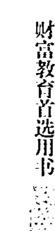
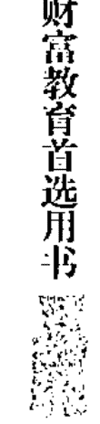

猗顿说：“爱情是找一个你爱的人，婚姻是找一个爱你的人，两者能合二为一的话，就是美好的爱情；如果两者不能合二为一，那么，在婚姻中，找个爱你的人比找个你爱的人，对女人而言，绝对要幸福得多。虽然我这么说，会让人觉得残酷，觉得无情，但这绝对是残酷无情的真理。

“对于婚姻，永远没有标准答案，一千个人心目中会有一千个不同的哈姆雷特，许多看似美满的婚姻，初始都像冬日风中飘扬的雪花一样，浪漫纯洁，落地后却成一地鸡毛，让人扼腕叹息；这种结果，取决于命运，命运决定婚姻中的双方是否般配，取决于婚姻双方的婚姻价值观：如果你选择的是自由，感觉婚姻是桎梏，就勇敢去解脱吧；如果你选择的是厮守，认为婚姻是港湾，就用心去保护吧。”

西施问：“我是个向往美好爱情、向往自由的女人，你给我的建议是让我和你老师离婚吗？”

猗顿答道：“老师一直强调，人要遵从自己内心的感受，少受拘束，要顺势而为，率性而活。你的青春你做主。”

看着西施的婀娜身姿，如软香温玉，猗顿被西施的妩媚熏得内心燥热，他定睛看着西施，用力划着船桨，大声唱着歌：“桂棹兮兰桨，击空明兮溯流光。渺渺兮予怀，望美人兮天一方！”

西施并不躲避猗顿，她勇敢地迎着猗顿的眼神，含情脉脉：“还要望美人于天一方吗？美人在你身旁！”

山风和煦，余晖渐渐埋没于天池之下。猗顿只见西施心绪飘摇，杏眼迷蒙，柔情万种，也禁不住春心荡漾。两个人融合在一起，难解难分。只觉得如痴如醉、如梦如幻，只觉得焚我如一、物我两忘，只觉得身体的实体已经不复存在，只有灵魂在山水间荡漾。

天池之上，鸳鸯嬉戏；岸边湖畔，并蒂花开。

## 37. 竹林对话：放弃是心灵的救赎

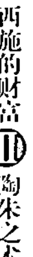

西施去爬山时，鸱夷子皮如往常一样，出外钓鱼。

鸱夷子皮最近为了研究溪鱼，大都不去以往常去的水库、江边或海边，而多去人迹罕至的山涧。

这天，他来到梧桐山谷，寻得一清泉小溪，溪旁有竹林。丹霞蔽日，彩虹垂天；溪水潺潺，叶落翩翩。

有山风穿过竹林。竹林的风是一种清凉，是一种幽静，其声呜呜然，如怨如慕，如泣如诉，余音袅袅，不绝如缕，只让人感觉寂静得可怕。

鸱夷子皮静心钓鱼。不消一会儿，桶里已经有几条青鱼在游。

鸱夷子皮正要将一条上钩的鱼放进桶里时，忽然发现眼前有个黑影，仔细一看，原来是子宁。子宁手握一把剑，一言不发，立于鸱夷子皮身后的桶旁。

鸱夷子皮笑道：“在春日微醺的阳光照射下，你就这样飘然地从竹林中走出，好似从历史的帷幕中穿越而来，吓了我一跳。”

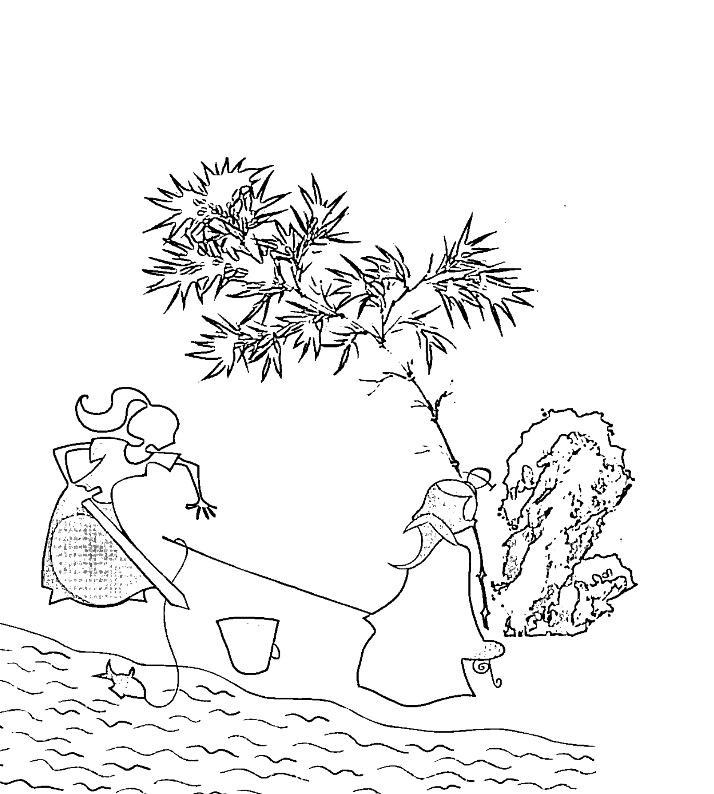

子宁脸色严肃，并不理会鸱夷子皮的轻松，她开口问道：“吴越争霸，先生名流千古，先生可否和我共同回忆城南旧事？”

鸱夷子皮示意子宁坐下，子宁不动。鸱夷子皮笑答：“往事如烟，逝者已矣。昔日的荣耀不能代替现在的安宁，过去的强盛不如现在的平和，只有衰微的老人才会频频想念、留恋和絮叨往日美好的时光，我虽年老，但心理年龄年轻如20岁的小伙子，60多岁的身体里，奔腾的是一颗20岁的心脏。呵呵！”

子宁目无表情，继续发问：“往事并不如烟。我从吴越来，尽知吴越……”

事。先生当年一战成名，却抛弃功名利禄，了无牵挂，所欲何为？意欲钓鱼？所欲养生？”

鸱夷子皮答曰：“养生之人应具有温和、善良、宽宏、幽默的特征，我也有此性格；养生之人清虚而静泰，少私而寡欲，忘欢而后乐足，遗生而后身存，同样，我也无欲无求，早已摆脱对生死的牵挂。我的性格和习惯符合养生之道，但我却非追求养生之人，正所谓，知我者谓我何为，不知我者谓我何求。你一定困惑，悠悠苍天，此何人哉！哈哈！”

子宁大惑不解：“先生真的将生死置之度外？”

鸱夷子皮：“不生亦不死，不常亦不断，不一亦不异，不来亦不去。世界并不空虚，但我们的归宿却是空的，如果脱离于苦海，空又不是空。”

子宁使劲晃晃脑袋，眨眨眼：“先生不要忽悠我，不要用佛法绕晕我，我还有正经事要办呢。你直接告诉我，你真的就不怕死？”

鸱夷子皮耐心将鱼钩从所钓之鱼的嘴边褪掉，平静地答道：“竹杆何袅袅，鱼儿何徙徙？天苍苍，野茫茫，生宕宕，风吹草低见牛羊，人生自古谁无死？方离方聚，方聚方离，方生方死，方死方生，人生的生命终极，到底几何？人们为什么会怕死？这注定是困扰人类一生的问题。”

子宁大叫：“打住！越说我越晕了。我苦等几年，今天，家仇国恨，我要一并解决。你可认识此剑？”

子宁不待鸱夷子皮说话，自答道：“昔日，干将莫邪两名宝剑工艺大师，铸就天下无双之干将和莫邪雌雄宝剑，虽闻名天下，但不知所踪。其嫡传弟子穷尽一生，另铸宝剑五柄，名曰湛卢，曰纯钧，曰胜邪，曰鱼肠，曰巨阙，这五柄宝剑，湛卢在楚，胜邪、鱼肠在吴，纯钧、巨阙二剑在越王勾践手中，其中，胜邪为最上，纯钧、湛卢二剑其次，鱼肠又次之，巨阙居末。我手中之剑，正是胜邪！”

鸱夷子皮笑道：“美女不动声色则已，一动则大开玩笑。现在旅游景点都是卖棠溪宝剑、龙泉宝剑的，10元钱一把，连无夫为小儿在幼儿园学习武术的玩具剑都号称湛卢剑，我看你这剑八成也是河南驻马店制作的赝品吧？你这剑更像是一把水果刀，但用来削水果有点长，难道是用来砍竹子的？砍竹子喂大熊猫？此处有大熊猫吗？还是用来砍人？对了，你刚才问到生死问题，难道子宁你想自杀？虽然人生太多无奈，生死祸福，摊上谁就是谁，全靠运气，但无论如何，生命无take 2，不能重来，子宁你不要走上绝路啊！”

子宁哭笑不得，说：“先生，你比唐僧还能说，我给你说得头都大了。我们这有两个人，我没轻生之意，只有复仇之心，难道你就没想到是你的生死问题？”

鸱夷子皮嫣然一笑：“生有何难，死有何惧！无灭无生，历千劫而不古，我早已看穿生死事了。”

鸱夷子皮指着飘落的树叶，对子宁说：“我就像这一片叶子，当华美的叶片落尽，生命的脉络才历历可见。如果今天确实是我生命的尽头，请容许我在离开前，解开你心头的死结。”

鸱夷子皮指向远处，问子宁：“这座大山，你能把它移过来吗？如果你不能，我告诉你我能，你相信吗？”

子宁惊愕：“我怎么可能移动大山呢？恐怕谁都不能做到吧？”

鸱夷子皮笑道：“世界上根本没有什么移山之术。很简单，山若不过来，我便过去；同样道理，人若不能改变环境，那么就要改变自己。人在现实生活中，周围环境也好、现状也好、工作也好、婚姻也好、人际关系也好、心情也好，可能都存在着严重障碍，其障碍之严重，就恰如这座大山，如果你不能克服，就要尝试改变。”

子宁问：“怎么改变？”

鸱夷子皮说：“欲望、怨恨和偏执是人一切烦恼的根蒂。就你而言，你心存复仇欲望，这种复仇欲会让你寝食难安；你怀有怨恨之心，这种对不合己意的仇恨，会使你身心难以安宁；为了满足你上面的两种心愿，你偏执地一条道走到黑，诸烦恼生，必由痴故。

复仇虽然可以带来暂时的快感，但却带不来幸福；杀戮不是权力，赦免才是。妄念转正心清净，如果你能学会宽恕，做到放弃，就可消弭余怨，从而让自己的内心安宁，从此专注于人生的幸福。我送你六个字。”

“哪六个字？”子宁问。

鸱夷子皮伸出左右手，亮出十个手指，说：“六个字。改变、适应、包容、放弃。如果不喜欢，那就要去改变；如果改变不了，那就要去适应；如果无法适应，那就只好回避；如果做不到回避，那就要学会放弃。一般情况是，能干的人选择改变，懒惰的人选择适应，懦弱的人选择回避，勇敢的人选择放弃。你看你，是超女冠军，美女一个，还能学会砍人，一定是一个勇敢的人，那就更要学会放弃。”

子宁放下手中宝剑，问道：“先生，怎么改变？如何放弃？”

鸱夷子皮说道：“要适应社会，适应变化，改变现状，就得改变自己；要改变自己，就得改变自己的观念。人的一切古怪行为，都因错误观念而开始。你看你，本来可以像所有的美女一样，做做美容逛逛街，买买衣服旅游游。人生本逍遥，可你偏要抱着一把不知道真假的宝剑，从南到北，从吴国到齐国，疯狂复仇，疯狂追杀。美女心里太偏执，很容易变丑的。这都是因为你自小开始，幼小的心灵已经深藏复仇的种子了吧？当务之急，你要拔掉心里的这个复仇之刺。

虽然一个人的性格，从根本上难以改变，但可以在一定范围内，做出一定的调整。不管过去你受了多大的委屈，受了多大的伤害，但你不能够回到过去，去改变过去，你所能够做的只能是改变未来。改变未来，从改变现在开始，你现在放下心头的仇恨，尝试学会宽宥和包容，你的内心将收获安宁、收获快乐。”

鸱夷子皮看着子宁将剑收入剑匣，继续说道：“放弃仇恨确实很难。放弃是一种智慧。学会了放弃，才能使自已更宽容、更睿智。放弃是一种拾阶而上的从容，是一种闲庭信步的淡然。放弃是灵性的觉醒，是慧睿的显现。人生要敢于果断放弃。有所放弃，就能有所追求。放下你的杀戮之心，忘却你的过去，去勇敢地追求你的幸福吧！”

子宁向鸱夷子皮跪下：“先生一席话，小女子大梦初觉醒。我携带的这把宝剑工艺品，是在山脚士多店买的旅游纪念品，我游山玩水到此，无意撞到先生，扰了先生钓鱼雅兴。小女子就此告辞！”

鸱夷子皮擦了擦满头的汗，说：“不送！想当年，夫差对勾践何等仇恨，被我像唐僧一样啰里啰嗦、烦得夫差最后不也没杀勾践？何况一小女子乎？”

## 38. 财神的慈善

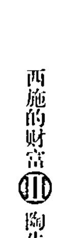

日月如梭，时光飞逝。一晃十年过去了。

西施、猗顿和郑旦初期在股市大有斩获，然后通过收购上市公司股份，逐渐成为公司大股东。他们按照老师传授的投资技能，控股在管理、技术、服务等方面具有自然垄断优势的企业，也就是具有“护城墙”特征的高成长行业，取得巨大成功，成为齐国商界举足轻重的风云人物：西施五年后就进入福布斯齐国富豪排行榜，历经十年后，西施、猗顿和郑旦分别当年福布斯齐国富豪榜的前三位。

西施控股的上市公司所属行业为消费类的酿酒业和食品业，主打产品分别为西施酒和西施豆腐。西施酒分为高档的“西施美女酒”和中低档的“西施稠酒”。“西施美女酒”针对富裕阶层和商务人群，其主打广告语为：“成功了西施为你庆功，失败了西施陪你消愁！”一句蕴涵深情而情意绵绵的广告词，勾住了无数成功男士的魂，在高档酒宴上，要是喝其他品牌酒、而不喝“西施美女酒”的话，都不好意思说话；针对中低档市场的“西施稠酒”，其广告词为：“哥喝的不是酒，喝的是寂寞，是对西施的感觉！”这句话也好像说到了齐国上下青年学生、小白领、民工的心坎里，喝酒只喝“西施稠酒”，慢慢地，其他品牌白酒就退出市场，齐国只剩下西施酒，西施酒业绩稳定增长。西施豆腐则由西施高价收购神秘配方制成，以质优价廉闻名天下，其滑若鸡蛋、软若牛奶、淡香幽幽，吃了还想吃，让人意犹未尽，有人甚至怀疑豆腐配方中加有罂粟，但若干次飞行抽检，也检查不出异样；西施豆腐品质上好，却价格低廉，通过规模化生产，西施秉承鸱夷子皮的“不敢居贵”的商业宗旨，仅逐“什之一利”，净利率仅10%，价格比山寨厂或假冒伪劣品还低，所以在齐国形成垄断优势，家家户户，男男女女，餐桌上必不可少；并且，还冲出齐国，出口到春秋各国，外贸金额每年大幅增长。西施靠这两大产品，两家上市公司的市值达到千亿元，西施家族实际控制35%左右，以350亿元的财富名列福布斯豪榜榜首。

猗顿从事的行业则为畜牧业和食品加工业，从生猪喂养、生猪屠宰到制成各类肉制品销售，打通了从猪喂喂养到猪肉上桌的整个产业链，猗顿凭借卓越的管理成为齐国畜牧业界当之无愧的老大。畜牧业和食品业都属传统行业，利润稳定，猗顿突发奇想，决定进军高利润的保健品领域，他将猪头制成各种补脑保健营养品，在报纸、网络、电视等全媒体进行海陆空的广告轰炸，人们听到、看到的都是猪头保健品的广告：“今年过节不收礼，收礼只收猪头肉！”大众虽然烦不胜烦，但在过年过节、探亲访友时，却喜欢送猗顿公司出品的猪头保健品；也有部分人被广告烦得不愿意买猪头送礼，猗顿公司又铺天盖地推出另一条广告：“常吃猪头更聪明，不吃猪头成猪头。”大众为了不成为猪头，只好花钱买猗顿公司的猪头，没事时经常啃啃。猗顿还将猪尾巴制成针对中老年人的养生保健品，然后找来大牌明星，宣传猪尾对激发青春活力的重要功效，没完没了地在电视上做广告：“抓住青春的尾巴！谁吃谁知道！”引发购买狂潮。这两大类保健品给猗顿带来滚滚财富，让猗顿成为排位西施之后的齐国第二大大富豪。猗顿还经常针对股市上其他家族控股权分散而股价低迷的股票，发动突然狙击，或让这些家族高价回购，或控股这些股票，成为股市上威名远播的“股市狙击手”。猗顿也没再婚，看中哪个明星，就用珠宝、房子等重型炮弹轰炸其心房，屡试不爽，猗顿因和女明星的绯闻而常见于各大媒体娱乐版头条。

郑旦辅助其丈夫李克全力在房地产业发展，很快就成为齐国排名靠前的房地产商，不料某天李克在上班途中突遭绑架，在郑旦付出巨额酬金后，李克仍然未被放回，生死不明；郑旦独立打理着房地产公司，在西施的指点帮助下，成长为齐国房地产行业的第一大公司，郑旦的财富也达到180亿元。郑旦虽已半老徐娘，却喜以清纯打扮示人，总是固定梳以三个小辫，被人称为“小甜甜。”

白圭的财富之路和他们三人完全不同。他开始就没有进入股市，而是经营一个小服装店。虽然遭到郑旦耻笑，仍然痴心不改。他经营实业的前30年一直默默无闻，作为一个小人物，完全不为人所知，根本不像鸱夷子皮的学生，但鸱夷子皮对他仍然充满信心。鸱夷子皮对西施说：“最似我者，白圭耳！”鸱夷子皮的判断让郑旦、猗顿和西施都大惑不解。不过，经过30多年后，白圭终于不负老师期许，成为春秋第一富豪。此是后话。

白圭是在服装行业成长为财富大亨的。服装行业虽是传统行业，但白圭具有特别的理念，他在春秋各国通过统一服务、以合理价格、大量持续提供任何时候、任何地方、任何人都可以穿着的服装，并以独特的商品策划、开发和销售体系，保证服装店铺运作的低成本化，几十年时间里，将服装店遍布齐国、楚国、吴国等各个国家，成为全球著名休闲服装的领导者。白圭的财富总值大约在500亿元左右。

当齐国媒体得知财富榜前三大亨竟然都是同一老师所带弟子，大为吃惊，纷纷赶来采访鸱夷子皮，鸱夷子皮闭门谢客，根本不接受采访。众媒体感慨鸱夷子皮的神秘，其富豪老师的名声更是广播海内外。

西施却喜频频地出现于电视访谈中、商界领袖的财富论坛间，她或是侃侃而谈宏观经济，或是纵论投资策略，或是流露女人真情，让齐国所有人都为女财神的风采倾倒。

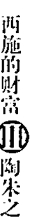

这天深夜，当范道生回到家时，发现鸱夷子皮和西施没有休息，坐在客厅，表情严肃，气氛有些诡异。

西施问道：“你是和子宁去晒月光了吗？”

道生有些不高兴，冷冷地说：“我已是成年人，你们还像管小孩一样管着我，和谁谈恋爱好我的私事。”

西施叹气道：“我提醒过你几次，子宁对我们家人充满敌意，她和你恋爱或许有别的目的，你一点都听不进去呀。”

鸱夷子皮打断西施：“孩子的事情让他自己处理吧，子宁不像有什么歹意。今天我们等你回来，主要是想和你商量一件事。”

道生：“什么事？”

西施说：“今天，齐国国王派了特使过来，说是久仰你父亲名声，特此送来一张委任状，准备委任你父亲为齐国财政部长。”

道生很高兴：“这是好事啊！我们家不但是巨富之家，看来还能成为权贵之家。那我就是官二代了，以后可以在政界大展宏图。”

鸱夷子皮长叹了一口气，说：“居家则致千金，居官则至卿相，此布衣之极也。坐在家里，当当作家、钓钓鱼、靠靠老婆，就能积累亿万财产，成为富豪，还能被任命为部长级高官，这是普通老百姓做梦也梦不到的好事儿，却被我碰到了。祸兮福所倚，福兮祸所伏，这种被官位砸中的幸运，恐怕不是什么好事啊！”

道生着急地说：“怎么不是好事？别人是花钱买官做，你倒好，现在有个当大官的机会放在你面前，你却要放弃；你已经放弃过一次高官厚禄了，现在又想干这种蠢事了。你要名声，也应该为两个弟弟考虑一下，他们当富二代，不如当官二代。财富再多，也不如当官实在。”

道生接着说道：“网上有一段名言，说的就是你这种人：

曾经，有一份尊贵的官位放在我的面前，我没有珍惜，等到失去的时候，我才后悔莫及，人世间最痛苦的事莫过于此。如果，上天能够再给我一次机会，我会对吏部尚书说四个字：‘我要当官！’如果非要在这个官位上加一个期限，我希望是五百年。”

道生说完，鸱夷子皮气得指着他骂：“竖子不可教也！老子一生淡泊明志，快意逍遥，看淡名利财富，没成想养你这样的混账东西！”

西施说：“道生，你不了解情况，齐王任命你父亲为财政部长，可是有条件的。”

道生问道：“什么条件？什么条件都不如去当财政部长好。”

西施叹声道：“齐王看到我们短短几年一跃而成巨富，犯了红眼病。他任命你父亲为财政部长，为齐国管理财政事务，当时，还要将王室财富交给我们打理，要求年收益率不低于50%，如果低于50%的话，就要用我们的资产补足给他。齐王特意说要是我们不答应这个要求，就会让证券监管机构清查我们坐庄的非法行为，让银行提前收回贷款，让税务机构清查我们的账目，用不了多长时间，我们就会破产的。娘希匹！”

道生吃惊地看着西施：“超级美女会骂人？这会损害你作为四大美女之首的美好光辉形象的！”

西施白了道生一眼：“这种情况下如果还不能骂人来发泄心头恼怒的话，那我就是道德高尚得有点犯傻的七仙女了。身为越国人，说越国的国骂不好吗？好吧，我收回这句国骂，含蓄点，TNN D！行了吧？按照齐王的狠子野心，不出几年工夫，我们家的资产就会全部成为他们官家的囊中之物了！”

道生说：“要是这样的话，那确实很麻烦，这可如何是好？你们商量好办法了吗？”

鸱夷子皮说：“已经决定了。我们决定将资产捐献出去做慈善事业，然后离开齐国。只有这样，才能彻底消除齐王带给我们的大麻烦。”

西施说：“我和你父亲在决定用多少资产做慈善，以及如何做慈善方面有分歧。我们的财富有358亿元，基本都是股权市值，净现金只有28亿元，我的意思是把所有的股权都赠予猗顿、郑旦和白圭他们这些亲戚朋友，我们带着28亿元现金离开，远走他国；你父亲不同意，他的意思是我们只带走1亿元资金，用于以后生活的保障，然后将其他资产都捐献给医疗、教育机构，用于穷人的救助和发展。我又不同意他的意见。”

鸱夷子皮说：“慈善，不仅是给生活穷困者暂时的生活救援，而是要从根本上改变他们贫困的根源，捐钱办教育，可以让贫穷的人有机会学习技术，从而自食其力，同时，给穷人的孩子以机会，教育是改变命运的最好方式。另外，捐钱给医疗科研机构，既可以让穷人得到廉价医疗的救助，又能帮助医学研究人员对重大恶疾的科研，攻克不治之症，帮助更多的人摆脱疾病的困扰。我看，就按我的意见，将资金都投入这两大领域吧。”

道生说：“关于捐多少钱的问题，你们也别吵了。历史上说我们是裸捐的。”道生起身去书架，找到《史记》一书，翻到《越王勾践世家》一章，西施看到的是“尽散其财”。

西施又气愤了：“这司马迁真是的，身体残疾，脑子也残了呀！敢情钱不是他的，他就穷大方，一句话就把老娘一块块豆腐换来的辛苦钱全裸捐了！做慈善就要把所有钱财悉数捐掉，要他献血的话，他会把全身的血都捐献出去吗？”

三人经过商议，最后同意了鸱夷子皮的意见，只带着1亿元的现金离开，把剩余的财富全部捐给齐国的医疗和教育机构。

捐献的财富数目过于庞大，用了三个月的时间，他们才签署完所有相关法律文件。在猗顿、白圭、郑旦以及大量齐国民众依依不舍的送别下，鸱夷子皮和西施带着范道生、范无为和范若水三人离开了齐国。

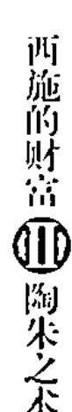

## 39. 西施的风险投资

鸱夷子皮一家一路游山玩水，乐得逍遥自在。

这一日，他们来到陶市，陶市是国际大都市，摩天大楼鳞次栉比。鸱夷子皮看到市中区有“金融一条街”，银行、证券公司、投资公司林立，比餐厅还多，就对西施和道生说：“陶市是国际金融中心，适合从事金融投资，我们就定居在陶市吧。”

于是，他们一家很快买下一套高尚住宅，定居下来。取名鸱夷子皮本来是为了低调，现在这个名字也成为春秋各国都声名远播的名字，鸱夷子皮为了在陶市安静生活，不为人注意，决定再次改名。他对西施说：“红色大吉大利，是国人喜欢的颜色，我就取名为‘朱’，我既居‘陶’，就叫‘陶朱’，这个名字不扎眼，好，以后就用这个名字吧。”西施笑着说：“你已年过七十古来稀，一大把年纪，哪能直呼其名的，不如我们就叫你‘陶朱公’了。”自此，陶市多了一个老者，白发飘逸，道风鹤骨，人称陶朱公。

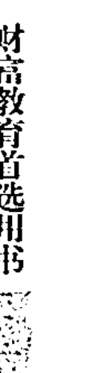

陶朱公四处游玩，约人下棋，和人钓鱼，悠闲的不亦乐乎。西施却无事可做，过了两个月，她就呆不住了，她和陶朱公商量，要投资股市。陶朱公道：“你上次炒股坐庄，侥幸逃脱，没被监管机构以操纵市场罪立案起诉，算你命大，以后休提此事。”

他对西施说：“我禁止你直接从事证券交易，但你可直接投资企业，从事风险投资。”

西施说：“我也早已耳闻风险投资，风险投资被企业家们称为VC，我知道风险投资成功的话收益惊人，可达到数十倍、数百倍、甚至数千倍的收益，但风险同样巨大，投资失败的话，就将血本无归。我们以前从没操作过，你也没有对我们培训过有关风险投资的相关投资技能。”

陶朱公：“风险投资的关键是能对一门新技术、新产品或新商业模式进行准确估值，只要能预见其未来发展趋势，风险投资和价值投资并无不同。”

陶朱公拿出一叠资料给西施看：“我知道你闲不住，这是我从网上打印的一些关于风险投资知识的资料，是由谷歌公司的投资专家所撰写的。”

西施翻阅起来：

风险投资基金一般是由风险投资公司出面，邀集包括自己在内的不超过499位投资者，组成一个有限责任公司（Limited Liability Company，LLC）。根据米国法律规定，一旦一个公司的股东超过五百人，就必须像上市公司那样公布自己的财务情况和经营情况。而风险投资公司不希望外界了解自己投资的去处和资金的运作，以及在所投资公司所占的股份等细节，一般选择不公开财务和经营情况，因此股东不能超过五百人。

每一轮基金融资开始时，风险投资公司要注册相应的有限责任公司，在注册文件中必须说好最高的融资金额、投资的去处和目的。风险投资公司会定一个最低投资额，作为每个投资人参与这一期投资的条件。

风险投资公司每次融资便成立一个有限责任公司，它的寿命从资金开

始到位 (Close Fund) 到所有投资项目要么收回投资、要么关门结束，通常需要十年时间，前几年是投入，后几年是收回投资。一个风险投资公司通常定期融资，成立一期初期风险基金。基金为全体投资人共同拥有。风险投资公司自己扮演一个称作总合伙人GP的角色 (General Partner)，其他投资者称为有限合伙人LP (Limited Partner)。GP除了拿出一定资金外，同时管理这一轮风险基金。LP参与分享投资回报，但是不参加基金的决策和管理。这种所有权和管理权的分离，可以保证GP能够独立地、不受外界干扰地进行投资。为了监督GP的商业操作和财务，风险投资基金要雇一个独立的财务审计顾问和总律师，这两个人不参与投资决策。风险投资比炒股要凶险得多，一旦出错，基本上是血本无归。为了减少和避免决策错误，同时替LP监督GP的投资和运作，一个风险投资基金必须具有董事会或顾问委员会，这些董事和顾问们一般是商界和科技界的精英，或是其他风险投资公司的投资人，他们会参与每次投资决策，但是决定由GP来做。

风险投资基金一旦进入被投的公司后，就成为该公司的股份。如果该公司倒闭，相对于公司创始人和一般员工，风险投资基金虽然可以优先把公司财产变卖，拿钱回去。但一般能拿回的钱聊胜于无；如果投资公司上市或被收购，那么合伙人或者直接以现金方式收回投资，或者获得可流通股票。前者一般针对较小的基金和较少的投资，GP会在被投资公司上市或被收购后的某一个时间（一般是在解禁期Lock Period 后）将该基金所拥有的全部股票卖掉，将收入分给各LP，这种基金管理的成本较低。但是，如果基金所占被投资公司股份较大，这种做法就行不通，无法直接卖出股票，因为统统卖掉股票的话，该公司股价会暴跌。于是，GP会将股票直接付给每个LP，由每个LP自己定夺是否出售股票，如此，就避免股票被同时抛售的可能性。

为了降低风险，一轮风险投资基金必须要投十几家到几十家公司，为了投十家公司，GP可能需要考察几百家公司，这笔运作费用由LP出，称为风险投资管理费，一般占整个基金的 2%。GP还要从LP的投资收益中提取一部分利润，一般是章程规定基本利润（例如定为 6%）以上部分的 20%。比如，某风险投资基金平均每年赚 20% 的收益，GP将提成（20%− 6%）×20%=2.8%，外加 2% 的管理费共 4.8%，LP得到的回报就是15.2%，只相当于总回报的3/4。因此，作为LP来说，风险投资的收益较高，但风险投资公司的收费也极其昂贵。

管理风险投资基金的风险投资公司本身是 LLC，其最高管理者就是风险投资公司的合伙人（Partner）。风险投资公司本身不会有什么 CEO、总裁之类的头衔，有这些头衔的风险投资公司一定是冒牌货。

新成立公司一般都很小，在创业初期，往往只需要融资几十万元甚至几万元。大的风险投资公司无法参与，对于这类公司的风险投资通常由天使投资人完成，称为天使投资（Angel Investment），从事天使投资的投资人称为天使投资人，常常是这样一些有钱人：以前成功地创办过公司，对技术很敏锐，又不愿意再辛苦创业，希望出钱让别人干。

一些天使投资人独立寻找项目，进行投资。更多情况的是几个人凑到一起组成一个小公司 LLC 或者有限合伙关系（Limited Partnership，简称 LP），通常称作天使投资社（Angel Firm）来共同投资。天使投资社的经营管理方法千差万别，有的是大家把钱凑在一起，共同投资；有的是每个人自己选项目各自投资，同时介绍给社里，社里会加倍投入（Match）该天使投资人所投金额；有些天使投资社管理更灵活，当某个天使投资人投资一个公司后，其他合伙人可以选择跟进（Follow），也可以不跟进（Pass），大家只是共同使用一个律师和会计，或坐到一起只是为了有个圈子、讨论一下问题而已。

西施看完，问道：“这篇文章只介绍了风险投资的运作和游戏规模，并没有讲到应该如何进行风险投资，我听说VC投的都是高科技产业，像我这样的科技盲，拿着iPhone 6 都不知道如何下载歌曲的，怎么可能从事 VC，风险投资对我来说，就只有风险，我怕没投几个项目，我们家的钱就全部被我打水漂了。”

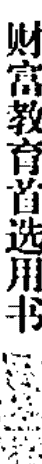

鸫夷子说：“此言谬也。风险投资的本质，仍然是投资，而不是其他，既然是投资，就只需掌握投资的规律。风险投资强调风险，是因为这种投资模式通过承担过高的风险而去追求高的收益，项目投资失误的话，往往就血本无归，有的风险投资基金投的项目，或许收益惊人，达到几百上千倍，但如果资金管理有问题，高收益项目的投资比例过小，而其他失败项目的资金投入过多，则整个风险投资基金仍然是亏损的，对风险投资基金来说，年均复利增长达到20%以上就算优秀了，这和投资有什么两样？

至于风险投资喜欢高科技项目，是因为高科技领域大量存在这种高风险高收益的机会，但风险投资并不局限于科技领域。从事风险投资，无须一定是科技专家，你可以聘请科技专家作为顾问或董事，但你一定要懂得投资，只有精通投资，你才能为你投资的成败负责。一般来说，进行风险投资，只要把握好以下几个方面，风险投资的风险就会很低。”

陶朱公对西施详细阐述起进行风险投资需要重点关注的几大方面：

- 1. 高成长性。投资的核心就是要有成长性，成长性越好，价值越被低估，投资的潜力越大，投资的收益越高。对传统价值投资来说，销售收入、客户数量等指标能达到年均复合增长率30%以上，就算一笔良好的投资标的；而风险投资的成长性则要高中得多，甚至不看年均增长率，而看月均增长率，销售收入、客户数或市场占比月均增长率达到20%以上，则年均增长率达到8.9倍 以上、三年增长率达到700倍以上，只有具备这样高的成长性，才能达到风险投资的基本要求。所以，风险投资的关键，是估算投资项目的成长性是否符合要求。
- 2. 低成本复制性。投资项目的客户数量、市场占比或销售收入等要达到高成长的要求，就必须具备低成本易复制的特征，无论是电脑软件、还是网站用户数，无论是新型专利技术、还是连锁餐厅的数量，只要完成了研发和标准统一，新增客户数或销售收入都应具有低成本快速复制性的特征。如果增长的成本很高，难以复制，那就无法实现高增长的基本要求。例如，大众性的中低档餐厅具有低成本的可复制性特点，但高档餐厅因管理、客户的限制，难以大规模低成本复制，一般难以吸引风险投资资金。
- 3. 几何级数增长的市场性。能满足风险投资要求的投资项目还应具有规模巨大的市场，具有能呈现几何级数增长的市场性。无论是用户量、销售收入都应具有海量的市场，才具有高成长的机会；如果单品的利润率很高，但市场规模不大，就难以达到风险投资所要求的快速高成长性，就不是个好的风险投资项目。
- 4. 创新性。也就是要在商业模式、产品、技术或市场方面具有极强的创新性，才能实现投资项目的高成长性。风险投资并不必然要求项目的高科技性，也不必然只看重投资项目的商业模式是否全新的，但一般来说，在高科技领域，具有新的商业模式，或者产品、技术或市场如果具有创新性的话，就容易实现高成长，所以，风险投资看重投资项目的商业模式，但对传统领域进行一定的改造，能达到高成长的要求的话，同样可以进行风险投资。
- 5. 人的因素。人是决定投资成败的最关键因素。有人可以把一个鸡蛋孵化成一个养鸡公司而上市，有人则能把一个上市公司亏损成一个鸡蛋的价值，同样的商业模式，同样的创新技术，不同的人具有不同的创新能力、执行能力和经营能力，结果可能完全不同。所以，进行风险投资时，除了考察以上四个因素，最主要的是考察人。对于大型风险投资基金来说，有能力根据投资项目的要求，寻找合适的管理者去运作管理这个项目；而对于天使投资者来说，其投资成败的关键，就是公司的创始人是否具备运作高成长公司的素质和能力。

陶朱公讲完，西施恍然大悟：“风险投资和价值投资的最大区别就是在成长性上，对成长性的要求更高，其他的要求都是为了实现这个基本要求。我明白了。”

西施用1亿元资金成立了风险投资公司，她在陶朱公和自己的名字中各取一字，将公司取名为朱施风险投资，名字有点绕，被陶朱公改名为朱石风险投资，西施作为GP，开始募集资金，寻找LP。西施有丰富的投资经验，很容易得到客户的认同，很快，她就募集到了10亿元的一期基金。西施凭借自己对风险投资的领悟，在社交游戏、社交媒体、搜索引擎等新媒体和旅游、教育、咨询等传统行业布局，三五年后分别退出，竟然获利数百倍不等，震惊陶市投资界，大家只知朱石风险投资公司为陶朱公所开，但不知陶朱公为何人，纷纷奉陶朱公为“财神。”

陶朱公本人呢？则从事生物科技工作。他将普通的鱼以多年养鱼心得进行配种杂交，竟然养育出各种色彩斑斓、形状各异的神奇鱼种，陶朱公将其命名为“金鱼”，大众都惊为神鱼，愿花高价抢购观赏，陶朱公也不贵卖，以公平价格大量供应，家家户户都买金鱼观赏。

后来，朱石投资公司在米国NASDAQ上市，市值竟达上千亿元，而陶朱公所占股权市值有500亿元以上，成为春秋各国首富，大众纷纷当陶朱公是财神在世，自此，陶朱公是财神的名声在各国传扬开来。

## 40. 富二代的教育

西施在齐国时，就因为范无为和范若水两个孩子的教育问题，经常和鸥夷子皮吵架。西施甚是溺爱无为和若水，她对鸥夷子皮说：“这两宝贝是我们爱情的结晶，有了2.0版本的结晶，我就顾不上理你这个1.0版本了，你想干啥就尽管去干，我只管我的宝贝。”

西施对孩子娇生惯养，有求必应，范无为和范若水要什么，她就给什么。作为齐国的首富，别的小孩在父母的管教下让着这两个孩子，这就养成了无为和若水霸道和骄横的性格，稍不如意，就乱发脾气。

鸥夷子皮劝阻西施的这种养育方式，他说：“爱孩子就应该培养他，教育他，让他成长为幸福快乐的人，而不是只给他所有你能给得起的、他想要的东西；这种只知给予的宠爱，只会纵容他无休止的欲望，只会助长他不劳而获的心理。”

西施听不进去这些话，她说：“女人爱孩子，要么严格得要命，要么宠爱得要死。对孩子严格的女人，一般是自己出息不大，望子成龙。所以用严酷代替慈爱，希望孩子在强压下能天天奋发上进。我们已经积累下无尽的财富，我们的财富足够子孙世世代代享用，所以，我不希望他们太辛苦，不求他们有多大出息，我只要他们轻松快乐，辛苦赚钱的事情由我们来完成就行了。"”

鸥夷子皮感慨道：“人啊！人真是世界上最奇怪的动物！在动物世界中，不管是飞禽还是猛兽，不管是吃素的动物还是吃荤的昆虫，当它们养育孩子到能独立外出时，都会带领孩子外出捕食，教授它们捕食猎物的本领，培养它们的生存能力，而不再把自己捕获的猎物送到孩子嘴边，任由孩子饭来张口。按照物竞天择、适者生存的自然界生存法则，父母传授培养子女具有独立生存的能力，是适应环境的最基本要求，也是上一代遗传给下一代的最佳礼物。但人类却是自然界唯一反常的动物，人类是如此的奇怪！人们对于子女是如此的疼爱、溺爱，不管自己多劳累多辛苦，都愿意为子孙后代积累无尽财富，传承给子孙后代，以便子孙后代不再辛苦，从而坐享其成，轻松舒服。"”

西施反问道：“中国人不都是这种行为模式吗？中国人的文化就是宁愿累死我一个，只要子孙后代幸福。为了子孙，什么委屈都能承受。”

鸥夷子皮道：“人们以为这是对子女的大爱，殊不知，这是对于子女的最大伤害和摧残。这就像母狮子一直给小狮子喂食直到她死一样，虽然没有撅断小狮子捕食的牙齿，但却松弛它在野外追逐猎物的肌肉力量，磨灭它捕食猎物的斗志，更严重的是，使它丧失为生存而奋斗的兴趣，使它失去生存的乐趣，最终失去生存能力，当母狮子死去之时，也就是小狮子凄惨生活的开始。所以，将巨额财富传承给子女，不是爱他们，而是害他们。”

西施不以为然：“你越说越虚了。人怎么能和动物相比？给子孙传承财富，怎么可能害他们？中国人都这样做，我们也不要免俗了。”

鸥夷子皮叹气，说道：“连林则徐先生都明白，‘子孙若如我，留钱做什么？贤而多财，则损其志；子孙不如我，留钱做什么？愚而多财，益增其过。’”

鸥夷子皮接着说：“如果子女有能力，就让他们自己努力奋斗吧，去品尝失败的滋味，去享受成功的幸福，这才是完整的人生；如果子女没有能力，遗留的财富越多，越是害他，还不如让他做个普通人，通过劳动自食其力。”

西施呵呵笑了，说：“我们的孩子——无论是你的智慧加我的外貌、还是你的外貌加我的智慧，都是我们的精华结晶，都是优上加优，怎么可能没有能力？他们以后一定会让世界震惊。”

西施把儿子送到最好的私立学校去接受教育，鸥夷子皮开始很高兴，但其后不断有家长和老师投诉范无为和范若水恃强凌弱，打同学、骂老师，鸥夷子皮不断去学校赔礼道歉，他对西施感慨道：“教育之优质，在乎有无严师执教，教育严格，方能树立规矩，打好基础，恰似树木要经过修剪，才能成才；另外，物质要艰苦，要让孩子经历辛苦，经受挫折，才能知苦而后求胜，才能奋发图强，不屈不挠，养成健全的人格；反观现在之教育，设施越来越奢侈，严师却越来越少，老师不像老师的话，学生就不像学生了，无为、若水无法无天，正源于此。你应多加管教。”

西施却舍不得严惩儿子，只得转学。但范无为、范若水在哪个学校都不服管教，不断滋事，让西施和鸥夷子皮头疼不已。鸥夷子皮苦笑着对西施说：“每一个牛人的背后，都有难以言传的隐痛，这两个不成器的东西，恐怕就是我们俩的隐痛吧。”

陶朱公和西施来到陶市几年后，范无为和范若水已是年近20的青年，他们不学无术，考试交白卷，只喜打架斗殴，为免贻害乡里，西施不敢让他们在社会上瞎混，无奈之下，安排他们进入自己任校董的陶市工商大学。假如花花公子是门行业，那么范氏两兄弟无疑就是行业龙头。他们在大学里，呼朋聚友，召集社会上的小流氓、小混混，在大学里骚扰、取乐、调戏女大学生，吓得女学生们不敢去上学。打仗父子兵，流氓亲兄弟，财神的儿子是流氓，在陶市一时成为最大新闻。

陶市工商大学的校长子贡迫于无奈，找西施商量劝退这两兄弟，他说：“如果让贵公子再这样下去，我校的百年英名，就将毁于一旦。”

西施也没有办法，只能又让两个儿子从大学退学。她和陶朱公商定，把两兄弟分开：范若水留着身边，学习经商；而范无为对艺术有天分，可以去著名的楚国艺术学院留学，学习钢琴。

于是，陶朱公和西施送范无为去了楚国，在去机场的路上，西施一路流泪，叮嘱范无为要品行端正，将精力花在学习上。

谁知道，范无为这一去楚国，却为财神一家的命运，埋下了不祥的种子。

## 41. 千金之子，不死于市

范无为去楚国半年之后。

这一日早晨，陶朱公吃完早餐，正准备去金鱼科技公司，西施也要去朱石风投公司上班，管家忽然慌慌张张跑过来说：“刚才楚国来电话，二公子出大事了！”

原来，范无为某晚无聊，驾一辆法拉利，佳人美女陪伴其侧，去游车河。对无为来说，这天是美好的一天，教授夸奖了他的琴艺；这晚是美好的夜晚，美女是自己喜欢的那种类型，他们看着月亮，数着星星，谈谈人生，谈着爱情，这一切的浪漫，却因一个骑自行车的女子嘎然而止：范无为的法拉利在路口拐弯时，撞到了一位骑单车准备上班的女工。

陶朱公急问管家：“那女孩伤势严重吗？”

管家叹气说：“听律师讲，女孩受伤倒地，向无为呼救，无为并没有施救，驾车正欲离去，却看到女孩挣扎着用笔在记录他的车牌号码，他怕女孩以后找麻烦，就一时性起，用刀连戳数刀，竟然将女孩戳死了！”

+ 西施的财富
①
陶朱之木

陶朱公气得大骂：“这个畜生！交通肇事本来还有补救机会，他竟然故意杀人！竟然置人于死地！”

西施听到范无为杀人，气急攻心，晕了过去。众人手忙脚乱，千呼万唤，才唤得西施悠悠醒来。

西施着急地问：“无为到底怎么样了？法庭有没有宣判？”

管家沮丧地说：“我们在楚国的律师尽了全力，试图为二公子减免罪行，未能成功，主要是二公子杀戮刀数过多。”

陶朱公道：“杀人何须多几刀？一刀足以致命亦！”

管家犹豫着回答道：“根据法医鉴定，二公子手足戳了女工278刀，戳得那女工浑身都是窟窿。我方律师为二公子辩护，声言二公子是激情杀人，在杀人瞬间，想起钢琴作业尚未完成，于是以刀为指，以女工为琴键，演奏完一曲贝多芬的《暴风雨奏鸣曲》第三乐章，才停手作罢，他太激情投入了，所以将杀人幻想成弹琴的艺术了。虽然我方的辩护让法官有所认同，但因楚国贫富分化过大，民众普遍仇富，二公子开豪车杀人一事已在该国激起民愤，为了平息众怒，法官已判处二公子死刑。”

西施听到此，又惊吓过度，晕了过去。众人又花了好大工夫，又是掐人中，又是拍太阳穴，才把西施弄醒。

管家急切地说：“律师说二公子现已被囚禁，等待楚国国王朱笔一勾，随时可能命丧黄泉，让先生和太太赶紧想办法，他已回天无术了。”

陶朱公痛斥道：“家门不幸，出此逆子！杀人偿命，欠债还钱，他命该如此矣！”

西施哭道：“这是我们的儿子啊！儿子再不成器，都是娘的心头肉啊，你就眼睁睁地看着他被处死吗？你快想想办法搭救他，他要是死了，我就和你恩断情绝，出家当道姑去。”

陶朱公长叹道：“杀人者确实该死，但我听说，千金之子，不死于市，只要肯花钱，古今以来，从没哪个身家过亿的超级富豪是死于大庭广众之下的菜市口市场的。我会想办法救儿子的。”

陶朱公微微沉吟片刻，说道：“我在楚国有一个旧友，其庄氏家族在楚国世代势力很大，可惜我这朋友早已过世，他的孙子是教授，听说是楚王智囊，如果能找到这位庄教授，让他去给楚王说情，儿子自然性命无忧。”

西施急忙说：“那你赶紧准备出发去楚国吧。”

陶朱公说：“你有所不知。我本河南人，楚国是我的家乡，当年我奔楚投越，让楚王很是恼火，悬赏捉拿我，所以我至今还是楚国的通缉犯，去不得楚国。不如我修书一封给庄教授，说明情况，只要派人把信送给庄教授，再带份重礼给他，我儿性命就能得救。毕竟，这庄教授和他爷爷已经隔了两代了，不送礼于情谊上说不过去，送了礼物，他也一定不会收下，办完事一定会退还的。”

于是，陶朱公开始给庄教授写信。此时，范道生的手机响，是子宁打来的，两个人开始嘀嘀咕咕起来。

陶朱公很快就写完了信，他吩咐管家开出一张一亿元的国际通兑支票，又让管家准备了一皮箱总计五十斤重的黄金，让范若水带着这些礼物赶飞机，去楚国找庄教授办事。

范若水困惑了：“您没老糊涂吧？我就一小流氓，混吃混喝，花钱泡妞，这些事儿我还成，让我去搭救二哥，这么重要的事儿，我哪有这种能力啊？”

陶朱公说：“我不糊涂。这事就能办。你只需把我的书信和礼物带给庄教授就行，其他一概不需要。”

道生不干了：“父亲，我在外经商办事已有十多年，我的办事能力你不是不知，搭救二弟这样大的事情，你不交给我去处理，怎么能随便便让三弟送份礼物和书信就成呢？”

陶朱公坚决不同意道生去，他说：“你三弟去，你二弟得救；你要是去的话，无为就定完了。”

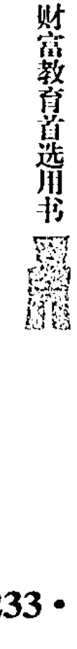


道生很生气：“你这分明是歧视我。我是家里长子，二弟有难，不派我去，而派不会办事的三弟去，是不放心我吗？你是怕我和二弟不是同母所生、怕我会故意害死他以免他以后和我争家产吗？你们既然这么不相信我，我就只能自杀死给你看了。”道生说完，冲出别墅，想去跳楼，外头一看是一楼，又跑回来，到处找刀子，准备自杀，被范若水拦腰抱住。

西施哭着说：“这家都乱成一锅烂粥了。派若水去，也不一定能救得了无为，反而让道生自杀了，这可如何是好？况且，这么重大的事情，恐怕也只有道生才能处理好吧？我看就让道生去楚国救弟弟好了。”

陶朱公很无奈：“你们这帮蠢货，到底是想救无为呢？还是想害无为呢？道生去的话，无为就一定会死的。”

道生又到处找刀要自杀。陶朱公不得已，只好答应范道生的要求。他千叮咛，万嘱咐，对道生说：“你到楚国以后，就只管把黄金、支票和书信送给庄教授，无须多说，一切听他安排，千万不要再有其他行动。”道生满口答应。

道生赶最快的航班去了楚国，还偷偷多带了几张支票，那是自己储蓄的几千万元。

道生很快见到了庄教授，庄教授在百忙中接见了他，宾主进行了亲切友好的交谈，道生首先转达了他父亲对庄教授的亲切问候，庄教授也请道生转达对陶朱公的亲切问候。庄教授对道生的到来表示热烈欢迎，道生将书信和支票夹在书里交给庄教授，说道：“这本书叫《西施的财富》，是一部详细描述我母亲如何创富的传记性历史小说，是写我母亲和父亲的最好一本书，上面有作者的亲笔签名，特此送给你做礼物。这本书讲述投资的规律和财富的秘密，对你从事投资绝对大有裨益。”庄教授对道生千里送图书、礼轻情意重的行动深表感谢，双方言谈甚欢。依依不舍话别时，庄教授告诫范道生说：“这件事，我一定会办妥的，你赶最近的航班，赶紧离开楚国，千万别停留，你回家放心等你弟弟出狱吧。”道生答应一切听从庄教授的安排。

但道生并没有听从庄教授的话，马上离开。他看到庄教授一副儒雅的学者风范，更像个书呆子，而不像个有通天能力的干练之人，他不相信庄教授的办事能力，他甚至连陶朱公交代一定要送的黄金都没送给庄教授。道生呆在楚国，四处活动，通过生意场上认识的朋友，联系楚国司法系统的官员，他将几十斤黄金和几千万资金，分送给楚国司法界的大小官员，其中，以一名刑部副部长为最多，这名副部长拍胸脯向道生保证：一定会免除范无为死罪，等改判无期后，再想办法捞出来。道生千恩万谢。

庄教授是大学教授，更是为楚王提供国是决策建议的高级智囊。他虽清高，但思想深刻，颇具远见卓识，深受楚王器重，楚王对他言听计从。庄教授对老婆说：“你知道陶朱公是谁吗？他就是我爷爷的好朋友范蠡呀！他不慕名利，是我最尊重、最崇拜的偶像。能有机会为他效劳，是我的荣幸，我本来不该接受他的贿赂，可是，这年代，要是不受人贿赂，别人肯定以为你不肯帮忙办事呢！也罢，等我完成其所托之事后，救出三公子，我再把所收的重礼退还给他吧。”

几日之后，楚王找庄教授开会商议国是，探讨如何以德治国。庄教授建议说：“再过一月就是先王仙逝三周年忌日，不如全国大赦，释放所有死刑犯。”楚王皱着眉头说：“你平时提供的决策方案都是高层建筑，让人叹为观止。今天怎么出这样的馊主意？国家已经危机重重，矛盾激化，把那帮人渣从监狱里放出来，不更乱成一锅粥了？”庄教授微微一笑，一点都不倾城的样子，说道：“大王有所不知，正因国家人心浮躁，矛盾重重，我才借先王仙逝三周年的纪念机会，让大王大赦死刑犯，以身作则，树立以孝立国的典范，为人民作出榜样，人民也会为大王的高风亮节心悦诚服。既然大王都能如此宽容大量、赦免死刑，人民又怎能不相互宽宥谦让、化暴戾为和气？从而，将以德治国这项基本国策真正落实到人民心里，人和人之间不就可以友好共处、和谐相容了吗？人民之间的矛盾不就可以化解了吗？”庄教授侃侃一席谈，让楚王茅塞顿开，拍案叫绝，即刻决定，三天之后，全国大赦死刑犯。

刑部副部长第一时间得知全国大赦的消息后，马上找来道士，告诉他说：“经过我的运作，事情比想象的还顺利，我为你弟弟申请了特赦令，不用几天，他就可以出狱直接回家了！”道士狂喜，激动地向副部长大人道谢，副部长暗示要多加收钱，道士手头已无资金，只好向副部长写下一张一亿元的欠条。

道士想：“父亲真是老糊涂了！竟然用一亿元来贿赂一个书呆子教授，幸好我亲自来，找对了关系办对了事，要是范若水来，岂不是把钱打了水漂：白白便宜了那个书呆子？”

于是，道士又来到庄教授家，准备拿回送给他的的一亿元的支票。庄教授一见到道士，就惊讶地问：“你不是赶回去了吗？怎么还没走？”道士说：“我本来是要回去的，但忘记了一件大事，我送给你的书里，有一张支票，是我准备做生意用的，书是送给你的，支票嘛，不好意思，不是礼物。”庄教授明白了，他叹了口气，说道：“我还没翻书，要是有支票的话我就拿给你。你稍等片刻，我给你父亲回信一份，你一并捎回去吧。”

庄教授很生气，后果很严重。他对老婆说：“大家都说范蠡是个有道高人，我看就是一沽名誉兽之徒而已。我帮了他如此之大忙，他的儿子竟然要拿回馈赠，连说声谢谢都不肯。这样的人不值得帮。”道生前脚走，庄教授后脚也走，去见楚王。他对楚王说：“您大赦天下，本来是为一国为民做出孝行天下的表率的，可网络舆论却谣言不断，说是世界首富陶朱公的儿子因在楚国杀人而被判死刑，于是他的家人用重金四处活动，到处打点，贿赂了您的下属，所以您的下属为了照顾朱家儿子，才想出这招大赦死刑犯的主意的。要是按照这种流言蜚语，您的大赦之善举就毫无意义了。”楚王很生气：“再大的巨富，在我眼中，也只是个小民而已，我怎么可能特别照顾一个小民之子呢？”于是，楚王下令：大赦之前，先处死范无为。

道生并没有等来弟弟出狱的好消息，带给他的是范无为的尸首。他悲痛欲绝，只好将弟弟的尸体带回陶市。西施见到儿子没有生还，悲伤过度，晕了过去。

陶朱公看完庄教授的信，明白了一切，他把信给道生看，道生顿时傻了，他嚎啕大哭，后悔不已，痛哭道：“都怪我！是我害死了无为！要不是我自作主张，不固执地非要去楚国，不乱找关系，弟弟就不会死了！”

陶朱公长声叹气道：“这一切都是命！要怪也只能怪我啊！我明知你此去必然是如此结果，却意志不坚定，禁不住你们的无理要求，结果酿此大错。你从小穷困，知道生活艰难，赚钱不易，所以本性太在意钱财，不懂舍弃财富；而你弟弟若水，生来就在大富之家，生活奢侈，花钱大手大脚，从不知财富获得之辛苦，从不惜金钱，这样的人，虽然办不好正经事儿，但去送钱、花钱，却是最好人选；我本来决心让你三弟去处理此事，是因为他肯定能把无为带回来，你在意金钱，只会把事情搞砸。我明知你会办砸，还同意你去，我真是老糊涂了！”陶朱公像祥林嫂一样，絮絮叨叨地说着。

西施醒来，听到陶朱公说到早知结局如此，就像疯子一样捶打着陶朱公，大哭道：“你赔我儿子！”她看着道生在一旁哭，就恶狠狠冲着他喊：“都怪你！害死我儿子！”

道生突然站起来，冲上楼去，一边跑，一边喊：“大不了一命还一命！”众人都在悲怆中，也没人理会他。

不一会儿，只听见一声巨响，大家冲出房门，只见道生从别墅的三楼跳了下来，已经气绝身亡。

陶朱公瞬间又失去一个儿子，真是欲哭无泪，他冲着茫茫天空，大喊：“苍天啊！大地啊！老天爷啊！你难道就这样不开眼吗？想我范蠡何德何能，你却让我立下不世功名！我抛却功名利禄，只为像个普通老人一样，孙儿绕膝，享受天伦，过平凡人过的平凡生活。这些简单的要求你都不能满足我，却让我白发人送黑发人，受尽晚年丧子的折磨！我不要聚宝盆，你偏给我财富。难道你永远只是给别人不想要的东西，想要的东西却永远得不到吗？老天爷啊！你瞎了眼啊！”

陶朱公忍着心中的巨大悲怆，埋葬了两个儿子。大家忽然发现，不知什么时候，西施不见了。

## 42. 最好不相爱，如此便可不相弃

范若水带着一帮人，四处去寻找西施，陶朱公呆坐在家。

陶朱公不知道呆坐了几日几晚。这天晚上，他突然听到门铃响，打开门一看，门口站着一个道姑：发髻高耸，峨冠巍然，藏青道袍飘飘，仙风道骨，但却美貌非常。陶朱公定睛一看，原来是西施。

陶朱公惊奇道：“西西，你为何如此装扮？几日不见，你就成为演员了？是主演还是群众演员？是演电影还是演电视？”

西施面无表情：“无上太乙天尊！世上已无西西，贫道冲虚子是也！”

陶朱公只觉得头晕得厉害：“你……你真的出家做道姑了？因为什么原因？你能告诉我真相吗？”

冲虚子：“真相？真相就像这天上的星星一样，看似就在眼前，伸手可摸，却永远无法摸到；点缀在这夜空，忽亮忽暗，璀璨如钻石，看似通透而简单，其实却硕大而黑暗。真相亦是如此。你穷其一生去追寻真相，想触摸它、了解它、把握它，你却不知，眼中的脑中的所谓真相，其实只是个美丽幻觉。”

陶朱公苦笑：“三日不见，当刮目相见。世上多了名哲学家，我却少了老婆，少了孩子的妈！”

西施心软了：“哥哥！虫虫哥！请让我最后再叫你一声哥吧。我忽然看破红尘，觉得现实中毫无留恋之处，那些爱啊、情啊、钱啊，好像都和我无关，所以我决心遁入空门。但我还是放心不下你，今日来向你做最后告别。”

陶朱公伤心欲绝：“我刚痛失两儿，你又要离我而去。你就这样狠心让我晚年孤独吗？”

西施哀声说：“爱，是如此繁华，却又如此寂寥。情感，如果不能用浪漫来保鲜的话，人生，就只能用孤独来充实了。我们之间，因爱而聚，爱不复，人则散，最好不相爱，如此便可不相弃，从此，你是我不能挥去的记忆，将与我想忘于光阴的两岸。”

陶朱公道：“你忘了我们在齐国清岛时的幸福时光了吗？那段日子，我们不怎么有钱，却是你心目中的美好生活，我们一家，过着幸福美满的日子，我还记得这样的片段，茅檐低小，溪上青青草。醉里吴音相媚好，白发谁家翁媪。大儿锄豆溪东，中儿正织鸡笼。最喜小儿无赖，溪头卧剥莲蓬。”

西施闭目沉思：“我怎能忘记往昔呢？记忆幽幽，往事萦绕于我心。那年，桃花盛开，你骑着白马缓缓而来。浣沙溪边，桃花灼灼，落英如雨，映红满天朝霞，我依然记得你清浅从容的笑脸。彼刻，我的心就属于了你，我认定你就是我一生一世的白马王子，虽然老点，那就是白马王爷吧！是的，从此以后，你就成为我的白马王爷，我的心为你而跳动了。我暗许心愿：皓如山上雪，皓如云间月；愿得一心人，白首不相离。”

“那年，为了成就你的成功，我肩负你的使命，化身为超级特工，代号007，潜伏于吴国的皇宫大宅，深藏于夫差的身边、床上，过着‘外表狂热、内心平静、我很温柔、可是我很丑’的间谍生活，我无法看见你的身影，只能在内心守望、守望我们的爱情。春天，翠碧绿野，我想念你，想念你剑舞如花、缓带轻衫的飒爽；秋天，金戈铁马，我想念你，想念你舌战群英、运筹帷幄的英姿。”

“那年，我们曾经静坐一起，我躺在你怀里，看西霞满天，看夕阳西下，仿佛是很久以前的事。嗯，确实是很久以前的事儿了，那时，我们刚要离开越国。皎皎明月下，你和文种对话，我看见你微锁双眉，若有所思；湖光山色中，你开怀畅饮，我凝望你闲适淡雅，怡然自得。”

西施沉醉在回忆中：“直到无为惨死我才明白，夫差、勾践、我、还有我们的孩子，都只不过是你钓钩下的鱼，棋盘里的棋子。虽然，遭逢乱世，你下棋同样身不由己。你纵横间，天下已定；你谈笑间，吴国灰飞烟灭；让我痛心的是，我的爱，一个小巷人的爱情，我们的儿子，我们的爱情结晶，也在你的算计间，消弭于无形了。你视爱情为激素，是科学也好，是理智也罢，我都无所谓；你视爱情为无形，却彻底伤透我的心，如今，你还可以继续钓你的鱼，我却再也不愿做你的棋子了。”

西施感慨道：“记忆悠悠，爱恨情仇，难以述说。如果回忆可以下酒，那我就会宿醉一场。十分钟，不足以回忆一段美好往事，却足以和过去再见，和往昔决裂。从此以后，我必与你相忘于江湖。岁月沧桑，年华似水，一切都将逝去，当我再转身眺望时，美好往昔，已成荒原。”

西施说得动情，终于抑制不住感情，眼泪喷涌而出。她长叹一声，和她曾经的爱人，做最后的道别：“朱弦断，明镜缺，朝露晞，芳时歇，白头吟，伤离别，努力加餐勿念妾，锦水汤汤，与君长诀！”

然后，转身，甩了甩手中的拂尘，离去。西施走远了，嘴里还念念有词道：

> 但曾相见便相知，相见何如不见时。
> 安得与君相诀绝，免教生死作相思。

陶朱公只觉得天旋地转，晕倒在地。

## 43. 最好不相伴，如此便可不相欠

当陶朱公悠悠醒来时，感觉自己躺在床上，朦朦胧胧中，仿佛看到三十年前的西施坐在床前，在给自己喂饭。仔细一看，却是子宁。

子宁看到陶朱公睁开眼睛，惊喜地说：“先生终于醒来了。你已昏迷了三天三夜，可把我吓死了。”

陶朱公挣扎着坐了起来，他问子宁：“你到底是谁？你到底为谁复仇？”

子宁：“我自幼父母双亡，被人贩子卖给黑社会，黑社会遥控我在街头卖花。不幸中的大幸是，我被好心人夫差夫妇收留，那时，夫差还不是王，还是个善良的热血青年，从此，吴王夫差成为我的义父……”

陶朱公打断她：“又是一个老套悲剧故事的开头。你刚才说夫差是你干爹？”

子宁有点困惑：“没错。夫差是我的干爹。怎么啦？”

陶朱公道：“对于女孩子来说，干爹是个暧昧称谓；对于漂亮女孩来说，干爹更容易让人浮想翩翩，容易想到沟里去。Sorry，我打岔了。你继续，Please。”

子宁被逗乐了：“You are kidding。这个充满杀机而又悲伤重重的夜晚，你竟然有心情开玩笑。夫差对我很好，我从小就被夫差送去米国最好的幼儿园留学，一直读到哈鲁大学，所有的教育费用、生活费用，都为夫差所出。当吴国被灭、夫差自尽、夫差全家也跟随自尽的消息传到米国时，我尚未毕业，但我决定放弃学位，返回吴国，为干爹复仇。”

陶朱公道：“原来如此。我的仇人也仅此夫差一人而已，能为夫差复仇者，一定是其隐藏的秘武武器，原来是你。那么，文种也一定是被设计所杀？”

子宁点头：“我的复仇目标有三，文种、你和勾践，我决定由易到难操作，先杀文种，再谋害你，最后干掉勾践。没想到杀害文种是如此之易，谋害你确如此之难，你成了我无法逾越的大山。”

陶朱公问：“你怎么陷害文种的？”

子宁目光移向窗外，仿佛在回忆前尘往事：“我只不过在越国首都的网吧里，留下一些谋反的字句，故意引起越国锦衣卫的追查，我教会幼儿园小孩唱儿歌，其中有一条‘三年四招，吴越改朝’，勾践是何等聪颖之人，他能明白‘四招’的意思。文种‘伐吴九计’只用了五计，还剩四招，如果文种用此四招来谋反，三年之内，吴越之地必属于文种，所以，勾践必杀文种，文种必死。”

陶朱公感慨道：“哈鲁大学果然是出人才的地方呀！肄业的小女生杀人不见血，杀人的计谋都如此一流！”

子宁自谦道：“哪里哪里！小女子能力有限，还有待提高。不是在你这儿就处处碰壁吗？西施不认识我，我却知道西施，我通过西施认识猗顿，原以为通过和猗顿的婚宴可以天衣无缝地毒害你全家，谁知，一见面，就被你识破我的计谋了。姜还是老的辣，新杀手终究不如老江湖啊！”

陶朱公叹息道：“是你让道生坚持要去楚国的吗？你的计谋终于得逞了，你的复仇计划终于实现了。”

子宁哭了：“确实是我让道生坚持去楚国的，我本一片好心，希望道生能促成好事，救回弟弟，让你开心，我和道生也能安心结婚。没想到，我害了你全家，害得你家破人亡，这确实不是我的计谋，不是我有意如此的呀！”

陶朱公面无表情，木木地问：“你满意了。今天是来送我上路的吗？”

子宁泪流满面：“那年，我们初次见面，我奉你以毒酒，你回我以一笑，了然如我佛的拈花一笑，从此，我已为你倾心。

那年，我本性的惯性使然，怀抱最后一丝为千爹复仇的希望，追踪于你，本意欲在竹林行刺于你，你的一席竹林谈话，‘视乎冥冥，听乎无声；冥冥之中，独见晓焉；无声之中，独闻和焉’本来深奥的人生哲理，看上去是那么地幽暗深渺，听起来又是那么地寂然无声，但是经过你深入浅出地对我述说，幽暗深渺中却如能见到光明的真迹，寂然无声中却如能听到万窍唱和的共鸣，让我醍醐灌顶，如大梦觉醒，我意识到我的失败，我用青春作赌注，为死去的夫差做徒劳无功的复仇，是极其幼稚可笑的行为，此时此刻，我已输尽所有的筹码。

从那时起，我就下定决心，排除万难，洗心革面，从头再来，做一个积极的人。面朝大海，春来花开；美容瑜伽，欢乐开怀。”

陶朱公问道：“你今天来想干什么？”

子宁低头，半天沉默不言。当她抬起头来时，满脸通红，害羞地说道：“我早已倾心于你。昔日，你有西施姐姐陪伴，我无缘得以侍奉你、照顾你，我只能将我对你的片片情意、如绿叶对根的一片情意，转移给道生。如果不能做你的爱人，就做你儿子的爱人。现在，道生走了，我害得你家破人亡，我愿侍奉你终生，弥补我的罪过。最好不相伴，如此便可不相欠，我既已欠你太多，唯有一生相伴。我们俩，只要你不嫌弃，年龄不是问题。有人在82岁还找28岁的美女，你虽已过82岁，但我也已年过28岁。30岁的剩女，陪伴86岁的你，我不惧怕社会的歧视。老杨和小翁，不也生活美满？我和你，一定也会幸福美满！”

子宁抬头勇敢地看着陶朱公：“我愿用我的一生一世，将你守候成我最美丽的风景。我很想你现在能握住我的手，从此，让我的目光，不再似月色般寂寞。”

对陶朱公来说，握手，还是不握手，这是一个问题。

暮色四合；天边，乌云黑陈；别墅外，大雨磅礴。雨水打窗，顺着窗槿慢慢滴落，水滴滴答答，好似滴落在两人心里，让人感到一阵阵寒意。

陶朱公看到床边放着一柄剑、那柄号称旅游工艺品的剑，名曰胜邪。

## 后记

为了自我总结投资经验和教训，我于十年前动了写一本投资专业书的心思。

最近十年所有畅销的理财投资书籍中，专业的投资书太晦涩难懂，要不就是图表满篇幅，容易误入歧途；而受欢迎的理财书籍大都是从国外引进版权的图书，虽然有很好的参考作用，却不完全符合国情民情；应该说，市场上缺乏通俗好看而又专业的投资书籍。为了专业而深刻的投资理念易于为大众理解和接受，一本通俗、系统而专业的理财投资书就此成为我追求的写作目标。

我于六年前于苦思冥想中想到了借鉴范蠡和西施的故事来阐述理财和投资的核心理念，这本书的故事轮廓和理财投资的相关知识点逐渐在我脑海中成形。

两年前，我开始动笔将这些构思完善的想法落于笔下，终于写完三十万字，完成了本书系列的一和两部分。

对于一个多年未曾写字的职业投资人来说，这几十万字文稿的诞生，有十年分娩之感觉，更有呕心沥血之感觉。为了精心琢磨一个知识点，为了推敲一句话，我所耗心思之多，写作之痛苦，无法言传；艰辛之程度，唯有自知。头上新添三百华发中，大多应与此有关。

本书在写作的过程中，也得到很多朋友的大力帮助，在此一一致谢：首先，要感谢广东经济出版社的姚丹林社长，在本书的写法特点上提供了宝贵意见；感谢广东经济出版社的李惠玉主任和钟晓明编辑，没有她们深入细致的编辑，本书不可能和读者见面；感谢李军战先生的大力协助，本书所有的图表都是经过他的细致制作而完成；感谢世纪慧泉图书公司的李世正先生，在本书的成稿和出版过程中，提供了很多的专业意见；感谢巫俊武先生，本系列两本书的插图部分，全部由他提供；感谢我的弟弟和妹妹，他们的无私帮助，帮我解决了很多实际问题。

最要感谢的，当然是我的家人，让我这几年有心思和精力将思想付诸于文字。我的女儿，是我灵感不断闪现的触媒，更是我思路泉涌的智慧之源。

最后，要感谢读者。你们的阅读，是降低我写作辛苦度边际数值的唯一方式。也就是说，本书的阅读群体越大，我写作的边际辛苦度越低，本书价值的边际效应就越高。

本书有关投资的观点和论断，不可避免是站在巨人肩上、借鉴了很多投资大师的理论和实践的结果，进行了再加工和提炼，囿于本书文体为小说形式，无法一一列举来致谢，在此一并感谢。

本书有大量本人原创的公式、数据和推断，因水平所限，可能存在问题和错误，希望读者不啬指正。

习凤
2012年6月
