# 文档介绍

本文档由 **公众号懒人找资源** 整理分享，仅供懒人群群友阅读学习。

请于下载后 24 小时内删除。

请到**看理想**app 里付费支持正版。

若有侵权,请告知删除。

# 钱永祥：关于今日人类社会的基本观念，是由他们共同塑造的

#### 钱永祥

台湾著名学者，"中央研究院"研究员，研究政治哲学、政治思想史、黑格尔及马克思主义哲学，旁及动物伦理学。著有《纵欲与虚无之上：现代情境里的政治伦理》《动情的理性：政治哲学作为道德实践》，译有马克斯*韦伯《学术与政治》，彼得*辛格《动物解放》。

各位好，我是钱永祥。当我得知杨照先生要在节目中讲解韦伯，我立刻产生了很大的兴趣。

大家对韦伯的名字不会陌生，但是我要再一次强调马克斯．韦伯的重要性。这位 19 世纪末到 20 世纪初的德国学者，留下的学术遗产与思想影响，经过一百年来的考验至今不衰。我们随手举出几个他的独特贡献，例如什么叫做资本主义，资本主义的宗教源头，什么构成了欧洲现代性也就是现代人的"命运"，现代社会组织的基本特征，世界几大宗教伦理的比较研究，现代国家的特色，政治正当性的来源，社会科学的方法论，等等。仅仅从这些主题，你就可以知道韦伯对于现代社会科学、社会思想提供了多少启发，留下了多么重要的遗产。

我们可以不夸张地说，二十世纪关于人类社会生活的基本观念，是由马克思与韦伯从不同的方向所塑造出来的。韦伯曾被称为"资产阶级的马克思"，我认为他与马克思的观点虽然有不少冲突，但是两个人更应该说是相互辉映，我们后来的人，将他们两个人对比阅读，会有更多的收获。

韦伯的著作浩繁，初学者往往难以下手。他的问题意识也比较独特，需要下一些功夫才能看出他为什么要提出那些问题。这时候，特别需要一位引路人，能够照顾到韦伯体系的全貌，又能细致地梳理其中繁复的细节。在这方面，我相信杨照先生特别合适。

杨照并不是一位学院里的学者；他比学者更为广泛地在文化领域的多个方面都有杰出的表现，他的这些工作一直保持高度的公共性格。他在文学创作方面表现突出，写诗、写剧本，写小说，数度获得台湾最主要的文学奖；他的文学评论，古典音乐解说，都负有盛名。此外，他对中国历史与中西思想经典的解说，也流传很广。他介绍达尔文、佛洛伊德、马克思、托克维尔的主要著作，对学生大有帮助。除了这些文化性的作品，杨照也从事新闻评论，担任主笔，主持节目。

总而言之，杨照称得上多才多艺，而他也善用自己的才能，严肃认真地担任知识与文化公共化的媒介，虽然务求深入浅出，但是我觉得他保有一种对于知识的高度尊重，因此不屑于把知识与观念庸俗化、娱乐化。这是我对他讲述韦伯有信心的主要原因。其实需要说明，我虽然读过他的一些著作，也听过他的节目，但是我们并没有私交。

最后，一点个人的感想。我自己曾经努力研读韦伯，早年也翻译过他的著作。我不能算是韦伯的专家，不过在我自己的思想发展经历中，韦伯曾经起过强大的作用，对我的价值观、甚至于人生观，都有许多启发。因此我非常鼓励年轻人接触韦伯。

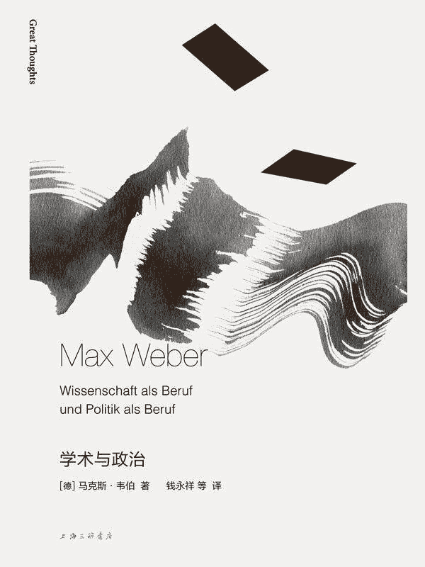

《学术与政治》，马克斯\*韦伯 著，钱永祥 等 译，理想国出版

如果你问我应该如何进入韦伯，我会建议你听听杨照先生讲解韦伯，他会给你提供完整的导引。不过与此同时，你也可以开始接触韦伯本人的著作，先读他的两篇演讲，〈学术作为一种志业〉与〈政治作为一种志业〉。进一步，《基督新教伦理与资本主义精神》也很值得初学者细心研读。我们那一代的台湾年轻人，因为没有其他的书籍可以阅读，几乎都是从这本书认识韦伯的。我相信，这样子双管齐下，你会很快进入韦伯思想的堂奥，你会发现收获是极为丰富的。

# 刘擎：了解韦伯，是认识现代世界的必经之路

### 刘擎：

刘擎，美国明尼苏达大学政治学博士（2003）。现任华东师范大学紫江特聘教授，政治学系博士生导师，兼任世界政治研究中心主任，知识分子与思想史研究中心主任。主要研究领域为西方思想史、政治哲学、世界政治与当代政治思潮。发表著作包括《声东击西》(2005）、《悬而未决的时刻》(2006）、《中国有多特殊》(2013）、《纷争的年代》(2021）和《刘擎西方现代思想讲义》(2021）等。

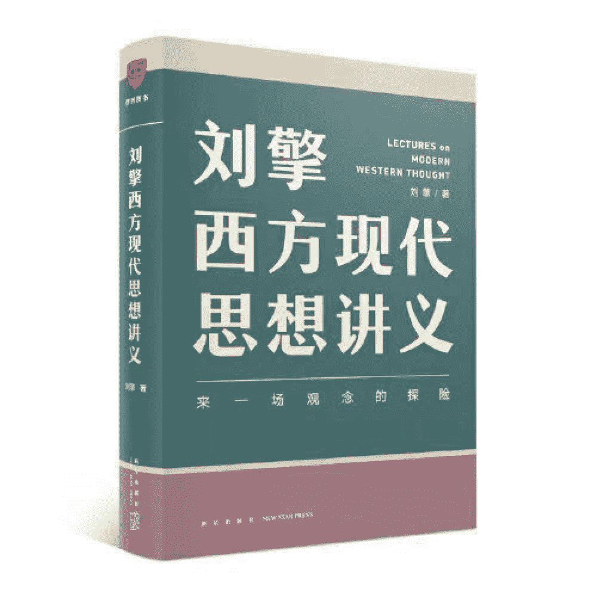

刘擎《西方现代思想讲义》，新星出版社

韦伯对现代性的研究探索，既深入又开阔，其中包含许多原创性的概念，以及富有洞见的论述，发人深省，影响深远，成为公认的思想史上的里程碑，是认识现代世界的必经之路。

韦伯的思想博大精深，也错综复杂。读懂韦伯并不容易，需要我们反复研读，逐步深入，在入门阶段也需要借助良师的引导。我相信，杨照先生对韦伯的讲解，正是一种非常有帮助的引导。

杨照先生是一位难得的好老师，他有过长期学术训练的经历，又是一位杰出的作家和评论家。因此，他对现代世界既有敏锐的感知，又有理性的思考。这或许也塑造了这档节目的特色。

初学韦伯，会遇到许多似乎难解的概念，这对许多读者构成一个挑战。杨照先生摆脱了那种从界定概念到阐释理论的学院派俗套，他的讲解从日常生活的感受出发，辨析我们熟知的现代人的处境以及现代社会的特征，逐渐延伸到韦伯的概念、理论与思想脉络。杨照的导读，在叙事与论述之间建立了内在的关联，而且他相当口语化的表述，平白晓畅，既清晰又生动，这是对听众非常友好的一个特色。

当然，这档节目的特点不只是通俗易懂的风格，同时也注重学理上的严谨与系统。杨照分别梳理了韦伯思想的多重维度，包括世界史、政治、经济、传统与现代的转变，以及社会学方法论。同时，他对韦伯的阐释，与马克思的见解互为对照，邀请听众在比较的视野中来理解韦伯的思想。于是，这档节目具有结构的完整性，也具有相当的深度。

在我看来，杨照的韦伯导读节目，在平易亲和的讲述中由浅入深，进入韦伯思想的深处，抵达了他对现代性独到的洞察与思虑。因此，我在此诚恳地向大家推荐。

# 梁文道：韦伯，那个发明了一整套“工具箱”的人

梁文道

知识分子、传媒人，曾担任"看理想"总策划，主持有音视频节目《开卷八分钟》《一千零一夜》《八分》等，著有《常识》《我执》等书。

这个节目我真是期待已久早在很多年前，我在策划看理想的节目的将来的内容的分布的时候，我就提出过要有一连串关于我们如何认识现代、以及界定现代是什么的重要的思想大家的介绍。那么之前已经向各位介绍了马克思，那么今天终于等来了韦伯。

其实我虽然深受马克思影响，但是韦伯对我而言是一个更加让我着迷，甚至是有些纠结的大思想家。

怎么讲呢?  
就用一个例子来说好了。韦伯这么多的作品里面，在我读过的当中，我印象最深的其实是他一部遗著，是关于音乐的。没想到吧？这位与马克思、涂尔干并称为社会学家之父，又被认为是让我们今天的人理解整个 19 世纪 20 世纪以来，整个现代世界形成绝对不能绕过的，一座大山,居然连音乐都谈。

没错，那本书真是让人大开眼界，因为在那本书里面，我才发现原来钢琴这种乐器的兴起，也是西方现代理性化过程的其中一个环节。

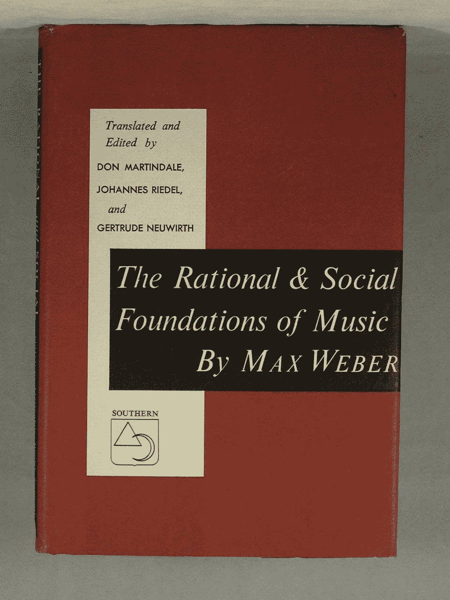

是的，你回想一下西方音乐的一个特点，它的记谱、它的调性、它的和声都特别的体系化，有一套规范在里面。那么这样的一种规范、这样的一种严格的体系，在我们其他文化那么丰富而灿烂的音乐遗产里面，几乎很少见到。这是为什么？韦伯的答案,当然还是他最招牌的关键词就是理性化。

这种讲法我们今天当然可以有很多的讨论，甚至我们觉得他说的有点太过了，可是韦伯有趣的地方就是它总能够引起我们各种各样的争论，同时韦伯最重要的遗产不再是他 100 多年前写下的著作，包含了多少的真知灼见，而是他留下了一连串的工具，一连串的概念，一连串的比如说他讲所谓的  
ideal types，一种理性的类型，一种模范，这种种的一些的工具是让我们今天无论我们在思考社会问题，甚至是人生问题的时候，都仍然觉得很好用。

我们用个最粗俗的理解来讲，我们可以把韦伯想象成一个 100 多年前发明了一整套工具箱留给我们的人。这个工具箱里面有螺丝起子，有扳手，有各种各样的钉子，这些都是他留给我们的遗产。如果我们今天读懂了韦伯，我们善用这套工具箱的话，那么我们今天活在这个世界上，对于我们周边事态的理解绝对会跟以前不一样。那么当然这一次给我们领读韦伯的还是最王牌最厉害的经典导读者杨照老师，值得期待。

# 【系列节目预告】理解现代，从这几位思想家开始

大家好，我是杨照，在这一集的导言当中要来为大家介绍一下，我们是把韦伯放在什么样的脉络底下来介绍、来解读的。

#### 为什么每个地方的生活方式越来越雷同？

大家有没有想过，是否曾经认真地去体会过，我们现在所在的这样的一个当下的世界，人类的生活方式变得越来越类似，而且都是受到了西方文化的影响。

从我们的生活细节当中就有非常明显的这种现象。现在大家所穿的衣服，这是西式的衣服，而且它是国际性的，全世界的人大概都是这样穿，所以才会产生这种国际性、跨国性的流行产业。而且不管是女性，不管是男性，你所留的发型，你的发型跟你的衣着配合的方式，这也都是国际通行的。另外我们所居住的空间，那样方正几何线条所构成的，这也是一种普遍的现代形式。

在交通上面最具有代表性的现象是机场，全世界的机场现在都统一了，你去到世界上，很多从来没去过的地方，带着你去的飞机，要不然是波音的机型，要不然就是空客机型，都是一样的。

不只如此，降落在一个你从来没去过的陌生的地方。然而空桥过来，把你接进到机场里，每一个机场的空桥长得一模一样。进入到机场之后，你到底要左转还是右转要怎么走你要怎么去过关？接着过关，过了关之后要到哪里去领行李？根本不需要有人指引你，你在那里就一定产生简单的本能，立刻可以找得到应该去的方向，为什么？因为所有的机场就统合成类似的经验，你根本不需要摸索，走到任何一个机场大致都如此。

在生活上，大概就只剩下饮食的差别稍微大一点。每一个地区的人，尤其在中国，我们有自己非常丰富的饮食的传统，我们会大部分吃自己的东西，不过在这方面也还是可以看得到感受得到，是朝着同样的方向在进展当中仍然在变化当中。例如说日本人吃生鱼片、寿司，在这几年当中欧洲、美国越来越流行。另外在亚洲，在东方，则是意大利面，几乎征服了在亚洲一半以上的人口。我们无法抗拒这样的改变，我们甚至无法避免被这样改变。

这种改变发生在各个不同的面向。另外像是生产投资厂房怎么盖，机器怎么设计，机器如何安装，用什么样的方式操作机器，接下来要用什么样的方式来运作货币利息，还有股票投资所得……所有的这一切，一直到你脑袋里的观念，你看待人生，你要追求什么，那样的一种价值观，乃至于如果你确定了人生当中你要追求什么，你要找到什么样的手段，什么样的途径来达到你的人生目标，所有的这一切都明显在变化当中，在趋同当中，全世界的人在这些方面都越来越类似。

#### 感染、改造全世界的现代性

再换另外一个角度来看，我们也就不太能够，光是从中国的传统当中，来解释现在我们到底过了什么样的一种日子。我们必须要面对这个世界到底是怎么一回事，深入了解我们自己的生活，我们的人生，我们的周遭，我们必须要不得不面对的世界。是的，你必须要探究到底是什么样的力量塑造了 modern，这个具备有现代性的这样的一个现代社会、现代世界。

现代性这个词是从 modernity 翻译过来的，modernity 最简单的解释，那就是构成现代社会的特性，这是一种原来在欧洲诞生出现，但----

一来，现代性不必然是属于西欧，因为这样的生活特性跟当时西欧的人们，他们原来的生活，他们的思想，他们的信仰，他们的习惯的组织，其实也都有很大的差距，也给他们带来了非常强大的冲击。这个冲击更进一步就摧毁了在欧洲他们原来所拥有的一种传统的状态。

而且在 100 多年的时间当中，还带来了从法国大革命到第一次世界大战、第二次世界大战，两次大战这些非常巨大的破坏和伤害。

二来这样的现代性（modernity），虽然是在西欧出现，但在西欧出现了之后，接着就携带了巨大的力量，快速地传播感染到全世界的各个角落。当现代性刚刚萌生的时候，当时居住在西欧，尤其是住在大都市的这些人，他们强烈地感受到自己周遭的环境正在快速变化  
\----旧的很快被推翻，很快消失，新的在他们还没有准备好的情况底下，一直不断冒出来。

因此在那种情况底下，产生了这种需求，强烈的心理的需求，一来必须要记录这些新鲜的现象到底是什么，这样还不够。另外必须要试图去对于这些新鲜的现象予以理解，有了这样的需求跟这种冲动。

#### "现代"不是一个时间副词，更像是一个形容词

这个变化看起来越来越快，也就在人的脑袋里面深植了一个疑惑----  
既然这个变化不太可能停下来，但它会一直用这种方式进行到哪里去？这个变化背后是有道理的吗？我们到底应该怎么样来掌握这种变化呢？正因为那么快速，那么新鲜，那么奇特，那么难以掌握，没有像失去了以前处境的那种理所当然，于是就有很多人投身在记录、整理。接下来这份新的意识形成了，另外也就形成了特殊的时间感。

什么样的时间感？相信自己正在见证的不只是变化，而且是空前激烈的变化。

在这里的关键是空前，意思是说，回头看，在人类的历史记录当中，找不到类似相同的经验可以拿来比拟，拿来对照。换句话说这个时候的变化就不是 different in  
degree，并不是程度上的改变，而是 difference in  
kind，这是从来没有见过的一些新的模组，新的形态，不同种类的现象、事物在快速地茂盛，在快速的冲击当中。和之前的历史相比，几乎每一个面相都变得不一样了。所以接下来本来用来描述当下、当代的这个词叫做 modern。modern 本来的意思对于过去而言，在这个时候就被被扩张而理解成为一个阶段，一种非常特别的时代，进而把  
modern 这个时期它的特性跟过去的"传统"（tradition）做的对照，用这种方式来描述自己正在经历的这段变化。

这种变化它的独特性，也就意味着这个时候把人类的经验，分成了非常不平衡的两段。一段是前面传统，那是 2000 年、3000 年，在那一段人类的传统状态底下，基本上是变化缓慢的。然而就在自己的这一代，自己生活的当下，突然之间传统逾越，而变成了快速变化的 modern 现代。这种现在的感受和过去绝大部分漫长的时间被区隔开来，再来追溯这种 modern，它似乎就有一种内在的抽象的性质，因而把它命名称之为叫做 modernity（现代性）。

不只是要描述我们到底活在什么样的一个现代。接下来现代的现代性，尤其是对比传统，到底有一些什么最特别之处，它是如何在形成的，在形成的过程当中如何影响了我们，更重要的是现代（modern）、现代性（modernity）到底要把我们带到哪里，带到什么样的未来呢？这都是有待被认识，被解释的。

#### 探寻现代世界来龙去脉

这种现代性带有非常明显的特质，它有巨大的扩张潜力。从 19 世纪这本来只是发生在西欧几个国家，几个地区，少有的人口当中的一个现象。但是随着时间，这份现代性不断地感染到越来越多的地区。一个世纪之后，现代性几乎改造了全世界，也就在这种现代的影响底下，把全世界变得越来越相似。到了 21 世纪的今天，在这个过程当中又多增加了许多复杂的变数。比如说现在发生在我们周遭的信仰撕裂的问题，大国之间对立的问题，新冠疫情所造成的这种封闭的状态等等。然而现代性以及现代性所引发的全球扩张这一股力量，仍然持续在左右我们自己的生活。

因而要理解这样的现代世界是如何树建起来的，也仍然是我们不能不关切的一大问题。

要求取这个问题，这个时候看你怎么认知问题。

如果你认知这是一个 question（困惑），我们就要去寻求 answer（答案）。如果你把问题认知为  
problem（问题），我们要寻求的就是 solution（解决）。不管是要找答案或者是要找解决，当然都不是一件容易的事。不过我们可以找到一个入手的途径，也就是我们可以选择聚焦几位，曾经提出过开创性思想观念的作者，而且借由他们所写下来的这些经典性的书籍，让我们可以亲近，让我们可以阅读。这几位作者，他们所留下来的经典，其中共同之处，他们都冲击改变了人的传统定位，好像是重新画了一个不一样的坐标，把人摆在不同的位置上面。所以一方面就动摇了人原本在传统社会上，本来那是固定的，已经很安稳的一种状态；另外一方面在动摇了原来的这个位置之后，放到一个新的位置上面，就逼着人必须要重新看你的周遭，重新思考，重新定义，更进一步重新调整你跟生活世界当中各种不同的其他因素，彼此之间的关系。

#### 现代森林的指路者：马克思、韦伯、尼采、达尔文……

在这之前曾经为大家介绍过马克思，马克思最重要的影响是他的思想、他的著作改变了人和社会之间的关系。

接下来要为大家介绍的韦伯，他接在马克思后面，他提出了一套新的社会学的观念，帮我们进一步去解释人活在社会里究竟是怎么一回事，这种集体是如何构成的，还有我们和这样的一种集体是如何发生关系的，我们又如何去累积，并且运用我们在社会当中的经验。

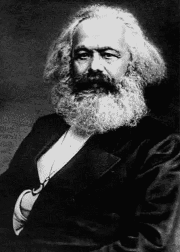

马克思

同样等级的这种思想巨擘，比如说有达尔文。达尔文他所提出来的"演化论"彻底改变了人和自然之间的关系，而达尔文的说法，达尔文的著作一直到 20 世纪又开展出来，后来有遗传学，有基因研究。又例如说出现了爱德华*威尔逊（Edward  
O．Wilson，1929 年- ）从演化论发展出来的社会生物学（social biology）。另外像是由理查德*道金斯（Richard  
Dawkins，1941 年 3 月 26 日－），他非常有名的说法称之为叫做《自私的基因》，让我们更清楚地体会到所谓生物演化，究竟用什么样方式彻底改变了这个世界，创造了我们所处的这样的一个自然环境。

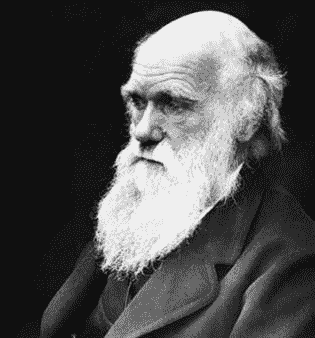

达尔文

另外还有弗洛伊德。弗洛伊德他的理论关于精神分析，关于潜意识，关于潜意识和显意识之间的互动，那则是彻底改变了人和自我之间的关系。精神分析这一门学问一脉相承，后面有荣格，有阿德勒，有拉康等等。还不止如此，潜意识的概念，弗洛伊德对于认知，对于记忆各种不同的解说，又在文学艺术上产生了巨大的启发。比如说了不起的意识流写作大小作家詹姆斯*乔伊斯（James  
Joyce），或者是在描述记忆上格外细致，到达了一个不可思议层级的马塞尔*普鲁斯特(Marcel  
Proust)，他们都是从弗洛伊德那里得到了灵感，得到了启发，才有了这样开创性的突破。又例如说绝对不容被忽略的是尼采，因为尼采的著作改变了人和权力之间的关系。他描述探索了人的普遍权力意志，意味着权力并不仅限于在政治领域。从此之后在 20 世纪人们就突然发现这个权力无所不在，政治无所不在。于是在这个之后要看待政治，要分析政治，绝对不可能再用原来的那种方式。

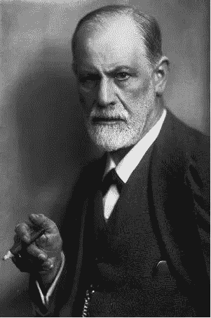

弗洛伊德

例如说尼采又启发了法国哲学家历史学家米歇尔\*福柯（Michel  
Foucault）用更加戏剧性的方式来展现，我们人如何时时刻刻分分秒秒都活在权力关系当中的这样的一种处境。

还有海德格尔，他以一本巨著《存在与时间》，先是改变了人和时间的关系。这本书往上联系到爱因斯坦，他的狭义与广义相对论，在对于时间的观念、时间的探索方面，往下又联系到霍金的《时间简史》，那是物理学上所开发出来的对于时间的解释，对于时间的认识。但是海德格尔的哲学又凸显了人在意识上面，那样一种和物理性的时间非常不同、非线性的时间的处境，我们的时间会迂回交错，会有各式各样不一样的缠卷。另外也指出了主观上对于时间长短的扭曲错置等等。

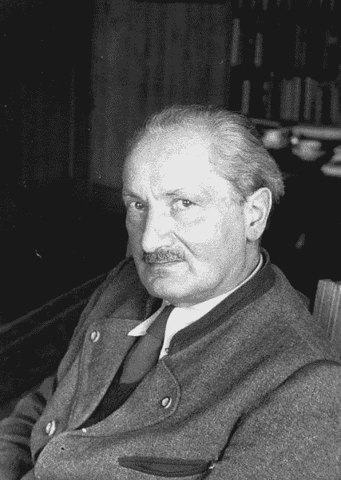

海德格尔

海德格尔这本哲学巨著，另外也改变了人和存在或者是存有的关系，往上联系到伟大的俄罗斯小说家陀思妥耶夫斯基，他在小说当中所进行的各种不同的探索和质疑，往下则联系到法国的存在主义哲学、文学，像是萨特或者是加缪种种经典的作品。

在未来我们会将和理解现代、理解现代性相关的这些思想的内容，整合成为形塑世界的思想巨擘的系列，会陆续在"看理想 app"当中推出。有了针对这几位思想巨擘的系统阅读，我们就有了思索现实、面对未来的一些指引的地图。我们活在这样的一个现代环境里，在这样一座繁复的森林当中，也许我们可以不用担心会一直迷路了。感谢你的收听。

# 1\. 走进韦伯，认识现代社会的真相

#### 神奇的韦伯，作为各领域的"参考顾问"

大家好，我是杨照。马克斯*韦伯（Max  
Weber）是德国的社会学大师，在我们谈到西方社会学的建立的时候，基本上的共识是以孔德作为源头，另外则是奉韦伯以及涂尔干作为奠基的宗师。而且韦伯的影响，虽然他是一个德国人，并不只限于欧陆，就连英美社会学在建立的过程当中非常重要的中坚分子，例如说托卡*帕森斯（Talcott  
Parsons）或者是罗伯特*金*莫顿（Robert King  
Merton），他们要么涉入在翻译韦伯著作的事业当中，要么言必称韦伯、开展出延续韦伯论题的各种不同的研究。

而韦伯他又不只是一个社会学大师，他在社会学以外，比如说历史学、人类学、文化研究等各个领域都产生了都有很大的影响。在网络普及谷歌搜寻引擎流行之前，韦伯的名字会出现在超过 10 种不同领域的专业字典或者是百科全书当中，这里面包括了哲学、心理学、管理学、行政学乃至于教育学等等，所有的这些领域都认为不能够不将韦伯包纳进来，让他们自己这个领域的研究者或者是学习者了解韦伯是谁，知道韦伯到底提出了一些什么样的看法。

那韦伯到底是一个什么样的人，竟然可以单纯只凭借着自己的著作----  
他生命当中没有太多其他的活动，也没有取得什么样政治的权力或者是在民间受欢迎的名气，那他怎么能够产生这么大的影响作用？为什么这么多不同领域的人，都觉得韦伯跟自己在做的研究乃至于跟自己的人生跟自己的生活是有关系的呢？

这就是之所以要为大家开设这一套音频节目的一个出发点，想要向大家介绍，让大家可以了解这样一个奇特的韦伯。至于我自己接触韦伯的著作跟思想，就必须要回溯到我的大学时期。

#### 初遇"西化派"：左派、资产阶级、马克思、韦伯

在整整 40 年前，1981 年的 9 月，我在台湾进入到台湾大学的历史系去就读。从高中进入到大学还是蛮大的冲击，进到了台大历史系之后，很快就会发现我的这些学长姐们，包括了比我们大了 6 岁、7 岁的研究生，不同的科系的学姐学长们，他们非常明显地至少在知识读书的追求上分成两派，我们可以简化地称之为叫中国派跟西化派。

中国派大部分他们都去上毓老的课，毓老是爱新觉罗\*毓鋆（1906 年 10 月 27 日－2011 年 3 月 20 日），他是满清的遗老，但是比汉人更热爱更拥抱中国的文化。所以他当时开了他的私塾，就在台大附近的温州街上面一个地下室里面，每一天晚上都有课，然后讲众多的中国的经典，尤其主要集中在先秦的经典上，他讲得非常灵活，经常会穿插对现实的评论，所以吸引了很多大学生、研究生去跟他上课。另外这群人他们也就必定会阅读钱宾四（钱穆）先生的书。还有少数的人，他们每一个礼拜搭公车转车，穿过整个台北市，远赴到最北边的外双溪到钱先生所居住的素书楼去上课。

钱穆晚年居所素书楼

这些中国派他们读的书以及他们对于中国传统，对于中国文化的各种不同的推崇跟解释，这部分我比较熟悉，因为我自己在高中的时候，也同样是受到 1970 年代台湾的那种中华民族主义强烈的影响。我读了很多钱宾四先生的书，连带的也对于中国的这些传统经典不是那么样陌生。

因而是另外一边，也就是西化派给我带来了比较大的震撼。因为他们读的是我过去没有能力读的原文书，叫做原文书，但其实绝大部分是英文书。另外他们会经常出没几家奇怪的书店，更多的是书摊。这些书店书摊里同时会摆放会卖，有的是在柜台后面，有的是去掉的作者跟出版社的名字，卖什么呢？卖当时在台湾的禁书，例如说鲁迅、茅盾、巴金这些人的小说。对大家来说这些作品是再熟悉不过，但是当时在台湾这是禁书。

另外这些西化派的学长、学姐，他们口中讨论的是一些奇怪的名词，例如说左派、资产阶级、资本主义，甚至"革命"这种听起来很刺激、很危险的语词。所以在他们那里，我最早捡来了几个常常听到的名字，而韦伯，或者是他们喜欢用英文发音 Max  
Weber，就是其中的一个。另外一个说的时候声音要放得更低的，那是 Karl Marx（卡尔\*马克思）。

马克思跟韦伯，这是当时西化派最看重的两个马克思（斯）。

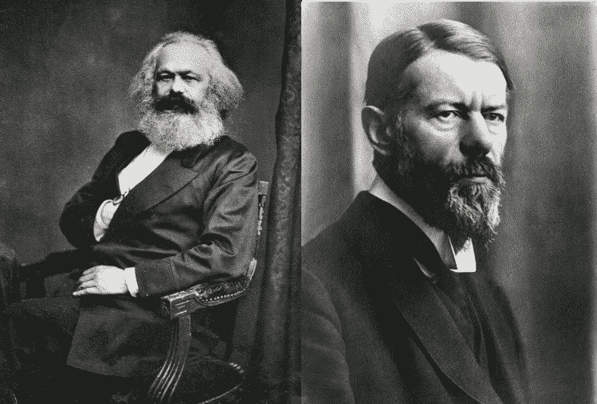

卡尔*马克思（1818-1883）与马克斯*韦伯（1864-1920）

然后受到了这样的影响，就在学校对面那怪怪的书店里面买了一本翻译的英文书，书名叫做《From Max  
Weber》，那就是一本韦伯著作的选集，用当时还非常有限的英文的能力开始努力阅读，并且借着自己阅读到的那么一点点的东西，试图加入这种西化派学长、学姐他们的讨论。

#### 球场旁的"韦伯热"：文艺青年的苦闷，是韦伯的"除魅"

其实我都讲学长、学姐，不过绝大部分都是学长，而没有学姐。因为我们会在非常奇怪的场合去讨论这些事，这些问题。什么样的场合呢？经常是在篮球场或者是足球场的场边。不踢球、不打球的时候，我们会在场边，例如说休息一下，等你下一个能够上场的机会，就会在这里随口谈几句。但越是那样一个奇怪的场合，越是不经意随口聊天，反而留下了很深刻的印象。

**官僚体制**

转手从学长那里听到了例如说关于官僚体制（bureaucracy）的讨论，说官僚体制最重要的一个特色，那就是注重程序胜于注重目标，对官僚主义的运作，对官僚主义当中这些官僚的人，他们会把过程看得比结果更重要。

对那个时候才十八九岁的我，觉得这说得太好了，因为我们光是在跟学校的训育组在打交道的时候，都有这种非常非常强烈的挫折感，这些觉得训育组的这些师长，甚至我们眼中根本就不觉得他们是师长，他们就是一些官僚们。因为他们开口闭口就是这个是怎么规定的，那个是怎么规定的，规定不可以就是不可以。

你要跟他讨论校规的道理，他们理都不理，更不管校规跟校规之间的规定，校规跟校规这一条跟那条彼此之间可能会有弥合不上，不合理的地方会有漏洞，会有盲点。更重要的是他们完全不管这个规定是不是跟例如说教育的目的，教育的宗旨，乃至于这个规定所管辖的学生活动，它所应该要发挥的作用是不是抵触，他们统统都不管。所以太好了，我们发现说原来这叫做 bureaucracy，原来这叫做官僚体系。

不过接下来学长们他们就会提供韦伯的解释，听起来那就很玄妙，很了不起了，那是因为现代社会发展当中，理性过度发达，而且理性的发达当中两种不同的理性有了不平衡的状态，一种是工具理性，一种是目的理性，而且现代社会就是因为工具理性压倒了胜过了目的理性。

**除魅**

再下来例如说听到了关于现代社会的分析，在年轻的时候作为一个文艺青年，当然读了很多文艺的作品，在文艺的作品当中，我们当然知道有一种特别的普遍流行的感受叫做苦闷。但是在学长那里，就把这种苦闷的感受连结到例如说黎士曼他所写的《寂寞的群众》（Lonely  
Crowd），是意味着现代的社会人活在群众当中，反而更加的孤单。

更进一步地，他们又提出了韦伯的解释，或者是告诉我们黎士曼的《Lonely Crowd》，其实他的主要的想法是来自于 Max  
Weber，那就是韦伯用来描述现代社会的一种特质特性，称之为叫做 disenchantment，除魅。也就是现代社会里，人们没有办法再简单地投入感觉到，由那样一种神秘的，但不用解释，属于某一个团体，属于某一个集体当中所给予的一种安全感，我们会变成一个一个孤单的、像原子一般的存在，正就是因为太清醒了。

那样一种理性所带来的清醒，使得我们看到庙宇里面的拜拜，这些人去进香了，或者是当我们在参加升旗典礼的时候，当我们在上军训课的时候，我们一点都不会感觉到我们跟这个神明有这么直接这么亲近的关系，因而我们跟同样崇拜这个神明的所有的其他人就有了一种连结感。或者是升旗典礼到了你小学五年级、六年级的时候，你怎么还会觉得你跟那一面国旗，或者因为你跟国旗、跟国旗歌的关系，而跟所有旁边的这些同学们跟这些师长们有一种国民的连结？我们太清醒了，我们知道这就是仪式，当我们清醒到这样的程度的时候，我们就变成现代社会的一份子，我们就在现代社会的 disenchantment，除魅的状态底下。

**志业**

又例如说听到了关于职业跟志业的区分，这正击中了我们的心理，提醒了我们的父母或者是我们的女朋友，如果你有女朋友的话，或者是如果你没女朋友，你想要追女朋友的时候，会一直萦绕在你心里面作为一个文学院男生的最困扰的问题。大家都担心，都会一直问你说，你念历史系，那你将来怎么办？你毕了业之后你的出路在哪里？

我们会现在听到那叫做"职业"的考量。职业是什么？职业是我们如何因应现实的系统，我们要去适应这个现实的系统，然后找到一份收入，找到一份薪水，这也就意味着在这个过程当中是你作为一个个人，你要去配合庞大的已成的这个社会的体制，把自己放进到既有的框架里面。但你要记得这不应该是人生的意义，不是你在生活里面最应该要强调，最应该要重视的最重要的事。

因为另外还有一种强大的力量在推动着你，那力量是让你去寻找你想要做的事。但还不只如此，比如说我们在那个年代，我们想打篮球，打完篮球之后喝可乐，去喝啤酒，去吃饺子，然后接下来把汗擦一擦进电影院里面去看电影，这都是我们想做的事情。但那些也不是的，那是什么？

那是好像有一种不由自主的力量会抓住你，另外好像会有一个强大的不知道从哪里来的神秘的召唤，神秘的声音在叫你应该要做这个事情。因而产生了一种使命感，那是你感觉到你在这个一生当中，你的生命如果要活得有意义，你非做不可的事情，那叫做志业。志业跟职业不一样，志业比职业重要得多了。

#### 韦伯的思想成就，作为我们认识现代社会的基础

所以当时留下的深刻的印象，那是神奇的韦伯。当然等到稍微晚一点自己回头看，我知道我参与了那段时间当中，台湾知识界很神奇的韦伯热。我是在这样的一个台湾知识界的韦伯热的潮流当中，被导引去读韦伯的著作。刚开始读韦伯其实就已经带着一种佩服的态度，觉得这个人怎么那么了不起啊？他怎么可以有这么多精彩的想法？

但是开始读比较稍微有系统一点读，尤其是读完了刚刚跟大家说到的那本《From Max  
Weber》韦伯选集，以及后来更难得的，我非常幸运很早就读了最权威的《韦伯传》，这是无可取代的。因为那是韦伯他的妻子玛丽安妮\*韦伯（Marianne  
Weber）所写的。

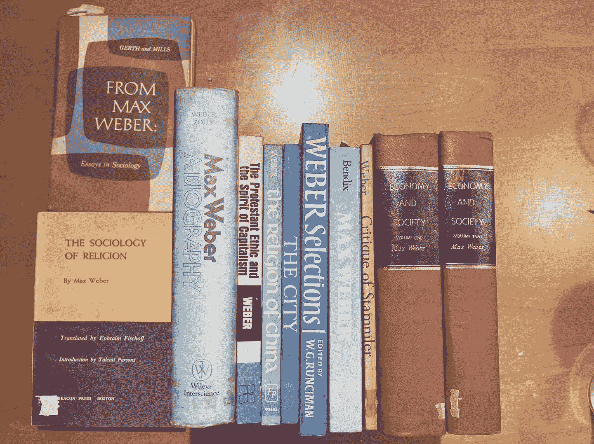

杨照的韦伯节目用书

在读完了这两本书之后，改观了，改观不是就不佩服他了，刚刚好相反，是更佩服他了。我就发现在这之前，我所听到的东一个西一个那些精彩的想法，其实在韦伯一生的学术跟知识的追求当中，那是一个大系统当中其中的部分，当然这个大系统就是关于现代社会来历的说明跟分析的这样的一个系统。光是这其中一些部分抽取出来，当时就已经让我觉得如此着迷。

而且韦伯是在短短的一生，我现在可以说这个话了，因为他 56 岁就去世了，我现在的年纪就已经超过韦伯的一生了，然后他跟马克思不太一样，在短短的一生当中，基本上他已经完成了他的系统的架构。所以我们现在可以把韦伯一生的学术思想努力地全盘搬过来，就变成我们认识跟理解跟分析现代社会的基础，这多了不起，这多棒。

#### 进入韦伯的思想世界，透视今日社会

所以后来的几年当中，我就是这样的读韦伯。这一次为大家所制播的韦伯 60 讲音频节目所要呈现的，就是我这些年来读韦伯的结果。这个关键的背景是我们必然活在社会里面，我们任何一个人都不可能是鲁滨逊\*克鲁索（Robinson  
Crusoe），我们不可能活在孤岛上面，自己一个人过日子，自己决定要过什么样的日子。

可是我们虽然活在社会里，但是你很清楚，从来没有人问我们你要不要活在社会里？你要不要选择作为一个人在一个孤岛而活着？更重要的是从来没有人问过我们，从来没有人给我们选择权说，你要不要活在这样的一个社会里？你要不要选择在这个社会或那个社会被出生？

这就是德国哲学家海德格尔，他说人类存在的起点那就是一种被抛掷性，我们是被丢到这个世界上。我们会在什么样的时代，在什么样的社会里面诞生，在什么样的环境里面去形塑我们的生活，这不是我们个人可以选择的，我们存在的起点就已经是被决定了。所以那怎么办呢？我们只能够努力去理解，去理解说我所活的这究竟是一个什么样的环境。

接下来，你如果要真正确切地能够掌握，能够理解这是一个什么样的环境，你非得回溯这个环境究竟是怎么来的，接下来你才能够更进一步地去问说，我该如何适应这个环境，或者我有没有什么样的机会可以凭借我的主观的意志去改变这个环境？而社会就是对于我们所存在的这个当下现实的最明确的生活环境它的集体面的一个总称。

韦伯他建立了这个知识的系统，也就在于指引我们要如何去思考社会，解开我们面对社会的时候种种的不同的疑惑，而让我们可以在面对社会，在活在这样的一个集体的情境底下，不至于那么样无力，不至于那么样无奈。

所以我邀请所有想要有系统地认识社会，不管是自己的社会或者是别人的社会，不管你困惑、好奇的是你当下现在你所活着的这个社会，或者是你好奇想要知道过去的社会又长什么样子，所有的这些朋友们，如果你有这样的好奇，你有这样的心意，就请大家一起来和韦伯这个人还有他的思想做朋友吧。感谢您的收听。

# 2\. 拆解韦伯的系统：至今未被超越的完整社会图像

大家好，我是杨照。韦伯的思想，韦伯的学说非常迷人。不过要特别说韦伯有两面，我可以把它称之为一个是浅尝的韦伯，一个是深探的韦伯。

#### 浅尝韦伯：闪烁的惊艳观点

所谓浅尝就是浅尝即止，如果我们用浅尝即止的方式，我们会注意到，韦伯他提出了很多突出精彩的想法。例如说，他告诉我们资本主义根本就不是由想赚钱的人去创造出来的，怎么可能呢？当我们在想到资本家，想到资本主义的时候，脑袋里面不都是这些努力想要赚钱的人吗？

韦伯说不是。我们追溯它的来源，资本主义是有一群敬畏上帝，而且必须要证明自己在世间是成功的人，是由他们创造出来的，这非常新鲜，非常刺激，而且非常精巧。

例如说，他会告诉你有一种特殊超凡魅力型（charismatic）的领袖。这种领袖他不一样的地方在哪里？在于他是靠着打破旧规律，他是借着勇敢地，甚至有点近乎疯狂地打破了旧规律，进而能够取得影响力，取得权力。

当然这样的人要崛起，需要有特别的环境条件。也就意味着到那个时候旧规律其实已经让很多人感觉到束缚，感觉到不耐烦。但是大家不知道拿旧规律该怎么办，所以绝大部分人仍然在旧规律中忍耐着。但是出现了这种特别的人，他跳出旧规律，而且夸张地戏剧性地拿着一个大榔头帮我们把这些旧规律都打坏，都敲碎了。因而就使得许多人同意他、赞成他，甚至崇拜他，然而要变成一个超凡魅力的领袖。

还有另外一方面的条件，那就是他得到了这样的权力，得到了影响别人的力量，他必须要找到能够投注在新的组织形式上，把它变成不单纯是破坏，而是正面可以建设的力量。

我们看到马克斯\*韦伯这么多年以前就提出对于超凡魅力（charismatic），对于超凡魅力领袖（charismatic  
leaders）的描述跟形容。很容易就会让你联想，这不就是在跟我们描述苹果的乔布斯吗？乔布斯不就是在企业界、在科技界，乃至于现在在他身后，他都仍然靠着他的想法，靠着他打破规律，同时把这种打破旧规律所得来的影响力，用在创造发明出新的机器、新的应用，因此彻底改变了全世界所有的人？

#### 深探韦伯：高度系统性与完整解释现代社会

不过正因为如果这样浅尝韦伯，我们会觉得那么样有趣，那么样有魅力，当然就会刺激你想要深探。一旦从浅尝改变成为深探，你就会发现，我们看起来在浅尝观赏的时候，好像是一朵一朵非常吸引人鲜艳的花。可是当你往下，你想要把这一朵一朵的花摘下来的时候，却很难单独可以摘下来。原来这些花都紧紧地挂在很长，而且紧密纠结的藤蔓上面，它们彼此互相连接，它们彼此互相连接，牵一发而动全身。

稍微深探，我们就看到韦伯其实他建构了一个非常庞大的全面的系统。他的问题意识聚焦在社会上，他要解释社会到底是什么，而他基本思考的模式是一直不断地把问题脉络化，contextualize（将……置于上下文中理解）----要回答一个问题的时候，他先要想这个问题应该放在一个什么样的环境底下，它会牵连到哪一些相关的变数。我们必须把这些所谓的变数，包括时间、空间，包括物理、包括意识，所有的这些东西都放进来，让问题立体化，我们才能够更精确地掌握问题，当然也才能够更精确地回答问题。

但影响你也就知道，他的思考模式基本上是反简化。他是习惯把事情弄得越来越复杂的，例如说他本来的出发点是看到了现代社会的特殊性，所以要解释为什么会出现代社会，现代社会到底具备有一些什么样的特色。本来是这样的一个问题，然而把这个问题脉络化了之后，就发现要描述要掌握什么是现代社会，你不能不拿现代社会去跟传统社会比较。而且这中间比较既然要比，那就是比异跟同。

你本来为了彰显现代社会的特性，所以把传统社会拿出来，看说传统社会有这个，现代社会不是这样，传统社会没有这个，但现代社会这是它突出的特色。本来是应该是要用这种方式比较，然而韦伯又不放过，他又觉得我们既然在比较传统社会跟现代社会，你不能光是去看它不一样的地方，而刻意地忽略这两种社会的共同性。所以接下来从这里 contextualize（将……置于上下文中理解）之后，又出现了一个新的庞大的问题。

#### 绵密的推理：人类社会中的支配与被支配

如果把人类社会不管是传统社会或者是现代社会，把它并合在一起，我们来看它的共同的特性的时候，我们就发现最奇特的一件事情，那就是人类组织成为社会，而分别开来，有一些人是支配者，有一些人是被支配者，而且支配者和被支配者他们的划分不是依照生物本能的。这什么意思？

如果我们看蚂蚁，我们看蜜蜂，它们都是复杂的社会动物，它们都会组成数量非常庞大的群体。但是在这几万个个体当中，只有一个蜂后，只有一个蚁后，只有数量非常有限的雄蚁或者是雄蜂，其他的都是工蚁，或其他都是工蜂。

这种划分怎么来的？简单得不得了，那都是来自于它们的生物的本能。当它出生孵化成为蜂，就已经决定了它到底是蜂后，还是雄蜂，还是是群体大众的工蜂。这里边没有任何暧昧，没有任何选择，而绝大部分在生物界、在动物界要能够形成社会性，都是来自于本能。也因为这样，所以蜜蜂只有可能组成一种社会，蚂蚁只有可能组成一种社会。

但人不一样，我们的内在其实并没有像蚂蚁、像蜜蜂这种生物性的本能。如果是这样，人到底是怎么组织成为社会的？尤其是为什么这些被支配者在社会当中愿意被支配？为什么愿意用这种方式服从于支配者？关键就在于社会当中社会组织如果没有形成权力，你就不可能维持这个组织。那如何在并不是来自于本能的情况底下，由这么多的人而构成了支配跟被支配的权力关系？

因此韦伯就提出了一套"支配究竟是在人类智慧当中如何形成的普遍状况"的解释。他的这套解释已经非常的精妙，讲到了支配跟合法性之间的关系，讲到了支配合法性分成哪几种不同的类型。

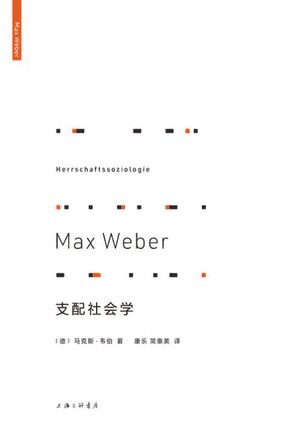

韦伯《支配社会学》，理想国

但是把这一部分完成了之后，再 contextualize（将……置于上下文中理解），他又发现有问题，他又不满足。怎么样的不满足呢？因为他就觉得这是一般普遍状况的描述，但是没有办法包纳许多的例外，这里又必须要把例外放进来考虑。这才有我们前面所说的超凡魅力（charisma）这个概念拿来分析这种例外。

那是权力的例外，那是用例外的方式取得权力的途径，那也是使得权力的模式在建立下来之后、为什么会改变的其中主要的变数。在这样的一个视野当中，他帮我们解释了人如何组织社会。

#### 从宗教到资本主义，从经济到社会

在组成社会的因素当中，他也特别注意到宗教，这是很自然的，因为很多人都可以感受到，从传统的社会到变成现代的社会，其中最大的一个差别那就是宗教信仰的影响力越来越低，相对应的，可以打破迷信的科学的力量一直不断地上升。

因此可以得到一个简单的推论，那就是在传统社会当中宗教很重要，相对应的，宗教没落，科学和科学理性塑造了现代社会。这也是韦伯刚开始在为我们解释现代社会的时候理所当然走的一条路，可是走这条路走到那里，他又觉得不对劲。

怎么个不对劲法呢？更深刻地去研究，同样 contextualize（将……置于上下文中理解）之后就会发现，不同的宗教会形成不同的社会。

因为有犹太教，所以信仰犹太教的犹太人，他们会组成散落在各地，然而仍然在一神的笼罩下、能够彼此互相认同的非常奇特的社会组织。

因为有印度教，所以印度人他们会发展出种姓制度，层层非常严格严密上下区分的这样的一种社会。

宗教跟社会之间有非常密切的连接。因为这样，韦伯接下来他就发展出宗教社会学，也因此他才会看到，其实资本主义在相当程度上是因为有新教改革，是在推翻了旧教，推翻了天主教之后，那样的一个新的宗教意识所相应打造出来的一套社会组织。

所以在韦伯的理论当中，资本主义另外联系了两端，一端是联系到宗教的起源，这是过去我们想都没有想过的。原来资本主义跟宗教是有这么密切的关系。如果没有那样宗教的影响，没有那样用宗教的信仰刺激了社会的重新再组，就不会出现资本主义。

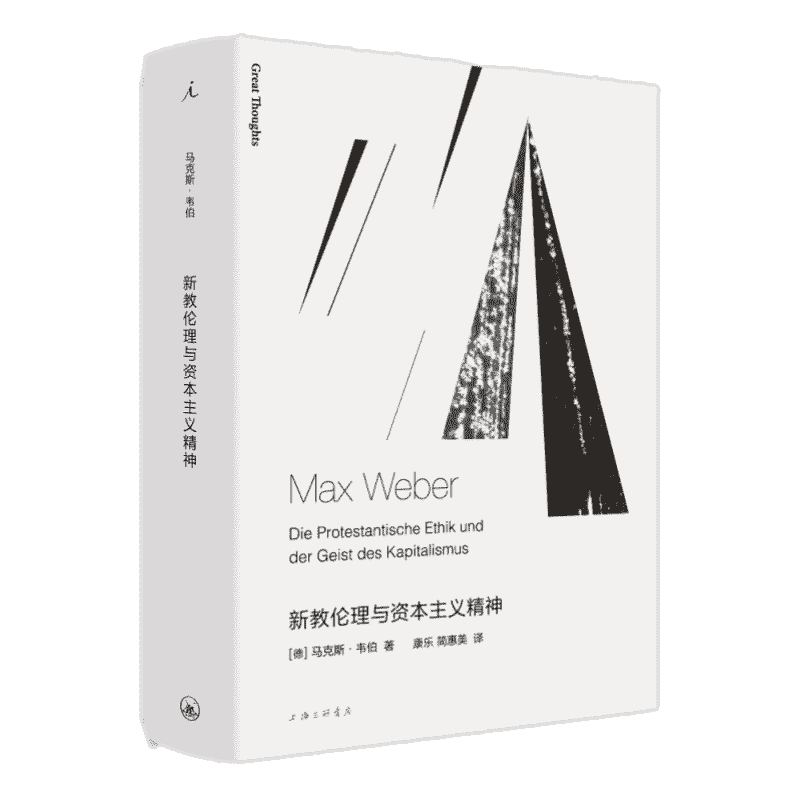

韦伯《新教伦理与资本主义精神》，理想国

另外一边，当然资本主义同时是一个强大的经济的机制，就产生了经济跟社会之间连接的关系。所以更进一步地类同于有什么样的宗教，就会创造出什么样的社会。

韦伯也意识到，他还要解释这件事情，有什么样的经济体制就会产生什么样的社会。所以他写了一部非常庞大的书，书名就叫做《经济与社会》。其中一部分的内容就是要探索不一样的生产交易分配，各种不同的模式，各种不同的机制，如何影响、如何改变社会组织。

韦伯《经济与社会》，世纪文景

#### 理性取代宗教----现代社会的诞生与困境

再回到前面讲到宗教没落，而科学理性兴起，这是传统社会和现代社会在对比上最鲜明的一个现象。如果我们说现代社会是理性取代了宗教，对于韦伯来说，又多了一个新的 contextualize 之后的课题。这个课题就是必须要补上，对于理性的研究，所以在这方面他又有了重大的贡献。他就一方面从理性如何膨胀，然后笼罩了我们所有的生活，来描述、来解释现代性、现代社会是这么一回事。

但在这其中他又更细腻地去区分出什么是工具理性、什么是目的理性。而看到现代社会的发展上面，最重要的有的时候也是最危险的一个现象，那就是工具理性越来越发达，相对地掩盖了或者是掩盖了或者是压抑了目的理性。

社会会变动，政治会变动，经济也会变动，然后它们彼此之间形成了非常复杂的互动。相应于政治权力，支配研究方面，有超凡魅力（charisma）作为它的例外，在经济的研究上也有例外。

在经济的研究上，韦伯就发现了城市是最重要的一个例外的变数。因为有城市，因为有行会，因为有城市所居住的自由民，就形成了在历史上高度的不确定改变的因素。因此又从这里，韦伯发展出了他的城市社会学。

他有政治支配的理论、他有宗教社会学、他有关于经济跟社会的研究、他有关于城市的社会学。这么多，这么庞大，而所有的这一切最后是要总结在于为我们解释社会到底是什么，社会组织是如何形成的，又为什么会区分出传统社会跟现代社会这两种性质非常非常不一样的组织形式。

#### 彻底解释现代社会的野心与系统

好了，我想有一些朋友现在已经听得头昏眼花、昏头转向了吗？没关系，因为在未来，我们有 60 集的时间可以来深探韦伯的思想、韦伯的体系。我们有机会可以耐心，慢慢地把藤蔓梳理出来。

韦伯细密的思考其实是有条不紊的，而且最终都扣回到现代社会上。所以韦伯的理论、韦伯的观念没有过时，能够一直产生和我们当下身边切身的现象相对照应的作用。运用你的日常观察，以及你每一天生活中现在环境当中的经验，你就可以来了解韦伯的系统。另外，借由韦伯的系统，你也可以对于当前现实的社会有了系统性的认识。

在后面的节目当中，我们会先联系前面关于马克思《资本论》的说法，先从韦伯对于资本主义的解释开始讲起，这同时也是换另外一个角度再进一步地让我们了解现在当下我们所处的，跟资本主义相关的所有的现象到底应该要如何理解。

接下来会为大家介绍韦伯非常看重历史的材料，所以他实质上等于是以他自己的一个社会学的立场提出了对于世界史的看法。这中间特别凸显宗教在社会组构当中所产生的作用。

然后从这里再延伸到韦伯的政治观念，这里面最关键的是支配跟正当性，再从支配的结构延伸到官僚体系，官僚体系的描述跟分析，就相当程度上就会联系到大家现实里面必须要打交道的非常庞大的管理体制。

再下来还有一个部分，那就是从社会的角度来理解经济，尤其是经济如何影响社会，社会秩序又用什么样的方式制约或者发展了经济。

最后是要告诉大家，从社会的角度理解现代，我们如何从这里去体会，作为一个个人活在现代社会当中，你面对什么样的挑战。你应该具备有一些什么样的知识，具备有一些什么样的准备，才不会被这样的现代性给淹没，而能够保有你的主体，保有你的主动去应对这样的一个现代社会。

韦伯的现代事业虽然复杂，但正因为复杂，所以他可以帮我们排除许多因为我们太天真、我们太简单去想象社会而造成的种种的错误。

感谢你的收听，我们下次再会。

# 1\. 来自韦伯的质疑：资本家成为资本家，只因本性贪婪吗？

大家好，我是杨照。在发刊词当中，我曾经回忆，我是在 80 年代台湾那样一种非常特别的"韦伯热"的背景底下，认识了韦伯，理解韦伯的。之后，当然我也会非常好奇，回头去探讨，为什么那个时候会有这种非常特别的知识上的集体行动，知识上的集体现象？"韦伯热"到底是从哪里来的呢？

#### 台湾"韦伯热"从何而来：从西方的反行为主义谈起

台湾的"韦伯热"跟西方的变化发展是有联动关系的。这个背景是 70 年代开始，韦伯他的社会学方法论、他的社会学概念在西方，尤其是在美国复活了。

为什么复活呢？有一部分是来自于对于 60 年代最流行的行为主义，Behaviorism 的一种反动。行为主义最重要的代表性的理论家是伯尔赫斯*弗雷德里克*斯金纳(B.F.Skinner)，他原先的背景是心理学，他是把心理跟行为的关系倒过来看，本来心理学是要从行为去研究人的心理，但是斯金纳他比较有兴趣的，是如何透过行为来控制人的心理，来训练人的动机。换句话说，他有一个非常素朴、非常简单的信念。

可是在那个时代非常流行，就是认为，人的动机跟人的行为是直接联系的，而且人的动机受到固定的几种本能所影响、所操控，所以我们只要安排对的环境，我们就可以改变一个人的动机。改变了一个人的动机，你同时也就改变了他的行为。

用这种方式，斯金纳认为，他把心理学、社会科学这些研究人的知识、这些研究人的学科，都予以更进一步地科学化论。也就是说那样一种理解的方式可以和实验扣搭在一起，人的行为也可以实验。而且这个实验是科学式的实验，不一样的人在不一样的地方都可以做出同样的结果来。所以这是从科学的角度，对人的认识跟理解的一大胜利。

我们看到行为主义（Behaviorism）它发展到最高峰的时候，有一部非常有意思的电影可以作为他的代表，那就是 1964 年由萧伯纳的剧本改编而成的好莱坞的电影，《窈窕淑女》（Pygmalion）。本来来自于伦敦东区的一个低层社会的卖花女，她如何遇到了一个语言的教授，这个语言的教授靠着改变这个女人的语言，她的语言被改变了之后，她的行为连带就被改变了。因此她就彻底地转化成为，不只是外表显现像一个高贵的淑女，甚至连她的内心都高贵化了。

在这改变的过程当中，就牵连到 Pygmalion 这个原名。这个原名来自于希腊的神话，这是一位了不起的工匠，他非常擅长雕塑。他在雕塑一个少女的雕像的时候，因为雕得太好了，惟妙惟肖，以至于他爱上了自己的作品。所以后来这个教授本来对伦敦东区的这样的一个女性感觉到不以为然，因而要用这种方式进行改造，改造到了一定的程度的时候，他就爱上了他自己改造的这个新的女人了。

这个剧本跟电影的故事充分反映出来，相信人的行为可以被形塑。所以如果我们相信这种行为主义的社会科学，我们可以把这个世界上的人都改造成为我们要的那种人。只要给他们对的环境，在对的环境当中塑造了他们对的动机，接下来他们的动机就会让他们产生对的行为，这个对的行为就又回过头来形塑，让他们变成我们想要的那种人。

然而这种行为科学的研究，到了 1970 年代之后盛期就过了，因为有太多的问题。这些放在人身上的实验，一部分违反了西方人文主义对人的一些最根本的看法，还有对于人之所以为人那种内在复杂性的根本的尊重。

于是从检讨反对行为主义，就回过头来聆听到，想起了韦伯一路一直下来的重要的提醒。他提醒我们说，人的外在的行为跟他主观所认定的意义是分不开的。我们看到人即使是拥有同样的行为，但是这些行为在不一样的人，在他不同时候做出这样的行为，他有一种主观的意义，这个主观的意义不见得是一样的。

#### 韦伯如何区分人的行为？以"老师打小孩"为例

在韦伯的社会学的开端，他就把人的行为分成四种，这四种行为分类比较仔细的解释，我们会放在后面的音频节目当中为大家进行。这里我只是用一个简单的例子，让大家可以体会韦伯的提醒到底是什么。简单来讲，比如说你看到一个老师打小孩，我们怎么认识，我们怎么看待，怎么理解这个现象、这个行为？韦伯提醒我们，至少有四种不一样的可能性。

例如说如果这个老师打小孩，是因为这个学校长期以来就有这样的一种传统，老师就是要打小孩。而且如果这个小孩考试的时候，只要考卷打下来分数不到 80 分就应该要打。所以这个老师不需要多想，他看到班上的同学把考卷的时候发下去，不到 80 分的就站起来，他就打。这个老师打小孩在韦伯的概念底下，在他的分类，这是一种传统的行为。

同样是老师打小孩，如果是因为这个小孩做了什么事情，或这个小孩说了什么事情，或者是这个小孩说了什么话，一时之间惹恼了这个老师，这个老师没有多想，则纯粹是那样的一种冲动、愤怒的反应，他打了小孩。在韦伯的分类当中，这是一种情绪的行为。

还有例如说老师之所以打小孩，是经过非常仔细的考量的，他想到说要如何让班上的学生考试成绩能够进步，班上学生的平均考卷分数还要跟别班比较。校长是这样在管理学校的，所以老师就要有相应的做法。想了半天之后，他就决定他必须要定一套打小孩的方式，打小孩的方式它跟考试必须要密切的结合在一起，他必须要用这种手段来达成----

一来，学生在下一次考试的时候成绩能够进步；再来，这样进步的的成绩跟别班相比，可以提升这个老师在学校里的地位，可以让他在校长面前扬眉吐气，可以让他跟校长有更好的关系，甚至未来有可能让他可以加薪。如果是因为这样，这个老师打小孩，在韦伯的分类里面又不一样了，这是一种源自于工具理性的行为。

还有另外一种，这个老师之所以打小孩，那是因为他有一种内在深刻的权威人格。对于他来说，师生关系当中最重要的就是老师的权威，老师的权威不只是绝对不容挑战，而且老师必须随时展现他的权威。因为这样他去打小孩，老师打小孩的行为又不同了，在韦伯的分类当中，这变成了第四种分类，那就是源自于目的理性而选择的行为。

所以你看，至少有这四种不同的动机，我们不能就只是单纯的去看老师打小孩，可能是传统的行为，可能是情绪的行为，可能是源自于工具理性的行为，也有可能是源自于目的理性的行为。

外表同样的行为，如果从行为主义的眼光中看过去，那就是同一回事----  
就是老师打小孩。依照斯金纳的看法太容易了，我们到底赞成，或者是不赞成这件事？如果我们不赞成这件事情，我们要让老师不要打小孩，我们就去布置一种让老师没有动机要打小孩的行为。如果倒过来，我们认为老是打小孩是对的，我们也同样可以布置那样一种行为，借由反复的刺激养成行为上的习惯，你用这种方式就一定能够训练出会打小孩的老师。

行为主义对于人的认知和调查的方式，到了后来太多人感觉到反感，感觉到不对劲，因而要把人类的意志上的主观的意义放回到我们对于社会的认知、社会的研究上，这是韦伯所带来的重要的刺激。

#### 《新教伦理与资本主义精神》的由来：韦伯对马克思的批判

也是在这样的架构或这样的关怀底下，我们才能够理解，韦伯为什么写了《新教伦理与资本主义精神》这一部名著，还有这本书为什么会变成名著。当然这本书光是听它的书名就能够了解，当然和马克思有关系。

韦伯承袭了马克思，有着和马克思对于资本主义共同的一项关怀，那就是把资本主义当做历史现象。如果大家有兴趣的话，这部分比较仔细的解说是放在我的《你好，马克思先生》的音频节目当中。这里只是给大家一个比较简单的摘要，那就是马克思一直将资本主义看作是特殊的历史现象，在人类历史上，一个特别的时代、特别的阶段。也就是说资本主义的各种不同的现象，并不是人类从来就有普遍的现象。一直到 18 世纪之前，并没有这样的资本主义的制度，没有资本家，也没有这样的资本主义社会。

在理解马克思的时候，他的历史意识非常重要。我在《你好，马克思先生》音频节目当中，一再地提醒大家，马克思最在意，马克思最强调的，不是所有的财富都是资本，并不是稍微大笔一点的钱就叫做资本，资本只能够在资本主义这样的一个特殊的历史现象底下去了解。也不是所有从事劳动的人都是劳动者，都是工人。那是因为有资本的介入，把原来工匠跟他的生产工具结合在一起的现象给改变了，生产工具变成掌握在资本家的手里面，原来的工匠他现在失去了生产工具，他才变成出卖自己的劳动力，出卖自己劳动时间的劳动者，或者是资本主义底下的工人。

所以马克思他讲的都是历史性的变化，在不同的时代之间所造成的改变，这些改变各种不同的因素，如何形塑了资本主义的社会。这是一种历史的主题，马克思念兹在兹，而且他提出了关于历史性的理论和解释，资本主义到底是怎么来的，接下来资本家是如何形成的，还有更进一步的，资本在实践当中运作，它未来又会怎么样。

韦伯在这上面跟马克思是一样的，他也是把资本主义视为是一个历史的现象，他也在探索资本主义的来历。不过对于马克思所提供的答案他不太满意，这就是为什么他一方面清楚地承袭了马克思，但是他又对于马克思的答案做出了重大的修正，那就是源自于韦伯对于人的主观意识有所认识，有所理解，有所强调。

在马克思的历史理论里面，资本家他们的行为就是来自于他们想要成为一个资本家。

我们看到资本和资本家的来历，很容易就这样想。他们把自己的钱拿去投资，投资了之后赚来更多的钱，原来的钱本来会被拿去花掉，拿去享受，或者是放在别的用途，这个时候都被聚拢了来拿去投资，钱因此而变成了资本。这些人他们就是源自于内心本性、本能的贪婪。所以过程当中就产生了货币的异化。

然而在这个过程当中，韦伯就多问了一个问题，问说这些人的动机是什么？

依照马克思，这是不用多解释的，然而韦伯就要更细致一点，因为他有人类行为方法论上的提醒和突破，他发现了一件事情。我们在研究历史社会行为的时候，主观动机和客观的行为，外表的行为和内在的动机，不能够理所当然视为一体。你不能用后来所看到的他们表面的行为，理所当然去推测他们的动机。从这个角度去看资本主义的历史现象，他就发现了一个非常简单，甚至三言两语可以解释，可以讲完的结论。

然而这个结论，第一，太重要了；第二，这个结论太惊人了，以至于他必须用一整本的书，来铺陈、解释这个结论，才有办法让这个结论被人家接受。也因为这个结论如此重要，又如此令人惊讶，所以我们就留在下一节音频节目当中再跟大家仔细地说明。

感谢你的收听，我们下次再会。

# 2\. 为什么成功的资本家很少享受？

大家好，我是杨照。在上期的音频节目当中，提到了韦伯的名著《新教伦理与资本主义精神》，在这本书里面他透过历史性的研究，跟马克思一样，把资本主义看作一个历史的现象，但是他的探究得到了和马克思很不一样的一个结论，他的结论是什么？

最简单的一种理解的方式，从书名开始。

#### 为什么有的欧洲国家是美食天堂，有的是美食荒漠？

为什么要特别提到新教伦理？我不知道大家对于欧洲，尤其是去欧洲观光旅游有没有一些经验？我可以特别提我们在认识欧洲，尤其是在欧洲观光旅游的时候，应该要了解的一件事情，那就是如果你喜欢美食，在欧洲最重要的美食，会提到的一定是法国的美食、意大利的美食、西班牙的美食。

可是如果换相反的方向来说的话，你会留下印象，甚至有的时候常常会被提醒会被警告的，那就是有一些地方，没有那么容易吃到好吃的东西。

每个人排名可能不太一样，可是我自己可能就忍不住一定要告诉大家----英国要小心，你到英国去吃东西，你想要吃到好吃的东西，这个风险就会高一点。

那排在英国后面，甚至常常跟英国不相上下的，那就有德国。德国最有名的德国猪脚，但那并不是德国人平常会吃的东西。在德国可以吃到的是什么？Sauerkraut 酸白菜，再下来马铃薯，再下来黑面包，大概就这些东西了。

另外还有一个比较奇特一点的地方，那就是荷兰。你看荷兰有丰富的大麻的文化，讲到阿姆斯特丹，很多人都会知道，阿姆斯特丹车站出来的那条路上，有两种不一样的店，一种叫做 cafe，一种叫做 coffee  
shop。两种店卖不一样的东西，一个是的确卖咖啡的，可以喝咖啡的，另外一个是卖大麻的。荷兰也没有什么美食，最有名的荷兰美食是什么----  
生鲱鱼？这恐怕也不是什么太细致的美食处理的方式吧。

有些地方有美食，有些地方没有，这是有道理的，道理在哪里？道理就是法国、意大利、西班牙，他们都是天主教国家，他们过去长期以来，他们的宗教信仰基本上是旧教，是跟随着罗马教会的，但是德国、荷兰、英国这几个国家，他们都是新教国家。这中间有非常清楚的连接的。

#### 新教对旧教的批判

为什么这本书叫做《新教伦理与资本主义精神》？因为这整件事情来自于信仰，来自于思想，比较严重的当然就是新教的信仰。1518 年马丁\*路德发动了宗教改革，最重要的一件事情，他在教会的门上贴上了《九十五条论纲》，《九十五条论纲》最重要最核心，就牵涉到罗马教会的伪善，教会说谎、教会敛财。

为什么《九十五条论纲》我们今天讲起来特别集中提到赎罪券，赎罪券因为拿钱去买就可以赎罪，而且天主教会收走了这些钱，为了要合理化自己收钱，还创造出一套理论，让教会跟教宗跟主教们可以聚拢庞大的财产。所以新教是对于旧教天主教这方面的伪善虚伪强烈的攻击跟批评而建立起来的。

这种攻击，接下来就产生了两项重要的发展。

一项是一个真正的信徒，依照新教信仰，最重要的他必须要言行合一，在基督教里最重要的典范是谁？那就是耶稣基督曾经讲过的一句名言，要让富人上天堂，比让骆驼穿过针眼还要更困难，困苦的人有福了，流泪播种的人必含笑收成等等这些话。耶稣基督特别强调的是这样的价值，所以如果真正相信耶稣基督要言行合一，就要过像耶稣基督强调应该过的那种生活，这是新教深刻的信仰。

还有第二项发展是因为新教攻击旧教攻击天主教会，所以天主教会是假的。人可以不要教会，人可以直接面对上帝。为什么需要教会来告诉我们说，《圣经》里面到底说的是什么呢？对马丁\*路德来说这是荒谬的事，这是他要去予以修正的。

所以在新教改革的过程当中，另外一件重要的事，那是马丁\*路德花了非常多的时间把《圣经》翻译成为德文。一直到 16 世纪，今天我们称之为德国的区域，根本没有德文《圣经》，因为没有人觉得可以用德文来读《圣经》。如果你要读《圣经》，你就只能够按照教会给的标准答案，用拉丁文来读，用拉丁文来解释。

这个可以拿来对比了解的是，比如说到今天，伊斯兰教仍然保持着这种语言根本神圣性的传统。伊斯兰教的《可兰经》是不能翻译的，《可兰经》就只能够用阿拉伯文来读，因为《可兰经》它的神圣性，是跟它的语言密切结合在一起。在以前罗马教会的观念里面也是同样的，《圣经》就必须要是用拉丁文来读，不懂拉丁文的人，就是必须要由教会经过了解释翻译，告诉你说《圣经》上讲了什么。

马丁\*路德不接受，他说如果这是上帝的意志，上帝不可能做这样荒唐的事情----  
上帝给了我们他的语言，给了我们他的言辞，却要让我们听不懂？每一个人应该都有自己的权利可以去读《圣经》，借由《圣经》直接理解上帝，也借由《圣经》让耶稣基督和你自己的圣灵能够彼此接触，这样你才拥有了自己的信仰，不需要经过教会的中介，这也才会是一种真实的信仰。

#### 加尔文教派的"预选说"

这是新教改革的重大翻案，对于天主教严厉的批评攻击，这中间的过程就形成了这样的新教伦理。新教伦理最核心的一个现象，那就是它诉诸于集体高度焦虑。尤其是在新教当中，发展出了最严厉的一宗，称之为叫做加尔文教派。加尔文教派最特别最重要的一条教义叫做预选说，而这预选说就形成了所有加尔文教派信徒心理上最大的压力跟最深刻的焦虑。

预选说的根底是将《圣经》里所表现出来上帝跟人之间的差距推到最极致、最绝对，意味着你被上帝创造了而出生在这个世界是有目的、有道理的，可是你要如何知道上帝是如何设计你的人生，上帝为什么要让你活在这个世界上呢？你永远不可能知道，你没有机会知道，因为这是上帝的全知全能。

上帝跟人有这样一个绝对的差距。如果人能够透过任何的方式任何的管道，去测知上帝在想什么，上帝为什么要做什么，那人不就跟上帝在同样的一个等级上吗？上帝跟人不可能有这样同样的等级。

另外最荒唐最可笑的就是人的自信，也就是人所犯的错误，觉得我如果做好事，我可以感动上帝，上帝就会愿意让我上天堂。加尔文就问你说：你以为你是谁？你之所以来到这个世界，是上帝派你来的，为什么你还觉得你可以跟上帝讨价还价，为什么你觉得你可以影响上帝？这个是你在跟上帝做买卖，做交易吗？

这也是从马丁\*路德反对赎罪券一路下来的，你觉得上帝是个商人吗？它在跟人类做买卖吗？如果我现在去扫厕所去扫水沟，所以上帝就帮我积一个点，累计到了 100 点的时候，我就可以换得上天堂的权利。上帝为什么要跟你做这个生意？为什么你相信你有这样的一种权利，可以跟上帝讨价还价，做这样的交易呢？

什么叫做预选说？预选说也就是主张每一个命运，是上帝老早就已经决定好的。上帝全知全能，他有什么不知道的，还要看你现在怎么表现，未来可能表现，然后再来看，你未来要上天堂还是要下地狱？如果这样上帝就不是全知全能的了。

你今天要做什么？要做好，要做坏，上帝怎么可能不知道，所有人在世间的一切，没有任何东西可以逃出上帝，所以不要想跟上帝讨价还价。在上帝那里一切早就都已经决定了。那是超越于人的、我们永远无法捉摸的一种方式，我们被决定了。

所以很悲观，很恐怖。每一个人这一生你活在这个世界上，是上帝有他自己神秘的计划，而且你结束了你这一生之后，你到哪里去，上帝也早就预选，帮你选择好了，你该下地狱就下地狱，该上天堂就上天堂，没有什么你的自由意志可以改变的。假设你有自由意志，也就表示你是可以跟上帝讨价还价，就表示有一些事情到现在上帝不知道答案。这对于加尔文教派的教谕来说是说不通的。

所以加尔文教派的这样的一个信条信念，你要相信吗？你应该没有这么自虐。如果所有的一切都是预选的，有一些人就会觉得我干嘛要相信这样的教条？如果变成了加尔文教派的信徒，那不就变成你这一生做好做坏都一样，反正在上帝那里已经都不会改变了？我不想守规矩我就不要守规矩，反正我不守规矩，上帝在那里他也不可能再惩罚我，也不可能再有任何的改变，我又为什么要去做好事呢？做好事也不会给我加分，也不会因为这样让我上天堂，我干嘛费这个力气呢？

但是真正在历史的现象上不是这样的，关键在于产生了真正大的焦虑。在这个世间，你相信上帝把你放进来，是有目的是有意义的。最简单解释的一个目的，如果他把你派到这个世界上，让你作为一个义人，做一个有正面示范效果的人。并不是因为你做得好，所以上帝让你上天堂，是倒过来，你已经被上帝早就选择好要上天堂，所以你在这个世间，就应该会是一个好人。

这样你才能够感觉上帝的目的，你才能够实现上帝的目的，你对这个世界有你的意义。同样的，如果上帝早就确定你要下地狱，那你在这个世界上，你就会是一个坏人。

用这种方式连接在一起之后，产生的是长期的焦虑。在长期的焦虑这件事情上，新教和天主教非常不同。

天主教如果你犯错了，每隔一段时间就去教堂里忏悔，神父就代表上帝告诉你说，you've been  
absorbed，我已经解了你的罪，然后你就可以在日常生活里继续去犯错。一直到你临终快要死前，你还可以做最后的告解，最后的忏悔，所以你的焦虑是一段又一段的，没有那样一种长期的焦虑。

然而在新教，尤其是加尔文教派的信条底下，你就发现那个焦虑是永恒的，因为没有人知道，上帝派我到这个世界上，在世界上我到底要扮演一个什么样的角色。每个人都想要知道，我将来死后灵魂永恒的去处到底是天堂还是地狱。你要如何知道？你唯一知道的方法让自己得到安慰，那就是如果上帝预选已经决定我会上天堂，那么我这个人在世间，我会一直做好人，我会一直做好事，我不会堕落，我不会犯错，那就表示我是上帝预选的义人，我死了之后应该会上天堂。

你要知道如果你稍微犯了一点点错，不管你之前累积了多少的好，马上有人就会开始想，看是上帝是不是派你来做这些事情的，告诉我们说不管你前面做了多少的好事，你随时还是有可能会堕落，你应该将来仍然是要下地狱的，所以就非常的焦虑。

#### 新教伦理的集体高度焦虑，使"资本家"诞生

在这种焦虑当中，产生了新教伦理。这种新教伦理在德国、在荷兰这些地方，进一步跟他们的市民文化结合在一起，变得极度强烈，那就产生了一种强烈的行为上面的刺激。在台湾流行的闽南语当中，老一辈常常用来形容勤俭的人，一直不断地努力地赚钱，但是懒得花钱。就是要一直不断地累积，在这个世界上要有成就，你要做一个义人，你要一直不断地表现出努力、勤奋，保持有美德的生活。

美德的生活会产生一种循环的诱惑，当你拥有这样的美德，当你如此勤奋，你就很容易创造在世间的成功，然后得到了一种自我安慰。你看我如此勤奋，我如此正直，我如此成功，所以我应该就是上帝预选可以上天堂的人。

可是在这个过程当中，你会开始累积你的财富，累积你的财富之后，就带来了下一步巨大的困扰----  
那就是让你去享受。然而这套理论这套信仰，所有的这些来自于财富，来自于声望，来自于地位的诱惑，让你去享受的诱惑，统统都是魔鬼，于是你越成功，你就越需要抗拒魔鬼。

如果你拿了这些钱被这些诱惑，你就去享受，于是那个阴影就又回来了，那不就是上帝原来还是把你选做应该下地狱的，只不过他要用你来告诉所有的人，你看成功了之后就堕落了，堕落了之后就陷入在肉体的享受当中，不管这肉体的享受，用什么样的方式来表现。这样的人怎么可能将来会上天堂呢，他一定是要下地狱的，而且作为一种错误示范，让你们了解这种人你们不要犯同样的错误。

你当然不愿意接受在预选上面，原来自己被设定的是这样的角色，那怎么办？你一直不断地辛勤地努力，但是你累积了再多的财富，你不能够花，你尤其是绝对不能花费在任何的享受上。我就问你，如果你也不能享受，你又累积了这么多的财富，你要干什么用？于是很自然的一种选择，几乎是别无其他的选择，你就把这些钱，拿来去赚更多的钱，去做更多的事。

于是这些钱是在这样的一种主观的动机底下，它变成了资本，它不会被消费，不会被花在满足欲望上面，而会被拿来进行更进一步的，那就不是花费，而变成了投资，财富经过循环的投资，它才变成资本。

所以非常神奇的，而且在历史上历历在目，的的确确这些新教的区域，尤其是加尔文教派流行的区域跟资本主义的兴起、流行有非常密切的关系。所以资本主义财富怎么样化为资本，原来是由这些，我们后来看到统统都称之为叫做资本家，但是在那个时期，非常特定的历史时期，非常特定的一种内心的动机，用这种方式（做到的）。

韦伯修正补充的马克思的看法，他让我们对于到底什么是资本家，资本家怎么来，他们主观动机的历史来历，有了更深刻更进一步的认识跟了解。

感谢您的收听，我们下次再会。

# 3\. 财富的作用：上天堂、开工厂，还是买“人”？

大家好，我是杨照。我们继续来解释韦伯如何理解资本主义的来历，资本主义怎么来的，资本家怎么来的。

很重要的是他关注资本家是怎么产生、怎么出现的，和马克思，或者是我们一般从外表想象的不一样。这里最重要的一件事是，这些人他们本来并没有要当资本家，不是因为他们想要作为一个资本家，而是在他的内在有一个比资本获利更强大的动力，反而才使得他们变成了资本家。

韦伯讲的就是这个非常特殊的历史现象分成两头所产生的意义。

#### 创造但不享受财富的精神，是通往天堂的门票

第一头是前面音频所说过的，当我们在看待人的行为的时候，尤其是当我们在分析社会行为的时候，你想，连资本主义这么庞大的历史现象，都有可能会搞错。搞错的原因是因为单纯只看表面的行为，而不去考虑人的动机，不去考虑这件事情对这个人他的内在的意义。

后来我们看到荷兰这些市民，他们为什么一个一个转变成为资本家？另外有一些教会，韦伯在《新教伦理与资本主义精神》里面，罗列出好多个不同的教会、不同的教派。这些入了教，属于这些新教教派的人，他们如何变成成功的资本家？这些教会到了美国之后，是如何变成最成功的资本家养成的温床？这就是因为人生的意义。从人生意义的角度来看，赚钱这件事情证明了  
I'm blessed，是上帝派我到这个世界上，我已经被上帝预选了可以上天堂。我是一个好人，我是一个义人。

韦伯《新教伦理与资本主义精神》，理想国

上帝如何显现他的全知全能呢？就是透过我，我在这个世界上会格外的成功，我越是成功，我就要越显现我信奉上帝，对于上帝所赋予给我的一切，我必须要以美德予以彰显，予以回报。所以我不会浪费，我不会贪婪，我不会去享受，甚至我可以抗拒所有的享受、所有的诱惑。于是我就把这些钱又累积下来，去换取更多的成功。

这对他来说，关键的重点是借由资本不断地累积，不断地增加，证明自己在世间的成功。

还有另外一头，他要借由他克制自己，不要去运用这些财富来消费，来享受，来满足欲望，证明他拥有足够的美德，有资格是放在上帝预选的名单上。

这两头结合在一起，才产生了历史上从来没有出现过，一方面创造财富，拥有财富，但是却又不去享受财富、花费财富的一群人，这叫做资本主义精神。

资本主义精神在这些资本家的身上，他们的动机回归到主观的愿望。他们为什么变成了资本家？依照马克思所看到的，这是一个异化，这个异化的的确确存在，但是马克思忽略了信仰的因素、上帝的因素、人生意义的因素。

这些人之所以产生异化，为什么到后来赚钱变成了目的？以前为什么不可能用这种方式累积资本？以前你如果稍微赚到了一点钱，你就想要多吃一块肉，你就会想要多去看一次马戏团，于是你的钱就花掉了，当然就不可能累积这么庞大的资本。这些人他们没有钱财的欲望出路，只好把资本不断的累积、增长，他们把资本的累积跟增长视为是证明他们在上帝面前的价值，可以保证自己死了之后，替自己稳定拥有上天堂的门票，这个动机、这种精神造就了资本主义，这是韦伯所提供的突破性历史的解释。

另外这些人之所以成为资本家，那是来自于他们对于行为的考量。我们在进行社会分析的时候，依照马克思的看法，资本家们最大的特色，在这个历史的现象当中最凸显的，他们把资本的累积变成了目的，产生了资本家，产生了资本主义时代。这是一种社会行为的解释、社会行为的分析。

但韦伯不同意，韦伯认为这一群人他们赚钱是为了要服务上帝，证明自己在预选当中其中的一个手段。这里才能够更清楚地连接出来，韦伯他所要呈现的现代社会----  
离开了传统社会之后，这个现代社会相当程度上，是相应于资本主义社会----它的一种特殊的模式，那就是工具理性高涨。

工具理性高涨也是一股力量，一个源头。对这些人来说，资本增长是他们认为证明自己是上帝预选选民的最好理性选择的工具，是一种手段。这样所有的这一切都来自于工具理性，工具理性就变成了在现代社会主导的一种行为模式的动因，到后来彻底改变了整个现代社会。

我们要用这种方式来分析、认识，来描述，来理解现代社会，这是韦伯的思想、韦伯理论当中非常简单的一个骨干。韦伯的理论从来都没有离开过这个骨干，如果掌握了这个骨干，针对他关于城市的研究，或者是在非常庞大厚重的《经济与社会》这一部书当中各种不同的主张看法，都可以回到这个骨干核心来予以认识，来予以理解，并且结合成为一个系统。

关于《新教伦理与资本主义精神》这一本重要的社会学名著、历史社会学的关键作品，它的主要的论点其实真的就这么样简单。不过如何形成这个论点，对当时的人来说，没有任何人提过，前所未闻，前所未见，这是历史上的一个大翻案文章。所以韦伯在写这个文章的时候，他刻意引用了广博的资料跟论证。从这样的一个观念角度延伸出来，我们可以清楚地看出来，韦伯认为资本主义是有地缘性的。他探讨资本主义不能不问的一个问题，为什么资本主义是在这些地方、这几个国家开始的？它处理的第一个国家是荷兰，另外一个重要的国家是美国。

他解释为什么是这两个地区变成了整个 18、19 世纪西方社会资本化最早产生动力的地方，不过他也有保留，这是资本主义开头启发资本主义在这些地方的特殊的精神，但并不表示后来的所有的资本的运作，资本家都是这样而来的。因为关于资本跟现代社会的关系，并没有写在《新教伦理与资本主义精神》这一本书里，这本书讲的只是起源而已，是要解释资本累计背后最重要的一个动能。这个动能因为来自于新教伦理，所以关键的是，前面我们一再提到的，叫做"义人"。

义人当然是从《圣经》的翻译里面而来的，你要如何彰显在上帝面前，在信仰前面的义？

资本主义形成了之后，一直有这样的一个内在的紧张，那就是拥有太多钱是不对劲的。所以包括为什么在这些社会里，会有非常蓬勃发展的慈善事业？因为的确确，把钱捐出去，让你不要拥有太多钱，这是其中的一种冲动。然而韦伯在书里面也解释，光是捐献没有办法解决焦虑。因为捐献把钱捐走了，你又回到比较贫穷的状况，这个跟你刚刚开始出发的时候还没有钱不就是一样吗？因为它没有办法证明你是上帝选民，所以上帝会让你在这个世界上有特别的待遇，有特别的成就。

因此捐钱在这方面没有办法满足他们的需要，而是相对应的，一定要在这个世间看到，有一些东西因为有这个人，因为有他的努力，而能够成长。如果是捐出去的钱，就不会成长。如果没有成长，倒回来那个焦虑，在别人的眼中，乃至于在自己的心里，到底上帝是不是真的青睐我，真的对我另眼相看，就没有办法解决。

#### 资本主义的现实：钱可以买劳动力，也可以买仆人

在《新教伦理与资本主义精神》的书里面，韦伯会特别看重，特别描述美国的状况。那是因为 1903 年他遇到了特别的机会，这个时候这本书写了一半，那就是他可以到美国去访问。他去美国先到了纽约，这又是非常不一样的一种经验。

当马克思在分析资本主义的时候，资本主义正在形成当中。资本主义究竟是一个什么样的系统？它如何运作？相当程度上，马克思是以刚刚开始形成起步的资本主义相对比较小的，相对比较没有那么广泛的现象，尤其是聚焦在英国工业化之后所发展出来的纺织业，以运用机器的纺织业作为他分析的对象。马克思透过他丰富的想象力，他投射出这一套系统，未来会怎么变化，未来会怎么发展，会创建出一种什么样的社会，会形成什么样的一种体制。这是马克思的思想方式，这是马克思的长处。

然而到了韦伯，这个时候又经过了几十年的时间，资本主义尤其是在美国，已经变成了另外一回事，那是现实当中的资本主义，或者这是资本主义的现实。到了纽约，就是资本主义的现实活生生地呈现在韦伯的面前，他所看到，他所体会的，以至于他要反省的问题，因而就不同了。

例如说他到了纽约，他注意到了一个奇特的对比，那就是那个年代最精准的工程，一直到今天一百多年之后，这仍然是纽约的观光景点，那就是布鲁克林大桥。布鲁克林大桥全部由钢铁去打造出来的，而且造了两层，是一个庞大的钢造结构，产生了一种巨观的美。

布鲁克林大桥

美国最重要的两条大桥，一条在东岸纽约，就是布鲁克林大桥，在西岸可能有人知道更有名的金门大桥。你看一下这两条桥其实不一样，金门大桥还是要靠它的地理，也包括它的颜色，在旧金山湾那里的风景经常起雾，所以使得金门大桥如此有名，如此美丽。可是布鲁克林大桥却不是，它横跨两个几乎完全没有景色的地方，它是靠它自身变成了一个景观（spectacle）。

金门大桥

韦伯在那里看到了，对他来说，他体会到的一件事情是资本主义的力量，单纯只是靠着原来的这种国家体制，在欧洲不可能产生布鲁克林大桥这样的一种巨观。他会特别清楚，将来我们在他的社会学理论和探讨当中也非常重要。他对于布鲁克林大桥产生强烈的印象，那是因为布鲁克林大桥甚至不是一个独立的现象。

虽然这个时候还没有盖起帝国大厦，不过纽约，尤其曼哈顿，今天都还留下了许多世纪之交（从 19 世纪进入到 20 世纪这段时期）的大建筑物，那个时候已经有了用钢铁石材盖起来的十几层的大楼。之后还有各式各样的公共空间。这种公共空间那种笔直完全直角相交的街道，是一种奇观（spectacle）。

中央公园是一个奇观，布鲁克林大桥当然是奇观，包括 Palace  
hotel（皇家酒店）也是奇观。但是对应对照他在那里到哥伦比亚大学教授的家里面，在私人的空间、私人的生活，就有看到相对寒酸、拥挤、琐碎、不起眼的状态。所以公共空间和私人的空间在资本主义的运作当中，产生了让韦伯当时有非常强烈切身感受的差距。

在欧洲原有的旧体制当中，即使是贵族，像罗浮宫，这是一座公共的建筑物，但它并不是全部公共性的建筑，它主要的关键是一座宫殿，宫殿内部就会有作为国王私人生活的部分，它同样是豪华的。所以基本上公共空间跟私人空间是并进发展的。然而资本主义不是如此，公共空间跟私人空间形成了强烈的对比。

离开了纽约之后，韦伯去看风景，去了尼加拉瀑布，从那里渡过五大湖到了芝加哥，这又是一个奇景。

芝加哥当时是一个非常糟糕的城市，它的形象非常差，对于美国历史稍微有点涉猎，有点理解的话，可能有人知道，像芝加哥的屠宰场就刺激了厄普顿\*辛克莱（Upton  
Sinclair，1878.9--  
1968.11），当时写的非常重要的一部社会小说《屠场》，以芝加哥屠宰场作为背景，这种可怕、荒唐的局面让人无法理解，无法以理性来消受。

厄普顿\*辛克莱《屠场》，四川人民出版社

如果对于美国的政治有一点兴趣的话，我们也知道，这个时候芝加哥的政治也是最可怕的。那个时期留下其中的一个名词叫做 porkbarrel，猪肉桶政治。猪肉桶政治就是最肮脏、最污秽，台面下勾结、完全不透明的这种政治运作的一种代表。到 20 世纪初期，为什么会在纽约，接下来在美国的其它大都市，包括关键的芝加哥会出现这种主流新闻媒体，芝加哥有《芝加哥论坛报》（Chicago  
Tribune），纽约有《纽约时报》（New York Times）？这都是为了针对改革改善那样的一种猪肉桶政治的局势。

所以韦伯是在芝加哥最糟糕、最堕落的时候去到了那里，他就注意到资本主义运作的另外一些关键的现象，钱可以收买一切。这让他印象最深刻的是，钱几乎就可以买到无穷无尽的廉价劳动力。

他所看到的资本主义的劳动力，并不是马克思式的经济性的劳力。马克思所看到的是人如何变成了工人，变成了劳动力，工人是依附在机器上的，资本家是透过控制生产工具，借由机器把人变成了劳工，使得这些人只能出卖他的劳动力，出卖他的劳动时间。这是马克思对于资本主义如何购买的人的劳动他所产生的一种形象。

可是韦伯在美国，尤其在芝加哥，他所形容的是另外一回事。尤其是在中西部，而且对他来说有特别亲近性，他看到很多德国裔的美国白人，他只要有钱，他不是去买工人，他是去买仆人。他可以去买希腊移民来当他的仆人，他也可以去买非洲来的黑人，来帮他做各式各样的仆佣。

这变成了两回事，也就意味着，马克思所看到的资本主义跟劳动力之间的购买关系是经济性的，但是马克斯\*韦伯他所体会到的这种关系有社会性的一面。这社会性当中最抢眼、最明显的，马克思不会处理、马克思没有处理的，那是种族。但是这种社会性的关系不只是种族，除了种族之外，还有很多很多开展出去的现象，这些都必须要一方面放回到资本主义现代社会当中，另外一方面，找到一种社会学研究的方式来予以解释。这是韦伯另外一部分，超越了马克思他所开展出来的社会学眼光、社会学关怀。感谢您的收听，我们下次再会。

# 4\. 工具理性如何影响了社会心理、政府组织？

大家好，我是杨照，我们继续借着比较马克思和韦伯对于资本主义的一些看法来彰显，让大家了解韦伯是如何开展他的社会学事业跟社会学研究方法的。

### 工具理性的扩张：人命不如维修费

前面一集的音频讲到了韦伯去到了纽约，尤其是去到了芝加哥，他看到了一个非常奇特的现象，那就是有钱就能够买到劳动力。（但是）一个德国裔的白人能够买到的廉价劳动力，几乎都不会是其他的白人，所以这后面一个关键是社会分类，社会分类当中产生了高下关系。变成有一些人 buyer，是去购买的人，有一些人则是被买的对象。

连人都可以买，所以在那样一个买卖的过程当中，其实就更分不清楚到底买的是劳动力还是买的是人。如果连人都可以买，所以也就刺激让韦伯看到，他理解到在美国这样的一个社会，基本上所有的一切统统都是用钱来计算的。

用钱计算的方式违背了我们一般认定的理性的选择，所以他就举了一个最有名的例子，那是芝加哥的电车系统。芝加哥的电车系统到那个时候已经很老旧了，一天到晚出意外。因为老旧的系统，所以就规定如果出了意外的话要赔钱。韦伯去到芝加哥的时候，芝加哥的电车系统问题大到什么样的程度呢？一年大概会有 500 个人因为电车系统出问题而丧生或者是受重伤。

死了一个人，电车公司要赔 1000 块钱；如果受重伤的话，他们要赔 500 块钱。但这就是资本主义的算计，电车公司不愿意改变他们的系统，因为他们宁可赔这些钱都比改系统要来得节省，所以宁可每一年让这些事情发生，都不愿意去改变。这变成了非常特殊的资本主义运作逻辑，当一切都可以买，当一切通通都可以用钱来计算的时候，从表面上我们所想象的一种理性在哪里呢？

当然有一种合理的想法，那就是电车系统坏了，老旧了，就应该要去修，就应该要更新。可是这样的理性跟资本主义的那一种工具理性就分裂开来变成两回事。

资本主义产生了它自己非常明确的一种工具理性，这份工具理性是用成本效率来计算的。我花了这些钱去改善我的电车系统，因为这些搭车的多半是底层的人民，他们依赖这个系统，我修好了改善了这个系统，我没有办法从他们那里得到更多的钱。但是相对的，我如果把这个钱省下来，我宁可拿其中一部分的钱去付意外产生的赔款，我还是划算。这种情况底下，工具理性凌驾了我们认为应该有的对于人命的一种关怀  
\----那是价值理性或者是目的理性。

所以韦伯在这里体会到非常强烈的一种，现代社会尤其是经过了资本主义洗礼之后，成本跟效益之间可以用货币精确地算出来之后，所产生的社会效果。这是经济联动到对于社会所产生的一种根本心理理性上的一种改造。

现代社会的工具理性和资本主义的关联在哪里呢？那就是因为由货币作为它的统一的中介，如果没有货币就没有办法那么容易可以算得出来，也不会用这种方式去计算修电车到底比较划算还是不修（比较划算）。为什么会觉得比较划算？正就是因为修电车花的是钱，解决意外用的也是钱。例如说我有一个选择，有 500 个人死了或受重伤，这件事情现在就变成可以用钱去计算，钱就变成了工具理性介入社会重要的诱因跟动能。

从这个角度来看，现代社会和资本主义联手产生了我们今天非常熟悉，但是也许我们没有办法那么敏锐地感受到的，因为太平常了、太理所当然的一种可怕的现象，那就是当所有的东西都可以用钱来计算。我们每天都在意成本效益，天天嘴巴上讲的都是 CP 值，所有的这种东西就没有了脱离金钱之后不受金钱影响的目的价值。

#### 美国人的自由与无知

韦伯在美国得到了这个强烈的震撼。除此之外，在美国他还观察到了另外一件事，因为美国是一个资本主义，同时还是一个民主的社会，在从民主制度的角度来看，他看到了一个对比。

德国当时是一个帝国，这个帝国之所以统一，是因为随时维持它军事上的能力，所以非常重视军事军队。因而连韦伯这样的人都要去受军事的训练，也因而俾斯麦称之为叫做铁血将军。他的那种军事化的政策，不只是影响到军队，在德国的政治组织乃至于社会组织上都可以感受到相当程度的军事化的影响。

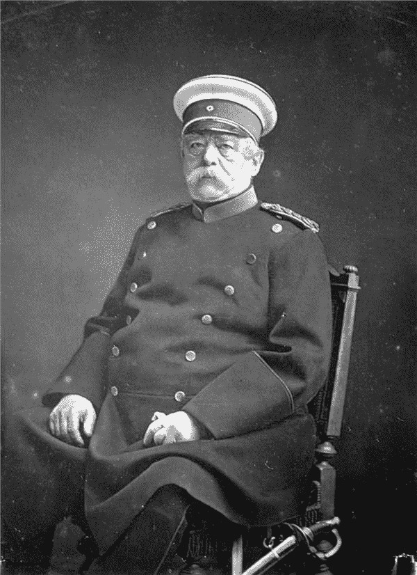

俾斯麦（Bismarck，1815-1898），德意志帝国首任宰相

在德国，一点都不会意外，军事的这种层级架构会那样投射，影响到政府组织，变成了官僚系统（Bureaucracy）。韦伯作为一个德国人，尤其是作为一个在德国如此博学关注政治跟社会的人，他当然很熟悉德国的这一套官僚系统。不过他到了美国，他有了复杂的感受。

他发现在美国会经常遇到非常不可思议、无知的人，美国的无知跟无知的现象简直没有底线，你没有办法预期说这个社会上任何一个特定的个人，他拥有什么样的常识，有什么东西是他一定会知道的。为什么没有底线？因为它是一个自由的社会，是一个民主的社会，没有一种我们可以说称之为叫做"精神上的安全网"。

我们规定每一个人你要活在这个社会上，必定要具备什么样的常识，受过什么样的教育。在教育的过程当中，不管这是学校的教育，或者是社会上的教育，一定要灌注你，让你拥有这样基本的常识。民主或者是美国当时的自由是没有这样的东西，不提供这样的东西，也不可能有任何的强迫的力量，强迫的因素，让人民拥有常识。

自由体制有自由体制的好处，它就不是透过严格的系统去教育出来的，而是每一个人自主自发，在韦伯称之为叫做"俱乐部式的团体"当中去磨出来的。这种自发锻炼出来的人才，其中有一些是绝对在欧洲看不到的，拥有非常惊人的程度，拥有开阔恢宏的视野，那就是因为他们是替自己负责的，在相当意义上面他们都是自学出来的。

#### 松散的社会和高度官僚化的政府

但也因而，他又发现很奇怪的，不在他的预期当中，照理讲这是民主，这是自由。所以民主、自由所建构起来的政府一定跟那样高度军事化，德国人所建立起来的政府非常非常不一样。

然而他所看到的却是，虽然美国是一个民主的社会，是一个自由、松散的社会，但是美国的政府却越来越官僚化，或者说，美国建立的也是一个官僚式的政府。这种官僚式的政府，就和这样的一个社会，尤其是这个社会当中的工人阶级产生了非常严重的冲突。

为什么连民主的国家都会有官僚体制？这个官僚体制显然就不是来自于特定的政治的思考，而是来自于跟资本主义相连的这样的一种社会的力量。

这个社会的力量最核心的就是工具理性的发达。因为工具理性发达，所以要讲究效率。要讲究效率，你就会发现在组织上越是平等的，越是松散的，就越没有效率。所以你把它层级化了之后，上上下下依照公文依照命令把它给锁起来，这个时候就开始产生官僚组织，而官僚组织就能够彰显出效率。

于是韦伯这个时候对于社会跟政府组织之间的关联，他也有了新的突破性的观察。所以等到他回到了德国之后，他就做了一件关键的事，他完成了《新教伦理与资本主义精神》这一本书，而且他特别对于美国新教的这些教派跟他们的教义多所着墨，他写了很多，而且写得很细。这个时候他在探索的也就是基督新教跟资本主义之间的一个特别的连接，可以称之为叫做近代志业文明。

韦伯《新教伦理与资本主义精神》，理想国

#### 职业和志业的区别

他特别凸显了在德文里面称之为叫做志业（德文：Beruf），在《新教伦理与资本主义精神》这本书里面，这个字一直不断地重复出现，如果读的是英文译文，译作 Calling，如果是中文那叫做"召唤"。什么是 Beruf？意味着过去传统的社会里，宗教是人最重要的召唤。召唤意味着你做这件事情不是出于无聊的动机，不是功利的动机，这件事情是好像上面有一个超越的神秘的至高无上的声音，在叫你，告诉你要做这件事情。

那么从 Beruf 而产生在每一个个人身上所做的称之为叫做志业的选择。志业是相对于职业的。过去在传统的社会里非常清楚，一个人有你的生活，有你的职业，但同时每一个人有你的宗教的信仰，所以召唤是在你的宗教的领域上。可是到了新教当中，因为你必须要自己直接去面对上帝，你相信上帝把你生在这个世界上有一个特别的目的，于是把你放在俗世里面的目的就形成了新的召唤的内容。

资本主义精神其中的一个来源，也就是感觉到上帝把我生在这个世界上，就是给了我一个召唤，要让我成为一个好人，成为一个义人，成为一个成功的人，利用我在这个世间的成功去做一种示范。然后因为这样，上帝在我死了之后，他就已经帮我选好，帮我安排好了，可以让我上天堂。在这里有世俗的领域，有宗教的领域，但是到了新教当中，世俗领域的职业跟原来宗教当中的召唤，就越走越近。

于是从这里，尤其是更进一步，上帝的重要性一直不断地撤退，本来上帝所管辖的领域现在必须要重新安排。如果没有上帝给予我们的这种召唤，人要如何过下去？所以在这个转折的过程当中，在现代的社会里，就把原来宗教领域当中的召唤放到了世俗上。

资本的累积跟资本的成长，这些最早出现的资本家，那就是他们没有把他们的工作、他们的钱当做是世俗的事情，而是相对的他们采取了一种志业的态度。从一个角度来看，他们努力地赚钱，这看起来是最世俗的事情。  
我们认为赚钱是最世俗的，一个人如果要清高就不要赚钱。可是对这些人来说的确非常奇怪，他为什么要赚钱？他赚钱本身是一个目的，是为了要服侍上帝，为了要证明自己。

我们为什么会觉得赚钱是世俗的？因为我们都是把赚钱当做手段。赚了钱之后我就可以不要再工作了，赚了钱之后我可以去环游世界，赚了钱之后我就可以每年买房，这是一种世俗的态度。可是在这样的一个转折的过程当中，产生了另外一种新的态度，那就是把你的工作视为是召唤，工作本身是目的，而这种作为目的的工作，当然在人的内心里面会刺激出更强烈的动机。在投入这种工作的时候，你会有更强大的热情，你在这种工作的领域里面，你往往也就能够有更杰出、更精彩的表现，也就更容易成功。

所以现代的资本主义社会从韦伯的眼中看出去，就比马克思所看到、马克思所分析的要复杂得多了。人有职业，但人另外有志业。而且人的职业跟志业会在这样的一个现代社会里面它产生非常复杂的互动，乃至于紧张、冲突的关系。因此要认识这样的一个现代的社会，韦伯提醒我们，我们也要找到途径，找到观念的工具来分析这样复杂的现象。感谢你的收听，我们下次再会。

# 5\. 马克思解释不了的问题是什么？

大家好，我是杨照。我们继续来讲韦伯对于资本主义的解释。当然，这还是必须要联系上马克思。因为马克思，尤其是他的《资本论》，是让我们能够思考、能够理解资本主义到底是什么，最重要的一个来源。

#### 资本主义有特殊的精神吗？

韦伯在一件事情上他完全承袭马克思，那就是把资本主义视为非常特殊的一个历史现象，也就认定了资本主义是一个特别的人类的历史阶段。但在这个命题的前提以下，韦伯所要提出来的推论和答案就非常不一样了。

当他在看待探索资本主义的时候，反映在他的名著《新教伦理与资本主义精神》里，他清楚地表明，他不是要讲资本主义本身，他要讲的是更核心、更内在的资本主义精神。这意味着如果我们不能够去探索资本主义背后的精神  
\----资本主义系统当中人们主观所选择的意志、主观的价值跟主观的意义----  
如果做不到这样的事情，那光是从资本主义的外表，就没有办法落实马克思所提出来的这样的一个命题，确切地把资本主义解释为、认知为人类历史上非常特殊的现象。换句话说，韦伯认为马克思描述资本主义的方式不足以真正落实、真正支撑马克思自己的论断。

马克思说资本主义很重要，资本主义跟人类历史之前曾经出现过的生产经济，乃至于社会的系统都非常不一样。马克思把文化、精神、思想、信仰当做是上层结构，是由下层结构来决定的。当马克思要看、要讲、要解释资本主义的时候，依照他自己的理论，他从资本主义的经济面、生产面开始讲起。对马克思来说，资本主义最特殊、最独特的地方在它的生产方式。

所以为什么当我们依据马克思的理路，用马克思的论述一路讲下来的时候，一定先从资本开始讲起，从工业化、机器、机器生产所产生，机器生产所延伸出来的工厂制度，产生了劳动力，然后到劳动阶级、工人阶级等等。我们是用这样的顺序，用这样的方式来描述资本主义的。

而韦伯不一样的地方，是他认为，如果像马克思一样，把意义、信仰、思想、观念当做是这种经济生产方面元素所决定的话，你就看不到资本主义最特殊的地方。

现代资本主义最特别的地方就在于它的"精神"。这个精神是什么？表面上看起来，或纯粹从字句上，我们会觉得精神很抽象。然而韦伯的这本书重要的成就，也就在于具体地告诉你，你可以掌握到、触摸到资本主义的精神。

当然，我们也可以问问自己。不管有没有读过韦伯的这本书，你如何体会、你如何认知，比如说现在你所处的社会，它有非常高度的资本化的这部分，这部分背后有一些什么样的精神吗？如果我们要去掌握要去描述这种精神，你会用什么样的语言、用什么观念来陈述呢？

如果大家对这方面有任何的想法的话，非常欢迎你在我们这期音频节目的留言当中告诉我们，你认为什么是资本主义的精神？资本主义所形成的社会有什么样的特殊精神吗？

#### 马克思的理论难以解释的宗教

在韦伯的书里面，他是用非常严密的推断一步一步地跟我们说，向我们呈现。所以，如果我们要完整地理解韦伯的推断，诚实地说，我们不能从《新教伦理资本主义精神》开始读起，我们还要把这本书放在韦伯他自己思想更庞大的系统底下。这里有另外一个参考的资料，那是叫做《宗教社会学论文集》其中的第一卷。

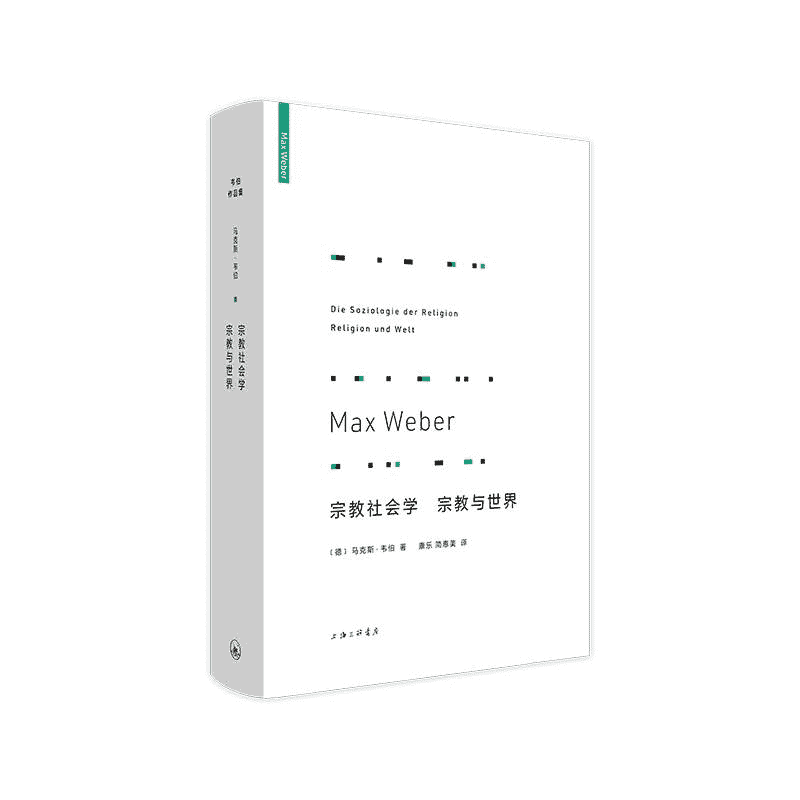

《宗教社会学  
宗教与世界》，理想国出版，收录了韦伯《宗教社会学论文集》部分内容。《宗教社会学》偏重理论的构架，带有提纲挈领的性质，可谓韦伯整体宗教社会学研究的一个凝缩本。《宗教与世界》所集论文是韦伯为基督新教、儒教与道教、印度教与佛教以及古犹太教等研究所写的序言。

《宗教社会学论文集》有一个前言，这个前言解释了要如何研究宗教社会学，以及研究宗教社会学的意义和作用在哪里。为什么要研究宗教社会学？因为宗教太重要。

我们不能够像马克思一样，把宗教当做是生产制度底下的一个反应，是被底层、下层的生产结构所决定的一种上层结构的现象而已。宗教或者是思想，它不见得都能够被用下层结构、用跟经济之间的关系来解释的。宗教跟信仰没有必然一定会跟下层结构，用这种方式产生因果关系。因为甚至很多时候是倒过来的。在《基督新教伦理与资本主义精神》书里面，也就是要呈现这样的一种倒过来的关系。如果没有这种精神，这种精神相当程度还来自于基督新教伦理，就不可能彰显，也不可能决定我们所看到的现代资本主义的特殊的面貌。

更进一步的，这个前言告诉我们，《新教伦理与资本主义精神》不是一本独立的书，它是属于宗教社会学这个更庞大的项目其中的一个部分，其中提出的一段解释。而作为一个社会学家，韦伯为什么要用这种方式研究宗教？那是因为还有一个更大的架构，宗教社会学是这个架构底下的一个部分。

所以他的大的社会学的关怀底下，有一个部分是宗教社会学，在宗教社会学里面才有另外这一块，是安放了《新教伦理与资本主义精神》。我们今天读这篇前言就会非常清楚知道，他跟马克思一样的地方，那就是他很认真地看待资本主义作为一个新鲜的、独特的历史现象。

但是对这件事情他非常严格，这是韦伯式回答问题的方法----  
他很少、很难直接就去回答他自己问的问题。在他的思考方式里，他往往就会讲到，要解答这个问题，必须要先把它的上下文前后的脉络把它铺陈起来，把这个问题放进到对的脉络当中，让它脉络化了之后，我们才能够更准确地来探索，更准确地来呈现这个脉络。

#### 历史五阶段论是人类社会的通则吗？

所以他要提供的这个脉络是什么？如果我们把资本主义脉络化了之后，韦伯要连带问几个重要的问题，才能够解答到底在历史上资本主义如何独特。

第一，什么是独特，到底多独特才叫做独特？这听起来好像是一个废话问题，但是如果你了解韦伯的理路，你就会知道他找到了一种方式解答这个问题。

当我们在讲资本主义的独特性，依照马克思的思考理论，那是以在过去的人类历史事件当中从来没有出现过资本主义，当做它独特性的保证和描述。不过到现在我们已经非常清楚，这是资本主义被放进到马克思的历史唯物论当中所产生的结论。也就是马克思在讲历史的时候，他讲，从原始共产主义到封建制，再到资本主义，再从资本主义还要往下到达社会主义跟共产主义。

当然，这五阶段论是后来斯大林所律定的。不过在马克思的唯物史观里面，的的确确有这样的阶段观，只是每一个阶段怎么接另外一个阶段，还有，到底总共有几个阶段，在马克思的书里面，在他的著作里，并没有像后来斯大林认定的那么清楚。这又变成了一个阶段论的公式，这是从西方文化、从西方的历史里面整理出来的。但是马克思非常自然的假定这一套阶段论是放诸四海皆准的，要不然他也就不可能宣称这是一个科学的结论。

但是马克思缺了一项韦伯很看重的努力，那就是他并没有去研究，其他的文明是不是都依循的这样的一个模式，他只是理所当然地从西方得到的历史的看法，他就把它延伸，当做是历史上普遍广泛的现象。这相当程度上，也就是来自于马克思作为一个哲学家，他最根底的这个首要的身份。

我在解读马克思的时候，一再地提醒大家，他是个哲学家，他的背后是黑格尔哲学。这是黑格尔哲学的思考的方式，认定历史有它的定则，有它的定规。马克思在这上面，他并没有作为一个历史学家去进行实证的调查跟研究。从研究跟理解西方历史得到了这样的一个规律，马克思理所当然认为他不需要去问这个定律到底是不是可以拿来当做普遍的人类公式。

马克思不是没有意识到别人对他的挑战，但一来十九世纪这种挑战的强度相对有限，也就意味着整个欧洲，对于欧洲以外、西方以外的历史知道得很少，所以就算要挑战马克思，也不可能有太大的强度。绝大部分在进行对话的人，他们都是在同样的知识传统底下，不太可能有人可以强而有力地告诉马克思，说中国不是这样的，印度不是这样的，我们所知道的其他某一个文明不可能是这样的。

因此，虽然有质疑，虽然有挑战，但这种质疑跟挑战并没有太多实质确切的内容。那也因为这样，当遇到了挑战，马克思也可以用非常松散的方式来应对。比如说马克思就写过、讲过好几个他从来没解释清楚的名词跟观念。

比如说东方专制主义。东方专制主义是拿来解释东方的历史，因而没有像西方历史那样的一种发展，还是在告诉我们，其实东方的历史的发展和西方完全一样，这是人类的通则。我们以为不一样，或许只是因为表面有让我们造成误会的东方专制主义。这两种论点都曾经出现在马克思的著作当中。

除此之外，另外有一种叫做亚细亚生产方式，或者是东方生产方式。亚细亚生产方式来自于亚洲，来自于东方。但这到底是什么？跟马克思原来说的，已经当做是人类通则的这套生产方式模式的改变，这彼此之间的关系到底是什么？我们只能够确定，马克思意识到有一些东西、有一些材料他没有办法放进他已经形成的这套系统当中，所以他必须处理这些例外。

可是这些例外，又来了，到底有多例外？马克思并没有下定他的决心，一直到他去世之前，在他的理论底下，只有这一条通则。他承认不能解释所有的现象。

#### 韦伯的探索：西方文明有多独特

但是在这里，韦伯和马克思就非常的不同。韦伯产生了不一样的意识。他认为资本主义的独特性，不只是历史上的独特性，更重要的是文化上的独特性，这两者必须放在一起看。

当他说，资本主义是有文化上的独特性，它是属于西方文化的。在这样西方文化底下的特定历史时刻，才产生资本主义的现象。更进一步的，当他要问，什么样的独特叫做够独特，把这个问题放到普遍的大问题当中，这是马克思所没有的一种意识。

西方文化是他们所处的，也包括基本资本主义之所以诞生的这套系统，但这套东西有多特别，必须要拿来和其他的文化相比。跟其他文化的相比就可以比较明白、准确地去说，西方的文化是不一样的吗？是独特的吗？有哪一些地方是不一样的，有哪一些地方是独特的？因为这样的一种思考的特性，使得韦伯变成了这么重要的一个思想家。

因为他要一直不断地证明，一直不断地细化、深化他自己的问题，把问题弄得更明确。可是当他在思考跟论理的过程当中，他把问题一直不断地弄得越来越复杂、越来越庞大。本来要探讨资本主义独特性的问题，这个时候就放进到探讨文化，尤其是西方文化独特性，这样一个更庞大、当然也就更难解答、可是在相当程度上更加有意义的问题当中。这是韦伯特殊的思考模式。感谢你的收听，我们下次再会。

# 6\. “科学”和“西方的科学”有什么不同？

大家好，我是杨照。我们从马克思跟韦伯的对照凸显出一件事情，那就是韦伯他对于世界史的兴趣远远超过于马克思。他提出了几个重要的问题，关于世界史，那就是西方世界曾经出现朝着具有普遍性意义跟价值方向发展的一些文化现象，这中间应该要归咎于什么样的因果关系？这句话用这种方式念，听起来很复杂、很难。我们稍微解释一下，韦伯这句话在讲什么？

他的意思是，当我们"今天"在面对，今天指的是他自己所处的 19 世纪末 20 世纪初，在讲西方文化的时候，这个普遍跟独特（particular），究竟应该要如何区分？

然而在这里就必须要非常小心了，因为放在世界史的规模跟架构底下，我们必须要去确定，这真的是普遍的在不同的文化当中都产生吗？还是因为西方已经有了这样的现象、这样的事物，被推广到其它的地方之后，才变成其它的地方到处都有？如果是这样的话，我们就不能在定性上把它定为普遍，我们还是必须要回来，把它当做是西方的一种独特的现象。

#### 凭什么说只有西方有"科学"

我们到底要如何去判断一个文化它所产生的各种不同元素、以及这些元素所发生的关系到底是独特的，还是普遍的？韦伯就举了例子，比如说科学，在西方之外到底有没有科学？这是一个好庞大的问题。在这个问题底下，让我们更关切的是更特定的一种问法，比如说中国到底有没有科学？当然我们就会回溯，必须要想到有位了不起的英国的学者，叫做 Joseph  
Needham，他的中文名字叫做李约瑟。李约瑟花了他一辈子的力量去整理，然后集合了这一群专家，一起写了《中国的科学与文明》，这是一大套书。《中国的科学与文明》光是看书名你也就知道，这就是李约瑟非常强烈的一个态度。他告诉我们，在中国是有这些科学的现象。李约瑟挑战，许许多多人认定的"中国没有科学"的这个说法，他把所有的这些资料罗列出来告诉你，中国有科学。

不过如果我们把李约瑟一共 7 大卷、13 册的《中国的科学与文明》全部看完了，你也就进一步能够了解，像韦伯他所要提的这个问题，李约瑟的著作没有办法回答。因为他要说的是，只有在西方，科学能够发展到一个我们今天称之为普遍有效的程度，其它的文明，例如说印度，印度有非常发达的数学，这是绝对毫无疑义的。比如说中国，甚至古代的巴比伦、埃及，埃及例如说很早就发明出为了要测量尼罗河每一年泛滥的高度，这牵涉到非常复杂的面积、体积了，乃至于方位的衡量。这些都是经过归纳的知识，就更不要讲说这些文明当中他们有深奥的哲学，他们有神学的智慧，也有极端精致的学识跟观察。

然而，巴比伦的天文学，却缺少了希腊人首先发展出来的那样的一套数字计算的基础。当然这个事实更凸显了巴比伦天文学、星象学惊人的发展；印度的几何学则欠缺理性的证明，这又是源自于希腊文化的一种产物，这样的一个文明的发展也创造出力学、物理学；印度的自然科学从经验观察的角度来说，有它高度的发展，但它也没有理性实验的这一部分，近代的实验室并不存在于印度；印度的医学尽管在经验技术的层面有高度的发展，但就没有发展出学普遍的生物学，尤其是生化学跟化学结合在一起之后的这一门学科；至于理性的化学，除了西方之外，一概不曾出现在其它的文化地区。

这意味着韦伯有一个非常明确的区别，什么叫做西方的科学？西方科学的独特性在于普遍有效，还有它普遍有效的特殊程度。

#### 只有经验，没有原理不叫科学

李约瑟所整理出来的中国这些科学的证据，还是要经过韦伯所提出来的基本标准的考验，那就是它到底是一种有效的知识，还是一种普遍有效的知识？例如说中国人知道怎么制造火药，中国人知道怎么制造水车，但这不是科学。不管是火药或者是水车，是符合我们今天对于这些东西的科学原理，因而制造出来的，可是这样的科学原理的知识，在中国并没有被抽象地推论出来----

意味着没有人去探索，也没有人会在意它背后是不是有一种放诸四海皆准，不管你是大水车、小水车，各种不同水车在不同的环境里面，不管你的火药应用在什么样的地方，用什么样不同的成分去制造，它是不是有一个都一样的原理？也没有这样的一种冲动，要去发展出一种方法来试验，到底我们造的水车它的有效性可以到达什么样程度？火药的有效性又可以到达什么样程度？中间需要控制哪一些变数？如果缺了什么样的变数或者哪一些变数做了改变，火药就不再是火药，水车就不再是水车了？

在中国的知识系统里面，没有这样的东西，但是在西方的科学里，这是再重要不过，那就是讲究追求"普遍有效"。到了任何地方，在任何的状态底下，由任何人来做，由任何人来观察，由任何人来进行实验，都是统统得到同样有效的结果，这才叫做科学。

用这样的一种标准，把这一套知识和人类曾经存在过的其它的知识普遍地区隔开来。韦伯特别强调，如果我们用这个标准在这个态度的要求上，就只有西方有这样的科学。

其它的地方都能够发展出有效的知识，来自于经验，来自于观察。但是巴比伦的天文学来自经验，来自观察，就不是牛顿的物理学。牛顿把我们从天文上所观察的所有的这些现象，变成了数学公式。这个数学公式关键之处在于，累积了几百年、上千年的这些观察的资料，哪一颗星星在什么时候会在什么样的地方，把它们全部加在一起，早在巴比伦的天文学，就可以观察记录所有这些变动，但这不叫做科学；必须需要把所有这些东西交融在一起之后，找到了这个公式，接下来在公式统纳了之后，你就根本不需要这些资料，这是科学的普遍有效性。

而且科学的这种普遍有效性，更进一步的，牛顿发现、定订了他的物理学公式之后，我们还有非常明确的方式，可以去检验到底对不对。而且可以换不同的地方、不同的状态，不同的人来观察，不同的人来做实验，通通都不会做出关于这个定律不一样的结果。这就不只是普遍有效，而且是彻底普遍有效，我们要用这种方式去分辨。韦伯坚持，而且还定订了这样的一个标准，我们要用这种方式去观察，去区别，文明跟文明之间到底应该要如何比较。

#### 西方音乐独有的理性

接下来他又提到，同样的现象也可以在艺术上面发现。在历史上其它民族，聚焦在音乐上，每一个民族对于音乐的敏感通常都有高度的发展，至少不比西方来得差。各种形式的多声部的音乐存在在世界很多的地区，各种乐器的和奏、和声的伴唱也都可以在其它的文明当中找得到。在音乐当中具备的音符的长短，接下来产生合理的节拍，其它的民族也都曾经计算出来，并且予以运用。

但是就有某一些的特色就只出现在西方的音乐，例如说理性的和声，这是大三和弦三重泛音，也就是一般 do、mi、sol，我们说这三个音所加在一起的三重泛音，用这样来组织音符的对位法。接下来有和音和声法。从文艺复兴时代，接下来又发展出半音阶，后面又产生了十二平均律，还有异名同音法等等。这都是来自于十二平均律，把本来不是平均的物理的振动予以平均化了之后，产生了 12 个大小调，大小调就有了各种不同和声上面的运用。

这就从来没有出现在其它的文明了，因为这是一种理性的安排。理性安排最清楚地显现出来，前面是巴洛克音乐当中的通奏低音，有时候我们又称之为叫做数字低音，它是固定的一种和声的模式。因为它很固定，所以可以用 1、2、3，用数字来予以表达。

另外一个非常重要的现象，那就是记谱法。记谱法使得西方近代音乐的创作和演出能够集体持续地存在。他要讲的是，音乐看起来像是一个普遍的现象，各个民族、各个文化都有音乐，但这并不表示西方的音乐跟所有其它地方的音乐一样。西方音乐很不一样，基本上没有任何一个民族，没有任何一个文化，音乐是基于如此完整严谨的乐理。

音乐在其它的文化当中，还是靠经验，靠技术来演奏、演唱。这是其它文明、其它民族，他们的音乐跟工匠之所以会有这么密切的关系，是用一种工匠式的经验来进行作曲，来完成音乐。但只有西方不是，西方的音乐是其中的理性特别被提炼出来。这套乐理是普遍性的，所有的乐曲都依照这套乐理，但这一套乐理不属于任何特定的乐曲。乐理的存在是用理性的方式，从众多的乐曲当中把它给提炼出来，这又是西方文明和其它各个地区的文明不一样的地方。

#### 感染各地的资本主义，又产生了怎样的变化？

所以韦伯认真地看待，第一，如果我们要主张资本主义是一个特殊的历史现象，我们一定要弄清楚到底有多特殊。要弄清楚到底有多特殊，就要弄清资本主义跟西方文化的独特性中间到底是什么样的关系。

更进一步的，这样西方长出来的独特的资本主义的文明，它蔓延、发展、扩张到其它的地区，当我们在讲现代社会、现代文明的时候，那我们又要如何认知跟理解？

例如说资本主义进入到中国之后，有多少放诸四海皆准，全世界的资本主义系统都一致的现象在中国也会同样发生。

但是我们要区隔，有一些资本主义的元素、资本主义的作用进入到中国之后，被中国给改变了，或者是在中国产生其它不同的社会不会发生的效果跟冲击。所以这就是普遍跟独特贯穿韦伯所有的历史、还有社会学的思想。

所以我就把这个问题留在这里，看看大家有些什么样的想法。我们今天所处的这样的一个世界，有多少是普遍的资本主义的现象，又有哪一些即使是资本主义的冲击之下，仍然是有中国的独特性的？而且这独特性分成两部分，一个是资本主义进入到了中国之后所产生的变形，另外一个是资本主义侵入到中国之后，只有在中国的社会对中国社会所产生的影响跟变形。

关于这个问题，如果大家有任何的想法或者是任何的困惑的话，都非常欢迎你写在我们这一集音频的留言当中，让大家一起参考，一起来讨论。感谢你的收听，我们下次再会。

# 7\. 为何韦伯说资本主义不是贪得无厌，而是节制？

大家好，我是杨照。我们继续来介绍，韦伯对于资本主义如何起源，以及在资本主义底下，如何形塑了一个现代社会的探讨。

#### 官僚体系：西方的特殊产物？

韦伯非常重视传统社会和现代社会之间的划分。在《新教伦理与资本主义精神》当中，他的前言提到了这么一段，他说没有任何一个时代，任何一个国家，有如同近代西方这样，让生活上的政治技术和经济的基础条件，就是对我们来说整个生存的主要的内容、主要的成分，无可避免地、近乎绝对地落入受过训练的专家所构成的官僚组织网络底下；技术性的、工商业的，尤其是法律上具有专业训练的国家公务员，成为现代生活当中，最主要的日常技能担当者。

为什么官僚体系这么样的重要？对于韦伯来说，官僚体系也是非常特殊的西方的现象，后来跟随着资本主义感染了全世界。在现代生活里，工具理性非常发达，这是西方最特别的一种精神，每样事情都要去追求，找到最符合理性、最好的一种做法。

要最符合理性最好的做法，那就需要有专业。在社会的运作当中，要能够去找到最好的这种方式来运作，也就表示来管辖社会运作的人，应该要具备这种专业的能力。这种专业的人，他们就凌驾于、超越于一般日常生活当中，我们从经验里面所得到的这些习惯。

回想上一集音频节目当中，跟大家讲到的西方科学的例子，音乐的例子，你也就清楚这意味着什么。意味着过去在传统的生活里，我们是从累积经验当中去摸索出生活的方法，换句话说，那是知其然而不知其所以然。但是在西方理性发达的精神底下，不能够接受"只知其然而不知其所以然"。所以在经验的背后，必须要去追溯知识，在知识当中又要特别去区分，什么是普遍有效的，而且有效性越高越绝对，这种知识的层级也就越高。

在这种状况下，组成社会、运作社会就有了价值上面的区分。我们相信在社会的运作上，不应该依赖，不应该诉诸于单纯的经验，你要锻炼经验去找到知识，你更进一步地还要从知识当中去锻炼出原理原则，靠这种原理原则，然后铺展了知识，来安排社会生活。

这种社会生活的安排，当然不可能靠每一个人，那要靠什么呢？就是要靠一群人，把我们的社会运作跟社会的进行，把它给组织起来，把它定订下来之后予以管理，这一群人就是专业者。而由这群专业者构成的社会管理者，就形成了官僚体系或者是官僚组织。

#### 被专业宰治的社会生活

讲到这里让我们稍微思考一下，那就是讲到了我们的生活被专业管理的这件事情，我希望大家愿意环顾一下，你自己当下现实的生活，然后可以去区分。因为这就是韦伯要提醒我们的，到底在我们的生活当中，有多少是你自己透过经验再决定的、再控制的，又有多少其实是你的经验是远远不足，你必须要靠很多的专家，而且这些专家已经在社会的肌理，在这个社会环境（matrix）底下布满了各式各样的指导，我们其实很多时候，在很多的领域，根本不能够自己做决定，我们是依循着专家已经帮我们安排好的这些规律，照着去做。另外你自己是不是也在这样的一个生活环境里，扮演什么样的专家，在帮别人定订这样的规律规则呢？

另外一个稍微更高一点，但也是更复杂的一个层次，比如说在国家政府管理的这个领域，它到底是如何形成的？那非常复杂的，不管是党或者是国家的官僚体制发生什么样的关系？

如果大家对于生活的专业管理，你想到了一些什么样特别的例证，或者是你有些什么样的疑惑，也非常欢迎在这一集音频节目当中的留言板告诉大家，让我们一起来思考，一起来讨论。

#### 资本主义的双重独特性

韦伯接下来又告诉我们，特别提醒，每个社会都有身份，在社会里面的成员，主要是依靠他的身份而组成社会的。但是西方社会在看待身份上或者是身份的安排，也和其他的社会不一样。韦伯的基本论点提醒我们两件事：

第一，当我们看到许多类似的现象的时候，不应该自然地就当做这是普遍的，大家都有音乐，我们就把音乐当做是普遍性的，用这种方式我们会找不到独特性。

第二个重点是，在寻找独特性的时候，韦伯的观察和他的分析，是清楚地断定西方文明的独特性。西方文明是独特的文明，它的独特性相当程度上是建立在它的理性基础上，这也就构成了韦伯在历史社会学上，他所要追索的大问题，那就是西方的文明到底如何形成它的这种在理性基础上面而发展出来的独特性。

在这方面韦伯自身也就是这种西方文明的产物，他不会停留在经验上的有效性，他要去追索文明表面现象后面，即使是表面类似相同的现象，都要透过更深一层的原理原则的追索，而找到它的独特性。

他接下来在这样的一个背景，才讲到了资本主义。

近代生活里具有最决定性力量的，那是资本主义，而资本主义的独特性，显示在一个双重结构上。马克思只是把资本主义放进到历史里，所以我们回头看，之前所有的历史从来没有出现过资本主义，但韦伯认为这样是不够的，他要特别讲，在这样的一个西方文化当中，而且是特定的这个时期，他才产生出资本主义，这是资本主义的独特性。

所谓双重结构，意味着这是在特定的西方文明当中，另外是特定的一个历史时期，这两种特定的因素决定了资本主义它本身就有独特性。我们要能够了解并且进而去探索双重的独特性，对韦伯来说，才算是真正认识了资本主义。

#### 单纯逐利，不足以说明资本主义的特色

因为他如此强调资本主义的独特性，进一步形成了韦伯的问题意识，那就是要在《新教伦理与资本主义精神》里面予以解答的，要怎么描述资本主义呢？如果像马克思那样的描述方式，资本主义重要的特色，那是资本的增长，所有的动力建立在希望财富越来越多，希望资本不断增加。

韦伯产生了他的疑惑，或者是说他的怀疑。他的意思是就像科学或者是音乐一样，在不同的时代，在不同的文化当中，我们都可以看得到这种对于私利的追求，希望自己手上握有的财富可以一直不断的增加，这是普遍的现象。如果手上现在拥有两头牛，你就希望这一头公牛这头母牛能够生了小牛，两头牛生了一头小牛变成三头牛，接下来变成四头牛，你就觉得非常高兴，你就会追求让你的两头牛变成三头牛、四头牛，这不能算是独特特殊的现象，所有的其他的文明都出现过这种现象，希望财富可以一直不断地增加。

当然我们知道，马克思并不是用这么单纯的方式在讲资本的增长的，不过韦伯强调，认真去思考，如果我们只看财富不断增加的这件事情，这不是独特的，每一个文明都有这种类似的现象。既然它是如此的普遍，我们不能把它当做资本主义的描述，尤其是我们不能拿这样的因素，来解释资本主义的独特性。

明明在不一样的社会不一样的文明，有两头牛的人，都会希望两头牛变成三头牛，甚至变成十头牛。所以追求资本增长的动机并不是那么样的特别。当然我也要稍微提醒一下，比较详细的说明，还是要请大家回头去听《你好，马克思先生：资本论及其所创造的世界》音频节目的内容。

点击图片跳转

资本主义对马克思来说，就有一个关键的差异，比如说如果我们是用一头牛、两头牛、三头牛到十头牛来思考，跟我们用 10 块钱、15 块钱到变成 200 块钱来思考，马克思他就是要强调这中间是不一样的。经过了货币的中介，然后让货币的增长，而不是实际物品的增长，成为你追求的目标，这相当程度上面是资本主义体系里面的特殊性。

不过韦伯的思考不太一样，韦伯的意思是不管用牛还是用钱，它的共通性在于增长。大家都希望财富增长，我们不能用这个方面，来律定、来描述资本主义。如果光是看这一面，资本主义没有那么清楚的独特性。更进一步，到底资本主义的独特性在哪里呢？

#### 节制欲望，才能让财富理性增长？

于是韦伯提出了这样的说法：无止境的盈利欲并不等同于资本主义，更加不是其精神所在。反之，资本主义恰倒可以等同于对这种非理性的冲动的抑制，或至少是加以理性的调节。

这段话讲的是什么？资本主义非但不是我们刚刚所说的那样，当我手上拥有什么，我都希望它可以膨胀可以增长的这种欲望。资本主义最特别的地方来自于它的吊诡，它背后的这一份根本的精神是压抑这种欲望的。

资本主义怎么可能会压抑要增长的欲望？不是，他是要追求用理性的方式来增长，而不是任何的增长都是符合资本主义的标准的。回到刚刚前面所提到的例子，全世界各个地方不同的文明都有共同的欲望，有两头牛的时候，希望增加变成三头，有三头希望可以增加到十头。那资本主义是什么？资本主义是我不会光是去想，两头牛变三头，三头牛变十头，我要去确认，究竟是运用了什么样的方式，什么样的手段，合理的方式，合理的手段，让两头牛变成三头牛。

换句话说，重点不在于两头牛变成三头牛、十头牛，而在于经过理性思考的方式，所取得能够让财产增加的方法，是把这个关键的重点放在道理、放在"方法"上。

从这个角度上来看的话，资本主义就跟前面所提到的西方的科学要追求普遍有效的方法，或者是西方的音乐要寻找一种超越、同时是整合所有乐曲背后的音乐的道理，它就并合在一起，符合同样的一种精神。

所以资本主义精神，意味着跟前面所说的科学、音乐、艺术是一样的。从表面的现象看，有它普遍的一面，每个地方不同的文化，他们都希望增加自己的财富欲望，这是一致的。但资本主义很奇特，当你有这种财富增长的欲望的时候，不是直接用经验的方式去增长财富，而是要先用理性去检验，这种欲望要用什么样的方式才能够达成。

而节制欲望最重要的力量，就在于你判断、而且了解了，某一些手段是不可以用是不应该用的，因为它不符合理性。所以为什么说要节制欲望？因为欲望可能引导我们，包括在经验当中，让我们相信一些非理性的做法，可是资本主义就是要排除这些非理性去满足欲望的方式。

所以在这里关键的独特性是理性的介入，是在理性的追求中寻求资本的增长，那相应的行为就是以资本计算相应的行为，也就是以资本计算作为取向。因为资本计算全部化成为金钱化，化成为投资，去了解投资的增长。进而韦伯会讲到，发明了像簿记、会计这样的方式来记录资本的增长，这是最理性的。

所以在这里韦伯用了很不一样的语言，很不一样的观念，为我们重新描述资本主义，最重要的是重新描述去揭露资本主义最特殊的地方。感谢你的收听，我们下次再会。

# 8\. 谋杀五先令的人，不配做资本家

#### 资本家是一个什么物种

大家好，我是杨照。在讨论资本主义的时候，韦伯非常看重的是理性在财富资本增长上的介入，也就是说行为进行的次第，是有计划地运用作为盈利的手段，在个别企业最后决算的损益平衡表上，最终收取额资产的货币价值要能够超过原来的资本。

这段话的意思是，财富增长的欲望在资本主义当中只能够在特定的形式下被完成，这个特殊的形式就是最后算出来在会计簿计上能够以理性的方式予以确认的，这种财富的欲望当中夹杂了很多东西。

我们说一个人如果拥有两头牛，自然会希望两头牛变成三头牛。这个时候如果这两头牛这个时候生出了一只小牛，我们也有可能做不一样的决定。例如说我有可能这个时候就来举行一场盛宴，把所有的人统统都找来，邻居、亲朋、好友，然后就把一头牛杀了，给吃了，因而得到这样的享受。这同样是欲望的一部分，换句话说，一方面希望增加财富的欲望，还另外一方面要消耗财富，运用财富、享受财富的欲望，通常是并存的。

然而就在这样的例证底下，我们对比看出资本主义的特性。拥有这种资本主义的精神的人，他在意的是今天这个时间点上，加上了一种时间理性的考虑。我有两头牛，重点是要知道一年之后，在特定主观所认定的投资之后，我这两头牛会变成几头牛？关键的重点是这个资本的成长，资本的数字，这个数字是所有的目的，这是资本主义的一种特殊的理性。

在这里我们也可以举一个特别的例子，什么样的人符合大家心目当中资本家的形象？如果有两种形象，一种形象是每一天大吃大喝有很多的享受，住高楼、住宫殿，然后每天有私人的飞机飞来飞去，到处去享受，身边要什么有什么，有美食、有美女、有影星、有游艇，你认为这样的人这样的生活符合你所理解你所想象的资本家的形象吗？

还是另外一种形象？这样的人他每天只睡 5 个小时。其他 19 个小时他在干什么？很多时候他必须要横跨各种不同的时区，再进行不同区域的股票、期货、国家债券各种不同的形式的投资。另外还有一些时间他要管理他庞大的集团，这个跨国的集团光是每一笔账里面有多少不一样的货币，这个货币彼此之间的汇差，对他来说他都必须要算清楚，而且他必须要追求让这个汇差还能够产生新的利润，、不同的利润。

另外他当然要经营事业，经营事业他又要考虑到在经营的过程当中，他可以怎么样从制造上面，行销上面获利。不要忘了，还有另外一方面也很麻烦，他还要注意到他自己公司的股价以及如何创造在股价上面的获利。

难怪他一天只能够睡 5 个小时，即使是他搭了他自己的私人的飞机到处飞，在飞机上面----  
他为什么要搭私人飞机，因为在飞机上他也要一直能够确认他能够及时联系所有他联系的人，进行所有他想要做的交易。而且每一个月，每个季度，每半年，每一年，他要把所有的这些摊开来，跟他的董事们，跟他的股东们报告，报告的重点都是我们原来预期我们是设定的目标是怎么样，这一个月、这个季度，这一年我们达成了多少，什么样的百分比等等。这是另外一种资本家的形象。

我当然是刻意地把他们故意极端化，形成了两个极端，我想问问大家，哪一个比较符合你认为的资本家形象？为什么呢？你可不可以在留言板告诉我说，你如何形成你对于资本家的想象？因为这非常清楚地就我们是如何理解，我们是如何认识资本的，以及资本主义它背后的这种力量。

而这也就是韦伯在讨论资本主义最特别的一点，他要看到的不是资本主义形成了之后，它的运作的模式，它要探讨的是资本主义的精神，而资本主义的精神相当程度上也就牵涉到资本主义到底是如何建立起来，为什么会有资本主义，而不是一般过去在各种不同的文明，各种不同的民族当中，他们借由累积经验而形成的那种增长增加财富的方式。

#### 资本主义的特殊理性：财富应该累积而不是享受

如果我们相对较于普遍的人性，以及其他不同的社会、不同的文明当中的做法的话，资本主义的一种特殊的理性，其实吊诡的是不理性的。也就是资本主义当中他考虑的、看重的是增长的目标，以及如何能够实现增长目标的方法。但相对的，别的文明、别的社会最看重的一部分，那就是你拿这些增长的财富要干什么用，资本主义反而没有那么样看重。对于干什么样这件事情，就不在资本主义的范围当中。

资本主义最重要的目标，它的范围是让原来的两头牛变成 10 头牛，两年之后变成 28 头牛，是这个数字，这个增长以及我找到的一种方法，我到底是怎么养这个牛？在养牛的过程当中我进行了什么样的投资，在投资最后我可以借由这些牛的增长，我可以得到多少的成长，这才是资本主义关切的。

等到长成 10 头牛的时候，这多出来的 8 头牛要干什么？等到长成了 28 头牛的时候，这多出来的 18 头牛要干什么？对不起，这不在当下资本主义的理性的眼光当中被认为是最重要，甚至被认为只是重要的东西。这无法让资本主义那么关切，那这样不也就很奇怪了吗？这奇怪也就充分显现出资本主义的独特性。韦伯接下来在《新教伦理与资本主义精神》当中，他引用了非常特殊的一份文献，要告诉当时的读者，给他的读者相当大的冲击。他逼着读者去看这件事情，我们到底如何面对资本？我们如何面对财富？

看到这段话，认真地看待这样的一种思考的方式，现在都还是会冲击我们。

我们最在意的是这一段时期我所拥有的财富到了下一段时期到底是增加还是减少，这是最关键、最重要，甚至是我们唯一计算的；你不计算，你相对忽略的是什么？等一下我们看那份文献当中的字句，你还会更进一步知道，不只是你不会去计算，甚至被视为是你不应该去计算，不应该去考虑，更进一步的，你根本就不应该去做，那是什么？就是在这个过程当中，因为你自己要追求享受而牺牲、损失了，本来可以累积的更多的财富。所以累积财富本身是目的，并不是为了要享受财富，更重要的是，这是资本主义所产生的一种强迫性，累积财富简直就变成了你的责任。他所引用的这份文献是什么？那是美国的开国元勋之一，鼎鼎大名的本杰明\*富兰克林，富兰克林他的自传当中所讲的一段话。

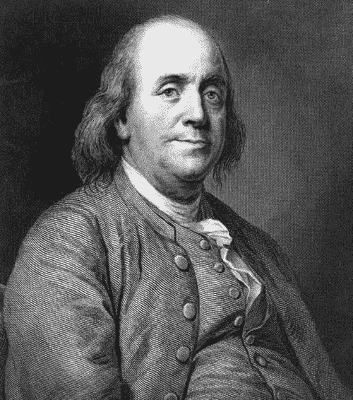

富兰克林（Franklin，1706-1790），美国政治家，《独立宣言》起草和签署人之一

#### 富兰克林：花钱等于谋杀了钱

请大家听听这一段话，先不要讲韦伯的评断，告诉我说，当你这样听到这段话的时候，你认为你有什么样的感受？你同意吗？还是你不同意，你同意或你不同意的理由是什么？

富兰克林就说，你要记得金钱天生具有滋生繁衍性，钱能够生钱。如果这里有 5 个先令，一翻转就变成了 7 个先令三便士，然后一直翻转到一个镑。你手头上的钱越多，翻转滋生出来的钱就越多，所以获利也就节节高升，越来越快。那结论是什么？结论是如果你当下现在你把这 5 先令给花掉了，你就等于谋杀了 5 先令，本来可以帮你滋生所带来的所有的利益，你怎么可以把钱花掉呢？钱花掉了，这个钱就不可能再去帮你赚钱了。

好，你同意这段话吗？

再下来让我们想，如果我现在不能够花掉这 5 先令，我应该要拿这个 5 先令让它一翻再翻，依照富兰克林的说法，一直翻翻到了一个镑。那当我翻到了一个镑之后，这个镑就是我应该可以花掉的吗？如果照富兰克林的说法，这仍然是当下现在的一个镑。这既然是现在的钱，只要它一翻在未来就会帮你挣更多的钱，你又为什么要去花掉现在的一个镑呢？你为什么不留着让它在未来帮你生更多的钱呢？你把钱花掉了，这个钱没有了未来，你自己也就没有了未来。

接下来富兰克林又说，你要做一个准时依照规定付款的人，为什么呢？因为这样的一个人可以在他的朋友当中得到信任，于是他就有了一种特别的能力，特别的条件，他可以去跟朋友借这些朋友刚刚好用不着的所有的钱财。除了勤奋和节俭，再也没有什么比得上，在任何一次交易都守时跟公正，能够有助于年轻人功成名就，依约准时偿还欠款，一刻都不能拖。

这段话表面上看是一个非常简单的道德守则，告诉你说欠债要还钱，而且答应人家什么时候还请你准时还钱，可是这又跟原来传统的道德的说法有一点点不一样的地方，也就是它不是自身作为一个行为目的的训练，它有一个清楚的后续的推论，并不是告诉你说你欠人家钱在道德上你当然要还钱，你承诺人家要还钱，a  
promise is promise，你当然就要按照你所承诺的时间还钱，这是你的伦理责任。

富兰克林不是这个意思，他要告诉年轻人的，相信在我们的音频听众朋友当中，有很多年轻人，所以你们也想一想，富兰克林告诉你说，你如果准时还钱，你就有了信用，你就累积信用作为你的资产，信用就是金钱。因为信用就是金钱，所以人家就愿意把钱借给你，也就等于是人家把他暂时现在用不到的钱，存放在你那里，然后在这种状况底下，这就是当下现在的钱，你就拥有了本来不是你的，现在变成借放在你手上的当下现在的钱。

当下现在的钱，记得，不是让你去花掉的钱，是让你去让它翻。5 先令一翻变成 6 先令，再一翻变成 7 先令 3 便士，他让你去翻，你就翻，翻了就变成未来的钱，未来的钱大于现在的钱。你把现在的钱还掉了，再加上一点点的利息，多出来的都是你的，所以你是一直不断地处于这种现在的钱跟未来之前的这个辩证的过程当中，而富兰克林讲得非常清楚，再问大家一次，你同不同意？

富兰克林就要告诉你说，既然未来的钱一定会比现在的钱更多，未来的钱当然就比现在这钱要来得重要，所以在我们的生活在我们的生命当中，我们要看到未来的钱，我们要看重未来的钱。

因为我们看重未来的钱，所以我们绝对不会随便杀掉现在的钱。所以你不杀掉现在的钱，也就意味着现在你手上有多少的钱都不是真正你的钱，这些都是为了在未来可以有更多的钱，今天才存放在你的手里。而且正因为你会一直让钱这样不断地翻，然后你可以按时在每一笔的交易当中都信守你的诺言，你就可以得到更多的钱放在你的手里，让你一直这样去翻。这叫做资本主义精神。

这样的资本主义精神，是不是符合大家现在对于资本主义的认知跟理解，或者是你正在过的这种生活的规律，是不是有一致的地方呢？然后你是不是已经可以体会到用韦伯的这样眼光看出去，资本主义真的非常独特，甚至应该说资本主义真的很奇怪了。感谢你的收听，我们下次再会。

# 9\. 又理性，又执迷：永远追求财富增长的最优解

大家好，我是杨照。之前已经跟大家介绍过了，韦伯他明确地提出来告诉我们，资本主义并不是源自于我们所想象、所理解的那样一种人的天生的贪念，并不是来自于这样的欲望。资本主义有不一样的，或者说更深刻的一种精神。

#### 簿记与会计：资本主义理性的必然产物

韦伯接下来帮我们定义，这究竟是一种什么样的精神。资本主义是持续不断用理性的经营来追求利得更进一步的，在理性化的过程当中非常关键的阶段、关键的因素，那叫做家计与经营的分离。能够让家计与经营分离开来，很关键的是必须要发明簿记。簿记再升级更复杂一点，就形成了会计。不管是簿记，或者是会计，关键都在于让你能够算清楚投资效益。这个理性是一路贯彻到非常清楚明确的数字上面的。

消费的钱 10 块钱，投资的钱也是 10 块钱，但是你不能把这个 10 块钱跟那个 10 块钱给搞混了，投资的钱必须要留在那里，因为它要在时间当中增长。而且投资的钱从富兰克林的那句名言，我们就可以了解，基本看待的方式是，每多增加一天、10 天、一个月，这个钱就会一直不断增长。这跟消费用掉的钱是非常不一样的。

这是资本主义社会了不起的智慧。因为它要求你要能够控制，控制你的欲望。花掉的归花掉的，投资的就归投资的。因为只有在这样区分清楚了之后，你才能够弄得清楚你的投资到底有多高的绩效。

在马克思的概念底下，资本和时间有非常密切的关系。为什么会有利息？为什么会有债？资本就跟时间联系在一起，时间变成资本的重要变数。马克思用这种方式看待资本主义，韦伯就用更现实、更实际的方法为我们呈现，让我们看到簿记的产生。簿记是比较简单的计算，然而为什么要从簿记更进一步再发展成为会计？那就是为了要处理时间跟金钱之间很复杂的关系。

在绝大部分的文明和社会中，每个人都有欲望，没有人会希望我的财产越少越好。但这不是资本主义。在资本主义崛起之前，大部分的文明、大部分的社会，他们的财产意识并没有连接到这么详尽、这么精确的财产算法。

在财产的形式当中，有一些是你手上就有的，另外有一些是你欠别人的，可能也有别人欠你的，在这样的一个连环关系当中，就只需要一个基本简单的计算。但是在西方资本主义的精神底下，它所发展出来的簿记、会计就有了应收账款，你的资产、负债都必须要分成详细的项目。而且如果你稍微仔细地去看，你就会了解基本上所有的这些项目都是跟时间有关系的。

#### 会计：对时间与资本的复杂计算

这种时间跟金钱之间的复杂关系，只出现在资本主义的系统里面。会计当中重视几件项目。例如说，一边要算资产，一边要算负债。资产当中又分成固定资产跟流动资产，这都是从时间而来的区分。所以产生了簿记是特别的一门技术，再从簿记升级成为会计，那就变成了学问、变成了知识。

在时间的变动过程当中，你的资产和你的负债，彼此之间的互动变得非常复杂，不是那么容易可以确定。缺乏了簿记跟会计的概念，没有这样的技术，没有这样的知识，你就没有办法掌握，到底在时间当中，你的财富状况是怎么样。

像在当前的会计系统里面要分固定资产和流动资产，当讲到固定资产的时候，连带就一定要有一个项目叫做折旧。例如说你现在拥有一个大厂房，你把这个厂房租借给人家，从这里面得到租金。你如果要出卖这个厂房，你花了 300 万元盖了这个厂房，如果这个时候你要出售也许可以卖 350 万，那你每一年的出租你可以得到 40 万的租金。

光是这个数字关系就已经很复杂了，但是在会计当中还要多增加一样，折旧。折旧就是你不能理所当然认为自己现在拥有 300 万，或者是 350 万的一个资产，因为这样的一个厂房它会越变越旧，明年它就不再是 300 万这样的价值了。如果你把你的固定资产明年仍然列为 300 万，这就会在理性的计算上面变成了漏洞。

更进一步的，这个厂房它的使用年限也许是 15 年，15 年之后它会垮下来不能用了，你的 300 万就没有了。你到了 15 年之后，你说突然之间我损失了 300 万的资产，这又是古旧的资本主义之前的人的看法。现在不能这样看，因为牵涉到你如何可以更有效、更理性地运用你的资产，在这样的一个理性的精神底下，会计的方式就是固定资产要扣折旧。如果它只能够用 15 年，那就是每一年必须让它折旧 20 万。

**还不只如此，刚刚讲到了，因为你已经投资了这 300 万，你也就同时要算这个 300 万它本来如果不投资，在这个厂房上它可能有的利息所得。每一年折旧 20 万，同时要算不一样的时间点上，它的折旧发生的时候可能牵涉到的**

比如说你是借钱来盖厂房，它就有不一样的利息要附加在这上面。所以你才会知道为什么现在在大学里面会有会计系，会有会计研究所，需要花这么久的时间去教、去学，这真的是非常复杂的一套系统，而这一套系统构成了资本主义。

#### 理性中的执迷：永远追求最优解

另外在大学里面，在研究所里面学过会计的人也就知道，会计还要一直不断地变化，一直不断地发展。我们也有在学院里面会计的专门的期刊发表了各式各样的论文，那是什么呢？我们可以说它就是源自于资本主义的一种 obsession，那样的一种执迷，而那偏偏又是出自于理性而来的一种执迷。

执迷应该就是非理性的，但是这是一个奇特的变化发展，从理性当中产生了执迷，就是一定要一直不断地追问，这样计算够准确了吗？这样计算是不是漏掉了一些什么样的变数？在这样的计算的过程当中，我们是不是在某一个变数跟某一个变数之间，我们没有运用、我们没有发明更好的公式？

所以会计一直不断地在发展，这是资本主义其中的一项重要的特色，在手段上面高度理性的追求，另外是理性的坚持，坚持到近乎执迷。追求私利的欲望不等于资本主义，资本主义在追求资本增长的时候，它必须是理性的。

刚刚讲到家计跟经营分开，到今天，在企业经营上都是如此----  
你必须要有一个清楚的概念，把企业的投资跟人生享受的花费给区分开来。当我们讲家族企业，家族企业有家族企业的好处，但是在现代管理学里面也都会特别提防，家族企业最麻烦处理的一项缺点，那就是公私不分。也就意味着在家族的这种私人关系当中，会把公司盈利赚来的钱就当做私人的所得给花掉了。

如果有这种情况发生，这个企业就没有办法继续依照资本主义的精神，在资本主义的这个系统里面能够维系下去。资本主义要求的、并透过这个系统到后来渗透到每一个企业当中，那就是一种理性经营的态度。

接到了一个订单，需要一笔资金来满足这个订单的制作过程的成本，你必须要有预备，所以公司就必须要在它的盈利收益底下保留多少作为未来的准备。一个公司、一个企业它必须要有投资的计划，投资的计划是什么？这又牵涉到了时间了，因为它是面向未来的，而不是处理现在。

每一笔钱都有它的过去，都有它的现在，更重要的是每一笔钱都有它的未来。公司要扩张或者是必须要准备，万一有什么变数发生的时候要能够处理问题，因此公司的资产必须透过理性的安排、理性的分配，并且要有非常严格的管理。

这跟家族企业底下谁想要到哪里去度个假，想要买一辆跑车是绝对不一样的，因而必须要区隔开来。所以家族企业要能够经营，要能够延续，家族的成员都必须要进入到这样的一种理性的模式下，来规定董事长领多少的薪水，他占据有这个企业当中多少的股份。每一次当公司有盈余的时候，拿出什么样的比例给这些股份的拥有者。董事长也只能按照他的股份拿到这些钱，这样这个企业才算是在资本主义理性内部，用理性的方式在经营的。

#### 资本主义的非理性：不为享受的财富增长

所以资本主义的内在工具性在最高的层次，它其实产生了一种非理性，意味着资本主义就是认定你是财富的看守者，你是财富的执行者，你不是财富的享受者，你要努力让财富增长，并不是为了要享受财富的结果。回到前面音频当中所引用富兰克林的那句名言，你今天把五先令花掉了，那你等于花掉了未来的一个镑，你有义务保留这五先令，让它在未来变成一个镑，你必须要尽到这样的责任。

用其他文明对于财富的看法，那是来自于欲望，意味着我希望过得好，我希望累积更多，让我的生活越来越富裕，这就是一件不合理的事了，甚至，It's  
insane，这是没有道理的，这不是人生当中我们合理应该追求的----竟然拥有财富，却必须把财富和私人享受隔绝开来，我是为了让财富增长的责任而且去经营事业。

接下来在这样的一个文明跟社会的比较的观念底下，也就推出了更根本的这个问题，资本主义当中的这种责任感到底是怎么来的呢？为什么其他的文明、其他的社会都没有这种责任感？大家不会觉得要去增加财富是你的使命，因此我们就必须要跟随着韦伯，不把这件事情视之为理所当然，从西方的历史，从西方的社会组构，更进一步地从西方人的心灵，从更为内在的信仰上面去寻找这个大问题的答案。

感谢你的收听，我们下次再会。

# 10\. 旧教伦理 vs 新教伦理：上帝需要服侍，还是需要义人？

大家好，我是杨照。我们继续来跟大家介绍，在探索资本主义精神的时候，韦伯联系到了马丁\*路德以及新教改革。

#### 马丁路德的贡献：挑战旧教伦理，建立新教伦理

他在《新教伦理与资本主义精神》这本书的第三章当中，提出了对于马丁*路德特别的解释，那就是马丁*路德在决定要攻击罗马教会天主教会的时候，对于他要展开的这场战斗，他要铺陈的战线其实已经有了多么样完整的准备。

当我们想到天主教会，然后我们环顾一下，到现在为止仍然留下来有着天主教巨大影响、传承了非常深远的罗马教会天主教传统的这些国家，你就会发现一件非常特别的事情。之前提过的是比如说法国、意大利、西班牙，都是以美食著称的，但德国、荷兰、英国就不是这样，还不止如此。比如说法国、西班牙、意大利这几个国家，他们的观光资源、观光条件必然是比邻近的其他新教的国家要来得优越，要来得有优势。

什么叫做丰富优势的观光资源呢？因为例如说和天主教相关的有两种建筑的形式，现在都变成了观光的重点，一个是教堂，而且还是 cathedral（大教堂），因为那是跟天主教会所强调的仪式是有关系的。

除了教堂之外，还有另外一种建筑，那是修道院。天主教会有这么多的修道院，现在这些修道院也都变成我们去到那里，然后可以特别感受到那里有一种完全跟世俗的建筑不一样的设计，不一样的安排，产生不一样的气氛。所以我们特别愿意到那里去感受气氛，去享受气氛。那是因为在天主教的当中有非常完整的一套系统，要建立在世俗当中的国中之国，也就是由罗马教会所代表的上帝之城。所以我们现在要换从马丁*路德的眼中去看的话，马丁*路德就是要批判天主教会罗马教会，他们用什么样的方式将这些信徒玩弄在鼓掌当中。

其中的一种策略、一种做法，刻意去凸显天主教会和世俗之间的差距。

为什么都是大教堂，尤其是这些哥特式大教堂，因为要在大教堂里面进行你一般人不可能在家里面进行的仪式。在传统中国，每一个人在家里面都可以有祖先牌位，都可以对着祖先排位烧香祭拜。但是对于天主教徒来说，他们的仪式一定要在教堂里，一定要到教堂里去做礼拜，每个星期都要去做礼拜。

那进到了教堂，你马上就可以感觉到这种建筑最重要的特色，那就是跟每一个人家都不一样，甚至跟帝王的宫殿都不一样，没有人会把自己的家盖成像教堂那样。教堂就是世俗以外的一个空间。他刻意区隔开来，这就是教会的空间，和你平常世俗日常的生活是不一样的，这延续着在西元 4 世纪就确立下来圣\*奥古斯丁所说的上帝之城的理论。

罗马教会代表了 City of God，上帝之城，而我们一般人活在 City of  
Man，是在人间，是在人的城市当中。天主教会最重要的诱引，那就是让你可以 get a taste of the City of  
God，让你稍微碰触到、稍微感受到上帝之城可能是什么样子。你当然会羡慕，这是人将来死后，你有机会上天堂才能够进去的地方。可是你很希望你还在人间的时候，透过你的感官可以感受上帝自身。

这个时候你怎么办？你就必须要通过教会。教会既有权力决定你能不能在未来进入到上帝之城，而且教会现在先搭建了一个类似接近上帝之城的空间，作为诱惑，让你依附过去。

马丁\*路德之所以了不起，因为他要对抗已经这么久了，而且让人已经这么习惯的传统，同时他要面对的是握有这么多资源的天主教会，他要在这种状况底下提出不一样的看法。所以在他的神学里必须要有全面的企图，他要去挑战天主教会认定是由教会来代表 City  
of God，天主之城、上帝之城（的观念），这个空间是和世俗隔绝的----这是罗马教会他们神圣性的来源。

马丁\*路德发动了攻击，尤其是以修道院作为他神学批判的对象。修道院是什么？在天主教会的解释当中，那是最圣洁的地方。因为修道士们离开了世俗，没有世俗的欲望，包括在世俗欲望当中最强烈，因而也必须最小心应对、最难被消除的叫做 carnal  
desire，那种肉体的欲望。进到了修道院，你没有机会去满足你的肉体的欲望。进了修道院，你没有任何个人的财产，你也被熄灭了财富的欲望。  
所有的这些欲望统统都排除了之后，于是变成了修士，过着专心侍奉上帝这样的一种圣洁而且单纯的生活。他们有这么大的决心进入到修会，进入到修道院，所以他们也就应该是上帝最宠幸、宠爱的人。

然而马丁*路德就挑战了这一套天主教会的权威说法，他是《圣经》的专家，而且精熟于《新约*圣经》，所以他就拿出了《圣经》当中的四大福音，去看四大福音当中描述耶稣，耶稣最重要的精神是什么？耶稣爱人。

在耶稣的爱人当中最重要的特别强调 communal（公共的），耶稣基督建立了他自己的一个 community（社会/社区/共同体），他有他的一个群体，一个共同体。他吸引了这么多人来投靠他，让这些人都觉得在这个群体当中他们可以得到照顾。所以耶稣的关键精神，他牺牲他自己，他是一个最不自私的人。你要晓得，耶稣基督甚至不是人，他是上帝之子，他没有原罪，但是他却要下到凡间，替人的罪恶有所承担。这是他最无私的一面。

马丁\*路德于是刻意凸显耶稣基督的无私，耶稣基督的无私表现在照顾世俗上被迫害贫苦无告的人。那相对底下天主教会这些修道士是什么？他们是最自私的人，因为在他们心里面没有无私的奉献，他们只是为了自己的灵魂，为了让自己的灵魂可以上天堂，用这种方法把自己关在修道院里，根本不在意在世俗当中到底发生了什么样的事。

所以在对抗、批判罗马教会的同时，马丁\*路德也改写了基督教的伦理，从旧教伦理变成了新教伦理。

#### 上帝无需服侍，你要做一个义人

新教伦理当中有神学上非常完整的解释，告诉你说不应该再像以前罗马教会教你的，把自己隔离开来，在世俗之外。世俗不是污秽的，世俗就是你实践信仰的场域。如果你真的相信耶稣基督，你就必须要"因信而义"。这是新教教义当中非常重要的一个观念，"因信而义"也就是因为信仰而让自己去做义行，变成了一个义人。你如何表现你真正相信耶稣基督，你就要活得像耶稣基督一样，这才是真实的信仰。信仰必须要落实在你的行为上，跟你变成了一个什么样的人，所以叫做因信而义。

如果你要像耶稣基督一样行为的话，世俗因素里耶稣基督哪有把自己隔绝在所有人之外，去做一个修士呢？这是无法从《圣经》当中找到权威来合理化的一种行为。

倒过来，耶稣基督他所展现出来最重要的精神，那就是进入到世俗里面，去尽到你的责任。意味着一个人在世俗的环境里面，你要尽量做到去照顾自己，同时更无私地去照顾所有其他人。因而在世间能够照顾自己，进而取得了照顾别人的能力，这就是行义行成为义人的基本的定义。

这是马丁\*路德在神学上的重要的突破，而且这个突破接下来重新解释了什么叫做 beruf（德文），也就是 calling 或者是召唤。在罗马教会的教义底下，最强烈的召唤是上帝叫你去服务他，叫你去当修道士，去当神父，所以我离开了我的家庭，我离开了父亲、母亲，弃绝了我的家庭，弃绝了世俗上其他的可能性，应上帝的 calling，依照上帝的召唤，我去当上帝的仆人。

然而马丁\*路德他说，上帝不会这样召唤的，上帝为什么要召唤你去服侍他呢？上帝有这么自私吗？他只要你去服侍他吗？上帝真正的召唤是叫你在这个世间做一个义人，你要在这个世界上像耶稣基督一样，你在这个世界上能够做一个义人，才是通过耶稣基督上帝要人去完成的。

那你又要如何在这个世界里面作为一个义人呢？首先，你要证明你能够尽到这个世界所有一切的责任，一切的责任包括你对家庭的责任，还有你所选择的职业。你既然选择了这样的一个职业，这是你的工作，你就要把它做到最好，这是上帝对我们每一个人理所当然的召唤。

在这里又扣回了基督新教马丁\*路德的重要主张，认为我们可以跟上帝之间建立个别的关系，不必然要透过教会的集体的仪式。所以上帝的召唤，也就不可能只针对少数的人叫他们去当神父，去当修道士，或者再让神父慢慢变成了主教，变成了教宗，或者是变成了修道院的院长。

上帝的召唤绝对不可能只有这些人能够听得到，能够呼应，每一个人都能够通过阅读《圣经》，通过耶稣基督而和上帝建立这样的一种个别关系。上帝的召唤一定是普遍于每一个人，每一个人都能够听到，上帝跟耶稣因而绝对不可能叫每一个人都去当传教士，都去当神父，都去当修道士。

上帝和耶稣基督有在《圣经》里面告诉我们说，人最理想的生活是当一个修士，和这个世界不产生任何其他的关系吗？不可能的。如果我们要主张，我们相信上帝爱我们每一个人，耶稣基督对我们每个人都有召唤，最有可能最合理的召唤就是让我们用一种积极的精神，将世俗生活里的每一件事情，把你的工作统统都做好。

#### 好好工作，作为一种"义人"的责任

这里接着产生了韦伯两条重要的思考。第一条思考是直接跟资本主义的精神有关的，资本主义的精神怎么来的？怎么会把赚钱当做是责任？就是来自于这种积极性，你要赚钱就好好赚钱，你把赚钱当一回事把它做好，赚钱就变成了一种责任。它非但不是一种欲望的堕落，非但不是因为你在上帝之前、在耶稣基督之前受不了、无法抗拒诱惑，掉入到你的欲望当中出不来，所以你去追求财富。不是的，如果你把赚钱和经营资本这件事情当做是一个召唤，那就不是职业，而是变成了你的志业。如此就满足于你和上帝之间的关系。

另外一条思考也就是确立了，所以资本主义只会出现在西方，因为如果没有马丁\*路德所得到的这个神学的突破，也就没有这种特别的召唤、特别的精神，没有资本主义的精神，也就没有资本主义了。

感谢您的收听，我们下次再会。

# 11\. 从方法到方法论，从资本主义社会到所有人类社会

大家好，我是杨照。韦伯是一位伟大的社会学家，因为他在研究探索社会的过程当中，一方面提示了我们研究社会的方法，但还不止如此，在这个过程当中，他还进行了对于社会学研究社会的方法论的建立。我们要理解他这方面特殊的成就，还是要稍微跟大家分辨一下什么是方法以及什么是方法论。

#### 韦伯不仅有方法，还有方法论

很多念过研究所（或做过研究的人）对方法和方法论究竟是怎么一回事，其实都不见得有基本的概念。在我们进行理性的探索跟理解的时候，经常会发生混淆。

简单地说，什么是方法？比如说你要做一道菜，有人给了你一种食谱，这个食谱就是方法的指引。

但是什么叫做方法论呢？方法论是关于方法的探索，如果是在烹调上面，仍然用煮菜来作为例子的话，那就是要去探索什么是煮，什么是蒸，什么是炸，什么是煎，用到什么样烹调的方式，会得到什么样的效果，什么样的材料适合用什么样的方式跟另外一些什么样的材料配合在一起，然后不同材料的组合，不同的调味，再加上不同的烹调的形式，各自会有一些什么样的利弊得失？

换句话说，（方法论）是对于方法的讨论，而且讨论是牵涉到方法的运用，方法的方向，还有方法运用当中会产生一些什么好坏优劣。这样的讨论，这样的知识叫做方法论。

所以我们在理解韦伯社会学上的贡献就必须分成好几个层次，一个是他确切研究这样特别的社会，尤其是对于现代社会的形成，现代社会的认识跟理解，他所提出来的主张。

他的研究聚焦在现代社会，或者说以资本主义为核心现象的现代社会，他对现代社会提出了他的看法，这是在前面几集的音频节目当中对照马克思的看法，向大家所解释的。不过要完整地认识韦伯，就不能只认识他对于社会所提出来的种种的看法，还要了解他在形成对于资本主义现代社会看法的过程当中，他所使用的方法，以及再加上他自己非常清楚的方法论的自觉。

在韦伯的社会学方法上，最独特、最特殊的地方是方法的层次，这意味着就像你在面对一个厨师、主厨，这个厨师他和其他主厨做菜、设计菜的时候，最大不一样的地方，那就是他懂得最根本的道理，因此他不只是能够发明创造出不一样的菜，而且还对于为什么这样做菜，他心里面清楚明白，以至于如果我们听到他跟我们解释他烹调的手法，以及他如何创造发明的这一套新的菜，我们就可以得到新的认知，新的理解。

#### 韦伯的创见：社会基于信仰而建立

韦伯的社会学方法上很重要的一件事情是他对于信仰的强调，而且在他的方法论上他有一套说明，让我们知道说为什么信仰那么重要，尤其是在认识、理解、分析现代社会的时候，不能忽略信仰。

在韦伯研究社会的时候，他看到每个社会都是基于一套信仰而建立的，我们要认识了解一个社会，我们就不能忽略建构起社会的独特的信仰。这在方法上为什么如此独特呢？因为韦伯是 19 世纪末 20 世纪初建构起他的社会学研究，研究的是受到资本主义笼罩影响的现代社会。关于这样的社会的看法，在 19 世纪末就已经形成了共识，那就是对于这样的社会有了固定标准答案式的解释。

这种社会是如何产生的？这种社会不就是宗教瓦解了之后才出现的一种理性的社会？也就是韦伯所提出来所进行的这种社会学研究特殊的方法（每个社会都是基于一套信仰而建立的），是明显违背当时对于现代社会，对于资本主义社会基本的共识。

一直到今天我们在解释资本主义社会的时候，常常如果是溯源，从历史上讲，也是先从宗教的瓦解，宗教失去了力量开始讲起的。在韦伯那个时代更明确的解释，那就是现代社会是一个功能社会，现在社会不是按照人相信什么而形成的，是按照人需要什么，社会是满足人的需求所产生的一套功能。这是功能论，在功能论当中最能够彰显现代社会的特性。

从这样现代社会特质的角度，回头就会看到对照、批判、嘲笑传统社会，传统社会是落后的，现在社会相对是进步的，就是因为现代社会没有宗教，没有信仰的包袱，现代人是按照你所需要的去建立一种功能，把各种不同的功能依照不一样的人所承担，而组成了社会。

大家已经形成了这样的共识，所以你就知道难能可贵奇特的地方----  
韦伯却挑衅地跟你说，如果你要好好地认识一个社会，你就不能够忽略每一个社会的背后都有他的信仰，一份从根底上运作社会的信仰。社会的形成离不开信仰，我们对社会的认识和理解，因此也不应该离开信仰。

韦伯点出了在当时具备有高度冲击性的看法，而且要在他自己的社会学研究上面予以证实，告诉你说：不要搞错了，是的，原来传统的西方社会是按照宗教依傍的教会所建构起来的。我们看到宗教没落了，但是取代宗教而形成了现代社会构成的基本原则，仍然是信仰，我们不能因为它不是宗教，或者是它取代了原来的宗教，我们就误以为这不是信仰，你必须要对于管辖社会的基本原理原则所构成的这套信仰有所认识，有所理解。更进一步我们要用什么方式来认识理解管辖、组构成社会的信仰，这就是重要的提醒。

#### 从资本主义社会开始，追溯社会形成的底层逻辑

这个提醒在韦伯的社会学呈现展开的过程当中和马克思的概念冲撞在一起。

马克思的概念依傍着刚刚所说的那一套新的共识，现在社会产生了自己新的原则，与信仰无关，与宗教无关。

我们知道马克思是一位多么了不起的思想家，他会在别人的思想习惯当中把自己的思想方式更往前推，或者是推出更精巧、更复杂的想法。比如说一个资本主义的社会，它的原理原则，如何和宗教不一样的，资本主义社会将本求利，要找出一种方式让大家可以赚钱，可以得到资本增生。但马克思他进一步在他的理论的建构上，就提出了上层结构和下层结构之间的概念：下层结构指的是生产方式，用更通俗的语言来说就是经济行为或者是经济领域的活动；上层结构指的是思想、信仰、文化等等。

**马克思彻底用他的理论改写了历史的因果作用，原来大家的想法是，在现代社会，信仰变得不重要了，相对应的经济的行为越来越发达，越来越重要。马克思说根本不是这样，你们搞错了，在人类历史人类生活当中，向来都是经济最重要，向来都是经济领域在发展什么事情**

这叫做下层结构，因而决定了会有什么样的上层结构。下层结构决定上层结构，意思就是产生了特定的一种经济生产的活动，决定了一个人如何活下去，没有这种生产你就不可能活下去，因而这是最根本的。

然而经济不会单纯只有生产面，它又牵涉到生产力，另外牵涉到生产关系，包括如何分配生产劳动，分配生产所得，就形成了生产关系。农业社会有农业社会的生产模式，工业社会有工业社会的生产模式，不同的生产模式，这是下层结构。

下层结构决定了上层结构，意味着所谓的思想、信仰，甚至包括社会组织、政治制度、国家、政府乃至于艺术、文化、宗教，这些统统都是上层结构。上层结构其实被发明出来、取得的这种重要性是为了要来合理化下层结构的。

意味着在一个农业社会里必然产生劳动力不均衡的分配。在这分配的过程当中，因而就有劳心者，有劳力者，还有完全不劳动的人，要安排这样的一种生产关系，让劳动力由多数人来承担，多数人在分配上面却相对弱势，这样才能够把财富集中，才能够运转这样的一套系统。

于是这样的生产力跟生产关系，就决定了以贵族制作为他主要模式的国家的体制，相应的产生了合理化贵族式的各种不同文化思考和文化的模式，也才会有在这种文化当中所产生的艺术作品、文学作品。文学、艺术、国家、社会都离不开底下的下层结构。这是马克思所说的下层结构决定上层结构。

他就把这样的想法，这样的主张普遍推到全部人类的历史上，这当然非常的了不起。因为在这样的一个概念底下，帮助我们去看到了很多以前看不到的东西。在历史上面，我们就发现原来经济活动和政治、和社会乃至于和文化有这么密切的互动，这些过去我们都是分别看待，很少会去予以联结。但是被马克思提醒了之后，我们把它们联结在一起看，就会发现说原来它们真的有这么密切的关系。

另外一件事情，在讲下层结构决定上层结构的时候，马克思的理论当中并没有那么僵化，并不是一个严格的因果关系，说这样的下层结构必然有那样的上层结构。比如说农业的生产力跟生产关系，作为下层结构的社会，它可以长出许多不同种的上层社会，农业社会会产生封建制，会产生中央集权的国家体制，也有可能会有庄园制，有贵族制的政治组织，而关键就在哪里？

**关键在于马克思的意识是两层的，一个是你不可能出现长久的上层结构和下层结构分离的状态。如果在上层结构和下层结构分离的情况底下，必然上层结构要因应下层结构的改变。第二，在下层结构和上层结构的关系上，下层结构会造成上层结构的改变，但倒过来却不成立，下层结构不改变的情况底下，上层结构即使因为其他的因素，例如说外来的文化或者是其他的影响，或者是征服者所带来的影响，对于整体产生了一种冲击，对于上层结构产生了变化冲击**

然而这种新的上层结构和下层结构不符合的状态，如果下层结构没有改变的话，这样新的上层结构也维持不了多久，它仍然还是要调整回来，去适应、去配合下层结构的。

这是马克思的理论，也就是他用在资本主义的认识跟理解上。然而韦伯的社会学研究却就是对撞了马克思的这套理论，而且刻意地选择在同一个领域上，这个领域就是解释资本主义如何出现。在解释资本主义起源的时候，韦伯要告诉我们资本主义是来自于宗教被推翻的，但并不表示取而代之的不是信仰，而是来自于另一套的信仰才产生了资本主义，这是韦伯重要的论点。

这个论点不只牵涉到如何认识跟理解资本主义的来历，以及资本主义的发展跟当下的现实，另外又牵涉到我们到底如何去观察社会，分析社会，去了解社会，尤其是了解社会变化的来龙去脉。关于韦伯这方面的想法和贡献，我们在下一集的音频节目当中，会继续为大家仔细地解说。感谢你的收听，我们下次再会。

# 12\. 先破后立：资本主义诞生与宗教没落有关系吗？

大家好，我是杨照。在理解韦伯的理论，尤其是我们在谈他的《新教伦理与资本主义精神》这本书的时候，我们要记得一个背景，那就是当韦伯写这本书提出这本书的论点的时候，那个时候大家已经固定下来有一套关于资本主义究竟它的历史来历如何的解释跟想法，尤其是资本主义和宗教之间的关系它的解释、它的故事已经被固定下来了。

#### 简单的因果故事：教会没落，资本主义兴起

固定下来的故事就是告诉我们，在现代之前没有资本主义，那就是因为有教会，有强大的宗教的力量，宗教和教会基本上是反对盈利行为的。基督教会的价值信仰和它对于社会的规范，于是就阻挡了盈利，累积利益的这种行为无法建立，无法推展，当然也就不会有资本主义在这样的社会当中诞生，这是明确的历史现象。

这个历史现象也部分解释了，比如说为什么犹太人在欧洲的历史上如此重要，又如此讨人厌？那就是因为罗马教会基督教的信仰，不准收取利息，有这样一个严格的规范。可是在社会上的的确确有借款的需求，那怎么办？犹太人正因为他们不是基督徒，所以他们就可以做这件事情，而且他们愿意借钱，因为他们从借钱的过程当中可以赚取利息。

所以，所有的人看到犹太人都知道犹太人是可以让你借钱的地方，但是跟犹太人借钱你就必须付出利息。因而一方面需要犹太人，但另外一方面会反复地不断地被提醒，你看，就是因为不是我们基督徒，所以他可以赚这种我们赚不到的钱，他们的财富不只是让人眼红，而且让人觉得这来历是邪恶的。教会和资本主义必须要等到教会没落，教会的权威瓦解了，资本主义也就是人的私人利益、个人利益，逐利的这种欲望才被解放出来。教会不再有这样的力量，可以限制人去追求利益，去满足欲望，才产生了资本主义。

所以资本主义和宗教信仰和教会彼此是互相对立的，教会的规范必须要瓦解了之后，才能够产生资本主义。这是一个太明确又极度干净、漂亮的因果连接与解说。

#### 韦伯：教会没落，未必会导向资本主义

但是韦伯最不一样的地方，他就告诉我们说，我们挖掘出来的真正的社会现象的变化却不是如此。他如何去挑战这个已经建立起来的解释呢？他提到了两件事情，两件事情都非常重要。

第一件事情是，（前面几集音频节目当中跟大家说过的）我们要认识资本主义，不能光是去认识资本主义的现象，还要认识资本主义的精神。这个精神也就牵涉到为什么资本主义用这种方式建立跟运作？背后那就是有一套信仰跟价值系统。资本主义精神因为有了这个精神才能够区分开来，才建立了资本主义的现象。

另外一方面，才区隔区分开来现代资本主义和过去传统社会当中那种普遍的赚钱冲动欲望，这中间到底有什么不同。这中间最大的不同也就是把赚钱视之为天职，大家都想赚钱，但是能够形成资本主义，是在这个过程当中有了非常奇特的信仰跟精神，不只要赚钱，而是把赚钱当做你活在这个世界上最重要的一种任务。它是一个 calling，一份天职，甚至不是你自己想要的，而是有一个更高的超越的权威，刺激你，规定你，逼迫你，催促你，必须要这样去做，这是资本主义的精神，是资本主义最大的特质。

用资本主义精神而不是资本主义的现象来解释资本主义，一方面更彻底，另外一方面能够摆脱原来的故事，让我们回头看，看到本来认为非常干净、非常漂亮的这个解释的故事有了破绽，包括马克思所提出来的理论，马克思认为这可以用生产力生产方面来予以解释，韦伯不接受，韦伯要问的是这种冲动究竟是怎么来的？如果你要追求这种冲动的来源，原来那个故事说宗教瓦解了，因为没有宗教的约束，所以人开始追求资本主义，建立资本主义，韦伯却是从实证历史的研究，他要挑战这个看法。

有一件非常明确的事情，那就是宗教教会的瓦解比资本主义的起源要来得早，很早就在宗教瓦解的过程当中出现了两种不一样的倾向，更早的一种倾向，并没有从这里发展出资本主义。

在意大利，中世纪世俗的力量和教会的力量在这里产生了严重的冲突。到了 15、16 世纪就产生了在意大利半岛非常清楚的反教会的意识形态。

反教会的意识形态、反教会的价值，在意大利以佛罗伦萨的美第奇家族是作为最重要的代表，产生了那个时代反教会宗教权威最重要的经典作品，那是马基雅维利的《君王论》（又译《君主论》）。

《君王论》代表的是一种什么样的价值呢？那就是如果你反对教会的宗教价值，那就必然要朝向世俗现实，重视权力，然后相对非常功利势利的方式来看待世间的事物。

它是很早就在文艺复兴时代出现的教会的对立面，教会的权威已经遭到了侵蚀，反对教会那就必然抬高世俗。明明我们就看到在文艺复兴时期，已经有针对教会权威而产生的世俗化这一面的内容，这一面的思想，可是资本主义并不是在意大利出现的。

非常清楚，在资本主义发展的过程当中，意大利不重要，然后资本主义绝对不是来自于文艺复兴时代反宗教反教会这一块世俗的力量的。韦伯挑战当时已经视之为固定既有答案这个说法的一个面向，他就提出了以资本主义的精神，而不是资本主义的现象作为他调查跟研究的对象。

接着他就提醒，当我们讲信仰在讲宗教的时候，我们经常有误会、盲点，只看表面在讲什么。例如说基督信教所有的信条，在它表面的规约规定上面，没有任何一条可以让你和资本主义的现象予以联系，甚至你可以在每一个基督信教的信条上都找到和资本主义现象、资本主义行为相反的主张。

在这种状况底下，大家理所当然认为这两者是对立的，一个上来一个就会下去，你就看不到这两者之间的因果连接。然而韦伯要提醒的，人的主观意志，尤其是通过了集体行为实践的时候所产生的客观的结果，和原来主观的意志不会是同一回事，意味着你不能够假定今天这里每一个人都是为了要信仰上帝，为了要崇拜上帝，所以他们做的每一件事情是让大家都更接近上帝。

#### 在社会的集体实践中，结果往往会偏离最初的意志

当然这是韦伯在他的历史社会学里面他最关怀的事情。可是我所看重的，我所要凸显的是这个抽象的方法论，帮助我们摆脱误解，摆脱盲点。我希望大家愿意花一点点时间，稍微想一下，尤其等于把这个主张当做一副眼镜，换上了这一副眼镜，稍微看一下你周遭有没有这样的例证。

让我再说一次，人的主观的意志通过了集体行为的实践所产生的客观的结果，这是三个部分。

第一个部分是，你主观想要做什么，接下来这不是你一个个人自己去追求，自己去实践，你必须要跟许许多多人一起配合，而它变成了一种集体的意志，变成了一种集体的追寻，在这种状况底下它产生了什么样的结果？就是韦伯告诉我们的，你的主观是一回事，等到大家在一起去追求经过的这种集体的互动，这就是社会组织，这就是社会行为，结果产生了完全不一样的作用。

有没有这样的例子呢？如果你想到了什么样的例子的话，非常希望你可以把它写在我们这集音频节目当中的留言板，提供给所有的听众朋友可以参考，可以思考。

我们必须要记得，你要做一个合格的社会研究者，你必须要具备的能力是----不能够把主观意志照表面就这样接受，要认真地去考察这样一套信仰。

这样一套信条，通过了实践，尤其是集体实践（因为社会就是集体实践的现象），它会变成什么样的一种客观的结果？这两者没有必然的等同性。甚至我们可以倒过来这样说，社会学要研究的往往是什么样的主观的意志、集体的主观意志经过了什么样的过程，在实践之后变成了和主观意志、主观目的不一样的客观的结果。如果就是主观意志追求什么，客观结果是完全按照主观意志，这中间就没有社会学可以发挥可以着力的地方，因为你就看不到什么叫做社会组织在集体行为当中所产生的作用。

我们应该要弄清楚，这是社会学研究重要的方向，这就是韦伯重要的社会学方法的特色，认真地看待信仰，并且刺激告诉我们要了解社会，每个社会背后都有这种信仰运作的规则，而韦伯就是以他研究资本主义的起源作为这个方法论的示范。

感谢你的收听，我们下次再会。

