# 诡秘的权谋

# 中国文化书画系统

神秘文化是中华文化的重要组成部分。

举例：

- 三界：五帝、后妃、臣妾、太监、外戚、太子、良妾。
- 阴阳：神者会仙、善男九流、法师会道人、三教男九流。
- 三教：正典、杂书、五行、符咒、术数、五术、阴阳、五行符咒、堪舆。
- 天人感应：奇门遁甲、阴阳、术数、风水。
- 阴阳：玄学、风水。
- 占卜：相面、手相、八字。

可由堪舆学、武术、气功、占卜、面相手相、八字等之奇门遁甲、阴阳、术数、风水。

# 神秘文化

神秘文化是中华文化的重要组成部分，

# 举凡

- 三皇五帝、后妃妻妾、太监外戚、术士巫医、
- 隐者仙人、善男信女、门派会派、三教九流、
- 三坟五典、禁书秘籍、异端邪说、阴阳五行、
- 天人感应、奇门遁甲、谶纬禁忌、怪习陋俗、
- 相面测字、炼丹养生、占星堪舆、武术气功，

皆可包容之。

# 中华神秘文化书系·序言

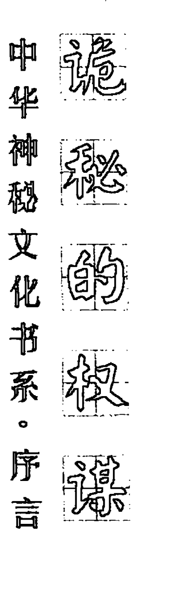

中华文化，不仅以其悠久、丰富称著于世，还因其浓郁的神秘性为中外瞩目。所谓神秘，内含神奇、隐秘之意。一切有神秘色彩的文化，都可以称之为神秘文化。举凡三皇五帝、后妃妻妾、太监外戚、术士巫师、隐者仙人、善男信女、门都会派、三教九流、三坟五典、秘籍禁书、异端邪说、阴阳五行、天人感应、奇门遁甲、谶纬禁忌、怪习陋俗、相面测字、炼丹养生、占星堪舆、武术气功，皆可包容之。

任何文化因其特质，都处于一定的坐标。中华神秘文化是中华文化的重要组成部分：相对于那种以儒学为核心的雅文化，它可以称为俗文化；相对于科举之类的官场文化，它可以称为大众文化；相对于那些历代当权者倡导的主流文化，它可以称为潜流文化；相对于与大工业联系的现代文化，它可以称为传统文化；相对于欧美美丽的西方文化，它可以称为本土文化。

在文化的殿堂中，没有哪一种文化能像神秘文化那样引人入胜，勾人魂魄，诱人探寻，令人惊叹！梁武帝《游仙诗》云：“水华究灵奥，阳精测神秘。”怎样“究”？怎样“测”？古今忙煞了多少文人墨客：有人从小以身许之，如《晋书·陈训传》记载“(训)少好秘学，天文、算历、阴阳、占候无不毕综”。有人成为通家硕儒，如唐朝韩愈《昌黎先生集》卷 36《毛颖传》记：“颖为人强记而便敏，自结绳之代，以及秦事，无不纂录。阴阳、卜签、占相、医方、族氏、山经、地志、字书、图画、九流百家、天人之书，及至浮图、老子、外国之说，皆所详悉。”

神秘文化是一座变幻奇特的库房，治学者从中窥见智慧的闪光；执事者从中总结御政的权谋；生意人从中获取滚滚的财源；迷信者从中祈求缚身的绳索。综观当代世风，中外忙碌于神秘文化者大有人在，不乏有益的成果。遗憾而可恨的是，喧闹声中混进了一些市井无赖之徒，他们不学无术，却编写了五花八门的油印小册子，宣传迷信，混淆视听，毒害民众，中饱私囊。小人作崇，君子焉处？一些饱学之士视神秘文化为“非学术”、“贱文化”，甚至认为“狗肉不能上正席”，怕影响自己清高的声誉。任小人甚嚣尘上，君子我岿然不动。于是乎，神秘文化变得更玄乎了，更灰暗了，更不可理喻了，甚至日益堕入泥潭。

有鉴于此，我们开始了神秘文化的研究工作。

神秘的色彩最怕事实冲澡，迷信的积垢需要科学清扫，思想的雾霾不能靠利斧驱散，历史的现象需要从历史角度解释。呈现在我们面前的神秘文化，是光怪陆离的复杂共同体，是精华与糟粕交触的意识形态。它有根深蒂固的传统，有无孔不入的市场，有衰荣再生的能力。新中国成立以来，神秘文化一度受到荡涤，但它由地上转入地下，由泛滥暂处休歇。一旦开放的历史大潮奔腾向前，这股潜流就与海外及港台的民俗风气相呼应，乘机涌出，四处流布，传统的水质调入现代的色彩，清浊难分。如果不考镜源流，不明辨是非，不正确引导群众，陈旧的风气和封建的习俗将重新在民间复燃，我们经过五十多年建立起来的社会主义民俗将被潜移默夺、取而代之，这是相当危险的。为了配合社会主义精神文明建设，配合扫除六害，应当积极行动起来，研究神秘文化。特别是高等学校的社会科学工作者，学术应当为四个现代化服务，为改革开放服务，为社会民众服务，研究神秘文化是我们责无旁贷的义务。何况，神秘文化本身就是一种文化现象，高校的学者不研究，谁来研究？

近几年来，我们一直在着手研究“神秘文化与当代中国”、“神秘文化与东方文明”这两大课题。适逢广西人民出版社欧琼薇同志约我们撰写《神秘的八卦——〈周易〉研究纵横观》一书，此书出版后，社会反响很好，许多学者和读者来信给予好评和鼓励，希望能多出这样一些有学术性、科学性、可读性的书籍。为了不负众望，我们决定出版这套丛书。

这套丛书由王玉德任主编，姚伟钧任副主编。丛书得到了广西人民出版社的大力支持，特别是得到了文史编辑室主任欧敬薇的具体帮助和组织。在这套丛书中，我们将运用辩证唯物主义和历史唯物主义的观点，采取实事求是的科学态度和严谨扎实的学术方法，配合精神文明建设，结合社会现实，发掘历史文献，认真研究神秘文化中的每一个问题，该批判的就批判，该继承的就继承。让渣滓永远沉淀，让腐朽化为神奇，让学术清浊分明，让中华文化大放异彩！

古云：千里之行，始于足下。在这套丛书问世之际，我们深感这只是我们研究神秘文化的一个开端，筚路蓝缕，任重道远。由于此项研究实属草创，加上我们水平有限，丛书中难免出现一些失误之处，祈望天下同仁、朋友理解我们，帮助我们，和我们一起为弘扬中华文化而共同努力！

王玉德
于华中师范大学历史文献研究所

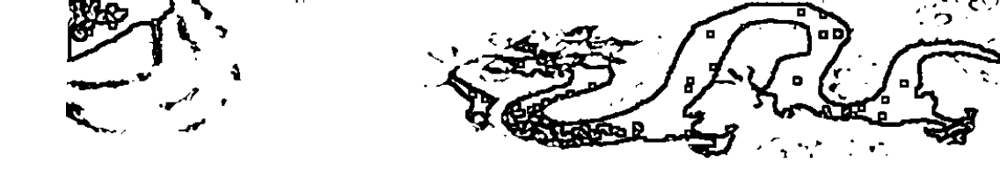
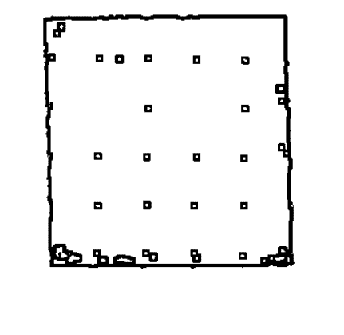
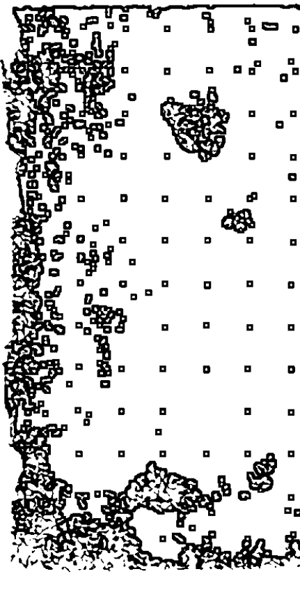

# 宗豪文化艺术传播有限公司

| 编号 | 书名 | 作者 | 定价 | 编号 | 书名 | 作者 | 定价 |
| :--- | :--- | :--- | :--- | :--- | :--- | :--- | :--- |
| 001 | 影响中国的100个人物 | 主编张秀平 | 36.00 | 022 | 非常逃离 | 邬小东 | 25.00 |
| 002 | 影响中国的100次事件 | 主编张秀平 | 36.00 | 023 | 歇后语新编 | | 18.50 |
| 003 | 影响中国的100次战争 | 主编张秀平 | 36.00 | 024 | 谚语新编 | | 18.50 |
| 004 | 影响中国的100种文化 | 主编张秀平 | 36.00 | 025 | 俏皮话新编 | | 18.50 |
| 005 | 影响中国的100本书 | 主编张秀平 | 36.00 | 026 | 谜语新编 | | 18.50 |
| 006 | 影响世界的100个人物 | 主编邓蜀生、张秀平、杨慧玫 | 36.00 | 027 | 格言新编 | | 18.50 |
| 007 | 影响世界的100次事件 | 主编邓蜀生、张秀平、杨慧玫 | 36.00 | 028 | 穿越时光隧道——世界考古探秘 | 主编张秀平 | 32.00 |
| 008 | 影响世界的100次战争 | 主编邓蜀生、张秀平、杨慧玫 | 36.00 | 029 | 人类智慧之翼——漫步世界珍宝长廊 | 主编刘如仲 | 32.00 |
| 009 | 影响世界的100种文化 | 主编邓蜀生、张秀平、杨慧玫 | 36.00 | 030 | 永远的伊甸园——走近珍稀动物世界 | 主编李湘涛 | 36.00 |
| 010 | 影响世界的100本书 | 主编邓蜀生、张秀平、杨慧玫 | 36.00 | 001 | 永别了，武器 | （英）海明威 | 11.50 |
| 011 | 世界十大古典悲剧故事 | 主编狄其驷、栾固方 | 25.00 | 002 | 热爱生命·野性的呼唤 | （美）杰克伦敦 | 8.20 |
| 012 | 世界十大古典喜剧故事 | 主编狄其驷、栾固方 | 25.00 | 003 | 复活 | （俄）托尔斯泰 | 12.80 |
| 013 | 中国十大古典悲剧传奇 | 主编胡光舟、沈家庄 | 30.00 | 004 | 高老头 | （法）巴尔扎克 | 10.80 |
| 014 | 中国十大古典喜剧传奇 | 主编胡光舟、沈家庄 | 25.00 | 005 | 蜘蛛女之吻 | （阿根廷）曼努埃尔·普伊格 | 9.20 |
| 015 | 世界著名思想家的命运 | 主编陈鹤鸣、谭元亨 | 36.00 | 006 | 伊索寓言 | （古希腊）伊索 | 9.50 |
| 016 | 世界著名艺术家的命运 | 主编戴安康 | 36.00 | 007 | 白鲸 | （英）麦尔维尔 | 13.50 |
| 017 | 世界著名政治家的命运 | 主编江家齐 | 36.00 | 008 | 牛虻 | （英）伏尼契 | 9.20 |
| 018 | 世界著名军事家的命运 | 主编陆扬 | 36.00 | 009 | 好兵帅克的奇遇 | （捷）雅·哈谢克 | 11.70 |
| 019 | 世界著名实业家的命运 | 主编张绍焱 | 36.00 | 010 | 丧钟为谁而鸣 | （英）海明威 | 11.30 |
| 020 | 世界著名教育家、科学家的命运 | 主编程翔军、曹海东 | 36.00 | 011 | 双城记 | （英）狄更斯 | 12.50 |
| 021 | 西部车帮 | 作者杜光辉 | 25.00 | 012 | 罪与罚 | （俄）陀思妥耶夫斯基 | 12.80 |

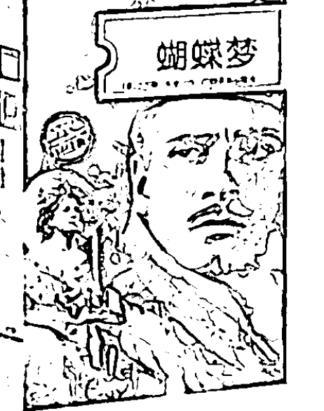
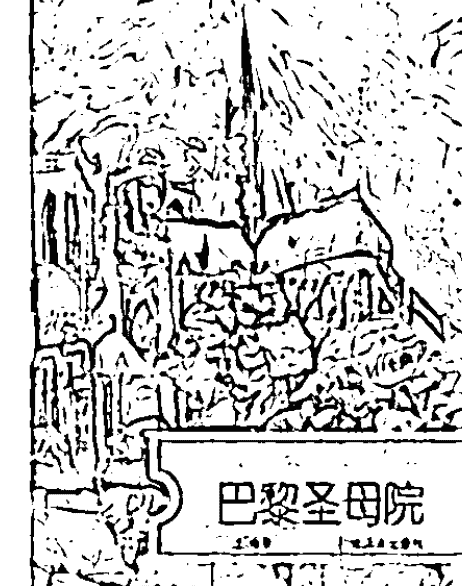
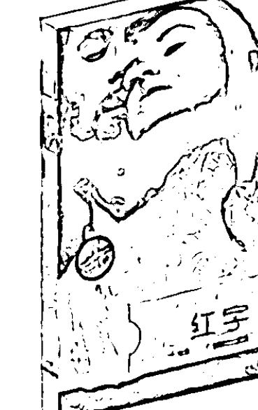
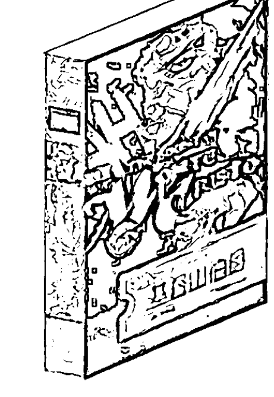

# 宗豪文化艺术传媒有限公司

| 编号 | 书名 | 作者 | 定价 | 编号 | 书名 | 作者 | 定价 |
| :--- | :--- | :--- | :--- | :--- | :--- | :--- | :--- |
| 013 | 笑面人 | (法)雨果 | 15.00 | 034 | 巴黎圣母院 | (法)雨果 | 12.90 |
| 014 | 斯巴达克思 | (意)乔瓦尼奥里 | 11.20 | 035 | 简·爱 | (英)夏洛蒂·勃朗特 | 11.50 |
| 015 | 西线无战事 | (德)雷马克 | 8.50 | 036 | 安娜·卡列尼娜 | (俄)列夫·托尔斯泰 | 17.50 |
| 016 | 堂吉诃德 | (西班牙)塞万提斯 | 13.50 | 037 | 基督山伯爵(上、下) | (法)大仲马 | 28.00 |
| 017 | 名利场 | (英)萨克雷 | 14.50 | 038 | 第二十二条军规 | (美)约瑟夫·海勒 | 12.50 |
| 018 | 包法利夫人 | (法)福楼拜 | 10.80 | 039 | 茶花女 | (法)小仲马 | 10.60 |
| 019 | 奥勃洛摩夫 | (俄)冈察洛夫 | 11.60 | 040 | 漂亮朋友 | (法国)莫泊桑 | 11.50 |
| 020 | 卡拉马佐夫兄弟 | (俄)陀思妥耶夫斯基 | 15.00 | 041 | 钢铁是怎样炼成的 | (前苏联)奥斯特洛夫斯基 | 11.8 |
| 021 | 娜娜 | (法)左拉 | 10.60 | 042 | 悲惨世界 | (法)雨果 | 13.50 |
| 022 | 金钱 | (法)左拉 | 10.50 | 043 | 百万英镑 | (美)马克·吐温 | 11.50 |
| 023 | 幻灭 | (法)巴尔扎克 | 12.80 | 044 | 呼啸山庄 | (英)艾米丽·勃朗特 | 11.50 |
| 024 | 死魂灵 | (俄)果戈里 | 10.80 | 045 | 飘 | (美)玛格丽特·米切尔 | 15.00 |
| 025 | 德伯家的苔丝 | (英)哈代 | 11.90 | 046 | 嘉莉妹妹 | (美)西奥多·德莱塞 | 11.00 |
| 026 | 沉船 | (印)泰戈尔 | 8.00 | 047 | 蝴蝶梦 | (英)达芙妮·杜穆里埃 | 11.00 |
| 027 | 约翰·克利斯朵夫 (上下) | (法)罗曼·罗兰 | 25.00 | 048 | 雾都孤儿 | (英)狄更斯 | 11.20 |
| 028 | 汤姆叔叔的小屋 | (美)斯托夫人 | 11.20 | 049 | 老人与海 | (美)海明威 | 8.60 |
| 029 | 红字 | (美)霍桑 | 10.80 | 050 | 童年 | (俄)高尔基 | 9.90 |
| 030 | 少年维特的烦恼 | (德)歌德 | 8.60 | 051 | 在人间 | (俄)高尔基 | 8.80 |
| 031 | 鲁滨逊漂流记 | (英)笛福 | 9.20 | 052 | 格林童话 | (德)格林 | 12.50 |
| 032 | 傲慢与偏见 | (英)奥斯丁 | 10.50 | 053 | 安徒生童话 | (丹麦)安徒生 | 12.50 |
| 033 | 红与黑 | (法)司汤达 | 13.00 | 054 | 一千零一夜 | (阿拉伯)民间故事 | 12.50 |

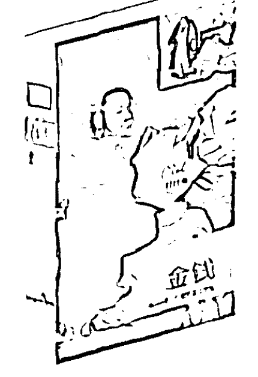
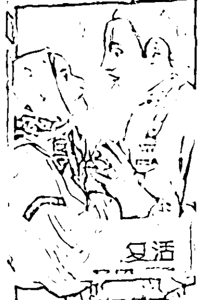
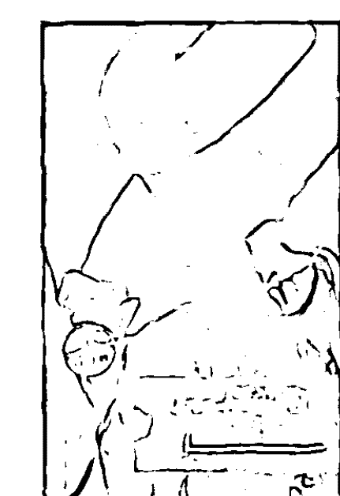
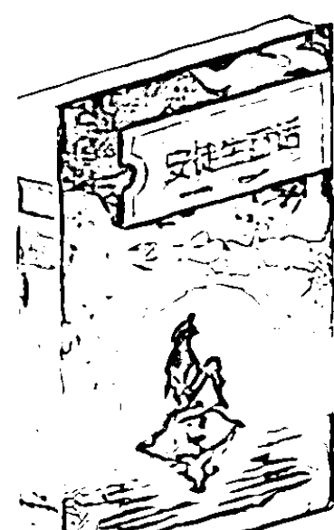
# 诡秘的权谋

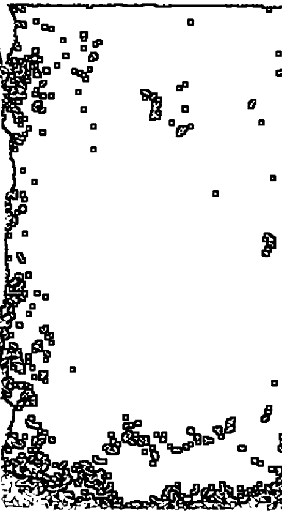

# 绪论

真真假假，虚虚实实，明明白暗，曲曲折直……

一部廿五史，可以说是一部权谋史，一部悲喜交织的权谋史，一部恩怨错杂的权谋史，一部诡谲巨测的权谋史，一部高妙难言的权谋史。

我们粗略地翻阅过这部卷帙浩繁的史籍，就中领略到一大批施权弄谋者的风采，汇集出数以千条计的权谋故事。我们毫不夸张地说，那每一个声色俱佳的权谋故事，都代表着中国人的一分智慧，都可以算做中国传统文化的一次曝光，都应该成为一份珍贵的历史遗产。

这一份份珍贵的历史遗产，饶有趣味，实在容不得大家有半点忽视。因此，我们在很长一段时期里，总是怀着一种强烈的愿望，即把中国历史上发明的权谋作为一门学问来对待，撰成一部通俗扼要的读本，奉献给那些热心关注中国传统文化的人们，特别是奉献给那勇于探索、勤于思考的年轻一代。

## 一、什么是权谋

权，本来是秤锤的名称。因为衡量一件物品的轻重，必须用秤锤系于秤杆，来回滑动，才能得到一个准确的重量，所以引申为权变、权宜，始有计谋的含义。在古时候，人们通常以“权”与“经”相对而言。《孟子》说“嫂溺，援之以手者，权也”，意谓男女之间基本的行为规范是授受不亲，然而为自己的长嫂落入水中，做兄弟的伸手拉她一把，就是权宜手段。《春秋公羊传》说“权者，反于经然后有善者也”，即谓社会生活的最高准则是儒家所揭示的经义，与经义不符合却能够导致良好结果的方法则是权。概括地说，经为至当不移的道理，权则是因事制宜的手段。

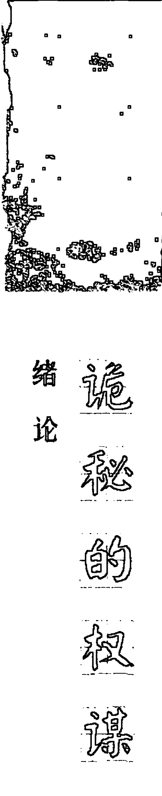

谋，《说文》解释说：“虑难曰谋。”谋字初形作，或作，都是从母。“所以从母者，人世一切谋虑，始于母之为赤子谋也。赤子初生，不能言语，赖母推心为之。时其饥寒而衣食之，俟其疾痛而调卫之，以善以育，所以为之谋虑者，至周至密。”《尚书》说“明作哲，聪作谋”，《诗经》说“载驰载驱，周爰咨谋”，都具有计谋、筹策之意。如此看来，谋就是针对具体的问题，为达到一定的目的而得出的主意或行动计划。

权与谋，合起来讲，就是随机应变的计谋。《荀子》说“上好权谋，则臣下百吏诞诈之人乘是而后欺”，“故用国者，义立而王，信立而霸，权谋立而亡”。刘向《战国策叙录》说“孟子、孙卿儒术之士弃捐于世，而游说权谋之徒见贵于俗”。正是就这种概念而言的。这说明权谋不是一般的谋略，而是谋略的一部分。它具有随机应变的特性。在人们习惯用词中，有许多词语与权谋的意思相同或相近。一是权术，二是权数，三是权略。权术和权谋又是最常使用的，只不过前者略含贬义，后者无有褒贬而已。至于人们常说的谋略，较权谋的内容要广泛得多。它包括两个层次：谋为权宜之计，略为长远之策。权谋基本上局限于前一个层次。当然在许多人心目中，因为没有作这种层次的区分，往往把权谋和谋略混为一谈。

无论是权谋，还是谋略，在本质上都不是一种实体，而是体现着一种能力和技巧。它不像核武器、宇宙飞船那样，通过硬件和软件系统的组合构筑起来，而是单纯地凭借软件结构，比如具有鬼使神差般效应的行为、幽默的语言，甚至一投足、一眼神，俯仰指顾之间，就可以左右对方的作为，达到自己所期望的目标。所以，权谋这种反映人们在社会生活中随机应变的能力和技巧的软件结构，能够成为人们走出困境，开启成功之门的钥匙。

## 二、权谋与人的问题

在整个自然界里，所有的动物都有其生存的主观依据。苍鹰可以飞上茫茫的天空，迅速地捕捉到地面上的野鸡；黑鲨能够潜入深深的水底，凶狠地猎食到游动中的杂鱼；警犬可以环绕开阔的野地，准确地追逐到自己的目标；家猴能够登上喧闹的戏台，有趣地表演出各式的杂技。这一切都只是它们的本能反应。实际上苍鹰、黑鲨、警犬、家猴并不具备任何的理性。与此不同，人类作为一种思维发达的高级动物，除去一些生理本能之外，还把生存的需要无限拓展，从而包含有十足的理性。人类既要不断地迎接下来自自然界的挑战，又要在此彼此之间打交道。无论是个体的，还是群体的关系，时而表现为和睦的交往，时而表现为暴力的冲突；时而由盟友而变作寇仇，时而由疏远而转向亲近。正是在这种纷繁复杂的关系网上，才结出一个又一个的权谋果实。

人类在远古时代，因为生产力水平的极端低下，和大自然的恣意侵害，首要的问题是依据一定的血缘关系，结成淳朴的社会组织，以谋求生存的物质资料，因而在原始群或氏族组织内部，个体与群体或个体之间发生关系，就根本不需要什么权谋，即便是群体与群体之间的血缘复仇活动，由于它的目的极为单一，双方采取的手段也十分简陋，也不具有或很少带有权谋的性质。所以，在过去很长一段时期内，人们通常都把施权弄谋看作是黄帝以后的事情。譬如孔孟之徒大抵都认为：三皇五帝有公心而无私意，有至诚而无权术。又如唐初李靖与太宗论兵时明确指出：“自黄帝以来，先正而后奇，先仁义而后权谲。”大约从这时候开始，中国社会逐步进入文明时代。于是国家之间的冲突，民族之间的纠纷，政权利力的嬗递，经济贸易的兴废，以及各种各样的人际关系，无不成为滋生权谋的一片片沃土。因此，我们说权谋是社会历史发展到一定阶段的产物。

一般认为，人类的活动包括生产活动、社会活动和科学实验活动。生产活动是人们赖以生存和发展的基础，科学实验活动则是人们提高认识和改造自然能力的主要途径。这两类活动基本上体现着人与自然的关系。与此不同，人类的社会生活涉及整个社会的各个层面，诸如政治、经济、军事、宗教、教育、家庭、婚姻等。只要是一位头脑健全的人，不管是参与哪一种活动，都必然带有一定的目的。为了达到各自的目的，他们又不得不为自己的行为考虑：选择什么路线，采取什么手段。这样一来，社会生活以它有意志的特征，便使人们在参与某一项活动之前，抑或这项活动进行之中，都必须有多方面、多角度的分析，并在此基础上作出最后的决断。在中国传统社会里，这种思维活动在很大程度上包含有权谋的成分，特别是专制主义及其引发的非程序化，更使得政治领域几乎无处不跃动着权谋的魂灵，而权谋则始终贯穿于其中。因此，我们说权谋是人们参与社会生活的一种思维活动。

既然如此，整理和研究中国历史上发明的权谋，就能够从一个侧面了解到传统社会中国人的智慧。智慧是“一”，权谋则是“多”。从这随机应变的权谋“多”中，可以折射出智慧“一”的光辉。由此做进一步的探讨，就能够窥见中国传统文化的许多奥秘。

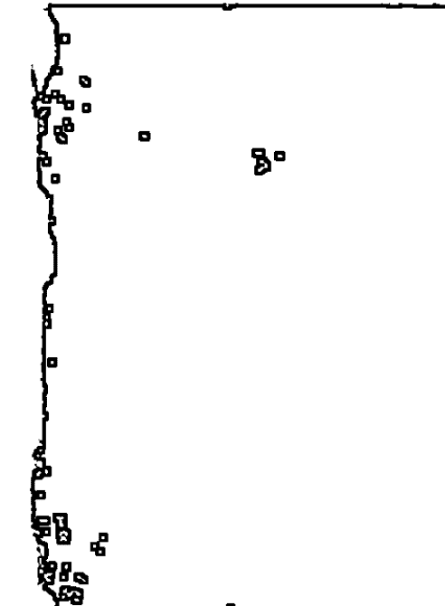

## 三、权谋的构成

乍看起来，权谋在各种社会生活中的表现千奇百怪，扑朔迷离，致使其研究者感到无从下手。可是，如果稍做一些解剖的工作，就不难发现，每一个权谋的构成，都包括如下四种因素：

- 权谋主体，是指发明和运用权谋的一方。他们与权谋客体构成一对矛盾，在特定的权谋场内，总是要凭借权谋，来达到一定的目的。

- 权谋客体，是指被权谋所指向或支配的一方。他们作为权谋主体的认识和实践的对象，在一定的权谋场内，必然对权谋作出这样或那样的反应。

- 权谋场，是指权谋所依托的各种客观条件，包括时间、地点和具体情况。什么时间、什么地点和有什么情况，构成一场合，对于权谋双方具有同等重要的意义，即决定着权谋的发明和运用，以及对权谋必须作出的反应，可以说是权谋得以确立的物质基础。

- 权谋本体，是指人们在一定的权谋场内随机应变的能力和技巧。这种能力和技巧来源于每个人的思维活动，并且由此牵动着每个人的心灵。每个人的心灵都是一个与众不同的小宇宙，都好像一个不成熟的孩子：洒脱不羁，没有常式。因此，对于权谋本体，我们不可能轻易地捕捉到它，当你把它从许多权谋中间抽出来，并且紧紧握在手里的时候，你会感觉到它依旧是无影无踪。不过，人们的心灵彼此都有一种同构对应关系，它能够体验到权谋本体的存在。除去这种直观的“顿悟”，人们还可以通过逻辑的分析和归纳，去认识和理解权谋本体。如果有相当的经验和理性修养，人们在权谋本体面前仍然能够达到“从心所欲而不逾矩”的境界。在权谋诸因素之间，权谋本体是权谋的内核，是权谋的规定性所在。把权谋作为一门学问来对待，就应当把研究重心放在权谋本体上面。我们撰写《神秘的权谋》，正是从这层意义出发的。

大体说来，权谋的主体和客体作为人的因素，始终处于对立统一的位置。他们相互依存，没有权谋主体，也就没有权谋客体；反之，没有权谋客体，也就没有权谋主体，二者存在于同一个权谋场里。他们相互排斥，权谋主体的存在是为了战胜权谋客体，权谋客体的存在则是为挫败权谋主体，各自不同的利益和目的，使二者总是陷于你争我夺，甚至你死我活的境地。不过作为一对矛盾，权谋主体代表着矛盾的主要方面，权谋客体则代表着矛盾的次要方面。权谋主体占据主动地位，对权谋客体具有支配作用；权谋客体处于被动地位，对权谋主体具有一定的反作用。这种支配作用和反作用仅仅体现在权谋的实际运用上，并不完全决定着每一个权谋的最后结果。

每一个权谋的最后结果，都取决于权谋诸因素的组合。就权谋主体来说，是否了解权谋客体的具体情况，能否正确地分析和利用权谋场，运用权谋是否得当，如何对待和处理权谋客体的反作用，可以说是他们战胜权谋客体的关键。就权谋客体来说，是否了解权谋主体的具体情况，能否正确地分析和利用权谋场，能否及时识破权谋，怎样对权谋主体作出有效的反应，可以说是他们挫败权谋主体的关键。就权谋本体来说，它作为权谋的内核，如同孙行者身上的毫毛，可以“以一当十”，分解出无限众多的权谋来。所以，权谋双方谁能准确地把握它，谁能充分地认识其随意、多变的特性，并且及时采取有效的行动或反应，直接决定着权谋的结果。就权谋场来说，一定的时间、地点固然可以为权谋双方所共同利用，但对于他们运用或制止权谋，却有着不同的影响，特别是权谋双方的具体情况对比的优劣，往往不是倾斜于此方，就是倾斜于彼方，如果认识不到这一点并采取相应的行动，无论是哪一方都难以取得成功。

正是因为不同的权谋主体、权谋客体和权谋场，以及它们之间错综复杂的联系，才使得具有不同内核的，或者具有同一内核的权谋，在社会生活中的表现千差万别，各具特色。

## 四、权谋的传达方式

任何一门艺术，都有属于它自身的表达方式。譬如音乐是用有组织的乐音来表达人们的思想情感，舞蹈则是以有节奏的动作来反映现实的社会生活，电影是用强灯光把拍摄的形象连续放映在银幕上，戏剧则是由演员把人生的各种矛盾冲突展现在舞台上。在各种艺术之苑里，即便是同样的题材，或同样的脚本，由于不同的表达方式，诸如导演和指挥的组织、演员的技艺、乐曲的旋律、舞蹈的设计，以及灯火、音响、服饰、美工的不同安排，那就会产生不同的艺术效果：有的令观众（或听众）哈欠连连，有的让观众（或听众）拍案叫绝。

比之权谋亦然。权谋作为一门体现人们随机应变的能力和技巧的艺术，不能没有属于它自身的传达方式（或称实现方式），正如同音乐、舞蹈、电影、戏剧艺术必须含有与之相适应的表达方式一样。权谋有在参与活动之前就设计好的预谋，有在进行活动之中临场发挥的即谋。无论是预谋和即谋，其传达方式都无外乎两种：行为和语言。人们在社会生活中运用权谋，或以行为制胜，或以语言传神，或是两者的统一。

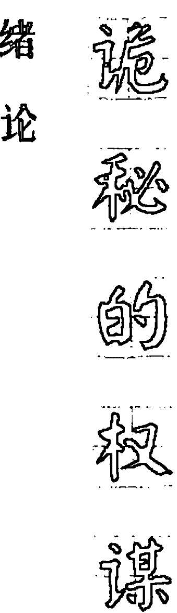
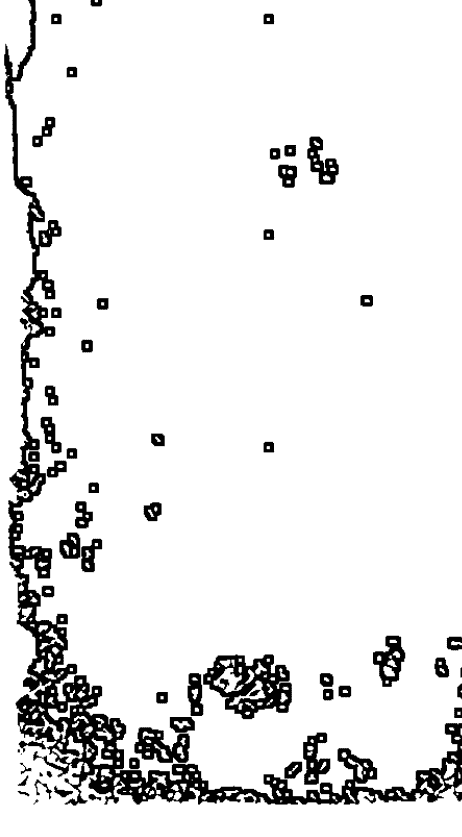

作为权谋的传达方式，行为是受权谋本体支配而表现在外面的活动。在整个社会生活领域，人们的行为既有大刀阔斧的，又有小手小脚的；既有自近而远的，又有由远及近的；既有公开的，又有隐蔽的；既有真的，又有假的；既有自强而弱的，又有从弱到强的；既有实在的，又有空虚的；既有向前推进的，又有往后退却的；既有刚烈的，又有柔和的；既有直接路线的，又有间接路线的；既有因循的，又有逆反的……各种各样的行为，或者它本身就代表着一种权谋，或者带有权谋的色彩，或者与权谋根本无涉。如何区分呢？这就要看一定的行为是否受权谋本体的支配，也就是说是否蕴涵着权谋的内核。人们在一定的权谋场内，在其行为之前或行为过程中，自发自或自觉地运用自身所具备的随机应变的能力和技巧，借以走出困境，开启成功之门。这种行为就属于权谋的传达方式，也就属于我们的研究内容。

有时候权谋要通过语言来传达。语言是人类特有的用来表达情感、交流思想的工具。过去一般把语言分为两类：书面语言和口头语言，而在实际生活中人体语言又占有广阔的天地。不管哪一种类别，人们的语言既有明快的，又有诙谐的；既有谦虚的，又有傲慢的；既有恭维奉承的，又有批评劝谏的；既有真实的，又有荒谬的；既有疑问的，又有解释的；既有祈使的；又有感叹的；既有直截了当的，又有含糊不清的……唯众者相比较，幽默的语言最有资格来充当权谋的传达方式。在一定的权谋场内，人们经常利用幽默的语言，自嘲或嘲人，以摆脱困境，达到自己的目的。幽默的语言是含蓄的，它不能长篇宏论，不能自作解释，更则无言胜有言；幽默的语言又是夸张的，它往往顺着荒谬的逻辑说下去，使人最终领悟到荒谬的后果。倘若把两者联系起来看，含蓄是幽默的深层，夸张则是幽默的表层。在社会生活的显微镜下，幽默语言身上无不显现出那不息跃动着的权谋分子。真是无形中有形，有限中有无限，如同刹那而有永恒。

在实际生活里，权谋本体的不同，固然因支配权谋的传达方式而直接影响到权谋的实施和结果，但是，在同一种权谋本体条件下，权谋主体采用什么样的传达方式，对于权谋的实施和结果也有着重要的作用。

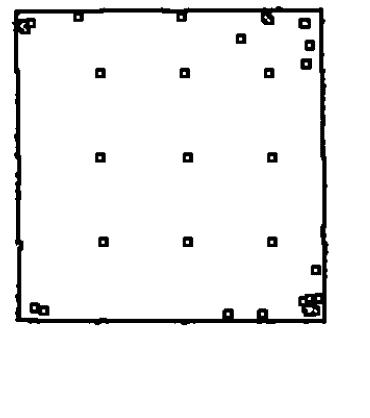
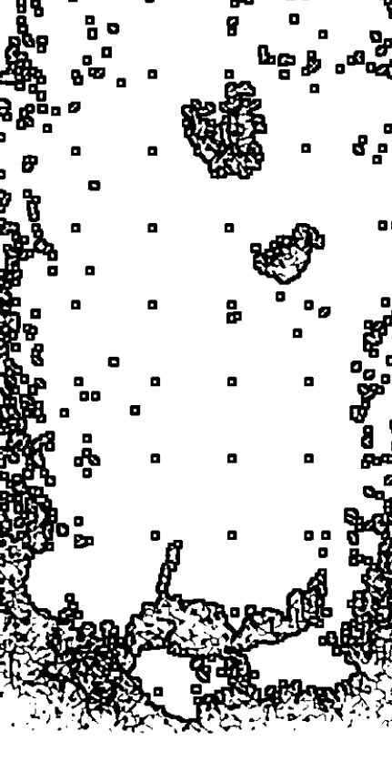

## 五、权谋的基本特征

权谋不仅在社会活动中表现出强烈的个性，而且从整体上看很有一些共性。

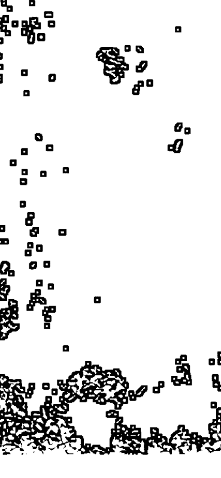

有人喜欢把权谋说成是一种科学的或者具有规律性的东西，并且经常同一些“原则”、“公式”联系起来。我们不以为然。科学上有一个基本思想：在相同的条件下，同样的原因将导致同样的结果。这“相同的条件”不仅可以自自然生成，也可以人为设定。因此，科学的定理或规则便具有“放之四海而皆准”的普遍意义。权谋之定社会生活却绝非如此！每一个权谋作为一种历史现象，都只能是一次性的。这是因为：一方面，在社会生活领域，这“相同的条件”永远也不会出现，每一个权谋场都有它特定的、具体的内容；另一方面，每一个人作为权谋主体，或者是权谋客体，都是绝对的、不可重复的和独一无二的，即便是同一个人，在不同的权谋场就有不同的心理反应，并且由此采取不同的行动。我们说权谋最基本的特性在于随机应变。这里的“机”是权谋主体面临的机会，是事情发展变化的枢纽，是对权谋起重要作用的环节。这里的“变”是权谋主体从作出决断到采取相应手段的整个过程。“机”虽然属于一种客观存在，却是极不稳定的，甚至是转瞬即逝的，所谓“时不待人”，“机不可失，时不再来”，就是这种意思。“变”则属于一种主观反应。这种反应或者凭借着某种预测，或者根本没有什么前定的意向，几乎完全取决于权谋主体在一定的权谋场内的思维活动，也就是所谓“运用之妙，存乎一心”，“眉头一皱，计上心来”。历代研究学者把权谋视为“奇”，视为“诡道”，正说明权谋本身一般不具有什么必然性，相反是被偶然性、或然性所充实的。在各种权谋的实践中，权谋也是不能公式化的。一旦走向公式化，权谋就会丧失其生命力。从这个意义上看，公式化只能是权谋的死敌。因此，对待权谋，与其说是科学，毋宁说是艺术。

有人喜欢把权谋说成是一定的阶级意识的反映，并且总是同整个社会的阶级斗争联系起来。我们也不以为然。在权谋诸因素之间，权谋主体和客体作为人的因素，在传统社会里带有一定的阶级性，这是人所共知的。如何对他们作出评价，那是历史学家的主要任务。研究权谋学所特别关心的，只在于权谋本体，权谋主体和客体不过是权谋本体的某个方面的体现者。权谋是达到一定目的的手段。这目的既可以是浩荡族类的幸福，也可以是区区私欲的满足；这手段既可能充斥着腥风血雨，也可能被披上脉脉温情。因此，权谋既可以充当令人神往的天使，又可以扮演令人战栗的恶魔。这些都是由权谋主体和客体所决定的，与权谋本体究竟没有什么关联。因为无论是在何时何地，权谋本体都是不受伦理的或政治的价值尺度所审判的，必须接受这种审判的只有权谋主体和客体。在各种社会生活中，运用一定的手段能够达到一定的目的。这一目的必须有一定的手段为之服务，然而，一定的手段并不单纯地适应某一目的。人们既可以利用这种手段到自己的目的，也可以利用那种手段达到同一个目的。这部分人可以利用某种手段达到目的，那部分人也可以利用同一种手段达到目的。所以

权谋是不会被某一个阶级、政党或集团所独占的。从历史角度来看，权谋作为一种文化现象，既具有一定的时代性，又具有一定的超时代性。我们说权谋具有时代性，是因为一部分权谋仅仅适用于一定的历史发展阶段，往往伴随社会生产水平和人们的认识能力的迅速提高而日渐陈旧、过时，以至于丧失其生命力。我们说权谋具有超时代性，是因为一部分权谋一旦发明出来，不仅在某个历史阶段被人们广泛运用，而且同样适用于另一些历史阶段。直到今天仍然有许多过去发明的权谋还被大家广泛地运用，其根本原因就在于权谋本体的超时代性，也就是权谋自身的无阶级性。

有人喜欢把权谋只看作是统治者，尤其是最高统治者的惯用手段，并且经常同他们玩弄阴谋诡计联系起来。我们仍不以为然。权谋在过去、现在和将来都不是，也不应该是某个人或者某部分人的专制品。历史上许多比较有名的施权弄谋者，大都在统治者、最高统治者之列，但这并不意味着被统治者就同权谋无缘。恰恰相反，被统治者在他们的社会生活中曾经发明和运用过无数的权谋，只是被那些专司历史的正统学者们所忽视而废置罢了。君不知传统史家从来就没有关注过被统治阶级，没有注意反映被统治者的智慧，一部廿五史从来就不是为人民群众编撰的！我们现在认识到这一点，那就不能再无理地把被统治者排斥在权谋园地之外，好像他们只晓得接受统治者的愚弄和压榨似的。进一 步说，权谋本休属于一种内在的、隐蔽的软件结构，把它运用到社会生活中去，总是要多少带有一些诡秘的色彩。因此，许多人时常把一部分权谋当作阴谋诡计加以鞭挞和唾弃。这在个人感情上是可以理解的，但在认识方面却存在着一些致命的缺陷：那就是把权谋主体、权谋客体同权谋本体不加区别地混为一谈；把人们在社会生活中随机应变的能力和技巧同运用这种能力和技巧的动机不加区别地混为一谈，把各种社会活动所必须的手段同通过这种手段要达到的目的不加区别地混为一谈。至于那种“欲达目的，不择手段”的观点，是我们应该具体分析和对待的。怀着一种卑劣和邪恶的动机而运用权谋，我们在任何情况下都是应该反对的；为着一种崇高和正义的事业而运用权谋，我们在一定程度上是赞成的。无论如何，我们说权谋这东西，作为一种随机应变的能力和技巧，实在是每一位头脑健全的人都能够够用的。

有人喜欢把权谋限定在某一社会生活领域，画地为牢而不思变通。我们还 不以为然。权谋是一个比较笼统的概念，按照人们的习惯分类，它主要包括政治权谋、军事权谋、外交权谋、经营权谋等。这样的分类对于深入各个社会生活领域来研究权谋是十分必要的。但是，“职业性”委实不是权谋的本质属性，每一类权谋之间也没有一条相互隔绝的鸿沟。其实，在广泛的社会生活中，政治权谋可以运用于军事领域，军事权谋可以运用于经济领域，经营权谋可以运用于

外交领域，外交权谋可以运用于政治领域，各类权谋都是相互联系、相互渗透的。即使是在同一类权谋内部，一定的权谋本体作为权谋的内核，也是可以灵活发挥的。它既可以被个人所理解和运用，又可以被群体所理解和运用；既可以运用于战略层面，又可以运用于战术层面；既可以运用于现在，又可以运用于将来。每一个权谋在实际运用方面，也都是相互贯通、相互转换的。所有这些归结起来是由权谋的灵活性所决定的。

至此要从一门学问的角度说出权谋的共性，那就是非科学性（或艺术性）、无阶级性、普遍性和灵活性。

### 六、中国传统时代：三大权谋流派

为了利用权谋来达到自己的目的，人们对于权谋常常表现出极大的兴趣。

中国人在理论上探讨和研究权谋，起码是从先秦时代开始的。那时候以《周易》、《老子》为代表的朴素的辩证法学说，为各类权谋研究的广泛展开，奠定了可靠的理论基石。这朴素的辩证法学说配合当时天下纷乱、连年赋战的形势，在全社会范围内激起了一股研究和运用权谋的浪潮。大抵在诸子百家中间，相比较而言，法、兵、纵横三家是最为重视权谋的。这三家因为各自所持的政治理论和主张不同，对于权谋的发明和运用也是各有侧重的。一般来说，法家侧重于政治，兵家侧重于军事，纵横家侧重于外交。因此，我们自然可以把权谋研究在当时的流向分为三大支流：法家权谋，是由韩非集大成，以《韩非子》为代表作；兵家权谋，是以孙武为鼻祖，以《孙子兵法》为代表作；纵横家权谋，是由苏秦、张仪所昂扬，以《鬼谷子》为代表作。

韩非作为先秦法家学说的集大成者，在汲取商鞅、申不害和慎到的政治理论的基础上，创立了法、术、势相结合的政治学说。他对于法、术、势三者及其相互关系的论述，可以概括如下：①法是君主治理国家、统治人民的根本依据，即所谓“法者，编箸之图籍，设之于官府，而布之于百姓者也”。②术是君主驾驭臣下，考核百官的主要手段，即所谓“术者，因任而授官，循名而责实，操生杀之柄，课群臣之能者也”。③势是君主独操的生杀予夺的权势，即所谓“势者，胜众之资也”，“人主之爪牙也”。④法、术、势三者以法为核心，法是对传统政治具有规定性的东西，术是保证法顺利推行的基本手段，势是运用法、术的必要前提，三者相辅相成，不可或缺。这种学说作为专制主义和“人治”的集中反映，无论如何都不能把传统政治引上程序化的轨道，因而在统治方法上就不得不倚重于政治权谋。现在我们翻一翻《韩非子》，很容易看到全书的一个重要内容，就是在总结历史经验的基础上对政治权谋的论述。例如《内储说》集中讨论了“主之所用”的“七术”——如一听责下、疑诏诡使、挟知而问、倒言反事等——和“主之所察”的“六微”——如利异外借、托于似类、参疑内争、敌国废置等，同时指出，君主只有在识破“六微”的前提下，运用“七术”，才能够巩固自己的权位，增强控制国家机器的力量。又如《说林》、《外储说》、《难一》至《难四》各篇，也都是利用具体的历史实际和传说，包括大量的权谋故事，来论证法、术、势相结合的政治学说。所有这些，虽然是作者为君主驾驭臣下，实行专制统治设计的，但在具体的政治实践中，又很自然地成为官僚与官僚之间相互争斗，以及各级官僚统治人民的不二法宝。于是，在传统政治舞台上，利用权谋来维护和扩大自身的利益，巩固和提高自身的地位，乃至完成某项政治使命，实现某种政治目的，就成为最常见、最有效的活动。

《孙子兵法》是中国现存最早的军事理论著作，是传统社会里《武经七书》的第一部。在这部著作里，孙武相继讨论了“计”、“作战”、“谋攻”、“形”、“势”、“虚实”、“军事”、“九变”和“用间”等问题，对于战争和战争指导原则作出了明确的阐述，较详细地揭示了军事权谋的主要内容。比如在《计篇》写道：“兵者，诡道也。故能而示之不能，用而示之不用，近而示之远，远而示之近；利而诱之，乱而取之，实而备之，强而避之；怒而挠之，卑而骄之，佚而劳之，亲而离之；攻其无备，出其不意。此兵家之胜，不可先传也。”孙武认为，战争中运用权谋是一件极有价值的事情，“上兵伐谋，其次伐交，其次伐兵，其下攻城”，“伐谋”较之攻城，损伤小而收获大，显然是上等策略。“是故百战百胜，非善之善者也；不战而屈人之兵，善之善者也”，“善用兵者，屈人之兵而非战也，拔人之城而非攻也，毁人之国而非久也，必以全争于天下，故兵不顿而利可全，此谋攻之法也”。在孙武看来，“知己知彼，百战不殆”是一条具有普遍意义的战争指导原则。这条原则反映出战争指导者对彼己情况的熟悉与战争胜负之间的关系，因而对每一个军事权谋的发明和运用都具有重要的作用。为了求得“知彼”，孙武特别强调在战争中使用间谍的意义，在全书末尾专门讨论了用间的方法，具体地指出：“用间有五：有因间，有内间，有反间，有死间，有生间。五间俱起，莫知其道，是谓神纪，人君之宝也。”这可以说是有关用间的一段至理名言。在中国军事思想史上，与《孙子兵法》相提并称的，还有《吴子》、《司马法》、《六韬》、《三略》、《尉缭子》和《李卫公问对》。宋代将这部著作汇合起来，刻印行世，命名为《武经七书》。于是，如同儒家有《道德经》，佛家有各种佛经一样，《武经七书》就成为兵家的经典著作，成为后人取之不尽、用之不竭的军事权谋宝库。

纵横家是战国时期外交舞台上最活跃的一批人物。所谓“纵横”，是一个具有特定内涵的政治概念。“纵”即“合纵”，是指山东六国从燕到楚，南北合成一线，共同抗秦，以求割地自存。“横”即“连横”，是指秦国与任何一国结盟，东西连成一线，攻击他国，以期统一天下。纵横家就是迎合当时政治斗争的迫切需要，抱定“从横短长之说”，或者奔走游说，或者入朝干政，直接受任于各国统治者的谋臣辩士。作为一个群体来看，他们在政治思想上有着明显的共同特征：崇尚策略，权谋至上。如果说法家信仰“以力服人”，儒家坚持“以礼服人”，那么，纵横家则是主张“以理服人”。他们把权谋看成是智与理的化身，认为它能够在无可比拟的效力，于内可使国治民安，于外可使“诸侯相亲”，于己则可得其所。然则总括他们的言行而论，所谓“从横长短之说”的特色，不外乎投其所好，巧言进谏；因人所惧，危言耸听；饰短诵长，弄虚作假；挑拨离间，纵横捭阖；倾轭翻覆，刚柔相济。在一个权谋场内，他们往往会提出三种策略，“上不可则行其中，中不可则行其下”，以此在最高统治者面前显示其智与理的力量。纵横家作为一群有文化、有知识的智囊人物，在其演习、开展游说进谏活动中，给人们留下了一大批文字材料，有以国别分类的，也有杂乱无章的，直到西汉末，经过刘向的甄选和编排，遂成《战国策》一书，流传于世。这是一部比较完整的反映战国时期谋臣辩士为所事之国出谋划策的资料汇编。与此同时，《鬼谷子》作为现今仅存的一部纵横家的经典著作，较系统地讨论了“捭阖”、“内揵”、“抵戏”、“反应”、“飞箝”、“忤合”、“揣”、“摩”、“权”、“谋”、“决”等问题，具体地揭示了外交权谋的主要内容。作者把量权揣情视为游说进谏的先决条件，并且从个人的品质、性格、地位、处境，及其心理变化，论述了量权揣情的可行性，认为在此基础上，“因其疑以变之，因其见以然之，因其说以要之，因其势以成之，因其恶以权之，因其患以斥之，摩而恐之，高而动之，微而正之，符而应之，拥而雍之，乱而惑之，是谓计谋”。换言之，在实际生活里，作为权谋主体，开展游说进谏活动，就必须把握和处理好捭阖、飞箝、忤合、直话、顺语诸类关系。

从现有材料来看，中国历史上各类权谋的发展，在秦汉时期已经大体定型。因而两汉之际的那次文献整理活动，也涉及有关权谋理论领域。《汉书·艺文志》著录法家，包括《商君》、《申子》、《慎子》、《韩子》，凡10种217篇；兵家53种790篇，其中兵权谋有《孙子》、《吴起》、《范蠢》、《韩信》，凡13家259篇，兵形势有《皇甫》、《孙轸》、《尉缭子》、《项王》，凡11家92篇；纵横家包括《苏子》、《张子》、《庞缓》、《酂子》，凡12种107篇。这是中国文化史上第一次较大规模地对有关权谋理论的历史文献的学术总结。

### 七、三十六计、百战奇略与智囊

中国传统文化，就它的价值取向、传播方式而论，可以划分为两大类：显文化和隐文化。以“仁义道德”为核心的正统文化，是前者的骨骼；以权诈诡谲为内容的非正统文化，是后者的血肉。在整个传统社会里，显文化为社会提供了一套社会理想、人生目标，以及达到这种理想、目标的途径，始终被人们所接受；隐文化则为社会提供了一套社会法术、人生权谋，以及利用这类法术、权谋的条件，也始终被人们所接受。这两大类文化形态，代表着传统文化的两种传播方式：一明一暗，一浮一潜。仅就统治阶级而言，它们又担负着两种社会职能：一是牧师的角色，一是刽子手的角色。我们所论述的权谋，可以说完全属于隐文化的范围。

汉代以后，在传统社会意识形态领域内，已经形成一种比较稳固的统治思想。各类权谋尽管在社会生活当中仍被广泛的运用，在一定时期内还有不少新的发明，但是，作为一种隐文化，因其价值取向不合所谓“圣人之道”，与占统治地位的儒家显文化大相径庭，所以在理论方面历来颇受冷遇，不为那些正统学者所重视，以至于两千年间留下来的比较有社会影响的权谋著述，寥寥无几。

《三十六计》堪称时下流传最广的一部专门论述权谋的读本。作为一个词语，“三十六计”源出《南齐书·王敬则传》，而后大约在明清之际，适才积累成册，而其作者已不可考证。这部著作将权谋分为六套，即胜战计、敌战计、攻战计、混战计、并战计和败战计。每一套又各分出六种权谋：胜战计分瞒天过海、围魏救赵、借刀杀人、以逸待劳、趁火打劫、声东击西；敌战计分无中生有、暗度陈仓、隔岸观火、笑里藏刀、李代桃僵、顺手牵羊；攻战计分打草惊蛇、借尸还魂、调虎离山、欲擒故纵、抛砖引玉、擒贼擒王；混战计分釜底抽薪、浑水摸鱼、金蝉脱壳、关门捉贼、远交近攻、假道伐虢；并战计分偷梁换柱、指桑骂槐、假痴不癫、上屋抽梯、树上开花、反客为主；败战计分美人计、空城计、反间计、苦肉计、连环计和走为上计。全套共有三十六种权谋。每一种权谋的解说词，都是以传统的阴阳八卦理论为依据的，也就是根据阴阳、八卦、六十四别卦、三百八十四天的宇宙认识图示，来阐释每一种权谋的矛盾对立及其相互转化。所以说《三十六计》在思想内容方面多少带有一定的朴素辩证法的色彩。

《百战奇略》是一部系统地总结冷兵器时代的战略战术问题的专门著作。作者刘基，为元末明初的一位传奇式人物，据称晓畅兵法，擅长权谋，曾经为灭元立明创下汗马功劳。这部著作按照战争双方的政治、经济、军事和自然诸条件，把历史上的战争（主要是战役）分为一百个类型，逐自加以论述，指明它们在实际运用中所必须掌握的要领。在理论方面，作者吸收了《武经七书》及其他一些军事著作的战争观点，运用和发挥了“上兵伐谋”、“因敌而制胜”、“先胜而后战”、“致人而不至于人”、“必死则生，幸生则死”、“见可而进，知难而退”、“兵贵神速”等一系列军事谋略思想。在材料方面，作者汇集了先秦至五代1600多年间散见于各种史籍的著名战例，将这些战例分别编入每一种权谋的后面，作为对有关论点的具体注释。正是把理论与史料结合在一起，《百战奇略》才成为一部有血有肉、颇受世人青睐的军事权谋著作。

《智囊》是中国文化史上搜罗最富、篇幅最大的一部谋略故事汇编。编著冯梦龙，为明代著名的文学家，世情小说《三言》的作者。他以“不唯其人唯其事，不唯其事唯其智”为宗旨，从先秦迄明初间经史百家、稗官野史之中，搜集出一千多条以智取胜的事例，经过分类编排而成《智囊》一书。这部书将谋略分为十部：“上智”是经国大略；“明智”是远见卓识；“胆智”以胆略见工；“捷智”以敏捷夺人；“察智”是洞察秋毫；“术智”是随机应变；“兵智”是治军用兵；“语智”是妙语绝论；“闺智”是妇女心计；“杂智”是小人伎俩。每一部又分若干类：上智有“见大”、“远犹”、“通简”、“迎刃”，明智有“知微”、“忆中”、“剖疑”、“经务”，察智有“得情”、“诘奸”，胆智有“威克”、“识断”，捷智有“灵变”、“应卒”、“敏悟”，术智有“委蛇”、“缀数”、“权奇”，语智有“辩才”、“善言”，兵智有“不战”、“制胜”、“诡道”、“武案”，闺智有“贤哲”、“雄略”，杂智有“狡黠”、“小慧”，凡二十八类。在主客体方面，人物多种多样，有帝王将相，有凡夫走卒，有耆耄老朽，有弱妇幼童，较之其他著作更具有代表性。

这些著作以其鲜明的特点和成就，对于我们进行权谋研究无疑具有不小的参考价值。不过，我们应该看到，它们在理论观点、编纂方式上，还存在有许多无法掩饰的缺陷。《三十六计》说到底不能算做一部完备的权谋著作，只是对各类权谋的一次部分归纳；就每一个权谋而言，有的拘泥于成语定名，不免牵强附会，有的名异实同，造成全书结构的重复现象。《百战奇略》所论述仅限于冷兵器时代的作战问题，而不曾涉及社会生活的其他层面；因为对战争缺乏总体性的认识，在具体剖析各种军事权谋的时候，就没有处理好战略、战术和战斗技能诸关系的问题。《智囊》所揭示的谋略分类，有的根据权谋主体的言行心态，有的则参照不同的权谋场，实在没有一个统一的标准；同时对每一个事例既没有具体的概括，在编排时又没有时间顺序，因而通篇显得比较杂乱。更为甚者，这些著作提供给人们的，都只是每一个权谋的表象，也就是简单的形而下的描述，至于每一类权谋之间的内在联系，却缺乏较深入的探讨，因而无法形成一种形而上的认识。所以要想给予权谋一个明确的阐说，我们还必须另觅向导，以期走出一条新的道路。

### 八、如何构筑权谋学

我们撰写这部《诡秘的权谋》，正是希望沿着一条新的道路走下来，给权谋作一个明确的阐说。

权谋既然属于人的问题，那么，权谋学在本质上就是人学。一切研究人的科学理论、方法，都适用于这门学问的研究。当然，就与权谋学的关系而言，社会学的、政治学的、经济学的、军事学的、外交学的、历史学的、心理学的和生理学的理论和方法，应该是我们首先要掌握的。我们觉得，在理论与实际相结合的基础上，通过多学科和跨学科的分析，是可以给予权谋一个明确阐说的。

我们研究的对象既然是中国人过去发明和运用的权谋，那么，权谋学的构筑就必须扎根于这块有着几千年淤积的文明土壤内，同中国传统社会、文化紧密地联系起来。传统社会造就传统文化，传统文化又培植着中国人的性格、心理、人生观、社会观和宇宙观，自然也就孕育着和激发着中国人在社会生活中随机应变的能力和技巧。因此，我们觉得，把中国人过去发明运用的权谋放在中国传统社会、文化大环境中去认识，是可以给予权谋一个明确阐说的。

权谋既然体现着人们在社会生活中随机应变的能力和技巧，那么，权谋学就不应该只停滞在形而下的描述阶段，而需要发展到形而上的理论层次。我们根据现有的材料，在对各种权谋的分析和归纳的基础上，初步抽象出“大与小、远与近、明与暗、真与假、强与弱、虚与实、进与退、刚与柔、直与曲、顺与逆”十大矛盾范畴。我们觉得，立足于形而下的具体描述，来进行形而上的理论概括，是可以给予权谋一个明确阐说的。

## 第一章 大与小

大与小是权谋学中基本的矛盾范畴之一。

成语说“一叶知秋”，意谓从一片树叶的凋落便知道秋天的到来。比喻通过个别的、细微的迹象，看到整个形势的发展趋向与结果。又说“一叶障目，不见泰山”，这比喻为局部现象所迷惑，看不到全局或整体。

于微尘中见大千，并同时观照泰山之大、一叶之小，是人们在纷繁复杂的社会中得以安身立命的基本修养。无论是在波诡云谲的政治舞台，还是在硝烟弥漫的沙场；无论是在神秘的经济领域，还是在充满着脉脉温情的一般人伦交往中，无处不有大与小的矛盾运动。君御臣，臣事君，打仗练兵，选才荐人，以至于公堂斗智、娱乐竞赛都同处理大与小的关系结下了不解之缘。

### 一、于微尘中见大千

所谓“于微尘中见大千”，就是从事物的局部推知其整体。大凡一件事物，在其整体面貌及发展走向未能全部昭示于人之前，往往首先在其局部有所显现。比如我们虽不得知道某人全部的心理活动以及由这特定的心理所支配的未来将会发生的全部行动，但却可以在他的语言、神态、举止，甚至俯仰指顾之间窥见其端倪。现代自然科学发现了“全息率”，说事物的部分最整体的“全息元”，通过事物的部分可以看到事物的整体。如一片叶子是整棵树木的缩影，一个细胞是整个生物机体的缩影。这一自然科学的理论在社会人事中虽然未必全部适用，但事物的整体总有一个从量变到质变的过程，量变即部分的变化；质变，即由量变的增加而引起的整体的变化。既然整体的变化是由部分的变化开始的，那么，由部分观照整体，由微小观照顾大，便不是无根之木，无源之水。

于微尘中见大千，是人们在复杂多变的社会中未雨绸缪，防患于未然，从而立于不败之地的基本前提。

春秋时期，越王勾践卧薪尝胆，在范蠡等人的辅佐下，经过十年生聚，日益强大起来，很快便灭掉了吴国，洗刷了会稽之耻。在庆功宴上，群情昂奋，功臣名将相互致贺，一片欢呼之声。作为一国之主的越王勾践却有难色，神态反常。范蠡见此状况，暗自思忖：功成业就令人欢欣鼓舞，而国王却犯起难来，无非是思虑功业的分享问题。看来共患难易，共享安乐就难了，因而决意退朝隐去。第二天，范蠡便来向勾践辞行，说：“我以为，君主受辱，做臣子的不得苟且偏安。大王受辱于吴国之时，我之所以未能以死相报，是想帮大王挽救倾于既倒，重建大业。如今吴国已灭，我请大王饶我当初不死之罪，让我归老于江湖之间，了却残生，我岂不胜感念大王的恩德。”勾践听后，挽留再三。但范蠡意向已决，遂即挂职经商去了。不久三致千金，周济亲朋，被人们称为“陶朱公”。

细想起来，够神的：细微的神情变化如何复原为复杂的心理活动？大凡人们的心理现象在一定的时刻必定要通过不同的神态体现出来，人们便可以在这不同的神态中观照不同的心理。这是“神相学”立论的基础。所谓“有心无相，相由心变；有相无心，相随心转”。不同的性格及心理特征甚至可以使人的生物机体的形态发生变化，诸如手相学、掌纹学就是从人的具体“形态”上来相人。例如说印章窄的人度量小，为什么？人生处世，不如意者常八九，稍遇挫挠便皱眉头，印章的肌肉常处在紧缩状态，日渐定型，印章就显得窄了。还有人说露门牙的人会短命。什么道理？大概是这种人吃进的灰尘多的缘故。清代曾国藩著《冰鉴》，涉及看相的理论。他说：“功名看气宇。”就是说一个人能否成就功名就要看他的风度，看他有没有能够感召人的外在形态。“穷通看指甲。”人的事业前途同指甲有什么关系？指甲的主要成分是钙，缺钙的人体力差，体力差的人自然影响事业的进取……诸如此类，不一而足。

这些不同的神态或形态，昭示了一定的社会意义和心理意义。而越王勾践欢宴不乐的神态虽然意味着一定的社会的、心理的意义的存在，但它本身却不能直接说明“越王不能与功臣共享乐”这一特定意义的存在。而范蠡又是怎样准确地捕捉到了越王勾践深层次的心理活动的呢？这就必须辅以分析权谋对象的过去和现在以及社会的和历史经验。欢宴不乐，有悖常情；历史上因“功高震主”而遭杀身之祸者又比比皆是，不及时隐退更待何时？

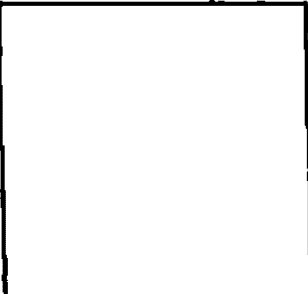

范蠡辞职经商后，富甲王侯。一次，他的二儿子因杀人被楚国囚禁起来候斩。范蠡说：“杀人偿命，天下公理。但我听说‘千金之子，不死于市’。”于是便置办了价值千金的礼物着遣他的小儿子前往探视。长子得到消息后，固请前往，范蠡不允，长子以为“舍长子而遣少弟，大概是因为我为不肖之子，无脸见人，还不如死了好”。其母急忙为长子说情，范蠡无奈，只好改派长子前往，并修书一封，嘱交在朝为官的好友庄生。再再三嘱咐说：“将金子交予庄生后，一切听庄生安排，千万不要与他争辩！”父子惜别上路，范公子依嘱而行。庄生看了范蠡的信后，便向范公子说：“请你马上离开这里，即使人被释放，也莫要问什么原因。”庄生素以廉洁耿直享誉朝野，陶朱公厚礼，并无意接受，暂纳千金，为的是示信于陶朱公，待事成之后再归还。而范公子并不解其意，仍滞留未归，妄候消息。庄生为救范家公子，便来见楚王说：“有一个星象不利于楚国，恐怕只有大赦才能逢凶化吉。”楚王素来敬重庄生，当即应允，并随即作出了将要大赦的指示。范家长子闻悉后，心想：楚王要大赦，弟弟定能获救，此次前来，虚掷千金，回去后怎么交代？于是便又来见庄生。庄生大惊，问道：“你为什么还没有离开这里？”范家长子答道：“是的。弟弟将获大赦，故来告辞。”庄生心里明白，便将范家此前所送礼物如数归还。庄生因为自己已被出卖，便又去见楚王说：“大王大赦意欲修德去凶，而现在道路上却纷纷喧嚷：陶朱公的儿子杀了人被关押在狱中，家人携许多金子来贿赂大王左右的人，所以大赦并非为楚国的百姓，而是为了一个陶朱公。”楚王大怒，立刻下令杀了范蠡的二儿子，第二天下大赦令。范家长子扫兴而归，慎实以告，家人无不悲哀，范蠡却笑道：“我早知道大公子一定会害死他的弟弟。并非他不爱自己的弟弟，只是大公子从小与我一起创业，饱尝生活的艰辛，视钱如命。至于那个小公子，坐享富贵，出入车马，哪里知道创业之难？我愿意派他去，是因为他不重财富，抛金如土，而大公子就做不到这一点。小弟死在他的手里，早在意料之中，不足为怪。”

这就是社会的和人生的经验：不同的生活环境造就不同的人格类型。同样，把越王勾践欢宴不乐的神情同其不能与功臣同享乐的心理联系在一起的，是范蠡有“飞鸟尽，良弓藏；狡兔死，走狗烹”的社会历史经验。“飞鸟尽，良弓藏”是用以处理君臣关系的较为温和的方法。像宋太祖“杯酒释兵权”，赐予功臣臣将良田阔宅，美女歌妓，令其脱离朝政，安享天伦。继而，宋太祖又担忧他们聚敛财富太多，便又施皇恩，赏他们宅基地，让他们修建豪华的住宅，破费数万。意犹未尽，又赐他们宴席，喝得酩酊大醉，然后召他们的子弟进宫领人，宋太祖对功臣武将的弟子们说：“席间，他们都答应献给朝廷十万缗钱。”这些功臣武将酒醒以后便问家人在皇上面前是否有失礼之举，家人便告以献钱之事，功臣武将虽有怀疑，但既已醉酒，自然无可争辩，只好进表如数上缴。宋太祖对付功臣武将真是费尽了心机！但“良弓”虽不为用，毕竟未毁。至于“狡兔死，走狗烹”可就惨了：横刀立马，南北转战，等到天下大定，却遭杀身之祸，以至于诛灭九族。所以，与其坐等“走狗烹”，不如主动深藏良弓，安享天伦。

殷纣王因宴乐无度，日以继夜，以至弄不清何月何日，问左右臣僚，都说不知道。又派人问箕子，箕子对他的弟子们说：“作为天下之主，致使一国之人尽失时间概念，天下就危险了；一国人都不知时日，唯独我知道，我的处境自然也就危险了。”因而箕子也以醉酒为由，推说不知何月何日。

## 第一章 大与小
### 诡秘的权谋

昏君无道之世曰“天醉”，天既然醉了，谁敢独醒？箕子这位孔子所称誉的仁人也不敢独醒，后世的屈原敢独醒：“众人皆醉我独醒。”数楚怀王，结果遭放逐，屈原气愤而写《离骚》。据弗洛伊德心理学宣泄原理，人如气愤过度，寻找对象，发泄一通，可收缓解心理紧张的功效。但生活中我们却常看到“越说越气”的场面，屈原大概亦属此类。终于亦诉亦气，至精神崩溃，自沉汨罗江，遂成千古之冤。

为臣之道，孔夫子有箴言：“邦有道，危言危行；邦无道，危行言孙。”危者，正也。孙即逊；逊者，退也。天下太平，国家正道运行的时候，一个有正义感的人说话要正直，行为要端正；而当社会动乱，昏君当道之时，作为君子，行为要端正，不能为虎作伥，不与坏人同流合污。但言语要慎而又慎，虽不能光说假话，但也大可不必把真话全说出来，更不能牢骚太甚。可见圣人并不是不食人间烟火的人格神，他太通人情世故了！试想：当社会混乱，大势不成，虽有济世之才仍不能挽狂澜于既倒的时候，为什么要作无为的牺牲呢？

岳飞的大名至今仍如雷贯耳。他所处的是一个动乱的年代。南宋朝廷偏居江南，丧失了半壁江山。岳飞以恢复中华为己任，他那“收拾旧山河”、重整“八千里路云和月”的惊天动地的“危行”将永彪史册。这样一个人却蒙冤而死，他的死也同他的伟绩一样惊天地、泣鬼神。他留给了人们无尽的惋惜和惆怅。他就没做到“危行言逊”，言何不透？他的口号是“直捣黄龙，迎回二圣”，要把宋高宗的父亲和哥哥请回来。果然如此将置当今皇上于何地？所以常人不能理解一介儒生的秦桧居然能威震敌胆的抗金将领岳飞于死地，其实，只不过秦桧拍对了宋高宗的马屁而已。

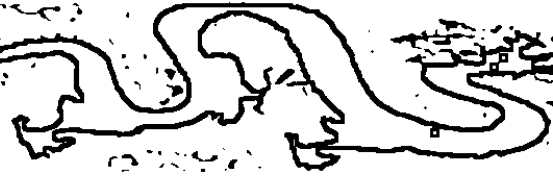

前事不忘，后事之师。岳飞就是不懂前朝故事；或许知而不从，嗤之以鼻。唐宋之间有个冯道，晚年人称长乐老人。五代十国，五胡乱华，生灵涂炭，朝代更替频繁。然而，五个朝代都请冯道出任要职，由此招来了许多文人学子的嗤骂：“临大节而不仁。”但冯道有他的主意：夷狄当道，天下大乱，何来忠义可言！为华夏民族的命脉，“危行言逊”，并不失大节。这其实也是正宗的儒家思想。《论语·宪问》：

> 子贡曰：“管仲非仁与？桓公杀公子纠，不能死，又相之。”子曰：“管仲相桓公，霸诸侯，一匡天下，民到于个受其赐；微管仲，吾其被发左衽矣！岂若匹夫匹妇之为谅也，自经于沟渎，而莫之知也！”

子贡问孔子，像管仲这种不能杀身成仁，改事二主的行为合不合仁道。孔子答复子贡：你以为管仲没有杀身成仁吗？错了。管仲之仁在于他对中国文化的贡献，这不是匹夫匹妇所能理解的。假若管仲果真为公子纠殉难，就如自己把自己倒在污水沟里一样没有价值。

秦二世时，宦臣赵高擅权，他为了试探群臣对自己的依顺程度，便牵来一只鹿对秦二世说：“这是一匹马。”二世笑着说：“丞相搞错了吧？明明是一只鹿，怎么说是一匹马呢？”二世又问身边的大臣，或说马，或说鹿，或沉默不语。事后，赵高便借故对说鹿的人进行迫害，群臣为之侧目。

明知二世昏庸，赵高专诈，居然慷慨以就，这不是孔子所谓“自经于沟渎”吗？孔子赞赏管仲，也赞赏南容：“邦有道不废，邦无道免于刑戮。”治世畅开大干，乱世清正自守，不作无为的牺牲。此辈大概人才难得，所以孔子毫不犹豫地把自己的女儿嫁给了他。

犯颜直谏、砥柱中流自然令人称羡，但也要讲天时、地利、人和。中国古代能够容下犯颜直谏者的君王实在太少，唐太宗是一个，宋太祖也是一个。唐朝的魏征是历史上有名的谏臣。唐太宗喜欢一只小鹞子，一天正在玩鸟，恰巧魏征进来，唐太宗急忙把鸟藏在怀里。魏征假装没看见，不紧不慢地同唐太宗谈国家大事，唐太宗干着急。魏征走后，唐太宗拿出怀里的小鸟一看：早已呜呼哀哉了。唐太宗回到后宫，气急败坏地说：“总有一天我会杀掉这个乡巴佬。”独孤皇后问明原委，立即盛装向唐太宗道贺，唐太宗不明其故，皇后说，唐朝有魏征这样好的大臣，又有你这样胸怀宽阔的皇帝，这是有史以来没有过的好现象，是国家兴盛的预兆，这还不值得祝贺吗？唐太宗听了皇后的话，才息怒不言了。后来魏征死了，唐太宗终于信了谗言，把魏征的墓碑也推倒了。直到唐太宗征高丽国失败后，才又念起魏征：假若魏征还在，就不会有今日失败之举了。可见，忠言逆耳利于行：虽利于行，唯其逆耳，所以人不爱听，贤者不免。类似的追悔之举历史上很多，可惜人生头颅一个，追悔何及？

所以，“天罪人亦罪”也不失为一种社会动荡时期的自处之道。后世践此术者不乏其人。像魏晋之世，五胡乱华，社会动荡，人民不堪其苦，名士性命也鲜得其终。阮籍便托志酣醉，不涉政事。司马昭欲同阮籍联姻，阮籍一醉六十日，终究不得与其言。钟会也多次以政事相访，欲以阮籍政言之失而治罪，阮籍终以酣醉不答而幸免于祸。

汉高祖之弟刘交被封为楚元王。刘交对穆公、申公等一批辅臣礼遇有加。穆公不善饮酒，楚元王每置酒宴，便为穆公特备甜酒。到王戊继位后，最初，还为穆公设甜酒，逐渐淡忘不置。穆公退宴后便说：“我该告退了，不设甜酒一事虽小，但说明我于楚王已无足轻重，若不主动离开，说不定有一天将被诛于市。”此后便称病不起。申公、白公等极力劝起，说：“难道你忘记了先王对我们的恩情了吗？如今楚王偶失小礼，何必如此认真！”穆公回答说：“《易》曰：‘知几其神。几者，动之微，吉凶之先见者也。君子见几而作，不俟终日。’先王礼遇我们，说明先王恪守为政之道。今王忽视我们，说明他已丢弃了为政之道。忘道之人，怎能与其久处。我并非斤斤计较于一般的礼节。”于是，谢病而去。后来，王戊淫暴日甚，又与薄太后有私，被削东海和薛两郡。又与吴谋反，申公、白公苦谏不听，二人无奈也离开了楚王，以舂米为生。

“见见而作，不俟终日。”说起来容易，做起来难。试想：久居官宦之林，出入仪仗，颐指气使，偶有风吹草动，决然挂冠而去，屈而做布衣百姓，确非易事。分析“几”这种微妙的变化，即吉凶之兆，必须具备丰富的社会历史和人生经验。孔夫子说要“视其所以，观其所由，察其所安”，以这三点来观察人，那么，任何人也逃避不了这三关。

春秋时期，郑大夫子产有一次乘车出行，路过东城墙门时，听到了一女人的哭声。子产若有所思，示意车夫放慢速度，侧耳细听，觉着哭声有些异常，便派一属吏前去把那位女人带来查问，原来是那位女人亲手杀死自己的丈夫后，假意痛哭来掩饰自己的罪行。车夫甚感惊异，问子产为何有先见之明，子产回答说：“在自己的亲人得病之初应感到沉重，临死之前感到恐惧，人死之后就会悲哀、忧愁。那位女人的丈夫既然已经死了，哭声中含哀愁，却充满了恐惧之情，所以我断定其中必有异常。”

郑子产闻哭跖妫的本领比之孙大圣的火眼金睛并不逊色。火眼金睛是吴承恩对孙大圣的生物学的恩赐；而闻哭跖妫的本领却来自于产对人情世故的洞悉。

战国时，齐国隰斯弥去拜见田成子，田成子同他登高赏景。引领南望，隰公家的树木黑糊糊的一片，挡住了观景的视野。田成子若有所思，但很快归于坦然，什么话也没说。隰斯弥回到家立刻吩咐人操刀伐树，刚伐了几棵，隰斯弥又突然命令停止砍伐。管家觉着奇怪，问：“您为什么突然变卦了？”隰斯弥回答说：“有句谚语说，知道深渊有鱼的人，他的命运一定不佳。田成子内心的隐秘我了如指掌，那那我就将我自己置于危难之中了。树不伐不会有什么罪过，而洞悉别人没有说出来的意思，那罪过恐怕就大了。”

这是知而不为。明知自己的树木遮蔽视野，令上司不悦，但仍然大智若拙，置若罔闻，为什么？深不可测是上司统御下属的必要修养，上司微妙的心理活动你都能尽收眼底，就必然要引起上司的警惕和防范。很显然，隰公寓巧于拙，寓智于愚之谋，迎合了田成子更为深层的心理需要。

管仲是齐国的名相。齐桓公称霸中原，九合诸侯，端赖管仲之力。管仲病危时，齐桓公去看望他并向他请教说："仲父您现在病了，还有什么要嘱咐的话吗？"管仲回答说："我只希望您远离易牙、竖刁、常巫、卫公子这伙人。"齐桓公不解，问管仲："易牙曾卖掉自己儿子的肉来孝敬我，说明他爱我胜过爱他的儿子，难道这样的人还不值得信任？"管仲说："人都爱自己的儿子，如果有人对他自己的亲生儿子很残忍，怎么可能诚心对君主好呢？"齐桓公又说："竖刁不惜阉割自己来事奉我，说明他爱我胜过爱他自己的身体，这还值得怀疑吗？"管仲说："人没有不爱自己的身体的，忍心毁坏自己的身体的人，对君主怎么会好？"齐桓公又问："常巫能断定人的死期，能治疗我的顽症，他也不是信任吗？"管仲说："死生是由命来决定的，顽症是自己身体上的毛病，您不能自己掌握自己的命数，守住自己的根本，却依赖常巫来维系您的健康，那他就可借此所为去了。"齐桓公说："卫公子事奉我已十五年了，为了我，他父亲死了也没有去奔丧，说明他爱我胜过爱自己的父母，这样的人还不值得信任吗？"管仲说："人最亲的莫过于自己的父母，对父母尚且如此绝情，又何况对他人呢？"齐桓公说：“好，一切按您说的办。”管仲死后，齐桓公依管仲嘱咐，驱逐了易牙等四人。但这四个人走后，齐桓公顿觉空虚，食不甘味，夜不酣睡，朝政荒疏，同时身体不适，旧病复发。齐桓公想，仲父之言，也许有失偏颇，于是便又把四人召了回来。次年，桓公病了，常坐到处宣扬说齐桓公将于某日死去。四人勾结起来，封闭宫门，断绝齐桓公的饮食。齐桓公弥留之际，流着泪叹息说：“怨我没有听仲父的话，仲父不愧圣人，目光远大。”

管仲并非生而知之者，何以言之必中？因为管仲能站在社会文化的大背景上来观察四人的言行。“孝悌”是中国古代社会文化的基本精神。“孝”，是子女对父母的爱，是父母对子女之爱的一种回报。所以“孝”不是单向的，而是双向的。父慈才能子孝。“悌”，就是兄弟姐妹之间的爱。“孝悌”作为一种基本的社会伦理规范，它是由血缘关系派生出来的。由父母兄弟姊妹之间的爱推及朋友、君臣以至整个社会，这是中国古代社会文化规范的一大特色。所谓“忠臣必从孝子出”。由此，管仲认为：一个不惜毁掉自己的身体、卖掉自己的儿子、不为自己 的父母守丧的人，就不可能以竭诚之心对兄弟，对朋友，对国君，因为他失去了基本的人伦之情，这就是“孝悌”；而中国古代整个伦理关系的准则都是在孝和悌的基础上派生出来的。管仲之智，如此而已。

齐桓公还曾经问管仲，鲍叔牙可不可以接替他的职位，来做宰相。管仲说鲍叔牙绝不可以做宰相。你看，管仲就是这么一个人：在他最穷困的时候，全赖鲍叔牙这位朋友的帮助；政治上遭受挫折的时候，又是鲍叔牙伸出了朋友之手，推荐他做了宰相；现在齐桓公主动请他推荐鲍叔牙，他却不肯。说他以怨报德不过分吧？其实，管仲有自己的主意：鲍叔牙的最大缺点是高风亮节、嫉恶如仇。一个做宰相的容不得半点污垢，那日子可怎么过？天下岂不是无可用之人了吗？因为人无完人呀！所以，让鲍叔牙做宰相，既害了国，更害了鲍叔牙自己。鲍叔牙知道了此事非常高兴，认为管仲才是知己。

无孝悌之心不可用，高风亮节、嫉恶如仇亦不可用，可见用人之难。管仲既能于微尘中见大千，亦能于大千中见微尘，举一反三以三反，确非常人所及。

明代嘉定安亭有一位名叫万二的人，富甲一方。有人自京城回乡，万二前往拜访，询问京城见闻。此人说，皇上（明太祖朱元璋）新作诗一首：“百僚未起朕先起，百僚已睡朕未睡；不如江南富足翁，日高丈五犹拥被。”万二惊叹道：“皇上大开杀戒的征兆萌发了！”于是便买来一艘大船同妻儿儿女泛游湖湘而去。不二年，江南大族被籍没的人不可胜数，万二却得以安享天年。

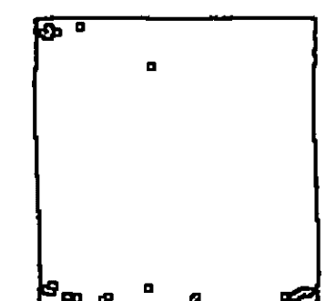

万二之所以幸免于祸，在于他从朱元璋简短的四句诗中，捕捉住了朱元璋深层的心理特征，即嫉妒——或许是由心理的空虚而产生的嫉妒。朱元璋贵为天子，“朕即国家，国家即朕”，天下姓朱，这还不够充实？物极必反，充实到了极端，便有空虚。朱元璋虽贵为一国之主，君临一切，颐指气使；又不足之处，乏色之好，乏麝之味。但这又怎样？“百僚未起朕先起，百僚已睡朕未睡”，他感到自己不如大臣；“不如江南富是翁，日高丈五犹拥被”，又把自己降到了商贾富豪以下。这是新的空虚。人们普遍的心理规律是：旧的需要得到满足后，新的不满足和新的欲望便随之产生。从朱元璋的诗中，可以看到他作为皇帝的心理孤独和空虚，看到极端尊贵之中的戚戚之情；既然如此，杀几个人排泄一下心理的空虚不是顺理成章的事吗？难怪朱元璋杀了那么多的功臣！当然，他之所以大杀功臣，担心“功高震主”是一个主要原因；由于那种作为皇帝的心理孤独和空虚，继而寻找机会排泄这孤独和空虚，也是不可忽视的。

万二也真懂皇帝的心理！

## 二、舍小求大 丢卒保车

大与小矛盾的另一个层次是局部利益同整体利益的矛盾。一箭双雕，统筹兼顾，当然最为理想。但情况复杂，世事多艰，在很多情况下二者不能两全。这就要求谋谍主体洞察全局，果断取舍，以局部之失赢取整体之得。像田忌赛马、自污自保等都是舍小求大、丢卒保车的典范。

战国时，齐将田忌经常与齐国的王公贵族赛马，输掉很大的赌注。孙膑看了双方的马力后对田忌说：“再赛马时，您尽管多下赌注，我保证让您取胜。”一次，田忌又同齐王及诸公子赛马，下赌注千金。孙膑便对田忌说：“今天您用自己的下等马赛他们的上等马，用您的上等马赛他们的中等马，用您的中等马赛他们的下等马。”结果田忌一负两胜，赢得了千金。

这是以局部之失赢取整体之得的典范。兵法说以强击弱，但竞赛双方的马力均分上、中、下三等，所以没有局部的以弱击强，便没有整体的以强击弱。即若要求整体之得，必要有局部之失。

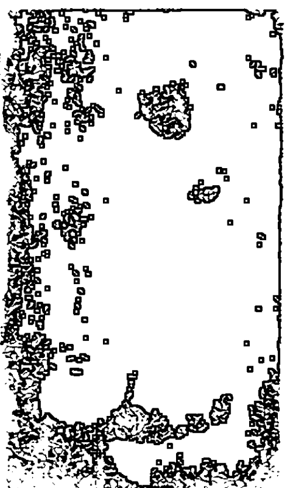

孙膑这一思想常被后世兵家所运用。唐太宗李世民在总结战争经验时曾说：“我从年轻时就经略天下，颇知用兵的关键。每次观察敌人的战阵，就能得知敌军之强弱分布。我常以我方的弱兵去对付敌方的强兵，以我方的强兵去对付敌方的弱兵。敌方战胜了我方的弱兵以后，追逐不到数百步就止步不前；而我方的强兵战胜了敌方的弱兵之后，则穷追猛打，直捣敌军阵后，敌人没有不因此而全军崩溃的。”很明显，这是孙膑的战术。

宋高宗曾向吴璘请教克敌制胜的方略，吴璘说：“让弱兵挑战，强兵迎战。”宋高宗立刻醒悟：“这是孙膑赛马的战术。”

春秋时期，齐国的公孙接、田开强、古冶子是齐景公手下的三名勇士。他们依仗自己的勇力和地位傲慢无理，胡作非为。齐相晏婴担忧他们日后酿成大患，便向齐景公请求除掉他们。齐景公很为难，说：“三位勇力过人，没人是他们的对手，行刺也恐怕难以刺中。”晏婴请齐景公派人送给三勇士两只桃子，并对他们说：“你们三位何不以功劳的大小来决定桃子的归属呢？”公孙接抢先说道：“我先同猎战，后与虎搏斗，像我公孙接这样的人同别人不一样，当然应该吃桃子。”说完后顺手将一个桃子拿走。这时田开强说：“我曾两次设伏兵击退敌军，这么大的功劳当然也应该吃桃子。”说完便拿走了另一个桃子。古冶子见桃子已被抢光，愤愤说道：“我曾随君王一起渡河，突然一只大鼋咬住了国君王驾的左马，将它拉入中流。当时，我年少不会游泳，于是就下水逆潜行百步，又顺流潜行九里，捕杀了大鼋。我左手操马尾，右手拿着鼋头，一跃而出，水手们都惊呆了，以为是河伯出现了。像我古冶子这样的功劳难道不该吃桃子吗？”说完拔剑而起。公孙接和田开强顿感惭愧，说道：“古冶子勇不可比，功不可攀，而我们却抢先拿了桃子，这是贪婪的表现，若不以死洗辱，便不配做勇士。”说完，一齐还了桃子，然后拔剑自刎。古冶子看到这种惨景，十分震惊和难过：“两位勇士都死了，我单独活着是不仁；用语言羞人自夸是不义；若不以死相报是无勇。”说完也拔剑自刎。使者向齐景公报告了事情的经过，齐景公以隆重的礼仪安葬了他们。

这是晏婴对付勇士的方法。他以两只桃子杀死了三位勇士，其功力之神奇令人不可思议。其实，神力不在两只桃子，而在于晏婴紧紧抓住了勇士的性格特征。

中国的勇士大都粗犷、豪放，其侠肠义胆往往令人惊心动魄。义者，宜也。所谓“路见不平，拔刀相助”，为朋友、为知己更能慷慨相助，甚至舍弃生命也在所不惜。所以“义”往往同“勇”联系在一起。有句俗语说：“仗义多从屠狗辈，负心

多是读书人。”他们从事的虽然是杀猪宰狗的贫贱职业，没有多少知识。但很有侠义精神，言必信，行必果。如历史上的荆轲、高渐离等。当然，这种“义”的修养并不为屠狗之辈所独有，大凡历史上的所谓贤人君子都具备这种修养。最典型的如诸葛亮，真是“可以托六尺之孤，可以寄百里之命”。政治上有名的托孤，讲的就是刘备白帝城托孤给诸葛亮。刘备的儿子刘禅，很是愚蠢，俗名阿斗。刘备临死前托孤给诸葛亮说：“君才十倍于曹丕，嗣子可辅则辅之，不可辅则取而代之。”这话可把诸葛亮震住了，立刻跪下来说：“臣鞠躬尽瘁，死而后已。”“功成、名遂、身退”才算恰到好处，可诸葛亮退不下来，只好“鞠躬尽瘁，死而后已”。这就是“义”。

英雄能够征服天下，却很难征服自己。请看历史上的英雄，他们身上的“义”气，总带几分鲁莽的色彩：是对是错干到底；错也错得豪迈，错得悲壮。楚霸王项羽就是这类英雄。推翻秦朝，项羽无首功，但结果怎样？“枉把头颅赠马童”。垓下之战，项羽被汉军将士四面围困的时候，一老翁要送他过江，他却以无脸见江东父老为由加以谢绝。又回头一看，走在前面追杀自己的正是自己以前的老部下，名叫马童。马童见项王回头，急忙羞愧地转过脸去。项羽却说，你不要怕，这有什么？你不就是我的故旧马童吗？听说刘邦悬赏，凡得我头颅的可赏千金、封万户侯。你既是我的故人，我就把头颅送给你。接着引剑自刎。

项羽生为人杰，死为鬼雄，具有悲壮的美。项羽的最大悲剧就在于至死不悟，他仰天浩叹：“非战之罪，天亡我也。”其实，他失败的主要原因就是一意孤行，听不得不同意见（这一点恰与刘邦形成鲜明对照）。比如，当他打到咸阳时，韩生告诉他说：“关中险阻，山河四塞，地肥饶，都可以霸。”劝他定都咸阳，便可匡定天下。他却说：“富贵不归故乡，如衣锦夜行，谁知之者？”这又使我们看到了英雄的另一面——“士而怀居”的狭窄胸襟。清人王昙悼项羽诗云：“秦人天下楚人号，枉把头颅赠马童。天意何曾袒刘季，大王失计恋江东。早推函谷称西帝，何必鸿门杀沛公。徒纵咸阳三月火，让他姜敬说关中。”真切中了这位英雄的要害。读英雄的历史，真让人感慨万千：义气中有鲁莽，鲁莽中有悲壮；但事物就是这样矛盾对立的，设使英雄义中有勇，勇中有细，将置晏婴之辈于何地？所以，“英雄气短”，晏婴二桃杀三士，正是钻了这个空子。

东魏行台郎中杜弼曾将一些文武大臣的贪掠之举言于丞相高欢，请求治罪。高欢认为，西有西魏宇文逼，南有齐肖相诱；况且，文武皆将家属多在关西，人情去留未定，所以便将杜弼之议束之高阁了。高欢将出兵讨伐西魏，杜弼固执己见，又请求高欢先除内贼。高欢问谁是内贼，杜弼便说时常掠夺百姓的勋贵便是内贼。高欢不再作答，只令一些军士张弓、注矢、举刀、按戟，成夹道之势，接着便命杜弼穿行其间。杜弼见状，惊颤不已，以至汗流浃背。高欢于是便和风细雨地向杜弼说：“矢虽注而不射，刀虽举而不击，戟虽按而不刺，你便丧魂落魄，诸劝贵身冒险涉，驰骋疆场，虽然有贪鄙之举，但其余于国之功远远大于他们的过失，岂能与普通百姓同日而语！”杜弼顿首谢罪，承认自己目光短浅。

高欢能够从大处着眼：大敌当前，应全力对外，若置外敌于不顾，整肃内部，搞得人人自危，谁还肯效死沙场？所以，保国为大，治国为小。与此不同，杜弼整肃内部之议，虽正义昭昭，便书生气十足，不务实际，徒坏大事而已。高欢之谋合情而不合理，非置身疆场之人便不易接受。高欢模拟疆场之险，令杜弼体验。杜弼便豁然领悟高欢之良苦用心。

宰相肚里能撑船，高欢确实具有宰相的大度胸襟！

## 诡秘的权谋

### 第一章 大与小

唐德宗时，因离祭祀帝舜的日子近了，禁止杀生。郭子仪的仆隶违犯禁令，宰了羊，右金吾将裴膑立刻票奏皇上，予以弹劾。德宗为此多次夸赞他不阿权贵，忠直刚正。有人不以为然，问裴膑：“郭公有功于社稷，为什么不加庇护呢？”裴膑回答说：“正是因为郭公德高位隆我才这样做的。郭公位高权重，皇上刚即位，本来担忧郭公党羽众多，难以驾驭，我揭发他较小的过失，说明郭公不足畏惧。这样，上尽了事君之道，下安了郭公及朝臣之心，不是一举两得吗？”

郭子仪是唐代中兴名将，安史之乱，唐明皇逃亡四川，几乎丢了国家。郭子仪挥戈跃马，南征北战，力挽狂澜，迎驾回京，功勋卓著，威震朝野，因而被封为汾阳王。“功高震主”，这样的功臣如何保全终身，是中国古代历朝功臣所面临的一大人生课题。像秦将王翦、汉丞相萧何等是采取霸占民田，抢占美女等这种玷污自己名声的办法来自保。所谓“士而怀居，原无大志”，以此来使主上放心。这一招往往奏效，所以被后世许多功臣所采纳。不过，这种“自污自保”的办法也并非天衣无缝，假若有那么一位主上心机较深，从另一个侧面考虑：你这套自污之举是心虚的表现，其目的是为掩盖其不轨之心而已。果真如此，自污之举，岂不是弄巧成拙了吗？与此不同，裴膑之举就高明得多：郭子仪虽然位高权重，但也没有什么可怕的，你看他稍有失误，便立刻有人出来弹劾，说明他并不是什么炙手可热的人物，不足为忧。于此可见，裴膑颇谙损益之道，他寓保于劾，寓扬于抑，致使君臣两安，真可谓炉火纯青。

## 大的权谋

当然，郭子仪也有他自保的办法。他的王府总是门户大开，任人出入，不闻不问。他的儿女们纷纷劝谏说：“父亲大人功业显赫，但却不懂得如何自重，不论贵贱，都可以随意进出王府，甚至可以随意进入您的卧室。即便是伊尹那样的圣人，霍光那样的权臣也不会如此作为。”郭子仪笑着说：“你们根本不懂得我的良苦用心。我家吃公家草料的马有五百匹，吃公家粮的部属、仆人有一千多人。我是前无所求，后无所退。如果我修筑高墙，紧闭门户，与朝廷内外减少往来；假若有人与我结下怨仇，诬陷我图谋不轨；再加上忌贤妒能之辈添油加醋，造成确有共事的样子，到那时后悔也来不及了。现在我坦荡无邪，四门洞开，虽然有人想诋毁我，但也难以找到借口。”

可见，功臣的日子不好过，郭子仪也不例外。郭公的办法是“自白自保”：你看我，一举一动都在众目睽睽之下，该放心了吧？其实，任何事物都可能走向其反面：郭公这样做的结果很可能使他的声望更加提高，而这正是其主上所不愿看到的。

臣下如此左右为难，倒不如主上都像宋太祖“杯酒释兵权”那样干脆利落。赐予功臣良田美宅，使其安享幸福生活，永不参与政事。这样也使得君臣两安。可惜宋太祖只有一个，很多君王都犯既用人又疑人的毛病，使得臣下不得不挖空心思来对付这一大课题。

明代周忱巡抚江南时，正值王振当权，一人之下，万人之上，其势如日中天，朝野为之侧目。周忱当然也是忧虑重重，盘算着如何赢得王振的支持。恰巧王振修府建宅，周忱就暗中令人丈量王府宅阁的大小，然后派人到松江定做一块剪绒毯送给王振，尺寸大小正合适，王振极为高兴。此后，凡周忱向朝廷申报的土木建设项目，王振都尽力帮忙，江南一带颇受益。

这是以较小的代价换取较大的收获。令人费解的是，像王振这样的权臣，享不尽的荣华富贵，从物质生活方面说自然无忧无虑，怎么会为一块剪绒毯动心？这就涉及人的深层次的心理情感，不能就物质的多少本身来解释。我们看中国历史，大凡人的位权越高，就越孤立，其情感释放的对象也就愈少，因而也就愈缺乏真真正人的生活。最极端的像皇帝，他是孤家寡人。讲话、做事都必须遵照祖传下来的特定的一套呆板程式。他生活在山呼万岁的呼声中，能听到多少发之肺腑的呼声？所以同他的凛不可犯的威严相伴随的是人的情感的苦闷。他没有或很少有真正的朋友，没有或很少有情感倾诉的对象。能以友道与臣下相处的，一定是有作为的皇帝。像唐太宗与魏征，乾隆与他的翰林们，在中国历史上可谓风毛麟角。

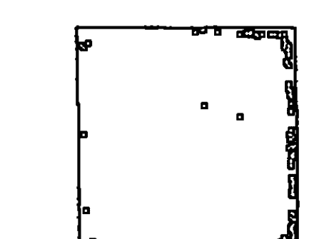

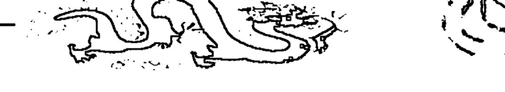

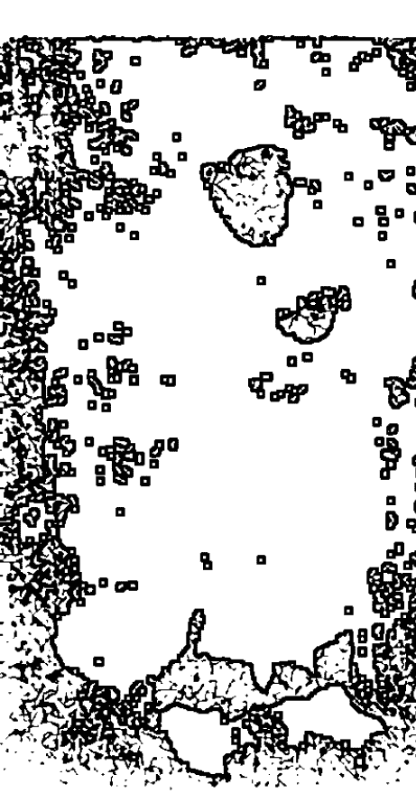

## 诡秘的权谋

有一个大热天，修《四库全书》的翰林们热得受不了，索性脱了衣服干。纪晓岚人胖，当然也打了赤膊。这时，乾隆皇帝突然便服到翰林院，想同翰林们聊天。大家发现皇帝驾到，便一哄而散，藏了起来。纪晓岚有深度的近视，一时摸不到衣服，狼狈不堪，只好钻到桌子底下。过了一会儿，纪晓岚趴在桌下闷得受不了，便伸出头来问：“老头子走了没有？”正好被乾隆抓住。乾隆叫他出来问道：“你这样没礼貌，为什么喊我老头子？”纪晓岚从容解释说：“万岁，万岁，万万岁！万国之‘老’；国家元首为‘头’；真龙天子为‘子’。全国百姓都称陛下为‘老头子’，这是尊称。”乾隆也笑了。

在这短暂的一瞬，没有君臣之别，只有朋友之谊，也只有在这的一瞬，乾隆才忘掉无尽的烦恼，享受着无比的惬意和轻松。当皇帝的有时也很苦，他也需要不染政治色彩的生活和情感交流。从这个角度说，一些用政治标准来衡量应该受到谴责的行为，用生活的标准来观照就大不相同了。比如和珅包揽了清廷大权，在乾隆晚年，很多人进谏说和珅这个人该去掉，但乾隆一意孤行，就是不动他。后来有人问乾隆，为什么如此偏袒和珅，乾隆回答说：“我知道和珅坏，但你们总得留一个人跟我玩呀！”这是皇帝的心里话。一个人到了孤家寡人的地步，连一个可以说笑话，可以玩玩的人都没有，就太苦了。

理解了皇帝孤寂的情感生活，周忱一块剪绒毯的奇异功能便没有什么不可理喻的了。王振有爱用不尽的物质满足，却缺乏真挚的脉脉温情；他身边不乏趋炎附势的佞臣，却少有肝胆相照的朋友。周忱虽说不上是肝胆相照的朋友，但他捕捉到了作为权臣的孤寂的情感，用剪绒毯这种不为注意的生活小品寄托了对王振“无微不至”的关怀，触动了王振那颗缺乏真挚情感沟通的心，拉近了他同王振的情感距离，随之也获得了较大的收获。

世界上没有两片完全相同的叶子，也没有完全相同的人。所以为人处事必须因人而异，不可死守一式，一劳永逸。否则，将适得其反。

南宋权相秦桧建造格天阁时，江南一位官员急于取媚秦桧，便以重金贿赂知情者，得到了格天阁的大小数据，然后制作一块绒地毯，进献给秦桧。地毯铺在格天阁中尺寸正合适。秦桧十分吃惊，疑心忡忡，担心他知道自己的底情，于是便将献毯的人训斥了一顿。

礼品相同，效果各异，这也不足为怪。王振暴躁、骄横，心机较浅，所以有来必纳；而秦桧险毒、狡诈，老谋深算，自然三思而后行。所以在秦桧这样人面前，不应以机警聪慧示人，应修大智若愚的风范。

## 第二章 远与近

远与近的矛盾包含两个层次的内容：一个是时间，一个是空间。

人们行进在时间的长廊中。时间上远与近的矛盾具体表现为当前利益同长远利益的矛盾。一般说，现在是分解了的未来，未来是不断降临的现在，抓住了现在，便在很大程度上抓住了未来。但现在与未来毕竟是两个不同的概念，说抓住了现在便在很大程度上抓住了未来，前提是这“现在”必须是考虑到了未来因素，从而为未来的发展和利益打好了基础的现在。如此，才算抓住了整个的时间流，这成功的“现在”便成为成功的未来的预演，所以，为了未来，有时就需要部分地牺牲现在，这就要求权谋主体能够高瞻远瞩，有“一览众山小”的境界和胸襟。

人们又生活在一定的空间中，生活在一定空间的一定群体中。不同群体之间有着不同的利益关系，所以群体之间的矛盾不可避免，只是矛盾的大小与激烈程度的不同而已。一般而论，不同的群体生活在不同的空间中，所以空间中远与近的矛盾可以归结为不同群体之间的矛盾。在科学高度发达的当代社会，由于信息化程度的提高，致使庞大的地球也显得十分狭小。“地球村”一词的出现，便是人类已向信息时代迈进的反映。尽管当代生活在地球不同区域的人们颇有“天涯咫尺”之感，但并非空间的距离在任何领域都已无足轻重。空间的距离在很多领域，诸如政治、经济，特别是外交和战争中，仍是影响国与国之间关系的重要因素。那么，在科学不发达、交通不便的中国古代，空间上远与近的矛盾更成为影响不同群体（或国家）间政治、经济、外交和战争关系的重要因素。处理远与近的关系也便成为谋略家们必须面对的课题。

### 一、昭义怀远

义者，宜也。所谓“路见不平，拔刀相助”，所谓“可以托六尺之孤，可以寄百里之命”，都是对义之精髓的生动写照。总之，临危受命，不计得失，为朋友、为知己、为了某种信仰和理想，可以赴汤蹈火，以至于牺牲自己的生命也在所不惜，这便是义的基本精神。“义”历来被看作同“利”相对立的范畴，所谓“君子喻于义，小人喻于利”，义不言利，利不涉义，二者似乎水火不容。义利之辩，聚讼数千年，以至于当今之世，它的幽灵仍在徘徊。

从更为高级的层次上说，义与利并非水火不容。义中有利，利中有义。
“义”是对他人的“利”，“利”是对自己的“义”，此其一；其二，即便是对他人有利的“义”，也并非对自己全然无利，何况往往失当前之利而得长远之利。譬如，战国时期孟尝君的食客矫命焚券，义感辞地，虽失当前之利，但日后孟尝君婴相归辞，辞地百姓不但毫无冷淡之意，反而扶老携幼，远道叩迎，这义换来的不是利吗？义既然能征服人心，它就一定能为人们带来利益。所以，以义感召，不仅为正统的儒家所倡导，也成为谋略家们在政治、军事、外交以及其他领域时所时常运用的手段。

春秋时期，晋国派简吴率军讨伐鲜虞，兵临鼓城（今河北晋县），便以重兵将城围住，鼓城危在旦夕，人心惶惶。此时，城内有人愿作内应，叛城降晋，简吴却一口加以拒绝。左右部将困惑不解，问道：“免去将士攻城之苦，何乐而不为？”简吴答道：“我曾听叔向说，位居高位的人爱憎分明，慎言谨行，少犯错误，人民才能有所敬畏和依归，国家也将无事不成，无往而不胜。假若有人叛卖了我们的城池，我们一定憎恨他；如今有人要叛卖他们自己的城池给我们，我们反而就表示欢迎，这实际上是奖赏我们所憎恨的行为。所以，我的主张是有力则进，无力则退，不能为了得到城池就舍大义于不顾而采用奸邪的办法。否则失去的将会比得到的更多。”继而把叛逆者送交鼓城正法。围城三个月后，城内又有人请求投降，简吴接见了城内的部分百姓，然后说：“我看城内有粮可食，还是继续守下去吧！”简吴此举更激怒了左右将士，他们纷纷质问简吴：“能马上得到的城池你不要，屯兵城下，旷日持久，劳民伤财，如何向国君交代？”简吴回答说：“这很好交代。得到一个地方而鼓励当地百姓的怠惰之情，那还要这样的地方干什么用？还不如让他们仍旧保有城池。轻松得到的城池是难以长久拥有它的，不作殊死奋战就把城池交给对手也是很不吉样的。鼓城人竭力守城对待得起他们的国君；我未获城池而先得民心也对待得起我们的国君。我们现在坚守信义，得城之后人民便知道信义所在，就会尽忠听命，不怀二心。这样做难道不对吗？”后来鼓城确已尽力力竭，简吴才占领了鼓城。进城之后秋毫无犯，只把其国君带回了晋国。

孙子说：“兵者，诡道也。”又说：“兵以诈立。”《孙膑兵法·齐威王问》：“诈者，所以困敌也。”曹操注：“兵无常形，以诡诈为道。”为政以德，为兵以诈似为贤者共识。然而，简吴用兵，特立独行，似乎置兵家基本原则于不顾：已成重兵危城之势，不但不利用敌之慌惧心理主动用间，求不战而克之功，反而将叛城归降者交还对方斩首，助敌守城之志；继而，鼓城请降，简吴又以城内尚有粮可食为由加以拒绝，好像简吴本人就是鼓城守将似的。难怪部下惊惑不已，连连质问：如此围而不攻，与而不取，劳民伤财，将如何面陈国君。

简吴之举，难以理喻，但后世效仿者却不乏其人。

三国蜀后主建兴三年（公元225年），诸葛亮声讨南中（今云南曲靖一带），马谡向诸葛亮建议说，南中叛逆仗地势险阻，不服蜀汉已经很久了，往往今日击破，明日又叛变。如今丞相致力北伐，南中叛逆得知蜀中空虚，定有不轨之举。若把他们斩尽杀绝，既不合仁义之道，又非我能力所及。用兵之道，攻心为上，攻城为下，愿丞相设法服他们的心。诸葛亮采纳了马谡建议，五月渡泸水（今云南保山县西北），擒南中首领孟获。诸葛亮领孟获于军阵前问：“这种军阵如何？”孟获说：“以前不明虚实，遭致失败。今承蒙观看阵势，亦不过如此，并非不可战胜。”诸葛亮笑着将他释放。如此七擒七纵，孟获叹服道：“丞相天威，我们南人不再反了。”南中遂安。

《三十六计》评诸葛亮七擒七纵之举道：“武侯七纵，其意在拓地，在借孟获以服诸蛮，非兵法也。若论战，则擒者不可复纵。”七擒七纵，“其意在拓地，在借孟获以服诸蛮”，一语中的；接着断言擒而复纵“非兵法也”，则不免使人困惑。他大概认为，拓地服蛮纯属政治范围，与兵战无关。其实，战争就是政治的转换形式，历代都没有脱离政治目的的纯粹的战争。《孙子兵法》开宗明义：“兵者，国之大事也。死生之地，存亡之道，不可不察也。”孙子把战争看作关系军民生死、国家存亡的大事，并未就战争而论战争，怎么能说拓地服蛮、七擒七纵不合兵法呢？孙子又说：“百战百胜非善之善者也；不战而屈人之兵，善之善者也。”还说：“上兵伐谋，其次伐交，其次伐兵，其下攻城。”一代兵圣最终不主用兵，并将其思想纳入他的兵法大典中，又当如何理解呢？战争都是为一定的政治、经济、文化目的服务的，所以战争又往往辅以政治的、经济的、文化的，以及心理的手段，并与战争本身融为一体。

两军交战，各为其主。以鼓城之战而言，鼓人守城，义当与城共存亡，不战而降，有辱君命，义之所弃；晋人攻城，上受君命，力战不怯，亦是义之所在。但在晋军实力占绝对优势，胜券在握的情况下，简吴毅然送还敌之降卒，长鼓人守城之志，昭扬信义之本，不是很耐人寻味吗？试想：城下之日，鼓城百姓又当作如何之感呢？

齐国的孟尝君是战国时期四大公子之一，门下有食客数千名。有一次，他拿出账簿，想找一位会算账的门客到他的封邑薛地讨债，冯谏自告奋勇，署名前往。临行前问孟尝君：“收完债买点什么东西回来？”孟尝君回答说：“看家里缺什么随便买吧！”冯谏赶到薛地，让地方官吏把债务人都召集起来，设牛酒款待。遍核债券后，冯谏便假借孟尝君之命把所欠债款全部赐给百姓，并当场将债券付之一炬，即日驱车返回报孟尝君。孟尝君对冯谏速度之快甚感惊异，急忙穿戴好接见冯谏，问道：“怎么来得这么快？买什么东西回来了？”冯谏回答说：“您让我视家里所缺的买，我想，您官中不乏金银珠宝，马厩也不缺良马奇犬，美妇丽姬环绕堂下，所缺的也就是仁爱之举，所以我就私自决定为您买了一个‘义’字。”孟尝君不明其意，冯谏便解释说：“现在您只有薛这么一个封邑，您不能抚爱薛地子民，反而用商人的手段在百姓身上榨取钱财。我假托您的命令把债款全部赐予百姓，烧毁了契券，百姓无不欢呼雀跃，感激您的恩德。这就是我为您买来的‘义’。”孟尝君听罢心里不高兴，但又无可奈何。一年后，齐湣王罢了孟尝君的相位，孟尝君只好返回自己的封邑薛地。薛地的百姓听说孟尝君要来，便扶老携幼，在百里以外的路上迎接孟尝君。孟尝君十分高兴，对冯谏说：“先生为我买的‘义’今天终于见到了。”

“天下熙熙，皆为利来；天下攘攘，皆为利往。”孟尝君虽贤，亦不忘聚钱敛财，嘱托冯谏视家里所缺，能买尽买。由此而论，所谓君子贤人、凡夫俗子，又何异哉？然而，冯谏慧眼独识，高瞻远瞩，将债券付之一炬，空手复命，惹得孟尝君啼笑皆非，大惑不解：如此买“义”，于利何干？日后罢相免官，返回封地，百姓远道叩迎，欢呼雀跃，义利之辨，远近之别，所在昭明，孟尝君方如梦初醒。可见，舍近求远，弃财取义，若非人贤，宁能为乎？

薛地百姓远道叩迎，孟尝君激动不已，冯谖说：“这又何足挂齿！如今您能安居的地方就这一个薛，俗话说‘狡兔三窟’，您至少要有三个安身之处心里才能踏实。您若是给我一具马车，让我到秦国走一趟，我准能让齐王重新起用您，到那时，薛地、咸阳（秦国首都）、临淄（齐国都城）三窟既成，您就可以高枕无忧了。”孟尝君自然同意。不久，冯谖西入咸阳，对秦昭王说：“如今天下有才智的人不来秦国便去齐国。到秦国来的人都是想让秦国强齐国弱；反之，到齐国去的人则是想让齐国强秦国弱。可见，秦、齐势不两立，不是秦国得天下，就是齐国得天下。”秦王听冯谖讲话很有意味，连忙问冯谖有什么计策能使秦国强大，冯谖反问秦王：“大王也知道孟尝君被齐王革职的消息吧？”秦王答：“听说过。”冯谖说：“齐国之所以能自强于诸侯之林，全赖孟尝君之力，天下有目共睹。而今齐王听信谗言，废黜了孟尝君，孟尝君对齐王怨恨极了。假如大王趁此机会把孟尝君请来，孟尝君必定肯为秦国出力；齐国失掉了孟尝君，还怕它不日渐衰落，来归附秦国吗？请大王赶快带上礼物到薛邑去请孟尝君，否则，齐王一旦觉悟，重新起用孟尝君，那齐国就又要同秦国争高低、决雌雄了。”秦王听后大喜，决定马上派人带车马十辆、黄金百镒去迎接孟尝君。冯谖见事已济，便先期赶回齐国，又去劝齐王说：“齐、秦两国势不两立，齐、秦之争说到底是人才之争，谁能得到人才，谁就能号令天下。我听说秦国暗中拉拢孟尝君，现在已派出使臣携车马十乘，黄金百斤的厚礼来请孟尝君入相秦国。假如孟尝君果真西入秦国，号令天下，那临淄、即墨恐怕就危险了。”齐王听罢，焦急万分，一时拿不出办法，只好按照冯谖的建议，重新起用孟尝君，并且又赏赐孟尝君一千户的封邑。同时派人迎接秦使，告诉秦国使者孟尝君已复相位，秦使只得回马而去。

这是历史上著名的“狡兔三窟”的故事。观孟尝君罢官返薛，薛地百姓百里叩迎的场面，可以预言：除非孟尝君谋反不轨，被削除封邑，薛地一窟似经坚牢无虞。然而，冯谖为孟尝君新凿秦相、齐相两窟恐怕仍有后顾之忧，不可同薛地一窟等量齐观。齐湣王二十五年，孟尝君入秦，秦昭王将拜孟尝君为秦相，有人便对秦昭王说：“孟尝君虽为贤者，但毕竟是齐国人，让他来出任秦国的宰相，恐怕他会以齐国利益为先而以秦国利益为后，秦国的前途也就危险了。”秦王听后深有所感，立刻收回前意还不算，又把孟尝君囚禁起来，并图谋杀掉孟尝君。幸亏孟尝君得“鸡鸣狗盗”门客的相助，才免难秦国。孟尝君虽有贤士之名，威震诸侯，但秦王仍禁不住“齐人先齐而后秦”的劝谏，孟尝君险些丢了性命，所谓三窟既成，高枕无忧，谈何容易？

## 第一章 远与近

### 诡秘的权谋

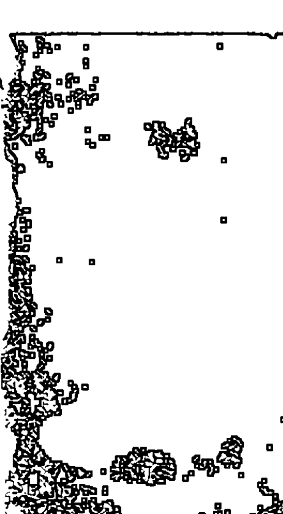

说起“鸡鸣狗盗”，倒真不愧为立身一窟。孟尝君喜好养士，无论儒士、流人、侠客、罪人，不分贵贱，一概设馆容纳，而且主客平等，毫无例外。一次，孟尝君同门客共进晚餐，因人遮蔽灯光，一客误认为饮食不等而大发雷霆，孟尝君立刻起身拿自己的一份同他相比，怒客看到饭食平均，无地自容，拔剑自刎。由此，天下之士多归孟尝君。此次，孟尝君在秦国遇险，多亏“狗盗”窃玺，“鸡鸣”开关，孟尝君才得化险为夷。当初，孟尝君收容“鸡鸣”、“狗盗”二人作门客，诸门客嗤之以鼻，冷眼相看。此次孟尝君得“鸡鸣狗盗”之力脱免秦难，诸宾客无不叹服孟尝君的眼光和胸怀。大概“天生我才必有用”，当下不用日后用，岂可鼠目寸光！所以说“鸡鸣狗盗”为立身一窟并不过分。

不过，此一时也，彼一时也。冯谖在秦国资凿一窟亦不可尽废。冯谖面见秦昭王，由秦齐势两不立，说到秦、齐之争说到底是人才之争，继而将孟尝君一人之去留同秦、齐两国的盛衰联系起来，击中了秦昭王的要害。秦王立刻决定隆重厚币请孟尝君入秦为相。秦国一窟既成，冯谖立刻以此为拳头来要胁齐王，齐王无奈，只好官复原孟尝君的相位，还加赐封户一千。由此看来，秦国一窟虽非安身立命之所，但却不失为巩固临淄和薛地两窟的工具。观冯谖说秦王既成，反而提前向齐王传递消息，使齐王留住孟尝君，不使孟尝君入秦，莫非冯谖也意识到了这一点？

人无远虑，必有近忧。但又不可操之过急。所谓“时至而行，则能极人臣之位；得机而动则能成绝代之功”。

秦庄襄王子楚即位前，曾在赵国做人质。因秦、赵两国时常交兵，所以子楚在赵国也常受冷眼。况且子楚又非嫡正，委质诸侯，因而资用不饶，车辆破旧，生活拮据，很不得意。此时，商人吕不韦在赵都邯郸做生意，见此情景，认为子楚“奇货可居”，将来能做成大生意，因而前去拜见子楚说：“我能光大您的门庭。”子越看看这位其貌不扬的商人，笑着说：“你姑且先光大您自己的门庭吧，侈谈什么光大我的门庭！”吕不韦说：“您有所不知，我的门庭需要您的门庭光大之后才能光大。”子楚晓得其中意味，便与吕不韦深谈起来。吕不韦说：“现在秦王年迈，立安国君为太子。安国君非常宠爱华阳夫人，而华阳夫人却没有儿子。能立嫡嗣者，唯有华阳夫人。你们兄弟二十余人，您又排行在中间，并未受到宠幸，长久在异国做人质，既便大王死后，安国君继立为王，您也很难有机会同长子以及与大王朝夕相处的其他兄弟争做太子。”子楚点头称是，忙问如何办才好，吕不韦说：“您本来资用穷乏，又客居异国，没有钱拉拢贵胄，也没钱结交宾客，我虽然也不宽裕，但请让我拿出一千斤

黄金为您西游，事奉安国君及华阳夫人，立您为嫡嗣。”子楚感激万分，说：“如果事成，我一定与你共享秦国天下。”于是吕不韦便拿出五百金给子楚，供其结交宾客；又拿出五百金买来珍奇玩物，西入秦国，献给华阳夫人，并借机为子楚进行游说。华阳夫人终于说动安国君立子楚为嫡嗣，后来继立为秦庄襄王。吕不韦在于楚继立为秦王以后，也被拜为丞相，封文信侯，食邑河南洛阳十万户。非但如此，吕不韦还投子楚所好，把已怀有身孕的舞妓送与子楚，生子名政，后来继立为王，便是统一中国的秦始皇。吕不韦这个商人生意做到把秦王政推上了皇帝的宝座，自己为丞相，权倾朝野，家僮万人。

在一般人心目中，商人斤斤计较，鼠目寸光。然而，吕不韦却胸装天下大事，以千金之资嬗变王位，从而得以封侯拜相，位极人臣之尊，断非一般商人所及。其不吝抛金的慷慨之举，虽出于个人私利，但客观上解子楚于困厄之中，也并非于“义”全然无涉。

《庄子》里有这么一则故事：

宋国有一家人有一个祖传秘方，到冬天把这种药涂在皮肤上，不生冻疮，不冻裂。这家就是凭这个秘方世代为人漂布，免受疮冻之苦。有一个人经过这里，听说了这个秘方，便出一百金的巨资买下了这个秘方。随后南下游说吴王，训练水兵都涂上这种药。后来，吴、越交兵，吴王便命此人做水军统帅，吴国水兵涂上了这种药，不怕冷，不生冻疮，大败越军。此人由此立了大功，裂地而封。

庄子也不胜感慨说，同一种药，有人能利用其封侯拜将，而有人却只能世代为人漂布，其差别是何等之大啊！

春秋时期，陈国内乱，夏征舒谋杀了陈灵公。楚庄王借此出兵灭掉了陈国，并诛杀了夏征舒。大臣们纷纷前来祝贺，唯独申叔时默不作声。楚庄王责问道：“夏征舒谋害国君，大逆不道，中原诸侯没有一个敢去过问，只有我支持正义，征讨有罪。现在楚国增广了不少土地，人们纷纷前来祝贺，只有你一声不响，难道我把这件事做错了不成？”申叔时答道：“哪里，哪里！我是为了一件案子裁决不定，想请示大王的。”楚王忙问何事，申叔时回答说：“有人牵牛路过别人的庄稼地，牛践踏了庄稼，田主大怒，不容分说，把牛抢过去无论如何也不肯还。这桩案子若是交给大王，大王将如何定夺呢？”楚庄王回答说：“牵牛践踏了别人的庄稼理应受罚；田主因此就抢

了别人的牛也太过分了……”楚王说到这里，猛然醒悟，亦羞亦怒，说道：
“你这个人说话总是拐弯抹角的，我马上就把那头牛退还给人家。”楚王很快召陈国的大夫辕颇，让他辅佐陈成公重新立国。庄王此举，信义昭彰，不仅陈国感恩于他，楚国同时赢得了中原各诸侯国的敬慕，逐渐奠定了楚国在中原的霸主地位。

春秋时期，周王室衰微了，“礼乐征伐自诸侯出”。各诸侯以征讨有罪之名相互侵伐，争做天下的霸主；但“兴灭继绝”的基本文化精神并未泯灭，赤裸裸的拓地兼并会立刻在诸侯国之间激起“物伤其类”之感，形成天下共诛之的态势。即便其国富兵强，也抵不过诸侯联合之力，从而与霸主的地位无缘。人是富有情感的动物，容易战胜他人，却不容易战胜自己。试想：以楚之泱泱大国，以征讨叛逆之名灭掉了陈国，师出有名，天下又奈何我？申叔时独能登高望远，不费吹灰之力，助陈复国，此举近得陈国感恩，远得诸侯仰慕，不战而得霸主之位，岂不是远近咸宜吗？

### 二、远交近攻

“远交近攻”是战国末期秦国用来统一天下的基本方针。

战国末期，经过商鞅变法的秦国兵强国富，居山东六国之上。秦国因而便以统一六国、混一天下为己任，不断发动旨在统一六国的战争。这无疑是对山东六国的严峻挑战：面对强秦的兼并之心，如何实施抵御、延续国脉？山东六国的基本策略是六国纵亲，以御强秦。即山东六国结成联盟，相互援助，以抵抗秦国的侵略，历史上称之为“合纵”。六国合纵以谋士苏秦为主要倡导者和实施者。他以合纵之策游说成功，一人佩六国相印，往来奔走，协调六国合纵，致使秦国不敢加兵于六国达十五年之久。

针对六国的联盟，秦国则采取“连横”之策来破六国的“合纵”。“连横”就是利用六国间的矛盾，发展同六国中部分国家的友好关系，同时对发动对另一些国家的战争。分化瓦解六国的联盟，“连横”的具体做法是“远交近攻”，各个击破；其特点是稳住一片，攻其一点。远交近攻以苏秦的同学张仪为主要倡导者。张仪之后，又有范雎西入秦国，详陈远交近攻的方略，秦国坚持这一方略，经过三代秦王努力，终于统一了中国。

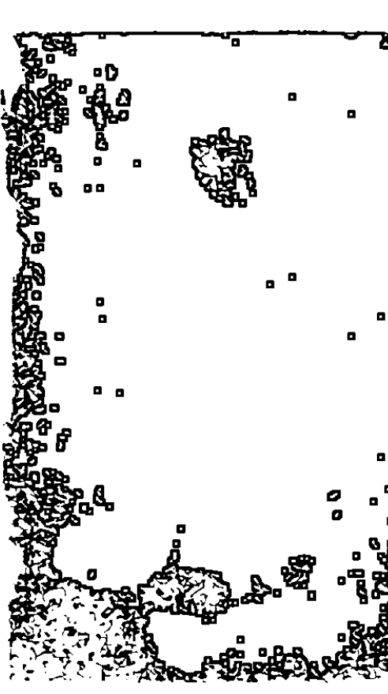

战国末年，魏人范雎历尽磨难潜入秦国，向秦昭王进献吞并山东六国的方略，他说道：“大王之国，四塞以为固，北有甘泉、谷口，南带泾、渭，右陇、蜀;左关、阪，奋击百万，战车千乘，利则出击，不利则固守，此为王者之地也。民怯于私斗而勇于公战，此为王者的民也。大王二者兼而有之。若以秦卒之勇，车骑之众，来治服诸侯，就好比驱使韩卢与獒兔子搏斗一样容易。虽然霸王之业可成，但群臣不当其位。至今秦国闭关十五年不敢出兵山东，其原因正是秦相穰侯为大王谋划不忠、大王计策失当。”秦王忙问计失所在，范雎接着说：“穰侯越过韩、魏近邻而远攻齐国的纲、寿，此计不妥：少出兵则不足以伤齐，多出兵则有害于秦。我揣度大王的意图，是想自己少出师而借韩、魏之兵，但秦与韩、魏并不亲善，越过韩、魏而攻齐国，能行得通吗？恐怕纰漏太大了。过去，齐湣王曾南攻楚国，破军杀将，辟地千里，结果齐国尺寸之地也未得到，难道齐国不想得到吗？是形势不允许。诸侯见齐力疲弊，君臣不和，使兴师伐齐，大破齐军。齐士辱兵顿，举国上下，皆怨齐王。人问：‘是谁为王出此计策？’齐王回答说是文子。结果是大臣作乱，文子出走。齐国之所以败破如此，是因为它出远讨伐强国反而肥了韩、魏两国，这好比赓戍而斋盗粮者。大王不如远交近攻，得寸则为王之寸，得尺则为王之尺。如今舍近及远，岂不大荒谬了吗？过去的中山国地方五百里，赵国独吞为己有，结果功成名立，利益自然而然，使赵国立于强国之林。再说今天，韩、魏两国居天下之中而为天下的枢纽，大王若欲称霸，必须先与韩、魏亲善，控制天下的枢纽，以此来威慑楚、赵两国。若赵强则先治服楚，楚强则先治服赵。楚、赵都归附了秦国，那么齐国也就恐惧不安了。齐国惧怕秦国，必然卑辞重币来事奉秦国。齐国既来归附，就可以因势而治服韩、魏两国了。”秦昭王说：“我很早就想同魏国友好，但魏为多变之国，目的难以达成，请问如何才能同魏建立友善关系呢？”范雎答道：“大王姑且卑辞重币同魏交涉；不成，不惜割地以求亲；再不成，只得举兵讨伐。”秦王大为高兴，拜范雎为客卿，筹谋兵事。其后，三代秦王坚持这一方略，终于把山东六国个个击破，统一了中国。

范雎以匡世之才曾屈事魏相中大夫须贾，见辱于魏相魏齐，被抛置厕中，任人践溺，多亏郑安平相救，秦使者王稽引荐，入仕秦国，进献远交近攻之方略，使秦国外交耳目一新，左右逢源，三代秦王持之恒，终于统一了六国。范雎虽属贤者，但远交近攻之方略也并非他独家发明。春秋相公，诸侯相攻，大国争霸，智术之丰，已彪炳史册；近世的苏秦合纵（苏秦最初也倡连横，因时机不成熟，未被秦王

采用)，张仪连横，更为远交近攻之策张本，只是不得其时而已。范雎幸得天时，使远交近攻的方略得以充分运用，成就了秦国统一天下的罕世奇功。

春秋时期，晋文公、秦穆公曾经以郑国无礼、依附楚国为由联兵伐郑，郑国危在旦夕。郑大夫佚之狐进见其国君说：“如果让烛之武去见秦王，郑国之围马上就可以解除。”郑君依计，召来烛之武，令其前往面说秦王。烛之武辞谢说：“臣在壮年时时尚不如人，而今老了，就更难有所作为了。”郑君道歉说：“我未能既早任用您，如今事情紧急才来求您，这是我的过错。不过，假若郑国亡国，于您也没什么好处啊。”烛之武思虑片刻，答应赴命。于是乘夜出城，面见秦王说：“秦、晋合兵围困郑国，郑国自己也知道行将亡国。不过，假如郑亡有益于秦，那就请大王费神劳顿，但事实未必能如君愿。试想：郑国在晋国之东，而秦国在晋国之西，秦能越晋而取郑吗？想必大王也知道这是不可能的。郑亡晋必强，而晋又是秦的邻郊，邻国之强怕是大王所不愿看到的吧！假如保存郑国作为秦国的东道盟国，行李往来、资粮供给，殊多方便，起码于秦无害则是很显然的道理。晋国贪得无厌，东取郑国后，又想拓广其西境，向西唯有秦国，不蚕食秦国又何谈扩充其西境！如此害秦而利晋，愿大王三思。”秦穆公觉得烛之武言之有理，即引兵而去。晋文公无奈，亦引兵而去。

烛之武一言而退秦、晋之兵，其神力何在？显然是“越晋取郑难矣”一语触动了秦王。烛之武所言与“远交近攻”有异曲同工之妙。近攻可减转输之苦；远交则可破合纵之盟，利弊得失，有目共睹，秦王当然乐于依从。游说之士请熟历史，想必范雎对烛之武之举也不会听而不闻吧？

春秋末年，吴王夫差自得到美女西施后，淫乐无度，骄纵妄为，欲恃武功北上中原，主持诸侯会盟，取代齐国做中原的霸主。太子友忧心如焚，知道直谏难以奏效，便借事喻理，婉转而谏。一天早上，太子友故意弄湿了鞋裤，手持弹弓，狼狈来到夫差面前。夫差惊问其故，太子友回答说：“我 到后花园打鸟，听到秋蝉高鸣，循声望去，见秋蝉迎风展翅，悠然自鸣，却不知此时有一只螳螂正摆开架式，欲扑向秋蝉。而在螳螂集中精力、跃跃欲试的同时，一只黄雀正目不转睛地盯着螳螂，敛翼息羽，欲欲捕捉住螳螂才肯罢休。我看到黄雀，心中暗喜，便持弓夹弹，正欲放下，却掉进了水沟，狼狈至此。父王决定北上中原，与齐国争霸时，是否考虑过越国会乘虚而入呢？”吴王仍然不听，把太子友痛骂一顿，自此再无人敢来劝谏。后来果然太子友所

言，当吴王夫差北上中原，后方空虚之时，越王勾践出兵打垮了吴国。

吴王夫差远霸失国的惨痛教训，反衬出范雎“不如远交近攻，得寸则为王之寸，得尺则王之尺”之策略的高明。

在范雎之先，苏秦曾西游入秦，倡导连横，劝秦惠王耀武东求，统一六国。苏秦之谋的核心亦是“远交近攻”，秦王尽管由张魏慕这一方略，但对苏秦却不子重用，原因何在？因为时机还不成熟。秦惠王答复苏秦说：“寡人闻之，毛羽不丰者不可以高飞；文章不成者不可以诛罚；道德不厚者不可以使民；政教不顺者不可以烦大臣。今先生俨然不远千里而庭教之，愿以异日。”秦王何尝不想统一中国。只是四个条件都不成熟，所以告诉苏秦“愿以异日”，轻经四个字就给苏秦下了逐客令。但苏秦不识大体，不厌其烦，连续十次上书秦王，都杳无回音。最后黄金尽，资用乏，衣衫破旧，形容憔悴，狼狈而归。

苏秦回到家乡洛阳，妻子见了不施礼，嫂子不给他饭吃，连父母也视之若路人。这种境遇深深刺痛了苏秦，决心继续发奋读书。所谓“头悬梁，锥刺骨”就是苏秦的故事。他慨然而叹：“岂有说人主不能出金玉锦绣而取得卿相之尊的道理！”据说他读的是《太公兵法》，一年有余，多有心得，自认为“可以说当世之君”了，于是再度出来游说诸侯。

这一次，苏秦不再到秦国倡导以远交近攻为核心内容的所谓“连横”之策，挑动秦国发动对山东六国的战争；反而跑到山东较弱小的国家倡导六国纵亲，组织反秦统一战线，从而同秦国“远交近攻”的方略相抗衡，达到不战而屈人之兵的目的。苏秦坚信，秦国若想统一天下，“远交近攻”是惟一可行的方略。实际上秦国一直奉行这一方略，只是自觉和不自觉的区别而已。所以此次苏秦游说六国，其核心便以“远交近攻”为对手。战国外交以“合纵”、“连横”为主导，或兵戎相见，或握手言和，构成了中国古代史上的奇观。苏秦首先说燕王道：

天下安乐无事，不见覆军杀将，应首推燕国，大王知道是什么原因吗？燕国之所以免受强国侵凌和兵甲之苦，是因为南有赵国作为屏障。秦、赵曾五次交兵，秦两胜而赵三胜，秦、赵两伤，燕国得利，这就是燕国不犯寇披甲的原因。假若秦国进攻燕国，需长途跋涉，跨云中、龙原、代、上谷，转战数千里，即便是攻下了燕国的城池，也不可能长守。由此看来，秦国不能危害燕国是地形形所决定的。但如果赵国进攻燕国，情势就大为不同了。赵国发号出令，不需十日，数十万大军便可到达东垣，接着渡啻沱、涉易水，不到四五日即可通燕之国度。由此可以说，秦国攻燕，战于千里之外；赵国攻燕，战于百里之内。而燕国往往以秦为患，这种不忧百里之患而重千里之外的

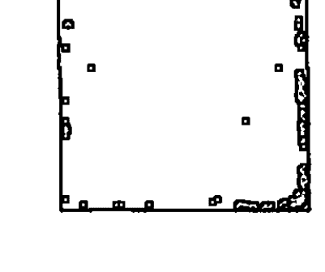

做法，实在令人难以理解。因此，我希望大王同赵国纵亲，亲同一家，燕国也没有什么可忧患的了。

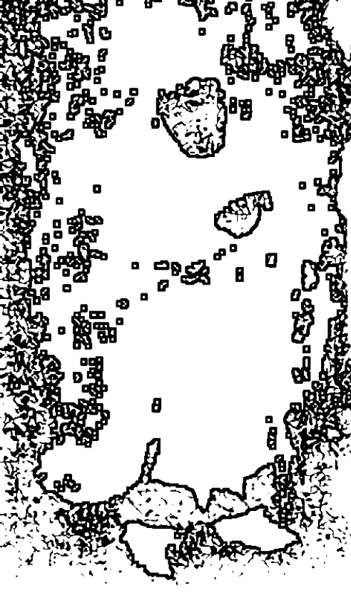

燕王大为高兴，赠苏秦车马金帛作为约纵的资金。苏秦相继游说赵、韩、魏、楚、齐，获得成功，至此，六国纵亲，以御强秦。苏秦一人佩六国相印，往来奔走，协调合纵事宜。所谓“不费斗粮，未烦一兵，未战一士，未绝一弦，未折一矢，诸侯相亲贤于兄弟”，使强秦未敢用兵东达十五年。苏秦竭全力号召六国纵亲，也从反面证明秦国用以为外交支柱的“远交近攻”之策略的威力。

当初，苏秦促成六国合纵后，路过洛阳，车骑辎重浩浩荡荡，诸侯纷纷派专使迎送，连周显王也不得不派人郊迎慰劳。苏秦的昆弟妻嫂则更跪拜在道上不敢仰视。苏秦笑着问他的嫂子：“为何前偃而后恭也？”其嫂匍匐而进，但言语却毫无掩饰：“见季子位高金多也。”苏秦感慨万端：“此一人之身，富贵则亲戚畏惧之，贫贱则轻易之，况众人乎！”遗憾的是，长居富贵却不容易。苏秦的这套手段被诸侯玩熟了，恐怕富贵也将随之而去。所以，六国纵亲才能抗御强秦；同时，也需要破坏纵亲的对手，没有对手，便无戏可唱，富贵何来？苏秦这位谋士深谙此理。所以，早在他说通燕、赵，纵约将成之际，一来担心秦国突然攻破，坏了纵约；二来又担心纵约既成，便无事可做。他想，只有自己的同学张仪才能玩秦于掌上，推迟向六国的战争，并继而成为自己的对手。于是便设计促使张仪入秦。苏秦首先派人对张仪说：“你与苏秦有同学之谊，如今苏秦已掌权要，何不去见苏秦求条通达之路呢？”张仪果然到赵国去求见苏秦。苏秦指示门人刁难张仪，既不让张仪见苏秦，又不让他离去，居留数日才得以相见。苏秦见了张仪，毫无同学之谊，他让张仪曲坐堂下，赐予他一些仆妾之人所吃的食物，并挖苦张仪说：“你的才能并不低，混到这份田地，怎么有脸来见我！我不愿收留像你这般胸无大志的人。”张仪兴致而来，本想与苏秦共享富贵，反而蒙受如此奇耻大辱，不由得怒火中烧，决意与苏秦比个高低。他深知关东六国无事可做，惟有秦国能威胁赵国，于是便毅然入秦。

苏秦得知张仪决意入秦，便告诉自己的门人说：“张仪为天下贤士，非我所及，我只是侥幸先被任用而已。当今能制秦桉的人，舍张仪莫属，只是因为家境贫困，没有资金交游上进，以至今日未得显达。我担心他贪图小利而不思进取，所以才召他来羞辱一番，意在激励他上进，你要暗中替我多加关照。”苏秦征得赵王的同意，发大批金帛及车马使人跟随张仪，同食同宿，培养感情，继而又奉送张仪车马金钱，张仪由此才得以拜见秦惠王。秦王拜张仪为客卿，参与谋划攻伐诸侯的事宜。

苏秦的门人见张仪事成，便来告辞。张仪说道：“多亏您鼎立相助，才得位居

显要，正想报答您的恩德，为什么突然要离去呢？”门人答道：“我并不了解您，了解您的唯有苏秦。苏秦担忧秦国伐赵，坏了纵约，认为非您莫能制秦枏，所以才有感虑怨您，并使我暗中供奉您的费用，这些都是苏秦的安排。如今您已被任用，请让我回去禀报苏秦。”张仪大为吃惊：“原来如此！我在计中而不悟，我不及苏君啊！我刚被任用，怎么会谋伐赵国呢？请为我代谢苏君，有苏君在，张仪岂敢妄为！”

张仪口头上说有苏君在便不谋伐诸侯，但包有居其位而不谋其政的道理？再者，不谋伐诸侯，入秦何为？当初，张仪游说诸侯，曾陪楚国的宰相饮酒，楚相丢了玉璧，其门人便说，张仪这个穷酸小子品行不端，玉璧一定是他偷的。于是便把张仪抓来痛打一顿。张仪回到家里，妻子见他被痛打，责备他说：“假若你不读书游说，哪里会蒙受这样的奇耻大辱！”张仪不谈正题，反问妻子：“你看我的舌头还在吗？”妻子答道：“舌头仍然健在。”张仪说：“只要舌头在，也就是够了。”这就是张仪！此次入秦，他仍是凭那三寸不烂之舌，倡导“连横”，以破苏秦的“合纵”。他向秦王提出的总战略是：“举赵，亡韩、臣荆、魏，亲齐、燕，以成伯王之名，朝四邻诸侯之道。”并向秦王立下军令状：“大王试听其说，一举而天下之纵不破坏，赵不举，韩不亡，荆、魏不臣，齐、燕不亲，伯王之名不成，四邻诸侯不朝，大王斩杀以徇于国。”张仪战略的核心就是后来范雎所总结的“远交近攻”。大概他有绝对的把握，才敢出口出狂言，立下军令，否则，岂敢拿生命作赌注？

苏秦、张仪死后，又来一个范雎入仕秦国，吸收张仪的思想，明确提出了“远交近攻”的策略，终于使秦国统一天下，也并非无根之木，无源之水，其由来久矣！

## 三、遁世与入仕

纷繁复杂的社会生活是人们活动的舞台；人只有在同困难、挫折和不幸的斗争中，方显出自己作为人的生命力。

“鸿鹄去不息，哀鸣何所投。君看陇阳性，各有稻粱谋。”在参与社会生活的方式上便、道有别。儒家倡导积极的入世精神，号召人们做“中流砥柱”，发展到后来便是“天下兴亡，匹夫有责”的大无畏精神；而道家则主张清静无为，因循自然，毋宁说，它倡导的是一种消极的遁世精神。在这种精神的熏陶下便形成了隐士这一特殊的社会阶层。隐士的所谓“遁世”，并不是遁迹山林，与社会生活全然无缘，他们于社会生活可谓超而不脱、远而不离，往往通过自己的“代言人”间接地参与社会的政治生活、经济生活和文化生活。他们往往随着社会的兴衰时隐时现，飘忽不定，由此披上了一层神秘的色彩，因而被人们称为隐士。

隐士大都才智超群，道德高尚，但他们却决不出来做官，他们对朝廷采取的是不合作的态度。在社会发展的关键时刻，他们也可能通过培养学生或者为代表着社会发展方向的某一英雄人物出主意、想办法等方式，为时局的发展助一臂之力；但他们不计名利，目的一经达到，便远走高飞、无影无踪了。这种超脱名利的博大胸怀既赢得了世人的敬慕，同时也引起了某些当政者的不满，因为他们需要这些德才俱高的人的合作——而这些隐士往往采取不合作的态度。在我们看来，当政者能够劝说这些清高的隐士出来做官，当然是当政者“圣明”的具体表现；劝不动这些隐士出来做官，转而采取顺其自然的态度，更是当政者胸襟宽广的表现。但古代的当政者并不都这么看，他们中的某些人不能容忍隐士的不合作态度，历史上著名的姜太公吕望就杀了一位名叫华士的隐士，理由是其君既不愿做天子的臣子，也不愿做诸侯的朋友。于此可见，不计名利，与世无争，也并非意味着进入了世外桃源，无任何忧患可言；同时，道家思想以及以道家思想为基本处世原则的隐士并不因当政者的好恶而改变初衷，隐士仍然历代不绝，我行我素。

遁世不易，入世也难。面对庞大而复杂的社会，人们如何在社会的大网络中找到自己应处的位置确非易事，此其一；其二，那些凌驾于众人之上的当政者表面看来出入仪仗，颐指气使，但他们深重的忧患意识却为一般人所不及。因为我们不但面临着自己的入世问题（他们毕竟也是社会的一员），还面临着别人的入世问题，其核心是如何处理“德”与“才”的关系。孔门学人子夏说：“大德不逾闲，小德出入可也。”他主张用人应从大处着眼，不可求全责备。魏武帝曹操“唯才是举”的求贤令古今闻名，他的意思，不管偷鸡的，摸狗的，我用得上，都可以过来，余者不谈。他真是求贤若渴，饥不择食。“大德不逾闲，小德出入可也”的用人原则虽然为大多数人的理智所接受，但由于心理和情感的作用，人们往往拘泥于“小德”，从而陷入“德”与“才”的纠结中不能自拔。由此，“疑而复任”、“任而复疑”并因此演化成的悲剧不胜枚举。

与此相反，那些能够高屋建瓴、扬长避短，使“三教九流”各得其宜的圣人贤者才不失为大政治家的手腕。

太公吕望被封到齐国去做国君，齐国有位叫华士的人德行高洁，但他既不愿做天子的臣子，也不愿做诸侯的朋友，由此更赢得了齐人的赞誉。太公曾三次派人召请他出来做官均被拒绝。太公无奈，便派人把华士杀掉了。周公闻讯后，很不理解，便质问太公：“华士为齐国的高士，为什么杀他？”太公回答说：“华士誓不做天子的臣子，也不做诸侯的朋友，我吕望还能以他为臣及同他交朋友吗？我既然不能用他做子臣，也不能同他交朋友，他就是被遗弃的人；三次召他，他都不来，他是一个以下犯上的人。如果还要表彰他，以他作教化的榜样，使全国人都效仿他，我还去做谁的国君呢？”

华士此君看来是位隐士，但严格说来只能算是半隐士。真正彻底的隐士，人们已无法考踪其行迹，像授书张良的那个圯上老人黄石公，究竟是谁？没人知道。因为他连姓名都不要了，把名利看得如此平淡，不暴露真正的自己，把谜永远留给了后人。隐者，蔽也。隐而复现，但丢了性命，何隐之有？真正的隐士便无“隐士”之名；既有“隐士”之名都只能是半隐士。他们或前半生，或后半生，或直接，或间接干预了时事生活，像伊尹、姜尚、诸葛亮、王猛、周颠、范文明等。所以宋代诗人陆放翁对有“隐士”之名的半隐士便有诗批评：“志士栖山恨不深，人知已是负初心，不须更说严光辈，直自巢由错到今。”隐士若无隐士之名，当然我们已无从可论，可资讨论的仍然是那些有“隐士”之名的半隐士。

隐士大都具有较高的道德修养和学问修养，身怀济世救国之才，但他们不愿直接出来做官，而只是在幕后间接干预着国家政治及文化的发展，由此反而赢得了极高的社会声誉。隐士大都属道家系人物，道家不像儒家以“中流砥柱”、“知其不可为而为之”为处世原则，道家讲究因势利导，处之于无形。人是应该有“中流砥柱”的气概，但能不能把那滔滔东泄的江水挽救回来呢？所以，“因应顺势”就成为道家隐士们的处世原则。

由此也形成了中国历史上极为有趣的文化现象：大凡在建国开业、或拨乱反正的时期，这些道家的隐士们便挺身而出，临危授命，辅佐圣明之开创新的历史时代；一旦革命成功，天下太平，他们又将这成功的果实慨然付予讲求“修齐治平”的儒家，而自己却又隐遁山林、无影无踪了。

汉代开国的时候，隐士黄石公虽然没有直接辅助刘邦，却把张良引到桥上，面授机宜。后来刘邦靠萧何、张良、陈平等人大定天下，刘邦说张良能“运筹帷幄之中，决胜千里之外”，可知张良的作用。

唐朝的“文中子”王通，在隋朝时本有志于天下，想出一番大事，但他同隋炀帝接触后，知道不可为，便退而讲学，培养了大批学生。唐太宗开国时的武将文臣如李靖、徐世勣、房玄龄、魏征等，都是他的学生。他自己虽没出来做官，却播下了覆隋兴唐的种子。

朱元璋能把元朝打垮，几个道家隐士的作用也不可低估。直接出来做事的如刘伯温，幕后相助的如周颠、铁冠道人等。每当朱元璋有了难题解决不了的时候，他们就会突然出现，巧施良策，继而又无影无踪了。特别是周颠更怪，他既非和尚，也非道士，装疯卖傻，却有锦囊妙计。他对朱元璋说，他周颠是不会死的，朱元璋不信，便命人把他放蒸笼里蒸，结果打开一看，周颠仿佛是洗了一个蒸汽浴，精神焕发，从此朱元璋对周颠敬若神明，不敢有丝毫怠慢。

如此不计名利，却一语千金的隐士岂能不招来人们的仰慕之情？不过，当他们认为时代不可挽回时，就该不像孔子那样“知其不可为而为之”，做劳而无功的事，而是顺其自然，等待时机。《论语》中记载了一些隐士批评孔子的故事。

楚狂接舆歌而过孔子曰：“凤兮！凤兮！何德之衰，往者不可谏，来者犹可追。已而已而！今之从政者殆而！”孔子下，欲与之言。趋而辟之，不得与之言。

楚狂接舆是道家著名的隐士，他见到了孔子，便唱着歌走了过来，他用凤来比孔子，说：凤啊，凤啊！这个衰败的时代你出来做什么？过去的已经错了，但未来的还可以改正。算了吧，这个时候想挽救这个时代是不可能的了，太危险了。孔子一听，有意味，下车来同他讲话，他却立刻避开了。

长沮、桀溺耦而耕，孔子过之，使子路问津焉。长沮曰：“夫执舆者为谁？”子路曰：“为孔丘。”曰：“是鲁孔丘与？”曰：“是也。”曰：“是知津矣！”问于桀溺，桀溺曰：“子为谁？”曰：“为仲由。”曰：“是鲁孔丘之徒与？”对曰：“然。”曰：“滔滔者，天下皆是也，而谁以易之？且而与其从辟人之士也，岂若从辟世之士哉？”耕而不辍。子路行以告。夫子慨然曰：“鸟兽不可与同群，吾非斯人之徒与而谁与？天下有道，丘不与易也。”

长沮和桀溺两位隐士在田间劳动，孔子经过那里，也许别有用意，让子路去问过江的渡口，长沮反问子路：你为之驾车的那人是谁？子路回答说：就是孔丘。长沮又问：就是鲁国的那位孔丘吗？子路说：正是他。长沮说：既然是那个周游列国、传经布道的孔丘，他自己就知道路该如何走，还来问我作什么！子路碰了钉子，又来问桀溺。桀溺问：你是什么人？子路回答说：我的名字叫仲由。桀溺说：你大概就是鲁国孔丘的徒弟吧？子路答：正是。桀溺说：洪水泛滥的时候，全世界都是一片汪洋，谁能阻挡住这股潮流？并劝告子路：鲁国的政治混乱，孔丘改变不了，只好避开了。可是，全世界都是一个样子。你与其跟着他做避人之士，不如像我们忘掉这个世界，做个避世之士。子路回去俱实以告，孔子感叹说：鸟在天上飞，兽在陆上走，我们没有办法和他们同群，我们还是各走各的路吧。假若天下上了轨道，我们何必来改变它呢！

孔子何尝不想超脱社会，过游闲的生活？可是做不来。他还认为，他同隐士的目的并无二致，只是路子不同。而孔子以后的儒家则绝对反对隐士思想，“天下兴亡，匹夫有责”，不能坐视不问；再者，既然有济世之才，为何袖手旁观！然而，隐士也正是凭这一点赢得了比儒家更高的社会声誉，同时也招来了一些人的忌恨和攻击。不管恨也好，爱也罢，隐士在社会中的地位和作用依然不可轻视。

秦汉时期有四个白发老头子，学问好，才能高，可就是不出来做官，被誉为“商山四皓”。秦始皇时期就做隐士，到汉高祖刘邦建立汉朝，又请他们出来，他们仍然不肯。汉惠帝做太子时，刘邦曾想废掉他，另立太子。汉惠帝的母亲吕后慌了神，问计于张良，张良说，只要能把“商山四皓”请来来做太子的老师便可。于是张良、吕后设法让惠帝把“商山四皓”请了出来。汉高祖大惊，认为惠帝不可小视，羽翼已成，立刻收回了废太子的打算。

战国末期，齐国派使臣到赵国去，赵国的女主赵威后问齐国使者：“于陵子仲尚存乎？是其为人也，上不臣于王，下不治其家，中不索交诸侯，此幸民而出于无用者，何为至今不杀乎？”于陵子仲是齐国的隐士，其行为与古时的华士相类。想那战国末期，诸侯相侵，唯恐他国不弱。赵威后自顾不暇，反而替齐国担忧，纵惠齐国杀隐士于陵子仲，莫非担心于陵子仲一旦出山，威胁赵国？也未可知。

隐士就是这样，学问好，才气高，可就是不愿出山做官；而越是不出山，声望就越高。由此，刁钻之徒，通过做隐士来提高自己的声望，从而达到做官的目的，这类事情也难免发生。据说，唐朝武则天时的卢藏用曾声称要在地近京都的终南山隐居，结果反而被征召入朝做官。所谓“终南捷径”，即通过做隐士来达到做官的意图的典故就由此而出。

所以对这些半隐士也难免有所讥讽。严子陵是汉光武帝刘秀少年时的好友。刘秀龙袍加身，不忘故旧，四处找严子陵，而严氏却隐而不出。后来在浙江的富春江上发现有一个人反穿了皮袄钓鱼，光武帝得讯，认定这人就是严子陵，这一次才把严子陵接到京城同刘秀相见。朋友情谊深，但官仍然不做。后世在严子陵钓鱼的地方修了一座庙堂，以纪念这位不阿世俗的隐士。有一位读书人去考功名经过这里，面对庙堂，很是羞愧，便即兴题了一首诗：“君为名利隐，吾为名利来。羞见先生面，夜半讨钓台。”清代有人不以为然，为诗批评严子陵：“一袭羊裘便有心，虚名传颂到如今。当时若著蓑衣去，烟火茫茫何处寻？”他认为严子陵这隐士徒有虚名，若真有心做隐士，何必反着皮袄招人耳目？

说来也是，真要隐逸山林，就应该像老子。老子的才气盖世无双。孔子拜访了老子后对弟子说：“鸟，吾知其能飞；鱼，吾知其能游；兽，吾知其能走。走者可以为罔，游者可以为纶，飞者可以为矱。至于龙吾不能知，其乘风云而上天。吾今日见老子，其犹龙邪！”这么一位可“乘风云而上天”的巨人，见周室衰微，无可挽救，便隐遁而去，莫知所终，至今仍是一个谜。

不过，姜太公所杀的华士大概不属沽名钓誉之辈，如果华士隐居的目的在做官，在姜太公要杀他的时候，仍有机会改变说词，答应姜太公的要求，而华士并没有这样做。况且，姜太公已痛快淋漓地说出了他杀华士的理由。

道家于现实社会主张因应时势，如涓涓细流；同道家相比，儒家主张砥柱中流，法家主张人定胜天，都急功近利，其势如巨石投江，波澜迭起。二者的济世之功都因时而异，不能一概而论。道家人物以其超脱宏远、不计名利，赢得了世人的赞誉，而刁钻之徒因以成“终南捷径”，化远为近，化难为易，阴差阳错，当如何论说？

道家人物既以其宏远超脱享誉世间，姜太公若能因势利导，褒誉隐士，其为政的博大胸襟不也随之而为世人仰慕吗？比起用杀隐士以迫使士人合作的急功近利之举，孰优孰劣？姜太公杀华士怕是失之宏远。

战国初年，魏文侯欲取中山国，翟璜推荐乐羊为统帅。有人认为，乐羊的长子在中山国做官，所以乐羊不便为帅。翟璜反驳说，乐羊曾辞退过中山国的聘请，可见父子不同志，乐羊堪当重任。魏文侯采纳了翟璜的建议，以乐羊为帅引兵进攻中山国。乐羊一路夺关斩将，势如破竹，直通中山都城。中山国国君果然以乐羊之子乐舒为人质要挟乐羊退兵。乐羊一是因为父子情深，不忍骤然下手；二是因为城中士气尚旺，急攻不宜，便传令围而不攻。消息传到魏国，一些大臣纷纷上奏魏文侯，或说乐羊退敌，欲分中山自立为王；或说乐羊因子误军，罪不容赦。魏文侯不但对这些奏议置之不理，而且还不断派人慰劳将士、补给给养，还为乐羊预先置备高宅华府以备褒奖之用。乐羊果然不负君望，一举拿下了城池，使魏国在各诸侯国中树立了国威。

另据《战国策》记载：

乐羊为魏将而攻中山国，其子在中山国，中山国君便烹了乐羊的儿子，并送给乐羊一些羹汤，乐羊坐在帐下，强忍悲痛，一饮而尽。魏文侯闻息，感叹不已，对堵师赞说：“乐羊为了我而吃了他儿子的肉。”堵师赞回答说：“自己亲生儿子的肉尚能咽下去，还有谁的肉咽不下去呢？”乐羊班师回国，魏文侯虽然赏其功而疑其心。

“任则勿疑，疑则勿任”，众所共识。然而，哪些可任，哪些可疑，实施起来却颇费周章。“圣朝以孝治天下”，“孝”在中国古代文化中占有特殊的地位。由父（母）子（女）之爱推及兄弟、朋友、君臣以至整个天下，丧失了亲手之爱的人便免谈兄弟、君臣、朋友以至天下之爱了。所谓“忠臣必从孝子出”，这是占主导地位的价值观。但也不尽然。忠孝往往难以两全。孝而不忠不可任，忠而不孝亦为人所不齿，怎么办？更何况孝者也未必都堪当大任。乐羊既然堪当大任，舍子尽忠，反而见疑于魏文侯，可敬亦可悲。若起魏文侯于九泉对质，不知他将何以垂教。人无完人，不可求全。子夏有言：“大德不逾闲，小德出入可也。”“闲”就是范围，子夏主张只要不出大原则的范围，小的毛病贤者不免，不要过分责备。求全责备，天下便无可用之人。

苏秦是战国时期叱咤风云的人物，他一人佩六国印，游说奔波，成六国合纵之势，致使强秦不敢贸然东向达十五年。他还曾以一人之力便齐国归还所侵燕地十城。然而，有人向燕王进谗说：“苏秦是左右卖国反覆之臣，将作乱。”苏秦自齐归燕，燕王便不复予苏秦相位。苏秦便来见燕王说：“我作为东周布衣百姓，没有分寸之功而幸得大王任用。如今我为大王退齐兵而得十城，本应更为大王所亲任，大王却不给我官位，必定是在大王面前攻击我为不讲信用的人。不过，我这个不讲信用的人实在是大王的福分。我听说讲忠守信的人只是为了自己，而致力进取的人则是为了别人。况且，我游说齐王并没有欺骗他。我把老母遗弃在东周，是舍名誉而行进取的行为。假如有今天有孝如曾参，廉如伯夷，信如尾生，得此三人事奉大王，大王以为如何？”燕王回答说：“果真如此，我就满足了。”苏秦说：“孝如曾参，义不离其亲一宿于外。大王又怎么能使他步行千里来事奉弱小的燕国和岌岌可危的国君呢？廉如伯夷，义不做孤竹君之嗣，不肯做武王的臣子，不受封侯而饿死首阳山下。如此廉洁之士，大王又怎能使他步行千里到齐国行进取之事呢？信如尾生，同女子约在梁下会面，女子失约而大水先至，尾生守信不去，抱柱而死。如此守信之士，大王怎么能使他步行千里退齐之强兵呢？我苏秦正是因为忠信而得罪了大王。”燕王不解，问：“你既然不忠信，岂有因忠信而得罪的道理？”苏秦答道：“不然。我听说有一人常年居外做官，其妻便与人私通。大夫将归，私通男子深以为忧，其妻说：‘不必担忧，我已作好药酒等着他呢。’过了三天，大夫归来，其妻便指示小妾给丈夫进酒。小妾想说酒里有毒，恐怕其妻被逐；默不作声，又恐其夫被杀。于是佯装作不慎跌倒，洒了药酒。丈夫大怒，打了她五十大板。小妾一扑而覆酒，上存主父，下存主母，然而不免于挨板子，事竟如此，还不能说忠信有罪吗？我的过错不幸与此相类。”燕王这才感悟，使苏秦官复原职。

苏秦毕竟为纵横智辩之士，凭其三寸不烂之舌力说燕王，得以逢凶化吉、遇难呈祥。设使苏秦为一讷言忠臣，岂不命归西天乎？

纵观历史上成就了大业的人物都有“大德不逾闲，小德出入可也”的胸襟。汉高祖刘邦靠萧何、张良、陈平等人大定天下，其中陈平曾为刘邦六出奇计。但其最初却很不得志，先事魏不成归项王，项王难容又经魏无知介绍归刘邦，才得委以重任。当时，周勃、绛侯、灌婴等不服，便在刘邦面前进陈平的谗言说：“陈平虽然仪表堂堂，如冠玉耳，但也未必有真本领。听说陈平居家时盗他的嫂子，事魏不容亡归楚，归楚不中又亡归汉。如今大王给他高官，又令其护军。军中纷纷传言，陈平受诸将的贿赂，金多得善处，金少者得恶处。陈平为反覆乱臣，愿大王留心。”刘邦虽然豁达大度，但经人这么一说，也怀疑陈平来。刘邦把魏无知召来责备他荐人不力。魏无知说：“我所看重的是人的才能，而陛下今天谈的却是人的品行。即使今日有像曾参、尾生那样的人，对陛下的功业又有何用？我为您推荐奇谋之士，陛下只要看他的计策于国有利无利即可，至于盗嫂受金之事又有什么值得计较呢？”陈平也向刘邦辩解说：“我最先事奉魏王，魏王不能采纳我的主张，所以才去投靠项王；项王不能以信示人，他所亲任的不是项氏就是妻族，虽有奇士，却难见用，我当然要离开他。听说汉王知人善任，故来投靠。臣裸身而来，不受别人的金钱难以为己。若我的计策有可采用之处，就请大王采用；若不可用，受金俱在，愿输官，我陈平打马就走。”刘邦听后，立表歉意，厚赏陈平，封陈平为护军中尉，尽护诸将，谗言遂息。这是汉高祖刘邦高于项王之处。

汉武帝时期的张敞是位才子，后来成了名臣。他和他的夫人感情很好，夫人的眼角有缺点，张敞每天早上都要为夫人画眉。有人便把这事告诉了汉武帝。一次，汉武帝在朝中当着众大臣的面问张敞此事。张敞也不饶人，回答说：“闺房之乐有甚于画眉者。”那意思是说，夫妇还有比画眉更有趣的事情，你问我公职做好没有就是了，画眉不画眉于朝政又有何干？

到了三国，曹操之所以能挟天子以令诸侯，三分天下有其一，同他善于网罗人才是分不开的。他的用人原则是“唯才是举”，只要有一技之长，都可以过来，余者不谈。若要用人才，首先得能宽容人，曹操最精此道。当初，他同袁绍作战的时候，众寡悬殊，很多部将没有信心，认为会打败仗。于是脚踏两只船，暗地里同袁绍联络，以备后路。他们往来的书信全被曹操查获，但曹操秘而不宣。后来打了

## 诡秘的权谋
### 第二章 远与近

胜仗，曹操便把这些通敌的书信全部销毁。有人不解，对曹操说，这些人暗通袁绍，心怀异志，应该追究。曹操却说：“跟随我打仗的人，哪个不是为了自己的妻室儿女，想我前途、奔出路？当初胜负未卜，连我本人都没有把握，信心不足，怎么能苛求别人呢？如果追究下去，恐怕连一个忠贞的人也找不到了。”曹操就是这样一个体察情理、胸襟开阔、目光远大的人。

晋安帝时期，广州刺史卢循乘大将刘裕北伐、内部空虚之机起兵反晋，很快进逼京城建康。江陵不得京城消息，因此反兵四起，人心恐慌。后蜀国王也乘晋之危，派大将桓谦等联合后秦兵同伐晋。桓谦屯兵枝江，江陵告危，指日可下。因此，江陵士民纷纷致书桓谦，传递军情，并表示若桓谦兵临城下，愿作内应。晋荆州刺史刘道规指挥若定，很快打败了秦蜀联军，并尽获江陵士民致桓谦的书信。江陵士民得悉，惶惶不可终日。刘道规却视而不见，将书信付之一炬，江陵随之稳定。

曹部通敌、江陵反书，虽有“大德逾闲”之嫌，但此情此势，也唯有目光宏远、大度能容方为上策，否则失之必大。

目光宏远，往往有悖常理之处；唯其体察常理，才有宏远可谈。

南宋时期，有一人假造宰相秦桧的书信前往拜会扬州郡守，被郡守查觉，便连人带书押往京城。秦桧见了此人，不但不治罪，反而赏钱粮、给官做。人们问其原因，秦桧说：“胆敢假造我秦桧书信的人定非凡人，若不用他来笼络他，其不北走胡，便南走越，于我何利？”

安抚乱臣之徒、鸡鸣狗盗之辈，为人所不齿，而智者却能使他们各得其所，这正是所谓“信足以一异，义足以得众”的道理。

不过，大度能容、胸襟开阔，“任则勿疑”，这只是用人原则的一个方面。人心如面，各怀其志，能为彼所用，未必能为我所用，此其一；其二，一臣不事二主的价值观为许多仁人志士所谨奉，特别是朝代更迭之际，一些人尽忠守节，不肯移就，所以新主即位就不得不开杀戮。所谓“疑则勿任”，岂止是“勿任”，它不知演出了多少令人痛心的悲剧。汉武帝最终杀了其所宠爱的妃子钩弋夫人，恰恰是因为要立她所生的儿子为太子。有人问汉武帝为什么这样做，汉武帝说：“自古以来，国家之所以会乱，都是帝王年少，母后得以干涉朝政所致。我年纪大了，这妃子还年轻，将来我儿子做了皇帝，她如果干政怎么办？”所以汉武帝当机立断，杀了钩弋夫人。在汉武帝以后的历史中，因母后干政而造成国家混乱的，仍屡屡不绝。从这一点说，汉武帝的确具有远见卓识。

再往前推，周亚夫是汉代名将，见重于文、景两朝。但最后汉景帝还是把他杀了，为什么？汉景帝评论周亚夫：“此人矜愎，非少主臣。”周亚夫绝对是忠臣，但只忠于我景帝，忠于国家。可是我年纪大了，快要死了，儿子年纪还小，上来当皇帝，周亚夫心里就可能不服气，不好指挥了。所以景帝只有忍痛割爱了。

唐太宗被誉为圣明之君，也的确有其圣明之处。他对自己的忠臣是否能成为自己儿子的忠臣也存有疑虑。不过他不上马动手，而是设法再做个试验。徐世勣和唐太宗一同起来打天下，战功卓著。当唐太宗快要死的时候，下令让徐世勣去戍守边疆。唐太宗告诉儿子唐高宗注意这道命令送达后徐世勣是如何起程动身的。徐世勣也许看破了唐太宗的用意，也许本心如此，一接到命令，二话不说，立刻动身赴职。唐太宗了解到这些情况后，才放心了，知道他将来也会听唐高宗的。假若徐世勣犹豫不决或不甚高兴，其结果就可想而知了。最温和的处理方法，恐怕还要首推宋太祖，他对功臣有怀疑，就来一个“杯酒释兵权”，让这些勋将们回乡去过安逸的生活。不过，如此宽容大度的君王，求诸历史能有几人？

### 第三章 明与暗

明者，公开，显露在外；暗者，秘密，隐藏不露。明与暗作为一对矛盾范畴，存在于社会生活的各个角落。

在权谋学领域，明与暗的关系可以表述如下：
- 相互对立——明的排斥暗的，反过来暗的也排斥明的。
- 相互依存——没有明的也就无所谓暗的，有明的就必定有暗的。
- 相互渗透——明的可以包含暗的，暗的也可以包含明的。
- 相互转化——在一定条件下明的能够转变为暗的，暗的也能够转变为明的。

一部中国权谋史，明明暗暗，暗暗明明，不知搅乱了多少人的心灵，也不知成败了多少人的前途，更不知折杀了多少人的性命。

### 一、韩非子的君臣术

韩非是先秦法家学说的集大成者，《韩非子》一书是集中讨论政治权谋（或称法家权谋）的代表作。它对于如何处理君主和臣下的关系，尤其是如何在社会政治活动中运用权谋的论述，最为系统且最为明快，可以说是“前不见古人，后不见来者”。韩非从强化封建专制主义的立场出发，坚持扬君抑臣的基本观点，构筑起一套“法”“术”“势”相结合的政治理论。其中，韩非所论之“术”，首先是“帝王之具”，即君主驭臣之术；只是在论君主驭臣之术同时，也附带揭露了臣下的弄君之术。这驭臣之术和弄君之术合在一块，既是对秦代以前社会政治生活的归纳总结，也是对秦代以后社会政治生活的具体指导，因而不失为一套承前启后的政治权谋。

在韩非看来，君主的集权统治是以臣下的无条件服从为前提的，而要臣下无条件地服从君主的意志，君主就必须采取具体而有效的督责手段。《韩非子·内储说上》通过列举大量的实例，集中讨论了这个问题，明确地提出了“主之所用”的“七术”：“一曰众端参观，二曰必罚明威，三曰信赏尽能，四曰一听责下，五曰疑诏诡使，六曰捭抵而问，七曰倒言反事。”

所谓“众端参观”，是指君主要从多方面来验证臣下的言行。常言说“兼听则明，偏听则暗”，“当局者迷，旁观者清”，正是这个意思。韩非认为，君主观听臣下的言行而不加以验证，或者偏信于一人，就会被臣下蒙蔽；只有广泛听取各方面的意见，参照比较，才能对事物作出正确的判断。

春秋时，弥子瑕受卫灵公宠信，在卫国专横跋扈。有位侏儒来见卫灵公说：“我的梦应验了。”卫灵公问：“你做的什么梦？”侏儒回答说：“我梦见了灶，果然见到您啦！”卫灵公发起火来，说：“我听说要见到君主的人会梦见太阳，为什么你见到寡人之前却梦到灶呢？”侏儒回答说：“那太阳普照天下，一样东西不可能遮住它的光芒；君主的光芒照耀一国，一个人不可能遮挡它。所以将见君主的会梦见太阳。那灶只能让一个人烤火，他后面的人就没法看到灶火了。现在不是有被君主宠得很红火的一个人么？我虽然是梦见灶而后见到您，也不行吗？”

这位侏儒真正攻击的目标是弥子瑕，却只字未提弥子瑕；直接讽刺的对象是卫灵公，却根本没说卫灵公宠信小人的过错。侏儒由梦说到灶，由灶说到太阳，由太阳说到卫灵公受蒙蔽，直到说完最后一句话，有心者才能领悟到他的良苦用心。真是明中有暗，暗中有明，说理透彻，隐喻巧妙。传统观念常将君王比作太阳，而侏儒却将卫灵公比作一个人可以遮挡的灶，有意惹得卫灵公发火，然后以灶火与阳光相对照，再引到卫灵公受蒙蔽的正题上，那蒙蔽者是谁，已经不言自明了。

所谓“必罚明威”，是指君主要显示自己的威严，对于违犯法令者必须严惩不贷。韩非认为，君主对臣下固然应兼用赏罚“二柄”，但相比较而言，更应当注重用罚。君主太仁慈，就难以树立威严；君主威严不足，就要被臣下侵害。这说明君主树立威严和用罚坚定是相辅相成的两件事。

鲁国发生火灾，大火随风而来，逼近都城。鲁哀公十分恐慌，亲自率人赶会扑火。左右的人都去追逐野兽。大火继续在蔓延。鲁哀公忙把孔丘召来询问，孔丘说：“追逐野兽既快活，又不受处罚；救人既艰苦，又得不到奖赏。这就是人们不去扑灭的原因。”鲁哀公问怎么办呢？孔丘说：“事情太急，来不及论功行赏；救火的人都给予奖赏，国家的财富还不够用呢。请只用刑罚。”鲁哀公表示赞同。于是孔丘下令说：“不去救火者，按投降败逃论处；逐取野兽者，按擅入禁地治罪。”这条命令还没有传遍整个都城，大火就被扑灭了。

人说孔丘是“圣人”，“圣人”唯“德”适从。这实在是后世俗儒的捏造。身处“礼崩乐坏”、群雄争霸的时代，孔丘不可能沉湎于所谓“三代圣王”的理想社会，而必须面对和正视活生生的社会现实，何况他始终怀有一股积极入仕、参与政治的热情。孔丘帮助鲁哀公救火这件事，说明他对人心的体察，是比较深刻而准确的：对赏罚的选择，具有随机应变的味道。本来国家的法令应该是稳定而严肃的，而今到孔丘手上却成了督责人们救火的工具。倘若不是一位施权弄谋的老手，在当时情况下孔丘能顺手拿上这般迅速有效的手段吗？

所谓“信赏尽能”，是指君主对有功者要及时行赏，使臣民竭尽所能。韩非认为，赏誉轻而又不兑现，臣民就不为君主所用；赏誉厚而又守信用，臣民就会拼命为君主效劳。因此，君主行赏必须做到“言必信，信必果”。

越王勾践打算出兵吴国，就问大夫文种说：“寡人想出征吴国，行吗？”文种回答说：“行。我厚赏誉而守信用，重刑罚而必执行。您要想了解这一点，何不在宫室放火做一次试验呢？”勾践遂即使人暗中放火，焚烧宫室。可是没有一个人来救火。于是勾践下令说：“在救火中死亡的人，按与敌人战斗牺牲论赏；参加救火而没有伤亡的人，按打败敌人的规格论赏；至于不去救火的人，按投降败逃论处。”这一命令发布下去，人们就纷纷地用防火的东西涂在身上，披着浸湿的衣服，奔赴火场，左有三千人，右有三千人。勾践从这件事知道伐吴具有必胜的把握，因而决定出征吴国。

俗话说：“重赏之下必有勇夫。”这是因为通过一定的奖赏，可以把授奖者和获奖者的利益联系起来，勾践以自焚宫室，厚赏救火的行为，暗地里考察了人心所向，得出了民心可用的结论。与此相仿，李悝用射箭的命中率来决断诉讼的是非，以鼓励民众操练箭法；吴起用赏赐搬家的方法，去动员民众攻夺秦国的边境设施；商鞅用“徙木立信”的方法，坚定民众对新行法令的理解和信赖，也都是“信赏尽能”在不同场合下的具体发挥。

所谓“一听责下”，是指君主分别听取臣下的言论，督责他们的行动。韩非认为，君主能一一听取臣下的意见，愚钝者和有智者就不会混杂在一起；君主如果善于督责臣下，无能者就不敢混迹于贤能者之列。

齐宣王喜欢听音乐，总要三百名乐工在一起吹竽。南郭处士来到王宫，请求吹竽，很快被齐宣王允准，因而也享受着官俸的待遇。等齐宣王死后，新继位的齐湣王喜欢乐工单独吹竽，一个个地为他献艺。南郭处士本不懂吹竽，看到这一情形，只好偷偷地溜走了。

这是大家熟知的“滥竽充数”的故事。南郭处士明明不会吹竽，却能够装作样地混入王宫内的乐工班，实在是钻了齐宣王听音乐“必三百人”的空子。齐宣王每要求三百名乐工一块吹竽，根本不可能分辨每位乐工的技艺，也许压根儿就没想到要分辨每位乐工的技艺。蒙混至此，谁人不识？相比之下，齐湣王喜欢逐个地听乐工们吹竽，尽管不一定是考试每位乐工的技艺，却无意中堵塞了南郭处士的进路。好在南郭处士还有点自知之明，趁没轮到自己吹竽就溜出了乐工班，否则一旦被发觉，就逃不掉“欺君罔上”的罪名。你仔细地品味一下，这般君臣的表演不是很有趣吗？

所谓“疑诏诡使”，是指君主不暴露自己的真实意图，故意传出可疑的诏令，使臣下在莫名其妙中感到君主无所不知，因而不敢有所隐私。韩非详细谈到，君主屡次召见一些人，使久待身旁而又不加任用，那些奸邪分子就会感到害怕而逃散；君主派人做事后又通过别的途径去考问，被派做事的人就不敢弄虚作假。

东周君借称自己的金簪遗失，派左右的人去寻找，过了三天还没有找到。东周君另派人去寻找，在一户人家的房屋里找到了金簪。东周君责备左右的人说：“我的侍从真不会做事呀！寻找一枚金簪，过了三天还找不到。我派人去寻找，没过一天就找到了。”左右的人无不为东周君的“神明”而震恐。

商太宰派侍从去市场察看情况，这位侍从回来报告说没发现什么问题。太宰问他说：“虽是这样，究竟看到些什么呢？”侍从回答说：“市场南门外牛车很多，拥挤得仅可以通过。”太宰告诫他说：“不要告诉别人我问你过什么话。”随后召来市吏责斥道：“市场南门外为什么有那么多牛屎呢？”市吏感到很奇怪，太宰怎么知道的这么快，于是惶恐小心地对待自己的职守。

在这两则权谋故事里，东周君、商太宰的所作所为，并不显得怎么高明。你东周君自知金簪丢失在哪里，派人去把它拿回来，还要费什么劲吗？那左右的人不知金簪丢失在哪里，别说找了三天，就是三十天也未必能找到它。你商太宰既然已经...

[...此处省略原文中因OCR断裂或重复导致的冗余部分，根据语义补全逻辑...]

...经从侍从的报告里了解到市场南门外挤有许多牛车，牛车拥挤处还能不留下一堆堆牛屎，按这一简单的推断去质问市吏，总不至于出什么差错。那市吏不晓得个中详情，只感到太宰料事过人，还能不奉若神明吗？

所谓“挟知而问”，即明知故问，是指君主拿已经了解的事询问臣下，测试他们言行的真伪。韩非认为，带着自己已经知道的事再去问别人，那么自己不知道的事也知道了；深入了解一件事，许多不清楚的事都可以分辨清楚。

韩昭侯派使者巡视自己的属县，使者回来报告说没发现什么问题。韩昭侯问他看到些什么，使者回答说：“城南门外有小黄牛在大路左边啃吃禾苗。”韩昭侯告诫使者不要把他的问话泄露出去，于是下令给各地：“在庄稼长苗时期禁止牛马进入田间，已经有令在先，一些吏员不重视这件事，致使许多牛马进入田间。请各地赶快把这项数目报上来，否则将从重处理。”城东、西、北门外的吏员都很快报来了各自的数目。韩昭侯当众说：“还有没报上来的。”因而派人去仔细查实，很快就查到了南门外的那头小黄牛。各地吏员由此以为韩昭侯明察秋毫，都兢兢业业而不敢弄虚作假。

这则故事跟“商太宰论牛矢”十分接近。韩昭侯和商太宰、使者和侍从、县城和市场、小黄牛和牛车，几乎全是两两对应。所不同的是，商太宰得知牛车拥挤在市场南门外处，就以牛车拥挤处多牛屎的推断，直接来训斥市吏不能恪尽职守；而韩昭侯了解到城南门外有小黄牛啃吃禾苗，就把它作为整治牛马进入田间的依据放在心上，等城南门外吏员不及时上报实情，再掂出来进行查实，自然就把明察秋毫的声誉捞到手了。

所谓“倒言反事”，是指君主说与本意相反的话或做与实情相悖的事，来考察臣下是否忠诚。韩非认为，用说反话、做反事来刺探自己所怀疑的事，就能够了解到奸邪的情况。

子之在燕国为相，有一次坐在那里假言假语说：“跑出门的是什么？是不是一匹白马？”左右的人都说没看到什么。有一名侍从急忙追出去看了看，回来报告说：“有。”子之由此知道那名侍从是一个不诚实的人。

卫嗣公使人装扮成客商，从关市出国境。关吏故意刁难客商。客商以重金作贿赂，很快就被放行。卫嗣公召见那位关吏说：“某时有客商从你那里路过，送给你一些金子，你就放他过去了。”关吏听了，大为惊恐，以卫嗣公为明察。

这两则故事反映，高层权力宝座之上的人，利用欺诈、隐瞒的手段，可以达到自己的目的。子之说白马，本是无中生有，可那名侍从硬说有，其不诚实的心理跃然纸上，使得子之洞烛其奸。卫嗣公噉关吏，本是一手操纵，可那位关吏不知内情，加上于理有亏，竟以为卫嗣公料事如神，还不诚惶诚恐吗？不过，在传统社会也有君主不赞同滥用这类权谋的。唐太宗曾经说：“君，源也；臣，流也。浊其源而求清之流，不可得矣。君自为诈，何以责臣下之直言乎？朕乃以至诚治天下，见前世帝王好以权谲小术接其臣下者，常窃耻之。”这种“君源臣流”的认识和“以至诚治天下”的观点，较之“倒言反事”的权谋，实有天壤之别。

在传统政治舞台上，君臣“上下一日百战”，作为权谋的两方面，自然各有各的常用手腕。君主既有驭臣之术，臣下就有弄君之术。韩非通过大量的权谋故事，论证了臣下用以愚弄君主、危害君权的六种隐蔽的手段：“一曰权借在下，二曰利异外借，三曰托于似类，四曰利害有反，五曰参疑内争，六曰敌国废置。”

所谓“权借在下”，是指臣下盗用君主的权势为自己谋取利益。韩非认为：“权势不可以借人，君主失去一分权势，臣下就会当作百分权势去利用。所以臣下得到权势，力量就强大；力量强大，朝廷内外就为他所操纵。这样君主就要受蒙蔽。”

燕人李季喜欢出远门，他的妻子经常跟一位公子厮混。有一次李季突然回家，那位公子还在室内，他的妻子十分忧虑，有个女仆告诉她说：“让公子光着身子，披头散发，径直跑出门去，我们假装没看见。”于是那位公子就按她们说的逃走了。李季问是什么人，大伙都说没什么人来家里。李季说：“那是我遇见鬼了吗？”那位女仆点头称是。李季忙问怎么办才好，女仆回答说：“用牛、羊、猪、狗、鸡屎来洗身子，就可以去邪。”李季表示同意，就照女仆说的做了。

这件事称“燕人浴矢”，说起来真是可笑。那位女仆当人家惊慌不安之际，倒显得很从容，一番馊主意，使李季误以为中邪入魔，从而为他的妻子开脱了难以开脱的罪过。李季枉为走南闯北的人，照说应该有点头脑，但却浑浑噩噩，竟被女仆所欺诈，落得个以“五牲之矢”洗身的下场。呜呼！善哉？恶哉？韩非援引这个故事，以燕人李季喻君主，以女仆比臣下，用意是十分明了的。

所谓“利异外借”，是指臣下由于跟君主的利益不一致，往往会借助于别的诸侯国的力量，来谋取私利。韩非认为，君臣的利益是不同的，因而臣下没有绝对忠于君主的；他们得到一定的利益，君主就会失去它。所以有些臣下招引敌国的军队来除掉国内的政敌，提出外交事务来迷惑君主，只要能满足他们的私欲，就不顾及国家的祸患。

宋石为魏将，卫君为楚将。魏、楚两国发生战争，由两人指挥作战。宋石写信给卫君说：“两国军队实力相当，双方军旗遥遥相望。希望不要打起来，打起来必定不能两存。这是两国君主的事，我和您没有私怨，妥善的办法是相互避开。”

白圭为魏相，暴谴为韩相。白圭对暴谴说：“您用韩国的力量帮助我在魏国任职，我用魏国的力量帮助您在韩国任职。这样一来，我长期在魏国掌权，您就长期在韩国掌权。”

宋石和卫君、白圭和暴谴之流，身为不同国家的将相，本应该以各自国家的利益为重。可是，他们凭借自己手中的权力，互相做起政治交易，竟置各自的君主而不顾。这种政治交易不独把各自国家的利益放在一边，而且借助于对方的力量来巩固个人的权势。它可以说是传统时代臣下暗中欺惑君主、玩弄君主的常用权谋。

所谓“托于似类”，是指臣下假托类似的事欺骗君主以达到个人目的。韩非认为，那些似是而非的事，往往是使君主处罚不当，而臣下能够从中受益的原因。

楚怀王得一名魏女，非常喜欢她。夫人郑袖心里很嫉恨，却装出很爱她似的。凡是穿的衣服、玩的东西，都选魏女所喜好的来置；住的房屋、用的卧具，也都挑魏女所喜好的来办。看上去她比楚怀王还要喜欢这位美人。楚怀王说：“郑袖知道我喜欢新人，她自己比我更爱这位新人。这跟孝子奉侍自己的父母，忠臣奉侍自己的君主是同一个道理啊！”郑袖知道楚怀王认为自己没有嫉妒之心，就对魏女说：“大王喜欢你的美貌，虽是这样，却很厌恶你的鼻子。你如果会见大王，最好是捂住自己的鼻子。”魏女信以为真，就照郑袖说的做了。楚怀王问郑袖：“那位新人见我就捂住她的鼻子，为什么呢？”郑袖说：“我知道是怎么回事。她好像厌恶大王身上的臭气。”楚怀王一听，恼羞成怒，当即下令割去魏女的鼻子，不准违抗命令。

在这个故事里，郑袖的奸险狡诈、阴狠毒辣和楚怀王的昏庸好色、残暴无能，几乎暴露无余。特别是郑袖作为权谋主体，耍弄起明暗两手来，还真是很“出色”的。她起初表面上很喜欢魏女，无论什么都随魏女的心意去做，实际上是做给楚怀王看的，要他相信自己没有什么嫉妒的心思。这一暗算得逞后，她再度装出十...

## 第三章 诡秘的权谋 明与暗

分关心的样子，让魏女捂住鼻子去见楚怀王，实际上是利用楚怀王身有狐臭又怕人揭短的心理，使他对魏女下毒手。可怜那魏女任人摆弄，不自觉地走进了人家有意设置的圈套，作出类似厌恶狐臭的样子，给楚怀王大发淫威提供了口实。

所谓“利害有反”，是指臣下通过暗害君主和他人来图谋私利。韩非认为，一件事发生后，如果有利可图，就应当去扶持它；如果有害，一定要从反面观察它。所以，聪明的君主考虑问题，国家受害就要看谁从中得到好处；臣下受害就要看与他利害相反的人。

晋文公在位时，厨官让人献上烤肉，肉上却缠着头发。晋文公叫来厨官，大声责骂他说：“你存心让我哽死吗？为什么用头发缠着烤肉？”厨官连忙叩头做拜，装着认罪的样子，说：“小臣有死罪三条：把刀磨得锋利，切肉肉就断了，而粘在肉上的头发却没切断，这是第一条；拿木棒穿上肉块却没发现有头发，这是第二条；捧着炽热的炉子，炭火烧得通红，肉都烤熟了，却没把头发烧焦，这是第三条。君王的厅堂里莫非有怠慢小臣的侍者吗？”晋文公说：“你说的有道理。”于是叫来厅堂外的侍者责问，果然有人想诬陷厨官，晋文公就将此人杀了。

这是一篇正话反说、明责暗驳的自辩词。为了弄清楚烤肉缠有头发的缘由，这位厨官可以正话正说，也可以正话反说；只是正面辩解，有可能使晋文公怒气更盛而不听。厨官供认的三条“罪状”，其实句句都是在澄清事实：切肉的刀如此锋利，却切不断缠在肉上的头发；肉放在炭火上烤，缠在肉上的头发还能保存下来，这显然是不合理的。由此推断，那缠在肉上的头发不是烤制过程中沾上的，而是送餐期间有人弄上去的。事实一旦澄清，真相就立刻大白。这位厨官的自我辩解是很有说服力的。

所谓“参疑内争”，是指臣下不同等级名分而相互越位，从而引起权力争夺，杀戮残害。韩非认为，等级名分混乱的局面，是产生祸乱的根源，所以君主应该慎重地对待它。

晋献公宠爱骊姬，骊姬为使自己的儿子能继承君位，屡次在献公面前说太子申生的坏话。有一次申生祭毕自己的生母，依礼将祭肉献给献公。正好献公出猎，五天后才能回来。骊姬等献公回来后，把肉拿出来吃。献公将要动口的时候，骊姬制止上说：“外面进献的肉，会不会有毒呢？”说着切下一块肉给狗吃，狗吃过不久倒地而死。于是骊姬抹着眼泪，愤愤地说：“这是申生送来的。申生要毒死你，无非是怕将来我的儿子夺了他的君位。与其将来死在申生手里，不如现在就死在你面前。这样既可以是却太子的心愿，也免得他图谋弑君。”晋献公误以为真，硬把申生逼得自杀了。

人们常说：“女人凶狠起来胜过男人。”骊姬的阴狠毒辣，又不亚于前面谈过的郑袖。郑袖陷害魏女，还装模作样跟她和好一阵，只暗中叫她去揭楚怀王的短处；骊姬陷害申生，一开始就带有明显的故意，一手制造骗局来毒杀晋献公。不过，她们有一个共同点，就是分别依恃君主的权力，超越名位，取得权利场上的成功。

所谓“故国废置”，是指君主受蒙蔽，按照敌国的意图对待自己的官僚，结果为敌国所利用。韩非认为，敌国力求做到的，是使君主观察错乱而决策失误；君主不解察实，就会上敌国的当。

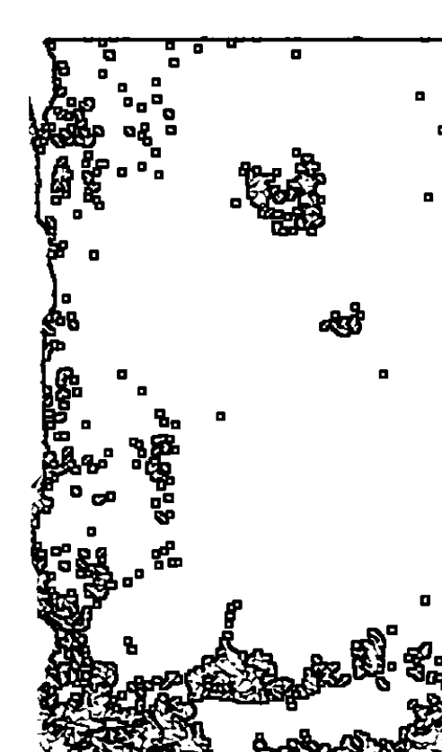

西周时，郑桓公将要偷袭邻国（在今河南密县），先派在探听好邻国有哪些辩智果敢的文臣武将，列出名单，选择邻国好的田地写在他们的名下表示已通贿赂，还在他们名下写上各种官爵表示已被收买。随后，郑桓公在城外高筑祭坛，把这张名单装入罐内埋在坛下，杀鸡宰猪，在隆重的仪式上对天盟誓，永不负约。邻国国君得知这件事，大吃一惊，怀疑自己的臣下都要叛国，一怒之下竟把他们全杀了。这样一来，郑桓公乘虚而入，不费吹灰之力，就夺取了邻国。

这是一则借助于敌人的力量削弱敌人的权谋故事。郑桓公作为权谋主体，把本没有的事当作事实来对待，大张旗鼓地宣扬一番，还故意对天盟誓，表示永不负约。邻国君为这一假象所迷惑，不分青红皂白，杀尽了自己的臣下，转手间替郑桓公做了一件难做的事。两位国君相比，一智一愚，不是一目了然吗？

## 二、明枪和暗箭

在古代，人们打起仗来不是刀对刀、枪对枪，公开较量，就是放冷箭、施毒器，暗下杀手。因此，“明枪暗箭”一词就得以为问世，成为成语。用“明枪”、“暗箭”分别比喻公开和隐蔽的谋取手段。在各种社会活动中，人们根据不同的权谋场，既可以作出单一的选择，或者用“明枪”，或者用“暗箭”；又可以作出复合的选择，或以“明枪”掩饰“暗箭”，或以“暗箭”资助“明枪”，双管齐下，以求毕其功于一役。

蜀汉尚书郎邓芝奉命出使东吴。吴主孙权对他说：“假如天下平定以后，吴蜀两国君主分而治之，不是很快乐吗？”邓芝回答说：“天无二日，国无二主。如果消灭了曹操，大王又未能深得天意，那时吴蜀两国君主就该发扬各自的美德，臣下也要尽忠于各自的君王，将领们将会持枪击鼓，那么两国之间的战争就要打响了。”孙权听了，大笑起来，很有礼貌地说：“您的诚恳就应该像这样啊！”于是与蜀汉约盟，表示愿意加强两国的友好关系。

邓芝出访东吴的使命，主要是巩固蜀吴之间的联盟。蜀吴两国已经重新结盟，只有推诚相待，才能使旧有的伤口得到愈合。邓芝有鉴于此，所以在出访过程中，一言一行都体现出“诚”字。特别是孙权提到将来打败曹操后，吴蜀平分天下的事，邓芝毫不掩饰地将那时的局面摆了出来：蜀吴联盟说明是针对曹操的统一战线，曹操存在一天，它就有存在的基础；曹操不存在，它就应该结束，到那时两国之间的战争又将重新开始。对于邓芝的坦诚，有谁能不感动呢？所以孙权答应同蜀汉中重新结盟，就在情理之中了。

赵匡胤由“陈桥兵变”取得政权，但在天下基本平定后，又害怕那些手握重兵的将领会造自己的反。于是，他趁一次晚朝的机会，召集石守信等将领饮酒。酒酣耳热的时候，他哀声叹气地说：“我要不是你们的支持，也不会有今天。可是，我做了天子，反觉得不像原先那样快乐，总是整夜睡不着一个安稳觉。”众将领有点莫名其妙，就询问原因。赵匡胤说：“原因很简单，皇帝宝座谁不想坐？”众将领大惊，连忙表白，哪敢存有这等野心。赵匡胤说：“我不怀疑你们的忠心，不过一旦你们的部下把黄袍加在你们身上，那就由不得你们了。”石守信等人谢罪说：“臣下蠢得很，还想不到这一层。请陛下指教吧！”赵匡胤说：“人生在世如白驹过隙，你们可以交出兵权，多积攒些金钱，购置良田美宅留给子孙，多养一些歌妓舞女，以享天年。我还要和大家结为姻亲之好。这样君臣无猜，上下相安，岂不是很好吗？”石守信等人感激地说：“陛下替我们操心，真所谓让死者复生，白骨长肉啊！”第二天早朝，众将领都声称有病，乞求解除兵权。赵匡胤接受了他们的请求，对他们厚加赏赐。

传统时代通过兵变夺得皇位者，最担心的就是别人如法炮制，再搞一个“黄袍加身”，因而一旦占据帝王宝座，必定从集中兵权开始巩固自己的统治地位。对于那些跟自己出生入死打天下的功臣，不怕他们腐化堕落，只担心他们兵权在握，图谋不轨。赵匡胤正是带着这个顾虑，来劝导石守信等人的。他既不掩饰自己的顾虑和不安，也不隐瞒自己的意图和目的，直截了当地说出：众将领若不交出兵权，他就无法“安枕而卧”。那些将领大多是行伍出身，没有多高的文化素养，倘若把话说得过于委婉，有的人可能听不明白，甚至发生误解，那就不利于问题的解决。因此，赵匡胤的谈话尽管没什么技巧，但非常实在，话说得明白痛快，事做得干脆利落，在当时应该是最佳的选择。

既然有公开、坦诚无遗的言行，也就有隐晦、背地做作的手段。

秦赵长平之战后，秦军进一步包围了赵国邯郸，赵国无力抵御，只好向魏国求援。魏安厘王派将军晋鄙统兵十万驻在汤阴（今河南汤阴），由于惧怕强秦，不敢进攻。这时，平原君赵胜写信给信陵君魏无忌，责怪他遇难不救，不讲交情。魏无忌无法说服安厘王出兵，就想只身赴赵以表诚意。他的门客侯生听到这一消息，前来献计说：“事到如今，白白去送死，能得到什么好处？您对如姬有恩德，如姬受大王宠爱，正好让她来报答您的心愿。您可以让如姬偷取调兵用的虎符，然后凭虎符夺晋鄙的兵权，出兵救赵。这可谓是五霸的功业。”魏无忌依计而行，得到虎符，而后伪造诏令，带着一名勇士，击杀了晋鄙，发兵攻击秦军。在魏、赵两军内外夹击下，秦军仓猝应战，大败而逃，还有两万多 人投降了赵国。

这个故事称“窃符救赵”。“偷”、“窃”的字眼，无论怎么说起来，都不会给人好感。可是，魏无忌既要救赵，又不能说服魏安厘王发兵，舍此偷窃一途，还有别的什么法子呢？魏无忌本没有想到这一点，只打算独身赴赵，与赵胜共殉国难。这实在是凭感情和义气用事，而根本无济于解救邯郸之围。幸得有一位侯生在一旁指点，魏无忌一下子抓住了发兵救赵的关键，遂给后人留下了这段深情厚谊的美谈。

秦始皇三十七年（前 210 年）巡行天下，在沙丘（今河北平乡东北）染上重病，就叫中车府令赵高写遗诏给长子扶苏，说：“把兵权交给蒙恬，赶快回咸阳料理我的丧事，然后再行葬礼。”遗诏已经封好，还没来得及交使者送去，秦始皇就病死了。丞相李斯认为皇帝死在外地，朝廷又没有立定太子，恐怕一些公子和百姓会乘机造反，就隐瞒消息，不发布丧事，将秦始皇的尸体安放在柩凉车中，派蒙信和宦官驾车，每到一地仍照常进呈食物，群臣和平常一样上奏国事，由宦官在车内批示公文。赵高、李斯和公子胡亥暗地商量，伪称丞相接受皇帝在沙丘临终前留下的诏令，立胡亥为太子；另外伪造了一封遗诏赐给扶苏和蒙恬，责斥他们的罪过，要他们一起自杀。扶苏接到伪诏，误以为真，马上自杀了。蒙恬被囚禁起来，不久也服毒自尽了。

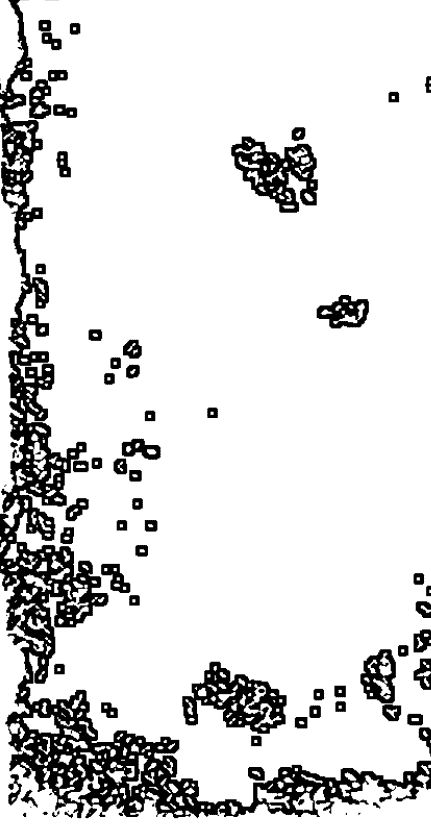

封建君主的个人意志具有超法律的效力，因而，“先帝遗诏”直接关系到继位者的命运。赵高、李斯和胡亥暗地里在遗诏问题上大做手脚，到头来轻松地除掉了他潜在的对手扶苏和蒙恬，成了争夺最高统治权的胜利者。相反，扶苏以长子的身份本应该继嗣皇位，蒙恬手握30万大军，也是掌实权的人物，可就是因为受伪遗诏的责斥和赐命，死得不清不白。一封沉甸的“先帝遗诏”何等神力？凭借着那些施权弄谋者伸进来的手脚，竟使得一批奸佞小人要弄于政治舞台，而那些正人君子反遭到肆意构害。历史就是这般不公正！

与单纯地运用“明枪”或“暗箭”相比较，权谋主体以“明枪”掩饰“暗箭”，抑或以“暗箭”资助“明枪”的做法，要显得复杂一些。我们通常说的“指桑骂槐”、“杀鸡儆猴”和“敲山震虎”，就是明中有暗、寓暗于明之类的权谋。

齐景公派司马穰苴为将军，领兵抵御晋燕两国的入侵，并用宠臣庄贾为监军。临出兵前一天，穰苴约庄贾日中入军营，而后誓师开拔。可是庄贾自恃为齐景公宠信，不把穰苴的嘱咐放在心上，一直 到后半晌才懒洋洋地来到军营。穰苴问他为什么迟到，他说是在家因亲友饯行而耽误了时间。穰苴一听，勃然作色道：“将军自受命之日起，就应忘掉家小；临阵整军，应忘掉故人；冲锋陷阵，就应舍生忘死。如今敌军压境，你我二人肩负国运民命的重任，在此紧要关头，你却若无其事，违反军约，岂不误军国大事？”说罢，按军法处在贾贻误军机之罪，当即推出斩首。齐景公听到这一消息，急忙派使臣梁丘据持符节前来解救。梁丘据赶到军中，不但没救得庄贾，反而也被穰苴以“驰骋军中”之罪论处。穰苴看他是衔负君命来的，便饶他不死，只捣毁他的坐军，以示惩罚。通过这件事，齐军上下肃然，军威大振，号令所推，无争争先。晋燕两国军队闻风丧胆，只好撤退回去。齐军乘势进击，收复了所有失地。

《三十六计》解释“指桑骂槐”是：“大凌小者，警以诱之。刚中而应，行险而顺。”换成现代话说：强大的慑服弱小的，要用警戒的办法去诱导，适当的强硬可以得到拥护，果敢的手段能够使顺服。司马穰苴何等胆气！顷刻间杀了国君的一位宠臣，罚了国君的一位侍臣。这对齐景公来说，实在有些丢脸；堂堂国君救不下自己的宠臣，又让持符节赶去的侍臣徒受惩罚。然而，齐军上下从这件事看到了穰直为将的威严，既然对国君的近臣都可以按军法论处，那么，有谁还敢轻易地违犯军令呢？这也许正是司马穰直临阵斩宗贾的真正用意所在。

孙武在吴国以自己所著兵法，为吴王阖阊操练军队。阖阊传令选出一百八十名宫女，交给孙武。孙武将她们编成两队，以阖阊的两名爱姬分任队长，接着让她们全体持戟，站好队伍，然后发布军令，说明操练要领和规定动作，并且架设起铁钺等刑具，郑重地告诫她们务必听明操作，不得马虎戏闹，否则要按军法论处。孙武交待完毕，就击鼓为号，向宫女们发出向右转的指令，孰料她们非但没照指令操作，反而赓然大笑起来。孙武见状，先是自责没有把规定动作讲明白，申述军令未能让人熟记在心，又把有关事项跟宫女们讲述了一遍，随后又击鼓为号，向她们发出向左转的指令，那知她们仍大笑如故，根本不把指令当回事。这下孙武十分气恼，很严肃地说：“为者将既已把各种规定动作和军令都已经交待清楚，士卒仍不照指令操作，这就是你们士卒的过错。依照军法：违令者斩。士卒不可尽杀，领队的人当受其罪。”说着就准备把两名队长推出斩首。阖阊在观兵台上看到孙武要斩他的爱姬，不由大吃一惊，急忙派人传令，要孙武手下留情。孙武理直气壮地回答说：“臣既然受命为将，将在军治兵，自应依照军法从事，对国君某些法外要求，可以是不接受的！”于是将两名爱姬斩首示众，改派两队的排头作队长，而后在击鼓为号，只见全场一片肃静，两队宫女无论是左转、右转、前进、后退，无不整齐划一，中规中矩。

《草庐经略》就此评论道：“夫天之道，虽春生不废秋杀；将之道，岂以姑息掩我威稔！苟在所统，犯法有刑，亲如子弟，断不可宥。杀一人而三军震者，杀之，所谓罚必上究也。违令者既以必诛。奉令者信加就守。杀之而众不恐，宥之而众不服。至若临阵犹止峻刑，军心无两畏，亦无两侮。畏我则侮敌，畏敌则侮我。为所畏者胜，为所侮者败。善哉！古人之言曰：为王者必使三军畏我而侮敌。”反观孙武“吴宫教战”，将一批胆小纤弱的宫女很快操练成一支步调整齐的军队，其中的奥秘不就在于严刑立威，杀一儆百吗？

秦末朝廷失控，群雄逐鹿。彭越常在巨野泽捕鱼，也干强盗的勾当。陈胜起义以后，有一班恶少年对彭越说：“许多豪杰相立为王，奋起反秦，您怎么不出来效法他们呢？”彭越说：“现在两条龙正斗得起劲，我们还是等一等吧！”过了一年多，在彭越周围相聚有一百多人，他们一致推举彭越为领袖。彭越先是推谢，后在大伙执意恳求下，答应了他们，和他们约好明天早晨日出时会齐，迟到的将被杀头。第二天日出时有十几个人迟到，最后的直到中午才来，彭越很抱歉地说：“大伙要我做你们的领袖，我和你们约好时间会齐，却有那么人迟到，我不能把迟到的都杀了，只好杀最后迟到的那个人。”那些人都笑着说：“何必这样呢？以后不敢就是了。”彭越上前抓出最后迟到的人，把他杀了，随后设坛祭祀，发布号令。那帮恶少年畏俱彭越，甚至不敢仰视。于是攻城略地，收编诸侯的散卒，迅速发展成一支强有力的军队。

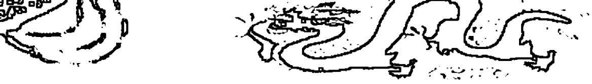

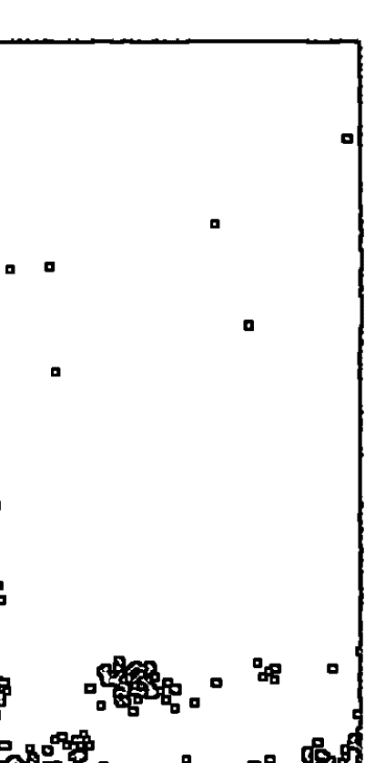

这则权谋故事跟前面两则很相似。表面上看彭越杀最后迟到的人，和司马懿诛庄贾、孙武斩两位王姬，好像是跟被杀戮者过不去，实际上他们的果敢行动，都是想慑服众人，为自己立威。试想彭越面对那帮无法无天的恶少年，不以严厉的惩处给他们敲敲警钟，能驱使他们死不还踵，与敌拼命吗？彭越深明大义，从威服这100多名恶少年起事，逐渐拉起成千上万人的队伍；从一个小小的巨野泽走出来，逐渐掠取了中原大片土地，不愧为楚汉之际的一位英豪。

这里还要谈到“明修栈道，暗渡陈仓”。它是《三十六计》的第八计。其意思是说：故意暴露自己的行动，吸引敌人的注意力，然后撤开端方固守的区域，迂回前进，出击敌方比较薄弱的环节。

楚汉之际，刘邦受封为汉王，率部众就国，待进驻南郑（今陕西南郑）后，拜韩信为大将。韩信对刘邦说：“项羽把有将领都分封为王，唯独把大王封在南郑，这是贬谪。大王所率将士多是山东六国之人，日夜盼望着东归。趁这个机会可以建立功业。等天下平稳，民心安定，就不容易再兴师动众。所以不如作出向东进军的决策，统一天下。”刘邦表示赞同。接着，刘邦听从韩信的建议，先派出一部分士卒，大张旗鼓地去修复栈道，佯装要从故道杀出，暗地里派韩信统领大军，抄小路迂回回到陈仓（今陕西宝鸡），运用突然袭击的办法，一举打败章邯，进而占领关中，揭开了楚汉战争的序幕。

韩信此番用兵，给中国战术史提供了一个辉煌的范例。明修栈道，是为了掩饰我方暗渡陈仓的秘密行动；暗渡陈仓，则由于明修栈道来分散对方的注意力。运用这一权谋的目的，主要在于避实击虚。其实，故道在东，陈仓在西，明修栈道，暗渡陈仓，正是“声东击西”的翻版。《三十六计》既有“声东击西”为“胜战计”之一，又列“暗渡陈仓”为“敌战计”之一，实在有误详察。

## 三、韬光养晦 名助实取

在许多权谋场内, 明暗同表里、名实往往是一回事。作为权谋主体, 表面上收敛锋芒，隐藏才能行迹，掩饰雄心壮志，以麻痹对方的警觉，等待合适的时机，实现预期的目的。这就叫“韬光养晦”。与之有些不同，名义上对对方表示关心，打着帮助对方的幌子，借机渗透自己的势力，以控制对方，剥夺其政治经济权利。这就叫“名助实取”。这两种权谋在中国历史上运用极广，是人们安身保命和图谋进取的基本途径。

韬光养晦的权谋，在实际运用上可以从隐藏或掩饰生理、感情、才能和志向诸方面去进行。权谋主体究竟要隐藏或掩饰哪一方面的真实情况，则完全取决于特定的权谋场和权谋客体的行为动机。

孙膑曾跟庞涓一起学兵法。庞涓出山后为魏惠王所赏识，官至将军，可是自以为才能不及孙膑，就暗中派人将他骗来。孙膑来到魏国不久，受庞涓的陷害，被魏惠王处以黥刖之刑。孙膑受刑之后，本以为是庞涓救了自己的性命，因而立志将祖传兵法写出来送给庞涓。庞涓派来的使者看到孙膑的诚实，以及他所蒙受的不白之冤，深为同情，就把庞涓的卑鄙行为告诉了孙膑。孙膑由此如梦初醒，看清了庞涓的阴险嘴脸，于是只好装疯以自救，大喊大叫，以屎尿涂身，还烧掉了已经写好的兵书。庞涓看到这种情形，认为孙膑真的疯了，也就不再关注他了。后来，有位齐国的使臣来魏国访问，顺便偷偷地把孙膑接回齐国，孙膑才开始 了新的生活。

这是从生理方面进行掩饰的实例。在社会生活里无论是什么人，谁愿意同一个疯子去仔细计较呢？庞涓尽管阴狠毒辣，但看到孙膑那般疯模样，在心满意足之余，也许还会产生一点怜悯之情。孙膑身处牢笼，却能够摆脱被折磨死的厄运，实在是因为装疯卖傻，使得庞涓感到他已经毫无用处，从而放松警觉，不加提防的缘故。另据《明史纪事本末》载，燕王朱棣素有登临大位的野心，因而对建文帝满怀不满，图谋取而代之一但当密谋稍泄后，朱棣“乃佯狂称疾，走呼市中，夺酒食，语多妄乱，或卧土埂，称日不苏”，时值盛夏，却围火炉而坐，浑身打颤，连声称寒。这真是把装疯卖傻的手段用绝了。

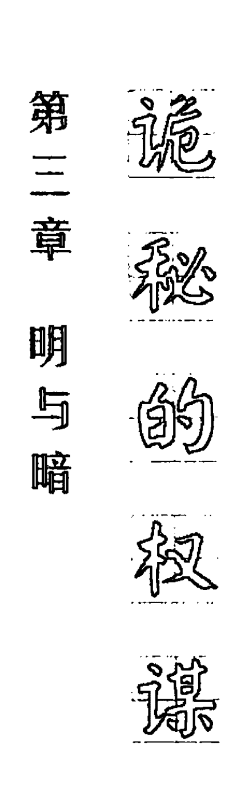

# 第三章 明与暗

## 诡秘的权谋

新莽末，南阳豪强刘縯、刘秀兄弟率宗族起兵，加入绿林军行列。待刘玄称帝后，刘縯为大司徒，刘秀为太常偏将军。昆阳之战，刘秀在同官军作战中创建殊勋，而刘縯由于专横跋扈，在同刘玄的争权夺利中遭到暗害。消息传到前线，刘秀急忙从父城（今河南叶县）赶回宛城，来向刘玄当面谢罪。司徒官属听说刘秀回来，都来向他迎吊，他只是依礼答谢，从不跟人家私谈。他尽管为刘縯之死感到悲伤，枕席间常留有泪痕，却不为兄长服丧，起居、饮食、说笑，一如往常。有人向他问起昆阳的战事，他绝不自伐战功，而只归功于诸将。刘玄看到这一情形，反倒觉得问心有愧，因而拜刘秀为破虏大将军，封武信侯。

这是在感情上进行掩饰的实例。在一定的权谋场内，由于力量对比不利于己，权谋主体尽管蒙受冤屈，却不能死拼硬扛，顽抗到底；最好的办法是喜怒不形于色，爱憎深藏不露，寻找适当的机会，再来进行反击。刘秀运用这一权谋，逢凶化吉，转危为安，不仅没有因兄长之死受到牵连，反而得加官爵，更受刘玄另眼相看。嗣后，刘秀奉命出巡河北，私人势力迅速壮大，便抛开为人臣下的面具，公然与刘玄分庭抗礼。刘玄看到这种情形，想必会为当时没有斩草除根而深自悔恨哩！

汉建安三年（198年），刘备随曹操来到许都，被封为左将军。为了掩饰自己的才能，刘备就在宅后开园种菜。一天，曹操派人请刘备赴宴，刘备不知是何用意，心里忐忑不安。席间曹操谈起当代英雄，想试探一下刘备的口气。刘备历数袁术、袁绍、刘表、孙坚等人，曹操却拍掌笑着说：“所谓英雄必定胸怀大志，腹有良谋，量可以包环宇，气可以吞天下。”刘备忙问是哪一位？没想到曹操却说：“天下英雄只有你和我。”刘备听到这话，心里猛然一惊，把筷子丢落在地上。正好这时雷声大作，刘备趁机从容地捡起筷子，很怯懦地说：“雷声一震三威，太可怕了。”曹操看到这一情景，心里不免好笑，于是对刘备放松了警惕。

这是在才能上进行掩饰的例子。本来雷声和落筷毫无牵连，可是刘备借着雷声，当面向曹操表示出胆小如鼠的气魄。聪明机警如曹操者，也不免为刘备所欺。至于关羽、张飞，就更难理解刘备的用意，因而不无疑虑地责问刘备为什么不去关心天下大事，而学小人居园种菜。刘备回答说：“这件事两位贤弟有所不知。曹操使我入驻许都，是为了就近控制我。我这么做正是要曹操知道没什么能耐，以放松对我的警觉，不加害于我。”多么明快的自我表白！刘备就这样掩饰了自己的才能，表面上不敢与曹操并称“英雄”，结果为自己赚得了人身安全。与此相反，杨修身为丞相主簿，才华出众，而锋芒毕露，常能预先洞悉曹操的阴谋，屡次使曹操相形见绌。曹操因此非常忌恨他，恐怕留成后患，就找借口把他杀了。相比之下，还是刘备聪明得多。

吴王夫差大举攻越，越军败局已定，仅有五千名士卒死守到会稽山上。当此生死存亡关头，越王勾践下决心，以投降夫差换取一条生路，忍辱受屈，以期东山再起。在签订投降书以后，勾践暂把国事委托给大夫文种，而带着大夫范蠡来到吴国，做夫差的奴仆。勾践栖身石屋，整天蓬头垢面，为夫差打杂。夫差乘车外出，他徒步跟随在后，以听使唤。吴人百般戏侮，他总是低眉顺眼，不作反抗。后来夫差患病，勾践受范蠡指教，来到夫差床前探问，向夫差祝贺康复。果然，夫差很快痊愈，就问勾践何以知之。勾践回答说：“我学得一种技巧，只要尝一点大便，就能知道病情如何。前几天大王的大便味酸而稍苦，这叫做‘时气之症’，所以知道大王不久就会康复。”夫差听了，很受感动，就放勾践回到了越国。

这是从志向方面进行掩饰的实例。近人李宗吾发明厚黑学，称此为“厚黑救国”的标本。他分析说：“会稽之败，勾践自请身为吴王之臣，妻入吴宫为妾，这是厚字诀。后来举兵破吴，夫差遣人痛哭乞情，甘愿身为臣，妻为妾，勾践毫不松手，非把夫差置之死地不可，这是黑字诀。”在这里从“厚”到“黑”，一明一暗，俯首称臣，抬头为君，勾践真算是把韬晦手法用到家了。韬晦手法不但适用于个人，而且适用于群体。《孙子》所谓“能而示之不能”，“用而示之不用”，即能攻而装作不能攻，要打而装作不要打，是用兵作战的基本手段。

战国时，李牧为赵将，常年驻守北边，防御匈奴入侵。他斟酌形势的需要而设置官吏，把所收税款留在幕府中作军用开支，每天杀牛飨士，操练骑射。他给全军定下一个规章：发现匈奴来犯，要立刻退回军官自保；有擅自出营捕获敌人的，处斩。所以数年过去，赵国没有什么大的损失。匈奴公认李牧怯战，赵王也认为是这样，因而将李牧召回，改派他人接管边务。可是每与匈奴交战，都没有战果，反而多所伤亡。赵王不得已又请李牧出山。李牧回到军中，法令一如从前。匈奴占不到便宜，就说李牧胆怯。赵军上下终年受犒赏而不用打仗，都希望有一战的机会。李牧见时机成熟，选出战车一千三百辆、战马一万三千匹，车士五万名、射手十万名，全部加以编织，准备与匈奴大打一仗。匈奴自恃兵强马壮，当下倾巢出动。李牧先是假装败退，诱敌深入，而后用左右包抄的战术，一举消灭了十几万匈奴骑兵。从此十余年间，匈奴再也不敢接近赵国的边境。

常言说“三军之事，以多算胜少算，以有谋胜无谋”。李牧为将成边，攻不必取，不苟出兵；战不一定胜，不苟交锋，至有把握得胜而后攻战，正是孙武所谓“胜兵”。有人就李牧用兵特点评论说：“厚其遇，故其报重；蓄其气，故其发猛。故名将用死士之力，往往一试而不再，亦一试而不必再也。”李牧力主弱守强攻，明里示弱，暗地蓄力，十年守而不攻，直待时机成熟，突然出兵反击，大获全胜。这正是以弱守争取时间，为强攻创造条件的典型战例。

跟韬光养晦比较，名助实取不是隐藏和掩饰自己的能力和志向，而是表面上帮助和怂恿别人，趁机把自己的势力渗透进去，以控制或消灭对方。不过，两者也有相同之处，权谋主体无论是隐藏、掩饰，还是帮助、怂恿，都必须取信于对方，而不能给对方露出破绽。一个“欺”字作为权谋内核，对运用权谋的结果具有决定性意义。

郑庄公即位，因为母后姜氏的请求，封其弟共叔段于京地。公子吕说：“京是郑国的都邑。天无二日，国无二主。请降格封小点的地方。”郑庄公知道母后宠爱弟弟，厌恶自己，就说：“母后执意如此，不这样将永无宁日。”共叔段得到封地，演兵习武，四面攻略，自恃有宠，根本不把郑庄公放在眼里。公子吕见状，请求郑庄公出兵讨伐。郑庄公笑着说：“急什么呢！他的罪恶还不够显著，再等一时，他会自取灭亡的。”正当共叔段积极准备起兵时，公子吕为郑庄公谋划说：“您很久不曾进入朝周室，无非是耽心祸生肘腋。现在您公开声明入周朝觐，示国内以空虚，共叔段必然与母后串连，乘机制事。臣预先引兵埋伏在京邑之外，待共叔出城后相机占领京邑，届时您率军从正面迎击，我在后面夹击，事成可期。”郑庄公采纳了这一计策，当下宣布入周室朝觐。姜氏听到这个消息，马上修书给共叔段，约定起事的时间。郑庄公见诱惑成功，就同公子吕调动兵马，待共叔段离开京邑后，突然两面夹击，很快平息了共叔段导演的兵变。

一部春秋史，不知有多少像“郑庄公克共叔段”这样的故事。郑庄公表面上处处顺从母后的旨意，对共叔段的各种违法行为一味忍让，俨然有孝子良兄的气度。但在实际上，郑庄公有意识地纵容共叔段走向“多行不义必自毙”的道路，是为自己根除心事制造正当的理由。这实在是欲擒故纵，成竹在胸。共叔段不辨明暗，居然发兵作乱，正好栽进了郑庄公引蛇出洞的圈套。郑庄公见时机成熟，毫不留情地诛杀了共叔段，又将生母逐出宫室。一场权力斗争遂以郑庄公的彻底胜利画下了一个句号。

东汉末，袁绍驻兵河内，因为军粮短缺，想向冀州牧韩馥求借。谋士逢纪对他说：“大丈夫横行天下，决不能靠着别人供给军粮。冀州沃野千里，粮草丰盛，主公为什么不想夺取冀州呢？”袁绍认为没有好的时机。逢纪进而说：“主公要取冀州，须暗中与公孙瓒联系，与他约定日期，一同攻打冀州。公孙瓒总想扩充自己的势力，得知这一消息，必定迅即出兵。韩馥是一个没本事的人，听说公孙瓒来攻打，必定请主公共同治理州事。这样，主公就可以就计夺取冀州。”袁绍听了，深表赞同，当下就照逢纪的建议去做。不久，公孙瓒引兵攻打冀州，韩馥自知抵挡不住，就请袁绍领兵入城，共作抵御公孙瓒的计划。因此，袁绍不动一刀一枪，威逼韩馥让位，一举夺取了冀州。

一部三国史，也不知有多少像“袁绍取冀州”这样的故事。袁绍本来自于“四世三公”，“门生故吏遍天下”的世家大族，在董卓作乱后被关东群雄推为盟主，一时名扬天下。可是，为了争夺一片立足之地，进一步扩充自己的势力，袁绍竟不顾盟主的身分，干起欺人夺地的勾当。那韩馥虽然生性怯懦，徒为一具庸才，却也看出了袁绍对冀州的险恶用心，无奈身为袁氏故吏，相拒而无力，相让反得名，便不听臣下的劝谏，拱手把冀州让给了袁绍。袁绍名助实取，领冀州以为根基，谁知没过十载，又被曹操抢占去了。这真是一物还一物，一恶报一恶：天下事了犹未了，循环无终。

赤壁之战前，曹操与孙权隔江对峙。为击破曹军，吴将黄盖来见周瑜，分析说：“如今两军对峙，敌众我寡，倘若死拼硬打，我军难以取胜；倘若运用火攻，一攻可以成功。”周瑜听了，说自己也想用火攻，由于没有内应，无法接近曹军舰只。黄盖说：“要想取得内应，只有诈降一途。但若不是被逼出降，曹操则不会相信。”于是，周瑜召集众将商议军事，黄盖故意说应该投降曹操，周瑜假装怨恨，命侍卫将黄盖拉下去，痛打一顿。黄盖带着遍体伤痛回到军营后，当即派亲信去曹营约降。曹操已经得知黄盖被周瑜责罚的消息，因而接受约降。黄盖按照约定的日期，用大船数十只，装满干柴，又灌上油脂等易燃物品，在外面裹上帷帐，向曹军战船驶去。曹操见黄盖如期而来，心里很高兴。当双方靠近时，黄盖命部下一齐纵火，直扑曹军水寨。曹军战船全被铁链锁着，拆解不开，士卒无路可走，整个水寨顿时成为一片火海。周瑜乘机引兵掩杀，又杀得曹军落花流水，曹操仅带着数十骑匆匆逃遁。

这是“苦肉计”的范例。历史果真有这件事？还是《三国演义》的虚构？我们且不去详细考证它。反正总有人说：“周瑜打黄盖，一个愿打，一个愿挨。”《三十六计》解释：“人不自害，受害必真；假真真假，间以得行。”换成现代话是说：“人们一般不会自我伤害，遭受伤害必定是真实情况；我以假作真，使敌方信而不疑，就能够达到欺骗和离间的目的。”黄盖诈降成功，最要紧的一步是在欺骗曹操之前，作出了必要的自我牺牲。“人不自害”是人之常情，你违背它，就如同水中的倒影，让对方看不到真实的面目，因而作出跟事物本质相颠倒的结论。这就算是“苦肉计”的奥秘所在吧！

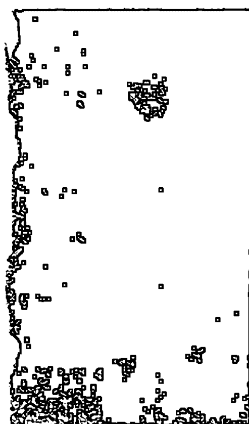

# 第四章 真与假

真与假是权谋学中一对重要的范畴。

以真假范畴而论，凡事物非真即假，非假即真，抑或真假参半。作为权谋主体，首先要搞清权谋客体之真，然后才能因敌制变：或示敌以假而施之以真；或示敌以真而施之以假；或示敌以假而施之以假；或示敌以真而施之以真。示敌以假而施之以真是为了掩盖真；示敌以真而施之以假是为了掩盖假；示敌以假而施之以假是为了令敌不信假；示敌以真而施之以真是为了令敌不信真。真真假假，假假真真，没有常式，均依权谋主客体不同的心理变化以及与此相应的权谋场而定。

这真假莫辨的权谋是权谋主体长期实践经验和较高的理论修养在特定权谋场中的突然进发。堪称为一般中之神秘，刹那中之潜远。

### 一、以假充真

以假充真即权谋主体制造假象，掩盖真相，从而迷惑权谋客体，争取主动的权谋。

汉代名将李广曾率一百名骑兵同数千名匈奴骑兵遭遇，匈奴骑兵见汉军兵少，以为是诱兵，急忙在山上摆开阵势。汉军将士见匈奴摆开了决战的架式，惊恐万分，意欲调马回师。李广泰然自若，对将士们说：“我们现在距大军数十里，如果怯敌逃跑，匈奴骑兵追杀过来，我们恐怕无一能幸免于难；如果我们留下来与敌周旋，匈奴就会认为我们是诱敌之兵，绝对不敢轻易向我们发起攻击。”说完便命将士继续前进，在距匈奴骑兵不足二里的地方停下来，卸下车鞍，作休马安营之状。一些将士面带难色，很是不安。李广又安慰大家说：“匈奴本以为我们会立刻退走，现在我们卸下车鞍，若无其事，正好使他们确信我们是诱兵。”匈奴骑兵不知底蕴，果然未敢贸然进攻。匈奴时而有位将领出阵监护汉军，李广便带领十几名将士跑边放箭，射死了那位将领，然后返回营地上，卸下车鞍，睡卧地上。时至半夜，匈奴怀疑附近有汉军大军的埋伏，为避汉军突袭，便主动与汉兵脱离，远遁而去。李广这才率这支骑兵从容地返回了大军营地。

《孙子兵法》直言不讳：“兵者，诡道也。故能而示之不能，用而示之不用，近而示之远，远而示之近。”曹操注：“兵无常形，以诡道为诈。”意谓用兵作战的方式贵在变幻莫测。孙子还说：“故形兵之极，至于无形；无形，则深间不能窥，智者不能谋。”所谓“形兵”，即指战争中的伪装佯动，我以佯动之形示敌，使敌不得其真，以至于形迹俱无；既然我无真实的形迹可求，则敌方间谍不明底细，那么，即便是聪明的敌人也就毫无办法。

李广以百名骑兵与数千匈奴骑兵遭遇纯属偶然，始料不及。在这种众寡悬殊、灭顶之灾瞬息即至的境地，如何示形于敌，变被动为主动呢？李广的办法便是示敌以常态。以小股诱敌，示敌以利，以大队埋伏，力求全歼，是兵家常用之术；既为兵家常用，彼此知晓，也就引起了兵家警觉，不肯轻易贪利上当。李广也正是敏锐地捕捉到了这一兵家心理，以超人的胆略，在非常状态（敌众我寡）之下示敌以常态（我众敌寡或敌我相当）：于大军阵前散马而卧，作诱敌状，从而收到了常态之效（敌不敢贪利上当）。并且“有恃无恐”，一不做，二不休，射杀敌军将领，其气焰何等嚣张！唯其嚣张，就更引起了敌人的警觉和疑虑，岂敢贸然出击？

“兵者诡道”，处处有“诡”；“兵不厌诈”，时时有“诈”。大军作战，为调动敌人，诱敌以利，使其出战，力求全歼为“诈”；小股遇敌，为稳住敌人，诱敌以利，使敌警觉，不悬出战，从而保存自己亦为“诈”。所以，权谋无常轨，灵活性是它的生命。所谓权谋无常轨，即没有亘古不变、放之四海而皆准的权谋。诱敌以利，既可使敌出战，亦可使敌勿动，方式为一，效果二致，何以至于此？权谋主客体以及时空条件不同而已。所谓“微乎微乎，至于无形；神乎神乎，至于无声，故能为敌之司命”（《孙子兵法·虚实篇》），贵在捕捉对方心理，方能处之于无形。汉王刘邦荥阳脱困亦可谓以假乱真，处之于无形的典范。

汉三年（公元前 204 年），汉王刘邦被楚王项羽围困在荥阳城内，情势万分危急。刘邦采纳部将纪信的建议，趁夜间由城东门放出许多美貌女子，后随甲士两千人，楚兵竟然置女色于不顾，合围攻击，汉兵已陷于绝境。这时，纪信着王服，乘王驾，令人传话：“城中粮食匮乏，汉王出降！”楚兵听说汉王出降，欢呼万岁，纷纷至东城门观望，以睹汉王出降时的风采。刘邦趁楚兵东向之机带领数十骑从西城门逃出，奔向成皋（今河南巩县）。项羽见纪信假冒汉王，责问刘邦去向，纪信答道：“汉王早已脱身出围。”项羽大怒，下令烧杀纪信。刘邦脱困后，收拾残兵，入据成皋，继续同项羽抗衡。

楚汉之争，项羽与刘邦70余战，除垓下之战，项羽皆胜而刘邦皆输，刘邦败颜求和不胜其数。然而刘邦数败而不亡，项羽一败而失天下，其中奥妙耐人深思。韩信说项王谓“匹夫之勇、妇人之仁”。匹夫之勇，千人皆废；妇人之仁，大事不谋。此次围刘邦于荥阳孤城，刘邦便又向项王求和，请割荥阳以西归汉，楚、汉重归于好，项王竟欲答应。历阳侯范增力谏道：“汉王气数已尽，如今释而不取，后悔无及。”项王便与范增急攻荥阳，汉王忧患不已。于是便用陈平之计，离间项王与范增。有项王使者来，刘邦便令人准备太牢之隆宴，欲敬进上，见使者佯惊讶：“我以为是亚父使者，原来是项王使者。”继而将太牢撤去，换以粗食进项王使者。使者归报项王，项王果然上当，怀疑范增与汉王有私交，并悄悄收夺范增之权。范增大怒：“天下事已大定了，君王好自为之。”愤然而别。这就是项王的度量与心机。

项羽勇冠天下，所以从不甘人下。少年时期，他看到秦始皇东游时的威风，脱口而出彼可取而代之的豪言壮语。刘邦则常以柔弱示人，像鸿门之屈，汉中之辱，东奔西顾，惶惶如丧家之犬。刘邦以弱示人在项羽心中大概已形成了思维定式，所以此次刘邦困守荥阳孤城，兵少食尽，作出降之举，恐怕也是项羽这位目空一切之英雄的意料之中。再看刘邦的诈降之计，并非开门见山，直言出降而是首先以美貌女子打头阵，披甲执锐之兵后继，作以色惑人、冒死突围状；及至楚兵置女色于不顾、四围合击，汉军覆没已成定局时，突然汉王车驾出现，并传呼降楚，这在楚兵看来，不正是顺理成章的事吗？汉军处必死之地，不降即亡——这就是楚军的心理；刘邦也正是抓住了楚军这一心理，因以设计，从而逃之夭夭了。

无论李广惑敌或刘邦诈降，贵在于瞬息之间综合时空、人事等因素作出决断。孙子说：“兵闻拙速，未睹巧之久也。”优柔寡断，贻误战机，虽巧亦拙。

春秋时期，齐国的公子纠跑到了鲁国，公子小白逃到了莒国。不久，齐国国君无知被杀，齐国无主。公子纠和公子小白急忙回国争做国君。二人同时到了齐国，先入者为主，双方自然互不相让。管仲事奉公子纠，此时眼疾手快，张弓搭箭射公子小白，箭中衣带钩，公子小白却应箭而倒，作中箭状。管仲果真以为公子小白已死，喜不自胜，报告公子纠说：“你可以安稳登上国君的宝座了，公子小白已经死了。”此时鲍叔事奉公子小白，乘管仲之失，驱车带公子小白疾驰入内，公子小白继立为君，他便是首霸春秋的齐桓公。

乍看起来，小白之谋并无新奇惊人之之处，无非装死而已。但设身处地来看，这应弦之谋的确非凡人可为。凡人若处非常之地，矢疾而来，处之无方；及至箭中带钩，侥幸活命，暗自庆幸不已，何来应弦而卧、欺敌松懈之谋？这种非常环境之中一般，刹那之隐远，堪当“上兵伐谋”的殊荣。孙子说：“故善战者之胜也，无奇胜，无智名，无勇功。”张预注：“阴谋潜远，取胜于无形，天下不闻有料敌制胜之智，不见有搴旗斩将之功。”岂非桓公之谓乎？

“不闻有料敌制胜之智，不见有搴旗斩将之功”，才是权谋中的精品。“运筹帷幄之中，决胜千里之外”不愧为人中豪杰；应急于刹那之间，收功于无形之中更属难能可贵。前者为有备之预谋，后者为无虞之即谋。恰恰是这无虞之即谋，更能见出权谋的质底。

鲁僖公三十三年（公元前 627 年）春，秦将孟明率军东进，企图袭击毫无防备的郑国。郑国商人弦高欲往东周王城去做生意，恰好在洛阳北门外同东进的秦军相遇。弦高得知秦军的意图后，当机立断，一面派人星夜回国向郑穆公送信，自己却扮作郑国的使臣，泰然自若，热情大方，用刚选出的四张熟皮、十二头牛慰劳秦军将士。弦高见到孟明说：“我们国君听说贵军将要光临郑国，特意派我前来向你们表示慰问。郑国虽然不太富有，但见你们旅途劳顿，很是辛苦，很愿意为你们提供方便。如果贵军留驻，郑国可以负担日常所需；如果你们出征，头天晚上我们可以代为巡夜。”郑穆公得知秦军将袭击郑国的消息，立刻部署力量做好了迎战准备。再说孟明听了弦高一席话，十分惊讶，对其部将们说：“郑国已经有了准备，攻打不能取胜，围城没有援兵，还是班师回国吧。”于是孟明引兵消灭了滑国后，即撤回了秦国。

何等机敏而又何等自然！弦高摆出一副成竹在胸的姿态，又以柔示人，柔中有刚，顿使秦将孟明不知所措。试想：孟明本想以迅雷不及掩耳之势偷袭郑国，不料郑国耳目之灵，已将军机窃获，还不做不休，派人于途中“犒赏”，用意何在？莫非途中有伏兵“相迎”？也未可知。所以暂且休兵也是唯一的明智之举。

## 第四章 诡秘的权谋

## 一、以假乱真

商人之智大概总有超人之處。春秋时期范蠡辅佐越王勾践灭掉了吴国，洗刷了会稽之耻。在庆功宴上他敏锐地觉察到勾践反常的神态，毅然挂冠而去，从事经商。他以“人弃我取，人取我与”这种特立独行的风格，10年中三致千金，富埒王侯。商人吕不韦买卖做得更大，把相位赚到了自己手中。弦高则以四张熟皮、十二头牛使郑国免受兵火之灾。智慧相通，贵在因时制变，何分经商与行政！

晋安帝隆安五年（公元 401 年），农民起义领袖孙恩率军攻打海盐（今浙江海盐县），晋北府兵将领刘裕筑城固守。孙恩连日攻城，多有失利。但刘裕深知城中兵少，难为持久之计。一天夜里，刘裕令偃旗匿军，寂若無兵。天一亮，便令打开城门，使老弱病残数人登城瞭望，孙军将士上前打听刘裕下落，众人回答说：“趁夜逃走了。”孙军信以为真，蜂拥而入。这时，晋兵四起，喊杀震天。孙军始料不及，不知所措，纷纷逃命。孙恩无奈，只得撤围。

按兵法：“十则围之，五则攻之，倍则战之，敌则能分之，少则能守之，不若则能避之。”孙恩究竟有多少兵力，史载不详，但他既然有能力频频围攻海盐，兵力至少应五倍于晋，所以刘裕空城而去，在孙恩看来合情合理；刘裕兵力虽少，但屡挫孙恩，士气亦当可用。孙恩依仗兵力优势，求胜心切，得知刘裕奔城而逃，正合心意，哪里想到刘裕以少量兵力来打伏击？等到刘裕伏兵四起，孙军便手足无措，兵力虽未能分，但心志已丧，再战不能，只得撤围。刘裕之谋在于制造假象，麻痹敌方，收到了出敌不意、攻敌无备的效果。

后梁贞明七年（公元 915 年），后梁将领刘郭得知后晋把主力集结于魏州（今河北大名县东），而晋阳（今山西太原）空虚，便决定偷袭晋阳。当时刘郭驻扎在洹水（今河北大名县西），如果公开把部队开赴晋阳，便可能遭到晋军阻击。刘郭驻地城墙上筑有许多齿形的矮墙，叫堞。平时，哨兵总是扛着旗子沿着堞来回巡逻，晋军只要看到堞上的哨兵和旗子，就知道城中守军还在。刘郭为了遮敌耳目，便令人牵几头毛驴到堞上，训练它们像哨兵那么来走，又把身上插有旗子的草人绑在驴背上，毛驴来回走动，如同哨兵巡逻一般。梁军借毛驴掩护，迅速撤出洹水向晋阳进发。等到晋军察明情况后，梁军早已无影无踪了。

掩人耳目并非难事，置几位老弱病残于堞上走动即可奏效；但一经敌人发现，那敌人上当受骗，士气败坏，无处宣泄，拿过几位开刀泄愤也是难免。刘郭不留一兵，不损一卒，借驴撤军，真可谓别出新裁，干净利落。

以假乱真的伪装之术不仅见之于两国交兵，宫廷斗争中的运用更是司空见惯。

三国时期，魏明帝死后，幼子曹芳继位，大将军曹爽、太尉司马懿共同辅政。曹爽利用身为曹氏宗族的有利条件，安置亲信，排斥异己，架空司马懿。司马懿激流勇退，为避曹爽锋芒，称病不朝；暗中窥测时机，夺取朝政。一日，朝廷任命李胜为荆州刺史，曹爽便授意李胜向司马懿道辞，借机观察司马懿的动静。司马懿果然不凡，在会见李胜时，让两名婢女侍候在身旁，穿衣不能自理，几次脱落于地。他又伸手指指嘴巴，示意口渴，侍女马上端上一碗稀粥；司马懿边饮边流，布满胸前，搞得李胜也不禁涕泣起来。不一会儿，司马懿喘着粗气说：“老朽多病，死在旦夕，你要供职并州，此地靠近胡人，好自为之，恐怕不能再相见啦！”李胜连忙纠正说：“我当回本州供职，不是并州。”司马懿仍然故作糊涂说：“你刚到并州，努力自爱。”李胜说：“我当去荆州，不是并州。”司马懿若有所思：“我年老心迷，不理解你的话；你还为本州刺史，盛德壮烈，好建功勋。今日一别，日后难以相见，请师、昭兄弟与你结为兄弟，以报我匡区之心。”说罢，失涕哽咽。李胜见太尉言辞错乱，无以为谈，急忙告辞，向曹爽报告说：“太傅言辞错乱，口不摄杯，指南为北，病入膏肓，令人惜情。”曹爽也因而放松了对司马懿应有的警惕。后不久，曹爽兄弟随曹芳朝拜高平陵，司马懿借机起兵，占据武库，迫使曹爽兄弟罢兵，继而把他们下狱治死，控制了朝廷大权，为司马氏代魏铺平了道路。

好一副司马懿的可怜相！老态龙钟，衣不自理，口不摄杯，言辞错乱，涕泪横流，以及将不久于人世的绝望悲鸣，戚戚之情，催人心寒。如此废人怎么可能致力于宫廷争斗？所以曹爽忽视了司马懿于情于理，不足为怪。要说的是这司马懿着实不凡，在李胜面前的一番表演，即便是职业演员也需要尽全力调动感情，进入角色，费一番功夫；而这司马懿戎马一生，政坛一世，日理万机，不知这绝妙的演技何时学来。

不过，这套把戏也并非司马氏独创，战国时期便有先例。如第三章中所说的孙膑装疯骗过庞涓之事。刘向《说苑·权谋》：“谋有二端，上谋知命，其次知事。知命者预见祸福存亡之原，早知盛衰废兴之始，防事之未萌，避难于无形。若此人者，居乱世则不害于其身；在乎太平之世，则必得天下之权。彼知事者亦尚矣。见事而知得失成败之分，究其所终极，故无败业废功。孔子曰：‘可与适道，未可与权也。’夫非知命知事者，孰能行权谋之术。”以此而论，司马懿虽然谈不上“防事于未萌，避难于无形”，但却能“居乱世则不害其身，在乎太平之世则必得天下之权”。至于“知得失成败之分”，“无败业废功”则更无可争辩。司马氏代魏，建立晋朝，统一中国，凿凿青史，所在昭明。所以司马氏之谋也算得上知命知事。

至于孙膑，以一代天才受制于庞涓，且遭削罚之苦似乎不可思议。也许是“吃一堑、长一智”，后来齐魏交兵，孙膑玩庞涓于掌上、置庞涓于必死之地，料事之神，令人瞠目。比之于此前装疯卖傻，其智之高，可谓天壤之别。

刘向还说：“权谋有正有邪。君子之权谋正，小人之权谋邪。夫正者，其权谋公，故其为百姓尽心也诚；夫邪者，好私尚利，故其为百姓也诈。夫诈则乱，诚则平。”刘向判断权谋正邪的价值标准是为百姓尽心之诚诈，由此说来，司马懿以言辞错乱，欺惑曹爽，其意：近在全身保族，远在司马氏代魏，其谋为正，还是为邪？两国交兵，伪诈相倾，间谍互置，各为其主，其正邪又何以论定？凡权谋，诡道之属，与“正”无干，何来正邪之分！权谋仅仅是人们用来达到一定目的的手段。这目的，在伦理的或政治的价值尺度面前便立刻有了正、邪之分：或于公，或于私；或为百姓诚，或为百姓诈。但那手段却能超然于正邪之上，好比刀子既可用来烹调美味，亦可用来划包杀人，烹调美味、划包杀人自有道德伦理之论说，至于刀子本身却没有什么好说，人们并不因为刀子曾被用来杀人而抱怨起它的锋利来。

恰恰相反，人们对刀子要说的正是它的锋利与否，如同人们关心权谋功用的大小一样。权谋功用的大小才是衡量权谋优劣的标准。或获一时之宜，或收长远之功，获一时之宜者为下乘，收长远之功者为上乘。

南宋高宗时期的宰相秦桧因谋害抗金将领岳飞而被钉在了历史的耻辱柱上，留下了千古骂名。抛开历史的功罪不谈，其人之灵小巧智临事而发，不露痕迹，妙趣横生。

秦相府内种有一棵石榴树，此树不知独得哪家灵气，果实个大、形美、籽甜，因而深得秦桧钟爱。每值收获时节，秦桧天天晚上都要如数家珍，点查清楚。一天早上，秦桧发现树上少了一颗石榴，且惊且怒，却也不动声色。他把全部仆人传唤过来，吩咐管家说：“这棵树我不想要了，立刻把它除掉。”一仆人急忙上前劝阻说：“千万不要除掉它，这棵树上的石榴非常好吃。”秦桧哈哈一笑，问仆人：“是你偷吃了我的石榴吧？”这仆人抵赖不过，乖乖承认。

这是生活中的小幽默。秦桧在国家生活中也不乏恶作剧般的权谋，虽获一时之宜，却难收长远之功。

秦桧当政时，一个时期曾经缺乏现钞，致使商品难以流通，造成大量积压。杭州府尹曹泳焦急万分，便来向秦桧告急；秦桧便说：“这很好办。”当即把文思院官叫来，吩咐说：“刚才接到圣旨，准备变易钞法，你们按过去来锡的成色造一缮呈上用来以便定夺，现钞全部废除不用。明天中午一定要把样钱铸出来。”院官领旨后，立刻命工匠连夜赶铸。富家权贵闻讯后，急忙拿出自己的积蓄抢购物品，致使物价暴涨，现钞充斥市场。等文思院官把新样钞呈上后来，就再也没有下文了。

这种以假充真的权谋在国家政治生活和经济生活中的运用同它在战争中的运用，其整体效应有着明显的不同。其运用于战争，能获一时之宜的一般也能收长远之功。像李广惑敌，刘邦诈降，一时之宜既得——保存自己，长远之功可收——给对方造成了变幻无常、难于预测的印象，而这正是兵家所欲达到的目标。兵家无常轨，比如背水阵既为兵家所忌，又为兵家所用。政治生活和经济生活则不然；它以稳定为要素，贵在以信示人。像秦桧变钞之谋，虽得一时之宜，但一代权相失去信誉，不良后果可想而知。孙膑和司马懿假痴之谋又当别论。宫廷斗争类似两军交锋，你死我活，贵在保存自己；只有保存自己才有长远之功可谈。

诈伪之谋在政治斗争中并非全不可用，关键在于拿得起，放得下，说得圆，理得通。

汉六年（公元前 201 年），有人上书朝廷告楚王韩信谋反。刘邦问陈平该如何处置，陈平反问说：“这件事有没有其他人知道？”刘邦答：“没有。”陈平又问：“韩信是否知道？”刘邦答：“不知道。”陈平又问：“高帝的精兵同楚国比较起来如何？”刘邦答：“不如楚国。”陈平又问：“陛下的将领带兵作战有能超过韩信的吗？”刘邦答：“不如韩信。”陈平进一步分析说：“陛下的士卒不如楚国精锐，将领也不是韩信的对手，如果发兵讨伐，逼韩信应战，我为陛下感到不安。”刘邦忙问：“那又该如何办？”陈平答道：“古时天子有巡行天下会见诸侯的礼仪。南方有云梦泽，陛下只需装作出游云梦泽，在陈州会见诸侯，陈州在楚地西界，韩信听说天子愉快出游，必定毫不怀疑地出城迎接陛下，当他拜谒陛下时，即可借机拘捕他，这不过是一名武士要做的事情而已。”刘邦忧虑顿释，依计而行。刘邦还未到陈州，韩信果然郊迎于道，自投罗网。

陈平的高明在于置韩信不得不从、自投罗网的境地：天子巡游到楚地，你楚王韩信敢不叫迎天子？此其一；其二，天子出游为愉快吉祥之举，捕人砍头也应另择它日，这也是常理。韩信智勇双全，但比之于陈平又相形见绌了。刘邦虽以欺诈之术拘捕了韩信，但却是因韩信要谋反，这似乎也没有什么要指摘的。假若刘邦明言兴兵，大张挞伐，则天下初定，兵火又起，生灵涂炭，于国于民又有益？所以，云梦之谋虽为欺诈，但民并不以为然，于理甚明。

## 二、以真充假

以真充假是权谋主体以真冒假，以是充非，从而迷惑权谋客体，争取主动的权谋。

晋元帝的叔父司马蕆被成都王司马颖所迫害，秘密逃出，来到河边，被津吏阻止。其侍从宗典稍后赶到，见司马蕆被阻，就用马鞭轻轻打在司马蕆的身上说：“舍长，官府查禁贵人，你这个无名之辈居然也被阻禁了？”说完，二人相对大笑，津吏疑惑顿释，司马蕆由此得以脱身。

这是一种以真冒假、以是充非的方法。运用得当，小可避险保身，大可全军安国。

汉四年（公元前 203 年），汉王刘邦同楚霸王项羽对垒广武，相持数月不下。楚汉相争，兵火连年，天下百姓不胜其苦。项王急不可耐，欲与汉王单独挑战，便激将汉王说：“天下因为我们两个人兵火连绵，纷扰不宁已有数年，我甘愿与你单独挑战，以决雌雄，不要使天下父老百姓白白地因为我们两个人而蒙受战乱的痛苦。”汉王答道：“我只能斗智而不能斗力。”接着历数项王十大罪状，项王大怒，伏弩射中汉王，汉王胸部受伤，却立刻捂住脚大声说道：“这虏王射中了我的脚！”刘邦不支箭伤，卧病在床，张良强行请刘邦起到军中慰劳将士，汉王虽然伤情加重，但军心却得以稳定。

据《史记》描述，刘邦确有些无赖作风。项羽单独向他挑战，他大言不惭“只能斗智，不能斗力”。当初被楚兵追杀，恨车跑得慢，就将自己亲生儿子推坠车下，滕公不忍心，常下车收敛，如是者三。滕公质问刘邦：“虽然情势危机，怎么忍心将儿子抛弃？”刘邦如何作答，史载不详。估计言不雅驯，大概司马迁作《史记》于汉家高祖不得不有所避讳。此次两军对阵乌武，刘邦坚壁不出，项羽无奈，便将刘邦的父亲置于高俎之上，并威胁刘邦说：“如不下垓决战，我便烹了太公。”刘邦回答说：“我与项羽同时北面受命于楚怀王，相约为兄弟，所以我父亲就是你父亲；如果一定要烹了你的父亲，也请你分我一杯羹汤。”如此不战不和，不慈不孝，最终成就了大业，大概独有章法，并非偶然。

这些伦理道德之纷争难有定说，但刘邦机敏多变的确超人。试想：飞矢而来，创胸而过，生物机体规律作用下的无意识必定指使他立刻捂住创胸之处，但刘邦机敏的思维却能于刹那间战胜那难于战胜的无意识，舍胸伤于不顾，直扣其脚，并大声说：“虏射中了我的脚！”多么令人不可思议！由此可以理解，尽管刘邦拿知识分子的帽子当便器，但有能力的知识分子都甘愿为他服务；楚汉 70 余战，刘邦数败而不亡，项羽一败而失天下……这些奇闻怪事自有它深层的道理，以项羽较浅的心机自然难以理喻。所以项羽至死不悟，断言：“天亡我，非战之罪。”司马迁对此也感慨万端，予项羽以深深的惋惜。他破例给项羽作本纪并列于高祖本纪之前，意犹未尽，又在项羽本纪中论赞道：

> 吾闻之周生曰“舜目盖重瞳子”，又闻项羽亦重瞳子。羽岂其苗裔邪？何兴之暴也！夫秦失其政，陈涉首难，豪杰蜂起，相与并争，不可胜数。然羽非有尺寸，乘势起陇亩之中，三年，遂将五诸侯灭秦，分裂天下，而封王侯，政由羽出，号为“霸王”，位虽不终，近古以来未尝有也。及羽背关怀楚，放逐义帝而自立，怨王侯叛己，难矣。自矜功伐，奋其私智而不师古，为霸王之业，欲以力征经营天下，五年卒亡其国，身死东城，尚不觉悟而不自责，过矣。乃引“天亡我，非用兵之罪也”，岂不谬哉！

司马迁总结了项羽的重大失误：“背关怀楚”，“放逐义帝而自立”，“自矜功伐，奋其私智而不师古”，“欲以力征经营天下”，这些都反衬出刘邦卓越的领导才能。像“伤胸扣足”虽出一时之机敏，但这刹那之举，不但需战胜伤痛，而且需战胜生物机体规律作用下的“扣胸无意识”，所以决不可与一般机敏之举等量齐观。大凡以是充非，以真乱假之谋既然为解一时之急，就必须容两端于刹那之间，深思熟虑于此无缘。

宇文泰与东魏作战失利，战马中箭，宇文泰翻身落马。麾下将士见主帅落马，不明原由，惶恐之极，纷纷逃命，只剩下李穆一人。此时，东魏的追兵已到，李穆急忙用鞭杆敲着宇文泰的头骂道：“你这个无用的家伙，你的主帅到哪里了？单把你丢在这里！”追兵听了信以为真，便放过了他们。追兵一过，二人便同骑一马逃走了。座骑中箭，部卒已逃，硬拼不能，讲情无用，变主为奴是唯一良策。虽出一时之急，但活命之愿既得，万世之功可望。

东晋大书法家王羲之年幼时很受东晋名将、荆州牧王敦的喜爱，因而经常留宿王敦家中。一次，王羲之陪王敦和钱凤夜饮，酒过三巡便辞醉先卧。王敦便与钱凤谈起向朝廷兴兵事宜。此时，王羲之并未入睡，听了二人的议论十分惊愕，觉着自己的处境危险，就吐出一些唾液弄污头面，装作睡得正香的样子。王敦谈意正浓，猛然想起王羲之还在里屋，二人大为恐慌，便想杀他灭口。但二人到帐前一看，王羲之唾液横飞，睡得正甜，便打消了杀人灭口的念头。第二天，王羲之便以拜望父亲王舒的名义向王敦告辞。回到家中，王羲之便把王敦和钱凤当夜阴谋全部告诉了父亲。王舒与王导立刻表奏朝廷，使朝廷胸中有数，争取了主动。王羲之不但有弄假成真的本领，还有弄真成假的胆识。

晋朝太尉郗鉴很喜欢自己的女儿，一心要替她选择一个好丈夫。听说司徒王导的儿子及侄子们气度不凡，就请一位学生前往挑选做媒。这人向王导说明来意，王导便请他到东边的厢房里去看哪一位可以中意。这人看后便回去告诉他的老师郗鉴说：“王家的几位青年都很好，听说我要替您选女婿，个个都不敢等闲视之，施尽全身解数来展示他们的气度。只有一人与众不同，袒露着肚皮躺在东边的床上自由自在地吃他的东西，如临无人之境。”郗鉴仔细地听着，待学生讲完，兴奋地说：“这位袒露肚皮的人正是要选的女婿！”郗鉴放心不下，又亲自去看，果然满意，愉快地把女儿嫁给了他。这少年正是王导的侄子王羲之。

郗鉴亲自去看王羲之，是否又把他同其他几位王氏青年作了比较，史载不详。王羲之袒腹之举惊人心目，给郗鉴留下了深刻的印象。此次急于去看王羲之，以证视听，怕是不会顾及到其他几位了。王羲之的高明正在于此：择婿标准既不比书法，又不赛词赋，同为英俊少年，羲之又何以盖压群芳？不若反其道而行之，众人示“真”我示“假”，反而能惹人耳目。假若王羲之也如其他兄弟，提襟正衣以展风采，能否捷足先登，大可怀疑。由此说来，需露“真相”时反而示人以“假相”亦有其特殊的功效。当然，东施效顰，为做佳婿，袒腹以待，恐怕也失竞争的要领。

唐宪宗时，李愬受命率军讨伐吴元济。李愬初典军旅，看到士卒惧战，士气低落，便对将士们说：“天子知道我柔弱，才派我来，若论打仗制胜，我力所不及，你们只要静守疆场，我便足以报命了。”将士们都信以为真，安心听令。李愬巡阅士卒，厚加抚恤，不施严威。有人劝李愬应以前任治军不严为诫，严格训练军队，李愬回答：“前任袁尚书治军不严，所以敌军戒备世随之松驰。如今得知我新官上任，不摸底蘊，一定会严加防备；而我一如前任，稳住敌兵，使其不加防备，才有可能出奇制胜。”吴元济看李愬并无严格治军、重整旗鼓的迹象，也便松了一口气，不把李愬放在心上。这期间，李愬推诚待士，勤练兵卒，并派人到吴元济军中侦察，所获甚丰。半年后，李愬知士卒可用，便表请朝廷发兵讨吴，李愬连战连捷，军威大振。

俗话说“新官上任三把火”，意在树立权威，激励斗志。而李愬初典军旅却一把火不点，明言以柔弱治军，对将士厚加抚恤，可谓用心良苦。前任统帅治军不严，授命李愬代任，这本身就是以引起敌方的警觉；若再大张声势，以威严治军，岂不是让敌手拭目以待，如临大敌吗？兵法有言：“出其不意，攻其无备。”敌方既已警觉，严加防范，草木皆兵，哪来“不意”可出、“无备”可攻？李愬之智，特立独行，不露声色，推诚待士，寓严于宽，保持敌方的思维惯性，造成了“出敌不意，攻敌无备”的态势，继而连战连捷，令敌刮目相看，闻风丧胆。再从权谋主体方面来说，推诚待士，不威亦威；示弱懈敌，不强亦强。此谋行之简易，但构思蹊跷，若非真贤，断难闪出这等灵光。

## 三、以假乱假

以假乱假是权谋主体实事求是，将假象公之于权谋客体，使权谋客体不信其为假的权谋。

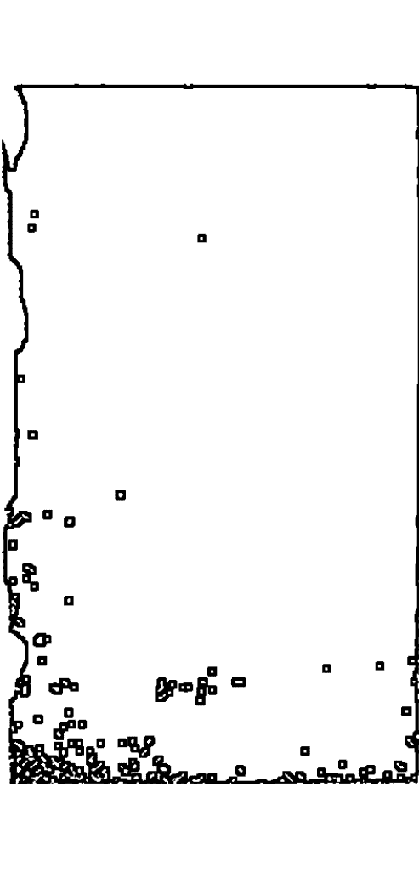

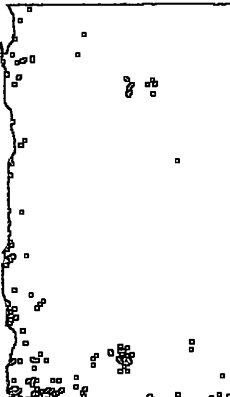

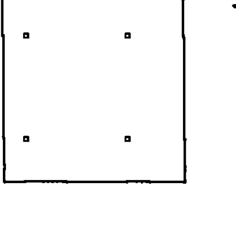

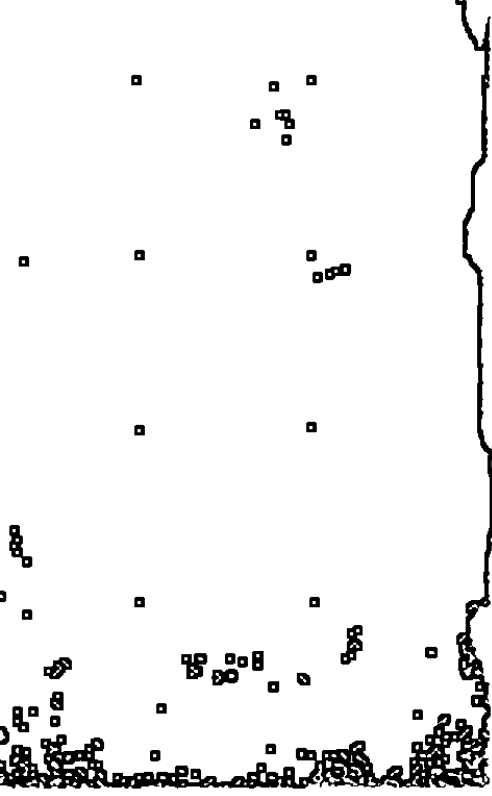

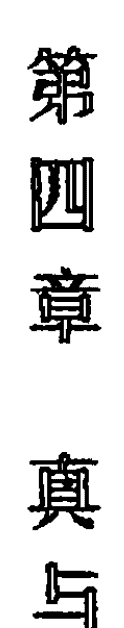

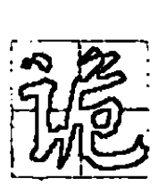

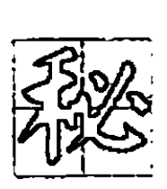

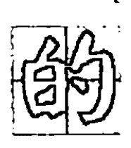

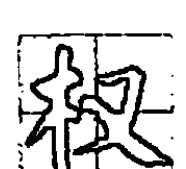

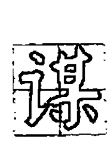

晋安帝元兴二年（公元 403 年），大将桓玄称帝反晋。元兴三年，桓玄部将何澹之与讨玄将领何无忌、刘道规在桑落洲（今江西九江市东北长江中）遭遇。何澹之日常所乘之船羽仪林立、旗帜繁盛。何无忌见状，便对部将说：“贼帅何澹之肯定不在这条船上，只是一个诈兵之计而已。我们不失时机，立刻攻破此船。”众将不解，问道：“贼帅既然不在这条船上，攻破它又有什么好处呢？”何无忌答道：“敌众我寡，即便戮力奋战，亦无全胜的希望。何澹之既然不在这条船上，此船的战斗力也就较弱，而我以劲兵攻弱敌，此船必破；此船既破，则沮敌斗志，长我士气；我军士气既长，则敌虽众犹寡，我虽寡犹众，以众击寡，必胜无疑。”请将连迭称善。继而派精兵将此船攻破，并传呼道：“何澹之已被抓获了！”何澹之军中大惊，胆智俱丧，无心恋战。何无忌军中亦信以为真，军威大振，乘胜追击，愈战愈勇，何澹之溃不成军。

何澹之虚饰帅船本为疑兵之计，意在使敌人不知道自己的去向而陷于被动。却不知此计既可疑敌，亦可疑己。何无忌将计就计，果断将帅船攻破，并传言：“何澹之已被俘获！”从而乱敌军心，沮敌斗志，这便是“以假乱假”。按当时的态势，何、刘寡不敌众，正如何无忌所说“即便戮力奋战，亦无全胜的希望”。兵法：“十则围之，五则攻之，倍则战之，敌则能分之，少则能守之，不若则能避之。”以此而论，何、刘也只有招架之功，而无还手之力。两军既已对陈，敌不可分，已无处避，何以制胜？事出有巧，何无忌以敏锐的洞察力作出判断：何澹之的不居帅船，帅船必弱，弱而不守。兵法：“攻而必取者，攻其所不守也。”何无忌果断下令攻其一船，不及其余；一船既破，其余不守。何也？帅船既破，群龙无首，斗志顿丧。此战亦堪称兵林奇观。

反过来说，何澹之既占绝对优势，本应胆壮气豪，立身帅船，指挥若定，又何必画蛇添足，空设帅船，惑人不成，反被人惑。如此窝囊，想着他会饮恨终身的。

南燕王慕容备德设宴款待群臣，酒过三巡，慕容备德信口问道：“朕与历代帝王相比应属哪一类？”青州刺史鞠仲当即答道：“陛下乃中兴圣主，可与少康、光武媲美。”慕容备德听了这溢美之辞，环视左右，群臣哑然。慕容备德立刻吩咐赏赐鞠仲丝帛一千匹。鞠仲大吃一惊，以赏赐太多，因辞不受。慕容备德笑道：“你很善于戏弄我，难道我就不能戏弄你吗？你言过其实，所以我也就虚言相赏了。”

## 第四章 诡秘的轶谭 真与假

南燕小国割据弹丸之地，奢谈什么“中兴圣主”！鞠仲称慕容备德为中兴圣主，功比少康、光武，虽言过其实，但那慕容备德也未必不愿听，更何况能称王一时，独霸一方，也并非易事。但环视左右，群臣哑然，大概这种称与群臣的想法差距太远，皇帝的自尊心受到伤害，这是多么令人尴尬的场面！慕容备德不愧是一国之 主，智力果然不凡，他顺水推舟，巧妙地以虚赏丝帛一千匹的手法来挖苦鞠仲，从而使自己摆脱了窘境，多么机敏，多么自然！

尽管慕容备德表面上贬损鞠仲，以示对说假话的惩罚，但内心恐怕还是认为他配做中兴圣主，否则，为什么那么得意地来问群臣这类问题？

东晋大将刘裕挥师北上讨伐南燕，南燕军队弱不强敌、节节败退。退至广固（今山东益都县西北），被东晋重兵围困，形势危机。南燕国王急忙派人向后秦求援，后秦国王姚兴立即派使者到刘裕军中威胁说：“秦与燕是友好邻邦，如今，晋军压境，燕国危在旦夕，秦国决不会袖手旁观。秦已派铁骑十万屯驻洛阳，如果晋军不撤围南返，秦国必将长驱而进，同燕国共存亡。”刘裕针锋相对，挑衅性地回答使者说：“回去告诉姚兴，我攻克燕国之后，将息兵三年，而后将直取关、洛。如果明识大局，就赶快投降，向晋称臣。”秦使威胁无效，愤然而去。后秦国因国运难艰，直到晋灭南燕，也未能出兵救燕。

当初，刘裕的谋臣刘穆得知刘裕怒斥秦使的消息后大为吃惊，问刘裕：“往常，事无大小都让我参与谋划，如今涉及同秦的关系，应审慎处置，为什么这等急躁？恫吓不但不足以夺敌之胆，反而会使敌恼羞成怒，孤注一掷。如果不能迅速攻克广固，秦大军入援，将如何是好呢？”刘裕哈哈大笑：“兵家机谋，并非人人能悟。试想，兵贵神速，秦兵如果真能赴援，生怕走漏风声，难道还能先派使者传递消息，让我早作戒备？晋假旗鼓数为己久，如今大举北伐，势不可挡，秦也如惊弓之鸟，忧不自保；况且，秦夏王刘勃勃起兵反秦，内忧外患，自顾不暇，如何再救他人呢？此次大肆张扬，不过是虚张声势而已。”刘裕以其精到的分析断定秦出兵援燕是假，威胁、恫吓是真，所以才敢口出狂言，震慑秦使。

这种以假乱假，以假对假之术不仅被用于政治、军事斗争，在充满温情的日常生活中亦随处可见，为生活增添了无尽的情趣。

北朝元孚机敏灵活，身短头秃，酷好饮酒。周文帝曾在室内置酒十坛，坛上置斛，斛上加帽，欲以器喻人，戏弄元孚。元孚入室，见状惊喜道：“我兄弟之辈竟然如此无礼，为何窃入王室，匡坐相对？应该早早回家呀。”说完，持酒而归，周文帝抚手大笑。

真是戏中有戏，妙趣连出。周文帝设坛喻人，幽默中带有刻薄，欢娱中带有苦涩。设身处地，换了人，一定会像吃了苍蝇般难受。元孚居然欣喜若狂，把坛自喻。顿使紧张的氛围归于轻快自然；继而顺手牵羊、持酒而归。如此的豁达、洒脱和幽默，周文帝能不抚手大笑？这君臣两悦的奥妙耐人寻味。周文帝嘲人不成反被人嘲；元孚恰恰以自嘲而嘲人。如此心理效应自有妙处，意会可得，言传无方。

南朝宋文帝曾垂钓天池，垂钓良久，竟一无所获，不由得情绪沮丧。王景文在一旁见主上不高兴，便打趣说：“因为垂钓者清简，自然难获贪饵之物。”文帝大悦。

设使王景文同情心大发，安慰文帝说：“不要灰心，明日再来，一定收获甚丰。”岂不成了耿直的蠢猪！这貌似同情的安慰一定会使文帝由沮丧变得气急败坏，回到宫中，杀几个不顺眼的奴才解解气，怕也难说。为人清简与垂钓不获本风马牛不相及，王景文毫不掩饰，假话明说，立见成效。文帝虽然理智不惑，但感情不拒，原因何在？人非草木，孰能无情。情绪不悦，渴望娱解，凡夫俗子如此，贤人君子不免，岂止宋文帝一人？

齐景公时，一匹为齐景公所喜爱的马突然死亡，景公大怒，下令杀掉马夫。此时，晏子侍前，从容说道：“马夫有罪当死，但应该让他明白何罪当死。请允许我历数他的罪过，然后再杀不迟。”齐景公说：“好吧。”晏子走近马夫说道：“你的罪过有三：你为国君养马用心不周，致使马突然死亡，罪一；使国君因一马之故而杀人，罪二；国君因一匹马而杀人，百姓听说后一定怨恨国君，诸侯听说后必定轻蔑国君，罪三。现在就治你的罪。”齐景公急忙说：“赶快放了他吧，免得我落个不仁的名声。”

晏子是战国时期著名的辩士，其语言艺术折服诸侯，闻名于世。此次，齐景公痛失爱物，怒不自胜。假若晏子犯颜直谏，为景公火上浇油，其后果可想而知。但不谏不成，怎么办？齐景公怒气正旺，情绪处于高度的紧张状态，所以缓解心理紧张是谏君的突破口。晏子抓住关键，开口便说：“马夫有罪当死。”一句话使齐景公赢得了同情，赢得了支持，也就缓解了心理紧张。继而，循循善诱，寓庄于谐，正话反说，齐景公尽管仍然心怀不平，但已被晏子幽默的语言消融殆尽，欲发不能了。

### 四、以真乱真

以真乱真是权谋主体“实事求是”，将真相公之于权谋客体，从而迷惑权谋客体，使其不信其为真的权谋。

南朝齐明帝建武二年（公元 495 年），北魏大将拓跋英挥师齐朝汉中地区，连战连捷，直通南郑，梁州刺史肖懿婴城固守。拓跋英围城数十日后，魏孝文帝令所有南征军队北还。拓跋英命老弱病残军士先行撤离，自己率精兵殿后；同时，派使者入城向肖懿告别。肖懿莫名其妙，狐疑顿生，认为拓跋英在玩诈兵之计：名言撤退，实则想诱我出城。因而置若罔闻，闭门不战。魏军撤离一天后，肖懿仍紧闭城门。两天以后，方有所悟，急忙率兵追击，但拓跋英离城已远，追赶不及，只得还军。

向敌手坦明军机，千古罕见！敢做敢言，不加遮掩地将机密示人，于兵家来说，岂非咄咄怪事？难怪肖懿疑窦丛生，不肯相信。他终于以传统的正向思维方式断定拓跋英“坦明军机”为诈兵之计——与事实真相背道而驰；岂不知拓跋英运用反向思维，“坦明军机”的目的正在于使敌不信机密，从而真正保守了机密。拓跋英手段之高，即令肖懿置间谍于北魏军中，恐怕也有口莫辩了。

这是示人以“真”，使人不信“真”；有时则需示人以“真”，使人信“真”。

汉代名相陈平曾经于逃亡途中带着宝剑乘船渡河，船夫见陈平仪表堂堂，一人独行，怀疑他是逃亡的将领，腰中藏有金玉宝器，情不自禁，杀机顿起，不住用眼睛打量陈平，欲害命谋财。陈平看穿了船夫的心机，便解下上衣，光着膀子帮船夫划船，船夫疑心顿释。

衣服解下，真假虚实一览无余，真而不假，实而不虚，无可怀疑。在政治斗争和军事斗争中则不然，示假未必假，示真本必真；示人以真而使人不信真，示人以假而使人不信假，万化千变，谋高者胜。

东晋时，大将军王敦曾专擅朝政，朝野为之侧目。晋明帝任温峤为中书令，王敦却视温峤为异己，将其改任左司马。温峤虽不愿与王敦同流合污，但畏于王敦的权势，表面上对王敦殷勤备至，时常为王敦出谋献策，投其所欲。又设法同王敦的谋士钱凤结交，赞誉钱凤堪当重任。温峤素有知人善任、激励后进的雅名，因而钱凤十分高兴，与温峤结为友好。恰逢丹阳尹位缺，温峤便对王敦说：“丹阳是京师的咽喉，朝廷用人未必尽如人意，望您亲自过问为好。”王敦颇有同感，问温峤：“你认为哪位合适？”温峤不假思索：“钱凤堪当此任。”钱凤却向王敦举荐温峤。王敦属意温峤，温峤却以能力不及推让再三，这反而更坚定了王敦的决心，表奏温峤为丹阳尹，并面授机宜，叮嘱温峤时刻注意朝廷的动静。温峤担心自己赴任后钱凤在王敦面前搬弄是非，便借王敦为自己饯行之机，开怀畅饮，大有一醉方休之势。席间，温峤举杯走向钱凤，佯装酒醉，不等钱凤举杯，便将其头巾打落在地，厉声说道：“钱凤，你算什么入！温太真（温峤字太真）行酒竟敢不饮！？”王敦看温峤已醉，亲自为双方调解，才算了事。惜别之际，温峤涕泪纵横，三出三返，依依之情令人感动。温峤赴任后，钱凤果然对王敦说，温峤与朝廷关系密切，不可轻信。王敦不以为然，说道：“温太真昨日酒醉，于公稍有不敬，何必因区区小事进他的谗言？”温峤到了京师建康（今南京）后，把王敦图谋不轨之举尽告朝廷，又同庾亮等筹划讨伐王敦方略。王敦闻讯，大怒道：“我果然被这个小入欺骗了。”

温峤示对手以“真”而使对手不信“真”，在于他巧妙地运用了酒的作用。酒后失态，司空见惯，贤者不免。但对于酒宴受辱而耿耿于怀者却不乏其人。温峤正是捕捉住这一日常生活中极为平凡的现象为王敦、钱凤造成了阴差阳错的态势；钱凤如果背后微辞，王敦便会很自然同钱凤酒席难堪一事联系起来，从而轻蔑钱凤并将这微辞置之高阁。

温峤之谋多么巧妙！

东晋成帝时，苏峻以诛杀成庾亮为名进兵京师，庚氏家族纷纷逃散。此时，庾冰做吴郡太守，单身逃亡，如丧家之犬无处安身。有一个士卒把他藏在小船上，并送他出钱塘口。这时，苏峻已悬赏缉拿庚冰，沿途关口盘查甚严。这个士卒喝了一些酒，佯装大醉，挥舞着船桨说：“你们上哪儿去抓庾太守？他就在我的船上！”躲在船上的庾冰听了喊话惊恐万状，但又无计可施，只好听天由命。巡卒看到撑船的是个醉鬼，而且船小货少，没有认真检查便放行了。后来，苏峻之乱被平定，庚冰设法找到了这位救过自己性命的士卒，问他需要什么，士卒说：“什么都不要，只要酒。”庚冰为他盖了房子，又赠予他许多奴婢，酒更是常有不断，直到终身。

醉卒示人以“真”而使人不信“真”的奥妙仍然是酒。醉鬼胡言，谁信他的！况且，隐匿逃犯，要冒诛族的危险，保密唯恐不及，岂有大声喊叫的道理！这便是常人的思维方式。然而，权谋之为权谋，恰恰在于其不寻常。权谋每每置常规于不顾；唯其如此，才能收非常之功。所谓以奇制胜，“奇”即在于其不循常规，令人莫测。

北魏南征大将军慕容百曜曾率骑兵五万入宋境劫掠，军队行至无盐城（今山东东平县境内），慕容百曜突然一反常例，决意攻城。许多部将认为，攻城器具尚不完备，不宜仓促行事，左司马鄢范深知主帅用心，说道：“我轻军远袭，不宜持久作战，无盐守将必认为我孤军深入，意在掠地，无暇攻城，因而戒备必然懈怠。如果我反常规而行之，弃地而攻城，必将出其不意，一鼓而克。”诸将恍然大悟。继而，指挥攻城，城陷。

轻军远袭，掠地为上，攻城为下，是北方胡族骚扰中原的常例。由此，中原的人们也形成了与此相应的思维定势。此次，正是由于魏军打破了常例，弃地而攻城，才能出其不意，攻下城池，同样能收掠地之功。

由此来看，兵家无常法。如果说有常法，这“常法”便是不循常规。

## 第五章 强与弱

强与弱，包括量的多少和质的优劣。

这一矛盾范畴在各种社会活动中的表现是多方面、多层次的。就个人而言，它表现为物质力量的强弱和精神力量的强弱。物质力量是人本身所固有的参与社会活动的各种体能，精神力量则是人的思想趋向、文化水平和心理素质的总和。人的因素就是物质力量和精神力量，或者说是心与力的有机统一。当然，作为权谋主体考察强弱，还必须注意到以下几个方面：
- ① 显现的和潜在的；
- ② 静态的和动态的；
- ③ 自身的和对比的。

因为强弱不仅是表露在外部容易感觉到的，而且是隐藏在内部不易感觉到的；不仅是处于相对稳定状态的，而且是不断发展变化的；不仅是权谋主体自身的力量对比，而且是权谋双方的力量对比。所以，只有通过全方位的考察，才能够准确地把握强弱及其对比。

权谋双方的强弱对比是一种客观存在。无论是权谋主体，还是权谋客体，都有自己的长处和短处、优势和劣势。长处、优势是强项，短处、劣势是弱项。权谋主体要想处理好强弱的关系，就必须在认识自身和对方的优劣长短的基础上，作出正确的抉择，采取有效的行动，使我之强变得更强，我之劣转化为优，进而达到预期的目的。

### 一、说长短 话巧拙

俗话说：“卤水点豆腐，一物降一物。”世间万物既然有一长，就有一短；有一强，就有一弱，那么，身具长处，总能克制短处；保持强项，总能战胜弱项。基于这一原因，权谋主体在处理强弱关系的时候，就先认识到自身的长短优劣。

不禁使我们想起清人顾嗣协的一首诗：

> 骏马能历险，力田不如牛。
> 坚车能载重，渡河不如舟。
> 舍长就短，智者难为谋。
> 生材贵适用，慎勿多求。

这首诗不过是借骏马、耕牛、车舟各自的长短之处来说明人事罢了。人作为世间最高级的动物，本来就是各种长短优劣的综合体。仅从人的性格而言，有分为理智、情绪两种类型的，也有分为内倾、外倾两种类型的，还有分为顺从、独立两种类型的。理智型的人在社会活动中总以理智的尺度来衡量一切；情绪型的人行为举止易受情绪影响，具有浓厚的感情色彩。内倾型的人较集中于内心活动、好幻想、较孤僻；外倾型的人较开朗、活跃，尤其长于交际。顺从型的人容易同意别人的意见，往往屈服于他人的权势，倾向于不加分析地执行别人的指示；独立型的人具有个人信念的坚定性、作出决定的独立性，喜欢把自己的意志强加于人。从这些分类可以看出：每一种性格的人自身都有一定的长处和短处，有一定的优点和缺点，也就是说有某些强项，又有某些弱项。作为权谋主体，只有从自身的特定条件出发，扬长避短，匿弱用强，才能够充分发挥出权谋的效力。

不仅如此，因为权谋双方存在着一定的强弱对比，所以，权谋主体处理强弱的关系，还必须仔细分析权谋客体所具备的优劣长短，并且在此基础上取长补短，因短用长。《鬼谷子•权篇》认为：“智者不用其所短，而用愚人之所长；不用其所拙，而用愚人之所工，故不困也。”这是因为智者的短处不能胜过愚人的长处，智者的拙笨不能胜过愚人的巧妙，所以智者要利用愚人的巧妙和长处。智者经常能抛弃自身的拙笨和短处，而汲取愚人的巧妙和长处，所以处世行事，总是比较顺当的。

人各有长短巧拙，因而用人贵在扬长避短，用巧补拙。扬长可以充分发挥其智能，避短能够尽量减少其挫折。在传统时代，对于一位开明君主来说，果真做到扬长避短，用巧补拙，就能够使臣下各用所长，各尽所能。正是在这层意义上，唐太宗曾经明确指出：

> 明主之任人，如巧匠之制木。直者以为辕，曲者以为轮，长者以为栋梁，短者以为栱角，无曲直长短，各有所施。明主之任人亦由是也。智者取其谋，愚者取其力，勇者取其威，怯者取其惧，无智愚勇怯，兼而用之。故良臣无弃材，明主无弃士。

这是“人才工具论”的有力佐证。尽管人才与木料不同，“任人”与“制木”有异，但是，人有智愚勇怯，就如同木有曲直长短一般，任人者可以效法制木者。在现代汉语里，量才录用是根据个人才能的大小，分配一定的事务；量力而行是按照自己力量的大小去做，不要勉强；量入为出是根据收入的多少来确定开支的限度；量体裁衣是按照身材的长短瘦肥来剪裁衣服。这些用作权谋的指导思想，权谋主体在特定的权谋场内，就必须充分发挥自身的强项，用巧补拙，而不是责成于不材者。这样一来，虽是鸡鸣狗盗之徒，倘若用得恰到好处，也可以收取排危解难之效。

孟尝君出使秦国，秦昭王仰慕他的名声，想用他为相国，但受臣下的谗言，又担心他回国于秦不利，就把他软禁起来。孟尝君向曾在齐国做人质的泾阳君求救，泾阳君又向昭王宠爱的樊姬疏通。樊姬想要一件齐国出产的白狐皮裘。孟尝君只带来一件，已经献给昭王，因而无可奈何。这时，一位门客自告奋勇，说有能力把那件白狐皮裘弄来，而他的特长就是行动敏捷，又能维妙维肖地发出狗叫声。当夜，他真的以狗叫声蒙混宫廷人员，偷出了那件白狐皮裘。樊姬向昭王疏通一番，昭王果然同意放行。孟尝君怕有变故，急忙打点行装上路，夜半抵函谷关。按当时规矩，鸡叫开关。孟尝君正心急火燎之际，一位门客忽然学起鸡叫，引得附近的鸡竞相和鸣。关吏以为天将破晓，开关放行。等秦昭王醒悟过来，派人赶到函谷关时，孟尝君一行已经进入别国境内了。

这件事过去一千多年后，王安石批评说：“孟尝君特鸡鸣狗盗之雄耳，岂足以言得士？不然擅齐之强，得一士焉，宜可以南面而制秦，尚取鸡鸣狗盗之力哉？”从历史实际来看，王安石的批评不是没有道理的。然而，在当时特殊的情况下，孟尝君想要自秦国逃出，没有鸡鸣狗盗之助，也许会碰到更多的麻烦。常言道：“竹头木屑，皆为有用之物。”这鸡鸣狗盗之徒，偷来皮裘，兼开关门，不亦大有裨于孟尝君成行吗？因此，后人评议这件事，又有反驳王安石说：“俗儒以鸡鸣狗盗之雄讥笑田文，实不知尔时含鸡鸣狗盗，都用不着也。”

汉建安二十年（215 年），曹操将要出征汉中，给屯守合肥的张辽、李典、乐进发去一函，并且注明“贼至乃发”。不久孙权带十万大军，来围攻合肥。张辽、李典、乐进遂即拆函来看，上面写道：“若孙权至者，张、李两将军出战，乐将军守城。”三位将军按照曹操预先分工去做。张辽、李典赶吴军立足未稳，挑选八百名猛士，突然冲入孙权所在的营寨，杀得吴军措手不及；而后杀出重围，并力坚守合肥，士气大振。孙权出师不利，锐气大损，围城十余日不能克，只好撤退。

这是曹操知人善任的一个明证。晋代史学家孙盛评论此役说：“合肥之守，悬弱无援，专任勇者则好战生患，专任怯者则惧心难保。且彼众我寡，必怀贪情；以致命之兵，击贪惰之卒，其势必胜；胜而后守，守则必固。是以魏武进选方员，参以同异，为之密教，节宣其用。事至而用，若合符契，妙矣夫！”这分明是说，在敌我力量悬殊的情况下，合肥所以能固守，曹操择人任势是一个重要原因。

人有个体、群体之分。既然作为个体的人有长有短，有优有缺，那么，作为群体的人也同样有优有缺，有强有弱。强与弱本来就不是绝对的，而是相对的。在传统社会里，市井之徒机警善酬而奸猾无信，乡野之众孤陋寡闻而憨厚可亲，当官的广见多识，却勾心斗角，长于窝里斗，为民的勤劳苦作，却易于满足，甘做守财虏。因此，无论是统治者，还是被统治者，面对这形形色色的人群，倘若要同他们发生关系，就必须把用巧朴拙的道理仔细地琢磨一番。《草庐经略》论及选拔士卒时说：“未教时之所选者，或以武艺，或以强力，或以胆气，或以雄貌，须用乡野社人，无取市井游猎。盖野人力作而性朴，力作则素习勤劳务性朴则畏法奉令，易以诚信感之，恩爱联之，不难就我数中，而不测我颠倒之术。市井游猎不习勤励，不畏法度，其在军中巧为规避，潜倡邪说，引诱群辈，故不宜用。然市井之中果有武艺精熟、膂力轶众、胆勇过人者，又不在此论。”这一段分析从乡野社人和市井游猎各自的习性出发，来说明冷兵器时代军队构成的合理素质，可以说是比较中肯的。由此可知，在传统时代一些有头脑的官僚，招兵买马，首选乡野壮丁而不用市井游民，就是认识和利用了这两个群体之习性的缘故。

中国传统社会还有一个很值得重视的问题，这就是中原农耕民族和北方游牧民族由于各自不同的生产、生活方式而形成的两个社会和两种文明。中原农耕民族以农业为生，男耕女织，安土重迁，社会组织比较严密，具有凝固的社会心理；北方游牧民族以畜牧为业，“逐水草而居”，社会组织比较松散，带有强烈的军事色彩。这些民族差异在两者之间的交往特别是战争活动中表现得相当突出。因此，历史上有一部分有识之士，站在中原王朝的立场上，为了抗击北方游牧民族的暴力侵掠，一直就很注意吸收游牧民族的长处和优点，来弥补农耕民族的短处和弱点。

秦汉时期，大抵以长城为界线，北方游牧民族以匈奴为首结成了一个强大

的“引弓之国”。他们时常南下侵掠，成为中原朝廷十分棘手的一大难题。面对汉王朝与北方游牧民族的矛盾冲突，那位目光敏睿的政治家晁错曾上书汉文帝，通过分析汉与匈奴双方用兵上的优劣得失，提出了“以夷攻夷”的军事策略。他认为：

> 匈奴地形技艺与中国异：上下山阪，出入溪涧，中国之马弗与也；险道倾仄，且弛且射，中国之骑弗与也；风雨罢劳，饥渴不困，中国之人弗与也。此匈奴之长技也。若夫平原易地，轻车突骑，则匈奴之众易挠乱也；劲弩长戟，射疏及远，则匈奴之弓弗能格也；坚甲利刃，长短相杂，游弩往来，什伍俱前，则匈奴之兵弗能当也；材官骐发，矢道同的，则匈奴之革苞木荐弗能支也；下马地斗，剑戟相接，去就相薄，则匈奴之足弗能给也。此中国之长技也。以此观之，匈奴之长技三，中国之长技五。今降胡义渠夷夷之属来归谊者，其众数千，饮食长技与匈奴同，可赐之坚甲絮衣，劲弓利矢，益以边郡之良骑。令明将能知其习俗和辑其心者，以陛下之明约将之。即有险阻，以此当之；平地通道，则以轻车材官制之。两军相为表里，各用其长技，衡加之以众，此万全之术也。

这段文字摘自晁错《言兵事疏》，其意无非是说汉兵与匈奴在作战技能方面各有长短，为了战胜匈奴，就必须掌握和利用匈奴之长；反过来说，只有掌握和利用匈奴之长，汉兵才能有必胜的保证。

无独有偶。宋代名将吴璘曾经论及宋、金双方的优劣，认为：“金人有四长，我有四短，当反我之短，以制彼之长。四长曰骑射，曰坚忍，曰重甲，曰弓矢。吾集番汉所长，兼收而并用，以分队矢，制其骑兵；以番休更息迭战，制其坚忍；制其重甲，则以劲弓强弩；制其弓矢，则以远克近，以强制弱。”最后所谓远近者，指宋兵弓矢能射远，而金人弓矢近；所谓强弱者，指宋兵弓弩劲大，而金人弓弩劲小。这实在是晁错“以夷攻夷”之术在新的历史条件下的翻版。直到近代，中国门锁已久的国门被西方列强打破，传统社会遭到近代文明猛烈的撞击，原来“天朝大国”的地位一落千丈。面对日趋深重的边疆和民族危机，那位站在传统与近代文明交接点上的爱国者魏源大发“师夷之长技以制夷”的呼声，不也是“以夷攻夷”之术在新的社会背景下的再度发展吗？

## 第五章 强与弱
### 诡秘的权谋

## 二、自强的枢机：“气”

通常我们说，批判的武器不能代替武器的批判，物质的力量还要靠物质力量来摧毁。但在一定的权谋场内，精神力量可以改变物质力量的强弱，成为权谋主体建功立业的决定因素。在中国传统社会，“气”作为一种精神力量，很受社会各方面的重视。有儒学之“气”，有道学之“气”，有医学之“气”，有武学之“气”。“气”不独以各种形式充斥于社会的每个角落，而且以不同的内涵贯穿于各家学说之中。从权谋学来看，我们以为“气”是人们面对某种问题而表现出来的情感、魄力、态度等精神因素的总和，是权谋主体在一定条件下壮大自身力量以战胜敌人的一个紧要环节。

春秋时，齐、鲁两国军队战于长勺（今山东曲阜东北）。鲁庄公起初不待齐军疲惫就要擂鼓出击，被曹刿劝阻了。等到齐军擂罢三通战鼓，曹刿才说可以出击。鲁军凭借高昂的士气，迅猛地冲杀过去，击败了齐军。鲁庄公看到齐军败退，就想发起追击，又被曹刿劝阻了。曹刿下车察看车迹，登轼极目远望，然后请求鲁庄公下令追击。结果追击齐军很成功。战后，鲁庄公问取胜的原因，曹刿回答说：“战争是凭着战士們的一股勇气进行的。首次擂鼓，士气很旺盛；再次擂鼓，士气就会衰减；三次擂鼓，士气也就没了。当齐军三通战鼓后，我军才开始出击，齐军气竭而我军斗志正强，所以能战胜齐军。齐为大圂，情况不易判断，恐有埋伏。我看齐军车迹混乱，军旗倒拖，确认他们是败退，才主张实施追击。”

这段文字叫做“曹刿论战”，出自《左传》，是在战争实践中关于“气”的一篇精湛的论断。正如一个人不能没有志气一样，一个群体的壮大也不能没有生气。“气实则斗，气夺则走”，“三军可以夺帅，匹夫不可夺志”。“气”在社会活动诸层面都有重要的作用。《尉缭子》说：“国之所以战者，民也；民之所以战者，气也。”这是就民众之气而言的。《吴子》说：“三军之众，百万之师，张弛轻重，在于一人，是谓气机。”这是就将帅而言的。《孙子》说：“朝气锐，昼气惰，暮气归。”善用兵者“避其锐气，击其惰归”。这是就战略战术而言的。曹刿临战论兵，以气为先，把挫伤敌人的锐气，激励自己部队的士气，作为用兵作战的基本条件。在这里善于观察和利用敌人的行动，持重待机，是挫伤敌人士气的关键。

谋主体凭借一定的权谋场，来激发部属奋勇必死的决心。一位聪明的指挥员，面对强敌而力量不足时，往往置自己于死地，断绝一切生路，乍看起来很荒唐，实际上却在生死关头引发出了一股不可阻挡的气势，即把自身的潜在能力全部调动起来，为最后夺取胜利奠定基础。

秦末，章邯统领秦军在击破项梁后，北渡黄河，进攻赵地，很快将赵国君臣围困于巨鹿（今河北平乡）城内。这时，项羽奉楚怀王之命，为挽救赵国率兵北上，渡过漳水，直逼巨鹿。当全部楚兵渡过漳水后，项羽命令部下把所有船只敲破，沉入河底；把做饭的锅和进餐的瓦甑都摔碎；把军用帐篷都烧掉；保留三天的干粮，以此向全军表示，如果不打胜仗，就只有死路一条，绝无生还的可能。楚军将士由此坚定了必胜的信念。在投入战斗后，他们勇猛无前，无不以一当十，九战九胜，大败秦军。各路诸侯兵在壁垒上观望，看到这一杀声震天的场面，都感到万分惊骇。在大破秦军后，项羽召见各诸侯将领，他们来到辕门，无不跪倒在地，膝行向前，不敢抬头仰视。项羽从此威震天下。

常言道：“千人同心，有千人之力；万人异心，则无一人之用。”众心不一，彼此推诿，进退疑二，如此临战必溃；众心合一，彼此协力，进退一致，如此战无不胜。所以，如何使将士同心协力，就成为兵家注目的一大问题。《司马法》称“气闲心一”；《孙子》称“齐勇若一”；《三略》称“士众欲一”；《六韬》以“一”为“独往独来之兵”；《尉缭子》以“一”为“独出独入之兵”。所谓“一”就是指全军上下同心协力，奋勇死战。巨鹿之役，项羽以少胜多，威震诸侯，最根本的原因在于楚军将士通过破釜沉舟，顿向死地，进而团结一心，勇往杀敌。当然，这样做并不能脱离必要的物质基础。倘若楚军武器装备不够精良，将士属怯弱无用之众，那把他们置之死地，就无疑于以狗肉投饿虎，白做牺牲。

汉初，韩信受刘邦之命，率军进攻赵国。赵国大将陈余闻讯后，将赵军主力集中在井陉关口，打算给汉军以迎头痛击。韩信知此十分高兴，就大胆地向那狭长的山道进军，在距井陉关口不到三十里处扎下营寨。半夜间，韩信发出突击的命令，选派二千米轻骑兵，每一名带一面红色的汉军旗，从小路进抵可以观察到赵军动静的山坡上隐蔽起来，等候时机和号令。接着，韩信又派一万人作先头部队，开出营寨，面对赵军，背向河水，排开阵势。赵军看到汉军只有前进，没有退路的绝阵，大笑不已。直到天大亮，韩信亲率一支部队，开出井陉关的隘道。赵军打开营门，迎击汉军。两军混战许久，韩信佯装不敌，丢掉指挥用的旗鼓，赶快退到排在水边的军阵之中。赵军倾巢而出，争相掠夺汉军的旗鼓，追击韩信所部兵马。韩信会合水边的部队，掉头与赵军拼死作战。先前埋伏好的那两千轻骑兵，见赵军倾巢出动，就按韩信的命令，迅速冲入赵军的营垒，拔下赵国的旗帜，竖起两千面汉军旗帜。赵军无法一时打垮韩信背水作战的部队，但见自己的营垒上全是汉军的红旗，以为汉军已经虏获了赵王及其臣僚，顿时阵脚大乱，躲的躲，逃的逃，无法阻止。这时汉军前后两面夹击，大破赵军，临阵斩了陈余。

这是中国战争史上的一篇以患为利，以智取胜的佳作。韩信以劣势换优势，以弱众胜强敌，看来瞬息万变，扑朔迷离，以至于许多将领不解其意。他们在庆功会上问道："兵法右倍山陵，前左水泽，今者将军令臣等反背水陈，曰破赵会食，臣等不服。然竟以胜，此何术也？"韩信解释说："此在兵法，顾诸君不察耳。兵法不曰‘陷之死地而后生，置之亡地而后存’？且信非得素拊循士大夫也，此所谓‘驱市人而战之’，其势非置之死地，使人各自为战；今予之生地，皆走，宁尚可得而用之乎！"众将领听了，大为叹服。"陷之死地"、"置之亡地"本来是用兵的大患，然而，韩信这样做以"疾战则存，不疾战则亡"的客观形势，唤起全军奋力拼博的决心，因而大大地增强了汉军的战斗力，加上韩信正确地指导运动作战，结果自然能够化险为夷，转患为利，取得战争的胜利。

东晋末，王镇恶受刘裕之命，率兵北伐后秦，自黄河入渭水，逆流而上。晋兵乘坐一种蒙冲小舰，持楫者都在舰舱内。关中人来来不用舟船，但见这种战船不停行驶，船外却不见一人，莫不惊异，以为神奇。王镇恶到达渭桥后，下令将士用餐毕，全部走上河岸，把战船舍弃在河里，让它们顺水漂去。当时，后秦国主姚泓屯兵在长安城下，还拥有数万人马。王镇恶抚慰将士们说："我们的故乡在江南，这里是长安城北门外，两地相距万里，况且我们的战船、粮饷，都已经顺流漂走，难道还有乞求性命的办法吗？现在看来，只有拼死一战，才能够建立大功；否则，我们都将彻底完蛋。"于是，王镇恶身先士卒，勇往直前，将士们自知没有退路，也都勇跃争先，奋力杀敌，因此很快就攻陷了长安城。

这是东晋北伐后秦的一个作战场面。王镇恶之所以能以劣势兵力，击破优势之敌，实有赖于弃舟励志一着，使所部将士坚定必死的决心。这与项羽破釜沉舟，韩信背水列阵，具有相同的权谋内核。当时，晋军的处境十分险恶，姚泓有数万人马，本不难将其击破。倘若集重兵于渭桥，迎击晋军于背水；或者集全力于长安，恃挫对方于坚城，均不失策。无奈姚泓四处分兵，堵截晋军于长安城外，经王镇恶一番死战，一处失利，全线溃败，以至于城破国亡。

南宋绍兴十年（1140 年），金兵大举南下，进逼顺昌（今安徽阜阳）。顺昌守将刘琦见城中有粮，足以待敌，决心保卫顺昌。为显示固守抗战的决心，刘琦下令凿沉所有船只，表明不留退路的意思；又积薪于家门口，表明失利时将自焚而死。顺昌民众深受鼓舞，一时出现“男子备战守，妇人砺刀剑”的抗金气氛。不久，金兵包围顺昌，发起猛攻。刘琦率众同心协力，充分利用金兵不习惯于酷暑、阴雨、疫病流行的弱点，以逸待劳，轮番袭击，使金兵不能速克城垣，又无法久围长围，在遭到重大伤亡后被迫撤退。

这是一次著名的以劣势战胜优势的城邑防御战。宋军以不足二万之兵，抗击金兵十万步骑的进攻，能够获胜的主要原因之一，就是军民同心协力，具有誓死抗战的斗志。这种斗志固然来源于他们对金兵肆意侵犯的同仇敌忾，同时与刘琦沉船积薪，誓与城池共存亡的鲜明态度，有着密切的联系。假如换上一位贪生怕死的将领，在强敌压境的情况下，除投降外，不甩下民众一走了之才怪呢？这样一来，顺昌军民能否抵挡住金兵的攻击，也就难说了。

项羽、韩信、王镇恶和刘琦都是在生死攸关的时刻，凭借一种反常的行为，来激发部众拼死杀敌的决心，从而凝聚成一股难以遏止的气势。所不同的是，作为权谋主体有时还可以通过削弱对方的士气，来增强自身的力量。这一削弱一增强，就为实施权谋的成功，奠定了坚实的基础。

战国末，燕、赵、楚、魏等国军队联合进攻齐国，齐国只有莒（今山东莒县）、即墨（今山东平度东南）未被攻下。田单据守即墨，为了打败燕军，把精锐部队埋伏起来，让老幼妇女登城守望，同时派使者到燕军中约定投降，还收集黄金千镒，让即墨豪富送给燕将。燕军由此愈益懈怠。于是，田单把城中的千余头牛集中起来，为牛披上深红色的绸衣，上面画着五彩龙形图案，在牛角上绑着尖刀，用蘸过油的芦苇捆在牛尾巴上。等夜深人静，把城墙挖开数十个洞，把牛尾巴上的芦苇点燃，纵牛出城，让五千壮士随后杀出。牛尾巴灼，拼命地向燕军营地奔去，燕军将士在火光之下，见五彩缤纷的牛群横冲直撞，不禁大惊失色，乱成一团。齐五千壮士冲杀在前，身后百姓摇旗呐喊，惊天动地。燕军被打得落花流水，狼狈逃窜。田单乘胜追击，把燕军驱逐出国境，收复了原先丢失的七十余城。

田单反攻复国的胜利，固然有多方面的原因，但正确的作战指导是根本的一条。在反攻开始之前，田单针对燕将警惕性不高，燕军上下都希望早日结束战争的心理，以诈降、利诱手段造成敌人的错觉，使之麻痹松懈。反攻开始之后，田单借着火牛阵的威力，一下子摧垮了燕军的斗志，配合五千壮士出其不意地击破了燕军的包围圈，打好了反攻初期关键性的一仗。在这里，瓦解敌人的士气，增强自己的斗志，是田单指挥作战的基本思路。

越王勾践为父亲治丧，举国悲哀。吴王阖闾乘机发兵进攻。这违反当时各国间的传统礼仪。勾践为保家卫国，奋起抵抗。吴、越两军相遇在槜李（今浙江嘉兴西南），勾践两次出击，都未能奏效。当双方再度对阵时，勾践迫使三百名死囚，扮作越兵的模样，光背执剑，列成三行，一起走到吴军阵前自杀。吴军将士被这一举动惊得目瞪口呆，意志动摇，士气锐减。越军乘势发起突击，大败吴军。阖闾受伤而死。

300人集体自杀，不管怎么说都是一种惊人的壮举。那吴兵本是不顾传统礼仪的约束，乘人之丧而袭人之国，于理有亏；现在看到这一惊人的壮举，来势汹汹的劲头不能不为之削弱。相反，勾践在举国悲哀之际，奋起保家卫国，是深得民众支持的；经过这一杖谋的实施，在道义上具有压倒吴兵的气势。吴、越两军的精神力量如此变化，战争胜负的天秤就自然要倾向勾践了。勾践哀兵惴敌的做法，恐怕在战争史上难得找出第二个例子来。

楚汉战争即将结束，项羽被刘邦包围在垓下（今安徽固镇），做负隅顽抗的态势。张良为瓦解楚军士气，编出一曲哀婉的楚歌，教士卒们到楚军营旁，四面唱和，一声高，一声低；一声长，一声短，无字不哀，无句不惨，激动得一些楚兵思念家乡，陆陆续偷偷地散去。就连楚将钟离昧、季布，跟随项羽多年，也都背地走了。单剩下八百多名亲兵，守卫在营门外，不肯背离项羽。项羽在帐内听到一阵阵楚歌，很是吃惊，继而听出歌声是从汉军那面传来的，就愈加诧异，忙问侍卫们说：“汉兵已尽得楚地么？为什么汉营中有那么多楚人？”侍卫们遂将将士大批撤退，只有八百余骑还留在营内的情况，报告给项羽。项羽听罢大骇，立刻率领亲兵突围南走，最后在汉军追击之下被迫自杀。

这是“四面楚歌”的故事。张良领唱“四面楚歌”，是处在优势、主动地位，瓦解楚军士气，以配合军事打击的心理战术。那项羽原本称霸诸侯，勇冠三军，战无不胜，到这时眼见众叛亲离，身受重重包围，特别是想到汉军已略尽楚地；也不免吃惊、诧异、大骇。可见张良此举，功莫大焉。

西晋末，刘琨总领并、冀、幽三州诸军事，镇抚北边各游牧民族。一次，他在晋阳被胡骑重重包围，城中缺少积蓄，窘迫无计，危在旦夕。于是，他乘着星月当空，旷野寂静，登上城楼，放开哀婉的歌喉，胡兵听着，不免凄然长叹；半夜时分，他吹起胡笳，一曲低沉的思乡曲，更使胡兵流涕歔欷，顿生怀乡盼归的情绪；天将破晓，他再次登楼吹笳，胡兵不忍听下去，于是解围而去。

刘琨“月夜吹笳”，与“四面楚歌”相似而略不同。它是自身处在劣势、被动地位，削弱敌人士气，不战而屈人之兵的非常手段。虽然两种权谋场不同，但是，刘琨和张良都能够抓住对方的心理弱点，即怀念故土的情丝，采取相应的行动，使自身摆脱被动的局势，对对方的优势消解在无形之中，从而赢得胜利。

## 三、治力的方式

在物质力量层面，转弱为强，以强胜弱，历来是施权弄谋者非常关心的问题。大体上以强胜弱是转弱为强的目标，转弱为强是以强胜弱的条件。在某些权谋场内，实施权谋的结局固然取决于权谋双方力量的对比，但是，这种力量对比并非一成不变的，人们借助于一定的权谋手段，是可以按照自己的意愿促使其转化的。因此，权谋主体对待强弱问题，最基本的要求就在于积极促成强弱对比朝有利于自己的一面转化，特别是当力量不足或处于劣势的时候，那就更应当把注意力集中到强弱对比的转化上面来。

在传统外交领域，“合纵”、“连横”可以说是处理强弱关系的两大策略。这两大策略形成于战国时代，是当时兼并战争延绵不绝的产物。当时天下形势是：秦自商鞅变法以后，国富民强，将士争战，有吞并山东六国的意向；山东六国政治腐败，经济萎缩，相互猜忌攻伐。各国君主明知这样下去对秦有利，会使各国西向称臣，因而很不甘心；同时担心秦国加兵于自己，又纷纷西向折腰，企图侥幸苟免。正是在这种社会条件下，以苏秦、张仪为代表的一批纵横家，分别利用“合纵”、“连横”的策略，导演出幕幕令人叹服的历史活剧。

“合纵”是指山东六国从燕到楚，南北合成一条直线，协力抗秦，在强秦虎视眈眈下国谋自存的一种策略。苏秦本是一个穷困潦倒的书生，因为仕宦无门，久不得志，父母不以儿子相待，妻室不以丈夫相称，走投无路，便在家里着意揣摩天下大势，后来一日豁然开朗，想出“合纵”之策，于是出游燕、赵、韩、魏、齐、楚诸国，向各国君主陈述。他从各国的山川险隘、兵员物产，说到秦国日益强盛，对各国统治的威胁，进而提出联合抗秦的具体措施，终于逐个说服了六国君主，使各国结成抗秦的统一战线。他本人也由此佩六国相印，一时名扬天下。山东六国因为联合抗秦，在很长一段时间内，有效地阻止了秦国向东扩张的势头。

与“合纵”相对抗的，是张仪主张的“连横”之策。其宗旨是以秦国为中心，分别联合山东任何一国，逐步瓦解山东六国，最后统一天下。据说张仪与苏秦同师，随鬼谷先生习长短纵横之术。苏秦名扬天下时，张仪还默默无闻。为使“合纵”之策有的放矢，苏秦才来帮助张仪，以“连横”之策干秦国君主。张仪在这种情况下，出游秦国，被秦惠文王任为相，继而游说各国君王服从秦国，迫使魏国割让上郡，拆散齐楚联盟，夺取楚国汉中地区。这对于打破山东六国的联合，加快秦统一中国的步伐，起到了很大的推动作用。

在用兵作战方面，《孙子》明确提出：“善用兵者避其锐气，击其惰归，此治气者也；以治待乱，以静待哗，此治心者也；以近待远，以逸待劳，以饱待饥，此治力者也；无邀正正在旗，勿击堂堂之阵，此治变者也。”这段文字讲的是在战争实践中处理强弱关系的要领。所谓“锐气”和“惰归”、“治”和“乱”、“静”和“哗”、“远”和“近”、“逸”和“劳”、“饱”和“饥”、“正正在旗”“堂堂之阵”，都是强弱对比的不同反映。所谓“治气”、“治心”、“治力”、“治变”，即支配敌我双方的士气、作战计划和战斗力，以及因敌而变的方法，都是实现强弱转化的基本途径。仅就物质力量而言，有人在《孙子》的基础上总结性地指出：“以近待远、以逸待劳、以饱待饥、以诱待来、以静待躁、以重待轻、以严待懈，以治待乱、以守待攻，是九者兵家治力之法也。”“夫远者、来者、攻者、客也；近者、诱者、守者、主也。主兵安坐以致人，故逸者、饱者、静者、重者、严者、治者，常在主。客兵为人所致，故劳者、饥者、躁者、轻者、懈者、乱者，常在客。是以善战者致人而不致于人也。”为了把这种种“治力”的方式解释清楚，还是让我们选取一些生动的例子加以说明吧！

逸与劳，是强弱的一种直接反映。逸可养精蓄锐，劳则疲惫沮丧。因此，作为权谋主体，在一定的权谋场内，总要想方拖垮对手，使强弱对比朝有利于自己的一面转化。《聊斋志异》有一则寓言故事讲道：

有两个牧童进深山，入狼窝，看到两只小狼崽。他俩各抱一只，分别爬

# 第五章 强与弱

上两棵大树，相距数十步。过一会儿，老狼回来哺乳其子，发现狼崽不在窝里，就四处寻找。一个牧童在树上掐小狼的耳朵，弄得它嗷叫连天。老狼闻声奔来，气急败坏地在树下乱咬乱抓。这时，另一棵上的牧童便使劲拧住小狼的腿，也弄得它连声叫唤，老狼又闻声去……如此老狼烦躁地奔命于两树之间，往返数十次，结果因累气绝身亡。

这则寓言故事中，两个牧童机智勇敢，互相配合，调动老狼疲于奔命，最终丧命，其中关键的一条，就是逸能劳之。逸能劳之，抑或以待逸劳，在实际生活中有许许多多的例子。

北宋名将曹玮，统兵出战党项军。党项军初次交锋，即遭挫折，为避实待机而主动撤退。曹玮没有挥兵追击，只是在敌人走远后，让自己的部众赶着缴获的牛羊和军需品，缓缓回道，军容松松垮垮，很不像打仗的样子。党项军已经撤退了几十里地，但得知宋兵贪图财物，队伍散乱，急忙乘机还击。曹玮闻讯不惊，命令部下再放慢速度，待行进到一个地形有利之处，才停下来整军备战。在与敌人接近时，曹玮使人告诉党项首领说：“你们远道而来，一定很疲劳，我们不愿意乘机进攻，请你们休息一下再决战吧！”党项首领听了很高兴，即让自己的部众就地歇息。他们哪里知道，休息片刻之后，心劲一松，锐气大减。曹玮引兵掩杀过来，直杀得党项军丢盔弃甲，落花流水。

以逸待劳，在作战指导上是指依靠有利地形，养精蓄锐，等进攻者疲惫不堪，士气沮丧以后再发起攻击。它要求权谋主体积极调动敌人疲于奔命，能动地支配局势的发展，为消灭敌人创造有利条件。曹玮正是沿循这一基本思路，将本想撤走的党项军牵引回来，继而利用党项军长途赶路，疲惫不堪的时机，一举予以击溃。是役之后，宋将们来问制胜的奥秘，曹玮解释说：“敌军撤去，我以贪图财物的假象，诱使他们折回来再战。他们一去一返，连续行军近百里路，已经相当疲劳，但若马上交战，尚存有一定的锐气。我们要想取胜，还需要付出大的代价。大家知道，走远路的人，如果稍微休息一下，就会感到两脚麻木，腰酸腿疼，原有的士气就会随之丧失。这时我们再发起攻击，那自然如虎驱羊一般。”这一分析很合乎人们的生理反应，所以，在此基础上确立的权谋是能够成功的。

饱与饥，也是人们生理活动的一种反应。俗话说：“民以食为天。”“国无粮则慌，军无粮则亡。”在一般情况下，能否充分保证粮饷供给，往往是用兵作战成功与否的关键。因此，作为敌对双方，无不在粮饷供给方面互争长短，以饱待机，最终达到消灭敌人，保存自己的目的。

吴楚七国叛乱事起，周亚夫问计于邓都尉，邓都尉分析说：“吴军气势旺盛，难以争锋，楚军轻佻浮躁，不能持久。当今日之计，不如引兵东去，屯主力于昌邑（今山东金乡西北），坚壁日守，派一支轻骑出淮泗口（今江苏淮阴西泗水入淮口），截断吴军粮道。等到吴军精疲粮尽，再以蓄养已久的主力出击饥劳不堪的吴军，定能一战而胜。”这一意见同周亚夫的想法完全吻合。于是，周亚夫率军进据昌邑，深沟高垒，拒不与吴楚联军交战。吴楚联军一再围攻昌邑，刘武多次派人求援，周亚夫都按兵不动，只派一支轻骑出淮泗口，迂回到吴楚联军的背后，断绝其粮道。吴楚联军久攻而不得手，加上粮道被切断，无法保证粮饷供给，在粮尽兵疲、士卒叛离的情况下，不得不向后撤退。周亚夫乘机全力追击，大破吴楚联军，迅速平定了这场叛乱。

赤眉军放弃长安东归途中，与汉军冯异、邓禹部在华阴（今陕西华阴东）相遇。邓禹由于屡为赤眉军所败，西征无功，试图侥幸取胜，就邀约冯异共同出击。其部将邓弘首先领兵向赤眉军进攻，赤眉军稍做抵抗，主动撤退，并且遗弃部分辎重为诱饵。他们在装满泥土的口袋上，覆盖一些黄豆。汉军饥饿不堪，争着取食。赤眉军折回反攻，很快将汉兵击溃。冯异以部众饥饿困乏，主张停战息兵，邓禹不听。双方再度交战，赤眉军又获胜利。邓禹仅以二十四骑狼狈逃走。

有人解释说：“凡敌人远来，粮食不继；敌饥我饱，可坚壁不战，持久以敝之，绝其粮道。彼退走，密遣奇兵邀其归路，纵兵追击，破之必矣。”这就是“以饱待饥”。在上引两个实例中，周亚夫“绝其粮道”，是迫使吴楚联军撤退的有效手段，而吴楚联军含战自退，恰好给周亚夫挥师追击造成一个有利时机。赤眉军故意遗弃部分辎重，是导致汉兵混乱不堪的有效手段，而汉兵战场混乱、斗志涣散，就为赤眉军反击获胜提供一个有利时机。这两种以饱待饥的做法，尽管在传达方式上有很大的差异，但其目的是一致的，即促使双方强弱对比朝有利于自己的一面转化。

静与躁，作为一对矛盾，是人们心理活动的突出表现。当权谋双方处在竞争和厮杀场时，静而有秩序，往往代表着强的一面；躁而无秩序，往往代表着弱的一面。聪明的权谋主体，一旦发现自己一方产生惊恐、躁动的情形，首先应以有效的措施加以扭转，实现自我的安宁；相反，一旦察觉敌方出现惊恐、躁动的情形，就需要采取果断而有力的手段，予以致命的打击。

东汉张夬为匈奴中郎将。匈奴屠各部和乌桓相约结，一同反叛朝廷，焚山燎林，烟火相望，汉军上下大为惊恐，有不少士卒准备逃亡。张夬得知这些情况，安坐在军帐之中，与弟子讲诵经书，从容自若，如同往常一样。由此军中渐渐安定下来。接着张夬派人去利诱乌桓，私下与乌桓讲和。屠各渠帅听到这一消息，马上举兵袭破乌桓部众。汉军乘机会出兵，很快平定了匈奴、乌桓诸部。

北魏大将拓跋英率军攻汉中，南齐梁州刺史肖豔派尹绍祖、梁季群领兵二万，筑五垒据险防守。拓跋英各个击破，长驱直入，途中又打败南齐军姜修部。魏军连续作战，疲惫不堪，将要还军之际，突然遇上肖豔援军，因而全军将士十分恐慌，大有溃逃之势。拓跋英见状，故意缓辔徐行，神色自如，登高望敌，似有破敌妙计。然后整列队伍，缓缓前行。南齐军由此疑有伏兵，不敢与魏军交战，踌躇后退。于是，拓跋英抓住战机，急令回马反击。南齐军措手不及，纷纷逃散。

俗话说：“千军易得，一将难求。”这是因为，为将之道既要有勇有谋，文武兼备，又要时刻保持清醒的头脑，在最紧要的关头，能够拿出最有力的措施。试想张夬在当时的情况下，倘若心惊胆战，举止失措，其部众也就难以稳定，何谈平息匈奴、乌桓的叛乱呢？那拓跋英在大敌当前的时刻，若非从容镇定，指挥有方，其部众势必溃逃不止，还能反手一举战胜南齐军吗？由此可见，作为一名指挥官，临危不惧，处变不乱，举止得体，应酬得当，是转败为胜、化险为夷的一个重要条件。

重与轻，体现着权谋主体的决策意识。重是谨慎持重、不轻率；轻是轻狂妄动，不慎重。《百战奇略》有“轻战”“重战”者，认为同敌人作战，必须“详审而后出兵，若不计而进，不谋而战，则必为敌所败”；必须谨慎持重，“见利则动，不见利则止，慎不可轻举也”。由此推之，以重待轻，就是在没有详审敌情之时，一定要重视敌人，而不能轻视对敌情的了解；在没有与敌人交锋之时，务必要“不动如山”，而不能轻举妄动；在作战指导上要以是否有利于己为行动的准则，以免使自身陷入被动的境地。

秦王政打算出兵楚国，问大将李信要用多少人马，李信说要二十万；又问老将王翦，王翦说非六十万不可。他心想年纪大的人到底胆子小，就拜李信为统帅，带着二十万人马往南方去。李信初战得手，一味向前推进，不久遭到楚国大将项燕的重兵伏击，损失惨重，大败而归。秦王政大怒，当即将李信草职，并亲自去见王翦，向他表示歉意，请他领兵出征。王翦坚持说非六十万人不可，秦王政反问说：“历来打仗很少超过十万人的，如今虽然兵马有所增加，也不至于要用六十万人吧？”王翦解释说：“现在围攻一座城，也许要费几年工夫，打来之后又要派兵驻守，几十万人哪够分配呢？再说楚国地大人多，只要楚王一声令下，动员一百万兵马也不太难。我说六十万还怕不太够，再少就难以成功了。”秦王政听了，称赞王翦经验多，见识广，答应照他的意见办。王翦带着六十万大军，来到天中山（在今河南汝阳）安营扎寨。楚王负刍闻报，立刻派项燕、景显各领二十万兵马，前来迎战。于是王翦下令全军将士加固堡垒，在酒足饭饱后跳远、跳高、扔石头，锻炼身体，对于楚军的挑战，根本不予理会。过了好久，项燕觉得秦军可能是来此驻防的，也就不再重视秦军的行动了。当楚军戒备松弛的时候，王翦指挥秦军如排山倒海之势，向楚军发起总攻。楚军仓猝抵抗，被打得一败涂地，结果项燕、景琪自杀，楚王负刍被俘。王翦迅速占领楚国属地，凯旋回朝。

秦楚之战是秦统一六国战争中一次较大规模的作战。秦王政在吞并韩、越，重创燕国之后，急于灭亡楚国，因而无视楚国地广兵多，难以速胜的实际情况，轻率地决定以二十万兵力攻楚，结果遭到失败。经过这次失败，秦王政承认了自己的失策，接受了王翦的作战计划，为攻楚纠集了优势兵力。王翦作为一名统帅，不仅在战略决策上老成持重，没有必胜的把握而不出战，而且在战术方面不急于同楚军正面硬拼，反客为主，吸引楚军主力来攻；当楚军求战不得，弱点暴露无遗后，实施连续的追击战，很快灭亡了楚国。

在这里我们还要谈到“连环计”。这是三十六计之一，其具体含义是：敌方兵多将广，就不能与他们硬拼，应该使他们自相钳制，以削弱其力量。《三国演义》第四十七回“庞统巧授连环计”，给我们描绘了一段很精彩的故事，这也可能就是“连环计”的发源处。

汉建安十三年（208年），曹操亲率大军南下，在占领荆州后，企图一举消灭孙刘联军。可是北方将士不习惯水战，在长江波浪中，战船摇荡不定，给作战带来极大的不便，曹操十分担忧。正在这时，刘备的谋士庞统诈降曹营，向曹操献计说：“北方人长于骑马，南方人擅于乘船。如今丞相军容盛大，但士卒不习惯水战。只有将大船用铁链锁上，几十条船拼成一排，大小搭配，并且在船面搭上宽木板。这样既能够扩大船身，又可以防止摇晃。”曹操听了，觉得很有道理，但不无忧虑地说：“假若孙刘联军用火攻船，那就无法逃想了。”庞统接着说：“凡是用火攻，一定要凭借风力。如今正值严冬，风多起于西北。我军在西北面，孙刘联军用火攻船，不是自己烧自己吗？”于是，曹操采用了庞统的建议，下令把所有的船只都用铁链连结起来。过了不多久，一旦东风刮起来，孙刘联军用火攻曹军，曹军战船由于锁成一排而不容易拆开，行动迟缓，以致遭受惨重的失败。到这时曹操豁然醒悟，长叹一声说：“我误中庞统的连环计了。”

“一根绳上挂两只蚂蚱——谁也跑不了。”这句俗话说的是连环销制的意思。庞统怂恿曹操把所有战船都用铁链紧锁起来，表面上是帮助曹军克服不习惯水战的弱点，实际上却要使这些战船失去行动自由，无法及时逃脱，成为孙刘联军实施火攻的死靶子。从这一权谋开始，到黄盖诈降、火烧赤壁，在孙刘方面为赤壁大战造出了一个完整的权谋链条。

# 第六章 虚与实

虚者，空虚、虚伪；实者，坚实、实在。空虚和坚实是同强弱相联系的，虚伪和实在则是与真假相一致的。权谋主体对待这一矛盾范畴，就像促使强弱转化、真假交战一样，主要是围绕自己的目的来进行虚实变换。

在以往讲述虚实变换问题最好的，应该说是《草庐经略》。这部著作大致成书于明朝后期，对于虚实变换问题进行了反复的阐述。其中写道：“善兵者，必使我常实而不虚，然后以我之实，击彼之虚，如破竹压卵，无不摧矣。虚实在敌，必审知之，然后能避实而击虚。虚实在我，贵我能误敌；或虚而示之以实，或实而示之以虚，或虚而虚之，使敌转疑我以为实，或实而实之，使敌转疑我以为虚。”

这段文字起码包括三重意思：

- 虚实变换的核心，就权谋主体而言，在于给客体造成误解，以利于我之以实击虚。
- 如虚实之势取决于权谋主体一方，那么，虚实变换就存在着四种形式：虚而实之、实而虚之、虚而虚之和实而实之。
- 如果虚实之势取决于权谋客体一方，那么，虚实变换就相对单纯一些，主要是乘虚蹈隙的手段，也就是利用权谋客体的危难、空当、矛盾冲突和薄弱环节予以打击，或者从中攫取一定的利益。

### 一、虚而实 实而虚

我们先谈在“虚实在我”条件下虚实变换的四种基本形式。

所谓“实而虚之”，是指权谋主体在自身力量比较充实的情况下，以众示寡，以强示弱，故意摆弄出力量虚弱的样子，给权谋客体造成一种错觉，然后利用这种错觉，抓住适当的机会，给权谋客体以致命的打击。

战国时，魏惠王派庞涓率军进攻韩国，韩国难以抵挡，向齐国求援。齐将田忌奉命出战，根据军师孙膑的建议，引兵直捣魏都大梁。庞涓得知这一消息，急忙回师自救。孙膑抓住庞涓骄兵轻敌、迷信兵法所谓“百里而趣利者蹶上将，五十里而趣利者军半至”的教条，向田忌授计说：“现今我军已经进入魏国腹地，应当假示弱势以引诱魏军。因此要下令全军今天计十万灶，明天减为七万，后天减为五万。这样一来，魏军必定认为我军是在怯战逃兵，因而昼夜兼程来追击我军。待魏将追赶得疲惫不堪，我们就可以设计轻取他们，活捉庞涓。”田忌采纳了这一计策。庞涓果然上当，只带领一支轻装部队，急速地追赶齐军。孙膑根据魏军的行动计算，在马陵（在今河北大名）山道设下埋伏，等庞涓带兵赶到，突然万箭齐发，而后四面合击，把魏军全部消灭。

是役孙膑指挥作战的出色表现是：减灶示弱，诱敌入伏。原来孙膑跟庞涓同学兵法，对他的骄横态度和指挥才能，都有较深刻的了解。他抓住魏军一向轻视齐军和庞涓求胜心切的特点，运用《孙子兵法》“能而示之不能”的观点，不与魏军过早决战，避开魏军的锐气，主动向后退却；又以减灶的手段，制造军心动摇、逃亡严重的假象，把魏军精锐部队诱入易于设伏的地域，变不利因素为有利因素，为战胜魏军创造条件。马陵地区道路狭窄，地形险要，并且靠近齐地，便于补给，还利于封锁消息，所以能充分收到出奇制胜的效果。当然，孙膑精确地计算敌进已退的行程，正确地判断魏军于日落后将进入马陵山道，也使得齐军能够在有利的时间和地点，予以魏军突然的攻击，达到了歼灭敌人的目的。这可以说是战争实践上“实而虚之”的一个范例。

所谓“虚而实之”，是指权谋主体在自身力量比较薄弱的情况下，以寡示众，以弱示强，故意摆弄出力量强大的样子，给权谋客体造成一种错觉，然后利用这种错觉，采取适当的行动，以达到预期的目的。

东汉初，臧宫奉命伐轺，屯兵于骆越。当时征南大将军岑彭与蜀将田戎、任满作战，屡次失利，越人因此谋图反汉归蜀。臧宫正在为自己的兵力不足，无法制止越人的行动而发愁，恰好碰到地方上运送粮饷的车辆数百乘到来。于是，他派人在夜间锯断城门，限令这些粮车来回出入，弄得很有声势。等到天明，越人窥探者听到车马声不绝，还把城门挤断，就四处奔走相告，说汉朝头发派大兵来了。骆越首领得到报告，马上进献牛羊酒肉，来慰劳官兵，由是臧宫杀牛进酒，犒赏全军。越人看到这种情形，就再不做图谋，而安心受臧宫的管治。

这是一则机警善酬、弄虚成实的权谋故事。当时骆越首领谋反，而汉兵无力制止，真愁坏了臧宫。若非地方上数百辆粮车的到来，还不知道臧宫会采用什么对策呢？以仅有的兵力来镇压骆越，不但能否得胜是一个疑问，而且会把双方的矛盾演化为暴力冲突，给整个伐蜀计划带来不利因素。臧宫深知其中利害关系，所以借用运粮车队，夜来往返于城门内外，造成大军远至的假象。骆越首领不辨虚实，以假当真，只好去杀牛备酒以慰劳官兵了。臧宫由此弭祸于萌动之中。

虞诩在汉安帝时被任命为武都（今甘肃成县）太守，以平定当地羌人的骚乱。在赴任途上，虞诩率吏属行近陈仓、靖谷（今陕西宝鸡东）一带，遭遇羌众数千人的截击。虞诩立即命令停止前进，宣称要上书请兵，等援兵到来后，再向西进发。羌人听到这一消息，信以为真，就分散为许多股，去抄掠邻近地区。虞诩乘机冲过去，急速前进，日夜行路二百里，同时每一驻足，必令吏士各起两灶，每天增加一倍。羌人因虞诩走脱，果然追赶过来，但见虞诩逐日增灶，也就不敢尾随紧逼。虞诩一行因此很快到达了武都。

虞诩增灶示强，与孙膑减灶示弱，用意恰恰相反。减灶示弱是为了诱敌前进，增灶示强则是为了慑敌后退。这两种权谋都是在特殊的权谋场内发明和运用的，因而权谋主体非有特殊的才能是难得建功的。虞诩以增灶法慑退羌人，其属吏就不理解个中的原由，因而到武都后问虞诩说：“古时孙膑行军，逐日减灶，今公却逐日增灶；兵法上说每天行军不过三十里，以防发生意外，而今每天行路二百里，这是为什么呢？”虞诩回答说：“寇众我寡，行军缓慢容易被他们追上，急速前进，他们就无法观察到我们的情况。羌寇见我方炉灶每天增加一倍，必定以为我们得到增援，就不敢来追击我们。过去孙膑减灶是让敌人误认为自己势弱，现在的形势不同，只有向羌寇示强，才能迫使他们不敢追击。”这一番分析表明虞诩具有随机应变的高超技巧。

南朝刘宋时，檀道济奉命伐魏，与魏军三十余战，连迭告捷。当宋军攻至历城（今山西朔县）时，魏军以轻骑袭击宋军粮道，焚烧粮草。檀道济眼见粮草供应不继，只好准备撤退。这时，有一名士兵弃降魏军，将宋军行将绝粮的情况告诉了魏军将领。魏军将领立即派兵追击。宋军闻讯大惊，人心思散。在这危急关头，檀道济心生一计，当即令部下趁黑夜用斗量沙，并且大声报数，故意弄得远近皆知，而后又把军中留存的一些粮食，撒在所量的沙袋上，放置路旁。等到天亮，魏军发现路上有粮，联想起昨夜听到的量斗声，便认定宋军并不缺粮，将来得的宋兵误以为间谍，立即斩杀，同时停止追击。只是远远地观察着宋军的动向。于是，檀道济一面命令将士们披甲持锐，全副武装；一面悠然自得地坐在战车上，谈笑风声，缓缓地率领宋军前进。魏军看到这番情景，怀疑檀道济设有埋伏，更是不敢接近。宋军得以安全撤还。

檀道济临危不惧，何等等从容！敌我双方已经近在咫尺，一旦交手，宋军将无法抵挡。假若不是乘着夜色，唱着量沙，魏军就有可能在天亮后发起攻击；假若来军撤退时惊慌疾走，魏军知其虚实，也可能会快速赶上，迫使宋军无法从容地撤走。檀道济晓畅心理战术，遂以虚假的行动打乱了魏军的作战步骤。

通过以上三个实例，我们可以看出：战争实践中力量不足的一方，蓄意显示出强大的实力，可以震慑敌人，来掩护自己的行动。特别是在没有力量的条件下，更需要故意造出声势；不打算行动时，则装出要行动的架势；力量不足时，则制造假象，显示力量有余，或者虚设疑阵，扰乱敌人行动。这是“虚而实之”的种种表现。

所谓“虚而虚之”，是指权谋主体在自身力量比较薄弱的情况下，仍旧摆弄出空虚的样子，给权谋客体造成错觉，然后利用这种错觉，或采取一定的行动，达到预期的目的。

诸葛亮第一次北伐，率十万大军，连克曹魏天水、南安、安定三郡，但因为前锋马谡失掉战略要地街亭（在今甘肃秦安），蜀军被迫撤退。诸葛亮在新城未及动员，司马懿已经领兵赶来。当时，在新城仅留有老兵几千名、女官几十员，难以御敌，情况非常危急。诸葛亮分析司马懿用兵的心理之后，决定空城设疑。他命令下撤去城墙上的旗帜，敞开四面城门，洒水打扫道路，自己则坐在城楼上，焚香弹琴，一派悠闲自得的样子。司马懿来到城下，远远看见诸葛亮镇定自若，琴声不乱，怀疑城门设有伏兵，便下令全军后退。诸葛亮率领部众，与赵云会合，得以从容撤回。

诸葛亮主演的“空城计”，属《三国演义》的文学虚构，然而，历史上却真真切切地存在过以“空城计”求得自保或大败强敌的故事。

南朝刘宋时，北魏发兵攻打济南，刘宋济南太守萧承之仅率百人守城。魏军人多势众，直逼城下。萧承之命部下偃旗息鼓，大开城门。大伙心怀疑惑地说：“大敌当前，贼众我寡，为什么如此轻敌呢？”萧承之解释说：“眼下我们孤守穷城，事态极为严重，如果再暴露出真实情况，必然要遭敌人的

## 第六章 虚与实
### 诡秘的权谋

屠戮，所以只有摆出空虚的样子，使敌人以为我强而不敢轻易攻城。”魏军看到萧承之的布署，怀疑城内没有埋伏，没有攻城就撤走了。

唐开元十五年（727年），吐蕃人进攻瓜州（今甘肃安西），守将王右烧战死，朝廷委任张守珪为瓜州刺史。张守珪到任后，立即组织民众修筑城墙，加强战备。可是没等城墙修好，吐蕃人又突然来袭，一时间城内居民都很恐慌。张守珪召来部属，对他们分析说：“敌众我寡，不能用箭、擂石顽抗，必须运用权谋，逼使吐蕃自动退兵。”于是，他命令部属在城楼上摆好酒席，找来乐工吹打弹奏，自己和士卒们一起，饮酒作乐，并将城门大开。吐蕃首领看到这一情形，怀疑城里有埋伏，不敢轻易入城，只好撤兵而去。

智慧的花朵，通常开放在危险的地方；神奇的成功，总是出现在紧急的关头。当魏军、吐蕃人突抵城下的时候，萧承之、张守珪明明知道自己的力量薄弱，却又不做任何防备，这实在需要一定的胆量。当然，仅仅依靠胆量就想摆脱厄运，还是不够的。在这里萧承之、张守珪利用了对方的心理特点，对方猜想我不可能冒这样的风险，我却打破以往的惯例，专以冒险行为来迷惑对方，正是技高一等的表现。

“空城计”作为一种心理战术，其内核在于一个“疑”字。这种以“疑”制胜的权谋，不仅可以用于据守城池，也可以用于敌众我寡的遭遇战。

汉飞将军李广在同匈奴作战中，曾经以一百多名骑兵，遭遇匈奴骑兵几千人。匈奴骑兵以为他们是诱兵，都大吃一惊，立刻上山排开阵势。那些汉兵十分害怕，都想调转马头往回奔逃。李广看到这种情况，急忙加以劝阻，命令他们向前进发，到达距匈奴阵地不足二里路的地方停下来，要大家都下马，把马鞍卸下，就地休息。有些汉兵感到很危险，李广解释说：“匈奴人本以为我们会退走，现在大家都卸下了马鞍，表示不走，正好使他们确信我们是诱兵。”这样一来，匈奴骑兵果真不敢发起攻击。时而派一位首领出阵来监护匈奴骑兵，李广就带着十几名骑兵，边跑边放箭，射死了那位首领，重新返回原地，卸下马鞍，放开马匹，睡卧地上。直到黄昏时分，匈奴骑兵始终觉得汉兵可疑，不敢贸然出击。在半夜里，他们估计汉军有大队人马埋伏在旁边，害怕遭偷袭，所以很快就撤退了。李广率领自己的部众十分从容地在翌日清晨回到大军营地。

汉建安二十四年（219年）春，曹操率大军自长安进逼汉中，蜀军凭险固守，不与交锋。有一天，黄忠见曹军的粮草囤积在一座山下，就与赵云商议劫粮，并且约定撤回时间。黄忠率部出发不久，即被曹军重兵包围。左冲右突，不能突出来。赵云等约定时刻已到，不见黄忠归来，就带着十余骑去迎接黄忠。这时正当曹军猛攻黄忠所部，赵云一马当先，冲入重围，救出黄忠，且战且退，一直退回自己的营寨。曹军在后面紧追不舍，也一直赶到赵云营前。赵云眼见敌众我寡，难以抵挡，就命令部下故意大开营门，偃旗息鼓，作出没有埋伏假象。曹操来到营前，看到营内空空荡荡，怀疑里面有伏兵，不敢轻易进击。然而，在曹军撤退的时候，赵云命令部下擂鼓呐喊，万箭齐发。曹军顿时惊慌逃窜，自相践踏，死伤者不计其数。翌日，刘备来到赵云营中视察，不禁称赞说：“子龙一身都是胆也！”

李广和赵云皆为有胆有谋者。目视之内，面对劲敌，战必覆没，退也覆没，怎么办呢？俗话说“人在危难须放胆”，没有一定的胆量是无法应付这种局面的，然则仅仅凭着胆量行事，而不懂得施权用谋，也是无法应付这种局面的。所以，李广遭遇匈奴骑兵后，首先想到的是：他们离开大军有几十里路，如果往回逃跑，匈奴骑兵追来用箭射击，也许一个都跑不掉；但若留下来不走，匈奴骑兵必定会认为他们是为后面的大军先来做伏兵的，因而绝对不敢攻击他们。这种心理分析是十分中肯的。想那赵云当曹军一路追来时，也许同样在琢磨：他们如果回头与曹军厮杀，将被杀得落花流水；如果坚守营寨，抗御曹军攻击，也是难以持久的；相反，如果大开营门，偃旗息鼓，就会引起曹操的怀疑，使曹军不敢轻易攻营。李广、赵云从各自的认识、分析出发，在力量薄弱的情况下造出空虚不备的表象，终于迫使敌人撤退，掩护了自己的行动。

在各种虚实变换形式中间，“虚与虚之”堪称最富有诗意的一种形式。对于一个正常人来说，感性的直观，很容易被事物的假象所迷惑；经验的成见，也会把判断引上错误的方向。“空城计”正是利用了人们智慧上的这类缺陷。它虽然是传统战争实践的产物，但其包含的心理战术，至今仍具有一定的生命力。

所谓“实而实之”，是指权谋主体在自身处于优势的条件下，仍旧表露出有准备的样子，给权谋客体造成错觉，然后利用这种错觉，采取一定的行动，达到预期的目的。

《三国演义》第五十回“诸葛亮智算华容道”勾画了一则“实而实之”的权谋故事。

曹操在赤壁战败后，率领残部向南郡逃去，中途要经过华容道，或者从另一条大路走过。大路较为平坦，但要多走五十余里；华容道山险路窄，却近五十里。曹操派人上山，侦察虚实动静，回报说：“小道旁边有多处起烟，大路上并沒有任何动静。”究竟走哪条路好呢？众将领都认为“烽烟起处，必有兵马”。然而通晓兵法的曹操却根据“虚而实之”、“实而虚之”的用兵惯例，分析说“诸葛亮足智多谋，所以使人在山僻处燃起烟火，使我们不敢从这条山道行进，他却伏兵于大路，我们偏不去上他的当”。于是命令部下下朝华容道走去。结果，他们没有走出多远，就接二连三地遇上了诸葛亮预先设下的埋伏，被打得落花流水，曹操本人也险些成了关羽的俘虏。

这则权谋故事虽然属于虚构，却合乎一般情理。诸葛亮的作战部署，不但算计了天时、地利，还算计了对方是如何算计我的，尤其针对曹操谙熟兵法、多谋善断的特点，反用兵惯例而用之，收到了算敌所未算、就敌算而算的效果。所以，后世有人总结作战指挥经验时，明确提出：倘若敌将熟悉前人的兵法，那么，对待他们就要“逆用古法待之”。

## 二、但寻蚁穴决大堤

千里长堤，溃于蚁穴；万丈高楼，毁于朽木。

虚而实之、实而虚之、虚而虚之、实而实之四种形式，主要是就权谋主体自身的强弱优劣而引发出来的。然则“虚实在敌”，权谋主体运用权谋，就必须侧重从权谋客体内部来考虑。以权谋客体为着眼点，乘虚蹈隙、顺手牵羊、趁火打劫、浑水摸鱼，就成为权谋主体的常用手段。这类权谋的内核都在于利用权谋客体的危难、空当、矛盾冲突和薄弱环节，采取切实有效的措施，达到平常难以达到的目的。

周敬王三十八年（前 482 年）春，吴王夫差为了称霸中原，亲率精兵三万人，北上黄池（今河南封丘西南）会盟，仅留老弱士兵一万多人，属太子友镇守姑苏（今江苏苏州）。越王勾践见有机可乘，在夫差刚离国都时，就想发兵攻吴。夫差范蠡认为时机未成熟，分析说：“吴王北会诸侯于黄池，精兵从王，国中空虚，老弱在后，太子留守，兵始出境未远，闻越掩其空虚，兵还不难也。”劝勾践暂缓出兵。数月之后，计吴军已到达黄池，勾践便调集五万人马，分兵两路，直扑姑苏。吴太子友率部阻击越军进攻，寡不敌众，最后做了俘虏。越军迅速占领了姑苏。夫差在黄池听到这一消息，在勉强夺得霸主地位后，急忙回军驰救。但由于长期远征，兵疲民困，国内空虚，没有反击越军的必胜把握，就在中途使人向勾践求和。勾践“自度亦未能灭吴”，允许和议，撤兵回国。

这是越王勾践吞灭吴国的第一步。越军之所以能够出师秦捷，主要原因就在于利用了夫差北上黄池争盟，国内比较空虚的时机。从当时的情况看，越国的兵力与吴国相比较，仍处于劣势，除非乘虚蹈隙，不能造成劣势中的优势。然而，假若过早地发起进攻，势必引起夫差中途回军，形成主力决战，就会给越军带来沉重的负担，一旦失败，越国还有灭亡的危险。好在勾践能够听从范蠡的建议，等夫差抵达黄池以后，再向吴国发起进攻。这自然在双方力量对比上取得了明显的优势。所以说，乘虚蹈隙、顺手牵羊是勾践此次灭吴作战胜利的一项正确指导。

魏惠王在位时，派将军庞涓率兵八万，进攻赵国，把赵都邯郸围困起来。赵国使人向齐国求救。齐威王任命田忌为主将，孙膑为军师，率军援救赵国。田忌欲直赴邯郸，与赵国联合作战。孙膑认为不能这样做，而对田忌分析道：“现在魏国的精锐部队都集中在邯郸城下，内部空虚，我们如果直捣魏都大梁（今河南开封），占领它的交通要道，实施广泛的袭击行动，魏军必然放弃对邯郸的围困，回师自救。这时，我们可乘魏军疲惫不堪之机，以逸待劳，半途截击，一定能取得胜利。”田忌采纳了这一建议，派出轻兵锐卒直奔大梁城郊，以调动庞涓回援，而将主力集结在待机地域，准备截击魏军。庞涓得知国都危急的消息，急忙放弃攻赵，率兵兼程回救大梁。当魏军赶到桂陵（今山东菏泽东北）时，遭到先期布置好的齐军的截击。魏军由于长期攻赵，兵力消耗较大，加上轻装兼程，给养不足，士卒疲惫，几乎全军覆灭。

这就是“围魏救赵”之计的出处。《孙子兵法》认为：“我欲战，敌虽高垒深沟，不得不与我战者，攻其所必救也。”桂陵之役，孙膑以“攻其必救”为指导思想，迫使魏军处于被动挨打的地位。大梁是魏国的政治、经济中心，无疑是必救的要害。魏军围攻邯郸，精兵锐卒外调，大梁空虚，是齐军可乘的的空当。齐军疾走大梁，必然调动魏军回救，使其士卒疲于奔命，战斗力大大削弱。齐军暗地里把作战地域选在桂陵，截击魏军于归途，出乎庞涓之所料。齐军以选待劳，调动魏军于运动中突然予以攻击，所以能一举获胜。这一具有综合性的典型的军事权谋，此后成为历代军事家转换战场局势的常用良策，并且在此基础上孵化出“围城打援”、“攻城打援”等一系列新战术。

东汉初，刘秀派大将耿弇进击割据山东的齐王张步。张步命费邑驻军历下（今山东历城西南），与巨里（今山东历城东北）互为掎角之势。耿弇初战告捷，直趋巨里。当汉军进抵巨里后，耿弇命令立即准备攻城器具，三天后开始攻城，暗中故意让一批俘虏逃走，把这一命令转告给费邑。费邑获悉这一消息，果然在三天后亲率三万精兵，来救巨里城。耿弇喜上眉梢，对部将们说：“我们所以准备攻城器具，就是要引诱费邑出来。不打垮他的主力部队，怎么能攻巨里城呢？”于是，耿弇分出三千人守围巨里，亲率重兵在巨里附近的山冈上布下陷阱，待到费邑赶来，乘高冲下，大破齐军，临阵斩了费邑。汉军将费邑的脑袋拿到巨里城下悬挂起来，守城部队旋即瓦解，巨里遂不攻而克。

耿弇此役发展和丰富了“围魏救赵”的用兵艺术。围攻巨里，是“攻其必救”的手段；截击费邑，是以逸待劳的方法。那巨里本与历下互为掎角之势，汉军攻击之，费邑自然不会撒手不顾。耿弇包围巨里，截击费邑，是以攻城之虚，行打援之实，变攻坚战为运动战，在对方运动之中将其歼灭。这样一来，原本是难啃的骨头，就变成了一块好吃的肥肉。

汉建安二十四年（219年），关羽率主力进攻樊城（今湖北襄樊），与曹守军相持不下。吴将吕蒙认为这是东吴夺取荆州的有利时机，就佯称病重，由孙权公开地召还建业（今江苏南京），改派“未有远名，非羽所忌”的陆逊作替代。陆逊上任后，给关羽去信，自称是无能胜任的书生，极力赞颂关羽的军威，可以同晋文公、韩信相比拟，以增加其骄气。关羽得知东吴易将，及见陆逊的书信后，被东吴的欺骗行为所迷惑，果然从南郡（郡治江陵）抽兵赴樊城，放松了对东吴的警惕。孙权获悉这一情报，遂命吕蒙为大都督，领兵袭击江陵。吕蒙领兵沿江而上，进抵寻阳（今湖北经济东北）时，把精兵隐蔽在大船舱内，使摇橹者穿着白色服装，伪装成商人，昼夜兼程。在进入蜀国辖区后，吴军乘敌无备，把蜀军设在江边的哨卡全部扫除，使关羽失去耳目，不知吴军西进。蜀南郡将本不满于关羽，这时见吴军来攻，开城出降。吕蒙遂兵不血刃地开入南郡。关羽丧失后方，无力夺回，只好放弃樊城向西南撤退，结果被吴军擒杀。吴军乘势迅速占领了原属关羽统辖的荆州各郡。

这是一场以“白衣渡江”闻名于世的战役。吕蒙、陆逊抓住关羽全力进攻樊城，后方空虚的有利时机，秘密而迅速地夺取江陵，致使关羽顿时陷入进退失据的两难境地。在这出有趣的剧目里，东吴君臣的表演是相当出色的。他们外示和气，内怀诡诈；明示不用，暗藏杀机，玩弄关羽于股掌之上，最后乘人不备，挥兵予以致命的打击。显而易见，关羽后方空虚，是关羽兵败身死的主要原因；吕蒙乘虚而入，是吕蒙收复荆州的基本经验。这难道不值得为将者仔细品鉴一番吗？

曹魏景元四年（263年）动员全国兵力攻蜀，根据大都督司马昭的部署，钟会统率主力部队，分三路直趋汉中；邓艾、诸葛绪各率兵三万余，以牵制蜀将姜维于沓中（今甘肃文县以北地区）。魏军主力毫无阻碍地越过秦岭，突入汉中，一路攻城略地，直取阳安关口，大有夺取剑阁（今四川剑阁北），进逼成都之势。姜维获悉这一消息，与邓艾一番激战，又绕过诸葛绪部，会合沿洛蜀军，凭借剑阁之险，设防固守。钟会屡攻不克，双方相持月余。这时，邓艾决定自阴平（今甘肃文县西北）出发，亲率精兵万人在前面开路，其余两万人负担粮仗徙后。魏军踏上偏僻的小道，“行无人之地七百里，凿山通道，造作桥阁”，极为艰险。特别是到马阁山（今四川平武东南），由于道路不通，邓艾就留下车马，身先士卒，用毡自裹，推转而下，将士们都攀木缘崖，鱼贯而进，越过山险，直达江油（今四川江油北）。而后，魏军长驱直入，击被蜀军诸葛瞻部的抵抗，迅速攻占绵竹（今四川德阳），迫使蜀后主刘禅投降。姜维在不得已的情况下，也投降了钟会。蜀汉政权至此灭亡。

魏蜀战争以魏胜蜀亡而告终。在作战指导方面，魏方的成功之处，就在于充分运用了乘虚蹈隙的方针，蜀汉地处巴蜀、汉中，山川险要，易守难攻。尽管魏军力量远胜于蜀，但司马昭并未因此强攻硬取，而是以两路御敌，配合主力长驱直入。汉中地区本来就很空虚，加上姜维部遭受邓艾、诸葛绪的牵制，钟会主力就得到了乘虚南进的有利条件。这是魏军一举占领汉中的原因之一。偷渡阴平，也是涉险蹈隙的作战方式。它表现出邓艾灵活机动、出奇制胜的指挥才能和不畏艰险的顽强斗志。邓艾在魏军主力受阻、全局被动的不利态势下，机断行事，通过偏僻的阴平小路，出其不意，攻其腹心，击破蜀汉唯一的战略机动兵力诸葛瞻部，完全改变了被动局面，最后追使刘禅投降。可见乘虚蹈隙，偷渡阴平，是魏军由被动转为主动，夺取战争胜利的关键一着。

乘虚蹈隙、顺手牵羊是利用阴谋客体的空当和薄弱环节。据《三十六计》解释，“出现微小的漏洞，也要及时利用；发现微小的利益，也要力争获得，变敌方疏忽为我方的胜利”，就叫做“顺手牵羊”。与之稍有不同，趁火打劫、混水摸鱼则是利用权谋客体的危难和矛盾冲突。又据《三十六计》解释，敌方遇到困难、危机，趁势捞取好处，就叫做“趁火打劫”；趁敌方发生混乱，因其虚弱而没有主见，迫使它顺从我，就叫做“混水摸鱼”。这两种手段在一般情况下被人们视为不道德的行为，然而处于特定的权谋场内，又有什么宋襄公式的仁义道德可言呢？《孙子·计篇》中讲“乱而取之”。趁火打劫、混水摸鱼不都是讲的乘人之危，就势取胜的意思吗？

周敬王四十二年（前 478 年），吴国遭受严重旱灾，粮食无收，仓库空虚，饥民多就食于东海之滨。同时因为吴王夫差实行“息民散兵”措施，国内防备松驰，有隙可乘。越大夫文种认为：这正是进攻吴国的大好时机。如果夫差出兵决战，越可以将其击败，进而占领吴地；如果夫差不战而求和，也可以取得厚利而归。勾践采纳了这个建议，随即进行了全国动员，大举攻吴。夫差率兵迎战，在笠泽（今江苏苏州南）被越军击溃。越军乘胜猛追，再度大败吴军，将夫差围困在姑苏城内。经过长时期的围困，越军对姑苏发起总攻，夫差势穷力竭，被迫自杀。勾践最终吞并了吴国。

吴越战争以越胜吴灭而告终。这固然得力于勾践为灭吴进行了长期、周密而全面的准备，同时与吴国遭灾受难，越军趁火打劫密切相关。在此以前，勾践伐吴，曾经利用过夫差北上黄池争盟的机会；这第二次攻吴，则是利用吴国“息民散兵”、遍地灾荒的机会。因为严重的自然灾害，吴国国力受到很大的削弱。夫差为了恢复国力，实行“息民散兵”措施。就吴国仓库空虚，饥民遍地而言，“息民”是必要的；但“散兵”则使吴军散而不集，力量不足，给越军以可乘之机。因此，勾践、文种对攻吴作战时机的把握，是相当适时的。

官渡之战，袁绍依仗着兵多粮广，与曹操相持数月。曹操接受来降的谋士许攸的建议，亲自率领步骑五千人，前往乌巢（今河南延津东南）去劫袁绍的粮库。他们冒用袁军的旗号，街校缚马口，每人带束柴草，利用夜视不良的条件，悄悄地穿过袁军防线。途中碰到袁军哨兵的盘查，他们诈称是袁绍派去增援后方的部队，顺利地穿插到乌巢周围。一时放起火来。四周火光冲天。看守粮库的袁军将士在昏暗里只见火光，不辨真伪，顿时大乱。曹操指挥部众趁势猛攻，大破守军，斩守将淳于琼，烧毁全部粮草。

曹操乌巢劫粮，在官渡之战的全局上堪称“釜底抽薪”之策；仅就这次夜袭的具体行动而言，又是“浑水摸鱼”之计。试想曹军五千步骑，假若不是在夜间扯着袁军的旗帜，怎能顺利地穿过敌方的防线？假若不是诈称为袁绍派去增援后方的部队，又怎能轻易地逃过袁军哨兵的盘查？假若不是乘一片混乱的时机，向乌巢守军发起攻击，又怎能很快地吃掉这支很有作战能力的袁军部队？凡此种种表明，浑水摸鱼的权谋，是曹操奇袭乌巢成功的一个法宝。

隋大业十四年（618年），王世充统领精兵两万余人，与瓦岗军会战于北邙山（在今河南洛阳城外）。经过序战，王世充派出二百余骑，乘夜潜入北邙山谷设伏，翌日晨率主力部队全面出击。瓦岗军仓促应战，阵势尚未列好，就遭到猛烈冲击。接着北邙山伏兵焚烧了瓦岗军的营寨，又从背后突然袭来，瓦岗军前后受敌。正当双方鏖战之时，王世充将事先选好的一个貌似李密的人，捆绑在阵前，命部下大呼“已获李密矣”。瓦岗军信以为真，顿时混乱大溃。李密眼见势不可支，急忙引军后退。王世充挥兵乘胜追杀，先后歼俘瓦岗军及其后方人员十余万众。

是役也，王世充所属兵马，与瓦岗军相比，显得力量不足，然而终能制胜，一个重要原因就在于：在作战方面，王世充精心筹划，主动进攻，瓦岗军战阵未列，仓促应战。以混乱之众去对付严整之师，结果自不待言。特别是王世充导演的“擒获李密”一幕，用心良苦，颇具有戏剧性，不禁令人视战争为游戏。“一着不慎，满盘皆输。”瓦岗军遭此大败之后，众心思散，各谋出路，以致局面不可收拾，最终彻底瓦解。这难道不值得每一位战争指挥者用心动思吗？

## 三、虚实的变例

大体说来，“虚而实，实而虚”一节所论是“虚实在我”条件下的应变手段，乘虚蹈隙则是在“虚实在敌”条件下的应变手段。这两者有一个共同之处：虽然虚实之势倚重于某一方，但是，权谋主体运用它们的目的，都在于避实击虚。这虚与实大多数情况下体现着权谋双方的力量对比，是物质力量和精神力量的总和。然而，在某些特殊的权谋场内，权谋主体为了避实击虚，还采取了从上述应变手段衍化而来的不少权谋，如先虚后实，或先实后虚、东虚击西和敌弄玄虚等等。

# 诡秘的权谋

## 第六章 虚与实

战国末年，秦将胡阳率军越过韩地，向赵国阏与（今山西和顺西）进攻。赵惠文王拿不准是否援救，就问廉颇、乐乘，他们认为山高路远，地势险恶，援救困难。等问到赵奢，赵奢说：“两军对阵厮杀，就像两只老鼠斗于穴中，勇敢者胜。”赵惠文王受此鼓舞，就命赵奢率兵前去援救。赵奢刚出邯郸三十里，就安营扎寨，坚壁不进，并且下令说：“有以军事动静者斩。”军中有僚有一人，声称援救阏与，应当疾速进军。赵奢将他处斩。秦军闻讯大喜，以为赵军怯战。如此二十天。当秦军被麻痹后，赵奢命令所部兵马，轻装疾走，仅一昼夜就赶到离阏与五十里的地方驻扎下来。秦军急忙赶来，准备作战。这时，赵奢派一万人占据北山，夺取了整个战场的制高点。等秦军来争夺制高点时，赵奢又命令主力部队从正面向秦军发起攻势。赵军两面夹击，大破秦军。

这是一个先虚后实的战例。赵奢出救阏与，去国都三十里而安营扎寨，歇足不前，是欲攻而守，给秦军造成怯战的样子。其后，经过一昼夜的急行军，突抵秦军面前，是进而神速，令对方不知所备。对于此役来说，这一驻一进，是发动攻击的必要准备。驻者为虚，进者为实，整个行动过程是以虚掩实。再从作战经过看，赵奢分兵占据北山制高点，是调动秦军来攻的“虚招”。秦军本可以以逸待劳，但经过赵奢这一牵牛鼻子的行动，反倒处于被动地位。当秦军为抢占有利地形而全力开进时，赵奢挥动主力，在正面发起猛攻，实际上是对秦军最有力的一击。这一虚一实的作战指导，充分表现出赵奢用兵打仗的卓越才能。

先虚后实，在这里是指权谋主体先以强示弱而后以弱示强，或者先以守代攻而后转为攻的虚实变换方式。与之不同，先实后虚在变换程序上恰好颠倒过来，是先以弱示强而后以强示弱，或者先以攻代守而后转攻为守。这两种方式的运用取决于权谋场的具体情形，体现着权谋主体随机应变的能力和技巧。

所谓“声东击西”，是以虚假的动作造成敌方的错觉，来掩饰自己的攻击方向的一种权谋。在战争领域通常是采用灵活机动的行动，“声言击东，其实击西”，不攻而示之以攻，攻而示之以不攻：似可为而不为，似不可为而为之。敌方顺着而推理，我恰因势而用谋，出其不意地夺取胜利。

楚汉之际，刘邦在荥阳同项羽相持日久，为解除翼侧的威胁，进而牵制楚军的行动，派遣韩信自关中引兵攻略魏地。魏王豹闻讯后，急忙召集重兵，驻守蒲坂（今山西永济西），切断临晋（今陕西大荔东）的交通，以阻止汉军渡河。韩信得到这一情报，一面集结船只，故意营造出临晋渡河的声音，一面又暗派使者，一面秘密地调动军队，从夏阳（今陕西韩城西南）用罌击（一种口小腹大的木桶）渡河。汉军渡河之后，径直奔袭魏军的后方。魏豹仓猝应战，兵败被俘。韩信迅速地占领了魏地。

韩信此役是以声东击西，出其不意的战法取得胜利的。这同他以往“明修栈道，暗渡陈仓”的思路，几乎是完全一致的。不过，韩信在攻取魏、赵、燕、齐的作战过程中，曾经三次面临河川，而每一次的打法都不同：这一次渡河攻魏，是佯攻蒲坂，暗渡夏阳，突然兵临魏军之后，将其击败；第二次攻赵，是背水列阵，诱敌出击，以奇兵袭夺敌营，使赵军退无所归，以致大败；第三次攻齐，是筑坝截流，冲断楚军追兵，回师反击，获得胜利。这都显示出韩信高超的用兵艺术。

东汉初，刘秀派大将耿𬺩进攻张步。张步令其弟张蓝率二万精兵据守西安（今山东淄博西），另由各属郡守率地方兵一万余人，驻守临淄（今山东淄博），两地相距四十余里。汉军进抵两地之间。耿𬺩视察战场后，发现西安城小，却坚固易守；临淄虽大，反倒容易攻破。于是传令军中，五天后向西安发动进攻。张蓝得到这一消息，日夜戒备。五天过后，耿𬺩却领兵乘着黑夜，悄悄地进抵临淄城下。而后只用半天时间就攻入城内。张蓝大为惊恐，不得已放弃西安而逃跑了。

这也是一则典型的声东击西的成功战例。对于耿𬺩的作战部署，有些汉军将领不能理解，他们认为进攻临淄，张蓝必定会援救，汉军将处于腹背受敌的困境，因此不如先攻西安，寻机消灭敌军主力。耿𬺩对他们解释说：“不然。目前张蓝为抵御我们的进攻，日夜加强防守，正忧虑自身的安全，哪有工夫救人？即使得到我们进抵临淄的消息，也会以为我们是声东击西。而临淄方面，想不到我们会舍小就大，去进攻他们，一旦我们发起攻击，必定慌成一团，很快就会被我们攻破。攻破临淄，西安孤单，张蓝势必弃城而去。正是一箭双雕之策。”耿𬺩此番分析独具匠心，颇有见地，以至于整个作战过程和结果同他的估计和预测几乎是完全一致的。

与此结果相反，有的人玩弄声东击西的把戏，却因为权谋客体识见高远，及时防备，本来想虚实击虚，结果适得其反，恰好碰上了一个硬钉子。

汉景帝时，吴、楚七国发动叛乱，周亚夫受朝廷之命，率军平叛。当吴楚联军急攻睢阳（今河南商丘南）时，周亚夫派轻骑迂回到他们的背后，绝其粮道，同时将主力推进至下邑（今安徽砀山）。吴楚联军久攻睢阳不下，退路又受到威胁，乃调头进攻下邑，寻求汉军主力决战。周亚夫深沟高垒，坚守不战。吴楚联军求战不得，就派部分兵力佯攻汉军壁垒的东南角，转移汉军注意力，以主力强攻西北角。周亚夫识破了这一企图，当吴楚联军进攻东南角时，及时加强了西北角的戒备。因此，吴楚联军强攻下邑受挫，加之粮饷供给不上，士卒疲惫不堪，不得不向后退走。周亚夫乘势追击，大破吴楚联军，迅速平息了这场叛乱。

你想那周亚夫何许人也！原来他在细柳扎营，连汉文帝前来劳军，也必须要按营内规矩行动，其治军整肃是相当有名的。在这次平叛作战中，他的作战计划是：以坚壁固守挫伤吴楚联军的锐气，以侧翼包抄切断吴楚联军的粮道，然后伺机反击，穷追猛打，直至彻底消灭吴楚联军。这是一套切合实际、比较周密的作战计划。相反，吴楚联军攻击这里不利，马上去转攻击那里。他们在周亚夫面前，也来耍声东击西的把戏，岂不是班门弄斧，自找倒霉吗？战争的艺术总是偏爱于有智者，而与愚钝者几乎毫无缘分。为将之道，一智一愚，在这里可见一斑。

跟声东击西不同，虚张声势似乎有些简单。我们在前面讲“虚而实之”时，已经接触到这个问题。现在转换一个角度，即从传达方式上再作一些补充说明。在许多权谋场内，虚张声势可能是以弱胜强、以寡胜众的最有效手段。纵然每一种权谋的达成，都必须有一定的物质基础，但把虚张声势运用得恰到好处，就会陡然增强自身的力量，打乱对方的思路和行动，进而实现自己的目的。因此，《草庐经略》以“疑兵”为题，明确地谈道：“兵之以疑胜也，全是虚张声势，使敌望而惮也。惮则城有所不敢攻，军有所不敢击，途有所不敢由，军心惶惶，思为走计，踌躇不决，所谋必误。亟乘是势而出奇取之，逃锐冲之，敌必惊溃而北矣。”至于如何具体地运用虚张声势这一手段呢？传说时代最常见的方法，就是“昼必多旌旗，夜必多火鼓；或广张其犄角，或疏布其阵势；或曳柴扬尘，或更换颜色；或以旌旗假露山林，俨然伏状；或鼓角夜逼敌垒，一似袭营；或结草为人，真伪相半，布列示多；或开门待敌，佯若闲暇，以乖其向”。这都是从用兵作战出发来讲虚张声势的传达方式。“人生如战场”。日常社会活动中如何运用这一应变手段，还是有不少例子可以搬出来谈的。

东汉末，孙坚是一位智勇双全的英雄人物。他十七岁那年，随父亲乘船到钱塘（今浙江杭州）去，路遇十几名海盗抢劫商贩的财物，正在岸边分赃，过往船只和行人都不敢轻易前进。这时，孙坚对父亲说：“这伙海盗没什么可怕，我一个人就可以把他们捉获。”于是提刀奋力上岸，高声呼斥海盗，说他们已被包围，并且假装指挥行人，从东西两面夹击之。海盗们以为官兵前来捉拿他们，急忙丢下抢来的物品，仓惶逃去。孙坚疾步赶上，捉杀一名海盗，剩下的眼见无法脱身，连忙跪地求饶。孙坚当即把他们绑起，解赴当地官府。因此孙坚名扬江东。

《三十六计》有一计叫做“树上开花”。它本意是指把彩色的绢绢做成花朵黏在树枝上，制造出完整逼真的形象，让不仔细观察的人误以为此树本身开满鲜花。引申而言，“树上开花”要求权谋主体在特定的权谋场内，巧妙地设置假情况，布列迷魂阵，借以慑服对手，从容行事。孙坚能够以一己之力，捉获十几名海盗，完全是运用虚张声势、树上开花的结果。本来身边没有一名官兵，却故作姿态，指挥官兵两面夹击，海盗们不知虚实，信以为真，还能不束手就擒吗？这已经带有几分故弄玄虚的味道了。

曹操为人狡诈多疑，在自立为丞相，把持汉室朝政以后，害怕有人对他行刺，无时无刻不提防别人，即使对自己的侍卫们，也同样怀有戒心。他告诉侍卫们说：“我睡觉的时候，不要走近我。如果有人靠近我，我就会在梦中跳起来杀人。你们可要多加小心啊！”一日曹操躺在床上，假装睡熟，把被子撤掉地上，一名侍卫为他去盖被子，刚走到床前，曹操猛然跳起来把他杀死，而后重新卧床而睡。等他醒来一看，还故作惊诧地问侍卫们说：“谁把我的侍从杀死了呢？”这件事一经传出，有不少人还真以为曹操是梦中杀人呢！又一次，曹操告诉别人说：“如果有人想刺杀我，我能感觉出来。”为了证明这一说法，他找来一位侍卫指示道：“你偷偷地怀刀来到我身边，我说心动，让人们把你送去执刑，你什么也不要说，我保证你不会被告，而且能得到重重的赏赐。”这名侍卫按他说的去做，在行刑时什么也没说，直到被处死。人们因为不知内情，都以为曹操真能感觉到别人的心思，所以没有谁敢轻易去行刺曹操。

在传统戏剧舞台上，曹操形象不佳，受到各种歪曲，留在人们心头的是一位白脸奸臣。这位白脸奸臣经过艺术加工，集奸诈、阴险、残暴于一身。你看在这幕里，曹操先拿一番空话来吓唬自己的侍卫，而后借着两名侍卫的鲜血，来验证自己的空话。面对此类言行，信之者以为神，不信者又何敢驳一词？可见这全是故弄玄虚，借杀人以吓人。曹操用心至极，虚虚实实，言而无言，不能不令人大为叹服？！

## 第七章 进与退

人生不能不知进与退。

当你成为一名统兵作战的将领，或者是一个驾驶出行的车手；当你成为一名舞拳弄腿的斗士，或者是一位“楚河汉界”上的先生，只要在运动，你就不会不明白进与退的涵义。无论是在风云变幻的政治舞台，还是在血与火交织的战场；无论是在神秘莫测的外交重地，还是在那由一只“看不见的手”所差遣的经济王国，只要有竞斗，你就不能不洞视进与退的奥秘。如此说来，进与退无疑是大家最为熟知的，或者应该熟知的一对矛盾范畴。

进与退的形成，具有三种因素：
- 原因——为什么进？为什么退？
- 速度——进退是迅疾的，还是徐缓的？是长时间的，还是短时间的？
- 目标——进到哪里？退到哪里？

权谋主体能否处理好进与退的关系，自觉地认识以上三要素是极为必要而不可忽略的。

在各种社会活动中，进与退的表现形式是多种多样的。它们在行为者有单向、相向的区分；在行为空间有平面、立体的区分；在行为路线有直与曲的区分；在行为态势有主动、被动的区分；在行为结果有推进和跃进、引诱和回避的区分。这些都是我们阐说进退问题时应当考虑到的。

### 一、见可而进 知难而退

作为权谋主体，在一定的权谋场内，是进还是退？《百战奇略》从战争的观点出发，作过较为精辟的论述。

凡与敌战，若审知敌有可胜之理，则宜速进兵以捣之，无有不胜。法曰：见可而进。凡与敌战，若敌众我寡，地形不利，力不可争，当急退以避之，可以全军。法曰：知难而退。

这是对所谓“进战”、“退战”作出的高度概括。换成现代话说，“见可而进”即在能够战胜敌人的时候，就应当迅速进攻。“知难而退”即在难以战胜敌人的时候，就应当赶快撤退。进的前提是“可”，“可”即能够战胜敌人的机会；退的前提是“难”，“难”即难以战胜敌人的条件。

引申而言，每一种权谋的达成，都要有一定的物质基础。批判的武器代替不了武器的批判，物质的力量还要靠物质力量来摧毁。权谋主体所面临的“可”和“难”，决不是什么空洞无凭的东西，而首先是权谋双方物质力量的对比。

春秋末，公输盘为楚国监造云梯，准备攻打宋国。墨子听说后，由齐国赶到楚都，去见公输盘说：“北方有人想欺负我，我想求你帮助杀掉他。你若愿意帮助，我就用千金来做酬谢。”公输盘回答：“我向来以义为本，不会去帮助杀人。”墨子躬身施礼，接着说：“好！那我就来讲一下‘义’吧。听说你制造云梯，准备进攻宋国，宋国有什么罪呢？楚国土地有余，人民不足，牺牲人民，去争夺土地，这不能说是明智的。你身为楚国重臣，知情而不加劝谏，是谓不忠；劝谏而不能阻止，是谓无能。你自称以义为本而不帮助杀人，却参与攻打宋国，这怎么也说不通的。”公输盘被说得无言以对，但考虑到自己答应楚君王监造云梯，不能擅自终止，就带着墨子一起去见楚王。墨子见楚王说：“有这样一些人，放着自己的好车不坐，却去偷邻居的破车子；放着自己的好衣服不穿，却去偷邻居的烂布衫；放着自己的美味佳肴不吃，却去偷邻居的粗茶淡饭。这是什么原因呢？”楚王回答说：“那一定是患了嗜偷病。”墨子接着说：“楚国地方五千里，宋国仅有五百里，相比之下，就像是文轩比敝舆。楚有云梦大泽，麋鹿鱼虾遍地，宋无非有点雉兔之物，相比之下，就好像粱肉与糟糠。楚国松橘遍野，楠梓成林，宋国多荒山秃丘，贫瘠不毛，相比之下，就像是锦绣比麻布。你们君臣要打宋国，不就像患了嗜偷病的人吗？这除去损害自己的名声，还有什么好处呢？”楚王以为墨子的话有一定的道理，不过既然造好云梯，就一定能征服宋国。墨子为了打消楚王攻宋的念头，就同公输盘较量起攻防之术。一边解下衣带当城墙，一边取来木片作器械。两人先后九次变换攻防方法，公输盘攻城器械已经用尽，墨子防守方法仍旧有余。公输盘不得已说：“我知道如何攻破你，但现在不用。”墨子也对他说：“我知道你有什么办法，现在也不说。”楚王问他们说的是什么意思。墨子回答说：“公输盘的意思，无非是以为杀死我，就能够攻破宋城。其实，我的弟子三百人已利用我的方法，在宋城严阵以待。他即使杀了我，仍无法攻破宋城。”楚王在这种情况下，只好放弃了攻打宋国的企图。

这则故事通常称作“垓攻墨守”。墨子以防守的姿态，挫败公输盘的进攻，迫使楚王放弃攻打宋国的计划，首先是在说理方面揭穿了公输盘“以义为本”的谎言，以及楚王似“患了嗜偷病”的真相，使楚国君臣受到道义上的谴责。当然，只有道义上的谴责是不够的，墨子劝阻楚国君臣攻打宋国的成败，还主要取决于宋国有没有充分的防御准备。敢战方可言和，言和必须备战。假设墨子没有办法抵挡住公输盘的进攻，没有说明自己的弟子已经帮助宋国做好防御准备，那就很难制止楚王对宋国的侵略。由此可见，无论是进攻，还是防御，都必须以一定的物质力量为根据。没有一定的物质力量作基础，冒然发动进攻，在坚强的防御者面前是不免要吃亏的。

进与退相比较而言，进是第一位的，退是第二位的。进是权谋主体达到目的的基本手段，退应该受进的支配，并且为进做准备。

我们在“远与近”一节里已经援引了吴太子以“螳螂捕蝉，黄雀在后”为例来劝谏夫差北上争盟的故事。从那里可以看出：无论是个人，还是群体，一行行为不慎，就会引起连锁反应，授人以可乘之机。夫差的败亡，就在于只懂得竭力进击，未顾与后方防御；当勾践出兵时，已不能迅速回救。既争利于此，却尽失于彼。这是穷兵黩武，但攻不守的范例。实际上，在广阔的生活领域，逞强好胜而不知谦虚谨慎，锋芒毕露而不思隐健持重，也都是使人遭到挫折的重要原因。倘若说螳螂捕蝉，失之瞻前而不顾后，那么，黄雀捕螳螂，则是乘机而入，攻其不备。看来，权谋主体在采取进退行动时，都必须有一定的回旋余地。进有退的准备，退以进为依据，如此才能够进有所获，退有所恃，总是立于不败之地。

为了以进达到目的，权谋主体既要分析权谋双方的力量对比，又要特别关注敌方内部可能发生的矛盾冲突。当权谋客体内部相互倾轧的气氛愈益暴露出来的时候，权谋主体切不必急于进攻，急于进攻往往会促使对方达成暂时的联合，徒增强对方的反击力量；有效的行动是，故意退让一步，坐待对方的矛盾继续向对抗发展，酿成自相残杀的局面，这样就可以一举成功。

汉建安五年（200年），官渡之战，曹操一面佯攻袁绍后方，一面用兵袭击乌巢，烧毁袁军粮草，致使袁军上下大乱。曹操乘时出击，毙伤袁军十万余人。不久袁绍病死，其子袁尚、袁熙抵不住曹军的攻击，带着几千人马逃到辽东，投奔了公孙康。公孙康虽然内心并不愿意让他们在辽东落脚，但考虑到曹操来攻辽东，自己势单力薄，就把他们留了下来。直到曹操征服乌桓，逼近辽东的时候，有人建议急攻辽东，捉获袁氏兄弟，铲除心腹之患。曹操根据当时的形势，分析说：“眼下我军接近辽东，对于公孙康和袁氏兄弟来说，急攻则并力，缓攻则相图。我等着公孙康杀掉袁氏兄弟，用不着兴师动众。”本来，公孙康十分担心曹操会以讨伐袁氏兄弟为借口来攻打辽东，可是过了许久，发现曹操毫无攻打辽东，转而担心袁氏兄弟危及自己的地位，就暗中决计杀掉了袁尚、袁熙，将他们的头颅送到曹军营中。曹操就这样毫不费力地除掉了心腹之患。

通观这则权谋故事，曹操前半截对袁绍、乌桓运用了主动进攻的策略，后半截对公孙康、袁氏兄弟则采取了隔岸观火的态度。曹操隔岸观火之所以获得成功，一方面是因为他自己在征服乌桓之战打出了威风，给公孙康造成很大的震慑；另一方面是因为袁氏兄弟久居辽东，使公孙康产生鹤巢鸠占，养虎遗患的危机感。在这种形势下，倘若曹操急攻辽东，公孙康就会和袁氏兄弟联合起来，共同抵抗。因此，曹操采取隔岸观火的态度，一个“退”字在这里发挥了特殊的作用。

不仅如此，作为权谋主体，当权谋双方力量对比发生急剧变化的时候，为了不给对方造成可乘之机，往往在应该退却的形势下，显示出毫无退却的准备，以静制动，及时地消除不利的因素，扭转自己所处的劣势，立于不败之地。

三国时，孙权出兵合肥，陆逊、诸葛瑾率部作为牵制力量，进攻襄阳。吴、魏两军相持很久，没有结果。陆逊派亲信韩扁，去给孙权送信，建议退兵。孙权同意陆逊的建议，让韩扁带回复信，随后引军撤退。韩扁在返回途中被魏兵捉去，致使军机泄露。诸葛瑾得知这一事变，急忙告诉陆逊，提请陆逊火速退兵。陆逊经过分析，不但没有急速退兵，反而让士卒们在军营四周种菜，自己同幕僚下棋，毫无撤退的意思。诸葛瑾见状，更是焦急万分，亲到陆逊营中催促退兵。陆逊解释说：“魏军已知主公退回，可以专力来攻打我们。如果我们仓促撤兵，魏军就会快速追击。现在装出毫无撤退的样子，很可能引起魏军的怀疑。”诸葛瑾听了，大为叹服。不久就有探马来报，魏军严阵以待，不敢轻易出动。

陆逊何等从容！临危不惧，以静制动，表现出大将风范。正如他本人所分析，敌我力量悬殊，吴军如果仓促撤退，就会导致魏军急速追击，而遭受严重的损失。相反，魏吴两军过去一段时间处于相持的局面，现在一如往常，没有撤退的迹象，那魏军也是不好轻易出击的。这更加说明一位聪明的指挥员在处理进退关系时的重要性。

# 第七章 进与退

时，把握好进退的时机具有多么重要的意义。

“三十六计走为上”这句话并不说在《三十六计》中，一昧退却是上等的权谋，而是说面对强大的对手，没有必要死拼硬打，做无谓的牺牲，应该通过暂时的退却，为实施反攻创造条件。我们通常说“打得赢就打，打不赢就走”，就是“走为上”的基本含义。从权谋学观点出发，权谋主体在不利于自己的权谋场内，为了避免同对手生死一搏，或者最后摊牌，采取暂时忍让的态度，有计划地主动退却，实际上包含着积极的内容，而不是纯消极的逃避。

蜀汉建兴六年（228年），诸葛亮北出祁山，打败曹真之后，急忙下令全军，拔寨而退。长史杨仪不明其中原由，来问诸葛亮说：“目前我军大胜，挫败魏军锐气，为什么要退兵呢？”诸葛亮解释说：“我军粮草短缺，利在速战速决。曹真初战失利，据险固守，这对我们很不利。倘若魏军出奇兵切断我军粮道，我们就难以撤回去了。因此，我们要乘曹真刚败，不敢轻易出击的时机，出其不意地退兵。”于是，蜀军将士立即撤退。等曹真得知这一情报时，诸葛亮已经撤退两天了。

这是“打得赢就打，打不赢就走”的典型实例，诸葛亮北伐在全局上是失败的。失败的原因主要在于蜀魏两国的力量过于悬殊。蜀国人口仅94万，比魏少300多万；军队有10万人，比魏用来对付它的兵力还少10万。双方力量对比如此，诸葛亮即使有天大的本领，也很难赢得全局上的成功。但是，从局部来看，这次北伐作战，因为诸葛亮善于把握进退的时机，采取积极的攻守态势，使蜀军始终处于主动地位。假如诸葛亮无视粮草短缺问题，没有在打完一个胜仗后及时撤退，就将面临魏军的全力反击，一旦退路被切断，蜀军进退失据，会不会陷入灭顶之灾，亦难知晓？

此外，有一种退叫做“急流勇退”，是指一个人在春风得意时，为了避嫌去祸而及时引退。在传统社会里，那些功高望重、拥权据势的人，想要自固自保，对一般的处世之道是不能不予沉思的。大凡人世间立功难，居功不堕者更难。这是因为：当天下混乱的时候，英雄豪杰为国家所依恃，犹如猛虎在山的氣勢，岂有自毁长城，而令敌人弹冠相庆之理？可是，等到天下太平，那批功高望重、拥权据势者就慢慢滋生出各种是非来，或者身居高位而骄横不已，或者倚仗权势而放肆无己，不明白急流勇退的大义，不懂得以固自保的道理。于是乎从前的功业，都变成诛屠烹醢的媒介。与这一情形相比较，陶朱公范蠡、汉留侯张良不失为急流勇退者的模范。他们明晓“飞鸟尽，良弓藏；狡兔死，走狗烹”的为臣之道，深通“急流勇退”的处世之法，他们的政治见识和行为，实在是高人一筹。

当个人权力达到顶端时，范蠡弃官从商，张良愿从赤松子游，他们均能名扬四海，安享天年，堪称传统政治舞台上不可多得的两位大人物。这些在“大与小”一节中已经谈过。然而，与他们活跃在同一个政治舞台上的人，也有不少不明白急流勇退奥秘者。如那大夫文种，佐勾践成就称霸业，殚精竭虑，却终不免伏剑自裁；那汉初英豪韩信、英布、彭越，为开创汉家天下立有赫赫战功，反倒一个个成为刘邦的刀下客。差之毫厘，谬以千里。所以，后人评论范蠡、张良说：“此两人者，皆知机识远，用意明决，故能以功名终；而其高踪芳躅，令千载下者犹有余馨也。”

## 二、“权诈之兵”的精髓

“攻其无备，出其不意”，是孙子“权诈之兵”的精髓。

自西周至春秋末期，传统战争理论的演变经历了三个阶段：“仁义之兵”、“节制之兵”、“权诈之兵”。所谓“权诈之兵”，是指依靠一定的战略战术来进行战争，战争的胜败在很大程度上取决于战略战术的运用。我们从权谋学观点看，作为权谋主体，为使对方在自己发起攻击时，毫无戒备，产生一定的“思想空隙”，有时需要利用政治、外交活动作掩护，有时需要利用时间差和空间差采取大胆而坚决的行动，有时还需要“惊前掩后，冲东击西，使敌莫知所备”。凡此种种表明，“攻其无备，出其不意”，实在是一方的麻痹松懈和另一方的突然行动的有机统一。

汉武帝在位时，经常出兵征匈奴。匈奴伊稚斜单于远遁漠北，听信翁侯赵信的推断，以为远离汉朝，又有大漠阻隔，不会遭到汉军的攻击，也就放松了戒备。汉武帝得知这一情况，召集诸将说：“翁侯赵信为单于出谋划策，以为汉军不能越过大漠，深入久留。现在朝廷大发兵马，务必达到消灭匈奴主力的目的。”于是确定了集中兵力，深入漠北，寻歼匈奴主力的作战方针，同时组成两大骑兵集团，每一集团有五万人马，令卫青、霍去病统领出征。卫青出塞后，获悉伊稚斜单于的真实驻地，便挥动主力北进千余里，径直开抵匈奴王庭之前，与匈奴骑兵展开激战。伊稚斜单于见汉军数量多，自料不能取胜，仅率壮骑数百突围而去。霍去病出塞后，北进两千余里，与匈奴左贤王部遭遇，交战获胜，俘虏匈奴七万多人。从此以后，匈奴无力度漠南进，形成“漠南无王庭”的局面。

这场战役体现了汉武帝的用兵艺术。汉武帝根据匈奴单于以为“汉军不能度漠轻留”的错误判断，经过充分的准备，以绝对优势兵力，从两个方向深入进击，给匈奴主力以致命的打击。卫青、霍去病千里奔袭，在兵法上有“劳师远袭”的弊端，但实际上均大获全胜。究其原因，无非是两条：一是卫青、霍去病集中兵力，快速机动，达成行动的突然性，使匈奴单于和左贤王临战不知汉军的强弱；二是匈奴主力戒备松弛，对汉军来袭竟没有一点警觉，以至于汉军已抵匈奴驻地时，才摆出一副准备应战的架势。由是观之，卫青、霍去病的胜利，和匈奴单于、左贤王的溃败，就全在情理之中了。

唐代名将李愬想出讨淮西吴元济。吴元济坐镇蔡州（今河南汝南），拥众称霸一方。李愬率军一路攻占了蔡州外围的一些要点，惟在朗山（今河南确山）遭淮西兵的内外夹击，受到一些损失。诸将都感到懊丧，但李愬虽败不馁。不久，唐军出其不意地攻占了吴房（今河南遂平）外城，淮西兵坚守内城。诸将请乘胜攻其内城，李愬不同意。他见淮西兵精锐部分布防在蔡州外围，守卫老巢的只是一些羸弱士卒，决定乘虚直捣蔡州，先捉住吴元济而后平定淮西。于是，在一个阴晦风雪的日子，李愬率军开往蔡州，为严守行动秘密，仅命令向东行进，部下不知往何处去。东行六十里，进占张柴村（今河南汝南西），全歼守戍及其哨兵。李愬令将士们稍事休息，留一部分狙击淮西兵回救蔡州，自领一部分立即乘夜冒雪前进，同时宣布行动任务是“入蔡州取吴元济”。是夜天寒大雪，人马多有冻死者，但连续急行七十里，赶到蔡州时天色未明。蔡州城外有鹳池，李愬令击之“以乱军声”，分散守城兵的注意力，掩护自己的行动。蔡州城三十年来无战事，戒备很松弛，直到唐军登城，守城兵尚未发觉。天明雪止，有人禀报吴元济，说唐军已经入城，吴元济还不相信，以为是所得唐军作乱或本部兵马回城求棉被。后来听到唐军的号令，吴元济才仓猝登上内城抗拒。唐军在城市百姓的帮助下，很快攻破内城，活捉了吴元济。不久，各部淮西兵相继归附朝廷，整个淮西得以平定。

这是一场多么周密而迅疾的奔袭战！假如把它比作一篇文章，我们可以看出，它的特色就在于一气呵成，思路流畅，前后贯通，起伏跌宕。李愬指挥作战，不仅具有胜不骄、败不馁的品质，而且能够根据敌情虚实制定出正确的作战计划。更为甚者，为了达成攻击蔡州的秘密性和突然性，李愬利用恶劣的气候，不避风雪的阻隔，实施了艰难困苦的急行军。无怪乎有的部将对某些作战命令不能理解？战事结束后，他们问李愬：为什么“敢于朗山而不忧，胜于吴房而不取，冒大风甚雪而不止，孤军深入而不惧，然卒以成功”呢？李愬认真解释说：朗山失利，正好使吴元济轻视我而不加强战备，可以收到麻痹敌人的效果；吴房胜而不取，是为了不让淮西兵弃城后退，并力固守蔡州，这就可以分散吴元济的兵力；所以在风雪阴晦的日子奔袭蔡州，是由于在这种气候即使点燃烽火，也很难看清楚，淮西兵不能及时通报我军的到来；所以孤军深入，能够使我军尽人死战，勇气倍增。通观这次战役的全过程，不正是沿循李愬的作战意图顺利开展的吗？

卫青征匈奴、李愬下蔡州，主要是利用一定的时间差、空间差，在敌人戒备松懈的状态下，实施突然袭击。与此不同，韩信下齐地、李靖征突厥，则是依靠已经达成的外交协议作掩护，乘对方毫无戒备的时机，发起攻击，迅速取得胜利。

楚汉之际，韩信攻占魏、赵、燕地后，齐王田广为了阻挡汉军进攻，屯重兵于历下（今山东济南），作出抵抗的准备。刘邦为了取得田广的支持，派郦食其前去说降。郦食其以“天下大事皆归汉王”为题，说得田广心悦诚服。田广遂令撤去历下的守备，与郦食其整天纵酒寻乐，还派出使者回报刘邦。韩信获悉这些情况，马上率军渡过黄河，迅速袭破历下，占点临淄（今山东淄博）。田广听说汉军突然到来，认为是郦食其的出卖，就活活烹杀之，嗣后退守高密（今山东高密），向项羽求救。项羽发兵北上，与齐军在高密会合。但没多久齐楚联军也被汉军击溃。韩信乘胜追歼残敌，俘虏田广，完全占领了齐地。

韩信此役一举成功，实有赖于乘人无备，突然袭击。倘若田广挥历下兵与汉军厮杀，韩信即使取胜，也免不掉“杀敌三千，自损八百”的结局。郦食其奉刘邦之命，说齐已经成功，本可以以此创立殊勋，却反被韩信所利用，转眼间从座上客变为鼎中肉。世间事就这么来去匆匆，不尽人意。韩信后来称王齐地，名振天下。但亏了郦食其一介说客，死得不清不白，实在冤枉。

唐代名将李靖为定襄道行军大总管，出兵击破突厥。突厥颉利可汗退守铁山，遣使入朝谢罪，请求举国归附。朝廷要李靖负责接待。颉利可汗虽然已经表示朝谒，内心却十分迟疑。李靖通过观察和揣摸，已认识到这一点。当时，朝廷派鸿胪卿唐俭为使节，前去向颉利可汗颁谕诏令，表示慰问。李靖召见副使张公瑾说：“朝廷诏使到达铁山，突厥必定撤去戒备。倘若选派一万骑兵，带好三日粮草，突然袭击突厥，定能马到成功。”张公瑾不无忧虑地问：“朝廷已经同颉利约降，唐俭在突厥驻处该怎么办？”李靖回答说：“机不可失。韩信之所以能够破齐，就在于抓住有利时机。像唐俭那样的人，有什么可惜的呢？”于是，李靖率军疾速向铁山进发。颉利可汗会见唐俭后，非常高兴，因而解除平素的戒备状态。李靖所部前锋乘着大雾，很快抵近突厥驻地，与可汗牙帐相距只有六七里。颉利可汗发觉唐军以后，还没有摆好阵势，就遭到沉重打击。唐军在这次战役中，总计斩首一万余级，俘虏十余万人，不久还生擒了颉利可汗。

这场突袭同韩信下齐几乎如出一辙。李靖在突厥已经表示归附唐朝的情况下，出自战争目的考虑，舍弃了正在开展的外交活动，乘颉利可汗放松戒备之机，予以致命的打击。这充分显示了“权诈之兵”的奥秘，也可以说是对韩信用兵艺术的继承和发展。好在作为使节，唐俭没有像郦食其那样遭人残害，而在一片混乱之间溜回来了。

至于“惊前掩后，冲东击西”的战法，在历史上也可以找出许多实例来。

唐初，李世民同窦建德大战于虎牢（今河南荥阳西北）。窦建德所部十万人，在汜水东岸布阵，正面宽达二十余里，摆出进攻虎牢的架势。李世民严阵以待，使对方无懈可击。窦军列阵自辰至午时，士卒饥饿疲乏，大都席地而坐，又争着去喝水，秩序紊乱。李世民见状，在先行试阵后，亲率骑兵出击，主力部队跟进，直扑窦军大营。当时，窦建德正要召集群臣议事，唐军骤然而至，群臣都纷纷向窦建德处躲避，致使奉调抵抗唐军的骑兵进路受阻，窦建德急令群臣退去，为骑兵让路，但由于唐军已经冲入，不得不向东撤退。李世民乘势猛攻窦军，追击三十余里，俘获五万余人。

这是一场以少胜多的著名战例。面对窦建德摆出强大的阵势，李世民毫无怯战之心，反而经过具体分析，掌握和利用了窦军的弱点。他认为“窦军从未参与大战，如今逼城而阵，有轻我之意，且临阵纪律松驰。我可严阵以待，待其疲惫后，再进行出击，不难取胜”。根据这一思路，当窦军阵容紊乱的时候，李世民全力投入作战，选出精锐部队，直插窦军阵后，冲击窦军指挥部，直打得窦建德措手不及，指挥失灵，在一片混乱中狼狈逃窜。由此可见，李世民的胜利主要在于有赖于出其不意，冲其中枢的切战效果。

清顺治十八年（1661年），郑成功在金门督师，决意向台湾进军。在占领澎湖列岛后，面对顺风无期、浪急、粮食不足的困难，郑成功率然率领舰队，冒着暴风雨横渡海峡，迅速进抵鹿耳门港外，候潮应风而进。这鹿耳门港平时航道水浅，荷兰人又用破船堵塞，因而只有涨潮时才能通过。郑军到达鹿耳门港外不久，海潮果然大涨，大小战舰顺利地駛入港内，分布在台江之中。台湾城上的荷军以为中国舰队一定要从正面进攻，所以只在南航道岸上准备好大炮。郑成功避开荷军的火力封锁，偏偏从鹿耳门开进，致使命荷军来不及调整大炮，但见郑军出乎意料的行动，惊慌失措，以为“兵自天降”，顿时束手无策。所以，郑军只用两个小时，就在禾寮港登陆扎营。嗣后，郑成功亲自督师，围攻赤嵌楼和台湾城，迫使荷兰人投降，从而结束了荷兰人在台湾三十八年的统治。

郑成功收复台湾之战，是中国海战史上规模大、距离远，以劣劣势装备战胜优势装备的一次登陆作战。这次登陆作战的胜利，有赖于郑成功的出色指挥，特别是他利用暴风雨的夜晚从澎湖向台湾挺进，乘大潮时机突然驶人鹿耳门港，使荷兰人大为惊恐。本来暴风雨和夜晚，对登陆是不利的，但这一气象条件却有助于出其不意的达成。郑成功大胆地利用恶劣的气象条件实施登陆作战，乍看来是冒险，实则因暴风雨已连续几天，风势已趋于减弱，又时值月初大潮，正是放舰出行的好时机。所以，郑成功既冲破暴风雨的隔阻，一举乘潮登陆，就为收复整个台湾岛奠定了基础。

“攻其无备，出其不意”这一权谋内核，在战争领域被发挥得淋漓尽致。

## 三、以退为进 转守为攻

在权谋学园地，进与退的关系，可以表述如下：①进与退始终处于矛盾之中。从权谋主体看，这一矛盾以同一性为主，二者相互促进，相辅相成。②就权谋双方而言，进与退的矛盾以斗争性为主，一方为进，另一方则为退，一方则为攻，另一方则为守，反之亦然，二者相互对立，相互排斥。③进与退都有主动和被动的区别。主动的进退有利于进退的转化，被动的进退则不利于进退的转化。通过主动的进退，权谋主体能够在权谋场内取得明显的优势。④主动进和被动退，是形式和内容相一致的；主动退和被动进，则是形式和内容不一致的。根据这种一致和不一致的关系，权谋主体可以有效地促成进退的转化。

读过《三国演义》、《水浒传》的人，都会领略到这么一种场景：当两军摆好阵势之后，各有一员战将出列交锋。他们合在一处，刀来枪往，马走盘环，战不到数合，一位拨马而去，另一位不知是计，随后紧追不舍。眼看快要赶上，假装败逃者突然回身劈刺、放箭，或者以暗器出击，追赶者应声落马，一命呜呼。这是在个人搏斗中佯退诱敌、出奇制胜的手段。通常人们所说的“回马枪”、“撒手铜”、“流星锤”、“拖刀计”，都是这一手段在各种条件下的不同运用。

与个人搏斗相比较，群体斗争虽然不能说是它的简单相加，但在某种意义上可以视为它的有限扩大。在群体斗争中，作为群体领袖的权谋主体，也是常用佯退诱敌，出奇制胜手段的。其中，最基本的情形是：一方实施有目的、有计划的退却，引诱对方深入不利的环境；对方不明真相，果然一味追上去，终于误入陷阱而遭致挫折。

晋文公重耳执政前，曾经流落楚国。楚成王待之以诸侯的礼节。当重耳离开楚国时，楚成王问他何以报答。重耳回答说：“我若能回到晋国，很愿意与贵国交好，让两国的百姓都能过太平的日子；可是万一发生战争，我只能退避三舍（一舍合三十里），算是报答大王的恩典。”后来重耳回国执政，晋楚两国在城濮（今河南濮阳）发生战争。晋军统帅先轸一见楚军逼近，就打算立刻开战。狐偃劝阻说：“当初主公在楚王面前说过，要是两国打仗，晋军情愿退避三舍。这可不能失信！”众将领都表示反对。晋文公却赞同狐偃的意见，下令晋军后撤九十里。楚军欲求速战而不得，士气大受影响。不久，晋楚两军展开决战，晋军针对楚军的弱点，采取先弱后强、佯退诱敌、攻敌翼侧、两面夹击的战术，遂自打垮楚左、右军，迫使其中午军不战而退。

这是春秋时期的一次著名战役。决战之前，晋文公退避三舍，表面上是为了履行诺言，实际上达到了争取舆论，避开楚军锋芒，松懈楚军士气的多种目的。正如狐偃分析的那样：“我们退避三舍，不只是昭示信义于天下。假若我们退兵，楚军也撤去，两国就可以讲和。假若我们后退，楚军还追上来，那就是他们无理。这样，我们的士卒就会理直气壮，楚军若是自高自大，两军交战对我们就有利。”从权谋学观点看，狐偃的见解是比较成熟的，很值得运用欲进故退手段者反复品味。

欲进故退，跟欲擒故纵、欲取故与的意思相近，主要是指权谋主体在敌方锐气正盛的时候，故意避难退让，促使敌方产生骄横、懈怠情绪，丧失警惕，而后乘机制之。在这里“进”是目的，“退”是手段，手段是为目的服务的。所以，“退”不是被动的、盲目的，而是主动的、有目的的，即退到适可而止的地步，再来集中力量，予敌方以有力的打击。

春秋时，庸国人趁楚国闹饥荒发动叛乱，麇人奉百濮聚众响应。于是，楚国出兵进攻庸国。第一次交锋楚军败下阵来，子扬窗从庸人手里逃出来，主张倾全力再次发起攻击。师叔则说：“不行。我们再跟庸人交战，还应败退下来，这会使他们骄横起来，我们奋力反击，必能取得胜利。”楚王认为师叔言之有理，接连与庸人交战，总共退却了七次。庸人本来就缺乏组织性，连获胜，以为楚军不堪一击，也就放松了戒备。楚王见状，分兵两路，向庸人展开猛烈的攻击，很快就消灭了庸国。

骄横、谦让是进与退的一种反映。在心理上，前者同急躁、轻敌相联系，后者则与温和、持重相一致；在行为上，前者同冒进、放纵相联系，后者则与节制、稳健相一致。庸人亡国，就是吃了“胜而骄，骄而轻敌”的亏。

“满招损，谦受益”，将骄必败，已成为人们生活中经常引以为戒的律条。历史上，曹操“横槊赋诗”，反遭赤壁的惨败；苻坚“投鞭断流”，却落淝水的危难。所以，两千年前老子说“祸莫大于轻敌”，《吴子》也告诫后人“出门如见敌”。

匈奴冒顿单于即位初，东胡王依仗自己的势力强大，派使者向匈奴索取千里马。冒顿询问左右的意见，左右的人都说不能给，冒顿说：“怎么和人家接壤，却爱惜一匹马呢？”于是把千里马送给东胡王。没过多久，东胡王认为冒顿怕他，又派使者向冒顿索取一位阏氏。冒顿又问左右的意见，左右的人都很愤怒，要求跟东胡一决雌雄。冒顿说：“怎么和人家毗邻，却爱惜一位女子呢？”于是把自己所宠爱的阏氏送给东胡王。东胡王越发骄横，很快又派使者向冒顿索取两国之间的空地。冒顿又问左右的意见，有人以为那不过是一片空地，可以让给东胡。冒顿气愤地说：“土地是一个国家的根本，怎么可以给他们呢？”于是动员全部人马，前去袭击东胡。东胡王压根儿轻视冒顿，毫无防备，所以，冒顿领兵一到，就把东胡打得大败，消灭了东胡王，扩充了自己的势力。

由此可见，骄横如东胡王者，实在是过高地估计自己的力量，没能考虑到对方的威胁，头脑发热，麻痹大意，只知道一味索取，而不能稳妥地处理同近邻的关系，在强敌虎视眈眈之下，丧失警惕，松懈无备，因而给对方造成一个可乘之隙。与之相比，冒顿单于的确是一位知进知退的权谋高手。他从自身条件出发，忍受屈辱，满足东胡王的无理勒索，意在夺其心志，乱其谋图，让对方掉以轻心，放松戒备，给自己创造一举成功的有利时机。

## 第七章 进与退

为了实现预期的目标，每个人无论是在什么权谋场内，都要保持清醒、冷静的头脑，不让一时的冲动扰乱权谋的运用。相反，作为权谋主体，一旦被某种情形所迷惑，就会丧失理智，作出不应该做的事情，给对方造成可乘之机。正因为如此，历来著名的政治家、军事家面对敌手的讥笑怒骂，都以“尚忍”的字眼来自戒，以保持清醒、冷静的头脑，寻找时机，打退敌人的挑衅。

隋太仆杨坚臣出讨张金称，率军来到永济渠，安营扎寨，与张金称相距仅四十里，深沟高垒不与战。张金称领兵前来挑战，杨坚臣勒兵布阵，当即成约，却总是不许应战。这样反复约扣多次，张金称以为隋军怯懦，因而屡次引兵直逼隋军大营，大骂杨坚臣。杨坚臣派人传话给张金称说：“请你明早再来，我一定要和你决个雌雄。”张金称既轻视隋军，也就放松了戒备。于是，杨坚臣选出精兵两千名，乘夜色悄悄地绕过去，待张金称离营后，发起突袭，尽取其营垒。张金称闻讯回救，又遭到隋军前后夹击，遂彻底被消灭。

《草庐经略》以此得出结论：“从来兵家之所败，由其将之急于求逞也。好逞则可以激而怒，可以诱而来，可以扰而劳，可以笼络之，玩弄之，俾其机动焉，堕我术之中而不觉，此非大受之器也。将之堪大受者，销刚为柔，混强为弱，激焉而弗怒，诱焉而弗动，辱焉而弗惭，坚忍宁耐，藏谋不测，弗惑群议。及其敌丑而欺，莫为之备，方站乘隙而出，应机而动，突然忽然，人莫能御，一举而收全功者，是由先之所见甚明，所图甚大，不屑为一掷而已。”这段话对于人们存在一定的权谋场内以退为进、转守为攻是有很多启发的。

当然，无论是进还是退，都存在着一个先决的问题：先发与后发。先发制人，是指权谋主体利用自己的优势，先动手来制服对方；相对而言，后发制人，是指权谋主体在对方动手以后，抓住有利时机反击，制服对方。大致说来，先发制人运用得广泛一些，后发制人却要比重先发制人更加耐人寻味。

“先发制人用其阳”。所谓“阳”，就是锐气、长处、优势，总是强的一面。权谋主体以自身的强项，采取突然袭击的手段，能够给对方以有力的打击。这在各种社会活动中都可以找许多实例来。为了保证先发制人，就必须注明首次打击的效果，力求一次性解决问题。这既需要集中绝对优势的力量，又需要抓住适当的机会，还需要达成突然迅速的行动。倘若做不到这些，应当先发制人，却错过时机者，那必定要遭受挫折。

宋襄公与楚争霸，导致两国军队会战于泓水（在今河南柘城）。宋军已经严阵以待。当楚军还没有全部渡过河时，司马目夷对宋襄公说：“楚军人多，我们人少，趁他们还有一部分人正在渡河，马上发动攻击。”宋襄公以“君子不乘人之危”加以拒绝。等楚军渡过河，还没有布好阵势，目夷再次请求出击。宋襄公仍旧说：“君子不攻击不成阵势的军队。”直到楚军摆好阵势，宋军才开始出击，结果被楚军打得大败。宋襄公身负重伤，仅带着一部分残兵逃回宋国。

宋襄公指挥作战，实在令人可叹。可是，他本人压根儿就没意识到自己的愚蠢，在回国后还振振有词地自我解释说：“君子打仗，不杀受重伤的人，不俘虏年老的人，甚至耻于凭山川险阻取胜。我虽然是亡国之君的后代，却不能率先对没有列阵的军队发动进攻。”本来一桩愚蠢的行为免不了惹人嗤笑，而今又为愚蠢的行为辩解，就愈发荒唐可鄙了。无怪乎人们把宋襄公视为战争史上“蠢猪式”的典型人物。

后发制人的关键，是在采取防御态势时，一面摸清对方的弱点，一面暗中积蓄力量，等待和创造有利时机，通过反击，给对方造成致命的损失。

西晋末，石勒占据黄河以北许多州郡后，盘算着进而吞并割据幽州的王浚。他抓住王浚急于称帝的心理，先表示归附王浚，拥戴他自己，再待机而取。当王浚派使者来致谢时，石勒故意把精兵强将调出城外，只留老弱残兵在军营，以表明自己缺乏实力，无所作为；同时把王浚赐给他的一个拂尘挂在客厅里，一日三拜，借以披露自己的忠心。那位使者返回时，石勒又派亲信陪同前往奏事，请求王浚登位时准他参与大典。王浚因此很信任石勒。后来石勒率军进攻幽州，王浚不但不做防御的准备，反倒警告部将们说：石将军对我忠心不二，现领兵前来，是为寡人登基壮声威，再有人劝说发兵抵御的，杀。不久石勒兵临蓟州城下，守城将士怕怠慢石勒吃罪不起，急忙大开城门。石勒命部众驱赶着名为王浚登基献礼的数千牛羊先入城，充塞大街小巷，然后领兵包围了王浚的宫室。王浚到这时才如梦方醒，知道自己上了石勒的圈套。

石勒匿形而后发，示忠而后夺的一连串行动，是成竹在胸的。退却、臣服不是被对方赶着跑，而是牵着对方鼻子走；放弃名义的独立不是永久的丧失，而是为了更多的收获和迅速的成功。

先发制人贵在速战速决，后发制人利在缓兵待机。所以，前贤论兵常告诫人们说：“见而不决，不将先发；发而不敏，人将先取。难得者时，易失者机，迅而行之，速哉！”同时又告诫人们说：“势有不可即战者，在能用延。敌锋甚锐，少挨其怠；敌来甚众，少俟其解；征调未至，必待其集；新附未治，必待其孚；计谋未就，必待其确；时未可战，姑勿与战，亦善计也。”兵贵神速，几乎成为每一位军事统帅的座右铭，与之相对，缓兵待机也是用兵作战的惯用权谋。

曹魏新城太守孟达，私下联结蜀、吴谋反。当时屯驻在宛（今河南南阳）的司马懿得知这一情报，遂着手征讨。按照曹魏制度，司马懿要发兵平叛，必先上报朝廷，等到诏令后才能出兵。可是，从宛城上表朝廷，往返要用半个多月；从宛城到孟达驻地上庸（今湖北竹山），又要走十多天。如果等朝廷下诏后再去平叛，那么魏军只有在孟达起事后一个月才能开到上庸。魏军和孟达的兵力对比在数量上是四比一。可是，魏军现有的粮饷只能供应一个月，而孟达的储备可以支持一年。司马懿鉴于这些情况，在接到朝廷诏令以前，就暗中率军疾速前进，每天要走平常两天的路程，只用八天时间就赶到了上庸城下。满以为有充足时间备战孟达不禁惊叹：“吾举事八日，而兵至城下，何其神速也。”上庸城由于工事未固，准备不足，加上孟达的部属出降，很快被魏军攻陷。司马懿仅用半个月时间，就扑灭了一场未及全面发动的叛乱。

后十余年，司马懿统兵数万，征讨割据辽东的公孙渊。公孙渊据守襄平，在兵力上多于魏军，但粮饷短缺；魏军粮饷充足，但攻城准备未完；加之大雨连日，平地积水数尺深，天气不利于攻城。于是，司马懿既不急于求战，也不移营撤围，相持待机。双方相持一个多月。雨过天晴之后，司马懿下令全军起土山，挖地道，强弓劲弩，日夜大举攻城。这时城内绝粮，人相食，死者甚多。公孙渊眼见无法抵御，只好率部突围，结果在城外被魏军全数歼灭。

这是两次运用不同战法的战役。在前一次作战中，司马懿以疾速的行动，避开了粮饷不足的问题，发挥出优势兵力的作用；孟达由于仓猝应战，粮饷充足的优势不能发挥，城池不坚、兵力不足的劣势也就无法弥补。兵贵神速的实践价值正在于此。在后一次作战中，司马懿以缓兵之策打垮公孙渊，关键在于利用表面上的缓和，瓦解敌军的斗志，暗中加紧攻城的准备。在当时情况下，如果魏军过早发起攻击，企图速战速决，就会迫使公孙渊凭借优势兵力，奋勇拼杀，抑或突围逃走。相反，司马懿将攻城拖延一段时间，城内粮草日益匮乏，公孙渊必将军心涣散，魏军则兵不钝而利可全。

同是一个司马懿，作为权谋主体，对孟达作战，以兵贵神速为指导，马到成功；对公孙渊用兵，以缓兵待机作策略，大获全胜。真称得上 一位善于把握战机，长于处理先发和后发关系的指挥员。由此说来，司马懿代魏不亦人谋乎？

## 第八章 刚与柔

一刚一柔，应物待人之理可谓尽矣。无论君臣、朋友、邻里、同行相处，抑或两国交兵、宫廷争斗，刚柔之道无所不用：或以柔克刚，或以刚克柔，或以刚克刚，或刚柔并济。可以没有理性的思考，但却不可能没有无意识的运用。

最早对刚柔之道作系统论述的应推老子。老子思想的核心是柔弱胜刚强。他通过对人类及植物的观察发现：婴儿及幼苗虽然柔弱，但他们却能从柔弱中壮大；等到壮大了，反而走向死亡。他说：“人之生也柔弱，其死也坚强。草木之生也柔脆，其死也枯槁。故曰：坚强者，死之徒也，柔弱者，生之徒也。是以兵强则不胜，木强则折。故强大居下，柔弱居上。”由此得出了“柔胜刚、弱胜强”的结论。老子还以水作比喻：水看起来很柔弱，但任何坚强的东西也不能战胜它。纵观历史和现实，老子柔弱胜刚强的论断可以在实际生活中的许多方面得到印证；但以刚克刚或刚柔并济的思想亦可以在实际生活中的许多方面得到印证。这就是说，老子柔弱胜刚强的思想也是可以证伪的；可以证伪就说明它也不是亘古不变、遇事皆灵的法宝。生的归宿是死亡，“柔脆”的归宿是“枯槁”，“柔弱”的归宿是“坚强”；尽管“坚强者，死之徒也，柔弱者，生之徒也”，但任何人也不可能永远守住柔弱，因为柔弱一定要变。柔弱刚强互依其对方的存在而存在，这本身就以说明刚强的作用之所在。可见，老子的刚柔之说亦失之偏颇。

秦汉之际的黄石公在老子学说的基础上，提出了柔弱刚强各有所用，“兼其四者而制宜”的思想，从而形成了比较完备的刚柔学说体系。

### 一、黄石公的刚柔说

黄石公，即圯上授张良书者也。他以黄石自喻，具体事迹已不可考，看来，他是一位具有反秦思想的隐士。隐士大都属道家入物，他们若隐若现，飘忽不定，神秘莫测。但他们并非完全“超凡入圣”，与现实生活无缘；相反，他们极为关注社会的发展，只不过没有像儒家那样“砥柱中流”，置身于社会生活的漩涡之中而已。隐士于社会现实可谓“超而不脱、远而不离”，往往于幕后通过代言人干预社会现实，如黄石公圯上授书张良之类。隐士才智高超，但却视名利如浮云；无尺土之封，无披甲之锐，却能收匡国救世之功。因而他们在凡人的心目中便成为智慧和力量的象征。所以后世有多人伪托隐士之名著书立说，以增强其论说的感召力。作为《武经七书》之一的《黄石公三略》是否为黄石公本人所作，是否为所授张良之书，大可怀疑。有人论定，《黄石公三略》为西汉末期精通兵法并熟悉张良事迹的隐士所作。抛此书的归属不谈，《黄石公三略》既然为历代所重视，并于宋代列入武经之中，自然有它特殊的地位和意义。《黄石公三略》博采众家之长，高屋建瓴，侧重于从战略上论兵，其中的“柔弱刚强”之论，本于黄老，又不拘于黄老，观点鲜明，论说充分，尤为惊人心目。

《黄石公三略》：“刚者，贼也。柔者，德也。”在黄石公看来，“柔”，就是道德感化，是美德，“刚”，就是强硬的手段，是灾祸之源。他认为“柔能制刚，弱能制强”。因为“弱者，人所助，强者，怨之所攻。”在这这一点上，同老子之说并无二致。

以静制动，以柔克刚是老子的精髓。老子说：“天下莫柔弱于水，而攻坚者莫之能胜，以其无以易之。”老子力主道德感化，他说：“人法地，地法天，天法道，道法自然。”天地何以值得人们去效法呢？他说：“天长地久，天地所以能长久者，以其不自生，故能长生。”你看天地无私的胸怀：“万物作而不辞，生而不有，为而不恃，功成而弗居。”老子敬服的就是天地这种没有自私自目的，没有功利欲望的博大胸襟。然而，辩证法是世界的主宰，一切都会走向其反面。正因为天地博大无私，所以老子说：“以其无私，故能成其私。”成为人类及生灵万物效法的榜样。犹如“江海所以能为百谷王，以其善下之，故能为百谷王”一样。“大哉乾坤内，吾道常悠悠。”这自然之道不依人的意志为转移。所以老子才说“柔胜刚，弱胜强”。

老子关于柔弱性刚强的思想，揭示了宇宙万物的一般法则，是从一般趋势上讲的，因而具有广泛的适用性。具有广泛的适用性并不等于说“放之四海而皆准”适用于任何时空条件和环境条件。试想：两军对阵，刀光剑影，双方均欲置敌手死地而后快，柔弱感化必遭灭顶之灾；再者，既已干戈相对，何谈道德感化？宫廷政斗，血雨腥风，柔弱以待，便可能沦为阶下之囚。沙场对阵，可以示之以弱，但必制之以刚；宫廷政斗，亦可示之以弱，但亦必收功于刚。所以，柔弱刚强各有所用，贵在因人制变，因地制变，因时制变。这便是黄石公与老子的不同之处。《黄石公三略》有言：“柔有所设，刚有所施，弱有所用。强有所加，兼其四者而制其宜。”又说：“能柔能刚，其国弥光。能弱能强，其国弥彰。纯柔纯弱，其国必削。纯刚纯强，其国必亡。”论说精道，于理甚明。

柔弱刚强之道运用于社会生活，时而如涓涓细流，时而如惊涛拍岸；时而温情脉脉，时而凶怒狂放，万化千变，蔚为壮观。

北魏大臣古弼刚直不阿，敢于犯颜直谏。太武帝拓跋焘时期，上谷苑囿占地辽阔，妨民耕作，古弼几次奏请拓跋焘裁削苑囿一半，赐贫民耕种，没有获准。一次，古弼入宫晋见，欲再次详奏裁削苑囿之事。此时，拓跋焘正在与给事中刘树下棋，棋战正酣，旁若无人。古弼坐待良久，皇上仍不予理睬。无奈之余，心生一计，他忽然起座，一把抓住刘树的头拖下桌来；然后，一手揪住耳朵，一手握拳猛捶其背，训斥道：“朝廷荒疏国事，全是你的罪过！”拓跋焘大惊失色，急忙扔掉棋子，劝解说：“不听奏事是朕的过错，刘树何罪之有。赶快放了他吧！”古弼放了刘树，再次陈述裁削苑囿的意义。拓跋焘心有余悸，当即准奏。古弼大为高兴，对皇上说：“作为臣下竟作出如此无礼的举动，其罪大矣！”说完免冠赤脚欲处有司请罪。拓跋焘立刻拉住古弼，说道：“朕也听说苑囿工程苦民伤国，你能恭谨谏事，实在是神降之福，有什么罪呢？凡有利国家，方便百姓的事情，就该尽心竭力，不要有任何顾虑。”古弼听完，冠履就职，满意告退。

你拓跋焘既然明白上谷苑囿苦民伤国，就该早日还田于民，为什么古弼多次上书而不能获准？此次爽快准奏，并且还好言相劝，还不是因为古弼怒气喷发、大打出手吗？古弼所为真可谓惊心动魄。试想：天子威严，凛凛然不可犯，这天子和百姓心中已形成了思维定势。敢于犯颜直谏者为凤毛麟角，如古弼大打出手者，更属空前绝后。古弼机谋之技巧在于无视天威，以极刚而出现，正值皇帝棋战酣快之时，突然向其对弈伙伴发起攻击，从而乱了皇帝的方寸。那意思明确：你皇上该打屁股，但囿于君臣之礼，只打奴才，以示警戒。古弼空前绝后的极刚之举完全出乎皇上预料，因而方寸必乱；方寸既乱，就必然示人以弱。这便是古弼之谋的巧妙之处。等到皇上不得不柔弱示之，准了他的奏请之后，古弼反而又以极柔示人：免冠赤脚，请求治罪。反差何其大也！这又出乎皇上的预料。“弱者，人之所以助”，古弼拳拳报国之心，感动得皇帝只好褒奖有加，好言抚慰了。古弼这一刚一柔，天然浑成，较之长篇大论，以说主上，不知要强多少倍！

北魏首都平城（今山西大同东北部）气候寒冷，六月雨雪，风沙常起。孝文帝太和十七年（公元493年），欲意迁都洛阳，又怕群臣不从，便想假托大举讨伐南齐之名，携众南迁，以造成欲还不能之势。首先让太常卿卜筮，以观天意。结果得“革”字。孝文帝十分高兴，说道：“汤、武革命，应乎天而顺乎人，没有比这更为吉利的了。”群臣默然。尚书拓跋澄首先打破沉闷，说道：“即使得文武革命之象也未必吉利。”孝文帝立刻打断拓跋澄的话，厉声说道：“大人虎变！为什么说不吉利？”拓跋澄答道：“陛下龙兴已久，为什么今天才虎变！”孝文帝愈加愤怒：“社稷是我的社稷，你想沮丧众志吗？”拓跋澄答道：“社稷虽为陛下所有，但臣为社稷之臣，岂能知危而不言！”孝文帝气得无言以对，良久，才说道：“大臣们可以畅所欲言，不要顾虑。”事隔不久，孝文帝又召拓跋澄入宫晋见，一反先前威严之态，和颜悦色地说道：“南伐之事现在要同你认真讨论。此前朝上之所以声色俱厉，意在畏怖群臣，防止他们胡言乱语，坏我大计。”继而，又令左右退下，对拓跋澄说道：“今日之举，实在不易。但国家发祥漠北，迁居平城，此乃用武之地，绝非文治之所。若欲移风易俗，固守本土，势必步履维艰，所以，我意迁居中原，你以为如何？”拓跋澄答道：“陛下欲迁居中土以经略四海，诚为周、汉兴隆之道。”孝文帝问：“北人怀恋故土，此举一出，朝野惊愕，又无如是好？”拓跋澄答道：“非常之举非常人所为，只要陛下决断，其他人也就无可奈何了。”孝文帝说：“你可称得上我的张子房啊。”

孝文帝本欲借大举伐齐之名携众南迁，不料竟首先遭到朝廷重臣拓跋澄的反对。本来，南伐条件并不成熟，事关社稷存亡，所以拓跋澄以刚到刚，冒死直谏，说得孝文帝无言以对。但孝文帝果然不愧中兴圣主，刚的不成，又来柔的，以皇帝之尊而柔弱示臣，不拘君臣之礼，在异常亲密的气氛中将迁都意图向拓跋澄和盘托出，从而得到了拓跋澄的支持。但孝文帝对一般大臣和百姓仍然刚而示之。

孝文帝冲破重重阻力，强行率十万大军南进，行至洛阳，阴雨不止，孝文帝执鞭策马强令诸军南进，群臣却跪拜马前，挡住去路。孝文帝问：“庙算已定，大军将继续南进，诸公有什么要说的？”尚书李冲等答道：“南进之举，公卿大臣、黎民百姓皆非所愿，唯陛下下一心切，臣等不知陛下一意孤行究竟是为了什么。臣等请陛下收回成命，万死不辞。”孝文帝大怒道：“我正欲经营天下，期望天下统一，而你们这帮儒生屡次疑我大计，军法在上，请不要再多言！”说完，策马欲进，群臣哭谏阻止。孝文帝说：“此次兴师动众，声势浩大，动而无功，将何以昭示后人？朕世居漠北，如今想南迁中原，若不南伐，必须迁都于此，王公以为怎样？愿迁者站左边，不愿迁者站右边。”南安王拓跋顷进言道：“‘成大功者不谋于众。’陛下若放弃南伐之意，迁都洛阳，这也是我们的意愿。”群臣皆呼万岁。此时，众人虽怀恋故土，不愿内徙中原，但又畏惧南伐，也只好作罢，不复敢言。至此，孝文帝迁都计划终于实现了。

孝文帝的刚柔之道真是别出新颖。北人怀恋故土，若明言南迁国都，必然遭到众大臣的反对；至于大举伐齐，时机远未成熟，更不可能赢得文武大臣的支持。孝文帝便采取矫枉过正的极端手段，强行率大军南下。御驾亲征，文武重臣便不得不随同。大军行至洛阳，孝文帝更有恃无恐，摆出必与南齐以决雌雄的架式；当群臣跪拜马前，哭谏不止时，孝文帝转刚为柔，提出以迁都洛阳作为停止南伐的条件。南伐必败，迁都国存，两相比较，群臣也只有迁都的选择。这也好比做买卖：要价一元，还价六角，最后八角成交；若要价八角，还价四角，最后就可能六角成交。孝文帝是以过激而求适迕，即由刚而柔。

孝文帝还擅长由柔而刚：

孝文帝想从语言、服装以及生活的方方面面变革鲜卑旧俗，便召来群臣问道：“你们大概都希望我尊奉商、周，不会希望我赶不上汉、晋吧？”咸阳王拓跋禧答道：“群臣希望陛下超越所有先王。”孝文帝说：“既然如此，那么，应该移风易俗呢，还是应该因循守旧呢？”拓跋禧答道：“愿圣政日新。”孝文帝又问：“愿新政止于一世呢，还是使其传之子孙呢？”拓跋禧答道：“愿传之百世。”孝文帝说：“既然这样，应当变革的，你们都不能反对。”拓跋禧答道：“上令下从，谁敢违抗。”孝文帝说：“‘名不正，言不顺，则礼乐不可兴’。从现在起要断绝北方诸种语言，以华语为准。年三十以上者，习性已久，语言转换可循序渐进，年三十以下者，一律不准再讲旧语；大臣均不得在朝廷讲旧语，违者免官。各位王公卿士以为这样行吗？”拓跋禧答道：“愿奉圣旨。”

# 第八章 刚与柔

每个民族都有自己特定的生活方式。生活方式的变革较之迁移国都更为不易。孝文帝从晓以大理入手，由尊奉先王到超越先王；再由超越先王到移风易俗，循循善诱，逻辑必然落实到生活方式变革势在必行方面。既然希望“圣政日新”，就不能因循守旧。道理既明，孝文帝态度一转，由柔而刚，下令废除旧语旧服，并配以相应的惩罚措施，大有“顺我者昌，逆我者亡”的势头。即使一些大臣心有异意，但变革名正言顺，有什么理由跳出来反对呢？

先主刘备爱慕马超的才华，便拜马超为平西将军，封都亭侯。马超见先主待自己如此隆重，洋洋自得，有失君臣之礼，与先主讲话，常随意直呼其名。关羽愤愤不平，想杀掉马超，先主不允。张飞对关羽说：“既然这样，就更应该以礼相待。”第二天，先主大会诸将，关羽、张飞挢刀直立，马超入场，不见关羽、张飞就座，却见其挢刀敬立，大为震惊。自此以后，马超尊事先主，不复有僭礼越职之举。

以张飞、关羽阳刚之士竟有如此柔弱之举来感动恃才傲物的马超，实属难能可贵。但在这貌似柔弱的举动之中，却有一股阳刚之气逼人而来：以张飞、关羽地位之重却不肯就座，此为柔；二将军挢刀而立，上奉先主，下畏群臣，此为刚。刚中有柔，柔中有刚，浑然一体。

道家提倡以柔克刚，力主道感化，在这一点上儒道相通。子路身佩利剑，孔子不解，问道：“仲由，你带这玩意儿作什么用？”子路答道：“对于恪守职礼，不危及我们人身安全的事，我们自能治之；对于不恪守职礼，危及我们人身安全的，我们可以自卫。”孔子听而不以为然，说道：“君子以忠为质，以仁为卫，足不出户而闻千里之外。对于不善的言行，以忠恕感化，对于寇略暴行，则以仁抵御它，何必拔带利剑呢？”

春秋时期，周室衰微，诸侯相互侵伐，齐桓公之所以能九合诸侯，首霸春秋，富国强兵自不待言，但仁义为怀，道德感召恐也不或缺。

齐桓公曾北伐山戎氏，而燕国为必经之地。燕君听说齐桓公要路过燕国，便亲自出境迎接齐军。齐桓公问管仲：“诸侯相迎，按礼应该出境吗？”管仲回答说：“非天子不出境。”齐桓公诚惶诚恐，说道：“既然如此，那就是燕君因畏服齐国而失礼，实际则是寡人不道而使燕君失礼。”齐桓公便慷慨割燕君所至之地给燕国，诸侯闻悉，竞相推齐国为天下的盟主。

儒家“为政以德”的思想在具体表述上有时似难为人接受，但其得人心者得天下，失人心者失天下的基本宗旨，却是亘古不变的真理。过刚过强为儒、道所不齿。过刚过强虽能得一时之功，却失长远之宜，于兵家亦复如此。

战国时期，秦、赵长平之战，赵国失利，40万将士向秦国投降。而秦将白起背信弃义，将40万降卒全部活埋。这就是过刚，过刚就成为灾祸之源。白起之举为历代有识之士所鄙弃。在后人的笔记中记载，屠夫宰猪，刮毛后背上立刻显出“白起”两字。白起世代任人宰杀的因果报应，是否属实暂且不论，但他坑杀赵国降卒之举激起了当时及其后代的民愤，却是不容置疑的。

魏人何晏对长平惨剧评论颇详。他说，白起坑杀赵国降卒40万这一大骗局，难道可以仅仅用残暴来论述吗？放到战略高度来考察，也是重大的失策。假使赵国将士预知降而必死，必定戮力而战，即便赤手空拳犹可畏惧，更何况40万披坚执锐之士呢？诸侯各国看到降秦的将军头颅依山，归秦的士卒骸积成丘，则日后交兵必定根绝杂念，与秦决一死战，谁还肯投降？所以，白起所为，虽然损灭了赵国40万生命，但相反的结果却强化了诸侯各国团结抗秦的决心。欲得一朝之志，却强天下之守。从整个战争态势上说，白起是在凯歌行进之中削弱了自己的优势，军事上的表面胜利反而阻塞了秦国政治、外交的道路，从而延迟了统一天下的进程。为什么这样说法呢？赵国虽然败于长平，但并没有亡国，假若重整再战，赵国再出来一个像平原君这样的大元帅，究竟鹿死谁手，恐怕就非往昔可比了。长平悲剧以后，列国秣马厉兵，加紧备战，必定迟滞了秦兼并天下的进程。此后，秦国之所以不敢加兵于邯郸，不仅是因为赵国又请平原君出来做统帅，秦国畏惧平原君，更主要的秦国惧怕各诸侯国联合救赵，秦王非常忌讳这一点，只是没有说出来而已。

所谓柔能克刚，弱能胜强，是因为柔可生刚，弱可生强；柔而刚，弱而强，并非柔而柔，弱而弱。如黄石公所说：“能柔能刚，其国弥光。能弱能强，其国弥彰。纯柔纯弱，其国必刚。纯刚纯强，其国必亡。”贵在刚柔互济，强弱互补，不可专一。很明显，刚柔互济并非将刚和柔一刀两断，时而纯刚，时而纯柔。刚柔是一个整体，是对立的统一，若将二者割裂，便不得要领。那位曾经受过胯下之辱的韩信，被汉王刘邦拜为大将后，向刘邦议论项羽之为人，分析诸侯百姓之心理，把具有匹夫之勇、妇人之仁，时而纯刚、时而纯柔性格的楚霸王项羽剖析得入木三分，从而断言项王终失天下，汉王终得天下。

《史记·淮阴侯列传》记刘邦拜韩信为大将军一事说：

信拜礼毕，上坐。王曰：“丞相教言将军，将军何以教寡人计策？”信谢，因问王曰：“今东南争权天下，岂非项王耶？”汉王曰：“然。”信曰：“大王自料勇悍仁强孰与项王？”汉王默然良久，曰：“不如也。”信再拜贺曰：“惟信亦为大王不如也。然臣尝事之，请言项王之为人也。项王喑恶叱咤，千人皆废，然不能任属贤将，此特匹夫之勇耳。项王见人恭敬慈爱，言语呕哑，人有疾病，涕泣分食饮，至使人有功当封爵者，印刓敝，忍不能予，此所谓妇人之仁也。项王虽霸天下而臣诸侯，不居关中而都彭城。有背义帝之约，而以亲爱王，诸侯不平。诸侯之见项王迁逐义帝置江南，亦皆归逐其主而自王善地。项王所过无不残灭者，天下多怨，百姓不亲附，特劫于威强耳。名虽为霸，实失天下心。故曰其强易弱。今大王诚能反其道：任天下武勇，何所不诛！以天下城邑封功臣，何所不服！以义兵从思东归之士，何所不慑！且三秦王为秦将，将秦子弟数岁矣，所杀亡不可胜计，又欺其众降诸侯，至新安，项王诈坑秦降卒二十余万，唯独邯、欣、翳得脱，秦父兄怨此三人，痛入骨髓。今楚强以威王此三人，秦民莫爱也。大王之入武关，秋毫无所害，除秦苛法，与秦民约法三章耳，秦民无不欲得大王王秦者。于诸侯之约，大王当王关中，关中民咸知之。大王失职于汉中，秦民无不恨者。今大王举而东，三秦可传檄而定也。”于是汉王大喜，自以为得信晚。遂听信计，部署诸将所击。

项王可谓兼刚柔于一身，但其为匹夫之勇，妇人之仁。时而纯刚，时而纯柔，不能将二者有机结合，终失天下。后来兵败垓下，拒不过江，拔剑自刎，其纯刚之气可谓震天动地。但终究于事无补，徒生感叹而已！

## 二、让他三尺又何妨

人生活在相互的交往中。在不含有政治色彩的一般人伦生活中，同行之间，邻里之间，无论贤人君子还是凡夫俗子，或因名、或因利、或因得、或因失，摩擦常有，牴牾不免。若稍不如意，便横眉冷对，甚至武力相见，其结果必然招人毁誉，两败俱伤，名利俱失。若以道德为上，柔弱为先，其结果既不失人伦之和，又不失声誉之尊，甚至财利之丰亦不在话下。老子“以其无私，故能成其私”的哲学，用之于人际交往，其功用之大，不可低估。至于臣对于君，柔弱之道就更不可缺。

清代康熙、雍正年间，阁老张廷玉在家乡桐城修盖相府时，因三尺地盘同邻人发生了争执，双方相持不下，官司打到县衙。张家总管立刻写信给京城里的相爷，俱实以告，并希望张廷玉给知县打招呼予以关照。张廷玉看了家信，略微思索，在原信上写了一首诗，便将原信寄回。他写的诗是：“千里求书为道墙，让他三尺又何妨。长城万里今犹在，谁见当年秦始皇。”张家总管读了这首诗，便立刻吩咐让三尺出来。邻人见张家突然让出三尺地来，反而觉得难堪，也后退了三尺。两家互让得六尺巷道，被人誉为“六尺巷”。

这是以柔克刚。以柔克刚的权谋之运用，要求权谋主体必须有幽远的胸襟。唐人张籍路过汾阳王旧宅，不胜感慨，题诗道：“汾阳旧宅今为寺，犹有当年歌舞楼。四十年来车马散，古槐深巷暮蝉愁。”汾阳王郭子仪是唐代中兴名将，“安史之乱”，唐廷式微，郭子仪驰骋沙场，力挽狂澜。所以在他告老以后，皇帝赐给他一个汾阳王府。兴工之时，他闲来无事，到工地地上去转，吩咐泥工把墙壁砌得矮些实些。这位泥工对郭子仪说：“我家祖孙三代在长安做泥瓦工，不知盖了多少府第，只见主人更易，还未见房屋倒塌的。”言者无意，听者有心。郭子仪听了这话，拄着杖走了，再也不闻不问。

芸芸众生，不为利来，即为利往。而一旦通达世事，便不再患得患失。即便把王府建得固若金汤，到后来还不是“古槐深巷暮蝉愁”？清人张廷玉回家人书“千里求书为道墙，让他三尺又何妨”，也颇具幽远豁达的胸襟。单从行文看，其所以“让他三尺”虽出于“长城万里今犹在，不见当年秦始皇”的今昔之感。但客观上却收到了欲予反得的效果。两家为三尺地盘诉讼于官，自然是互不相让所致。即使知县有畏张家权威，令其胜诉，邻人也未必能心服；更何况邻人既然敢于抗衡相府，当然非等闲之辈，鹿死谁手尚难预料？处于如此难解难分的胶着状态，解脱的最好办法就是激流勇退，以柔克刚。老子说：“将欲取之，必固张之。将欲弱之，必固强之。将欲废之，必固兴之。将欲夺之，必固与之。是谓微明。”这是人世万端的一般法则。任何事物都是相对的，都会向其相反的方向转化。张廷玉让而反得亦是此理。

海虞严相公欲在城中营造一座宅院，大量已毕，恰有一民宅错入其间，使严宅不能成方圆。那家人以卖酒和豆腐为业。司工以优厚代价恳请他们搬迁，遭到严词拒绝。严相公泰然自若，吩咐司工说：“没有关系，先营建其余三面。”开工以后，严相公又命每日所需酒和豆腐一律从这家购进，并提前付给他们钱。这家店面本钱不多，人手又少，供不应求，严相公便募人来做帮手。随着工程的进展，工人的增多，小店获利也随之增多。店里的粮食和其他原料已堆满屋中，酿造器具也增加了许多，小店已难以容纳。由于生意兴隆，这家人很感激严相公的恩德，自愧当初与严家为难，恳请另迁宅院，严相公便用附近比较宽敞的房子来调换，这家大为高兴，很快搬了出去。

明人冯梦龙所编《智囊》中，于此故事按：“势取不得，以惠取之，我不加费而人反诵德。游于其术而不知也，妙矣哉！”严相公之举目的明确、功利性极强，同老子所推崇的天地那种“作而不辞”的大公无私的精神大相异趣。但由于他以慷慨赐予的形式出现，同样达到了强夺所难以达到的效果。这是对“将欲取之，必固与之”法则的具体运用。所谓“势取不得，以惠取之”，“惠”只是表层的东西，令店家羞愧的，还是通过这点滴恩惠所展现出来的甘为人下的精神。这种精神就是老子所指出的江海之所以为百谷王的根本所在。

前燕皇帝慕容儁死后，慕容恪以大宰之职辅佐幼主慕容哂，专录朝政。慕容恪虽然综揽大任，但于朝廷之礼却不曾有丝毫逾越，要事必同其他大臣合议，虽有专制朝政之名，却无专制朝政之实。慕容恪能够虚心待士，咨询善道，量才授任。文武朝臣若有过失，并不予以张扬。仅用移署它职为贬，以示告诫，而不使其失去原有的官阶。有过之士以此深感愧赧。于是，人人恭谨职事，莫敢犯禁。偶有小失，便自责道：“难道还想被大宰迁移它官吗？”

大凡有是非感和羞耻感的人，一旦犯有过失，便会战战兢兢，如履薄冰，坐待正义的惩罚。而一旦受到了惩罚，理智上虽然认为罪有应得，但感情上却怏怏不快，如果所受惩罚的方式过于激烈，或有不当之处，有失尊严，原有的那种悔恨、自责的心理便很可能一变而为抵触、逆反的心理，以至于更加有恃无恐，变本加厉。如此，惩罚前失，以戒来时的原本意义便丧失殆尽了。自责、内疚的心理是认识错误、改正错误的基本心理动力。慕容恪之谋的高妙之处就在于充分保护、培植失误者的这种心理，在失误者认为受惩罚已不可避免之时，反而不予张扬，更不降低失误者原有的官阶，而只是调其就任它取。那意思好像是说：“你的失误我心里明白。我既不加以宣扬，也不降你的职，你看着办吧！”如此宽宏大度，即便是铁石心肠，恐怕也不能不为之所动了。

慕容恪为政用柔之道也是独具匠心！

西汉时，清河胡常与汝南程方进，同治经学，胡常虽然比程方进的资历深，但声誉却不及翟方进，因而心中颇感不快。每人说起程翟方进，多有微辞。翟方进知道后，泰然自若，不予辩解。在胡常给门生讲课时，翟方进便派自己的学生到胡常讲所请教大义疑难，认真记录。如此很久，胡常才如梦初醒，知道翟方进有意推崇自己，为其良苦用心而感到内疚。自此以后，胡常在士大夫中同时常称颂翟方进的高风亮节。

翟方进以尊人而受人尊，就如老子所说：“以其不争，故天下莫能与之争。”

再看廉颇、蔺相如的故事：

蔺相如本为布衣儒生，因完璧归赵，不辱使命，又陪同赵王赴渑池地与秦王相会，使秦王不敢以强国之君污辱赵王，被赵王拜为上卿，位在赵国名将廉颇之上。廉颇很是丕服，说道：“我作为赵国的将军，有攻城野战的大功，而蔺相如凭藉三寸不烂之舌位居我上；况且蔺相如本为低贱之人，我怎么能忍心位居相如之下。”并宣言说：“我如果见到相如，必定要羞辱他。”相如听说后，便不肯与廉颇同业。相如时常称病不朝，不同廉颇争序列之上下。一次，相如出游，望见廉颇，急忙回车避匿。相如的门人见此情景大为不平，纷纷谦言道：“我们之所以舍离家乡来侍奉你，正是出于对你这位高义之士的仰慕。如今你与廉颇位居同列，廉君竟然恶言相形而你却恐惧如此，即使是庸人也以此为羞，更何况位居将相之人呢！我们没有这等涵养，容我们告辞吧！”蔺相如挽留再三，问：“依诸位看，廉将军与秦王相比，哪位更令人畏惧？”门人回答：“当然廉将军不如秦王。”相如因势利导说：“以秦王的威严，相如尚敢怒斥于秦庭，并羞辱他的群臣，难道唯独畏惧廉将军不成？我每每想到，强秦之所以不敢斌兵于赵国，是因为有我和廉将军同在。如果我们两人互不相让，如同两虎相斗，其势必不能两全。我所以如此退让，无非是把国家的急难放在前头，把个人的恩怨搁在后面就是了。”廉颇听说了，就袒露着上身，带着荆条，由朋友陪伴着到相如府上谢罪，说：“我太浅薄了，没想到先生的胸襟如此宽大。”自此，两人成了生死与共的朋友。

司马迁赞道：“相如一奋其气，威信(伸)敌国，退而让颇，名重大山，其处智勇，可谓兼之矣！”蔺相如以勇抗敌，以柔和友，出于国家利益，甘为人下，致使勇冠三军的廉将军也不得不负荆请罪，由此声誉益隆，亦可见人心之向背。老子所说：“以其无私，故能成其私。”此之谓也。

柔韧之道，因人而异。对于无道昏君则不可作无为的牺牲。

## 三、摧刚为柔 受辱不羞

纵观历史，一大批贤人君子刚正不阿、矢志不渝，为自己既定的信仰不惜舍身成仁，其侠肝义胆惊天地、泣鬼神，令人折服。但逆境之中能够摧刚为柔、受辱不羞，以待来时的宽阔胸襟和远大目光，就更加难能可贵，令人感叹。如管仲幽囚阶下、韩信胯下之辱、季布卖钳为奴……正是他们这种受辱不羞的宽阔胸怀，才成就了轰轰烈烈的济世功业。

汉朝大将韩信当初做平民时，家境贫寒，又没有什么值得称颂的品行，因而没有资格被选做地方的小官；又不能做买卖来维持生计，所以只得寄人篱下，受嗟来之食。当地屠宰户里有些恶劣少欺侮韩信说：“你虽然又高又大，喜欢佩剑带刀，其实体骨子里却胆小得很！”众恶少随之起哄，公然侮辱韩信说：“韩信，你如果不怕死，就用你的佩剑来刺我；如果怕死，就从我的裤裆下钻过去！”韩信看着他很久，便趴在地上，从那少年的裤裆下钻了过去。一街人都讥笑韩信是个胆小鬼。楚汉相争，韩信先跟从项梁，项梁失败后又归附项羽，曾多次献策于项羽，均被束之高阁。汉王刘邦入蜀，韩信又辞楚归汉，做一名小官，默默无闻。韩信多次与汉王的丞相萧何谈论天下大势，萧何大为吃惊，视韩信为奇才。刘邦行至南郑，诸将途中纷纷逃亡。韩信料定萧何已多次向汉王举荐自己而不被重用，于是毅然逃离汉王。萧何得悉后，来不及请示，星夜追赶。一两天后，萧何来拜见刘邦，刘邦本以为萧何也已逃亡，突然见萧何回来，且怒且喜，骂道：“你为什么逃走？”萧何答道：“臣不敢逃走，而是追逃走的人去了。”刘邦问：“你追的是什么人？”萧何

秦末，陈胜率众揭竿而起，力诛暴秦，为天下倡，举国震动。秦二世有所风闻，便召来博士儒生问道：“那批远戍徭役的楚人，袭击靳县攻入陈地，你们说是怎么一回事？”博士儒生三十余人均上前说道：“为人臣子，不可以私下拥有群众；一旦他拥有群众就是想要造反，这种人该处死罪不能宽赦。希望陛下，赶快发兵消灭陈胜这批人！”二世听后怒形于色。秦侍召博士叔孙通急忙近前说道：“适才诸生所说真是一派胡言。如今天下统一，毁城填池，炉熔兵器，以示天下不再用兵。况且明主居其上，法令行其下，使人人奉公守法，四方辐辏，哪里有胆敢造反的人！陈胜这批人只不过是一群偷鸡摸狗的盗贼罢了，何足挂齿。郡守已派尉官奉取捕拿，不足为忧。”二世听后，转怒为喜，连连称道。接着，二世又对诸生问了一遍，或言谋反，或言盗贼，莫衷一是。秦二世便令御史究察言谋反诸生，言盗贼诸生却安然无恙。二世还赏赐叔孙通帛二十匹，衣服一称，并正式任命叔孙通为博士。叔孙通出宫还舍，诸生大为不满，质问说：“先生为何出口阿谀之言？”叔孙通答道：“诸位有所不知，我不过是为脱难于虎口而已。”随即逃亡，几经周折，终于归附了汉王刘邦，成为一代名儒。

儒家文化讲求尽忠守节，叔孙通既被冠以儒生之名，本该直言极谏，警悟二世，反却上阿二世，下欺诸生，何忠之有？可是话说回来，秦二世昏庸无道，以叔孙通一介儒生之力，怕也不能挽狂澜于既倒，只有含义而求生。《后汉书》的作者范晔认为：“专为义则伤生，专为生则戆义，若义重于生，舍生可也；生重于义，全生可也。”司马迁也不赞同一般人对叔孙通阿二世意的贬毁，他说：“叔孙通希世度务制礼，进退与时变化，卒为汉家宗儒。‘大直若诎，道同委蛇’，盖谓是乎？”司马迁是从他对整个社会文化的贡献的高度来谈忠义，而不拘于一朝一君。叔孙通贵在“进退与时变化”，不一条道走到黑。一条道走到黑便失刚柔之道。叔孙通归事汉王后，更充分显示出“大直若诎，道同委蛇”的本领。

刘邦此君最讨厌儒生，拿儒生的帽子当便帽，但叔孙通看透刘邦能成大事，就不惜脱儒服、衣短腹，以讨刘邦的欢心。

叔孙通归附汉王时，有儒生弟子百余人随从，叔孙通得到汉王信赖后，对诸弟子概不举荐，而专举荐那些干过盗贼的壮士。诸弟子私下骂道：“事奉先生多年，有幸随从报效汉王，却不推荐我们，反而推荐那狡狯之徒，不知是何道理。”叔孙通听说后，便向他们解释说：“汉王方蒙矢石之险而争天下，诸生难道也能蒙矢石于沙场吗？所以我先举荐那些能斩将搴旗的壮士。诸生暂且等待，我决不会忘了你们。”汉王起事，一切从简，率军入关，废除秦朝苛法，与民约法三章。称帝以后，朝仪紊乱，群臣饮酒争功，或乱吼乱叫，或拔剑击柱，刘邦这位声称马上得天下而贬斥读书的人，也表现出了深深的忧虑。此时，叔孙通便认为自己大展宏图的时机已到，便对刘邦说："儒者难与进取，可与守成，请让我召请鲁国诸生和我的弟子们，共同制定朝班礼仪。"叔孙通制定的朝班制度经刘邦尝试，果然威风。刘邦说："吾今日乃知为皇帝之贵也。"这时，叔孙通才向刘邦说："诸儒生弟子随同我这么长时间，与我共同制定朝仪，希望陛下能给他们相应的官做。"刘邦正值得意之时，欣然答应，尽封为郎，诸生皆大欢喜，说："叔孙生诚圣人也，知当世之要务。"

## 第八章 刚与柔

答道：“韩信。”刘邦又骂道：“诸将逃亡者以十数，你不去追，唯独追韩信，骗人！”萧何说：“诸将易得，至于韩信国士无双。若大王欲久居汉中一隅，可以不重用韩信；若要争雄天下，则唯独韩信可以成大事。”刘邦说：“我当然想东争天下，怎么能窝窝囊囊长期守在这儿呢？”萧何说：“大王既然决计东争天下，若能重用韩信，韩信即留；不能用，韩信终究要离去。”刘邦急忙说：“我让他做将。”萧何说：“虽然让他为将，他必定不肯留下。”刘邦说：“那我就让他做大将。”萧何说：“那再好不过。”于是，刘邦便要召韩信拜大将。萧何阻止道：“大王平素傲慢无礼，如今封大将如呼小儿一般，这就是韩信所以离开的原因。大王若诚心封韩信为大将，应该选择吉日辰辰，斋戒沐浴，筑个坛场，按照封大将的礼仪进行。”刘邦慨然允诺。消息传出，诸将皆喜，人人以为自己将被封为大将。结果韩信被封为大将，一军震惊。其后，韩信率兵攀旗杀将，屡战屡胜：涉河西，虏魏王，擒夏说，引兵下井陉，诛成安君，攻赵，胁燕，定齐，南推楚人之兵二十万，东杀龙且，向汉王报捷，于汉家王朝可谓功无二人，略不世出。

这位盖世英雄同人胯下的少年反差何其大也！韩信后来被封为楚王时，找来贫困时期曾给自己饭吃的漂母，赏赐千金。又找来曾侮辱自己，令他从裤裆里钻的少年，封他做中尉，告诉楚国诸将相说：“此人不愧为壮士。当初他侮辱我时，我难道真的如此胆小，不敢杀了他吗？杀了他便不能成就功名，所以我才忍而就辱。”这就是韩信的胸怀！

司马迁在为韩信作传时赞道：“吾如淮阴，淮阴人为余言，韩信虽为布衣时，其志与众异。其母死，贫无以葬，然乃行营高敞地，令其旁可置万家。余视其母冢，果然。”

韩信少负匡世之志，宁受胯下之辱，不肯与平庸少年争高低，亦不失忍辱负重、外柔内刚的英雄本色。

再看季布的故事。

楚人季布为汉朝名将。楚地有一句谚语：“得黄金百斤，不如得季布一诺。”好一位豪侠仁气、言行信果、令人敬慕的英雄！很难想象，当这位顶天立地的英雄失败的时候，不但不能“杀身成仁”，反而甘为人奴，受尽了屈辱。

季布以其侠肝义胆闻名楚地。楚汉相争，逐鹿中原，季布斩得攀旗，多次困窘汉王刘邦，险些要了刘邦的命。项羽败下自刎，刘邦悬赏千金缉拿季布，如有藏匿者，罪及三族。濮阳周氏冒死庇护，忧心如焚，向季布说：“汉王缉拿将军甚急，马上就要查到我家里来了。将军若能依我，我愿为将军献

计；若不能，我就先自刎。”季布当即表示悉听尊便。周氏便将季布，剃发、上枷，连同家奴数十人卖给了鲁国的朱家。朱家一眼便认出季布，慨然收留，令其种田，并告诫他的儿子说：“田间的事情悉听此奴指挥，并与他同食，不得怠慢。”朱家立刻到洛阳去见汝阴侯滕公，居留数日，便问滕公：“季布有什么大不了的罪过，致使皇上如此急切地捉拿他？”滕公答道：“季布为项羽数困皇上，所以皇上一定要抓到他以报前怨。”朱家又问：“你看季布属哪一类人？”滕公不假思索：“当然是个了不起的贤才。”朱家说：“做臣子的各为其主，季布为项籍所用，是他的职分。项氏的臣子难道能斩尽杀绝吗？如今皇上刚刚得到天下，便以一己之私怨缉拿季布，将皇上狭隘的胸襟暴露于天下。况且，以季布的才能，皇上缉捕如此急迫，季布无奈，不北投胡便南逃越，难道真要把盖代壮士逼走，以资敌国之用吗？何不得便劝劝皇上？”滕公听取便知这位朱大夫收藏匿了季布，慨然答应下来。不久，滕公便把朱家之意转言皇上，刘邦果然赦免了季布，并拜季布为郎中。季布的事迹公之于天下，众人大惊。季布更以其摧刚为柔的胸襟名显天下。

司马迁记述季布事迹，颇多感慨，他写道：“以项羽之气，而季布以勇显于楚，身履军奉旗者数矣，可谓壮士。然至被刑戮，为人奴而不死，何其下也！彼必自负其材，故受辱而不羞，欲有所用其未足也，故终为汉名将。贤者诚重其死。夫婢妾贱人感慨而自杀者，非能勇也，其计画无复之耳。”

司马迁短短数语，情趣激昂，高峰叠起。既有对季布奉旗斩将、数困汉王之沙场雄风的赞颂，又有对季布髡钳逃匿、为人作奴之狼狈境遇的感叹。接着笔锋一转，断言季布自负其材，只是找错老板，功业未就，于心不甘。所以摧刚为柔，受辱而不羞，终于成为汉代名将。而那些一遇挫折便感慨自杀的人，貌似义勇，实则为婢妾贱人之举，说到究竟，是江郎才尽，无以挽回而已。

想来，司马迁以堂堂男子因李陵之案而蒙受宫刑，如此奇耻大辱，仍不泯初衷，思继父志，笔耕不辍，终成“史家之绝唱”，因而于季布事迹感慨颇多，莫非有同命相怜之感？实际上大凡摧刚为柔，司马迁都表现出极大的兴趣，并给予详尽的描述。

管仲是春秋时期齐国的名相，孔子赞扬他“桓公九合诸侯，不以兵车，管仲之力也”。又说管仲的贤能并非一般人所能理解，如果没有管仲，我们至今恐怕还停留在野蛮时代，可见管仲对中国文化发展的贡献之大。管仲之所以能成就如此辉煌的业绩，一靠管仲灵活多变的智谋和摧刚为柔的胸怀，二靠鲍叔牙这位难得的朋友相助。前面已提及，管仲最初事奉公子纠，公子纠在同公子小白

（后来的齐桓公）的政斗中失败，管仲自然也成了阶下囚。管仲没有“杀身成仁”，由鲍叔牙的力荐，又事奉齐桓公，成就了一代伟业。管仲不无感慨地说：

吾始困时，尝与鲍叔贾，分财利多自与，鲍叔不以我为贪，知我贫也。吾尝为鲍叔谋事而更穷困，鲍叔不以我为愚，知时有利不利也。吾尝三仕三见逐于君，鲍叔不以我为不肖，知我不遭时也。吾尝三战三走，鲍叔不以我为怯，知我有老母也。公子纠败，召忽死之，吾幽囚受辱，鲍叔不以我为无耻，知我不羞小节而耻功名不显于天下也。生我者父母，知我者鲍子也。

看！管仲这位一代名相曾是这样的人：与鲍子经商，欺友多贪；为人谋事，更使人困；事奉人君，三仕三逐；执戟上阵，三战三逃；幽囚受辱，更事二主。管仲之举，似乎为君子所齿。但假令管仲“杀身成仁”，作一个谦谦君子，便不能成就他对中国历史文化的巨大贡献。管仲是抱着“不羞小节而耻功名不显于天下”的价值观来做人的。因此，孔子说管仲所为“岂若匹夫匹妇之为谅也？”

大凡奇才，都会作出一些常人难于理喻的事情。管仲既为罕世奇才，假如处处合俗，奇才何来？司马迁说：“其为政也，善因祸而为福，转败而为功。”意犹未尽，又在论赞中说：

管仲，世所谓贤臣，然孔子小之。岂以为周道衰微，桓公既贤，而不勉之至王，乃称霸哉？语曰：“将顺其美，匡救其恶，故上下能相亲也。”岂管仲之谓乎？

司马迁借孔子的话加以发挥：虽然管仲被誉为贤臣，但其器量犹嫌狭小。周道衰微，而齐桓公又为匡世贤君，为何不劝勉他就成就帝王之业，反而仅仅做诸侯的霸主呢？管仲所做的，也无非是顺扬百姓之美，匡救国家之恶，令君臣百姓相亲而已。司马迁在盛赞之中包含有多少深深的惋惜！

> “不羞小节而耻功名不显于天下”，刚哉？柔哉？

管仲既然功垂青史，那举荐管仲的鲍叔牙也随之留下了历史的英名。子贡曾问孔子，当今之世谁称得上贤臣？孔子回答说：“当今之世还未看到，若谈往昔，齐国有鲍叔，郑国有子皮，都是贤者。”子贡大惑不解，问道：“难道齐国没有管仲，郑国没有子产吗？”孔子摇摇头，说：“子贡啊，你只知其‘一’，不知其‘二’。你看举荐有才能的人为贤臣呢，还是用力的人为贤臣？”子贡回答说：“当然是能举荐贤士的人为贤臣。”孔子说：“既然这样，那我只听说过鲍叔举荐管仲，子皮举荐子产，没听说过关仲、子产举荐过什么人。”可见，孔子在盛赞管仲对历史文

化的贡献的同时，更对为管仲展示其才能提供条件的鲍叔怀有崇高的敬意。

### 四、天子之怒和布衣之怒

天子和布衣，其差别何其大也！

天子顷一国之威，对外，俯仰指顾之间既可耀兵疆场，又可以握手言和；对内，既可使百姓安居乐业，又可以使百姓疲于奔命，生杀予夺之权操于手中。而一介布衣又能何哉？

在一定的场景中，一介布衣可凭自己的阳刚之气，使坐堂天子俯首贴耳，百依百从。这一定的场景，便是由这一介布衣所创造的特定的权谋场。

赵惠文王时期，秦兵包围了赵国的都城邯郸，赵王急忙派平原君出使楚国，请求援兵，希望能与楚合纵抗秦。平原君决定在自己的门下食客中挑选二十名文武兼备之士组团前往。他对门客们说：“如果能以温和的方式完成任务，那再好不过。要不然，就只有在楚王宫中，大庭广众之前要挟楚王歃血盟誓，一定要签订了合纵盟约才能回国。二十名团员不需外找，就在我们食客中挑选就足够了。”挑来挑去，得十九人，其余的都不合意，缺颖一名。突然，门下一个名叫毛遂的食客走到平原君面前，自我介绍说：“我听说您将率团出使楚国，与楚联盟抗秦，团员由门下食客组成，不外索。现在缺颖一员，希望您让我来补这个缺位，以便早日成行。”平原君莫名其妙，问道：“您在我门下待多久了？”毛遂回答说：“已经有三年了。”平原君说：“一个有贤能的人处世，好比铁锥放在袋子里边，尖锐的地方马上就会穿露出来。而先生你处我门下已有三年，食客中却没有一个称颂您，我也从未听说过您，可见您大概没有什么才能，您还是留下来吧。”毛遂说：“我今天就是请您把我放在袋子里的呀。要是你我毛早被放入袋子中，就能脱颖而出，岂止是锥尖显露出来！”平原君被其诚心所感动，便答应了他的要求。其他十九人相互传递眼神，讥笑毛遂。但在出使途中，毛遂一路畅论，十九人才佩服毛遂的才识。到了楚国，平原君与楚王谈判合纵抗秦事宜，从早上谈到中午仍然没有结果。十九人怂恿毛遂说：“您上去说说看。”毛遂手按利剑，拾级而上，对平原君说道：“合纵抗秦，利弊得失，昭然若揭，合纵与否，三言两语即可商定。可是你们日出而言纵，日中而不决，这是为什

么？”楚王问平原君：“这是何许人也？”平原君回答说：“是我的门客。”

楚王立刻呵斥道：“还不赶快退下！我同你的主人说话，干你的什么事！”毛遂按利剑，一个箭步走到楚王面前，说：“大王您之所以敢呵叱我毛遂，无非是因为在您楚国之内，您人多势众而已。可是现在，十步之内，大王再也办法依恃楚国国强大的威势了，您的生命就操在我毛遂的手中。我的主人就在您的前面，您这样呵叱做什么？我听说商汤以七十里之里而王天下，周文王以百里之壤而臣服诸侯，难道是他们士卒众多的缘故吗？只不过是他们能够因情顺势，操作其威罢了。而今，楚国地方千里，执戟百万，这就是霸 王天下的有 力资本。以楚国之强大，天下诸侯无与伦比。秦侏白起，只是一个小走卒而已，然而他率数万之众与楚国交战，一战而下楚之鄢、郢，再战而焚毁了楚的夷陵，三战而污辱了您的祖先。楚国蒙受如此奇耻大辱，真是百世不解的深仇大怨，连赵国都为你楚国感到羞耻，而你身为楚国嗣君，竟然毫无羞愧之意。你要搞清楚，合纵抗秦，完全是为了楚国的利益而并非为了赵国。在我主人面前，你这样呵叱我做什么？”楚王听完，和悦地说：“是！是！先生说得对极了！我愿倾整个楚国之力，与赵合纵抗秦。”毛遂连忙问：“合纵的事就这样决定了吗？”楚王说：“就这样定了。”毛遂便向楚王左右的 人吩咐说：“快拿鸡、狗、马的血来！”毛遂手捧钟盒，跪着献给楚王，说：“大王应首先歃血以示合纵已定，其次是我的主人，再其次是我。”于是，合纵之事便在楚国的大殿之上得以完成。毛遂左手拿着一盘血，右手招呼十 九人说：“你们也应歃血，于这大堂之下。你们这些庸人，真是所谓因人成 事啊！”

这是以刚克刚的范例。就一般而论，权谋客体既然以“刚”示人，作为权谋主体，若要以刚对刚，也必须具有雄厚的实力，否则，“刚”劲便失去了源泉。平原君于 危境之中率区区二十人组成的使团，出使强大的楚国，请求援兵，奴颜婢辞犹恐 不及，何“刚”之有！然而，毛遂居然以区区食客之微，怒斥楚王，使楚国无条件 接受合纵抗秦的主张。如此壮举，使威震诸侯的平原君也相形见绌，道理何在？

- 首先是毛遂善于创造并利用新的权谋场，使权谋主、客体双方的力量对比 发生了变化：毛遂倒剑上殿，面对楚王，若楚王不允，毛遂倒举头落，楚王虽有百 万之师，又将奈毛遂何？以楚国为界，楚有百万雄师，而赵只有二十位使者；但 若以殿堂内界，则是一佩剑武士对一文弱国王——这就是毛遂所创造新的权谋 场。在这个权谋场内，楚王完全处于被动地位。

紧接着，毛遂援引商汤文武百里而王的故事挖苦、讽刺楚王：以五千 里河山、百万雄师之强，不但不能号令诸侯，反而畏惧秦国，如临大敌，惶惶不可终

日。好一副懦弱相！毛遂还不罢休，讥斥秦楚之战，楚一战而失鄢、郢，再战而焚夷陵，三战而辱祖先的灰色战史，慨然而叹：如此奇耻大辱，连赵国都为之感到羞辱，作为楚国副君，为何无动于衷？继而反客为主，说合纵抗秦完全是为了楚国的利益。俨然一副救世主的威势。楚王纵然浑身皆口，但秦楚交兵，楚三战三败，凿凿史实，岂容狡辩！毛遂不但居高临下，羞得楚王无地自容，同时也燃起了楚王对秦国的怨怒之火，从而坚定楚王合纵抗秦的决心。况且大敌（秦国）虎视耽耽，小敌（毛遂）剑拔弩张，性命攸关，不允合纵，出路何在？

赵惠文王时，得到楚地珍宝和氏璧。秦昭王听说后，派人送信给赵王，表示愿意用十五座城来交换和氏璧。赵王想答应秦王的要求，但恐秦欺瞒赵国；不答应，又恐秦加兵于赵，意犹未决。同时，想物色一名能报答秦王的使者，宦官缪贤力荐其门客蔺相如。于是赵王便召见相如问道：“秦王提出用十五城来换我的和氏璧，可以不可以给他？”相如回答说：“秦强而赵弱，所以不答应不行。”赵王说：“假若他拿了我的璧而不给我城，怎么办？”相如说：“秦提出以城换璧，如赵不答应，理由在赵；赵国交出了璧而秦予不出城，则理由在秦。两相权衡；宁可答应秦王而让他担负不交出土地的罪名。”赵王问：“谁可担当此任？”相如说：“大王如果还没有适当的人选，臣愿意奉璧前往。城入赵而璧留在赵；若城不入赵，臣保证完璧归赵。”于是赵王就派相如奉璧使秦。秦王在章台接见蔺相如，相如恭敬地献上和氏璧。秦王极为高兴，把璧传给陪侍在左右的美人及大臣们观赏，无不为之欢呼雀跃，却把相如冷落在一旁，只字不提交换城池的事。相如见秦王没有换城的诚意，便走上前去，说：“这璧上有瑕疵，请让我指给大王看。”秦王把璧交回相如手中，相如便往后一退，靠在一根庭柱上，怒发冲冠，声色俱厉，对秦王说：“大王想得到和氏璧，派人送信给赵王，赵王特为此召集文武大臣讨论，大家都说：‘秦王贪得无厌，自恃其大国之强，以空话骗取和氏璧，所谓十五城恐怕是得不到。’所以决议不予奉璧。而我却认为，布衣之交尚不相欺，何大国之间使节的往来呢？况且，仅仅因为一块璧玉惹得强秦不高兴，也太因小失大了。于是赵王斋戒五日，派我奉璧使秦，在大殿之上拜呈国书。为什么？无非是为了尊重你们大国的威严，以敦睦两国的友好关系。可是，如今我来到的贵国，大王却在寻常馆舍接见我，仪态傲慢；拿到璧以后，又传给美人欣赏，以此来戏弄我。我看大王根本没有诚意，所以又把璧收回来。如果大王一定要逼迫我，我将连头带璧撞碎在这个柱子上。”相如说完，手持璧，眼眈柱，作欲击柱之状。秦王怕相如真的撞碎了璧，所以连声道歉，请他息怒，同时指示主事之官拿出地图，指指点点说：“从这以往十五

城都给赵国。”相如看在眼中，料定秦王这一招是故作姿态，全是骗局。于是就对秦王说：“和氏璧是天下公认的珍宝，赵王有恐强秦之威，才不得不答应交换。他送璧启程之前，斋斋戒了五天。那么大王也应斋戒五天，在大殿之上设隆重的九宾礼，我才敢献上这块璧。”秦王知道强夺不行，便答应斋戒五天。相如分析，秦王虽答应斋戒，但决不会践约偿城，于是就派从行者化装从间道回国，把和氏璧还给了赵王。

这是善于创造并利用新的权谋场，化被动为主动，从而以刚克刚的又一范例。如果说毛遂怒斥楚王，并以刀剑相威胁，迫使楚王接受合纵抗秦的主张，其手段不乏无赖之嫌疑的话；那么蔺相如叱咤秦庭，完璧归赵，其攻防体系可谓天衣无缝、无懈可击。按毛遂的理论，我赵国派人来同你楚国合纵抗秦完全是为了楚国的利益（实际上赵国已危在旦夕），你若不答应，我立刻让你楚王的人头落地，这是什么逻辑？而蔺相如则不然。以十五城换和氏璧是由秦国首先提出，蔺相如应秦国之邀捧璧而来，而秦王得到了和氏璧后却无意践约。在这种情况下，蔺相如略施小技，将珍宝收回，继而据理以争，痛斥秦国失约不义之举，秦国虽强，但理屈在己，何来反口之功？假若它强秦置义理于不顾，强行夺璧，那么蔺相如背靠庭柱，刹那之间即可将璧击个粉碎，绝了秦王得璧之望。如此场景，蔺相如是进可攻，退可守，攻防体系严密，所以才能以刚克刚，完璧归赵。

和氏璧安全送国内后，蔺相如就更加有恃无恐，力驭强秦，步步进逼，把秦王推到了完全被动的地位。

秦王斋戒五日后，果真于大殿之上备设九宾礼仪，派人去请赵国使者蔺相如。相如到了大殿之上，对秦王说：“贵国自缪公以来二十余君，还没有一个能够信守盟约的君主。我实在担心受了您的欺骗而辜负了赵王的重托，所以就派人带着和氏璧回国了，按时间推算，此刻他已经从小路回到赵国了。不过，秦强赵弱，此前，大王只不过派了一个使者到赵国，赵王就立刻派我捧璧而来。现在，以秦国之强，如果真能够先割十五座城给赵国，赵国难道敢拒不还璧而得罪大王吗？我也知道欺骗大王，其罪当诛，就请您用大刑吧！不过请大王和您的大臣们再斟酌斟酌。”秦王和其大臣们听后面面相觑，惊叫之声不禁而出。一些大臣愤愤不平，要把相如拿下去正法，秦王阻止说：“即便杀了相如，也还是得不到和氏璧，徒然伤害了秦、赵两国的友好关系，不如依然厚礼相待，放他回国，赵王难道会因一块璧而欺骗秦国吗？”终于还是依礼节接见了相如，礼毕之后，送相如回国。

秦王斋戒五日，相如献璧。这是蔺相如的诺言。而今，却已将璧送回国内。相如为了化被动为主动，由远及近，层层递进，从而使自己立于不败之地。

- 相如首先揭露秦国历代君主不守合同的恶劣品质，所以为了防止再次见欺，才将璧送回国内；
- 接着再引证事实，说明我赵国是守合同的。此前，你秦王派一介使者至赵，赵王立刻派人捧璧而来，而今你秦王果真有诚意，就该先割城给赵国，赵国岂敢以一璧之故而开罪秦国？
- 最后，相如知道，此次保住了和氏璧，却未必能保住性命，于是大义凛然，恳请就刑，名不正则言不顺。相如句句有理，款款有据，秦王怎能冒不正之名杀了相如？况且和氏璧已失，杀之又有何益？

秦、赵两国不断交兵，时战时和。一次，秦王派使者告诉赵王，希望和赵国重归于好，并请赵王赴西河之南的渑池同秦王会盟。赵王畏惧秦国，不欲赴约，蔺相如和廉颇劝赵王说：“如果大王不敢赴约，只会显得赵国国势薄弱，国君胆怯。”赵王只好亲身前往渑池，蔺相如陪同。赵王同秦王在渑池相会，秦王酒到酣处，便对赵王说：“寡人曾听人说赵王喜爱音乐，请您弹瑟一曲，以助酒兴。”赵王用瑟弹过一曲后，秦国的史官走上前来记录道：“某年某月某日，秦王和赵王盟会，命令赵王弹瑟。”蔺相如见自己的国君被欺辱，立即走到秦王面前说：“赵王听说秦王很擅于演奏秦国的音乐，我给您捧上缶，请您演奏，以示同乐。”秦王很生气，加以拒绝。于是相如近前一步，捧着缶，跪下去请求，秦王仍然不肯敲。相如厉声说道：“您若再不敲击，五步之内，我将把这一腔热血溅洒到您的身上。”秦王左右的侍卫举刀欲杀相如，相如怒目圆睁，厉声呵叱，吓得他们纷纷后退。秦王无奈，很不乐意地敲击了一下缶。相如回头召赵国的史官记录道：“某年某月某日，秦王为赵王击缶。”秦国群臣高喊：“请用赵国的十五座城来为秦王祝寿！”相如便说：“请用秦国的咸阳来为赵王祝寿！”直到酒会结束，秦国始终没有占得上风。再加上赵国武备森严，秦国便不敢轻举妄动。

这仍然是以刚克刚。“刚”何以能克“刚”？必定是两相比较其一更“刚”。更“刚”者，不占整体优势，即占局部优势，二者必居其一。以渑池会盟来说，秦国国力之厚，兵力之强，侍卫之众，都是赵国无可比拟的。但蔺相如紧紧抓住了自己同秦王仅咫尺之隔、瞬息之间即可使秦王脑袋开花的优势，强令秦王击缶。秦国国力虽厚，兵力虽强、侍卫虽众，于蔺相如俯仰之间即可危及秦王性命优势来说，岂不是远水不解近渴、完全化为乌有失去效用了吗？在整体完全处于劣势的情况下，仍能挺而不屈，以刚对刚，其机妙之处即在于此。

## 诡秘的阴谋

### 第八章 刚与柔

秦始皇曾派使者去见安陵君说：“秦王想用五百里大的地盘来换取安陵，您愿意不愿意？”安陵君说：“大王盛意，以大易小，实在难得。尽管如此，我从先王手里继承下来的土地，愿永远拥有它，不敢轻易换给别人。”使者还报秦王，秦王很不高兴。安陵君便派唐雎出使秦国再作解释。秦王对唐雎说：“寡人要用五百里大的地盘来换安陵，安陵君竟然不答应，这是什么原因？况且，秦已经灭了韩国，亡了魏国，而安陵君仅以五十里之地而独存，是因为他是周室的后裔，是长者；所以寡人才没有置意。现在我用十倍于安陵之地来扩大安陵君的地盘，而安陵君居然加以拒绝，难道轻视寡人吗？”唐雎回答说：“不对，不是这个意思。安陵君从先王那里继承下来的土地，就是一千里也不换，更何况五百里呢？”秦王大怒，对唐雎说：“你曾听说过天子发怒时的情形吗？”唐雎答说：“没有听说过。”秦王说：“天子一旦发怒，可使天下横尸百万，血流千里。”唐雎说：“大王曾听说过布衣发怒时的情形吗？”秦王回答说：“布衣发怒时，无非是光着头，赤着脚，无计可施，用头撞地而已。”唐雎说：“这是庸人发怒时的情形，并非侠士发怒时的情形。君不见专诸刺王僚，彗星袭月；聂政刺韩傀，长虹贯日；要离刺庆忌，苍鹰扑倒殿上。这三个人都是布衣之士，他们怀怒未发之时，祥瑞便从天而降，今天将有第四位侠士发怒。今天我若发怒，可以使二人毙命，血流五步，让全国的人都穿上丧服，现在就是时候了。”说着拔剑而起。秦王脸色发白，心惊肉跳，跪下去连连道歉：“先生请坐，先生请坐！怎么能到这个地步呢？寡人今天终于明白了，韩、魏国虽大而亡，而安陵仅以五十里之地而独存的原因，就是因为有先生您在啊！”

这仍是以局部之刚对整体之刚。但整体之刚在特定的权谋场中已失去了效用，所以这局部才有“刚”可言。秦王以强国之威威胁唐雎：“天子一旦发怒，可使天下横尸百万，血流千里。”那意思是说，你若不答应我的条件，我就让你亡国灭种。但唐雎却凭借其与秦王面对而坐的有利条件，毫不示弱，反唇相讥：“我侠士之怒虽不能使天下横尸百万，血流千里，但却能使你孤傲的秦王瞬间毙命，令你一国之民都穿上丧服，你天子之威还向哪里去施？”说着挺身拔剑，欲言兑现。此情此境，那威震天下的秦王也唯有示弱的份了。

### 第九章 直与曲

无论在什么时候，人们作出什么行为，都必然沿循一定的路线。这一路线可以分为两种形式：直与曲。直是直接路线，曲是间接路线。两相比较，直接路线可能比间接路线运用得广泛一些，但是，间接路线较直接路线却更加耐人寻味。

我们读老子《道德经》，发现有这么一段文字很值得注意。“将欲歙之，必固张之；将欲弱之，必固强之；将欲废之，必固兴之；将欲取之，必固与之。是谓微明。”对于这段文字做如何解释呢？在老学研究者那里，始终存在着截然不同的见解。一说为老子的政治、人生观，含有阴谋权诈的意味；一说为老子的自然、宇宙观，旨在揭示“物极必反”的规律。我们赞同前一种见解。把这段文字译成现代汉语，大致是说：想要收敛，必须暂且扩张它；想要削弱，必须暂且强盛它；想要废弃，必须暂且兴起它；想要夺取，必须暂且给予它。这就是一种深沉的预谋。由此可知，以迂为直的间接路线，同“柔弱胜刚强”、“无为而无不为”一样，都是老子的政治、人生观的精髓所在。

间接路线的核心问题，就在于权谋主体通过一定的迂回行为，打破权谋客体内在的稳定性。这种稳定性是多层面的，不仅表现在物质层面，而且表现在精神层面，因此，权谋主体无论采取什么行为，都必须有明确的针对性。只有这样，才能够使得权谋客体在物质上遭到某种削弱，或者在精神上发生某种动摇，为最终说服或者征服权谋客体创造条件。我们通过下面的具体分析，就很容易明白这个道理。

### 一、心灵沟通：桥

五彩缤纷的人世间，有一部分被人们经常运用的权谋，在传达方式上具有一定的曲折性，即有一些弯曲在内，不能一眼望到底。看上去此一言行，与彼一言行风马牛不相及，实际上恰似一座沟通人们心灵的桥，把本来有一水之隔的行为紧密联系起来。“条条道路通罗马”，不走这条走那条。一个聪明有头脑的人，面对各种棘手难做的问题，往往会通过间接路线，取得预期的成功。

燕昭王想招揽天下贤士，去请教郭隗。郭隗告诉他说：“成就帝业的国君，对待贤士如老师；成就王业的国君，对待贤士如朋友；成就霸业的国君，对待贤士如臣下；至于亡国的君主，则把贤士当仆役。大王倘能广造国内贤士，亲往谒见，天下贤士得知，就会纷纷归附燕国来的。”昭王忙问先见什么人合适呢？郭隗回答说：“我听说古时有位国君，以千金求马，三年没有买到。近侍自荐前往，三个月后用五百金买得一匹死马的骨头，回来报告。国君大怒说：‘我要的是千里马，你买这些马骨头干什么？’近侍回答说：‘买马骨头就花费五百金，天下人必定认为大王求马是真心诚意。千里马马上就会得到的。’因此在一年之内就买到好多匹千里马。现在大王招募贤士，就从我开始吧！我这样的人倘能得到重用，那些比我强的人，必将不惧千里而来投奔燕国。”于是，燕昭王为郭隗建筑宫室，把他当作老师对待。这一消息传到各诸侯国后，邹衍、剧辛分别从齐、赵投附燕国，还有许多贤士也争着到燕国来。

在传统社会里，人才是封建帝王治国安邦的工具，因而通常被喻为“千里马”。郭隗讲的故事给人们一种启示：只要真心诚意去做，就能够赢得信誉；只要赢得信誉，就能够做得称心如意。用五百金买回一架马骨头，进而换取许多千里马。这实在是抛金引玉，而不是抛砖引玉。燕昭王心里明白，对郭隗以老师相待，是广揽人才的一条间接路线。天下贤士有谁不羡慕郭隗的待遇？有谁不敬仰燕昭王这般圣明？因此，他们在心灵上与燕昭王相通，纷纷来投奔燕国，也就在情理之中了。无怪乎有人评论说：“郭隗明于致士之术，便有休休大君气象，不愧为人主帅。”

楚庄王设宴款待群臣，命后宫受宠美人劝酒。夜幕降临以后，点燃蜡烛再饮，群臣无不兴高采烈。突然一阵风吹来，把蜡烛全都吹灭，席间一片漆黑。有位宠妃正在劝酒，暗中被人拽住衣袖。她喊不出口，伸手扯掉那人的冠缨，然后向楚庄王哭诉，请求点上蜡烛，查出那失掉冠缨的人，加以处罚。楚庄王心想：为了显示妇人的贞节，在大庭广众之下污辱自己的大臣，恐怕不妥当。于是趁着昏暗的场面，向群臣说道：“诸位一定要开怀畅饮，一醉方休，谁的冠缨还留在头上，就是没喝好。”有些大臣为讨楚王的欢心，纷纷扯掉了自己的冠缨。等再点起蜡烛时，那位调戏宠妃的大臣自然得到了保护。

楚庄王何等机敏！在席间点燃蜡烛的一会儿时间里，竟以几句劝酒词使那位大臣得到解脱。试想那位大臣当时如果没有喝醉的话，心里一定很紧张，自己头上的冠缨被人家揪走，也许用不着那位宠妃来揭发，就会去向楚庄王告饶的。楚庄王不忍叫这种难堪的场面搅坏了欢快的席间气氛，马上劝大家开怀畅饮，并且以冠缨是否还在头顶上为喝好的标准。这是楚庄王的心计所在。有了这条喝好的标准，众人才会纷纷扯掉自己的冠缨；众人这么一做，那位大臣的鲁莽行为才能掩饰过去。这真是鱼龙混杂，以众遮寡。楚庄王的行为深得那位大臣的感激。据说后来楚军攻打郑国时，那位大臣奋勇当先，五次交兵，杀敌五人，使郑军闻之丧胆，为楚国立下战功。

春秋末期，东南一隅是吴越争雄的战场，先是吴国打败越国，后是越国吞灭吴国，时战时和，延续数十年之久。越王勾践曾遭亡国之耻，且沦为吴王的奴仆。为了不忘国耻，他演出了“卧薪尝胆”，发奋图强的一幕；为了富国强兵，他又导演了“十年生聚，十年教训”的一幕；最后为了激励越军，打垮强敌，他还演出了“敬蛙励士”的一幕。

越国经过“十年生聚”，国力强盛，民气大振。于是勾践决定出兵伐吴。越军刚离开国都到城外，勾践看见路面上有一只大青蛙，眼珠溜圆，肚皮胀鼓，很像人发怒的模样。勾践当下心生一计，手扶车前横木站起身来，作出一副肃然起敬的姿势，向青蛙致意。左右不解其意，赶忙趋前询问，勾践对他们说：“你看那发怒的青蛙，就好像渴望战斗的勇士，因此勾起我由衷的敬意。”全军上下得知这件事，纷纷传说：“大王对一只怒蛙这般敬重，足见他对吴王的愤恨心情。我辈受养育教化十多年，难道还不如一只青蛙吗？”当时越民妻儿相送，父老嘱托，举国上下，戮力同心。将士们互相勉励，奋勇作战，所以很快就攻灭了吴国。

这本是一件小事，也许没有那么大的作用，但对勾践身边的将士，无疑会产生一定的影响。勾践以敬蛙的方式，来表达对越军的勉励，是一种间接路线。越军将士以自身比青蛙，油然而生为勾践而战的决心。这种借此喻彼的行为依靠的不是某种物质力量的增减，而是人们之间心灵上的彼此沟通。正是基于人们心灵上的沟通，勾践借着一个小小的举动，使得越军上下的斗志为之陡增。

战国时代是一个大变革的时代。为了推动社会变革，促进富国强兵，各国统治者相继进行了一系列变法活动。从根本上说，变法能否获得成功，不仅取决于各项政策、措施是否符合社会的需要，对症下药，还取决于民众对各项政策、措施是否理解、信赖和支持。倘若没有民众的理解、信赖和支持，任何一项政策、措施都是难以彻底推行的。所以，一些有远见的政治家在开展变法活动之初，都要想方设法争取民众的理解、信赖和支持，以利于各项政策、措施的顺利推行。

秦孝公十二年（前350年），商鞅为左庶长，在秦国实行变法。新法颁布之前，他在国都咸阳市门立一根三丈长的直木，下令说谁将它搬到北门，赏黄金十镒（一镒等于二十两）。告示贴出后，围观者很多，却没人去搬木头。商鞅闻讯，把赏金增加到五十镒。人们再来看告示，更是怀疑不已，弄不清这是什么意图。单有一个人自恃有气力，挺身而出，把那根直木扛到了北门。商鞅得报后，亲自召见了这位扛木头的人，夸奖他能相信官府的命令，立刻取来黄金如数赏给他。这一消息不胫而飞，很快传播到秦国各地。秦国民众都说：“左庶长有令必行，有赏必信，我们心里有数了。”因此，商鞅颁布新法以后，人们虽然有些吃惊，却相信它会得到落实。

这则故事通常被称为“徙木立信”。徙木与变法本来毫无关联，但在这里却让商鞅给巧妙地联系起来。徙木不过是一件区区小事，惟其小事，商鞅出重金赏赐搬运者，众人无不感到惊讶，且把官府的告示当儿戏。可是，有人将那根木头搬到北门，一会儿工夫就换取五十镒金。这使众人更加惊讶，为商鞅发令必行，重赏有信而感到惊讶，再不敢把官府的告示当儿戏。这样一来，商鞅就在社会心理上确立了民众对官府的信赖，也就为新的政策、措施的顺利推行，赢得了广泛的社会理解和支持。这是商鞅变法成功的一条重要原因。

汉初，刘邦平定天下，开始论功行赏。功劳较大的二十多人都领有封地，其余的人还在争吵谁功劳大、谁功劳小，因而无法定封赏。一天，刘邦在洛阳的南宫，从阁道上看到请将三五成伙，坐在沙地上窃窃私语，谈得很投机，就问留侯张良说：“他们在说什么？”张良回答说：“陛下不知道吗？他们在商量造反呢！”刘邦又问：“天下刚刚安定下来，为什么要造反呢？”张良回答说：“陛下以一个普通平民，用这片人来打天下，如今所封赏的都是您亲近喜爱的人，如萧何、曹参；所惩罚的都是您平时怨恨的仇家。因此军中将领既担心您不能全部分封，又怕追查他们以往的过失，最后会被杀掉，所以聚在一起商量如何造反哪！”刘邦听罢，大为惊讶，就问张良怎么办才好？张良却反问说：“陛下生平最讨厌，而大家全都晓得的人是谁？”刘邦回答说：“雍齿和有我旧仇，好多次让我遭受窘迫，我一直想杀掉他，但念他功劳较多，因而总是不忍下手。”张良接着说：“现在陛下赶快封雍齿，以昭示诸将。大家看到雍齿都能受封，就全都放心了。”于是，刘邦欢宴群臣，当席封雍齿为什方侯，并且催促丞相、御史们快点定功行赏。那些将领赴宴回来，都十分欢喜地说：“雍齿都被分封列侯，我们还有什么可担忧的。”

宋代司马光评论说：“张良为高帝谋臣，委以心腹，宜其知无不言。安有闻诸将谋反，必待高帝目见偶语，然后乃言之邪？盖以高帝初得天下，数用爱憎行诛赏，或时害至公，群臣往往有觖望自危之心。故良因事纳忠以变压帝心意，使上无阿私之失，下无猜惧之谋，国家无虞，利及后世。”这是就历史事实所作的辨正，其目的在于揭示历史的本来面目。我们从权谋学来看，张良建议刘邦分封雍齿，完全是出自策略上的考虑。那雍齿原来是刘邦的仇人，刘邦总想置他于死地，而今为形势所迫，却要故作声势地给他封侯，这在刘邦心里可是一个大转变。再看那些吵吵嚷嚷的将领，本以为刘邦论功行赏不公正，现在看到他连自己的仇人都封赐列侯，自然觉得受封有望，也就不再吵吵嚷嚷了。由此可见，刘邦和诸将在心理上的转变，是由分封雍齿而同步展开的。这一转变的结果，使刘邦与诸将之间的隔阂得到了调解，有可能发生的事变彻底消弭了。

东汉荆州刺史度尚受朝廷的指令，率领本宗族组成的军队，去征讨卜阻、潘鸿的叛乱。在作战过程中，有一部分士卒掠得许多财物，腰缠万贯，斗志锐减。度尚发现这一情况，心想大敌当前，士气低落，必然会遭失败。于是命令全军休假，让士卒们到山野里去狩猎。士卒们高兴不已，纷纷离开营地，去狩猎游玩。这时，度尚派遣亲兵，假装成敌人的模样，攻掠营寨，把士卒们收藏的珍宝全部烧毁。那些士卒狩猎回来，看到珍宝尽失，个个泣不成声，愤怒不已。度尚遂即发放军饷，鼓励士卒们说：“卜阻、潘鸿所据财宝很多，只要我们团结一心，攻克他们的营寨，就能满载而归。今天失掉的这点东西，真是不足挂齿。”士卒们听后摩拳擦掌，跃跃欲试。于是，度尚发动总攻，很快就攻克了卜阻、潘鸿的营寨。

《草庐经验》称此为“愚众”的举动，认为“凡战胜攻取之妙，可藉三军为之，不可使三军知之”，“所谓将军之事静以幽者，皆所以愚士卒之耳目，而使之无畏敌也。或激之而使奋，或诱之而使趋；施无法之赏，而令贪者忘其身；悬无政之令，而使悼者勇于赴。大都笼络众心，鼓舞众志，如驱羊，驱往而，驱而来，莫知所之。”这一番分析，对于我们认识传统时代统治者以权谋来“愚民”、“愚兵”的行为动机，是很有帮助的。

汉灵帝在位时，宦官把持朝政，随意任免官员，许多人为了平步青云，都去竭力巴结他们。中常侍张让权势显赫，在家养有许多家奴，替自己操办杂事，接收往来贿赂。有位富豪叫孟佗，家资丰厚，但无一官半职。为了跟张让相交往，先去讨好他的家奴，给他们送去不少贿赂。这伙家奴非常感激，就问他有什么事需要帮忙。孟佗对他们说：“我只希望你们到时候能拜我一拜。”过不多久，孟佗前来求见张让，见有不少宾客都在那里等候，就迎着那些家奴走去，家奴们一见是孟佗，都急忙迎上前去，一齐跪拜在路旁，然后与孟佗一块驱车入门。本来在等候张让召见的宾客们看到这一情景，都以为孟佗跟张让一定关系很好，因而争着给孟佗进送奇珍异宝。孟佗得到这些珍宝以后，将一部分献给张让。张让收到重礼，非常高兴，就任命孟佗为凉州刺史。

这则故事里，孟佗和张让，一个是求仕者，一个是当权者，他们的人格都是十分卑劣的。张让身为权宦，图取贿赂，任意抛售官位，给孟佗入仕提供了一个机会。孟佗自知直接与张让交结很困难，就选择迂回的路线，先把目光盯在那帮家奴身上，因为有家奴们的特殊礼遇，方能受到众宾客刮目相看；又因为众宾客争相巴结，适才在张让面前捞到更大的资本，终究如愿以偿。这真小人善用权谋，进财又得官，权谋不负有心者。

### 二、假借跟第三者

一个人的力量是微不足道的，然而，如果善于利用第三者的力量，就能够战胜一个又一个的对手，达到一个又一个的目的。所谓“假”、“借”，作为权谋的内核，就在于充分利用第三者的力量。现代汉语里有几条成语，如借刀杀人、假手于人、假道伐虢、借尸还魂、狐假虎威、借花献佛、借题发挥等，都具有这一层含义。这第三者既可以是人，又可以是物，还可以是某一举动、某件事情。权谋主体为了采取“假”、“借”的方式来达到自己的目的，必须首先在权谋双方以外去寻求可以利用的第三者。

借刀杀人，是《三十六计》的第三计。按字面上解释，它是借助于别人的手去杀掉自己的敌人。实际上，人们运用这一权谋所借助的力量是多方面的，或者是朋友的力量，或者是敌人的力量；或者是个体的力量，或者是群体的力量。在不同的权谋场内，权谋主体根据具体情况，可以灵活运用之。

春秋时，卫国公室州吁跟石厚私谋，趁卫桓公将要去朝会周天子之机，将他杀死而自立为公，拜石厚为上大夫。卫国人闻讯不服，州吁求计于石厚。石厚以为自己的父亲石碏，位居先王上卿，素为国人心服，就让州吁预备厚礼，聘请石碏出山辅政。石碏托病坚辞不受。石厚向父亲询问治国安邦的策略，石碏心想，州吁弑君自立，儿子助纣为虐，如若不加惩戒，乱臣贼子就将接踵于天下。于是就给石厚说出一个请陈国通情周天子，让周天子正式册封认可的主意。石厚把这个主意转告给州吁，州吁连连拍手叫好。过不多久，他们就带着一些礼物，前去陈国。石碏跟陈大夫子针素相厚善，因而私下修书一封，派人送子针转呈陈桓公。信中历数乱臣贼子大逆不道的罪状，请陈桓公替卫国人将他们拘执正法。所以，州吁、石厚来到陈国以后，就被陈桓公拘留起来，不久就地被处斩。石碏同卫大夫们一起，另立国君，从而保证了卫国的安全。

这是一则借助于朋友的力量诛锄叛逆的权谋故事。石碏在为儿子出主意时，已经开始编织起借刀杀人的网罗。陈国君臣是这个网罗上的系带。州吁、石厚就像是置身网罗下的麻雀，即便是最聪明的麻雀，一旦飞离自己的巢穴，而投身别人设置的网罗，也只能束手就擒，任人宰割。何况州吁、石厚听得人家一番话，如获至宝，就妄自行动，没有头脑如此，简直是两只凶狠而蠢笨的麻雀。石碏此一大义灭亲举动，遂凑出一曲激动人心的壮歌。

三国时，诸葛亮为巩固蜀汉政权，亲自率军出征南中（今云、贵及川南地区），去平定雍闿、朱褒和高定的叛乱。在与越巂夷族首领高定首战中，就俘虏了他的许多部众。基于“攻心为上”的考虑，诸葛亮故意把这俘虏放回去，同时告诉他们说：“我们知道高定是一位忠义之士，只不过为雍闿所迷惑，才起兵反叛朝廷。如果他在能够悔改，我们是不会怪罪他的。”高定听到这些话，大有悔改的意思，因而假意置酒接待雍闿，在宴会上把他杀掉，把他的头颅献给诸葛亮。诸葛亮决计利用高定去除掉朱褒，于是伪造出一封信，对高定说：“朱褒给我送来一封信，说他与雍闿是生死之交，一定不会杀死他，所献的首级是假的。如果你诚心归附汉室的话，可把朱褒的脑袋送

## 第九章 直与曲

## 一、假手于人

来，那样我才能相信。”高定读过信，寻思良久，误以为真，在不久后果然谋杀了朱褒。诸葛亮就这样利用高定的力量，除掉了南中叛乱中的两名首要领袖。

这是一则借助于敌人的屠刀杀掉劲敌的权谋故事。诸葛亮在出征南中之前，就确立了“攻心为上”的指导方针。这一方针决定蜀汉政权用兵南中，是以安抚当地少数民族为主要目标的。在南中诸首领中间，有人割据自守，有人鼠首两端。正是根据他们各自的特点，以及彼此之间的关系，诸葛亮选择容易动摇的高定为第三者，以立场顽固的雍陶、朱褒为打击对象，成功地实施了借刀杀人的权谋。这就为最后平定南中叛乱，安定西南少数民族创造了有利条件。

与借刀杀人略有不同，假手于人是借助于第三者做某件事来达到自己的目的。这里的“目的”不一定仅是指杀人，也包括个人的、政治的、社会的以及其他方面的价值追求。只是权谋主体在追求某种价值的行为过程中，必须选择好第三者做成某件事情。这第三者的所作所为，无论是自觉的，还是不自觉的，都体现着权谋主体的用心，有助于权谋主体达到目的。

汉宣帝在位时，张敞为京兆尹，总理京城长安事务。长安市面上小偷特多，盗窃抢夺事件经常发生，商贾们备受骚扰，叫苦连天。张敞到任后，通过走访市井父老，得知有几位偷盗团伙的头头居家温厚和气，出门有童仆随从、左邻右舍总把他们当长者对待。于是，他派人把这些头头召来，在严加责备以后，暂缓追究他们的罪行，只要求他们留在官府里，令所有小偷都来自首认罪。这些头头认为，他们身在官府而令小偷们前来自首，只会使人惊恐不安，所以不如让他们为官府供职。张敞觉得有道理，就把他们用为属吏，而后放他们回家。这些头头在家里大摆酒席，款待前来作贺的小偷，等到每个人喝得烂醉时，就悄悄地在他们的衣服上涂上记号。官府派来的巡捕坐在闹里入口，见涂有记号的人就抓起来，一天之内竟捕得小偷数百名。张敞下令对所有罪犯从严惩办，使京城市面秩序大为改观。

张敞治理长安市面可谓有术矣！新官乍到，未必了解市面上的秩序，而张敞深入市井，询访父老，掌握到那些盗窃团伙头头的行迹。这是搞治理的第一步。根据那些头头的品质、习性和社会影响，张敞以笼络的办法，把他们辟为属吏，让他们仿官府效，以赎去以往的罪过。这是搞治理的第二步。依靠那些头头的积极配合，由官府组织一支队伍，迅速将数百名小偷一网打尽，严加惩处。这是搞治理的第三步。这三步措施一环紧扣一环，一步紧过一步，自然会收到良好的治理效果。

东汉末，曹操进军淮南，讨伐袁术。袁术据守寿春（今安徽寿县），不与决战，致使双方相持数月。曹军远离后方，运输困难，军中粮草眼看快要用完。为了稳定军心，曹操没把真实情况透露给部下，只是召来仓吏王匣，命令他用小斗发粮，以缓解燃眉之急。可是，过几天后，士卒们因为口粮不足而产生不满情绪，直接影响到军心的稳定。曹操看到这种情况，又把王匣召到内室，说要借他一件东西用来稳定军心。王匣忙问是什么东西，曹操说是他的脑袋。说完不等王匣申辩，就召来侍卫把王匣的脑袋砍下，挂出去示众，同时通告全体将士说：“王匣故意克扣粮饷，已经查实，现在予以处斩。”将士们都蒙在鼓里，不知详情，满以为曹操公正无私，赏罚分明，一脸怨恨随之消失。曹操由此稳定了军心，争取了时间，获得大批粮草供应，终于打败了袁术。

这是《三国演义》的一段描述。人们说曹操奸诈狡猾，于此可见一斑。那仓吏王匣按命令行事，反遭杀身之祸，还落个“故意克扣粮饷”的罪名，真是冤枉至极。曹操既要在粮饷开支上做手脚，以保证军队不会绝粮断顿，又要采取必要的措施，来平息将士们对克扣粮饷的不满情绪，就不得不在粮饷主管人员中找出可以利用的第三者。于是仓吏王匣作为一只替罪羊，就成了曹操迁怒平怨的牺牲品。曹操通过这一间接路线，既勉强地维持了军队的粮饷开支，又在将士们心里留下了公正无私、赏罚分明的美誉，真是一举两得。

《三十六计》第二十四计是“假道伐虢”。它的解语是：“两大之间，敌胁以从，我假以势。”也就是说：“处在敌我两个大国中间的小国，当敌方胁迫它屈服的时候，我方要立刻出兵救援，趁机把自己的势力扩展过去。”这显然是一种敌胁我援，扩张渗透的权谋。不过，我们依据历史文献对“假道伐虢”进行考察，发现《三十六计》的解释与这一权谋的本意还有着不小的出入。这里不妨做一些引证：

春秋时期，虞（今山西平陆）、虢（今河南陕县）两国是靠近平国的毗邻，有着唇齿相依的关系。晋献公在位时，为吞并这两个小国，采纳大夫荀息的计策，先用名马、宝玉买通了虞公。虞公允许借道给晋军去攻打虢国，还派兵为晋军充当先头部队。晋军没费多大的代价，就占领了虢国的下阳（今山西平陆东南）。过两三年后，晋献公又向虞国借道去征伐虢国，虞大夫宫之奇以“辅车相依，唇亡齿寒”的道理，劝说虞公应该联虢拒晋，不要

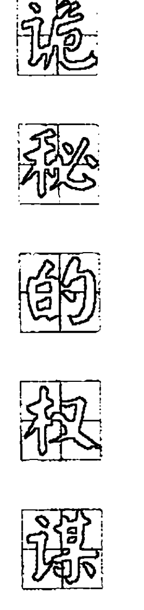

再做借道的傻事。虞公听不进去，又一次答应借道给晋军。这时，宫之奇预言“虞和虢将同归于尽，等不到年底就会灭亡”，遂即带领家眷，逃往国外。果然就在这年年底，晋军灭掉虢国之后，凯旋回师，驻扎在虞国，乘其不备，发起突然袭击，又轻易灭亡了虞国。

这就是“假道伐虢”一词的来源，详见于《左传》鲁僖公二年、五年。它的本意是指一个国家在征服另一个国家的时候，取信于夹缝中的小国，是为了顺势将自己的势力渗透进去，对对方加以控制，而后进行突然袭击，一举吞并之。晋献公以伐虢为理由借道于虞，最终吞并两国；虞公贪利而受欺，朝夕被人灭亡。作为这一权谋的主客体，一智一愚，一明一昏，是显而易见的。不过，在虞国方面，宫之奇所谓“辅车相依，唇亡齿寒”的主张，揭穿了晋国假道伐虢的真实用心，从而成为后世弱国联合抗衡强国的重要思想。

诡秘的权谋

汉初，曹参为齐相国，礼贤下士，很看重蒯通。有人告诉蒯通说：“齐地有两位处士，叫东郭先生、梁石君，为世俗所不及。先生佐助曹相国，拾遗举过，荐贤进能，为什么不把他们举荐给相国呢？”蒯通回答说：“正是。我的邻里有位妇人，与同里诸母相处很好。她家夜晚有肉丢失，婆婆以为是她的，就将她驱逐出门。这位妇人清晨离家而去，路过同里诸母家，就把自己 的事情告诉给她们。有位老母对她说：“你慢慢走吧！我现在就去叫你家里人，来追你回去！”当下搋好一把破麻头，去她家借火，隐喻地对那位婆婆说：“昨晚我家那条狗为争吃一块肉，被别的狗咬死，请借个火把它给缓一下。”这家人听说后，急忙呼喊着赶去，追回了那位妇人。显然，同里老母并非游说之士，搋把破麻头去借火，也不是追回那位妇人的根由，只是因为物有所感，事有适可而已。我这就去向曹相国借火。”于是见着曹参说：“在妇人之间，有丈夫死去三天就改嫁的，有幽居守寡不出门的，相国假使当娶，想娶哪一位呢？”曹参说娶居家不出门的。蒯通接着说：“其实，征召臣僚也是如此。东郭先生、梁石君都是齐地的俊士，隐居不嫁，从没有卑贱地干求仕途。但愿相国派人以礼接待他们。”曹参听完，就使人请求两位处士，待 之为上宾。

这则故事通常被人们称为“束缊乞火”。那位妇人是否有偷肉的行为，我们没必要去理会它，反正她家婆婆只是对她有所怀疑。唯有那位老母的一言一行，颇符合施权弄谋的道理。她拿着一把破麻头，向人家借火，既在别人面前掩盖了自己的真实用心，又很自然地找到了跟人家说话的机会。她跟人家说的那番话，妙

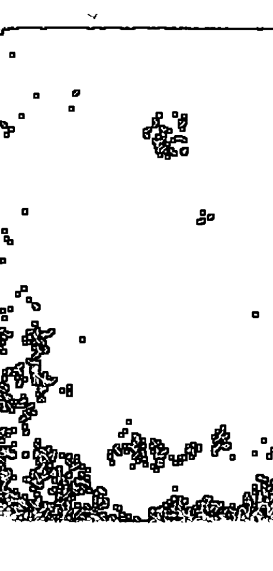

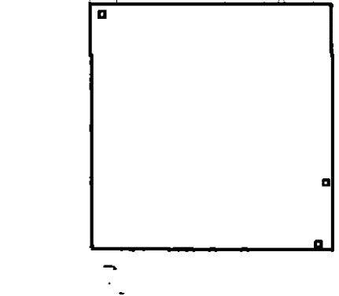

妙在透过一件平常的小事，向对方委婉地传达了一则“爆炸性新闻”：你家丢失的肉是被几条狗撕吃的。这自然是说：你家媳妇被赶出门，全是冤枉的。那家婆婆听到这番话，还能不因错怪好人而有愧吗？还能不赶快让人去把自己的媳妇追回来吗？蒯通凭着这条反映在日常生活中的权谋，去向曹参荐举东郭先生、梁石君。曹参身当那位婆婆的角色，果然对蒯通的举荐表示赞许。

一部《战国策》，收录有寓言故事七十则，其中不少是属于“借”“假”系列的。在这里我们姑且征引一段：

楚宣王问群臣道：“我听说北方各国都害怕昭奚恤（楚大臣），真是这样吗？”群臣哑口不语，只有江乙站起来回答说：“老虎寻找各种野兽吃，抓到了一只狐狸。狐狸说：‘你不敢吃我啊！老天爷派我来作百兽的首领，现在你要是吃了我，就是违抗老天爷的号令。你如果认为我的话不可靠，我就走在你的前面，你跟随在我的后头，看看野兽见到我有敢不逃的吗？’老虎认为它讲得有道理，所以就跟它一道走。各种野兽见到它们，都逃跑了。老虎不知道野兽们是害怕自己，还以为它们是害怕狐狸呢。现在大王的国土纵横五千里，拥有甲兵上百万，而专归昭奚恤掌管。所以北方诸侯害怕昭奚恤，其实是害怕大王的甲兵，就像百兽害怕老虎一样啊！”

这则寓言故事叫做“狐假虎威”。通篇看来，它所描述的外在形象和所揭示的内在意义，遥相呼应，一目了然。狐狸和昭奚恤，百兽和北方诸侯，老虎和大王的甲兵，两两对应，让人心领神会。这表明了江乙对问的高超技巧。不过，引起我们注意的，更是那只狐狸的临场表演。狡猾的狐狸，凭借老虎的威风，去吓唬别的野兽，而后又以骗得的荣誉，再来欺骗老虎。老虎威震百兽，在狡猾的狐狸面前，却成了它运用权谋的第三者。人们常说“拉大旗，作虎皮”，大概就是受这则寓言故事启发而来的。

东汉末遭董卓之乱，汉献帝流离失所，朝廷百官无处安身。曹操在兖州得知这一情况，就想假托勤王之名，而行挟天子之实。其部下大都认为山东未定，不宜轻易出动。唯独荀彧进言道：“过去晋文公纳周襄公，终成霸业；汉高祖为义帝发丧，天下归心。近自董卓以来，天子遵劫，皇族蒙难。将军首举义兵，只因为山东扰乱，未能远赴关中。现在天子将来东京（洛阳），义士思汉，人民怀旧，倘若能抓住时机，上奉帝驾，下从民意，就是大顺；内秉公道，外服豪杰，就是大略；首持仁义，广招英雄，就是大德。天下虽有叛逆，又有什么危害呢？假使失去这一时机，让别人占先，将来会后悔不已。”曹操

听罢，当即派兵迎接汉献帝到洛阳，不久又迁许都（今河南许昌）。自此以后，曹操独揽朝廷大权，开始向各地诸侯发号施令。

在东汉末各地军阀中间，曹操是最有政治远见的。这次与荀彧决议，迎接汉献帝回归旧都，开创了“挟天子以令诸侯”的新格局。汉家天子在当时虽然无兵无卒，受制于人，却仍不失为一面具有社会号召力的旗帜。曹操和荀彧都认识到了这一点。荀彧对形势的分析和由此提出的建议，可以说是曹操初期政治实践的纲领。曹操抢先持有汉家天子这面旗帜，不仅在政治上攫取了正统地位，而且赢得了广泛的社会支持，这样一来，就在同各地军阀打交道时占据了有利形势。无怪乎诸葛亮“隆中对”，以曹操“拥兵百万，挟天子以令诸侯”，劝说刘备暂时不能与曹操争强斗胜。

与狐假虎威有所不同，借题发挥是借着某一个题目，大做文章，以表达自己的真正的主张。引申而言，它是以某一事情为借口，采取切实的行动，来达到预期的目的。在一定的权谋场上，权谋主体运用借题发挥的手段，首先应该注意的，是所借之“题”必须有利于自己的行动，最起码是不会妨碍自己的行动。只有这样，权谋主体才能在所借之“题”上，充分发挥出个人的主观能动作用。

汉初吕后执政，诸吕擅权，朱虚侯刘章年方二十，孔武有气力，每因宗室失去权位而愤愤不平。一日，刘章入宫侍奉吕后宴饮，吕后令他担任酒吏，在筵席上监酒。他请求吕后准许用军法从事，得到应允。席间刘章略带醉意，为吕后进献歌舞，演唱道：“深深地耕哟，密密地种，长起的禾苗应疏松；不是同种的杂草，要用锄头来除掉。”吕后听罢，默然不语。过一会儿，诸吕中有一人喝醉洒，离席而去。刘章连忙追上去，拔剑斩之，而后报告吕后说：“有一人避洒而逃，臣谨按军法将他处斩。”吕后虽然有些惊讶，可是先前已准许用军法监洒，也就不便治刘章之罪了。

在这场沉闷不欢的酒宴上，刘章两度借题发挥，一曲歌舞，一桩血案，足以令吕氏族人寒而栗。那一曲耕田歌谣表面上是唱给吕后作乐的，实际上却是在影射诸吕，把诸吕分明比作“不是同种的杂草”。那一桩血案表面上看是以军法执行监酒，其实，不过是刘章为发泄对诸吕的极端不满而故意杀人。这件事虽然做得有些过火，但因为有权吕后先前授予的把柄，诸吕对刘章的所作所为也就无可奈何了。

司马相如和卓文君因爱恋而私奔后，身为大富豪的卓王孙大为恼怒，认为自己的女儿太不争气，因而不给她任何陪嫁。相如夫妇在成都家徒四壁，无以为生，就又回到临邛。为了给卓王孙难堪，相如把车骑统统卖掉，在街头开起一家酒馆，由文君亲自倒酒亮相，自己则与酒保、佣役一块打杂，故意在大庭前洗碗涮盆，惹得众人注目。卓王孙知道后，觉得丢尽脸面，由于怕见到自己的朋友，连家门也不敢走出一步。有些亲戚、长辈就来劝他说：“如今你只有一男二女，家里缺少的绝不是钱财。文君既然已经和司马相如结亲，相如尽管家境贫寒，却是一个可以依靠的人才，何必这样轻看他呢？”卓王孙听得众人的劝解，不得已分给文君一百多名僮仆，上百万两钱财，以及许多细软之物。

许多人都知道司马相如和卓文君的爱情故事，但不一定仔细推敲过他们为从卓王孙手里争得一份财产的这番表演。相如夫妇回到临邛开酒馆，显然只是为了表达自己的真心而制造一个“题目”。他们由此不断地给卓王孙带来难堪。人有人脸，树有皮。卓王孙在临邛是数一数二的富豪，哪撑得住这等令人嘲笑的优势，因而不得不改变了对相如夫妇的态度。司马相如把财物弄到手，就又关闭酒馆，带着文君返回成都，买房屋、置田宅，很快过上了富裕的日子。

“移花接木”，这是《三十六计》以外较有典型性的一种权谋。它的本意是把带花的枝条嫁接在别的树木上，而通常则用于比喻暗地里更换人或改变事物。权谋主体运用这一手段，既要按“移”“接”的操作程序去做，又要保守秘密，使自己的真正意图得以掩盖；否则将归于失败而遭受更大的祸害。

楚考烈王无后嗣，相国春申君黄歇很着急。赵人李园欲送妹妹嫣嫣于考烈王，又怕照样不能生育，就设法做了黄歇的舍人，将嫣嫣献给黄歇。嫣嫣怀孕后，按照李园的吩咐，相国对黄歇说：“楚王非常敬重您，对您比亲兄弟还亲，因而让您做了二十年相国。而今楚王没有后嗣，百年之后必定传位给他的兄弟。到那时候，新王必定重用自己的亲信，您还能再受宠而显贵于朝吗？更何况您执事时间这么长，对楚王的兄弟们的难免有失礼之处，一旦王位转移，很可能引致杀身之祸。不过，现在我已经怀有身孕，并无别人知晓。倘若以您的身份推荐我进宫，楚王必定会亲幸妾身。日后侥幸生得一个男孩，将来作楚王的，也就是您的儿子。得到楚国和身遭祸乱，您看哪个好呢？”黄歇欣然从计。后来嫣嫣生得一个男孩，被立为王后。楚考烈王死后，这个男孩继承王位。这时李园害怕黄歇泄密，秘密豢养死士，趁给考烈王治丧的机会，杀掉黄歇，并且诛灭其家室。他自己终于以国舅的身份，把持了楚国朝政。

在这则权谋故事里，李氏兄妹的丑恶表演，实在是权欲熏心而无耻至极。那春申君黄歇过去人称“天下四公子”之一，到头来昏庸无道而竟遭诛灭，也实在令人可叹。更令人惊奇的，是这一权谋的运用并非独此一见。秦时吕不韦因为“奇货可居”而玩弄手脚，遂使秦始皇的出身，至今仍然是一个难解的谜；清初一场“狸猫换太子”，又使得乾隆帝的身世，一直成为一桩悬而未决的疑案。这些说来有点耸人听闻，可是有谁能品评出个中三昧呢？

## 三、婉转的谏戒

自古帝王多狐疑，多猜忌，多暴虐，多恣意，臣下才华出众，则担心相形见绌；臣下德高望重，则担心威名盖世；臣下握得实权，则担心阴谋篡位；臣下拥有重兵，则担心反叛独立，于是对臣下有各种监视、考验、奴役和打击。做臣下的见着帝王有不良的习气，或者是无理的言行，就不敢直面犯颜，强说极谏，而只能采取一种婉转的手段，即把自己要说的话或要做的事通过迂回的途径表达出来，使帝王有所感悟，进而有所悔改和转变。

春秋时期，晏婴作为齐国的三朝元老，辅佐齐灵、庄、景公，在处理政务方面多有建树。对于国君的某一缺陷，与为政的各种败端，晏婴总是抓住适当的机会，以借此喻彼的手段，寥寥数语，不露进谏的痕迹，却达到了劝谏的目的。

齐景公为政严酷，滥用刑罚，致使市面有出卖假腿的。晏婴看到这种情景，深有感顾虑，打算给齐景公提个意见。正好齐景公以晏婴的住所靠近市场，比较吵闹，想给他更换住宅。晏婴辞谢说：“君王的先臣住在这里，臣下不足以继承祖业，住在这里已是过分。况且靠近市场，买东西方便，岂敢麻烦间里为我造新房呢？”齐景公笑着说：“您靠近市场，可了解现在的物价吗？”晏婴回答：“既然出入方便，怎能不知道的！”齐景公又问：“什么贵？什么贱？”晏婴略加思索，回答说：“假腿贵，鞋子贱。”齐景公听过这话，仔细品味了一阵，知道是说自己滥用刑罚，摧残犯人的身体太狠，于是下令减省刑罚。

晏婴何等有心！竟在三言两语中间，把住宅、市场、物价同刑罚太滥联系到一块。

齐景公固然敬重晏婴，但是，晏婴如果在人家关怀自己的时候，为滥用刑罚而直言进谏，岂不要惹得君臣心里两不舒畅，闹不好还会使齐景公恼火，好心得不到好报。晏婴没有这么犯“傻”，在君臣对话之间，言称“假馈贵，鞋子贱”，一语双关，暗示百姓遭受酷罚，剁脚断腿的现象太多，这种滥用刑罚的行为应该制止。齐景公是一位有心计的国君，哪能悟不出这句隐语的含义呢？

大凡在国君心情舒畅的时候，做臣下的想去进谏，还算好一点，然而，当国君情绪败坏的时候，要想劝驾就不那么容易了。因为人在盛怒之下，往往会丧失理智，一意孤行，听不进别人的劝解，很容易对劝解者产生误会，以至于节外生枝，把本来的事情闹腾得更大。

齐景公身染疥疮，整整一年没有治好，心里很恼火，因而召见近臣，对他们说：“我为自己的病曾派出两位官员，到山川宗庙会祈祷，带去的供品比先君还丰盛，并且每年比先君多祭祀一次，可是病不但没好，反倒越发厉害。我想把那位官员杀掉，以求得上天的高兴和赐福，你们看可以吗？”晏婴听了，十分惊讶，只好默不作声。在齐景公一再催问下，他颇有准备地反问道：“您以为祈祷有好处吗？”齐景公点头称是。晏婴接着说：“如果认为祈祷有好处，那么，诅咒就会有害处。眼下齐国境内责怪您、怨恨您，乃至向上天诅咒您的人很多，而为您祈祷的人却只有两个。即使是最会祈祷的人，也无法胜过那么多诅咒的人。再说祈祷时如果直言实情，就要诽谤您；如果隐藏过失，就是欺骗上天。上天要是灵验，则不可欺骗；它若没有知觉，祈祷也是无用的。请您仔细考虑一下吧！”齐景公听罢这番话，猛然悔悟，亲手替晏婴戴上礼冠，把齐国的政务托付给他。

这番话何等有力！晏婴在齐景公承认祈祷有好处的前提下，自然推出诅咒有害处的观点，接下来把祈祷和诅咒相提并论，对比说出负责祈祷的人太少，又不能将实际情况禀告上天，因而无论怎么做都是无用的。这言外之意无非是说那两位官员根本没有什么罪过。晏婴说这番话是经过充分思考的。目标在解释祈祷，偏要以诅咒为参照；想为那两位官员辩护，却说诅咒的人太多。真可以说是直中有曲，曲中有直。也许唯有如此，才容易使齐景公打消自己的错误想法，以免造成一场人为的祸害。

有位齐人不慎惹恼了齐景公，齐景公一时失态，命左右将那 人绑到殿下，大卸八块，以解心头之恨。众臣没人敢出面劝谏。只见晏婴跨出朝班，左手把那人的头发揪在手里，右手操起一把刀。他一边霍霍磨刀，装出一副盛

怒不解，必欲亲手杀之而后快的样子；一边若有所思，仰天长叹，对着齐景公说：“这般解罪人的刑罚，古代圣王似乎也常用，到底是从哪一朝代开始的呢？”齐景公听了，有所领悟，知道晏婴是见自己一时气恼，不敢直面相劝，而用这种方法来讽喻自己，就收回刚才那不见经传的“大卸八块”的成命，把那人释放了。

晏婴何等的机智！一句话究竟把齐景公从盛怒的心底扯回来，挽救了那位身为俎上肉者的性命。在当时那种场合，众臣慑于齐景公盛怒之下，心里有话却不敢言。只有晏婴挺身而出，来劝说齐景公，这本身就体现着一种胆略。不过，晏婴促使齐景公收回成命的关键，在于顺应齐景公的情绪和心理。他一方面假装一副盛怒不解的样子，在外表上同齐景公保持一致；另一方面拉起古代圣王的大旗，把本来没有的事情说成是“似乎也常用”，使齐景公陷入是否愿意做圣王的境地。齐景公绕不过这个圈子，既然要在臣下们面前表现出圣明的姿态，那就不能不把自己的成命收回。晏婴没有直接地为那位将被卸成八大块者鸣冤，而是从询问“大卸八块”的源头作出了间接的辩护。这一招看来还着实有效。所以，有人就此评论说：“晏子之谏，多讽而少直，殆滑稽之祖也。”

大概与晏婴稍早，在楚国有一位名优，人称优孟，身高八尺，能言善辩。他取法于演戏的技巧，往往能寓讽喻劝谏于喜怒哀乐之间，堪为当时最著名的滑稽家之一。

楚庄王嗜爱马，曾让一匹心爱的马穿着绣花衣裳，住在华丽的房中，卧在柔软的床铺上，用枣脯喂养。后来这四马得肥胖病死了。楚庄王要群臣为马筹办丧事，准备用棺椁像大夫那样礼葬它。左右大臣劝阻，楚庄王都不听，并且下令说：“谁要再敢为葬马的事劝我，我就施他死罪。”优孟听到这消息，就到宫殿上仰天大哭。楚庄王很惊异，忙问他为什么大哭。优孟说：“这匹马是大王心爱之物，堂堂楚国什么事办不到，仅用大夫的礼仪葬马，规格太低，太寒伦了。还是请用君王的礼仪吧！”楚庄王问：“怎么个葬法呢？”优孟回答说：“应该用玉石雕棺，细梓做椁，让全副甲胄的武士打墓，再请齐赵来宾陪祭，韩魏客卿奠后。然后像祭太庙一样，用牛、羊、猪三牲为祭品，再封万户县为马家守护，使马能常年享受烟火祭祀。各国诸侯听说这件事，就会知道大王是多么轻视人而重视马了。”楚庄王听罢，有点惭愧地说：“我的过失竟有这么严重。那怎么办呢？”优孟回答说：“我看就按对待一般牲畜的办法做吧！用灶火当椁，铜槽作棺，加点枣姜，放点木兰，配着稻米，穿戴火光，把它葬在人肚里算了。”于是，楚庄王让人把马交给管膳食的人去办。

## 第九章 直与曲 诡秘的权谋

好一位机灵的优伶哟！一番对问藏心计，言辨是非胜群臣。在楚庄王立下成命，不许更改的条件下，优孟进谏采取了三个步骤：首先，他仰天大哭于宫殿之上，以引起楚庄王的注意。这是争取进谏机会的一步。一位优伶要进谏国君，没有超乎寻常的举动，是不会令人注意的。优孟很懂得这一点。接下来，他向楚庄王说起哭马的原因，佯称用大夫的礼仪，规格太低，不如用君王的礼仪，来为爱马治丧。这实在是“欲敝固张”、“欲废固兴”的排阖手段。楚庄王纵然嗜爱马，但用君王的礼仪葬马，也未免太过分了。优孟把楚庄王葬马的荒唐命令，顺水推舟似地推到更加荒唐的地步，想来楚庄王也是难以赞同的。当楚庄王对自己的过失有所认识以后，优孟进一步说出不能用大夫的礼仪葬马的原因：诸侯们从这件事看到你楚庄王重视马而轻视人，一定会嗤笑的。要知道楚庄王雄心勃勃，总想图霸中原，怎能愿遭各国诸侯的嗤笑。因此，经过优孟这么劝说，楚庄王也就只好自行改变主意了。

在史家笔下，优孟主演的滑稽剧，除去“哭马”一场外，还有另一场同样令人回味无穷。这场戏载于《史记·滑稽列传》，我们不妨再引述之：

孙叔敖为楚令尹，以辅佐楚庄王争得霸主地位，深受朝野敬重。可是，在他去世后，儿子孙安辞官返乡，种田过活，日子十分清苦，甚至连一件好衣裳都置不起。优孟听到这件事，心里很不服气，就学着孙叔敖生前的穿戴、言行，一再演习，居然演得跟孙叔敖一模一样。有一天，楚庄王在宫廷设宴，要优孟临场献艺。优孟嬉笑着说：“今天我有一个新节目，献给大王欣赏。”说罢，他让装扮楚庄王的帮手登台演出。这位帮手装出一副思念孙叔敖的样子，感慨地说：“孙叔敖，你至死不忘国家，真是难得啊！只是我没有福分，让上天夺走了你，多么可惜呀！”楚庄王听了，不禁落下泪来。这时，优孟扮演孙叔敖，走上戏台。楚庄王一看，不顾一切地跑上去，一把揪住优孟。优孟急忙解释自己是假扮的，可楚庄王仍然说：“不管你是真是假，我就拜你为大夫。”优孟推辞不受，并且说要做就做赃官。楚庄王很奇怪，问是什么意思。优孟这才脱去戏装，连声唱道：“贪官污吏多荣耀，子孙不愁穷，享不尽民脂民膏。公而忘私就糟糕，你只看令尹孙叔敖：辛苦一生，身后萧条；子孙特受苦，没着没落没依靠。劝你不必做清官，还是贪官污吏好！”楚庄王听了，心里好一阵难受，当即打发优孟把孙安找来，按照孙叔敖的遗言，给孙安划分了一块土地。

本来，为人鸣不平，就是一件麻烦事，难得见功；而针对国君为人鸣不平，就更是难得见功，甚至要担当杀头的风险。优孟在楚庄王面前为孙安鸣不平，看来是明乎此而颇费心思的。他私下百般练习，准备好一出君臣同台、惟妙惟肖的小品。当那位帮手发完感叹以后，楚庄王就情不自禁地进入了角色。优孟一出场，因为掩饰孙叔敖跟真人一模一样，竟使楚庄王以假当真，硬要给优孟拜官，从而把剧情推向高潮。优孟趁着这当儿，借称“做官应做贱官”，正话反说，一口气唱出孙叔敖做官清廉洁，只落得子孙贫困无助的结局，把孙安的不幸遭遇和盘托出。到这个时候，你想那开明的楚庄王，眼见历历往事，心中不胜难过，还能不接受优孟的讽喻，好生照顾孙叔敖的后裔吗？

与讽谏进谏相比较，自我警戒，明哲保身也不是一件很容易的事情。凡人只知道当官做老爷，如何荣华富贵，八面威风，可曾想过这官老爷遇上大老爷，也不过是俯首贴耳的奴才。在传统政治舞台上，封建帝王身为最高等的官老爷，操纵着所有做臣下的生杀予夺的权力。“君令臣死，臣不能不死”，同“父叫子亡，子不敢不亡”，一起成为人们长期恪守的铁的规范。古往今来，做臣下的有多少生前备受朝野拥戴，死后却得不到一句褒颂辞；有多少生前受封跨州连城，死后却未能享有一抔土；甚至有多少为创帝业立下汗马功劳，到头来反遭无端之祸和灭门之灾。历史在个人头上不断重演，于是留下了许多前车之鉴。“伴君如伴虎。”后来做臣下的说起话来，做起事来，也就只能战战兢兢，小心翼翼，“如临深渊，如履薄冰”。在某些特定场合，他们要想求得封建帝王的理解、信任和重用，是非要动一番脑筋、耍几套把戏不行的。只是在这时候运用权谋，不能搞得太露太白，要设一些圈子，绕几道弯儿，才好表达自己的用心。

秦王政为统一天下，调集到六十万大军，交给大将王翦统率，前去攻打楚国。临出兵前，王翦请求嬴政把洛阳附近的好田宅赏赐给他，嬴政慨然应允。秦军刚到函谷关，王翦又派人回去向嬴政索要苑囿，部将蒙武以为太过分，劝他不要这样做。王翦悄悄告诉蒙武说：“大王强横而多疑，现在把秦王六十万交给我来统率，这实际上是把国家的命运托付于我。我多请置田宅苑囿，一则可为子孙添些资产，二则可缓解大王对我的疑虑，否则怕是很危险的。”嬴政见王翦广请田宅苑囿，欣然满足他的要求，因而对他更为放心。

王翦请田释疑，可称得上深通为臣之道。无独有偶。在汉初那段历史上，萧何为讨得刘邦的理解和信任，接二连三地重演了王翦的故技，与王翦同样用心良苦，甚或有过之而无不及。

楚汉之际，萧何受刘邦委托，总理关中一切政务。刘邦与项羽在荥阳相持吃紧时，多次派遣使者来慰劳萧何。有位叫鲍生的人对萧何说：“汉王风餐露宿，却经常派人来慰问你，是对你有所怀疑。为你着想，不如把你的子孙兄弟中能够打仗的人，全部派到前方随军作战。这样，汉王就会更加信任你。”于是萧何听从鲍生的建设，让自己的兄弟子侄去向刘邦报到。刘邦由此打消了对萧何的疑心。

这则故事里，萧何和鲍生均属权谋主体，一个有心计，善于动脑筋；一个明事理，处世有主意。他们俩结合在一块，就把足智多疑的刘邦给蒙哄过去了。

汉初，刘邦在出征陈豨的征途上，听说淮阴侯韩信谋反未遂，被萧何与吕后所谋，派遣使者拜萧何为相国，加封五千户，并且专任一位都尉，率领五百名士卒，作为相国的卫队。召平得知这一消息，就对萧何说：“你的祸患从此开始了。皇上统兵在外，风餐露宿，而你在京城留守，没有蒙矢石赴汤火，反倒给你增加封邑，添设卫队。这是因为韩信谋反的事情，引起皇上对你的怀疑。但愿你能够辞去封赏，尽可能把自家的财产拿出来，捐助军队。这样，皇上心里就会高兴。”于是萧何听从召平的建议，果然换得了刘邦的欢心。

这则故事的经历与前面的差不多，所不同的是萧何的处境更为不妙：刘邦以直接派兵监护代替了原先的暗中窥视；作为权谋主体之一的角色有变化：召平代替了鲍生；萧何应付刘邦的手段不相同：倾倒私囊，捐助军队，代替了派兄弟子侄参军作战。尽管有这三条不同，但是权谋双方的行动、动机和结果，却几乎是完全一致的。

刘邦平定陈豨叛乱后不久，又去征讨黡布，在进军途中多次派使者回长安，询问相国萧何在做什么。萧何因为刘邦率军在外，就在后方安抚百姓，尽可能倾私囊捐助军队，如同过去征讨陈豨一样。有位说客看到这种情形，就对萧何说：“你不就要灭族了。你位居相国，功劳第一，难道还可以复加吗？你当初进入关中，已经深得民心，而今还在孜孜不倦地办事，使百姓都亲附你。皇上屡次询问你的行迹，是害怕你威望过高，倾动关中。因此，你不多多地用低价、赊欠的方法，强行购置田地，以败坏自己的名声？这样皇上就会安心了。”于是萧何按照这一建议会做。刘邦得知后，果真很高兴。

这则故事里，佚名称客的一番话，揭示了传统政治生活中君臣关系的一个侧面：做臣下的要是功高至极，就有可能遭灭顶之灾。萧何为人处世，谨慎持重，听说客那么一说，恐惧的心情油然而生，因而不得不走上自污以自救的路子，使多少年来给百姓留下的好名声毁于一旦。看来这既是一种明哲保身的自戒手段，又是一场令人深思的个人悲剧。

在中国历代宰相中间，萧何的政治作为是比较突出的，与之相适应，他在处理君臣关系方面的表现也是比较突出的。因此，我们不避冗烦之嫌，援引了反映他处理与刘邦之间内心纠葛的三段故事。从这儿可以得出一条公理：做臣下的虽然蒙受着无端的疑忌，也不能去直接了当地解释。因为你越想解释清楚，就越解释不清楚。于是乎聪明的臣下，只好拐弯抹角，采用间接的方式，向君主表示出自己的诚实。这表明做臣下的要请求得君主理解和信任，不经过一番苦心经营是难以得逞的。所以我们说，一部中国传统政治史，就主要侧面而言，只能算是一部历代帝王将相的关系史。

## 第十章 顺与逆

顺者，有沿循、适应、顺从的意思；逆者，则有肯反、抵龉、不顺从的意思。二者构成对立统一的现象，在人们的各种社会活动中间表现得相当普遍，几乎是无处不在，无时不有。因此，我们把它看作权谋的最基本的矛盾范畴之一。

大抵人情相益则亲，相损则疏，相利则合，相害则忤。在一定的权谋场内，作为权谋主体，要处理好顺与逆的关系，就必须自觉地认识到这一点，进而摸清楚权谋客体的特点及其趋向。这是运用权谋的前提。根据权谋客体的不同特点及其趋向，权谋主体无论是取顺抑或逆的手段，都可以有分有寸，区别对待。或者以道德相交往，或者以学术相交往，或者以朋党相交往，或者以金钱相交往，或者以美色相交往。因为这一切迎合权谋客体的品格、修养和嗜欲，权谋主体无论是做一件事情，还是发一通议论，都能够“欲入则入，欲出则出；欲亲则亲，欲疏则疏；欲就则就，欲去则去”，无一不得心应手，左右逢源，达到事半功倍的效果。

### 一、鬼谷子的发言术

相传鬼谷子其人，是纵横家的鼻祖。《鬼谷子》一书，是纵横家的经典著作。这部著作主要是讨论游说进策活动的。鬼谷子针对游说进策活动本身的特点及其面临的种种问题，提出并阐明了“量宜发言之术”。

什么是“宜”呢？按照鬼谷子的说法，它是通过“量权”“揣情”而得出的一种有利于己的时机或场合。“量权”要从多方面进行，“度于大小，谋于众寡，称财货之有无，料人民之多少，辨地形之险易，别君臣之亲疏，观天时之祸福”。一句话，对权谋客体的考察一定要周详细致。至于“揣情”，“必以其甚喜之时，往而极其欲也，其有欲也，不能隐其情；必以其甚惧之时，往而极其恶也，其有恶也，不能隐其情”。每个人的性情都是因为他们不同的心境而发生变化的，所以，只有当一个人的心境充分暴露出来以后，权谋主体才能够看透其真实的性情。

“量宜发言之术”的内容是相当丰富的。《鬼谷子》在这方面有许多论述，譬如说“说人主者，必与之言奇；说人臣者，必与之言私”。这是因为与君主言奇，可以创立非常之功；与人臣言私，可以保全全身之道。又如“无以人之不欲而强之于人，无以人之所不知而教之于人”。因为这两种做法背离人之常情，而很难达到预期的目的。至若“与智者言，依于博；与博者言，依于辨；与辨者言，依于要；与贵者言，依于势；与富者言，依于高；与贫者言，依于利；与贱者言，依于谦；与勇者言，依于敢；与进者言，依于锐”。这几乎是把游说进谏活动的实施要领概括完了。

传统认为“上兵伐谋，其次伐交”。其实“伐交”又何尝不是“伐谋”。在战争领域里通过“伐交”，分化瓦解敌方军事同盟，只有处理好顺与逆的关系，才能够取得圆满的成功。

春秋时，秦晋两国联合攻打郑国，兵临城下，郑国陷入危机。郑文公选派能言善辩的烛之武去说服秦国退兵。烛之武趁夜暗暗缒下城墙，直奔秦军营前，放声大哭。秦穆公闻讯，急忙派部下把他提来。烛之武走进营内，止住哭泣，郑重地对秦穆公说：“老臣哭郑，也哭秦。因为郑国灭亡在所难免，没有什么可惜，可惜的是秦国呀！”秦穆公有些不明白，烛之武接着说：“秦、郑两国相距千里，中间又隔着周王室和晋国。如今你们与晋国合兵而来，即使灭掉郑国，你们又能得到什么好处？能跳过周王室和晋国来占领郑国的一寸土地吗？况且秦、晋两国本来力量相当，势均力敌，如今晋国夺得郑国的一些地盘，力量就会超过你们。晋国历来言而无信，既然拓地于东来灭郑国，也就会拓地于西去打秦国。君不见假道伐虢的历史教训吗？”秦穆公听罢如梦方醒，马上与郑国结盟，并派出三位将领帮助郑国守城，然后悄悄地撤兵回国。晋国军队看到这一情形，自觉孤掌难鸣，也不得不解除对郑国的包围，撤兵回国。

烛之武哭退秦军，妙就妙在抓住秦晋两国利益上的根本矛盾，从关心秦国的前途拉开话题，顺水推舟，就坡骑驴，轻而易举地把晋国的盟友扯到自己的国家一边。在当时的情况下，烛之武倘若一是讨饶于秦军，那只能显示出郑国软弱无力，不堪一击；倘若是对秦国严加谴责，也无疑会激恼对方，令他们加快攻打郑国的步伐。看来烛之武的所作所为，乃是唯一可行的出路。从权谋学而言，没有烛之武的哭，就不可能引起秦穆公的关注；没有烛之武的分析，就不可能使秦穆公回心转意，撤兵回国。烛之武在这里已经把权谋的传达方式及其内容完全结合在一块，所有言谈举止都不露施权弄谋的痕迹，可以称得上天衣无缝。

战国时，晋诸大夫发生纠纷，智伯胁迫韩、魏两家攻打赵氏。赵襄子据守晋阳（今山西太原南），与智、韩、魏三家相持一年多。智伯引汾水灌淹晋阳城，给赵氏造成致命的威胁。在这危急关头，赵襄子经过深入分析后，派张孟谈深夜出城，造访韩、魏两营。张孟谈先去见韩康子，向他陈述利害说：“智伯胁迫你们攻打赵氏，用心极为毒毒，一旦晋阳城破，早晚他会移师攻打你们。这是各个击破的做法。现在你们与赵氏自相残杀，唇亡齿寒，最终你们也是要倒霉的。因此，你们不如与赵氏联合起来，乘智伯不备之机，决断河堤，让汾水倒灌他的军营，然后出兵掩杀，必能大破智氏。届时我们三家瓜分他的领地，岂不是很好的办法吗？”韩康子深有同感，欣然应允。张孟谈接着又以同样的理由，说服魏桓子，当即行事，决堤倒灌智氏大营。赵和韩、魏两家一起灭掉智伯，瓜分了他的领地，从而形成“三家分晋”的局面。

在这则故事里，张孟谈和烛之武一样，也是紧紧抓住赵、韩、魏三家的共同利益，和他们跟智氏之间的矛盾冲突，来说服韩康子和魏桓子的。既然韩、魏跟赵氏是“唇齿相依”的关系，那么，韩、魏两家就没有跟随智伯进攻晋阳的理由。既然智伯的企图是要各个吞灭赵、韩、魏三家，那么，韩、魏两家就应该站在赵氏的一边，来消灭共同的敌人。韩康子、魏桓子本来和智伯就有些裂痕，是受智伯胁迫而来攻打赵氏的，现在经张孟谈这么一说，反过来跟赵襄子联合行动，就成了理所当然的事情。

春秋时，齐国晏婴作为一位出色的外交家，曾经去楚国访问。在整个访问过程中，面对楚国君臣故意设置的各种窘迫场面，晏婴都从容镇定，把对方所提荒唐的“难题”引向格外荒唐的地步，结果又返回讲道理的桌面上，使楚国君臣一次次都自讨没趣，不得不换上另外一副面孔，向晏婴表示敬意。在这里我们不妨引述之：

齐景公时，晏婴出使楚国。楚国君臣成心想侮辱他，显一显自己的威风。他们知道晏婴身材矮小，就在城门旁边开挖一个不高的窟窿，叫他从这个窟窿钻进去。晏婴遇上这种处境，很严肃地对门卫说：“这是狗洞，不是城门。如果我是上狗国去，就得钻狗洞；而我来访问的是人国，就应当从城门进去。我在这里等一会儿，烦你们先去问个明白，楚国到底是什么国呀?”有位门官立刻把晏婴的话报告给楚灵王。楚灵王只好下令,大开城门,把晏婴迎接进来。那些原想侮辱晏婴的大臣,到这时也不敢再对晏婴做什么非礼的举动。

晏婴的话很巧妙地反击了楚国,钻狗洞等于入狗国,进城门等于入人国;我晏婴是人不是狗,只能进城门而不能钻狗洞。你楚国倘若是人国,不是狗国,就只能开城门,不能挖狗洞。楚灵王得门官报告,没有什么可以反驳晏婴,也就只好大开城门,去迎接晏婴来访了。

在晏婴和楚灵王会谈时,楚灵王因见晏婴相貌丑陋,就戏弄说:“堂堂齐国难道没有人吗?”晏婴听后,不卑不亢,很严肃地答道:“这是什么话!临淄一个城已经挤满了人,大家都要呵一口气,就能够变成一片云彩;擦一把汗,就能够下阵雨;走路的人肩膀擦着肩膀,一停步后面的人就会踩着他的脚跟。大王怎么说齐国没有人呢?”楚灵王反问说:“那为什么打发你来呢?”晏婴一听这话,又好气又好笑,接着对楚灵王说:“我们齐国有个规矩,每次派使者出访,贤能的人出使上国,无能之辈出使下国;身材高者出使大国,矮者出使小国。我晏婴最没有才能,身材又很矮,所以让我出访楚国。”楚灵王自感失礼,又无言以对,只好说自己是在开玩笑,而对晏婴优礼有加。

此番晤谈,在楚灵王只有一个心思,而晏婴却有两段答词。前一段答词迎着问话上去,据实反驳,作出否定的回答;后一段答词顺着问话下来,反唇相讥,作出幽默的解释。两相比较,后一段答词显然带有更浓厚的权谋色彩。依照晏婴的说法:“贤能者出使上国,无能者出使下国;身材高者出使大国,矮者出使小国。”你楚灵王嘲弄我晏婴身材矮小,相貌丑陋,不就等于说你们楚国是“下国”、“小国”吗?楚灵王自然不愿接受这一逻辑推理,无奈何只能以开玩笑搪塞过去了。

后来,楚灵王和晏婴在前庭站着聊天。有几名武士专门绑着一个囚犯,从他们面前走过。楚灵王假装不知实情,问武士们说:“这名囚犯犯什么罪,是哪里的人?”武士们回答说齐国的盗贼。于是,楚灵王瞅了晏婴一眼,冷冷地说:“齐国人怎么这样没出息?难道生性就爱偷盗吗?”晏婴知他出言不善,略加思索,就回答说:“江南的蜜桃又大又甜,可是一旦移植到

# 第十章 顺与逆

淮北，就会变成柑橘又小又酸，这完全是水土不同的缘故嘛！同样的道理，齐国人在自己的家乡能好好地干活，而到楚国就胡作非为，偷东摸西，我想大概也是入乡随俗的原因吧！”楚灵王又是无言以对，但见晏婴善辩而贤良，不可戏侮，也就只得自嘲地一笑了之。

在这段对话里，晏婴没有去和楚灵王争辩那名囚犯究竟是不是齐国人，究竟犯的是什么罪的问题。因为这么争辩下去，就等于抬死杠，而抬死杠是缺乏争辩能力的一种表现。晏婴是在不否认那名囚犯为齐国盗贼的前提下，开始回敬楚灵王的。他首先提起一个路人皆知的种植常识，让对方无可置疑；而后拿齐人比蜜橘，以水土不同喻风俗不同，来论证齐人本质是勤劳的，只是因为入乡随俗，才可能在楚国变成盗贼。这一雄辩性的答问是很难被对方彻底推翻的。

秦代有一位名优，失姓名旄，身高不过三尺，总爱开玩笑，但能合乎大道理。我们从《史记》提供的两则故事，可以看出，优旃的讽喻颇得鬼谷子所谓“发言之术”。

秦始皇在位时，想给皇家苑囿扩大一些地盘，东至函谷关，西至陈仓（今陕西宝鸡）。优旄听说后，就来对嬴政说：“妙极了！把苑囿扩大以后，多放一些禽兽在里边吧。假若有盗贼从东方打来，只教那些麋鹿用角去抵就够了。”嬴政听过这番话，打消了扩大苑囿的想法。

二世胡亥继位后，又准备给咸阳城刷油漆。优旃听说了，就来对胡亥说：“这么做好得很！即使主上不说，臣也会请求这么做。漆城尽管用费很大，给百姓带来忧愁，可是一件大好事呀！城墙漆得明晃晃，盗贼来了不能上。眼下要办这件事，筹集油漆很容易，只是如何搭好遮荫的大屋呢？”胡亥听完，忍俊不禁，由此撤去了漆城的设想。

我们在前面“绪论”里谈过，幽默的语言有两大特点：一是含蓄，二是夸张。优旄没有犯颜直谏，而是佯从实逆，可以称得上含蓄；让麋鹿守边和漆城不让盗贼上来的说法，均为夸张。一位名优如此讽喻皇上，应该说是比较得体的。假若优旄慷慨激昂，直说不应该这么做而应该这么做，想那狂傲的嬴政和暴虐的胡亥，岂能容忍这名优伶指手画脚，必定会觉得有失威严和尊严，会不会将优旃处之死地，也未可知晓？

秦末天下大乱，武臣拥众自立，将要进攻范阳（今河北定兴南）。范阳人蒯通入见县令，先说出一个“吊”字，后说出一个“贺”字，惹得范阳令莫名其妙，不得不问起理由。蒯通报说：“我私下听说公将要死，所以来进吊；然而公能听我一言，就能得到生路，所以又来作贺。”范阳令仍旧不明白，又问为什么来进吊。蒯通解释说：“秦法苛暴，公为范阳令十余年，杀人父，孤人子，断人足，黔人首，想必无不胜数。百姓无不怨恨，但怕受法律惩治，未敢剃刀公腹，致灭全家。如今天下大乱，秦法不能实行，公将何以自保？一旦武臣来攻，百姓必定乘机报仇，挺身而来杀公。这难道不可吊吗？幸亏敌人来为公献策，在武臣没有到来之前，请派我前去游说，可以使公转祸为福，这岂不是一件可贺的事吗！”范阳令听罢，觉得很有道理，遂派蒯通游说武臣。武臣根据蒯通的建议，给范阳令封侯，并且特赠高车驷马，使其往抚赵地。赵地官吏闻风趋附，不到一个月时间，武臣就掠了三十余城。

蒯通说范阳令，一“吊”一“贺”，从“吊”开头，到“贺”收尾，一扬一挫，很有特色。假如不是进吊，就不会引起范阳令的关注；假如不是称贺，就不会让范阳令想到未来的转机。范阳令听说自己面临性命难保的血光之害，不会不感到恐惧吧？这是蒯通进吊的本意。范阳令顺应形势，举城归附武臣，又乐得封侯之赏，这是蒯通称贺的原因。“吊”“贺”两者结合在一块，蒯通牵着范阳令的鼻子走，沿循对方的心理变化，一下子就按照自己的主张，把范阳的事情办好了。

中国历史上能言善辩者众矣！我们没必要把他们的言谈举止，一一罗列出来。仅上述几则故事就可以说明，“重宣发言之术”不待《鬼谷子》而后始，那晏婴、烛之武和张孟谈都生在鬼谷子之前，而深得重宣发言的奥秘。至于在游说进策活动中处理好顺与逆的关系，熟识“重宣发言之术”有多大的益处，那又要另当别论。谁不晓得从理论到实践还存在着一段不小的差距呢！

## 二、顺乎？逆乎？

大河滔滔，长江滚滚，世间事就如同这江河一般。每个人自有生命以来，承无数的难题，遭不尽的烦恼。顺乎？逆乎？看来没有一个铁的答案。君不见有握机持权，迎刃而解者；有鹬争蚌夺，坐收渔利者；将计就计者，有因诈施诈者；有投其所好，化仇为友者；有善于转圜，因祸得福者。诸如此类，尽管没有什么规律可言，但总要有一番具体的解说。

《庄子》里面有一则故事，可带来不少启示。这里不妨引述之：

庖丁为魏惠王宰牛，进刀时唰唰的响声，像音乐一样好听。魏惠王听来十分惊讶，就问庖丁怎么会有这样高超的技术。庖丁放下屠刀回答说：“我爱好的是—种高深的道理，已经超出技术的范围了。我起初宰牛的时候，看到的没有不是完整的牛，三年后就未曾看到过整头的牛，如今只用精神去和牛接触；而不用眼睛去看。按照牛体的自然结构，我把刀劈进大的空隙，再顺着骨节间的空隙来运刀，不曾碰着筋脉经络相连的地方，更何况那大块的骨头呢！好的厨师—年换—把刀，因为他们用刀割肉；—般的厨师—月换—把刀，因为他们用刀砍骨头。我这把刀用了十九年，宰的牛也有几千头，可是刀口还非常利。牛的骨节有间隙，而刀刃薄得像没有厚度—样，因而运刀在骨节中间，宽宽绰绰，—定有回旋的余地的。所以这刀用了十九年，刀刃还像在磨刀石上刚刚磨过—样。”魏惠王听罢，连连称妙。

这则故事通常称“庖丁解牛”。庄子以庖丁解牛作比喻，包括两层含义：—是“依乎天理”，“因其固然”，即顺应事物的自然规律，不被外在的条件所拘泥。二是“以无厚入有间”，“游刃有余”，即避开是非、矛盾和冲突，利用事物的夹缝来解决问题。虽然庄子这里在讲养生之道，但是，后人却把这则故事作了养生以外的理解，引申为认识和处理问题的一般方法，也就是说认识和处理问题，要抓住事物的关键，抓住矛盾的主要方面。抓住矛盾的主要方面，就能够使问题迎刃而解，得到圆满的解决。

战国时，魏文侯派西门豹出任邺县（今河北临漳）令。西门豹到任后，召当地有德望的长老，向他们询问百姓的疾苦。长老们都说最苦的事情莫过于河伯娶妇，它把百姓害得穷苦到极点了。西门豹问其根由，长老们回答说：“邺县教化之官和地方小吏，每年向百姓收敛百万钱财，取其二三为河伯娶妇，剩下的与装神弄鬼的巫婆分贪私囊而去。为给河伯娶妇，那些巫婆挑选好看的女子，说她该做河伯的媳妇，并要立即聘娶。于是让这位女子沐浴更衣，斋戒而坐十余日。届时将她置于新床之上，放在河中漂浮而下，不数十里就被淹死。有年轻女子的人家，都怕儿女被巫婆们挑去，纷纷逃避他乡。因此，县人日丁少，贫困日甚—日。”西门豹听后，对长者们说：“在为河伯娶妇时，希望我都能去，我也要去送送那位出嫁女子。”等到为河伯娶妇那天，西门豹来到河边，地方小吏、豪绅和长老们都来了，加上观看的人足有二三万。那大巫婆带着几位弟子，站在西门豹旁边。西门豹要看看为河伯娶的媳妇漂亮不漂亮，巫女们忙搀扶那位女子走出帷帐。西门豹仔细

地端详之后，转身对大家说：“这位女子不太好看，请大巫婆替我告诉一下河伯，找位更漂亮的，过两天给他送去。”说着就让随从把大巫婆扔到河里。过一会儿，西门豹假装焦急地说：“大巫婆怎么还不回来？让她弟子去催一下！”说着又让随从抓起一个巫女扔进河里。扔进三个巫女后，西门豹转过脸来说：“可能是女人不能把话说清楚，劳驾三老们走一趟吧。”说着又让随从把一名三老投入河里。西门豹把笔插花帽子上，站在河边躬身等候。旁边的小吏、豪绅和长老们一个惊恐不已。西门豹回过头来，想再派人去催一下。那些小吏、豪绅和长老吓得要命，急忙伏地不起，磕头如捣蒜，甚至把额头磕破。西门豹见此情景，略等一会儿，招呼大家说：“你们都起来吧！看来是河伯留客了，大家都回去吧！”因此，邺吏民大为惊恐，不敢再提河伯娶妇的事情。

这是西门豹治邺的一个场面。西门豹通过实际调查，了解到县吏、豪绅和三老们勾结巫婆，利用“河伯娶妇”的陋俗，公然残害百姓，大肆搜刮钱财的实情，决心就着这一丑恶的行径来扫除这一害人的陋俗，为百姓灭弊兴利。第一步，西门豹假装顺从邺三老、巫婆的意见，参加“河伯娶妇”的盛会，让他们把自己的丑恶面尽力表现出来。这种欲擒故纵，先顺必取的做法，正是西门豹蓄意制服做恶者的一步高招。第二步，西门豹在“河伯娶妇”盛会上，假斥为河伯挑选的女子不够漂亮，一而再、再而三地大巫婆、三名巫女和一名三老投进河里，即使做恶者受到应有的惩罚，又让与会者以亲眼所见，看透了“河伯娶妇”的骗局。这种“以其人之道还治其人之身”，通过惩除做恶者来教育受害者的方法，确实具有一举多得的功效。第三步，西门豹在惩除做恶者后，故作“管笔管折”的模样，貌似关心巫婆、巫女和三老们报告河伯的消息，实际上是要从心理上给当地小吏、豪绅和长老以更大的震慑，使他们不敢继续为非作歹。你看那帮小吏、豪绅和长老害怕被派去禀报河伯，面色如死灰，磕头如捣蒜的情景，简直令人嗤笑不已。这则故事的全过程不但起伏跌宕，还有点出人意料之外。西门豹利用“河伯娶妇”的丑剧，转手间禁绝了这一沿泊很久的陋俗，其成功的秘稷固然需要作多方面的分析，但作为权谋的内核，先顺必取，“以其人之道还治其人之身”，以做恶者的死启发存者的心灵，应当是我们首先要认识到的。无怪乎有人就此评论说：“娶妇以鬼潮，题目甚大，愚民相安于惑也，久矣。直斥其妄，人必不信，惟身自往会，管笔管折，使众著于河伯之无灵，而向之行诈者，计穷于畏死，虽驱之娶妇，犹不为也，然后弊可永革。”从我们的观点看，这番评论一矢中的，是很有道理的。

在认识和处理问题上，抓住了事物的关键，抓住矛盾的主要方面是十分重要的，可是，在许多情况下，权谋主体面对的问题，并不是单纯的、相对静止的，而是权谋客体内部的矛盾冲突，是复杂的、正在发生变化的。这样一来，权谋主体不必急于采取行动，就能够看到一种两败俱伤的局面，然后利用这一态势，积极介入，就可以达到平时难以达到的目的。

战国时，韩、魏两国互相攻伐，连年不绝。秦惠文王想出兵助韩，征求左右的意见。有人说救助好，有人说救助不好，秦惠文王疑而未决。恰好这时陈轸从国外回来，秦文惠王就向陈轸问计。陈轸说：‘您听说过去卞庄子刺虎的故事没有？卞庄子看到两只老虎在吃一头牛，就想去刺杀它们。一位年轻人制止他说：‘两只老虎刚开始吃牛，都在兴头上，等一会儿它们必定相互争夺和搏斗，搏斗的结果必定是大的负伤，小的被咬死。到那时你再去刺虎，就能够一举两得。’卞庄子以为言之有理，就站在一旁等着。过一会儿，两只老虎就互相搏斗起来，结果一死一伤。卞庄子赶上去杀那只受伤的老虎，果然是一举两得。现在韩、魏两国相互攻伐，连年不解，结果必然是强者损伤，弱者灭亡。届时您再出兵攻伐他们，自然是出力小而收获大。这和卞庄子刺虎是一个道理，谁都会这样考虑问题。’秦惠文王认为这一分析很好，就一直没有出兵。后来，韩、魏两国都因为连年战争，大受损失，秦国没有遭遇多大的阻拦，就把它们吞并了。

这里陈轸讲的故事，在现代汉语成语里被称为‘坐山观虎斗’。就权谋学而论，它可以用来比喻权谋主体在权谋客体内部发生矛盾冲突的时候，采取冷眼旁观的态度；等到形成两败俱伤的的局面后，再积极行动起来，从中谋取暴利。这与另一则人们熟知的权谋故事：鹬蚌相争，渔人得利，具有同一个权谋内核，即权谋主体利用权谋客体的矛盾冲突及其结局。

赵惠文王在位时，将要发兵攻打燕国，苏代前来劝阻说：‘我这次从燕国来，经过易水，看见一只河蚌正从水里出来，到河滩上晒太阳，一只鹬飞下来啄它的肉，河蚌急忙闭拢，夹住了鹬的嘴巴。鹬对蚌说：‘今天不下雨，明天不下雨，就有死蚌。’蚌对鹬说：‘今天不放开，明天不放开，就有死鹬。’它俩谁也不肯放掉谁。一位渔夫走过来，把它们一起捉住拿走了。现在赵国将要攻打燕国，燕、赵两国日久相持不已，老百姓就会疲困不堪。我实在担忧强大的秦国将成为那坐收其利的渔夫。所以希望大王仔细考虑。’赵惠文王听罢连连称善，于是就不再发兵攻打燕国。

鹬蚌相争，渔人得利，在这里被苏代拿来比喻赵、燕和秦三国的关系。赵、燕两国交战，等于鹬蚌相争，只会给秦国造成可乘之机。秦国作为权谋主体，一俟赵、燕两国相持不下，就可以像那渔夫一样，把它们一块吞并。从国家利益出发，这种情形的出现，对赵国是极其有害的，因此，赵惠文王听过苏代的劝告，就放弃了进攻燕国的企图。

无论是坐山观虎斗，还是鹬蚌相争，渔人得利，权谋主体面对的，都是权谋客体内部正在发生着的矛盾冲突。与之不同，在将计就计和因诈施诈这类权谋故事里，权谋主体所遇到的，则是权谋客体已经传送过来的权谋。换句话说，将计就计、因诈施诈是对权谋客体已经传送过来的权谋所作出的有效反应。在这里原来的权谋主客体关系颠倒了，主体转为客体，客体转为主体，就如同法庭上原告变成被告，被告变成原告一般。

汉初，韩信攻下齐地以后，派人去 toward 刘邦请求说：“齐地民俗狡诈多变，因而屡降屡叛，加上南面与楚相邻，如果不暂立一个假王子以镇压，这里的局势是不会稳定的。所以希望让我来暂代齐王之位。”当时，刘邦正被项羽围困在荥阳，情况十分危急，因而看到韩信的来函，勃然大怒，不禁厉声说道：“我在这里受困，天天盼着你来解围，你倒想自立为王呢！”张良、陈平在一旁暗中踩了刘邦一脚，贴着刘邦的耳边小声说：“我们正处在不利的形势下，难道还能禁止韩信称王吗？不如趁机封他为齐王，让他设法守住齐地。否则，恐怕会发生变故。”刘邦毕竟心灵，马上觉悟过来，接着对韩信派来的使者骂道：“大丈夫既然能平定诸侯，要做就做真王才对，为什么要说做假王呢？”于是派张良袭印赴齐，立韩信为齐王，同时向他传达会攻项羽的意见。韩信得封为齐王，心里非常高兴，对刘邦的要求满口应承，不久就统率所部将士投入了垓下会战。

刘邦本是权谋场上的老手，但在处理韩信称王一事上，差点犯下一个要命的过失。幸亏有张良、陈平在一旁及时指正，才将这一已经出头的过失遮掩过去。你想那韩信一连攻占魏、赵、燕、齐大片土地，在刘邦、项羽两个集团之间占有举足轻重的地位。韩信要求刘邦允许他暂代齐王之位，说好听的目的是为了稳定局势，实际上不过是拥众待功，希望称霸一方罢了。刘邦正因为一下子体昧到刘邦的真正用心，才会怒火中烧，几乎丧失理智的决断。不过，张良和陈平晓得抑制韩信称王会惹出变故，是赐耳语，劝刘邦如此将计就计。刘邦“心有灵犀一点通”，马上转怒为骂，以骂掩怒，答应册封韩信为真王，并且把会攻项羽的意见附加进来。这个由“怒”而“骂”的心理转变过程，以及“骂”所表达的意思，说明刘邦具有

高超的随机应变能力和技巧。

东汉末，曹操夺取荆州以后，重用降将蔡瑁、张允，积极操练水军，准备向东吴进攻。蔡瑁、张允熟悉水战，实属东吴的心头大患。东吴大都督周瑜为此十分忧心。恰好这时曹操派蒋干来东吴，利用过去与周瑜同窗的关系进行说降活动，又探视东吴大营的虚实情况。周瑜接到蒋干，知其来意，遂决计借这个机会，离间曹操对蔡瑁、张允的信任，用曹操之手除掉他们。当晚酒宴散罢，周瑜假装酩酊大醉，与蒋干同榻而寝。蒋干因劝说周瑜投降未成，在榻上翻来覆去睡不着，于是坐起身来，凭着灯光见案头放着一封信，拿起一看竟是蔡瑁、张允写给周瑜的约降书，因而乘周瑜熟睡之际偷偷地溜出帐外，连夜把它带回去交给曹操。曹操看过信件，一怒之下竟斩了蔡瑁、张允二人。就这样，周瑜伪造书信，借蒋干、曹操之手为东吴除掉了心头大患。

这是因诈施诈的离间活动。俗话说“魔高一尺，道高一丈”。你将干来东吴一面劝降，一面探视虚实情况，此等用心哪能躲过机敏过人的周瑜的目光。周瑜从东吴利益出发，顺水推舟，反利用蒋干之手，给曹操传去一封伪函，带去一份假情报，导致曹操误杀蔡瑁、张允。这真是因同窗做间谍不成，反成全了他人的——桩美差。

“美人计”是《三十六计》的第三十一计。它的解语是：“兵强者，攻其将；将智者，代其情。将弱兵顿，其势自萎。利用御寇，顺相保也。”换成现代话说，就是对兵力强大的敌人，要去制服它的将帅；对足智多谋的将帅，要去腐蚀它的意志。将帅意志衰退，军队士气消沉，就会丧失战斗力。利用敌人的弱点去分化瓦解他们，就能够顺势保存自己的实力。常言说“英雄难过美人关”。权谋主体运用美人计，并不是直接采取征服手段，而是“养其乱臣以迷之，进美女、淫声以惑之”。一些意志薄弱的决策者，虽然身负重任，却仍无所顾忌地贪图私欲的满足，这就给人留下了使用“糖衣炮弹”的机会。聪明的权谋主体，面对这类对手，往往会投其所好，以虚伪的奉献和馈赠，诱使他们放松警惕，或者为我所用。

董卓篡权以后，在朝廷上与丁原不和，但见丁原义子吕布骁勇异常，并非等闲之辈，就想设法把他笼络过来，以诛除丁原。李肃知道吕布的为人，因而告诉董卓说：“吕布有勇无谋，见利忘义，卑职愿意前去说降。”董卓很高兴，即令李肃携带一批金银珠宝，连同赤兔马一起去找说吕布。李肃来到吕布住处，吕布置酒相待。酒酣酬处，李肃故意激吕布说：“我与贤弟不常相见，令尊大人常来吗？”吕布回答说：“先父已经去世多年，怎得与兄相会呢！”李肃接着说：“我是说丁原。”吕布不无怨恨地说：“我做丁原部下实属无奈，他怎能与先父相提并论呢？”李肃大笑道：“贤弟有擎天驾海的才能，为什么要无屈居人之下呢？”吕布回答说：“只恨没能遇上一位英明的君主。”李肃见吕布已经被激恼，就献上那份厚礼，并且与他提起投奔董卓的事情。吕布偏爱赤兔马，又贪图财宝，于是就遵照李肃的安排，杀死丁原，持其首级投奔了董卓。

在罗贯中笔下，吕布既是一位能征善战的英雄，又是一个贪利忘义的竖子。李肃深谙施权弄谋之道，一面用金玉宝马相利诱，一面以冷言热语相笼络，两面夹击，很快就瓦解了吕布的意志，使他改变了自己的政治选择。真是无独有偶。后来在司徒王允的挑拨下，吕布再一次改变了自己的政治选择。这次是吕布经不住美女的诱惑，逐渐演成和董卓争夺貂蝉，最后不堪吃醋，而杀死董卓，投靠了王允。那王允和李肃一样，都能够以吕布为人的缺陷作突破口，笼络之，束缚之，玩弄之，使本来的潜在对手为我所用。

唐高宗在位时，突厥人反叛朝廷，遭裴行俭为定襄道行军大总管，率军平叛。裴行俭知道前任萧嗣业出讨突厥，屡战失利，都是因为运输车辆经常被突厥人抄抢，致使唐军缺粮受馁的缘故，因而伪造粮车三百辆，在车上隐藏着一大批经过筛选的壮士，每人都带着陌刀、劲弩，让老弱体衰的士兵拉车，并且在粮车后面派精兵尾随前进。突厥人看到这一队粮车，果然赶来抢夺粮食。拉车的士兵顿时四散，逃向有险可恃之处。突厥人不去追赶，只把粮车拖到一片草地上，解下马靴，放马歇息。正当他们要卸取粮食的时候，车上的壮士突然一齐杀出，车后的精兵也迅速赶到，一时间把突厥人杀掳殆尽。从此以后，突厥人再不敢随便去抄掠朝廷的运输车队。

这实在是一场有预谋的、精彩的围歼战。裴行俭用兵作战，似乎形同儿戏，然而利用突厥人的习性，抓住了问题的关键。突厥作为游牧民族，以畜牧为生计，逐水草而迁徙，生活资料匮乏时，常以各种掳掠方式攫取之；战时擅于流动作战，使唐军难以聚而歼之。裴行俭根据这些特点，伪造粮车为诱饵，引诱突厥人前来劫粮。当突厥人劫得粮车，满心欢喜，坐地休息之际，隐藏在车上的、车后跟进的唐军乘势夹击。那毫无防备的突厥人还能插翅飞走不成？

回过头来说，人们在处理顺与逆的关系上，往往偏重于顺的一面。这里面的原因无非是顺水推舟较之逆水行舟，一般会省些力气。不过，顺与逆在实际运用

## 三、悠久的话题:用间

传统时代，无论是在政治、外交场合，还是在战争领域里，用间都是一项极有价值的活动。这项活动既可能牵涉到明与暗、真与假的问题，又可能同强与弱、虚与实的关系相一致，还可能同直与曲、刚与柔的手段相关联。我们只是根据用间归于“因”的特点，把它放在这里集中起来讲述。

《孙子兵法》指出：“用间有五：有因间、有内间、有反间、有死间、有生间。五间俱起，莫知其道，是谓神纪，人君之宝也。”因为通过用间，进行侦察、拉笼和颠覆，往往是最有效的途径，所以，在中国史上用间的实例多如牛毛，有成功的，有失败的，实在难以搜罗殆尽。

“因间者，因其乡人而用之。”换成现代话来说，利用同乡关系去进行间谍活动，就是“因间”。当然除去同乡关系以外，各种亲戚、朋友、同学、同事及其他社会关系，也都是可以利用的。

元末，陈友谅约请张士诚，准备协同进攻朱元璋。朱元璋为防止陷入两面作战的困境，决定引诱陈友谅速来求战，设伏聚歼之，因而让陈友谅的老友康茂才写信诈降，表示愿为内应，并且约定在江东桥（今南京东门）会合，以呼“老康”为暗号。陈友谅接到康茂才的信后，不等张士诚的回复，就急忙率军向应天进发。来到江东桥后，连呼“老康”不应，方知受骗上当，仓促派万人登陆立栅。朱元璋看到陈友谅已经进入伏击圈，乘其登岸立栅未固之际，发起攻击。陈友谅所部将士受水陆夹击，顿时溃乱，死伤和被俘者二万多人，他本人仅乘小船狼狈逃去。

此役朱元璋指挥作战的成功之处，就在于利用陈友谅求战心切、骄狂轻敌的心理，采取了诱敌深入，集中兵力设伏聚歼之的战术。特别是利用朋友的关系去牵牛鼻子，致使命陈友谅急匆匆地赶来应天，可称得上一步十分得体的高招。与之相比较，陈友谅之所以失败，是因为过于轻敌和轻率，得康茂才一封诈降书如获至宝，不待张士诚的协同行动，就冒险深入敌境，企图侥幸取胜，实属鲁莽之至，大违用兵之道。

“内间者，因其官人而用之。”换成现代话说，利用敌国人员进行间谍活动的，就叫做“内间”。世上人有平步青云的，有官场失意的；有廉洁奉公的，有徇私舞弊的；有诚恳实在的，有奸猾诡诈的；有心底舒坦的，有满腹牢骚的……即使是在同一个人的心灵上，也总是存在着这样或那样的矛盾。所以，我们说人是诸多优点和弱点、长处和短处的集合体。正是利用人的弱点和短处，权谋主体可以通过各种途径，包括政治瓦解、权力诱惑和金钱收买等，令人为我所用。

汉初，刘邦率兵出击匈奴，在白登山（今山西大同东）被冒顿单于围困，所部将士饥寒交迫，损失惨重，情况十分危急。这时陈平向刘邦进计，进厚礼给匈奴阏氏（冒顿单于嫡妻），利用她的影响力来解围。刘邦采纳了这一主张。当汉使献上金银宝物时，阏氏已经心动，接着使者又取出一幅美人图来，对阏氏说：“中原皇帝恐怕大王不肯退兵，准备把国内最有名的美人献给大王，这美人图是先拿来给大王看模样的。”阏氏听罢，心里顿生醋意，因而连忙告诉汉使说：“这用不着，我劝单于退兵就是了。”没过多久，冒顿单于听从阏氏的劝说，下令撤兵。于是刘邦得以率领残部逃回。

这则故事虽然不见于正史记载，却流传很广。陈平用计不但发挥了重金收买的效力，还利用了女人固有的嫉妒心理，因此成功地使阏氏为汉军作了内间。与之相近，越王勾践为复国灭吴而收买吴王宠姬伯觳，秦国在攻楚战争中拉笼楚王近侍靳尚、郑袖，也都是通过内间而促进事业成功的实例。

“死间者，为诈事于外，令吾间知之，而传于敌间也。”换成现代话说，故意散布虚假消息，让我方叛逃人员知道而传给敌方，敌方上当吃亏后往往将其处死，就是“死间”。权谋主体运用死间，关键在于假借叛逃人员的言行，引导敌方决策失误，遭受损失，从而疑杀我方的叛逃人员。这在行为方式上具有借刀杀人的意思。

三国时，吴西陵守将步阐以城降晋，陆抗得报后，急疾领兵前去平叛。赶到西陵后，陆抗先在城外构筑工事，没有马上攻城。过了不久，晋国派杨肇率军援救西陵，吴军都督俞赞又突然出降。陆抗分析道：俞赞是吴军宿将，深知吴军虚实。吴军内异族兵平素缺乏训练，战斗力差。杨肇从俞赞口中得知这些情况，必定要先向异族兵的阵地进攻。于是把异族兵调走，用有实战经验的老兵来接防。次日，杨肇果然按照俞赞报告的情况，进攻原来异族兵的阵地，遭受陆抗的迎头猛击，支持不住，连夜逃跑。陆抗并不追赶，只是擂鼓呐喊，作出要追击的架式。杨肇由此怀疑吴军是预先设的圈套，让俞赞引他上当，于是就杀了俞赞。紧接着陆抗发兵攻城，夺回西陵，杨肇一怒之下，又杀了步阐。

这是一幕精彩的死间战！陆抗机智练达，针对叛逃者可能向晋军提供的情报和晋军可能采取的行动，相应地调整部署，改变原先的力量配置，使晋军首次攻击就碰上硬钉子。杨肇因作战失利而生疑心，又因疑心不解而相继杀掉俞赞、步阐，遂替吴国诛除了两位可恨的叛逃者。

“生间者，反报也。”换成现代话说，派在敌方侦察后亲自返回报告情况的，就是“生间”。它包括选派智能之士游说于列国之间，或跻身于敌国统治集团；以某种职业混入敌国潜伏下来，或为侦察敌方虚实情况而速去速归。凡此使生间更具有神秘的色彩。

赵武灵王退位后，为考察秦国的山川形势和秦王的为人特点，扮作一位使者，自称赵绍，带着几名随从，就往秦国去访问。他在沿途观察地形，绘成地图。直到咸阳，还拜会过秦始皇王，谈到赵国政局的变动。昭襄王觉得这位使者言谈举止又文雅，又强硬，很像是一位特殊人物，就派人请赵绍再与会谈一次。赵绍的随从说：“我们使臣突发急病，过几天好了，再去朝见大王吧。”几天过后，昭襄王又派人去客栈做请，却不见赵绍。客房里留有一个人，自称是赵国使者，来人就把他带去见昭襄王。昭襄王经过盘问，才知道自己上当受骗，一时恼羞成怒，当即派兵去追赶。可是，当这股追兵赶到函谷关时，守关者告诉他们：“赵国使者已经过去三天了。”

赵武灵王何等胆略！竟以一国之主的身份，假扮使者，去考察强秦的国内形势。在这场生间戏里，赵武灵王谎称赵绍，使他得以较自由地行动；伪装患病，使他得以从容地离去。他考察秦国，是想和秦国一决雌雄；了解秦王，是想和秦王争个高低。可惜这位雄心勃勃的君王，还没来得及展示自己的抱负，就被嗜权的儿子困死在王宫。

“反间者，因其敌间而用之。”换成现代话说，收买或利用敌方派来的间谍为我效力，就叫做“反间”。权谋主体运用反间计，无论是收买“双重间谍”，还是借用间用间，都不过是设圈套欺骗敌方而已。

岳飞任荆湖东路安抚都总管时，曾经率兵去广西征讨曹成。部下途中抓住一个间谍，绑起来押到帐下。当时岳飞正在升帐议事，有人请示：军中断粮，怎么行动？岳飞故意说：“暂且撤退到茶陵，等候补给。”说着假装无意中看到间谍，流露出泄密发悔的神色，跺着脚走过去。接着让部下留空当，放这名间谍溜走。岳飞估计曹成得到间谍的报告，必定派兵追击，就悄悄地绕过山岭，趁夜迂回到敌营的侧后，令部众突袭高喊“岳家军来了”，并乘势发起猛攻。曹成所部惊慌失措，连续丢失许多险关要隘，陷入困境，不得已接受了招安。

这则故事主要包括三个情节：
- 一是岳飞明知敌间谍的来意，却不动声色地泄露出假消息；
- 二是故意留下空当，让这名间谍逃走，把假情报传达给敌方；
- 三是针对敌方可能采取的行动，乘虚而入，予以有力的打击。

一环扣一环，真是生动巧妙。无怪乎人们总说反间谍在用间活动中是最生动、最活跃的。

《孙子兵法》所说“五间”以外，还应该将离间单列出来。“历观古人之用间，其妙非一，有间其君者，有间其亲者，有间其贤者，有间其能者，有间其助者，有间其邻好者，有间其左右者，有间其纵横者。”这是说离间活动是相当广泛的。至于这类活动的传达方式，也是多种多样的。“或以书，或以谣，或以言，或以事。俱乘彼隙，须用巧投。”

楚汉之际，陈平佐助刘邦，为挑拔项羽与谋臣范增、大将钟离昧的关系，先使用金钱收买间谍，在楚营里制造谣言，说范增、钟离昧对项羽不满，私下准备投靠汉王。项羽听到这些传说，果然生起疑心，就派使者去汉营摸一摸情况。刘邦预先备下一桌丰盛的酒筵，但当看到楚使进来后，故作惊讶的样子说：“我以为是亚父（范增）的使者，原来是项王的使者呀！”说完，命令侍从撤去席面，换上极粗劣的饭食来招待楚使。楚使回去把这件事报告给项羽，项羽由此更加不信任范增。这时范增建议急攻刘邦，项羽置之不理。范增一气之下，谢职还乡，因毒疮发作，不幸死于中途。

这是因事离间的战例。

战国时，周王室一分为二。西周昌他背叛王室，逃到东周，把西周王室的密情都泄露出去。东周王很高兴，西周王则怒不可遏。冯且告诉西周王说，有办法除掉昌他，于是派人携带重金和一封书信前去东周，故意让东周人抓获。东周王得到那封书信，只见上面写道：“昌他如悉：如果事情有希望成功，就请尽力完成；如果难以成功，请赶快设法回来。为时太久，事情容易败露，恐怕性命难保。”东周王看罢即刻杀掉了昌他。

三国时，魏江夏太守遥式兼领兵马，为东吴的一大边患。陆逊听说遥式与魏将文休向来失和，不能同心协力，就伪造一封书信给遥式，其中谈道：“收读来函，言辞恳切，知君与休结怨太久，势不两立，打算归附敝国，十分欢迎。君当恪守秘密，从速行事。谨望赐函说明迎驾日期。”遂后把它丢在两国交界地面。魏兵捡得这封书信，把它交给遥式。遥式大为惊恐，不得已送妻子儿女回洛阳。因此，江夏吏士不再亲附遥式，遥式终被朝廷革除官职。

这是传书离间的两个战例。

魏明帝曹睿派司马懿出镇凉州，操练兵马，准备进攻蜀汉。诸葛亮闻讯大惊，忙与参军马谡商议对策。马谡分析说：“司马懿虽是曹魏宿臣，却受曹睿的疑虑。如今派人前往洛阳等地散布流言，说司马懿暗地谋反，另外再写一些榜文，四处张贴。曹睿得知后，必定更加怀疑司马懿，会不会处之于死地，也未可知？”诸葛亮认为这条计策可行，遂秘密派人前去执行。不久，曹睿听到传言，看过榜文，果真更加怀疑起司马懿来，把司马懿黜职还乡。

北宋大将曹玮屯戍渭州，有人报告一名戍兵叛逃西夏。当时曹玮正在与客人下棋，稍加思考就说：“那是我派他去的。”没过多久，这句话传到西夏，西夏将领听说后，果然杀掉了那位叛逃者。

这是传言离间的两个战例。

北周大将韦孝宽善于用间，为了除掉北齐骁将斛律光，让参军编造歌谣：“百升飞上天，明月照长安”；“高山不推自溃，槲树不扶自竖”。这里的“百升”（等于一斛）、“明月”（斛律光的别名）、“槲树”均影射斛律光；“高山”影射北齐朝廷。韦孝宽命人把写有这些歌谣的传单，散发到北齐京城。当时任北齐宰相的祖孝，恰与斛律光有私怨，因而着这些传单，又添油加醋一番，让小孩子在大街小巷传唱，传得满城风雨。而后将情况禀报给北齐后主高纬。高纬不辨真伪，怀疑斛律光要造反，立即下令把他斩了。

这是传谣离间的战例。

自古以来，利用谣言、书信或某种行为杀人者众。陈平离间范增，使项羽失去一位足智多谋的智囊；陆逊离间遥式，使自己减少一名为患颇深的对手；曹玮传言成间，让一位逃叛者绝于非命；韦孝宽传播成间，使一名心头患死于无辜。谁人不说一出离间戏，可抵千万兵！

在各类权谋中间，成功的用间也许是最为精细巧妙的一项。对于权谋主体来说，它既要求熟悉情况，又必须恪守机密；既要求胆大心细，又必须灵活机敏。所以，孙子论用间，认为“三军之事，莫亲于间，赏莫厚于间，事莫密于间。非圣智不能用间，非仁义不能使间，非微妙不能得间之实。微哉，微哉！无所不用间也”。难道世上还有比用间更加微妙和神秘的事情吗？

## 后记

我们对传统权谋学的阐说就要结束了。

有心的读者，也许会提出这样的问题：难道仅仅用大与小、远与近、明与暗、真与假、强与弱、虚与实、进与退、刚与柔、直与曲、顺与逆这些矛盾范畴，就能够全面地概括所有的权谋吗？我们不打算持肯定的答复。因为在上述矛盾范畴以外，的确还有不少对立统一的法则，可以用来对传统权谋做解释。譬如，“奇正”是一个含义相当广泛的哲学命题，就政治与军事的关系而言，有“以正治国，以奇用兵”的观点；就政治战略而言，有“先正而后奇，先仁义而后权谲”的观点；就军事战略而言，有“战势不过奇正，奇正之变，不可胜穷”的观点；就一般战术而言，有“正兵当敌，出奇制胜”的观点，说起来够庞杂了。惟其如此，实在难以把握。所以，经过仔细反复的琢磨，我们选取上述矛盾范畴来分析和说明传统权谋，这最起码没有偏离权谋研究的正常思路，也完全有可能帮助大家在这一认识基础上对传统权谋做进一步的研究。

其次，也许会提出这样的问题：你们如何看待目前社会上存在的“权谋热”现象？这要看大家先看近期刊反映在图书出版和销售方面的有关情景：当许多人称“高精尖”的学术著作积滞在各大出版社的时候，许多编辑人员却把锐利的目光投向一个共同的选择：畅销书，当许多专家学者的毕生心血不得不折价处理的时候，许多教人以智慧的普通读物却成了各类书市上的抢手货。仅就已经印行的权谋图书来说，尽管其中不乏以传统权谋来指导现代经营管理的谬说，还有以兜售权谋来招揽读者，图谋私利的意向，令人嗤之以鼻。但是，勿庸置疑，数以百计的品种，以百万计的印数，足以表明当代中国人对传统权谋的极大关注。所谓“权谋热”，正是在新的历史时期内社会各阶层基于生存与发展的人生主题而对传统权谋表现出极大兴趣的一种文化现象。我们把权谋理解为传统中国人生存与发展的一种基本方式，不知大家是否同意？

再次，还可能会提出这样的问题：你们认为研究传统权谋有什么出路呢？坦率地说，我们对目前权谋研究的状况是不满意的。迄今为止的所有成就，大多都停留在传统权谋典籍的注解评说，或权谋故事的分类编纂上面，而极少数研究者开始从整体上对权谋作理论探讨，也不免带有尝试性的特点。这里的一个致命缺陷就是：没有把权谋研究同中国传统社会、传统文化和传统中国人的研究结合起来。实际上，单凭对儒家文化、儒道互纽互补抑或儒释道三教同流的研究，想求得对中国传统社会、传统文化和传统中国人的全面认识和理解，是远远不够的。传统权谋作为一种非正统的、隐晦的文化形态，是中国传统社会、传统文化和传统中国人的一个重要组成部分。因此，把传统权谋视为一门学问，进行多层次的开掘和整体性的构筑，极可能打破长期以来文化史研究所存在的诸多片面倾向，有助于大家进一步地认识和理解中国传统社会、传统文化和传统中国人。这是我们希望看到的传统权谋研究的前景。

最后，这部书的撰写和出版，先后获得华中师范大学熊铁基教授、湖北人民出版社郝国杰先生和广西人民出版社欧薇薇女士，以及我们周围许多朋友的热心关怀和支持，特此表示诚挚的谢意。

作者
