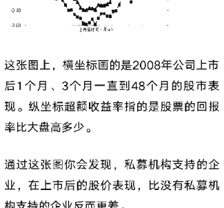
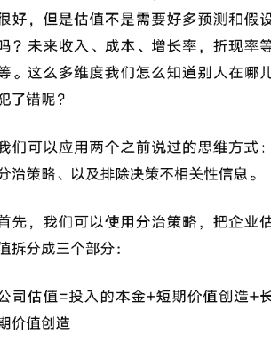
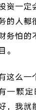
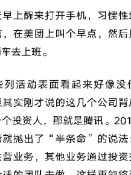
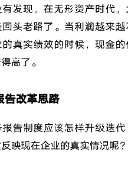

# 贾宁财务思维课


## 发刊词 | 从此成为一个懂财务的人


你好，我是雾宁，欢迎加入我的《财务思维课》。

这个世界上所有的事物，只要它在运行、这个概念不是隐藏起来的，而是在对外发送信息，区别只是它们用了不同的语言。

心电图是心脏的语言，微表情是情绪的语言。

财务报表就是地球上所有公司对内和对外沟通的通用语言。

财务报表反映了公司经营的状况，反映了公司战略的意图，反映了公司价值的未来。同时，它也隐藏了公司所有的雄心勃勃和企图、隐藏着所有的理念和选择，也隐藏着花招和欺骗。

遗憾的是，财务语言就像天书，它只流通在少数人中间，大部分人对它是又爱又恨。

我愿意去改变这一点。因为我找到了那把通向财务的钥匙。

它就是：财务思维。

### 这个世界一直在奖励有财务思维的人

《财务总览》杂志调查发现，全球财富100强企业中，55%的CEO都有财务背景，其中23%的CEO还持有会计证。

- 石油大亨洛克菲勒，是从记账员开始做起的；
- 顶级服装设计师皮尔·卡丹，毕业后的第一份工作就是会计；
- 美国几位前总统林肯、华盛顿、杰斐逊，都亲自记过账，做过会计工作；
- 澳门前任行政长官何厚铧，获得过注册会计师专业资格；
- 耐克创始人菲尔·奈特，曾经是美国波特兰州立大学的会计学教授；
- 阿里巴巴的支付宝张勇、蚂蚁金融的CEO井贤栋，都是财务出身。

一个有财务思维的员工，才能判断他持有的公司期权，未来能不能让他实现财务自由。

一个有财务思维的投资者，才能判断那家公司的未来还值得投资。

一个有财务思维的经理，才能了解合作伙伴的经营情况，判断未来合作的稳定性。

现在的商业社会，复杂度大多过以往。

## 01 公司能装进财务报表里吗？

你好，我是郭尹，欢迎来到我的《财务思维课》。

提到财务报表，你自然会想到会计和财务报表。那它们之间是什么关系呢？

简单说，财务报表就是一张公司的体检表，会计人员就是抽血、检测，把公司的各项经营活动量化、记录，制成报表的人。

你想想看，为什么体检后，还要拿着体检报告看医生诊断？因为体检表上只有数字，背后的因果关系，我们是需要听医生的意见。

财务思维就是根据体检结果，做健康判断和决策的能力。

如果想做出正确的决策，首先你得看得懂健康检查表的结果。高手不仅看得懂，还要知道体检表里可能存在的局限。

财务报表也是一样。如果你想做出正确的财务决策，就得理解公司哪些经营情况能在这张表中反映出来，哪些是报表中看不到的。

### 财务报表最重要的三张表

我们先来看，每家公司都必须编制、要发布的三张表是什么样的。

第一张表（图一）是资产负债表，反映的是在某一特定时点上企业的财务状况，主要回答的问题有，资产、负债、所有者权益各有多少，结构分布是怎样的，企业有多少能力去承担风险。

| 资产 | 期末余额 | 期初余额 | 负债和所有者权益 | 期末余额 | 期初余额 |
| :--- | :--- | :--- | :--- | :--- | :--- |

第二张表（图二）是利润表，又叫收入表。从上到下分为三个部分，最上面的部分是企业收入，中间部分是成本费用，最下面的部分是净利润，主要回答的问题是企业的赚钱能力如何，利润水平高不高。

| 项目 | 本年金额 | 上年金额 |
| :--- | :--- | :--- |
| 一、营业收入 | 10,256,946.31 | 8,254,434.72 |
| 减：营业成本 | 6,105,472.48 | 5,137,448.83 |

第三张表（图三）是现金流量表，反映的是企业一定时期内现金流入和流出的基本情况。这张表主要回答的问题就是企业现金流动的方向、来源和去向，企业资金链是否健康。

| 项目 | 本年金额 | 上年金额 |
| :--- | :--- | :--- |
| 一、经营活动产生的现金流量：销售商品、提供劳务收到的现金 | 8,225,497.04 | |

但问题是，你的时间和精力都是有限的，不可能亲自去走访市场上每一家企业吧。

如果企业能通过一种方法，给你总结和展示自己的经营情况，你不就可以很快判断出这家公司的好坏了吗？

这个方法，就是提供一套财务报表。

### 真实性是第一原则

听到这里，你可能会说，那财务报表也得没有水分，也就是没有造假，才能真正反映企业的情况啊。

你说得对，事实上，财务报告的首要原则，就是真实性原则。

早在1939年，会计学界的元老麦克尼尼就首先提出了“真实性原则”。会计学界的另外一位元老斯科特也曾经明确提出，“财务报告应该毫无虚假地、真实地描述”。

没错，但“真实”不代表“全部”。因为财务报表是根据一套统一规则编制的，也就是我们说的会计准则，而任何准则都有局限性。一家企业真的能被完整装进财务报表里吗？事实上，这是做不到的。

比如资产。你肯定知道，高科技企业最有价值的资源，不是厂房设备，而是技术、研发、人才这些无形资产。这些无形资产，由于无法精准量化，所以会计准则就不允许它出现在财务报表中。

再比如负债。公司租用设备，需要定期交租金，所以租赁其实是企业的债务。但是会计准则规定，如果租期短，就不要求企业在报表中把这个债务报告出来。可是，不在报表中出现，就说明这个债务没风险吗？事实上，2008年全球金融危机，一大批公司就是死在了没有要求列在报表中的债务上。

你看，有些重要信息你可能从报表上看不到。

此外，即使你看到了重要信息，如果你不懂财务，也看不出数字表象背后，企业的真实意图。

举个例子，你就明白了：

如果一些公司的报表中报告了正的利润，你可能会以为公司经营情况很好。比如上市公司高伟达，2016年报出了2310万利润，股民欢欣鼓舞。但懂财务的人都能看出，它的利润来源，可不是来自主营业务，而是因为卖了一处北京的房产，这其实隐藏着巨大风险。除了高伟达，2016年有一大批公司都是通过出售房产提高利润的，甚至还能扭亏为盈。

最后我想说：

如果财务报表是一个电脑游戏，我不是要教你写代码，而是直接带你进入游戏体验。

如果财务报表是一张体检表，我不是教你抽血验血的技术，而是直接带你做出健康诊断。

在第一模块中，我的目标不是给你讲复杂晦涩的会计准则，而是既带你看报表里的全部信息，又看到报表之外的隐藏信息。

### 课堂小结

第一，财务报表的价值是什么？它对内是管理和决策的工具，对外是商业沟通的通用语言。

第二，如何看待财务报表？因为会计准则的局限性，财务报表不能真实反映企业经营的全部情况。

### 课后思考

有人说，在互联网和新经济时代，企业无形资产越来越重要，这些资产目前无法体现在财务报表里，所以，财务报表变得越来越没用了。你同意这个观点吗？

我会在课程的最后专门讨论这个问题，在这之前，我想先听听你的想法，你也可以看看，学完这门课你的想法会不会改变。

欢迎你给我留言。

如果你觉得有收获，也欢迎你把《财务思维课》分享给你的朋友。我们下节课见。


## 02 | 资产边界：属于你的就是资产吗？

你好，我是贾宁，欢迎来到我的《财务思维课》。

上一讲我们提到，企业财报各包括三张重要的表：资产负债表、损益表、现金流量表。

今天我们要主讲资产负债表，一般的会计课，这时候就开始告诉你怎么做编制报表了。但这一讲，我不教做表，而是帮你站在财务高手的角度，去着手财务思维，如何理解资产。

为什么我们先来讲资产呢？因为在资产负债表上，资产占了整整一半，可见它是多重要。

你得知道，企业经营每天都在花钱。一般我们认为，花钱买的那些看得见摸得着的东西，比如设备、办公桌椅就是资产，看不见的，水电费、工资，这些都是使用费。

但真是这样吗？

### 一、什么是资产？

我来问你一个故事。假如一家面馆接了一个大订单，为买一批模具花了30万来买这些模具，面馆做了半年后，剩下的30万就是模具。问题是：这30万模具是资产还是使用费？

你可能会说，这些模具是现金白银换购的，当然是面馆的资产。

但是如果你问起懂会计和财务的高管或者专业人士，他们的回答可能截然相反：这些模具不是资产，而是费用。

稻盛和夫一生创办了2家世界500强企业，他在经营两家企业的时候，都是按类似方法，资产的费用，在早期阶段就是按营业利润。但是稻盛和夫从来没有把剩余模具作为资产，而是作为费用从公司的账上抹除了。

他这么处理的原因是什么呢？

很简单，因为这些模具是给客户定做的，别人用不上，如果以后客户不来了，这些模具就失去价值。也就是说，这些模具虽然花的是钱，但是是“使用费”，只是用来换取未来给公司带来效益的，是费用，而不是资产。

你听出来稻盛和夫对资产的标准了吗？标准其实只有一句话：那些未来能够为公司带来收益，且能给公司带来更多效益的资产，才是真正的资产。

你可能会问，如果把这30万剩余模具认定为费用，对面馆会有什么影响呢？

首先，把它当作使用费，当期利润就会减少，面馆会交更少的税。但面馆老板就会拿到更多的现金流，去投入新的项目，面馆就有机会变得更大，面馆资产就增加了。这30万就起到了资产的作用。

所以你看，资产认定这件事太重要了。

我们上面讲到，由于会计准则的局限性，会导致财务报表上的资产和企业实际持有的资产完全对不上。会计上认为资产是真实的，而角度却会有着很大的差异，资产的定义上仍有很多误区，下面我们来仔细说说。

### 二、研发支出是资产还是使用费？

在互联网时代，会计处理上最有争议的恐怕就是研发支出了。

根据咱们国家统一的会计准则，研发投入是当成使用费来处理的。

为什么呢？因为研发的失败率太高了，未来能不能产生效益非常不确定。

但是在我们理想中，如果把研发投入当成使用费，对企业资产产生什么影响呢？

你说的很对。

拿我工作的清华大学为例，如果你去看清华的财务报表，会发现主要资产有教学楼、宿舍、还有很多食堂。清华的万人大食堂特别有名，里面有你能想到的各种菜系，有机会一定要来尝尝。不过，清华是靠食堂吸引到全国的高考状元吗？要真是这样，中国最热门的学校应该是“新东方烹饪学校”。

那是什么起作用了呢？是清华的牌子。

“清华大学”这四个字，往那儿一放，不用做任何招生宣传，大家就来报考了。

所以，“清华大学”这四个字值钱吗？值钱。那在清华财务报表的“资产”一栏里能看到吗？看不到。

为什么？

答案就在于，“清华大学”这个有声望的品牌虽然符合资产的条件，但问题是，它的价值无法量化。没人能算出这四个字究竟能产生多少收益。

不能量化的资源，会计准则目前就不允许它出现在报表中。

所以，企业最值钱的资源，不一定会出现在财务报表里。

你知道世界上最值钱的饮料品牌是哪个吗？可口可乐。这品牌值钱到什么程度呢？可口可乐公司的创始人曾经说过，假如有一天公司所有厂房设备突然化为灰烬，只要他还拥有“可口可乐”这个品牌，半年后就能复制一个与现在规模一样的可口可乐公司。

但是，可口可乐的品牌价值，也没有反映在公司报表里。

但是作为投资者，如果你不知道可口可乐还有这么值钱的“表外”资产，会怎样呢？

你会严重低估这个公司的价值。假设有一家或可口可乐一模一样的公司，但没有任何品牌资源。从报表上看起来，这两家公司的价值都一样，但是，由于品牌资产能够在未来给可口可乐带来更高的收入和利润，因此未来可口可乐的价值一定更高。

如果你投资了另外那家公司，那岂不是亏大了。

### 课堂小结

财务高手看待资产的方式主要有以下两点：第一点，只有能在未来产生收益的经济资源，才是资产。第二点，企业所拥有的资源，远远大于财务报表中记录的资产。这其实是财务报告现在面临的一个挑战，那就是怎么量化和表征企业的无形资产。关于这一话题，我以后会专门讲到。

### 课后思考

请你举一些例子：哪些你认为的个人资产，其实是费用？哪些你认为的费用，其实是资产？

欢迎你给我留言，我们下节课再见。


## 03 | 负债经营：高负债等于高风险吗？

你好，我是贾宁，欢迎来到我的《财务思维课》。

上一讲，我们讨论的是财务高手如何看待资产负债表中资产。这一讲我们就来讲财务高手是如何看待负债的。

什么是负债？负债就是欠了别人钱，将来必须要还，这是义务。公司负债经营，是非常普遍的现象。中国上市公司当中，没有一家是无负债的。

在财务上，我们用资产负债率来衡量公司的负债水平。负债率是公司的负债总额与资产总额的比值。比如一家公司的债务400万，而公司资产有1000万，那么这家公司的负债率就是40%。

根据研究，中国上市公司 的平均资产负债率在42%左右。欠债率低于这个比例，借钱给你的债权人会对你很放心，投资你的投资者会对很有信心。高于这个比例，公司破产风险就会大得提高。

这样看来，负债率是公司经营的风险指示器。公司的负债率如果高于别人，那这就是一家高风险公司。

但真的是这样吗？我先给你讲个亲身经历。

几年前我表妹去找工作，来咨询我的建议。她夹在两家公司之间犹豫不决，一家是房地产公司，一家是互联网科技公司。她倾向于去互联网科技公司，因为根据打听，房地产公司的负债率有63%，互联网科技公司的负债率只有40%。

我知道她为什么会这么做。因为我告诉过她，资产负债率平均水平是42%，表妹就用这个作为标准，选了负债率更低的互联网公司。

我表妹她说，你只知其一不知其二，犯了三个财务方面的认知错误，所以这个选择是错误的。

这个认知错误是什么？现在我们细说吧。

### 一、负债率不能跨行业比较

我表妹犯的 第一个错误，是把一家房地产公司和一家高科技公司的负债率放在一起比较了。

你问，梅西和姚明谁更厉害？

你可能会说，很难判断，因为他们做的不是同一项运动。

例如拿梅西的篮球技术和姚明的比，这对姚明公平吗？

肯定不公平。

像我表妹那样，把处在不同行业的两家公司放在一起比较负债率，也是不公平的。

房地产是个什么样的行业？资金密集型行业。我们都知道，盖一套房子需要好几年，从买土地，购买砖水泥到支付建筑工人的工资，房地产企业需要不断进钱。

地产公司没这么多钱，怎么办？向银行借。所以地产公司资产负债率普遍偏高。

相反，互联网是个什么样的行业？轻资产产业。因为互联网既不需要房子，也不盖房子，也没那么大资金需求。再加上它也可以靠什么来抵扣银行的实物资产，以整体资产负债率能低很多。

所以，地产公司和互联网公司，由于经营性质不同，他们的财务报表是没有放在一起的。

根据统计，资产负债率确实有明显的行业差异。金融、房地产和建筑这三个行业的负债率最高，达到70%以上。食品饮料、化妆和医药制造这三个行业的负债率低，在40%以下。

所以财务报表分析的一个重要原则，就是财务数据不能跨行业比较，这点你一定要记住。

那你可能会问，那才才是对的呢？

正确的方法是和同行业中的其他公司比较。

咱们看看地产公司和互联网公司各自平均负债率是多少？2013年中国上市公司中的平均负债率是63%，互联网公司是30%。

这么一比，我表妹所在那家房产的负债率比行业还低3%，而那家互联网公司却比同行高了17%。

反而是互联网公司的相对负债率更高了。

我们强调一下，我表妹犯的 第一个错误，就是处在不同行业的两家企业的负债率放在一起比较，这样得到的结论，一定是错的。

### 二、高负债不代表高偿债风险

我们再来说说我表妹的 第二个认知错误，就是以高负债等于高偿债风险。

咱们先看看，中国企业的平均负债率是42%。而地产行业的负债率都在70%左右甚至更高，难道地产企业就面临更高的债务风险吗？

其实不是。

因为要判断某种负债是不是高风险负债，你需要先知道这个负债的性质是什么。

如果你仔细查看地产企业的资产负债率，就会发现其中有一个叫“预售房款”的债务。

你想买房是怎样一个过程：我们跟房地产开发商，房子建造之后开发商再拿房子交付你。那预售房交付之前，房地产公司已经收了房款，但还欠着你房子，所以你在账面上你缴的预付款就成了房产公司的负债。

这种负债的增加，代表地产公司风险高吗？

咱们先梳理一下“风险”这个词。我查了一下这个词的词源，说是在远古时代，造船每次远航都祈祷神灵保佑自己都能平安回家，这个意思的“风险”就派“风”、“险”的意味。 “风”意味着 “险”，因此有了“风险”这个词。

是一个道理。

另有一种是用供应商的钱。比如京东、苏宁、格力这些企业。他们是怎么做的呢？京东卖东西都是马上收钱的，对吧，比如今天卖给你100块钱书，你得马上给京东100块钱。但是京东在拿到你的钱之后会马上把30块钱的货款给供货商吗？不会。通常京东会押款，少则几个月，多则一年。

这么一来，原本不属于京东的那30块钱就能在京东的报表上多待一年，不但让京东的现金流更好看，而且京东还能用这30块钱赚利息。

其实生活中，我们也可以借鉴这个方法赚钱。假如现在你有个好的投资机会，投资100万能获利20万。你说我没这么多钱啊。没关系，你可以向银行贷款啊，这样即便利息10万，除去利息你还能净赚10万。

这就是用银行的钱赚自己的钱。

所以，财务高手在基于企业负债水平判断风险时，首先会去了解负债的性质是什么。

负债可以分为两种。

第一种是由于经营方式产生的负债。比如OPM模式，这种负债其实不可怕，也没有利息压力，财务高手在评估风险的时候最关注的不是这些债务。

第二种是金融性负债。就是企业需要偿还利息和本金这种性质的债务。这种债务越多，这家公司的财务风险就会越高。遇到这种负债你一定要当心。

### 三、风险要通盘看

我表妹还犯了第三个认知错误，那就是评估风险只看了负债。

除了负债，还有很多其他因素会导致一家公司破产。比如，即便一家公司资产负债率低，但是如果现金流管理不善，资金链断裂，一样会破产。或者，一家公司产品没有核心竞争力，也会被其他公司打垮。

所以企业风险不是仅由负债决定的，需要通盘来评估。

### 课堂小结

在管理者的眼中，看待负债时主要考虑三点：第一点，负债率和其他财务指标都不能跨行业比较。第二点，负债性质决定负债风险。经营性负债属于低风险负债，金融性负债属于高风险负债。第三点，企业风险要通盘看，不能只看负债率。

### 课后思考

你能找到一家使用OPM这个模式的上市公司吗？请你计算一下它的资产负债率是多少？你认为它的真实风险有多高？

欢迎你给我留言，我们下节课再见。


## 04 | 利润革命：近似的正确好过精确的错误

你好，我是贾宁，欢迎来到我的《财务思维课》。

在“资产边界”那一讲中，我们说企业拥有资产是为了用这些资产赚钱，这一讲我们就说说这俩概念：钱，对应的是财务报表第二张报表：损益表。

听到这儿，你可能会很疑惑，怎么能有人连什么是赚钱都不知道呢？

但是事实上，每次我在清华给高管上课，都会先问大家这个问题，并不是每个大高管都能答对。这些天我思考着该用精解，高管都可能不一定能答对，所以这个问题，这么说简单。

同样的问题现在我也想问问你。假设你有1万元可以投资，你把钱投资给麦当劳，麦当劳用能用这些钱挣到1000块的利润。如果你投给肯德基，能挣到1500块的利润。请问，麦当劳到底赚钱吗？

我猜你会说，不是赚了1000块钱吗？

但是如果问你一个财务高手，他会说，麦当劳不但没有给你赚钱，还给你亏了500块！

### 一、利润革命与价值创造

麦当劳这个例子，其实代表着财务界对于“什么是赚钱”这个问题的一场思想革命。

麦当劳赚的1000块钱，是我们通常熟悉的会计利润，也就是我们在损益表中看到的利润数字。

会计利润是怎么算的呢？

就是收入减去所有看得见的成本。比如麦当劳卖一个汉堡15块钱，做这个汉堡要的牛肉、芝士这些配料，有这些餐要等这些成本一共10块钱，那么麦当劳在这个汉堡上的会计利润就是5块钱。

这样衡量利润有什么问题？

这个利润衡量了盈利水平，却不能衡量盈利性。因为对于盈利性而言的一个重要指标，那么就是资金的机会成本。

一般来说，每个人的投资选择不会只有一个。当你决定投资一个项目的时候，其实你放弃了其他项目可能给你的收益。

回到开头举出来的例子，你选择投资麦当劳的时候，你实际上放弃了投资肯德基赚1500块的机会。

所以要判断麦当劳是不是真的给你赚钱了，得把麦当劳赚的1000块与1500块对比。只有真正当你赚了钱，或者替你创造了价值。

会计利润的最大问题，就是没有考虑资金运用的机会成本。会计利润是谁和谁比的呢？和“零”这个基准比，只要大于零，会计利润认为就是在给股东创造价值。

正确的比较“基准线”，应该投资者在其他类似项目上能够获得的收益，也就是把该投资项的机会成本。

### 二、什么是资金的机会成本？

意识到这点后，会计界就开启了一场利润革命，开始用一个叫“经济利润”的概念来衡量什么是赚钱。

经济利润 = 会计利润 - 资金的机会成本

“机会成本”这个概念，腾先生老师也曾经提到过，就是当你做某个决策时，所放弃其他选择中价值最高的那个。

不过有一点他没有讲，机会成本是会变化的。同一种资源在某个情况是机会成本，在另一个情况下就变成机会成本了。

我在中餐馆时经常去一家烧烤店。这家店卖一种牛肉饼和一碟辣酱。太多了，就卖到牛肉饼是每天一定的，而辣酱是“限量”，不是每天都供应的。

很老熟客才知道，这家店每天要预备新鲜烤制多少牛肉饼肉。如果估计偏高导致烤的牛肉过多，卖不掉的怎么办，就把烤肉用来拌汤酱。

我问那，烤店的计算辣酱的成本时，应该包括这些用来拌辣酱的烤肉吗？

答案是，不应该包括，因为这些牛肉已经烂掉了，如果不用来拌辣酱，也要扔掉。借用蔡老师的“沉没成本不是成本”。

那我再问你，假如牛肉饼的销量超过预期，但这烤店来烤牛肉饼，这些牛肉算什么机会成本？

这时候，这些牛肉就变成了机会成本。应该算入辣酱的成本中，因为这些牛肉本应用于制作牛肉饼的。

所以你看，什么是机会成本，有时候并不清楚。

确实当中，一家企业资金的机会成本也是很难准。我们知道机会成本是投资人的资金的机会成本是多少？难道每个投资者都有机会投资肯德基吗？

在这种情况下，我们应不应该考虑资金的机会成本呢？

巴菲特则话一句我很欣赏，他说，“近似的正确好过精确的错误”。

这也是财务发展的一个思维，小进步代替大进步。尽程度上还不可能精，但是大家已经意识到“经济利润”在衡量价值的途上，仍然是比“会计利润”更好的指标。

事实上，可口可乐、IBM这些世界500强企业早就转向了用经济利润来考核管理层。

咱们国家央企从2006年以后也做了这个转型。

你可能会问，会计利润和经济利润计算出来的数字差别大吗？——非常大。

我给你举个例子。

美国最大的能源公司安然，在金融危机中，所有的问题都集中爆发了这个公司身上。

1999年和2000年的会计利润分别是9亿和10亿美元。在2000年年报说，“公司的净利润在2000年创历史新高，并且盈利能力有望继续提高。”

但是如果你计算一下安然那两年的经济利润，会发现像媒体就这么诟责它那么好，事实上，1999年和2000年的经济利润都是负的。1999年是-3.3亿，2000年是-6.5亿。

结果到2001年，安然就宣布破产了。

当然安然的破产是一个非常复杂的问题，为了让你更直观地感受会计利润和经济利润的差别之大，我从这个角度了。

安然的会计利润和经济利润为什么会有这么大差异呢？

其实从1999年开始，安然的营业就已经出危机了。公司股东不断收到，股东回报为了保证会计利润不降低，安然就降低资本投入，把很多低回报项目，包括非常项目和资产。这些项目的回报率非常低，甚至比银行贷款的利率还低，所以在表面上看来像是个股东创造了利润，但是实际上是在挥霍股东的钱，导致了经济利润，最终导致破产。

### 三、铁路时代和会计旧

“近似的正确好过精确的错误”这个思维方式，其实是财务中的很多地方都能得到体现。

我想跟你说说美国第一条横穿大陆的铁路工程。这个故事第7条，我上次在之前也提到，因为现代财务所有的理论和智慧，都在这个项目里面了。

在没有这笔资金时候，如果想从顿堡到，只能坐15天地的慢车，或者从芝加哥到。无论哪种方式，都要好几周时间，耗费上千美元。

到了18世纪60年代，美国的技术有了飞跃的发展，当时出现了两条铁路公司，太平洋铁路公司和中央太平洋铁路公司，准备修建第一条横美国大陆的铁路。

这条铁路建设投资高达42亿美元，消费了当年40%的美国经济产出。

两家铁路公司靠投资支重不了这么庞大的费用。那么怎么办？


## 04 | 铁路工程：现代会计的诞生（续）

铁路公司的固定资产特别多，比如火车、铁轨，这些都属于固定资产。

日复一日的货物运输，会导致火车和铁轨出现严重磨损，逐渐失去运输能力。

你回忆一下我们是怎么界定资产的？就是未来能否给企业带来收益。

固定资产损耗的部分未来显然是不能继续产生收益的，所以这部分就不再是铁路公司的资产了，而是应该当成费用，从当期利润中扣除。

如果完全不考虑火车和铁轨的损耗，会怎么样呢？

那就会高估了铁路公司未来的运力。比如说，铁路公司未来实际只有50%的运力，结果财务上没有体现出来，投资者看到的还是100%的运力，那未来的实际利润肯定会低于投资者预期，铁路公司未来的日子肯定不好过。

所以铁路公司的会计师们说，我们必须想办法在报表中反映出这部分损耗。

这个思路没有人反对。虽然工程师能算出火车和铁轨总共能使用多少年，但问题是，我们怎么知道运输过程中的损耗是什么时候发生的？这个损耗对应的费用应该是今天扣除呢？还是下个月扣除呢？

这时候，会计师们就使用了“近似的正确优于精确的错误”这个思想。

他们是这样做的：假设每天的损耗是一样的，预估火车的使用年限，然后用火车的价格除以预计使用天数，就是每天的折旧费用。

虽然实际上，火车由于每天搭载的货物不同，行驶的路段路况不同，损耗肯定是不一样的。但是用一个合理方法，能近似正确地估计损耗，比完全不考虑这个问题显然还是更接近铁路公司真实的经营情况。

自此，就产生了利润表上另外一个重要的会计科目，固定资产折旧。

### 课堂小结

今天我们讲了一个会计界发生的重大思维转变，那就是从“会计利润”到“经济利润”的转变。为什么会有这个转变？

因为“经济利润”比“会计利润”更能反映企业的真实经营水平和价值创造能力。另外，请你记住这句话——“近似的正确优于精确的错误”。

### 课后思考

- 你所在的行业，有没有什么项目已经用到了“近似的正确优于精确的错误”这个思维方式呢？
- 或者有什么项目可以利用这个思维方式做得更好呢？能举出一个具体的例子吗？

欢迎你给我留言，我们下节课再见。


## 05 | 利润质量：可持续利润最可贵

你好，我是贾宁，欢迎来到我的《财务思维课》。

上一讲我们说了，判断一家企业是不是真的能赚到利润，不能看报表当中的“会计利润”，而是要看“经济利润”。

今天我们要继续讲利润，因为无论经济利润还是会计利润，说的都是利润大小的问题。

但这是观察利润的一个角度，也是一般人会看的那个角度。

财务高手是怎么观察利润的呢？他们会从多个角度分析。除了利润大小之外，他们还会看另外两个重要角度，那就是利润的“可持续性”。

一家公司能不能持续盈利，从投资角度来说特别重要。

因为你投资一家公司的时候，投资的不是它的过去，也不是它的现在，而是它的未来。

虽然利润大小决定了一家企业短期能达到的高度，但是能决定这家公司有没有未来的，是利润的“可持续性”。

可持续性对企业估值特别重要。你看所有的估值模型，都有一个基本假设，那就是公司能持续经营下去。

同等条件下，利润可持续性高的公司，估值也更高。

不过，企业保持利润长期的稳定和增长并不是一件非常简单的事情。根据统计，美股上市的公司当中，有48%的企业能保持1年的利润增长，然而只有23%的企业能保持3年连续利润增长，能保持10年以上连续利润增长的企业占比为0.9%。

所以你看，可持续的利润多么珍贵。

今天我们就来讨论如何考察一家企业的利润是否具有“可持续性”。听完这讲，你才算是全面了解了利润这个概念。

### 一、盈利可持续性

我们先来讨论一个案例。

假设你有两家卖牙膏的公司，去年都赚了1000万。一家公司中，700万是辛苦卖牙膏赚出来的，另外300万是投资麦芽赚来的。另外一家公司，特别擅长投资，靠投资赚了700万，这是去年牙膏业务不好干，不但没赚钱，还亏了很多万，但投资业务赚了2000万，去年也赚了1000万。

你会买哪家公司的股票呢？

我觉得你可能会犹豫，毕竟这两家公司好像各有特长，一家擅长投资，一家擅长卖货。

但是财务高手会告诉你，一定不要投资第2家公司。

这第2家公司是谁呢？背后其实有个原型。

这家公司就是曾经的中国牙膏“第一股”，两面针牙膏。

你可能听过这个品牌，两面针当年是非常知名的一家企业，曾经研发出中国第一支中药牙膏，和中华、黑人、一起被大家称为国产牙膏的“三大金刚”。

你知道2004年两面针一共卖了多少支牙膏吗？5.2亿支。

这是什么概念呢？2004年中国有13亿人，除去5亿支牙膏，平均每个2.6个人当中，就有一个人用两面针的牙膏。

当时品牌势头很猛，可谓好景不长，到2006年前后，佳洁士，高露洁这些国际品牌开始进攻中国市场，再加上管理老化，两面针牙膏的销量开始大幅下滑。

一般股民或公司会怎么应对呢？加强营销或者研发新产品。但是两面针是这么做的呢？公司很神奇，不但没有重视牙膏销量下滑这个问题，反而开始其它业务，同时开始大量买入其他公司的股票。

两面针的财务逻辑是，想办法从其他行业赚钱，用来补足牙膏主业亏损。

这个策略成功了吗？

两面针的运气确实很不错，成功参股了中信证券，在中信股票上赚翻了一大笔钱。

如果你去看两面针2016年的财务报告，就会发现2016年两面针卖了11.62万股中信证券的股票，赚了1.57个亿。另外还被中石油、广西广济银行、国信银行这些股票中拿到了近4千万分红收益。

那么两面针在牙膏，日化产品这些主营业务上赚了多少钱呢？2016年主营业务利润是-2111万，也就是说，主营业务是亏损的。2016年两面针卖了1.42亿支牙膏，比2004年的5.2亿支，只有不到30%。

看起来两面针还赚钱，你可能还认为只要经营得当就好。

但是如果你仔细看两面针的利润结构，它向释放了什么信息呢？两面针的主营其实已经出现衰态，公司在靠投资这个副业支撑利润。

你可能会说，不怎么样，两面针不是赚到钱了吗？这种赚钱方式有什么问题？

我想反过来问你一个问题，等两面针把手上的中信股票都卖完之后，怎么办？

靠炒股这个副业获得的利润，虽然看起来和牙膏主业上赚来的利润是一样的，但实际上，这个利润是不可持续的。

什么事情做成一次不难，难的是能持续做下去。

你知道为什么巴菲特被称为股神吗？是因为他能获得超高的投资收益率？事实上，他的年化投资收益率远不如很多小的基金经理。

但是，只有他能做到连续多年超过大盘，哪怕是在宏观经济非常糟糕的时候。

为什么我们会认为梅西是足球明星？是因为他某一场比赛踢得特别好吗？事实上，可能你偶尔比他进更多。

但是，只有梅西能持续在国际足坛比赛中进球。

做企业也一样，企业一次盈利不难，难得是保持长期盈利，持续增长。还记得我们的统计数据吗？只有不到1%的企业，能保持10年以上连续利润增长。

我之前讲财报分析，对财务数据要关注面临的一些最新问题。其中一个新要求下面统称“持续盈利”这个概念，从2017年起，上海市就会在财务报告中新增披露一个叫“持续贡献净利润”的指标，用于反映持续经营部分的收益。

### 二、基于利润可持续性的套利机会

我们开头说，判断企业利润是否具有“可持续性”，对投资者来说非常重要。

事实上，如果你利用可持续性作为标准来选股，是可以赚到的。

你可能会觉得，这个原则也太简单了吧，真的能用吗？

Steve Penman和Karl Schiller两位大学教授对这个命题做了一个研究。他们把美股公司按照盈利可持续性水平分10组，买入可持续盈利最高的那些公司，同时做空可持续盈利最低的那些，结果在1997-2016年这20年中，都赚了钱，而且大部分年份的投资收益率都超过了10%。

所以你看，市场最尊重的是财务高手，大部分投资人士并不是明白利润可持续性的重要性。

所以只要你比别人多那么一点财务思维，对财务数据看的更深刻一些，就能赚到钱。

### 三、盈利能力分析框架

那财务高手是用什么方法来评估一家公司的利润当中有多少是可持续的呢？

现在我教你一个常用的分析工具（下图）。


**盈利能力分析框架**

| | 经常性的 | 非常规性的 |
|---|---|---|
| 主要的利润 | 比如：靠产品的销售利润 | 比如：靠产品的销售利润 |
| 次要的利润 | 比如：用现金产生的利息收入 | 比如：火灾赔偿等收入 |

这个框架由两个维度（主次和经常性），一共四个格子（橘色部分）组成。你需要做的，就是把公司利润拆分，分别放到这四个格子里。你最需要关注的格子，是左上角那一栏：“主要的、经常性的利润”。

我用耐克举个例子：

- 耐克主要、经常性的利润，就是耐克靠主营产品获得的利润，比如耐克运动鞋和服装。这部分就是投资人最关心的利润。
- 耐克主要、非经常性的利润，就是耐克时不常推出的那些限量版，以及跟设计师的合作款，这些利润是不经常发生的。
- 耐克赚了钱，会有一些现金，它把这些现金存在银行，挣到的利息就是次要的、经常性的利润。
- 另外，还有一些极端情况，比如耐克的厂房着火了，耐克获得了保险公司的理赔，这部分理赔收入就是次要的、非经常性的利润。这部分利润是投资人最不关心的。

现在，你就可以把你关心的公司，放进这个表格进来判断它的盈利能力了。

### 课堂小结

在管理者的眼中，看待利润的方式有两点：

1. 观察利润有多元视角。除了考察利润大小，还要考察利润的可持续性。
2. 利润可持续性高的企业具有投资价值。

另外，你可以使用“盈利能力分析框架”来判断一家企业的利润可持续性。

### 课后思考

科大讯飞公司曾经受到过一个争议：

央视质疑科大讯飞是以高科技的名义到地方圈地，表面是高科技行业，其实搞的是房地产。质疑出来后，科大讯飞立即回应说，公司成立至今，一直在专注主营业务，没有一分钱的收入是来自房地产开发和销售。

基于这个情况，你能从财务角度分析一下过去几年科大讯飞的利润情况吗？你觉得科大讯飞的利润可持续吗？

## 06 | 现金水平：手里的钱是越多越好吗？

你好，我是贾宁，欢迎来到我的《财务思维课》。

之前两讲我们说了财务高手怎么看得到利润。我们关心利润，根本上关心的是这家企业的未来。

但是利润有一个不能解决的问题，那就是企业当下的生存问题。

那么哪天关注的是生存问题？就是现金流水平，这就是接下来两讲我们重点讨论的内容。

有研究发现，在上上个世纪90年代，每4家有破产的企业中，有3家是盈利的，只有1家是亏损的。

是的，你没有听错，盈利的公司也会破产。

一个很有意思的调查发现，一家公司的CEO更关心的是企业发展问题，但是CFO更多关心的却是企业生死问题。事实上，财务学的第一个重大实证研究，就是关于如何应用财务数据预测企业未来的破产概率的。

1968年，会计学界的鼻祖之一William Beaver发表了一篇重要论文，叫《用财务比率预测上市公司公司》(Financial Ratios as Predictors of Failure)。他发现，现金持有水平是最重要的一个财务特征中，预测破产风险最有一个的指标。

所以企业破产，不是因为一个没有利润，而是因为没有了现金。

你看，关乎企业生死存亡的事情，不能不重要。

所以今天，咱们就说说企业应该持有多少现金这个问题。

### 现金与利润的关系

你可能还觉得很不明白，为什么盈利的公司也会破产呢？

我给你解释一下利润和现金之间的关系，你就明白了。

还记得文章第一条横跨大陆的铁路工程吧。咱们说过，现代财务所有的智慧，都体现在这个项目里面了。

铁路公司刚开始经营的时候，有些客户给铁路付款的，完活地合同多了，有些客户就开始要求延期支付运费了。

上个月有客户运了一大批发票，运费是2万元，运输已经完成了，但是运费还没给铁路公司。

假设运输成本是5000元，那么这时候铁路公司的账面利润会增加1.5万元，但是现金呢？铁路公司还没收到一分钱，因此没有任何增加。

业就是安全的。

### 课堂小结

在管理者的眼中，看待现金的方式有两点：

1. 企业靠利润发展，但是靠现金流生存。
2. 企业现金并不是越多越好。现金持有水平是平衡了资金风险和使用效率之后的结果。

### 课后思考

你认为什么样商业模式不用为现金流焦虑？请你举个例子。

欢迎你给我留言，我们下节课再见。


## 07 | 现金结构：现金为负，为何还能上市？

你好，我是贾宁，欢迎来到我的《财务思维课》。

上一讲我们讨论了公司需要多少现金的问题。企业需要一些现金来维持日常经营和偿还短期债务，但是过度持有现金并不好。

但现金多少只是观察现金的一个角度。

财务高手是怎么观察现金的呢？他们还会考察另外一个重要维度——现金结构。

如果你看一家公司的现金流量表，会发现现金被分成了三类：经营活动现金流、筹资活动现金流、投资活动现金流。

- 经营活动现金流，是企业通过经营活动自己产生的现金流，比如卖产品，进行一些销售活动的产生的现金流。如果你的企业内流动的现金就像现金流在人体内流动一样，那么经营活动现金流就是企业的自我“造血功能”。
- 筹资活动产生的现金流是靠外部融资带来的，比如企业申请的银行贷款，就放在这部分现金流里面，这相当于外部都在给企业“输血”。
- 公司投资产生的现金支出，或者先前收益，就会被归类到投资活动现金流里，这就相当于企业在“放血”。

这三类现金流中，哪一类最重要呢？

你可能会说，经营活动现金流最重要。如果经营活动现金流为负，说明公司自己没有造血功能，这种公司太糟糕了，肯定很快就要完蛋了。

但真的是这样吗？

### 经营活动现金流为负，不要过度紧张

如果你关注上市IPO手册，就会发现，几家上市的上市公司中，不全是连续几年经营活动现金流为负的。

比如蓝数科技，这家公司是给银行做IT服务的。她2017年6月在股上市，之前连续3年经营活动现金流都是负的，2015年更是达到-1.01亿。

再比如万得光电、德胜科技、万科科技，这些企业上市前几年的经营活动现金流，也都是负的。

你可能会有点疑惑，这样的企业都能上市？难道是IPO的标准放低了吗？

事实上，这些公司要是早几年申请上市，确实会死在现金流这个问题上。

他们之所以去年能够成功上市，并不是因为这两年上市标准放松了，而是监管部门看待企业现金流思维方式上发生了重要的变化，从关注“现金流是否良好”转变为关注“现金流是否合理”。

以前关注现金流是否良好，主要就是要要求企业现金流量要充裕，至少不能出现负数。

现在看待现金时，开始关注“现金流是否合理”，意思就是，公司在财务报告中呈现的现金结构状态，与他的经营特征和商业领域是否匹配。只要两者能相互印证，就是合理的。

注意，我们刚才提到了“匹配”这个词。之前我们讲过，会计讲究资产和收入之间的匹配，后面我还会讲到，投资也会讲究融资方和项目之间的匹配。所以，匹配是一个非常专业的概念，你一定要记住。

比如我们刚才提到的蓝数科技，这家公司上市前虽然2014-2016年的经营活动净现金流都是负数，但是如果看看看他的营业收入，会发现从2013年这三年是3.2亿、5.1亿和6.5亿，说明公司业务是在增长的。

蓝数科技每年的收入越来越大，现金却越来越少，为什么？符合他的经营特征吗？

在上-讲中，我们说过一个重要的财务思维，就是收入和费用之间的“配比原则”。

收入是在服务完成后就确认的，但是现金要等公司实际收到钱的时候才会确认。

所以收入越来越多，现金却越来越少，那么对企业来说特征，唯一合理的推断是：蓝数的大部分销售不是现销，而是赊销，而且回款周期特别长。

那么，这个推断，可以和公司的商业模式互相印证吗？

企业的财务信息和经营特征之间的相互印证，是财务报表分析中一个非常重要的思维方法。

因为财务报表最核心的目的是呈现企业真实的经营状况，但是我们也知道，财务数据是可以被人为操纵的。

因此我们基于财务信息对企业做出任何判断之前，都需要先确保数据背后的商业逻辑是讲得通的，否则就可能存在逻辑错误。

那么蓝数的财务特征和经营特点之间能相互印证吗？

如果你看蓝数披露的客户服务信息，会发现，他的客户主要是银行，我们都知道，银行对收款程序复杂、速度慢，而且，银行客户对软件供应商提供服务，钱要很长时间以后才能收到。另外，公司还说，过去几年业务规模增长快速，导致员工开销和其他运营费用大幅增加，这些都是现金流支出。

现在我们就能解释，为什么蓝数收入越来越多，经营性现金流却越来越少，甚至出现了负数。

蓝数科技的现金流有他商业上的合理性。

经营性现金流为负的，不代表蓝数是一家坏企业。我们只能说，这家企业的资金压力不小。

听到这里，你可能会说，蓝数资金现金流压力如此之紧张啊？如果不能缓解的话，还有风险吗？

你说的话是对的。所以财务高手在评价蓝数科技的现金状况时，还会进一步思考两个问题，一个关于现在，一个关于未来。

1. 关于现在。如果蓝数经营自己产生的现金流不能养活自己，那就得看能不能通过外部融资，也就是“输血”的现金来维持其在安全区间内。你看到，公司2014年取得了1.8亿现金贷款，2015年又拿到了3次贷款，2016年又新增3.7亿贷款。所以，公司主要经营业务在赚钱，获得贷款就比较容易。
2. 关于未来。蓝数公司现在不能养活自己，那么未来能有足够的现金养活自己吗？这个问题答案取决于两点，1、未来的增长速度，2、客户欠的钱未来能不能收的回来。我们刚才说了，蓝数科技的客户主要是银行，钱收不回来的可能性小不大，那么只要未来现金流回来，公司的现金就能养活自己了。

### 现金结构与企业生命周期

事实上，蓝数软件的现金流状态不是个例外。大部分初创阶段的企业，现金结构都是典型的分类：经营活动和投资活动的现金都是负的，只有融资活动的现金流是正的。

两位财务研究研究者发现，企业的现金结构处在不同的生命周期阶段有很大关系。

下面这张图里，你就可以看到他们的主要结论。

| 现金结构主要企业生存周期 | 创创业 | 发展期 | 成熟期 | 衰退期 |
| --- | --- | --- | --- | --- |
| 经营活动现金流 | - | + | + | - |
| 融资活动现金流 | + | + | - | - |
| 投资活动现金流 | - | - | - | + |

你看到，创业企业的经营活动现金流通常是负的。对于这些企业，负的经营活动现金流不需要过度紧张，更不该说是“现金不充盈或者合理”，而是看“现金流是否合理”。

那什么可能会问，什么时候才需要紧张呢？

你继续看上面这张表，发现了什么？还有一类公司的经营处于衰退期的公司，也是负的，这类公司现金流处于衰退的公司，这时候公司主营业务其实已经支支可危了，出现负的经营活动现金流，就真的要担心了。

所以蓝数...


我是贾宁，我们下-讲见。


### OPM模式和现金流

刚才我们说科蓝软件的经营特征，会导致公司现金流压力很大。

现在我们再来说一种商业模式，它会让企业现金流非常充裕。

那就是我们在第三讲中说过的OPM模式。

这种商业模式的本质是在利用客户和供应商的钱做生意。这些钱实际上是无息贷款，所以风险并不高，而且还可以增加经营活动产生的现金流。

那我们怎么衡量一家企业OPM策略是否用得好，用得聪明呢？

在财务上，我们用一个叫现金转化周期的指标来衡量。

现金转化周期 = （应收账款周期天数 + 存货周转天数）- 应付账款周转天数

这个指标当中的前半部分（应收和存货）指的是企业从别人那里回款的速度，后半部分（应付）指的是企业给别人钱的速度。

所以，现金转化周期越短，说明这家公司的OPM模式做得越好。也就是说，从别人那里拿钱速度比给别人钱速度更快，OPM策略越成功。

什么企业用OPM模式才有可能用得好呢？当然是行业里的龙头老大。比如伊利和京东。

他们身处龙头地位，自然对上、下游都能很强势，也就更能成功使用OPM策略。

我们刚才说的科蓝软件才刚刚上市，还不是行业龙头，甚至还受制于它的银行客户。所以科蓝就不可能用OPM模式来索取更多的现金。

### 课堂小结

在管理者的眼中，现金流结构与企业生命周期有关。对于初创阶段的企业，应该更多关注经营活动现金流的商业合理性。对于衰退阶段的企业，应该更多关注经营活动现金流水平。另外，你可以使用现金转化周期来判断企业资金运转效率。

### 课后思考

最后邀请你做一个分析：

你能不能把自己也放进一个现金流量表里，看看你的现金流结构和你所在的生命周期之间是不是匹配呢？

欢迎你给我留言，我们下节课再见。


## 08 | 财报实战：凡有表露，必有秘藏

你好，我是雷军，欢迎来到我的《财务思维课》。

在第一讲中我们说到，企业为了降低和外部投资人之间的信息不对称，特别热衷搞上市公司信息披露的制度，特别是当一旦上市之后，企业和投资者之间的交流就变得更加方便了，说的自然也就多了。

但是除了发帖式的财务报表之外，企业管理层还在传统的履责中去承诺一些未来的业绩数字，比如明年业绩能做到多少个亿，利润能做到多少。

虽然这些业绩预测是为了更好展现管理层对于企业业绩增长的信心，帮助投资者做出投资决策，但问题是，我们怎么知道企业不是您在忽悠投资人呢？

最近一个比较有意思的例子是小米。

### 小米5%承诺的背后

最近关注小米的人实在太多了，为什么呢？因为小米上市了。

不过我关注的不是这件事儿，我关注的是上市前夕，雷军做的一场新品发布会。

这不是第一场沟通的产品发布会，我之所以来关注这场沟通，是因为雷军在发布会最后做了一个公开承诺，他说：“小米硬件综合利润率，永远不会超过5%。如有超过的部分，将超出部分全部返还给用户。”

这句话说完，全场一片沸腾，米粉们都特别激动，说小米果然“感动人心，价格厚道”。

你知道，会计对利润数字特别敏感。企业公开限制自家产品的利润率，小米可能是头一家。

出于好奇，我去下载了小米的招股说明书。随便说一句，如果你想找一家上市公司的财务报告，可以去公司官网下载，一般在“投资者关系”一栏里都可以找到。

看完697页的招股书之后，我只对其中两个数字敏感。

小米这个利润承诺，表面上看上去是给用户的福利，实际上更多像是一场会计包装出来的营销秀。用一个利润数字，不仅变相在米粉心中植入“贵族价位”的品牌形象，同时还强调了它的互联网公司属性。

你可能会问，难道雷军说谎了吗？

如果我们合理推理一下，就知道雷军没有说谎，他一定可以兑现这个承诺。

为什么？

现在我们就来一起来推理一下。

如果你想分析一家公司的财务数据，有两种常用的分析方法，分别是“竖着比”以及“横着比”。

所谓“竖着比”，是基于历史数据的分析，也就是企业自身的历史数据作比较。

小米在披露中虽然没有直接披露硬件毛利率，但是却披露了硬件的毛利率，2015年和2016年分别为-0.3%和3.4%。毛利率中要减去销售、管理、研发这些费用后，剩下的才是净利润。所以基于历史数据，我们可以合理推测，硬件净利润只会比这个数字还差，根本谈不到5%。

除了“竖着比”，另外一种常用的分析方法，是之前我们讲过的，同行业公司其它企业“横着比”。

那么其他硬件企业的净利润能达到多少呢？咱们看看海尔。海尔算是硬件企业中的龙头单位，2017年海尔的净利润率只有4.3%。

所以，基于历史数据和与其他企业的对比，我们可以推断，硬件产品净利润率达不到5%。

这么一推测，你就明白了吧，小米5%这个承诺，其实没有任何实质意义。

这就好比你想租个房子，房东说，我看你特别穷，房最多收你一个月2000块钱。结果你看了一下这房子的历史价格，发现以前从没超过2000块，对比一下周围房子的租金，发现，其他房子，有的甚至还要超过1000块。那房东这不是虚妄承诺吗？只不过变相卖了你一个人情。

事实上，小米在以前的财报中也从没有公开过“硬件综合利润率”这个指标，以后也不会公布，意义也不大，因为硬件综合利润率这个指标，并没有统一的会计定义，所以，真想要一个数字，财务上都可以想法子搞定。

### 雷军没有说什么？

虽然雷军在硬件利润上没有说话，但是有一个信息他没有说。

什么信息呢？就是小米其他业务板块的利润是多少。

你肯定知道小米很早就确立了一个叫“铁人三项”的商业模式，铁人三项指的是：硬件产品、新零售，和互联网服务。

其中互联网服务主要包括广告、内容、线上游戏。你知道这块儿的毛利是多少吗？招股书说这块儿——2015年是64.2%，2016年是64.4%，2017年是60.2%，三年都在60%以上。

还记得咱们刚才说的小米的硬件毛利率是多少吗？2015和2016年分别只有-0.3%和3.4%。

如果你是雷军，会希望往住块业务做倾斜？肯定是高利润的互联网服务啊，而且这也符合雷军一直强调自己家是互联网公司，不是硬件企业的定位。

更何况小米上市之后，一定会用更大的势能去借力，资本市场也会希望小米会发展高利润的业务。

所以，小米5%的利润承诺，更像是雷军在会用会计语言宣告：小米要进行商业模式转型！

小米这种转型我们其实不陌生。IBM、医疗设备和工商都是这样的。

你可以知道，IBM以前是卖电脑硬件的，后来战略转型变成了“服务”。现在“服务”已经是IBM的核心竞争力，同时，也成为IBM利润的主要来源，而且带动硬件业务的发展。

很多医疗设备厂商也是这么打法。他们会去免费给医院送设备，在设备上不赚钱，而是靠后续赚维修费。

不过，小米是唯一一家公开承诺，让大家知道的。

但是小米这个转型计划，短期能实现吗？

这个问题的答案，藏在小米招股书中。

每家企业的上市招股说明书中，都会有“募集资金用途”这一节，也就是上市融的钱，要拿去做什么。

你会发现，小米计划将30%募集资金用于研发及开发智能手机、电视、笔记本电脑、人工智能等核心产品；30%用于全球扩展；30%用于扩大投资强化生态投资及与工业互联网业务；剩余的10%用作日常运营。

这意味着，小米的第一个30%，是放在以手机为核心的产品研发上；第二个30%，放在印度等新市场业务上。只有第3个30%，才放在互联网服务上。

所以，小米虽然想转型，往高利润服务倾，但你看小米的募集资金，就会发现，他似乎并没有决定舍弃手机，至少短期内，手机依然是小米核心的业务贡献。

### 为什么苹果不做利润承诺？

我们知道，雷军的外号是雷布斯。和乔布斯一样，雷军也喜欢穿牛仔裤和黑色的T恤。

我问你，你觉得苹果公司会做类似的5%利润承诺吗？

我查阅了一下苹果财报，2017年苹果全球卖了2.17亿台iPhone，销售额1413亿美元。

虽然苹果没有披露iPhone的毛利率，但是根据财务分析师的估计，苹果硬件毛利率可以达到36%。和小米只有5%不同，事实上，iPhone给苹果贡献了64%的销售额。利润和销售占比这么高，苹果当然不会做硬件利润承诺了。

### 课堂小结

财务数字和商业模式之间的相互印证非常重要，只有通过判断它们之间的关系，才能理解企业承诺的真实意图。

如果你想判断一条财务信息的合理性，可以用以下三个办法进行判断：
- 历史数据分析
- 与其他企业的横向对比
- 以财务信息和商业常识进行相互印证

### 课后思考

基于对小米的财务和商业模式的分析，你觉得小米到底是一家互联网企业，还是一家制造业企业呢？能说说你的理由吗？

欢迎你给我留言，我们下节课再见。


## 09 | 报表附注：字越小越重要

你好，我是黄云，欢迎来到我的《财务思维课》。

之前我们讲的都是怎么理解财务报表中的主要内容，可财务附注只是公司对外发布的财务信息的一部分。

如果你随便找一家上市公司的财务报告来看，会发现这些报告非常厚，很多都超过了100页。

三张报表只占其中3页，那剩下97页写什么呢？

另外97页中，有一个很重要的部分，是这三张财务报表的附注。

企业会解释它是按照什么规则编制的财务报表，这个规则，就是会计政策。

你可能知道，在看合同的时候，越是在角落里的那些附注和小字，就越值得仔细看，因为所有的坑和猫腻，通常都藏在这里面。

财务报表也是一样，企业财务的所有秘密都藏在附注里。所以在开始分析报表之前，首先要从另外一件事入手，那就是看附注，特别是关注哪些会计政策选择发生了变化。

这件事为什么这么重要呢？

我给你举个例子：

假设你在一家上市公司工作。这家公司已经连续两年亏损，如果今年继续亏损，就会被要求暂停股票交易，甚至是强制退市。

公司明天就要对外发布财务报表了。财务人员算了半天帐，结果发现今年的利润仍然是负数的。老板特别着急，问大家有什么办法能扭亏为盈。

这时候已经是深夜了，来不及找客户签新的合同，也来不及改变更多的产品。看起来这件事是很没希望了。

但是，如果你问一个财务高手，他会告诉你，其实有个办法能——“秒钟扭亏为盈”。这个神奇的方法就是改变会计政策。

### 会计政策和利润

还记得美国第一条横渡大陆的铁路项目吗？

我们说过，铁路公司有很多固定资产，都需要折旧。

假设修铁路公司花100万买了一台设备，预计能用5年，那么每年的折旧费用就是20万。

你可能会问，这些都是上市公司，会计政策变更对投资者们影响最大，那么投资人站了哪一边呢？

芝加哥大学的Sunder教授曾经研究了后进先出法和股价变动之间的关系。在这篇题目为“会计变化对股价和风险的影响”（*Stock price and risk related to accounting changes*）的论文里，他发现，准备改用后进先出法的公司，股票的超额回报率会显著上升，说明市场站在了公司一边，他们并不认为在通胀时期，公司改变存货成本的会计政策，是利润操纵行为，而是认为后进先出法更好地反映企业的真实经营业绩。

### 哈佛财务分析框架

到这儿，你可能发现了，其实最早投资者和监管部门都没有特别在意企业更改会计政策，因为他们认为企业这样做，出发点都是好的，是为了更准确反映企业的经营情况。

但是你肯定知道，无论什么政策，只要出台后，在执行过程中特别容易出现动作变形的问题。

在美国这个新的会计政策出台之后没多久，美国的汽车巨头克莱斯勒公司就因为管理不善，出现了非常严重的财务危机，公司为了不违反债务条约，被逼到破产边缘，就改变了会计政策，把原材料成本，从后进先出法改为了先进先出法。就这么一个小小的改变，使得当年少亏损了2000万美元。

其他公司一看，说原来这样也行啊，于是开始效仿这种做法。

案例多了，监管部门就开始意识到这个问题的严重性了，于是要求企业在财务报告中披露重要的会计政策和变更。

连财务报表分析的基本逻辑也发生了很大的变化。

以前我们讲财务分析都是直接从三张报表讲起的，现在最新的财务分析框架是什么呢？

从下面的这张图里（图二），就可以看到这个“哈佛财务分析框架”，这个框架代表了财务报表分析最前沿的思维。

这个框架是由哈佛大学的三位学者提出的。你可以看到，在传统的财务报表分析之前，增加了另外两个分析，一个是企业所处环境分析，包括我们刚才所讲的是否处在通胀环境中。另外一个就是会计政策分析，包括重要的变更以及和同行业其他企业的比较。


到这儿，你可能还是有点困惑。改变会计政策有的时候是企业在操纵利润，有的时候又是合理的，那么我们怎么判断是哪种情况呢？

我告诉你两个判断标准。

- 首先，看宏观环境是否有大的变化。我们刚才说了，如果宏观环境变化，比如出现严重通胀，那么变更会计政策更可能是真实反映经营情况的需要。
- 其次，和同行业其他公司比较。一般来说，公司的会计政策和同行业公司会保持一致。如果与大多数公司不一致，是财务操纵的一个信号。

### 课堂小结

我来给你总结一下关于财务附注的两个重点：
- 第一点，考察企业财务情况，不仅要关注报表本身，还要关注财务报表附注中的会计政策。
- 第二点，会计政策，主要关注变更的政策，以及与同行业其他企业的差异。

另外，你可以使用“哈佛财务分析框架”来综合评估一家企业的财务情况。

### 课后思考

这一讲我们说了，附注中隐含了非常重要的信息，我重点说到了其中两个：折旧和存货的会计政策。请你找一家公司的财报，阅读一下附注，看看还能发现哪些其它有价值的信息呢？

欢迎你给我留言，我们下节课再见。

## 10 融资原则：“匹配”的双难维度

你好，我是贾宁，欢迎来到我的《财务思维课》。

从这一讲开始，我们会进入第二个模块的学习，讨论融资和管理问题。

你可能会觉得有点奇怪，为什么要把融资和管理这两个看似不同的事情，放在一个模块里讲呢？

那是因为这两个问题，本质上都和找钱有关，只不过融资是企业从外部找钱，管理是企业通过降本增效，从内部找钱。

这一讲我们先来说说外部找钱的问题。

企业有两种主要的融资方式，一种是债务融资，比如银行货款，一种是股权融资，也就是找投资人。

这两类融资方式，在财务报表中，对应的是资产负债表右边的债权和股权。

企业为什么要融资呢？

一般来说是为了投资某个新项目。比如迪士尼要在北京新建一个主题游乐园，需要300多个亿，这么大的资金量，一般就需要向外部融资。

迪士尼需要考虑什么问题呢？首先，这300个亿应该用债权融资还是股权融资？在财务管理中，这叫“资本结构”。

其次，如果使用债权融资，比如银行货款，那么应该用短期贷款还是长期贷款呢？

你可能会说，这两个问题很容易回答啊，哪种方便就使用哪个。

你答的很好，尽量用便宜的钱确实是融资决策的一个重要原则，用财务的话说，就是让资金成本最低，这样才能尽量增加经济利润。

但是如果问同一个财务高手，他会说，用便宜的钱很重要，但并不是融资决策最重要的原则。

融资决策的第一原则是，融资方式和投资项目之间必须要“匹配”。

我们这里说的“匹配”有两层意思：一是时间上的匹配，二是风险上的匹配。

下面我们就分别来说说这两个维度的匹配。

### 一、期限匹配

你肯定知道，融资的项目都会涉及银行贷款。一般来说，短期债务因为还款时间紧，银行要承担的风险比较小，所以利率会比长期贷款的利率更低。换句话说，短期贷款比长期贷款便宜。

所以如果从资金成本角度看，所有企业似乎都应该使用短期贷款。

但现实情况是这样吗？

根据统计，中国的上市公司当中，超过60%的企业都有长期债务。

明知短期贷款更便宜，为什么企业还会去选择长期贷款呢？

原因就不言自明，短期债务和长期投资项目的期限是不匹配的。

像迪士尼这种长期项目的现金流有什么特点呢？那就是前几年属于投资期，现金流出会先行，到了后期项目正常运转了，才会产生比之前多的大量的现金流。

根据上海迪士尼乐园的经验，从修建、开业，到收回成本大约需要11年。假如迪士尼为了节省一点利息费用，使用1-2年的短期贷款，那么迪士尼必须要在2年内把债务还清，而2年内游乐园的现金流可能还是负数，或者很少，靠这个项目本身，根本支撑不了贷款的利息和本金。

短期债务用于长期项目的做法，财务管理中叫“短贷长投”。

很多企业因为短期贷款便宜，所以会使用短期贷款用于长期项目。但是短贷长投是一种非常危险的财务运作，你一定要记住。

这就好比说你在某互联网平台上借了5000块钱，买了一个新手机。这笔钱月付500元，但是你的月底才发工资。那到了月中，资金还不够还5000的贷款，怎么办？

你可能会说，那想办法先借一笔钱，用新借的钱把这5000的欠款还了，等月底发了工资再还这笔新的贷款。

你说的对，有很多公司确实是用这种“借新还旧”的方式周转资金，特别是那些融资能力强、银行关系好的企业。

一旦有一家企业跟不上脚步，其他企业就会纷纷效仿，导致短贷总量并不断膨胀。

有国内学者研究了2008-2015年间的A股上市公司，发现平均每年有32.9%的公司存在这种“短贷长投”的行为。

“短贷长投”有什么风险呢？

我和我的研究团队曾经研究过创业企业上市之后的资本市场表现。我们把中国上市企业分成了两类：上市前有私募机构参与的和上市前没有私募机构参与的。

通过下面这张图，你就可以看到一个对比结果。



这张图上，横坐标画的是2008年公司上市后1个月、3个月一直到48个月的股市表现。纵坐标超额收益率指的是股票的回报率比大盘高多少。

通过这张图你会发现，私募机构支持的企业，在上市后的股价表现，比没有私募机构支持的企业反而更差。

你看，融资方式和项目之间的时间错配，会直接影响一家公司的成长。不过最近几年，随着私募行业的整体成熟，时间错配问题，逐渐有了变缓的趋势。

### 课堂小结

财务高手看待融资方法有三点：

- 第一，融资决策的首要原则是融资方式与投资项目之间的匹配。匹配包括两个维度：期限和风险
- 第二，“短贷长投”的融资策略虽然能够节约财务费用，但却会大大提高企业风险。
- 第三，股东比债权人的风险容忍程度更高。低风险、盈利能力有保证的项目可以更多考虑负债融资，没有盈利保障，风险高的项目通常要靠股权融资。

### 课后思考

我们之前说到，投资人和企业创业者之间也存在期限错配的问题，造成一些短视行为，比如企业长期研发投入不足。其实，上市公司也普遍存在这样的困扰，因为资本市场投资人在意短期盈余，给企业造成很大的短期业绩压力。前段时间特斯拉的创始人Elon Musk就宣布，不想再受到这种困扰，想要退市。你觉得对于特斯拉来说，这是一个明智的选择吗？

欢迎你给我留言，我们下节课再见。


## 11 | 上市定价：把钱留在桌面上

你好，我是贾宁，欢迎来到我的《财务思维课》。

这一讲，我们重点说说股权融资。公司如果想要进行股权融资，就一定涉及定价问题。

我问你，你觉得定价越高越好吗？

你可能会说，得，定价越高越好，公司能拿到更多的钱。

我先给你讲讲Facebook公司上市的经历。

2012年，Facebook公司在纳斯达克上市，股票发行价32美元。上市三个月后，公司估值一路下探，市值蒸发了超过500亿美元。

500亿美元是个什么概念？已经上市的小米、准备上市的美团，和还不稳定能否上市的今日头条，这三家公司的估值都在500亿美元左右。

三个月蒸发了一个小蜜、美团，和今日头条。

当时，《纽约时报》上发了一篇文章，标题是《CFO是Facebook市值蒸发罪魁祸首》。

发生了什么？

原本Facebook拟定的IPO价格区间为29美元至34美元，但Facebook的CFO伊梅勒施不断上调报价，致使最终的IPO发行价被推至38美元。

你可能会问，为什么Facebook CFO伊梅勒施要力把IPO定价推高呢？发行价高不是很好吗？说明他帮公司融到了更多的钱。

但是真的这样吗？

### 融资是重复博弈

我想先给你讲个我在希腊的经历。我去圣托里尼岛上一家小饭店吃饭，看到水缸里有一种长得奇怪的鱼，就随意问了一句：这是什么鱼啊？

还没等我反应过来，服务员马上捞起那条鱼摔死在池底，然后说一句：100欧元。

100欧元不多，是700多人民币。

没办法，我们还是掏钱买了这条“大餐”。

为什么这家饭店敢宰游客？因为游客基本都是1次消费。从北京到圣托里尼岛，要先花15个小时飞机到雅典，然后再坐两小时的船才能到，你看多费劲。所以再也不会去那里，而当地也不会有太多人去那么远的地方旅游，所以对于商家来说，他们也不需要考虑回头客。

从财务角度来说，这策略对吗？

非常对。“一锤子买卖”在博弈论中叫：单次博弈。根据博弈论的推理，饭店老板的“最佳策略”就是等你不砍价。

己是高质量企业的信号。

### 课后思考

说说你所在行业里有些事情是单次博弈，哪些是重复博弈？你会选择不同的处理方式吗？都有什么利弊呢？

欢迎你给我留言，我们下节课再见。


### 留言精选

- 花经理：只要在企业在竞争互推发挥主场优势，我们满产。

## 12 | 效率管理：杜邦分析法

你好，我是贾宁，欢迎来到我的《财务思维课》。

前面几讲，我们讨论的都是企业外部融资涉及的重要问题。

从这一讲开始，我们要讲的是企业对于管理效率，也就是如何通过管理来降本增效。

最近如果你看财经新闻，会发现房地产企业频繁上热搜。

什么原因？房地产企业纷纷进行了大规模战略转型，采取首付等3几年才能拿到钥匙的时代，已经过去了。现在的房地产生意越来越多地像快消行业。

你一定听说了，最近某地推推出了一个“345”模式，3天定，4个月交房，5个月利用。

这家地产商还配套了一套苛刻的奖惩制度，如果开盘3个月内，奖励20万元，若大于7个月，项目总直接撤职。

事实上这是个现象，大量地产企业都加入了高效周转的大军。

房地产行业发生了什么？

这一讲，我们就来解释一下地产企业商业模式背后转型后的财务逻辑。

说到底，转型的原因是多了赚钱。

### 净资产收益率的重要性

在财务上，我们用净资产收益率来衡量公司的经营业绩和给股东带来的回报率。

我给你举例子。比如说你投资某个项目投了100万，项目里一个100万投了20项，所以这个项目的净资产收益率就是20%。

巴菲特曾说过，如果只能选择一个指标来衡量公司经营业绩的话，那就选净资产收益率，这个指标是他决定买哪只股票最重要的指标。

为什么叫这个名字呢？因为这个分析法是1912年，杜邦公司当时一名年轻的销售人员兰克·唐纳德森·布朗提出的。

当时，现代会计学的发展才刚刚起步。虽然管理层意识到了净资产收益率的重要性，但是怎么提高呢？面对一个单一数字，好像无从下手。

杜邦分析的贡献，在于一个重要的财务思维，叫“分治策略” (Divide and Conquer)。

它会把一个复杂的，不知道怎么做的大问题，拆分成了若干个小问题，然后就可以判断出企业在哪个方面能够获得提升。

这就好像你给自己定了个小目标——托福考试成绩要提高30分。但是紧盯着这个数字是没有意义的，因为它没法落地。财务高手会拿一张托福试卷，分成阅读、听力、口语和写作四部分，看看哪部分最有提升的可能，这就是接下来努力的重点。

分治策略的应用非常广，比如在计算机科学中，分治策略也是一种很重要的算法。你一定要记住。

当然，布朗小伙子也因为个分析方法，从此平步青云，做到CEO，迎娶白富美，成为杜邦家族的女婿，走上人生巅峰。

你看，学好财务能改变一生啊。

### 课堂小结

财务高手是如何看待净资产收益率的：

- 第一，资产收益率是决定上市公司能否增发的重要指标，也决定企业自我可持续增长能力。
- 第二，杜邦分析法体现了“分治策略”这个重要的财务思维方式。把不知道解决的大问题，拆分成了若干个小问题。任何一方面问题的解决，都能够带动整体提升。

### 课后思考

现在有三个公司，分别是辉瑞制药、沃尔玛，和福特汽车。请你根据杜邦分析法，来判断一下，这三家公司分别是通过提升哪个维度，来提升整体业绩呢？

欢迎你给我留言，我们下节课再见。


## 13 | 经营决策：如何筛选有效财务信息？

你好，我是贾宁，欢迎来到我的《财务思维课》。

不知道你有没有这样的困惑，在工作和生活中我们的信息越偏越多，选择和向往往往可以参考的信息越多，就不知道怎么去选择。

公司CEO也是一样，每天需要做出很多经营决策。是否应该上线一个新项目？新产品应该自己研发还是外包？每个决策都经过调研，提交上来一本厚厚的调研报告。面对这么多信息，管理层应该怎么做决策呢？

今天我们要讲的，就是财务高手在经营决策中，是如何筛选和使用财务信息的。

说到这个话题，就不得不提到意大利一个名叫传奇多尔多的家族，可以美第奇（Medici）。这个家族的财富史可以追溯到古罗马，他们当时拥有过官会计精英。

你一定知道，资本主义的萌芽最早出现在14世纪的意大利，当时意大利出现了一批新型的工商业，主要集中在纺织、采矿业、冶金、造船业几个行业。其中最发达的纺织业是美第奇家族最钟爱的行业。

一开始，所有产品都是美第奇家族自己生产的，但是随着生意越做越大，美第奇的手工艺人力有限，于是开始思考是否有些生产可以外包。

事实上，自制或外包的决策，每每在企业的运营中出现。比如SpaceX造航天器，是应该自己造还是购买各种用于制造火箭的零件和工具？小米是自制芯片还是购买其他芯片？

外包决策不仅限于产品，也同样适用于服务。据统计，财富500强中75%的企业，部分外包了人力资源、财务和IT这些非核心业务。

从财务角度来看，自制和外包的核心判断因素是什么？是成本。也就是说，如果外包比自制更便宜，那就应该外包。

我们再回到美第奇家族的故事。这时候有一家专门做纽扣的作坊，愿意帮助美第奇生产毛衣和毛衣上的纽扣。

美第奇估算了一下自制纽扣的成本，一百万颗纽扣的总成本是20万币，里面包括布料、人工，还有17万的设备摊销等。平摊到每1颗纽扣上的成本是2毛钱。

那家专门做纽扣的作坊，愿意以1.8毛的价格为美第奇制作一样的纽扣。

如果你就是美第奇的财务负责人，你会建议自制还是外包这些纽扣？

你可能会说，这个决定不是很简单吗？外包价格1.8毛，自制成本是2毛，当然应该外包了。

真的是这样吗？事实上，这个决策是错的。

### 成本的属性

我们来谈谈，财务高手会怎么思考这个问题。

首先，我们需要明白，财务高手在做这个决策时会使用哪些信息。

财务高手会把信息分为两类，一类是决策相关成本，另一类是决策无关成本。

决策相关成本，指的是那些会随着不同的方案而发生变化的成本。

决策无关成本，指的是那些无论买或者不买，都不会变化的成本。

将信息区分的最主要价值，它能告诉决策者在众多信息当中，哪些是真正需要决策的，哪些是不需要决策的。这样可以大大减少决策的复杂度。

财务高手用的不是公司已经实现的利润，而是公司未来12月的预期利润。

这个预期利润的数据哪里可以看到呢？通常可以从证券分析师报告中获得。比如我经常去会去万德和国泰安这两个数据库中看这个预测数据。

这个比率在财务上称为预测市盈率 (Forward P/E)。

为什么预期利润比历史利润更好呢？

因为价格是向未来看的，因此与之匹配的利润也应该用未来利润，也就是说，未来利润才是投资决策最相关的信息。

### 课堂小结

财务高手利用信息做决策时主要考虑两点：

- 第一，需要把信息分成两类，“相关信息”和“不相关信息”。相关信息是会随所选方案的不同而变化的，而且必须是对未来的预测，而不是历史数据。
- 第二，决策只聚焦相关信息，忽略不相关信息。

### 课后思考

请你拿现在工作当中遇到的一个决策难题，用我们这一讲讨论的思路拆分一下，看看哪些是决策相关信息，哪些是不相关信息。

欢迎你给我留言，我们下节课再见。


### 留言精选

## 14 | 成本识别：经营决策的决胜因素

你好，我是贾宁，欢迎来到我的《财务思维课》。

今天我们讲的是，财务高手如何通过正确识别成本，来做出好的企业经营决策。

企业获取利益有两种主要方式，一个是靠增加销售，从外部找增长，但是现在市场环境越来越差，这条路越来越难走；所以很多企业开始用第二种方法，那就是降低成本，从内部挖潜。

你可能注意到了，最近车企推出新玩法了，那就是通过手机定制一辆自己的汽车。

2017年8月，某汽车公司发布了首款互联网定制汽车，你可以在中台上DIY自己想要的汽车样式，如车盘的样式、车身颜色、座椅布局、轮盘样式等等，有多种配置组合可供选择。

在推出这款产品同时，这家公司还销售另一款非定制普通车型。

去年这家企业境头不理想，公司必须采取措施，通过调整生产策略来提高利润。

我问你，如果你是这家公司的财务总监，你会建议CEO今年主推定制车还是普通车型？

这个决定非常重要。因为如果选错车型，公司业绩就会进一步下滑。

历史上，因为战略错误而破产的企业比较多，比如美国的通用汽车和荷航的世爵汽车，都是因为经营上的选择错误，最后破产了。

### 收入和直接成本

你可能会说，这个决定很简单，算算两款车各自的利润，选择利润高的那款车型。

这个思路对。

从下面这张表，你就可以看到两款车去年各自的销售量和成本。

| 项目 | 普通车 | 定制车 |
| :--- | :--- | :--- |
| 销售收入（万元） | 3600 | 800 |
| 销售数量（辆） | 2000 | 400 |
| 单价（万元） | 1.8 | 2 |
| 制造成本 | 960 | 88 |
| 其中，原材料 | 600 | 60 |
| 制造费用 | 360 | 28 |
| 人工成本 | 192 | 0 |

我们先看两款车的销售收入。普通车总共卖了3600万元，定制车因为面对的小众人群，只卖了800万元。

现在咱们再看看成本。制造一台车的成本包括哪些呢？最直接的是原材料和人工。原材料包括钢铁、塑料、螺丝钉这些。人工主要是生产线上工人的工资。

如果我们只考虑这些人工，你可以看到，普通车的成本是1980万，定制车的成本是220万。

这样算下来，普通车的毛利率是45%，定制车的毛利率是72.5%。

这个结果似乎很符合我们的直觉，定制化的产品，比大众化的产品通常毛利率会更高。

看到这里，你可能想，那就应该主推定制车。

但真是这样吗？

### 间接成本

财务高手会告诉你，你们刚才的计算错了。

础，不是产量，而是背后涉及哪些活动。

比如论文发表背后的实际驱动力，是科研活动，而衡量科研活动最客观的标准，是投入的时间，而不是最后论文发表的数量。

再比如，银行的信用卡部有两种产品：普通卡、和白金卡。这个部门的费用，也不应该按发卡的数量来分配。因为普通卡的数量大，但是白金卡客户需要信用卡部门人员一对一服务，客户维护成本更高，所以白金卡应该承担更多的间接费用。

所以这个新的成本计量方法叫“作业成本法”，“作业”英文叫 activity，就是为了突出成本是由活动驱动的这个概念。

回到汽车生产的例子。

财务高手去车间调查后发现，间接费用主要是工程部门产生的。工程部门负责产品的后期调试，也就是说间接费用主要是由“后期调试”这个活动驱动的。

后期调试主要和每台车的订制组件数有关，组件数多的，调试就更费劲，组件数少的，调试就很容易。

也就是说，衡量“后期调试”这个活动最精确的标准是“组件数”。

订制车由于是非标产品，组件数占80%，普通车因为是标准产品，组件数只占20%。所以按这个逻辑，工程部门的费用，80%应该由订制车来背，剩下20%分给普通车。

现在我们基于新的思路重新分配一下间接费用：

2500万的工程团队费用，我们按调试组件数的比例，20%分配给普通车，80%分配给订制车。

通过下面这张图，你就可以看到分配结果。

| (单位：万元) | 普通车 | 订制车 |
| :--- | :--- | :--- |
| 研发投入 | 3600 | 800 |
| 直接成本 (含材料人工成本) | 3900 | 220 |
| 间接成本 (工程调试费) | 500 | 2000 |
| 毛利 | 1120 | -420 |
| 毛利率 | 31.1% | -177.5% |

按照这个思路，普通车的毛利率竟然从亏损变成了正31.1%。你再看看订制车的毛利率，从41.2%降到-177.5%！

我们的结论完全反转变了！普通车才是毛利率更高的那个产品，而订制车业务实际上在给公司赔钱，所以，你应该马上向CEO建议，立即停产订制车！

### 课堂小结

在管理者眼中，看待成本的方式有两个：

- 第一，生产成本中包括直接成本和间接成本。
- 第二，精准的成本计算，首先需要精准的“成本动因”，也就是和某项活动最相配的计量维度。

### 课后思考

我们刚刚讲了公司应该如何正确地识别成本，但是实际当中，有些公司在做一个决策时候，是不计成本的。你能举一个例子吗？

欢迎你给我留言，我们下节课再见。


### 留言精选

提交留言可与专栏作者互动

## 15 | 管理变革：人人都是一张利润表

你好，我是贾宁，欢迎来到我的《财务思维课》。

今天我们讲的是，是如何运用财务思维，进行管理变革，提升企业绩效。

1984年，35岁的张瑞敏接手海尔，那时海尔是个濒临倒闭的乡镇小工厂。工资都发不出来，张瑞敏曾四处借钱给员工发工资。

2003年，海尔却超越了世界家电巨头通用而并购LG。

2016年，海尔的销售额达到2千多亿，是1984年的500多倍。

海尔是怎么实现逆袭的呢？用张瑞敏的话说，这个秘诀就是，让每个人都成为自己的CEO。

CEO是企业中的每个员工都应该像老板那样去思考和决策。用财务的话来说解，就是“让人人都成为一张利润表。”

什么意思呢？

你看，企业作为整体是一张大利润表，而企业就是其中一张小的利润表，如果每个人给公司创造了更大的利润，企业当然就能给股东贡献最大的利润。

这个逻辑听起来很简单，背后却意味着很大的思维转变。

### 从成本中心到利润中心

我们都知道，有收入才有利润，但企业里不是每个部门都要面对市场，产生收入的。

传统的管理会计，就是根据一个部门是否产生收入这个标准，划分成了“利润中心”，“成本（费用）中心”这两大类。

利润中心是直接面向市场，能对外销售获得收入。最典型的就是销售部门。

收入（费用）中心不直接面对市场，不产生收入，生产中心部门，财务部门，行政后勤等企业的中、后台部门。

由于部门的性质不同，考核标准也不一样，利润中心的部门考核利润，成本中心的部门考核成本。

这样做，会出现了两个主要问题。

第一，部门之间的目标不一致。

我给你举个例子。假设销售部接到一张大订单，单个购买一套问必须卖到产品，销售部经理急忙火烧起来找生产部经理，说你利能不能加班加点帮我把这批货生产出来。

注意，外部市场这个价格很重要。

因为对A部门来说，这就是卖给B部门的机会成本。我们之前讲过，决策时需要考虑机会成本。

如果你是A部门负责人，你愿意接受多少钱的转移定价呢？

你肯定会说，至少要100元，才肯接受。

这个答案很对。

现在咱们来看一下内部交易对B部门的影响。假设B部门卖给C部门的价格是250元，减去其他成本120元，那么B部门能支付给A部门的价格必须小于130元，这样才能保证有利润。

假设A部门要120元，B部门会接受吗？

别忘了，B部门也有选择权，假设外部供货商的价格是110元，那么B部门肯定不会从A部门买了。

所以从公司的立场来说，如果A部门能接受的最低转移价格能同时低于B部门的成本价格，和外部市场价格，也就是说，价格在100-110块之间，内部交易就能实现。

你可能会说，有外部市场价格作为对标，对内部转移定价很有帮助，但不是每个产品或者服务都有外部市场价格啊。

你说得很对，现在我再教你另外一个方法，叫成本加价。

就是在生产成本上加一点利润，转移给其外部门的价格。具体加多少，就看两个部门的议价能力了。

你看，转移定价这种财务创新，可以让每个部门、甚至每个人都变成利润中心。

当每个部门、每个人都成为一张利润表的时候，企业整体的利润就是最大的。

### 课堂小结

管理高手是这样运用财务知识来管理企业的：

- 第一，无论部门的属性、是否直接面向市场，每个部门都是利润中心。
- 第二，当人人想的是利润最大化的时候，企业的整体利润就是最大化的。
- 第三，建立企业内部交易市场，通过转移定价的方法，可以让所有部门都成为利润中心。

### 课后思考

请你从财务角度想一想，如果每个人都变成利润中心，那么，去中心化这种管理方式会都遇到什么问题和挑战呢？

欢迎你给我留言，我们下节课再见。


### 留言精选

## 16 | 固定资产：买、租、还是借？

你好，我是贾宁，欢迎来到《财务思维课》。

第二个模块，我们讨论了企业是如何找钱的。第三模块我们来讨论企业怎么花钱的。

说到企业花钱，必须要说最大的一笔：固定资产投资。什么是固定资产呢？就是公司的固定“大件”资产，比如厂房和生产设备，这些资产不仅价格昂贵，还有一个特点，企业会长期持有这些资产。

与固定资产相对的是流动资产，比如库存、短期投资，这种资产是企业准备短期内持有的，通常不过一年。固定资产和流动资产，共同构成了“资产负债表”中看到的“资产”部分。

对企业来说，固定资产的大笔投资，可不是一件简单决策的事。因为这么一大笔开支，会直接影响到企业的现金流。之前我们说过，企业没有现金来买，会因固定资产的风险，所以，企业会怎样花固定资产才是一个最优策略呢？获得这些固定资产之后，这些资产能带来利润吗？这些问题对企业来说都非常重要，也是我们这一讲的核心内容。

你肯定知道，航空公司通常拥有很多固定资产，其中最贵的就是你飞机。假设你是东西的CFO，CEO跟你说，现在急需五架新飞机，你是买、还是租？

这里说的租，在财务管理中叫融资租赁。

### 融资租赁

“融资租赁”是近几年非常流行的金融工具，特别受到那些重资产公司的欢迎。事实上欧美而二到三岁的飞机就是通过租赁进来的；全球最大的集装箱航运公司马士基航运，也花了5亿美元租用了多艘集装箱船。

算笔小账吧：用租赁租赁的方式，每年给你700万，租10年，再这样飞机归你了，现在租这架飞机，要一次性花5000万。买还是租？

先不这么说，但是，你这个决策思路本身就是错的。为什么？

在回答这个问题之前，先看看融资租赁的本质是什么。

实际上，你是向融资租赁公司借了5000万，只不过换来的不是现金，而是价值5000万的一架飞机。租赁协议一旦签了，不能轻易终止，而且还必须保证未来十年每年给租赁公司700万。

这不是和贷款一样吗？只不过不是拿着借来的钱去购买飞机，租赁公司直接把飞机给你了。

所以你会发现，融资租赁的本质是一种债务融资。

你一下子投入大量资金，未来10年不用，现金流压力相对较小，但是也买不到很多种风险。第一，要提前支付，可以把飞机租到；第二，会计上认为，融资租赁的实质是分期付款，所以你的资产部分是分期，本质上是负债，因此会计就要要求，融资租赁作为负债记录在财务报表上，这个负债的名字叫“长期应付款”。

所以，融资租赁和自行购买的风险等级是不一样的。在财务决策中，强调“同风险等级”的投资机会进行比较，是非常必要的。比如我之前说贷款的机会成本，也是为为了同一个目的放弃其他项目的收益，这个其他项目也必须是和这个项目同风险等级的，比如投资当当，比较的对象是同样风险等级的肯德基，而不是银行的定期存款，这样比较才是公平的。

所以，回答“买还是租”这个问题的思路错了，因为“买和租赁”这两个选择背后财务风险等级的不同。这两个选择比较，是不公平的。

那考虑这个问题的正确方式是什么呢？

正确的方式不是考虑“买还是租”，而是考虑“还是借”。

也就是说，你应该把融资租赁这个债务融资方式和其他债务融资方式比较，比如直接向银行贷5000万现金，然后拿这笔钱去买飞机，看看两个方案哪个更好。

我来算一下，5000万飞机，未来10年每年700万，那么实际上租赁公司要求的利率大约7%。

假如你银行可以亏7%的利率的贷款，你可以既获得7%的利率的贷款，那么就不应该向租赁公司租飞机，而应该向银行贷款，然后拿这笔钱去买飞机。

### 融资租赁和经营租赁

好，假设你最终选择了租飞机。问题又来了：公司财务报表上的“负债”跳出来了。

因为我们刚才讲了，融资租赁本质上是债务融资，资产负债率一举提高，投资人就要张了。

这时候CEO问你，有没有办法，能不能压住负债水平？

办法还真有一个，那就是把“融资租赁”变成“经营租赁”。

什么是经营租赁？比如你公司集体去团建，租了两天大客车，这种租赁就属于经营租赁。

那用大客车（也就是经营租赁）和租飞机（也就是融资租赁）有什么不同呢？

第一是期间不同。租车只需要两天，而租飞机租十年。租车简单了，只要你的租期远远小于资产经济寿命的75%，会计准则就认定它是经营租赁。

第二是租金和资产的比值不同。租大客车，租金只有几千块钱，是租飞机，租金总和就会接近飞机的价值。

第三是所有权不同。租车人，你只有两天的使用权，两天后车不你了。但是租一架飞机，最终可以获得飞机的所有权。

会计准则就基于这三条，来区分融资租赁和经营租赁的——租期长、租金占比较高、最终获得所有权，就是融资租赁，反之就是经营租赁。

为什么花这么大力气区分这两种租赁呢？注意，关键信息来了：

因为融资租赁和经营租赁，对财务报表的影响是不同的。

经营租赁不用出现在报表里，它可以直接算费用。

记得之前我讲过吗？资产是指那些企业拥有或者控制的、能带来未来收益的经济资源。经营租赁不涉及资产的所有权，不会出现在资产负债表，所以这些租金，就会当费用处理，而费用不出现在财务报表上，不增加企业的负债率。

你看，都用“租赁”，会计上就会做出这种区别对待。

那你怎么能做呢？你就可以把这些飞机的租赁合同，想办法从融资租赁变成经营租赁。比如合同5年到20年，会计看租赁期间比经济寿命75%还是偏长，也就是14年左右。那为了避免增加负债，你可以把一份长合同，改成几份短租合同，比如统一13年的租赁合同，这样可以作为经营租赁，直接算费用。比如先买了飞机。然后租赁期满后，再给或者剩余的飞机。

财务上把这种融资活动称为“表外融资”。

### 融资租赁和企业风险

这一波操作，既搞定了飞机，也没给债务增加。

但是，这个负债虽然表面上被隐藏了，但在这个企业还是企业的风险，还是要按期还款。也就是说，虽然体现在报表上，资产负债率实际上是低估了企业的真实风险。

比如2008年美国安然公司就利用表外融资，隐瞒了26亿美元负债，这是公司破产的一个重原因，所以，在财务高管看来，当企业有“表外融资”的时候，报表上的资产负债率实际上是低估了企业的真实风险。

现在你就明白了，为什么我在讲资产的时候……

现在你就能明白，为什么我在讲资产的时候，说资产负债表中的资产并不能反映企业所有的资源，负债也不能反映企业所有的债务。

这两年我参加财政部组织的研讨会，其中一个重要议题就是讨论会计准则的修订，以后不再有经营租赁，只有融资租赁，也就是说，企业必须在财务报表中反映租赁活动带来的相关债务和风险。

这让我想起国际会计准则委员会前任主席开过的一句玩笑，他说，他去世前最大的愿望之一，就是乘坐一架体现在航空公司资产负债表上的飞机。

### 还有后悔的机会吗？

现在你搞定了这五架飞机。CEO突然又找到你，说公司现在急需一大笔钱，让你想想办法。

这时三架飞机已经运到公司了，退款是不可能了。怎么办呢？

你还有个办法：“融资售后回租”。你可以把你们公司原来就有的、作为固定资产的飞机，卖给一家融资租赁公司，然后再和这家公司签个租赁合同，把飞机租回来。租赁期满后，可根据合同约定再拿回所有权。这纯粹是个财务操作，租赁公司不会真的先把飞机拖走再拖回。但是这样做就可以解决资金的燃眉之急。

这个方法现在非常流行，因为当公司急需用钱的时候，这个方法能帮助公司盘活固定资产，从固定资产当中找营运资金，所以很多公司都在用。

比如中地乳业这家养殖奶牛的上市公司，就用这个方式，把7,125头奶牛先以2个亿卖给北银租赁公司，然后再租回来。

中国玻珠也曾经过同样的方法，把价值7000万的设备卖给平安租赁，然后再租回来。等3年租期满后，再以100块钱的象征性回购价，把设备所有权转回来。类似的例子还有北控清洁能源、和美医疗等等。

### 课堂小结

财务高手如何对待固定资产投资这样的“花大钱”问题呢？

- 一、要在相同风险等级的投资项目上做比较评估，再进行决策；
- 二、把融资租赁变成经营租赁这样的财务操作，可以隐藏报表上的负债率，但无法降低企业的真实风险。

### 课后思考

我们说融资租赁是一种表外债务，企业还有哪些常见的表外债务呢？你能举个例子吗？

欢迎你给我留言，我们下节课再见。

## 17 | 价值投资：用别人的错误赚钱

你好，我是贾宁，欢迎来到“财考财”的《财道》。

上一讲我们讨论的是，如何做固定资产投资决策。

其实企业除了投资固定资产之外，也可以投资其他企业的股票，比如之前我们提到的腾讯和京东的股票，就投资了中信证券的股票。这一讲我们就来谈谈股票投资。

大家一定听说过“价值投资”这个思路，就是先对一家企业做财务研究，计算这家企业的真实价值，然后和市场上现在价格比较，如果低于市场价格，就值得投资。

这个思路听起来很靠谱对吧，但是我想告诉你的是，实际当中，这个方法其实很难推行。

**因为没人知道一家公司的真实价值是多少。**

小米上市的时候，投行给的估值是多少呢？一开始是1000亿美元，后来发行价下调到500亿。这个数都是基于小米的投行和专业财务分析师测算出来的。但是，你说过两个价哪个才是小米的真实价值？在小米的经营没有发生任何重大变化的情况下，公司的真实价值在短短时间内，突然减少500亿吗？

其实，在财务高手看来，再专业的财务分析和数据模型，都无法精准给出一家企业的真实价值。

因为财务中所有的数据，反映的都是公司过去的业绩，而估值体现的是对公司未来业绩的预期。所以用历史数据去预测未来，这个时间里的数据，就一定会产生错误。

另外，实际操作中，企业估值很容易被人干扰。比如说某个为了上市的一个IPO项目，去迎合公司估值时的期望值。小米未来1000亿估值的预估？这时候，那就把未来预期增长率拉高。哎，那感觉500亿合适是吧？没合适，那我感觉把增长率拉下调。

本杰明·格雷厄姆 (Benjamin Graham) 在《聪明的投资者》这本书里是这样说的：“将准确的数学公式与高度不确定的估值假设合在一起，很容易演变成一种疯狂工具，用来生成任何人想要得到的任何水平的估值。”

格雷厄姆是谁呢？他是巴菲特老师，也是价值投资理论奠基人。他在投资界的地位，相当于物理学家爱因斯坦或者达尔文。

虽然格雷厄姆创造了价值投资，但是在价值中，“发现真实内容的价值”这个说法是个伪命题，因为真实的价值永远是未知的。

### 你不需要知道内在价值

那么，在不知道真实价值的情况下，怎么进行价值投资？

格雷厄姆会告诉你，其实你根本不需要知道企业的真实价值。你要做的，只是发现别人的定价错误，这样机会就显现。

就好像你和另外一个人在大海里游泳，这时后面来了一条鲨鱼，你太知道自己能不能游过它了吗？你需要知道鲨鱼的实际速度吗？不需要，你只要确保自己比旁边那个人游得快就行了。

为什么这个思路，比计算企业真实价值的思路，更具有可操作性呢？

因为判断一个数值是高还是低，要比准确预测一个数值，容易多了对吧。

投资并不是我们与自然的博弈，而是我们与市场当中其他投资人之间的博弈。你只要尊重别人就行了。橡树资本的霍华德·马克斯曾经说：投资就是发现市场的错误。

所以价值投资，靠的是建立在对财务数据和非财务信息的分析研究上。但是，投资方面，分析财务信息的目的是，不是为了发现企业的真实价值，而是为了发现别人的定价错误。

### 反向推导

怎么才能发现别人的定价错误呢？

这里的操作思路，叫“反向推导”。

从下面这两张图，你就可以看到正向推导和反向推导思维上的差别。



正向推导就是我们之前的常用方法。先对企业未来收益、成本做出预测，然后把这些数据输入估值模型，然后得到一个估值，之后和市场价格比较。

投入的本金就是公司的账面价值，这个在报表中可以直接看到。短期价值创造，指的是未来1-2年的价值，可以根据近期的会计信息预测。所以，前两部分的准确性相对高，别人也不会在这部分犯错，所以这两部分是决策不相关信息。

别人最容易犯错，也就是你最有机会赚钱的部分，是对未来长期增长部分的判断。

怎么从现在的股价，结合财报，推出市场对未来长期增长率的预期呢？

财务界研究企业估值的大牛，Penman教授提供了一个方法。

我用谷歌的例子给你展示一下。为了尽量不让计算困扰你理解思路，我在语音里会做精简讨论，如果你想挑战一下具体计算，细节你可以在文稿中看到。

2011年5月，谷歌的股价是每股535美元。当时公司的每股账面价值是143.92美元，分析师预测，谷歌未来1年的价值创造是每股17.77美元。

用535美元减去143.92美元账面价值和17.77美元的短期价值，等于373.31美元。如果我们用Penman教授给的公式，就可以计算出这背后隐含的市场，对谷歌未来增长率的预期是4.7%。

得到这个数字之后，你就可以使用之前我们讲过的横着比和竖着比的方法，再结合企业商业模式、战略这些非财务信息，来判断谷歌的长期增长率能否达到4.7%。如果你觉得达不到，那么市场的估值给高了。如果能高于4.7%，说明谷歌的价值现在被低估了。

### 课堂小结

财务高手是这样看待价值投资的：

- 第一点，价值投资的本质是建立在财务信息和非财务信息的分析、研究上的。
- 第二点，从操作层面来说，研究的目的不是为了发现企业的真实价值，而是为了发现别人的定价错误。
- 第三点，你可以用“反向推导”的思维方式来发现别人的定价错误。

### 课后思考

我们说，公司估值=投入的本金+短期价值创造+长期价值创造

什么样的公司短期价值创造大，但是长期价值小？什么样的公司短期价值小，但是长期价值大？

欢迎你给我留言，我们下节课再见。

## 附录：Penman证券定价模型

| | 每股收益<br>每股现金分红 | 2010年末 | 2011预期 | 2012预期 |
| :--- | :--- | :--- | :--- | :--- |
| 账面价值 | 143.92 | - | 53.5 | 59.55 |
| 价值创造 | 177.89 | - | 217.43 | - |
| 资本成本 | 10% | 10% | 10% | - |

公司估值=投入的本金+短期价值创造+长期价值创造

2011年估值=2010年末账面价值+2011年价值创造+长期价值增长

其中，

```
2010年末账面价值=143.92美元/每股
```

```
2011年价值创造=[2011年每股收益-(资本成本*2010年末账面价值)]/(1+资本成本)=(33.94-10%*143.92)/1.1=17.77美元/每股
```

```
长期价值创造=2012年每股收益/[(1+资本成本)*(资本成本-增长率)]=21.764/(1.1*(0.1-增长率))
```

假设市场价格是每股535美元，带入估值：

```
535=143.92+17.77+21.764/(1.1*(0.1-增长率))
```

```
增长率=4.7%
```


留言精选

点击加载留言

## 18 | 资本预算：项目之间是如何PK的？

你好，我是贾宁，欢迎来到我的财务思维课。

前两讲我们讨论的是对一个项目或者一家企业的投资决策。很多时候，企业需要在多个投资方案里进行权衡，做出选择。财务高手会给出这样的投资建议，提供什么方案都能实现。

比如连锁餐饮的企业，对于他们来说，快速规模扩张能力极其重要。因为单独一家店的营收能力有限，所以扩大经营、多开店，特别考验企业的管理扩张能力。

比如开行业内的开博口腔，发展依靠的就是快速扩张策略，2015~2016年，一年时间就新开了一百多家连锁店。

假设你是开博口腔的CFO。有一天CEO跑来说，想再开一家新诊所，现在有两个备选方案，一个在北京，一个在天津。

北京人口密集，预计这个新诊所每年收入100万。但是，北京开诊所成本也更高，整个投资要800万，预计运营30年。

天津呢，人口少，预计每年收入只有50万，但是开诊所的成本更低，只要300万，预计运营20年。

北京诊所投资高，但是预期收入也高。天津诊所虽然投资少，但是预期收入也低。

你会选择哪个方案呢？

通常的决策方法是，分别计算两个项目各自的收益，然后选择收益更高的那个。

假设投资人对北京这个项目要求10%的资金成本，天津这个项目则短些的，只要求8%的资金成本。那么比较这两个项目的收益，也就是净现值后是142.69万，天津这个项目的净现值是323.11万。看起来，开博口腔应该选择开在天津的新诊所。

这样做决，只是普通的财务人员，而高手还会多考虑两个维度：溢出效应和长期项目之间的平衡。

### 投资的溢出效应

我们先来说溢出效应。溢出效应，指的是一个决策，对项目之外的事物产生的影响。

溢出效应对于投资决策的影响非常大。

为什么当年的索尼（IBM）会错失“个人电脑”这个超级市场，被苹果抢了先手？就是因为当年的IBM在考虑做个人电脑的时候，从当时起，还一度推出个人电脑。IBM也可影响大型计算机的销量。那个时候IBM是靠着大型计算机，每年净赚72亿美元。

再比如，可能很多同学都记得，在2011年轰动一时的太湖PX项目。PX是一种化工原料，用来生产聚酯、薄膜，薄膜在空气中或者泡水，会造成严重污染。这类项目要建在距在城市100公里以外的地方，但是为了降低噪音，PX建在了距大连市仅21公里的地方。

这个投资决策犯了一个严重的错误，那就是企业没有关注，或者低估了项目对环境、市民以及利益相关者的成本。最后这个项目被勒令转让，让企业额外支付了一大笔钱。这笔支出，实际上是降低了这个项目整体的收益。这部分影响，就叫“溢出效应”。

所以，投资决策必须考虑“溢出”效应。

溢出效应有两种，一种是负向的，比如刚才的IBM、PX项目，还有当然是正向的，也就是说项目之间的“协同效应”。

上海世博会，不仅对上海，也带动了一周域城市的经济发展。这是社会的协同效应。京东的电器和物流业务之间也是协同效应：有一种是同类竞争之间的协同效应：麦当劳和肯德基开对门，小龙虾摊挨一条街，绿化带等等，大家在一起，能产生聚集效应，引来更多的客流，这样大家都能够赚到更多的钱。

所以在做决策时，你需要计算的不仅是新项目本身的绝对收益或净现值，而是考虑了溢出效应之后的，增量收益和增量成本。

基于这个思路，我们再来看看北京和天津两个诊所的收益。

天津的新诊所是现有技术的升级，选择了新技术的诊所就会去老诊所了，这会老诊所每年减少20万营收。所以在天津开新诊所的实际收益是30万。

北京新诊所因为提供一种新的白内障手术技术，能增加新的诊疗使用，能拉这个技术每年能新增20万就诊。所以这个诊所新诊所的实际收益就从100万变成120万了。

重新计算净现值的话，北京新诊所的净现值是331.23万，天津诊所的净现值是73.87万。

你发现了什么？北京诊所的收益高于天津了。考虑溢出效应之后，公司的决策反转了，应该选择在北京再开一家新诊所。

### 投资回收期平衡

好，那现在可以决定投入800万在北京开诊所了吗？

CFO说，不行，还得等等。800万不是个小数目，我们还需要考虑另外一个重要维度，是多长时间能把这笔钱收回来？

你得知道，对企业来说，保持资金流动性很重要；另外，项目回收期越长，资金的风险就越高。

现在咱们来算算这两个诊所的投资回收期，为了简化计算，我目前时不考虑折扣率。同时提供一个小结：如果，我们考虑的是短回期、1-2年的项目，不考虑折扣率或者结果相不会大。折现率的作用对周期短些的项目，影响越大。

北京诊所投资800万，每年收益100万，需要8年才能回本。

天津诊所投资300万，每年收益50万，只需要6年就能回本。

考虑投资回收期其实是一种保本分析。这种投资决策方法考虑更多的是项目风险和收益的下限。

如果我们主要考虑投资回收期，也就是资金回笼的速度，那么开博口腔应该选天津开诊所。

事实上，真实世界一定比咱们这个例子更加复杂，有些项目，比如要回收周期长，但是属于战略考虑，还是要想，比如丰田汽车在2009年到2015年间，在两个自动驾驶项目上就先后投入38亿，在两个自动驾驶项目上就先后投入了8亿美元，但至今没有正式量产。但是不投，简直就是把未来拱手相让。怎么办？

一种解决的方法是短期项目的收益去补偿长期项目的投入。也就是说，财务高手通常会考虑不同周期项目之间的平衡，也就是“项目组合管理”问题。比如房地产开发商在土地市场是两类资产，房地产土地资产、长周期、低利润，所以虽然可以开发商业地产赚钱，但也要需要开发住宅地产，对冲商业地产长周期开发项目的风险，同时还资金“流动”起来。

再比如淘宝，淘宝2003年成立，但是直到2009年才开始运营盈利。这期间，阿里的最早核心的B2B业务，是淘宝的业务，所以，从财务角度看，很快挣钱的项目未必是首选，企业可以接受项目，风险大，投资决策的时候。但是前期项目时，考虑是否有足够的短期项目，去对冲这些长期项目的风险。

所以，投资决策更多考虑项目组合管理的问题，也就是不同周期的项目之间，如何进行平衡。

### 项目PK的非财务因素

在我们这个课里，其实一直在强调：“财务思维的基础是会计和量化，但是上层是战略视野”。

真实世界的投资决策，并不是服务财务目标，很多时候是服务企业的战略需要。

比如eBay这家公司，现在大家在eBay上买东西都要用PayPal支付，就是类似我们的支付宝。PayPal这家公司是2002年eBay花了1.5亿美元买来的。但当时有另一个项目，还投入了大量的资金，自己开发自己的支付系统，反而高亏了竞争对手PayPal。

竞争对手PayPal。

为什么呢？因为eBay发现，在当时eBay的营收中，已经有70%的拍卖都已经了在通过PayPal付款的。你肯定知道支付系统对于eBay这样一家互联网电商平台来说有多么重要。如果被竞争对手买了，后果不堪设想。所以代价再大，财务上的账再算不过来，战略上也必须这么做。

还有一个我的亲身经历。2009年，我在一家纳斯达克上市的中国公司担任独立董事。

这家公司正在考虑进行私有化，也就是回购公司所有的股票。从财务角度来说，回购是希望用最低的成本把公司的股票从流通市场买回来。但是这个财务决定，却有一个非常严重的非财务溢出效应，那就是员工的信任危机。

因为在公司最困难的时候，一些高管和老员工们曾经自掏腰包，在市场上增持了公司的股票。他们在股价8块美元时增持了公司股票，而公司私有化引入的私募基金，却希望以5块多的价格回购股份。单纯从财务角度来说，回购定价的决定是很简单的--- 越低越好。但是这样的决定呢，公司很多员工就会亏钱。这些都是从公司成立就始终和公司站在一起的老员工，这样做伤的不仅是钱，更是他们的心。

这可以说是我独立董事生涯中最艰难的一次决策。

经过一年的讨论，公司最后决定，以一个中间价格进行了私有化，并对一些老员工进行了另外的补偿。

这个结局，从财务角度来看，并不是一个最优的决策。但是，对公司来说，却挽回了员工的心。

### 课堂小结

财务高手在项目投资之间权衡时，会重点考虑以下两点：

- 第一，投资方案选择时，需要考虑溢出效应和长短期项目之间的平衡。
- 第二，项目投资决策的基础是财务决策，但同时也需要考虑企业的战略需要。

### 课后思考

这一讲的案例中，我们主要讨论了溢出效应和长短期之间平衡的问题。你觉得工作和生活当中，哪些事情需要考虑这两个问题呢？你能举个例子吗？

欢迎你给我留言，我们下节课再见。


## 19 | 风险量化：点线面法



你好，我是贾宁，欢迎来到我的《财务思维课》。

这一讲，我们要讨论的是如何量化投资风险。

投资一定伴随风险。你肯定认为：搞财务的人都保守，害怕风险。但事实上，财务怕的不是风险本身，而是风险上的盲目。

有这么一个段子：一间屋子里有金子，也有一颗粒原子弹。小白会说，如果运气好，我就能在爆炸前把金子取出来，但是如果你运气不好，就完了！而高手会说：虽然我不知道炸弹什么时候爆炸，但我比较确定的信息，3分钟之内一定不会炸，那我只要在这之前取出金子就OK了。

所以你发现了，财务高手在做投资决策时，要做的第一步，就是预判和“量化”风险，尽可能做到心里有数。

那具体怎么做呢？

财务高手通常把会从三个维度去分析，为了大家方便记忆，我把它总结成：点线面。

### 点分析

点分析，其实很简单。这个分析方法也叫保本分析，就是分析项目的保本底线是多少。

为什么财务最先会关注保本点呢？

心理学家卡尼曼发现，人们对损失和获得的敏感度是不同的，损失的痛苦要远远大于获得的快乐，而这个敏感度最高的点，就是从亏损到收益这个临界点，也就是保本点。卡尼曼因为这个“前景理论”，获得了诺贝尔经济学奖。

这个理论在财务上也得到了印证，1968年鲍尔和布朗（Ball and Brown)两位教授，对上市公司的盈余公告进行了研究。他们把分成和赔价两厢，发现每一块钱亏损造成的股价下跌的程度，几乎是每一块钱盈利带来的股价上涨幅度的一倍。

事实上，研究发现，公司每年的盈利目标有三个层级。去年就是能保证不亏损，第二层级是过去两定周期，第三层级是超过趋势分析师的预期。

因此企业在投资的时候特别关注保本点，因为项目收益会直接影响企业整体盈利情况。

保本分析，在实际应用的时候，经常被用来测算盈亏比。比如公司准备投资100万生产太阳能板，每块太阳能板价是100元，公司需要评估，卖出多少块能源才能达到盈亏平衡，这就是点保本点。

你可以认为这个基础分析，每家公司一定会做，但实际当有很多玩家在快速增长的时，往往会忽略很多点，2017年，我曾经在大连的亚瑟达新亚斯，访问过无向尚海的创始人陈正辉。这家公司曾经头国内最大光伏企业的环环，当时无尚尚海洋业务发良非常好，于是陈正辉决定进急扩大产能，可何他想，公司要进消化这样的产能，需要多大的市场呀？公司未来几年能不能达到这个销售额？

陈正辉当时就认为，公司在扩张期，最重要的就是不投入。但是太阳能是一一个自投就持续的产品。所谓的热射就是建在政府在额外补贴下成的，类似的热有新能源汽车。一旦补贴下行，市场竞争就变大了。结2008金融危机时，市少做了太多能的补贴，无尚尚德最终以破产案结告终。


## 38 | 风险量化和风险偏好

动性小，也就代表这个投资的风险小。

但线分析也有个问题，是只考虑单个指标独立的波动，没有考虑各个因素之间的联动。

但是我们知道，指标之间是有联动关系的，比如降价策略，一般来说会同时带动销售量。面分析要解决的就是联动性问题，也就是一个基于战略的分析。面分析的步骤和线分析是一样的，但是在预测指标波动情况的时候，是要多个指标同时决定的，比如价格和销量的最好情况和最坏情况，是要一起来看的。

这一讲，我们讨论了风险量化对投资决策的重要性，并且特别强调，要关注正向风险。但是即使在充分识别、量化、评估风险之后，面对同样的分析结果，不同风险偏好的决策者往往会做出不同的选择。

比如干团战的时候，拉手网曾经是最为激进的一家，大肆烧钱铺广告，曾经一夜之间同时上线了100个城市站，让业内同行吃了一惊。而美团却用了稳健的扩张方式，非常讲求投入产出比，尽可能利用免费方式进行推广。王兴曾经说过这么一句话，“对于大趋势的判断并不难，重点是判断后能不能守得住底线。”

无论投资决策是激进还是保守，财务要始终理性，美国有一处著名的企业家宣言，叫“做有意义的冒险”，企业家关注冒险，而财务需要做的，是量化这个“意义”的尺度。

### 课堂小结

财务高手如何量化项目投资的风险:

- 首先，风险量化关注的不仅是负面风险，正面风险也同样需要量化和管理。
- 其次，风险量化有“点、线、面”三个方法。
- 最后，如何基于风险量化的结果做投资决策，跟决策者自身的风险偏好很有关系。

### 课后思考

你的工作或生活中有什么正向风险需要管理吗？

欢迎你给我留言，我们下节课再见。

## 20 | 实物期权：应对投资的不确定性

你好，我是贾宁，欢迎来到我的《财务思维课》。

上一讲我们讨论了投资到底怎么量化风险。

但有些项目，比如投资、期权类项目，不确定性非常高，投资人的直觉难以风险究竟多大。这当中，我们就该说不适合定性的项目，应该用什么投资策略去应对。

咱们先来讨论一个并购案例。

并购对企业来说是双刃剑，成功的并购能够提升企业业绩，比如A股市场以前著名的蓝色光标这家公司，上市后前4年营收增长了7倍，其中一半以上的利润来自并购。

但失败的并购，也能迅速拖垮一家公司。2016年，一家叫康得新的上市公司，收购了倍泰康得斯开始受益。2018年上半年，给康得新造成了近9个亿的损失。

现在假设你是一家眼科连锁上市公司的CFO。有一个CEO跑来告诉你，他想收购一些市场上的小诊所，问你怎么给他提好作?

最传统的收购方式呢，就是由公司作为主体，直接去实医诊所。但这样，会计上就会采合并报表，也就是说，这些诊所带来的收入或损失，都会摊上市公司的前景里。很多收购上市公司只有短短几年，未来能不能给公司带来收益，非常大。但凡这些诊亏钱，公司就会亏钱。

不收购会错过机会，收购了面临很大风险，怎么办呢？

办法其实有一个，那就是在设计投资方案的时候，想法制造“实物期权”。

### 实物期权创投投资案例

实物期权这个概念非常重要，因为它代表了投资领域的一次思维革命。

1998年，Lueman教授在《哈佛商业评论》上先后发表了两篇关于实物期权的文章：他认为传统投资决策思维最大的缺陷，是风险视角看问题。一个项目，要么从头定，要么从头不定。

但是，当做决策的不确定性很高的时候，正确的方应该从动态的流角度来，增投资的灵活度和柔性，想办法加中进调整的权利。这些权利，在金融里实物期权。

中途调整的方式很多，常见的包括：推迟投资决定，或者增加投资，放弃原投资等；对应的金融工具包括：延迟期权、扩张期权、放弃期权。

具体怎么操作呢？

刚才我们提到的那家眼科连锁上市公司，背后其实没有个原型的：爱尔眼科。

爱尔眼科2010年上市之后，就遇到了我们说的困境，既想收购一些潜的小诊所以外延开，但又担心这些诊将结果如果失败，会影响爱尔眼科自身的财务报。

于是，爱尔眼科找了很多投资机构，联合设立了家并购基金。先由并购基金出面，这些小诊所进行投资。由于这给所有通过基金，而不是爱尔眼科直接收购，是以这些就不用的计入爱尔眼科的报表，等诊所利利后，再由爱尔眼科收购，纳入上市公司体系。对实有的诊期，直接在体系外自然买了。

你看，这笔投资操作，用的是实物期权的“延迟期权”策略，就是通基投资，锁定标的，同时把这些诊所在体系外培育观察，等背景更加明后，再决定要不要并入上市公司报表。这样有效延期了并购的决时间，尽可能除了并购的风险。

从财务角看，这样做其实还有两个很大的好处。

首先，并购基金是爱尔眼科和其他投资人共同设的，所以爱尔眼科只需要出一部分钱，就能撬更多的资金，来投资更多的诊所。

其次，这个方法对提高爱尔眼科的市很有帮助。为什么呢？因为爱尔眼科只并购诊所营的收益所进收购，并且收入会越来越好。这些优的诊所，并购进来，不但本可提升爱尔眼科的利润，还能增加上市公司的市来续算。我们知道资本是有放大作用的，企业每一块钱的利润，在资本市场上也许就值几个钱。所以对于爱尔眼科来说，并购报表的每块利润，其实赚好几块钱。

那诊目呢？正是放在上市公司之外的，所以每一块钱的投资，价就一块。而且，爱尔眼科只要承担其中的一部分损失，剩下的由其他出资人承担。

所以这种操作，本质上是一种很明智的市值管理方式。只投资失益的投资的所有诊成功失败的比率不太提，那些成功项目，经过资本市场大后带来的收益，足以补掉那些损项目的损失。

通过这种方式，到2017年底，爱尔眼科拥有了23家派利诊所，其中纳入上市公司体系的有79家。

其实，用“延迟期权”这个策略对那些有潜力，但不确定性的项目进投资的，还是足球俱乐部。俱乐部培养年轻球员，储备力量是很重要的投资。但是每个年轻球员到能称为吗？当然不是，事其实判断。可以曼联为一个上市公司，不会直接年一球员签约，而是先把他会放到曼联青年队训和评估，这个才进一线队正式队伍里。

说到刚才并购基金的例。由于这种操作，大大增了高风险目的投资价值，所以《非上会公司证办理》，也鼓励企设并购基金。比如2014-2016期近3年，新成立的上市公司并购基金数量从40多到一度发展到600多只。

### 实物期权和企业战略

从财务角度看，实物期权思维的价值，不仅是规避风险，本质上它降低了企业的试错成本。这个企业放开手脚，不断去开拓和创新领域。

最典型的案例是高科技公司思科。作为全球领先的网络硬件公司，思科最担心的未来并不是网、贝尔这些大公司的正后，而是更优技术出现的颠覆性新在哪里？在创业公司手里。思科要保持领先地位，就必须敏锐地扫描并收购这些新兴技术公司。

像爱尔眼科一样，处于战略考虑，必须收购些新兴技术公司，同时又担心收购公司的报表和资本场表现。

思科是怎么的呢？它去找了世界级的风险投资公司红杉。思科利用自己的技术观点和资源网络，发现值得培育的新技术公司，然后通过红杉公司同成立基金项目进投资。这些公司果成长成功，就收购思科。如果孵化失败，就点风险投资的风险。

所以你看思科的成长史，就像看是一部高科技行业的开。在过去20多年中，思科就是基于实物期权投资战略，没有后虑地去市场，去获新的颠覆性技术，保持在它场的领地位。

### 什么项目不适合实物期权？

听到这儿，你可能会觉得，实物期权这个思路简直太棒了。

但实，也些不确定性很高的项目，并不适合用实物期权的思路去投资。

这 个 问 题 我 和 Paypa 的 创 始 人 ， Facebook 的投人彼得蒂曾讨论过。

他认为互联网项目投资，是适合实物期权的。因为互联网数据驱动的项目，好的互联网公据都是曲线增长的，所以投资人很难预判阶段性变化，很容易判断是这了阶段变化，比如网投资滴滴的时，就实期权决策，2013年4月先了一笔，2014年1月着滴滴用的增加，又进了投资，2014年12月又续进资了一笔。

但有些行业企业发展状态二元互的，这对关键程一直都能评估价值。但是一旦关键突破关键节点，可能是某个技术突破。比如生物技术类的创业公司，在达到技术可行性前后，价值差异巨大。

还有的关键节点，可能是个行业门槛，比如说电动汽车，200亿的起步投资才有可能进入量产，量产之前，这个企业的价值就不大。

这样二元型结构的项目，阶段性成果不明显，所以就不适合用实物期权的方法。当然，现在很多投资机构还是会想办法为这类项目为设立阶段性里程碑，但其实很难真正量化阶段性成果。另外，这样的项目，如果投资人基于实物期权的思路进行投资，中间随时准备撤出，会让合作双方的承诺度降低，合作信心大大削弱。

### 课堂小结

财务高手在面对投资中的不确定性时，会巧妙使用“实物期权”：

- 第一，面对不确定性高的项目，可以用实物期权的思维方式来进行投资，在投资中打造柔性和灵活性。
- 第二，实物期权的投资方式，可以让投资的试错成本大大降低。
- 第三，实物期权，更适合那些阶段性里程碑能够清晰定义的项目。

### 课后思考

你觉得你的工作和生活当中的哪些决策，适合用实物期权的理念去做？哪些不适合？

欢迎你给我留言，我们下节课再见。


## 21 | 分红政策：分红多就是好公司吗？

你好，我是贾宁，欢迎来到我的《财务思维课》。

这一讲，我们来讨论财务重点关注的一个分配问题：**分红**。

什么是分红呢？就是，公司定期从盈利中，按照股份数的一定比例支付给股东的红利。

分红是投资回报投资收益的一个非常重要的部分。2017年中国A股上市公司当中，就75%左右的企业进行过现金分红，也有25%的企业没有进行分红。

那么问题来了：为什么有的分红，有的不分？盈利的必须分红吗？分红的就是好公司？分红多的就是好公司，不分的就是不好的公司吗？

接下来，我们就来搞清楚，分红背后的逻辑。

### 分红能力

讨论分红之前，咱们先来说说什么公司才有资格谈分红。有两个名词：**分红能力**、**分红意愿**。这两个名词是在分红的前提条件。

分红得看什么条件？两个：利润和自由现金流。

咱们先说第一个指标：**利润**。你要知道，我这里说的利润，指的是企业的**未分配利润**。未分配利润是什么意思？打个比方，未分配利润就好比你多干几年积累的积蓄，当期利润就好比你今年的工资。

也就是说，公司某一年出现亏损，只要是有正的未分配利润，理论上来说，也是有的分红。

就好比今年你工资上亏了一大笔，但去年的积蓄都保留了。过年的时候你手里要买大礼包，那怎么办？如果你当年工资上亏得很多，买不起的话，企业当年可分配资金非常少，当期亏损的企业，分红难上加难。

那企业能分红，得把利润和自由现金流都保留。企业有能力，但不一定有资金，现金充裕，但也许一部分要拿去做投资项目，能腾出闲钱，有才能分红。

所以主要关注的有**指标1**、**指标2**。指标1：自由现金流。指标2：分自由现金流，不是现金流。当自由现金流为正时，企业才有合理的分红能力。

> 自由现金流 = 企业经营活动产生的现金流量 - 资本性支出

这个公式里理解啊，企业的现金，减去资本性支出，也就是说有固定用途的那部分钱，剩下的“闲钱”，也就是企业可以随意支配的利润。

需要说明的是，这个指标不要求企业在报表中披露，**但是**，这个指标计算要用到的所有参数，在报表里都找得到，就是需要自己算一下。

### 不分红的公司，一定不是好公司吗？

明白了自由现金流的含义，你也明白了为什么有的企业没有现金，也没有现金，不是不分红。

比如巴菲特旗下的伯克希尔·哈撒韦公司，1965年成立，在10年历史中，分红是1.9%，总投资回报108倍，年均收益回报500%，2018年美国公司平均分红只有3.1%，历史上只分红过一次，而股东从来也没有抱怨过。

巴菲特的逻辑很简单，伯克希尔赚来的钱，用于再投资扩张，去发展业务，比分红更容易。伯克希尔是拥有“巴菲特”这样的天才，投资高手，所以不分红，股东也满意。

是的，你也许听说过，30万买一股，下次就从有人送你伯克希尔公司的股票，你就知道这公司买了什么公司。

微软曾经也是不分红，它1986年上市后的17年中，业绩一直在保持年均30%的高速增长，有大好额的机会。所以可以选择把钱拿去投资，而不是一直留在公司内部等待分红。

不过，从2003年2月开始，微软开始保持每年稳定的比例分红。因为它的成长已经放缓了，公司进入成熟期。

所以管理理论一直在说：分红回报股东和企业成长之间寻找平衡。而这个平衡，和企业的生命周期有很大关系。

还记得我们在第一篇讲过吗？公司的现金结构，也在生命周期中变化。所以现金分红，也是看企业财务战略一个特别重要的维度。

事实上，在2013年证监会出台的《上市公司证券发行管理办法》中规定，上市公司实施非公开发行，最近3个会计年度以现金方式或资产方式累计分配的利润不少于最近3年实现的年均可分配利润的30%。

所以在快速发展阶段的企业，不分红是给他们留出大额度投资的空间，让企业快速成长。当企业成长到了稳定的时候，先别分红，这其实可能是从成长股向价值股转变的一个重要信号。说明企业发展速度减速了。

还有一个笑话：小李去戴尔公司财务部做实习，用了5个小时，终于搞清楚了公司的财务数据，发现公司给华尔街500强的保险柜里只有1个500块钱，上面写着“戴尔公司的钱统统放在保险柜里，我们喜欢从别人口袋掏钱，保险柜是用来保存这个秘密的。”

因为当时戴尔公司有极好的发展机会，所以，他们的钱全部被用来投资。

### 分红的稳定性

套一笔大钱。

所以第一个分红动机，是公司有可能为再融资做准备。有意思的是，在再融资完成后的2012和2013年，陕国投的分红数量开始明显降低。

那怎么判断企业是不是为了融资才分红呢？你可以看报表上，过去几年的投资是不是突然增加了，企业是不是上了新项目，一般这种情况，就是需要融资。

第二个分红动机，藏在这些公司的股东结构里。如果你去看这些公司的财务报表，就会发现，其中大部分公司的控股股东持股比例在30%以上。

比如英力特这家公司的 大股东英力特能源，持有英力特51.25%的股份。2018年，英力特发布了一个豪华分红预案，一共3.64亿元，占利润分配总额的比例达46.61%。而这次分红的一半以上的资金都会流进大股东的口袋。

你发现了吗？没能力时分红，很可能是大股东套现的一种方法。大股东持有的股份最高，从高分红中获得的收益也最大。大股东想要套现，可以卖股票，但是会牺牲控股权，就可以通过高额的现金分红，把上市公司的资金转移到自己一方，把上市公司当成了自己的“提款机”。

所以当你在判断一家企业分红情况的时候，思维方式是：去看看这家公司的分红能力和分红意愿之间是否匹配。

有分红能力但是不分红，以及没有分红能力但还在分红这两类企业，是特别需要去关注的。

### 课堂小结

财务高手怎么看待分红：

- 第一，利润和自由现金流是衡量公司分红能力的指标。
- 第二，分红与否和企业生命周期有关。
- 第三，可持续的稳定分红最珍贵。
- 第四，没有能力的公司也分红，需要洞察它背后的真实动机。

### 课后思考

除了现金分红，公司还能通过哪些其他方式回馈股东呢？

欢迎你给我留言，我们下节课再见。


## 结束语 | 2050年的财务是什么样子？

你好，我是贾宁，欢迎来到我的《财务思维课》。

当你学到这一讲时，你应该已经有很多收获。

打造这门课的初衷，是为了跟你分享最新商业世界的一些新鲜想法。但事实上，每一次商业社会经历“大爆炸”式的变化，就会产-新的财务问题、财务思维和实践也会因此迎来一些新的知识和升级。

这两年我参加了不少学术界和界的研讨会，很明显的 一个感受是，大家都焦虑。非常存焦虑。因为技术的发展，外部环境和商业模式创新，从 来没有像今天这样迅速。

所以在这门课的最后的一讲，我想跟你分享这样一个话题：关于未来，财务高手们最关心什么？财务制度会朝哪里发展？我们又该做些什么呢？

### 未来财务报告还有用吗？

让财务专家焦虑的一个大问题是，我们现在看到的财务报表，未来还有用吗？

这也是第一讲我留给你的那道思考题。我看到了大家非常精彩的回答，在这里我想分享一下一些不同人的观点。

财务界资深教授Burch Lev和Ou Feng两位会计教授在2016年出了一本书：《会计终结，投资者和管理者的出路》（The End of Accounting and the Path Forward for Investors and Managers）。他们做了一系列数据分析，最后出的结论是，传统会计制度即将终结了。

为什么呢？

因为现在使用的财务制度是工业时代创的。对制造型企业来说，最有价值的一般都是可见的，获得的确实物资产，价值都能比较固定，所以企业实际拥有的资源，和财务报表中的资产是比较接近的。

1970年，在Eldon Hendriksen撰写近600页的《会计理论》这本书中，有关于资产的篇幅只有20页。

但是到了40多年后的今天，我们已经步入了信息和本时代，无形资产变成了企业最想投资的东西。

你可以通过下面这张图（图一），看到两位教授的研究成果，你会发现，在1977-2013年间，企业在有形资产上的投资速度，远远低于在无形资产上的投资速度。



除了品牌、专利、技术这些传统的无形资产之外，这两年商业界 特别关注的另外“无形资产”，是企业的“朋友圈”，或者叫企业的“生态网络”。

彼得泰尔在《从0到1》这本书里提出一种重要的企业核心竞争力，叫“复杂性协调”（Complex Coordination）。互联网时代，企业业已过了“单打独斗天下的阶段，聪明的企业都懂得“生态决成败的，

你每天早上起来打开手机，习惯性地刷一些微信，在美国上叫个车，然后用滴车去上班。

一些列活动表面上看谁好像没什么联系，但几才刚说的这几个公司背后，都同一个投资人，那就是腾讯。2015年，马化腾就 出了“半条命”的说法：公司独立就 意，其它业务会通过投资交其它更适合的团队去做，这样能够 源利用和效益最大化。

苹果也是企业网络的高手。你肯不知道，库克是个供应离高手，依靠苹果强大的品牌做效，几乎统包整个产业界。苹果只要做好 户，其余部分采取合作。比如iPhone生产外包给富士康，这样 不做让苹果能站在利高的业板，时还可以用需要承担的资产投人转出去。

你可能会问，基于“朋友圈”和“复杂性协调”这种新的竞争力，对企业实际的财务业绩有影响吗？

事实上，这个问题是财务领域这些年的一个研究热点。研究发现，企业的“朋友圈”非常有价值，对公财务活动也至关

越是处在“朋友圈”中心位置的企业，控制的和优先优势就益大，企业的资金效率和投资效率就高，未来的业绩也预不在“朋友圈”边缘机个企业更好。

不仅是普通企业，金融机构也是一样。Hochberg等几位教授就 美 的私募基金行业 研究，发现在“朋友圈”中心位置的的，能拥有 家 资和更多的创业企业，基金回报更高。

你看，“朋友圈”的价值这么大，你能财务报表上看到吗？

你看不到。我们过，哪怕是 的资源，只能 量 会计到 不允许 出 报表。

但是，无论会计上怎么记录无形资产，可 资， 投资 益 越来越重 产的价值和对企业未来的影响。

Lev和Kumar针对这个问题 研究，下面这张图（图二）就可以 究结果。他们的发现， 近20年，传统 报表使信息 的 大， 占投 益 时提供信息的95%，这只 一 的 ， 说财 报表 投 的一个变化。然， 非 独 三方， 证 析 的预 ， 投 决策中 来越重要。



事实上，投资者 财务 的 点，也 发 了很大 化。研究 学 点，May Barth等几 受 的 一 发 见， 在60 代，投 者做 决策 量 的务指标 利 ， 占 息量 的61.4%。

但是到了2010年右，利 的决 关联 量 到 33.6%， 者 要 的 务 研 发、销 关 标。

你 没有 现 ， 在 产 代，大家 又 回 老路了。当 就 不能 反 在 实 的 时， 的 量 又 变 了。

### 财务报告改革思路

那财务报告制度 该 升 代， 能 实 映 企业 的 ？

这 题 难， 我 在 一 中过， 计 有 它 的 性。

2004年，财务则 的 主 制者，国际会计 会 及 美 国 会 计 则 委 会 （FASB)合 过 一 计 则 ， 叫 务 表 列 报 。议 对 表 的 内 和结 大 。但是 个 项 ，后来  来 各方 的 烈 对 ，在2010年 了。

有学者 出了 的 议，既 无形 产 企业 的 表 中 ， 让 求 了 务 ， 用 一个 表 和 与 产 的 内 ， 比 利 、 情 等 。

他们 相信 者 是 聪 的，务 需要 的 是 充 披 ， 供者 足的 息 ，让 们自 如 用 到 些 信 。

 不 定 要 不 增加 个 报 ，是 会 并 准 则 会 ， 实 如何 企 和 界 沟 的 效 做 一 工 的 点 。

比如， 了让 务数 能 映 企业 实 的 业 绩 ， 家 学 会 已 了 的 业 绩 信 息 ， 一个 管 业 绩 量 （Management Performance Measures）的 目 。


### 人工智能的影响

财务报告也许未来不会消失，但是财务人员是不是会消失？这是财务专家们焦虑的第二个问题。

前段时间，BBC分析了365种职业未来“被淘汰概率”，排名第三的就是会计。

前两年，“四大”会计师事务所都陆续推出了自己的财务机器人。

财务机器人可以完成财务流程中高重复的手工操作；比如录入信息，合并数据，汇总统计；将合规问题和审计工作实现“全查”，而不是现在的“抽查”。

我和谷歌前AI首席科学家李飞飞讨论过，她认为人工智能最大的价值，是取代重复性强的、没有增值的工作，让人类有更多的时间去关注人和人之间的“沟通”和“战略思维”层面的工作。所以AI时代，对财务人员的能力素质，提出了更高要求。他们不再负责记录信息，而是使用信息。比如基于信息进行风险控制，财务决策，这些短期内仍然是很难取代的。未来的财务会融入到每个人的工作中。大数据和信息系统的发展让这成为了可能。

毫无疑问，到了2050年，商业环境一定会发生巨大变化，而我们这门财务思维课也会不断升级，永远和你站在财务思维的最前沿。
