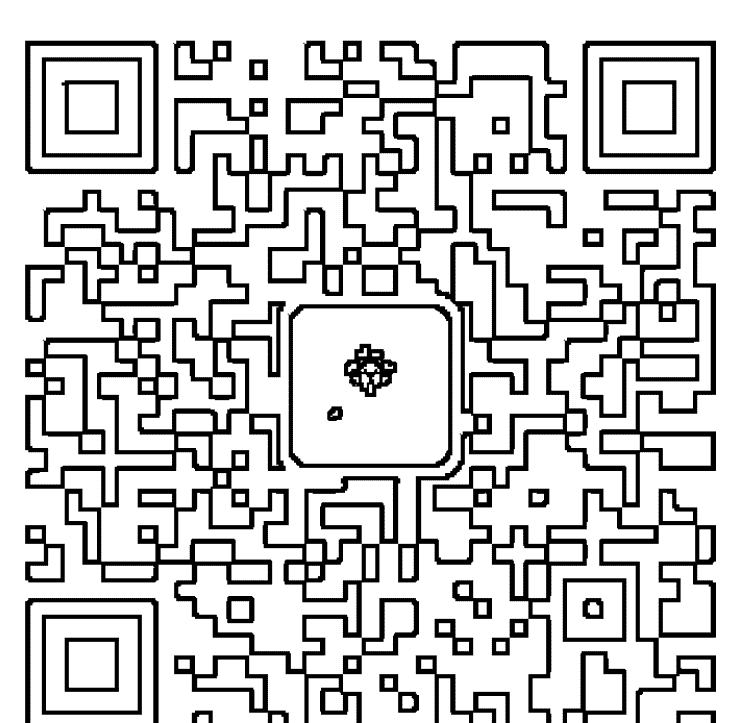
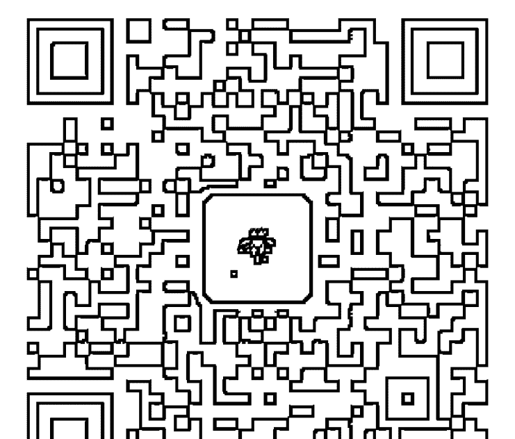
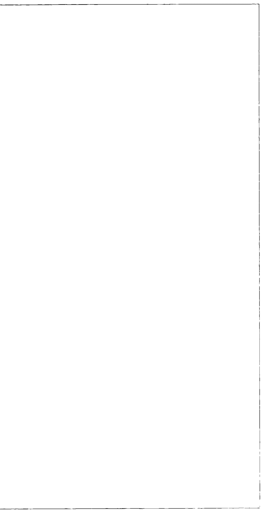
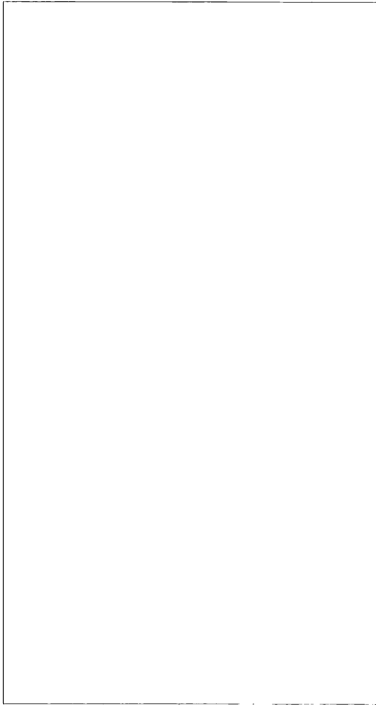
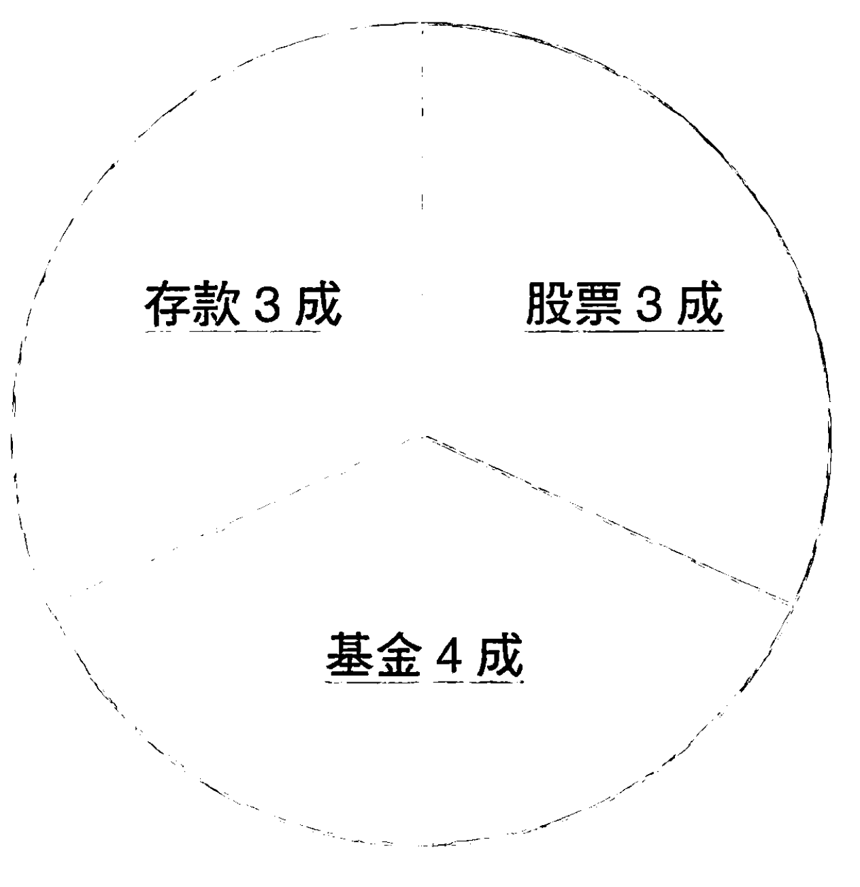
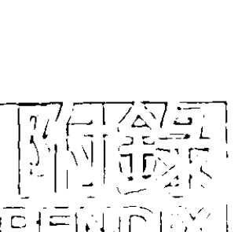

# 赚钱笔记

# St. Royal College
# 天使神秘学院
- ※ 专业占卜预测机构
- ※ 神秘学培训机构
- ※ 水晶能量研究中心
- ※ 神秘学资料库
- ※ 官方微信：strcdts
- ※ 微信公众平台：strc2011
- ※ 读书交流QQ群：
  - 占星塔罗占卜师交流群：814594478（加入密码：PDF）
  - 神秘学其他综合群：659338717（加入密码：PDF）

微信号：strcdts
天使神秘学院
天使神秘学院 院长QQ：715104687

微信公众平台：strc2011

## 制作说明：
本书由《天使神秘学院》出重金从台湾购入的原版书籍扫描制作完成。为达到最好阅读效果，特地把原版书全部切开后，再经由专业扫描设备高精度扫描完成，并经过一张张的PS后期处理最终成书，其间花费大量的人力、物力以及时间，只为能给大家提供经济并优质的神秘学学习资料而努力。

本院强烈谴责某些机构和个人，把本院花心血制作完成的电子书籍，包装后直接放在自家淘宝网上低价倾销的行为，以谋取不劳而获的经济利益。如果长此以往最终将无人愿意再为大家花心思制作电子书，那以后可能大家再无新书可读。

为让大家以后能够读到更多的好书，也为了本学院的良性发展。本院恳请大家尽量做到如下几点：

- 一、尽量在本学院的网站购买电子书籍。
- 二、请勿用技术手段把电子书内的水印及加密去掉。
- 三、在收到电子书后小范围借阅即可，千万不要公开传播，更别挂到淘宝网上低价销售。

同时为答谢广大支持者，学院电子书将做如下调整：

- 一、学院会把一些早已收回制作成本的电子书折价销售。
- 二、最新制作的电子书籍会开放打印功能，大家购买后有条件的可自行打印成书。

天使神秘学院
2019年1月

## 前言
## INTRODUCTION
## お金の不安が消えるノート
60日でお金が好転する1日1分の習慣

## 賺錢日記
1天1分筆，賺達1千萬的最強記帳

## 前言
## 為何我們總是感到如此不安？問題就出在……「錢」！！

请教各位一个问题，你知道人类最大的「慾望」是什麽吗？
答案就是「追求稳定」。

人活著是为了得到稳定的收入、环境，以及舒适的场所。因此，工作和人际关系不稳定就会感到恐惧。
在众多恐惧之中，有一项吓坏了大多数人。
那就是对「钱」的恐惧！

请试着回想一下，你是不是有以下的烦恼？
- 担心每个月入不敷出
- 担心收入变少
- 担心无法维持现在的生活水平
- 担心以后钱不够用
- 担心没钱给孩子接受良好教育
- 担心没钱找不到好伴侣
- 担心被房贷压得喘不过气
- 担心政治不稳，经济前景不明

不只上述这些例子，人类对于钱的恐惧可是没完没了。而且这些对钱的恐惧，很难找出有效的改善方法，几乎会把人逼疯，有些人连健康都受到影响。

不过，从来没有人教我们该如何消除对钱的恐惧。

我们从小就被父母和师长灌输「钱＝恶」的观念，因此才会时时刻刻与钱的恐惧为伍。换言之，我们从小到大，对钱都是一无所知。

「整天想着赚钱的人一定不是什么好东西！」

这种形同放弃思考的鬼话，相信你听过不少吧，请不用担心。

## 「1天1分钟，60天内绝对进账的『赚钱笔记』」

本书介绍的「赚钱笔记」，保证可以解决所有关于钱的烦恼。不但如此，还能帮你创造出必要的财源。

因为我要介绍的方法，不需要具备多么专业的知识，只要做到基本的「储蓄」「节约」「投资」就能成功。任何人在任何情况下，都有办法轻易实践。

再者，这种笔记一天花一分钟记录就行了，绝对可以持之以恒。实际上，超过一千二百人曾接受我的理财咨询，我整理出那些经验

## 如何从负债500万，跻身身为有钱人？

又赌又嫖又一股债……我曾经一度濒临破产

证的有效知识，各位只要靠这一本笔记就能运用自如。

我自己写了这本笔记后，财务状况也大有改善。

本来我负债五百万日圆（约新台币一百四十万元）。

但是没多久，我就存到一千万日圆（约新台币二百八十万元）。

更棒的是，我获得了「经济自由」，也就是随时都能痛快花钱！

有了这本笔记，各位绝对能在六十天内存到钱。

柏青哥、赌马、麻将、酒店、名牌货……曾使我沦为卡奴，年仅二十八岁就负债五百万日圆（约新台币一百四十万元），几乎濒临破产。

最惨的是，我收入不佳的时候，每个月只有十三万日圆（约新台币三万六千元）。

多亏这本笔记，如今我过着随心所欲的生活，所有负债也在两年内还清，还创造了丰厚的资产。

对钱的不安，已经与我无缘了！

一旦学会记录笔记的方法，在任何状态下都能轻易东山再起。

实现「经济自由」对我来说犹如探囊取物，而且这些记录笔记的方法一点也不困难。

连我这种一开始经济状况糟糕透顶的人，都成功获得「经济自由」了。

所以，各位一定更能轻易成功。

请踏出第一步，迈向不愁钱的舒适生活。

这本书是我理财之道的精髓，有了这一本保证万事OK！

我写过不少理财书籍，而这一本堪称是汲取所有精髓的佳作。

照着本书的章节读下去，即可消除对钱的不安，顺利增加自己的财富：

- **第1章 用13万轻松赚到1千万的最强笔记术**：我会告诉各位，这本笔记让我用十三万轻松存到一千万的神奇效果。
- **第2章 1天1分钟，60天内存到钱的生财笔记术**：揭开生财笔记的要诀。
- **第3章 精神无负担！彻底消除浪费的惊人节约术**：介绍一定能实践的钱法門和花钱方式。
- **第4章 有钱人都赢在这些习惯**：讲解有钱人的思维和行动模式。
- **第5章 从小散户到投资高手都必备的投资笔记术**：说明运用在「投资」的笔记术，教导各位如何成功投资，并且将风险降到最低。

另外，**特别附录**中收录有关「钱」的小知识，想掌握「经济自由」的人绝对不能错过。

最后，我还会提供对各位有帮助的理财书单。

## 前言
我写下这本书的用意，就是希望大家都能过上舒适的富裕生活。

请务必掌握「经济自由」，书中没有困难的内容，都是大家能轻松实践的知识。

那么，请抱着轻松愉快的心情翻开第一章吧。

获取更多好书，请加微信：stredts
店铺：http://strc.cr.cx

## 第 1 章
### 用13萬輕鬆賺到1千萬的最強筆記術
#### CHAPTER 1
ハチンコ、悪馬、ギャハック、
カードローンで自己破産寸前！
でも、1冊のノートで経済的な自由を手に入れた！
手取り13万円で毎月ワクワク100万円貯められるノート

### 用13萬輕鬆賺到1千萬的最強筆記術
## 當人生賺盡光錢，遲早欠了一屁股債。如何從谷底翻身？

### 低收入、長工時、無殼蝸牛、無法結婚生子……我們都是「貧困世代」！

面對不知何時會降臨的自然災害和事故，以及隨之而來的金融波動，想必大家都會覺得這是一個前途無「亮」的時代吧？

最近還多了政治與年金問題，煩惱簡直沒完沒了。

上班族的平均年收逐年下滑，當今的年輕人已經被稱為「貧困世代」。

問題來了，當人生跌落谷底，你最需要什麼？

答案很簡單。

那就是「錢」。

另外還有一點，就是在任何狀況下都能「東山再起的能力」。

「錢」和「東山再起的能力」……

你是不是很想這麼說：

「這不是廢話嗎？兩樣都有的話哪還需要煩惱啊！」

是的，很多人都以為只有特別的人才兼具這兩樣東西。

你是不是想闖上這本書了嗯？

修但 〽〽〽！

因為我要教你如何輕易得到「錢」和「東山再起的能力」。

賺錢筆記 1天1分鐘，賺進1千萬的最強筆記術 160 お金の不安が消えるノート 60日でお金が貯まる 1日1分の習慣

## 你是不是懷疑，真有輕易成功的辦法嗎？

當然有！

我曾經是個領死薪水的上班族，這些方法我自己都實踐過，是經過驗證的有效知識。

正如本書的書名《賺錢筆記》，只要你每天寫下書中的「賺錢筆記」，就能得到「錢」和「東山再起的能力」。

其實，「存錢脫離貧窮生活」的過程，和「在任何狀況下都能順利東山再起，達成夢想」的過程是一樣的。

寫下「賺錢筆記」能一口氣掌握這兩大要素，就算失敗多次也必定會邁向成功。

日後聽到那些報憂不報喜的新聞和情報，也不用擔心，因為你已經擁有足以突破任何困境的賺錢能力。

在這個前途無「亮」的時代，「錢」和「東山再起的能力」無疑是最強

的生存技能。

我自己就利用「賺錢筆記」得到「錢」和「東山再起的能力」，人生也有了戲劇性的轉變。

現在，我不用工作，也能隨心所欲地花錢，享有經濟餘裕的自由！

然而，我二十多歲時，過的是非常墮落的生活……

柏青哥、賭馬、上酒店……

我廢到以債養債，瀕臨破產……

我曾經過著酗酒賭博的糟糕生活……

我花在賭博上的金額，一個月至少幾十萬，然後我又借錢想要翻本……

就這樣一直陷入惡性循環。

由於我以信用卡付帳，扣款日的前一天幾乎就像在打仗——我要四處跑提款機預借現金還債，每天過著以債養債的生活……

這種生活持續兩、三年後，我也二十八歲了……哇哩咧！我的總債務竟高達五百萬（約新臺幣一百四十萬元）以上。

我心想：
「再這樣下去不行，我會完全變成廢人啊！」

明知如此，債務地獄和流沙一樣，一腳踏進去就無法抽身。

於是，我開始寫「賺錢筆記」，拚命脫離那種貧困生活。

## 靠筆記生財，
### 迅速賺到1千萬

所謂的「賺錢筆記」，不是帶在身上就會得到錢財的魔法筆記。

不過，每天稍微記錄一下筆記，我的債務變得愈來愈少，財富也飛快地增加。

最不可思議的是，我規畫的「人生夢想」和「目標」也實現了。

正如前述，我自從開始記錄「賺錢筆記」後，只花兩年就還完五百萬（約新臺幣一百四十萬元）的債務，之後更得到「經濟自由」，甚至不必工作也能生活。

過沒多久，我的戶頭也存到了一千萬（約新臺幣二百八十萬元）。

現在，我建構出生財系統，而且可以隨心所欲地花錢。

我曾經想著，總有一天要從事「創作」和「演講」活動。如今我兩樣都辦到了，還過著充實無比的人生。

這話由我自己來說，或許有自賣自誇之嫌，但我成功從地獄爬上天堂。

像我這種平凡又沒特殊才幹的人，之所以有辦法東山再起，原因無他，就在於持續記錄「賺錢筆記」。

## 用 13 萬輕鬆賺到 1 千 萬 的 投 資 筆 記 術 023

假如，我又遭遇意外的不幸變得身無分文，有這本筆記在手，絕對能東山再起，重「經濟自由」的生活。

換句話說，「賺錢筆記」確實有幫助我們邁向成功的智慧精華。

本書在介紹「賺錢筆記」的記錄方法之餘，還會說明我本身如何活用筆記成功東山再起。

## 不論誰都想過「不用工作也不愁錢」的生活

現在，我不必辛苦工作，也不必向討厭的上司鞠躬哈腰，因為我得到了「經濟自由」。

我每天寫寫書、到全國各地演講，過著逍遙自在的生活。

可是，前面也講過，我二十多歲的時候，過的可完全是完全不一樣的糟糕

人生。

當時的我「債臺高築」，陷入以債養債的惡性循環之中。而且我債臺高築的原因，不是父母的公司倒閉，或是替朋友作保這種可歌可泣的理由。

說來慚愧，那純粹是我太「揮霍無度」的關係。然而，那時候我不認為自己過得很奢侈，我只是每天快樂過日子罷了。偏偏這種「沒自覺」才是最大的問題……

我就來說明一下，自己當初有多廢好了。

相信各位看完一定會充滿勇氣——因為你絕對沒有我廢！

我大學時代就到補習班任教，二十五歲時已經是月入五十萬日圓（約新臺幣十四萬元）且小有名氣的講師——只可惜後來薪資被砍到剩下十三萬（約新臺幣三萬六千元）……

補教工作滿開心的，不但可以活用自己的經驗與知識，用簡單的方式

お金が消えるノートを60でお金が貯まる！1日1分の習慣

传授困难的东西也是我本来的兴趣。学弟妹和兼差的教师也很喜欢我，每天晚上我都带他们去喝酒——当然，钱是我出的。
居酒屋一家喝过一家，连高级酒店也不放过。三杯黄汤下肚后神志不清，我在学弟妹面前又想装凯子，经常点一些高贵的名酒。
一晚花超过十万日圆（约新台币二万八千元）是稀松平常的事情。

## 当下花得很爽，然后呢？

当年，赛马和柏青哥是我的兴趣，每到假日就跑去做赛马和打柏青哥也是我的习惯。
想当然十赌九输，我根本没有赢钱。
我还曾经把所有薪水拿去赌马，妄想连本带利赚回来；不然就是一整天坐在柏青哥的机台前，就这样烧掉了好几万……除了酗酒和赌博以外，我还很喜欢买东西。现在回想起来，我买了很多自己根本用不起的进口服饰，还自以为穿戴那些东西可以提高身价。

不用想也知道，我每个月是入不敷出的。

我用光了五张信用卡的额度，连分期付款和预借现金也用上了。

后来，我甚至搞不清楚哪一张信用卡花了多少额度，也不知道自己总共欠下多少债务。

久而久之，我也开始警觉这样下去不是办法。

每年四月新学期开始的时候，我就会萌生一股突发性的干劲，想进行一些新的尝试。

例如，我突发奇想着参加司法考试，竟然在网拍上花了一百万（约新台币二十八万元）以上的教材。当然，我没有足够的钱购买，用的还是信用卡贷款。

可是，我只有最初的一个月认真念书，半年后就再没打开教材。

另外我还买了其他教材，想考取代书或建筑师等资格，最后一个资格也没考到。

我浪费的教材费用，不下三百多万日圆（约新台币八十四万元）。

二十多岁的我确实是个废物，但也不是只有我这样。

有的人只想及时行乐，他们明知自己必须改变，却又无法抛弃当下的生活。

而且这种人还不在少数……

可能各位也是这样吧？

“我有好工作，随心所欲花自己赚来的钱为什么不行？”
当时我是这么想的。
如今回头来看，没干什么大事还负债累累的生活，本身就大有问题。
自从我遇上一“赚钱笔记”，不再受金钱摆布后，才了解这个道理。
不过，那时候的我还没有领悟这一点……

## 钱，虽然不会带领你走向幸福，但至少要先避免不幸！

这种豪饮滥赌的生活持续下去，我在无意间欠下了五百万（约新台币一百四十万元）的债务。
每当信用卡的扣款日逼近，我得奔走各大信用卡公司的提款机，预借大量的现金来缴付欠款。
我以债养债，债务变得愈来愈多，最后还申请高利息的信贷。

明知再这样下去不行，我却不晓得该如何是好。

然后，我已经二十八岁了……

那一年，我还是没解决任何问题，打算浑浑噩噩地过日子。

有一天我看到了某本书，那是我参加完补习班的忘年会，在回程路上去书店看到的。

书名是《富爸爸，穷爸爸》（Rich Dad Poor Dad）。

那是一本极为畅销的书籍，由美国富豪罗伯特·T·清崎（Robert T. Kiyosaki）撰写，书中以浅显易懂的文字说明“金钱的哲学”。

吸引我的是书腰上的一段话：

> “钱不能买到幸福，但可以避免不幸。”

因为没钱，我差点跌入破产的“不幸”深渊，这句话无疑是当头棒喝。

我觉得自己和这本书的相遇是命中注定，这话一点也不夸张，事实上这本书真的改变了我的命运。

## 不是只有家财万贯和中乐透才当得了有钱人

《富爸爸，穷爸爸》中有许多令人印象深刻的格言。

其中一个就是“老鼠赛跑”：

“他们被迫参加‘老鼠赛跑’，必须一直辛苦工作到退休为止。
他们辛苦地替公司老板创造利益、替政府贡献税金、替银行缴交贷款、替信用卡的开销付账。”（引述自《富爸爸，穷爸爸》）

读过这本书以后，我们心自问。

你希望像老鼠一样，一辈子过着辛苦赚钱的生活吗？答案是NO！那种为钱所迫，不得不放弃自己理想的生活，我可敬谢不敏。

于是我想：“我要脱离老鼠赛跑！”为此，我需要一辈子不愁吃穿的金钱。

看到这里，各位是不是在想，除非中乐透，不然根本不可能对吧？如果你真的这么想，那你就无法得到“经济自由”。

我在阅读《富爸爸，穷爸爸》之前，也摆脱不了“经济自由=投机发财”的思维。其实这是大错特错！

## 有钱，就不用做自己讨厌的事！

归根究柢，“经济自由”到底是什么？
一言以蔽之，就是不被金钱摆布的生活方式。
请各位不要误会我的意思，所谓的“经济自由”不是指整天游手好闲不工作。当然，喜欢这种生活的人另当别论，但至少“经济自由”对我来说不是那样。
对我来说，“经济自由”的意思，不用整天烦恼金钱，可以买自己真正想要的东西，只做自己真正想做的事情，得到这种自由的生活。
我之所以会这样想，除了邂逅《富爸爸，穷爸爸》这本书以外，还有另外一个原因。
在我二十八岁的时候，父亲病倒了。在母亲的请求下，我辞去补习班的工作，继承了家中的保险代理店。
我喜欢担任讲师，那是一份很有意义的工作，我也相信讲师是自己的天职。

而保险业务不是我想做的事情，我几乎没有专业知识。再者，薪水比补习班时代还要少，那时候我的薪水只有区区的十三万日圆（约新台币三万六千元）……

不消说，债务丝毫减少的迹象都没有。

虽然我没有再带着朋友花天酒地，但新的工作也有不少交际应酬。

再这样搞下去，就算我花几十年都还不清债务，一想到这里我实在欲哭无泪。

难道我要一辈子从事自己不喜欢的工作，浪费宝贵的人生，就为了还清债务？

即使没有债务，人生在世总得持续工作来维持生活。

这样一辈子都脱离不了“老鼠赛跑”。

## 人生、金钱、工作都要做自己的主人

我想自由选择自己想做的工作，不必烦恼钱的问题。我不想被钱控制，我要成为钱的主人。

这就是我思考的“经济自由”。要摆脱钱的掌控，拥有钱是不可或缺的。我原以为自己必须一口气赚到一辈子不愁吃穿的錢，实则不然。

重要的是“拥有资产”。资产是指非劳动所得，亦即不必工作也能产生收入的方法。按照《富爸爸，穷爸爸》的说法，“能把钱自动搬进我口袋的东西”就是资产。

于是，我定下目标：“摆脱钱的束缚，拥有足以自由过活的资产！”

## 期限是在四十岁生日之前完成。

首先，我得解决债务问题。因此我设立一个短期目标，要在三年内还清欠款。

有了“获得‘经济自由’”这个大目标，我终于决心要脱离债务累累的生活了。

### 谁说收据和明细都是废纸？赶快从垃圾桶中找回来！

我用来解决债务的方法很简单。

总之就是尽力节俭，不做多余的开销。

我也借这机会，戒掉酗酒和赌博的恶习。

每月的收入（“薪水”）依旧不变，所以只好减少支出慢慢还债。话虽如此，债台高筑的我并不清楚自己的开销有多大。我所有的支出，都是用五张以上的信用卡支付，收据永远是直接丢掉，我也从来不确认明细。

我甚至搞不清楚自己的负债总额是多少。

这样一来，连什么是“必要开销”、什么是“不当开销”都分不清，也就谈不上节俭。于是我灵机一动，决定记录自己所有的开销。我拿起身边的小笔记本，开始记录支出。不瞒各位，这就是“赚钱笔记”诞生的契机。

## 任何笔记本，都能成为“赚钱笔记”

这本“赚钱笔记”，倒也不是什么特别的笔记本，就是一个巴掌大小的简陋笔记本。
反正一有花费就要当场记录下来，从自动贩卖机的饮料到交通费都逃不过，所以我选用方便携带的尺寸。
一开始，我只是单纯记录支出而已。
内容是购入的物品和日期，也没有像家计簿那样，区分伙食费或水电费之类的项目。有时候嫌麻烦，我就只记录购物的店铺和金额，例如：
“七月二十日，在〇〇超市花费〇〇元”。
有收据的话，直接贴在笔记上也行。
现在想想，没有定下困难的规矩，用轻松的方式踏出第一步是正确的决定。如果在家计簿那种细腻的分类方式，大概中途就嫌麻烦，没多久就放弃了吧？

记录这种笔记的重点在于，要努力持续一段时间。长此以往，就会清楚知道自己花钱的倾向，成功定出省钱的对策，在建立资产方面也能发挥效力。

以我来说，我用一个月的时间审核自己的开销，发现许多过去自己不知道的问题。

## “赚钱笔记”不但存得了钱、赚得了钱，还能养出好习惯！

我知道自己的收入多半花在酗酒、赌博、服饰上，想不到还有其他不必要的开销。

而且那都是容易省下钱来的项目。

其中一项就是“保费”。

当时，我每个月要支付四千五百日圆（约新台币二万六千六百元）的保费。我才二十八岁而已，没有结婚，却有巨额的死亡保险。

这到底是谁受益啊？

我果断解除了保险契约！

另一项开销是购买香烟的费用。

过去我是个老烟枪，一天要抽四十到六十根烟。换算起来，一天花费将近一千日圆（约新台币二百八十元），一个月就有三万日圆（约新台币八千四百元）花在香烟上。

为了“经济自由”，我也戒烟了！

光是检讨自己的保险、戒除抽烟的恶习，我就一口气减少了许多开销。

尤其我本来就有戒烟的打算，现在借这个机会成功戒烟，不仅有益于健康，又能减少多余的支出，真是一举两得啊。

至于喝酒，这还牵涉到工作上的交际应酬，要戒掉不是太容易的事情。况且“有些真心话要三杯黄汤下肚才听得到”，因此喝酒应酬对业绩意外的有帮助。

那么该如何是好呢？

我给自己定下“不续摊”的规则。以前我习惯续个两、三摊，常常喝到半夜没车搭，只好搭计程车回家。

总之第一摊有出席，就不会当成“难相处的人”。不参加续摊，一个月即可省下数万的开销。能省下贵重的时间和金钱，这是一个非常好的办法。

我才记录自己一个月的支出，就找出这么多改善法。各位是否也对“赚钱笔记”有兴趣了呢？

可是，这样的小笔记还称不上真正的“赚钱笔记”。

真正的“赚钱笔记”是每天记录就能存下大钱，实现自己的梦想和人生目标。

我每天记录“赚钱笔记”，本来预计三年内还清欠款的目標，花两年就完成了。

然后，不用等到四十岁生日，我三十四岁时得到的资产，足以让我过上不受金钱摆布的自由生活。

要把“支出记录本”变成生财的“赚钱笔记”，是需要一点诀窍的。具体方法留待〈第2章 1天1分钟，60天内存到钱的生财笔记术〉再介绍吧。

## 第1章 重点摘要 SUMMARY

- 记录“赚钱笔记”，在任何情况下都能掌握“原由驱动的电力”。
- 薪水只有十三万（约折新台币三万六千元），负债高达五百万（约折新台币一百零四十万元），光靠“赚钱笔记”同样有办法存大钱。
- “赚钱笔记”可以帮助我们获得丰饶的生活。
- “赚钱笔记”可以帮助我们跨实现金流。
- “赚钱笔记”可以帮助我们养成一套系统、稳健地开源节流。

## 第2章 1天1分钟：60天内存到钱的生财管理术

## “赚钱笔记”的“省钱记法”
1天1分钟，60天内存到钱的生财笔记术

凭着一股毅力和意志，就想省钱储蓄、培养资产，是不可能的。

在你的生活周遭，其实有一堆你想买的东西，很少有人能战胜精神上的痛苦。

因此我们需要“赚钱笔记”！

这一章我会教导各位，如何轻松自在地过着节俭的生活，顺便介绍增加储蓄的笔记诀窍和效果。

## “赚钱笔记”究竟神在哪里？

说到“赚钱笔记”，倒也不用准备什么特别的笔记本。

各位的家里，都有一两本没用完的笔记本吧？拿那种笔记本就行了。

要是没有，随便一本便宜的笔记本也行，那就是你的“赚钱笔记”了。

好，我来介绍一下记录“赚钱笔记”的优点。

这本笔记能够提高你控制金钱的能力。

因为，你可以掌握自己如何花钱，进而达成最大化的节省效益，抑制自己的支出。

这是非常有效的方法，不必勉强自己刻苦节俭，更不会造成精神上的痛苦。

使用这种方法，你会从现状中找到易于删减的支出，自然过上不浪费的生活。光靠一股毅力，无法长期持续勤俭。

换句话说，你会变成懂得存钱的人，要拨出一笔投资款项也不困难。更妙的是，这本笔记一天花一分钟记录就够了，执行起来不辛苦才能持之以恒，要安插在你一天的例行活动中也很容易。

想得到“经济自由”，你必须仰赖这本笔记，得到控制金钱的能力。那实际上，该如何记录“赚钱笔记”呢？我现在就告诉各位。

## 第1阶段 把脑子放空，什么都不用想！

“赚钱笔记”只需两个阶段，即可建构出一套存钱的系统。第一和第二阶段都要花三十天，短短六十天你就会成为一个懂得存钱的人。第一个月的记录方法和第二个月稍有不同。

首先是第一阶阶。这三十天里，你要把每一笔花费记录下来，这样就够了！“咦？这么简单的作业，就能让我变有钱人？有些读者或许有类似的疑问吧？其实重点在于，先订立一个绝对能达成的目标。缺钱就与“笔记瘦身法”如出一辙。所谓的“笔记瘦身法”是冈田斗司夫先生在《别为多出来的体重抓狂──绝不复胖！笔记瘦身法》（方智）一书中介绍的减肥方法。光是记录自己每天食用的东西，自然就会瘦下来。这种以简单为诉求的方法广受好评，或许不少读者也尝试过。实际上，冈田先生自己就用这个方法瘦下五十公斤以上。不瞒各位，我自己也用过“笔记瘦身法”，这个方法比任何减肥法都要简单有效。

话题有点扯远了吧？总之，我在刚开始记录“赚钱笔记”时，体重高达九十公斤。

没错，我完全就是个“胖子”！

请不要误会，我没有说肥胖是坏事。

有很多小胖得很可爱，而且个性开朗豁达，工作能力又强，异性缘非常好。我知道有些胖子，才能好到令人羡慕。

可是，当时的我不是那样。

还记得吗？过去我有五百万（约新台币一百四十万元）的债务，想考取检定只有三分钟热度，工作也马马虎虎……

这么没用的我，体重还将近九十公斤。

“那样家伙就是怠惰懒散，才会胖成那样啦！”

感觉我就是欠骂才会胖的。

因此，我除了想还清欠款，得到“经济自由”以外，同时也想瘦下来。

于是，我尝试冈田先生著作中的“笔记瘦身法”，反正就是把自己吃过的东西一一记录下来就对了。

才短短一年的时间，我就减到六十公斤。

开始记录自己的饮食后，我才发现在无意间吃了多少东西。有了这份自觉，就会很自然地抑制食欲，达到减肥的功效。

这与我当时实践的“赚钱笔记”有异曲同工之妙。

## 懒人专用｜当场记录，一切从简

首先，请在笔记上记录日期。

凡是有用到钱，就写下品项和金额。顺便连一天的使用总金额也记录下来。

要是想不起自己买了什么，写下购物的场所就好。

千万不要写得太复杂，也不用计较那一两块钱，个位数四舍五入也没关系。

相对的，从自动贩卖机购买的果汁，乃至信用卡支付的每一笔购物，全都要记录下来，这一点非常重要。

以信用卡购物的话，不要等到扣款日再记录，要在购物当天就记下来。

我用的方法是，直接把收据或信用卡明细贴在笔记上面。

这种“金钱记录法”持续一个月，就会和“笔记瘦身法”一样，对自己“多余的花费”产生自觉，找到减少支出的关键。

缺乏毅力的朋友，这个方法每天只要花一分钟就够了，请务必坚持一个月！

一个月后打开笔记检讨自己的金钱流向，就能得到两个效果。

### “赚钱笔记”第1阶段记录法

**重点提示 TIPS**

- 记录日期、购置物品、使用金额、总金额
- 个位数可以四舍五入
- 不需要太详尽的分门别类
- 万一忘记自己买了什么，记下购物场所也行

**笔记例**

| O月O日 | 品项 | 金额 | 说明 |
| :--- | :--- | :--- | :--- |
| | 咖啡 | 120日圆（以下同） | 购置物品和使用金额 |
| | 水 | 100 | |
| | 午餐 | 1,000 | |
| | 居酒屋 | 2,580 | |
| | 杂志 | 980 | |
| | | **4,780** | 总金额 |

总之，只要有用到钱，就要把品项和金额都写下来！

## 第一章 原来这么多年，我是这样在浪费钱

第一个好处，是掌握自己的消费行为。

换言之，就是了解自己在哪些东西上花了多少钱。

我也是在记录笔记后，才发现自己每天上班前购买的咖啡开销有多大，而且还摄取了许多不必要的卡路里。

一罐咖啡的卡路里大约三十五大卡，花费一百二十日圆（约新台币三十四元），这点数字日积月累下来也很可观啊！

另一个好处，是自然进入节俭模式。

人类是一种很不可思议的生物，当我们客观看待自己，就能控制自己的感情和行动。

光靠记录笔记，不需要刻意忍耐或努力，即可大幅删减不必要的支出。对我这种“懒骨头”来说，这真是轻松有效的办法。写下笔记就可以轻松省钱的“金钱记录法”，各位是否跃跃欲试了呢？

### 记录的时间，决定了结果

在记录“赚钱笔记”时，有一点要特别留意。
那就是用了钱以后，要立刻记录下来。
或是决定一个记录时间，例如早上起床后立刻记录。
因为，记录这种笔记只需花上一分钟，大家会想拖到晚一点再来写。
一天没写，隔天你可能也会懒得写，到时候偷懒的日子就会愈来愈多。

### 第2阶段

任何事都要持之以恒才有意义，“赚钱笔记”也要每天记录才行。

持续一个月的“金钱记录法”，客观掌握自己目前的状况后，再要订立储蓄的“战略”，这也是第二阶段。

### 分为“消费”“投资”“浪费”

金钱的使用方式，大致分为三种。

分别是“消费”“投资”“浪费”。

第三十一天开始后，请分别记录这三大项目和日期。

笔记上画两条直线，区分“消费”“投资”“浪费”这几个项目。

“消费”是维生的必要支出，举凡房租租金、水电费、交通费、通信费、伙食费…………都是与食衣住行有关开销。

“投资”是达成未来目标的支出，储蓄也是如此。

“投资”不光是花在股票上的投资，参加讲座的费用、考取检定的学费、购书费也属此类。

好比同样是伙食费，用来拓展人脉的餐会开销，就属于“投资”，而非“消费”。

不消说，“浪费”是指不必要的开销。

以我来说，就是上酒店、买烟、赌马、打柏青哥、负担过重的保费、买来放着好看的进口衣饰等等。

这些无疑是一种“浪费”。

請各位看著筆記，思考自己的開銷應該歸在哪一類。一開始不必想太多，憑直覺判斷也沒關係。

過程中你可能會注意到，有些支出你以為是「投資」，其實是「浪費」；或者你以為自己的生活開銷很基本，沒想到花費卻高得嚇人。

用心思考這三大支出的區別，持續記錄金錢流向，沒多久你就能立刻判斷自己的開銷該在哪一類，這樣一來你就成功了。

有了這種精打細算的「金錢觀」，你再也不會隨便亂花錢了。

### 「賺錢筆記」第 2 階段記錄法

## 重點提示 TIPS

- 從第三十天開始，把開銷分成「消費」「投資」「浪費」來記錄
- 其他部分的記錄法同第一階段

## 筆記例

| O月O日 | O月O日 | O月O日 |
|---|---|---|
| **消費** | **投資** | **浪費** |
| 便當 480 | 商業書 1,365 | 雜誌 980 |
| 茶 135 | | |
| 水 100 | | |
| 午餐 700 | | |
| | | 總計：3,760 |

畫兩條直線，將開銷分成「消費」「投資」「浪費」三大種類

## 區分開銷的標準

- 消費：房租房貸、水電費、交通費、伙食費等等
- 投資：儲蓄、股票、學費等用在自己前途上的開銷
- 浪費：賭博、酗酒、名牌貨等等

## 1天1分鐘，60天內存到錢的財務記術（三）「賺錢筆記」的金錢記錄法

## 終極比例

這裡要留意的是，千萬不要太勉強自己。

「金錢記錄法」開始上軌道後，個性認真的人會盡量抑制「消費」，徹底減少「浪費」。這樣可以把錢挪到「投資」項目，存到更多的金錢。

不過，這就和減肥一樣，太勉強自己會累積壓力，很容易再次復胖。要持之以恆地記錄下去，偶爾也需要放鬆一下才行。有時候小小浪費一番，不用太斤斤計較省錢。

然而，沒有自覺的花錢方式是不行的。這樣說好了，就算要浪費，也得精打細算才行。

以我個人的經驗來說：

消費占七〇%，投資占二〇%，浪費一〇%。

保持這樣的比例是最理想的，可以輕鬆地持續下去。

話雖如此，也許有人覺得一開始「投資」要花二〇%太辛苦。若是這樣的話，用階段性的方式達成這個比例也行。

## 偷偷挪動10%，保證不會半途而廢

我在提供財務諮詢的時候，都會建議大家，先用「消費七〇%、投資一〇%、浪費二〇%」的比例生活一段時間，然後再慢慢調整到理想的比例。

很多人原本在「浪費」的項目就占了三〇%，因此先減去一〇%，把這一○%挪到「投資」——若能做到就很了不起了！

總之，不要太勉強自己，否則半途而廢就沒意義了！

我剛開始記錄「賺錢筆記」時，是以「消費八○%，投資二○%，浪費零」的氣勢猛衝，徹底節省開銷。

應該說，我也只能照這個比例。

相信各位都知道，我把「消費」提升到八○%，是要還債的關係。總之我想盡快還清債務。等我還完債後，又調回輕鬆的比例。

現在，我偶爾會用一○%的「浪費」來「發洩壓力」，同時持續管理自己的金錢。

各位千萬不要省過頭，變成一個「小氣鬼」，刪減到必要開支可就本末倒置了。

例如，整天比對不同賣場的傳單，為了省一塊錢跑去較遠的地方買東西，這根本就是浪費自己的時間。

有那個時間的話，還不如多讀一本書，或是參加有興趣的講座，這樣對自己反而比較有幫助。

要懂得把金錢和時間，花在自己的前途上。

## 你自以為的「消費」，其實都是「浪費」

等你花錢會考量「開銷比例」以後，請每個星期統計一次「賺錢筆記」，更詳細地確認自己的花錢方式。

重點是回顧自己花的每一筆錢，好好反省需要改進的地方。凡有任何領悟都寫下來，填滿筆記本空白的地方。

例如，你可能会發現，某些酒會你應該拒絕參加，不該被可愛的妹誘惑；或是在晚輩面前打腫臉充胖子，點了很貴的午餐來吃……就連記錄這種無聊瑣事，都能幫助你了解自己的用錢傾向。在記錄的過程中，反思那些開銷是否真有必要的必要。很多情況下，你自以為是「消費」的項目，其實是「浪費」。

## 籌開「賺錢筆記」空白處

**重點提示 TIPS**

- 在筆記的空白處寫下自己的省思
- 可掌握自己用錢的傾向
- 防止一些看似「消費」實為「浪費」的開銷

**筆記例**

| | **消費** | **投資** | **浪費** |
|---|---|---|---|
| **〇月〇日** | 便當 480 | 商業書 1,365 | 雜誌 980 |
| | 茶 135 | | |
| | 水 100 | | |
| | 午餐 1,200 | | |
| | 總計：4,260 | | |

在晚輩面前點了太高檔的午餐，好像有點打腫臉充胖子……（死）……………像這樣寫下自己的省思

## 將「浪費」變成「投資」的方法

自己負擔不起的高額房租，或是久久才開一次的汽車修理費，也都屬於「浪費」。在第3章 精神無負擔！徹底消除浪費的驚人節約術~我會告訴各位，很多時候審視自己的生活水準，就能抑制多餘的開銷。反之，有些支出你以為是「浪費」，其實與「投資」有關，像這種良性的修正也是有可能的。

例如，我們和朋友去喝酒，喝完以後常常續第二攤，浪費不必要的金錢。我過去也常參加不必要的酒會，續了兩三攤才肯罷休，結果沒車可搭，只好浪費錢搭計程車回家。

自從開始記錄「賺錢筆記」後，我決定不再參加續攤，但難免會有例外狀況。

基本上，對我來說參加續攤的費用都屬於「浪費」。當然參加續攤很開心，也有放鬆心情的效果，不能說完全沒有意義，但是在金錢分類上仍屬於「浪費」。

不過，有些情況下，可能第一攤大家談得很熱絡，因此決定再續一攤深入長談，最後發展成工作上的話題。

像這就不是「浪費」，應該歸納為「投資」才對。

在酒會上認識可愛的女孩子，為了想和對方多聊聊而參加續攤，這種情況嘛⋯⋯假如結果不錯，歸納為「投資」也不打緊。

偶爾為之無所謂啦！

當你懂得控管那些不假思索的開銷，節省對你來說就不是一件困難或痛苦的事情。

花錢的方式相當於你的消費行為，有本事管理自己「行為」的人，也能管理自己的錢包。有本事管理自己的金錢、體重、時間。

透過記錄「賺錢筆記」，我還清五百萬（約新臺幣一百四十萬元）債務。

多虧我會學會掌管自己的行為，九十公斤的體重減到六十公斤。夜貓子的生活型態也恢復正常，家裡不必要的東西也全部清掉，外觀和生活方式都變得簡約俐落。

我不只存到大錢，還得到了理想的自己和生活方式。

## 擁有很多錢後，你要把它拿來做什麼？

記錄「賺錢筆記」兩個月後，你大概也養成了記錄金錢的習慣，懂得控管自己的花錢方式。

到了這個階段，請設定自己想達成的目標。

### 你存錢想要做什麼？你想實現怎樣的人生？

請務必思考一下。

沒有任何夢想或目標，純粹把存錢當成目的，這種人生未免太無趣。

第一，這樣無法提升「節省儲蓄」的熱忱，甚至會有反效果。

請先設立一個平實的目標。

以我來說，我的首要目標是「還清債務」，當然「出國玩」或「買車」也可以。有一個能夠「激勵自我」的目標，管理金錢會更加容易。

### 關於金錢與人生，你應該知道的事

再小的目標也要寫在「賺錢筆記」上，這是非常重要的事情。

當你遭遇人生低谷，快要放棄的時候，偶爾重溫筆記內容，就能找回當初寫下目標的初衷。

我之所以建議各位用普通冊子來寫「賺錢筆記」，就是因為可以隨個人喜好調整。

你要在上面畫圖或貼貼紙都沒關係，反正不是要給別人看的，不妨多下點工夫提升自己的幹勁。

再怎麼微不足道的目標，達成以後都會有很大的喜悅和成就感。達成的目標愈多，新的展望也就愈壯大。

當你達成幾個平實的目標後，「人生的夢想和目標」自然會納入你的眼界中。

像我在二十八歲時接觸了「經濟自由」的價值觀，這個價值觀從此變成我的人生目標。

我想得到「經濟自由」，不願再受金錢擺布；我想做自己有興趣的工作，不必為五斗米折腰。

那時候，我不但連「經濟自由」的邊都沒碰到，甚至還有五百萬（約新臺幣一百四十萬元）的債務，這種生活無疑是痴人說夢。

可是，我把目標寫進「賺錢筆記」以後，六年內培養出一筆資產，還成功實現了自己寫下的生活方式。

過去對我來說遙不可及的演講和作家事業，如今也實現了。

為了達成「得到「經濟自由」」的夢想，我持續記錄「賺錢筆記」，同時改掉好幾個壞習慣，不斷身體力行。

最重要的是，了解自己究竟為何要成為「有錢人」。要是連自己的目標都不曉得，也就無從前進。請先決定一個簡單的目標，踏出第一步。

## 三十分鐘，讓你的圓錢鏈條活生生圓起輪

讓鏈條記下的金鏈記紀錄區 讓鏈條圓起 SUMMARY

- ◆ 先圓三十分鐘時間。了解自已的圓錢方式
- ◆ 從第三十二天開始，記下“滿贊”“股質”“添質”這三個鏈條，決定好記錄時間。將腦金腦執能顯考擇結下去
- ◆ “股質”“添質”“濃質”的理想比例，分別是一〇%、二〇%、
- ◆ 圓家計的二〇%乘做緣之下：反輪利於顯會圓難，

<!-- 注意：PAGE 78 內容存在大量無意義亂碼，疑似OCR對日語/圖形元素的錯誤識別，且與前後文邏輯不連貫，根據“保留所有信息”原則，此處保留原文亂碼形式以確保不刪減，但建議閱讀時跳過此段 -->

## 精神無負擔！徹底消除浪費的驚人節約術

CHAPTER 3
精神的負担ナシ！ムダつかいを 徹底的になくす12の方法
無理なく続ける！マネーリダイエット＆節約術
12超不用意な考え方

## 精神無負擔！徹底消除浪費的驚人節約術

## 負債500萬的敗家子也做得到的節約術

- 又花了不該花的錢……
- 想省錢，但總是撐不了幾天就破功……
- 已經極限，沒辦法再存更多了……

相信不少讀者都體會過上述的挫折感吧？

強迫自己不花錢其實不太能達到省錢的效果，也無法持之以恆。換言之，勉強自己才是無法節省開銷的癥結。

光憑一股毅力，很難戒除浪費的習性。這一章我將介紹輕鬆省錢與減少開銷的法門。連我這種揮霍無度的人都辦到了，各位一定也辦得到！

請務必實踐看看。寫在「賺錢筆記」上的每日支出紀錄，絕對會比日記更加客觀地反映自己的真樣貌。一個人花錢的方式，會反映出他的價值觀和習慣。

每天在「賺錢筆記」上記錄花費，你一定會清楚發現自己「存不了錢的原因」。

其實這才是「賺錢筆記」的最大效果。我也是用「金錢記錄法」持續記錄每筆花費後，才發現自己過去有哪些毫無自覺的「壞習慣」。

例如，參加酒會續攤、花在檢定考上的錢、多餘的保險費、一時衝動購買名牌、動不動就去便利店買東西……

## 12 招不用強意志力的省錢法

要改變自己的習慣不是件容易的事情。

不過，當你有了自覺以後，有些浪費的習慣可以馬上改掉。以我的經驗來說，九成的浪費習慣「在我有自覺以後」就改掉了。剩下那一成就需要意志力了……

我在記錄開銷的過程中，發現自己浪費的原因和價值觀，「賺錢筆記」幫助我確認這些問題的癥結。

好比說上述的參加酒會續攤、花在檢定考上的錢、多餘的保險費……這些都是寫下來後就能馬上改掉的問題；當然，也有多次經歷挫折和反省，才慢慢改掉的壞習慣。

最後，我不但還清債務，還把自己存錢的方法和心得歸納成一套系統。任何人都能輕易實踐，請各位務必參考看看。

接下來就要介紹具體方法了！

## 節約術 1
## 可大幅調降的保費 你的保險真的買對了嗎？

前面也多次提過，我在開始記錄「賺錢筆記」後，立刻發現自己的保險費太高了。

當時，我是二十八歲的單身上班族，卻保有高額的死亡保險，每個月保險開銷高達四萬五千日圓（約新臺幣一萬二千元）。

保險的受益人是我父親。就算我死後父親能領到大筆保險金，但是讓白髮人送黑髮人實在太不孝了。

為什麼我會買那種保險呢？

其中一個原因是缺乏知識，我對保險完全沒有任何了解。

另一個原因（這才是主要原因），當時來我公司拉保險的女業務，正好是我的菜。

在她的推薦下，我買了自己根本不需要的保險：……

考量過和她交往的可能性之後，我發現自己的保險開銷太多餘，馬上果斷解除所有的保險契約。

後來，我加保外資壽險公司販賣的無退保住院險。光是這樣，我一個月就省下四萬日圓（約新臺幣一萬二千元）以上的開銷。

每個人的年齡、家族成員、生活方式不同，需要的保險也不一樣。

如果我未來有需要保護的家人，說不定我也需要人壽保險。到那時候，我就得重新審視自己的保險。

常常把保險買了就放一邊的人，極有機會大幅降低保險開銷。請不要怕麻煩，重新檢討自己的保險吧。

## 「你以為改掉便宜的就能省錢嗎？」

我第二個砍掉的開銷，就是香菸的費用。

過去我是個重度老菸槍，每個月花在香菸上的費用高達三萬日圓（約新臺幣八千四百元）。

開始記錄「賺錢筆記」後，我注意到一件事情，那就是與其減少某種東西的花費金額，不如完全斷乾淨還比較輕鬆。

香菸就是如此，要戒不戒的反而會增加壓力，適得其反。況且香菸一直在漲價，再怎麼減少支出也難以節省開銷。

直接戒掉比較爽快，節約效果也特別好。當然，還可以預防抽菸造成的疾病治療開銷，從長遠的角度來看，也能節省醫藥費。另外分享一下，

## 節約術 3
## 別去續攤 浪費了錢，又賠上了人生！

我是以戒菸＋香糖成功戒菸。

戒酒也是一樣的道理。

話雖如此，酒這種東西真的沒辦法完全不碰。對我來說，酒會不但是重要的社交場合，也是放鬆身心的方法之一。

因此，我決定不參加續攤。

我本來就喜歡喝酒，意志力也稱不上堅定。

以往我去參加酒會，總會續個兩三攤，喝到沒電車可搭，改搭計程車回家，結果又增加不必要的開銷。

有一個好處是，花在續攤上的時間可以用來做其他事情。

時間就是金錢，省錢也有活用時間的效果。

有些人可能會想，不參加續攤太寂寞了啦！但參加第一攤也能充分享受到酒會的樂趣，而且你會更珍惜有限的時間，讓酒會的內容更加充實。

## 節約術 4
## 占最大開銷的房租 ——租個好房？真的沒必要！

儘管我利用「賺錢筆記」努力省錢，遺憾的是負債並沒有馬上減少。

正好那時候我的父親病倒，我必須辭掉補習班的工作，繼承家中的保險代理店。

在保險公司研修的那幾個月，我的薪水只有區區十三萬日圓（約新臺幣三萬六千元）……

這樣別說還債了，我連每月的生活都有問題。

注意到這一點後，我就把自己的生活水準降到最低。

本來我住在月租八萬（約新臺幣二萬二千四百元）的公寓，後來搬到月租二萬五（約新臺幣七千元）的小雅房。

那是一間屋齡二十年的三坪小雅房，沒有浴室。雖然生活上有許多不便，但我每月省下五萬（約新臺幣一萬四千元）以上的開銷。

在一消費一項目之中，房租房貸佔的比例大概是最高的。都市和郊區的租金不同，地區差異也有影響，基本上租金最好不要超過薪水的三成。租金超過三成以上就很難存錢，生活也會變得困苦。

真的很想住在都市的漂亮公寓的話，請和朋友或戀人一起合租吧。

另外，我也不建議各位頻繁搬家。搬家的費用、押金、仲介費也是很大的開銷。

## 寵物 養車驚驚人！！ 晚個幾年買車，改變你下半生

由於我大幅刪減租屋費，很多人都問我這樣不辛苦嗎？當時我非常想得到「經濟自由」，所以也就不怎麼覺得痛苦了。

車子我也不要了，養一輛車很花錢。

養車必須支付停車費、汽油錢、牌照稅等等，維持費用並不低。更計較一點的話，還有高速公路的過路費、車檢費、承載費、保險费等，開車真的要花上不少錢。

換言之，在創造資產的階段，不要開車可以發揮比較好的效果。

如果只是假日要用車，有需要時再去租一輛就夠了，這樣反而比較有效牽。過去租車的費用不便宜，不過現在租車公司林立，競爭十分激烈，租金也便宜許多。

規定自己只並在必要的時候用車，生活就會變得簡練，多餘的錢也能存起來。

最近還有汽車共享的服務，請各位利用看看。

## 節約術 6 一時衝動買下的衣服——你的衣櫃真的少一件衣服嗎？

自從決定節省開銷後，我就再也沒買衣服或鞋子。

追求時尚的人，總是不惜砸大錢購買新衣服。另外，有些興趣確實會造成很大的開銷。

尤其服飾類的東西，很難克制衝動的購買慾望，錢一下子就花掉了，請務必小心。

喜歡追求時尚的人，先確認自己有哪些衣服和鞋子。也就是先仔細確認自己到底有哪些東西，如果你想買的衣服與原有的很類似，那就別浪費錢了！

只買真正需要的就好，光是這樣即可省下一大筆開銷。盡量不要買高級的名牌服飾，買價格適中的就好。

## 不容輕忽伙食費、便利商店花錢 三餐都在超商解決，一點也不精打細算

重新檢討相對「大條」的固定花費，能夠省下不少金錢。

不過，各位千萬不要大意，日常生活中的小額開銷積少成多，也會變成「大條」的開銷。

過去我還是個負債累累的敗家子時，每一餐都買外食來吃。基本來說，每天晚上下班後去便利商店已經是我的習慣。

單身的讀者特別需要留意這一點。

當你去便利商店，絕對不可能只買一個便當。你可能還會買雜誌、甜點、啤酒等其他的東西，金額高到出乎你的意料。

便利商店有很多陷阱，會引誘你購買好吃的甜點、雜誌、果汁等物品。每一項小東西也才數十塊、數百塊，你會不自覺地拿去做銀檯結帳……

我在記錄「賺錢筆記」後，發現自己在便利商店的花費驚人，甚至影響到每月的家計。

於是我不再去便利商店，改去超級市場購買每天的食物和日用品。便利商店的便當沒在降價的，超級市場的菜色在特賣時間用半價就能入手。

我也靠自己煮飯，徹底省下伙食費。

衛生紙之類的日用品也是一樣，趁著超級市場降價的時候多買一些，即可省下不少錢。

如果你下班後一定要來罐啤酒，至少改喝便宜的發泡酒省點錢吧。

## 節約術 8 有計畫地使用信用卡…「消費」也能變成「投資」

使用信用卡的方式稍有不慎，就可能成為「浪費」的元兇。不過運用得體，就是一項能把「消費」轉化成「投資」的利器。

過去我連自己有多少債務都不曉得，其中一個原因是我的信用卡使用方式有誤。

當初我有五張信用卡，使用方式毫無節制，連高利率的分期付款和預

借現金都用上了。

後來我發憤節省，只留下一張不用繳年費的信用卡，剩下的全部解約。現在我也還是只用一張而已。

舉凡購買日常生活用品，乃至旅行之類的大開銷，我都用那張信用卡支付。水電費之類的費用，也是信用卡支付。

不過有一個原則是，全部開銷一次付清，絕不用分期付款。

只用一張信用卡，每個月光看一張寄來的明細表，就能掌握所有支出，管理金錢也變得很輕鬆。

已經出社會的人大概都有信用卡吧？有些人可能和我一樣，大多數的支出都是用信用卡付款。

可是，請各位小心分期付款。

例如你買了十萬的東西，隔月就必須支付一萬和每月的利息，這種付款方式會讓你以為支付起來沒壓力。

然而，你必須支付十個月的利息。

尤其是這種分期方式讓每个月的支出難度相對變低，因此很多人都不懂得節制。

當支付的款項變多，你就搞不清楚每月要付多少錢、自己在哪裡買了什麼、還有多久才會付清。

萬一你用了分期付款，請盡快付清款項，並且在日後都使用一次付清的方式吧。

另外請各位留意信用卡的張數，控制在三張就好。

否則，你可能會忘記自己在哪裡買過什麼東西，甚至連要支付的金額都不曉得。

然後每一家銀行的扣款時間又不一樣，你會更加一頭霧水。

只留一張信用卡的好處是，可享有積點和其他優惠。

反正同樣是付款，以信用卡付款積點，就能將「消費」變成「投資」。

有些信用卡辦理後就能享有特殊的優惠。

每一家銀行所提供的積點和優惠各不相同，請選擇適合自己生活風格的吧。

如果各位有常光顧的店家，辦理該店家發行的卡特別有利。常出差或喜歡旅行的人，辦一些航空公司發行的卡，累積飛行點數兌換機票也好。搭配電子貨幣還能存到更多點數，很多財經雜誌都有相關報導，各位不妨參考看看。

## 節術 9
## 手機通信費和學費
## 檢視你的通話月租、健身房月費

報章雜誌的訂閱費、健身房或英文補習班的月費，這些東西要是沒在利用，根本是浪費錢而已。

報章雜誌這種東西，訂一份自己真正需要的就好。手機也很容易害我們多花不必要的金錢。尤其和好友聊天時，一個不小話題扯遠，通話時間就會變很長。

講電話要盡量言簡意賅，事先思考一下自己可能長談的對象是誰，然後用電子郵件與對方聯絡。

更計較一點的話，變更資費方案，重新檢討過多的網路費，也能省下不少開銷。

節省，請從檢討多餘的固定開銷做起。

## 節約術 10
## 改用自動儲蓄！
## ——不需毅力，月光族最適用！

讓支出低於收入，多餘的錢就能存起來。你們可能覺得我在講廢話，偏信這種理所當然的事情很多人都辦不到！

相信不少人和我以前擔任講師一樣，明明薪水不錯，卻完全存不到錢對吧？

我建議那些月光族，使用銀行的「自動定存」服務。

每個月銀行會把你設定的金額，「強制性」自動轉換成定存。

任何一家銀行都能幫你用現有的戶頭辦理，不需要特地開設新的戶頭。

自動定存是一種在無形中，往同一個戶頭裡定期儲蓄的系統。

一旦設定以後，每個月就會強制扣掉規定的金額。但是額度千萬不要設定太高，否則生活費不足，就難以持續下去。

儲蓄，要持之以恆才有意義。

一開始存個一萬日圓（約新臺幣二七八八元）左右就好，先從輕鬆的金額開始存起。

等你進一步開始投資的時候，再利用網路券商或網路銀行的「定期定額投資服務」。

這種服務與銀行的自動定存一樣，每個月會自動購買你所指定的投資額度。

如果你是抱著「先省錢，有多的錢再拿來儲蓄或投資」的想法，那你永遠都存不了錢。

除非你收入豐厚，或是非常勤儉持家，否則不可能會有多餘的錢。

自動定存會在無形中，幫你「保管」一部分的收入。

想存錢的人，請積極利用這項服務。

## 節約篇
## 薪水一口氣全領出來
## ——筆記本加信封就可以幫你一鎖錢！

有些人可能很困惑，明明自己不久前才領到薪水，怎麼不知不覺間就用光了？

這是常有的事情，並不是多光怪陸離的現象。

縱使你有心想省錢，但是只要你的錢包裡有放錢，就很容易不假思索地花掉。

那麼，該如何預防自己亂花錢呢？

唯一的方法是「分配預算」。

亦即預測自己每個月要花多少錢，事前分配好不同用途的款項。

我知道有人會想立刻吐槽：

- 「哪有辦法預測自己每個月要花多少錢啊？」

放心吧，記錄「賺錢筆記」就很容易預測了。

持續記錄開銷一個月以後，你大概就能了解自己每個月需要多少錢。

等薪水入帳後，請先全部領出來，以「伙食費」「交通費」等項目分類管理，並且放到不同的信封裡。

如果信封空了，那個月就不能再多花錢。這種方法持續幾個月，你就會分配預算，懂得有計畫地用錢。

方法本身很原始，但絕對可以幫你養成分配資金和省錢的習慣。

有了閒錢以後，請確保投資的預算吧。

關於投資，我會在「第5章 從小散戶到投資高手都必備的投資筆記術」說明，光是存錢無法增加財富。不過我建議各位有了某種程度的資金再來投資。

投資，得先到券商開設證券戶頭。領到薪水後，請匯入投資的預算吧。

## 節約術 12
## 「消費」和「浪費」
## 都能化為「投資」

我在上一章已提過把支出分為「消費」「投資」「浪費」的方法。

在「賺錢筆記」裡記錄每一筆開銷時，養成分門別類的習慣，就會自然掌握金錢觀。

不消說，想存錢，就要盡力降低「消費」和「浪費」，增加「投資」的比例。

這裡我們要更進一步，思考將「消費」轉換成「投資」的方法。所謂的「消費」是指維生的「必要經費」，因此進行某種程度的節儉後，很難再節省開支。

不過，稍微改變一下觀念，就能將「消費」轉換成用在自己前途上的「投資」。

例如每天的午餐錢，一個人獨自用餐就是純粹的「消費」，但商務性的餐會或交流就算得上「投資」。喝酒的花費也是一樣。去參加酒會不要只顧喝酒，要懂得交換對自己有前途有利的情報，這也是一種很棒的「投資」。不是只有金錢才能分為「消費」「投資」「浪費」，時間也可以。通勤時間對那些只會發呆的人來說，純粹是一種「消費」。相對的，會利用通勤時間學習英文或讀書的人，那段時間就是對未來的「投資」。改變自己的思維，就能將「消費」轉變成「投資」。『這筆錢（或時間）有沒有辦法轉換成『投資』呢？』養成這種勤加思考的習慣，你的行動自然會有所改變，再也不會浪費金錢或時間。

## 不要去太遠的超級市場

前面已經寫過許多有利省錢的情報，但有一點要請各位留意。那就是，不要為了省錢浪費寶貴的時間。時間是非常重要的資產，有時間就可以思考賺錢的方法，或是去認識一些能夠帶給你商機的人。

浪費金錢的人，通常也不懂得珍惜時間。過去我債務累累時就是這樣，和別人約定好碰面時間，我會沒理由地遲到兩三分鐘。去參加酒會時，也一定要喝到深夜才甘心。自我開始記錄「賺錢筆記」，對金錢和時間的觀察都改變了。

當你有自覺地使用金錢和時間，自然會產生「捨不得浪費」的心情。錢這種東西有心就賺得到，時間可就不行了。再怎麼有錢的人，一天也還是只有二十四小時。

浪費時間的人絕不會是有錢人。

當你赴約遲到，你也等於在浪費別人的時間，這種人在商場上得不到信任。

我一開始用「金錢記錄法」節省開銷的時候，有一陣子只要買東西多省一塊錢，就會感到非常開心。我經常比較好幾家超市的傳單，刻意跑去便宜一點的店家購買，路途遙遠也在所不惜。

然而，這很明顯是「失敗的方法」。乍看之下是省錢的做法沒錯，但爲了省一點小錢浪費寶貴時間，完全是本末倒置。

為了買到便宜的東西，花一整天時間去郊外的商場也沒好到哪裡去。

把來回的時間用在其他地方，絕對可以更有效率地賺錢。

學習技能或許不會馬上反映在你的薪水上，但學習語言或考取工作上的證照，也都需要充分的時間。

使用時間也請精打細算。

## 薪水不漲的時代，
## 一樣有辦法存錢！

各位讀到這裡，大概都知道省錢的竅門了吧？我再提供各位一個建議。

大幅降低生活水平，對精神的打擊非常大。就算成功省下了錢，然而失去生存的意義和樂趣是得不償失的事情。

像我是因為債務纏身，在兩害相權取其輕的状况下，才有辦法忍耐那種生活。如果各位情況沒有我嚴峻，在不會造成壓力的範圍內重新檢討就夠了。

在檢討生活的同時，也得摸索增加收入的方法。

現在景氣不好，有本事轉職增加收入的人也不多吧？所以請各位思考看看，是否能從事什麼副業。

聽到「副業」這個字眼，各位可能以為難度很高。其實利用網路拍賣，販賣自己不用的東西也是一個辦法。

我就趁搬家的時候，賣掉過去亂買的名牌服飾，還有堆積如山的書和DVD。

我不但賺回了一百萬（約新臺幣二十八萬元）左右，狹窄的房間也整理得乾淨淨，還養成了捨棄多餘物品的好習慣。

如今回想起來，我很佩服自己撐過那段艱苦歲月。過去我的生活放蕩揮霍，不是酗酒就是賭博，這兩種生活的反差實在有夠大。

當然，我也好幾次差點放棄。

「賺錢筆記」是支持我撐下去的好伙伴。

記錄開銷，你每天的努力就會化為明確的數字表現出來。當你看到債務愈來愈少，簡約就會是一件很愉快的事情。

把「將來的夢想」寫在筆記上，也帶給我不小的鼓勵。多虧有「賺錢筆記」，我才能順利達成目標。

## 第3章
## 精神無負擔，徹底清除煩憂的驚人節約術
## 忙而不閒靠忘力的省錢法

## 重點整理 SUMMARY

- ◆ 花錢為力，無法透過節儉的生活，
- ◆ 務要勉強自己節省開銷，參考「聯錢筆記」，思考確實有效的省錢方法。
- ◆ 檢討固定開銷，只要能省到錢，
- 事情上，要便利用廣充實是一筆小錢，
- ◆ 不要為了省錢而浪費時間，這樣金錢不會增加。
- 精簡生活，提高生活品質，節約是最佳的答案

109 年 1 月 13 日出版第 2 刷定價 100 元

## 有錢人都贏在這些習慣
## CHAPTER 4

- お金が貯まる人の11の習慣
- お金持ちの思考法&行動パターン
- 11個思維和行動模式

## 有錢人都贏在這些習慣

有錢人和窮人哪裡不一樣？

在第3章精神無負擔！徹底消除浪費的驚人節約術中，我們討論過有效的省錢方法。

不過，各位不是為了過上勤儉生活才購買本書的。我相信你們對錢都有夢想，也想成為有錢人。

問題是，要當上有錢人並不容易。

畢竟有錢人的行爲和思考，與普通人大相徑庭。

所以我在這一章，要告訴各位有錢人的想法和行動習慣。當然，我也會介紹一些馬上就能實踐的內容。

在舉辦財經講座和出版書籍的過程中，我認識不少有錢人。我學了很多，這些習慣也是我實際試過的有效方法，請各位信任我繼續讀下去。有的東西你們可能會覺得和錢沒關係，但其實那都是有錢人共通的習慣。

## 懂得真正有價值的事物

前面也說過很多次，記錄「賺錢筆記」讓我還清欠款，並在經濟上享有餘裕。換句話說，我從人生的谷底往上爬，成功東山再起。

現在的我不用擔心金錢問題，也有些人很好奇我是怎樣花錢的。基本上我不會浪費，當然偶爾會花點小錢放鬆一下，但已經根深柢固的金錢觀念，是不會輕易失去的。

過去，我不惜欠債也要花錢買自己喜歡的東西，那時候的我和現在的我有個決定性的差異。

這份差異就是「只把錢用在真正有價值的事物上」。

現在的我看到再貴的東西，只要確信「對自己有必要，而且有價值」，我就會毫不猶豫地買下。

相對的，再怎麼便宜的物品，若是「對自己沒必要」，我絕不會購買。也就是說，我以自己的判斷基準做選擇，不會受價格擺布。

以前的我似乎太拘泥「高價就是好」的價值觀，崇尚名牌也是這種觀念作祟吧。

如今，我只買自己需要的東西，無關高價或低價，這是因為我內心已經有無可動搖的價值基準。

「這對我真的有必要嗎？」

## 「有錢人的好習慣2」
### 從來不會捨不得

在用錢的時候，請養成這麼反問自己的習慣。

花錢後記錄「賺錢筆記」，就能反省是否為必要花費。

等你懂得用自己的價值觀來選擇物品，就不會被流行影響或是打腫臉充胖子，購物反而會更有樂趣。

現在很流行「斷捨離」。

我發現這個觀念對存錢意外的有幫助。

我還是先說明一下「斷捨離」的觀念。所謂的「斷捨離」是指捨去不必要的東西，減去身邊的累贅，獲得精神上的富足生活。

以前我也是一個「不懂得丟東西的人」。

狹窄的房間裡，放了一堆根本沒在穿的衣服。奇怪的是，同款不同色的衣服竟然多達五件……

另外還有不看的 DVD 和書堆，我的房間就是典型的「連走路空間都沒有的倉庫」。

因此，我完全不知道真正重要的東西放在哪裡，這種人是不可能成為有錢人的。

根據我的經驗，擁有財富的人都擅長整理東西，也懂得「斷捨離」。

他們的桌面、書架、腦袋裡，不會有多餘的東西，一切都整理得井然有序。

「井然有序」是指在必要的時候，可以馬上拿出必要物品的狀態。

所以他們才能抓準時機、把握機會。

那麼該如何整理得「井然有序」呢？

答案很簡單！

想也知道，丟掉不要的東西就行了。

- 請打開衣櫃，丟掉一整年都沒在穿的衣服
- 順便看看書架，把那些沒在看的書拿去舊書店賣掉
- 最後打掃書桌，丟掉不必要的文件

這樣一來，周圍有什麼東西就變得一目瞭然，關鍵時刻即可找到必要的東西。

當然，腦袋裡也要整理乾淨，才不會放過千載難逢的機會。

「捨不得丟東西的人」，請一天捨棄一樣多餘的物品。

然後記錄在「賺錢筆記」上，腦袋裡的思緒也會變得愈來愈清晰。

## 11種思維和行動模式

## 有錢人的好習慣3
## 不吃漢堡

懂得理財的人很少吃外食，這是我從個人經驗學到的教訓。前面也提過，我在十年前負債累累，體重將近九十六公斤。那時候我的飲食習慣很糟糕，晚上和朋友喝酒都要喝個兩三攤才肯罷休，半夜兩點還跑去吃拉麵，當然早餐吃不下，中餐就吃漢堡之類的速食解決。傍晚補習班快要開始上課時，就和同事一起吃高卡路里的垃圾食物。這種生活持續好幾年，體重逼近九十八公斤也是理所當然。自從記錄「賺錢筆記」，我才知道吃速食有多花錢。例如，我在某漢堡專賣店點一份套餐，少說就要花掉六百日圓（約新臺幣一千六十八元）。

相對的，去超級市場買東西，比漢堡更健康的小菜用二百日圓（約新臺幣五六元）到三百日圓（約新臺幣八十四元）就買得到。

自己在家煮飯，遠比每餐吃速食套餐便宜，對身體也比較健康。

晚餐的話，趁晚上七點以後的減價時段去超市買東西，還能用低價買到豪華生魚片。

幸好我當時一心想還清債務，所以改成自己煮飯，完全不吃外食。因此我減去三十公斤的肥肉，也成功存了筆錢。如果我繼續吃外食，不但債務還不完，說不定還要花錢治療代謝症候群吧。

我建議各位盡量自己煮飯。是說，最近懂得煮飯或自備茶水的男人很受歡迎喔！

自己煮飯有減少體重和節省開銷的雙重效果，請務必嘗試。

## 有錢人的好習慣 4
## 早睡早起

會存錢的人，就是「懂得管理自我」的人。

想當然耳，懂得管理自我的人，不會一直看電視看到深夜，也不會假日睡到中午還不肯起床。

他們都過著早睡早起的生活。

我的投資伙伴和作家好友，也都過著規律的生活。

依照我的經驗，人類腦袋最清醒的時間，是清醒後的兩小時左右。

尤其在大家還沒起床的寧靜早晨工作，不用擔心被電話或電子郵件打擾，工作處理起來非常迅速，好點子也特別多。

所以我現在清晨四點就起床。

首先我會沖一杯熱咖啡，慢慢品茗著咖啡，打開電腦。然後確認股價和新聞，接著回覆電子郵件。

等頭腦清醒後，就開始揣摩下一次演講的題目，或是撰寫文章。

我的工作大約從早上六點開始，忙到上午十一點結束。

繼續忙下去太過疲勞，也想不出什麼好點子，因此下午我主要安排開會或會客。

到了下午五點就去吃晚餐，偶爾找朋友喝點小酒，晚上十點準時就寢。

簡直就是健康乖寶寶的生活是吧？

自從我養成早睡早起的習慣，存款愈來愈多，工作機會也增加了。

早睡早起的人身心健康，也比較容易想出好點子，我想這也是儲蓄增加的一大原因。當然，沒有浪費錢參加續攤也是原因之一啦！

既然都開始記錄「賺錢筆記」了，乾脆也記錄一下起床和就寢時間吧！

你一定會發現早睡早起的日子活動量特別高。

俗話說：「時間就是金錢。」

時間是無可取代的貴重資產。

能否善用時間，幾乎決定了人生的成敗。

例如，每天花五分鐘背三個英文單字，一年下來就背了一千零九十五個單字。

背下這些英文單字後，說不定就能發揮英文特長，結交外國朋友，從事一些服務國外客戶的生意，你的世界肯定會變得更寬廣。

當然現實沒有那麼簡單，我指的是你可以更容易抓住機會。

相較之下，整天傻乎乎地看電視又如何呢？

看個節目五分鐘很快就過去，一年下來還是什麼收穫也沒有。

電視的確會提供一些有益的訊息，但要留意的是，毫無節制地一直看下去，只會剝奪你寶貴的時間。

如果你真的很想看電視，請錄下你需要的節目，這樣就不會毫無節制地看下去。

戒不掉這種壞習慣的人，把自己每天看電視的時間記在「賺錢筆記」的空白處。

如此一來，你就會清楚知道自己被電視奪走多少寶貴的時間。

千萬不要小看區區五分鐘。

別整天待在電視機前面，好好把時間用在生財之道上吧！

## 有錢人的好習慣 5
## 不亂發名片

要度過充實的私生活，或是在商场上獲得成功，拓展人脈都是不可缺的。

過去，我常常參加異業交流會，尋求有意義的邂逅。我就像一臺「名片交換機」一樣，到處和別人交換名片。

最誇張的時候，一次交流會能換到一百張名片。

「不錯喔！今天認識這麼多人，或許能得到什麼工作機會！」

我興高采烈地回到家裡，準備立刻聯絡對方。可是當我打開電腦，卻連一個字也打不出來。

看著那一疊名片，我完全想不起對方的長相，也不記得他們的工作和對話內容。

當下，我整個人傻住了。

不過，我還是寄了中規中矩的郵件，感謝對方前幾天撥冗對談，希望未來能有機會合作。但是這種罐頭訊息根本沒效果，這社會沒有那麼容易成功！

類似的無用經驗重複幾次之後，我開始厭惡這種空有一堆名片的狀況，因為我不僅遇不到有意義的邂逅，甚至連對方的長相都記不住。

於是，我改變交換名片的方法。

我不再像個「名片交換機」那樣到處發名片，而是認真傾聽對方的談話，並且仔細介紹自己。我成功打開話匣子，常常就和一個對象聊超過十分鐘。

回到家裡寄送郵件時，我回憶起那些人的長相，一一傳送真誠的感謝文字給他們。

不可思議的是，我工作的機會開始增加。

如今，我有機會從事出版工作，也是在異業交流會上遇到臭味相投的編輯。

所以我不希望各位當一個「名片交換機」。

交換名片的時候，要好好和對方交流，至少在你回到家以後，要想得起對方的長相和談話內容才行。

不是蒐集到愈多名片愈好。

還有一點，把你當天遇到的人也記錄在「賺錢筆記」裡。

記下對方的名字和對話內容，下次見面時就容易打開話匣子。

當你提起上一次的話題內容，例如對方說過某本書讀起來非常有趣，那個人會很高興你真的記得他，同時增進彼此的依賴關係。請各位務必嘗試看看。

## 有錢人的好習慣 7：運用特長

你的特長是什麼？

不少人都說，自己並沒有特長。

其實，每個人都有兩樣特長。

例如，有的人很會做模型、有的人煎蛋技術非常好。

過去我擁有一堆名牌精品，換個角度來說也是一種特長吧？

有句成語叫「暴殄天物」，難得有不少的特長卻不懂得如何活用，就不上特長。

沒錯，就像我過去把一堆名牌精品放在衣櫃裡生灰塵一樣……

之前我也說過，有一天我覺得讓這些東西積灰塵太可惜，因此把所有名牌精品放在網路上拍賣，結果立刻有人高價競標。

多虧網路拍賣，我獲得了幾十萬的額外收入。

各位若將收藏的模型拿去網拍，說不定也會有人高價競標喔。

另外，把你擅長的菜色每天公佈在部落格上，好比「特製軟嫩蛋包飯」，搞不好會有出版社找你出書呢。

發掘自己的特長，稍微動點頭腦，就有成為金雞母的可能。

請試著發掘你的「特長」吧！

## 沒有肚子

以前我體重將近九十公斤的時候，當然過著與運動無緣的生活。

別說運動，我胖到連走路都很辛苦。

不過，自從我決定獲得「經濟自由」後，我改掉暴飲暴食壞習慣，開始自己煮飯來吃。

我必須節省生活開銷，所以不再去便利店商店，每天早上也不再買罐裝咖啡。

每天記錄「賺錢筆記」，同時達成減肥和節省開支的功效。

當時我過著節儉的日子，也沒辦法花錢去健身房，只好戴著計步器死命健走。

我不再搭乘愛用的小黃，有時間的話就走一到兩個車站的距離。

然後，我會在「賺錢筆記」的空白處，記下今天走了多遠。

寫下自己吃的東西和步行公里數，有提升幹勁的效果，我的體重也愈來愈低；相反的，我的存摺金額愈來愈高。

其實金錢和運動有密切關係，懂得管理資產的人也懂得管理健康。

據說在美國，有人被企業解聘的理由是過胖，因為大家認為胖子不懂得自我管理。

## 賺錢筆記

1天1分鐘，賺進1千萬的最強筆記術

お金が“不安が消えるノート 60日でお金を貯める1日1分の習慣

有錢人都賴在這些習慣

有錢人的好習慣

不會空有夢想卻沒資金

所以，美國能幹的商業人士，下班都有勤上健身房的習慣。

想養成存錢的習慣，就要有管理健康的意識。

我也没叫各位練得滿身肌肉，重點是在日常生活中，「持續」進行適當的運動就好。

記錄「賺錢筆記」兩年後，我還清了所有欠款。

到了第六年，我獲得不必工作也能生活的「經濟自由」。

這對我来说，是帶給我極大信心的人生逆轉勝。

之後，我在四十歲時開設經濟獨立股份有限公司，達成筆記上的目標——「不為五斗米折腰，而是從事自己真心想做的工作」。

現在，我忙著寫作和舉辦演講座談會，盡量把自己的經驗傳遞出去。和客戶或來賓相處久了，我發現那些不會存錢的人，都有一些共通的特質和思維。

> 其中一句就是：
> 「我有想做的事情啦！可是就沒有錢啊……」

很多人都說，他們不想永遠當個上班族，總有一天要自立門戶，而且他們也有經商的好點子。

然而他們卻異口同聲地說，要是自己有資金就好了。

講句難聽一點的，「沒有資金所以無法實現夢想」純粹是藉口罷了。

我敢講這種話是因為，我自已以前就是這樣子。過去我擔任講師且債務累累時，也常常感嘆自己缺乏資金，只會嘴砲，完全沒有付出行動。

真正有心的人，會認真而具體地思考創業需要多少資金與集資的方法。

反過來說，會用沒資金當藉口的人，其實並不是真心想創業。

現在是沒資金也能創業的時代。

如果你希望有一天能建立自己的事業，那麼請訂立集資方法、進度表、人才延攬等具體的計畫。

訂好後，寫在「賺錢筆記」裡，「夢想」終將成為「現實」。

## 有錢人的好習慣 10：景氣不好，愈要行動

投資是有風險的，你可能獲得巨大的利益，也可能蒙受損失。

在「熱錢流入」時期，外行投資客一夜致富的情況所在多有。

相對的，在「雷曼風暴」時期，大家應該都還記得，全世界許多投資大戶都蒙受不小的損失。

日本長年來經濟不景氣，二〇一一年又發生東日本大地震，加上匯率創下歷史新高，完全看不到復甦的徵兆。今後股價會跌到什麼地步，沒有人料得到。

這種時候，不想「積極投資」也是情有可原。

然而，聽到有些投資講座的來賓說，現在景氣不好應該減少投資，或是現在不適合從事新事業，我都替他們感到惋惜。

切記「危機才是最大的轉機」。

景氣回溫，人人瘋狂投資的時候，股價早已飆高。

「低買高賣」是投資的鐵則，現在全球股價便宜，正好是「逢低買入」的時機。

經商也是同樣的道理，任何時代都有把危機化為轉機的企業或高人。

怪罪景氣不好，就和怪罪沒有資金一樣，都是藉口罷了。

不要怪罪「景氣」或「世道」，快點行動吧！

「不肯安於現狀」是成長不可或缺的條件。

這是我在辭去補習班工作，繼承保險代理店時領悟的道理。

過去在補習班工作真的很開心，不僅人際關係暢達，下班後幾乎每晚都和同事去玩，而且一定要續攤，玩到通宵達旦才甘心。

這種生活害我負債累累，更糟糕的是我再也無法成長。

每天見到的人都一模一樣，我對人際關係和工作也沒有任何不滿。長期待在這樣的舒適圈裡，意志變得薄弱，於是喪失「改變自己」的氣概。

我剛開始從事保險工作時，幾乎每天參加異業交流會。我在那裡遇到的人，擁有我從來沒接觸過的經歷和思維。

他們身上的本領與知識，確實幫助我成長。

如前述，我現在有機會出書，也是因為在異業交流會遇到相關人士。

喜歡自己目前的工作環境並不是壞事，職場的人際關係良好更是值得慶幸。

不過，如果你想成為「有錢人」，就不要安於有限的人際關係。試著多和工作圈以外的人士交流，順便把那些人的名字寫在「賺錢筆記」裡。

嶄新的邂逅，會讓你擁有全新的可能。

## 有錢人的好習慣 11：舒不舒服無關緊要

## 第四章：有錢人都贏在這五個習慣

有種思維和行動模式

## SUMMARY

- 懂得存錢的人，都會覺醒的思考方式和行動習慣。
- 賺錢不是靠低價的東西，不要以價格來判斷。
- 拋棄多餘的身外之物，存款自然會變多。
- 懂得存錢的人會講規律，也會有自我管理的。
- 會選擇讓錢為他工作、讓他賺錢的行為。

## 第五章：從小散戶到投資高手都必備的投資筆記術

## 「投資筆記」的金錢記錄法

讓錢來幫你工作！

利用錢滾錢效應

之前的章節也反覆說過，記錄「賺錢筆記」不到兩年，我還清了五百萬（約新臺幣二百四十萬元）的欠款。當時，半路出家的保險工作也開始上軌道，收入有逐步上揚的趨勢。

過去的我賺多少就花多少，好在「賺錢筆記」改變了我。我自然而然掌握勤儉持家的生活與儲蓄的好習慣。

不但還清欠款，還存到一筆三十萬（約新臺幣八萬四千元）的小款項。

「有好幾年沒存到錢了……」

現在我都還記得，當時的自己看著存摺，沉醉在感慨之中。我終於站上通往「經濟自由」的起點。

於是我把這三十萬（約新臺幣八萬四千元）當成「本金」，投入我一直想挑戰的「投資」。

這是一個超低利率的時代，把錢放在銀行裡生利息，未免太沒效率。想要盡快實現「經濟自由」，一輩子不再靠領死薪水生活，就得活用更有效率的方法來增加資產。

例如購買股票或不動產，建立一個以錢滾錢的系統。這就是所謂的投資。

換句話說，讓錢來代替你工作，很有魅力對吧！

當然，投資是有風險的。

有些讀者可能覺得投資和賭博沒兩樣，對投資望而卻步。尤其在這個經濟前景不明的時代，到底該投資什麼也是一大問題。

再者，新聞常播報有名的投資客被逮捕的消息，大家會對投資抱有疑慮也可厚非。我過去也是那樣，我懂這種心情。

可是，只要擁有正確的金錢知識，就會知道投資並非賭博，我們可以把風險降到最低。

## 投資，才能真正你的心安！

與其購買每一期樂透，我認為還有更棒更快的生財方法。

完全沒有投資，只仰賴薪資收入過活，這種生活方式的風險才大吧！

如果你的收入只有死薪水，那你有任何不滿也不敢辭職。

別說辭職，萬一遇到裁員之類的危機，隔天你的生活馬上就沒有著落。

當然，要是遇到意外災害就更不用說了。

這種人一輩子都得受錢擺布，永遠要煩惱金錢問題。

想獲得不受錢束縛的「經濟自由」，就要確保複數的收入來源才行。

請把投資視為確保複數收入的手段。

在不影響本業的範圍內，從事一些簡單的副業也好。現在利用網際網路，不必耗費太大的時間和心力，就能開始做生意。

像我一開始上網拍賣自己用不到的東西，就賺到了不少外快。

只是有一點請你一定要留意，千萬不要幹一些「在假日去超商打工」之類的事情。

出賣自己的時間來賺取金錢，這種行為和在公司上班沒兩樣，等你辭職馬上就沒有收入。

單就這一點來說，哪怕你躺著看漫畫，投資也會自動幫你錢滾錢。

尤其當你擁有股票或不動產，就會特別在意經濟情勢。不用別人催你，你也會主動學習相關知識，幫助自己成長。

## 「賺錢筆記」進化版「投資筆記」

有意投資的人，請先上網開設證券戶頭。

申請手續從各券商的首頁就能進行，光是開戶也不用花錢。

不同公司的手續費和金融商品也不一樣，請參考網路上的比價網站，選擇適合自己的券商。

總之，要讓錢財幫我們工作，達到錢滾錢的效果。

各位是不是開始了解投資的魅力了？

現在請各位學習投資用的筆記術，你要寫在原本的「賺錢筆記」上，或是另外拿一本投資用的筆記都可以。

我個人是和「賺錢筆記」寫在一起，反正也沒什麼記錄規則，以方便自己記錄或審閱的方法寫下來就行。

那好，我來說明投資時該寫下的項目：

- 第一點：金融商品的購買日期
- 第二點：購買的商品名稱和購買時的價格
- 第三點：購買時的心情
- 第四點：預計可以賺多少

第一點「金融商品的購買日期」和第二點「購買的商品名稱和購買時的價格」，是要避免你自己忘記自己購買的商品、價格、時間。投資的項目愈多，就愈容易搞混，事先記錄下來是很重要的。而且，你要確認自己保有這項商品的時間。

至於第三點「購買時的心情」，事先記下購買時的心情，遇到價格波動時就不會動搖。換句話說，不會有倉皇殺出或小賺即賣的問題。

第四點「預計可以賺多少」的用意，在於確認結果是否符合自己的預期。若結果與預期完全不符，該商品就要立刻脫手變現。另外，也請事先預測多久時間能賺到多少報酬。

## 「賺錢筆記」進階為「投資筆記」的記錄法

**重點提示 TIPS**

投資用的筆記上，事先寫下這四點：

1. 金融商品的購買日期
2. 購買的商品名稱、購買時的價格
3. 購買時的目標
4. 預計可以賺多少

在①寫下預計時間會更有效，例如○個月後等等。

**筆記例**

○月○日

豐田股票 ＿＿＿＿＿＿
3,000×100股 = 300,000

長期持有，靜待獲利……

1年後每股漲為360，確實獲利，得到60,000收益。

可能有人覺得我在講廢話，可是偏偏這麼簡單的事情很多人都做不到。

同樣是投資，商品種類卻不勝枚舉，有股票、不動產、外匯、債券、黃金等等，而這些類別又各自有許多金融商品。

這些商品的特徵容我稍後說明，每一樣的風險、報酬、趨勢都不同，要特別留意。

我一開始投資時，正值「IPO泡沫時期」，我也靠IPO賺到龐大的利益。

不過利潤再怎麼高，只投資IPO的風險太大。事實上IPO的泡沫崩潰後，很多投資客一夜之間傾家蕩產，生活頓失著落。

好在我沒有蒙受太大的損失，原因在於……

我有「分散投資」。

在投資的世界裡有一個說法：

## 不要進行「獲勝的投資」，而要進行「不敗的投資」！

「分散投資」就是避免失敗的大前提。投資的目的，不在於發一筆橫財，而是以長遠的視野，有效率地增加資產。

再怎麼安全的投資標的，背後都隱藏著風險。請各位切記，分散投資是把風險壓到最低的唯一方法。

## 什麼是 最理想的 投資方式？

那麼，該如何分散才好呢？首先，請分別投資股票、不動產、債券等各種商品。既然要分散投資，就不要投資同一種類，否則就沒有分散風險的效果。

接著「分散領域」。同樣是購買股票或債券，請分別投資國內外。種海外請分別投資美國、歐洲、澳洲、中國等地區，這樣就不會受到經濟情勢的劇烈影響。

一般來說，風險愈大的投資，報酬（收益性）愈大。當然，風險愈小的投資，報酬也愈小。

過去在 IPO 鼎盛時期，有所謂低風險高報酬的商品。當然能找到這類商品是再好不過，但是現在世界各國的股價下跌，要找到不是一件容易的事。

因此，你可以投資外匯這種「高風險、高報酬」的商品，同時也投資基金這種「低風險、低報酬」的商品，來平衡投資風險。

投資分為「短期獲利」的類型與「長期持有慢慢產生日益」的類型。

資金少的時候，就多投資一些「高風險、高報酬」的商品；等資金增加到某個程度，就增加「低風險、低報酬」的投資比例，這是我個人採用的方法。

以我個人來說，我一開始入市時，持有資產還很少，幸虧我找到當時還不受矚目的IPO，才在短期內獲得龐大的利益。

有了一定程度的資金後，我開始接觸基金和不動產，增加這一類「長期持有、穩定獲利」的投資標的比例。

一旦成功獲得龐大的資產，就算放著不管，錢也會自動增加，沒必要刻意進行高風險的投資。

以錢滾錢的方式增加資產，光靠資產生出的利益就能過活。

至於投資能否大賺，這要看當時的趨勢。我個人算是非常幸運，但沒有做任何研究和行動，是不可能增加資產的。

要事先做好準備，時時刻刻蒐集情報，尋找機會，在關鍵時刻迅速出手投資，這樣才可以掌握良機。

現在開始也不算太遲。世界即將改頭換面，這時候才有新的商機誕生。希望各位好好把握，千萬不要放過大好良機。

再來我簡單說明具體而言有哪些金融商品。了解每一種金融商品的優缺點，挑選適合自己的種類投資吧。

## 小資族變有錢的零股

股票是認同該公司事業的出資者而購入的東西，萬一公司倒閉就血本無歸；但是業績上揚的話就有利益產生，股東會獲得配股或配息。股價會依照該公司的業績或經濟狀態而變動，風險當然是有的。

一倒閉，股票就變壁紙。

另一方面，低買高賣也能獲得利益，但投資股票，在公司業績不好時也必須有支持到底的氣魄才行。

一般來說，股票是以張數購入，這對資金較少的投資者來說，難度比較高。

因此，我建議新手投資「零股」，在日本，零股交易的最小單位只有普通交易的十分之一，交易起來風險較小。

在買賣股票之前，別忘了先到券商開戶。

## 分散風險的外幣存款

要分散風險，除了使用本國貨幣以外，以海外貨幣持有資產也是有必要的。

「外幣存款」顧名思義，是以外國的貨幣儲蓄。依照當天的匯率將本國貨幣換成外幣，存款就適用該國貨幣的利率。

這一招在國內貨幣升值時有利，當然匯差損失在所難免，也有侵蝕本金的風險。再者，換匯時有手續費用，因此長期持有是基本的。

巨型銀行、都市銀行、地方銀行、網路銀行都有外幣存款服務，每一家銀行的手續費和匯率都不一樣，請評估後再行選擇。

## 外匯投資的 3 大注意事項

「外匯」是用保證金進行交易的新式金融商品，將保證金付予交易業者，就能操作好幾倍的金額來交易。

等於利用槓桿原理，掌握些許的匯率波動來換取龐大的利益。相反的，也有蒙受巨額損失的風險，是一種高風險、高報酬的商品。

因此，建議各位遵守以下三點來操作：

- 第一：槓桿操作維持在三倍就好
- 第二：事先設定停損
- 第三：選擇大型的交易業者

## 懶人適用！低風險的基金投資

買「基金」是把金錢託付給別人操作的投資方式。等於投資客集資，交由基金經理人運用和投資的系統。基金經理人都是投資專家，沒有投資知識的人也很容易上手。基金包含了股票或債券等各種金融商品，比例也分配得相當均衡，具備有效分散投資的優點。股票要透過券商才能交易，基金則能透過銀行或保險公司購買。而且基金和定期存款一樣，能夠使用定期定額的「自動購買服務」。

## 海外基金可以投資廣受矚目的國家

這是一種分散風險，以長期持有的方式著實增加資產的低風險、低報酬手段。

這是基金投資的海外版，繼金磚四國（巴西、俄羅斯、印度、中國）之後，還有展望五國（越南、印尼、南非、土耳其、阿根廷）等新興國家廣受矚目。

話雖如此，調查陌生的海外市場，對投資新手來說難度太高。因此，購買海外的基金，即可有效進行海外的分散投資。

## 指數基金和主動式基金

基金的運用大致分為「指數基金」和「主動式基金」。

## 長期挑戰：不動產投資

主動式基金，是由基金經理人完全操持投資標的和投資比例。
而指數基金，是與日經或東證這一類特定指標（Index）進行運動操作。換言之，主動式基金的績效有大幅超越市場的可能；反之，也有大賠的風險，手續費之類的成本也很高。

指數基金的變動一向貼近市場平均收益，雖沒有龐大的利益，卻也不會有太大的損失，手續費也相對便宜。

若要長期持有，我建議各位買風險較小的指數基金。

購買土地、公寓、商業大樓等「收益不動產」，再租給別人獲得租金，最大的好處是每個月都有穩定的收入。

我個人認為自住的房子不該貸款購買，但收益不動產就另當別論。

只要把每月的租金收入，設定得比貸款繳納額更高，多的錢就能用來投資。等貸款全部繳完，所有的租金就是你的收入。

然而缺點也不在少數。

例如，有租不出去、租金下滑、建築老舊劣化等風險。如果貸款是浮動利率，也同樣有利息上升的風險。

再者，地震等天災的影響，也可能導致不動產的賣價下跌，造成損失。

若要盡量降低風險，購買時講究以下幾點：

- ① 詳查地段和建築物設備
- ② 預估整修的費用
- ③ 以長期持有為前提，進行固定利率貸款

這幾項都是必要措施。

無論如何，投資不動產需要相當程度的知識和資金，最好等你有了一定的資產，再以長遠的計畫進行挑戰。

## 交給專家的不動產投資信託

缺乏購買不動產的資金或貸款能力，卻依然想投資不動產的人，不妨試試不動產投資信託〔REIT〕（Real Estate Investment Trust）。

和股票或基金一樣，在證券交易所掛牌的稱為「J-REIT」，同樣能透過券商交易。

不動產投資信託的原理與基金相同，同樣是由投資客集資，交給經理人投資不動產，然後將賺到的租金或轉賣利益分配給投資客。

最大的優點是，一戶十萬日圓（約新臺幣二萬八千元）就能開始投資。個人難以購買的大型商業大樓，也能輕易投資。

購買不動產需要實地走訪調查，也必須和不動產業者溝通談判，十分費力耗時。

買到以後光是放著也不會有租金收入，對幫忙的人來說，建築物的管理修繕、與房客交流的「包租公業務」也是一大負擔。REIT 購入以後有專人負責，所以可以放膽嘗試。

各位覺得怎麼樣？

前面介紹的這些金融商品，有特別感興趣的嗎？

學業、工作、投資都是同一個道理，找到自己「喜歡」的項目才是通往成功的捷徑。

只要你認為「有趣」，求知慾自然會愈來愈強，學習投資也一點都不覺得辛苦。

在不斷嘗試的過程中，你一定會發現「適合自己」的投資方式。

## 「PDCA」循環結合「賺錢筆記」，將風險降到最低

決定好要投資的金融商品後，再來要考量「投資組合」。投資組合一聽就很困難是吧？其實很簡單的。

首先，我來說明什麼是投資組合。

一個人的資產以何種形式構成，這就是所謂的投資組合。專業的投資者一定會設立投資組合計畫，加以檢討修正，絕不會隨意運用資產。

我們這些個人的投資客在開始投資後，最好也自行管理投資組合。投資標的愈分散，愈該好好考量投資組合，否則你會搞不清楚自己有多少資產。

接下來要介紹幾個步驟——「計畫」（Plan）、「行動」（Do）、「確認」（Check）、「改善」（Act）。請各位依照這幾個步驟來考量投資。

1. 計畫（Plan）
    先拿筆記本或一張紙，畫一個圓形圖表，寫下自己理想的投資組合。
    例如股票三成、基金五成、不動產二成，用這樣的方式寫個大略的比例即可。
2. 行動（Do）
    寫好投資組合後，就依照計畫開始投資。
3. 確認（Check）
    資產是每日變動的東西，請定期確認（每週或每月）一次。
4. 改善（Act）
    順利的話就增加投資額度，遇到意外的損失，就從資產中除去該項投資標的。

## 規劃出完美的投資組合

**重點提示 TIPS**

- 「投資組合」又稱為「資產構成」
- 先在紙上畫圓，寫下自己的投資組合

**錯誤例**

以符合理想投資組合的方式開始投資！

好好檢視自己的投資，就能輕易維持計畫（Plan）、行動（Do）、確認（Check）、改善（Act）這四大「PDCA」循環。

只要「PDCA」發揮機能，就算投資失利，也能馬上進行修正。

我個人反覆實踐「PDCA」循環，將損失的風險降到五成以下。

最大的成果是，我學會了「計畫↓行動↓確認↓改善」的做事方法。

萬一我的人生再次面臨重大失敗，不幸背負龐大的債務，我也一定有辦法東山再起，重獲「經濟自由」。

因為，好好遵守「計畫↓行動↓確認↓改善」的步驟，遲早都能重振雄風。

請各位務必要學會「PDCA」循環。

## 用「PDCA」循環降低風險

**重點提示 TIPS**

在思考資產構成的時候，最講求投資的「PDCA」循環
「PDCA」循環是一種將風險最小化、利益最大化的指標

**步驟 step by step**

- 1) 計畫 (Plan)
    先拿筆記本或一張紙，畫一個圓形圖表，寫下自己理想的投資組合。
- (2) 行動 (Do)
    寫好投資組合後，就依照計畫開始投資。
- 3) 確認 (Check)
    資產是每日變動的東西，請定期確認一次。
- 4) 改善 (Act)
    順利的話就增加投資額度，遇到意外的損失，就從資產中除去該項投資標的。

只要「PDCA」發揮機能，
就算投資失利，也能馬上進行修正！

## 「投資筆記」的最大功效 —— 獨立思考、冷靜判斷、有效佈局

在記錄投資項目時，不要只記錄金融商品的種類與購買時間，購買的理由也請記下來。當你選擇某項商品，背後一定有你自己的想法或理由。

例如，你買某家公司的股票是出於支持、買外幣則是期待某個國家未來的發展性。

有時候一些小道消息或新聞，也可能成為投資的契機。

假設你看到新聞報導，有愈來愈多家庭組裝太陽能發電系統，於是決定購買太陽能發電的相關企業股，這時請在「賺錢筆記」下面畫一條線，並於橫線下方寫下「期待太陽能」等字樣。

把這些心得記下來，日後必有幫助。

錢有時會奪走我們冷靜的判斷力。
人類在投資得利或虧損時，可能會一時衝動，做出冒險的投資決策。
這種情況下，重新看看筆記找回初衷，即可恢復冷靜。
我的「賺錢筆記」無所不包，舉凡我以前揮霍無度時的支出紀錄、「投資組合」的變化、人生的目標或夢想、當下的感想或領悟等等，我都記錄下來。
所以，在工作快要失敗，或是投資即將虧損，想要兵行險著的時候，我會翻閱以前的「賺錢筆記」，找回「自己為何存錢」的初衷。
如此一來，亢奮的情緒就會平復下來，以冷靜的思維審視現狀。
現在，我重新翻開二十八歲時寫下的筆記，看到數字還會想起當時的心情呢。
這本筆記不只記錄了金錢，也記錄了我自己的成長。
所以，請把你的每日支出、夢想、投資統整在「賺錢筆記」裡。

## 記下自己的投資契機

**重點提示 TIPS**

碰巧聽到的新聞或小道消息，有可能成為投資契機
請畫一條橫線，在下方記錄你感興趣的消息

**筆記例**

| 日期 | 內容 |
| :--- | :--- |
| 9 月 1 日 | 索尼股 |
| | 1,700 × 100 股 = 170,000 |
| | 值得期待，故長期持有。 |
| | 1 年後漲到 1,900，確定賺。 |
| | 獲利 20,000。 |

新聞說遊戲產業爆紅！
之後要多關注遊戲產業！
（像這樣寫下自己感興趣的資訊）

## 縮小範圍，創造驚喜！都能必備的「賺錢筆記法」

**SUMMARY**

- 用三十萬（絕對只花八百圓!）基金獲得「經濟自由」。
- 使用「賺錢筆記」，即可冷靜行動，不會受情緒波動影響。
- 區分「被投資種類領域」，將風險降到最低。
- 被投資要成功，重點在於利用「PDCA」循環修正軌道。
- 看到感覺超熱情報，簡單記在「賺錢筆記」裡，財源自然增加。

## 特別附錄 Appendix

※ お金の不安が消えるノート
60日でお金が貯まる1日1分の習慣

## 風險極小化、利益極大化的建議

看到這一章的讀者，想必都決定要掌握「經濟自由」了吧？
對於這樣的讀者，我要告訴你們一些關於金錢的基礎知識，算是一點建議和提醒。

讀過這一篇〈特別附錄〉後，相信大家會想盡量降低風險，來獲得最大的利益。

我介紹的都是常識性的東西，並不困難。偏偏就是有很多人不曉得或沒做到，因此這都是十分受用的內容。

當中包含了用錢原則，乃至投資必須知道的事項，希望大家能夠好好參詳。

## 什麼是賺錢的架構？

想成為一個有錢人，就得了解錢的本質。

有錢人和普通人到底哪裡不一樣？

答案就是，有錢人帶給許多人影響，讓許多人幸福美滿。

以汽車製造商豐田為例，他們帶給許多人很棒的汽車，豐富大眾的生活，讓更多人享受到便利的生活和幸福。

此外，豐田還提供全世界就業機會和薪資。

企業經營者帶給許多人幸福，並得到高額的報酬作為代價。

相反的，免洗的小角色又是如何呢？

那種人就算少了一個，公司還是照樣可以運轉；既沒有帶給多數人影響，也不容易被替代。

影響，也沒有提供大家幸福，難怪他們得到的代價不高。
如果你做的是時薪幾百日圓的工作，我希望你能找出不屬於你的商機。
記住一點，想成為有錢人，就要有辦法影響更多人才行。

你對別人有多少影響，就能得到多少代價。

不懂這一點的人，很難賺到錢。

## 「有錢 ≠ 邪惡」的洗腦方式

由於工作的性質，我常在全國各地舉辦關於財富的座談會或演講，有許多機會聽到大多數人對於金錢的觀念。
最令我訝異的是，時至今日，「有錢 = 邪惡」的錯誤觀念還是深植人心，這樣是沒辦法帶給多數人幸福的。

而這主要來自父母或師長的洗腦，說來也是挺無奈的事情。

「錢是辛苦賺來的！」
「錢多的人絕對幹不出什麼好事！」

類似這種價值觀，大概就是來自於長期的錯誤觀念。相信這些說法，各位也聽過才對。

不過，賺大錢和成為有錢人絕不是壞事！

有賺錢能力卻不發揮，這才叫壞事。實際上，你錢賺得愈多，就有愈多人因你而受惠。

因為你提供的商品、服務、勞動力，其代價都是金錢。

請各位謹記一點，你賺錢會刺激經濟運作。如此一來，當你在實現「經濟自由」的過程中內心有所芥蒂，也能好好處理這種心理障礙。

## 成為有錢人的黃金方程式

前面也說過很多次，我在三十四歲時獲得「經濟自由」。自从我決定要掌握「經濟自由」後，我的觀念有很大的改變。這也難怪！畢竟我以前太揮霍無度了……

我參加許多的財富座談會，也看過大量的投資和理財書籍。到頭來，我學會一個很重要的道理。

我能得到「經濟自由」，也是多虧這個道理。什麼道理呢？就是成為有錢人的方程式。

只要理解成為有錢人的黃金方程式，並付諸實踐，任何人都能得到「經濟自由」。這個方程式真的十分有效。

那好，我來介紹這個黃金方程式：

**資產形成 = (收入 - 支出) + (資產 × 運用報酬率)**

我再詳細說明一下這個方程式的內容。

想要建立資產，實現「經濟自由」，就得從每月收入扣除生活費、交際費、還款等支出，好好活用剩下的金錢。

這時候，收入扣除支出後的金額與運用的報酬率愈高，愈能建立龐大的資產。

換句話說，掌握以下三點任何人都能得到「經濟自由」。

- ① 增加收入
- ② 減少支出
- ③ 提高運用報酬率

如何？是不是很簡單呢？

## 資產倍增的「72 法則」

實際上，成為有錢人的方法並不複雜。逐步實踐一些理所當然的道理就行了，而這才是快速成為有錢人的訣竅。

前面稍微提到了資產的報酬率，現在我就來說明資產倍增的方法。當你剛開始投資，可能會略感焦躁，不知道自己什麼時候會得到「經濟自由」。

投資的原則是「莫慌、莫亂、慢慢來」，但是花太多時間達成目標也不好。

畢竟等到七老八十才得到「經濟自由」，能做的事情也很有限。

要趁你還年輕有活力的時候達成金錢目標，就得先知道一項法則。那就是讓財富倍增的「72 法則」。

**72 ÷ 復利率（%）≒ 金錢成為 2 倍的所需年數**

這個法則是基於「市場逐步上揚」的原理訂立，自古以來就有。

以複利率去除七十二，就能算出金錢倍增所需的年數。

例如，你現在擁有一百萬（約新臺幣二十八萬元）的資產，如果十年內想要讓資產多一倍，算法就是：

72 ÷ 10 年 ≒ 7.2

換言之，套用「七二法則」的話，只要你 7.2% 的複利率操作十年，就會得到二百萬（約新臺幣五十六萬元）的資產。

如今要以 7.2% 的複利率操作是有點困難，只是希望各位善用這項法則，作為達成金錢目的的指標。

是否了解這個法則有很大的區別。一旦了解這個法則，即使你的資產暫時減少，也能夠冷靜面對問題。

## 其實，你已經有 2 億了…

覺得成為有錢人很困難的人，我有一個好消息要告訴你。

現在的你也許離富裕的目標很遙遠，完全沒有加薪的可能，假日搞不好還得加班，過著與優雅無緣的生活……

也難怪你會覺得，成為有錢人是一件遙不可及的事情。

不過，其實你已經擁有資產了！

光是你沒注意到的資產，就有二億（約新臺幣五千六百萬元）左右。

所謂的資產，不光是指金融資產。

各位應該都聽父母說過，健康是最重要的，身體是最大的資本對吧？這句話說得沒錯，「人」才是未來創造財富的資產。

## 當然，你也是寶貴資產！

假設你年收有四百萬日圓（約新臺幣一百十二萬元）好了。

請你把這四百萬（約新臺幣一百十二萬元），當成未來創造的財富利息。

假設定存的利率是二%，你存入二億（約新臺幣五千六百萬元），一年就等於有四百萬（約新臺幣一百十二萬元）的利益。

這也代表，即使你是一個普通上班族，也相當於擁有一億日圓的資產。

尤其在年輕的時候，最大的資產就是你自己。請多多投資自己，提升自己的資產。

多讀一點書、多參加幾場座談會、多接觸成功人士，努力投資自我是很重要的。

總之，把槓桿原理用在「自己」這個人才資產上，追求最大的報酬。

## 快速成為有錢人的聰明捷徑

請各位思考一個問題。

你在什麼時候最能發揮自己的能力？

我想，答案應該是從事自己喜歡的事情吧？相信你也同意這個答案。

我的投資伙伴也一樣。喜歡投資事業、熱衷於操作的人，其投資績效也特別好。

相對的，擔心蒙受損失，投資膽戰心驚的人容易錯失良機。

如果你未來打算投資，那就請你享受投資。

投資不是你為了得到「經濟自由」而「非做不可的事情」。當你嘗試投資，發現投資並不適合自己，摸索其他方法成為有錢人就行了。勉強自己是不會有好結果的。

## 金錢會遵循市場法則

開始投資後，有件事情千萬要記得，那就是投資和儲蓄不一樣，「不保證你的本金不會遭受侵蝕」。因此，我們容易被眼前的股價變動影響。景氣一變差，害怕虧損的投資客就會開始瘋狂賣出持股。當然，有時候早點認賠殺出是正確的，但這種人不是成功的投資客。成功的投資客，多半具備「不慌、不亂、冷靜」的特質。要避免投資失利，就得擁有這樣的心態。確實，光看短期的市場變動，資產隨著每日股價而增減。不過，以十年、二十年、三十年的長期眼光來看，除非國家崩潰瓦解，否則股價在反覆的漲跌中依舊會緩步上揚。投資客只要秉持「不慌、不亂、冷靜」的方式操作，就算短期內無法大賺，至少也不會蒙受虧損。

無奈，現實是殘酷的！有許多人經歷重大虧損，連生活都有困難。

理由在於市場一下跌，他們就嚇得認賠殺出。如果持續保有手中持股，根據市場法則，股價總會慢慢漲回來。換言之，他們等不到股價回升，就在最低點殺出大賠。投資需要耐心，請好好觀察市場再來行動。

## 資本所得與利息所得

關於投資有個最基本的知識，各位知道什麼是「資本所得」與「利息所得」嗎？
其實，靠投資獲得的收益主要分為兩種：

- 資本所得：你保有的資產，因價格變動而獲利
- 利息所得：你保有的某項資產，提供持續而穩定的收入

那我們分別來說明一下。
以資本所得為例，當一千日圓的股票漲到一千五百日圓，就多了五百日圓的利益。資本所得指的正是這五百日圓的利益。
反之，當一千日圓的股票跌到八百日圓，就等於產生二百日圓的資本淨損。

至於利息所得，最好懂的例子就是銀行存款利息。以股票投資來說，股東獲得的配股配息也屬此例，基金的收益分配也是利息所得。

各位覺得哪一種比較好？
利息所得似乎比較穩健安定是吧，但你要有有一定程度的龐大資產，才能享受到利息所得的好處。

最近有些大銀行常打著這樣的招牌：
「每月自動匯入九千（約新臺幣二千五百二十元）的利息！」
那些銀行用這種話術，替每月配息的人氣基金宣傳；相形之下，銀行的存款利息根本不夠看。

可是，請各位注意一點。
基金也是投資價格會變動的股票或債券，其價格也會變動。
就算每個月都有配息，萬一你持有的基金跌掉配息的額度，你的本金就等於減少了。
更何況，配息是要扣稅的。
請各位以長遠的觀點投資，不要被眼前的蝇頭小利迷惑。這樣一來，才能穩健獲得龐大的資產。

薪資不漲……
每個月的生活艱難……
很多人都有類似的危機意識，因此才會購買像本書一樣的理財書籍。
然而，不付出行動，你永遠是錢的奴隸。

有些人不敢付出行動。缺乏行動力是實踐「經濟自由」的一大障礙。首先，請正視不敢行動的自己，這才是成為有錢人的第一步。
相信各位閱讀至此都已經知道，連我這種廢物也獲得「經濟自由」。換言之，行動才是最重要的！

光是看幾本書，這連小學生都辦得到。請不要忘記，實踐本書的知識才有真正的意義。
假設有十個人購買書籍，只有三個人會讀到最後，一個人付出行動。希望各位就是那一個人，而這也是贏家和普通人的區別。

## 後記

## Epilogue

あなたは読書中、メモノートに「あー、これは」とか、あるいは「これはどうか？」とか書いていますね。60日であっという間になる一五一十一分の「一問一答」。

あなたの読書法について考えてみると、面白い発見があるかもしれません。

星期日的午後時光……

各位可能會坐在沙發上，悠閒地閱讀這本書。

當你讀完以後，說不定會迫不及待想成為一個有錢人。

然後，你會關上書本，以為自己已經是個人了，還躺在沙發上睡午覺。

等你醒過來，「賺錢筆記」大概也被你拋到腦後，你又開始過著以往的浪費生活……

很遺憾的，這是常有的事情。一本書的內容再怎麼豐富精彩，各位不實踐的話一點意義也沒有，這簡直是浪費時間和金錢的行為。

我拜託各位，一定要立刻實踐書中的內容，按照預定計畫，開始存錢。所以，請馬上開始記錄「賺錢筆記」！

但有一點要特別注意——不要因為「賺錢筆記」而成為一個斤斤計較的人。記錄「賺錢筆記」最大的用意，是了解自已花錢的方式，把「浪費」轉換成「投資」。也就是說，重點不是「不花錢」，而是「改變花錢的方式」。存到目標額度後，你可以從事嚮往已久的海外旅行，或是繳納買房的頭期款。例如，你事先在筆記寫下「存到五十萬（約新臺幣十四萬元）就要去海外旅行」，如此一來你就不會和過去的我一樣，动不动就把錢拿去喝酒或衝動購買名牌貨。你再從儲蓄中抽一部分出來投資，總有一天就會得到「經濟自由」。到時候，你一整子都不用為錢煩惱，哪怕遇上天災人禍，至少不會受錢所苦。倘若你不幸身無分文，只要利用「賺錢筆記」過上勤儉節約的生活，他日你必會像我一樣東山再起。

話雖如此，「成為有錢人」本身並不是特別有價值的事情。

「成為有錢人以後你想幹什麼」才是重點。

就算你有錢可以自由過活，每天卻只顧吃喝玩樂，這種生活大概一個月就膩了吧？

事實上，我在獲得「經濟自由」後，有整整半年的時間終日無所事事。

我完成獲得了「經濟自由」的大目標，生活頓時失去重心。說真的，那一段日子對我來說很痛苦。

明明獲得了「經濟自由」，我卻迷失自己的夢想，不知該如何是好。

於是，我再次反問自己：

「我到底是為了什麼要得到『經濟自由』？」

我從小就很喜歡旅行，打算總有一天要環遊日本。況且，我當過補習班老師，我也知道傳道授業的喜悅。結果我頓悟了，我決定把自己脫離負債，獲得「經濟自由」的經驗告訴社會大眾，盡量減少「為錢所困的人」。

重新找到目標後，我又過上如魚得水的生活。這次我是為了「自己的夢想」工作，而不是為了「錢」。能夠幫上別人的忙，是一種至高無上的喜悅。

因此，請各位從今天開始記錄「賺錢筆記」，獲得自己的「金錢」與「夢想」。

在實踐目標的過程中，你一定會獲得在未來世界生存下去的實力。

最後，我想藉這機會，感謝協助本書出版的各方大德。在我以前負債累累時就一直支持我的好伙伴中野真理小姐、在我寫作時提供莫大協助的和田秀子小姐、出版社的森下裕士先生和其他編輯同仁，最後是來參加我的演講會的全國來賓，多虧有你們，我才能順利出版這本書。

在最後我想誠心向各位道謝。
另外，拿起這本書讀到最後的讀者，我也衷心感謝你們。
希望你們看完本書後，人生都能變得精彩豐富。

田口智隆

## 賣錢人入門聲請

- 《如何拿到成為賣錢人的黃金羽毛：痴性人往設計入門》
- 《如何拿讀賣錢人的身體聰明感賣錢人的身體，真是門本教的《賣錢》
- 《猶太富足的祕語：成為幸福有錢人的十七項祕訣》
- 《羅伯特·莫佛斯的實踐：讓萬事更入門，一生擁有『無限財富』的感覺
- *How to Get the Golden Feather of Becoming a Money-Designer: A Designer's Guide to Designing the Money Mindset by M. Robert Holton, Ph.D., M.Sc.*
- （Robert C. Allen）寫《論〈論語〉中《論語》之〈論〉字》

## 問題與解答

關於如何閱讀古籍，以及如何理解其文義，也提供我們以各家論說者相關論著。

- 《論語》有關論說
- 《說》如何在二、三、四、六、七、八、九、十、十二、十三、十六、十八、二十、二十三、二十四、二十五、二十六、二十七、二十八、二十九、三十、三十二、三十三、三十五、三十七、三十九、四十、四十一、四十三、四十四、四十六、四十八、四十九、五十、五十一、五十三、五十四、五十六、五十八、六十、六十一、六十二、六十四、六十五、六十七、六十八、七十一、七十二、七十三、七十四、七十五、七十六、七十八、七十九、八十、八十一、八十二、八十四、八十五、八十六、八十八、九十二、九十三、九十四、九十五、九十六、九十七、九十八、九十九、一百一、一百二、一百四、一百五、一百六、一百八、一百九、一百十、一百十一、一百十二、一百十四、一百十五、一百十六、一百十八、一百十九、一百十、一百十一、一百十二、一百十四、一百十五、一百十六、一百十八、一百十九
- 《論語終極考》（Dennis M. Scigall，著，E. T. S. Translation）
- （Robert C. Allen，著，E. T. S. Translation）

日本經濟新聞社／普洛斯／艾斯瑞（Chris Dee）著／陳忠難譯

作者應對。運用了哲學的基礎、與佛渡哲學經、教你如何在投資中立即不晚。

- 《從六十歲之前獲得一億、三十五歲從零開始、三十歲從一百萬開始；四十歲從八百萬開始》
- 蔣勳，著

作者應對。通過買了賺錢的人做過在這本書，其中說明確增加贏的方法

## idea 5

## 賺錢筆記

## 1天1分鐘，賺進1千萬的最強筆記術

*お金 の不安が消えるノート（60日でお金が貯まる1日1分の習慣）*

- 作者 田口智謙（Tomotaka Taguchi）
- 譯者 葉廷昭
- 企畫運營 陳子逸
- 責任編輯 陳子逸
- 裝幀設計 許彥維
- 校對 潘適
- 總編輯 張維君
- 行銷主任 康耿銘
- 執行編輯 陳和玉
- 社長 鄒重興
- 發行人暨出版總監 曾大福
- 出版 光現出版
- 信箱 service@bookary.com.tw
- 發行 遠足文化事業股份有限公司
- 地址 231 新北市新店區民權路108-2號9樓
- 電話 (02) 2218-1417
- 傳真 (02) 2218-1009
- 客服專線 0800-221-029
- 法律顧問 華洋國際專利商標事務所／蘇文生律師
- 印刷 成陽印刷股份有限公司
- 版權所有 翻印必究
- 歡迎團購訂購，另有優惠，請洽業務部 (02) 2218-1417 分機 1124．1135
- Printed in Taiwan
- 初版 2018年2月
- 定價 280元
- ISBN 978-986-9567-27

"OKANE NO FUAN GA KIERU NOTE" by Tomotaka Taguchi.
Copyright © Tomotaka Taguchi 2011.
All rights reserved.
Original Japanese edition published by FOREST Publishing Co., Ltd., Tokyo.
This Complex Chinese edition is published by arrangement with FOREST Publishing Co., Ltd., Tokyo in care of Tuttle-Mori Agency, Inc., Tokyo through Keio Cultural Enterprise Co., Ltd., New Taipei City, Taiwan.

## 国家图书馆出品品预付项目资料

赚钱笔记：1天1分钟，购进1千元的极限笔记法

田口智隆著；荣延昭译．

初版．-- 新北市：光现出版；远足文化发行，2018.02

200 面；14.8×21公分．--（idea；5）

译自：お金的不安が消えるノ一卜：60日でお金が貯まる1日1分の習慣

ISBN 978-986-95767-2-7（平装）

1.理财 2.储蓄 3.成功法

## 你這麼會, 也不會比作者還麼。

日本暢銷財經書作家田口智隆，30歲前是個負債500萬圓的窮學生，他公開親身實踐的「賺錢筆記」——1天限1分鐘寫下筆記，自動構築出一套自己專屬的「生財」「理財」「投資」系統，還清債務又賺進1千萬。

1. 第1階段記錄練習 有效控管現金流
2. 第2階段記錄練習 以7:2:1黃金比例，改善財務、習慣、時間管理、人生觀
3. 最終進化版記錄法 構築錢滾錢系統，結合「PDCA」循環，投資絕不失利

## お金的不安が消えるノート

お金に関する ちから との せいかつ する 智隆

- 
- 
- 
- 
- 
- 
-

ISBN 978-986-53767-2-7 定價：NTD 280 光出版

9 789865 376727>

00280
