# 赚钱绩优股


## 推薦序

### 1. 內外交修，達成人生財務自由

「不看財報別可乱选股！小店就教你投资好股票」

林明德（MJ老師）—著

---

謹以這本書獻給我最敬愛的家人，

我的父母：侯金枝女士與林榮貴先生

我的岳父母：彭寶桂女士與林金波先生

我最親愛的家人：老婆SinGing與兒女Willie、Sonia

---


---

### 【推薦序】

### 1. 內外交修，達成人生財務自由

「財務報表雖然都是中文，但卻是看不懂，怎麼辦？」
「報表上的數字密密麻麻，不知道從哪裡讀起？」
「不是看損益表，知道賺錢或虧錢就夠了嗎？幹嘛還要看其他表呢？」

相信正在看這頁的您，對於財務報表可能也有類似的困惑。您明知道財務報表很重要，它是一家公司經營的成績單，不論是公司內部的投資人、外部投資者、菜籃族或是債權人，都應該好好閱讀財務報表，但因為上述困難無法解決，您最後還是半途而廢，將財務報表束之高閣。

不勝怨說，會計系畢業的我，也曾跟您一樣。我過去所受的訓練，主要是讓我學會如何記帳、如何編製財務報表，以及如何計算出各種財務比率。但知道怎麼編、怎麼算，跟有能力解讀財務報表與財務比率，能劃上等號嗎？我個人認為不能。這就好像我會計算一堆經濟數據，但我能因此對未來的景氣做出正確預測嗎？相信您的心中，已經有了答案。

在《不懂財報，也能輕鬆選出賺錢績優股》這本書中，明璋老師（MJ）跳脫坊間一般書籍的傳統作法（透過教導大家「借貸法制」等記憶原理，希望大家學會記帳之後，就能自然而然學會解讀財報），而是融合其多年來的多元工作歷練與創業經驗，用口語化、生活化的方式來幫大家「撥亂中籤」，把財報上明明是中文卻看不懂的東西，用大家都能理解的生活常識解讀給大家聽。

舉例來說，什麼是「毛利率」？撥亂中籤叫做「這是不是一門好生意？」毛利率越高，代表這真是一門好生意；毛利越低，代表這是一門難討的生意；如果毛利是負的，那就代表真是一門爛生意。另外，我們常聽到的「週轉率」又是什麼概念呢？其實「週轉率」可以用大家耳熟能詳的「翻桌率」來想像，當一家餐廳的翻桌率越高，就代表會做生意。同理，如果一家公司的週轉率越高，就代表這家公司越會做生意，也就是經營能力較好的意思。

此外，許多人在學完財報報表與財報比較後，往往在實際運用時，都會發生閱聽時瞎前顧後（每個數字都看），最後卻顧此失彼（不知道數字的閱聽順序與重要性程度）的情況。於是乎，學了那麼多，需要的時候還是抓不上用場。

MJ在本書中，將他經過20多年的股市實戰經驗所淬煉出來的財務報表閱讀順序，完完整整地分享給大家，並透過實際案例，將閱讀順序化為具體可遵循的SOP，帶著大家一步一步演練。只要您看得懂中文，又會加減乘除，保證學得會。我只能說，大家真的有福了，您的財報功力絕對可以大增好幾年。

正確的理財觀念是理財成功的催化劑，就如同武俠小說裡的一流劍客，除了要有高超的劍術，更要有深厚的內力輔助，才能成為高手高手高高手。擁有多次創業成功與失敗經驗的ND，在本書中也將他職業生涯上上下下好幾回所體悟出來的理財觀念，不藏私地與大家分享，希望大家能夠內外兼修，提早達成人生財務自由的目標。

如果您跟我一樣，都曾經浮現過本文開頭提到的幾個疑惑，我誠心推薦這本《不懂財報，也能輕鬆選出賺錢績優股》，絕對值得一讀，真的不騙！

嘉威聯合會計師事務所執業會計師 蔡佳峻

### 2. 用數字力，築起你人生城堡的護城河

我週間在中部診所擔任醫師，週末北上擔任講師。人稱樟哥的林明樟老師是我在講師界的前輩，他毫無架子，亦師亦友，無論我在教學方法還是教具設計上有問題，他知無不言。

樟哥的超級數字力跟頂級TTT教具課程，都是經典課程中的經典。

我參與樟哥幾堂數字力課程都相隔數月，樟哥資深至此，仍不斷優化自己的拿手課程。歷屆學員課後建議，他自有一套頓悟、吸納、優化三部曲，他電力永遠飽滿，但也永遠在充電，充電的形式可能是持續閱讀、同行切磋，也可能是登山游泳，樟哥永遠把自己的身心維持在游刃有餘的狀態。

以醫師而言，不看病幾乎毫無收入。多年前某雜誌曾報導一位主治醫師因為手受傷而停診，由於他服務的醫院採取零度薪制，月底竟然只領了四百塊新台幣。我們必須在自己老化或意外失能前就做好資產配置，最好能擁有一份被動收入以養活自己，譬如持有好公司的股票，每年就有現金股息匯到你戶頭。什麼叫好公司呢？樟哥告訴我們，其中一項就是具備「長期穩定獲利能力」。

我們連看一部電影都會查影評，捨不得花鋪兩、三百塊，但買股票時往往沒看懂公司財報，就跟風亂買，然後苦得股票變壁紙，跟著指天罵地，其實於事無補。

看懂可的書，學者看懂財報，不要把辛苦賺來的錢投資在體質不佳的公司。

看懂導列的書，你會得知什麼時候投資標的悄悄亮起黃燈，這時候該即時拋售，保住老本。

熟讀本書，換顆腦袋，及早用數字力，築起你人生城堡的護城河。

部波音醫研習TED × Taipei籌青 楊斯桔

### 3. 務實投資，不當賭神

第一次上林明樟老師的財務報表課程，老師曾說我們會增加五年功力。但我覺得是自己虛晃了過去的十年，沒學到真正的財報解讀。

原來我以為的財務，不是真正的財報。損益表的損益，不代表是真正的賺錢；資產與負債的關係，也變得有意義。林明樟老師真的讓我一個指標、每一個科目，開始看起來有了生命力，財報開始跟你說故事，跟你講這家公司的真實狀況。

原本我像是一個不懂美食的食客，只知其型，不知其妙；只知其味，不知其深。但林明樟老師讓我們發現，原來財報一直在我們身邊，而且跟我們說，原來我們本來就懂它。

除了損益表與資產負債表，公司的現金流量，就如同人體的血液，輸送著各式各樣養分到全身各處。林明樟老師讓我開始發現，它不僅僅是一張財務報表，而是讓公司可以健康活下去的關鍵報告，也開始重新審視公司自身的健康狀況，以動腦的方式來使用各式報表。原本很辛苦的資金調度，其實只要調整存貸、收付款條件、提高報表率等等，現金變成新陳代謝良好的血液，持續帶來各種養分，讓公司活得更健康。

把同樣的解讀放到了投資理財中，可以發現要從各公司的即時運營的報表中，找到活得最健康的公司，做出真正的投資，而非聽從人口道消息的賭博。如同我們常聽到的：「投資一定有機有賭，申購前要詳閱公開說明書。」財報就是一家公司的公開說明書。健檢報告已經說得語未夠，難道還要聽饒口直斷的分析師說臉色（線型）看起來還不錯，可以進場了？

從現金與流動現金比率、現金流量、經營能力等指標，人人都可快速判斷一家公司的健康程度，動態即時發現投資標的的狀況，讓自已不會跳入陷阱，也不會繼續持有不健康標的。書中帶給大案的觀點，絕非是難以理解的指數。林明彥老師獨到的「中翻中」技巧，讓每個人都發現原來自己就是公司健康的分析師。

只要有，人人都可以是食神，但不會人人都是賭神。讀這本書，讓投資真的是一筆好投資，而不是賭專家

安口食品股份有限公司經理 歐陽志成

### 4. 濃縮精華，投資力學要顛開

說實在的，我覺得自己念完中文系、當了國文老師之後，應該再也不需要看財務報表。但好多朋友知道我熱衷教學，紛紛推坑我一定要到MJ老師的課堂上課，不然肯定會抱憾終生。尤其財務報表艱澀難懂，還能教得大家都懂，這讓身為老師的我十分神往，想要一探究竟。我很想跟MJ老師學習如何規劃課程、如何運課、如何製作教具幫助學員進入狀況；舉凡與課堂有關的，我都想學。

我就這麼展開我成年後的第一堂財務課。一開始上課看到損益表、資產負債表跟現金流量表三大報表，我頓時覺得緊繃教室空氣不好，搞得我頭腦昏脹。不過，這也還好，反正我志不在學財務報表，況且老師從頭到尾也一再重複地說：「早上聽不懂沒關係，下午就懂了。」

我在心裡嘀咕：「別人可能下午就懂了，但我很難學會吧。」

整個上午我確實很認真，也確實不太能進入狀況。也不知怎麼著，當老師開始用「這是不是一門好生意」、「有沒有賺錢的真本事」的口氣幫助記憶，又不停透過簡報反覆已知的新觀念，把生硬的財務名詞以生活化的實例詮釋。這就是老師所謂的「中腦中」。

孝基顧問的我覺得不可思議，若沒有多年的歷練，應該無法達到這般功力，尤其是讓像我這樣的门外漢也能聽懂。這也讓我體悟到課堂的「中翻」何其重要，關鍵不是要模仿老師多有學問，而是學生能學到多少。

「如果你是財務長，你會投資哪一家？」

最後透過老師實際案例的分析，證明我真的看得懂財報了。一如老師早上所言：「早上聽不懂沒關係，下午就懂了。」課程結束時，我們一組得到了冠軍隊的旗幟，一點也沒有遙和感。我只能說，MJ老師果真是財務名師，課後附送的「獨孤九劍」精解投資卡，更換老師後在我身邊，可以隨時複習呢。

所以，如果您沒有機會親自參加MJ老師的課程，建議您千萬不要錯過這本濃縮了課程精華內容的好書《不懂財報，也能輕鬆選出賺錢績優股》。誠摯推薦給您。

博芳高中老師暨TED×Top@講者 余懷瑾

---

## 第一章 財務報表的源自與三大立體觀念

恭喜您拿起了這本書，這是一本教您如何在個人理財投資時閱讀財務報表的工具書。

個人投資理財有很多工具可供選擇，包含定存、債券、股票、期貨、選擇權、外幣、原物料……等等。其中，成功率最高的當屬股票，因為身邊已經有很多朋友透過長期、理性的股票投資，提早達成人生的財務自由目標。

> 巴菲特在自傳《股神巴菲特的神諭》接受訪問時，曾被問到：「您對股票的前景這麼悲觀，為什麼還持有這麼多股票？」

巴菲特的回覆是：「一部分是習慣使然，另一部分是因為股票代表事業，而擁有事業比擁有黃金或農地有意思多了。此外，在高通膨時代，所有投資選項中，股票可能還是最理想的——只要買進時的價格夠低，這一點就能成立。」

這本書將教您如何透過財務報表選出值得投資的好公司，運用財務報表就能夠判斷出一家公司的好壞。台灣的投資大眾已經具備相當深厚的理財知識，卻沒有閱讀財務報表的習慣，這就好像人寶山空手而回，非常可惜。

我個人也常常在上市櫃公司講授「財務報表閱讀技巧」的內訓課程，並在結尾時與學員分享一個重要觀念：當我們想買一隻兩萬多元的 iPhone 時，會花好幾個小時在網絡上比價；但在個人投資理財時，買股票隨便一出手就是二、三十萬，卻不願意花十分鐘閱讀一下財務報表，實在可惜。

財務報表確實不是萬靈丹，但是它能夠幫助您迅速判斷一家公司的好壞與體質狀況，讓您在個人投資理財的時候，少走一些彎路，少花一點冤枉的學習費用。

#### 投資股票就像是買水果

我們可以把投資股票想像成到菜市場買水果。接觸分析學派的朋友們，喜歡看到水果罐的技術線圖（如圖表1-1），然後告訴您A點是超漲點、B點是轉折點、C點是高點、D點是賣點……等等。

但技術線圖沒有告訴您的是：這四個點的水果都不甜，有些已經放了很久不新鮮，有些水果的內部已經腐爛了。

為了避免買到爛水果（也就是爛公司），財務報表是一個協助您判斷的好方法。閱讀財務報表就像是近身觀察水果。為了買到品質好的水果，我們可能需要把水果拿起來。聞一聞、看一下色澤、感覺一下水果的重量……等等。

透過這些簡單的方式，家庭主婦通常就能爲家人買到好吃又新鮮的水果。雖然她們不是專業的營養師，不能馬上分析出某種水果到底有些營養成份（維生素C、維生素A、果酸、葉黃素……等等），但是只要透過簡單的選擇方式，就能爲家人帶來甜美營養的飯後水果。

閱讀財報，就像是家庭主婦在水果攤選水果，沒有什麼神祕的技巧，只要您看得懂中文會簡單的加減乘除，就能輕鬆的看懂財務報表。

財報的神祕感來自於財經界的朋友，把財報說得太專業、太複雜，如此金融業才能維持他們專業地位。

這是一本實用的財務報表工具書，希望能幫助您快速判斷一家上市公司的好壞。巴菲特有一句他常說的名言：

投資人需要避免追買熱門股、爛公司，也不要預測股市高低點。

懂得閱讀財務報表，就能讓您遠離「爛公司」，避免您辛苦存下來的錢血本無歸。希望這本書可以讓您享受閱讀財務報表的樂趣。

#### 六大基本理財觀念

這本書主要是與大家分享如何透過閱讀財務報表，進行正確的投資理財規劃。但在閱讀財務報表之前，我想與大家分享一些基本但是很重要的理財觀念。

1. 投資理財前應該先做的兩件事：存錢與買一些基本的保險。尤其是想投資理財的年輕朋友更該這麼做，因為我們人生中的不確定的因素太多。
    - A. 適當的節儉開支，存下您的理財第一桶金。
    - B. 購買一些基本的保險，借力使力，確保未來身體發生狀況時，您還有一定的理賠金額，可以幫您度過生活上的難關。
2. 不要投資任何沒有生產力的資產。外匯、期貨、選擇權、原物料（金銀銅鐵與石油等）都屬於此類，因為這些產品都提供您以高倍押的方式來投資。說穿了，這些工具就好像去澳門賭場賭博一樣。理財不是賭博，這一點請您務必想清楚。
3. 盡量不要買任何投資型的保單。想像一下，您想買一輛車。因為您常帶家人上山下海環島體驗生活，所以您希望這輛車能有四輪驅動；考慮到台灣的治安不太好，最好也能防爆。如果遇到車禍時，它還能像蝙蝠俠的5號車，即使車輛被撞得扭曲變形，只要按個按鈕，車子便會自動打開，讓您快速逃離現場，那就更完美了。可是，為了擁有這辆夢幻級車款，這輛車可能要價超過1000萬，已經不是一般人能負擔得起。
4. 投資的錢絕對不能與生活所需的基本開銷混在一起。全世界最聰明的人之一，前美國聯準會主席格林斯柏非常清楚這一點。他曾說過：「最好是您未來三到五年不會用到的錢，才投資到股市。」因為景氣有波動，股價有高估，如果您將生活費也投入股市，一旦面臨股價波動，常常會陷入追高殺低的失誤循環。
5. 配合您的人生階段，隨著年紀增長，您所能承受的风险應該越來越低。换句话说，年纪越大，您應該減少賭博性質高的理財產品，例如原物料、外匯、黃金、白銀、期貨、選擇權……。還記得 2008 年讓全世界損失超過 5 兆美元的連動債事件嗎？還記得2016年讓台灣中小企業惊魂超过5700家、2000亿新台币的TRF（目标可赎回远期合约）事件吗？购买这些商品的过程中，投资者一定有嚐到甜头，才会越陷越深，投入金额越来越大，最后成为一场大悲剧。请永远记得：任何金融商品只要提供您高度惊悚的操作便利性，本质上就像赌博一样。就像1987年的我，因为年轻无知，过度使用信用，误入歧途向地下钱庄借了一笔巨额负债，为了躲债，最后只能休学逃避现实。金融市场的金萱玉女，每隔几年就会弄出大事情。故事的情节或许不同，但人性的本质都是相同：贪婪。所以，金融世界的历史会不断地重演再重演，也创造多次让我们致富再致富的机会。
6. 善用时间的力量。爱因斯坦曾说：福利是世界第八奇迹。福利威力的有多大？如果拿一张厚度0.5厘米的纸，当我们将纸对折之后，对折一次的纸厚度是1厘米厚，对折两次是2厘米厚，对折三次是4厘米厚。那麼，如果能對撐100次，這張紙的厚度是100公尺？300公尺？答案是：比太陽還遠、還厚。
    - 對摺20次=104公尺
    - 對摺30次=107公里
    - 對摺39次=離地球一週
    - 對摺42次=上了月球
    - 對摺51次=到了太陽
    - 對摺78次=剛好穿過銀河系
    - 對摺100次=134億光年

這就是複利的時間威力。只要慎選好公司，然後透過長期的投資，人生理財就能夢想成真。

#### 正確的選股邏輯

有了這些正確的理財觀念之後，接下來就是選股的邏輯了。其中最重要的第一步，就是如何判斷一家公司的好壞。在這個最重要的步驟中，財務報表就是一個綜合判斷的最佳工具。


# 選股的邏輯

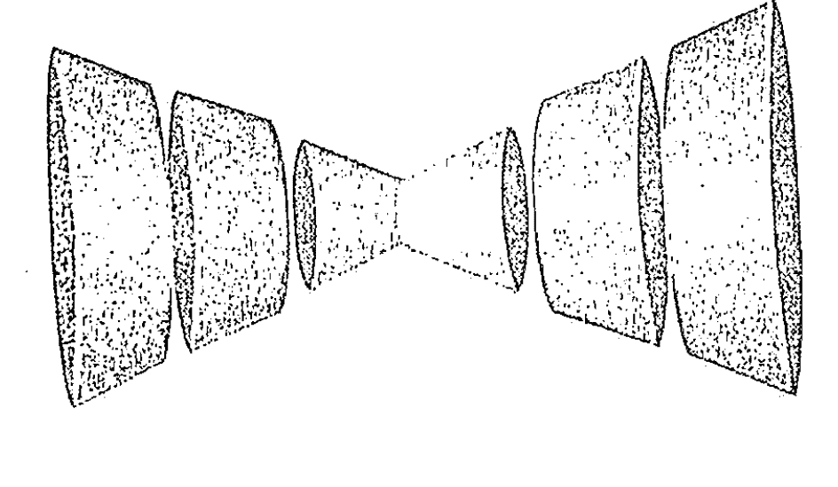

- 如何判斷好與壞？
- 如何選擇好與好？
- 建立口袋名單（好公司名單）。
- 定期定額退休金規劃。
- 資產配置技巧。

用最通俗的說法，財務報表就是一家公司營運的成績單。其中股市投資最重要的三張報表分別是：

- **損益表**：告訴您這家公司是賺錢還是虧錢的報表。
- **資產負債表**：告訴您這家公司在做生意時，擁有哪些資產、借了哪些負債，以及股東出資了多少钱等資訊。
- **現金流量表**：讓您了解一家公司是否有能力把獲利（公司賣出去的商品，不一定都能成功收到貨款，有時會遇到客戶經營不善倒閉或是惡意拖欠貨款等事情）轉換成現金流回公司，提供公司持續成長所需的動能。

這三張報表就是最基本的財務報表，而且要如圖表1-3擺在一起看，才能看出一家公司整體的面貌（營運的成績單）。尤其是上市公司的財務報表，都必須符合一般公會計原則以及證管會的相關法規，再加上有合格會計師的查核簽證，所以上市公司的財務報表可信度相當高。

雖然財務報表不是完美的萬靈丹，但只要仔細研讀，就能看出一家公司的大致經營面貌。

曾有財經記者在訪問巴菲特時問道：「請問股胖，您如何做投資判斷？」

圖示3 三張財務報表必須擺在一起看

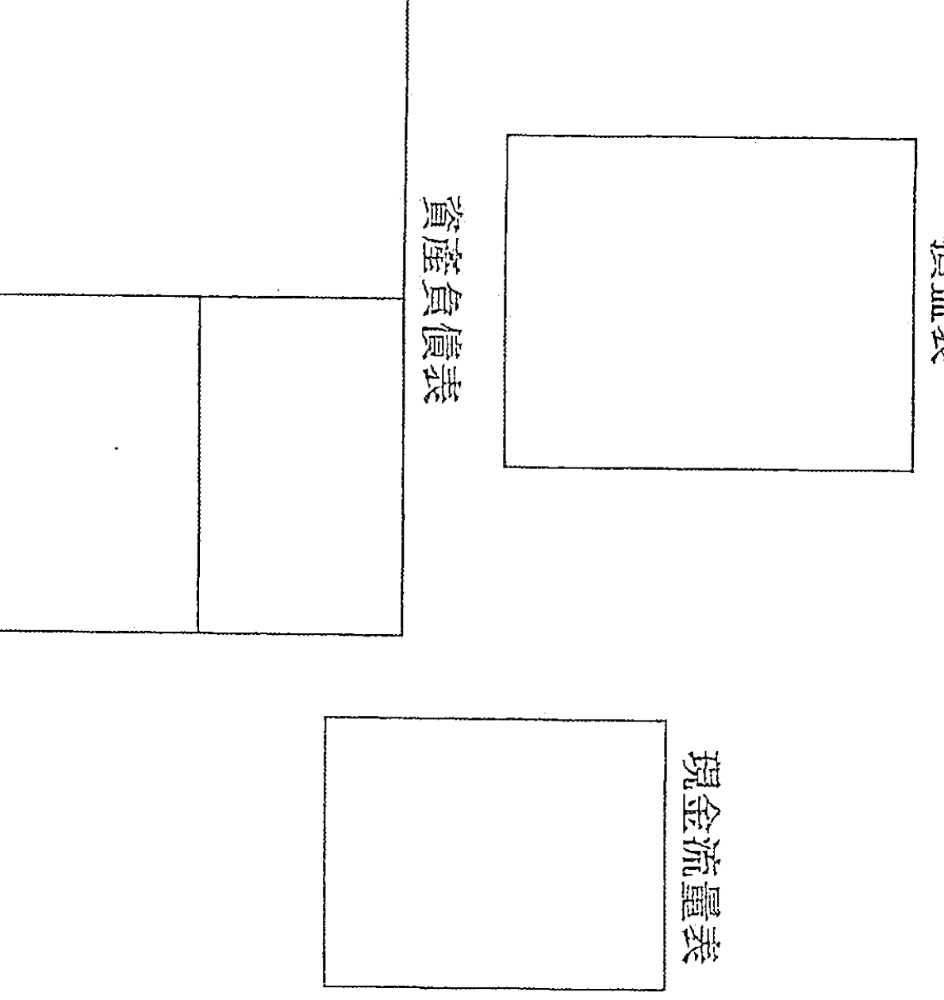

損益表

資產負債表

現金流量表

巴菲特回答說：「我們讀資料（財務報表等資料），就這樣。」

不過，巴菲特閱讀財務報表的習慣與大家不同，他喜歡一次看一家公司五年以上的財務報表，因為財務報表不是完美的文件，但當我們把時間拉長，以五年的長期資料來閱讀，這個時候公司的營運成績單（財務報表）就「真的假不了、假的真不了」。

所以當您閱讀一家公司的財務報表時，請一次看最近五年的資料。再者，透過長期五年的觀察，也才能看出一家公司是否具備巴菲特最想要的「長期穩定獲利能力」。

這個章節的重點就是：如果您完全沒有財務背景，閱讀財務報表只是想让自己的投資選股更正確，那麼請先學會底下介紹的財務報表立體模型就夠用了。

# 解讀財務報表立體模型

請參見圖表1-4，上方第一張報表叫做「損益表」，告訴我們一家公司一個月（或是一季／半年／一年）到底做了多少營收？公司每個月的成本是多少？每個月的管銷費用是多少（您可以把一家公司的「管銷費用」想像成一個人每個月的「食衣住行育樂等費用」，其實這些觀念是相通的）？然後扣掉業外收支與支出以及所得稅之後，這個月到底幫股東賺了多少稅後淨利？

下方的報表叫做「資產負債表」，通常左邊放的是資產相關類別的會計科目，右上角放的是負債類的會計科目、右下角放的是跟股東相關的股東權益類科目。

### 財務報表的立體模型


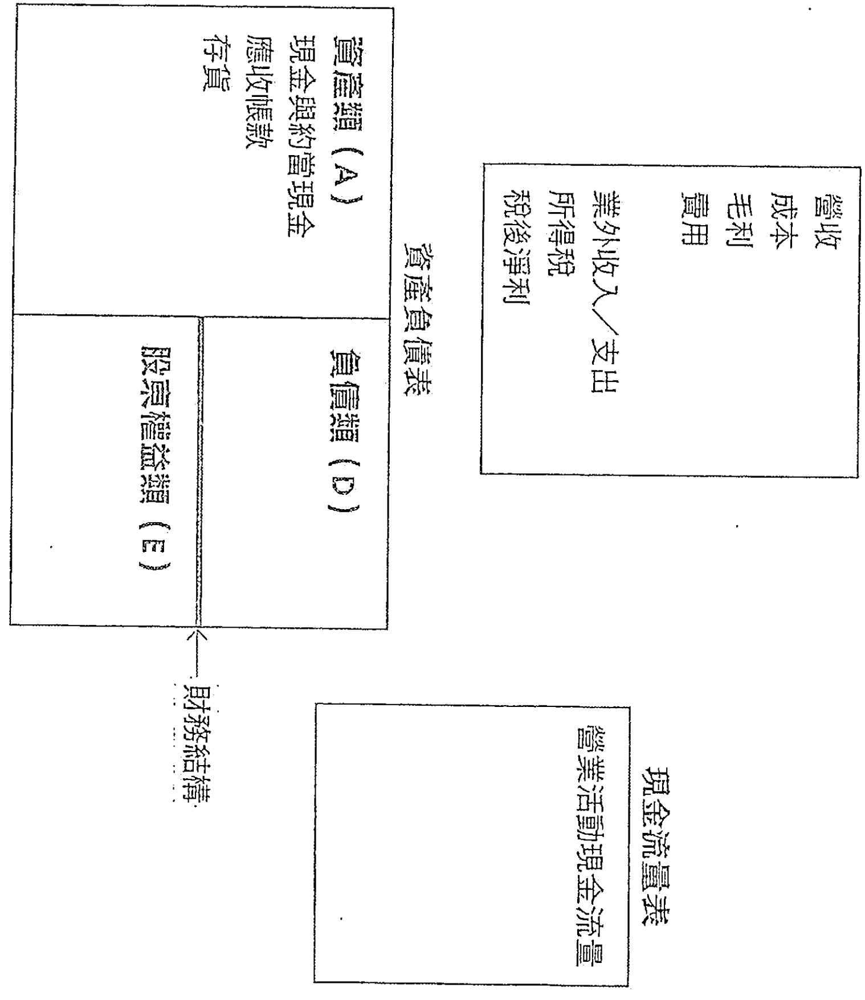

**損益表**
- 營收
- 成本
- 毛利
- 費用
- 業外收入／支出
- 所得稅
- 稅後淨利

**資產負債表**

| 資產類（A） | 負債類（B） | 隱性債務 |
| :--- | :--- | :--- |
| 現金與約現現金 | | |

股東權益類（E）

**現金流量表**
- 營業活動現金流量

財務結構

這張報表左邊的總數與右邊的總數一定會相等，所以是一張左右平衡（balance）的報表（sheet）。也因此，資產負債表的英文叫做balance sheet，亦即：

左邊=右邊

資產=負債+股東權益

如果用英文來表示，則會變成：

Asset=Debt+Equity

簡稱為 A=D+E

右邊第三張的財務表叫做「現金流量表」，這張報表主要的功能是讓我們了解一家公司帳面上所賺的錢（損益表），最後是不是轉變成真正的現金回到公司為公司所用。

以上，就是財務表的基礎立體觀念。

# 財務穩悍的觀念

在進一步介紹更多財務報表知識之前，我想特別介紹「財務穩悍」這個觀念。「財務穩悍」就是剛才您在圖表1-4「財務報表的立體模型」看到的那根紅色棒子。

# 財務槓桿的原理


如圖表1-5，在檯子上面，是外面欠人家的錢（負債）；檯子的下方，則是股東出資的錢（股東權益）。

| | 負債資本 | 自有資本 |
| :--- | :--- | :--- |
| | （外部資本） | （內部資本） |

所以財務的專業名詞才會說，負債的資金來源叫「外部資本」或「負債資本」，股東出資的錢就叫「自有資本」或「內部資本」。

不囤財報，
也能輕鬆選出賺錢穩穩股

請您猜一猜，是財務結構好（槓子）上方的負債資本比較便宜，還是下方的自有資金成本比較便宜？

答案是，負債資本比較便宜，因為一家正常的公司跟銀行借錢時，資金成本大約在2%左右；但是當您成為一家公司的股東，投資資金進去之後，您會希望能獲得更高的報酬率或是股息，例如10%以上，您才會想要投資，對嗎？

所以外部的資金成本比較低，內部的資金成本反而比較貴，跟一般人認為內部資金（股東出的錢）是零成本的概念正好相反。

如果一家經營超過五年有正常獲利的公司，公司的財務結構（槓桿）通常會往上移（如圖表1-6），代表股東出資越來越少，對外的負債越來越少。為什麼好的公司通常都有這個共通性呢？

因為人性：肥水不流外人田！

如果公司經營得很好，每年固定獲利，又是一門好生意（毛利率夠高），當公司需要更多資金擴大經營的時候，所有的股東都會舉手歡迎，寧可放棄參加公司的現金增資。運用這個人性，我們可以進一步思考：當一家公司的財務結構越來越往上移動，可能就是代表全體股東對這家公司的看法一致：這真是一門好生意，公司又有賺錢的真本事。

# 財務報表的源由與三大立體概念


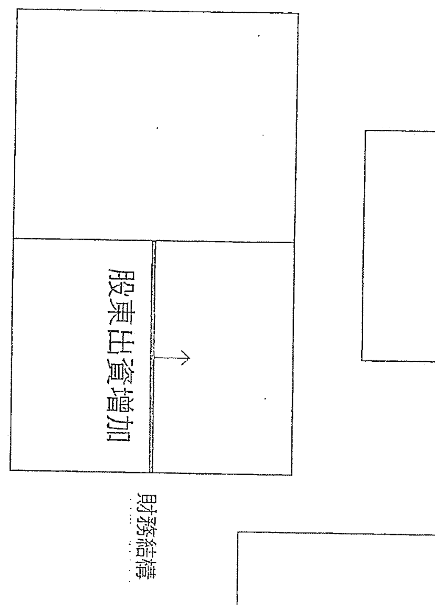

反之，當一家公司的財務結構一直往下移，代表負債的資金來源佔比越來越大（股東越來越不想投資），就可能代表這家公司的經營狀況不妙了！


閱讀財報 不懂財報 也能輕鬆選出賺錢績優股

所以財務報表是一個連動的立體觀念（如圖表1-7），當您看到①的數據，要馬上同步觀看數據②與③：

- ①財務結構：如是一家公司的財務結構一直往下移，代表股東出資的錢越來越少，請同步觀察②與③的數據。
- ②毛利率：這家公司的毛利率是不是持續在惡化？這已經不是一門好生意了嗎？
- ③營業利益率：這家公司是不是已經失去賺錢的真本事？

# Chapter 1 | 財務報表的源由與三大立體觀念

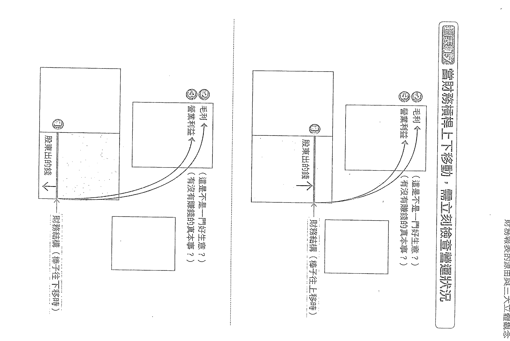

# 好公司的財務橫幅

接下來我們來看看幾家經營狀況不錯公司的實際財務報表資料。

# 大立光2015年年報

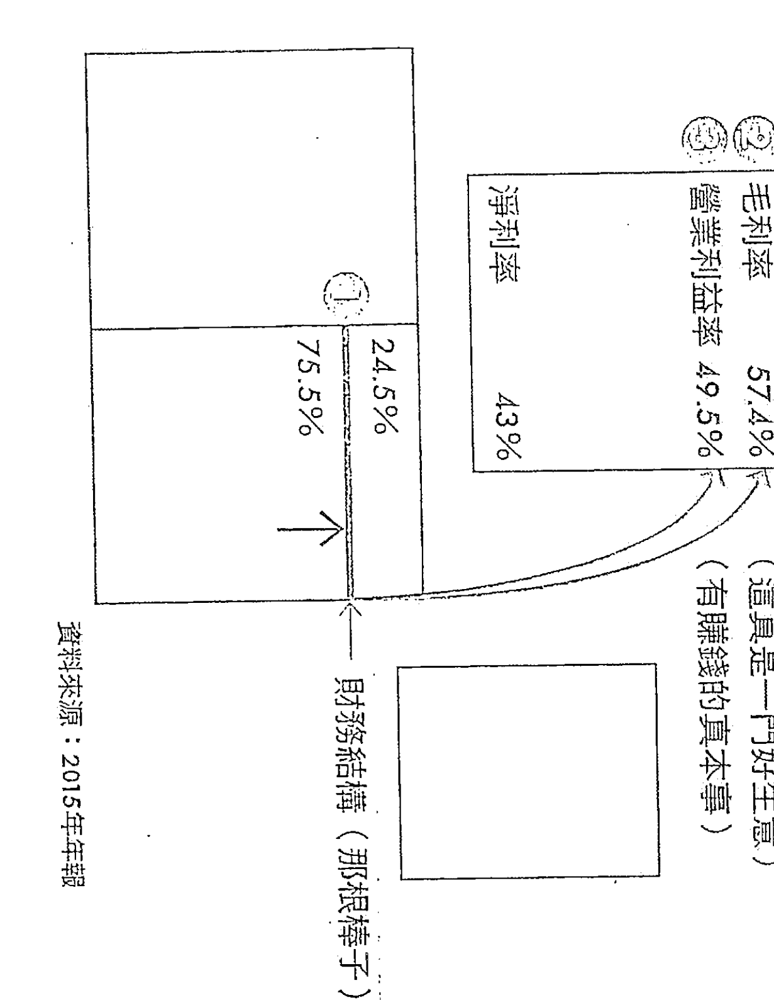

# 大立光

- ① 財務結構（那根棒子＝負債佔總資產比率）＝24.5%，這個數據非常高亮（那根棒子的位置相當高），代表股東積極參與公司的增資計畫。這時候請同步觀察②與③的數據。
- ② 毛利率＝57.4%，這真是一門好生意！
- ③ 營業利益率＝49.5%，這家公司有很強大的賺錢真本事。

資料來源：2015年年報

# 台積電2015年報

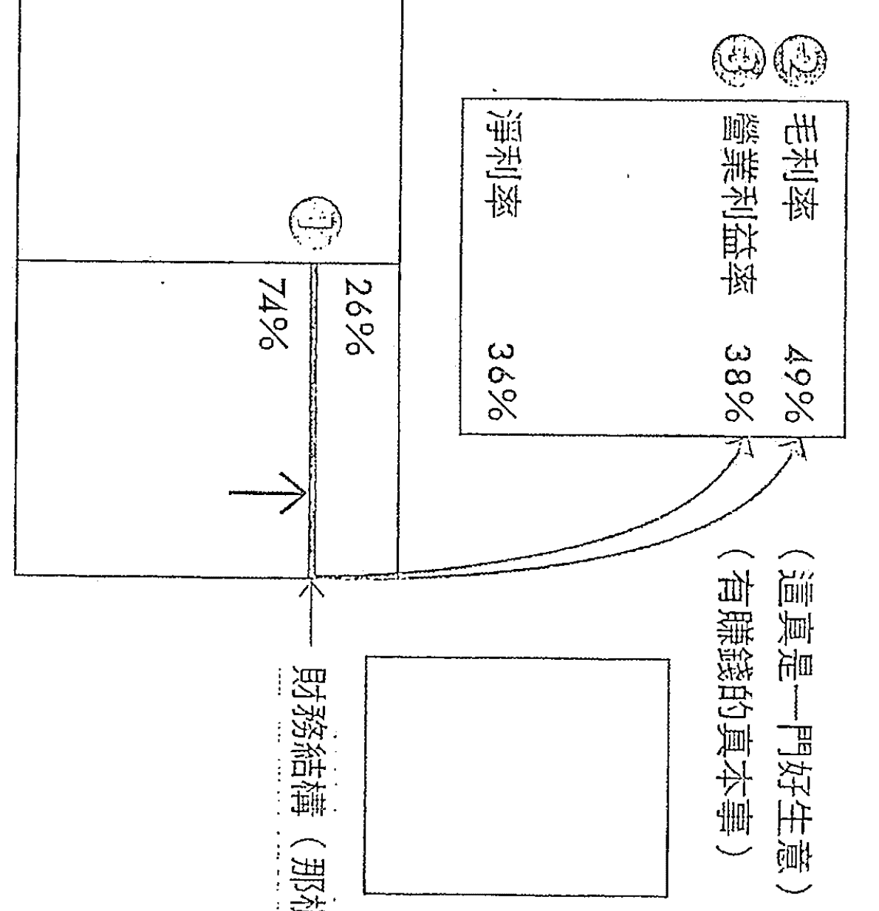

資料來源：2015年報

# 台積電

- ① 財務結構（那根棒子＝負債佔總資產比率）= 26%。
- ② 毛利率=49%，沒想到台積電的晶圆代工，真是一門好生意！
- ③ 營業利益率=38%，這家公司有非常不錯的賺錢真本事。

# 中碳2015年報

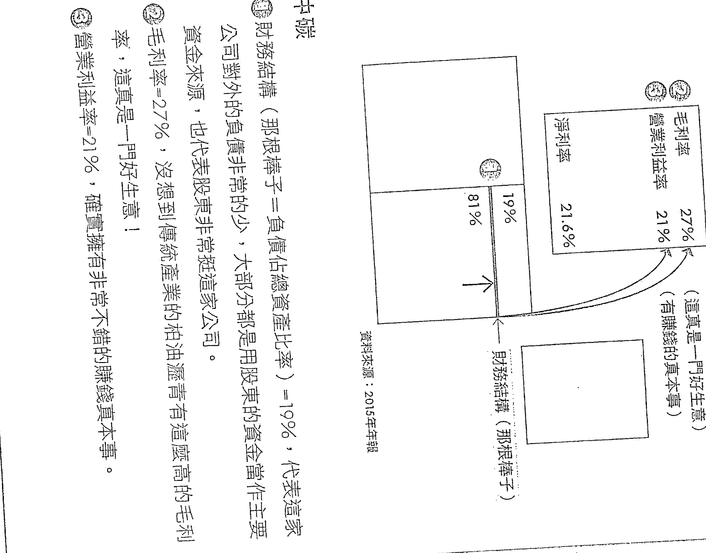

### 經營不善公司的財務情境

#### 茂德2010年年報

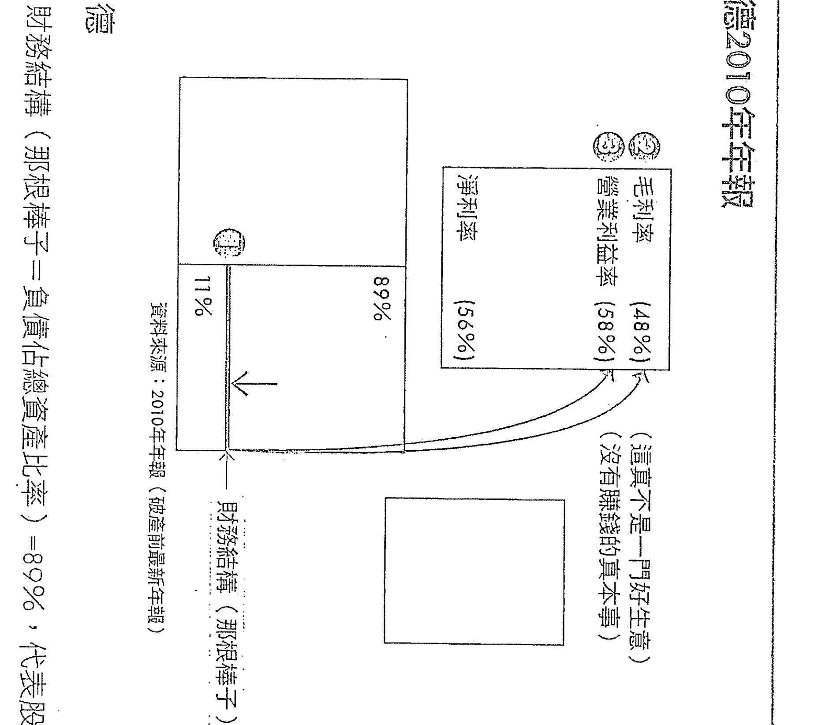

### 茂德

- ①財務結構（那根棒子＝負債佔總資產比率）＝89%，代表股東都不願意出資，公司大部分只能透過負債來經營。看完①，記得一樣要同步觀察②與③。
- ②毛利率＝負48%，這真是一門超級不能經營的行業啊！
- ③營業利益率＝負58%，這種公司絕對沒有機會為股東賺錢，除非是透過外收入來挹注。

### 力晶2011年年報

- ①毛利率 (42%)②營業利益率 (53%)③淨利率 (59%)

這真不是一門好生意（沒有賺錢的真本事）

查內安溪：2011年年報（僅查最新年報）

財務結構（那根棒子）

### 力晶

- ①財務結構（那根棒子 = 負債佔總資產比率）=87%，代表只有 13%股東願意出資，公司大部分只能透過負債來經營。
- ②毛利率=負42%，這不是一門好生意。
- ③營業利益率=負53%，沒有賺錢的真本事。

### 勝華2013年年報

- ①毛利率 (4%)  
- ②營業利益率 (14%)  
- ③淨利率 (13%)  
(這真不是一門好生意)  
(沒有賺錢的真本事)

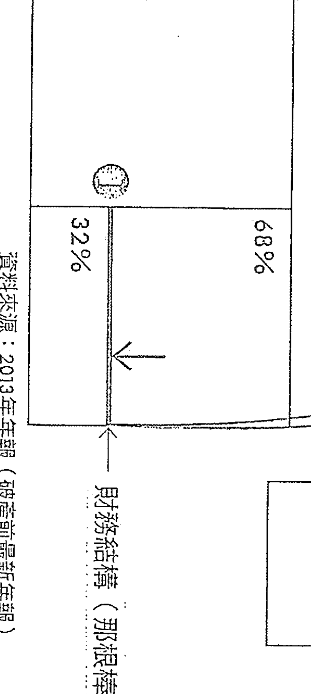

資料來源：2013年年報（除最新過新年報）

### 勝華

- ①財務結構（那根棒子＝負債佔總資產比率）＝68%，代表只有32%資金來自於股東。  
- ②毛利率＝負41%，這真是一門艱困的行業。  
- ③營業利益率＝負14%，很難有賺錢的真本事。

由上述六家公司，可以看出一个共通性：状况好的公司，股东都急着投资，因为肥水不落外人田。而状况不好的公司，股东都不想投资，避之唯恐不及；公司为了活下去，只能不断去寻求外部资金，例如银行贷款、公司债等。

当然，这只是有一个有趣的共通性，不可能100%通用于所有的行业。实际的情况，会依照不同行业别或是公司投资策略（也就是找钱的策略）而有所不同。

# 财务报表的取得方式与阅读顺序

有了基本的财务报表立体观念，接下来就需要找出您想投资之公司的财务报表。只要是上市、上柜的公司，在每个国家的公开资讯观测站，都会有该公司最新的财务报表。台湾的公开资讯观测站网址是：http://mops.twse.com.tw/mops/web16?sz=22_q1

台湾的公开资讯观测站自2016年起，也提供了财务报表分析的新网站（http://mopsfin.twse.com.tw），读者可以自行参考。但新网站无法同时阅读多个指标，只能一个指标、一个指标比对，比较容易发生只见树木，不见森林的窘境。笔者建议初学者宜先建立全局观之后，再使用新网站。

# 圖表1-8
公開資訊觀測站的申報資料

財務報表的源由與三大立體綜合
Chapter 4

中興紡織三家最近財務資料分佈

本表為對中興紡織公司(中興公司)及
其關係企業之財務資料予以彙整

- 本公司與關係企業
- 本公司與關係企業之財務資料
- 本公司與關係企業之交易往來

### 看懂財報，
也能輕鬆選出賺錢績優股

本書為了讓大家有較完整的全局觀點，故使用台灣股市資料調研站首頁最新原汁味的財報資訊。

進入股市觀測站之後，您就會看到如圖表1-8的畫面。只要在①處輸入您熟悉的股票代號，例如1223中煤，同時在②處勾選「最新資料」、③處按下「查詢」鍵，約1分鐘之內就可以看到那家公司最近三年的五大財務比率分析報表。如果資料遲遲未出現，肯定是您的網路沒有連上線。

這張密密麻麻的報表，乍看起來嚇死人，所以建議您暫時不用理會數字，先學會財報「中翻中」的技巧就好。

圖表1-9中標示了(A)～(E)的標號，這是我們經過多年實戰經驗，在股市繳了無數次的學費之後，建議您應該照此順序閱讀財務報表，底下我們逐一說明。

# 現金流量，中翻中叫做「比氣長，越長越好」。

這個用詞確的就很容易解釋。您就把它想變成「現金流量」，當然是越多越好。因為先進公司的現金越多，公司的底氣就越充足，氣就會越來越長，也代表一家公司的心臟功能越強。

我們投資股票當然是希望投資到一家好公司，就像在田徑場上挑哪個短跑選手會得獎，當然要優先選擇心臟功能正常的選手。所以，現金流量是您投資股市第一個要觀察的重要指標。遺憾的是，大家通常只關注營收規模大小或是每股盈餘（EPS）。

① 經營能力，中翻中叫做「翻桌率，越高越好」。這一項您也可以用生活常識來想像。有甲、乙兩家餐廳，甲餐廳中午的翻桌率是四趟，乙餐廳的中午翻桌率是一趟，請問兩家餐廳之中，哪一家的經營能力比較好？當然是翻桌率越高的那一家餐廳越好。所以，「經營能力」中翻中，叫做「翻桌率，越高越好」。

② 獲利能力，中翻中叫做「這是不是一門好生意？」這部分主要是看這一家公司的毛利率，是不是夠高？因為在所有獲利指標當中，毛利率是最重要的資訊。毛利率越高，代表這是一門好生意；毛利率越低，代表這是一門艱困的生意；如果毛利率是負的，那就代表這是一門爛生意。

如果您投資的公司，屬於艱困的生意或是一門爛生意，那麽您想要透過投資該公司股票來賺到的機會，就會非常渺小，除非您進行放空。

③ 財務結構，中翻中就是「那一根棒子」。我們在內面的內容提到，財務結構的高低，能夠看出一家公司股東對這家公司的普遍性看法——這是不是一門好生意？有沒有賺錢的真本事？所以這也是非常重要的指標之一，優先順序被我擺在第四位。

⑤ 償債能力，中翻中叫做「您欠我的，能還嗎？還越多越好」。

這應該不用多加解說了，非常符合我們的常識。

所以當您到公開資訊觀測站去看自己所投資公司的財務報表時，不要被這些密密麻麻的數字給嚇到，先針對大標題進行中翻中就可以了。

最後，請您參考圖表 1-9，我們針對公開資訊觀測站五大財務比率分析的原汁原味表格，為您再進行一次「中翻中」的複習。希望您讀完這個章節，便能完全消除您對財務報表的恐懼感。


# 圖表1-9

看公開資訊觀測站財務資料的大標是進行五種「中籤率」

財務報表的項目與三大立體概念

- 財務分析
- 財務報表
- 財務資料
- 財務報表
- 財務分析

a. 資產負債表
b. 損益表
c. 現金流量表
d. 財務報表

a. 財務分析
b. 財務管理
c. 財務分析
d. 財務分析

a. 資金
b. 資產

c. 財務狀況

d. 財務分析

a. 資產
b. 負債
c. 權益
d. 財務狀況

| | 2020 | 2019 | 2018 |
| :--- | :--- | :--- | :--- |
| 17.2% | 18.6% | 10.6% |
| 3.1 | 3.7 | 2.2 |
| 0.6 | 1.9 | 2.4 |
| 2.6 | 4.1 | 5.3 |

# Chapter 2

# 從現金流量破解
公司的存活能力


不懂財報，也能輕鬆選出賺錢績優股

現在您已經獲有了財務報表大架構的觀念，接著我們進一步來分析裡面重要的細部概念，本章要教您辨識現金流量的投資奧秘。

在深入說明之前，我要特別強調，這是一本工具書，目的是在短時間內教您擁有80%的正確財務報表知識，協助您在投資股票的過程中，擁有更好的判斷能力，所以本書不會特別花時間解說太過繁瑣的理論知識。如果您對財務報表保持濃厚的興趣，可以閱讀其他專家學者所寫的正規財務報表書籍，或是參考筆者另一本暢銷書《用生活常識就能看懂財務報表》。

如果想要確認一家公司「比氣長」的能力，通常得看三個重要的指標：

- A1 以「大於100／100／10」的觀念來分析。
- A2 手上是否有足夠的現金，能安全渡過不景氣時的危機時刻？
- A3 公司偿债過程中是否能夠即時收回現金？

# A1 100/100/10 分析指標

## ◎現金流量比率

所謂「100/100/10」的觀念，其中第一個 100 指的是現金流量比率。

現金流量比率 = 營業活動淨現金流量 ÷ 流動負債

= ( 大 / 小 ) > 100% ( 比較好 )

乍看之下，現金流量比率是一個可怕的公式，但是您只要把它中頭中，就會了瞭它的含意。

這個指標主要是讓您知道，您投資的公司它們的經常性營業活動所帶來的現金流入，是否足以償還欠人的流動負債？

大於 100%，代表公司真正賺進來的現金足夠償還對外的短期負債。大於 100%，也代表公司賺回的現金比較多，對外欠的短期負債比較少。因此暗示著這家公司向銀行週轉借錢的能力也不錯。如果用生活上的例子，您應該更容易了解。

A公司一年賺進的營業活動現金流量是1000萬，對外的短期負債是300萬；B公司則是一年賺進的營業活動現金流量是1000萬，對外的短期負債是3億元。您覺得哪一家公司的經營狀況比較好？

只用常識判斷，也能認定當然是A公司的情況比較好。所以我們才會說，現金流量中斷是「比氣長，越長越好」，數字越大越好。

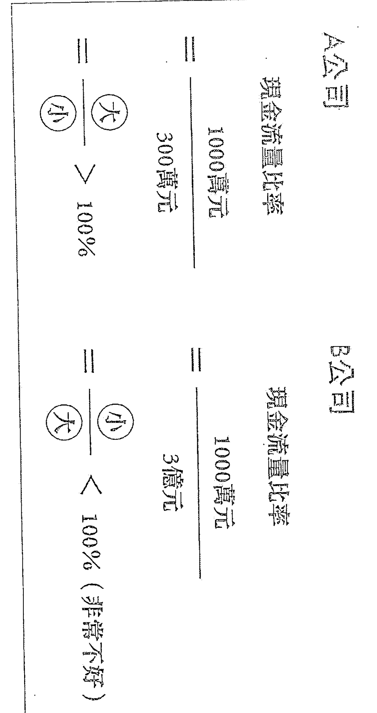

## ◎現金流量允當比率

「大於100／100／10」的觀念，其中第二個100，指的是現金流量允當比率。

### 現金流量允當比率

最近5年度營業活動淨現金流量 + 最近5年度的「資本支出＋存貨增加額＋現金股利」 ÷ 大 > 100% (比較好)

這個公式看起來更嚇人，但不用擔心，它一樣可以簡單地中籤中。大於100%，代表分子大、分母比較小。也就是說公司最近的五年度，靠正常的營業活動所賺進來的現金流量，大於最近五年年度為了成長所需的資本支出、存貨和固定要夠給股東的現金股利。這個比率的數值當然是越大越好。

大於100%，代表公司最近五個年度不需要到外借錢融資，自己賺的錢（營業活動現金流量）就能自給自足，支應基本的成長所需。

大於100%，也代表公司最近五個年度自己所賺的錢已經夠用，不需要看銀行或股東的臉色，因為如果公司缺資金的話，需要從這兩種管道借錢。如果經營公司不需要看銀行或大股東的臉色，這當然是最棒的情況。


## 投資方

不穩的領

也能輕鬆看出賺錢難/優股

讓我們同樣舉個生活上的例子。甲公司最近五個年度的營業活動現金流量有5000萬，為了把生意做得更好，它需要添購一台1000萬的大型卡車。乙公司也是做相同的行業，但是它最近五個年度的營業活動現金流量，累計只有500萬；當它也想買一台1000萬的大卡車時，這家公司還缺500萬，所以必須看銀行或股東的臉色。

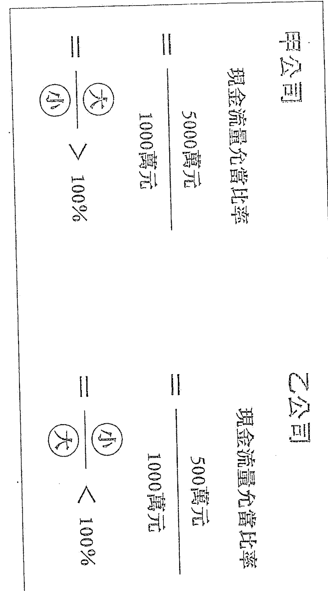

您覺得是甲公司好，還是乙公司好？用常識來判斷，當然是甲公司比較好。所以我們才會說，現金流量中顯的是「比氣長，越長越好」，數字越大越好，能夠完全滿足「大於100／100／10」更好。

## 現金再投資比率

「大於100/100/10」的觀念，其中第三個10，指的是現金再投資比率。學理上定義的嚇人公式如下：

現金再投資比率

```
=(營業活動淨現金流量－現金股利－固定資產毛額＋長期投資＋其他資產＋營運資金)/(10)=10%=10% (比較好)
```

請暫時不要理會這個複雜的公式，您只要知道如何翻中就可以。這個比率指的是，公司靠自己日常營運實力所賺進來的錢（營業活動現金流量），扣除給股東現金股利之後，公司最後自己所能保留下來的現金，而這些現金，可以再投資於公司所需資產的能力。其中的分母（固定資產毛額＋長期投資＋其他資產＋營運資金），如果您仔細看，就會發現它已經幾乎要把整個大項的資產科目都包含進去了。換句話，「大於100/100/10」其中的10%概念，您也可以把它理解成：公司手上真正留下來的現金，最低應該佔總資產的10%。

有趣的是，2014年巴菲特在預立遺囑中，交待妻子把九成的資金放在標準普爾500（S&P 500）的指數股票型基金（ETF），剩下一成放在政府債券，長期持有就可以過得很好；其中，美國的政府債券等同現金（因為流動性很高，缺錢時可以馬上賣出變成現金）。如果我們把巴菲特的預立遺囑進行中翻中分析，就是現金最低應該佔總資產的10%。

### 公司體質好壞實戰分析

接下來，我們進入實戰分析，看看狀況好的公司與狀況不好的公司有什麼差異。

- 首先利用圖表2-1，為大家複習從公開資訊觀測站取得的財務資料，可看到現金流量的相關比率等資訊位於(A)區塊。
- 若進一步整理從公開資訊觀測站所取得的各項資料，則可將該公司的財務報表資訊，彙整為如圖表2-2~2-4方便查核的樣貌。

連大數字的「2」都不懂的話，也能輕鬆選出賺錢績優股

### Chapter 2
從現金流看懂公司的生存能力

## 圖表 2-1

現金流量符合「大於100/100/10」是比保長生的關鍵


- 淨利為正、營業現金流為正、資本支出為正
- 投資活動：購置不動產、廠房、設備、智慧財產權所花下之投資
- 財務活動：向銀行或債權人借入或還清所生之金融交易之現金流
- 投資活動：購買或出售其他公司資產所生之現金交易
- 財務活動：投資有價證券，與借入或還清公司債所生之交易
- 現金與約當現金：銀行存款、活期存款、貨幣市場、短期有價證券、及約當現金

| 單位：仟美元 | 本業之現金流 (1) | 投資之現金流 (2) | 財務之現金流 (3) | 合計 (1)+(2)+(3) | 營業現金流/總資產 | 營業現金流/淨資產 | 營業現金流/長期負債 | 營業現金流/利息費用 | 本業現金流/資本支出 | 資本支出/營業現金流 | 現金及約當現金 |
| :--- | :--- | :--- | :--- | :--- | :--- | :--- | :--- | :--- | :--- | :--- | :--- |
| 2020 | 12.50 | 7.22 | 74.30 | 13.29 | 13.29 | | | | | | |
| 2019 | 425.50 | 453.50 | 433.10 | 447.30 | 2.21 | 2.37 | 0.94 | 0.27 | | | |
| 2018 | 248.10 | 234.50 | 30.64 | 10.18 | 275.06 | 4.42 | 4.59 | 0.74 | | | |
| 2017 | 168.50 | 15.29 | 144.60 | 184.64 | 26.25 | 25.42 | 34.65 | 4.29 | 4.45 | 4.50 | 9.74 |
| 2016 | 18.15 | 74.10 | 24.45 | 9.88 | 2.23 | 0.68 | 1.57 | 3.03 | | | |
| 2015 | 125.00 | 122.00 | 33.40 | 1.79 | 0.25 | 0.55 | 0.84 | 2.09 | 3.80 | 9.30 | |
| 2014 | 23.60 | 14.40 | 20.40 | 2.29 | 0.35 | 0.53 | 0.97 | 1.35 | 7.40 | 14.79 | 7.30 |
| 2013 | 148.50 | 32.10 | 153.00 | 135.40 | 52.55 | 5.75 | 4.20 | 0.25 | 4.65 | 5.75 | |

| 71C11A2 大立光, http://www.tgsl.com |
| 3008 | 2013 | 2014 | 2015 |
| 現金(當面比率%) | 34.97 | 39.5 | 46.7 |
| 應收帳款(當面比率%) | 17.07 | 21.5 | 13.3 |
| 存貨(當面比率%) | 6.97 | 5.8 | 4.5 |
| 應付帳款(當面比率%) | 18.02 | 24.2 | 34 |
| 投資短存(當面比率%) | 100 | 100 | 100 |
| 長期負債(當面比率%) | 20.97 | 8.2 | 24.4 |
| 短期負債(當面比率%) | 6.49 | 4.3 | 3.4 |
| 應收帳款(當面比率%) | 0.84 | 0.12 | 0.1 |
| 現金(當面比率%) | 78.84 | 75.1 | 75.5 |
| 股債總體現金(當面比率%) | 100 | 100 | 100 |

| 財務指標 | 2013 | 2014 | 2015 |
| 資產總量比率(%) | 31.15 | 24.33 | 24.53 |
| 股東權益比率(%) | 68.85 | 75.67 | 75.47 |
| 資產總量比率(%) | 331.1 | 303.1 | 315.48 |
| 資產總量比率(%) | 296.4 | 278.49 | 298.68 |
| 流動資產比率(%) | 4.1 | 4.4 | 4.49 |
| 現金流量比率 | 99.02 | 80.39 | 81.29 |
| 存現金比率(%) | 5.54 | 6.83 | 6.55 |
| 中長現金比率 | 95.86 | 53.4 | 35.2 |
| 投資短存現金比率(%) | 2.8 | 3.4 | 3.3 |
| 長期負債比率(%) | 0.71 | 0.32 | 0.28 |
| 股債總體現金比率(%) | 32.59 | 30.1 | 31.7 |
| 股債總體現金比率(%) | 85.79 | 50.72 | 44.09 |
| 股債總體現金比率(%) | 47.35 | 45.92 | 41.28 |
| 總負債比率(%) | 38.5 | 45.6 | 45.5 |
| 總負債比率(%) | 61.5 | 54.3 | 54.7 |
| 總負債比率(%) | 36.09 | 45.62 | 45.24 |
| 股債總體現金比率(%) | 71.6 | 14.43 | 18.06 |
| 總資產比率(%) | 95.01 | 14.98 | 14.2 |
| 股債總體現金比率(%) | 2.595 | 3.48 | 3.03 |
| 總資產比率(%) | 1.944 | 28.27 | 30.78 |
| 總資產比率(%) | 3.734 | 17.43 | 16.51 |
| 資產總量比率(%) | 11.360 | 19.688 | 29.471 |
| 現金流量比率(%) | (5.25) | (5.72) | (7.43) |
| 現金流量比率(%) | (2.36) | (3.77) | (6.87) |

在大立光的現金流量分析表中,「大於 100/100/10」（現金流量比率/現金流量償債比率/現金再投資比率）這三個指標都完全符合，而且還大很多，代表這家公司的「氣」會比同業還要長。
「比氣長」這個觀念非常重要，因為我們投資一家公司時，當然要優先投資氣比較長的公司，只要這家公司不會破產（比氣長），然後以這個基礎再追求最大的投資報酬率。千萬不能只追求最大的投資報酬率，然後沒幾個月該公司就被下市，這樣您投資的錢就會血本無歸。

## 圖表 2-3 合庫電 2015 年財務報表

資料來源：財務報表網址：https://money.kyc.com.tw/；資料處理：合庫電公司

| 項目 \ 單位:百萬元 \n資料處理: 除現金及約當現金 | 2013 | 2014 | 2015 |
|---|---|---|---|
| 風險資產與約當現金比率(%) | 135.4 | 181.4 | 178.2 |
| 資產品質狀況 | 不良資產(約當現金) | 98.0 | 243.6 | 215.9 |
| 不良資產與約當現金比率(%) | 148.9 | 118.0 | 158.9 |
| 減損能力 | 呆帳準備(百萬元) | 91.1 | 78.0 | 31.2 |
| | 呆帳比率(%) | 16.6 | 2.1 | 1.5 |
| 盈利能力 | 淨損前損益(百萬元) | 4.06 | 7.42 | 8.03 |
| 獲利能力 | 平年獲利日數 | 8.39 | 4.49 | 4.45 |
| | 平年淨損率(%) | 0.85 | 0.99 | 0.54 |
| 現金流量 | 不依賴金融資產的經營活動現金流(百萬元) | 43.5 | 45.1 | 10.2 |
| 流動性與風險管理 | 約當現金與現金流出比率(%) | 77.11 | 55.4 | 104.4 |
| 成長性 | 資本適足率(%) | 17.0 | 15.3 | 15.6 |
| | 權益資本適足比率(%) | 14.6 | 12.7 | 13.8 |
| 財務結構 | 資產組態比率(%) | 24 | 27 | 28 |
| | RoE | 3.58 | 4.8 | 4.3 |
| 業務 | 稅後純損益(百萬元) | 47.06 | 39.45 | 37.94 |
| 經營能力 | 每百平方公尺營業收入(百萬元) | 71.45 | 74.54 | 36.23 |
| | 業務費用 | 4.3 | 40.53 | 36.43 |
| | 稅後純損益(百萬元) | 7.26 | 10.18 | 11.82 |
| 現金流 | 現金淨流淨入(百萬元) | -189.019 | 263.786 | 306.565 |
| | 現金流淨流入比率(%) | 8.35 | 9.15 | 1.3 |
| 經營管理 | 現金流淨入(百萬元) | 63.9 | 20.6 | 129.67 |
| 資產品質管理 | 呆帳準備(百萬元) | 12.16 | 13.04 | 13.76 |
| | 約當現金與現金流出比率(%) | 347.1 | 473.4 | 529.877 |
| 資本適足率 | 總資本淨額(百萬元) | 337.7 | 424.4 | 455.7 |
| | 約當現金與現金流出比率(%) | 100 | 100 | 100 |

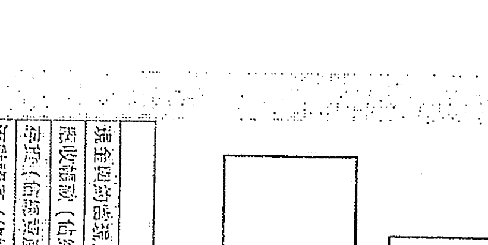

合庫電也是大家認合「大於100/100/10」的指標，而且和光大光一樣，每個指標都是一年比一年好。

## 圖表 2-4
中碳 2015 年財務報表

1723
中碳

單位：新臺幣百萬元，每股資料除外

| | 2015 | 2014 | 2013 |
| :--- | :--- | :--- | :--- |
| 銷售成本 | 48.7 | 35.9 | 26.7 |

| 中碳 | 1723 |
| :--- | :--- | :--- |
| 資產負債表 | 現金流量表 | |

| 單位：新臺幣百萬元，每股資料除外 | 2015 | 2014 | 2013 | |
| :--- | :--- | :--- | :--- | :--- |
| 資產 | | | | |
| 現金及銀行存款 | 2,224 | 2,189 | 1,430 | |
| 應收帳款淨額 | 3,559 | 3,805 | 3,137 | |
| 存貨淨額 | 222 | 247 | 318 | |
| 固定資產淨額 | 25,356 | 27,135 | 31,285 | |
| 資產總計 | 54,300 | 56,994 | 65,272 | |
| 負債及權益 | | | | |
| 應付帳款 | 1,644 | 1,777 | 2,014 | |
| 銀行借款 | 2,150 | 1,739 | 1,424 | |
| 固定資產長期負債 | 2,540 | 2,545 | 4,840 | |
| 負債總計 | 11,752 | 12,291 | 14,595 | |
| 股東權益 | 42,548 | 44,703 | 50,677 | |
| 負債及權益總計 | 54,300 | 56,994 | 65,272 | |

| 項目 | 2015 | 2014 | 2013 |
| :--- | :--- | :--- | :--- |
| 資產總計(百萬) | 54,300 | 56,994 | 65,272 |
| 資產週轉率 | 39.6 | 45.9 | 39.7 |
| 存貨週轉率(%) | 2.4 | 2.0 | 1.8 |
| 固定資產週轉率(%) | 1.7 | 1.7 | 1.5 |
| 資產總資本報酬率 | 2.6 | 2.5 | 1.8 |
| 純益淨利率(%) | 5.0 | 4.4 | 3.6 |
| 權益比率(%) | 78.4 | 78.4 | 77.6 |
| 應收帳款現金轉換率(天) | 45.2 | 43.4 | 42.9 |
| 現金流量(百万) | 1,755 | 3,133 | 4,469 |
| 現金流量/資產比(%) | 3.2 | 5.5 | 6.8 |
| 資產負債比(%) | 21.6 | 21.6 | 22.4 |
| 資本結構比率(%) | 8.3 | 6.7 | 5.7 |

單位：新臺幣百萬元

| | 2015 | 2014 | 2013 |
| :--- | :--- | :--- | :--- |
| 現金及銀行存款 | 2,224 | 2,189 | 1,430 |
| 應收帳款淨額 | 3,559 | 3,805 | 3,137 |
| 存貨淨額 | 222 | 247 | 318 |
| 固定資產淨額 | 25,356 | 27,135 | 31,285 |
| 資產總計 | 54,300 | 56,994 | 65,272 |
| 應付帳款 | 1,644 | 1,777 | 2,014 |
| 銀行借款 | 2,150 | 1,739 | 1,424 |
| 固定資產長期負債 | 2,540 | 2,545 | 4,840 |
| 負債總計 | 11,752 | 12,291 | 14,595 |
| 股東權益 | 42,548 | 44,703 | 50,677 |
| 負債及權益總計 | 54,300 | 56,994 | 65,272 |

| 單位：新臺幣百萬元，每股資料除外 | 2015 | 2014 | 2013 |
| :--- | :--- | :--- | :--- |
| 資產 | | | |
| 固定資產週轉率(%) | 25.4 | 26.9 | 32.5 |
| 資產總資本報酬率 | 3.5 | 4.1 | 4.9 |
| 純益淨利率(%) | 4.3 | 3.6 | 2.9 |
| 權益比率(%) | 80.1 | 80.9 | 82.5 |
| 應收帳款現金轉換率(天) | 54.1 | 48.3 | 41.3 |
| 現金流量(百万) | 2,546 | 1,541 | 7,321 |
| 現金流量/資產比(%) | 4.7 | 2.7 | 11.2 |
| 資產負債比(%) | 19.9 | 19.1 | 17.5 |
| 資本結構比率(%) | 7.8 | 7.0 | 5.5 |

| 類別 | 2015 | 2014 | 2013 | |
| :--- | :--- | :--- | :--- | :--- |
| 銷售比重 | 13.8 | 13.5 | 15.3 | |
| 長期資產/長期融資比率(%) | 95.9 | 95.9 | 39.3 | |
| 應收帳款/營業收入比率(%) | 48.2 | 46.7 | 36.7 | |
| 應收帳款(天) | 8.7 | 45.9 | 52.7 | |
| 資產週轉率(%) | 1.8 | 1.4 | 1.2 | |
| 固定資產資本結構比率(%) | 55.5 | 51.7 | 43.2 | |
| 資本結構比率(%) | 24.2 | 24.4 | 27.6 | |
| 現金(百万) | 4,355 | 3,545 | 5,694 | |
| 現金流量/資本結構比率(%) | 96.6 | 97.4 | 110.7 | |
| 銀行借款/資產比率(%) | 21.5 | 22.0 | 24.4 | |
| 現金流量/股東權益比率(%) | 59.2 | 34.3 | 134.4 | |
| 應收帳款現金轉換率(from B/S表) | 43.9 | 42.6 | 45.9 | |
| 現金流量現金轉換率(from B/S表) | 4,350 | 1,475 | 4,530 | |
| 現金流量現金轉換率(from B/S表) 資本結構比率 | 77.7 | 72.6 | 87.0 | |
| 權益/資本總資產 | 1,723 | 1,710 | 1,739 | |
| 固定資產長期負債(百萬) | 4,290 | 4,290 | 4,345 | |
| 固定資產長期負債/股東權益比率 | 10.0 | 10.0 | 10.0 | |
| 現金及銀行存款(百萬) | 10.0 | 10.0 | 10.0 | |
| 銀行借款(百萬) | 10.0 | 10.0 | 10.0 | |

中碳的「大於100/100/10」指標，除了第一個100的指標表現很好之外，其他都不算理想。可是在股市中，大家不是都說中碳是一家值得投資的好公司嗎？為什麼他的比成長指數沒有那麼好？

這是因為，一家公司真正的比成長指數，要看三個重要面向，但我們現在只看到第一個100/100/10的比成長觀念。稍後會再進一步為大家解說另外兩個比成長的重要觀念。

58


## 表三、5387 2012.03 年財務表
### 龍德 2010 年財務報表


**單位: 百萬元 (RMB)，除每股數據、比率及數據外**

| 指標 | 附註(註) | 2008 | 2009 | 2010 |
| :--- | :---: | :---: | :---: | :---: |
| 每股收益(元) | 19 | 65.5 | 70.7 | 88.9 |
| 每股資本 (元) | 19 | 54.3 | 94.5 | 106.9 |
| 資產負債比率(%) | | 40.3 | 27.4 | 70.4 |
| 權益比率(%) | 3 | | 9.6 | 36.9 |
| 現金及現金等價物(元) | | 5.1 | 9.8 | 57.2 |
| 平倉股股息比率 | | 39.4 | 97.2 | 9.6 |
| 派息比率(%) | | 6.5 | 9.6 | 14.5 |
| 不計股息(除資本支出比率) | | 52.8 | 38 | 23.7 |
| 自由現金流(除資本支出比率) | | 0.24 | 0.12 | 0.5 |
| 投資現金流比率(%) | | (23.9) | (18.2) | (4.2) |
| 融資現金流比率(%) | | (59.2) | (70.1) | (8.3) |
| 資產周轉比率(%) | | (59.9) | (73.2) | (99.3) |
| 息税前利潤(EBIT) | | (64.2) | (240.2) | (47.8) |
| 息税前利潤比率(%) | | (8.1) | (17.3) | (58.1) |
| 利息覆蓋比率(%) | | (11.7) | (251.3) | (56.6) |
| 經營現金流比率(%) | | (56.09) | (23.2) | (3) |
| 資本支出比率(%) | | 50.3 | - | 19 |
| 經營現金流資本支出比率(%) | | 2.9 | 0 | 7.4 |
| 經調整資產周轉比率(%) | | -48.7 | 39.6 | 41.4 |
| 現金回報率(%) | | 2.2 | 0 | 0.8 |
| 經營現金流資本支出比率(Rem B/S, 1分) | | 869 | (972) | 768 |
| 經營現金流資本支出比率(Rem B/S, 5分) | | (1.417) | (1.023) | 3.129 |
| 經營現金流資本支出比率(Rem B/S, 6分) | | 3.767 | 1.765 | (2.33) |

| 項目 | 2008 | 2009 | 2010 |
| :--- | :---: | :---: | :---: |
| 經營現金流量(除資本支出外) | 0.4 | 0.28 | 2.2 |
| 投資現金流量 | 12 | 113 | |
| 融資現金流量(除資本支出外) | 3.48 | 5.97 | 3.26 |
| 融資現金流量(除資本支出外) | 6.83 | 5.64 | 3.26 |
| 現金及銀行餘額 | 100 | 100 | 100 |
| 現金及銀行餘額 | 3.89 | 3.85 | 2.29 |
| 現金及銀行餘額 | 5.125 | 2.231 | 20.57 |
| 總資產比率(經營資產比率) | 61.5 | 58.03 | 75.21 |
| 總負債比率(經營資產比率) | 32.8 | 19.66 | 4.33 |
| 總負債比率(經營資產比率) | 100 | 100 | |
| 經營現金流(資產回報率) | 100 | 100 | 100 |

看完這三家公司之後，我們再來看看三家已經下市的公司在它們下市前最後一次的財務報表狀況。

可以很明顯地看到，在比值長指數100/100/10方面，茂德的第一個100指標，在2009年表現的數字是0。代表公司經常性營業活動所帶來的現金流入太小，公司完全沒有能力償還對外欠人家的短期負債。

其後的現金流豐富比率（100）與現金再投資的比率（10），也非常不好。


## 5.3.4.6 力晶2011年財務報表

2012-12-17 發布 依據

「中華民國54年1月1日施行之「中華民國證券交易法」§17、§32、§37、§41條及「中華民國54年1月1日施行之「中華民國證券發行人財務報表編制準則§5第2項」所列資訊。

- www.fgm.com.tw/IR/Chinese/Financials/index.html
- www.fgm.com.tw/IR/Chinese/Financials/2011/index.html
- www.fgm.com.tw/IR/English/Financials/index.html
- www.fgm.com.tw/IR/English/Financials/2011/index.html

| 項列 | 2009 | 2010 | 2011 |
| :--- | :---: | :---: | :---: |
| 資本 | 75.4 | 70.7 | 87.1 |
| 資權比率(%) | 56.1 | 57.1 | 45.2 |
| 純資產/股務及員工持股(%) | 12.9 | 11.1 | 11.6 |
| 純資產/員工持股(%) | 19.9 | 12.4 | 11.6 |
| 現金純資產(%) | 10 | 9.2 | 7 |
| 短期流動資產(%) | 17.3 | 18.4 | 13.9 |
| 存貨平均天數 | 52 | 6.6 | 93 |
| 短期平均天數 | 5.3 | 9.4 | 193 |
| 短期平均天數(含應付往來款項) | 66.7 | 13.4 | 40.6 |
| 非流動資產/總資產(%) | 0.37 | 1.9 | 0.83 |
| 長期債務比率(%) | 0.23 | 0.2 | 0.45 |
| 負債比率(%) | 43.6 | 42.9 | 54.8 |
| 資本/平均天數 | (56.5) | 10.1 | (30.9) |
| 資產周轉率(%) | (27.4) | 12.5 | (14.9) |
| 純資產/資本平均天數(%) | (64.7) | 1.1 | (42.4) |
| 純資產/平均天數(%) | (39.4) | 4.3 | (57.3) |
| 純資產/資本(%) | (6.5) | 44.9 | 4.5 |
| 純資產/資本淨比率(%) | (2.5) | 0.2 | (1.5) |
| 純資產/資本淨比率(%) | (20.1) | 6.96 | (22.1) |
| 純資產/資本(%) | (2.1) | 3.3 | (3.4) |
| 純資產/資本流動比率(%) | (37.2) | 65.9 | 49.4 |
| 純資產/資本(%) | (55.7) | 15.3 | 1.6 |
| 現金純資產比率(%) | (7.1) | 32.86 | (54.67) |
| 純資產/資本(%) | 5.18 | (6,240) | 4.97 |
| 純資產/資本淨比率(%) | (5,443) | (24,779) | (3,434) |

力晶的比長久債數100/100/10也是逐年惡化，尤其是第一個100指標，在2011年只剩下9.6%，代表當年該產公司經常性的營業活動所賺進來的現金，只能償還9.6%的對外短期負債。如果把這句話再申論中，就是：不好意思，我今年正常營運所賺來的現金不夠用，大約有90.4%的短期負債我還不了，拜託各位債權人（供應商與銀行等）不要再逼我，我真的拿不出錢了。

## 圖表 2-2 騰華2013年財務報表

### 騰華 2384
2014 上市櫃股票

| 項目 | 風險比率 | 年終 | 風險暴露度 | 風險吸收能力 | 風險承擔能力 |
| :--- | :--- | :--- | :--- | :--- | :--- |
| | | 2011 | 2012 | 2013 | 2011 | 2012 | 2013 | 2011 | 2012 | 2013 | 2011 | 2012 | 2013 |
| 資本及資本緩衝區 (%) | 20.0 | 25.8 | 68.1 | 53.3 | 55.8 | - | - | - | - | - | - | - |
| 股項及資本緩衝區 (億元) | 10.2 | 8.9 | 62.5 | - | - | - | - | - | - | - | - |
| 資本及資本緩衝區 (倍數) | 7.4 | 74 | 39.3 | - | - | - | - | - | - | - | - |
| 股東權益比率 (倍數) | 4.0 | - | - | 3,868.5 | 4,148 | 7,962 | - | - | - | - | - |
| 股東權益 (億元) | - | - | - | - | - | - | - | - | - | - | - |
| 利息倍數 (倍) | 4.3 | 4.1 | 1.7 | - | - | - | - | - | - | - | - |
| 流動比率 (倍) | 1.5 | 1.7 | 1.4 | - | - | - | - | - | - | - | - |
| 速動比率 (倍) | 1.4 | 1.0 | 0.9 | - | - | - | - | - | - | - | - |
| 周轉率 | - | - | - | - | - | - | - | - | - | - | - |
| 資產週轉率 | - | - | - | - | - | - | - | - | - | - | - |
| 應收帳款週轉率 | 2.3 | 2.0 | - | - | - | - | - | - | - | - | - |
| 存貨週轉率 | 1.7 | 1.6 | - | - | - | - | - | - | - | - | - |
| 應付帳款週轉天數 (天) | 3.2 | 3.9 | 4.0 | - | - | - | - | - | - | - | - |
| 現金及約當現金 (億元) | 5.2 | 5.5 | 4.6 | - | - | - | - | - | - | - | - |
| 固定資產投資比率 (%) | - | - | - | - | - | - | - | - | - | - | - |
| 淨資產佔比 (資產配置率,%) | 10.0 | 10.0 | 10.0 | - | - | - | - | - | - | - | - |
| 資產負債率 (億元) | - | - | - | - | - | - | - | - | - | - | - |
| 資產週轉率 | 43.7 | 39.22 | 11.28 | - | - | - | - | - | - | - | - |
| 應收帳款 (倍數) | 15.4 | 11.7 | 14.26 | - | - | - | - | - | - | - | - |
| 存貨 (倍數) | 3.3 | 6.8 | 2.9 | - | - | - | - | - | - | - | - |
| 資本及資本緩衝區比率 (%) | 16.36 | 18.2 | 59.5 | - | - | - | - | - | - | - | - |
| 股東權益比率 (%) | 40.3 | 31.7 | 31.5 | - | - | - | - | - | - | - | - |
| 現金及約當現金 (億元) | 10.1 | 10.0 | - | - | - | - | - | - | - | - | - |
| 股項及資本緩衝區 (億元) | 10.0 | - | - | - | - | - | - | - | - | - | - |

同様の状況も、出現在騰華2013年的年報上。
難怪巴菲特會說：「投資人要避開熱門股票與熱門公司，等同血本無歸啊。所以儘管財務報表上的資料密密麻麻，我們第一要優先看的就是『比重長』相關的指標。

### 騰龍流量風險公司的存活能力

所以用大致法則來看，破產公司都有一個共同性：100／100／10的比氣長指數通常都不理想，導致氣不夠長。

雖然很多財務書籍都有提到財務報表是一家公司的歷史數據，不能用來預測未來，但如果您仔細善用財務報表，確實都能在相關公司破產前的數個月到一年之前，就可以分析出該公司可能破產的狀況。而這些實用的財務知識，就可以幫助您趨吉避凶。

例如，2010年茂德的年報，於2011年的4月便可以在公開資訊觀測站取得。茂德宣布破產的時間是2012年3月，如果您當時有看過財報，應該可以比市場上其他投資人提前十一個月採取行動，例如趕快賣出可能會破產公司的股票。筆者個人不建議您放空，因為萬一該公司成功取得大筆新的資金，讓公司的氣變長了，那麼放空的部位就會被軋空啦。

同理，力晶2011年的年度財務報表，會在2012年4月公佈；而該公司第一次宣布破產日期是2012年12月份；勝華科技2013年的年報在2014年4月可以取得，而它在2014年11月宣布破產。如果您有閱讀財務報表的習慣，就可以提早預測出這些公司的狀況，比市場上其他投資人取得七個月以上的時間優勢。

由上述簡單的分析可以看到，財務報表確實不是萬靈丹，卻有趨吉避凶的大功能喔！

# 不會財報，也能輕鬆讀出賺錢隱股

## A2 第二個比率長指標：現金佔總資產的比率

現在您已经學會第一個比率長指數：大約100 / 100 / 10。但這個指數是學學創造出來的，有一些局限性，所以只看這個指標不夠。接下來要為大家介紹第二個比率長長的指數：現金佔總資產的比率。

這個比率究竟應該要多少才比較好，筆者認為沒有絕對的答案，但是我們可以透過大量觀察好公司的資金配置，來看看這些世界一流財務長如何安排現金部位，然後歸納出這些好公司對現金部位控管的共通性。

圖表2.8是六家不錯的公司都來自於不同行業，您有沒有發現，它們在「現金與約當現金佔總資產」的百分比都相當高呢？

需要大量資本支出的行業尤其如此，以2015年年報的資料為例，光電業的六大光學半導體大厂的台積電，兩家公司的現金佔總資產比率都在30%以上；而資本支出需求比較小的公司（例如中聯），現金佔總資產的比率也大約有12%。

用篩選的原則來看這六家財務穩健的好公司，可以發現現金與約當現金最好佔公司總資產的25%，最少也應該大於總資產的10%。

### 「重點摘要」 好公司的現金與約當現金佔總資產的比率


不懂財務，也能輕鬆選出賺錢績優股

為什麼呢？除了前面筆者提到，波施巴菲特在預立遺囑中保留了 10% 現金的概念之外，最重要的原因是「現金為王」的概念。尤其是大家經歷了 2009 年的金融爆肝事件之後才發現，手上保有一定比例的現金，不論何時都可以買下想要的資產；但滿手資產的公司或個人，卻不一定在危急時能夠即時換成現金活下來。

| | | | |
| --- | --- | --- | --- |
| | 34.57% | 39.5% | 46.7% |
| | 19.21% | 24% | 3.4% |
| | 6.16% | 12.6% | 12.6% |
| | 25.16% | 24.99% | 26.72% |
| | 13.45% | 14.32% | 17.1% |
| | 30.01% | 27.69% | 28.5% |

資料來源：公開資訊觀測站

2008、2009這兩年間，全球倒閉了數萬家公司。這些倒閉公司的帳上還有很多資產，卻來不及換成現金活下來，主要原因有二：

- 1. 多數銀行當時是泥菩薩過江，自身難保，根本沒有心力貸款給企業度過難關。
- 2. 因為大家過度恐慌，原本想買這些公司資產的買家，在看不到景氣是否有回溫跡象之前，都不敢貿然出手，導致這些滿手資產的中小企業或是大型企業，最後一個接著一個倒閉。

所以現金非常重要，您可以把一家公司的現金比例，想像成一個人的「心臟」。手上沒有現金的企業，就像是一個人宣稱自己體檢的所有數據都很健康，但是心臟卻不會動了一樣。

因此，一家值得我們投資的好公司，不論屬於什麼行業，現金與約當現金應該佔總資產的10～25%，才是最健康（氣較長）的狀態。 接下來，我們看看幾家已經下市公司的財務報表表現如何。

由圖表2-9可以看出，任何一家「氣不長」的公司，有很大一部分原因是該公司的現金佔總資產比率偏低，皆不到10%。

茂德與力晶的現金與約當現金，破產前最後一年的數字佔總資產不到3%。而且這兩家公司都屬於高度資本密集的行業（中國中叫「燒錢的行業！」手上卻沒有足夠的現金，所以一旦遇到景氣反轉，很容易陰情挫賠，即使是幾萬人的公司，一撥說倒就倒。

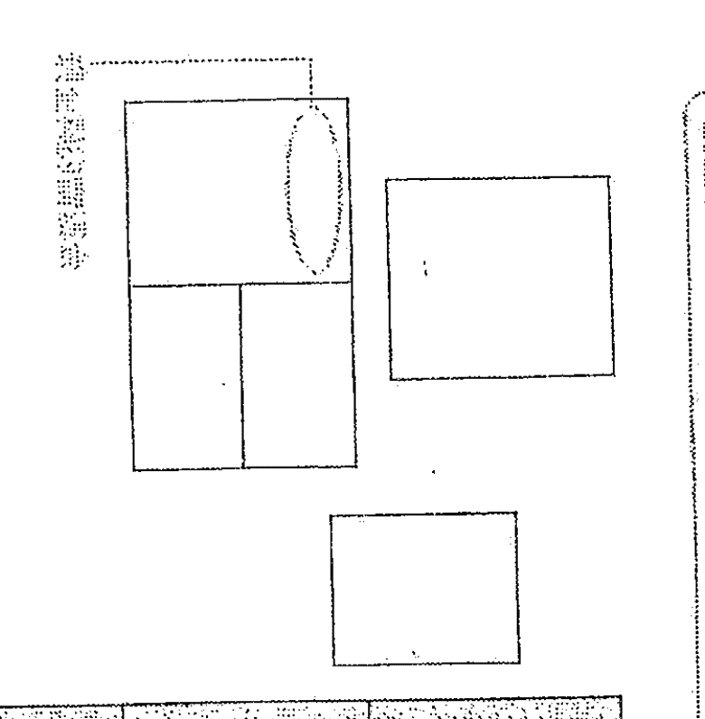

## 壞公司的現金與約當現金佔總資產比率的特性

| 2012.03 發生財務危機 | 2012.12 發生財務危機 | 2014.11 宣佈減產 |
| :---: | :---: | :---: |
| 0.4% | 1.95% | 8.83% |
| 0.28% | 3.21% | 6.69% |
| 2.47% | 1.4% | 8.61% |

而勝華科技的現金與約當現金佔總資產的比率，最後三年平均不到8%，最後很可惜，一家員工總人數超過兩萬人的大公司，也一樣宣佈破產了。

所以在前面才會特別提醒大家：不管是什麼行業的公司，為了讓公司的「氣」比其他競爭者長，現金與約當現金佔總資產的比例應該介於10～25%。如果您投資的那家公司屬於資本密集（燒錢）的行業，現金佔總資產的比例最好要高於25%。您可以順便對比一下前面提到的合償電（半導體業是燒錢的行業）的現金佔總資產的佔34%；大立光（也是燒錢的行業）現金佔總資產約46%，也是這個道理：資本密集（燒錢）的公司，手上現金當然是越多越好。

## A3 第三個比氣長指標：平均收現日數

當然，這是筆者透過閱讀大量國內外上市公司財務報表，所觀察到的一些共通現象。但有些公司或行業確實不願意留這麼多現金，這時怎麼辦呢？

就如同前面提到的，判斷一家公司是否「氣長」，有三個重要指標。除了前面提到的100／100／10概念，以及10～25%這兩種指標外，還有第三個指標：看這家公司在日常經營上，是否都是向客戶收現現金？

這個指標您可以在五大財務比率分析中「經營能力」的「平均收現日數」看出來。

一般來說，只要平均收現日數小於15天，便可以將它解讀為是一個做生意收現金的行業。為什麼這個指標小於15天以內，就算是收現金


# 不懂的錢，也能輕鬆理財賺手續費

的行業呢？因為刷卡消費有時需要經過1~2週之後，信用卡發卡公司或銀行機構才會把消費者刷卡的錢轉入給企業。

那麼什麼是收現金的行業呢？例如B2C行業的便利商店、百貨公司、鐵路運輸及航空等交通事業；或是B2B的行業，它們的產品價格波動很大（一日三市），需要採用現金交易，例如原材料的金、銀、銅、鐵、石油、農產品，或是DRAM等行業。您可以參考圖表2-10的三家公司財務報表，便能看出這種特性。

## 收現金行業的平均收現日數

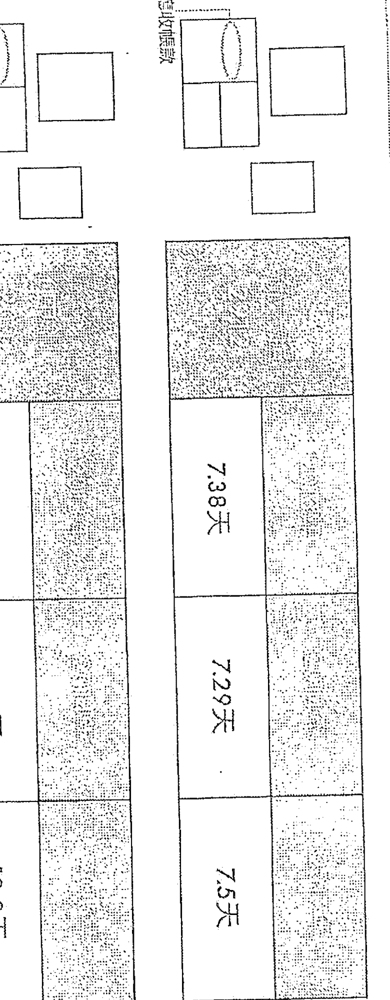

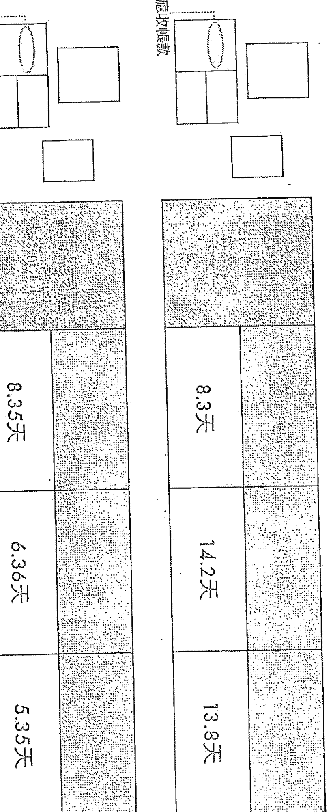

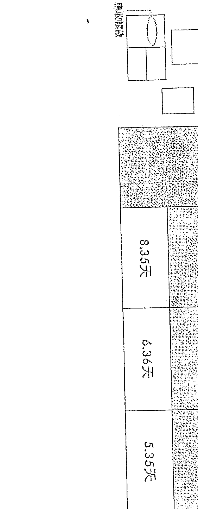

## 判斷「氣長」的優先順序

到這邊為止，您已經學會現金流量「比氣長、越長越好」的觀念，也知道要看三組重要的數字。我們先來綜合複習現金流量「比氣長、越長越好」的三個關鍵指標：

- ⑴ 「大於100／100／10」的理念，數字越大越好。
- ⑵ 現金及約當現金佔總資產的比率介於10~25%。不論您投資的公司是屬於什麼行業，都應該介於這個水準。如果您投資的公司是屬於資本密集（燒錢）的行業，這個比例應該要比25%更高。
- ⑶ 如果您投資的公司還是天天收現金的行業，那就更棒了。

但是，應該很少有公司可以同時擁有這三個條件吧？如果無法一次滿足這三個條件，三者的優先順序應該是什麼？如果您心中浮現上述疑惑，恭喜你，這代表您已經完全學會這個章節的重點了！

您的疑惑完全正確，真實的商務世界中，罕有公司能同時擁有這三個「比氣長」的關鍵數字。在財務報表的運用上，我們的優先順序是：

- ⑵ 優於 ⑶，⑶ 優於 ⑴

### 從現金流量瞭解公司的存活能力

手上有現金最好，所以(A2)是一家公司「氣最長」的保證。萬一手上沒有這麼多現金，但是公司天天收現金，一樣很不錯，所以(A3)是「氣最長」次要優先的指標。

大於100/100/10，是理論上一家公司氣長短的指標。但這些數字(100/100/10)就像是一般人的體檢報告數字一樣，參考價值居多，實務運用上並不這麼重要；畢竟體檢報告數字很好，不代表我們的身體一定好。所以筆者把這個100/100/10的指標放在最後再考量，能符合最好，不符合也沒關係，只要這家公司手上有很多現金，這家公司氣就會比其他公司長。

所以，雖然您閱讀財務報表的順序如圖表2-11所示，是(A1)→(A2)→(A3)，但三個指標的重要性則是(A2)>(A3)>(A1)。如果這三個指標合計是100分，我會這樣給分：

- 符合指標(A2)，給70分
- 符合指標(A3)，給20分
- 符合指標(A1)，再加上10分

換句話說，如果一家公司只符合指標(A2)，其他指標都不符合，還具有 70% 的「比氣長」能力；如果同時符合指標(A2) 與(A3)，則擁有 90% 以上的「比氣長」能力；如果三個指標都符合，那這家公司的「比氣長」能力指數就是滿分啦！

## 「比氣長」三大指標的閱讀順序

| 指標編號 | 指標名稱 | 單位 | 2013 | 2014 | 2015 |
| :--- | :--- | :--- | :--- | :--- | :--- |
| A1 | 現金保有比率（%） | % | 21.15 | 21.23 | 24.53 |
| 指標定義 | 現金及約當現金/資產總計 | | 310.5 | 331.1 | 314.8 |
| A2 | 負債比（%） | % | 166.6 | 307.2 | 299.3 |
| 指標定義 | 資產總計/負債總計 | | 240.1 | 275.4 | 300.68 |
| A3 | 資產周轉速度（次） | 次 | 0.71 | 0.56 | 0.69 |
| 指標定義 | 營收淨額/資產平均額 | | 5.54 | 6.63 | 4.35 |
| 指標定義 | 平均資產比率（%）與資產總額（%） | | 45.58 | 63.45 | 35.72 |
| 指標定義 | 持股與資產比率（%） | % | 2.8 | 3.24 | 2.27 |
| 指標定義 | 持股現金比率（%） | % | 0.2 | 0.83 | 0.77 |
| 指標定義 | 資產周轉程度（%） | % | 27.55 | 30.02 | 45.01 |
| A4 | 應收帳款比率（%） | % | 35.95 | 30.71 | 34.59 |
| 指標定義 | 應收帳款淨額/營收淨額 | % | 487.27 | 371.19 | 572.38 |
| A5 | 存貨周轉程度（次） | 次 | 35.79 | 55.25 | 86.77 |
| 指標定義 | 營業成本/存貨平均額 | | 3.73 | 4.06 | 0.45 |
| 指標定義 | 周轉應收帳款程度（天） | 天 | 9.85 | 16.48 | 21.73 |
| 指標定義 | 現金保有比率（%） | % | 139.56 | 131.53 | 180.29 |
| 指標定義 | 現金應收帳款程度（%） | % | 7.61 | 9.14 | 14.35 |
| A6 | 應付帳款比率（%） | % | 144.25 | 171.43 | 202.44 |
| 指標定義 | 應付帳款淨額/營業成本 | | 24.33 | 28.52 | 39.78 |
| A7 | 資金保有比率（%） | % | 20.19 | 32.2 | 30.41 |
| A8 | 現金及約當現金/流動資產總額 | % | 0.19 | 0.4 | 0.4 |
| 指標定義 | 現金/流動資產比率 | % | 28.68 | 73.2 | 72.5 |
| 指標定義 | 現金比率（%） | % | 31 | 106 | 100 |
| 指標定義 | 現金比率（%） | % | 100 | 100 | 100 |

## 時事解析（一）：樂陞科技

樂陞科技的新聞在2016年下半年炒得沸沸揚揚。我們暫時不管這家公司最近發生的故事情節，純粹就財務報表（詳見圖表2-12）的角度來分析。如果我們手上有100萬元的閒錢可以投資股市，您會擔心投資這家公司的股票嗎？

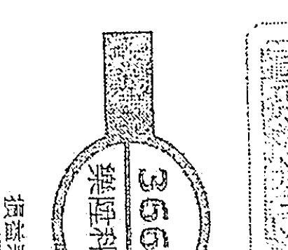

### 圖表2-12 樂陞科技2015年財務報表

| 項目 | 2013年 | 2014年 | 2015年 |
| :--- | :--- | :--- | :--- |
| 股本總額(元)(1) | 19,314 | 22,234 | 27,415 |
| 資本公積餘額(元)(2) | 5,951.86 | 9,296.1 | 15,237 |
| 保留盈餘(元)(3) | 377,782 | 209,231 | 152,537 |
| 純屬本公司股東的權益總額(元)(4) | 209,843 | 180,621 | 130,752 |
| 未分配盈餘(元) | 186 | 186 | 71.33 |
| 淨利(元) | 656.28 | 196.42 | 97.13 |
| 淨利歸屬於母公司(元)(5) | 0 | 0 | 5.13 |
| 淨利(5) | NA | NA | 71.33 |
| 淨利歸屬於母公司(5) | NA | NA | 5.13 |
| 營業淨額(元)(6) | 23,589 | 28,241 | 32,639 |
| 營業淨額(元) | 3,782 | 10.62 | 12.88 |
| 營業淨額(元) | 7.29 | 10.94 | 11.02 |
| 資產總額(元) | 49.49 | 54.39 | 58.05 |
| 資產淨額(元) | 4.49 | 24.77 | 54.47 |
| 純利(元) | 7.8 | 42.21 | 54.89 |
| 純利(元) | 4.23 | 41.32 | 54.49 |
| 資產淨額(元) | 1.00 | 39.52 | 56.41 |
| 純利(元) | 0 | 5 | 5 |
| 純利(元) | 0 | 37.8 | 36.47 |
| 純利(元) | 0 | 1,224.08 | (4.25) |
| 純利(元) | 0 | 5,656 | (5.61) |
| 純利(元) | 0 | 2,160 | (5.16) |
| 純利(元) | 0 | 8,254 | (6.63) |
| 純利(元) | 0 | (667) | (2.56) |
| 純利(元) | 0 | 1,787 | 1.787 |
| 純利(元) | 0 | 1,787 | 1.787 |
| 純利(元) | 0 | 1,787 | 1.787 |

2013-2015年度樂陞科技(Taiwan, PSE:3662)年報資訊彙整

此時，您可以根據上述三個「比氣長」指標進行分析，並根據前面筆者建議給（A）（B）、（C）配分，做成如圖表2-13的樣樣進行分析，您在分析時心裡就會有個基準了。底下我帶大家簡單分析一次作為範例。

- *(A) 現金流量相關比率，是否大於100 / 100 / 10 ？

這個指標的重要性是10分。筆者的個人見解是，榮總在這個指標的表現不佳，起伏很大，時好時壞，所以只能拿到5分。

- *(B) 公司手上的現金是否充足？最好介於10 ~ 25%。

這個指標的重要性是7分，而且10 ~ 25%只是基本要求，如果該公司屬於資本密集（燒錢）的行業，現金佔總資產比率最好要大於25%。2015年底時，榮總的現金存量為7.39%，實在偏低。再者，榮總的「總資產週轉率」為0.29，小於1，代表它屬於資本密集的行業（相關概念將於第三章介紹），需要大量資金（燒錢）。當一家公司手上的現金只有7.39%，同時又在資本密集行業中發展，真的是很危險！也因此，這個指標筆者只會給榮總20分。

- *(C) 這家公司是否能夠天天收現金？平均收現天數＜15天。

這個指標的重要性是20分。如果公司手上沒有足夠的現金，那至少要能天天收現金。

樂陞的收現天數為97天，沒有小於15天，不是收現金的生意模式，屬於一般B2B的行業。既然如此，這個指標筆者只會給樂陞10分。

綜合以上的分析，樂陞在「比氣長，越長越好」的(A)、(B)、(C)三個指標，分數合計是35分，但滿分可是100分！所以，如果手上有100萬的資金可以投資，當然不會挑選這家公司。別忘記，台灣上市櫃公司將近2,000家，千萬不要拿自己的錢開玩笑，放在一家「氣不長」的公司。

| 項目 | 定義 | 分數標準 | 得分標準 |
| :--- | :--- | :--- | :--- |
| (A) 是否 > 100 / 100 / 10 | ( 205 ) / 142 / ( 8 ) | 10分 | 5分 |
| 這家company不值得長期投資，但是否值得短期操作，不在此書想分享的范围。請自行判斷哦！ | 現金10% ~ 25% （資本密集行業要 > 25%） | 73.9% | 70分 | 20分 |
| (B) 平均收現日數 (是否收現金) | 97天 | | 20分 | 10分 |
| 綜合得分 | | | 35分 |

樂陞科技的「比氣長」能力分析

## 時事解析（二）：復興航空

為了讓大家瞭解如何解析時事，近期發生停飛事件的復興航空公司，筆者特別將它近三年的財務表整理出來（如圖表2-14）。

根據法規要求，所有上市公司的前一年度財務報表，需於隔年4月前完成對外正式公告。也就是說，最晚在2016年4月30日，您就可以在台灣的公開資訊觀測站，取得興航2015年的財務報表年報資料。

### 圖表 6702 復興航空2015年財務報表

| 說明 | 單位：千元 | 2013 | 2014 | 2015 |
| :-- | :-- | :-- | :-- | :-- |
| **現金流量表** | | | | |
| 損益 (純益) | 8,413 | 57,818 | 25,918 | |
| 營業現金流 | | | | |
| 純損益(%) | 10.71% | 41.73% | 18.71% | |
| 純損益 | 13,747 | 15,753 | 53,114 | |
| 營運資金 (純資產) | 8,413 | 57,818 | 25,918 | |
| 純損益 (純現金流) | 41 | 35 | 75 | |

| **資產及負債表** | | | | |
| :-- | :-- | :-- | :-- | :-- |
| 純現金流 | | | | |
| 純現金流(%) | | | | |
| 純現金流 | 17,741 | 10,454 | 1,391 | |
| 純資產 (純負債) | 34.69 | 37.52 | 21.33 | |
| 純現金流 (純負債) | 17,741 | 10,454 | 1,391 | |

| **現金流入項目** | | | | |
| :-- | :-- | :-- | :-- | :-- |
| 資產總值 | 2,545 | 2,653 | 1,958 | |
| 貨幣資產佔比(%) | 10.0 | 12.0 | 1.0 | |
| 投資 (貨幣) | 10.6 | 12.4 | 10.5 | |
| 投資 (貨幣) | 44.25 | 47.18 | 55.63 | |
| 投資及投資(貨幣比率) | 106 | 106 | 106 | |

您無法預測之後會發生全面停飛事件，但您現在已經擁有「比氣長」的財務觀念了。假設您的手上剛好有100萬元可供投資，請問當時的您，會投資興航嗎？請您依照表2-15的格式，進行「比氣長」的情懷解析練習，相信您心中就有個底了。

### 復興航空的「比氣長」能力分析

| 綜合部分 | ⑴ | ⑵ | ⑶ |
| :--- | :--- | :--- | :--- |
| | 是否 > 100 / 100 / 10 | 現金 10%~25% (資本密集行業要 > 25%) | 平均收現日數 (是否收現金) |
| | 10分 | 70分 | 20分 |

永遠記得一個重要的觀念：投資理財是爲了讓我們早日達成財務自由，享受生活。所以投資一家公司時，一定要看財務報表，而且第一個要看指標就是「比氣長，愈長越好」。因爲我們要找的投資標的，應該要追求是十年、二十年甚至三十年之後最有可能還存活的公司，才值得我們長期投資。

### 實戰分析練習

接下來，請您練習看看，本書附卡中的三十二家公司財報中，哪些公司具備「比氣長、愈長愈好」的性質？再次提醒您，投資股票一定要優先選出氣長的公司，如果公司的氣不長，其他都不重要了，因爲我們投資的公司將有可能倒閉，投下去的錢將全部歸零了唷！

## 不花時間，也能讓懸疑出牌錢櫃個股

| 01 | 大立光 3008 | |
| :--- | :--- | :--- |
| 02 | 合精電 2330 | |
| 03 | 中碟 1723 | |
| 04 | 閎隆光電 1537 | |
| 05 | 星田工業 9951 | |
| 06 | 友通資訊 2397 | |
| 07 | 佳格 1227 | |
| 08 | 聯翰 3450 | |
| 09 | 為升 2231 | |
| 10 | 日友 8341 | |
| 11 | 中興保全 9917 | |
| 12 | 神基科技 3005 | |
| 13 | 愛成工業 9904 | |
| 14 | 台銀科 6464 | |
| 15 | 巨大 9921 | |
| 16 | 極大 1325 | |
| 17 | 邦琦生技 4107 | |
| 18 | 可隆科 8422 | |
| 19 | 航豐科技 6196 | |
| 20 | 合達電 2308 | |
| 21 | 帝寶 6605 | |
| 22 | 新光保全 9925 | |
| 23 | 中華電信 2412 | |
| 24 | 旭隼 6409 | |
| 25 | 高雄化學 1715 | |
| 26 | 劍麟 2228 | |
| 27 | 數字科技 5287 | |
| 28 | 卜蜂 1215 | |
| 29 | 振樾電 8114 | |
| 30 | 統一超 2912 | |
| 31 | 鴻海 2317 | |
| 32 | 中鋼 2002 | |

*本表並非聲明單！本書所附隨之各公司財務報表，皆為筆者隨機在公開資訊觀測站選出的公司。
※投資一定有風險，股票投資有賺有賠，買股前請詳閱公開說明書（財務報表）。

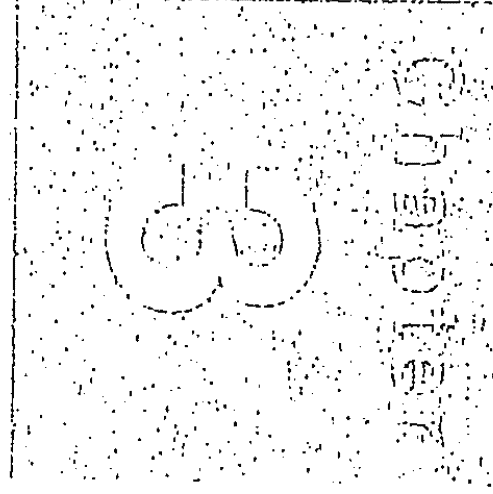

# 從經營能力
破解公司做生意真本事

有了最重要的「比氣長」概念之後，接下來我們來看，所投資的公司是不是擁有經營能力？

請參考圖表1-9「公開資訊觀測站的財報資料」的經營能力，它的中翻中就是「翻桌率，越高越好」。

還記得我們在第一章的43頁提到，甲餐廳與乙餐廳中翻桌率的故事嗎？翻桌率越高越好！

其中，桌子是餐廳的資產，換句話說，一家公司的經營能力好不好，要看這一家公司的資產，一年幫公司做了幾趟生意——當然是越多趟越好。

那饒请您想想，一家公司的資產在什麼地方會出現呢？答案就在資產負債表。

其中最重要的幾個資產（這些資產一年能幫公司做幾趟生意），分別是：應收帳款、存貨、固定資產、總資產，在資產負債表中的位置如圖表3-1所示。

所以，要判斷一家公司的經營能力，就是看這些資產一年幫公司做了幾趟生意。

## 【圖表 3-3】資產負債表中的關鍵資產

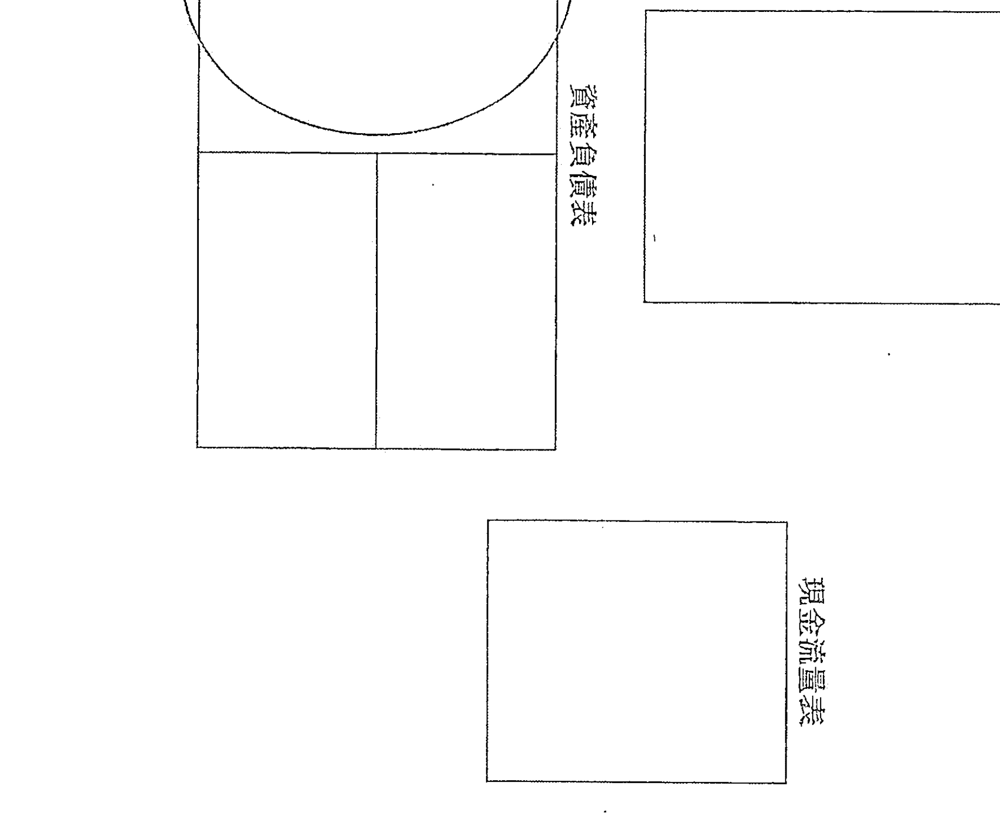

## 应收账款周转率

我们先来看应收账款周转率的定义*。这个指标主要是在说明：

应收账款这个资产，一年有公司做了几笔生意，越多越好。它在财务报表的位置请参考图表3-2。

### 应收账款周转率在财务报表中的位置

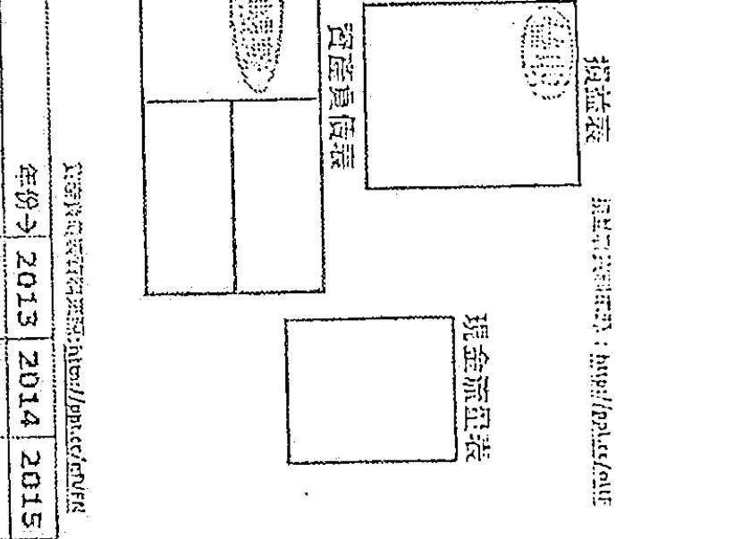

| 项 目 | 指标含义 | 2013 | 2014 | 2015 |
| :--- | :--- | :--- | :--- | :--- |
| 流动资产 总额（%） | 流动资产/净资产或总资产比（%） | 31.05 | 33.73 | 34.53 |
| 存货 | （存货/总）或/存货 | 33.11 | 30.31 | 28.60 |
| 应收账款占比（%） | 应收账款占营业收入比例（%） | 296.42 | 278.42 | 280.86 |
| 存货占比（%） | 存货占营业收入比例（%） | 44.42 | 44.88 | 38.66 |
| 预付款项（%） | 预付款项占营业收入比例（%） | 86.32 | 86.65 | 81.55 |
| 其他应收款（%） | 其他应收款占营业收入比例（%） | 6.89 | 6.83 | 6.53 |
| 应收账款周转率（次） | （销售额/平均应收账款） | 65.88 | 53.44 | 55.27 |
| 平均应收账款（万元） | 年初与年末应收账款平均 | 4.93 | 3.9 | 3.4 |
| 应收账款回收期（天） | 一年中应收账款回款天数 | 0.71 | 0.92 | 0.77 |
| 应收账款 占资产比（%） | 应收账款/资产比（%） | 5.58 | 90.21 | 44.09 |
| 应收账款 占总资产比（%） | 应收账款/总资产比（%） | 3.95 | 56.01 | 33.51 |
| 应收账款 占资产比（%） | 应收账款/总资产比（%） | 4.28 | 43.52 | 45.7 |
| 应收账款 占净资产比（%） | 应收账款/净资产比（%） | 99.12 | 65.99 | 49.51 |
| 应收账款 占资产比（%） | 应收账款/总资产比（%） | 3.73 | 44.31 | 38.07 |
| 应收账款 占资产比（%） | 应收账款/总资产比（%） | 9.60 | 15.45 | 15.02 |
| 应收账款 占资产比（%） | 应收账款/总资产比（%） | 143.55 | 171.12 | 104.16 |
| 应收账款 占资产比（%） | 应收账款/总资产比（%） | 24.25 | 13.43 | 24.25 |
| 应收账款 占资产比（%） | 应收账款/总资产比（%） | 24.33 | 39.27 | 39.241 |
| 应收账款 占资产比（%） | 应收账款/总资产比（%） | 11.300 | 19.658 | 30.741 |
| 应收账款 占资产比（%） | 应收账款/总资产比（%） | (5.62) | (7.97) | (6.92) |
| 应收账款 占资产比（%） | 应收账款/总资产比（%） | (3.42) | (3.71) | (6.92) |

* 更完整的五大财务比率分析相关公式说明，请参考公司资讯观测站的「公式 说明」页面。

不懂所谓*，也能很容易找出关键数据项


接下來，我們根據2015年的年報資料，挑出六家指標性公司的應收帳款週轉率來做比較（見圖表3-3）。

### 圖表3-3 六家公司的應收帳款週轉率

|        | 2015  | 2014  | 2013  | 2012  | 2011  |
|--------|-------|-------|-------|-------|-------|
| 中鋼   | 4.49  | 8.37  | 11.6  | 48.67 | 5.32  | 6.52  |

單位：次數／年

資料來源：公開資訊觀測站，2015年報資料

如果用排名的方式來理解，「應收帳款」這個資產的經營能力，六家公司由高到低分別是：

- 統一超 48.67 ＞ 中鋼 11.6 ＞ 台積電 8.37 ＞ 鴻海 6.52 ＞ 巨大 5.32 ＞ 大立光 4.49

透過這個簡單的排名，您有沒有發現一個非常有趣的現象？

只要是現金交易的行業，應收帳款經營能力的表現通常會非常糟；因為都是用現金交易，所以「應收帳款」這項資產的金額會很少。例如我們生活中離不開的7-11便利商店，應收帳款週轉率（翻桌率）的表現

另外，需求強勁的行業在應收帳款經營能力表現也會相當出色，例如台鏈的馬路幾乎天天都在整修，而修馬路所需要的瀝青、柏油來自於中碳，因此該公司的應收帳款週轉率高達11.6趟／年。

晶圓代工的合債電，一年應收帳款都做上8.37趟的生意。這個數字背後代表的意義是：晶圓代工這個行業的需求也是非常的大。

一般說來，應收帳款這個資產一年能做上6趟生意就算是經營能力相當不錯的公司，例如鴻海的數字是6.3趟／年。當然，實務上應收帳款週轉率這個數字，在不同行業會明顯不同。

簡單來說，B2C（企業對個人）行業的公司，因為大部分都是向客戶收現金，所以這一類的公司應收帳款週轉率表現會相當優秀。而一般的B2B（企業對企業）行業的公司，應收帳款週轉率大於6趟也算是相當優秀。

另外B2B行業中，如果該公司的主要客戶是軍、警、政等機關行號，因為政府單位大多採用年度預算制，對企業而言，這類客戶的應收帳款挺顯痛的，通常一定會收得到款項，但是常常拖得非常久。所以以大多數經營政府單位的上市櫃公司，應收帳款這個資產的經營能力就會比較弱。

正是因為不同行業類別的公司，應收帳款週轉率的數字也會明顯不同，所以財經領域學者又創造出另外一個更容易理解的指標：平均收現日數。

### 平均收現日數

這個指標相當簡單，就是用365天除以應收帳款週轉率，所得到的數字。透過這個簡單的指標，投資人就可以一眼看出一家公司應收帳款的整體經營管理水平。

「平均收現日數」的資料，一樣可以在公開資訊觀測站的五大財務比率分析中「經營能力」欄位中輕鬆取得，如圖表3-4中的框選所示。

#### 平均收現日數在財務報表中的位置

| | 2013 | 2014 | 2015 |
|---|---|---|---|
| 應收帳款週轉率 | 31.55 | 29.23 | 24.25 |
| 同業平均 | 21.05 | 23.24 | 21.57 |
| 同業排名 | 名 | 名 | 名 |
| 應收帳款及應收帳款週轉率 | 341.1 | 303.6 | 255.6 |
| 月均應收帳款 | 10.81 | 10.39 | 10.55 |
| 應收帳款及應收帳款週轉率 | 24.42 | 4.58 | 4.97 |
| 應收帳款 | 36.42 | 39.62 | 44.59 |
| 月均應收帳款 | 11.64 | 13.03 | 14.71 |
| 月均應收帳款 | 15.65 | 17.60 | 20.53 |
| 應收帳款週轉率 | 17.76 | 15.88 | 16.53 |
| 應收帳款 | 22.37 | 26.76 | 30.71 |
| 應收帳款週轉率 | 16.39 | 17.93 | 22.45 |
| 應收帳款 | 31.92 | 35.99 | 43.24 |
| 應收帳款週轉率 | 15.69 | 25.08 | 25.23 |
| 應收帳款 | 8.12 | 8.62 | 6.82 |
| 應收帳款及應收帳款週轉率 | 32.29 | 32.96 | 35.29 |
| 應收帳款週轉率 | 84.75 | 85.27 | 49.58 |
| 應收帳款及應收帳款週轉率 | 396.8 | 402.4 | 280.6 |
| 月均應收帳款 | 55.48 | 55.77 | 44.09 |
| 應收帳款 | 82.25 | 91.43 | 120.84 |
| 月均應收帳款 | 24.71 | 29.55 | 37.94 |
| 應收帳款週轉率 | 24.32 | 26.43 | 30.76 |
| 應收帳款 | 51.60 | 59.66 | 74.94 |
| 應收帳款週轉率 | 1.00 | 0.11 | 0.52 |
| 應收帳款 | 3.62 | 3.75 | 4.60 |
| 月均應收帳款 | 1.84 | 2.44 | 3.12 |
| 應收帳款 | 0.19 | 0.57 | 0.78 |
| 應收帳款週轉率 | 76.48 | 75.11 | 72.43 |
| 月均應收帳款 | 10.10 | 10.15 | 10.26 |

| 每年3月31日 | 2014 | 2015 |
|---|---|---|
| 應收帳款 | 35.67 | 46.17 |
| 應收帳款及應收帳款週轉率 | 21.57 | 24.42 |
| 應收帳款及應收帳款週轉率 | 15.93 | 15.13 |
| 應收帳款及應收帳款週轉率 | 6.97 | 4.91 |
| 應收帳款及應收帳款週轉率 | 20.97 | 26.53 |
| 應收帳款及應收帳款週轉率 | 6.49 | 3.42 |
| 應收帳款及應收帳款週轉率 | 100.0 | 100.0 |
| 應收帳款及應收帳款週轉率 | 100.0 | 100.0 |
| 應收帳款及應收帳款週轉率 | 100.0 | 100.0 |

我們一樣將之前六家公司的平均收現日數，彙整至圖表3-5。

### 六家公司的平均收現日數

表 3-5

| | 81.29 | 43.6 | 31.46 | 75 | 68.6 | 55.98 |

資料來源：公開資訊觀測站，2015年報資料

實務上來說，如果是B2C行業、採用現金或是接受信用卡刷卡交易的上市櫃公司，他們的平均收現日數通常會小於15天。例如在圖表3-5之中，您可以看到統一超商的平均收現日數是7.5天。因為一般信用卡機構撥款的日數，是7到14天之內撥款給企業，所以只要平均收現日數小於15天，我們就可確定這家公司是採用現金交易的行業類別。除了B2C行業是採用現金交易，也有部分B2B行業採用現金交易，例如金、銀、銅、石油等原物料與農產產品的行業。

至於一般的B2B上市櫃公司，這些公司之間的業務往來，通常採用赊銷的信用交易行為，所以平均收現日數稍長一些算是正常。不同行業間交易的狀況略有差異，不過大部分於月結60天或是90天的時間。換句話說，一般台灣企業的平均收現日數，應該在60～90天之間才屬正常。


有了這個「一般來說，應收帳款應該在60～90天之內變成現金」的生活常識之後，我們再來看看圖表3-5中各家公司的表現。

中耀的平均收現日數是31.46天，台積電的平均收現日數是43.6天，鴻海的平均收現日數是55.98天。代表這三家公司，都比業界平均值（60～90天）更早就能夠收到客戶的貸款（變成現金）。也就是說，這三家公司的產品或服務都有過人之處，才會讓他們的客戶願意提早給他們貸款，以取得這些公司的產品或服務。身為投資人的我們，這種狀況暗示著我們可以花更多的心力，關注這些擁有優質產品或服務的上市櫃公司。

巨人的平均收現日數平均是68.6天，也算是排在平均值的前面。但大立光的平均收現日數81.29天，用常識來判斷，代表這家公司的應收帳款管理能力，還有很大的進步空間。

除了與各公司進行比較之外，財務報表的數字也可以自我比較，尤其是平均收現日數這個數字，需要看五年的表現情況。一般公司如果經營穩健，平均收現日數會相當穩定，不會有太大起伏；如果每一年都能逐步改善，就更完美了。

### 看穿塞債假交易的訣竅

少部分心術不正的上市公司老闆，為了增加業績（美化損益表的獲利狀況），常常會在海外開分公司進行塞債的假交易，這個時候仔細觀察平均收現日數的指標就相當重要。

進行假交易的時候，首先會在損益表上看到營收大幅成長，接著淨利也會大幅成長。

> 假交易會產生營收，但無法真正變成現金

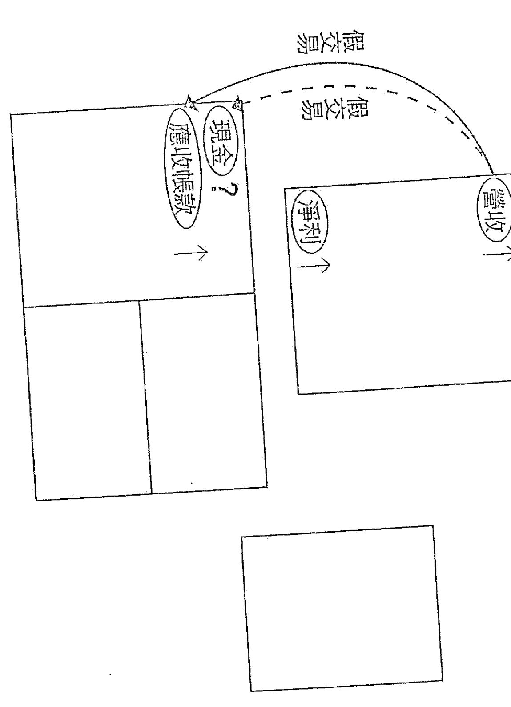

但因為這些人工創造出來的營收，都是源自海外紙上公司之間進行的假交易，所以銷售出去的貨款，無法真正變成現金回來。因此，這家公司的「現金與約當現金」會計科目，並不會大幅的增加。最後，為了符合借貸平衡的會計規則，這些假交易只能在「應收帳款」這個會計科目上動手腳（如圖表3-6）。

所以心術不正、喜歡創造人工假收入的公司，他們的財務報表會有以下五項明顯的特徵：

- 1. 營收會有大幅成長的假象。
- 2. 稅後淨利也會大幅成長。
- 3. 但現金並不會等比例地大幅成長，因為這些銷售額都是假的。
- 4. 所以，「應收帳款」這個科目的金額會大幅成長。
- 5. 相對應的，平均收現日數會越拖越長。

也就是說，當您看到一家公司最近五個年度的平均收現日數不斷變長，例如從60天變成70天、80天，然後惡化到100天，這時候您應該要提高警覺，並思考：是不是這家公司有嚴重的作假帳問題，或是有特殊的呆帳問題？

因為一般正常經營公司的平均收現日數，通常都是相對穩定且上下波動不到5%，經營能力表現更佳的公司，則會呈現逐步縮小的趨勢。

### 六家公司近五年的平均收現日數

|  |  |  |  |  |  |  |
| --- | --- | --- | --- | --- | --- | --- |
|  |  |  |  |  |  |  |
| 25.17 | 26.83 | 28.74 | 26.25 | 31.46 |  |  |

單位：天數

### 六家公司近五年的平均收現日數 （續）

由圖表3-7的六家公司近五年平均收現日數可以看出，大部分經營穩定的公司，在這個指標的表現相對穩健，而且最近五年度的波動幅度不會太大。應收帳款經營能力表現的好公司，會在平均收現日數呈現逐步縮小的趨勢。

其中，中職這家公司和一般人的猜臆想象不太一樣。這是一家債權公司，主要產品是精油與護膚，但他們的應收帳款收款能力表現相當優異，五年平均不到30天（雖然在2015年度有小幅表現退），甚至比瀾優生合廣電（最近五年度的平均收現日數大約為40天上下）表現得更亮眼。

透過這些簡單的分析，相信您現在對平均收現日數的概念就會相當清晰了。

| 應帳帳效 | 48.92 | 55.81 | 64.26 | 66.24 | 55.98 |


### 存貨週轉率

一家公司的經營能力，主要是看公司所擁有的資產，一年能夠幫公司做幾趟生意，越多趟越好。除了前面所介紹的「應收帳款」這個資產之外，公司擁有的第二個做生意重要的資產是「存貨」。

這個指標會出現在公開資訊觀測站五大財務比率分析的「經營能力」（愈高率，越多趟越好），它的公式與對應的立體財務報表位置如圖表3-8。

| 圖表3-8 | 存貨週轉率與平均銷貨日數定義 |
|---|
| 銷貨成本 |
| 存貨 |
| 存貨週轉率 = $\frac{\text{銷貨成本}}{\text{存貨}}$ |
| 平均銷貨日數（平均在庫天數）= $\frac{365\text{天}}{\text{存貨週轉率}}$ |
| $\Rightarrow$ 越多趟越好 |

第一個公式叫做「存貨週轉率」，代表存貨這個資產一年幫公司做了幾趟生意，越多趟越好。

跟應收帳款這個資產一樣，存貨週轉率除了有越多趟越好的「趟數」觀念，還有一個「天數」的觀念，也就是所謂的平均銷貨日數（平均在庫天數）。

平均銷貨日數，指的是這些存貨平均在公司的倉庫待了多少天才賣出去。這個觀念應該非常好理解，因為存貨在倉庫待的時間，當然是越少天越好；在庫天數越短，代表該公司的產品越好銷。

這兩個指標會在公開資訊觀測站五大財務比率分析的「經營能力」（翻桌率，越多趟越好）區塊中，如圖表3-9所反應示。

### 存貨週轉率與平均銷貨日數在報表中的位置

不過紀錄・ 也能間接看出出清積壓庫存的情況

| 指標2 | 相對比率(%) | 2013 | 2014 | 2015 |
|---|---|---|---|---|
| 流動資產相對比率(%) | | 211.5 | 243.5 | 24.3 |
| 存貨相對比率(%) | | 310.5 | 303.1 | 315.48 |
| 存貨佔投資及預付費用(%) | | 351.4 | 353.11 | 355.6 |
| 應收相對比率(%) | | 296.62 | 333.41 | 280.68 |
| 應收相對比率(%) | | 4.1 | 4.54 | 4.69 |
| 現金資產相對比率(%) | | 59.02 | 63.38 | 61.59 |
| 平均存貨相對比率(%) | | 65.58 | 73.28 | 69.58 |
| 相對比率(%) | | 2.8 | 3.83 | 2.29 |
| 相對比率(%) | | 45.0 | 0.34 | 0.27 |
| 相對比率(%) | 37.53 | 35.01 | 33.53 |  |
| 相對比率(%) | 857.59 | 50.71 | 243.9 |  |
| 相對比率(%) | 482.52 | 17.14 | 2473.8 |  |
| 相對比率(%) | 47.25 | 55.58 | 57.38 |  |
| 相對比率(%) | 99.3 | 85.59 | 46.25 |  |
| 相對比率(%) | 35.04 | 40.43 | 10.09 |  |
| 相對比率(%) | 75.63 | 147.48 | 53.6 |  |
| 相對比率(%) | 9.610 | 174.8 | 204.28 |  |
| 相對比率(%) | 144.33 | 37.27 | 30.78 |  |
| 相對比率(%) | 18.22 | 29.21 | 20.16 |  |
| 相對比率(%) | 18.39 | 8.68 | 6.73 |  |
| 相對比率(%) | 1.250 | 5.781 | 7.158 |  |
| 相對比率(%) | (2.203) | (3.129) | (5.679) |  |


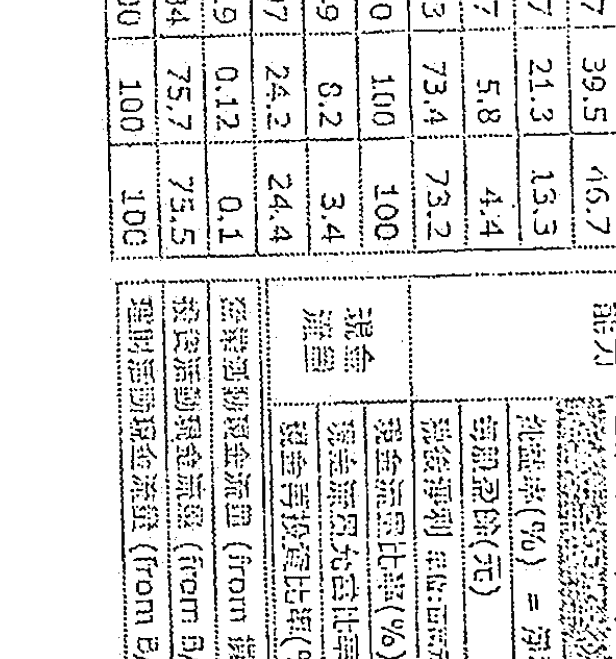

接下來，透過整理財務報表的數據（如圖表3-10），我們簡單分析上述六大公司在「存貨」這個資產上的個別經營能力。

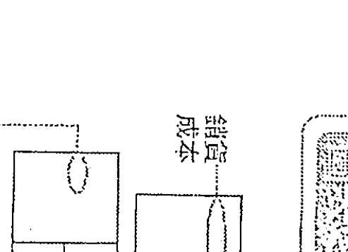


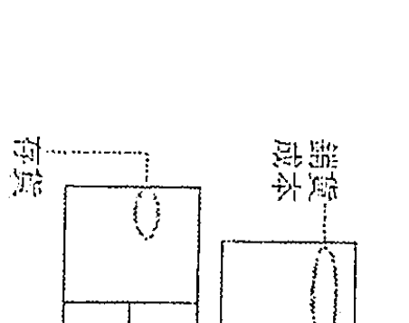


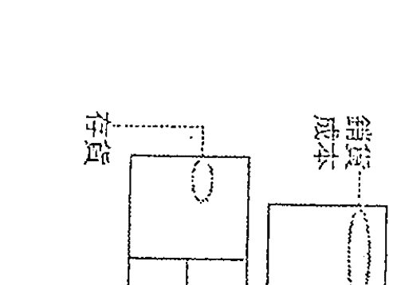


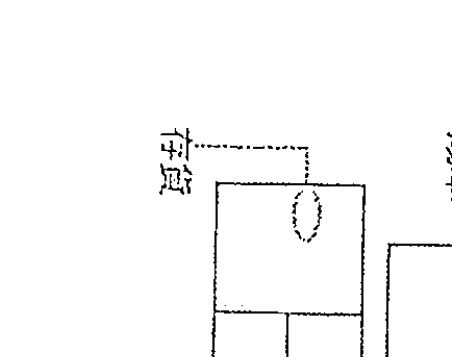


### 六家公司的存貨週轉率與平均銷售日數

| | 存貨 | 2 | 2 | 2 | 2 |
| --- | --- | --- | --- | --- | --- |
| 1 | 21.39 | 18.89 | 5.54 | 6.83 | 6.55 |
| 17.06 | 19.32 | 65.88 | 53.14 | 55.72 | |
| 平均銷售日數 | 存貨 | 5 | 5 | 5 | 5 |
| 公司名 | 9.61 | 9.13 | 8.39 | 7.42 | 6.49 |
| 7 | 37.98 | 39.37 | 43.5 | 49.19 | 56.24 |
| 平均銷售日數 | 存貨 | 3 | 3 | 3 | 3 |
| 公司名 | 18.20 | 14.40 | 16 | 14.8 | 9.75 |
| 4 | 20.05 | 25.34 | 22.81 | 24.68 | 37.43 |
| 平均銷售日數 | 存貨 | 7 | 7 | 7 | 7 |
| 公司名 | 25.64 | 22.07 | 13.2 | 13.31 | 12.47 |
| 5 | 14.24 | 16.53 | 27.65 | 27.42 | 29.27 |
| 平均銷售日數 | 存貨 | 3 | 3 | 3 | 3 |
| 公司名 |  |  |  |  |  |
| 6 |  |  |  |  |  |
| 平均銷售日數 |  |  |  |  |  |

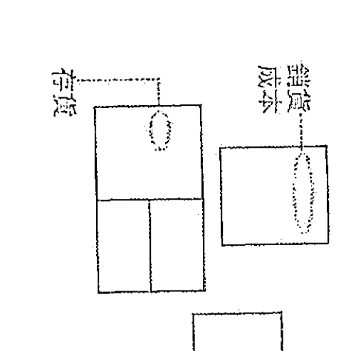


|  |  |  |  |  |  |  |  |  |
|---|---|---|---|---|---|---|---|---|
|  |  |  |  |  |  |  |  |  |
|  |  |  |  | 14.88 | 13.88 | 34.53 | 33.51 | 37.01 |
|  |  |  |  | 21.62 | 26.28 | 10.57 | 10.89 | 9.86 |

|  |  |  |  |  |  |  |  |  |
|---|---|---|---|---|---|---|---|---|
|  |  |  |  |  |  |  |  |  |
|  |  |  |  | 8.02 | 8.21 | 3.52 | 3.67 | 3.37 |
|  |  |  |  | 45.51 | 44.45 | 103.69 | 99.45 | 108.3 |

※IRRS於2013年全面導入上路，故2011／2012年各公司申報的數據不适用，僅係列出來供參考，順便提醒當時報要有5年唷！

#### 大立光時存貨管理優異

由圖表3-10看出，大立光的存貨週轉率，在2013年只有5.46趟／年，逐步提升至2015年全年存貨做了6.55趟，三年之間存貨的經營能力提升了18%。這個優異的表現，也可以從大立光的平均銷貨日數（在庫天數）由2013年的65.88天，縮短到2015年的55.72天，此數據表現也與報章雜誌刊载的新聞相符：大立光的光學鏡頭更热销，營收逐步攀新高。

不慢对起，也能够观察出陈镜值股


## 合積電的存貨經營能力

合積電的存貨週轉率由2013年的8.39趟/年，到2015年的6.49趟，呈現每年逐步下滑的狀況。另外平均銷貨日數也由2013年的43.5天，下滑到56.2天的在庫天數。

如果是在一般的傳統企業（產品推陳出新的速度與技術進步的速度比較緩慢）看到這種數據，可判斷該公司表現不佳，但這種存貨管理逐步下滑的狀況，在合積電就需從不同的角度解釋。

合積電屬於高度資本密集的行業，且晶圓製程進步快速，在晶圓代工的行業中，一個完整的晶圓代工製造週期通常超過100天。所以遇到特殊的行業別時，不能單純只看個別公司的數據表現，必須和行業的平均表現進行進一步的分析。

以晶圓代工行業製程（從原料投入，到產品完成所需要的時間）超過100天相比，合積電最近三個年度的平均在庫天數約為50天上下，在存貨的管理績效上，算是表現相當優秀的公司，因為它的在庫天數只有業界的50%。代表合積電生產線上的每個產品，在尚未完成前的50天，便成功售出了。

### 中碳的存貨經營能力

中碳的存貨週轉率由2013年的16趟，逐步下滑至2015年的9.75趟。若以傳統產業（產品穩定、技術變化不大）的角度來分析，中碳的存貨經營能力表現呈現逐步下滑的趨勢，這也可以從該公司的平均銷貨日數（平均在庫天數）看出端倪，分別由2013年的22.8天，逐步下滑至2015年的37.4天。

但好消息是，以一般的傳統產業而言，存貨的在庫天數如果小於40天，通常都算是非常強勢與熱銷的產品。不過，既然趨勢是呈現下滑，該公司的管理階層應該採取適當措施，針對存貨管理進行改善。

如果我是這一家公司的投資人，我可能仍會持續投資，但假設該公司的存貨在庫天數，在往後幾年又逐步下滑到超過50天，則代表管理階層沒有用心經營，可能就不再適合投資了喔！

### 統一超商的存貨經營能力

統一超商的存貨經營能力相當穩健，近三年呈現存貨平均每年能幫公司做上13趟的生意，且平均30天以內，就能將存貨銷售出去。便利商店屬於交易金額小但銷售快速的經營模式，所以筆者通常以30天為個人投資經驗的比較基準。

- 1. 任何一家公司的存貨能夠在30天以內銷售出去，代表這家公司的表現非常、非常優異，屬於投資人追求的夢幻型公司。例如每一代產品都熱銷的蘋果公司，2015年的存貨在庫天數為5.7天。
- 2. 如果存貨的平均在庫天數介於30到50天，通常屬於流通業的規範（例如7-11、COSTCO、Walmart等），或是擁有熱銷產品的品牌公司（例如UNIQLO），不然就是代表存貨管理能力相當優異的公司（例如鴻海、中銀等）。
- 3. 如果存貨平均50～80天可以賣出，也算經營能力不錯的公司。
- 4. 平均銷售日數介於80～100天的行業，多屬於B2B的行業。
- 5. 平均銷售日數介於100～150天，多屬於工業性（如工業電腦）或原物料（如鋼鐵、石油……等）產品的行業，其需求比較不旺盛，或是客戶久久才會下單一次。
- 6. 平均銷售日數大於150天，則代表該公司經營能力不佳，或是該公司屬於比較特殊的行業。例如造船公司的存貨在庫天數，通常大於250天；飛機製造公司的庫存通常大於300天；精品業的Tiffany，庫存天數大約400天以上；房地產公司的庫存天數，1000～5000天都很正常，因有買地、變更、規劃建案、設計圖發包、開工、打地基、蓋樓、完工……等複雜的過程。

所以，財務報表上面的數據，除了自己與自己比較之外，還必須與行業的平均值比較才能看出數字背後真正的意義。

### 巨人的存貨經營能力

巨人公司的存貨管理近三年的表現相當平穩、平均存貨一年幫公司做了3.5趟左右的生意。平均在庫天數在100天左右，這個天數也符合汽車行業的市場需求，因為腳踏車產品不像7-11便利商店的產品，客戶不會天天都上門消費，所以該公司的存貨近三年大約都在100天左右才銷售出去。

### 鴻海的存貨經營能力

鴻海的存貨平均一年幫公司做了10趟生意，在庫天數平均為35天左右。這個數字非常接近流通業7-11的數據，代表鴻海的存貨經營能力極為優秀。這也是為什麼國外的媒體報導，號稱亞洲的製造經營能力非常優異，這一點從鴻海的存貨經營能力，便可看出端倪。

## 做生意的完整週期

現在您已經有了應收帳款與存貨經營能力（翻桌率、越多越好）的概念，接下來把這兩個觀念放在一起，就能發現一般人閱讀財務報表所缺少的極重要觀念：做生意的完整週期。

### 圖表3-11：做生意的完整週期示意圖

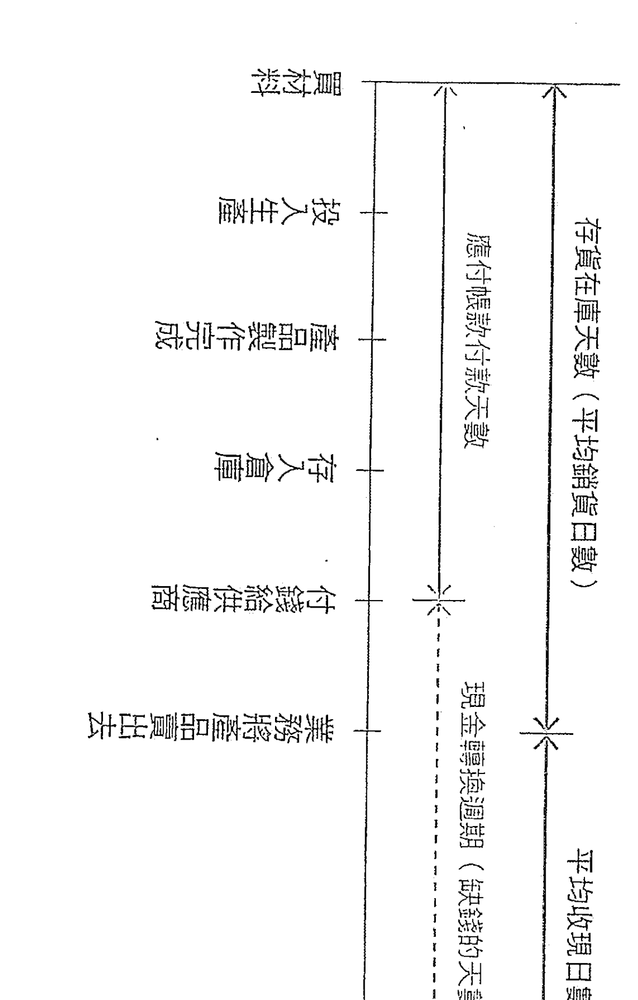

做生意的完整週期，指的是家公司從購買原料開始、投入生產，到產品製作完成變成庫存、存入倉庫，過程中要付錢給供應商，以及公司的銷售人員將存貨賣出去，到最後收到客戶的貨款，所經歷的一個完整週期，如圖表3-11所示。

**做生意的完整週期＝存貨在庫天數（平均銷貨日數）＋平均收現日數**

上圖下方的紅色線，第一條紅線代表的是買完材料之後付錢給供應商過程中所需的天數，專業名詞叫「應付帳款付款天數」；第二條虛線叫做現金轉換週期，中翻中叫做「缺錢的天數」。

一家公司從買材料到投入生產，到產品製作完成放入倉庫，再到業務同仁賣出產品，最後公司收到客戶貨款，這一整個流程就叫「做生意完整的週期」（存貨在庫天數＋平均收現日數）。

在整個做生意完整的週期當中，如果所需要的一切所有資金，都是由公司自己負擔，那在經營上將會非常吃力。所以在經營過程中，我們還可以借力使力；善用供應商給我們的付款天數優惠，例如貨到60天才付款。這等於是供應商免費借錢給我們60天做生意，所以公司通常都會要求供應商提供一定天數的應付帳款交易，等於是買方要求供應商免費提供多幾天的資金讓我們做生意。

做生意的完整週期扣除「應付帳款天數」之後，就是一家公司至少需要準備多天數的钱，才能持續經營下去，專業名词叫「現金轉換週期」。筆者把它中翻中，叫做「缺錢的天數」，這樣大家會比較容易理解。

透過現理的推導，上下兩條的天數會相等，換句話說：

**做生意的完整週期**

- ＝ 存貨在庫天數（平均銷售日數）＋平均收現日數
- ＝ 應付帳款天數＋缺錢的天數（現金轉換週期）

### 從經營週期在報表中的位置


| 指標名稱 | 指標定義 | 2013 | 2014 | 2015 |
| :--- | :--- | :---: | :---: | :---: |
| 應收帳款與銷貨比率(%) | 應收帳款／(淨銷貨額) | 21.15 | 32.73 | 24.53 |
| 存貨銷售天數 | 存貨(平均)／(銷貨成本)／365天×100 | 31.05 | 37.42 | 24.53 |
| 存貨與銷貨成本比率(%) | 存貨(平均)／(銷貨成本) | 35.1 | 300.11 | 259.6 |
| 經營週期天數 | (應收帳款天數)＋(存貨天數)－(應付帳款天數) | 206.42 | 629.39 | 320.05 |
| 應收帳款天數 | 應收帳款／(銷貨)／365天×100 | 44 | 44.17 | 4.1 |
| 存貨天數 | 存貨／(銷貨成本)／365天×100 | 12.42 | 85.25 | 4.57 |
| 應付帳款天數 | 應付帳款／(銷貨成本)／365天×100 | 46.57 | 172.58 | 6.5 |
| 應收帳款比率與存貨比率(%) | 存貨／(銷貨成本)／(應收帳款)／(銷貨) | 0 | 87.35 | 552.29 |
| 經營週期指數(%) | (應收帳款)／(存貨)＋(應收帳款)／(應付帳款) | 30.33 | 45.99 | 45.77 |
| 現金周轉期(Cash Cycle) | 經營週期指數－應付帳款指數 | 87.29 | 55.29 | 57.78 |
| 現金周轉日數(天) | 現金周轉期／365天×100 | 5.29 | 3.59 | 3.94 |
| 應付帳款指數(%) | (應付帳款)／(銷貨成本) | 77.55 | 84 | 45.77 |
| 應收帳款指數(%) | (應收帳款)／(淨銷貨額) | 91.4 | 21.31 | 45.53 |
| 應收帳款天數 | 應收帳款／(銷貨)／365天×100 | 4.2 | 63 | 33 |
| 存貨天數 | 存貨(平均)／(銷貨成本)／365天×100 | 2.4 | 28 | 43 |
| 應付帳款天數 | 應付帳款／(銷貨成本)／365天×100 | 0.4 | 15 | 45 |
| 經營週期天數 | (存貨)＋(應收帳款)－(應付帳款) | 10 | 25 | 45 |
| 現金周轉日數(天) | 經營週期日數－應付帳款日數 | 2 | 3 | 4 |
| 現金周轉指數(%) | 現金周轉日數／365天 | 0.5 | 0.8 | 1.1 |
| 應付帳款指數(%) | (應付帳款)／(銷貨成本) | 1.4 | 1.7 | 2.1 |
| 應收帳款指數(%) | (應收帳款)／(淨銷貨額) | 2.1 | 2.7 | 3.4 |
| 存貨指數(%) | 存貨／(銷貨成本) | 1.5 | 1.8 | 2.3 |
| 應收帳款指數與存貨指數(%) | (應收帳款)／(存貨)＋(存貨)／(應付帳款) | 1 | 1.5 | 2.0 |
| 應收帳款指數(%) | 應收帳款／(銷貨) | 0.5 | 0.7 | 0.9 |
| 存貨指數(%) | 存貨／(銷貨成本) | 0.4 | 0.5 | 0.7 |
| 應付帳款指數(%) | 應付帳款／(銷貨成本) | 0.3 | 0.4 | 0.5 |
| 經營週期指數(%) | (應收帳款指數)＋(存貨指數)－(應付帳款指數) | 0.6 | 0.8 | 1.1 |

### 三家公司的平均收現日數與在庫存天數

| 指標名稱 | 某公司 | 某公司 | 某公司 |
| :--- | :---: | :---: | :---: |
| 平均收現日數(天) | 7.4 | 7.3 | 7.5 |
| 平均庫存日數(天) | 27.7 | 27.4 | 29.3 |

有了這個概念後，我們從公開資訊觀測站中的五大財務比率分析之中，取得我們所需要的資料（如圖表3-12紅框處所示），並將下列三家公司財報中的這些數字，用「做生意完整週期」的方式進行分析比較，彙整成圖表3-13，您就更容易瞭解了。

由圖表3-13可以看出，以2015年年報數據為例，統一超商平均36.8天就可以完成一個做生意的週期，沃爾瑪做生意的完整週期約為49.3天，好市多做生意的完整週期為34.6天。

其中，好市多在各台灣的各分店，幾乎天天都是大排長龍，內湖分店還讓台北市交通局為了解決內湖交通擁塞的狀況，在2016年3月公告：自3月12日起，內湖好市多停車場滿場時，禁止車輛占用車道排隊，否則將開單取締。

所以，您可以將做生意完整週期小於35天，當做是一家經營能力非常優異的公司的標註，就像好市多平均34.6天，便可以完成一個做生意的完整週期。

假設這三家公司向供應商進貨所需之應付帳款。平均在60天後才需要付款（應付帳款付現天數＝60天）。再搭配前面提到的觀念：

**做生意的完整週期**

- = 存货在库天数（平均销货日数）＋ 平均收现日数
- = 应付账款付款天数＋缺钱的天数（现金转换周期）

則它們做生意的完整週期，如图表3-14所示，分别是：

### 统一超做生意的完整週期

- = 存货在库天数＋平均收现日数
- = 29.3＋7.5＝36.8天
- = 应付账款付款天数＋缺钱的天数
- = 60＋（23.2）＝36.8天

### 沃爾瑪做生意的完整周期

- = 存货在库天数＋平均收现日数
- = 44.7 ＋ 4.6 ＝ 49.3天
- = 应付帐款付款天数＋缺钱的天数
- = 60 ＋（10.7）＝ 49.3天

### 好市多做生意的完整周期

- = 存货在库天数＋平均收现日数
- = 30.9 ＋ 3.7 ＝ 34.6天
- = 应付帐款付款天数＋缺钱的天数
- = 60 ＋（25.4）＝ 34.6天


### 圖表3-1 三家公司做生意的完整週期

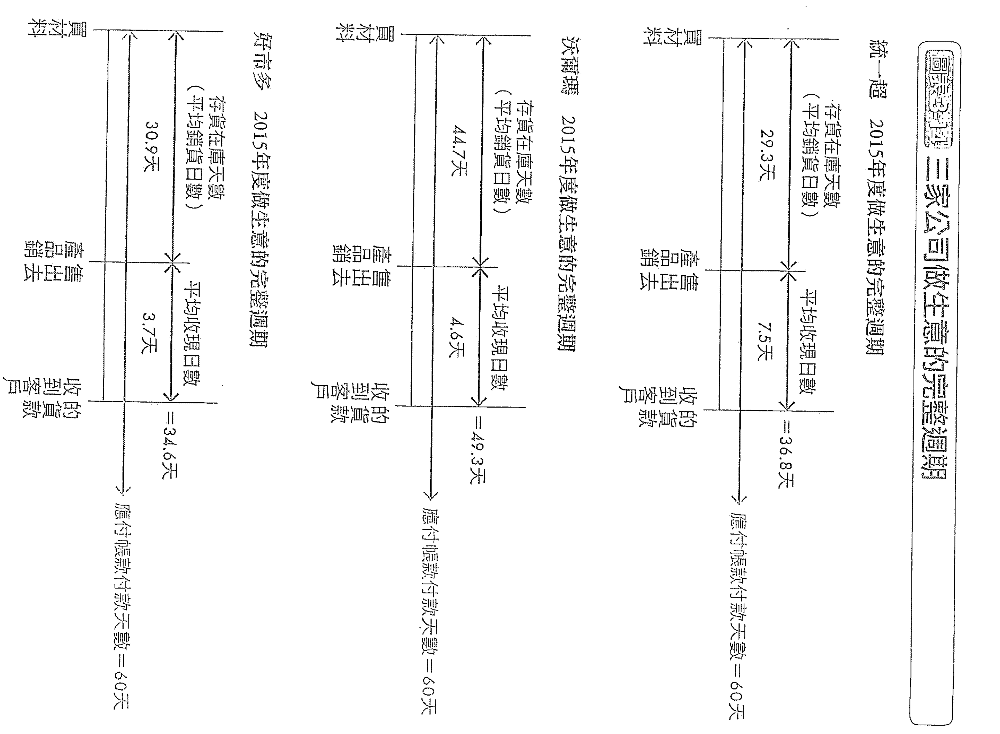

## 好公司的共通實力

從這個簡單的分析，可以歸納出這三家公司都有幾個共通性：

- 1. 做生意的完整週期都非常短，全部都不到50天就能做一撇生意。其中應付帳款付款天數我們假設都是60天，所以這三家公司不用錢就可以做生意了——因為缺錢的天數是負的，其中統一超缺錢的天數是負23.2天、沃爾瑪是負10.7天、好市多是負25.4天，代表這三家公司不缺錢，只要靠供應商給的60天付款條款就能做生意了。
- 2. 更棒的是，這三家公司都是天天收現金（前面已經提到，理論上這三家不用任何資金，就能做生意了）。
- 3. 它們又是生活必需的行業，擁有業績成長的高頻消費與剛性需求。

以上三點，就是華倫巴菲特最喜歡投資公司的特性：簡單易懂的生意模式，加上擁有長期穩定的獲利能力等特色，所以這兩家公司也是華倫·巴菲特的核心持股之一（見圖表3-15）。

| 公司名稱 | 持股金額 | 持股比例 |
| :--- | :---: | :---: |
| Walmart Stores | 9億美元 | 0.42% |
| Costco Wholesale Corporation | 6.6億美金 | 1.09% |

資料來源：September 30, 2016 as reported in Berkshire Hathaway's 13-F filing on November 14, 2016.

其中，巴菲特的合夥人查理·蒙格，更是這樣稱贊好利多：「這是一家我進棺材之後，還想繼續投資的公司。」因為好利多同時具備以下六大特色：

- 1. 做生意的完整週期不到40天。
- 2. 掙錢的天數是負的，代表以該公司目前的規模，不需要任何資金也能夠繼續經營生意。
- 3. 天天都收現金。
- 4. 不管景氣如何變化，都有現金能夠持續經營下去。
- 5. 業績持續創新高，全球分店天天生意興隆；再加上採用低價、高品質的精品銷售策略，滿足消費者的日常剛需與高端的消費需求。
- 6. 具備長期穩定獲利能力等特色。

除了個別公司的分析外，透過「做生意完整週期」的概念，也可以分析同業之間的表現，接下來我們來看蘋果公司與宏達電的表現（詳見圖表3-16）。

## 圖表3-16 蘋果與宏達電做生意的完整週期

### 蘋果 2015年度做生意的完整週期

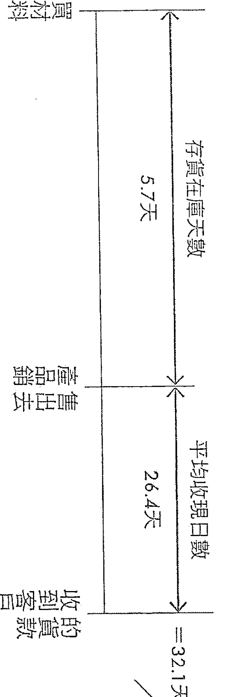

### 宏達電 2015年度做生意的完整週期

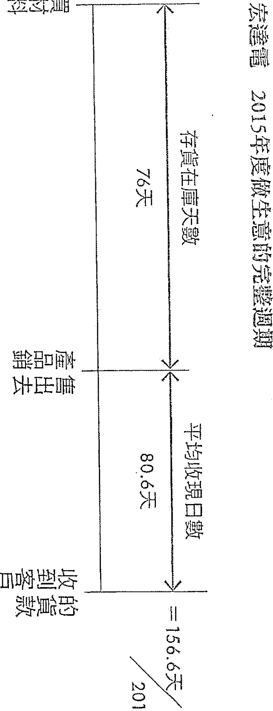

- 產品熱銷程度比較：蘋果平均5.7天賣出（熱銷）VS 宏達電平均6.7天賣出（不太熱銷）
- 對客戶應收帳款的管理能力比較：蘋果平均26.4天收款（代表公司對客戶與終端用戶的強勢）VS 宏達電平均80.6天收款（代表公司對客戶與終端用戶的弱勢）

兩家公司一對比，就知道雙方的經營實力差距非常大。

## 總資產的整體經營能力

公司的經營能力，除了看「應收帳款」與「存貨」這兩個資產的管理能力之外，還必須看一家公司總資產的整體經營能力。總資產週轉率（翻桌率）的公式如下所示。

### 總資產週轉率


總資產週轉率代表一家公司的總資產在實際經管的運用中是否有效率，它就像是餐廳的翻桌率，當然是越多越好。

所以一般公司的總資產週轉率（翻桌率）都會大於1，如上面公式中舉的例子，假設某家公司需要投資100億的總資產才能夠經營事業，同時他們一年可以做500億的生意，代表總資產的翻桌率為5趟，越多越好。

傳統製造業尤其需要注意總資產週轉率，因為本身行業的毛利率不高，在市場上能賺到的利潤不高，所以必須有效運用公司投入的總資產來創造營收（否則會有太多的資產閒置在公司沒有運用），故一般傳統產業的總資產週轉率（翻桌率）通常會大於2。

如果是流通業或是快時尚的行業，這些行業的利潤來源，主要是來自於讓商品快速流動，才能創造出利潤，他們公司的總資產週轉率通常會大於2。

換句話說，總資產週轉率介於1~2之間，都是營運正常的公司。如果一家公司的總資產週轉率越往1靠近，代表他們公司的總資產經營能力算是普通；如果這個數字接近2，而且他們不是所謂的流通業或是快時尚行業，代表這家公司的經營能力非常的優秀。例如郭台銘先生領軍的鴻海集團，2015年度的總資產週轉率高達1.88趟/年，非非常接近於2的水準，堪比流通業或是快時尚行業，代表鴻海的經營能力極佳。

另一種情況則是總資產週轉率低於1，小於1代表的是「分子小、分母大」。例如在上圖的公式中，一家公司必須投入500億的總資產，該年度卻只能帶來100億的營收，所以總資產週轉率只有0.2趟/年。

所以，總資產週轉率＜1，代表這家公司是資本密集型或是奢侈品型的行業，中翻中叫做「燒錢的行業」。哪些行業屬於資本密集行業呢？以下是幾個例子。

## 第五天 認識財務報表

- 天上的飛機
- 水上面的船舶
- 地上跑的高鐵／火車／汽車
- 金屬銅鎳鋼與石油等原物料產業
- 科技行業的面板、DRAM與半導體行業

這些行業都是屬於資本密集（燒錢）的行業。燒錢的行業並不可怕，可怕的是明明在燒錢，手上卻沒有錢。如果是這種情況，公司在景氣突然變化或反轉時，很容易發生危機。

您用常識就可以理解。就像一個人常常進出燒錢的場所（例如酒店、KTV），但身上永遠都只有500元，您覺得這樣持續下去他會出事嗎？答案應該是肯定的！

所以，將來當您看到任何一家財務報表的總資產週轉率小於1，請馬上把它中翻，告訴自己：這是一家資本密集（燒錢）的公司，然後立刻去看這家公司的現金占總資產是否大於25%。因為它屬於資本密集的公司，所以手上的現金當然越多越好，這樣才有能力抵擋景氣波動造成的現金風險。

這些數字會出現在公開資訊觀測站的五大財務比率分析「經營能力」中，如圖表3-17框架所示。


## 資本密集的公司應注意的三個指標


| 指標 | 財務與投資比率分析 (Balance Sheet) | 2013 | 2014 | 2015 |
| :--- | :--- | :---: | :---: | :---: |
| 負債資產比 (%) | 財務與投資比率分析 (Balance Sheet) | 12.15 | 24.33 | 24.55 |
| 財務結構資本比率 (%) | 財務與投資比率分析 (Balance Sheet) | 31.10 | 33.72 | 31.56 |
| 資產週轉率 (%) | 財務與投資比率分析 (Balance Sheet) | 15.37 | 9.09 | 7.72 |
| 投資組合回報 (%) | 財務與投資比率分析 (Balance Sheet) | 26.22 | 27.83 | 26.92 |
| 營運組合回報 (%) | 財務與投資比率分析 (Balance Sheet) | 4.6 | 4.94 | 4.99 |
| 平均現金流投資回報率 (%) | 財務與投資比率分析 (Balance Sheet) | 89.02 | 80.39 | 81.35 |
| 平均現金流投資回報 (%) | 財務與投資比率分析 (Balance Sheet) | 55.4 | 6.83 | 6.55 |
| 投資組合回報總和 (%) | 財務與投資比率分析 (Balance Sheet) | 65.88 | 53.94 | 55.73 |
| 平均現金流投資回報率 (%) | 財務與投資比率分析 (Balance Sheet) | 2.4 | 3.4 | 3.3 |
| 投資組合回報總和 (%) | 財務與投資比率分析 (Balance Sheet) | 0.72 | 0.92 | 0.72 |
| 投資組合回報總和 (%) | 財務與投資比率分析 (Balance Sheet) | 0.9 | 0.31 | 0.72 |
| 股東權益報 (%) | 財務與投資比率分析 (Balance Sheet) | 47.35 | 39.01 | 44.09 |
| 資本密集 (%) | 財務與投資比率分析 (Balance Sheet) | 2.555 | 30.72 | 27.87 |
| 股本密集率 (%) | 財務與投資比率分析 (Balance Sheet) | 17.07 | 5.8 | 1.33 |
| 淨資產比率 (%) | 財務與投資比率分析 (Balance Sheet) | 13.97 | 3.95 | 46.7 |
| 現金流比率 (%) | 財務與投資比率分析 (Balance Sheet) | 349 | 3.8 | 4.4 |
| 現金流投資比率 (%) | 財務與投資比率分析 (Balance Sheet) | 100 | 100 | 100 |
| 現金流回報率 (%) | 財務與投資比率分析 (Balance Sheet) | 6.49 | 5.2 | 5.4 |
| 資產密集 (%) | 財務與投資比率分析 (Balance Sheet) | 26.72 | 5.2 | 2.4 |
| 股東權益報 (%) | 財務與投資比率分析 (Balance Sheet) | 10.87 | 12.1 | 14 |
| 現金流比率 (%) | 財務與投資比率分析 (Balance Sheet) | 1.23 | 1.73 | 1.25 |
| 總現金流 (%) | 財務與投資比率分析 (Balance Sheet) | 15.120 | 19.688 | 29.441 |
| 總現金流 (%) (Term 5) (元/美元) | 財務與投資比率分析 (Balance Sheet) | (2.520) | (5.273) | (6.672) |

①：代表這是一家資本密集（燒錢）的行業

您在閱讀報表時，如果看到一家公司的總資產周轉率小於 1 時，請務必同時觀察 ①、②、③ 這三個重要指標：

- ① 總資產周轉率 < 1，代表它是燒錢的公司，必須馬上確定該公司手上有沒有錢。
- ② 因此要接著看 ②，它的現金佔總資產比率最好要高於 25%，氣才會長。如果未達這個標準，手上缺乏現金，那我們至少要確保這家公司能夠天天收現金。
- ③ 所以要看的 ③，如果平均收現日數 < 15 天，通常就代表它是天天收現金（現金交易）的公司。

## 資本密集公司的經營能力分析

接下來我們運用這三個指標，來看看幾家資本密集公司的實際財務報表。

## 2008 大立光

> 本公司係一家資本密集的公司。

- 1. 總資產週轉率近三年都 < 1，確實是一家資本密集的公司。
- 2. 現金占總資產比率，近三年平均大於 40%，這家公司的作法正確，非常穩健。
- 3. 平均收現日數，三年的平均大於 90 天，不是屬於收現金的交易。不過該公司手上的現金（指標 ②）相當充裕，所以不用擔心這個數字。
- 4. 操作話說，如果該公司的總資產週轉率（指標 ①）小於 1，最安全的情況是該公司的現金占總資產比率越高越好，因此指標 ② 最重要，指標 ③ 居次。

| 指標 | 單位說明及計算方式 | 2013 | 2014 | 2015 |
| :--- | :--- | :---: | :---: | :---: |
| 現金資產純額 | 總現金資產純額 | 31.15 | 34.53 | 34.53 |
| 債務比率 | 債務資產純額 (佔比率 %) | 310.65 | 333.27 | 219.48 |
| 利息覆蓋 | 純利息（債務及純利率） | 336.13 | 278.42 | 295.6 |
| 資產負債比 (%) | 資產負債比 | 296.42 | 266 | |
| 現金資產純額 (%) | 現金資產純額 | 4.1 | 4.54 | 4.69 |
| 現金資產純額 (%) | 現金資產純額 (%) | 2.96 | 2.96 | |
| 平均收現日數 | 平均收現日數 | 98.92 | 80.39 | 61.29 |
| 平均存貨日數 | 平均存貨日數 | 5.54 | 6.83 | 8.55 |
| 可轉讓及融資資產純額 (%) | 可轉讓及融資資產純額 (%) | 27.59 | 39.01 | 33.01 |
| 利息覆蓋 (%) | 融資資產純額 (%) | 65.28 | 53.44 | 55.73 |
| 資產純額 (%) | 資產純額 (%) | 0.71 | 0.92 | 0.37 |
| 資產純額 (%) | 資產純額 (%) | 27.59 | 39.01 | 33.01 |
| 資產純額 (%) | 資產純額 (%) | 35.95 | 50.72 | 44.09 |
| 現金純額 (%) | 現金純額 (%) | 657.37 | 1711.3 | 2179.8 |
| 現金純額 (%) | 現金純額 (%) | 47.25 | 53.92 | 57.58 |
| 現金純額 (%) | 現金純額 (%) | 33.9 | 52.52 | 43.27 |
| 現金純額 (%) | 現金純額 (%) | 35.13 | 42.25 | 36.3 |
| 現金純額 (%) | 現金純額 (%) | 9.610 | 144.43 | 140.18 |
| 現金純額 (%) | 現金純額 (%) | 71.64 | 75.41 | 34.27 |
| 現金純額 (%) | 現金純額 (%) | 139.56 | 131.58 | 142.45 |
| 現金純額 (%) | 現金純額 (%) | 144.25 | 171.41 | 202.75 |
| 現金純額 (%) | 現金純額 (%) | 24.33 | 29.27 | 30.78 |
| 現金純額 (%) | 現金純額 (%) | 11.300 | 19.688 | 29.743 |
| 現金純額 (%) | 現金純額 (%) | (3,582) | (5,472) | (2,159) |
| 現金純額 (%) | 現金純額 (%) | (1,502) | (3,719) | (6,870) |


| 指標 | 2013 | 2014 | 2015 |
| :--- | :---: | :---: | :---: |
| 總營業毛利潤 (元) | 2,499 | 2,360 | 2,785 |
| 每股稅後純利潤 (元) | 10.21 | 9.0 | 10.6 |
| 每股收益 (元) | 1.6 | 1.4 | 1.7 |
| 資產負債比 (%) | 5.67 | 4.44 | 4.05 |
| 股東權益比率 (%) | 2.97 | 4.0 | 4.5 |
| 股東權益比率 (%) | 1.78 | 4.0 | 4.5 |
| 現金股利率 (%) | 1.29 | 1.12 | 1.25 |
| 現金股利率 (%) | 1.63 | 1.5 | 1.25 |
| 總資產轉速率 (次) | 69.6 | 13.4 | |
| 資產週轉速率 (次) | 17.13 | 15.6 | |
| 資產週轉速率 (次) | 87.12 | 63.9 | |
| 資產週轉速率 (次) | 1.00 | 1.00 | |

| 項目 | 2013 | 2014 | 2015 |
| :--- | :---: | :---: | :---: |
| 每股純利潤 (元) | 32.88 | 30.06 | 36.74 |
| 純利潤 (百萬元) | 1,004 | 1,517 | 1,657 |
| 純利潤 (百萬元) | 1,153 | 1,517 | 1,657 |
| 純利潤 (百萬元) | 1,344 | 1,517 | 1,657 |
| 純利潤 (百萬元) | 2013 | 30.06 | 36.74 |
| 純利潤 (百萬元) | 2,404 | 2,784 | 2,977 |
| 純利潤 (百萬元) | 2,405 | 2,785 | 2,977 |
| 純利潤 (百萬元) | 2,405 | 2,785 | 2,977 |
| 純利潤 (百萬元) | 2,405 | 2,785 | 2,977 |

- ① 總資產轉速率近三年平均是 0.55 次／年，是資本密集與技術密集的行業。
- ② 現金佔總資產比率，2015 年提升到 34.2%，規劃非常穩健，代表台積電抗擋景氣意外波動的能力相當強大。
- ③ 平均收現日數，近三年的平均都大於 40 天，但因為指標 ② 的數據高達 34.2%，所以指標 ③ 表現也相當亮眼，算是好上加好。

## 538-2 2012.03 暨市誠意

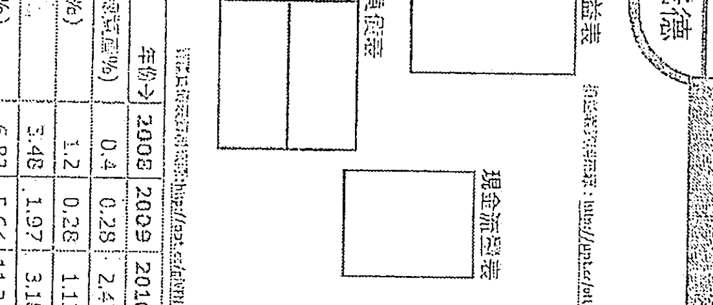

| 年份 | 2008 | 2009 | 2010 |
| :--- | :---: | :---: | :---: |
| 現金餘額 | 0.4 | 0.28 | 2.47 |
| 稅額資產 (應佔營收 %) | 1.2 | 0.28 | 1.13 |
| 應收貨款 (應佔營收 %) | 3.76 | 1.97 | 3.18 |
| 存貨 (應佔營收 %) | 6.83 | 3.64 | 11.24 |
| 應付貨款 (應佔營收 %) | 100 | 1.00 | 1.29 |
| 應收應付 (應佔營收 %) | 3.89 | 1.65 | 2.20 |
| 應收款項 (應佔營收 %) | 5.25 | 52.31 | 20.57 |
| 應付款項 (應佔營收 %) | 4.28 | 23.03 | 75.21 |
| 資產中 - 現金資產佔營收比例 | 100 | 100 | 100 |
| 資產中 - 應收資產佔營收比例 | 32.8 | 19.66 | 4.22 |

| 項目 | 別於比率 | 單均 | 2008 | 2009 | 2010 |
| :--- | :--- | :---: | :---: | :---: | :---: |
| 現金佔總資產 (%) | 資產總額 | 63.5 | 58.5 | 108.9 | |
| 資金資產佔總資產 (%) | 資產總額 | 45.3 | 95.7 | | |
| 資本資產佔總資產 (%) | 資產總額 | 10.3 | 27.4 | 70.4 | |
| 應收及款 (%) | 應收及款與資產 | 3 | 3.8 | 2.6 | |
| 應付及款 (%) | 應付及款與資產 | 9.3 | 9.8 | 36.2 | |
| 資金資產佔營收比例 | 資金資產總計 | 39.4 | 97.2 | 4.6 | |
| 現金資產比率 | 現金資產比率 | 6.5 | 7.6 | 14.5 | |
| 6 個月資金資產平均 (年銷售天數) | 6 個月資金資產平均 (年銷售天數) | 56.8 | 38 | 25.3 | |
| 現金資產佔資金資產比率 (%) | | | 0.24 | 0.12 | 0.53 |
| 總資產佔比 (%) | 總資產資產 | (2.6) | 0.8 | 0.25 | |
| 總資產佔比 (%) | COE | (92.6) | (12.1) | (2.4) | |
| 總資產資產佔比 (%) | | (63.5) | (2.4) | (28.3) | |
| 資產總額佔比 (%) | | (78.1) | (12.5) | (47.8) | |
| 總資產及現金資產比率 (%) | 對照比率 | (9.6) | 0.1 | (2.4) | |
| 現金資產資產資產佔比 (%) | 現金資產比率 | 2.4 | 0.2 | 0.1 | |
| 總資產資產資產資產資產 | 現金資產資產資產資產資產資產資產資產資產資產資產 | (56.699) | (23.253) | (17.990) | |
| 現金資產資產資產資產資產資產資產資產資產資產資產 | | 56.699 | (4.47) | 0 | 7.4 |
| 總資產資產資產資產資產資產資產資產資產資產資產 | | 863 | 1.020 | 1.020 | |
| 現金資產資產資產資產資產資產資產資產資產資產資產 | | 3.767 | (1.182) | 3.129 | |

看過兩家好公司之後，接下來我們來看看其他狀況不佳公司的總資產經營能力表現。

- 1. 總資產週轉率近三年 < 1，確實屬於資本密集公司。
- 2. 現金占總資產比率，近三年不到 3%，這樣的現金水位安排，對一家資本密集的公司來說非常危險。

⊙ 那茂德達家公司是不是天天收現金呢？它的平均收現日數，前兩年都大於 30 天，最後一年才是收現金。一般經營狀況正常的公司，應收帳款的收數政策都會相當的穩定，很少有公司這個問題數據會大幅波動，除非發生以下兩種情況：

- (1) 公司轉型發展，由 B2B 轉向 B2C，所以應收帳款的收現日數，才會由 30 天轉成收現金（<15 天）的模式。
- (2) 另一種平均收現日數大幅波動常見的情況則是：公司營運出現危機，資金不足，需要將存貨立刻變現以延續公司的生命。

茂德公司當時屬於第二種情況。

所以透過 ①②③ 指標進行綜合研判後發現，茂德屬於資本密集公司，需要大量資金才能持續發展下去，結果手上既沒現金，也不屬於天天收現金交易的行業。即使您有閒錢，真的會願意投資這家公司嗎？

## 方晶 53246 2012-12 上市櫃

## 從經營能力觀察公司 做生意真本事

請至公開資訊查詢系統： http://tpcs.tss.org.tw

上市公司查詢系統： http://list.company

上市公司財務資料庫： http://rpts.msn

| 期間 | 2009 | 2010 | 2011-4 |
| :--- | :---: | :---: | :---: |
| 現金占資金比 (%) | 70.4 | 70.7 | 87.2 |
| 現金存貨資金比 (%) 及同業比較 (%) | 98.1 | 100.1 | 83.2 |
| 應收帳款資金比 (%) | 18.9 | 25.7 | 11.6 |
| 現金比率 (%) | 10 | 49.4 | 116 |
| 速動比率 (%) | 17.3 | 30.2 | 18.9 |
| 同業比較 | 5.3 | 19.1 | 19.3 |
| 存貨資金比 (%) | 21 | 10.6 | 9 |
| 未償還融資及同業比較 (%) | 0.87 | 34.6 | 40.6 |
| 應收帳款周轉率 (%) | 0.23 | 1.3 | 4.8 |
| 存貨周轉率 (%) | 0.34 | 4.7 | 0.46 |
| 應收帳款資金比 (%) 及同業比較 (%) | 2.55 | 12.5 | (3.9) |
| 現金比率 (%) | 26.9 | 10.1 | (2.0) |
| 應收帳款周轉率 (%) 及同業比較 (%) | (48.7) | 9.3 | (42.4) |
| 存貨周轉率 (%) 及同業比較 (%) | (50.4) | 4.1 | (52.8) |
| 現金佔資金比 (%) 及同業比較 (%) | (4.5) | 44.9 | 4.8 |
| 現金比率 (%) 及同業比較 (%) | (66.5) | 3.8 | (21.7) |
| 同業比較 (%) | (20/13) | 0.06 | (22/20) |
| 現金存貨資金比 (%) 及同業比較 (%) | 47.6 | 65.8 | 9.6 |
| 應收帳款資金比 (%) 及同業比較 (%) | 10.2 | 7.7 | 9.6 |
| 存貨資金比 (%) 及同業比較 (%) | 2.2 | 12.3 | 1.6 |
| 存貨周轉率 (%) 及同業比較 (%) | 7.8 | 32.8 | 1.6 |
| 現金存貨資金比 (%) 及同業比較 (%) | 2829 | 15285 | 58 |
| 現金存貨資金比 (%) 及同業比較 (%) (from B/S 及) | 5.431 | 65.943 | 5.401 |
| 現金比率 (%) (from B/S 及) | 24.744 | 247.778 | 1.643 |
| 存貨周轉率 (%) (from B/S 及) | 100 | 100 | 100 |
| 應收帳款資金比 (%) 及同業比較 (%) | 21.49 | 2827 | 13.05 |
| 現金比率 (%) 及同業比較 (%) | 1.95 | 3.21 | 1.4 |
| 應收帳款資金比 (%) 及同業比較 (%) | 0.75 | 0.75 | 1.42 |
| 現金存貨資金比 (%) 及同業比較 (%) | 5.04 | 4.32 | 4.49 |
| 應收帳款資金比 (%) 及同業比較 (%) | 11.02 | 15.62 | 10.43 |
| 存貨周轉率 (%) 及同業比較 (%) | 108 | 100 | 100 |
| 現金比率 (%) 及同業比較 (%) | 1.61 | 2.78 | 2.68 |
| 應收帳款資金比 (%) 及同業比較 (%) | 42.1 | 45.15 | 52.74 |
| 現金存貨資金比 (%) 及同業比較 (%) | 35.91 | 25.15 | 34.21 |
| 現金存貨資金比 (%) 及同業比較 (%) | 100 | 100 | 100 |
| 現金存貨資金比 (%) 及同業比較 (%) (from B/S 及) | 100 | 100 | 100 |

- ① 總資產週轉率 < 1，確實屬於資本密集型公司。
- ② 現金佔總資產比率 < 2%，現金部位過低，非常危險。
- ③ 平均收現天數約在 9~2 天，很像天天收現金交易的情況。但實務上，沒有一家企業可以月營收創新高。景氣時有波動，產業發展中也常常出現黑天鵝（意外之外的賽事）。原本每天都有穩定的營收現金（現金交易），作爲公司日常開銷使用，一旦發生意外，每日營收所創造的現金量遽降，若此時公司手上又沒有足夠的現金，很容易在這個時候發生財務危機。

123


## 從經營能力破解公司做生意基本事

另外從資產負債表中，可以看出該公司2014年總資產為257億，2015年總資產為248億，代表該公司在2015年並沒有大幅的資本支出。所以，環航的總資產週轉率在2015年快速下降到0.42的主因，來自於公式中的分子，代表它的營收大幅下滑。

- ② 現金占總資產比率＜3%。現金部位過低，所以應該馬上看指標③。
- ③ 環航是不是天天收現金的行業（平均收現日數＜15天）？由數據看起來，它確實是天天收現金的行業。

在天下太平的時候，這樣子安排還可以（天天收現金＋手上只留少少的現金），可是一旦遭受景氣波動、發生飛安事件，或是乘機旅遊數大幅下降的情況，這家公司將出現重大危機。

### 經營能力綜合指標的閱讀順序

透過這些真實案例，不用其質地重複解析，主要是想要和讀者分享一個重要的概念：

遇到任何資本密集的公司，一定要慎著循環 ① 、 ② 的閱讀方式，才能幫你挑出好公司、避開爛公司。

請永遠記得，一旦您不小心投資到爛公司，最後非常可能會變成血本無歸，現金歸零的窘境。

一家公司的經營能力如何，您現在已經知道要同時關注「應收帳款週轉率」、「存貨週轉率」與「總資產週轉率」的概念。而這三個經營能力的綜合指標，都可以在公開資訊觀測站查詢到，觀看優先順序的建議分別為（詳見圖表3-18）：

- ① 總資產週轉率：當總資產週轉率 < 1，就要立刻沿著 ② 的路線，觀察現金佔總資產的比率，然後再順著 ③ 的前項指引，觀察 ③ 平均收現日數。
- ② 平均存貨天數：看看這家公司的商品是否暢銷？
- ③ 應收帳款平均收現日數：越短越好。

接下來您可以從本書附贈之32家公司的財務報表卡，任選幾家您有興趣的公司，進行該公司的經營能力分析。筆者在這題先在選擇其中三家進行實務分析，您可以法運用即可。

### 中碳

# 1723


根據「財務報表與財務分析」，http://dfis117.tse.com.tw

| 項目 | 名稱 | 單位 | 2013 | 2014 | 2015 |
| :--- | :--- | :--- | :--- | :--- | :--- |
| 1 | 資/負債比率(%) | % | 13.4 | 12.5 | 19.3 |
| 2 | 自有資本比率(%) | % | 48.6 | 53.9 | 47.2 |
| 3 | 純資產總值/原淨資產值比率(%) | % | 9.7 | 15.2 | 2.7 |
| 4 | 營業週轉率 | 次 | 0.7 | 0.9 | 1.0 |
| 5 | 流動比率(%) | % | 8.5 | 6.4 | 5.8 |
| 6 | 速動比率(%) | % | 7.9 | 5.4 | 4.5 |
| 7 | 營業利益率(%) | % | 6.4 | 7.7 | 9.1 |
| 8 | 獲利率(%) | % | 7.4 | 10.1 | 12.4 |
| 9 | 存貨週轉日數(天) | 天 | 2.6 | 2.4 | 3.1 |
| 10 | 應收帳款日數(天) | 天 | 1.4 | 1.3 | 1.7 |
| 11 | 平均持股日數(天) | 天 | 35.0 | 52.0 | 40.0 |
| 12 | 每股現金流量(元) | 元 | -1.5 | -2.2 | -1.8 |
| 13 | 每股現金流量比率(%) | % | 12.4 | 15.6 | 11.8 |
| 14 | 每股淨利(元) | 元 | 0.5 | 0.6 | 0.7 |
| 15 | 每股淨資產(元) | 元 | 1.8 | 2.0 | 2.3 |
| 16 | 資本報酬率(%) | % | 3.5 | 5.2 | 6.8 |
| 17 | 總資產報酬率(%) | % | 4.2 | 6.5 | 7.9 |
| 18 | 營業現金流比率(%) | % | 1.1 | 1.5 | 0.9 |
| 19 | 現金流量/股東權益(%) | % | 2.8 | 4.1 | 3.5 |
| 20 | 現金流向財務比率(%) | % | 5.2 | 7.3 | 8.1 |
| 21 | 純資產報酬率(%) | % | 4.0 | 6.1 | 7.5 |
| 22 | 現金流量比率(Cash B/S) | % | 0.8 | 0.9 | 1.1 |
| 23 | 現金流向財務比率(Cash B/S) | % | 2.5 | 3.8 | 4.2 |
| 24 | 現金流量/股東權益(Cash B/S) | % | 3.1 | 4.5 | 5.0 |
| 25 | 現金流量/股東權益(Cash B/S) | % | 1.2 | 1.6 | 1.4 |

總資產週轉率逐步下滑，在2015年度的數據為0.69轉／年，小於1，代表這家公司變成一家資本密集的公司，也就是這個公式中的分子（總資產）變大或是分子（營業收入）金額變小。具體情況，還必須請您自行深入了解該公司於當時發佈的相關新聞資料，但就算我們都不知道相關的產業資訊，其實也沒有關係。凡是遇到一家公司的總資產週轉率 < 1，接下來馬上要傾聽圓和圓看其他數據。

1. 現金佔總資金的比率為 12.6%；符合 10~25% 的基本要求；但這個數據還是偏低，因為該公司的總資金周轉率 <1。
2. 應收帳款平均收現日數為 31.46 天；表現相當優異（因為一般 B2B 行業的公司 在台灣的收現日數約為 90 天）。但該公司 2015 年年度的資料與前兩年相比，有逐步下滑的跡象。
3. 平均在庫天數為 37.49 天；表現也相當優異，因為一般 B2B 行業 的在庫天數約為 60~90 天，而這家的數據非常接近流通業的日數。但與前兩年相比，也有小幅下滑的跡象。

假設我們無法及時得知該公司相關產業發展資訊，僅就該公司的財務報表數據，來進行經營能力綜合評估的話，可能會得到以下結論：

- A. 這家公司的總資產經營能力逐步下滑；可能是因為營收大幅下滑，或是公司擴大資本支出，為未來進行相關的新產品、新設備的投資。如果這個數據下滑的原因是後者（加大資本投資），則屬於好訊息。
- B. 該公司的存量在庫天數與應收帳款平均收現日數；兩個指標雖然也呈現下滑趨勢，但與一般 B2B 行業的公司相比；表現仍屬非常優異。
- C. 如果我是該公司的股票持有者，我會特別關注未來 2016 年的年報中，這三個數據是否改善。如果持續下滑，筆者將減少持股；如果能逐步改善，則會維持繼續投資的立場。

總資產週轉率近三年穩定在2.4倍/年。此數值小於2代表是資本密集行業，介紹1~2代表這家公司的整體經營能力很不錯，大於2代表這家公司的經營能力相對優異，通常是流通業或快時尚的行業。現金佔總資產的比率，近三年都維持在25%左右，代表這家公司的財務策略非常穩健。

| 統計指標 | 單位 | 2013 | 2014 | 2015 |
| :--- | :--- | :--- | :--- | :--- |
| 財務及非財務比率 (%) | % | 0.67 | 6.65 | 65.5 |
| 負債比率 (債務及財務比率 %) | % | 186.9 | 186.9 | 186.9 |
| 槓桿能力 | | | | |
| 資產負債比 (%) | % | 88.53 | 99.11 | 98.67 |
| 流動比率 (%) | % | 74.54 | 70.87 | 78.66 |
| 現金流出/流入比率 (%) | % | 49.44 | 73.29 | 48.61 |
| 平均收現日數 | 天 | 7.38 | 3.31 | 1.25 |
| 存貨週轉率 | 次 | 1.23 | 7.31 | 7.45 |
| 資本效率 (%) | % | 27.65 | 24.22 | 35.22 |
| 資產週轉率 (以平均資產計 %) | % | 2.31 | 2.07 | 2.82 |
| 資本效率 (資本投入計 %) | % | 9.33 | 7.45 | 2.35 |
| 現金效率 (%) ROA | % | 11.27 | 12.03 | 10.81 |
| 淨現金效率 (%) ROE | % | 55.79 | 35.44 | 30.76 |
| 財務及營運效率 (%) | % | 108.62 | 121.28 | 113.41 |
| 資本利益率 (%) | % | 5.08 | 5.21 | 4.6 |
| 股利能力 | | | | |
| 現金分派率 (%) | % | 31.6 | 15.88 | 33.28 |
| 資產及股東淨資產 (元 / 倍數) | 元 | 4.61 | 4.85 | 4.51 |
| 每股股利 | 元 | 7.73 | 9.24 | 7.49 |
| 股票報酬率 (%) | % | 9.24 | 10.78 | 9.42 |
| 現金效率 (%) | % | 27.95 | 32.46 | 32.92 |
| 現金 | 元 | 136.76 | 131.32 | 132.06 |
| 每股現金 (元 / 倍數) | 元 | 14.09 | 15.06 | 16.357 |
| 投資報酬率 | % | 3.2174 | 14.879 | 7.738 |
| 股東權益報酬率 (from / B5 倍數) | % | 5.3521 | 6.6493 | 7.38 |
| 總資產報酬率 (from / B5 倍數) | % | 7.022 | 6.0593 | 7.472 |

| 統計指標 | 2013 | 2014 | 2015 |
| :--- | :--- | :--- | :--- |
| 現金及約當現金 (約當比率 %) | 32.15 | 24.99 | 25.27 |
| 應收帳款 (約當比率 %) | 4.63 | 4.83 | 4.8 |
| 存貨 (約當比率 %) | 12.18 | 12.55 | 12.93 |
| 固定資產 (約當比率 %) | 55.65 | 54.63 | 55.85 |
| 淨資產 (約當比率 %) | 1.00 | 1.00 | 1.00 |
| 流動比率 (約當比率 %) | 56.45 | 55.14 | 55.59 |
| 淨資產投資 (約當比率 %) | 19.94 | 18.94 | |
| 應收帳款 (約當比率 %) | 10.62 | 9.57 | 9.63 |
| 資本效率 (約當比率 %) | 32.93 | 35.29 | 34.78 |


應收帳款平均收現日數為8天以內，代表這一家公司是收現金交易的行業。另外在閱讀財報的時候，記得要拿出我們的生活常識，來驗證財報真實性。以這家公司為例，應收帳款平均收現日數＜15天，剛好符合我們日常生活的常識，代表它的財報可信度高。

為什麼筆者這麼強調大家要運用既有的生活常識呢？因為在實務上，我們不是天天跟公司總經理在一起，無法判斷對方的誠信狀況。如果我們能夠同時運用生活常識驗證這家公司的財報數據，就好像多了一道審核手續，能夠幫助我們在投資過程中避免踩到地雷股。

平均在庫天數為30天以內。這個數據到底是好還是不好？您可以進行同業分析來確認。還記得前面提到的沃爾瑪與好市多的存貨在庫天數嗎？沃爾瑪約為45天，而幾乎每一家在台灣的分店天天都是大排長龍的好市多約為31天。換句話說，統一超的存貨平均在庫天數，已經比全世界分店最多、市值最高的沃爾瑪還要厲害。這應該也算是台灣另類的經濟奇蹟！


從經營能力破解公司做生意真本領

### 不確定，也能讓債權人除權讓價股


以下為公司近三年各年度之主要財務數據及比率：http://r428763.xls

| 項目 | 單位 | 2013 | 2014 | 2015 |
| :--- | :--- | :--- | :--- | :--- |
| 負債佔資本額(%) | % | 44.53 | 44.28 | 40.03 |
| 權益 | 千元 | 300.31 | 312.44 | 276.07 |
| 流動資產 | 千元 | 155.09 | 190.29 | 185.03 |
| 不動產、資產及長期(比率)(%) | % | 125.27 | 120.69 | 102.80 |
| 償債比率(倍) | 倍 | 7.48 | 7.22 | 8 |
| 淨利佔股款(%) | % | 45.75 | 41.45 | 45.62 |
| 平均收現日數 | 天 | 4.3 | 4.2 | 4.24 |
| 平均銷貨日數(延長應收日數) | 天 | 34.88 | 35.98 | 30.09 |
| 不同資產比率(資產負債表) | % | 6.76 | 6.29 | 4.03 |
| 資產報酬率(%) | RoA | 0.92 | 0.69 | 0.32 |
| 權益淨利利率(%) | RoE | 2.29 | 5.96 | 6.32 |
| 流動資產(%) | % | 12.51 | 9.51 | 10.81 |
| 長期債務(%) | % | 63.62 | 60.84 | 63.68 |
| 償債能力比率 | 倍 | 22.29 | 22.65 | 25.97 |
| 債務比率(%) | % | 4.46 | 3.25 | 4.59 |
| 流動比率(%) | % | 20.01 | 5.68 | 13.15 |
| 純益預留(%) | 倍 | 7.46 | 13.85 | 6.04 |
| 純益預留(%) | % | 15.92 | 25.93 | 35.24 |
| 股權淨利利率(%) | % | 10.82 | 16.43 | 25.91 |
| 現金淨利利率(%) | % | 21.48 | 80.05 | 96.39 |
| 現金淨利比率(%) | % | 4.11 | 7.25 | 2.01 |
| 現金淨利利率(%) | % | 4.3 | 13.859 | 22.04 |
| 長期長期利率(%) | % | (3.10) | (7.21) | (9.46) |
| 總長期長期利率(%) | % | (1.43) | (2.68) | (2.29) |
| 總長期長期比率(%) | % | (9.18) | 1.493 | (7.72) |

①總資產連轉三年都是<1》，代表這是一家資本密集的行业。所以應該立即查其他數據。最外層，雙集同時也是勢力集緊的行業喔。

②現金佔總資產的比率，近三年平均為13%，以一家資本密集的行业來看，這家公司的現金存量偏低。接下來清算查。

③應收帳款平均收現日數，三年平均為6天。數據大於15天以上，通常代表這是一家B2B行業的公司，而且以一般B2B行業的平均標準來看，這家

## 從經營能力破解公司做生意真本事

公司的應收帳款管理能力不錯。可是，如果您上網至公開資訊觀測站，找同行業公司的數據進一步分析，例如 9910 豐泰，便可發現豐泰的應收帳款平均收現日數近三年平均為 25 天。相較之下，豐成工業的應收帳款管理能力，與同行相比屬於偏強。看來這家公司自己也有意識到這個問題，所以數據呈現逐年改善的好跡象。

(2) 存貨在庫存日數的表現平均三年約為 85 天，如果以同業 9910 豐泰的平均在庫存日數 45 天進行比較，這家公司的存貨管理能力偏弱。

透過以上三家不同行業公司的簡單分析，相信您對「經營能力」（獲利率越高越好）的概念，已經具有立體的閱讀觀。接下來，請您拿出本書附贈的 52 家公司財務報表卡，進行分析練習。熟能生巧，相信下一次您再看到這些數據，就有輕鬆解析關鍵指標的能力，再也不會恐慌囉！

### 實戰分析練習

| | 01 大立光 | 02 合精電 | 03 中強 | 04 廣達光電 | 05 皇田工業 |
| :--- | :--- | :--- | :--- | :--- | :--- |
| 1 | 3008 | 2330 | 1723 | 1537 | 9951 |
| 2 | | | | | |
| 3 | | | | | |
| 4 | | | | | |
| 5 | | | | | |
| 6 | OK | 沾書圈、回傳查 | | | |

| 06 友通資訊 | 2397 |
| :--- | :--- |
| 07 佳怡 | 1227 |
| 08 聯鈦 | 3450 |
| 09 為升 | 2231 |
| 10 日友 | 8341 |
| 11 中興保全 | 9977 |
| 12 神豐科技 | 3005 |
| 13 寶成工業 | 9904 |
| 14 合豐科 | 6464 |
| 15 巨大 | 9921 |
| 16 恆大 | 1325 |
| 17 邦得生技 | 4107 |
| 18 可寧衛 | 8422 |
| 19 航豐科技 | 5199 |
| 20 台達電 | 2308 |

※ 本表並非載明資料！本書所附錄之各公司財務報表，皆為經審計機構在公開資訊觀測站選出的公司。

※ 投資一定有風險，股票投資有漲有跌，買股前請詳閱公開說明書（財務報表）。

## Chapter 4 從獲利能力破解這是不是一門好生意

透過前幾個章節的學習，相信大家已經覺得要優先看「現金流量」（長越好、越長越好）與「經營能力」（罰桌率、越高越好）等重點了。接下來，我要教大家看第三個重要的指標「獲利能力」。這個指標的終極中是：

這是不是一門好生意？越高越好。

獲利能力在公開資訊觀測站的五大財務比率分析的位置，如圖表 4-1 中的紅框所示。

至於判斷一家公司是不是好生意，則請您參考圖表 4-2，有六個重要的指標需要觀察。

### 圖表 4-2 好生意的六大關鍵指標

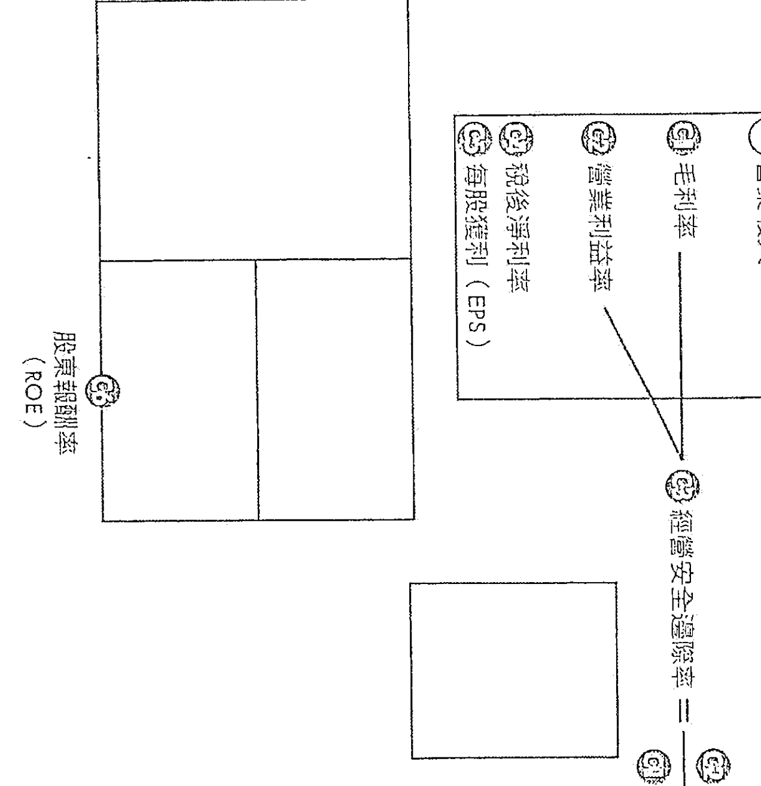

### 圖表 4-1 獲利能力在五大財務比率分析的位置


| 中國信託金融 holding | 中國信託銀行 | 2012 | 2011 | 2010 |
| :--- | :--- | :--- | :--- | :--- |
| 淨利 | | 155 | 333 | |
| 稅後純益 | | 28,718 | 33,830 | |
| 稅前純益 | | 28,718 | 33,830 | |
| 營業利益 | | 10 | 112 | |

### C1 毛利率：一門生意的好壞

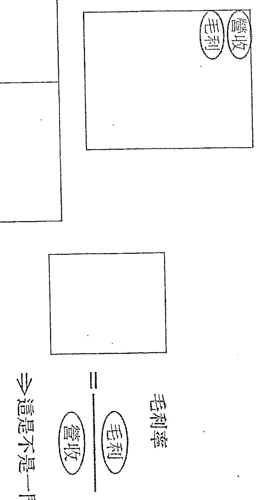


毛利率越高，代表這真是一門好生意！毛利率越低，代表這真是一門艱困的生意。如果毛利率是負的，代表這真是一門爛生意。接下來我們參考圖表 4.3，以毛利率來看看六家公司的表現。

可以看出，半導體業的台積電與光電行業的大立光，毛利非常高，分別為 48% 與 57%，中櫃中，這真是一門好生意！屬於傳產的中標，毛利率表現也相當不錯，高達 26%；流通業之王的統一超商毛利率也很好，高達 32%。

與高品牌公司的巨大，毛利率是 22%。一般純粹經營品牌的公司，毛利率通常都要在 30% 以上，才算是表現良好，因為這種公司需要一定的利潤率，才有足夠利潤空間進行品牌推廣時所需的相關費用。

根據蘋果與宏達電的 2015 年報資料，前者毛利率為 40%，後者僅約 18%，所以在行銷推廣上，宏達電越來越沒有經費操作。因此巨大的毛利率為 22%，如果純粹就一家經營品牌的公司來看，這種毛利率偏低。筆者推測應該是巨大仍有非常高的 ODM 生意所致，因為相對品牌業務而言，ODM 代工生意的毛利率偏低。故兩種生意模式（品牌與 ODM）兼有的巨大，毛利率最後僅有 22%，略為偏低。

| 本公司毛利率 | 57.38% | 48.65% | 26.94% | 32.26% | 22.16% | 7.15% |
| :--- | :--- | :--- | :--- | :--- | :--- | :--- |

### 六家公司的毛利率表現


科技製造業代表的鴻海，其優異的經營能力表現，全世界有目共睹，但是毛利率只有 7%，中囂中為：這真是一門難囂的生意。所以即使是鴻海經營能力各方面表現相當優異，但股價一直沒有受到投資人青睞，因為毛利率實在偏低，使投資人對該公司的未來前景預期與發展空間有相當的疑惑。

一家公司的毛利率越高，可能代表該公司進入到一個藍海市場（競爭者較少）、擁有特殊的一技之長（如台積電與大立光），或是該行業進入障礙非常高（如需要特許經營的電信行業），別的競爭對手很難進入……等因素。

一家公司的毛利率偏低，代表該市場競爭激烈，為了生存大家不得不削價競爭。透過規模經濟、專業分工、聯合採購，或是各種流程效率化的做法，仍有機會維持競爭力與基本的獲利能力，但是整體來說，這種行業的前景不被看好。

### ⑤ 負毛利率公司的唯一活路

若一家公司的毛利率是負的，例如圖表 4-4 所示的狀況：

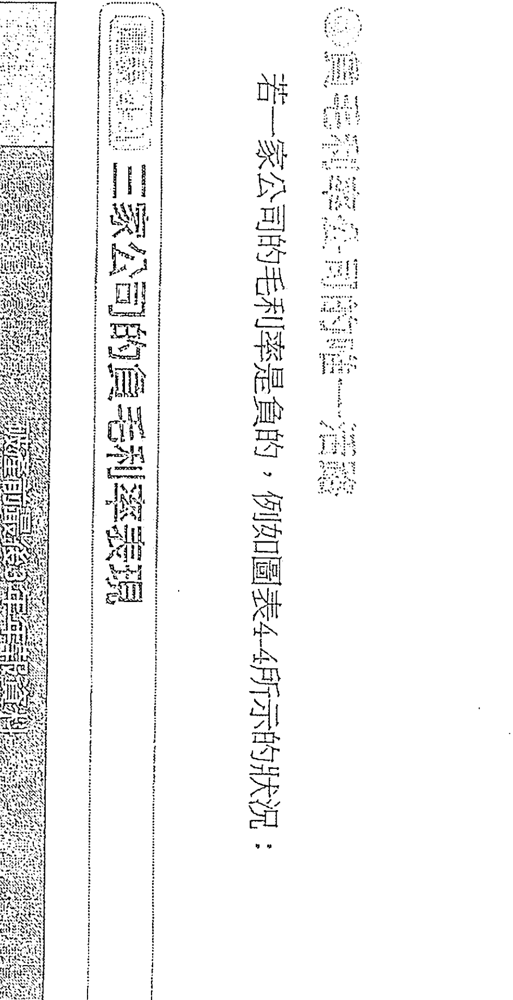

以當時的茂德為例，該公司最後三年的毛利率分別為 (-61.9%)、(-212%) 與 (-47.8%)。

如果您願意受命擔任這家公司的總經理，假設只有下列三種方案可以選擇，您會如何拯救這家公司？

- (A) 想盡辦法增加營收。
- (B) 要求全面控制成本。
- (C) 嚴格控管公司相關費用支出。

不論您是選擇 (A)、(B) 或是 (C)，都要恭喜您！好不容易您防壁已久的總經理位子拿到了，但只要您決定將公司資源集中在任何一種，不論您選擇的是 (A)、(B) 或是 (C)，結果這家公司將被您的英明領導弄到破產了！

巴菲特曾說：「除了少數例外，當握有才華過人管理者的摩馨，去經營一家經濟基本面值得出名的企業時，最後名聲不變的必是哪家企業。」

換句話說，如果一家公司連續三年毛利率都是負值，而且負的相當多，起死回生唯一的（可能）選項是：轉行！因為原有行業已經無利可圖，只要留在原行業多一天，虧損只會不斷擴大，唯一生存之道就是轉行，轉到別的行業或應用領域。2012 年 12 月宣布破產的力晶，就是採取了轉行的策略，於是在 2016 年又成為一家賺錢的企業。

提醒您一個重要觀念：不論您有多少內部消息，建議不要投資任何「連續三年毛利率都是負值」的公司。除非這家公司仍舊有大筆現金，他們才有機會東山再起，否則您原先想短線投機的資金，最後可能以血本無歸收場。

### C2 營業利益率：一家公司賺錢的真本事

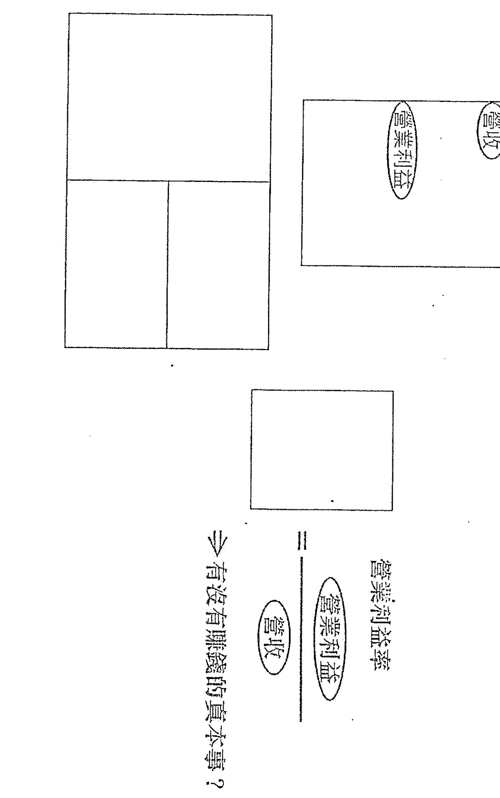

毛利率越高越好，有了這個特點的公司相當不錯。但是，萬一這家公司的開銷也很大呢？會不會開銷過大，結果毛利率很高，但是公司最後反而沒賺錢呢？

為了避免這個問題發生，所以除了毛利率之外，第二個要觀看的重要指標，就是營業利益率。

一家公司的收入減去成本與費用之後，就叫做「營業利益」，而這個金額的高低，代表一家公司賺錢的基本事高低。

其中，經營一家公司費用（包含了行銷費用、管理費用、研究費用、折舊費用與分期摊销等五種費用）的大小，也可以看出一家公司在市場的相對位置。

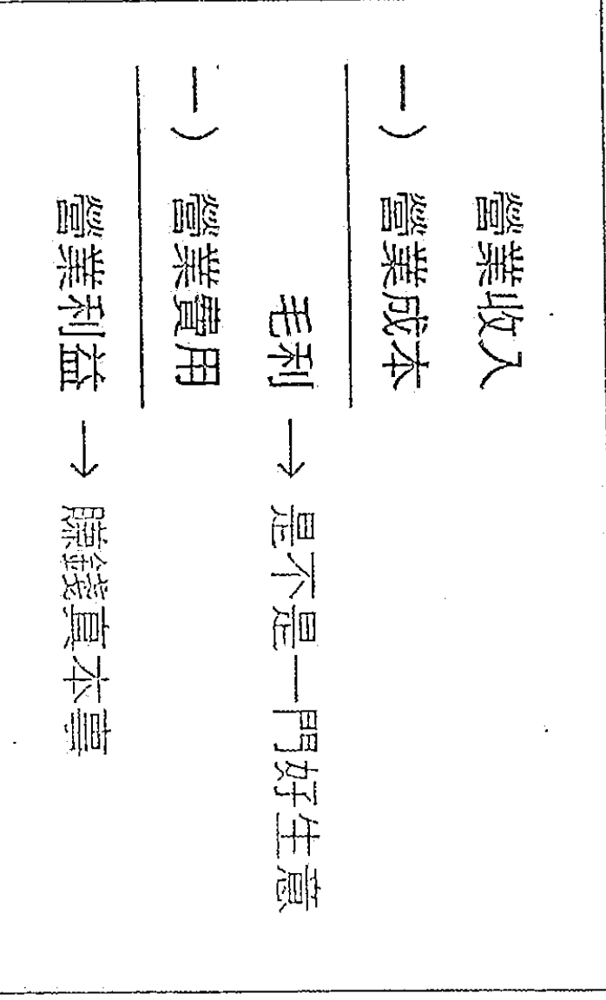

當然，不同的產業有不同的產業特性，筆者分析過全球數百家財務報表，發現了一些有趣的共同性：

1. 營業費用率 < 10%：通常代表這家公司在自己的領域已經具有相當的規模經濟，例如具有一技之長的公司（如合寶電、大立光），或是在該行業市佔率前三名。
2. 營業費用率 < 7%：通常代表這家公司不但已經具有很大的規模經濟，而且在經營上的費用也相當節省，例如台塑與鴻海集團等公司，都是在各自業界以「勤儉持家」著稱。


3. 營業費用率 > 20%：可能出現在下列幾種行業中：
   - (a) 自有品牌的公司。因為產品推銷的行銷費用相當昂貴。例如宏達電 (HTC) 近兩年的費用率平均都在 30% 以上，阿瘦皮鞋近幾年的費用率也都在 50% 上下。
   - (b) 尚未具有規模經濟的公司，所以分母（營業收入）過小，例如生技醫療等行業。
   - (c) 該市場蓬勃發展，但仍需持續教育市場的行業，例如網路公司的 Google、Amazon，全球共享經濟相當知名的 Uber、大陸的滴滴打車與 1 號車等公司。


   - (d) 需要不斷促銷(例如買一送一、第二件七折)，客戶才會回流的流通業公司，例如 7-11、屈臣氏、全聯社等。
   - (e) 餐飲業有一句行話，「開發廳，房租、水電、人事等費用至少佔了三分之一」，代表這類行業的費用率至少 33%。也因為費用率如此高，所以餐飲業的毛利率通常在 50% 上下，只有如此高的毛利率，才能有足夠的利潤支付經營餐廳所需要的高額(至少 33%)費用率。

### 綜觀毛利率與營業費用率

在您學會這些基礎的商務常識之後，我們根據圖表 4-5，來看下下面這幾家公司的表現。

1. 大立光與台積電：兩家公司的毛利率都很高，尤其營業費用率管控也相當得宜，分別為 7.88%(代表大立光的規模經濟很大，而且非常省)、10.71%(代表台積電在自己的領域，是屬於世界級的大規模公司)。
2. 中崧：屬於傳統行業，但毛利率仍高達 26%，而且該公司在自己的領域具有規模優勢。此外，經營費用也很節省，費用率僅有 6%，符合我們在上一個段落所分享的商務精識。
3. 巨大：毛利率偏低，僅有 22%，因為它除了自有品牌生意之外，還有傳統毛利較低的 ODM 客戶。總體來說，該公司的費用控管相當不錯，因為一般品牌的費用率可以使用到 20%，但巨大的營業費用率僅有 14%，代表這家公司在自己的領域已經做到非常大的規模了。
4. 鴻海：毛利率僅有 7%，營業費用率也只有大約 3.5%，代表鴻海集團在自己的領域中，是一家規模非常大的公司，而且非常省。郭台銘先生公路上使用的私人飛機，都是郭先生自己出錢購買，沒有使用公司資金，是一位難能可貴且正派經營的老闆。只可借該行業的毛利率過低，要不然這顆用心經營的老闆，真是值得我們投資。
5. 統一超：毛利率高達 32%，但相對的需要常常做行銷活動吸引消費者再次消費，所以該公司的費用率偏高，約為 27%，也是符合前面所提到的商業常識。

### 圖 5 六家公司的毛利率與營業費用率表現

| | 統一 | 7-ELEVEN | 大潤發 | 康宜 | 全家 | 麥當勞 |
| :--- | :--- | :--- | :--- | :--- | :--- | :--- |
| 毛利率 | 57.38% | 48.65% | 66.94% | 32.28% | 22.16% | 7.13% |
| 營業費用率 | 43.5% | 37.94% | 20.97% | 4.68% | 8.04% | 3.66% |
| 純利能力 | 7.88% | 10.71% | 6.03% | 27.58% | 14.12% | 3.48% |

### 經營安全邊際率：對抗景氣的能力


經營安全邊際率
== 一家公司賺錢的真本事 ==
公司所能創造的毛利 >= 越大越好

經營安全邊際率若是營業利益佔毛利的比率，我們由此看出一家公司的長期穩定獲利能力，判斷它在對抗景氣波動時的空間大不大。

經營安全邊際率越高，代表公司賺錢的寬裕度越高，也代表面對殺價競爭時可以撐得比較久，所以這個數字越大越好。

以上面公司的例子，假設經營安全邊際率為 60%，代表如果現有公司的毛利率不要下降到超過 60%，公司仍能小賺，或控制在賺不賠的損益兩平狀態。這也代表如果市場持續殺價競爭下去，一旦毛利率下降超過 60%，這個產業就不再是一門好生意，這家公司會開始虧錢。

換句話說，經營安全邊際率越高，抵抗景氣波動的能力也越大。

經驗法則告訴我們，通常經營安全邊際率＞60％，代表這家公司有較寬裕的獲利空間，即使面臨突如其來的景氣波動，它將比其他競爭對手具有較高的抵抗能力。

由圖表 4-6 可以看出，大立光、台積電與中腰，這三家公司抵抗景氣波動的能力非常高，因為三家公司的經營安全邊際都大於 77％。擁有如此高的經營安全邊際率的公司，真的很少喔！

### 六家公司的經營安全邊際率表現

| 公司 | 第一行 | 第二行 | 第三行 | 第四行 | 第五行 |
| :--- | :--- | :--- | :--- | :--- | :--- |
| 某公司 | 87.38% | 48.65% | 26.94% | 32.26% | 22.16% | 7.13% |
| 某公司 | 49.5% | 37.94% | 20.91% | 4.63% | 8.04% | 3.66% |
| 某公司 | 86.27% | 77.99% | 77.62% | 14.51% | 36.28% | 51.19% |

另外，以鴻海為例，主要是該公司在自己專業代工的領域，已經具有世界第一的規模經濟，而且費用控管非常優異，費用率不到 3.5%，所以經營安全邊際率的表現非常好。這也代表，萬一鴻海需要面對其他競爭者持續不理性的殺價競爭，仍有高達 51% 的緩衝空間。

請您拿出隨書附贈的第 31 號公司的財務報表卡，即是鴻海公司的財務報表。

請特別留意財報左下方的一個數字：現金與約當現金佔總資產比率。鴻海在該項目比率，近三年平均於 28%，甚至比華奢在本書中給大家的建議（公司應維持 10%～25% 的現金存量）還要高！

這究竟代表什麼意思呢？

如果在市場中，鴻海的競爭對手全都瘋狂殺價來搶單，這時鴻海除了有 51% 的降價空間可與其他競爭對手 PK 之外，手上的高現金水位也比其他競爭對手多。萬一這個時機再來一處第二輪或第三輪的金融海嘯，則所有競爭者都陣亡後，鴻海依然屹立不搖存活在市場裡持續接单。

任何一家上市公司的老闆，都應該善待自己公司的財務狀況與局到這種等級，才能獲得長期穩定的獲利能力。如此，自己的公司才具有抵抗景氣波動、持續存活下來的能力。


同理，當我們角色轉換，變成一位投資者時，也應該從各家的財務報表中去找尋更多這類型的公司：經營安全邊際率高，手上現金充足的公司。

當我們投資下去之後，不管市場發生什麼事情，這些公司都具有抵抗氣象波動的能力。當其他競爭者都陣亡之後，您所投資的公司，就會順理成章地接收了陣亡競爭者原有的市場份額。

### ③ 網路流通業的特性

由於統一的狀況比較特別，於是筆者找了一家同屬流通業，但營運模式不同的公司「網路家居 PChome j」進行對比（詳見圖表 4-7）。把這兩家公司放在一起比較，可以發現幾個有趣的現象：

1. 實體通路的 7-11 毛利率比較高，而虛擬通路的 PChome 毛利率只有 17%，符合網路平台常常被質疑的特性。
2. 賺錢的真本事（營業利益率），兩家公司相當，大約都在 4.6%。
3. 實體通路需要很多員工，才能 24 小時服務客戶。另一方面，網路商城只要頻寬夠、平台的系統夠穩定，只需要少量的人手，就能像 7-11 一樣全年無休。這就是為什麼實體通路的費用率高達 27.5%，而網路商城的費用率僅需 12.5%。換句話說，在網路上開店經營的邊際費用率會越來越低。


## 圖 8-1 統一超與網路家庭的經營安全邊際率比較

| 指標 | 統一超 | 網路家庭 |
| :--- | :--- | :--- |
| 經營安全邊際率 | 32.26% | 17.19% |
| 營收成長率 | 4.68% | 4.9% |
| 成長趨勢 | 27.58% | 12.58% |
| 營收規模 | 14.51% | 24.8% |

資料來源：公司資訊揭露網站

- 最有興趣的數據是經營安全邊際率，沒想到網路商店的經營邊際率（抵抗景氣波動的能力），遠高於實體通路約7-11%。

這是台灣市場獨有的現象嗎？如果放眼全球，以2016年12月1號全球大型流通業的收盤價為準，這個現象好像也一樣成立！因為虛擬通路具有上述四點独特性，加上又符合未來趨勢，故全球各地的虛擬商城，投資人應多屬於傳統實體流通業。

## 圖 4 全球大型流通業股價表現

| 指標 | 實體通路 | 虛擬通路 |
| :--- | :--- | :--- |
| 股價 (美元) | $70.43 | $150.11 |
| 純利益 (美元) | - | $750.57 |

## 圖 C4 淨利率：一家公司稅後是否賺錢

淨利率（純益率） = $\frac{純利益}{營業淨利}$

$\Rightarrow$ 越大越好

> 不僅是錢，也能輕鬆說出賺錢個中道理

要求是：

- 一般來說，經營一家公司相當不容易，所以投資人對公司最基本的
- 淨利率（純益率）＞資金成本
- 報酬＞成本

由於一般公司在銀行體系取得的資金成本，通常都大於2%，所以一家上市櫃公司的淨利率（純益率），至少要大於2%才值得投資。當然，淨利率越高越好。

### 六家公司的淨利率表現

如圖表4-9所示，大立光、台積電與中鋼這三家公司的稅後淨利率非常高，分別為43%、36%與21%，甚至高過大部分上市櫃公司的毛利率！

| 大立光 | 台積電 | 中鋼 | 其他A | 其他B | 其他C |
| :--- | :--- | :--- | :--- | :--- | :--- |
| 43.24% | 36.34% | 21.6% | 4.6% | 6.36% | 3.35% |

資料來源：公開資訊觀測站

## C5 每股獲利 (EPS)：股東可以賺多少

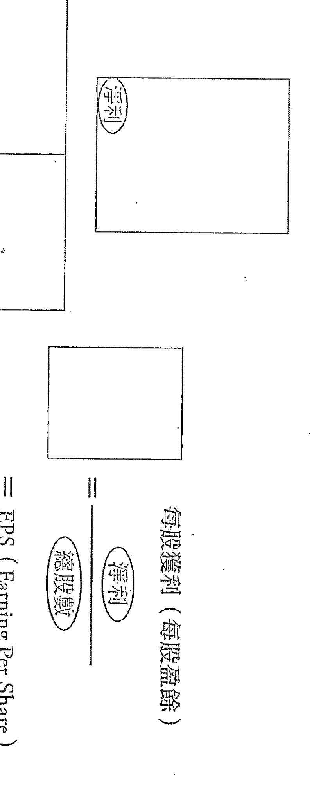

這個指標主要是讓投資人了解，一家公司努力經營所賺得的稅後淨利，除了淨利的總金額，如果換成股份，每一股能幫股東賺多少錢？當然是越多越好。

在台灣的上市公司中，每股的面額大多為新台幣10元。如果一家公司的EPS = 3元，代表就股票面額來看，這家公司幫股東賺了30%的稅後利潤；如果一家公司當年度的EPS = 18元，代表這家公司獲利能力相當驚人，一年賺了1.8家（18/10）自己的公司。

## 圖 10 六家公司的EPS表現

| 公司 | EPS |
| :--- | :--- |
| | |
| | |
| | |
| | |
| 大立光 | $180.08 |
| 台積電 | $11.82 |
| 中鋼 | $6.37 |
| 統一超 | $7.92 |
| 廣達 | $10.25 |
| 其他 | $9.42 |

資料來源：公開資訊觀測站

我們同樣以六家公司於2015年年報的每股獲利為例，是的，您沒看錯，大立光的每股獲利真的高一屁股（80元！換句話說，大立光2015年的獲利能力，等於賺了18家自己的公司（賺了18倍的股本）。

投資人不知大立光在光學鏡頭具備競爭優勢，該公司57%的高毛利率、86%的高經營安全邊際率，以及46.7%的高現金存量等因素，都是極為優異的財務數據，所以大立光的股票才能維持在3500元以上，成為台灣的股王。

「壞股器」：也能讓穩健型避雷離股

### C6 股東報酬率：投資獲得多少回報

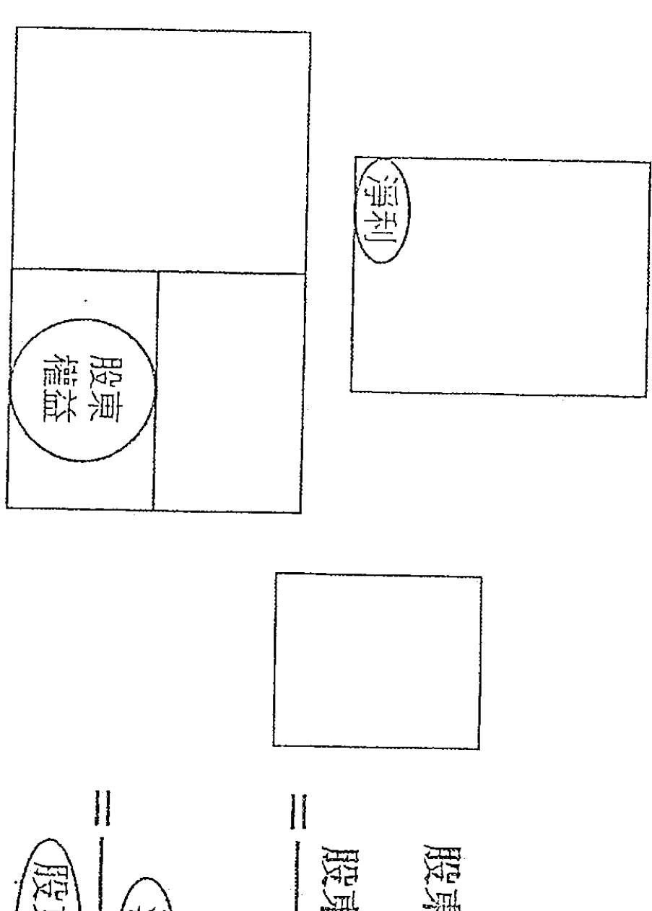

股東報酬率 (RoE) 指的是相對於股東出的錢，可以獲得多少的報酬率。這個指標當然是越高越好，因為我們投資一家公司，就是以股東的立場進行投資，所以這個指標非常重要。

如果您曾經研究過股神巴菲特的投資哲學，應該可以發現巴菲特非常重視下列三個指標：

- 長期穩定的獲利能力：這就是巴菲特常提到的「護城河」、「推斷特定公司的競爭優勢」的觀念。

- 自由現金流量：這個指標主要是巴菲特用來衡量一家公司的長短，以及該公司是否能在年為公司帶來正的現金流量。

- 股東報酬率（RoE）：雖說這個指標越高越好，問題是，股東報酬率（RoE）到底多少以上才叫好？多少以下算是不好？

### RoE>20%，算是非常好的公司

股神巴菲特自 1965~2015 年年底，每年的平均報酬率約為 20%。這 20% 算意不多，可能比股市菜籃族隨便一檔股票的平均報酬還要低；但如果每年都維持 20%，就能創造愛因斯坦所謂的世界第八奇蹟：時間的複利效果。

假設您在 1965 年投資 1 萬元到股神巴菲特所投資的公司，猜猜看經過 51 年以後，在 2015 年年底，當初的 1 萬元本金會變成多少？答案是：1,598 億元！

所以巴菲特才會說：「假如你持有一家優秀企業，時間就是好朋友；但如果你持有的是表現平平的公司，那麼時間就會變成敵人。」

### RoE < 7%，可能就不值得投資

- 一般投資者的資金成本介於 2~7%，尤其當您採用信用交易（融資融券）時，資金成本大約就在 7%。RoE 至少要足以填補相關成本。
- 機會成本問題。如果這筆錢投入一家ROE偏低的公司，您可能會因此錯失其他更好的投資機會，進而造成機會成本損失。

圖表4.11是本書案例六家公司的ROE表現，供各位讀者參考。

#### 圖表4.11 六家公司的ROE表現

| ROE表現 | 2015年 | 2016年 | 2017年 | 2018年 | 2019年 |
| :--- | :--- | :--- | :--- | :--- | :--- |
| 本公司 | 44.09% | 27.04% | 17.66% | 30.26% | 19.35% |
| 公司A | | | | | 14.69% |

接下來，請您拿出本書附贈的32家公司財務報表卡，進行分析練習。
熟能生巧，相信下一次您再看到這些數據，就有輕鬆解析關鍵指標的能力，再也不會犯愁喔！

### 實戰分析練習

- 01 大立光 3006
- 02 台積電 2330
- 03 中誠 1723
- 04 廣達 光電 1567
- 05 星田 工業 9951
- 06 交通寶 訊 2397
- 07 佳揚 1227
- 08 聯合 3250
- 09 高升 2231
- 10 日友 8341
- 11 中興 保全 9917
- 12 聯華 科技 3005
- 13 貫成 工業 9904
- 14 台數科 6464
- 15 巨大 9921
- 16 恆大 1323
- 17 邦特 空宇 4107
- 18 可寧衛 8422
- 19 帆量 科技 6193
- 20 合達電 2308
- 21 帝寶 6405
- 22 新光 9925
- 23 中華 2412
- 24 旭昇 6409
- 25 高洲 1715
- 26 劍麟 2228
- 27 數宇 6837
- 28 卜蜂 1215
- 29 振華電 8114
- 30 統一超 2912
- 31 鴻海 2317
- 32 中鋼 2002

本表所列之各公司財務報表，皆為筆者隨機在公司資訊謁測站選出的公司。

※投資一定有風險，股票投資有勝負，買股前請詳閱公開說明書（財務報表）。


## Chapter 5

## 從財務結構破解公司的破產危機

「財務結構」是第四個關鍵數字力，在開始說明前，我們一樣先把文言文「中融中」。財務結構的中融中是：

> 那根棒子，棒子的位置越高越好

財務結構在公開資訊觀測站的五大財務比率分析的位置，如圖表5-1中的紅框所示。

不知道您是否還記得，這根棒子其實在第一章就已經出現過了，它會出現在資產負債表（如圖表5-2）。

在棒子的上方，指的是外部的資金來源叫「負債」；在棒子的下方，指的是內部的資金來源，叫「股東權益」。

其中，外部的資金（來自於供應商或銀行）比較便宜，內部的資金（來自於股東出資的錢）比較貴。

在資產負債表中，左邊＝右邊。

所以，資產＝負債＋股東權益

還記得資產負債表是一張平衡的報表嗎？因此左邊會等於右邊。複習完這些基本概念之後，我們來看看有關財務結構（那根棒子）的兩個關鍵指標。

### 圖表 5-1
財務結構在五大財務比率分析的位置

- 本圖為本公司財務結構分析之位置說明

- ■獲利
  - 毛利率
  - 損益平衡
  - 獲利率
  - 淨利稅前
  - 稅前
  - 稅後

- ■效率
  - 周轉效率
  - 資產效率
  - 流動效率
  - 固定資產效率

- ■財務結構
  - 財務彈性
  - 負債比率
  - 債務結構
  - 財務危機

- ■成長
  - 成長率
  - 資本結構
  - 資產擴充
  - 資本結構調整

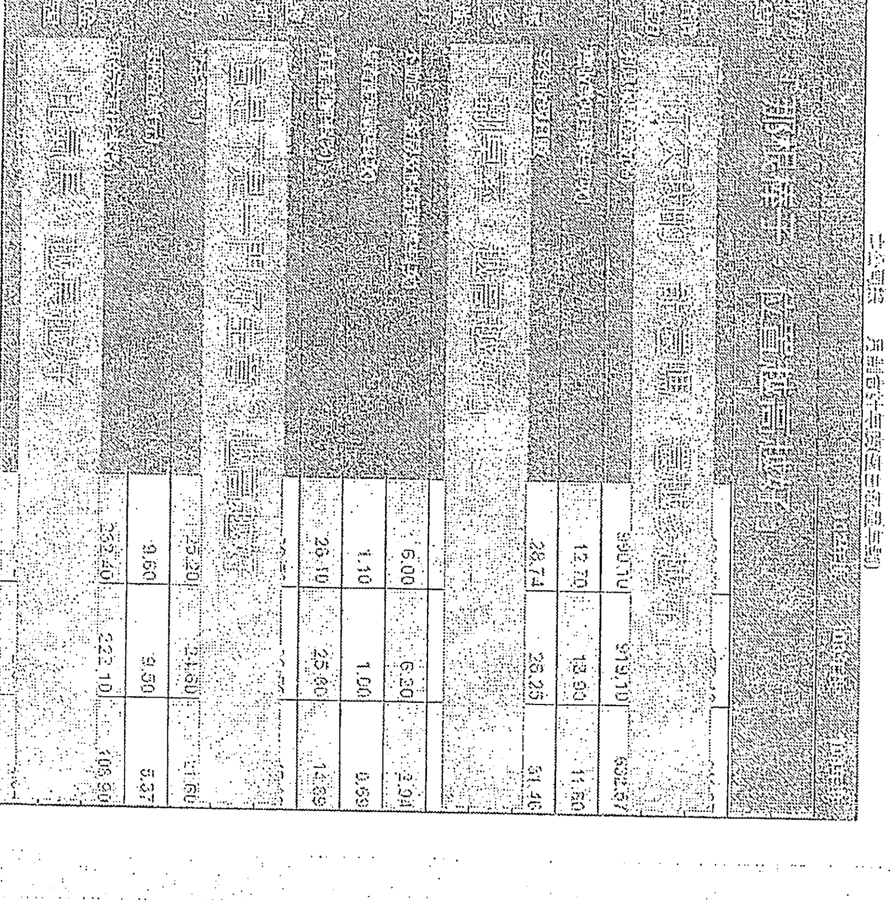

### 5-2 財務結構的基本定義

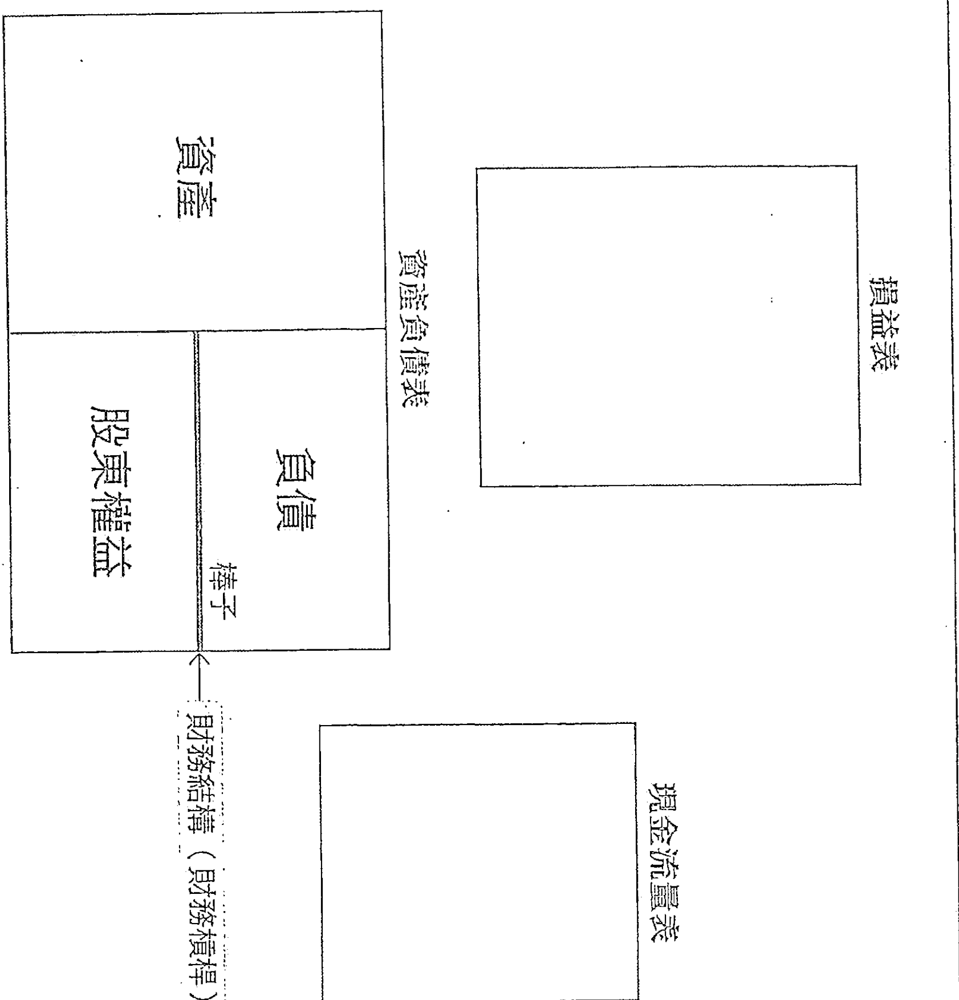

## D1 負債佔資產比率

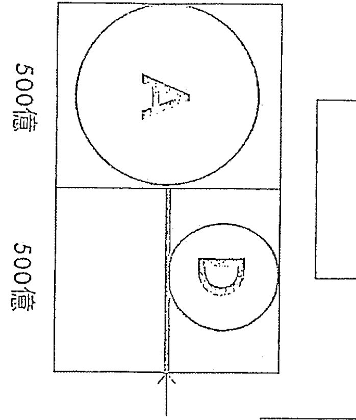


負債佔資產比率(%) = 負債 / 資產（佔）

那根棒子


＝棒子的位置
100億 ____ or ____ 499億
＝ ____ or ____

500億 D
位置偏高 位置偏低

如公式所說明，“資產佔負債比率”公式推算出來之後，這個指標其實就是指“那根棒子”的位置。

### ○負債佔資產比率偏小

例如負債共有100億，資產總共有500億，感覺起來好像還不錯。這個時候，“那根棒子”的位置就會偏高。

### 負債／資產比率偏大

例如一家公司的負債共欠了外部人士（主要是供應商與銀行）499 億，而這家公司的總資產只有500億。這讓公司感覺好像很危險，因為 欠外面人太多錢了，扣除負債之後，這家公司的淨資產只剩下1億。

哇，超級危險的！

這個時侯，「那根棒子」的位子就會非常低。

接下來的問題就是：這個指標到底是比率大比較好，還是比率小比較好？「這根棒子」到底要在什麼位置比較理想呢（如圖表5-3）？

感謝很多財經專家的研究，提出所謂的「最適資本理論」，這個理論講的就是到底這根棒子在實務上，應該要偏高、偏低，或是在什麼位置比較好？

最後，比較沒有爭議的結論就是：一人一半！也就是那根棒子最好分於中間。

為什麼呢？因為如果棒子不斷的往下移，代表公司對外欠的負債偏多，股東只投資了一點點。這個時候債權人（主要是銀行）就會暗自嘀咕：唉，為什麼只跟我借錢？股東（自己人）為什麼不願意出資呢？是不是這家公司的內部有我不知情的事情？感覺怪怪的！

所以，當該公司又要再跟銀行借錢時，銀行可能就不會借了。為了讓公司繼續經營下去，老闆必須轉向股東（自己人）籌錢，此時那根

### 圖3-3 財務結構太高或太低都不理想

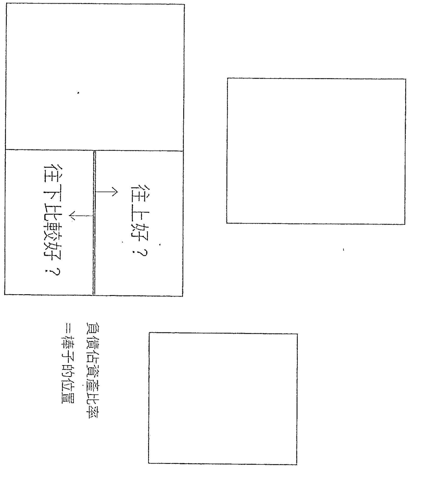

棒子就會慢慢往上移（因為股東出資的錢變多），所以財務結構（那根棒子）是一個動態的觀念。

那麼，什麼時候「那根棒子」會不斷往上移呢？通常是在一家公司非常賺錢，而且前景看好的時候。賺錢的公司每次現金增资（股東權益也會因此增加）時，大部分的情況下，所有股東都會超額認購。理由很

負債佔資產比率 = 棒子的位置

O'Brien
從財務結構破解公司的破產危機

簡單：有利可圖，肥水不流入外人田！既然公司這麼賺錢，當它需要資金不斷擴大市場版圖，當然不必跟外面的人借錢！我們股東自己出資進行擴增就好了。

因此，一家公司的負債佔資產比率（那根棒子）的高低，會暗示出一家公司股東的整體偏好。不過，如果公司的資金大部分是由股東出資，又會衍生出另一個問題：股東出錢投資公司，通常會要求公司在獲利之後，每年固定發放股利給股東。如果發放的股利只有3~5%，股東通常看不上眼，會再要求公司多給一點。

股利究竟該發多少，實務上沒有答案，這屬於公司的股利政策的議題。但讀者可以發現一個有趣的現象：在股市中，投資人通常會要求公司派發的配股股息（給股東股利）至少2元以上。假設該公司近十年現金增資價格平均為40元，這就等是公司當初向股東拿了40元的資金來擴大營運，每年需發給股東2元的股利；對公司而言，資金成本約於5%（2/40）。當然，一家公司的現金增資價格愈高、資金成本愈低；反之，對公司而言，資金成本就越高。

所以，用大白話來說明整件事，會是：

- 拿銀行的錢（使用的是棒子上方的資金來源），資金成本比較低，大約是1.5~3%。


2. 拿股東的錢（使用的是褲子下方的資金來源），資金成本會比較貴，通常會介於 5～20%（依各公司的現金增長實務與後續股利政策不同，而有所差異）。雖然是這樣的資金成本比向銀行借錢高很多，但仍有很多公司寧可採用多一點的股東資金，主要原因是股東不會像銀行一樣突然抽銀根。對公司來說，通常不需要退還股東投資的錢，公司沒有還款壓力，因此用股東的資金，比較能遠規畫公司的發展策略與方向。

所以，對一家公司而言，既要取得最低的資金成本，同時又得兼顧不能突然發生被銀行抽銀根的現金風險，「最適資本理論」在學界討論多時之後，才會得出一個比較沒有爭議的結論就是：一人一半！另外，在美國這道 30 或 30 股（30 家最績優的公司）裡面，也可以看出這個有趣的現象：經營穩健的公司，他們的負債佔資產比率（那根褲子）通常都會 ≤60%，非常接近學理中「最適資本理論」的 50% 概念（一人一半的觀念）。

另外，觀察全球各國數千家已經破產下市公司的負債佔資產比率，也發現一個有趣的共通性：那根褲子的位置在破產前的最後一年，通常都會 ≥80%，或是接近這個數字。

這兩個有趣的現象，我們整理成圖表 5-4 方便大家複習。

174


也能讓緊鑲選出賺錢優績股  
不值得！

### 2-1 好公司與壞公司的財務結構位置

#### 狀況好的公司

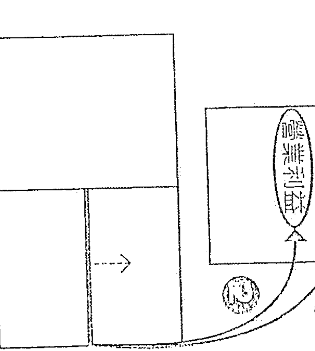

- 棒子的位置不斷上移
- 這真是一門好生意！
- 這家公司有賺錢的真本事。

#### 狀況不佳的公司


- 棒子的位置不斷下移
- 這可能不是一門好生意！
- 這家公司可能沒有賺錢的真本事。

### 金融保險業具有特定財務經濟特徵

特別跟大家說明，金融保險業不適用以上的財務結構觀念：因為他們是遵循 BIS 管制。BIS 管制源起於 1988 年 7 月，國際清算銀行（Bank for International Settlements）委員會制定並通過了《關於統一國際資本衡量和資本標準的協議》（Proposal for International Convergence of Capital Measurement and Capital Standards），簡稱《巴塞爾協議》，形成了資本充足性管制的國際統一標準，簡稱為 BIS 管制。這主要是指對金融機構的資產中自有資產的比率必須維持在一定的標準以上的規定。

用大白話來說明，觀念就像是：

- 1. 如果一家金融機構，股東自己出的錢佔了 8%（另外 92% 是別人的錢），就可以做國際金融業務。
- 2. 如果一家金融機構，股東出的錢只有 4% 以上（另外 96% 的錢來自於別人），則可以做國內金融業務。
- 3. 如果一家金融機構，股東出的錢不到 4%，那對不起，它不准經營金融業。

換句話說，金融機構是一個高度槓桿的行業。如果用表現在我們的負債佔資產比率的概念來檢視金融機構，他們通常會是資產等級的公司。也因此，金融保險屬於特殊行業，要遵循的法規與一般上市企業不同。所以這個「負債佔資產比率」的觀念，不適用金融銀行業。

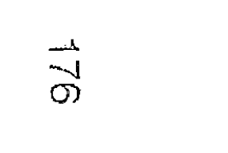

不值錢？  
也能賺錢還出融購鏈融股

### 分析好、壞公司的負債佔資產比率

帶著這個觀念，接下來我們看看那六家好公司的表現（詳見圖表 5-5）。他們的「負債佔資產比率」都相當的優異，只有統一超的數據稍微偏高，為 65.22%。

**好公司的負債佔資產比率**

| | | | | |
|---|---|---|---|---|
| | | | | |
| | 24.53% | 26.24% | 19.33% | 63.22% |
| | | | | 55.59% |
| | | | | 54.06% |

但這就代表他們是好公司嗎？其實未必！財務報表分析是一種動態分析的概念，不能只看單一指標。閱讀財務報表時，必須綜合判斷交叉驗證。

下回當您看到一家公司的負債佔資產比率非常亮眼時，請參考圖表 5-6，同步觀察這家公司的其他數據：

- 營業毛利率：這是不是一門好生意？
- 營業利益率：有沒有賺錢的資本？

2530

### 綜合驗證好公司的關鍵指標

Chapter 5  
從財務結構做個公司的破產危機


| 類別 | 財務比率 | 定義 | 2013 | 2014 | 2015 | 代表 | 備註 |
|---|---|---|---|---|---|---|---|
| 獲利能力 | 銷貨利潤率(%) | 每年純利潤/每年銷售淨額(%) | 3.18 | 3.06 | 2.79 | 代表公司每年銷售淨額中，淨利潤的比例(%) | 一般認為高於平均水準較佳 |
| 獲利能力 | 資本利用率(%) | 純利潤/各期資產額(%) | 19.34 | 19.62 | 18.64 | 代表公司淨利潤與資率的比例(%) | 一般認為高於平均水準較佳 |
| 獲利能力 | 權益報酬率(%) | 純利潤/平均權益(%) | 168.9 | 210.03 | 351.58 | 代表每年權益報酬率 | 越高越好 |
| 獲利能力 | 權益資產比(%) | 純利潤/資產總額(%) | 1.89 | 2.15 | 3.12 | 代表純利潤與資率的比例(%) | 一般認為高於平均水準較佳 |
| 償債能力 | 流動比率(倍) | 流動資產/流動負債(倍) | 0.8 | 0.75 | 0.72 | 代表短期償債能力 | 一般認為高於1較佳 |
| 償債能力 | 速動比率(倍) | (流動資產-存貨)/流動負債(倍) | 0.45 | 0.42 | 0.35 | 代表短期償債能力 | 一般認為高於0.5較佳 |
| 償債能力 | 淨利資產比(%) | 純利潤/淨利資產(%) | 18.33 | 19.38 | 15.8 | 代表每年純利潤與資率的比例(%) | 越高越好 |
| 營業能力 | 資產週轉率(次) | 銷售淨額/平均資產(次) | 0.35 | 0.28 | 0.18 | 代表資產利用的效率 | 越高越好 |
| 營業能力 | 存貨週轉率(次) | 銷貨成本/平均存貨(次) | 22.34 | 25.77 | 15.82 | 代表存貨利用的效率 | 越高越好 |
| 營業能力 | 應收帳款週轉率(次) | 銷售淨額/平均應收帳款(次) | 0.85 | 0.76 | 0.63 | 代表應收帳款利用的效率 | 越高越好 |
| 營業能力 | 固定資產利用率(%) | 銷售淨額/固定資產(%) | 70.21 | 63.15 | 36.9 | 代表固定資產利用的效率 | 越高越好 |
| 營業能力 | 營業利益率(%) | 營業利益/銷售淨額(%) | 8.24 | 11.24 | 13.88 | 代表每年營業利益與銷售的比例(%) | 越高越好 |
| 營業能力 | 現金流量比率(%) | 現金流入/流動負債(%) | 24.11 | 11.85 | 37.14 | 代表每年現金流入與流動負債的比例(%) | 越高越好 |
| 營業能力 | 現金利益率(%) | 現金流入/銷售淨額(%) | 37.08 | 43.52 | 47.85 | 代表每年現金流入與銷售淨額的比例(%) | 越高越好 |
| 營業能力 | 現金流量比(倍) | 現金流入/流動負債(倍) | 55.79 | 44.44 | 73.23 | 代表每年現金流入與流動負債的比例(倍) | 越高越好 |
| 營業能力 | 權益變動比率(%) | 權益增加(減少)/權益(%) | 0.1 | 1.1 | 0.03 | 代表權益變動的比例(%) | 越高越好 |
| 營業能力 | 現金淨利益比率(%) | 現金淨利益/銷售淨額(%) | 7.6 | 7.47 | 7.07 | 代表每年現金淨利益與銷售淨額的比例(%) | 越高越好 |
| 營業能力 | 現金淨利益比率(%) | 現金淨利益/銷售淨額(%) | 25.9 | 24.0 | 26 | 代表每年現金淨利益與銷售淨額的比例(%) | 越高越好 |
| 營業能力 | 股利率(%) | 股利率/銷售淨額(%) | 28.38 | 41.9 | 43.1 | 代表每年股利率與銷售淨額的比例(%) | 越高越好 |
| 營業能力 | 財務比率(%) | 財務比率/銷售淨額(%) | 2 | 1.0 | 1.5 | 代表財務比率與銷售淨額的比例(%) | 越高越好 |
| 營業能力 | 財務比率(%) | 財務比率/銷售淨額(%) | 1.59 | 1.55 | 1.18 | 代表財務比率與銷售淨額的比例(%) | 越高越好 |
| 營業能力 | 財務比率(%) | 財務比率/銷售淨額(%) | 1.37 | 1.33 | 1.16 | 代表財務比率與銷售淨額的比例(%) | 越高越好 |
| 資產結構 | 資產負債比率(%) | 負債總額/資產總額(%) | 6.77 | 16.6 | 12.8 | 代表每年資產負債比 | 越低越好 |
| 資產結構 | 資產淨值比率(%) | 資產淨值/資產總額(%) | 15.5 | 13.8 | 12.8 | 代表每年資產淨值比 | 越高越好 |
| 資產結構 | 資產淨利資產比(%) | 資產淨利資產/資產總額(%) | 7.95 | 13.2 | 12.8 | 代表每年資產淨利資產比 | 越高越好 |
| 資產結構 | 資產淨值佔股比(%) | 資產淨值佔股比(%) | 6.77 | 15.5 | 12.8 | 代表每年資產淨值佔股比 | 越高越好 |
| 資產結構 | 現金淨值佔股比(%) | 現金淨值佔股比(%) | 16.6 | 13.8 | 12.8 | 代表每年現金淨值佔股比 | 越高越好 |
| 資產結構 | 財務比率(%) | 財務比率/資產總額(%) | 15.5 | 13.8 | 12.8 | 代表財務比率與資產總額的比例(%) | 越高越好 |
| 資產結構 | 資產淨利資產比(%) | 資產淨利資產/資產總額(%) | 6.77 | 13.2 | 12.8 | 代表每年資產淨利資產比 | 越高越好 |
| 資產結構 | 資產淨值佔股比(%) | 資產淨值佔股比(%) | 15.5 | 13.8 | 12.8 | 代表每年資產淨值佔股比 | 越高越好 |

1113 年-1153 年各財務指標之變化比較

至於財務結構狀況不佳的公司，首先要確認負債佔資產比率是否大於 70%，這時需要特別小心，因為這個比率一旦超過 80%，通常代表這家公司即將發生大事！

再來，請參考圖表 5-7，我們還要同步驗證以下三個指標：

1. 營業毛利淨率：這還一門好生意嗎？
2. 營業利益率：公司還有賺錢的根本事項嗎？
3. 現金與純淨現金：公司的財務結構還優差，通常在外圈已經信不到錢了。它手上的現金多不多？它還能撐多久？

6702 與航

### 綜合驗證獲公司的關鍵指標

| 綜合 | 財報 | 2013 | 2014 | 2015 | 財報 | 指標 | 說明 | 2013 | 2014 | 2015 |
|---|---|---|---|---|---|---|---|---|---|---|
| | | | | | | 營業毛利淨率(%) | (2-1-3)/2*100% | 64.59 | 57.80 | 61.07 |
| | | | | | | 營業利益淨率(%) | (2-5)/2*100% | 15.55 | 13.75 | 11.07 |
| | | | | | | 純淨現金流/營業收入(%) | (4-2+5)/2*100% | 6.77 | 1.45 | 5.42 |
| | | | | | | 純淨現金流/營業成本(%) | (4-2+5)/3*100% | 9.55 | 1.40 | 7.77 |
| | | | | | | 純淨現金流 | 4.28 | 0.43 | 6.67 |
| | | | | | | 現金流指標 | 10.27 | 31.33 | 25.32 |
| | | | | | | 現金流指標(D) | 61.39 | | | |
| | | | | | | 現金流指標(%) | | | | |
| | | | | | | 現金與純淨現金 | | | | |
| | | | | | | 營業利益率(%) | (2-5)/2*100% | 64.59 | 57.80 | 61.07 |
| | | | | | | 純淨現金流/營業收入(%) | (4-2+5)/2*100% | 9.55 | 1.45 | 5.42 |
| | | | | | | 純淨現金流/營業成本(%) | (4-2+5)/3*100% | 9.55 | 1.40 | 7.77 |
| | | | | | | 純淨現金流 | 4.28 | 0.43 | 6.67 |
| | | | | | | 現金流指標 | 10.27 | 31.33 | 25.32 |
| | | | | | | 現金流指標(D) | 61.39 | | | |
| | | | | | | 現金流指標(%) | | | | |
| | | | | | | 純淨現金流 | 4.28 | 0.43 | 6.67 |
| | | | | | | 現金流指標 | 10.27 | 31.33 | 25.32 |
| | | | | | | 現金流指標(D) | 61.39 | | | |
| | | | | | | 現金流指標(%) | | | | |
| | | | | | | 現金與純淨現金 | | | | |

復與新這家 2016 年宣布停業的公司，再度驗證了前面提到的重要觀念：負債佔資產比率一旦超過 80%，這些公司將面臨嚴峻的生死存亡之戰。

尤其是 2008 年底發生全球金融海嘯之後，各國上至政府、下至上市櫃公司，大家都致力於「現金為王」與「去槓桿化」（Deleverage）兩個動作。所謂「去槓桿化」，指的应是負債佔資產比率要逐步縮小（那根棒子的位置往上移），才能有較好的體質渡過景氣大幅波動的风险。

### D2 長期資金佔不動產、廠房及設備比率

長期資金佔不動產、廠房及設備比率

- = 長期資金  
  不動產、廠房及設備
- ==== 長期資金  
  長期負債 + (股東權益  
  不動產、廠房及設備
- == 以長（長期資金來源）  
  = 支長（長期資金去路）
- ⭢⭢ 以長支長，越長越好

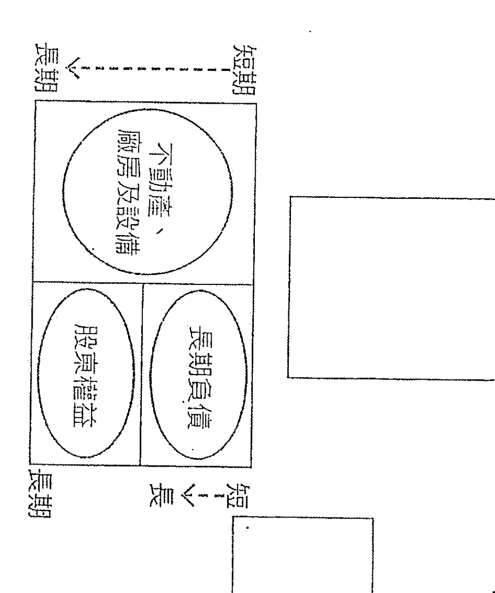

這個公式的名稱和說明很拗口，不過它的中顧問很好記：以長支長，越長越好。

為什麼會突然出現這麼一個奇怪的公式呢？因為金融業的行業特性是：晴天借傘、雨天收傘。

一家公司剛創立時，沒有什麼經驗，手上資金也不足。雷門幾年之後，好不容易存活下來。為了持續茁壯，開始向外部借錢擴建擴大投資。但因為這些中小企業平時太忙，忘了要養成與銀行往來、保持良好關係的習慣，加上這些中小企業的老闆平常並不會花心力在財務的完整性，所以銀行通常不太會借錢給這些真正需要資金發展的企业家。

創業家心中可能會這般吐槽：我能不能活下來都是一個問題，哪來的美國時間整理財務報表！而且，就是因為我現在手上沒錢，才會去外面借錢！可是，對銀行來說，如果平時沒有互相信任，加上欠缺完整的財務報表可以分析，他們這時候也不了解這些中小企業的真實狀況。

這些急需資金的企業，為了活下去或因應快速成長所需，只能到處向朋友週轉，或找地下錢莊借錢，於是發生了一個企業經營中的致命危機：以短支長。

也就是說，這些老闆拿了短期的資金，去支應投資公司長期發展所需的機械或裝備廠房。

這是一個嚴重的致命危機，一般人聽到都會覺得難以置信。但是，

如果您與筆者一樣，有多次創業經驗，或是親身經歷過觸礁不靈的困境，您就會發現，這種致命危機幾乎天天發生在不同的人身上。


基隆市知名海鮮冰店「蝦冰饅頭」，2003 年推出以海鮮融合冰品，包括墨魚冰、蝦子冰、干貝冰一球球特色美食，在基隆打出知名度，也接受了大量的電視、報紙採訪，生意蒸蒸日上。女老闆薛麗妮 2013 年還在中正路十開餐廳，但才一年時間就爆發財務危機，傳出欠債上千萬元，6 月 30 日關門大吉之後，薛麗妮便失聯了。

朋友透露，薛麗妮之前跟地下錢莊借錢，遇到處找不到朋友入股，卻無法解決龐大的財務問題，甚至曾被人目擊她逃地下錢莊兄弟跑到銀行領錢還債。

創業太不易，生意興隆卻發生這種事，令人不勝唏噓。這就是筆者所說的政治危機：以短支長的嚴重錯誤！

或許您會說，企業家或老闆才會碰上這種事，一般上班族根本就不會犯這種錯！

遺憾的是，一般上班族更容易發生這種短債長投的致命錯誤。

還記得 2004～2005 年的雙卡風暴嗎？雙卡指的是信用卡與現金卡，當時很多民眾利用這種工貝來支撐生活所需，這就是犯了以短支長的致命錯誤。

命危機，造成上千人被迫自殺結束生命。

這群朋友其實根本沒有犯下什麼滔天大罪，只是因為缺錢，使用了短期的資金工具（信用卡、現金卡、甚至地下錢莊）來週轉家庭的長期生活所需，導致人生就這樣突然畫下句點。

即使到了 2016 年 5 月，不少媒體還持續報導這件事情：雙卡風暴十年遭毒，中年卡奴至今難脫債務。這種命運實在令人不勝唏噓。

因此，在投資的領域，您絕對不能投資這種以短支長、出現致命危機的公司！大家絕對不能忽略這個指標。接下來，我們同樣以那六家表現關鍵的公司為例（詳見圖表 5-8），來看看他們的表現。

### 圖表 5-8 六家公司的以長支長狀況

| | | | 24.53% | 26.94% | 19.3% | 65.22% | 55.59% | 60.6% |
|---|---|---|---|---|---|---|---|---|
| | | | 31.48% | 16.93% | 267.2% | 177.7% | 275.19% | 371.95% |

資料來源：公開資訊觀測站

從此我們可以看出，任何一家臺证經營的上市公司，都不會發生「以短支長」的致命危機。一旦看到 B2 這個指標的比率偏低，不到 100%，您就要特別小心了。

最後，讓我們透過公開資訊觀測站的財報表格（如圖表 5-9），再次實習「財商結構」的重要觀念與閱讀技巧。

### 識讀結構的閱讀技巧

| 項別 | 2013 | 2014 | 2015 |
| :--- | :--- | :--- | :--- |
| B1 財務槓桿比率(含衍生金融資產) | 23.18 | 42.25 | 52.15 |
| 負債總額 | 3,393 | 3,011 | 3,011 |
| 資產總額 | 28,442 | 20,051 | 25,520 |
| B2 短期負債總額(%) | 205.91 | 535.9 | 575.04 |
| 短期負債總額 | 28,442 | 20,051 | 25,520 |
| 長期負債總額(含衍生金融負債) | 1,513 | 28,586 | 25,004 |
| B3 短期資產比率 | 4.2 | 4.29 | 5.46 |
| 短期資產 | 1,201 | 8,143 | 8,446 |
| 資產總額 | 28,442 | 20,051 | 25,520 |
| B4 資產報酬率(%) ROE | 0.82 | 9.03 | 8.76 |
| 股東權益淨利 | 5.8 | 68.32 | 51.58 |
| 資產總額(年平均值) | 7,075 | 23,456 | 25,014 |
| B5 資產週轉率 | 0.71 | 0.41 | 0.37 |
| 銷售額 | 20,241 | 10,080 | 15,008 |
| 資產總額(年平均值) | 7,075 | 23,456 | 25,014 |
| B6 銷售毛利率(%) | 58.93 | 67.02 | 44.65 |
| 銷售毛利 | 12,082 | 14,496 | 24,242 |
| 銷售額 | 20,241 | 10,080 | 15,008 |
| B7 淨資產報酬率 | 47.25 | 53.52 | 57.28 |
| 純益 | 9,602 | 17,135 | 17,383 |
| 淨資產總額(年平均值) | 2,578 | 4,278 | 5,459 |
| B8 每股純益 | 30.02 | 46.83 | 46.27 |
| 純益 | 5,602 | 17,135 | 17,383 |
| 股數 | 1.5 | 1.5 | 1.5 |
| B9 每股股票價值 | 27.64 | 33.16 | 35.02 |
| 淨資產總額 | 4,156 | 4,800 | 5,525 |
| 股數 | 1.5 | 1.5 | 1.5 |
| 長期現金流出 | 2,423 | 9,342 | 3,034 |
| 經營活動現金淨流入 | 13,43 | 3,202 | 3,446 |
| 長期現金流入(從m 3月支出) | 11,300 | 13,678 | 28,254 |
| 長期現金流總(從om 9支出) | 2,202 | 19,372 | 6,372 |


## 實驗分析練習

透過以上的清單分析，相信您對「財務結構」、公司負債狀況的觀念與邏輯，已經具有立體的閱讀觀。接下來，請您拿出本書附贈的32家公司財務報表紙卡，進行分析練習。熟能生巧，相信下一次您再看看這些數據，就有輕鬆解析關鍵指標的能力，再也不會恐慌囉！

| 編號 | 公司名稱 | 代號 |
| :--- | :--- | :--- |
| 01 | 大立光 | 3008 |
| 02 | 合精電 | 2330 |
| 03 | 中強 | 1723 |
| 04 | 廣隆光電 | 1537 |
| 05 | 豐田工業 | 9951 |
| 06 | 友通資訊 | 2397 |
| 07 | 佳格 | 1227 |
| 08 | 聯鈞 | 3450 |
| 09 | 為升 | 2231 |
| 10 | 日友 | 8341 |
| 11 | 中興保全 | 9977 |
| 12 | 耐基科技 | 3005 |
| 13 | 寶成工業 | 9904 |
| 14 | 台數科 | 6464 |
| 15 | 巨大 | 9921 |
| 16 | 恆大 | 1325 |
| 17 | 邦特生技 | 4107 |
| 18 | 可寧衛 | 8422 |
| 19 | 帆宣科技 | 6196 |
| 20 | 台達電 | 2308 |
| 21 | 帶賢 | 6605 |
| 22 | 新光保全 | 9925 |
| 23 | 中華電信 | 2412 |
| 24 | 旭暉 | 6409 |
| 25 | 臺灣化學 | 1715 |
| 26 | 劍麟 | 2228 |
| 27 | 顯宇科技 | 5287 |
| 28 | 卜烽 | 1215 |
| 29 | 振達電 | 8114 |
| 30 | 統一超 | 2912 |
| 31 | 漢海 | 2317 |
| 32 | 中鋼 | 2002 |

※ 本表並非經明牌！本表所有購之各公司財務報表，皆爲筆者隨機在公司資訊披露點選出的公司。
※ 投資人一定有風險，股票投資有漲有跌，買股前請詳閱公司說明書（財務報表）。

## 從償債能力瞭解公司的還錢本事

恭喜您，這趟學習財務報表重點分析、挑到好股的旅程快要接近尾聲了。接下來，就來介紹本書五大關鍵數字力的最後一個指標：債負能力。在開始說明前，我們一樣先把財經專家們護舌的文言文「中翻中」。債負能力的中翻中是：

**你欠我的，能還嗎？還越多越好！**

債負能力在公開資訊觀測站的五大財務比率分析的位置，如圖表6-1中的紅框所示。我們將陸續解析其中兩個觀察指標：①流動比率，以及②速動比率。

### 圖表 6-1
債款能力在五大財務比率分析的位置

1. 資產負債比 = 總負債 / 總資產
2. 速動比率 = (總資產 - 存貨) / 總負債
3. 現金流量比率 = 現金流量 / 總負債
4. 應收帳款回轉率 = 純銷貨額 / 應收帳款淨額
5. 存貨回轉率 = 銷貨成本 / 存貨淨額
6. 股本回轉率 = 純銷貨額 / 股本
7. 固定資產回轉率 = 純銷貨額 / 固定資產淨額
8. 所有資產回轉率 = 純銷貨額 / 總資產
9. 純利率 = 淨利 / 純銷貨額
10. 淨資產報酬率 = 淨利 / 平均所有權益
11. 總資產報酬率 = 淨利 + 利息費用 / 平均總資產

| 分析分類 | 指標 | 說明 | A公司 | B公司 | C公司 | D公司 | E公司 |
| :--- | :--- | :--- | :---: | :---: | :---: | :---: | :---: |
| 現金流分類 | 現金流量比率 | 衡量現金流入對總負債的涵蓋程度 | 1.59 | 1.46 | 0.82 | 6.25 | 1.57 |
| 應收帳款管理 | 應收帳款回轉率(天) | 衡量帳款回收週期與速度 | 12.77 | 13.20 | 24.29 | 31.35 | 45.39 |
| 存貨管理 | 存貨回轉率(天) | 衡量存貨周轉效率 | 80.54 | 5.53 | 1.00 | 3.54 | 6.38 |
| 資產使用效率 | 固定資產回轉率 | 衡量固定資產產生銷貨之效率 | 1.10 | 1.00 | 2.66 | 1.88 | |
| | 所有資產回轉率 | 衡量所有資產產生銷貨之效率 | 6.00 | 5.22 | 2.99 | 1.68 | |
| 營利能力 | 純利率 | 衡量純銷貨額所產生之利潤 | 0.50 | 3.50 | 11.58 | 11.38 | 10.97 |
| | 淨資產報酬率 | 衡量淨資產所產生之報酬 | 292.47 | 22.16 | 22.16 | 18.57 | |

### E1 流動比率：你欠我的能還嗎？

用 10 億元買進晶圓廠，不懂財務，也能輕鬆選出賺錢績優股

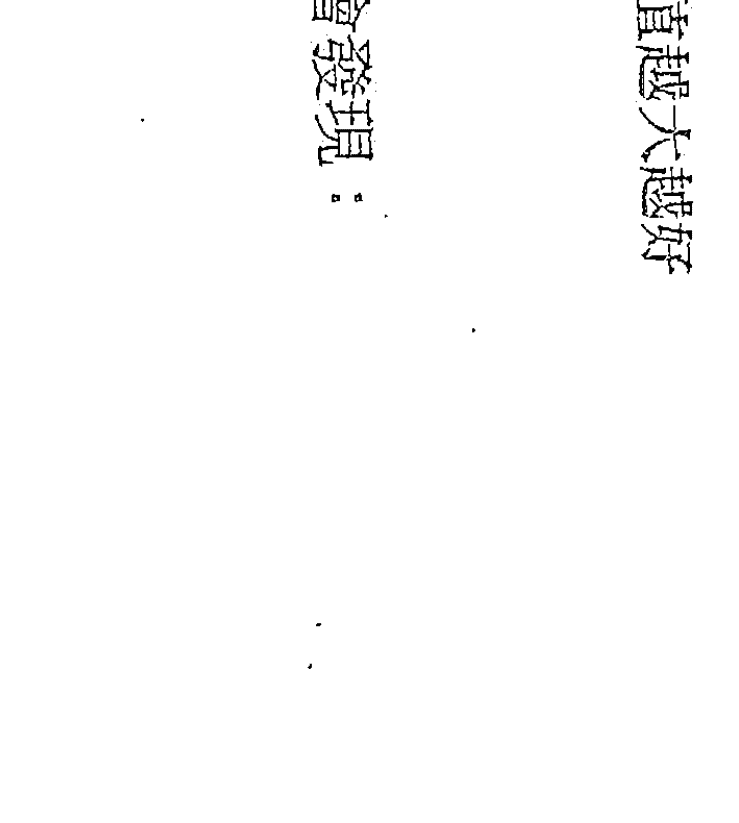

我們用中間来分析上面的公式，就會發現：

- (a) 分母是流動負債，「你欠我的」。
- (b) 分子是流動資產，「能還嗎」。這指的是：我們要拿什麼來還呢？當然是公司的流動資產。

而一家公司最重要的流動資產，主要有三個：(i) 現金與約當現金 (ii) 應收帳款 (iii) 存貨

流動比率這個指標，應該是越大越好，還是越小越好？我們就以公式中的數據來說明。
例如，一家公司欠了銀行短期負債10億元，不過該公司擁有100億元的流動資產，所以若要償還10億元的短期負債，應該相當輕鬆，完全沒有壓力。
又如，公司對外的短期負債高達100億元，但手上只有10億元的流動資產。如果債權人這時要求公司償還短期負債，則公司還欠就90億元流動資產，代表該公司的短期負債能力可能出現嚴重壓力。
所以，用常識來分析，「流動比率」的數據越大越好，代表這家公司對於「你欠我的，能還嗎？」的答案是：我還能，而且可以還很多。
通常一家公司的流動比率≥200%，就算是不錯了。但筆者在投資理財時，是以保本穩健投資為原則，儘量避開會讓我們血本無歸的爛公司，而沒有負債能力的公司，就屬於爛公司的一種。所以對筆者來說，適合投資的公司，流動比率會要求最好是≥300%，而且是近三年皆是如此。

### 防止流動資產造假，綜合檢驗指標

為什麼要這樣嚴格？因為前面提到，一家公司的主要流動資產，是現金與約當現金、應收帳款與存貨這三種短期資產。萬一該公司的短期資產，多半是收不回来的應收帳款，或是一直賣不出去的存貨，那要怎麼辦？

即使是收不回来的應收帳款，只要是尚未變成呆帳前，都會一直掛在公司的資產負債表上！同理，如果公司遲遲不願意將已經無法銷售出去的存貨，以促銷方式打銷的話，則公司的存貨金額也會一直記入資產負債表！

為了防止少部分惡意的上市公司，過度美化該二項短期資產在財報中的數字，所以筆者個人進行投資時，才會要求流動比率最好要≥300%。

如果該公司的流動比率只有≥200%，不符合筆者投資的基本要求時，我會再交叉驗證以下三個指標：

1. 現金與約當現金：手上的現金充足嗎？如果該公司的流動比率無法超過300%，那麼當然會希望它具有持有的現金越多越好，代表它越有償債能力。
2. 應收帳款收現天數：是否需要很久才能收現金？我會特別留意該公司在這個指標的表現，是否勝過業界的平均值。
3. 存貨平均存留天數：如果流動比率不夠高，為了確保該公司具有一定的償債能力，就得關注它的產品好不好賣，跟業界相比是屬於暢銷或滯銷？一家公司的存貨在夏天數越短越好，商品熱銷、收到大量貨款，自然就有能力改善或優化償債能力。

再次提醒讀者：財務報表分析是一種動態概念，相對應的交叉驗證順序，請參考圖表6-2。

#### 流動比率的交叉驗證順序

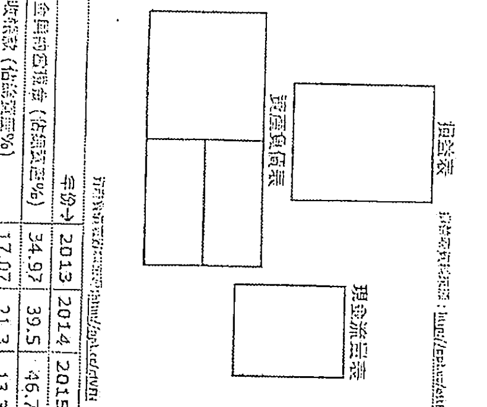

財務報表分析應交叉驗證指標 | 2013 | 2014 | 2015
:--- | :--- | :--- | :---
現金及銀行存款 (Cash in Bank) | 542 | 505 | 467
流動資產總額 (Liquid Assets) | 2,751 | 2,166 | 2,637
存貨 (Inventories) | 7.07 | 13.8 | 12.3
應收帳款 (Accounts Receivable) | 6.40 | 5.80 | 4.60
速動資產 (Quick Assets) | 2,029 | 1,479 | 1,281
流動負債 (Current Liabilities) | 920 | 745 | 987
現款 (Cash) | 1.42 | 2.10 | 2.10
應付帳款 (Accounts Payable) | 0.19 | 7.21 | 12.4
現金淨額 (Net Cash) | 78 | 84 | 72
流動比率 (Current Ratio) | 3.00 | 2.91 | 2.68
速動比率 (Quick Ratio) | 2.21 | 1.99 | 1.30
現金比率 (Cash Ratio) | 1.00 | 1.00 | 1.00
存貨平均存留天數 (Days Sales in Inventory) | 88 | 138 | 127
應收帳款收現天數 (Days Sales Outstanding) | 14 | 22 | 20
應付帳款付款天數 (Days Payable) | 2 | 90 | 167
資金循環週轉天數 (Cash Cycle Days) | 90 | 170 | 164

接下來，我們看看那六家公司的「流動比率」實際數據表現如何（詳見圖表6-3）。

#### 六家公司的流動比率交叉驗證

| 指標 | 公司A | 公司B | 公司C | 公司D | 公司E | 公司F |
| :--- | :--- | :--- | :--- | :--- | :--- | :--- |
| ① 已達標 (流動比率) | 非常好 | 非常好 | 非常好 | 非常好 | 還不錯 | 非常好 |
| ② 現金與約當現金 | 無須交叉驗證 | 7.5元 | 68.6元 | 53.98元 | | | |
| ③ 應收帳款收現天數 | | 29.27元 | 108.3元 | 37.01元 | | | |
| ④ 存貨平均存留天數 | | 25.72% | 17.1% | 28.5% | | | |
| ⑤ 速動比率 | | 289.6% | 831.63% | 433.7% | 98.67% | 151.95% | 168.32% |

可以看到，大立光、合潢電與中勝這三家公司的流動比率非常好，都大於300%。但另外三家的流動比率未達標準，就需要進一步驗證②、③的指標。

這時就會發現，他們交叉驗證後的表現相當不錯，尤其是各公司手上的現金與約當現金化總資產的比率，都介於17～28%。還記得「比氣長，愈長愈好」這句話嗎？我們要求現金佔總資產的比例最好介於10%到25%。所以綜合判斷之後，即使這三家公司的流動比率未達300%，他們的償債能力仍然合格，而且相當不錯唷！

### E2 速動比率：你欠我的，能速速還嗎？

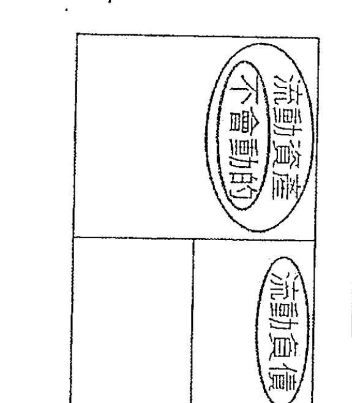

能還嗎？不會動的

你欠我的


能速還速還嗎？

你欠我的

≧100億 or ⑳10億

越大越好＝具有速速還款的能力

這個指標主要是輔助「流動比率」指標的不足之處，因為流動比率中的分母是「能還嗎？」，指的是該公司手上的流動資產，是否足以償還對外的短期負債。但是流動資產中，並不是每項資產都真正具備足夠的價值。

尤其是存貨，因為市場需求與消費者的喜好時常變動，一旦存貨放得太久，雖然在帳面上還有價值，市場上卻未必有對應的價值，因為放得太久的存貨，可能完全賣不出去。例如：現在是2016年度，如果該公司是賣手機的通路商，公司的倉庫仍有一萬支前年進貨的iPhone4未售出，此時這些未售出手機庫存市場價格，可能遠低於當時公司的進貨成本。

所以，「速動比率」的公式中，分母與「流動比率」是一模一樣。唯一的差別在於分子的變化：

「速動比率」公式的分子＝能還嗎－不會動的（流動資產）

那麼一家公司主要的流動資產中，有那些不會動（不容易馬上變成現金的流動資產）？

如前所述，第一個不會動的流動資產就是存貨，所以先扣除。除了存貨不太會動（不容易變現）之外，還有另一個流動資產叫「預付費用」。您可以將它想成是您的流動資產，但已經預付給第三方了。這些預付出去的费用是您的資產，但您馬上拿回來、變成現金的機率非常低，所以它也是屬於一種「不會動的流動資產」。

例如，您打算加入某一家健身房的三年 VIP 會員，需要預繳會費五萬元。在您個人的資產負債表中，這五萬元會列為流動資產的「預付費用」。假設某一天，您剛好急缺現金，可能是要償還之前的親友週轉的錢，但這五萬元的預付費用，雖然名義上是您的流動資產，您卻無法即時拿回來，所以它是屬於「不會動的流動資產」。

這個指標應該是越大越好，還是越小越好？如同前面「流動比率」分析一樣，當然是越大越好。

實務上，筆者自己進行投資時，會要求該公司近三年的速動比率大於150%。但如果您非常想投資那家公司，它的速動比率卻未達標時，有沒有其他替代指標可以觀察嗎？確有，當出現這種讓人非常想投資，但速動比率不如想像中好的公司時，我同樣會交叉驗證下列三個指標：

1. 現金與短借現金：首先需要交叉檢驗的指標，跟筆者在討論「流動比率」時要求時觀看的替代數據一樣。公司手中的現金多不多？當然是越多越好，越有能力迅速償還債權人的短期負債。
2. 應收帳款收現天數：跟前面相同，這也是需要檢驗的數據。萬一哪天債權人不願意借錢給公司，突然要求公司速速償還之前的短期債務，此時公司如果屬於「天天收現金」的生意模式，比較有能力馬上變成現金，償還給該債權人。即使速動比率＜150%，如果應收帳款收現天數能夠小於15天，筆者會認定該公司仍具有速速還款的能力。
3. 總資產週轉率：還記得「覆巢率」，越高越好！這句話嗎？假設這家公司前面幾個指標全部不符合，那它的總資產週轉率絕對不能小於1。因為小於1，代表這家公司是資產密集（很燒錢）的行業，結果它手上的現金低於10%，又不是收現金的行業，此時速速還債能力「速動比率」又偏低，一旦市場有風吹草動或突然出現非預期的黑天鵝事件，該公司可能會立刻陷入危機。台股上市櫃公司約有2000家，投資理財千萬不要將自己的資金，放在遇上景氣波動就會陷入危機的公司，大家別與自己存的辛苦錢過不去！

財務報表是一種立體交叉的動態分析技巧，光是營收、獲利或EPS創新高等單一指標表現優越，都不足以判斷公司真正的經營狀況。以「速動比率」指標分析為例，相對應的交叉驗證順序，請參考圖表6-4。


#### 速動比率 的交叉驗證順序

速動比率速動比率的交叉驗證，我們一樣來看看下列六家公司的表現（詳見圖表6-5），切實判斷他們在「速求還債能力」方面的高低。

| 指標 | 期間/項目 | 2013 | 2014 | 2015 | 2016 |
| :--- | :--- | :--- | :--- | :--- | :--- |
| 速動比率(%) | 回扣金額 | 21.15 | 32.62 | 24.59 | -0.06% |
| 同業速動比率 | 同業平均速動比率 | 30.06 | 34.22 | 20.78 | -16.47% |
| 回扣活動同業 | 回扣活動同業速動比率 | 27.17 | 26.22 | 29.88 | 3.08% |
| 總資產淨利差額 | 同業總資產淨利差額 | 2.62 | 2.58 | 2.58 | 0.00% |
| 純益率 | 純益率比率差 | 83 | 82 | 84 | 2.41% |
| 回扣活動同業純益率 | 回扣活動同業純益率 | 5.51 | 5.05 | 5.61 | 11.09% |
| 回扣活動純益率 | 同業回扣活動純益率 | 65.88 | 60.92 | 44.44 | -27.05% |
| 現金淨額 | 現金淨額 | 65.88 | 65.88 | 54.44 | -17.21% |
| 經營性淨利 | 經營性淨利 | 1.29 | 3.27 | 4.15 | 26.91% |
| 經營性淨利同業 | 經營性淨利同業 | 0.39 | 3.50 | 2.37 | -32.29% |
| 回扣活動純益 | 回扣活動純益 | 40.55 | 30.72 | 43.31 | 41.31% |
| 回扣活動純益同業 | 回扣活動純益同業 | 48.79 | 23.32 | 37.28 | 59.43% |
| 回扣活動純益同業 | 回扣活動純益同業 | 8.43 | 6.21 | 5.29 | -14.81% |
| 純益同業 | 純益同業 | 24.33 | 30.87 | 29.24 | -5.27% |
| 現金同業 | 現金同業 | 3.5 | 50.44 | 35.94 | 28.94% |
| 純益淨利比率 | 純益淨利比率 | 143.25 | 133.48 | 102.6 | -22.78% |
| 現金淨利比率 | 現金淨利比率 | 19.56 | 18.58 | 28.41 | 53.45% |
| 經營性淨利比率 | 經營性淨利比率 | 5.18 | 7.4 | 6.7 | -9.46% |
| 回扣活動純益比率 | 回扣活動純益比率 | 51.02 | (2.76) | (6.12) | -112.09% |
| 純益淨利比率同業 | 純益淨利比率同業 | 20.32 | (0.1) | 2.4 | 0.93% |


## 六家公司的速動比率交叉驗證

| ③ | ② | ① | ③ | ② | ① |
| :--- | :--- | :--- | :--- | :--- | :--- |
| 280.68% | 319.58% | 359.8% | 72.96% | 88.77% | 127.75% |
| 25.72% | 17.1% | 28.5% | 73天 | 68.6天 | 55.98天 |
| 2.35 | 1.33 | 1.88 | 非常好 | 還不錯 | 非常好 |
| 非常好 | 非常好 | 非常好 | 非常好 | 非常好 | 非常好 |
| ②已達標 抓緊交叉驗證 | ②已達標 抓緊交叉驗證 | ②已達標 抓緊交叉驗證 | ②已達標 抓緊交叉驗證 | ②已達標 抓緊交叉驗證 | ②已達標 抓緊交叉驗證 |

### 實戰分析練習

透過以上的簡單分析，相信您對「債信能力」分析的方法與邏輯，已經具有立體的閱讀觀。接下來，請您拿出本書附贈的32家公司的財務數據卡進行練習。熟能生巧，相信下一次您再看到這些數據，就有輕鬆解析關鍵背潛的能力，再也不會恐慌囉！

| 序號 | 公司名稱 | 股代號 |
| :--- | :--- | :--- |
| 01 | 大立光 | 3006 |
| 02 | 台積電 | 2330 |
| 03 | 中腦 | 1723 |
| 04 | 廣達光電 | 1537 |
| 05 | 皇田工業 | 9951 |
| 06 | 友達資訊 | 2397 |
| 07 | 佳格 | 1227 |
| 08 | 聯發科 | 3450 |
| 09 | 為升 | 2231 |

| 序號 | 公司名稱 | 股代號 |
| :--- | :--- | :--- |
| 10 | 日友 | 8341 |
| 11 | 中興保全 | 9917 |
| 12 | 聯強科技 | 3005 |
| 13 | 寶成工業 | 9904 |
| 14 | 台數科 | 8464 |
| 15 | 巨大 | 9921 |
| 16 | 恆大 | 1325 |
| 17 | 邦特生技 | 4107 |
| 18 | 可寧衛 | 8422 |
| 19 | 帆宣科技 | 8196 |
| 20 | 台達電 | 2308 |
| 21 | 帝寶 | 6605 |
| 22 | 新光保全 | 9925 |

不確定性：能源設施選址,財務,環保

| 序號 | 公司名稱 | 股代號 |
| :--- | :--- | :--- |
| 23 | 中華電信 | 2412 |
| 24 | 旭富 | 6409 |
| 25 | 萬洲化學 | 1715 |
| 26 | 劍麟 | 2228 |
| 27 | 數字科技 | 5287 |
| 28 | 卜蜂 | 1215 |
| 29 | 振錕電 | 8114 |
| 30 | 新一超 | 2912 |
| 31 | 滬通 | 2317 |
| 32 | 中鋼 | 2002 |

※本表僅非報明解1：本表所附解之各公司財務報告，皆為該各該獨立公司資產報明表，透出的公司。

※投資一定有風險，股票投資有賺有賠，買股前請詳閱公關說明書（財務報表）。

Chung Hwa 從償債能力破解公司的還錢本質｜6

## Chapter 7
## 一小時精挑賺錢績優股

不能說”
不假裝，
也能輕鬆選出賺錢質優股

財務報表不是完美的工具，但只要稍微懂得如何閱讀報表，就能選出80%以上的爛公司。另外20%的公司，如果是老頑刻意心術不正，在財務報表上就幫不上忙了。

接下來，筆者匯集前六章介紹的五大數字力（如圖表7-1），請大家依照①、②、③、④、⑤這樣的重點順序閱讀財務報表，就能建立用財務判斷選股的立體閱讀順序，快速掌握一家公司的投資價值。

## 用財務判斷選股的閱讀順序

### ① 現金流量＝比氣長，愈長愈好

先看這個指標的原因，是要幫助大家避開任何在保命的爛公司，現金在手才能比氣長。有三個重點指標要注意：

- ① 大於「100/100/101：現金流量比率、現金流量充值比率、現金再投資比率，要滿足大於＞100%、100%、10%的原則。
- ② 現金佔總資產比率：確認這個數據是否介於10～25%。如果該公司屬於資本密集（燒錢）的行業，這個數據最好要比25%更高。


# 公開資訊觀測站點數與資料的「中斷中」


- 說明及用途
    - 此圖為「...」資料來源
    - 依據「...」資料來源
- 圖例及內容
    - 圖中「...」表示
    - 圖中「...」代表
- 圖表說明
    - 圖表為...
    - 數據為...
- 注意事項
    - 資料為...
    - 數據為...
- 分析說明
    - 本圖為...
    - 資料為...
- 其他說明
    - 圖表為...
    - 數據為...

中斷的原因主要可能包括以下幾點：

- 資料傳輸中斷或因其他中斷原因造成的中斷

# 一小時降雨觀測記錄圖

- 1 小時降雨量記錄圖

## Chapter 7
## 【基本】股票投資

不置財報，
也能輕鬆選出賺錢績優股

③ 平均收現天數：如果前兩個指標都不夠好，那就要看它是不是天收現金了。理想狀況是平均收現天數＜15天。

比氣長，愈長愈好，您閱讀的順序是㊀㊁㊂，但三個指標的重要性分別為㊂＞㊃＞㊀，其中最重要的是㊁，重要性高達70%。

### ④ 經營能力＝翻桌率，越高越好

確定要投資的公司不會因為缺乏現金而突然陣亡之後，我們接下來要瞭解它的經營能力，判斷它在景氣循環環境中，是否有良好經營的能力。其中，有三個重點指標要注意：

- ㊂ 總資產週轉率：先看這個數據是否＞1，因為大於1是基本的要求。如果小於1，代表該公司經營的是燒錢（資本密集）的行業，這個時候，您應該馬上回頭再檢查㊁現金存量是否至少介於10~25%？此時現金存量最好是處於25%以上較佳。但如果未達標，則㊃平均收現天數建議要小於15天（小於15天，代表這家公司是收現金交易的行業）。
- ㊃ 平均銷貨日數：這家公司的產品好不好賣？熱不熱銷？這個數據可與其他同業相比，來判斷怎樣的銷貨日數才算是合理。

# 平均收現日數：有沒有客戶買了之後不想付錢，變成呆帳的狀況？如果是收現金的行業，這個指標就會＜15天。如是不是收現金的行業，則平均收現日數通常都介於60～90天；如果应收账款的平均收現日數＞90天，最好再深入瞭解：是該公司的收款能力特別弱？還是行業內的普遍性作法？永遠要記得，一家只會銷售卻無法即時收回貸款的公司，日後將會出現很多意想不到的呆帳，所以這個指標也非常重要。

三者的閱讀順序與重要性皆相同，分別為(81)、(82)、(83)，因為它代表一家公司的整體經營能力。

# 獲利能力＝這是不是一門好生意？越高越好

確認完畢您投資的公司氣很長，又有基本的經營能力之後，第三個接著要分析的重要判斷指標，就是獲利能力。如果您手上剛好有二個投資機會，一家是毛利高又有前景的公司，另一家公司則是低毛利且景氣波動較大的公司，您會投資那一家？當然是選前面那一家公司，對吧！所以，獲利能力最重要的觀念就是「這是不是一門好生意」，如果它又是一門長期穩定的生意，那就更棒了。

為了瞭解一家公司的獲利能力，您需要關注下列六個指標，分別為：

① 毛利差：公司的主要業務有沒有搞頭？生意好不好賺？就看這個數據了。毛利率愈高愈好，代表這真是一門好生意，但您也要思考下一個問題：這家公司守得住高毛利率嗎？因為只要毛利率夠高，接下來將有一堆競爭者聞風而來，如果這家公司沒有過人的研發與新品開發能力，這種高毛利率可能只是曇花一現？另外也要觀察這家公司是否是連續幾年都能維持高毛利？還是只有今年如此？因為該公司剛好出現獨一為之的爆紅商品所致？

相反的，一家公司的毛利率偏低，代表該市場競爭激烈，為了獲利通常只能靠規模經濟（量大）來降低成本。為了取得足夠的規模，勢必要主攻幾個超級大客戶，但即使一切順利，成功拿到這些知名大客戶，日後只要任一家大客戶離開，這家公司就可能立刻由獲利轉為巨額虧損。別忘了，實務上每一家所謂的大客戶，基本上很少有「忠誠度」，都是貨比三家，到處轉單，追求最低的製造成本。所以，低毛利率的行業要「持續」生存下來，實在非常不容易。如果有更好的投資機會，應該跳過毛利率過低的投資標的。

不惜財路，也能輕輕談出賺錢鎖鏈股

② 營業利益率：有沒有賺錢的本本事？這指的是公司好不容易賺進來的毛利，扣除基本的費用開銷（包含行銷費用、管理費用、研發費用、折舊與分攤攤銷等費用後），公司還能賺錢嗎？不同行業、不同規模的公司，在營業利益率方面會有明顯差異，大原則是要跟同業比較。

經驗法則告訴我們費用率（＝毛利率－營業利率率＝（1）－（2））如果小於10%，通常代表這家公司具有相當不錯的規模經濟；如果小於7%以下，代表這家公司不但有規模，也非常地節省在經營事業；如果費用率大於20%，一般說來則是品牌公司或是未達規模經濟的新行業，例如生技行業或是網路行業等。

這個指標也超級重要，就像一個男人的月薪是20萬元，但他每月的基本費用銷是50萬元（費用率太高，高達一般人），除非他是富二代，要不然他的生活長期來看，肯定會暗無天日，最後被迫四處借錢過聘才能生活。這個時候，單身的您，千萬不要投資他（嫁給他）喲。

③ 經營安全邊際（②除①）：這個數據如果＞60%，代表這家公司有較寬裕的獲利空間，在面臨景氣波動，或是競爭者不理性殺價競爭時，比較有寬裕的空間可以因應。

# 不懼賠 1
也能健健康出勝競價優股

④ 淨利率（純益率）：至少要 >2% 才值得投資。因為一家公司扣除給政府的相關稅金之後，淨利率還要超越從銀行體系取得資金的成本（至少2%），才算是真正擁有基本的賺錢能力。因為如果一家上市櫃公司的淨利率，努力十多年後都還達不到1%，其實這家公司老闆的錢應該要直接拿去定存（至少有1%以上的利息收入），或是轉投資其他有前景的行業，如此運用資金才是最佳的配置。

⑤ 每股獲利（EPS）：將獲利的總金額，換算成以每股為基準。這個數據除了要越高越好，還要注意它每年的變化，來判斷這家公司的淨利穩定獲利，還是已經呈現下滑的跡象。最簡單的方式，就是觀察發生大事的那幾年（例如2008、2009、2012年），該公司是否仍能保持穩定的EPS。

⑥ 股東報酬率（RoE）：這是股神巴菲特最看重的三個指標之一，理想中要 >20%。

① 財務結構＝那根棒子，棒子的位置越高越好

財務結構談的是一家公司的財務體質好不好？公司的股東出資了多少錢投資公司（有錢公司嗎）？公司對外的負債會不會太多？有沒有發生致命的以短支長（拿短期資金支應長期投資所需）等情事？其中有一個重要的觀察指標分別如下：

① 負債占資產比率：指的是那棟棒子的高低。位置偏高，代表股東出資的比較多，因為既賺，當然是把水平若外人田，所以棒子的位置偏高比較好，也代表這是一家好公司。一旦您判斷這是一家股東都棍挺的公司，您可以同步觀察另個指標：③毛利率（是不是一般生意）、②營業利益率（有沒有賺錢的資本事），透過這三個小指標一起看，就能藉此建立體的分析觀念，也能交叉驗證這是不是是一家真正值得投資的好公司。
如果棒子偏低，代表這家公司的負債额度過高，暗示著股東不太支持公司，此時這種公司的③毛利率、②營業利益率會偏低甚至變成負數，萬一遇到這種情況，請立刻去驗證最重要的第三個指標：

②現金占總資產的比率。因為如果公司持續虧錢，負債占資產比率太高，此時股公司手中的現金又不務，一旦發生銀行抽銀銀的情況，您投資的這家公司可能會立刻陷入財務危機。

③長期資金佔不動產、廠房及設備比率：這個指標代表的是「以長支長」的觀念，當然是越長越好。企業的致命錯誤之一，就是犯下「以短支長」的錯誤，拿短期資金（如同地下錢莊借錢）支付長期發展所需或無法快速回收的機械設備廠房等支出，通常最後都會以破產收場。

# ❷ 債權能力 = 你欠我的，能還嗎？還越多越好

最後一個要觀察的指標就是一家公司對外的債權能力。債權能力越好，債權人就不會天天擔心到底那個公司有沒有問題；債權能力低，市場流言就愈多，有時一個謠言就能引起相關債權人對該公司的信任驟失，最後也間接害死了一家。為了避免市場出現不實的謠言傷害公司，最好的方式就是：每一家公司都應該建立適度安全的債權能力。以下二個指標，就能看出一家公司的債權能力良窶。

(1) 流動比率：「你欠我的，能還嗎？」這個數值最好要＞300%，否則我們要進一步觀察三個指標，再做最後的綜合判斷：(2)公司手上的現金多不多？(3)應收帳款的收取日數是否比業界平均的表現要好？(4)商品的庫存天數會不會太長？

(2) 速動比率：「你欠我的，能速速還嗎？」這一項數值最好要＞150%。它主要是來輔助(1)流動比率的不足：扣除流動資產當中「不會動」的資產，確認公司有「速速還」的能力，而不是靠著存貨、預付費用等不太容易變現的資產項目美化報表（讓投資人以為公司還有很多借錢的流動資產，問題是那些存货可能根本不出去玩、預付費用已經給了第三方，雖然帳面上是屬於公司的資產，但根本無法拿出來使用，所以這二個流動資產科目是屬於「不會動」的流動資產喔）。

遽動比率不夠好的公司，也可以再交叉觀察其他三個指標来做最後的綜合判斷：

⑴ 公司手上的現金是否大於10%？現金越多，越有承受短期負債還款危機的本事。

⑵ 平均收現日數是否小於15天？如果現金不足，公司最好是屬於天天收現金的行業，確保公司天天有錢進來；萬一突然出現債權人來討債，也才有現金處理償債的事情。

⑶ 總資產週轉率是否大於1？當這個指標小於1，代表屬於資本密集（燒錢）的行業。如果一家公司沒現金，收錢的速度慢，又是經營燒錢的行業，用常識判斷都能知道投資它實在太危險了。

# 好投資是「買企業」，不是「買股票」

在股市投資理論中，有一個術語叫做Beta值，這是華爾街用來衡量風險的方式。

一家公司的股價波動越大，Beta值越高，代表投資該公司的風險越大。同理，當一家公司的股價波動越小，Beta值越小，代表投資這家公司的風險較低。

但是，如果有一家公司，它的財務報表表現相當亮眼，卻因為其他外在因素，大盤恐慌性下跌，該公司的股價也在100元狂跌到50元。

假設該公司的前景與公司經營狀況一如往常，沒有重大變化，而且該公司的客戶群平均分散在不同的行業別，不像一般的科技業公司，當面臨重要客戶突然轉單的大風險（例如Apple突然轉單，某些上市公司營收與獲利能力便會嚴重受損）。該公司每年的獲利狀況穩定，近五年的EPS平均約為5元，且每年穩定配息3塊錢。

如果依照華爾街對Beta值的認知，該公司股價波動過大，所以投資風險非常高！但以上的例子來看，其實這家公司是非常值得投資的對象，因為您每年的投資報酬率將高達6%（3÷50=6%）。

所以，真正的風險應該重新定義，而不是依循華爾街所謂的Beta值。真正的「風險」定義是：你受傷的機率！

投資之後，你會受傷的機率很高，那就是「高風險」；你受傷的機率低，就叫「低風險」。

現在您已经学会财报分析的关键技巧了，所以投资股票的观点也该升级为「买企业，而不是买股票」。

在股市获利通常有两种情况：「资本利得」，与「股息股利」。

如果您是为了赚价差（以资本利得为目的）而去投资某档股票，以几率学的观点来看。股价上涨、持平与下跌的几率，各为1/3。假设您的运气非常好，加上眼光独到，该公司的股票果真涨了，您还得面对两个选择：持续再买，还是现在就卖？

所以一般散户赚取价差（资本利得）的成功几率（如图表7-2）会是：


这就是为什么我们常听到：「10个散户9个输。」

巴菲特也這麼說：「在股市預測贏家，比預測贏家容易多了。」

如果您投資的觀念，升級為「買企業，而不是買股票」，您的思考模式應該會是這樣：我該買什麼企業，才能幫我穩穩地賺錢，供我退休後可以享受生活？我能不能買下更多的11、張忠謀先生經營的台積電、郭台銘先生的鴻海帝國，或是擁有一技之長的大立光等公司？

## 主題二 投資股市賺錢的流程與機率


您的理財方式將會變成：從財務報表中找出還沒有被其他投資人發現的價值（被低估且價格很低），而不是被動、一窩蜂地的去追求在市場上已經被炒作進修的鑽石（價格很貴）。

您需要花更多心力去思考與學習：那些不論景氣好壞、居然能持續賺錢的好公司們，他們在財務報表上有沒有什麼共同點呢？當您找出其中的共同點，也許就找到屬於自己的投資致富密碼了。

這些好公司在財務報表的共通性可能是：

1. 公司經營保守穩健，手中留有現金。（現金流量：比氣長，越長越好）

2. 應收帳款與存貨的管理非常優異，做生意的完整週期又比業界其他競爭者要短。（經營能力：翻桌率，越多越好）

3. 是不是一門好生意？有沒有賺錢的資本事？經營安全邊際高不高？是不是持續增加研發能力以維持高毛利？股東報酬率好不好？（獲利能力：這是不是一門好生意）

4. 這家公司會不會過度使用財務槓桿？資金來源有沒有發生「以短支長」的致命錯誤？（財務結構：那根棒子，棒子的位置越高越好）

5. 這家公司短期的營運資金充足嗎？對外欠的短期負債有能力償還嗎？（償債能力：你欠我的，能還嗎？還越多越好）

我們回到剛才那家投資由100元跌至50元的公司。依照傳統華爾街的Brean值說法，這是一檔高風險的股票。但根據之前的假設，您知道這家公司，內部營運狀況並沒有重大變化，股價下跌純粹是因為市場不理性的恐慌性下殺，這時候您恐進場投資受傷的機率很小，所以應該視為「低風險」。

在投資理財過程中，您自己就是自己人生中最重要的「風險控制長」。運用「買企業，而不是買股票」的投資理念，將會為您帶來雙重利潤（如圖表7-3）：


1. 資本利得：透過閱讀財務報表分析，選出好公司，然後在它的股價被錯殺、跌深之後方買入。您的持股成本會比別人低，加上這家公司的體質本來就非常不錯，一旦市場回歸理性狀態，它的股價上漲的機會，會比其他公司來得高，此時您獲取資本利得（賺到價差）的機會也會比較大。

② 被動收入：即使在您投資之後，未來三年股市持續低迷，因為這家公司體質優良，您一樣每年都能拿到被動收入（固定領取3股息或股息），每年平均報酬率高達6%（3/50=6%）。

換句話說，「買企業，而不是買股票」的投資理念，可以讓您同時擁有資本利得與被動收入的好處，進可攻，退可守。

此時您投資這一家公司的整體報酬率是：

（1）+（2）= 可能的價差利潤 + 6%

這將遠遠超過其他賭性較強的投機客，因為投機客只看到（1）所代表的可能價差利潤（資本利得）。

## 股神巴菲特選股技術分析

自1965年起至今，華倫·巴菲特每年都寫一封信，給全球各地投資波克夏公司的股東。由圖表4-4可以看出，從1965年到2015年年度，股神巴菲特的帳面價值平均每年成長19.2%；該公司市價每年平均成長20.8%；同期的標準普爾500指數（S&P 500），在這段期間則是平均成長9.7%。

乍看之下，兩者相差11%左右，感覺差異不大，但如果用金額來分析您應該會更有感覺。

假設您在1965年，投資了新台幣1萬元到波克夏公司的股票，而且在這五十一年期間，您都沒有賣出。

當初投資的1萬元，到了2015年年底，如果用該公司的2015年底的收盤股價來計算，當初的1萬元新台幣等於今天的1,598億新台幣。即使是波克夏公司帳面的價值（每股淨值）來計算，當初的1萬元，也高達7989億。

但如果您是在標準普爾500指數投資了1萬元，到了2015年年底，只值113.5萬。

這就是在本書第一章與大家分享的觀念：善用時間的力量，獲利可以創造出奇蹟。只要真選好公司，然後透過長期的投資，人生理財就能夢想成真。

所以投資股票前，請務必要閱讀財務報表，才能夠選出在事業經營上表現不錯的好公司。

另一方面，如果您仔細核對、比較這51年期間波克夏公司的淨增長率與標準普爾的數據表現之後，您會發現兩件有趣的事情：

1. 風口上，豬也能飛上天：股市大漲利多的期間，不管是好公司或爛公司，都是普天齊漲，只是漲幅大小不同而已。當投資股市成為全民運動

> * 筆者不否認股價的數據，主要是因為影響股價的原因非常多，包含了投資人眾的預期心理等因素，故採用該公司帳面淨值的資料進行比較

## 波克夏各年度經營表現

Berkshire's Performance - the S&P 500

| Year | In-Per-Share Basis of S&P 500 | Annual Percentage Change in-Per-Share Basis of S&P 500 with Dividends Reinvested | | | |
| :--- | :--- | :--- | :--- | :--- | :--- |
| 1965 | 29.8 | 43.4 | | | |
| 1966 | 20.3 | (10.9) | | | |
| 1967 | 11.0 | 3.3 | | | |
| 1968 | 12.2 | (4.9) | | | |
| 1969 | 13.4 | (2.5) | | | |
| 1970 | 11.0 | (4.7) | | | |
| 1971 | 2.4 | (1.3) | | | |
| 1972 | 11.0 | (4.7) | | | |
| 1973 | 14.4 | (8.4) | | | |
| 1974 | 15.4 | (4.7) | | | |
| 1975 | 4.7 | (4.7) | | | |
| 1976 | 20.3 | (4.7) | | | |
| 1977 | 48.2 | 48.2 | | | |
| 1978 | 51.9 | 12.3 | | | |
| 1979 | 59.3 | 7.4 | | | |
| 1980 | 74.3 | 12.3 | | | |
| 1981 | 33.3 | 74.3 | | | |
| 1982 | 15.3 | 6.4 | | | |
| 1983 | 33.3 | 33.3 | | | |
| 1984 | 31.8 | 15.0 | | | |
| 1985 | 18.4 | 21.4 | | | |
| 1986 | 46.1 | 30.3 | | | |
| 1987 | 44.1 | 33.6 | | | |
| 1988 | 43.4 | 40.7 | | | |
| 1989 | 26.1 | 15.6 | | | |
| 1990 | 19.5 | 16.6 | | | |
| 1991 | 40.1 | 28.1 | | | |
| 1992 | 59.3 | 30.9 | | | |
| 1993 | 55.5 | 11.9 | | | |
| 1994 | 35.8 | 7.6 | | | |
| 1995 | 25.0 | 17.1 | | | |
| 1996 | 23.0 | 11.3 | | | |
| 1997 | 13.9 | 37.0 | | | |
| 1998 | 34.4 | 33.4 | | | |
| 1999 | 57.4 | 28.6 | | | |
| 2000 | 35.2 | 28.6 | | | |
| 2001 | 4.7 | (2.8) | | | |
| 2002 | 6.5 | (21.9) | | | |
| 2003 | (0.8) | | | | |
| 2004 | 0.3 | | | | |
| 2005 | 14.4 | | | | |
| 2006 | 25.1 | | | | |
| 2007 | 2.5 | | | | |
| 2008 | (4.3) | | | | |
| 2009 | 17.2 | | | | |
| 2010 | 44.8 | | | | |
| 2011 | 2.7 | | | | |
| 2012 | 26.5 | | | | |
| 2013 | 14.4 | | | | |
| 2014 | 15.8 | | | | |
| 2015 | 8.4 | | | | |
| | 9.4 | | | | |
| Compound Annual Rate - 1965-2015 | 798.81% | 12.2% | 1,598.284% | 11.55% | |

資料來源：http://www.berkshirehathaway.com/letters/2015ltr.pdf

2. 小虧與大虧的差異：這五十一年期間，出現許多次景氣大幅波動。當景氣下滑或蕭條時，好公司依然存在，爛公司卻從市場消失了。所以巴菲特才會不斷提醒投資人眾：「投資人要避開買熱門股、爛公司，也不要預測股市高低點。」

筆者在圖表7-5，整理出十一個標準普爾500指數呈現負成長的年度，拿來跟波克夏公司當年度的「盈淨值變化」做比較。

我們可以從這十一個遇上重大景氣波動，導致標準普爾指數大跌的年份，看出該年度波克夏公司的淨值卻是大幅增長，或是隻有小幅下跌。每次景氣波動一來一往之間，平均差異高達25%以上。

在景氣下滑期間，還能夠持續增長或跌的比例人少，這才是股神巴菲特真正致富的祕訣。

## Table 7-2 景氣波動時，波克夏與標準普爾500指數的表現差異

| 年度 | 標準普爾500指數 (%) | 波克夏每股淨值(1) (%) | 波克夏每股市值的漲幅(2) |
| :--- | :---: | :---: | :---: |
| 1998 | 20.3 | (11.7) | 32 |
| 1999 | 16.2 | (8.4) | 24.6 |
| 2000 | 4.7 | (14.8) | 19.5 |
| 2001 | 5.5 | (26.4) | 31.9 |
| 2002 | 31.9 | (7.4) | 39.3 |
| 2003 | 31.4 | (5.0) | 36.4 |
| 2004 | 7.4 | (3.1) | 10.5 |
| 2005 | 6.5 | (9.1) | 15.6 |
| 2006 | (6.2) | (11.9) | 5.7 |
| 2007 | 10.0 | (22.1) | 32.1 |
| 2008 | (9.6) | (37.0) | 27.4 |

(1) 當期自己將各公司股利分派計算在內。

## ●巴菲特金句的「申顧中」

退潮之後，才知道誰在游泳。
裸泳＝身無分文＝您投資的公司不見了＝不小心投資了爛公司＝血本無賭。

投資這一行有個好處，成功不需要靠很多多次交易。
甲＝很多次交易
乙＝不用很多次交易


+ 報酬=你得到的利益
你投入的成本
=3
=50
=6%

你得等到3壞球、0好球的時機才出手。

等待大事發生，所有人都絕望時，帶著我們準備的現金，優雅入市即可。

投資的關鍵是推斷特定公司的競爭優勢，更重要的是能維持那項優勢多久？

這是不是一門好生意？有沒有長期穩定的獲利能力？

真正的投資人歡迎價格波動，因為股市震盪劇烈，代表體質好的企業其股價時不時會遭到不合理殺低。

要瞄準幾便宜的好時機，也就是說：能不能獲利，在您買股票的時機就決定了（因為你買的低價），而不是買的時候才決定。價格漲跌不是我們所能決定的，但忍住高價不買，等待大事發生再進場低價買入，卻是每個人都可以自主決定的。資本利得與被動收入，您會選擇哪一個？

我們波克夏只關注個別公司的價值，對於股市整體的價格並不太在乎。

巴菲特不強調投資本利得，他看重的是一家公司是否具有長期穩定的獲利能力，遠高於創造公司真正價值的能力。

## 不買超時，
也能輕鬆選出賺錢躺贏股

一家沒有負債且能提供12%報酬率的公司，絕對優於報酬率相等但負債沉重的公司。

看那根棒子的高低，就知道A公司絕對優於B公司。


RoE = NI/权益 = 12%
RoE = NI/权益 = 12%

> 別人恐懼時，你要趕緊貪婪。

1987年發生「黑色星期一事件」，股市崩盤重創可口可樂；但巴菲特在1988、1989這兩年趁機大撿便宜。他這一出手就持續到1994年，經過分割後，整整累積了四億股可口可樂公司的股票。

## 我們讀資料——就這樣。

> 各位讀者，您投資隨便一出手就是幾十萬元，請問投資決策的第一步應該是什麼？請效法巴菲特，讀資料（財務報表）——就這樣。
選出好公司，避開爛公司！

還記得財報分析的立體閱讀順序嗎？

### 股市投資致寶方程式

- A）現金流量＝比氣長（越長越好）
- B）經營能力＝翻桌率（越高越好）
- C）獲利能力＝這是不是一門好生意？（越高越好）
- D）財務結構＝那根棒子（棒子的位置越高越好）
- E）負債能力＝你欠我的，能還嗎？（還越多越好）

這就是股市投資的致寶方程式。希望透過本書，能讓大家瞭解如何透過財務報表：判斷一家公司的好或壞有深刻的認知，再加上您工作多年的實務經驗與常識判斷，筆者十分確定，您一定可以建立出屬於您自己的股市投資致寶方程式。


## 財務報表卡使用說明

本書隨書附贈三項實用小工具：

- ◎上市公司近三年財務報表卡（共32張）
- ◎空白財務表格局（共4張）
- ◎空白透明卡（共6張）

為了讓讀者更加熟悉財務報表的解析技巧，我們特別從台灣公開資訊觀測站中，隨機選出32家公司的財報，供大家在每個章節後進行練習。此外，也額外附上4張空白表格供讀者自由運用，您可以選擇任何一家有趣的公司，將其財務報表相關資料填入表格空白處，再配合本書每一章節財報解析口訣與閱讀順序，即可進行相關的分析與運用。財務報表資料的取得，您可以透過下列二種方式：

- （1）台灣股市公開資訊觀測站：http://mops.twse.com.tw/mops/web/6j05622_ql#。
- （2）獨孤九劍財報快速分析軟體：Google Chrome 專用的外掛程式，詳情請見財報章節後續說明。

### ◎空白透明卡使用方式

除了直接閱讀財務報表卡以外，您還可以將本書每一章節的重點摘錄與閱讀順序，自行運用較細的油性筆將重點貼量於空白透明卡上。

分別拿出一張財務報表卡與空白透明卡。


不擅切換

## 2

將兩張卡片完整重疊。

也能輕鬆讓選出牌銜續變脫

## 3

在透明卡左上角，畫上一個與底圖一樣大的圓圈，作為基準點，標記為④，並寫上該指標之中部白話文：現金流量 = 比氣長，越長越好。


## 附錄

在透明卡的對應位置，寫下五大財務比率分析之重點口訣與閱讀順序。建議一張透明卡寫一個大重點（A、B、C、D、E）即可。


重複上述方法後，就能自製出專屬於您個人的五大財務比率分析的透明卡。


## 透明卡成品範例

- ● 現金流量：比氣長
- ● 經營能力：翻桌率
- ● 員工管理力：留任率

不僅如此，
也能輕鬆看出誰誰誰膽脆

② 獲利能力：這是不是好生意


③ 財務槓桿：那個孳子


不禮勿語；

也能從感受裏出離的消極脫

(E) 償債能力：您欠我的能還嗎？


## Google Chrome外掛程式「獨孤九劍」分享

依照台灣證券櫃檯買賣中心的資料顯示，自2001年以來消失的上市公司，高達212家。換句話說，自2001年到2016年底這十六年間，平均一年至少消失了13家公司。這200多家消失的公司，總共蒸發了2.15兆新台幣的市值。

您可能對「兆」這個單位沒有感覺，2016年台灣中央政府總預算一整年的歲入（中央政府2016年全年的所有預估收入）合計才1.82兆元新台幣。2.15兆元的市值蒸發，如果換算成全台2300萬人平均分攤，代表不論您有沒有投資股票，平均台灣的每位國民要虧損9.4萬元。如果全家都沒有投資過股市，就代表我們全家帳面上分攤的虧損總金額，是由其他人吸收。

依照財訊雙周刊463期與其他財經新聞的報導彙總得知，這些突然消失公司的背後原因，通常可分成四大類：

- （1）因櫃景氣波動能力太弱。
- （2）業外投資失利，虧損母公司。
- （3）炒股護盤，燒光公司所有現金。
- （4）掏空公司或是主管暗中飽私囊。

## 投資策略，
不惜取勝，
也能輕鬆選出賺錢績優股

這四個發生財務危機的原因，除了第四個原因（該公司的主事者是否誠信可靠）這一點確實無法從財務報表判斷得知，其他三個原因，其實只要您仔細閱讀財務報表，而且是定期去看新公佈的財報，就可以略知一二，甚至在發生危機之前就可以將該公司的股票出清。

人性就是這麼奇妙！一支兩萬多元的iPhone手機，為了能便宜幾百元，許多人會上網好幾個小時到處比價。另一方面，當我們投資一家公司的股票時，隨便買幾張就需要二、三十萬，我們卻不願意花十分鐘來閱讀財務報表。

兩萬元的iPhone，您花了好幾小時網上比價。三十萬的股票投資，您卻不願意花十分鐘看看財報，寧可聽其他人報明牌、根據新聞分析的小道消息來判斷。

為了幫助大家解決這個盲點，2016年間，筆者與一位優秀的學生Cavin Yeh共同研發了「獨孤九劍」Google Chrome外掛程式的速讀法。您只要能連上網路，三秒之內，這個外掛程式就可以幫您将公開資訊觀測站裡面文章的五大財務比率分析資料，自動翻譯成這本書給您的白話文「五大關鍵數字力」分析技巧。

「獨孤九劍複習工具」是一個財務分析的懶人包，讓您可以隨時快速查閱與分析一家上市上櫃公司的五個關鍵數字力，希望對大家有些許的幫助。這是筆者額外跟您分享的附加價值，偶爾可能會發生極少部分


## 附錄

仿資料未能即時更正的錯誤，此時請您加入臉書社團「超級數学力競後同學會」並發文反應，我們將協助即時除錯。若異狀仍舊未能排除，請您以台灣公開資訊觀測站的官方資料為主唷。

1. 本外掛程式目前僅支援Google Chrome瀏覽器。
2. 請至http://pp.cc/H9hHL，安裝「獵孤九劍複習工具」。
3. 安裝完畢之後，Google Chrome瀏覽器右上角會出現「獵孤九劍」外掛程式的圖示，如下方框框所示。


### 不懂的詞彙
也能透過鍵盤比劃鍵解讀

A. 點選「獨孤九劍」外掛程式後，選擇「財務分析資料：五大財務比率分析」。


5. 這時會自動帶您前往台灣的公開資訊觀測站。您只需要輸入想查詢的任一投資數據，並點選「查詢」，就能立即查詢您想分析的那一家上市櫃公司的五大財務比率資料。


6. 接著再點選一次「獨孤九劍」外掛程式，按下「查看分析步驟」。


7. 現在您就能清楚將本書「中翻點」與五大財務比率分析放在一起看了!

### 不懂財報，
也能輕鬆讀出隱藏的隱情


新商周刊 No. 2016/07/21  495.47

# 不懂財報，也能輕鬆選出賺錢績優股：五大關鍵數字力

作    者／林明德（Mister）
主編、譯／陳怡伶    朱惠雯
封面、插圖／WOW!design    劉明哲
文案、企劃／許淑娟    李淑萍
封面、封二、四色版設計／朱淑娟
封面、內文設計／鄭美華
排版、校對／呂欣如
總經    理／羅之佑
發行經理／何承恩
出版／呂家興國際出版事業所  聖明國際
地址／台北市大安區新生南路一段41號8樓
電話／(02) 2500-7108    傳真／(02) 2500-7759
E-mail／buyoffice@office.com.tw
發行／英屬維京群島商聖萊恩醫療財團股份有限公司  聯邦分公司
新北市中和民安路二段41號2樓  24小時客服服務：(02) 2517-0999
國際服務專線：0800-020-299  24小時客服服務：(02) 2517-0999
讀者服務信箱：mail-service@office.com.tw
發行、經銷、版權：「智慧」出版集團股份有限公司  聯邦分公司
地址：台北市大安區忠孝東路三段165號
總經    理：陳美珠    電話：(02) 2550-6306    傳真：(02) 2550-6966
國際服務專線：0800-102-866    24小時客服服務：(02) 2517-0999
E-mail：service@office.com.tw
讀者服務信箱：reader@office.com.tw
讀者服務專線：(02) 2550-6300  傳真：(02) 2550-6355
國際服務專線：0800-020-299  24小時客服服務：(02) 2517-0999
發  行  人／羅之佑
發行經理／何承恩
出版／呂家興國際出版事業所  聖明國際

書    商／誠品、金石堂、博客來、各大書店、網路書城、郵購、海外
讀者服務信箱：service@office.com.tw
讀者服務專線：(02) 2550-6300  傳真：(02) 2550-6355
E-mail：service@office.com.tw
讀者服務信箱：reader@office.com.tw
國際服務專線：0800-020-299  24小時客服服務：(02) 2517-0999

香    港    代    理    ／    香    港    麥    格    理    有    限    公    司
香港麥格理出版集團有限公司
地址：香港灣仔軒尼詩道151號華利中心1樓
電話：(852) 28082311 傳真：(852) 28789397
E-mail：bkmc@hkmclgroup.com.tw
讀者服務信箱：service@office.com.tw
讀者服務專線：(02) 2550-6300  傳真：(02) 2550-6355
E-mail：service@office.com.tw
讀者服務信箱：reader@office.com.tw
國際服務專線：0800-020-299  24小時客服服務：(02) 2517-0999

新加坡發行所／Media Asia Publishing Sdn. Bhd.,
Kuala Lumpur, Malaysia
41, Jalan Tun Abdul Razak
Section 14, 50400 Kuala Lumpur, Malaysia
電話：(603) 9057-8822  傳真：(603) 9057-8622  E-mail：die@icd-.com.my
讀者服務信箱：service@office.com.tw
讀者服務專線：(02) 2550-6300  傳真：(02) 2550-6355
E-mail：service@office.com.tw
讀者服務信箱：reader@office.com.tw
國際服務專線：0800-020-299  24小時客服服務：(02) 2517-0999

定價    420元

□2016年12月27日初版1刷
ISBN 978-986-477-158-5

□2017年1月17日初版5刷

印刷    ／    誠    品    文    件    印    務    印    製    有    限    公    司
地址：台北市大安區忠孝東路三段165號
讀者服務專線：(02) 2550-6300  傳真：(02) 2550-6355
讀者服務信箱：service@office.com.tw

讀者服務信箱：service@office.com.tw
讀者服務專線：(02) 2550-6300  傳真：(02) 2550-6355
E-mail：service@office.com.tw
讀者服務信箱：reader@office.com.tw
國際服務專線：0800-020-299  24小時客服服務：(02) 2517-0999
版權所有，翻印必究
 Printed in Taiwan

國家圖書館出版品預行編目資料
不懂的報，也能輕鬆選出賺錢績優股：五大關鍵數字力／林明德著.--
初版.--臺北市：商周出版，家庭娛樂出版公司發行，2016.12
加二公分.-- (新商周刊：SVW.0621)
ISBN 978-986-477-158-5（平裝）
1.財務報表 2.投資
495.47


104 台北市民生東路二段 141 號 9F
寶圖蓋曼群島商家家庭傳媒股份有限公司
城邦分公司


新法益與幸福，謝謝！

書號：BW0621 書名：不要對錢，也要對帳談出賬務餘錢後錢投：： 編輯碼：：

廣告回函
北區郵政管理局記號
台北廣字第 000791 號
郵費已付，免貼郵票


# 讀者回函卡

感謝您購買我們出版的書籍！請用心填寫此回函卡，我們將不定期寄上境外集團最新的出版訊息。

姓名：____ 性別：□男 □女
生日：西元 ____ 年 ____ 月 ____ 日
地址：____
聯絡電話：____
備註：____
E-mail：____

- 學歷：□1.小學 □2.國中 □3.高中 □4.大學 □5.研究所以上
職業：□1.學生 □2.軍公教 □3.服務 □4.金融 □5.製造 □6.資訊 □7.傳播 □8.自由業 □9.農漁牧 □10.家居 □11.退休 □12.其他

- 您以何種方式得知本書消息？
□1.書店 □2.網路 □3.報紙 □4.雜誌 □5.廣播 □6.電視 □7.親友推薦 □8.其他____

- 您通常以何種方式購書？
□1.書店 □2.網路 □3.传真訂購 □4.郵局劃撥 □5.其他____

對我們的建議：

____

【注意事項】：1.親，客戶需填寫完整之姓名與聯繫電話或電子郵件帳號，以利本公司寄送最新之出版訊息，若客戶資料不完整或無效者，恕無法提供相關服務。2.客戶可通過網站、電子電話、傳真及平郵等與本公司聯繫（電話：0800-886-600，傳真：02-2505-0128。E-mail: book@dss.com.tw，網址：http://www.dss.com.tw）。

- 1. C001 請確認人名：如劉世君之姓名、地址、電話、電子郵件事實。
2. C002 所購書籍名稱：如《自學十導論研究報告》。
3. C003 數頁頁碼之中斷處，如自P.38。
4. C011 個人數據：如性別、實際、出生年月日。
