# 超级零首付


# 读者心声

《房神秘笈》是我们前一本房地产投资书籍；而本书是它的高级实践篇，价值是它的 100 倍。

以下是众多《房神秘笈》购书者的反馈。从他们的心声里，你可以感受到《超级零首付》的价值。

> 我正为住房烦恼的时候在网上找到了房神秘笈这本书，看过后感觉受益匪浅。以前固有的思想看过书后现在打开了。通过学习了解到现在买房也有不同的方法。也学到了不用钱赚钱。我也读过穷爸爸富爸爸的那套书。一直对不用钱赚钱一头雾水，看过房神秘笈后领悟了很多。
>
> PS:我现租房呢，打算买房子，我不想做一名啃老族用父母的钱买房子。还是想通过自己的努力购置一套房产。
> 大连 张世斌 bjackdl@163.com

> 很感谢房神团队，很幸运在偶然中接触他，自己在这之前也看了很多有关房屋投资方面的书籍，其中也包括富爸爸系列的书，看的时候很兴奋，但过后又觉得很茫然，不知如何开始，怎样开始，只是知道有一个理念就是‘要青年退休就要创办企业投资房地产’。所以看过后还是老样子，生活也跟以前一样。自从接触房神团队，也买下了房神秘笈看了，才知道原来在中国投资房地产还可以这样做，心中有种醒悟的感觉，果然应了那句话“会者不难，难者不会”。其实很多东西，只要有人给你点那么一下，也就变得很容易了。正如房地产投资，房神团队就是那个点醒你的那个人！
> 深圳 王生 zw0082006@126.com

> 在不断地阅读中让我明白房子的奥秘，让我更加坚信能够不当房奴而是真正掌控自己的生活！！感谢房神团队
> 北京 李青 lq92965@yahoo.com.cn

从看过穷爸爸系列之后，从未停止过在书店和网络上寻找个人零首付房产投资的书籍，但一直没有收获，直到三个月前无意中发现了房神博客以及他们撰写的《房神秘笈》。正是我苦苦找寻的零首付房产投资之秘笈，于是迫不及待地申请了免费版，第二天就收到了房神团队发来的《房神秘笈》免费版。非常精彩！超乎想象！！房神团队用实践告诉我们：没有钱也可以投资房地产！看了免费版后立刻感觉到完整版一定蕴藏着更多的宝藏，于是直奔邮局汇出了款项。拿到了完整版之后兴奋地一夜没睡，每一个字都不放过，一直品到天明方才品完。

你问我的感觉？六个字外加 N 个感叹号：绝对超乎想象！！！！！！“用智慧创造财富非常简单”是房神要告诉我们的最惊人的秘密！如果你也想成为房产投资高手，书中巧妙而神奇的投资手法和投资智慧，将带给你绝对的震撼！精彩不容错过！

深圳 徐夫生 xufus@aisidi.com

被“房神”的名字深深吸引，深入的看了房神团队和河南 qbeter 的在线访谈，毫不犹豫的购买了，《房神秘笈》的电子版。该书抛弃了枯燥乏味专业术语，深入浅出。我个人认为该书物超所值。很值得广大的有购房意愿的人，去深入了解。

河南鹤壁 胡国伟 hgw@zy165.com

房神团队：

你们好！看了你们关于房地产投资方面的分析，感觉相逢恨晚，我觉得一方面你们改变了人们的观念，同时也具体教会了人们的具体投资技巧，给许多对房地产投资方面陌生的人做了巨大的启蒙作用，在这个里面我感觉最为重要的是改变人们的思维方式，让我们充分利用现有金融工具做到最有效的投资，我相信很多人会因为你们的帮助而改变，不仅仅是局限房地产，而是改变了人们的投资理念。 最后祝你们生活和谐，家庭美满！同时也希望得到你们的帮助！

上海 唐建林 tjl@ehoo.cn


# 读者心声

我 8 月 26 日购买了你们写的书，这几天刚看完。看完之后我感慨很多。您们写得太好了，书中有大量的实例讲解，注重理论与实际相结合，形散而神不散。而且通俗易懂，这正是我们读者一直渴望的书。不同于一般的书只教我们理论的东西，没有跟实际相结合。书中的内容非常精彩：太极术和炼金术教我们如何去赚钱，更重要的是归隐术教我们如何储存钱来享受生活从而实现财务自由！我觉得 58 元花得实在太值了，毕竟无知是最昂贵的学费，而教育是收益最大的投资！

广西工学院 周春 zhouchunx@yahoocom.cn

房神团队这段时间提供信息及内容非常具有突破性，任何普通人都可以去操作，去实现，只是我们平时不太了解这些信息，不具有将这些信息串联起来，从投资的角度进行运用的思维。如果大家具备了这种理性的思维，那么相信我们将不再受房地产商的剥削，甚至让他们赚钱赚到都不好意思了的地步，挣钱不容易人人都要看好自己的钱包，如果大家都会房神团队的《房神秘笈》，相信 1 能帮大家省钱，2 能规范房地产市场。让房地产的暴利时代见鬼去吧！

北京 郎瑞 Lang1@126.com

做相信自己的人，做相信专业的人，而房神团队就是购房得专业人士，房神团队提供了一种突破性的投资思维，任何普通人都可以读懂、理解。任何人如果具备了这种理解房地产的视角，那么“房奴”就自然不会产生了。投资几十元，少花了几十万的冤枉钱，少负了几十年的房贷——人人都应该来学习这本《房神秘笈》，让我们一起创造辉煌。

广州 离奇华 215582948@qq.com

房神秘笈是本好书、奇书。在房地产发展的如火如荼时应运而生，为我们房奴一族提供了一种空前的投资思维，普通百姓可以读懂、理解。只要能心坚定，理解了房地产的投资规律，我们就一定能够摆脱单亲的生活、就一定能过上幸福生活、获得成功的人生。投资几十元，使自己达到人生的目标，实现家人的梦想，——大家都应该来借鉴这本《房神秘笈》宝典！

天津 钟铮 zhipei-wang@163.com

> 自从看了《穷爸爸富爸爸》系列之后，我对房地产有了浓厚的兴趣。然而，国内有关房地产投资的书，真正有实用价值的确不多，但读了《房神秘笈》这本书后，我非常惊叹它里面的智慧，这本书的确是本难得的好书，它让我受益匪浅，感谢房神团队。
> 重庆 吴林敏 wulinmin-111@163.com

> 作为一直关注房神团队的读者，我学习到了不少知识，你们为广大房奴们提供了另一条可行的道路。非常感谢！我现在正在学习，希望在不久的将来能实现拥有自己的房产。
> 江苏盐城 解燕 fatboy9999@126.com

“超级零首付收入流特训营”

# 前言

恭喜你翻开这本书！

从这一刻起，相信未来很多年内，你都会对它记忆深刻。

呵呵，你可能会说：“因为，它很贵！”

不错，的确是很贵！知识有时是很贵的，但“愚昧更昂贵”！你的时间成本、你的买房失误、你的税费开销……任何一个陷阱都会让你付出高昂的代价。

而且，你反而应该感谢它很贵——因为“贵”，所以，只有少数人才敢于投资；因为贵，所以只有少数人才能学到里面的知识。

因为贵，所以你才能躲开99%的竞争对手，从而第一时间为成功买到喜欢的房产！

文字不是文字，它是力量的体现。

这本书将告诉你的，绝对是物超所值的“成功法则”。

宁可一时为价格解释，绝不一世为品质道歉！

——我们的坦诚

## 何谓“物超所值”——工具决定效率

这是一本与众不同的“秘笈”——它首次披露了我们经大量实践与摸索才研究成功的，一套非常先进的“零首付买房”方法；你看过之后就会明白，为什么我们敢称“与众不同”。

这是一本帮你突破思维局限的训练手册——它整合了一系列非常先进的投资理念；你将会看到许多过去看不见的投资机会。

看过之后，你会说：“哇！原来零首付这么简单！”

这是一本有魔力的书——它证明给你看“赚钱是不需要本钱”的，用自己的“智慧”可以从空气中变出“钱”来。致富之路千万条，最简单且最适合普通人的通天大道就从你脚下延伸。

由此刻开始，您将感受到前所未有的思想洗礼。

“洗礼”从这个问题开始：你用肉眼能看见红外线吗？

答案当然是否定的。但是，戴上特制的红外线眼镜即可看见。

所以，从中我们知道：

- （1）红外线是存在的；
- （2）看见它需要工具。

同理，零首付的交易存在吗？

当然存在。但是你能不能做到呢？

不能，因为你缺少工具。像“红外线眼镜”一样的工具。

同样去爬山，人们有多种方式可以选择。第一，走路；第二，坐缆车。如果走路需要 1 天（即 24 个小时）的话，坐缆车也许 1 个小时就够了！

时间效率比 24：1！

这就是“工具”的价值！与人身材才能高低无关。再笨的人也会“坐缆车”。

因为它只需要三大动作：买票、上车、下车。

在软件业，有一句名言：“天才设计软件，傻瓜使用软件。”

“超级零首付”就是这样一套“软件”：运用原理及机制是复杂的，但已经由我们以大量的经验与教训为代价设计并封装好了，你只需要根据指示，一步步去操作就会成功。

做同样的事，就会有同样的结果——这就是“成功法则”的定义。

# 高效的成功法则带给你直接的学习回报

我们的学员，分布在北京、南京、广州、杭州、济南、昆明等全国各地，而其中很多是在没有任何房地产知识及工作经验的基础上，从零开始，在第一个月内就完成了几单。

- 你的智商不如他人吗？
- 你的理解能力不如他人吗？
- 你的社会经验不如他人吗？
- 如果其他人能做到，你为什么不能呢？
- 所以，这套“成功法则”难以掌握吗？
- 根本不难。

因为，我们已经把这套方法传授给了众多学员，他们从我们的“超级零首付收入流特训营”<sup>1</sup>结业之后，基本都可以在各自的城市成功运用这套方法，帮助平民零首付买房。

但是，“超级零首付收入流特训营”学费高达5300元，不是所有人都承受得起的。所以，为帮助更多的人“零首付”买到自己的房产，我们将针对“理财师”的课程（长达4个月）反复精减，终于汇聚成了现在的《超级零首付》一书。

所以，我们认为这本书并不贵：

- 它披露了“零首付”理财师所使用的买房绝技；
- 借助这本书，你可以仅凭借自己的力量零首付买房；

而你的投资，也仅是前者的很小一部分。

教育是回报率最高的投资，你很快就会明白这句话的含义。

《超级零首付》将证明给你看：

- 无需任何基础，就可以即学即用！
- 无需冒任何风险，就能快速见效！
- 无论在哪个城市，都能找到大量的市场机会！

从《超级零首付》中，你将学到：

- 如何用全新的视角来理解房地产；
- 如何使用最简单的方法寻找有意向的房东；
- 如何使自己的提议不被拒绝；
- 如何借助法律武器保障自己的权益；
- 最关键的，如何零首付、零风险买到你的“家”！

# 无论你现在是否要买房，都应该来学习“超级零首付”

能由你自己自由支配的三大资源是：时间，金钱和创造力。但是大部分人往往喜欢偷懒，不去好好利用时间和创造力，只是简简单单地把钱花出去。

中国有 3000 万“房奴”，每天不敢消费、不敢享受；为了所谓“家园之梦”，只好给银行和开发商打工，像个奴隶一样活着：难道他们不想过更自由、潇洒的生活吗？难道他们智商低下吗？难道他们喜欢被“房产”像山一样重压吗？

无论你是否是这个群体的一员，你都必须警醒自己：大多数人与“房奴”类似，都缺乏基本的理财能力。

你不理财，财不理你。

房地产投资理财，与其他领域的消费及理财都是一脉相通的。不懂房地产投资理财的人，即使不做“房奴”，也很可能成为其他方面的“奴隶”，如“车奴”、“卡奴”———直白的讲，都是“金钱的奴隶”——因为不懂理财投资，所以，只好被“金钱”所奴役。

而理财能力最关键的一点，就是“创造性思维”。“超级零首付”正是人们“创造力惰性”的解药。它会对你的投资观念形成强大的冲击，帮你树立正确的投资思维。

人生苦短，何必拘泥适配！

不满意自己现状，希望像有房人一样拥有“家”的感觉；不满意自己的贫穷，希望像1%的有钱人一样过上富足的生活……

《超级零首付》正是为你准备的机遇快车。

有点迫不及待了吗？

好的，让我们整装待发！

激动人心的“超级零首付”学习之旅，马上起航！


# 第一章 突破你的思维局限

在埃及，能登上金字塔塔顶的，只有两种动物：一是老鹰，二是蜗牛。

实质上，你不必真正把自己的名字“签”在房产证上，只要获得“固定价格买入”的权利，就相当于控制了这处房产的产权。

既然我信你，你说那么多干什么？如果我不信你，你说再多也没有用！

房地产交易是一种“金钱换空间”的游戏，融资是这个游戏的主旋律。“零首付”只不过是“巧妙融资”的代号。破除旧的观念，解放你的思想，才是“零首付”的前提。

# 一、零首付不是“1%的猜想”

> 零首付不仅仅是一个拥有创造性技巧的系统，它还是一种态度——一种思考方法，它是对我们所有人体内蕴涵的创造精神的一种信仰。如果你想拥有房地产，这里为你提供了一种方法——如果你能做到不让别人动摇你的信念！
>
> ——罗伯特·艾伦

上面这段话的主人——罗伯特·艾伦——是美国历史上最著名的房地产投资大师，他于 20 多年前写就的《零首付》一书，风靡美国，售出了惊人的 250 万本，至今已经出到第三版<sup>2</sup>。

他在书中列举了 50 种零首付的技巧，其中最重要的十种方法如下：

## 零首付的十大技巧

**零首付技巧一 提高价格，降低条件**

与房东商定，分期支付房款，同时以某高于银行存款的利率按期等额本息还款，这样房东相当于贷款给买房人，买房人无需支付首期，每个月定期还款即可。

**零首付技巧二 用才能，而不是钱**

买方通常具有专业知识，可以用来“交换”首付资金：承包商、画家、园林学家、保健专家、律师、房地产经纪、保险代理、汽车经销商、商人——所有这些人能够提供有价值的服务或折扣，可以用来交换首付款。有时，在没有资金的情况下，卖点劳力也能对交易产生决定性影响。

**零首付技巧三 承担卖方的债务，使债权人成为合伙人**

在谈判的时候，你需要问一个敏感的问题：“卖主先生，我知道这事与我无关，但是如果我知道你计划用这笔买卖的收入做什么的话，也许我能帮助你解决你的问题。”你希望听到的是卖主计划用自己从这笔交易中获得的钱支付某种债务。如果你能安排承担这些债务，然后将来逐步偿还，你就能避免不得不一下子投入首付款。

**零首付技巧四 利用租金和押金**

房东常常会要求承租人支付第一个月和最后一个月房租作为押金。如果房产售出，那么这些押金就一起转给新买主。除非当地的法律有禁止规定，否则买主可以在结束的时候用这些给他的押金冲抵首付款。

**零首付技巧五 以租代售**

本书中将有详细介绍。

**零首付技巧六 不惜一切代价借钱**

信用卡、短期信用贷款、住房抵押贷款、其他个人财产再融资。你并不在乎借钱的成本。只要你能很快转手出售，要让这种技巧起作用的惟一办法就是要谈成一个超级优惠的买卖。但是，如果你的确找到了这么一个项目，就有必要知道有哪些筹措现金的办法。

**零首付技巧七 折扣致富，按揭持有人成为合伙人**

这里的策略就是要说服某个私人按揭持有人打折出售按揭，换取现金，然后用房产获得新贷款来支付打了折扣的按揭。

**零首付技巧八 运用隐性资产分割致富**

小心谨慎的买主会学习如何认识附属在房产上的额外资产——可以卖出这种额外资产，筹措购房款；这种资产的类型非常多，从固件到部分土地本身，不一而足。

**零首付技巧九 你没有的别人有，借用合伙人的钱支付首付款**

**零首付技巧十 转让期权**

就是这些技巧，帮助成千上万的美国人以零首付的方式买到了房产。最初得到这些信息的时候，我们也非常兴奋；以为自己找到了打开“零首付之门”的金钥匙。

然而，前途是光明的，道路是曲折的。

东西两半球所隔离的，不仅是地域，更是国情。从房东对于理财观念的理解，到贷款融资体系的健全；中国大陆都与美国存在着天壤之别。

上面所介绍的方法，很多都与国情不符，执行起来是困难重重。即使可以买到房产，也不是自己心仪的对象。


更重要的是，虽然这些技巧看起来花样繁多，但是偶然性太强——要求执行者必须具备大量的实践经验与变通艺术，才可能获得成功；所以，长时间坚持，是上面这些技巧真正发挥效力的首要保障。即使在美国，成功率也不过1%。

但是，你愿意花几年时间去慢慢摸索与总结吗？你能承受身边人对你的不断拒绝与否定吗？你能在尝试无数次失败之后还对自己的选择坚定不移吗？

在埃及，能登上金字塔塔顶的，只有两种动物：一是老鹰，二是蜗牛。老鹰是因为“自然属性”；蜗牛是因为“永不放弃”。

人生百相，何尝不是如此？

了解这些“零首付”信息的人何止千万，但99%的人只能“望洋兴叹”；甚至认为“零首付”只是另类的“哥德巴赫猜想”。

庆幸的是，我们恰好是那笑到最后的1%。

经过大量的试错与反思，有些甚至是惨痛的教训；我们终于解开了这道难题，“零首付”不是“猜想”，也不是“1%”的游戏；99%的人在99%的地区，只要掌握了正确的思维与方法，都可以很快速、很简单地获得成功。

在你未来的成功实践之中，你将逐渐得出与我们一样的结论：

- “零首付”并不象“核子物理”一样复杂难懂；
- 一套简单的方法就可以赢得99%的交易；
- 买到称心的房产并不需要很长时间；
- “零首付”将改变你理财思维，有助于你投资致富。

当然，学习具体的方法之前，必先改变你原有的观念，树立正确的投资思维——无论你承认与否，买房都是一种投资行为。

没有梧桐树引不来金凤凰。没有正确的投资观念，就无法接受后续的投资技巧——“超级零首付”只能对具备正确思维的人有效。

## 二、破除旧观念的三大法则

以下将教授你三大“零首付”创新法则，用于构建后续的操作框架。由于这些观念将与你过去的思维有很大的差异，所以请你一定要仔细领会。

### 控制法则

“超级零首付”首先要你破除的，就是“买入”思想；取代以“控制”思想。

### 控制法则

“拥有一套房产”的含义，不是指“房产证上写上你的名字”；而是指获得了对这套房产“使用及购入”的实质控制权。

普通人常把“拥有房产”与“买入房产”混为一谈；把“拥有自己的家”常等同于“买入”。这是大多数人以为“只有支付一定比例的首付，才能拥有自己的家”的根本症结。

实质上，你不必真正把自己的名字“签”在房产证上，只要获得“固定价格买入”的权利，就相当于控制了这处房产的产权。

请看下述简化的案例，来理解“控制”的含义。

#### 如何借 1 万元获得对 50 万元房产的控制权

广东佛山的小姜与赵姨签署“购买期权协议”：该协议规定，小姜可以在未来 2 年内，随时支付 50 万元，买入某 3 室 2 厅 2 卫共计 119 平方米的商品房。为此，小姜支付 1 万元“购买期权费”，以获得对此房产的“购买权”。

在此期间，赵姨不能将此房转售给其他任何第三方，否则需赔偿小姜 2 万元，作为违约金。

由此，小姜不用再担心此房产会被转售给其他人，在 2 年之内，只要筹集所需的买房款即可立即获得此房产产权。

这里，要澄清一点：双方签订的并不是真正意义上的“购房合同”，而是“购房期权合同”；这 1 万元也不是购房定金，而是“期权费”（关于“期权”的解释，请看第四章）。

所以，小姜获得的，是对此房产的购买权利——这是“控制权”的主体之一。

控制权的另一个部分，就是“使用权”。就是说，如果小姜这 2 个时间内，可以住在该房产里的话，那就是获得了“使用权”。

普通人住在租来的房产里，也称之为“获得对该出租屋的使用权”。

所以，“买入”与“控制”看上去“泾渭分明”，实质上却“暗流相通”：

表 1-1 “买入”与“控制”的比较

| 项目 | “买入”思维 | “控制”思维 |
| :--- | :--- | :--- |
| 房产证上的产权人 | 自己 | 原房东 |
| 房产的使用权 | 自己 | 自己 |
| 房产的买入权 | 自己 | 自己 |

也就是说，实质上从买房人自己的权利角度来分析，“控制”与“买入”差异并不大。而最显著的区别就是“产权人”的不同。但这一点，并不影响你在房产里居住生活；而且，若干年后，你还可以真正花钱买下来。

所以，控制一套房产，使自己可以使用、可以购买——这就是“超级零首付”的行动目标。

将这两种权利同时控制在自己的手里，就是“超级零首付”的核心思维。

那么，获得这种控制权对你有什么意义呢？这就需要借助第二条法则来理解。

### 延期支付法则

我们前面强调过，“超级零首付”是一种双赢的投资技巧，“巧”就巧在：“零首付”不是“不支付”；买房款是一定要全额给的，只是不必现在给。

**延期支付法则**
“买入”与“入住”的次序可以调整，使自己先“入住”，后“买入”；从而实现延期支付，降低“入住”的门槛。

传统思维里，买房都是要先给钱，后入住的；但基于“控制”而不是“买入”的思维，我们可以先入住，后给钱——这就是“延期支付”。

你向银行申请按揭贷款买房之后，在以后 20 年、30 年时间里分期归还本息，这本身就是一种“延迟支付”的行为。银行之所以同意你“延期支付”，是因为有“房产”抵押的保障。

同样的道理，你也可以直接跟房东协商来“延期支付”——对房东来说，“保障”就是“保留产权，直到你付完全款为止”。

无论是相信与否，延期支付，都是富人快速积累财富的秘密。

开发商之所以能够以 1 亿资金启动 10 亿规模的房产项目，这是因为他们明白“延期支付”：

- 从政府手中购买土地：首付很低，后续资金延期分批支付；
- 委托承包商建楼：建筑材料款等都会延期支付；
- 向银行贷款：销售回款后才会延期支付；

以国美、苏宁为代表的连锁卖场之所以这几年快速发展，很重要的手段就是占用供货商的货款为己所用，就是常说的“延长账期”。

就连你去给公司打工赚薪水，也都是先干活、后拿钱。有的老板甚至会扣掉 40% 的月薪，延期至年底才发——这更是“延期支付”的应用。

普通老百姓不会理财的表现之一，就是不明白“东西可以先用，钱可以后给”的道理——当然，贷款买消费品，再分期归还，不是一种理智的“延期支付”行为。

延期支付最大的好处，就是降低了你“拥有自己房产”的门槛，使你很快地入住自己的“家”。

很多人都会“有月供、无首付”的尴尬，尤其是刚参加工作不久的年轻人。虽然月工资很高，可以支付未来的月供还贷，但就是目前这几年无法凑足那 2 成左右的首付；所以，也无缘“我爱我家”的温馨环境。

那么，请问你：既然除首付外的那 7~8 成贷款可以“延期支付”，为什么“首付”不能延期呢？

思路决定出路，起点决定高度。

实际上，如果从“买入”的角度来思考，是很难克服“首付款”障碍的；但是从“控制权”的角度来思考，就很轻松地解决了这个难题。

就像前例中，小姜使用 1 万元，就控制了价值 50 万的房产；那么，他现在只要再直接租下这处房产，就同时获得了“使用权”——也就是彻底控制了这处房产。

“拥有自己的家”，当然要“入住”才算。而“入住”是不必“买入”的。使用“租赁”加“期权”的方式，就可以完美地实现“延期支付法则”。

而且，“延期支付”还有另外一项非常重大的好处！

### 风险转嫁法则

投资是有风险的，这一点任何人都知道。那“买入房产”也是有风险的，你清楚吗？

**风险转嫁法则**
获得产权同时意味着要承担众多风险。而仅获得“控制权”就无需承担任何风险。因为这些风险都转嫁到了房东身上。

你如果调查过已经买入房产的人，其结果一定会让你大吃一惊——大多数房东都有这样那样的抱怨：

- 朝向不好；
- 蚊虫较多；
- 楼层太高；
- 户间太近；
- 邻居太吵。

……

这些抱怨的理由，实际上就是一种购买风险——即“购买后遭受损失的可能性”：你花了钱，却得不到预期的居住效果，就是“风险”，就是“损失”。

但，这只是显性的风险，还有更多隐性的风险：

- 过度装修投入；
- 物业管理不当；
- 治安保障不良；
- 建筑施工减料；
- 配套设施缺失。

……

没有真正买房的人，就想不到原来把名字签到房产证上后，会有这么多的隐患。

#### 水岸传奇与臭水沟

(摘自某网上论坛)

在此路过，在等车间隙，不断从河中传来阵阵臭熏味，“大热天，就这环境谁要是敢在住着，可是够呛的！”两位等车的老人纷纷埋怨道。

这时，偶尔目四望，竟然发现河两边，可真是高林林立呀，估计靠近河窗户的这家说话也不敢把窗户给打开。

更有意思的是，其中竟然有个楼盘还打上“水岸传奇……”

像是这类的“传奇”其实并不希奇，你所在的城市多半也发生过类似的故事。

如果不是亲身在房子里住过一段时间，你是根本无法全面了解房子的真正情况的。也无法回答自己：是否喜欢这处房产。

所以，如果根据“超级零首付”的原则，先通过“租入”来试住一段时间（一般为2~3年）那么基本上就可以回答这个问题了。

而在此期间，上述的房产缺陷及隐患等风险，实际上都在由房东承担。出现任何风险，你只要直接放弃此房产即可，根本不必由你来“埋单”。

因为，你只获得了“控制权”，并且是“延期支付的”。所以，才有了“风险转嫁”的好处。

“先尝后买，不好吃不给钱”！

房子和包子，有时也“异曲同工”。

以上，我们介绍了学习“超级零首付”之前，所必需具备的三大创新法则。

应用“控制法则”的思想，我们才能实现“延期支付”的效果；而“延期支付”，也保障你可以“风险转嫁”，从而最大化自己的居住舒适度与满意度。

但以上都是从你——买家——的角度来谈“超级零首付”的法则；如果从“房东”的角度来看，为何他们愿意配你履行这“三大法则”呢？

## 三、 你所不了解的房东三重心理

“超级零首付”不仅是一种针对房产的技巧，更是一门研究心理的艺术——

其成功的关键在于：摸透了房东的心理，所以，才能让你一标中的！

### 丰饶法则

#### 怎样找到适于“零首付”的交易

（摘自《财源滚滚》作者：罗伯特·艾伦）

富有创造性的房地产投资的基础原则是：尽管绝大多数卖主对他们的价格和条件很难让步，但有少数卖主正非常急切地想出手。我将这些急于想出手的卖主称为“不想要的人”。他们不想要他们的房地产……并且愿意为了摆脱它们做出看上去不合常理的事情。富有创造性地购买房地产的秘密在于寻找这些不想要的人——那 1%的急于想出手的卖主。不要因为另外 99%的不愿让步的卖主而灰心。这个过程不只是搜寻廉价的房地产……它是在搜寻正确的卖主，然后再试图确定其房地产是否值钱。

什么会导致某人急于出手呢？有 20 条理由描述了不想要的人的条件：

1. 离婚
2. 房屋废旧——需要重大修理
3. 负的现金流
4. 搬迁
5. 错误的管理方法
6. 拖欠付款
7. 不利的位置
8. 税收
9. 生活阶段状况(死亡)
10. 退休
11. 同附近的房地产竞争
12. 不在当地的所有者
13. 神经性恐惧
14. 债务
15. 忽视投资原则和市场条件
16. 时间限制
17. 需要资本进行另一项投资
18. 难缠的合作者
19. 地位标志的需要，新的身份淘汰了旧的底屋
20. 生病

上面就是那个美国零首付大师所列举出来的“零首付”投资对象的标准条件。请你仔细看看这 20 条标准——这哪里是“投资”的标准，更像是“房东灾难大全”。

怪不得这位大师自己也声称：零首付的交易首先要找到“那 1%急于想出手的卖主”。

“超魔力”自动赚钱机”现在开放免费注册，仅限 7 天。请抓紧时间注册，给自己一个创造财富的机会。点击：http://fang.shenjing.cn/chuanmoji.html

# 第一章 突破你的思维局限

正是因为发生这种情况的房东比例很少，所以，大部分房产都不能“零首付”；而急售中同时支持变通融资方式的房东更少，所以零首付的成功可能性很低，不超过1%。

以上的逻辑就是包括那位大师在内的，众多“零首付”拥趸所信奉的“投资圣经”。

你也这样认为吗？“零首付”就是和这些“灾难临头”的房东打交道吗？零首付投资的成率一定很低吗？

答案是——这种说法，是正确的！是真理！

只是，它仅说出来了一部分事实！是部分真理！是20年前的投资选择。

但世易时移，今天再百分百信奉这种理念，就像在麦当劳里使用“钻木取火来烤薯片”一样不可思议。

在房东群体里，寻找“急售而不要首付”的1%，就像在沙漠里寻找绿洲。请问，如果我们寻找的目标是“水源”的话，为什么一定要在沙漠里找，而不去江南水乡多呢？

同理，我们的目标是“零首付”的交易，为什么一定要在“灾难大全”里搜索，而不去寻找“正常但也有需求”的房东呢？

“零首付”的主攻对象，不是房产，而是“有需求的房东”。急售房东只是很小的一部分，大多数房东都不在“灾难”之列。

而与**超级零首付**所锁定的，就是大多数房东的“常见需求”。那些“急售”房东反而很难成为我们的合作对象，因为“零首付”本质上是一种变通的融资方式，而这类房东大多要的是“一次性付现”，而不愿意“变通”。

所以，“**超级零首付**”与其他号称“零首付”的方法最大的区别，就是：

**丰饶法则**
愿意支持“超级零首付”的房东数量庞大，无处不在。买房人可以很容易地找到他们，从而快速达成交易。

与之相对应的，就是罗伯特大师所理解的“稀缺法则”——即认为零首付交易数量较低，不易发现。

那么，“丰饶法则”为什么能成立呢？为什么会有数量庞大的房东愿意与你做“超级零首付”的交易呢？

因为，“超级零首付”是真正真正的看透了房东的心理，满足了他们的普遍需求。

## 两难心理

很多房东搬离房子后，会形成“两难心理”，不知该如何处置该房产。

**两难心理**
出租怕破坏房屋，招租、维护都很麻烦；出售又怕卖不出个好价钱，也许几年后再卖会有高价。这两种考虑交织起伏，举棋不定，形成“两难”。

很多房东即使搬走了，也会对原来的房产留有感情。不希望租客乱动设施、改变陈列。但无论多理想的租客，出租过程中都会对房屋造成不同程度的破坏。甚至有人说：“一出租就贬值。”这是有道理的。大多出租过 3 年以上的房东，都会对此有苦难言。

但如果不出租，改为出售，很多房东又于心不甘——总说“一铺养三代”，房产是个生钱的宝，很多房东都希望能在房产上获得长久收益。

但除非以较低的价格出让，否则卖房总是“缓慢”的。其间看房多、谈价多、手续多——经常会让房东不胜其烦。这也是很多房东求助于“中介”的缘故。

但无论如何，这种“两难考虑”是普遍存在于房东身上的。

而这种心理，说穿了，就是“图利心理”在作怪。

## 图利心理

**图利心理**
无论是出租还是出售，根本的出发点往往是“利益”。只要利益让房东动心，交易就很容易达成。

房东也是人，是人人就有“图利心理”——所谓的“现金为王”、“见钱眼开”；这是人之常情。

传统“零首付”，如“无期数支付、完全分期付款”之类的方法，之所以被拒绝率很高。就是因为：它们根本上漠视了房东的“图利心理”。

记住，即使你愿意在“分期支付”中附带利息，房东也不太愿意。

因为房东要的不是“未来很多钱”，他要看的是“现在就有很多钱”；而且是越多越好。

出租很烦，因为怕收不到租金；因为一个租客走了，往往意味着重新粉刷投资的开始。

为什么房东对自己房产的估价大多高于市场价？就是因为“囤利心理”在做崇。没有谁愿意在价格上吃亏。

所以，你要想成房东实现“零首付”交易，首先就要尊重房东的“囤利心理”，帮助房东实现“囤利”目的。

双赢的交易，必须交易双方都感觉自己是胜利者——你不让房东“囤利”，他能有“胜利”的感觉吗？他愿意与你交易吗？

所以，“零首付”成功的前提之一，就是满足房东的“见钱眼开”的禀性。

诱之以利、供其所需！

## 厌险心理

那是是否你解决了房东的“两难”，又满足了他们的“囤利心理”，就可以快速与他们达成交易呢？

还远远不够！

**厌险心理**
房东考虑收益之前，一定会先考虑风险：只有最大化消灭风险的才可能快速达成。

- “不给足钱，当然不产权啦！”
- “收不到钱怎么办？”
- “我想毁约怎么办？”
- ......

当你使用“传统零首付”思路与房东谈的时候，常会听到一些似是而非的拒绝理由。

而这些理由的背后，都是“厌险心理”在作怪。

你不应该否定这种心理，房东的想法是完全合乎常理的。变通的融资方式，当然会对“转移产权后的房东”构成巨大的收益威胁。

所以，“超级零首付”前面就提出了“控制法则”，强调“控制购买权”及“使用权”即可，而不必真正获得“产权”——这正是对房东这种“反险心理”的补偿。

综上所述，如果你能在交易方案的设计上，同时满足房东“两难”、“图利”、“反险”三种心理，则交易障碍将极大的降低。

你要的是“空间”，房东要的是“利益”——“超级零首付"帮你设计了一套近乎完美的方案，实现了买卖双方的共赢。

但是，你与房东之间还有一道鸿沟。

- 你如何找到有意向合作的房东呢？
- 你如何说服房东呢？
- 房东为什么要相信你呢？

不要认为这是小问题。在房产中介行业良莠不齐、鱼目混珠的今天，让房东不把你当成“坏入”都是一件难事，更何谈“信任”？

如何快速找到有意向的房东并获取他的信任，是“传统零首付”根本没有解决的难题。

借助现代化的行销理念与精髓，“超级零首付"却给了有效的答案。

## 四、 寻找合适房东的三大定律

普通人最容易发出的感叹就是：“房源都垄断在中介手中，如何直接找到房东并面谈呢？”

其实，即使你找到房东的联系电话，也很难争取到面谈的机会。

当你从网上得到房东的联系电话，给他打电话介绍“零首付"方案时，你知道房东最可能的回答是什么吗？

“没兴趣！”

然后，你可能会：

- 接着再向他解释；
- 再给第二个房东打电话。

这两种方法哪种好呢？

告诉你，两种方法都很“烂”！

因为，房东是对“你”———一个房东不了解、不信任的人———没兴趣，而不是对“方案”没兴趣；而无论你说什么，他根本都听不入耳，甚至都不会给你说话的机会。面对一扇封闭的门，再好的美食也送不进去。

所以，你绝对不能使用类似于“推销”的办法来寻找合适的房东———只要把电话公开在网上，房东就会被众多中介所包围；他们早就被“骚扰”怕了，所以只要一听说“你不是租客或买家”；他们会立即跟你说“再见”———就是“再也不不要见到你”。

所以，你要彻底遗忘那些“陌生电话推销”式的手段———这些方法不得不直面大量的拒绝，90%的买家不是因“零首付”不好，而是因为忍受不了大量的拒绝才最后放弃的。

把好的交易方案介绍给房东，类似于一种销售行为。要应用最新的行销技术才能“曲线救国”。

“超级零首付”已经把最新的行销理念融入其中，可以帮你快速找到合适的房东，顺利构建互信关系，轻松地获得双赢的“零首付”合作。

具体表现为以下三大定律的应用。

### 吸引定律

你其实并不需要主动出击，只要找到房东最经常接触信息的媒体，放出你的“鱼饵”就行！他们会自动上钩。他们会自动提供你所需要的一切信息。你根本就不会遭受“拒绝”。

**吸引定律**
房东对于主动送上门来的交易方案大多会抱着怀疑和排斥心理；而对他们自己发现的有利的方案，则会兴趣盎然，自动被吸引过去。

房东就像水里的鱼，你用网去捞，鱼会四散游开；而你用鱼饵去引诱，他们反而会很快上钩。

你贸然给房东打电话，必须会给房东带来打扰，在双方互不了解的情况下，根本谈不上“信任”；更谈不上“信息传递”。所以，“被拒绝”是非常正常的一件事。

如果你是房东，你也会采取同样的“拒绝态度”。


基于“推销”与“追逐”的策略，失败率是惊人的高。尤其是在“通讯工具发达、广告信息泛滥”的时代。

所以，你要采取截然不同的方法。不要推销，而要吸引。

曾听过一则有趣的小故事。一个年轻人问一位智者：如何获得知识与财富。智者说，知识与财富就像两个女人。当你追求“财富”的时候，她反而会弃你而去；而当你集中精力追求“知识”的时候，“财富”就会“妒忌”不已，反而追逐你来。

“吸引定律”与此类似。你只要针对房东的需求，送出一些特制的“诱饵”即可，具备这些需求的房东就会被吸引过来。

整个过程，当然没有任何“拒绝”发生。后文会详细介绍如何设计“诱饵”——这些巧妙的思维，当然是普通人所无法想像的。

很快你就将接触一种带有魔力的行销方案，使用非常简单的技巧即可收获大量的房东信息。

如果你应用我们方案还无法立竿见影，我们的特别增值报告《借力“病毒营销”赚大钱》将迅速扫清你面前的所有障碍。

## 信任定律

与房东沟通的基础是互信。90%的信任加上10%的说服，就可以成交。否则，更多的说服工作都是无用功。

销售的核心是“信任”。这是任何一有销售工作经验的人都会认同的事实。不动产交易涉及金额较大、周期较长，更需要信任关系来构建合作的基础。

但是，市面上的房地产投资书籍，99%不会介绍这方面的情况；似乎房地产交易可以超越其他商品交易，可以不用考虑信任关系的问题——你相信吗？

试想，如果你是房东，你会面对一个完全没接触过的入，很快成交吗？

你如果直接找房东租房屋（而不是公司包办的那种），就一定有过这种经历：房东最先问你的，一定是你的职业：“你是从事什么工作的？”

为什么要问“工作”？

这本就是是怕你“来历不明”，所以要进行“信用”方面的认证。

因此，你必须采取有效手段，快速突破这方面的障碍；否则，你根本无法获得与房东进一步沟通的资格。

“既然我信你，你说那么多干什么？如果我不信你，你说再多也没有用！”

这就是房东的心里话！所以，你一定要注意，成交与否，跟你的口才往往关系有限；反而跟你的亲和力密切相关。

## 简洁定律

简洁、适度的交易方案最为房东所爱。一页纸可以写完的协议最便于协商并成交。

很多刚开始房地产投资的人都喜欢“复杂”的交易方案、“长篇大论”的法律文本。

著名的崔西定律提出：“任何工作的难度与其执行步骤的数目平方成正比，例如完成一件工作有 3 个执行步骤：则此工作的难度是 9，而完成另一工作有 5 个执行步骤，则此工作的难度是 25，所以必须要简化工作流程。”

“零首付”投资技术与之类似。交易方案越是复杂，房东越是抗拒；合同条款越是冗长，房东越没有耐心。

普通人一般都倾向于订立缜密的合同文本——但“零首付”对绝大多数房东来说，都是全新的事物，合同文本越复杂，越容易引起他们的“畏难”情绪，进而“多一事不如少一事”。不再愿意与你协商“零首付”。

保持交易方案的简单、合同的简洁，是“零首付”成功的关键之一。

因为简单，所以容易理解；因为简洁，所以便于确认；所以最终也利于快速成交。

在国内某论坛，我们曾见过一份长达 30 页的“零首付合同”；在佩服这些法律专家的良苦用心之际，真想拿这份合同给房东看看，问问房东：“你现在头痛不痛？”

本书附录有相关的合同样本，这些合同都是经过大量实践检验的成果。正是因为它们简洁而不失严密的条款，才促成了“超级零首付”交易的快速复制。

“吸引”、“信任”、“简洁”三大定律是密切相关的，共同构成了快速获得房东线索、快速取得房东认同的指导规律。

在此基础之上，我们才可以推论出“零首付快速成交”的四大公式：你的“零首付”迷即将破解。

# 五、 零首付快速成交的四大公式

“零首付”本质上是一种融资游戏，是知识、经验、创造力的综合考验。虽然我们已经打造了“超级零首付”的豪华轿车，使你不用学习汽车构造、工作原理，也可以开动它。但快速成交的公式有如卫星导航装置一样，跟着它行驶，才能找到最快到达目的地的高速公路。

以下四大公式都是基于房东与买家共赢立场的，有助于帮你分析具体的交易。

## 交易成功率公式

该公式解释了，为什么“超级零首付”交易是广泛存在的。

交易成功率 = 即期利益 ÷ 相关麻烦

只要该城市里存在“出租屋”房东这个群体，就一定存在着以下两种需求：

- 增加眼前的收益；
- 减少出租维护及交易的麻烦。

所以，只要同时满足了这两个需求，就可以很快的促成交易。普通的“零首付”方案之所以成功率很低，就是因为忽视了房东本质需求的解决之道。

“超级零首付”恰恰从根本上满足了房东的需求，所以才能帮助你真正快速的达成交易——因为“超级零首付”也是为维护房东利益而设计的。

因此，你越是了解你在城市房东的需求，越是了解他们面临的困难与期望的利益，越能能快速的达成“零首付”交易——这难道不是与其他销售工作类似的结论吗？

我们的学员之所以在遍布全国的多个大中城市里，都有成功操作的实践，就是因为“超级零首付”方案真真正正抓住了房东群体的所思所想，解开了“双赢”的密码。

首先，“即期利益”非常关键。房东具有各性常见的弱点，就是“利益短视”，希望可以立即看见好处。而且是好处越多越好。

其次，“相关麻烦”则越少越好。出租屋的维护麻烦、装修麻烦、收租金麻烦、招租客入住麻烦，最重要的是“过户交易麻烦”，这些麻烦通通扫清，才是房东的心声。

为什么“零首付、完全分期付款”的交易方案很难行得通呢？就是因为，这种方案虽然可能增加“即期收益”；但是，“过长的交易年限”——完全分期付款交易一般都要涉及 10 年左右——极大的增加了“相关麻烦”，因而惹起房东的巨大抗拒。

所以，3-5 年的“零首付”交易最受房东青睐。“超级零首付”用事实证明了这一点。

昆明的学员小刘，第一年签定的“零首付”交易本来约定 3 年；后来该房东出交易税费考虑，主动要求改成 5 年。但是，超出 5 年的交易，房东是不愿同意了。

所以，成功的交易要求，既让房东看见“即期利益”，又帮他们减少可能的麻烦。

## 房东响应公式

该公式指明了，获得有意向的房东线索的思路。

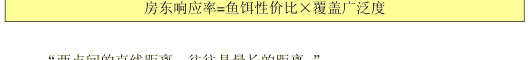

“两点间的直线距离，往往是最长的距离。”

这句带有哲理的名言，也适合你与房东之间。

不要以为房东把自己的电话、手机贴在墙上，你就拥有了大量合作伙伴——他们恰恰是最难相处的人。

因为，他们的耳朵里已经塞满了中介、租客、买家的噪音——不能接纳你所传递信息的人，是无法与你正常沟通的；无论你的方案对他多有有利。

所以，要想让更多房东响应你的方案，与你深入沟通，就必須使用前面介绍的“吸引定律”。让房东主动来找你。

“房东响应公式”刚好指明了方向。

第一，把吸引房东的“鱼饵”设计得有冲击力，而且降低房东获取“鱼饵”的“门槛”——比如“免费”。免费的东西，永远有人喜欢；如果“免费”再加上“高价值”，就会让人蜂拥而至。

这是行销的基本法则，也是你必须采取的“快速成交”之道。

第二，越多人知道越好。“钓鱼”跟“销售”一样，都是数字游戏。看到鱼饵的人越多，可能响应的就越多。知名品牌 的商品，往往都是打广告最卖力的。

吸引房东也是一样的道理。

所以，我们的学员，有的把“鱼饵”贴在网上论坛；有的放上“博客”；有的直接贴橱窗；有的在小区里散发……

哪种最好呢？

我们建议：全都试试！只要有用，越多越好。

如果你感觉有点辛苦，那么请回答：

你是希望被房东直接拒绝，还是希望有房东主动找上门来？

你是希望等待零首付的机遇，还是希望主动出击、快速成交？

所以，要提高房东的响应数量，就必须增加“鱼饵”的价值，再最大限度的宣传鱼饵。

## 所有权获取公式

该公式可以用于解释，在什么情况下可以获得所有权。

| 所有权获取公式 |
| :--- |
| 所有权比例 = 支付金额 ÷ 房产交易价格 × 保障强度 |

你可能会问：所有权只有“有”和“没有”两种状态，怎么能换算成百分比呢？


所有权的确无法换算成百分比，但“获得所有权”是有“没有”、“获得购入的期权”、“有”三种状态的，“比例”只是一种形象化的说明工具，用来揭示以下重要推论：

- 所有权状态与你支付的金额成正比；
- 所有权状态与你所给予的保障强度成正比。

这两个推论所代表的，实际上就是常见的交易过程。

正常情况下，要求房东将房产过户给你，你是必须支付全款的；因为房东与你之间并不存在特殊的关系，房产交易缺乏其他的措施来保障。

如果你可以另一处等值房产做抵押，那么房东就会相信你的未来还款能力，所以，就愿意先过户给你，你分期支付购房款。这种情况下，就是因为有足够的保障。

再退一步，如果你无法提供其他的还款保障，但也有购房的诚意，那房东就不愿意先过户给你，再等你分期付款；相反，他更希望你以先分期付款，等付清价款之后才过户。

“所有权获取公式”对于“零首付”有非常重要的意义，它深刻的揭示了双赢交易的本质特征——即在“产权”这一核心交易对象上，双方各让一步！

由于是“零首付”，你没有申请任何贷款、借款来付清全款；所以，房东不会过户房产给你。

但由于你可以提供一定的“保障”——即“期权费”——所以，房东愿意给你一些让步，即给予“购房期权”。使你获得“购房控制权”。

因此，“超级零首付”的特征之一，就是通过“购房期权”这一手段，实现了双方的妥协——买家不必支付首付款，房东不必过户产权。

相反，如果你的确想一步到位的获得产权，却又想“零首付”，那么就必须向房东提供足够的保障。

比如，常见的“实物抵押”、“第三人担保”等。

但是，大多数普通百姓是无法提供让房东满意的保障条件的，所以“购房期权”就成了最好的选择。

“所有权比例”公式告诉我们，追求“所有权”是必须付出“高额支付”与“高强度保障”的代价的；所以，要想避免以上两项的开销，就必须借助“期权”取代“所有权”的概念。

## 成交速度公式

该公式是所有公式里最重要的一个，它解释了为什么“头脑聪明”的买家反而成交速度更慢。

成交速度 = 努力程度 ÷ 思维复杂程度

我们指导的学员群体里，有一种很特别的现象——越是头脑简单、精力集中、社会经验少的学员，成交速度越快，成交量越大；相反的，越是思维复杂、聪明灵巧、工作经验多的学员，越是成交速度慢，成交量小。

这一点看上去不可思议，但细细品来，却别有深意。

“手表定理”告诉我们：“带两只手表也未必能告诉你更准确的时间。”

拥有两只或者两只以上的手表并不能告诉你更准确的时间，它只会让你失去对准确时间的信息。当前前提是这两只表时间不一样。

手表定理常应用于企业管理之中：对一个企业，不能同时采用两种不同的管理方法，不能同时设置两个不同的目标，否则将使这个企业无所适从；一个人不能同时选择两种不同的价值观，否则，他的行为将陷于混乱；一个人不能由两个以上的人来指挥，否则将使这个人无所适从。

在房地产投资中更是如此，我们目睹过太多的聪明人，总在寻找快速成功的捷径，总在不断的尝试“新”的手段；却不知道，最好的往往已经在他们手中。

所以，你想真正的“快速成功”，就要“一以贯之”——“超级零首付”一定可以帮你！你只要坚定地按步实执行即可获得期望的结果。

相反，如果三心二意、见异思迁，总想寻找更短、更快的捷径，却反而会疲于奔命、一无所获。

这种人在往往吃尽苦头之后，才想起最初的选择是最好的。“超级零首付”就是你目前最好的选择——除非你想把我们所走过的弯路再“温习”一遍。

切记！你有一只手表，就够了。

以上是“超级零首付”快速成交的四大公式，“交易成功率公式”告诉你为什么“零首付”合作对象无处不在；“房东响应公式”介绍如何吸引大量房东与你主动沟通；“所有权获取公式”解释了你为什么不能奢求直接获取“产权”。

最重要的“成功速度公式”提醒你，不要自作聪明的发挥创造：先简单模仿，才能二次创新——这是一切后进者成功之道。

# 六、 小结

正确的思想，是正确行动的先导。

即使你无法立即理解所有的原理，也要深深地记在脑海里：每当你在实际操作中碰到难解之题时，这些原理往往都可以帮你“解惑”。

根据“控制法则”，你应该明白“拥有”不等于“买入”，获得对“使用”及“购买”的权利即可：正因为不必先“买入”，所以你可以“延期支付”，实现“零首付”就“入住”房产。也因为没有“买入”，所以，实现了跟产权相关的“风险转嫁”。

而从房东角度来看，最为常见的心理就是租与售的“两难”、对高收益的“图利”预期和交易风险的“厌恶”。只要你以同时满足这三种心理，就能发现大量的投资机会；所以，具备“零首付”合作潜力的房东是非常“丰饶”的。

那么，如何找到这样的房东呢？首先要破除传统的“推销”观念，借助吸引定律，把房东“钓”出来。再利用“信任定律”，把沟通的核心放在取得房东的信任上来；最后使用“简洁”的交易方案及合同文本，快速完成交易。

最后，我们介绍了快速成交的四大公式。它们可以帮助你在迷惑的时候找到“症结”，认清方向。

# 工欲善其事，必先砺风行

在这些知识的基础上，从后面开始，我们将详细论述“超级零首付”的投资技巧。将向你展示，我们是如何应用前面介绍的14大原理，从而“最简单、最快速的零首付买房”。

# 第二章 超级零首付快速入门


首付最起码证明一个人具有“储蓄”的习惯，具有基本的财务能力——即所谓的“信用评级”。

股票市场牛市冲天，指数不断刷新纪录，你为什么不把所有的财产都变卖去买股票呢？

由主动的“推”，改为被动的“吸”，于是简单而快速地破除了“拒绝”的障碍。把处在“信息包围”中的客户自动吸引过来。

# 一、 借案例速览“超级零首付”

科研者的任务，是把简单的问题变复杂；教育者的任务，是把复杂的问题变简单。

作为“零首付”的先行者与教育者，我们把复杂的机理浓缩为简明的步骤，以便普通人也可以“即插即用”。

请仔细阅读以下案例，这将是您未来行动的样本。

## 一个精彩的超级零首付案例

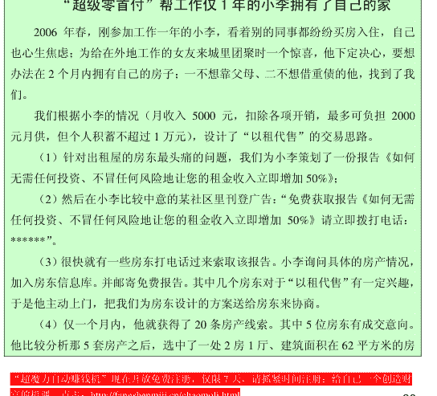

改房，市价 30 万。房东为赵先生。

（5）小李与赵先生签订合同，规定小李在此房产里入住 3 年，每个月支付1800 元（同类房产市场平均租金 1200 元）的名义租金，其中 800 元为“购房期权费”，相当于预付定金，可以用来抵扣 3 年后买房时的价款。另 1000 元作为租金；双方同时约定 3 年后买房时，房价为 33 万。税费各付 50%。3 年里，如果小李放弃买房，则赵先生不退回期权费及房租。3 年里赵先生也不能转售该房给其他人，否则将赔偿小李 2 倍的期权费。

这样小李相当于每个月支出 800 元就锁定价值 30 万的房产，3 年时间里，都不用再担心房价上涨、租金上涨之类的问题了。而且月供在能力范围以内，对个人负担并不重——更关键的是，他以“零首付”的方式在 30 天内拥有了自己的家。

看出这种交易的巧妙之处了吗？我们为小李设计的交易有什么“隐藏”的神奇吗？为什么要这样安排呢？

其实，这是一次成功的双赢交易，“超级零首付”使用的核心方案，就是“以租代售”：一种在西方社会经历 30 余年考验的交易方案。

因为这种结合“租”、“售”特点的处理方法，实际上是非常巧妙的融资手段。它似租非租，似售非售，继承了二者的优点，剔除了二者的缺陷：成交便利，涉及资金少，协议条款精减。更重要的是，这种方案设计中，房东无风险，有实利；买家低压力，有保障。一举双赢。

## “超级零首付”数据分析

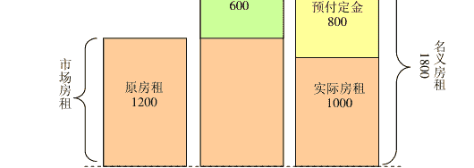

| 项目 | 金额 |
| :--- | :--- |
| 市场房租 | 1200 |
| 原房租 | 1200 |
| 新增房租 | 600 |
| 预付定金 | 800 |
| 实际房租 | 1000 |
| 名义房租 | 1800 |

我们通过上图2-1 来观察一下“以租代售”操作中，“租金”的组成变化情况。

看到这点租金的变化了吗？

就是这一点变化，导致赵先生的租金每月租金立即增加50%，三年后总收益增加约 50%。

请看表 2-1，从房东角度来看“收益计算”：

### 表 2-1 “超级零首付”模式房东收益计算表

| 项目 | 数值 |
| :--- | :--- |
| 该投资为普通出租的收益的倍数 | 1.44 ~ 1.60 |
| 房屋市场价值 | ￥300,000.00 |
| 房屋交易放款 | ￥330,000.00 |
| 定金 | 0.00% |
| 定金实际金额 | ￥0.00 |
| 租售年限 | 3 |
| 租房押金 | ￥1,000.00 |
| 实际首付合计 | ￥1,000.00 |
| 市场平均租金 | ￥1,200.00 |
| 每月实际租金 | ￥1,000.00 |
| 每月预付金 | ￥800.00 |
| 每月买家支付总额 | ￥1,800.00 |
| 到期后租金总收益 | ￥36,000.00 |
| 到期后预付金合计（不包括押金） | ￥28,800.00 |
| 到期后收益合计 | ￥64,800.00 |
| 加上首付后收益合计 | ￥64,800.00 |
| 扣除预付金后房款 (扣除租房押金与定金) | ￥297,200.00 |

| 收益比较表 |
| :--- |
| ①买家最后购买，房东收益合计 | ￥82,000.00 |
| 房东实际总现金收入 | ￥362,000.00 |
| 收益率(假设若干年内房价不变) | 20.67% |
| ②买家最后不买，房东收益合计 | ￥64,800.00 |
| 房东实际总现金收入 | ￥64,800.00 |
| 收益率(假设若干年内房价不变) | 21.60% |
| ③普通出租收益合计 | ￥43,200.00 |
| 收益率 | 14.40% |

由上表可知，房东的收益率最终增加到 20.67%~21.60%，远超过最初普通出租方式下的 14.40%。

上表的数据我们将在后面详细分析介绍。

房东的收益，也可以直观的表现为下图 2-2。

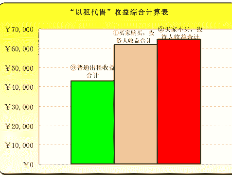


## 一、“超级零首付”案例分析

对买家小李来说，这是一宗非常划算的交易。请看下表，里面有非常详细的分析与介绍。

表 2-2 “超级零首付”租买者支付项目分析表

| 项目 | 金额/数值 |
| :--- | :--- |
| 3年共节省租金 | 7200元 |

**以租代替计算表（给租买者）**

| 项目 | 比例/说明 | 金额/数值 |
| :--- | :--- | :--- |
| 房屋交易价款 | | ￥300,000.00 |
| 定金 | 0.00% | 0.00 |
| 定金实际金额 | | ￥0.00 |
| 租售年限 | | 3年 |
| 租房押金 | | ￥4,000.00 |
| 实际首付合计 | | ￥4,000.00 |
| 市场平均租金 | | ￥1,200.00 |
| 每月实际租金 | | ￥1,000.00 |
| 每月预付金 | | ￥800.00 |
| 每月买家支付总额 | | ￥1,800.00 |
| 到期后租金合计 | | ￥36,000.00 |
| 到期后预付金合计（不包括押金） | | ￥28,800.00 |
| 扣除预付金后需补交房款（扣除租房押金与定金） | | ￥297,200.00 |

由上表可见，小李 3 年后购房时，仅需支付 297,200 元，而其间节省了 7200 元。3 年后的房价由于已经被提前锁定，所以他不必担心可能的市场房价的波动。当然，市场租金的波动也与他无关了。

因此，他的间接收益（克服价格波动影响）也是很可观的。

> “超魔力自动赚钱机”现在开放免费注册，仅限7天，请抓紧时间注册：给自己一个创造财富的机会。点击：http://tangshenmiji.cn/caomoli.html

以上，就是一套“超级零首付”的完整案例。整个过程由多个环环相扣的细节构成，体系完整而简明，对买卖双方的付出与所得都做了巧妙的安排与分配。下面，我们将具体介绍“以租代售”为什么是当前最好的“零首付”选择。

## 二、“以租代售”对买家的 8 大好处

在房地产投资启蒙最早的国家——美国——有一句经典的名言：

> 关于美国最富有的人有一个恒久不变的真理：他们要么靠房地产赚钱，要么用房地产来存钱。
> ——黛安·肯尼迪（注册会计师，战略家）

而那些房地产投资巨匠们，如 Russ Whitney、Peter Conti、Ron LeGrand、Phil Speer 等人，不约而同的选择了“以租代售”来增值他们的财富。

那么，根据前面案例所介绍的“以租代售”方法，究竟有什么特殊的好处，可以满足双方的各自需求，从而达成交易呢？

首先，让我们从买家角度来看。

“以租代售”对那些首付款不够、却又想拥有“自有住房”的买家，具有很强的诱惑力。这种灵活的融资方式，可以解决买家很多现存的困难，同时避免了很多麻烦：

### （1）无需申请银行贷款，无需高额首付

“首付”是很多人买房的痛，很多人坚持若干年的“省吃俭用”，就是为了积蓄首付款，以便可以入住自己的家。尤其是很多刚入职 3~4 年的普通白领，他们可能有稳定的收入，可以支付月供，却由于首付款不够，也无法圆自己的“家园梦”，甚至影响到了结婚生子。

此刻看书的你，很可能就是其中的一员。

那么，在房地产产业，金融机构为买家贷款融资时，为什么一定要求 20% 左右的首付款呢？

其实道理很简单：首付款是一个人财务状况的基本保证。

如果一个人现在都付不起“2 成首付”，你相信他未来还能付不起那么高的房贷吗？首付最起码证明一个人具有“储蓄”的习惯，具有基本的财务能力——即所谓的“信用评级”。

就好比说，你相信一个从来没有上过手术台的医生能安全地给你作手术吗？你相信一个从来没有储蓄习惯的人，信用评级低的人，会按时还贷吗？

对以金融机构为代表的投资人来说，“投资”的第一出发点，应该是“安全”而不是“收益”，否则“投资”就变成了“赌博”。哪个经验老道的投资人，敢“赌”一个付不起“首付”的人将来可以如约还房贷呢？

因此，“零首付”首先就违背了这个“安全”的基本信条——如果“零首付、并过户产权”的话。

2006 年美国房地产市场雪崩，进而引起 2007 年 8 月的美国次级房贷危机³；其影响震撼全球，被人称之为 9·11 后全球最大股灾来临的导火索。

而这次次级房贷危机，就源于一些金融机构将过多的钱，贷给了信用等级较差或偿还能力较弱的房主——他们违约率提高几个百分点，整个国家的金融市场就地震了。

所以，“首付”是一个重要的“信用门槛”，这是金融世界的共识与大量教训的总结。

如果你想通过贷款来买房，就必须支付“首期款”；这是绝对没有变通空间的。

因此，“零首付”的方式，基本上不适合与金融机构合作。“超级零首付”借助“以租代售”的模式，很简单的绕开了这重障碍。

当然，也帮你避免了为了申请贷款所不得不履行的系列繁琐手续与等待。

这种“以租代售”的方式，虽然暂时挂以“租”的外壳，其实质却是“买”为导向。一方面，买家可以及时入住；另一方面，却是真正拥有了“家”的归属感。


这种零首付方式相比于普通房贷首付 20% 来讲，大大降低了“买”的门槛，可以吸引大把“无首付、有月供”的年轻家庭。

### （2）月供不高，资金使用效率更高

随着中国进入新一轮加息周期，房贷利率不断上涨。根据 2007 年 8 月 22 日最新公布的贷款利率，5 年以上贷款利率高达 7.56%。

因此很多情况下，租金都大大低于正常贷款的月供（等额本息或是等额本金）。因此，租金对买家造成的经济压力要小得多。

上例中，虽然“以租代售”的名义租金比市场租金要高出 50%，但由于其中的 800 元（约 44%）可用于最后购买时扣减房价，所以其实实际租金 1000 要比市场租金 1200 要低。

所以，实际上买家付出了较少的租金，而且不用负担高额月供还款。就住到了自己的房子。

否则，我们假设小李决定自己买房，价值 30 万的全新房零首付 2 成，申请 8 成 20 年的房贷。其他的税费、装修等投资暂时不计。

那么小李需要首付 6 万（加上其他开销，实际上要想入住，必需支付 10 万以上）。并且贷款 24 万。

根据最新贷款利率浮动 0.85 倍比例，实际贷款利率最低 6.43%。而每个月需还贷⁴：

> 贷款 24 万，20 年贷期，根据 6.43% 利率，可计算的每月等额本息还款额为：
> =PM T(6.43% / 12, 20 * 12, -240000)
> =1,779.50（元）

以上是使用 EXCEL 软件里的 PM T 公式计算的结果。

即每个月的还款额约为 1780 元。这个数额虽然在小李的能力范围之内，但远远超过了 1000 元的租金开销。

本案例中，小李的名义租金（即每个月的租金加期权费）为 1800 元，看上去与 1780 元的贷款月供差不多；但是，这 1780 元的组成为：

⁴ 在本书配套的“超级零首付”计算工具里，提供了完整的计算分析表格。

> “超强力自助赚钱网”现在正式改名“巨搜”，仅限 7 天。请抓紧时间注册：给自己一个创业财富的机会。点击：http://fang.shenzhou.cn/chaomi.html

以第一个月还款额为分析对象

- 本金：￥493.50
- 利息：￥1,286.00

意味着小李实际归还房贷的本金只有 493.50 元。

而在“以租代售”交易里，小李的名义租金 1800 元中，有 800 元期权费，可以冲抵房价，因此相当于支付了 800 元的购房款。

493.50 比 800。

你现在终于明白，为什么银行能发财，而你会越来越穷了吧？

因为，你支付给银行的钱中（尤其是前面 10 年），基本上都在还“利息”，而不是在还本金（即实际上真正借到的房款）。

1780 元中有 1286 元是还银行的利息——即银行净赚了 1286 元，占 72%。

只有不到 28% 的部分，才是真正用于归还本金。

而你使用“以租代售”时，有 44%（即 800/1800）是用于“还本金”。所以，同样的总支付额（1780 元比 1800 元），其使用效率差距甚远。

由此可见，“以租代售”的资金使用效率明显高过普通的还贷支付。这难道不是对买家的巨大益处吗？

#### （3）预付定金可以起到“强制储蓄”作用

很多缺钱付首期款的年轻人往往不是因为月薪太低，而是因为开销太大。不成熟的消费习惯导致了“月光族”的队伍逐渐庞大。

所以，每个月的“预付定金”800 元的支出，相当于强制这些“月光族”储蓄购房款。800 元对他们的压力不大，却可以在 3 年后购房时积少成多。好像公积金的作用一样，变成对他们未来的一种保障。

你知道刚出来工作的人，与工作 3 年以上的人之间，最大的区别是什么吗？80% 的人会告诉你：是否懂得存钱！

“懂得存钱”是一个人财务认识上成熟的标志。也是我们前面提到的“信用评级”的指向意义。

“你不理财，财不理你！”——你一定经常见到这句话，但你知道这句话的真正含义是什么吗？

> “借贷力自动赚钱机”现在开放免费注册，仅限 7 天，请抓紧时间注册，给自己一个创造财富的机会。点击：http://huanxuehui.cn/c/chaomodi.html

“理”者，“爱惜”也。“钱财”就像美丽的姑娘，你不爱惜她，她当然也不会青睐你。一个对“钱”没有感情的人，当然不会赢得“钱”的尊重。

所以，“强制储蓄”，就是培养对“钱”的感情！增加对“钱”的吸引力。随着你储蓄的增多，你会逐渐看到更多的赚钱机会；“钱”就会很快进入正向增值循环的快车道。否则，“消费习惯”这个魔鬼，就会让你尝尽蜜糖之后，最终死于里面的毒药。

从这个角度来看，“以租代售”是在真正地教你如何从小钱做起，慢慢增加储蓄、逐渐学会理财。

#### （4）免除装修、家具购置等开销，直接进行试住体验

由于是“二手房”，所以买家往往不必再出钱装修，甚至很多情况下，不必再购置大件的家具、家电。这本身就是一种可观的费用节省。

同时，由于具有“不满意可以随时搬走”的条款，买家可以抱着“试住”的轻松心情来体验实际的居住效果。不满意就以较低的代价离开——即失去了前面所交纳的所有款项。但这种成本，也远低于真正购入一间不满意的房产所造成的损失。

体现风险转嫁法则的“以租代售”相当于“先住后买”，充分保障了买家的自身利益，降低了“后悔成本”。

#### （5）心理归属感完全不同

“这房是我租的”和“这房是我自己的”——这代表了两种完全不同的“表达”语境。有过两年以上租房经历的人，绝大部分都会对“租房”有苦难言，对于“买房”则热切期待。

不仅是因为租房的舒适性差，更重要的是没有“归属”感，常常“任其破烂”。“反正也是租的”这种心理会导致租房内部环境的恶性循环。

而“以租代售”则打破了“租”与“买”之间的分水岭，使买家从心理开始“认同”房产——毕竟，这将成为他们未来自己“买入”的家。

所以，“这房是我自己的”将导致买家愿意认真维护房屋，甚至花心思布置、整理。

此外，家庭生活很大程度上与房产相关；所以，心理有归属感的房产会对家庭和睦产生不可忽视的影响。

### （6）巧设期限，绕开 5 年高税规定

国家为限制炒房行为，制定了“二手房五年内交易要交 20% 营业税”的规定。这条规定实际上也是买家的陷阱——因为房东往往会将这些 20% 的税负转移到买家身上；动辄几万的税费，哪个买家不心痛呢？

“以租代售”往往可以帮助买家躲过“5 年”限制，买卖双方可以根据“5 年”时期范围来制订合同生效期，避开 20% 的税负——单单这一项，就可以帮买家省下相当于几年的租金！

省下的就是赚到的，难道不算买家的另一项收益吗？

### （7）提前锁定房价，不为房价上涨犯愁！

近年来，全国范围内，房价涨声一片。根据人们普遍的预期，未来 5 年里房价都只会长、不会降；但与此同时，工资却难以水涨船高。哪个普通的工薪阶层能摆脱“人民币变相贬值”的焦虑呢？

所以，“以租代售”恰恰给了买家这样的“保障”——合同期内，价格锁定——买家不用再担心房价的变动，只要在 3~5 年内筹集到首付款即可。这难道不是对买家最大、最明显、最直接的好处吗？

### （8）即使自己最终不买，也可以做为投资，未来通过转让期权赢利

在房东同意的情况下，买家可以获得转让“购买期权”的权利。即使未来不想购买此房，也可以转售此“购买期权”，从而获得一些转让费收益。

比如，3 年后，小李发现了更好的房产，不愿意买入赵先生的房产。而此时，该房屋市场价值为 33 万。那么，小李就可以向有意购买此屋之人转让“购买期权”。

> “超能力自动赚钱机”现在开放免费注册，仅限 7 天，请抓紧时间注册：给自己一个创造财富的机会。点击：http://fang.shenmici.cn/chaonili.html

330,000 - 297,200 = 32,800

而三年中小李共计支出的期权费为：28,800元（即800×12×3）。

也就是说，小李通过转让期权，净收益为：

32,800 - 28,800 = 4,000

看明白没有？

小李相当于三年之间不但以较低的租金（1000元/月）住到了该房屋里面（市场租金三年内平均水平一定超过了1200元/月），而且还净赚了4000元。

这一条才是“超级零首付”最大的魅力之处。

如果市场房价变动超过33万，而小李赢利会更多；即使房价没有变动，仍是30万，小李还可以获得一些补偿，即：

300,000 - 297,200 = 2,800

虽然2800元不算多，但房价在3年之内一成不变的可能性非常低；所以，小李最终的转让收益会远超过这个数字。

这种转让是基于“期权合同”的转让，在后文之中会有相关的说明。

实际上很多投资者，本身就是靠转让期权来获取收益的。期权是一种非常高效的房地产投资工具，“超级零首付收入流特训营”将详细介绍“期权”的应用策略，有兴趣的读者，可以查阅本书最后附带的“超级零首付收入流特训营”简介。

本节分析了“超级零首付”的核心——以租代售——对普通买房人的8大好处，随着你开展实践，你会逐渐印证这些内容。

那么，看起来“以租代售”对买家有那么多的好处；卖家本身也不“傻”，他们为什么会支持这种方案呢？

因为，“以租代售”会带给他们更大、更明显的利益，而风险极小。

## 三、真正双赢的交易——“以租代售”对房东的4大益处

对房东来说，无论是收益、灵活性、风险控制等方面来看，“以租代售”的好处都是显而易见的。

### （1）无需投资就可以获得高收益

由于采取了“锁定未来房价”的方案，房东可以立即把现在的交易房价（市场价）提升10%作为未来交易价，同时租金提升50%。

本案例中，赵先生的房产现在的市场价格为30万。而双方签约锁定的3年后房价为33万，立即提升了10%。

同时，租金由1200元，提升至1800元（名义租金）——这是直接、立即看得见的好处。对房东的“即时激励”效果非常突出。

很多有心的房东，都希望可以多收租金，但往往受房产状况所限，即使采取装修、增配等手段，也常常效果不彰。

但这种“以租代售”的方案，根本无需房东投入任何的资产、现金，只要签定一份简单的期权合同，就马上增收50%——天底下还有比这更容易赚钱的办法吗？

所以，房东的收益快速、显著的效果极其具有吸引力的。并且，这种方案，虽说是有“买”的因素，但并不需要在就考虑具体的过户事宜，节省了大量的手续与协商问题。

### （2）锁定稳定的好租客，管理更省心

哪个房东不希望可以获取轻松、简单的出租交易呢？哪个房东又喜欢一年换一个租客，每次都费力粉刷、装修呢？

此外，为什么很多房东宁可自己通过网站来发布出租信息，也不愿意找中介呢？一则是因为不想给中介赚钱，二则是因为一个重要原因。

> “招商力自动赚钱机”现在正免费发布注册，名额7天，请您抓紧时间注册，给自己一个创造财富的机会。点击：http://tangshenliu.6cchaoshouli.html


中介阵营是利益导向的，只要有人租房，中介基本都愿意推荐给房东——巴不得快点把房产介绍出去，好赚自己的中介费。因此，中介对租客的身份查验是很不“上心”的——但这方面恰恰是房东最担心的问题。

房东自己招租，就可以花心思来过滤身份不明的租客，以便减少未来的隐患。但这常常要靠房东自己的“慧眼”，然而具备“慧眼”的又有几人？

所以，几乎每一个房东都听说过“恐怖”故事：某某房东的租客是个“坏人”，出租中发生过某某坏事……

然而，“以租代售”一步到位，一劳永逸地帮房东解决了这个隐患。

由于买家是有诚意要购买的租客，所以才愿意长期住在房屋里。房东的“一纸租约”直接锁定了一个“3年期”的租客。很长一段时间里，都无需他再去为“招租”烦恼。

同时，这类“租客”会把它当成自己的家一样来爱护。因为他们是“买”为目的来“租”的，所以，绝不会像对待其他出租房一样“粗心”。他们会帮房东把“家”收拾得干净整洁。让房东省心省力。

此外，租客为这间房子交纳了大额的“定金”，如果因为“拖延”而损失前面的金钱，他们会有“很高的痛苦指数”！所以，租客会更加积极的交纳房租，保证“购买”时的“房款抵扣优惠”。

直接找到长租的好租客、按时交租、管理省心。“以租代售”难道不是聪明房东的最优选择吗？

### （3）充分的法律保障

整个“以租代售”交易，是基于两份合同开展的：一份是“租赁”合同，一份是“期权合同”。之所以要分开，是因为它们各自的性质及法律关系是不一样的。后文会有详细的介绍。

在本案例中，3年的“以租代售”期间，房东并不需要转让房产产权给“租客”，双方只是普通的“租赁”关系。3年后，“租客”必须补足房款，才可以获得产权。

所以，房东无需担忧房产产权风险。

对交易双方，都有坚实的保障——任何一方毁约，都要承担相应的违约责任。

对任何一方都有巨大的限制机制。

如果买家中途放弃，则会失去所有已经缴纳的款项（包括定金、预付房款、实际租金等）。如果买家 5 年到期时，无力出资购房，也会失去所有的已交款项（除了 2 个月的押金租金要退还外）——所以，房东是有充分的利益保障的。

相反，如果房东违约，在 5 年期内希望转卖给第三方时，就需要赔偿 2 倍买家已交的“预付定金”——这就是对买家的保障。

“以租代售”对交易双方都形成了有坚实法律保障的高效机制，保证了双方利益的最大化协调。

### （4）为自己的房产价值买保险

如果将来房价上涨，房东不是吃亏了吗？

正相反，“以租代售”对房东最大的好处，恰恰就是“为房产价值上保险，但保险费由买家支付。”

上例中，我们假设赵先生的房产 2 年后上涨到 36 万。我们由配套计算表“房东毁约的成本收益分析表”可知：

- 毁约成本：38,400 元
- 毁约时房价底线：￥338,400.00

即 2 年后只要房价在 338,400 元以上，毁约就有钱可赚。而房价可转售 36 万，意味着，即使毁约，这 2 年也可以多赚到 21,600 元。

你可能会想，如果赵先生没有和小李签定“以租代售”的合同，那不就可以赚更多钱了吗？

这个问题问得好，但可惜，它很可能只是个“水中的月亮”。

关键在于，上面这个“2 年后涨到 36 万”的假设，可能性有多高呢？

人人都知道，买彩票会中 2000 万大奖，但投资不过几块钱；你为什么不辞掉工作、去天天买彩票呢？

期货买卖可以“1 万当 100 百万用”，有可能迅速暴富，为什么你不去炒期货呢？

股票市场牛市冲天，指数不断刷新纪录，你为什么不把所有的财产都变卖去买股票呢？

44


## 关键的问题就在于“风险”

有涨就有跌，这是所有人都明白的常识。所以，在考虑风险的前提下，人们才会考虑投资。

但大多数人又容易“头脑发热”，总以为“上帝站在自己这边”；总以为自己可以“不受常识所约束”，总以为“到了自己发财的时候”。

所以，普通人常常在投资中高估收益、低估风险，表现为“傻根”式的乐观主义。可惜，“傻根”在现实中往往与“倒霉”相伴。

这也就是为什么大多数投资项目中，赚钱的永远是少数！

因为只有少数人是头脑清醒的现实主义者，他们知道赚钱绝不可能靠运气，他们知道只有充分的考虑风险，给了自己足够的保障，才有可能获得成功。

运气今天是你的天使，明天就可能是你的魔鬼。

现在中国银行加息、紧缩房贷，你知道为什么吗？

识大者也明白，这是由于房价上涨过快，进而引起通货膨胀等问题。中央政府与房地产开发商之间的博弈，你说哪方面的胜算大呢？

房价涨得越高，也就跌得越狠。这种泡沫早就在上个世纪90年代的海南、北海、香港以及今天的美国，都在不断地重复上演。

只是现在谁都无法预言中国大陆的房地产泡沫什么时候破裂。

但是，凡是违背百姓收入水平这一基本价值标尺的房价，都会最终回归。偏离得越多，回归得越低，就像弹簧一样——股市已经无数次回到了这样的片段，为什么总有少数人以为自己“可以违背自然规律”的幸运儿呢？

任何行业都一样，赚钱靠的是知识与经验，靠的是对自然规律的遵守，此之谓“和谐”，即人道与天道的共振相融——这个天道，叫做“富贵稳中求”。

90%的房东都以为自己可以靠房地产赚钱，可惜90%的房东最终一无所获。因为他们不了解房地产市场的价值规律；所谓“无知者无畏”，所以才敢奢望超越“天道”！

你认为自己可以靠跑步的速度“飞向太空”吗？

你不能，房东当然也不能。

所以，如果房东真的希望所拥有的房产成为自己优良的“投资”的话，就必须做好首要的工作——为房产价值“买保险”。

但是，现在哪个保险公司能提供这个保险？哪个保险公司敢担保房产“只升不跌”？

保险公司的核心人才叫“精算师”——就是“算得比谁都精的大师”——他们经过大量复杂的数据搜索、整理、推算之后，才会推出一个险种，无论寿险，还是财险，都可以叫做“基本没风险”。

所以，任何人都知道，房地产市场是个有风险的地方，但又有几个人知道该如何为自己买保险呢？

赵先生无疑是一个真正的聪明房东，他在我们理财师指导下，很快就明白了“以租代售”对他最大的好处——就是为“房产买了33万元的保险”。

房产未来可能涨幅超过33万，但也可能没有超过33万，甚至下跌——根本无法准确的预测。与其费尽心思的盘算“涨跌的可能性”，不如一次性的买了保险。

正因为有了“33万元的保单”，所以，他才可以借平常心来把房产当长线投资处理。日常的琐事已经转嫁给小李，房价的升跌也与自己无关。

房价升幅超过33万，他也不羡慕；因为他明白“便宜莫贪”的道理。

房价未来没到33万，他更不用担心：因为他有“33万的保单”。

聪明的房东，与头脑简单的房东之间，最大的区别就是：是否为自己的房产价值买了保险。

以上就是经过我们改造后的“以租代售”交易对房东的四大利益。当我们介绍这种方案给众多房东时，你能猜到他们第一句话是什么吗？

## 房东对“以租代售”的认同

> “天底下有这么傻的买家吗？”

呵呵，你觉得，是买家“傻”吗？

如果买家不“傻”，那么，是房东“傻”吗？

如果买卖双方从自己的角度看，都觉得对方是傻瓜，而自己是“赢家”；那么，任何人都可以看得出：这就是一个真正成功的交易。

“超级零首付”正是这样，把“以租代售”进行了适应国情的改造，使之符合了买卖双方的利益，共筑真正的双赢合作。

好的交易方案，仅是成功的一小部分；《超级零首付》不是告诉你一个方案，而是打造一个完整的体系。

下面，让我们开始解剖前面案例的详细步骤，了解它运作的每个环节。

## 四、超级零首付 5 大流程浅析

聪明的你，看明白前面小李零首付案例的整个过程了吗？

无论你是否能完全理解，都请不要反驳。整个 5 步流程，看似简单，实则环环相扣，步步推进。每一个环节都是经过精雕细琢的“艺术品”。

请重读一遍上面的案例，结合第一章所介绍的 14 条规律，你会把小李的操作过程看得更加真切。

整个“超级零首付”体系就是基于这样的思路构建起来的。看上去简单，实则包含了众多的理念与操作工具。

案例中，你看见的仅是冰山浮出水面的一角：真正有价值的，是你看不见的部分。

下面就让我们剖开这个案例的外壳，看看其内在奥秘。

请看下图，它概括了前面案例的主要操作流程。

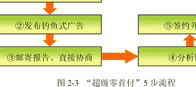

“超级零首付”去芜存菁，把各种投资手段整合为上面的 5 步流程。无论你是哪种学历，只要具备小学的算术基础，只要能读会写，就可以明白这 5 步的道理：就可以解开“零首付”的天书。

房东与普通的消费者一样，他们购买的动机，往往不是商品；而是针对自己问题的解决方案。免费报告正是投其所需的“解决方案”。

只要报告写得好，就很容易引起房东的共鸣，从而快速确立他对“零首付方案”的兴趣与信任。后文将告诉你一种非常实效的免费报告写作方法，并提供一份报告样本，以供参考。

“解决方案”再冠以“免费”之名，就可以快速进入他们的思维中。人们对于有价值的东西，都会趋之若鹜：将方案包装成“免费大礼”，就可以极大降低房东的抗拒。

当然，“免费报告”是要“送”的，但“送”也是一门学问：你会对街头的“打折机票”广告单感冒吗？很多人都需要打折机票，但是那些推销员“送”的方式有问题。

正确的方法就是“钓鱼式广告”。

### 撰写免费报告

### 发布钓鱼式广告

以免费报告作为诱饵，通过适当的媒体渠道发布为免费报告所做的广告：广告内容简单而有冲击力，快速吸引有需求的房东，促使他们打电话与你联系咨询详情——这就是钓鱼式广告的操作思路。

这里应用了行销世界里的新兴技巧——许可营销。

#### 许可营销

获得潜在客户的许可，发送有价值的资料，潜移默化地培养信任关系并教育客户，最终达成销售，并维持终身关系。

许可行销最早由美国的营销鬼才 Seth Godin 在《Permission Marketing》一书进行了完整的阐述。由于其突破性的创新性 及有效性，因而在世界范围内得到了快速的传播。

其核心思维，就是破除了以往“推”式的广告思路，不再使用“陌生拜访”或“陌生电话”等“干扰式”的宣传方法；而是确认一种对潜在客户极有吸引力的免费资源，为其做广告，从而“吸引”客户主动与商家联系。


由主动的“推”，改为被动的“吸”，于是简单而快速地破除了“拒绝”的障碍。把处在“信息包围”中的客户自动吸纳进来。

### 邮寄报告、直接协商

如果你的报告写得一针见血、非常有煽动性的话，就可以激起很多房东的兴趣。你可以通知电子邮箱发送，也可以邮寄纸质稿，具体情况针对房东的要求。

房东看完报告后，会陆续的与你联络。此时，你不能仅仅依赖电话沟通，而应该尽量约定时间上门面谈——顺便看看房产状况。

面谈过程中，主要是了解房东的情况、搜集必要的信息。便于为有意向的房东设计交易方案——当然，更是为自己的“零首付”设计符合自己利益的方案。

这个过程比较简单，基本上二、三次面谈即可搞定。

### 分析比较

获得多处房东的交易认可之后，你必须根据自己的情况来筛选一处较好的房产及交易方案。

由于你发布广告之前，就已经选定了某些社区。所以房产配备、相关环境应该大同小异。只是房产年限、景观、户型、面积及支付方式等，存在差异。

打开我们提供的数据计算工具，你可以把承担的数据计算出来，比较相对最适合目前要求的一处房产。尤其是交易方案里的月付款及未来房价等数据，必须要你在经济能力之内，否则将来你会骑虎难下。

关于数据的分析与确定，我们后文会详细的分析与推荐。

### 签约并入住

选定合适的房产及交易方案后，就可以与房东正式签约了。这类合同是一种比较特殊的“双重组合”合同，由“租赁合同”和“期权合同”二个合同文本组成。

其中租赁合同与普通合同文本一样，除年限较长外，其他没有什么区别。

期权合同才是重中之重，它要涵盖很多关键的数据与交易信息。但同时又必须简洁易懂，否则会影响成交时机。

我们也在附录里提供了相关的合同样本。你可以直接参考使用。而且，后文会有合同内容的详细分析。

签定合同之后，如果房东的房产原来有租客入住，你可能还需要与房东协商，补偿该租客一些费用，然后才能自己入住。

最后，就是开始享受自己的家庭生活啦！

# 第二章 超级零首付快速入门

## 即学即用的超级工具箱

我们之所以说“超级零首付”是简单的技术，是因为我们已经把最复杂的环节都封装成了一个实用而成熟的工具，你只要根据我们的要求，一步步使用配套的工具，就可以快速找到你的“Dream House”。

请仔细浏览表2-3，寻找每一步所对应的工具。

**表2-3 “超级零首付”所需的超级工具箱**

| 步骤 | 我们所提供的配套工具 |
| :--- | :--- |
| ①撰写免费报告 | 免费报告样本 |
| ②发布钓鱼式广告 | 钓鱼式广告样本 |
| ③邮寄报告、直接协商 | 面谈话术标准问句 |
| ④分析比较 | 数据计算表 |
| ⑤签约并入住 | 租赁合同及期权合同样本 |

在你实践中所经历的每一步，都有所必需的工具“整装待发”。本书价值的80%都在于这些工具——“超级零首付”的思路也许不难想到。但要搜集、整理、完善这些实用工具，却绝对不是简单的任务。

如果你自己摸索，将不得不付出十倍、百倍的代价；但是有了这本书，以及我们团队的指导，你就可以一帆风顺地从出租房，搬到自己的家——这不是奇迹，这是知识的效力。

相反，如果你自己去从头开始准备这些工具，而能在短时间内毫无拒绝地与房东成交，那才是奇迹！

这些工具在本书里都有提供，真正做到“一书在手，百事无忧”。

## 五、 小结

因此，我们敢断言：你所投资的，是一套非常完整的解决方案；它已经考虑到了你实际操作中可能遇到的种种所需。

> 假舆马者，非利足也，而致千里；假舟楫者，非能水也，而绝江河。君子生非异也，善假于物也。
> ——荀子《劝学》

本书后文将以“超级零首付”为坐标，告诉你这段名言的含义。

“超级零首付”是很多成功经验的总结，随着你对它了解的深入，你会愈发认同“双赢”在成功交易中的意义。

在本章中，我们引述了一个简化过的“超级零首付”案例，说明了“以租代售”是如何被加工及提炼成“双赢”合作的。

对你——普通买家——而言，“以租代售”可以让你无需贷款、无需首付、免除装修直接入住，每个月的支付仅比租金高一些，却立即获得“购买权利”，即实际上的房屋控制权。在较小风险的情况下，就获得了“家”的空间。

同时，较长的交易年限，又可以绕开 5 年的高税期。甚至即使最后自己放弃购买，也可以通过转让“期权”来弥补自己的定金支出。

哪种“零首付”能同时享受这么多的好处呢？

而对卖家而言，也是“一劳永逸”。既保证了出租的高收益，又可以锁定长期、稳定的好租客。借助完备的法律合同，使房东的利益得到了充分的保障。当然，最重要的，为房产价值买了保险。

这种真正“双赢”的交易实施起来，并不很难，只需你按照我们规定的“动作”去执行即可。依次履行完“超级零首付”的 5 大步骤，很快就会见到自己的收益。

以上就是“入门”的知识内容，仅能帮你简单了解“超级零首付”的操作框架。而真正有价值的信息，从下章开始。

让我们一起来探讨“超级零首付”的奥秘。

# 第三章 超级零首付中级进阶

这个世界上最不缺的客户，就是“想多赚钱的房东”！

我在通过“布施”而“销售”！你还能想出比这更为强力的销售方式吗？

推销与营销的区别就是：推销是“你要求顾客购买”；营销是“顾客主动要求购买”。

关系就是生产力，信任就是硬道理。

你现在已经理解了“超级零首付”的基本流程框架，现在就让我们开始探索它的具体细节。

## 一、刺痛房东的针

“以租代售”就相当于是一块黄金，但针对不同的人，必须随需变化。对于珠宝商而言，有的顾客需要戒指；所以，就要把黄金打造成“金戒指”，来吸引他的目光。

有的人需要项链，就要把黄金做成“金项链”，然后卖给他。

同理，“以租代售”的卖点、利益点非常之多，但要房东“购买”这个点子，往往需要一个“理由”——那就是房东最需要解决的问题。

“以租代售”利益点中哪一点最能打动他？把这一点找出来,就是你的责任。因此，要送“解药”给房东，必须先知道“痛在何处”：

- 是什么让房东焦虑难安？
- 是什么让房东担惊受怕？
- 是什么让房东愁眉苦脸？
- 是什么让房东热盼你半夜打来的电话？

......

在我们的博客里（http://lingshoufu.cn/blog/）谈到“零首付买房”话题时，经常听到网友抱怨：“总说好的投资机会在于‘急售的房东’，但‘急售的房东’一般都需要一次付现。那该如何寻找‘不要求现金的急售房东’呢？”

呵呵，多么可爱的问题呀！

这实际上是全世界性的难题。

我们在前边已经分析过，即使在房地产投资启蒙较早的美国，100 个房东里符合这种条件的也不过才 1、2 个。

在中国当然也是如此。比例更是不到 1%。

这是房东的错吗？

当然不是，这是买房人的错！

明明存在大量的远超过 1% 的通用需求，你不去挖掘；非要找什么“急售不要现金的房东”，这不是明摆着自讨苦吃嘛？

忘掉什么“急售的房东”吧，这个迷惑人的“术语”让多少买房人穷于奔命却一无所获！

把“房东”的需求重新定位，你将发现这个世界突然之间变得机会无限。

你能赚到钱，是因为你为别人提供了房产？或是你帮别人卖出了房产？或是帮别人出租了房产？

错！

任何行业，任何人，成功的秘密，或者说“赚钱的秘密”。都可浓缩为一句话：帮助别人解决了问题！

这个问题，就是出租屋的房东真正的需求。

他的需求不是租出了房产，也不是卖出了房产——他的目的，就是一个字：“钱”！

“如何多赚钱？如何无风险地多赚钱？如何无需任何投资地、不冒任何风险地多赚钱……”

把你的目标市场重新定位在“房东的赚钱需求”上，你立即就发现了全新的“零首付”大陆——这是一片广阔的蓝色海洋！没有鲨鱼与猎手，只有丰饶的美食。

所以，你所最需要花费精力的，就是设计一个主题，可以浓缩为一句话的主题。让这句话一针见血，刺到房东的痛处。让他们看到这个“主题”就立即从心里产生共鸣，从椅子里跳起来。急切想给你打电话，发自内心地渴望了解具体的信息，渴望找到自己问题的解决方案。

设计这个“刺痛房东的针”，没有什么捷径。你必须不断尝试，不断分析，不断优化。反复测试。随着你的“金针”不断优化，你的吸引力会越来越高，“点击率”（咨询率）也会越来越高。这是一切美妙历程的开始。

当然，这首先需要你对房东群体的深刻了解。

你如果自己做过房东，就一定会深有感触。以下的问题，都是房东所最头痛的“刺针”：

1. 租客是坏人怎么办？
2. 租客破坏房屋设置及电器怎么办？
3. 租客不按时交租怎么办？
4. 租客半夜带不良女子回来怎么办？
5. 租客组织传销怎么办？

如果，你让房东自主发现你的“解决上述”问题的信息，并免费得到你的帮助。那么，他就会相应地给你“回报”。

好的“刺针”定位，是“超级零首付”的开始：找到了房东的“心动按钮”，还远远不够。你必须采取更巧妙的手段“按”动它。

## 二、 永远不会被拒绝的销售

重新定位目标市场之后，就要针对这个目标市场设计“吸引战略”。

我们在前面已经反复强调了，人们需要的不是产品，人们需要的是解决自己问题的方案。

由此出发，我们就要提供房东需要的方案，借着“免费”的大旗，把他们从人海里“钓”上来。

“钓”是一门非常有深刻意义的学问，绝非你想象的那样简单。请看下面的摘录，会给你新的思考。

### 隐性销售与互惠定律

#### 布施其实就是隐性的销售

*(摘自《历史上最伟大的赚钱秘密》)*¹

而销售本身呢——实际情况是，只要你在“卖”什么东西，你就肯定会遇到阻力。即使你是 Zig Ziglar（畅销书作家和天才演说家）也不行，因为 Zig Ziglar 也不能保证所有的销售都能 100%的成交。

但如果你是在给出（布施）东西呢？你会遇到多少阻力？

零!不!没有!

你不仅不会遇到任何阻力，人们还可能会蜂拥而至，张开双臂来抢夺你的礼品。只要你给出（布施）东西，人们就会情不自禁的喜欢你，认为你是一个好人。

当我开始我的写作生涯的时候，我选择了“免费”写作。我在我的“免费”服务上倾注了10,000%的精力。

我是否给大家留下了很深的印象？毋庸置疑。大家喜欢我吗？怎能不呢！我完全免费的提供一切。

当我的“免费”客户，用我为他们写的广告文章（他们未付一分钱），获得一个持久利润的时候，他们会对我有什么样的感觉呢？

如果我对他们的要求，只是要他们为我的服务写一个“推荐书”，你想他们会写一个什么样的推荐书呢？

他们会不会不愿意写一个强烈推荐的文章？

他们会不会愿意为我介绍更多的客户？

这些推荐书大大提升了我的信誉吗？我的“布施服务”真的起作用了吗？我想是的。

人们蜂拥而至，请我为他们写销售广告。

重申：表面看来，我将自己作为一个“广告文案写者”布施出去。把这句话重新表述一下：我将自己作为一个“广告文案写者”卖了出去。美国广告学家克拉德·霍普金斯(Claude Hopkins)说过：“销售任何东西的最好方法，就是给出一份免费的样品！”

我在通过“布施”而“销售”！你还能想出比这更为强力的销售方式吗？我想不能。

布施背后最为强大的动因之一，就是“互惠定律”。人性的本质使你在接受“免费”布施的同时，你希望给出一些东西作为回馈。

Hare Krishna（哈瑞-奎师那教派，印度教的一支）的教士们懂得这一点，所以他们走到信徒们面前，在他们的上衣口袋里插上一只鲜花，就会收到可观的奉献。

好好想想这件事。当你处于同样的情形的时候，你也会感到有一种压力，让你觉得你有义务进行回报。

……

最初，大约是在1994年，我注意到，我曾经送给他们一大盒子Godiva巧克力作为致谢礼物的那些客户，经他们介绍来的新客户数量，要比其他人多得


### 超级智

多。接受过我的巧克力的客户，比没有接受过我的美味礼物的客户，介绍的过来人要多出 40% 以上。实际上，早年在我的“巧克力行动”之前，我的大部分客户压根不会给我介绍任何新客户——我还要说，这种情况在当时是很正常的事情。

一天，在又接到一大群经介绍而来的新客户后，我决定将我的“布施”行动进一步深化。老实说，刚开始时，这纯粹是出于利己的目的。但我被这种布施与获得直接的强大的因果关系所震撼了。那时，我开始认识到，在这一切的背后，布施的神秘而强大的力量在运作，而这正是需要我进一步学习和了解的。

我第一次清醒地认识到，在伟大的生命构架中，我们所获得的奖赏，直接与我们为他人所创造的价值成比例。我以前就已经听说过，富裕的秘密，在于为他人创造巨大的财富。但是，根据我的最新经验，我热切地发现，“布施定律”才是真正加速财富之流的黄金水道。

不久，我将自己的目标暗定为“让任何一个遇到我的人都认为我是一个价值创造者”。我的目的是成为一个富足的源泉。你看，我有一个灵感：如果我更多的通过布施他人的需求打开我的心灵之门，必将导致受施者为我为打开他们的心灵之门。

因此，对布施法则的实践，首先就会导致他人对你的开放，而这正是建立良好关系的强力先驱——不论是用于商务、个人关系还是其他方面。

你的礼物，作为你自身的一部分，伸展出去，成为你和受施者之间强力关系的纽带。

向他人赠与价值的这种行为，会给接受者施加一种正向的超自然影响力——只要这位受施者能够理解并尊重您的礼物的价值。

在我将“布施法则”作为自己的生活哲学身体力行以后不久，我开始注意到，一个不同寻常的“附带现象”的发生。

因为我曾是 Joe Vitale 的“催眠意识法则”的学生，我将自己的发现命名为“催眠互换现象”。这种现象表明“布施”的结果是一种人的显意识“雷达”难以侦测到、从而也难以引起通常的“拒绝反应”的微观现象。

更清晰的定义为：

> 当受施者接受我的礼物的时候，他会无意识地立即进入一种对等的心理互换状态。

确实如此。当受施者接受我无条件的礼赠后，他会立刻像被编了程序的机器人一样，迫切地去寻找一种可以等价地回报我的途径。有时，这可能只是对他们的朋友们宣扬我的“功德”，但更多的，是为我介绍两三个客户。

有时我会联系某人，询问他是否收到了我的礼物。他们的反应往往是非常强烈地表示感谢。每当这种时候，我可以清晰地意识到，我的礼物就像是我种下的种子一样，在适当的时候一定会有丰硕的收获的。

有一个重要的细节我们一定要注意到，那就是：我们所布施的礼物，一定要是对受施者有真正的、可以被对方意识到的价值。

人类行为的精神规律基本上是不随时间而变化的。

这 1900 个字，浓缩了商业哲学的本质规律；结合你自身的工作经历与处世之道，你会领悟更多。

### “超级零首付”不会被拒绝的秘密

“超级零首付”中与房东沟通的核心技巧，都源自于这种“布施”哲学。请你再仔细读一遍上面这段文字，你逐渐会发现，它帮我们解决了以下几个关键问题：

- 如何快速地把陌生人变成对我们有好感的顾客；
- 如何简单地排除顾客对于我们所推销方案的拒绝；
- 如何轻松地赢得顾客对我们的信任；
- 如何容易地从顾客身上取得我们所需要的价值。

上面这段经典的摘抄应该成为你行动的座右铭。

作为一名“零首付买家”，与其说你的“经验”与“智慧”让你成交；不如说，你为房东创造了价值，所以赢得房东的“合作”。

我们现在把“隐性销售及互惠定律”应用在“超级零首付”中，有以下几个基本原则与大家分享：

1. 房东之所以不与你成交，是因为你免费赠送的“智慧”不够多；
2. 任何怀疑的态度都会随着时间而改变，所以你必须无条件地坚持；
3. 你送出的越多，房东“欠”你的就越多；迟早有一天，他们会以百倍的价值奉还；
4. 享受“赠送”的过程，就是在享受富有的人生——因为，只有富有的人，才能慷慨的“赠送”。

随着时间的推移，你会愈发地喜欢上“超级零首付”——因为你在真诚地赠送智慧，真心地帮助房东；所以，你会赢得大量的朋友，赢得大量的信任关系；当然，最终你将赢得大量的“零首付”交易。

很多房地产投资书籍（尤其是国外的书籍）都把“组建投资团队”作为事业的第一步。这是有道理的，因为只有“团队”才能帮你克服惰性，帮你解决疑难。

同样的道理，你所在城市的房东们，难道不是最好的“团队”伙伴吗？房东是最了解房产市场的群体，与他们交朋友，为他们服务——你还用为了“没有市场信息”而犯愁吗？

## 三、超越广告的广告

看了上面的神奇的“布施”，是否你也心有所悟？

那么，是否可以说，赢得“零首付”交易，就意味着不断地付出自己的东西呢？

当然！你必须先付出，才会获得回赠；接着你付出更多，然后获得的回赠越多——于是形成正向增值循环，最终达成“零首付”交易。

但是，任何有形的实物，都会有穷尽；送出去的时候，会有成本制约。比如，你有 100 本书，送给 100 个人之后，你就没有书可送了。

然后，无形的智慧却能越送越多。你把“以租代售”告诉 100 个人，也丝毫不会减少你的“以租代售”专业知识。

所以，你必须向房东赠送你的“智慧”，也就是我们所介绍的“免费报告”。

那么，如何让房东知道我们有“免费报告”送呢？

当然不能坐等。所以，要打广告。

为谁做广告？

在这里，就涉及到了一种超级广告技巧——超越广告的广告。

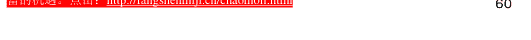

这是一本关于通过邮购赚钱的书籍，作者就是直销天才杰夫·保罗，书名叫《如何穿着内衣坐在厨房里边看每天挣 4000 美元》。看到书名时，我还笑呢，但令人惊奇的是，杰夫真的做到了。这本书的基本内容就是说：他通过在营销过程中加入一点小小的改变，就在邮购界大发横财。

他的做法是：不是将销售函发给从未听说过他的人（在邮购中，销售函就相当于网站点击率）。相反，他做一些非常便宜的小广告，提供有关他正在销售产品的免费报告。获得免费报告的人必须得提供自己的姓名和地址。一旦他获得这些人的姓名和地址，就会将销售函连同一些非常有用的信息寄给他们。

以下是事情朝良好事态发展的关键：杰夫与潜在客户们保持联系。他会按照规定好的顺序继续给他们发送销售函和有价值信息，直到他们购买他的产品为止。

杰夫的行为是与客户之间建立一种关系。因为除了销售函以外，他还给他们提供有价值的信息，他创造了一个大家希望从他那里购买产品的环境。他们从未把杰夫视为推销人员，而把他看作是一位值得信任的顾问。

这听起来很容易，不是吗？但是以下是杰夫·保罗所收到的效果：就是通过这个简单的方法，杰夫的生活从他姐姐的地下室转变为每天在家就能挣 4000 美元。而这些收入都是来自于他那不起眼的邮购业务。从他开始采取这种方法到实现这一目标，不过才花了几个月的时间。

现在你该清楚，为谁做广告了吧？

不错，为你的“免费报告”做广告！

推销与营销的区别就是：推销是“你要求顾客购买”，营销是“顾客主动要求购买”。

二者的区别来源何方呢？

让我们看下图 3-1。

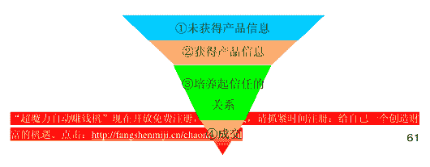

销售的基本流程都是大致一样的，从客户关系角度来看，可以分为以下四类。

- 未获得产品信息的潜在顾客
- 获得产品信息的潜在顾客；
- 建立起信任关系的潜在顾客；
- 成交顾客。

顾客就像漏斗里的沙石，一层一层从顶端下渗：越向下渗，数量就越少，但质量却越高。也就是说，潜在顾客最初是没有购买的：你要促使他们逐渐获得产品信息，并逐渐培养起对产品的信任；随着信任的增强，他们里面的少部分会与你成交。而这些成交顾客里，会有一部分成为你的“终身顾客”，就是持续向你购买。

### 新旧顾客成本

争取一位新顾客所花的成本是留住一位老顾客的 6 倍，而失去一位老顾客的损失，只有争取 10 位新顾客才能弥补回来。

所以，销售的工作，就是：

1. 锁定一片沙滩（市场定位）
2. 吸引最大量的沙石（潜在顾客）；
3. 促使沙石快速向下渗透（培养信任）；
4. 促进成交；

普通的推销者，把工作重心都放在第④阶段上，即希望通过最简单的方法，直接成交，完成销售，拿到钱——但常常事与愿违，越是想赚钱，越是赚不到钱。

所以，要面对大量的失败率。因而，推销者要靠“量大”取胜，即成交率为 100 分之 1 的话，赚钱就要掌握那“分母”做大。

所以，推销者要不断地打电话，不断地上门拜访：不断地重复基础的“说服”工作。

而真正的营销者与之不同，他们把工作重点都放在第③阶段，因为他们明白，

只有这个阶段才是最关键、最耗时间与精力、最能决定成交与否的部分。

所以，“推销者”是在大海里捞小鱼；“营销者”在大海里养大鱼。前者看起来快，却实则慢；后者看起来慢，却将持续发展，越来越快。

因此，“超越广告的广告”实则是营销者的方法。具体表现为“杰夫邮购法”。

你也应该向杰夫学习，做到“他们从未把杰夫视为推销人员，而把他看作是一位值得信任的顾问”。

“信任”二字，就要靠你的“免费报告”来完成。

“超级零首付”所使用的“广告”方法，就是这样。房东如同顾客，有 100 个人看到你的“免费报告的广告”，但也许多只有 10 个人会跟你联系。所以，你的责任，就是通过持续的“免费报告寄送”，构建双方的信赖关系。

随着时间的推移，总会有房东终于动心，与你成交——而这一切，都可以在 30 天之内发生。

“超级零首付”让一切都变简单了。你只要打出广告（通过报纸或网站），每天计算积累到的房东线索数就好了。等线索数量积累到一定程度，一切都会水到渠成。

无需你付出更多的辛苦与努力。大部分工作只要坐在家里打打字，写写信，等着房东的电话。

那么，该如何撰写“免费报告”呢？

## 四、 免费报告的结构与写法

### （1）标题

> 文章的标题是自身的广告

有 70% 的人看过标题，发现没有兴趣之后，就不再看内容了。所以，你应该花大量的时间去拟好标题。

在大多数广告中，标题无疑是最重要的因素：免费报告的标题也是一样。用在广告标题中的两个最具价值的词应该是“免费”和“全新”。

虽然“全新”不能经常被用到，但是如果下功夫“免费”肯定能够被经常用到标题中。

其他能够产生较好效果的词还有：如何做、现在、宣布、推出、就在这里、新上市、一个重要决定、改进、惊人、感动、值得注意、革命性的、令人吃惊的、神奇的或不可思议的、特价、抢购、轻松、简单、强有力、希望、挑战、建议、实情、对比、折扣、赶快、还有……最后机会。

请不要对这些看似陈词滥调的词语不屑一顾，它们确定非常有用！

永远将“利益承诺”融于标题之中。并尽量将这些承诺表述得详细、吸引人且完整。要做到这一点需要用较长的文字描述，从中透露出它的新闻价值、教育意义和信息价值的特色。

同时，想“零首付”的你，很可能没有“玩广告”的经验，但有一点一定要记住：有调查显示大多数带有消极意义的广告标题不会产生什么效果，除非你希望用这些消极的词汇产生出令人不快的结果。

人们总是希望在生活、行为、工作、或者在业务，甚至是彼此的关系网中获得更多的利益、结果、好处、快乐或价值。他们总是希望避免生活中遇到的或持续不断的痛苦、不满、挫折、平庸及不愉快。

同时，要避免使用盲目的标题，如“全国最专业的理财师提供好的建议”……即那类不阅读或听取全文就无法了解内容的标题。因为如果标题不能立即引起潜在房东的注意，房东是不会注意余下的正文内容的。

千万不要忘：能够让标题产生高度影响的首要规则就是“说明好处”。

无法说明好处或使用效果的标题将使整个广告的潜在效果降低 90%，原因很简单，无法为房东带来好处的报告只能遭到被忽视的结果。

报告标题应该表达出一种强烈的承诺，暗示他们立刻或收报告后将得到非常满意的结果。标题就是整个报告的广告。

它必须集中表现“以租代售”的独特卖点（USP）。如果你的独特卖点过于宽泛，那么你可以借鉴以下广告标题的做法：

- 标题不怕长——再没有耐心的人，也会把标题读完。
- 标题就是报告全文中“最大的卖点”
- 标题最好通过疑问句来设置悬念
- 标题里要使用“魔力”词语，比如：立即、马上、安全、无风险。

### （2）正文的基本结构

正文不要求太长，就像一篇小型的新闻报道，让读者可以快速、轻松地读完即可。

正文中，多分段，少搞长段落，那样读起来会累赘。语言尽量少书面化、正规化，像口语一样亲切最好。

多使用小标题，将内容分成不同的段落群，便于读者分成几个部分理解。重点词句要标上特殊的颜色，可以使文字排版不至于太枯燥，也可以引起读者的注意。

正文的基本结构就是“痛苦→悬念→故事→分析→号召”。

#### ①强化痛苦

首先，使用最直接的方式，一针见血地指出房东所面临的麻烦与痛苦。引起房东对这份报告的重视，使之产生“久旱逢甘露”的共鸣。

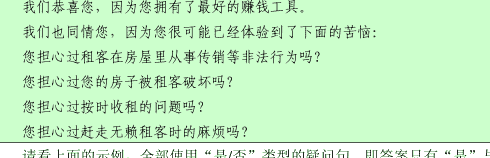

请看上面的示例，全部使用“是/否”类型的疑问句。即答案只有“是”与“否”两种，但房东一定会在心里回答：“是”！

#### ②制造悬念

先不谈具体的解决方法，而是给房东一种“美丽”的预期。告诉他们应用那种方法之后的效果——即解决“痛苦”后的畅快结果。

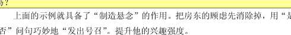

上面的示例就具备了“制造悬念”的作用。把房东的顾虑先消除掉，用“是/否”问句巧妙地“发出号召”，提升他的兴趣强度。

故事是最简单、高效的信息传播载体，最适合广大的普通群众。故事里最好也用上“痛苦—解决—快乐”这种模式，看起来很老套，却往往十分有效。

在故事里，把你要介绍的知识加进去就更为理想。可以大大加深房东对于“以租代售”模式的理解。

> 季姨有一套出租房产，出租 3 年，遇到过 4 个租客。收租、家具保养让她费尽心机。有一次，租客甚至打坏了空调就跑。害得她赔了 2000 多块。想卖房，一时又找不到合适的买家；继续出租，又担心找不到稳定的租客——“出租”二字让她愁愁不止。

上面的示例，只列举几个简单的细节，就增加了故事的真实性与亲切感，让房东读起来，有如身临其境。

那么，你从哪里得到这些故事呢？其实简单得很，只要做下面的事，你立即可以得到一大把这样的“桥段”。

立即到租房最频繁的地段去，找到几个出租房产（这类出租房的小广告无处不在）；以“租房”为名，上门看房。见到房东后，引导她们讲以前的经历——很奇怪的是，房东大多是女性，中、老女性居多；她们最爱唠叨，有讲不完的故事。

你一天之内，多看几处，就能搜集到大量的“创作素材”。然后模仿示例的风格，却发挥创造吧！

艺术是源于生活而高于生活的——当你没有自己亲自操作成功的案例时，像“艺术作品”一样创作是必不可少的环节。

故事不用太长，两百个字即可。关键在于：有生动的细节，有“解决问题”之后的“快乐描写”。

#### ④做分析

分析很重要。帮助房东加深理性认识。分析过程中，多列条目，把道理生动化、简洁化，对于需要计算分析的，可以“一图胜于言”。用有力的数据说明。

这一部分，更需要你对于“以租代售”的深刻理解。对于很多利益点，必须背诵下来，达到“信手拈来、随意发挥”的程度。

所谓“熟能生巧”，当你碰上大量不同关注点的房东时，都能自如的找到对应的“好处”来让人信服。

很多内容（除了示例所列举的以外），还需要你自己增补。随着你接触越来越多的房东，你将发现更多的“利益点”，也将更加增强对于“超级零首付”的信心。

因为“超级零首付”的的确确能够帮助房东获益，是一种真真正正的好“产品”。

#### ⑤发号召

有了以上的内容不够，必须下达隐性的“指令”：即发出号召，让房东尽快与你联系，了解进一步的情况。

号召相对容易，你看看示例即懂。号召必须简洁有力，带有一定的感情色彩，有煽动力。

最后，再重复强调一遍报告所介绍的方案的最大卖点；以强化宣传效果。

免费报告正文的五个部分“痛苦→悬念→故事→分析→号召”就已经简单介绍完了。你不必在每一份报告里，都把五个部分写完整，针对情况，有增加、有删节即可。但一般要把“痛苦→故事→号召”这三个部分写好，因为这是重中之重。

## 五、 钓鱼式广告

钓鱼式广告的原例前文已经介绍过了。它的价值就是把免费报告推荐出去。你只要找到大众化的媒体（包括本地报纸、网站），以较低的成本去做广告即可。如何设计出简洁、高效的广告是一种艺术，需要你大量的实践。下面的示例可供参考。

### （1）成功广告示例

读本报告之前，千万不要出租您的房子
免费获取报告《如何无需任何投资、不冒任何风险地让您的房产租金收入立即增加 50%》。赠送热线 **** 谭老师

“超魔力自动赚钱机”现在开放免费注册，仅限 7 天。请抓紧时间注册，给自己一个创造财富的机会。点击：http://tangshenmiji.cn/chamoli.html

您的房子，有 60% 的可能租给有问题的人！！！

免费报告《如何快速找到让您 100% 满意的租客》帮您解决此问题。赠送热线 **** 谭老师。

需要了解每个出租合同都必须具有的 4 个合法规定吗？

请打电话 **** 免费领取报告。

想知道您出租房产的租金是否被低估了吗？

请拨打电话 **** 免费咨询。

### （2）注意事项

- 标题可写，也可以不写，但读者看到的第一句话，必须是有“魔力”的字眼，可以立即吸引他把广告读完。
- 如果你是“零首付投资者”的话，称呼后一定要使用“*老师”的字样，因为你自己的定位不是推销员，而是“房地产理财师”。所以称呼上一定要体现自己的“专业”地位——无论你本人多么年轻，在“以租代售”领域，你的确可以做房东们的老师。
- 尽量突出“免费”字样。这是所有“魔力”词汇中最神奇的一个。
- 不断测试。要经常测试你的广告的效果，请一些朋友帮忙分析一下是否合适。尤其最好听听房东的声音。

### （3）其他的广告方式

如果，你认为在报纸上做广告太贵了（各地方报纸的分类广告价钱不一，有的贵，有的便宜。），也可以考虑采取其他的广告形式。

“超魔力自动赚钱树”现在开放免费注册，仅限 7 人，请抓紧时间注册，给自己一个创造财富的机会。点击：http://fang.shenmif.cn/chanomoli.html

比如，在小区出入口附近，贴一些海报，挂个横幅。甚至在闹市街头派发传单也行——成本都不高，效果有时却不错。

本书所赠送的“病毒营销”特别报告，将介绍一些更厉害的广告宣传手法。

有兴趣的读者请直接阅读相关内容。

## 六、 发挥你的绝对创意

这里还有一种方法，不一定适合每个人，但用来搜集顾客线索，效果却更直接、快捷、成本更低——即“电话求助法”。

### （1）求助电话示例

比如，你从网上找到一个出租房屋的联系电话（上面最好提供了房屋的准确地址）。

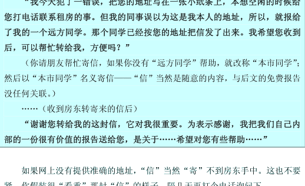

如果网上没有提供准确的地址，“信”当然“寄”不到房东手中。这也不要紧，你假装很“看重”那封“信”的样子，隔几天再打个电话询问下。

三、四次电话沟通之后，你第五次就说：


## （1）电话求助法

“这几天打扰您好几次。真的不好意思。虽然我到现在也没有收到信。不过还是感谢您的帮助。为表示谢意，我把我们自己内部的一份很有价值的报告送给您，是关于……希望对您有些帮助，请问，您的收信地址是……”

这里，我们要强调一下，这种“术”虽然带有一定的“投机取巧”的意味，却体现了“信任关系需要时间培养”的思想。如果你第一次打电话，就直接说：“我有一份免费报告想送给您……”，房东不把你当成“推销保险”的人一样看待才怪，当然不会提供给你具体的收信地址。

所以就需要你转换思维，先通过“求助”打开“沟通之门”，再借助后续的两、三次电话来巩固这种“沟通关系”——最后，就获得了房东的信址，也获得了“寄信的许可”，为后面的持续“洗脑”打通了道路。

你可以使用的“求助借口”有很多，其共同特点是：需要多次后续联系，才**能**解决“获得帮助，解决问题”的情况。

比如：

- “我错把您的号码发给了来城里找我的同学，而那个同学手机突然没电了，我联系不上他；如果他想跟您联系的话，麻烦您……”
- “我错把您的号码发给快递公司的人了，现在又联系不上那个快递公司；如果想跟您联系的话，麻烦您……”

### （2）精确而高效的方法

这种“电话求助法”最大的好处在于：

1. 成本低：比报纸广告等形式要便宜得多。
2. 定位准确：直接定位于你要吸引的潜在顾客，不会浪费你的时间与金钱。
3. 速度快：广告要生效，一般都要几周以上；而这种“求助电话”，一般半个月内，就可以获得几十个顾客线索（即允许你寄信的顾客地址）。

但也有人可能不太喜欢这种方法，因为这种方法要求你主动给陌生的房东打电话——很多人是不太适应这种“陌生沟通”的，会感觉很害羞，不好意思等。

不过不要紧，如果你真的无法克服自己的“害羞”心理，就采取其他的“钓鱼广告”好了。只是那些广告的时间可能长点，速度可能慢点，效率可能低点。

*注：提高力自学赚钱网 现有五成免费注册，仅限 7 天，请务必时间注册：给自己 1 个创造财富的机会 点击：http://tang.shenme.co/chanrwd.html*

### （3）写专业的报告，而不是专业的“广告”

最重要的：成本可能高点。

还有一点，不得不说明：你的钓鱼广告所吸引来的，不仅有房东，还有很多没有价值的咨询电话。所以，你要做好“大浪淘沙”的准备——当然，“电话求助法”就不存在这方面的问题了。

这里有一点要强调的，如果你是采取“电求助法”获得的线索，你的免费报告就需要做出一些修改，把一些很富煽动性的、卖悬念的话都修改为第三人称的**平实**的陈述——目的就是要不让人一看就像“广告”，而不像“专业的报告”。

如果房东收到你的“像广告一样的免费报告”，一定会怀疑你最初打电话的动机，那就事与愿违了。所以，一份“专业”、“客观”的报告，更适合与“电求助法”配合使用。

当然，除了前面介绍的各种方法外，你还可以因地制宜地使用其他的创新。比如，有人印制小名片，挨家挨户地塞进门缝去——这种扫楼式的广告，有时成本、效益也不错。甚至可以直接上门沟通一下。只是可能比较辛苦。

如果你对于“免费报告”还是“没有概念”，那就仔细看看我们网站博客的文章。你可以把里面点击率最高的文章选出来，仔细分析一下：找出其中最吸引的地方，借鉴这些文章的写法，练习撰写自己的“免费报告”——当然，初期你可以直接从我们房神博客里选几篇文章出来，以自己的名义“赠”给房东；但长期这样做是不行的。

### （4）开发你的创意机器

除了“钓鱼广告”与“求助电话”外，你还可以想出更多有创意的方法来与房东沟通。关键在于“开动你的大脑”。

#### 创意机器法

*(摘自《创建你的未来》)*

或许激发自己的超意识、提高洞察力、使大脑中充满创意最有效、最主动的方法就是尝试创意机器法。

许多人都因为使用了这种充满创造力的思维方式而获得了成功。这种方法的确卓有成效，一旦开始使用，你会觉得自己踌躇满志，就好像踏上了加速器一样。每一个使用过这种方法的人都惊讶地发现，他们解决问题的创意会源源不断地冒出来。

这种方法的操作十分简单，这也是它有效的原因之一。下面我向大家介绍如何使用它。首先，拿出一张空白的纸，把自己的目标或者难题以问题的形式写在纸的上方。你的问题要尽可能清晰、具体，这样你才能够专心致志地找出问题的答案。

比如，如果你想在 12 个月之内使自己的薪水增加 25%，而你现在 的年薪是 4 万美元，那么你应该写下这样一个问题：“我怎么才能在 12 个月之内使自己的薪水增加 25%？”

不过，对这个目标更恰当的问题应该是：“我怎么可能在 12 个月之内赚到 5 万美元？”这个问题的答案包含了更多的可能性，它不止包括你现在的工作，还包括了其他的诸多可能性。你所选择的问题决定了答案的质量。你提出的问题越贴切，找到的答案对你就越有帮助。

其次，你把问题写下来以后，要至少写下 20 个答案。这个步骤很重要，你必须写下至少 20 个答案。因为有时候，第 20 个答案往往是最有价值的一个，通常它就是你要寻找的突破点。

在你动笔的时候，刚开始的 3~5 个答案会非常容易**写出**。你能想到诸如此类的简单答案：“工作更努力”，“工作时间更长”或者“参加培训”。

接下来的 5 个答案难度就比较大了，最后的 10 个难度最大。但是你必须坚持到底，直到写出至少 20 个答案为止。

一个参加过我的研讨班的企业家已经被他面临的难题困扰了 6 个月，**如果**再找出解决办法，他就要破产了。出乎意料的是，他写下的第 20 个答案就是他需要的解决办法，他于是立即将它付诸行动。后来他告诉我，这个办法果然奏效了，这挽救了他的事业。

这种“创意机器法”真的是非常有效，我们指导的一个学员在这种方法的引导下，突然想到了另一种有效的开发房东线索的方法：

#### 短信沟通法

小邓尝试过多种方法之后，感觉有点沮丧，因为这些方法都效用不大，**不太**适合自己所在的地区。他选择了“创意机器法”来帮助自己。

在历时 2 个小时，写出 20 个方案之后，最后一个方案立即引来他一阵欢呼：“短信沟通法”。

他首先打开搜房网（http://www.soufun.com/）找到个人出租房源信息，里面本身已经过滤掉了很多中介房源。然后他再打电话过去，询问对方是否为“中介”（很多中介也冒充房东发布个人房源信息）。如果对方说是“房东”，则小邓就把“免费报告”的内容分解成语言片段，通过短信发送过去。

“免费赠送专业报告《如何无需任何投资、不冒任何风险地让您的租金收入立即增加50%？》请拨电话****联系理财师邓老师，分享其他房东的成功案例。”

大多情况下，房东不会立即回复。小邓持续地每隔 2 天就发一条短信，内容多为出租房产的小贴士、小建议等对房东有益的信息，最后附上“邓老师愿意与您分享无风险房租提升方案，免费”。

这种方法不需天天外出奔波，只要持续发短信沟通即可，所以成本不高。效率却不低。不到三天，就有两个房东打电话过来索取免费报告。仅一个月，他就成交了。

如果你真的不知道该怎么做吸引房东的注意，我们建议你采取以下的方法来挖掘灵感：

- 以租客看房的名义找房东上门聊天。你要大量了解房东的平时喜好、获得信息的渠道、经常聚集的地区。了解多了，自然会明白如何发布你的“免费报告”广告了。
- 如果一些社区有活动，要积极参与：比如文化活动、结婚婚礼等。然后扩展你的人脉，向他们请教具体的办法；甚至可以直接请他们转介绍。

当然，最关键的办法，就是测试。你不知道哪种方法最好，所以只能每个都试试。

如果你有“办证广告发布员”那种“无处不贴、再撕再贴、百折不挠、锲而不舍”的精神，根本就不怕找不到房东线索。

## 七、 客户关系的维持与发展

> 关系就是生产力，信任就是硬道理。
> ——房神论道

当你获得房东线索，并发出第一份免费报告后，接下来该如何行动呢？

记住，最关键的是培育信任关系。什么是信任关系呢？

- 相信你的人
- 相信你的专业知识

所以，你必须得耐心，因为信任关系的培育需要时间。你不能太急**躁**求成。

### （1）注意时间周期

有一点要注意：由于房产出租是有一定周期的，不同地方周期会有差异：如果所在地方人口比较集中，外来人口多；那么一周左右就可以租出去（价格略低就更容易出租）。而有些地方，可能一个月以上。不同地区、不同月份，差异很大。你一定要制定自己的“联系计划”。

所以，你一定要打电话给房产中介，询问一下所在地区的房产由空置到入住的平均周期（即多久能找到租客）。如果平均是一个月，那你要集中在这一个月内，与房东进行多次联系，以便在他找到租客之前就搞定。如果平均是一周，那你就不必再寄信了，直接**上门**跟他们面谈。

如果房东已经找到了租客并安排入住了，那你再想“持久战”——其意义也不大了；除非你愿意向该租客支付一些补偿金，好让自己搬进去。

当然，你也可以直接找一些想卖房，却不是“急卖”的人——这类人的共同点，就是“心理犹豫，**不**如卖掉，还是租好”！这样，你就可以慢慢做他们的工作了。

### （2）关系发展组合拳

最主要的沟通方式有三种：

- 信件（包括贺卡）；
- 短信；
- 电话。

你需要做的，就是组合上述三种方式，力求“平稳而坚实”地发展客户关系；切记，可不是“快速地发展关系”哟。

简单来说，就是根据一定的次序，发送事先准备好的跟进信件。并隔一段时间打个问候电话，遇到特殊的节日，发一条祝福的短信。

建议按如下表 3-1 的时间间隔方式准备（时间间隔必须根据你自己的情况确定）：

**表 3-1 持续沟通的方式组合**

| 项目 | 时间间隔 | 用途 |
| :--- | :--- | :--- |
| 信件 | 每半个月一封 | 持续提供有价值的信息，逐渐确立专家地位 |
| 短信 | 不定期（根据节日情况） | 维持双方的友好关系。 |
| 电话 | 每个月一次 | 增进对房东的了解，加强信任关系 |

这里面，信件与短信都是单向的交流（房东只是被动的接受），而电话几乎就是唯一获取房东信息的工具。所以，你必须通过合适的方式来了解房东的情况，并诱导房东与你接洽。

以下介绍一种“好→旧→新”的电话技巧，会对你有所帮助。

### （3）三段式电话技巧

#### ① 问候

打电话第一句，一定是“问候”。这种问候因人而异，主要靠你自己的习惯及与房东的熟悉程度了。如果可以问得风趣、幽默一点，就更好。

#### ② 旧闻

询问一些过去了解到的情况——旧闻。如果这个旧闻与房产相关，就最好。比如：

- “您的那次旅行很顺利吧？”
- “最近很忙吧？”
- “生意是不是比天气还热呀？”
- “小孩还乖吧？”

如果双方仅沟通过几次，还不太熟悉，就要显得更加客气，而且少谈闲事，更要少谈“正事”——听起来很矛盾，是吗？

- 谈闲事，会让房东感觉你在浪费他的时间，不知你想干什么。
- 谈正事（即跟房子相关的事），会让房东感觉你在推销什么，会心生反感。

所以，你最好就是“短、平、快”地打电话。

比如：


#### ③ 新事

打电话的目的，除了培养关系外，还要获得一些新的信息，便于跟踪记录房东的有价值数据。

所以，你一定要提一些关于“最新进展的问题”及“未来期望的事”。

比如：

- “上次听您提起，打算把房子装修一下，现在应该动手了吧……”
- “我记得您说过，想参加什么俱乐部，现在已经开始上课了吧？”

对于房东信息的搜集，要抱着“多多益善”的原则，越多越好。信息越多，对房东的了解越多，你就获得越多的“交流的本钱”；每个人最喜欢的、最关心的都是他/她自己，所以，你提供越多“个性化”的交流，房东越会喜欢你。

*注：注意力自动捕获栏”正在开放免费试用，仅限7天，请抓紧时间注册，给自己一个创造价值、赢得利益的机会。点击：http://fangchengtu.net/channel/1.html*

总而言之，与房东沟通并发展信赖关系，是需要时间与技巧的。随着你经验的增多，你会赢得更多的房东信任。所以，“成交”当然近在咫尺。

## 八、 关于“以租代售”数据的协商

当你与房东沟通一段时间之后，双方已经具备了基本的信任关系。随着房东主动询问“以租代售”相关细节的次数越来越多，你基本就可以判断：房东已经动心了。

这时，主动出击，约房东出来见个面，或者是上门去谈——这是你必不可少的推动业务发展的步骤。

如果房东对于约见的“邀约”没什么兴趣，你就该明白，实际上他还没有完成“信任”阶段。所以，你不用急，只要耐心地等待、持续沟通就好了。

正常情况下，你一个月之内（即使是从一个完全的新手开始）也应该至少获得 3 次约见——所以，第一个月之内成交一单，是完全有可能的。

这时，你必须准备好两样工具：

- “以租代售”收益核算表⁶；
- “期权合同”（附录中有相关的合同样本）。

### “以租代售”收益核算分析

在第二章里，我们以“小李和赵先生”的案例为背景，介绍过“以租代售”的价值及收益，如果你现在还不是很清楚的话，请温习一下相关的部分。

这里，我们以该案例为基础；围绕“收益核算表”，结合实际数据来分析“以租代售”的具体收益。

这部分非常重要，你必须深刻理解、熟练掌握各项数据的计算原理。

在 EXCEL 工具里，黄色区域的内容是可以修改的。

**表 3-2“以租代售”各数据项意义**

> ⁶ 在配套工具里已经提供该表，为 EXCEL 格式。你可以打印出来一份。

### 以租代售计算表

| 项目 | 数值 | 说明 |
| :--- | :--- | :--- |
| ① 房屋市场价值 | ￥300,000.00 | 当前的房产市价（更多的表现为房东的心理价位） |
| ② 房屋交易价款 | ￥330,000.00 | 与买家商定的交易价格（一般要比市价高出 10% 左右） |
| ③ 定金 | 0.00% | 一般“以租代售”要交纳一部分定金，为交易价格②的 5% 左右。 |
| ④ 定金实际金额 | ￥0.00 | 由②×③得来 |
| ⑤ 租售年限 | 3 | 即合同有效期，同时也是租期。以 3 年为宜。 |
| ⑥ 租房押金 | ￥4,000.00 | 双方商定的押金。一般两个月租金即可。即为⑩×2 |
| ⑦ 实际首付合计 | ￥16,250.00 | 为④+⑥ |
| ⑧ 市场平均租金 | ￥1,200.00 | 为市场同类房产的平均值。也可以看作该房产的过去租金额。 |
| ⑨ 每月实际租金 | ￥1,000.00 | 为约定的数值 |
| ⑩ 每月预付金 | ￥800.00 | 为⑩-⑨，每个月扣除的买房定金（以期收费） |
| ⑪ 每月买家支付总额 | ￥1,800.00 | 计算方法为⑨×1.3（系数可 1.2-1.5） |
| ⑫ 到期后租金总收益 | ￥36,000.00 | 计算方法为⑨×⑤×12 |
| ⑬ 到期后预付金合计（不包括押金） | ￥28,800.00 | 计算方法为⑩×⑤×12 |
| ⑭ 到期后收益合计 | ￥64,800.00 | 计算方法为⑫+⑬ |
| ⑮ 加上首付后收益合计 | ￥64,800.00 | 计算方法为⑭+⑦ |
| ⑯ 扣除租房押金后房款（扣除租房押金与定金） | ￥297,200.00 | 计算方法为②-④-⑥-⑩ |

### 收益比较表

| 项目 | 数值 | 说明 |
| :--- | :--- | :--- |
| ⑰ 买家最后购买，房东收益合计 | ￥62,000.00 | 计算方法为⑭+⑮-① |
| ⑱ 收益率（假设若干年内房价未变） | 20.67% | 计算方法为⑰÷① |
| ⑲ 买家最后不买，房东收益合计 | ￥64,800.00 | 即⑭ |
| ⑳ 收益率（假设若干年内房价未变） | 21.60% | 计算方法为⑲÷① |
| （21）普通出租收益合计 | ￥43,200.00 | 计算方法为⑧×⑤×12 |
| （22）收益率 | 14.40% | 计算方法为（21）÷① |

在理解每项数据含义的过程中，可能有一些关键数据还不是很清楚，我们下面强调一些重要数据的计算分析方法。

### 关键数据分析

#### （1）关于“每月实际支付总额”（即名义租金）

**表 3-3 租金项目分析**

| 项目 | 数值 |
| :--- | :--- |
| ⑧ 市场平均租金 | ￥1, 200. 00 |
| ⑨ 每月实际租金 | ￥1, 000. 00 |
| ⑩ 每月预付金 | ￥800. 00 |
| ⑳ 每月买家支付总额 | ￥1, 800. 00 |

在租金项目中，一般都是先确定名义租金，然后再确定实际租金，最后用两者的差额，确定预付金。

比如，本案例中，已知市场平均租金为 1200 元。那么，根据增幅 50% 的比例，可以计算出名义租金为：1800 元。

即：$1200 \times 150\% = 1800$

实际租金当然要比市场租金低才有意义，而低的幅度，一般为增幅金额的 1/3。即本例中，实际租金为：

$1200 - 600 \div 3 = 1000$

如果增幅为 800 元，使用名义租金达到 2000 元，则实际租金为：

$1200 - 800 \div 3 = 933 \sim 950$

当然，具体数值，还要双方协商而定，但基本上使尾数达到 50、100 这个整数**会**可能方便些。

实际租金确定后，取名义租金与实际租金之间的差额即可获得“预付金”数额。本例中的“预付金”为：

$1800 - 1000 = 800$

#### （2）收益率计算

收益率计算分两种情况，一种情况是买家最后购买此房产。

此时的收益率为，房东的总收益（包括 3 年之内的实际租金之和，以及扣除预付定金后的应付房款）除以该房签约时的市场实际价格。

本例中，购买时的收益率为：

$(64,800 + 297,200 - 300,000) \div 300,000 = 20.67\%$

另一种情况下，是买家最后放弃购买。

此时的总收益，即为这几年的名义租金之和。

而收益率即为，总收益除以最初房产价值。

本例中，不购买时的收益率为：

$64,800 \div 300,000 = 21.6\%$

所以，无论是买家最后购买与否，房东的收益率，其实都比普通出租要高 50% 左右。

这也正是“以租代售”对房东的吸引力所在。

实际操作中，你会发现，对于收益的关注，是房东不约而同的选择。你必须熟练掌握这些数据的来龙去脉，才能真正地证明给房东看：“以租代售”对他们的好处。

切记，数字是浓缩的真理。用数字说话，应该成为你的最有力武器。

## 九、 小结

本章是“超级零首付”教材的核心章节，介绍从房东需求分析到数据核算的方方面面。

其中重点需要强化的是：

- 交易吸引房东的第一步，一定是对房东需求的分析与应用。即找到所谓的“刺痛房东的针”。
- 其次，要围绕这些问题所在，设计你的免费报告。免费报告中字数要求不多，体现出基本的五大结构即可。
- 然后，寻找合适的方式来发布“免费报告的广告”，吸引房东主动与你联系，索要报告——此时，你就可以借机来了解房东及房产的状况。
- 接下来，要与房东持续沟通，来逐步建立互信的关系。可以结合信件、短信、电话的方式。以争取面谈的机会。
- 当然，在房东与你面谈前，你一定要做好相关的准备。尤其是要分析好相关的数据。计算出来自己可以接受的名义租金，并安排好对房东有吸引力的收益方案。

总之，所谓“上兵伐谋”，你一定要多动脑，多分析。在实践中不断总结经验，了解房东的需求，安排双赢的交易。


# 第四章 超级零首付高级技巧


电话里是无法交流更多细节的，所以电话的功能就是为后面的“约见”铺路。

面谈基本上都是围绕“协议”内容的确定而开展的。

一定要明白“租赁关系”与“买卖关系”的差别，应该采取不同的法律文书形式分而治之。

期权与车票的原理一样，但是期权是不能“退票”的。

“超脑力自动赚钱机”现在开放免费注册，仅限 7 天。请抓紧时间注册，给自己一个创造财富的机会。点击：http://tangshenxili.cn/chaonali.html

## 一、陌生电话约见技巧

虽然我们在前面介绍了很多关于“钓鱼式广告”的“吸引行销”方法。但是，对于真正的专业投资者来说，“陌生电话”永远是最快捷、成本最低的方法之一。只要掌握了设计好的“对话脚本”，熟练的投资者可以每天至少赢得好一次约见面谈的机会。

本节介绍一种经过验证的高效“陌生电话”脚本。

### 陌生电话约见技巧

下面的“话术”直接借鉴于“保险”、“培训”等行业的推销技巧，在实践中得到了较好的反馈。

注意：括号里的内容为房东的可能回应；其他的都为我们的话语。

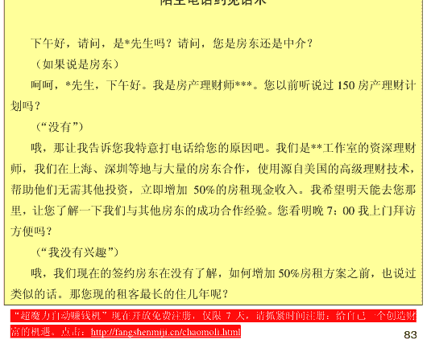

（无论何种回答）

唉，这样。那我们更应该面谈一下，因为与我们合作的房东不但可以保证连续 3 年的租期，而且每个月都可以非常准时的收到 150% 的房租。明天晚 7:00，我上门拜访方便吗？

（如果对方问：“多少钱？”）

就像医生的服务一样，不面谈，我们如何确定您的房产所适合的方案呢？

（对方的其他异议）

哦，这样子。我们大部分的签约客户面谈之前，也有同样的顾虑。顺便问一下，您做过什么房产投资计划吗？

（“有/没有”）

哦，那我们更有必要面谈一下，明天晚 7:00 怎么样？

（“你能否在电话里介绍一下方案？”）

电话里介绍也要几分钟才能说得清。我上门拜访当面向您解释也用不了多长时间，而您就可以更详细地了解情况。所以，您看明天晚 7:00，我上门拜访方便吗？

读出上面的对话，“我”的主要意图了吗？

不错，一切围绕“预约面谈”。

电话里是无法交流更多细节的，所以电话的功能就是为后面的“约见”铺路。无论房东如何回应，都要想办法快速切换到“那我们更有必要面谈一下”上来。这是一切的核心。

### 话术关键分析

1. **不要跟中介浪费时间**
   只有对方开口承认自己是“中介”，你立即回复：“好的，再见。”然后放下电话，再拨新号码。

2. **开门见山吸引注意**
   确认对方不是中介后，不要再问“有没有打扰您呢？”直接就问“您以前听说过**理财计划吗？”
   这时，一定要等候房东的回复才说话，因为此时房东心里一定在想：“这个打电话的人是谁，为什么要打电话过来？我要不要理会他？”所以，他们一定会稍等片刻才回答。
   而不论他们回答“听说过”，还是“没听说过”。都无所谓，因为这代表他们已经愿意听你讲后面的话了。

3. **澄清身份**
   当然，还有一种回答是：“你是中介吧？”此时房东的潜台词是：“我不喜欢中介，不想跟你浪费时间”。
   所以，如果你回答：“我不是中介……”无论你怎样解释，你都输。因为此刻房东根本就不想再跟你“废话”下去了。他们最可能的一句回应你的话就是：“对不起，我对你们的方案不感兴趣。”
   所以，更好的回答就是：“哦，我们很多签约客户在了解具体方案之前，也说过类似的话。我是**工作室的资深理财师，帮助房东无需其他投资，立即增加 50% 的房租租金收入。我希望明天能去您那里，让您了解一下我们与其他房东的成功合作经验。您看明晚 7:00 我上门拜访方便吗？”

4. **“没有兴趣”的应对**
   “没有兴趣”是多数房东使用的“推脱”之辞，你根本不必太在意。只要想办法转移他们的注意力，重新回到“约见”的主题上即可。
   最直接有效的回应就是：
   “哦，我们的签约房东在没有了解如何增加 50% 房租方案之前，也说过类似的话。那您现在的租客最长的住几年呢？”
   这里要注意，不是直接切转回去“明晚 7:00 上门拜访”的疑问，而是采取“提问替代”的方法，来重构对话的基础。
   比如：
   - 你担心过出租给身份不明的人吗？
   - 您听说过 70% 的房东租房后忽视的问题吗？
   - 您知道传销分子现在越来越会隐藏身份来租房吗？
   - 您知道您所在的地区要修一条公路可能会影响地价吗？

   只要你的问题“切中要害”，房东就会被很快被“吸引”过去，忘了“没有兴趣”的前言。

   兴趣点，这时再来邀约就轻而易举：
   “噢，这样。那我们更应该面谈一下，因为与我们合作的房东基本都解决了这个问题。明天晚 7:00，我上门拜访，分享一下他们的方案，方便吗？”

5. **不要给时间选择**
   有些学员在使用这种话术的过程中，常不自觉地把“邀约时间”改成一个时间范围或是“二选一”的选择性问题。
   记住，如果房东想见你，当你所提议的时间方便时，他会直接答应你；如果不方便，他也会告诉你，你再换个时间即可。
   但是，如果他根本对方案没兴趣，你说再多的时间选项也没用。
   你所需要的，就是（1）坚定信念；（2）直接约见；（3）解除抗拒。

   本节所介绍的话术虽然是一种更优的选择，但是使用这种方法获取约见必须注意：
   - 你所在地区的二手房房产信息网站上，比较容易找到真正由房东发布的信息；
   - 经过大量的训练之后，才能提高约见成功率。而初期的成功率一般都较低。

   无论是使用“钓鱼广告”还是“陌生电话”，当与房东成功约见之后，都要使用正确的战略来引导成交。

## 二、房东面谈三步曲

面谈的目的是为了“成交”，而成交的标志是“协议”。所以，面谈基本上都是围绕“协议”内容的确定而展开的。

房东都是消极与被动的。你必须主动引导房东一步步走向“协议”完善与确认。这里，我们设计了“面谈三步曲”来帮你梳理出一套完整的“面谈话术”及思路。

而这些思路都是以“基于行为”的提问来展开的；而不是我们通常所认为的“基于需求”。

如果你直接问：“您有什么需求？”70% 的房东都会回答：“我没有需求。”

大多数人都对现状带有不满意的地方，但不代表这些“不满意”会直接变为“显性需求”。所以，就需要通过提问技巧，把这些“不满意”转变为“具体的需求”。

正所谓“有什么样的提问，就会有什么样的回答。”优秀的提问技巧是促成交易的必要因素。

基本上，面谈都是围绕以下的流程展开。如下图。

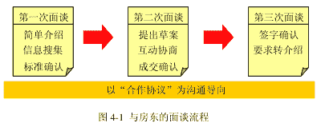

### （一）第一次面谈

与房东第一次见面时，最重要的任务是“尽量搜集房东信息，确认需求标准，为填充合作协议内容做准备”。

无论你使用的是“陌生电话法”，还是“钓鱼式广告法”，与房东简单寒暄问候之后，都要适时进入正题。

先取出笔和笔记本，并将笔记本打开，暗示客户：“我准备好倾听了。”

**1. 简单介绍**

引入正题的时候，无论房东问什么，你都要这样进入话题：

> *先生，在开始前，我能否先向您介绍一下我的情况呢？*

这里要注意，一般情况下，房东会提出一些关于“以租代售”方案的细节问题；甚至直接提出自己的要求。无论他说什么，你都不能于此提供任何形式的解决方案的细节，因为你尚未有任何足够的信息。

所以，简单介绍、快速切入“提问式”话题，是你最好的选择。

> “我是**，我们公司为出租或出售的房东提供增值理财服务。我们在上海、深圳等地已经与大量的房东合作，帮助他们在无风险、无需额外投资的条件下，通过个性化的理财方案设计，将房租立即提升，平均可达 50%。”

切记要简明、亲切，不能夸夸其谈、卖弄图表图片资料。

为什么要使用如此简明的介绍功课呢？
因为，你与房东约见的时候，是以“分享与其他房东的成功合作经验”为借口的；但是你真正的目的是为了收集房东的信息。

如果你是“零首付买房”，就可以这样说：

> “我是**公司的**，有稳定的工作及收入，打算在此地安家落户。经过*房产理财机构的推荐，想通过“以租代售”的方法与您探讨长期租房的事宜。您可以立即增加 50% 的房租收入，我也能找到“家”的感觉。这是双赢的合作，当然首先要了解您的具体情况与要求。”

总之，你的开场白就要简洁明快，简单介绍基本情况之后，就要马上转换为“提问”的状态。

**2. 信息搜集**

首先，使用开放性的问题来进行一般性的“信息背景试探”。

> “*先生，在进一步的沟通之前，我想知道您为什么要出租房产呢？”

（用于了解房东出租房产的理由。）
“您的房子需要还银行贷款吗？”
“现在的房租能够抵上还贷月供吗？”
“您有其他的投资吗？”
“房贷占您家庭收入的百分比有多少呢？”
“看您出租房产很有经验，那您对于以前的租客都很满意吗？”
“三到五年之后，您认为房价可能如何变化呢？”

提出这些问题的目的，是寻找房东的“刺痛点”。

我们反复强调“房东需要的是解决方案”，而解决方案往往要针对一个最核心的问题，集中火力，全力进攻。

不经过一个“泛泛而问”的过程，你怎么知道房东最看重的问题是哪一个呢？

在询问以上问题的过程中，如果有一个问题房东谈了很久，很有兴致，或是语气、语调比较特殊，那往往就意味着“刺痛点”出现了。

只要发现了这个“刺痛点”，后面的“背景试探”提问就都不需要了，直接猛攻下去，挖出房东“刺痛”背后真正的原因，使用“认同型”提问方法。

假如房东突然提到还房贷的苦恼。你就可以继续深入提问：

- “您考虑过一旦收入下降，房贷如何继续支付吗？”
- “还有吗？”
- “你有其他的收入保障吗？”
- “还有吗？”
- “那么，一旦房价下滑，利率上涨；而您的其他收入或投资出现问题，您考虑过房贷风险的问题吗？”

注意最后一个问题“一旦……考虑过……”。这是一个“冲击型”的提问，就是把前面“认同型”的提问，采取“危急放大”的假设方式，来强化问题的严重性，促使房东产生“危机意识”。

“危机意识”会促使房东下定决心来“改变现有的出租方法”。

为什么要使用上面的“提问”方法呢？

看了以下四句“销售世界的名言”，你就会明白：

- **没有问题，就没有交易** —— 交易都是一种解决方案，没有问题，何来“解决”必要呢？所以，销售也好，零首付交易也罢，都必须从房东自身的问题入手。如果你找不到他的问题，你就根本无法把“以租代售”推荐给他。
- **“小问题，不需要交易”** —— 同理，如果房东认为“问题”并不严重，也不会跟你交易。
- **“交易意味着改变，改变带来痛苦”** —— 房东与你合作，本身就是一种“改变”；而人人都是“习惯”的奴隶，对过去方式的改变一定会带来不安与痛苦。所以，与你进行“零首付”交易，房东首先要克服“改变”的痛苦。
- **“要制造更大的痛苦来克制交易带来的痛苦”** —— 综合以上可知，你必须找到房东的问题，并强化其危急程度，从而促使房东忘记“改变”的痛苦。这样才能真正产生“改变”的动力，并最终达成交易。

所以，前面的“提问”归根结底就是 8 个字：“找到问题，强化痛苦”。

**3. 标准确认**

发现“刺痛点”之后，就要确认房东是否“下定决心要改变现状，解决问题”。

请仔细分析以下的封闭式提问。

- “您希望房租可以提升，用于弥补房贷开销，实现‘以租养贷’，是吗？”
- “您希望可以保证三年后的房地产交易市场变动不影响您的房产价值，是吗？”
- “您希望可以减少出租的麻烦，找到长租期、爱护房产设施、准时交房租的租客，是吗？”

这些提问非常重要。在对话过程里，绝不能省略。因为这实际上是在取得房东的“解决问题”公开承诺。

因为这些提问，都是针对前面房东提供的信息，所以房东一般很难说“不”。而房东只要肯定的回答：“是”。那实际上就是你借房东的嘴，对房东下达了“暗示性的指令”，即房东公开承诺：“要解决这些问题，希望得到解决问题的方案。”

接下来，就要询问“解决问题的标准”。

> “您选择租客的标准是什么呢？”
> “出租及收租金过程中，有哪些环节让您感觉比较麻烦？”
> “您的租金是如何定价的呢？”
> “房租提高 30%，就是说增加到***元，您可以满意吗？”
> “您希望每个月都可以按时收到租金，并且至少连续收几年呢？”
> “如果有人想购买您的房产，您希望的交易价格是多少呢？”

以上的问题中，最后一个最关键。如果房东回答：“没想过要出售。”那你就要接着问：“如果是以高于现价 10% 的金额出售呢？”

如果房东还是说：“不会考虑！”

那你就要问问自己：是否非常在意这处房产，是否愿意再花时间去跟“没有卖房诚意”的房东协商。

如果你非常看重这处房产，真的希望未来把它买下来。那你可以参考本章后面的内容，那里提供了另一种解决方案。

> “如果方案可以满足您的要求，您期望何时开始执行呢？”

如果其他问题都没有障碍，那么，上面这个问题就成为“最后一击”。

它询问的是“成交的时间”，也是迫使房东再次做出具体的承诺。如果你不问的话，房东很可能一味拖延交易，最终不了了之。

> “很感谢您今天提供了大量的信息，我将根据您要求的方案来设计方案。请问，您后天晚上 7:00 方便吗？”

还有一点千万要铭记的是，必须约定好下次见面的时间。否则你还要再重新约定何时见面，那就是隐性的时间浪费与拖延。

### （二）第二次面谈

第二次面谈与第一次的最大区别在于，你此时要拿出一份合作草案，内容要根据第一次面谈所记录的信息来撰写。这份草案里，你尽量不要提出“新”的交易内容，以避免引起不必要的房东抗拒。

你把这份合作草案交给房东，并要求他当面协商与修改。

> **合作草案**
>
> 甲方：
> 乙方：
> 1、甲方与乙方达成“以租代售”的合作。
> 2、双方从**时开始，到**时截止。
> 3、双方确认的租赁期为***，租金为：***
> 4、如果*年后，乙方决定购买，则交易房价为***
> ……

你就使用上面的格式，把第一次面谈的内容简单的列示出来，请房东直接确认或修改。

房东此时可能会提出一些新的想法，你直接在草案上面修改或补充在后面即可。如果有一些条款是你不能接受的，你可以提出一个“重要性比较”的问题，来巧妙的绕开那些条款。

假如房东提出月租金要 1800 元，而你最多能承受的租金为 1600 元，此时，你可以拿另一个房东可能看重的因素来比较，诱导房东做出向你“妥协”的承诺。

> “您出租时一定综合考虑过很多因素，假如稳定而品行可靠的租客对您比较重要的话，那么如果现在较长的稳定租期与较高租金没有办法协调一致的话，您认为较长租期，还是较高租金比较重要呢？”

上面这种提问，运用了“条件预设”、“重要性比较”、“假设”等多种技巧。你反复琢磨就会发现这个问句的巧妙。看上去是个“选择式提问”，实际上，却是个“只有唯一答案的提问”，即房东只能回答：“较长租期”。

当然，这种话术使用得好就会“事半功倍”；但如果使用不熟练，很可能会引起房东的反感——因为有一定的“诱导”成分。

第二次面谈的最后，也一定要追问一句：

> “如果方案可以满足您的要求，您期望何时开始执行呢？”

因为这是要求房东再次承诺“成交与否”。如果房东真心想与你成交，则他会说个具体的时间；相反，如果他内心还犹豫不决，就可能再次拖延，不给出具体的时间表。

无论如何，你都要再次确认下次面谈的时间。如果顺利的话，第三次面谈就可以“签字成交”了。

以上主要是以“零首付买家”为对象的面谈话术。如果你主要是以“零首付投资者”的身份去，那么面谈起来会更加简单。在我们的“超级零首付收入流特训营”里会有更加详细的介绍。

与房东面谈的成果，就是“以租代售”的合同，下面我们就详细分析这种威力十足的法律武器。

## 三、“租赁合同”——未雨绸缪之策

### 区别法律属性的双重合同

“以租代售”是一种特殊的“组合式交易”，它包括了“房产租赁”与“购买期权”的双重属性——而这两种属性在法律上具备较大差异。

作为“零首付”买房人，一定要明白“租赁关系”与“买卖关系”的差别，应该采取不同的法律文书形式分而治之。

合同的标题必须注明该合同的“属性”，而这对于合同内容的法律关系界定具有一定意义。标题为“房屋租赁权合同”的合同，与标题为“购买期权合同”的合同，在争议处理时会有较大差别。

因此，为同时表述清楚“租赁”与“期权”这两种交易性质，你必须与房东分别签订“租赁协议”与“购买期权协议”两份合同；这两份合同共同组成“以租代售”的交易协议[^1]。

采取两份合同的组合，还有一个更大的好处隐含其中，请仔细学习这部分内容。

[^1]: 合同与协议是同一概念，协议是人们一种习惯上的叫法，类似的提法还有契约，如房契、地契。实践中，合同可以以不同的名称出现，如合同，合同书，协议，协议书，备忘录，关键是看其内容。

### 重要的租赁条款

合理的“租赁合同”，可以减少“入住风险”，以及未来可能出现的问题。因而，所涉及的内容基本上都要围绕“费用结算”、“房屋入住”展开。

下面让我们逐条分析（方框里的内容为条款示例）：

#### 费用结算

乙方在租赁期限内，支付给甲方的租金中已包含物业管理及公用分摊费用，乙方不再另行支付甲方此项费用，如物业管理公司需另行收取其他费用，则由甲方承担。

乙方在租赁期限内，使用的水、电及电话费的结算，以物业管理公司的单据为准，由乙方直接交付物业管理公司。

所有费用不能让房东留尾巴，一定要在入住前让他结算清楚。

#### 租金交纳

该房屋每天每平方米建筑面积的租金（包括物业管理及公用分摊费用）为____，月租金总计为人民币____元（大写__________________），该房屋租金___年内不变。

乙方必须在每月____日前支付当月租金。逾期支付，每逾期一天，则乙方需按月租金的____%支付滞纳金。

与房东约定租金交纳的具体日期时，一定要预留下几天的时间缓冲，以便于自己的资金流转。

#### 修缮责任

该房屋的维修责任除双方在本合同和本合同补充条款中约定的以外，均由甲方负责。甲方应定期对房屋和设施进行维修、保养。

对于一般租赁而言，基本上很快就可以入住；但对于很多以卖房为目的的房东而言，他们往往还没有做到立即搬出去的准备。所以，你在合同条款里，要跟跟他们约定好，签订合同时，交一半定金；当他们搬走并将钥匙交给你时，你才交另一半定金，以促使他们尽快把房产空出来，达到自己希望的状态。

同时，投资者应该在取到钥匙时对房产进行仔细检查，确保房产状况不影响正常生活，否则就立即要求房东维护。而不能把这种维修责任转嫁给自己。

#### 重新装修

*“超强力自动赚钱链”现在开放免费注册，仅限 7 天。请抓紧时间注册：给自己一个创造财富的机会。点击：http://fangxuehui.cn/chaonwl.html*


# 第四章 超级零首付高级技巧

除房屋内已有装修和设施外，乙方如要求重新装修或变更原有设施的，应事先征得甲方的书面同意。并按规定向有关部门（包括该房屋物业管理机构）办理申报手续后，方可进行。经甲方同意的装修，乙方在租赁期满或退租时可不恢复原状。其余部分，租赁期满，根据原书面约定，要求恢复原状的，乙方必须恢复原状；乙方拆除添置的设备时，不得损坏房屋结构，经验收认可，方可办理退租手续。没有书面约定的，以乙方交还甲方房屋时状态为准。

关于房屋的“装修条款”是较容易引起争议的地方。因为“租赁期间”的房屋产权并没有转移给投资者，所以房东往往不愿意让别人随意改动自己房屋的装修。

因此，建议你在做一些装修改动前，要征求房东的同意。当然一些简单家用设施的添置并不需要通知房东。但是你“粉刷墙面”、“吊顶”、“加隔间”等工作就需要与房东达成一致。

只要你的装修是增加房产价值，而且对于房屋结构没有太大影响的，一般房东不会拒绝——反正对他也是好事一件。

而且作为“试用性质”的话，你也没必要对房产进行大规模的装修投资：这种工作往往费时费力，而且风险较高。

### 转租权利

乙方在占有使用期间有权对房屋出租。对乙方经营房屋所获得的利益，甲方无权主张。

此外，如果你“零首付”的目的包含“转租赢利”的话，“转租权利”是一定要争取到的，这一点不容争议。如果房东不同意你的要求的话，那你就需要使用其他“更好的建议”来解除房东的疑惑。

### 登记备案

本合同自甲、乙双方签署之日起的 15 天内，甲方应负责代表双方当事人按有关规定，向____市、区（县）房地产交易管理部门办理登记。

本合同经登记、取得《房屋租赁证》后，方可生效。本合同生效后，凡变更、终止本合同的，甲方应负责代表双方当事人在本合同变更、终止之日起的 15 天内，向原登记机关办理变更、终止登记手续。

为避免以后的麻烦，在签订租赁合同之后，尽快去登记备案。现在很多城市对于出租屋的管理都非常谨慎——很多治安管理严格的地区，都会对出租屋经常检查。

这样也便于当房东违约反悔时，留作重要的法律依据：

- 房东要为房产办理《租赁证》；
- 租赁合同要备案。

此外，如果你是转租给别人，也一定要记得把转租的那份合同也拿去备案。即使需要交纳一些相关的租赁税费，也是应该的——这毕竟是对未来的一种保障。

除上面强调的内容外，“以租代售”交易中，“租赁合同”与普通的租房合同都大同小异。本书附录里有相关的合同样本，可以直接参考。

而在法律保障中，最关键的就是下面将讲到的“期权合同”。

## 四、“期权协议”——“零首付买房”的魔术盒

通过前面的学习，相信你已经认识到了“期权合同”是“以租代售”交易的核心工具与保障。

那么你一定很希望了解“期权”是什么，以及“期权协议”的秘密。下面我们就一起来探索这个 99% 的人都不了解的法律武器。

由于这里涉及了一些法律专业术语，所以请你一定要认真地阅读，最好可以参考合同法文本。法律是房地产知识体系的重要环节，值得你花费大量的时间与精力去研究、学习。

我们下文将做简单的“期权”解释，如果你想了解更多，就请查阅相关资料。

### 99%的人不懂的法律术语——“期权”

“期权买卖”本质上是“购买了一种权利”，交易双方签署期权合同以表达这种交易“有效”。

就好像车票一样，买家购买了车票，该车票所标注的座位就“唯一性”地属于买家，或者是持票人；持票人出示车票，就可以占用这个位置。车站不能把“占有”这个座位的票再卖给别人。但是，这个票是有限制时间的，超出这个时间范围，这个票就作废了。

期权与车票的原理一样，但是期权是不能“退票”的，而且过期立即失效。

### 何为“期权”？

期权是一种投资工具，可以用在任何投资领域，如股票、外汇、石油等各种商品。举一个简单例子，您想买一套房，与房产商谈好价钱是 3000 元/平米，并预付了两万元定金，这样就决定只要您想买进，对方必须卖出（义务），买与不买是您的权利。即使房价上涨，房产商也必须卖出；如果房价下跌，您可以不买，大不了定金不要。这就是期权的雏形。

在期权中，3000 元/平米的房价叫做“履约价格”，订金叫做“权利金”，也叫期权费。这里，您是买方，最大损失是订金。至于订金交多少，是 2 万还是 1 万，是你们自己的事，只要双方认可。

### 期权定义

期权，是指某一样东西的买卖权利，具有在某一限定时期内按某一事先约定好的价格买进或卖出某一样东西的权利。这种权利是买进者拥有的一种权利，并非一种义务。

### 期权特点

1. 买方想要获得权利必须向卖方支付一定数量的费用（期权费）。
2. 期权买方取得的权利是在未来的，可以是未来一段时间内任何一天，也可以是未来一段时间内指定的一天。
3. 期权买方在未来买卖该商品的价格是事先规定好的（指履约价格）。
4. 期权买方可以买进该商品（预期该商品能上涨），也可以卖出该商品（预期该商品下跌，以较高的价格卖给对方，对方必须接受，因为您已经付给对方期权费，这是你的权利和他的义务）。
5. 期权买方取得的是买卖的权利，而不负有买进或卖出的义务。买方可以执行权利也可不执行权利，但是卖方在买方要求执行权利时，必须履行相应的义务。

期权买方，指买进期权合约的一方，是支付一定期权费而持有期权者。

期权卖方，指出卖期权合约的一方，从期权买方收取期权费，同时，相应地在买方执行权利时承担履约的义务。

假定房东为 G，投资者为 F。则期权合同的甲方为 G，乙方为 F。G 就是期权的卖家，F 即为期权的买家。搞清楚这两个角色，会对后面的理解有很大帮助。

F 向 G 支付期权费，用于购买“买房的权利”；G 收取期权费，把这种“买房的权利”卖给 F。这种权利是“独占性”的，即在约定的时间范围内，G 不能再把该房产出售给别人，因为“购买权利”已经出售给 F 了。同时，这种“权利”是有时间限制的，过期不“行权”（即“不买房”）即失效。

所以，F 与 G 双方构成债权债务关系，而这种“权”即“在指定的时间范围内，以指定的价格及付款方式，购买指定的房产”的“权利”；F 即“债主”（债权人），G 即“欠债者”（债务人）。

### “期权合同”的突出优点

为什么要使用“购买期权合同”呢？因为它具备无可比拟的好处，是衡量一个投资者水平高低的重要标尺。

简单来讲，它有 3 大好处：

#### （1）便于转让

由于双方是债权债务关系。F 是有权利，无义务；G 是有义务，无权利。所以，从法律规定来看，F 可以不经过 G 同意，而转让该“期权”（债权）给第三方——有点类似于银行出售“不良资产”的做法。当然，最接近“期货买卖”操作。这就为 F 后面的“转让期权赚差价”埋下最有利的伏笔。

#### （2）简易易懂

相对于其他房屋买卖合同，动辄三、四十条，几十页纸的规模；期权协议只要说明关键要点即可，一页纸内 800 字左右即可覆盖全部条款。非常便于同房东的交流及协商。可以帮助投资者快速完成谈判、快速锁定房产。

符合我们的“简洁定律”。

#### （3）投入较低

房屋买卖合同的定金规模基本都在 5000 以上至上万，会对买家造成较大风险与压力；而期权合同则无此弊端。

与“租赁合同”配套，以租金的形式抵扣期权费（相当于定金），一般不会超过市场租金的 2 倍。远低于买房资金的投入，直接降低了投资者的风险，并有效地保障了“低成本”锁定房产价格的目标实现。

### 特殊条款——巧拟语言胜在先

虽然“期权合同”好处明显，但由于在国内房地产投资领域里，很少有人对它熟悉、甚至精通，所以，一定要小心它应用在房地产投资时的特殊条款：

#### （1）转让条款

甲乙双方向任何法定继承人、私人代理和其他第三方所做的协议转让，均可生效，具有法律效力，另一方应无条件配合履行转让后协议。

虽然期权协议在本质上，F 是无需 G 同意即可转让的，但为安全起见，强烈建议加上这句话。

这句话从逻辑上讲，G 与 F 都可以转让本协议。但是实际上，由于 G 是房东（“债务人”），别人是无法以“房东身份”替他履行“期权”义务的，所以 G 是无法转让协议的。

除非 G 死亡，房产由其他人继承。所以，这句话真正的受益者是 F。

作为聪明的投资者，如果你直接表达出自己的“转让”意愿可能引起不必要的麻烦；更巧妙的解决办法是，你可以这样对房东说：

> “如果您出现意外，这句话就可以保障本协议由您的继承人承担履行义务。”

这种解释是合情合理的，房东一般都不会提出异议。小小一句话，就可以帮你开启致富之门。

如果事后房东反悔，而不与新买家签订正式购买合同的话，你直接起诉，要求相应的违约金及赔偿金就好了。

还记得第二章提到过的“对买家的 8 大好处”第 8 条吧？

之所以买家可以在方便的时候转让“期权”，就是因为在这一条上，你给自己留了“后门”。

#### （2）协议展期

支付追加期权费______元后，期权卖主在此赋予期权买主将上述期权展期______的权利。

谁也不能保证你可以在期权期内一定能行权（或是转让给第三方），所以在期权合同中给自己留个“续期”的条款，就至关重要。

#### （3）用租金支付购买款项

《租赁合同》所规定的乙方每月应交租金（包括押金）的__%也作为定金，可用于抵扣购房款项。

这是期权合同的“中央芯片”，因为它规定了你每月所交款中，有多少可以作为房价的“预扣”部分。

同时，由于你未来通过转让期权时，“预扣”部分可以从买家的出价钱“赚回来”，所以，也可以理解为“你的未来转让收益”。

一般操作中，如果房东急于转手房产，你可以与他商量“房租全部用于抵扣房价”；但是这种情况时，房东往往不愿意跟你签订太长的“以租代售”的期限（一般不会超过 1 年）。

所以，你为了换取较长的“期权”期限，可以在“抵扣比例”上做一些让步；将租金的 50%-30%作为未来的房款抵扣，是相对比较合适的。但关键在于你的谈判策略。

一般情况下，30% 用于抵扣，配合 3 年的期权——是一个大家都可以接受的折衷方案。

#### （4）期权执行

1. 如果乙方依照本协议选择购买该房产，乙方应该在协议到期日时或之前以书面通知甲方，发出书面通知 30 天内，甲方有义务与乙方应签订正式买卖合同。
2. 如果乙方没有在指定的时间内购买所述房产，则乙方支付的购房定金将由甲方保留，甲方有权将所述房产转售给第三方。

期权的执行就比较简单了，只要自己（或是新的买家）与房东签订一份“房屋买卖合同”即可。

再强调一下“以租代售双重合同”的主要条款，尤其是“期权合同”的要素。附录里提供了“租赁合同”以及“期权协议”的样本。为谨慎起见，建议在实际交易之前，最好请律师再帮你拟定一份具体的合同，几万元的投资绝对超值。其中，应注意的细节有：

**① 租赁合同：**
- 交租的时间；
- 入住前费用结算；
- 入住后可以装修；
- 转租权利。

**② 期权协议：**
- 可自由转让；
- 展期安排；
- 租金支付房款。

与房东签订合同后，你就可以享受“零首付”的幸福生活了。但这一切都建立在你前期的精心准备之上，否则谈判过程中，以及几年的租买期内，都会麻烦不断。

所以，具备相关的法律知识，是让你立于不败之地的必然选择。你最好向专业的律师（尤其是房地产方面的）请教，千万别为了省点钱、省点时间，事后追悔莫及。

## 五、“以租代售”交易的谈判致胜点

我们对“以租代售”的合同条款有了基本的认识之后，就要注意一些细节。“以租代售”交易有一些重要的“谈判关键点”，它将决定未来的费用支付、房产价值等核心条款。

你必须事先确立一些基本的谈判“底限”，以之作为签订合同的依据。所谓“知己知彼，百战不殆”。这一部分，就将告诉你：如何知己！

### 合同期限

“以租代售”的期限一般在 3~5 年；这个期限主要是根据买家筹集首款的时间而定的。

一处二手房产，买家如果不够现金，就必须申请“二手房按揭贷款”；但是这类贷款首付要求比新房高，房产年限越长，贷款额度越小。所以，必须控制一个合适的年限，既可以帮助买家储蓄首付款，又便于申请银行贷款。

根据规定，银行至多可以为买家提供 7 成贷款；实际上加上手续费等开销，往往在 6 成左右。这样就需要买家筹集至少 4 成的首付款。

这 4 成的首付款扣除签订合同后 3~5 年的月付定金（即期权费），还需要买家筹集不小的比例，可能在 2 成房价左右。

正常情况下，如果房价大约为买家 10 年的净收入，这个比例基本是可以接受的。所以 3~5 年的净收入支付 2 成的房价，是基本没有问题的。

如果买家超过这个期限还没有筹集 2 成首付，那很可能说明买家不具备买房的条件。再拖延期限，错过了房贷申请可能性，就更没有意义了。

当然，还有一种可选的方案：就是由买家采取“转按揭”方式“继承”投资者的贷款，然后由买家直接负责还款。但是这种方案存在一些潜在的问题，比如：

- 很多银行可以“同行转按揭”，而不允许跨行转；
- 转按揭的手续费等开支往往较高。

这些都需要买家慎重处理。

此外，如果期限过长，那么投资者很可能承受较大的房产升值损失。房产周期一般为 5 年左右，3~5 年常常可以跨越一个房价波动周期的波峰与波谷。超过 5 年，房价的波动将比较显著，实际房价将距离协商房价有一个较大的差异。所以，如果超过 5 年后投资者还延续协商的房价，对于自己的收益也是非常不利的。

还有，由于协商房价是没有计息的，所以超过 5 年的合同，会对投资者的售房收益造成较大影响——现在中国每年平均通胀率在 5% 左右，5 年后的通胀将达到 25%，就是说，现在的 20 万元的房产，按 25% 的通胀率计算，应大于 5 年后变为：

```
20×(1+25%)=25(万元)
```

虽然实际情况中，房价不能如此简单计算；但合同不超过 5 年是一个底线。实际操作中，建议以 3 年至 3 年半为宜。到期的具体时间可以选择在三大节前（即五一、十一、春节）：因为这些节庆前后，是买房的高峰；如果买家放弃购买，可以很容易地找到新的买家。

### 如何确定未来交易时房价

**涨多才是“真”**

小蔡与房东杨伯协商“零首付”交易时，关于未来 3 年后的房价问题，僵持不下。杨伯认为，现在房产值 30 万，由于房产近期涨声一片，根据这种趋势，3 年后，至少会涨 30%。即未来房价应该为 40 万。

但是小蔡认为现在国家不断加息，就是为了抑制房产上涨。未来不可能像现在一样快速升值，所以，3 年后最多涨 10%，即未来房价应该为 33 万。

双方为此争议不休，都希望说服对方，却无结果。

如何确定 3~5 年之后的交易房价，是“超级零首付”知识体系的难点之一。在大量实践中，我们逐渐摸索出了以下两种方法，以上面案例的数据为参考，我们一起来分析各种方法的利弊：

#### （1）升值比例法

最常用的方法，就是双方协商一个房价的升值比例，然后以现在房价为基础，算出未来的交易房价。

比如，上例中双方使用的就是这种方法，只是关键在于双方都不认可对方的“升值比例”。

杨伯认为是 30%，而小蔡认为仅是 10%。其间差距较大。

如果双方成交意愿较强，有可能最后以“折衷为 20%”成交。否则，此次交易会陷入僵局。

这种方法是所有办法中，最简单、易行、手续费少的一种。无论未来房市如何变化，交易过程都不会受到干扰——可谓“一劳永逸”。

买方由于提前锁定了未来房价，所以不必再为房产涨价而担忧。但常见的担忧，却往往容易出现在卖家的心里——人们总是容易变得“贪婪”的，尤其在“房市高涨的牛市”里，他们总认为未来可以“涨”更多，甚至“越高越好”。

所以，房东往往会“提前锁定”心生疑虑。

那么，如果双方僵持不下时，灵活变通的你，就可以使用其他的方法了。

#### （2）未来评估法

既然现在双方都无法说服对方来使用自己的升值比例，那么，双方可以约定：签订协议时，指定某专业而公正的第三方评估机构；等到 3 年后正式交易时，再请该机构出面评估房产价值。评估费由某方出，或是平摊。

每个地方都有房产评估机构——因为银行是以这些机构评估的结果为依据确定贷款额度的。

所以，双方可以共同指定一家公正、有信誉的评估机构出面，请这家机构评估正式购买时的房产价值。

这种方法，可以解决“升值比例法”的障碍，尤其是对于房东的“涨价预期”心理，起到一定的安慰作用。

但是，在中国就存在另一种隐患：如果双方中某一方有“关系”，可能影响到评估机构的最终结果，那么另一方就一定会吃亏了——虽然这可能仅是一种“担忧”，但毕竟会对买卖双方形成心理阴影。

所以，一种变通的方法，就是由双方各找一家评估机构出面，然后取两家机构的平均值。

- 一则，有一定规模的评估机构，其评估流程及结果是有具体而详细的依据的，所以，评估值本身并不会偏差太远；
- 二则，取两家机构的结果平均值，也可以避免某一方的“误差”。
- 第三，给予买卖双方同样的机会，也可以使他们不致产生“不公平”心理。

所幸，评估费用并不高，所以增加一些评估环节，对双方影响并不大。但“未来评估法”相比“升值比例法”而言，增加了一些环节，对于双方而言，的确是“手尾多”的表现。

在本例中，既然双方对于未来的房价争议较大，此时就可以改而使用“未来评估法”。

如果你是小蔡，你愿意使用“一家评估”，还是“两家评估”呢？

以上介绍了“升值比例法”和“未来评估法”，二者各有利弊。

如果房产处于比较稳定的时期，最近几年内都没有过明显的涨跌。那么“升值比例法”就相对简单、易行，双方也容易接受。

但是，如果处于涨幅变动很快的时期，这种方法就给双方同时带来不安全感，所以，“未来评估法”就更合适一些。

此外，如果是在城市的成熟区块的老楼房，其升值空间往往不明显，当然贬值可能性也不大。所以，采取“升值比例法”，就对卖方比较有利。

相反，如果是在新城区的新兴发展区域，其升值空间往往比较大，所以，“未来评估法”就更合理一些。

总而言之，具体的方法，需要你在判断当前形势及自己需要的基础上，与房东协商，以求得“双赢”之策。

### 名义租金多少为宜

“名义租金”是一个非常重要的谈判数据，对于双方利益的影响是立竿见影的。所以你一定要事前算出“平衡感”好的租金。

请打开“数据分析工具”EXCEL 表，看表（1）“以租代售模式收益计算表（给房东）”。

**表 4-1 名义租金分析表**

请看表 4-1。此表中市场平均租金为 1200 元，改成名义租金后，增加到 1800 元，增幅为 600 元，占 50%。

这一点对于房东而言，是非常有吸引力的。

让我们一起温习一下第一章提到过的“交易成功率公式”。

> **交易成功率公式**
>
> 交易成功率 = 即期利益 ÷ 相关麻烦

从上面的公式可知，“即期利益”越大，房东越愿意与你快速成交。这一点是由他们的图利心理决定的。

但是，你的即期压力就相应大了许多。所以，你可以将名义租金定为“1620 元”，租金增幅为 420 元，即增加了 35%。

然后，期权费定为“520 元”。

**表 4-2 新的名义租金分析表**

这种方式下，你的即期压力相对小了一些。当然，抵扣额也少了 280 元（800-520=280）。

如果你对于此房产比较看好，而且经济压力也不成问题的话，就可以考虑前...

者。相反，如果你对未来的购房可能性无法确定，那么，还是保守一些为宜。即减少眼前的现金开销，以便为未来留好退路。

大体上，给房东的租金增幅定为 30%~50% 之间为好，这样才能对他们有较大的吸引力。否则，整个“以租代售”都失去了魅力。

### 违约责任

违约责任是一项重要制约条款，可以有力地保障买卖双方对待交易的态度是“认真而负责”的。

比如，我们规定：

> 如果买家在合同到期前（包括到期时）放弃购买，则将失去前面已经交纳的期权费。

这一点会对买家形成一定的制约。因为“延期不交租金”就是一种“违约事件”——其制裁力量是数倍于普通租房的。

同理，“破坏房屋设施”、“未经许可转租”、“擅自转让合同”……都是“违约”的触发扳机。

买家受到“违约条款”制约，会认真履行其责任与义务，从而保证房东的利益。

同理，期权协议也说明：

> 如果在协议有效期内，甲方在未经乙方同意的情况下转售该房产给第三方，则甲方应在自违约之日起十日内支付乙方已付定金总额 2 倍的现金给乙方。

这是对买方利益的补偿与保护。这一点，决无退让的空间。

一些房东千方百计的为自己的“私利”谋划，百般不情愿答应此种赔偿条款。遇到这种房东，你直接问他：“如果你是买家，你愿意吗？”

如果他还是不接受，你就尽快走开好了——这类人只会成为你的“对头”，即使成交了，未来也会为你带来无穷无尽的麻烦。

## 六、其他的零首付操作手法

“超级零首付”只是实现“零首付”众多方案中的一种。只要你掌握了正确的分析方法，你也能设计出符合你自己情况的“零首付”个性化解决方案。下面介绍一些理财方面的思考规则，可以帮你拓展自己的思路。你和你的房产之间只隔一层纱，只要轻轻一口气，就能吹开任何屏障。

### 第三方借款

“零首付”是指不用你自己的钱来支付，所以，最能想到的办法，就是“第三方借款”之道。

> 第三方借款：把付钱的主体转移给第三方，与该第三方共享利益。

第三方借款广泛存在于商业的资源整合案例中，比如免费报纸、奥运经营……都是这类的典型应用，在房地产领域更是常见。很多巨贾都是从政府领来批地的条件，然后拿到银行抵押换钱，才开始建房圈钱的。

你的房产也可以如此安排。

#### 如何用 5 万买到 60 万的房产

张虎想买房，却一直苦无首付款。某天，他看到一个贷款融资公司的广告，受到触动。想到了一个零首付买房的办法。他找到一位急于售房的房东吕小姐。吕小姐愿意以 60 万的价格卖给张虎，唯一的条件就是必须一次性付清。张虎大量调查，发现该房产市价在 70 万左右，未来还有升值空间。于是他马上一口应承，并当即签下了定金合同，把身上全部的身家 5 万元都掏了出来，做了定金。他接着联系到银行，发现可以抵押到 40 万。然后他又找到一个朋友，借了 15 万，凑足了 60 万。买下了房产。他的朋友之所以肯借给他 15 万，主要是因为张虎提供了非常有诱惑性的保障与回报。张虎获得房产后，向朋友出具了全权委托书，规定：只要张虎不还钱，朋友就可以持此书变卖此 70 万的房产——这是重要保障。此外，张虎承诺二年后还钱 15 万给朋友，并给予 30% 的利息。就是 4.5 万。

因为张虎相信二年后此处绝对会有较大升值，这些钱可以向银行再贷出来。

上面的案例就类似于“零首付”交易，只不过是主人公张虎掏了 5 万的定金。而实际上，买此房产共需 20 万的首付（60 万减去 40 万），但张虎向第三方借了 15 万，用于支付首付。

而第三方之所以愿意借钱给张虎，就是因为：

1. 保障；
2. 收益。

所以，借鉴上面的故事，你如果有渠道可以快速借到钱的话，也能很轻松地实现“零首付”购房。

因为，你也可以使用“全权委托书”、“预告登记”等方法实现“非抵押”担保，向出借钱方提供还款保证。

只要你能够同时再提供一些利益回报，借钱人会比较乐于向你提供首付款。

### 首付分解

这也是很多人都在用的一种“零首付”方法，其原理不难。

> 首付分解：把首付款由一次性支付，改为分期、分批支付。并给予相应的“利息回报”。

这种方法，相当于把“批发”改“零售”，并不难理解与执行。很多零首付的相关书籍都有介绍。

#### 每个月 6000 元也能把 50 万的房产做成“零首付”

林生找到一处价值 50 万的房产，与房东达成了“首付分解”协议。该房产抵押给银行可以贷到 6 成款项，约 30 万。还需 20 万做首付款。

协议规定，林生在为期 3 年的时间里，每个月分批支付总共 20 万的首付款。由于首付款分期支付，相当于房东“贷款 20 万给林生”，所以，林生支付 7% 的年利率。而 3 年内，每个月支付等额本息还款 ¥6,175 元。

3 年间，房东向交易中邬律师出具了全权委托书。只要林生向律师出具支付完 20 万的本息证明，邬律师就直接帮林生办理房产过户工作。

同时，林生与房东一同赴房产交易中心，办理了“预告登记”，使 3 年之间房东无法将房产转售他人。

这种分解技术的“过户保障”与“第三方借款”是类似的。对双方都比较公平。也不会有什么风险。所以，“首付分解”在实践中，也得到了大量的应用。

这种方法的延伸之一，就是“全款分解”。

比如，上例中的林生与房东达成“全款分解”方案：把交易时间由“3 年”改成“20 年”，把分解的对象由“首付 20 万”换成“全款 50 万”。同时，还需要提升“7%”的利率，以便增强交易的吸引力。

但是这种“全款分解”的交易由于合同期限太长，其中变故难于预测，所以，实践中不太容易得到房东的认可。

相比之下，“首付分解”就容易取信于房东。更利于成交。

### 断供转按

这是一种收益非常高但是普通人却很难发现的机会。如果使用得当，可以很低的价格获得理想的房产。

> 借断供谋“首付”之便

柯元因工作之便，交了很多银行信贷部工作的朋友。他获知银行每个月都会发生因房东断供而被送法院强制拍卖房产的消息。

他从银行内部获悉一处非常超值的房产，房东因出现经济问题，已经三个月没有支付银行月供了。他于是联系上该房东，提出要接手该房东的房产。

该房产原价 60 万。房东借款 48 万，已经还款 10 万，还欠银行本金 38 万未还。柯元了解房东正处于经济困难期，所以承诺支付房东 5 万元现金，然后二人签订合同，规定以 43 万的房价成交。这样，房东所欠银行的贷款，直接由柯元通过同行转按揭的方式“接手”过来，来接着归还 38 万的银行贷款。双方同时也完成了房产过户。

这样，柯元实际上只花了 43 万，就获得了价值 60 万的房产。当然，首付款仅有 5 万，此外还承担起了 38 万的贷款。

这种方式并不难操作，房源也很容易寻找——只需获得一些内部的人情关系与信息。而且手续也并不繁琐，对银行来说，不过是账户的修改。

而买家可以直接获得产权，无需其他参与方。至于房东，可以选择的机会也并不多。

在每一个城市、每个月，都有大量的房产出现断供的案例。所以，只要你专注寻找这方面的信息，可以很快“低首付”买到超值房产。

当然，这也是一条快速致富之路。很多房地产投资者就是靠这类房源的买卖实现原始积累的。

### 支付转嫁

支付转嫁是一种其他“零首付”的补充方法，在实践之中可以得到广泛的应用。

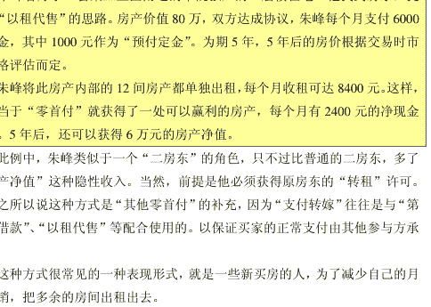

这种方式很常见的一种表现形式，就是一些新买房的人，为了减少自己的月供开销，把多余的房间出租出去。

除了前面所介绍的这些零首付手法外，你还可以在实践中发现更多的“零首付”操作手法。但经过我们大量的实践，到目前为止，“超级零首付”无疑是其中最适合普通人、风险最低、房源最广、成交最容易的方法。

## 七、小结

本章是“超级零首付”的核心部分，详细说明了“以租代售”合同细节及重要考虑因素。

之所以称之为“高级技巧”，是因为：

- 提出了一套完整的“陌生电话约见”及“面谈”的话术清单，可以帮助你快速赢得房东的交易。
- 分析了“租赁合同”的要点。指出费用结算、修缮责任、转租权利等重要内容。
- 解释了“期权”的意义。从“期权合同”里，分析“以租代售”的优点。并提示了几个关键的风险因素。
- 告诉你如何为自己的利益，提前规划好“以租代售”的关键数据。其中对于“未来房价”给予了相关的计算方法，力求双赢。

这些技巧既有法律方面的，也有数据分析的，都是大量经验的积累与总结。你在实践中遇到很多问题；但只要保障以上的内容是正当、合适的，那么你的利益就有了基本的保障。

最后，我们介绍了其他几种零首付方法，帮你拓展自己的视野。

零首付本质就是“资源整合、资产运营”的一种目标。在多种行业里，都存在类似零首付的交易方式，比如专利入股、股票置换等。

从下章开始，我们将拓宽你的视野，帮你梳理更高层的房地产投资规律，并揭示“房地产投资致富”的奥秘。

# 第五章 自由之路：如何借房地产投资致富


“谈判”与“融资”是解开房地产快速致富的密码。

“超级零首付”可以帮你“空手变现”。

“被动收入”是衡量你经济自由的重要标准。

“钻石”是好东西，但不是所有的人都识货；如果你总把精力浪费在这类人身上，你会得不偿失。

很多聪明的读者，都不约而同地想到：如果可以找到很多处这样的房产，而自己又不能全部“消化”的话：与其浪费掉“零首付”的机会，不如转介绍给别人，而自己还可以从中获益。

不错，你所想到的，正是我们指导理财师学员时的思路。他们主要的工作就是帮助其他人“零首付买房”，当然自己也会获得一定的收益。

而他们所使用的工具，绝大部分都与“超级零首付”相关。只不过，他们是站在第三者旁观的角度来设计交易方案的。而且在吸引“买家”方面，也具有相应的手段。

由于篇幅所限，本书无法尽述。有兴趣的读者可以咨询本书最后的“超级零首付收入流特训营”简介。

虽然无法详述“超级零首付”的致富技巧。但在此可以将相关的房地产投资致富的规律介绍给大家，为大家以后的投资之旅“保驾护航”。这些内容在《房神秘笈》中曾简略提过，但此处将其升华放大。

## 一、“三大定律”打开房地产财富之门

房地产投资是一项汇集法律、营销、谈判、资本运营、装修设计等多项知识体系的综合型应用领域，从其衍生出来的投资细分方向数不胜数。

但是大道至简，万变不离其宗。我们根据长期的投资积累，把众多的投资手段进行剥茧抽丝、缩小聚类，终于由感性经验升华，提炼出来了具有共性的理性逻辑——我们称之为“三流定律”。

### 三流组合定律

> 三流组合定律：任何房地产投资交易形式都是“信息流”、“产权流”、“资金流”这三个流程的衍生及组合。

我们以普通的房产交易为例来理解该定律。

买房人 A 首先通过“中介 B”了解到了一处房产（房东为 C）的信息，A 看中了该房产，于是 A 与 C 签订了购房合同；A 没有足够现金，于是向银行 D 申请二手房按揭贷款，D 审批通过。A 于是向 C 支付首期款，银行向 C 支付按揭贷款，B 帮助买卖双方完成过户。过户给 A 后，A 定期向 D 还款。

这个过程可以描述如下图所示。

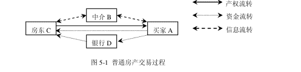

这三种流程贯穿始终，我们可以简单划分如下：

表 5-1 三种流程示例说明

| 流程分类 | 流向 | 内容 |
| :--- | :--- | :--- |
| **信息流** | ① C→B | 房东 C 向中介 B 发布卖房信息 |
| | ② B→A | 中介 B 将信息传递给买家 A |
| **产权流** | ③ C→A | 房东 C 将房屋过户给 A |
| **资金流** | ④ A→C | 买家 A 付首期给房东 C |
| | ⑤ D→C | 银行 D 付按揭贷款给房东 C |
| | ⑥ A→D | 买家 A 定期向银行 D 还贷 |

如果 A 与 C 直接进行房产交易，那么就可以省略中介 B 的角色，即“信息流”是由买卖双方直接接触完成——但在实际交易过程中，往往需要一个“中介”环节，即使不是“房屋中介公司”，也可能变为“互联网网站”、“熟人”、“同事”之类的来充当“中介”。

如果 A 不需要贷款，那就可以省略“银行 D”的角色。“资金流”由双方直接对接完成。

这是简单的房产买卖过程，如果中间插入投资者的角色，也可以按“三流组合定律”来理解。

普通的“低买高卖”式投资行为中，往往是投资者首先买入房产，然后转售，其交易过程可浓缩为：

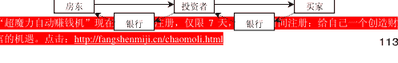

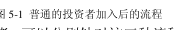

而高级的一些的投资者，可以分别针对这三种流程来选择投资方式，请看下表：

表 5-2 常见的投资方式与三流对照表

| 流程 | 常见的投资方式 | 赢利分析 |
| :--- | :--- | :--- |
| 信息流 | 房产中介 | 中介服务费 |
| 产权流 | 期权转让 | 期权转让费 |
| 资金流 | 各类贷款 | 利息收入 |
| | 全权委托书 | 房产转售收入 |

无论何种投资手法，都可以归结为以上的几大类。所以，你就知道，“超级零首付”也是其中之一，可以归为“产权流”类。

### 风险递增定律

房地产投资领域中，普通投资者常用的操作手法就是同时涉及“信息”、“资金”、“所有权”三种流程的操作，而精明的投资者是根本不会这样的。

为什么呢？

> **风险递增定律**：房地产投资风险按“信息流”、“产权流”、“资金流”的顺序依次递增。

三种流程各自涉及的风险是不一样的，有轻有重；如果同时承担多种风险，则会产生积累膨胀效应，总风险远超各自之和。所以，普通投资者三险同担，自然压力沉重。

再来看前表，如果投资者只涉及“信息中介”，即负责买卖双方联系与通过过户手续的办理，那么他的风险就最小。比如：中介促成双方撮合后，可能遭遇“飞单”的风险（即买卖双方撇开中介，直接交易，以便免去中介费），付出一点“跑腿成本”与“电话费”，赚不到“中介费”罢了，并没有更多的成本风险。

而“产权流”的风险中，因为涉及“产权流”的投资方式如“期权合同转让”、“以租代售”等，只是付出“定金”、“租金押金”之类的支出，相对于购房款动辄几十万的资金规模而言，风险小得多。

相反，如果他首先用钱把房子买下来，再转卖卖给其他人——如“全权委托书”投资方式——那么他就要面对“资金流动性陷阱”、“房产贬值”等风险，即“资金流”带来的风险最高。

对于经验老道的投资高手而言，当然可以同时操控好这三种风险；但对于大多数投资新手来说，却是“瞻前顾后、风险重生”——这就是常见的“低买高卖”式投资手法的致命之处：即同时承担三重风险，其累加效应远超单一风险；所以投资新手一定要避免这种“蛮干”的投资行为。

与此同时，房地产投资是否也符合“风险与收益成正比”的规律呢？就是说“资金流”带来的投资收益最高呢？

### 收益关联定律

> **收益关联定律**：房地产投资收益与资金投入数量关联不大，而是与对增值环节的“控制”程度成正比。

不是说，你投入的资金越多，在房地产交易中就越能获得更高的收益。实际上，投资收益与初始的资金规模并没有必然联系；相反，如果初始投资高，风险却是直线上升。

所以，“有钱”反而是房地产投资的“大忌”——这就解释了为什么 90% 的房地产投资者赚不到钱：因为他们用钱“买”风险，却不知道该如何用“智”换“收益”。

“与房地产投资的增值环节控制程度成正比”是什么意思呢？就是说，房地产投资的环节很多，其中一些是不增值的，而一些是增值的。投资者对那些增值环节控制的程度越深，就越能获利。

首先，让我们来分析一下房地产投资到底有哪些增值环节。请看下图：

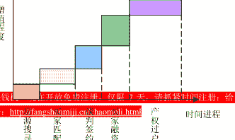

我们以纵坐标表示“增值程度”高低，以横坐标表示“时间进程”，即耗时长短。共列出五个增值环节，基本包括了房地产投资的主要切入点。

从图中可以一目了然地看出，最理想的投资环节就是同时满足：

- “增值程度高”（纵向高度跨度长）；
- “时间进程短”（横向跨度较短）。

根据这种标准，在上述 5 个环节中，最理想的无疑是“谈判签约”与“买房融资”；而最差就是“产权过户”。

这一点很容易理解，因为这一环节耗时又长，交税又多，手续繁琐。基本只是“成本中心”（总想着怎么省钱），而不是“利润中心”（想着如何赚钱）。

这也解释了“为什么买卖双方不愿意找中介”的原因了。试想，你愿意仅因为中介帮你找房、帮你办手续而支付高价吗？

所以，“谈判签约”与“买房融资”就是“性价比”最高的环节，是投资的“黄金地带”。

之所以说这两个环节是“黄金地带”，还与“控制力”相关。我们从五个环节分别比较可知，“房源搜索”与“买家匹配”是很难彻底受“控制”的。

因为房东既想卖房，就会四处发布信息，以便吸引大量的买家竞争，从中取高价获利。所以，他通常不会将信息仅限于告诉少数的投资者。

即使投资者优先得到这些信息，也必须尽快将其转变成为“合同锁定”（即“谈判签约”环节），才有可能真正的“控制”。

“买家匹配”更是如此，有潜力买房的人太多了，投资者不可能限定死让谁买。“产权过户”当然也不用多说，既然我们无法“控制政府”，当然也无法控制这个环节。

所以，“黄金地带”意味着不仅“增值—时间”比高，更意味着“控制力”容易实现。

通过“收益关联定律”可知，我们对“黄金地带”的控制力越强，就能获取高收益。

这里面很多人可能会疑惑，为什么“买房融资”会成为“控制力”强的环节呢？可以提供房贷融资的银行很多，怎么能谈得上“控制”呢？

学过前面“以租代售”的融资课程的人，应该可以理解这种“控制力”。

## 房地产致富的密码

简单地说，就是当我们获得“期权合同”后，不是简单地找到买家“一卖了之”，而是常常需要提供“融资服务”。这样才能“卖出高价”。

而由于我们的“融资服务”是与房产挂钩的，即只有我们的房产才能得到“融资服务”——如“零首付以租代售”——这样买家必须支付一定程度的溢价才能获得原本超出其购买力的房产。

这样，我们就通过“融资”与“买房”的挂钩机制，实现了“谈判签约”与“买房融资”这两大增值环节的同时控制——这种复合式的“锁定”能力非常强，对于交易双方都是强有力的约束与吸引。

通过“谈判签约”形成的“期权合同”或“购房合同”保证对房源的锁定，同时通过“房源”及“买房融资”条款形成对“溢价”的锁定，并最终形成对“收益”的锁定。

所以，“做得越少，赚得越多”的秘密就是：

> “谈判”与“融资”是解开房地产快速致富的密码。

——房地产财富观

所以，要想真正快速实现自己的房地产投资宏图，就要从“谈判能力”入手来实现“产权流”的控制，从“融资能力”入手实现“资金流”的锁定。

在实践摸索之中，你会逐渐形成自己独特的投资手法，但“条条大路通罗马”，最终你会向这三大规律所指明的方向前进。

“学习—模仿—创造”这是一条屡试不爽的发展之路，由本书所介绍的方法起步，你会走上自己的财富大道。

## 二、魔术般变钱的终极秘密

我们听过最多的关于投资疑虑的问题就是：“我没钱，怎么可能投资房地产呢？”


### 魔术智慧

像魔术师变钱的智慧

小胡报名参加我们的理财培训班后，开始运作我们的策略来“空手赚钱”。

他首先发布针对房东的免费报告的广告，很快在一个月内签下了3处房产。接着，他又在网上发布了吸引买家的广告：“零首付、轻松月供，无需银行贷款，立即拥有自己的房产！”

买家咨询电话蜂拥而来，他把专门针对买家写的免费报告①通过Email发给他们。很快就有很多买家响应，于是，他约了一个周末集体邀请有意向的买家看房。

看房后的一周之内，他就安排房东与一个买家签订了“以租代售”的合同。他向买家收取了相当于一个月名义租金的咨询费——1600元。

于是，从他开始整个计划到获得收入，不过一个月的时间；整个过程毫无风险，完全是房东、买家、投资者的共赢。

“我的目标是下个月成交10单……”

小胡很开心而自信地告诉我们！

从上面这个案例，就可以很容易地解决“没钱如何赚钱”的疑问。

你没钱吗？不要紧。

“超级零首付”可以帮助“空手变钱”。

赚钱靠的是智慧，而你所需要的，本书基本已经一次性提供完了。

你只要在我们的指导下，使用“超级零首付”的方法，很快就可以明白“教育是回报率最高的投资”的道理。

知道“怎样做”还不够，你应该再问自己“为什么”！

为什么“超级零首付”可以有效呢？

在“三大定律”的基础上，让我们来理解“零首付”的实质——这将有助于你运用出千变万化的手段。

### 零首付精髓

在前面的学习具体投资技巧的基础上，我们一起深入探讨“零首付”的深层内涵。

借助别人的资源（或自己的非现金资源），获得产权流及资金流的控制权，进而获得低风险的收益保障。

这里有三个隐含意义：

- （1）“零首付”是指首付的现金为“零”，尤其是指自己的现金为“零”。使用其他的资源来替代，从而降低自己的风险与投资。
- （2）交易结果是“获得房产交易的控制权”，而不是“房屋产权”。也就是说，在一定期限内，自己垄断了房产的交易权利，根据某一价格可以转让，也可以自己买入。
- （3）最重要的是，“零首付”是一种“整合资源”的过程，必须结合实际情况，灵活运用。

在“超级零首付”里，你是借房东的房产，加上自己的“以租代售”的智力服务，组合成“零首付出售”方案。

这个方案由你筹划，当然房东也信得过由你来实施：由你来寻找“租买者”，就是控制了“产权流”；由你来安排“租买支付方案”，就是控制了“资金流”。

所以，你在房产交易过程中，巧妙地把自己“嵌”入最增值的环节中，轻而易举地获得了“产权流”及“资金流”的实质控制权。

所以，你才能轻而易举地赚钱；而且是光明正大，理所当然地赚钱——因为你真真正正地为买卖双方创造了价值。

### 财富再探秘

“超级零首付”之所以敢称“超级”，不仅是因为“简单易行”，更重要的在于，它告诉你：如何“零现金”、“零风险”靠房地产快速赚钱！

### 魔术变钱公式

你的财富=别人的房产×你的“超级零首付”服务

“超魔力自动赚钱机”现在开放免费注册，仅限7人。请抓紧时间注册：给自己一个创造财富的机会。点击：http://tengshenmi.cn/chuanon01.html

“魔术变钱公式”告诉你，你的财富源于“别人的房产”数量和“提供超级零首付服务”次数。两者的乘积，就是你的收入。

所以，要想增加你的收入，而且是快速增加你的房地产财富，你必须做好以下的工作：

- （1）发布更多的“钓鱼式广告”，越多越好；因为吸引的房东越多，你成交的可能性越高。房源永远是交易的起点。
- （2）与房东保持长期联系。很多房东的要求你是无法全部满足的，所以，面谈的房东中仅会有一小部分最终成交。但他们的态度会改变的，所以，长期坚持，就会由量变到质变。
- （3）坚持把“超级零首付”做到最好。成为一门技术的专家，你会赢得更多的机会；仅做为一门技术的“半桶水”，你会看见更多的陷阱。不要见异思迁，否则你将“经历千辛万苦，重回最初”。

别忘了前面介绍过的“手表定理”。“超级零首付”就是你的“劳力士”，还需要其他的“手表”干什么呢？

## 三、解放自己：如何睡觉时也会有钱流入

听过“一铺养三代”的说法吗？

看见过“成天不做事、只知打麻将”的人吗？

他们衣食无忧的道理很简单：因为有房租收。只要房子在，永远不愁钱。

你读过《富爸爸，穷爸爸》这本书的话，就一定会对“经济自由”、“被动收入”向往不已。

我们《房神秘笈》的很多读者也有这样的期待，希望可以进入财富不断自我增值的“快车道”。而“被动收入”是衡量你经济自由的重要标准。

所谓“被动收入”，就是指“你睡觉时都能流入你口袋的收入”。无需你付出任何努力，它们就能不断为你服务。也就是常说的“让金钱为你工作”。

如果“被动收入”也在你的梦想板上，请你此刻一定要睁大眼睛！

为了获得“被动收入”，罗伯特·清崎介绍的主要方法，就是“股票”和“房产”。

显然，我们不会讲解“股票”的方法；所以，你将看到如何使用“超级零首付”，带给你同样精彩的“被动收入”。

### “超级零首付”所引发的多种被动收入

#### 聪明的她发现了“被动收入”的源泉

马小姐使用我们的“超级零首付”一段时间后，发现有些买家担心会在3~5年的租赁期出现各种疑问，所以，主动提出来：愿意每个月支付100元钱，作为长期咨询费。马小姐在帮该买家成交时，已经收取过一个月租金全额的服务费了。既然买家需要，所以她答应下来。

但是此举也激发了马小姐的创造力。她发觉很多买家都会有此类担忧，这种收费是有需求的。所以，她在以后的交易服务中，都提供此收费服务。收费在100~150元不等。

不知不觉，当她完成近20单后，发现每个月竟有2380元的“稳定收入”。这些收入是每个月按时固定流入的，基本上无需她做什么工作。至多有些买家疑问，她打几个电话也就解决了。

当她告诉我们这种“技巧”时，我们恭喜她：她发现了“被动收入”的源泉。这是一种典型的“被动收入”的示例，是靠自己的智慧资产发现的收入源泉。希望对你有些启发。

其实，随着你投资成交次数的增加，你会发现越来越多的收入来源。以上的只有一种。

其实，更多人想到是，用投资赚来的钱作首付买入房产，然后，通过“以租代售”的方式出租，这样通过租客的钱来弥补还贷支出。相当于把还贷的压力转嫁到了租赁者身上。

#### 巧妙的变化立即弥补了房产的现金流状况

廖先生投资4万首付，买入了一间20万的二手房。每月还贷1030元。而同类房产的正常租金仅700元。他希望这间房产可以“自负盈亏”，甚至给他带来一些正的现金流入。

学过“超级零首付”后，他改变了思路。他找到了一位同意“以租代售”的买家中，将3年后房价定为22万。并且每月租金涨到1050元。其中350元可以用作预付定金。

这样，该房产已经不需要他每个月垫付330元的资金还贷。1050的租金刚好弥补还贷支出。而且，他3年之内都不用再担心招租的麻烦。

这种由第三方投资者转变为“房东”角度，是更多人的选择——当然会存在一定的风险，但毕竟已经得到了房屋的产权，获得靠房产获取更多赢利的空间。

此外，还有的学员因为获得房东的信任，房东主动提出分一部分房租给学员，只要学员帮忙处理出租房产时碰到的各种杂事与麻烦。而该学员很聪明，他承揽下很多处这样的房产，而雇佣了几名临时工就搞定了所有的问题——所以，大部分时间都轻松地享受“被动收入”。

### 财富的羊群效应

#### 你把钻石卖给谁

> (摘自《新厚黑学》)

假如你有一颗巨型、完美无瑕的钻石，把它拿到村寨市集上，你将很难说服废旧品小商贩花五个美金购买它。然而，如果你不去找村寨小商贩和小城镇店主，而是直接到全国声誉最好的钻石经销商那里去的话，你就无须白费口舌，试图说服他。你的商品将会说明自身的价值。你甚至不必开口，他也许会出五十万美元购买它。

倘若你是一块名副其实的宝石，那么你就别浪费精力，努力削价将你卖给普通的村寨小商贩，你将惹恼这位小商贩，而且白费工夫。向懂得宝物价值的人出售宝物，比向那些不识宝的人推销更容易。

当你推广“以租代售”方案受阻时，一定要记得回顾一下上面的故事。

“钻石”是好东西，但不是所有的人都识货；如果你总把精力浪费在这类人身上，你会得不偿失。

尤其最开始是实践时，你必须确立这种“钻石”心理，把“以租代售”推销给认可它价值的房东。

但是，“认可”这两个字是有“传染性”的。梵高的画得到了全世界的认可，但是却没有给他带来任何财富，很重要的原因在于缺少“认可”的第一推动力。

所以，你必须想办法快速突破“钻石”价值的推广瓶颈。自己主动寻找、打造“第一推动力”。进而引起更广泛的“认可”传染。

这里，我们传授一种“借东风”的推广技巧，希望对你有所启发。

#### 巧借东风牵羊群

小吴有个房产中介的朋友，借该朋友上门与房东沟通时，他主动随去。并向房东提出“免费提供一套理财方案”——当然就是“免费报告”。

无论房东是否跟他成交，他都一定会提出一个请求：“这段时间来，我为您免费提供了一份方案；虽然您没有最终与我合作，但我也心存感激。只是我的公司要求必须留下一份证明，才算我真正的为您服务过。为避免我被公司处罚，您可否帮个忙，与我合张影，并写几句话，代表我曾为您提供过方案？”

大多数房东都满足了小吴的要求。于是，在很短时间内，小吴就获得了大量的房东“背书”（推荐信及相片）。

以后在每次接洽房东时，他必然先拿出一本推荐相册。单是里面厚厚的相片，就让房东快速相信了小吴的专业能力及“以租代售”方案的价值。

看出来这种方法的“妙”处了吧？

人们都有从众心理，如果你可以证明其他房东都是同样的选择，那么你就可以快速建立信任感，并间接暗示房东：“以租代售”是他们最好的选择，因为其他人都是这样做的。

为什么要把这种“借东风”的方法放在“被动收入”的部分里呢？

因为，一直以来，人们都认为，能带来“被动收入”的一定是“有形资产”。所以，经常忽视“无形资产”的价值。

但是，“超级零首付”是一种“无形变有形”的财富制造工作，要想获得现金流入，无论是“主动”还是“被动”，你都必须先具备“无形”的资产：

- 一则知识；
- 二则品牌。

而小吴所做的，正是在“品牌资产”上下功夫。他所搜索的相片及推荐语，实质上都是非常重要的“被动收入”来源。

这些“品牌资产”只要搜集一次，就可以每次使用，每次都能给他带来显著的效果。而且，更加有利于转介绍。房东总会对自己的形象青睐有加，经常会向别人证实此事。

小吴足在借助人们“羊群心理”，很快完成了从新手到专家的“形象”建立。当然，也更快地赢得了房东的认同。

以上就是对于“超级零首付”所拓展出来的“被动收入”的启示。随着你的投资行动走向深入，你未来的财富之路将逐渐印证这些规律性的经验。

## 四、小结

本章是在前面基础上的延伸，它扩展了“零首付”买房的思维，发展成为“零资金、零风险投资”思路。

其中“三流组合定律”、“风险递增定律”、“收益关联定律”三大定律，清晰地指示出“超级零首付”也是一种高效的投资体系。

从“超级零首付”投资体系里获取财富，并不是一件复杂的工作，只有你应用“魔术变钱”的方法，就一定可以成功。

当然，获得大量、稳定的被动收入，是我们实现经济自由的必经之路。所以，本章后面介绍了一些获取被动收入的方法。

然后，一切都有赖于实践——尤其是前面三个月的实践。这是检验你的梦想前景的关键。

“耐力者胜”，这是任何时代、任何人成功的阳谋。

“超级零首付”期待着你的故事。

## 尾声：笑忘零首付

你是否听过这样的故事：某个富翁经历一次重大失败而破产，其后不久又很快通过神奇的方法东山再起、重新致富。像特朗普、乔布斯、史玉柱……

这种故事本身并不稀奇，但我想深挖的是：为什么当他们破产成为穷人之后，还能很快由穷入富。

这种二次发达的秘密在哪里？

有人归结为他们的人脉，有人归结为他们能借到钱，有人归结为他们的经验，有人归结为他们的雄心……

我们认为这些都是事物的表面，都是真相的伪装。

你有没有接触过久经世故的老先生，你刚讲几句，就被他看透你的深浅？你有没有碰上过棋艺精湛的高手，刚落子几招，就被他猜破你的心思？你有没有遇到过经验丰富的老中医，为你切脉片刻，就能大体找到你的病因？

……

这样的场景几乎无处不在，也许你自己本身就是某个方面的行家，可以很短的时间，完成普通人很难做、甚至做不到的工作。

看上去似乎很神奇，其实都是长年经验的积累、大量训练的结果。

> 学习改变思想，训练改变行为。所以，阅读很难让人彻底改变，除非他身体力行。
> ——房神论道

然而，有些项目的训练非常艰苦，比如竞技体育运动。

但是，“零首付训练”作为理财教育的一个环节，其难度却比你想象得要简单得多。

### 创造性从你的生活点滴开始

你所需要做的，就是从日常生活，训练自己“零首付”的思维。

**零首付思维训练的基本方法**

（1）确定“零首付”训练对象：以正常情况下需要现金支付才能获得的商品为练习对象，强迫自己采取“零首付”的方法获取。

（2）写下至少 20 种不用支付现金，就可以获取此产品使用价值的方法。无论你觉得有多么“不可能”，都必须强迫自己开动思维，或是向朋友请教。如果一时间写不出这么多，就用一天、二天……直到写出 20 种方法。如果有些方法听起来“异想天开”，都无所谓。关键在于思维的训练。

（3）从这 20 种方法里寻找最好的 3 种方法，然后具体分析这 3 种方法的优劣。从中选出最可行的 1 种。

（4）立即实施最后选中的方法，来履行最初的目的。

（5）无论这种尝试最后是否成功，都要认真地总结、分析其中的得失。

（6）优化这种方法，记下最终方法的特殊之处。

（7）每周至少做一次这种训练，写到专用的笔记本中。

上面的训练方法其实非常简单、易行。经过三个月的自我训练之后，你会明显发现自己的进步——对每项开销与投资，都能从多种角度分析并最大化减少自己的现金支出风险。

所以，事实会告诉你：零首付与其说是一种技巧，不如说是一种思维能力。能做到“零首付”的人，都是善于创造性思维的人，这种人将在未来的生活与事业之中受益匪浅。

你不一定现在就开始使用这本书所教授给你的技巧去开展“零首付买房”行动，你只要从日常生活的一点一滴起训练自己。

等到你真的需要“零首付”的时候，你很快就会发现：自己的思维变得非常活跃，很容易就可以找到多种交易方法来实现自己“家园之梦”。

这就是从量变到质变的过程。

这就是从平民到富翁的思维转变过程。

当你开始学会用“创造性”的方法改变习以为常的做事规则时，你实际上就已经开始了自己的“自由之路”——经济上的自由与富足总是先从头脑开始的。

### 富足的头脑

此刻看书的你，算不算个有钱人呢？

这个问题的答案，不问自明。

我们相信，90%的人会对自己现在的状态不满意，不认为自己是个“有钱人”！

但随着你们经历的变迁，你们会逐渐提升对自己的认知。而这种认知，更多的不是因为“存款”，而是因为观念。

所以，在这里，我们分享一些从房地产投资里领悟的观念。无论你现在能否明白，它们都将成为你潜意识的一部分，在你最需要的时候，帮你指明方向。

> 致富的捷径
> 学习最快的方法，就是帮助别人学习；开心最快的方法，就是让别人开心；赚钱最快的方法，就是帮助别人赚钱。致富最快的方法，就是帮助别人致富！

你想获得什么，就想尽一切办法，去帮助别人也获得你想要的；结果，你会比较被帮助的人，获得更多、更快。

学生问老师：如何才能更快地学学英语？

老师说：帮助别人学学英语！

推销员问经理：如何才能卖出更多的美容产品？

经理说：帮顾客变得更美丽！

学员问我们：怎样才能最快速地从房地产里赚钱？

我们说：去帮助房东赚钱！

……

这是一套屡试不爽的成功法则。所谓的“我为人人，人人为我”就是这样的道理。它与“帮人成功，自己才会成功”之类的说法有异曲同工之妙。

所以，我们认为这是“富尼”之道的首要观念。

> 思考比行动更重要
> 用 20% 的时间行动，用 80% 的时间思考。行进中的理性主义者比思考中的感性主义者更容易成功。

理性的人与感性的人哪种更容易成功？

我们的答案可能与你不同。

理性的人善于思考，行动力弱；感性的人不喜动脑，行动力强。

看上去好像行动力强的人更容易成功。但实际情况是，之所以很多感性的人最后成功了，是因为大量盲动后的失败把他们逐渐改造成了理性的人。

### 成功=80%的思考+20%的行动

思路决定出路，起点决定高度。

同样锯木头的人，一个为了糊口，一个为了雕塑——这就是他们未来天壤之别的起点差异。

而这种差异，来源于他们的思考能力。

同样听讲座，老总们喜欢曾仕强；经理们喜欢余世维；业务员们喜欢陈安之。

你呢？你喜欢哪一个，往往跟你现在的经济及社会地位有关——这就是思维格律的典型反映。

越是高层次的企业家，越喜欢读历史与哲学——这不是偶然，而是共鸣！

听过“选择比努力更重要”这种说法吗？

没有正确的思考能力，如何能正确的选择？

人云亦云，是好的选择吗？股市里为什么大多数散户亏钱？他们有自“云”吗？

所以，“选择比努力更重要”的更深刻版本，是“思考比行动更重要”。

那么，思考的模式主要是什么呢？

> 天人合一
> 人类的政冶、伦理等社会现象是自然之道的直接反映。一切顺应自然之意，就可以实现人道与天道之和谐。

“谐”在梵语里，是“和谐”的意思；西方社会近几十年兴起的“自然成功学”也是“顺应天道可以不费力的取得成功”之意。中国几千年的道家精髓，都在倡导“天人合一”之念。

何为“天人合一”？

你去找个炒股高手，问什么是炒股规律？

他会跟你说：“顺势而为”。

你找风水先生，问家宅布置的根本要义？

他会跟你说：“趋吉避凶”。

你问企业家，如何才能做大做强？

他会跟你说：“把握未来趋势”。

你问牧师，如何才能心想事成？

他会跟你说：“与上帝共舞”。

……

无论多少种说法，他们都在传达同一个信息：“成事之道在于顺应天意”！

何为顺应天意？

- 下雨天，要打伞出门。
- 股市熊市，要学会耐心等待。
- 赌场输钱，要放弃莫追。
- 项目失败，要止损。

大势抗衡、与天意相争，会浮人性，非“和谐”之道。

听起来有点“道可道，非常道”之玄妙，但等你听多见广之后，就会逐渐明白“天人合一”才是真正的“成功之秘”。

### 笑忘零首付

很多学员参加我们的培训之后，总会碰上很多从来没有想到过的问题；常会因房东的一次拒绝而心生退意；更有甚者，会反怀“超级零首付”本身的效用。

> 10 关于“天人合一”、“与上帝共舞”的秘密，请看《上帝的两个赌局》（孙敬阳），网上阅读地址：http://book.cc/read/inspirit/sdllgdt/

“超能力自动赚钱机”现在开放免费注册，仅限7天。请抓紧时间注册，给自己一个创造财富的机会。点击：http://fangshenquji.cheanneli.com


古人道：“尽信书不如无书。”

如果你只能僵化、死板地照搬照抄，不晓得如何灵活、变通，因地制宜：那“超级零首付”很可能会让你失望。

### 与其面壁死读书，不如笑忘零首付！

所以，我们开篇即强调，“超级零首付”是人们“创造力惰性”的解药：但如果你忽视了“创造力”的训练，那本书很可能不是你想要的“仙丹”。

当然，如果你在阅读中发现了一些“金玉良言”，那么请你再做以下几件小事：

- 1. 告诉你身边的朋友，《超级零首付》是本与众不同的书，请他们也来学习。附上你的姓名，你的朋友购书时会有意外惊喜。
- 2. 以最快的速度加入我们的网上社区，从中寻找你同城的学习伙伴。在团队中前进才不会孤单。
- 3. 把你所有的疑问都传递给我们，电话、短信、邮件……随时恭候。因为你所投资的，不仅是一本书，更是我们终身的服务。
- 4. 最重要的，请你重复读三遍：“贫穷是最大的耻辱！贫穷是最大的耻辱！贫穷是最大的耻辱！”想清楚自己未来的路！

别忘了“布施”法则，向你的朋友馈赠几句良言，你会有意外收获。

### 写作手记：普通人最缺的是什么

我们有一个学员，作为一名尚未大学毕业的贫苦学生，他东拼西借，耗时一周才筹集到了“通天术”培训班的学费。当他告诉我们他的致富决心之时，我们都很感动。

我们还有一个学员，他辞掉工作，一人独闯北京，专来学习“通天术”培训班所教授的投资技术。听到他表达不是很流畅，但是话筒那边透露出的坚定决心，让我们再一次感动。

像这样的故事，还有很多。越是弱小的人，越渴望强大的力量。这些学员改变自己命运的决心怎能不让人闻之动容？

而看到此行文字的你，无疑是幸运的一员。

因为正是许许多多这样具备强大斗志与执行力的学员的不懈努力，才有了你今天眼前的这本《超级零首付》——它是群体智慧的结晶，是大量实践经验的总结，是每一个早期学员努力的成果，是无数弱小的人改变自己命运的契机。

我们曾经向一些学员建议：“为保证质量，学费的确是有点贵。你既然经济状况不好，就不要报名参加了。”

但是，无一例外的，他们都有着类似的回答：“不，我一定要参加。”

“教育永远是回报率最高的投资。”——学员们用自己的行动为这句名言写下注脚。

这不由得让我们再次关注一个问题：“普通人最缺的是什么？”

请读读下面的故事，把上面问题抛给你自己。

“超能力自动赚钱术”现在开放免费讲座，仅限 7 人，请抓紧时间注册，给自己一个创变财富的机会。点击: http://haoo.scm123.cn/chaonlli.html

### 空手变钱的女孩

关于“提高识别机遇的能力”的培训中，一位美国的培训师要求：把学员的钱包、手表、口袋里的硬币以及其他值钱的东西都放在公司的写字台上。然后，让公司把学员送到城里离家最远的地方，跟着开车离开；无论出了什么事都不要来接学员——学员必须靠一路挣钱回到家。

这种方法听起来有点疯狂？但却非常有效。有时，训练的结果甚至非常惊人。

有一个女孩在出门前一言未发，只是把她的行头都放在桌面上就走了。四小时以后，她带回来一袋子钱。当其他学员抱怨乞讨和挣点儿钱有多难的时候，这个女孩正在一摞摞地数硬币。

所有的学员都要报出自已挣到的钱数，其他人都挣了 2 到 10 美元。当问到这个女孩的时候，她很酷地说：“118 美元。”全班一下子静下来了。女孩身边摆着一摞摞的钱，她转过身来看着其他学员，及那些老谋深算的经理人员。

当问到她成功的秘密时，女孩说：“我去了超市。”

有一个经理问：“你的钱不是抢来的吧？”

“当然不是。我的方法是从一个老人那儿学来的，他在另一个超市这样做：我在停车场对买完东西的人说，如果他们将答应我可以把手推车停车处还回来的一美元押金留下的话，我就替他们去还手推车。”

年轻的女孩就是以这样简单的方式击败了那些老手。她抓住了购物者的心理：刚刚从超市买了一堆东西的人实在没兴趣再把手推车还回去，把车锁上，取回那一块钱的押金。他们只想把车门关上，马上回家，免得刚买的冰激凌化在路上……

此刻的你，就是那个女孩——因为你已经找到了那个“聪明的老人”，而你所得到的，就是“看似简单，却不笕发现的智慧”。

幸运的你，应用已经明白：财富与其说源于勤奋，不如说源于智慧。而获得智慧最快的方法，就是接受教育。

而这一点——为教育与投资——恰恰是普通人最容易忽视的。

钱就呆在那儿等着你去挣。

擅长赚钱的人无论何时何地都能看见机会。

谢谢你的阅读！

谢谢你阅读这本很贵的书！

**一份免费的大礼在等待着你**

请把您的读书感想（至少 100 个字）通过 Email 发送给我们。同时注明您的姓名及所在城市、联系电话。

我们将免费赠送一份《超级零首付“绝密内部资料”》专业报告。该报告揭示了常见操作困难及解决方案。由于数量有限，请您尽快索取。

请记住我们的邮箱：fangshenniji@163.com

## 特别报告：借力“病毒营销”赚大钱

无论你是想过通过房地产赚钱，还是想通过其他的业务。始终都要明白，致富要靠营销。因为营销是个人或企业发展的终极杠杆。否则，不管你如何“节俭”，财富的积聚速度都始终缓慢。

何为“杠杆”。就是输入“小”，可以收获“大”的省力机制。当你想快速改变弱小的现状，实现“以小胜大”、“以弱胜强”的目标时，借助“杠杆”原理来工作是最快捷的方法。

遍观各类营销方法与技术手段，到目前为止，最高效的一种——无疑就是“病毒营销”。

病毒营销是通过利用公众的积极性和人际网络，让营销信息像病毒一样传播和扩散，营销信息被快速复制到数以万计、数以百万计的受众。

你只要传染第一代人，把他们变成“传染源”，他们就会替你反复向外传染给新的人，并把其他人也变成“传染源”。以此类推，以几何数字快速扩张。一传十、十传百……在很短的时间内，就可以完成海量的信息传递。

这就是“病毒营销”的魅力。所以，病毒营销是营销的杠杆。病毒营销的成功案例非常之多，有兴趣的读者可以自行查阅。

在这里，我们将介绍一种简单的思路，教你如何房地产投资领域应用“病毒营销”的方法来快速扩展业务。

### 一、解开“病毒营销”的魔方

撇开复杂的病毒传播机理，我们直接给出其基本架构，后面辅以案例来帮你理解。

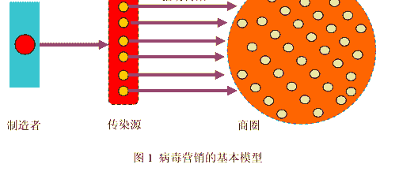

病毒营销并不难理解，它由“制造者”、“传染源”、“商圈”三部分组成，核心机制在于“驱动传染”。

发起病毒营销的主要工作步骤为：

#### (1) 针对商圈设计病毒性产品

不是所有的产品都具有病毒性，要想成功地发起病毒营销，首要的工作是了解你的利基市场（即“商圈”，或者说是“目标顾客群体”）。

首先，知道商圈的需求与兴趣、消费特点等。尤其是要理解他们的主要交流沟通工具。

比如对普通大众，电视、报纸等无疑较好。但对于年轻一代，使用互联网的效率更高。

其次，要设计具有“快速传播能力的产品”。这种产品应该具备快速吸引消费者注意力的特点。

比如，针对普通大众。设计新闻性的事件，更适合作为“病毒性产品”。因为普通大众对于这类事件一般比较喜欢谈论，尤其是有争议的内容。

“超魔力自动赚钱机”现在开放免费注册，仅限 7 天。请抓紧时间注册：给自己一个创造财富的机会。点击：http://tongxianmuj.cn/chuanodd.html

#### 借新闻媒体的力量传播
（摘自《在空白处创业》）

曾经有一个主要的电视节目曾对你和你的企业感兴趣吗？也许……你怎样把自己调整得更成功呢？苏珊·哈罗是这样说的：“宣传一个热门话题。永远都不要宣传你自己或你的产品，而要宣传有新闻价值的东西：一个迫切的全国性的问题，一个有争论的话题，一个你有解决方案的问题，或者一种被拆穿的荒诞的说法。提出一个与节目的观众有关的话题（争议、人际关系、个人的成功及转变等），然后证明你是这一话题的一位专家。”

这种特点既可以源自功能，也可以源自包装设计。当然，如果可以既有功能，又有“设计”，则是更加完美的。

#### 如何使一本书畅销
（摘自《高智文化》书评）

在 2003 年，《紫牛》这本书在美国出版，旋即成为营销类的畅销书。我想了很久，这本轻薄短小的书怎会造成这么大的轰动？我很乐意跟各位读者分享我的观察。我想，原因有三。

首先，这本书刚上市，随书附赠一个紫牛牛奶的新鲜屋。这个限量版有版不到几天就销售一空。读者收到这个牛奶盒，很可能会把它放在办公桌上。如果有同事走近，看到一个很奇特的紫牛奶盒，定会聊聊这个牛奶盒。当然，这正是这本书要传达的概念：创造卓越非凡。

其次，这本书会深受瞩目是因为书本身很容易就可以成为话题。现在在美国有许多企业组织，只要讲到什么东西或想法有多卓越非凡，就径用「紫牛」作为代名词。就像我这本书的情形一样，使你的产品成为人们生活的一部分，有助于产品的散播。

最重要的是，第三，不论我有没有写这本书，人们都知道「紫牛」是他们想要的。人们厌倦了平凡无趣，厌倦了沉闷乏味。

现在该是我们创造卓越非凡的时候了：去创造会让人们眼睛一亮、会去关注、会去传播的东西。

设计“病毒性疾病产品”的最重的一点，就是“传播价值点”设计。即这种产品

值得传播的地方是什么？

既可以是“与众不同”的内容；也可以是“与众不同”的传播渠道。当然，还可以是“与众不同”的传播者！

#### （2）寻找第一代传染源

传染源的选取非常重要，因为它决定了“病毒”的扩散范围与速度。一般选取的标准就是：

- 影响范围；
- 对病毒敏感性。

因此，一些大的传播媒体，比如电视、广播电台、报纸，包括现在信息主流渠道之一的网站，都是很多病毒产品优先考虑的对象。

#### 芙蓉姐姐是病毒式营销的成功范例

芙蓉姐姐组为何会短时间内红得如此发紫？网络功不可没。

我们来看一下芙蓉姐姐成名路线图之轨迹：北大无名BBS—水木清华BBS—天涯论坛—博客中国。最早芙蓉的图片始于北大（2002年底）、清华（2004年初）校园论坛，随后部分网友将其转贴到其他社会公共网站，这让芙蓉的知名度有了更为广阔的提高空间。

5月24日，网友dachy将芙蓉照片“引进”到天涯论坛，6月中旬，天涯论坛片版主兼自由摄影师的陈默（在此之前曾捧红了流氓燕等人），接受上海一家媒体约请，将拍摄的芙蓉40张图片放在天涯论坛的娱乐八卦版，立即引来千余回帖，并形成网民自发炒作现象。

继天涯论坛对芙蓉的炒作后，6月28日，芙蓉接受中国最著名网络博客——“博客中国”网站专访，并成为该网站“超级女声”版又一为版主，和木子美、流氓燕并列。7月3日，“博客中国”网站对外宣称，芙蓉参加7月5日“博客网——超级女声，重装上阵”新闻发布会，而这也是由公司出面，为芙蓉姐姐统一举行的首场新闻发布会。

虽历时3年，芙蓉坚持了下来，并没有花一分钱做广告，选择网上BBS做其传播平台，这符合病毒式营销对传播渠道有影响且免费的条件下，大数网友看了芙蓉的夸张照片和自恋性文字，总会觉得很娱乐和好玩，有的人是因为感到了巨大的反差，而且忍不住告诉**自己的朋友和同事，这样由网络开始，借助网上和现实中的口碑，一传十，十传百……千万个人开始自发炒声，声势翻江倒海，至此，芙蓉在网上人气和风头**一无两。**

除这些大媒体之外，还有很多其他选择——关键**在于你的商圈在哪里。如果你的商圈属于本地市场，那么在本地的报纸上传播、在市中心地带传播，效果会更好。

房地产投资基本都限于你所在的地区，所以在本地市场选取一个有快速扩散消息能力的“传染源”无疑是最好的。

传染源不必是人——只要具备“媒体”性质就可以。

比如，你把“免费报告”的广告贴在社区的小卖店、报刊亭附件，效果就更突出。

同时，你也可以发动一些社区里的人来帮忙。比如，你知道某送桶装水的公司会经常上门与住户接触，那么你就可以直接跟他们沟通，帮你递传单过去。或是为某些提供房东线索的人给予佣金奖励。

传染源的选择，要经过测试才知道效果。所以，要经常去尝试不同的方法才知道哪种最好。

#### （3）传播驱动力设计

可以“自我复制与自动传播”的病毒性产品，无疑是最好的。但绝大多数产品不具备这种特点。

比如，某些新闻事件的传播，就经常会因为“信息传递的牛鞭效应”导致内容失真、变形，甚至面貌全非——“谣言”就是这种产物。

解决这种问题，主要靠“病毒产品”的设计。使产品具备标准化特征，不会被“传播失真”。

虽然有着搞笑图片一样，在传递过程中不会“走样”的产品；但也往往因为传播者动力不足，而降低了传播的速度。

所以，解决“降速”的问题，则要靠“传播驱动力”的设计。

“第一代传染源”之所以愿意传播，一定是有了“驱动因素”。而驱动因素

往来来源于三个方面：

- 感性因素：好玩、新奇、有趣、搞笑等感情因素驱使第一代传染源主动把“病毒”传染给商圈的目标顾客，90%的病毒产品传播属于这种情况。感性因素驱动下，第一代传染源比较容易接受，但持续性不强。因为感性因素往往易变、不稳定。比如某些新闻事件，往往过一段时间就无痕迹了。
- 理性因素：感觉有意义、有责任。比如“希望工程捐款”、“救助重病穷人”等，人们往往愿意主动传播，主动促使消息扩散。这类“病毒产品”不多，扩散面不多，但对受染者的影响力较强。
- 利益因素：可以赚钱，获得明显的好处。比如“推荐客户可以获得20%的佣金”，“带两个朋友消费，则自己免费”。这种驱动力影响面小，但驱动效果最强、最直接。

由于大多数产品与“娱乐”无关、与“慈善”无关，所以，最具有现实意义的“驱动力”，就是“利益驱动力”。

#### 使用“利益驱动力”的大客户营销
（作者：杰·亚布拉罕）

我们的业务涉及很多的机构投资者。很难有机会接触到这些客户。你如何才能与一位首席执行官取得联系呢？你如何才能与高层人物取得联系呢？电话营销公司很难通过邮件或任何其它方式与他们取得联系。

因此，可以去联系退休的经理级人物，任何与决策有联系的人，通过他们与高层管理人员取得联系，然后与之签订合同。我们会向中间人支付总交易10%的佣金，因为目前我们90%的业务涉及非管制产品。我们可以这样去做。对于受管制的产品，我们便无法这样去推销。

我们的做法让客户非常的振奋，现在有很多的被推荐人向我们推荐了他们的朋友。我们的业务中只有20%来源于推荐，但是比例正在迅速的增长。每年，一位客户平均为我们带来25万美元的收益。因此，目前20%的业务意味着每年2千万的收益。

“转介绍”就是最基本的一种“产品传播”方式，“获佣金”就是最基本的一种“利益驱动”。由于经转介绍过来的顾客，还会再帮助“转介绍”。所以，这也是一种“病毒营销”手段。

在“利益驱动”因素作用时，“传播驱动力”又可以分为两种结构模式：

##### ①无需中介的利益驱动模式

即传染源之所以愿意向目标顾客传播，因为他们可以直接从传播中获得利益。整个“传播→获益”过程，无需其他中介参与。

比如超市出售商品给消费者，可以直接从销售中获得产品利润。在这个销售过程中，是不需要其他厂家等中介来帮忙的。

国外的“联播销售”(Affiliate)中，有一种模式就是“A把电子书买下来后，就获得了重新销售该电子书的权利，并可以保留100%的销售收入。而无需上缴给卖家任何费用。”

这种模式得到了快速的发展，其最大的好处就是“传播过程是完全自动化的”，创建产品的公司无需干预后续的传染过程，就可以借助“自动利益机制”，实现产品的快速扩散。

但是，由于大多数产品不具备“电子书”这样的可以“快速复制”的特点，所以，大多数使用“利益驱动”模式的公司，必须参与到“利益实现”过程中。

##### ②需要中介的利益驱动模式

即产品的生产、递送、支付等环节，需要由第三方出面才能完成，所以，“传染源”必须借助这类中介，通过“传染”实现“利益”。

我们前面介绍的“转介绍获取佣金”就是这类模式。这是非常普遍的一种利益驱动模式，使用率远远超过“无需中介”的模式。

##### Amazon的超级“联播网络营销”

在1997年，Amazon.com把联播网络营销(affiliate marketing)的概念带到了前所未有的高度。联播营销者在其网站上提供与网站主题密切相关的Amazon图书购买链接，Amazon用特殊的软件跟踪并分析访客的浏览记录，并记下每位访客是通过什么网站的链接到达某本图书的销售网页。只要有访客购买了图书，Amazon将支付给该联播营销网站一笔佣金。

作为Amazon的联播营销合作伙伴，你永远不需要：

- 写书
- 处理订单
- 寄书
- 回复客户服务问题

其他的好处包括：

- 免费加入（如果你需要付费才能加入，最好不要相信）
- 可以全职从事，也可以利用业余时间开始起步
- 无需存货

这个方式同样适用于任何通过互联网进行直销的产品：DVD、保健品、旅游服务、玩具，甚至宠物！

针对以上分析，我们基本明白了“病毒营销”的实质就是“借人传人”；知道了这种营销手段的设计三步骤。

最终，我们可以得出以下结论：

- （1） 最难掌控的是受“感性因素”驱动的病毒营销。但这种营销的影响面最广，快速最快。当然也非常不稳定。
- （2） 最适合大多数产品使用的是“需要中介的利益驱动模式”。因为容易使用、控制力强，可以稳健发展。

从后面开始，我们将具体应用这些知识，学习如何借力“病毒营销”从房地产投资中赚大钱。

### 二、 把“超级零首付”变成财富的“病毒引擎”

使用“超级零首付”这种投资方法最难的第一关，就是“如何快速地把有意向的房东”找出来，我们前面列举了众多方法：

- 在社区贴海报、发传单；
- 在网站上发信息；
- 在本地报纸分类广告栏宣传；
- 请送水员、送奶员等提供消息。
- ……

这些方法都有他们的好处，但往往初始效果较慢。

在我们指导的学员当中，90%的人会在最初开始投资时，碰上“如何寻找房东线索”的障碍。因为他们往往没有房地产从业的经验，甚至连最基本的房地产

知识都不具备。

所以，让新手去搞“超级零首付”的投资，很容易“出师未捷和身先死”——一还没有找到有合作意向的房东之前，就放弃了。

突破这一关，是“快速赚钱”的关键！

#### “超级零首付”与“病毒营销”的结合案例

我们借鉴“病毒营销”知识，现在来开发新的行销手段——它会帮你更快速、更轻松地找到大量有意向的合作房东。

请看下面的案例，仔细分析这套“病毒营销”的设计思路。

#### 一个新人如何在半年内成为“超级零首付”赚钱高手！

阿山刚了解“超级零首付”的操作手法时，非常兴奋。但随着他尝试多种方法（在网上发广告、在社区贴海报、直接打陌生电话……）都收获甚微之后，非常沮丧，甚至想放弃“零首付买房”的梦想了。

我们理财师团队与他一起，详细分析了他所在城市的情况：身处人口过千万的大城市，房源信息大部分被垄断在中介手中，房东不太愿意接受陌生电话……

我们于是为他设计了一套“病毒营销”的思路。帮助他快速解决了“获取房源线索”的障碍。

该思路并不复杂，在原来钓鱼式广告的基础之上，增加了新环节：

- （1）帮他写了一份免费报告《如何不冒任何风险、无需任何投资地让您的房产中介公司立即增加 50%的收益》；
- （2）把免费报告的信息发表在本地区二手房产网网站上。由于这类网站基本都被中介“垄断”了，所以很快就有中介公司的人员打电话过来询问。
- （3）阿山接到中介的电话后，马上把写给中介的免费报告通过 Email 发送过去。等待对方回复。由于阿山所在的城市中介众多，所以不到一天时间，就有3 家中介公司表示有兴趣面谈。
- （4）与中介公司经理见面后，阿山提出合作方案：只要该公司帮阿山把给房东的免费报告想办法发到房东手中即可。如果某房东有兴趣，就出该中介公司派员工带阿山一起上门，为该房东设计方案。

“超能力自动赚钱群”现在开放交流门！仅限 5 天。名额紧时间注册！给自己一个创造财富的机会。点击：http://tangshenruj.cn/chaozhi.html


（5）阿山成功撮合“零首付”交易之后，把所得收益的50%分给中介公司。

（6）借这种方法，阿山一周之内就获得了3家中介公司的合作许诺；并在接下来的半个月内，很快就成交了一单。虽然他赚到的钱比独自成交要少一些，但毕竟通过合作，减少了大量的麻烦，提高了成交的单数与速度。

（7）阿山与每个合作过的房东在完成收费手续后，都会提出一个难以拒绝的提议：只要房东能帮他提供另外一个房东的联系方式并推荐阿山的理财服务，阿山将在未来半年内，免费为该房东提供各种后续的咨询服务。

于是，借助中介打开市场，借助房东转介绍来扩展业务，阿山很快从一个投资新人变成了“零首付”赚钱高手。

看懂上面的案例了吗？

简单的改变，反差极大的效果。这里面整合了多种前面提到的技巧。理论永远是实践的基石。

正因为有了基础理论的支撑，我们才可以“随机应变”，根据不同的情形，发展出不同的应对手段。

你与你的财富之间，只差一个“病毒”理念。

## “超级零首付”的“病毒化改造”

这种方案实施起来很简单，因为它仅比以前的“超级零首付”方案多了两个环节：

### （1）在“吸引房东”之前，增加了“吸引中介”的安排

为什么要这样做呢？

聪明的你，一定已经想出了答案。

不错。因为房源信息大多掌握在中介手中，不与中介合作，如何才能最快的获取房东线索呢？

此外，房地产市场越活跃的城市，中介数量往往越多。因而他们之间的竞争也往往越激烈。

激烈竞争的结果，就是“人难找，钱难赚”——优秀的业务员不好培养、不好找，赚大钱的机会越来越少。

所以，如果你可以“吸引中介”与你合作，实际上，就是帮了他们的一个大忙——帮他们拓展了新的业务渠道、收入渠道。

因此，把免费报告11的设计由“刺痛房东的针”，改为“刺痛中介的针”。

只要你帮中介赚到钱，他们自然愿意跟你合作。以后甚至会有中介闻风而来，主动要求与你合作——因为你提供的价值是非常显著的。

而至于成交后与中介的收益分成问题，仁者见仁，智者见智。投资初期，你是没有投资收益的，这时房源信息就是打开成交之门的关键。所以，要慷慨点，诱惑中介全力帮你。

所以，此时按五五分的方式是可以考虑的。

而随着你的房东转介绍系统成形规模，你就不用再因为“房源信息”问题而付高回报给中介了。

### （2）以免费的后续咨询服务为诱饵，请房东为你做转介绍。

这里而所说的“转介绍”其实很简单，它包括：

- 邀请房东为你写下一段 100 字左右的评语，并签名；以此作为推荐书。
- 邀请房东提供另一个房东的联系方式，先由该房东给对方打电话，接着再由你把报告寄出去；当然要附上房东刚写下的“推荐书”复印件。

不要小瞧这个“最后的转介绍”——实际上，你的财富也叫做“房东线索数”，只要你搜集到足够多的房东线索，你必然会在其中成交几单。这里面的很多神奇的对应关系。

比如，收到报告的房东与成交房东数量之间的比例关系为“5：1”，那就意味着，如果你能搜集到 10 条线索，你就可以成交 2 单。

所以，你未来真正的工作，往往都放在搜集房东线索上来。而随着与你成交的房东的数量不断增加，你的线索数会以几倍数字增长，而且“得来全不费功夫”。

到最后，你几乎所有的业务都会来自转介绍，无需去开拓全新市场了。而房东之所以愿意为你做转介绍，更重要的原因是你认为他们提供了有价值的回报——即未来一段时间的免费服务，而这种“免费服务”对你来说，当然是“轻而易举、无需成本”的。

这就是“病毒营销”的魅力！

11 “超级零首付收入流特训营”提供“给中介的免费报告”样本。

“病毒力自动赚钱机”埋在且波浪免费注，设限太乙，请赶紧时间注时，给自己一个创造财富的机会。

希望你仔细分析前面的案例，咀嚼一下：为什么这种方案属于“病毒营销”呢？它应用了哪些“病毒营销”的模式与手段？

## 设计你自己的“财富病毒”

我们为阿山提供的这种方法，无疑为90%的新手指明了一条捷径。但它不是唯一。

你所在的城市可能会有不一样的情况，你也可能具有不一样的资源。所以，理解了前面的“病毒营销”的设计原理，你才能灵活应变、因地制宜地打造自己的财富杠杆。

在前面的案例中，我们的设计思路可以解剖如下：

### （1）商圈

“零首付”的目标顾客首先是“出租房产”的房东。这一点是毋庸置疑的。但实际上，这个商圈的选定范围还是偏大的。因为：

- 城市分区、分街道。你不可能面面俱到。
- 不同社区里，其建筑年限、周边配套、居民文化层次等往往有较大区别。

所以，更理想的做法，就是把商圈再细化到具体的某个范围。比如某条街道附近的社区。

这样做的好处就是，你容易集中精力、集中时间、集中信息。

在我们帮阿山设计的方案里，主要就是针对他本人所居住的地区附近的三条街道的范围内的商圈来设计的。

一则阿山本人对此地区比较了解，容易向房产中介经理显示自己的能力与信息，增强合作的互信。

二则他也不想交通过程中耗费时间，否则从一个地方跑到另一个区去找房东，其时间成本及交通成本都不小。

这是很重要的成功交易的起点。

### （2）第一代传染源

最能接近房东，又有“可驱动潜质”的媒介并不难找。围绕你所选定的商圈走一天，你就会“心如肚明”。

哪些人最容易接近房东呢？

报刊亭、士多店、理发店、保安、送货员、搬家公司、超市店员……自由发挥你的想象力吧，有创意力的人可以赚大钱。

把这些人都列在纸上，根据他们的“可驱动潜质”来排序。

根据我们的经验，无论怎样排序，在大多数地区里，房产中介仍是最合适的“传染源”，原因就不自明了。

所以，我们帮阿山选择了“房产中介”作为“传染源”，然后，就是为其设计“传播驱动力”。

### （3）驱动力设计

三种驱动因素里，“感性”与“理性”明显都不合“中介”的胃口。“中介”是典型的商业组织，求利是他们唯一的“爱好”。

如果你选取了其他的“传染源”，那就必须了解他们的“刺痛点”在哪里，然后有针对性的一些“驱动因素”。

比如，你可以搞个小型的“房产理财现场咨询”，来吸引房东参加。在咨询会上，请几个兼职的学生来帮手。

也可以搞个社区讲座来宣传你的理财服务。

但有一点，你一定要记住：教育房东，必须靠“免费报告”，而不能依赖“口头宣传”——因为，跟口碑有关的东西，非常不稳定，而且容易失真。

> 口碑传播法则
> 坏事不需证明；好事情却需要很多证明。

所以，必须以你的“免费报告”为一切信息的载体，来保证你的“病毒营销”没有变成“流言传播”。

因此，在没有万分把握的时候，把自己作为“驱动中介”无疑是保险的作法。

就是说，一切传播都以自己为主轴，保证传播的准确性。

再看我们指导的学员所使用的“病毒营销”案例。

> 人海战术式的“病毒营销”
> “你想拥有家的归属感吗？您想零首付买房吗？立即联系我们，将为您提供零首付买房免费报告。只是一个电话，还在等什么呢？请拨\*\*\*\*”
> 上面这段话，是我们的一个学员设计的“病毒广告”。他的设想是：一个人寻找房东线索很辛苦，如果可以发动众多买房的人一起来寻找，那么效率将数倍提升。

所以，他在网上发布此条信息，吸引大量的零首付买家与他联系，然后他把专门为买家设计的“免费报告”发送给这些人。并指导这些买家去主动寻找房源。买家获得房东许可后，直接由我们的理财师学员来指导交易。这无疑也是一种非常巧妙的“病毒营销”手段。

以我们提供的案例为参考，你会发现身边原来存在着大量的“营销机会”。房地产投资是一门经典的综合应用型知识，它融合了很多不同门类的专业信息。对于“行销学”更是处处融汇。

而你要想成为一名优秀的房地产投资者，必须广泛涉猎、大量借鉴、创造性整合——“病毒营销”在“超级零首付”里的运用，就是最好的例证。

读过此专业报告之后，相信也会对你其他领域应用“病毒营销”的智慧有所帮助。

好好地学习“超级零首付”，它将是财富大厦的重要支柱！

## 附录一：操作过程中的常见疑问

“超级零首付”的精彩已经在前面展示过了，后面更精彩的部分，就需要你的实践来书写。

但是，如果你满怀激情之际，却左思右想也不知道该从何入手，迟疑犹豫之间，又百般拖延。

那只能说明你：（1）缺乏行动的勇气；（2）缺乏训练。

所以，加入我们的网上社区，与大家一起交流提高，在别人的故事里发现勇气，在团队的环境里接受训练——这无疑是你优先的选择。

实践的过程，就是发现问题、解决问题的过程。没有问题，就没有学习。从自己的问题中学习，你是走路前进；从别人的问题中学习，你就是跑步跨越。

本部分，将把其他学员在实践中碰到过的各种问题归纳整理出来，帮你快速进步。

### （1）如果买家最后不买了，房东需要退还买家已经交的钱吗？

完全不用。一分钱也不用退。租房押金根据“租房合同”规定，满租期可退；未满不退。还可扣除一些水电费。

实际租金当然不用退。

预付定金（即“期权费”）也都不用退还。因为买家最后放弃购买，相当于违约：这些钱都做为“违约金”补偿给房东了。

同时，买家放弃后，房东也可以自由选择如何处理此房产。或者继续出租，或者再实行“以租代售”。都可以自主安排。买家无权干涉。

### （2）如果合同期内房东不想把房产卖给买家了怎么办？

这种情况，实际上是房东违反了“期权合同”的约定。那么，就要根据期权合同的规定予以赔偿。

比如，期权合同规定：

> 如果在协议有效期内，甲方在未经乙方同意的情况下转售该房产给第三方，则甲方应在自违约之日起十日内支付乙方已付定金总额2倍的现金给乙方。

那么，房东就必须根据这项条款的规定，把买家已经交纳的预付定金的2倍现金支付给买家。

比如每个月租金里可以扣除700元做预付定金，两年后房东决定转售给其他人。那房东需要赔偿的金额就是：

$$ 700 \times 24 \times 2 = 33600 $$

如果在合同执行的最后期限时，房东也不愿和买家签订购房合同，那么：

> 如果协议由于没有履行条款而终止，任何一方当事人可以提起法律诉讼，被认定败诉的一方将支付所有合理的律师费和另一方的花费。

就属于这一情况，所以，买家要么可以要求房东赔偿2倍定金；要么就可以直接起诉房东。由于这类案件因果明确、证据确凿，房东败诉是100%的事，所以到时房东会赔偿更多。

### （3）房东抱怨：“交易期太长了，手尾太多！”

实际上，这只不过是房东跟租客签定的一份三年到五年的租约。哪个房东不希望找到一个稳定而长期的好租客呢？

只签定一份合同，就可以一次租3~5年。在这些年里，房东都不用再去找新的租客，也不用再考虑维护房产，更不用担心收租金的问题。

这难道是每一个房东都盼望的事吗？

至于“期权合同”，只不过是未来售房的一种承诺。短短800个字，说明基本的未来交易的价格即可。协商起来根本不麻烦。而合同期间，都不必再担心房产升值、贬值的问题。相当于一劳永逸。

所以，“以租代售”恰恰是帮房东减少了麻烦，减少了困难。

### （4）房东说：“我比较传统，对于这种新的方法。以前从来没听说过，思维转变不过来！”

面对这种抗拒，不能直接讲解方案，而要引导他以同样的考虑因素，再次考虑一下新的选择。

括号内的文字为房东可能的回答，其他的为买家的话。

> “请问，您是从什么时候开始出租的？”
> （房东：“2年前。”）

> “您对当前的出租情况满意吗？”
> （房东：“还行吧/比较满意”）

> “那您出租之前，是如何使用这处房产的呢？”
> （房东：“自己住的/买来打算给儿子/亲戚住的。”）

> “出租中，最让您满意的地方是什么？”
> （房东：“找租客不难/收租简单/省心/有钱赚”）

> “那么，请告诉我，既然2年前，您是***，但是后来您还是决定出租，并在这2年之内很满意当初出租的决定；为什么现在否定跟您当初一样的机会出现在您面前呢？当初您的出租决定，带给您租租客容易、收租方便、有钱赚那么多的好处，现在如果您再同样考虑一次，说不定会发现更多的好处。您同意我的说法吗？”

> “那我再用几分钟时间介绍一下‘以租代售’的方案吧？”

### （5）房东的房产证在银行抵押，怎么办？

买家与房东约定一个统一的时间，一起到房东交易中心去查询该房产的档案即可证实房产的抵押等其他权利的状态。

若干年后，双方正式交易之时，由买家出资帮房东还完按揭贷款即可。或者由买家重新申请按揭，然后双方借银行实现转按交易。

### （6）寻找的对象是租房的房东，而不是急售的房东吧？

“超级零首付”的合作对象，主要是“出租房产”的房产。因为它是以“以租代售”为交易核心的。

如果房东的心理是“租与售都无所谓，只要有钱赚、省心”，那么，就是最好合作伙伴。根据学员们的实践，持有这种心理的房东为数众多，根本不必担心找不到合作的对象。

而相对于很多急售的房东来说，“现金”是他们们的首先。“零首付”的交易方式无疑很难满足他们的要求。

所以，你不必担心找不到合适的合作对象，你只要把“鱼饵”发出去，自然会把合适的房东“钓”出来—因为你的广告，就已经把不合适的过滤掉了。如果房东愿意与你面谈，本身就意味着他们是有合作可能的对象。

### （7）那网络广告好，还是报纸广告好？

登广告是一门实践的艺术。主要取决于房东群体的信息渠道。如果你所在的城市不大，你对某些社区比较了解，就可以选择在该社区附近的“报刊亭”、“小卖部”、“快餐部”里做广告，可以自己动手做一块小的硬塑板，上面写字—花钱做几块也不贵，可以用很久。

此外，如果你所在城市的分类广告价格不贵，也可以在上面登广告，连续一个月，试测一下效果。

当然，最方便、快捷的渠道就是网络。尤其是那些二手房产交易平台。你在上面发一些免费的信息广告，传达率及准确性会更高。而且，可以直接通过 Email 来完成报告发送、持续沟通等事宜，效率较高。

如果你有房产中介的朋友，那做起来就事半功倍了。可以直接到报告邮寄给他们，或是直接上门沟通。

做好广告，关键在于“测试”。你多与房东沟通之后，也会得到很多灵感。

这里，有三个基本的事实，你必须记住：

- 不同的城市、不同的投资者，都会有各自最适合的“挖线索”方法，不能企图依赖于他人实践的方法，企图一劳永逸。
- 有些人使用某种方法才几天不见效，就放弃了。那实在是可惜。因为很多方法是需要时间来检验的，太容易放弃，也就太容易失败。
- 你对房东也好，对其他的“中间传信人”也罢，“推销”的方法，都是不符合“超级零首付”思维的。“超级零首付”反复强调的理论就是“吸引”，变“推”为“拉”。所以，你不能盲目地听别人的意见，而应形成自己的“吸引哲学”，坚持到底，就会受益。

“超魔力自动赚钱机”现在开放免费注册，仅限 7 天。请抓紧时间注册：给自己一个创造财富的机会。点击：http://hang.chenxiao.cn/chaonili.html

### （8）房东不同意我的方案，拒绝与我合作了，怎么办？

如果经过一段时间的沟通，房东突然跟你说“对不起，有一个人已经交了租金。我还是不考虑‘以租代售’了！”

这时候你该怎么办呢？

大多数人会想：那就算了，找下一个好了。

这样想就大错特错了。

因为“教育房东是需要时间的”。而“超级零首付”最与众不同的特点之一，就是帮你考虑到了“时间”因素——通过“持续性的免费报告”来应对，而无论这个房东是否已经出租了。

为什么呢？他都已经出租了房产，还联系有什么意义呢？

呵呵，意义非常大。

第一，如果某一天他动了心。你就可以安排“以租代售”交易方案时，找一个新的租买者，让这个租买者向原租客支付一些补偿即可，使原租客搬走。

所以，“已经出租”了，不代表没有“交易可能”。

其次，你与这个房东沟通，会赢得他向别人转介绍的机会。你完全可以要求这个房东帮你写一些评语，来肯定你的方案：或是帮你联系其他的房东来跟你交易——只要他真正的认可了你的“教育价值”。

友谊与信任是经过时间考验的。如果你总是轻易地放过一条线索，那你未来将丧失很多的投资机遇。

仅是把“免费报告”持续地发给他，又不会对他造成任何干扰，而且也是在帮助他——你为什么不好意思持续与他沟通呢？

付出越多，收获就会越多。你不必计算何时才能收获，但总有一天，你会为之品尝甜蜜。

以上是我们总结出的常见的 8 个问题，实践中你会发现更多的障碍。但障碍越多，说明你进步越快。

随着你接触房东越来越多，你就会发现：他们问的问题其实都大体一致，所以，把这些常见问题的答案都记下来，整理出最精彩的回复——你会发现，说服房东其实是一件很简单的事。

你未来想到的回答一定会比本书的更加精彩，所以，发挥你的创作力吧！

当然，房东会不断提出新的问题。提得越多越说明他关心你所提出来的解决方案。你只要耐心地解释，帮他解除所有的顾虑即可。

这个过程非常重要，你千万不能隐瞒任何可能的风险与隐患。虽然“以租代售”是多赢的设计，但也可能存在让房东难以接受的事。

比如，买家很可能要求办理“预告登记” $ ^{12} $，以确保自己的购买权。而房东担心房子升值后无法转卖第三人，不愿办理此登记——就可能造成纠纷。

你需要耐心说服他。

12 关于“预告登记”，请查看房东神博客的文章《零首付买房投资者的重大法律保障》。

## 附录二：精彩的“钓鱼式广告”标题集锦

“钓鱼式广告”成功（即回复率）与否，同“标题”密切相关。好的标题，就意味着80%的成功。所以，你要花大量的时间去琢磨标题的拟定方法。

下面将介绍十则精彩的广告标题，适用于“钓鱼式广告”之中，希望对你有所启发。

### “一个傻瓜办法如何使我的房子变成了金矿”

这个与众不同的标题首先做到了两点：

- 它引起了房东的好奇，使他们想明白究竟什么是傻瓜办法。
- 它引起了房东的兴趣，提供给他们如何把房子变金矿的信息。

另外要说明的一点：除了能引起房东的兴趣和好奇之外，这个标题还包含了第三个最重要的优点：它暗示给房东，有一条方便快捷的路能使他们快速赚到钱。如果标题上写着“三年期的以租代售如何使我成为有钱人”，那它一定不那么有吸引力了！

### “你的房子怎么有点不对劲儿?”

这个标题最大的优点就是它的悬念效应。只要房东被之吸引，这个标题就达到了它的主要目的——把房东引入正文文案。

这个标题的另一个优点是它引起了房东的兴趣。房东们认为他们一定能在广告里找到问题的答案，这样他们便获得了一些免费信息。

### “我是如何在一夜之间把房租涨了 50%的”

这主要是属于“兴趣”标题。很多人认为他们的租金不能快速提高。因此如何提高快速租金一定会受房东的关注和青睐。这个标题还暗示了房东能实现愿望的方法简单快捷，在一夜之间就可以见效。

### “给我五天时间，我会让你赚到 150% 的房租，让我证明给你看——免费”

这个标题属于“兴趣”型。大家都希望多赚租金。这则广告就是向房东展示如何达到这一目的。

这个标题实际上也暗示了一条方便、快捷之路能使房东变得更加有钱。这个方法显然是十分快捷的，因为标题上写着“只需五天”。它又是很简便的，因为它没有要求房东做任何努力，付出任何代价。

### “公告——对于那些想永远不再受坏租客困扰的房东，这里有一项免费服务在等着你们”

这是一则借鉴于其他行业的广告，往往会给你带来意想不到的效果。

这条广告主要是属于“新闻”型的。它告诉了房东一些新东西。同时，又引起了房东的强烈兴趣。


### “现在，无人问津的房子也能卖出 110% 的价格！”

这个标题属于“兴趣”型。它直接瞄准了服务对象，并提供给了他们想要的东西——有用的卖房方法。这个标题同样具有“好奇”效应。读者们会感到奇怪：“这是怎样的方法，能使无人问津的房子也能卖出高价呢？”

### “高薪聘请房地产专家”

这是一个地地道道的“兴趣”型标题。它甚至介绍给你一份工作而薪酬不薄。很多人都觉得他们的工作和薪水不尽如人意。对于这些人来说，想看见这条广告不继续往下读也难。

应该指出的是，“聘请”这个词一般能够吸引人们的注意视线。读者本能地停下来想看看报纸上有什么需要，因为他们觉得或许他们能够满足某种需要并因此而从中获利。

### “公告——最新‘坐家赚钱’计划！”

这是一个融“新闻”和“兴趣”型为一体的标题。“公告”和“新”透出了一些新闻的味道。而“坐家赚钱”则是以能引起读者的兴趣。

### “没时间去打工——只好回家赚钱”某著名富翁如是说

这是一个典型的“兴趣”型标题。它的主要对象是那些不喜欢打工，又希望赚钱的人。

我的房子放了 6 个月都没卖出去，但一个电话改变了这一切……

这是以“第一人称”写的标题，期望可以立即引起共鸣，从而吸引那些有类似苦恼的房东读下去。

### “我以一个电话做赌注没想到在 3 年内赚了 67800 元”

这则标题也是“兴趣”型广告的一个典型。谁不愿意通过一次电话而赚得 67800 元呢？

同时它也是“好奇”型的一例。读者希望知道，到底怎样能够投资甚小而收效巨大。而且这项计划的实施看起来很容易，标题中没有任何内容要求读者付出努力。他们所需要做的只是以一个电话为注，而后滚滚财源可能就会流进他们的腰包。

## 附录三：以租代售期权协议样本

### 房屋购买期权协议

甲方：

乙方：

本协议是在编号为：____________的《房屋租赁合同》（下文简称《租赁合同》）的基础上签定。《租赁合同》中租赁的房屋即为本协议所指向的房产。双方经友好协商，就乙方获得甲方房屋购买期权事项达成如下条款：

**第一条** 甲方给予乙方在本协议到期日或之前购买所述房产的权利；在协议生效期间，未经乙方书面同意，甲方不得将所述此房屋转售或赠与给第三方。

**第二条** 购买价格及支付方式：

1. 购买房价为：人民币__________元整（大写：______________圆整）
2. 购房定金：签定本协议时，乙方需支付______元整（大写：为__________圆整）做为签订《购房合同》第一笔定金，可用于抵扣购房款项。此外，《租赁合同》所规定的乙方每月应交租金（包括押金）的____%也做为定金，可用于抵扣购房款项。
3. 支付方式为：购房交易时，乙方一次性补交房屋总价款抵扣购房定金后的余额给甲方；
4. 购房交易税费分摊：________________________________________________

**第三条** 合同生效

1. 《租赁合同》生效后，本协议随即生效。乙方支付的购房定金即作为本协议生效的期权费。
2. 本协议有效期（即房屋购买期权有效期）自___年__月__日（即《租赁合同》生效时）起至___年__月__日止。

**第四条** 购买执行

1. 如果乙方依照本协议选择购买该房产，乙方应该在协议到期日时或之前以书面通知甲方，发出书面通知 30 天内，甲方有义务与乙方应签定正式买卖合同。
2. 如果乙方没有在指定的时间内购买所述房产，则乙方支付的购房定金将由甲方保留，甲方有权将所述房产转售给第三方。

**第五条** 罚则

1. 如果在协议有效期内，甲方在未征乙方同意的情况下转售该房产给第三方，则甲方应在自违约之日起十日内支付乙方已付定金总额 2 倍的现金给乙方。

**第六条** 其他事宜：

1. 甲乙双方向任何遗产继承人、私人代理和其他第三方所做的协议转让，均可生效，具有法律效力，另一方应无条件配合履行转让后协议。
2. 如果协议由于没有履行条款而终止，任何一方当事人可以提起法律诉讼，被认定败诉的一方将支付所有合理的律师费和另一方的花费。
3. 乙方不因为签订本协议而丧失法律赋予的优先购买权。
4. 本协议一式二份，双方各持一份：本协议自双方当事人签字时成立。非经双方当事人协商一致并签订书面合同，任何一方不得修改本协议。
5. ________________________________________________________。


甲 方：

身份证号：

签定时间：______年____月____日

乙 方：

身份证号：

签定时间：______年____月____日

## 附录四：“以租代售”服务委托协议书

### 委托协议书

甲方（受委托方）：

乙方（委托方）：

甲、乙双方本着“自愿、平等、守信”的原则，经协商达成委托“以租代售”协议如下：

一、乙方应如实填写《房屋登记表》，并出示产权证及身份证，提供产权证复印件。

二、乙方保证该房屋权属清楚无争议，无纠纷，并已征得共有权人（或产权人）同意，否则造成不良后果均由乙方负责。

三、最终成交价由买卖双方自主商定，甲方只提供参考意见。乙方与甲方所介绍的买方达成买卖协议时，须向甲方支付相当于“以租代售”合同规定的一个月租金的服务费，不低于 2000 元。

四、乙方也可同时委托他人或自行联系出租或卖房，但不得与甲方介绍的买方以各种借口私下交易；否则，应承担双倍的服务费（乙方与买方一旦可以成交，但因乙方原因不能成交，乙方须按规定给付服务费）。

五、甲方应通过媒体发布信息。物色，筛选，推荐适合买方。带客户到乙方现场看房，如实传递买卖双方的要求，积极周旋，直至买卖成交。

六、甲方还可以为乙方提供下列服务：起草房屋买卖协议、调解纠纷、提供有关法律服务。

七、合同有效期：从____年____月____日至____年____月____日

八、本协议壹式贰份，甲乙双方各执壹份，双方签字盖章后生效，如双方今后另行签订协议或委托书，本协议终止，权利义务关系以后签协议为准。

甲方：    乙方：

身份证号码：    身份证号码：

电话：    电话：

委托日期：年 月 日

## 附录五：房屋租赁合同样本

### 房屋租赁合同

合同编号：

本合同双方当事人：

出租方（甲方）: 承租方（乙方）：

根据国家有关法律、法规和____市有关规定，甲、乙双方在自愿、平等、互利的 基础上，经协商一致，就甲方将其合法拥有的房屋出租给乙方使用，乙方承租使用甲方房屋事宜，订立本合同。

一、房屋的坐落、面积及装修、设施

1-1. 甲方将其合法拥有的坐落于____________________的房产出租给乙方使用。

1-2. 甲方出租给乙方使用的该房屋建筑面积共____平方米。

1-3. 该房屋的现有装修及设施状况，由双方在合同附件中加以列明。除双方另有约定外，该附件作为甲方按本合同约定交付乙方使用和乙方在本合同租赁期满交还该房屋时的验收依据。

二、租赁用途

2-1. 本合同签订前，甲方已向乙方出示了该房屋的《房地产权证》权证。上述房屋用途均为______用房。

2-2. 乙方向甲方承诺，租赁该房屋仅作为______使用。

2-3. 在租赁期限内，未事前征得甲方的书面同意，并按规定报经有关部门核准，乙方不得擅自改变该房屋的使用用途。

三、租赁期限

3-1. 该房屋租赁期共______个月。自______年______月______日起至______年______月______日止。（自本合同双方签约后一周内乙方可进入，此期间至______月______日，不计租金及管理费用，但装修过程中产生的电费、水费及电话费等由乙方承担。）

3-2. 租赁期满，甲方有权收回全部出租房屋，乙方应如期交还。乙方要求续租，则必须在租赁期满前的三个月向甲方提出书面意向，经甲方同意后，重新签订租赁合同。

四、租金、物业管理及分摊费用

4-1. 该房屋每平方米建筑面积的租金包括物业管理及公用分摊费用）为______，月租金总计为人民币______元（大写______），该房屋租金______年内不变。

4-2. 乙方必须在每月______日前支付当月租金。逾期支付，每逾期一天，则乙方需按月租金的______%支付滞纳金。

五、其他费用

5-1. 乙方在租赁期限内，支付给甲方的租金中已包含物业管理及公用分摊费用，乙方不再另行支付甲方此项费用，如物业管理公司需另行收取其他费用，则由甲方承担。

5-2. 乙方在租赁期限内，使用的水、电及电话费的结算，以物业管理公司的单据为准，由乙方直接交付物业管理公司。

六、房屋修缮责任

6-1. 在租赁期限内，甲方应保证出租房屋的使用安全，乙方应爱护并合理使用其所承租的该房及其附属设施。如乙方因使用不当造成房屋或设施损坏的，乙方应立即负责修复或予以经济赔偿。

6-2. 除房屋内已有装修和设施外，乙方如要求重新装修或变更原有设施的，应事先征得甲方的书面同意，并按规定向有关部门（包括该房屋房屋物业管理机构）办理申报手续后的，方可进行。经甲方认同的装修，乙方在租赁期满或退租时可不恢复原状。其余部分，租赁期满，根据原书面约定，要求恢复原状的，乙方必须恢复原状；乙方拆除添置的设备时，不得损坏房屋结构，经验收认可，方可办理退租手续。没有书面约定的，以乙方交还甲方房屋时状态为准。

6-3. 该房屋的维修责任除双方在本合同和本合同补充条款中约定的外，均由甲方负责。甲方应定期对房屋和设施进行维修、保养。

6-4. 甲方维修房屋及其附属设施，应提前五天书面通知乙方，乙方应积极协助和配合。因乙方阻挠甲方进行维修而产生的后果，则概由乙方负责。

七、变更和解除本合同的条件

7-1. 在租赁期限内，非下列情况之一的，不得变更或者解除本合同：

- （1）甲方或乙方因有特殊原因，经双方协商一致，同意甲方提前收回或乙方提前退部分或者全部该房屋的；
- （2）该房屋设施的正常运行、或水、或电、或电话等正常供应中断，且中断期一次超过五天，乙方认为严重影响正常使用房屋的；
- （3）因不可抗力因素致使该房屋及其附属设施损坏，本合同继续履行已无可能的；
- （4）乙方在租赁期内，因个人需要，有权提前六个月通知甲方终止本合同，甲方书面同意下应视为本合同自然终止，届时甲乙双方结清有关费用，互不追究违约责任。

7-2. 变更或解除本合同的，要求变更或解除合同的一方应主动向另一方提出。因变更或解除本合同，使一方遭受损失的，除本合同 7-1 条第（3）、（4）款可依法免除责任外，应由另一方负责赔偿。

八、乙方的违约责任

8-1. 在租赁期内，乙方有下列行为之一的，甲方有权终止本合同，收回该房屋，由此而造成甲方损失的，乙方应予予赔偿：

- （1）未经甲方书面同意，擅自将该房屋转租、转让、转借他人或调换使用的；
- （2）拖欠租金累计二个月以上的；
- （3）因乙方的原因，根据法律、法规规定允许收回该房屋的其他情况。

8-2. 乙方有权享受房屋物业管理合约中所有权利（但专属于业主的权利除外），承担房屋物业管理公约中的义务。甲方应加盖有其公章的物业管理公约复印件交付乙方，以备乙方核查。

8-3. 在租赁期限内，乙方逾期交付水、电及电话等费，每逾期一天，则应按上述费用的____%支付滞纳金。逾期达一个月以上的，甲方有采取停止供应或使用的权利，因此造成的一切后果由乙方自行承担。

8-4. 租赁期满，乙方应如期交还该房屋。如乙方逾期归还，则每逾期一天乙方应向甲方按月租金的____%支付违约金。

九、甲方的违约责任

9-1. 甲方未按本合同约定的时间交付该房屋供乙方使用的，每逾期一天，甲方应按月租金的____%向乙方偿付违约金。逾期一个月以上，则视甲方不履行本合同。甲方除应按上述规定支付违约金外，若支付的违约金不足抵付乙方损失的，甲方还应负责赔偿。

9-2. 在租赁期限内，因甲方不及时履行本合同约定的维修、养护责任，致使该房屋或整幢大楼及其他附属部位发生损坏，造成乙方财产损失或人身伤害的，甲方应承担赔偿责任。

9-3. 在租赁期限内，甲方因非本合同第八条第 1 款规定的情况，擅自解除本合同，提前收回该房屋的，甲方应向乙方支付租赁期内所剩月份的租金总额的 50% 作为违约金。若支付的违约金不足抵付乙方损失的，甲方还应负责赔偿。

9-4. 本合同经甲、乙双方签署后，甲方未按规定向房地产交易部门办理登记、领取《房屋租赁证》的，由甲方承担一切责任。

十、其他条款

10-1. 本合同自甲、乙双方签署之日起的 15 天内，甲方应负责代表双方当事人按有关规定，向____市、区（县）房地产交易管理部门办理登记。

10-2. 本合同经登记、取得《房屋租赁证》后，方可生效。本合同生效后，凡变更、终止本合同的，甲方应负责代表双方当事人自本合同变更、终止之日起的 15 天内，向原登记机关办理变更、终止登记手续。

10-3. 本合同未尽事宜，经甲、乙双方协商一致，可订立补充条款，但补充条款应符合国家和本市有关房屋租赁管理规定。本合同补充条款及附件均为本合同不可分割的一部分。本合同及其补充条款及附件内空格部分填写的文字与铅印文字具有同等效力。

10-4. 甲、乙双方在签署本合同时，具有完全民事行为能力，对各自的权利、义务、责任清楚明白，并愿按合同规定严格执行。如一方违反本合同，另一方有权按本合同规定索赔。

10-5. 本合同在履行过程中，需向一方送达的任何文件及通知，通讯地址以本协议列明地址为准，如有变更，应书面通知对方，邮政局出具的挂号投送收据，将有效证明该通知已送达收件人。

10-6. 甲、乙双方在履行本合同过程中发生争议，应协商解决。协商不成，应按本合同约定，向________仲裁委员会申请仲裁，予以解决。

10-7. 本合同连同附件（正本）一式三份。其中：甲、乙双方各执一份，___区（县）房地产交易管理部门一份，均具有同等效力。

出租方（甲方）：
地址：
电话：
邮编：
代表人 / 代理人：
签名盖章：

承租方（乙方）：
地址：
电话：
邮编：
代表人 / 代理人：
签名盖章：

签约日期：
签约地点：

## 附录六：免费报告示例

### 如何无需任何投资、不冒任何风险地让您的租金收入立即增加 50%?!!

**“超魔力自动赚钱机”现在开放免费注册，仅限 7 天，请抓紧时间注册，给自己一个创造财富的机会。** 点击：http://tangshennhi.cn/chaomoli.html

### 99.9%房东都担心的问题，您遇到过吗？

您有房屋出租？

我们恭喜您，因为您拥有了最好的赚钱工具。

我们也同情您，因为您可能已经体验到了下面的苦恼：

- 您担心过租客在房屋里从事传销等非法行为吗？
- 您担心过您的房子被租客破坏吗？
- 您担心过按时收租的问题吗？
- 您担心过赶走无赖租客时的麻烦吗？

最重要的，您希望快速增加房子的租金收入吗？

如果有一种方法，可以解决上面的问题，您愿意尝试吗？

- 如果，它可以直接过滤来历不明的租客！
- 如果，它可以让租客像爱护自己的财产一样保护您的房子！
- 如果，它可以促使租客按时交租！
- 如果，它可以直接锁定长租的租客！

您愿意尝试吗？

如果，它无需装修、购买电器等一切投资，无需冒任何风险，就可以让您立即把租金增加 50%，从而把房屋真正变成自己的“金矿”——那么，您愿意尝试吗？

它究竟是什么，竟然如此“神奇”？

“神奇”的金矿方案，全名——“以租代售”，它是一种通行国外的房产投资技巧，但在国内却刚刚崭露头角。

聪明的人，绝不会做后知后觉的傻瓜，绝不会等所有人都知道后才行动！

### 首先不要怀疑，请看下面的案例

| “以租代售”案例 |
| :--- |
| 李姚有一套出租房产，出租 3 年，遇到过 4 个租客。收租、家具保养让她费尽心机。有一次，租客甚至打坏了空调就跑 了。害得她赔了 2000 多块。想卖房，一时又找不到合适的买家；继续出租，又担心找不到稳定的租客—一让她犯愁。 |

经人介绍，李姨决定采用新的出租方法。经评估，该房产价值 14 万，所在地段同类房屋的平均月租为 1000 元。她采取 “以租代售” 模式，与租客小陈达成协议：新房租为 1350 元（即名义租金），其中 450 元作为以后购房款的预付定金。协议有效期为 3 年，约定 3 年后购买房价为 15 万，签订协议时，交纳购房 5% 的定金，即 7500 元，外加两个月的租房押金 2700 元。

并同时约定：不满意可以随时搬走，但所付的 5% 首付及名义租金不能退还。

从此以后，李姨一个月都不用去看房子。小陈把房子当作自己的一样照顾，甚至还多买了两盆花放在阳台，过节时还主动邀请李姨在家吃饭。李姨再也不为房子操心了。

李姨与小陈的这次交易有什么 “隐藏” 的神奇吗？为什么要这样安排呢？

其实，这是一次成功的双赢交易，请看我们下面的详细分析。

我们通过下图 1 来观察一下 “以租代售” 操作中，“租金” 的组成变化情况。

看到这点租金的变化了吗？

就是这一点变化，导致李姨的租金每月租金立即增加 35%，三年后总收益增加 51%。更何况，李姨还多了一笔即期的收入——7500 元的 “定金”。

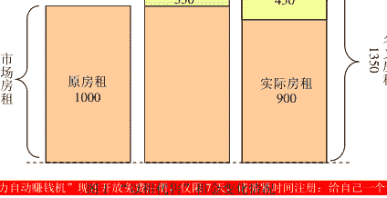

详细的分析，请看下面！

### 印钞机的威力——“以租代售”对房东的 3 大益处

对房东来说，无论是收益、灵活性、便利几个方面来看，“以租代售”的好处都是显而易见的。

（1）收益高、风险低

由于采取了“有吸引力”的方案，房东可以立即把房价（市场价）提升 10% 作为交易价。其他的收益更是可观，现列表说明如下：

#### 表 1 以租代售收益分析表

以租代售计算表

| 项目 | 数值 |
| :--- | :--- |
| 房屋市场价值 | ¥140,000.00 |
| 房屋交易价款 | ¥150,000.00 |
| 定金 | 5.00% |
| 定金实际金额 | ¥7,500.00 |
| 租售年限 | 3 |
| 租房押金 | ¥2,000.00 |
| 实际首付合计 | ¥9,500.00 |
| 市场平均租金 | ¥1,000.00 |
| 每月实际租金 | ¥900.00 |
| 每月预付金 | ¥450.00 |
| 每月买家支付总额 | ¥1,350.00 |
| 到期后租金总收益 | ¥32,400.00 |
| 到期后预付金合计（不包括押金） | ¥16,200.00 |


## 附录六：免费报告示例

| 项目 | 金额 |
| :--- | :--- |
| 到期后收益合计 | ¥48,600.00 |
| 加上首付后收益合计 | ¥56,100.00 |
| 扣除预定金后房款（扣除租房押金与定金） | ¥124,300.00 |

### 收益比较表

| 项目 | 数值 |
| :--- | :--- |
| ①买家最后购买，投资人收益合计 | ¥40,400.00 |
| 房东实际总现金收入 | ¥180,400.00 |
| 收益率(假设若干年内房价未变) | 28.86% |
| ②买家最后不买，投资人收益合计 | ¥56,100.00 |
| 房东实际总现金收入 | ¥56,100.00 |
| 收益率(假设若干年内房价未变) | 40.07% |
| ③普通出租收益合计 | ¥36,000.00 |
| 收益率 | 25.71% |

（关于数据具体的分析请与我们联系）

在上表里，您可以看到，虽然是“3年后卖房”，根据我们的经验，80%的租客最后不会购买——而且，无论租客是否购买，都可以实现收益的大幅提升。

在买家3年后购买的情况下，房东的总体收益是40400元，即28.86%收益率。为普通出租的：

28.86% ÷ 25.71%=1.12倍

在买家最后不买的情况下，房东的总体收益56100元，即40.07%收益率。为普通出租的：

40.07% ÷ 25.71%=1.56倍

而1.56倍收益率的可能性是1.12倍收益率的4倍！

所以，您不舍得“卖”吗？

其实您根本不必担心，在80%的情况下，“租客”是不会购买的（可能因为找到更好的房产，可能因为等不到钱……）。总之，您最后既获得了高额租金，又保留了房产，不必卖给租客——何乐而不为呢？

#### (2) 锁定稳定的租客，管理更省心

会参与这种交易的买家会“随便”离开您的房产吗？

当然不会。他们是有诚意要购买的租客，当然愿意长期住在这里。您的“一纸租约”实现直接锁定了一个“3年期”的租客。无需您再去为“招租”烦恼了。

他们会损坏房屋吗？

当然不会。这个“租客”会把它的当成自己的家一样来爱护。因为他们是以“买”为目的来“租”的，所以，绝不会像对待其他出租房一样“粗心”。他们会帮您把“家”收拾得干净整洁。让您省心的。

他们会拖延交租吗？

当然更不会。他们为这间房子交纳了大额的“定金”，如果因为“拖延”而损失前面的金钱，他们会“很高的痛苦指数”！所以，他们会更加积极的交纳房租，保证“购买”时的“放款折扣优惠”。

还有一点，他们可能是“来历不明”的“租客”吗？

一个想在这里安家的人，才会愿意交纳比普通租金高的月租来与您交易——试想，想“安家”的人会比“游荡”的人更危险吗？

#### (3) 毫无风险，充分的法律保障

您可能会问，自己的房产会有风险吗？

当然不会！

您在3年的“以租代售”期中，并没有转让房产产权给“租客”，大家只是普通的“租赁”关系。3年后，“租客”必须补足房款，才可以获得产权。

作为房东的您，还会有什么风险呢？

此外，这样的“以租代售”交易法律认可吗？有法律保障吗？

当然！

您只需要在我们的指导下，签定一份“租赁合同”，再附上一份“期权合同”即可——这一切都有坚实的法律基础，都是合理合法的。

对交易双方，都有坚实的保障——任何一方毁约，都要承担相应的违约责任。对任何一方都有巨大的限制机制。

如果买家中途放弃，则会失去所有已经交纳的款项（包括定金、预付房款、实际租金等）。如果买家3年期到期，无力出资购房，也会失去所有的已交款项（除了 2 个月的租金押金要退还外）——所以，房东是有充分的利益保障的。

相反，如果房东违约，在 3 年期内希望转卖给第三方时，就需要赔偿 2 倍买家已交的“预付定金”——这就是对买家的保障。

比如，上例中，李姚出租给小陈 10 个月后，发现房价上涨，希望一次性出售获利，就需要赔偿小陈：

7500×2×450×10×2＝24000（元）

如果李姚的出售，可以获得高于 2.4 万的收益，那就可以“违约”，小陈也没有损失。

以上，只是从房东角度出来来讨论“以租代售”的好处；但是，买家为什么会接受这样的交易呢？

因为：

### 难以抗拒的诱惑——“以租代售”对买家的 5 大好处

“以租代售”对那些现在无法一次性付清全款（或是首付款）、却想“自有住房”的买家，具有很强的诱惑力，因为这种灵活的融资方式，可以解决他们很多现存的困难，同时避免了很多其他解决方案的麻烦：

#### （1）无需高额首付，即可立即入住

“首付”是很多买房人的痛，很多人坚持若干年的“省吃俭用”，就是为了积蓄首付款，以便可以入住自己的家。尤其是很多刚入职 3～4 年的普通白领，他们可能有稳定的收入，可以支付月供，却由于首付款不够，也无法圆自己的“家圆梦”，甚至影响到了结婚生子。

而这种“以租代售”的方式，虽然暂时挂以“租”的外壳，其实质却是“买”为导向。一方面，买家可以及时入住；另一方面，却是真正拥有了“家”的归属感。

这种方式的首付只有 5%，即 7500 元，相比于普通房贷首付 20%来讲，大大降低了“买”的门槛，可以吸引大把“无首付、有月供”的年轻家庭。

#### （2）月供不高，容易承受

名义租金 1350 虽然高于市场租金 1000，却大大低于正常贷款的月供。因此，名义租金对买家造成的经济压力要小得多。

同时，虽然“以租代售”的名义租金比市场租金要高出 35%左右，但由于其中的三分之一可用于最后购买时扣减房价，所以其实际租金 900 要比市场租金 1000 要低。

所以，实际上买家付出了较少的租金，就住到了喜欢的房产。

#### （3）预付定金可以起到“强制储蓄”作用

很多缺钱付首期款的年轻人往往不是因为薪水太低，而是因为开销太大。不成熟的消费习惯及给付家用等支出，导致了“月光族”的队伍逐渐庞大。

所以，每个月的“预付定金”450 元的支出，相当于强制这些“月光族”储蓄购房款。450 元对他们的压力不大，却可以在 3 年后购房时积少成多。好像公积金的作用一样，变成对他们未来的一种保障。

#### （4）免除装修、家具购置等开销，直接进行试住体验

由于是“二手房”，所以买家往往不必再出钱装修，甚至很多情况下，不必再购置大件的家具、家电。这本身就是一种可观的费用节省。

同时，由于具有“不满意可以随时撤走”的条款，买家可以抱着“试住”的轻松心情来体验实际的居住效果。不满意就以较低的代价离开——即失去了前面所交纳的所有款项。但这种成本，也远低于真正购入一间不满意的房产所造成的损失。

“以租代售”相当于“先住后买”，充分保障了买家的自身利益，降低了“后悔成本”。

#### （5）心理归属感完全不同

“这房是我租的”和“这房是我自己的”——这代表了两种完全不同的“表达”语境。有过两年以上租房经历的人，绝大部分都对“租房”有苦难言，对于“买房”则热切期待。

不仅是因为租房的舒适性差，更重要的是没有“归属”感，常常“任其破烂”。

“反正也是租的”这种心理会导致租房内部环境的恶性循环。

而“以租代售”则打破了“租”与“买”之间的分水岭，使买家从心理开始“认同”房产——毕竟，这将成为他们未来自己的家。

所以，“这房是我自己的”将导致买家愿意认真维护房屋，甚至花心思布置、整理。

此外，家庭生活很大程度上与房产相关；所以，心理有归属感的房产会对家庭和睦产生不可忽视的影响。

由此可见，“以租代售”对那些租客的吸引力了吧？

既然“以租代售”完全是一种“双赢”的交易，为什么市场上此类交易如此之少呢？

那是因为，大多数房东不是专业的房产交易师，他们没有时间、没有精力、没有渠道去了解这些技巧——所以，赚大钱的人，一定有与别人不一样的地方。

您希望用时间去等待财富，还是用智力去创造财富呢？

拨打***，找*老师咨询吧！

只是一个电话，为什么不试一下呢？

### 如何无需任何投资、不冒任何风险地让您的租金收入立即增加 50% !!!


### “房地产空手赚钱术特训营”

最简单、最快速、无任何风险的
房地产致富绝技

#### **“房地产空手赚钱术”特训营**

《超级零首付》购书者报名，可以**节省 3880 元学费**

### 你可曾期望？

- 有这样一种方法：你无需任何投资，无需任何现金即可开始！
- 有这样一种方法：你无需任何基础，就可以即学即用！
- 有这样一种方法：你无需冒任何风险，就能快速见效！
- 有这样一种方法：你无论在哪个城市，都能找到大量的市场机会！
- 有这样一种方法：你可以在一年的时间内，实现平常人几年才能获得财富。

如果，这种方法，现在就摆在你的面前，你会对这种方法感兴趣吗？

### 这种投资方法，真的有这么大的价值吗？

- 也许，你已经看过很多房地产投资方面的书籍，但你找到适合国情的投资之路了吗？
- 也许，你已经看过很多房神博客的文章，但你真正理清属于新手的投资思路了吗？
- 也许，你已经下定决心，希望从零开始，进入房地产投资领域，但你找到导师了吗？
- 也许，你感觉自己已经明白了所有的投资技巧，但你真正能运用它们了吗？
- 也许，你已经尝试过一些投资实践，但你真正赚到钱了吗？
……

如果，你曾经被上面的问题困扰过，请立即往下看，了解：

### 非常超前的创造性投资绝技

“房地产空手赚钱术”是一种非常超前的创造性投资绝技——在国内你绝对前所未见。

所谓“时间就是金钱”；如果，你错过了这种“空手赚钱术”的“机会窗”，你将丧失中国最重要的房地产爆发期的海量财富。

何为“机会窗”：即机会的窗口，一闪即逝；只有少数人能抢先发现，抢先获得巨额收益；后面的人只能徒叹奈何，追悔莫及！

此刻的你，一定对“空手赚钱术”非常感兴趣——它到底是什么，从何而来呢？

此时，请让我们回顾一下《房神秘笈》的历程。

房神团队总结自己的投资经历，参考国内外的投资手法，凝聚众人智慧，写成了《房神秘笈——解放3000万房奴的终极智慧》一书，为“房神秘笈”系列的第一本投资解密书。

写书的初衷，不过是想对大家进行投资启蒙，帮助网友们改变过去的房地产理念；进而，让房产由“负债”变成“金矿”。

但是，很多购书读者反馈说，他们肯定《房神秘笈》的价值的同时，却被书中所介绍的大量的投资手法所困扰——甚至无所适从，不知该如何开始。

> 《房神秘笈》书中描写了大量的操作方法，但我却无所适从：不知到底该如何开始；你们能否不要一次性告诉我全部，而是一步步指导我前进……
>
> ——困惑的网友

毕竟，90%的读者都是从零开始的“新手”，一开始就给予太多的资讯，反而可能造成“知识噪音”，导致无法着手。

好比把十几年的求学知识都灌输给学生，他们能消化得了吗？不但不会学到适合的知识，反而连基本的内容都不知该从何学起。

正是汲取这种经验，我们决定改变过去的风格，针对不同阶段的学习者设置不同的课程。

“空手赚钱术”于是应运而生：

### 它是什么？

- 它是房地产投资大量经验与教训的总结，你从此不必再重复；
- 它是高手们长期投资实践的提炼，帮助你举一反三；
- 它是超乎普通人想象的实战技巧，你从此可以跨越式成长；
- 它是缩短新手到熟手、再到高手历程的捷径；
- 它是远超所谓“以租代售”、“期权”等技巧的“钻石”；
- 它是先行者跨行业聪明才智的汇聚。

它是你的财富“一飞冲天”的发动机！

### 它不是什么？

- 它不是“传销”/网状直销之类的非法方法；
- 它不是投资理论的无谓重复；
- 它不是传统方法的简单加工；
- 它不是复杂技巧的盲目整合；
- 它不是你听过的任何投资方法。

它就是直接打通“富足”与“贫穷”森严壁垒的“通天秘径”。


《超级零首付》的购书者，仅投资400元，即可立即参加本课程！

与其他你所知的所有投资技巧都不同，它变动性的创造价值在于：

**(1) “零投资”：**

真正的无需任何投资——无需一分钱投资；意味着，无需首付，一分首付都不必掏；无需定金，一分定金也不需要；无需其他投资手法的任何投入，你就可以开始赚钱；所以，无论是“以租代售”、“期权转让”等你能找到的任何方法，都无法比拟“空手赚钱术”的“零”特质。

**(2) “零风险”：**

除了前面的“零投资”外，无需买入、无需过户、无需转租、无需借款、无需担保……你能想到的任何投资风险，都被“空手赚钱术”一一消灭——这就是“空手赚钱术”最具革命性的一点。你不用担心任何问题，只要全力出击去赚钱即可。

“超魔力自动赚钱机”现在开放免费注册，仅限7天，请抓紧时间注册：给自己一个创造财富的机会。点击：http://fangshenmifi.cn/chaomoli.html

**(3) “超速度”：**

你试过“转租”吗？那种投资的月收益，往往只能按“百元”来计；你试过“快速转售”吗？那种投资的本笔收益虽高，但你能长年持续获得投资机会吗？至于“期权”、“转让合同”等，投资收益更低，而且手续繁琐，收益没有保障。感谢“空手赚钱术”吧，因为它帮你设计了一种非常巧妙而且先进的一“串流程”，你只要一环前进即可。

从月入几千（由于成本为“零”，所以完全是纯收益）到几万，一般情况下只需要一年时间。

**(4) “超简单”：**

它比“转租”、“期权”、“融资转售”等投资方法都简单得多，简单到一学就会；但不代表“一学就精”；需要我们不断的指导与督促，你才能快速前进。

“简单”不代表“不值钱”。简单是复杂的浓缩，它是优化所有投资链条后，抽象出来的最增值的投资环节。

就好比公式：“能量等于质量和光速的平方之积”

简单不？但你能说它“不值钱”吗？因为，它是大量理论支持后的总结。

“空手赚钱术”提供的就是这样一种方法，让你无需再去体验“试错性学习”的煎熬；你只需要模仿最成功的行动即可。

最简单、最快速、无任何风险的
房地产致富绝技
“房地产空手赚钱术”特训营


《超级零首付》的购书者，仅投资400元，即可立即参加本课程！

“超能力自动赚钱机”现在开放免费注册，仅限7天，需抓紧时间注册，给自己一个创造财富的机遇。点击：http://tangshenxuli.cn/chaonengli.html

### 那么，如何学习这种“空手赚钱术”？

互联网带给大家“学习的革命”。
你不用天南地北跑去求学问道，只要每天坐在家里——在实践中学习，在指导中致富。

我们将提供：

- 为期“一个月”的“突破性课程”
- 和
- 为期“三个月”的“跟进行程课程”。

在“突破性课程”里，将每周提供三期的在线实时教学：集中讨论、Email答疑等都将介入教学过程，借助互联网，你将体验到身临其境的教学效果。
在“跟进行程课程”里，将不定期地回答大家实践中的各种疑问，指导每一个人开展投资活动。随时解决每个人的投资疑惑。

这种“长期实践性、指导性的教学”，将一改常见的短期培训教学的弊端，真正帮助你进步，帮助你致富。

### 真正超值的投资！

- 为期一个月的在线实时教学——由我们的理财师专业指导。传授各种实战技巧。价值1500元。
- 三个月的跟进投资辅导——通过互联网跟进辅导，帮助你真正从实践中学习，价值1800元！
- “收入流”系列教学资料——浓缩房团团队大量的投资智慧，价值1280元！

以上所有价值加在一起，共需要4280元！

但是，如果你是《超级零首付》的购书者，你只要报名时出示本书（相当于已经购买了教学资料），即可给予节省3000元的超级优惠。

也就是说，你只需要投资1280元，就可以：

- 参加为期一个月的在线学习课程；
- 获得为期三个月的跟进指导；
- 分享不断更新的各类实战资料与操作案例。
- 与全国各地的学员交流提高。

更重要的是，你可以投资一次，终生免费复训：

### 最简单、最快速、无任何风险的
房地产致富绝技
“房地产空手赚钱术”特训营


《超级零首付》的购书者，仅投资400元，即可立即参加本课程！

“超魔力自动赚钱机”现在开放免费注册，仅限7天，请抓紧时间注册，给自己一个创造财富的机会。点击：http://fangshennijia.chaomeili.html
