# 跟华杉学品牌营销

你好！我是亚杉，欢迎你来到我的得到课程《亚华品牌学营销》。

先做一个自我介绍，我是上海华与华营销咨询公司的创始人，华与华是一家战略咨询品牌营销咨询公司，为企业做企业战略、品牌策略、营销策略、品牌设计、包装设计、广告创意、以及产品开创意等等一揽子工作。华与华的案例，我说几个大家比较熟悉的：

- 我爱北京天安门正南50公里——国安工业园区。
- 一个北京城，四个孔雀城。这是房地产的广告。
- I LOVE 孩，西西斑斑啊。
- 爱干净，往汉庭。
- 新东方，老师好！
- 咱是180天，厨香酱油味美鲜！
- 小麦花妈妈课堂开课了，孩子咳嗽老不好，多半年前，用爱发花牌小儿肺热咳喘口服液。这个广告经常会被同仁们恶搞成“孩子咳嗽老不好，多半是废了，打一顿就好了”。

这还有一些早期的案例，比如三桶蓝筋，蓝筋的钙，蓝筋的锌，用七巧手，拍照的时候，不喊茄子，大喊蓝七！！等等。

华与华成立17年了，每年都有精彩的案例，而且我们的大多数客户，都是我们一起从无到有的品牌，我们经历了从0到1的全过程，也形成了自己一套独特的华与华方法。这个课程，就是讲华与华方法。

## 华与华的三个核心理念

华与华方法，有三个核心理念，也形成了三个拳头产品。三个核心理念分别是——

### 1、超级符号是华与华方法的核心，华与华方法，是品牌的符号学方法

什么是超级符号？就是人人都熟悉，并且人人都会接受的指示行动的符号。

比如我爱北京天安门正南50公里，就是运用了天安门这个超级符号，还有《我爱北京天安门》这首歌，也是一个超级符号，将这两个应用在一起，《我爱北京天安门正南50公里》，嫁接到国安工业园区，国安就像一个陌生的地方，变成了一个熟悉的地方，亲切的地方，高大的地方。

所以我认为，超级符号能让一个品牌，在一夜之间成为几亿消费者的老朋友，建立品牌信任，促成大规模购买。在这个课程中，我会讲很多运用超级符号打造超级品牌的案例，帮助你掌握超级符号的华与华方法。

### 2、始终服务于最终目的，就是随时地回到原点思考问题

这是一个非常重要的思维方式。我们很多人思考问题，一是没有服务于最终目的，只是围绕假设的下一个阶段性目标，而这个目标可能根本不需要；二是忘了初心，忘了本意，自己从哪儿出发也忘了。这样既不知道从哪里出发，也不知道要去哪儿，就在中间晃荡，做大量的无用功，变动作，自己还觉得辛苦，觉得工资没给够。

### 3、所有的事都是一件事，就是所有品牌营销的事儿都要统一起来考虑

在一个团队，一个系统内解决问题经常遇到各种渠道。前面我们讲到的超级误区，是不是知道出发地点，也不知道最终目的地点，在中间晃荡。还有一种呢，就是盲人摸象，碎片化思考，没有把所有的事儿统一在一起。什么叫所有的服务是一件事呢？往小的说，包装设计和广告创意是一件事；这个大点儿是一成型，一块儿完成的；往大了说，企业战略，产品开发、品牌战略、广告创意、终端产品设计，全是一件事。一个企业的战略，不也体现在他的一招一管一单一里吗？

在我这里，我也会介绍这种从顶层设计，到基层执行，一下子捅到底的方法论，我们不仅接地气，而且我们上通下接。

## 华与华的三个拳头产品

华与华方法的三个拳头产品：叫超级符号、超级口号、持续改善。

超级符号和超级口号，在前面的案例介绍里面，我相信你已经有感受到，这也是一个品牌最核心的资产之一，一个符号，一个口号，这两样，是华与华方法的法宝。

持续改善就是把活儿做细。为什么特别要强调把活做细了：因为今天大家都企业，干这都太粗了。过去粗粗大大的经营能赚钱，现在越来越做不到钱了，必须把活做细，不断精耕细作，持续改善才行。那么怎么才能公司整个员工，都养成持续改善的意识呢？这又是一套方法论。

## 这门课适合谁来学？

好了，这门品牌学课适合什么人听呢？适合所有人。

如果你是0基础的小白，从这里开始学习品牌营销最好了，因为我的都是最基本的知识，从我的资产，你会越听越香。如果你是品牌资深人士，一定要正视可以清洗的太多的知识盲区，太存信息，找到自己迷惑。我希望能借由把你过去的精神迷雾和思想迷雾中间解读出来。

好，让我们正式开始这门课的学习吧。

## 01 | 品牌的原力觉醒：文化母体，品牌寄生，超级符号

**华杉杉学品牌营销**

你好，我是华杉。欢迎来到我的得到课程《跟华杉学品牌营销》。

这一讲的标题叫：品牌的原力觉醒：文化母体，品牌寄生，超级符号。

听到“原力觉醒”，你可能想到《星球大战》的电影，没错，就是从哪里来的。后面你没有文化母体、品牌寄生、超级符号，这几个新的概念。

### 文化母体：人类共同的经验知识

我先问你一个问题，你觉得品牌是一种商业思想，是一种文化现象吗？我们说，两者都是。但是商业思想只是它的表象，文化现象才是它的底层逻辑。如果你只是从商业思想去理解品牌，那就像割韭菜，只有从文化的角度去理解，从文化的根基上深深挖下去，才能建立起品牌的大度。

我们平时在做品牌的时候也经常说品牌文化，但好像都是把商业思想文化化包装一下，对不？然后再给品牌穿上文化的衣服。这是“贴牌”，不是从文化角度切入，因为文才是它的根。

所以研究一个问题，要从它的底层逻辑和最基本的管理原理去，这就是我们说的要找到原理的解决方案。这样的话，你就发现它最原力的源泉，最具原力的源泉——动力源，也是《星球大战》里面的原力——原力觉醒，势不可挡。

我希望通过这一讲，大家都能学到品牌原力觉醒的方法。

那么，“原力”是发挥出品牌的力量，它就从哪里来呢？它从哪里来呢？从最古老的地方，从人类的历史几百年、几千年、几万年的历史当中来。我们把它称为“文化母体”。

什么是文化母体呢？我们先说什么是文化。文化就人类一切物财富和精神财富的总和。这是《现代汉语词典》给我们的定义。每一个品牌都是一个物质财富和一个精神财富的集合体，所以，品牌就是一个最典型的物化标志。

那么，文化母体就是整个社会共同的文化，我们生活中环境中、不新重复的那么一部分，反复地成为我们所有人的共同经验，共同认知，共同概念。这是我们生命体验的积累，先代先传的人，每一代人都知道，而每个人的观念和行为都会受到影响，甚至会变成某种程度的文化。

最近比较热门的话题就是文化的冲突，冲突就是因为我们是不同国家、不同民族的人，我们的文化母体就有差别。我们共同的、不同的那部分，有不同不同民族、不同文化、不同文化母体的那部分，所以我们既有联系，也有冲突。

那么，把这些文化母体的力量进行分类，在找它的符号，再把它们的能量聚焦在特定的产品上，就是品牌原力觉醒的运用文化母体的方法。

我们基于文化母体来构建品牌，也就像是基于人类的文化或者我们民族的历史遗产来创造品牌。这就是我们品牌源于母体，然后又重返母体，最后成为母体，壮大母体。

产生这样的联系，可以允许你十年、一百年的能量持续地从母体中获取能量，同时也能为母体不断地贡献，产生新的品牌。

### 圣诞老人为什么属于可口可乐？

我觉得这讲头首先举一个例子，如果不举一个案例的话，可能会理解起来会比较困难。下面我们就举一个运文化母体的品牌案例。

说到品牌，你们觉得全世界最厉害的品牌是啥啊？你们可能都会脱口而出，可口可乐。那我们第一案例就是可口可乐。

刚才我们说了文化母体是我们生活中循环往复、不断重复的那部分。中秋节是我们很重要的一个文化母体，比端午节就是我们中国人的一个文化母体，那么圣诞节就是西方基督教的文化母体了。

明。

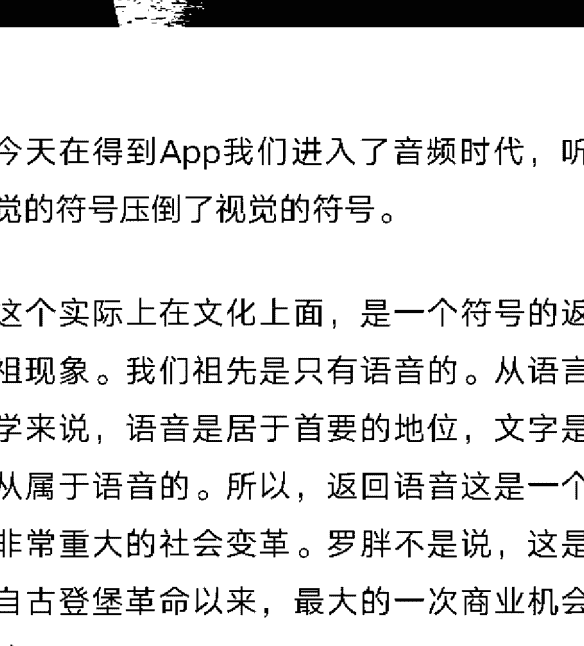

今天在得到App我们进入了音频时代，听觉的符号压倒视觉的符号。

这个实际上在文化上面，是一个符号的返祖现象。我们祖先是有语音的。从语言学来说，语音是居于首要的地位，文字是从属于语音的。所以，返回语音这是一个非常重大的社会变革。罗胖不是说，这是自古登堡革命以来，最大的一次商业机会嘛。

所以，在这里我也为后面的课程做一个预习，我要提前给大家两个理念：

- 1. 语音第一，文字第二。
- 2. 听觉第一，视觉第二。

这都是我们品牌营销传播的基本原则。

接着说符号，得到的口号是“知识就在得到”，源于培根的名言，知识就是力量。那我今天也要说一句话，知识就是符号。没有符号就没有知识，连1+1=2也不能有。为什么？1+1=2有几个符号啊？1是一个符号，“+”是一个符号，“=”是一个符号，2是一个符号。

你看，如果没有符号，整个科学的大厦根本就没办法构建起来。所以，人类文明的一切就是符号，符号就是一切人类文明。

### 超级符号：让人喜欢和行动的符号

知道了什么是符号，那什么是超级符号呢？超级符号就是那些人人都认识，人人都熟悉，人人都喜爱，并且人人都按它的指令来行事的符号，这也跟刚才我讲的文化母体是一样的。我们的观念和行为都会受它的影响，甚至会受到它的控制。

比如说街上的红绿灯，这就是一个超级符号。你的行为就要受它的控制，如果你不受它控制，可能你就有生命安全问题是。

那么，我们要找到这些超级符号的资源和系统，建立品牌最高效的方法，就是找到一个文化母体，用超级符号把你的品牌寄生于这个母体，获取母体的原力，那就能够在一夜之间让一个新品牌成为亿万消费者的老朋友，发动大规模的购买，然后还能管用一百年，甚至一千年。

## 总结

这就是我们第一讲开题要讲的文化母体、品牌寄生、超级符号。

这节课的信息量非常大，你可以多听几遍，或者听完后面的内容再回来重新听，品牌营销的最高法门都在这一讲里面了。咱们后面的内容就是通过一个又一个个的案例，来帮助你熟练地运用文化母体、品牌寄生和超级符号的华与华方法。

好，这一讲就到这儿，知识就在得到，咱们下一讲见。

**跟华杉学品牌营销**
打造超级品牌的完整方法论

## 02 | 符号：为什么说商业文明就是符号文明？

你好，我是华杉。欢迎你来到我的得到课程《跟杉杉学品牌营销》。

这一讲我们要讲一个概念：消费者购买的不是商品，是符号。

上一讲我们讲了文化母体、超级符号、品牌符号的基本方法论框架。这一讲，我们要把这个符号事儿仔仔细细地鼓捣鼓捣。

### 商品就是符号

前面我们说过，一切都是符号。人类文明就是符号文明，而商业文明当然也是符号文明了。所以，商品其实就是符号，消费者购买的不是那个东西，而是那个符号。

在商品世界里，人们通过消费符号来完成自己的角色和定义。

比如说，一个姑娘拎一个LV的包，她买的就是那个logo吗？所以说LV包不是一个装东西的工具，而是一个符号道具。一个成功人士，他住什么地段，开什么车，穿什么衣服，就是他给自己打造的一整套符号系统。

有人不同意这种观点，就是说没有商标、没有符号的商品，就是说没有符号怎么命名？没有名字它是没法命名，有啊，其他就归结为这个东西合不合法叫不叫食品，咱们先不管食品实际上成了什么？它成了一个品牌符号。

你看，这是不是很讽刺的一件事情，他说他要做个没有符号的东西，实际上他创造了一个新的符号。

### 产品是为包装服务的

不过我这里是说商品是符号的含义，不光是商标。商标符号只是比较表层的含义，我们要讲更深一层的符号，不是说起商标，不是说这个商品本身它就是符号。

比如说李锦记，它是靠什么起家的？靠塑料花起家的。塑料花是什么？它就是一个花的符号啊。

现在，咱们家里很少有塑料花了，都买鲜花。但是，几十年前，人们没有这个条件，每天都要鲜花，放几天又得换新的，换不起，他就买塑料花，一放可以放好几年。

那么，商家把这个塑料花做得鲜艳欲滴的，顾客把它买回去，放在家里，那家里来了客人之后就夸它，“哎呀，这个塑料花好漂亮哦”，这主人一听很高兴，他希望那个是假花吗？是不是？不希望人家一看就知道它是塑料花。

被别人看出你那是塑料花，主人才不高兴，那家庭就要开到鲜花了，这个塑料花也不能太完美，有的叶子得让它蔫掉一点，还得有虫蛀，还是有在干嘛？这是通过添加劣于真实更像真实，那么，顾客知道这也是假的，但是他愿意掏钱来买那些虫眼。

我在得到的录音棚里的这张桌子的表面贴了一层木纹膜，我知道这个桌子不是原木的，但是，它贴上了这张木纹纸，就贴上了一个原木的符号。罗胖知道它不是原木的，但是，他还是愿意买。

你去买方便面，它的包装上有大块大块的让你垂涎欲滴的牛肉，你知道里面根本就没有牛肉。但是，如果说他在设计包装的时候不加上这些牛肉符号，而是把里面的调味包给你展示出来，你买吗？

就有一个做方便面的企业家跟我说，怎么能包装上放牛肉呢？应该让调料包展示出来，我说你千万别这样，因为消费者就知道你里面没有牛肉，但是，他需要这个包装上设计的牛肉符号。你如果不放牛肉符号，把调料包放出来，你肯定一卖也卖不出去。因为消费者买的就是那个包装。

所以，往往不是包装为产品服务，而是产品为包装服务。商品即包装，包装即产品。

比如海底捞火锅把它的高端产品分析出来，在超市卖调料包叫做快销商品，在超市分析出来，分拆出来，这个东西叫做商品国理，分析出来香透上市，现在也有350亿市值的市值，也是很大的一个生意。

下面这张图，就是华与为给海底捞火锅底料做的包装设计。这是从这个锅底面的包装上。我们并没有去掉里面那个底料的照片，而是拍了一碗正在沸腾的火锅。要拍出美味的符号感来。

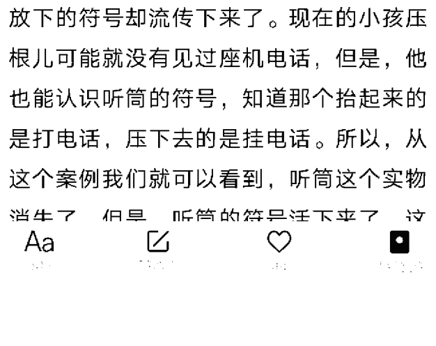

为了拍出这张照片，我们专门请了日本的专门团队，核心是个人，一个摄影师，一个厨师，就是摄影师从头拍到尾，那个摄影师从头拍到尾，那个摄影师从你爷爷开始就专门负责摆菜。这就叫做匠人精神。

那么你看对这个沸腾的火锅，沸腾有气泡，对不对？如果把火调小点出气泡来，气泡起来还能拍吗？拍不了，对，对不对？这些气泡都是下面有个装置是吹出来的。这两个瓶子一共用的是15万元人民币，就是为了拍出美味的符号表现。

顾客在超市的货架上看到看到这个包装，我们说这个符号就叫做触感的味蕾。食品包装都不能光光就让人刺激味蕾的刺激，你还得刺激他的味蕾，让他流出口水来，这时他才购买的欲望。你说这个符号有多么重要。

当然，在每一个包装的左上角都有一个大大的“嘴”，这是华为给海底捞原设计的品牌标志呀。如果他没有这个“嘴”，没有海底捞了，那顾客也不会买，因为没有品牌啊。

所有的包装都是以红色、黑色为主色素的，但是你没有注意到，右边那里是一个酸菜鱼的火锅底料，它是紫色的。为什么在这里面用了一个紫色呢？因为最早做酸菜鱼的那个公司，它的包装就是紫色的。现在它反成了一个行业标准的了，消费者一看到这个颜色，就认这个是酸菜鱼。

所以，整个传播的设计本身就是符号的刺激和服务行为的反射。

### 符号给人信息，让人行动

不仅是商业世界，我们的生活就浸泡在符号的海洋里面。没有符号，可以说我们寸步难行。

每天早上上班，路上的红绿灯，我们之前讲过了。那道路中间还有分割的符号呢，如果是双黄线，你开车就不能掉头。还有男女厕所的标志，没有这个符号，你连厕所都上不了。

但是，我们很多公司是看不懂这个符号。你去到一些公司，本来男员工厕的门，你是去上，出来女员工上厕所，但是是，他再要设计，先给你设计一个男的和女的两个，分别安男厕是所有女厕所的门上。为一下厕所的门，哪个都是厕所。因为我看不能看，都是门，这就是他将符号盲目地改造，给人添乱了。

所以我们的符号是给人信息，给人刺激，让人行动。如果盲目地改造符号，模糊了它的信息，让人不知道该怎么行动，那你就让符号失去了意义。

一切物质都是短暂的，唯有符号永恒。现在你手里拿着手机听我的课，我就说这手机吧。

拿到手机的时候，你不用看说明书，拿来就能用。为什么不呢？因为那些符号都能认识，不认识的你也可以猜，而且设计师的基本法人。能够修一下手机没有使用过手机的，它也能理解第二个指示正确的使用。

你看，手机上有一个拨打电话和使用，这是个响筒的符号，手机放在根长就不分成插座和听筒两个部分。但是，听筒紧接在放下的听筒就流下来了。现在的手机连接根儿可能都没有见过座机电话。但是，他是认识听筒的符号，听筒那个拎起来是拨打受，压下去的是挂电话，所以，从，这个案例我们就看到，听筒这个事物，你，也就是符号，符号变成了什么？

这个案例我们就可以看到，听筒这个实物消失了，但是，听筒的符号活下来了。这样的案例非常多。

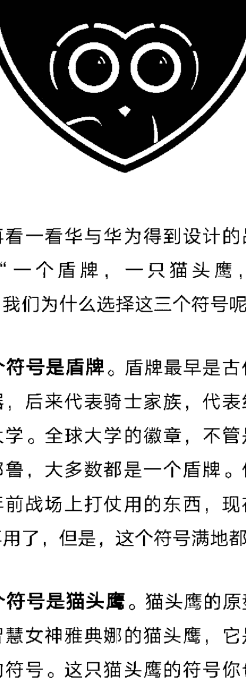

我们再看一看华为华为得到设计的品牌标志，“一个盾牌，一只猫头鹰，一本书”。我们为什么选择这三个符号呢？

第一个符号是盾牌。盾牌最早是古代防御的武器，后来代表骑士家族，代表组织，代表大学。全球大学的徽章，不管是哈佛还是耶鲁，大多数都是一个盾牌。你想这几千年前战场上打仗用的东西，现在几乎很少再用了，但是，这个符号满地都是。

第二个符号是猫头鹰。猫头鹰的原型是古希腊智慧女神雅典娜的猫头鹰，它是代表智慧的符号。这只猫头鹰的符号你也可以在全球很多学校的徽章当中看到。

第三个符号是一本打开的书。在得到我们更多的是听书，你手里拿的是手机。但是，我们还是使用书的符号，因为书籍是知识的符号，知识就在得到。在这本打开的书上写上“得到”两个字，这就是得到的徽章了。

这个设计过程叫什么？我们把它称为把文化符号，或者把超级符号私有化的过程。因为品牌是私有的，当它成为品牌的时候，它就不能是大家的了，必须是我的品牌资产。

对传统的文化符号、超级符号加以改造，把它私有化，就是我们的品牌超级符号的方法。

那么，华与华方法说到底，就是品牌的符号学方法。

## 品牌营销就是心理学的应用

这里，我想多说几句。无论是品牌的学问也好，营销的学问也好，它都属于什么？属于应用学科。甚至就品牌来讲，只是应用，还没有一个公认的完整的学科。那么，我们一定要到它的底层学科、基础学科去研究，一路往根上去探求。否则你在中间飘，上不着天，下不着地。

品牌营销再往下是传播学，传播学之后是符号学，符号学再往下是心理学。心理学是两大分支：

一支是弗洛伊德、荣格，从精神分析到集体潜意识，然后再发展成我们的品牌原型、品牌符号的理论。

一支是巴甫洛夫的刺激反射，他更关注人在信息刺激之后的行为反射，后来发展成行为主义，这也进入了广告界。

华与华的符号学方法也是对应着心理学的两个分支，分成两条线，一条线是这两讲的，通过超级符号，将品牌寄生于文化母体，利用人的集体潜意识，这背后是弗洛伊德和荣格的理论。另一条线是通过符号的编辑，给消费者释放信号，刺激消费者做出行动。在后面的课程里，我会分别展开这两条线。

## 总结

第一，一切都是符号，人类文明就是符号文明，商业文明更是符号文明。

第二，要想建立品牌，就要打造自己的超级符号，而打造自己的品牌超级符号的方法，就是将传统符号改造，私有化。

知识就在得到，我们下一讲再见。

## 03 | 超级符号：怎么让人快速接受你的品牌？

你好，我是华杉。欢迎你来到我的得到课程《华杉品牌课》。

前两讲，我讲了人文主义是符号文明，一切都是符号。物品是符号，品牌也是符号。品牌的作用是传播，而传播又是什么呢？传播就是对符号的编码和解码。

### 编码目的是让人行动

我在这讲的这门课，就是用中文的语音符号来进行编码。你收听的过程是理解符号的过程。如果你不懂中文，你就不能完成解码的过程，那你也就不知道我在讲什么了。

所有的品牌设计、包装设计、电子商务的页面设计、店面的设计、橱窗的设计、广告的设计，都是符号编码的过程。

那么，怎么来编码呢？怎样的编码才能让人去解码的效率最高，对它们动作的影响力最强烈？那就是用超级符号来编码了。

前面我们也讲了，超级符号就是人人都识得的符号，如果你用了人不认识的符号来编码，那么他就没法解码了。

比如说我忽然讲俄语，如果你不懂俄语，那你就没法解码。

如果用人人都熟悉、都喜爱的符号，而且这个符号让他感觉到愉悦，那他就能够解码。并且人人都能很快的在他的指令下行动。如果他看了这个符号就有动作，就有行动，就有一个行动之前都未听说过的新品牌，会在 一夜之间忽然成为他的老朋友，他会有动作会为你有强烈动作。我们喜欢，然后消费者做出购买的动作。这就是我们需要超级符号来给我们发挥的作用的，就是我们讲到的像红绿灯，男女厕所标志那样的符号，直接让人行动。

有没有人用红绿灯的符号做产品的设计？有，就是大名鼎鼎计算机公司的乔布斯，如果你的电脑是苹果系统的话，那么你看它的视窗，左上角的就三个符号，是不是一个是红色的，一个是黄色的，一个是绿色的，红色的就是关闭窗口，绿色的就是打开全屏，黄色的就是隐藏。

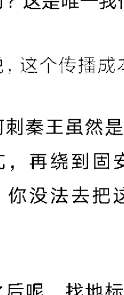

所以，你不看到一个那个叉，是一个叉加一个减号，不需要是一个加号，你能够技术能来操作。这三个颜色是不是比微软的那个窗口更感觉简易？而你是绝对不会有思考的，你不需要经过思考，不需要思考，直接就可以行动。这就是用了超级符号的符号，寄生在了红绿这种大家熟悉的符号上文化在体上。所以，每个人有共识，每个人有它的指令来行动。

乔布斯是怎么想出这样的方法的？我看了《乔布斯传》，里面说在他也年轻的时候，有一次他的父亲带他回家乡——威斯康星州。他父亲家有一个原奶牛的农场，乔布斯就去小看了，正好看有一头奶牛生下一头小牛。他说，这个小牛一下生下来，自己落在地上站起来了，没有人在赶它，它就没有走过去，就是小牛肚子里面好像有全部的电路。乔布斯觉得所有的产品都应该这样设计，让消费者没有去就会做。

所以，我们不是编码和解码吗？这个解码并不是只是让他识别或者能够记忆，最重要的，或者我们最重要的目的是要让他的行动，或者符号所要的行动就是让他购买。

所以，你要记住这一点，让消费者购买是我们的目的目的，不要什么都想想，也可惜说了，但没有行动不是想法。那样也不行，不是我们品牌符号的目的。

和那种感情，而且这差不多也是我们每个人学会唱的第一首歌。

那么，紧接着，我们就购买了《我爱北京天安门》这首歌的版权。在固安工业园区成立10周年的晚会上，我们选了几十个跟工业园区同龄的小学生，一起表演唱“我爱北京天安门正南50公里”。这个词是我写的。

(唱)

我爱北京天安门，
正南50公里。

小城市有大梦想，
固安人民欢迎你!

我爱北京天安门，
正南50公里。

固安工业园区，
未来城市在这里!

唱完这首歌，我再重复一遍，所有的传播都是符号的编码和解码。有了口号，有了歌曲改编，还不够，我们对固安的编码还没有结束，除了口号，我们还要对固安的平面广告进行编码。

我们先看固安工业园区营销的对象是谁？我们的目的是什么？

我们的主要营销对象是企业家，目的是吸引企业家来我们这里投资。所以，我们在广告画面上就用了一个外国企业家的形象，他一定不能很帅，不能像时装模特，也不能像007，他最好就像一个德国大叔，一看就是哪个工厂的厂长、经理，而且一眼就是制造业的，实体经济的，不是互联网看的，不是罗胖那样的。然后，我们再让他端一块标语牌，一个很中国的标语牌。那标语牌的原型在哪儿啊？在天安门广场啊。就是“世界人民大团结”那个大标语牌。

所以，你看我们的标语牌和字体都是天安门符号的这个原型。这样构成的广告就足以成为百年经典的广告了。

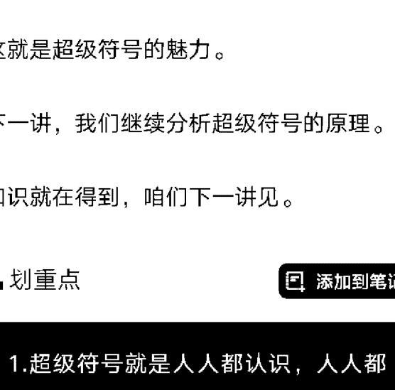

读者看到这个广告，他去解码的时候，首先看到“我爱北京天安门正南50公里”，他就知道这是一个地方的广告。然后再看到这个西装革履的德国大叔，他会知道这是一个投资建厂的地方，肯定不是让他来旅游的，也不是搞服务业的，他一定是制造业，搞实体经济的。

在后面的课程里面，我会讲到西贝莜面村的案例，我和西贝莜面村的结缘就是因为这个广告。这是后来西贝的董事长贾国龙告诉我的，他说他在飞机的杂志上看到“我爱北京天安门正南50公里”，第一，特别想去看一看；第二，就想知道这是谁做的。那么他去看一看是想做什么呢？他就是想到这个地方去建西贝的中央厨房。“我爱北京天安门正南50公里”，天安门正南50公里好像这个距离比较适合。虽然最后他没有选择在固安投资，但是这个结缘是因此而起的。

这就是超级符号的魅力。

下一讲，我们继续分析超级符号的原理。

知识就在得到，咱们下一讲见。

添加笔记

> 1. 超级符号就是人人都认识，人人都熟悉，人人都喜爱，并且会按它的指令去行事的符号。它能够即刻消除人的陌生感，固安本来很陌生，一下子很熟悉，而且一下子很喜爱。
> 2. 所有的传播都是创作者来进行符号编码，而接收者来进行符号解码的过程。用超级符号来进行编码，受众解码的速度最快，效率最高，解码释放出来的信息量最大，还有强大的感情和能量，这样就能最快速地识别、记忆、行动，而你也快速建立你的品牌。

跟华杉学品牌营销
打造超级品牌的完整方法论

前一篇

## 04 | 超级符号的三个判断标准

你好，我是华杉。欢迎来到我的得到课程《华杉品牌课》。

这一讲，我要讲超级符号的三个标准：第一，明确的指标；第二，浓缩巨大的信息和情感能量；第三，强烈的行动指令。

### 超级符号的创作标准

第一，明确的指标。指标是什么意思呢？是“能指”和“所指”。你要一个符号它到底指的是什么。如果一个指标不明确，说了半天不知道是谁，那自己说了吗？

我们上一讲讲的，“我爱北京天安门正南50公里”，它就最是指向固安，不会指向第2个地方。

我再补充一下，之前我说我们要找固安的地标但是找不到，然后我们才找天安门，才做了“我爱北京天安门正南50公里”这个创意。北京，我告诉你，这个地标有什么，是什么？你也可以猜猜，就是我们在园区做了个天安门正南50公里的地标，类似古代的茶院那样的东西，总之那个点就是天安门正南50公里的点。这就是我们讲的第一个标准，就是明确的指标。

第二，浓缩巨大的信息和情感能量。超级符号它是把很大的一个信息压缩的超压缩包，你像传统，文件很大，然后你把它压缩在一个压缩包里，那个解压缩包，收到压缩包人要花一个解打开面有什么呢？要有巨大的信息和情感的量。如果不对食包进行解包的假设的话，我们希望还能刺激他流口水，必须要刺激他的食欲，那样才可能够有效。

我们这个“我爱北京天安门正南50公里”这个压缩包来看：

它能传达的第一层的意思是固安的地理位置，“天安门正南50公里”这个信息的背后其实是包含了我要把所需了解的，如果不是包含在里头，他也要去翻查多少公里，距天津港多少公里，周边的海陆立体交通条件怎么样，有多少条铁路，有多少条公路，多少条高速，也包含了北京资源共享，而河北成本优势的信息。这是不是就是他需要的选址的最重要的信息？

第三，必须有感情的能量。除了让人熟悉、让人了解之外，还要建立品牌偏好。不仅让你了解，还要让你喜欢啊。那么，这就用了我《爱上国宴天安门》这款游戏玩家的媒体潜意识思维和身体经验，这是传播学里面的一个重要的理论。

天安门的价值和童年时代的美好回忆、家国情怀，包括了童年、年度，最美好和最宏大的东西，都在里面了。

这让我想起法国心理学家罗兰巴特讲过的一句话，“商业时间不是装饰我的，而是庞大的。是与时代的大大贸易相结合的。”

你看，我们在讨论广告的时候，经常有人说，“哎呀，你要买个商业动机”。那么是什么呢？你想家装饰我的商业动机。那当你掩饰你的商业动机的时候，你不直接，人家收不到信息，你又躲又发出。然后他不掩饰的时候，你犹豫又发出，“哎呀，我是不是又高高大了，商业动机太赤裸裸了吧？”

所以，商业动机不是被掩饰，而是被放大，而与现代的文化背景相结合。那就有了，说他方政府要招商，要发展地方经济。但是，结合时代的宏大叙事，“我爱北京天安门正南50公里的”，

这就是超级符号的三个创作标准：明确的指标；浓缩巨大的信息和感情能量；强烈的行动指令，让你让他行动。

### 超级符号的理论脉络

超级符号之所以厉害，就在于它能够四两拨千斤。两两就是意识和潜值。而千克拨动的要素是意义和情感，这个潜意识去向接受者发出行动指令，这个潜意识信息比符号本身要大一千倍，大一万倍。

那么说到潜意识，你会想到谁呢？弗洛伊德。没错，这正是超级符号背后的心理学原理。不过，我们更准确地说，不是弗洛伊德，是荣格。

超级符号方法是一种符号学的方法。在前面我们讲到过荣格、弗洛伊德和荣格，提到了符号学是心理学的分支。在这一讲，我简单说一下荣格的符号学。这场游戏和它整个的发展脉络。就是我们一讲的时候做了一个应用举例，一定是把他的基础科学一步一步地推到最终运用的。

我们从弗洛伊德讲起，弗洛伊德提出了潜意识，潜意识是人的一类行为的自主权能力，潜意识是人形成的。那么，荣格在他的基础上提出集体潜意识，就把潜意识的形成当成童年，一下子推到他出生几年前几十年。他说，集体潜意识不是童年形成的，而是每个人生俱来的，就像乔布斯喝中小牛下来着其他。人生下来虽然不会去，但是也带着其他的一些生理特征。

荣格的集体潜意识就是，人类世代相传的活动方式和经验，储存于大脑结构当中的遗传的数据。集体潜意识的内容是全的潜能和它所对应的原型所形成的。

这里我们又增加了两个概念，本能，那弗洛伊德看到了小乔，看到它的本能，那时候还在中年时代，他觉得领悟到，以他认识产品，要让它符合人类的本能，所以有了红黄球三个按钮。

那红黄球的原型是什么？是红球吗。但是，红球球的设计不是凭空想出来的不，是它的基于人类的历史。远古时期，人们就知把红色警告，绿色代表安全，所以，本能和原型是相互依存的，本原型是意识的基底，而原型都是文化外生出来的景象。

在荣格之后呢，荣格影响了一个人，这个人叫坎贝尔。坎贝尔这个人非常有趣，因为他是神话学的宗师。他开始收集世界各民族的神话，写了一本书，这本书你只能买到，叫《千面英雄》，本一个英雄，但是有他有一个面。什么意思呢？他发现各个民族的文化中，他们的神都是英雄相似的，比如说都是美女，那是圣殿亚国王生的，但是，圣母玛利亚并不是她的丈夫合生了耶赫，她还是处女生的时候就生下了主耶赫，她还不是处女。

我们中国的话，他们文化是什么？三个仙女在后溪里洗澡，然后怀孕了。三圣母是在溪里下凡，第一个苗头生苗头是从哪来的，一个苗条姑娘在热水里面洗衣服，然后河上游漂来一个小镜的仙流，这个竹漂漂到她的两盘之前，然后她听到里面有婴儿哭声，打开，里面有个男孩儿，然后他就把它拿走了。成了苗，这就是第二个苗子，就是苗族的祖先，包括印第安的神话，都是处女生的。

他们当时并没有上来联系，为什么他们的神话都是一样的呢？再看他们每一个民族神话里面的英雄，发现都是一个故事。什么故事呢？他把它总结为英雄的旅程。

这个英雄的旅程，第一个是发起挑战，离去清了一个魔鬼，要有一个邪恶的心。消灭这个邪恶心之后，他就拯救世界，然后要跨过千山万水，历经九九八十一难，到了那个地方。而这个邪恶心周围一定有又猛的守护，或者狮子，或者狗头，或者妖怪们这些罪恶势力，可能找到罪恶，最后把这个邪恶心消灭，拯救世界。这就是英雄的旅程，神话的原型。

有一个电影导演叫卢卡斯，他受了坎贝尔的影响，改编了一部电影，这部电影就是《星球大战》。

《星球大战》就是把英雄的旅程从地球推向宇宙。

大家都熟悉这部电影，《星球大战》里面最大的力量是什么？原力，Force，原力。我们第一讲就讲到是原力，他也就是力的原力，这是最强烈原力。

你想看，现在这些美国的品牌电影，《007》《美国队长》《蜘蛛侠》《变形金刚》，是不是都是千面英雄？是不是都有一些的旅程？《阿凡达》《冰雪奇缘》《星球大战》，所有这些故事都是同一部电影，是不是都是尼考洛·阿曼故事，一过过来，从007中到了太空，这就是一个人类共通的英雄的旅程原型。

### 品牌理论就是心理学的延伸

好，我们已经看到这个品牌，从弗洛伊德讲到荣格，讲到坎贝尔，讲到卢卡斯，那么讲到荣格，讲到坎贝尔，讲到卢卡斯。那么从这个集体潜意识到神话原型的思想，后来在广告学里面就形成了品牌原型的理论。

有一个美国的广告人叫做玛格丽特·马克，他曾经做过场雅广告公司的副总裁。他写了一本书，叫《很久很久以前》，副标题是：以神话原型打造植入人心的品牌。这本书有中文版，他就是用荣格、坎贝尔的理论，然后建立了十二种品牌神话原型。

这本书的销量不是很大，主要是书名取错了。我觉得他是广告人，还能够研究品牌十二原型，为什么不会取书名呢？在对书名进行符号编辑的时候，他没有知行合一。如果我来改这个书名，就叫“品牌十二原型”，我看销量再翻十倍，再多卖五十年没问题。

实际上，在广告业的黄金时代，广告界的这个思想是非常领先的。我不是说了心理学的这两条线吗，一个是从荣格到坎贝尔，然后到品牌原型；另外一条线就是从巴甫洛夫的刺激反射，到行为主义。行为主义的奠基人，是一个美国人叫华生，华生是什么人啊？他是智威汤逊广告公司的副总裁。所以，他们都是4A广告体系的人。

但是，这些年在那些广告人去世之后，我发现所有这些思想在整个4A体系里面完全失传了。我想我的听众里面应该也会有4A的广告人，不知道你们公司还有没有再讲这些理论。我感觉我是遇不到懂这些东西的人了，好像它失传了。所以，我觉得我需要把这些理论重新再搞一遍。

所以，为啥我说儒家思想叫做为往圣继绝学呢？这也是一个为往圣继绝学的工作。

最后我想说，不管是神话、电影、品牌，还是超级符号，背后的原理都是一样的，就是心理学的原理，从弗洛伊德的潜意识理论，到荣格的集体潜意识。使用超级符号就是回到人类文化母体，激活受众的集体潜意识，利用人类文化原型，获得人类文化原力，这是最深层、最高级、最强大的真正的洪荒之力。

下一讲，我会用一个完整的案例故事，西贝莜面村的案例，来详细地剖析华与华的超级符号理论和整个创作的过程。

这一讲我们提到了几本书，我最后也给你重复一下书单。弗洛伊德、荣格的书，我就不推荐了，因为你不是专业干这个的，也啃不动这么多太专业的著作。坎贝尔的《千面英雄》，我推荐你可以读一下，任何人都可以从中受益。如果是品牌广告的专业人士，玛格丽特的《很久很久以前》，我也推荐你阅读。

知识就在得到，咱们下一讲再见。

### 划重点

## 05 | 超级符号的创作过程 - I LOVE夜，西贝莜面村

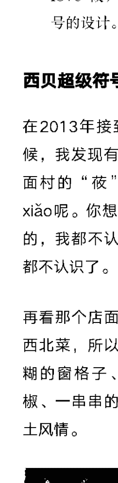

你好，我是华杉。欢迎你来到我的新课程《华杉品牌营销课》。

这一讲，我要讲一个例子，而且要讲这个案例的从创意到制作的整个过程。通过这个例子，你也可以掌握超级符号的品牌方法，用在你的品牌上。

这个案例就是华与西贝莜面村的案例。

我给你提个要求，听完这一讲，下一顿就去看西贝莜面村，下一顿看看它们的“I LOVE，夜，西贝莜面村”的整个超级符号的设计。

### 西贝超级符号的来源

在2013年接到西贝莜面村这个客户的时候，我发现有一个问题，就是这个西贝莜面村的“夜”字我不认识，我还没有为读xiāo呢。你想我搞这肯定是属于以多识多的，我不认识的话，全国可能好多朋友都不认识了。

再看那个店面形象，当时西贝的定位是西北菜，整个店面到处都是西北，纸糊的窗格子，炕头、窑洞，一串一串的辣椒、一串串的玉米，带着浓浓的西北的乡土风情。

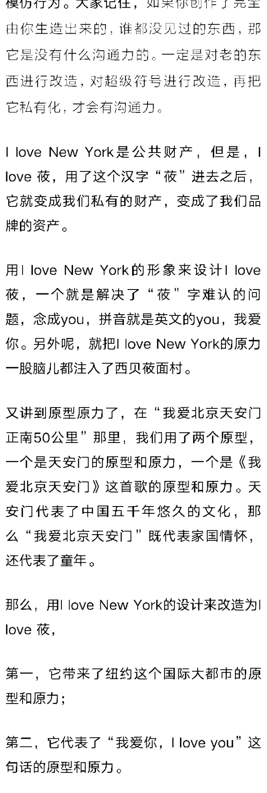

那么，咱们第一讲就讲了文化母体，品牌寄生、超级符号的华与方法，对不对？那西贝之前也不认识华与华，也不知道这套理论，但是，你看它是不是也本能地用了这套方法？

纸糊的窗格子，热炕头、窑洞，挂起来晒烤的一串串的辣椒，玉米一 一这不就是西北乡村的符号系统吗？它之前定位是西北，不就是以西北为文化母体的吗？西北这个母体具体地，因为符母体的西北是新疆、陕西、甘肃、宁夏和内蒙的西部，但是内蒙古的企业，老板是内蒙人，但它是使用这个符号，在我内地人看来，倒好像是陕甘边区的汉族乡村的文化，感觉到延安了。

所以，用我小说，品牌是企业的文化资产，是一套符号系统。那我们要不要给这个西北乡村文化母体，要不要老陕乡下热炕头，辣椒玉米炕游天游的这个文化符号系统呢？

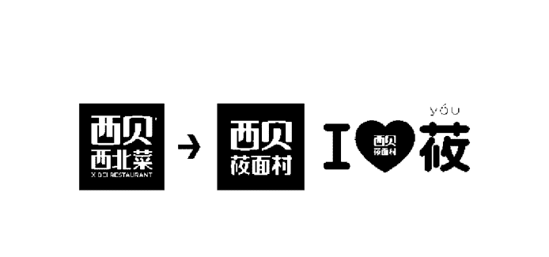

### 不要风情化，要大众化

改变了文化母体就要改符号系统。第一件事情是改标志，也就是把“I LOVE夜”作为西贝的品牌标志；那么第二件事就是在店面的设计上要“去西北化”。

实际上我本人店面设计上面是比较反对有风情的设计的，就是要太大众化，不要风情化。为什么呢？有风情就很难有规模，因为有风情东西，风格太明显，有的人会很喜欢，有的人会不喜欢。店面的风格最好太大众化，舒适、明亮就好，你也不要把装修得很很有看头，那顾客进来之后东张西望，上天看看灯，看墙上，再看看挂的画，那他不就分散注意力了吗？到餐厅你给我看累就好了。

甚至到餐厅的餐具，我都不希望它过分设计。

我记得有一个工业设计师说过，他说：你要设计一个汤勺，如果使用拿起汤勺的时候不是直接去喝汤，而是去欣赏你的汤勺的话，你这个汤勺的设计就失败了。汤勺的设计要让人不去注意这个汤勺，而去享受那个汤。就是说你要来演戏，但是你不要来抢戏。

那我跟西贝要总一说之后，他秒懂，他说，“哎呀，你这一说就是魏泰丰的风格嘛。”之前我一直研究魏泰丰，他说我这一说感觉魏泰丰好像就是照我说的这样去做的。这样呢我们就有了现在这个明亮的殿堂和明星。

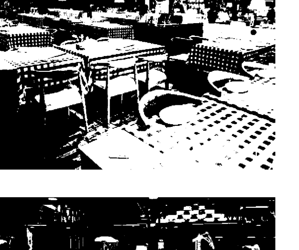

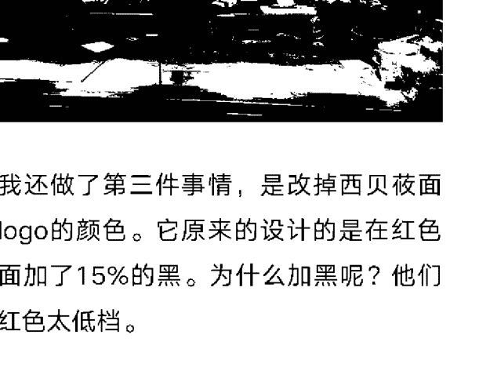

那我还做了第三件事情，是改掉西贝饭面村logo的颜色。它原来的设计的是在红色上面加了15%的黑。为什么加黑呢？他们说红色太低档。

诶，有意思啊，为什么会觉得红色低档啊？我为这个事儿，这十几年跟很多客户吵过架。因为很多客户都会说红色低档，说红色太low。当他说红色low的时候，我就骂他们，我说你自卑。他们觉得很冤，红色low怎么就自卑呢？我说因为红色是中国的颜色。然后你觉得中国的东西都low，是吧？只要是民族的就是low的，只要是外国的就是洋的。

他说，嘿，你岂不是I LOVE New York当洋吗？我说一码归一码，分讲。以前你觉得红色low，然后红色配黄色是最low的，是吧？现在在红色配黄色是不是越来越时尚了？现在我们看到我们的国家队，他们的服都是红色的服装黄色的号码，我们觉得特别洋气，对不对？因为现在我们国家强大，我们现在自信了嘛，红色配黄色变成最时尚、最自豪的颜色，你的感情就变了。

我就用这套政治话语来说他们。最后我又用一个案例，我说我们看一下旁边的优衣库，优衣库也跟我们西贝饭面村一样的方形标志，它就是百分之百的红啊。所以，它的标志就很明亮，我们的标志就很暗淡，因为我们自己往里面加了黑。

贾总一听就秒懂，他说，“好，就找优衣库的招牌供应商给我们做招牌。”

所以，你现在看到西贝饭面村都是红色的，很漂亮，很时尚，很亮的这个招牌。

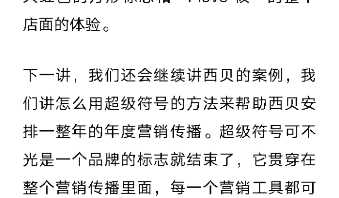

好了，所以听完这一讲了，下一顿饭你就去西贝饭面村吃，就看到我们百分之百大红颜色的方形标志和“I LOVE夜”的整个店面的体验。

下一讲，我们还会继续讲西贝的案例，我们讲怎么用超级符号的方法来帮助西贝安排一整年的年度营销传播，超级符号可不光是一个品牌的标志就结束了，它贯穿在整个营销传播里面，每一个营销工具都可以用超级符号的方法去进行改造。

知识就在得到，咱们下下讲见。

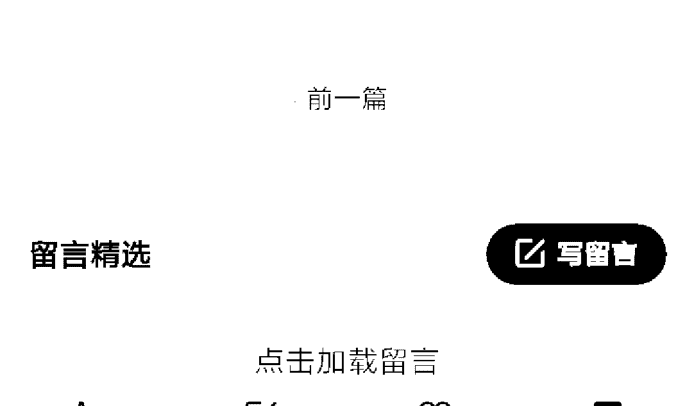

### 划重点

> 超级符号的诞生是发掘品牌与生俱来的戏剧性，品牌自己身上有什么可以发挥的地方，把它放大，把它和一个文化母体、超级符号相结合，改造私有化，就成为你的品牌超级符号。

跟华杉学品牌营销
打造超级品牌的完整方法论

## 06 | 超级符号的传播：文化母体，营销日历

### 罗秋·品牌营销：30讲

### 华杉

你好，我是华杉。欢迎来到你的得到课程《华杉老师品牌营销·30讲》。

前面5讲咱们一直在讲中华母体，品牌寄生、超级符号一直在运用方法，怎么用这种方法来建立品牌。

这一讲，我们讲怎么用这个方法来创造品牌活动，来安排我们一年的“营销日历”。

### 固定的时间，做固定的事

很多企业会面临这样一个问题：在品牌活动上面除了投广告，要不要赞助马拉松呀？要不要赞助某个电视节目呀？再或者，是要不要入一个电影节呀？好吧，觉得这个花费也不少，怕打水漂，不做。你看哪个熊猫谁当年不就是因为赞助哈哈哈就没了？

那品牌活动到底应该怎么做？除了重新回到我们一直讲的12个字：文化母体、品牌寄生、超级符号之外，还要再加两个字：重复。反复重复地重复。

所以，在运作品牌的时候，我把它叫做文化母体，营销日历。顾名思义就是找到文化母体，根据文化母体在安排上一年的营销传播活动。最好定在日历上面，每年咱们就按固定的时间固定的事儿，年复一年地循环演出。不能越做越糟，越做越感然而又出不出新东西来抓来挠挠去还是希望搞创意，要方子好。用华杉华万来说就是，要反复多干，多挣钱，年复一年就那几件事儿。

### 生活就是一种循环往复

那么这里讲的文化母体是什么？就是宇宙和社会生活。你说什么宇宙？星河、星系、太阳系、太阳、月亮和地球，这就是我们的母体。月亮潮起潮落，地球绕着太阳跑，给我们带来24小时昼夜，带来春夏秋冬。生活，循环往复。

地球上最古老的文明，古埃及文明就是随着尼罗河泛滥建立了他们的农业社会。那你看看看中国的社会生活是什么样的？我们来看看一首汉末的古诗：

> 爆竹声中一岁除，春风送暖入屠苏。
> 千门万户瞳瞳日，总把新桃换旧符。

文化母体，超级符号都在这首诗里面了，就像你在做品牌传播任务。

爆竹声中一岁除，春节是要放爆竹的，这就是仪式，也是符号。现在，城市里不让放了，可以放在郊区放，也可以去外环区，也可以置气氛来代替，还有电子鞭炮，东西没了，符号还在。

春风送暖入屠苏，屠苏是酒，过春节是要喝酒的，那现在市场上这种年酒不是多？

千门万户瞳瞳日，总把新桃换旧符。这是桃、旧符是不就是符号吗？

所以，春节这个文化母体就有数千年的历史，有巨大的惯性。日历到了这个时间，所有人都会做做，不可抗住。春节放爆竹，要去吃年夜饭，要贴春联，年有没有人想抗拒这个文化母体？有，蒋介石。当年他要开展新生活运动，在1928年，国民政府宣布，从1929年起禁止过春节，只许过阴历新年。因为信了基督教，不许放鞭炮，不许舞龙舞虎，不许玩火等杂。总之，不许过春节。革命党要斩断中国人的文明脉络，老化和达芬奇们背着地偷偷摸摸过年。第二年，蒋介石这个禁止过春节的命令就没人了。

我们前面多次讲了红绿灯的超级符号，那么红绿灯的超级符号有人挑战过吗？有，1966年，北京市的红卫兵要砸红绿灯，砸烂，但是，可以，应该砸烂，红绿灯，但是所有车辆应该靠左行驶，因为“左”才是正确的。最后还是去挑战了红卫兵。周恩来总理也亲自去挑战红卫兵，说服教育，才避免了一场交通混乱。

所以，说，文化母体一旦形成，就有不可抗拒的力，它一定会定期地发生，发生的形式就是伴随着众多的仪式、符号和道具。

### 品牌要寄生在超级文化母体上

文化母体、品牌寄生、超级符号，有什么品牌寄生于春节这个文化母体吗？就是中央电视台的春节联欢晚会。春晚是不是就是这样一个超级品牌。如果我把王若石那句诗改一改的话，“千门万户瞳瞳日，家家欢聚看春晚”，它把这个品牌植入了这个春节的文化母体。

我考除了德国的橄榄球总决赛的超级符号，没有一个是像中央电视台的春晚一样有那么多观众，能够卷入那么多人，是这样一个品牌。

咱们现在都惊叹，微信支付，微信红包是怎么做出来的？春节是一个超级文化母体，微信在春节这个母体中作为一个母体。那么，微信在春晚的母体号召大家发春晚红包，一夜之间建立了它的微信支付。

春晚是基于一个技术，就是电视技术，在春节这个文化母体建立了它的超级品牌，就是春晚。那微信又是一个基于新的技术，这个技术也是通过春节，通过春晚这样一个文化母体建立了它的超级品牌。

我们每一行为都是在执行这个母体的事。人类是一个为每个人为了准备到了母体所带的场景和道具，从母体中来，到母体中去，成为母体。从母体，这就是品牌在母体中所扮演的角色。

春晚从春节这个母体中去，然后回到春节这个母体中去，它成为母体，大母体，它成为了春节的第一品牌。

所以说品牌除了是一种商业思想，是一种价值观念，一种就是寄生于春节的超级品牌。现在又有更多的新品牌想要寄生于春晚来成就它的成功。

### 西贝的品牌营销日历

我们要强调一个理念，就是文化母体是一直在重复，在循环的，只要我们实现了品牌寄生，那一刻，这个消费行为就自动地发生了。

那么接下来我就讲一讲我们怎么基于文化母体给西贝家面叫寻找一个一个它的年度营销传播活动。

在上1讲已经说了，我们创作超级符号的时候是基于品牌与生俱来的戏剧性，对不对？那么在做品牌营销活动时，又是基于什么？对于品牌戏剧性，我们品牌的戏剧性是什么？love 爱。有了love 爱，我们就是在日历上找到了一年四倍情人节，我们要把情人节这一天变成西贝的品牌节日。

情人节是来源于西方文化，不过像圣诞节一样，今天它已经成为全球的文化母体了。那情人节这一天，消费者与被卷会一个什么样的生活场景呢？情侣中间互送礼物，一起吃去吃个饭，看一场电影……那我们创造一个新的文化母体上面创造了一个场景，创造一个新的戏剧，就是就为西贝吃饭而打情打折扣。

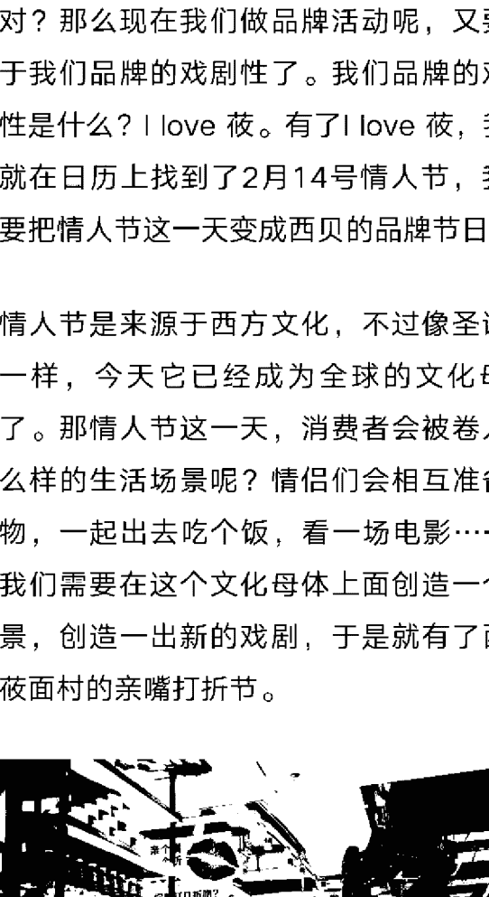

什么意思呢？每年情人节请情到西贝吃饭，带一个单人，就要带一个两倍，西贝就给你打情打折扣。折多少呢？难得浪漫，折八折就小。如果只是两限带个9.5折就行，那么一家人呢，就可以限在9.5折；得您家8.8折；法式的情西我们给7.7折；如果在我们的西贝面单上说给你创造出来的话，最高可以给你6.6折。这就是文化母体，品牌寄生。

文化母体两个，一个是情人节，一个是情人节接吻，接吻情人节接吻的仪式，love 会让我们动动手，接吻，当众接吻。在love 夜，西贝面单付面碗，就把我们的品牌寄生在这个超级母体上面。一个是情人节，一个是情人节。本质上应该有第三个，love 夜，但是现在love 夜一次就是他们。那如果没有情人，你也不会知道怎么要求他献上初吻，那你就请他来西贝，这里我们可以帮你。

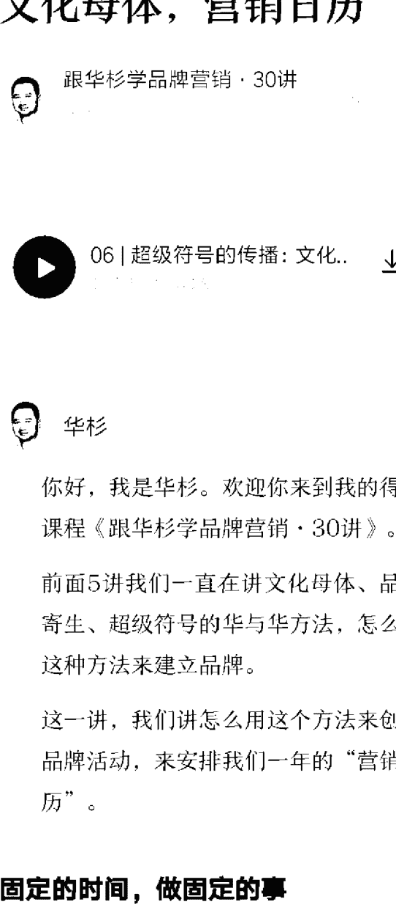

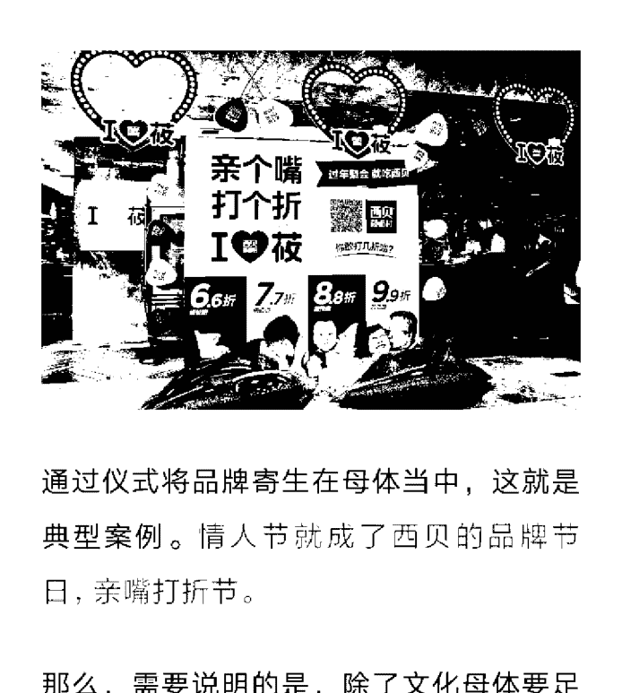

通过仪式将品牌寄生在母体当中，这就是典型案例。情人节就成了西贝的品牌节日，亲嘴打折节。

那么，需要说明的是，除了文化母体要足够强之外，仪式信号也必须够强。如果是牵手打折，让情侣们牵牵手就打折，不是我们不愿意给折扣，而是牵手的仪式性、符号性都不够，消费者卷入的热情也不够。女孩子跟你拉拉手，也不说明什么问题，能亲嘴才是表白。

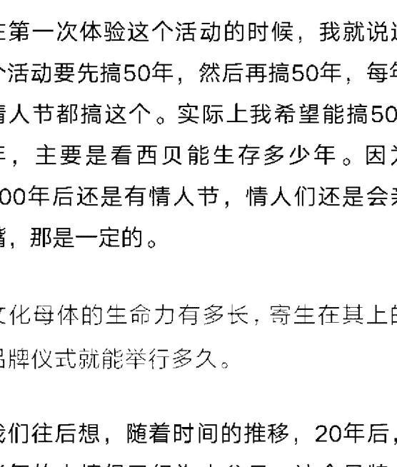

在2016年的情人节，我们就举办了第一次西贝筱面村亲嘴打折节。这个活动获得了巨大的成功，按我们贾老板的话说：“哎呀妈呀，以前只见过排队吃饭，这回可看见排队亲嘴了。”

在第一次体验这个活动的时候，我就说这个活动要先搞50年，然后再搞50年，每年情人节都搞这个。实际上我希望能搞500年，主要是看西贝能生存多少年。因为500年后还是有情人节，情人们还是会亲嘴，那是一定的。

文化母体的生命力有多长，寄生在其上的品牌仪式就能举行多久。

我们往后想，随着时间的推移，20年后，当年的小情侣已经成为人父母。这个品牌、这家餐厅会成为他们的人生记忆，会成为他们人生的一部分。他们对这个品牌会有深厚的感情。所以，品牌植入不是植入一部电影，而是植入顾客的人生。

很快，他们的子女长大了，也开始谈恋爱，也会和情人在情人节逛街，也会经过西贝筱面村，也会听到我们的店员邀请，“I love 筱，西贝筱面村，亲个嘴，打个折。”

随着西贝刮到全世界，全世界的消费者也会熟悉我们爱的呼唤，I love 筱，西贝，实现这一步需要什么？需要坚持和重复，50年如一日，每年就做这一件事，这就是我们的营销日历，永远都不需要新的创意。

## 07 | 重复：如何让品牌活动变成民俗？

热气球 品牌营销 · 30°

梓杉

你好，我是梓杉，欢迎来到我的得到课程《跟梓杉学品牌营销·30讲》。

我见过的品牌营销人员通常分为两种：

- 一种人是靠“营销大动作”，他们每天研究的问题：
  - 1、怎么才能制造一场现象级的传播事件呢？
  - 2、怎么才能创作一副刷屏朋友圈的营销文案？
  这类人觉得，好像只有一鸣惊人的营销活动，才能扩大品牌影响力。

- 另一种是，崇拜灵光，去年的营销活动很新奇，今年怎么变得淡呢？
  比如，2016年我们情人节搞西贝面馆现场剥虾开盲盒，很成功啊！明年做什么呢？我是，还是搞亲嘴打折：客户说：“那有什么新意呢？你们今年已经要给我们创意有点手欠啊啊”
  你看，营销活动就变了一个广告创意活动，谁有创意，谁就算赢了。

可什么才叫“新意”呢？我们说“新”的目的，是为了什么？是想增加销售吗？是想增品牌吗？好像都不是；就是新意！

这一讲，我就要替营销部破除这两个误区，你既不需要想大点，也不需要去创意。

你只需要做到两个事实：重复——只能够重复做的事。

### 重复是传播的本质

重复是传播的本质，是品牌的智慧，也是人生的本质，是宇宙的原理，一旦停止重复，就是死亡。

太阳每天重复地升起来落下来，如果有一天不重复了，整个世界就乱天下吗？

我们每年情人节都送礼物给另一半，如果有一年不重复了，那不就是分手了吗？或者活在一起，但是爱情已经不见了吗？

成熟的品牌每年都应该以同样的形象、同样的知识、同样的语句、同样生活在同样的时间、同样的地点出现于消费者的面前，否则这个品牌就不成。

但是，要人重复做一件事很难，每个人都不愿意重复自己。这是做人的弱点，叫逐新逐喜。他特别如要做重复的事，那就显得没创意、没本事，别人是不是就会小看我了。或者他会，如果我现在做什么事，营销小公司不大会获得我活没活过。营销大公司认为，如果告诉消费者50年，每年情人节亲嘴打折节就完了，客户是不觉得品牌有打，我还跟你们签同什么的呢？很多的理由都让们不重复。总之，一一个原理让我们去搞创意，没有一个理由去重复一样的事情。

重复，只有不断重复，才有价值，才能形成文化。重复才是最快速立品牌影响力的方法。

今年情人节是西贝面馆亲嘴打折节，明年也是，未来十年，五年，一百年，一千年，都是。这就是源于文化母体，加强文化母体，成为文化母体。

### 建立品牌文化就是建立集体行动

重复的关键就在于在固定的时间做固定的事，比如西贝就固定在每年春节前一周，正月初二进店，进入春节初期了，期间二十四儿贴春联，窗花，除夕夜吃大饺，祭，祭祖，吃完，发压岁钱。小孩初一早上起来翻开枕头，枕头底下是要放压岁钱喽。大年初三放鞭炮，初二、初三开始走亲访友，一直正月十五元宵节。

时间和仪式固定下来会带来什么呢？会有记忆，会有期盼，有准备，甚至有行动。

我们要建立品牌文化，就是要建立集体记忆、集体期待、集体准备和集体行动。

第一年到西贝面馆亲嘴打折扣，顾客没有遇到，参见见，没开张心里。第二年又有，第三年还有，十年下来，就成大家的节日了。小伙子追求一个女孩子会计划着情人节那天带她去吃吃面馆。在西贝亲嘴。二十年下来就成为大众文化了。

德雷克说过一句话，他说：人们往往高估了一年所能取得的成果，而大大低估了三十年、五十年所能取得的而成。

你看我们公司是怎么样的？每年的指标都定得很高，但是自己三十年、五十年的指标没有概念，考虑一个吃么个的，却不懂时间所累积的成果像雪球一样远远超你的想象。

时间长度最重要，不到一定的时间长度就什么也成不了，有了足够的时间长度，最普通的东西也能成为传奇。

我不知道你有没有去过日本的大阪，大阪有一个块牌为高层办公室的广告牌，因为从1935年起，它就立在那里，一直是一个运动公司举双手站在田径跑道上的画面，至今仍经重了84年，已经成为大阪的地球。2003年，被市政府指定为大阪市指定文化遗物，游客需要去大阪都要到里打卡拍照，这是什么？这就是罗罗说的“时间的”朋友吗？时间的厚积带来带不来？不是靠雪带来的吗？

你能想象西贝面馆亲嘴打折像个那个格力高广告一样重复84年的情景吗？我们为什么需要亲呢？时代在变，它自然而然有新的内容，就好像20世纪70年代没有春晚，80年代有了春晚，内容会变化，体会不变。今天的春晚和80年代的春晚也有不一样的地方，可是，品牌文化是寄于品牌母体得以永续。

就像腊八节喝粥腊八节一样，让情人节吃西贝，成为新的民俗，那多大大的价值。要实现这一点非常难，就是坚持重复，这就是与华方法说的，少干活，多挣钱。

大家都少干活，多挣钱了，那你与我们活就属于干，他们的活儿不那我们的活儿就是属难性的，不让他人干活，这个比创意要一万倍，这是我十几年来最大的痛苦。

### 把一年要做的事固定下来

听到这儿，你可能要问了，情人节接亲嘴打折，后面还有大半年呢，做什么呢？别忘了，与华方法有一句话，叫营销日历，文化母体。营销日历就是你定自己的日历，一年要做的事固定下来，然后每年在固定的时间做固定的事，始终重复同一个节奏。那是给消费者的节奏感。我们现在不说谁谁谁带节奏吗？品牌如何给消费者带节奏？就是靠的营销日历。

情人节之后就是春天，春天看椿了，所以，在4月份，我们有油菜花香薰面，对不对？都吃过吧？

那么，到了6月是儿童节了，家宝贝，就吃西瓜，6月的主题就是水蜜。

到了7、8月，夏天大西瓜上市了，在西瓜吃到吃到腻到的时候白南瓜。

秋天有西瓜杂粮月饼，到了11月，就有我们的年度大菜，比如现在的西贝大牛骨。

有人会说了，每年都固定做那几件事，不枯燥吗？消费者会审美疲劳吗？这个是一个低价值的问题了，我要讲一个字，叫凡事彻底，把平文的事做到最彻底，就是不平凡。只有真正重复一事，一直做下去，才会到达真正高手的境界。一个人，你觉得枯燥，你大错特错了，因为消费者真不是跟你做一家人来消费，每一家都把他的一样事情做精，那就不是大家共同提供给消费者最好的服务吗？

为了帮你更好的理解“在固定的时间做固定的事”，我推荐我本家名一个童话，叫《小王子》，《小王子》提了一个概念，叫驯养，那个狐狸跟小野孩交朋友的时候，他说：你一定要在固定的时候来，今天你来这一个时间，明天那个时间，你固定的时间来，我知道你要来。你来之前，我就开始打扮一下，你就要来。

米。你你米之前，我就会装份一下，我就会准备，我就会期待。

所以，包括我们的销售经理去拜访门店，每一个门店你都一定是在每个月或者每周固定的那一天，是上午还是下午几点，去拜访他。这样那个店员才能知道你今天要来，他会准备一下来跟你说一点什么。

所以，很多的事情，就是背后的原理很多，可能我在这个课程里面也不能把它全部讲完。但是你照我说的去做，肯定不会错。

### 创意就是重复做平凡的事

华与华还有一个客户，叫足力健老人鞋——“专业老人鞋，认准足力健”。做得非常成功。

在足力健的标志设计里面，我们用一个了超稳定的结构，三角形。三角形里面是一个大步向前的老人。老人用什么符号体现呢？用的是他的体态，他手拿的手杖和一个礼物。

这个形象的设计，这个超级符号不是我这一讲要讲的重点，通过前面几讲的训练，我相信你已经明白这个设计的原理和含义了。我要说的是我们为足力健创造的品牌节日，和西瓜选择情人节和亲吻为文化母体一个道理，我们选择了重阳节和结婚证。在重阳节这一天，只要老人带着结婚证去足力健门店，就可以根据结婚多少年得到不同的折扣，结婚时间越长，折扣越大。

这个活动给了我们意想不到的效果，顾客的参与热情非常高。我们收到的各种结婚证简直可以办一个结婚证的博物馆。这也是激发了集体记忆、集体意识和集体行动。

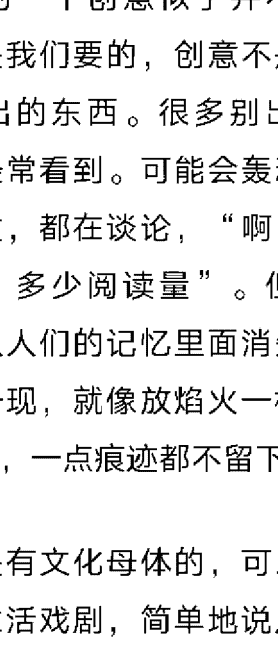

想到这样的一个创意似乎并不难，对不对？这正是我们要的，创意不是去想一些谁都想不出的东西。很多别出心裁的创意，我们经常看到。可能会轰动全网，人人都在转发，都在谈论，“啊，获得了多少转发量、多少阅读量”。但是三天之后，它就从人们的记忆里面消失了，归零了。昙花一现，就像放焰火一样，火一把就灰飞烟灭，一点痕迹都不留下。

我们要的是有文化母体的，可以重复上演一百年的生活戏剧，简单地说反复只能玩一次的东西，我们都不玩；凡是不能重复一百年的创意，我们都不要。因为它不能成为文化遗产，也不能成为我们的品牌资产。

好，知识就在得到，我们下一讲再见。

## 互动

课程上线以来，我看到了很多同学在后台留言，尤其让我高兴的是，其中很多都是品牌营销领域之外的学员。我一直说，品牌营销并不是一个专业，我这门课要做的也不是培养品牌营销专家，而是带你从全局去重新理解超级符号与公司、社会、商品，以及人之间的关系，以及如何通过优化这种关系，为你带来真正的效益。我们每个身处企业里的人，甚至每个希望打造个人超级品牌的人，都应该来学习品牌营销。

今天，我就邀请你从自己的行业角度，给出一个学习品牌营销的理由，我想，这会非常有助于同学们体会这门课更多、更大的价值。

留言模板：“我是XXX（职业），我在学品牌营销。因为……”

### 划重点

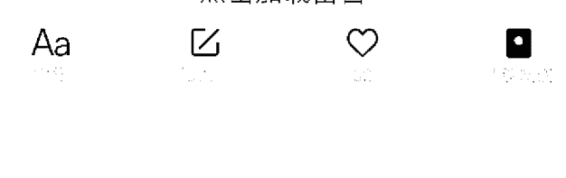

## 08 | 启动本能：为什么设计越原始，越能打动人？

你好，我是华杉。欢迎你来到我的得到课程《很简单的品牌营销》30讲。

这一讲是超级符号的第三讲，是在这一讲会对超级符号的设计做一个收尾。

我们前面讲了超级符号是源于文化母体、品牌寄生、超级符号。通常符号包括公用符号；第二种是公共规则符号；第三种是文化符号。

自然符号，比如说你用一个番茄，用个西瓜，用个钓钩，用个马，用个熊猫，这都属于自然符号。

公共规则符号，之前我们介绍的布鲁斯用红绿灯的符号，是指公共规则的符号。符号上包含人们习惯去使用公共规则行事。实际上华杉华也靠喜欢用公共规则符号，特别是跟交通标志相关的符号。上一讲我们讲的是父健老人，用了一个三角形。三角形实际上也是交通标志的一个警示符号，它也很容易引起人注意的，而且它又是一个起稳定的符号。

文化符号分为两类，一类是中国文化符号，一类是全球化文化符号。比如说中国贝母南村，love，我本来是一个中国品牌，然后我们做了一个世界性的文化符号来做的，我总结符号。海底捞做了一个"Hi"，那也是用了全球的文化的符号。

回龙工业区的是"我爱北京天安门正南50公里"，那就是我比数百百的中國符号，你可以那个"我"爱北京天安门正南50公里"，那就没有集体意识。因为他想我们不一定。

在这一讲，我还要把这三种符号再往前推进一次，推演到人类学的符号上去。它也会说"我爱北京天安门"，或者"I love You"这样的符号还要久远，是在人类刚刚出现的时候就有。

### 厨邦酱油：格子战略

这一讲，我会讲两个案例。

第一个案例是华与华的著名案例，"醋足180天，厨邦酱油鲜美味"。

在2010年，我们刚开始为厨邦酱油服务的时候，它大概是七八个亿的销售额。它主要在华南地区，广东、广西、海南这几个主要市场销售，是一个地方品牌。

那么，我们最大的动作就是改变了它的包装，而且其他辅助图案或文字都动了，只是把它原来绿色的底色改成了酱油布的绿格子。你可以在文稿里面看到修改前后的对照图。

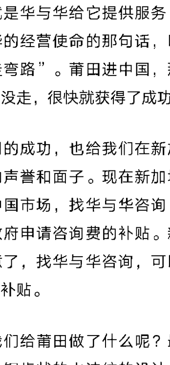

这个设计有什么意义呢？就是我们之前讲过的超级符号的符号。我们觉得超级符号够强大上品牌，一夜之间成为亿万消费者。本帮厨邦对于两广以北的消费者来说，是一个陌生的品牌，但是，看到这个绿格子之后就觉得恨熟了，从陌生人变成了熟人。

我们经常讲品牌知名度。在与华为，我们经常讲品牌的热度。比如知名发关系，可能从来听说过，但是，一看关系就觉得熟悉，很亲人。我们并没有这种感觉，有个人并不认识对方，但是看着他似乎相识，很熟悉，很亲切。这时候就会产生反射，愿意跟它接近，愿意跟他交往。对商品来说，你就会有购买欲。

那么消费者为什么会看到绿格子就认识了？就会购买呢？因为他已经有了食欲了。

前面我讲了超级符号的三大指标：第一，明确的指示性；第二，浓缩巨大的信息量；第三，促使人行动。这个餐具的格子的形象，就代表了食物，代表了吃饭，代表了人类的餐桌文化。每个人的生活都印记在上面，而刺激他的行动。首先是刺激他的味蕾，他开始分泌唾液了。流口水了，这是不是一个人学意义上的能量啊？

那为什么他看到格子就会流口水，就会刺激他的味蕾呢？因为在他的生活经验里，只要看到这个种符号，它通常就是铺在餐桌上，就是跟食物联系在一起。这种符号最早出现在于苏格兰的皇室，在饭桌的纹饰上，就说是苏格兰的绿格子就等于一部大英帝国的历史。但格子布什么时候开始普遍被用于餐桌上？我们已经没法考证了。但是这个印记是在我们每一个人的脑海里面的。

这背后还有一个小故事，后来西班牙朋友找华杉华做整体，有个人和我有关系，我总结"说"，这么多生意也全好了，拿个绿格子来卖给我，再拿个红格子卖给我"。我说这个不，我的创意不是总是自己讲起的。原来，我的同事买了新的，还有西班牙朋友一起和我们三个人一起，我总说张总说不如总啊。张总，你绿格子，我用红格子。张总说，没关系啊，你用红格子我高兴呢，我正好买更好的酱油。

厨邦用绿格子的形象用得非常彻底，首先是在包装上面，然后他们的那个大楼的上面都特别用同样花纹铺成的图案，公司员工的制服也是绿格子的设计。

那个设计的厨邦格子的服装，还参考了我们中6岁的格子表，那个形象品牌是应该知道，Burberry 巴拿纳的设计，巴宝莉，是从苏格兰的这个格子传过来的英国品牌。

但是在2018年，巴拿纳搞了品牌大动作，把他的苏格兰字给取消掉了，它的设计师是新的新设计成了Burberry的字体。改动现在重新流行的无衬线字体，然后我又重新设计了一个格子，就是用字母B缝织成一个的格子图案，这真是印证了中国那个话儿，叫B有格。

那么，它这个B字样的格子有没有文化母体啊？没有母体，有没有人认它呢？我觉得像没的。所以说，我认认为它成功了，因为现在要人们来喜欢一个新图案，太难了。

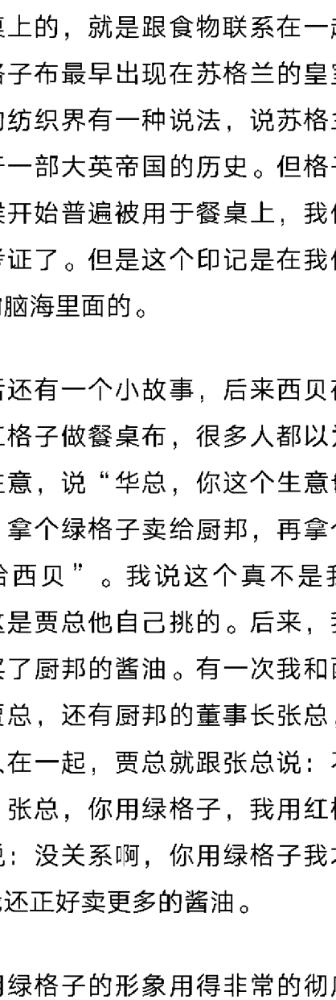

### 莆田餐厅：条纹战略

除了格子之外，我们还喜欢用有线条、条纹的案子，我说一个，就是餐饮业的莆田餐厅。

这个莆田餐厅是新加坡的企业，进入中国市场，华与华为它做服务。华与华的第一句是，华与华是华与华。这家新店除了华与华经售服务的包络语外，叫做"让企业少走弯路"。莆田进入中国，那真是一点弯路都没走，很快就取得了成功。

这间公司的成功，也给我们在新加坡带了巨大的声誉和面子。现在新加坡中小企业进入中国市场，找华与华咨询，可以向新加坡政府申请部分的补助。新加坡的企业注意了，找华与华咨询，可以找新加坡政府申请补贴。

那么，我们给莆田做了什么呢？最大的是那个条纹的水波纹的设计，你可以在文稿里面看到。你会说，"呣"就这个呀？这个就值得吗？"是"的"意思，这就值了大钱，因为这就是一个人学意义上的设计。

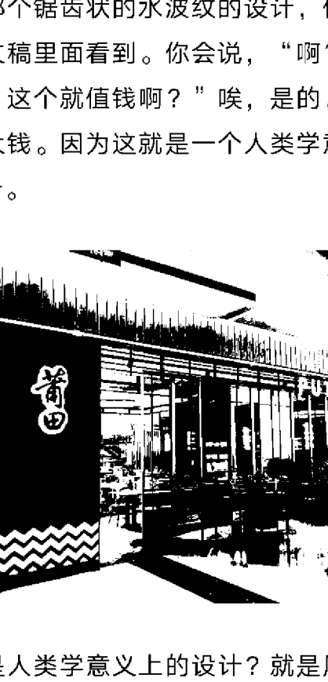

什么是人学意义上的设计？就是原始人的设计。原始人会怎设计，我们就怎设计。人类在走出非洲之前怎么设计，我就怎么设计。

毕加索不是说了吗？忧伤的企业家模仿，伟大的企业家原创。他说："我所有的艺术作品都是对原始人艺术的无耻的刺刺。"

## 08｜超级符号方法：怎么让品牌长盛不衰？

窃。”

你今天随意走进全世界任何一间博物馆，比如说纽约的大都会博物馆、中国的国家博物馆，这些民族之间相互并没有联系，但是，他们的盛装食物的陶罐的碎片上面，都有这个纹样。只要是人类，看见它，就会原力觉醒。

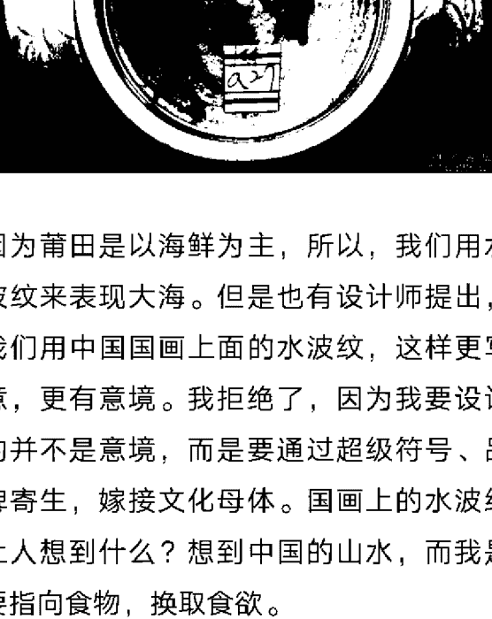

因为莆田是以海鲜为主，所以，我们用水波纹来表现大海。但是也有设计师提出，我们中国画上面的水波纹，这样更写意，更有意境。我拒绝了，因为我要设计的并不是意境，而是要通过超级符号、品牌寄生，嫁接文化母体。国画上的水波纹让人想到什么？想到中国的山水，而我是要指向食物，换取食欲。

那你也会说，除了你，谁知道它是装食物的呢？这个不需要知道，不需要他脑子里面知道，因为他的身体会知道。这就是人类的集体潜意识，我想全世界博物馆里都有，你的潜意识里面一定也有。

还有一个原因，像格子、条纹这类形象，一定要用规则的几何形状。因为规则的几何形状不仅有视觉冲击力，而且有视觉的强制力，它不是冲击力，而是直接冲上来，把你的目光抓过去，强迫你看。这就极大地提高了品牌的曝光度。

当你去超市货架上看看厨邦酱油，到shopping mall里面去看看莆田餐厅，你就能够看到我所说的这种结果。

总结一下我们的第一模块：

品牌首先是一种文化现象，然后才是一种商业思想。

我们用八节课讲了文化母体、品牌寄生、超级符号的方法。

同时，我们说要用营销日历反复重复来建立品牌的文化遗产。

最后，我们分别讲了自然符号、公共规则符号、文化符号和人类学符号等几种不同符号的用法。

下一讲，我们开始进入新的模块。我们说品牌既是一种商业思想，又是一个文化现象。文化现象讲完了，下一模块我们进入商业思想，讲品牌三大原理。

知识就在得到，咱们下一讲再见。

### 划重点

> 要想启动人的集体潜意识，通常可以使用这三种符号：第一种是自然符号；第二种是公共规则符号；第三种是文化符号。

## 09｜社会监督原理：怎么让负面新闻变成资产？

你好，我是华杉。欢迎你来我的得到课程《跟华杉学品牌营销·30讲》。

在第一课里，我们说品牌不仅是一种商业思想，首先是一种文化现象，我们讲了品牌超级符号的文化原理。在这一讲，我们开始进入商业原理部分，讲品牌三大原理：社会监督原理、品牌成本原理、品牌资产原理。

这三大原理是从哪里来的？我提出来的第一大原则，我们就讲第一原理，社会监督原理。

### 品牌是消费者手里的鞭子

我们不是谈了讲开始讲商业思想吗？但是，在讲商业思想的第一条之前，我们须要先插入一条，先说社会原理：品牌是属于社会的，属于文化的，我们讲完文化之后，讲社会，然后才到商业。

社会监督原理是什么意思呢？社会监督原理是说品牌的基本就是社会监督其，保护消费者的一种风险机制。

那么，这个原理从哪里来呢？是从管理经济学的角度来对品牌的解释。经济学我们知道，是比较销售、品牌学更底层的学问。

> 经济学说，品牌是企业为了给顾客提供机会，而创造的一种重复博弈机制。

什么意思？比如咱们说旅游风景地区吃啥啊，总被欺骗，拉客，因为他是去吃饭啥，赢一炮以后，他不指望你再来。一次能在他身上获得多大的利益，他就获得多大利益。至于给你带来什么伤害，他无所谓。

但是，在我们小区的小菜部、社区超市里面，我们在我们酒店的餐厅吃饭，你能够买到价格公道和质量保证，因为他需要维持的长期来，反过来，品牌就是这样一种重复博弈的机构，一旦建立了品牌，你就要接受社会监督，一旦你出了错，社会、消费者就可以惩罚你。

麦当劳是品牌，在美国高速公路服务区的麦当劳是不给加盟的，全部由总部直属。因为高速公路这种地方，对于加盟商来说是一次博弈，不管道德，他不会对麦当劳负责，它要重复博弈，所以，高速公路旁边的麦当劳全部都由总部直属。

我们在工作中，经常会听到一些负面的消息，在中国有一个专门的词儿，叫做舆情。一个公司一旦出了舆情，出了负面新闻，整个公司上下都紧张不得了，然后再就是公关部，赶紧去搞定。我觉得中国最冤的部门就是公关部，因为没有一个是负面新闻是公司搞出来的，而一个负责任的新闻扩大了，最后都是公关部来承担责任，我也不知道公关部能有什么办法去解决这些负面新闻。

如果这种情况出现在你们公司，你们会是什么样的态度呢？

- 第一，不发声，不理会，让事件自己过去，过两天也许大人的负面影响就自然消散过去了。
- 第二，公关部门联系某媒体，封锁消息，删帖，这样可以让事件继续发酵和恶化，那么保护公司的品牌形象。我想很多公司都在这么做。
- 第三，表面上先找一个借口，撇清一下，然后私下去找事主道歉、赔偿、息事宁人。
- 第四，以公司的身份主动公开地老老实实承认错误，然后该赔多少钱赔多少，我就是做这个事不是因为公关，要买单，总之就是要马上买单。

去，这样别人对你就没兴趣了，你就安全了。

还有的企业，怕出事儿影响品牌，就搞出很多品牌。他们的理由是，不要把鸡蛋装进一个篮子里，如果一个品牌出事儿了，那还有另一个。这种想法非常普遍，也非常可笑。因为一方面他们不懂得我们讲的品牌出事儿论，品牌就是为了出事儿而生的，不出事儿就不需要品牌了。另一方面他们没有考虑建立品牌的成本，一个品牌还弄不清楚，还想弄两个。

所以，品牌出事儿要买单，不要公关，要承认错误，该赔偿赔偿，然后再复盘出事儿的过程，改善流程，从错误当中学习，从错误当中进步，犯错会越来越少。不要怕负面舆情，打是亲，骂是爱，消费者围殴你，痛骂你，是因为你对他们很重要。品牌部的人要学会这个理念，告诉你的老板要他习惯于被消费者打骂。

我听说有的公司对公关部有零负面的考核，不许公司有负面新闻。这就是不懂得品牌的原理。只有无名小卒才没有负面新闻，因为他根本就没新闻。是人就会犯错，是名人的错误就会被放大，这是成功者的特权。特朗普天天被媒体吊打，习惯了就好。

### 消费者懂得原谅

《论语》里面有一段话，可以用来形容品牌，它说：“君子之过，如日月之食焉：当其过也，人皆见之；当其更也，人皆仰之。”什么意思呢？说君子犯错就像日食、月食一样，你想想你是品牌，你就像太阳、月亮一样高高在上，当你被阴影挡住的时候，你躲得过去吗？万众瞩目，无所遮蔽，所有人都看得一清二楚，你犯错了。但是，当日食、月食结束的时候，就是说你改过的时候，恢复光明显的时候，同样是万众仰望。

比如说肯德基，我们有的企业不想要负面舆情，你搜一下肯德基，你搜得到正面新闻吗？一搜都是什么苏丹红了，什么催熟了，什么这个鸡那个鸡了，负面新闻一大堆，消费者会怎么看呢？有两种看法：第一种看法，居然有苏丹红，我再也不去肯德基了。第二种是，我的天哪，如果肯德基都这样，那么其他鸡还能吃吗？大家嘴上说的都是第一句，再也不去肯德基了，但是，身体却很诚实，抬脚还是走向肯德基。因为他知道肯德基是在聚光灯下被监督的，它是最安全的。

这时候又有人要说了，你就不能把企业管好，让它不出事儿吗？这种人啊，赶紧撵出去，不出事儿是不可能的，只要是人就会犯错。

拿航空公司来说，航空公司只有两种：一种是已经摔过飞机的，一种是即将要摔飞机的，没有不摔飞机的航空公司。什么公司出事儿有航空公司出事儿厉害？但是你知道航空公司摔过飞机，还摔过不止一架，你不也安心心地上飞机吗？风险本身就是人生的一部分，这是现实，这是人生，而消费者懂得这个道理。

知识就在得到，咱们下一讲再见。

### 划重点

- 社会监督原理：品牌是社会监督企业、保护消费者的一种社会机制。
- 品牌就是用来出事儿的，当品牌出事儿的时候要买单，不要公关。当品牌出事儿的时候，如果你承担赔偿责任，则品牌有效，你推诿抵赖，则品牌失灵。
- 品牌出事儿不会让企业完蛋，而会让企业更强大。

## 10 | 成本原理：怎么用更低的成本建立品牌？

我，我是华杉。欢迎你来到我的得到课程《跟华杉学品牌营销·30讲》。

上一讲我们讲了品牌第一原理，社会监督原理。品牌是企业为了降低交易成本的机制而创造的一种互惠博弈机制，大，是社会监督企业，保护消费者的社会。

这一讲，我们要讲品牌成本原理。品牌成本原理的意思是，品牌存在的意义在于降低三个成本：

- 第一，降低社会监督成本；
- 第二，降低顾客选择成本；
- 第三，降低企业的营销传播成本。

### 命名：便于消费者记忆

接下来我们来看看如何降低顾客的选择题成本。企业的营销传播成本，这个问题是一件事，两个成本是一起降低的，而我们思考的视角，永远是顾客的视角。

我讲一个房地产的案例，也是华与华的名点案例，一个五个亿级的品牌，“一个北京城，四个孔雀城”。

2006年，第一个孔雀城项目在固安开发的时候，首先需要解决第一个问题是命名的问题。当时，公司内部提出了两多个名字，大家拍板的方案是什么？安达卢西亚。洋气啊，我上一眼看到了写满名字的满两页纸，我一眼就选中了孔雀城。客户问我为什么？我说这个是成本问题。

安达卢西亚，记忆成本高，传播成本高，孔雀城成本最低。还真事事最后选用了孔雀城。如果公司的广告语，“一个北京城，四个孔雀城”，改成“一个北京城，四个安达卢西亚”，那就没法玩了。

那么当时我们，已经规划了四个项目，分别在固安，香河，大厂，淮南。有客户要寻求我给另外三个项目命名也去建议，我说还这样建议，都叫孔雀城就好，这是品牌，命名是为了全所有的孔雀城。那我们分别叫不同的名字，就没办法建立品牌了。

那四个都叫孔雀城，怎么区分呢？就按地，永定河孔雀城，大运河孔雀城，潮白河孔雀城和官厅湖孔雀城。

第二天，孔雀城的总经理安岳打电话给我，说，华老师，按你的品牌成本原理，我认为官厅湖孔雀城應該叫八达孔雀城。您看啊，八达是官厅在八达岭，官厅是官厅，八达的成本比官厅低得多。我一听，对，这个官厅湖孔雀城就改成了八达孔雀城。

这就是我们最早的四个孔雀城名字的来源。品牌的营销传播成本就是从命名开始的。

为了降低顾客的选择成本，一切从顾客的角度来考虑，不要考虑你自己。因为你千算计、万算计，可能最后都是“反误了卿卿性命”，你不要去算计，顾客需要什么，你就给他什么就好了。

不管怎么说，第一次广告出街，按我说的做了。放了房子，写了户型，打了价格，结果第二天广告一出去，说是历史上广告效果最好那次的两倍。我一听才两倍，本来我想是十倍呢，会问为什么？这时候有销售经理说：华老师，你放上去那套房子倒是好卖了，我们还有好多户型是没有放上去的，一套也没卖掉，没人问。你看怎么办？我说你说呢？他说问你呀？我说刚才已经说了嘛，第一，放上去的，标上价钱的好卖了，没放上去的没人问，那你说怎么办？你不都说完了吗？

他说：什么意思啊？都放上去啊。

我说：废话，那不都放上去吗？

他说：放不下呀。放不下，那下拉个表格不就完了吗？做个产品列表。我说你有没有在工厂做过业务员，我刚毕业的时候，在工厂做过业务员，出去推销东西不得拿个产品目录吗？不就是把我们产品目录登到报纸上去不就没了吗？那我要登一个什么样的产品目录呢？在我们的文稿里面有，这个目录有讲究。

你注意到了吗？这个目录的第一栏是价钱，而且价钱是按高低顺序来排的。这个来源于我在美国买鞋的经验。我的脚的尺码比较小，买鞋很困难，经常看中一款鞋，然后售货员去找我的码。等了十几分钟，他回来，“对不起，先生，没有你的码”。有时候跑一下午，一双鞋也买不到。结果一次我去美国，巧了，也是跟孔雀城的高管一起去美国考察，到一个鞋店，我看那个鞋店的顶上挂着7、8、9、10、11、12，就像机场上面写柜台的那个字母那么大。比如说“10”，100多双全是10号鞋，它是按尺码来分类的，然后不管你是穿10号鞋的，还是穿12号鞋的，5分钟之内你就能买到3双鞋，效率极高。我说这是极大地降低了顾客的选择成本。

那我们买房子的尺码是什么？就是价钱，无论买房买车，都是先定价钱，定预算，然后按这个价钱尺码去找。所以，华与华设计的这个表格，就是第一栏为价钱，按价格高低排列，后面是项目名称、地址、户型大小、客贷、市内售楼处地址、目前的优惠、联系电话。在这个广告版面里面，我们提供了消费者他需要的全部的东西。

我们提供了什么？我说过三个购买：第一，下达了购买指令；第二，提供了购买理由；第三，还有详细的购买指南。那么，消费者就可以按图索骥。我们把这种文案叫做“坐着滑梯，滑到收银机”。

这个带表格的广告出街的第一天，我们售楼处旁边的107国道就出动交警维持秩序了。孔雀城进入千亿俱乐部，这就是起步的第一天。

你仔细看下面这款孔雀城的报纸广告，很多年都是这一个版式，它的创意原则就是信息要直接给，给要给得全，为的就是降低顾客的交通成本、阅读成本、选择成本、决策成本，也因此降低了企业的营销传播成本。

总结一下：

所有营销传播工具，我们都是从成本的角度去看待它。你取一个名字，不要问好 不好听，要问它成本高还是低；你设计一个标志，不要问它好不好看，要问它成本高还是低。我一句广告词，一个广告画面，一个电商的网页，一个包装的设计，一个电视的广告，所有的我们都只问，它有没有降低顾客的选择成本，有没有降低我们的营销传播成本。

我这个课30讲，如果你别的没学会，只学会用成本的标准去衡量你见到的一切营销传播动作，那么你就已经学到了。

知识就在得到，咱们下一讲再见。

### 划重点

所有营销传播工具，我们都要从成本的角度去看待它。看它有没有降低顾客的选择成本，有没有降低我们的营销传播成本。

## 11 | 资产原理：怎么让花费变成资产？

跟华杉学品牌营销 · 30讲
华杉

华杉，我是华杉。欢迎你来听我的得到课程《跟华杉学品牌营销·30讲》。

这一讲我们讲品牌第二原理，品牌资产原理。

在上一讲讲品牌成本原理里面，我们说品牌是为了降低三个成本：社会监督成本、顾客选择成本、营销传播成本。

从命名、标志、包装、广告到所有的一切动作，我们都要从头到尾去看它，要从最低的成本，要花最少的钱。

### 如何让广告变成储蓄？

在品牌资产原理这部分，我们增加第二个角度，投资的角度，资产的角度。我们花下去的钱不仅仅是费用，而它是花掉了之后花掉去的，还是要作为资产留下来。资产留下来之后呢，五十年后我还能够从中得到利息。有了这块资产，我可以不断地用新的产品的开发去粘贴这个资产，把它再变出钱来。

这里我要重复一遍，大家记住这三个原则：

- 第一，那个钱不是费用。花那个钱的那个事儿，它不是费用，而是投资。
- 第二，由于投资形成了品牌资产，我在五十年以后还可以持续地获得利息，像定期存款，每年都拿利息。
- 第三，除了每年拿它的利息之外，我还可以再拿它去做广告，再给它储蓄花出去，形成了资产，然后我可以用新的产品贴上这个品牌，去把存在那里的那个品牌资产又取出来用，可能使管理起来有点困难，一会儿我举例子就明白了。

### 如何做到品牌资产的零存整取？

我们现在就举一个五十年都拿利息，用产品贴面，品牌资产零存整取的案例。这是大家都熟悉的华与华的案例，小葵花儿童药。

大家记得，在2007年、2008年的时候，我们小葵花的第一条广告片，“小葵花妈妈课堂开课了，孩子咳嗽或不好，多买几颗糖，用氯菲，小儿肺热咳喘口服液，治肺，治疗反复咳嗽，妈妈一定要记住哦。”

下面就是这个广告片，你反复地看一下，这是我最成功的广告片之一。

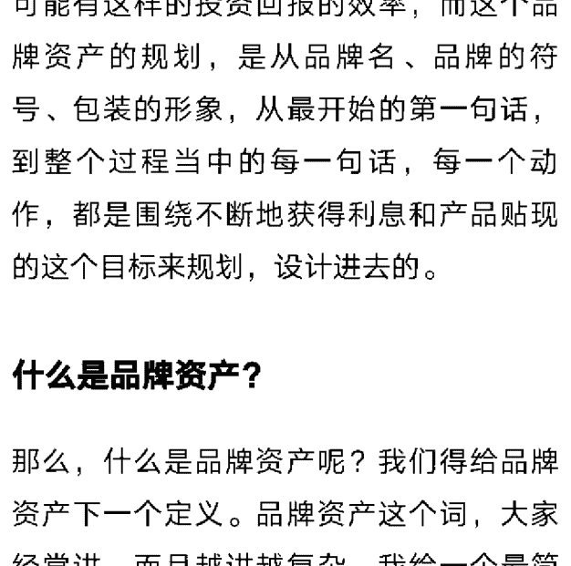

首先，你看从头到尾，除了中间妈妈问一句“怎么办啊？”，那一秒钟以外，其余的都是小葵花娃娃和小花包的戏。就是我的画面全是小葵花娃娃和那个小葵花儿童药的包装。不像有的广告，演了半天，到最后包装才露一下。

**我要把小葵花这个形象投资成为它最大的品牌资产，让大家都会记住这个小葵花找儿童药。**

第二个，你有没有注意，我的第一句话不是小儿肺热，而是在小葵花妈妈课堂开课了，所以，我是小葵花妈妈课堂开课了，我的是品牌资产。这小葵花妈妈课堂不是为了卖小儿肺热咳喘口服液给你的，它是只为了儿童药给你的。

所以，通过十年的储蓄，今天小葵花已经成为中国最大的儿童药品牌，你到药店去，都能看看到我们的专柜，看到一整片的小葵花药，所以，小葵花就是它的品牌资产。

我在2007年和2008年，投资的小葵花的第一条广告，为什么小肺热咳喘口服液卖得很火，对不对？但是，它并不是为了费用而烧掉了。今天我再增加一个小葵花的产品，实际上我还能拿到利息——我就投资那个广告的费用，你理解了吗？这就是拿品牌资产的利息。

### 用新产品不断贴现

好了，到去年，我们开始做什么什么产品呢，叫小葵花的金银花露。

金银花露就是用金银花来做的一饮食品，但是它也是OTC的，可以说它的技术含量也是很高的，很多公司都有的这个技术，但是，如果你要投资去把这个产品做起来，就像当年要说王老吉一样，它是非大的一场豪赌，但是，由于我在过去，在做这个广告之前，已经有十小葵花的广告，所以，当我们开始去用十亿的小葵花露的时候，第一年我就做到两个亿。我认为未来它完全可以做到二十个亿的，因为它是一个夏天花清热解暑的饮料，这是自然，但实际上它是防止上小孩子中暑的饮料，它是巨大的市场空间的。

望来买我的服务，也能够让他有话去传我美名，这才是品牌资产。

### 只做能形成品牌资产的事

我们说品牌资产是能给我们带来效益的消费者的品牌认知，两个效益：第一，买我东西；第二，传我美名。

那么，品牌资产原理之后呢，我们做品牌就要有一个品牌资产观，这就是品牌营销的科学发展观。

品牌资产观是什么？就是能形成品牌资产的事儿我就做，不能形成品牌资产的事儿我就不做。做这件事儿可能有好处，但是，不能形成品牌资产。像放焰火一样放一把就没了，这事我就不做。它不能形成资产，那都是浪费我的时间。不断地重复去做那些能形成资产的，能形成利息的，以后还能再拿东西来贴现的事情，这就是思维上面很大的区别。以这样不同的思维去做品牌，时间越长，拉开的差距就越大。

我们来讲第二个品牌资产的例子——茅台。想到茅台，你就会想到什么？就想到1915年巴拿马国际金奖，对不对？这巴拿马国际金奖是谁在说啊？不就是茅台自己在说嘛。那个金奖的含金量到底有多大，没人知道。但是，由于它一直讲，就讲成了资产，然后它现在每天都在吃这个的利息。

那么，第二个能给我们带来效益的消费者的品牌认知，就是它的酱酒。现在大家都知道，其他的香型是可以调出来的，而酱酒是实实在在在那里放了三年、五年，才拿出来销售的。它是有超越其他白酒的价值的。随着时间的推移，消费者的消费知识越来越丰富，大家懂得越多，就越愿意喝茅台。

在这一讲我们讲了品牌资产原理：它的定义就是能给我们带来效益的消费者的品牌认知。我们要的效益是两个：第一，买我们的产品和服务；第二，传我美名。那么要他买我的服务，就要有购买理由，要他传我美名就要有供他去识别、记忆、谈说的词语、符号、话语和故事，那这些就是我们的品牌资产。

那么，品牌资产操作的指导方针就是能形成品牌资产的事情我就做，不能形成品牌资产的事儿我宁愿歇着，也不做。

那么，通过建立品牌资产的方法，我们能得到什么效益呢？

第一，我们能不断地把过去的花费都变成投资；

第二，我们还能够以新的产品不断去把过去攒在那里品牌资产零存整取，把它贴现出来，可以说这是在头牛身上割好多张皮的做法。

知识就在得到，我们下一讲见。

### 划重点

品牌资产就是：能给我们带来效益的消费者的品牌认知。我们要的效益是两个：
第一，买我们的产品和服务；
第二，传我美名。

跟华杉学品牌营销

打造超级品牌的完整方法论

版权归得到App所有，未经许可不得转载

## 12 | 资产原理：品牌信息露出越多越好吗？

华杉

你好，我是华杉，欢迎来到我拍摄的得到课程《跟华杉学品牌营销·30讲》。

上一讲我们讲品牌资产的概念，这一讲我们讲品牌资产操作实务。怎么操作？分四步操作：

- 第一步，品牌资产盘点；
- 第二步，品牌资产排序；
- 第三步，制定品牌资产目标；
- 第四步，品牌资产投资。

这一讲，我们先讲品牌资产盘点和排序。

### 品牌资产盘点

上一讲我们说品牌资产就是能给我们带来效应的消费者的品牌认知，这个认知是什么呢？就像你认识一个人，你知道他的名字、知道他的长相，还要知道他的一些事情。因此，你就会被信任，就愿意跟他打交道。这个认知就是我们前面讲的资产。

那么，这些认知一共都有哪些，我们盘点一下，这叫做品牌资产盘点。比如，可以得到一个品牌资产盘点公式，也可以不用。我们现在在讲的是什么产品，你都可以把顾客对它的选择、它跟别人怎么样比较，练习做个品牌资产盘点。

我们拿西贝莜面村举例，做一个品牌资产盘点。

首先，西贝最大的品牌资产是什么？任何一个品牌最大的资产一定是它的名字，因为没有名字就没有它存在，不是？所以，“西贝”就是它的第一品牌资产。

第二，人们还知道什么？“莜面夜”。有人还知道“25分钟上一桌菜”。这个很重要，这是能带来效应的。比如说我们中午要出去吃饭的时候，人总去西贝，为什么呢？因为上面写着，25分钟能上一桌菜，那就能够很准确地预估你什么时候能吃上回来。那么，我们在给别人建议说去西贝的时候，我们也会说，上菜快。所以，25分钟上一桌菜，这是它的品牌资产。

那么第三还有什么资产？你肯定会想到，理由。想到那些吸引人的理由，所以，它的一些招牌的菜品会是它的品牌资产。

还有人会说，那个公司去过联合国。就像茅台去过北京国际奥委会一样，刊登在那里，就是它的品牌资产。

你看泰康，很多年前，有一张报纸批评它一条笑话，它一直就把那个荣誉挂在它的门口，这就是它的品牌资产。

### 品牌资产排序

那么，进行了这些品牌资产的盘点之后，就要进行品牌资产的排序。品牌资产排序就是品牌资产投资的优先级。

比如说一共有四个事儿，那只能说三个事儿的时候，我们说哪个？可以说那个事儿的时候，第二个是谁，然后第三个是谁，第四个是谁。

我们还是用西贝莜面村为例，它的品牌第一资产是什么呢？我们刚才已经说了，肯定是那个名字。品牌第一资产就是西贝，就是那个方形的东西。

确定这个有什么意义呢？因为有的时候会要放弃一个东西的时候，就放弃名字。比如某家企业的广告招牌，汽车开过的地方，多上人家说的名字都看见着，它做的广告就不白费了。

你现在再去看机场，就咱们北京这个机场高速，上面有很多汽车广告，你有没有发现，你只看到一辆车在上面，不知道是哪家的高德，像奔驰、宝马、路虎这种识别度高的品牌还好，但是像什么丰田、本田，我发现跑遍那些日车的广告就不太容易被看到。这是因为它在品牌资产排序上没处理好。

在首都机场高速公路牌上有两个华与华的作品，是吧？

一个是华夏幸福，我就放了“华夏幸福”四个字和企业标志，下面有一行小字，叫产业园运营商，产业新城运营商。你看得见就看看，看不见就算了。因为华夏幸福的品牌资产排序中，第一是“华夏幸福”这个牌子，第二是那个logo，第三才是产业新城运营商。

另一块是华与华自己的，那华与华的品牌资产排序是什么？第一是华与华的名字，第二是华杉和华楠，我们兄弟俩抱着那个牛标志的照片。所以，我的广告排第一上名字，第二上我们的照片；第三是我们的方法论，就是独特的定位法；“超级符号就是超级创意”，所以，在设计这块广告排，华杉+牛牛+超级符号是超级创意。

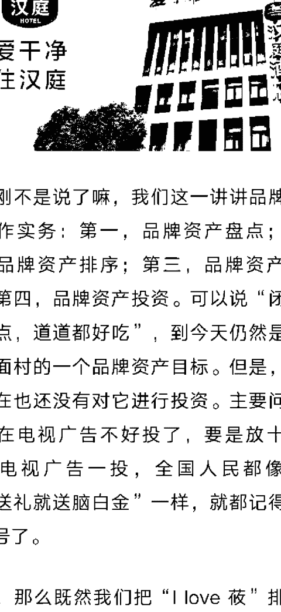

我们再回头来看西贝莜面村的品牌资产排序。第一资产是西贝莜面村主体标志，第二资产是“莜面夜”，也许有一天“莜面夜”能排第一，但是，现在还不是。

就像耐克，最早纽约人都不知道NIKE四个英文字母的，美国人不知道有这个东西。但是，随着时间的发展，最后构成了它的第一个资产，而NIKE那个英文反而不到。这是品牌资产排序的变化。回过头来，西贝的资产前三资产是什么呢？他们也有一个广告语，叫“闭着眼睛点，道道都好吃”。这是很好的资产，很好的理由，说去西贝也没关系，闭着眼睛点，道道都好吃。可以设计广告说，我们去西贝吧，“闭着眼睛点，道道都好吃”。

但是，这句话到现在知名度还不够高。为什么呢？就是因为它“莜面夜”是品牌排序中，也是一句口号，原来很早就再写了一句。再一个我们本身也没有去对它进行投资。

华与华还有一个案例就是汉庭酒店的口号，“爱干净，住汉庭”，而且我们的这六个字放在汉庭酒店的楼顶上，获得了很大的成功。西贝的蒙爱静也去住汉庭酒店，他说：“有，汉庭那个‘爱干净，住汉庭’，挺好呀，我们也把‘闭着眼睛点，道道都好吃’挂上头试试。”

结果一挂上去，看，“爱干净，住汉庭”是六个字，“闭着眼睛点，道道都好吃”也是十个字，六个字挂在大楼楼顶没问题，但十个字放上去就不够办法一眼看进“爱干净”了，所以说，就“闭着眼睛点，道道都好吃”只能前面先，瞄着不变了。所以，这句话我们到现在还没有能够进行投资。

我刚才是不是说了嘛，我们这一讲品牌资产操作实务：第一步，品牌资产盘点；第二，品牌资产排序；第三，品牌资产目标；第四，品牌资产投资。可以说“蒙爱静”是西贝莜面村的“闭着眼睛，道道都好吃”，到现在仍然是西贝莜面村的一个品牌资产，主要的问题也是它现在没有对它进行投资。主要原因是在电视广告不好投了，要是做节目、电视广告一投，全国人民都会记得“送礼就送脑白金”一样，那也就记住了。

好了，那么我们就把“莜面夜”排到第二了，“闭着眼睛点”能不能排第三？我们觉得后两者都不能排，不合适，到了第三，这两点都是儿了。所以，就推出西贝莜面村进联合国，我们的莜面和联合国秘书长潘基文的合影照片作为西贝的品牌第三资产，或者今后获得国家勋章金奖一样。而且我们还说，潘基文可能会最后一个大家族使用名字和长协和永远留在一起。把西贝获得的记录或者长协和永远留在一起，成为品牌的传奇资产了。

再次提醒，记住这个窍门，就是一件事儿一直做，一直做，一直做。什么事情，时间长了就积累，积累。

是传奇呀？时间长了就是传奇。

接着排，那么，西贝莜面村的第四品牌资产是什么呢？是“25分钟上满一桌菜”？还是“不好吃不要钱”？都不是，到了第四应该是具体产品了。品牌资产是能给我们带来效益的消费者的品牌认知，顾客为什么来店？他总是冲着我们的产品来的，对于餐厅来说，就是冲着我们的菜单来的。第四资产具体是啥，那不是我们能控制得着的。我们控制一个范围，几个招牌菜，不同的顾客有他自己喜欢来和招待的，然后我们也借这些节日季节来进行推广。春天有香椿莜面，儿童节有“家有宝贝，就吃西贝”，有人会记得羊肉串，有人会记得面筋，有人会记得炝炒牛心菜。萝卜青菜各有所爱，那就是由消费者自己去排了。

### “得到”的品牌资产排序

好，我们刚才讲了西贝的例子，接下来我们就说得到。因为西贝是三十年历史的公司，是老公司，而得到到 2019 年也只有三年的历史，所以，得到的品牌资产还在形成的过程当中，你会发现它跟西贝不一样。

我们把现在得到的品牌资产进行一下排序：

第一资产当然是得到App的名字，名字永远是第一，我们说过了。

第二就是罗振宇这个创始人IP。很多企业创始人IP都是它很重要的品牌资产，比如说马云就是阿里巴巴很重要的品牌资产。我本人，我和弟弟那也是华与华很重要的品牌资产。

排到第三的是逻辑思维，就是他在创业的时候最早做的这个视频节目。

从得到、罗振宇到逻辑思维，这是它成功的原因，但是，也是它发展的障碍。这就是它的问题。

罗振宇在最早一见面就说，如果不能把罗振宇和逻辑思维给干到后面去，那我们得到就不可能成为一个大公司。

创始人IP这个话题，我再讲一下，因为大家也经常讨论过这个问题，说公司的老板要不要成为IP，成为品牌。

我是这样来看的，这个品牌资产，我们不是说要两个效益吗？一个是来买我服务，一个是传我美名。我在这里讲一下我对创始人IP的看法，第一，肯定是好的；第二，它要成为一个媒体，而不是一个产品。之前的罗振宇成为一个产品，是买的理由，我来就是买罗振宇。如果你是一个购买的理由，那你生产多少，你就只能卖多少。好像我也是，我只是咨询公司，我和华楠是买的理由。但是，如果客户都要我做的话，是不是我公司就只能做一个小公司，就没办法做一个大公司了？

但是，我把华杉和华楠变成一个媒体呢，也就是一个广告代言人的角色，不要让我们成为人们购买的理由，而是成为我们谈说的符号。就是从第一个效益，购买理由的效益变成第二个效益，传我美名。这是把握创始人IP的关键。

所以，创始人IP是非常有价值的品牌资产，但是要看你具体扮演的角色是什么。一定不能是产品，要变成媒体。

所以，要有新的标，就是要把我们得到的这些产品、这些课程给推起来，就把它们做成像西贝的面筋、牛大骨、羊肉串那样的产品。那么，得到的面筋、牛大骨、羊肉串是什么呢？第一个就是最响当当的《薛兆丰的经济学课》课程，还有得到产品思维课，还有香帅的金融课，也有我的讲透孙子兵法的课程。这些资产的建立，成为能给我们带来效益的、能让消费者购买和谈论的品牌资产。同时，在去年，服务和品牌活动的品牌资产的建立，比如说华为得到设计了猎头鹰的形象，创作了“知识就在得到”这样的一个口号，是希望对这些资产进行一个统领。

还有得到最近几年坚持在做的跨年演讲，这就像我们植入春晚一样，找到一个文化母体。他找到了元旦的文化母体。还有新开设的得到大学，这些一个一个的产品、服务和品牌活动的品牌资产的投资和建立，就不断在推动得到的发展。

在这一讲，我们主要讲品牌资产的操作实务。

- 第一，是品牌资产的盘点，把所有的都罗列出来；
- 第二，进行重要性的排序，我们说品牌资产排序是营销、传播、投资的优先级；
- 第三，通过分析现在品牌资产有什么问题，你要提出新的品牌资产的目标，你要建立那些资产；
- 第四，用行动和金钱去进行投资，所有投资就是时间和金钱上面的投资。

在下一讲我们还会继续讲品牌资产的话题，因为这是品牌的核心问题。

知识就在得到，咱们下一讲再见。

## 13 | 资产原理：怎么做到品牌资产保值和增值？

您好，我是华杉。欢迎你来到我的得到课程《跟华杉学品牌营销·30讲》。

这一讲我们继续讲品牌资产，讲品牌资产保值和继续资产增值，还要讲防止品牌资产流失。

### 为什么说品牌升级是个坑？

品牌资产流失的事儿，我是天天碰到都碰到。碰到这个事情可以说是焦头烂额，精确为前。

前一段时间，我是到孩子去学校考试，中午也没地方，就到学校旁边的汉庭酒店去休息一下，一走进酒店的电梯，发现电梯上写六个大字，“净下来，去生活”。

什么意思呢？就是我们的品牌调性“爱干净，住汉庭”小小地放到了下面，把“净下来，去生活”作为了大标语。

我知道他们为什么要这样做，这是他们的品牌升级。我们在公司里面是不是经常听到品牌升级呀？

那么，“爱干净，住汉庭”这个口号是2015年开始使用的，到现在有4年了，当年就一直在汉庭的酒店里面改成了“净下来，去生活”。这就是一个品牌资产流失的典型案例。

在我二十多年的职业生涯里面，我花在防止品牌资产流失上的精力远倍于我为他们创作所消耗的精力。

上一讲我说了，“我爱北京天安门，打了50公里”，也是北京来了很多钱，摘掉了多钱，才把它保卫下来。每一个口号，都经历的这个痛苦的过程。

所以说，我就要把这个品牌资产的保值增值专门做一节课来讲。

华杉与华楠是任何到一个客户的时候，首先能做的是要先和企业家的历史里面去寻找它现在有什么品牌资产，我们把这个叫做企业寻宝。

一个企业能够与华杉与华来寻求咨询服务，能够付得起这么多钱，通常它的已经有一定的历史和规模，那么它过去的成功是怎么来的呢？一定是认可它做了一套事情，赢得了消费者的认可，消费者所认可的那些事儿就是它的品牌资产。

那么，它后来为什么走不动了呢？往往是困于它品牌升级，过去的东西品牌资产给抛弃了，它觉得过去的东西太low了。

前面给大家讲过的案例都遇到过这些问题，所以，现在有些客户，我跟他做完之后，我们老板就，说，“哎呀，华老师，我们二十年前就是这么做的，你把我们二十年前做的东西又恢复了”。

是啊，二十年前你一无所有，是靠这个千里马的，千里马之后你也有资源了，就有机会后来追了。等你资源不动了，那我再把你拉回过去，回到最本质的做法。

比如一淘，三四个月之后，客户就问，“华老师，我们第一阶段‘一个北京城，四个孔雀城’非常成功，第二阶段，我们应该做什么呢？”

我知道他的意思，但是我假装不知道，我说等第二阶段到了再说吧。

告，就是这种工作焦虑。

我再举个例子，前面我讲的那个广告片，“小葵花妈妈课堂开课了，孩子咳嗽老不好”，现在小儿肺喘口服液的销售额一年大概是6个亿。我现在想说，如果当时我拍的第一条广告片永远不变，这十年一条新的广告片也不拍，就用那条片一直播到现在，我估计至少有8个亿的销售额。

其中有一年还决定要请一个女明星来代言，我坚决反对，为什么呢？因为我们已经有了个品牌代言人，就是我们自己的小葵花形象，你花大几百万请来一个明星，这个女明星跟我们的小葵花在一起，他俩到底谁是女一号啊？谁是主角，谁是配角啊？

如果她是配角，那辛花几百万请个配角来干嘛？如果她是主角，那我花几百万把我自己的品牌形象搞到后面去了，我又是干嘛呀？这个道理非常清楚，但是，我没法说服品牌部的同事，他们总觉得要请一个明星。一个明星或许能带来一点什么，就是一种侥幸心理，一种一厢情愿。当然，这个明星用上去之后，播了一年，发现没有什么作用，觉得还是华老师说的对，现在大家对品牌资产就有比较一致的看法了。

我再次强调，葵花儿童药最核心的品牌资产就是小葵花娃娃这个形象，我们所有的品牌投资都集中在这个形象上面，在广告里面全是它的戏，在所有儿童药的包装上全是它。正是因为有这样系统的设计，我做一个产品的广告就能带动全系列，现在是一百个儿童药品种的销售。所以，葵花的戏全部是小葵花的独角戏。如果我请来个明星，等于是跟他唱对台戏，是抢它的戏，那我是在进行品牌资产的自残。

我也并不是反对请明星，比如说大家知道厨邦酱油，“晒足180天，厨邦酱油美味鲜”，一直是李立群代言。你发现没有？我在十年前请了他之后，就再也没有换过。

所以，所有东西都是尽量的重复，尽量的不变，只有重复才能形成资产。

总结一下：

这一讲我们讲了品牌资产的保值增值，重点是讲防止品牌资产流失。我们每一个企业，每一个品牌，每天都有大量的品牌资产流失的废动作、反动作，而这些动作背后的问题，往往都是情绪的问题，就是我们的焦虑情绪。

所以，我做的工作经常都不是品牌咨询的工作，而是心理咨询的工作。这个心理咨询的工作实际上背后也有完整的专业系统，就是管理心理学和行为经济学。现在，这两门学问越来越成为显学。但是，在这个课程里面，我们没法去详细展开了。以后，我真的想专门开一个管理心理学和行为经济学的课程，因为我们每天的活动都和它相关。

好了，这一讲就到这里，下一讲我会具体以华为，以我自己为案例，来讲我如何设计品牌资产的目标，以及怎么一步一步地投资去把它实现。

知识就在得到，咱们下一讲再见。

### 划重点

品牌资产流失的主要原因，就是被焦虑的情绪指使，做了很多损害品牌资产的废动作。所以，比创新本身更难的，是阻止你自己创新。

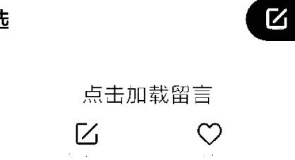

## 14 | 现身说法：华与华怎么实现品牌资产目标？

你好，我是华杉。欢迎你来到我的得到课程《华杉谈中国品牌营销 · 30讲》。

这一讲是品牌资产的最后的一讲，也是第二模块的最后的一讲。

在这一讲，我将现身说法，以我自己为案例，以华与华为目标，我们怎么去设定品牌资产的目标，和一步一步的动作、投资，去把它实现。

### 华与华品牌资产目标

华与华的目标是成为一个全球性的、代表中国最高历史智慧和品牌营销思想的公司。那我要围绕这个目标，去安排我的业务、我的广告、我的写作，这是一个整体的计划。

### 华与华品牌资产排序

华与华在2002年成立，在2008年我开始给华与华做广告。既然广告，那我就要先定一个品牌资产的目标。我们再复习一下什么是品牌资产，是能够给我们带来收益的消费者的品牌认知。收益是两个方面，一是买我东西，二是传我美名。买我东西要有购买理由，传我美名就需要他记忆、谈论和传的信号、语言和故事。

投广告，我们要老板板，围绕我们的顾客，企业的高管、老板、企业家这些人的特点，我选择机场、飞机上的杂志和机场的灯箱、机场高速的广告，这是能够达到我的目标群体效率最高的媒体。

从2008年开始，我们在南方航空、东方航空、国际航空，三个航空公司的杂志上打广告，后来逐渐扩展到机场灯箱和机场高速的广告牌。目前，大概一年要2000万的广告费。

然后是决定广告的内容，内容首先是什么？华与华这家大名大的，这是品牌资产排序中排序的第一资产。

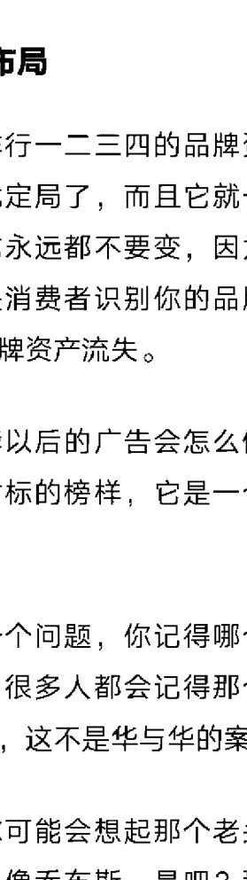

那我的第二资产是什么呢？就是华与华兄弟的照片，这是提供给人们记忆、谈论和传的信号、语言和故事。人们会说，“哼、哥俩”，天然地第二目见到我的时候又叫，“唉，你是哥哥还是弟弟？”这就是品牌资产。

所以，在刚开始的时候，有人说，哎呀，你不要把自己的照片搞上去，ohhow，你画个漫画什么的也行啊。这不对，一定是那个照片。

有人问，你要不要重拍啊？永远不会重拍，我死了之后也不会重拍。因为那是我的品牌资产。

品牌资产就是人们为什么购买你的产品和服务，人们如何记得住你，如何谈论你。好不容易记住你那个样子，你重换一个，那就不对了。

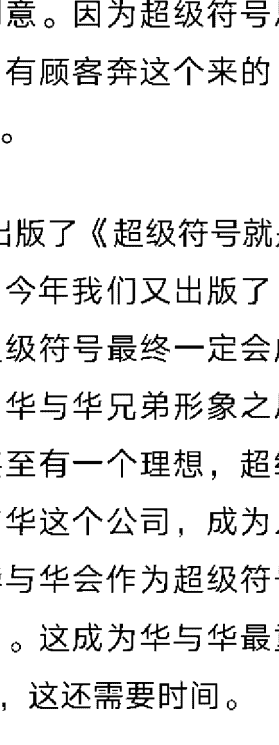

那么，第三呢？是不是超级符号就是超级创意？不是的，我要从顾客怎么说来判断你的资产，顾客会说，唉，华与华，知道。所以，飞机上有广告的，是不是这样讲？哥俩，一哥老二哥两儿事儿就是这样，因为你有了广告，不仅证明你有一定实力，并且证明你对自己有信心，广告是公开的、透明的、接受监督的，广告投放时间越长，品牌资产就越大，因为你一直光明正大地在那里更不是我，坐不改姓，所以，华与华的广告，是永久的品牌资产。

产，我又布局了一件事，叫华与华文库。

在多年来和客户的互动交流当中，我深刻地感到品牌营销的决策只有极高智慧的人才能只看方案就能做出判断。大多数人能接受方案，主要是基于他对华与华和对我本人的接受和信任，而不接受方案呢，主要都源于对方的怀疑和患得患失的情绪。

要解决这两个问题，需要新的更强大的品牌资产，也需要传统的思想武器。这个思想武器就是儒家思想。所以，我就决定写“华杉讲透四书系列”。

但是要让客户接受我讲四书，我还缺乏一个品牌资产。我突然写一本《华杉讲透<论语>》，别人凭什么会看呢？消费者没有我能讲四书这个认知，没有这个思想准备，没有理由去再买一个《华杉讲透<论语>》，**品牌延伸太远**。于是我决定先写《华杉讲透<孙子兵法>》。

一个搞策划，搞咨询的，本身就是战略谋士，我的品牌资产能让人民《华杉讲透<孙子兵法>》。有了《华杉讲透<孙子兵法>》，我就有了国学大师的品牌资产，就能带动我的四书系列，这样我就先出版了《华杉讲透<孙子兵法>》，书卖了50万册，在得到音频课也接近10万份。紧接着才出了《华杉讲透<论语>》，然后《华杉讲透<孟子>》《华杉讲透<大学><中庸>》《华杉讲透王阳明<传习录>》。

为了在这块资产上进行压倒性的投资，我又挑了一个最大的部头《资治通鉴》。2018年开始写《华杉讲透<资治通鉴>》，预计36册，520万字，2025年完成。

《资治通鉴》之后我还会再花三年的时间写《华杉讲透<史记>》，因为《资治通鉴》和《史记》是中国历史书中最重要的两部史书。那我来写这两部史书，战争的部分用《孙子兵法》来讲，和平年代的政治部分用《论语》、用儒家思想来讲，等于把这两部书做成了兵法和儒家思想的案例集。

所以，从《孙子兵法》写到《史记》，大概1000万字，几十本书，实际上是一本书，它就是“华杉讲透中国历史智慧”，那这是什么？不是也是文化母体，品牌寄生、超级符号？我建立一个品牌叫“华杉讲透”寄生到中国历史智慧这个文化母体上面，它是不是会成为华与华这个咨询公司背后最强大的品牌资产？这就是我的布局。

2016年，《华杉讲透<孙子兵法>》在韩国出版，2019年初我在英国出版了《超级符号就是超级创意》的英文版（Super Size），Super Size 也是华与华新的品牌资产。这意味着什么呢？之前的中国咨询公司都是西方品牌营销思想家在中国的代理商，而华与华是第一家向全球输出中国品牌营销思想的咨询公司。

中国已经是全球第二大经济体，我们是和中国第一代企业家一起成长起来的。我们的经验、我们的思想也有资格进入全球品牌营销思想库的殿堂。更何况，我后面还有《孙子兵法》。《华杉讲透<孙子兵法>》将于2020年在英国出版英文版本，以后的讲透四书系列、讲透王阳明、讲透《资治通鉴》、讲透《史记》，全部会完成英文的全球出版。这是我的整个的布局。

那么，这些布局会支持华与华在未来成为全球品牌咨询的企业。

为了布局这个，2019年，我也开始在海外媒体投放华与华的广告。今年我们第一家投的是新加坡航空公司，以后我想投全球主要的航空公司，不管你飞到哪儿，都能看到华与华。

华与华文库

总结一下这一模块：

品牌资产是能给我们带来效益的顾客的品牌认知，效益包括两方面：第一，买我产品和服务；第二，传我美名。品牌资产就是帮助他识别、记忆、谈论和传说的我的词语、符号、话语和故事。

那么，我们要对这些词语、符号、话语和故事进行盘点，叫品牌资产盘点。盘点之后要排序，排出营销传播投资的优先级，然后在这些品牌资产里，我要决定哪些把它摘掉、不要了，哪些我要给它留下来。我还要建建立未来服务于我的企业的发展，我还需要什么样的新的资产，那列出品牌资产的目标，然后再进行品牌资产的投资。这个投资投入的是时间、金钱，并且你有一个路线图去完整地规划，一步一步地去做，最终品牌资产让我们成为罗振宇所说的时间的朋友。

知识就在得到，下一讲咱们开始讲传播三大原理。

### 划重点

> **如何最品牌投资？**

1. 品牌资产是能给我们带来效益的顾客的品牌认知；第一，买我产品和服务；第二，传我美名。
2. 排出品牌资产的优先级，用时间和金钱对品牌资产进行投资。
3. 制定一个详细的品牌资产投资路线图，一步步实现品牌资产目标。

跟华杉学品牌营销
打造超级品牌的服务方法论
版权所有|未经授权不得转载

## 15 刺激反射原理：为什么会有叫好不出座的广告？

你好，我是华杉。欢迎大家来到我的网课《跟华杉学品牌营销》第30讲。

这一讲我们进入到第三个模块，叫传播三大原理。

之前我们讲过，品牌是一个应用学科。而应用学科呢，都要在它的基础学科去找。品牌的基础学科是传播学，传播学的基础学科是行为学，行为学的基础学科是心理学。我们一路讲了这样的一个逻辑。

第二个模块，我们就从传播学这个角度来认识一下我们平时做品牌、做营销、传播和创意工作。

第一原理是刺激反射原理，第二原理是趋利避害，就是让产品等于一个舒服状态；第三原理是传播学原理，叫信号原理。

我们就先讲刺激反射原理。刺激反射是什么意思呢？就是所有的传播都寻找的是一个刺激信号，这个刺激信号会唤起消费者的行动。这一点是关键，就是所有的都是消费者的行动。

### 我们传播的目的：回到行为的本质

我们传播的目的是什么？也许你会说，我们要建立品牌，我们要好的品牌形象。你可能会说很多很美好的目标。也不是这些目标不重要，但是，所有的这些都不是我们传播的目标，我们最终目标是销售购买我们的产品和资讯。如果达不到这一点，那就是所提倡的叫好不出座。

你也是这么想，那能不能做出一个又叫好，又叫座的广告呢？这种说法还不够准确，应该说我们想要做什么广告呢？是好的东西。叫好坐什么？好叫座，就是使用了产品和服务以后叫座。如果在之前叫好，坐什么东西？是广告叫好座，但坐，后就是买东西。

我们要有两个效益：一是我买产品；二是传播我名。那么这两个效益是什么？都是消费者的行动。第一类是行动；第二类是亲朋好友推荐的行动。

你这个道理清楚了，就会特别清楚你传播的做法和做哪些东西。你不会做那种事的时候叫不出座的东西来。

所以，用了刺激反射原理的广告，往往是直接诉求行动的。

比如，“打王者荣耀”就是直接诉求行动。刺激反射原理是传播学的最基本的原理之一，它是直接诉求行动的。

巴甫洛夫讲不像斯洛的心理学，他说根本没有中心心理学，只有生理学。他说你想没有行为分析、没有行为数据、有分析，没有实验，没有数据，有心理学的条件反射实验。

这也不属于一个生物学，虽然巴甫洛夫一直没有承认这个理论，但是在他之前，心理学界把生理学打倒了，也还把心理学打倒了，所以他最终还是被心理学打倒了。

在他后来的生理心理学的基础上，1948年，美国的行为学家维纳提出了“控制论”。控制论把动物学的行为学往前进了一步。维纳认为动物学和进行为学对智能生物来说，就是机器行为，就不能比这个控制论在生物体里面抽象出来，机器就进行动物行为。就是给机器一个信号，让它出现有反射。

与维纳同时代的还有一位美国心理学家，他就是行为主义心理学的创始人华生。他直接提出了行为学主义在宣传传播领域的应用，行为学家就是只看不管他想什么，只管观察和统计他的行为。

### 案例：汉庭酒店的广告语

当时我们给汉庭做广告语，定位是“干净”。但是“干净”不好说。“更干净，住汉庭”？那竞争对手要来告诉你了，凭什么说你更干净啊。想想啊想想啊，最后最伟大的创意就是“爱干净，住汉庭”。当这个“爱”字想出来的时候，我们就真正的大功告成了，这就是我要向你介绍的华与华的广告语填注法。

所以说，定位为干净，这是策略，而“爱干净，住汉庭”，它就是艺术。这是什么艺术？这是修辞的艺术。关于修辞学的广告艺术我在下一讲会专门讲，这是亚里士多德的学问。

### 不要说清，说服，要说动

感觉很难说清楚。

但是，说清楚也不是最终目的，最终目的是要客户买单。其实买单他不需要清楚，只要给一个购买理由，就可以买单。有人又纠结怎么能把消费者说服，你能说服他吗？你越说他越不服。所以，不能去说服；而是应该直接说动。

“爱干净，住汉庭”没有试图说清，也没有试图说服，但是，足以让人行动。所以，我再次要强调，行动才是最终目的。

再举一个例子，我写的畅销书《华杉讲透<孙子兵法>》，大家都看到了，在黄色的封面上面有一个红色的腰封，上面四个大字，“先看封底”。这红底黄字非常刺激，这个“先看封底”是拿来干吗的？就是一个刺激反射的信号。这个信号要什么反射？需要顾客做出什么反射？要他把这个书拿起来。

比如说你去逛书店，一个机场书店里面大概3000本书，在买书之前你会怎么样？你会先把它拿起来看一看，整个你逛书店的过程里面，你会拿起几本书来看一看呢？通常也就是三本。所以，这个转换率是千分之一。如果我能把这个转换率提高到千分之二，理论上我的销量可以翻一倍。

那么，我怎么让人把我的书拿起来呢？我就用“先看封底”这四个字，他一看到“先看封底”，他就把它拿起来了。这就是我这本书为什么现在卖了五十万册的重要原因。

总结一下，我们这一讲讲传播的第一原理，叫刺激反射原理。我们做传播的目的是什么？我们是释放出刺激信号，谋求一个行动反射。顾客的购买行动才是我们的最终目的，一切都服务于行动，没有行动，就没有意义。

知识就在得到，咱们下一讲再见。

## 16 修辞学：好的广告具备哪四个特征？

你好，我是华杉。欢迎你来听我的得到课程《跟华杉学品牌营销·30讲》。

上一讲我们讲了传递的刺激反射原理，释放一个刺激信号，诱导观察另一个行动反射。“爱干净，住汉庭”就是直接要观察到的。

但是，在创作“爱干净，住汉庭”这个广告语的时候，我也遇到了非常大的阻力。看到过一个广告词无意义的旁观者，但是我们不晓得非官观的包，因为不是说他自己，也不是想说太low或高，高不接地气，其实想太多或者看不高大气的问题是把人自己说成低low，都是在担心自己的表现，不是说那个事情，而是自己的表情无天天的呢。他能够直接地观察到一个引起反射的刺激信号，以及他有没有什么行动反射的意思。

很幸运的事，客户最终接受并执行了这句话，也获得了巨大的成功。多成功呢？一年以后，每一间房的收入增加了22块钱。你想想象一下一个房，一共才能挣几十九块钱，他多收了22块钱，这就是整个提高了干净干净净，喊出了干净的口号后，带来的效益。

但是，在我的职业生涯里，这样好运的几率也就50%。

你们记得吗？我们在得到开始就做头脑风暴的时候，就发生了多大的风波。后来我烦了，我就跟他说，习惯了就好。我还挺说不说话，这个世界啥时候把你杀死？能把我给弄死吗？弄不死就弄。她说，哦，还有这样种呢。她看到里稀里糊涂地我说话了，现在你看这个猫头鹰可都笑得不得了。

我们再来看一个广告语，华与华创作的：路过180天，喝到酱油油美味。这句话显然是直说清楚酱油油就好闻，但是它仍然有行动反射。在路过180天里，一个瓶子，一个袋子，再加上180个数字和天这个句子的声音，它就有催人行动的魅力了。那这个魔力是怎么来的呢？你刚才说汉语是有反射作用的，是吧？这个我们说过，因为有它有趣。路过180天，听到香油味，你就去买酱油买啊，它怎么就有反射呢？它是什么？学问啊？这是修辞学，所有的广告文案都是修辞学。

什么叫修辞学？古希腊的亚里士多德开创了修辞学，他对修辞学的定义就是：说服他人相信任何东西，或促使他人行动的语言艺术。

这个定义听起来不就是在广告吗？可以说修辞学就是广告学的基础学科。

那么，古希腊为什么会发展出修辞学呢？三个原因：

- 第一是它的政治。它的政治是广场政治，你要在广场上演讲，大家要支持你的法案。
- 第二是它的司法。它的司法是什么？控辩双方，陪审团，两方辩论，通过问答来说服陪审团相信的主张。
- 第三是它的艺术。古希腊悲剧，前面有演员对白，后面有管弦乐队的演唱，这就让它发展了对修辞学的学术体系。

亚里士多德总结了修辞学四个要领：

- 第一，普通的道理；
- 第二，简单的字词；
- 第三，有节奏的句式，或者押韵；
- 第四，使人愉悦。

### 一、普通的道理

道理一定要普通，不能高深。你高深了，别人就睡着了，就听不上了。“因了，算了，喝口气”，就很普通。“你的能量超出你的想象”，很普通，他就跟不能了。

### 二、简单的字词

字词一定要简单，说白了就是要朴实。而能做到这的人，非常少。很多人在写文案的时候，目的就是不让人觉得他，就是想要让别人觉得很高深，觉得高智，至少不能让人觉得你普通，觉得你简单。

爱干净，住汉庭，这就是最普通的道理，最简单的字词。所以它获得了最大的成功。但是，往往人们不愿意用这样的东西。

### 三、有节奏的句式，或者押韵

“一个北京城，四个孔雀城”能反驳吗？是不是都是斩钉截铁，掷地有声。

还有“我爱北京天安门正南50公里”。

“三品王牛肉粉，把汤喝光”，都是特殊的句式和韵律。

这在语言哲学里还有很深的理论，下一讲我还会专门讲。

### 四、使人愉悦

简单地说就是，赞美消费者。华与华2003年做过一个广告，美罗牌胃痛宁片，广告语是这样的：

> “胃痛？光荣！肯定是忙工作忙出来的！美罗牌胃痛宁片，您得备一备！”

那顾客正胃痛呢，什么？光荣，为什么光荣？肯定是忙工作忙出来的，一听就很愉悦，愉悦就带来了接受。

所有的决策背后都是有情绪的，当顾客愉悦了，他就更容易做出购买的决策。所以，与其在你的广告里关注你的品牌是什么调性，不如关注你给受众带来了什么样的情绪。你的调性都是你在那儿搔首弄姿地表现自己，而情绪是真正你取悦于顾客的服务。

前面我们说过那句香港第一的广告金句，“人头马一开，好事自然来”。这个情绪多强烈？一开好事自然就到了。

前年我看到他们拍了新的广告片，广告语也改了，“人头马一开，人生更精彩”。我的天哪，这是对人头马的犯罪，不知道这个的品牌经理是谁。

著名的红牛饮料之前的广告语是什么呢？“汽车要加油，我要喝红牛”、“困了，累了，喝红牛”。这既符合我们讲的刺激反射的原理，追求行动反射，喝红牛，又符合修辞学的普通的道理，简单的字词。后来改成“你的能量超乎你想象”，刺激反射没有了，品牌名没有了，这就是得不偿失。

有人会说，这是品牌升级，这些年我一听到品牌升级这四个字就头疼。为什么呢？品牌升级就是品牌资产流失啊。

在红牛舍弃“困了，累了，喝红牛”这个广告语之后，另外一个企业把它捡起来了，叫“困了，累了，喝东鹏特饮”，它现在一年销售额做到40个亿，你说这是不是红牛送给它的呢？

在一个企业成功了之后，成了大公司，一线的大品牌之后，它就往往会做一些废动作，做一些没用的东西。而我们学习的人老是去盯着国际品牌，盯着知名公司，看他做什么，我就做什么。那也就跟着他掉进沟里面去了。

我说学习国际品牌，是一个考古学问题。比如说你要学可口可乐，千万别学它今天怎么做，当年它老祖宗就像傻卖脑白金一样把它卖起来的。所以，你要知道这个考古学的问题，要知道它的创始人创业的时候是怎么做的，你去学他爷爷。千万不要去学今天那些在位的他爷爷的孙子。

知识就在得到，咱们下一讲再见。

好的广告语都要接地气，要符合亚里士多德提出的修辞学特征：

- 普通的道理；
- 简单的字词；
- 有节奏的句式；
- 使人愉悦。

## 17 传播原理：为什么广告语要能传开？

### 华杉

我是，我是杉。欢迎你来到我的一期课程《跟华杉学品牌营销 · 30讲》。

这一讲我们讲传播三原理之一，传播原理。传播就是把任何东西两个字搬到远处，不就是你把一个东西从这里搬过来，我是要搬一个东西出过去让它自己传开来。

我经常讲一句话，广告词不是说我说一句话给别人听，而是我设计一句话让过去话传给别人听。

记住这句话，你就可以马上可以检查一下你们公司的广告语。你是说一句话给他听啊，还是一句话也会话传给别人听啊？如果不会会话给别的，马上划开，不要用了。

为什么？因为不会话给别人听的话，就传不起来，只是把它传播出去了，它没有传起来。这就是为什么我要把传播改成播撒。

我们找广告公司投放广告，媒介广告公司会给我们讲什么？讲千人成本，讲到达率，就是你能说到多少脑，然后每到达一个千人成本是多少。

那么，千人成本在传播的总成本里面，占的权重是多少呢？比如说一百是百分之，那它里面播，比如说一个成本在传播的总成本里面是只占 10% 它就不重要。那它到底占多少？我不知道。

那么，在传播里面，最重要的是什么呢？除了到达率之外，是我提出来一个新的概念，叫传速率，它又传起来多快？能传给多少人？俗话说，一传十，十传百，百传千，也就是说它传的传达速度是10倍。而我讲“姜半夏，迁往医”，我花了一块钱把它到了罗家罗干，现在我的一个人成本，我不说那个人成本，是一块钱，然后罗家罗把这个说法告诉丁晓不到，达到不到我没办法，是罗家罗告诉我的，那我的一个人成本是不就是变成五元了？如果罗家罗告诉十个人，不是我一个人成本不是就变成了一毛了吗？可以，如果你有发现，到达率比到达率重要得多得多得多，如果播话他个东西，他不会话给别人听的人，那他就是没有百倍的效果。如果他能十传十，十传百，百倍的效果，就有十倍的效果，这就是传播者的概念。

很容易记忆和传播。重复得多了，人们就坚信不疑，这就是顺口溜的传播效率。

而书面语，比如说，“你的能量超乎你的想象”，一听就是在打广告，他的心理防线马上就竖起来了。

我在跟江南春交流华与华的广告语方法论的时候，他给我总结了三句话，我觉得更精彩。他说主要看：顾客认不认，员工用不用，对手恨不恨。

首先你说一句话，爱干净，住汉庭。顾客得认。然后，你的员工也得用，你的员工说，困了，累了，喝红牛，员工会用，员工不会在推销的时候跟顾客说，你的能量超乎你的想象。那么第三就是对手恨不恨，你一下子把那个东西占了，你看汉庭酒店旁边通常都有一些其他同级别的快捷酒店，别人楼顶上就竖着什么什么酒店的招牌，它的楼顶上竖着“爱干净，住汉庭”，你说对手恨不恨？员工用不用？顾客认不认？

这就是押韵的厉害，顺口溜的厉害。

### 歌诀比顺口溜传达率 High

那有没有什么言语形式比顺口溜还厉害呢？播传效果还强呢？有，就是再把顺口溜编成歌谣唱起来。所以，这就是为什么广告歌这么有力量。

当年成吉思汗征服世界，要给万里之外的大将传递命令，这个命令不能写在纸上，因为怕传令兵在路上被敌人抓住，抓住不就把命令搜出来了吗？靠死记硬背吧，又怕他记不住。怎么办呢？干脆就把这个命令编成歌谣，让他唱。先编好，然后教他唱，一遍一遍，唱好了唱好了，然后出发吧。然后他就骑着马一路走啊一路唱，到了一万里以外的地方，找到那个大将，唱给他就好了。

所以，文字一旦嵌入到旋律当中，就更容易被记住。当你唱歌的时候，几乎用不着刻意去回忆歌词，都是脱口而出。

### 学会“去文字思考”

关于广告语的创作，我为你最后总结了一个秘诀，叫做去文字思考。在创作的时候，你要先假设没有文字，或者消费者不认字，你也不识字，你应该怎样表达和推荐你的产品，这样创作出来的东西，播传的效率最高。

还有，如果你想训练自己写口语套话，写顺口溜的能力，我建议你一定要去读一读《荷马史诗》，因为《荷马史诗》整篇都是口语套话，而且我印象最深的是那些大神一说话的时候，都说某某某说出有翼飞翔的话语。就是说有翼飞翔的，这句话太传神了，就是说他说的那些长了翅膀的话，不仅在当时传遍整个特洛伊的战场，而且飞向天空，飞进时间，飞过三千年，一直飞到现在，我们还知道他们在特洛伊战场上说了什么话。

我们进行广告文案的创作，也是要写下有翼飞翔的话语，让它传遍所有的消费者，让它传颂一百年，为我们建立百年品牌。

总结一下：

- 第一，播传原理：传播的关键不在于播，而在于传。要一传十，十传百，百传千。如果是传不起来的，再精彩我也不要。
- 第二，广告语不是我说一句话给顾客听，而是我提供一句话让他去说给别人听，我要把这句传颂的话给它设计好。
- 第三，广告创作的要诀是去文字思考，要用口语思考，用听觉思考。
- 第四，传达率最高的是顺口溜，顺口溜就好像谚语一样，品牌的口号就要做成品牌谚语，让人无可辩驳，让人对你没有心理防线。

好，这一讲我们就讲到这儿，下一讲我们讲传播第三原理，信号能量原理。

知识就在得到，咱们下一讲见。

### 划重点

- 广告语不是我说一句话给顾客听，而是我设计一句话让他去说给别人听。
- 广告创作的要诀是去文字思考，要用口语思考，用听觉思考。

## 18 信号能量原理：怎么让品牌传得更久？

华杉 | 华与华品牌营销·30分钟

### 华杉

你好，我是华杉。欢迎来到我的得到课程《华杉科学品牌营销·30讲》。

在这一讲，我会讲传播第三原理：信号能量原理。

在讲信号能量原理之前，我还要对上一讲的传播原理再做一次补充。

传播原理，我们说传播的关键不在于播，而在于传，要他传起来，一传十，十传百，百传千。

那么，第二，你还追求在时间上的传，因为要建立百年品牌，就要有百年广告语。广告口号能不能传一百年，甚至传一千年呢？看看历史上也有。请问酒泉何处有，牧童遥指杏花村。这个杏花村广告，它不就传了一千多年了吗？

在华与华，我们创作广告语的标准就是管用一百年。

那咱们怎么知道一个口号能不能管一百年呢？你不是机器人吗？反正一百年后大家都死在了，也没人跟你对质。对不对大家都会，有一个检验办法，可以检测这个口号能不能管一百年。

怎么检验呢？就是把这句口号放到一百年以后去看。一百年前能不能管用，如果一百年的能用，一百百年大概也没问题。

今年是2019年，我们就放到1919年去测试一下。

比如说“爱干净，住汉庭”，放到1919年上海滩一个酒店的楼顶上了，有没有问题？没问题吧。

跨度是一百八十年，厨邦酱油美味鲜，放到1919年去用，有没有问题？也没问题。

所以，华与华创作广告语的质量标准就是一百年的质量标准。比如我们给“得到”创作的广告语，它的质量标准就是放到百年。为什么呢？“得到”的口号是“知识就在得得到”，这句诗的原型来源于白居易“知识就是力量”，它已经成功地传了一千一百多年而流传至今。所以，我建议把华杉说到了，百年不能流传，所以，则不是你的事儿了，反正我给你的广告语是管四百年的。

### 信号刺激越强，行为反射越大

华与华还有一句管用一千三百年的广告口号，就是台湾五星集团旗下的一个餐品品牌“鹅夫人”，主打鹅鸭肉。华与华给它创作广告语道：“鹅、鹅、鹅，鹅夫人”。它的原型是一千三百年前骆宾王的诗“鹅，鹅，鹅，曲项向天歌”。我高考看到这个口号码能念出来，能背诵，说明这句话已经流传了一千三百年，所以说这句口号也可以再用一千三百年。

有人就说，你这个观念也太老土了吧，现在是互联网时代，日新月异，你都在想前去看？这个问题我经常会到，总有人问我，华杉老师，你觉得我们到10后应该推90后浪潮？你说，你就问他们中国，推90后浪潮你吗？跟70后浪潮你吗？反正都会，都是90后浪潮就推90后呢？总是90后浪潮90的起点。看就李宇春服发一样，搞出一个90后李宇，结果搞成了巨大的营销灾难。

品牌资产来源于重复投资，如果能重复投资一百年，再普通都是品牌资产。如果用一阵子又换一个，用一阵子又换一个，那就没有什么积累。如果今年研究新词，明天研究新积累，00后，05后，那不是每五年都要重来一回吗？那么能建立百年品牌呢？

传播原理是，你每出一句话让人去传，可是别人刚传开，你又换了一句，那前面的不就会损失了吗？

是1000块以上。

为什么呢？因为你选择的地点租金最贵，贵本身就是信号。我花钱租下了爱马仕旁边的店面，就给人传递一个信号，我的T恤衫是跟爱马仕一个档次的，我是已经付了很大很大的租金的。我卖1000块就变得很容易让人接受了。

信号能量原理其实也可以解释关于品牌营销传播的一切工作，我们研究超级符号，研究口耳相传的话，不也是为了获得文化母体的原始力量，获得那个洪荒之力吗？所有的创作都是为了聚集最大的信号能量。

在传播上也是一样的道理，传播是进一步把能量放大，投最贵的媒体：在中国投春晚，在美国投橄榄球的超级碗。

十几年前，我们拍电视广告，就专门到后期去调声音，在电视机同等音量下，咱们的声音能比别人大。如果你有印象，看电视的时候，某一条广告突然声音大起来，那就是我们做过手脚了。

还有呢，字体也要加粗加大。这些都定下来了，下一个要注意的就是一直重复，不要改变。就算是投放量没那么大，但是，重复十年、二十年就成了经典。

华与华的广告口号从一开始上航空杂志，定下超级符号就是超级创意之后，十年下来，我们也没有改变。

关于重复的重要性，我想用吃药三原则来总结：药不能停，药不能换，药量不能减。这个你要仔细体会。总之，动作要少，而重复的时间要长。

总结一下：

- 第一，信号能量原理：信号的能量越强，则反射越大。
- 第二，在媒介的选择上，要选择最贵的媒体。
- 第三，加强信号能量的方式，就是要不断地重复，重复的时间越长，则信号的能量就越强。

这一讲的时间到了，下一讲我会就这几个问题专门展开来谈，因为大家对这一点的理解实在是普遍得太不够了。

知识就在得到，咱们下一讲再见。

### 划重点

前一篇

### 留言精选

## 19｜实战：什么样的广告信号能量最强？

你好，我是华杉，欢迎你来我的得到课程《跟华杉学品牌营销·30讲》。

上一讲我们讲了传信的信号能量原理，信号能量越高，执行力才越来越不靠自觉。这一讲，我们就详细地说怎么去加强信号的能量。

在讲之前，我们先看一下现在大部分的广告都在追求什么？我讲三个。

第一种，就是追求创意。大家经常口耳相传，说是要泰国神广告，可你有没有注意到一个问题，泰国有神广告，但是，没有神品牌。如果它的广告那么多，为什么没有那么多大家都熟悉的泰国品牌呢？

就是因为它的广告里面没有创意故事，没有商品信号，它们根本不释放商品信号。你说是这不是泰国的广告出去拍自己的电影呢？它的商品总是在最后一个板标才露一面，所以，泰国的广告向来是世界最不合格的。广告人，文青，就好像拍电影、文艺片商业片一样。

所以，华与华在广告创作上面更多的是学习日本广告。日本也有很有创意的很精彩的广告，但是它从来不含创意商品。从头到尾都是产品的包装在演戏，包装是主角。

第二种，就是所谓追求高贵的品位。整个广告里面都是为了显示他自己高贵的气质，也是忘记了商品的信号。

因为如果把产品包装做得大大的，放在画面的正中，就太俗了，不雅，所以，他一定要把你的品位在画面右下方小小地放在右下方。这也是没有商品信号的广告。

第三种，就是所谓的精准投放，不要广告，要营销。但华杉与华认为，这种精准投放，往往会导致它的信号能量不够强。越精准，越精确。信号能量越强，所以，华与华的信号能量，在广告的内容、形式和投放上都是反其道而行之。

那我们怎么去加强广告信号能量呢？

### 字体要大，声音要大

广告的字体要加倍加大。如果是视频、音频，那么音量就要加倍。有人说「听」，可能这么说，这就是最恶俗的手法。字越粗越难读，其实这是一个最神奇的现象。但是，很多人却不敢用。你想，你要找一个平面设计来，以前你可以说服他，是半版广告的效果好，还是整版广告的效果好？是整版的好，对不对？整版比半版大。其实字体也是一样的道理。

生活中所有的道理都是相通的。比如说上学的时候，老师一进教室，大家都要起立，大声说「老师好」，这是在用一个极其强烈的信号来唤起那些打瞌睡的、走神的同学注意。有没有觉得熟？没有吧。

从来不在互联网媒体上花一分钱的。在互联网媒体上面，我们是自己去生产内容，或者我购买别人的内容，但是，我不会去花广告费。

把广告变成窄告，甚至变成一对一的沟通，性质就变了，信号能量没有了，这个道理一定要认识清楚。广告界流传着一句最坑人的话，说我知道我的广告费浪费了一半，但是，我不知道是哪一半。这句话就太坑人了，因为他只认识到了广告的到达率，他对传达率和对信号能量完全没有认识。

### 压倒性投放：广告要“广”

兵法的原则就是压倒性的投入，我们要的是成功，而不是把广告费省一半回来。

去年，我几次下乡走市场，无论是在新疆，还是河南，所有的小城镇到处都能看见oppo和vivo手机的广告牌。他们会在一栋楼上放很多的招牌，有时候它甚至会把一个居民楼的每一家的阳台都放上oppo的招牌。你说，这些招牌哪一块是浪费的呢？这是要把信号能量最大化，这就是他们成功的原因。

有人会说，华老师，你那都是传统的理念，现在互联网时代不一样了。我回答过这个问题，有一次演讲，一个观众问：华老师，进入移动互联网时代，传统的营销方式不管用了，我们应该怎么办？我当时就回答他，我说你的口气好大呀。他一听就惊讶了，“我怎么口气大了？”

我说，好像传统的营销方式你会似的，如果过去对传统营销方式你曾经会过，那你 就不会说什么东西过时了。下一讲，我就会专门讲讲在互联网时代，买广告和买流量的最本质的区别。

知识就在得到，咱们下一讲再见。

## 20 | 流量成本：互联网时代买广告，还是买流量？

「范水柠学品牌营销 · 30讲」

你好，我是华杉。欢迎来到我的得到课程《范水柠学品牌营销·30讲》。

上一讲我们讲到了互联网营销，现在我继续用两讲来讲一讲互联网营销的一些课题，就是流量问题。因为一讲互联网营销，总是似乎在讲流量和流量转换。其实上，流量转移就是一切商业最基本的原理，总是先有流量来，然后再转换为销售。

### 获得流量的三种方式

流量从哪里来呢？流量从地方来：第一，从渠道来；第二，从广告来；第三，从品牌来。

从品牌来是什么意思？就是消费者是你的品牌里来到你的。我的品牌里接受找你的时候，你的流量成本是零。所以我要讲流量转换，即首先就要讲流量的成本。

什么叫做渠道呢？比如你在大马路口开了一个商铺，你的租金是多少钱？买的就是每天从这条街经过的人的流量。

从广告来的流量，就是你通过广告的投资让消费者知道你，或者有了购买的兴趣，他来购买你的产品。

这是获得流量的三个主要的方式。

有了互联网，特别是有了搜索引擎之后，我们就有了一种新的流量获取的方式，购买关键词。顾客搜索关键词的时候，它导入到我的这个店面里面来，也可以转换为购买。这里不同的方式，它们之间的区别是什么？它们又分别来怎样选择的呢？这个问题比较复杂，我现在现身，来讲讲怎么去获取流量。

### 不买关键词

华与华首先就是不买关键词，比如说什么营销策划、品牌、广告，创意，所有跟我业务相关的关键词，我一个新不会买，但是这也并不是会影响客户找到我。如果我能够让华与华的客户，他们想办法去找到我们。想要找华与华，他直接搜索“华与华”不就完了吗？但是现在的有搜索引擎，你不需要搜索“华与华”，华与华不会交它钱，他把“华与华”这个关键词出售给别人了，客户在搜索“华与华”的时候他最先看到的是什么是？是其他的营销咨询公司。

尽管在这样 的情况下，我也还是不买。我不认为买广告没有用，而是买它要花钱，我可以把这钱用别的地方去。从我自己的实践来说，我是把它全部投入购买实体媒体大的广告上面，可能熟悉我的朋友们知道，从2008年开始到现在，我在中国航空、东方航空、南方航空三个航机机舱上面投放广告。然后我又是机场，在浦东机场投放机场灯箱的广告。

我的这个出发点是什么呢？就是当我去投互联网关键词的流量的购买的时候，我的流量成本会怎么发展下去？会是越买越贵。

如果买营销策划，由于有其他公司去竞价，购买关键词的成本会越来越高，最终会发展到我不得不花，也越来越贵。我是投入自己的广告，流量成本会越来越低。因为我购买的是购售策划，那么我投资的钱是投资在营销策划上面，我没有投资在华与华的品牌资产上面。

子都赚不到钱。

所以说这个百分百的到达率实际上是一个假象，在流量销售商的定价公式里面己经都算过了。所以据说现在“不孕不育”这样的关键词，点击一次己经要2000块了。如果你是一个做不孕不育的医院，你今天2000块还能买，明天可能有人出价2500块，这个价格永远会高到你们赚不到钱。而且由于你一直投资的就是“不孕不育”，大家都来投资“不孕不育”，那么“不孕不育”这四个字就越来越值钱，而你们这些医院的品牌永远没有出路，永远一分钱都没有。所以，是你们自己在花钱，不断地把自己脖子上的那根绳子越勒越紧，也就是说你们把自己卖了，还在帮别人数钱。

有了关键词按点击付费的这个模式之后，有人觉得还是浪费了，如果说他买了我的产品和服务，我才付广告费的话，那我觉得这就是真正的百分百不浪费了。听起来是不是很有道理，但是我们还是要讲背后的定价机制。当你的广告的定价机制是购买了你才付费了之后，这个价格该到多少？如果是看到你的广告才付费，这个价格可能定价到你的脖子。如果是购买了才付费的话，这个定价应该定到你的鼻孔下面，你也不要吃了，有口气留给妳就可以了。这就是经营的道理，谁担风险谁挣钱，你要想一点儿风险都不担，那么你就一分钱也别想挣。

好，这一讲就到这里，下一讲我们继续讲如何建立自己的流量主权。

知识就在得到，咱们下一讲再见。

### 划重点

- 1.谁担风险谁挣钱。如果你要想挣钱，你要把风险担在自己身上。
- 2.流量的来源主要有三个：渠道；广告；品牌。
- 3.通过投资广告建立品牌，不断地降低流量成本，才是营销传播的目的。

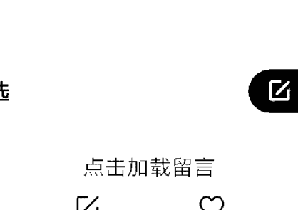

前一篇

### 留言精选

## 21 | 流量主权：精准投放真的划算吗？

陈华杉 | 品牌营销 · 30讲

华杉

你好，我是华杉。欢迎你来到我的得到课程《跟华杉学品牌营销·30讲》。

上一讲我讲到的同行显得比较极端，是我不能接受的关键词，而且就这“华与华”这三个字我完全不去，别人买了个“华仔宝”的关键词，他以为他拦截了我的客户，实际上他也是在帮花打工。客户一来看，哎呀，他还说华与华的宣传，那就是广告吧，别人问我买什么关键词，就是我们花家花钱去投资一个关键词。

这一讲我要讲一个最重要的关键问题，我提出一个词，叫做流量主权。

还是从里面逃出来，掌握自己的流量主权。

讲的一个案例的有一家，朋友是做婚纱摄影的，十几年前企业了，开发的时候做得非常好，打广告，到商圈做活动，都做得挺好，后来看到了互联网营销是流量，他们一看，“这互联网营销太好，真省事了，只需要买关键词，客户自己就来了。我们只管接好客就行了。”于是，他们广告也不打了，营销活动也做了，全部使用互联网思维了。

这样轻轻松松地过了几年之后，他们发现这个关键词太贵，要买。后来贵高进了，贵到不懂了，说贵了，你又卖出这钱来“流量主权”就逐渐失去了，这时候再想自己投入，已经不可能有预算了，可能买流量，又打广告，有预算那么多的预算都卖了，这个钱可能就不够用了。“我看商铺租金也太高了，我不如把大街上的店关掉，搬到后面拿那个写字楼的楼上，这上去的省下来钱大幅下降，你可以卖流量的吗？”

我把这个过程叫做什么？就像吸毒一样，就叫“流量戒毒”了。吸上了互联网流量的“毒品”，戒不掉，为了筹毒资就都写写着里面去了，那个街面是什么？上次我讲了，街铺本来是自有流量的，在你大街上有着巨大、自然的流量，有了写字间，单不就没有自有流量了？就为了自己把关键流量去里面卖吗？就这样就每天等着那个流量商铺这单，而这个单就不就是卖单，没有。这质量越来越低，这就是流量主权，反过来，这时候需要流量，要卖出这个流，重建流量主权。

### 不要计算投入产出比

要想建流量主权，首先要让我们改变财务的思维。就是一个客户投入的时候，负责财务的老总告诉我们，他告诉我们，在互联网上推广一定要算投入产出，用了一个这方法，投入产出不清晰。我都没问他用的什么方法，我直觉就说，那产出肯定是高了。他说不然，你怎么知道？那就是他上面上面的计算。只要是人都可以算得出，那指定就是看你的脖子，到你的利

为0了。

他说，现在你说不清投入产出比，那财务部就不批准预算你，这个问题是大问题了，就是公司的官僚。哪个老板在他的创意的时候就知道投入产出比？如果是老道的话，那所有的项目可行性报告都成了事实了。

营销是置于预期的投资，投资就是风险，投资的价值是完全属于人的智慧。至于技术，那是大家都有基础技能，火枪出现的时候大家都有机枪，原手枪出现的时候大家有原子弹，后出你快就用不了原子弹。所以你不是投入产出比算可计算、就是全国民都拥有的技能，你这一点优势都没有。作为一个经营者，一定要有风险的观念。因为利润和危险是一个硬币的两面，当你不要危险，你也就走向死亡了。

那么流量在哪里呢？我们说流量就在你自己身上，只有自己投资，投资你自己。这就是，那么逻辑基础才有未来。这就是流量主权。

### 用好你自己身上的流量

我们再讲讲街上的商铺的问题。比如说我在大街上开一间店，大街上每天经过的人就是是或合的流量，我在中央电视台广告里，或者在电梯里打广告，在地铁上广告，建立的都是我的品牌，让人家来我买，就是的流量是主管。但是我在网上买关键词，买的是什么？不是我的品牌名字，买的是谁广告。我的品牌是发着、光着，销售营销，这都是品类名字。那就没有主权，我的公司就变成了流量商的殖民地。没有主权，那条款都不是自己的，那别人的肉狗。

有人就说没办法，我们就一直就买流量。你说的道理我也明白，因为确实赚不到钱，但是我们现在可能有权去打广告，那么怎么办？你也不可能完全反对流量，虽然是绝对不是不买，而且我也知道买流量上魅力的人，不能一下子给他撤广告。流量的魅力在于，买不上，马上去，而广告滞后很久，而且滞后之后还不一定有效。但是你自己身上有流量，自己就是最大的媒体，这是华与华对自我的定义。

就像我们每个人一样，原子最大的媒体就是原子他自己，华杉最大的媒体就是华杉他自己，顾培瑜最大的媒体就是顾培瑜他自己。我说流量自从来到世间，它的每一个毛孔都透着能量的设计，从取料到到包含在门，招牌、店面、每一个空间，都是流量转换的战略工具，销售的全部原理就是流量转换原理。

我在大街上开一间店，第一步转换是什么？有多少人看见了你的店。第二步，看见了没有人停下来？第三步，停下来看没有走进店里来？第四步是走进到店内后，有没有去买东西？每一步都是到办法去进行改善和提升。我今天讲不了这么细，就简单讲一下流量和设计的问题。

我想想象每天在街上走，他不能记的街道上的每一家店，怎么能知道无一不在街上？那就是要看你的招牌和门脸的设计了。如果你通过路的设计，能把手看了你的人吸过来，从1000人变成2000人，那么你的流量转换就增加了一倍。

下面这张图就是广州的小牛牛扒肉，一个卖牛肉的小吃货店铺。华杉华与华设计之前的华牛牛扒设计。看看，你看看它能不能流量的流量提升一倍。事实上，我们每个门店的店改造完之后，销售额就提升了30%。

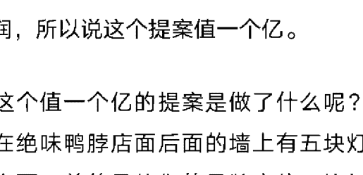

再看下一个案例，也是小吃店，广西的三品牛肉锅。第一张图是华与华设计之前的，第二张是设计之后的。重新设计了招牌和店面，每改一间店，销售额也是提升了30%。

最畅销的五个产品直接点单了？就不用看你的鲜香、麻辣了，这就提高了销售转换率。

第二，这个鸭脖不是放在冰柜里面吗？冰柜的外壁不是对着大街吗？原来在对着大街的冰柜的外壁上面他们打了四个字，叫“用心做鸭”，这是这个品牌的口号。我们把对着大街的冰柜的外壁，也给它改成了一个灯箱，上面放上鸭脖的照片，然后写上招牌鸭脖，再打上价钱。原来招牌鸭脖的价钱是多少呢？是39.8块一斤。由于打了39.8块一斤，那么顾客来的时候他也不知道买多少。说你要多少？他说，给我来一点吧，要多少呢？那么10块钱的吧，20块钱的吧，因为一斤他肯定是吃不了一的，对不对？那我们把这39.8块一斤改了一下，改成19.9块半斤。改成19.9块半斤之后，就给了顾客一个明确的购买指南，多数顾客来的时候，直接一看，就点半斤鸭脖。一个对着外面的灯箱，到了晚上的时候，街对面的人看见都来了，也就是说我让大街上的流量提升了。原来只有从街的这侧过的人能看见，现在街对面的人也走过来了。

特别有意思的是什么呢？原来我们是39.8块一斤，而周黑鸭是23块钱一盒，它大概是300多克，那么我们显得好像比它贵。现在我们是19.9块半斤，我们的消费者的购买成本显得比周黑鸭更低了。

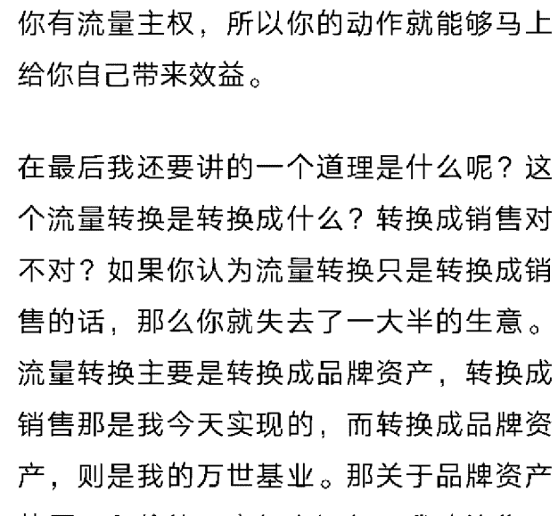

所以就是这样一些简单的创意，就能够销售提高20%，这一切基于什么？都是基于你有流量主权，所以你的动作就能够马上给你自己带来效益。

在最后我还要讲的一个道理是什么呢？这个流量转换是转换成什么？转换成销售对不对？如果你认为流量转换只是转换成销售的话，那么你就失去了一大半的生意。流量转换主要是转换成品牌资产，转换成销售那是我今天实现的，而转换成品牌资产，则是我的万世基业。那关于品牌资产的原理和价值，它怎么运行，我建议你再回过头去重听一遍我们前面讲的品牌资产的内容。

知识就在得到，咱们下一讲再见。

### 划重点

- 1. 追求稳定的流量产出比，你就会掉进流量陷阱，失去流量主权；
- 2. 流量就在你自己身上，永远投资给自己，就是掌握流量主权；
- 3. 流量转换不仅仅是要转换成销售，更重要的是要转换成品牌资产。

## 22 | 回到4P原理：为什么经典的就是最好的？

你好，我是华杉。欢迎来到你的得到课程《品牌杉杉帮品牌营销·30讲》。

在这一讲，我讲讲4P原理。我们前四个模块，一直在讲营销的原则。大家知道，这个4P是最基础的品牌营销理论。第一个P是Price（价格），第二个P是Place（渠道），第四个P是Promotion（推广）。以前的P它是译成促销，实际上翻成推广更准确。

我先讲一个结论：营销的基本原理就是4P理论。4P就是营销的全部和全部的营销。直到今天，4P都是我们解决营销问题的最高纲领。

什么叫做基本原理？什么叫做最高纲领？有这么三个标准：

- 第一个是解释一切。首先要讲什么叫理？科学讲理论的定义就是能解释一切现象的。如果有一件事你解释不了，这个理论就破产了。比如说牛顿的万有引力定律，如果有一天抛下一个苹果，它往下掉，再飘到天上去了，万有引力定律就破产了。

- 第二个标准做完全穷尽，相互独立。完全穷尽就是所有事儿说完了，只要你讲营销，那么你一定会有一个产品，有一个价格，会有一个渠道，有一个推广方式。我解决营销的问题，永远有这四个工具、四个变量，供你调整。

那有人要说了，营销是不是最传统的营销理论吗？现在都已经过去了啊？我要提醒你，对所谓的创新理论要保持高度警惕，只要谁说上理论的话，大概率上面两个条件，用土老师话讲过，这是因为他有胜心，其说无以完备，非要另立一说以胜之。或者说，以前的学说已经不够完备了，但是不是说以他的学说他也没讲，非要另立一说，希望超过别人。如果这样的人在做营销、做老师，那就是谋财害命。

### 4C为什么是错的？

一个试图颠覆4P的理论叫做4C理论，也叫整合营销传播理论。4C理论开创者，是美国西北大学的教授琼·舒尔茨。简单地看，4C把4P的态度企业立场的，而不是客户立场的，因此4P应该转换为4C：客户（customer）要换成顾客价值（customer value），价格（price）要换成顾客成本（customer cost），渠道（place）要换成顾客便利（customer convenience），推广（promotion）要换成顾客沟通（customer communication）。

> 唐·舒尔茨的《整合营销传播》那本书里面，打开第一章节“传统行销传播的终结”。如果你没看这书的序言，我觉得他说的只是提一个颠覆的角度而已，无可厚非，但是我想要讲4P，我认为这就是谋财害命了。

在这个文章里，舒尔茨提出了著名行销传播的新的4C理论。他说4P已经成了明日黄花，新的营销世界已经转向4C了。这个4C理论的问题太大了，我逐条来说。

我们先看第一条，他把4P里的产品换成了4C里的顾客价值。

他说应该把产品先搁到一边，赶速去研究消费者的需要与要求，不要再卖你所能制造的产品，要卖消费者想要买的产品。那到底要研究消费者需求还是研究产品呢？笼统地说要研究需求，那是没定义。如果只说一样呢？当然就是产品。因为消费者啊什么吗？他主要投入是研究产品，怎么研究出好吃的菜品。

至少是消费者请进营销者，还是让消费者研究出来的，而不是去调研消费者需求调研出来的。乔布斯在做出手机之前，他开苹果发布会或者说消费者请进，说“这里有一种新手机”，而不是跑去调研让研究人员注意研究出了一种新的消费者。

舒尔茨所说所谓传统营销，也从来没有不考虑顾客的价值生产营销。你可以把顾客价值再强调一下，但是你说不能过分的理论终结者。但人家的书里面看整天研究消费者的，但天研究80后，今天研究90后，后天研究00后，如果手机厂商去研究00后要什么样的手机吗？没有，他需要研究的是5G技术，他需要研究的是新产品。

再看第二条，他把4P里的价格改成了4C里的顾客成本。

这个问题就太严重了。舒尔茨说，暂时忘掉传统的价格定，快去了解消费者愿意为自己所需付出的必要成本。我要想说的是，所有的传播销售从来没有忽略消费者的消费者成本定义。那是不做的。但是如简单是把价格理解消费者愿意花多少钱，那就是完全对价格定在营销里面的战略意义没有最起码的认识。

价格定价首先不是参照消费者的承受能力，有不可的消费者有不购买的理由。因为消费者的承受能力、价格定位取决于营销模式的选择和产品价值的定义，以及你设计消费者利益与差异。在营销中不仅只有销售者的利益，还有企业的利益，还有销售者的利益。有个广告叫“没有经销商赚钱啊”。我查看，销售一定考虑经销商的利益。因为经销商的价格定位上抵低了顾客获取成本。如果一个东西没有经销商，大家都是工厂口口价格，那什么是成本？正是为了已经利润薄差价，消费者的获取成本才降下来。

所以你所选的不同的竟销模式，也就是不同的销售者及不同的利益链条的设计，它决定了什么。比如说我们是主要生产者物质集合，安利销售者、黄金搭档和脑白金，不同的品牌，不同的定价不一样。因为它们分别采用了不同的销售渠道，一个是直销渠道，一个是商超渠道，一个是药店渠道。现在他们的主要企业，还要特意地在不同渠道里面投放不同的产品。

互动沟通。我想问一个问题，你是愿意推广一个东西出去就拉倒了呢？还是愿意跟顾客互动沟通呢？甚至一对一的沟通呢？我就想问一问，你沟通得了吗？14亿消费者，你能跟他们互动吗？我想最好是没互动，越简单的推广就越好。

我们前面讲过“爱干净，住汉庭”那个例子，当时大家讨论说怎么跟顾客沟通，我说最好别沟通。沟通就用你的行动去沟通，用你干净的房间去沟通，我们要做的就是推广。我们最简的推广是什么？最简的推广就是刷标语，你把“爱干净，住汉庭”这六个大字刷在我们当街的楼顶上，那就是最大的推广，成本最低，效益最大。

在《整合营销传播》里面还有一个极大的错误，就是把整合营销传播最后又发展成了360度的沟通，就是我从广告、公关、零售、促销，基本上所有的营销工具综合地去向消费者进行所谓的沟通。听上去很美，对吧？但是他没有考虑成本。

在我们营销的现实里面，如果我们投入了大量的广告，我们就没有资源去做终端；如果我们走的是终端管理的模式，我们就要投入大量的销售队伍，就没有财力去投广告。所以我们在真正选择我们的营销传播工具的时候，我们往往是集中优势兵力打歼灭战，在一个动作上面压倒性地投入，这才是最基本的兵法。如果把资源分配到360度，那么也没什么干不成。

知道就在得到，咱们下一讲再见。

### 划重点

- 营销的唯一正确理论就是4P——产品、价格、渠道、推广，它创造了营销思考谋略的完整闭环。

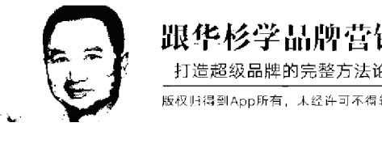

## 23 | 实战：怎么把4P用到品牌营销活动中

陈华杉 | 30 min

华杉 你好，我是华杉。欢迎你来到我的得到课程《提升杉杉品牌营销·30讲》。

上一讲我们讲了4P，这一讲我们接着讲4P。讲什么？除了4P之外广告营销，4P就是营销的全部和全部的广告。再用一个案例实例，帮你更加深刻的理解4P理论。

你可能觉得，这话是不是太绝对了？绝对不能对，逻辑就绝对不会正确，如果不能绝对正确那就不理论。

我从哲学上给你讲讲这个道理，就是哲学家康德在他的纯粹理性批判当中说的，他说我要建立起整个哲学的天空，筑起地基、梁柱、墙壁、楼层和地板，分割一个我的房间。当所有的黑暗建筑完之后，我可以讲，所有有关批评哲学理论都在里面了。还须要说，在此大厦之外的事物，没有一块批判哲学有关。

4P的营销理论大概念很合康德的哲学标准，所有关于营销的概念都在4P大厦之内，而4P大厦之外的一切事物都和营销无关。这个大厦里面分成了四个房间，产品、价格、渠道、推广，这四个房间之间也没有重叠。

有人就不服了，4P别人讲了，他就讲5P。说第五个P是什么？说是package（包装）。这个包装的概念不符合完全穷尽、相互独立；包装的概念既和产品重叠，又和推广重叠。

在华为跟我们怎么讲包装设计？

- 第一，我们说包装设计师是产品研发开发，可为箱包信息，消费者买的是哪个包装，他是看到哪个包装买的，所以包装本身就是产品。
- 第二，包装是推广的战略工具，耶那酱油的包装是推广的最大推广工具那酱油的工具吗？所以包装的概念既和产品重叠，又和推广重叠，那就这是一个多余的概念。

所以搞清楚4P这个概念，有些话我们就可以辨别好坏了。比如有人说，我们公司的产品出口外，还是不做搞销售，他们公司产品的不好，就是搞搞搞搞啊，这就话就矛盾了，因为营销4P的第一个就是产品，营销产品就包含两个相互独立概念，营销本身就没有了产品，而这些东西都是严肃的。比如营销一点不配的企业家多毛，"对营销一个概念也没有"，他怎么能对营销一个概念也没有呢？他就是营销的大神，你千万不能把他这些话当话，这就是逗我们玩呢。

#### 4P实战：西贝

好，下面我们讲一个具体的案例，来讲一下在营销当中4P实战是怎么发挥作用的。我们用西贝铁板烧来来讲一下4P的实战，因为这个案例是大家最熟悉的。

大家都知道西贝面馆在从前经历两次定位策划：

- 第一次是定位为西贝菜；
- 第二次是定位为羊专家，就是烹调羊肉的专家。

第一次对经营带来什么好处。第二次又造成了很大的损失，就迅速地停止，止损了。为什么呢？因为第一次说西贝菜只是个产品推广的说法，在前三个P，产品、价格、渠道都没有变化，只是给第四个P推广定了一个说法，叫做西贝菜。

第二次菜单专家仅仅是改说法，而且还实质性改变了产品，菜单向羊肉集中，客单价提高了，客人少了，毛利率下降了，顾客也少了，所以就连成了损失。

那我们要说，4P管营销的全部和全部的广告，只要4P不动，只能是产品、价格、渠道、推广，四个要素一个都不能只动。前面的两次所谓的策略，第一次只动了最后一个P（推广），第二次动了第一个P（产品），也动了第四个P（推广），对价格和渠道没有动，所以它本身不是一个完整的营销方案。一个不完整的营销方案，本身就没有讨论的价值。

在2013年，我与华开始和西贝合作的时候，我们首先看见4P是一个4P的盘点。首先看看现在的4P是什么样的。我们要改变它营销，就要考虑怎么来调整这4个P。

第一个P是产品，西贝的产品是什么？是西北菜还是羊专家？都不是。不是说什么菜，而是整个餐，这个是西贝的产品，有若干的包房，有大桌子，有100多道菜，价格大概60块钱的客单价。

第一个P是渠道，西贝的渠道是什么？渠道就是它的店在哪里，大街就是它的渠道，它的店是店在大街上的。我前就是说了吗，在大街上开一个店就是获得这个街道的流量，同时还获得了一个东西，这个街道上的广告位。一个大楼，大楼的一楼就是你的广告位，就是你的媒体。

推广，就是它以前做的草原的牛羊肉、乡野的五个杂粮，跟《舌尖上的中国》演绎的这样一个推广。

在我们开始要调整这个4P的时候，我们第一个要调整的是什么？第一个要调整的是渠道，为什么呢？因为渠道环境发生了变化，就是shopping mall兴起，这个西贝从2013年到现在的成功，首先是在渠道上的成功，是shopping mall这个渠道带来的成功。从2014年到2018年，这四年是高速发展。

变。我们也说到了渠道的改变，我们又说了价格的改变，那么这几个改变才是它成功的根本。如果没有王龙龙300平米的这个试验的成功，那么西贝这几年怎么能快速复制？正因为是有33道菜、44道菜，我们才能承诺“闭着眼睛点道道都好吃”。也改变了产品的生产工艺，因为中央厨房的出现，这样我们才能够实现出品的控制，才能够实现快速扩张。

第四个P是推广，就是营销传播和品牌上的变化。推广是什么？就是华与华创意的“1 LOVE 莜”，这在推广上发挥了巨大的作用。

因为西贝之前合作过很多咨询公司，所以在西贝莜面村成功了之后，有好多的公司都写文章说西贝是他们做的，只有我没有写过，以至于经常有客户来我们公司打假。那几年，经常有人问，西贝是不是你们做的？我就叫他们回答：不是，是西贝老板贾国龙做的。

因为西贝莜面村的老板是贾国龙，是有一个企业家才有这样一个企业。咨询公司最好跟客户的成绩保持一定的距离，不要贪天之功，据为己有。

如果要我给华与华为西贝做的贡献打一个分，我打25分。满分100分，我打25分，为什么？因为营销4P里面最后那个P（推广）是我管的，这个我打了25分，那已经是给自己满分了。

好了，这一节我们就讲到这里。希望通过这两讲，你对营销4P有一个正确的认识、理解和掌握。这样能保证你少犯错误。这个模块，我们从原理上来重新认识了4P理论，认识了营销。下一个模块，我带着你从原理上来重新认识消费者。我们不是老讲理解消费者吗？这个话题不讲清楚，也会让你不断地犯错误。

知识就在得到，咱们下一讲再见。

- 营销必须建立在完整的4P之上，一个不完整的营销方案，本身就没有讨论的价值；
- 4P的运用是一个动态过程，你需要基于正确的战略思维，在过程中有效管理你的营销战略；

## 24 | 受众角色：怎么让消费者注意你，记住你？

你好，我是华杉。欢迎你来到我的课程《超级符号品牌营销·30讲》。

现在我们进入到第五个模块。我将用三讲来讲一下消费者这个话题。给你介绍一下华与华方法的消费者理论。

经常我在跟客户开会，讨论方案的时候，客户会说，“我站在消费者的角度，我究竟会怎么支付。”我心理就乐了，我心想，你站不到消费者的角度去。作为一个专业人士站到消费者的立场上，那你是一个非常专业的话儿，我这一讲就教你如何站到消费者的立场上看到问题。

我们怎么去看呢？要从行为主义的角度来说，行为主义什么时候被行为学家称做意识/他们的行为什么，所以问一下学问叫做消费者行为学。消费者行为学的学术意义是什么？是研究个体或群体为高定需求与欲望而挑选、购买、使用、处置产品或服务观念或经验所设计的过程。

在华与华的消费行为理论里面，在后后面又增加了一个过程，也就是说他向他人分享他的消费经验，也就去说服他向他人愿意传播我们的品牌和服务。这四个角色我们把消费者分为四个角色，这四个角色你发现吗？受众、购买者、体验者和传播者，这这四个阶段。那我们就用三讲来分别讲这四个阶段。

第一个角色，受众。受众是什么意思？就是接受我们的信息传播的大众。

受众的特点是什么呢？两个特点：第一是茫然，第二是遗忘。

在顧客来挑选、购买商品之前，消费者和商家的关系是通过媒介的广告。什么媒介呢？比如说通过街道上的招牌、户外广告、电梯广告、电视广告、网络广告、宣传册，包括搜索引擎等于切切的媒体，或者亲朋朋友的引荐，来获得对我们品牌和商家的信息。在这个阶段上，我们需要把消费者称为受众。受众的特点有两个：一个是茫然，一个是遗忘。我反复强调，要记住这两个特点，茫然和遗忘。信息传播广告知的失误，大都是因为没有忽略这两个特点。

#### 怎么对抗受众的“茫然”？

第一个茫然，茫然是什么意思呢？就是他没有注意到你。因为他没有义务注意到你。你走在街上，他凭什么注意你？他跟你是陌生的，陌生的，眼睛在感受他的状态，耳朵在监听，耳朵在听，听得到他可能的内容跟状态有关系。我们说这种茫然的受众，你需要做什么？需要把他唤醒，让他注意到你。怎么唤醒他呢？就需要信息的刺激。

我刚才前面的传播原理已经讲了。传播的基本原理是刺激反应，释放一个刺激信号，让他做出什么反应？那个人会做什么信息刺激到他，他会跟他自己相关的信息就接收到，所以这个刺激反应和消费者价值密切相关。也就是说，我们像一个胃药，那腰方肚药就要出什么？“胃疡、脾胀、胃胀”。某家洗护小镇的广告第一句是什么？“小葵花妈妈洗护两不误，”什么意思？洗妈妈们注意，她有这个问题，你叫他不他她注意到了嘛？她没有这个问题，你就不要浪费她的时间。

有标题写我要一些骇人听闻的标题，也是刺激信号。这个刺激信号刺激的是什么？激起受关注的点击。但是点击进去之后却不是相关的信息，这种借口诱导消费用户的时间，也损害着你自己的信用。你只要得的一个点击量而已，点击量是什么？点击量并不是你的最终目的，你的最终目的是要卖出来的商品，对不对？我们要从中价值来上确定我们对自己的态度，对受众的价值刺激本身就是为顾客提供信息服务，是帮助顾客节省时间。而不不是浪费他的时间，误导他的时间。有的人看不懂上那那叫叫卖式的广告，他却不知道这种叫卖式的广告才是消费者真正需要的广告。

有人会说，叫叫卖式的广告难道不算骚扰吗？这是不是叫叫卖式的，叫叫卖的广告对不需要它的是一种打扰，但是对于需要它的人则是高价值的信息。有时而不需要它的人，当他有需求的时候也能够想起你。如果不理解这一点，谁都不不想骚扰，那也不会得到任何的行为反应。

以前我有个朋友是做广告的，十几年前跟我说，他他说他那个“送长辈富春酒”，那个产品的顾客定位到是孝在哪？我没说是你那个，你送给长辈谁？他说我不不就就你那个东西还送。

我说你你你你回家了吧？他说回家了，我说回家了有没有给长辈送长送东西呀？

他说了，我说的什么？他说的酒。我说那你怎么不他说？他说。我说你说了什么酒你你怎么？他说你他他他送了一个烟酒店，然后告诉那个老板，给他点个名单，我就在这家，每家给我给我搞两箱，他们现在就在进行什么服务，给我送两箱。你给他直接送，我忘你钱，但是就是具体送什么？我说？我说你是不是有可能是送金酒呵？我从理论上确实有可

这就是我提供了这个信息服务，到他要送长辈的时候，他就了这个需求，就会做出行为反应。

#### 怎么对抗受众的“遗忘”？

受众的第二个特点就是遗忘。遗忘是什么意思？就是这个信息从哪儿？他忽略了，转眼之间就把你忘了，你需要重复刺激、反复地刺激，所以，重复是沟通的第二要义。

但是我们在跟客户会的时候，经常有的客户会这样讲，他说我们已经是知名品品牌了，所以我们的现在是什么品牌吗？我们下一步海图的主要是要进市场，就说进下一步，永远第一步，我们对顾客永远进行开基础培训，可永远基础锻炼都对不好，开不玩，你可以永远不去打不广告，我长大的一坡小孩子，他可不可可口可乐，是什么东西？以前小的时候人，时间太长了，有再的可乐来家，他他把可口可乐送还了。

感，对你越熟悉，他就越产生依赖。就算他对你不那么了解，至少也觉得你是比较容易被监督的，因为大家都知道你。

还记得我们前面讲品牌三原理时候的那个品牌第一原理吗？社会监督原理。你的知名度越大，社会监督你的成本就越低，监督你就越容易，越容易监督你，选你就比较容易放心。其次，知名度越大也说明受众面越大，就是流量越大，销量自然就大。占据市场份额最大的公司，在大多数情况下都不是做得最好的公司，或者是声誉最好的公司，也不是说顾客对它最忠诚的公司，而是知名度第一的公司。

所以，你要永远投资于自己的知名度，这是包赚不赔的生意。

#### 总结一下：

这一讲，我们讲了消费者的第一个角色——受众。受众有两大特征：第一是茫然，第二是遗忘。

第一，对抗消费者的茫然就是当头棒喝，针对他的问题吆喝一声，引起他的注意。广告是给顾客的信息 服务，不是给他看一个娱乐的小电影。

第二，对抗顾客的遗忘，就是要靠不断地重复刺激，最好是永远都不需要做新创意，一个创意做50年，那你就是天下第一。

知识就在得到，下一讲我们接着讲消费者的第二个角色——购买者。

- 消费者的四个角色：受众、购买者、体验者和传播者；
- 受众有两大特征：第一是茫然，第二是遗忘；
- 对抗消费者的茫然就是当头棒喝，针对他的问题吆喝一声，引起他的注意；对抗顾客的遗忘，就是要用相同的信息进行不断地重复刺激。

跟华杉学品牌营销
打造超级品牌的完整方法论

授权计得到App所有，未经许 许可不得转载

## 25 购买者角色：怎么让消费者快速选择你？

### 华杉

你好，我是华杉。欢迎来到我们的得到课程《跟华杉学品牌营销：30讲》。

我们这个模块是讲消费者的四个角色：受众、购买者、体验者、传播者。上一讲我们讲了受众，这一讲我们就来谈谈购买者这个角色。

#### 如何跟消费者快速沟通？

购买前的消费者叫受众，购买中的消费者就叫购买者。理解这些角色的不同词汇非常重要，因为受众是思考，传播者就是使用或者传播。

这里我们说两个关键词，一个场景，现在场景这个词好像也很流行。实际上我们所有的思维都是基于场景，场景是什么？就是现场。

所以我说跟创意构思和管理的方法是相通的，在华与华管理里强调三是方法：现场、认知、结果。管理第一现场，现场有什么东西，第二现场，现场也就能看到东西，也就能看到事物，事物就是现场有什么东西可以利用；第三是结果，结果是在时间轴上看到的未来的事情和行为，然后根据需要、事物、结果来进行你的创意设计。

所以我们要基于场景来设计你的购买行为，一个又一个的动线，让消费者发现你，走向你，选择你。那么消费者发现你，我们要说的特点是他的信息和购买者，那购买者的特征是什么呢？购买者的特征就是要在场景中或者在寻找购买信息、当他发现了商品，并且找到了购买理由，成就我们的信息和商业先决信息，让他发现购买理由，让他的购买行为发生，也就是购买者行动。

那我们的信息是什么呢？信息就是商品，商品就是信息，包装就是媒体，货架就是广告位，商业首先就是让它在商业竞争的环境中主动发出。记住在商业之后你就会被发现，华与华的所有产品包装都是这么设计的。

厨邦酱油的包装设计也是这样，从配置里面你可以看到新旧包装的对比。新包装用了绿格子设计，这个绿格子图案的瓶子在货架上很特别，就形成了一片绿油油的海洋。这个绿格子海洋就把购买者的目光抓过来了，人就过过来了，走到货架面前来就会发现他的酱油包装，包装的牌子上有一个广告，“厨邦酱油晒大晒晒，晒足180天，就这么晒，晒出美味晒出鲜”。购买者有兴趣了，拿出来看，里面写着，“晒传统都鲜，酱油就是太阳晒，晒足180天，晒出美味晒出鲜”，他就说服了，就把酱油放进他的购物车了。

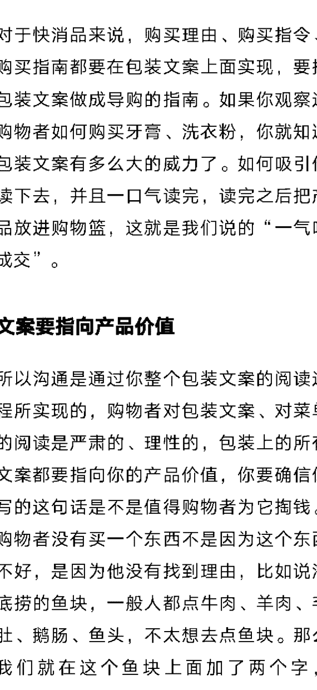

这个设计出来的剧情，我们把它叫做快卖，叫快速沟通。对这个快速沟通我们有一句话，叫做“让购买者坐着滑梯滑到收银机”。我们说写字条不是一气呵成卖下去，而是要走向成交。所以每个信息的设计，是购买者的购买行为过程一个又一个动作的设计。

这样的设计是怎么做出来的呢？是长期的焦点顾客采样的经验，在销售场里蹲点，观察最买者的行为，知道他们如何走到发现商品、购买商品、购买决策的每一步都发生了什么，他在想什么，然后有针对性来设计什么。

在针对购买者的营销传播设计上，华与华有个方法论，叫“三个购买：购买理由、购买指令、购买指向。”

爱干净讲什么，购买理由，买汉庭是什么？就是汉庭，让你去住，就是下一个指令让你买汉庭，那么你买指向就是进来之后去帮你定不同档次的房间，你可以根据消费，决定哪间房。

到了终端消费来说，购买理由，购买指令、购买指向就要在包装文案上面实现。要把包装文案做成购买的指挥。如果你观察包装和食品包装，就会发现，你的消费包装文案有多么大的威力了，如何吸引他读下去，并且一口气读完，读完之后把产品放进购物车，这就是我所说“一气呵成交”。

#### 文案要指向产品价值

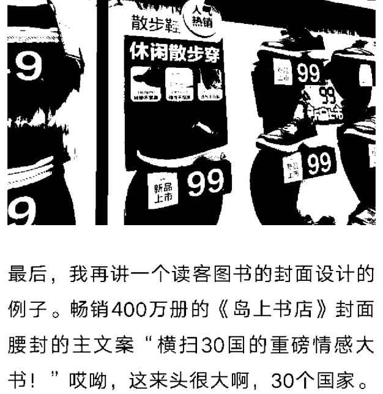

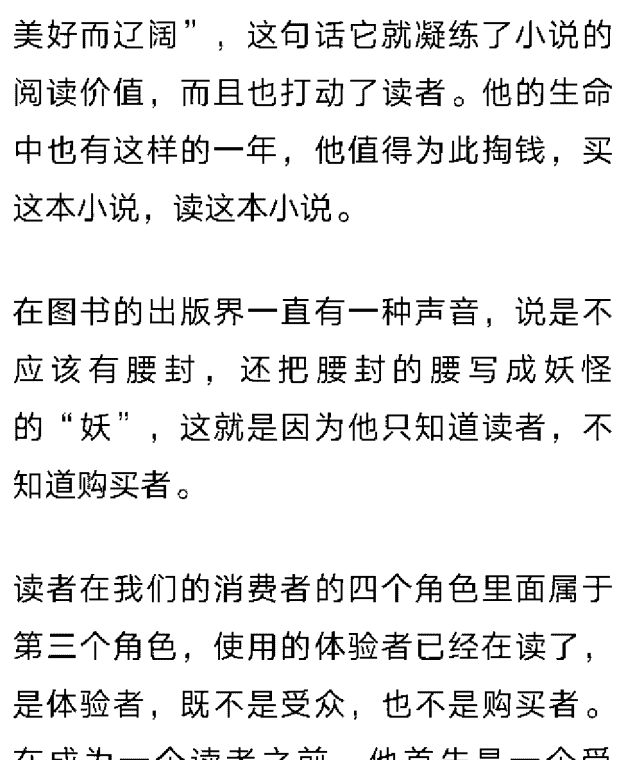

这两支产品到了商场之后，就给了顾客购买理由和购买指南。你想，一个妈妈要来给孩子买牙膏，她也没想法，很茫然。孩子喜欢水蜜桃味的、喜欢草莓味的，还是喜欢印了史努比的、唐老鸭的？我们给这个指南很严肃，你要根据他的年龄，是两到五岁还是六到十二岁，那我们这个购买理由、购买指令和购买指南，它的严肃性和重要性就超过了其他所有理由，于是它就成了田七牙膏当年最赚钱的两支产品。

前一阵子，我看到我们公司同事做的足力健老人鞋的店面陈列改善，那个鞋不都是陈列在墙上的吗？墙上有一些鞋架子，一个架子放一只鞋。他们就把重点要推的鞋，在后面做了一个海报的背板，相当于海报背板和鞋一起组成了一个立体海报。我一看，这真是好极了，这个鞋的销量肯定马上就上去了。

最后，我再讲一个读者图书的封面设计的例子。畅销400万册的《岛上书店》封面腰封的主文案“横扫30国的重磅情感大书！”哎呦，这来头很大啊，30个国家。然后有一句文案是什么？“每个人的生命中，都有无比艰难的那一年，将人生变得美好而辽阔”，这句话它就凝练了小说的阅读价值，而这也打动了读者。他的生命中也有这样的一年，他值得为此掏钱，买这本小说，读这本小说。

在图书的出版界一直有一种声音，说是不应该有腰封，还把腰封的腰写成妖怪的“妖”，这就是因为他只知道读者，不知道购买者。

读者在我们的消费者的四个角色里面属于第三个角色，使用的体验者已经在读了，是体验者，既不是受众，也不是购买者。在成为一个读者之前，他首先是一个受众，然后才是一个购买者。你过不了受众那一关，过不了购买者那一关，你根本就不到读者那一步，你说那东西有用吗？所以我们经常在评价一个书籍的封面设计的时候，他往往是从一个读者，甚至是一个书籍的收藏者的角度来考虑，完全没有受众意识和购买者的意识，所以他不是一个合格的营销策划者。

总结一下：

消费者的第二个角色购买者。购买者的特点是，置身于消费场景中的信息搜寻者，需要你以压倒性的信息优势，在销售场景里抢先让他接收到你的信息。

你怎么能够让购买者购买呢？就是要给出购买理由、购买指令、购买指南，而这往往是靠包装文案的撰写和包装的设计，让顾客能够通过包装快速沟通，坐着滑滑梯，滑到收银机，一气呵成交。

下一讲我给你分享消费者的第三个角色体验者和第四个角色传播者。

知识就在得到，咱们下一讲再见。

### 划重点

- 购买者就是：在购买场景中的信息搜寻者。
- 针对购买者的营销传播设计上，要给出“三个购买”：购买理由、购买指令、购买指南。
- 不是包装为产品服务，而是产品在为包装服务。

## 26 | 体验者+传播者：怎么让消费者喜欢你，推荐你？

致化学品牌营销论·30讲

你好，我是刘，欢迎来到我的得到课程《品牌科学品牌营销》的30讲。

在前两讲，我们分别讨论了参与者和购买者，在这里，我们讲体验者和传播者。

我先讲体验者，体验者实际上就是使用者，因为他们开始使用我的产品或者服务了，那么使用体验感。所以，我们设计一个产品，往往有两个设计：一是购买路径设计，一个是用户体验设计。

如何设计购买路径，以及通过购买路径来创收，以上一讲已经讲了。这一讲我们讲如何设计用户体验。

用户体验的设计主要从三个阶段入手：来之前、来之中、走之后。“走之后”就过渡到我们的消费传播第四个角色，传播者。这也是为什么我把体验者和传播者合在一起讲。

#### 来之前：让他带着期待来

“来之前”是让他带着期待来。这是让我们在买商品或服务的时候，提供信息服务，让他们有所期待起来。比如说提供“房子”（注：此处OCR可能有误，结合语境应为“房子”相关的清洁服务或“房子”指代居住环境的期待，或者原文为“房子”指代某种具体场景，此处保留原意并修正明显语病），他就有对干净有期待，有期待来了吗？你一定会得到干净的身体，甚至超出预期的干净体验。

#### 来之中：让他有惊喜

那“来之中”呢，就是要比他期待得再多一点点。“来之中”顾客满意吗？顾客满意不是一个绝对概念，是一个相对概念。如果他期待值很低，那么来了之后如果不差，他觉得满意；如他的期望值特别的高，甚至已经高到超出了你的服务能力，那他觉得再好，也不满意。

这个体验的设计很典型，我觉得就是360体验器。因为周鸿祎是用户体验设计大师，360浏览器能够很明显的开始时间少，然后他的功能描述语言已经获取了全国多少的伙伴。这就是设计了一个用户体验，让你确认它的价值。

还有洗衣服的这个产品的设计，它说它含有速进因子（注：应为“速溶因子”或类似成分，此处保留原音近词），然后就把它颗粒染成蓝色。这是让用户体验的设计上，让你去确认它宣传给你的价值。

确认之后还得满意，什么是满意呢？就是超出期望。有一句古话，好事原则，叫做无尖不商。又叫无商不奸。

你可能会奇怪，那么奸商是顾客满意吗？我常讲这个奸商的“奸”字本来是尖的头，是一个尖头的商。尖头尖就是不合群，不合群。这个大尖是什么意思呢？就是人以人开价来买，顾客要买一头牛，那么商家就说一头牛，把它装，装到牛，堆起来不超过一头了。这时候，买家一量一下，把它的部分把它切，那么切到，就让你确认这是一头了，对不对？但是，你不一定呢，可能你割掉了他看了着看看有小，就让我割到那个地方再量一下。怎么办？商人为了解决这个问题，拿一个小桶，倒进一头，在这个桶中的小桶里有一头，这就是让你确认百分之百地超过一头了，你肯定是占了他的便宜了。这就叫无奸。

所谓无尖不商，就是说如果你不给顾客一个尖头，让顾客占据一个尖头的位置，你就不是个合格的商人，这是他们中国古代优秀的商业文化，可惜慢慢地就演化为说法，就传成了奸商。

顾客满意就是要你超出期望，让顾客能占一个尖的位置。这个无论是2C的还是2B的意思，都请仔细想想自己，自设计，你事先就设好让顾客到底能占你什么便宜。即便你能让顾客占的便宜，至少你设计，要顾客确保他绝对不会吃亏。

比如西贝说：“跟着狼点，进道都好的”（注：此处OCR错误严重，结合西贝莜面村案例，原文应为“随便点，道道都好吃”或类似承诺，此处保留原意并修正为通顺语境：西贝说：“随便点，道道都好吃”），不是给顾客一个很大的那期望，进道，狼点，进道都好吃。那狼怎么吃。那不吃怎么办？不吃好，不好吃怎么办？那就叫“不好吃不要钱”，所以，你在去见狼，你不要狼费，进道菜不好吃，马上给你取消，免得你一直说进道菜不好吃进道，你马上会观察，你另外的菜品也剩了多少，你给我问：“请问这个你是不是不好吃，会给到你？”

这样一来，至少让你不至于吃亏了，是让他这个让顾客不亏亏，结果也让顾客满意了，为什么呢？因为顾客亏到亏吃亏，为了什么？因为太坏了，别的地方去说不好吃，从没有人端进进，还要你赔钱，太坏了，要半碗亏，所以，坏人太少了，正常人都成了好人了。

其实这样的顾客满意体系，它也不完全是精明的营销算计，它其实是一种经营的诚意，一种商人商家顾客之间相宜的一种信任，一种心，一种文化。比如说海底捞，大家说海底捞的服务不得了。海底捞的事说，大家说我服务好这个事你，你吃吗，总说那服务好，我，也不知道海底捞的什么，人家来你海底捞吃，还要招待，你总得招待一下。那家客人来不呼，也我是不是招待一下，又说服务好，那我们自然不好意思，就说我们的顾客满意，然而不多多少成本，于有人专为你指指甲（注：应为做美甲/修指甲）来，那来了个活就怎么？人家都是，你怕人家不吃就不来了吗？这就像是一个人心，你说多少成本，往里面去，排里面坐了一点点其他的其他的服务。那里面都是你坐满了，你的公成本都撑死了，我们已经边的利润空间本来就很大了，你再给他涂下指甲又算成本吗？他说，就是这么多一点点做人做商的心意，海底捞就赚“吃到为止”的心意，我看海底捞实际上就是种最朴实的中国民间的善民而已。

#### 走之后：让他带走物品，乐于谈论

在“来之中”，让他有惊喜，设计好让顾客带走走的，使他的满意，考虑好让顾客带走走的物品。“走之后”是什么？走之后，顾客就变成了传播者。高离开我们，他满意了口碑，所以，“来之中”是价值确认和体验惊喜。

“走之后”呢？12个字，值得回忆，乐于谈论，带走物品。

“值得回忆”是有他记得的东西，“乐于谈论”是您愿意去处理别人，“带走物品”，这也是您去处理让别人，这就是传播者。“带走物品”就是最后还能带走一些东西，成为证据，还可以拿去展示给别人看。

我举个，你理解我了。十几年前，那个时候坐机去他回来，那比如说有一个入去二进巴尼亚（注：应为去意大利或法国巴黎等地，此处OCR误判严重，结合后文巴黎，推测为“去巴黎”），那么见到了所有朋友，他，哎，我这去巴尼亚就像一样，你们，那你都是，那我们在巴黎的时候怎么怎么说，就是不是我们在很享受回忆，乐于谈论的事情告诉同。然后你的东西里面去，我看见他在客厅里面，到地方，去一个埃菲尔铁塔的小模型，他给我介绍，这是他在巴黎购得的广告，那么埃菲尔铁塔的钥匙是什么？就是巴黎旅游局是在他的旅游广告，而二旅游局，巴黎市旅游没有花一分钱，还掉了他的。

所以，你要有一些事情，有一些故事，让人家值得回忆，乐于谈论，到处去说，最好让他能带走一个传播信来讲述，你看，人见证俱在，那顾客不就来了吗？

那么，西贝的这个“love 夜”（注：OCR误判，应为“围嘴”或类似物品），我们也做了一个个性的，就是给小孩用了小围。顾客非常喜欢这个小围，那他吃东西，可以带走的。带走之后呢，他吃的的时候的时候，那这围了没有提供这个小围，又要带小孩的把他的这个围放到，小孩喜欢西贝的小围，其他如没有没有看，也说是说有这样一个小围，我们把我看到做到围的到围里面了。我们不这样靠例举，是消费行为，他自己就变成了这样。

海底捞你人去海底捞吃饭的，服务员帮你一下，去吃饭的，哎，呼，你这直，他一个娃娃娃、一个小姐孩你去，的，你看，哎，啊，这是真是人类体验了你。你看，然后你赶紧拍个照，发朋友圈，说到微博，然后大家都转了。

刚才讲的是B2C的业务，那么B2B的我们的体验就是重重重了。为你体验的产品可可能无形，比如说我们给做的产品可能是无形的。

比如说我在给得到，给罗振宇提案的时候，我们不是做了猫头鹰的这个标志设计吗？你要卖一个新的标志给罗振宇可不是那么容易的呀，因为对他来说这是一个他从来没见过的东西，是一个异物，你知道吗？就算他不是特别反对，他也问你，有没有更好的呀？你能说没有更好的吗？所以，这个提案的体验就是非常的重要。

于是，我们就做了一个视频，让这个猫头鹰飞起来，还配上强劲的音乐。因为音乐能够让他兴奋，能够影响他的情绪。我告诉你，这个标志提案能不能通过，那个音乐的选择很重要。你要配个哀乐，我告诉你，百分百通不过。这个配上强劲音乐的提案视频，就是后来罗振宇在直播当中播放了五遍的那个视频。（也是现在“得到”直播的开场视频）

后来，罗振宇跟我说，如果没有那个视频，他也不会确定这个标志。为什么呢？因为他想象不出来这个东西以后会怎么样，而看到那个视频动起来了之后，他就找到感觉了。

所以，你想想，如果你是做2B业务的，你是专家，客户往往不懂啊。你懂，他不懂，你跟他怎么说也说不明白，你说会怎么怎么样，他脑子里面没有你那个图像。所以，2B的业务最需要考虑体验的这个设计。华与华每年在制作提案的这些视频上面，要花一百多万。因为你不花这一百多万，你可能会损失三千万的业务。

总结一下：

在这个模块，我们讲了消费者的四个角色：受众、购买者、体验者、传播者。

在讲这四个角色里面，我们反复地讲一个词，就是给顾客的服务。实际上营销就是一种服务，就是对消费者的服务。

对受众的服务是信息服务；对购买者的服务是购买决策咨询服务；

对使用体验者的服务是创造一个惊喜，创造顾客满意的这个服务；对传播者的服务是为他以后怎么去向他的亲朋好友介绍我们提供一个创意服务。

能够理解这四个角色，那么你整个营销传播的策划就更有迹可循，而且不会遗漏，少犯错误。

知识就在得到，咱们下一讲再见。

### 划重点

- 1. 我们设计一个产品，往往是两个设计：购买理由设计和用户体验设计。
- 2. 体验设计的三个阶段：来之前、来之中、走之后。
- 3. 来之前：让他带着期待来；来之中：让他有惊喜；走之后：让他带走信物，乐于谈论。

跟华杉学品牌营销
打造超级品牌的完整方法论
版权财得到App所有，未经许可不得转载

---

## 27 交易成本定律：企业为什么存在

混沌学园品牌营·30讲

你好，我是华杉。欢迎你来听我的得到课程《跟华杉学品牌营销·30讲》。

前面我们讲了五大板块的内容，讲了营销战略，讲了品牌，又讲了传播三大理论。那么，接下来最后一个板块，我要把信息放到更大，讲怎么去认识企业。

### 不懂企业，就不懂营销

为什么要讲企业呢？实际上我们要跳出品牌营销，从整个人生的角度去看品牌营销。这个，源自于我个人的工作没有经历过。大概在2011年左右，我一个客户跟我说：华杉老师，你为我为你的客户，不对不对，在你那块很专业，但是假如品牌营销就这么大，他拿手画了一个小圈，然后又比了一个大圈，说，而整个企业是这么大，你如果只整个企业的工作没有认识，你的光在你那个小圈圈里的专业，那个专业都是伪专业。只有你对整个企业专业了，你才知道我们这么大量的企业在想什么，在做什么，你才能够参与所有话题，你才能够用你的那个专业里面来真正的专业。

哎呀，这话对我的影响太重要了。我就想起我前面里，比如有的企业有品牌部，如果这个品牌部的人什么都不懂，对业务也不懂，就说我是品牌的专业专家。结果，因为品牌部是一个业务部门。如果没有对企业整体经营没有认识，他律搞自己品牌，是专门，企业来了之前会请一些专业的品牌专家，或者去公司给品牌经理，然后你请他来，他怎么来，因为你离开了企业战略和整体经营者看的品牌或营销都是伪专家，不仅不知道自己在做什么，而且不知道自己不知道。

所以，我把他们的那个不知道，称为四个不知道：

- 干之前不知道自己要干什么；
- 干之中不知道自己在干什么；
- 干完了之后不知道自己干了什么；
- 不知道自己在不知道。

所以，没有什么纯粹的品牌的专业，营销的专业，更没有品牌形象，品牌设计的专业，只有一个专业，就是企业经营管理的专业，只有在专业职业上专业，你才有你的专业才成立。所以，我们公司的品牌部门不要成，要为公司，做成一个文艺主管部门，而要是做公司整个的一个核心业务部门。总的来说，就是一定要整体地认识企业。

你要先要成为一个企业家，而后才能成为真正的品牌营销专家。

### 企业是为了降低交易成本

怎么认识企业呢？就要从最底层的逻辑开始。我总结归纳了如下的企业三大定律，这三大定律没有一个是我的发明，都是往圣先贤的思想组合在一起，我把它组合在一起，并加上为学界所认同，也也算是我的一个创新组合了。

哪三大定律呢？

- 企业第一定律：科斯的交易成本定律；
- 企业第二定律：德鲁克的社会职能定律；
- 企业第三定律：熊彼特的创新规律定律。

这一讲我们讲企业第一定律，科斯交易成本定律。科斯在1937到1939年写了一篇文章，叫做《企业的性质》。到了1991年，因为这篇文章，他获得了诺贝尔奖，因为科斯这篇文章研究的是什么问题呢？就研究一个根本的问题，这个世界上为什么会有企业？

他的结论很简，一句话，企业之所以存在，是因为它降低了社会的交易成本。比如说大众点评为什么会存在？是因为它降低了人们提前餐厅、影院、宾馆等线下消费决策的，以及服务了解他们的服务能否满足需要的交易成本。

再举个简单的例子，比如说我是一个贵州人，居民在上海，我自然想吃家乡的油辣板（注：应为油辣椒），如果在有企业（注：应为“如果没有企业”），那我得花个一年时间到贵州，然后去某个找了一个老师妈妈给我做，那是什么成本太高了。有了企业，我在楼下的超市花10块钱买一瓶老干妈就可以了。

所以，有句话说，所谓企业就是让普通过者也可以使用上帝，皇帝才用得到的奢侈品。比如巴黎排名第一的服装设计师，他以前是谁在穿的？就是国王、王妃设计服务的，现在，我们在H&M花几百块，就能买到他的设计，因为企业降低了社会的交易成本。

那么，我们已经解释了企业之所以存在，是因为它降低了社会的交易成本。那么，科斯又研究第二个问题，既然企业能降低社会的交易成本，那我们建一个企业把全部交易都来不就完了吗？为什么这个社会上有那么多不同的企业呢？

等等，这是做什么？这是为了降低企业内部的交易成本。如果我们要在中国讲一个降低内部交易成本的案例，我觉得有两个企业是把内部交易成本降到了最低。

一个是谁呢？海底捞。海底捞就是它独特的培养店长的这样一个制度。一个店长他开很多间店，但是呢，公司的制度就限定他开店的数量。那他想要自己再赚更多的钱，怎么办呢？他必须培养新的店长。公司所有人都拼命地往下去培养人才，这就降低了内部的交易成本。

有的公司一个业务骨干如果特别厉害的话，由于公司内部的竞争，他特别要保护着，不让他的经验被别人学会，而海底捞的员工一旦他有了什么经验，他就要赶紧教会更多的人。这样一来，海底捞就成了内部交易成本最低的公司。

第二个降低内部交易成本的典型案例是谁呢？就是华为。你看华为任正非总是说，我们永远不上市，因为上市会影响我们的决策，上市公司它的决策被资本市场绑架了之后，又会影响他的决策，实际上就是提高了他的内部的交易成本。由于他的内部交易成本最低，他就能以低廉得多的价格去和他的竞争对手竞争，因为他的成本低嘛，这样他赢得了市场，壮大起来。那壮大起来之后，他再建立品牌，整个2B和2C品牌的联动是不是又降低了他的外部的交易成本？

在华与华的品牌营销工作当中，我们就是以两个最根本的视角去看我们的营销传播创意。第一，是成本；第二，是投资。成本是降低交易成本，投资就是所有花掉的钱都不要成为费用摊销掉了，而是成为资产攒起来。这就是我们前面讲的品牌资产原理，以及我们在讲流量转换的时候，说流量不仅要转换为销售，还要转换为品牌资产。

你只要掌握华与华看企业的两只眼睛，一只成本的眼睛，一只投资的眼睛，我想你再学习华与华方法，就豁然开朗了。

知识就在得到，我们下一讲再见。

### 划重点

- 1. 企业之所以存在，是因为它降低了社会的交易成本；
- 2. 看企业的两只眼睛：一只成本的眼睛，一只投资的眼睛。

---

## 28 | 社会职能定律：怎么让消费者离不开你？

跟华杉学品牌营销·30讲

你好，我是华杉。欢迎你来到我的得到课程《跟华杉学品牌营销·30讲》。

这一讲，我们将进入第二定律：德鲁克的社会职能定律。

当然，先要说明一下，科斯先生在他并没有发现或提出一个名叫交易成本定律，也就是企业三大定律之交易成本定律，它是把科斯、德鲁克和熊彼特的思想做了一个新的编辑。

### 企业是社会职能部门

我所归纳的德鲁克的社会职能定律是什么意思呢？你看第一讲里讲的科斯交易成本定律，你会发现，企业是讲更大的交易成本，用企业组织这个手段，为社会达到降低交易成本的目的。企业内部的运行本身是有成本的，而从规模经济角度，内部交易成本也高。所以，社会也不能让企业只做一个领域，要有不同的企业解决社会不同领域的问题。

那么，第二定律，德鲁克的社会职能定律，就是讲这个了。企业是一种社会分工的机制。企业为企业存在，企业之所以存在，就是因为会能够为特定任务提供特殊的服务，为社会解决某方面的问题。所以我们得到企业的本质是什么？是为社会解决社会问题。一个社会问题就是一个商业机会。一个巨大的社会问题，就是一个巨大的商业机会。

所以，我把德鲁克的思维作为企业第二定律。企业是社会的分工机构，社会去承担工作、解决问题，是社会的职能部门。如果你能够把你的企业做成社会的一个职能部门，那你就是不可或缺的国家企业了。

怎么样才能成为全国人民都离不开的企业呢？它就是社会的一个重要的机构，去完成或大量的任务，去承担更多的任务。那么，为什么我们讲的定位理论定位什么？是定位在我们自己的分工。是我们为社会承担什么责任，解决哪方面的问题。

那么，企业找到了定位，找到了分工，怎么去判断对社会职能是否重要呢？很简单，就只同一问的问题，这个问题是杨华杉《基业长青》的书言里提出的：它是怎么做的：假如明天我们不复存在，社会是否会因此有所损失？

我们换一个说话，假如明天我死了，有多少人来我，我把这个问题名为“基业长青之问”。我们代入两个企业进去看看。

比如说苏宁和淘宝，假如明天苏宁不营业，你是否会因此很受影响？答案是觉得你的生活没有受到多少影响。但是如果明天淘宝不营业，你是否会因此有所损失？我很多人会生不如死。有一个好问题像一面镜子一样，照出了我们的价值。

我们再举一个例子，滴滴打车。从企业一定律，交易成本定律方面看，它大大的降低了社会交易成本，如果没有滴滴，你打不到出租，你得打得车，就有很大的风险，从此社会第二定律来看，在问题中出来，它解决了巨大的社会问题。解决了我们出行问题。但是，滴滴车上发生了刑事案件，给了它极大的风险。那么，从第三定律，也就是创新定律来看这个问题呢？我们觉得滴滴比奇诺（注：应为“出租车”或“黑车”相关比较，OCR误判）还安全。

为什么呢？因为滴滴恰恰是为解决出租车或者黑车在的刑事事件作出了巨大的贡献。因为以前的刑事案件你找不到人，破案很难。但是有了滴滴之后，就极大地降低了发生刑事事件概率。

那么，为什么滴滴又面临了这么大的风波呢？这又回到我们品牌三大原理讲的品牌管理、品牌本来原目的、为了你为了品牌而做。企业为客户品牌为低，所以，人人都来骂你。以前是发生在黑车上，人家也找不出哪个黑车，现在一说就是一家在滴滴上。

我们到底应该怎么来看待滴滴呢？我们尝试一个基业长青之问：“假如明天滴滴不营业，社会是否会因此有所损失？”

我想很多人都生活都会受到巨大的影响。所以，这个例，我们就看到了德鲁克的论，企业是社会的一部分。像淘宝、腾讯、滴滴这样的企业，是已经成了我们的社会机构。它要是没了，那就像割了我们的肾一样。

### 社会责任不是义务，是业务

我们经常说一个企业的经营，讲营销要讲消费者的粘性。那么，当你做企业战略的时候，要想粘性多强，你就要思考企业社会职能什么，怎么让消费者都离开你。

那么，华为就由此发展出了一个三位一体的企业战略和方法论模型，叫三位一体，也就是说，企业社会责任=经营命（注：应为“经营使命”）=企业战略。

那么，首先我就重新定义企业社会责任了。那么，我们在商学院上课的时候，有一堂课是企业社会责任，学校社会社会责任要做多，首先要把企业社会责任定个家。那么，什么是企业社会责任呢？教科书是这样定义的：

> “指企业在创造利润，对股东和员工承担法律责任的同时，还要承担对消费者、社区和环境的责任。企业社会责任的传统理念，强调对在企业中相关人的价值关联，强调环境、消费者和社会。”

我是非常痛恨这个定义的。它的意思就是说，企业说，你本来是不负责任。现在，我告诉你，你要负责。同时它让很多企业把企业社会责任当成慈善活动，自己该负的责任却没有承担起来。

我们重新定义企业社会责任，企业社会责任不是在经营之外的义务，而恰恰是企业的核心业务。

比如说蒙牛的社会责任就是保障牛奶的供应，并且要大量出量安全社会（注：应为“输出安全食品/服务”）。所以要去建立和解决食品安全问题，和消费者，企业社会责任就是企业为客户承解决某一方面问题的责任。而这也就是企业的经营业务。企业社会责任等于经营使命。很多人把社会是慈善活动的口号挂在墙上。一看都是空话，那话说错在哪呢？我们知道，这个词的使命。我们下一个和定义。对，使命的解释是，重大任务和职责。什么使命就是为社会承担的重大任务和职责，企业社会责任的使命就不一样事件？那么，自从来的经营业务就是一个社会责任就是保障一个城市饮用水安全，这是非常重大的责任。

牛奶公司的使命是牛奶安全，这是重大责任。你要让去建希望小学，还是送牛奶，说你在尽企业社会责任，结果牛奶的质量出了问题，这本末倒置了。

### 企业使命是解决社会问题

使命决定战略，企业社会责任等于经营使命，经营使命决定经营战略。这样重新定义了企业使命。企业战略不是企业的目标，而是为了解决某一社会问题为社会制定的战略。

那么，这里所讲的企业战略是什么呢？就是我们企业的业务战略，也就是业务组合和产品结构。首先我提到一个企业社会责任的问题，社会责任是什么？我解释定义的问题，这就是经营使命。那么，我怎么做产品战略？这一套组合产品解决社会问题。这就是我说，为什么说企业战略不是企业战略，而企业为了解决某一问题为社会制定的战略。

说这个问题谁来解？我来。我怎么解？用这套战略，这套产品服务解决这个社会问题。那么，整个过程就目的性的了。

你注意到了吗？前面我们讲第一定律，科斯交易成本定律的时候，说企业是手段，社会是目的，企业帮助企业降低交易成本。

## 28 | 企业社会责任与经营使命：无我的社会导向方法论

手段，社会是目的，企业帮助社会降低交易成本。现在，在讲企业第二定律，德鲁克社会职能定律的时候，我们也讲企业是手段，社会是目的，企业帮助社会去解决某一方面的问题。

除了企业社会责任以外，还有一个词儿叫社会企业和社会企业家。说社会企业和社会企业家是非营利性的，是不以营利为目的的，是以解决社会问题为目的的。我想这个词儿也是多余，我们所有的企业都是社会企业，所有的企业家都是社会企业家，可以说在我们的企业战略三位一体的方法论里面，整个过程就两个字，无我。

我也希望你把“无我”作为华与华方法的关键词。我在做一个包装设计，在做一个品牌设计，在做一个广告语创作的时候，我是无我的。我没有想人家会觉得我的品位怎么样啊，别人会觉得我有没有文化啊，会觉得我是不是高大上啊，无我，我没有这些追求，我只有一个想法，就是解决营销问题，给顾客提供营销服务。

那么，当我在制定我的企业战略的时候，我也不是首先去想，我怎么样能赚钱。你看那些成天想怎么样能赚钱的人，他赚到钱了吗？都没赚到钱。

我们创立一个企业的出发点，应该是我看到了这个社会还有什么问题没有人去解决，我来解决。扎克伯格两次来中国访问的时候，我记得他跟马云有个对话，他说：你不要去想到你要创办一个企业，你首先要想到你去解决一个问题，很多人还没有想清楚自己到底要解决什么问题，就创办了一个公司，这在硅谷很普遍，而我认为这是很疯狂的。

当年他在清华大学演讲的时候，同学向他提问，请问你是如何创建了Facebook？

他说，正确的问题不是如何，不是How，而是Why，是我为什么要创建Facebook？

因为在那个时候我发现互联网已经把所有的商品联系起来了，但是，最重要的人还没有联系起来，所以，我要创办一个互联网企业，把人联系起来。所以，我创办了Facebook。

好了，这一讲听起来有点烧脑，不过没关系，我们在下一讲会用具体的华与华的案例来给你做一个剖析，让你透彻地理解企业社会责任、经营使命、企业战略三位一体的无我的社会导向的方法论。

知识就在得到，咱们下一讲再见。

### 划重点

- 1. 企业是社会的分工机制，它为社会承担责任，解决问题，是社会的职能部门；
- 2. 企业解决的问题越大，承担的责任越大，人们就越离不开它；
- 3. 基业长青之问：假如明天我们不幸消失，社会是否会因此若有所失？

## 29 | 实战：怎么制定企业战略？（含毕业设计征集）

《精华课·品牌营销》· 30节

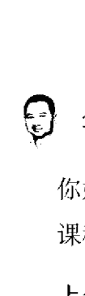

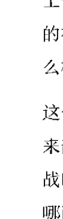

你好，我是华杉。欢迎来到我的得到课《精华课·品牌营销》第30节。

上一讲我们讲了企业设计的第二个定律，根据它的社会职能定位。这个理论它具体要怎么样的操作的呢？

这一讲，我们就用两个华与华实战的案例来剖析企业的非社会责任、经营使命。企业战略三个一体的华与华企业战略方法。

哪两个案例呢？第一个是小葵花儿童药的战略，第二个是360保护中国互联网安全的案例。

### 小葵花的品牌战略

先讲第一个，“小葵花妈妈课堂开课了”，葵花药业的儿童药战略案例。

在2007年的时候，我和葵花药业合作，那个时候他们有两大类头部产品，一个葵花胃康肠，一个葵花护肝片。这两个产品的销量大概都是3.5亿，加起来7个亿，其他所有产品一共也只有，8个多的规模。而且，在这个8亿的规模上已经徘徊了两年，也没有进步。

那么，这件事儿客户给我一个任务，说你能不能给我们找出第三个品。我说第三个品不是什么种的品，而是品类的品。这就给他们提出了儿童药的战略。

提出儿童药的战略给葵花，首先有一个原因叫，他们有这方面的资源禀赋。你得有这个资源，你才能做，是吧？它有什么资源呢？

它有个儿童药的非处方药方面产品。那么，提出儿童药的战略的第二个原因是因为我在1999年开始，就想搞一个儿童药的品牌。

为什么是1999年？在1999年，我还在深圳，有一天我翻阅报纸，看到有个豆腐块文章，说我们国家没有专业的儿童药。孩子吃药都是拿大人的药有一半来服。

就想起我们小时候，吃药是拿大人的药，把它掰成什么样来服。那么，专业的儿童药它应该怎么样？首先，儿童的药丸和成人的药里的配比不是完全一样的，直接拿大人人的药来掰给孩子的本身，就是对它负不负责任的。

要根据孩子的体重，他是10公斤的吃的多少，15公斤的体重服多少，他30公斤的体重服多少，他规范儿童每一个精确的剂量。

所以，你看着它的里面药后的说明书，书都是一个章节，这边是说明，那边是说明，前面和后面都没有。

这边的说明书上儿童怎么说明？说儿童酌减，就是你看着办。那不是太不负责任了吗？

那么，这件事情，葵花之前也是没有意识，但是，他们有没有做呢？有了这个思考之后，我们就给葵花规划了一个儿童药的产品。我们从OTC的非处方药开始，到研发、收购、兼并，上市处理方法的产品，再取得保健品，再取得像雄生的那些个产品的药，要动什么冰箱，那个儿童专用药，那个药品，就把它形成。

一个品牌，那我想着可以形成一个10亿规模，那我想着可以形成一个100亿规模的儿童药和健康用品的这样一个战略。

所以，我的企业战略是什么？我的企业社会责任感是什么？保护中国儿童用药安全。我的经营使命是什么？保护中国儿童用药安全。我有什么品牌来保护中国儿童用药安全？就用我这套产品和服务组合的规划，以及我未来的研发的投入来解决。

那么，确定了做儿童药的战略之后，我们第一件事儿是什么？是取消了他们的原来葵花康宝的商标。原来，他们的这个儿童药有一个专门的儿童药的商标，叫葵花康宝。很多人会想当然地认为，儿童药，是不是应该用一个单独的品类来做？这是品牌定位，修正药，大错特错。

因为在之前要改的话做一个儿童药品牌，品牌修正。神农氏做过一个儿童药品牌叫神童，都没有做起来。为什么？因为你投资建一个新的品牌名字，往往在成本上面是不成立的。记住，我们始终强调成本原则。

那么，如果我们搞了一个单独的儿童药品牌，那每年有8个亿到1个亿的广告额的预算，然后我把二个亿花在葵花儿童药上，这不一定要得起来，那我们的主品牌减少了二2个亿的预算，两头都吃亏。所以，我一定要用一个品牌，就叫葵花，然后我用了小葵花娃娃的形象在包装上，来代表儿童药。

这个地方你要仔细地琢磨，这是非常大的问题，我可以延伸着讲一下。

比如说我们还有一个客户，叫做公牛。公牛插座大家都听过，很厉害的是，那么，当公牛插座要去给公牛开关注销，他的定位咨询公司就告诉他，你不可能做开关，因为企业在消费者的心智里面是插座，你做成开关，消费者的心智里是不会接受的。那公牛就决定说，他的定位咨询公司就说，那你必须是要用新品牌，可能不能用公牛这个品牌。

### 360的互联网安全战略

360在2010年之前，主要做的生意是360安全卫士，免费杀毒软件。2011年，360找到了我们。当时360做了一个决定，要成立一个专门的安全部门，从原来的安全卫士，转型为中国的互联网安全的国民企业。

那么，定位互联网安全有两个理由。

第一，是社会的重大问题和需求。我前面说了，不仅要联网安全的技术，还要抓社会的痛点。因为2012年正在进入物联网，所有东西都上网了，汽车也是台大手机，飞机也是台大手机，那黑客就可以操控你的汽车，操控你的飞机。那是不是每一个物联网上的设备，都需要互联网安全的保护啊？这会越来越急迫。

第二，是360的品牌基因，资源禀赋。360安全卫士，从免费杀毒起家，我们的手机卫士又能拦截垃圾短信、骚扰电话，所以，我们有互联网安全的品牌形象的基因，我们最擅长这个位置。那按我们的企业战略和一体化的方法论，那我们就提出了360的企业社会责任，保护中国互联网安全；经营使命，保护中国互联网安全；那企业战略，要拿出一套保护中国互联网安全的战略。

我也不懂互联网，也不懂安全，但是我用常识思考，于是我写了三条：

- 第一，个人网络安全；
- 第二，国家网络安全；
- 第三，企业网络安全。

这不就是三个事业部吗？

在那个时候，360没有ZB的业务，没有企业网络安全的技术，怎么办？就收购，然后收购了网神和网康，在2012年组建了360企业安全集团。这是整个战略制定的过程。

确定这个战略第一个动作，就是策划了中国互联网安全大会，这义诊就是对公关的新定定义。华与华把公关重新定义为：企业对社会的公共服务产品，而不是提高企业美誉度的公关动作。那么，这个公关产品在我们的业务组合和产品结构里面，在我们的企业战略里面，也构成解决中国互联网问题的解决方案。

所以，用产品开发的思维做公关，开发了360的公关产品，中国互联网安全大会。它不是一个世界事件，而是为中国互联网行业搭建一个世界级的网络安全行业交流平台，推动中国互联网行业的发展，是中国互联网安全互联网解决方案的重要组成部分。在中国互联网安全大会，也决断性地推动360品牌转型为中国的互联网安全第一品牌。

所以，360转型互联网安全，也是华与华非常成功的一个企业战略案例，但是，企业的经营是什么事情都会发生的。今年的新闻，是我们收购的网神网康成立的360企业安全集团，现在已经从360独立出来了，改为奇安信，现在在奇安信成了中国互联网安全的国家队。

好了，到这里我们把第二定律，企业的社会职能定律就讲完了。

总结一下：

- 第一，企业的本质是为社会解决问题。
- 第二，企业战略不是企业的战略，而是企业为解决某一社会问题，为社会制定的战略。
- 第三，这个战略是什么？这个战略就表现为一套具体的产品结构和业务组合的规划。你用这套产品，这套服务去为社会解决这个问题，如果能做到这一点，你的企业就能基业长青。

知识就在得到，咱们一下讲再见。

### 毕业设计征集

毕业福利：华杉亲自指导你做品牌

这门课即将完整上线。

我们看到很多创业的同学在留言区里懊悔：如果在创业之前遇到华老师，一定能少走很多弯路，少犯很多错误。

也有很多企业营销部的同学惊呼：学了华杉老师的方法，马上就能用在自己的工作中，效果立竿见影，这门课买的值。

为了感谢更多同学的认真学习和积极推荐，也为了帮你更加立体的掌握华杉讲的这套品牌营销方法论，

华杉即将兑现他在开学典礼上为你做出的承诺：亲自点评你的品牌改造方案。

现在，我们正式发起《跟华杉学品牌营销 · 30讲》毕业设计征集活动：

谁可以参与：

只要你是《跟华杉学品牌营销 · 30讲》的订阅用户。

活动内容：

践行课程里讲到的品牌营销方法论，你可以亲自改造你自己的品牌，或者你所在公司的品牌。在本文篇文章下面的留言区写明你的改造方案和理由，以及所引用的品牌方法论。

毕业设计范围：

- 1、品牌名称
- 2、品牌口号
- 3、品牌广告

（3选1。可以是新设计的方案，也可以是对旧设计的改进方案。鉴于华杉老师是通过读留言区后查看你的毕业设计，作业形式仅限于文字，不支持图片。字数限制：200字内。）

征集截止日期：

7月10日24点。

评选：

华杉会从中选出三个最优秀的毕业设计，亲自作出点评和指导。

评选结果和点评内容会以加餐的形式更新在课程内。（请及时关注课程更新）

机会难得，请同学们好好把握，积极提交毕业作品。

因为，除此途径外，如果想获得华杉老师的亲自指导，只有花999去参加华杉老师的线下课程。

祝你成功！

## 30 | 创新利洞定律：万般皆下品，唯有创新高！

远邦杉影品牌营销 · 30讲

30 | 创新利洞定律：万般皆下品，... √

你好，我是华杉。欢迎你来找到我的得到课程《跟华杉学品牌营销·30讲》。

现在我们已经到最后一讲了，在最后一讲里，我们要把人类的商业思想推向了高端。

先回顾一下前面的三讲，关于企业性质的总结，我最后问到解决这个问题，是对企业的本质的最终认识问题，品牌即为解决问题而创造的完整生态。不请造问题，则社会、企业、消费者一起，解决的社会问题越大、则企业的价值也越高。

你可能注意到我增加了一个概念，叫做品牌的完整承诺。什么叫完整承诺呢？就是说我承诺要解决上面的问题，你只需要去找我，我都能你解决。

比如说我解决儿童药的问题，孩子吃药的问题可以来小葵花；我解决里面买药的问题，直接到网上买；我如果买不到360，或者说我找不到官信。大家可以不假思索地来，那交易成本就是不成低了。我的消费者的选择成本、决策成本也低，消费者的传播成本也低，这不就完美了吗？但是，如果你的问题不能解决，有时候不解决方法，那么什么时候会找你了？

那么，这个概念的提出有什么重要意义？意义非常重大，就是把企业看作社会的，看成消费者的，是为了他们解决问题的。那么，只要是这方面的，问题，你都得看，而不只是赚钱。不赚钱的也照不不不赚钱的照做不卖。就像做中药企业，药价不贵吗？我没跟不贵，那社会的成本不是高了吗？为什么这个问题不解决了吗？你以为这样企业只是赚钱的事，不，不赚钱的事，实际上也影响你的赚钱。这里面不是不赚钱了问题都解决了，好多其他不来了嘛，没有形成闭环，你就不能形成生态闭环。

你再去看到财务指标去定性哪一个产品上，哪个产品上，那么哪个产品上赚钱的产品取消了之后，会发现赚钱的产品也有人来找你了。这就是从社会角度去定企业和从自己赚钱的角度去定企业的区别。

你听下来可能会说，“哎呀，华老师，你太高大了，学吧最后你别管赚钱的事儿了，我们去想想赚钱的事儿。”别急，最后一讲就是专门讲赚钱的事儿。

前面的企业第一定律，交易成本定律，企业手段，企业是手段；第二定律，社会是目的，企业是目的；那么第三定律呢？叫做持续创新利洞定律，就是帮助我们怎么样才能够赚到利润。

企业要赚到利润，有且只有一条道路，就是创新，这就是企业第三定律，持续创新利洞定律。

熊彼特说：只有创新才能获得利润，而且创新所获得的利润也是短暂的，因为竞争对手会学习模仿，然后很快的你的新红利也就失去了。所以，你需要持续的不断创新。

那么，有人问了，有的企业又没创新，但是也有利润啊，只是比较微薄而已，年年通过年会赚，熊彼特说，那不叫利润，那是资本获得的合理收益。比如，比如说生产辣椒油，没有什么创新，但是，如果你不给你留一点源利，明年没人给你干，你留一点源利，就是你没创新利润。所以，你做企业不是死干，也活不好。这是市场定价的逻辑。价格是无限趋近于成本，一定是你有创新，你的东西和别人的东西没有可比性，你才能获得利润。

所以，这个利润的定义也很重要。我们就把企业分成了两种，一种是以创新获得利润的，一种是获取社会补偿的管理者工资。

所以，我特别欣赏贝塔斯董事长贝尼奥夫的一句话：只要把东西做好，我不够我就要看。这就是相比？我有创新，那我不想议价。如果不去比价格，最后不管怎么拼，总归拼到没有钱赚，没赚钱，那你应该选择什么，不就很清楚了吗？

那么，创新有几个创新呢？熊彼特说，有五个创新：

第一个创新，创立一种新产品，或者给老产品一种新特性。

前面我在讲营销4P的时候讲过西贝的案例，不就是创造了个新产品，或者给个老产品一种新特性吗？给到了这个老产品新特性。从3000平方米到300平方米，从100多道菜到只有33道菜，从有包房到没有包房。

所以，西贝成功根本不需要讲，是4P，在这里也可以用这个理论来解释。没有店里产品的创新，就没有这几年的发展，也就没有利润。所有成功归根结底都在创新上，其他的都是皮毛。

第二个创新，创造一种新的生产工艺。

西贝的成功也包括解决了中餐很难标准化的问题，首先它挑那些比较适合标准化，又比较好吃的菜品，然后在中央厨房解决。这个餐厅只是简易包装加工，所以，到现在为止吃，没有加温，很少能吃到的，或者炒得好的品解少，因为菜从别的出品不好要，不同的师傅他水平不一样，同一个师傅，每次也不一样。那这个应该怎么解决？现在主要是研究新的工艺。我理解，在市场上三年之内就会出现很成熟的炒菜机。有了炒菜机之后，可能有专门的小炒肉食家，鸡蛋西红柿炒蛋，主厨的菜品会包含它的一个炒菜机。它的火候、味道、用料全都是炒好的。那这个新工艺的创新就能解决炒菜的这个问题了。

你有没有看到在北京开了一间海底捞的智能餐厅？有机器人送货，然后店里全有机器人，全自动后厨。这是海底捞推出符合企业的。之后海底捞也可能会沉淀出它的业务，向全世界的餐厅出售它的一个厨房自动化的设备。是在发明，创新不仅为企业发现设备，而且还会改变整个行业的分工。创造出行业的新分工，也就创造出了新的企业。

第三个创新，使用一种新的原料，这个在新产品的案例用太多了。

比如说服装的这个羊毛，还有优衣库的什么Heattech内衣，还有阿迪里面垂坠免烫的面料来做西装正装等等。

我们公司合伙人里说，全部到大酒店去，要么只带一身睡衣，要么只带一种面料，就是那个垂坠免烫的面料。因为这样我们到了出去的时候，到酒店不用晚上自己去熨衣服了。

第四个创新，开发一个新的市场。

比如说老人鞋，它就是开发了，老人鞋这个新市场，这是一个新玩法，切入了鞋鞋业。一个新公司一年就能达到40亿的销售。那么，这个新市场，它是实现创新的呢？我们之前看市场，它卖的老人鞋是什么样的新产品呢？就像它广告里看到一样，到了老年，很多老人足不出户，前脚掌会变宽，前脚掌会穿不，穿脚一穿的老鞋就脚疼来，不舒服，走路都疼。

我们开始接触他们的时候，我即服了，因为我那穿双皮鞋也是意大利的鞋，没有一双穿着不难受、不夹脚的，都是很难看。我在正式场合的时候，不得不得不穿鞋。一下，平时都穿休闲鞋，翻，对，力健康的老人鞋，就是把前面变宽，穿着更轻快。那么，你的鞋中含一块胶垫，这一块胶垫是为了给你的脚部提供一些小支撑，穿起来之后，是非常的舒服。我这才知道他们的研究得多么深。你看研究者是由他们的消费者研究中心访谈消费者，收集体型数据，制作用来知识严的鞋楦，这才踏确实实现了这么大的规模。

曾做4P，你价格、渠道做什么，也要以售为目标，根据消费者有什么问题，怎么解决，怎么推广。怎么推广都交你做好之后，再回到产品上开发，把它实现，它就赚完了。

第五个创新，创立一种新的商业组合，建立起一个企业。

那么，这种新的商业组合在迈克尔·波特的理论里面，又称为一套独特的经

的理论里面，又视为一套独特的经营活动。一套独特的经营活动能实现什么呢？第一，能实现差异化的价值；第二，能实现总成本领先；第三，是让竞争对手很难模仿。

为什么要让竞争对手很难模仿呢？因为一个简单的定位，你要说你是老人鞋，他也弄个老人鞋，不就把你的这个创新，不说把你打掉，至少你的创新利润你也得不到了，被它分走了。但是，如果你不是一个简单的定位，而是有6个独特的经营活动，它不是要模仿你6件事儿啊？那他就没法学了。

再比如说绝味鸭脖，在全国有23家工厂，1万家门店，每天新鲜直送。那么，这样的一套独特的活动，它形成了一个全国巨大的冷链运输网，然后它就在這個资源的基础上，成立了一个基金。这个基金的名字绝了，叫“绝了基金”。那么，这个名字基金就专门投资那些做热食的连锁品牌，不管你是做猪耳朵的，还是做鸡爪子的。

如果你要去一个城市开点，一间店你没法开吧，因为一间店支撑不起你的中央厨房，冷链运输成本，全部分摊不了，那么你启动一个事业的投资的门槛，成本就会很高。如果你“绝了基金”投资母体，就可以用绝味鸭脖的中央厨房和冷链运输。那你手里多给你放一筐就解决了，那你就是一间门店，也可以先开起来，可以起步。那这就是一个新的商业组合，就是一套独特的活动。这套独特的活动就实现了三个：

- 第一是差异化的价值：新鲜直送。如果一个工厂，然后装在一个盒里，密封，放防腐剂，那是一个工厂可以送全国。但是，全国23个工厂的这个布局，所有城市可以新鲜直送。
- 第二，因为我有1万家店，本身能够支撑这个成本，然后我还投资很多其他的做热食的，加入到分摊成本里面来，我是不是一步步地实现总成本领先，而且越来越领先？
- 第三，竞争对手是不是也很难模仿啊？你先建23间工厂，然后你还得有1万家店，这基本就没有人能够模仿了。这差不多是建立了一套垄断了。

### 课程回顾

我们整个30讲的课程，到这里快结束了，回顾一下：

第一个板块，我们讲了华与华方法的绝活——超级符号。用一个超级符号将品牌寄生在人类的文化母体上，获得母体的原力，建立超级品牌。同时，超级符号的创作方法也使用到我们营销传播的每一个环节，每一个物料，每一句话里面。

第二个板块，我们讲了品牌的三大原理，社会监督原理、品牌成本原理、品牌资产原理。首先，是毫无保留地接受社会监督，然后是创作上以降低营销传播成本为评判标准，在投资决策上以能否形成品牌资产为标准。

第三个板块，我们讲了传播三大原理，刺激反射原理、波传原理、信号能量原理。这是传播学的基础内容，也是心理学的基础内容，也是行为主义的营销传播的方法论。

第四个板块，我们讲了4P，这是营销的基本理论，唯一理论。这是正道的起点，也是一切营销工作的终点。

第五个板块是重新认识消费者，消费者的四个角色，受众、购买者、体验者、传播者，这些是消费者行为学的内容，同时又对商学院讲授的消费者行为学有所扩展，涵盖了大众传播、购物者行销、体验经济和修辞学的内容。

最后，第六个板块，我们上升到企业经营的顶层，上升到企业战略，甚至经营的哲学，企业三大定律，交易成本定律、社会职能定律、创新利润定律。

在这最重要的最后一部分，我希望你也能站上最高的高度，对我们在前面30讲的所有话题，那是一览众山小，一目了然。一即一切，一切即一。品牌营销是一个超级综合的学问，博大精深，无远不至。在这其中耕耘一生，也是仰之弥高，钻之弥坚，端章在前，怒发在后，如切如磋，如琢如磨，其志弥高，其乐无穷。

希望我的课程能给你打开一扇大门，展示一条大道，和我们一起携手共进，勇往直前。

希望我这门课对你有所帮助，也希望你能享受我的课程。谢谢你。

提示：当前课程正式内容已经到了一些，但昨天还为你准备了一份彩蛋，记得来看！

### 划重点

只有创新，才能获得利润，只有不断创新，才能不断获得利润。

五个创新：

- 1. 创造一种新产品，或者给老产品一种新特性；
- 2. 创造一种新的生产工艺；
- 3. 使用一种新的原料，这个在新材料上的案例就太多了；
- 4. 开发一个新的市场；
- 5. 创造一种新的商业组合，建立或打破一种垄断。

前一集

## 公布丨华杉点评3个毕业设计

跟华杉学品牌营销·30讲

**华杉**

你好，我是华杉。

这门课程正完整更新的当天，我们发起了一次毕业设计方案活动，感谢同学们的积极参与。短短两天，我就收上来将近400份作业。我详细看了每位同学提交的品牌改造方案，你们对于课程知识点的熟练掌握和应用，让我既惊讶，又高兴。我希望你们在未来的实践中，也能一次性做好，知行合一，只有这样，你才能不断加深对课程内容的体会，把学到的知识转化为实实在在真金白银的收益。

好了，到了公布优秀作品的时间了，出色的方案实在是太多了，我不能一一点评，大家可以去留言区查看、讨论，我从中挑了3个典型性的，拿出来跟你分享：

### 一

**用户名：智能阳来顺**

我是专门做农村房屋太阳能采暖的公司，创企业我的初心，就是想让中国农村老百姓都用上不花钱的取暖。

这个初心起源于小时候，我母亲在农村烧柴取暖的时候，煤气中毒，后果很严重，后来我在想：在农村，千百年来一直都是用烧煤、烧柴或者用电的方式来取暖，从来没有想过，有没有一种“不花钱就能取暖”的办法呢？

于是想到了太阳，经过20年的实践证明，用太阳来采暖在农村是非常实用的，与城市楼房里的舒适度没有区别。

所以，我计划用毕生时间来做推广普及太阳能采暖方式，改变农村千百年来不花钱取暖，也想把这件事当做企业的使命来顺。根据华老师的课程第28讲里定律：第二定律，德鲁克的社会职能定律，企业是一种社会自的机构，企业就是社会器官，企业之所以存在，是因为它能够满足社会提出某种特殊的服务，为社会解决某一方面的问题。

企业的本质是什么？是为社会解决问题。一个巨大的问题就是一个个商业机会。企业听华老师的课程，就进一步明确了定位话法。根据华与华第二定律，我们把“让农村老百姓都用上花钱的取暖”正式确定为品牌口号，不知道广告语是否可行，请华老师指点一下。

推荐复习：28丨公司职能定律：怎么让消费都离不开你？

**华杉**

智能阳来顺，你好！

“让农村老百姓都用上花钱的取暖”，这个口号太好了！把“太阳能取暖”定位成“不花钱的取暖”，没有什么比这更吸引人的了。

只是不知道你这一套系统售价是多少，总是要给老百姓把账算明白，也要争取地方政府的支持。“煤改气、煤改电，全都不如太阳能！”给政府也算账！

### 二

**用户名：吴曰超**

华老师您好，我们企业是做艺考的，主要是美术高考，画室的名字叫超凡画室。之前没有做过，基本没有固定的广告词，反正经常变化。

logo有一个旗子，一面飘动的战旗，旗子里有一个超字，我认为这个应该是个性符号，古代打仗行军，最能打仗的战士都会扛着一个大旗，旗里也一定有代表性的字，寓意“旗在人在，跟着旗子走，不会输。”我们就是借鉴了这个意思，把行军旗进行私有化。这段时间我们在用“学美术来超凡，考本科不再难”的广告语，这句话词解，勾起考生父母最关心的词是“本科”，并且把我们的功能“考本科”，定位“美术”，优势“考本科不再难”。

推荐复习：25丨购买者角色：怎么让消费者快速选择你？

**华杉**

吴老师，你好！你的方案棒极了！名字、标识、口号，都非常棒！“学美术来超凡，考本科不再难！”

对目标受众的召唤，对购买理由的承诺，对品牌的识别记忆，对购买行动的激动和鼓舞，对消费者之间相互传播的发动，全都到位了，完美！

### 三

**用户名：麦克斯**

华杉老师，我是一名高校教师，现在带着学生们在做创业项目，叫做校社，我们的创业目的是为了解决校学生图书馆无法满足学生看新书和畅销书的需求建立的，同时也为了减轻学生们的买书负担，做了这样的一个公益项目。

我们的品牌原有口号是：校校书社，大学生们的第二图书馆。我自己改为口号是：好看书就在校社买，至于得到这个设计的口号，我纠结了不下子。你是用您教过的“品牌寄生”，但却是目前中国最大的认知服务尚“除了大学之外”，而且得到也是做自认第二大学，在与这个目标和定位上，我们的是与得到相匹配的。

推荐复习：24丨受众角色：怎么让消费者在意你，记住你？

**华杉**

麦克斯，你好！修改后的校书社像原来的老师！原来说：“校校书社”，大学生的第二图书馆。”这里“书社”、“大学生”、“图书馆”三个词，都比较明确，都有画面感。如果我是在校学生，也有兴趣去看看吧。改成“学校就在校社”，就不清楚是什么了，是实体书店？还是一个APP？还是一个阅读网站，还不是很清楚，只是一个网站一个“受众”，也没有对号入座刺激反射。

通过这个例子，我要带你复习一个概念，叫“零差距沟通”。顾客会掌握我们所掌握的信息，对他做的了解很可能会是零，所以我们要跟顾客沟通要假设他们对对我一无所知，永远保持基础起沟通。

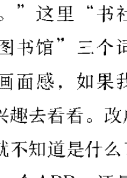

打定做到品牌就做到先完为心

## 视频彩蛋｜老娘舅快餐店案例教学

跟华杉学品牌营销·30讲

**华杉**

你好，我是华杉。应了很多同学的呼声，除了上一讲“西贝莜面村”的视频教学，我还把这门课开学典礼上播放的“老娘舅”案例，也为你收录在课程里，供你学习。

如果你错过了那场直播，现在就借这个案例感受一下，华与华在品牌改造上，是怎么做到“现场”“现物”“现实”的——也就是华与华一贯坚持的“三现主义”。

如果你最近正在发愁怎么提升店面销量，这个案例或许可以给你启发。

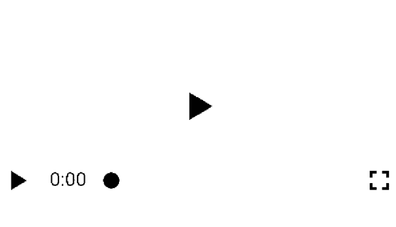

## 视频彩蛋｜西贝莜面村案例教学

跟华杉学品牌营销·30讲

**华杉**

你好，我是华杉。《跟华杉学品牌营销·30讲》已经完整上线了，感谢4万多同学第一时间跟着我完成了这门课的学习。

在毕业之际，我决定亲自带你去营销的前线，更深入的体会这门课里讲的理论和方法，也就是我常说的，你必须沉浸到营销的“现场”“现物”“现实”里去。

我在这门课里提到最多的一个商家是“西贝莜面村”，那我就在西贝的餐厅里，为你再次讲解一遍4P原理吧。为什么又讲4P？因为对于营销来说，它是所有营销动作的原点和终点，4P原理之重要，再怎么强调都不为过。

接下来，就请你跟我一起看看，位于北京东三环的这家西贝莜面村是如何有效运用4P原理获得成功的。

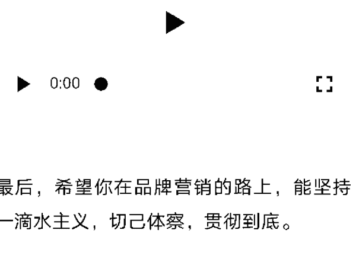

最后，希望你在品牌营销的路上，能坚持一滴水主义，切己体察，贯彻到底。

如果你觉得这门课对你有所帮助，也欢迎你把它分享给你的⽤友。

跟华杉学品牌营销
打造超级品牌的完整方法论
版权所有·得到App所有，未经许可不得转载
