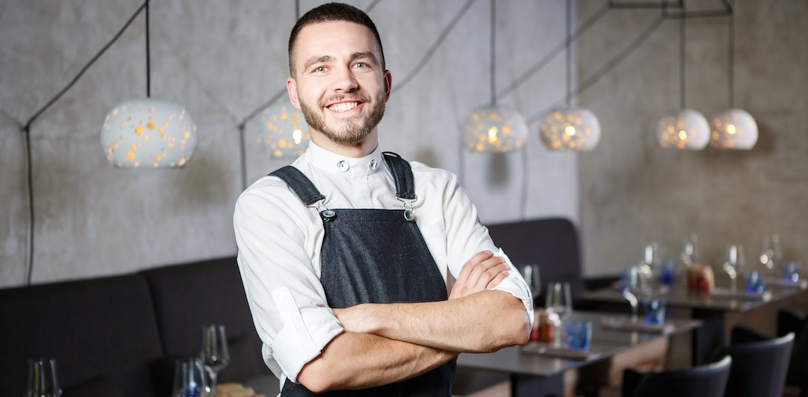
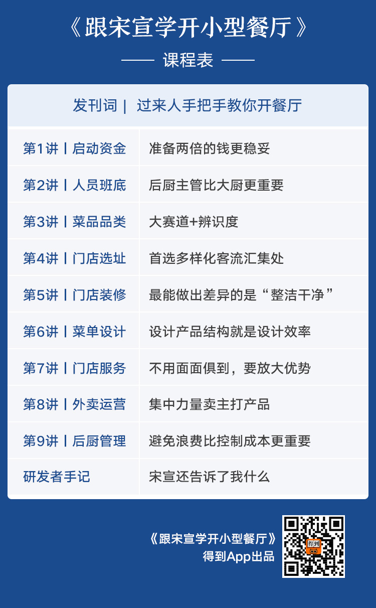
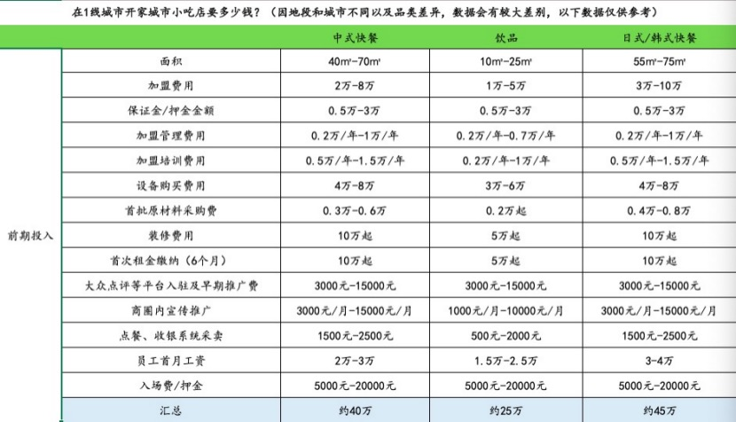
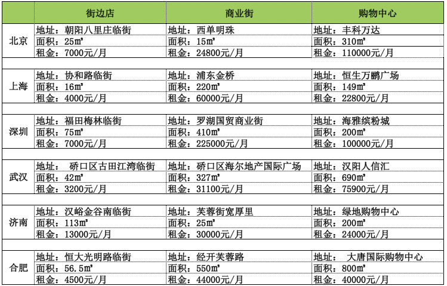
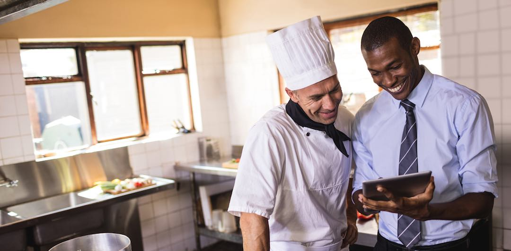
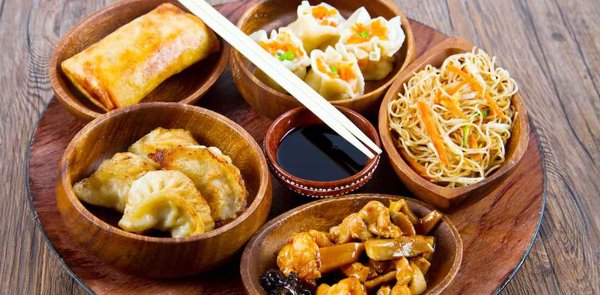
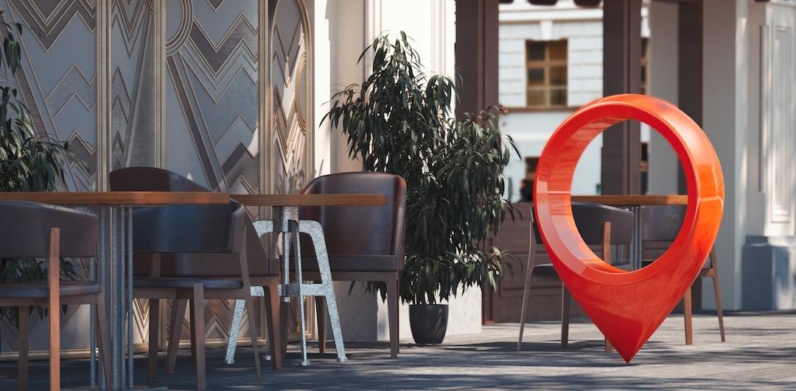
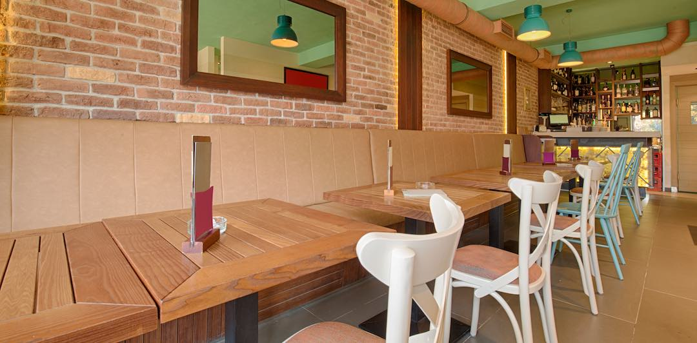
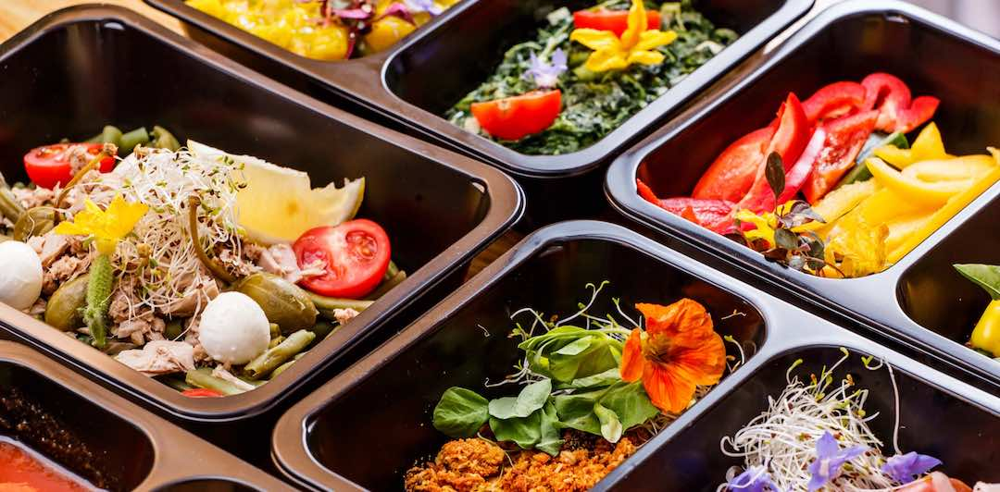
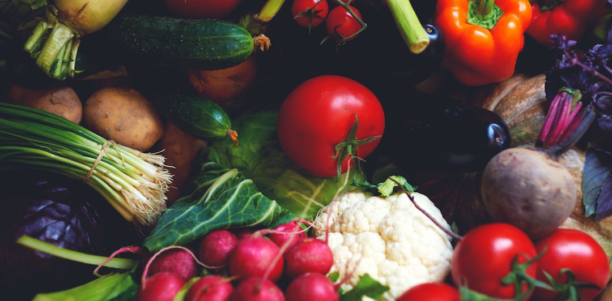

# 跟宋宣学开小型餐厅

> 公众号懒人找资源,懒人专属群分享

群友们好，这是小懒人给大家的《通才计划》更新的课程。

得到上 20 RMB 的课程《跟宋宣学开小型餐厅》

已整理添加到专属群《通才计划》，几十份付费课程到咱们专属群 Q 群公告自取。

通才计划目录：[`lazybook.fun/#/data/13\_course`](https://lazybook.fun/#/data/13_course)

懒人手册：[`lazybook.fun/#/`](https://lazybook.fun/#/)

懒人专属群：[`lazybook.fun/#/blog/group`](https://lazybook.fun/#/blog/group)

专属群更新记录：[`lazybook.fun/#/blog/record2`](https://lazybook.fun/#/blog/record2)

## 目录

跟宋宣学开小型餐厅  
 目录  
发刊词-过来人手把手教你开餐厅  
01 启动资金：准备两倍的钱更稳妥  
 我开第一家店 14 个月回本  
 前期能不花或少花的钱  
02 人员班底：后厨主管比大厨更重要  
 小店老板的典型一天  
 开业初期不用兼职和小时工  
 店长和后厨主管是骨干  
03 菜品品类：大赛道+辨识度  
 大赛道的三个方向  
 用核心单品和品类细分打造辨识度  
04 门店选址：首选多样化客流汇集处  
 根据经营模式筛选商圈  
 商圈考察看三件事  
05 门店装修：最能做出差异的是“整洁干净”  
 动线设计和餐位摆放  
 提升环境体验的三个建议  
06 菜单设计：设计产品结构就是设计效率  
 开业初期用上阶段性菜单  
 合理的出品结构要有三类产品  
 定价在最广人群心理档位  
 提高客单价的两个有效方法  
07 门店服务：不用面面俱到，要放大优势  
 服务是放大优势  
 所有环节都可以进行服务设计  
08 外卖运营：集中力量卖主打产品  
 外卖菜单不等于堂食菜单  
 包装、餐具、外卖小哥都是服务触点  
 集中力量卖主打产品  
09 后厨管理：避免浪费比控制成本更重要  
 从入库到订货，减少浪费的有效动作  
 供应商管理的三个建议  
研发者手记：宋宣还告诉了我什么

* * *

# 发刊词-过来人手把手教你开餐厅

懒人专属群的群友，你好，我是宋宣。欢迎来到我的得到课程《跟宋宣学开小型餐厅》。

先做下自我介绍。我是开餐馆的，也是教别人开餐馆的。

当我在得到上看到餐饮系列跟学课程的时候，非常激动。因为我太知道对一个普通的餐饮人来说，想要找到好的学习资源有多难。毕竟学校里没有哪个专业，会专门教我们怎么去当一个好的餐馆老板。

这也是我半路出家，进入餐饮行业的原因。

2013 年的时候，我的家人用了大部分积蓄开了一家火锅店。我当时还只是一个商业记者，有机会采访到很多餐饮人，也能接触到新的行业动态和商业趋势，所以他们就经常找我咨询。但我发现，作为记者，虽然有机会接触到很多新信息，但并不能给门店经营提供实质的帮助。最后，我家人开的这家店，还是倒闭了。

非常多的餐饮人，都是在摸着石头过河。

我记得特别清楚，当时我家人开火锅店的时候，隔壁是家麻辣烫，再隔壁是包子铺，然后旁边还有烤串店。这几个老板，平时有空就聚在一起聊天，最近生意怎么样，有什么经验可以分享。但这种知识的传递非常低效，而且说实话，大家也都半斤八两。

那时候我就在想，这个行业的知识，到底在哪。

于是， 2015 年的时候，我和我的伙伴们，做了一个餐饮行业的垂直媒体，后来发展成了现在的“勺子课堂”，它是餐饮行业的职业教育平台。

创业的 5 年时间里，我们总共服务了将近 30 多万餐饮人，其中包括很多知名餐饮品牌，像西贝、巴奴、左庭右院、渝是乎、牛小灶、嘉和一品、老盛兴，等等，都是我们的客户。

这个过程中，我也接触到很多优秀的餐饮企业家，像西贝的创始人贾国龙，嘉和一品创始人刘京京，麦当劳亚太区副总裁李明元，等等，他们既是我的老师，也是我的朋友。

2015 年的时候，我也亲自上阵，跟朋友做了一家小吃店“椒小厨”。一听这名字你就大概能猜到，我们做的是川菜小吃。现在，我们在北京有 5 家分店，最大的一家有 130 多平方米。到了 2019 年的时候，除了椒小厨正常的拓店外，我和合伙人又开了另外一个日料小馆，叫福美食堂。

餐饮圈子有这样一句话，“餐饮行业，是一个看起来门槛很低，但实际上进去是一堵墙的行业，绝大部分人跨过门槛但死在爬墙的路上”。

我先讲个故事。

我在前面提到过，我家里人开过火锅店，当时这家火锅店门脸很大，位置也相当好，开业前后，大量做团购、做优惠券、做线上营销的的服务商，接连登门拜访。

多到什么程度？一个中午，我请他们一起吃了顿饭，凑了一个包间，十几号人。那么多服务商，七嘴八舌说了各种各样的互联网的概念和营销打法，一套接一套。

后来这家门店也确实投入了本钱，购买了那些服务，期盼着用各种营销方法可以让自己的门店生意更好。但实际上，都没有真正起效。

直到后来过了很久，我才知道，懂行的不会这么干。

北京有一家特别火的烤鸭店，叫四季民福。我曾经在它的一家新店开业的时候，去拜访他的老板。当时我问，四季民福门店这么火，是怎么做到的？老板说，在开业的时候，他们什么都没有做，他们真正关心的只有出品、环境、服务这样的餐饮经营本质。

四季民福内部有一个不成文的规定，就是门店开业，不允许做宣传。正常的比方说一个门店开业，至少会放几个花篮，甚至放点鞭炮。但四季民福开业，不告诉任何人，就把大门开开。但是当时那家新店开业的当天，中午上座率就到了 50%，当天晚上上座率就到了 100%，第二天就已经开始排队了。

为什么开业的时候反而不去做宣传？原因就是，开业初期是试水试错的过程，在服务和出品还不稳定的时候，去做营销宣传反而适得其反，这一点我在后面的课程里还会提到。总之，开餐厅，这里边的门道，太多了。

从表面上看，餐饮业门槛真的很低，是个人都能干，而且餐饮是个大的民生产业，只要有人的地方，就可以有餐饮。

所以，各行各业的人，手里有点余钱，想要做点什么投资的时候，总会冒出开餐厅的想法。包括很多明星艺人，赚了钱有了影响力，开餐馆的大有人在，但其实成功开下去的，寥寥无几。看行业数据的话，小吃快餐类的新门店，第一年的关店率，接近 50%。也就是说，近一半的店，没有撑过一年。

这并不奇怪。一家餐饮门店，麻雀虽小五脏俱全，餐厅的经营，包含生产到销售的各个环节，品牌定位到顾客体验管理的各个方面。甚至可以说，经营一家餐厅的复杂度，不亚于经营一家企业。

如果你能把一家餐厅经营得很好，那我觉得你的商业头脑和经营管理能力，一定很棒。

这门课说的小型餐厅，也就是我们一般看到的小吃快餐店。为什么我要来讲它？

一方面，要进入餐饮行业，这是最小体量的起点。它相对门槛低，投资少，操作起来也相对简单。

另一方面，在我看来，小吃快餐市场，仍然大有可为。

我的理由就是，这个极其庞大的市场，消费的升级和迭代依然没有完成。

什么意思呢？严格来说，传统上小吃和快餐属于两个大的品类。快餐更偏向于满足“快速解决吃饱”的需求，盒饭、盖饭，甚至是沙县小吃，虽然带着小吃两个字，但实际都属于快餐，不求特别美味，只要简单方便，能吃饱肚子就行。而传统上我们说的小吃更偏向于满足“尝鲜”的需求，也就是你对它的期待是能够满足味蕾的体验，往往也不会当正餐去吃。

但在今天，小吃和快餐的边界已经被打破。

一方面，城市人口越来越集中，上班族外出就餐需求非常大，大家都不爱自己做饭了。比如你中午或者下班，一个人也好，跟两三个朋友同事也好，你一定也不想天天吃盒饭，大部分人希望吃得不复杂、不太贵，但也要吃得不错。

另一方面，年轻的消费者，像“90 后”，“00 后”，都非常追求体验和尝鲜，而且大部分人的胃已经被各种各样的食物填满了，期待的不再是“饱餐一顿”，而是“吃点好的”“吃点新鲜的”。

这样的趋势下，我们可以看到小吃和快餐已经没有清晰的边界，本质上它解决的是庞大城市人口高频的外食需求——花点小钱，体验还不错。它的消费场景和服务人群也更宽，可以自己一个人吃，也可以三五好友聚餐。外卖的发达更是拓宽了就餐场景。

从小吃快餐品类的丰富多元，也能看到这个市场的热度，小面、冒菜、烧烤、米粉、粥……就连传统上作为正餐的火锅也往小吃化的方向走，比如大家都知道的呷哺呷哺这样的小火锅品牌。

2020 年新冠疫情之后，许多餐饮门店遭受重创倒闭，新的资金也在跃跃欲试，对餐饮业来说，这种周期性的波动，其实不少见，这也意味着这个市场总是有机会出现。这堂课，我希望为那些，打算从零到一开出第一家小型门店的人，提供一些我的经验。

我常常说，开店失败的原因，可能有 100 种，而成功的原因，可能也有 100 种。餐饮说到底是一门实践的学问，没有唯一正确答案，前人经验也难以照搬复制。所以这门课，更多的是，我作为一个经验比一般人多那么一点的过来人，帮助打算入这个行的人，少走一点弯路。

我会把新老板开第一家店普遍会遇到的问题，提前告诉你，告诉你面对这些问题，我是怎么想、怎么做的，告诉你我见到的比较有效的做法，是什么。

如果说一家餐厅是麻雀虽小五脏俱全，那我就会用这一门课，把它解剖给你看。如果你在开店过程中有任何问题，也欢迎你在留言区或者知识城邦，与我交流。

好，欢迎你加入这门课程。

接下来我们进入第一讲，来说说开一家小吃快餐店，究竟要花多少钱。

  

* * *

# 01 启动资金：准备两倍的钱更稳妥

  

懒人专属群的群友，你好，我是宋宣。欢迎来到我的得到课程《跟宋宣学开小型餐厅》。

常有朋友问我，“手头有个十几万，是不是可以去开家奶茶店？”

这种想法在近几年很典型，很多人寄希望于用十几万小投入，加盟个奶茶品牌，来入餐饮这个行当。但面对这类问题，我一般都会回答：真的别把开店想得太简单。

十几万块钱能不能开一家店？如果你在三、四线城市，开一家十二三平方米的饮品店或档口小吃店是可以的，但是如果在一线城市，非常勉强。而且要知道茶饮市场竞争已经非常激烈，越好的加盟品牌，加盟费越贵。

所以，首先我想说，别把干餐饮的门槛想得太低。

那么开出一家店，资金门槛到底有多高？怎么来算该准备多少启动资金呢？

很多创业者，以为开店的启动资金，就是开店的前期投入成本，也就是比较容易想到的头几个月必须交的房租、设备、装修的成本，等等。

但如果你这么算，这家门店的抗风险能力，可能会很低。

## 我开第一家店 14 个月回本

2015 年，我和我的合伙人，在北京的美术馆东街，开了第一家门店，也就是我在发刊词里提到的“椒小厨”。

当时这家店只有 70 平方米，并不大。

我们的租金一次性交半年，再押两个月的房租，差不多 24 万块钱，这个房租在北京不算特别高。

我们的装修投入了大概十多万块钱。

各类设备的投入，比如各种炸炉、蒸烤箱、烤鱼的设备，总共大概 4 万多块钱。

我们为员工准备的宿舍以及各类生活用品，花了大概两万多块钱。

为了筹备试营业，磨合出品，我们还备了一万块钱左右的货。

还有，各类的像点餐系统这样的内部管理系统加在一起，也花了将近两万块钱。

以上加在一起，我们整个前期投入将近 40 万块钱左右。

所谓前期投入就是门店开张之前的投入。

但是我想告诉你，当时我们准备了 100 万块钱，才敢启动这家店。

原因就是，开好一家门店，不是一蹴而就的事情。一家店，从开业到回本，会经历一个相对漫长的生存周期。除了前期投入之外，还必须留够试错成本和抗风险的资金。

我自己总结，一家小店，从开业到回本，通常会经历两个阶段：

第一个是试错阶段。

开业之后，可能会有 1～6 个月不等的试错周期。这个阶段，老板的主要工作是根据营业数据和用户反馈，调整好出品和服务。这个阶段，很可能依然是属于需要往外花钱的阶段。

我们的第一家门店就经历了三个多月的试错周期。在这三个多月当中，我们的菜单不断地调整，甚至装修和厨房动线也微调过，我们头一个月就有将近 15 万块钱花在了试吃和营销上。

大部分店都会经历这样的试错周期，只不过时间长短不一。有的店试营业一个月就能生意特别好，有的可能是试营业了两三个月，都还没有起色。

正常的话，一家店第四五个月要能够出现单月盈利了，这个时候意味着这家店开始步入正轨。那么，这时候就进入第二个阶段：优化阶段。

这个阶段老板的主要精力放在效率和体验的提升上，通常会持续关注一些关键的财务指标，比如坪效、人效、翻台、毛利率，是否正常，是否处在健康的水平；关注门店单月盈利的增长速度是否良好，能否保证门店正常的回本周期内回本。

我们的第一家门店是在第 14 个月回本的，这基本上代表餐饮行业的正常水平。门店一般回本周期在十三四个月左右，特别牛的店，能够一年就回本。

除了前期试错成本之外，回本前的一年多的时间里，还可能发生一些不可预料的事情，我们把它叫做不可控的风险。

比如说食品安全。当然，食品安全我们本身就应该严格把控，但是万一门店出了食品安全事件，那就不得不面临强制关闭整顿。特别是假设你加盟了一个连锁品牌，只要一家门店出了问题，可能会波及一个城市里所有的该品牌的门店。

再比如说政策风险，一个城市的规划可能直接导致一家门店关停，或者不得不重新选址。

再比如食品安全、消防方面的规定也可能更新和修改。比如新出台一个规定，后厨面积不能低于多少，等等，也会增加开店的不确定性。

还有瘟疫与疫情的风险，比如说新冠疫情就非常典型，包括之前的非典、鸡瘟、猪瘟，都会打击到餐饮业。假设你开的门店主打的是跟鸡有关的品类，一旦鸡瘟暴发，你的生意肯定大受影响。

这也是为什么，有必要留够随时可以用的钱，以备不时之需。这些事情不发生最好，但一旦发生，手里有准备，就不至于因为一次变故没法翻盘。

所以，第一家小店，我认为比较稳妥的是，最好能够拿出开店前期投入两倍的钱，作为启动资金。

我们当初开店，就准备了 100 万元的启动资金。这个 100 万元里，包括了五六十万的前期投入，还包括了试错成本和抗风险的现金流。如果你目前手上只有够前期投入的钱，那我建议你先别急，再缓缓，准备更充分些，再启动。

100 万元，是我们当年在北京开第一家门店的启动资金。如果你想对照自己的情况，了解开一家店，到底前期有哪些主要花费项目，从而算出大概需要多少的启动资金，我为你准备了几张图，包括开店前期需要投入的各项主要成本，以及一、二线城市的租金概览，我把它们放在了文稿的末尾，供你参考。

## 前期能不花或少花的钱

前面我讲了，有些钱是你没有想到，而你应该想到的，但其实还有一些钱，可能是你本以为应该花，却没有必要花的。

比方说，很多新老板觉得，新店开张的时候，要花大力气做营销。确实，新店开张的时候，一定会有各种宣传渠道找到你，让你做付费推广。

但我自己的观察是，这笔钱，最好先别花。

我有一个朋友，是北京一家知名连锁餐饮企业的老板，他跟我讲过一件事，让我印象深刻。

他们曾经在北京大兴开了一家新门店，为了给这个门店引流，上了很多的团购券、优惠券，第一天真的来了很多人。但是当他们去翻顾客数据的时候，发现当天有不少的人，竟然来自天通苑。要知道天通苑在北京的北五环，而大兴在北京的最南边。

传统来讲，餐饮门店做的是回头客的生意，一家门店最多也就服务周围五公里的用户。今天一个天通苑的人来这儿吃饭，下一次没有了活动，他还会来吗？哪有那么多钱天天做这样的营销？这位朋友说，这件事过后，他们再也不做类似的推广了。

新店早期开业的时候，不要轻易做推广，还有更重要的原因。那就是，一开始一定是试水跟试错的过程，在服务和出品还不稳定的时候，去做营销反而适得其反。头几个月我认为最重要的，是认认真真静下心来，把门店的出品、流程打磨得足够到位，然后再伺机而动。

同样的，除了一开始不用急着做营销，小店一开始，也不用特别复杂的 IT 系统。

新店开业的时候，一定也会有服务商上门向你推销各种内部管理软件，从点餐系统到各种代运营的服务。但其实一开始你只需要购买一套最基本的线上管理系统，包含线上点餐、收银、库存管理、排班等等必要功能就行了，其他更复杂的功能在这个阶段没有必要着急上。因为在开店的初期，还是要尽可能保证所有流程是最简单的，搞得很复杂反而会降低整个门店的效率。

最后，新老板还容易在各种原材料的采购上走弯路。

一家门店，食材、后厨设备、桌椅、餐具……店里的一切东西都需要采购。当然很多时候，你租下的店面，是从上一家餐饮门店手里转租下来的，有时候上一家店留下来的东西你能直接拿来用，对方会以某个价格转让给你，但也可能所有东西你都得从头买。

那怎么能够找到中意的供应商呢？

我的经验就是：多看多问，找被验证过的供应商。比如，如果你朋友圈里有做餐饮的朋友，一定要去咨询他们。

但如果说，你没有熟悉的朋友可以问，怎么办？

有个很简单的方法，就是直接去别人店里问。不瞒你说，最早的时候，我们开第一家店，也不知道冒菜这些料到底应该从哪儿进，那我们应该怎么办呢？我们把北京很多做冒菜的店都尝了一遍，然后直接大胆地在门店里问老板，你这个料是从哪儿进的？

有一次我们去了一家特别有名的电烤串品牌，当时就觉得这个烤串的味道真不错，于是就开始打听电烤设备的供应商以及烤串的供应商。没想到，到最后真的被我们找到了。

这个办法我觉得挺好使。比如说，你去到一些知名的品牌店，觉得它的桌布或者餐具的样子，正是你想要的，你也可以直接等人家快打烊或者不那么忙的时候，上去直接要供应商的联系方式。虽然可能会被拒绝，但是相信我，总会有人愿意告诉你，这或许也是创业的乐趣吧。

本讲小结

我认为开一家小店，最好多准备一些钱，做好试错和抗风险的准备。另外，开业之初不要把钱用在一些不必要地方，比如复杂的系统，过早的营销。

思考题

我们知道，开店花钱的地方非常多，那么，在你看来，如果你拥有一家小店，你愿意在什么地方进行更多投入呢？

欢迎你在留言区和我分享。

如果你身边有朋友对开家小店感兴趣，也欢迎你把这门课程分享给他。

下一讲，我会跟你分享一下，开一家餐饮小店，需要一个怎样的人员班底。

我们下一讲见。

附

开店前期投入概览，街边店、商业街及购物商场的租金金额概览：

*   注：
    

1.  一般来说一、二线城市整体房租和人工价格要高于二、三线城市，主要不同点在于价格最高点一线城市要更高，但一线城市的非核心商圈同样有相对便宜的地段。对于人工成本而言，一线城市可以选择灵活用工等更多用工方式以侧面降低人工成本。
    
2.  早期开业时可对点评开通、商圈开业宣传进行适当营销，引流的目的是为了测试。对于营销的大规模投入要在模式稳定后逐步进行。在门店模型未打磨完成时过早地进行营销推广，会导致产能和服务能力压力过大，反而使得营销成为差评放大器。切记，餐饮是回头客生意，盲目营销的往往都不能带来好的结果。
    

*   注：单位面积金额和楼层、格局、处于人流主动线的位置远近的不同，都会有影响。
    

1.小吃门店平均大概有一年到一年半的回本期，准备好等于前期投入两倍现金的启动资金，比较稳妥。 2.开业之初，小店不用特别复杂的系统；早期别急着做营销。  
3.找被验证的供应商，如果身边没有朋友可以问，最直接的办法就是去别人店里问。

* * *

# 02 人员班底：后厨主管比大厨更重要

懒人专属群的群友，你好，我是宋宣。欢迎来到我的得到课程《跟宋宣学开小型餐厅》。

第一次开店的人，可能会想：哪里能招到合适的人手？

首先我想说，如果你是抱着只雇几个人帮助自己打理门店就万事大吉的想法，那肯定错了。

开店初期，最重要的人，是老板自己。

## 小店老板的典型一天

我以自己为例，跟你描述一下，开第一家店的头几个月，我每天是怎么度过的：

早上最晚 7 点钟起来，因为 8 点半之前就要赶到门店。到了门店第一件事情就是跟伙伴们一起，准备进货、验货，因为我们大部分的食材是一天一进，保证新鲜。

进完货，拾掇完所有食材以后，大概 9 点半开始，我们要跟伙伴们一起搞卫生。门店所有的角落，该消毒的消毒，该清理的清理，包括前厅后厨。

然后 10 点或者 10 点半开门。11 点到下午 2 点是午餐的高峰时段，这一段时间我们是完全不能休息的，各种忙里忙外。

午餐的高峰结束之后，大概两三点左右，终于可以开始吃午饭了。做餐饮尤其是第一家店的时候，很难按时吃饭。员工餐一般很简单，厨师累了一中午，给自己的伙伴做的饭菜，自然也更简单一些，不过一般来说大家吃得都很香。

然后下午 3 点到 4 点，我们会开员工会，总结前一天或者当天的工作情况，如果会开得短，开完了大家还能午休一会儿，但如果开会时间长了，到了 5 点，我们就直接进入晚餐高峰时段的工作了。

晚餐的高峰时段比午餐更长，大概从下午 5 点一直到晚上 9 点。

如果门店当中没有闹事、喝酒，或者赖着不走的人，大概晚上 10 点半左右钟就能关门了，但是如果赶上了，折腾到半夜一两点也是有可能的。

每天最后的工作是打扫和盘点。到晚上 11 点的时候，就要开始准备订第二天的菜，因为晚上 12 点之前下单，才能保证第二天上午 9 点之前对方能够把货送到。订完菜，才终于可以回家了。

而且，周一到周日无休，这就是小店老板典型的一天。

为什么老板自己一定要全职投入呢？

起步阶段，门店的一切流程都会经历磨合、试错和调整，比如我们的第一家店，开店头几个月调整过菜单，调整过厨房的动线，调整过前厅的布置。头几个月，缩短决策周期特别重要，员工给你反馈，肯定不如你亲力亲为发现问题来得有效。

那你可能说了：我开的是加盟店，标准加盟主都给了，我就想当个投资人，找个店长来管还不行吗？

也不是你想的那么简单。

我们的第一家门店开了两年之后，因为生意不错，确实就开始放加盟了。几个加盟店，装修是按照我们的标准装修的，产品是按照我们的标准做的，菜单是我们统一提供的菜单，系统也是统一提供的系统，但是我们后来发现，经营情况天壤之别，甚至有些加盟店最终不得不关门大吉。

这个经历，让我非常深刻地认识到一件事，那就是：餐饮业，“人”的因素是不可复制的。

当去加盟一个品牌的时候，加盟主或许可以给你提供各方面的支持，但往往不能提供与“人”相关的支持，就算有标准化的制度，人员培训依然需要自己去做。

所以我说，一家门店起步的时候，最重要的人是老板自己。老板不仅是一个事无巨细的督导，而且所有流程一定要自己亲自去跑一遍。

比如只有自己亲自参与过后厨的工作，才会知道，食材的浪费到底发生在哪个环节，是员工没有执行好入库标准动作，导致大量食材过期？还是营业额预估得不准确，导致采购量决策的失误？

一家门店所有的工作流程和标准，都需要老板自己亲自实践过，然后制定出来，才能尽可能避免漏洞。

## 开业初期不用兼职和小时工

除了老板自己要做好全身心投入的准备，一家门店，肯定还是需要雇人的。

今天的餐饮业，出现了非常多的用工模式，你可以去招聘全职员工，也可以去招兼职员工或者通过劳务派遣公司去找小时工。像麦当劳，小时工占的用工比例，已经到了百分之七八十。

但是对一家刚起步的小店来说，我认为，最好都用全职员工。等稳定下来了，再考虑用兼职员工或者小时工。

原因很简单，一家门店在还没有形成自己的标准化制度的时候，人的稳定性会直接决定出品和服务的稳定性。如果刚一开始就用小时工，可能人家干几天就走了，门店的培训又跟不上，会使得整体的服务和出品参差不齐。麦当劳之所以能大量用小时工，是因为它发展到今天，标准化管理制度和培训体系已经非常完善。

所以，我的建议是，一家门店刚起步的时候，先不要用兼职员工和小时工。

## 店长和后厨主管是骨干

除了一开始最好用全职员工，一家门店一开始也应该有自己的骨干员工，至少是可以当骨干来培养的员工。

这一点上我们自己就吃过亏。开第一家店的时候，为了省钱，我们当时只找了一批能干活的员工，也没有考察太多，结果发现他们其实承担不了太多的事情。开店之初，手忙脚乱的时候特别多，你没有一个能顶事儿的骨干的话，自己会非常辛苦。

所以，我认为一开始一定要招一个值得发高一点工资的员工，这样的人就是跟你打江山的第一批人。而且，从长远考虑，也需要做好传帮带的准备，核心员工稳定，普通员工离职也不怕。

一家门店的核心岗位，其实就是两类：在前厅负责营运的人，一般叫前厅主管，也叫店长；在后厨负责出品的人，一般叫后厨主管，也叫厨师长。

先说店长。

店长要是有能力进行效率管理的人。

一家小吃快餐店普遍的客单价会比较低，那就要尽可能地提高翻台率，所以要求门店整体效率足够高。所以，最好能够找到一个有当店长的经验，并且干出过比较不错成绩的人。

那我们应该如何招到这样的店长呢？

像在各种主流的招聘平台进行常规招募，是完全没问题的。当然，还有一个办法，就是挖人。

曾经，我们在一个大型连锁餐饮品牌看上了一个店长。那怎么把他挖过来呢？我们就经常去这家店里吃饭，跟店长搭讪聊天，夸他会干活。一来二往，我们就找机会加了他的微信，然后进一步去谈，最后把人挖了过来。这是一个挖人的土方法，但是挺管用。

而且，我想强调的是，挖人一定要找这种大型连锁餐饮企业的门店。为什么呢？

第一，这样的店长经过连锁大店的职业化训练，能给你带来更多你需要的专业知识和经验；

第二，实话实说，挖这种门店的店长，自己的心理负罪感会小一点。因为大型餐饮企业往往有自己的人才梯队建设，比较好补人，你挖走一个人，对它的影响不会太大。

除了店长，后厨主管这个岗位也很重要。

以往一说开餐厅，很多人首先想到的是：是不是得先找个大厨？其实在今天，对大部分餐厅来说，最需要有的已经不是传统意义上的大厨了。

小吃快餐的菜品生产，越来越多的环节已经不在后厨了，后厨很多时候只是进行最后一道工序的操作。

拿我们自己店里的三道主菜来举例。

比如说烤鱼，供应商已经把标准的烤鱼料包和鱼卖给我们，我们只需要把料包撒在鱼上，然后放进烤箱就可以了。

冒菜也是，如果炒料这个环节要在门店当中自己做，会非常复杂，我们用的也是标准的料包，然后再自己进一些食材，到最后直接兑在一起。

烤串也是一样的，进的是成品的烤串，直接在电烤炉上烤就可以了。

像这样尽可能地把出品环节“外包”，能够大大降低后厨工作的复杂度。而后厨主管这个岗位，它的专业性也体现在管理上，比如后厨出餐的每一个步骤是否足够标准化，后厨是不是足够的整洁卫生，食品安全是否达标，采购计划是否合理，等等。

所以，后厨主管，更重要的不是会做饭，而是要具备综合的管理能力。而且这个岗位跟店长配合好也很重要，如果后厨主管天天和店长打架，老板也会很头疼。

那后厨主管从哪里招呢？

除了招聘平台，其实厨师这个行业，到今天还是很明显的师徒制，也就是师父带徒弟。你只要能找到一个好师父，你就能找到他的很多徒弟。所以，你要多跟业内人打听，看看有没有口碑好的师父，问问这样的人有没有徒弟推荐过来。

讲了核心员工，我们再来讲普通一线伙伴。

普通员工简单说就是两类：后厨的厨工，前厅的服务员。大部分情况下，我们会把服务员和传菜员分开，也就是传菜员专门负责传菜，服务员专门负责对接客人。但如果日常的单量不大，或者门店本身不大，那也可以把两者合二为一。

那么一开始要招多少人呢？最理性的计算方法，就是盯住人效，也就是根据当地类似门店的营业额水平，预估自己门店的营业额，再除以行业平均人效，算出你大概需要招几个人。

不过我建议一开始可以稍稍多招一些人，这是为了让开业初期的容错率高一些，后期走顺了，再去精简人员。像我们第一家 70 平方米的门店，一开始就招了 4 个服务员，4 个厨工。

最后，我还想多说一嘴合伙创业的问题。

餐饮合伙创业非常普遍。一个人创业，会比较辛苦和孤独。但是，我也想说，餐饮创业最怕的是几个合伙人都不想对这件事情有过多的投入，只想玩票。

如果你的创业伙伴精力真的不允许，没有办法全身心投入，那你就应该彻底让他只当投资人，不要掺和门店里的日常管理。一家门店虽小，但涉及的决策会有很多。合伙创业，无论你有多少合伙人，也必须只有一个主事人。

本讲小结

这一讲，我们讲了开一家小店，要有怎样的人员班底。

我最重要的经验是：老板自己要做好全职投入的准备，一开始要有培养骨干员工的意识，开业之初最好不用兼职员工。

思考题

如果你跟别人合伙开店，怎样的股权结构是合理的？怎样的股权结构又是绝对不能出现的呢？

欢迎你在留言区，和我分享你的看法。也欢迎你把这门课，分享给更多对小型餐厅感兴趣的朋友。

下一讲，我们来说说，怎么选择菜品品类。我们下一讲见。

1\. 老板自己，务必做好全身心投入的准备。 2. 为了门店稳定起步，最好用全职而不用兼职员工，开业之初人员可以略微“超配”。 3.  
一开始要有培养骨干员工的意识。店里两个岗位很关键：前厅主管和后厨主管，最保险和有效的方法就是去找那些有经验、在大型连锁店做过相应岗位的人。 4.  
合伙创业，务必要有主事人。

* * *

# 03 菜品品类：大赛道+辨识度

  

懒人专属群的群友，你好，我是宋宣。欢迎来到我的得到课程《跟宋宣学开小型餐厅》。

前两讲，我们讲了最基础的“钱”和“人”的准备。那这一讲，我们就要考虑，自己究竟要开一家什么样的店。

首先必然面临一个问题：我该卖什么？

对小吃门店来说，生产制作什么样的菜品，既决定了门店的受众群，也大致决定了门店的品牌定位，甚至店名应该叫什么。

从受众群的角度考虑，很多创业者就想要追风口。最近什么卖得好？羊棒骨？牛蛙？还是烤串？

有段时间我刷抖音，天天都能看到羊棒骨，这背后其实是加盟商投入了很多的广告资源，也就是把这个品类炒火了之后，开始放加盟。

其实绝大部分我们看到的，比如说什么潮汕牛肉火锅爆红、串串香爆红、炸串爆红，背后都有操盘手在做推广。

所以，我的经验是，餐饮业所谓的风口，往往持续的时间很短。大部分品类爆红的原因是营销的成功，而不是品类的自然爆发。而当你知道这是一个风口的时候，说明这个风口已经要过去了。

也有的人说，我不追风口，我要做有差异化的东西，甚至有人会说，我想创新某种菜品。这个时候我想告诉你的是，大部分的创业者其实没有能力创造出一个新品类。新品类，意味着这个东西没什么人吃过，也就非常缺乏群众基础。

## 大赛道的三个方向

我们在开第一家门店之前，也考虑了很久，我们到底应该卖什么。最后我们的决定是，选择大赛道。

关于什么是大赛道，后来我和我的同事总结了三句话：

*   第一句话：“米面粥是中国人离不开的主食”；
    
*   第二句话：“咸鲜辣是中国人的味觉主流”；
    
*   第三句话：“小吃小喝是消费升级的主引擎”。
    

米面粥，咸鲜辣，小吃小喝，这些都是大赛道的方向。

有人会说，不，我就想做一个我们这个人群愿意吃的沙拉。也不是不可以，但是有可能会让你这家的门店生意不是特别好。为什么？因为人喜欢吃碳水化合物这是生理上决定的。以及，人们对于油的、辣的、肉的，实际上是非常非常上瘾的，我认为千万不要跟人的本能去对抗。

所以，当时我们第一家店，也就是发刊词里提到的“椒小厨”，它的出品，遵循的就是这个逻辑。川渝风味，主打的四个出品：冒菜、烤串、烤鱼、小面，选的全是大赛道，而且都是辣味和椒麻风味。

除了刚才说的三个大赛道的方向，我们后来还总结过，市场当中容易火的品类，往往还具备三个特点：第一个叫做丰俭由人，第二个叫亦菜亦汤，第三个是荤素搭配。

比如说，烤鱼、酸菜鱼，你可以往里面加好多东西；比如说冒菜，你既可以当汤喝，还可以当菜，甚至可以当饭，就点这一个就够了。

而且，做“椒小厨”的时候，我们还做了一个我一直认为非常正确的决定，那就是出品小份化。

过去人们在外请客，追求的是量大实惠。但这些年，消费场景大大地改变了，大量的年轻人已经不做饭了。我们说厨房现在已经变成了装饰，夫妻两个人在家里做一顿饭，根本就不是为了吃饭，是为了娱乐。

所以，我们最开始勾勒的目标人群画像就是：一对情侣，两个人下班回家之前肯定需要吃一顿饭，两个人，点不了太多的菜，但也不想吃得太单调。

于是我们就把菜品小份化，比如一份糍粑就给你两小块，一个人吃一个，点起来就不会有太大压力，两个人也能吃上四五个菜，过过嘴瘾。如果不太饿的话，你也可以只点一两个菜。这其实也是我们说的丰俭由人。

## 用核心单品和品类细分打造辨识度

不过，你可能会想，选大赛道，势必会面临的一个问题，就是同质化。

的确，门店的品类定位，不仅仅是选赛道的问题，还要考虑怎么形成独特性和辨识度，怎么让用户能够注意到、记住你的品牌。

说到独特性，对第一家门店来说，我觉得首先要考虑的，不是大市场下它的独特性，而是它的主要辐射人群下的独特性。

比如说，酸菜鱼这道菜火遍大江南北，但如果你想开店的地方，方圆几公里并没有一家主打酸菜鱼的馆子，那它可能就是一个非常好的开店选择。

我们自己做“椒小厨”的时候，决定要做川菜，除了它本身是个大赛道，还有一个很重要的原因，就是当时我们第一家店所在的商圈，还没有一家川味馆子，对我们来说这个定位就是非常大的优势。

因此，在给店起名字的时候，我们就用“椒”这个字，来强化自己的品牌，还把辣椒的符号设计进了门头中，这样也给那些想吃辣的人，一个非常强的信息暗示：这里就是一个川菜小馆。

那你要是说，我想开店的这个地方，是一个餐馆密集的商圈，或者就是小吃一条街，什么常见的品类都有，该怎么办呢？

这几年我在做“勺子课堂”的过程中，接触了很多餐饮品牌，观察到两个比较有效的打造品牌辨识度的方法。一个是依靠“核心单品”，一个是依靠“品类细分”。

过去我自己就有一个习惯，如果去一家餐厅吃饭，会往周围瞟一瞟，旁边人在吃什么。如果看到很多桌都在点同样东西，我就会估计这家门店大概率经营得不错，因为它有很好的核心单品。而核心单品会带来什么？回头客。

打好核心单品，本身就是一种品牌差异化策略。

举个例子，老娘舅这个品牌，它的定位是中式快餐，但中式快餐太多了，真功夫、永和大王等等。老娘舅靠什么打造自己地辨识度呢？米饭。它把米饭做得特别香特别好吃，而且告诉你可以无限量添加。

再比方说老乡鸡，它也是中式快餐，但它只主打鸡这个品类，并且把鸡汤做得特别好喝，那它在用户眼里也是有非常强的辨识度的。

除了主打单品的品质极致化，另一个比较有效的差异化策略，是品类细分。因为在大的品类下，总能细分出的新的赛道。

比如说同样做烧烤，大部分门店主卖羊肉串、羊肉筋，但烤脑花、烤扇贝、牛肉小串同样可以做出单品爆款；再比如大部分水饺门店都只卖猪肉白菜、猪肉大葱馅水饺，而船歌渔水饺，主推鲅鱼水饺，喜家德则主推虾仁水饺……

所以我们会发现，优秀的餐饮企业，往往会首先选择一个大赛道的品类，然后再对这个品类进行细分或微创新。

如果我们去深究这背后的原因，我会告诉你，这来自于一个经典的军事思想：“在局部力量形成优势兵力各个击破”。也就是说当你无法在大战场上痛击敌人的时候，那最好的策略就是在足够狭窄的战场中形成对敌的优势兵力，占山为王。

而这一逻辑同样也可以被特劳特的《定位》理论解释通，就是品牌总需要在消费者心智中占据一个细分的品类空间，且排名足够靠前。

当然，无论是品类细分还是打造核心单品，并不意味着未来你的门店就只能卖有限的几款产品。我们需要在经营过程中不断通过核心单品所在的品类，不断延展我们的产品线，由此持续给消费者带来新鲜感。

比如说，麦当劳的主品类赛道是汉堡，围绕汉堡它推出的核心单品是巨无霸，这一核心单品每年会花费麦当劳近 30%的营销费用，但围绕汉堡麦当劳同样畅销的还有麦辣鸡腿堡、双层吉士堡、鳕鱼堡等等。

而在第二层核心产品之外，你会发现，麦当劳还时不时地会推出新产品，比如说安格斯黑金系列汉堡、金凤来福鸡排汉堡、牛牛薯条和薯格等等。

再举一个例子，西贝。西贝的核心产品是莜面，但西贝经营的过程当中，每隔一段时间就会上一个新菜品，而它死死围绕的定位就是“西北菜”。

比起其它品牌推出新品往往是硬推，西贝则更善于借势。2012 年，《舌尖上的中国》火遍大江南北，播出后西贝便快速跟进了其中两个西北美食，一个是黄馍馍，一个是空心挂面。这一策略马上获得了市场良好的反馈。后来西贝就定期推出单品，比如黄米凉糕、羊棒骨、水盆羊肉、牛大骨等等，围绕着西北菜的定位，每上一次新品西贝便重新火爆一次。

讲到这里，我就想顺便多说几句，我对“品类定位”这件事的理解。

在我看来，品类定位成功的最大意义在于它可以让你前期快速起步，但千万不要盲目迷信品类定位，因为它无法决定你的长期竞争力。

还是拿西贝举例子。

我第一次去西贝莜面村，是冲着莜面去的，因为我没吃过。但吃过莜面后，给我留下深刻印象的不只是莜面本身，还有亮堂整洁的明档厨房、颜值颇高的莜面妹、暖心的餐前承诺以及令我印象深刻的红白桌布。

所以第一次去我是因为莜面去的，但走的时候记忆中绝不仅是莜面。所以后来，我又去了第二次、第三次，直到今天我成为了西贝常客。

所以，当我们去开一家小店的时候，选择大赛道的细分品类非常非常重要。因为大赛道可以降低市场对我们的认知成本，而细分品类可以让我们在大赛道中具备独特性。但随着时间的推移，让我们真正可以立足市场长远发展的一定是餐饮的本质：出品、环境和服务。

思考题

你也可以想想看，我们曾经打卡的网红品类，最后真正活下来的品牌还有哪些？风口过后，他们活下来的真正原因又是什么？

欢迎你在留言区，跟大家分享你的思考心得。

下一讲，我们来聊聊，小型餐厅的选址。

1.选大赛道是一个比较稳妥的策略。米面粥，咸鲜辣，小吃小喝，这些都是大赛道的方向。 2.靠核心单品或品类细分，来打出市场中的辨识度。

* * *

# 04 门店选址：首选多样化客流汇集处

懒人专属群的群友，你好，我是宋宣。欢迎来到我的得到课程《跟宋宣学开小型餐厅》。

这一讲我们来讲选址。

选址的重要性自然不用多说，因为它直接决定了门店的人流量。当一家店一开始没有很强的线上或口碑营销能力的时候，有多少人能够在线下看到你，并且很容易的走到你的门店中，直接决定了开店头几个月的生意。

所以，每一个新老板面临的问题是，怎么在力所能及的资金范围内，选到人流量尽可能大的店址。

首先，我觉得选址千万不能急。我和我的合伙人每开一家新店，都要提前 3 到 6 个月就开始看位置。通常有这么几个步骤：

*   第一步是根据预算选定大致的选址范围；
    
*   第二步结合门店的定位、经营模式进行第二轮筛选；
    
*   第三步对商圈进行实地考察完成第三轮筛选；
    
*   最后，才是在目标范围里，等待好位置的出现。
    

先说预算这件事，我们是怎么考虑的。

资金是选址的最大约束条件，一定要在一开始就想清楚，这样能够避免做一些头脑发热的决定。

我们开第一家店之前，就决定租金投入不能超过启动资金的四分之一，这样开业后的经营压力会小一些。按行业惯例，第一笔租金通常需要一次性交半年甚至更多。我们开第一家店，第一笔房租花了 24 万元，就是半年的租金加两个月的押金。

划清自己的承受范围之后，基本上我们就知道自己能够租得起的商圈范围了。因为不同地方的租金水平，基本上是可以通过公开渠道查到的，比如像 58 同城这样的信息平台。

## 根据经营模式筛选商圈

当然了，在一个偌大的城市里，处在预算范围内的地段往往会有很多。

比方说，可供选择的有一线商圈位置比较偏的店铺，也有二、三线商圈里位置比较好的店铺，有临街的位置，也有购物中心的位置。那究竟该怎么选呢？

我的答案是，结合门店的定位和经营模式来考虑。

一般来说，根据主力客群不同，可以粗略地把小吃快餐店，分成三种选址类型：

第一种是以白领为代表的稳定客群，这种小店的营业额，主要靠工作日的午餐。所以这样的店，在 CBD 会看到很多。

第二种是社区小店，做熟客生意，一日三餐至少两餐都供应，主要靠口碑。像得到上有课程的南城香，就属于这种类型。

第三种就是购物中心或者旅游区，主要靠假期人流。客群可能不固定，但辐射范围广，适合做网红小吃。

比如我的一个朋友开的一个叫“夸父炸串”的炸串品牌，就属于这种类型。它没有堂食，只有档口，用纸袋子给顾客拿走，边走边吃。他选址就专门挑一级商圈的地下一层，因为档口店面积小，租金不会太高，但这样的地方人流量够大。

前面我说了，我们自己当初想开的是一家川渝小吃店，而且我们希望这家店，是一家能让人感觉轻松、有温馨感的小店，适合情侣两人下班回家路上吃一顿。所以我们对这个店的定位，就不是纯粹的白领快餐店，而且我们当时也没有太多的钱，开不到 CBD 和购物中心里去，所以我们更倾向社区选址。

我们的第一家店，最终选中了北京的美术馆东街，是因为看中这个位置有个独特的优势——它其实有三类客流人群：

第一类是附近社区居民；第二类是游客，周末会有很多去美术馆看展的人；第三类是上班族，100 米范围内有个文创园，在里面上班的人也会是一个重要客源。

也就是说，这个地方是多种客流的交汇地带。这种不同客流交汇的地段，其实是比较理想的餐饮选址地段。

但如果你的定位还不清晰，不知道自己属于刚才讲的三类门店中的哪一类，有一个方法，叫“跟随策略”。也就是，你可以找一家同类型的做的不错的连锁餐饮品牌，去分析它的选址策略，找出它生意好的店和不好的店，看看差别在哪，然后模仿它成功的选址经验。

很多人看到这里会觉得，不行，我就是更喜欢一线商圈的一线位置，毕竟好的位置直接决定了早期的客流，不如咬咬牙租个贵的，背水一战！

但我想告诉你，如果不是做网红小吃档口，这种非要在一线商圈一线位置的类型，我认为尽量不选一线商圈，而是选二、三线商圈里的显眼位置。为什么呢？

首先，一线商圈竞争太激烈，入驻的基本上都是大品牌，一家刚起步的小店，很难快速脱颖而出。

其次，开第一家小店多半是资金有限的，抗风险能力弱，稍微经营不善可能就会倒闭。一线商圈的一线位置资金占用量实在太大。

那又有人说，我可不可以在一线商圈周边找个地方呢？

我们这些年开店选址的过程中，经常会看到不少号称自己是一线商圈的商铺。去了才发现，它们可能确实离某个知名大商场很近，比如就在旁边紧挨着。但是你要知道，一线商圈客流的吃饭需求往往都在商圈内就已经被消化了，很难带到周边的位置。所以这类位置典型属于想蹭一线商圈的流量，但到最后只能干瞪眼、吃剩的。

所以，从性价比来说，我会比较喜欢二、三线商圈的主动线位置，而且这个商圈最好还是自己足够熟悉的地段。因为熟悉就代表你所了解的信息相对充分，判断出错的几率会低得多。但绝大部分情况是我们所选择的位置往往是自己不熟悉的，那么，我们要做的就是在做决定之前，把它变成自己足够熟悉的地方，反复去、反复考察。

这就是接下来我会讲到的，对商圈的实地考察。

## 商圈考察看三件事

实地考察商圈，我认为重点就看三件事：人流量大小、主动线在哪、这里的店铺赚钱不赚钱。

先来说怎么看客流量大小。

我自己用过最土的方法，掐表数人流。就是找商圈里人流量比较大的点蹲一天，看我眼前到底经过了多少人。什么地方人流大呢？可以是入口、出口，也可以是核心地段的商铺门口，在淘宝上买个计数器，每经过一个人就按一次表。这个法子很土，但真的非常直观有效。

再来说怎么测量商圈的人流主动线。所谓主动线，就是大部分人在这个商圈里的移动路线，在主动线上的商铺，自然人流就多嘛。

怎么测呢？还是土办法，跟人走。

比如考察 CBD 商圈，就从中午 11 点半，跟着出来吃饭的白领，一次跟着 1~2 个人，看他去哪儿，怎么走的。坚持两个礼拜，就能收集到二三十个用户的路径，主动线自然就清晰了，也就知道哪些店铺位置是在主动线上的。

第三个考察最重要，也就是要去估算这里店铺的营业额，看这个商圈的店铺，到底有多赚钱。如果这里的店本来经营得就不怎么样，你开一家新店想鹤立鸡群也不太可能。

你可能会问，这怎么调查呢，别人也不会告诉我。其实有办法，选出几家跟自己想开的店类似的店，等快打烊的时候，进去点一份餐，去看它的流水单号是多少，再用流水单号乘以它大众点评上的客单价，就能知道它一天的营业额大概是多少钱了。

这里有个小提醒，有可能堂食跟外卖不是同一套流水单号。其实方法差不多，也是等快打烊的时候，点一单外卖，就知道他的外卖流水了。外卖跟堂食加起来，你就知道这家店的日营业额了。

了解了营业额有什么用呢？

给你一个参考标准。租金占营业额比例 12%~15%，是一线城市当中的标准店铺。10%以下就很厉害了，比如说，海底捞只占 4%。这个比值超过 20%就要拉警报了，如果飙到了 30%，那就证明你的选址是失败的。

这样的考察通常会持续一段时间，比如一到两个月。因为我们不仅要了解从早到晚的情况有什么区别，还要了解平日和周末的情况有什么区别，甚至还要了解下雨天的情况到底是怎么样的。我们一定要对一个商圈足够熟悉了，再去做决策。

在进行了一段时间的考察后，我们就会进一步收窄选择的范围，比如锚定两到三个商圈。

这时候就进入等待期，等待一个好位置出现。选址不是一开始想好选什么就能选什么。现实中我们遇到的情况经常是，看到一个店面觉得太好了，但是马上被别人租了。我们说选址选址，很多时候，其实是等址。

找中介当然是可以的，在 58 同城之类的分类信息平台上就很容易联系到他们。我们有时候也会跳过中介，直接去敲物业的门，问他们有没有店铺最近在放租，为的是能省下一笔中介费。

最后，根据我的经验，还有一个很关键的问题：要高度关注门头，也就是店面招牌的曝光度。

有的店地理位置看起来不错，但门头很难被各个角度路过的人看见，这种情况你要是租下来了就会很吃亏。比如德克士的选址就有一条原则是绝对不选购物中心地下一层的店铺。当然也不是说这种选址就要因此放弃，你也可以跟物业谈，看看能不能在主动线上给广告位露出。

有些路边的店也会有这种问题。冬天去看，招牌看得很清楚，因为门口的树叶都掉光了，可到了夏天再去看，店铺招牌就会被挡得干干净净。

本讲小结

这一讲我们讲了选址，包括怎么确定预算，怎么根据你想开的店的经营模式去选择商圈的类别，最重要的是要对目标范围的商圈有充分的考察再选址。

选址往往可能会花上好几个月的时间，我建议可以跟上一讲说的品类定位的考虑，同步进行。

思考题

你可以在留言区，和大家一起来聊聊，你经常去的一家餐厅，它有什么选址上的特点，具体是什么吸引了你？

下一讲，我们继续探讨，如何做好门店装修。我们下一讲见。

1\. 一开始确定能投入到房租上的资金上限，缩小目标范围，建议不超过启动资金的四分之一。 2. 多样化的客流的汇集处，往往是理想选择。 3.  
二、三线商圈的主动线可能是性价比更高的选择。 4. 跟随定位差不多的连锁品牌去选址，也是一个选址方法。 5.  
商圈实地考察要至少搞明白三件事：人流量大小，主动线在哪，这里的店铺赚钱不赚钱。并且考察至少前后有一个月。

* * *

# 05 门店装修：最能做出差异的是“整洁干净”

懒人专属群的群友，你好，我是宋宣。欢迎来到我的得到课程《跟宋宣学开小型餐厅》。

这一讲，我们来聊聊门店装修。

一说装修，你可能第一反应是，是要美式田园风啊，还是要现代中式风。其实啊，在我看来，门店的装修，首要的不是装修风格，而是动线设计！

## 动线设计和餐位摆放

所谓动线，就是顾客和员工在店内的走动的路线。小店往往面积不大，设计得不好，会经常出现拥挤和混乱，服务员和顾客撞在一起。顾客体验不好，服务员的出菜、应答、收桌效率都会受到影响。

比如说，我跟我的合伙人开的日料小馆，这个店本身不大，前厅也就二三十平方米，而且比较麻烦的一点是它中间还有一根柱子。这个格局一开始就让我们非常头疼。

后来我们想了个办法，干脆做一个中岛设计，把柱子旁边的位置改成吧台座位，形成一个小小的中岛。把点餐台放在进门的左手边，顾客一进门店之后，顺时针往左手边走，点完餐之后，要么选择坐中间的吧台，要么选择绕半圈找到标准座落座，吃完饭之后，顾客又是顺时针的方向走出去。

也就是说，桌椅怎么安排、点餐台放在哪，这些都会影响到顾客怎么走动。而我们的设计原则是，尽量让顾客只朝一个方向走。

除了顾客，店里还有服务员。餐饮门店设计还有一个大原则，就是尽量让服务员也少走动。

现在比较流行的顾客线上扫码点餐，其实部分解决了这个问题，但我觉得点餐台依然是可以考虑的，因为点餐台往往会让顾客决策的时间缩短，不仅减少服务员的走动，还能提高点餐的效率。

当然，每家店店型不同，究竟要不要有点餐台，要的话位置在哪，包括出餐口的位置在哪，都需要因地制宜，并没有一个模板。所以在这一点上，我能给出的建议，就是一定要自己反复去走、去试。

前厅动线定下来后，接下来就是摆餐位。

虽然说当我们租下了一个店铺，面积已经固定，但餐位能摆多少，还是有弹性空间的。餐位越多，高峰时段的饱和接待能力越高。但是餐位绝对不是越多越好，餐位数一定要和后厨的供应能力匹配。

有一个行业标准：一个餐位，一般对应 0.5 到 0.7 个厨房面积。也就是假设一家门店有 50 个餐位，平均每个餐位按 0.6 平方米算，那么这家店后厨应该在 30 平方米的 0.5 到 0.7 倍之间，也就是 15 平方米到 20 平方米之间。

反过来，我们就可以根据后厨面积，来推算前厅摆多少个餐位。

那么前厅的标准餐位面积一般是怎样的呢？

这里我给你介绍必胜客的餐位规格，它的 4 人位，也就是两张桌子拼在一起，算上椅子留出的适当距离，基本会形成一个 1.25 米×1.7 米的面积，大约是 2.04 平米坐 4 个人。我认为这个餐位的大小是会让顾客感觉比较舒适的。当然如果你想让体验更好一些，那么可以适当地增加桌面的面积，以及用餐者之间的距离。

刚才讲了前厅，其实后厨的动线设计，跟前厅的动线设计一样重要，甚至更重要。厨房动线，是影响后厨效率的关键，而且设计起来可能更难，因为厨房的面积往往更局促。

跟前厅动线的设计原则类似，我们同样需要尽可能减少后厨人员的移动距离，甚至减少他们的转身动作。

当然，各种走动不可能避免。后厨操作工序比较多，后厨人员经常会出现拿料，拿餐具，或者拿其他什么东西的情况。所以，中岛式的设计往往会是我们的首选，它又叫回字形后厨，指的是中间会出现一个中岛，大家围着这个中岛转，每个人主要的工作方向，是靠墙的位置，中岛上会放一些大家共用的东西，并且不同东西放在固定的位置上。这样就能保证大家找东西的时候，尽可能不走动。

后厨的每一个岗位上，常用物品的摆放，我们也要遵循一些原则。

比如说一个员工，在自己的操作台上，想要干起活来更方便，肯定要避免老转身、老动弹，最好经常要用到的东西，就放在上下左右的位置。

上下的好处是能够最大利用空间，你可以把上面吊一个架子，把要用到的器具，放在这个架子上。不行的话，放在左右的位置，最好不出现前后挪动，因为脑袋后面没有长眼睛，很容易撞到人，把东西碰洒。

## 提升环境体验的三个建议

讲了动线的设计，接下来我们来聊聊门店的装修。

对小店来说，装修上的投入，控制在启动资金的 25%以内为最佳。对资金的控制同样是对门店体验的控制，对小店来说，有限的体验是我们不得不接受的事实，千万不要因为盲目追求体验而大把花钱。

举个最直观的例子，麦当劳、肯德基的体验在很多人看来绝对不算差，但也绝对不算优秀，这个度其实就把控得非常好。

比如它的椅子坐起来都不会太舒服，但也不至于不舒服。原因就是，太舒适会延长顾客的停留时间，而小吃快餐店对翻台率要求高，所以椅子往往承载了你对体验“度”的理解，这一点我们开小店还是要学学麦当劳和肯德基。

当然，品质感同样是我们需要在有限的资金下尽力追求的。在这里，我给大家分享几个又能省钱还能体现品质感的装修技巧。

还是那我自己的小店来举例子吧。

前面我们提到过，我的小店是以椒麻风味为主的川渝小吃社区店，我们希望营造出温馨、亲切、像家一样的感觉：累了一天，特别想晚上找一个地方，小小奖励一下自己，没那么大压力地吃个饭。

因此我们在门店当中的装饰，就是有点偏向于“家”的设计。

第一个细节是摆件。比如我们门店当中打了很多置物架，上面摆放了很多几个合伙人出门旅游带回来的各种小玩意，就像每个人的家里都会有个手办柜或者展示柜一样，这种类似家庭的置物风格，往往最能给人带来家的感觉。

第二个细节是植物。我们还会用大量植物来装饰门店，每张桌子上都会有一小束鲜花，目光所及的地方都会有绿色。当然这个过程可以适当存在一些假花，尤其是花期较短的夏天。

第三个细节是灯光。同样因为我们想给顾客营造“放松”的感觉，那我们就在一些地方使用暖黄色的灯光。

第四个细节是穿着。为了营造亲切感，我们还会让店内服务员穿得不那么一本正经，虽然是统一的衣服，但我们选择了更具温馨感的围裙，让你觉得像是在家吃饭一样。

实话实说，我们开店早期甚至尝试过，用非标准化的餐具，来营造亲切感，因为其实很多人小时候有这样的记忆，就是家里的筷子、碗，是不完全一样的。但是最后我们还是换成了统一的，原因是我们发现餐具不统一，会让后厨的清洗和存放很不方便。

再拿我们开日料小馆举例子来说。它是一个典型的日料居酒屋，因为面积很小以及资金有限，所以它的硬装也非常简单。但我们用了一样东西，也就是有日本文化元素的海报，贴在墙做装饰。

10 块钱一张的海报，我们贴满了所有墙面。可能半年之后海报脏了、破了，我们就把它撕了，重新贴，成本非常低，还能让老客人有新鲜感。

我还见过一种，提升门店环境体验的品质感的小方法，那就是用上桌布。

很多小吃快餐店是没有桌布的，桌布通常正餐店才会有，所以，桌布其实能够营造偏正餐的氛围。而且，要知道，桌布是一个人就餐的时候，视觉落点最多的地方，也最容易产生视觉记忆。比如西贝就是将红白格的视觉锤通过桌布植入你的心智的。

前面说的都是，在软装上多下功夫。第二个我比较推荐的，适合小店的装修策略，就是厨房明档化。

厨房明档化已经是个大潮流，也就是顾客坐在前厅，也可以看到后厨更多的加工场景。厨房明档化一方面会让空间显得更大，同时也能向顾客传递出“看着放心”的感觉。

最后，也就是第三点——不管一家什么样的店，最能够跟别的店做出差异化的，其实就是：整洁干净。

这就要求我们，在装修布置的时候，尽量让门店“好清洁”，减少会增加清洁难度的设计。

比如我们自己曾经用水泥灰涂墙，形成有花纹褶皱的效果，一开始觉得好看，但是时间长了，清洁就很费劲；再比如，桌子不管什么材质的，桌面不能有缝，缝隙很难清洁，顾客看到缝隙里的脏东西，体验特别不好；再比如，也不要用布面的椅子，因为布面也很难清理。

本讲小结

这一讲我讲了门店的装修设计，其中，动线设计很重要。小吃快餐店，可以在软装上多下功夫。

思考题

你也可以回想一下，有哪一家餐厅的装修，让你印象深刻？你会因为环境，经常去这家餐厅吗？

欢迎你在留言区，跟大家分享一下。

如果你身边也有对小型餐厅感兴趣的朋友，也欢迎你把这门课分享给他。

下一讲，我们来聊聊提升利润的关键，菜单的设计和优化。

我们下一讲见。

1\. 前厅动线设计，尽可能减少服务员在门店当中的走动，尽可能让顾客只朝一个方向走。 2.  
后厨首选中岛式设计，每个岗位常用物品的摆放，“上下”优先，“左右”其次，最好不要“前后”。 3.  
低成本提高门店的环境体验和品质感，有这么几个招：在软装上下功夫；厨房明档化；所有设计布置，尽量保证“好清洁”。

* * *

# 06 菜单设计：设计产品结构就是设计效率

懒人专属群的群友，你好，我是宋宣。欢迎来到我的得到课程《跟宋宣学开小型餐厅》。

这一讲，我来讲怎么设计菜单。

很多人觉得，菜单不就是让用户选择到底吃什么的一本介绍手册吗？

还真没这么简单。菜单牵涉和影响到的方方面面，直接可以决定你的产品销量乃至利润！

菜单首先是门店的产品结构设计的终极展现，由此它会影响后厨的生产节奏。其次，菜单设计也影响到门店的盈利结构，关系到出品层面的成本和利润。另外，菜单几乎是门店当中唯一的销售界面，它设计的好坏也会直接影响销量。

这一讲，我会分三个部分来讲我对菜单设计这件事的思考：

1.  出品结构怎么设计才能够让经营效率更高；
    
2.  怎么定价比较合理；
    
3.  怎么通过产品组合来提高客单价。
    

## 开业初期用上阶段性菜单

先讲出品结构，也就是菜单上到底该有哪些菜。

首先，我认为对新老板来说，一定要有一个意识：小吃快餐店要尽可能实现高翻台率，要出餐速度足够快，就不能让出品的加工程序太复杂，以及菜品千万不能太多。

这个经验，是我们踩过坑总结出来的。

我们开日料店的时候，刚一开始，菜单一下上了 70 个菜。我们还没开业，只是做内部的压力测试，请了十几个朋友来店里吃饭，后厨就彻底乱套了。干上几天之后，服务员也说不干了，太乱了，没法干，然后就走了。还好我们只是内部测试，到正式营业的阶段，我们就简化了菜单，只留下了 30 个左右的菜品。

这是个很宝贵的经验，因为开店初期人员和流程还处在磨合阶段，一旦门店出现产能跟不上、手忙脚乱的情况，影响顾客体验不说，也会影响员工的情绪。员工走了，你还得从头招人、重新磨合。

所以，我觉得对新老板来说，开业初期上“阶段性菜单”，会比较稳妥。也就是说，菜单不要一步到位，而是阶段性地迭代和丰富。

比如，我们首先规划出门店总共要有 30 个菜，但是刚一开始先上比较刚需的 10 个菜，然后再加到 15 个、20 个。一方面这能帮助你节约食材，不会出现太多浪费，另一方面后厨的制作也相对不复杂，出餐的质量更容易保证，可以让团队逐渐适应产能和工作量。

## 合理的出品结构要有三类产品

但是，不管一开始菜单多简单，也一定要有三类产品：核心产品、引流产品和利润产品。

核心产品很好理解。我们经常会发现，绝大部分连锁餐饮品牌，会有一些产品雷打不动，比如说麦当劳永远有巨无霸，这就是核心产品。

我在菜品品类定位那一讲讲过，核心产品对应的是餐厅的核心竞争力，选主打产品就是选赛道，是开店首先要想好的问题。

但也有一种情况：开店之前，并没有想好把核心产品放在具体哪几个产品上。比如我们自己一开始开店的时候，其实也只是想做一家川渝小吃社区店，我们也并不知道什么样的单品会最受欢迎。那最有效的方法，就是看三个月到半年的数据，看哪个产品占的营业额比例是最高的。

为什么是三个月到半年？是因为需要去除淡旺季的影响。这样平均看下来，哪个产品实际上是最受欢迎的，就会非常准确。

以我自己的“椒小厨”为例。一开始我们选了冒菜、烤串、烤鱼、小面四个主要出品，做下来我们发现大家都喜欢点烤鱼。因为店开起来后，来的很多是朋友聚餐，即便只有两三个人，一起吃的时候，还是会想点个大菜。所以后来我们就在烤鱼这道出品上重点投入，选择了业内优质的供应商，给我们供应鱼和配料。虽然在这一道菜上投入的成本偏高，但有助于形成口碑。

选择核心产品还要满足一个条件：供应链要稳定，不能一会儿有，一会儿没有。

烤鱼适合作为核心产品，还有一个很重要的原因，它属于可延展性的菜品。什么叫可延展性？可以理解成，在同样的烹饪技法下，产品可发挥的空间更大，甚至可以做到荤素搭配，亦菜亦汤。比如烤鱼，鱼里面可以加配菜，不管顾客加了多少配菜，烹饪的流程没有太大区别，不会增加后厨工作的复杂度。

其实我们常吃的汉堡也是很经典的例子。麦当劳 2015 年的时候，推出了安格斯牛肉汉堡，顺利地把自己曾经只能在十几块钱二十几块钱的汉堡定价，通过这款汉堡，提到四五十块钱。

讲了核心产品，再来讲引流产品。

引流产品有时候也叫促销产品，并不一定说要拿来促销，而是它能够起到促销的作用。

这种产品往往足够大众化，能够让顾客在门店当中有“点这个总不会错”的心理。而且由于不是核心产品，可以拿来用于打折促销，因为核心产品不能轻易打折。

比如外婆家的麻婆豆腐、麦当劳里的麦辣鸡腿堡都属于这类产品。敌人有，我也有，不是我的特色但是你点它也不会踩雷，比起核心产品它没有过高的认知成本。

最后来说利润产品。利润产品有两个特点：毛利率高、适合跟其他产品搭配。

最典型的比如说麦当劳、肯德基里面的可乐，当你买一个汉堡的时候，加一个可乐，就拉高了平均毛利率。

再比如说大部分日料小店，都会有裙带菜，裙带菜进价其实特别便宜，毛利很高，很多人都会当开胃小菜来吃，它也是典型的利润型产品。

除了用核心产品、引流产品、利润产品组成的比较完备的产品体系之外，我们同样还需要考虑：核心出品当中最好有一个产品是容易被打包带走的，这其实是为外卖做考虑。有容易被打包带走的核心产品，门店的外卖量就不会太低，不会因为堂食的接待能力限制了门店的营业额。

打个比方，假设未来我要开一家陕西风味的面馆，核心出品肯定有面，比如说油泼面，但我肯定也会去卖肉夹馍，因为肉夹馍是很容易带走的东西。

在高峰时段，有的顾客时间比较着急，没法坐下来吃碗油泼面了，买两个肉夹馍路上吃了，也没问题。而且从外卖配送的角度来考虑，面这种东西，是非常不方便打包的，因为面里还有汤，外卖就需要分开装，送到顾客手里，汤很容易洒出来，体验就不会很好。

## 定价在最广人群心理档位

在菜单上呈现的，除了产品，另一个重要的部分，就是价格。

定价有两个层面，一个是整体客单价定位，一个是具体每一个出品怎么定价。

以一二线城市为例，目前市场当中客单价范围大致分四个等级，从低往高说，30 块钱以下的，基本上属于“打包带走”的门店，或者说“一人食”的门店。

一般来讲，正常的白领快餐，基本上客单价在 30 到 50 块钱。

50 到 70 块钱，属于高级快餐，或者是一线商圈一顿快餐的价格。超过 70 块钱，就奔着正餐去了。

小店往往做的是流量生意，所以，客单价定位在 30 到 50 块钱这个档最好，能覆盖最广的人群。通常 50 块钱是一个非常重要的心理门槛。

那具体到每一个菜品，怎么做定价？我的建议是把成本定价和心智定价，两个方法结合起来用。

成本定价，比较简单的计算方法，就是成本直接乘以 3，这样的话，能保证每个菜品的毛利在百分之六七十上下。

心智定价的意思是一个产品在用户心目当中大概的价格是怎样的。比如说我现在问一个汉堡多少钱？十个人里面可能有八九个人第一反应是 20 块钱左右，那这就是汉堡在大众心理定价。超过这个价格，他就会觉得你们家店的定价贵。

一般来说，核心出品的定价，往往要比用户心目中的定价略高，而利润性产品和引流性产品，跟竞争对手的价格差不多就可以。

## 提高客单价的两个有效方法

前面讲了菜品设计和价格设计，一开始我还提到，对于小吃快餐店来说，菜单几乎是唯一的销售界面，也就是说，我们还需要尽可能，通过菜单来促进销售。

对小吃快餐店来说，最普遍、也有效的促销方法，其实就两个：

第一就是套餐，比如我们都知道的麦当劳汉堡、薯条、可乐，是绝对的铁三角组合。

要注意的是，在设置套餐的时候，需要让顾客清晰地知道价格锚。

什么是价格锚？比如说，买一碗乌冬面的价格是 30 块钱，但是再配两个日式串烧，再加一个可尔比思，甚至再加一个裙带菜，商家告诉你只需要再加 9 块 9，很多人就会选择 39.9 的套餐。而套餐旁边标着的 30 块钱的乌冬面，就是价格锚。它在菜单上挺显眼，但是我们的目的不是让客人去点它，而是让顾客去点旁边的套餐，因为整体毛利会更高。

另一种很适合小吃快餐店的提高客单价的方法是主产品加自选产品。

比如说顾客可以先选择一碗最基础款的面条，然后自选式地往上加东西，加一个鸡腿，或者加一个卤蛋等等。甚至门店可以专门去做自选动线，把各种小菜摆在你面前，让你自取。像麻辣香锅就是最典型的自选式产品，这类产品能够非常有效地刺激顾客更多消费。

本讲小结

这一讲，我们聊了菜单设计。

本质上，菜单设计就是产品和盈利结构的设计，它直接关系到了产能，也关系到了成本和利润。在菜单设计里，核心产品、引流产品和利润产品，样样都不能少。

思考题

你可以想想，肯德基的核心产品、引流产品和利润产品分别是什么？和麦当劳有怎样的不同？

欢迎你在留言区，分享你的思考。

下一讲，我们来探讨门店服务。

我们下一讲见。

1.菜品不要太多，出品的加工程序不要太复杂，前期尝试“阶段性菜单”； 2.三类产品都要有：核心产品，引流产品，和利润产品；核心产品供应链稳定、且产品可延展。  
3.产品定价上，成本定价和心智定价结合起来用，核心产品可以略高于消费者的心智价格；从人群的覆盖面考虑，平均客单价水平不超过 50 块钱。  
4.适合小店的提高客单价的产品组合形态，一是套餐，二是主产品加自选产品。

* * *

# 07 门店服务：不用面面俱到，要放大优势

  

懒人专属群的群友，你好，我是宋宣。欢迎来到我的得到课程《跟宋宣学开小型餐厅》。

这一讲，我们来说门店的服务。

还记不记得，在门店装修的那一讲，我们讲到，门店装潢设计的出发点，是我们希望给顾客营造什么样的体验，而我们希望营造的体验，跟门店的整体定位高度相关。

我认为，门店服务的设计也是一样。

所有的动作，都是建立顾客对门店的独特认知的过程。目的是让顾客记住这家门店，甚至愿意主动传播这家门店。

## 服务是放大优势

这么说可能有点抽象。我举一个对我自己启发比较大的例子。

你一定听过老娘舅这个品牌，如果我在人不是很多的时候去它的店里吃饭，服务员经过我身边的时候就会主动问，“您要不要来添一碗米饭？”后来我发现，把米饭作为主打、作为自己最引以为豪的出品，其实是老娘舅的一种品牌策略。

我们知道，其实中式快餐很难把某个菜做得特别好吃，所以老娘舅干脆主打自己的米饭是最香最好吃的，而且还可以免费无限续。它也会在门店的墙上贴上有关米饭的图片和文字，告诉你好米的标准是什么，通过各种方式，不断地向顾客植入“我们这的米饭最好吃”的品牌认知。而要求服务员时不时询问顾客要不要添饭，也是为了强化顾客的这种认知。

所以我觉得，在进行服务的设计之前，老板首先要去思考，我的核心优势是什么，我应该如何通过我的服务设计将它放大。

## 所有环节都可以进行服务设计

还有一个问题，就是餐厅的服务，到底能够体现在什么地方。

很多新老板可能会有一种误解，会以为，餐厅的服务不就是点菜和上菜吗？这样理解显然是错了。

顾客从看到招牌进来、遇到迎宾，然后如何到达自己的餐位、如何拿到菜单、如何点菜、等待上菜、品尝菜品、吃完结账直到出门，每一个环节，其实都是服务，都是可以进行服务设计的地方。

我们来举几个例子：

比如迎宾——是不是有规定的迎宾动作和话术，有没有要求服务员一定要有领位的动作？

比如点餐——是自己扫码点餐，还是有服务员过来点餐？菜单是顾客坐下前就摆在桌上，还是需要服务员递给顾客？

比如等待上菜——这个过程会有什么样的服务，是否有小吃碟供应？最经典的一个等餐设计，就是西贝莜面村对上齐所有菜品的承诺。它会在顾客点完所有菜品后，在桌上摆一个沙漏，让顾客在等待过程中有期待的感觉。

比如上菜——服务员有什么样的动作和话术？特别是上的是主打产品的时候，有没有什么能让顾客记住的关键节点？

比如就餐过程——服务员在这个过程里是否会提供主动服务？比如续茶水，比如中间会不会有免费的小东西赠送。

最后结完账离开——会不会提供一块糖、一张优惠券？顾客出门的时候有没有相应的送客话术？

但是注意，我不是说每一个环节都要投入大力气，你一定要去关注那些真正关键的环节。这个环节既是影响体验的关键节点，又可以突出你门店的优势，这才有必要去着力打造。

实话说，一家小吃快餐店的服务做成海底捞那样，也不太现实；关键还是回到前面说的，能不能通过服务放大门店的优势，给顾客留下独特的印象，塑造独特的口碑和认知。

我们自己的“椒小厨”，也是在这个思路下，进行了一系列的服务设计。

前面我说了，我们希望给人一种“家”的感觉。围绕这个概念，我们做了些什么呢？

一个是话术，比如说在上小面的时候，因为有的料是在底下放着的，我们就要求服务员告诉顾客：“抄底拌三下”。特别简单的一个话术，但可能就会让顾客觉得，这家店还挺有人情味儿，服务员做的不仅仅是一份工作，他们真心希望你更好地享受这碗面。

另一个是会时不时给顾客一些小恩小惠。

我们非常关注传统节日，比如说立冬，我们就会在店里给大家包饺子、煮饺子。每一个顾客，我们送三个，因为很多人其实没有时间专门去饺子店吃点饺子，但是立冬又觉得该有点仪式感，那我们干脆就把这件事给做了，顾客也会觉得很开心。再比如二月二的龙抬头，我们也会送猪头肉，等等。

出品的卖相，其实也是服务设计的一部分。

比如我们在上米饭的时候，一定要在米饭上撒上几粒黑芝麻，它会直接提高米饭的颜值。黑色白色是强烈的对比，黑芝麻撒在上面，米饭会显得很有生气。

再比如，我们主打辣这个风味，我们很多的菜品上都会放很小的一根红辣椒。一方面能给人留下比较强烈的视觉记忆，强化我们“椒小厨”中的“椒”这个字；另一方面，我们知道对有些喜欢吃辣的人来说，红辣椒这个意象本身，就很能勾起人的食欲。

在服务这一环，我们同样也把“干净”作为一个非常重要的点。

我们上面条，会一定要求服务员，在端面的时候，一手拖着托盘，一手用夹子送到顾客面前，绝对不能拿自己的手端着放到顾客面前。因为拿手端很容易碰到碗沿，有的顾客会觉得不干净不舒服。

再比如，我们会保证，桌子上放的辣椒油和醋，每天必须是新的，头一天的不管剩下多少，一定会倒掉，洗干净，然后重新装满。

再比如在新冠疫情期间，我们发现顾客的口罩摘下来没有地方放，就在每张桌子上放了一个立式的可以挂口罩的小架子。

虽然这些细节不容易被客人发现，但我们相信只要你坚持做下去就能成为核心壁垒。关键是对顾客无时不刻地用心。

其实，有一个包括餐饮业在内的很多服务行业比较流行的服务设计思路，就是“峰终”设计。它来自心理学上的“峰终定律”，说的是一个人对一项事物的体验，所能记住的就只是高峰与结束时的体验。高峰的体验就是过程中你印象最深刻的体验，可能是好体验也可能是坏体验，而除了高峰时和结束时的体验，其他时间段的体验好与不好，对记忆影响很小。

那如果我们把“峰终定律”搬到餐厅的服务设计上，意味着只需要重点设计两个环节：

一个是中间某个环节，让顾客留下足够深的印象。比如说可能是上主菜的时候，摆盘也好，话术和动作也好，让人觉得小惊艳。

另一个就是在顾客离店的时候，营造好的体验。比如说规定店长亲自送客，一句“走好，别忘了随身物品”就能让人觉得你做得很周到，也可以是出其不意的小赠品。再比如是在结账的时候告诉对方今天的消费可以打折，那这个顾客就会对这家店印象特别好。

关于服务的价值，我还想分享一个我很认同的观点。

有一句话叫做“25%的回头客可以创造 75%的利润”。也就是说，我们其实不需要让所有的顾客都满意，那些真的不喜欢我们店的人，其实是可以放弃的，把核心用户服务好，才能真正提高门店的利润。

那么我觉得，作为老板也好，店长也好，对那些脸熟的忠实顾客、老顾客，一定要热情。比如送个小吃，多维护和这些顾客的关系，并且听取他们对你的改进建议才是最重要的。

本讲小结

这一讲，我们回答了，“怎么打造好的门店服务”这个问题。

你要结合门店定位，想好这家店，应该营造好怎样的体验，然后落实到具体的员工动作上。

思考题

你可以在留言区跟大家分享一下，曾经令你印象深刻的门店服务，都有哪些？

下一讲，我会跟你聊聊，怎么做好外卖的出品和服务。我们下一讲见。

1.服务的设计，跟门店整体品牌定位是一体的。迎宾、点餐、上菜、等待上菜、就餐、离店，每个环节，都有服务设计的空间。  
2.服务不需要做得面面俱到，在关键环节上做出彩，比如设计体验的“峰值”和“终值”。 3.25%的回头客可以创造 75%的利润，抓住机会对老顾客好。

* * *

# 08 外卖运营：集中力量卖主打产品

  

懒人专属群的群友，你好，我是宋宣。欢迎来到我的得到课程《跟宋宣学开小型餐厅》。

这一讲，我们来说外卖。

首先，当下做餐饮，做外卖一定是必选项。外卖的就餐场景已经根深蒂固地存在在消费者的心目当中，它同样是品牌传播的一个重要部分。

其次，外卖是典型未来新零售化的入口，它很可能会给你的品牌带来更多新的“可能性”。

当然，从最最现实的考虑，它是门店营业额的重要补充方式。所以，外卖一定要做。

但我也想补充一点就是：开业初期，不要马上上外卖。

理由也很简单：小吃快餐本身就要求出餐的效率高，加上外卖之后，实际上非常考验门店的产能。假设在产能还没有稳定的时候，一旦外卖和前厅订单同时突然增加，后厨根本忙不过来。后厨的忙乱会导致效率急剧下降，导致前厅也没有人跟外卖员对接。

我们见过有的店最坏的情况是，刚一开业，就来了一堆外卖投诉。

而且，现在美团跟饿了么会特别在意所谓“异常订单”。异常订单包括漏单、错单、拒单、催单、超时接单、配送延迟，等等。异常订单直接会让一家门店在外卖平台上的排名使劲往下掉。再想回来，是很难的。

所以我们自己开店，长期战略上要重视外卖，前期战术上先稳扎稳打做好堂食。

我们进入正题，那外卖到底应该怎么做才好呢？

很多人第一反应可能是，先要学会怎么在美团、饿了么这些外卖平台上做店铺的推广和运营。

但我认为更重要的，仍然是首先做好外卖的出品和服务。

## 外卖菜单不等于堂食菜单

做外卖，最大的挑战，就是怎么既要追求单量高，同时也能保证出品和服务的稳定性。

这个问题首先跟选品有关，也就是外卖菜单上，究竟应该卖些什么样的菜品。

我在做“勺子课堂”的几年里，观察到，曾经有过一段时间，很多线下做得很好的餐饮门店，做外卖，就是把线下的菜单直接放到线上去，结果外卖生意都不太好。

后来我们总结出一个重要的原因，就是外卖跟堂食就餐场景不一样。堂食很少一个人吃，一般都是两个人或者三四个人，一起吃一顿饭，一道菜的菜量比较大。但是外卖不一样，一个人点餐的情况是最多的，如果还是把堂食的菜量照搬上去，用户就非常难点了。

所以，今天的外卖趋势，跟餐饮整体趋势类似，也就是小份化。我们发现，大部分外卖做得不错的餐厅，往往都是把原来的菜品小份化了。

除了小份化，多推套餐也是一个有效做法，也就是让用户直接买组合好的菜品。原因同样是，外卖绝大部分的场景是一个人点餐，不需要跟别人商量，用户这个时候更多的是想更快地做完决策，那么外卖菜单就让人尽可能不纠结。

在菜单设计那一讲，我讲过，菜单上要有三种产品：核心产品、引流产品和利润产品。事实上，根据我们了解到的行业数据，对外卖来说，引流产品，往往比核心产品卖得更好。因为它往往是大众菜品，比如麻婆豆腐、宫保鸡丁。

这也说明了，人们在点外卖的时候，其实更倾向做容易的选择。所以，外卖菜品中，最好要有比较大众化，并且好跟其他菜品搭配着点的菜。

最后，我觉得还有一点比较重要，外卖产品，要尽量选制作过程比较标准化的产品，这其实是为了减轻门店的出品压力和风险。一个菜品的操作工序越多、越不标准化，出错的概率越大。

还有，尽量选经过打包不影响用户体验的菜品。有的菜品本身不适合打包或者打包成本过高，那最好就不要选，比如说一整条的烤鱼。所以像“椒小厨”的外卖菜单中，就根本没有烤鱼这类菜品。

## 包装、餐具、外卖小哥都是服务触点

讲了外卖的出品，再来说外卖的服务。

传统意义上，外卖给人的消费体验，比不过堂食。堂食有服务、有环境，消费者对外卖的期待就是简单吃饱。

但现在情况也不一样了，行业其实已经有一个很明显的趋势，就是大家对外卖体验的期待，在不断拉高。

外卖服务的挑战是，外卖和用户的服务接触点很少，很难有太多发挥的空间。所以要把外卖的体验做好，就要把有限的地方尽可能利用起来。

外卖和用户会产生的服务触点主要有三个：包装是触点，餐具是触点，外卖小哥也是触点。

所以，提升外卖服务体验，也就在这三个方面下功夫：

首先，分类包装。

千万不要把米饭和菜品放在一个盒子里，这会让人感觉你卖的是盒饭。包括卖米粉，卖面条，也不要把面和汤放在一起，一方面是怕坨，一方面是不好看。

第二，餐具尽可能用好一点的。尤其是核心菜品的盛具要尽可能超配，也就是门店最想推的那道菜，不要给顾客太一般的餐具。

比如有个卖鲍汁捞饭的品牌，你点它的外卖，它会直接给你端来一个砂锅。而它给你的勺子，居然是一个铁勺子。

辅助餐具也要尽量周到。比如给点外卖的人提供一个桌垫，防止把油溅在桌子上面；再比方说像烧烤这种需要保温的菜品，一定要有锡纸和保温袋。

第三，包装的密封隔离，是会让用户觉得安心的操作。新冠疫情期间已经有很多商家在用密封条，我相信，未来它一定会变成一个标配。

第四，用上安心卡。

所谓安心卡就是一张小纸条，新冠疫情期间很多店都在这么做，安心卡上会写明出餐时间是什么时间，外卖员的体温是多少，制作这道菜品的人员体温是多少。

我自己估计，疫情过后，这个动作一定会变成习惯被保留下来。只不过可能写的不是体温，有可能会写：今天给您做这道菜品的人是谁，今天这道菜品的出餐时间是几点几分，等等。这么一个小纸条给到用户，会让人觉得安心。

最后还有一点，就是一定要学会爱护骑手。

比如说很多的门店有专门的外卖分类架，外卖小哥来了之后，一目了然，知道要取走哪些商品。最好还有一个外卖员专门的休息区，虽然说外卖小哥不爱等待，但是万一出餐慢了，人家有个地方能坐下，喝口水；如果他没来得及吃饭，能够给他提供一顿饭更好。店家对外卖员越好，外卖员对你的顾客也会越好。

而且，有时候就餐高峰会出现没有骑手接单的情况，如果你的门店本身跟外卖骑手关系好，外卖骑手就爱在你家店门口待着，你的外卖也就能更加准时地送达。

## 集中力量卖主打产品

前面讲了外卖的出品和服务，最后还是有必要讲讲外卖平台的运营。因为外卖平台，基本等于外卖用户触达我们的唯一渠道。

首先我们要理解，外卖平台上的曝光机制是怎么回事。

除了地理位置，最关键的决定一家店铺排名前后的，是销量，主要参考的是店铺三天内的销量，和高峰时段近一个小时的销量。这两个销量越高，排名会越靠前。

其次，店铺参加的优惠活动越多，也会排名越靠前。而影响排名的主要减分因素，前面我们其实已经讲到：异常订单和顾客差评。

了解到这些，我们大概就知道要提高排名，让店铺更容易被看到，要往哪些方面去做。

这里要提醒的是，现在平台对作弊监控得非常严格，千万不要作弊。比如通过一些手段刷好评，比如出现了差评后联系用户取消差评。你要相信，所有你能想到的作弊方法，平台发展到今天，早就有成熟的防范手段了。

除了排名，平台还有其他的一些曝光方式，比如说有品类导航，有推荐商家入口，有活动海报入口，有优惠专区入口，等等，这里我不多展开。

其实我认为最重要的就一点，多花时间去了解平台相应的规则，特别是注意关注平台又推出什么新活动新功能，越早跟进越占先机。

除了曝光，我们当然还要考虑进店率和下单转化率，也就是就算用户看到了你，他会不会想点进来、最后会不会下单。

提高进店率和下单转化率，我认为比较有效的店铺“装修”原则就是简单明了。也就是，让人一眼就能知道你的店里有什么，让人更快做出选择。

比如说，店名里最好就包含品类名称，比方说“曼玲粥铺国贸店”、“四有青年米粉三里屯店”。也不要给菜品起奇怪的名字，因为其实很多用户会使用搜索功能，所以要保证自己的菜品，能够被想吃的用户快速搜到，其实非常关键。

做外卖，出于后厨生产效率的考虑，我们通常会集中力量，希望把某个或某几个产品卖出去，所以在店铺页面中，可以利用好后台“老板推荐”或者“新品”这样的标签，给用户一个推荐感。

或者用上店内页面的横幅广告，把自己想推荐的菜品放上去，尽可能让更多的人都点这道菜。其实很多人都忽视了横幅广告的功能。

本讲小结

这一讲，我们聊了小店的外卖该怎么做。外卖一旦做起来了，对营业额是极大的补充，但也会给产能和出品质量的稳定，带来压力。

外卖选品，其实就两个原则：顾客好点、后厨好做。

至于怎么做好外卖服务，我就两个小建议：一个是升级包装和餐具；另外就是尽量对外卖小哥好一点。

思考题

我想让你帮我出个好点子，如果让外卖小哥，成为你品牌传播工具，你会怎么做？

欢迎你在留言区，留下你的创意。

下一讲，我们会讲到采购和后厨管理。我们下一讲见。

1.选品上效率优先：菜品小份化，多推套餐，菜品要考虑大众、百搭，尽量选制作过程标准化的产品。  
2.服务上尽快升级：包装和餐具用好一点的，核心菜品的主餐具要尽可能超配，包装考虑密封隔离，赠送辅菜品质要有保证，用上安心卡，对骑手好一点。  
3.外卖平台的运营上，快速跟进平台新活动新功能；信息呈现简单明了为佳；店铺内多利用推荐功能，集中力量卖主打产品。

* * *

# 09 后厨管理：避免浪费比控制成本更重要

  

懒人专属群的群友，你好，我是宋宣。欢迎来到我的得到课程《跟宋宣学开小型餐厅》。

这一讲我们来说采购和后厨管理。

食材成本是开店的第一大成本，今天餐饮业竞争愈演愈烈，往往是能控制多少成本，就意味着能多赚多少利润。

绝大部分刚一开始做餐饮的老板，往往会认为，采购这件事情是控制成本的关键，会希望寻找到价格更优惠的原材料。

但在餐饮消费日益升级的今天，当下的消费者，对于菜品质量的要求越来越高。而优质食材是菜品质量的重要保证。

同时，采购成本不断上涨，这件事情几乎不可逆。

所以，如果一家门店采购成本是不断降低的，我觉得那并不一定是好事。因为从整个市场的角度来看，食材的价格在不断上涨，如果你的食材成本没有上涨反而下降，就说明你的门店的食材没有变得更好，反而变得更差了，即使你成本控制住了，用户的体验也不会很好。

所以首先，我认为不要将精力放在如何降低现有食材的采购成本上。其次，实际经营当中，我们会发现，往往“浪费”才是真正的成本。控制食材成本的核心，一定是如何去减少食材浪费而不是降低食材价格本身。

## 从入库到订货，减少浪费的有效动作

一家门店当中，食材的流动基本上可以分为五个环节：

*   第一个环节是订货入库；
    
*   第二个环节是进行粗细加工；
    
*   第三个环节是进行烹饪制作；
    
*   第四个环节是收档；
    
*   第五个环节是订货。
    

每个环节，都需要有严格的标准。

先说入库。

首先我们会建立验货标准。

有非常多的食材浪费，是在验货的时候没有验好，很多食材甚至还没入库就得扔。验货这个环节的管理，其实就是给一线员工制定标准对照表。

标准对照表，通常就是一张原材料的标准照片，配上关键注意点。

比如说，四季豆，它的关键注意点是“表皮是否光亮、大小是否匀称、有没有虫眼、有没有腐烂，过嫩的，过圆的，过扁的都不能要”。再比如说，西兰花：“花绿，梗短，花紧，无虫，也无虫卵”。这些都属于需要让一线员工牢记于心的关键验货点。

我们需要把常进的菜，做一张标准对照表，让员工在验货的时候逐一对照，并且每次都要对进货进行拍照、存档。如果货品没有达到标准，就让员工拒收，一线员工必须要有这个权利。这个工作一开始看起来繁琐，但对后厨长期的标准化管理，大有好处。

验完货食材就可以入库了。

有的门店当中有小库房是最好的，但是如果门店比较小，就只能直接放到冰柜或者储藏柜里面。这个环节就有一个非常关键的点：分区。

不同的分区，一定要用标签把它标出来。你可以按照不同的保存温度，以及取用频率进行分区，比如说哪些原材料用得比较多，就放到更好取的位置等等。

分区还有一个很重要的原则：取用和放置一定要坚持“先进先出”。

有的时候后厨经常会出现，把不同保质期的食材堆在一起，到最后，可能有的食材已经过了保质期还没有用，一旦被卫生监督部门查出来，就会受到非常严格的处罚。

入库之后，接下来的环节就是粗细加工和烹饪制作。

粗细加工，也就是对食材进行预处理。事实上在现在的餐饮原料市场上，已经出现了很多直接提供半成品原料的供应商。虽然他们的价格相对更高，但直接购买半成品，可以大大简化甚至省略店内加工的环节，从而简化后厨的流程。

就像我之前提到过的，我们自己的“椒小厨”从一开始后厨当中就没有厨师。煮面条，用煮面机就可以了；烤鱼，都是已经半成品的烤鱼，厨工只需要把鱼放进烤箱，拧到相应的时间和温度就可以了；冒菜都是用备好的调料包；烤串是已经穿好的成品，烤制、撒料即可。

虽然说大的趋势是预处理会越来越多地在店外就完成了，但门店还是会有粗细加工这一环。比方说土豆削皮，这是粗加工；把已经去皮的土豆切成丝，这是细加工。

这里就涉及一个概念，叫做应产率。

什么意思呢？比方说，10 斤的土豆，应该对应的是销售多少盘的土豆丝，单盘的土豆丝又应该用到多少土豆，应产率也就是粗细加工过后的产出重量除以原材料的重量。

因为在加工的过程中，一定会有量的减损，但是减损也必须是稳定的。比如说土豆的应产率是 80%，如果哪天后厨主管发现了，10 斤土豆只产出了 5 斤的土豆丝，那一定是加工环节出现了浪费。

所以，在加工环节，管理者首先需要知道每种食材的应产率是多少，以便监控异常。

到烹饪这个环节，最关键的是投量的标准化，也就是应该放多少盐，应该放多少醋，一盘土豆炒肉应该有多少克土豆多少克肉。所以，后厨一定要用量具，精确到具体数字，而不只是凭感觉。现在市场上有很多供后厨使用的量杯、电子秤可以买到。

投量的标准化不仅仅是成本控制的需要，也是出品质量稳定的保证。这就意味着要对后厨员工做好培训，让他们严格按照规定的流程来操作。

最后一个环节是收档。

收档，就是每天结束之后，要把所有的库存盘点一遍。今天剩了多少东西，一定要分开摆放，避免保质期、新鲜程度不同的食材混在一起。

盘库存也是为了提醒大家，优先用掉更早进货的食材，以及要根据当天的营业情况，去订第二天的菜。

这就说到，我们在订货的时候，该怎么准确预估营业额，避免订多了浪费、订少了缺货。大部分老板可能会大致根据前一天的营业额，来预估后一天的营业额，但如果能够更精确地预估营业额，也就能更有效地避免浪费。

所以我认为值得做的一件事是，从门店经营基本稳定开始，就要记录每天营业额的变化，并且找出变化的规律。

我们要把营业额看成“基数+变量”，借鉴过去一段时间的数据和变化趋势的同时，也要充分考虑一些特殊情况。

比如，当我们发现周一和周五的营业额差别比较明显，如果要预估下个周一的营业额，我们更可能参考前三周的每个周一的营业额。当然同时也要看总体的变化趋势，比如进入旺季营业额会整体持续走高，那基数的预估值也应该同比上调。

对营业额的预估也需要前瞻性。比如节假日、商圈活动，以及天气原因等不可抗力因素，也会让门店的营业额出现大的波动。

拿“椒小厨”来说，有时候我们可能会忽略了一个重要展览的举办时间，客流超过预估，但食材并没有提前准备好，这样就会导致服务能力不足，损失了营业额。

前面我讲了如何从“入库、加工、烹饪、收档、订货”每个环节上避免浪费。最后，总体的成本监测也是可以不时去做的。前面我说过，食材价格未来会稳定地上涨，但依然要监测上涨幅度是否合理。

具体做法实际上也很简单，就是以一周为一个周期，对比原材料成本和营业额的关系，看是否出现了异常的波动。比如原材料成本上升了，但是营业额却下降了，那大概率是中间哪个环节出现了问题。

## 供应商管理的三个建议

刚才我们讲了怎么在食材流动的各个环节避免浪费，虽然前面我们说，最好不要想着在采购环节省钱，但并不意味着我们就不需要去挑选和管理供应商。

回到供应商的管理上，我有三点经验分享：

第一，尽量寻找可以长期合作的正规供应商，不要图便宜，找小供应商。

一般来说，像在美菜网这样的餐饮原材料供给平台上，比较容易找到大的供应商。当然，如果有熟人推荐，可能会更靠谱。

第二，跟供应商的交易尽可能线上化。把门店供应链的对账记录，每天都汇总，以备不定时抽查。

所谓抽查，也就是价格监测，也就是要看整个成本的上涨是否正常，是不是超出了市场整体的上涨幅度。

第三，不要把鸡蛋放在一个篮子里，可以有多个供应商储备，甚至可以建立供应商淘汰机制。一旦一个供应商的供货质量有所下降，菜品质量不稳定，不达标的状况出现三次以上，就要考虑换供应商。这也是为什么，前面我说的，制定验货标准很重要。

这一讲，我主要和你分享了，做采购和后厨管理的心得，也就是，怎么在食材流动环节，控制好成本。

思考题

你可以观察一下那些顶级餐饮品牌，想一下，它们为什么敢用明档？除了后厨管理能力强以外，还有别的原因吗？

欢迎你在留言区，跟我们一起讨论一下。

总结

讲到这里，这一堂课就要结束了。

我总能听到这样一句话：

“或许有一天我会回到老家开家属于自己的小店”——这是我听到最多表达自己最终职业理想的话，言语间大部人对能够拥有一家小店充满期许，因为充满烟火气的生活实在是令人向往。

我们用两个小时的时间讲完了如何开一家餐饮小店，但真要等你操刀的时候，我想依然会遇到很多问题，我也愿意在得到上继续跟你交流，尽我所能分享我的经验。

在这里，我最后想和你说的是，开家小店是个很辛苦的工作，可能要比你经历的大部分工作都辛苦更多，所以“热爱”真的非常重要。

一家小店是需要“灵魂”的，而这个灵魂其实就是你对这家店的热爱。由此你会认真对待每个顾客，你会精于每道菜品，你会精于布置每个角落，你会和客人成为朋友，你会去主动寻找美食，你会去亲自挑选一束花放在你的小店窗前。

抛开一切方法论，我想这才是开一家小店真正让人向往，也是做成功一家小店的必要因素。

期待有一天，可以在你的店，与你相遇。

1\. 入库：通过标准卡建立验货标准、严格执行“先进先出”原则。 2. 粗细加工：盯住应产率，不定期抽查，注意异常。 3.  
烹饪：使用量具，做到投量的标准化。 4. 收档：当天剩下的食材分开摆放，盘点之后再进货。 5.  
根据预估营业额订货：记录历史数据，找出变化规律，注意特殊变量，要有前瞻性。

* * *

# 研发者手记：宋宣还告诉了我什么

你好，欢迎来到得到课程《跟宋宣学开小型餐厅》。我是这个课程的研发者陈舒扬。

在跟宋宣老师合作开发这堂课的过程中，我还问过宋宣老师几个比较难回答的问题。

其中一个是： **你觉得什么样的人适合干餐饮？**

宋老师回答说，他觉得，第一，干餐饮，自己会不会做饭其实没关系，但得爱吃才行，甚至得特别挑嘴。

比方说，一个烤肉店老板，应该自己就得特别爱吃烤肉；如果是一个奶茶店老板，应该是天天视奶茶如命的人。因为只有自己喜欢，才能分得清楚什么好，什么不好。

除了喜欢吃，干餐饮，还得喜欢跟人打交道。

餐饮业是服务业。特别是开第一家店的时候，老板基本上自己就是店长。老板自己是不是享受服务顾客的过程，是不是愿意跟不同的人打交道，会直接影响一家门店带给人的感觉。比如是不是有人情味，是不是让人觉得贴心周到。

宋宣老师说，他本人，就是一个特别喜欢跟顾客聊天的人。

有种观点说，“未来的餐厅会是无人餐厅”，宋老师很不同意。他的理由也很简单：如果今天，我们带着父母、喜欢的人去吃一顿饭，绝大部分人会选择一个，服务足够人性、周到的餐厅，不会选择一个全是机器在帮助我们吃饭的地方，人的本质是群居动物，需要人跟人的连接。

课程中提到一些服务细节，像服务员、店长招待客人的话术，像冬至送饺子，都不是餐饮门店的规定动作，而是老板们可以用心发挥的空间。

除了爱吃、喜欢跟人打交道，宋宣老师还说，成功的餐饮人，通常还有一个特点，就是人比较简单、朴实，能够耐得住寂寞，甚至需要有点执拗。越简单、执拗的人反而越能干出成绩。

为什么这么说呢？宋宣老师讲了个他自己的洞察。

他说，因为人的这张嘴，好吃和不好吃，有的时候的确有点跟风，一个东西最后成为风靡社会的美食，往往是因为有人坚持不懈地认为它是美食。如果你能把自己爱吃的东西，持续用心去做，坚持不懈地推向市场，可能就能成功。像奶盖茶，就是从一个以前没有过的品种，变成了最受欢迎的饮品之一。

宋宣老师还分享他的观察：很多的餐饮企业家都是梦想家，是有愿力的人。就像西贝的梦想就是全世界每一个城市每一条街都开有西贝，老乡鸡的梦想就是让老乡鸡开遍每一个城市，成为每一个人的家庭厨房。这些愿望听起来很宏伟，但其实又很朴素。

我还问过宋老师一个问题。我说， **你觉得干餐饮，最痛苦的事情是什么？**

宋老师的回答是，干餐饮，会把一个人打回原形。

意思是说，无论你的教育背景和以前的职业背景是什么，无论你在以前的领域里多么优秀，你都要放弃掉自己之前所有的架子，要戴上套袖，穿上围裙，进到后厨当中去干活。而且跟你一起干活的小伙伴，也可能很不一样。

比如可能你以前在公司里面是个领导，手下带很多人跟你一起工作，你觉得没问题。但自己开店，可能会发现，同样是带人，你的服务员可能会有连初中都没毕业的人，他有可能出生在一个小山村里，因为生活背景和知识背景的落差，沟通成本会变得很高。

不过，宋宣老师说，这也会让人更加明白这个世界本来的样子。

**那做餐饮最开心的是什么呢？**

宋老师的回答是，最重要的，餐饮是一个特别能够得到及时反馈的行当。当你有一家属于自己的门店，当你能够为走进来的每一个人提供一顿好饭，你会得到非常直接的成就感。

餐饮创业不同于其他的创业，它的反馈周期非常短，比如说做其他的生意，卖出去一批货，或者做完一个项目，可能等好长的时间才能收到这笔钱、得到这单生意的反馈，但餐饮不会。几分钟，饭菜端到顾客面前，对方可能半个小时之内就吃完了，然后就会竖起大拇指，告诉你这顿饭真好吃。这种感觉就是做餐饮最大的幸福感。

如果你还没有开出第一家店，想知道做餐饮到底是不是一个好选择的话，宋老师的这些视角，或许能对你有一些参考和启发。

研发这个课的过程中，我从宋宣老师那里听得最多的一个词，就是 **“打磨内功”** 。

宋宣老师以前是名商业记者，后来开始做餐饮媒体，再后来做餐饮职业教育，可以说他是上一轮互联网 O2O 大潮的近距离观察者。

宋宣老师告诉我说，作为行业记者，自己亲眼目睹餐饮网红品牌的崛起和倒下，那些最后活下来的，不是活跃在线上线下抛头露面做营销的，而是最后能够沉下心来、默默去做门店流程的优化和改造的。

宋宣老师年龄并不大，不过他说，自己对餐饮业的认知，更多来自传统餐饮人的影响。

比方说，新店开业不做营销、不告诉任何人，只把大门打开，就是从四季民福这样的老字号那里学到的；再比如，“对核心用户要尤其好”，因为忠实用户对口碑形成的作用最大，这是从全聚德那里学到的。

这背后，归根结底是一个道理——餐饮经营的本质，不是靠吆喝，是靠跟用户形成长期信赖的关系。

这门课，从头到尾，其实就有这么一条核心：怎么建立你和顾客的信任关系？就是靠打磨好出品和服务，并且保证输出质量的稳定。

最后，跟你分享一下宋宣老师对什么是好餐厅的定义：

什么样的餐厅才算得上好餐厅？人们愿意带家人、带孩子和伴侣去吃的餐厅，就是真正的好餐厅。

希望这门课，能帮助你，开出一家这样的好餐厅。

1.爱吃、喜欢跟人打交道的人适合干餐饮。并且，越简单、执拗的人反而越能干出成绩。 2.餐饮经营的本质，不是靠吆喝，是靠跟用户形成长期信赖的关系。

点我查看官方留言

发布留言

0/ *500*

确定

* * *