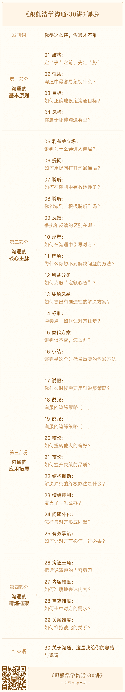
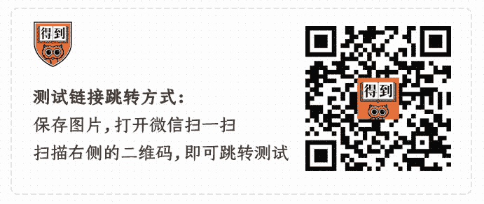
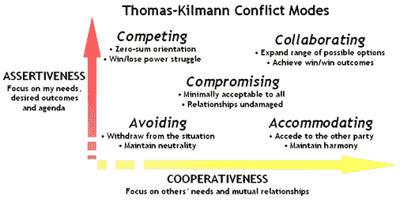
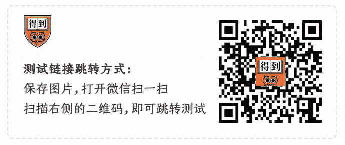
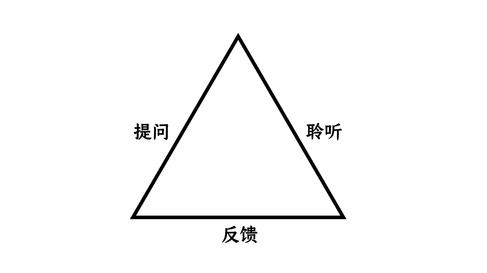
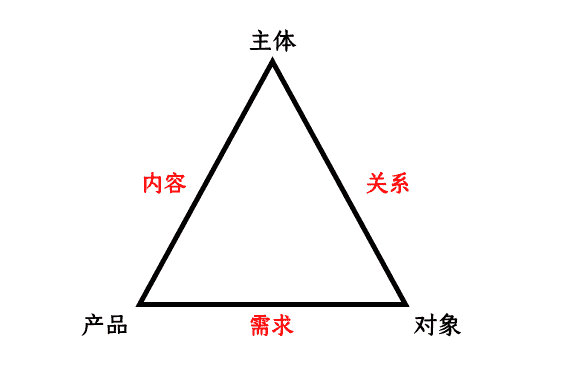
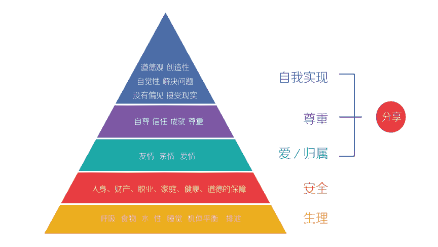

# 跟熊浩学沟通·30 讲

本电子书由*公众号懒人找资源*的小懒人付费购买，并手动整理成册作为备份。

仅在**懒人专属群**内分享共读~

版权归属原作者和得到。

懒人专属群更新记录：[`lazybook.netlify.app/#/blog/record2`](https://lazybook.netlify.app/#/blog/record2)

小懒之前写了一套脚本，可以批量爬虫下载成册的，后面被风控检测到封号。

现在买完课程只好用笨方法帮大家手动复制粘贴整理了。

更多课程离线版电子书，可以到专属群 q 群文件下载，pdf 和 epub 都有，epub 导入微信读书体验满分。

# 发刊词丨你得这么谈，做事才不难

你的职业是什么？你平时都在做什么？

其实粗略地分，你要么是 “体力劳动者”，要么是 “脑力劳动者”。但也许你忘了，我们都还有一个共同的身份——我们都是 “嘴力劳动者”。

所谓的 “嘴力劳动”，其实就是沟通。

无论多普通的职业，例如小区保安，或多么 “高端” 的职业，比如在空间站里的宇航员，沟通，都不可或缺。我们应该承认，在今天，拥有沟通能力的人，特别容易在时代的光晕里闪耀。

**但坦率讲，沟通的课，你是不是听够了？**

那些信誓旦旦的表演，那些似是而非的修辞。

例如，他教你——面试的时候，要笑，要自信，要用力去握手。这重要吗？重要，但这是锦上添花。可问题是，如果你连 “锦” 都还没有，你要什么 “花” 呢？

例如，他教你——销售的时候，要夸——小姐，你穿上了这个裙子，真的很漂亮。这合理吗？合理，但话术不是重点，机制才是关键。相关研究已经证明，“恭维” 是维持良好关系的三种重要方法之一，因为它满足了对方的自尊，至于恭维了什么，反倒其实一点都不重要。

例如，他教你——谈判的时候，要 “藏”——自己的价格要后说，努力让对方先报价。这正确吗？这是错的。我刚刚回国的时候，听到谈判老师讲这样的内容就感到无比惊讶——老师居然告诉你，永远不要先报价。那你得祈祷了，你的沟通对象，从来没有听过同一位老师的课程，否则，你们都不先报价，那这场面谈，必定走向尴尬。

你一定有体会——由于沟通是一种通用技能，表达是一种时代福利，所以大量课以 “沟通” 为名，就显得自然而然，显得应景而魅惑。这样的课太多了，会影响你学知识的信心与求学的动力。

所以我在发刊词的部分，才需要作如此隆重的说明，我想帮助你，打消这些向这门课程前进的怀疑。

我想澄清你也许特别关心的两件事。

第一，这门课不教话术，我们教机理。

在我看来，但凡是只讲话术，不讲机理的沟通课，都是耍流氓。理由很简单，所有的话术，本质上都是各种各样的情境性知识（Situational Knowledge）。

举个例子，你劳累了一天，深夜需要找一个人聊聊天，于是你和你妈打了电话，结果没说几句，你分明感到对方的厌烦，你一下子就火了，咣当就把电话挂了。你心里想，真是太难了，白天那么辛苦，晚上想找亲人聊聊天，对方还那么敷衍，真是不开心。

哎，长叹一声，好在你还有闺蜜。她在电话那头帮你释怀，帮你分析，告诉你：“你妈的个性就一直这样，你想想小时候的成长阅历，我们和她的互动。” 然后不断劝慰，并提醒了你未来和妈妈沟通时候的注意事项。

这通电话真的让人感动，这些高度与你和你妈情况贴近的真诚建议，真的好美好。但，这些建议对其他人来讲是没用的。这种量身定做的咨询，就是典型的情境性知识，换一对母女或母子，这些建议就失效了。

我重复一次：**话术，是情境性知识，它需要和具体情境贴合，和具体对象匹配。**一句话再魅惑，换了对象和场景，这些话，就不一定奏效，甚至适得其反。

因此，**我们不教你话术，我们教你高度结构化的知识，这种知识，可以被理解为沟通的理论。**比如，你和你妈深夜吵架，你问我，一位谈判和冲突解决专家的建议，我惜字如金，我可忙了，我就告诉你了一句话——能量不足的时候，不要开启任何重要的对话。

再说一次：**能量不足的时候，不要开启任何重要的对话。**是的，这是谈判专家给你的建议。为什么？因为控制情绪需要大量地消耗能量。

晚上，你和你妈都疲惫了，都倦怠了，能量都已经不足，情绪控制的能力已经有限了，这个时候如果发生重要的对话，不仅仅效能低下，也更可能诱发冲突。因此结论是，能量不足的时候，不要开启任何一场重要的对话。

我不认识你，我不认识你妈，我不知道你们具体聊了什么，不了解你们白天是什么状态，但这句话，它穿透所有沟通情境的墙，它不仅仅可以帮助你反思你和你妈妈的这次互动，它更能在面试、协商、销售、汇报、会议，乃至冲突发生的现场，给你一个重要的思维支柱——**注意去留意和思考，情绪管理的能量维度。**

这才是问题可能的深层机理，这种认知使得我们对沟通的理解，具有了理论意义与原则高度。

所以，这门课，我不教你话术，我教你机理。

第二，这门课，我不教你闲谈，或聊天。

朋友，你怎么连聊天都需要人教啊？相信我，与其去学习聊天，不如花时间去读书，去远行，去用这一切重新涵养一个阳光、丰富而澄澈的人格。闲谈或聊天，我们有个规范定义，叫无目的沟通，这个部分，我不想耽搁你的时间。

那我们教什么，我们当然是教 “目的沟通”，即：如何通过有效的对话与互动过程，实现自己的目标。

所以在内容上，这门课分为四个大部分：

**第一部分，我称之为沟通原则。**

就是对于所有的沟通，不分场景，你都应该理解的四个重要的奠基性观念，它们分别是，结构——权力的结构；性质——分歧的性质；目的——交互的目的；以及风格——对话的风格。

结构、性质、目的、风格，这是谈判专家审视所有沟通问题时候的基元性出发点。这四个要素，能够帮助你对所有的沟通情势，快速形成一个专业而具有穿透力的整体洞察。

**第二部分，我称之为沟通主脉。**

既然是正式的沟通，是实现目标的沟通，我们当然将视角放在更具挑战性的一些专业沟通情景。在这个部分，我们将花 12 讲内容，为你系统介绍沟通中最重要的一种技艺——谈判。

我们通过这 12 讲，会把哈佛大学原则谈判的理论框架和操作流程向你详细解说，帮助你洞悉谈判专家沟通时的基本思维模型。

**第三部分，我称之为沟通拓展。**

我将分别为你介绍说服、辩论和冲突管理的核心知识。说服，是投射你的影响；辩论，是优化你的思虑；而冲突管理，是处置沟通中可能的障碍、麻烦与摩擦，从而让你更自如地应对更为纷繁复杂的立体沟通情景。

**第四部分，我称之为沟通的精炼框架。**

在这个部分，我会把之前的所有知识化零为整，高度集约，快速简化，以纲举目张、方便携带、便于理解为原则，提供给你一个无论是在会谈、销售、发言、协商、演讲，还是文宣、广告中均可以一以贯之、予以使用的纲领，帮助你对所有沟通情景拥有一个高度精炼的结构性认知。

概括起来，30 讲，我一不讲话术，二不讲闲聊，而是带领你去寻找沟通这门知识的理论之根，最终帮助你，**建树沟通原则、通晓沟通主脉、拓宽沟通场景、掌握沟通纲领。**

当别人在沟通中还是跟着话术前进，你已经能通过结构性的知识对沟通筹谋，能够对人际互动的微妙过程产生明了于心的觉察。

最后，我是谁？这门得到上的沟通大课，为什么是我讲？

在汉语学术界，在大沟通领域能有我这样完备履历的人，恐怕不多。在说服和演讲领域，我是唯一两次获得《我是演说家》全国总冠军的演讲选手，演讲被《人民日报》等主流媒体转载，播放量过亿；在思辨领域，我是复旦大学辩论队教练，《奇葩说》辩手，国家级精品开放课程《思辨与创新》的主讲人；在谈判和冲突解决领域，我是复旦大学法学院的副教授，上海市第二中级人民法院的调解员，谈判与冲突解决是我的学术方向。在这个领域，我已经深耕超过十年。

同时，你即将听到的这门沟通课，我已经在阿里巴巴、京东、泰康人寿、招商银行、英国阿斯利康、英国庄信万丰、德国西门子、云南省高院、上海市司法局、复旦大学法学院和管理学院、华中科技大学管理学院、同济大学管理学院等国内顶尖大学教授过。市场与学术提供过双重检验，你，不是第一个吃螃蟹的人。

除了学习音频内容，你在学习过程中还会收获两个体验性练习、近三十个场景案例的互动推演、三份沟通测评报告，并矫正十二个沟通误区。

如果在此基础上，你还想更进一步深耕，真正达到所谓 “入乎耳，著乎心，布乎四体，形乎动静” 的谙熟，我们也为你建构了持续精进的体验式学习闭环。我、得到与第三选择谈判学院，会在这门课更新完成后，陆续推出沟通的**线上训练营和线下训练营**，以帮助你强化习得，深化理解，甚至直接参与实践，将知识彻底吸收。

是的，与其他得到课程不同的是，这门沟通课，会是得到实现体验式学习闭环的第一课。

我是复旦大学的熊浩，欢迎你来到我的得到课程，《跟熊浩学沟通》。我希望，在未来的线上与线下课堂里，与你相遇。

# 01 丨结构：定“事”之前，先定“势”

懒人专属群的群友你好，我是熊浩，欢迎你来到我的得到课程，《跟熊浩学沟通》。

今天，我们开始为你讲授本课程的第一部分，**沟通的基础原则**。这个部分，共有四讲内容和一个测试。通过这个部分的学习，我希望能够交付给你四个关于人际沟通的最基础维度，这四个维度合起来，其实是想帮助你搞清楚一件事——在沟通开始之前，你，应该在策略、格局、情势上，思考和准备一些什么？

让我把这个问题具体化，引入一个沟通场景，让你来作判断。例如，如果你要和老板谈一谈加薪或升职，请问，在你和老板碰面并张口提出具体要求之前，应该思考和准备一些什么？我停顿几秒钟，让你先凭借自己的直觉和经验，对这个问题先有一个自己的初步答案。

好，思考时间到。我猜测你们中有不少人会有这样的想法——选择一个恰当的对话场合，约定方便的时间，揣测老板的心情，整理自己的表现…… 这些都是对的，但都不根本——你看，我们一般人沟通中，往往先思考细节，而把策略、格局、情势，这样的大问题，完全忽略。

那么，在谈判和冲突解决专家看来，在沟通开始之前，你应该思考和准备一些什么？我认为，你需要思考四个维度，它们分别是**结构、性质、目标和风格**。

无论是在会议、报告、发言、演讲、谈判、协商、争论，还是研讨、文宣、媒体传播这些情景中，在广义的泛沟通领域，结构、性质、目标和风格这四件事都贯通其中，可以帮助我们形成一个 “一以贯之” 的策略预判和行为指针。

请你留意两个词，“策略预判” 和 “行为指针”。换言之，在这四个维度上做好未雨绸缪的分析，可以帮助我们估计，之后的沟通将要发生什么，以及相应的，应该怎么做。

从细节行为而不是策略框架出发，这是你经常犯的错误。

那好，我们先看第一个维度——结构，或者更准确地说，是**权力的结构**。

还记得吗，我们这门课对沟通的定义是：为了实现具体目标而进行一场有效的对话。也就是说，我们进行的这场沟通，不是闲聊，而是有明确的目标要通过沟通实现。

既然设定了沟通的目的，那你自然会关心谁有资源、能力，或者说谁有决定的权力（Power）让这个目的最终实现。

当我们有具体的目标要在沟通中实现时，理论上，能让这个目标实现的决定权处在三种不同的位置。

## 决定权在对方——说服

第一种可能，叫决定权在对方。也就是沟通中，你作了局势的预判和分析，却发现这件事情到底要如何解决，全由你的对话对象控制权力，你自己完全没有决定权。

一个最直观的例子就是销售。如果你是一家公司的销售，你会热络地向顾客们推荐你们新上市的产品。但买还是不买，很遗憾，你决定不了，因为决定的权力在你的顾客手中，否则，就是强买强卖。所以对于销售场景，卖出新产品这一目标之实现，决定权在顾客手中，这就是典型的决定权在对方。

当决定权在对方，它所对应的沟通策略，叫做说服。

说服在本质上，是一种控制权的匮乏，因为无法控制，于是便只能施加影响。

在说服领域，最具盛名的作品，是美国社会心理学家罗伯特 · 西奥迪尼的《影响力》。在这本书中，作者将影响力——也就是说服的力量，分解为六个行动要素，分别是：互惠、稀缺、从众、权威、一致、喜好。

简言之，如果你的沟通策略有效地撬动了互惠、稀缺、从众、权威、一致和喜好，这将更有可能是一个成功的说服。

你生活中有没有见过超级成功的说服？我见过，双十一。是的，双十一在有的人看来是一个不错的营销，**但在我看来，双十一首先是一个成功的说服工程。**

不是吗？

双十一当中有互惠——在当天购物，买得越多你得到的折扣越大；

双十一当中有稀缺——淘宝会提醒你，距离双十一结束还有 3 个小时，还有 30 分钟，过了这个 “村”，还要等一年；

双十一当中有从众——双十一会告诉你，零点刚过，已经有多少人买了。北京多少人买了，上海多少人买了，那是一派群情激昂、摩肩接踵的热闹气象；

双十一当中有权威——天猫、淘宝，这是中国最大的电商平台；

双十一当中有一致——你检查一下自己的购物车，你如果去年买了，今年还会买。如果你去年买了某种产品，比如保健品，你今年还会买保健品。所谓一致，其实是指人们倾向于和自己已经做出的既有行为保持一致；

双十一当中有喜好——从 2015 年开始，双十一当晚会有晚会——天猫双十一狂欢夜。我看到了某个帽子想要买，不是因为我没有帽子，我真的有需求，而是因为这是易烊千玺同款，于是爱屋及乌。

互惠、稀缺、从众、权威、一致、喜好，你看，所以我说，在沟通的意义上，双十一是一个成功的说服工程。

## 决定权在他方——辩论

第一种情况是决定权在对方，第二种情况，叫决定权在他方——对话中你有具体的目标要实现，但你预判后发现，**是否能够实现依赖于第三方的抉择**。

我们举一个例子，你和另外一个跟你同级的部门，关于工作业绩的考评标准出现了严重分歧。但你们并没有上下级之间的隶属关系，你会怎么做？

通常，我们会把这个分歧提交给我们共同的上司，或者公司的大老板，由他来最终拍板——所以你看，当你分析资源、判断了局势之后，你发现最终谁作决定，既不是你，也不是对方，而是一个超然的第三方，你们的老板来作决定，这就是决定权在他方。

当决定权在他方，它所对应的沟通与解决争议的方法，就是辩论。

一些人看辩论比赛的时候，可能会认为，正方与反方相互对峙，最终却如此固执，正方没有办法说服反方，反方也没有办法说服正方。双方只关心立场，不关心真相，完全没有接纳与包容的善意、妥协与理解的可能。基于这种认识，你可能对辩论失望。

然而，你如果理解了**辩论的本质是在影响第三方**，第三方才有决定权，这个误会应该就可以得到快速澄清。

在辩论中，正反双方并不在意对方，因为他们应该非常清晰地知道自己和对方的分歧是根本性的，对方无法改变，也不必改变，就好像法庭上的控辩双方。所以你要影响和改变的不是对方，而是第三方，就像在法庭上，就是法官。

## 决定权在双方——谈判

第三种情况，决定权既不在对方，也不外置于他方，而是由你们对话双方共享。

你盘整完局势之后，你发现你掌握一部分资源，而对方也掌握一部分资源，虽然权力不一定均等，但双方对对方都有需要，任何单方，都无法依靠自己单独完成目标，单独作出决定。

在这种情况下，如何用一些策略与方法，使得善意能够释放、资源能够交换、协作能够达成，从而创造 1+1>2 的价值。这就是第三种情况，决定权在双方，而这就是所谓的谈判情景。所谓谈判，其实就是决定权被分享的一个决策过程。

如果你说我其实没有受过任何谈判的训练，完全没有任何关于谈判的基本认知，该怎么办？你可以找一个超然中立的专家来协助你们的谈判过程，这个专家会帮助你管控好情绪，会帮助你控制好流程，会帮助你集思广益，从而促进真正的创造性的解决方案。这种被专家协助的管理冲突的过程，就叫调解或冲突管理。

在这个地方我必须要帮助你匡正一个对调解的误读，传统上我们对调解的认知，总是认为调解就是家长里短，总是日常琐碎，总是居委会大妈们干的那些事——不是的，或者说，不仅仅如此。

**调解的本质实际上是协助沟通的服务，是谈判的升级，它是从一个更宏观的位置出发，不仅为一方争取利益，而是为双方创造价值，通过专业的冲突管理技艺，来帮助人们定分止争。**

总结一下，今天这一讲有这样几个关键点：

第一，决定权在对方，它对应的沟通策略是说服。

第二，决定权在他方，它对应的沟通策略是辩论。

第三，决定权在双方，也就是决定权被分享，它对应的沟通策略是谈判，谈判需要协助的时候，就是调解。

我们介绍沟通的这种结构性的认知，是为了帮你建构一个沟通进阶的系统知识框架，这样你能够了解，为什么我们之后的课程里，会分别为你介绍谈判、说服、辩论和冲突管理。

与此同时，通过对 “结构” 这个概念的讲解，也希望能帮助你建立人际沟通进阶的第一级台阶：定事之前，先定势。也就是说，行动之前，先判断权力的方位。说白了，**你需要判断一下到底谁求谁，谁更需要谁——据此，再选择沟通的方法。**

让我们回到今天最开始的场景问题：如果你要和老板谈一谈加薪或升职，请问，你打算怎么做？盘算一下局势，看看自己手中的筹码，看看加薪这件事到底谁有决定权。明白了这一点，我想，你会和之前相比，拥有一个不同的答案。欢迎你把你现在的答案，写在在留言区和我分享。

# 02 丨性质：沟通中最容易忽视什么？

你好，我是熊浩，欢迎你来到我的得到课程，《跟熊浩学沟通》。

这一讲我向你介绍沟通基础原则中的第二点：性质。这里说的性质，具体来说，指的是分歧的性质。

真正具有挑战性的沟通情景，是包含分歧的情景。没有分歧的沟通，其实不需要你专门花时间到这里来训练和研习。

无论你期待沟通的结果是什么，是合作信赖，是相互谅解，哪怕是把话就说到此处，我们到此为止，我们都需要直面分歧、管理分歧。处理你与对方的分歧，是沟通中的重要功课。

让我先引入一个沟通场景：

如果你的爱人，非常坚持让他 / 她教育程度不高的父母，也就是孩子的祖辈，介入孩子的教育，你不能接受，你接下来会怎么应对？

我停顿几秒钟，先让你思考一个依赖自己直觉与经验形成的初步答案。

我猜测，你大致会想到这样一些内容，例如就事论事，好好说话；例如强调大家的目标是一致的，都为了孩子好，理性分析祖辈介入的利弊；甚至你可以运用上一次课的内容，看看对话中谁的权力大一些，从而配置不同的对话策略。

**我想提醒你，在沟通的原则里，人们最容易盲视的就是这一个——性质，分歧的性质。**

我刚才提出的这个场景问题，其实是我真实的经历——我就看到过一对夫妻，他们在我面前从正常谈话到激烈争论。他们争论的内容就是，丈夫的父母，即孩子的爷爷奶奶，到底能不能介入孙辈的教育。比如孙子应该学什么，应该怎么学。

受过良好教育的母亲认为，不能这么做，因为老一辈的观念和这个时代脱节了，爷爷奶奶的教育观会把孩子弄得无所适从，甚至让孩子变傻。而父亲则认为祖辈的介入完全 OK，他认为父母对自己的教育是成功的，难道自己的妻子居然认为自己的教育是失败的，自己傻？

当双方的言辞越来越激烈，我在现场分明看到了双方的 “眩晕”——他们忘记了自己到底要处理什么问题，他们忘记了聆听对方可能的正确的想法，他们忘记了时间，他们甚至差不多忘记了现场还有我的存在。

因为这个争议，不仅仅涉及利害，还涉及三观。

这世间的沟通分歧，我们可以粗略地分成两大类——利益的分歧与认同的分歧。

利益分歧是指，我们**对有形价值承载物的争夺**。

在沟通进阶课程后面的 “谈判” 部分，我会为你系统地介绍利益分歧的处理方法。这其中涉及**利益的定位与挖掘、选项的分类与创造、标准的设定与运作，以及替代方案的分析与评估**。通过对这四个方面主要内容的了解，我们会帮助你掌握哈佛大学原则谈判的理论与实践框架，从而建构一套处理利益分歧的系统方法。

利益之分歧，在沟通中普遍存在，家事、商事、组织、社会，乃至国家，大量的分歧都是利益之争，甚至我们可以说，这是分歧最常见的存在形态——但请你记得，**利益分歧不是唯一的分歧，除了利益分歧，还有第二种，认同分歧。**

不知道你有没有这种体验：你在社交媒体闲逛，突然看到一个人对公共议题发表了自己的看法，你瞬间感到自己的三观被严重冒犯，觉得我的朋友圈、微博好友里面，怎么会有这种人啊，他是脑子进水了吧？这种情绪化的冲击是如此真实，以至于，你会动手把对方直接拉黑——嗯，世界似乎回归和谐。

在今天这个认同分立的多元时代，很多议题都能激发一个人底层价值观的激烈反弹，我给你一个这类问题的不完备清单：特朗普、蔡徐坤、转基因、律师为穷凶极恶的坏人辩护、日本问题、男女有别、歧视还是敏感，以及各种政治正确......

坦率讲，当你被某些言论冒犯、冲撞，你的利益——当然，我这里说的利益是指金钱，或其他有形价值承载物，并不会受到直接影响，但你依然非常明显地感受到刺激，并采取行动。

这种现象，在很大程度上便涉及认同的分歧。认同这个概念，英文是 Identity，也被翻译成身份认同，它是一个人确定的自我意识，也就是 “我是谁” 这个问题，最重要、最根本的内在心理认知。按照哈佛大学教授丹尼尔 · 夏皮罗的理论，认同有五个支柱，夏皮罗教授称之为 BRAVE 模型，即**信仰（Beliefs）、仪式 (Rituals)、忠诚 (Allegiances)、价值观 (Values)、情感上的重要经历 (Emotionally Meaningful Experiences)**——就比如说你在恋爱中遭受到的背叛，你在海外遇到危险时国家给你提供的强有力的救助。

是的，信仰、仪式、忠诚、核心价值观、情感上的重要经历，都是形塑你自我精神的重要力量，这五个维度，构成了你认同的核心内容——如果这五个维度遭受冒犯，你就会感受到认同分歧的这种强烈冲击。

我想提醒你，如果你在对话过程中，发现对方和你分歧的性质，不仅仅涉及到一些简单的利害得失，而且触碰到了对方深刻的价值基础，涉及信仰或情感当中的一些重要经历，请你把对话过程暂停。那种精致利己，高度理性的协商逻辑，那种带有思辨性的，和对方摆事实讲道理的论说，其结果，很可能适得其反。

**人们一旦进入到认同之分歧，情绪会被快速激活，对话的双方就会迅速进入一种 “眩晕” 的状态。这是一种特殊的心理状态，在这种状态里，他们看不见别人，只看得见敌人；他们不认为对方只是提出了另外一个方案、想法的普通人，而是认为对方想要摧毁自己。**

但是，自己哪里那么容易被摧毁呢？我支持我的父母，是孝道、是正理、是所有人都会接受的常识，我代表正义、代表忠诚、代表爱——这些巨大的、绚烂的语词，会让这个人产生 “英雄体验”，会营造出神性——我不是为了自己，我是为了某种宏大价值，现实代价与理性盘算不在考虑之列，由此大大压缩了理性对话的空间，使得对方成为敌人，一个弱智、笨拙的敌人，甚至畜生、恶魔，而忘了，对方和我一样，始终只是一个普通人。

## 分歧的处理方式

在那场夫妇二人关于孩子教育的争论中，他们已经争吵得面红耳赤，直到我用两个问题打断了他们：

这种讨论状态能解决你们的分歧吗？这是希望提醒他们，意识到对话的理性目标。

你们为什么会对这个问题有如此激烈的意见？注意——我不想听道理，我想听故事。

**是的，不是道理，而是故事。**

故事，可以把一个 “敌人”，重新还原为一个活色生香的人。

你一直看不上的那位沟通的对象，直到你给了他讲述自己故事的真实机会，直到你了解了他贫瘠的童年，家庭对他的全情关爱，以及这种关爱在他成长中给予他的无限力量，你才能理解他对父母的臣服。了解站在你对立面的那个人的真实故事，而不是支撑他立场的理性理由，你的对方将可能从那些邪恶标签中重新走出来，变成一个立体的人。

当我们把我们的脚放在对方的鞋子里去，在他的那种生命光阴中穿行，我们便会对对方的处境产生真实的感受，我们会想，也许如果我自己在这样的处境中，也会有类似的决定吧？如此，同理心才会出现，分歧才有可能弥合。

当然，我必须说这是一个复杂的工作，认同冲突的处理，真的很需要冲突解决专家的介入。

所以，如果我们在处理的是认同的分歧，这种分歧将携带 “神性”，它的解决不依赖讲理，而依赖叙事，叙述什么过往、什么曾经、什么阅历构成了我，支撑起了我此时的立场。认同分歧的解决，是一场时光旅行，我们会走到这个人的生命经验的内部去，去寻找他的脉络、去理解他的苦衷，然后去获得人之为人，那份同理心的共鸣。

我想说，我们在一个科技高度发达的时代，通过小小的手机，我们可以获得各种资讯。但我也想提醒你，在今天这个 “猜你喜欢” 的时代，大量的资讯 App，都是你精神世界的“弄臣”——它会让你的喜欢叠加，你的欢愉丰盈，但同时，让你的认知闭塞。

你认同的观念会向你奔涌而来，而你不认同的，会逐渐与你切割干净。在这样的资讯环境里，我们会错觉自己并不孤单，我们错觉自己与真理同在。现代人，真的可能在这种偏狭信息的喂养下，渐渐进入越来越偏执的 “小众部落”，最终变得偏颇激烈，雅量全失。

我想提醒你，真实的世界是由各种各样的人构成，他们五花八门、琳琅满目、多姿多彩——世界有真实的差异，所以你，无法尽如人意。

我们今天这堂课有一个小作业，你可以自由完成。如果你愿意的话，请你去向一位与你观点不同的人说一声：谢谢。他们是你认知世界里的奇妙窗口，是他们，帮你撑开了真实的世界。你可以把这段互动的经历，写在留言区里，和大家一起分享。

# 03 丨目标：如何正确地设定沟通目标？

你好，我是熊浩，欢迎你来到我的得到课程，《跟熊浩学沟通》。

这一讲我会继续向你介绍，沟通四个原则性观念中的第三个：目标。所谓目标，就是你想通过这场沟通实现的价值与成果。

我先问你一个问题：**你好好想一想，为什么要在沟通中，为即将到来的会面设定目标？**

我停顿几秒钟，先让你思考一个依赖自己直觉与经验形成的初步答案。

## 目标幽灵，如影随形

好的，在我看来，设定目标有两个功能，其中第一个，我想你大概能想得到——设定目标可以为沟通提供理性、清晰的指引，从而匡正我们的行为。

关于这一点我首先想到的是一个隐喻，这个隐喻来自于刘易斯 · 卡罗尔在他著名的《爱丽丝梦游仙境》中那一段寓言式的对白。爱丽丝发现自己正处在妙妙猫现身的十字路口。

爱丽丝问猫：“请问，离开这里我应该走哪条路呢？”

猫回答：“这主要取决于你想去哪儿。”

爱丽丝说：“我并不在乎去哪儿。”

猫打断她的话，回应道：“那么，走哪条路都无关紧要了。”

是的，如果你不知道自己想要实现的目标到底是什么，那在沟通中，你就不会清晰地知道何时该说 “Yes”, 何时该说 “No”，从而进入一种进退失据的忙乱状态。

如果我们的对话已经并不愉快了，例如明显地受到情绪的干扰，那拥有一个沟通目标，并去澄清与强化它，这就显得更加重要，因为这样的做法可以让对话重新回归理性的轨道。

最高人民法院曾经报道过全国模范法官陈燕萍的调解经验，其中提到过一个陈法官处置纠纷的沟通案例：

你看，这就是澄清目标的效果。沟通中澄清目标时，我们可以使用一个简单的表达结构：“不是…… 而是……”

例如，我们不是来吵架的，而是来解决问题的；我们不是来指责对方的，而是来想办法的；我们不是来搞事情的，而是来搞定事情的，等等。这些表达都可以帮助我们利用目标设定，匡正行为偏差。

科里 · 帕特森在《关键对话》中提出，设定对话的目的，并在对话过程中不断检视自己的行为和设定的目的之间的落差，这是一种高水平沟通者才具备的习惯。所以，重要的不仅仅是在准备时设定了目标，也是在对话过程中，保持和自己目标的对照。

所以我经常用一个隐喻，叫做目标的幽灵。就是你要真实地让目标存在，让它在沟通中伴随着你，并用它来校准自己。确实，冲突解决专家在帮助你解决冲突的过程中，会不时地用不同的话语策略提醒对话的双方，不要迷失沟通的方向，要保持与自己的理性目标对照。我们会问：

*   你们为什么要来到这里？
    
*   你们希望今天获得什么？
    
*   你希望未来是怎样的？
    
*   如果这件事没有发生，你在做什么？
    
*   如果今天咱们能把问题解决，你的感受会如何？
    
*   如果今天咱们能把问题解决，设想一下，你从明天开始会进入怎样的生活？
    

## 设立愿景性目标

我们刚才说过，设定沟通目标有两个功能：第一，设定目标可以帮助我们匡正和反思自己的策略和行为。这一点，我想不少人都能想到，但仅仅这一点是不够的，目标设定的另外一个经常不为人知的功能，是对氛围的影响和行为的诱导。换言之，一个开放的愿景性目标，将更有利于帮助你们达成沟通的共识。

社会心理学的研究表明，人们为沟通场景设定的不同的目标愿景，会影响沟通双方，进入不同的沟通模式。在汤普森（Thompson）与德哈波特（DeHarpport）两位心理学家 1998 年的研究中就发现，将同一个谈判过程标记为 “解决问题（Problem Solving）” 之目标，或是 “博弈杀价（Bargaining）” 之愿景，性格类似的当事人在进入不同情境后的行为风格便完全不同。

**在解决问题的目标设定下，人们会表现出更多合作、理解与协同；而在博弈杀价的情景中，人们会表现出更多的对抗、坚决与冲突。**是的，不同的目标设定将会建构沟通者完全不同的认知框架，而这个认知框架将会明显影响他们在团体互动中的行为表现。

但遗憾的是，我们很多人在沟通的初始就会表现出极为严肃的态度，显示出对己方利益的誓死捍卫。在对话中，反复地强调 “自己”，而非可能的 “共同”。这种目标设定事实上会建构一种不健康的对话氛围，会使得对方也被迫强调和留意自己的利益，从而很容易使对话进入僵局。

**所以，设定善意的、强调共同的愿景，也就是强调作为共同体的 “我们” 的愿景性的目标，而不是用话语将 “你” 和“我”迅速地切割开来，这种愿景性的目标设定会帮助双方，架构一个更具建设性的对话场域。**

例如，如果是在销售情景，你遇到对方可以说：“王先生，今天非常高兴有机会和您会面。我相信我们都有合作的愿望，也相信我们会非常愉快地完成今天的沟通，然后实现双赢合作。”

今天我给你讲了第三个原则性的沟通要素，目标。我们说了为什么要设定目标，因为设定目标会帮你建构清晰的沟通策略，并匡正沟通中的失焦。我们说在沟通时你可以思考和设定两种目标，第一种是愿景性的目标，用它去建构一个更友善的对话氛围，第二种是现实性的沟通目标，它能够让每一次即使短促的对话，也能产生成果。

下一讲我会跟你讨论沟通的四个原则性要素的最后一个：风格。

今天有一个作业，这里有一个链接：

[`www.wjx.cn/jq/48296529.aspx`](https://www.wjx.cn/jq/48296529.aspx)

咱们得到站内无法直接跳转，你可以复制下来，在浏览器中粘贴查看，或者保存扫码下方的二维码。

这是根据著名的托马斯 - 凯尔曼沟通风格量表设计的测试，我们会通过这个量表来帮助你了解和评估你个人沟通的风格偏好，所以，请你在下次课前把这个测试完成。

请注意，**这个测试我们希望看到的，是真实的你，而不是最好的你。**完成问卷时，不要犹豫，不要回忆，请凭借直觉，对所有题目进行快速回答，然后点击提交。

下一次课程中，我会帮助你对结果进行分析，并把测评结果直接反馈给你，我们下次见。

# 04 丨风格：你是什么样的沟通风格？

你好，我是熊浩，欢迎你来到我的得到课程。

你好，我是熊浩，欢迎你来到我的得到课程。

这一讲我会向你介绍，第四个沟通的原则性观念：风格。注意，这里所说的风格，不是别人的风格，而是你的风格。

所以这一讲，我不是让你研判沟通的局势，不是让你去了解分歧的性质，不是教你确立愿景性目标，而是希望通过向你介绍托马斯 - 凯尔曼冲突风格模型，让你更了解你自己。

那么到底在沟通中你自己是什么风格，以及不同的风格，应该注意些什么呢？

照例，我先说一个沟通场景：

如果你和你的朋友在街上走，你们同时发现就在不远处，地上有 100 元人民币，如果是无主财产你们可以自由分配的话，你会怎么处理？

我停顿几秒中，先让你思考一个依赖自己直觉与经验形成的初步答案。

我猜测，你会是以下四种答案中的一个：

第一种，他们会加快步子拼命上去捡钱，捡起钱后赶紧揣到自己的兜里，然后说：我先看见的！

第二种，捡起钱了，然后和对方说：你说咋分就咋分，以你为主，咱俩关系那么好，我绝不还价，咱俩都是那么多年的好同事了！

第三种，跟对方说：咱们来聊一聊吧，这钱怎么分？是 50：50 呢？还是 49：51 呢？这种人在具体数字当中找均衡，希望寻找到双方都接受的一个中间点。

第四种，假装根本没看到这个钱，心里面的想法是：多一事不如少一事，千万不要介入这种特别无聊的争端。

我猜啊，你很可能会是这四种答案中的某一种。

但我想告诉你，这四种答案，都不好。为什么？这就是这一讲我想和你解释的。

## 五种沟通风格

上一次课结束时，我请你完成了托马斯 - 凯尔曼冲突风格测试。我先解释一下，什么是托马斯 - 凯尔曼冲突风格模型。

托马斯和凯尔曼是两位美国学者，是冲突解决专家。两位学者根据两个维度，把人的沟通风格作了分类。第一个维度纵轴，是人们对实体性利益的在乎程度，它可以看出你多么在乎钱，多么在乎落袋为安。第二个维度横轴，是人们对与他人和洽关系的在乎程度。

简言之，纵轴是自我利益，横轴是和他人的关系。

下面这张图，就是这个横纵轴构成的图形。

你看，在这个图形中，根据沟通者对自身利益和对方关系的在乎程度，我们可以把人在这个矩阵中分成五种类型：

第一种人，在图形的左上角，他们对自己的利益特别在乎，但不怎么在乎和你的关系。我们把这种人称作**竞争型人格。**你在平常跟这种人相处时，可能会多少有点紧张，因为他们比较自我。

第二种人在右下角，他愿意牺牲自己的利益，成全与你的关系，这就是传说中的 “老好人”，他们是所谓**退让型人格。**

第三种人，他们会觉得不要太有侵略性，在局势中完全把利益吃尽，压迫对方；当然也不能为了关系，完全牺牲自己，这太极端了。他们会在极端之中寻找某种平衡点。所以会有一个狭长的地带分布在竞争型与退让型之间，这就是第三种类型，我们把他称为**妥协型人格。**

全部地吃尽是 “竞争”，全部地让渡是 “退让”，在这两者之间找平衡，这就是妥协。

还有第四种人，他们利益不在乎，关系也不在乎，这是图表中居于左下角的位置，我们称之为**回避型人格**。他们奉行 “多一事不如少一事”、“事不关己，高高挂起” 的原则。在沟通中，这种人会表现出非常强的边界感。

回到之前捡到 100 元的案例，我问你捡到钱，怎么办？你通常会给我四种答案，其实这四种答案，就对应着四种常见的沟通风格。它们分别是：加快步子去捡钱的竞争型、注重关系的退让型、居中搞平衡的妥协型，以及假装没看见，多一事不如少一事的回避型。

到现在为止，你看到了四种风格，但如果你仔细观察上面那张图表，你会发现在右上方有一个位置，我们还没有讨论到，这就是我希望，通过整个课程的学习，逐渐帮你建树的一种心智模式——一方面能够捍卫自己的核心利益，另外一方面也有能力持续与对方的良好关系，尽量做到利益与关系的双丰收。

这种类型，就是合作型。

那么，在捡到 100 元钱的时候，第五种合作型的人，会有什么样的反应呢？他可能会这样做。

他不急于分钱，而是退一步，对局势进行整体性的分析与衡量，用开放性的话语邀请对方一起来讨论。比方说：老王，咱们同时捡到 100 块钱，钱也不多，分了以后坦率讲就是一顿饭钱，咱们啥也干不了，咱们要么花几分钟来讨论一下，这 100 块钱咱们今天还能干点啥？能给我们双方，都创造那种超过 100 块的满足感？

别急着分割存量，而是邀请对方，通过合作思考来创造增量的可能。这种思维，就是合作型人格的思维。它把利益——自己的诉求，关系——对方的融洽度，都试图照顾得更好。

现在，你可以看一下你的托马斯 - 凯尔曼量表的测评结果。

如果你是 A 最多，你就属于竞争型人格；如果你是 B 最多，你就属于合作型人格；如果你是 C 最多，你就是妥协型；如果你是 D 最多，你就是回避型；如果你是 E 最多，你就是传说中的老好人，退让型。

你也有可能有两个字母都一样多，你就是某两种类型的混合体，在不同的情景中，你会根据不同的环境，调试和表现出不同的沟通风格。

但请你记住：风格无对错，但策略有高低。

我们在给你的测试的结果里，给大家提供了不同风格的行事建议，你可以参考。

## 不同风格的注意事项

关于这个风格测试，我在这里还想多解释几句。

竞争让对方不快，退让让自己辛苦，这两种策略的问题都很明显。那为什么回避或妥协，也不值得鼓励呢？

我在不同的场合讲解托马斯 - 凯尔曼量表时，会请同学们来自我剖析，讨论这几种类型中哪一种是他们最讨厌的。让人感到惊讶的是，很多人选择的并不是竞争型，而是回避型。

因为如果你回避与人交流，别人将没有办法了解你真实的需要。这种置身事外的姿态对回避者来讲可能是心中清净，而对于沟通对象，他们将陷入无所适从。

所以，我特别想要提醒回避型的人注意一点：有的时候，你对问题拖延、回避，你需要有一个明显自我觉察——这种状况到底是出于理智，还是出于回避型的自我特征？如果是后者，应该主动去克服或适当矫正。

那你可能会说，居中平衡的妥协型，这总是一种值得被肯定的类型吧？不是的。因为妥协是在两个极端，即竞争和退让之间不断地腾挪，有时候自己多拿一点，有时候对方多拿一点，本质上它仍然是一种，对利益的分割与平衡，完全没有涉及**利益的协同与创造。**

所以，只有合作型，他能够脱离竞争与退让的这条线，把利益和关系都维持好。他们创造了，无论如何调整，是极端的竞争还是极端的退让，都没有办法获得的崭新的价值增量。

所以，今天，我想借此机会来澄清一个人们的常见误区：认为谈判，是一种妥协的艺术。我今天要非常旗帜鲜明地告诉你：谈判不是妥协的艺术，妥协无非是在得与失之间的腾挪，而只有合作才能创造价值的增量。所以，谈判，是共赢的艺术。

我也希望你能把托马斯 - 凯尔曼量表这个测试的链接分享给你的伙伴们。**在课程完成之后，我希望能够积累足够的行业数据，届时我会发布一份不同行业的冲突风格报告，让你了解在你所在的行业五种类型的人，哪种更多，从而让你更好地去调试你和你所在行业同伴们的沟通方式。**

到今天为止，我们的沟通课程的总纲部分，已经讲授完了。我为你提供了四个，在所有沟通情景中都应该留意的原则性观念。它们分别是：结构，权力的结构；性质，分歧的性质；目标，理性的目标；以及风格，沟通的风格。

这四个维度可以贯通所有的沟通情景，帮助你对沟通状况进行预判，对沟通结果进行反思。然后不断练习，从而真正提升自己的沟通水平。

结束了总纲，从下次课开始我们将进入沟通进阶课程的主脉部分，我们将详细介绍各种更具操作感的沟通方法。下一讲，开始为你介绍谈判。

这一讲，我留给你一个小作业，是一份谈判能力测试，我们在开始学习谈判之前，请你用这个测试先自评一下，通过最后的评分，了解自己目前对谈判的认知。这里是链接：

[`idedao.wjx.cn/jq/48363921.aspx`](https://idedao.wjx.cn/jq/48363921.aspx)

咱们得到站内无法直接跳转，你可以复制下来，在浏览器中粘贴查看，或者保存扫码下方的二维码。

请真实回答，我希望看到的是真实的你，而不是最好的你，因为了解真实的你，这样我才能帮到你。请直接、快速、诚恳地填完问卷，然后提交。

好，我们下一讲见。

# 05 丨利益≠立场：谈判为什么会进入僵局？

你好，我是熊浩，欢迎你来到我的得到课程，《跟熊浩学沟通》。

正如我在发刊词中向你介绍的，我们的课程，分为四个部分，分别是沟通原则、沟通主脉、沟通拓展和沟通的精炼框架。我们在之前的课程中，已经讲授了沟通的四个原则，从今天开始，我们进入主脉部分，开始学习最重要的一种沟通方法，谈判。

关于谈判，世界上有不同的理论。我向你介绍的这套方法，其知识基础来自哈佛大学，它缘起于上世纪七、八十年代，一代冲突解决领域优秀学人的理论奠基。哈佛谈判理论，也叫原则谈判理论。这套方法首先认为所有谈判的沟通，由四个基础要素构成，分别是利益要素（Interests）、标准要素 (Criteria)、选项要素(Options) 和替代方案 (No-Agreement Alternative) 要素。四个概念的首字母分别是 I、C、O、N，所以我们也将它称为 ICON 模型，这是谈判最核心的方法论框架，是一套具有普遍意义的理论工具。这个工具既可以帮助你理解大国之间的争议，例如说国际争端，也可以帮助你化解生活的小问题，比如家人口角。

当这四个要素拼合在一起的时候，就构成了一个高效运转的沟通机器。但它的第一步，也是最核心的步骤，是对利益的发现和判断。

所以今天，是时候向你展示真正的技术了——从这一讲开始的几次课里，我会系统地向你讲解 ICON 模型中的 I，也就是挖掘利益的观念和方法。

## 利益与立场

那什么是利益呢？要理解利益，你需要了解著名的冲突解决的不等式：利益≠立场。

我提到的两个关键词，一个是利益，一个是立场。你也许会有些不相信：利益怎么可能会等于立场？利益是利益，立场是立场，我从来也没混淆过呀！

让我们用两个场景性的沟通案例来试试看。先看第一个沟通场景：

假设你是孩子的父 / 母亲，家里有两个孩子，你今天回家非常疲劳，推开门发现两个孩子正在厨房里，拼命争抢一只橘子。

请问，你会怎么做？我停顿几秒钟，先让你思考一个依赖自己直觉与经验形成的初步答案。

这个案例，来自 Roger Fisher 等人所著的经典谈判学著作《谈判力（Getting to Yes）》。

我相信不同人一定有各种各样的答案。有人会这样反应：“你们俩是不是要打闹？是不是要争吵？那就都别吃！”

我首先建议你不要采用这种反应的模式。因为无论两个孩子如何争抢这只橘子，最终他们都或多或少会得到一些利益。而因为你的到来，两个人利益完全归零。**你不是利益创造者，你是利益的终结者，不要成为这样的人。**

还有其他的处理方法，比方说哥哥应该让弟弟，因为要关爱幼小嘛。还有的说弟弟应该让哥哥，因为他们想到了中国的传统美德——孔融让梨。

但我想最普遍、最直接和最能够被你想得到的方法，一定是拿一把刀，把橘子从中间公公正正切开，然后一人一半。那我们把故事继续。

这时，哥哥拿着他的那一半，然后吃掉橘肉，扔掉桔皮很正常。而弟弟，拿走他的那一半则是把橘肉给扔掉了，他只留下了橘皮，他想烤蛋糕——你知道，橘皮是西点烘焙中的香料。

如果刚才讲的这个过程，不是一个真实事件，而是电影，我们就可以倒带回看，那我们不妨可以回到那个你分橘子前的一瞬间。你有没有发现你的处理方法其实错误了？因为本来哥哥可以拿到完整的橘肉，而弟弟可以获得一整张橘皮。你可能会有意识做一点反思——你大概少做了一些动作，让一半的资源被浪费。那你错过了什么？

可能有的人说，错过的是询问，有的人认为是聆听。而在我看来，这里面真正的错误，就是把利益跟立场混淆。

是的，利益不等于立场。所谓利益，就是你的谈判对象内心真正的诉求。而所谓的立场，就是你设想、揣测、认为的对方想要什么。

**“立场” 是你自以为是的，你的潜意识或意识当中所包裹的执念。**

我再说一次：利益不等于立场。这是一个基础性的观念，这个判断是，所有谈判和冲突解决机制得以正常运转的认知前提。

## 把利益和立场分开

看完家事情景，再看商业场景。

假设你是一个互联网公司的人力资源总监，你老板有一天把你叫到办公室中跟你说，到上海去跟熊浩见一见，他是我们这个领域非常优秀的程序员，他掌握了某种核心黑科技，他能够帮助我们解决某些编程当中的疑难问题。老板提示你：这个人很重要，注意保持薪酬的弹性。

这是大老板给你的指令，于是你通过一些中间人找到我，然后约在上海碰面。

我们在上海碰面了，碰面之后没聊几句，我居然明确、清晰地表达了对你们公司的向往和认同，我非常愿意到你们公司工作。

你觉得幸福来得太突然，真是 “得来全不费工夫”。那接下来你就拿出了合同文本，让我看格式合同，我看了格式合同的每一条，看完之后我把合同文本还给你。

接下来你认为，既然对方来你们公司工作的意愿那么清晰而强烈，那不妨直接聊一聊入职谈判中最关键的环节——谈钱。一个月到底多少薪酬呢？以我类似的背景和类似的资历，像我这样的程序员在你们公司大概每月两万块钱，这里我只是说一个大概数。但因为老板说你要对他好一点，所以你的第一个开价是 2 万 5。

这时我说：不行。请问，你会怎么做？

我停顿几秒钟，先让你思考一个依赖自己直觉与经验形成的初步答案。

我打赌，有不少人会说：那 3 万，我说：不行。你说：那 3.5 万。我说：不行。

这时你想说 4 万，但你想说 4 万之前有一点点不高兴，因为毕竟 4 万这个金额是这个领域跟我相同资历的程序员两倍的薪酬了。你心里想：为什么 3.5 万还不行？这样的一种愤懑和不理解，让你脱口而出问出了这个问题：为什么不行？

我从你手中要来那个格式合同，我翻开格式的条款，指着其中一条当中的两个字说：因为 “全职”。你们的工作要求我每一天都来上班，但我现在还在复旦大学读 MBA，所以我星期五要上学，无法上班，没有办法满足你们的合同要求。

你现在的状态真是万分尴尬——因为你没有想到，对方是以这样的理由来拒绝你给予的薪酬。你觉得你自己是知道的，你觉得对方不就是要钱吗，你又获得了老板的授权，可以有弹性价格的空间，那当然直接涨价把这个单子谈下来呀。没想到对方要的并不是钱，而是时间安排的弹性和自由。

这就是我们在日常生活中经常能够看到的利益和立场的混同。

当你混同的时候，你突然发现你自己站在一个非常尴尬的位置，在这个对话情景里，要么给予我一个明显超过本人价值的酬劳——两倍于正常的薪资，要么回去跟老板无比沮丧地汇报今天的失败。

利益不等于立场，这是我们挖掘利益过程中一个关键的束缚要素。

## 经验与执念

在这里我想多说几句。谈判的过程中，经验多，有时是我们的优势，但有的时候，也会成为我们的障碍。

**你对一个行业了解越深，经验越透彻，这些所谓的经验就会成为你牢牢不可放手的执念**。它会在你的对话过程中不愿意走出自己的偏执，不愿意屈尊降贵地去了解对方的意愿。经验越多，可能你会照着既定的方案做，而正是照着自己曾经的成功经验，让自己真正错过了对方的需求，而与这场合作失之交臂。

你千万不要误会，我并没有任何意思告诉你说，把利益跟立场区分开，世界上所有冲突就都迎刃而解，我的意思是说这是我们出发的第一步。

如果你理解了这一步，你应该有非常明显的发现，那就是沟通中事情会出现转机，无论是橘子，还是薪资，只要你了解了对方真实的诉求，你就可以重新整理思绪，重新整合资源，配置出双方都有可能接受的问题解决方案。

把利益跟立场区分开来，这是整个原则谈判机制运转的起点。把利益与立场区别开来，这也是我们每天都要自省的洞察。

这一讲的最后，留给你一个思考题，关于利益不等于立场，你能不能在留言区给我们举个例子，让我们看看你会如何将利益与立场区分开来。我们下次见！

# 06 丨提问：如何用提问打开僵局？

你好，我是熊浩，欢迎你来到我的得到课程。

在上一讲里，我们给大家区分了两个关键概念，我们说利益不等于立场。既然利益不等于立场，那如何绕过立场，真实、有效地发现对方的利益呢？

接下来的这几讲，我们将为你系统介绍发掘利益的具体方法——这个方法被谈判领域的一位著名学者，摩西 · 科亨教授（Moshe Cohen）概括为 “听力的三角形”，它包含了询问（Ask）—聆听（Listen）—反馈（Reflect）三个循环的步骤。

我给你画了一个三角形，为你标记听力三角形的循环过程。

## 谈判中提问的原则

如果我们概略地进行分类，日常生活中人们有两种提问的方式。

第一种问题叫封闭式问题，封闭式问题很简单，就是可以用是或否来加以回答。比方说：我问你，今天中午你吃的是面吗？你可以说是或者不是。今天你穿那么多是因为天比较冷吗？你可以说是或不是。在谈判过程中，你给了对方一个报价，对方拒绝了，你问，是不是价格贵了？这种都是封闭式问题。

凡是可以用是或否回答的问题就叫封闭式问题。

而另外一个类型的问题是不可以用是或者不是加以回答的，必须要给别人具体信息，这种是开放性的问题。比如说新闻记者深谙此道的那些问题，常见的为什么？是什么？怎么样？在哪里？以及什么时候？这是开放性的问题。比方说我同样可以问，今天中午你吃了什么？你是不能回答是或不是，得给我具体信息。

来，我们确立一个提问的一个大原则：在谈判的过程中，请你尽量多问开放式问题。我想主要是基于两个原因：

**第一， 开放式问题对信息的搜集更具有效率。**

如果你想知道我的诉求是什么，你又爱问很多封闭式的问题，你想要真正了解过程会很长。你可以做一个小实验，如果你想知道你朋友今天中午吃了啥，但你不能问这个开放式问题，你得问各种封闭式的问题。你问，今天中午是吃的米饭吗？今天中午吃的辣椒吗？今天中午吃的牛肉吗？你要多番提问才可能把那个真正的信息寻找并提取出来，那为什么不直接用开放式问题提问呢？直接问到底吃了啥。这个例子很简单，想让你体会的是开放式的问题更效率。

**第二， 更重要的原因是，封闭式的问题，是一种非常典型的立场性思维。**

我们上一讲跟你谈到重要的不等式：利益不等于立场。结合刚才所讲，你想一下，当有人问你：项目进度那么慢，是不是不上心？

这是一个典型的封闭式问题，这样的提问，其实已经包含潜台词——我知道的，是你的不良态度，拖慢了项目的进度。

这种思维方式是从自己的经验和已知的预设出发进行的询问，它放弃了对对方生命和对方经验的真实好奇。

所以封闭式问题真正危险的地方还不在于它对时间和精力的消耗，而在于它裹挟的一个强大的立场性发言，它背后所隐含的价值观是：**我知道的、我明白的、我懂的、我猜到了。**

所以，你如果在谈判过程中用大量封闭式发言去对话，几个回合就会把你死死地锁在立场当中，无法真实理解对方的利益——所以，保持开放式提问，这是谈判当中的第一个原则。

## 提问的方法

我们再往前走一步，那具体要怎么问呢？

我们先看一个沟通场景：如果说你是一个艺人的经纪人，你在代表他与一个新节目去谈一次合作，诚然在整个对话过程中最重要的谈判目标就是酬劳，但我们通常的谈判是怎么样的？

通常的谈判是，经纪人问节目方：那你看你们节目的酬劳大概是多少？

节目方说：30 万！

经纪人说：才 30 万，太夸张了吧，开玩笑，我们那么火。我们的明星是什么咖位？他有什么样的流量，你们难道不知道吗？我们至少要 60 万。

节目方说：60 万？那 60 万太多了，完全超出了我们的预算。

我问你，这个沟通出了什么问题？我停顿几秒钟，先让你思考一个依赖自己直觉与经验形成的初步答案。

你能发现上述沟通中的误区吗？如果不能发现，请你仔细听我后面的解释，因为你也很可能在这种沟通的误区中。

简言之，以上沟通的不当之处在于，没有通过足够的提问收集信息，就已经进入了争议。

关于如何通过提问来收集信息，我建议你问两类开放式的问题：横向提问和纵向提问。

## 横向提问收集利益信息

所谓横向提问，就是对对方的利益信息进行横向收集，保证所有重要信息都没有遗漏，它的标准提问句式是：还有别的吗？

这句话有很多变化的提问方式，比方说，有什么遗漏吗？有什么补充吗？还有什么要说的吗？这其实在本质上都是问：还有别的吗？

再看刚才的案例，如果你只盯住酬劳，你会忘记其实双方还有别的需求可以通过合作来彼此满足。所以，如果你在价格询问完之后，千万不要急着进入沟通的战场，不要抱怨说 30 万多了还是少了，而是问：“还有别的吗？”

这个问题提出后，也许对方会提出其他的选项让双方都能获益。比如，资源位的给予，流量上的曝光和相互拉抬，演员在进入这个新节目的时候，如何给他一个更有效的、更舒适的、更健康的形象人设……

所有这些，如果你问了：还有别的吗？你做了横向提问，做了利益信息的收集，你就可以发现，都有可能洽谈。

我不知道你注意到没有，传统的谈判会让我们在定价上迅速进入拉扯，然后双方就在一个点上长期纠结。**而那些创造更大价值增量的可能，也许就在价格拉锯中被忽视了。**

现在你明白在谈判当中，如果你进行提问，请你在谈判一开始保持一个低调平和的提问姿态，并多使用横向提问。不管对方告诉了你什么，你都可以问：还有别的吗？来对对方的利益信息进行完整收集。

## 纵向提问挖机理

除了横向提问，第二种提问的方法叫纵向提问。它像一条纵深的直线，不要求覆盖广，而要求挖得深。

纵向提问的标准句式也简单，叫：为什么？

我们再还原刚才那个情景。“你们节目给艺人的酬劳是多少钱？”“30 万。”

注意，这个时候你的反应不是攻击对方的开价，你除了回应 “还有别的吗”，还可以提问：“为什么？” 这个时候对方就会给你一些行业当中的惯例，一些既有的标准，甚至预算的合同。

请你相信我，绝大部分人都没有受过谈判的训练，而在对价谈判中，往往会虚开价格——用咱们中国人的话讲，漫天要价。**所以绝大部分人在谈判当中，他的第一个报价，是根本无法给你一个客观标准加以支撑的。**

所以，这个问题会让对方会处在非常尴尬的境地中。当他在现场并不能逻辑自恰地解释报价的时候，这时候就轮到你了，你可以讲述一个你的价格主张的理由——这个部分，我们在客观标准部分还会教你。

你看，你没有伤害彼此的关系，你没有攻击过对方的价值，你也没有质疑过对方的产品，但你已经在用这样一个问题——为什么？就已经有可能让对方调整他们的策略了。

横向收集信息，纵向了解机理。这两种问题交互使用，你就可以了解得更多，也了解得更深。

好，我们总结，今天这堂课我们已经开始给大家讨论听力三角形了，听力三角形包括提问、聆听和反馈三个步骤，我们今天主要跟大家讲述的是提问当中的两个要点。

第一，请你提出开放式问题，而不要问封闭式问题。这是因为开放式问题能帮助你更有效率地收集信息，而封闭式问题，则会让你锁死于立场。

第二，开放式问题有两种提问方法：一个叫横向提问——还有别的吗？保证信息能完满收集；第二个是纵向提问——为什么？这个问题是想了解得更深，触及对方的底牌，或者至少坦露他如此判断和如此决定的内在标准与决定过程。

那么，等你提问完了问题，是不是对方就要开始说话了？在对方说话的时候你在干吗？你一定是在认真聆听。那下一次课，我们给大家讲一讲听力三角形的第二个重要步骤，如何做到积极聆听。

在今天课程的最后，我想说，**提问是一种天真的能力，真的，这个能力在我们幼年非常饱满，成长的过程中却不断消散。**我们在学习过程中，几乎所有知识都在给予答案，而不是让你提出问题。你认为具体是什么力量，把我们提问的能力给抹杀了？

这不仅仅是一个谈判问题，更是一个观念问题。我没有标准答案，但你们留在留言区里面的答案，可以为我们提供思考这个问题多维度的洞察。今天的互动问题就是：是什么原因，让我们的内心，成为了好奇心的荒漠？

我们，下次见。

# 07 丨聆听：如何在谈判中有效地聆听？

你好，我是熊浩，欢迎你来到我的得到课程。

在之前课程中我给你讲述了 “听力三角形” 这样一个绕过立场，挖掘利益的具体工具。我们强调过，这是整个谈判过程当中，最基本的互动沟通模型。

我们上节课给你谈了提问的两种方法，横向提问——用来收集利益信息，还有纵向提问——用来了解机理。你问完问题，对方就开始回答，那接下来你在干吗呢？接下来你当然是在听。

“听” 这件事，我们从三个维度展开，第一个维度叫：听力的觉醒。

## 听力觉醒

让我们完成一个小练习。我希望你做这个练习的时候，请你检查一下，没有同时在开车、行走或者正在你完成一些需要专注投入的工作，因为我现在需要你把你所有的注意力，都放到你的听觉当中去。

也就是说，接下来的十秒钟左右的时间会出现一个纯粹的安静，你需要把你的注意力转移至你的耳朵上去，你留意一下在你所处的空间，不管是在室内、室外、家里，还是公共场合，那些晃动而未察觉的声音。

好，十秒钟，我们开始。

我不知道你有没有发现，你听到了不少声音，可能是空调的声音，可能是行人的噪音，可能是风的流动，可能是街上汽车的轰鸣，这些声音在提醒你，只有把注意力聚焦到听力之前，你才能察觉到它们的存在。

哈佛大学法学院的谈判学教授威廉 · 尤瑞（William Ury）曾提出一个有趣的问题：在一个旷野当中，如果有一棵大树轰然倒下，旁边一个人都没有，到底现场有没有发生过声响？

用英文来理解这个问题比较容易解释了，因为关于 “听”，英文当中有两个词，一个叫 hearing，听到，一个叫 listening，聆听。这两个概念完全不同。

所谓的 hearing，也就是听到，它指的是由物理震颤，影响到我们的耳膜震动，所以人的听觉系统收到了声响。

而 listening 则不同，listening 是把你的注意力，也就是你的主观的关切，投射到听觉上来，从而真正能够听到那些你需要听到的声音。

所以如果一棵大树如果在沙漠当中轰然倒下，周围没有人，在 hearing 的意义上一定有声响，因为一定有物理震动，但在 listening 的意义上，则毫无声音。因为既然没有人，也就没有了人的注意力的投射。

所以，我们刚才所让你做的这个小小的练习叫 “听力的觉醒”，就是你如果想真正听到东西，或者听到更多东西，这不仅仅是需要你的听力无碍，更重要的是，需要你注意力全然投入。

你在谈判的过程中，如果也能把注意力真正集中到一个人身上，你往往会听到很多重要而细微的声音。

## 用觉醒的听力捕捉需求

当你的听觉被唤醒了，当你真正用心去听，你要去捕捉什么呢？捕捉需求。

我举几个例子。

第一个是关于我自己。我日常生活中会在商业世界和法院调解人际纠纷。如果当事人比较 “资深”，刚刚见到我，有时会觉得我长得比较年轻，会有一些怀疑我：哎，嘴上没毛，办事不牢。今天肯定搞不定了。

我的问题是，如果你听到这样的抱怨，你会怎么做？

我停顿几秒钟，先让你凭借自己的直觉和经验，对这个问题有一个自己的初步答案。

如果你想到怼回去，抱歉，意味着你对聆听还存在着牢固的误区，因为你把这种怀疑，看成对自己专业性的质疑，甚至会触碰到自尊。由此，双方可能发生口角，你会直接说：你怎么知道我不专业，你怎么知道我搞不定？你了解我的专业背景吗？你了解我的职业履历吗？你了解我处理类似案件之前是多么成功吗？

很遗憾，这个沟通的方向，是错误的。

我再次强调，通过聆听，不是去发觉和回应对方的言辞，不是敏感于对方的态度，而是去触碰对方的需要。

我问你啊，当对方说 “嘴上没毛，办事不牢” 时，他们有没有在表达自己的需要？有，他们其实是想说：我需要今天帮我处理纠纷的这个人有足够多的经验，他是靠谱的，他是专业的，他是有职业素养的。

那么，我们为什么不对他们的需求进行对话呢，而是要在语词层面质疑乃至冲突呢？

一般遇到这种情况，我就会让解决争议的过程暂时停下来，然后和对方非常善意而诚恳地说：各位好，可不可以允许我先花几分钟的时间，做一个比较完整的自我介绍，我把我相关的履历、经验先跟大家做一些汇报，然后我们再开始好吗？你看，这实际上就是在沟通中，回应对方的需求。

很多时候，如果你的听觉被唤醒了，你的沟通对象即使没有言说，或者没有正面言说，但他们的需求，你依旧可以接收得到。

## 积极聆听

说完听力觉醒，我们看第二个重要的聆听概念——积极聆听。

实际上 “积极聆听” 不是什么新词，可能每个人都或多或少有所知道，你在任何一本关于沟通的书，如果打开谈到 “听” 的部分，恐怕 “积极聆听” 都是被反复强调的高频词汇，你会发现一系列的行为清单，告诉你什么才是具体的积极聆听。

本质上，积极聆听的意思是保持和言说者的应和，与对方同幅振动。这种同幅振动，既是身体的、内容的，也是情感的，所以学者会告诉你，在聆听的过程中保持眼神的交替，保持身体的前倾，不要乱切换话题，保持对对方的尊重和话题的投入，始终对整个言说过程投入兴趣。

而什么是不积极聆听呢？你稍一思量就会知道，比方说对方讲话的时候，你玩手机，你心不在焉，你走神或者你强行切换话题，把话题带往了你比较想讨论的方向，而不是和对方呼应。

我在这个地方并不想给你特别强调积极聆听的概念，因为这个部分并不具有洞察的意义，我特别想强调的是积极聆听的一个关键体会：**如果在积极聆听的状态中，你看上去被动，其实你正在主动建构一个更为健康的对话氛围。**

在这里你首先需要了解啊，**沟通在本质上，是一个互动建构的过程。**

我举个简单例子，你在大街上如果不小心踩到了一个人，这个时候如果迅速发问说：先生现在几点了？他会对你的提问进行反应，而不是被你踩到而进行抱怨。这时候你主动地切换了互动的方向，使得对方按你设定的方向前进。

是的，沟通是可以建构的，谈判是可以引领的。**“听” 在这个过程中看上去被动，实际上是对整体前进的方向进行影响。**

一方面，你听得越多，意味着对方说得也就越多，你对信息的理解和占有也就越饱满，你对情况的掌握就越通透，当对方在合适的言说状态中，你已经身处一个大为有利的谈判局势里——因为你，掌握更多对方的信息。其次，聆听是一种给予对方能量的状况，对方言说，你聆听，对方会觉得你尊重他，在意他，体贴他，他说话的心态，也会变好，你们之间的沟通氛围，也会改善。

如果是线下教学，积极聆听的状态和非积极聆听的状态，我们可以为你创造具有参照感的直接体验，让你触碰到不同的聆听方式对你说话方式产生的明显影响。

好的，我们总结一下。今天关于聆听，我们讨论了两个问题。第一是听觉唤醒，我们需要把注意力给到听，这样才能收到更多的信息。我们应该把听的重点放到需求上去，而不是在意对方使用的言辞。我们用听来捕捉需求，然后回应需求，这样，你们便会在一个和洽的对话状态中。第二，我们提到的积极聆听的基本方式，就是和对方全面地共鸣，而这种听觉状态会使得对方的言说状态，也越来越好，也会让你，获得对方更多的信息。

好的，这一讲到这里，我们下次课，将继续讲解聆听。

# 08 丨听觉正念：如何校正自己的听觉习惯？

你好，我是熊浩，欢迎你来到我的得到课程。

上一次课，我们讲到了 “积极聆听”。我们提到过积极聆听是什么，以及如何操作。

“积极聆听” 这件事值得我们反复强调——如果有朋友问，熊老师，如果时间有限，你只教给我们一个有关谈判的技能，但是却立等可取，又真正可以有效地改变整个人际对话的状态，这个技术是什么？我会说，就是积极聆听。

正如我们上次课向你介绍的，如果一个人以积极的方式听，对方就会大概率地以积极的方式说。好好听话，有时候，比好好说话更为重要。

所以，积极聆听是一个简单、重要的按钮，这个按钮之所以简单，是因为其机理很容易理解。之所以重要，是因为如果你把 “积极聆听” 这个按钮摁下去，**对方会非常配合地，用友善而和洽的方式与你对话。**

在谈完了听觉觉醒、积极聆听，最后，我们想谈谈，以什么样的判断标准，来判断自己的听力已然觉醒，判断自己正处在积极聆听的状态中。

## 听觉正念

这个时候我们需要引用禅宗的一个观念，叫正念。

“正念” 是一种不被杂讯滋扰，不被分别心裹卷，让意识有知觉地全然只在当下的状态。禅宗的公案故事说：

用曾国藩的说法叫：**未来不迎，既过不恋，当时不杂。**就是把心思与目力，非常澄澈地关注于此时此刻的当下。

放到沟通中同理，若你在对话时，对当下有全然之知觉，你就会对聆听有感知。若你在聆听，便只是聆听。

现代人，由于资讯太庞杂，生活太忙乱，要想全然只在当下，其实真的非常困难。我们说话的时候大概会想别的事，就好像我们吃饭的时候，大概会想今天未完成的工作，稍后还要赶的进度，还有同事的电话和微信要回。

你看，你吃饭的时候也没有全然只在吃饭的状态中，你并没有好好对待当下的吃饭。

如果你真正只是专注地吃饭，而且把注意力放置到吃饭，你应该能够感受得到食材的质地，以及烹调后的食物和你的味觉系统触碰时，所创造出来的那种况味。接下来这一段，建议你收听音频。

比方说，上海人做红烧肉是一绝，需要少许煎炸，然后慢火熬制，需要用酱油烹饪，适当放糖，在烹饪过程中把肥肉的油腻感逼走，同时又让肉质 Q 弹。红烧肉在上海人这里是甜的，也是咸的；是肥的，也是瘦的；是醇厚的，也是 Q 弹的。所以当你用筷子，把一块红绕肉送到口中，肥、瘦、咸、甜、醇厚、Q 弹在你口中彻底混合并全然绽放，你闭上眼睛去仔细品味，认真去享受。

是的，你刚才这种完全沉浸在当下感受的状态，就是正念。仅仅让自己沉浸在对食物的想象中，让你突然感受到某种《舌尖上的中国》大快朵颐的感觉，久违了的感觉——与事物如此纯粹的相遇。

很多时候，吃饭时，我们并不在吃饭的状态。类似的，聆听的时候，也不在聆听的状态中。史蒂芬 · 柯维说：大多数人聆听的目的是为了 “怼回去”，而不是为了真正理解。

Most of people listen with the intent to reply, but not with the intent to understand.

让聆听变得更加澄澈，你需要锻炼自己对于聆听的习惯、沉浸和定力。

## 正念的两个基本标准

我们再往前走一步，再具体一些，我给你两个基本标准，第一叫不比较，第二是不判断。

如果你在谈判中，或者是所有的沟通力，特别是在和对方刚刚见面的第一个阶段，对方给你的任何信息，你一旦在大脑当中形成比较和判断，比如说 “这个价格太贵了！”“开玩笑，他懂不懂行情！”“怎么回事？今天怎么这么倒霉，遇到这么个不懂道理的人。” 这些话并没有说出来，是你心中自己对自己的喃喃自语。那么你，已经在比较和判断中。

不要比较，不要判断，让对方所有的信息尽可能和盘托出。

这其实是一个可以自我察觉的标准。你一旦判断与比较，你便离开了聆听，你的 “听”，被分别心推动，而不是好奇心引领。

如果你没有比较，不作判断，这就证明你的谈判状态里，在 “听” 的意义上非常健康，接下来你将收获对信息更多的占有和控制，并在后面谈判选项设计中，你也会获得更大的主动权。

听力觉醒，积极聆听，听觉正念。这就是我们在听力三角形当中所谈到的第二个部分，第二条线段——聆听。

有冲突解决专家曾经作过一个非常形象的比喻，他说：在对话过程中你要使用那种被称之为 Soft Energy，即 “软性能量” 的东西。

你可以试想啊，自己正在一个巨大的房间中，房间的地板上布满了各种各样易碎的、精致的玻璃制品或者陶瓷器皿。你需要在这个布满脆弱器物的房间，从它的一个角走到对角线当中的位置。那请问，你会怎么走呢？

你大概不会，甩开膀子、步伐扎实地、笃定地、大马金刀地往前走吧？你会缓慢地、重心下移地、轻巧地试探，不断不断往前一小步移动。

这种走一步看看，试一试，踩一踩，摸一摸的状态，就是软性能量。你不会讲很多话，也没有大动作，而是小步缓缓前进。

这种行走的感觉，就是你提问、聆听和沟通的状态。

我们总结一下：这几次课，我们首先谈了问的方法，横向与纵向提问。接下来我们谈到了听，听的部分，我们涉及三个关键要点：

第一，听，需要主观注意力的投入，所以听力需要觉醒；

第二，积极聆听是一种你可以掌握的对对方主动引领的技术，积极聆听也会改变对方的叙说方式，从而建构一个更好的沟通氛围；

第三，以两个标准来反思和校准自己，不比较、不判断，看看自己是否在真正的聆听轨道上。

## 测试：你的听觉习惯是否需要校正？

讲完 “听” 的内容，今天我们有个小测试，如果你有兴趣，我们想测试一下你的听觉习惯是否需要校正。

这个测试是这样的，你可以找到一个同事、朋友，让他跟你讲一个他最近发生的带情绪的事情，所谓带情绪不是流水账，而是一个让他高兴的或者不高兴的经历。你坐在他的旁边，仅仅只是听，你注视着他，但不要共鸣，不要不插话，也不要点头，你有点像发呆一样，但你对他的内容仍然在关切，仍然在听，只是没有动作。

之后你可以在留言区里告诉我，他在讲话，你切断了和他的互动，只是听，虽然没有忽略他，但也没有和他发生任何同频的连接。你是什么感受？

我们下次课来告诉你，通过这个练习，你可以测出些什么。我们下一讲见！

# 09 丨反馈：如何反馈才能恰到好处？

你好，我是熊浩，欢迎你来到我的得到课程。

在上一次课结束的时候，我们留了一道思考题，就是要你请一位同伴，向你讲述一个带情绪的事情。你跟他有眼神交流，但没有其他任何多余的互动，不参与、不插话、不共鸣、不反馈、不讨论——在这样的沟通状况里，你感觉如何？

如果你感觉自己浑身都不自在、不舒服，对这种把互动性全部切割掉的沟通情境，感觉到极为的不能接受。那么恭喜你，你有比较好的听觉习惯。

但如果你的感觉是还 OK、能接受、不是很大的挑战。那糟糕了，你必须在平时，刻意地留意你自己的聆听过程。因为互动、好奇、共鸣、参与是积极聆听的要求，是一个舒适沟通氛围的特征。当你完全没有这样做的时候，还感觉不错，那你真的需要反思和检查自己平时的沟通了。

之前的课程，我们介绍了听力三角形的 “聆听” 部分。你提问，交流开始；下一步对方讲话，你在听，你需要听力唤醒，积极聆听，并保持听觉正念。那第三步，对方说完话就轮到你了，你干吗？你开始去做反馈。

今天这堂课开始，我们开始介绍几种常见的反馈的方法。

## 逐字反馈

第一种叫逐字反馈，英文叫 Word by Word，简单来说就是一个字、一个字地重复。这种反馈的方式特别适合于客观信息的确认。比方说，对方告诉你时间、地点、价格、姓名、规格等等，你可以通过逐字反馈，来确保对方发出的信息，和你收到的信息并没有偏差。

比如老板跟你说：“小王，这个单子你跟对方去谈，希望在 50 万以上成交。”

你说：“老板，所以您的要求是希望在 50 万以上成交。”

很简单，这就是逐字反馈。

逐字反馈的优点非常明显，它操作简单，可以确保信息在第一个交付过程中不走样。

但是逐字反馈有两个明显的缺点。**第一，逐字反馈在情绪爆发的场合中，并不适合使用。**

我平常除了教授谈判以外，也在做调解，我发现如果双方当事人情绪特别激烈，逐字反馈的方式其实是无效的。比方说在情境冲突中双方相互谩骂，他们用了非常肮脏的语言，你是无法做逐字反馈的，如果你在这个情境中做逐字反馈，甚至会使冲突升级。

比如说离婚的纠纷，妻子骂丈夫：“你这个人渣！” 这样的指责无法做逐字反馈，而且我们不仅不能做逐字反馈，还要帮助他们做**语言的清洗。**我们会说：“所以太太，您的意思是您对先生的做法非常不满意。”

好，这是第一个缺点，在情绪极为喷张的时候，不能用逐字反馈。

第二个缺点，逐字反馈不能证明反馈者真正听懂了。

基尼齐和威廉姆斯在他们著名的《认识管理》一书中，认为 “语义障碍“是影响有效沟通的三个重要障碍之一。他们举例说，当一个监督者告诉你：“我们要立刻将这件事完成”。这是什么意思呢？“我们” 仅仅是指你吗？还是指你和你的同事呢？或者你、你的同事以及这个监督者老板呢？“立刻”指的是今天、明天还是下个星期呢？

你应该也注意到了这种语言或者概念的高度的不确定性。这种不清晰的状态，没有办法通过逐字反馈来加以澄清的。重复，只能证明信息收到了，不能证明信息已经被理解了。

## 同义转述

所以我们推荐第二种方法，叫同义转述。

你在反馈时，不是重复，而是直接用你自己对文字的理解，对对方的意思进行同义转述的表达。

所以，同义转述其实是用自己的话去理解对方的意图。毫无疑问，这种方式可能会出现误差。回到刚才立刻完成这项工作的例子，你听完指令后可以直接说：“老板，这件事情是不是享有无上的优先级，我们先把别的事情放一放？”

这个时候老板将有可能和你进行互动，而纠正、澄清他所谓的 “立刻” 到底是什么意思。老板可能纠正说：“不，不是优先级提前，而是快一点，截止日期提前。我们上次说的是这个星期天这件事情要做完，改成这个星期四，你看能不能完成。”

你看，沟通中双方对概念的迷思就被澄清了。无论是逐字反馈还是同义转述，它们的本质都是一样的，就是试图更加精准地理解，说话人到底是什么信息。**保证说话人发出的信息，和我收到的信息，其含义是一致的。**

## 意义形塑

除了逐字反馈与同义转述，还有第三种方法：意义形塑（Reframe）。

我必须提醒你，意义形塑的这种反馈方式与前两种在本质上完全不同。如果说前面两种方法是为了保证理解的准确，那意义形塑就是希望，能把整个谈判的话语场，带往自己所真正期待的前进。

我举一个简单的例子，让你理解意义形塑是什么意思。

在调解过程中，我们会遇到当事人一些常见的表达，看上去都非常清楚，其实未必——因为语言有无限形塑和被理解的可能。

我们再看一个沟通场景，比方说是一个家事冲突，离婚调解，主要讨论的是孩子未来的抚养权，这个时候已经调解成功，孩子由女方抚养，男方在离开法庭前最后说了一句话，他说：“我希望每隔两周能够跟孩子共度一个周末。” 我再说一次，我希望每隔两周能够跟孩子共度一个周末。我问你，男方在这里，想要表达的意思，清楚吗？我停顿几秒钟，先让你思考一个依赖自己直觉与经验形成的初步答案。

估计不少人会觉得：清楚啊，表达得很明白啊，每隔两周和孩子一聚啊。

在我看来，法学院给我们的所有训练里，最重要的训练其中之一，就是对所有概念的清晰度都保持极大的怀疑——其实，这句话非常不清楚。

作为调解员，我可不可以在现场帮男方一下？当然可以，我带领这个话语场前往一个特别积极，并且有利于男方的方向。

我会这么说：很棒，虽然已经离婚了，孩子判给了妈妈，但是你看，父亲还是在承担他陪伴孩子成长的责任，他依然觉得父爱在成长当中是永远不能缺席的，每两个星期就愿意陪伴孩子，非常了不起。虽然婚姻已经失败了，但我相信在父亲的心中，孩子一定是他永恒的礼物。

这样的一个对意义重新的形塑，会把整个对话的现场带往一个阳光、积极、彼此肯定的方向。

但我坦率讲，我有没有可能害男方一下呢？在解释的意义上，也是完全可能的，男方说：我每隔两周要跟孩子共度一个周末。

好，现在轮到我说话了，我说：非常忙，工作还是第一的，坦率讲这就是你婚姻失败的原因。你看你永远不把孩子放在第一位，每隔两周，也就是一周都见不到一次。但我也能理解，那就这样吧，反正孩子已经判给妈妈了，你自由了。

你留意到没有，两种叙事的方式其实没有哪一种是绝对正确的，它们都是在话语允许的阐释可能性当中，做了一些选择与加工。在这里澄清一句题外话，冲突解决专家的伦理要求我们诠释任何信息的方向，应该是 Future and Positive，也就是面向未来的、积极的，我们的职业伦理不允许我们朝着 “腹黑” 的方向去解释。

回到刚才的主题。所以所谓的意义形塑，**就是主动地介入对谈判意义的控制**。

很多人在谈判当中其实相信，他们所对话的标的、传递的信息，双方都非常清晰，心知肚明。而我在这里想提醒各位的是，不是这样的——**你说的很多话是什么意思，如果我们细细考察、点点追究，你自己都可能不知道。**

所以，谁在冲突的对话现场，有能力为话题和语词注入内涵，谁，就可以占据主动。

我们在下一次课当中，会给大家看不同情境中，使用意义形塑这个工具更多的实践案例，帮助大家掌握这一种特别有效的谈判方法。

讲完这一讲，我们在沟通中谈判这个模块想要教授的内容，正好过半了。我们从利益不等于立场开始，一直讲到了反馈的方法。在这么多的信息和知识当中，不知道哪一个对你触动更深，哪一个更有感悟呢？你可以在留言区，和大家一起分享。

我们下次课见。

# 10 丨形塑：如何让别人按照你的意思来？

你好，我是熊浩，欢迎你来到我的得到课程。

在前几次课里，我为你分别介绍了挖掘利益的具体方法和反馈技术，几种重要的反馈方法，分别是逐字反馈、同义转述和意义形塑。其中逐字反馈和同义转述都是试图理解对方的真实想法，而最后的 “意义形塑” 就是想在整个谈判局势中，带领话题的方向，从而引导意义的形成——让对方忘了他自己的意思，按照我的意思来。

今天这一讲，我们将在更为开阔的、多元的沟通情景中，让你看一看意义形塑的使用。

我们先举一个沟通场景案例：你还记得王老吉的广告语吗？王老吉的广告语叫 “怕上火喝王老吉”——你觉得这个广告语如何？如果说这个广告语很好，它到底好在哪里？

我停顿几秒钟，先让你思考一个依赖自己直觉与经验形成的初步答案。

这个广告做得非常妙！因为王老吉，如果大家了解，在两广地区是著名的中药凉茶。那我们什么时候会和中药凉茶？通常是上火了，或者想要祛湿，也就是身体有不适病况的时候。所以，王老吉的本质其实更像个 “药品”，它真正的需求情景应该是 “上火喝王老吉”。但真正的广告语不是这样，不是 “上火喝王老吉”，而是 “怕上火喝王老吉”。

你看，这句广告语把整个产品的本质做了意义的重塑——王老吉并不是在销售一款凉茶，其实，它在销售一种恐惧。

事实上，也许你吃辣、吃火锅的时候，并不会上火，但问题是你依旧害怕上火。“害怕” 相较于 “上火”，是一种在更多情境中都可以贯通的需要，从而大大拓展了人们饮用王老吉的需求。

是的，我们的客户到底要什么？这在很大程度上是可以由我们决定的。

在商业世界里持有这种观点的人也不在少数，我想提到的第一个人是亨利 · 福特。亨利 · 福特曾经骄傲地说：不做用户调查，他不去了解用户真实的需要，因为如果你去问对方，作为福特公司的客户需要什么样的出行工具，用户会告诉你 “我需要一辆更大的马车”。

无独有偶，乔布斯也并不是那么在意用户需要，他说：我们不需要从用户那里去了解如何去设计手机，因为如果你真是去了解的话，用户会告诉你：我们需要更大的按键。

你看，那个没有按键的触屏手机，完全不存在于用户的想象力空间里。

到这里，你就能够明白，意义形塑在谈判中的使用，并不是去了解对方的诉求，相反的，它要从零到一地去创造、去凝固，去建构对方的需求。

我再举一个辩论的例子。“奇葩说” 有一次，辩题叫做 “应不应该刷爆卡买包”。其中一方的立场是应该刷，如果是你，你会有什么理由呢？我停顿几秒钟，先让你思考一个依赖自己直觉与经验形成的初步答案。

我猜，你的理由大概是开心啊、快乐啊、爽啊、好包会升值啊，但坦率讲，这些观点都在 “射程” 之内，都在常识的射程之内。我们看看辩手花希是怎么说的，下面一段文字，我复述他的发言：

我们今天在讨论的是：人应不应该在自己还没准备好的时候去为一些自己喜欢的东西付出一些代价。我觉得是应该的。

是因为人生很吊诡的地方在于，你非常心动的时刻，往往都是在你还没准备好的时候遇到的。当你准备好一切，你却很难再找回当时心动的那个瞬间了。所以贵的其实不是那一个包，是我心动的那个时刻。

我小时候呢，特别喜欢看美少女战士。当时我就特别想买齐那一套美少女战士的 DVD，但是呢作为一个小学生，我没有那么多钱，我的钱都拿去买了练习册，然后每天认真学习，我就错过了那一套 DVD。

可就在我那天逛商场的时候，我真的看到了美少女战士重制版 DVD。可是我站在那的时候，我再也找不回小时候那种冲动想要把它买回家了，因为我现在可能会看一些更好看的东西。

我在未来的时间里可能还会挣很多很多的钱，但是我不太确定，我还能有多少次的动心。刚才湉湉姐（奇葩说选手）说千金难买她乐意，可是大家知道这是为什么吗？是因为时光一去不复返。

今天对方所宣扬的是一种踏踏实实，稳步求进，这一辈子不高不低，但是很平稳地过去的价值观。但是我方这边可能宣扬的是一种有起有伏的，可能会让你在短时间内不开心，但是在低谷的时候我会想，至少我曾经仰望过高山。

所以今天, 我要做一件我在奇葩说上从来都没有做过的事，就是我想对我喜欢的人说一些话。TA 在我眼中是所有美好东西的代名词，我能想象到的所有美好的东西，TA 的身上都有。我在 TA 面前是那么地不堪，我什么都没有准备好，我觉得我跟 TA 在一起我想都不敢想。

今天你为了得到一个包，也许你会刷爆你的信用卡，但是我为了得到那个人，我可能要刷爆我的自信，刷爆我的安全感，甚至刷爆我的自尊。可是，我就是要得到 TA 啊，因为你知道吗？这个世界上没有什么, 比让你喜欢的人喜欢上你，更让人开心的了。

你遇到过那些你想追不敢追的，你都去追了，那些你追到之后也许会跑的人, 你都去追了，那么一个你明明买得起的包，你干吗不买呢？

这是一段完整的表达。如果你被这样的一种语言的力量所感触，它一定是击中了你心里的一些部分，这段表达，也许成功地让你忘了今天所讨论的这个问题——要不要刷爆卡去买一个奢侈品的包包？

结果呢你发现，这个问题是关于心动，关于争取，关于成长；关于即使跌入低谷的时候，有没有勇气骄傲的宣布我曾经仰望过高山；关于青春当中那些不自信，那些彷徨；关于总有一种果决的力量让你坚韧…… 而买包这件事，忘了。

今天，你正站在一个对任何产品都需要重新定义的时代。话语是透明的，它可以在非常多的需求维度中，重新界定你的产品，于是你的产品，也便被重新点亮。

所以在今天，也许在我们的销售、交流、协商的过程里，你永远可以问：我到底在交付给对方什么？什么是你这个产品的本质？

你永远可以退一步再想一想，如果重新构造一个新的内容，什么才是我这个产品的崭新定义？

我们总结一下。第一， 意义形塑可以运用，是因为我们的语言是透明的。话语的意思，哪里像白纸黑字那样简单，它给了我们一个辽阔空间。在一个可控制的范围内，我们可以重新给予产品或交流的内容，一个新的意义方向。你只要掌握了对意义解释的权力，你就带领了整个谈判沟通的进程。

第二， 意义形塑不仅仅在谈判当中可以使用，在文宣、对话、设计、市场营销和广义的大沟通领域，都可以变成我们创造价值增量的一种常见方法。

到今天为止，我们已经把听力三角形的三个核心步骤讲完了。

最后，我想嘱咐你一点，在谈判最开始的这三五分钟，请你保持听力三角形的可持续运转。如果听力三角形正在持续运转，**这意味着你正在大量收集重要的情报和有益的信息。**

当你把信息收集完毕之后，你会突然发现，你好了解对方，而对方去并不怎么不了解你。

如果你把听力三角形这个工具，运用到没有功利目标的领域，比方说和家人的沟通，你也一定会收益颇丰。如果你让听力三角形持续运转，你的父母会感觉到你懂事了，你懂得让他们成为叙述的主人，让他们有机会好好说话。所以我想说，听力三角形不仅仅具有功利的价值，让我们获得谈判信息的优势，它同样具有道德的价值，让我们安心做一个听众，而真正地理解别人。

我相信听力三角形不仅仅可以让你改变商务对话，也可以优化人际交谈，因为它，能帮助你真正理解。

关于 “意义形塑”，我相信你一定有很多启发。希望你可以把你在日常生活中发现的，非常典型的意义形塑的案例，在留言区和大家分享。我相信你们的分享一定会提供很多惊艳的案例。我们下次见。

# 11 丨选项：为什么你想不到问题的解决方案？

你好，我是熊浩，欢迎你来到我的得到课程。

在之前的课程当中，我们给你介绍了谈判当中的第一个核心要素——利益要素。所谓 “利益” 就是对方真正的诉求，我们在前面给大家反复强调，你要学会一套技法，帮助你绕开“立场”，最终能够挖掘到“利益”，这套技法就是听力三角形。它由正确的提问方式、积极聆听以及三种有效的反馈技巧构成。

从这一讲开始，我们会跟你介绍谈判当中的第二个关键要素——选项要素。

研究谈判的学者曾经做过对比实验，想要比较那些具有谈判经验的人，比方说那些高阶的律师、企业的高级管理者和职业外交家，他们讨论问题和普通人到底有什么差别。

实验者在草地上搭了两个大的帐篷，一个帐篷当中是职业的谈判者，而另外一个帐篷当中是随机挑选的普通民众。他们都在讨论相似的话题，把整个讨论过程录音，最后再做话语分析。

学者们发现，**职业谈判者会花两倍或两倍以上的时间来聆听提问和反馈，而普通人往往会使用大段时间来发表自己的意见，夸夸其谈。**

如果说我们把谈判的过程比喻成做饭的话，那你对利益的有效挖掘，就可以保障米和菜已经准备好了，接下来我们便要看一看，我们如何用这些原材料，做出真正美味的菜肴——如何把收集到的利益，变成我们优质的、建设性的问题解决方案。这就涉及到我接下来要具体讲解的内容。

我们先澄清第一个问题，就是 “选项” 这个词的翻译，选项的英文叫 Options，它是一个复数，在中文世界，这个单词通常会被翻译为 “方案”，有时被翻译为“选项”。那为什么我在这里为你选择了一个“选项” 的中文意义呢？是因为我相信，选项这个中文的翻译，更加贴合这个词语在英文语境中的含义。

Options 这个复数名词的含义，它提示我们，面对问题，我们有很多的具体方法，不止一个，而是可以选择，绝不是仅此华山一条路，而是条条大路通罗马。所以请大家要相信，在对话过程中通过对双方的理解和局势的研判，你的办法远远比你的问题要多。

## 定额心智

但是我们也明白，在日常生活中，往往会遭遇对话的僵局和卡断。那我们回过头来去细想，是什么阻碍了我们达成那些多元的，具有创造力的，让双方都满意的问题的解决方案呢？

这个原因，我概括为一个词叫：定额心智——就是对很多谈判者而言，在他们的潜意识中会先验地认为：他们与对方谈判，能够获得的价值总量将是恒定的，这就会导致双方进入所谓零和博弈状态。

所谓零和博弈，就是各方所能够分配的资源，当它们加总之后等于百分之一百，因此你多拿一些我就少拿一些，对方就会进入激烈的对抗，而对抗则削弱信任、损害共识、压抑创意。

来，我们再看一个沟通场景：如果说你回到家中，你的两个亲生的孩子正在争抢一个大西瓜，这次不是桔子了，我们之前提到的例子是桔子，所以这次不是考察你利益不等于立场，这是另外一个角度的问题。我请问你，如果作为父母，你会怎么办？我停顿几秒钟，先让你思考一个依赖自己直觉与经验形成的初步答案。

我们会快速想到各种各样问题的解决方案，比方说我们可以说，那我再出去买一个西瓜，这样资源就丰富了，你们就不用争抢了。还有比方说，哥哥你不是年长吗？你不是应该给弟弟一些谦让吗？家里面当中难道不应该是兄友而弟恭吗？当然有的人可能认为弟弟应该让哥哥，有的人认为把西瓜从中间均衡地剖开，还有的人认为剖开不够均衡，可能要榨成西瓜汁。

如果你看过政治哲学的一本经典著作，罗尔斯的《正义论》，你可能会用程序重新再造的方式来加以处理，通常那个方法是一个人负责分，而一个人优先选，这个其实大家都能够想象得到。**但无论如何，你的心智里都设定了我们可以分配的只有一个西瓜，也没有办法避开零和博弈。**

上述这些方法都可以接受，但拥有这些方案的你依旧陷落在一种严重的误区中，那就是所谓定额心智的思考模式。而什么是我们所期待的帮助大家形成的心智模式？它大概是这样的一种反应，进入到局势当中看见孩子正在争抢，你的第一个动作并不是去分，不管用多么平均、多么公平的方式去分，分不应该是第一个动作，第一个动作应该是合作盘整。因为无论孩子如何争抢西瓜，他们都要在日常生活中相处，他们相互羡慕、相互需要，他们之间的牵绊、关联、需求，怎么可能只有西瓜这一件事呢？他们可能合作吗？他们可能通过合作而让双方都更满意一些吗？

你看一看，你发现最近给大儿子买了一辆漂亮的自行车，他如获至宝，平常是绝不愿意跟弟弟分享的。好了，整体资源和局势中可供分配的价值增加了。那你可以跟哥哥完成这样的一个沟通，今天让你多拿一半西瓜，你得把你的小单车让出来给弟弟骑一下。你赚到了，因为什么呢？因为虽然弟弟骑车了，但骑 20 分钟还可以还给你，将来还是你的自行车，但西瓜是最真的，你把西瓜吃到肚子里了。那接下来我们开始跟弟弟完成一次沟通，我们跟弟弟说，今天你赚到了，虽然我们要分给你的西瓜小一点，但你将有 20 分钟的时间来骑自行车，吃西瓜才多长时间？吃西瓜最终吃完也就两三分钟，但是你可以骑 20 分钟的自行车，这个自行车可是平常哥哥从来不让你骑的。双方的利益不见得严格地公平，但却是让双方满意的分配。

是的，我们在分西瓜，但你想一想，局势中，难道仅仅只有一个西瓜，没有其他双方都在意的资源？这些需求的调动，是不是可以帮助我们，实现相互协作的更大满足呢？很多人的眼睛只看到线段，我们希望你不仅仅能看到眼前的得失，而且是线段延长后，需求各方更多可以交换的需要。所以，不要急着分，而是把时间拿出一点分配给酝酿、创造和对整体格局的分析——这就是对定额心智的突破。

为什么谈判者会进入定额心智的盲区？我相信其中的重要原因之一，是我们理解谈判、理解商业的时候，所广泛使用的一个误导性隐喻——把谈判比喻成一个战场。我们通常说商场如战场，大概就是这个意思。其实这个隐喻非常糟糕，因为它暗示我们在对话与谈判过程中会有输和赢。而一旦你关心输赢，你就会关心多少，而一旦你把多和少对立起来，你自然而然就进入了定额心智的思考模式。

所以，商场如战场的隐喻，至少在谈判的维度里，是极具误导性的。**它会让你把大量的精力都用在 “如何把饼分好” 也就是自己占到便宜这个问题上，而不是透过拓展格局、创造合作从而把饼做大。**

## 谈判不是战场

从今天开始，我希望更多的人能够和我一起来反思，把谈判比拟为 “战场” 的这个基础性隐喻，我们不应该把 “谈判” 的对话理解成战场，更不应该用输赢来标定谈判的成效，而应该用另外的词，例如更好的、有效率的、具有创造性的、具有建设性的、长期的、健康的、具有启发性的，这些替代性的概念来对谈判的成功进行评估与标定。

那定额心智具体如何克服呢？我想告诉你的是，定额心智是很多人在谈判过程中的出厂设置，人类对危险、损失、牺牲、亏失更加敏感。定额心智不大可能靠你自己自然而然克服，定额心智的克服需要专门学习，需要主动而刻意地去留意。我们下次课，为你介绍克服定额心智，把饼做大的具体方法。

# 12 丨打包：不是分饼，而是把饼做大

上一次课，我向你介绍 ICON 模型中的选项要素，Options，这是第二个谈判策略要素，它的意思是那些多元的，在谈判桌上双方都接受的问题解决方案。

我想让你理解那个阻碍我们想到问题解决办法的原因——“定额心智”。也就是你也许会在潜意识里认为，能够分配的价值总量是有限的，因此不得不相互厮杀，这种心智要克服。那么这一讲，我会为你介绍克服定额心智的具体方法，那就是如何创造出问题解决方案？这两个具体方法，一个叫打包（Package），另一个叫创造（Creation）。我们先介绍第一个，打包。

我们在一开始跟对方谈判的时候，会不断用听力三角形询问。我们会问 “还有别的吗?”——这是横向提问的方法；我们会问 “为什么？”——这是纵向机制的探究。这时，你就能够收集到很多对方的诉求，了解到对方各种各样的需要。接下来，在你心目当中应该有一个分类的装置，就是把对方所有的信息，对方所有的诉求，分成以下三种基本类型：共同利益、不同利益和冲突利益。

我举一个现实的例子帮助你理解，我是掏心掏肺地说，所以用解剖自己的真实案例来让大家理解打包这种谈判技术的运作。这里的案例，是我跟得到共同建设这样一门沟通进阶课程的谈判与协商过程。

毫无疑问，作为劳动的付出者，我也是人，我也会需要合理的酬劳。但酬劳这件事情就是非常典型的冲突利益。

你在日常生活中你买车买房、购物、加薪，如果只涉及价格，涉及金钱单一标的，请你不要自己骗自己，这本质上是零和的关系，对方多你就少，对方少你就多。所以怎么可能在这个冲突利益点上实现所谓的双赢呢？

但是如果我跟得到详细地沟通，我们就会发现，除了收入的分配，我们的合作其实可以创造很多其他的价值。比如说，我们在内容上认真打磨，期待你听到的知识既能够符合名校的格调和学术的品位，但同时又能对你的生活跟职场发生真正直接的现实意义；我们也希望这个产品能够更大范围地获得传播，让更多的中国人获得一个便捷的方式，提升他们冲突管理和谈判的基本技能；我们可以可持续开发其他有关沟通和冲突解决的课程内容……

是的，通过对内容的打磨，我们希望谈判和沟通，这样的专业知识对中国社会的影响力，这个目标如果实现，对于我本人和得到，都有巨大价值——你看，像这类的考量，就叫共同利益。

**共同利益的特色就是，彼此利益相互绑定，而且正面相关，一荣俱荣，一损俱损。**

除了共同利益，我个人的，作为一个学者，也会有一些独特的诉求。你知道，在中国，冲突解决是一个年轻甚至稚嫩的学科，我们还非常期待能够了解中国人在解决冲突中的相关数据。所以，我们希望通过在课程中嵌入测评，收集大家对沟通风格的基本理解和风格偏好。这些数据，可以形成行业报告、年龄报告、收入结构报告、地域报告，这也会对你未来的沟通产生指引作用。而获取数据，促进研究，推进沟通这个领域的学术发展，这也许是我单方面更为在意的。这就是不同的利益，因为只有一方对这个利益比较关心。

再比如，日常生活中，我们也会碰到一些单方关心，而另外一方其实并不怎么关心的利益。我们再拿买车来作例子，比方说你买了一辆车，关于这辆车的价格、品质，都没有什么分歧，但是你希望这个 4S 店能够在 1 月 1 号那一天以全新的车品来进行交付，因为 1 月 1 号是你令尊大人的生日，这是你给你父亲的一个礼物，你想带着他来 4S 店一起把车开走。车是 1 月 1 日给父亲的庆生礼物，这件事情 4S 店不会关心，店家不在意哪一天交付，它就在意你尽早把车买走就好。

所以我们日常在沟通、谈判中，会发现有一些利益对我来讲是重要的，但对你来讲没有那么重要的，这就是不同的利益。

所以我们用刚才这个叙述，实际上鲜明地让你看到，在谈判中，如果你用听力三角形恰当地对利益进行收集，你就会获得三种不同的利益类型：共同利益——双方一荣俱荣，不同利益——只有一方在意，和冲突利益——双方需要博弈。

知道这三种利益的类型，在现实当中可以做什么呢？这就说到了这一讲的关键词了——“打包”。你可以把 “打包” 这个该你那，理解成一个鸡尾酒或者一个调色盘，很多东西可以拿进来拿出去，这是一个一揽子解决方案的集合，让双方利益在这个地方得到整合。三种利益方案，对应着有三种处理方式，记住：

共同利益的处理方法，是合作。不同利益的处理方法，是交换。冲突利益的处理方法，是博弈。

我再引入一个职场沟通场景，小王到一个公司去求职，HR 会问他：小王，今天我看了你的履历，各方面非常不错，也是名校毕业的，请谈一谈有什么需求吧？小王开始侃侃而谈：我非常希望能够有一个 1 万元的月薪，这是我调查类似企业之后认为的一个合理的酬劳。

这个时候如果你是这个面试小王的 HR，你的工资预算只有 8000～9000 元，你怎么回应对方的诉求呢？

我停顿几秒钟，先让你思考一个依赖自己直觉与经验形成的初步答案。

很多如果没有受过谈判的训练，会很容易卡死在定额心智当中，你会快速地对这个 1 万块钱作迅速的、带有诋毁和攻击性的反应。你会说，小王，我们招了那么多人，新人第一年入职谁拿过 1 万块钱？正常情况不就是 8000 吗？你们应届毕业生确实有这方面的问题，就是对行情了解太少，对自己又感觉良好。

我们且不说最后这个谈判能否成功，但你已经在伤害对方，破坏对方的自尊和你们可以协作的关系了。这些负面的想法即使不说出来，仅仅是你自己在心里的嘀咕，也会让整个对话的氛围变糟。

但是，如果你等一等、退一步，不是判断和比较，而是问问对方，除了薪资，还有别的什么需求吗？

对方也许说：我希望进入公司之后，能够有一个明晰的职业规划，能够快速地上路，获得更具前景的、明确的职业发展。

你继续问：那为什么长期在一个部门工作对你非常重要？

小王回答：专业化比万金油更有价值，无论是在家庭教育、学校教育，还是生活中，这都是我一贯的理念。我认为我是一个比较静得下心来，比较愿意潜心钻研问题，持续精进的人。

发现了吗？对方不只有一个诉求，当然他期待他的月薪有 1 万元，另外，他期待的是自己的职业有规划，自己的专业有定锚。这件事情，对企业的利益，并不冲突啊，你好我也好。如果员工能够在一个专业方向上，实现 “生根” 的发展，你的利益也可以得到满足啊，所以在这个方向上，你们可以一道合作，努力实现。

理解了这一点，你可以这样说：小王，你提了这几个诉求，其中提到了职业规划，确实非常重要。作为 HR，我可以告诉你，对于你而言，最重要的就是学到东西，定位自己，获得一个清晰的成长性。你看可不可以这样？我承诺能够提供给你最大的帮助，让你获得职业发展规划上的指导。其实目前新进员工第一轮的培训申请本来已经关闭了，我把你的名字加进去，这个培训班里，有企业里很多优秀的前辈，他们会提携和帮助你一起进步。如果说我们做到这一点，帮助你获得更快地职业定位和专业成长，我不知道你在价格上是不是有一点让步的空间呢？

你看，满足对方需求，再要求对方让步，Give and Take，这就是打包这种工作方式的关键。它让双方的利益在这个过程中不断调整、变动、转换。还记得我刚才的比喻吗？它像调色盘，它像鸡尾酒，如果你不需要，我可能给一些别的东西，咱们就在这相互地磨合、不断地交换，最终整体的这个 “包”，一定可以把我们双方的利益都得到满足。

请你记住，只有发现了好几个战场，发现了 “非冲突的利益类型”，才可能实现双赢。在你希望赢的地方，让你赢；在我希望赢的地方，让我赢；你也有的赢，我也有的赢，这才叫双赢。所以我们需要把精力放到 Enlarge the Pie，把饼做大，而不是仅仅把饼分好。

今天这次课，我们为你介绍了突破定额心智的第一个具体方法：像调酒师一样，把各种利益综合地分析，然后完美地配备。在打包当中你需要核心掌握的是三种不同的利益类型，并知道三种利益的处理方法各不相同：冲突利益——博弈，不同利益——交换，共同利益——一起努力让它最大化。

除了利益分类后的打包，还有别的方法作出选项吗？我们下次聊。

这一讲给你留一个小作业。在学习这一讲的内容之前，我不知道你有没有一些失败的经历，认为只有冲突利益可以分配，完全忽略了共同利益和不同利益。这些失败的案例，是我们非常好的复盘材料，你可以把你的失败经历，些在留言区里，和我们共同分享。

# 13 丨创造：如何提出有创造性的解决方案？

上一次课给你讲述了谈判中创造选项，突破定额心智的第一种方法，叫 “打包”。在打包当中，你需要核心掌握的是三种不同的利益类型，并知道这三种利益的处理方法各不相同：**冲突利益——博弈，不同利益——交换，共同利益——一起努力让它最大化。**

好，通过这种 “在不同的地方作非常精细调整” 的方式，我们能够形成长长的选项清单。那么这一讲，我再来给你介绍创造选项的另一种方法，这种方法一招制敌，也就是用一个真正有效的有创意的解决方案，让双方的利益得到全面性的满足，这种方法就叫创造（creation）。

好的创意从哪里来？真正一招制敌的创意从什么样的方式中产生？它往往来自集思广益的头脑风暴。大家可以在头脑风暴会上可以开拓思想，可以各抒己见。

这个方法大家都听过，但我这里，要特别提醒你，请你把 “创意” 本身当成一个目标，而不要把它和 “决策” 混淆。换句话说，在任何谈判过程中，如果大家需要做头脑风暴，需要有一个非常清晰的意识，要把这个过程分成两个阶段，第一是创意，第二是决策。这两个目标，相对独立。

为什么要这样？因为人类的思考具有收敛性。

## 思考的收敛性

在斯坦福大学的创意课上，神经科学家蒂娜 · 齐莉格经常做一个非常著名的实验，这个实验，有空的时候你也可以在公司里找人试一试。大概就是找 8～9 个小伙伴，把他们混到一起，然后给他们一个任务，就是不允许他们用语言的方式相互沟通，不能说话，但需要快速地按照年龄的大小，从老到小排成一列，人们一开始往往会比较慌乱，然后手舞足蹈地尝试问题解决之道。突然之间，有人拿出了一张纸，一支笔，请大家把自己的生日依次写下来。你会看到大家开始排队，然后逐个写下自己的生日。等生日都写下来，年龄自然知道了，这时大家会站成一列，这个任务就被完成了。

但是当我们把这个实验停下来，重新邀请大家坐定，真正再作集思广益思考的时候，问大家到底有什么别的方法或者更好的方法，可以同样实现这个功能的时候，人们往往可以想到更多。

比如最直接的方法其实是拿出身份证，一看其实就排列完毕了，或者如果不能说话，其实可以唱啊，用歌唱的方式表达自己的年龄，因为指令是 “不能说”，没有说 “不能唱”。

所以我想请你注意的是，思考会倾向于收敛，所以在谈判过程中，一旦出现了一个还不错的方案，我们往往会抓住它、拥抱它，然后停止进行更为深入和开阔的创意。我建议你，在谈判和沟通过程中，给予 “创意” 一个单独的目标、单独的时间。在这个时间里，我们集思广益，把脑洞打开，保证平权的讨论，让尽可能多的各种想法和盘托出，不要作指责、评价和判断。而到了决策环节，我们再进行比较和筛选，最终作出决定。

所以，再次强调，在谈判中设计问题的解决方案时，创意过程和决策过程，不要混在一起完成。

## 创意与决策要分开

我在学谈判和冲突解决的时候，听过一个真实的故事。

在美国北部的极寒之地阿拉斯加，冬季，冰封万物，电缆会结出冰凌，因此需要人工前往去敲击加以维护，否则电缆如果失去了韧性，在暴风雪中容易折断。有一年，在维护电缆的过程中出现了严重的安全事故，工人在维护电缆时遭到了阿拉斯加棕熊的袭击。你可以看下方的图片，这就是阿拉斯加棕熊，是非常巨大而凶猛的食肉动物。

遇到这样的事故，工人们便开始抱怨这项工作不仅仅辛苦，而且危险，于是罢工了。电缆公司的管理者不得已开始和工人谈判，讨论问题的解决方案。

介绍完基本情况和双方需求后，大家坐在一起才开始进行头脑风暴。这个时候有一个人说：“诶，我有一个想法，就是让每一个人都能够配枪，如果棕熊袭击你，你就开枪还击。” 这个方案合适吗？坦率讲，这个方案非常不合适，文稿中我们给你看了阿拉斯加棕熊的图片，阿拉斯加棕熊是这个世界上最大的食肉动物之一。你在受到威胁、极为紧张的情况下开枪射击——熊不死，你死。

这时，另外一个工人就说：“那不需要配枪啊，配蜂蜜。如果有棕熊向你走来，你把蜂蜜撒出去，熊喜欢吃蜂蜜，它去吃蜂蜜，你就安全了。”

听到这个想法，恐怕你现在都笑了，这真是一个荒腔走板的想法。结果接下来第一个工人说：“如果是这样的话，那就不需要配蜂蜜，我们只需要在电线杆上刷蜂蜜，因为在电线杆上刷了蜂蜜，熊会去舔，它就没有工夫影响我们的工作了。而且熊舔蜂蜜的时候会晃动电线杆，还可以震落一些冰凌。”

你看，又是一个脑洞大开的想法。在冬天，熊居然会去舔结满冰的电线杆吗？有这样想法的人，肯定没有去过我们国家的东北。在冬天，你知道如果你在户外，舔任何结冰的东西，后果是什么吗？绝对是被粘住！

工人还在继续天马行空，这个时候更加夸张的想法出现了，有一个工人说：“既然这样的话，我们根本不需要用人工去刷蜂蜜，我们只需要开着直升飞机从电线杆上空飞过，把蜂蜜放在桶里从上到下浇下去，电线杆不就布满了蜂蜜了吗？” 你看，讨论到此，现场的想法已经比较混乱了，可就在这个时候，就是这些极为不靠谱的观念，却催生了一个有效的办法——有一个工人举手，他说：“那不如这样，我们都知道，直升飞机在低空飞行的时候，螺旋桨会产生极大的空气振动，那我们为什么不直接让直升飞机低空飞过电缆上空，通过螺旋桨的空气振动，震落这些冰凌呢？”——是的，阿拉斯加的电缆今天就是在用这个方法维护。

社会心理学的研究发现，如果我们在 12 个人内部来做头脑风暴的话，那个真正好的点子不大可能是第 2 个、第 3 个，而是要到很后面，才会出现。这就意味着，前面不能让讨论停止，不要判断、评价，不要在刚刚有一点点方案的时候就作决定。让创意的过程不断积累，在创意过程能够和决策分开，有耐心让子弹飞一会儿，让好的想法得以酝酿。否则，也许那个好的点子还没有来得及被激发，就已经被扼杀。

所以再次强调，把创意看成一个单独的目标，只有这样你才能用平权的讨论方法，让头脑风暴持续。一旦有了判断，一旦快速指责，思维就会收敛，好的想法，也许你就听不到了。

这次课，我为你分析了谈判中第二个突破定额心智的具体方法：创造。我们期待各方都能够创造性地，找到那些让双方都满意的问题解决方案，这是让沟通顺畅的重要一步。但你肯定也知道，能够创造性地提出解决方案，并不是件容易事，需要我们在一个权力非常平等的氛围中进行，需要我们克服思想的收敛，需要我们在讨论中不要居高临下地去指责、去衡量，而是把创意环节和决策环节分开加以进行。

好，接下来你也许会问，在处理非冲突利益时，这些问题都简单。但如果涉及到钱呢？如果是冲突利益呢？是你多我少的博弈呢？毕竟无论如何，我们都会遇到冲突利益，不管我们发现了多少价值的增量、合作的可能，但钱，和利益，还是要谈。那下一次我们就帮助大家建立一个让你获利的关键工具，下一次课我们会谈一谈原则谈判的下一个策略要素，客观标准。

在这节课的最后，关于激发创意，我想留给你一个思考题：不知道你自己还有什么独特的方法，或者行为方式愿意和我们分享一下吗？如何能够天马行空地进行思考，想出与众不同的创意，请你在留言区留言，和我们一起分享、学习。

# 14 丨标准：有利益冲突，如何让对方让步？

你好，我是熊浩，欢迎你来到我的得到课程。

在前面的课程里，我们讨论了克服定额心智，创造问题解决方案的两种具体方法，分别是 “打包” 和“创意”，我相信这两个具体的方法，能够帮助你在未来的谈判当中，整合和设计出更多的问题解决方案。也就是共同利益相互彼此成全，不同利益相互认真交换，这部分如何处理已经清楚了。但无论如何，对于冲突利益，你还是会回到 “钱” 这个问题上来，就好像你买车买房或者是重新跳槽入职，说到底还是要谈钱。这个部分其实是让人有一点点头痛的，那有没有一些方法，能够帮助自己既能够要到自己想要的，同时又维持好与对方的关系呢？

今天我们会为你介绍谈判当中的第三个核心要素——客观标准。这个要素就是帮你，在要到利益的同时，也能够维持关系。

## 三种影响力

我们首先说一个基础观念，人受什么因素影响？通常我们会说有三种力量会影响你的认知和决定：第一种叫正向影响力，正向影响力就是说服对方，你如果这样做会给你带来直接的好处；第二种叫负向影响力，负向影响力就是跟对方沟通，如果你不这么选择你会吃亏的。

我们举一些简单的例子。比方说在商品销售的时候，我们会跟对方说：“小姐，你看这个衣服穿在你身上多好看，你穿出去一定是艳惊四座，到大街上回头率一定很高。” 这就叫正向影响力，买我的东西会给你产生直接利好。

而第二种情况，负面影响力，同样的场景下我们会说：“小姐你看，今天要是不买，打折季就过了，你以后看到这个衣服你还想来买，得多付好几百块钱，多划不来呀！过了这个村，可就没这个店了。” 这就叫负向影响力，今天你不这样做，会对你产生损害。

这两个基本的框架合在一起，就构成了我们在分析问题时候的功利主义的分析框架，也就是利和弊放，在天平之上作非常详细的衡量。

那么我们在日常生活中，除了利弊，还有其他的因素会对我们产生影响力吗？我不妨停顿几秒钟，先让你凭借自己的直觉和经验，对这个问题有一个自己的初步答案。

好，思考时间到。我相信好多人估计真的想不到，他们认真搜索后，发现真没有了，世间的事，不就是损益比较，利害得失吗？

其实有，这个其他的因素就是 “是非”，就是说，这件事的判断与抉择不是利弊问题，不是可以带来利好，规避损失，而是你就“该” 这样做——这就是第三种影响力的来源，我们把它称作“规范影响力”。

举个例子。我们在一个终身学习的时代，我劝你多读书，我可以告诉你读书会给你产生各种机会，可以给你带来个人成长，可以让你的职场经验优化。我也可以负面地影响你，因为别人都在学，你如果不学会被这个时代彻底淘汰，但同时我也想说，难道学习本身不能构成一个独立的价值吗？难道你不应该学习吗？这个，就是所谓的规范影响力。

在谈判当中，引入所谓的客观标准，借助那些非主观的因素，而是客观的要素，不由双方当事人意志所转移的力量，而说服对方让他能够作出让步。

## 客观标准

如果你戴眼镜的话，你肯定配过眼镜，而且你一定知道眼镜业是暴利行业，我们其实都是外行，其实我们不知道这个水有多深。只要你去眼镜店配过眼镜，你都会发现眼镜店都蛮专业的，它们都会给你看一本制作精良的定价手册，它里面为你罗列了不同镜片的属性、特质和价格，告诉你它们多么高级。当你看到这样一个沉甸甸的手册的时候，你会相信所有的客户都是看到了这样一个沉甸甸的文本，你会觉得自己被一模一样公平地对待。**虽然这种相信，其实是你潜意识里的一种错觉。**

所以当对方进行销售的时候，对方会理直气壮地跟你说：“你看这款镜片的价格就在这，我最多给你打八折，这是我今天最大的权限了，所有人都是这个价格，因为它的质量真的非常好。”这时候，我们明知眼镜业是暴利行业，我们明知水非常深，但是当你看到了这种客观标准，你在价格方面的本来想要 “压榨” 对方的心，就会被克制，这种客观标准，限制了我们进一步压价的尺度。

那我们在日常生活中，有哪些客观标准可以被我们加以使用呢？常见的就是法律，毫无疑问，法律不受任何一方意志的转移的客观标准。

**除了法律，还有沉稳的政策与规范，行业当中所形成的惯例，以及你在之前谈判中获得的先例。**我通常会鼓励我的学生，在将来的职业生涯中，把那些对自己有利的谈判结果和定价的合同，保留下来，把影印本带在你的身上，储存在手机里。这就好像你是个卖眼镜的，随时携带着高档镜片的定价指南。客户坐在你的面前逼迫你让价的时候，你可以非常淡定地拿出这张对你有利的合同。你说：“王总，你看这是张总在不久前跟我们签订的合同，30 万，所以今天我给您的要价也是 30 万，在保障品质，保障我们服务质量的时候，30 万是我们最低的价格，我们对所有的客户都开出这个价格，所以您其实是被非常公平地对待。”

我们每个人都非常希望被公平地对待，我修正一下，确切地说不是每个人，每一种高等灵长类动物都希望自己被公平地对待。有一个著名的动物学实验，把两只猴子放在笼子中，让它们完成把一块石头递给实验员的简单工作。但不同的是，完成工作之后一只猴子得到的奖励是黄瓜，而另外一个猴子得到的奖励是葡萄。你会发现在它们之间，就制造了所谓的 “不被平等地对待”。而结果非常令人惊讶，拿到了黄瓜的那只猴子会抗议，会拒绝继续把石子递给实验员。它会躁动，会抗争，会拒绝工作。

除了之前我们提到的正向影响力、负向影响力，规范影响力也是我们在谈判中，可以调动的关键标准。我们使用规范影响力，是希望对方能够感受到他被公平对待。当对方感受到自己被公平对待，他会接受你的标准，他会更容易接受你的开价。

当然，客观标准的另外一个好处就是帮助你吸收不满。实际上我们在跟人对话的时候，如果我们之间仅仅是在价格部分出现争议，进入零和博弈，那接下来的对话方式非常容易伤害对方，非常容易影响你们之间的健康关系。对方会觉得：你怎么那么较真啊？你怎么那么苛刻？为什么我们有那么多合作的可能性，在价格方面却如此不能让步？

这是因为双方此时，其实是站在立场上讨价还价，但如果你提供的是一个客观标准，对方将无话可说，因为你是按照规则在办事，而且你保证了对方被公平地对待。**所以他至多对规则本身有意见，而会自然避免对你这个人有意见。**整个冲突的对象，在这个过程中出现了一个悄悄的转移。

你看，“标准”这个要素，是帮助我们在整个谈判过程中调动 “规范影响力” 的。让对方感觉到自己被公平对待，如果他被公平对待，但没有在你这里获得让步或者是妥协，他不会攻击你，因为这是 “标准” 的问题，而不是你的问题。这在一定程度上，可以维持你和对方的良好关系。

我们简单总结一下。在这一讲的课程中，我们谈了谈判当中的第三个核心要素，客观标准。在这里特别强调两点，第一，当我们在影响、说服别人的时候，不仅可以调动利和弊之间的比较，也就是正向、负向影响力，**还可以调动规范影响力，让对方感觉自己被公平对待，这时他会更容易接受你的建议。**

**第二，客观标准的另外一个重要功能，是帮你吸收不满。**如果你的谈判和沟通过程并不顺利，但你在这个过程中提出了客观标准，这时真正的问题就不是你的问题，而是标准的问题了。也就是说，我们的沟通没有成功，是因为在标准上，我们一以贯之、公平对待，没办法给你例外，而不是我在现实中难为你，不愿妥协。

最后留给你一道思考题，在家庭沟通场景中，如果你的孩子想要买一个玩具，而你不愿意给他买，你能不能想到一个合理的客观标准，来支撑你的立场呢？我想听听面对这个问题，你将如何找到标准和孩子互动。下一次课，我将为你介绍谈判当中的第四个核心要素——替代方案。我们下次见。

# 15 丨替代方案：谈判谈崩了，你还能怎么办？

你好，我是熊浩，欢迎你来到我的得到课程。

上一次课我给你介绍了 ICON 模型中的 “客观标准”，所谓的客观标准就是那些规范影响力，帮助你说服对方让步的客观性的依据，它包括法律、先例、规则、惯例等。

客观标准会让人们觉得自己被公平地对待，因此价格上更多的让步，也就变得更容易接受。另外，有了规则，所以对方不会感觉到你在刻意为难他，而是被公平对待，这也能让你们的关系在某种程度上被更好地保护。

在我们开始这一讲课程开始之前，我想问你两个问题，好让你判断一下自己是不是也有这种多数人都具备的认知误区：第一，你认为对于一般的谈判而言，我们有必要设置底线吗？第二，如果你在市场上影响力非常大，是不是在谈判过程中可以展示出一定程度的强硬呢？

我停顿几秒钟，先让你凭借自己的直觉和经验，对这个问题有一个自己的初步答案。

我先不公布我的答案。不急，听完今天的课程，你就知道你的答案是否正确了。

这一讲，我将给你介绍的是谈判的核心要素，也就是 ICON 模型的第四个要素，替代方案。我先解释替代方案的概念。所谓替代方案，是那些在谈判无法达成的时候，靠你单方的力量，而无需对方配合的 Plan B。也就是谈判不成，你还可以怎么办？

我举个例子。你到一个新的城市要租一个房子，你到了那些房产中介看了很多很多的房子，你今天如果谈成的话当然你就住进去了，但如果你没谈成你怎么办呢？实际上你有很多很多所谓的替代方案。比方说你可以到一个酒店住一晚，你可以找一个麦当劳、肯德基待一晚，你可以到网吧里睡一晚。总而言之，任何一个地方，甚至包括大街上，都能够帮你度完这一夜——所有这些，都是你的替代方案。同样的道理，在进入谈判场之前，请你一定要认认真真地分析，今天谈判不成你可以怎么办？在各种各样的选择中，你挑出最好的那一个，这个方案我们称之为最佳替代方案。

## 底线思维

我在这里，需要先帮助你纠正第一个重要的误区，那就是：为谈判设定底线。

底线是有价值的，特别在多人谈判的情景中，设定统一的底线，实际上是设定了统一的规则，确保了统一的口径。**但是，你一定要了解设定底线的代价。**

第一，底线是一种立场性思维，它意味着低于底线，谈判没有调整的空间。但是你要知道，在所有真实的谈判事件中，很多情况下你都要处理 “多标的事件”。

比如说你在买房的时候，除了讨论房屋的价格，可能还会处理和房屋相关的其他连锁问题，比方说交房的时间、装修、过户程序、相关费用的分摊等等。有些问题，甚至是你在谈判开始前并没有考虑到的。对于不同的议题形成不同的共识，其实会导致你底线的松动，或者调整。当你设定僵硬的底线时，整个对话的过程将会失去共创的弹性。

第二，我们设定的底线通常并不合理。人类是一种自恋的动物，因为自恋，你会高估自己的价值。

我给你举一个真实的例子。这是一家非常著名的企业，我在他们谈判失败后，帮他们做经验复盘。这家企业在他们的行业里是龙头，所以一般来说，他们扮演的角色都是甲方，具有所谓 “不可替代” 的绝对优势，所以他们自然会有底线的设定。比方说，今天这个服务如果卖出去的话，对方最少要支付 780 万，低于 780 万就不再谈了。和对方长期沟通以后，最后对方最多能够支付他们 740 万，虽然这个价格他们是可以接受，但在底线思维的影响下，谈判破裂了，对方便去选择了其他的供货商。

他们找到我的时候让我来帮助分析，我问他们：如果 740 万的价格，你们不能接受，这个谈判无法成交，那你们的替代方案是什么？

他们有些懵，他们说自己没有考虑过替代方案，因为自己能够提供的产品和服务，在市场上确实是最好的。

但之后，他们在市场上继续和其他买家谈判，由于要冲业绩，最终也谈成了，但价格是 710 万。

市场给你的客观估价其实是在 710 万到 740 万之间，所以，740 万这个价格仍然是合理的营收，当然应该成交。但由于对自己的市场地位、甲方心理和产品的自信，设定了 780 万的价格。最终，错过了 740 万，被迫选择了更糟的 710 万成交。

## 替代方案

如果你学过替代方案的观念，被替代方案指引，那这个谈判的过程又会是什么样呢？

你跟你的谈判对手见面，沟通完成之后知道他们最高的出价是 740 万，你这个时候到市场上去寻找今天如果谈判不成你可能的替代方案，你寻找和寻问了多位可能的合作伙伴，发现他们能够给你的最高出价是 710 万，那么 740 万的这个合同，优于你的最佳替代方案，所以你应该欣然接受。

听到这里，你应该懂了，这就是我们中国人常说的：货比三家不吃亏。

在这里，你应该明白这一讲课程开头的第二个问题了吧？我帮你回顾下，第二个问题是：如果你的市场影响力非常大，是不是在谈判过程中，你就可以展示出一定程度的强硬呢？这就第二个常见的误区，人们认为让自己在谈判中变得强硬的力量，是自己的市场地位、产品品质、甲方心理，甚至是某种谈判桌上的故作姿态——其实都不是。真正能让你在谈判中保持强硬的力量，是你有一个很好的替代方案。如果没了这个村，还有那个店；此处不留爷，自有留爷处——你才能强硬。

理解了这一点，你就能够理解我们想要强调的，替代方案对于谈判的战略意义。

当我们去设定底线的时候，其实我们至多是完成对自我的评价，比方说产品消耗了多少成本，期待产生多大的营收。因此，我们设定了这样一个底线的销售价格，从而收回成本，实现营收——这其实是自我评价。

如果你去调动替代方案的思维，其实是你现在对自己身处的整个战略局势作客观评估。你需要张望一下外部的世界，看看市场会给你什么样的多元反馈，并且根据这些反馈，动态地来调整自己谈判的身段和协商的策略。所以，如果你在思考和寻找谈判的替代方案，你实际上就是在客观地调研市场，判读局势。

请你记住：如果说底线是一种固定的，像山一样牢固的思维，那么替代方案就像水一样，它可以流淌，可以变通。**底线思维让你获得自恋，替代方案让你获得自由。**

我们在对话过程中，请你不断寻找到你最好的那个替代方案，用这个替代方案来和谈判正在发生的局势作比较。如果你发现对方能够给你的利好、承诺的资源、形成的协议，比你最佳的替代方案好，麻烦你要表现出最为友善的态度和最为柔软的身段，因为你已经赚到了，并且不应该强势或贪心。但如果你发现对方能够给到你的，比你最佳的替代方案还要差，那你的态度就要非常坚决，你的步子就要非常稳妥，因为你心里知道，你还有路可走，即使谈判不成，你不至于彻底地跌落到深渊中，你可以站到另一级台阶上——无论进退，你皆自由。

到今天为止，我们的谈判 ICON 模型，利益、选项、标准和替代方案，就和大家介绍完了。我想在最后，和你分享一个小小的心得。

我从 2014 年回国开始教授谈判，最开始的大多数学生，都是靠口碑传播推荐来的。为什么？一方面也许是我的课程，还有一些价值；但更重要的是，如果你懂了谈判，而你的沟通对象不懂，你会很希望他能懂。因为如果你们都懂，那你们不知道要节省多少精力与时间，你们可以更容易地形成精诚合作，你们将减少大量的似是而非、半明半昧的纠缠与困扰。所以，我的很多学生学完了谈判，毫不犹豫，把这个知识推荐给他们的朋友，甚至是他们的客户。

所以说，谈判是一门有趣的知识，它不像一般的知识，你会别人不会，你独享一种优势。谈判是一种，你由衷希望它向外拓展与连接的知识。你会谈判，而对方不会，其实你会比较累。因为你会觉得对方好笨，他走得好慢，你需要跑好几个路口提前到前面等他，甚至还要帮助他，教育他，刺激他，提携他。

所以如果你的伙伴、你的上级、你的下级、你的朋友都懂谈判，你会发现，这套方法不仅仅会让你的沟通效能大大提高，还会帮助你形成一个更加有效的人际互动的生态系统。正是在这个意义上，我们建议你把这门课分享给你的伙伴们，让他们也成为谈判高手，他们进步了，你也会从中获益。

这一讲的最后，给你留一道思考题：听完了替代方案这一讲，你会不会觉得，在人生中对所有选择都思考一个替代方案，太过于保守了。替代方案的思考，会不会让我们失去那种果决的孤注一掷呢？这个问题，我想听听你的想法。我们下一讲见！

# 16 丨为什么 “谈判” 是最重要的沟通方式？

你好，我是熊浩，欢迎你来到我的得到课程。

这一讲是课程的主脉部分，也就是谈判部分的最后一讲。

我要提醒你的是，这一讲理论性较强，操作感较弱。但是，这一讲对你来说特别重要。因为如果缺失了对谈判理解的这个重要的理论维度——将谈判看成时代变迁的倒影，时代精神的镌刻——那我们对谈判的理解将注定是平面的，缺乏理论纵深的。如果我们不把谈判与时代精神连接，你还是很难理解，为什么在沟通进阶中，最重要的沟通方法是谈判，以至于我们花了最大的篇幅讲授谈判，并在课程中，将其定位为 “主脉”。

因此这一讲，请你静下心来听，我会上溯 300 年思想大脉络，让你看到谈判与今天时代精神的高度契合，这一讲，会让你对谈判这部分的知识，有更深一层的认知。

故事可以从十七、十八世纪的启蒙运动讲起。启蒙是什么意思？我想提醒你它的英文，enlightenment。Enlightenment 的意思就是点亮，一束光把我们每一个愚昧者重新点亮。

实际上，“点亮” 是西方文化的核心隐喻，只是曾经这个点亮的人或者点亮的主体是万能的上帝。《圣经 · 旧约》当中的开篇创世纪第一句话叫：上帝说要有光，万物俱成光明。所以上帝是光源，他普照大千世界。

而到欧洲 17、18 世纪的启蒙运动，这个光源发生了一次迁移，从神的手中转换到那些最有知识的、具有理性能力的人的手中。启蒙是一道新的光源，而既然有光源，就有被光源照射的黑暗；既然有光源，就有手持光源、手持火炬的人，以及被火炬照亮的芸芸众生。所以，有理性的持火者，可以有资格启人之蒙，他在上位，其他人在下位，它是一种具有支配关系的权力结构。

如果我们回忆起启蒙的遭遇，我们会发现启蒙在相当一段历史时间当中无往不胜，甚至可以说很多现代化的生活方式，都和当年的启蒙运动相关。那启蒙的思想遭遇挫折，是从什么时候开始？从第一次和第二次世界大战，那时人们普遍开始反思，虽然启蒙推进了科技进步和经济发展，但它携带的理性变成算计，算计变成功利，功利变成了对自然的破坏，对同类的屠杀，对广大非西方地区的奴役，这种由于启蒙而来的现代性，到底是不是人类应该追求的幸福的全部模样？

人类学功能主义学派奠基人马林诺夫斯基，在澳洲养病时赶上了第一次世界大战，无法回国，于是在南太平洋的岛屿徘徊，了解当地人的生活方式。在那一刻他突然发现了一个极端的对照，就是那些所谓的愚昧并且需要启蒙的原始人，他们的生活是如此自在，他们没有生命是否可持续的问题，没有环境污染的问题，没有彼此屠杀的问题，没有生命异化的问题，每天都从事劳动，健康而具有生命的成就感。马林诺夫斯基于是提出了原始社会著名的 “五个没有”：**没有富人、没有极权、没有压迫、没有失业、没有未婚者。**

他们每天能够幸福地生活，随着自然的节序工作，他们有足够的时间相互交流与彼此体认，生活从而充满了意义感。欧洲的，那种关于生命不可持续的问题，所谓的现代性病症，对他们来讲，根本就不构成一个问题。

是的，在那个欧洲战火纷飞的时代，如果能够在南太平洋的岛屿上看到他们安详度日，恐怕任谁都会思考什么是真正的文明。原始人在幸福生活，以及，与之形成鲜明对照的欧洲，已经被所谓的理性，自我毁灭并生灵涂炭。那些自诩掌握知识、权力和真理的人，那些已经被启蒙的人，正在用武器相互屠杀。

启蒙遭遇到的最大的挫折就是第一次和第二次世界大战，在那之后思想界、文化界产生了一股批判与反思启蒙的思潮，揭露与解构启蒙话语所包含的权力结构，这些反思期待我们不要陷入启蒙的权力结构中，而是要真正平等地相互对待。

渐渐地，那种被启蒙支撑的，居高临下的真理被下降为知识乃至偏好，知识被认为是一种暂时没有被证伪的认知状态。真理的永恒光亮熄灭了——就是那种带有神性的、具有魅惑力量的光魅，被消解，变得暗淡。

作为结果，由西方启蒙运动所带来的一系列价值都受到了怀疑，都在经历不确定，用马克斯 · 韦伯的说法，没有唯一的真神，于是陷落于多元价值观的诸神之战。

你注意到了吗？社会生活的很多方面都从启蒙的崇高，回归到个体的琐碎。这种现象是不是仅仅只是发生在书斋或象牙塔中？当然不是。

你想想看，在企业治理领域，管理这一概念变得越来越偏狭。管理，有着明显等级、科层和自上而下的启蒙意识。强调管理的企业治理观念受到了越来越大的冲击。学术界认为，管理包含着一种对组织自恋的控制，将组织视为了一个无机体、一台硕大的机器，只需要上面输出指令，下面即可遵照执行。用管理之观念介入组织，会降低组织的活性，降低员工的活力，减少组织应对变化与风险的能力。所以要用更加平权的、赋能的、共创性的方式实现企业治理，强调激活个体，强调灵活的工作方式，逐渐形成员工与企业的共同价值与利益联盟，强调领导力…… 这些，都是这个日益扁平化的大时代，在管理领域留下的精神印记。

在教育领域，老师和学生的关系，也在发生变化。在反转课堂上，以学生为本的新理念，让教师不再是课堂唯一的主导者，相反我们应该让学生被激活，真正成为课堂的主人，让学生的内驱力量被激活。教育理论也从知识中心，也就是强调知识的严谨、系统、规范，到教师中心，也就是强调课堂的趣味、魅力、个性，再到向以学生为中心递进。例如多一些来自学生的讨论、提问、辩论、创新和质疑，都是想节制教师的权威感，而让学生真正成为学习主体。让那种至上而下的启蒙，变成自下而上的平等对话。

如果每一个领域都在实现自我的决定，你可以决定自己的专业发展、成长轨迹、学习内容、人生伴侣、生命哲学、生活姿态，从而解构了标准化、权威化的生命模板，那为什么在解决冲突的领域不能自己决定呢？而要把所谓的解决冲突，把你所有的生命交付给一个并不认识的，运用复杂而抽象规则的法官，让他凭借国家的法律规则来代替你作决定呢？最后生产出的也许是一个你完全无法理解的 “秋菊的困惑” 或者 “我不是潘金莲” 的迷茫。

如果我们相信有三种力量正在推进时代的变迁，从而造成了现代社会相较于传统社会的扁平化特征，这三种力量可能分别**是平等的意识、教育的普及以及科技对每一个人的赋权。**我们就可以发现我们这个时代，越来越多的高高在上的人，需要放低姿态与众生共舞。

因此在我们解决冲突的领域才会强调，权力在自己手中，你可以通过谈判、调解来完成自我决定。在任何一个学科的脉络中，如果你钻研得足够深，你往往都可以看到整个世界的某种扁平化的连接，而不是高高在上的分割。

花了那么多时间去谈时代的大背景，那谈判与这个大背景，又有什么关系呢？

我不知道你有没有看过大热的美剧，《权力的游戏》，其中，铁王座的第一臣属，被称作 Hand of the King，国王之手——在电视剧中被翻译为 “首相”。是的，如果权力被解构，世界变扁平，价值趋向多元，人际趋向平等，那谈判，就是让平等的人们勾连这一切的核心技艺，是那个让平权世界成真的技能保障。如果你讨论领导力，谈判是领导力的手，Hand of the Leadership；如果你讨论合作，谈判是合作的手，Hand of the Cooperation；甚至是商业、教育、媒体、国家治理中，谈判都是它们的手。那谈判，其实就是这个扁平化社会的手，是这一切得以落地的行为能力。

所以，学习谈判绝不仅仅是了解一套对话策略与理论方法，同时是体认、熨帖、领会、贯通这个时代的精神内核，并与之共舞。

还记得我们在前面课程中所谈论过的谈判之定义吗：谈判，是一种权力被分享的决策过程。平等才有分享，分享也才产生平等。所以学习谈判，是在学习如何彼此尊重，相互协作，平等联合，交互赋能的一套技术方法。

恭喜你，完成了谈判的学习。欢迎你，来到这个平等协作的新世界。

到这，谈判部分的内容，我们就全部学完了，我想再给你布置一个你熟悉的作业，你可以点击这个链接：

[`idedao.wjx.cn/jq/48363921.aspx`](https://idedao.wjx.cn/jq/48363921.aspx)

咱们得到站内无法直接跳转，你可以复制下来，在浏览器中粘贴查看，或者保存扫码下方的二维码。

这个测试你之前做过，就是谈判水平（能力）测试，请你再做一下，比较一下，看看再学完之后，你的谈判认知是不是与明显的提升。

欢迎你把自己的改变和感悟在留言区和大家分享。

我们下次课见！

# 17 丨说服：什么时候才需要用到说服策略？

你好，我是熊浩，欢迎你来到我的得到课程。

到今天为止，我们的课程已经完成了两个部分，第一个部分是原则——我们讨论了结构问题、性质问题、目标问题和风格问题。第二个部分是主脉，我为你讲解了哈佛原则谈判的基本框架。从今天开始，我们进入第三部分，拓展。所谓的拓展，就是拓宽和强化你应对多元人际沟通情景的思考与实践能力，让你更好地实现沟通目标。

在拓展部分，我们会具体教授三个情景，分别是决定权在对方的说服情景，决定权在第三方的辩论情景，以及通过了解一些冲突管理的方法，处理沟通中出现的摩擦，消除对话中负面的影响，从而更全面地提升和保障沟通品质。

让我们从说服问题开始。说服的第一讲，我将为你介绍三个大问题：什么是说服——说服的定义问题；为什么用说服——说服的场景问题；以及怎么说服——说服的策略问题。

什么是说服？说服是在一种特殊情境下的对话与沟通策略。这种情境是你希望对方作出配合或行为的改变。但遗憾的是，你没有办法向对方施加控制，没有办法操控，于是我们便只能退而求其次，对对方施加影响。

按照朗文英文词典的定义，所谓的施加影响，是指 the power to affect the way someone or something develops, behaves, or thinks, without using direct force or orders，它是指一种力量，这种力量会影响一个人或事物的发展，行为的方式或思考，但却不去调动那种直接的暴力或者对对方的控制力。

人生不如意十之八九，如果我们在人生常态中，一定会发现自己没有办法全然控制的情景。如果我们没法控制和自我决定，不意味着只能无所事事，我们依然有可能对对方施加影响。

所以，说服实际上是一种对影响力的调动。当我们没有控制权，我们便需要去使用说服。

## 说服的场景

我们在来看看说服的运用场景。粗略地分，我们需要调动说服能力的场景大致分成两种：

第一，你没有独占的资源与能力。如果你拥有独占的资源与能力，比方说你控制了水源，控制了石油，控制了资本，控制了我妈…… 你就可以对我进行辖制，要求甚至命令我去作一些行为。所以反过来，如果你没有独占的资源或能力，你就是传说中的乙方，你没有办法控制，便只能施加影响。这就是你需要运用说服的第一种情景，你没有独占的资源与能力。

第二种情况，你没有控制的合法性。什么是控制的合法性？按照德国大思想家马克斯 · 韦伯的概括，合法性可能有三种重要的来源，如果你拥有这三种来源之一种，就可以控制。这三种来源分别是传统合法性、法理合法性和超凡合法性。

传统合法性是指我对你的控制力量，来自于某种传统当中的 “继授”。比方说我们在同一个大公司当中工作，但我很特别，我是大老板的儿子，那我们在开会决策商讨的时候，你会发现我对整个局势有一种隐隐的控制与操作。这种力量不是来源我的能力，而是来自于传统的继授，大家对我都会礼让三分，因为我从我爸那里继承或者是荣获了某种权力。

第二种，叫法理合法性。所谓的法理合法性，就是我对你进行控制，其力量来源于某种理性化的规则框架的赋权。同样是在一个大公司，今天开会有一个议题，在会议最开始，有人说：“我们选出一个伙伴做我们的主持人吧，他来领导我们讨论。如果时间有不对的地方，如果程序有瑕疵，如果跑偏了，他必须把我们拽回来，我们看选谁合适？” 大伙提议这个人是老王，因为老王在这方面特别有经验，然后问大家：“同意吗？同意老王的小伙伴举手。” 大家一起举手，你会发现老王被选中了。老王在事后的讨论中对这个局势会施加权力性的控制，为什么？因为他已经获得了某种法理程序的授权，这就叫法理合法性。一个人对局势的操纵，对别人的要求，来自于一个理性化的规则框架。

第三种叫超凡合法性。超凡合法性，英文叫 Charisma，克里斯马，这个词的本身含义是魅力、着迷、神赐予的某种力量，它来自于对别人的崇拜与追随。韦伯认为，超凡合法性完全是依赖人们对于领袖的某种信仰，他必须不断地去创造奇迹和开辟英雄之旅，他才会赢得追随者。超凡合法性的这种权力来源，带有某种强烈和炙热的感情色彩，它是非理性的。它不是来自继授，也不是来自规章制度，而是依据某种神秘力量的启发。我们可以看一看这个世界上那些著名的商业领袖，他们身上都洋溢着某种强烈的人格魅力——克里斯马。

所以，你可以在沟通中用这个清单检查自己。如果在对话时并没有传统为你背书，并没有程序或规则给你赋权，你也没有那种振臂一呼、应者云集的独特魅力。相反的，你如果振臂一呼，隔壁同事会敲敲你的门，说：“喂，说话能不能小声点？” 那你就没有合法性，你就没有办法支配或控制，你在沟通中便只能进行说服的影响。

是的，如果你能支配与控制，你不需要学习说服，即你如果占有资源与独特的能力，如果你拥有合法性的背书，你就可以直接去要求，去命令；如果没有，这就是说服所运用的场景。

所以说服也被称之为 **“非职权影响力”**，所谓 “非职权”，其实是原因，我们没有上下级的关系，而“影响力” 是我们处在这种情境中不得不采取的对话策略。说白了，在 “谁求谁” 这个问题中，说服处理的，是我，有求于你。

## 说服的策略

那如何说服呢？换言之，说服的策略是什么呢？

按照耶鲁大学教授卡尔 · 霍夫兰的解释，说服，可以发生在我们人际沟通的所有环节，它会影响你是否留意，你是否理解，你是否认可，你是否记忆，以及你最终是否产生行动。所以，从认知的注意力被牵引到最后行动，其实所有的认知维度和沟通方向都可以去施加 “说服” 的这种隐而不显的影响。

那么，用什么样的策略能够让你的认知、你的观念、你的吞吐更让受众产生注意，产生理解，获得信任，扎根记忆，最终产生行为呢？这就是在说服策略中，我们要去研究和可以把握的方法。

总体上来看，如果我们要施加影响进行说服，我们会有两个策略的方向。第一个叫中心路径，所谓的中心路径，它其实是一个理性路径。你之所以接受我的建议而被我影响，主要的原因是因为我讲的内容有道理。所以，它其实是一个偏向理智的判断。在批判性思维的课程中，老师们也许会跟你介绍，一个论证真正成立，它必须包含两个基本的条件，叫前提为真，逻辑有效。

前提为真不难理解，就是你论证的前提，符合事实，没有事实上的错误。而逻辑有效，这个相对复杂，这涉及逻辑学的基本概念和要求，由于我们不是逻辑学课程，我在这里就不作详细说明了。但请你记住一点，就是，所谓的 “说服的中心路径”，是只因为叙述的内容本身有道理，一个理智上周严、可信的论述，会使得我们更容易认可、同意和采纳。这就是中心路径——诉诸理性，强调某个观点本身是正确的。

除了中心路径，第二种说服路径被称之为外围路径，或边缘路径。如果说中心路径是调动理性的力量，让你觉得这个内容你更能接受，那么外围路径就是调动感性的力量，让你觉得这个东西讨你的喜。坦率讲，目前说服的主要知识，大多都是围绕外围路径展开的，它们主要涉及社会心理的机制研究和实际运用，例如喜好、互惠、权威、从众等等。关于这些策略的细节，我们在之后的课程中会为你详细介绍。

总结一下，今天我们开始给大家介绍说服。今天这堂课，主要谈了三个问题，说服的定义、说服的场景，以及说服的策略。我们强调，说服，是一种控制力的匮乏，以及在这样的前提下，进行的影响力的施加。在说服的策略部分，我们可以分为强调理性内容的中心路径，和强调感性触动的外围路径。

在这一讲的最后，我给你留一道思考题，请你检查一下日常生活当中的说服场景，不论是广告文宣，还是那些精彩的表达，你能不能想到一些用 “中心路径” 制胜的说服表达。如果有，请你在留言区和大家一起分享。我们下次课见！

# 18 丨外围路径：如何让对方喜欢你？

上次课，我们谈了说服的概念、场景和策略。说服有两种策略，我们在上堂课里，向你介绍了第一种：中心路径，今天我们向你介绍另一种，外围路径。如果说中心路径是调动理性的力量，让你觉得这个内容你更能接受，那么外围路径就是调动感性的力量，让你觉得这个内容比较喜欢、亲和、舒适。那么外围路径，具体包括什么样的内容呢？我为你作简要介绍。

第一个方法，喜好。如果对方喜欢你，那么对方就更容易被你说服。那么，如何让对方喜欢你呢？我觉得这是一个好问题。我停顿几秒钟，先让你凭借自己的直觉和经验，对这个问题有一个自己的初步答案，你可以看看你脑子里对这个问题蹦出了哪几个关键词？

好的，你可能会想到一些小窍门，例如与人方便自己方便，待人随和等等，但这些关键词都不具有操作感，我给你三个具有操作感的关键词，由于这三个英文单词都是以 A 打头，我们可以称之为 3A 法则。

第一个 A，它的英文叫 Appreciation，它不应该被理解或翻译成 “逢迎”，而应该被理解和翻译成 “赏识”。什么是赏识？我们先介绍一下这个概念。

“赏识” 其实是看待这个世界的积极视域。教育学的例子可以非常有效地帮助我们理解什么是 “积极视域”。我们设想家长和孩子走在大街上，突然在路边看到了一个乞丐。大部分中国的家长如果要用这个乞丐来教育孩子，通常父母通常会这么说：“你真的得给我好好念书，如果你书念不好，我跟你说，你未来就在这讨饭。” 这就是一个非常典型的消极视域。

而如果我们在教育的意义上要展开这种积极视域，我们应该怎么说？我们跟孩子说：“你应该好好念书，因为你未来如果成功了，你便可以帮助他们。”

“赏识” 是看待这个世界的一种积极视域。著名的教育家陶行知先生有一个非常著名的典故，曾经有一个男生用泥块砸了自己班上另外一个男生，被陶行知发现之后，在现场制止，并让这位打人的男孩放学后到校长室一趟。到了约定的时间，陶行知回到自己的办公室，发现男生已经在那里等候了，于是陶行知就从自己的口袋里拿出第一块糖，他交给这个学生说，这是奖励给你的，因为你按时到了。男生接过糖，陶行知又很高兴地把第二颗糖放到男生手里，说，这也是奖励你的，因为我不让你打人的时候，你在现场就立刻停住了，这说明你尊重我，你应该得到奖励。男生有些惊讶，甚至还有些不好意思。陶行知和男生走到办公室，他和男生简单攀谈，然后说：“我调查过了，你用泥块去打另外一个男生，主要是因为他欺负女同学。你正直、善良，有意愿跟坏人作斗争，这应该得到奖励。” 男生有些感动了，他也有些后悔，他说，校长我错了，无论如何打架和用石块砸同学都不是正确的。陶行知非常满意地笑了，然后从自己的口袋里拿出最后一块糖说：“你能正确地认识到自己行为的错误，我再给你一块作奖励。我今天已经没有多余的糖了，所以我们的谈话可以结束了。”

从积极的视角去看待世界，你会发现跟你发生对话的人的身上，实在有太多的东西可以被我们赞许，可以被我们赏识，从而建立起对方对你的好感。哈佛大学的教授丹尼尔 · 夏皮罗说，在对话的过程中，也许除了对方与我们相冲撞的立场，所有其他的部分，我们都可以称赞对方。我们可以称赞对方的想法，比方说我们可以认同他的逻辑，我们可以同情他的感受，我们可以称赞对方的行为，感谢他为解决问题已经付出的时间，并且作出的努力。所以在真正的沟通过程中，在可以赞许对方的时候，我们其实都应该给对方施加赞许。

第二个 A 叫 Autonomy，授权性的话语习惯。什么叫授权性的话语习惯呢？我先作一个比喻，如果我们把沟通或者是对话的过程想象成在开一辆汽车，你当然是开车的人，所以你会把握方向盘。要有一种意识，就是让对方的手始终能触摸方向盘，让他对话语的现场，也能多多少少施加某种控制。如果对方在整个话语场当中对局势完全没有控制，对方就会非常不舒适，也不会喜欢你。

我不知道大家有没有这样的体会，开会的时候有的人作总结，那种话语习惯会让人非常不舒服。比方说你刚刚讲完话，某一位领导来作总结，他说：“小王刚才讲的我们概括一下，无非就是三点……”。注意，“无非” 这两个字就非常刺耳。他冒犯了什么？他把自己抬得非常高，然后把你的东西占为己有，所以你对自己内容的那种控制和驾驭就被冒犯了。

那如果不这样讲，我们在对话的过程中能够多多少少给对方一些局势的控制，这种话语应该怎么表达呢？比方说如果我来帮你作总结，我会说：“小王刚才讲得非常好，内容非常清晰，把近期阶段的工作给我们都作了非常系统的总结。” 你看，这就是赏识。然后接着说：“我下面把他的内容给大家再作一个简单的梳理，当然如果我讲的有什么遗漏，小王你稍后还可以给大家作补充。” **你看，对方在整个话语场中就获得了一种对话语局势的继续掌控，这会让对方感觉更好。**

罗振宇老师曾经讲过他们新闻界当中的一个采访套路，你要采访普通人的时候，普通人的话语习惯是没有办法那么精巧和那么连贯的。通常你采访街边的一个大爷，他拉拉杂杂、天马行空，可能说了一大段话，对于记者来讲，这是个很大的困扰，因为你讲了很多东西，可能跟我们的访谈并无关联。

我们不妨把你放到这个沟通情景中，把这个场景作为一个问题，我问你，这种情况你怎么办？我停顿几秒钟，先让你思考一个依赖自己直觉与经验形成的初步答案。

我相信一些同学一定可能想到这样的方法，就是干脆拿出一张大字报，然后把他想知道的信息写上去，把这张大字报高高地举起来，举在摄像机的后面，然后跟受访对象说：来，大爷，你照着这个念吧。

坦率讲，这种方法虽然简单，但并不好，因为即使对方应允，最后念了这个大字报，整个过程都把对方衬托得像一个 “傻子”。因为他对话语场已经完全丧失了控制，那不这么做，应该怎么做呢？

罗老师说，通常他们会打断这个受访的对象，然后跟他聊一聊。说老王，你看你刚才讲的内容很多，我不知道我理解得对不对？你大概讲了三层意思，第一、第二、第三。因为你是非常严整地对对方的内容作出了概括，并没有误会，或者是添加你的思考。所以对方当然会觉得你概括得不错。所以你说：“老王，我刚才概括的这三点，差不多吧？” 对方点头说：“嗯，就是这个意思”。“那老王，把这三点你自己的意思，对着镜头，再讲一遍。” 你看，这种控制就比较柔软**，它让对方在话语空间中，仍然获得某种程度的对自我的把控。**

当我们创造选择的时候，其实我们是在尊重对方对整个话语决定的控制，而如果对方获得了这种控制，他就会更喜欢你，也更容易被你说服。

总结一下，今天的课程，我们开始向你介绍说服的边缘路径。注意，边缘路径不诉诸内容，不是用内容的合理、精确、周延而影响你，而是诉诸感觉。所以我们才提到了一个重要的说服原则，让对方喜欢你。如果对方喜欢你，对方会更容易被你说服。

在今天的课程中，我们介绍了让对方喜欢你的 3A 法则，第一个是 Appreciation，赏识，第二个是 Autonomy，授权自治，我们下次课，会为你介绍第三个 A，那第三个 A 是什么呢？我们下次课见。

# 19 丨外围路径：如何找到我跟对方的一致？

你好，我是熊浩，欢迎你来到我的得到课程。

上次课我们已经开始讨论说服的边缘路径，我们提到了一个重要的原则，如果对方喜欢你，你便更容易对对方施加影响。由此，我们给你介绍了让人讨喜的 3A 法则，这三个动作，是三个由字母 A 打头的单词构成：Appreciation，赏识；Autonomy，授权自治；以及这一讲要给你讲的最后一个，Affiliation，相似、顺应。它的意思是，我们更喜欢跟自己相似的人。如果你能跟你的沟通对象保持某种程度的顺应与雷同，对方将更喜欢你。

在 2003 年的时候，在《实验社会心理学期刊》中发表了一篇非常有趣的论文，这是一个对比的实验研究。

在一个颇受欢迎的餐厅当中，我们请服务员和客人们产生两种不同的互动方式。第一种互动方式，客人所点的每一个菜，你都必须要精准地重复。比方说客人说，我要一份啤酒，我要一份炸薯条，这个时候服务生必须非常小心地精准重复：先生，你要一份啤酒，你要一份炸薯条。这是第一种情况。第二种情况叫同义转述，就是不需要一个字一个字地重复，只需要意义能够实现即可，你可以用你的理解来重复客人的话。比方说，我要啤酒和炸薯条，你说，先生你要点的是生啤和土豆条。

我们不妨把这个实验看成一个沟通场景的问题吧。我请教各位，你如果现在在听，你猜一下，逐字去重复对方的话，务必准确；和用我的理解，当然不会帮你点错啦，去同义转述你的需求，到底哪一个更让人满意呢？我停顿几秒钟，先让你思考一个依赖自己直觉与经验形成的初步答案。

如果你看实验的结果你会发现，逐字地精准重复对方的话，这组服务生收到的小费，居然是另外一组的两倍以上。

在调解的过程中，我们也会非常建议各位能够拥有这样的一种互动习惯，重复对方嘴里说的话。对方说，财产分割中，我一定要为我的孩子争得他应该得到的那一份财产。你要说：“王女士，您刚才谈到，在财产分割中，您一定要为您的孩子争取到他该得的那一份财产。” 重复对方的话，和对方保持同步，会让对方喜欢你。

Jerry Richardson 在他的《融洽的魔法》，提出过一个很有趣的概念——Pacing。他说如果我们让对话的场域更加舒适，让对方对你更喜欢，你可以借用催眠当中的一个技术，就是 Pacing，这个词本来的意思是跟对方保持同步。

比方说你正在跟对方谈话，你发现对方的身体微微往左边倾斜，你不妨慢慢地，也把你的身体往左边倾斜。你发现对方翘起了二郎腿，你不妨也稍后，慢慢地，把自己的二郎腿也翘起来。如果你发现对方喝了一口水，你稍等一下，然后你也像我现在一样，喝一口水，在对话过程中用 Pacing 跟对方保持整个行动与节奏的顺应，会让对方感觉到融洽，而这种融洽的环境会让对方喜欢你。

## 一致的两个维度

我们用什么样的方式更加有效地去寻找到我跟对方的一致呢？

我们给大家介绍两个维度。第一个叫结构性相似，Structure Affiliation。

在过去的光阴中，我们到底留下了怎样的共同背景？你想想看，中国文字其实是特别强调相同的，因为这是一个非常强调群体主义的文化。我们的文字中以 “同” 打头的词到底有多少？我随便一想就有一大堆。同学、同乡、同年、同道、同窗、同志、同胞、同仁、同门、同僚、同好、同路、同宗、同辈、同班…… 我们的身体上在文化当中就已经产生了这样或者是那样，或轻或重的交织。

所谓的结构性的相似，就是我们的背景当中曾经的那些重叠。找到这些相同点，其实是我们发生攀谈和形成好感的简单方法。你想想看，如果今天是一个陌生人的聚会，你是用什么样的方式打开话头的？大概就是寻找到了这种结构性的相似。

除了结构性的相似，还有另外一种叫 Personal Affiliation，个体性的相似。

如果说结构性的相似是指我们无法选择的背景的重叠，那么个体性的相似是我们可以自行选择的，志趣上的交织。

比方说我们都有爱吃的东西，我们都有喜欢用的物品，我们都有钟情的作家、钟爱的歌曲，这些事情可以发生扭转，作者可以重新获得，因为它关乎的不是某种固定的背景，它是偏好，是志趣，是可以选择的。当我们在跟对方沟通的时候，我们发现我们有背景的交织和喜好的重叠，对方将会更加喜欢你。

赏识，Appreciation，控制，Autonomy，顺应、相似，Affiliation，都是试图帮助你，去强化沟通对象对你的喜欢，从而增进你的说服。

## 外围策略的六要素

其实，喜好只是说服的外围策略中的一个，在美国著名的社会心理学家罗伯特 · 西奥迪尼看来，外围策略可以被概括为六个重要的要素。这六个要素分别是喜好、权威、从众、一致、稀缺和互惠。

关于喜好，刚才我们已经详细讲了三 A 法则，我们看看其他的。

权威。想想看在日常生活中，我们对专家、数据、报表、公众人物，典型的中产阶级职业面孔，比方说医生、法官、教授和金融人士，是不是更容易产生认同与服从呢？

再说 “从众”。从众其实是在顺应社会认同，我们希望不要格格不入，要跟绝大部分人一样，回忆一下，你在朋友圈的群组当中，那种不断连贯的欢呼和复制的打卡，欢迎欢迎，都是掌声，是不是也是某种从众状态的体现呢？

还有 “一致”。一致的意思是人们倾向于跟自己已经做出的行为保持一样。想想看，在“双 11” 的情境中，是不是有的厂商需要你先付一笔小小的押金，然后你将更有可能购买。为什么？因为你已经把钱付出去了，如果你把钱要回来或者后悔，这其实非常消耗能量，所以你会不想要重新思考、盘算这个过程，你已经做了一小步了。于是，你就会持续购买。你懒惰，你就接着买。

稀缺。老板跑了、跳楼价、最后三天。因为稀缺，你更可能行动。

互惠。所谓互惠就是中国人常说的，礼尚往来，人情互相，或者说得再直接一些，叫吃人家的嘴软。如果对方给了我们事前的恩惠，我们会回馈给对方一个恰当的回报。

想一想你自己在逛服装店的时候，是不是特别担心那种特别殷勤的服务生？你在试衣间要买一件 T 恤，他从外面扔进一条裤子说，先生，这条裤子可以试着搭一搭，我觉得非常好看。然后不断给你外套，不断给你配饰，不断给你衬衣，你在里面可以不断地试衣服。但这会让你的愧疚感会一点点加深：他在我的身上已经支付时间了，我是不是，今天多多少少要买一点呢？

## 说服的核心

好，喜好、权威、从众、一致、稀缺和互惠，是我们通常会调动的说服当中的外围策略。总结一下，我们谈完了说服的概念，说服的运用场景，两种最常用的说服策略——以论证和理智为出发点的中心策略，以及在周围调动感性力量的外围策略，我们其实已经把说服的核心内容为你做了一个系统性的交代了。

万法归宗，我们不妨把说服内容再作一些简化。在我看来，说服本质上是在处理两个问题。

第一，是能量问题。你知道，我们的大脑非常耗能，如果你要求大脑在每一个时间当中都理性判断、精致思考，你的身体会吃不消，因为没有那么多能量。所以，作为一种自我保护机制，大脑没有办法长时间地保持高负荷的精细运转，能溜号的时候会溜号，能放松的时候会放松。所以你看，为什么我们会对权威盲从呢？为什么我们会对从众状态皈依呢？因为这种状态，都不需要我们再作出判断与思考，依赖感觉作出决定。这样的决策可能并不科学，但这样的决策可以让大脑减少耗能。所以说服的策略，其实相当一部分是在处理大脑先天的惰怠，让你为了节能，而让你被说服。

第二，说服问题，是人性问题。这其中最重要的，是呵护自尊。你想想看，喜好、互惠，它们在根本上都是在满足人性中自尊的某种需求。我希望别人认可、赞许我，因为我想获得自尊；我想对整个局势进行控制，因为我在这样的过程中更容易获得自尊。

所以，**如果你对大脑的运转机制了解更多，如果你对人性的深度机理察觉更好，你就可能成为一个更棒的说服高手。**

我们这几讲为你介绍了说服的概念、说服的场景和说服的策略。我们在说服的策略部分，突出为你介绍说服的中心策略和说服的外围策略。我希望你，善用影响力去实现自己的沟通目标，也希望你，增强对那些不健康的影响力的识别，不要轻易地落入沟通的陷阱。

说到强化自己的理智，不要迷迷糊糊被骗，你可能就会想到 “思辨” 这个概念。正好，从下次课开始，我们为你介绍辩论。

今天课的最后，我想留给你一道思考题，到今天为止，说服这部分的知识就为你讲完了，其实生活中，不论是日常沟通，还是广告宣传，都充满了各种说服的要素。希望你能在今天的留言区中，分享各种案例，我们可以通过说服在各个沟通层次使用的案例，来加深对说服的理解。希望看到你的分享，我们下次课见！

# 20 丨价值辩论：如何扭转别人的偏好？

今天开始，我分两讲，为你介绍辩论。在我们课程的第一部分，我在 “结构” 那一讲，定义过辩论的概念，今天不作赘述。一句话，辩论是在对抗情景中的问题论说，其目标，是对第三方的争取。

所以如果你在对话的过程中，你发现自己要说服和影响的不是对方，而是第三方，你就在辩论情境中。从类型上看，我们通常将辩论分为两种，第一种是价值辩论，第二种是政策辩论。我们今天这一讲先介绍价值辩论，下一讲介绍政策辩论。

什么是价值辩论？在回答这个问题前，让我们先来看看典型的价值辩题，例如：

*   知道的越多越是世界的宠儿 / 知道的越多越是世界的孤儿
    
*   大学生上学期间做兼职利大于弊 / 弊大于利
    
*   超级英雄的出现对世界是好事 / 坏事
    
*   事业 / 家庭比较重要
    

……

我把价值辩论称之为 “偏好之争”——正方是萝卜，反方是白菜，没有一方拥有绝对真理，双方都在介绍、宣导、推广、营销他们的偏好，以获得你的支持。余秋雨先生曾说，辩论双方其实都心知肚明，自己的观点是片面的，所以辩论，其实是想把自己的片面掩饰好，与此同时，不断揭露对方的片面。

我不妨拿一个常见的辩题先请你做一下尝试，请问你，事业 / 家庭何者更重要？我停顿几秒钟，先让你凭借自己的直觉和经验，对这个辩题有一个自己的初步答案。

你看，绝大多数辩题都是这样，写到纸上，都是若干字词构成的一段不长的文字。所以，我把这行字比喻为一条线段，一条起点清晰、终点明了的线段。比如，“事业 / 家庭何者更重要”这个辩题，你如果讨论，它的起点，对于正、方反而言分别是事业或家庭，终点是更重要。如果你刚才对这个辩题的思考，仅仅局限在 “事业、家庭、更重要” 这七个字上，那么你思维的延展空间会非常有限，因为你可以介入这场争论的素材量和可能性，被这几个关键词锁死与限制了。

## 延长线思维

在日常生活中我经常看到，很多创意有限、灵感有限、洞察力有限、穿透力有限的思考，其实是他们潜意识中理所当然地认为，“事业 / 家庭何者更重要” 这条线段内的字词构成了思考与表达的边界，我需要讨论的，就只是什么是事业，什么是家庭，什么是更重要。而我所谓价值辩论的讨论方法，我把它称之为 “延长线思维”，就是指我们要跳出这个有限字词、有限线段的辖制，从而让讨论，能被拓宽和延展。

这样讲还是抽象了，我举例说明：还是 “事业和家庭哪一个更重要” 这个两难。我听过两位老师回答的版本。第一，是脱不花；第二，是张泉灵。

脱不花老师说，什么人会问 “事业和家庭，何者更重要？” 这样的问题？空想事情的人。你想想，真正做事的人，家庭和事业的重要性，能两全最好，若不能两全，一定是在具体情境中作出具体的选择啊，一定是具体问题具体分析啊。例如，公司在开会，家人打电话过来，说孩子生病，需要赶紧去医院，你怎么办？你一定是和同事们道歉，然后赶紧回家；反过来，家庭正在聚会，公司里有急事需要你赶紧回公司开会决策，你怎么办？一定是和家人们说明，然后赶紧去公司处置。生活是具体的，所以，真正做事的人，都是面对具体的情景，作出具体的选择。只有没事可做，天天想事的人，才会在抽象的世界里漂浮，在概念的空间里盲目，才会被这样的抽象问题围困。想事的人，作抽象的玄思，做事的人，作具体的选择。所以，如果你问：家庭和事业何者更重要，小心了，你可能是一个想事的人，而不是做事的人。

我们再看张泉灵。张泉灵老师说，事业和家庭，何者更重要？什么人，会问这样的问题？你仔细体会，提出这个问题的人，携带着某种对女性的偏见。这个问题你较少去问男性吧？例如一位卓越的男性企业家，我们总相信他在外面拼搏，在商场奋斗是应该的，他们无法平衡事业与家庭也是可接受的，所以家里，一定有一位贤内助在牺牲自己来支持他。在我们的潜意识里，男人志在四方，我们接受男人不顾家庭的角色定位。可女性不一样，一个抛头露面的商业女性，会被这个问题挑战，“家庭和事业，你怎么办？” 在这个看似关怀的问题后面，其实隐藏着一个偏见——就是你，作为一个女人，不仅仅应该承担事业的责任，同时，甚至更重要的，是家庭的责任。男人可以选择，而女人，则需要两全。所以，如果你问，家庭和事业何者更重要，小心了，你可能是一个对女性有偏见的人。

是的，什么人会问这个问题呢？记住，问题，都涉及角色，也就是说：这个问题，到底谁会疑惑，谁会作答，谁会慌张，谁会讶异？这个发问的角色，是我们在思考的有限字词的线段中硬生生添加和延长出来的。这个角色，在原先这个，事业和家庭何者更重要的线段辩题中，并不存在，但这种延长，会让这个思考的过程，与众不同，给人启发。

你说，这两个例子，至多是思考，但不是辩论，那我给你举一个有立场选择的辩论实例。在 2002 年 2 月 28 日的《纽约书评》上，当时美国最著名和最活跃的法学家之一罗纳德 · 德沃金教授发表了一篇题为 “对爱国主义的威胁” 的长文，探讨了在反恐背景下，美国对 “疑似” 恐怖分子，非正义对待的问题。

这里有一个背景知识，就是在 “9·11” 以后，美国通过了《爱国者法案》，授权政府对疑似的恐怖主义者进行处置的权力，例如监听电话等等。这个法案在美国引起了很多的争论，有不少人认为这个法案以安全之名，侵犯了人的个人自由。说白了，一边是安全，一边是自由，又是这个永恒的问题。而德沃金的文章则提出了另外一种思路，他说：那种对疑似恐怖分子在无罪推定；排除合理怀疑原则；死刑无异议；刑讯的时候 “睁一只眼闭一只眼” 这样的政策上，对你和我，这些善良的美国大众，到底有什么威胁呢？

你看，在德沃金教授看来，这些政策的实施仅仅是对恐怖主义者而言有威胁，不可能对美国整体性的法治生态有任何本质性的减损和影响——这些政策对于绝大多数美国的善良公民，无论在逻辑上还是事实上，都不会产生什么哪怕是微小的威胁。所以，在德沃金教授看来，我们的问题，不是安全与自由，而是——只有坏人会害怕，不是吗？你是好人，你担心什么呢？

在这里，你当然可以提出与德沃金教授不同的立场，这不是我们讨论的重点。我们是在分析，教授是如何在思考的过程中，做出了这条有趣的 “延长线” 的。真正的问题，不是安全与自由的平衡与选择，而是角色问题，是你是谁的问题，你是好人还是坏人，你是恐怖主义者还是善良的美国人。对于绝大多数善良的美国人，你不会受到伤害的，那你在担心什么和批判什么呢？所以从立场上说，你应该支持这个法案。

是的，不是讨论线段以内的内容，而是延长，延长到角色。线段之内的是论证问题，线段之外的，是巧思的萌发。

## 延长的五个方向

除了角色，我们还可以向前提方向延长，向概念方向延长，向情景方向延长，向推论方向延长。

例如，什么是向推论方向的延长？《奇葩说》里有一个有趣的辩题，叫做 “他真的很努力是一句好话吗？” 这是一个典型的价值辩论，是两种偏好的对决。当时，作为反方——“他真的很努力不是一句好话”一方的陈铭老师，有一段发言是这样的：

所以你看，不是就事论事，而是将之延伸到所有的情景，从而衬托出这样一种立场的荒谬与幼稚，然后证明己方立场。

我必须说明，线段以内的论证，在所有辩论中都是重要的，这涉及一个观点得证的核心，涉及说服中的中心策略。但除了这个由证据与逻辑构成的内在系统，向外的延展，这种思维的延长，对争取偏好来说，意义重大。所以，我建议你：

*   向前延长找前提：问：基于什么隐含的前提，才会有这样的认知？
    
*   向内延长找概念：问：我们讨论的概念，是你说的这个意思吗？
    
*   向上延长找情景：问：在什么场合说，在什么状况说？
    
*   向下延长找角色：问：谁在说，对谁说？有这种想法的，是什么人？
    
*   向后延长找推论：问：如果人人都按照你说的做，会有什么后果？
    

去延长思考的线段，因为与众不同的启发，是一种能够争取到认同的独特光亮。

我在复旦的时候跟我的学生经常说，你们打辩论比赛，如果你所有的表达都在线段以内，讲了很多都是常识。所谓常识就是在百度当中，大概第一页到第五页你能够看到的所有的信息，都是线段内的信息。即使我们有精密的数据，有流利的表达，但这场辩论，只是常识，只是更加训练有素的吞吐而已。不能在洞察和人类认知的意义上启发我，唤醒我，督促我，让我觉得求知有意义，读书有价值，那这样的观点，就没啥意义。**你也许可以赢得比赛，但你没有办法赢得尊重。**

这一讲最后我留个小作业，在你见过的一些典型的辩论场景中，有没有一些非常有趣的对 “延长线思维” 使用的实例呢？如果有，希望你能分享给大家，我相信，我们也能够从你的分享中学到很多。

今天我们讲了价值辩论，下一讲，我们介绍政策辩论。我们下次见。

# 21 丨政策辩论：如何思考更清楚？表达更明确？

你好，我是熊浩，欢迎你来到我的得到课程。

在上一次课里，我们介绍了价值辩论的讨论方法，我称之为 “延长线思维”。这种方法可以让你的思维拓展、认知开放。辩论除了让你思考开通，另外一个功能，会让你思维缜密。今天，我们将会向你介绍另外一类辩论，政策辩论，并从中提取出帮助我们优化决策的方法，让你的思维更缜密，表达更清晰。

首先，什么是政策辩论呢？我作两点说明：第一，政策是什么？政策当然可以是一个公共政策，涉及国家、社会、社区，但它也可以是一个行动议题，就是该做还是不该做某一个具体行为。比如说，衣服买还是不买，房子换还是不换，工作辞还是不辞，老板怼还是不怼…… 当然，不是说在决定所有的行动的时候，都需要用政策辩论这个框架，而是说你可以选择使用它，让你的决策更为清晰、更理智。所以，在这里，政策辩论中的 “政策” 二字不应该被狭义地理解为公共政策。应该把 “政策辩论” 理解成，一种优化沟通思考路径的整体方法。

第二，我们在这里介绍的政策辩论的分析框架，受到美国俄勒冈州 “辩论结构策略” 的影响，所以我们也称之为“俄勒冈辩论”。在这种讨论模式或辩论活动中，它要求辩手分为四个步骤去讨论政策问题，而在现场，对方辩手也会在这四个维度和你发生攻防。

这四个步骤分别是 “需、根、解、损”。需：需求性，我们有没有麻烦、痛苦、滋扰，以至于需要采取一个新的行动或对策；根，根属性，即产生这个麻烦、痛苦、滋扰的原因是什么；解：解决力，这个新的行动，能够在多大程度上解决我们现在面对的问题；损：损益比，损害和益处——这个政策，它的好处、坏处、利好、利空各是什么。需求，确定麻烦；根属，寻觅原因；解决，评估效应；损益，衡量得失。

在政策讨论中，“需、根、解、损” 能提供给我们的立体的沟通策略框架。

我先引入一个沟通场景，让你有些体会。

假如我是一个地区的教育局官员，我深感孩子们课业压力非常巨大，我要在一次向领导的汇报中说服大家，让大家同意颁行一个新的政策，就是在我们这个辖区，让小学生不再做家庭作业。接下我来演示一下沟通过程，而你也想一想在你自己的单位，在你所在的行业，是不是也遭遇过这样决策过程？

我跟各位说：各位领导辛苦，关于减负，今天想向各位领导做一个汇报，我们希望推动一个新政策，就是在我们辖区，小学生一、二、三年级不做家庭作业。

我想大家都会同意，我们的孩子实在太辛苦了，基本上是没有青春年华，没有自由成长，没有自己支配的时间，天天就做作业。但是如果我们的教育局、教育的主管部门不看实际情况，一下子就把所有的作业都给免除，这个恐怕也不现实，因为毕竟同学们有高考和中考的压力，所以我们认为，到了高中和初中高年级做这件事情恐怕还是有一些风险，这一点我们在制定政策的时候，已经有过比较充分的考虑。

正是因为这样全面的评估和调研，我们把我们的主要精力放在小学，考虑到小学高年级同学也有一些压力，我们建议，把主要的减负目标定位在小学一、二、三，三个年级。所以在我们这个辖区当中，如果这个政策通过，一、二、三年级的小学生，我们将不再允许学校向他们布置家庭作业，也让他们有自己的一些时间，有更快乐一点的青春。

不知道这样一个政策，各位领导觉得妥当吗？ 这个政策，以及这个政策作出的过程，妥当吗？

其实我不是在问现场的领导，我是在问现在收听课程的你。我问你，你觉得有问题吗？我停顿几秒钟，先让你思考一个依赖自己直觉与经验形成的初步答案。

世界上最恐怖的事情不是发现了问题，而是也许你隐隐约约觉得有问题，但你根本不知道问题在哪儿。好，那接下来，我们用政策辩论的思维，把整个沟通过程做一次复盘。

## 需：需求性

第一个要素你还记得吗？叫需求性。换言之，需求性是说我们现在面临一个麻烦，我有必要拟定一个新的政策，采取一个行动去解决这个麻烦，那现在这个麻烦是什么？叫孩子课业压力大。好了，需求性解决了吗？真的解决了吗？其实没有啊。

我想提醒你，在需求性这个指标当中，我们首先需要讨论的，是孩子课业压力大是不是个问题？注意，这里说的问题不是 question——疑问，而是 problem——麻烦，让我们产生痛感的麻烦。

我再问你一次，孩子课业压力大，它是个问题吗？你会说是个问题呀，没有青春、没有生活、没有自由——来，我们换角度想一想，孩子课业压力大，有没有可能不是一个问题呢？

当然可能。如果你对孩子的期待是考名校、是出人头地，抱歉，我要告诉你，这时候课业压力大就不是一个问题了。因为他就应该吃苦，他不吃苦，他不去做作业，如何在应试考试和在未来的竞争中脱颖而出呢？他怎么更有把握地实现自己的人生目标呢？所谓 “怕吃苦，吃苦一辈子；不怕吃苦，吃苦一阵子”。

你看，课业压力大，它可以是一个问题，也可以不是。这个问题在我们刚才再现的，教育局的传统决策沟通中，完全就没有讨论。就这样，模模糊糊地过了。

我们在讨论某个决策的时候，往往没有考虑到需求性这个思维维度，我们没有真正辩证地思考过，我们以为的那个 “问题”，它到底是不是个 “问题”—— problem。

所以啊，我们首先做的，不是直接提出问题，而是检查和探究价值观认知的差异，并努力寻找共识。对应刚才的案例就是，我们首先需要知道，什么是我们对孩子的愿景、期待、目标，对这个期待有共识，然后，我们才能判断 “课业压力大” 到底是不是个问题。

## 根：根属性

说完需求，我们看第二个要素，根属性。

假如我们的价值观是一致的，在这个问题上不矫情了，我们都同意，课业压力大是个问题——那么，产生这个问题的原因是什么？这就叫根属性。那我问你，导致这种现象的原因，是不是小学一、二、三年级布置了很多家庭作业呢？你仔细想一想恐怕不是吧，因为如果学校里不给孩子布置家庭作业，是不是很有可能家长们还是会给孩子，布置很多家庭作业呢？所以导致孩子课业压力大的原因不是学校，而是 “望子成龙” 的社会氛围。**所以 “根属性” 是在找真正的原因。**

## 解：解决力

好，讨论完根属性，我们再进一步。我们认可，课业压力大的主要原因是社会氛围，但布置作业也是原因之一啊！但问题是，你的对策，不是去处理主要的原因，社会氛围，而只去处理产生这个问题的一个次要原因，那么，你的对策，恐怕只能有限地解决这个问题吧。

“解决力” 就是我们评估，某个对策多大程度上能解决我们面临的问题。如果你推行了这个政策，免掉了一、二、三年级孩子的作业，但最终的成效极为有限，那这个新政策，真的还有必要实施吗？

## 损：损益比

最后，给孩子们减负免去小学一、二、三年级家庭作业，我们承认，可能压力大是问题，我们承认布置作业是局部原因，我们评价减少作业可以解决压力大的问题，那还有最后一步，损益比。

世间万物都是辩证的，兴一利则必兴一弊。我们让孩子不做家庭作业就会有什么弊端？随便说一个。比如会加重父母亲的负担。孩子没作业了，父母会去找老师、找资料，甚至找市场资源给孩子们进行辅导。所以，这不是问题的解决，这是责任的转嫁。这个政策让父母受损。

你看，如果我们在 “需根解损” 这四个维度重新对减负的这个政策予以全面的评估，你是不是会有不一样的洞察？我在这里并没有直接的结论，并没有认为这个决策好还是不好，我只是想提醒在之前你的决策过程中，你模模糊糊地就划过去了，很多重要的问题并没有受到认真地对待和真实地检讨。

讲到这里你会发现，辩论之于沟通的价值，不仅仅是训练口才，更重要的是延宕思维，优化决策。让清晰的眼睛，窥见本来混沌世界中的明媚脉络——用优化决策的政策辩论，用 “需根解损” 审视自己的行动和决策，你才可以看问题更加通明，因此，才能把沟通进行得更加透彻。

对于沟通而言，如果我们追本溯源，我们会认识到，思考如果清楚，表达才会明确。我们在这里和大家介绍政策辩论的方法，是希望你获得一个 “证成性” 的思考系统和表达方法，让你能够更有效地思考问题和影响别人。

总结一下，今天这一讲我跟你讨论了政策辩论，政策辩论不局限于研判政策，更可以帮助我们决定行为。我们在政策辩论当中给你介绍了，“需根解损” 这个基本框架——需求，确定麻烦；根属，寻觅原因；解决，评估效应；损益，衡量得失。

请注意：这四个词的顺序不能改变，因为当前一个问题没有分析完的时候，你完全没有必要分析后一个问题。需求性是对问题的判断，但如果根本没有问题，你没有必要去分析问题的原因。如果你发现某一个政策，根本就没有办法针对产生这个问题的原因，你也不需要去分析它解决的可能以及损益的比较，所以 “需根解损” 是一个完备的决策工具，是一个表达的口诀，希望你，多多练习。

好，我们下次课见。

# 22 丨结构调用：如何不开口，就能控制别人？

你好，我是熊浩，欢迎你来到我的得到课程。

在前面的课程中，我们已经为你介绍了说服和辩论，今天开始，我向你介绍调解，专业地说，也就是冲突管理，我会从冲突管理的角度帮你优化沟通。

之前说过，谈判、说服、辩论，这是一个权力结构的问题，本质上是通过决定权的方位，对不同的沟通形态作出划分。你应该还记得，决定权如果被对话双方共享，这是谈判。但如果你在谈判中遇到了障碍问题和麻烦，需要中立的第三方专家的介入和帮助，这时，这种形态就叫做冲突管理。

我们说过，冲突管理也是决策权被沟通双方分享的对话状况。即使是冲突解决专家，即使我们认为某个方案如何合理有效，也没有权力代替当事人作出决定，最终的决定，依然得是对话双方自己作出。所以，冲突管理依然是一种特殊的谈判，是一种被专家协助的谈判，它是谈判的进阶状态。

在法学院专业教学过程中，冲突管理的课程是把同学们训练成可以帮助他人化解冲突的专家，而在我们这门课里，我们会把冲突管理中，对沟通产生明显助益的方法、思路、技术为你提炼出来，让你通过冲突解决专家的视角，进一步优化沟通的过程。

那这种冲突解决专家视角的关键之处是什么呢？答案是——处理人。

有研究表明，在沟通中，50% 以上的时间，其实都是处理人。因此，在冲突管理这个部分，我们向你介绍的重点就是如何处理人——影响人的心智、管理人的思路、控制人的情绪、强化人的执行。

所以从冲突管理的角度看沟通，你需要更上一层楼，你需要了解的不仅仅是沟通的方法，更是控制沟通的方法，乃至控制人的方法。

坦率讲，人是非常容易被影响的，这个基本结论已经被太多学科证实。这也是我们这一系列方法，得以运转的理论前提。那么，在帮助别 人解决争议、优化沟通的过程里，有什么具体方法可以实现对人的影响呢？

在这里我给你一个框架，你要了解两类控制方法：第一，叫看得见的结构；第二，叫看不见的结构。

## 看的见的结构

先说看得见的结构。我先引入一个沟通场景——你大概见过那些西方著名的政治人物的演讲，往往会在进入会场的时候向整个会场挥手，他会跟每一个人挥手，然后把自己的目光投射向 “你”。向左边的观众看一看，摇摇手，点点头，向右边的观众看一看，摇摇手，点点头，向后面的观众看一看，摇摇手，点点头。他为什么要这么做？他在干吗？我停顿几秒钟，先让你思考一个依赖自己直觉与经验形成的初步答案。

你可以认为这是在和熟人打招呼，是在表示善意。其实，演讲前的肢体与眼神的互动，表达者其实是在试图和尽可能多的受众建立具有关联性的人际接触——Personal Contact。

你和演讲者其实并不认识，但当你在第一时间感受到目光降临到你的身上，如果你获得那种被关注的满足，你会回馈给对方好感。

所以，在内容抵达之前，演讲者已经在进行氛围的营造和结构的塑造。还是说 “目光”，在由多人参加的会议中，目光投射是一种重要的影响投射。你如果在引导一场沟通会议，你可以在说话时，用眼光均匀地扫视全场，这是在宣布所有人都被关注，所有人也同样重要。然后将目光固定在某位成员的身上，接下来你再提出问题，他便会感受到，你正在用这种无声的方式，对他发出说话的邀约或要求。这一切是无声的，并没有可见的内容传达，但它同样有效。

更直接的，**如果不仅仅是眼光的投射，而是真正肢体的接触，**它会对人产生哪些微妙而有效的影响呢？确实有人做过这样的实验。

在美国，把共和党和民主党的候选人邀请到美国的大学，然后邀请几十位共和党和民主党的学生支持者和他们碰面。见面过程只是碰面，并没有发言与交流。碰面之后，其中民主党的候选人先走，共和党的候选人留下来和所有学生不说话，只是一一握手。在活动的最后，当再一次调查人们的政治偏好的时候，因为共和党的候选人握过手，研究发现民主党的一些支持学生就跳票了。

人性，纤细而柔软，恰当的人际接触，会发生对人非常明显的影响。在这个过程中你没有听到候选人的政纲，你并没有理性地比较谁的政策将更优秀，你只是获得了人际接触，但你，依旧发生了变化。

被设计的语词、被控制的行为、被设计的肢体互动，这些东西可以被你的意识直接接受和直接注意，这就是所谓 “看得见的结构” 对人产生的影响。是的，除了资源、权力、合法性，除了机会、收益、共赢，你还可以通过对对话结构的预先设置，从而对对方产生影响。

## 看不见的结构

说完了看得见的结构，那看不见的那些结构是什么呢？看不见的结构，是那些润物无声的，更不容易被意识觉察的影响。举个很简单的例子，如果你在教室当中，你一定会留意所有的讲台都高出地面大概 10 到 15 公分，为什么要这样？这个小小的结构是用一种无声的方式，在不断地主张在这个讲台上说话人的权威，他高于我们，他更加地具有权威感。这种权威感的塑造，不来自明示的言辞，只是一种暗示的环境。

如果你有机会去教堂，你会发现哥特式的教堂往往纵深极远，而尖顶极高，你推开教堂的大门，看到幽深的空间当中，在目光的尽头高高地悬挂了一个十字架，你会逐步往前走，你看着那个十字架，并和这个悬在高处的十字架逐步靠近，你的头便逐步地抬了起来。在行进过程当中，如果我们的头越抬越高，伴随地，我们往往会同时产生崇拜、敬仰或归服的心态。

**教堂不需要跟你说话，它只需要把外部环境作如此设定，就会改变你的认知和情感。**

正是在这个意义上，我们在对话过程中，**“如何落座”** 就构成了一个有意义的问题。

在具有冲突可能性的对话中，我作为冲突解决专家，坐在哪里并不是重点，重点是我们的位置应该和双方尽可能均等。换言之，我距离甲方的距离，和距离乙方的距离，应该差不多。在对话的过程中，如果其中一方移动了自己的座位，比如把椅子拉开了，我需要敏感地注意到这种结构性的变化，然后也需要移动自己的座位，让自己重新恢复到正好居中、双方均等的位置。

保持这个均等的结构，其实是在不断地暗示着公平。公平不仅仅是一种态度、一种伦理、一种职业要求，公平更是和双方距离的均等，以及这种均等，自然而然对双方施加的感受。

所以，在冲突管理这门知识里，你需要建立的第一个优化沟通的意识，就是结构影响的意识。我们相信人受外部行为和外部环境，和外部设计的影响。所以对于帮助别人实现沟通的人来说，我们要寻找的就是各种各样可能的外在力量，移天地可移之力，动万物可动之情，把所有这些力量聚焦在我们的手中，变成影响当事人最具体的工具。如果你在日常沟通中学会这一套，你就可以对对方，施加更好的控制。

我们简单总结一下，今天这堂课，我们为你介绍了冲突管理的逻辑前提，我们相信人是受影响的，这种可以被我们温柔操控的影响，叫做外部结构。人被外部的各种各样的结构力量束缚和建构，也正是在这个大的前提下，我们才有可能在沟通过程中，利用这种外部结构，对当事人施加影响力，从而帮助他们更好地实现沟通。在实践中，我们既要留意言辞、行为，这种 “看得见” 的结构控制，也要留意氛围、环境、座次这种 “看不见” 的结构控制，从而综合地调动看得见的结构工具和看不见的结构工具。

在本节课的最后，我留给你一个思考题：在你的生活和工作中，你还能想到一些看得见的结构控制或看不见的结构控制吗？非常期待读到你的分享与发现。我们下次见。

# 23 丨情绪控制：马上要发火了，怎么办？

你好，我是熊浩，欢迎你来到我的得到课程。

上一次课起，我们开始讲冲突管理对于沟通的影响。我们上一次讲了沟通当中的结构调动，这一讲我们进一步讲情绪管理。

坦率讲，很多人际沟通之所以失败，最典型的原因是情绪失控了，你发飙了，或者我发飙了，所以无法完成一场真正能实现目标的对话。所以这一讲，我们会为你介绍一些情绪控制的方法。总体上来说，我会讲两个大问题：情绪的辨认与情绪的管理。

第一点，我们先说说情绪辨认。情绪这件事并不难辨认，但依然需要训练——日常的训练。我们先说对自己情绪的辨认。

你需要在日常生活中留意，然后去觉察、触碰和聆听，你自己内在的声音。通常，当我们即将发怒的时候，都会有一个内在的声音，英文叫 internal voice，内在的声音其实非常嘹亮，这个声音在说，现在你自己非常不愉快，对方这个人怎么这么讲话，特别没教养，特别糟糕。但由于对抗中的眩晕状态中，我们会意识不到自己的这个内在的，正在抱怨的、正在怒吼的声音。所以，情绪发作时，首先你要训练自己能够听到自己的内在声音，这件事在没有情绪波动的日常，就要去刻意练习。

那听到以后呢？听到以后首先，你就可以对这个情绪加以 “命名”，就是对自己的情绪进行判断，这个情绪是愤怒、鄙视、激动、反感、恶心，还是广义的不愉快？先给你的情绪状态，也就是内在发出的这个声音，取一个名字。接下来，对这个名字概念的程度进行一个判断。假如是 1 分到 10 分，你现在的愤怒已经达到几分？假如是 1 分到 10 分，你现在的恶心的感觉已经达到几分？命名与评价会让你对自己的情绪，生出一种内在的观察，而这种观察，会让你和情绪拉开一点距离，这个过程称其实就已经意味着你在对情绪进行管理了。

说完了自己的情绪，那对对方即将发飙的情况怎么进行预判呢？美国的社会心理学家保罗 · 艾克曼把人类的基本表情分成七种，这七种基本表情不管是在纽约都会区还是南太平洋的岛屿上，一以贯之都是如此。这七种人类的基本表情分别是悲伤、愤怒、惊讶、恐惧、恶心、轻蔑和高兴。

按照相关研究，人类对表情的准确识别时间可以快速到 1/4 秒钟，换言之，只要你留意表情，一瞬间，你就可以判断对方的情绪状态了。你之所以难判断不了，不是因为你没有这种能力，而是因为平时没有留意。

好，一旦我们发现自己要发飙，可以通过命名与打分加以处理，让自己的情绪得以缓解。一旦我们发现我们的谈判对手要发飙，我们可以通过对他表情的快速有意识地识别，那接下来如何对这个即将来到的情绪进行管理呢？

例如，你的沟通对象老王，你发现他的情绪已经很不好了，他的嘴角已经出现怒气了，他有可能发飙，这时你怎么办？我停顿几秒钟，先让你凭借自己的直觉和经验，对这个问题有一个自己的初步答案。

好，思考时间到，我告诉你我的方法。第一个方法，也许不少人都能想到，是停顿，让整个沟通的进程先暂时停下来。我在这里要给你一个小小的建议，**就是在平常没事的时候，你要准备一个可以顺利离开对话现场或谈判桌的借口，遇到情绪紧张问题的时候，能够娴熟、自然地脱口而出，从而让对话自然地暂时中止。**

举个例子，你发现对方有情绪，你缓缓地看一看表，然后说：王总，现在的时间是 2 点半，刚才收到信息，我 2 点 35 的时候需要接一下我们董事长的紧急电话，所以我会失陪七八分钟，稍后就回来。

当然，你还可以说你内急，需要去下卫生间等等。这个具体的借口不重要，只要你说得自然而娴熟，让它没有编造感，那你就可以离场了。离场之后几分钟再回来，双方都会回到更友善和理性的沟通状态中。

时间的停顿，为什么会产生这样的效果呢？这是因为控制情绪和控制理性的部分是在大脑的不同位置，人类的情绪由大脑中层控制，它对外部的反应非常敏感，一个小小的刺激就可能让对方彻底崩盘。但控制理性的，对格局进行判断、对关系进行评估，对 “我有没有必要作出这样的情绪反应” 加以控制的这个部分，属于充满褶皱的大脑外皮层。我们不用关心这么多复杂的原因，就记住一个简单的结论——控制感性的中脑比控制理性的外脑大概要快 3～15 秒钟左右。当一个情绪扑面向你而来，你突然之间有了反应，马上就要发飙，而对这个所要发飙的情绪进行评价、判断和管控的能力，会晚 15 秒钟左右才能到达。

心理学上有一个著名的引喻，把人的感性比喻为一头大象，而把人类的理性比喻为骑象人。大象会快速地冲出你理性的范围，但你的理性若要迎头赶上，这需要暂停一下，多留一点时间给它。也许我们克服激烈情绪的方法，首先不是人生智慧，而是停顿时间，你给你自己多一点时间，你给对方多一点时间，都会让理性更好地管控感性，从而重新回到有效沟通情景中。

我简单归纳一下，我们谈到沟通当中，若想对情绪驾驭有加，分别包括了如何识别自己的情绪是否还恰当，如何识别对方的情绪是否还恰当，如果不恰当就用停顿的方式把整个谈判过程暂停，让双方的理性重新回归，感性得到调试，然后你们再继续谈。

第一个方法是停顿，很多人都能想到。但第二个方法估计很多人都不会想到，因为很多你以为的情绪问题，其实，是因为你饿。

大脑占到我们人体体重的大概 2% 左右，但大脑的能量消耗，会占人类基础代谢率（Resting Metabolic Rate RMR）的 20% 左右，大脑非常消耗能量。而学者们发现，大脑最消耗能量的状况是以下四种，分别是高度专注、节制自己、假装和保持平衡感。好遗憾，这四件事情在所有关键的沟通中，都会需要你全面而综合地调动。管理好自己的情绪，也需要这四个方面都被立体地有效照顾到。如果你跟一个人谈重要的事情而不生气，毫无疑问你需要专心致志，即使你不喜欢对方，你也需要控制住自己的恶意，还要假装地对对方释放各种各样的好感，你对话语的层次和推拉的力度要保持微妙的平衡。所以，所有的具有挑战性的沟通场合，也就是专注、节制、假装和保持平衡感需要同时介入的场域，都是非常消耗能量的场域。

如果你有丰富的谈判经验，你一定会同意我说的一个判断，那就是重要谈判之后你其实会疲劳。所以，如果你想让自己在谈判的沟通表现中做得更好，你想让自己和对方的情绪受到更好的管控，我建议你在进入谈判之前，让自己的能量储备到位。通常我们会用这样的一些方法来补充能量，睡一个好觉，吃一顿好饭，保持氧气的充沛，这都是补充能量的基本方法。

所以对你来说，如果你在对话进程中，停顿并加入茶歇，让双方都吃一点东西，到开阔的、通风的环境中走一走，到户外逛一逛，这都会非常帮助大家更加聚焦，并且更加管理好自己的情绪。

除了在复旦大学工作，我自己也是冲突解决专家，在这个地方跟大家分享一个关于我和当事人会面的小经验。通常来说，我不会接受 11 点的时候见当事人。因为如果 11 点开始，我介绍完案件的基本情况，接下来呢？就到吃饭时间了，临近 12 点。当事人在这个情况下更不容易保持专注，也更不容易管控好他们自己的情绪，这倒不是因为他对你有什么样的意见或仇恨，就是因为他饿了，当能量不足够的时候他将没有办法实现最友好的沟通，所以在能量充沛的时候、在补充能量之后，再去推进重要的沟通。

请记住，情绪问题在很多时候，不是教养问题，是能量问题。

有的时候有人问我，谈判到底是应该选择主场还是客场？我会毫不犹豫地建议，如果你有办法控制的话，最好选择主场来完成对你来讲最重要的谈判。最根本的原因就是这样一些并不属于谈判外部的因素，可以被你综合地调动起来。比如什么时候打断，什么时候进入茶歇，什么时候请你的小伙伴进来插科打诨，让整个谈判过程被暂停…… 在你的主场这一切都可以成为有秩序和有目的的安排，从而让沟通中的情绪，被更科学地管理。

好的，我们简单归纳一下这一讲的知识要点。

影响沟通的重要原因之一，是情绪。所以我们今天介绍了情绪控制的方法。第一是是识别，第二是管控。

管控的时候，第一是停顿时间，一旦你发现人们即将进入冲突，你最简单、最快速的反应方式就是召唤时间，让自己能够暂时离场，用时间来对抗即将崩解的情绪。

第二，是能量的管理。我给你强调过，所有重要的谈话都非常消耗能量，要控制情绪，你需要足够的能量。所以沟通之前应该做好能量的补给，而对话过程中做好能量的管控。这样大家就将更不容易发飙，也更容易和你保持友善的对话。

在这一讲的最后，我给你留一个思考题。情绪管理是个大问题，我们讲的是纲举目张的核心方法，那么除了这些方法，你还有别的方法愿意和我们大家一起分享吗？我们相互参照，一起进步。下次见！

# 24 丨问题外化：如何在对立状态下，维持好关系？

你好，我是熊浩，欢迎你来到我的得到课程。

在上一次课当中我们谈到了情绪的管理，我们特别强调情绪这件事情需要辨认，对自己的情绪进行辨认，对对方的情绪也进行辨认，辨认完成之后可以介入时间，让时间来抗衡恶劣情绪的爆发。或者是补充能量，在能量管理部分我提醒各位进入对话之前麻烦先吃好睡好，要有充分的能量准备，在谈判的过程中也要有能量干预的意识。如果大家能量饱满，就会更好地沟通，就会更加友善。

今天，我们继续透过冲突管理，来看沟通问题。我们想要讨论的是，如何在一个非常有挑战性的对话中，维持一个友好的关系。即使这个对话即将破局，如何做到买卖不成仁义在呢？

我先引入一个沟通场景，你我之间在洽谈一个商业合作，我期待你支付 10 万元，而你无论如何只能出 9 万。双方都想合作，也有之前长期合作的友善关系，但是价格有真实的落差，怎么办呢？我停顿几秒钟，先让你思考一个依赖自己直觉与经验形成的初步答案。

对于不少人而言，接下来的对话估计将通往各种微妙或不愉快，比如说进入用关系来置换利益的误区。比如，可能你会不得已地责问对方说：“差价就 1 万块钱，你们那么较真，我们之前的友谊呢？我们的合作关系那么好，为什么这 1 万块钱你就看得那么重要，难道我们合作不能创造更大的、更多的价值吗？”

对方会很自然地说：“那你不是一样吗？如果你能看到那么多未来的价值，你能看到曾经的友谊，你为啥不让步呢？”

你看在这种情况中，关系就会被伤害。

所以我们今天要教给你的，是在沟通过程中进行关系的管理。关系的管理在这里，并不是指把你变成个老好人，说话的时候比较友善，然后愿意妥协和退让。而是说真的有方法帮你一方面维护好利益，另外一方面把你的关系能够维持妥当。这个观念叫问题外化。在解释这个概念之前，我想为你详细地解释一下，这个概念产生的学术脉络。

## 问题外化

在传统心理学的治疗中，治疗的方法可以概括为三个字——“病理化”。简单来说，心理医生是来判断，你是否符合了得了某种病的客观标准。比方说孩子得多动症，关于多动症的现象我们总有些指标吧？孩子是不是上课不听话呀？是不是东摸西摸呀？是不是白天精力过盛啊？如果孩子符合了这样的一些标准，我们就可以大致诊断了，这是一个具有多动症的孩子，医生就可以给他开药了。

不知道你有没有留意到，这样的一种治疗方法有一个重大缺陷，就是在治疗过程中孩子完全丧失了自己对自己生命的控制。家长在跟医生对话，他不能发言，他很难描述，他无法控制，他的存在，只是和一个病理化的模板对照。他是否符合得病的相关标准，如果符合了他就要吃药，他没法辩解，没法解释？正是孩子这种无比可怜的状态——孩子成为了客体，而不是主体——心理学家对这样的一种治疗方式进行了深刻的批判。

可是不这么做，不把孩子和病理化的标准比较，怎么办呢？

新的治疗理念会认为，所有的人其实都是向往健康的，没有谁是彻底的病人，只是那么不巧地被病遭遇。所以，现代的心理学如果治疗孩子的多动症，会推荐使用另外一种方法，他们会跟孩子沟通。

假如孩子叫小宝，医生会非常可爱地说：“小宝啊，你这两天是不是不开心啊？”“当然不开心了，被我妈都带到这来了。”“那为什么会带到这来呢？”“上课的时候老师不喜欢我，老师说我会影响课堂的秩序。”“那你想不想成为一个老师特别喜欢的小朋友呀？”“我当然想了。”“所以小宝啊，你看你是一个向往着成为老师喜欢的好孩子，可是上课的时候总有一个东西在干扰你，对不对？就像一只小恐龙总在影响你，让你去跟同学说话，让你影响课堂的秩序，让你影响别人，它让你不听话对吗？这只可恶的小恐龙，我们要不要一起打败它，变成你自己希望的成为的、特别好的小朋友？”

具体话术没有那么重要，请你注意我提问的思路和方向：**我们把多动症从孩子身上剥离出来，那个东西叫小恐龙，小恐龙是小恐龙，而孩子，依然是期待健康的孩子。**当然在跟成人的沟通当中，我们不需要用小恐龙这种引喻，说起来有点吓人，感觉每个人身上背着一个小恐龙一样。跟成年人的沟通，我们可以直接把这个问题外化出去。

你如果得了抑郁症，我们不是用抑郁症的病理要求让你一条一条去对，而是说：王先生，最近不愉快，这种不开心是什么时候来到你的生活中的？

注意我的动词 “来到”，而不是 “你得病”，病是病，而你是你。病是不期而遇地来到了你的生命中。

“那王先生，咱们要不要一起努力呀？一起克服这个让你不开心的讨厌的东西呢？因为本来的你是健康的，不是吗？” 注意我的话语方向，是我们一起克服这个叫抑郁的东西。在病理化的逻辑里，只有病人，而在对话的逻辑里，病是病，人是人。

## 问题外化的三个步骤

所以如果我们把问题外化这样一个观念，重新放置到我们的沟通之中，你还记得刚才我们所说的那个案例吗？差 1 万块钱，10 万、9 万，我们用问题外化的方式将会如何操作呢？三个步骤：

第一，确定共同目标。确定你跟你的沟通对象真的是想合作，你们的协作真的是有价值的，双方合作的意愿是真诚的。

第二，移动问题跟人的相对位置。

这时候这么讲：小王啊，你看我们现在就差 1 万块钱，坦率讲这 1 万块钱我觉得也不是大事，但我确实没有办法简单让价，要不这样，咱俩现在一起来想一想，集思广益，三个臭皮匠还顶个诸葛亮，咱们好好研究研究。这 1 万块钱的差值，咱们能不能够想到一些辙，一些方法，把这个问题解决掉？

注意，在这种情况中，人被移动到了同一侧——我们俩在这一侧肩并肩是伙伴、是朋友，咱们一起想办法，咱们的敌人不是对方，而是被放逐到对面的那个问题，那个问题叫 “差一万块钱”。所以不是我和你对峙，是我们一起和问题对峙，我们两者之间形成了某种并行的伙伴关系，这就叫移动人和问题的相对位置。

第三步，也就是结果，便是问题产生外化了，我们把问题从人身上抽离了出来，共同面对这个外化的问题，一起想办法。如果成功了，这是我们共同的收获；如果失败了，我们不责怪对方，我们共同来承担相应的后果，这是我们的问题，我们没能想到解决我们共同问题的方法，而不只是哪一方的问题。

威廉 · 尤里在《谈判力》当中举过一个非常形象的比喻，我想把它引用过来，帮助你来理解所谓问题的外化。

他说所有谈判当中的人往往会忽略一个事实，就是我们其实是在一条救生筏上，大船已沉，我们这些幸存者在海里拼命游泳，好不容易找到了一条救生筏，我们奋力爬上去，然后就迅速地开始争抢。我们在抢水源、抢食物、抢衣物、抢药品，我们相互视对方为敌手。直到某一个特殊的刹那，我们突然发现难道我们共同的敌人不是这个无比辽阔而又无边无际的大海吗？我们真正要做的是彼此竞争吗？难道不是精诚团结、彼此支撑，去共同战胜那个大海吗？大海才是问题，我们是伙伴。

1 万块钱才是问题，买卖双方是伙伴；抑郁症才是问题，患者跟医生是伙伴；多动症才是问题，小宝跟我是伙伴。移动人跟问题的相对位置会让我们以更建设的方式看待问题，也更加积极地看待彼此，从而做到买卖不成，仁义也还在。

我把今天的课简单总结一下。所谓的问题外化、优化关系并不是指说话的态度，不是指利益的妥协，而是指有能力把冲突和人分开，人是人，问题是问题，对事可以清晰有原则，而对人应该尽量的弹性和友善。把人跟问题拆分之后，我们就成为了可以协作的共同体，一起面对共同的问题。

我相信 “问题外化” 这种属于冲突解决专家的思维方式，对很多小伙伴来说未必熟悉，可能会让你有很多启发。在今天的留言区中，你可以试着用这个方法，去重新盘整你的某次沟通过程，看看会有什么样不同的结果。非常期待阅读到你的反馈，期待看到知识落地的力量。我们下次课见！

# 25 丨有效承诺：都谈好了，怎么让对方说到做到？

你好，我是熊浩，欢迎你来到我的得到课程。

上一次课我给你讲了 “问题外化”，就是把“人” 和“问题”分开，这个方法能够帮你在坚持自己利益的同时，尽量维持和对方的关系。这是用 “冲突管理” 的方法，帮助我们优化沟通的品质，这一讲我们再换个角度。

你想想看，真正面对具有挑战性的沟通，如果好不容易双方达成了一致，你们可能会形成一个合同，或者是有一个 “备忘录” 吧，那你接下来担心的是什么？你肯定要担心对方能不能够履约？他承诺你要做的事情，他回去之后能够做到言必信而行必果吗？否则的话，这个沟通的时间和精力不就是浪费了吗？让承诺有效，提升具有挑战性的沟通中，对方履约的概率，这就是我们今天所谈论的关键内容。

## 有效承诺

首先明确一件事，履行承诺这件事情不仅仅是一个道德原则，也是我们的一种进化心理。怎么说呢？我们之前的课程已经提到，大脑虽然占人类的体重极小，但它非常耗能，所以人类的大脑有一个本能，就是能不思考的时候它就绝不思考。

一个最典型的反应其实就是刻板印象。我们对上海人、北京人、四川人，各个地方的人都有刻板印象。比如，我们说四川人悠闲，喜欢吃辣；上海人精明，喜欢吃淡；北京人开通，大大咧咧。其实这些判断都是不准确的，如果落实到具体的人，弄不好还是偏见与冒犯。

刻板印象虽然不准确，但刻板印象却大大节省了我们认知的耗能，我们不需要一个一个去识别，就可以对一类人的形成一个基础判断。

所以你看，大脑追求的是省力，不是精准。如果每一个人在日常生活中不能做到言行一致，天天背叛，屡屡反复，千人千面，里外不一，坦率讲上帝对他最严重的惩罚，就是让他累。

所以在今天这个社会，你对道德和诚信这件事不需要完全失去信心。人们会履约，这不仅仅是道德和伦理的要求，同时是一种让大脑节省能量最经济和最简单的生物本能。说了什么，就去做，这样比较简单，减少大脑的能量消耗。言行一致能够节省我们大脑的耗能，所以我们倾向于这样去做。但同时我们也知道，是否最终履行，毕竟还有很多其他因素的影响，不然这个世界就不会有人背叛了，那么，什么方法可以提高履约的概率呢？

从冲突解决的角度，我教你三个办法。

## 公开：让对方公开地予以承诺

第一个让对方更有可能履约的方式叫公开，公开地予以承诺。什么叫公开？不一定是登报，就是你们所达成的协议，让你们相信的第三方也知道。

通常我们会在一些重大的外交场合，看到两个国家如果达成重大共识的时候会举行隆重庆典，双方的商务代表会高高举起他们的酒杯碰杯，甚至这个过程会被电视直播，他们是要搞得全世界都知道他们的谈判获得成功。为什么这样做？这样的礼仪诚然有典礼的意义、庆祝的意义，但同样重要的是让双方都有压力，因为这件事情已经被公众知晓，而我们有责任去履约。

现代人不怎么喜欢婚礼，认为婚礼基本上是一个大型的集市活动，各种夸张的、喧闹的，甚至不可理喻的桥段会在其中发生。但我想婚礼有一个特殊的功能，就是双方如果喜结连理，要成为终生伴侣，举办婚礼其实是让这样的一个契约被更多人知晓，所以在西方的婚礼上，牧师会问：“乔治，你愿意娶玛丽吗？”“玛丽，你愿意嫁给乔治吗？” 在双方亲友的见证下，完成对对方生命的许诺，这样的承诺，将更不容易违约。你想一想，盛大的婚宴其实给了丈夫与太太更大的压力。在未来他们要一拍两散的时候，会想到自己曾经作过如此隆重的承诺，将更有可能履约。

## 开始执行：执行承诺中的一部分

第二个我们所要跟大家谈到的让对方尽可能履约的方式，叫做开始执行。就是任何一个协议，你们已经签订完了，你得想一想有没有可能在这个完成的时刻，针对一个细节、一个局部，开始执行，哪怕就执行一点点。如果你开始执行这样一个合约，将更有可能完整履约。

你日常的生命经验，弄不好已经经历过这样的情况。如果你去过健身房你会发现，健身房的销售在推荐你一个健身产品，让你办卡的时候，往往会跟你说：“先生今天你来了，不妨交 300 块的押金，我把这个名额为你留住。” 你或许担心，你会说将来自己并不一定购买这个产品。销售人员会很体贴地说：“那没有关系，你交了这个钱如果最后你反悔的话，你可以把这个钱提走的，所以这不是法律意义上的押金，这实际上是你提前交纳的一部分费用。” 销售为什么要这样做？因为如果你在今天已经开始履行了，哪怕履行的是你承诺的一个小小的局部，你在未来将更有可能完整地履约。

我曾经在法院当中看过有些经验丰富的法官调解一些家庭之间的纠纷。双方在法官的帮助下最终形成了和解，男方在一边徘徊，女方一边抽泣，那最后男方承诺回去之后一定会善待女方，这是个非常美丽的承诺。我们也看到了双方真实的和解，但问题是这个承诺，在我们这些第三方都不在场的时候，未来会被履行吗？在这个时候, 法官会调动综合的方式来加大这个承诺可能履约的几率。我们会把其他法庭里面的法官也请进来，当着我们众人的面，请男方再把你的忏悔和你对太太的爱再说一次。法官还会把双方亲友都请进来，在现场，通过拥抱，通过道歉，他的承诺就已经开始履行。

## 讨论：共同商讨风险和方案

第三，如果你们在签订合约的时候，达成了共识，这时候你们讨论未来可能出现的问题和风险，这样的合约将更可能履行。什么意思呢？就是如果你们已经形成合约了，已经有共识了，双方不妨讨论一下——比方说，我们交货的过程里面，会不会出现什么突发的问题呢？这些问题如果出现了，我们应该如何处理呢？怎么解决呢？如果解决不了，是什么样的原因让我们解决不了呢？如果解决不了，下一步应该怎么办呢？出现了问题，我们应该如何沟通呢？有什么代价呢？会导致什么责任呢？你看，这个过程就是在履约过程中，**讨论未来可能出现的障碍与意外。这种未雨绸缪的准备，会让双方更容易履约。**

我总结一下今天的内容，人们其实是倾向于履约的，因为履约这件事情会让人们不至于太过劳顿。你想想看，如果每一个人在现实生活中都是不断躲闪的，不断找所谓的千人千面的状态，他多心累呀？所以我们对道德感本身的信心，不仅仅依赖它是正确的，而且依赖它是符合人的能量消耗机制的。但是，现实中毕竟存在利益纠葛和偶发因素的干扰，让合约没能旅行，所以我给你介绍了三个方法，这三个方法让对方对你承诺后，能够尽可能履行他们在沟通中的许诺：

第一，当着第三方作公开承诺。

第二，开始，哪怕从一个小小局部，让自己的承诺开始履行。

第三，讨论可能出现的意外障碍。

到今天为止，我们透过冲突管理来优化人际沟通的部分已经讲述完毕了，主要给你讲述了四个重要内容，分别是怎么样去使用结构影响力，怎么样在对话中做好情绪的管理，怎么样能够让问题外化从而维持关系，怎么样能够提升对方许诺后履约的可能。

这就是我们沟通进阶课的第三部分，应用拓展部分的全部内容。我们在更多元的沟通情境中，也给大家提供了更多元的应对方法，不管是在讲说服、辩论还是冲突管理，其目的，是想通过这些清晰的结构化方法，帮助你实现沟通能力的进阶，从而在不同的人际交互领域，都能游刃有余。

这一讲的最后，留给你一道思考题。我们讲了，其实人类为了减少耗能，是倾向于履约的，但现实生活中，你也一定见过各种各样的 “背叛”，这是为什么呢？为什么人类不能认认真真的履行约定呢？其实这个问题的答案，我们在之前的课程中，已经为你讲述过了，你能想起来吗？希望看到你的答案。我们下次见。

# 26 丨精炼框架：人际沟通的 “三点三线”

你好，我是熊浩，欢迎你来到我的得到课程。

简单回顾一下，你已经学完了我们沟通课程的三个部分了，分别是原则、主脉和拓展部分，原则部分你有了四个奠基观念；在主脉部分讲了谈判的 ICON 模型；在拓展部分，我们讲了说服的中心策略和边缘策略，边缘策略中有六个要素的调动，可以加强你说服的效能；在辩论部分，我们讲了 “延长线思维” 和“需根解损”的政策框架；在冲突管理的部分，我们讲了四个角度，帮你进一步提升沟通品质。

这一讲开始，我们要进入到最后一个部分，这个部分我希望把所有内容做一个高度凝练的简化，交付给你。这一点非常重要，因为理论方面，这些高度细致有效的关于沟通的结构化知识，你需要逐步消化，但我需要给你提供一个高度提炼的抓手，让你能够提纲挈领，立等可取。

所以，课程的最后一个部分，便是精炼部分。既然是精炼，就不能事无巨细，而需要抓大放小，所以这几讲提供给你的框架，会至少满足这两点，第一，这个沟通框架会包括所有人际沟通中最重要的结构要素，而且能够清晰地说明这些结构要素的逻辑关系；第二，这个框架不复杂。因为太复杂了，你不方便携带，也不方便运用。

接下来，我会把我们之前的内容，缩减为一个易理解、易携带的人际沟通的精炼模型，让你便于运用。

我们先看一个沟通情景：去年，我有机会参加了奔驰一款新车的发布会。这款车叫做梅赛德斯 - 奔驰全新长轴距 A 级豪华轿车。我的工作，是在现场向观众们介绍这款车。在给定的发言稿中，我读到这样一句话：

全新 A 级轿车的轴距达到 2.789 米，针对中国客户需求，后排座椅更是加长 20 毫米，加厚 10 毫米。

如果你在销售现场，听到这句话，是什么感受？这句话，有什么问题呢？丢失了什么要素？我停顿几秒钟，先让你凭借自己的直觉和经验，对这个问题有一个自己的初步答案。

我来说我自己的感受。作为一个文科生，坦率讲，我当时不知道这句话是什么意思。于是向奔驰的小伙伴请教。

那我的问题是，你们的文稿，为什么不写这些呢？

我与奔驰的互动，不仅仅可以被视为一个案例，而且是一个隐喻，我在接下来的内容里，还会提到它。这个隐喻可以时刻提醒着你，我们在沟通中的一种常见误区。就是，我们通常会误以为，沟通是一条简单的两点一线的线段。

首先是一个人，一个说话的主体，这个人可能是销售人员、演讲者、发言人、谈判官、老师，然后这个主体去表达某个产品。

这种思路会怎么理解沟通这件事呢？它会认为：只要有了清楚的稿子，有了精确的内容，表达者去好好讲，不就行了吗？表达者的任务不就完成了吗？

但是正如美国学者约瑟夫 · 德维托所说，这类关于沟通的，“线段结构” 的认知是远远不够的，这个结构需要丰富。比如说，我是从事谈判与冲突解决研究的，在谈判和冲突解决专家看来，这个框架居然丢失了一个重要的沟通维度，我们在谈判部分不断强调的维度——需求。就是在你与人沟通时，你不仅仅需要考虑自己的表达内容，你还需要考虑对方需要什么，对方在意什么，对方匮乏什么，对方追寻什么，那个属于你沟通对象的，藏在他心里的爱与痛，在这个框架中居然完全没有体现。

你也许听过这样的段子：

不要小看这种顺口溜，这种从凡俗的日常经验里拔擢而出的语句，其中包含着关于人际沟通的智慧，它其实是在提醒我们，某一类人他们有一些常见的类型化需求。若是忽视了需求维度，那你的沟通便很难成功。

在今天的文稿中，你会看到这个由我建构的新的沟通框架，我称之为 “人际沟通的精炼模型”，或者，“人际沟通三角”——它的结构非常简单，但由于它囊括了人际沟通中的最核心要素，它的运用会非常广泛。

这个框架，是一个三角形，它由三个端点和三条线段的连接而成。

这个框架图最顶端是主体，也就是讲话的人；下面是产品和对象。其中，主体与产品构成了内容，即你想要表达的内容；产品和对象是需求，即你言说的对象会不会需要你的内容；最后，主体和对象之间是关系，就是主体和对象这两个人之间，能否建构一个融洽、舒适的人际互动。

主体、产品、对象，三个点；内容、需求、关系，三条线。这三个点、三条线就构成了我们的人际沟通三角。

根据这个模型，你可以把大量的关于演讲、说服、销售、对话、谈判等各种沟通的知识，化零为整，如鲸鱼吸水一般，整合到这个框架里。在你需要演讲、说服、销售、对话、谈判时，你只需要拿出一张纸，把这个三角形画出来，标明三个端点，写清三条线段，你会明明白白地知道，什么地方还有盲点，什么地方仍需强化。

但我要提醒你，这个模型，当然不能直接地解决你所有的沟通问题，但是，却可以为你提供一个所有沟通情景都可以仰仗的通用框架。一个简单的三角形，在各种沟通情景，它都会提示你：

*   第一， 你的内容主旨清晰吗？标准是，你想讲的全部内容，能否概括成主题句或关键词，那些与主题无关的内容，是否应该删减？
    
*   第二，你的沟通对象有什么需求？你的表达能否切中，或唤起他们的需求？
    
*   第三，你做了什么具体的努力，营造了一个和对方友善的对话关系？
    

当然，我在这里需要说明：在现实生活中涉及到具体的沟通情景，内容、需求和关系，不一定同等重要。在理论上这是一个等边三角，但在具体的沟通情景中，它可能需要出现各种变形，有时关系第一，有时需求至上，有时内容为王。这都是在具体情景中你需要变通的，但作为一个有效的结构框架，不变的是，这三个沟通维度会一直存在，对它们，你都需要建立明确的觉知。

那么从下一讲开始，我会分别为你介绍内容、需求和关系，这三个沟通的核心维度。

这一讲的最后，给你留一个思考题，如果最近你有汇报、演讲，或者大的沟通任务，你不妨把这个三角形画出来，看看你这三个维度需要做什么样的准备，你可以在留言区分享你的准备，让我们看到这个工具对你的帮助。我们下讲见。

# 27 丨内容维度：如何成为一个合格的表达者？

上一讲我和你说了人际沟通的精炼模型，内容、需求、关系，这个三角形的框架你已经理解了。接下来，我帮你把这三个沟通的核心维度作具体的解析。这一讲，我来和你说第一个维度，内容维度。

在这个 “人际沟通三角” 中，主体和产品，构成了第一条线段，这便是内容。例如，你要准备一场汇报，这时候你，就是说话的主体。汇报的产品是年度工作总结，你要说的，就是 “年度工作” 这个内容。

关于表达的内容，我们有很多话可以讲，比方说故事思维、结构思维、批判思维等等。这些相关的思维方法是你整合材料的思考工具，在得到中都有相关课程。我们没有必要重复，这些内容也不是一讲内容可以囊括的。在这里，我只是想提醒你一个在内容维度非常重要的原则，叫主题意识。

主题意识，就是始终要清晰地标定出沟通中确切的核心。具体而言，如果在你自己主导的沟通中，比如说演讲，主题意识，就是减法意识。

## 减法意识

《高效演讲》的作者彼得 · 迈尔斯说，任何一个有品质的演讲，它最终要传递一个有品质的内核。这个内核不能太复杂，太冗长，否则，听众们会倦怠于记忆。所以迈尔斯提出，当你完成了一个演讲，有一个重要的标准可以帮你理清你表达的品质——你能不能用一个短语或句子明确、清晰地把你的想法概括出来。如果可以，那么你的表述就是 “有效” 的。如果不可以，那么你在表述中非常有可能东拉西扯、欲说还休，夹杂了许多目的性不明的废话，而让你的核心精神失焦，没有办法凝练出中心思想。

如何让内容精炼、主题清晰，我给你两种方法：

第一， 用时间来限缩。

请你想一下，也许你正在准备的是一场 30 分钟的演讲或汇报，但如果强制性要求你在 1～2 分钟内把它讲完，你会怎么讲？你一定会简化，先把篇章 “简而言之” 变成段落，然后再把段落 “简而言之” 缩减成句子，最后再 “简而言之” 提炼成几个有限的、不能再减少的关键词——以时间作为大限进行缩减，这是第一种方法。

这样的方法其实学术界已经在实践。从 2008 年开始，澳大利亚昆士兰大学发起了一个有趣的学术演讲竞赛活动叫 “Three Minute Thesis Competition”（三分钟论文演讲）。目前该项比赛已经推广到包括 21 世纪大学联盟在内的世界各大洲大学，该活动每年还会决出比赛的全球总冠军。这个活动后来，变成了一个全球流行的关于观点梳理和表达的竞赛。

简单来说，这个比赛要求博士生用三分钟的时间，向一般的受过大学教育的观众，介绍你的整个博士论文内容。没错，只有三分钟。一本大约九万字的英文文科博士论文，你需要用三分钟完成介绍和表达。这个活动是用时间来倒逼内容的提炼，让博士生给自己的作品一个清晰、精炼的主题概括。

第二种方法，就是为内容建构一个逻辑框架。请你思考，如果把内容的枝叶部分都拿掉，只留下一个高度骨感的框架，这个框架，会是什么？实际上，有三种经典的整理内容的框架。第一，是因果；第二是分类；第三是结构要素。

先看因果，你可以简化为原因、结果，或者原因、结果和应对方略，这是以解决问题的标准对内容进行提炼。

其次是分类，例如你讲过去、现在、未来——以时间发展的顺序进行分类；讲省内、国内、国外——以空间方位的概念进行梳理；如果你讲幼年、青年、老年——以年龄为标准对人进行分类，这些分类都可以让你把内容精简。

最后，是结构要素。例如我们精炼框架部分的课程，如果简化成几个关键要素，你脑子里只需要留下六个字：内容、需求、关系。这六个字是关键，其他内容都是枝叶，都是对这些观念的详细注解。我们可以用关键词，把整个内容最重要的结构要素提炼出来。

《小王子》的作者安托万 · 德 · 圣埃克苏佩里说：“工业设计师知道，自己的作品在臻于完美的时候，并不在于知道它无以复加，而在于知道它无从删减。” 所以我想说，在你独立控制的表达中，做减法，用时间和逻辑框架的剪刀，做到内容无从删减，最后一定会使主题突出，这是对所有沟通者的一个有益的忠告。

## 总结意识

如果说主题意识在自己主导的沟通中是减法意识，让主旨精炼清晰，那在互动对话的沟通情景中，就是概括总结的意识。

例如，你现在进入了一场讨论，讨论的议题是，“拳击是否应该被禁止？”

你看，即使是 “拳击是否应该被禁止” 这样一个看似明确单一的议题，即使四个人的立场完全一样，但你也要有一个重要的意识，他们其实开展出了讨论这个问题的四个主题：第一个人说的创生黑市，这是功利主义与现实主义的讨论；第二个人说的观众的快乐，这是人们感官与欲望的欢愉是否足够支撑一个活动的合法性；第三个人说人有权利选择伤害自己，这涉及人的自由问题；地四个人说没有人能取缔它，这是关乎政府或公权力的边界。

我们在沟通中，经常在不同的主题间不断地穿梭和游移，身形逐渐变得模糊，态度逐渐变得暧昧。如果这些主题交杂呈现，而没有逐一加以处理，最终导致我们无法进行轮廓清晰的沟通。这个时候，如果希望沟通有效，就需要有人来选择和凝练主题。

在现实生活中，你也许会遇到一些特别有说话欲望的沟通伙伴，他们会谈及正题，但在更多的时候对方会在谈话中进入高度发散的状态。天南地北的见闻，当下热辣的时政，如果只是闲聊没有问题，但如果是有目的性的正式的对话，你就会发现收获寥寥。例如在职场情景，一位找你抱怨的，想要减少一些工作负荷的下属和你说：

你在工作中，也许没有遇过一模一样的状况，但一定碰到过类似的情景。如果你刚才听这段话时，过程中有些闪神，这很正常，我完全理解，这就是没有主题意识的表达产生的收听问题。情绪、事实、态度、期待，在这段表达中完全混杂。

如果是在自己能够控制的独白场景中，好解决，运用我们提到的减法意识。但如果是这样平等的互动情景中，你应该怎么回应呢？这就需要你尝试作个总结，从杂多中先凝练出一个主题，即使这个主题并不是唯一的主题。

你可以说：所以你依旧享受你的主要工作，但在你看来老板没有公平地分配工作量，这对你的健康、家庭和人际关系都有影响，但他对此却没能体谅。

我们在训练冲突解决专家时，会要求他们在聆听的时候记笔记。依赖大脑，在繁杂的叙述中提炼出主题，这个能力普通的沟通者很难具备。我们会鼓励冲突解决者基于笔记，大胆地概括对方表达内容的主题。

你不需要担心你的总结并不准确，如果不准确，对方会直接修正你，对方一旦修正了，就意味着他会告知你，他最重要的关切是什么，此时，你重新获得了一个聚焦的主题。

回忆起来了吗，这里其实就是听力三角中反馈的技巧。

记住，人的大脑是一个慵懒的器官，能够惰怠，绝不勤劳。它能够处理简单，却较难处理繁杂的信息。无论是主动地简化信息，还是用概括总结凸显对话的要点，你应该知道，主题意识的目的，是让沟通的信息不仅仅是发出，而且向大脑有效抵达，也就是被收到，被理解，被体认。所以，将信息简化，把信息聚焦，从而凸显主题，这是你作为一个合格表达者的责任。

化繁为简，三条线——内容、需求、关系，我们今天把内容部分帮你作了勾勒，如果实在独白的场合，做减法，如果是在对话的场景，作总结。

在这一讲的最后，我留给你一个作业。我们课程已经接近尾声了，在过去 27 讲的任意一讲里，你能不能够用 3 个关键词，不超过 10 个字，对它进行主题凝练呢？欢迎你把哪一讲，和相关的主题关键词，在留言区中和大家分享，让我们看到你对这一讲的实战应用。

这一讲先到这里，下次课，我们来仔细讨论需求维度。我们下次见。

# 28 丨需求维度：如何击中对方的需求？

你好，我是熊浩，欢迎你来到我的得到课程。

你先在脑海中回想一下这几讲我们一直在讨论的沟通三角，三个顶点分别是主体、产品、对象；三条边分别对应着内容、需求、关系维度，这就是我们人际沟通的精炼框架。上一讲说完了内容，这一讲，我们来讨论需求维度。

在我们这个沟通的精炼框架中，需求部分非常重要。你需要在好奇心的驱使下，去探问，去了解，去寻觅，对方到底要什么。任何表达，都应该努力去贴合受众的需要。

我举例说明。在演讲中，我们不难见到这样的开场：

这些信息也许都是真实的，但问题是，这只是你产品的内容，是非常棒的内容，但这些内容和我的切实需求又有什么关系呢？所以，有一种演讲，是用提问开场的。他会问：

你看，这是第二种方式。注意，我并不是说所有的演讲都需要用提问来开场，但你也能够感受到，第二种介绍方式，演说者在试图与你的需求连接，他在试图理解、探问你的需求，他希望自己讲述的内容，能够通过 “需求” 和你发生关联。在沟通中，“在意对方需求的” 是一个非常重要的沟通意识。

## 探问需求

我们有两种方法，帮助你在沟通中触达对方的需求，第一种，是探问。在谈判的部分介绍过，这里我用一个谈判的案例向你介绍。

夫妻两人在讨论如何建设未来的新家。

妻子考虑建一座有一个烟囱和一扇凸窗的两层楼房；而丈夫则希望建一座有一个小书斋和一个储存空间很大的车库的这种比较后现代的低矮平房。他们协商中，发现对方的立场变得越来越不可动摇。越是争论，他们越容易情绪化，而越是情绪化，则越强化自己的立场，而妨碍了沟通，也伤害着两人的感情。而在那位老的设计师看来，夫妻双方提出的方案差距很大，少许让步和微调根本不可能在建筑风格上达成共识。

双方，就这样卡在僵局里动弹不得，那怎么办呢？

你已经学过谈判了，我们不妨把这则案例作为一个沟通情景，请你思考一下如何处理。我停顿几秒钟，先让你凭借自己的直觉和经验，对这个问题有一个自己的初步答案。

我想如果你学习完我们的课程，你现在应该可以有真正正确的反应——你会和夫妻俩好好聊聊，你可能会问妻子：“太太，您为什么想要凸窗？” 你也会问先生：“您为什么想要建一个车库？” 是的，学习完课程，你已经懂得了如何正确地提问，透过立场，试图了解对方藏在立场后面的需求。

在这个意义上，“凸窗可以设计得小一些吗”或 “想要多大的凸窗”，这并不是正确的问题。正确的问题应该是：“你为什么想要凸窗？” 以及 “你为什么想要建一个车库风格的住房？” 前面的这个问题是在要求对方放弃或退让原先的立场，而后面这组问题，开放式的提问，则是试图探求他们真实的需要。

在你的帮助下，夫妻俩也许可以获得这样一张需求的清单：

1.  早晨的明亮阳光
    
2.  一个可以招待朋友、伙伴的宽敞空间
    
3.  舒适的阅读场所
    
4.  复古的装饰风格
    

你看着这对可爱的夫妇，然后总结道：“足够的采光、宽敞的聚会空间、舒适的阅读场所、复古的外饰，其实设计师有很多方案可以同时满足你们上述的四个需求，烟囱、凸窗、书斋、车库不过是其中的一些选择。我可以保证我的设计会让你们的需求得到百分百的满足，但我们已经没有必要拘泥于烟囱、凸窗、书斋和车库了吧？”

找到需求，就能解开卡死沟通的锁。解开这把锁，原来的僵化变得弹性，原来的封闭变得开放，原来的对抗可能成为双赢。

让对方的需求得以满足，这样的沟通，对方才会愿意真情投入，才有可能与你产生真实有效的协同。

## 建构需求

刚才说了第一种方法，是探问，第二种触达需求的方法，是建构。

我在教授谈判课的时候，会和学生讨论一个脑洞式的问题——如何把梳子，卖给一个和尚？我听到过一个巧思。他说，他会到寺庙里，直接去见方丈大师，然后直言：

“方丈，您身为寺院住持，可知做了一件对佛大不敬的事情吗？”

方丈一听，一定惊愕，询问原因。

“每天如此多的善男信女风尘仆仆，长途跋涉而来，只为拜佛求愿。但他们大多因为远行满脸污垢，披头散发，如此拜佛，岂不是对佛之不敬？”

方丈一听，顿时追问，“那请问施主有何高见？”

自然地，你就可以开始销售你的梳子了。

在这个模块第一讲的时候，我也为你展示了一次对需求的挖掘与创造。作为长轴距轿车，后排乘客的体验会更舒适，这其实是产品内容主动向需求方向连接。我们从产品特性中发现了受众可以获得的直接满足——这是利益或需求的发现。

但是，将一个身体层面的需求，再次连接向一个体谅、善意的价值观，成为对购买者的一种精神性的犒赏，我们说：买这个车的人，一定是非常贴心的，因为他们不仅仅在乎自己的驾驶体验，还在乎后排的乘坐体验。

这个需求在产品内容层面并不直接存在，这需要你在沟通中去建构。

事实上，人的需求一直都是立体的，我给你提供了一个马斯洛需求层次更为具体的说明, 这是一个大的三角形，从上到下把需求分为了五个层次。

最底层的需求是生理需求，比如说食物、睡眠等等，再往上一层是安全需求，包含我们人身财产的安全等方面的考量，再往上是归属的需求，或者说爱的需求，再上一层是受尊重的需求，最高一层是自我实现的需求。

你可以思考一下，你所销售的内容，你所传达的观念，你所推广的产品，能够满足几个层次的需求？目前你的需求层次停留在哪个位置？然后你再思考，这个产品的需求可否再向上，或向下迁移？

记住，你的需求可以在不同层次之间的迁移，你就创造了完全不一样的需要。

我举个例子，我平时也会教授保险公司谈判。保险，是一种典型的中产阶级产品，它的作用，在于抵御风险。如果在马斯洛的需求层次里，它大概属于第二层，安全的需求。但如果你愿意，它其实可以自由地向上，即往归属、尊严与自我实现方位迁移。你还记得泰康高品质养老社区——泰康之家的定位吗？成为中国高净值人群的标配。高净值人士的标配，这就是往上面走，获得尊享体验和专业照料。

那可以往下面走吗？可以的。我听过一位医生的建议，老年人最容易产生的危险，是什么？是摔倒。年长者一旦跌倒受伤，会产生一系列严重的并发症，并大大降低生活品质。所以，这位医生说，你要购买保险入住养老社区，这不是生活环境的选择问题，不是医疗支持的专业问题，不是费用问题，而是——你需要琢磨琢磨，你老了，有多大的可能摔倒？如果这种可能性不小，你就应该接受非常专业的照护，而把摔倒的概率降低，把摔倒后能够得到及时救治的概率增大。

你看，入住养老社区在这个时候，就不是 “尊享”，而是 “安全”，乃至 “求生”——这就触碰到了更为基础、更为直观的需求了。

好，这就是这一讲的内容，我给你总结一下，我们讲了两种击中需求的方法，第一种方法是探问对方的真实需求，第二种是用沟通的方式去建构对方的需求。明确自己满足的需求维度，是沟通中非常重要的一种意识。我们在这一讲，其实对前面谈判部分的内容作了进一步的深化，希望你的认知也能够变得更加全面立体。

在这一讲的最后，留给你一个思考题。如果你要通过沟通，去推广一个观念、一个产品、一个意识、一种知识，请你想想你所推广的产品它能集中人哪个层次的需求呢？你可以尝试做一下迁移，看它是否能够集中更多维度的需求呢？请在留言区分享你的尝试，我们下次见！

# 29 丨关系维度：如何维护好人际关系？

你好，我是熊浩，欢迎你来到我的得到课程。

我们在前面两讲里，为你详细介绍了精炼框架的内容维度和需求维度。但你会发现，很多沟通之所以不能成功，既不是因为内容不重要，也不是因为双方没需求，而是因为你和对方关系很差。

你想一想，课堂教学其实也是一种沟通。但我们在中小学阶段，是不是曾经因为不喜欢某个老师，而有可能错过了一门功课呢？比如，数学。数学内容其实有很重要的意义，而且学好数学，以应付考试，也是我们真实的需求。但为什么还是有人不愿意学数学呢？其中肯定会有这样一个原因——因为他不喜欢那个数学老师。

所以，有内容，有需求，在沟通中还不够，还得与对方在互动中建构一个友善、和洽的关系。这讲我们就来讲关系这个维度。

台湾佛光山的开山宗长星云大师曾经说过一段幽默的故事。

从这段故事里，你读到了什么？

是的，如果你问大德高僧，如何维持与他人的良好关系？他们会回答：给人信心，给人希望，给人方便，给人欢喜。由此而来的人际关系的和睦，是人生的大喜乐——这是一种与人为善、长期主义的生命智慧。

而如果你问冲突解决专家，如何保持和沟通对象的良好关系？他们会说，关系的融洽，是因为你满足了你的沟通对象，某种深层的心理欲求。把关系还原为需求，这是我们理解关系问题的重要方法。

## 关系还原为需求

给你划个重点：沟通关系的障碍，来自于对方一些心理欲求和关切未被满足。

这里所说的欲求和关切，不是那种理性、清楚的直观需要。比如，我要得到这个职位，我要得到金钱，我要得到房子，我要得到面子，不是这些，而是一些更为细微的、幽深的、蛰伏在潜意识深处的心理需求——对被赏识的需要，归属连接的共鸣，自主权的彰显，角色和地位的被尊重等等。

我举个例子。孩子他妈觉得儿子最近不正常，是不是恋爱了，于是到儿子的房间中去搜查，想要找到蛛丝马迹。妈妈觉得操作得很干净，不着痕迹，但儿子回来，还是发现了。儿子向母亲叫喊：

妈你过来，你是不是没有经过我的允许就进到我的房间了，你怎么搞的，你有病啊！

父亲在一旁不乐意了，父亲呵斥儿子：你怎么跟你妈说话的！

你看，这种关系紧张的僵局，事实上是欲求没有被满足的现场。母亲需要安全，孩子需要自主，而父亲需要家长的角色地位被尊重。

## 三个动作营造好关系

关系问题，你可以还原为需求问题。我们之前在说服部分提到过一些技巧，在这里我再帮你快速整合。营造沟通中好的关系，我给你三个动作指引：

第一个动作，碰面时尽量赏识别人。

你可以尽量用积极视域去赏识别人——我今年见到罗振宇老师的时候，罗老师见面第一句话：熊老师你又变帅了！这件事无关我们的合作，无关课程的内容，无关项目的定位，而且我明明白白地了解恭维的作用，我也明明白白地熟悉赏识的方法，但是，在现场，我还是有点不好意思，觉得开心。

第二个动作，对话时发现共同的交织。

即使在小地方，你也可以去创造你和对方的共同点。罗伯特 · 西奥迪尼曾说，你如果今天要去演讲，你总会考虑要穿什么吧？你怎么决定你的着装呢？罗伯特 · 西奥迪尼建议：你今天的着装要尽量和你听众的着装基本类似。比方说今天是一个 IT 界的聚会，你应该知道，观众中多是程序技术人员，所以你的着装可能是 T 恤、牛仔裤，轻松随意也就足够了。

但如果今天你是参加金融界的聚会并发表讲话，我们可以设想，来的人大概都是西装革履，那麻烦你也西装革履。当我们的着装和沟通对象的着装类似时，这个表面的妆容，已经暗暗地标记着你们乃是同一类人，然后借由这种相似产生的归属感，可以让人和人之间的距离拉近，会让你们更亲切。

但如果，你穿着 T 恤到了一个西装革履的现场，你的着装已经标定出你和别人的界限，你与他们格格不入，这种状况，会让你们的关系疏远。

不仅仅是着装，在任何地方，如果你能找到你和对方的共同点，都可以提出来。这种做法会让你们的关系更友善。

第三个动作，如果给反馈和建议，尽量让对方有所选择。

在所有沟通互动中，尽量为对方创造选择。在销售沟通的情景中，如果你推销一个观念，推销一个产品，推销一种知识，如果你能让对方有可能选择，这就在很大程度上，让对方对自己的决策产生了控制，这会使得对方的自主性得到满足，从而使关系融洽。

比方说，如果你要推广一个健身项目，如果只在内容维度去阐述，你会说这个新的项目有多好，它对你的健康有多大的帮助，有效性的客观数据是什么，这就是内容。那如果你从关系维度去思考你们的沟通，你可能会说：这笔钱你先支付，你可以试一试，如果你不满意，我们可以把这笔钱变成你的健身卡年费，或者退给你。所以，你体验之后可以作选择，加入或不加入这个新的项目都可以。

这种对选择的创造就更容易成交，因为你在决策的过程中更好地照顾到了对方，由于自主性的给予而营造了更为舒适的沟通关系。

请你注意，如果你在沟通中有意识地做到以上三点，对方会觉得对话的过程变得更惬意。

而如果你在沟通中发现对方向你使用这三点，说明对方非常希望和你建构良好的关系，事实上，你可以由此判断对方对你的需要程度。所以，这三个工具你可以主动使用，也可以视为审视对方的坐标。

好，到这里为止，我已经把人际沟通的精炼框架，也就是人际沟通三角模型的工具，向你作了完整的介绍，我们花了一节课的时间，完整理解了整个模型，然后用三节课的时间，分别探讨了内容、需求、关系这三个维度。

你还记得吗？在精炼框架这个部分最开始的时候，我提到过一个隐喻——“全新奔驰 A 级轿车的轴距达到 2.789 米。” 对照沟通三角，你很明显就能知道这为什么不是一个很好的表达——因为这只是内容，只是关于汽车的客观信息，其中没有需求，也没有融洽的关系营造。

但是，如果我说：长轴距，意味着乘客的乘坐体验，从经济舱升级为头等舱，你会更自在，也更舒适——需求出现了。

而当我说：所以，购买长轴距汽车的人，你们真的很体贴。选择了长轴距，意味着你们不仅仅在乎自己的驾驶体验，还在乎后排的乘坐体验，你们身上，有一种替别人在意，为别人着想的善良——这时不仅仅关照了需求，还照顾了关系。你看，表达不仅要有内容，而且要有温度。

在这一讲的最后，我给你一道思考题：你也可以回想一下，自己在平时的沟通中，有没有把沟通三角都做到位呢？如果有的话，你是怎么做的？如果没有的话，你现在对当时的沟通有没有什么反思呢？欢迎你在留言区和我分享。下次课是我们的最后一次课，我会帮助你对整个课程的内容作总结，我们下次课见。

# 30 丨结语：这是我的复盘、启发与邀请

你好，我是熊浩，欢迎你来到我的得到课程。

你好，我是熊浩，欢迎你来到我的得到课程。

很感慨，这是《跟熊浩学沟通 ·30 讲》这门课的最后一讲，这一讲，我分成三个部分：一是回望，二是启发，三是邀请。

## 回望

在过去的时间里，我们从沟通的原则起航，帮你建树了所有沟通场景中最核心的四个认知基座。

**1\. 沟通基本原则**

**结构。**对话中谁说了算，谁求谁，从而将说服、辩论、谈判和冲突管理有效地区别开来，同时也明晰了我们这门课程的主要场景构架。

**性质。**如果沟通中的冲突点，涉及对方的基础价值观或巨大情感经验，这件事对对方就具有 “神性”，你要小心，用故事而不是说理去触碰认同；在沾染了神性的分歧中，走对了路，才有出路。

**目标。**在沟通中保持初始目标与对话过程的相互参照，从而确保对话的过程被理性加持；用愿景性目标去酝酿沟通的积极氛围，让互动更为友善。

**风格。**人的沟通风格分五类，竞争、妥协、退让、回避与合作。我们期待你了解自己的长处和短处，然后逐渐养成双赢的心智模式。

**2\. 沟通主脉：原则谈判的 ICON 模型**

在之后的课程里，我们从沟通的主脉下手，帮你洞见原则谈判 ICON 模型咬合与运作的内在机理。

ICON 模型包含利益、标准、选项与替代方案四个要素。简单说，所有谈判，你都需要意识到利益问题——为什么要？标准问题——凭什么要？选项问题——还有什么办法？以及替代方案问题——谈崩我还有什么？

在这个部分，我们突出强调了好好听话对于沟通的意义。如果你听的方式是对的，那么，他说的方式，也大概率是对的。

**3\. 应用拓展：说服、辩论与冲突管理**

再往后，我们开始在延展性的沟通场景里着力，帮你立体拓宽对多元沟通场景的把握与理解。

**说服部分。**说服在本质上是一种控制权的匮乏。请你理解中心与外围策略的差别——中心策略诉诸理性，外围策略诉诸感性。在说服的外围路径中，我们特别强调与人融洽沟通的方法，拥有积极视域对对方赏识，有意识地使用授权性话语，在个人与结构维度，找到与对方的交织；此外，强化权威、留意一致、制造稀缺、渲染从众和先行施惠，都可以让你的说服效能提升。

**辩论部分。**价值辩论的关键是创意集思，五个方向的延长线能让思考得以恣意开展：向前延长问前提，向内延长问含义，向上延长问情景，向下延长问角色，向后延长问推广。政策辩论的意义则是优化决策，需、根、解、损，你需要依次分析，只有思考精细，才能表达明晰。

**冲突管理部分，**我们转换视角，希望从冲突解决专家的视角帮助你进一步处理麻烦，优化沟通。

具体而言，第一，把结构作为力道，你除了手中的筹码，你还可以移天地之力，动万物之情，做 “局” 让对方进入，从而更好地实现自己所设定的目标。第二，对抗中的关键是对情绪舒缓，几个关键词：能识别——于己是内观，于人是表情；能控制——用时间稀释情绪，或者补给能量。第三，在所有沟通中请记住，问题是问题，人是人，通过问题外化，把人和事情能够分开。第四，如果你想提升对方对合约履行的概率，不妨将之公之于众，或者，马上开始履行，或者，认真地讨论有什么可能的力量让其无法落地，以及，届时该怎么办。这些方法，都可以帮助你提升约定被履行的概率。

**4\. 沟通测评与报告**

在过去这段时间里，除了上面这些知识，我们为你提供了两份测评，它们会生成三份报告。

第一份是沟通风格的托马斯 - 凯尔曼量表（[`www.wjx.cn/jq/48296529.aspx`](https://www.wjx.cn/jq/48296529.aspx)），你了解了你自己的类型，明晰优势与盲区。

第二份是谈判水平的测量（[`idedao.wjx.cn/jq/49267585.aspx`](https://idedao.wjx.cn/jq/49267585.aspx)），我期待你从学习之前到学习之后，如果细心对照，会有真切的进步。

最后一份，是对你所在行业人们的冲突风格构成报告。我们会晚一点发给你，目前课程还需要积累更多的数据，所以，也希望你能帮忙把这门课、这个问卷分享出去，更多的数据，对我们各方，都有助益。

**5\. 精炼框架：沟通三角**

最后是精炼框架。要知道，知识如果繁复，才会致细完美，但繁复就不容易完成。我们在课程中，沟通原则部分有四个要点，主脉部分 ICON 模型，说服的路径分中心与边缘，辩论看价值和政策，五种延长加需根解损，如果从冲突管理角度关照沟通，你要留意结构影响和情绪控制，处理冲突外化和有效承诺。

这些内容都很重要，但对于初学者，你一下子带着这么多内容前进，会显得太重了。所以，我需要替你完成对知识的高度简化。一张纸，三角形，六个字——内容、需求、关系。

如果你接下来要去完成重要对话，思考一下：内容——清晰简单吗？需求——对方想要什么？想听什么？关系——能恭维对方，找到相似吗？和让对方有选择了吗？这样一个高度简约的框架，帮助你对所有的沟通做好筹备。

所以，如果有沟通任务要完成，你不需要重新听我们课程的全部内容，你只需要把最后的精炼框架复习并运用，我相信就八九不离十了。是的，作为一门严肃的沟通理论课程，我既要保证完美，又要帮你完成。

## 启发

除了完成沟通部分的教学，我在筹备得到这门沟通课时，还获得了一些其他的启发。

据我所知，得到大学现在正在专注地工作，努力将各行各业的生命体悟、职业洞察与心智模式萃取出来，成为其他职业人，可以借鉴的知识。用我的话说：得到大学所做的，是一场对生命经验的拔擢，一场把 “经验” 建树为 “系统化知识” 的接力赛跑。

在准备这门课时，我将大量理论知识和实践过程进行了对照，这个过程，使得我不断去思考，如何用一个更清晰的逻辑框架，来驾驭我所经历的各种沟通情景。我努力在创造理论与经验的通联，这正如王阳明所言：不离日用常行内，直到先天未画时。所以，我在研发这门课的过程中，收获了一些从经验中提炼知识的窍门：

第一， 你总有属于自己的成功经验吧，若干个让你满意的有效案例，请把这些真实的案例收集起来；

第二， 把这些实践案例的经验过程要素化，把它简化成点状的构成，而不是丰满的整体；

第三， 你拥有结构要素后，在不同的情景中检视它、运用它、打磨它；

第四， 不断地思考、发展和建立这些要素的逻辑关系，同时让整体框架尽量保持简单。

如此，便会构成你在专业经验中提炼出来的结构化知识。希望我的提炼，在内容和方法上，都能给你一些启发，甚至可以帮助你，点亮那些藏在你自己经验里的璀璨光芒。

## 邀请

我想，你可能已经开始习惯了这门课的一种常见而独特的叙述方式了——暂停几秒钟，让你凭借自己的经验和直觉，形成一个对问题的初步答案。

我为什么要作这样的设计和安排？我希望你参与、思考、介入，我希望你的认知能被调动，让你更多地产生身临其境的体验感，至少是思考的体验感。

但我必须要承认，远离就是远离，这与面对面的活色生香毕竟还有差别。所以，在本课程结束后，我、得到和第 3 选择谈判学院会继续为你提供更具体验感的知识操练。我邀请你，加入以案例体验为中心的线下训练营。目前第一期上海的线下训练营已经满员了，后续关于训练营的安排，我都会第一时间在课程里和您同步。我相信当我们再次相遇，你的沟通技艺，会在案例的研讨与实战中，获得进一步的精进！

上世纪的 70 年代，哈佛大学法学院的 Roger Fisher 教授创立了哈佛谈判项目，他经历过第二次世界大战，因此对这场人类的创痛才有深切的体会。于是，在他创设的哈佛谈判项目，他才会尽其所能地在美国和西方世界普及用沟通对话来解决争议的方法，让人类更加友善地解决问题，而不是相互敌视和伤害。

今年，我与哈佛谈判项目的副主任 Daniel Shapo 教授通电话，其中聊到了当年 Roger Fisher 老师的愿景，我说：是时候了吧，让这个通过对话解决问题的理念，到中国开花！

沟通这门课结束了，我真诚地希望，这门课不仅仅能让你赢得更多，更重要的，能把你变成一个更加善良和澄澈的人。

# 懒人附注

结果两天的复制粘贴，总算把这门课程给大家整理完了。

要是以前小懒用脚本，十几分钟就搞定了~

不过为了保险一点，还是麻烦一些，希望大家有所收获。

在咱们*懒人专属群*已经分享了很多课程了，比如 q 群公告里的*通才计划*里就有：

**学习类的：**

《如何成为有效学习的高手》

《吴军·阅读与写作 50 讲》

《有效训练你的结构化思维》

《怎样成为人脉管理的高手》

《怎样快速搞懂一家公司》

《怎样成为演讲高手》

《怎样写出吸引人的好文章》

各类课程：

《财务思维课》《家庭财富管理》《商业通识》《自我的诞生》《心理创伤 8 讲》《心理学基础 30 讲》《自我发展心理学》《成年人修炼手册》《法律思维 30 讲》

这些小懒都即给大家做成 pdf 和 epub 版本了，哦对，还有在线课程~

epub 导入微信读书体验满分。

反正大家需要的话自行到咱们群文档里下载~

