# 《达叔经济学》第二册

## 第一篇 JJ#15 黄金十年，投资圈的一项共识在哪里？

悲观者往往正确，乐观者往往成功，达叔不和悲观的人说话。

写在前面。

在后台，经常有小伙伴问达叔各种问题，有的问职业规划，有的问投资，今天达叔分享一下自己的投资逻辑。

框架比努力更重要。这是达叔写公众号时时第一篇文章的标题。

什么是框架？

就是你要知道面前的这个东西，整体的数据、规模、比例，趋势。

随手举个例子：很多人都说“炒房团”，神乎其神，房价都是他们炒起来的。

但是只要你稍微做一点框架分析，就知道这个观点有多荒谬。

1. 规模：

中国目前楼市规模 400 万亿人民币左右，中国的 GDP 规模 2019 年是 100 万亿人民币，楼市规模是中国 GDP 的 4 倍。

中国所有资产，无论是无风险资产（存款，国债），还是有风险资产（公司债，股票，理财，黄金等），这些所有资产加起来的规模是多少？

200 万亿人民币左右。

楼市规模是这些所有资产之和的 2 倍。

2. 比例：

购买房产人群分类，分为自住，投资，投机，三种。

炒房团，必然是属于投机。

投资和投机的区别是什么？前者长期持有，后期快进快出，短平快操作。

既然是短平快操作，就要有一个前提，短期看涨，长期看跌，这是判断趋势。在目前这么严苛的限购、限售条件下，想买的时候能买的进，想卖的时候能卖的掉，这又是一个前提。

中国今年两会上，李克强总理分享的那个数据，6 亿人民，月收入 1000 块左右的话题，引爆了收入的讨论。

全中国 14 亿人口，资金实力在千万以上的，占比不到 1%，在这百分之一中，能判断房价短期涨跌的，连资深专家都做不到，占比不到百分之一的百分之一。

这结束了么？并没有。

判断出短期涨跌的人中，愿意不辞辛劳，真正动手去操作的人，又不足其中的百分之一，绝大多数人是口头革命派，都是口嗨，真正要干点事，是迈不开腿的，这个 1% 的比例，可能都是高的。

1%*1%*1%=百万分之一。14 亿人口的百万分之一，是 1400 人，达叔给凑一下，算一万人好了。

一万人，平均 1000 万/人，能够撬动全国 400 万亿规模的资产价格，相当于每个人撬动的资产规模是多少？ 400 亿。

把这个框架理顺了，你就知道荒谬的点了，打破了这个荒谬的点，你才会知道真实的世界，这个世界是自住和投资的市场，投机几乎没有生存的空间。

如果你开始正视了投资，就要开始思考如何投资。

板块是轮动的。

工业化的早期，什么行业赚钱？纺织，面粉，钢铁，各个国家都是如此，现在谁要是玩这个，不亏成鬼就不错了。

1. 一定要找到向上走的行业，最好这个业务是你有直接接触，你懂的。

比如，达叔懂药品，懂医疗，懂一点电动车，会用美团点外卖，会用微信给达婶汇报工作，这些领域，大概知道规模和边界，是熟悉的。

有的大佬，只投嘴巴相关的，比如药品，比如白酒，认为这个才是资产的主旋律，有没有道理呢？

有没有道理，要看数据说话的。

| 美国 | | | |
| :--- | :--- | :--- | :--- |
| 排名 | 2003 年公司名称 | 年化收益率 | 行业分类 |
| 1 | 菲利普·莫里斯公司 | 19.75% | 消费品-食品饮料 |
| 2 | 辉瑞制药公司 | 16.51% | 制药 |
| 3 | 百时美施贵宝公司 | 16.36% | 制药 |
| 4 | 小脑驻国实业公司 | 16.11% | 消费品-食品饮料 |
| 5 | 辉瑞公司 | 16.03% | 制药 |
| 6 | 可口可乐公司 | 16.02% | 消费品-食品饮料 |
| 7 | 默克公司 | 15.90% | 制药 |
| 8 | 百事可乐公司 | 15.54% | 消费品-食品饮料 |
| 9 | 高露洁棕榄公司 | 15.22% | 消费品-日化 |
| 10 | 克瑞公司 | 15.14% | 机械制造 |
| 11 | 吉氏公司 | 14.78% | 消费品-食品饮料 |
| 12 | 前锋公司 | 14.65% | 消费品-食品饮料 |
| 13 | 富俊公司 | 14.55% | 消费品-食品饮料、家居 |
| 14 | 克罗格公司 | 14.41% | 零售 |
| 15 | 先灵葆雅公司 | 14.36% | 制药 |
| 16 | 宝洁公司 | 14.26% | 消费品-日化 |
| 17 | 好时食品公司 | 14.22% | 消费品-食品饮料 |
| 18 | 惠氏公司 | 13.99% | 制药 |
| 19 | 荷兰皇家石油公司 | 13.64% | 能源化工 |
| 20 | 通用磨坊 | 13.58% | 消费品-食品饮料 |
| 标普 500 指数 | 10.85% | | |

经济周期波动巨大，经常十年一波浊劫，但是图表中是1957-2003年，总计50年的时间，美国年化收益率最高的前20支大牛股，看看消费品行业占多少？11支。

出现最高的是什么？消费品，食品饮料，制药，是不是和嘴相关的？

不要自己在那瞎想，要看数据。

2. 要选这个行业里龙头，第一名，最少也是要前三名，不能再低了。

达叔年轻时的时候，有几年特别的幼稚，在一个公司的弱势产品组，市场占有率很低，在自己负责的客户那边把强势对手产品想着打，取得了非常好看的局部胜利，洋洋得意。后来怎么样？局部胜利，对整个战局来说，毫无意义，除了自我感动，屁用没有。躲不开整条产品线被卖掉，拿赔偿走人的命运。

每次危机来临，各个公司瘦身，都是要聚焦，聚焦，再聚焦。把不重要的业务全部砍掉，聚焦到自己的核心业务上来。

头部效应，会吸走整个行业绝大部分的资源和利润，这是幂定律决定的，这是经济规律，谁漠视，谁就是傻X。

最好的例子，就是茅台，越贵，卖的越好，股价越强，形成正循环，自我加强，强者恒强。非常可怕，一个卖白酒的，厂家--经销商--客户--资本市场，商品在流通环节，硬生生玩出了金融属性。

但是谁研究过这个市场？茅台一直都是这么强么？不是。

建国以来，中国白酒市场龙头，多次易主，泸州老窖、山西汾酒、五粮液，都曾登顶。

但前几个都没坚持住，走了亲民路线，茅台在 2000 年才开始向桂冠发起冲锋。

2007 年，终成交均价成功超越五粮液，2008 年出厂价才超越五粮液，即使是随后而来的金融危机，都没有阻碍这个步伐。

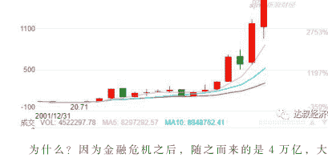

为什么？因为金融危机之后，随之而来的是 4 万亿，大基建，做过生意的都知道，买茅台的不喝茅台，喝茅台的不买茅台，背后的逻辑，你自己琢磨。

价格越贵，品牌越香，一飞冲天，天下无敌。会看财报的都知道，茅台才是世界第一奢侈品，LVMH 集团比起来，就是个弟弟。

也许你觉得茅台股价贵，但段永平在 2017 年说，等过十年，回过头来看，还是便宜。

3. 研究其核心团队成员，事迹，精力投入程度。

要选那些头部中的头部，野心勃勃、精力旺盛，充满战斗欲，能把握住机会，比如达叔喜欢的美团王兴，腾讯系，阿里系、万科系、医疗领域的部分公司。

我们这一代人，会经历人口红利，土地红利，金融红利，但能抓住多少，终归要回到管理红利。

管理红利这个概念，最近万科的当家人都常有提到，虽然从风格硬朗程度上，融创孙宏斌更杀伐果断，但从思想深度来说万科系一直占据着行业制高点，品牌风险也更低。

4. 最后一步，等。

十多年前，达叔看过十来本的一部书，山冈庄八的《德川家康》，网有个典故，杜鹃不啼，如之奈何，战国三杰的不同策略。

织田信长，杜鹃若不啼，杀之不足惜。策略，杀。

丰臣秀吉，杜鹃若不啼，姨诱鹁啼否？策略，诱。

德川家康，杜鹃若不啼，静待莫需念。策略，等。

最后一统江山，家业数百年的是谁，大家都知道了。

我们对待资产的时机，本质就是判断买入时机和卖出时机，投资楼市的人要看房两百套，去找残盘，找价格被低估的资产，或急售的资产。

投资股市的，判断出价格被严重低估时，大笔买入。八卦、绯闻会导致下跌，要看业务本身是否有受到影响，这才是基本面。

你的时间价值百万，即使是等待的时间。将精力放在主业上去赚钱，赚取尽量多的现金流，通过学习，提高认知，判断方向，买入资产，等待回报。

有没有什么特别好的主业，去值得奋斗？

达叔有一个小窍门，当你迷惘的时候，就看大佬们真金白银的在投资什么。嘴巴会骗人，但数十亿、上百亿的资金规模，投向哪里，这个钱不会骗人。

医疗领域，迎来黄金十年，这是达叔的判断。

前面两个时间节点在哪里？

第一波，上个世纪的90年代初，一批大外企，主要是药企，陆续进入中国，这是第一波红利，开疆拓土的红利，本土人才成长的红利。

2004~2005年左右，SARS之后，国家对医疗的持续投入，让本来在中国实行总代制的医疗器械公司，纷纷正式进驻中国，掀起新高潮。

2020新冠疫情，祸及全球，医疗投资，史无前例，国家在推国产品替换，国际巨头纷纷中国建厂，推动Made in China，For China的战略。

你心中悲观，看到的满目都是悲观，但达叔清晰的告诉你，这是一个黄金十年，一个崭新的时代，一个波澜壮阔的时代。

当达利德约开始有这个判断时，去翻看投资领域的资本动向。

从 2016 年开始，巨头高瓴资本就开始大举布局，先后投资了下列图表。

| 领域 | 投资标的 | 市场 | 进入时间 | 预估成本 | 最新 | 现价 | 涨跌幅 | 持股数 | 持仓比 |
| :--- | :--- | :--- | :--- | :--- | :--- | :--- | :--- | :--- | :--- |
| 创新药 | 百济神州 | 美股 | 2016/2/3 | 3.59亿美元 | 66.00 | 183.48 | 178% | 2 | 3 |
| 创新药 | 百济神州 | 港股 | 2018/8/8 | 89亿港元 | 108.00 | 113.50 | 9% | 3 | |
| 创新药 | 恒瑞医药 | A股 | 2015/12/31 | 3.3亿元 | 21.00 | 94.50 | 350% | NA | |
| 创新药 | 翰宇生物 | 港股 | 2018/1/2/24 | 5.36亿港元 | 19.38 | 57.15 | 195% | 6 | |
| 创新药 | 翰森制药 | 港股 | 2019/8/14 | 27.06亿港元 | 16.30 | 37.20 | 128% | 6 | |
| CRO/CDMO | 药明康德 | A股 | 2019/7/26 | 48.3亿元 | 66.00 | 93.08 | 41% | NA | |
| CRO/CDMO | 泰格医药 | A股 | 2019/5/30 | 6.3亿元 | 63.00 | 94.02 | 49% | 10 | |
| CRO/CDMO | 方达控股 | 港股 | 2019/5/30 | 3.15港币 | 3.20 | 4.50 | 41% | 3 | |
| 心脑肺癌 | 凯莱英 | A股 | 2020/2/10 | 2.3亿元 | 123.56 | 236.19 | 91% | 超5% | |
| 心脑肺癌 | 启明医疗 | 港股 | 2019/12/3/10 | 3.16亿港元 | 33.00 | 69.80 | 112% | NA | |
| 心脑肺癌 | 微创医疗 | 港股 | 2020/3/8 | 6.45亿港元 | 13.51 | 25.25 | 87% | |
| 医疗器械 | 沛嘉医疗 | 港股 | 2018/4/8 | 6.3亿港元 | 19.19 | 31.30 | 63% | 3 | |
| 医疗器械 | 骨科 | | | | | | | |
| 医疗器械 | 凯利泰 | A股 | 2020/5/13 | 6.6亿元 | 18.73 | 28.48 | 52% | 4 | |
| 医疗器械 | 美年医疗 | 港股 | 2019/9/10 | 5.3亿港元 | 7.01 | 22.70 | 224% | NA | |
| 牙科 | 美科 | 爱尔眼科 | A股 | 2018/1/4 | 10.26亿元 | 16.50 | 46.80 | 179% | 4 | |
| 牙科 | 隐适美（Align） | 美股 | 2019/9/30 | 2.9亿美元 | 250.00 | 260.50 | 3% | 1.4% | |
| 牙科 | SmileDirect Club | 美股 | 2019/9/30 | 2.41亿美元 | 13.90 | 7.30 | -47% | 0.76% | |
| 辅助生殖 | 锦欣生殖 | 港股 | 2019/9/25 | 5.7亿港元 | 8.54 | 10.06 | 18% | NA | |
| 连锁药房 | 九州大药房 | 美股 | 2018/9/30 | 0.86亿美元 | 1.30 | 1.68 | 29% | 100% | |
| 连锁药房 | 高济医疗 | | | | | | | |

整个行业的格局是怎样？

## 全球医疗器械行业细分领域构成情况

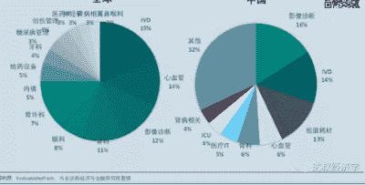

在上一篇文章中，达叔曾经重点推荐过有兴趣的朋友，来玩 IVD 中的 POCT。

有兴趣的小伙伴，详见 SK#34 什么是大生意？什么才是你的大生意？。

各个数据统计口径虽然不一样，略有出入，但是大的格局，基本是一致的。

还记得达叔的分析框架不？规模、数据、比例，趋势。

### 国内医疗器械各细分赛道进口占比

2020年6月24日

| 领域 | 细分赛道 | 进口占比 | 龙头公司 |
| :--- | :--- | :--- | :--- |
| 体外诊断 | 化学发光 | 80% | 迈瑞、安图、新产业（未上市） |
| | POCT | 血气/电解质、凝血进口主导 | 万孚 |
| | 分子诊断 | 90% | 华大（未做深入调研） |
| 医学影像 | DR | 40% | 万东 |
| | MRI | 70% | 联影（未上市，估值300亿） |
| | CT | 75% | 东软医疗（集团旗下，拟单独上市）、联影 |
| | DSA | 90% | 无，和进口差距较大 |
| 骨科 | 超声 | 70% | 迈瑞、开立 |
| | 创伤 | 30% | 大博 |
| | 脊柱 | 60% | 威高、凯利泰 |
| | 关节 | 70% | 爱康、春立 |
| 血管介入 | 冠脉支架 | 10% | 乐普、微创 |
| | 起搏器 | 90% | 无，和进口差距较大 |
| | 瓣膜介入 | 0% | 启明 |
| | 外周支架 | 70% | 心脉、先健 |
| | 神经介入 | >90% | 无，很多初创公司 |
| 微创外科 | 软镜 | 95% | 开立、澳华（未上市，估值30亿）、日系垄断 |
| | 硬镜 | 70% | 沈阳沈大（未上市） |
| | 内镜下耗材 | ~70% | 南微医学 |
| | 机器人 | 100% | 无 |

数据来源：公开资料整理，远川研究所

这个图表是咨询公司出的，从外界来看，只能看到一定的轮廓，真实的场景未必准确。

以 POCT 为例，万孚是国内 POCT 的龙头，但是血气分析领域目前不值一提，这就是隔行如隔山，你要是想玩，得找对人，否则你就跑偏了。

11

公众号懒人搜索，懒人专属群分享

纸上得来终觉浅，绝对此事要躬行，看了几篇漂亮的报告，就乱跑，是要闹腾的。

黄金十年的驱动力，技术进步，老龄化，医疗投入和经济发展，国外在闹“黑人的命也是命”，中国在切实的变革，“农民的命也是命”。

广阔的县城市场，在等着我们。

全国 2800 个县，每个省 100 来个，你所在的区域，开 个车，至少能覆盖 5-10 个，每个县生意规模 300 万，你能覆盖的生意规模是 1500-3000 万，这个生意在那，钱也 在那，只是最后落到谁的口袋里而已。

人生，是一个资产组合的过程。

年轻人，钱少，学习能力强，容错能力强，多投资 自己，增加劳动收入。

中年人，钱多，多买房子、多理财、多投资，资产增 值，积累财富，钱生钱。

老年人，用钱较多，多买流动性高，安全性高的债券， 收益性已经不那么重要了。

达叔，不知道你目前的状态是怎样，如果你是个年轻 人，希望有机会合作，一起迎接黄金十年。

## 第二篇 JJ#16 前几次危机，有哪些人获益？我们能学到什么

达叔是学财经的，很多同学都混迹在银行金融等行业，老同学见面聊天，能聊的很大共同话题就是从仃。

和以往不同，这次疫情导致的全球经济衰退，让我们除了青春叙旧，更多聊到了经济危机。

经常看达叔文章的都知道，达叔不愿意和悲观的人聊天，要是比惨，故事都烂大街了，经济萧条时，最不缺的故事就是惨。

于是达叔问，前几次危机，有哪些人获益？他们是如何赚钱的？我们有哪些可以借鉴？

定了这个基调，聊起来就有意思了。

首先，所有小伙伴要明确一点，对我们这一代人来说，有几个时间节点、特别重要。

1978年，确定改革开放，“让一部分人先富起来”，这句话的潜台词是什么？是一部分可以先富起来了，其他大部分人继续穷着。

谁可以先富起来？大家看上去都很穷，几乎没什么差距。

前面十几年，改革走两步，退一步，人们边走边看，摸着石头过河。发财的没有几个。

一直到 1992 年左右，老大哥倒下，老人去南海边画了一个圈，一批人开始崛起了。

距离资源近的、胆子大的、在原有体系里被边缘化的人。

经济学理论里，有一个叫科斯边际革命理论。

最能发展起来的地区，不是传统经济中心，而是帝国的边缘，国家控制最弱的地方，是主流之外的人。

不是“国营”的东三省，而是落后被边缘的群体，带来了活力和创新。中年危机的任正非，肯德基都不要的马云，扮女生陪聊的马化腾。

还有距离权力近、胆子大的石石、柳传志等。

国企改制，把濒临破产的资产通过操作，占为己有，是很多人的第一桶金。

为什么国企要改制，要甩卖资产？因为干不下去了，大面积爆发，这就是事实上的经济危机，只是不能这么说而已。

这是中国第一批富起来的人，利用了经济危机。

苏联解体后，经济休克疗法玩崩了，俄罗斯的寡头，也是这么崛起的，一个路子，人民彻底被洗劫。

读这篇文章的小伙伴，赶上这一波的人估计不多，如果你的父辈赶上了，那也是富起来的那一批，恭喜。

第二个时间节点，2001 年，中国加入 WTO。

中国经济能够高速发展起来，基本上有三大红利在支撑。

- 1、改革开放，上一个时间节点释放的制度红利。
- 2、加入 WTO，中国融入全球产业链。
- 3、城镇化，释放人口红利，背后是不断通过房子压榨出人民的劳动剩余，支撑经济增长。

投资、消费、外贸的三驾马车，外贸造就了一批海淘富 豪，也缓解了极大的就业压力，农民子弟能上得起大学，很 多得益于父母可以出门打工了。

经济高速发展的同时，全国各地的犯罪率也在逐步下 降。这两者是相关的。

之前中国申请了几十年都不成功，为什么在这个时间 点，中国就加入了 WTO？

2001 年 4 月 1 日，还发生了南海撞击事件，全国大游 行。两年前刚刚炸了大使馆，当时的激烈对抗程度、双方力 量对比悬殊，要比现在要艰难多了。

当时的艰难，达叔是有感觉的，很绝望。

但是又是一场危机，拯救了中国，也拯救了我们这一代 人。

2001 年 9 月 11 日，震惊世界的一幕发生了，又是撞 机，不同的是美帝的飞机撞了美帝的楼。

2001 年 11 月 9 日，小布什正式批准中国加入 WTO。

注意这个日期，911，119，关系紧张因为飞机导致的 危机，迎来蜜月期也是因为飞机导致的危机。

你要是说没有国运这个词，达叔是不太信的。

中国外贸制造业快速崛起，达叔身边很多人靠外贸工厂发财了，外贸崛起还有一个副产品，就是阿里巴巴，阿里巴巴早期能活下来就靠卖外贸软件，诚信通，一个聊天软件，好几万。

没有 WTO，就没有阿里巴巴，就没有后来电商的一切，就没有电商造富现象，所有的格局都变了。

今天达叔来重点聊的是 2008 年这个危机。

因为和我们所有人，都息息相关，而且近在眼前。

前美联储主席伯南克说过一句名言：

大萧条是宏观经济学的圣杯。

那么 2008 年之后的 4 万亿政策，就是中国经济的圣杯，他到底如何深刻的改变了中国，很多人都没意识到。

最近发生了一个事，公众号代表松松恺直播被骂跑了，这是中国舆论史上具有里程碑意义的一件事，以后至少在意识形态宣传上，会被载入历史的。

但背后为什么会是这样？有没有人考虑过？

因为中国强了，道路自信、文化自信了，所以一向看衰中国、鼓吹西方的公众号话语权和急剧衰落，新一代的年轻人不买账了。

但中国是从什么时候开始，人民普遍觉得中国有钱了呢？

2008 年，四万亿之后。

美欧生病，中国吃药，积极的扩张性财政经济政策，导致中国启动了需求，启动了消费，启动了就业。

之后的十年里，只有中国和美国两大经济体，真正走出了 2008 年的这个泥潭。

有些人是达叔一样经常出差，天天坐高铁。

但是很可能没意识到，2008 年 8 月 1 日，中国才开通运营第一条高铁线，北京-天津段，达叔讲到这，你是不是觉得犹如隔世了？

是的，我们经常高估了一两年的变化，但是低估了十年的变化，天翻地覆。

懂经济学的人都知道，货币发出来之后，会有一个乘数效应，通过杠杆，4 万亿最后演变成至少 30 万亿的货币规模。

科技创造财富，金融分配财富，房产贮存财富，这是财富三大定律。

货币洪水滔天时，财富往往会逆向分配，富者愈富，穷者有愈富么？不好意思，这 4 万亿的大放水中，农民工也是最大的受益者之一。

家里没有存款的真正穷人，不可能被洗劫，准确的说是没有资格被洗劫。

基建工程暴涨，工地轰鸣，农民工收入大幅增加，一个月的工资，远超种地一年的收入，开心的不得了。

谁被洗劫了？中产阶级，写字楼里的小白领。

小白领们都被洗劫了么？不是。

买了房的小白领，躲过一劫，四万亿的代价就是中国通货膨胀率 5% 以上，新一轮的资产价格上涨。

银行的存款利率2%，普通理财收益4%不到，中国正式进入实际负利率时代。

被洗劫的是谁？持有现金，不买资产的小白领。

每次危机关临，政府都会开动印钞机，本质是什么？是政府掠夺私人财产，手段隐秘且恶劣。

美国如此，中国也是如此，全球都一样。

达叔之前文章里写过，我们彻底进入纸币时代的时间太短了，从美元与黄金脱钩到现在 50 年左右，以至于太多人不请它的本质，世界弱智，众生无所适从，徒遭洗劫。

达叔之前说过，要赚钱，就要离钱近一些，离钱越近越赚钱，雁过拔毛，弱水三千取一瓢。

当年银行行长比赛，比谁能把钱放出去，放的快，放的多。

地方主政官员，城投公司，央企、国企，纷纷登场，所有体制内的势力，是最大的得益方。

大家都是理性人，突击项目，短期拼命花钱，考核的是GDP，消费和外贸不行了，不扩大投资，哪来的业绩 GDP 呢？不花钱不投资，怎么赚钱，怎么升官？

放出来的货币，就像泼出来的谁，最终流向了哪里，大家都知道了。

历史是有惯性的，解决问题的路径也是有依赖的。

我们最后会以什么样的形式走出危机，强大的惯性是否会再次裹挟一切个体？

让我们拭目以待。

从简入奢易，从奢入简难。

能喊出L型经济增长，是需要很大政治勇气的，能坚持多久，更要看政治定力了，很难。

你是领导，大家之所以跟着你、支持你，是因为跟着你有肉吃，如果跟着你天天苦哈哈的过苦日子，大家要么跑了，要么把你干掉，这才是现实。

你可以换路径，换玩法，这些都是手段，但目的不能变，就是让大家都能过上好日子。

达叔最近思考的生意。一个省首府做一个亿的生意。为了维持生意的规模的增长，要么重点扶持一个公司来做，一个公司做一个亿，这是一条思路。

这个思路的好处，双方合作，亲密无间，关键时刻能相互帮忙；坏处是什么？挑肥拣瘦，专做赚钱的生意，利润空间低的就不想做，有垄断的权力，谁去过苦哈哈的日子？！
另一个思路是扶持多个企业，相互竞争，扩大覆盖。
如果你卖的是本田雅阁，你是很难让开宝马奔驰的人再掉过头来买本田的。必须去找那些目前正骑着自行车的，看着桑塔纳都两眼发光，你告诉他好好干，干好就开雅阁，这才是符合人性的策略。

面对危机，货币的增发，你如何保卫自己的财富不遭洗劫？

面对生意增长压力，我们该如何找到那些充满战斗欲的合伙人？

目标市场有了，产品有了，资源有了，现在缺的是胆  大一些，那些边缘的人，支持他们，赌他们会成功。

## 第三篇 JJ#17 对不起，在决策者眼中，穷人不缺钱，富人才缺钱

今天达叔在某个知乎大 V 群里看一群知乎大 V 们聊天，其中一个话题聊的是中国经济现在是通货膨胀还是通货紧缩。

一群信口雌黄的家伙，把达叔给气笑了。

在疫情期间，达叔就写过一篇文章，JJ#3 如果大萧条来了，普通人应该怎么办？

当时看懂的，手里有点现金的都会抓紧买资产，无论是龙头医疗股票，还是房产，都赚钱。

现在股市、核心楼市火热，在疫情后期就可以预见的，所以达叔建议你有机会多学一些经济学，和达叔一起慢慢变富。

每次危机，都会造就一批新富，丘吉尔说，不要浪费任何一次危机。

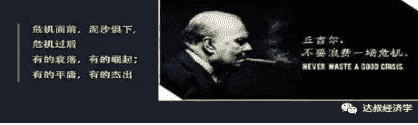

不要和 Loser 们整天混在一起，天天看空这个，看空那个，满眼都是萧条，今天要崩了，明天要崩了，喊了几十年，中国不仅没有崩，还要去挑战老大了。

达叔一直建议，不要口嗨看空，要看多，在中国发财，要看懂货币政策。

在货币决策者眼中，嘴上说缺钱的是穷人，心里永远惦记的是不能让富人倒了，富人更缺钱，要多给点。

为什么？和珅说，救民先救官。

富人创造就业。

生命不仅有价格，而且有贵贱。

不要相信那些小清新、文艺青年的“生命无价论”。

为什么？因为这个理论指导不了经济生产，是低效的，生命真的无价，任何工作都开展不了。汽车会造成车祸，人命无价，汽车工业要完蛋，飞机行业就更别说了。

1998 年，长江流域发特大洪水，为了保住改革开放 20 年的经济成果，长江沿线分布着中国最重要的经济体。

有一些地区被指定为“弃小家，保大家”，具体地区就不方便展开了，富庶省份周围的穷省，是最倒霉的。

平时被经济吸血，洪灾时被做泄洪缓冲区，哗啦，一下全冲走了。

无论是分洪也好，泄洪也罢，每年雨季，达叔就会想起那些被迫伟大的人，你们该挪一挪屁股，赶紧跑。

不要安土重迁，那是千百年的农民思维。要有商业金融思维才能发财，要实现人的移动，钻进富人堆里，实现资产空间和时间上的组合。

达叔的建议，你做还是不做，世界都是这么运转的。

达叔昨天在个人朋友圈，发了一个文章“中央下拨457亿元！国家要重点储备大批救治医疗设备（IVD领域是重点）”，有兴趣的可以加本文末达叔个人微信，去了解一下。

昨天没写文章，发了一段话，说今天来分析一下，故事是很悲伤的，坐稳了。

疫情期间，湖北是重灾区，达叔公司给火神山、雷神山等医院捐献了数百万的医疗设备和耗材，亲身经历了一切。

危机爆发时，武汉封城，全国所有的医疗物资，优先供应武汉，所有的新闻关注点也是武汉，这一切看着比较好理解。

但是，湖北省人口6000万左右，武汉市常住人口1100万左右，熟悉湖北医疗市场的都知道，武汉的医疗市场规模，在湖北省占比半壁江山，高端医院、有救治能力的，都在武汉。

就这，武汉还是被汹涌的患者击穿了医疗服务体系，全国医疗队、物资紧急驰援，感人至深。

达叔一边参与抗疫，一边在思考，剩下的4900万人口的声音在哪里？达叔在湖北有很多朋友，还有一些是做医疗生意的。

疫情期间，物流被国家管控。这很多人可能不知道，即使是医疗物资，有一段时间，也只发武汉。

这句话是什么意思呢？

就是你在恩施，即使你买了一批诊断试剂，顺丰等快递公司只接武汉件，武汉封城，进不去、出不来，你在恩施等其他城市，不好意思，不送了。达叔写文章，一直在劝各位，要迁徙到自己力所能及、最高能级的城市去，关键时刻，能救命。

无论是洪水，还是疫情。

小城市的要去省会，县城的要去市里，你投资的不仅是房子，你投资的是医疗资源、是生命安全、还有孩子的教育权。

否则，一场洪水，你是泄洪区；一场疫情，你是被遗忘、被断货的角落。

改革是一个中性词，是一个利益再分配的过程。

改革红利四十年，经济蒸蒸日上，改革这个词汇，在中国有了褒义词的味道。

日新月异、三年一小变、五年一大变的地方是哪里？还是城市。很多农村，都长草了。

为什么中国要给县城市场拨款 457 亿，而且指定县域？甚至罗列了一大堆要买的东西清单？

因为只要不强制指定用途、地方，钱到省里、市里，就被分完了，雁过拔毛，最后真正落实到县级及以下的，所剩无几。

这就是为什么省会、重点城市在全方位崛起，因为被财政重点投资，要发展，就得用钱砸，这是发展公开的秘密。

无法量化，就会执行变形，在中国，考核什么，什么才能做好。

上一轮 医疗改革， 2003 年 SARS 之后，整个中国医疗市场迎来了高光时刻，长达十多年的财政投资。

医院扩建，设备更新，药品引进，国产崛起，所有业内赶上的人都迎来了事业黄金期。

2020 年的疫情，达叔除了关注财富增长之外，还参加了一些院长论坛，深度了解很多医院执政团队的思路。

结合达叔的思考，分享一点：

疫情影响很可能常态化、长期化，不会在短短几个月内解决。

这会导致的一个结果，就是医疗的目标之一，分级诊疗，患者分流，有望实现。

北京、上海、省会等高能级城市医疗资源的虹吸效应，在减弱，人满为患现象会降低。

这引发什么结果？

大医院开始筛选经济效益更好的患者，大手术、赚钱的手术、比例会大幅度提高。

很多医院把之前的 5 天工作制，变成了 7 天工作制，增加日间手术室，在患者数量只是去年八成的情况下，大医院通过对患者和手术路径的调整，实现了收入的增长。

为什么？因为在中国公立医院财政拨款，最多也就在 5% 左右，一切都靠自己。

大医院的这一举动，看似利己，实则有利他的成分。

很多患者受检测、交通等影响，无论主动还是被动，都会到县级等就近医院进行治疗，县城的生意，会迎来大发展。

通过中央的巨额投资，“大病不出县”的健康中国关键目标，有机会加快实现。

如果加上闹得沸沸扬扬的山东“合村并居”事件，其实中国各个省都在搞，以后县城会诞生一大批三级医院，这是很多人意识不到的。

经济在发张，人口在聚集，县城医疗得到投资，中国正在逐步实现“农民的命也是命”。

而你，能从中分到一杯羹么？

意大利的名城，佛罗伦萨，人口多少？各位可以闭上眼睛猜一下。

人口 40 来万，中国随便一个县拿出来，都能碾压它。

中国县级人口超 100 万的有 128 个，这在国外，都是大城市，给中国经济以时间，让我们一起慢慢变富。

县城里面会分化么？会的。

幂定律，在领域都有明显的效应，头部组织占有绝大部分的资源，掠取绝大部分的利润。

做医疗的，请跑步进入县人民医院。你从省级城市来，从市里来县城做生意，现在还有机会降低打击，有一定的优势。

小老板们，在郊区盖厂，在市区买房，生产要素要便宜，购买的资产要有价值，我们看到了，要多思考什么是自己的比较优势。

当经济遇到困难时，宽松的货币政策，积极的财政政策，都在刺激经济。

经济是一个有机体，货币的水龙头放水之后，水流是有一个过程。

从中央--省级--市级--县级--乡镇--农村。

你生活在最底端，所获得利益就最少，所有执政者都懂，所以今年的两会才会特别加上一句：2万亿直达基层保民生，决不允许截留挪用。

特别强调的，就是经常存在的，比如反腐，比如合规。

## 今年赤字3.6%并发行特别国债， 2万亿元直达基层保民生

今年积极的财政政策要更加积极有为， 赤字率拟按

以上安排

赤字规模增加

万亿元

并发行

万亿元抗疫特别国债

国务院总理李克强说，这些资金将主要用于保就业、保民生、保市场主体等工作，具体包括减税降费、减租降息等，决不允许截留挪用。

达叔经济学

28

公众号懒人搜索，懒人专属群分享

## 最后，达叔再补充一下，为什么在执政者眼里，穷人不缺钱，富人缺钱？

看看每年中国所有金融机构的贷款去向，就知道了。

央企、国企、上市企业、地方纳税大户，甚至特斯拉都能拿到上海市政府牵头给的160亿低息贷款。

这些能带去就业，能带动经济，能交税，大而不能倒。

疫情导致了绝大部分企业经营困难，你是地方执政官，受资源约束，能救的就那几个，请问你救谁？

一场危机，中小企业倒闭无数，产能过剩的行业，完成了一次出清，头部企业受到资金支持，挺过去，活下来，获得更多的市场。

这种头部公司的股票会不会涨？资金的流向，就是一种投票。

这很残酷，但这就是每次大危机时，都会发生的事，伏尸百万，血流成河。

你要做的就是挤进富人堆里，到更好的城市，买更好的资产，不要成为被泄洪的受害者。

对很多人，你可以心里同情，可以适当帮助，但你救不了，你是一个凡人，你这辈子能帮助的，就是你的家人。

让你爱的人，这辈子过的好一点，带他们变成富人，研究点经济和投资。

拒绝被纸币剥削。

达叔经常看到一些人聊投资回报率，甚至有人会拿着手机给达叔看，这几天买的股票涨了多少，达叔在心底是不屑的。

为什么？

能产生长期回报的资产，才有意义，不能持续的资产，能带给你财富，都是有限的。

你眼睛里要盯住的，是大钱。

能分清楚什么是大钱，什么是小钱，要修行。

静水流深，不要做那只在水面上活蹦乱跳的小鱼，要做大海深处的大鱼。

## 第四篇 JJ#18 货币就是权力，屌丝最大的问题
不是穷，而是没有想象力

开篇，达叔先来说一下昨天的付费阅读实验。

这事肯定不是心血来潮，有两点考虑：

- 1、凯文凯利说这个时代，只要能链接到一千个铁杆粉丝，你们建立起紧密链接，就能做成很多事，缺的是一个合作的契机。
- 2、判断的标准是什么？为对方付费。上一篇，达叔第一次实验，记下了有四十个人，你们是支持达叔好好写文章的原始动力，达叔找机会报答，百倍千倍奉还。

达叔距离 1000 个铁杆，已经完成了 4%，达叔给自己的时间是 5 年，不着急。

当年罗胖从央视离职，做罗辑思维的时候，刚刚起步，他知道自己没什么能够给到大家，很有意思的喊出一个口号：“爱，就供养，不爱，就观望”。

这应该是做社群、知识付费的最早开拓者，那时候还是盗版横行的时代，喊出这样的口号，很有意思。

达叔刚才还专门翻看了自己的朋友圈，时间 2013 年 12 月 27 日，不仅仅是交钱的事，罗胖还要求支付手段，必须是微信支付。

当时微信刚大没多久，聊天软件绑定银行卡这个事，还有一定的心理障碍。达叔想了一个晚上，第二天早上起床，绑定银行卡，把钱付了。

200 块钱，对达叔来说，当时就是一笔小钱，但是这个事情，深深的印刻在达叔的脑海里。

罗胖没有任何承诺有回报，你这个家伙为什么还要付这个款？达叔看了很长时间他的节目，在那个岁月里，觉得学到了很多知识，打发自己最艰难的一段岁月。

达叔只是单纯的想让对方好，认为对方提供的价值。值得这个钱，达叔希望那些努力的人，都能越来越好。

后来，罗胖的公司成了知识付费领域的独角兽。陆续开始有很多人攻击他贩卖焦虑，树大招风。在中国，人们最大的乐趣在先造神，再毁神。

所以，想要成功的人，都要有一颗大心脏，别人骂你两句，你就崩溃了，那就别混了。

达叔有次和 M 总在咖啡厅聊天，达叔问他，你在大外金做总经理二十多年了，最大的心得是什么？

M 总说，是孤独，你每上一个台阶，都会变得更孤独。木秀于林、风必摧之，行高于人，众必非之，绝大多数人，眼里只有吃喝玩乐，小富即安，你要包容他们。

很多人没有意识到，诋毁本质上，是另一种仰望。

你会去费劲诋毁一个乞丐么？不会。人们诋毁的绝大多数人，都是出于嫉妒，是对方先秀于自己，而自己接受不了，却又无可奈何。

这是一种消极的情绪，是 Loser 的行为，要尽快戒掉。多花点精力，去研究对方是怎么崛起的，少花时间去吐槽和 diss，空耗时间，浪费生命。

打不过对方，就要和对方做朋友，这是一种实用主义，不看利益，只看口号和意识形态的家伙，最后都玩崩了。

你身边如果都是成功人士，都是有钱人，他们即使不教你，你就是跟着看，跟着做，你也不可能是个穷人。

所以，这么多年，达叔不让任何一个伙伴吃亏，让更多的伙伴赚钱，去赚更多的钱。

大家都是医疗行业的，请问有几个客户或同事要拉着你一起开公司的？达叔遇到好几个，几乎每年都有。

有个大医院副主任，多次请达叔吃饭，跑到达叔的小区附近，让达叔帮着梳理思路，要一起搞，虽然最后达叔婉拒了。

你的一切行为，身边人都看在眼里，记在心上，大家都不傻。

即使是黑社会，都要找信得过、能力强的人，何况大家都是聪明人，文明人？

人，要自己的行为负责。

要让自己的身边人，一天比一天好，大家都有饭吃，甚至让对方多吃一点，才不会掀你的桌子，才会经常和你一起吃。

上一段讲的是个人行为，下面讲一点宏观的经济行为。

什么？口号，什么是实实在在的利益？

达叔举国家级新区的例子。

从 1992 年上海成立浦东新区开始，至今全国已经成立国家级新区 19 个。

最新的一个在河北保定，雄安新区，千年大计。聊这个，是因为前些天有个姑娘来咨询达叔，在雄安新区那边有户口，要不要等。达叔当场就乐了，很多东西非常热闹，但是和我们个人没有关系，或者和我们这一代人没有关系，雄安新区大概率就是其中一个。

你能够在一个城市里获益，最大来自于什么？

来自于良好的就业，来自于这个城市的不动产增值，来自于这个城市的教育资源、医疗资源，以及给你带来的人脉资源。

现在那边是荒草一片，三年了，有多少进展？一个千年大计的城市规划，要规划多少年？任何建筑工程，都要四通一平，地下各种管道，通水、通电、通路、通电讯，平整地块，一泼下来，都耗到什么时候？

一番办公楼、住宅，都要两三年，还是在城市规划和就近资源比较好的情况下，雄安新区稍具规模的时候，已经是下一代人的事了。

而且雄安新区的定位里，没有房地产，大概率就是把全国顶尖的高校，研究院，科研人员才挪过去，成立中国硅谷，智力中心。

把自己的学历证书拿出来，看一眼，像是给我们准备的么？如果不是，赶紧去忙别的。

如果还要惦记，那就赶紧让孩子好好学习数理化，那是创新高。 科技新城，下一代人看，看能不能混进去。

国家级新区就有 19 个，省级新区、各个城市的新区，数量数不胜数，有没有滥等充数的骗子？

有，而且还不少。

如何区分？

翻看中国的所有政策性文件，达叔有一个小窍门，就看两点：

- 1、数一数文件中有多少个“税”字，如果通篇下来，“税”字出现频率越高，新区成的可能性就越商，新区提“税”，不可能是加税，肯定是减税。

不减税，就是骗子，口惠而实不至。

为什么最近达叔身边的朋友一群又跑到海南去？因为海南这次仿佛是动真格的，“离岛免税”。

海南在改革开放中，经常扮演着神奇的存在，早年闻由于税收政策，中国绝大部分走私车，都来自于海南，富了一批人。

所以，达叔建议各位一定要研究税收。哪怕你是看电影，电影开始前后，那一排排字幕里，是不是经常看到有一个词“霍尔果斯”。

霍尔果斯是哪里？中国新疆，西部边陲，8 万人的小城。

2010 年，成为国家级经济开发区，次年，实施企业税收政策“五免五减半”，成为避税天堂。

这一年当地注册企业，从 113 家，一年增长到 2490 家，在 2018 年达到 2 万 2 千多家。

后来崔永元和范冰冰、冯小刚们一闹，纷纷注销、逃离。

这就是“税”的作用。

全世界房价最贵的城市在哪里？不是纽约，不是伦敦，这些都是房价的第二梯队。

全世界房价最贵的城市是摩纳哥和香港。

摩纳哥均价 6.25 万美元/平米，也就是 40 万人民币/平米，是全世界富家的避税天堂，无个人所得税，富豪乐园。

香港均价是 3 万美元/平米，20 万人民币/平米，是中国富家的避税天堂，不收资本所得税。

这才是世界的真相。货币就是权力，钱是最好的指挥棒。

- 2、看完“税”，看政策。

政策是什么？就是别人不能干，我能干的权力，试验区，先行区，特区等等。

全世界很多发展中国家都特别羡慕中国，中国渐进改革，地方大，在这里画个圈，在那里画个圈，中央定调，各自摸索，摸索成功，再全国推广。

这就是实事求是的一种表现。

1984 年，第一批 14 个沿海开放城市，大连、秦皇岛、天津、烟台、青岛、连云港、南通、上海、宁波、温州、福州、广州、湛江、北海。

26 年过去，14 城，命运已经天壤之别。

改革开放，一步步从沿海推向中部，再从中部推向西部城市，分批分步骤，给你政策，你就能变富。

那有没有玩砸的？有。

1980 年，将深圳、厦门、珠海、汕头列为四大经济特区，给政策。

深圳现在已基本达到中央给的使命，PK 掉香港，成功跻身一线城市，未来是世界级城市。

谁最落寞？汕头。

发生了什么？2000 年，汕头迎宾馆，一把大火烧死 2 名中纪委干部，轰动全国的汕头走私大案，最后不了了之。

被称为“共和国第一税案”，这场大火，有兴趣的小伙伴可以去查查看。

地方大员干掉中央特使，不仅仅是古装剧里的情节，马克思说过，为了钱，啥事都能干的出来。

一个城市的命运，也迎来了转折点，主政者的骚操作，带来的是百万市民的命运被放弃，被改写。

如果有汕头的年轻读者，达叔说一句，本来你可以更有钱。

最后，关于城市，关于货币，关于税制，关于经济，关于投资和职业发展，期望我们以后可以慢慢读。

套用前央行行长周小川的理论——资金池，房地产资产池是 400 万亿人民币左右，股市池规模是 70 万亿，存款池是 80 万亿。

你告诉达叔，你是决策人，遇到困难，你保哪个池子？

## 第五篇 JJ#19 独山县烧掉的 400 亿，其中有你的一部分

B 站有个节目《睡前消息》，第 140 期，马前卒实地探访贵州省独山县，县领导执政期间，一堆奇葩烂尾工程，地方债高达 400 亿元人民币，引起了轩然大波。

西南边陲，贵州省 2019 年 GDP 1.67 万亿，全国排名 22 位，贵州省的 GDP 规模是个什么概念？

2019 年杭州市的 GDP 规模是 1.5 万亿。你感受一下，这就是贵州省的经济实力。

那 400 亿是什么概念呢？

2019 年，整个中国的电影票房成绩 600 亿左右，扣除引进的好莱坞电影等，国产电影总票房，300 亿元人民币。

正如达叔之前文章中提到的，这 300 亿中还有一大部分是影院抽成，属于房地产的生意，除去影院、宣发、票补等，真正属于电影行业的总收入 100 亿多点。

如果你还没有概念，一个独山县的地方债 400 亿，可以操作以下任何一个项目：

- 建一支海军舰队（航空母舰）；
- 发射 30 颗人造卫星；
- 办 2 场北京奥运会；
- 弄一台杨振宁都心疼的 300 亿量子对撞机（还能节约 100 亿）；

2020 年两会期间国务院定调，今年发放 457 亿，支持县域医疗，国家储备医疗救治设备。

一个县，烧没了。

而且，独山县不是个例，是中国各级政府的普遍现象。

土地，是财富之母。

很多人不理解这句话的意思。

达叔上午出差洛阳，下午回到郑州，和郑州市某负责招商的公务员聊天，达叔简称其为招商。

达叔问，独山县那个 400 亿地方债的视频看了么？

招商说，看了，这个事一两年前在我们圈子里就是个公开的秘密。

达叔问，这个地方债的问题，普遍么？从视频里来看，隔壁的几个县也都出现了烂尾工程。

招商说，很普遍。要做事，就容易做错，每次银根收紧，都会出来一堆烂尾工程，不稀奇。

达叔问，那我们关注的点是什么？

招商说，我们关注这个主政官员的操作手法，用地指标从哪里来？贷款利息是多少？操作的资金规模有多大？最后怎么玩砸的？

达叔说，你给介绍一下。

招商说，在介绍之前，我先来问你一个事，中国的制造业为什么很多往东南亚、印度、非洲等国外搬迁，为啥都不搬到内陆省份？

达叔分析了一遍人力成本，税收，环保，配合当地目标市场，关税贸易战等方面。

招商说，你说的这些有一定的道理，但不是最直接的触发原因，最直接的触发原因之一是：用地指标。

中国看着地大物博，但有一条“18亿亩耕地红线”。这条红线，至今，是不能触碰的。这就导致了一个结果，工业用地每年是有指标的，不是你想法建就建的，建工厂，也不行。

国土资源部每年给各个省发指标。省里再发给各个市，指标层层下发，谁拿到了这个用地指标，稍作平整，就是一大笔钱，所有的一切都围绕这个地。

各个省之间抢，省内各个市县，为此都杀红了眼。

农业用地征收是很便宜的，只要从国土资源部拿到用地指标，土地性质一变，同样一块地，农业用地变为工业用地或商业用地，价格瞬间暴涨，几十亿到账。

没有工业用地指标，招商引资就是胡扯。

很多城市抢不到工业用地指标，就是有长三角的工厂要搬过来，你都没有土地给人家盖工厂。

工厂拿不到工业用地，就没办法找银行办理抵押，没有银行抵押出来的资金支持，现代化工业动辄数千万上亿的投资，就干不起来。

内陆省份，有一些每年拿到的用地指标非常少，即使招商团队去长三角、珠三角蹲点，把企业弄到自己的省里来，把人忽悠来了，结果一看今年的用地指标根本就不够用，又不能明说，怎么办？只能拖着。

很多企业不知道你是没有用地指标，就觉得你招商之前是一副嘴脸，来了你们这之后，又是各种刁难，速度巨慢，迟迟无法落实，结果就跑了。

这样的内陆城市，如何招商引资，如何发展？人有两条腿，工人都知道跑出去沿海打工，那边工资高，没有用地指标，没有合适的青壮年劳动力，一些省份一直发展不起来，是有道理的。

达叔问，这也是之前乡镇企业衰落的原因之一么？

招商说，是的，从大的趋势来说，除了税收的因素，工业用地收紧，各个城市集中搞工业园，进一步挤压了乡镇企业的生存空间，乡镇企业产值低、不符合工业的潮流，是阶段性产物，衰落是必然的。

达叔问，一个县城如何欠下 400 亿规模的地方债？

招商说，这就是神奇的地方。按理说，在中国，土地是第一、甚至是唯一的抵押物。

对于个人来说，没有房子，是贷不到多少钱的。

对于中小企业来说，没有工厂、没有房产也是贷不出多少钱的。

对于地方政府，手里没有用地指标，没有土地，银行是不可能借款的，必须要有抵押物，有且只能是土地。

在中国，除了土地，其他东西，在银行眼中，都不值钱。

达叔问，晚清时期，中央政府还能拿海关税收之类的做抵押，各级地方政府可以拿税收抵押么？

招商说，各个城市的财政收入差异极大，富裕地区，长三角、珠三角民富殷实，税源充足，税收占比还可以。对于很多中西部城市来说，正如你说的，一个贵州省GDP和杭州市打个平手，下面的市、县有啥税源？

除了中央从富裕省份拿来帮扶中西部的转移支付之外，绝大部分靠的都是卖地。

达叔问，这中央管控的背后逻辑是什么呢？

招商说，中央对地方的制衡手段之一。哪个地方先发展，如何发展，中央通过国土资源部来实现调控，对个别地区支持发展，对个别地区限制发展。

中国经济的三驾马车，投资、内需、外贸，三者中的投资使用起来最顺手，也最容易见效，最好控制，可松可紧，收放自如。

达叔问，政府内部谁抢么？

招商说，这就是问题所在的地方。政府内部工信部、住建部、商务部，每年都为国土资源部手里的这点用地指标，争的死去活来，拿到就是业绩，不仅升官，还能发财。

达叔说，那就神奇了，贵州连续8年GDP增长率全国排名前三。

招商说，是的，独山县的400亿，是其中一个副作用。

达叔问，有这个官员自身的原因么？

招商说，出事的是潘书记，现在出事了，有了很多负面的报道，在中国很多事只有人倒了，才能讨论，把屎盆子扣到一个人的身上，是一种思想的懒惰。

达叔说，潘书记好像是江苏的官员调到贵州去的。

招商说，是的，而且年富力强，46岁，正是官员最好的年纪，当打之年。

最近这些年，长三角地区，往全国各地输送了很多官员。比如疫情期间，上海贡献了个市长，给湖北做省委书记。

达叔问，效果怎么样？

招商说，官吏、官吏，官和吏，是两个概念。

官员负责发号施令，决定战略方向；

吏一般就是当地的公务员系统，比如长三角的官员调到某地，面对的是整个垮掉的执行层面公务员系统，同样的政策和战略，大打折扣，铩羽而归，是正常的。

达叔问，这次独山县应该也有这样的因素在。

招商说，是的。江浙地区，搞旅游小镇，搞农家乐，搞特色景点，面对的是长三角两亿左右中产阶级，富裕阶层。交通线密集，有车，有钱，有时间，财产规模500万以上的人口超千万，同样的操作，在江浙沪能成功，在西部地区，就是个死局。

但是，每个人都是有路径依赖的，尤其是成功人士，越发有路径依赖。

达叔说，是的，早些年中央房地产调控一刀切，转变为现在的因城施策，就是考虑到了各个地区的差异性，节奏不一样。

招商说，现在地方债的规模到底有多大，连中央都没个准确的概念，学界也正在讨论，最后该如何解决，地方官员为了政绩，不会踩刹车的，有本事借的债，刷的是自己的业绩，还债是下一任官员的事情。

达叔说，这就是代理人风险，在各个行业都有。最后的结局，会不会像当年四大行剥离坏账的操作方法？

2001 年，加入 WTO 后，按照国际金融的坏账标准，中国的四大国有银行全部应该倒闭，不良贷款率 20% 以上。

但是中国一次又一次打爆国际空头，二十一世纪初，成立长城等四大资产管理公司，坏账剥离，四大银行不仅不倒闭，还全部实现上市。

成为宇宙级大行。

说到底，这个国家是无限责任公司，不是有限责任公司。

货币就是权力，人大的翟东升教授说过一个逻辑：

债务分为本币债和外币债。

发生危机的都是外币债，本币债不是问题，家里有印钞机。最后活生生用货币发行量，把债务消除掉。

现在这两个月，M2 又增 10% 以上了，各位看着办，货币以每年 10% 以上的速度在贬值。

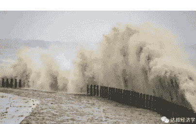

为了应对疫情，搞超前基建，拉动经济。

货币在超发，利率在下行。

这两个因素，必然导致 2020-2021 年是一个资产涨幅大年。

这些地方债，未来只有三条路：

- 一、让地方政府破产；
- 二、调控松手，让地价上涨，卖地还钱，房价上涨；
- 三、中央政府兜底，印钱还债，货币大放水，房价上涨。

除此之外，达叔是看不到其他的解决方案了。

所以，这烧掉的 400 亿，全国还有 N 多个这样的 400 亿，烧掉的钱，有你的一部分。

没有哪是一座孤岛，不要问丧钟为谁而鸣，丧钟为你而鸣。

## 第六篇 JI#20 钱是如何印出来的？如何才能抢到更多一些？不抢就是傻

达叔前天写了 JJ#19 独山县烧掉的 400 亿，其中有你的一部分，很多小伙伴表示看的不过瘾，加了文末达叔的微信，让再展开写一下。

如果不知道中国印钱有多凶猛，请先看下面这张图。

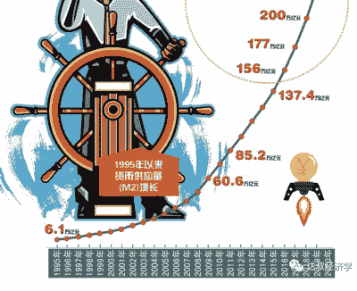

中国的货币发行量，是个谜，统计口径不一，上图显示的是每年以 13.7% 的速度在增长。

也有统计数字显示，最近这四五年货币增发，有一定的克制，有多克制呢？见下图。

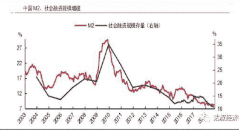

这么克制，还是10%左右的速度在货币增发。

那么中国的纸币，印钞的原则是什么？

是随心所欲的印么？

肯定不是，随心所欲，那是不负责任的政府，咱们不是那种人，肯定有章法。

能看懂今天文章的，这辈子都不会走弯路，要坚定不移地和庄家站在一起。

钱，是如何被印出来的，最后又进了谁的口袋？

在古代，很长时期，货币是黄金白银的时候，政府是不掌握货币发行权的。

所以，有一些朝代，灭亡的非常委屈。

不懂财政和经济的人，把王朝的覆灭归因于土地兼并、官员腐败、民不聊生，这些都是一时障目，不见泰山。

大西洋对岸的帅哥，有一句名言“是经济啊，笨蛋”。

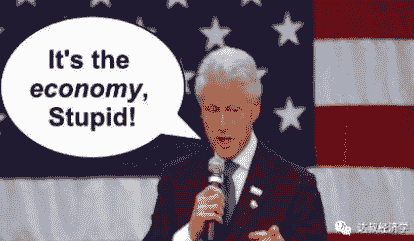

达叔问一下各位，中国什么时候才开始正儿八经进入纸币时代的？

不好意思，是 1992 年左右才开始。

苏联解体，对中国执政团队造成了极大的震动，开始严肃认真搞深化改革，一切以经济建设为中心，谁反对，谁就下台。

在这之前，中国经济长达数十年，物资短缺。粮票、布票、油票等充当货币，而真正的人民币，并未发挥出真正的威力。

人民币，是人民的货币，却买不了粮油米面，是不是是一种黑色幽默。

1992 年，彻底废除各种票据，全部纸币化，开始搞货币改革。

敲黑板，货币是洪水猛兽，非常难以驯化，搞不好，会被反噬的。

下图显示，刚废除各种票据，全面纸币化时代开始，纸币上来就一个大嘴巴子，通货膨胀率直接干到 25%左右的历史高位。这还是国家统计局的数据，真实的数据，肯定更严重。

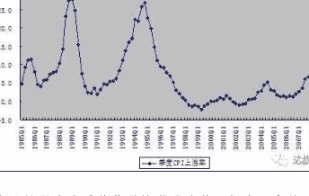

中国是眼睁睁看着苏联搞激进改革，把自己命给弄丢的。

所以，中国所有改革，都是摸着石头过河，渐进性的探索。

1998 年，中国彻底取消福利分房制度。

这为后面的骚操作，埋下了伏笔，这一招，要释放需求端。

一直到 2003 年以前，中国的人民币一直特别乖巧，和全世界非常多的落后国家一样，本国货币发行的依据是什么？

是外汇，是美元外汇。

为什么？因为战后的布雷顿森林体系，奠定了美元和黄金挂钩，美元是全球货币，是霸权，是类黄金的功能。

即使 1970s 年代布雷顿森林体系瓦解，货币是有惯性和巨大粘性的，美元已然是全球货币。

一直到 2003 年，是的，又是 2003 年，这个年份对中国人很重要，对人民币很重要，深刻的影响了各位的生活，为什么？

因为 2003 年，人民币的增发依据发生了变化。

货币锚定物从外汇美元，变成了外汇美元+土地。

具体的操作手法，是国土资源部对全国的土地供应总量提出要求：控制总量，适当增加。

这个骚操作，是中国的独创，全球金融体系独一份，社会主义的优越性。

为什么？

因为中国的土地是公有的，世界绝大部分国家想炒作业，都没的炒。

政府，是最大的操盘手。

国土资源部是怎么玩的，详见 [J]#19 独山县烧掉的 400 亿，其中有你的一部分，在本文，就不赘述了。

货币锚定物。

在美国，货币的锚定物是国债和股票。

在中国，以前是外汇美元，现在是外汇美元+土地，且土地是大头。

在美国，向银行借大钱，可以向银行抵押股票、债券、艺术品、有价专利，房产等等。

在中国，但凡想向银行多借点大钱，银行只认房产证和土地证，其他的资产在银行眼里几乎都是垃圾，借点小钱还可以，借大钱统统不认。

干什么？金融机构是玩钱的。

玩钱最重要的是什么？控制风险。什么样的资产最安全，银行最清楚。

在中国，只有房产和土地，其他资产波动大、折旧快、审核难、验证难、风险高、太麻烦。

那些把创始人股票质押的，最后几乎都暴雷了，信托质押的黄金都能造假，这个世界太魔幻。

### 信托黄金造假的相关信息

| 标题 | 时间 |
| :--- | :--- |
| 160亿黄金造假背后遭信托保险公司集体拒保：你还... | 14小时前 |
| 高的一气，信托公司们集体爆雷了，也教育了大家前段时间看到的**黄金造假新闻**的。所幸的是，当初在发行信托计划时采取了保险承保，黄金保额的**双重增信措施**。80亿。 | 6月29日 |
| 上市公司回应黄金造假 多家信托机构卷入 **德迅者** | 7月2日 |
| 涉及百亿黄金造假**康鸿国际** 多家公司被指投资... | 6月19日 |
| 百亿**黄金造假大案**揭开金融巨头洗钱**投资圈黑幕... 南讯周刊** 让骗子... 中概股全线暴涨上演200亿涨停大戏 大疆、网易科技... | 7月4日 |

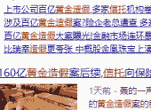

为什么转换货币增发的锚定物?

这是中国摆脱美元霸权的第一步，人民币从这一步开始，才真正实现了货币主权独立。

一个国家印点钱，还要看另外一个国家货币的脸色，是不是多少有点别扭？

货币主权独立，有啥好处？

一印解千愁，危难时刻印一波。

外汇储备都是血汗钱，而且是有限的。中国要是一个小国，这个状态可以一直持续下去。但是可惜，中国志在千里。

所有的志向，所有的梦想，都是要烧钱的。

外汇美元继续作为锚定物，中国印钞机就印的不够快。

看一下中国外汇储备趋势图：

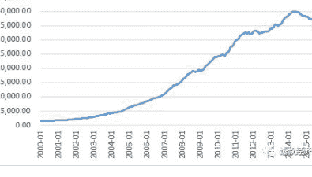

高点已过，未来很长一段时间，都会走在努力去美元化的道路上。你不可能一边去美元化，一边发行本国的货币，还要以美元为锚定物。

中国要实现快速发展，不能偷、不能抢，其他国家走的掠夺路线完成原始积累，我们走不通。

只能走内生性原始积累，这条路，人迹罕至，土地财政拉开了序幕。

挖掘机轰轰作响，印钞机咣咣猛印。一个新的时代，开始了。

通过土地增发的钱，如何最终流到市场？

第一步，生产有价值的土地。

中国地大物博，缺的不是土地，缺的是有价值的土地。

达叔小时候是农村的，家里有十几亩地，家里穷的，年年都交不起学费。

所以如何生产出有价值的土地，是最大的技术活。

操盘手——地方政府。

这是一级土地市场，操作路径如下：

- 央行增发货币-----给商业银行增加贷款额度。
- 地方政府拿到用地指标，选一块毛地（暂时无价值的土地），找个国企小弟，去搞个拆迁，或者荒地造城，把这块毛地变成有交易价值的“权证地”。
- 地方政府用毛地，用地指标找商业银行质押贷款，搞虚拟地方债，增加财政收入，是一笔钱。

再把毛地变成“权证地”，之后，进入土拍市场，一顿招拍卖的操作，把土地高价卖给地产商，获得一大笔财政收入。

用这笔钱，还掉一部分地方债，比较骚操作的地方政府，只付息，不还本，还本那是继任者的事。

至此，央行发出的增量货币，在地方政府层面实现了解套，债务转移大法。

央行功成拂袖去；你们地方政府和商业银行玩去吧，我印钱的动作做完了，要去印下一笔钱了，拜拜。

一个新的、高价值、可以无限操作的货币锚定物，就这样被创造出来了。

第二步，组建二级市场，地方政府甩锅。

以前的房地产市场，大佬辈出，一个个风格迥异，语出惊人。现在大佬逐渐凋零，大媳妇隐，江湖风平浪静。

孙叔目前非常喜欢的一个神人，就是融创的孙宏斌。

孙宏斌的名言：为什么不要房地产？因为在狱中闭关，想清楚了方向，千万不要地产不要钱。

### 孙宏斌自编自演为问什么去产,产房地产不要钱

2018年3月2日・2018年2月27日,孙宏斌在2018年巴布力论坛上大方谈起自己出狱后选择做房地产的原因,其中一个因为区块链技术含量太低:甚至童料自己从没想过联想的产...个人图书馆...百度百科

### 孙宏斌出狱后拒绝,当时联想没出什么技术含量,王虎房产因不要钱

2018年2月28日・农食在行,哪个都挺贵的,都不给我说,不要房产,千万不要钱。不知道是啥的人,别信在看到孙宏斌该说话后,会不会伤心,毕竟孙宏斌1994年出狱后,还曾去拜访。

CEOL来... 百度百科 泛经济思维

干房地产不要钱，这里是叔要敲黑板，各位拿小本子记一下。

房地产商为了通过招拍挂拿地，要用少量的自有资金，或者把股票、办公楼、商场等资产向商业银行、信托抵押，去借钱。

这里借到的钱，绝大部分也都是央行刚发出来的新钱，冒着热气的，拿去买地。

一旦中标，拿到权证地，上施工队，赶紧操作，很快工程达标，赶紧把项目拿到商业银行进行抵押贷款。又是一笔新钱。

拿着这笔钱，支付一定的工程款。

调控松的时候，比如这次疫情期间，很多城市都允许房地产商，先拿地开工，几个月后再付给地方政府土地款。

这就是孙宏斌口中的“干房地产，不要钱。”

当然，调控紧的时候，土地款还是要先付的。

剩下的抵押贷款，支付后续的工程费用，营销费用。

至此，政府拿钱走人，商业银行和房地产商玩去吧。

房地产商用很有限的自有资金+贷款的大笔新钱，实现了土地变成房子。

如果没有贷款，所有的房地产商全部完蛋。所以调控调的是什么？是钱。

到这里结束了？大家都知道 的，并没有。

第三步，把开发商的债务转嫁给购房者。

房子正在建，可以卖楼花了。这不仅是房地产行业的一大创举，还是金融史上的一大创举，全世界的经济繁荣，离不开这个，这是事实，你不要带情绪。

购房者付首付给开发商，再找商业银行办理房贷，商业银行付尾款给开发商。

购房者开始背负30年房贷，每个月付月供。

开发商的债务正式解套，送出一个房产证，拜拜，商业银行你和购房者玩吧。

至此，央行新印的钞票，流通闭环，正式完成，这些的新钱都有了去处。

正如中国的烟民，贡献了中国最大的税收一样。

中国的房奴们，实现了全世界唯一靠内生性剥削，完成了原始积累，成为世界第二大经济体，正稳步向世界第一前进。

大概的路线图：

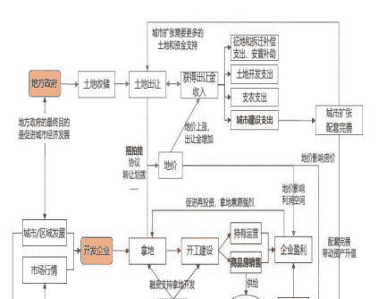

整个操作，非常精细，非常复杂，每一步都容易引发动荡，毕竟对每个人来说，都是一笔大钱。

如此复杂的游戏，如何让这个游戏玩下去？

如何让银行继续接受房地产证作为抵押物？

如何让人民心甘情愿的掏出真金白银，背上30年房贷，放弃娱乐、放弃旅游、放弃买包，省吃俭用，把钱上交国家？

这是极其反人性的。

只能用一套叠的制度建设：户籍、城市福利、居住权、孩子的教育权、老人的医疗权，更好的就业，更好的交通，更好的城市景观，甚至是结婚权、生育权，没房就没人愿意嫁给你，等等。

所有一切制度，都是为了让你继续掏钱。

如果你还不愿意，那不好意思，祭出超级大杀器：涨价！！

全世界都是买涨不买跌的，这是人性。每年都涨价，年底不买房，一年又白忙，请问你买不买？

这一切，背后的操盘手，都是逼着你买。只要大部分人继续跟着游戏玩，那就能玩下去。

你不仅要买，但是又不能让你买很多。为什么？

因为你买很多，通过房子赚了很多钱，就不好好工作了。

不不好好工作，怎么继续创造税收呢？

贫富差距太大，也不好。

要限购，要慢慢涨，让大家买，变成普惠的事业，一个都不能少。

你爱国么？爱国就要为国负债，就是为国买房。

爱的越深，回报就越大。

贷款买房，就是个人获得货币增量、央行放水的最有效途径。

否则，你就没有参与到这一场财富的游戏中去。

房贷，是最靠近印钞机的优质资产。

你信还是不信，幕后的操作手都是这么玩的。

你与银行清请白，没有任何往来，那你所谓的爱国就是假的，这个国家就不会给你提供任何福利。

你为国背债，国家给你福利，还让你赚钱。

这就是你和国家之间的利益交换。几十年，都是这么玩的，以后还会继续这么玩。

因为暂时还找不到更好用的货币增发、经济增长，取之于民、用之于民的手段。

今天先写到这里，下次再写，你们真不买，但是国家又着急的时候，会怎么让你买。

## 第七篇 JJ#21 纸币阴影下

与黄金脱钩后的纸币时代，太短暂，以至于太多人认不清它的本质。

世界喧嚣，众生无所适从，徒遭洗劫。

1894，甲午年。

经过同治中兴，洋务运动，大清帝国GDP全球第二，仅次于美国，华夏大地上不乏有人给朝廷说，再过10年，大清GDP就可全球第一。

这一年，大清的GDP是日本的五倍。

当日本挑起战争，对赌国运的时候，全世界绝大部分媒体，都认为大清帝国大概率能赢。结果，大家都知道了。

达叔小时候，电视频道极少数，暑假里最痛苦的就是看《北洋水师》，但是没得选，硬着头皮看，看的窝火，整个暑假心情都不好。

后米长大了，达叔知道了明治维新，知道了工业园吊打农业国，知道了腐败清廷以一敌国。

但是总觉得，还有哪里不对。

GDP不等于国力，更不等于战争能力，否则你解释不了后来的抗美援朝。

甲午战败的解释有很多种，伴随着经济的发展和研究，从金融和财政的角度开始多了一个解释。

晚清的农业国，大部分经济产出都被庞大的人口自己消耗掉了，没有盈余。

1890s，晚清财政岁入 8000~9000 两万白银（其中包含了大部分海关税收），折合世界货币 5~6 亿法郎，3000 万英镑左右。

同期，法国岁入 30 亿法郎，英国岁入 1 亿英镑。

日本岁入 1.5 亿日元，折合 8000~9000 万两英镑，和晚清打个平手。

达叔要说的重点来了，注意货币单位：

法国法郎，英国英镑，日本日元，全都是纸币，大清玩的是白银。

其中纸币日元起步最晚，明治维新之后才开始搞币制改革，在全国范围内成立日本国立银行，发行国立银行纸币。

在人民战争、无限战被发明之前，帝王统治者之间打的是短快平战争。

短平快战争，讲究的是爆发力，各种武器战舰往上堆，烧钱。

玩白银做货币的政府，完全掌握不了货币发行权，帝国各个朝代晚期，最终几乎都是死于财政枯竭，挨家挨户收银子，谁帮你去收，成本多高。

玩纸币的国家，懂金融了，会发战争国债，启动印钞机，透支未来，打眼下的战争，打赢拿赔款，大家一起发财。

帮国家打仗，你同意帮忙就买国债，你不同意，政府就启动印钞机自己印。纸币的本质，是信用。

信用这个玩意，顺风风水时，大家都是体面人，吃相不太难看，遇到急事时，那就对不住各位了，我先印为敬，一印解千愁。

如果你不想了解历史，就看一下疫情当下。

号称最独立的美国央行美联储，核动力印钞，全球放水大赛第一，收割全球。

经济学里有一个小故事，你手里100块钱人民币，怎么最快速度平均发放给全国人民？答案是，烧掉。

达叔第一次读到这个故事时，觉得很好笑，以为是个喜剧。

等再过几年，达叔才意识到，这个故事还可以反过来讲：

如何以最快速度从全国人民手里拿到钱？

答案是，印一张。

这个故事，就不那么好笑了，是个悲剧。

老朱，苏北农村人，60岁。

在农村种了几十年的地，中年时，家庭收入给孩子的学费都交不起。

2003年，老朱的母亲去世，办完葬礼，老朱终于带着老婆，买张汽车票，踏上了宁波打工之路。

这一年，老朱在工厂做门卫，工资一个月600元，女工进厂，一个月500元。

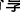

2019 年，达叔有一次问老朱，你现在一个月多少钱？老朱说，一个月 4200，说完，开心的笑了，还是在做保安。

达叔问，你刚来宁波时，一个月 600，一年才赚 7200，能想到自己将来还是干门卫，工资能翻 7 倍不？

老朱说，哪哪敢想，说完搓了搓手上的老茧。

达叔问，那你要是再干几年，以后会不会月收入过万？

老朱连连摆手，不可能，哪能赚那么多，俺就是一个门卫，一个月过万哪哪可能。

达叔就开车走了，穷人的问题，不在于努力与否，而在于认知，没有想象力。

2003 年的门卫工资是 600 元/月，2019 年变成 4200 元。

是老板的善意么？不是。

是老朱改善了门卫工作的技术含量么？不是。

是印钞机在做工作。

在印钞机的推波助澜下，2019 年，600 元你招不到门卫了。

16 年，7 倍。

当印钞机作用于工资上的时候，包括农民工在内，所有打工者每年涨工资，每年都很开心。

但是拿到工资的购买力，并没有上升多少，在资产类方面的购买力，比如房子，购买力不仅没涨，还在下降。

这个故事，看着像一个个喜剧，仔细看，还是一个悲剧。

工资的上涨，是一个幻觉，是制造幸福的鸦片。

闭上眼睛，想象一下你是统治集团，这样工资上涨的预期一旦形成，幸福感一旦形成，任何人都不敢轻易停下。

机器轰鸣，只能印，不能停。

如果你认清了这个本质，达叔再把这个故事倒过来讲一遍，就是赚钱的道路。

老朱，苏北农村人，60 岁。

在农村种了几十年的地，中年时，家庭收入给孩子的学费都交不起。

2003 年，老朱的母亲去世，办完葬礼，老朱终于带着老婆，买张汽车票，踏上了宁波打工之路。

这一年，老朱在工厂做门卫，工资一个月 600 元，女工进厂，一个月 500 元。

这一年，宁波房价 4000 元/平，太贵了，老朱带着老婆在宁波没有落脚点，东偏西凑，向所有亲戚朋友借款买了个 80 平米的房子。

32 万，首付 10 万，贷款 22 万，月供 1200 元，工资都付不起月供，还得夜里去捡废品卖，补贴家用。

老朱感慨，房价有泡沫，太贵了，要不是为了给老婆寻个落脚点，绝不买这房子。

2019 年，老朱一个月 4200，老婆一个月 3500 元，房子在市区，老是老了点，现在价格 300 万。

达叔问，从农村出来打工时，想过在宁波当门卫，还能资产三百万不？

老朱搓着手上的老茧，害羞的说，都是运气，俺也没干什么，不知为什么就涨起来了，全都是泡沫。

达叔问，现在有没有后悔当年再多借点钱，买大点的？

老朱说，不敢想啊，当时太贵了，亲戚朋友都借遍了，全都说是泡沫，劝俺不要买，要不是怕老婆，也没那个决心。

机器轰鸣，印钞机听不见普通人的声音。

货币就是权力，政府掌握了货币的发行权，才真正掌握了控制社会的权力。

作为普通人，只能去赌当权者会不会滥用这个权力，有没有突发事件，被迫大规模动用这个权力。

政府，是由一个人人组成的，是人，就有私心。

在位，就有任期，都想青史留名，想青史留名就得做大事，做大事就得花钱。

建高铁要花钱，南水北调要花钱，城市化要花钱，构建和谐 society要花钱，给大家涨工资要花钱，追求美好生活要花钱。

钱从哪来，是门最大的学问。

有一次，央夹行长周小川在钓鱼台国宾馆，和美国央夹行长 Mervyn King 打完网球，一起吃晚饭。

Mervyn King 问周小川，中国从西方学到了哪些东西。

周小说，我们学到了很多，比如抛弃了计划经济，用竞争和市场来发展经济。但我觉得，你们至今没有掌握货币和银行业的窍门。

达叔在不同场合的演讲里，有过一个暴论，各位这辈子都会身家过亿，只是早20年还是晚20年而已。

一亿总中产，这是日韩走过的路，在经济规律面前，中国并不特殊。

祝当门卫的老朱身体健康，多干十年，月薪过万。

纸币阴影下，机器轰鸣作响，加不加杠杆，背不背负债，你自己选。

对了，达叔还有一个暴论：你的孩子以后毕业会年薪百万。

## 第八篇 JJ#22 产权即是正义，那个抢劫的人，最后怎么样了？

“民之为道也，有恒产者有恒心，无恒产者无恒心，苟无恒心，放辟邪侈、无不为已。”——战国时期孟子，与君王为私有财产辩护的言论。

中国历史上，第一个。

两千多年来，绝大部分知识分子，学成文武艺，货与帝王家。

“普天之下莫非王土，率土之滨莫非王臣”。

天下为公，言私者，必为小人。

张维迎写过一本书叫《理念的力量》，其中有一个理论叫“语言的腐败”。

所有的组织里，都有一些位高权重者，满足仁义道德，假大空。

张维迎认为，语言腐败，严重程度超出了所有的腐败。因为它不仅使语言丧失了交流的功能，更破坏了道德，最终导致整个组织的政策不可预见性。

达叔在本文末尾，推荐一本书，对中国改革开放作出巨大贡献的老先生-科斯。

达叔记得好多年前，从医药公司转到医疗设备公司，去面试。

那一天，外面哗哗下雨，最后一轮面的是公司二把手，市场部兼销售总监。

这个老板语速很快，思维跳跃，面试类型给达叔很强的压迫感。

看过达叔之前写面试风格的，知道达叔是一个心直口快之人。

骨子里，达叔认为虽然是上下级关系，但本质上，大家都是打工的，相互之间是合作关系。

知无不言，言无不尽。

最后，这副总聊到直销和分销不同模式，该如何转变？

达叔当时不太懂经销商分销的模式，就老老实实的和副总说，这个分销模式我暂时不懂，但我是学经济的，懂人心，我来讲个故事吧。

在改革开放初期，中西部搞植树造林，防止水土流失。再后来农业改革，为了提高效率，搞承包到户，要把村里的树木分给各个农民，以家庭为单位。

这种天上突然掉下来的馅饼，让村里的农民们私下里热烈讨论。

有人认为，拿到了小树林，中国改革政策经常摇摆，今天发给你了，过几个月可能就收回去了，所以现在最佳策略趁现在是自己的，赶紧砍了扛回家。

有人认为，树木还很小，即使砍了也卖不了多少钱，值得赌一把，好好养着，过几年再卖。

当地领导而面临的困境是，真的发现有很多农民拿到树林后，就开始砍，即使是小树也砍。

改革的目的是保护树木、提高植树的效率、提供了私有产权之后，会降低偷盗现象，大家都获益。但是现在，改革刚开始，就面临砍伐树木扩大化现象，是否应该停止改革，从农民手中收回产权？

如果不收，小树林会不会被砍光？最后事与愿违，改革失败。

如果收回，那么在农民之中的两个派别，怀疑改革的获益，支持改革的没有去砍树，选择相信政府，反而受损，最后变得很难再次建立信任。

你是当地政府，你怎么改？

最后的方案是，选择短期忍痛，产权已经归属农民了，农民就有自由处置的权利，砍就砍了，砍种随意。

过了一年，没砍的小树继续成长，变成粗壮大树，可以卖更高价格。而砍了小树的农民，由于无法变更林地性质，只能继续再种树苗，从头开始，耽误了赚钱。

当地林地改革，顺利进行，这是当代版的商鞅变法移木立信。

分销商、渠道商和厂家都是独立的公司，各有各的利益诉求，有时利益相同，有时利益相悖，但任何改革或者政策想要落实长久，取得效果，都要取得信任，明确产权。

即使要改革，也要老人老办法，新人新办法，产权清晰，不能抢。

嘴里说的，要和身体做的，保持一致。

后来，达叔拿到了那个 offer，和这位老板成了朋友，这是达叔利用经济学在职场中的一次应用。

2016年，在达叔的细分行业里，发生了一件大事。

看过达叔文章的小伙伴，都知道达叔是玩医疗诊断的，在中国有一个极其强劲的对手，达叔称其为W。

W和我司，都是2003年 SARS之后，中国医疗市场爆发，正式进入中国的。

两者在争中国区谁是市场占有率第一，缠斗了10多年。

这一领域属于新兴领域，市场呈高速增长，在细分领域里打的难解难分。

2016年，W欧洲总部发生权力斗争，整个中国区职业经理团队被清洗。

新来的职业经理人，一看经销商的利润空间如此之高，口水都流下来了。

医疗诊断行业，厂家对经销商每年都要进行区域产品授权，而这个授权窗口对很多心怀不轨者，就是一个机遇期。获取利益的途径有两个，一个是劳动生产，一个是抢劫。

手中有权力的人，最大的冲动就是抢劫。

达叔之前有篇文章叫 **JJ#21 纸币阴影下**，本质上是当权者对普通人有克制的抢劫。

新的职业经理人，一边成立自己的诊断经销商公司，一边搜集当前区域经销商不合规证据。

时机一到，招招毙命。

- 第一招，区域授权重新给崭新的经销商，原老经销商不再拥有授权区域；
- 第二招，用不合规证据，厂家起诉老经销商；
- 第三招，利用厂家的便利，拥有了老经销商所有销售和工程师的名单，让新经销商开出3倍工资，突击挖人。

老经销商疲于应付，还一度跑到美国躲避，最后一番拼命抵抗，再加上我司的独立支持。

原本十余年的积累，年营收7000万左右，勉强保下了一半，被抢走了3000多万。

该老板，伤痕动骨，意志消沉了很久。

玩抢劫的职业经理人，一年后，就被扫地出门。

经济学上有一个词汇，叫外部性。任何事情，都有外部性。

这个事情有趣的点，就是其负外部性。

兔死狐悲，物伤其类。

分销模式的生意注定了，厂家要靠经销商过日子，出销量。

当厂家对一个经销商动手的时候，其他所有的经销商是看在眼里的。

这是对产权的轻视，对契约的撕毁。

大家辛辛苦苦投入人力、物力搞生产，你来掀桌子搞抢劫，只想吃现成的，谁还敢继续安心搞生产？

这个抢劫行动，发生一次，就会发生两次，几次折腾下来之后，W 司在业内的增长率迅速下滑，基本丧失了争夺市场第一的资格。

所有的经销商，都不敢再扩大投资，不敢再扩大市场覆盖，没有长期规划，只想着眼前景，朝不保夕，能干一年就先赚一年。

一次抢劫，丧失了所有的信任，也丧失了长期增长的机会。如果各位仔细研究各种企业类新闻，是否也会有这样的现象？

达叔有个朋友 L，搞农业项目的经济作物。

2018 年，被某县招商过去搞农业集约化大生产，上百亩地，项目刚开始还在 L 的规划下按部就班进行。

整地，灌溉，施肥，播种，除草，洒药，营销，上下游配套。

当地领导找 L 总，谈增加项目附加值，上百亩地只搞经济作物，可惜了，赚不到大钱，怂恿 L 总搞农家乐。

盖酒店，开餐厅，弄泳池，要玩就玩一整套，到时给你嫁接当地权贵资源，带来消费群体，县城也要搞消费升级。

整套下来，要投资多少？

2000 万。

L总和家族内部商量过很久，资金可以想办法解决，但是土地性质很难变更，叔叔之前写过，中国有18亿亩耕地红线，土地性质不是你说了算，就能变的。

当地领导拍着胸脯说，可以搞，交材料，我们来操办。

巨大的诱惑面前，没几个人能经受的住，L总也不例外。

动工，开建，谨慎的老板都会一边投人，一边看审批进展和流程。

每次当地领导都拍着胸脯说没问题，正在进展中，也许是真的，也许本来就是一个骗局。

北方人，重口头承诺、哥们义气，轻契约合同，太相信关系。

最后，无论是主观还是客观，工程建到一半，土地性质无法转变，整个项目变成了违法建筑，从法律层面上来说，必须得拆除。

L总彻底懵了，盖楼要花销，拆楼也要花钱，这笔钱，从哪里来？

建楼花钱愿意，是因为冲着赚钱预期去的，拆楼就没人干了，这就是很多烂尾楼扔在那边的原因。

当地官员、管杀还管理，找L总商量，要不把项目整体打包卖给当地某国企，还能回点血。

这就是很多地方官员的操作手法，吃大户。

有的地方，放水养鱼，让企业安心赚钱，做大做强，地方政府收税，实现双赢。

有的地方，来都来了，先砍一刀再说，别再给跑了，反正他们是有钱人。

欺负穷人对方会和你拼命，欺负有钱人，那是没关系的，资产阶级的软弱性。

殊不知，资本都会用脚投票的。

这样的例子，数不胜数，投资不过山海关，不是一句口头语，而是无数的血和教训，江浙沪等地能发展的越来越好，不是没有道理。

达叔身边的小老板们，把公司开在小城市，每次逢年过节，都会面临各种吃拿卡要，还有小官员说自己朋友开了个茶叶店，让你买5万元茶叶，送客户的。

反而那些开在大城市的小老板，日子要稍微清净一点。

戏马台荒，画眉人远，燕子楼空。

回首荒城斜日，倚栏目送飞鸿。

没有产权，就没有正义。

打劫之人，你富不长久。

## 第九篇 JJ#23 如何用价格歧视，提高销售业绩、改善工作

人们要的不是便宜，要的是赚便宜。而这个虚幻的错觉，是可以营造的。 幻觉是所有快乐之首，如何营造，是人与人之间，最大的差别之一。

事实与观点。 做任何事情，要分清，什么是事实，什么是观点，这有天壤之别。

比如， 达叔今天来杭州出差，出了杭州东站，步行去 酒店，路上感慨，今天天气真热。 请问，今天真热，这是事实，还是观点？ 是观点。 因为热和冷，这是一个相对的概念，达叔认为热，还有生病的人感觉冷。

如果 达叔说，今天室外温度高达 38 摄氏度，这就是事实。 事实是一个绝对概念，不因人的意志为转移，观点是一个相对概念，因人而异。

讲 完事实与观点，下面达叔要问，你卖的产品真贵，这是一个事实，还是一个观点？

绝大部分销售，尤其是外资公司的销售，面对竞争时， 最大的抱怨之一就是卖的产品真贵。

这个所谓的贵，你改变的了么？改变不了。

如果改变不了，那就不要沉浸在消极的抱怨情绪中，想赚钱，赶紧动脑筋，想其他办法。

思路之一，贵，是事实，还是观点？

贵和便宜，是相对的概念，因人而异，是观点，肯定不是事实。

一瓶矿泉水，10 块钱，贵么？

对一些人来说很贵，贵的离谱；但对另外一些人来说， 随便喝，很便宜。

我们既然生在了中国，已经注定，无法改变，要接受它不好的一面，更要多想一下有哪些好的一面？

人口众多，目标客户众多，这意味着可选择多，客户千差万别，色彩斑斓，风格各异，各有诉求。

价格策略，或者是资源投放策略（销售费用），就好制定了。

价格敏感型的，加大价格降幅，或者提高销售费用；价格不敏感的，那就玩情感或学术理念等，毕竟资源投了也没用。

最极端的场景，达叔年轻时遇到过。

达叔当时刚接手一个新科室，目标客户有 10 来个，产品 1500 元/支，在三个月内要把销量从 0 做到 40 支。

也就是销售额从 0 做到 6 万，一年贡献 72 万的新增销量。

跑了一个月，达叔对几个竞品和客户进行了分析：

在几个产品中，达叔的产品价格最贵，我 1500 元/支，竞品 600 元/支，这是事实。

但贵还是不贵，不是事实，是一个观点，是有客户说了算的。

1500 元＞600 元，看着是劣势，但是如果能从另外一个层面来分析，可能会有更多的资源，可以投入。

再来分析，资源可投入比例，达叔可以投 150 元/支，竞品也可以投 120 元/支。虽然有差距，但差距很小。

看来，虎口夺食，争夺出目标的市场份额，希望很渺茫了。

除了价格分析、资源分析，还差一步，客户分析。

既然贵不贵是个观念，不是个事实，那么就有可操作的空间，达叔要在放弃之前先彻底摸清楚，所有客户的观念。

一圈聊下来，绝大部分客户都认为，这两倍以上的价格差距，不是贵，是什么？你个家伙，不是开玩笑嘛。

但是，人群中总有人，对问题的看法，不太一致。

当达叔问余老师，我这个 1500 元，大家都说贵，是一个事实，还是一个观点时，余老师意味深长的笑了。

放下笔，和达叔聊了半天，事实和观点。

当他意识到这不是一个事实，而是一个观点时，就有往下谈的空间了。

达叔要的每个月40支销量，除了他的贡献，必然还有其他自然流量。

他要求的是，资源全部投到他的身上，其他自然流量，全部停掉。

一个月后，销量出来了，38，虽然没有达到，但是极其接近，君子协定，照样办了。

3个月的时间，顺利达成目标。

有人会问，达叔你聊的半天，这是资源投放策略啊，不是价格歧视。

价格歧视的定义，是指同样的商品或服务，对不同的消费者卖不同的价格。

达叔换一个角度来解释，余老师和其他老师提供的销量，在达叔看来，是不是一种服务？

一种服务获得了高额回报，一种服务没有任何回报，是不是-种非常极端的，针对这种服务的价格歧视？

2018年底，达叔参加内部改善会议，各个部门的管理者都参加了。

其中一个议题，要改善的题目是：耗材配件的价格。

达叔在另外一个组讨论，只是在他们组做汇报的时候过来听汇报。

其中某售后经理在汇报的时候，讲到耗材配件价格差异化，说团队内部有争议，价格不一致的话，会造成不公平。

汇报后，让大家问问题。

达叔就没忍住，问这个售后经理，什么是公平？

A 经销商一年耗材贡献 4000 万，B 经销商一年只贡献 500 万，两者享受一样的价格，公平么？

售后经理想了一下，说好像不公平。

达叔又问，A 经销商一年耗材贡献 4000 万，但是生意处于平稳期或衰落期；B 经销商一年只贡献 500 万，但是处于高速成长期、爆发期。

厂家的生意每年都要高速增长，来完成 KPI 的，请问一个衰落期，一个成长期，两个拿同样的价格，公平？

售后经理想了一下，又说好像也不公平。

所以，价格制定，拿来所谓的公平而言，有竞争力的商业行为，都是充满了价格歧视。

只是这种价格歧视，衡量的标准是什么而已。

有的公司网购的产品或服务，对苹果手机的用户定价，就是比安卓手机用户高，这是被经常报道的案例。

衡量的标准，就是用什么手机。

还有的公司产品价格，对忠实用户、高频使用的用户价格，就是比货比三家的新用户价格高，这又是另外一种价格歧视。

在未来，谁利用大数据，把价格歧视玩的越透，按照忠诚度、价格敏感程度，把同样的产品，针对不同的人群，进行价格歧视销售，必将获取最大收益。

如果没有价格歧视，一件商品 500 元，A 人群买不起等双十一，B 人群，多少钱都无所谓。

在未来，通过算法，这件 500 元的商品，展示 A 人群 300 元钱，A 人群就不用等双十十一了，到了心理价位。展示给 B 人群，是 700 元钱。

A 人群和 B 人群，都通过自己满意的价格，买到自己想买的产品。

商家从 500 元的销售额，变成了 300+700=1000 元，提高了销售额。

产品能获得最大规模的消费者覆盖，消费者也能获得最大的福利和剩余。

被价格歧视，不是一件坏事，如果你是真的穷。

在没有暴力存在的条件下，但凡交易，必有剩余，必是福利改善。

这就是市场的力量，我们所有人都要懂得利用价格歧视。

当你参透的时候，人类所有一切行为，本质上都是交换。

你的工资，是你拿自己的时间和服务换钱；创业是拿产品或服务去市场上换钱；爱情是交换身体或心理的愉悦；婚姻是物质生存或情感依赖的交换。

用哪些工具，能够促进这些交换，是我们该思考的，而价格歧视是工具的一种。

价格歧视，具体操作中，有哪些玩法：

- 一级价格歧视：按人定价；（前面这叔讲过了）
- 二级价格歧视：按需定价；

这个绝大多数的人首先想到的是量大从优，买的量大，价格越便宜，这是符合基本常识的。

但有没有例外？有的。

逆向价格歧视，买的越多，价格越贵。

各位有没有想过电费的计价方式？用的越多，价格梯度上升，越来越贵。

早些年的手机话费套餐流量是不是，套餐内便宜，超出套餐就很贵？

三级价格歧视：按照群体定价。

比如早些年德国淘汰的桑塔纳，在中国被当做神车，高价出售，那是权力的象征。

很多全球企业，在国外就是廉价品牌，到中国就走轻奢路线了，比如日本MUII，美国的某Polo衫，等等都是如此。

划分的标准有哪些？

- 即时满足：比如各大视频公司推出的VIP会员，能看某剧，提前几天看。
- 安全感：定酒店，同样的房间，能改签的价格比不能改的贵一些；
- 自我实现：部分区域的品牌溢价，在一定程度上就属于这类。

本质上，价格歧视，欺负的是有钱人。

明天要爬起来开会，今天就先写到这里了，觉得对自己有点帮助的，帮达叔点个在看，或者转发一下。

感谢。

## 第十篇 JJ#24 低人权优势，助力中国崛起和财富积累

经济的发展，一靠生产，二靠抢劫，三靠交易。

西方发达经济体，靠坚船利炮、三角奴隶贸易，抢劫全球，完成原始积累和科学技术壁垒，享福至今。

没有技术壁垒的生产，是卖不上价钱的，卖不上价钱，就没有剩余，无法完成原始积累。绝大多数国家，陷入了漫长的恶性循环，比如中东，比如拉美。

原始积累，都是血腥的，不能对外抢劫，就得对内抢劫。

中国的道路，并不特殊，符合一般经济规律。

日本明治维新的成功，前期很大程度也来自于对内抢劫，币制改革，完成初步原始积累，初步工业化，赌上国运，再对外抢劫。

如何迅速的完成对内抢劫？

低人权。

低人权，是世界的常态。

即使是西方资本主义最强盛、横扫天下的时候，劳动平民，还是过着被剥削，暗无天日的生活。

什么时候得以改观？不是资本家突然发了善心，而是马列的幽灵在欧洲飘荡，苏联的意识形态在竞争。

一个口号是自由，一个口号是平等。

二战之后，两大阵营，意识形态竞争，改变了欧洲平民的生活质量，提高了欧的人权待遇。

当你凝望深渊的时候，深渊也在凝视着你；

当你和恶龙缠斗过久，你自身也将化身为恶龙。

欧洲是苏联冲击波的最前沿阵地，如果苏联是恶龙，口号是平等，欧洲不想被吞噬，必然会相互学习。

最后，欧洲变得越来越像社会主义的理想、从摇篮到坟墓，苏联解体的俄罗斯血体力走向自由。

> 我们走后，他们会给你们修学校和医院，会提高你们的工资，这不是因为他们良心发现，也不是因为他们变成了好人，而是因为我们来过。—切格瓦拉

原问题「苏联最强的时候强大到什么程度？」

回答者 小约翰

84

那么，在资本眼中，如何赚钱的道理，有发生变化么？没有。欧美人要平等，要自由，要有人权社会、要各种福利。生产成本过高，资本纷纷出逃，逃去哪里？

逃到低人权的世界去。

达叔提供一个视角，除了欧美日等发达经济体，全世界包括中国的发展中国家在内，几乎都是低人权国家。

欧美媒体和政治家，在嘴上一直喊的是民主、自由、法制。请问，当资本转移的时候，大资本家们选的国家是哪些？

第一波，承接产业转移的是亚洲四小龙，四小虎。

香港、韩国、台湾、新加坡，清一色的权威体制。香港是港英殖民地，人民有个毛线权力，韩国是军政府时期，台湾和新加坡都是政治强人，权威体制。

后面的四小虎泰国、马来西亚、菲律宾和印尼，当时清一色也是强人政治或军政府。

为什么？

因为资本本质是排斥劳动力成本的，你是老板，要的是安全、秩序、低成本。

只有终极暴力，才能带来安全、秩序和低成本。

血汗工厂，不是谁都有能力提供的。

如果国外的案例，你不熟悉，我们来看外资进入中国后的路径。

请问外资进入中国大陆第一站，总部选择哪里？

北京和上海。

现在是北京的外资总部多，还是上海的总部多？北京的总部经济，早已将上海甩开好多年了。

论法制和营商环境，上海难道不是更好么？

不好意思，资本是亲权力的，嘴上说不要，身体却很诚实。

如果北京和上海说的不够清晰，达叔再举个例子，江苏和浙江，都是沿海经济大省，哪个民营经济更有活力？

浙江很明显胜出，赢的不是一点点。

但是外来大资本，制造工厂选择的是浙江还是江苏？

苏南地区，一骑绝尘的胜出。

背后的逻辑是一样的，资本要的是权贵对当地的控制力。

控制力，对应的必然是低人权。

人一不开心，就能成群结队的上街，那经济还怎么发展？大资本家，谁还和你玩？你吸引不到资本来投资，怎么解决就业、怎么完成原始积累。

**低人权，在疫情中的积极作用。**

一场新冠疫情，突然来袭，全球政治体制接受大考。

中国工程院王辰院士发表过一个言论，中国不是赢在医疗水平上，而是赢在社会动员上。

为什么你能动员，说不上街就不上街了，说全部在家待着，就全部在家待着。

太平洋对岸，就待不住，还扛着枪上街了，带不带口罩都能争论半年，一直到现在都没闹完，而且完全看不到要闹完的迹象。

这是人权的反噬。

达叔，你是鼓吹低人权么？我们作为一般老百姓，就应该处于低人权的状态么？

不是。

我们的状态，正在改变，而且这个改变，是有代价的。凡事皆有成本，成本就要有人来承担。

达叔只是要把这个世界的真相掰开来给你看一眼。

2008年，温家林时期，中国颁布新《劳动合同法》。

这一“修复”劳动者权益的关键之年，引来中国各个阶层，最激烈的争辩。

最低工资待遇，新劳动法对小老板的不友好，大幅度增加用工成本，导致不敢招人、不能招人，最后提高失业率，受损的还是劳动者权益。

只是，这个获益和受损，由不同的人承担罢了。

如果只是从经济上来说，有各种经济学派，不建议制定对资方这么不友好的法律。

但是，达叔通过分析一个问题，要分清楚，什么是手段，什么是目的。

观察目前庙堂之上，政策制定者是由哪些人组成的，他们的主张是怎样，我们研究一下他们的著作，看看他们的价值主张，就不难猜出，未来的政策和走向。

在部分鹰派的眼里，人民名义上的福祉是最大的政治正确，是目的；企业只是手段，是提高人民福祉的工具，工具不好使，就换工具。

目前硬着头皮用，是因为没有更好的工具而已。

从单纯的经济学角度来看，这个思想就很危险，因为资本会用脚投票，不会坐以待毙。

君不见，部分劳动密集型产业往东南亚、印度、非洲的转移？你想保护的人，最后连工作都没了。

个人意志，在经济规律面前，毛都不是。

**低人权优势，助力国产崛起。**

经常看达叔文章的人知道，达叔是在外资医疗公司负责华东地区。

面临的竞争对手，很多都来自于国产产品，两者产品有千万种，分析问题，要拨开云雾去看本质。

外资公司的竞争策略，利用产品质量优势、资本优势，用高薪招聘中国优秀本土人才，用经济学上的撇脂策略，高质高价，从高位低打。

省级医院--市级医院--县级医院，最多到这就结束了，能真正通过覆盖走到县城的外资公司，没有几个。

为什么？因为人手不够，人员成本太高。

国产公司是怎么玩的？人海战术，低薪、高提成、结果导向，广覆盖，从乡镇往上打，在县域短兵相接，做的好，还能追着外资品牌，一路打到省级客户。

薪水，是劳动报酬，是人权的一种体现，大家干的活都差不多，低薪就是低人权。

销售队伍的低人权，可以帮国产品公司有效降低运营成本，快速回笼资金，完成原始积累，进行技术研发，投入下一轮战斗。

除了销售队伍的低人权，达叔更想探讨的是患者的低人权。

同样一个患者，在哪里生病，得到的治疗，天差地别。在村医，乡镇，患者几乎只有国产的仿制药。国产的医疗设备、诊断设备，甚至还是国产里面成本最低、路子最野的产品。钱也没少花，用的却是最差等级的产品，这是不是低人权的表现？

政策制定的当权者，看不懂这个？看得懂，但是不会管，默许，甚至是策略的一部分。

因为要完成资本的原始积累，必然要对内进行掠夺。国产品公司要完成资本的原始积累，必须在产品没那么好的情况下，有人先行使用和购买，获取利润之后，继续投入研发，逐步迭代和升级。

这一对内掠夺的对象，就是底层患者的生命权，低人权优势助力国产崛起。

达叔今天要写的是宏观经济分析和国产品牌崛起么？不仅仅是。

达叔要分析的是，原始积累和财富增值。对外掠夺，是生意或职场的收入增长；

对内掠夺，是家庭内部达成一致，前期事业起步阶段，也是最爱玩的阶段，内部勤俭节约，交出劳动剩余，购买资产，完成原始积累。

买包、买奢侈品、泡吧、旅游、买豪车等高人权行为，很难给你带去资产增长，如果看的长远一点，是不是可以考虑一下低人权优势。

祝各位早日实现，职场型收入和资产型收入，双轮驱动家庭财富增长。

## 第十一篇 JJ#25 只给政策不给钱的改革，怎么搞成的？——深圳经济特区40年对我们的启示

达叔身在医疗职场，却酷爱研究经济学，尤其是城市之间的竞争，也曾不止一次分享给所有合作伙伴，去研究城市竞争。

读懂城市竞争，有助于提升我们的思考力，有利业绩增长和职场发展，更有利于投资。

比如昨天文章 JJ#24 低人权优势，助力中国崛起和财富积累，看似在分析中国经济增长模式，也可以和自身所处的行业相联系，进口品牌和国产品牌的竞争底层逻辑。

达叔今天来聊经济特区。

中国为什么要搞改革开放？是因为太穷了，几乎是无差别的穷。如果国家很穷，还想搞改革，一般会怎么搞？

有钱投资么？不好意思，就是因为没钱，所以才要搞改革。

这就是达叔今天要聊的内容：

只给政策不给钱的改革，谁搞成了，怎么搞成的？

老板让你去做事，很多时候也是给政策，不给钱的，我们能借鉴到什么。

文艺作品里，描绘的场景是，有一个老人在中国的南海边，画了一个圈，于是深圳就搞成了。

如果真的这么容易，那这个老人能不能把画画的大一点，把中国都给圈进去，大家一起变富，多简单。

实在画不大，能不能多画几个呢？

不要笑，还真是多画了好几个。名称各异，计划单列市，首批沿海开放城市，经济特区，开发区等等。

每一个名称的背后，对应的是享受不同政策支持。

中国是搞渐进式改革，摸着石头过河，包括深圳在内的经济特区，就有4个（深圳，珠海，汕头，厦门）。

现在谁最厉害？深圳。

谁最没落？汕头。

深圳成为中国所有改革开放的城市里，最耀眼的新星，人口、GDP、人均GDP三个维度，40年后天壤之别。

| 城市 | 人口（万） | GDP（亿） | 人均GDP（万） |
|:---:|:---:|:---:|:---:|
| 深圳 | 1302.66 | 24211.98 | 19.33 |
| 厦门 | 411 | 4791.47 | 11.94 |
| 珠海 | 189.11 | 2914.74 | 16.51 |
| 汕头 | 563.85 | 2512.05 | 4.47 |

论起步，当深圳还是一片小渔村的时候，汕头GDP已经是广东省内仅次于广州的第二大城市。

结局如此巨大，背后必然有深刻的原因。

如果你对知识的渴望只满足于，一个老人画个圈，或者是一把大火断送了汕头。

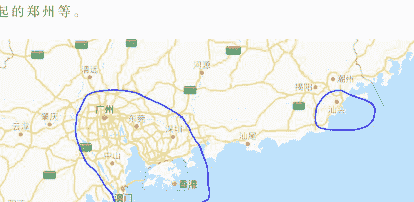

地理决定论，水陆交通、商道变迁。

绝大部分城市的崛起和衰落，都是水陆交通、商道变迁引发的。比如伴随京杭大运河一起兴衰的扬州，伴随铁路崛起的郑州等。

四个经济特区里，有三个在广东，其中两个在珠三角，深圳紧挨着香港，珠海紧挨着澳门。

香港强，则深圳强，澳门弱，则珠海弱。

资金是水，会外溢的。

这和各位平时买房子投资的套路是一样的，你买在上海周边的昆山，涨幅就是比买在三线城市的周边要强。

广州和香港之间的土地，必然会崛起强大的城市，只是崛起的程度是高，还是低而已。

这一地理位置基因，就注定了汕头增长相对缓慢，距离珠三角经济发展主战场 300 多公里。

投资界，颠扑不破的真理，位置、位置、位置。

这可以用在不动产投资，也可以用在其他投资领域，甚至是职场发展领域。

各位抽空可以闭上眼睛想一下，各个公司的总经理、总监、大区经理都住在哪里？

总经理和总监级别，基本产生在北京和上海，大区经理级别基本属于北京、上海、南京、杭州、广州、深圳、成都、重庆、西安、郑州之类的。

你要是在江西、云南、安徽、山西、黑龙江等地工作，在全国性大组织里，职业生涯比前面达叔罗列的，职业天花板要明显低很多。

和你的能力有关系么？

不好意思，没有太大关系，就是位置决定的。

你能做多大的生意，除了个人能力之外，还要看外部条件允许你做多大的生意，也就是市场潜力和规模。

比如达叔的 POCT 生意，在浙江能做到一个亿的厂家出货量，在安徽目前也就是 2000 万不到的生意量，你说，要提拔一个人、提拔谁？

你在，还可能是你的；你不在，就肯定不是你的。

资源和财富呈地理空间分布，我们的职业和投资要围绕着资源走，而不要奢望去和规律搏斗。

经济增长会带来权力的增加，权力的增加会进一步带来经济的高速增长。

差距，越大越大。

**城市战争——人口。**

一个是人口爆炸式增长，已达千万规模，一个是人口流失。

达叔当年上学的时候，和一个学长在上海徐家汇美罗城的星巴克喝咖啡，坐在玻璃窗边，望着下面熙熙攘攘的人群流动。

学长问，你看到了什么？

达叔说，看到了好多人。

学长说，不对，我看到的不是人，是一堆堆移动的人民币。

量变带来质变。只有足够的人，才能带来足够的交易，交易才会让经济繁荣，繁荣会进一步虹吸更多的人才。

经济进入正循环，贝索斯的飞轮效应。

在市场经济下，人口的增加，绝大多数伴随机随量市场，只要有了政策，放松管制，人民就会自发的珍惜时间，追求效率。机会太多了，稍微有点志气的人，都会珍惜生命，赶紧赚钱，懒得在一个小单位里相互内斗。

而人口的流失，极容易陷入存量市场，没有增量，内卷化，恶性竞争，水调鱼相挤。

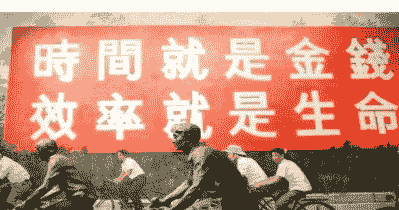

人口年轻化、爆炸式增长，还会带来一个副产品——人杰。

六人之中必有人杰，七人之中当有混蛋。社会的发展，是由人民创造的，但更是由人杰创造的，尤其是伟大的企业，必然是由伟大的人缔造的。

当你还分不清谁是人杰，谁是混蛋的时候，一个城市要表现包容，让时间和市场去分辨。

来了就是深圳人，在包容性方面，深圳无出其右。

**给政策，也办不成，是大概率事件。**

很多人都以为深圳能够拔地而起，脱颖而出，是来自于中央的拨款支持。

各位千万不要有这个妄想，中央和地方的关系，和老板与员工的关系一样，只有索取，没有多少给予。

能给的最多是政策，别人不能干，就你们几个可以这么干。

比如，为保证特区建设的展开，中央和广东省同意特区实行“收入全留、自求平衡”和“上缴额递增包干”的财政体制，收入全留已经是了不得的优惠政策了。

但是，同样的政策，各个特区自己领会了多深，执行了多少，取得了多少成果，又是各不相同。对政策的理解，考验的是智慧，是思考力，能执行多少，考验的是胆量。

比如各个公司都会有新产品上市，新产品上市必然会遇到困难，也肯定会给到一定的政策，去市场上试错。

有的人，是市场困难的传声筒，他把每一个困难都视为不可逾越的障碍，两手一摊。这种人，说的是事实么？肯定是。但有用么？没有用。

老板要的不是你来访诉他这个事有多困难，而是要你告诉他，这个事有这些困难，但是我有以下几个方法可以搞定，为了执行这些方案，需要以下以下几种政策支持，老板你觉得呢？

这才是思考力和执行力，要有提出对赌的胆量。

**只给政策不给钱，是好还是坏？对于想做事的人来说，这比给钱还要好。**

上面领导给钱，给多少、怎么花，都要受约束。

而给的政策，自己通过努力变成钱，变的多，多花，变的少，少花，各凭本事，充分调动了所有人的积极性。

有什么合法的政策这么神奇，可以变成钱？对经济特区来说，就是卖地。

深圳的房价，已经超越上海和北京了，在追赶香港的路上。

卖地赚的钱，给城市提供优秀的公共服务，吸引更多人才、更多资本，经营出更好的城市，代价是什么？房价猛涨，舆论压力大。

这一切，需要勇气和胆量，繁荣是有代价的。

在职场里，每次公司新产品上市，都是一次升职加薪的机会，机会很平等，都是从零起步。

希望各位，对政策要敢拿、敢赌，要胆子够肥，大胆跑、跑的快、跑的远。

很多人以为，只要给政策、低税率、低管制，就能发展出超级城市，这是错觉。

工业化、现代化，是艰苦卓绝的向上攀爬，背后是向内掠夺。

很多人特别自豪的说，中国人用 40 年走完了发达国家上百年走完的路。

没看到的是，发达国家工人每天工作 8 小时，不加班，不熬夜，达叔所在的北欧公司员工 7—8 月份还可以放暑假。

而中国人艰苦卓绝，996、007、三班倒，节假日无休，单纯按照工作时间来计算，我们的 40 年，工作时间相当于他们的 80—120 年。

无休、无止的对内掠夺，积累财富，才实现了 40 年取得了别人上百年的成果。

除了放松管制，提供优惠，更多大资本提出的严苛要求，比如富士康建厂要求在规定时间内必须要帮他们招工 20 万个工人，做过 HR 的都知道，招工是有成本的，政府花一个亿的财政补贴，才能完成这样的任务。

把政策变成钱，需要勇气和胆量，敢于发展，更需要胆量。

如果深圳甘愿活在香港阴影下，而不是要超越香港，那么不会有台疆，不会有华为，不会有招商和平安等世界级巨头。科技巨头的背后，离不开当地政府的大力支持，自由放任的后发者，必将永远躺死在中低收入陷阱。

德国、日本、韩国，背后都有国家资本、产业指导的影子。

深度经营自己的区域，改造自己的社会，改善基础设施建设、营商环境、更有价值的公共服务。

这些既是深圳在做的，也是我们医疗行业从业者，尤其是医疗器械、POCT从业者，厂家+经销商模式，该思考和努力的方向。

敢于把自己的区域变成高增长的实验区、特区，摸索更有效率的打法，比如达叔在 SK # 32 达叔的新征程和下半年的尝试，高效率冲向广阔市场的探索文中提到的，高效率，冲向广阔市场。

## 第十二篇 JJ#26 弄懂比较优势，自己原来可以更强

经济学里，有两个很有意思的概念，想清楚的人，可以终身获益。

一个是机会成本，一个是比较优势。

这两个概念，是国际分工的基础理论之一，但是达叔不讲国际贸易，那些话题我们也影响不了。

达叔今天尝试来拆解一下，这两个概念，在这些年里，给达叔带来的帮助。

机会成本，是我们为了获得一样东西 A，而放弃另一样东西 B，被放弃的这个就被称为机会成本。

达叔举个例子：

假如，达叔和李诞是室友，现在有两个事情要做。一个是去讲脱口秀，一个是在家里包饺子。

讲脱口秀，李诞一个小时赚 1 万，达叔一个小时赚 1 块钱。

包饺子，李诞 1 分钟包 10 个，达叔一分钟包 1 个。

无论是讲脱口秀，还是包饺子，李诞和达叔相比，都形成了绝对优势。

但是，李诞不能一边包饺子，一边讲脱口秀，他面临选择。

时间是公平的，你做了这个事，就不能做另外一件事。

如果李诞包饺子一个小时，他的机会成本就是不能讲脱口秀，少赚 1 万元。

而达叔来包饺子，一个小时，达叔的损失只是 1 块钱。

所以，达叔和李诞的最优合作方案是，李诞去讲脱口秀，赚一万元，达叔来包饺子。

然后，李诞拿这一万元中的 100 元或 1000 元，支付给达叔，比达叔去讲脱口秀赚得多，双方都得利。

这样，即使达叔在两个事情都没有绝对优势的情况下，仍然可以凭借比较优势，和李诞达成合作。

如果讲李诞的案例，你觉得太遥远，各位抽空想一想自己身边的案例。

有一些能力很强的销售，被提拔成地区经理。

会不会出现一种情况，就是这个地区经理销售能力比一般的销售强，管理能力也比一般的销售强。

销售和管理，这个老板都占有绝对优势，但由于同样的时间，不能两样都做。

他不能一边在办公室里开 managers 会，一边去跑客户。

他必须作出选择。

一旦他作出选择，合作的机会就出现了。

你想清楚了这一点，无论对方有多强，各个方面都碾压你，只要你靠的足够近，你都有机会和他产生合作。

达叔加入目前所在的公司，是 2015 年，刚进公司，啥也不懂。

刚进公司的标准动作，是参加新员工培训，来了一大堆的人，各个品牌的销售和市场部经理。

有的人讲课，很快就能把人给讲睡着了，而有的人讲课条理清晰，生动活泼，复杂的问题能简单化、易于吸收，还方便理解。

这个讲的最好的叫 S，一个小伙子，80 后，市场部的经理，达叔当时就觉得这个家伙是个强者，前途无量。

达叔是没啥文化的家伙，产品也听的不太懂，平时进公司也比较少，但每次进公司，或者开会，都会努力和这个 S 聊一会。

2016 年，郑州开急诊年会，我和 S 被安排在了一个房间。

总共有 3 个晚上，达叔是个话痨，几乎每个晚上都会拉着他彻夜长谈，把他都给聊怕了。

从学校、专业，到职业路径，到未来规划，到投资买房、无所不谈。

当然，作为陌生人，想和别人聊天促信任，最好的方法不是问，而是拿自己的信息甚至隐私，去和对方换。

我是 xx 学校毕业的，学 xx 专业，你呢？

我未来的规划是 xxxx，你呢？

我小时候的理想是 xxxx，你呢？

他是学生物的，达叔是学经济的，花了一个晚上让他去买房，给他各种规划，后来一波涨潮，让他对达叔刮目相看。

再后来，达叔就花了很长时间，去劝他从市场部转到销售部，不要一直在中央待着，要来地方转转。

市场部看到的世界，是虚假的。

有一次，达叔问他，你每年年初制定的那些策略，到底正不正确，你不想下来看看么？

销售们执行的参差不齐，步调不一，理由千奇百怪。你对这个世界不好奇么？

他说好奇，但是怕销售吃喝玩乐，那一套，自己做不到。

达叔鼓励他，你看我这个德行，不抽烟不喝酒，日子也不能照样过么？来嘛，怕什么。

再后来，这个S 抓到一个机会，真的转销售了。

- 第一年，是销售经理，负责一个省；
- 第二年，升任 3 个省的大区经理，直接和达叔的东区 PK；
- 第三年，升任南中国销售总监，成了达叔的直线老板。

达叔和他开玩笑，我前几年和你睡了那么多个晚上，聊了那么多，有没有哈说错的，被你小本子记下来了？

他说，我事太多，都忘了。

现在，我们配合的很不错。

他转销售，并且能当上总监，甚至未来会继续往上走，有达叔的功劳么？

可能有一点，也可能一点都没有。

但达叔好多年前，就发现这个人是一个强者，并且积极主动的去靠近他，向他学习，助他成长，让他尽快当上自己的老板。

人，一旦发现有一个在各方面都比自已优秀的家伙，就要想尽办法，利用比较优势，和他成为合作伙伴。

这里需要各位的眼力、运气、胸襟和执行力。

如果你看身边所有人，都不行，那问题就大了。

一种是，人家很厉害，你这个眼力不行，发现了不美；

一种是，周围真的都不行，你待在这个地方，大概率你也不咋地。

达叔是做医疗领域 POCT 生意的，这个领域群龙混战，生机勃勃。

达叔这几年，每年都在扩大区域，达叔有个习惯，每接一个区域，都会去认识一下竞争品牌的销售人员。

因为一个产品能否做好，除了产品本身之外，最大的不确定因素就是背后的这个操盘手——当地销售。

一起吃个饭，聊个天，就大概知道我们能不能赢。

绝大部分情况下，对手都很弱，要么思路混乱，要么聪明而懦弱，没有进取心。

是的，注意一下用词。

绝大部分的聪明人，都是懦弱的，勇敢者多是笨的，这无论是在古代，还是当代的募兵中，都有体现。

一但遇到思路清晰又积极进取，令人敬佩的对手，达叔就一定会拉着对方的手，含情脉脉的给他找工件。

要么挖到我们公司，要么送到我们集团，最差也是送到别的公司助 Ta 高升。

以上的方案，是对待竞争对手的厂家销售。

还有一种情况，是对竞争对手的经销商。

当年明月在《明朝那些事儿》里面写过，如果解决不了问题，那就解决那个制造问题的人。

比如在某民风彪悍的区域，之前很长时间，我们被竞争对手拖着打。

后来改变策略，重点分析对手公司有哪几个能打的销售，打不过他，那我们要和你做朋友。

你一年在那边打工赚多少钱？

别打工了，你去成立一个公司，我们给你做一级代理商，能力这么强，帮你赚更多钱，变现更多。

这招每次都好使么？不是。

但一个招数，只要能在对方心里种下一棵草、一粒种子，就可以了。

很多时候，需要时间，慢慢发芽，才能开花结果。

2017 年，全国范围内，医疗领域有一个项目非常的热，叫胸癌中心。

那一年，达叔的区域产品做到全国第一梯队，增长全国第一。

在东北开会，达叔找到全国销售总监，和市场部的那个S，努力推动他们将两个产品线销售团队分开，各管一摊。这一年，我司整个生意完成的非常好，顺风顺水。

但达叔给的理由是，这两个产品的特性不一样，一个是劳动力密集型的，一个是关系密集型的。

劳动力密集型的产品对经销商的要求很简单，只要足够勤奋，扩大覆盖就能高增长，就能赚到钱。

而关系密集型的，进一步分析下去，生意金额更大，竞争更激烈，从生意逻辑上对渠道的要求，和前者完全不一样。

如果混在一起做，共享渠道，各个省区必然会瘸腿，很多销售也必然会挑肥拣瘦。

最终的结果，一语成谶。

胸痛中心的项目，全国有好多省份没有抓住机会，而真正抓到机会的，都是渠道分开的。

2019年，这款关系密集型的产品，增长出现乏力，被迫要进行试点改革，要挑两个区域，一个是华北，一个就是东区。

达叔举双手赞成，只是在内心深处觉得，有点晚了，但总比不搞好。

大老板问，新拆开的产品，要升一个新的大区，你有什么看法？

达叔立马推荐，手下的一员干将，这个人比达叔大 5 岁左右，原来是个医生，比达叔要有文化，这段时间跟着达叔，屈才了，要赶紧推荐升上去做大区。

很多人不懂内情的人，都觉得达叔被分权了，背后嘿嘿冷笑，但这帮人的冷笑有意义么？一点意义没有。

因为这帮人，看不到本质，更没有实际的权力。

我们这辈于，能成就多少强者，最后都是有正回馈的。

真正的强者是打压不了的，与其他竞争，还不如向他投资，让他成为你的平级，甚至助他成为你的领导。

即使他比你各方面都有绝对优势，你也可以利用比较优势，和他产生合作。

## 第十三篇 JJ#27 人痴迷于正确而无用的理论，是一种懒惰

能令你爽的言论，基本上都没有用。

一些追热点的网文，让你哭，让你笑，让你热血沸腾，刺激了你的神经、你的感官，控制你的情绪，就是不让你冷静思考。

也有一些理论扎实，从逻辑推导上几乎接近真理，比如奥派的政治学，但是可惜，在实践过程中，没有任何一个执政者采用。

这两者，都需要我们的警惕。

前者属于情绪类文章爱好者，一般也不会看达叔这个账号，所以写了也没用。

后者，正确而无用的理论，达叔尝试着结合我们身边实践经验，聊一下。

马克思主义经济学，是正确的么？

这在中国大陆探讨，有点属于大逆不道，但是在严肃的学术圈内，基本上认为是不正确的，至少在经济领域的解释，有严重的不足。

但是有用么？

非常有用。

他的劳动剩余价值学说、剥削理论与政治一结合，极具组织的动员性，成为改变 20 世纪人类命运的著作。在经济领域没那么正确，但是对社会动员、社会治理非常有用，存放在绝大多数统治者都会用的工具箱。危急时刻，都会拿出来用一用。

另一个流派，哈耶克、米塞斯为代表的奥地利经济学派。认为要充分尊重市场，物竞天择，放任自由的市场状态，是最完美的状态，政府的任何干涉都是对市场的扭曲，这一新自由主义理论一度畅销全球。

在最高峰的时刻，里根总统说过一句名言：政府不能解决我们的问题，政府本身就是问题。

只从社会演变、经济发展的角度来看，逻辑自洽。

人类近百年、数十亿人的实验证明，自由的确可以缔造繁荣，管制带来腐败和衰退。

但真的存在自由的国度或者组织么？

没有。

为什么？

因为这套逻辑里，缺少了一个环节，当权者。

当权者的利益和组织的利益，未必是一致的，甚至绝大多数时候，都不是一致的。

这个世界不存在什么国家，也不存在什么公司，更不存在其他乱七八糟没有战斗力的组织。

这些所有的组织，都是由一个个活生生的人组成的，这些人和你我一样，充满了欲望和恐惧。

当组织利益和个人利益发生冲突时，人的本能，都是维护自己的利益。

于是各位看到了各种奇葩的新闻，西班牙国王基建项目拉皮条、拿回扣，中东皇室各种项目收回扣。

### 西班牙前国王卷入腐败丑闻 遭到最高检调查后 潜逃海外

2020年8月4日 - 西班牙前国王胡安 · 卡洛斯一世因卷入腐败丑闻而逃离该国。现年82岁的前国家元首储在给儿子、现任国王费利佩的一封信中宣布了这一消息。西班牙最高法院正调查他被控。

网易星球 - 百度快照

### 西班牙前国王突然出走定居阿联酋 背后牵出系统性腐败案

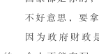

2020年8月21日 - 最近，媒体揭露了西班牙王室竟然系统腐败，同时更多前国王涉入腐败案的腐败，也让这位被罢免出来。▲西班牙王室通报 现年82岁的这位老国王已于8月3日前迁阿联酋 - 新浪财经同学讯网友 · 百度快照

国家都是你的，还有必要拿回扣么？

不好意思，要拿的。

因为政府财政是一本账，这是国库的账本，属于组织的，个人不能支配；自己的小金库是另外一本账，这才是自己的。

全世界都一样，历朝历代也都一样，卖官鬻爵，才是千百年来当权者正常的操作。

国家强盛，人民富裕，当权者穷的跟鬼一样，这才是异类，是少数，是人民的福气，但这是“变态”，不是“常态”。

你痴迷于放任的奥派理论，觉得掌握了宇宙的真理，那是你没有尝试过权力的滋味。

更没有面临组织利益和个人利益发生冲突时，你做选择时，受到的诱惑，权力就是魔戒。

两千多年前，柏拉图在《理想国》里就写过装格斯成指，当一个人带上戒指可以隐身，做任何事情，都不受惩罚时，最终走向什么样的道路是必然的。这时，你就不要再纠结正确还是不正确了，戒指有没有用，怎么用，才是当权者思考的。

我们能做的就是，根据这个必然道路的逻辑推导，在终点那边等着。

前面讲的是经济学和哲学层面的理论推导，下面讲一下各位都熟悉的。

## 压货。

几乎所有的公司，在理论层面，都不提倡压货，甚至禁止压货。

但是冲击季度奖，年终奖，老板数字难看的时候，所有业内的人都在压货。

压货本身是健康的么？

不仅不健康，而且扰乱了市场正常的秩序、让销售数字失真。

让市场部、第三方、不熟悉市场的人都看不到真相。在统计和分析时，充满了水分，以至于对长期市场规划、潜力分析、自我生意份额的判断上，充满了误判。

从长期来看，压货行为很不好，应该杜绝。

但是在真正的操作层面，哪个老板不想拥有几个压货小能手作为手下，在关键时刻，可以单骑救主。

数据的真伪和水分，我知道就行了，长期的规划以后再说，鸟在林中不如一鸟在手，屁股下的位子是有期限的，先把业绩和奖金拿到手再说。

即使经济学界的超级大牛凯恩斯也有名言来支撑：“从长远来看，我们都死了。”

这才是所有操盘手的座右铭，不是各位书生的纸上谈兵。

于是，所有新人接手的盘子，第一件事就是去查前任留下的库存，然后咬着牙先去销库存、擦屁股。

这个新人，小到医药代表等一线销售，大到 500 强公司的 GM，太阳下没有新鲜事，套路都是一样的。

> 西门子里医疗彻底翻车_百度文库
> 2019年3月18日 - 从2011年开始,西门子里医疗器械希望在中国实现超越行业两倍速的增长,但这一次浪潮“渴望”最终却导致德意志材料过度压货、假订单全年无法消化,当掉...

> 西门子公司调青虫龙事件背后:假订单保持高增长|西门子里医疗器械_新... 
> 2015年5月5日 - 近期，因为假订单事件，在中国市场的西门子医疗终端商大面积退股。本报记 者采访北京报道 虎里一角。5月14日晚,针对此前渠道社报道的西门子旗下医... 《经济 学新浪视角》 - 百度贴吧

这种事情闹的那么大，谁会自曝家短呢？

外行人看热闹，内行人一眼便知，肯定是这家换老板了，新老板一看，卧槽，这销量和库存的比例，哪是人干的事啊，太过分了，实在销不动，才出此下策，曝光、掀桌子。

所以压货，尺度拿捏，是个技术活，和通货膨胀一样，不能不干，也不能乱干。不干对不起自己，干得太猛，会被人掀桌子的。

民国政府不知道金圆券超发的危害么？知道，那么多留美经济学博士操盘，都不是吃干饭的。

但是战争是最烧钱的，印钱发军响，买物资，是最便利和快速的，正不正确已经无所谓了，好用最重要。如果国民党打赢了，稳定下来，必然会收敛，重新搞币制改革，否则还是无法统治。结果，玩的太猛，玩砸了，打输了。

退到台湾之后，局势稍微稳定之后，有滥发纸币么？没有。

那为什么在大陆的时候滥发纸币，引发恶性通胀？因为当时情况危急，需要印。

理论一直都在那，就像工具一样，都在箱子里。用哪个、怎么用，从来都是看当权者的需要。

至于为什么用、为什么这个时间用，理由总有一帮文人和媒体来解释，当然有的时候也懒得解释。

所有的解释，都是掩饰。真正的好事，是不需要解释的。

而所有这些的工具，最终都会作用于我们所有人，懂得其中逻辑、是可以看到未来的，都在早早布局。

我们经常听说，某个人做某些事，不惜代价，听着令人振奋，如果不去思考，自己就经常沦为那个代价。

在国家里如此，在公司里也是如此，要多去研究政策和战略的底层逻辑，而不是听着领导喊口号、围观看热闹。

听得热血沸腾，口号正确而无用。

国金的效率问题的探讨。

所有的经济学理论，都指向国企低效率，与民争利，无益于创新。

但为什么不改？甚至经常出现改革开倒车、多次国进民退。

如果只看奥派的理论，除了生气，咒骂，痛恨执政者的愚蠢，还能做什么呢？

经济问题，涉及到钱袋子，从来都不是单纯的经济问题，必然涉及到政治、民生、国家战略等。

如果只看经济，奥派理论者当然对，但是当权者不是这么看问题的，他要做的事情很多，每一项都要花钱，这个钱怎么来？都要税收么？税收已经很高了。

国企看着像是一个经济组织，从事的是经济活动，但更大的作用是税收的吸管，是政府的另一个钱袋子。

这个钱袋子，可大可小，可松可紧，取之于民而民不怒。当政者干大事要钱时，烟、酒、盐、油、电、气、通信等涨价，比收税快多了。

税收多麻烦啊，还得立法，还得讨论，还得表决，还得培训全国的财会人员，成本太高。

垄断之产品涨价，才是真正的多、快、好、省，收的多，收的快，好用，省力，现在没用，只是没到时候而已。

等想用的时候，发个通知，价格就涨起来了。价格会影响需求曲线么？你看看人家卖的都是啥？都是刚需。

便宜的时候，你会多吃盐么？不会。贵的时候，你会少吃盐么？也不会。

这才是真正的牛逼，造的产品几乎没有什幺弹性。

平时低价，那是惠民的民生工程（当然放开竞争，价格可以更低），但是老虎不发威，别当人家是 hello Kitty。

你算的是经济账，人家算的是总体系账，账本都不一样，就别瞎嚷嚷了。

你要的是民富，人家要的是国强。

谁说这两个一定是统一的？

纵观历史，绝大部分都是不统一的。秦国是这样，国强民不富，汉武帝民富而国不强，汉武帝强而民不富，唐朝极其开放，各位看一下和身处时代的对比，是不是具有可比性。

宋民富国不强，明清锁国，各位自已判断吧。

意思就是这么个意思，各位自己结合我们的时代和处境，慢慢想。

理论千万条，本质上只讨论对错，是很幼稚的，你的观点没那幺重要，就如同你的观点在公司里没那幺重要一样。

重要的是，你要研究官产学媒四大强势集团的观点，就如同你在公司里要研究好老板的观点和理论工具。

毕竟，这个世界上没有什幺企业文化，所谓的企业文化大概率就是老板的文化。

多学点逻辑，多练习一些思考力，理论工具是可以推导出结果的。

就如同现在很热的“财政赤字货币化”，看着很唬人，一推导就知道又要要流氓了。

他们认为，不正确，但是有用。

又是一个悲伤的故事。

我们改变不了这些决策，只能多买点资产，在大水流向的终点等着，救人不足，自救还是有点方法的。

## 第十四篇 JJ#28 弄懂沉没成本，发现劝你坚守的都是骗子

我们的教育，很糟糕。

几乎所有的教材都在教你如何坚持，很少有人鼓励你尽快放弃，能跑的早点跑，及时认态，是能保命的，这才是真正的教育。

达叔之前在文章里讲过机会成本的概念，用来做选择，机会成本是你干一件事而放弃的另外一件事，逻辑是两件事进行比较时如何做选择。

今天聊的也是做选择，毕竟很多时候，选择大于努力，方向都错了，努力越多，跑的越偏，甚至努力过头了，死的更快。

沉没成本，是以往已经发生的，与当前决策无关的费用。

我们脑子里，如果有习惯性的思考，一个事是不是沉没成本，很多事就不至于一错再错。

比如，今天的股票海天酱油暴跌，蒸发 500 亿，你之前买的价格是多少，就是沉没成本，赶紧抛之脑后吧。

现在的决定只应该取决于你对未来的判断，如果你觉得能涨回来，那你就选择持有或者继续买，如果你判断还要继续跌，那就尽快抛售。

没买过股票的同学，恋爱总谈过吧？遇到渣男了，无论之前爱的多么死去活来，只要冷静下来，想一下，现在开始到未来的日子，这个人值不值得拥有，以此来判断要不要分手，此前种种，皆是过往。

但是有几个人，能冷静的认清沉没成本、不受干扰呢？太难了。

所以我们在做重要决定时，要刻意的训练。

除了爱情，沉没成本的概念，也时刻关乎你的资产。

比如你刚毕业时，所在城市房价是 5 千/平米，现在是 2 万/平米，你还要买房么？

如果你的脑海里，天天惦记着的是毕业时 5 千/平，去年是 1.5 万/平，这些数字，你就特别的难受，你就很难下手。特别渴望跌回去，无法接受 2 万/平，觉得再等等，就有机会回到从前。

而忘记了，之前的一切都沉没了，让你做出选择的，只有基于当下判断接下来是继续涨高于 2 万，还是会下跌。这个判断是有事实依据和逻辑的，和你个人的喜好和渴望无关。

更多的时候，是不愿认输，结果涨到 3 万/平，输的更多。

如果你被情绪左右，那距离被屠杀就不远了，所有都不例外，即使是帝王、党派也无法逃脱。

劝你坚守的，都是坏人。

历史上有两个鲜明对比的帝王，都是北面有蛮族，内部有人称王。

一个叫赵构，及时认怂，打不过就跑了，这一跑，就再传七世九帝，享国一百五十二年。

另一个叫崇祯（朱由检），满把子的好牌，被打的稀烂，自挂东南枝了。

分清当前形势，该跑的时候就要跑，这是一门技术活，是相当考究的，是个系统工程。

分清形式，就要研究清楚，什么是沉没成本。

李自成拿下潼关，关中尽有，作为皇帝手里的部队要么很久没发工资，要么远水解不了近渴，要么不听指挥。

这时，要么赶紧认怂，皇帝困难，闯王也困难，都饿的嗷嗷叫，被人家打下来的地盘，就是沉没成本，已经在人家手里了，要个打赏，就给吧。

就像韩信向刘邦要个假齐王，刘邦也生气，但身边人一提醒，立马就明白了，都在人家手里了，你给不给这个名分，事实大家都是人家的。傻的多没意思啊，要给就给真的。

这才叫身段柔软，认怂在关键时刻是可以保命的。

北面的皇太极，也是一个尿性，最初的要求也是简单：承认地位，承认已占领的土地，每年发工资。

赵构能干的，崇祯一个都干不了，为什么？

因为赵构有忠臣秦桧，崇祯身边都是一群大义凛然的骗子，一群刚正不阿的爱国贼。

都知道打不过。还不让老板跑，这就是达叔之前文章中提到的，个人的利益和组织的利益发生了背离。

若论南下，历朝历代，还有比崇祯更方便的么？

明朝建国，二代目开始，一直是有南京作陪都，有办公楼，有行政班子，连保洁阿姨都有了，去了就能直接办公，拎包入住。但是一群人中，大家都是演员，领导不愿意开口，职业经理人更不愿意开口，为什么？

因为教育是有毒的，劝人放弃是要背黑锅的，风险极大，这历史骂名谁背的起呢？如果没有领导的默奕、不是心腹，谁敢豪赌：要死人的。

所以领导平时要对手下好点，别那么刻薄寡恩，让所有人都知道，帮你是有回报的。

领导装逼，天打雷劈。

最后说一下，主张南迁的，都被骂成汉奸，但城破之后，很多都殉国了；那些满口君王死社稷、寸土不让的，君王是真死社稷了，这帮货先从贼、再侍清。公司倒闭，老板进去了，职业经理人拍扃屁股找下家继续打工了。

平时，当领导 的要对接地气、说真话的小伙伴好一点，需要警惕的反而是那些道貌岸然的职业经理人，因为你不知道人家到底有多职业。

明明打不过，还劝你坚持，这是想让你死，自己几斤几两，心里没点数么？

每一个输了钱，还不愿走的赌客，最后都是家破人亡，劝你继续玩的不蠢就是坏。

沉淀成本，见好就收，见不好也要收，多想想未来，别总盯着过去。

最近有个电影叫《八佰》，让大家看了一眼国军抗战。

国军的套路是什么？一边打，一边退，从上海到南京，之后一退再退，如果有人建议委员长王玉壮死楼，委员长必然就是一句话，娘希匹。

追着追着，就赢不了。

还有另外一拨人，更有意思。

在江西有块地，被人给割匪了，有个老外建议硬杠，差点全副杠没了。后来有个爱吃辣椒的，说明明扛不过，就别硬扛了，听我的。

一路歪歪扭扭的烧了11个省，最后走进了北京城。

很多人脚起四渡赤水，没有任何感觉，这是何其强大的内心，才能在三个月内带领一群人六次穿越三条河。

你就想象一下，你在公司里做项目或者搞团建，带一个部门的人，来回走一个景点，或者领导一个项目操作，放弃，再操作，再放弃，来回操作几遍，所有人看着你的脸，像不像看个傻叉？

绝大部分人内心的想法是太窝囊了，别瞎了，干吧，一干就全死了。

真正强大的人，每一次决定过不过河，决定都是来自于过河当下对自己利弊分析，和以前自己没穿过这条河，没有任何关系。

因为是那沉淀成本，不需要考虑。

不弄清红皂白，劝你死坚守的，都会让你在死河边，这群人不是坏就是蠢。

那达叔今天是要讲历史么？

必然不是。

达叔讲这两个故事，是想告诉各位，无论是帝王，还是党派，都有自己当前的约束条件，都不能为所欲为。

每到危机时刻，都要分清楚什么是主要矛盾，什么是次要矛盾，什么是已经发生的沉淀成本，既然不能改变，那我们现在要做的是什么？

比如，太平时期，街边摆摊就是有碍市容市貌，城管和小贩是要刀剑见红的，闹过多少恶性社会治安事件，都不能阻挡摆小摊的趋势。

但是疫情来了，大量失业，已是既定事实，摆摊就成了解决就业的一根稻草，就变成了高级货，是“烟火气”，市里大人都出来站台，谁干的好，摆的多是要被表扬的。

市容市貌？那以后再说吧。在真正的困难面前，认怂总是不丢人的，总比硬扛强。

图推那么大，全世界都衰退，都超发货币，都在给通货膨胀找好理由，甚至通胀扩大化、正义化。

为什么？因为全世界的政府，都认怂了，全世界的央行都不提独立性了，在真正的困难面前，都不装逼了。

回顾前面两年，无论中外，历次衰退时期的各种政策，工具箱里无非就那几个，降准、降息、搞基建、发特别国债，说到底就是提供流动性，一言以蔽之，放水。

你给基建起再多的好听名字，你给降息取再陌生名字，你给特别国债取更有针对性的名字，都改变不了其本质。

因为国储没变，纸币没变，财税体系没变，当政者没变，人民币没变，地理禀赋没变，所有的底层逻辑都没变，就是国债变大了。

国债变大了，要把国债应付过去，砸杠杆就是人口大量失业，经济衰退，企业破产，元气大伤。很多小朋友不知道，企业倒闭是简单的，说倒就倒了，但再组织起来，那是千难万难。

这个时候，再劝坚守的，不是蠢就是坏，连太平洋对岸平时又当又有立场的舔狗都松口了，这边还有啥不好意思的？

研究数字的，都知道闹了。

注意一下，下图中的数字，统计口径都是新增贷款数量。

| 年度 | 累计(亿元) | 同比增长 |
| :--- | :--- | :--- |
| 月份 | 当月(亿元) | 同比增长 | 累计(亿元) | 同比增长 |

*注：原OCR识别表格结构存在错位，根据上下文语义（累计与当月对比）及常见金融报表格式，此处逻辑修正为两行表头，分别对应累计数据和当月数据。但鉴于OCR原文模糊且无具体数值，仅保留结构示意。*

这时候还劝你不要动的，都是坏人。

## 第十五篇 JJ#29 不要忘了，愚蠢的人，才是最难管理的

昨天，有个宣扬经济学的账号被封了，虽然达叔也不认识背后的作者，但总觉得怪怪的。

在人类历史上，但凡整个社会都满嘴仁义道德者，往往是大奸大盗之徒，社会秩序崩坏；而保护个人产权、尊重个人的社会，往往是有秩序和繁荣的。人人平等的穷，才刚刚过去没几年，就开始不让人好好说话了，这是不对的。

个别媒体平台的小编，自我阉割，主动阉割的觉悟，是一种高级黑。

不要忘了，愚蠢的人，才是最难管理的。

### 1. 大学扩招政策的背后

高晓松在一个节目里曾经说过，小知识分子害怕独裁者，大知识分子害怕暴民。

暴民的来源有很多，愚昧必然是其中一条，愚昧是残忍的，是难以管理的。

法律追求的是秩序，不是真善美。

那么愚昧在一定程度上，是有损秩序，有损法律的。

1977 年，中国开始恢复了高考，在这之前的十年，大学中断了十年，无处释放的青春荷尔蒙，转化为狂暴的暴虐，摧毁着一切。

恢复高考之后，大学的招生虽然每年都在增长，但是规模一直增长缓慢，年均增长只有8.5%左右。

对于中国的经济建设来说，要实现四个现代化来说，太少了。

战争打的是人才，越到后面，优质的兵源越少，战斗力越差，战损率越高。

战争之后，经济建设需要人才，日德被打趴下，却能快速再站起来。

背后也有大量人才储备的影子。

如果你的大学毕业生基数低，扩招增长又缓慢，对整个社会是极大不利的。

以储蓄为例。

中国自古以来，都以勤俭节约为美德。

但是，当经济要快速发展的时候，过高的储蓄率，会严重阻碍经济发展，现在一直在说的扩大内需就是一个例子。

如果国家想让人民花钱，促进消费，拉动内需，会怎么做？在正常的国家，很简单，降低利率就可以了，存款利率和贷款利率降低，这样的信号，绝大多数受过教育的人都能接收到，该花钱了，不能存钱，再存就亏了。

这是最简单的货币手段，通过利率调整市场的节奏，非常高效，成本极低，但是这样的信号好使么？

不好意思，在中国，很长时间内不好使。

为什么？因为信息的传递分为三个部分，发出信息，传播信息，接收信息。

你在发出信息前，人民爱存钱，你发出信息后，人民还是爱存钱，根本就接收不到你的信息，这个货币手段，就失效了。注意一下时间点，从 1993 年，存款利率一路下跌，一直跌到 1999 年，在长达近十年的时间，释放信号，老百姓接收到了么？

没有。

下图中直到 1998 年，居民部分储蓄丝毫没有任何下降的趋势。

如果没有受到良好的教育，就看不懂你的信号，你降你的，我存我的。

经济增长，要靠投资、出口、消费，三驾马车拉动。

1999 年的中国，面临着什么样的困难？

要投资，政府还没做好大量发债的心理建设，那个年代的各级政府在财政上，还略显淳朴，还不像后来那么狂野。要出口，还没有加入 WTO，2011 年才融入世界贸易体系，在这一年靠出口拉动经济那是天方夜谭。

能靠的只有内需和消费，在这之前，经济也是内循环的，以内循环为主体。

老百姓不愿意消费，听不到你的信号，怎么办？

为此，经济沙皇请了全世界的智囊来出方案，如何才能刺激中国人民消费。

最后发现，降息没用，老百姓根本就看不到，你降你的，我存我的，就如同奶奶级的老人，你银行再会玩，也不会改变她把钱放在枕头底下的动作。

顶级智囊分析了中国人民的所有消费需求之后，给出了一个药方：大学扩招。

所有消费品对老百姓的刺激，在望子成龙面前，都是弱鸡，中国家长对教育和大学的渴望，胜过一切经济政策。在那个年代，只要孩子能上大学，别说储蓄了，砸锅卖铁都要上，把所有亲戚的钱都借了，也要上。

大学的扩招，是中国政府第一次掏空居民的六个钱包，房子是第二次。

再回头看一下上图，从 1999 年开始，居民储蓄率一路下跌。

达叔之前在文章里就说过，只要政府想让你花钱，有无数种方法，能把你掏空，你是躲不掉的。

你能逃的被掏空方式是消费、教育、医疗、楼市、股市、通货膨胀等等，不把你钱包掏空的政府，不是合格的政府。

不把你掏空，你怎么好好安心工作呢？整天惦记着玩，国家还怎么发展。

### 2. 大学扩招的副产品

孩子上大学了，全家高兴。大学在哪里？在城里。

上完大学，还回农村么？那是肯定不能回的，否则不是白忙活了么。

在城里工作、就业，结婚，是不是要买房了？

轰轰烈烈的城市化就此拉开序幕，在城里工作赚的钱，全家老小、刚刚鼓起来的钱包，鼓不了几天，就得全部再掏出来买套房子。

熟悉中国税收体制的都知道，中国的税收大头是流转税，一度高达60%以上。钱不流动起来，怎么收税？

你想发达，那就是不爱国的表现。爱国就得为国买单，把钱赶紧交上去，以解国家之急。

那你不交怎么办？通过货币贬值，资产价格上涨，胁迫你。

你在手里存着吧，越存越不值钱，每年以10%左右的速度贬值，看你还不存？截止到现在为止，大学扩招除了加速城市化之外，还有一个作用，大家都变得有文化了，都多少懂点货币理论了，都知道点经济学和银行利率了。

如果实在不懂的，两轮房价暴涨，彻底打爆了空头理论，重新教育了所有人，手里的纸币是信不过的。无论是大学，还是社会的再教育，大家都不那么愚昧了。

房产由于买卖周期较长，地方政府在没有新的税种之前，只能硬着头皮继续土地财政，如何让人继续掏钱支持？所有理性人，永远都是买涨不买跌，只有这个东西涨，才会有人买，有买卖，有交易，才能收流转税，经济才不是死水一滩。

流动起来的经济，才有活力，才配得上叫“内循环”。注意“循环”两个字本身，就代表着流动，就如同血液一样，不流动，机体就死了。

为了让血液流动起来，向市场发送了很多的信号：

- 货币保持温和的通货膨胀，这是信号；
- 不动产的价格保持温和上涨，这也是信号；
- 银行利率在转换成 LPR，为长期、持续降息做准备，又是一个信号。

这些信号，接收的人是不是比 20 年前，多了很多呢？目前来看，是的。

否则就不会出台限购政策，而是出台鼓励购买的政策。

第一次发出让人民买房的信号时，老百姓根本就不买账。为了让老百姓乖乖帮忙，掏出现钱支援城市建设，各大城市都使出了吃奶的劲，包括上海。1994 年，开始执行，外来人口只要来上海买房子，就送蓝印户口，这一政策对上海招商引资、吸引外来人口，起到巨大推动作用，这就是社会教育的启动阶段。

什么时候结束的？2002 年 4 月，这一政策正式停止受理。

为什么取消了？

因为这一政策的教育工作历史使命完成了，外来人口开始汹涌进入上海，资产价格在快速上涨，愚昧者觉醒了。

唤醒愚昧者是要付出代价的，给出去的都是利益，都是诱饵。

先知先觉者赚得盆满钵满，后知后觉者略有小赚，不知不觉者，最后就被屠杀了。

但如果放出来的诱饵，大家集体愚昧，不接收信号呢？

那就得再换更激进的办法，找到像大学扩招那样内心深处更底层的需求，在达到目标之前，手段可以不停的换，直到成功。

所以，愚蠢的人，才是最难管理的。

聪明的人，你给个眼神，他就乖乖跟你走了，大家都省事，节约时间，也节约力气。

现在让大家掏钱在上海买房，还要摘蓝印户口那么费劲么？刹车松一点，一个眼神就够了，大家立马掏钱买票上车，乖的很。

愚蠢的人，如何变聪明？兼听则明，知识要多元，不能只听一家之言，动不动不让人说话，就不对了。

如果大家真的觉得楼市要跌，都不买了，支柱产业彻底凉了，重新再教育，成本也是很高的。

封了人家的账号，近期来看是省事了，但绝对是懒政，是不自信的表现。中国有一份发行量巨大的报纸，叫《参考消息》，这个报纸有个特点，

在全世界范围内搜寻中国的报道，而且都是节选，也许通篇是客观报道，有褒有贬，但是只节选褒的那部分。

有一次，毛就发表观点，“让人们去看敌人的东西自己去分辨”，乱删东西，在本质上是不相信人民群众，智商高上的优越感，是小编觉得自己有资格来判断什么内容可以给人们看，什么内容不适合给人们看。

大家都是上过九年义务教育的，谁给你那么高的优越感？

- 君之视臣如手足，则臣视君如腹心；
- 君之视臣如犬马，则臣视君如国人；
- 君之视臣如土芥，则臣视君如寇仇。

国家如此，公司组织内部如此，宣传口径亦是如此，道理是越辩越明的，时间也会证明一切。

你不让别人说，自己咿咿呀呀说。

别忘了，信息的传递分为三个部分，发出信息、传播信息、接收信息。

你把大众说烦了，不再信任你了，甚至把大家变得愚蠢了，不愿意接收信息，甚至没有能力接收信息。

你的所有高效信号，全部失效，工具箱里能用的工具越来越少。秋波频送，对方才以为是秋天的菠菜。

在大组织里工作，需要协调和动员人数越多时，才会深刻理解：愚蠢的人，才是最难搞懂的。

否则，为啥企业都招名校毕业、招进来还要不停培训呢？小编你要是看到了达叔的文章，别删也别封，你自信点，达叔就想在这个自留地里，交一些有趣的朋友。

现在开始，达叔陆续开始做 2021 年的市场规划，如果你在南中国，还从事医疗行业，欢迎加达叔个人微信号，期待有机会合作，也为了防失联。

关注达叔经济学，让我们一起慢慢变富。

## 第十六篇 JJ#30 文艺青年，是优质燃料

今天达叔女儿不太舒服，有点咳嗽，但达叔和朋友约了见面聊天，于是在周末，也被硬拉着起来，早点送去医院。

到了医院，挂了号，前面排了 100 多号。

不能干坐着，夫人拉着达叔说，走、到外面走两步、晒晒太阳。

达叔一边看着时间，一边低眉顺眼的说，诸。

现在医院管的很严，两个入口，一个门诊，一个急诊。

要看随申码，要量体温，要带口罩，出口只留了一个。

咳嗽并不严重，所以只去了身边的一个二级医院，不算太新，但也不旧。

路过胸痛中心的房间，达叔随手一指，说，你看那几台设备，就是我装的。

夫人一脸惊奇的说，你天天在外面浪，就是干这个玩意的啊？这个真值那么多钱？

达叔说，这不是值多少钱，而是能帮别人赚多少钱，思考的角度不同。

有的东西是消费品，比如你背着的那个包，你买它，不是因为使用价值，主要是情绪价值。

只有女人的情绪，是值钱的，是一个大产业。

其他的人群，老人的大产业是医疗，孩子的大产业是教育，男人的大产业基本上都是贩卖产生资料，甚至是焦虑。

如何赚更多的钱。

夫人说，那这个医院看着旧旧的，咋不翻新？盖个新楼，不是挺好的，有情绪价值。

达叔汗都快流下来了，气的有点胸痛，问，这医院的楼盖一个多少钱，你知道么？院长倒是想盖，钱谁出？你会为了医院盖的漂亮，像商场一样，去看病么？没病天天去逛逛医院？

夫人有点生气了，说，你是不是凶我了？

达叔赶紧说，没那回事。只是想给分享一个故事，上海有两个建的特别高级的民营医院，一个是国际医学中心，一个是嘉会医疗集团。

两个都特别高大上，美轮美奂，但是患者极少，亏的跟鬼一样。

大家都说看病难，但你要是去了这两个医院，那真是五星级酒店的服务、不用等、硬件设备、服务人员、专家也都很厉害，嘉会甚至从美国进口了专家，各种好。

但为啥不去？

大家都是嘴上抱怨，身体是很诚实的。要花钱的时候，该去哪，账算的比谁都清。

说到底，到目前为止，在医疗领域，服务还是不值钱。这就是文艺青年的惯性，嘴上喊着要追求美好生活，让他买单的时候，就灰头土脸了。

来到了阳光下，达叔和夫人围着医院小道，开始转悠。

夫人转过脸来问，那你说文艺青年，到底好不好？

达叔说，站在统治者的角度，青春作为燃料，那是一等一的优质燃料。

价格低，能量高，给名不给利，用奖状或其他名称的崇高感，就能驱使。

夫人一脸不屑，你是不是又开始说别人坏话了？是不是又要开始谈钱了。

达叔嘿嘿笑，那不展开聊了，时间差不多，我要和朋友吃饭去了。

夫人拉着不让走，问，每天那么多人约你见面，你哪些见，哪些不见，有标准么？

达叔想了一下，说，应该还是有标准的。

首先，必须要明确自己的主航道是什么。

然后，所有的动作，围绕着这个主航道进行，见这个航道里的人，建立更多的链接，其他的，统统靠后。

比如，今天要见的两个，一个是珠三角做医疗的读者，另一个是做医疗投资的读者。

目前，都是围绕医疗板块。

夫人松开了手，那你去吧，我怕你天天瞎忙，跑偏了。你看，当领导的，就是英明。

落座，一聊，相见恨晚。

对方是福建人，一个爱拼才会赢，到处都是小老板的地方，达叔暂称之为福建。

达叔问，福建的莆田系，在业内很出名啊，你主要做这块业务？

福建说，不是，我做高端的民营医院。

达叔问，之前一直干这行？

福建连忙摆手说，走过弯路。

之前是开餐厅的，距离医院不太远，经常有做医疗的人，来我店里吃饭，餐厅的生意时好时坏，生意不好的时候，就蹲在那，听他们聊天。越听越觉得不对劲，后来餐厅干倒闭了，就拉着食客，挤进了医疗行业，进来之后，才发现之前干餐厅，真是太傻了。

达叔端起茶杯，喝一口说，餐厅是中产阶级收割机，但凡开餐厅的个体户，很少有好下场的。昨晚我聊的，和你情况差不多，但他是受疫情影响。

福建说，疫情对很多餐厅老板来说，是一个利好，不是一个利空。

达叔顿时就很吃惊，说，为什么这么说？

福建说，我自己开过餐厅，我太能理解一些小老板的心态了，苦苦支撑，忙活一年，一算账，还不如出去打工赚的多。

但要是关店？很难。

怎么和员工交代？怎么和家人交代？怎么和老板的身份交代？怎么和梦想交代？

一场疫情来了，这下全好交代了。

终于解脱了。

关店，关的理直气壮，名正言顺，脸上苦哈哈，很多人内心终于脱离苦海了。

你没开过餐厅，你体会不到。

达叔一脸苦笑，我上学的时候，经营过咖啡厅，赚不到钱。

岳父家，早些年，在海边开 5 层楼的海鲜店，一年亏 20 多万，还得我这边帮忙去还高利贷。

这两件事，从此就治好了年轻时文文艺青年的一身臭毛病。

一个店，请了两个厨师，好几个服务员，一年忙活下来，老板亏了 20 万，所有员工每人每个月按时领工资。

达叔就经常问自己，这是老板剥削了员工，还是员工剥削了老板？

福建说，不能再说了，再说，我胸口就要疼了。

我看到你经常写文章，一般舞文弄墨的，都是算半个文青，就没想过要开个餐厅啥的？

达叔说，很多年前想过，但看的东西多了，就不想了。

福建问，看啥了？自己不亲自吃个亏，就躲过去了？

达叔说，很早以前看东方娱乐频道，曾志伟开火锅店，倒闭了。刘嘉玲开酒吧，倒闭了。还有那个李亚鹏，开酒店之类的，倒闭了。

这些都是商业明星，人脉那么广，都干倒闭了。

福建问，那会不会是因为他们不会经营，不专业？

达叔说，我想过这个角度。但是后来，三个人，让达叔彻底断了这念想。

一个是刘强东，能把京东干上市的大牛，早年开餐厅，开倒闭了。

另一个是达叔第一份工作的老板，40岁，医疗公司合规出局了，自己赚了钱，弄了个餐厅，结果前面20年的积蓄，全部报销了。

第三个就是达叔的大老板，平时在公司，宏图大略，把几千万的公司，弄到了十几个亿，精英中的精英。和朋友，开了个火锅店，赔了五十万，灰头土脸的离场。

达叔可能没有识人之智，但特别有自知之明，这些大牛货，都赚不到钱，那肯定是赛道出了问题。

有些赛道，就只能赚点辛苦钱。

但，赚钱这个事，Napooleon Hill 说过，赚钱是不辛苦的，但凡你觉得很辛苦，那就很可能跑偏了，肯定赚不到啥钱。

但你不能这么说，否则会打击劳动人民的积极性，伤了文艺青年的心。

毕竟，他们要的是崇高感，是金钱不能衡量的。

但你调过头来想，也正是因为不想给钱，或者给不起钱，才拼命发奖状，不发奖金。

达叔小时候，每年都领奖状，上面有个“以资鼓励”，达叔都在想，这个“资”到底是不是钱？

一直没拿过钱，一直没敢问老师。

谁没膈膜过。

福建同，你是啥时候开始，变得屌利的？我看你文章调性，很少见。

达叔有点不好意思，主要是文笔不行，写不了细腻的文章。

但细腻的文章，读多了，也挺腻的，没什么营养。我每天要见很多人，遇到很多故事，都是鲜活的生命，写一点，应该会很有意思。

道理，翻来覆去，就是那些，但是故事，多少能让大家有点印象。

福建说，那你取了个名字，叫达叔经济学，本来不是要写经济类的文章么？

达叔说，是的。

这是当时的规划之一，达叔是学经济的，也教过几年经济，甚至所有行为底层逻辑，都是被这门学科训练的结果。达叔是受益者，也想成为传播者，让更多的人受益。

绝大部分的人，太腼腆了，太害羞了，不好意思谈钱，每天累的跟个鬼一样，徒遭剥削。

比如同样的经济学，在中国教的主流是马克思这个流派，阶级论，剥削论。

这一学派在组织力，和政治动员力方面，那是绝对一流，但是在教人赚钱方面，那是捉襟见肘。

甚至完全跑偏了，煽动了员工和老板之间的仇恨，而忘记了真正的敌人一一印钞机。

说多了容易被删，说的少吧，也解释不了整个经济学的轮廓。

达叔对自己的要求很高，如果在某个细分领域，做不到一线梯队，那就别干了。也是这个号写着写着，就差点忘了还有经济学这个系列。

为什么达叔觉得自己在传播经济学这个领域，干不到第一梯队？

因为我看到了更有热情的布道者，比如薛兆丰、张是之、齐亮等，他们有热情，而且能坚持一直做。达叔研究了一下，觉得他们做的东西，已经足够好了。

如果你有兴趣，去学习一下这门社会学的皇冠，去让自己变得更犀利，更有钱一点。

《一课经济学》已经讲到第四季了，但达叔今天推荐的是第三季的内容。

理由：

- 1、这个章节里讲了《货币生产的伦理》，我们这一代人，很惨，要和纸币打交道，弄不懂纸币的家伙，赚钱的效率会大打折。
- 2、几个解读人，也很有意思，不是单纯的学者，有自己所在领域的实践+理论。毕竟大家都爱听故事，不想听理论。

这个世界，很复杂，凡事不能只看表面，否则容易把自己给绕进去。

今天下班，回到家。

夫人指着我的书柜说，我最近看你的文章，你推荐了好几本，我也想看看，怎么在你的书柜里没找到，你是不是个骗子？

达叔觉得很委屈，不可能找不到啊，结果找了半天，真没找到。

于是，坐在沙发上，想了半天，我最喜欢的书，去哪了？

哦，想起来了。

夫人的妹妹，有一段时间，突然要发愤图强，要看书，跑到我们家，指着书柜说，你给我推荐几本。

达叔很认真，把最欣赏的几本，拿出来给她抱回家了。一晃，过了好久，到现在都没还回来。

于是，当其他人来看这个书柜的时候，以为达叔最喜欢的书是这些。

其实，不是的。

达叔最喜欢的书，恰恰不在这里，都被达叔借给别人了。

留下的，都不是最喜欢的。

如果继续推演。

达叔哪天换房子，把这个房子卖了，肯定不会把所有书都带走，必然把最喜欢和次喜欢的带到新家去。

买达叔房子的家伙，如果他书品比较好的话，进达叔房子，围着达叔的书柜一看，心里不免轻蔑道，这货看的都是啥玩意儿啊。

虽然达叔听不到，但他看到的世界，影响了他的判断。

这个很重要。

以下的内容，可能会引起部分人的不适，如果真的不适应了，那不好意思了。

胜者即是正义。

日本有前两年推出了一个神剧，让达叔这个工作狂，都看得上瘾，大腿都拍肿了。

《Legal High》，名字翻译的也很有意思，叫《胜者即是正义》，对法律、正义、道德、经济等感兴趣的可以看看，当然对颜值有要求的，也可以看看。

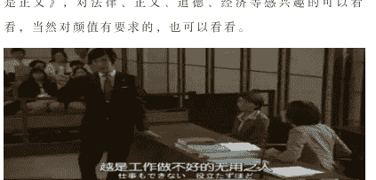

达叔要改写影评了么？

不是的。

只是作为一个小引子，接下来要讲几个小故事。

最近整个市面上，发生了很多狗血的事情。

很多读者知道，达叔是坚定的房产投资者，也不太建议普通的中产阶级，瞎去搞别的。

为什么？

因为在中国，搞金融投资，太特么危险了。

股票就不说了，中产阶级收割机。这玩意能赚钱的，都是人才，也是幸存者偏差，十个人中有七八个人亏，普通人就把自己的皮夹子收起来，老老实实等待者。

别总想着自己不一样，哪里不一样？

唯一的不一样，可能就是对自己认识更不清楚，仅此而已。

债市，应该算是最稳妥的了把？

最近暴雷的所有人，都心惊胆战，所有金融机构围城群殴河南省ZF，这事有听说么？

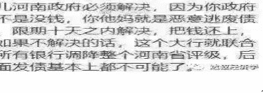

达叔朋友圈里，那些做政府信用，搞评级，发债券的，全都人心惶惶，义愤填膺。

你问达叔怎么看，以前电影演的是黑吃黑，现在演的是红吃红。

关于地方债的问题，达叔在JJ#19《独山县烧掉的400亿，其中有你的》讲过一些。

地方政府发债，是有要求的，规模也是可控的。

但是，地方政府为了政绩，利用各种融资平台、城投平台，以政府信用做担保，借的钱，到底有多少？规模到底有多大？

全世界都不知道。

就一个字，大；三个字，非常大。

以前所有人都觉得政府会兜底，但是从几年前开始，各个领域不断打破“刚兑”神话，这几天包商银行也破产了。

有本事借的钱，现在要不要还，摆在了很多地方政府面前。

河南反正是想要赖的，如果金融机构不团结，估计这事就麻烦了，这事闹的很大，有兴趣的可以去关注一下进展。

此事一出，各地的反应，非常有意思。

江湖传言，原来所有地方官员，都在私底下相互交流，如何漂亮的不还钱。

现在窗户纸捅破了。

各家的反应，就很微妙了。

青海盐湖，辽宁华晨，河南永煤，这几个企业企图赖账，引起轩然大波。

达叔不展开评价，只是提醒一下，不要在意后面的公司，要看一下前面的省份名称，这是非常短视的行为。

达叔有一个分析框架，任何一个组织都是由一个个个人组成的，如果主旨思路出了问题，这事没法好好解决了。

部分地区，被列进了黑名单，以后估计再也借不到钱了。

所以，你不能抢，你一抢，大家就不和你玩了。

河南事件出来之后，山西作为能源省、贵州作为基建狂魔负债大省，都承诺尽全省之力，好好还钱。

这就是省与省之间的差距，也是人与人之间的差距。

达叔在上一篇文章中说，各家政府大楼上挂的是同一个logo，以前拿的信用评级都很高，越到以后，差异会越大。

信用评级差，拿到的钱，就比别人贵，成本更高，干同样的事情，更不容易干成，竞争不过其他地方，变得更穷。

富长良心，穷生恶，一旦生了恶，更想赖账，更不想还钱，信用评级更差。

进入恶性循环。

作为普通人，你能做的是什么？

逃跑，到更好的城市去。

河北发生的事。

前面聊的是政府机构尝试赖账的事，下面聊一点河北发生抓人的事。

对孙老板被抓的事，很多读者让达叔谈。

达叔说，信息不全，不方便谈，除非我和其他自媒体一样，讲这是个好人，不该抓，之类的。

但是，人是复杂的。

在经济学里，坏人也会做好事，好人也会做坏事。

目标至善，也会导致非常大的恶。

读者说，那你是医疗行业的，你评价一下大午医院，可以吗？

达叔对这个医院之前并不知道，也不能瞎说，就去看了一眼。

刚一看到这个图，达叔就懵逼了。

再看了一下收费之类的，达叔说这不是经济，这是慈善。

如果是慈善，达叔从来都是悲观的。

尼采说，怜悯和爱都是罪恶。

慈善，导致的恶，罄竹难书。

但是，会把一些脑子里充满浆糊的人，感动得哭鼻子掉眼泪。

## 哪些人爱玩慈善？

拉丁美洲的大毒枭，委内瑞拉的查维斯，非洲等地区的独裁者，但凡想干坏事，又要拉底层人民一起，保己安全，就拼命搞慈善。

但是，搞慈善是行不通的，是不可能解决根本问题的。

否则，中国的扶贫大业，咣咣给落后地区猛发钱就可以了，干嘛要把基层和企业家，累成这个鬼样子。

因为慈善不长久，甚至是副作用的，只有商业，符合经济规律，才能让人脱贫致富。

但是，所有文艺青年，上学只学了真善美的媒体小编，是分不清的，哭爹喊娘，如丧考妣。

这一点，在多个国家都是如此，抽空可以看看神剧《毒枭》，一样的。

说到这里，达叔对孙老板的事件，不发表任何意见，只是提供两个角度。

- 1、慈善，是危险的，要警惕。（第三章展开批判欧美对非洲的慈善）
- 2、出事的据说是因为抢地。

论证了一个颠扑不破的真理：

> 老百姓最看重医疗和教育，权贵最关心土地和金融。

## 慈善让非洲人民吃不到饭。

非洲经常闹饥荒，这事大家都知道了。

欧美的白左们，一看黑孩子饿了，眼泪哗哗的，还坐着干啥啊，赶紧发粮食去啊。

嗯，几十年来，把自己感动得眼泪汪汪。非洲人民仍然经常饥荒。

问题出在哪？

就出在慈善上。

原来非洲农民，辛辛苦苦种了粮食，除去成本，拿到市场上卖，一年能赚点钱，给孩子上个学啥的，日子还能过得下去。

结果，从欧美来了一大堆，免费的粮食。

请问，能领到免费的粮食，谁还去市场上买粮食？

整个粮食市场，价格暴跌，一算账，忙活一年，还亏了。

那还种个毛线粮食，所有正经种粮食的农民，两手一摊，也变成了穷人，去领免费的粮食。

如此往复，免费的粮食，一旦断供，饿死一片又一片。

经济学家，早就指出了这个事的荒谬性，但是就是制止不了，为什么？

因为经济学家，你们都是王八蛋。

底层人民不喜欢，免费的粮食来做慈善，为啥不让给？

当地的独裁者，也不喜欢，没有免费的粮食，我怎么中饱私囊？来了100吨，我留下几十吨，作为活动经费，不过分吧？

粮食是独裁者要来的，一发免费的粮食，支持率还飙升了，上哪找这么好的事。

后来，独裁者发粮食，欧美觉得不放心，你们退后，我们来发。

结果会好么？

不好意思，效率更低下。

有统计显示，援助者的运营费用，占总援助金额的50%，你敢相信么？

这就是关于慈善的硬币的另一面。

很多不好好读书的人，看不清腐败和贫穷的关系。

总以为腐败会导致贫穷，腐败是贫穷的原因。

但真相是什么？

很可能腐败是贫穷的结果，是贫穷导致了腐败。

所以注意力，先解决贫穷，等有钱了，也就顺手解决了腐败。

如果天天盯着腐败，越反腐，越穷，越穷，越没法根治腐败，朱元璋就把自己绕进去了。

新加坡李光耀告诉 DENG 爷爷，腐败是经济润滑剂的事，这里就不展开了，展开你们也不开心。

但是，换一个角度，讲新加坡高薪养廉，各位都爱听，仿佛那个高薪的是自己。

就如同，达叔批判欧美对非洲慈善，搞乱非洲，大家就爱听。

如果讲孙老板搞医院做慈善不对，扰乱市场秩序，大家就不爱听。

达叔再换一个角度，说冬天快到了，俄罗斯天气冷，咱俩关系又那么好，你们那的皮大衣等所有衣服，我们中国全包了，全部免费送。

你觉得，俄罗斯会同意么？

反正，中国的皮鞋在西班牙卖的太便宜，就被当地人给放火烧了。

中国的商品，在世界上卖的价格过分的便宜，就天天被告，说你倾销。

俄罗斯人民，只要未来不想被冻死，就不会答应要你给的免费皮大衣。

这就是答案，免费的才是最贵的。

# 第十八篇 JJ#32 为什么没有中间商赚差价，大家只会变得更惨？

大家好，我是达叔。

一个想和大家一起慢慢变富的家伙。

前天写了一篇分析医疗细分行业的文章，YL#35《为什么 POCT 的生意，是门好生意》，在业内引起了很大反响。

很多医疗投资人、创业者、经销商老板，来加文末达叔微信，有读者让达叔再讲一下。

因为上一篇，只站在医疗市场的角度，用经济学和技术发展，进行了逻辑推理，缺了一些东西。

缺了啥？

缺了达叔最关心的一一**人，一个个活生生的人。**

结果明明是一个医疗系列的文章，写着写着，跑偏了，变成经济系列的文章，反正也好久没写经济系列了，那就把标题改了一下。

可能不对，大家随便看看。

## 经销商的本质。

部分广告宣传的内容，在经济学眼里，就是反智的大傻X，经不起逻辑的推演。

比如：“没有买卖就没有杀害”，去保护珍稀动物。

结果允许买卖和杀害的猪牛羊鱼越来越多，嘴上喊着要保护的，却越来越少。

这个理论，从产权的角度去推演，就会发现很荒诞。只有一样东西，大家有产权、能获利，才会珍惜和保护。

但凡，一个东西，无论它多珍稀，只要它是公共物品，和我半毛钱关系没有，甚至可能损害我的利益，那么可就有不对了，一头头干死。

你不要笑，这事在美国就上演过，环保组织为了保护某珍稀动物，推动立法，说在农田里发现这种动物，那这块农方圆几公里，就要变成珍稀动物保护区。

于是，所有农民在自家农场里，一旦发现这种动物，立马干死它，当场掩埋，若无其事，为啥？

因为你活着，老子的地，就没了。

原本要保护的珍稀动物，被农民差点干绝了，所以明天喊着要爱啊，保护之类的，你们环保主义者懂个屁。

给你个鹅头，下地干几年活，接受贫下中农再教育，你们就知道原来脑子里，那点小心小爱小感动，在吃饱穿暖、美好生活面前，啥玩意都不算。

达叔，别跑题，聊经销商的本质。

前面之所以激动，是因为瓜子二手车，这个坏13，天天请个演黑社会的家伙，叨叨叨：“没有中间赚嫁差价。”

这个广告语，就是反智的，彻底的反智。

经销商的本质，就是中间商，就是搞配送的，倒买倒卖的，但是他们是极大的正义。

中间商，提高了效率，解决了信任，是降低了价格，而不是抬高了价格。

你看，不懂经济的小白，立马就要拍桌子了，达叔，想不到你是这种人，替中间商说话，太无耻了，敢关！

你可拉倒吧。

“投机倒把罪”，罪名分解：破坏社会主义计划经济罪。

从新中国建立后，六十年代有这个罪名，位列刑法，1997年，取消了。

再到2008年1月，也就是北京奥运会举办前半年，“投机倒把条例”被撤销。

达叔的读者年纪都偏大，你们能想象，在2008年1月之前，很多生意人，不是在坐牢，就是在去坐牢的路上么？人间惨剧。

在2008年以前，大家没有富裕的感觉，是正常的，因为不配。

**提高效率：**

闭上眼睛想一想，你要卖一个东西，无论是房子，还是家里种的大豆、玉米，是自己去卖，还是直接委托给中间商更简单？

达叔小时候，家里是农村的，有块菜地，种了很多辣椒，每周和老爸骑车，带着几十公斤的辣椒，去十公里外的镇里赶集，摆摊卖辣椒。

风吹日晒大半年，辣椒被翻的稀烂，卖了一半，烂了一半。

当时达叔年纪小，特别渴望，有人能开着手扶拖拉机，进村里，像收花生一样，把这上百斤的辣椒，一口气全收走。

太痛苦了，只读了几本教科书的人，无法体会产能过高的农民和工厂主那种痛苦。

中间商，是救命恩人，是提高效率的。

有一年，村里摘经济作物种植，在村东边，上百亩地，种洋葱，说等洋葱熟了，卖给日本和韩国。

全村就没几个人出过县城，卖洋葱给日韩？谁特么信，怎么卖？

村长天天在喇叭里喊，大家放心，俺们已经签订好专业的经销商了，你们就负责种，安心地种，洋葱一熟，自然有一队卡车过来拉走。

软磨硬泡，村长给家家户户发指标，种了有几十亩。

转眼，洋葱快熟了，说好来收洋葱的中间商，左等不来，右等不来，村长慌了，去县城里一打听，投机倒把罪，倒买倒卖，上个月被抓了。

那一年，应该是1995年，俺也不知道你们是怎么过的，反正达叔那一年每天都在吃洋葱。

注意，达叔刚才写的伏笔，洋葱是种在了村子的东边，家家户户实在是吃不完，也卖不掉。

干脆拉倒吧，也没人费劲去地里把洋葱挖出来了。

所有的洋葱，全部烂在地里，洋葱的成熟季是几月？

估计很多人都不知道，达叔太知道了，是 6 月左右，为啥你记得那么清楚？

因为夏天来了，天天刮东风，夏天的东风一吹，刺激、太刺激，整个村子都笼罩在烂洋葱的臭味里。

达叔脑海里，就一件事，谁能去监狱里把中间商救出来，把洋葱赶紧拉走，求求你们了。

再后来，读书看到说美国的奶农，宁愿把牛奶倒掉，也不愿意给城里没牛奶的人喝。

这个话题里，AlphaGirl 姑娘在前些天在《反常识的常识》文章里，探讨过，讲的太文艺了，一看姑娘就是家里富裕，小时候没经历过这种烂洋葱的事。

我们全村的人，穷的跟鬼一样，宁愿把洋葱烂在地里，臭气熏天，也不挖出来给没洋葱的日韩、城里人吃，是不想么？

是特么的做不到啊。

提高效率的那帮人，被抓走了，所有人，无论是供给方，还是需求方，全部不经济，没效率，都倒霉。

现在在医疗领域，部分省份还在硬着头皮搞两票制，达叔之前专门写文章批判过，但遇事不决向左拐，还是有很多省份在搞，达叔也不方便说什么。

**解决失信。**

这个事，放在医疗领域好理解，而且也特别明显，中国是人情社会，同样的东西，熟人好办事，效率高。

中间商承担了这一角色，和终端客户贴的更紧，其他很多行业亦是如此。

争议不大，在此不展开了。

**中间商是降低价格，不是抬高了价格。**

价格这个玩意，是由供需双方决定的，哪怕是医疗领域，各位外行人只看到了部分产品价格高。

造成这样的结果，不是经销商造成的，是经销商太少造成的。

你要是不信，以达奴负责的产品为例，某个省如果只有一个经销商，占有垄断地位的，那个区域，价格就维持的特别好，也特别高。

而有些大省，同一个产品，有七八个经销商，那价格打的就比较难看了，心惊肉跳的怕集采。

那老百姓为啥感觉不到？

哦，老百姓感受的那个价格，是政府物价局制定的收费价格，是管制的结果，是政府规定好的，和竞争没有任何关系。

经销商竞争的价格，是指进院价，也就是经销商卖给医院的价格，经销商越多，进院价越低，医院赚的越多。

而医院卖给老百姓的价格，不好意思，是政府定价，和中间商半毛钱关系没有。

你，们，写，错，人，了。

当然，集采之后，支架等很多产品价格大幅降价，老百姓又开心了，不好意思，达叔说过，过分低的价格，没有供应。

历史上，药品多次降价，每次都验证了这一逻辑，最后都是断供、换一个成分，升级，换个马甲，再次涨价上市。

不信经济规律的，咱们拭目以待，找达叔赌五个块钱的。

当然，讲医疗领域，达叔熟悉，你们不熟悉，觉得达叔欺负人了。

达叔就讲一个身边做酒水生意朋友的案例。

王总，80 后，宿迁人，酒量不咋地，却做起了酒水生意。

宿迁有啥？

洋河和双沟，两大名酒。

王总有个同学，是双沟集团创始人的侄子，照顾他，给他弄了一个上海某个大行政区的一级代理。

双沟集团，前些年主推一个系列，叫珍宝坊，往高端冲击，什么君坊、圣坊、帝坊啥的，说是对标洋河蓝色经典那三个蓝。

达叔不喝酒，也不大懂，但王总知道达叔是做医疗的，应酬和活动应该很多，所以天天拉着达叔给他出谋划策。

达叔把他价格表，拿出来一看，心里就凉了。

为啥？

因为那个价格和网上一比，几乎是透明的，逢年过节一打折，差点就白忙活。

达叔问，网上这些价格，咋回事？

王总双手抱头，痛苦万分说，**全国的经销商太多了，根本管不了。**

有些大经销商有钱，厂家搞活动促销的时候，拼命囤货，拿到了很低的价格，自己渠道又卖不掉，自己受协议约束不方便干，给二级一放，然后就挂网上了。

达叔问，如果经销商少一点，是不是价格要好管一些？

王总两眼放光，那是肯定的啊，你看看**人家茅台，对渠道商的数量和价格，管的多好。**

王总请达叔吃了几次饭，达叔帮他策划了半天，他发现达叔是真的不喝酒，后来也不搭理俺了。

再后来，好多年没联系，偶尔刷朋友圈，发现他不干白酒，干红酒去了。

最后，达叔为劝**大家没学过经济学的，一定要学一点。否则，容易骂错人。**

**还容易选错行业，比如竞争越充分的行业，越不容易赚钱，价格越低、利润越低。**

从这点来看，医疗门槛高，和绝大部分行业相比，竞争没那么充分，还算是不错的。

各位医疗人，别抱着金饭碗要饭，总觉得别人家的媳妇好，那是不对的。

关注 达叔经济学，让我们一起慢慢变富。

# 第十九篇 JJ#33 当代人，如何在自己的王国里，变成一个昏君的？

大家好，我是达叔。

一个想和大家一起慢慢变富的家伙。

这两天，在昆明开会，老板给我一天吩咐了三个话题，讲得口干舌燥的。

有部分人，估计也听的昏昏欲睡，觉得讲的都是啥玩意儿，叨叨个没完。

这种类似的悖论，在晚饭结束回酒店的路上，达叔想了一下，就觉得有必要写一下。

因为，这就是当代人的困局。

**在台上课的人，真的关心别人的理解程度么？**

达叔好多年前，兼职做过三年的经济学老师，深刻的知道，其实讲者并

不在意所有的听者。因为，一个课堂里，无论你讲的如何，总有人在开小差，总有人在打瞌睡，总有人是不感兴趣的。

所有的讲者，在讲的同时，本身就是一种筛选，只要找到自己的同频者，就够了，其他人，一点都不重要。

**渴望被所有人理解，本身就是一种妄念，是一种病，得治。**

## 1 自己的王国

没人有义务，在不赚钱的情况下，一定要去说服谁，很累的。那达叔为啥说，这事儿是当代人的困局？因为，普通人一辈子，都在解决一个问题，该相信谁？以前，是信息太少，渠道太少，现在是信息太多，正反对点，听着都特么像真的。

达叔这个账号，叫达叔经济学，其中最扎眼的，应该是经济两个字。每天念叨，除了经济系列，好像也没花多少文字，去认真写经济，为啥还叫这个名字？达叔来解释一下：

经济，这个词，肯定是外来词，英文名字 economic，在古希腊语里，源头的意思，就是管理家庭。在我们中文的世界里，变变大了，有经世济民的意思。我们绝大多数人，都是普通人，没那个本事去搞经世济民，没必要去装大神，解读这个事件，分析那个大人物。基本天天写大事件的，就是跑偏了。我们就该老老实实回归本源，把家庭管理好，让老婆孩子，过上好日子。

想买啥买啥，想吃啥吃啥，免于贫穷，免于恐惧，这辈子就不错了，别天天关心国里的事儿。张嘴就是中美关系，特朗普拜登的，天天鬼扯，结果家里穷的跟鬼一样。如果你认真去研究人群，越穷的人、越关心政治，像柳传志这样的大佬。天天喊的都是亲近政府，远离政治。我们普通人，研究的所有经济，都是应该局限于如何管理好家庭。如何一起慢慢变富。

所以，你从这个角度理解，达叔这个账号，叫达叔经济学，才是最正宗的，因为这个家伙，不和你聊别的。每天念叨的，思考、经济、房产、医疗，四个板块，全都是身边事，不瞎搞那些虚头巴脑的。而你，就是你家庭的王，所有的新闻，所有的经济学流派，所有的大 V 观点，所有资讯，包括达叔在内，全都是你的谋臣。像一本案卷，被呈到你的面前，等待你的审阅。

有的谋臣说，2020 年是资产大年，要通货膨胀。有的谋臣立马同意，胡说，所有人都失业，经济要衰退，资产价格要暴跌。经济要通缩。有的谋臣和你说，未来医疗是黄金 20 年，真正的赚钱时代，才刚刚到来。有的谋臣和你说，一涨胡言，医疗这个行业已死，集采、DRGs 等，将彻底崩掉你的饭碗。有的谋臣和你说，你要创业，要出来单干，不创业，是没办法发家致富的。有的谋臣和你说，创业九死一生，太危险了，好好工作赚钱买房子，构建以房贷为中心的资产包，也能发家致富。

以此类推，几乎所有的关键决策，都有数据和理论支持，每一个听者，都像真的。关键是，你仔细去研究，每个言论背后，都站着一些超级大 V，超级成功人士。有首富告诉你，未来房价如葱；有世界头部投行总经理，告诉你房价泡沫严重。有自由派经济学家，告诉你所有的政府干预，都会扭曲市场。又有国师级别的林毅夫告诉你，所有发展中国家，想要实现超越和追赶，都要搞产业扶持。

每一派，都是大牛，都是逻辑自洽，把生活搞的像“奇葩说”一样。你说，你该相信谁？选错了，你就成昏君了，你自己家庭王国里的昏君。

### 2 昏君是如何养成的？

大家都知道，兼听则明，偏信则暗这个事儿，说起来容易，做起来难么？非常难。因为每个人，都有自己的成长背景，学习背景，我们所有人的观点，基本上都是被塑造的。同样是女人，同样生活在今天，有的女人穿着比基尼，在沙滩上晒太阳，理直气壮无所谓，女人无所谓，她男人也无所谓。但在另外一块地方，不用头巾裹严实，那后果是很严重的，女人觉得很严重，她男人也觉得严重。同样的时间，同样的事情，因为从小被塑造的观念，差异如此之大，甚至要人性命。

一旦你想清楚了这件事，你就知道，“毁三观，树新生”，这六个字，是多么的重要。但是，普通人遇到和自己观点不一致的信息，本能的反应，就是唾弃，手指一点，就划走了。而目前所有的资讯 APP，都在学头条系，都在研究你在喜欢什么，你喜欢啥，它就给你推这啥。然后，你看到的，都是你想要看到的，世界立马变的幸福了，全世界都和他一样，他就是世界，一派大和谐。有一个名词叫信息茧房，差不多就是这意思。我们躲在茧房里，是没法蜕变成蝴蝶，翩翩起舞的。

如何打破，就要多看，多听，多实践，多判断，尽快构建自己的一套逻辑认知体系。就像达叔给自己规矩，每天要写文章自我反思，自我逻辑梳理；每个月都要去见一个网红，看看他们对世界的认知。如果在朝堂上，皇帝把听着不顺耳的大臣或言官，都给干掉了，时间久了，留下的全是一群溜须拍马的。很多公司，亦是如此。

什么是企业文化？别那么复杂，企业文化，很多时候，就是大老板的文化。他包容，这个企业就包容，就容易人才济济，他不包容，容易秋后算账。大家都是聪明人，很快这个企业，就会出现一堆沉默的高管。啥事都不发表观点，都等着老板发言，你说啥，俺就去做啥，对不对不重要，老板满意最重要。这种人，不当昏君，也是很难的。

### 3 我们该相信谁？

达叔是做医疗的，上个月，在某人口大省，和经销商老板吃饭。达叔问他，支架集采，对你影响大概有多大？经销商老板说，大概 2000 多万的生意，要全丢。达叔问，你玩心内科，当年除了支架，没看过其他的产品？比如 POCT 之类的。经销商老板点上一支烟，非常忧伤的说，想过，当年 POCT 在国内刚兴起的时候，就有厂家找到我，让我做这个。

我对新产品不懂，就拿着彩页，找了个关系最好的主任，问问这玩意能做么？主任当时看了一眼，就说，你这玩意是检验科的，做不了了。接连问了好几个，都说没戏，然后就没做，觉得那个厂家小伙子，想骗我。达叔看着他，就很悲伤。你说客户是在坑害他么？肯定不至于，大家都是朋友，你问他意见，他肯定把自己的意见，真诚的告诉你。但是，问题出在哪？出现在自己对这个世界的认知上。

当汽车没被发明之前，你问世人，去远方浪，你们最想要的交通工具是啥？马车，更快的马车。你说他们说的错么？一点都不错，因为认知就是这样的。没见识，是一种很大的罪过。很多穷人家的孩子，辛辛苦苦从原生家庭爬出来，获得的见识水平，就决定了他能带领自己的新家庭，走多远。

医疗行业，客户的观点，来自于哪里？绝大部分来自于厂家、商业机构的再教育，尤其是新领域，新的药物出来，怎么用，怎么吃。新的器械出来，怎么用，术式怎么做，等等，都是被教育的。一个特别新的领域，客户都没见过的领域，都没被教育的领域，你问他的意见，即使他是真诚的，你觉得能有几分是正确的？

再换一个角度，你相信人的观念，还是相信金钱的力量？任何一个新产品，被研发出来，背后都是要砸很多钱，尤其是在全球得多验证的，刚进入中国，肯定是一批人崛起的机会。千万不要把某个国家的人，想的有多特殊，都是人，都是吃喝玩乐，同一个世界，同一个梦想，都是要赚钱的。只要赚钱的事儿，逻辑能讲通，观念的事儿，就好办了。

达叔也没啥文化，但遇到事儿，该如何抉择的时候，达叔都会泡杯茶，坐在那边想一想。这个事儿，谁得利？谁赚钱？谁拥有更大的话语权？你努力理清这个游戏中的强者，和他站在一起，赌他能赢，然后等结果就可以了。为什么这么现实？因为几千年来，全世界的规律，说到底就是富人和穷人之间的游戏，相互掠夺的游戏。穷人偶尔会掀桌子成功，但绝大部分时间，都是被富人单方面碾压的。哪怕是个帝王，也是和富人站在一起的，没人傻到真和穷人站在一起。否则，就真的是个昏君。当然，各位也可以不认可这个观点，达叔也是自己瞎想的，不一定对，随便看罢。关注 达叔经济学，让我们一一慢慢变富。

## 第二十篇 JJ#35 从宏观经济看，到什么时代，赚什么钱，别跑偏了

大家好，我是达叔。一个想和大家一起慢慢变富的家伙。

最近有两个读者，先后给达叔发了首歌，听到这个歌，不知道为啥，就觉得很适合达叔你的风格。这是个美女律师发来的，达叔很少听音乐，和达师点进去一起听了下，在沙发上笑的爬不起来。

- 就是南方凯 - 万拒
- 还有个医疗行业的投资大牛，发了一个音乐，说给你文章配个乐。
- 小熊浩浩 - 你的样子

文字，是有想象力的，比视频还有想象力，长的美，才适合走视频路线，比如 Yohna_L，无论对方说啥，你都觉得，嗯，说的对，有道理。长的欠货，就只能通过文字，来增加想象力。达叔虽然个性偏豪放，文风也粗犷，唱歌唱伍佰，但听歌，俺也听小野丽莎、提琴夫人、Carla Bruni 的。

你们不要瞎联想，俺其实是个斯文人。最近出差太累了，睡了大半天，起来看了半天宏观经济的相关文章，达师说，要不，你给我写一篇经济系列看看吧。否则，大家以为你只会打鸡血呢。以下内容，不一定对，各位随便看看。

### 1 宏观经济，为啥一定要研究？

非常简单，因为我们这一辈子，能干什么事，能赚多少钱，能取得多大的成就，全都和宏观经济有关系。你不研究这个，你就是只低头拉车，不抬头看天，忙活半天，一旦跑偏，全都白忙活。那宏观经济研究什么？就是研究两个主题：

- 1、经济增长趋势。
- 2、经济波动周期。

增长趋势在英文里，是 trend，是一个长时间的，大家选对方向，在财富终点，等着就能发财。达叔身边一群热衷买房的，都是抓住了这一点，坚定的多军，就是认定这个趋势了。波动周期，在英文是，是 cycle、起步--成长--成熟--衰落。

如果你要是搞农业，就要关心农业生产周期，长度是 1-12 个月。如果你是搞工业的，你就要关心基钦周期，长度是 2-4 年的，要关心库存。如果你是建厂、搞生产的，你要关心朱格拉周期，长度是 6-11 年，你要关心经济景气程度、设备寿命、更换频率等。如果你是搞投资的，你要关心库兹涅茨周期，长度是 20-40 年，你要关心人口结构，产业升级，趋势变革等。最后，玩命理的，就是大家都熟悉的，周天王那句—— 人生发财靠康波，康德拉耶夫周期，50-70 年，全球大创新和大退潮。你研究完这个，你就会发现我们现在处于什么阶段，该干点啥事，才能赚钱。

全球的经济大概的脉络，无非就四个阶段：

1. 温饱阶段：
   农业、纺织快速发展，纺织业就是这一阶段的 IT 业，就是高科技。
2. 耐用品阶段：
   吃饱之后，就开始有更高追求，白色家电，号称三大家具就起来了，赵本山都说了，要啥自行车，还有家用电器，手电筒嘛，电视、冰箱、洗衣机，都是这个时代的产物。家电，我们现在看不起，觉得没啥，当时就是高科技，达叔上学那会，课本学的可是海尔，电视里看的动画片，是海尔兄弟。
3. 住行阶段：
   耐用满足之后呢，人性是永远不会满足的，女人结婚不要冰箱、彩电洗衣机了，因为这些玩意，是必需的。开始要小汽车，要房子，要买大房子。过去的 20 年，全国房产快速崛起，但凡从事这一行业的，全部发财了，无一例外，干中介的也发财，就因为被教育的好。现在号称，房价不妙了，大家也都普遍有钱了，我们正在进入的阶段，是哪个阶段？
4. 健康和快乐，追求美好生活。
   达叔之前文章中提过，有钱人，老人，不愿意死了，还要每天都嗨皮。这种排浪式的发展，就是历史大势，就是宏观经济规律，就是符合人性的。健康对标的就是大医疗，快乐对标的就是消费升级和娱乐业。前面三个板块，还是有上限的，健康和娱乐，永无止境，能玩出无数个花样来，高级服务业，是全球宏观经济的最后归宿。所有发达国家，全都发展到这块，暂时还没看到下一阶段在哪里。从哲学角度来推导，也差不多了，生存是第一要义，然后活下来，活的好，还要啥其他自行车？

所以，达叔一直在说，中国的医疗生意，黄金年代不是结束了，而是刚刚开始。

### 2 看规模，看结构

达叔之前讲过很多理论，也讲过很多故事，一般人觉得粗俗，但每当发生重大事件，仔细读的人，都会知道，达叔在教你。比如，达叔在之前文章中，劝各位一定要去大城市，洪水来时不被遗洪、疫情来时有救灾物资的。很多人，觉得达叔在危言耸听。

今天，就有读者给达叔发文章，40 万人口的东北城市，确诊 200+，紧急封城，面临断粮，三万多人隔离，封城封户。没人报道、没人救援，更没有热搜。上海、深圳、北京感染一两个，都能上热搜，你这边隔离三万人，都没人关心。听着，是不是很公平？这就对了。因为世界，就是这么运转的。

错的不是世界，错的是你，任何妄图改变世界的文艺青年，道德姨，达叔都不愿意和他多聊半句话。你喊生命无价，汽车、航空、工矿业、烟草、电力等所有行业，都发展不起来，因为容易死人。就是因为巨大利益，巨大福祉，远高于人命，才会继续发展，连讨论都不用讨论。很多人，不知道财富的规模，也不知道人口和利益的结构，就在那边，整天反对这个，反对那个。除了过嘴瘾，满足自己虚无的道德感，有个毛线用，听你的，年都过错了。

比如，房住不炒，四个字，没有一个字提到要降低房价。一帮人在那边鬼喊，楼市要完了，不能买房了。达叔给你罗列一个规模，让你知道这个世界涨什么样子。

- 1、中国房地产行业，经过 20 多年的发展，现在沉淀的国民财富规模是 400 万亿人民币左右。
- 2、中国的 GDP，2020 年，是 100 万亿人民币左右。
- 3、中国的债务规模，（债务包括三层：政府债，企业债，个人和居民债），加起来有 270 万亿人民币。

你把这三个数字，记住了，下面一推导，你就知道空军有多幼稚了。400 万亿的房地产财富规模，如果缩水，经济就会面临彻底崩溃，一旦缩水，是中国过去几十年的改革开放，成果流失。居民的财富，大部分都在这里，你让全国人民变穷，这事是涉及统治合法性问题的。所以，房价不能大跌。局部人口流失的城市，跌一跌，和那个被感染的 40 万东北人口小城一样，没人关心的，无伤大雅。

那能不能大涨？房住不炒的政策，这一次是严肃的，上海深圳涨了一波，立马又摁住了，连讨论，都不让讨论，悄无声息的。民众开心了什么？不好意思，印了这么多钱，你不让房价涨，2021 年物价大涨，要开始了。宏观经济，研究经济增长和经济波动周期，执政者最关心什么？只有两个东西：物价和就业。

资产价格上涨，拉开贫富差距，是有资产的人获益，你要是不让他们获益，就得让贫穷老百姓受损，物价上涨。最近各位，问问老婆，关心一下鸡鱼肉蛋、蔬菜价格，看看大叔说的对不对。至少，部分新闻，已经开始打预防针了，提醒 2021 年，物价会温和上涨，到底有多温和，让我们拭目以待。帮助穷人的，一直都是有钱人，他们辛苦赚来的钱，换成了砖头，默默的开着电瓶车，帮助穷人能吃到便宜的瓜果蔬菜。但是，穷人永远都是骂他们的。你们这群资本家，你们这群炒房客。狗咬吕洞宾。

你看谁有那个狗胆，把 400 万亿的财富规模捅破，让穷人开心开心？穷人的笑，是最不值钱的，说翻脸就翻脸，忘恩负义，你今天对他好，明天因为一只鸡，就能把你家祖坟给刨了。所以，为穷人说话，为富人办事，是所有统治集团最基本的操作手册。

### 3 增量

上一段讲的是存量财富规模，下一步我们来宏观的看增量。中国每一年的货币增发量，到底是多少？很多时候，是一个谜。货币印出来之后，经过三次放大效应，央行一次，商业银行一次，影子银行一次，每次都是高杠杆。按照一般业内统计，过去 20 多年，每年的货币增发量，都是 13% 以上，最严重的是 20% 以上，刚下决心降杠杆，被一场疫情，又拉回了 10% 以上。达叔平时和很多医生聊，这帮家伙，根本不知道啥意思。就是你的财富，正在以 13% 的速度，每年在贬值。也就是说，如果你每年的财富增长，低于 13%，那你就白忙活了。看看你的家庭资产组合包，13% 的增长，意味着你 4-5 年，资产要翻一番。如果你是 7% 的速度增长，你 10 年左右，资产翻一番。你 10% 增长，你 7 年左右，资产翻一番。

好了，问题来了，每年 13% 的货币增发量，就是几十万亿的资金量，你不让去房地产。让这笔超级大水，去哪里？投资，说到底就赚两笔钱：

一是，赚流动性溢价。也就是市场上钱很多，还很便宜。钱是生产资料，资本收益率远高于劳动收益率。说到底，用钱赚钱，借钱赚钱，要增加负债，要多买优质资产，多买房。

二是，赚内生价值。研究经济结构，研究经济周期波动，去做特定阶段，市场需要的事，比如我们进入了健康和娱乐阶段。要么你和达叔一样，当小红书，去搞娱乐业吧，让大家开心。要么和达叔一样，好好干医疗，赚那些不愿意死的人的钱，赚那些养猫养狗，宠物医疗的钱。这笔钱，来的汹涌，人一生 80% 的医疗支出，都是人生最后两年花掉的。你准备好了么？关注 达叔经济学，让我们一起慢慢变富。

## 第二十一篇 JJ#36 从宏观经济看，普通人反对的，都是瞎扯淡

大家好，我是达叔。一个想和大家一起慢慢变富的家伙。

今天出门，带着老板和医疗宠物界前辈聊天，亚洲宠物医疗协会的会长，大开眼界。吃完饭，达叔握着老前辈的手，道声感谢，今天收获良多。老板说，你收获当然多，人家从 1993 年开始玩宠物医疗，几十年的经验，一顿饭就教给你，信息过量，肯定给你超级震撼。送走老法师，达叔和老板在咖啡店，坐了一下午，聊新兴市场的策略和打法，聊外企和民营的策略，聊管理，还聊达叔目前面临的一些短板，该如何解决。

一个人，身边如果有更多维度的人，给你指导，给你建议，给你开阔眼界，是一件极其幸运的事。达叔总觉得，最近几年，身边贵人不断，像开了挂一样的。如果俺要是再不努力，再赚不到钱，再没有进一步成长，那太过分了，暴殄天物了。当然，达叔也希望，能通过文章，把自己看到的世界，思考的成果，展示给一些年轻人，一些迷惘的人。能够给人以力量，给人以启迪，给人以方向，拓宽你一点点看世界的视角，达叔也是满意的。

昨天，聊了一点宏观经济，选职业和投资赛道的，今天来聊点宏观经济，如何影响我们的生活。为什么要聊这个？因为你看不懂宏观经济，就会每天和普通人一起，瞎鬼扯。就比如，代孕的这个事儿，网上都要吵翻天了，俺一直就不想写。达婶说，你那么能扯，你扯两句给我看看，也是好的。以下内容，俺随便瞎写的，可能不对，随便看看，不要撕逼，不要吵，一吵你就是对的。

### 1 代孕

各位读者都知道，达叔是干医疗行业的，当你们在讨论代孕是否道德的时候，达叔和身边的小伙伴，好多年前，就关心代孕的技术问题和成本问题。至少，达叔身边的医疗人，这么多年，都把这事儿，看成生意，没人关心道德。谁最关心道德？谁最莫名其妙关心穷人？谁最担心穷人被压迫？虚伪的中产阶级。尤其是念过几年书的那种，有一种为民请命的崇高感，觉得自己站在人民那一边。你可拉倒吧。这世界上，压根就没有人民，只有一个一个的人。

这话是丧世凯说的，喷孙大炮用的，满嘴仁义道德。如果达叔，只是批判道德，这个文章，就没必要写了，因为这事儿大家都嚼烂了。达叔想聊的，是大家都在争论“代孕”本身，如果大家争论的点，只限于代孕本身的框架，那无论你是支持，还是反对，代孕都已经胜利了。因为你没有跳出“代孕”的范式。范式，是一个哲学概念。

举例，无论你是支持马克思主义，还是反对马克思主义，本身都是马克思主义的胜利。因为你在讨论马克思主义本身，你支持它，也是引用它的观点，你反对它，还得攻击它的观点。所以，无论你支持，还是反对，都是马克思主义的胜利，因为你被框在里面了。同理，针对凯恩斯主义，新自由主义等，都是差不多的逻辑。真正的唾弃，真正的否定，是连提都不提，你那哈破玩意，不值得一下。

哪个大 V，要是敢就这个话题，写文章批评俺一顿，那就是个大傻叉，为啥？因为不值得。

但凡，你叽叽歪歪，批判半天，就是对方有一定的道理。

那达叔你怎么看待学这个事儿？

达叔肯定不和你聊代学，达叔要从宏观经济角度，先来聊婚姻制度。

婚姻制度，是财产制度的衍生品。

这个观点，有人反对么？

但凡有点文化的，都没法反对，因为这是香蕉大香蕉皮也大，一样的真理。

伴随着经济的发展，女性受教育程度提高，女性经济水平提高，收入不再依靠重体力，女性最终经济不再依靠男性。

这将导致，婚姻制度破产，这个观点，有人反对么？

但凡，看过世界发展史的，欧美日发达经济体，离婚率居高不下，大面积出现不婚族，婚姻制度走向灭亡，是一个必然的趋势。

这个观点，在达叔上学的时候，学了哲学，就已经推导过了。

在我们下一代或再下一代，只有穷人，才会结婚，摆脱贫穷，必然摆脱婚姻制度。

全世界的发达国家，女性受教育程度越高，越不愿意生孩子，这个观点，有人反对么？

婚姻制度灭亡，女性不愿意生孩子。

这是必然要到来的世界，请问，会出现什么样的场景？

经济要发展，民族要续存，国家要维持基本人口系数，危亡时刻，你觉得代替，是不是各个国家抢先发展的优质产业？这个产业，谁发展的好，优生优育，持证上岗，高薪聘请，很有可能是最有前途的产业，是国家之间竞争，最强的核心技术之一。

能帮国家生孩子的，代孕姑娘，每年都要评出英雄母亲，高产模范。

你不要觉得奇幻，普通人，最缺少的，就是想象力。

你反对的，是一个高端服务业，是国家新兴行业，是高科技，是中国的未来。

你的所有道德，都是被塑造的，所有法律，都是严重滞后的，所有规范，都是没有遇到更大的生存危机。

普通人天天反对这个，反对那个，根本就知道，自己反对的，到底是什么。

让你结婚，你反对；
让你生孩子，你反对；
让别人帮你生孩子，你特么的还反对；
让国家挂掉吧，你还反对；
你到底想干啥？

反对是容易让你有优越感，还是容易让你有荣誉感？

别人在关心技术改良，你只顾着反对。

### 2. 改良。

各位觉得我们国家的养猪产业如何？养牛产业如何？

是不是觉得毫无技术含量，这玩意，都养了几千年了，谁不会？

不好意思，中国的畜牧业、养殖业、到目前为止、一塌糊涂。

就养猪这一个细分品类，如果不是从丹麦大量进口种猪，中国普通人估计连猪肉都吃不起。

达叔今天见的这个大专家，还讲了很多故事，丹麦每年举行养猪大赛，养牛大赛，奶牛的产奶量和品质，比中国高出不止一个大截。

这些都是我们需要正视的问题。

转基因的事儿，达叔就不写了，当你在反对的时候，中国技术方面，已经全面落后了。

但是，全世界的技术，会因为你反对，就不再发展么？不可能的。

现在全世界的生物技术，都在陆续攻克一些关键壁垒，未来，人类的器官移植，很多都会从动物身上来，比如猪的器官，往人的身上移植，从理论上，正在变成可能。

代孕，你觉得很惨。

器官买卖和移植，你是不是觉得更惨？

但是，世界是怎么运转的，你知道么？你见过么？

达叔是做医疗的，给你讲一点。

几年前，达叔和某大专家，坐高铁去济南，路上两个人在那瞎聊。

专家介绍，好多年前，在监狱做过一段时间，见过很多狱友是怎么回事儿，如何治疗相关疾病的，就不说了。

一些死刑犯，被枪决前，外面已经有了医生拿着手术刀，拎着冰箱，等着入场了。

一枪，故意打偏，人不会立马挂掉，医护入场，该切的，全部切走，开车回医院，买家等着了，准备手术。

早些年，这批买家，大多是日韩的有钱人。

这些故事，有人会讲给你听么？

你以为你不让买卖，就不存在了么？

只是成本更高，死更多人，排更长时间的队，而已。

器官也被人家拿走了，家属啥也不知道，啥也没得到，你想保护的，最后被保护到了么？

你禁止的，只要是刚需，都会衍生出黑市，更不安全、更野蛮、更肮脏的交易。

比如某些公司的合规政策，当然正确，但是却衍生出了各种发票、水单、pos单等全套12%以上资金成本的灰色产业链。

你反对拆迁，你反对外国人来自中国，你反对代孕，你反对民营医院，你反对高药价。

任何建设性的意见，你都反对，来，你告诉达叔，你到底想干什么？

一起坐着，一起等死么？

你可以反对一个政策，请给一个更高效，更合理，更有建设性的意见，否则，你就是虚伪的反对派。

### 3. 杀死你的牛。

好多年前，达叔在某公司开年会，一个韩国的老板，在上面讲了一个故事。

一个经济学家，带着学生，去印度调研贫穷农村。

一户人家，5口人，穷的揭不开锅，家里只有一头牛，每天产点牛奶拿去卖，勉强度日，没有任何盈余。

师徒二人，第二天要离开了。

半夜，导师把学生摇醒，说赶紧走，再不走，来不及了。

学生睡眠朦胧问，咋了？

导师说，我刚才把他们家的牛，给杀死了。

学生一下就这么吓醒了，抓起行李，就和导师一起跑了，好多年过去了，一直觉得自己已导师，禽兽不如。

再过几天，开始陆续出去打工，找工作，日子竟然慢慢好起来了。

达叔的故事，讲完了。

这个世界上没有人民，只有一个又一个人，谁也不要提人民，谁也不要以人民的名义，请尊重每一个人的选择。

但凡把特别宏大的主题，经常挂在嘴边的，大概率都是骗子。

你看到农民工，扫马路辛苦，捡垃圾辛苦，在工地搬砖辛苦，送快递辛苦，请收起你那可笑的怜悯心。

你不让他们干这些活，他们在农村种地，更特么的辛苦。

因为达叔就是从农村爬出来的，你们眼中的每一个辛苦，都是他们开心坏了的职业。

达叔很多原生家庭的亲戚、朋友，干的就是这些，没一个想回农村种地的。

千万不要你们保护，你们每一次所谓的保护，都会导致他们失业。凡是交易，皆是美德，不用你怜悯，你安心赚钱，安心打游戏，不要叨叨叨。

以怀孕为例，很多我们认为不正确的事儿，都是因为道德的不适应。

而道德这个玩意，是最靠不住的，是最容易变化的，是经济的衍生品。

最后，绝大部分女人会觉醒的，要么就不生了，要么既 然要生，为啥不用来赚钱呢？

给那个臭男人生孩子，不是生？还不如赚他一票呢。

婚姻制度破裂---有钱女人不生孩子---生孩子变成一个赚钱的产业---生出来的孩子，国家社会化抚养。

这就是未来，是必然趋势，爱信不信。

关注 达叔经济学，让我们一起慢慢变富。

## 第二十二篇 JJ#37 阻止我作恶的是深入骨髓的经济学，而不是什么道德

大家好，我是达叔。

一个想和大家一起慢慢变富的家伙。

最近达师又催稿了，你这家伙，咋不写经济系列了？一直在扯你的医疗，很多我都不懂，你写点我喜欢看的。

达叔问，为啥总喜欢看经济学系列？

达师说，因为总觉得你们研究经济的家伙，思考的点，和普通人不太一样，听起来怪怪的，但又逻辑自洽，看了可以开脑洞。

这货不是在探寻真理，而是抱着猎奇的心态，来看小故事的。

达叔说，刚开始我写的挺起劲，但后来看到了张是之老师，还有齐亮等人，在孜孜以求的写经济学，而且是很严肃的在写，俺就不好意思给他们添乱了。

珠玉在前，俺再写，有点狗尾续貂的意思。

结果前天张是之老师，正好找达叔聊天，也鼓动达叔，说你写吧，你的文风自成一体，而且实践案例丰富，和我们搞理论的，不太一样，一起普及科学。

被这俩人架上了，就随便写点，可能不对，各位随便看看。

### 1. 框架指导生活。

达叔截止目前为止，思考系列的文章，写的最多、如果各位有心的话，去翻一下思考系列的副标题，写的是——框架大于努力。

昨天达叔在 FC#26 只有弱者才会天天想着要公平文章中，要研究一个新领域，要去看三類人在说什么，头部的、教材的、傻瓜版的。

但打开一本书，比如经济学的书，要研究什么？

要仔细看目录，看整本书的框架，是如何搭建的。

研究完框架之后，要深入研究里面的概念、名词、定义，以及概念之间的逻辑关系。

剩下的所有逻辑推导，案例分析，小故事，都是在论证、说明、讲解这些概念。

你把思考框架和概念，印在脑海里，融入身体里，这些知识，就会指导你的生活。

就如同，达叔学的第一门经济学课时，老师问，你们一定要好学，为啥呢？

因为学经济学，可能不会让你变富，但一定能让你知道，你是怎么变穷的。他的原话是，经济学不一定能救你命，但一定能让你知道，你是怎么死的。

达叔当时很年轻，坐在下面听，心里想，卧槽，上来就要讲的这么吓人么。我是来学变富的，俺得好好学。

结果，这个老师，教了一学期，就跑路了，去了香港那边的东亚银行，搞金融去了。

达叔还给他发过邮件，问老师，你咋跑得了呢？摆挑子 了，在大学里教书，不赚钱么？

这个老师只回了四个字：机会成本。

达叔在之前的经济系列文章中，写过很多关于成本的概念，成本分为财务成本，沉淀成本，机会成本。JJ#28 弄懂 沉淀成本，发现劝你坚守的都是骗子，只找到了这一篇，其 他的各位自己去翻。

达叔看到邮件中机会成本四个字，就想到他讲的案例：

一家三口，在学校门口，弄了个水果店。摆摊卖水果，一个月赚 1 万，一年赚 12 万左右，纯利。

请问，这个水果店，赚钱么？

下面一群学生，面面相觑，老师傻逼吧？问这样的问 题，12 万一年，纯利，难道不赚钱么？

老师说，如果你用财务成本来算，那么这个店就是赚钱 的，但是你如果换一个角度，用机会成本来看，就未必了。机会成本的概念，是你为了干某一件事儿，而放弃另一 件事的机会。你为了获得某项收入，而放弃的另一项收 入。

这个被放弃的，就是你的机会成本。

这个水果店，把三个人，都困在店里了，没法干别的， 他们三个放弃的一项选择就是，三个人都出去打工。

每个人的工资，平均是 5000 元，三个人一个月 1.5 万，每年 18 万元。

这么算，这个水果店，三个人就是亏损的。

就这么一个很简单的小概念，很多人，一辈子都没闹明白，被深深的困在自己的岗位上。

达叔从毕业开始，所有的职业生涯，项目操作，都在不停复盘和思考，我现在做的事儿，机会成本是什么？还有没有更高效的打法？有没有更大的回报？

我亦只有一个一生，不能慷慨赠予我不爱的人，也不能慷慨赠予我不爱的事，尤其是还不赚钱的情况下。

你要有个框架，指导自己的生活，否则经常又忙又累，日复一日，就跑偏了。

### 2. 上限和预期。

经济学里，有一个最基本的假设，人是自私的理性人。

就这简单的几个字，也有很多人不认可，达叔也不管你认可还是不认可，经济学、管理学、心理学等很多人文类的学科，都要和物理学一样，先弄个基本假设，然后才能在这基础上，搭建理论大厦。

达叔对这几个字，是非常认可的，虽然有点冷血，但这些年操作下来，觉得按照这套理论，大方向都是对的。

人，当然都有感性的一面，不理智的一面，但是这个自私的理性人，说到底，是让我们做任何事儿，都想一想，能为对方带去什么？

我们不能一直白嫖对方，让对方免费为我们干活吧？达叔在很多文章中说，用爱发电，发一两天可以，再要多发，发电机都饿死了，发个毛线。

说到底，感情好是一码事，利益要分清楚，该给人家的，一定要按时、按量的给。

在这里，分享两个故事。

一个是，达叔文章中提过，好多年前，有个级别很高的客户，想拉著达叔创业，后来被达叔拒绝了。

他拉著达叔去和他的合伙人、投资人吃饭，对方经常问，你为啥要拉达叔人伙?

这个客户对不同人，都讲了同样一个故事：

达叔这个家伙，在所有销售里面，是唯一一个，按时、按量，长期坚持，准时兑付的，最后一次，因为他和公司发生了纠纷，官司打了一年。

在刚开始打的时候，他就和我们这帮家伙说，钱没拿到，在干架，如果干赢了，肯定会来结账的。

我们很多人，都觉得没戏了，一年之后，谁还当真呢?

结果，一年后，这个客户说，我在实验室里弄老鼠，达叔给我打了电话，出现了，让我很震惊，太特么有契约精神了。

客户指着达叔说，这个家伙人品好，能力强，所以我觉得要带著他。

达叔真的的人品好么?

每个人心里，都有非常阴暗的一面，我从来不觉得自己道德有多高尚，那达叔为啥干了很多，别人看来觉得靠谱的事儿?

因为一句话，弃小而不就者，必有图大之心。

我对自己的人生要求很高，对自己的上限要求也很高，我不能在这么小的事情上有污点，太丢人了。

我要经营自己的品牌，我要经营所有人，对我名字的预期。就如同李嘉诚一样，我即使亏钱，我也要把它承诺兑现。只要我长期坚持，所有合作者，都会相信我，我就能够积累非常大的信用，这个信用，能够给我带来极大的生意杠杆。这种杠杆，还会带来一个经济学的概念，就是诺贝尔经济学家获得者，科斯定律的发明者，科斯先生极其重视的：交易成本。

达叔和某经济强市官员们聊天，有搞招商的，有搞财政的，达叔问，为啥你们工作开展起来，比较顺畅，北方普遍坍塌了？

每个人观点，略有不同，但整体上，都提到我们这个地方，严格控制自己，管好自己的手，不要乱来，要经营品牌，做好服务，降低交易成本。

我们表面上得罪了一个客户，其实，是得罪了一批客户，好事不出门，坏事传千里，他会把自己受的欺负，告诉所有他熟悉的人。

以后，你就再也没法以较低的成本，获取别人的信任了。

案例太多，某人去 SD 搞投资，还是被招商过去的，热情过后，几经折腾，把项目就搞成亏损了，不让查账，最后血亏，不了了之。

在苏州赚了很多钱，被招商到某西北省份承包工程，项目工程款8个亿，几经追讨，承诺分8年给，每年给一个亿，结果第一年，只给了一千万。

再后来，主政官员调离了，继者开始扯皮，赚钱的项目，变成了支援西部大开发。

达叔发自肺腑的想让所有人，都学习一下经济学，不要把别人当傻逼，把对方看成一个人，一个正常的，自私的理性人。

如果跟你合作，一直能赚钱，大家为啥不和你合作？

如果在你的地盘，能好好赚钱，大家为啥要逃离？为啥投资不过某某关？

降低交易成本，是我们每个人，经营自己的人生，都应该认真考虑的。

达叔有个同事，原本是个甲方，以前开会，经常和达叔住一个房间，在阳台上，叼着烟，很困惑的问，达叔你以前做巧，啥产品也不懂，为啥总能拿TOP？

达叔说，我对产品是不懂，但我懂人性，我在第一个月的第一周，准时在某一天，把该做的事情做完。

就这一条，就能干掉绝大部分对手。

因为，别人贩卖的是产品，我贩卖的是规律、秩序、预期和安全感。

同事默默的把烟掐灭了，牛逼，我要是你客户，我也会喜欢你的，无论你卖什么。

最后，马上过年放假了，待在家里，如何才能获得一份安宁，避免别人打扰，避免被拉去相亲，等等。

最好的理由，当然是学习。

很多读者都领了达叔的文集，要在过年期间看，达叔建议加点经济学，给自己搭举个框架，看达叔的文章，很多都是故事，把故事装进框架里，会更有趣。

学点经济学，上能帮你赚钱，下能让你避坑，中间能帮你改善工作。

# 第二十三篇 JJ#38 真实世界的奖惩制度是丛林主义么？

大家好，我是达叔。

一个想和大家一起慢慢变富的家伙。

这两天，达叔的两个网友，都是公众号大 V，又因为某个话题开撕了。

达婶把双方的观点，都看了一眼，在路上问，你要不要参与说几句？

路上哗哗下雨，达叔一边开车，一边说，没兴趣参与辩论。

达婶说，可是看起来你好像就在对方攻击范围内哦。

达叔说，我这个风格的账号，本来对大众来说，就是不好喜的，以后做的再大一点，被人黑，被攻击，是很正常的。

所以我文末开放去加一些网友，潜在的合作者，完成全国合作者布局之后，想写就写，不想写就算了。

达婶说，我觉得张是之的文章，把我想到的都写出来了，你有没有什么要补充的？

达叔说，理论方面，张老师更扎实，我可以补充一些真实世界的案例。

以下内容，是对文章 挨打要立正，你们配得上 的部分补充，可能不对，随便看看。

### 1. 奖金制度。

达叔在医疗行业工作好多年，分享一下，全球 500 强，最顶尖的医疗公司，奖金政策都是怎么制定的。

首先，一个制药公司销售一般都有几千人，分布在全国。制定奖金政策一般都是专门的部门来搞的。

制定奖金政策的人，一般年薪，都是高于百万的，可见这个工作，是多么重要，不是拍脑袋的，而且都是内部的绝密，你在网上是很难找到的。

达叔只是分享一下逻辑，不针对任何一个公司。

销售人员的奖金，分为几个部分：完成率，增长率，平时表现奖等。

其中**成熟产品**：一般完成率是最重要的，系数最高，100%是一条基准线，在这个基础上，每高一个点，斜率都会陡增，一般都是陡增 3 倍。

也就是说，如果 100%完成，季度奖是 3 万，那么 130%完成，则是 3 万 + 30%*3*3 万 = 5.7 万/季度。

有的公司奖金会封顶，比如 150%封顶，那就是 3 万 + 50%*3*3 万 = 7.5 万/季度。

有的公司，上不封顶，非常激进，那么完成奖，再加上增长奖，行为奖等，七七八八加起来，会出现年薪百万的一线销售人员。

但是，销售 3000 人，完成 100%以上的销售，多拿的钱，是公司额外发的么？

不好意思，不是。

公司还制定了一个标准，也是梯度的，90%-100%的，拿 3 万的 80%，依次递减减少。

75%以下完成的，一分钱都没有，不干你就不错了，拿个毛线钱。

这就是现实世界的玩法，跑的快，就是赚的多，跑的慢，不是赚的少，是没的赚。

除了成熟市场，还有更刺激的。

也就是达叔说的，年轻人要迎来自己的战点，要是能碰到新产品上市，拿到一个好坑，做公司的策略性新品。

这是最激动人心的，能刺激的让你夜里睡不着。

放一张奖金政策的海报，为了避免麻烦，达叔把公司名称去掉了，是国内主流头部的玩家之一，各位感受一下。

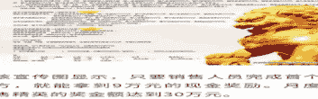

关于跑第一，能不能、该不该赚更多、更大的钱，不管你怎么解释，真实的世界，都是这么运转的。

俺也不知道这么玩，到底道德还是不道德，反正是真特么有用。

重赏之下，必有勇夫，面对未知，只有重赏，才能激励更快、更高、更强。

否则，一个产品磨磨唧唧的做，占领市场的机会窗口，稍纵即逝，损失是巨大的。

达叔平时参与的所有市场，见到的也是追求效率，公司推出任何一个策略，谁能第一个杀出来，谁就最牛逼，获得最多的掌声，拿最多的钱，给最多的荣誉。

来的晚了，不好意思，你是跟随者，别说奖励了，你就不用来，因为不需要你了。

世界上的公司，无论是国外的，还是国内的，大家都是这么玩的。

请问，谁特么去和公司谈道德？

别人去忙着开发市场，赚奖金，你去质疑公司高层道德有问题，脑洞太大了。

### 2. 管理者的困境。

达叔以前认为，做一个大区经理，销售总监，甚至公司总经理，是一件很牛逼的事情。

等慢慢体会了，才发现，啥破玩意，管理是一件很复杂的事儿，有人说是科学，有人说是艺术。总之，搞

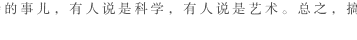

## 管理玄学与激励

的像一门玄学，每个管理者的风格不一样，管理方式也不同，但都要面临一个困境，那就是如何调动身边的资源，如何实现自己的意志。

最简单的一点，就如何让别人听你的话？

人家要是不听你的，你能咋地？公司又不是你的，你能说开除人家，就能开除么？要是遇到阳奉阴违、偷奸耍滑的，你咋整？

这些都是问题，如何解决？每个人的方法，都不相同。

> 但最好的方法就是激励，啥也别说了，都在钱里了，你们也别看我的面子，就看看在钱的面子上，干还是不干？

不干，就在旁边站着，看别的同事赚钱。

这个道理，是达叔的一个客户，在达叔很小的时候，和达叔说的。

这个大主任的原话是：你们这个赞助不是给我的，我是带头大哥，一帮人跟着我吃饭，我手里要是没把米，叫鸡，鸡都不听话。

最后这句，俺分享给同事听，一群人在那边坏笑，太坏了。

尤其是当带你一个大团队的时候，你如何选择人才？

所有的销售，本质上都是演员，都是人精，还有演技特别好的，能把你眼睛都晃了。

你怎么知道谁是毛主席说的，又红又专的那个？你只能测试，不停的测试，用一个个项目进行测试。

无论这个项目是简单也好，是难也好，谁能第一个响应，谁能干的又快又好？

你不给这样的人奖励，难道奖励那些在后面姗姗来迟，磨洋工的么？

你要这么玩，很快队伍就被你带散了，哪个有上进心、能打的家伙愿意跟着你？

所有想吃大锅饭的，想照顾懒货的家伙，最后都是锅都被砸了，没人做饭，全部饿死了。

建国后，前三十年，最讲道德，所有人都伟光正，结局大家都看到了。

后面几十年，各玩各的，凭本事吃饭，不谈主义，不讨论虚无缥缈的意识形态，大家刚开始吃饱穿暖，结果有人又想绕回去了。

如果你去看网络上的写手，北方的写手，爱写政治、道德之类的，南方的普遍都在写如何搞钱，不掺和那些大而空的屁事。

达叔这个账号，口号就庸俗不堪，要和大家一起慢慢变富，目前读者一共才 24000 左右，第一大读者省份，就是广东，遥遥领先的那种。

让达叔想起了刚才的那个深圳女孩的词汇。

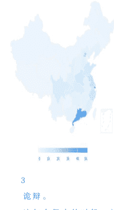

| 始端 | 用户数 | 占比 |
| :--- | :--- | :--- |
| 广东省 | 4170 | 17.74% |
| 上海 | 3757 | 15.99% |
| 北京 | 2115 | 9.00% |
| 江苏省 | 1717 | 7.31% |
| 浙江省 | 1552 | 6.55% |
| 河南省 | 1205 | 5.13% |
| 山东省 | 1085 | 4.62% |

### 3

**诡辩**。

达叔在很小的时候，就喜欢读哲学类的书籍，古希腊的哲学家里，有一群很有意思的家伙，这波人爱玩诡辩。

比如，有一个哲学家说，一个人拿个箭，射向另一个人，两个人是两个点，两个点之间是一个线段。

线段是由无数个点组成的，这个箭必须穿过无数个点，才能射到对面的人。

因为线段中间的点，是无数的，所以这个箭，永远也射不到对面这个人。

从单纯的逻辑推导，你说对不对？

达叔当时年纪小，猛拍大腿，卧槽，对啊，太精妙了。但是，你让达叔达在那边给别人拿箭射，可不可以？

可以个毛线。

达叔一直说，不要生活在这种诡辩的逻辑推导中，多去生活，多去实践，多去看看别人是怎么赚钱的，多去研究真实的世界。

真实的世界，就是嘉奖、重赏第一名的。

第一张处方要 9 万，第一个月的销售明星奖励 30 万，第一个爬上敌人城楼的赏百金，第一个把红旗插上总统府的升官发财，第一个登上月球的流芳百世。

后面的第二名、第三名、第四名，第 186 名，是谁？

不好意思，这个故事结束了，你们来晚了，下次早点来。

不仅各个公司是这么做，资本市场也是第一名赢家通吃，中国的茅台股、恒瑞、迈瑞都是如此，美股五大花旦 FAANG（Facebook、Apple、Amazon、Netflix）都是各自领域的第一名，都是得到了最大的奖励和犒赏。

很多国家的政府，也是这么玩的。

在过去几十年里，很多省内开会，各个市的市长，有一个规矩，就是按照 GDP 增长率的高低排座位，GDP 增长靠前的，坐前排，升职也快，迟迟不给地区带去增长的，乌纱帽都不保。

达婶问，那这群天天呼唤爱的人，是真不懂，还是装不懂？

达叔扭过头来说，你这个问题，是个好问题。

我是我的观察者，有的人是真不懂，他们愚蠢且真诚，这种人很可怕，自己带着一群更蠢的人，凭着人多，相互壮胆，觉得自己占据了真理，洋洋得意。

还有一种人，更可怕，他们揣着明白装糊涂，比如很多帝都的媒体人，骨子里啥都懂，嘴里喊着人民，眼里全是韭菜。

这是不对，我们要和聪明的人，一起做点事、聊聊天，那些天天愚弄别人的人，人越多，越容易被反噬。

不要去人多的地方。

关注 达叔经济学，让我们一起慢慢变富。

# 第二十四篇

## JJ#39 新春假期，你遇到的这批人交税么？

大家好，我是达叔。

一个想和大家一起慢慢变富的家伙。

新春假期，达叔准备写一个系列，在小镇、农村的所见、所思，达叔小的时候，在这些地方生活，那个时候，还不具备独立思考能力，也没有思考的框架。

几十年后，再回来，每天看看这里、听听那里，很多人情世故，街道场景、变化不大，相较日新月异得上海，这里仿佛停滞了。

那些嘴里喊着，经济你慢一点发展，等一下跟不上的灵魂，这种文青就该用大卡车和拖拉机拉过来，给他们看看，这里全是和经济一样停滞的灵魂。

装逼，要适可而止，不要天天真心文化沙漠，在吃饱穿暖之前，是没有资格谈文化的，更没有资格谈灵魂。

但是，前两天得新春系列，FC#27 新春假期，如何与烧钱得父辈好好聊天，写的文章偏情绪，是在抛出问题。

随后第二天，FC#28 新春假期，如何给长辈反向洗脑，是在针对抛出的问题，尝试给出方案。

不出所料，抛出问题、聊情绪的文章，阅读量远高于给解决方案的。

这就是我们平时工作、生活、投资中遇到的情况。

公司里开会，和你抱怨问题的人有100个；

能抓住主要矛盾、问对问题的，只有10个；

能再进一步，给出解决方案的，可能只有1个。

所以达叔经常提醒身边的朋友，你先闭嘴，你能停止抱怨，就挤进Top 10%了，要是再能给出点解决方案，那就是绝对的1%人才。

而这1%的人才，很多都集中在领导岗位，无论是企业高层，还是政府内部，因为他们必须每天硬着头皮，去分析问题，去解决问题，没的退，没的选，只能硬着头皮往前冲。

很多人，都知道一个词，叫做改革进入了深水区，请问这句话，该怎么理解？

不知道为啥，达叔这个账号，竟然有一批体制内的人在阅读，有一些级别还不低，因缘际会，见了一些，分享一点观点。

以下内容，是俺自己瞎想的，可能不对，各位随便看看。

### 1

## 你身边的人纳税么？

前天，和达姆去市里逛街，路上看到一个个正在建的楼盘，达姆问，这种小地方的房产，有前途么？

达叔说，这应该是最后一波，农村、乡镇的来县城，县城的去市里，市里的有钱人去省会，全国的有钱人去一线。

现在的全国常住人口城镇化率在 60%，每年增长 1% 左右，最终达到 80% 左右，也就是说，房地产投资的窗口期，还有 20 年左右。

与此同时，还有一个需要解决，就是把常住人口城镇化率，逐步变成户籍人口城镇化率。

2020 年，和常住人口城镇化率 60% 相比，户籍人口城镇化率，只有 45%，这个 15% 的人，换成具体数量，就是 2 亿左右的人口。

达叔问，为啥户籍人口城镇化率，指标更关键？

达叔说，你这个问题，问的非常好，这涉及到经济发展的根本目的，是什么？

经济发展的目的，是让国家富强，人民过上好日子，具体体现就是让人民有获得感。

而这个获得感，体现在哪里？

收入、吃穿、交通、医疗、长寿、教育、住房等方面。

这些所有问题的改善，持续改善，有的流派认为靠市场经济就可以全搞定，有的流派认为，得靠强有力的政府之手，提供公共服务。

按照目前来看，我们大概率是两者结合，但是后者是很花钱的，干所有的事儿儿，都要花钱。

既然政府要花钱，手段虽然琳琅满目，但归根到底，就两条，财政和税收。

地方财政收入里面，有中央的转移支付、卖地收入、各种罚款、小金库，地方平台债务，地方国企收入之类，这是大头。

达雄问，为啥地方财政是大头？不是收税么？

达叔当场就崩溃了，这就是普通人，对一般性地方政府的误解，我们国家目前实行的税制，主要靠的是流转税。

营改增之后，也就是大家熟悉的增值税，这一块，很多地方政府只能保留25%，其他的75%，全部都要上交中央。

财权上交，事权下移，这就是目前地方政府必须依靠土地财政的，最大原因之一。

达雄问，那个个人所得税呢？

达叔一脸茫然的问，你看这里我们目所能及的所有人，有谁在交税？有谁在交个人所得税？

达雄喝了口咖啡，想了一下，猛拍达叔的大腿，对哦，你这么一说，我突然发现，这里几乎所有都不交税。

### 2

## 另一种剥削和另一种逃脱。

达叔说，这才是世界的真相，目前的个税体制，是很不靠谱的，有钱人有很多方法可以免掉，绝大部分穷人，根本就不交。

只在征收城市里的，有正规公司、正规工作的普通中产阶级，公司代扣代缴，一个都跑不了，皮都扒扒完了，还要背负最沉重的房贷。

达姝又问，那为啥小地方的人，不纳 税，国家就放过他们呢？

达叔说，这个问题，要分两块来解答。

- 1、只要 你在中国买东西，你就是在交税，因为商品的价格里，就包含税收，这就是流转税的一部分，你看到不到而已。
- 2、这批人，长期以来，最喜欢存钱，存 银行、放家里，尤其偏好持有现金。

这是整个中国经济体里，价格最便宜的存款。城里人至少都会买余额宝等货币基金了，还会理财了，资金价格都贵了。

中国每一年发行的大量货币，每年贬值12%以上，这批人是最大的受害者，购买力急剧下降，却不自知，这是另外一种税收。

达姝问，这也是税收？为啥没人提？

达叔问，因为这是人民币，你听没听说美元在全球的铸币税，很多人在骂？

达叔说，经常听说。

达叔说，那就对了，这是人民币对内部的铸币税，但是不方便展开，每年百分之十几，税率也很高了。

而且，这种手段，在所有征税手段里，成本极低。取之于民，而民不怨。

达姝问，那你说的那批有钱人，是怎么避税的？

达叔问，你记不记得过年前，在上海，有一次有读者从某省赶过来，请我喝茶？那个搞招商的官员。

达婶说，记得，你说有保税区，在搞税收减免的。

达叔说，他们市长是从某一线城市调任过来的，拿到的政策优惠，不同类型的企业或个人，可以税收返还 30~40%，都可以操作。

像我这样的，很不幸在外企，公司领导不会配合操作，否则每年至少可以少交十万以上，很多内资医疗公司的高管，都有办法操作，都合法。包括我们熟悉的贸易型大公司，也都在走这条路子，他来找我，就是以为我是国内医疗公司的，想说服我过去合作。

达婶问，这种情况普遍么？

达叔说，非常普遍。整个北方，地方税收稍微好一点的，全是走这个路子，能有这个政策的，还都是上面有人，凭能力争取到的。

达婶感慨，你说的这种剥削，以及这种逃脱，对于普通人来说，太另类了。

达叔说，一点都不另类，在上一个圈层，这是常识，只是你永远不知道而已。

### 3

## 不同的生意。

达叔之前写很多城市，为啥那么拼命争文明城市称号，之前就有局长和达叔说，这都是钱，事关上下整个体系人的钱袋子。

一场疫情，有城市出事了，文明城市落选，系统里的所有人，年终奖都泡汤了。

很多人对新一届政府的作风，没啥太大感受，但是整个体制内的，都感受极深，大量灰色地带，都严重缩水。

达叔熟悉的地方官员，公检法系统，原本各种福利、卡、小金库，全部都在急剧下降，事更多，钱更少，风险更大。

这就是目前体制内人，面临的困境。

请问，这批人中，最困难的人是谁？

那批当了领导，并且还想努力做事的家伙，再也使唤不动下面的人员了，开叉开不掉，干活又没有积极性，能拖则拖，能赖则赖。

在长三角、珠三角等服务能力强的地方，大家感受不深，在小地方，办事更难了，这也在加剧有能力的人，往外迁徙。

那想做事的领导，该怎么办？

找外包操盘手。

比如在中部某省，达叔遇到的经销商老板，做医疗的，却玩出了新高度，专门帮一些地级市领导，重新盘活烂尾的产业园，搞招商、弄流水、去抵押，换土地和项目。

改革，进入了深水区，绝大部分人，都看到了困难，但依然有很多人，玩出了新花样、新高度。

达叔希望你不是抱怨的那个，不是提出问题的那个，而是有解决方案的那个家伙。

公众号懒人搜索，懒人专属群分享

因为，静水流深，水大鱼大，你得换个打法。
关注 达叔经济学，让我们-起慢慢变富。

# 第二十五篇

## JJ#40 剥削是个中性词，是个技术活

大家好，我是达叔。

一个想和大家一起慢慢变富的家伙。

出差浪了一整周，终于回到上海了，晚上吃饭，达婶让达叔汇报一下，这次出去见到的一些见闻。

达叔说，工作方面的思考，每天一篇 3000 字左右的文章，你也看到了，夫妻之间，很少有人能每天用文字的形式，诉说这么多心中的思考。

是在复盘，是在链接读者资源，也是在向你汇报，这一天大概主题思想是什么。

除了工作方面的，其他俺唯一关心的，就是投资赚钱这块了，今天集中梳理一下。

在 2020 年中的时候，达叔很严肃的写过一篇文章，JJ#20 钱是如何印出来的？如何才能抢到更多一些？不抢就是傻。

文中仔细梳理了，疫情是突发事件，要摆平突发事件，就要花钱，每年的财政预算都是固定的，额外花钱。

针对额外的这笔钱，收税是来不及的，也就是说税收手段解决不了，剩下唯一的，就是财政手段，就得发特别国债，就得开动印钞机，就得提供大量流动性。

而印钱的标准是什么？

以前是盯着外汇美元，后来改成了外汇美元+土地，土地里面很大一块也就是房地产。

文章中，把国家是庄家、地方政府、银行、普通购房者，层层甩锅的、层层剥离合的游戏逻辑，讲的还算清楚，有兴趣的，可以自己去看。

如果把这个故事，讲的再粗暴一点，中国什么时候开始正式加速摆脱美元的？

就是从启动房地产市场开始的，就是把印钞和土地挂钩开始的。

所以，全国人民，那些老老实实负债买房的，都是这个国家崛起的功臣，所有看空房产的，都是国家的罪人。

当然，国家也在资产的维度，惩罚了这群没有为国家发展出力的家伙。

爱国，就是为国负债，就是接受割割。

国家靠谱，就会奖励你的，让这批人全部身家百万、千万。

你把这个逻辑，应用在Company里，也是一样的道理，在困难时期，布领导出力的，领导但凡不是傻逼，肯定会回报你的。

以下内容，只代表个人观点，不一定对，随便看看。

### 1

## 技术话。

以上的逻辑，能给普通人讲清楚么？绝大部分人，是反智的，是想不明白的。

即使聊通货膨胀，所有人的脑海里，还只能想到一战后的魏玛德国、想到腐败的民国政府、想到万恶的津巴布韦。

脑海里，全都是钱不如纸、买不起柴米油盐，哦，只有这样，这帮货才能感受到，原来这就是通货膨胀。

事实上呢？

这种极其低劣的玩法，所有脑子正常一点的政府，早就玩坏了。

连政教合一的伊朗，都不这么玩了，达叔有一次看新闻，看到伊朗被制裁，但是政府在极其困难的情况下，仍然保持人民吃的菜，价格保持稳定。

达叔坐在沙发上，把大腿都拍肿了，牛逼，伊朗政府内部，有高人，不像津巴布韦那样SB。

保持基本的食物价格稳定，让底层人民能吃饱饭，只要底层人能有饭吃，就不至于闹出太大动静。

而食品价格稳定的另一个侧面，就是対从事农业劳动者的剥削，你生产出来的东西，永远卖不出高价，这本分，就是対农业劳动者价值的否定和压榨。

陷入饿不死、能吃饱、有力气、能干话，却没有任何资产积累的循环，永远爬不出来。

永远陷在贫穷的陷阱里。

哪些人，能爬出来？

极少的觉醒者。

去他大爷的，老子要占有资产，使出身解数，也要占有资产，一旦觉醒早，就能爬出贫穷的陷阱。

但是，催眠者为了让更多的人，在底部永远接受贫穷、接受剥削，在统计数字上，编造了无数的谎言。

比如，CPI，消费者物价指数，又称居民消费价格指数，研究宏观经济的指标之一。

也是研究通货膨胀的最重要指标之一。

但是，这是迷惑人民的障眼法之一，你若是信这个玩意，你年都过错了。

因为这个 CPI 数字的统计范围：

眼神好的，看看有什么问题？

全是消费，居住类占比只有13%，那这部分统计的是房价么？

这里的居住类、最多也就是房租。

买房行为，在CPI的统计学内，不是消费，是投资，全世界的统计，都是如此。也就是说房价增长再快，CPI来测算通货膨胀率，仍然可以保持在很低的水平。

所以，普通人完全没有感觉到通货膨胀，事实上按照传统的统计学来看，也没有产生通货膨胀。

但是，这个世界，坏就坏在这个地方，剥削的技术，升级了。

原本低劣的显性通货膨胀，不玩了，全都玩隐性通货膨胀了，让底层人吃饱喝足，让觉醒者资产持续增值。

让底层人获得良民正义的幻觉和快乐，让觉醒者背负骂名、获得财富和犒赏。

取之于民而民不怒，即使怒了，怒火也转向了开发商和炒房者。

真正的剥削者，变成了一个猛捶炒房者的正义天使。

而所有被剥削的人，一边被千刀万剐，一边在鼓掌叫好。

这个世界，太魔幻了，分不清楚善恶。

### 2

## 实际负利率时代。

上一篇讲的，更高级别的通货膨胀，说到底，无论是欧美日韩，还是我们目前的国度。

全世界所有经济体，各个级别、各个部门，已经全部充斥着高额债务。

达叔最喜欢看的文章，就是国内媒体，义正言辞分析美国的章：

- 1、滥发货币推高资产价格。
- 2、美债持续走高，一山又比一山高。
- 3、为了还债，利率持续下跌，才能降低还债的利息。
- 4、由于国家、企业、居民，三者债务都居高不下，需求端的消费，已经几乎没有任何长期投资价值了。

所有真理，所有底层逻辑，都用在分析美国、黑美国上面了，如果我们还希望看到一些高水平的、深刻的分析文章，就看这些。

看完之后呢？

经济的逻辑，不会因为国别差异，而有任何不同，你把名字换一下，就知道在我们这个国家，应该做什么了。

不可能，资产价格在别的国家，是印钞推高的，在你的国家，就是一小撮中产阶级炒高的。

但凡脑子清楚一点的家伙，知道大类资产的规模，就知道完全是扯淡。

这个世界，从来不存在炒房客，只存在觉醒者和自救者。

通货膨胀+经济增长+城市化，三驾马车拉动的新兴经济体，在全世界范围内，都会经历的房价增长。

这三个元素不停，结果就不会停，否则则不合理，其他的所有手段，都是鬼扯。

这是一个研究经济史，都会懂的道理，却被讲出了阴谋论、炒房论的错觉，这奇怪了。

群众只能理解好人和坏人对立的二元理论，于是，上面就给你们编造了一个。

### 3

## 不许动。

老读者也都知道，达叔平时出差，最大的爱好之一，就是研究这个城市的标语。

很多标语，只有在个城市，才能看到。

比如：

在沿海某省的海边城市，挂满“禁止偷沙、禁止走私、禁止赌博”，这种标语，挂在上海，就显得很突兀。

那你就明白，这个小城，最活跃的经济行为，就是偷沙、走私、赌博。

前些天达叔出差，还发了朋友圈，在其他城市，标语都是“禁止吸毒、贩毒”，结果在这个城市的标语是，“种毒必究，涉毒必惩”。

哦，原来这里有人在种毒。

你按照这个逻辑，去推演这个世界，任何一个你不熟悉的领域，你都会比别人，看的更糙一些。

比如你去医院，看到门诊上面写着“禁止医药代表入院”，那就是医药代表天天要去，天天要入内的。

你看着办公室楼梯处，贴着“禁止抽烟”，那就是烟头最多的地方。

现在你看到，很多地方，在严查经营贷，你就知道，嗯，就不好说了。

反正，让银行自查，银行说占比极少，甚至某个城市说完全没有，俺也不敢问，俺也不敢说。

最后，中国的核心资产，没什么特别的，房子、药、酒，就这三样，拉长时间，就这三样靠谱。

其他都是昙花，即使再美丽，也是昙花，美不了几年。爱信不信。

最后，给一个朋友，做一个广告，这个公司非常牛逼，两个老板年轻有为，前途无量，生意模式和达叔的一样，都是长久的耗材生意，符合复利标准。

## 第二十六篇 哈耶克的30条经典语录

大家好，我是达权。

一个想和大家一起慢慢变富的家伙。

今天转发一篇齐亮小帅哥的文章，是关于纪念哈耶克先生的。

公众号：齐亮说

### 哈耶克的30条经典语录

历史上的今天，1992年3月23日，经济学家哈耶克逝世。

很少有经济学家能像他一样深刻的影响时代的进程，二战结束后的欧美舆论都倾向于非市场经济，哈耶克的《通往奴役之路》为当时的欧洲敲响了警钟，让无数人从狂热的迷梦中清醒过来。

丘吉尔在竞选中引用他的观点，撒切尔夫人推荐议员们读他的书，里根总统声称从他的著作中受益匪浅。他的理论对世界各国产生了深远且持久的影响，也极大的扩张了奥地利经济学派的影响力。

好的思想常常令人不安。

哈耶克的著述在身前身后都是充满争议的，凯恩斯认为他的经济理论全是垃圾，弗里德曼认为他的《价格与生产》漏洞百出，但同时他们也对哈耶克的许多观点不吝赞美之辞。

时至今日，哈耶克的自发秩序理论、商业周期理论、货币自由竞争的构想，引起了越来越多的关注与认同，在时光的长河中大放异彩。

哪怕是比特币这样新潮的事物，在货币理论的维度也可以追溯到哈耶克晚年的最后一部著作：《货币的非国家化》。

时间并不会把哈耶克这样的前浪拍死在沙滩上。相反，用奥地利经济学派的后续者朱海就老师的话来说：“前浪后浪和年龄无关，也和年代无关，而唯一地和思想有关。”

在今天，作为一种思想资源，哈耶克的著作，依然激励着我们去学习、去思考，去对抗那些错误的反市场观念，在时代的洪流中像他一样挺身而出，捍卫以私有产权和市场经济为基础的人类文明。

从我的阅读哈耶克的笔记与书摘中，摘录了个他的30条经典语录，分享给大家。

### 01 关于自由

- 01. 自由就是免于他人的强制和暴力。
- 02. 控制了财富的生产，就控制了人的生活本身。
- 03. 如果没有经济上的自由，我们就不可能享有人身和政治自由。
- 04. 在任何时代，热爱自由的人总是罕见的。自由的胜利靠的是少数人。

### 02 关于市场

- 05. 价格充当了一种指南针、一种信号，它引导我们利用自己根本不相识的人的力量和天赋去满足我们一无所知的人的需求。
- 06. 价格体系实际上是一种工具，能使无数人协调其行动，以适应自己并不直接、具体了解的社会种种变化、需求和状况。
- 07. 人类为结构的演进过程中，收益是一个信号，能够引导人们做出对自身最有益的选择。一般来说，只有那些最有利可图的活动，才能使人繁荣富裕，因为人们从中得到的收益大于付出的成本。
- 08. 利润是一种信号，它告诉我们，为了满足那些我们不认识的人们的需求，我们必须干些什么。我们正是通过追求利润而成为利他主义者，因为我们的服务扩展到了远远超出熟人范围的那些人的身上。
- 09. 利润是大多数生产者为了更有效地满足他们不认识的人们的需求而需要的唯一东西。利润是他们进行搜索的一种工具，仿佛是士兵或猎人、海员或飞行员手里能扩展视野的望远镜。

### 03 关于社会

- 10. 社会制度不是由某个受神灵启示的天才人物一时心血来潮创造出来的，而是‘自己’成长变化的，其速度常常比橡树长得还慢。
- 11. 创造文明的不是我们的理智，而是驯化我们身上很多与文明相抵触的本能。
- 12. 人们赖以取得成功的很多制度，是在没有人设计和指挥的情况下形成与运转的。自然人的自发协作所创造的东西，常常是单个人的头脑永远无法充分理解的。
- 13. 经济活动的完全集中管理这一观念，仍然使大多数人感到胆寒，这不仅是由于这项任务存在着极大的困难，而更多地是由于每一件事都要由一个独一无二的中心来加以指导的观念所引起的恐惧。
- 14. 在每个人都在谈论的、最终将使人类融为一个整体的、人人互相依赖的状态，只能是市场秩序的产物，而不可能通过任何其他手段实现。
- 15. 一个富人得势的世界仍比一个只有得势的人才能致富的世界要好些。
- 16. 尽最大的可能保护私有财产，肯定是人类社会延续最为重要的必要条件。
- 17. 组织事务的根本原则是，我们应当尽可能多地利用社会的自发力量，而尽可能少地诉诸强制。
- 18. 让每个人自由的选择职业，自由的打算生产什么或提供什么服务，这与分配公正是不能并存的。
- 19. 只有在没有个人自由和个人决定的制度中，分配的公正才有可能普遍的得到实现。
- 20. 社会正义根本就是一个空洞无物的术语。……使用这种说法的人，如果不是愚昧，就是在欺骗。

### 04 关于货币

- 21. 历史基本就是统治者制造通货膨胀的过程。
- 22. 铸币在很大程度上被视为实力的象征，跟旗帜一样，君主通过它来展示自己至高无上的权力，并告诉自己的臣民，谁是他们的主人，因为通过这些铸币，君主的头像会被传播到他的王国最僻远的角落。
- 23. 如果你们知道在严重而漫长的通货膨胀期间人们是如何行事的，你们就会知道，在寻找可替代其被迫使用而正在通胀的货币的东西时，人们是多么的足智多谋。

### 05 关于观念

- 24. 从长远来看，人类的事务是受思想力量指引的。
- 25. 真理只能从不同思想的自由讨论中浮现出来。
- 26. 我强烈的感觉到：经济理论家或政治哲学家的首要任务应当是影响公众意见，使得今天在政治上看起来不可能的事情具有政治上的可能性。
- 27. 一旦我们将自己成功的从这种人们普遍而不自觉的接受的教条中解放出来，我们的脑海中就会立刻涌现出无数以前没有考察过的最有趣的问题。
- 28. 能向我们揭示最佳解决方案的不是我们现在的相关知识，而是通过自由的尝试而涌现出来的新发现。
- 29. 只有观念能够战胜观念，只有市场经济的观念能够战胜反市场的观念。
- 30. 昨天的异端会成为明天的信条。

来源：

- 《哈耶克文选》
- 《哈耶克论文集》
- 《通往奴役之路》
- 《哈耶克传》

齐寇帅哥，他治学严谨、努力，在俺起步的时候，给过达叔很多帮助。在经济学理念传播上，比吊儿郎当的达叔要靠谱很多，对经济学感兴趣的，可以关注一下，嗯，好像还没结婚。

## 第二十七篇 SK#1：框架大于努力

达叔毕业十年，职场取得了一定的进展，未来将进入瓶颈期。

由于时间自由，达叔开过两个小公司，没赚到啥钱，反而是投资房产，有了一定的身家。

受了些挫折，达叔慢慢开窍了，也逐步找到了兴趣爱好和发展方向：

- 1、构建以房贷为中心的资产组合包，努力维持中产阶级的家庭生活。

这个系列的文章应该很不受欢迎，毕竟绝大多数都是反买房的傻空，在一次众多空对决中一次次被屠杀，又一次次倔强，直到自己买了房。唱空楼市的文章永远都是高阅读量，看多的永远是被唾弃的。

但是事情的发展常常不因个人的意志为转移，那些为穷人说话、为富人办事的人，达叔是不屑的。

这个系列会以FC#为开头。

- 2、授人以鱼不如授人以渔，要一起慢慢变富，必然要打开经济学的思考框架。

思考成本、收益、供给、需求、公共品等元问题，建立一整套思考问题、作出决策的逻辑，从而遇到任何问题，都能够自行分析，避免被层出不穷的镰刀收割。

这个系列会以JJ#为开头。

- 3、SK# 思考系列：

把自己最近看的书、想到的问题和各位一起交流交流。

比如在温铁军中的书中看到中国分为决策圈、思想圈、教育圈和群众。

能在决策圈讨论的未必可以在思想圈讨论，他举例是刚刚改革开放的时候中国从严格意义上说已经发生了经济危机，但在意识形态上中国是社会主义国家，整个思想圈左倾，在理论界是不承认社会主义国家会发生经济危机的，所以就没办法展开大范围的讨论，只能在决策圈内默默做。

不讨论，才有了后面的局面。最后能保证的是，这个账号发布的都是达叔本人真正认可的观点，有可能你暂时不认同，没关系，我们求同存异，留给时间去验证。

希望这个账号能够在我的职业生涯之外，再走出一条新的道路，最后集成成册《达叔经济学》。

希望我们能携手一起慢慢变富，至少能避免一些坑。也欢迎有兴趣的伙伴一起加入探讨。

关注 达叔经济学，让我们一起慢慢变富。

## 第二十八篇 SK#2 面对邱晨事件，我们该持有怎样的态度？

达叔从经济发展和人口流动的角度来聊一下：

中国经济最困难的时间点，人口流动是怎样？

改革开放后，中国前后有四次出国潮：

- 一、1985年，“支持留学、鼓励归国、来去自由”十二字方针出台，史无前例的出国潮席卷全国，这一阶段主要是私人留学为主要特征；
- 二、八十年代末、九十年代初，苏联解体，个别事件发生，富裕阶层尤其是北上广等先富裕层集体逃离，鼓吹中国崩溃；
- 三、2000年左右，年轻的富二代们陆续出国，留学热造就了新东方的崛起；同期一些富起来又解释不清资金来源的官员，寻求海外资产避险，家庭人员大量出国，裸官集体出现。
- 四、2010年后，资本大佬、产业新贵，寻求资金避险，但同期的出国潮的同时开始出现归国潮。

前两个阶段中国经济困难，受意识形态影响，中国有能力、有资源、有资金的人才，对国家有幻灭感，为求自保，出国躲避。作为个人，无可厚非。

但中国后来经济快速增长，不仅没倒下，出人意料的成长为世界第二大经济体。同期没出去的同事、同学，无论是事业上取得了极大进展，还是资产上得到巨大提升，都极大的刺激了这批出国的人。

很多人当年是卖了上海的房子、北京的院子出国的，蹉跎三十年，在异国他乡沦为二等公民，职业有明显的天花板、资产缩水。

- 有些人，看到大陆崛起、乖乖回国赚钱，比如像原来四大天王的黎明、歌手王菲等；
- 有些人，有黑历史，在外面的时候受意识形态影响，发表过很多过激言论，还留了证据，回国赚钱，却被扒出来了，比如邱晨等；
- 但有些人，觉得按照西方的理论，肯定不该是这样的，在外面变得更加激进，这个就不比了。国际间的国家竞争，说到底是人才的竞争，美国正是通过二战，集聚了全世界的顶尖人才，才一直称霸至今。

任何发展中国家，包括中国和印度等辛辛苦苦培养的人才，比如中国的清华、北大等，顶尖人才都会被西方吸走一部分。

好在中国和印度是人口大国，有一定的回旋余地，流失一部分，还有一部分。很多其他小国基本上就永无出头之日了。

那么这种精英人才的智力流失，是一种损失么？肯定是，但这就是你学习、开放、进步的代价。

不能囫囵吞枣，经济学里最重要的一个概念是成本，一个人如果什么都舍不得放弃，将一事无成，国家亦是如此。

“支持留学、鼓励回国、来去自由”，这十二字方针，今天看着简单，当年是多么伟大的智慧和气魄。

尤其是看到后来杨振宁等也开始回国，邱晨之类只是小虾米。

但是，达叔要提醒回来的各位所谓人才啊，入乡随俗：中国弱的时候，你跑了，国家不怪你，中国强了，你又回来了，国家也不拦着你，但你端起碗吃饭、放下碗骂娘，骂娘还不承认，这就不合适了。

最后达叔补充一点。

一个发展中国家有没有希望，有一个有意思的视角：就看这个国家的精英层把希望寄托在哪里？

绝大部分失败国家的政治、经济、文化精英在本国攫取财富，移民到西方世界，享受自由。

所以邱晨选择蒜声，达叔更希望她去追随自己的内心回到西方世界。

去呼吸自由的空气，不要被这点小钱污染了内心。

关注 达叔经济学，让我们一起慢慢变富。

## 第二十九篇 从国际分工思考个人如何积累财富

每个人的出身、城市、职业差异巨大，如果要去讨论如何积累财富，题目太宏大。面对一个宏大的题目，达叔一般都是先搭建思考架构，要能讲清楚，最好再进行举例说明，这个例子要是大家都熟悉的例子。

于是，就有了这个标题：从国际分工思考个人如何积累财富。

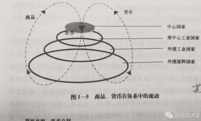

资料来源：笔者自制。

先从中国人民大学翟东升教授《货币、权力与人》书中的一个图片说起。

**中心国家：** 目前全世界的200多个国家中，处于中心国家地位的，无疑是美国。到21世纪初，美国出口最多的东西不是商品或服务，而是美元信用。其次是各种无形资产，比如品牌使用权、特许权、好莱坞、商业模式等，至于粮食、军火等实物与前肴相比，要小的多。

这个相当于我们社会生活中的权责阶层，官员。

政府出具的批文、授权、特许权、各类资质许可，像太阳一样温暖着围绕着他的行星，不同等级一般在不同的位置，离太阳越远的行星越冷，与太阳越近的行星越热。

当年胡雪岩曾说：官家、洋行、江湖联手，才是大生意。

这也是这么多年来，一直到现在，中国人热衷考公务员的原因之一。

政府是什么？政府是由一个一个人组成的。都想成为太阳的一部分。

一将功成万骨枯。

这条路，太窄了，不适合我们普通人。

**准中心工业国家：**

紧邻美国内核的是欧日，向全世界提供高端工业品与服务，既有像美国一样货币出口和虚拟经济，又保留了外围国家的制造业。

有百年的资本积累、技术积累、专利优势，是依靠理性和纪律生存的国家。

这一种在我们社会里是怎样的存在？

专业人士。

比如：律师、医生、注册会计师、建筑设计师、工程师、专业运动员等。

专业人士的成功要素是什么？

长期的教育积累、理性和纪律，和前者依靠对暴力的垄断而获得权威不同，专业人士也有权威，但是这个权威来自于技术、专业能力。

这个阶层应该是我们普通人，通过努力，勤奋、刻苦、时间的不懈积累，向着一个方向不断发起攻击，获得成功的概率最大的。

达叔觉得，聪明的人其实不可怕，因为大部分人IQ、EQ的差距不大，真正可怕的是那群能十年如一日拥有超强专注力和态度的人。这群人才是最可怕的。

而专业人士，基本是就是这一波人。时间，就是最大的壁垒。

达叔希望我们自己能够在自己的领域里，成为专业人士。

如果可以的话，把下一代也往这个方向培养。

有人会问：

达叔，既然都是专业人士，那为什么专业运动员比如篮球明星比医生赚的多得多？

能问出这样问题的朋友，都是聪慧之人。

这就是商业案例里的，你能把你的产品或服务如何尽量扩大消费群体、极低成本地覆盖更多消费者。

顶级运动员比医生赚的多，这个现象是什么时侯出现的？

对，是在有电视转播之后，有电视转播、各种网络直播，同样的一场比赛，不仅可以卖几千张场馆的门票，更可以通过电视全世界直播和录播，从而以极低成本覆盖全世界，从而获得了转播费、代言费、转会费等巨额收入。

在这之前，即使是奥运会级别的运动员，都是兼职的。

但目前的弊端是什么？

弊端是流量越发向顶级运动员倾斜，一个顶级足球运动员和一个普通足球运动的差异是巨大的。

头部竞争激烈，赢家通吃。

**外围工业国：**

与欧日第二层国家相比，第三层的国家主要从事劳动密集型行业，这一类生存者世界上最多的人口。

相比之下，技术更简单，产品和服务的复杂度更低，缺少核心技术和专利。

这个层级里有南非、墨西哥、巴西、土耳其、东欧等，中国直到目前也处于这一行业，且正在努力产业升级到第二等级，也就是2025计划。

这类国家想要成功的特质是什么？

勤劳与节约，逐步完成原始积累。

这在我们社会中的人群大概是哪些？

普通白领、蓝领工人等职业，依靠勤劳而谋生。

停在这个层级的人员，收入一直上不去，有明显的天花板，为什么？

和第三层级国家产品卖不上价格一样，技术简单、服务复杂程度低、缺少核心技术。

如果不解决替代性问题，始终无法完成阶层的跨越。

这个层级中的人，也最容易对现实表现出愤怒。

达叔觉得我们在谈论一个事情的时候，不宜在分析中牵涉太多价值判断，应该花更多的精力去分析其结构与变迁，重在探讨“是什么”，“为什么”，“怎么办”，而不是沉迷于表达愤怒和抗议。

市场是增量变革与存量调整之间的有机统一，既要看到结构存在的合理性，也要看到新的可能性。

比如：达叔说中心城市房价可能要涨，有人就怨说自己还不起房贷；

有人让达叔去看看90后的存款，举的例子是自己没存款。

这种思维，以后不仅买不起房，估计连租房都困难。

每个行业都能赚钱，每个行业底部都有它的逻辑和玩法，你能看到多少？取决于你的工种，在这个行业里接触多少人，了解的有多深，做更多的连接，工作要每一个月每一年都有积累。积累才是一个复利的概念。

达叔举个例子，开个烧鸡店，是不是很简单？

如果你的烧鸡店能够盈利，你觉得大概的利润率是多少？

是否有改善的空间？

利润=营收-成本，

营收方面可以开拓外卖平台提高点单率、直播平台直播做烧鸡、开办烧鸡培训班收教徒弟，每个月带四个，学费5000元/个，包教会，收入增加2万/月，收徒条件，不能在一个区域内开。

开源节流，任何一个工作都有开源的方法，就看你想不想去做，有志者可以找达叔来讨论。

降低成本的方案还有很多，根据二八原则，根据精益管理思路进行拆解，达叔下次讲解，适用于生意，也适用于打工。

**外围原料国家：**

这类国家地表面积最大，中东、拉美、南亚、非洲、俄罗斯、中亚等大量经济体都处于这一层次。这个可能和大家想象不一样，对的，俄罗斯目前在经济结构上也属于外围原料国家，最后一个等级。

向世界提供能源和原材料，几乎没有像样的工业产品出售，主要收入靠土地。

这个层级像哪类达叔就不展开讨论了，容易冒犯到。但是中国城乡二元结构，改革进展缓慢，很大程度上就是被当做劳动力的蓄水池、社会的稳定器。

历次经济危机成本最终很大都是转嫁到了这里。

收入靠土地上的农产品，而农产品的价格始终卖不上去。

这里的人，跨到第三阶层相对来说也是最容易的，只是看决心而已。

以上，就是今天达叔和各位探讨的话题。

## 第三十篇 SK4# 从电梯理论，找寻自己的势能。

达叔生于农村，从小就有一种奇怪的想法，要去上海，感觉去了上海就能变成首富。

虽然现在距离首富的距离，是越来越远了，但看着目前的资产，以及每年的收入能达到“知乎的平均水平”。

分享一下心路历程：

达叔所在的行业是阳光且灰色的行业，进入这个行业也是刚毕业一年，稀里糊涂的拜猎头所赐，有句话叫“只怕人错行”，很多人没有意识到这句话的意义、平时嘴边说，严重忽略它对你人生的影响。

达叔琢磨一个理论叫：电梯理论。

你所处的城市，你所处的行业，就是你的电梯，就是你的势能，你能走多高，除了个人的努力，很大程度上靠这两个电梯。

但很多刚毕业的大学生，身边并无良师益友进行指导，浑浑噩噩也就到了三十，蹉跎一生。

达叔建议，年轻人如果想出头，要去大城市、要去朝阳的行业，要去做与人打交道的工种，（即使你是理工男，也建议你尝试多做与人打交道的工种）。

大城市：北上广深是首选，剩下的杭宁成渝等新一线，在未来都会创造无数的中产阶级和新贵阶层。

赶紧研究一下自己所在的行业，和哪个城市更匹配，现在还来得及。

不要觉得房价高，未来会更高，当然你可以不信，但再过十年来看，现实会啪啪的打谁的脸。

达叔绝大部分资产都在楼市里，分布在长三角，未来主要布局沪宁杭苏南，也懒得和杠精争。

作为单体个人，这个有可能是你唯一一可以比较高效利用杠杆的领域。

怎么理解？

问自己几个问题：

三十年前，村里的万元户就是全村的骄傲，现在谁再说是万元户是不是傻？

人还是那个人，工作还是那个工作，只是时间发生了变化而已。

有一个叫罗胖的家伙，号召各位“做时间的朋友”。

达叔就不讲深奥的贷款时长、利率等问题了。

就问各位希不希望三十年前，自己的爸妈借了一万元买了不动产，贷款到现在在？

如果希望，你未来的孩子也是这么想的。

而且你未来的孩子，只要受过教育，收入不会低于100万元人民币/年。

不信，咱们可以打个赌。

当年民国的时候战乱，浙江、江苏有很多难民涌入上海，等建国后，有一部分人因为家里还有几亩地就回去了。

而留下来的，与离开的，到现在基本上就是两个世界的人了。

行业：千万不要轻易换行业，每个行业都能赚钱，每个行业底部都有它的逻辑和玩法，你能看到多少？取决于你的工种，在这个行业里接触多少人，了解的有多深，做更多的链接，工作要每一个月每一年都有积累，积累才是一个复利的概念。

达叔看到身边做外贸的，在闽南给国外客户做拖鞋，自己积累了客户，跳出来找代工厂，自己开公司当老板的，两年就开上宝马5系了。

帮老板往国外卖拖拉机的，后来自己积累客户，自己开公司往东欧等国家卖国内的农具、拖拉机、收割机等。

做会计的，自己平时在网上接一些代账业务，自己出来开公司了。

自己参加过一些香港大学生交流项目，摸清楚流程后，毕业自己搞了香港、美国公司的交流项目。

达叔之前说过有一些精益管理的思路，适用于生意，也适用于打工，可以以后好好讲一下。

打工，无论是体制内还是国企、外企、民企。

很多工种都是有时效的，只是很多人没意识到，很多工种都是青春饭，能多赚的时候尽量提高效率多赚钱。

举个简单的问题，看看各位的思考角度：

小萌一个月工资 1 万钱钱，每个月平均支出 8000 元，每月可以存 2000 元钱。

如果小明换一个工作，每月工资 12000 元，请问收入提高了多少？

给你几秒钟思考一下。

一般人的认为是 (12000-10000) / 10000=20%

但是真实的情况是这样么？

我们一般人即使换了个工作，工资涨了两千元，平时的支出应该是基本不变的，那么每个月可以存的钱应该可以有 12000-8000=4000 元了。

原来每年存 24000 元的，现在每年可以存 48000 元了，如果你有结婚买车、买房之类的计划，可以大幅度提高效率，这是青春啊。

放弃虚名：

一些三十多岁的体制内小公务员，总觉得私企小老板矮自己一头，平时对他们毕恭毕敬。

其实恰恰相反，这些小老板只是把你当做个工具而已，为什么对你那么客气？

这是工具说明书就是这么写的，只有这么做，工具才肯听话。

你就是个天猫精灵而已，需要的时候，让唱歌就唱歌。有本事，多赚点钱。

头衔，都是虚幻的，短暂的。

中产阶级和富人的真正区别：

中产阶级的头衔，职位都是无法传承的。而富人的公司、房产等财富是可以传承的。

241

公众号懒人搜索，懒人专属群分享

我们这一代还处于时代剧烈变化的尾部，如果不出意外，还有十年的时间。

相比日本，我们应该是处于昭和时代。

我们的后代会生活在圈层更加固化的时代，演化一个个小圈子，虽然听着好像不合理，但全世界都是这样，中国的古代也是这样。

全世界只有中国的这几十年不是而已。

抓住机会，不要把困难留给下一代，更不要辜负我们这个时代。

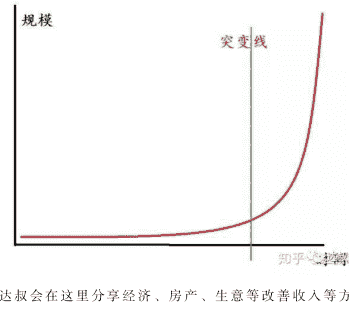

达叔会在这里分享经济、房产、生意等改善收入等方法。

## 第三十一篇 SK5* 娱乐圈是个资本局：明星们的奋斗

各位小伙伴，平时在嗑瓜子刷刷的时候，看着一个个明星乐呵。

有的人羡慕明星，有的人悲悯。

有的明星自始至终都是资本的工具人，被培养、被使用、被抛弃，终其一生。

有的明星从被资本利用、到利用资本、到成为资本的一部分，到自己成为资本。

成长、对赌、命运、崛起、雪藏、陨落，人生大起大落。

弱势群体总感觉全世界都是来欺负自己的。

越是底层的人，越是要面子。

而那些喜剧演员、扮丑、博观众一乐的人，都知道：有钱，可以掩盖了几乎所有的问题。

达叔最近在知乎上写答案，尤其是写：各位要趁着这次疫情，国家大规模新基建，货币增发，势必会引发资产价格上涨，如果可以的话，一定要购买优质资产。

每次写这块，都会引来一群喷子，口吐莲花，哭穷哭惨，仿佛全世界都和他一样惨，国家要崩了。

遇事要冷静，要多研究，每次大萧条的时候，哪些国家崛起了，哪些国家衰落了，哪些行业崛起了，哪些行业衰落了。崛起的行业，我们是否可以去掺和一下？

树挪死，人挪活。

1929-1933 美国大萧条期间，好莱坞崛起，影响至今。

我们来看看中国这批明星，与资本的关系。

达叔希望看这个号的读者，未来都能利用资本赚钱，用资产赚钱，才能实现最后的财务自由。

这一切，就是从别人看娱乐明星，你在看达叔经济学开始的。

天眼查 TIANSHACHA.COM

## 娱乐圈是个资本局

更多高维文章不在公众号小号发或删了

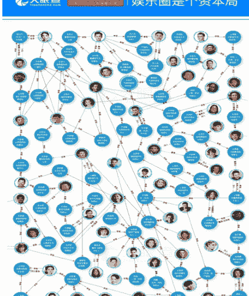

数据来源:天眼查

245

公众号懒人搜索,懒人专属群分享

## 第三十二篇 SK#6 从瑞幸咖啡看被命运女神捉弄的两个男人

达叔对公务员创业，总是高看一眼的。

1952年5月，朱新礼，出生于山东省沂源县。

17年后，在福建屏南，一个叫陆正耀的男孩降生了。

命运女神，对这两个东方男孩的馈赠，都是饮料，而背后的代价都在2020年显现。

1991-1992年，朱新礼，任山东省沂源县外贸委副主任，山东是中国官文化最严重的省份之一，由于岗位的作用，朱先生得以见识国外的先进，也赌定那花花的世 界，就是中国的未来。

1992年，朱先生辞职下海，创立山东淄博汇源食品饮料有限公司。

几个月后，1993年初，朱先生在德国食品博览会上签下500万美元浓缩果汁出口合同，由此摘得第一桶金。500万美元，在万元户都罕见的时代，算是一个天文数字了。

而在这一年，远在石家庄，毕业于北京科技大学的陆正耀已经在公务员的位子上了两年，朝九晚五，对于生性自由的福建人来说，太折磨了。

次年，陆正耀，不顾家人朋友反对，辞职创业，这时陆先生 25 岁。和很多成功的人物一样，陆先生后来回忆说：他像突然被上帝选中一样。

凭借公务员期间熟悉的人脉和领域，陆先生一头扎入通信领域，开的公司“北京华夏天”从事企业 VOIP 业务，拥有中国电信在北京 67% 的市场份额。

体制内的人，所看到的世界，比我们普通人更全面，也更冷静。尤其是 92 派的创业者，对人性的把握极其精准，暗中观察，潜伏许久，很少打没把握的仗。

2020 年 3 月 17 日，疫情期间，汇源果汁未能按期支付一笔年息 6.5% 的优先票据利息，构成违约。一个月前，朱先生退出了汇源董事会。

朱先生收到了多封限制消费令，41 亿资产遭冻结，“失信被执行人”至今未解除，今年他 68 岁了。

2020 年 4 月，这个奉行“爱烧才会赢”的狮子座男人，陆先生迎来了他人生命中最重要的一道坎。瑞幸咖啡董事长，财务造假，美股暴跌 80%，虽然手下的小弟站出来扛了最大的雷。

但美国资本市场的怒火，怕是很多人想象不到的，尤其是在疫情期间，瑞幸告急、神州动荡。

很多人都是做了一回人生的过山车，最终以失败收场。

而很多生意的最终模式：找风口、烧钱、做业绩、上市、套现走人。

每一步都无比凶险，倒在最后一步的人，是不是都带着原罪，被命运女神狠狠捉弄了一番？

眼见他起高楼，眼见他宴宾客，眼见他楼塌了。

东方的神仙水。

而作为普通人的我们，该如何过完我们平凡的一生呢？

## 第三十三篇 SK#7 从发展中国家的困境与崛起思考个人的跃迁

达叔最近在读书的时候，思考到一个问题，就是国家、公司、社会组织和个人一样，都是一个复杂的有机体。

截止到 2020 年，全球有 233 个国家和地区。

从美洲大发现以来，世界陆续崛起了一批霸主和发达国家。五百年，真正能够实现逆天改命的国家，寥寥无几。

尤其是二战之后，资讯异常发达，全球的发展模式也基本都是打明牌了，为什么绝大多数发展中国家还是如此穷困，无法实现跃迁呢？

达叔从发展中国家的困境入手，尝试抽丝剥茧来梳理一番，再对比个人，看看是否有助于我们的成长。

- 1、资本缺乏：这如同我们很多人生在贫困家庭一样，资金匮乏，明知道很多投资机会和赚钱机会，却无力投资，活生生错过一个又一个赚钱的机会。
- 2、技术缺乏：掌握一门技术，尤其是高科技技术是要有时间浸润和积累的，时间很多时候是最大的壁垒之一。而且掌握技术的发达国家至今都没有任何一个国家会轻易向发展中国家转让技术，哪怕中国实行用“市场换技术”的路线，得到的核心技术也寥寥。
- 3、人才匮乏：这么多年来，看的人越多，达叔越感慨真的是有天才。但在人才方面，更容易产生悖论：穷的国家、教育一般不会好到哪里去，技术缺乏的国家，传授的知识更可能是过时的。如果要学到最先进的知识，必然是把人才送到发达国家，人才刻苦学成之后，人的本能就是追求更美好的生活，留在发达国家是个大概率事件，回国报效的是少数。如果像中国和印度这样的，人口基数大，那么回流的数量再稍微可观一些，如果是小国，基本就崩了。
- 4、制度落后，治理混乱：很多发展中国家的困境是管理水平有限，资本匮乏、人才匮乏、技术匮乏，与制度落后，治理混乱，互为因果，相互牵制。比如：发展中国家的有志人才，从发达国家学成归来，一腔热血要报效祖国，但是由于资本、制度、基础设施严重缺乏，才华无法全部发挥出来，部门之间相互甩锅，成就大打折扣。时间久了，成果寥寥，原本享有的政治信任和政策支持逐渐消失，热血渐凉，远走他乡。

四个互为因果，相互牵制的因素，导致国家和个人的阶层之间都存在着明显的“马太效应”，强者越强、弱者越弱，富者越富、贫者越贫。

只有少数的几个国家，实现了逆变，从一穷二白落后挨打的国家，变成了强国，达叔以我们熟悉的中国为例，是如何做到的呢？

首先是改革开放，就是说不能一个人闭门造车，要融入社会、和大家一起玩，看看大家都做些什么学一些，其他人都需要才去卖一点，有买有卖才能赚钱。

“三外路线”：外资、外贸、外汇。

上面的四个要素，互为因果、相互牵制，貌似进入了一个死循环，如果想要实现突破，整体上立马改观肯定是不现实的。

中国选择的是利用外资（解决资本匮乏问题），给予外资超国民待遇，免税、低息贷款、良好的土地政策等等。

拼命发展外贸：这一招加工贸易，日本+亚洲四小龙都成功尝试过，盯着血汗工厂的骂名，解决了上亿的富余劳动力就业问题。也初步实现了技术积累和资本的原始积累，更重要的是培训了天量的熟练技术工人，成为国际竞争中罕见的竞争力。

强制结汇：当时我国一穷二白，外汇紧张，采用这一外汇管制手段，凡是企业出口收进的外汇，不能保留，一律要在银行强制兑换成人民币。换而言之就是要把外汇给国家，国家再拿着外汇满世界的买东西。这一政策，有很多诟病，但无疑给国力的成长带来了很多的益处。

增长迅速的巨额外汇，在中美之间也形成了一定的金融恐怖平衡，一定程度上弥补了中国在军事上的弱势，给安全带来一定的益处。

但这一过程，很多普通的民众是痛苦、需要忍耐的。

三外路线的本质是什么呢？有哪些可以供我们作为个人可以借鉴的？

如果没有资本、没有技术、学历不高、家庭一般，要努力寻找单点突破。

- 要么沉下心来好好学习，趁着年轻刷学历，这是穷苦人家跻身中产阶级最便捷的门路之一。毕业以后保持终身学习态度的人，一般不会混的太差，更多的是实现了阶层的跃迁，毕竟太多人毕业后就再也没认真读过一本书。
- 要么努力钻研一门扎实的技术，在技术路线上实现突破，成为细分行业的佼佼者，甚至是所谓的工匠精神，这一生也会过的不错，毕竟现在愿意为好东西付钱的人越来越多。
- 懂得融资，向金融机构融资、向未来融资，这一点很多人认为负债是一件很可耻的事，尤其是老一辈，以没有债务为荣。在达叔前面文章中有提到，纸币时代，长期温和的通胀是刺激经济的有效手段，如果可以的话，一定要构建一定数量价格较低的贷款比如房贷等，作为资产之一，对通胀实现对冲。
- 最后，要忍耐，一夜暴富大概率不属于关注这个账号的人，沿着正确的方向，慢慢做，等待时间的回报。

## 第三十四篇 SK#8 达叔经济学账号的成长和思考

2020 年 2 月 22 日，达叔在知乎上回复了一个关于医疗的话题，到现在为止，阅读数 100，点赞 0，喜欢 0，评论 0，收藏 0.

但这并不妨碍，达叔经济学这个账号的成长和坚持。

一场突如其来的疫情，让闲着在家的达叔，决心长期坚持做个自己的账号，阵地目前只有两个，一个是知乎，一个是这个微信公众号，名字都叫 达叔经济学。

达叔的口号很简单，也很庸俗，“让我们一起慢慢变富”。

到今天为止，两个半月了，给大家汇报一下阶段性的成果：

- 1、知乎账号进展：

  - 粉丝量：4568 个，获赞数：37476 个，喜欢数：2872 个，收藏数：3470 个。

有以下几个感慨：

- 1）、遇到了很多有意思的伙伴，这点和达叔当年开这两个号的初衷有一定的重叠，生意的本质是交换，而产生交换的前提是发生链接。如何产生链接？知乎和这个公众号就是我们之间很好的一次链接。未来我们可能会一起分享一本书，一起操作一个项目，达叔对经济、医疗、投资房地产、长三角城市群几个领域熟悉，开过公司，也有一点心得，有机会可以多交流。
- 2）、做内容输出的自媒体是挺不容易的。达叔平时时间自由，但还是有点懒散，目前只能做到每天在知乎回答几个问题，但经常犯懒就不在这个号里写文章了，这一点要改，给自己立个规矩：

> 以后每天要在这个达叔经济学的微信公众号号里更新一遍原创文章，如果做不到，请加达叔个人微信：Uncle-Da9，来要红包，做不到的，只要你监督了，红包必发。这个达叔说到做到。

- 3）、平台在言论管理上还是很严的。有一些政策莫名其妙，达叔自认为还是一个很守规矩的创作者，也很文明，至少没有在主观上有任何挑拨的意思。但每个月还是有好几次被删帖，或被要求修改，这个还是很打击创作积极性的。
- 4）、网络喷子还真挺多。达叔一直很好奇杠精的心理的，达叔平时要是看到不喜欢或不认可的文章，扭头就走了。一点时间都不会浪费，哪有那个闲工夫和他辩论扯，但还真有这种神神叨叨的家伙，达叔真想对Ta向时间管理大师好好学习一下时间和精力管理。
- 5）、自我的成长。达叔以前最多发发朋友圈，感慨一下自己平时的思考和心得，开始写知乎和公众号后，开始变得有系统的看书，也更有系统的进行输出。也有出版社预约《达叔经济学》的出版了，达叔近期正在筹备中，希望尽快和大家见面。

- 2、达叔经济学 公众号情况：

非常惨淡，目前关注者只有：171人。

发表的文章数量：14篇，最高单篇阅读量：85。

比胡子要差好多，要么是达叔太懒了，要么就是达叔的技能不行，没有找到玩公众号的方法。

如果你有相关的技能或者相关的运营技巧，请联系达叔，微信号 uncle-da9，请不吝赐教，术业有专攻，咱们一起进步，一起慢慢变富。

一旦有用，达叔刻的不会，发红包还是很舍得，欢迎来聊。

最后说两个小事情：

- 1、达叔开始创作，是无间间受了一个 UP 主 半佛仙人的启发。达叔开通了知乎后，也专门给他发私信了，这个大 V 还没回反达叔，但达叔未米要是也成为了大 V，在某个场合和他见面的时候，会给他一个拥抱的。
- 2、达叔给自己人生目标是资产过亿，虽然只是王健林的一个小目标，但是达叔从一穷二白的农村起家，资质平平，靠自己的努力奋斗，达到这个小目标，现在还有 90% 未完成，看似遥遥无期，但是达叔会继续努力的。

真正极度渴望成功的人并不多，愿付非凡代价的人就更少了。

达叔愿意忍耐五年、坚持五年，就相当于又上了一个大学。

在这期间，如果有什么想和达叔沟通的，欢迎加微信联系，平时可能在忙，但看到的话肯定会回复的。

希望有一天，你能比较自豪的说，这个家伙当年可怜了，我看他号的时候，他才 171 个粉丝呢。

达叔因为这篇文章，被知乎莫名其妙地禁言了7天，胸闷啊，本来想写一个“刑名不具”看空知乎的，但还是想了一下还是要把自己辛苦写的内容发在自己的账号上。

达叔是长期投资长三角楼市的，坚定的多军。但题主的问题是除了股票和住宅。

还有什么？达叔刚才吃饭的时候，想了一会。

答案如下：

投资的本质是：

认知差 & 信息差，加上一个时间维度的时间差进行交割，完成获利。

一、认知差：

就是别人觉得这破玩意肯定没戏，不值钱、到顶了、要暴跌、是泡沫，但你判断出这个值钱、被低估、还能涨，你投资入手了，如果还能上点杠杆，那么就更赚钱了。

楼市里的多空对决，就是基于这个的认知判断，股票更是如此，涨涨跌跌更高频、更直观，所以也更好理解。

那么除了股票和住宅，还有啥呢？

这就要看你具体精通的领域了：

因为你要想持续的赚钱，基本上你只能赚比你傻的人的钱。

而每个人的禀赋、经历、专业，熟悉的领域都是不一样的，伟大的物理学家、数学家、万有引力的牛顿爵士在课本上折磨了无数青少年，在金融市场上被毒打的不成样子。

如果你对农业领域懂，你就研究一下最近土地流转，回到自己的家乡，承包几百亩农田，整个无人机播种、机械化大生产。

这个句子里重点不是无人机、不是机械化大生产，是土地流转和自己的家乡，因为你的基本盘才是你能量的源泉。

你跑到人生地不熟的地方，分分钟被当地人教你重新做人。

其他行业类似。

达叔举个自己上学时的惨痛例子：

达叔是某铜臭气息浓重的高校毕业的，上学那会做了很多生意，其中一个是关于运动鞋的。

整个过程是：

当时58同城刚兴起没多久，学弟在上面看到一批运动鞋，耐克 的，50 元一双，共600双，我们心想这成色的鞋子拿回来肯定能卖100元以上一双啊。

于是三个人，每人凑一万，就把货给拉回来了。

心酸的卖货过程就不提了，重点提的是，进入这个运动鞋的领域之后才发现，这批货 15 元左右就能从莆田拿到，十几年过去了，一直是达叔心中的一个阴影。

从那以后，达叔每次要做任何生意，都是要先花一年以上的时间做详尽调研。

后来一批自己卖掉，一批批发给其他学校的小伙伴卖，最后还剩一批亏本卖给了其他鞋店和劳保店。

折腾了十个月，没赚到一分钱。

举这个例子，就是想证明认知差，不熟不做，找自己专业的。

## 二、信息差

为了方便，达叔还是以上面土地流转和承包为例子，以前但凡和农业搭边的生意基本上都不太赚钱，赚钱也是辛苦钱。

因为城乡二元结构，榨取农业价值、补贴工业化和现代化的大政方针，就注定了你赚不到什么钱，当然如果你有赚钱的例子，那是你真的牛。

江湖上有句话，腰缠万贯带毛的不算，哪怕是畜牧业、养殖业，也不太赚钱。

这就是目前的基本共识，但是国家在现在要搞的新农村建设，土地流转和承包，目前的现状、以及所谓的共识，会被改变么？能被改变么？

看着像是一个认知差的问题，更重要的是涉及信息差。

土地是财富之母，这个改革的方向未来大概率是能成的，但具体该怎么承包、怎么搞？估计只有体制内的人能弄清楚。

如果你是体制内的、或者你能接触上这块体制内的，你就能比别人掌握更多的信息、更多的细节、更多可行性的方案。

比如配套的金融政策、财政补贴、税收政策等等，你一旦更快掌握，就是非常大的优势。

这就是信息差，等别人都知道了，土地是稀缺的、具有排他性，你承包了，别人就没法承包，等别人刚知道怎么玩，就已经承包完了。

很多领域都是这样的，比如达叔比较熟悉的某领域，很多外行人在一些招标网站上，看到这个设备招标、那个耗材招标，小的几十万，大的几百万上千万。

只要是你看得到，都是别人很早之前就把参数写好了，找到渠道提交上去的，甚至基本上都已经确定是谁中标的，你看到也没啥用，除非你有办法能够冲标。

你找一个领域先沉下去。

因为沉下去、才能浮上来，找到自己先能拿到一手信息的领域，赚信息差，这也是很多体制内人员出来创业成功率高一些的原因之一。

当然也是达叔对很多人称呼学习股神巴菲特嗤之以鼻的原因之一，人家股神长期玩的是股市的一级市场。你玩二级市场的人，掌握的信息都属于被咀嚼过无数次的公开信息，没了信息差，被收割的概率当然就很大了。

公开信息---半公开信息---隐秘/秘密，谁掌握的更进一步，谁亏的更少、赚的更多。

否则特朗普的幕僚官员们怎么在美股熔断暴跌前精准成功抛售逃顶呢？

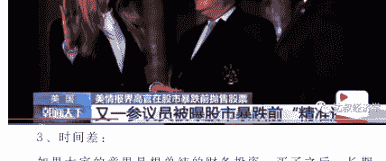

## 3、时间差

如果大家的意思是想单纯的财务投资，买了之后，长期持有，等 N 年之后能够有收获的。

那估计就是投资一些创业团队、赌比特币之类的了。

这个太刺激了，还有别的么？

达叔见过身边人不停买茅台的，不是买茅台的股票，是正儿八经的一箱一箱买茅台存起来，留好所有凭证，得证明这是真的，前些年投资的，还真是赚的，可不可以继续操作呢？至少这朋友还是继续这么玩的。

达叔做微信里有一朋友是专门玩作家签名书的，专门找知名作家搞签名书，一签签几百本，找 N 个知名作家，然后弄一套签名书，比如：莫言的、陈忠实的、路遥的、贾平凹的等等，赌什么？

赌这些作家获奖或者未来过世之后作品的涨幅。

这个方案听着好像不太好听，赌人家过世，但是如果达叔手里有一批：鲁、郭、茅、巴、老、曹，民国六个大师的签名书，总共 200 套，你说值多少钱？

尤其是在礼品市场和收藏市场，当做礼品送给领导，那也是天价吧？

如果是张爱玲、王小波、徐志摩、海子、顾城的呢？值钱不值钱？

以此类推到其他字画等 IP 领域了，但是赌输了也是很惨的，但毕竟不是什么大钱嘛。

说到这里了，赶紧去联系一下安妮宝贝、郭敬明吧。其他的比如指数基金定投、黄金呢？看个人爱好吧，这两个领域也是大家都比较熟悉的。

当然最后，最关键的投资，还是投资自己的大脑。

嗯，今年的瓜太多了，达叔都快吃饱了，一个接一个，快吃不过来了。

# 中国银行原油宝

新冠疫情、全民抗疫、美股熔断、美帝甩锅、蒋凡出轨、油价暴跌、原油期货出现负数。。。

这些所有的瓜，本来以为就是在家里吃吃，结果一个中行原油宝把一大波中产阶级打翻在地，不仅收益没了，本金也没了，不仅本金没了，还倒欠中国银行几十千万，这在整个网络就掀起了轩然大波。

整个网络上乱作一锅，有的讨论如何拿回本金的，有的讨论如何不交这几十万倒欠款的。

这次事件舆论的主角是中国银行，中国四大行之一，其热闹的程度，甚至比当年P2P集中暴雷还要热闹。

因为在老百姓的眼里，这些银行是专业的，是有职业操守的，是值得信赖的。

# 中信银行池子吵

当时达拉就想撰文和各位探讨一下，任何一个组织看着强大、专业，但内部都是由一个又一个人组成。只要是**人**，就有自己内心的欲望，就有自己的利益考量，而这个人的利益有时候与组织的利益一致，有时候又与组织的利益相悖。

比如中信银行和搞笑艺人池子的大战，本来只是人家池子和笑果文化的骂战，又是一个万万没想到，战火竟然还能烧到一个银行？

不仅烧到了，池子还给中信银行**发律师函了**。

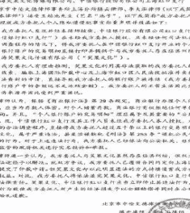

这出闹剧就像两个人吵架：

> 笑笑：池子，你不是人，你赔钱，你道歉。

池子：笑果，你不是人，你赔偿，你道歉。

啪，中信银路过，倒地：对不起，我道歉。

中信银行
5-7 00:56 来自微博 weibo.com

# 致歉信

关于王越池先生（艺名“池子”）通过微博反映其个人账户交易信息被调取一事，经我行核实，近期上海笑果文化传媒有限公司联系开户支行，要求查询其为员工王越池先生支付劳务工资记录时，我员工未严格按照规定办理，提供了王先生的收款记录。对此，我们向王先生郑重道歉！

我行已按制度规定对相关员工予以处分，并对支行行长予以撤职。

保护客户信息安全是我行秉持的服务宗旨，也是银行的生命线。在客户信息保护方面，我行建立了一整套制度及流程，但个别员工未严格按照制度操作，反映出我行个别机构在制度执行上不到位。我行将举一反三，全面检查，加大培训，强化制度执行，坚决避免此类问题再次发生，切实保护金融消费者合法权益。

真诚欢迎社会各界继续对我行进行监督，感谢大家的关心与支持！

中信银行股份有限公司
2020年5月7日

不仅仅道歉，还把支行行长给开除了，围观的人可能觉得这次开除的是行长？

多少还有一点意外，没找个临时工来背锅

# 背锅的艺术

在普通人看来银行行长是个厉害的角色，但是在银行眼中，一个支行的行长也是个打工的，只是高级点而已，高级点也是打工的。

我们都知道在中国，隐私是一件比较奢侈的事情，我们的个人信息可能被各种软件、商家、金融业黑产倒卖过很多回了。但是像这次这么玄幻的，达叔还是第一次见。

一个出卖你个人隐私数据的、把你的信息又打印好快递给了你，仿佛生怕你不知道一样，这这么也太欺负人了。

但是欺负的如果不是池子这样有影响力的人呢？是不是反击起来，也挺费劲的？

那么中信银行、金融业连小学生都知道是以“信用”为业，为啥要把池子的个人信息，在未经其知情和同意的情況下，打印给别人的呢？尤其是还对池子不利的一方。

如果是中信银行，那是一点这么做的理由都没有的，笑笑算个毛，犯不着嘛。

但是正如达叔开头说的，任何一个组织都是由个人组成的，个人的利益未必是组织的利益一致的。

比如这个支行行长，他的利益就来自他的位子。他的位子就来自于他能掌握多少大客户，在他领导下的这个支行能够获得多大的存款和利润，对于这个行长，笑果文化就是个大客户了。

他的对手很多时候不是农业银行、不是建设银行，更多时候就是中信银行的其他支行，现在还没有笑果文化逼迫行长就范的证据，但是行长为了这事以身犯险，连累了整个中信银行，这事够喝一壶的了。

毕竟中信银行要快把这个事平息下来，支行的行长人选到处都是，在中信银行大资本的眼里，支行行长背起这个锅，大小正合适。

# 我们在探讨什么？

上面是达叔想和你探讨的么？

不是。

达叔真正想和各位探讨的是，黑产和潜规则无处不在，世界在各个角落充斥着“二八原则”。

有钱的大客户，可以掌握更多的信息，甚至有各种渠道的人主动送消息、送情报，而普通客户都是后知后觉，很多时候都收到了，都不知道。

这个世界会好么？这是文艺青年们问的问题。

我们该如何变得更好，这是达叔想和各位一起探讨的。

关注达叔经济学，让我们一起慢慢变富。

达叔准备在下一篇文章中，和各位一起探讨疫情中有哪些发财的机会，如果你有观察的生意机会，欢迎和达叔探讨。

# 第三十七篇 SK#11 21年前的今天你在做什么？现在呢？

# 21年前的今天，塞尔维亚

当地时间 1999 年 5 月 7 日，中国驻南联盟大使馆遭到袭击，造成 3 名记者遇难、20 多位外交人员受伤。

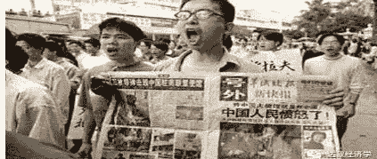

那一年，达叔正在学，比较懵懂，有说不清的委屈和愤怒，无处发泄。

后来，滚滚红尘中，达叔学了经济学，整个中国经济学界至今的主流理论主要都是舶来品，区别只是苏式的，还是美式的。

前三十年，学习苏联模式，我们做了人类最大规模的人性实验，追求公平。

后四十年，学习美国模式，追求效率，基建狂魔，GDP狂刷到世界第二大，如果按照购买力平价PPP来计算，中国已是经济第一大国。

但这个国家一直都是韬光养晦，息事宁人，所有的愤怒，都止步于抗议。

# 最近几年，我们的变化

当我们建海军航母的时候，有人说航母太烧钱了，这样做不经济。

当我们在巴基斯坦建港口、修能源运输线的时候，有人说马六甲挺好的，这样做不经济。

当我们搞南水北调、西气东输的时候，有人说耗资巨大、回本慢，这样做不经济。

当我们从俄罗斯、中亚铺多条输油管道，实现能源多元化的时候，有人说价格不好，不经济。

当我们建洋山深水港的时候，有人说旁边就是宁波港，附近还有釜山港，重叠了，不经济。

当我们改革开放的时候，是技工贸还是贸工技路线的时候，所有公知都嘲笑走技工贸的，认为是再造了一遍轮子，不经济。

当我们造高铁、造大飞机的时候，有人说高铁是成熟技术，大飞机有波音、空客，市场都饱和了，不经济。

反腐教育我们，国际秩序是文明的、负责任的、自由的、民主的，野蛮的时代过去了。

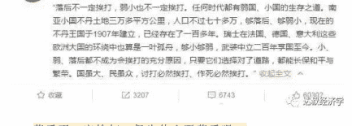

落后不一定挨打？但为什么要落后呢？

21 后的今天，全球还笼罩在新冠疫情阴影之下，全世界的经济都未复苏。

美帝就已经开始按耐不住心中的骚操作，一顿乱甩锅，试图挑事了。

官学产媒四大领域，都开始认真思考全球化的时代正式倒退了，纷纷扰扰的大 V 们在表述着各种观点，有的乐观，有的悲观。

但是，环球时报的胡锡进发了个微博，可能预示着我们在最危险的时刻正在到来。

# **胡锡进**

今天08:48 来自 HUAWEI P30 Pro 已编辑
中国需要在较短的时间里将核弹头数量扩大到千枚的水平，包括至少要有100枚东风-41核导弹等。我们热爱和平，有不敢先使用核武器的承诺；但我们需要有更大的核武器库来制约美国的战略野心和对华冷战。也许过不了多久，我们还需要有更强的意志来应对对挑拨，而那样的意志离不开东风和巨浪家族的支撑。

别太幼稚了，别以为核弹头平时没用，我们天天都在使用它们，就用以塑造美国精英们对中国的态度。我听到有专家说，核武器够用就行了。我觉得他们像孩童一样天真。

有人会因为这个帖子骂老胡是战争狂，他们应该去这样骂那些公开为中国放软炮的美国政客。老胡永远希望中美友好相处，但国家间的和平是不可求来的，需要核弹工具来塑造。尤其是，我们国策层与基本不具有理性的美国反华派的互动，对方只相信实力。其实我们没多少时间继续谈不该增加核弹头扯话，我们需要只争朝夕做这件事。收起全文 >

达叔不知道胡老师能发表这样的言论，是嗅到了什么气味，但背后的含义肯定是不简单的。

毕竟，这让达叔想起了疫情期间美国华人圈子里的一个段子：

电粮不囤枪，你家是粮仓；
囤枪不囤粮，处处是粮仓；
囤枪屯电粮，你是山大王。

是时候，准备点礼物了，当然达叔祈祷这些礼物我们都用不上，否则大家都别忙活了。

各位和达叔一起居安思危，抽空研究一下战时经济学吧，如何自保，期待国运昌盛。

关注 达叔经济学，让我们一起看多中国、做多中国。

# 美国的骚操作，看傻了一全世界

伴随着几个月的疫情发展，全球经济动荡、地缘政治动荡，如果不出意外的话，肯定会引发一些弱政府倒台。

但是在所有的事件中，美国的表现最亮眼。达叔说的这个亮眼，不仅仅是最后冠绝全球的新冠确诊患者亮眼，其操作手法更是令人耳目一新，大跌眼镜。

我们先来看数据亮眼：

全球确诊 383.6 万，美国一家独占其三分之一，冠绝全球，说好的第一强国呢？

美帝的各种骚操作：

- 宣称是个大流感，新冠会自动走的；
- 不用戴口罩，到最后被逼着带了；
- 各州抢呼吸机等医疗物资都快打起来了，丝毫没有全国一盘棋的样子；
- 懂帝呼吁喝消毒剂，导致中毒人群剧增，随口说是开玩笑的；
- 美帝人民要民主，带着枪上街游行的；
- 到今天最新消息，彭斯、伊万卡助理新冠检测呈阳性，玩笑最终还是开大了。

以上种种，美帝是不是真的傻？

不是，反而是美帝太聪明了

达叔要从权力的角度来分析此事。

权力的本质就是：人如何获得权力，并且长期占有权力。

获得权力，美帝靠的是选票，只要获得多数人的选票即可，剩下的那一部分，不重要！

那么当中国爆发危机的时候，美帝本能的反应就是：造谣、抹黑、攻击中国。

这个才是正事，防不防疫在权力面前真的是次要的，抹黑对手，涉脏水竞选世界里的第一法则。

毕竟政治的真相就是：把对手那边搞的少少的，把自己这边人搞的多多的。

没料到的是，打脸来的太快，刚骂完的对手的措施，自己被逼到要不要抄作业的地步。

扭扭捏捏，得重新编排一下而已，这个是比较被动的。

一边抄作业，一边还是要甩锅，这个双标图，达叔之前分享过。

上演了一波双标后，到底要不要停工、封城？

政治家能做的了主，但是政客不行，只要是脑子正常的政客都不会彻底学习中国，因为他们的位子是在选民投票选出来的。

人民吃着火锅唱着歌，还有舔着马桶嘲笑新冠的，你说封城抗疫？

你这是干涉民众自由，封城令根本发不出去，发出去了，下面一大堆的州长也不会执行，你要是来硬的，必然是大规模游行，疫情没控制住，你就先滚下台了。违宪。

因为美帝人民不愿意。

有太多人分不清什么是目的，什么是手段。

在中国，防疫是目的，所有措施都是手段。

在美帝，当选举获取权力是目的，防疫是手段。

只要目的能达到，手段是可以随时换的。

这就是为什么当时疫情刚来的时候，各州州长带头去唐人街吃饭逛街的原因，注意时间：2020年3月3日。

# 你是美国总统，你的上策是什么？

肯定是马照跑、舞照跳啊，一切照常，完全尊重民意，新冠就是个大流感，人民开心最重要。

等新冠疫情严重了，感染多了，死人了，美帝人民害怕了，要求停工严肃对待了。

那还是要响应人民呼声：新冠真是严重啊，没有人比我懂帝更懂病毒了，我早就说过这个病毒很严重，都怪中国，我给它起个新名字。

你看，主要招数还是泼脏水，只是正着泼还是反着泼的区别。

停工。

刚停工没多久，美帝人民又不干了，没收人了，要自由啊，人民扛着枪又上街了，要复工。

懂帝一看，哎呀我去，复工好啊，我家的酒店集团都快亏死了，那还等啥，赶紧复工吧。

懂帝要的是选票，只要给选票，你们要停工就停工，要复工就复工，其他的都不重要。

跟着懂帝的一票官员们要的是利益，懂帝说啥就干啥，懂帝要是下台了，他们都得滚。

跟着懂帝开个会，多掌握点内幕信息，股市高点逃顶，这个不香么？！

干嘛惹美帝人民生气呢。

# 柏拉图的灵魂之问

两千年前，柏拉图曾经有一个灵魂之问：

> “如果你生病了，你是召集民众一起为你看病呢，还是找一个医术精湛的医生？”

两千年后，两个大国给出了答案，就是现在这个局面。一个是有限责任公司，一个是无限责任公司。

一个是来打工赚钱的职业经理人，干几年就跑了；一个是真把公司当自己家的，要对人民负责。

经济学里有一个著名的名词叫：“代理人风险”：职业经理人的第一目标是自身的利益和安全，而股东收益最大化或企业价值最大化沦为次要目标。

达叔在上一篇文章《池子，好惨一男的；中信，惨么？》里面有提到，组织是有一个个人组成的，个人的利益和组织的利益未必一致，经常会发生个人为了维护自己的利益作出损害组织利益的事情，在中信银行如此，在美国也是如此。这就是“代理人风险”，大家都是聪明人，怎么会傻呢？

达叔前几天去了趟南京，住在总统府附近，在1912的茶馆里见了几个朋友。

其中有一个令达叔感慨，于是有了这篇文章。

这人87年的，今年33岁，做医疗行业，皮肤比较黑，达叔先叫他小黑。

2009年毕业，小黑加入了一家创业型的公司，做体外诊断的，POCT，也就是床旁快速诊断。今年疫情期间又火了一把。

2010年的时候，公司推出新产品，准备冲刺上市，向内部员工开放原始股认购，一块钱一股，可配10万股。

小黑刚毕业一年，每天挣扎在温饱线附近徘徊，一贫如洗。面对这一机会，心里想的是这个破公司，产品太烂了，老板是不是快撑不下去，开始向内搜刮了，主观上不认可，客观上太穷没这十万块钱。

2017年，这家公司上交所主板上市，最高涨到44元，现在每股30元左右徘徊。

达叔问小黑这是一种什么样的感受？小黑说，马太效应，富者越富，穷者越穷。穷的不只是收入和存款，穷的还有视野和判断。

达叔问如果当时你有十万存款，你会认购么？小黑犹豫了一下说，不会。

达叔又问如果你当时的存款是 50 万或 100 万呢？小黑说，那应该会赌一把。

如果当时认购了，10 万就变成了现在的大概 300 万。达叔问，有身边的同事认购了么？小黑说，有好几个。

达叔问，这几年做医疗打工有剩下 300 万的存款么？小黑说，很遗憾，没有。

现在主要的资产构成是？小黑说，前几年在南京凑几十万首付买了个房子，涨了一百多万。

后来，我们就聊了别的生意，这个话题就结束了。

有一本书叫《稀缺》，印度裔美国人写的。

这本书的副标题最有意思，叫“我们是如何陷入贫穷与忙碌的”。

这个领域也是达叔一直研究的，所以早早就看过，但是和小黑聊完后，忍不住再写一篇陈述一下，我们是如何陷入贫穷与忙碌的。

书中陈述的“稀缺”，不仅仅是资源上的稀缺，更是一种心理层面的“稀缺”。

稀缺会俘获一个人的大脑，俘获他的专注力，使他有限的大脑带宽更多的放在了紧急但不重要的事情上，从而忽视了重要但不紧急的事。

比如说达人为什么开始在当打之年、年富力强的时候，开始每天坚持写公众号呢？达人叔希望能够给自己搭建一个与人链接的平台，未来的社会是年轻人的，达人叔希望未来能够投资更多的年轻人，与更多的人产生合作，从而创造价值。

这就是一个重要，但是不紧急的事。

不紧急到什么程度？就是在阅读量很少的时候，粉丝只有千百个的时候，达人还在按部就班的写，达人叔现在一点都不着急，达人叔有这个耐心，达人叔知道这个事情，它很重要。

一个事情按照重要和紧急，可以分成四个象限，如下图所示：

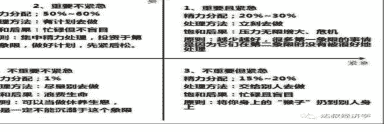

达叔目前立志是写这个号坚持 5 年以上，这个号能够给达叔带来更多的视野和平台，希望我们能在这里认识，在未来某个时间点，产生一定的合作。

比如，昨天有一个在美国西雅图的设计师，加了达叔的微信，聊了几句。

达叔问西雅图那边疫情怎么样，她说东海岸的病毒株据说和欧洲的一样，很毒，西海岸的和武汉的一样，温和一些，所以不严重。很多西雅图的零食店铺已经倒闭了，大型连锁的也有开始申请破产的了。

虽然，目前只是简单聊了几句，但是确立了一个简单的链接，达叔在美国的西雅图就多了一个了解信息的窗口，多了一个朋友。

这个是重要的。

如果你不能像达叔一样，耐着性子坚持下去，那你最好的方法就是联系上达叔，未来通过达叔来链接自己想链接的人和项目。

这个对你来说，很重要，也很稀缺，等达叔未来粉丝变多，链接达到上限，估计也就照顾不到你了。

就像知乎上有一个帖子，在问如何看待阿里底层的码农在 996 加班，蒋总在挥汗如雨的泡小三？

996 的程序员写个代码抢月饼就要被开除，蒋总捕了这么大的妻子却能顺利过关？

如果你看世界的角度一直困在道德的层面，那就很尴尬了，如果你从利益、从可替代性的角度来看，一切就豁然开朗了。

你在组织里拿到的工资，很大程度不是由你的辛苦、你的付出决定的，而是由你的可替代性决定的。

努力的方向，不能搞错。

达叔以前经常问身边的朋友一个问题，杀人为什么要被惩罚？身边的朋友经常是一脸懵逼像个傻瓜的一样看着达叔，这特么也是个问题？

是的，这真的是个问题。绝大部分人从法律，从生命权，甚至从宗教、道德、人伦、秩序的角度去解释。

但是还有一个角度，就是因为杀的不够多。

这是一个哲学和思辨的概念，用在极端的战场上就能够理解，战败的一方因为杀对方杀的不够多，才是战败的一方，因为战败了，所以被惩罚，而杀了更多人的一方是战胜方，获得了战争的解释权、话语权、审判权。

达叔在上一篇文章中，提到一句话“念念不忘，必有回响”。如果每天刷的不是抖音，而是像达叔这样的思考如何创富的文章，建立一整套致富的框架，那么变得更有钱，应该是一个大概率事件。

不要像 996 的程序员一样辛苦，人的认知空间和带宽都是有限的。我们应该把时间更多的去思考认知、智力、框架的提升上。

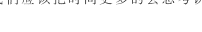

因为没有任何一个事是靠简单的出卖辛苦就能赚到大钱的，达叔分析任何一个项目，一个基本的框架就是：赛道（行业）、赛车（企业）、赛手（操盘者）。

比如知手上有一个海参哥，他在烟台开工厂卖海参，做 的好不好？非常好。但是他的感慨是他所在的朋友圈导致他 有钱就买工厂，但是他有一个朋友跳到了杭州，那边的氛围 是做平台，于是两个人都很聪明，都成功，但是做平台的成功 数量级就是他的几十倍。

这就是赛道的差异，这也是为什么达叔经常呼吁各位好 好选择行业的原因之一。

不要羡慕那些天天蹦迪，到处浪的。达叔前几年在大西 北自驾游的时候，看到了一群又一群骑着自行车穷游的，达 叔不是说要批评这种行为，但是骨子里是真的大不认可。

- 第一、太危险了，悬崖峭壁，道路崎岖，还有大货车， 还下雨，容易出事故，一次事故，骑车的手车基本上就废 了。
- 第二、比较浪费时间，大家出来玩是看风景的，那么从 看风景的角度来说这个效率太低了，如果是单纯来吃苦磨练 意志的，就当达叔没说，你继续嗨呗。

你问达叔，达叔建议你多花点时间琢磨琢磨如何赚钱， 尤其是你时间比较充裕的年轻时代，战斗力、执行力更强， 不要去做这种苦哈哈的感动自己、效率极低的行为，过着愉 快的内心生活。

关注达叔经济学，让我们一起慢慢变富。

你曾经有哪些因为贫穷而没抓到的赚钱机会？比如买房、比如入股、比如创业，欢迎加达叔微信，和达叔聊聊。

## 第四十篇 SK#14 你的公司最后会怎么裁掉你？

疫情影响，公司倒闭、裁员频发，最近达叔身边各个老板都在琢磨着如何不动声色的裁员，有感而发，希望提供一个视角，供各位借鉴。

如果你是老板，看看其他老板是怎么操作的；如果你是员工，看看你老板是怎么玩的。

达叔刚毕业的时候，一腔热血，在上海服务于某世界 500 强公司，名字大家都很熟悉，达叔就不说了。

干了三年多，能拿的奖基本上全拿了，出租房的桌子上都摆不下。

后来一场风波，800 人的团队，裁掉了 600 个，分批裁的，达叔当年是第二批，这一巴掌就把达叔给打醒了。

从此以后，达叔就对拿奖状这个事情特别不感冒，立场坚决的不奖奖状、只要奖金。

一般像 500 强这样的大公司，刚开始还多少要占脸面的，当遇到危险或危急时刻，痛下杀手，也是快刀斩乱麻。

你身边平时吃吃喝喝的同事都是你的对手，因为你们要竞争最后剩下的岗位。

和你称兄道弟的 HR，大概率是板起脸来，公事公办地让你签字走人，从此天各一方。

职场，就是一个大家因际缘会碰巧在某个时间段重叠一起乘坐的公交车，交朋友是很难的。

具体操作步骤：

### 裁员第一招：感情牌。

总部让各个大区和地区经理，把手下的一帮小兄弟召集起来，公司有困难，让裁员。各位给哥一个面子，别弄的太难看。给各位两个月的时间去找工作，我兄弟那边也在招人，给各位推荐一下。

几年的积累，这一轮感情牌，肯定是有用的，全国走了200 个，平乎静静，没有赔偿。

好处是好聚好散，成本便宜。坏处是什么？裁员的效率不高，没法应急。

### 裁员第二招：换岗，美其名曰架构变动。

公司将快要解散的团队，名单拉出来，把公司内部其他部门需要的岗位进行匹配。能主动去积极申请的，并且隔壁部门还要的，当然最好。不要的，估计就要来硬的了。

如果公司大点，经常看到每隔两年都会来一次架构调整，每次调整都会牺牲掉一部分人员。上面的人内斗，下面的派系人员跟着升迁或清除。

公司小点的，基本上就是老板脑袋一热，听朋友一忽悠，或者在外上了个总裁班之类的课，回来就开始架构调整，瞎折腾了

达叔见过把销售部弄过去做市场部、后勤、培训的，这还有点上岸的意味，但把售往后前调到销售部门做炮友的，基本上都自己受不了，跑路了。

有的是异地调动，把北京的安排到上海，上海的安排到山东，这波操作杀伤力也很强的。毕竟达叔很早之前就说过，你的能量来自于你脚下的土壤、你的社会关系，这个一旦断了，过江龙战斗力打七折。

这也是中国历朝历代，推动异地为官、改土归流、流官制的原因之一。你的权力和力量来自于总部授权，而不是来自于自己脚下的土地，那么你就只能乖乖听话，翻不出什么花样来。

几年一轮转、调动，你很难形成自己的势力。权力是一个结构件，只有系统的、有组织的权力结构，相互打配合，才能赚到大钱，其他的都是小钱。

这也是部分地区的人，老实买卖地头蛇，即使总部想给他升官，他都不愿意的原因。如果轮岗、更换地区，那肯定是要离职的

### 第三招：考核标准变更。

达叔举个销售岗为例，正常来说销售岗是以结果为导向的，老板要的是结果，过程虽然看，但不是最重要的。

一个天天在家睡觉，但关系很硬，每个月都能超额完成指标，带来大单了。一个天天在外面跑，累成狗了，收成惨淡，你说老板要哪个？

但是公司要裁员的时候，就会出现一个很有意思的现象，经济学上叫“布雷雁效应”，逆淘汰现象。

公司不仅仅考核 KPI 完成情况，还要重点考核销售的拜访过程，钉钉打卡、汇报路线，准时准点定位等等。

看着这一套组合拳，美其名曰正规化管理，但是谁最先受不了了？那些业绩很好的，关系很硬，能力很强的，很多业务功夫在背后，不是靠这套玩玩玩出来的。

公司搞的这么复杂，纯属折磨人了，业务好的人就会先拜拜了。谁会留下来？恰恰是那些业务差的，反正出去找工作也很难找，公司更看重过程，结果反而没那么重要了，那就好好配合公司做过程，在里面赖着吧。

这波操作，如果只是想优化部门、进行缩编，而不是全部干掉，那么要非常谨慎，很容易最后得不偿失，该走的没走，该留的没留。

### 第四招、单方面解除劳动合同

任何人都是经不住查的，任何人。

公司想裁员的时候，上来查的就是各种报销凭证、发票等，几乎是一查一个准，然后以合规、诚信、企业文化等名义进行裁员，单方面解除劳动合同。

这个招数是经常常用，属于下三滥但高效率的手段，不仅裁员，还羞辱了你，有的还会把这些事和业绩挂钩。

业绩做的好，勤奋的家伙，在这个时候是最吃亏的，如果公司是大规模的裁员，这波人是最吃亏的。

为什么呢？因为你做的多，就错的多，生意做的好，花费就会多，漏洞就会更多。

所以把名单拿出来，按照业绩排名来查，有的时候还能进一步提高裁员效率。

平时苦哈哈，啥也干不出来，老老实实没结果也不报销的，反而能躲过一劫。

其他的比如穿小鞋、挑刺、欺负人、冷处理、拖延报销、当众羞辱等等都是一些个人行为，不在达叔的探讨范围内。

有赔偿的么？有的，稍微靠谱点的会走正常流程 N+3 之类的，这个 N 就是 你的工作年限，赔付你 N+3 个月的工资，双方一别两宽，江湖再见。

有玩砸了，走仲裁和打官司的么？有的，如果你不服气，达叔还是鼓励你拿起法律武器干一下的，但整个流程注意保护好自己，别赔偿没拿到，还把自己给弄进去了。

心存侥幸的人，最后都会吃亏的，趁着年轻，达叔建议早作准备，组织是靠不住的。

中产阶级的焦虑，是无时无刻不在的。达叔接下来会写一些中产阶级创业的投资和创业致富的故事，希望对你有帮助。

## 第四十一篇 SK#15 山西发现的金矿和绿地高管睡了别人的妻子

各位都知道，达叔这个号是研究财富的，那么今天为啥要讨论这两个毫不相关的话题呢？
- 一、今天这两个话题都比较火；
- 二、金矿和女人，都是欲望，都跟钱是高度相关、前者关于获得财富，后者关于守护财富。
达叔就放在一起，好好谈一下。

这是山西金矿的背景材料。
很多人看到金矿，首先是两眼发亮的，但达叔看到后，就心想山西人这下要接着唱凉凉了。
分析问题，不能凭直觉，要尽量去看本质。
“资源的诅咒”。

任何一个地方，包括当年横扫全球的海上马车夫、老牌帝国主义荷兰，

一旦发现大量石油和和天然气，1960s 迅速从制成晶出口的工业国，迅速转向为石油、天然气出口的能源国。

能源国不好么？长期来看，几乎没有一个有好下场的。

因为躺着赚钱带来的幻觉和好处处，让所有执政者都会懒得再去玩又苦又累的制造业。

但是能源、矿产能解决的就业人口是极其少的、尤其是现在高级采矿机械发达的情况下。

只有能源、矿业的产业工人是受益者，其他行业的萧条导致大量失业和贫困，

顶部寡头受益，普通人基本上都是受害者。

中东如此，拉美如此，南非如此，原本身体倍棒的荷兰亦是如此。

祸兮福所倚、福兮祸所伏。

刚要摆脱煤老板的山西人，接下来要迎来土豪金时代了。

山西省可能再次迎来 GDP 的高光时刻，但山西人估计又要凉了。

注意山西省和山西人，是两个概念。想不清楚，就想想沙特王室和人民。

由于能源、矿产带来的丰厚利益，执政者不需要向民众妥协，也无需改善营商环境等。

只要控制几个矿业巨头即可，从而导致所有能源矿业发达的地区都是腐败重灾区。

以前的山西是个什么样，大家都知道了，行政班子整体崩塌了好几次了。

南非发现了钻石、金矿后，南非普通人的生活基本上更崩溃了。

中国一共有 118 个能源型城市，近 70 个都是“荷兰病”患者，具体的名称达叔就罗列了，好几个都是鼎鼎大名，然后要沦为鬼城了。

当然，达叔希望这里说的都是错的，毕竟有金矿对国家还是有利的。

有的时候，整体利益和局部利益经常是不一致的，这个要能分的清。

火箭飞升的时候，一定要分清楚自己是坐在仓里，还是飞一会就扔掉的燃料。如果在仓里就抓紧扶手坐稳了，

找机会往头等座里挤一挤；如果只是燃料，寻找机会，赶紧逃。

聊完了前面赚钱的，再来看看花钱的，这是一今天的奇葩话题。

达叔看了半天其他答主的回答，基本上都关注在绿帽、男主、小三等几秒薯皮上了，太多人就顾着吃瓜，眼睛里就只有男女关系，达叔来把把重点放在行业分析。

地产行业，资金密集型行业，太特么赚钱了，达叔都后悔当年毕业时在同济大学面的某地产，发了 offer 都没去，现在思想太特么沙雕了。

如果当年去了地产行业，早五年开窍，达叔身家还能再翻一番，这就是见识和财富的差别。

框架比努力重要，方向比速度重要，一个人赚的钱，绝大部分都是认知的钱，但凡是辛苦才赚到的钱，统统都是小钱。

谁要是和你说地产行业不行了，达叔是建议你把他拉黑的，这货不是坏就是蠢。

还有人在达叔的回答底下回复说地产行业黄金十年过去了，达叔都懒得理。上面山西发现金矿了，正儿八经的黄金产业，你拿个铲子去挖吧。

一个京律冀事业部销售管理部的总经理，收入近一个亿，这个在达叔身边不算啥，好多外企 GM、CEO、Director 啥的也能有这个数的资产。

但是，这位陈总只是一个区域总而已，相当于其他行业的大区经理，就这个赚钱能力，达叔是佩服的。

进一步证明，还是地产行业好，造富能力强。

各位择业，如果想赚钱，一定要选择离钱近的，金额大的，行业产值高的。

实在不行，就像达叔一样，买几本《胡润排行榜》看看，有钱人在哪，你往挤，就对了。

大老板吃肉，你喝个汤，这汤里一点肉渣，都比苦哈哈行业里的鸡腿大。

但是，这个要分这个女的 3000 万，这就把达叔给震惊了，达叔好奇，是现金还是资产？

要明白，这个区域总，也是个打工的。

绝大部分打工的，即使当上 CEO，本质上还是个打工的。绝大部分收入最后是沉淀在不动产和金融资产里了，要用现金的时候，能凑出个几十万一百万也是不容易的。

这要是现金，那就是霸气了。

如果是现金，那基本上断定都是巨额收入来源不明罪了。

因为现金是灰色地带最好的交易工具，不记名，不可追溯，不入账，很少有痕迹。

杀人越货、贪腐受贿，必备良药。

如果不是现金，是资产，那操作起来就麻烦了，现在连个影子都没有的空头支票，姑娘就开始大言不惭往外无脑吹，

这智商最终很难拿到三千万，即使狗屎运拿到也驾驭不了三千万。

是不是很多人忘了邱成平是怎么白 P 空姐，差点还把空姐给弄进去了的故事了？

各位达叔经济学公众号的读者、未来的成功人士们，听达叔一句劝：

管好下半身。

要是管不好，就去唱歌的地方，以及其他专业场所赞助一下专业人士。

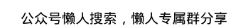

毕竟人家是专业的，收钱办事、服务水准高，也有职业道德，嘴巴也紧，不会出大事。

这种“与曹贼何异”的操作手法，曹操都砸砸了，差点命丧当场，害的身边大将当场死伤。

而且人家曹贼很多时候，是把对手给干掉了，再操作下一步。

陈总这操作顺序就有问题啊。

没拿到许可证，产权都不清晰，直接就施工了，平时拿地也是这么操作的么？

说好的证件齐全再开工呢？

工期再紧，也得按照流程办啊。

还有啊，这个拿地、选地，是个技术活。

这块地感觉是个乱葬岗，风水不好，破财的，你也调查调查，评估一下地价，再上马啊。

现在产生法律纠纷了。

本来是个《故事会》的男女故事，活生生弄成了《今日说法》的反腐故事。

## 第四十二篇 SK#16 这两个家伙是怎么赚到第一桶金的？

今天达叔和两个朋友在上海浦东的碧云社区那边吃牛排，相互聊聊最近都在忙什么。

一个是硕士，达叔在这里简称其硕士了，

另一个不太爱搭理自己，达叔就叫他阿脏了。

硕士是复旦的，本来的志向是做个科学家，后来因导师的问题，没去成美国，然后就不下了。

在外资公司里混着，现在级别做到总监，一年税前收入百来万。

高么？看着有点高，扣完税，在上海日子过得也是紧巴巴的。

达叔问，最近在忙啥呢？

硕士说，忙着催货。

一次疫情就把全球产业链的脆弱，彻底暴露了。

硕士卖的是欧洲的医疗设备，在疫情期间还算是比较畅销的。但是全球的超级大公司，最近这些年都流行一个叫精益管理的策略。

估计丰田的零库存管理的故事，各位应该听说过，因为库存对很多制造业来说是极其占用现金流的，很多制造业的工厂都是被库存拖死的。所以强势的品牌，可以利用自身的

强势地位，把库存压力转嫁给上下游，在零库存的情况下，
保持良好运转，现金流充沛，甚至可以更多的投资。

但是，别忘了，上下游供应商也是一个独立的公司，也
有自身的利益，其产品也有上下游供应商，大家都这么玩，
结果就玩砸了。

中国疫情爆发——需求暴增——订单急剧增加——国外
生产供应不上——国外疫情爆发——需求暴增——欧洲零配
件厂停工——产量暴跌——供应不上。

达叔问，痛苦么？

硕士说，以前都是愁销量不好，卖不掉，今年突然订单
太多，供应不上，现在有几千万款收了，没货，比卖不掉、
更痛苦，每天快被催死了。

达叔问，赚到钱了么？

硕士说，我们外资打工的这批家伙，没赚多少。但是国
企手里有资源、现金流沛、抗疫为名，大棒采购的这批人，
基本上都赚翻了。

达叔问，有浪费么？

硕士说，浪费是必然的，但是要看大局，没人知道抗疫
会持续多久，很多地方是救民先救官，水至清则无鱼，你不
让人家赚钱，你就动员不起来全民抗疫，更调动不起来生产
和高效运送物资。

阿胜插嘴：这就叫不浪费每一次危机，2003年崛起
了一批人，2020年也会崛起一批人。

达叔问，这两批人有什么共同的特点么？

碩士說，很多都是剛上牌桌的年輕人，不怕死，敢賭敢搏，富貴險中求。反而是2003年那批已經富裕的人，看到疫情人心惶惶的時候，胆子都小了，还有的買了机票，跑了美国，钱没赚到，那边却爆发疫情回不来了。

有人辭官回故里，有人星夜赴考場。

达叔取笑碩士，那你这几个月算是白忙活啊。

碩士說，我老婆所在的公司上市了，她名下的股票市值大概1000万。

达叔和阿旺喝了口苏打水，胸闷了。

这个级别的算是碩士的第一桶金了，他夫人赚来的。

碩士和他的夫人，原来都是一家公司的技术人员。

碩士耐不住寂寞，跑出來了，每个月的工资是他夫人的

2~3倍。

但是按照达叔之前文章里赚钱效率的公式，这1000

万，一举超过碩士忙活这么多年。

达叔和阿旺，含情脉脉的看著碩士，以后家庭地位更加不保了。

达叔看着阿旺问，你呢？

阿旺是在上海倒腾学区房和衍生出来的一些生意的。

各个城市，涉及到楼宇上下游的产业链，非常长。

有人在做户口名额的生意，有的在弄名校名额，其他比如学历认证、居住证，POS机，信用贷、经营贷等贷款业务，更是种类繁多，养活了很多人。

城市能级越高，限制越紧，就会产生更多经济学意义上的寻租空间。

衍生出来的科技树，就是赚钱和发财的门路。

比如上海和很多城市最近搞的公民同招、上学摇号，就会再次滋生一堆的生意门道。有几万的，也有几十万的，每个家长在教育上的军备竞赛，真的令人震撼。

捞偏门的赚钱么？赚的。

能做多大？很难。

风险也是比较高的，达叔就不详细讲了。

什么是人脉和关系变现？这种撸客，就属于安全系数和收益相比，比较好的。

阿甦的第一桶靠什么呢？靠上海的房产，后来又投资了长三角其他城市的房产，因为做房产和衍生品生意的人，对这块认识的更深刻，不会受任何空军舆论的影响，他们的认知是：沪水永远涨。

说到教育投资，非常巧，我们三个家伙生的都是女儿，但是三个人的观点相差甚远。

阿甦认为，把钱准备好，其中一笔留给女儿好好整容变漂亮，这个比啥都重要，读书好点坏点，无所谓的。

硕士由于夫妻俩都是名校毕业，也有名校情结，还是很愿意投入军备竞赛的，一副磨刀霍霍的样子。

达叔就想着，学习这个事除了努力，还要看天赋。如果实在是没天赋，那还不如父母把资金转移到不动产或其他金融投资上，十几年的长期投资，慢慢变富。等孩子长大了，即使这个家伙是个普通人，也能比较体面的过一生。

今天回来的比较晚，匆匆忙忙随便写了几笔。

## 第四十三篇

## SK#17 手里没有剑，和有剑不用，不是一回事。

达叔这两天出差郑州，行程安排的很紧，晚上又安排一个小时的线上课程，耽误了每天一篇的写作。

罪过。

很多事情，说出来了，就尽量要坚持下去，一旦停了，就懈怠了，再也找不到感觉了。

这两天和几个老总聊天，谈一下达叔对财富积累的感想。

达叔先问两个问题：

- 1、你觉得郑州的房价均价是多少？
- 2、你觉得郑州最高的楼盘价格能高到多少？

先别着急往下看，自己心里想一下，你印象中的河南是什么样？你想象中的郑州是什么样？

下图这个是郑州 2020 年 5 月各个行政区的房产均价。

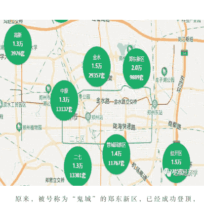

原来，被戏称为“鬼城”的郑东新区，已经成功登顶，成为郑州的新贵、金字塔顶。

链家上挂出来未成交的，达叔就不列了，达叔来罗列一下，已经成交的数据，从已经成交的单价、从高到低这一顺序来看一下。

最高单价 6.4 万/平米，成交总价 1000 多万。

这和你印象中的郑州有没有差别？如果没有，那么你太牛了，抽空加一下达叔的微信，咱们聊聊。

河南，一个亿的人口大省，经济快速增长几十年，任何一个在河南内部因各种原因发财的人，都会在郑州购置房产。

正如叔叔说的，科技创造财富、金融分配财富，房产贮存财富。

全省的资源都在被郑州这个省会单核城市虹吸，每年只要有 1% 的人发财了，全省就有 100 万人发财，郑州一个市人口 1000 万 * 1% = 10 万人发财，除去郑州的 10 万人，其余各市 90 万人中，有 10% 的人选择在郑州置业就是 9 万人。

10 万 + 9 万 = 19 万。

郑州市新房成交量是 15 万套/年，二手房 5 万套/年，总套数 20 万/年。

整体保持平稳和健康。这个 1% 是达叔假设的，如果经济向好，或者货币超发、新基建等项目推动带来一批 New Money，后果你自己想一下。

2020 年 4 月的新增货币 M2，具体的定调，要看一下最近的两会，不仅要看两会说了什么，还要关注两会没有再提什么。

郑州，这个火箭速度发展的城市，南水北调工程解决了水源问题，米字型高铁时代未来会崛起的更厉害，疯狂开挖的地铁，正在把城市的骨架拉的越来越开。

有几个省的单核城市：郑州、武汉、合肥、成都，都是人口大省的吸血狂魔。其他的高能级、人口净流入的城市，各位听达叔一句劝，来不及解释了，赶紧上车。

把钱平均发给所有人的最快方式，是把钱烧掉。

向所有人平均收税的最快方式，是打开印钞机。

多空对决，多空今年不赢的话就明年赢，明年不赢的话就后年赢，以此类推。

空军，你手里的剑是什么？你的筹码是什么？

你的对手是政府、是银行、是财政、是城市建设和人民对美好生活的向往。

昨天中午和 C 总吃饭，C 总点了瓶小郎酒，喝醉了。

说了些反动的话，主要倾诉了富人的不安全感，有了点钱，很多人都盯着，说被办了就被办了，身边很多人能移民的都移民了，等等。

达叔同他为啥不走呢？他醉醺醺的说，没赚到什么钱，现在轮不到我。

吃完饭，达叔就和朋友离开了，路上达叔就感慨，这个酒，不是个好东西。

干了十几年还没赚到钱，可能在这个领域，再也赚不到什么大钱了。但他能意识到原因么？原因可能有很多，但是管不住嘴，应该算一个。一个做对公生意的小老板，喝了点酒就在那边发表激进的政治观点，你和达叔帮这家伙吃饭倒是无所谓，如果要有客户也在，还管不住嘴的话，就麻烦了。

每个人对各种主义的态度是不一样的，彼之砒霜、吾之蜜糖，你不惯的东西，可能就是人家深信不疑、努力奋斗的吃饭家伙。

主义之争，严重的时候，会死人的。在价值观上的冲突，就不止给不给你生意这点小事了。

平时管住嘴，不要胡说，尤其是做对公生意的家伙。

很多人可能对于公经济的规模没有概念，中国 2019 年的 GDP 规模接近 100 万亿人民币，其中对公部门的经济规模达到 30 万亿人民币。

一时胡说一时爽，一直胡说火葬场。

L 总今年快 60 岁了，14 年前一场反腐风波后，移民了加拿大，过年回国，遇上了新冠疫情，滞留至今。

当年是怎么回事呢？手下的一个副总出事了，被检察院带走了，最后虽然是虚惊一场，只是问了些话，但是另一个朋友 P 总被牵扯进去了。

P 总从小养尊处优，200 斤左右的一个胖子。

当年执法比较野蛮，进去的头两天还能坚持一下，后来被一个小个子，一拳头扎在肚子上，蜷缩在地板上，站都站不起来，三十多年没挨过打，心理防线崩盘了，就全招了。

当年被判了 16 年。

L 总看在眼里，随即决定，全家移民了。

手里的业务呢？交给了手下的一帮人打理，他在加拿大遥控指挥一下。生意上的关系主要还是靠老关系，新的业务就不再继续拓展了。

达叔问他，过去的十几年，刚好是中国经济腾飞、行业高速发展的十几年，和你同时代的其他几家都崛起了，看着自己公司的这点规模，后悔么？

L 总紧了紧眉头说，只看生意的话，肯定后悔，但是我每年回国都会去看一下 P 总，有多大的头，带多大的帽子。

达叔问，人在国外，手下的业务经理有干私活的么？

L 总说，肯定是有的。水至清则无鱼，你要是把所有的漏洞都堵住，你是留不住优秀人才的。他们只在你的框架里做事。调动不起主观能动性和开拓的积极性。业务可能早就死了。只有睁一只眼闭一只眼，让他们利用漏洞赚些钱，才能实现双赢，只要不出格，就得忍着。

黄河大鲤鱼快吃完了。

达叔问，你们在国外怎么看美国打压华为的事件？

L 总说，孟晚舟被控制在加拿大，总理特鲁多是事后才知道的，由于司法独立，加拿大政府是被美国给坑了，进退两难。

很多人因为渴望财产安全才离开了祖国，但是如果祖国不强，他们在国外更不安全。仔细想想，是不是有点黑色幽默的味道在里面？

达叔问，越出国越爱国，是真的么？

L 总说，虽然有一些坚定的反动分子，但对绝大部分人来说是这样的。加拿大原来有个高科技公司叫北电网络（Nortel Networks），感兴趣的朋友可以了解一下这个公司和华为的关系史。

如果华为倒了，一个国家连一个公司都保不住的话，那么谈复兴就是妄念了。

我们这些海外的华人、到底是该高兴，还是该悲伤呢？

说高兴，祖国越来越好的红利被国内的人赚取了更多，原本不如自己的人纷纷都比自己更富有了，心里又酸酸的。

说悲伤，自己当年因为不看好体制，觉得不安全才跑出来的，其他人都没跑出来，自己像是一个沉船逃难成功的幸存者，心中又有些许侥幸欣喜。

最后，当然还是希望中国能好，就像电影《钱学森》有句台词：

> 我一定要中国人拥有自己的原子弹和导弹，哪怕它的存在带来质疑和争论。

但是我认为，这是对抗侵略的准备，手里没有剑，和有剑不用，不是一回事。

用在资产管理上，你手中没有房，和有房不炒，不是一回事。

## 第四十四篇

## SK#18 那个写了 9 篇公众号文章的家伙，身价千亿了

他的公众号简介是这么写的：

和大家分享一些我的思考，也作为我自己的记录。希望几十年后，能像巴菲特给股东的信一样，依然可读。朴实无华的简介，和整体的文风，一脉相承。

阅读量很惨淡，平均阅读量 3 万，最高的也只是 8 万，距离 10 万+，差一些。

2016 年 2 月 18 日，发表了第一篇《我的中学和大学》

这个时间点，很特殊，这是他创业的第四个项目，前面三个都没火。

2015 年 9 月新项目上线。

2016 年 2 月，单月成交额破 1000 万，付费用户突破 2000 万。

这个数字，在百度上能找到，对数字敏感的人，会把两个数字对比一下，大概就能猜出来是谁了。

任何一个人，都是有倾诉欲的。

只是很多人成功之后，再发表的言论，可信度就相当于官修史书了。

我们这个时代的幸运在于，可以五年时间，迅速崛起。也可以看到身价千亿的人，五年前，一个孤独的身影，在微信公众号上喃喃私语。

就如同达叔在知乎上分享，达叔一步步如何走来，鼓励年轻人一样，这个人选择第一篇文章写了《我的中学和大学》。

从哲学的角度，这是在试图告诉大家：我是谁，我从哪里来。

简介里写的，才是我要到哪里去。

对于普通人，逆天改命最简单的方法就是教育、教育、教育。

本文的主角，从杭州市郊的一所普通小学，考进了杭州外国语学校。

这个小学前后9年里，唯一一个。人生充满戏剧化，他当时奥数得了个奖，老师让他去考的，自己根本不想去，被校长又劝了一番，才去了。

后来想起来，还好去了。

杭外是所好中学，这是他讲述中学生活的开篇之语，达叔不知道，他是不是在模仿伟人之孙的幽默。

一个好学校到底有多好，达叔是看了这篇文章，才有深刻体会的。

他文中提到的外教、80%以上的大学保送，当年就可以看美国大片、一年160人中小比例赞助费进来，不少的官二代、富二代，这些都是小儿科。

强制住校，相互影响，形成的价值观和世界观，才是更为深刻的。大学是保卫渐进大混合班，如果你对这个名字没概念，他随后介绍了一下，这个班是浙大竺可桢学院的前身，竺可桢这个名字，各位在课本上应该就学过。

导师、实验室各种优质待遇，以及激烈的内部竞争，达叔就不赘述了。

在这里，重点讲一个和达叔开公众号思路不谋而合的神人，POS机的领导者、Verifone的创始人，投资了AOL和Paypal。

Dr.William Melton 威廉-梅尔顿。

此人在20世纪90年代创办了Melton Foundation 梅尔顿基金会。

这个基金会神奇的地方在于，他在全球选了5个大洲，6个国家，本文的主角在文中写的是5个国家，遗漏了加纳，当然也可能是名单有了变更。

这个6个国家是：美国、德国、中国、印度、智利、加纳。

选择的标准是，全世界有代表性的新兴地区，这些地区中的优秀年轻人。

每个地区，每年5个人，一旦入选，发各种东西就不说了，每年一次大家飞到一个成员国，闭关10天一起开年会，一起讨论，一起玩。

这个圈子，还是终身相伴，打破了圈子边界，也成就了多国夫妻。

那么Melton先生，如何有这个想法呢？

他看到了柏林墙的倒塌，预感到世界将发生天翻地覆的变化。

押宝新兴国家的年轻人，又一次赌对了。

中国现在国运昌盛，经济虽有困难，但仍在蒸蒸日上，达叔之前在上海某重点中学教了3年微观经济学，对新时代的年轻人，充满了期望。

半夜在知乎上收到的一个私信，更坚定了达叔的这一想法，下一代的年轻人，肯定会比我们这一代更强。

达叔和很多人在聊天的时候，经常会在内心深处，去评估他的思考力。

对一个现象，是否有尝试去思考其本质，更多的人每天都说 了无数的话，但都只是在宣泄情绪，毫无意义。

比如，所有身边和网上但凡说出“读书无用论”的，多看 他一眼都算你输。

吐槽官二代和富二代的，和“读书无用论”一样，都是 “幸存者偏差”，绝大部分都是很优秀的。

普通的学校教育只是通识教育，真正的屠龙术，更多的 是口口相传，家庭内部教育，世界的真相，莫过于此。

关于股市、关于楼市、关于生意和投资，我们这一代只有 背影的人，通过拼命努力、无限阅读、整日笔记和思考，忙 活二三十年才参透的道理，人家很可能十几岁的时候，爸妈 就告诉他了。

父母，才是孩子的起跑线，学校是后一段。

听着很令人绝望，但是有办法么？有的。

本文主角，也提到一点，田总署号：

在整体资源劣势的情况下，集中优势兵力，创造局部优势。

是不是很像？

毛主席在运动战的论述：集中优势兵力，歼灭战，各个击破，伤敌十指，不如断其一指。

放在经济学里，就是“绝对优势”和“比较优势”的区别，落后的发展中国家或个人，都要尽快找到自己的“比较优势”，即使在各项指标都低于对方的情况下，也能赚到钱。

达叔来讲一个原来在课堂上分享过、自己编的故事：

达叔和李佳琦是朋友。

李佳琦做一顿饭只需要 20 分钟，达叔做同样的一顿饭需要 60 分钟。

李佳琦做一个小时的直播，能赚 100 万，达叔做一个小时只能赚 1 万。

无论是做饭，还是赚钱，李佳琦对达叔都形成了绝对优势，干啥都比达叔强。

但是，李佳琦肯定不能一边给自己做饭吃，一边做直播，他两者不可兼得，他做饭的机会成本太大了。

于是达叔就可以和李佳琦商量，我来给你做饭，给我 2 万元，因为我一个小时的机会成本是 1 万元，你的机会成本是 100 万。

我们两个合作，能实现双赢，我们和强者之间，找到比较优势，就可以提高赚钱效率。

最后，本文的主角提到：

钱是工具，不是目的。达叔就不展开了，达叔先和各位一起思考如何获得更多、更好的工具。

对这个写了9篇身价十亿之人感兴趣的，可以加达叔个人微信号，达叔把这个公众号发给你，一起研究，后面达叔还会继续展开聊一聊。

对于普通人来说，真正赚钱的生意，都写在刑法里面了。

但对于时代的宠儿来说，因缘际会，刑法本身不是这么写的。

今天本来达叔本想买英雄迟暮，王石的故事，天上砸下一个大瓜：

一代赌王何鸿燊去世，享年98岁。

### 赌王身世

家族鼎盛时期，控制了香港的工商业，据何鸿燊回忆，在他12岁之前的岁月，家里算是香港十富之一。

父亲何世光，投资失败，逃离香港，家道中落，一个出身于四大贵族之一家庭的何鸿燊，饱尝大家族的世态炎凉，变成落难富少。

这一年，何鸿燊，13岁。

有人说何鸿燊四国混血，气质高贵，有帝王相，过人的情商和智商，令人成就了非凡的一生。达叔看了下面这个年轻的照片，也是没什么话说。

在赚钱这方面，达叔一般认为长的丑的男人，是没有退路的，但一旦长得帅还拼命努力的，那爆发力是惊人的。

香港的落魄富少，怎么会跑到澳门呢？

二战爆发，日军侵华，随后逼近香港，何鸿燊那一年大三，学业中断，加入皇家香港兵团。

1941 年 12 月 25，"黑色圣诞节"，港英政府向日军投降，何鸿燊逃亡澳门。

一个已有积累的家庭，后代吃喝玩乐，是败不了家的，但乱投资可以败家，国家的失败，家族也会灰飞烟灭。

前有何鸿燊他爹投资失败抛家弃子逃亡越南，后有王思聪巨亏 30 亿。

婚姻是女人的第二次投胎，有时候，对男人也是。

兜里只有 10 块钱的何鸿燊，逃亡澳门，当年遇到年仅 17 岁的原配妻子黎婉华，出身名流的黎婉华，号称澳门第一美女。

这是全世界权贵名流的通行做法，赌年轻人的崛起，黎家赌对了。

其他的，李嘉诚如此，雅虎如此，没什么公平不公平的，有志气的小伙子也可以找市长千金去赌一把，达叔能帮的也只能是这样了。

除了黎家背后的支持，能飞多高，打铁还须自身硬。

“一命二运三风水，四积阴德五读书，五读书是真的。”这是何鸿燊在采访中的原话。

落魄时刻，发奋读书，年年拿奖学金的何鸿燊，在澳门抓住了人生的机遇。经人介绍，加入澳门联昌公司工作。

工作期间，何鸿燊自学葡萄牙语和日语，创纪录的能背诵公司相关业务商家 2000 个电话号码，很快成为老板最信任的人之一。

何鸿燊，并不满足。利用战乱，进入押船生涯，说的简单点，就是走私。

暴利之下，必然伴随着暴力。被海盗用机枪扫射，被日军扣押，与官家打交道的天赋，也在这个时刻显现出来了。

一年后，何鸿燊晋升公司合伙人。

富贵险中求，何鸿燊赢得了公司给他的 100 万奖金分红，在那个时代，算是一笔天文数字了。

何鸿燊靠着人生中自己赚的第一桶金，开始创业。靠着与政客们的特殊关系，从逃到澳门时的身无分文，到积累 起自己的事业，何鸿燊用了 2 年。

鲁迅笔下的宁太平犬，不做乱离人，但在另外一些人看来，混乱即是阶梯。

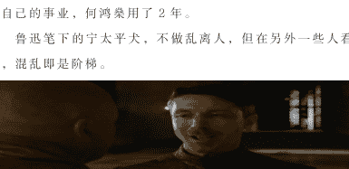

### 占领相关的日军，为何不顺势拿下澳门？

很多人都知道，日军占领香港后，迅速拿下了整个东南亚，但是唯独没有攻占澳门，为什么？

这个问题，也是何鸿燊内心深处日夜担忧的，战火纷飞，已经没有多少退路了。

互为质。

日本是个岛国，为了追求日本国人的生存空间，缓解国内就业压力，日本曾大力推动日本人向外移民。

除了满洲和中国的占领区之外，全球最大的日本人移民点是南美洲，那里土地肥沃，适合耕种。对耕地无比饥渴的日本人，形成极大的吸引力。

在南美洲，当时有数十万的日本人，那里是葡萄牙的殖民地，澳门也是葡萄牙的殖民地，所以日本投鼠忌器，认可澳门是中立区，躲过一劫。

所以在经济竞争中，和对方套套的越紧密，可能是越安全的，即使打也是高高举起、轻轻落下。

二战后，何鸿燊在澳门的生意越发红火，但当时的澳门黑帮遍地，黑吃黑是没有尽头的，一代更比一代恶。

1950年，受帮会势力胁迫，何鸿燊离开澳门，返回香港，进入地产行业。

### 葡萄牙的羁縻政策

在殖民地的统治术上，一直有两个流派。嗯？还有流派？是的。不信的话，闭上眼睛想一下，明天日本归你管了，你准备怎么管？

一种是法国的殖民地模式：Direct Rule，法国对非洲殖民地，学校教法语，行政人员基本法国出口，行政语言全部法语，把殖民地当着自己的省级行政单位来对待。

一种是英国的殖民地模式：Indirect Rule，英国人玩的是巧力游戏，经济学，最小成本，最大收益，派个总督，收买当地精英，实行间接统治，本来就是赚钱的，不愿意深度改造，官僚系统中绝大部分还是使用当地人。

简单点，套用中国的政治智慧，就是一个改土归流，一个羁縻治理。

那葡萄牙是属于哪个？ 羁縻中的羁縻。

光顾着捞钱了，社会治理一塌糊涂，这才导致黑社会横行，葡萄牙政府为了提高捞钱的效率，1961 年 2 月，政府立法，将澳门定位为旅游和“博彩业”。

在东亚，搞博彩业，所有明眼人都知道，发财的机会来了。

### 牌照的力量

请问，所有人都知道博彩业赚钱，葡萄牙统治者如何才能赚到更多的钱？发放博彩业牌照。

政府亲自干，是效率最低下的。你不要不信，打开百度搜索一下，加拿大政府亲自下场卖大麻，都能卖赔本。

所以，政府发放赌博牌照，早涝保收，无论是明面上的，还是桌子底下的，都有保障。

澳门第一代赌王，何老榕逝世，垄断澳门博彩 25 年到期，需要重新招标。

坊间问“赌圣”叶汉，曾是傅老榕马仔，后反目，跃跃欲试，但财力、人脉不足，最重要缺少的一点是，投标人要有葡萄牙籍身份。

叶汉通过著名富二代叶德利，找到何鸿燊。

赌牌所需财力巨大，何鸿燊不敢大意。为求稳妥，何鸿燊带着叶汉找到地产大亨霍英东。

此时的霍英东，已经通过朝鲜战争，豪赌国运，给新中国志愿军运送物资，一举奠定江湖地位，直到今天，霍家在中国的待遇都不一般，下葬时国旗盖棺，在此不表。

叶汉、叶德利的赌技，何鸿燊的葡萄牙人和人脉关系，霍英东的财力支持，四人超强“梦之队”组建完毕，招标现场，两虎相争，波诡云谲。

最终，四人财团胜出，何鸿燊作为代表，从新任澳门总督罗必信接过博彩专营牌照。

道阻且长。

任何一次成功，都是短暂的，要想守住胜利的果实，必须坚持不懈的战斗。

老一代赌王根本没把外行人放在眼里，却输给了四人团，立马展开剧烈的反扑，发布江湖追杀令，“八大条”，要取何鸿燊性命，让乞丐堵门，势必让赌场无法开业，再利用政商关系，推翻投标结果。

这些在各种招投标的暴利行业里，到目前，也是比较常见的，只是法制国家，程度没那么大而已，但意思和套路是一样的。

“八大条”一出，有头有脸的霍英东，就觉得不掺和了，提出利益均沾，平息怒火。

何鸿燊，一生痛恨被威胁，决定拼死一搏，也发出江湖追杀令：“如果我48小时内被杀，能帮我报仇者，悬赏100万美金，事成找我律师领取。”

在那个年底的澳门，一百万美金，就可以悬赏一此亡命之徒，何况100万美金。

八大条被逐一破解后，傅家离开赌业，前往香港，从事地产业。

外患既除，内忧又起，这是创业团队的宿命。

何鸿燊在外徒有其名，博彩是个专业、水深行业，实际控制权牢牢掌握在叶汉手里。

经营理念不同，开启了长达十年的内部斗争。

叶汉精通赌技和牌桌，何鸿燊在人脉和财力上更胜一筹。四人财团中的叶德利，是何鸿燊的妹夫，霍英东是何鸿燊的同窗，再加上葡萄牙籍的地方官员关系，何鸿燊日渐占优。

1975年，趁着叶汉远走他国游玩，何鸿燊换掉其赌场亲信人马，等叶汉回到澳门，发现基本盘人马已破，多留无意，体面退居二线。

从此澳门正式进入何鸿燊的“赌王时代”。

今天的文章就先写到这里，关于何鸿燊和霍英东的故事，达叔明天再写。

关于为什么能取那么多姨太太，后期的财产争夺等话题，留给其他账号写吧。

达叔这个号，主要是各位探讨如何一己慢慢变富的，如果你有仔细读的话，会反复看到2个行业，博彩业，房地产业，有一个是不能做，另一个能参与的话，尽量参与一下。

## 第四十六篇 SK#20 何鸿燊背后的男人：没我，澳门一切都是假的，包括何鸿燊

“没我，澳门一切都是假的，包括何鸿燊。”能说出这个话的人，叫霍英东。

达叔在上一篇文章中介绍了何鸿燊的发家史，在本篇开头回顾，总结起来一下：

- 1、香港豪门，买办起家，银行财阀作为后盾。
- 2、家族包办婚姻，强强联合，资本主义裙带关系，葡萄牙当局关系。
- 3、充当“包税人”，牌照特权，上交90%，自留10%，帮上级干脏活，承担风险和骂名。

现在提起霍家，首先想起的是郭晶晶和霍启刚，达叔今天来聊一聊这个霍启刚的爷爷霍英东、何鸿燊背后的男人。

本期主角，霍英东到底有多强，达叔在开头只举一个例子，各位感受一下：

2006年，霍英东，在北京去世，国葬，灵柩盖国旗，抬棺人：董建华、李嘉诚、何鸿燊等，以及其他中央委员，香港、澳门降半旗默哀。

当然，你可能还是不知道有多强。

新中国成立后，截至2006年，享受国葬待遇的个人有：毛泽东，周恩来，朱德，宋庆龄，邓小平，霍英东。

当时百度上有一个搜索词汇“国葬六人”。

当然，达叔这个号主要是聊如何发家的，下面开始，坐稳了。

与何鸿燊出身豪门相比，霍英东就是彻底的白手起家，第一代香港富豪中，很多人都吃过苦，如果做一个吃苦排名的话，霍英东可以排第一。

1923年，霍英东出身于香港疍民家庭，什么是疍（dan）民，靠海为生，下九流中的最底层。

7岁那年，一场台风，两个哥哥被巨浪吞噬，父亲病亡，霍英东成为家里唯一的男丁。

母亲刘氏，带着 3 个孩子，上岸入驻贫民窟。目不识丁的母亲，坚持把霍英东送进帆船义学，一种免费的，针对水上贫苦人家的小学。

1936 年，13 岁的霍英东靠优秀成绩，考入香港皇仁书院中学，这一年，何鸿燊 15 岁，也就读于皇仁书院。

命运就是这么神奇，开启了霍英东和何鸿燊，恩恩怨怨的半个世纪。

这是家长送孩子读好学校的重要原因之一。

1941 年 12 月日军占领香港，何鸿燊逃亡澳门，逐步崛起，霍英东彻底失学，步入社会，迎来人生最黑暗的时 刻。

铲煤、做苦力，几乎干啥都不行。

2 年的时间，何鸿燊在澳门，已经成为合伙人，赚了第一桶金，有了自己的事业。

同期，霍英东干了 7 份工作，压爆了一根手指，不停被辞退，打工始终打不成，霍英东要开始自己创业了。

1943 年，霍英东开了人生中的第一个公司“有如”杂货铺，专营食品。现在的人对食品类的杂货铺，没什么感觉，但在战争期间，食品奇缺，是硬通货。

店里员工只有霍英东一个，创业早期，都是艰苦的。

1945 年 8 月，日军投降离港，新的时代开始了。

任何一个新的时代，都充满了生意的机会。霍英东在报纸上看到香港政府的拍卖通告：战场上退下来的船、舰、炮弹壳、破损烂铁，各种零配件。

港英政府报纸都是英文，一般市民根本不看，也看不懂，看得懂的人不屑于做这种破铜烂铁的生意。

这就是普通人，受过教育的普通人崛起的机会。

社会中总有一些领域，权贵们看不上，底层人看不到，是适合中产阶级的生意。

霍英东仔细研究，每日必看，选中 40 台旧轮船机器，决定一搏，报价 18000 元投标。

一击即中，港府通知，中标了，付款拿货。霍英东反而慌了，没钱。

四处借钱救急，找朋友帮忙，一位朋友介绍某老板仓库看货，当即 4 万买下，一来一回净赚 22000 元，在那个年代，是一笔大钱了。

霍英东尝到甜头，凭借会英语的优势，不断斩获，完成了一定的原始积累。

故事到这里，霍英东吃的是教育的红利。

海人草惨败。

霍英东蛋民出身，靠海为生，1948 年听说澳门一家公司收可以入药的海人草，1 美元/磅，找到买家后，组建船队入海挖草。

前期投入十万，两次无功而返，第三次荒岛半年野人生活，满载而归，却遭合伙人背叛，合伙人吸食鸦片，私吞贷款。

也有一个版本是，霍英东满载而归后，在澳门把海人草卖给何鸿燊，记住开头的价格，1美元/磅，何鸿燊坚持这个价格是瞎子的价格，海人草瞎干过秤，霍英东血本无归。

霍英东对此事，耿耿于怀。

生意人为什么叫生意人？就是遇到任何困难，都能生出主意的人。那么为什么又叫商人？就是凡事都可以商量着办的人。世界上没有永远的朋友，也没有永远的敌人，只有永远的利益。这句话是英国人说的，二战中，英美和苏联相互仇视，但还是要联合起来打败德国。

只要共同的利益足够大，相互敌视的人，也可以再次紧密的团结起来。

注意，截止到目前为止，何鸿燊已经成为了人生赢家，霍英东还在摸索。

豪赌朝鲜战争。

1950年，朝鲜战争爆发，中国被西方世界全面封锁，严重的程度，比今天华为面临的局面严重的多得多。

这一离开，达叔在上篇文章中提到，何鸿燊受澳门帮会势力胁迫，离开澳门，返回香港。

战争打的是军力，谋略，更是后勤和经济。

新中国百废待兴，经济、物资本来就落后，大陆被西方全面封锁后，只要两个漏洞：

- 一个是社会主义阵营的东德，这里可以买到法国和西德的物资；
- 另一个是香港和澳门，可以买到英、美、加的物资。

是的，你没有听错，就是可以在战争期间买到英国、美国和加拿大的物资。

在经济学领域，世界上就不存在彻底封锁这一回事。

明清时期，中国海禁、闭关锁国，只要利益足够大，就会滋生出无数的海盗、倭寇，甚至是郑成功他爹。

在这一点上，老牌帝国英国就看的比谁都清楚，战争是暂时的，走私和贸易是长久的。一边英国士兵、在朝鲜战场和志愿军拼命；另一边英国潜督和资本家，参与向朝鲜战场给志愿军走私物资。

这才是现实的世界，所以达叔在知乎上回答过一个关于华为的问题，结论就是，西方不是铁板一块，华为能赢，不会倒，因为资本家没有祖国。

价格是由供给和需求决定的，封锁会减小供给，提供价格，只要利润空间足够大，就肯定有资本家冒着生命危险来做生意。

何鸿燊在向志愿军走私波纹铁、橡胶轮胎和凡士林等战略物资，爱国商人的名号，是从这一年开始的。

看准方向，就要豪赌，改变霍英东一生的转折点出现了，霍英东也没有放过。

霍英东利用渔民和码头人脉，迅速组织超千人为自己船队干活，选择走私的产品是：油桶黑铁皮，战争必需品，也是禁运品，没有这个，大量的汽油就运不到前线，部队机动化就是妄念。

英雄的崛起之路，总是相似的，同期日本后来的经营之神——松下幸之助，也在给美军造油桶，资助美军朝鲜战场。

达叔有的时候就在想，加油，这个词汇背后，就有大资本原始积累的成分。

大家都是走私，走私和走私还能玩出不同来？霍英东让我们知道，可以。

历史的课本上学过，资本家运往朝鲜有大量的劣质黑心棉，低劣军铲，过期药等伪劣产品，霍英东彰显了过人的智慧，保质保量，价格实惠。

那么霍英东有红色背景么？直到这时，霍英东还没有任何红色背景。

霍英东的船队只能把相关产品运到澳门，交给有红色背景的公司，是品质和价格让霍英东脱颖而出，逐步进入可信赖之人的名单。

达叔在之前的文章中说，谁能解决信任，谁就可以赚大钱。

霍英东曾算过账，100万的货，毛利20万，打点伙计、水警、海关，至少花费10万，三年走私生涯，赚的那点钱一点都不重要，真正重要的是霍英东进入了中共的视野。

这也为霍英东后来被英美联手打压，埋下了隐患。祸兮福所倚，福兮祸所伏。

朝鲜战争之后，1950s 大陆开始重点搞社会主义改造，三反五反，香港迎来又一次移民潮，资金涌入，香港是中外连接的节点，人口迅速增长，达叔写到这个地方，各位想到了什么？

香港城市化进程暴涨，房子、房子、房子。

有了一定积累的霍英东，将积累全部投入房地产业，都是玩房地产的，霍英东又能玩出什么别的花样么？

能，还玩给全人类贡献了房地产的新模式——卖楼花。

是的，你没看错，改变世界房地产售卖模式，沿用至今的房地产销售模式，是吴多泰发明分层销售，在霍英东手里发扬光大。预售卖楼花的。

香港原来的房地产模式都是租，很少卖，即使卖也是整栋整栋卖，如果整栋卖，那就和老百姓没关系了。

霍英东买下地块，一边盖起住宅，一边卖楼花，分期分批售卖，这在当时是一大金融创举，联合各方力量推动政策修改，最终实现迅速崛起。

1961年，受何鸿燊之邀，作为地产大佬、资金提供方，与叶汉、叶德利、何鸿燊一起，四人财团旗下澳门博彩牌照的故事，达叔在前面文章中已提到了。

人生就这样了么？不是。

很快，霍英东迎来的就是英美和其他买办的打压，整个香港的传言都是霍英东在朝鲜战场上给中共提供军火，被打压十几年后，才再次迎来了转机。

1978年，改革开放，霍英东率先带领港商第一批进入中国大陆提供资金支持，进行投资，又一次把国际禁运的设备引入中国，支持国家建设。

1990年北京亚运会，霍英东一亿港币建设亚洲最大游泳馆--英东游泳馆，使用至今。背后帮助中国申奥成功，功不可没，8亿建成的水立方，霍英东家族捐献占了2亿。

霍家的名言，体育就是政治。

霍启刚默默的看了一眼郭晶晶。

其他捐款、建楼、支援建设等故事，达叔就不罗列了，网上很多。

天安门观礼台的哭泣，香港回归的主席台就坐，香港特首的人员中央让霍英东来推荐。

一直到现在，都有江湖传言，霍家最后会出一个香港特首的。

今天达叔在何鸿燊去世的时刻，顺手写了一下霍英东的崛起之路，与赌王相比，霍公更像一个体面人，赢得了更多的尊重。

有的人去世时，娱乐八卦争财产；有的人去世时，国旗盖棺。

老一辈的传奇正在凋零，下一个引起全民热议的估计是李嘉诚了。

## 第四十七篇 SK#21 霍英东的拍档人董建华，是如何被香港人伤到心的

达叔在上一篇文章 [SK#20 何鸿燊背后的男人，没我澳门一切都是假的，包括何鸿燊](...) 的首页图中，各位最熟知的霍英东拍档人，应该是前香港特首---董建华。

近期，香港国安立法又把香港推到了风口浪尖，达叔趁机来梳理一下香港错过了哪些机会，以及香港第一人物董建华的崛起。

此文，对各位看清中国的投资机会，尤其是对楼市，会多一个视角：

庞大的中产阶级，是另一个怪兽。

董家的崛起。

1937 年 5 月 29 日，上海徐汇区的一个别墅里，富商董浩云迎来了自己的长子。董家上二期望甚高，取名建华。那一年，日本侵华乌云压城，一个月后，七七事变爆发。

同一年，八一三抗战失败，上海沦陷，董家逃进租界。上海租界局势稳定，经济出现畸形的繁荣，但董浩云创立不到一年的航运公司，第二次破产。

1945 年，二战结束，达叔在前一文章中，霍英东看英文报纸倒卖战后船舰物资，何鸿燊在澳门已经自立门路，独当一面。

1946 年，董建华随父亲来香港谋发展，董浩云看到战后货船严重短缺，在香港创办中航航运公司，组建自己的船队。这一年，董建华快十岁。

伴随着战后东南亚经济的起飞，董家海上王国逐步扩大。

1973 年第三次中东战争，石油危机爆发，董家“东方海外”香港上市，上个世纪 70 年代末，跻身“世界七大船王之一”。

崛起的细节有很多，其中用到了期货，相当于豪赌，赌赢了。

在这一时期的董建华在英国读书，毕业后先不回自己家 的公司，要去其他公司去工作几年。

在英国毕业的董建华本能的在英国的公司，但父亲 说，英国是昨天了，美国是明天，你到美国去吧。

任何一个人的崛起，除了个人的努力，还要看历史的进 程。

江湖上有人说，一夜暴富的路有两条，一条是拼命借 钱，一条是赌对国运。

董建华接棒船王帝国。

1982 年，董浩云心脏病发，享年 71 岁。坊间有很多 传言，其中一条是被港英政府气死的。

董建华接手的东方海外负债累累，国际形势恶化，航运是一个周期性很强的行业，往日热闹的码头，变成了冷清的船只坟场。

最黑暗的时刻，150多个债主前来逼债。霍英东伸出了援手，宣布注资12亿港币，化解了董家危机。

商界人土、并无政治经验的董建华，本来对政治并不感兴趣，九七香港回归在即，港人治港，香港要选出第一任华人担任特首。

条件如下：

- 1、年满四十周岁；
- 2、在香港常住满二十年；
- 3、在外国无居留权。

香港传媒报道有望成为首任香港行政长官的人选多达三十多人，又是霍英东的公开推荐，让董建华成为最大热门，高票当选。

当时住在北京的霍英东，已经是全国政协副主席，在香港有极其超然的地位，在北京对香港问题，也有极高的话语权。

当时董建华最大的竞争对手是另一个船王包玉刚的女婿，吴光正。

两位船王后人之争，吴光正的背后站着九龙仓集团，财力更加雄厚，但历史最终选择了更靠得住的董建华。

选择董建华的理由，大概有这么几条：

- 1、符合前面的硬性 3 个条件；
- 2、英国留学，懂英国，对英国的小动作先知先觉；
- 3、香港是商业城市，董建华商界有一定的威望；
- 4、香港回归只是开始，澳门随后，一国两制最终是冲着台湾去的，董家在台湾有关系和人脉；
- 5、董建华出生在上海，当时中国的最高领导人，好几个人都出自上海，算是老乡，好打交道。

空降领导的难处。

中央给香港的高度自治，港人治港。董建华接手的香港政府，里面几乎所有的行政官员都是港英政府留下来的班底。

董先生是空降的领导，手下一群技术官僚，非常难管，他面对的是一个陌生的庞然大物。在大公司里当过领导的，都懂。

当年香港舆论界以黑董建华先生为政治正确，有兴趣的小伙伴，可以扒一下看看。

董先生的忠诚和高瞻远瞩，在此之后展现出来了。他看到香港的问题，此时的香港四大家族，通过房地产积累了巨大的财富，并控制了香港的物流、金融、电力、码头、电信等行业，并形成了垄断。

香港的制造业正在不断萎缩，如果香港找不到一条新的路，未来是很难难的。

董先生上任三个月，推动改革，改革是需要勇气的。也是要付出代价的。

改革一：“八万五”计划：每年兴建8.5万套住宅，10年内让香港70%的家庭都有自己的房子，轮候租住公屋的平均时间缩短至3年。

如果这一方案能够得以实施，香港的超高房价，能够得到有效遏制，也就不会让现在的香港年轻人，如此绝望。

改革二：机遇计划、数码港计划：对香港扶持半导体、IT为代表的高新科技，当年的马云、马化腾们，都还是无名小卒，今天华为的芯片被卡，可见董先生的高瞻远瞩。

屋漏偏逢连夜雨，董先生接手之后，香港遇到金融风暴，整个东南亚风雨飘摇，索罗斯誓要打断香港这一国际金融中心。

在中央的支持下，董先生领导的香港惨胜。

但股市惨遭血洗的中产阶级，看到楼市又遭遇“八万五”计划，楼市资产暴跌，纷纷走上街头，一大批明星破产，包括各位熟知的钟镇涛、张卫健等。

50 万有房的中产阶级，走向街头，游行示威，房地产财团乐见其成。

中产阶级的怪兽，发出了怒吼，“八万五计划”胎死腹中，香港人也错过了对自己的第一次救赎。

当年响应炒港计划的是台积电的技术大佬张汝京，香港舆论炮轰张汝京，各种刁难。最后张汝京远走上张汝江。收到上海热烈欢迎，免租、免税。

有了张汝京，上海才有了中国目前规模最大、世界排名第四的芯片制造商---中芯国际，华为在这一轮制裁中的备选供应商。

这是香港错过的第二次救赎。

后来的改革三：香港打造“中药港”，推进乏力，无疾而终。

对岸的深圳，诞生了华大基因，全球一流的基因和生物科研企业之一。

1997~2005，董先生执政八年，香港完美错过了亚洲互联网中心，芯片制造中心和生物科研中心。

后面的故事，大家慢慢都知道了。

达叔在这里，单独拎出来讲一下房价。

房价平稳不仅对防范金融系统性风险非常重要，更是社会稳定的一个定海神针。股市赌钱了，大家会乖乖地认，技不如人；但楼市要是大跌，那就乱套了。

董先生站在阳台上，看着数十万愤怒的香港市民，心如死灰，宣布提前 2 年离任。

之后的香港，再无“大脑”，缺乏战略眼光，香港一步步沦陷、失去了方向。

最后，达叔想说的是，霍英东推荐的人，真的很不错。

达叔从何鸿燊逝世，写到了何鸿燊背后的男人霍英东，再写到霍英东的抬棺人董建华，整体还是在努力和各位一起探讨如何致富。

从明天起好好写投资楼市、基金、股市、经济、职场等方面的思考。

## 第四十八篇 SK#22 求求你，别再动脑筋省钱了，否则你会穷得很稳定

今天周六，达叔在家和达婶又拌嘴了，还激动地打了一下她的屁股。

原因是啥？

夫妻拌嘴，绝大多数是因为钱。

自从上次和达婶拌嘴后，达婶创造性地把自己全职太太的工作进行量化、货币化，要求在掌柜家庭财政大权的同时，给自己额外发 1.5 万/月的工资。

达叔技不如人，认了。

今天月末，达婶喝下午茶的时候，突然想起来要给自己发工资。打开银行软件，达叔瞟了一眼，感觉数字不对，就多嘴问了一句，感觉这个金额少了几万。

达婶说，不可能，就这个数，哪里少了？

达叔说，有笔钱是不是两周前到你支付宝上了？

达婶打开支付宝一看，果然。

达叔当时心都凉了。

余额宝现在 7 日年化都跌成 1.5% 了，惨不忍睹。

稍微正常的货币基金年化都能做到 4% 左右，不动脑子的，至少也是 3.5% 啊。

相差两倍多。

达叔劝赶紧提现在银行端。达叔从小极其节俭，一看手续费要几十块钱，心疼了，一边继续喝咖啡，一边研究怎么省这几十块钱。

达叔回书桌看书去了，半个小时后，达叔开心地跑进来说，研究出了节省这几十块钱的方法。

达叔看着喜形于色的达叔，内心更凉透了，晚上默默地写下了这篇文章。

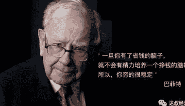

达叔开这个账号，是和各位一起探讨如何一起慢慢变富的。

除了职业、生意之外，大类的投资无非是股票、债券、基金、房产。

在其他 FC# 系列的文章里，达叔主要讲房产，有兴趣的可以移步到那里去看，房产和城市研究也是达叔主攻的方向。中场休息时期的小钱，主要就基金了，股票达叔几乎是不碰的，尤其是 A 股，在中国没有改变股票市场的定位之前，达叔对其没有多大兴趣。

本篇，达叔来适当地聊一下基金。

基金从大类来说，可以分为：货币基金、债券基金、股票基金。

货币基金：类似于理财通、余额宝这样的，收益率一般在 2-5% 之间，高安全性，高流动性，准活期储蓄的定位。收益比存银行活期高一些，感谢余额宝对全民的教育。

当年有很多人觉得余额宝是在打劫银行，抬高了资金的成本。

完全是一派胡言，阿里巴巴用科技的手段，以极高的效率完成了资金的汇集，是一次极大的金融创新，也变相刺激了傲慢且迟钝的传统金融机构。

以前都是银行发动客户经理，在大堂、路口摆摊地推，成本有多高、效果有多差，可想而知。经过余额宝的教育，客户和银行端都会学着买理财和卖理财了。

只是当年屠龙少年，化身成了恶龙，收益还不如银行端了。

### 二、省力费距，省距费力

这一物理学上的杠杆原理，在投资领域同样适用。

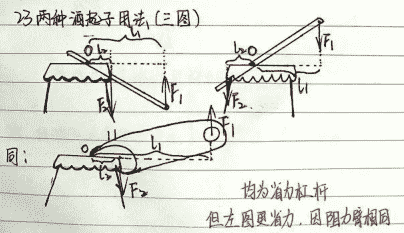

那么基金一般如何选择呢？

基金针对最终投资标的的股票、债券还是房产，分为股票基金、债券基金、和 REITs。

达叔一般建议是，投资就要投纯的。由于 REITs 在中国发展规模有限，不够健全，所以剩下的主要就是股票和债基。

那有人问，混合基金不好么？有好的，但由于金融行业是一个有严重代理人风险的行业，部分基金或基金经理信息披露不够，或操作失当，导致投资人无法及时止损。

先说债券基金。纯债基金，持有一年以上的，平均年化 6~8%，号称资产配置永不沉没的航空母舰。

在所有的基金里面，属于风险较低的，投资的后劲力量。对于普通家庭来说，这个年化回报率，够了。

玩更高的投资回报率，比如当年 P2P 动辄 12% 以上的，风险太高，骗子比较多，对投资人的专业性和逃跑速度有极高的要求，普通人就别掺和了。

如何选呢？

一般来说路径如下：打开基金挑选网站 --- 债券型基金 --- 长期纯债型基金 --- 看近三年表现 --- 取前 30 名 --- 再逐个剔除小公司 --- 剔除可转债 --- 剔除同一基金公司旗下非王牌基金。

一波操作下来，选出 10 家左右，再找出综合费率较低，基金成立时间较长，基金经理经验丰富，管理时间较长。

这一波操作下来，就可以入手了。

达叔写文章不是做广告，授人以鱼、不如授人以渔。

如果觉得 6~8% 不够刺激。可以选股票型基金，一般年化收益 -5%~20%，是的你没看错，-5%，还可能更多，达叔给的只是一个一般数。

经过 2020 年，中银原油宝事件、中信流水事件、美股熔断事件，咱们这代人都是见过大世面的了，无论多高、多低，都该处变不惊了，毕竟咱们见的大世面和巴菲特也差不多了。

指数基金一般都是选股票指数基金，有很多定投，都是玩这个。

如果把基金当做一个足球比赛，那么货币基金就是守门员，纯债基金就是后卫，家庭财富防守的中坚力量，而股票型基金就是充当进攻的前锋。

**股票指数型基金选取原则：**

- 选第一梯队的基金公司，成立时间、基金规模、基金经理是否是基金明星，基金经理的履历、风格、行业。
- 当然有基金评级机构，比如晨星评级等，供各位参考。

对第一梯队基金公司感兴趣的小伙伴，可以加达叔的微信号，见最下二维码，达叔说几个名字，达叔不推荐具体基金。

到了晚上，达叔终于想明白了，幽怨地和达婶说，自己费了半天劲，想节省的那几十块钱，如果早点去买收益更高的基金，早就赚回来了。

所以，本文的最后，让达叔再来说一遍：

一旦你有了省钱的脑子，就不会有精力培养一个挣钱的脑袋，这是脑袋带宽决定的。

所以，你穷得很稳定。

## 第四十九篇 SK#23 时间站在谁那一边，谁就能赢，慌什么

达叔写这个公众号的 slogan 是：让我们一起慢慢变富。

这里面隐藏着一个概念：时间。

我们对待时间衍生出来的一个概念：耐心。

屌丝的耐心只有十分钟，所以会出现各种迎合屌丝的网文，市长千金爱上我，霸道总裁爱上我。

迎合屌丝的各种神奇营销流派：

- 几天让你开口流利说英语。
- 一小时让你变成演讲小天才。
- 不用运动、不用空腹，一星期让你暴瘦 N 斤，变成魔鬼身材，等等。

达叔是闹不明白，买这类书籍的人或课程的人，脑子是怎么想的。真实的世界是残酷又现实的，你百倍千倍的努力，如果框架或赛道选错了，还是可能会输的，指望不劳而获，十之八九是待割的韭菜。

世界上的成功有两种：

一种是项羽式的，力拔山兮气盖世，一战而定七分天下。打游戏、谈美文、投资，满脑子都是决战，都是梭哈，成则会所吗徽，败则去会所当吗徽。

一种是司马懿式的，勤勉恳忍、忍辱负重数十年，稳扎稳打建立自己的班底，在曹家战将如云、谋士如雨中最后脱颖而出。

如果没有理论框架，每遇到一个事，都认为是决战，你的内心都是慌乱。

比如，很多人一看到新闻说，房产税要来了，根本不去研究房产税的税种，更不研究现有各种税收的比例和区别、立法的流程、颁布的时间、税率会是多少，国外房产税对房价的影响，看到风就是雨，吹吹鼓舞房价要崩了。

比如华为被制裁，很多人认为完了。达叔在知乎上回答，大概率我们能赢，就有人上来怒达叔：你什么都不硬，就嘴硬。

达叔觉得这货在开车，却没有证据。

去年，日本在半导体原材料供应上，也卡了韩国一把，韩国死掉了么？

没有。

韩国不仅没有垮，反而通过韩国自己内部研发，以及台湾、大陆的支持，找到了稳定的替代方案。

日本搬起石头，砸了自己的脚，大客户弄丢了。

达叔只是先举这个小例子让大家放心一下，那么背后的逻辑是什么？

背后的大逻辑是：全球处于产能过剩，购买力稀缺、需求不足的时代。

看清楚时代的本质是这个背景，谁手里有购买力，谁就有更大的话语权，卖家和买家打架，大概率是买家赢。

因为技术外溢，制造芯片已经不是一门独家秘笈，只是谁做的好一点，谁做的差一点而已。你不卖，别人就能拿到大订单，拼命提高技术，假以时日，就能追赶上来，缺的是什么？时间。

以前为了经济效率，造不如买、买不如租，是一般商业上的基本操作。现在美国不让你租，买都不让你买，那是一声枪响，逼着中国朝野几十年无法下定决心，迅速形成了共识。

三星和台积电互撕的时候，台积电的几个技术副总已来到中国大陆，创办中芯国际等企业。

技术攻关爬坡的关键阶段，是美国又一次帮助中国下大决心，大量的资金投入，解决技术难题。

再看另一方面，世界上根本就不存在真正的技术封锁。冷战的时候，日本东芝都在向苏联卖“军用技术”，后来也是被美国制裁。

朝鲜战争的时候，英国一边派兵在朝鲜战场和志愿军拼命，一边默许香港官员和商人向志愿军走私。

你禁止什么，什么价格就会涨，只要价格涨到一定程度，你就不会有那么忠心的盟友，放着钱不争，去遵守你那虚头巴脑的承诺，想多了。

没有永恒的敌人，没有永恒的朋友，只有永恒的利益。这句话就是英国人说的。

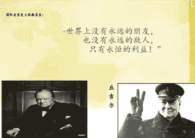

就像一些城市限制房价一样，一旦限制房价，真的一套下来有几十万、近百万的价格倒挂时，就会滋生灰色产业，这是必然的。有茶水费，有卖号的，有在摇号上动手脚的，大量的寻租空间就产生了。

道理是一样的。

战略的定性和耐心。

再好的战略，都要有良好的执行，政策才有延续性。

有个国家，能喊出“一百年不动摇”，有的国家，四年之后上来的人，就能把前任的政策全废了，仿佛前任就没当过总统一样。

打仗是如此，打的是实力，打的更是决心和耐力，谁的受损上限更高，耐力更持久，更能熬的住，谁能赢到最后。

当年有人说过，谁要是真的把中美关系搞的特别差，让大资本家没钱赚，谁的眼睛都会被戳瞎。

高通芯片巨头当年为了在中国卖芯片，6 年前被中国以垄断之名罚了 60 亿，一声不吭，乖乖交钱认罚，为什么？因为垄断也是一个技术活，尤其是在他国进行垄断。

既要自己占大头，拿大头，保持高利润，又不能把对手全弄死了，保持创新、技术领先，又不能跑的太远，小心翼翼的控制节奏，就为了能多玩几年。

你现在让高通不在中国卖芯片了，全球最大的买家就在中国，你不让卖了？

这个东西全球能买的有几个？工厂、产线、工人、产能都在那边，算是固定投资的命脉。你不让卖，你这不是让华为死，你这是要高通等美国芯片巨头死。

讲了这半天，达叔是在分析华为么？

貌似是的。

但达叔更多的是掰开了一个案例、和各位聊一下，看问题要看本质，各方的利益是什么。

身边所有问达叔要不要移民跑路的小老板，达叔都劝不要跑，机会在中国，时间也在中国呢。一慌什么。

跑国兴盛的时候，对手觉得没控制住，又发生全局骚乱暴动了。攘外必先安内，对任何一个主权国家来说，内政部比外交部更重要。

那么如果不走，在国内作为个人的投资，要把赛道选好、选一个更长的雪坡。

比如昨天达叔聊基金，各种基金的玩法，股票型基金风险和收益比较起来，可能还不如你直接亲自下场去炒股。

稳妥的货币基金、纯债基金，无论是 4%，还是 8%，如果你本金小，只有十来万或几十万，忙活半天，你算一下，每年也就多了万把块钱的收益。

还不如多花点精力去多做几个单子，赚的更多。

中国目前还有三个很大的红利：

- 经济增长的红利
- 城市化的红利
- 人口基数和流动的红利

要实现财富的快速增长，必然还是楼市，高能级城市的楼市。

因为只有这个市场，能让个人调动 3 倍的金融杠杆，去稳妥、大额的投资。

房价增速的一个计算公式，房价增速 = 经济增长速度 + 通货膨胀速度。

前 20 年，GDP 每年 9.5%，CPI 2.5% ，则房价增速 = 9.5% + 2.5% = 12% ，房价 6 年翻一倍，18 年增长 8 倍，20 年增长 10 倍，在全世界范围内，和新兴经济体相比，都不算快的。

不信的同学可以研究一下俄罗斯的莫斯科，还有印度的新德里、孟买。

未来十年，假如中国的 GDP 增速是 4%，CPI 2%，则房价增速是 6% 每年，但是别忘了，你有三倍的金融杠杆，还有未来的房租收益，三者加在一起，就相当可观了。

当然，达叔说到这，你可能也不信，反正达叔也不是卖房子的，只是分享一下自己内心深处的想法和研究。

关注 达叔经济学，让我们一起慢慢变富。框架选对了，不要慌，相信时间的力量。

## 第五十篇 SK#24 达叔这个月的见闻和思考

这个月，达叔主要做了以下几件事情：

- 1、花了 1299 元，网上报了个自媒体的班，学习一下如何写作和创作。
- 2、坚持每天一篇公众号文章，偶有遗漏，太累了，就睡过去了，整体还在保持节奏。
- 3、出了 3 次差，郑州，合肥和南京，各待了一段时间。
- 4、读了几本书，还学了几门投资课，自己的作品也正在写作中了，出版社的姑娘都催稿了。

今天早上，送女儿去上英语课。

店长看到达叔，好久不见，激动得不行，一定要和达叔聊天，说这个疫情，三层楼的店面差点就倒闭了，让达叔给分析分析。

达叔问，你这个店几个人？

店长说，加上外教，十来个。

达叔问，一年的营收能有多少？

店长说，去年营收 200 万左右，之前操盘过最好的店，一年 600 万。

达叔问，200 万的营收，除去房租、水电、10 来个人的工资，基本不赚钱吧？

之前聊过，外教工资 1.5 万/月，人民币，维持在 2 个，一年 40 万左右。

其他员工，8 个，每个月 5000-8000 元，加上各种保险金税等，公司成本至少 1 万/月，一年下来，100 万左右。

这只是人力成本，就是 140 万了。

去年一年，加上房租、水电等，200 万的营收，不亏就谢天谢地了。

店长，吸了一口电子烟，拼命的点点头说，所以我才迷惘啊。

达叔说，之前 600 万的那个店，有没有遇到家长来找你谈合作，也开个店的？或者房东租金要涨价的？

店长一脸幽怨的看着达叔，你咋知道的？好多家长本来是开工厂的，或者手里有些闲钱，以前也都不是这行的，把孩子送来学英语的时候，一看排班表，掐指一算，就要在旁再开一家店，吓得吓死了。

房东要涨房租，也是常见的操作，还有更过分，要把我们赶走，自己干的。

达叔说，虽然我不是干你们这行的，但大体能想到，因为人性基本上是相通的。尤其是你们搞培训的，钱都是预收的，先收钱再办事，对于一些干制造业的小老板来说，有极大的诱惑。

而且模式简单，弄个店面，找几个外教，就可以收钱了。

看一下招生进度，就大概知道今年的收成如何，一旦发现形势不对，关店跑路，老板是没多大损失的。如果老板黑心一些，再弄个课程价格梯度，多收一些预售课程，是包赚不赔的生意。坏处就是时间久了，你们这行就乱了，劣币驱逐良币，大家也就没耐心好好干了。

问题出在哪？出在你的模式太简单，一看就会，硕大的招牌放在那，只要你赚钱，就有一群人蜂拥而上。

店长换了一根电子烟，又给达叔分享了个故事。

他朋友在上海 CBD 办公楼下，2018 年，开了个牛排店，定位轻奢。

店面非常小，控制成本，两个师傅煎牛排，一个服务员，4 张桌子，主要是靠附近几个办公大楼的牛排外卖订单。

忙忙活活一年下来，自己还没算账，年底进来一个客人，说自己是咨询公司的，问你店卖不卖？你们店一年盈利大概 60 万，要是卖的话，开个价。

不卖。店长说，他朋友自己都不知道自己到底赚了多少钱，回去晚上静下心来一算，50 多万，和 60 万相差不多。

第二年，牛排店的周边，相同性质的店，多了三家。店里订单量锐减，三个月后，从盈利进入到亏损的状态，再想转让，没人接手了。

立马关店，及时止损。

店长讲完这个故事，问达叔，你说咋办？

达叔说，商业分为行商和坐商。

江湖上有句话，坐商不如行商，行商不如立业。

坐商一般固定投资大，回旋余地小，占用资金，一旦有风险，固定资产迅速贬值。

比如开餐厅的，店面租金是一大笔钱，装修又是一大笔钱，一旦选址出现错误，装修费打水漂，桌椅板凳全部甩卖都甩不掉。

有很多行业的经销商，就稍微要好一些，如果压货不严重的话，进可攻退可守，回旋余地大很多。

达叔给他讲了一下对几个行业的看法和玩法，基本的观点是，开公司，如果这个行业的公司一年干不到一千万的话，就别掺和了，令这个家伙心动不已。

回到家，达叔就被达婶给骂了一顿，他是咱们孩子的英语机构老板，你把他给忽悠不干了，咱们的学费咋办？

达叔一想，好像是这么回事，今天聊多了。

经常有人加达叔的微信，问一些好玩的问题。

因为出差，达叔对一些城市有较多的研究，今天聊一下对合肥的看法。

如果把合肥比作一个人，那和我们很多人一样，起点非常低，典型的屌丝逆袭，逆天改命，2020 年，成功挤入新一线城市排名。

当看到这一新闻的时候，达叔是很感慨的，达叔为每一个崛起的年轻人喝彩。

新中国建立时候，选安徽省会，省内蚌埠、安庆、芜湖，各个跃跃欲试。

1958 年，出于战争的战略考虑，毛主席一句话，“合肥不错，为皖之中”，八个字，送合肥成功登顶。

这一年，合肥是一座小县城，人口只有五万，远远低于隔壁的几个省会，南京、杭州、武汉、南昌。

甚至远远低于自己省内的城市：蚌埠、安庆、芜湖，经济、人口都不如。

人们是很难接受穷小子崛起的，尤其是自己身边，原来远不如自己的穷小子。

在安徽省内，一直被吐槽“合一省，肥一城”，甚至南京一直被称为徽京。

当然也有很多质疑，因为在合肥投入了大量的基础设施建设，导致了安徽整体经济的不经济。

1970 年，又是由于战备考虑，一所高校从北京搬迁至合肥——中科大。

如果说省会地位是一块土壤，中科大就是合肥的一粒科技和教育的种子。

和众多的二三线城市会城市一样，培养成高端人才，留不住，又是合肥的心病。

直到 21 世纪，科技的力量，高端制造业，层出不穷，合肥终于抓住了自己的机会----豪赌高科技。

合肥定位：大湖名城、创新高地，“忠屏器合”。

定位，是一个人人安身立命，发家致富，最重要的，要搞清楚自己是谁、自己在哪，自己要干什么，自己有哪些比较优势。

1、2004年-2010年，顶住政绩考核压力，没有引进高污染化工项目。

和武汉争夺“白色家电中心”，15年前，电视机、电冰箱等产业还被当做优质产业。

如果合肥败给武汉，一点都不丢脸，但是合肥打赢了，武汉落败，超过青岛和顺德，现在全球家电巨头基本全部落户合肥。

这应该是合肥豪赌的第一桶金。

2、豪赌京东方。

合肥2008年财政收入300亿，敢拿出100亿，与京东方合作双方总投资175亿，建设国内第一条生产线。

安徽省内各大论坛冷嘲热讽，显示器是日韩的天下，中国落后N代，京东方是央企，一线城市北京都不干的事，合肥逞什么能。

这一年，合肥旁的连地铁都修不了。

现在京东方跻身世界半导体领域第二大创新企业，全球显示器龙头。

合肥拥有京东方中国最多的生产线，最先进的10.5代TFT-LCD在合肥，每年合肥新增产值800-1000亿，上下游吸纳就业5万人。

3、2011年豪赌长鑫存储。

合肥市政府没钱，找省直借钱搞，又是被一顿嘲笑，你们干韩剧是不是干上魔了？

最近 618 又要到了，三星金士顿内存价格狂降，为什么？因为合肥长鑫存储量产了。

当年有网友笑话合肥，合肥为了赚啥长鑫，连市政府大楼都抵押了。

4、科大讯飞，豪赌人工智能，半导体。

半导体行业一直被视为当代工业的明珠，投资金额巨大，风险系数极高，又受摩尔定律约束，后发者很难追上领先者。

全球敢玩的没有几个，2015 年，合肥竟然敢上马这样的项目。

不久，中兴事件爆发，很快华为被制裁，全国上下多年无法达成的共识，迅速达成一致。

各大商界巨头纷纷开始支持中国芯，又是合肥，早了两年，成为中国当前半导体产业链最全的城市。

大笔资金进入合肥，机会永远是给那些有准备的人。

这时，这老罗在做锤子手机，吹过全球最顶尖的语音识别系统，科大讯飞的人工智能，已经是一骑绝尘。

5、合肥大众，对的，你没看错，德国大众在新能源领域落后，选择奋起直追的新能源中心，选址既不是 一汽 大众的长春，也不是上汽大众的上海，而是合肥。

除了合肥大众，合肥还赌了谁？饱受争议的蔚来汽车。

很多人都在问，蔚来汽车什么时候倒？蔚来汽车，多处碰壁时，合肥伸出了橄榄枝，你来我这，我挺你，投资百亿。

中国在电动车这一赛道上，如果能实现弯道超车，真正成为汽车强国，合肥肯定不会缺席。

其他还有很多，比如原来的四纵四横高铁网，合肥落后一步。

即将到来的八纵八横，合肥正在形成自己的米字型高铁网，前途不可限量。有兴趣的去达叔知乎上看，在这就不写了。

为啥在这里写合肥，就希望各位能像合肥一样，穷小子敢打敢拼，逆天改命。

最后，达叔想说的是，

创业要做那些有点壁垒的项目，否则还不如老老实实打个工，搞点投资，至少不会亏。

投资要努力系统的学习，认清趋势，敢于豪赌。一些年轻人，一边要吃喝玩乐，要享受生活，一边又要毕业就能买到房，国家欠你的么？你纳几毛钱的税了？

自己不愿系统学习的，至少要跟对人，听对话。一般纯属发泄情绪的家伙，鼓吹这个跌，那个跌的，不是蠢就是坏，真正愿意说真话的人，已经被你们喷的不愿多说了。

## 第五十一篇 SK#25 美国抗疫现场的蝙蝠侠，探讨小仁政与大仁政

达叔晚上要和朋友吃饭，万一要是喝酒，回来晚上就没法写今天的文章了。

所以今天随便写点感言。

知乎上的问题：

美国人只要一天还玩蝙蝠侠，就一天得不到解放。

哥谭是一个幻境。

美国人独有的想象和逻辑悖论。

哥谭市，如果是美国的化身，它本质是由大资本家寡头统治的城市。

城市中谁是最大的资本家？韦恩家族。

整个城市所有的公共设施建议，都是围绕韦恩家族搭建的，韦恩才是这座城市真正的主宰。

市政府、警察局基本上都是摆设。

坐稳了，逻辑的悖论出现了。

城市的主宰----韦恩，不能或不愿意，正面且系统的改造这个城市，

连谭嗣同都懂的道理，韦恩不懂，美国人民也不懂。

谭嗣同，名门之后，湖北巡抚谭继洵之子，是大清王朝的既得利益者。

但是谭嗣同要改革，各国变法，无不从流血而成，今中国未闻有流血而牺牲者，此国之所以不昌也。有之，请自嗣同始。

这一年，谭嗣同，被斩于菜市口，33岁，风华正茂。

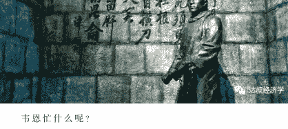

韦恩忙什么呢？

忙若换上蝙蝠侠的衣服，玩制服诱惑，去一个又一个的打击坏人，主持正义。

这是什么行为？？

这是用战术上的勤奋，掩盖战略上的懒惰，是沽名钓誉的行为！！

渴望英雄的民族，是可悲的，这句话也送给太平洋对岸的美丽国。

就如同中国民间诉求之于包青天，渴望青天大老爷，性质是一样的。

你们文艺界塑造的英雄太多了，所以你们的悲伤才会那么多。

遇事指望英雄来拯救，本身就是一个妄念。

枷锁，要自己组织起来，去打碎的。

小丑、暴力分子，都是底层扭曲的化身，一个又一个的涌现，无穷无尽。

蝙蝠侠一集又一集，怎么打都打不完，那么小丑类的坏人，是谁造就的？

是韦恩等集团吸血哥谭市造成的，底层的人没有活路，天堂与地狱相互隔离，

哥谭折叠，韦恩集团难辞其咎。

黑魁祸首，不进行系统改革，披上披风，带上面具，抓几个坏人，就成英雄了么？？

建国后，伟人和梁先生争论过，“小仁政”和“大仁政”。

在整个建国史中，毛泽东是最重视农民问题的。

建国后，前几年毛泽东还在征粮问题上减轻农民负担，但是1953年，毛泽东转而赞同粮食统购统销政策，这一政策加重了农民的负担。

梁漱溟等知识分子，认为毛利用了农民，背叛了农民，抛弃了农民。

但见惯了流血牺牲的毛回应是：

照顾农民是小仁政，剪刀差榨取剩余价值，发展重工业，打美帝才是大仁政。

皮之不存，毛将焉附。

这也是达叔不建议各位去搞农业的原因之一，到目前为止，为了工业立国，农业和农民还是被历次改革受损的一群人。

达叔的建议是，不要去掺和。

放到哥谭市，抓几个坏人是小仁政，系统性的改造哥谭，才是大仁政。

但是美国整个文艺界和人民，没有人意识到这个题材的荒诞性。

类似的题材一拍拍，在东方广受好评就算了，毕竟我们是看戏的。

在西方也广受好评，西方的思想界是脑子进水了，哪怕是进口几个豆瓣影评人过去，也能看出漏洞了吧？

当蝙蝠侠出现在抗疫现场，其荒诞程度，相当于有人带着特朗普的面具在人群中抗疫。

这就是达叔从社会经济结构里的看法。

哥谭市，没救了！！！

将永远黑暗，坏人层出不穷，永远抓不完。

因为主观上韦恩在努力，但客观上韦恩把哥谭当成自己的游乐场了。

平时在公司里，也抱着审视的态度，看一下自己老板的表演。

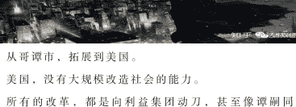

从哥谭市，拓展到美国。

美国，没有大规模改造社会的能力。

所有的改革，都是向利益集团动刀，甚至像割草同样，向自己动刀，流出鲜血，献出头颅。

但凡不向利益集团动刀的改革，都是假改革，都是带上面具，披上披风的表演，任何取得的成就，都是成功的幻觉。

让你游行，让你发泄，让你争论 LGBT 等弱政治话题，就是在制造一种自由和民主的幻觉。

而真正的社会化改造等深层次强政治话题，被稀释了，也逐渐被遗忘了。

在这个地球上，只有一个国家，凭借超级大的人口规模，默默同化消解了一个又一个民族，悄无声息，做好事，人家不留名。

自称第二罗马帝国的家伙，要拿起小本子看看第一罗马帝国最终的命运：

> 全胜辉煌---武力值爆满---广发公民身份---体力不支---衰落---变成碎片---再也没能重建。

吃饭去了，今天先写到这。

看了达叔昨天文章的小伙伴，知道达叔昨晚出去参加了个饭局。

达叔平时比较宅，不太愿意在外面吃饭，不是大的年会等情况，很少参加多于 5 个人以上的饭局。关系，这个词汇很微妙，甚至有了专业的英文单词来描绘，单词叫：Guanxi。

## 关系

The Role of ‘Guanxi’ in China Business

Howard Davies

关系分为：强关系和 弱关系。

什么是强关系？就是你的父母、兄弟姐妹亲戚等，这些达叔一般归类为强关系。

什么是弱关系？比如我们之间，一方是作者、一方是读者，比如平时遇到的客户，吃饭联谊遇到的朋友，公司里的老板、同事等。

讲到这里，达叔来问一个问题，请问是强关系能让一个人变富，还是弱关系？

闭上眼睛，想一想。

达叔之前问过很多身边的人，绝大部分都说是强关系。但是，答案是错的。

正确答案应该是：弱关系。

为什么？

内在的逻辑是：财富的量级。

你身边的强关系，比如父母、兄弟姐妹亲戚，一般来 说，掌握的财富规模和你是一个量级的。

比如父母是十万级规模，就是十万级的见识和能量，不 可能给你带去百万、千万级的机会。

几十年下来，强关系之间，能帮的早就帮了，无法突破 的，基本上就是一个小型的稳态社交圈了，很难再相互指望 增加财富，不相互拖累，就不错了。

但是谁可以给你带去财富上量级的变化？

你多年不见、在他乡打拼发财的发小、需要知根知底信 任的帮手、业务扩张期选中了你、让你来帮忙。

你碰到的重大客户、需要白手套、身边亲人受法规限 制、都不合适、你出现就赢得了信任、选中了你。

你在公司的老板、在内部赛马、你业务能力突出、并且 通过忠诚测试、选中了你、跻身核心圈子。

请注意达叔的用词、在这些所有的情形里、如果你是一 个普通人、你的努力只是关键的一小部分。

更重要的是，和你弱关系的强者，选中了你。这是命。

那为什么达叔说不愿意参加 5 个人以上的饭局？因为人多了，就没几个人说真话了，全是车轱辘话，没用的信息。相互吹捧、谩骂、回忆青春、觥筹交错，流于表面，除了混个脸熟，没什么其他功效。

酒风不好，喝酒之后乱说话的，更要切实谨慎，有害无益。

饭局的意义在于交流。

只有小范围，才有相互交心的可能，相互交心，是赢得信任的必备条件。

能够交心的前提 是，双方有安全感。

小事开大会，大事开小会，重要的事情，不开会。

在宫廷剧里，除了皇上，谁最有权力？

有的人说是宰相，有的人说是将军，但正常一点的朝代，或者在各个公司，权力的机构划分为：核心--内臣--外臣--执行小吏。

宰相等朝臣，绝大部分都是外臣的范畴。等外臣开始讨论某个事件时，绝大部分是核心和内臣已经先行讨论过了。经过核心与内臣策划之后，确定大方向。

在朝堂开 个会，谁提议、谁附和、谁表决，然后定于一尊，颁布执行。

很多大公司的玩法，基本上是一样的，如果你没有蹲在桌子旁边，大概率就是躺在桌子上了。

如何获得权力的核心？

一种是创业，自立门户，自己冒着巨大的风险，竖起一 面旗帜，让其他人围拢在自己的周围，开疆拓土，风险与收 益并存。你不是领军响的，你是发军响的，军响发不够，军 队是没有战力，更甚是要哗变的，但是打下来的江山也是自 己的。

另一种就是加入一个大组织，奋力攀爬。

这一条路，看似稳妥，爬到中层主要是靠拼命努力，道 路还算是宽阔，一般敢拼敢打的少壮派，抓到机会，都能爬 到中层管理者，年入几十万问题是问题不大的。

但是中层管理者和高管之间，有一个宽广的鸿沟，很多 时候是无法逾越的鸿沟。

为什么？

因为这个鸿沟不再是靠努力，就能跨越的。

达叔昨晚一起吃饭的几个家伙。

有的自己开公司了，用之前的人脉资源，成为了一个专 业的白手套。

有的从中层晋升为高管，带上了闪闪发光的“金手 铐”，一将功成万骨枯，基本上就再也没有退路了。

走职场路线的，很多时候就是一朝天子一朝臣，下面的 兄弟们保老大，老大保核心，一荣俱荣，一损俱损，尤其是 结果导向型的公司，尤其严重。

但也正是这种公司，普通人才稍微有一点机会，从一场场战役中胜出来，如果只是论资排辈走关系，普通人应该是更没有机会了。

不要相信什么失败是成功之母，这类鸡汤话不适合职场。

只有成功，不断的成功，用小成功去赢得信任，换取更多资源，用更多资源堆积出更大的成功，这才是更准确的道路。大家聊了之前的全国顶级大客户，疫情前被抓，震动业内，监狱内三次自杀未遂，现在已经人不人，鬼不鬼了，一阵唏嘘。

位置越高，人越寂寞，后面越来越没朋友了，君臣一日百战，风险越来越大。

但巨大的利益摆在那，争抢者还是前仆后继的。

那么请问如何才能当高管？

一种是靠运气和坚持，加入时是小公司，公司发展壮大，你是核心人物身边长期晃晃悠，信任的人。

远有阿里巴巴的前台成为高管，海底捞服务员成为高管。

近有达叔身边吃饭的 Q 总，加入个创业公司，从很小规模开始奋斗，现在进入最后一轮融资，香能不能不能成功上市，就看命了。

一种是你加入一个大组织，认识了现在的高管，高管一路高升，进行提携。

每一个你看到的仕途亨通之人，背后都有贵人提携。

没有无缘无故的爱恨，更没有无缘无故的升迁，如果你认为有，那就是你眼睛看不见。

只有实力是不够的，更重要的还是获得贵人的信任，进入核心圈。

无论是仕途，还是地产圈、金融圈，各个行业大组织高层调动，伴随的都是人马变换，轻的关键人物调整，重的全面清洗。

空降兵已经是一个不恰当的词汇，更多的是空降军，成建制的军团移动、换防。

空降的高管，看着光鲜，位子很难做。为什么？因为没有基本盘，不知道该信任谁，政令不通。原班人马、人人自危，也有人在新来的领导孤立无援时迅速投诚，上交投名状，成功崛起的。

很多同事会对这类人不耻，但面对生存，组织中的部分气节，有时候就是个笑话了。

比如部分心高气傲的职场人，不愿意站队，大组织里都有派系，但是 Ta 就是要做个个不粘锅，两边不得罪，左右逢源。

结果是什么？两边都得不到信任，战后无论谁胜出，都吃不到好果子，进不了核心圈，因为没人会选择你。

达叔，你是不是吹鼓要去站队和派系斗争啊？

达叔没这个意思，只是把看到的和你说一下，如果你年轻，可以赌一把，富贵险中求，没兴趣就算了。

那押错宝，站错队了，怎么办？

注意达叔的前提，趁着年轻，找个新公司，再开一局。这些都是学校不教的，达叔说的你认可还是不认可，反正达叔也没收你学费，选择相信谁，本事就是眼光的一部分。

财富的背后是血汗和长时间的寂寞。

很多大公司的高管，时间都是无法自由支配的。

负责全球业务的，要满世界飞，各种倒时差，睡眠都是个问题。

负责全国业务的，很多都是各地出差，或者开会、背后都需要一个贤内助，否则就是一个离婚的结果，事业和家庭很难兼得

贤内助多么？

不是不多，是非常少。

达叔身边的高管，离婚的居多，这才是世界的真相。你得到的多，失去的更多。

电影《莫斯科不相信眼泪》中，

某年轻漂亮的女子说：“将军们的妻子都怎么又老又丑，要是我，肯定能当个出色的将军夫人。”

她同事惹她：“那你得先嫁给中尉，跟他 在边境上、在森林里、在沙漠中，待上 20 年。”

昨晚吃饭的最后，大家聊起了投资，有人要 去杭州摇号买房，有的在 上海建仓，有的在看南京和苏州。

有炒股 的么？有的，在玩港股，中途抛售了，没赶上 涨幅，也躲过了一波回调。现在安静的持币观望。

无论是职场，还是投资，都是考验眼光，是认知、是判断，选择了赛道，放下赌注，然后等待时间的回报。

你的耐心能有多久？十年，二十年？还是当下就要？为了这个目标，你又愿意付出哪些？

选择相信谁，和谁一起玩，跳出自己的圈子，普通人的强关系要么是靠不住了，尽量去找高能量的弱关系，趁年轻搏一把。

## 第五十三篇 SK#27 贷款中介真的有用？有什么用？

穷人和富人之间有无数个差别，对待中介的态度，应该可以算上一个。

穷人只看到这个中介从他手中赚了多少钱，用完之后骂骂咧咧。

富人更关注通过中介他赚了多少钱，用完之后再发个红包表示感谢，希望有机会再次合作。

在聊贷款中介之前，先来聊中介。

### 哪些行业有存在中介？

房产中介、贷款中介、留学中介，劳务中介等。

### 需要中介的行业，有什么特点？

- 专业性强
- 使用频率低
- 涉及金额较大，收益与损失，都是如此
- 行业复杂，业务因人而异

这是达叔喝苏打水的时候，随便想到的四点共性。

这四个特点，相互作用，交织在一起，就是中介的价值。

请问，一些行业比如：高频、低额的吃饭，买衣服，买菜，需要中介么？

你有这个需求，都不会有中介经理给你提供服务。

凡是合乎理性的东西都是现实的，
凡是现实的东西都是合乎理性的。——黑格尔《法哲学原理》

简单点就是，存在即是合理，合理就会存在。
一个行业，从业者数十万，每年交易规模百亿级，你说没有用，那是几十万人的脑子有问题，还是自己的脑子有问题。

金融行业，各种精英才俊，人才济济，为什么还有中介的生存空间呢？

产品众多，利率不等，受众不一。

- 先从贷款产品众多说起：
按照客户类型分，可以分为：个人贷款，和公司贷款。
在各大金融机构，岗位基本上就分为对公业务，还是对私业务。

看着感觉都是在银行工作，达标的那帮同学，干对公的弄不清自家对私的产品，对私的不了解自家对公的业务。

- 对私的个人贷款业务，又分为：
个人消费类贷款：个人住房贷款、汽车贷、教育贷、装修贷、耐用品消费贷、旅游贷、医疗贷等；
个人经营类贷款：个人商用房贷款、经营贷款、农户贷款等等。

- 对公的贷款业务：
流动资金贷款、票据贴现、固定资产贷款、房产贷款、各种抵押等。

银行业务经理内部有句话：
要想死的快，就去做信贷。

产品众多，把自己家的产品弄熟已然不易，每个月被指标压的喘不过气。

银行数量也不少，各种产品层出不穷，甚至每个产品的寿命还不一样，

有的产品出来，就是为了应对某个事件，昙花一现。

为了完成指标，银行相当于厂家，银行内销售相当于直销门店，

中介相当于银行销售的二级分销商，销售业绩压力大，谁要是不用中介，就能保证自己月月完成业绩，那是吹牛。

所以，这就是贷款中介对银行的价值，

对上家的有价值，有的时候比对下家有价值，更重要。

- 利率不等：

每个人来贷款，肯定不是来贷几百几千的，至少得几万，甚至几千万的。

各种产品利率差别甚大，有的低至 6% 左右，有的高到 16%。

相差的可是 10 个点啊，你有这 10 个点，变成现金那就是好几万，干点啥不好。

千万不要以为大家都懂，

达叔经济学 公众号的粉丝，有几个联系达叔，夫妻双方都是央企员工，年薪加起来有 50 万，

竟然没有办过信用卡，更不知道自己央金的身份，在金融系统里是一个奇特存在。

凭借这个身份，可以拿到比一般工作低很多的优质金融产品。

这里引出的就是第三点：

- 3、受众不一。

达叔随便举个例子，这长三角地区针对个人信用贷款，一个知名产品：

## 产品特色

- 1. 担保方式——信用贷款，无需担保、无需抵押；
- 2. 授信额度——根据个人资信评估结果确定，最高可达50万；
- 3. 授信期限——授信期限最长3年，单笔贷款最长1年；
- 4. 手续简便，高效便捷——授信期内，可通过柜台或网上银行交易，办理贷款手续；

## 适合对象

- 1. 公务员；
- 2. 教师、医生等事业单位编制人员；
- 3. 符合我行要求的其它行业正式编制职工；

看一下适用对象，谁要是在和你说，工作无贵贱，行行出状元，你就给他一个大嘴巴子。

在金融系统眼里，工作就是有贵贱。

你的工作、收入、适合什么样的产品，如果不适合，或者有缺陷，又想拿到更低利息的贷款，很多时候，是需要包装的。

包装这个活，银行内部销售是不会干的，因为犯不着，风险收益不成比例。

但是谁会干？

贷款中介。

人家为什么能吃这碗饭？

因为这个世界上，赚钱很难，但把钱找对人送出去更难。

但凡能把钱找对人成功送出去的，没一个不赚钱的。

最后，影子银行了解一下。

中国民营企业、小微企业融资难，是众所周知的。

但是为什么那么多年，无论是谁上台，口号喊了无数遍，要重点帮扶中小企业，解决融资难、融资贵的问题，却始终雷声大，雨点小，效果甚微？

那就不是人的问题，是体制的问题了。

中国的金融体系里，有一条：贷款终身责任制，简单点说，就是银行里发贷款的，对每笔贷款实行终身责任制，论你岗位变换、工作调动或离退休其责任应从贷款发放之日起至贷款本息全部收回为止。

你是银行的工作人员，达叔同你，愿不愿意给小微企业贷款？

你要不是雷锋，你肯定不愿意。

但小微企业又有融资需求怎么办？

银行把贷款发放给大型国企，利息6%或更低，大型国企不差钱，把贷款发放给小微企业，利息12%以上，吃利息差，金额巨大。

去哪找那么多小微企业？

资金掮客，中介就可以出场了。

《人民的名义》里李达康老婆是不是和国企老总，是不是就联手干这个的？

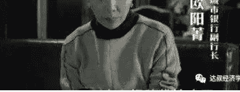

就这么简单？

当然不是，还有更复杂的。

达叔不知道，读者中有没有福建的，2015年左右，只要是福建人的身份证，在上海的银行里，做生意几乎都贷不到款，钢材行业暴雷，“不向福建人提供贷款”，成为了上海银行业的潜规则。

你说你做生意，不用资金周转，那肯定是个死，这时候能救你的除了地下钱庄，就是贷款中介、影子银行的包装了。

影子银行坏处很大，贷款中介对金融系统也有风险，但是贷款终身责任制可以改。

不能轻易改。

为什么？

因为一旦改了，放出去的贷款，对放贷人没有了制约，大量内外勾结的坏账就会更多，造成更大的金融风险。

很多事情，就是这样的两难，改革永远不是一蹴而就的，很多事情都是知道副作用，但没更好的方法前，以拖待变，中国楼市也是如此。

各位保护好自己的征信，不要乱花呗，多办几张信用卡，给自己弄个POS机，认识几个靠谱的贷款中介，财富的积累，少不了这些。

能理解多少，就看你自己的悟性了。

# 第五十四篇 SK#28 为什么有人会继续穷？有的人可以逆天改命

达叔每年会认识很多新朋友，绝大多数是做各种生意的，每个人的故事都很有意思，在这里分享几个，供各位参考。

詹总，今年36岁，男的，出生在某中部省份的一个农村。

30岁之前，一直在某医疗经销公司做业务员，穷的很稳定。

30岁这一年的夏天，他卖的机器又坏了，这次是在一个三省交界的县医院。

他和他的经理被叫到医院去赔礼道歉，保证解决问题，但是院长不放心，说要扣下一个人，只能让一个人回省会，这样才能最快解决，不影响医院运转。

小詹望了一眼经理，就知道自己要被扣下了。

从厂家协调，到方案申请，加上来回交通，折腾了一周。

小詹也老老实实医院待了一周。

人是院长扣下的，所以小詹就一直屁颠屁颠跟着院长，每天早上来办公室报道，能听的就听一点，不能听的就在办公室门口站着。

一周后，问题解决了，小詹回到了公司，办理了离职。

小詹开起了自己的公司，现在一年的营收大概在3000多万，这个医院的生意大概是800万。

达叔和詹总吃饭的时候，问了一嘴他当时的处境和想法。

詹总说，成人质的那一阵哪，是很难过的，平时的哥们义气，兄弟情谊都烟消云散了，但是能理解么？完全能理解，但还是很难过。

达叔问，那院长怎么看？

詹总说，院长看着强势，也有自己的苦衷，边远县城，多少人做了生意跑路了，有苦难言，当年也是斗争失败，被发配过来的。

达叔问，后来怎么合作的？

詹总说，当天晚上躺在床上苦闷的睡不着，看电视，在放《大秦帝国》秦始皇的爹在做人质，后来回去当皇帝了，立马就精神了。

努力一下，看看能不能把坏事变成好事，积极汇报，主动出力。

大领导有时候身边也很少有能信任的人，刚上任没多久正苦闷，我出现的是时候。

达叔说，古代好几个早年是人质，后来当皇帝的，重耳，太子丹，炀帝。日本也有，德川家康幼年也是人质。

做大事，赚大钱，就要解决信任，而信任就需要相互了解，知根知底，相互挨揍，最后加上时间的浸润。

比如达叔通过公众号写文章，各位和达叔建立了链接，一年，两年，三年，十年，骚子是没有这个耐心的，留下的都是值得信任的。

很多合作，都是水到渠成。

达叔从疫情期间，3月份开始写知乎，后来再写公众号，认识了一些有意思的家伙。

有的人，看了达叔的文章，想转发或借鉴都会联系一下，征询意见。

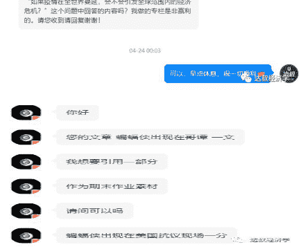

有的人，会付费咨询一些问题，沟通完之后，还会继续付费进行答疑。

但更有意思的是，有的人看到付费咨询，会先问问题，说回答之后进行付费，然后就消失了。

达叔一点都不生气，反而觉得很惊喜，原来茫茫人世间，人是如此多元，有的人一辈子都分不清什么是小钱，什么是大钱。

达叔在之前的一篇文章中，曾经说过，那些弱关系才可能把你从原来的生活圈里拉出来，而你轻易毁掉了这些机会。

举个例子，董总是个大大咧咧的家伙，开书店，写文章，做酒水生意，也做一些投资。去年买了个别墅，要装修一下，就在文章中问谁能干这个活，有三四个人来报名，有的说自己能做，有的说自己身边朋友做。

最后董总选了谁？一个和他有交集、长期看他文章，有过交流的家伙。装修的单子是多大呢？100来万。

装修方案选了一个，签合同了，非常简单。

董总为什么选择他呢？

董总说因为他知道我写文章的影响力，做的好，能帮他做宣传，做的不好，也能在一定程度上毁了他，他长期看我的文章，知道我的秉性，会用心做的，不用再磨合了，这样大家都简单。

100万的别墅装修，其中多大的利润空间，各位大概能算的出来。

那有没有搞砸的呢？

有的。

把网络当成求索地了，仿佛所有人都欠他的。

06-03 22:50

# 急！！经济学大佬 宏观经济学 微观经济学 有两个简答题 材料分析 跪求 谢谢谢谢！谢谢🙇🏻

- 1.考虑一下事件：①国内媒体大规模报道2020.4.16钟南山院士携广州呼吸健康研究院院长等人进行视频号直播时表示，连花清瘟对于新冠病毒有抑制作用，尤其对于轻症和非重症的新冠病毒更加适用；②生产连花清瘟胶囊的以岭药业等药企加大对连花清瘟胶囊的生产投入，增加其产量。分析事件①和事件②分别发生时对连花清瘟颗粒的均衡数量和均衡价格有什么影响，以及当事件①②同时发生时对连花清瘟颗粒的均衡数量和均衡价格有什么影响？（25分）

- 2.2020年初始开始的新冠肺炎疫情已经席卷全球，疫情之下多国停工停产，全球经济到了大衰退的边缘。最近几天，

这应该是一个学经济的在校大学生，老师布置了两道题目，每题25分，这个家伙直接把题目发给达叔，让达叔帮他做。

达叔看完题目，乐坏了，当时就在想，这个家伙以后毕业会很混的很惨吧。

他找工作的时候，如果遇到前面的两个同学，三个人，目前一个高中生，两个大学生，如果以后都到达叔的公司里，很快这个家伙就会踢出局。

没有分寸，不知进退。

我们每时每刻，要考虑的都应该是什么价值？哪怕是情绪价值，也是一种价值。

但凡提供了价值的，最后都会得到回报，这个社会很多时候是公平的，大家都不傻。

能纵容你的，可能只有你的父母了，到了社会上再这个德行，不仅会穷，还会挨打的。

人情，从来不是一个褒义词，人情是一个贬义词。

大妈去菜市场买菜，和菜贩子砍砍砍半天，砍下3块钱，临走还能顺几根葱，这样的人能发财么？你看看你把精力都花在了什么地方。

越是小时候穷过的人，越要摆脱穷人思维，贫穷是一种病，是一种毒药，要摆脱他对我们的桎梏和影响。

多想开源，少想节流。

利益均沾，任何想吃独食的人，最后都是没饭吃，桌子都被别人掀掉了。

最后分享一个达叔比较佩服的培训师，马总。

马总原来是某500强公司的HR，年纪大了，十年前出来开了自己的培训公司，签约了一些培训师。

他的盈利点是什么呢？培训费么？不是，更准确的是不仅仅是培训费。

马总通过培训，微信里加了很多他的学员，这些学员都是大公司的销售和高管，年纪分布在20-50岁，都是中产。

培训费是和公司结算的，公对公业务。

马总实现了一鱼三吃，除了培训费外，马总还做两块业务，一块是香港的保险，一块是英美的留学咨询，只做高端。

在培训期间，马总非常职业，专注于自己的培训业务，赢得学员的尊重。线下吃饭偶尔会提一嘴保险和留学，尺度拿捏的非常好。

香港的保险业务，英美的留学咨询业务。两块利润都非常高，学员成交和不成交，马总都没关系，偶尔有兴趣的，都会找马总聊一下。

以英国留学为例，一个单子下来，利润如果10万，是你介绍来的单子成交了，马总都会问，你觉得分多少给你合适？

几乎所有的人，都不好意思开口要5万以上，但是马总给你7万，这就是马总厉害的地方，70%的利润归你。

马总平时在上海和香港两地住，疫情期间刚回来，前几天达叔和他聊了一下。

马总问达叔，你觉得一般留学咨询公司一年盈利多少？达叔对这块是真不懂，猜了一个数，不对。

马总说，一般的留学中介公司，几个人的小团队，一年能盈利也就100万左右，我一个人2019年的留学中介业务赚的超过一个他们一个公司。

达叔问，你和他们最大的区别是什么？

马总说，我不服务穷人，因为服务穷人的成本太高了，他们“不安分”，作践服务者的时间和心力，不愿意为服务付费，仿佛一切都是应得的。

不要鹤立鸡群，要做的是离开那群鸡。

这个观点能公开说么？不能，因为会掉粉，会挨骂，不讨人喜欢。

## 第五十五篇 SK#29 人们各奔东西，直至失去对方

达叔今天给个公司做培训，看到个别不求上进的小家伙，莫名的生气。

回到家，喝口茶，平静的想一想，何必呢。

生死有命，富贵在天。路就在那里，你自己选。

一个人出生在哪里，很重要。

达婶生在海边小城，有个舅舅，姓张，上个世纪九十年代，开了个石雕厂。

那个年代，万元户是一个特殊的荣誉，张总就月入过万，除去各种花费，一年能剩下五六万。

熟悉中国经济发展史的都知道，上个世纪八九十年代，中国的经济以乡镇经济为特色，蓬勃发展。

在影视剧里，就是《大江大河》里的这个角色。

狂野，敢打敢拼，不认命，爱拼才会赢，福建人的性格。

伴随着工业化水平的提高，税制改革等，乡镇企业全面衰落。

当年风光一时的千乡万镇企业家，破产的破产，被抓的被抓，有个别在长三角、珠三角的成功转型成为大企业，凤毛麟角。

张总和大多数的没落乡镇厂长一样，没有被抓，也没有变成大工厂，干不动了，就关了。

张总有两个儿子，现在在天猫商城里做茶盘的生意，一个做高端茶盘，一个做中低端，目前中低端的这个销量做的更好一些，一年300万左右的营业额。

两个儿子成家的时候，张总的身家是多少呢？一百万不到，几十万而已。

但是生活在长三角地区，上海、苏州、杭州等高能级城市的乡镇小厂长，当年一年也是赚几万，空余的闲钱，多少都会买点房子，要么是给孩子结婚用，要么是给自己改善居住。

张总是在福建海边小县城里，给自己盖了个小别墅，也算宽敞。

经过80年代的红火，90年初的昌盛，到2000年左右的迅速没落，中国的乡镇企业和这些厂长们，人生做了一个过山车。

最终剩下了什么？

吃喝拉撒是消费，大家有钱了，能吃到的东西都差不多。能买的车也都是标准品，无非就那几个牌子。

留下最重要的资产，就是资产配置中的航空母舰——房子。

上海、苏州、杭州当年买了几套房子的小老板，现在身价都是数千万。

而福建海边小县城这样的，资产规模也就百来万，规模小，流动性还很差。

当年两拨小厂长手里持有的那几十万现金，20年后，都会印钞机洗劫了，购买力大幅缩水，这就是通货膨胀的力量。

唯一的区别，就是你出生在什么地方，在什么地方生活，在什么地方当小厂长，是你脚下的土地，造就了你下一代的起点。

所以，达叔经常劝有能力的人，去到自己力所能及的、更高级城市去奋斗，听不听话就看各自的选择了。

类似的故事还有很多。

2010年，同样都是安徽来上海的水果摊小老板，有的人赚钱了，想着给孩子买个以后在上海结婚的房子。有的人赚钱了，想着回老家给孩子盖个结婚用的大房子。

前者父母的选择，让孩子少奋斗二十年，后者父母的选择，让孩子长大后，一切从头来过，这就是认知的差别。

今日长歌今别浊，悲喜从此各西东。

在地产公司里，有两个极端的公司，一个叫万科，一个叫碧桂园。

两个都成功问鼎全球最大房企。

万科长期以来是房地产公司里的好学生，专业、稳定、美誉度高，养出了一堆高级职业经理人。

选地、拿地、产业、配套，都很讲究，有人说万科的房子可以闭着眼睛买。

在很长时间里，打败万科，是所有房地产老板的梦想，有的人为了实现这个梦，早吹了几年牛逼，还把自己给弄进去了。

学我者生，像我者死，这话是齐白石说的。在商业领域也是这样，所有尝试和万科一样走品质路线的，都没有比万科做的更大，甚至还有把自己给做没了的。

直到出现了另一个怪物，碧桂园。

深耕县级市场，以面打点，高周转，职业经理人项目跟投，绑在战车上，一记冲杀。

号称最老实的农民，杨老板，对人性玩味拿捏的最到位。

土地是一级市场，房子是二级市场。新房是所有小地方人的梦想，何况又是一个“五星级的家”，收割县城的权贵，碧桂园舞镰刀挥舞的最锋利，也最有效率。

最近叔在研究自己领域的生意，县域在各个角度来看，都在快速崛起，体量巨大，是人口和经济最大的一个红利。

这个红利扑面而来，就像天上在撒钱雨，看到机会的都是在捡钱，只是用的工具不同而已，杨老板在用房地产，黄峥在用拼多多，达叔在用医疗。

2020年“618”，拼多多市值超越京东，跨于千亿美元。有文章评论到这个世界的吊诡之处，从苏北农村走出的刘强东在努力做城里人的生意，从杭州中产阶级走过来的黄峥一头扎进五环外去做农村乡镇人的生意。

你在哪个领域去赚钱，在哪里去买资产，这几个大方向，如果不能把握，一辈子忙忙碌碌，就白忙活了。

这一年，你多少岁？

应该是你一生的黄金时代，你有好多奢望，想去爱，想去玩，还想在一瞬间变成天上半明半暗的云，拥有上帝视角，俯瞰这个世界。

身边多少个朋友，最终都会走散，人生终究是孤独的。晚年到底是沦丧，还是体面，就在你现在的选择。

我们生活在《了不起的盖茨比》的年代，那个时代的美国，空气里都是金子，今天的中国也是这样，疫情终将过去，转身就有机遇。

但是更多的人是迷惘，是谩骂，这是一个最好的时代，也是最坏的时代。

晚上和一个法国服装品牌撤选址的高管吃火锅，他之前的工作是帮沃尔玛、优衣库等公司开店做选址，现在帮这个法国服装品牌做招商和门店选择。

高管一边吃饭，一边感慨疫情影响，生意难做。

达叔就问，你们全国现在有多少家门店？

高管说，600多家。

达叔问，是所有店生意都难做么？有什么区别？

高管说，一线城市最难，竞争太激烈，二三三四线日子还过一些，门店开的比较多。

达叔问，你这一个店投资大概投资是多少？

高管说，四五十万。

达叔问，平均一年能赚多少？

高管说，从全国的数据来看，平均一年能赚15-20万左右，主要看选址和运营，加盟商用心普遍比直营要做的 好，很多一线城市的直营店，都在做关店处理。

达叔问，那你最近有什么规划么？

高管说，我在研究一个项目，准备自己去开几个，疫情影响，租金和付款方式都好谈。

达叔放下筷子，想起了来伊份，这个公司就是在上一次SARS疫情期间，逆势开店，强势崛起的。

达叔在公众号里，各种故事写了很多，路在那里，你得自己选。

## 第五十六篇 SK#30 你以为人家靠餐厅赚钱，其实人家靠的是地产；你以为人家靠的是地产，其实人家靠的是金融

达叔这几天去了一趟徐州，本来定的是皇冠假日，却被当地朋友强烈要求改住苏宁凯悦酒店，理由是我们徐州也有高楼了，让你上去看看夜景。

夜景倒是没啥好看的，望下去周边一片工地轰鸣，徐州在真金白银的崛起。

徐州苏宁凯悦酒店长这个样，在灰头上脸的城区里，看到这样的建筑还是挺惊喜的，江苏省会的别称有了一点味道。

作为经常劝人买房的达叔，忍不住又要劝一句，住在徐州或周边的朋友，趁着徐州房价还没飞的更高，赶紧动手，徐州未来前途不可限量。

那达叔今天是要写徐州么？不是。

达叔要写一点遇到的人和事。

达叔这次拜访的公司，正在和某央企签收购和对赌。

两边的老板达叔都认识，一方是原某军区司令的女儿，一方是40来岁、公司规模7000万左右的老板。

达叔所在的行业，规模到这个级别，一个亿左右的公司，就面临非常大的瓶颈，前方无非就两条路。

一条路，被央企、国企收编，进入正规军，俗称上岸。

另一条路，就是弄块地搞生产，被某个市招商引资过去，拿到一些优惠政策，最后自己搏一把，看能不能上市。

那做贸易类的，就不能做的更大么？非常难。

To B的生意，和To C完全两套逻辑，有其行业属性带来的特殊约束，对经济学有一定了解的话，里面有一个词叫“边际效应”。

边际效应分为边际效应递增，就是公司早期扩张的时候，每招一个人带来的收益远大于成本，那么就是边际效应递增，可以继续扩张。

等扩张到一定规模的时候，每招一个人带来的收益小于成本，那么公司的扩张就会停止，也该停止，这就是边际效应递减。

所以无论是 IBM、华为，还是苹果、阿里、谷歌、腾讯，再伟大的公司，都不可能无限扩张，都有边界。

区别是上限的高低，边界的大小，这个在你选择行业时，基本就确定了。

达叔之前在文章里强调过一个观点，无论是创业还是投资，都要选对行业和赛道，不同的赛道适合不同的人来玩。

比如资金密集型的金融、地产，绝大多数就是权贵们的游乐场，你脑子好使、胆略过人，大概率就混成权贵的白手套。

那么普通人，可不可以玩，有没有机会玩呢？

有的，但需要换一个壳子，要迂回一些，更麻烦一些，才是普通人的出路。

举例：麦当劳。

麦当劳不是一家餐饮公司，麦当劳是一家地产公司。

这对很多人来说，超纲了，所以达叔来聊一下真实世界的商业逻辑。

开公司目的是什么？原因可能有很多，但是最终一点就是赚钱。

麦当劳的创始人，Harry J. Sonneborn（麦当劳第一任总裁和 CEO）说过这么一段话，是对华尔街的投资者说的。

> I think you misunderstand the real nature of McDonald's . . . we are not basically in the food business. We are in the real estate business. The only reason we sell fifteen-cent hamburgers is because they are the greatest producer of revenue from which our tenants [McDonald's franchisees] can pay us our rent. There is nothing else that will produce the volume that food sales will, and all of our leases are based on a percentage of food sales. You can see the sales results of our units. That's the proof of what I'm telling you.

翻译成中文就是：

> 我想你误解了麦当劳的本质，我们不是简单的食品生意。

> 我们是地产生意。

> 我们之所以卖 15 美分的汉堡包，只是因为这玩意能让我们的加盟商卖掉赚钱来付给我们租金。

> 卖汉堡赚不到啥钱，但这个食品生意带来了所有的租约和授权合同，这个才是真正赚钱的。不信的话，你可以看看麦当劳的财报，就能证明我说的。

那麦当劳的财报长啥样呢？

| (in millions USD) | 自营餐厅 | 品牌授权 | 地产出租 | Total |
| :--- | :--- | :--- | :--- | :--- |
| 收入 | 15,295 | 3,831 | 7,637 | 26,763 |
| 减：BG费用 | 14,178 | - | 2,380 | 16,559 |
| 减：总部管理费用分摊 | 378 | 696 | 1,387 | 2,460 |
| **运营利润** | **739** | **3,136** | **3,870** | **7,745** |
| 运营利润占比 | 10% | 40% | 50% | 100% |
| 运营利润率 | 5% | 82% | 51% | 29% |

这是按照知乎用户 Jade QZ 分析的数据，2016 年麦当劳 50% 的运营利润来自于地产出租，40 来自于品牌授权，只有 10% 来自于自有餐厅的运营。

这个案例从另一个方面印证了达叔昨天写的那篇文章 *SK#29 人们各奔东西，直至失去对方*，在文章后半部分，达叔提到和法国服装品牌的高管吃饭。

聊到原来在中国开了很多直营店，总店规模一度达到近千家，现在官网上介绍是 800 多家，但最新实际的数字只有 600 多家，高管目前的主要职责就是把直营店关掉，扩大加盟店的招牌。

从商业逻辑上，也是在走麦当劳的路子，出租、品牌授权，比自营更赚钱，早消停收。

你看懂了这些，就大概知道达叔为啥劝你轻易不要开店，但是很多人在热血上涌上心头的时候，不听劝，不被社会毒打一遍，是无法扑灭那个开店梦的。

想在餐饮赚钱，就要把品牌做起来，用品牌溢价提高价格，降低商场房租成本，比如海底捞被招商时享受的超低房租。

租，受上市财务压力，海底捞最后会不会走加盟的路子，拭目以待。

写这段，是因为在徐州接送达叔的那个家伙，就天天惦记着要给老婆开个服装店，投资规模四五十万，看着这家伙激动的劲，一阵悲伤，祝他顺利赚钱吧。

经常读达叔文章的都知道，达叔经常动人买房，为什么？

因为在中国的整个金融体系中，土地和楼市是最重要的压舱石，甚至是货币增发的标准。

你家里即使有一个印钞机，每年印多少是不是也要有一个标准？标准怎么定，土地是一级市场，楼市是二级市场。

一级市场是政府和地产商在玩，二级市场是你我这样的普通人在玩。

做过生意或贷过款的都知道，中国的金融业对个人和小微企业是多么的不友好，利率高，要求多，贷款金额小，贷款周期短。

唯独放了一个口子，买房，利率低、贷款金额大，时间长达 30 年。

闭上眼睛想一下，为什么留这个口子？因为是双赢。

国家需要人民的劳动剩余，获取剩余后去建设更美好的国家，人民需要追求美好生活，住上更好的房子，过上更好的日子。

地产商只是这个环节里的一个工具。工具之所以努力工作，是要给报酬的，让人家赚到钱。你以为地产商在玩房子，不是，地产商在赌金融政策的松和紧，赌对了，鸡犬升天，赌错了轻则掉队、重则破产。

手中握有金融政策的松紧水龙头，作为工具的地产商就会乖乖听话。

上周末达叔在苏州和一个朋友聊天，这个家伙手里有两套房子，都是全款。人看着很聪明，但是在投资和财富增值这块，几乎全错了。

没有合理负债的资产，就是垃圾资产。达叔对这个家伙回去把两套房子抵押贷款，来苏州再买一套，听不听、能不能执行，就看这个家伙的命了，十年之后，一个决策，命运两重天。

经常看《观视频》的各位，知道这节目是一个工业党主导的节目，讨论时事政治，发出中国声音，主题都特别宏大。

但是 6 月 23 日发布了一个视频，很有意思。

《房宁对话王鹏：中国要抗拒百年变局，最重要的还是城市化》，这个节目引起了部分争议，因为经常看节目的观众只能接受工业崛起，无法接受房价崛起，这是多么神奇的悖论。

房宁是谁？中国社会科学院政治学研究所，党委书记，这个身份很重要，在这个时间点发表这样的观点，更重要。

房宁提到一个观点，中国完成工业化的标志是中国城市化率达到 65%，这是中国避免陷入中等收入陷阱、工业化最后冲刺失败，最核心的问题。

城市化率达到 65% 以上的工业化国家，即使出现一些社会问题、社会矛盾，也很难出现大的倒退，陷入失败国家，很多国家都倒在这个门槛前。

那么城市化率达到 65%，不是很简单么？把人搬到城市，多盖房子。

真正执行起来，不简单。

这里提到的城市化率，指的是同等国民待遇的城市化率，这是政治学研究中中国社会结构的一个核心问题。

现在中国一个巨大的矛盾，在城市里统计人口概念，分为户籍人口，常住人口，常住流动人口，又是常住又是流动。

这就是中国目前面对的特殊性，包括春运也是一个历史阶段的产物，这些都是不正常的。

从不正常逐步回归到正常，从无序变成有序，在物理学上有一个词汇叫“熵减”。熵定律，是自然界的最高定律，这是爱因斯坦的观点，有兴趣的同学可以研究一下。

从无序变得有序，从不正常回归到正常，这里面都蕴含着巨大的财富。

看一下自己想要保护的爱人和孩子，去更高能级的城市，去获得同等国民待遇，这是我们这一代人，送给下一代最好的礼物。

达叔前几天东奔西跑，太忙了，导致身体有点不舒服，本要去一趟宁波，也没去成，待在家里，被达娜隔离了。

正好把前面遗留下的书单，看完，把要写的东西再整理一下。

今天写这篇文章，是遇到了几个特别有意思的人，文末再分享一本书。

达叔在疫情期间曾经给自己立过一个规矩，疫情解禁后，每个月都要去见一个小网红，建立链接，看看他们的生活。

有很多粉丝的人，和普通人的差别，是很大的，尤其是对这个世界的观察和理解，云泥之别。

很多人只看到了明星光鲜的一面，他们受到了多少辱骂和诽谤，你是无法承受的。达叔在写自媒体时，上的第一课，就是你要有一颗大心脏，欲戴皇冠，必受其重。

正巧，达叔这些年没啥别的优点，就是脸皮比较厚，嘴比较贫。

有人被骂时，被骂的抑郁了。达叔被骂时，要是骂的对，达叔给你道歉，要是骂的不对，达叔有时候连拉黑都懒得拉，达叔是和各位一起研究如何致富的，你都跑偏了，穷的活该。

达叔微信里，有一大堆 V，小 V，很多都挺不正经的，欢乐的很。

今天先来聊一个刚认识的。

某发达省份的检察官。

长的很帅，通过知乎认识的。

检察官帅哥，他弄了个公众号，达叔吐槽他太懒，更新的太少。他说自己太帅了，开始去玩视频去了。

长得好看，就是任性。

为啥能展开了聊呢？

达绅是学法律的，所以达叔对公检法系统的人就特别敬重一些。检察官对经济感兴趣，也就对达叔很感兴趣。

检察官的原话是：“我对学经济的也崇拜得很，特别是股票 5 万亏 2 万以后。”

聊到钱，达叔就来精神了。

达叔给他看了三支股票，都是医疗行业的，他看完之后就崩溃了，感慨之前那么多年，唯一赚钱的一支股票就是医疗器械股。

达叔虽然不炒股，就逗这个家伙，问他，是不是认识我认识的太晚了？

检察官说，是。。。然后给我发了一篇他 2016 年底写的一篇文章，名字标题起的很吓人，达叔就不复述了，内容是医疗行业内部人士写的，标题是他起的。

为啥会有这篇文章呢？当时检察院在重点反贪，反到了这个领域，后来不了了之了，他也就没再跟进。

达叔来分享一下检察官帅哥的原话：

> “哪里有贪污，哪里就有前途。”

> “在市场经济和法律体制完善之前，哪里问题最多，就说明社会力量在往哪里突破。那个地方就是走在改革最前沿的地方。”

你看，这就是社会的真相，书里不教你的。

达叔和一些土豪老板聊天，他们说现在各个城市都在搞招商引资，哪个城市能去，哪个城市不能去，标准有很多，其中有一个就看那个城市的 KTV 和会所，如果繁荣，就说明主政者思路开阔，工商业繁荣、反之，就要小心了。

达叔就想到了，改革开放刚开始，红顶商人霍英东率领香港财团来北京投资，每次落首都机场，都要看一眼这幅画还在不在，如果还在，那么心里就踏实一些。

为什么？因为画中有三个傣族的裸女，变成了港商担心政策摇摆的风向标。

同样的一幅画，你说画的是生命的赞歌，他说你是色情，这事就没法聊了，生意也就没法做了。

1970 年，袁运生为北京首都国际机场创作的壁画《泼水节——生命的欢歌》（局部）

另一个达叔要来聊的是今天遇到的奔驰汽车销售。

为了让达婶开心，要换一辆车，逛了几个 4S 店，达婶平时接触的人比较少，但遇到这个姑娘，不禁感慨了一句，销售与销售之间，还真的是有差距。

评价的维度有很多，热情度、专业度、亲和力等，达叔就不展开了，这个姑娘今天最打动达叔的有一句话。

能花錢搞定的事，咱们尽量就不要浪费时间。

达叔听完，立马就觉得这个姑娘不简单，因为这是一个很高的境界。达叔在之前的文章 SK#27 贷款中介到底有没有用？有什么用？，有发表过类似的感慨，要找专业的人做专业的事。

时间对每个人的约束是公平且上限的，有钱人与穷人之间，貌似差异是财富总量上的差异，其实真正差异是赚钱效率上的差异。

赚钱效率这个概念，背后隐藏的就是时间的概念。

去年达叔和欧洲人一起培训开会，聊到时间。

有人提到时间都是公平的，M 总老外异口同声的说 No，老板通过工资的形式购买了大量员工的时间，从财富的角度来说，老板就实现了 N 倍的时间杠杆，当然也承担了杠杆的风险。

黄光裕在牢里坐了十多年，外面的一群人还在为他打工，出来后还是有。

普通人呢？别说坐牢，连失业都不行，手停口停，赚钱效应也就没有了。这也是为什么达叔总是建议各位，要努力给自己配置资产。

普通人要是不小心去坐牢，十多年出来后，如何保证自己不是个穷人？一种是进去前买了套房子，一种是进去前买了茅台等优质股票，只有这样，才能不耽误你赚钱。

但是，能判断出优质资产，在年轻时尽力买入，这都是需要智慧和勇气的。你是抱着手机刷刷抖音音乐哈哈，还是和达叔一起好好学习苦哈哈，看选择了。

达叔最近决定，在文章里经常推荐一些书，今天推荐的是第一本《中央帝国的财政密码》。

我们之前所学的所有历史，无论是司马迁的《史记》，还是司马光的《资治通鉴》、《二十四史》，甚至《明朝那些事》都是王侯将相史。

但正如达叔今天写的这个题目一样，跟着钱走，发现真相。

有了这 8 个字，你就能理解历朝历代的各种事件。

比如岳飞为啥必须得乖乖听令，回来被杀？不能造反么？答案是，不能。

忠心还是不忠心，不重要，重要的是皇帝赵构掌握财政，军费由中央发放。你手下的兄弟有啥跟着你？是因为有饭吃，有钱拿。一天两天没钱可以，时间久了，肯定哗变，这就是人性。

人都要活着，忠诚是有代价的，军队如此，公司如此，婚姻也是如此，不要考验人性。

达叔聊的这岳飞话题，看着是不是有点久远了？那聊一个最近的，这个新闻看过不？

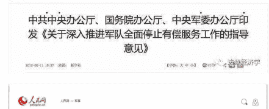

两年前的新闻，注意一下这个人民网新闻的语气，坚决打赢，攻坚战。

中国从八九十年代开始，屡次禁止军队经商，但屡禁不止，军队如果可以经商，可以自己赚钱，自己养活自己，那么为啥要听上面的呢？

所以我们迎来了 60 多年来，又一次大规模的军改。任何一次改革，都要从钱的角度来改，否则就是白忙活。

如果看书一直停留在看王侯将相、英雄豪杰、文人圣贤，看命运的起起伏伏、成败跌宕，那么你就一直没长大。

等你长大后，看到的是人与人之间的合作、博弈、较量。中央与地方的博弈，部门与部门之间的争夺。都是围绕资源，也就是钱。

跟着钱走，看到真相。遇到问题，要问一下自己：

- 钱从哪里来，又花到哪里去？这是钱的来去方向。
- 谁得到了好处，谁又付出了代价？这是对钱的分配。

看清楚了这两点，你就不至于犯太大的错误。

很多人，懂历史的不懂经济，懂经济的不懂历史。希望达叔推荐的书，各位能抽空读一读，至少能分得清，谁在帮你，谁在骗你。

# 第五十八篇 SK#32 达叔的新征程和下半年的尝试，高效率冲向广阔市场的探索

端午假期，达叔一边带着口罩，一边忙的笔头转向，写了近万字的文章和思考。

为什么呢？

在忙一个新项目。

达叔所在的行业，有一个大 V 和达叔谈成了一的合作意向，达叔成为其平台的培训师合伙人，选了 5-6 个方面的话题，刚写完了个一，正在写第二个，近期要几个话题都赶制出来。

在决定要做这个项目之前，看重的并不是那一点培训费之类的。

达叔坐在书桌前想了很久，一般遇到任何一个事情，做还是不做，有几个标准。

1. 这是不是一个带有复制性质的事情？

复制，伴随着时间的推移，收益越发大。如果是，那就值得做，如果不是，只是一锤子买卖，那么基本上就不会去做。

2. 这事和你的事业主航道，能否产生协同效应？

比如达叔写知乎，写公众号是为了建立更多人与人之间的链接，这有助于达叔的事业主航道，那就值得做。

新项目是给达叔所在的行业内人士做培训，那么两个条件都具备。

既是一个复利的事情，又能够建立业内人士更多的链接，完美嫁接事业主航道。

达叔拿起电话，给自己平时最佩服的人打了个电话，要咨询一下，第一个电话没接。

过了会给达叔回了个信息，说自己在洗澡，当时是夜里九点多，这个时候洗什么澡，太奇怪了，达叔嘲笑他是不是脏了身子，嬉笑之后，言归正传。

这家伙伏是天职极高的，达叔很少佩服人，这是在智力和逻辑性方面全方位碾压达叔的人，达叔讲下了自己的思考，也讲了未来的利益点。

- 我们的生意目前已经覆盖到全国的 30 多个省级单位，包括西藏都有了。发达的省份渠道覆盖已经到了市级单位，但是很多省份还没有沉下去。

未来的决战在县域，这是一个基本共识。

从覆盖的角度来看，县级行政单位，全国 2800 多个，折合每个省 100 来个，我们的产品基本上已经准备好了，但是从渠道的角度来说，远远没有准备好。

那么如何解决县域渠道，到目前为止，还没有一套成型的打法。

大的方向来说，无非两种，一种靠人海战术，一种靠科技的力量提高效率。

外资公司不是民营企业，人员成本很高，走不了人海战术，那么剩下的选项就是要依靠科技的力量。

科技是冷冰冰的，但渠道商是一个个有血有肉、有利益追求的人，如何平衡两者之间的关系，这个很考验人的思考力和执行力。

- 县城生意规模在 100 万左右，养不起一个一级代理商，对特定产品来说，未来的模式必然是省级设备平台商+市级耗材服务商+县级二级代理商。

这就是达叔对目前手里产品的未来规划，厂家，平台商，一级代理商，二级代理商都能得利。

而全国有 2800 多个县，如何最高的效率找到这些地头蛇，是最大的难点。

翻过“找到”这个难点，会迎来下一个难点，就是双方如何获取信任，共同来操作县城的生意，这才是最大的难点，耗时耗力。

2800 多个县布局成功很难，但一旦布局成功，将是不世之伟业，干什么都能成。

看看娃哈哈如何利用自己强大无比、深入乡镇的渠道网阻击达能集团和可口可乐的，一眼便知其中奥妙。

达叔在于一件大事，你要不要一起参与？！

2 达叔在之前的文章里，曾经不断的探讨过，路径包括从不熟悉到熟悉，从熟悉到信任，衡量标准是相互掌握的信息浓度。

从公开信息 --> 半公开信息 --> 隐私。

还有没有别的路径？有的。

仰视。

读者和作者之间的关系，学生与老师之间的关系，粉丝与偶像之间的关系，以此类推，加上时间这个维度的浸润，就会形成信任。

解决信任之后，很多的生意就会顺理成章，水到渠成了，很多生意之所以起步都没法起步，就毁在了这一步。

很多企业为什么要拼命的砸广告，因为要解决知名度、美誉度、忠诚度。

定位清晰之后，就要持续的投入金钱与时间，期待最后的回报。

任何品牌的建立，都不是一蹴而就的，在互联网时代，个人即是品牌。

任何一举一动，都要对自己的长远利益负责。有了长远利益，就不会被短期利益诱惑，去犯错、去做出有损品牌的事。

对短期利益的贪婪，就是对长期利益的最大漠视。

凡事都要看的长远一点，古人云，人无远虑，必有近忧。

## 第五十九篇 SK#33 用中大奖的模型，开拓我们赚钱的思路

每年当别人开始庆祝一年快要结束、开始放松的时候，达叔在 11 月开始就为了下一年规划的和布局，11 月到春节左右的 2 月，这三四个月的时间，绝大部分人都在打枪入库、马放南山，放假旅行，全球浪。

却忘记了一年之计在于春，很多人春节加年假，浪完回来发现转眼即到 3 月，Q1 就要结束了。开局不利，手忙脚乱，一转眼，半年就过去了，半年一过，今年生意差不多就废了，再做调整已来不及，士气低迷，今年就这样吧。

如此往复，消磨了又一年又一年，青春蹉跎。

### 3. 说到投入

达叔今天来分享一个小故事，达叔今天劝退了一个人。这位朋友是在 5 月初加上达叔微信的，40 岁左右，手机制造业设计师，找达叔想转行，这是背景。

期间两次约达叔见面，要聊聊，达叔都婉拒了。为什么？因为现在大家的时间都太宝贵了。

达叔之前在文章里分享过，说不要去吃过 5 个人的饭局，也是差不多的道理。大家时间都很宝贵，要聊什么，要提前尽量确定好话题，尤其是陌生人之间。

时间宝贵，不说明确的话题，这是其中一个原因，还有别的原因么？

有的。

达叔把短短的聊天记录，还有他的朋友圈看了一遍，就劝他谨慎考虑一下转行，尤其是准备从公司后台转到业务前台，尤其要谨慎。

理由在这里也分享给大家，供各位参考。

生产、设计等制造业部门主要是人与物之间的关系，考核的主要是技术。但是业务部门的本质是什么？是人与人之间的关系。人与人之间的关系，说到底是利益交换的关系，即使是夫妻，家人，都有利益交换的成分在里面，何况是陌生人之间。

有的人很早就有这个天赋，比如达叔要是想认识一个人，就会转他的文章，点他的赞，帮他转发，给他发私信，给他打赏，这些所有的目的，都是为了引起他的注意。

达叔看过最夸张的是，一个人把卢克文的文章用上好的纸张打印出来，反复阅读，以示尊重。

罗胖在刚开始起步的时候，一句口号叫：爱就供养，不爱就观望。

这些都是建立链接的基本窍门和步骤，但是很多人不懂。

两个多月的时间，这个家伙随时都有机会去迈出一步，哪怕是一小步，但是他什么都没有做。

哪怕自己内心知道有求于对方，但是仍然不做任何有利于对方的事情，不做任何铺垫，上来就做伸手党，这是很吓人的。如果你也是这样的人，安心的做人与人物的工作，人与人的工作，你是做不好的。

达叔随便来举个例子，达叔有个朋友在搞图书的生意。

图书现在越发是一个小众市场了，赚钱的还剩一点教材之类的，生意都被线上当当、京东等抢光了。

那为什么还有一些书店活着呢？有大客户团购的门路。

比如一个图书的订单，对方交给你这个店来做，利润是十万，你拿几万？这直接决定了你的书店能开多久。答案达叔就不公布了，你自己慢慢想吧。

我们能赚到钱，赚大钱，不是因为我们牛，而是因为我们能让别人赚到更多的钱，别人才会允许我们赚钱。要时刻想着我能为对方做些什么，这才是最良性的生意。在你需要的时候，别人才会伸伸手，去帮你。

否则，大家都很忙，时间都很宝贵，何必去掺和你的事呢？又不是你的家人，非亲非故的。

不要做一个伸手党，如果你的思路转变不过来，你的一生都会很麻烦的。说完这个案例，再回到开头，达叔为什么能和这个平台合作成功？

一是因为达叔的职位，阅历，还有几个月的高能持续输出；

二是因为达叔和对方都不在意眼前那点利益得失，都愿意为了远景，一起长期投入，干一票大的。

这样玩起来，才有意思。

加达叔个人微信号，期待有机会合作，也为了防失联。

现在疫情期间，经济危机还在全球蔓延，达叔推荐一本国师级的书，温铁军的《八次危机》，讲的是 1949-2009 年之间，中国如何度过八次危机的真实经验，内容有点刺激，尤其是危机最终转嫁给了谁，你要看的明白。

关注达叔经济学，让我们一起慢慢变富。

今天我们 来做一个思想实验，这是实验会玩了，你应该就知道如何构建自己的致富模型了。

现在摆在你的面前，有两个金蛋：

- 金蛋 A：你砸开它，可以马上拿走 100 万。
- 金蛋 B：你砸开它，有 50% 的概率拿到 1 个亿，剩下 50% 的概率，一毛钱都拿不到。

请问你怎么选？

闭上眼睛，摸着自己的内心，自己想一下。

心理学的研究表明，人是厌恶失去的，人们喜欢确定性。

所以绝大多数人会选择稳妥的 A，拿走一百万，落袋为安，反正是达标似的，不要白不要。

还有一部分人，具有赌性性格，人生信条是要做大事，要赚就赚大钱，100 万算什么，人生哪有几回搏，选 B。

如果是在现实里，真有两个金蛋给你砸，那么你这两个选择都没错。

但是有没有更好的方法？

赚钱，是要动脑子的。

选 A 确定的这 100 万，对很多人来说是一大笔钱，但是对很多人来说，又是一笔小钱，千万的资金规模，也是如此。

选 B 的金蛋，赚一个亿的概率是 50%，那么这个金蛋从理论上来说，就值 5000 万的市值。

如果我们以 2000 万的价格把砸金蛋 B 的机会，卖给更有风险承受能力的人，一旦成交，那么所得的 2000 万是不是远远大于 100 万？

即便 2000 万的价格暂时找不到成交者，只要成交价高于 100 万，是不是也比选金蛋 A，更赚钱？

如果按照这个思路去执行，能赚多少钱，就看你的销售覆盖能力，以及价格谈判能力了。

这个思路是出售选择权。

熟悉达叔文章的人都知道，达叔经常提一个概念叫做改善，英文名叫做 Continuous Improvement。

那还有更好的方案么？有的。

如果找到了愿意购买金蛋 B 选择权的买家，刚才的方案是谈好一个价格，比如 2000 万，直接卖掉。

能不能换一个思路？分期，出售部分选择权。

比如今给愿意购买选择权的买家两条选项：

- 1、直接拿 2000 万把砸金蛋 B 的权利全额买断。
- 2、首付 100 万，签订砸蛋权购买合同，如果买家中了一个亿，那么再分 5000 万给你，如果没砸中，合同到此结束，首付不退。

在你已经把砸蛋权掌握的情况下，给出的两条路，是不是有的买家愿意选择方案 2，来赌一把？

而你的收益，则变成了保底收入 100 万，有机会博到 5100 万。

逻辑是这个逻辑，具体的尺度和定价，你自己想。

那还有没有其他的方案？有的。

如果是一家保险公司买到了，或者公众号粉丝量极大的大 V 买到了。

只要有销售渠道，玩家足够多，还能玩出更有意思的花样。

可以将金蛋 B，一个亿的风险收益，做成公开发行的彩票。

2 块钱一张，印 2 亿张，随即选择一万人中奖，每人中一万元，拿 2 元博一万，玩家应该不少的，即使没中，2 块钱也是小钱，每人计较，只要能全部销售完毕，能进账 4 个亿。

假如中了，分给一万个人，每人一万元，总计一个亿，还剩 3 个亿，即使抛去营销成本，也是赚大了。

当然，这也是为什么博彩业，彩票业暴利，且不放开的原因之一。

那还能不能继续玩出新花样？可以。

刚才的模型，进行拆分。

一个亿的盘子太大了，拆分成 10 个一千万规模的抽奖游戏，不是 2 元搏 1 万，而是 2 元搏 1000 元，可以玩 10 次。

每次 2 元，达到一亿人开奖，1 万人中奖，每人 1000 元，总计每次收入 2 亿元，支出 1000 万，盈利 1.9 亿。

可以玩十次，除去营销费用和渠道成本，盈利规模达到十亿。

如果一个公司的盈利规模达到十个亿，那么是不是可以上市了？

做上市，公开发行股票，股票盈利率达到 10 倍以上，那么市值就破了百亿。

这就是证券化的力量，也是金融的力量。

这是金融非常赚钱的原因，也是达叔劝各位轻易不要碰股票的原因。

因为你可能根本就不知道一个百亿市值的公司，背后的模型是会跑的扇贝，还是一个砸金蛋的游戏。

今天写的比较晚，就先写到这里吧。

## 第六十篇 SK#34 什么是大生意？什么才是你的大生意？

达叔经常出差去各种地方，见到各种人，和很多人聊天，经常聊的一个话题就是赚钱。

看着每个人都在聊赚钱，但当达叔很严肃的去问 Ta 几个问题的时候，很少有人能够回答的上来。

比如，今天达叔拿出一个话题来分享一下：

你这辈子给自己的财富目标上限设置是多少？

是一个亿，还是千万的级别？

不要小看这个问题，这是一个财富规模的概念，绝大多数人从来没想过。

甚至没有人想过自己赚了两千万的时候，会买什么。

今天达叔劝各位闭上眼睛认真的想一下，因为你没想过这个问题，是对不起这个时代的。

达叔在不同的场合演讲的时候，都说我们这一代人，或早或晚都会身家过亿的，有的人早 20 年，有的人晚 20 年。

很多人哈哈大笑，觉得达叔是在开玩笑，但他不知道达叔说的是认真的。

这就相当于，你在刚出生的时候，你告诉你爸妈，咱们家以后会是百万富翁，那时候万元户还是极其罕见的，你当时说自己以后会是百万富翁，爸妈会觉得你傻。

看问题，要有历史的眼光，要看的远，要想的远。

当你确定了你财富的规模上限，你就有了目标，有了目标，你才会想着去分解这个目标。

三年怎么做，十年怎么做，资产搭配怎么做，赚钱的路径该如何选择。

而不同的路径选择，创造的财富规模，是不一样的。

各位每天看八卦娱乐，看肖战，看李诞，看奇葩说，热热闹闹的所有娱乐明星，占据了绝大部分的新闻版面，影视歌三栖明星，一定是大大的有钱，对么？

但实际的情况，是令人大跌眼镜的，中国所有的电影产业，一年的票房加起来，只有 600 亿人民币。

而且这 600 亿，是无关国计民生，无关痛痒，说封就封了。

看疫情期间，为让工厂开工，国家级动员，用大巴车拉工人去上班，报销车票。

看商场开业，餐饮开业等，省级动员，保民生、保就业，总理让你去摆摊。

电影业的 600 亿，里面还有三分之二是要分给电影院的，电影院是什么？

电影院是房地产，占其中的 400 亿，也就是刨去 400 亿，剩下的 200 亿再由投资人，制片人瓜分，由头部明星去分，头部顶级明星分完，剩下的那一丁点才是普通人的生意。

而你在这个细分领域里，是很难赚到钱的，达叔认识的几个混迹娱乐圈的，除了长得漂亮点，一个比一个惨。

当然，达叔讲这个故事，很多人是看不懂的，最终还是要讲各位熟悉的行业，才能让各位对产业的量级产生一点概念。

看完电影行业的规模，看各位熟悉的医疗行业：

2019 年医疗器械行业规模 6500 亿左右，是 10 个电影行业。

那么医药行业的规模呢？万亿规模，下图是销售规模 12249 亿，整个工业产值规模 4 万亿左右，是 70 个电影行业。

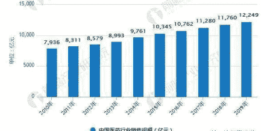

这里就引发一个概念：

医药行业相比医疗器械来说，是一个更大的生意，但是不是你的大生意？

看达叔文章的有很多是医疗行业的，达叔来讲这个领域的故事。

一个做药的销售，一年的指标大概是多少？

十年前，人均年产出是 200 万左右。

后来各家都在提高人均产出，现在人均大概在 300-500 万/年，过千万的客户，要弄三四个销售进去负责。

但是换一个细分领域，玩 IVD 诊断的，一个销售负责一个省，厂家出货量几千万就是很正常的。

这就是规模的差异。

好多年前，达叔在一个公司做，一年的生意额指标只有 200 万，干了一年不到，达叔就跑了。

为什么跑？

因为达叔开车看到各地都在建新医院，公立的，民营的，高楼拔地而起，每一个高楼拔地而起的背后，都是几千万，上亿的投入，而达叔在里面的生意只有几万块。

这不是达叔要过的生活。

生意规模的上限，造就了你不可能赚比你生意规模还大的钱。

因为这是不符合逻辑的，古人云，烙饼再大，也大不过烙它的锅，达叔要去选一个更大的锅。

后来达叔选了一个，接手的时候，生意规模是 1700 万/年，三年后，生意增长到 5000 万，后来随着职位的往上走，负责的区域扩大，负责的生意早已破亿了。

当你生意规模做的大，你的收入变得高，这是一个必然的现象。

达叔之前写过一个文章，SK#15 山西发现的金矿和绿地高管睡了别人的妻子 这里面曾经尝试讲过类似的逻辑。

第一章是站在行业规模的角度来分析，尝试找一个规模大的行业。

第二个章节是站在行业内部门人士的角度来分析，尝试找一个属于自己的大生意，否则行业规模再大，比如军火生意大，和你没关系，那也是白搭。

第三步，达叔要分析什么？

要分析买家，分析客户，分析什么生意是普通人的，什么生意是权贵的。

这点很重要，这点是达叔最近几年才想通的。

药品的模式，大家都懂，达叔以医疗器械为例。

比如你是个主任，你面临的局面是什么？

价值上千万规模的单子，几乎和主任是没多大关系的，基本上是院长层面上的事情。院长那边也会遇到省里的，市里的，纪委的，检察院的各路人马，都来打招呼，经常搞的买也不是，不买也不是。

好的结局大家排排坐，分果果；坏的结局是，谁也倒霉，不买了。

那价值几百万的设备单子，是院长级别的主要战场，业内有几个普通人能有院长关系的？很少。

有的销售，当院长还是主任时，就跟着，那可能是鸡犬升天了，但目前的业内人士流动性这么高，幸运儿很少。

留给主任也就是十来万左右的，如果是设备加耗材，那么这才是是普通人员的生意，不用大动干戈，润物细无声的把钱赚了，月月有，年年有，积少成多，这才是属于你的大生意。

这也是为什么最近几年，POCT这么火，设备不贵，有耗材生意，放在临床，好上量，从长期来看，是一个有机的生意。

以上，符合达叔之前经常说的两点：

- 1、做的事要有复制属性，伴随着时间，可以积少成多。
- 2、不偏离你的主航道，一鱼多吃。

整个行业在快速增长，方兴未艾，年均增长不低于20%。

从全球领域来看，IVD是第一大市场，而POCT又是IVD领域里的明珠，这个领域是属于普通人的机会，有兴趣的可以联系达叔。

### 图 5: 全球医疗器械市场结构

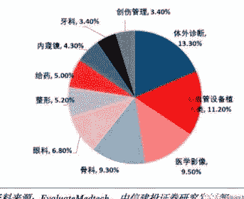

资料来源: EvaluateMedtech，中信建投证券研究发展部

最后，听达叔一句劝，抽空想一想下面的几个问题:

- 自己这一生最终的财富规模是多少?
- 选择什么样的赛道?
- 准备用什么工具去实现?

同一块石头，摆在不同的商场，可以卖不同的价格，不要把自己扔在菜市场。

不要辜负这个时代，这辈子你早晚会身家一个亿，达叔希望你能早 20 年实现。

达叔这个号是长期研究如何一起慢慢变富的，所以聊的话题，都比较俗。

昨天的文章，SK#34 什么是大生意？什么才是你的大生意？，尝试让各位去找到自己的职业赛道。

但是这个职业收入，只是收入的一个方面，不全面，更不安全。

稍微研究过经济或财富理论的，都知道，收入分为：

- 职务性收入 和 资产性收入，也就是主动收入 和 被动收入。

所有人都希望自己实现财富自由，那么到底赚多少钱才是财富自由？

有标准么？

达叔今天来聊的就是这个话题。

务实派的理论。

财富自由分为三个阶段：

- 财富保障阶段 ----> 财富安全阶段 ----> 财富自由阶段。

标准是什么？

**财富保障阶段**：在完全没有外部收入的情况下，你手里有可以维持 6 个月的钱，从统计学来说，6 个月内，你会调整，找到新的收入来源。即使是真的失业了，也会在其他领域再就业，尤其是年富强力的各位读者。

**财富安全阶段**：Ax12÷i，这是一个公式，其中的 A 是你每个月的必须花销，12 是 12 个月，i 是你手里资产的年化收益率。

也就是你手里的资产年化收益，增值部分，能够覆盖每月的必须花销，那么恭喜你，你实现了财富安全。

举例说明：家庭每月必须花销是 1 万元，一年就是 12 万，最稳妥的资产年化收益 4%，那么 12 万÷4%=300万。

也就是说，你手中还有 300 万的现金，可以实现目前的财富安全阶段。当然，如果你手里是 300 万现金，你的收益率肯定不会止步于 4%，这是肯定的。

来，打开银行 APP，自己拿出小 木子，算一算，看看还差几块钱。

迈过财富安全阶段，下一步进入的就是财富自由阶段。

**财富自由阶段**：Ax12÷i，还是一模一样的公式，只是其中的 A 所代表的含义发生了变化，A 是你每个月想要的 花销，12 是 12 个月，i 是你手里资产的年化收益率。

这个标准，完全就是因人而异了，不如姜美刘跟东，一无所有王健林。

达叔为什么讲这个理论？是为了承接昨天聊的话题，你想要过什么样的生活，要配多大的财富规模。

昨天是劝各位去想一想，今天还给了一个工具，负责挖，还负责理，达叔是一个条龙服务的人。

是不是有人一算，心里咯噔一下，咦，自己好像已经实现财富自由阶段了？

那你赶紧把文章关了，刷抖音，看小姐姐跳舞去吧，达叔下面要讲一讲实操阶段了。

**1、树立正确的金钱观：人不是为了钱工作，钱是为人工作的。**

这一点，达叔的公众号合伙人凯叔就做的非常好，为了认识想认识的人，对自己有价值的人，可以打赏过万，这就是魄力。

在乱世，这种人就是一代枭雄，再不济也是个土匪头子，刘邦娶吕雉，“我出贺钱一万”，当然达叔举这个例子，不是让你去打货女主播，而是学习一下凯叔。

和平时期，躬逢盛世。财散人聚，财聚人散的口号，是当年蒙牛老大牛根生讲过的。你在职场里，道理是一样的，因为人性一致，大家都喜欢钱。

别人跟着你，不吃亏，能赚到钱，才会一直跟着你玩，而这些人群，就是你的资产。

达叔身边有个朋友，也外企做高管，每天最大的乐趣就是研究特价机票，到处旅游，到处玩。

达叔有一次和他吃火锅，就劝他，你要是把你研究特价机票的精力，去研究如何赚钱，都可以坐头等舱了，这就是方向性错误，但是改的了么？很难。

人是很难被说服的，更悲观的观点：人是可能被说服的。我们在人群中，找到和自己三观一致的家伙，就够了。

刚才引出了资产的概念、资产概念的对立面，是另一个概念：负债。

什么是资产？能够帮你产生现金流的，比如公司、股票、债券、不动产，你的作品（书籍、公众号、人脉）。

什么是负债？不断消耗你现金流的，比如汽车、包包、奢侈品、日用品等。

我们的策略是什么？不断买入资产，降低负债。

嗯，看到这个地方，会有很多争议，比如达叔爱买房子和理财，达师爱买汽车和包包，这事就比较尴尬。

一个要是资产增值，一个要是当前有品质的生活，希望你的家庭内部，目标能更一致一些。

达师还用达叔的理论来反驳达叔，你的房子正在吞噬你的现金流、看在对方漂亮的份上，达叔也就算了。

但是达叔经常也反思，为什么会这样？本质是达叔还没赚到足够多的钱，这事不怪达师。

如何更快地提高赚钱效率，这才是应该去不断优化和思考的。

达叔在徐汇区瞎逛，有一次路过一个幼儿园，看着里面的小朋友活蹦乱跳，开心的不得了。

达叔就坐在旁边看，边看边想，这一堆小朋友，30年后，有的会是大富大贵，有的会是普通中产，有的会落魄无边。

但他们现在在一起玩的多开心，未来会来怎样，一堆小家伙，达叔不是算命先生，达叔是看不出来。

那么这些人是怎么被分成三六九等的呢？原因可能有很多，但应该有一点很重要，时间观。

一个人把时间放在哪里，把注意力放在哪里，基本决定了这个人的上限。

富人公式：注意力＞时间＞金钱。

现在时间太碎片化了，视频都越做越短，书没人看，博客变成微博，公众号文字太长很多人都没耐心看完，太多信息影响一个人的注意力。

这个时代，太开放，信息无比泛滥，对财富感兴趣的，可以看到全球最顶尖的智库书籍、文章、思考；对游戏感兴趣的，可以各种版本，无限玩的玩；对影视感兴趣的，可以无穷无尽的看。

这基本就回答了刚才的达叔观点，你把注意力放在哪，基本上就决定了你的上限。

刚才讲的注意力，是一个人花费时间的数量。

注意力＞时间＞金钱，这个公式中，时间指的是什么？指的是，在信息化时代以前，你要学一个知识，是所求无门的，要去上大学，要去图书馆，很可能沉下去好几年才能摸点到门道。

但现在不一样了，各种知识有无限的供给，有免费的，有付费的，高质量的付费内容，只要花点钱，就能得到最顶级的智力作品。

付费就是捡便宜。

你的那点钱购买了别人十几年的经验和成果，这相当于什么？

相当于武侠小说里，你被女友推下悬崖，刚巧就碰上一个被铁链子拴着的武林宗师，一身的内力，就等着传授给你了。

代价是一个跳下悬崖，一个是你的注意力和付点钱。

达叔，你等一下，你这个家伙是不是要打广告了？你想多了，达叔不卖东西，只是发表一下自己的体会，爱信不信。

你把自己的钱包捂好，看看是经常打开钱包赚的多，还是捂紧捂死赚的多。

最后的这个金钱，还是达叔说的一个观点，要分清什么是大钱，什么是小钱，要定个大目标，要活在未来。

不要被身边的小动静打扰，别被涨涨跌跌弄的你心惊肉跳，你要有自己独立的价值判断，什么是大趋势，什么是小波动，专注思考，不要消耗生命。

那自己坚持不下去了，怎么办？

给自己的大目标，找一个可以量化的指标。

比如达叔在逼着自己每天写一篇文章，达叔坚持5年，10年，20年，可能连接到的人，都是达叔的资产。

能静下心看文字的人，大概率比看抖音的人要有价值一点，这是达叔的判断。

## 第六十二篇 SK#36 趁年轻，不要怂，分享一点年轻时的面试经历

最近突然多了一些求职和面试类的话题，达叔参与了一些，今天看到一个知乎上的题目：

勾起了达叔好多年前的青葱岁月。

部分HR不是智商低，就是情商低，HR=HumanResource翻译成中文是啥？人力资源。

这个岗位是给公司去招揽人才的，不是去菜市场买白菜的。

这种菜市场讨价还价买白菜的大妈，来负责招聘，这种狗屁公司，你正眼看他一眼，你就输了。

达叔来分享几个年轻时面试的小故事。

几个都是世界500强的公司，特别的有意思。

一个是P司，业内的应该都知道，就是发明了蓝色小药丸的那个。

达叔一路过关斩将，大区经理拉着达叔的手，饱含深情地和达叔说，兄弟来吧，来了之后就是我的左膀右臂。

达叔当时年纪小啊，当晚感动的有点睡不着，觉得尼玛终于遇到伯乐了。

但是在发offer之前，这个大区经理给达叔打电话，说你的抬头要降一级，但是，兄弟请放心，有我在，一两年后，肯定给你升上去。

达叔也没多想，说，好的，没问题。

这个老板又说，薪水总体有百分之二十的涨幅。

达叔当年一听，那还行。

然后，就去见了HR最后一面，HR和达叔聊了一个小时，最后HR一脸怜悯的看着达叔。

问了一句话，你确定要来么？

抬头要降，薪水是平移的，多出的部分，本来就是我司给所有人的住房补贴等福利。

这种领导用这种方法招来的人，很多发现被骗后，又跑了，大家都是白忙活，你要不要想一下？

晴天霹雳，这才是真正牛逼的HR。

最后达叔没去，这个老板又给达叔打电话，发短信，达叔也没搭理他，口惠而实不至。

这个HR姓蔡，十多年过去了，达叔一直记得。

另一个，更有意思，达叔和对方吵起来了。

业内更强的R司。

面试的地点选在了一个茶馆，达叔是第二个，后面还有三四个。

给的时间，每人半小时。

前面比较顺利，最后是谈到抬头和待遇。

对方是大区和HR，说薪水可以涨，抬头要降，问达叔同意不同意。

达叔说，不同意。

对方很震惊，说抬头是小事，赚钱才是重要的，我这产品比你那高端，你没经验。

达叔说，权力是最好的春药，职位能让人开心，如果从终极目的来看，赚钱也是让人开心，那么开心才是目的，赚钱和职位都是手段，所以抬头不能降。

HR开始发话了，你怎么证明你能胜任这个职位，能确定自己能做的好？

达叔说，我现在不能证明，你们今天面试的所有人都不能证明。谁现在说自己能胜任，不是吹牛就是骗子。我们今天来的5个候选人，公司给两位老板发钱，就是让你们来判断，这5个人谁胜任的概率更大一些。我们只负责表演，你们来负责筛选，花的都是公司的钱，选错了、耽误的是你们自己的时间和奖金。

一来一回，双方有辩论起来了，准确的说，有点吵起来了。

气氛一度非常紧张。

达叔一看，时间差不多一个多小时了，达叔就有点不耐烦了，达叔觉得自己肯定没戏了。

就站起来说，好了，你们后面还有三个候选人，别耽误他们时间了，你们也别盯着我，多看看他们，慢慢选。

大区经理怒气冲冲的和HR说，后面的不面了，就要他了，把他签下来，我慢慢收拾他。

卧槽，这结果谁能料到。

后来真给达叔发了offer，抬头和薪水都是达叔要求的，达叔最后是真的没谈价。

最后再分享一个达叔当年是如何进入这行的，鼓励一下各位，本色出演，有时候也是一种好的策略。

年纪轻轻，不要那么委屈求全。

达叔是学财经的，一直到现在都对经济之类的很感兴趣，工作之余，也在研究各种经济和投资，到目前为止，投资上赚的钱，远比本职工作要赚得多。

这也是为什么达叔开了这个“达叔经济学”公众号的原因之一，希望你能多条腿走路。

年轻时为了爱情，没去银行，找的第一个工作，干了十个月，穷的揭不开锅。机缘巧合，有个猎头推荐达叔去医疗行业看一下，就有了面试的机会。

当时第一轮，是个地区经理，女的，姓何。

何老板就问，之前干的那个工作开心么？

达叔说，开心，上个月还在杭州接待了成龙和他儿子，到处玩。

何老板很惊讶的看着达叔，那为啥来我们这？

达叔说的更直白，为了钱，听说你们这赚钱很多。

其他聊的啥，那么多年过去，达叔已经记不得了，但是记得她在面试记录表上奋笔疾书，“为了钱”，三个字，达叔眼神好，瞄到的。

第二轮面试，大区和经理和HR，围绕这三字展开，问之前是怎么赚钱的。聊这个达叔在行啊，就把之前干的乱七八糟的事全说了一遍，上学时，开咖啡厅，搞校园旅游，代理腾讯游戏地面推广，卖鞋子。

越聊越狗血，最后这俩人有点受不了了，赶紧叫停，行了行了，回去等通知吧。

出来后，达叔就后悔了，今天是来面试的，咋搞的像是做传销的？

后来，达叔拿到了offer，再后来，遇到这些老板，老板都会隆重的打个招呼，祝你在这能赚到钱。

在满大街装逼的世界，你要是清新脱俗一把，走偏锋，有的时候也能赢。

但是以上达叔讲的只是年少轻狂时，发生自己身上的特例故事，不建议你去学，毕竟大师都说，似我者生，学我者死。

等达叔后来越发成熟，慢慢懂得了更多的门道，也专门总结写了好长一篇干货和面试技巧，有自己去面试的心得，也有这些年达叔面试别人的技巧和心得。

希望有机会能一起聊聊。

公众号懒人搜索，懒人专属群分享

最后，无论是盛世，还是萧条，无论是顺境还是逆境，都有人发财，达叔希望你能是其中的一个，进可攻，退可守。

职场只是手段，我们的目标是星辰大海。

SK#26 饭局，职场，和投资，达叔之前在这个文章里，曾经尝试阐述过，是弱关系的链接，能带来意想不到的惊喜结果，希望对各位有所启发。

## 第六十三篇 SK#37 为什么我们总是错过互联网、比特币、买房、淘宝的暴富机会？

最近天气很好，达叔出门和朋友聊天，这个家伙生意做的磕磕绊绊，营业额过了千万，但总觉得自己没赚到什么钱。

很苦闷，一定要拉着达叔聊聊天。

我们这代人，整体上来说相当于日本的昭和一代，整体经济蓬勃向上，机会很多，没过几年就会造富一批人。

达叔喝了口气泡水，开始聊了起来了，他问的这几个题目，达叔都有参与，都会一些。

- 1、先说互联网，电商；

达叔上学的时候互联网开始兴起，淘宝的风口没赶上，但是当时手里有一定积蓄的时候，刚好赶上了天猫。

天猫的前身是淘宝商城，当时成立为了摆脱C2C，应对京东等B2C挑战的。

店铺必须是以公司名义注册，不接受个人。

这个规定，看着是极其小的，就把一大群人挡在了外面。开公司其实很简单，但绝大部分人，是跨不过这一步的。

这一年，达叔有个同学在阿里巴巴，在杭州开完年会回来，和达叔吃饭，很激动，说赶紧动手吧。

一边在火锅里涮羊肉，一边念叨是个大的机会，尤其是淘宝导过来的流量倾斜。

那个年代，大品牌是不屑于开网店的，于是，像达叔这样的野路子中小卖家就赚了第一桶金。

但是一年不到，大玩家就开始进场了，平台使用费、保证金都大幅度提升。

当年就爆发了中小卖家十月围城的事件，当年闹的非常大。

幸福和平静的生活总是特别短暂，达叔从小经历的很多事情，都让达叔时刻保持着危机感，即使在职场最顺利的时候，也不敢掉以轻心和造次。

很多中小卖家，尤其是库存没管理好的，破产倒闭，欠了一屁股债。

这其中包括达叔的那个大学同学，阿里巴巴出来的家伙，女朋友跑了，合伙人撤了。

欠了渣打银行信用贷二十多万，征信废了。

很多人认为互联网或电商赚钱，都是幸存者偏差，很多人只看到胜利者，没有看到更多倒下的尸骨累累。

暴富了么？有的人暴富了，更多的人是暴负。

即使是拼多多崛起，又一个创富神话，但是背后也是一将功成万骨枯，有兴趣做电商的朋友可以加文末达叔的微信单独聊。

### 大量商家怼拼多多总监维权现场混战，双方大打出手！-科技先生

2018年6月14日 - 拼多多自2015年成立至今，依靠低价拼单的模式一路开挂，迅速成长成电商界“黑马”，已经陆续获得来自腾讯、红杉资本等知名投资方的投资。拼多多相继借了这一市场雄踞，依靠社交...

科技先生 百度快报

### 拼多多到屁怎么了？网曝大量商家围攻其总部！拼多多将会走向何方...

2018年6月15日 - 不过，就在13日，有媒体爆料出多位商家在拼多多上海总部大厦集体讨伐维权。现场商家统一身着“拼多多，非立法给商家资金，还我血汗钱，取消零黄赛”的...

腾讯网 - 百度快报

### 大批商家围堵拼多多总监维权！称靠的比赚的多！-知乎

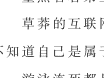

2018年6月15日 - 商家表示，接下来还是要继续前往拼多多总部进行维权，近期拼多多可是风波不断啊。这个凭借低价拼单的模式积累上亿用户的社交电商“黑马”，却因为假货泛滥...

知乎 - 百度快报

重点看着第三条，罚的比赚的多。

靠谱的互联网电商，你没遇上，可能是幸运的，因为你不知道自己死属于暴富和暴负中的哪一波。

游泳池死都是会水的，达成因为对互联网不懂，所以比较难堪，库存一会控制的很位。

达叔这同学和合伙人都是从阿里巴巴中铁侠军出来的，认为特别懂阿里的套路，刷流量、上活动，开直通车，结果就把自己给弄到沟里了。

达叔赚了一点钱，没有暴负，乖乖跑了。

来说说比特币。

这个是最神奇的经历，达叔2013年在某500强工作，出差帝都，晚上闲着没事，就从酒店打车去逛中关村那条创业街。

中关村创业街上有几个特别有名的创业咖啡馆，3W咖啡馆，还有车库咖啡馆之类的。

当天晚上，有一个家伙在开讲座。

听完之后，达叔发了一个朋友圈。

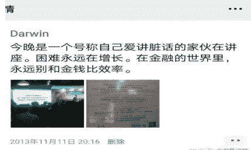

这个家伙是谁？

达叔放一张大图，看看有没有认识的，后来大名鼎鼎，但当天晚上达叔只是觉得这家伙口才了得。

是的，就是中国的比特币大亨 李笑来。

注意一下第一张截图里的时间节点，2013年11月11日，这一天比特币的价格是2330.91元，人民币。

下面是比特币的行情图。

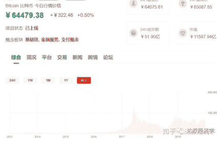

看着这张图，达叔现在回想起来，觉得恍如隔世。

比特币教父级的人物，花了一个晚上的时间，对着一屋子的陌生人，说这个玩意多好多好，谁买谁暴富，比特币是未来。

他最生动的一个例子，是讲自己躺在床上，突然坐起来，对着空气里的假想敌说，我以后再也不怕你了，我自由了。

但这个屋子里的绝大多数人，觉得台上的家伙，像一个骗子。

为什么这么说？

达叔脸皮比较厚，散场时，搭讪了好几个陌生人问，你们觉得这个玩意怎么样？能投资么？

有的是咨询公司的，有的是玩IT的，还有玩金融的，都说是个骗子。

所以，这是个认知的问题，钱就摆在我们的面前，但我们认为这个玩意是硬币。

达叔经常想，当年听了一场演讲之后，真的会把手里的资金押宝在比特币上么？

你能下多少的筹码？投入多少的资金？买一两个玩玩，同样是错过暴富。

投资的路径是：买人--持有---卖出。

达叔刚才讲了你买人的量不够，是没意义的，同样错过暴富，赚个万把块钱有什么意思？

讲完买人，再看持有。

看一下上面的图表，2013年到2016年，比特币几乎是没什么涨幅的。

你大笔资金投入之后，三年不涨，你还会继续持有什么？你能持有多久？

资金是有机会成本的，很少有人能坚持三年，嘴上说自己要学习价值投资，身体都是机会主义者。

几十万买这么个破玩意，像Q币似的，不被家人揍，很不错了。

那么买什么资产，资金量够大，持有时间够长，家里人还支持呢？

就是下面这一点：买房。

买房。

达叔主要是靠在长三角地区买房，实现了一定的财富跃迁。

从2014年起，开始布局和钻研，赶上了2016年的那一波。

行情从一线城市开始，余波荡漾到二三线城市，有的城市行情一直持续到了2018年。

行情还有么？

有的。

但是在网络上，不能说，说了会挨喷的，因为像是一个骗子。

在网络上讨论房产，一定要说跌，会广受好评，被疯狂点赞，大家就开心了。

你看，像不像2013年11月11日那天晚上散场时的比特币？

他说的很劲劲，但是感觉像一个骗子。

达叔最近看过一个叫陆铭的上海交大经济学教授，在网上玩直播，聊城市化，被网友给喷的那副着急的样子，达叔就乐坏了，学院派的老师，永远不知道江湖有多野，你说的那都是啥，鸡同鸭讲。

大家出来玩，找到能玩到一起的就够了，还指望所有人都认同你，那是妄念。

说服一个人，不要用嘴巴，要用利益。

等他们被社会毒打一遍之后，就慢慢知道谁是好人，谁是坏人了。

你和他聊方法论，聊城市化率，聊统计口径，常住人口和户籍人口的城市化之间区别，超出很多人的认知范围了。

当一个人或者国家不够好，基本上可以分为三种世界观：

- 1、我们目前不够好。------>所以要改革。
- 2、我们不一样，我们是特殊的。------>保守总是容易的。
- 3、我们能达到这水平，已经很不错了，你看还有更差的。------>比差模式，堕落。

良好的愿望，伟大的理想，在经济规律面前，都是苍白的，希望各位都能严肃一点，交出自己的劳动剩余，多买点资产，因为留给你的时间，不多了。

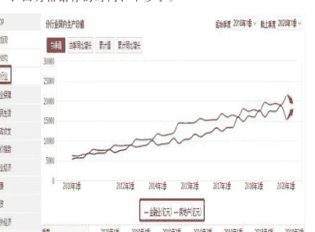

| 分类 | 年份 | 2012年 | 2013年 | 2014年 | 2015年 | 2016年 | 2017年 | 2018年 | 2019年 | 2020年 | 2021年 | 2022年 | 2023年 | 2024年 | 2025年 | 2026年 | 2027年 | 2028年 | 2029年 | 2030年 | 2031年 | 2032年 | 2033年 | 2034年 | 2035年 | 2036年 | 2037年 | 2038年 | 2039年 | 2040年 | 2041年 | 2042年 | 2043年 | 2044年 | 2045年 | 2046年 | 2047年 | 2048年 | 2049年 | 2050年 | 2051年 | 2052年 | 2053年 | 2054年 | 2055年 | 2056年 | 2057年 | 2058年 | 2059年 | 2060年 | 2061年 | 2062年 | 2063年 | 2064年 | 2065年 | 2066年 | 2067年 | 2068年 | 2069年 | 2070年 | 2071年 | 2072年 | 2073年 | 2074年 | 2075年 | 2076年 | 2077年 | 2078年 | 2079年 | 2080年 | 2081年 | 2082年 | 2083年 | 2084年 | 2085年 | 2086年 | 2087年 | 2088年 | 2089年 | 2090年 | 2091年 | 2092年 | 2093年 | 2094年 | 2095年 | 2096年 | 2097年 | 2098年 | 2099年 | 2100年 |
| :--- | :--- | :--- | :--- | :--- | :--- | :--- | :--- | :--- | :--- | :--- | :--- | :--- | :--- | :--- | :--- | :--- | :--- | :--- | :--- | :--- | :--- | :--- | :--- | :--- | :--- | :--- | :--- | :--- | :--- | :--- | :--- | :--- | :--- | :--- | :--- | :--- | :--- | :--- | :--- | :--- | :--- | :--- | :--- | :--- | :--- | :--- | :--- | :--- | :--- | :--- | :--- | :--- | :--- | :--- | :--- | :--- | :--- | :--- | :--- | :--- | :--- | :--- | :--- | :--- | :--- | :--- | :--- | :--- | :--- | :--- | :--- | :--- | :--- | :--- | :--- | :--- | :--- | :--- | :--- | :--- | :--- |
| 名义GDP | 2012 | 3003.0 | 2589.0 | | | | | | | | | | | | | | | | | | | | | | | | | | | | | | | | | | | | | | | | | | | | | | | | | | | | | | | | | | | | | | | | | | | | | | | | | | | | | | | | | | | | | | | | | | | | | | | |
| 实际增长 | 2012 | 2589.0 | | | | | | | | | | | | | | | | | | | | | | | | | | | | | | | | | | | | | | | | | | | | | | | | | | | | | | | | | | | | | | | | | | | | | | | | | | | | | | | | | | | | | | | | | | | | | | | | |
| 居民储蓄 | 2012 | | | | | | | | | | | | | | | | | | | | | | | | | | | | | | | | | | | | | | | | | | | | | | | | | | | | | | | | | | | | | | | | | | | | | | | | | | | | | | | | | | | | | | | | | | | | | | | | | |
| 居民投资 | 2012 | | | | | | | | | | | | | | | | | | | | | | | | | | | | | | | | | | | | | | | | | | | | | | | | | | | | | | | | | | | | | | | | | | | | | | | | | | | | | | | | | | | | | | | | | | | | | | | | | | |
| 财政支出 | 2012 | | | | | | | | | | | | | | | | | | | | | | | | | | | | | | | | | | | | | | | | | | | | | | | | | | | | | | | | | | | | | | | | | | | | | | | | | | | | | | | | | | | | | | | | | | | | | | | | |
| 财政补贴 | 2012 | | | | | | | | | | | | | | | | | | | | | | | | | | | | | | | | | | | | | | | | | | | | | | | | | | | | | | | | | | | | | | | | | | | | | | | | | | | | | | | | | | | | | | | | | | | | | | | | | |
| 工业品库存 | 2012 | | | | | | | | | | | | | | | | | | | | | | | | | | | | | | | | | | | | | | | | | | | | | | | | | | | | | | | | | | | | | | | | | | | | | | | | | | | | | | | | | | | | | | | | | | | | | | | | |
| 消费 | 2012 | | | | | | | | | | | | | | | | | | | | | | | | | | | | | | | | | | | | | | | | | | | | | | | | | | | | | | | | | | | | | | | | | | | | | | | | | | | | | | | | | | | | | | | | | | | | | | | | | |
| 投资 | 2012 | | | | | | | | | | | | | | | | | | | | | | | | | | | | | | | | | | | | | | | | | | | | | | | | | | | | | | | | | | | | | | | | | | | | | | | | | | | | | | | | | | | | | | | | | | | | | | | | | |
| 对外出口 | 2012 | | | | | | | | | | | | | | | | | | | | | | | | | | | | | | | | | | | | | | | | | | | | | | | | | | | | | | | | | | | | | | | | | | | | | | | | | | | | | | | | | | | | | | | | | | | | | | | | | |
| 对外出口 | 2013 | | | | | | | | | | | | | | | | | | | | | | | | | | | | | | | | | | | | | | | | | | | | | | | | | | | | | | | | | | | | | | | | | | | | | | | | | | | | | | | | | | | | | | | | | | | | | | | | |
| 银行体系 | 总资产(亿元) | 10798.40 | 28590.80 | 28629.80 | 15178.70 | 9249.40 | 25920.00 | 18991.80 | | | | | | | | | | | | | | | | | | | | | | | | | | | | | | | | | | | | | | | | | | | | | | | | | | | | | | | | | | | | | | | | | | | | | | | | | | | | | | | | | | | | | | | | | | |
| 证券保险 | 总资产(亿元) | 4542.00 | 6071.00 | 7593.80 | 7882.70 | 7164.50 | 8282.10 | 7629.60 | | | | | | | | | | | | | | | | | | | | | | | | | | | | | | | | | | | | | | | | | | | | | | | | | | | | | | | | | | | | | | | | | | | | | | | | | | | | | | | | | | | | | | | | | | |
| 居民储蓄 | 存款额(亿元) | 9377.80 | 3397.40 | 18374.60 | 27952.40 | 11143.10 | 24720.40 | 37254.50 | | | | | | | | | | | | | | | | | | | | | | | | | | | | | | | | | | | | | | | | | | | | | | | | | | | | | | | | | | | | | | | | | | | | | | | | | | | | | | | | | | | | | | | | | | | |
| 居民投资 | 实际投资(亿元) | 10748.60 | 20595.50 | 23999.60 | 20997.10 | 21995.20 | 24720.00 | 22334.10 | | | | | | | | | | | | | | | | | | | | | | | | | | | | | | | | | | | | | | | | | | | | | | | | | | | | | | | | | | | | | | | | | | | | | | | | | | | | | | | | | | | | | | | | | | |
| 税收总额 | 全国税收(亿元) | 7865.10 | 11244.00 | 11135.20 | 10861.30 | 9366.60 | 10775.90 | 10582.50 | | | | | | | | | | | | | | | | | | | | | | | | | | | | | | | | | | | | | | | | | | | | | | | | | | | | | | | | | | | | | | | | | | | | | | | | | | | | | | | | | | | | | | | | | | |
| 库存价值 | 主要库存(亿元) | 2829.00 | 5071.20 | 4015.50 | 4123.30 | 4234.90 | 4640.60 | 4122.60 | | | | | | | | | | | | | | | | | | | | | | | | | | | | | | | | | | | | | | | | | | | | | | | | | | | | | | | | | | | | | | | | | | | | | | | | | | | | | | | | | | | | | | | | | | |
| 投资规模 | 制造业(亿元) | 12344.00 | 18971.90 | 15385.00 | 19984.40 | 20653.20 | 21782.10 | 17789.00 | | | | | | | | | | | | | | | | | | | | | | | | | | | | | | | | | | | | | | | | | | | | | | | | | | | | | | | | | | | | | | | | | | | | | | | | | | | | | | | | | | | | | | | | | | |
| 投资规模 | 房地产(亿元) | 15258.30 | 11398.30 | 17399.00 | 13844.80 | 19979.20 | 19866.10 | 17582.00 | | | | | | | | | | | | | | | | | | | | | | | | | | | | | | | | | | | | | | | | | | | | | | | | | | | | | | | | | | | | | | | | | | | | | | | | | | | | | | | | | | | | | | | | | | |
| 投资规模 | 消费性(亿元) | 3989.60 | 4435.20 | 4074.50 | 39867.30 | 39166.50 | 37474.60 | 36399.60 | | | | | | | | | | | | | | | | | | | | | | | | | | | | | | | | | | | | | | | | | | | | | | | | | | | | | | | | | | | | | | | | | | | | | | | | | | | | | | | | | | | | | | | | | | |

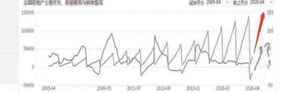

| **宏观指标** | 2010 | 2012 | 2015 | 2018 | 2021 |
| :--- | :--- | :--- | :--- | :--- | :--- |
| 城镇居民人均可支配收入(元) | 10,666 | 13,537 | 21,700 | 28,225 | 43,800 |
| 农村居民人均可支配收入(元) | 6,787 | 8,680 | 14,290 | 18,015 | 21,200 |
| 房价收入比(倍) | 4.2 | 4.5 | 3.8 | 4.0 | 4.2 |
| 租售比(%) | 1.5 | 1.4 | 1.8 | 2.0 | 2.5 |

这两张图是国家公开的数据，一个是过去十几年的数据，一个是过去15年的数据，而中国的房价统计，是从 2003 年开始的，一切都年轻得很，17 岁而已。

数据就摆在这，能读出什么，就看各位自己的道行了。

金融。

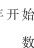

什么是金融？个人无论从事什么职业，能不能都掺和一下金融？

金融的本质，是对钱的买卖，是对资源进行跨时间、跨空间的配置。对某个资产投入大量的钱 + 赌这个资产升值的概率 + 长期持有，等待时间的回报。

这是投资的本质，无论你是投资自己，投资不动产，投资股票、证券，都是这个逻辑。

买入--->持有--->卖出。

你敢投入多大体量的钱，选择什么样的资产，持有多长时间。

这三者，考验的是什么？

考验的是认知。

没有认知，或者认知错误，过去错过，现在错过，将来还会一直错过。

# 科学尚未普及
毁三观树新生
