# 道氏理论

## 寫給讀者的一封信

作者首先向股票、期貨的投資者，特別是個人投資者表示敬意！

其實，根本就不存在什麼理論，所謂理論，不過是在人類犯錯的歷史上，走出的一條曲折小徑！

股票市場是一個吸引人的地方，只要進入股票市場，就會使人只想留在股市，不想退出。股票市場是一個可以為你實現理想和夢想的地方。當一個人嚴格按照一定的規則，不论是進行投機或投資，他將不再是進行賭博，而是從事一種有利可圖的職業。

當今是基金稱霸天下的時代，身為個人投資者，我們是否還有優勢？或者說個人投資者的優勢在哪裡？基金的劣勢又在哪裡？

從本質上來說，資本追逐利益的本性是驅動市場發展變化的動力。那麼追逐利益要依靠什麼呢？一般投資者認為，需要一個好的方法或者是什麼祕笈。

當然，作爲一個謀生的手段，一個人需要一定的技能，甚至是絕技，以建立起一個技術屏障，使得我能賺到的錢盡可能不讓別人賺到。但是作爲一個大型企業，必須有一定的經營觀念才能發展壯大，而不是僅依靠技能。

或許我們會認爲可口可樂有什麼神秘配方，但是我们如果得到它的配方就真的能開一家那樣的公司嗎？這樣的想法顯然非常可笑。原因是：方法好學，觀念難學。我們真正需要學習的是人家的經營觀念。麥當勞是道瓊30種工業股票當中唯一的一家餐飲類公司，本質上，經營的是一種標準化的服務，甚至包括價格在內，在北京和在香港吃麥當勞，基本上價格相當，而中國的餐館依靠的是風味、特色，哪一家的規模能比得上麥當勞呢？

公司經營如此，股票投資也是如此。真正成功的投資者都是建立在正確的投資觀念基礎上，身為個人投資者，一旦形成符合自身情況的投資觀念，將形成一個盈利模式，這是成功的重要標誌。就個人來說，形成正確的投資觀念也是可行的。一般投資者從來不缺少投資的方法和技巧，真正缺少的是正確的投資觀念。

2005年柏克夏公司召開股東大會的時候，巴菲特發現，沒有一支基金持有他的柏克夏股票，股票的持有人全部都是個人投資者，這件事令巴菲特興奮不已。其實，做股票最終做的就是物以類聚、人以群分，將觀念近似，甚至相同的投資者集中在一起，甚至在同一支股票中。對股票價值的評估標準，就是個人的盈利模式，高價股和低價股之所以滬潤分明就是這個道理。

巴菲特認為基金經理人並不能幫助投資者：「大多數的專業工作若是由我們自己動手更具有價值，但專業投資這個領域不是這樣，儘管每年這個行業的報酬高達人民幣1,400億元。整體來說，有很多收費用的投資經理人，實際上並不能幫助投資者，當然也有確實能幫助的，你不能用付2%和20%的方式（2%的管理費，20%的利潤分成許多私人資本和對沖基金的標準），當他們賺了，你付20%，而當他們沒賺甚至賠了錢，就乾脆關門，過段時間又重新開張。」

其實巴菲特只說了一點，還有另一點未提及。基金是理財者他們自己本身沒有錢，因此必須引進投資者的資金。但是買基金的投資者往往是對股票市場知之甚少，要讓這樣一個群體，對一支基金的投資觀念有所認同，顯然是不可能的，他們挑選基金的唯一標準就是比較業績，但是任何一支基金都會有低潮，也就是在一個時期業績不理想，此時投資者馬上就贖回，因此，基金就必須在業績不好的時候賣掉股票，這樣業績就更加不好了。於是，更多的投資人要求贖回，然後再挑選其他基金。其實大部分的投資人是很大機的，他們在做股票的時候也是跳來跳去的。而基金將會因這樣的模式走向失敗，這就是國外基金失敗的模式。

總結一下基金的失敗模式，基金最終效果不好，根本原因在於基金不可能真正形成穩定的盈利模式。此外，不論是法人還是個人，當股票市場中的盈利成為你唯一的經濟來源的時候，市場的大幅波動必然會引起心理巨大的變化，所謂保持良好的心態根本就無從談起。把股票投資當作職業，必然會很容易影響投資者的心態，從這一點來講，這是法人投資者的劣勢，所以最好不要做一名職業投資者。實際上，業餘個人投資者的心態相對更好。或許這是一個保持良好心態的方式。

成功的投資者們認為，他們賺大錢之後不離場的原因是，他們已經把錢放在最安全的地方，那不是銀行，他認為自己才是管理那筆財產的最佳人選。而所謂「基金」，實際上就是幫你買了一堆股票。個人投資者完全可以透過學習建立起自己的投資觀念，在股票市場中提高獲利機會，其報酬率甚至超過基金。與生命中的許多嘗試一樣，成功的關鍵在於知識與行動。最終是知識決定你的前途，思想就是金錢，你的財富將來自於你的大腦。作者希望就道氏理論提出某些說明，藉此擴展「知識」。投資大師甘氏說過：「最寶貴的財富是時間，對時間最好的利用是獲取知識，這比金錢更可貴。」至於「行動」的部分，則由各位投資者的耐心、客觀與理性來決定。

此外，作者有這樣一個觀念，信念、感恩、朋友是一個人成功的基礎，而其他包括學歷、外表等因素，對成功來說，只不過是很好的輔助工具。由於作者能力有限，不敢說是對道氏理論作進一步的歸納總結，而只是想在當今這個崇尚個人能力，但又缺少感恩的年份裡，感恩于道氏理論對於金融市場的巨大貢獻，這個貢獻無論如何評價都不為過；同時，也感恩道氏理論對於作者的豐厚回報，於是有這本書的問世。正如道氏理論中所說的，「道氏理論並非不會出錯」，這本書也一定會有許多錯誤。懇請廣大的讀者多多指教，不勝感激！

市場何嘗不會出錯呢？從模糊甚至錯誤的市場中走出來的道氏理論，不但可以掌握市場整體變化的情況，更重要的是，可以幫助投資者建立起正確的投資觀念，並成為一個真正成功的股票投資者。真正成功的投資者都是建立在正確投資觀念基礎上的，道氏理論是建立正確投資觀念的基礎。或許在投資的道路上，個人投資者將走得更遠，讓我們成為「柏克夏」的股東吧！

你真誠的朋友 陳東

## 前言

道氏理論可以說是每個想投身於股票市場人士的必修課。它告訴我們分析市場的正確思想方法是什麼，正確的投資觀念是什麼，以及分析市場需要什麼樣的必備知識。因為正確的理論才能指導正確的實踐。不過，觀念層次的溝通也是最困難的。

正確的投資要依靠正確的觀念和正確的理論指導。道氏理論正是指引我們正確投資的晴雨表。當代的股神華倫·巴菲特提醒我們：絕大部分投資者失敗的原因是，他們都不願意接受正確的觀念和正確的理論指導。對此作者也深有同感，並由此展開了對道氏理論的深入研究。當我對道氏理論了解之後，我驚詫於它的內容如此之豐富，哲理之深邃。

其實，在股票市場和期貨市場的眾多投資者中，不知道道氏理論的人恐怕為數不多，即使沒有真正地系統學習過道氏理論，市場中「牛市」、「熊市」等名詞都在廣大的投資者當中朗朗上口，而這些名詞都是道氏理論的產物，甚至於技術分析的三大定律也是源自於道氏理論。

可以說，如果你僅根據道氏理論分析市場的趨勢，你將會比基金經理人做得更出色。一項統計資料顯示，當道氏理論發出明確的「牛市」確認信號時，投資者能夠掌握「牛市」行情的61.8%的漲幅；如果道氏理論發出「熊市」的確認信號時，投資者也能夠掌握40.5%的跌幅。投資者只要根據道氏理論的確認日當作買、賣信號，並將道氏理論的失誤考慮進去，幾乎可以保證獲得每年14%的複利。不過，應該說明的是，從嚴格的意義上來說，道氏理論並非是一個擊敗市場的工具，道氏理論也絕不是賭徒贏得賭博的方法，更不是短期致富的方法（幾乎所有的騙局都是讓你相信它能短期致富），而是一套分析市場的思想方法，甚至也可以說道氏理論是一門投資哲學。

就市場分析而言，基本分析固然是種方法，但是這種方法並不客觀，而且各種基本因素匯合在一起，將使得沒有一定投資觀念的投資者不知所措，而技術分析的優點是，針對各種資料的圖形進行分析，非常客觀。特別是，由於圖形、色彩等元素是透過人的右腦反映的，然後產生具體思考，再透過與由左腦產生的邏輯思考相結合，能夠激發人的智慧，所以圖形對於鍛鍊並利用人的具體思考大有益處。

迄今為止，大多數廣為使用的技術分析理論都起源於道氏理論，都是其各種形式的發揚光大。道氏是技術分析的開山祖師，雖然現在已經是電腦的天下，大量嶄新的、而且據說更有效的技術指標層出不窮，但道氏理論的地位無人能夠撼動。很多技術分析師並不清楚，他們這些「現代化」工具在多大程度上繼承了道氏發現的基本原則。

到目前為止，還沒有一種方法可以像道氏理論那樣經得起考驗。它們的弱點在於被表面的相關性所迷惑，而引入了一些無關的東西。其實一直有人試圖把銷售額加進來，並在閱讀平均指數時把它與商品指數聯繫起來，但這完全沒必要，因為平均指數顯然已經把這些因素考慮在內，就像晴雨表會考慮任何影響天氣變化的因素一樣。股票指數的修正代表了華爾街的整體知識，最重要的是，它代表著股票市場對未來事件的整體理解。

道氏理論對基本波的判斷有較大的作用，而對於每日每時都在發生的小波動則顯得有些「無能為力」，道氏理論甚至對次級波的判斷作用也不大。不少投資者認為道氏理論的可操作性較差。一方面，他們認為，道氏理論的結論落後於價格變化，信號太慢；另一方面，理論本身存在不足，使得一個很優秀的道氏理論分析師在進行行情判斷時，也會因為得到一些不明確的信號而產生困惑，甚至許多批評者極不友善，他們可以輕鬆地指出道氏理論存在錯誤，因為他們本來就不想接受它。當然他們也可以找到許多自認為是晴雨表沒有預測到的修正，尤其是次級修正，但是這又能說明什麼呢？任何具有他們所要求的那種精確性的工具都是人力所無法實現的。任何對道氏理論不進行深入研究就對其批評的行為都是膚淺的。

本書認為，道氏理論首先給予我們的啟示是，道氏從眾多的投機事件中總結出的是市場中的規律，而不是抱怨市場沒規範，要求政府、交易所如何如何。而當我們看見金融事件的時候，我們又能總結出什麼？創新出什麼？道氏透過基本修正是不可以被人為操縱的這個認知了解到，市場的基本波是以自然經濟運動發展的客觀規律為基礎的。因此，這個原理是道氏理論的基礎，也是市場分析的基礎，更是本書的基礎。

任何一位投資者都會被道氏的深刻洞察力和極其深蘊的哲學內涵所震撼，認真研究道氏理論的基本原理，可以從中吸取有益的營養成分。道氏理論的哲學思想，給其技術體系帶來了生命活力。

即使是最富經驗、最細心的道氏理論分析家也認為，在一系列市場行為無法支持其投機立場時，就有必要改變其觀點。他們並不否認這一點，不過，他們認為，在一個長期趨勢中，這樣暫時性的措施所導致的損失是極少的。而在投資者受到損失時，道氏理論的正確性將使它更加突出。它像一隻強而有力的手，在茫茫的大海上為投資者指出大方向，將投資者從失敗的苦海中解教出來。

不過，道氏理論的存在已經上百年，今天的市場已經與一百多年前不同了，特別是投資者也在「升級」，已經由個人投資者「升級」到以基金為代表的法人投資者，市場行為也有一定的不同，因此道氏理論也應該有所創新。近30年來，出現了很多新的技術，有相當部分都是道氏理論的延伸，這在一定程度上彌補了道氏理論的不足。此外，道氏理論也不像是查里斯·亨利·道個人的理論，它是以道氏為代表的，隨後又由後來的幾代開拓者不斷總結、不斷發展、不斷完善、不斷創新的理論。當今的年代是一個理論創新的年代，一百多年來道氏理論也在發展，也在創新。

不论是成功的資本家，還是普通的投資者，都應該學習道氏理論這樣經典的投資理論：一分耕耘，一分收穫。當代最傑出的投資理論家索羅斯先生說：「你對抽象理論愈是能潛心研究，那你對具體實踐就愈顯得得心應手，遊刃有餘。」幾百年來，真正偉大的實戰投資家均在經典投資理論的研究上有着重大的理論突破，並且在他們自己的投資觀念、投資哲學的認知上都有獨到之處。

#### 導論
# 精關的股票分析將使你迅速致富！

技術分析有很多種方法，但整體來說只是形式上的變化。如果我們研究技術分析方法的整個歷史，就會發現其數量和種類就像一棵大樹，不斷地開花結果，變得愈來愈枝繁葉茂，但它們的發源地都來自一處——道氏理論。

道氏理論已經存在了一百多年了。除了它的穩健性和通用性之外，道氏理論的精髓在很大的程度上仍不為人知。迄今為止，在眾多的市場分析理論中，道氏理論仍占有最重要的地位。道氏理論本質上是一種關於股票投資的哲學思想，其次才是一種技術方法體系。在道氏了解他的理論歷程中，充滿著辨證法和方法論。

道氏透過在股市的投資經歷對市場行為深有體認。首先，道氏透過市場上的操縱行為了解到市場的基本波是不可以被操縱的，之所以不可以被操縱是由於市場發展變化是有規律的，而操縱市場就是違背市場規律的行為。因此我們不難理解，為什麼歷史上那麼多操縱行為都是以失敗而告終的了。

道氏用科學的頭腦為我們打破了認為組頭操縱市場的神話，揭示出基本波是不可以被操縱的，並初步探索出市場中的規律，這相當於牛頓力學對神學的揭露。

為了探索市場的規律，道氏建立了道瓊股票指數體系，這為道氏理論的建立提供了土壤。由於道氏認為股票指數是國民經濟的晴雨表，股票指數不但可以反映國民經濟的過去、現在，還可以反映國民經濟的未來。股票市場對各種經濟資訊的反應靈敏，在短時間內即可完成股價的調整。在美國，許多投資者聽到新消息後的第一反應是，抓起電話與經紀人聯繫買入或賣出，但十之八九已經太遲了，至少他已落在交易所內的交易者之後。

道氏透過對道瓊指數的觀察也證明了這個觀點。這個觀點逐漸發展為技術分析的第一大定律——市場行為包容一切。不過，道氏眼中的市場行為主要是指股票指數的走勢情況，與我們今天的概念不同。我們今天認為市場行為是指價格、成交量、投資部位等要素。

更為精妙的是，道氏從一開始就建立起工業指數和鐵路指數兩個股票指數，為建立相互驗證原則提供了肥沃的天然土壤。道氏認為商業的健康發展必須要得到鐵路交通的健康發展的保障，任何一個發展的不健康就不能證明整體國民經濟是健康的。這是從不同面相反映一個事物的科學驗證觀。

在道瓊股票指數體系這片土壤上，道氏總結出這個理論的核心思想——三重運動原理。即：市場是由規律性很強但又深藏不露的基本波、欺騙，並引起恐懼的次級波，以及表面誘人本質的隨機日常波動這三種運動加乘而成的。由於市場的組成中既有規律性強的部分，又有無規律的部分，所以市場是可以被預測的，但又是測不準的。

市場中可預測的部分就是基本波，它雖然是最有規律的，但它又是深藏在市場深邃的，並非用肉眼就能直接看見的。正如我們面對大海，所能看見的只是波浪和漣漪，但是你能用肉眼看見潮汐嗎？當然不能，但我們可以透過插在海邊的量尺測量出潮汐，對市場而言這就是技術分析。透過道氏理論，我們利用技術分析去把握基本波的規律。

但是構成市場的並非僅有基本波，基本波之所以可以藏起來，主要是市場中還存在次級波，它的特點是經常製造出恐慌氣氛來欺騙投資者，導致非理性的出逃或加入市場，並產生在幅度上僅次於基本波的次級波。所以投資者千萬不要被次級波的「次級」這個詞的表面意思所誤導，認為是次要的。次級波是短期內幅度非常大的修正，足以使投資者產生恐慌心理，並造成很大風險。實際上，投資者大多是在次級波上造成虧損的。

市場中最沒有規律的就是日常波動，它有極強的隨機性，這一點沒有得到投資者的認識，因為做短線的投資者經常賺錢是有可能的事，所以日常波動總是誘惑投資者入市，但短線操作不論是賺錢也好，虧錢也罷，其原因是由於日常波動的隨機性所引起的。當投資者不承認這一點、反而認為賺錢是憑自己的本事的時候，不幸的日子很快就到來了。往往在這個時候，市場會出現次級波，使得投資者在驚慌中不計成本地逃離市場，這時候已經想不起來基本波的方向了。當離開市場之後回過頭來看，那僅僅是虛驚一場，是一次騙人的次級波而已，而市場並沒有發生逆轉。但投資者自己多年靠日常波動積攢的利潤已經付之東流了。

正是由於次級波是介於基本波和日常波動之間的修正，所以雖然它有一定的規律，但規律性又不是很強，由此產生欺騙的效果。所以道氏將次級波稱為「騙人的次級波」。在次級波和日常波動的聯合作用下，將基本波深深地埋藏在市場之下，只有耐心的長線投資者才能發現基本波。但是，次級波的幅度再大也不可能超過基本波，市場走勢最終是由基本波來支配。這個觀點後來成為技術分析的第二大定律——市場行為依趨勢方式演義。道氏理論的目標是判定市場中基本波發展變化的規律。一旦趨勢形成之後，便被视为繼續存在，直到發生反轉為止，而不預測趨勢所涵蓋的期間與幅度。

如果要更有效地預測市場，那麼道氏下一步所要面對的問題就是如何證明自己對市場的觀點是對的。幸運的是，道氏從一開始就建立了兩個指數，透過一個指數對另一個指數進行相互驗證，這就是相互驗證原則，目的就是用來識別次級波的欺騙作用，而最終把握的是基本波的規律。

道氏的智慧還表現在他有許多天才般的「發明」，最典型的「發明」就是「牛市」、「熊市」這兩個概念。至今我們也很難找到更合適的詞彙來代替它們。所謂基本波的規律，實際上就是均衡發展的牛市、熊市輪動的規律。牛市、熊市是由人的本性決定的。在牛市中，人們總是非常貪婪……在熊市中，人們總是非常恐懼……因此，股市處於週期性的上漲下跌之中。這是道氏受到海水的漲潮、退潮和週期理論的啟發，並透過兩個指數對市場的觀察所得出的結論——股票市場呈現出牛市、熊市的輪動之中。這個規律已經成為今天技術分析的第三大定律——歷史會重演。

由於市場中存在次級波，它們將牛市和熊市分為幾個時期，道氏將它們理想化地各自分為三個時期，也就是牛市三個時期和熊市三個時期。道氏理論研究股市運行規律，更要分析在任何一個時刻的市場正處於股市中的哪一個走勢，是處於牛市，還是處於熊市。如果是牛市，是在牛市中的第幾期？如果是在熊市，又是在熊市中的第幾期？掌握了這些特徵之後，對於當前的股市狀況，投資者就可以了然於胸，不會因為股票指數忽升忽降，也不會因為個別股票的走勢有所不同，而感到困惑不解。

預先知道未來的經濟發展，其效益非常明顯：任何人都可因此獲利。企業家可以據此增加或減少存貨，擴張或收縮生產，加速或拖延投資計畫，採用支出或儲蓄的政策。對於政治家來說，一旦發現經濟的未來發展不利時，可以採取必要的措施以刺激經濟。

牛市、熊市的規律把握得好，會令投資者熊市後期的最低價區入市，而在牛市崩潰前的最高價區出市，低價入市，高價出市的過程重複又重複，每一個牛、熊輪動，都可能令投資者的財富增加。道氏理論適合中、長線的投資。在中、長線投資當中，它都能為你指出如何以最安全的方式做買賣，盡量迴避各種風險，能買就買，該賣就賣，不要心存僥倖而冒險。那些在牛市第三期死守不賣的投資者，常常都是置道氏理論於腦後的人。

三重運動產生的原因是，由於市場中的投資者分為三類，也就是長線投資者、中期投機者和短線投資者。儘管在不同的時期，這三類投資者的行為是不同的，但整體來說，長線投資者是依據基本波進行投資者的，中期投機者是依據次

# 導言——精闢的股票分析將使你迅速致富！

級波投資的，而短線投資者是根據日常波動投資的。他們的行為反而更加強了他們的投資依據。所以，從這個意義上講，也可以說長線投資者決定基本波，中期投機者決定次級波，而短線投資者決定了日常波動。

道氏在建立了相互驗證的整體驗證體系之後，又建立了一個微觀驗證體系，也就是以價值配合為基礎的成交量對趨勢的驗證原則。這樣就構成了多層次的驗證。不過，作者認為，這條原則更加適合於對個別股票的驗證。因為股票指數只是股票中的一部分，而大盤的成交量是指所有股票成交量的總和，在代表的意義上有些說不清。所以，道氏將市場行爲限制在股票指數中是有道理的。

在整個道氏理論體系建立起來之後，道氏發現這個理論並非不會出錯，其致命弱點是無法準確預測基本波的反轉時間。因此，投資者打算做真正成功的投資，除了要學習道氏理論的基本思想、領悟道氏理論的實質外，還必須學習資金管理和風險控制。

本書的主導思想是使投資者能夠對道氏理論有一個較全面的了解，較深刻地認識道氏理論的核心思想及其精髓，使投資者樹立正確的投資觀念及分析市場的思想方法，以及識別正確的投資觀念及分析方法的能力。因此，本書確定的三個主導思想是：詳細介紹道氏理論的三個要點，設計道氏理論模型，不能脫離價值單純談技術分析，強調道氏理論是價值投資的輔助工具。

### 第一主導思想：詳細介紹道氏理論的三個要點

道氏理論的第一個要點是——基本波是不能被人為操縱的。這是道氏的第一個體認，並以此為出發點，逐漸建立起他的理論。

道氏理論的第二個要點是——三重運動原理，也是道氏理論的核心。這個原理發源於自然法則，其中重點的基本波的規律能夠為我們所把握，但次級波帶有一定的欺騙性，而日常波動這樣次級的波則具有很強的隨機性，不能為我們所把握。不同波的運作機理不同。這個原理指出的是，辨識地看待市場預測問題，市場的基本波是可以被預測的，但具體的波動跡又是測不準的。

道氏理論的第三個要點是——相互驗證原則，也是道氏理論科學的驗證觀。儘管基本波能夠為我們所把握，但是透過一種方式得出的結論，必須用另一種方式得出的結論來驗證，這才是科學的態度。這個原則的思想是透過帶有強相關性的兩個指數的相互驗證來確定趨勢，透過相互背離來否定趨勢，也就是用指數的一致性來驗證市場走勢，只有被經過證明是正確的結論才是正確的，否則趨勢依然不能確定。

### 第二主導思想：設計道氏理論模型

有不少讀者表示，儘管道氏理論是很正確的，但很難抓住要領，特別是道氏理論的核心內容很難在具體實踐中運用。針對這個問題，作者經過對道氏理論核心內容的總結和發展，將其具體化成為道氏理論模型。

當你進入一個陌生的地方，最好帶一張地圖，市場對於我們每一個投資者來說，永遠是一個既熟悉又陌生的地方，這就是作者設計道氏理論模型的目的。當然，這個模型並不能代表道氏理論的全部，只能代表道氏理論的核心思想當中的市場分析體系，而更多的哲學思想無法在模型中表現。

道氏理論是一個龐大的哲學體系，對於初學者來說是很難全面理解的，甚至於對於市場老手也難以掌握要領，因此，需要將道氏理論當中的各種原理、原則結合起來。作者就是根據這個思想，將道氏理論當中的各種原理、原則具體化，設計了道氏理論模型。

根據道氏理論建立一個以數學語言表達的市場分析假設及作業系統，將對投資大有益處。實際上，在道氏的構思中，已經有一定的系統基礎了。因此，作者依據三重運動原理和相互驗證原則，以及其他相關規則來建立一個道氏理論模型，而建立道氏理論模型所遵循的基本原則，是遵守道氏對趨勢的定義。

依據道氏理論所建立的道氏模型是整體技術分析方法，主要為使投資者建立一個「市場具有一定輪廓結構」的觀念，以便投資者對市場波動的基本規律有一個整體輪廓的了解，從整體技術分析的角度，去理解市場和經濟功能如何發生作用。當然，沒有任何東西可以保證我們能夠更容易地賺錢，因為基本波並非表面運動，抓住它並非易事。但是，我們最好能夠發展一個策略，並進而評估此刻市場所處的位置，這也就是道氏理論模型所要達到的目的。

### 第三主導思想：不能脫離價值，單純談論技術分析

不能脫離價值，單純談論技術分析，強調道氏理論是價值投資的輔助工具。技術分析的基礎是建立在有投資價值的股票或商品上，研究它們的走勢，才能分析出市場的基本波，而不是研究任何一支股票都可以分析出市場的基本波。

有些投資者對技術分析持懷疑態度，不能說沒有道理，因為事實證明，技術分析的確不能對世界上每一個股票或每一個商品都起作用。當然不能武斷地說技術分析對小型股票或小型的商品沒有作用。但是我們從道氏透過精心挑選的優質股票所組成的道瓊平均指數可以看出，只有具有相當的價值和成交額的股票或商品才具有技術分析的意義，才能真正分析出市場的基本波。因為企業是經濟的細胞，只有品質優良的細胞才能代表經濟，它們的特點是對經濟有很大的影響力。

技術分析人士可以走得更遠。他們可以在根本不知道某一股票名稱的情況下對其線形圖進行解析，只要其交易的紀錄是準確的，並且覆蓋了足夠長的時間，以便投資者能研究其市場背景及習性。他可以在完全不了解某一公司所處的行業、產品及銷售，或者其資本組成方式的情況下，僅僅依靠其技術線形就可進行交易並聲稱將獲利。

但是，一個人是否可以僅僅根據一件衣服的樣式和尺寸而不考慮衣服的質料、功能去買衣服呢？我們可以說，利用技術分析可以分析出整體市場的基本波，並對個別股票或商品有指導意義，但不能拋開價值和交易額將技術分析進行形而上學的分析預測，這樣的技術分析的確會令人懷疑其效果。所以當我們進行技術分析的時候，不僅需要注意技術分析的方法，更重要的是，我們要注意分析的對象是否具有投資價值，這才是技術分析的基礎。

在結構上，本書分為上、下兩篇。上篇〈理論篇〉透過道瓊股票指數的論述引出技術分析的三大定律均來自於道氏理論。然後重點介紹三個要點：透過三重運動原理解決市場能否預測的問題；透過相互驗證原則，解決對預測結果驗證的問題；其他相關的原理和原則。根據道氏理論的基本理論，掌握一個具有系統性、一致性的分析方法——介紹道氏理論模型，以及對投資的指導。

下篇〈實踐篇〉具體介紹一些方法。道氏透過市場中的人為因素所導致的暴漲暴跌，發現了「道氏線」和「M頭」，這兩個概念為我們今天的型態分析提供了基礎。對此，作者要說的是，儘管道氏面對市場中的事件、無規範的行為，但道氏不是抱怨市場無規範、法律法規不健全、人為操縱市場等等，而是從模糊的市場中發現規律，再用規律指導操作。道氏從投機事件中總結出更多的是市場的規律。

道氏理論提出的牛市、熊市並不單是一個純學術的概念，而是可以指導操作的原則。活用牛市、熊市的概念，依據道氏理論模型制定投資策略，無論是做長線投資，還是依據道氏提出的牛市和熊市各三期特點尋找中短線投資機會，投資者在市場中都將處於有利地位。

正確的投資將獲得報酬，錯誤的投資將蒙受損失。除了金錢的報酬以外，對於市場的研究也可以讓我們進一步了解人性，包括觀察他人的行為，以及自身發展的反省。在市場中，投資人無疑地必須不斷地接受挑戰與考驗，並作出反應，這使我們得以更了解自已的心靈。華盛頓．歐文（Washington Irving）曾經寫道：「膚淺的心靈將因為不幸的打擊而消沉，偉大的心靈卻將因此而昇華。」作者將這句話改寫為：「膚淺的技術分析將使你走向毀滅，精闢的技術分析將使你迅速致富！」

---

# 三大定律的建立

## 上篇 理論篇

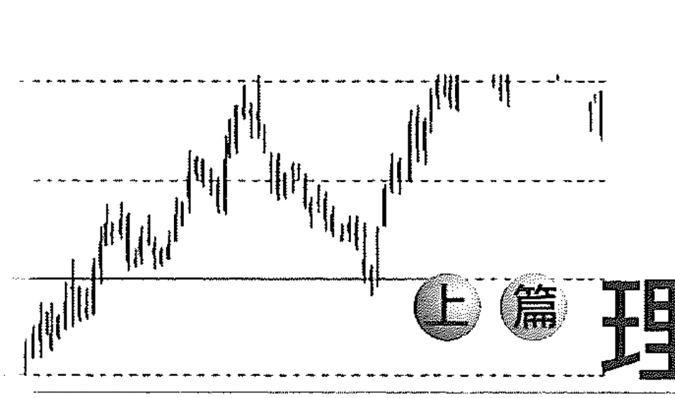

## 前 言

### 道氏理論把市場整體當作研究對象

道氏的市場整體觀點非常重要，首先，用什麼來代表整體就是一個問題。其實單就價格分析而言，據說日本的「久田戰法」要比道氏理論早二百多年，但是「久田戰法」僅僅是對於稻米這個價格的分析，並不能代表市場。個別股票代表公司的發展，整體股票代表國民經濟的發展。因此從道瓊指數創建開始，道氏就打算用這個理論來分析整體市場，用這個指數來預測整體國民經濟的發展，而不僅是分析預測個別股票。這或許是許多投資者認為道氏理論對於個股的分析沒有幫助的原因所在。

但是，道氏的整體思想並非是指所有股票的表現，而是在具有投資價值的股票當中選取，然後加入指數。一百多年來的道瓊指數顯示這樣一個事實，股票市場呈現出歷史性的牛市，然而在一百多年裡，一直保持在指數裡的股票只有通用電氣一家。歷史證明，真正的好股票是很少的，真正的好股票是永遠上漲的，真正的好股票的總和才能代表國民經濟。不過這樣的股票也是非常稀少的，找到這樣的股票並非易事。

因為道氏在設計指數的時候，已經指定了選股原則，那就是選擇具有投資價值的股票，這不屬於技術分析的範疇。所以關鍵是，投資者首先要選取有價值並且有增值能力的股票，並配合進行投資。從這個角度來說，道氏理論對於個股的選擇也是有幫助的。這一點巴菲特表現得更為極端，他在研究分析股票時，反而不太重視股市的整體走勢，因為巴菲特認為，個別股票的價值是由個別股票的特質來決定的，因此，可以拋開整體經濟只分析個股。

### 對三大定律的不同認識

一百多年來，在投資理論界歷來就有基本分析派和技術分析派之爭。基本分析派總是代表正面具體，並對技術分析派嗤之以鼻；而技術分析派總認為基本分析派只知道聽消息做盤，這樣的爭論從來就沒有停止過。

巴菲特說：「面對圖形分析師所研究的價量行為，我始終感覺驚訝。你是否會只因為某家公司的市場價格在本週或前一週大漲，便決定購買該企業呢？在目前電腦化的時代，人們之所以會大量研究價格與成交量的行為，理由是這兩項變數擁有了無數的資料。研究未必是因為它具有任何功用，而只是因為資料既然存在，學術界人士便必須努力學習操作這些資料所需要的數學技巧。一旦擁有這些技巧，不去運用它們便會帶來罪惡感，即使這些技巧的運用沒有任何功用，或只會帶來負面效用也在所不惜。就如同一位朋友所說的，對一位持鐵錘的人來說，每一樣事看起來都像是釘子。」

技術分析是每一個國家都有很多人關心的事情，但問題是它時對時錯，因而能夠滿足那些尋找刺激感的投機客心理。但這是否是聰明的投資人應該使用的選股方式呢？巴菲特提醒投資者，技術分析不能夠為你長期賺大錢。每個技術分析師都深知、期貨經紀人也懂得的致富祕訣：只要自己不玩，肯定發達！

巴菲特曾經在剛剛開始投資時，被技術分析吸引了短短的一段時間，但在接受了格雷厄姆的價值分析之後，就「知錯必改」，避免虧錢。世界最成功的基金經理人彼得·林奇也是不相信技術分析的。被號稱為「現代金融學之父」的法馬教授稱技術分析為「占星術」，而著名的美國作家盧文斯廷則稱之為「線形圖巫術」。

索羅斯說：「大致上，有關理論可以歸納為兩個類型：基礎性的和技術性的。技術分析派研究市場變化和股票的需求與供給的模式。它的優點在於判斷事件的機率，而不是做出實際的預言，它並沒有特別的價值。這一派談不上有什麼理論，無非是股票價格由供需決定，過去的經驗與未來的市場表現，具有相關性之類的老生常談。相較之下，基礎性分析要有趣得多，它是均衡理論的產物。股票被假定為具有真實的基本價值，這個價值不一定等於其市場價格。股票的基本價值或者決定於其基本資產的營利能力，或者決定於與其他同質股票的比價。在任何一種情況下，都假定股票的價格在一個時段裡趨向於基本價值，進而為基本價值的分析提供一個有用的投資決策的指標。」

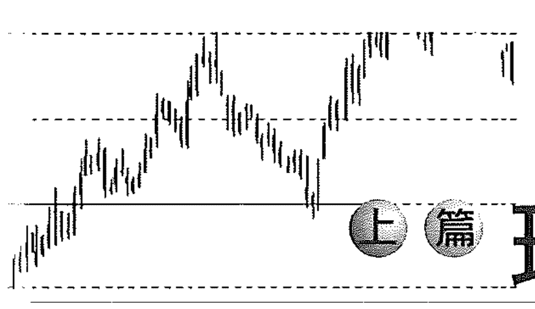

大師們甚至對技術分析的三大定律也給予否定。巴菲特指出：相信「市場行為包容一切，等於在玩牌的時候不看牌就出牌一樣荒謬。」；羅傑斯指出：「都說市場總是對的，這是關於市場分析的最大誤解，事實上，市場在大多數情況下幾乎總是錯的。」索羅斯乾脆假設「市場總是錯的」，即使「市場總是錯的」這個結論有時是錯誤的。

我們當然對大師們在投資領域做出的貢獻，以及所做的業績表示敬仰，不過，我們之所以認為「市場行為包容一切、價格以趨勢方式演變、歷史會重演」，簡言之，「市場總是有規律的」，是由於無數事實證明市場是有規律的；之所以反駁「市場總是對的」是因為論據幾乎可以信手拈來。但是，探索市場發展變化規律的過程是一個艱辛的歷程，不只是看看線形圖那麼簡單，這的確需要「技術」，作者認為這也是技術分析這個名詞所要表達的其中一個意思。

巴菲特之所以否認「市場行為包容一切」，是由於他對價值分析的研究已經到了我們所不能及的地步，他能夠跨越市場行為，直接探索的是市場修正發展的核心內容，而我們則需要借助市場行為這個工具來研究市場。

羅傑斯指出的市場，在大多數的情況下，幾乎總是錯的，其實說明的是市場中的大多數人的觀點總是錯的。這是由於對市場規律的探索並非易事，就像不是每個人看到蘋果從樹上掉下來，就可以研究出萬有引力定律一樣，不論你是用價值分析、基本分析還是技術分析，凡是能夠真正抓住市場規律的人，一定是市場中的少數人。

索羅斯所說的「市場總是錯的」，不是指這句話的表面意思，而是身為一名哲學家所表達的世界觀。其實他所說的錯誤，正是市場發展變化的原因，價格之所以變化，是由於原來的價格是錯誤的，而變化和發展就是改正原來的錯誤並向正確的方向發展，一系列的改正錯誤，就形成了市場發展的趨勢，這不就是市場以趨勢方式演繹嗎？

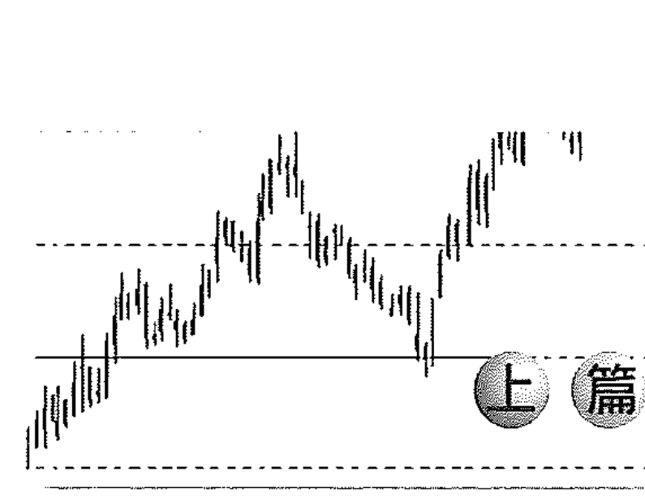

> 「上帝在西元前4004年創造了這個世界，華爾街在1901年重新組織了這個世界。」
> ——《華爾街日報》

# 第一章
### 精讀道氏原文 了解原創精神

作者一直在思索一個問題：道氏理論給我們的最大啟示是什麼？在長期研究之後，作者充分體認到，身為鼻祖級的理論，道氏理論給我們的最大啟示是，它的原創精神和創新精神。

#### 第一節 建立理論核心

我們今天所運用的技術分析方法都是根源於道氏理論，但是由於道氏為人謙虛謹慎，因此，他並沒有針對「道氏理論」寫過書。在1901年和1902年上半年，道氏寫過許多評論文章，分析股票投資的方法。因此，他的理論必須從這些文章中以加以發掘，因為它只是說明性的，甚至是在不經意間得出的，所以從未成為他討論的主要話題。

他的部分文章主要討論股票的投機活動，只是偶爾提到一些觀察市場的規則，而且道氏特別對投機活動給予很高的評價。如果讀者沒有機會親眼見到道氏在許多文章中對自己的理論，或者是對其方法的某些思想的應用，這對道氏來說是不公平的。以下是道氏發表於1901年7月20日的一篇文章，幾乎未作更動。道氏在這篇文章中是先從單一股票談起，並論述股票市場的基本規律，以建立道氏理論的核心思想。我們將會發現，道氏有這樣一個優點，他可以用最樸實的语言來表達深邃的哲理。

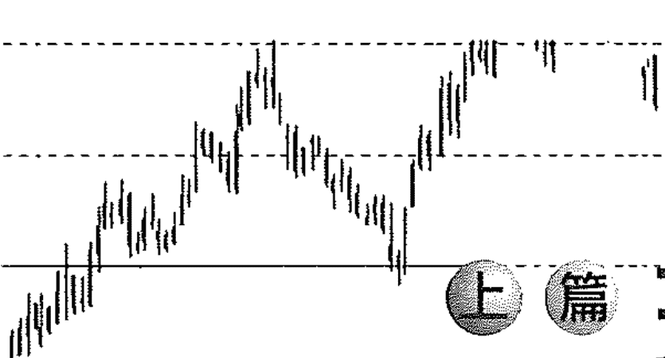

#### 以平均指數為依據進行交易

有人以平均指數為依據進行交易。事實上，市場在一個相當長的時期內，上漲和下跌的天數是大致相當的。如果出現了一個連續前進的時期，幾乎必然會出現一個衰退時期與之保持平衡。

這個體系的問題在於，小波總是包含在大波之中，機會均等的趨勢總是傾向於均等地發生，每種可能的組合都可能出現。經常存在著一種長期的波動或連續很多天的上升或低落，從長期的觀點來看，它們是符合這種理論的，但是從許多連續的短期觀點來看，任何以此為基礎進行的交易都將遭到失敗。

以波動和反波動的法則為基礎而建立的理論是更實用的。市場中的基本波通常都包含著一次至少達到其3/8規模的反向作用的次級波，這似乎是一個事實。如果一種股票上漲了10點，它很可能會再下跌4點以上。這個法則似乎很靈驗，無論上漲的幅度有多大，20點的上漲通常會帶來8點以上的下跌。

預先確定任何基本波的長度是不可能的，但是它走得愈遠，這種反作用就愈大，進而根據這種反作用，成功地進行交易的可能性也愈大。

有些經驗豐富的交易者使用一種反應的方法，其理論依據是：市場總是或多或少地處於被操縱狀態。希望推動股市上揚的大戶不會購買所有的股票，而只是透過正當途徑或者以操縱手段買進兩、三種龍頭股，然後靜觀其他股票受到的影響。如果市場人氣高漲，人們都把股票握在手裡，那麼看到這兩、三種股票上揚的人就會立即開始購買其他股票，進而把市場提升到一個更高的階段。這就是散戶的反應，它預示著龍頭股票會繼續上漲，整個市場將緊隨其後。

然而，如果龍頭股的上漲並未帶動其他股票的上漲，這就顯示散戶不願意買進。一旦這種情況澄清之後，推動價格上揚的努力通常也將停止。這種方法特別適合於那些密切注意股市變化的人，但是我們也可以在一天結束後閱讀交易紀錄，以發現哪種股票在特定的時間點上被人選中，以及整個市場是否隨之上揚。

從價值的角度來分析市場是一種最好的方法。市場並不像一個在風中搖擺不定的氣球。從整體上看，它代表著一種嚴肅的、經過深思熟慮的努力，那些有遠見、資訊充分的人，正試圖讓價格與現存價值在不久以後和存在的價值相適應。出色的交易者所想到的並不是價格能否被抬高，而是他想購買的資產價值，能否讓投資者及投機者們，在半年以後，以高於現有價值10－20%的價格買進股票。

因此在分析股票市場時，首先要知道一種股票在3個月以後的價值，然後再觀察操盤手或投資者們是否正在讓價格向那個數值靠近。這種方法經常可以很清楚地分析出市場的波動，了解價值也就明白了市場波動的含义。

儘管本文有些假設是可以修改的，但是這完全沒有必要。我們不可能證明股市上漲和下跌的天數是同樣多的，即使得到證明，也是毫無價值的，但是這段精彩的論述還是值得背誦、研究、思索，從中我們可以得到巨大的啟示。這段論述幾乎概括了道氏理論的全部核心思想。本書後面的許多章節也都是圍繞著這段重要文章所展開的，並從多個角度來剖析這段短文。

正文第一段的意思是說，市場的整體結構可以分為牛市和熊市兩個部分，市場中的牛市與熊市發生的時間是大致相同的，使得市場整體保持相對平衡。道氏理論其實就是牛市、熊市輪動均衡發展的趨勢理論。如圖1-1-1所示。

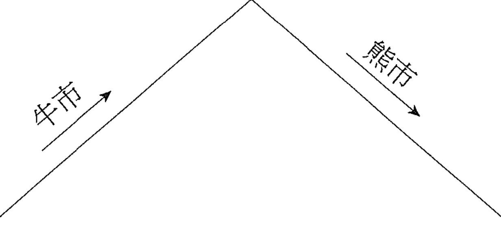

圖1-1-1 牛市與熊市的持續時間大致相同

正文第二段的意思是說，趨勢是由大波動和小波動組合而成的，大波動中包含著小波動，就長期而言，趨勢有一定的方向性。「機會均等的趨勢總是傾向於平均地發生，每種可能的組合都可能出現」。這句話代表著歷史會重演的週期輪動思想，同時也表達了歷史不會簡單重演的思想。

而第三段的意思是說，「波動和反波動的法則」是構成這個模型的兩個基本元素，即牛市和熊市兩股力量內部結構的規律。也就是在大規模的基本波中，總是伴隨著相當規模的次級調整。這兩段實際上道出了三重運動原理。無疑地，道氏將市場的波動劃分成三重運動是正確的。

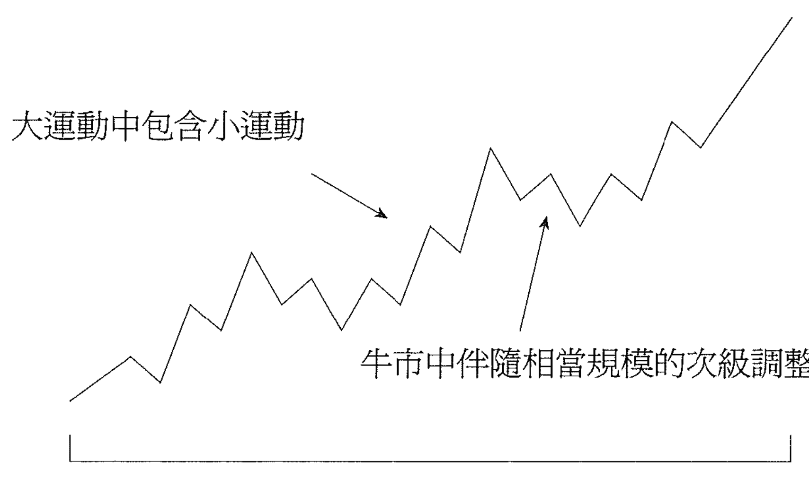

第四段的意思是說，基本波的長度並不能被預測，也就是反轉的具體時間不能確定，但隨著趨勢的發展，反轉的可能性將愈來愈大，但這一點常被許多投資者忽略。道氏正確地指出，牛市會持續，直到有熊市的訊號出現才顯示趨勢反轉；熊市也會一路持續，直到有牛市的訊號出現才顯示趨勢反轉。西洋有句諺語：“Don't sell the bearskin before the bear was caught.”（不要在抓住熊之前就將熊皮賣掉）。華爾街有句名言：「不要與趨勢相對抗。」意思就是，在股票投資中要順勢而為，看大勢，賺大錢。（如圖1-1-2所示）。基本波的長度不能被預測。

第五段的意思是說，假設市場中有一隻看不見的手，操縱著兩、三種股票。如果此時整體股票市場上漲，那麼這兩、三支股票會再升級，這也就是龍頭股的帶動作用。當道氏寫這篇文章時，由北太平洋鐵路公司股票拋售事件引發的恐慌剛剛過去10個星期。他清楚這次基本波並沒有終結，而只是在基本的牛市中出現的一次非常猛烈的次級波。

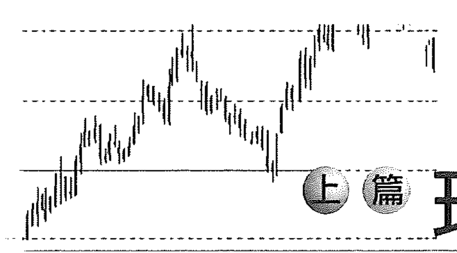

第六段的意思是說，如果後來其他股票沒有跟隨龍頭股上漲，當市場將龍頭股上漲的原因搞清楚之後，龍頭股的上漲也就此停止。也就是說，操盤手必須順應市場，否則操縱行為並不能成功。這部分同時也包含了相互驗證的思想，即龍頭股的上漲，必須得到整體市場上漲的驗證。（如圖1-1-3、圖1-1-4所示）

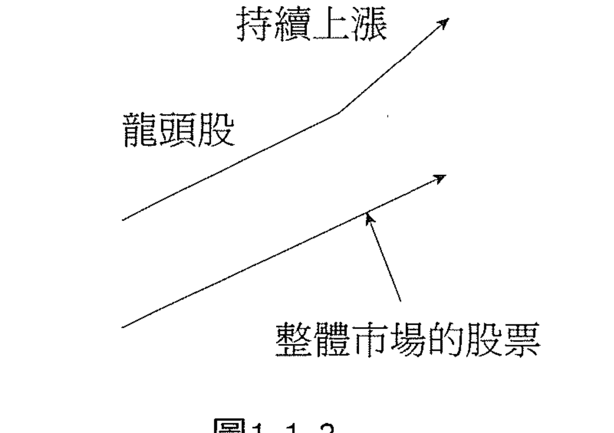
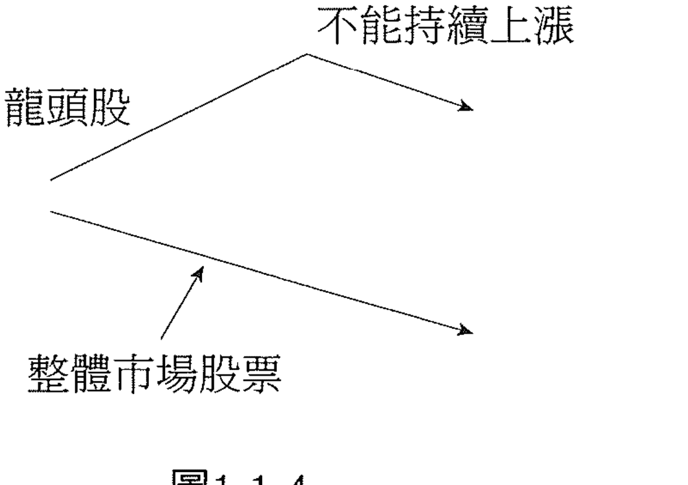

圖 1-1-3
圖 1-1-4

第七段的意思是說，股票的價格最終受到價值所支配，各種因素將導致價格與價值相適應，它們都推動價格去發現股票的價值。身為投資者應考慮的是，價值是否能在半年之後提高10%～20%。換言之，價值發現是道氏理論的基礎。這說明道氏非常重視價值分析，並認為價值的變化是有規律的，這個規律可以為人們所認知。

第八段的意思是說，投資者應該研究、觀察3個月以後股票的價值，再研究價格是否向那個數值靠近，了解價值的情況，也就了解價格的走勢。長期持有股票，就意味著獲得的是股票的價值，而投資者只有找到價值有可能增值的股票才有可能獲利。從第七、第八兩段，我們可以清楚地看到，通常人們只將道氏理論看作是技術分析的鼻祖是錯誤的，雖然道氏並沒有過度地談論價值分析，但是他在許多文章中也都提醒投資者必須進行價值分析，否則投資行為不可能成功。（如圖1-1-5所示）

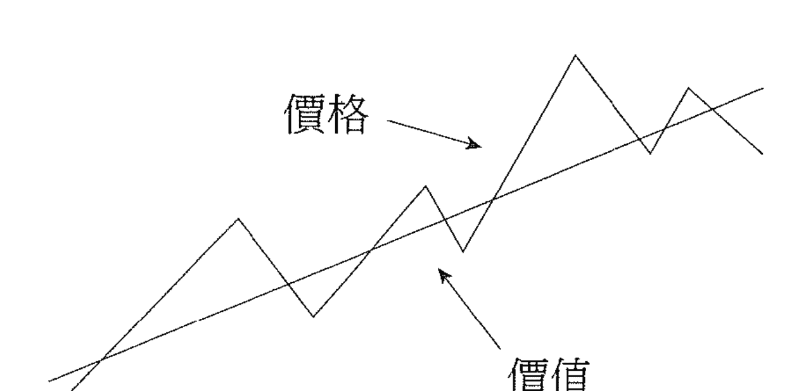

圖 1-1-5 要尋找價值上升的股票才能獲利

現在將文章的核心思想歸納如下：

- 大波中包含著小波，在大規模的基本波中總是伴隨著相當規模的次級調整，這兩段實際上已經道出了三重運動原理。
- 儘管牛市、熊市均衡地輪動發展著，但是基本修正的長度並不能被預測，不過，隨著趨勢的發展，反轉的可能性將愈來愈大。
- 操盤手在操縱龍頭股時，必須順應市場，否則操縱行為並不能成功，實際上這是指出，基本波是不可以被操縱的思想。
- 投資者只有找到有可能增值的股票進行投資才有可能獲利。各種因素將導致價格與價值互相適應，它們推動價格去發現股票的價值，並由此發展而形成「市場行為包容一切」——技術分析的三大假設之一。

#### 第二節 道氏關於均衡發展的牛市、熊市輪動的精妙論述

不知是誰首先將“The Dow Theory”翻譯成「道氏理論」的，似乎無從考證，但將“DOW”翻譯成「道」的確是非常高明的。所謂“道”乃無形而自然存在之法則。而道氏理論正是以自然法則為基礎，探索股市中基本波規律的理論。道氏理論其實就是牛市、熊市輪動的理論，而牛市、熊市的輪動，在經濟學上則表現爲失敗的復甦和失敗的衰退的輪動。

在仔細閱讀道氏的原文後，作者感受頗深。為求先睹爲快，這裡先將作者所翻譯的部分道氏原文摘錄如下，這是一段道氏對於牛市、熊市輪動的論述。

在牛市中，第一個時期是「聰明資金」（最有見識的、最富有經驗的投資者）廉價蓄積股票的階段。其間，大眾情緒已經有利於股票市場的走勢，即從厭惡市場階段，轉為通常所說的懷疑市場階段。不過，这时的股票市场還是令人沮喪，並且可能會繼續很長一段時間。雖然如此，在基本的商業環境，甚至還是顯得很嚴峻的時候，一些投資者依然知道，（牛市、熊市）輪動總是會發生的。「聰明資金」開始買進那些失寵的股票，它們被以誘人的低價賣出。而一直保持低迷的交易量現在開始活躍，這顯示有遠見的、有耐心的投資者已經進入市場了。

牛市第二時期是眾所周知的飆漲階段。基本商業環境將要改善的預期已經逐漸得到公認。股票價格隨著交易量的增加而上漲，市場前景樂觀。股票價格大幅上漲，此時在市場上買股票是最有益的。

牛市第三時期以散戶的狂熱和投機爲標誌。市場情緒指標接近歷史水準。現在基本面顯得非常好，甚至有可能經濟快速發展的「新時代」和無限繁榮的話題被廣泛談論。在市場上，產生百萬富翁的投機故事充斥在各種媒體中。每個人都樂觀的買進股票，因而成交量急劇放大。然而，在第三時期的後期，成交量開始減少，貪婪的買盤迫使散戶陷於瘋狂，通常在利益的驅使下，變成了完全投機。同樣地，「聰明資金」已經提醒自已「沒有一棵樹可以漲到天上；天下沒有不散的筵席」。因此，那些有見識的投資者，也就是早期以低價大規模買進的投資者，現在已經停止買進。而且，他們已經開始處於出脫階段了，以小批量高價賣出股票。而貪婪又不懂世故的散戶投資者兇猛地買進，迅速將股票價格推升到荒謬的高價時，也是「聰明賣盤」不斷增加的時候。

最終，在這場遊戲中，在「明顯」看涨的表面之下，技術面已經有證據顯示開始出現了看跌的跳空缺口。在股票的眾多技術指標中出現了分歧，導致不懂看盤的投資者失去理性地購買危險股票，而「聰明資金」已經清算了最好的股票。此時，

## 三大定律的建立

股市處於震盪並且還有一小段可以獲利的空間。

牛市第三期是牛市第二期的延續，然而，幾乎在每一個投資者都透感覺行情極為看俏的時候，熊市第一時期的明顯標誌和眾多的惡化了的技術指標已經出現了，卻似乎仍然無法阻擋價格的提升。當每一個已經買進股票的投資者還在不斷買進的時候，到達一定水位後，由於極度缺乏買盤承接，使價格搖搖欲墜，這時股票價格的趨勢只有一個——下跌。當買進的能量耗竭時，需求不足將導致股票加速出脫，「聰明資金」以市價賣出，因此價格必然跌得更低。不斷大量買進股票的投資者已經停止買進，並且形成潛在的熊市信號。

在出現大幅度調整後，市場靜悄悄地進入了熊市第一期。但是，即使股票突破支撐點時，這個明顯的熊市技術信號，也被絕大部分不明智的投資者所忽視。畢竟基本的商業條件還是欣欣向榮的，並且「逢低買入」還是經紀人和交易商及媒體的建議。散戶寄予希望於所信任的華爾街分析師、戰略家和經濟學家們的「共識」是正確的。此外，散戶已經被他們告知要長期持有，並且在超長期限內股票價格永遠會上漲。因而，股票價格下跌受到普遍的懷疑。假如散戶還沒有滿手股票的話，他們願意買進更多的股票。但是，他們已經滿手股票的話，就不能再買進了。

熊市第二期是以散戶情緒的突然變為標誌的，從樂觀、信賴市場，到市場遭受迎頭擊而恐懼。有一天，散戶醒來大為震驚，原來市場上演的是「皇帝的新衣」。真實的基本商業環境沒有成功地確認先前所希望的事情，實際上，基本面已經出現一些問題。而「聰明資金」的多頭已經離場，且當散戶的希望破滅時，剩下的散戶沒有人再買進。股票價格令人震竦般地下跌一段空間後，恐懼很快取代了貪婪。恐慌的情緒會不斷蔓延到整個市場。由於不懂看盤的投資者尖聲叫喊著，「任何價格我都要離開！」，這導致成交量放大。當價格下跌加快時，「精明的」專業交易商願意買進價格大幅下跌的股票，當然，最好可以預期迎光返照的出現，然而，這僅僅是進行快速下跌中的小片段。

熊市第三期是以失望性的賣盤為標誌的，最後，厭惡的情緒籠罩在整個市場。基本面無疑已經惡化，前景暗淡。價格繼續向下修正，但是下跌的速度已經改變了。最後，以令人心痛的價格，清算股票的賣盤開始減緩。即使是最好的股票，最初雖然抗跌，但還是在熊市面前屈服了。在恐慌階段，成交量很大，在價格下跌的過程中，由於清算過程的持續，使成交量開始逐漸縮小。

最後，當每一個能夠賣出股票的人都已經賣光的時候，熊市就走到了盡頭。當每一個曾經不斷賣出的人都已經賣光的時候，價格的方向只有一個——上漲！在股票全部被賣光後，絕望的散戶哀嘆，「絕不再買了！」，隨後開始上演另一番的輪動。

簡單地說，道氏將從牛市到熊市的輪動分為六個時期：
- (1)因懷疑而猶豫；
- (2)因信任而樂觀；
- (3)因貪婪而狂熱；
- (4)因彷徨而失望；
- (5)因震撼而恐懼；
- (6)因厭惡而絕望。

這些時期並不是什麼祕密。它們被道氏及其傳人寫出來一個多世紀，這些過程一次又一次地、無窮盡地重複著，但散戶還是從不記取教訓。原因太簡單了，僅僅是由於人的本性，受到片刻的輿論影響而失去所有自己的觀點，並繼續蔓延。假如你沒有學習過如何認識技術指標，沒有經過訓練，世界上最容易的事情就是讓你自己被拖進大眾情緒和「大眾觀點」裡面去。而且，評估轉折點是錯誤的方法，這將會使你在高點買進並在底部賣出，和市場的錯誤方向保持一致。

在整個的牛市、熊市輪動中，「聰明資金」和散戶的區別就是，散戶非常容易受到大眾情緒的影響，而「聰明資金」之所以聰明，不受市場中大眾情緒影響的重要原因就是：「聰明資金」知道如何利用技術分析來克服市場情緒，知道目前市場的基本波的情況，也就是現在是處於牛市還是熊市，以及運行到哪個階段。投資者如果打算透過市場運作賺錢，就必須避免受大眾情緒的干擾。道氏理論會告訴我們如何去處。圖1-2-1所示為大眾情緒引導的牛市、熊市輪動的結構圖。

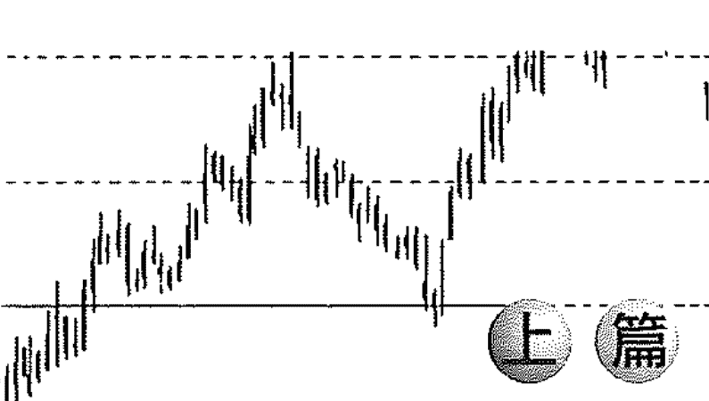

# 上 篇 理論篇

左半部分說明投資者可以分為「聰明資金」、「精明的」專業投資者和投資大眾。在不同的時期，不同類型的投資者的行為是不同的，甚至是相反的。道氏從看似雜亂無章的市場修正中，發現市場並不像風中的氣球那樣飄忽不定，而是進行有序的修正。

上圖左半部分說明，大衆情緒引導的整體市場是以均衡發展的牛市、熊市輪動進行的，而牛市、熊市的發展又是有步驟、分階段進行的，因此道氏認為牛市分為三個時期，熊市也分為三個時期。

右半部分簡單地說就是道氏將從牛市到熊市的完整輪動分為六個時期，投資者在進行投資之前，需要清楚目前的市場是處於牛市還是熊市。若是牛市，又在牛市的那一個時期；若是在熊市，又是在熊市的那一個時期。如果不知道股市在什麼市及什麼時期，則無法針對當時的市場特質採取相應的對策。

實際上，牛市（Bull market）和熊市（Bear market）這兩個概念是道氏的天才之作，是經典的道氏語言。他把美國華爾街的股票市場當作分析和研究的實驗室，發明了牛市、熊市的概念。這個架構適用於全世界的股市。道氏用它們表達市場總是處於牛、熊這兩股相互矛盾的趨勢組成的統一體，而這個統一體則是有規律地修正著。

牛市、熊市的輪動與經濟週期有密切的關聯。經濟週期是人類本性所導致的必然結果。當經濟好的時候，人們對未來過於樂觀，盲目擴張，該裁減的冗員沒有裁減，於是不景氣很快就來了，人們又變得過於悲觀，這樣周而復始，循環往復。當市場崩潰時，每個人都想要現金或黃金，可是此時市場缺乏流動性。因為沒有當作最後貸款人的中央銀行，人們就會失去信心，所以歷史上不斷地重複著貪婪與恐懼的輪動交替，反映在市場上就是牛市、熊市輪動趨勢。

雖然在某種程度上，牛市和熊市可能已經沒有像已往那樣被談論了，但道氏理論的精神卻仍然是可信的，市場一定會經歷牛市和熊市的輪動趨勢，因為牛市、熊市根源於人類的貪婪與恐懼的本性，所以牛市、熊市輪動趨勢還將不斷地、均衡地發展下去。

道氏理論的基本思想就是「牛市、熊市的輪動會一路延續」的法则。牛市、熊市的輪動是必然的現象，永遠都不可能消失，必定是交替輪動發展的，不會因為新經濟就停止輪動，這是股票市場的真理。

為了建立這個理論，道氏發明許多概念，其中最著名的莫過於「牛市」、「熊市」了。牛市和熊市是股票交易中常用術語，是道氏理論中最基本的概念。它們後來被廣泛應用到股市以及其他投資市場上，成為投資者無所不知的通用術語。即使不是股票投資者，對牛市和熊市這兩個名詞也不會感到陌生。牛市、熊市循環體系的經濟學含義是增值和貶值，還因此奠定了技術分析的基礎。而且「牛市和熊市」還是一部沒寫完，而且是永遠寫不完的經濟學小品。

牛市表示市場上漲的力量大，熊市表示市場下跌的力量大，而漲勢或跌勢這樣的詞彙僅能夠代表普遍意義的漲、跌。運用物理學的概念，牛市、熊市是向量，所代表的意義更為精準。

牛市、熊市與一般趨勢也是有所區別的。牛市的基本性質在於它持續的漲勢現象，這是長期的，而不是短暫的漲勢。股市指數有漲有跌都是正常的，但牛市是一個長期上漲的基本波，特別是在牛市中，有時漲得很急很兇，牛氣沖天；熊市則是一個大跌勢，也是長期的。在熊市當中，有時股市會跌得很兇，有時反彈急促而且幅度巨大。

牛市、熊市的概念由道氏發明，這個概念是他對股票投資學的偉大貢獻。作者認為，現今還沒有一個人能夠發明更精妙的詞彙來代表市場的修正。道氏在一篇文章中提出了一個觀點，我們可以從中作出正當的引申。

> 他說：「只要平均指數的最高點超過了前期的最高點，它就處於牛市時期；當最低點低於前期的最低點時，它就處於熊市時期。通常很難判斷前進的過程是否已經結束，因為一旦基本波發生變化，價格的修正將隨之反轉。然而這也可能只是一次很少被人提到的次級波。」

牛市的出現，就表示股票交易市場上買股票的人比賣股票的人多，股市整體行情上漲。熊市的出現，就表示股票交易市場上賣股票的人比買股票的人多，股市整體行情下跌。表達市場總是處於牛、熊這兩股相互矛盾的基本波組成的統一體系中，而且這個統一體系有規律地運動，它們奠定了技術分析的基礎。

據說牛市、熊市是道氏根據大海的漲潮、退潮得到的啟發。在海水的潮汐當中，有漲潮和退潮兩種情況。海水不會永遠都是漲潮，也不會永遠都退潮。漲潮之後，隨之而來的一定是退潮；退潮結束之後，隨之而來的一定是漲潮。海水不是漲潮就是退潮，漲潮、退潮是更迭不斷的，而在這個輪輪當中，就會出現漲到頂或跌到底的情況。

不過，讀者們的問題的確令作者產生了不少思考：到底什麼是道氏理論？是不是只有道氏及其傳人的話才是道氏理論？建立道氏理論的基本原則是什麼？如何才能發展道氏理論？

後來，在進一步認真閱讀道氏理論的第一傳人漢密爾頓所著的《股市晴雨表》之後大受啟發。漢密爾頓指出：「晴雨表是值得信賴的指南，這就是股市晴雨表如此珍貴的原因。它並不迷信週期或體系，也不看重有趣的，甚至很有道理的推斷或流行時尚，只要它們是有用的，它就會加以利用，並且還會利用它能得到的任何一個資訊。」這也正是我們進一步發展道氏理論的基本原則，不迷信前人，只要被證明是有用的，我們不但可以拿來創新，而且可以為我們獲得資訊。

道氏提出理論的核心思想之後，由一代又一代的傳人不斷探索發展起來。所有探索牛市、熊市基本修正規律的方法都可以適用，因為它們都是道氏理論，唯有如此，道氏理論才能有所發展，這對我們理解市場所處的時期和市場行為，可能將要發生什麼事情，是有參考價值的；同時也可以用來檢查和對照自己，當作一面鏡子，幫助自己逐步提升。

能夠讀到道氏的原文是令作者欣悅的，但是更重要的是，我們要繼承和發揚道氏理論的精神，這個精神就是探索市場發展規律的創新精神。

如果說到原創，我認為道氏最重要的原創就是道瓊平均指數。這個被通稱為「道瓊」的指數非常著名，以至於新聞媒體經常用它來代表「股票市場」。無論用它來描述股票價格的修正是多麼的不完善，但是大多數投資者仍然根據它對股票市場作出判斷。下一章要闡述的內容即以上所述。

據說，是數字在統治著世界。
——約翰·沃爾夫岡·歌德（1830）年

### 第二章 道瓊指數

#### 第一節 數字在統治著世界

數學是宇宙語言，市場規律也符合數學規律。偉大的投資者甘氏指出：「在世間只有數學可以永垂不朽，數學可以解釋真理，解決所有問題。」代表股票市場的股票指數為投資者和分析家研究、判斷股市動態提供資訊。它不僅反映股票市場行情變動的重要指標，而且是觀測經濟形勢和週期狀況的參考指標，被視為股市行情的「指示器」和經濟景氣變化的指南。

##### 一、研究道氏理論需要從道瓊指數開始

「市場行情如何？」一位投資者問同伴。「今天很不錯——它上漲了70多點。」

在美國，這種交談每天會出現無數次。沒有人會問：「是什麼上漲了70點？」因為每個人都知道答案——道瓊工業平均指數！這是當今世上最常被提及的股票平均指數。

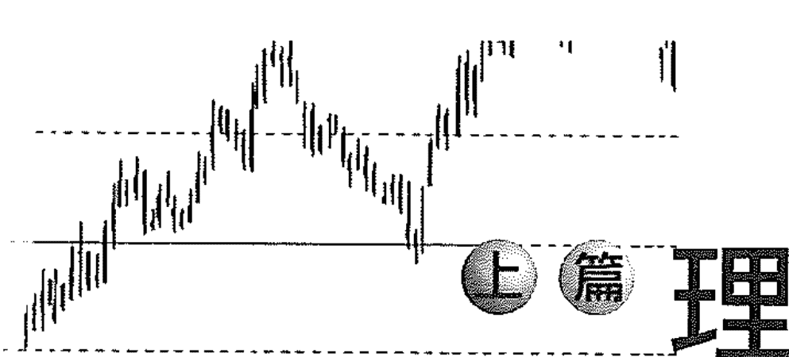

19世紀90年代，華爾街的一項進步，具有極其重要的意義，以至於今天我們幾乎無法想像，缺少了它華爾街將會變成怎樣，這就是股票市場指數。今天，道瓊工業平均指數早已經是世界上最著名的一個統計指標了。當人們問：「今天行情怎樣？」時，他們需要的實際上就是這個指數。有了電腦之後，現在投資者能夠透過網絡得到道瓊指數每一秒鐘的漲跌情況。

從這段描述我們可以得出結論，這個結論有以下幾個要點：
- 1.在股票市場內，指數代表整體股市的漲跌。
- 2.股市的指數能反映股市的整體漲跌。
- 3.股市的整體漲跌是有一定的規律，這個漲跌的規律就會反映在指數的漲跌上。
- 4、要在股票市場中有所表現，增加勝算，減低風險，我們一定要掌握股市整體漲跌的規律。

由於道氏理論是以道瓊指數為基礎工具建立起來的，同時道氏理論教我們怎樣分析股票指數的變化，從中掌握到股市整體變化的思想方法。所以我們要深入研究股市，就有必要先介紹一下道瓊指數。

股票指數將市場用一個或一組數字來表示，這樣我們就可以用研究數學的方法，對整體股票市場進行研究。所以，研究道氏理論需要從道瓊指數開始。

##### 二、道瓊平均股價指數的兩個重要貢獻

- 1、在道瓊平均股價指數的基礎上，道氏提出了道氏理論並最早用於股票市場，以此判斷股市的漲與跌，看經濟的興與衰。後來繼承人威廉·彼得·漢密爾頓和羅伯特·雷亞再將道氏理論發揚光大，並當作推測投資市場走勢的一種工具。由於道氏理論反映了投資市場收益與風險的一般客觀規律，近年來愈來愈多的人將該理論用於投資市場上，已經在成熟的金融市場上驗證的結果顯示，道氏理論對於市場基本波的預測是有效的。
- 2.道氏提出一個成為目前現代金融理論之定律的命題，即任何一支股票所伴隨的總風險包括系統性風險與非系統性風險。其中，系統性風險是指那些會影響全部股票的一般性經濟因素，而非系統性風險是指可能只會影響某一公司，而對於其他公司毫無影響或幾乎沒有影響的因素。

道氏於1884年7月3日正式創立並公布了股票市場平均指數——道瓊工業平均指數。他正確地指出股票指數可以反映股票市場的價格總水平和波動趨勢，並可以解釋和反映市場的大部分行為，這是道氏對股票市場的重大貢獻。道氏的這個偉大功績，無論我們如何強調都不過分。

目前，世界上所有的證券交易所都採用一個當地市場的價格指數，各種指數的計算方法大同小異，都是源自於道瓊指數。因此1984年7月3日，《華爾街日報》為紀念他這個創業誕生一百周年而撰寫了名為《卓越的道瓊指數百年誕辰》的文章。同一星期，在《華爾街日報》的姐妹出版物——《巴倫氏週刊》上，也刊載了《百年來道氏理論為投資者立下汗馬功勞》。

##### 三、道瓊平均指數的權威性

雖然道瓊指數的價格加權平均（Price Weighted Average）計算方法使得投資界對於它的準確度和可靠性爭執不休，但是出於以下三點基本原因，使得它始終被認為是反映整個股市水平的權威指標。

首先，是它所囊括的股票都是那些聲名顯赫、業績輝煌、市值龐大、股東眾多、地位穩固、交易活躍、成長迅速、股息穩定、位居行業主導和領袖地位的大型績優股（Blue Chip）。美國人稱這類大企業為藍籌碼，是因爲在美國賭場中代表各種價值的籌碼顏色不一，藍色的價值最高爲100美元。此外，藍色是歐洲早期靛青染料昂貴時，貴族才用得起的顏色，將大企業比做藍籌碼是形容它們的財勢威猛。這些股票的總市值占據了整個紐約股票交易所股票市值的15%至20%。

其次，是其悠久的歷史，可以刻劃出股市的一貫性和連續性表現。這個獨特性是任何其他股票指數都望塵莫及、無可比擬的，同時也是道氏不可磨減的歷史功績之一。

最後，是它的慎重、嚴肅和一致性。為了保證指數可以如實地反映出股市的狀況，避免市場操行爲對於指數本身所產生的人爲干擾，維護道瓊指數的基礎，道瓊公司始終拒絕期貨、期權等衍生性商品。

不過，儘管大公司股票的行情深受世界股市及國際輿論的關注，但是道瓊指數是依簡單平均股價計算的，易受少數股價大幅度波動的影響，而採取調整除整數的方法，又將導致各種股票的相對權數發生人爲的變動。此外，隨著經濟的發展和產業結構的變化，道瓊指數的樣本股票的代表性已大不如前，若不予以調整，將愈來愈難以充分反映股市的全貌。

隨著經濟的發展、市場的變化，以及公司的不斷收購、合併，最早的12種股票，到目前為止，只剩下唯一的一個還依然存在，即通用電氣公司（General Electric，GE）或稱奇異公司。作者認為，至今道瓊工業平均指數也只有30支股票，說明真正有價值的股票是很少的。而它帶來的啟示是：從一百多年的歷史來看，真正有價值，並值得長期投資的股票並不多，因此我們在投資股票的時候需要精心挑選，一旦選中就要長期持有。不過，有點令人遺憾的是，由於長久以來美國股神華倫．巴菲特的柏克夏公司的成交量太少，道瓊公司一直拒絕將其列入道瓊平均指數。

道氏認為：「股票市場指數就像溫度計一樣，會反映股市整體的起落。」但是怎樣去讀懂這支「溫度計」呢？那個時候的絕大多數報紙都已經開始公布股票每天的收盤價格，但是這些價格不能讓人們一眼看出市場整體的表現情況。就像華氏溫度和攝氏溫度計一樣，道氏的溫度計也需要一個刻度。於是他創造了兩個平均指數，一個指數是鐵路指數——那個年代的績優股；另外一個是反映風險相對較大的工業企業股票的平均指數。

最初包括了12種股票的工業股票平均指數，第一天收於40.94點。有意思的是，道氏剛剛開始編制市場指數，市場就開始下滑，到8月份的時候，道瓊指數已經跌到了28.48點，狂瀉了30%。如果美國商務部在這個時候就公布GNP資料的話，GNP也會顯示這是一段艱難的時期。實際上，美國商務部直到1929年才開始編制計算GNP。

隨著總統競選局勢的明朗化，麥金利很可能打敗布萊恩，市場開始迅速反彈。10年之內，道瓊指數便超過了100點，成為一支真正完全知道氏所期望的華爾街的温度計。

道瓊平均指數成為股市的指南，自1884年7月3日以來，已經由最初的69.93點上漲到1999年的10000點以上。這是任何一個國家的任何股市都沒有的歷史，這麼悠久的平均指數紀錄，我們可以從這個事實中看到它強大的生命力。道氏及其所創立的道瓊指數，是股市歷史上最偉大的發明，它將被載入世界股市史冊而流傳千古，同時它也將伴隨世界股市的發展而永垂不朽。

#### 第二節 道瓊指數的誕生與發展基礎

##### 一、道瓊指數的概況

道瓊指數（Dow Jones Index）只是一個簡稱，是由美國道瓊公司編制，並在該公司出版的《華爾街日報》上發布的股票價格指數。它目前主要有兩大類：一類稱為「道瓊工業平均指數」（Dow Jones Industrial Averages Index, DJIA），是紐約證券交易最具權威、最具影響力的股價指數，也是世界上歷史最悠久股價指數；另一類就是「道瓊運輸指數」（Dow Jones Transportation Average Index, DJTA），它是包括了有代表性的交通行業的企業，如運輸、交通、鐵路、航空、空運等企業在內的指數。但論及重要性，仍然是道瓊工業平均指數最重要，因為不但傳統的大企業很多都在這個指數之內，而且如微軟等高科技企業也因為已經是大企業，現在也被列入道瓊工業平均指數之內。

當然，一些較小型的高科技公司不會被列入道瓊工業平均指數之內，只會被列入納斯達克指數之內。不過，即使納斯達克指數近年來其重要性不斷增強，但在美國，歷年來代表所謂「舊經濟」，即傳統企業的股市指數還是道瓊工業平均指數。

如今，道瓊工業平均指數是美國，甚至世界上最著名的股票市場價格指數，它反映了在美國紐約股票交易所上市的最大30家工業企業的股票價格變動。應用道瓊工業平均指數的人不多而且廣，《華爾街日報》和世界各報每天都刊載它的變動。它被看做是反映美國經濟情況的一個重要領先指數。最初道瓊指數每半小時公布一次，許多晚報、午報都刊載它一天中的變動情況。由這一點我們可以看到，道氏對美國股票市場的影響多麼巨大。

在16世紀初，從比利時的安特衛普和法國的里昂開始，世界上就有了股票交易。到17世紀初，荷蘭的阿姆斯特丹成為歐洲的證券交易中心，股票交易的規模已經開始擴大。但是直到19世紀80年代為止，人們都無法對股票市場的修正，從整體上思考和認知。

雖然美國第一家證券交易所（費城）成立於1790年12月，但美國股市在這之後的一百多年時間裡，卻瀰泊在模糊地帶之中，直到1896年5月26日道瓊工業平均指數問世，才揭開了嶄新的一頁。雖然它還僅僅是以極其簡單的價格平均方式進行計算，但卻在國際股市指數的歷史上樹立了一座里程碑。

值得一提的是，道氏在一百多年前的華爾街研究股票市場規律時，他的高明之處是將股票分為兩大類，即工業股和鐵路股，這為道氏理論的相互驗證奠定了基礎。道氏認為，雖然整個國民經濟體系中行業眾多，但沒有運輸系統和充足的電力供給，全面、快速、健康和穩定的經濟發展是難以想像的。看看當前許多發

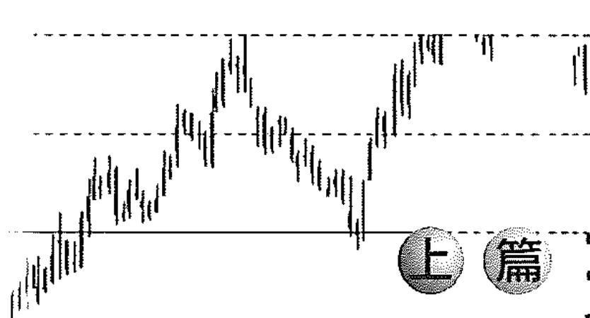

# 三大定律的建立

新興國家急於發展經濟，卻深為運輸和能源這兩大瓶頸所困，人們不禁被道氏和其他投資先驅們的高瞻遠矚和遠見卓識，以及他們對於經濟規律和股市趨勢的深刻理解獨特見地所折服。

需要了解的是，兩個指數之間的相互驗證是道氏理論的基本思想——相互驗證原則。但是鐵路股平均指數正慢慢地過時，而且不再與工業股平均指數協調一致。公共事業股平均指數正處在強勢，而且與工業股平均指數的協調性比鐵路股指數強得多。在過去許多年中，鐵路股平均指數與工業股平均指數之間的百分比未能保持相同，因為在大多數情況下，工業股指數的漲勢更強，而且漲速快。因此現階段根據道氏理論關注鐵路股指數是否印證了工業股指數是很愚蠢的。我們需要把握的是相互驗證的思想，而不能教條地進行這兩個指數之間的相互驗證。

兩種股票價格的平均數值分別計算出來，兩個指標走勢各自獨立。在道氏所處的年代正是蒸汽機時代，當時的交通主要又是以鐵路為主，所以鐵路股就是交通的主要工具。鐵路企業是各上市企業中很重要的一類。後來在交通發展之下，鐵路已經不再是最主要的交通工具，還有航運和航空，所以鐵路指數後來又改爲交通指數，所包含的指數成分股已經超越了鐵路公司，而是所有有關交通運輸的企業。因此最終將鐵路指數改爲運輸指數。可以說，這兩大類股票在當時的投資環境下，都代表了股票市場的走勢。除了鐵路股之外，還有石油等其他工業企業。

## 一、道瓊公司

1882年11月，查理斯·亨利·道（Charles Henry Dow）與愛德華·瓊斯（Edward Jones）和第三位通常不被提及的查理斯·柏格斯特里瑟（Charles Bergstesser）三人合夥共創了道瓊公司（Dow Jones & Company，股票代碼DJ）。利用與紐約股票交易所相毗鄰的優越條件，專門向投資客戶傳遞他們透過複寫紙手寫的有關股票、債券交易的新聞。19世紀末的美國正值經濟飛速發展的高峯，道瓊公司的客戶量不斷擴大。它是當時世界一流的商業財經資訊提供商，同時也是重要的新聞媒體出版集團，總部設在美國紐約，後來旗下擁有報紙、雜、通訊社、電臺、電視臺和網際網路服務等，目前在全球擁有近1,800名新聞從業者，這使得道瓊編發的股票價格指數更是家喻戶曉。

1789年5月，在紐約華爾街與百樂得轉角處的大楓樹下，剛有股票買賣活動不久，美國財經新聞就誕生了。

1789年秋天，股票經紀人派職員到其他經紀人處交換最新的股票成交資料。到1827年，華爾街下的曼哈頓區擠滿了交換資料的職員，每天要分送10份手寫的小冊子給他們的訂戶。

1872年，愛迪生发明了用電報傳送資訊的方法，股票經紀人就在利用電訊將最新的股票行情增送給用戶，每一用戶家裡裝置一臺收訊紙帶機，將電子信號轉換成文字，提供用戶參閱。由於電報機傳送資料受到符號與數位的限制，所以仍無法取代手抄小冊子。

1882年11月，查理斯·亨利·道、愛德華·瓊斯與查理斯·柏格斯特里瑟離開了在當時財經新聞龍頭地位的《克爾倫新聞》，另創道瓊公司。

而在克爾倫時，柏格斯特里瑟發明一種描繪機，一次可以同時複寫35份，使抄寫工作效率增加了4倍。在此之前，他曾以此為條件，要求平分《克爾倫新聞》的股權，被克爾倫斷然拒絕，於是柏格斯特里瑟說服克爾倫的兩位記者道與瓊斯共同冒險成立了新公司——道瓊公司。

道瓊公司以柏格斯特里瑟之筆（他發明的描繪機）使資料分送速度大為增加，他們的編輯雖有未盡理想之處，但是他們的事業卻一帆風順地成長。公司創立1年之後，柏格斯特里瑟說服他的夥伴，讓道瓊成為華爾街新聞服務界第一家擁有印刷機的報紙，這項投資使公司的印刷量增加了一倍。由於採用打字印刷技術，《道瓊公報》與手抄的報紙相較之下，在品質上也有了很大的改善。

道瓊公司拓展電報業務，使他們的公報成為美國第一家涵蓋倫敦金融消息的財經出版物。愛德華·瓊斯費盡心思僱用了一位倫敦《泰晤士報》的職員，每天在該報出版之後，立即透過電報將當天的市場摘要發送給紐約的道瓊公司。倫敦比紐約的時間早5小時，倫敦《泰晤士報》一旦印刷出版成為公共新聞，瓊斯自然可以心安理得地運用，並無值得非議之處。

創建於1897年的道瓊公司的新聞服務「帝克電訊」營運得很好，自創建以來一直是最快的財經管道。專業用戶、股票經紀人、銀行家，幾乎每家都有一臺帝克電報機，有了這種設備，他們就不必等到第二天看到報紙才知道前一天的各種金融活動。日報的記者們有責任在探訪到新聞之後，在撰稿交給報社之前，透過電話把資料傳給紐約總公司。這使他們無形中多了一道手續，延遲了交稿的時間，所以記者們都很討厭這件既單調費時，又及不上報那般光彩體面的工作。

由於電報的運用，道瓊公司也擁有了紐約第一家能同時報導波士頓財經新聞的報紙。當時的波士頓已經是銀行業與製造業的中心，自然也是金融業的重鎮。在1897年時，波士頓新聞的所有人克洛倫斯·巴尤向道瓊公司提出要求，以一毛錢一個字的價格，將波士頓的財經新聞透過電報發送給紐約的道瓊公司，道瓊公司便可以刊印在當日的晚報上。新聞負責人道氏宣稱：「巴尤的費用遠超過增加發行的利潤。」換句話說，從利潤的觀點看，這是得不償失的。

到了20世紀20年代中期，帝克開始邁向全盛時期，這是道瓊公司駐廠發明家約瑟夫·阿克爾的貢獻。

1926年初，阿克爾發明了有線電報，每分鐘能收60個字，比最快的競爭對手快一倍以上。結果帝克的用戶暴漲至9,000戶，比上一年增加了23%。由於他的創造力，阿克爾被提拔為電訊服務部主任。到1929年，阿克爾已經使北美的93個城市與紐約道瓊新聞室有電報聯絡，等於創立了美國電報局系統的雛形。

1923年，高中剛畢業，生長在紐約布魯克林區的約瑟夫·阿克爾擔任了道瓊公司的速記員，他的工作是把記者傳送回來的採訪稿件列印出來交給編輯使用。

7月的某一天，阿克爾譯出一篇迷一樣的文章，第一頁就錯字連篇。這些因阿克爾拼不出來而產生的錯誤，使當時的主編漢密爾頓氣瘋了，他決定開除阿克爾。

但是阿克爾不在辦公室裡，也沒有人看見過他，最後找到了新聞室，漢密爾頓發現所有的工作人員全都圍在發報機的四週，各個神情嚴肅。當漢密爾頓破圍而入時，就有人告訴他發報機剛剛壞了。中午前10分鐘，正是發送新聞的時候。漢密爾頓擠到帝克機前，他發現阿克爾正躺在地上修理帝克，滿臉滿手都是油墨。

阿克爾在修理時，大家焦急萬分地等著。又過了10多分鐘的緊張時刻，「帝克開始帝克了」。阿克爾滿心歡喜地站起來，漢密爾頓附身向前說：「孩子，你已經找到屬於你的工作了。」

從那天起，阿克爾就負責維護新聞室的發報機「帝克」，不久他就發明了快而省事的電報機。

在那之後不久，阿克爾說服公司從事一項不平常的研究計畫：研究出一種報紙印刷主機，全國各地裝設分機，只要紐約的總主機一啟動，全國各地的分機也同時開始印刷，並可同時開始分送。如此一來，全國就可同時看到同一份報紙了。

阿克爾白天保養維修帝克機，晚上便研究他的全國性報紙印刷的大計畫。在這同時，他又發明了自動郵寄裝置的電腦，可以自動記錄道瓊公司的分類帳，算出道瓊平均指數。

在20世紀80年代，帝克電訊擁有13.1萬個電傳終端機，遍布世界各大金融中心及各大企業的辦公大樓，它所提供的商業與金融資料仍然是有關從業者在作基本決策時的重要參考依據。

##### 三、道瓊指數的誕生

道氏於1884年7月3日美國獨立日前夕，正式創立了一直沿用至今的股票市場平均價格指數——「道瓊平均工業指數」，經道瓊公司的計算和發布，首次進入華爾街，開創了美國金融投資的新紀元。當時只包括紐約股票交易所中11種最活躍和最流行的股票，其中有9家是鐵路公司。1885年2月16日，他開始公布12種股票（10種鐵路股票和2種工業股票）的每日平均價格，它們都是活躍的代表性股票。由於當時鐵路還是最主要的交通運輸工具，所以最初只包含10支最大的鐵路公司股票，稱之為「道瓊鐵路平均指數」（Dow Jones Railroad Average Index, DJRA）。1889年，道氏把每日平均價格的基礎擴大為20種股票（18種鐵路股票和2種工業股票）。1889年創建的老指數經過改組，在1896年10月26日重新命名為「鐵路平均指數」。

隨著工業公司和製造業公司的重要性逐漸超過鐵路公司，1896年5月26日，終於正式形成了以12種股票為基礎的道瓊工業平均指數（見本書432頁）。在1896年5月26日這個歷史性的日子，查理斯·亨利·道創立了道氏理論。從此，道氏開始在《華爾街日報》上發表含有道氏理論思想的文章，對美國的股票市場分析探討。有趣的是，據說道氏本人並未利用它們預測過個別股票價格的走勢。直到1902年道氏逝世，僅經歷了短短的5年時間，道氏就形成了自己的理論體系的整體輪廓。

之後，在1897年，原始的股票指數又衍生成兩個：一個是工業股票價格指數，由12種股票組成；另一個是鐵路股票價格指數，包含20種股票。

隨著汽車與航空工業的迅速發展，商業運輸也日益朝著多元化的方向轉變和發展。例如以噸位里程計算，鐵路運輸的百分比，已經從20世紀40年代的82%，下降到了60年代的41%。於是，自1970年1月2日起，運輸指數進行了根本性的調整和變化。加進了公路運輸、輪船與航空公司的成分，使之從單一的鐵路股，發展成為綜合性的運輸股，股票總數仍然為20種，也就是最初的工業平均指數。在1970年，最後改稱「運輸業平均指數」，並在一個多世紀中，始終只包括20種股票。

道瓊工業平均指數的股票在1916年增直至為20種。從1928年10月1日起，工業股指數的股票涵蓋面擴展為今天的30種。同年，道瓊公司發明了調整簡單平均股價的除數調整法，並正式用於鐵路股和工業股的計算。此外，1929年1月2日還首次公布了道瓊電氣指數（Dow Jones Utilities Average Index，DJUA），也包括20種不同的電力、能源公司股票。但自1938年6月2日以來，減少為15種直至今日。1929年，又添加了18種公共事業股票平均價格指數對外發表。1938年，公共事業股減少為15種。隨後，包括20種鐵路股、30種工業股和15種公共事業股的65種股票綜合股價指數問世。雖說新的指數日益增加，但是道氏在1884年首創的指數卻是其他指數共同的鼻祖。

道瓊平均股價指數現在主要有四種：30種工業股平均股價指數、20種運輸股平均股價指數、15種公共事業股平均股價指數，及全部65種股票平均價格綜合指數。其中比較重要的是第一種指數和第四種指數，它們均以1928年10月1日為基期，基期指數為100。該指數透過電腦連續採樣，每分鐘計算一次，每小時發布一次；計算迅速，發布及時，所選用的65種代表股票都是舉足輕重的。

##### 四、富人的「聖經」——《華爾街日報》

> 「大眾開始閱讀《華爾街日報》這本金融界的聖經。」——布萊斯林

如果說美國所有的新聞加起來是第四的話，《華爾街日報》獨占第五。全美國最有錢及最有影響力的500萬人，每天早上起床後的第一件事，就是迫不及待地翻閱《華爾街日報》。事實上，整個華爾街及美國企業界，外加具有影響力的法律、政治、教育及醫學界的重要人物們，從星期一到星期五，每天至少要花45分鐘的時間看《華爾街日報》。這段時間的花費是相當值得的。

《華爾街日報》的訂戶們，平均每戶擁有總值92.5萬美元的豪華住宅，駕駛4.3萬美元的汽車。《華爾街日報》的頭版，外貌看起來像報紙，細讀起來又像雜誌。這就無怪乎廣告工業界，想要收到世界性的廣告效果，總是千方百計用《華爾街日報》當作主要傳媒手段。它的報頭古樸典雅，第一版不登照片，非常充實的六欄文字報導，樸實無華的風格更加強了它的公信力。

1883年，公司正式開始發行匯集當天股市交易行情的《客戶午後日誌》（Customers’ Afternoon Letter），這就是今天家喻戶曉的《華爾街日報》（WSJ, Wall Street Journal的縮寫）的前身。1883年6月，在《客戶午後日誌》首先發表了一組後來被稱為「道瓊工業股票價格平均指數」的世界上最早的股票價格平均數。雖然這個指數裡只包含了十來家企業的股票收盤價，但嚴格來說，仍然是股市主要市場的指數，因為它已經包含了當時優秀的股票。道氏在當時並未稱這個指數為道瓊指數。後來道瓊工業平均指數正式面世，以紀念道氏和他的合作夥伴瓊斯。道瓊新聞服務（即現在道瓊通訊社的一部分）創立於1897年。

1889年春，柏格斯特里瑟發現財經新聞的一個空隙。當時的單頁公報僅能簡捷地報導一些新聞摘要，而一天中其餘的大部分時間中的經濟活動則沒有報導。因此他又說服查理斯·亨利·道與愛德華·瓊斯投資發展一份晚報，這就是華爾街第一份晚報的由來。

1889年7月8日，《華爾街日報》創刊號首日發行，這份道瓊公司未來的旗艦報紙其實是晚報。這份新報紙的速度快捷，內容充實有力。每天下午3點15分，也就是紐約股票交易中心結束後15分鐘就發行上市，比《紐約太陽報》、《紐約商業公報》、《每日財經新聞世界》早發行1個小時。因為發行得早，所以它可以發行到臨近的大城市，如費城、西拉克等。

《華爾街日報》每天出版50至80版，發行量280萬份，以適應蓬勃發展的商界對資訊日益擴增的需求，目前居全美第二位。身為創辦人之一，道氏親自擔任第一任總編，並一直擔任到他去世為止。1900年到1902年，他寫了許多社論，討論股票投機的方法，這或許也是該報的賣點。事實上，他並沒有對他的理論作系統的說明，僅在討論中作片段報導。《華爾街日報》的誕生為金融資訊的廣泛傳播與股市投資的深入發展奠定了基礎。

日報（晚報）初期的發行量比道瓊公報多出兩倍有餘，不過，由於用詞太簡潔，有時會使讀者不知其意。其發行量的成就主要歸功於印刷，而不是靠它的文章。在發行日報的同時，公司提出「道瓊指數」，這是一種計算紐約股票交易中心12家上市股票每日行情的方法。

道瓊每天還是繼續發行公報，這要感謝新的印刷技術，使他們能為業者提供迅捷的服務。每15分鐘公報便印刷、分送一次。到了1890年，美國及歐洲各大城市都有道瓊的電信人員隨時與紐約的道瓊總部聯絡。

1897年，柏格斯特里瑟又介紹一種新型的廣帶型「電訊」機，改善了現有的「電訊」服務，不但可以用符號，而且也可以用數位。道瓊公司對這項新服務的广告標語是「電子傳遞，電子印刷的新聞」。由於柏格斯特里瑟的革新，使得道瓊成了擁有三種產品的公司：公報、電訊與《華爾街日報》（晚報）。

一年之後，《華爾街日報》正式發行日報版，托新改良的印刷技術之福，發行量直線攀升。至1899年，日報的銷售量已達1.1萬份，報紙的業務十分興隆。大量廣告涌進公司，負責廣告的愛德華·瓊斯希望把頭版的六欄變成七欄，多出一欄登廣告。

這件事引起了愛德華·瓊斯與查理斯·亨利·道之間的激烈爭論。道氏是負責報紙編輯的，他對編輯托瑪斯·伍德洛克說：「（瓊斯）只顧廣告收入的蠅頭小利，完全不顧讀者的感受。」

1899年2月，公司內爆發了一場大風波。為的還是老問題：柏格斯特里瑟想增添設備，道氏以編輯的觀點反對此舉，瓊斯頗感不悅。道氏對伍德洛克說：「瓊斯是個脾氣火爆的人，聽到柏格斯特里瑟建議再買一臺報紙印刷機時就有些不耐煩了。當我建議不要太遷就迎合廣告者時，瓊斯立即憤然離去。」

6月，愛德華·瓊斯將公司股權全部售出。柏格斯特里瑟搬到巴黎當富公，做一位不出席的老闆，留下道氏一人在紐約，苦苦經營道瓊公司與華爾街報業。

儘管有20年成功的歷史，編輯與技術之間的衝突，嚴重地削弱了道瓊的基本結構。不過，一種至今仍堅守不渝的傳統，也是從那時開始的：編輯的理想重於一切，這是最基本的報業精神。

1900年，道瓊公司的內部又引起了爭執，三位創辦人之間仍然不和。幾年前愛德華·瓊斯被迫離開公司，是因為道氏相信過分重視廣告會損及《華爾街日報》的編輯道德精神；而現在則是道氏——編輯部主任與生產部主任柏格斯特里瑟，又因老問題重起爭端。

一方面因為身體有病，再加上與柏格斯特里瑟的爭吵，道氏來到波士頓，探詢巴尤是否願意收買道瓊公司與《華爾街日報》——一家在紐約經營得十分成功的商業報紙。當時巴尤常常把太太妮西一人放在家裡，很有愧疚感，因此決定買下來送給妮西，讓她去經營。妮西對巴尤的事業幫了很大的忙，因此他相信，讓她獨立經營一家報紙，說不定更能展現她的才華。

對道氏的試探，他報以禮貌的「沒有興趣」，巴尤是一位談判高手。當道氏打算知難而退時，巴尤又忽然改變主意，表示願意接手，最後以15.6萬美元買下《華爾街日報》和道瓊電訊。事實上未付一文定金，講明以日報的盈餘分期償還。生意一談妥，巴尤就把道瓊公司及《華爾街日報》登記在妮西的名下。

該報連同各種語言的專版在全球發行量約1,900萬份。《華爾街日報》的讀者主要為政治、經濟、教育和醫學界的重要人士，金融大亨和高級經營管理人員，以及股票市場的投資者，其中包括20萬名的董事長、總經理，美國500家最大企業的經理人員絕大部分訂閱此報。

創辦初期的《華爾街日報》發行範圍非常窄，在很長時間內也沒有形成自己的風格。直到1931年，巴尼·基爾格爾擔任該報主編，《華爾街日報》才正式进入了發展壯大的黃金時期。這位主編在任期間，對報紙進行了大規模的改革，內容包括：在不影響報導的前提下，用平實的語言報導商業資訊；提供對來自政府的新聞詳細報導；避免使用艱深晦澀的商業術語和行話；擴大報導範圍，不僅局限於經濟領域的報導等等。這些改革措施奠定了《華爾街日報》後來發展中的一貫風格。基爾格爾去世的時候，報紙的日均發行量超過了100萬份，而且成為全國性的主流大報，對美國和全世界的商業、金融領域產生了巨大而持續的影響。

《華爾街日報》的報導風格是以嚴肅見長。在編輯上始終採用傳統的黑白灰三種配色，直到1991年，才在廣告部分出現過少量的色彩。報紙的絕大部分為文字報導，圖片新聞很少。《華爾街日報》以深度報導見長，對題材的選擇也非常謹慎，該報記者選題平均週期為6個星期。由於「調查報導所保持的高品質和挖掘精神」，《華爾街日報》始終是美國最頂尖的報紙。到2004年年底，《華爾街日報》的日均發行量約為180萬份。

經過前面的介紹，我們不難發現，不論是道瓊指數、「帝克電訊」還是《華爾街日報》問世，都是建立在一系列的發明和創新基礎上，而只有道瓊指數、「帝克電訊」，以及《華爾街日報》的問世，才為查理斯·亨利·道建立道氏理論提供了土壤。

#### 第三節 股票指數與股價波動對投資的影響

##### 一、個股的投機性與市場的關聯性

一百多年前，在道氏理論提出之前，投資者普遍認為，各種股票價格之間的波動沒有相關性，是個別股票的個別行為。因此投資者只關注投資對象的個別股票的背景分析，而不去關心整個股票市場的動向。

道氏不僅提出了與當時流行觀點截然相反的觀點——個別股票的波動將受到

整個市場狀況的強烈影響，而且道氏還科學地構造出道環指數體系，為衡量股票市場整體波動狀況提供了一套科學而精確的標準。

根據現代研究顯示：個別股票的價格波動與整個股票市場價格波動的關聯性程度，因Beta值的高低而產生差異。Beta值愈高，則個股價格波動與股票指數波動的關聯性愈高；相反地，若Beta值愈低，則上述關聯性愈低。由於Beta值是衡量股價振盪性或者說投機性的標準，因此上述結論又可以解釋為：個別股票的投機性愈高，則與整個股票市場的關聯性愈低；反之，個別股票的投機性愈低，則與整個股票市場的關聯性愈高。

道氏提出的上述觀點，對正確的投資決策，無疑具有極大的指導意義。舉例來說，有些投資人常議論的話題是「發掘高增長績優股票」。這種議論，有其正確的一面，也有錯誤的一面。正確一面在於，投資人已逐步認識到股票定價過程是一個對預期價值的定價過程，而不是對現實價值的定價過程；其錯誤面在於，投資人仍然忽略了市場整體狀況對股票定價過程的強大制約作用。而這一點，正是由道氏首先提出，並由其後的研究成果所不斷深化的觀點。

這種所謂「發掘」的觀點，還包含著以下錯誤的投資哲學：
- 其一，已經潛在地假設自己比市場其他投資者更聰明，這是一種非常危險的假設；
- 其二，已經潛在地假設自己可以操縱市場價格的意思。若不是，則談不上所謂「發掘」成功，這同樣是一種非常危險的假設。

要在股票市場內投資個別股票，就需要知道股票市場的指數漲跌情況。如果投資者買賣個別股票，但卻忽略了指數的分析，將不能對股票市場作出全面分析。即使在股市中只是買賣個別股票，對股市指數也不能忽視。指數決定了整體股票的趨勢，也影響了所有股票的可能走勢。對於已經投資股票的投資者，當聽到股票價格指數下跌的消息就猜到自已的投資受損，因為市場股票的價格波動常是成群結隊的，這也是羊群效應的一種反映。

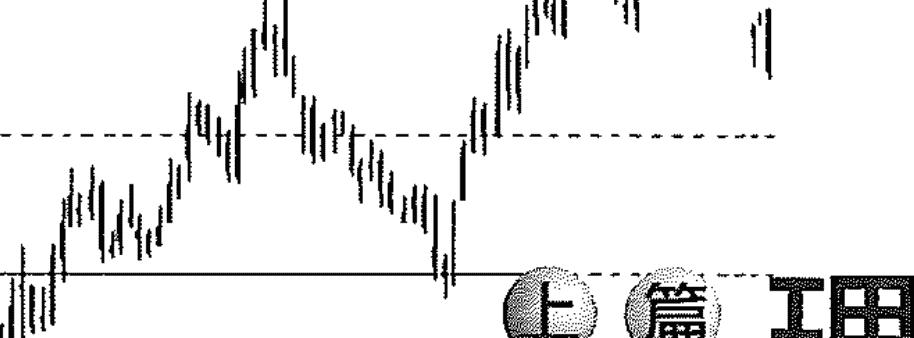

## 理論篇

##### 二、任意個股所伴隨的總風險包括系統性與非系統性風險

1896年的美國股市，當時組頭控制股價獲取暴利的行爲，正如上世紀90年代的新興亞洲股市一樣盛行。道氏能在當時這種市場氛圍中掃除迷霧，觀察出整體市場背景對個股股價表現的整體制約關係，可說目光如炬，見識和膽量過人。道氏所表現出的非凡智慧，絕非是普通的急功近利之輩可以比擬，這也是順勢而為思想的最好表現。這種超越常人的非凡觀點之所以能夠產生，如果沒有深厚的投資哲學思想的指導是無法想像的。

在道氏所處的時代之前，許多銀行家及商人都熟知，大多數上市公司的股票價格都傾向於同時漲跌；而那些與整體經濟趨勢相反的特例很少，一般說來，持續這種相反的走勢，不會到幾天或幾週的時間。每當一個漲勢出現後，某些股票總是比一些股票漲得快，漲幅也大一些。當這個趨勢開始轉向熊市時，一些股票迅速地下跌，而另一些則可能表現出一定的抗拒力量，以阻止這種下拉市場的作 用力，這個事實仍然保持著：大多數股票都傾向於同時波動，現在這樣，而且將 永遠如此。

上述事實已為人們所皆知，但經常被我們視為理所當然的事，以致於重要性 經常被忽視。實際上，從許多角度來看，這都是十分重要的。學習市場分析的投 資者，總是從學習道氏理論開始的一個最重要的原因，就是該理論強調整體市場 趨勢。

道氏提出一個目前成為現代金融理論之定律的命題，即任意個別的股票所伴 隨的總風險包括系統性風險與非系統性風險。其中，系統性風險是指那些會影響 全部股票的一般性經濟因素；而非系統性風險是指可能只會影響某一公司，對於 其他公司毫無影響或幾乎沒有影響的因素。

道氏的這個理論論斷，在現實的市場中表現為整體股票市場構成一個系統， 市場總是表現出系統性的上漲或下跌，這也算是一個總結的自然法則，這個論點 也是現代投資理論的關注點。市場中縱使有個別逆勢主力股的存在，也不能從整體上推翻該理論的真理性。多年來，國內外無數的統計數據充分證明了大盤背景制約個股表現這個理論，在中外股市的真理性。不過，指數並非是所有股價的簡單相加，而是有選擇地選取有代表性的，具有發展潛力、升值能力，具備投資價值的股票參與指數。

當投資者的資金實力足夠大或有機會運作大量資金時，相信對這個問題的理解，無論從戰略和戰術高度上，會有更加深刻的認識。市場前景健康、良好，前提是大量資金進出股市是最基本安全的保證。滿足於拋開大盤做個股，這種想法是違背道氏理論基本原則的。

不過，需要說明一點的是，儘管所有的股票都趨向於與以「指數」為標誌的「市場」一同波動，實際上，個別股票的價格也存在很大的不同，畢竟指數是一種把許多其他資料表示在一個資料中的工具，又有哪種方式可以將這些差異完全概括呢？

正如股價平均指數包容了所有已知的及可預見的、在整體上影響未來證券價格的因素一樣，個別股票的市場行為，以同樣的方式反映了所有影響其發展前景的種種因素。這些因素及其在線形圖上的表現，就是或多或少影響所有股票的整體市場環境，以及那些影響某一特定股票的特定情況。

##### 三、整體經濟是影響股票市場上最重要的力量

俗話說「覆巢之下無完卵」，當經濟環境惡化時，幾乎沒有一家企業的股票不下跌。此時最好的辦法是迅速撤出資金，將其投入銀行儲蓄、貨幣市場、債券等，待經濟情況即將好轉，股票市場整體價格回升時再買股票。所以股票投資者在投資股票之前，第一個要考慮的不是如何投入，更不應立即陷入具體行業、企業的股票分析，而應考慮目前的經濟環境如何，也就是市場是處於牛 市還是熊市。

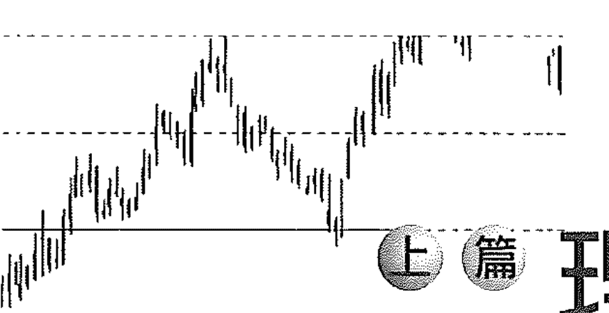

## 理論篇

當經濟前景灰暗時，投資界預見今後企業利潤和分配股利下降，就會減少或撤出在股票上的投資。不僅如此，近百年來運輸、通訊的改善，世界各國工業、貿易、金融各行業之間聯繫的更深、更廣，使得世界經濟不斷向全球化發展。因此世界各國的股票市場也趨向於整體修正。

經濟繁榮，股市一定好；同樣，股市好，經濟也一定好。在過去多年來，我們所看到的現象，就是經濟的盛衰完全能夠反映在股票市場上的漲跌。所以說，股票市場已經成為經濟盛衰的指南。當經濟繁榮時，我們無須找什麼證據去證明，只要看一看股票市場正在不斷上漲、不斷開創新高，我們就知道這時的經濟到了繁榮的時侯。當經濟走下坡，我們也無須找什麼分析資料，或是以很複雜的方法去分析經濟是不是走下坡，只要看看股票市場的指數，我們就知道經濟正在衰退，甚至出現蕭條。

一百多年來的美國股票市場也證明了上述說法。在經濟環境變動的巨浪打來時，個別股票就如漂浮的稻草一般身不由己。今後的經濟形勢分析不能侷限於投資者所在國。

##### 四、行業、市場對個股的影響比公司本身要大

現代多項精密的統計研究及數據已充分地支持道氏理論的上述觀點，如一項研究結果顯示，對上市公司股票價格影響最大的個別因素，按其重要性依次排列分別為：(1)行業；(2)市場；(3)公司本身；(4)整體工業。其中行業與市場兩項，合計對上市公司股票價格的影響力超過50%，而公司自身因素對股票價格的影響，其均值約為20%。如果上述(1)、(2)、(4)項相加，即公司外部環境因素對公司股票價格的影響，則大約占80%。

因此，個股與市場整體的關係，是一個由道氏首先正確指出，並由當代投資 理論家仍在繼續深入探討的重大問題，同時也是一個事關正確投資決策的實務問題。不能正確地理解這個問題，就不可能制定出正確的投資戰略，也不可能正確地制定投資風險控制體系。

##### 五、分析股票指數為投資個股提供了方法

分析股票指數，其實就是分析整個股票市場的大趨勢，要知道股市的整體走勢，一定要從分析其股市指數著手，這其實就是道氏理論首先提出的思想方法。

道氏理論作用最主要的一點就是指出，股票市場內會有很多種不同的因素，這些因素會在不同的時間內出現，如何度量這些因素的作用，就要把股票市場指數當作準則。道氏理論的應用就在於分析股市指數上。有了股市指數，就可以運用道氏理論的原則，將個別股票與整體市場進行相互驗證，這為準確預測個股提供了方法。

### 第三章：股票指數為經濟先行指標——市場行為包容並吸收一切

預知未來的經濟發展，其效益非常明顯，任何人都可因此獲利。企業家可以據此增加或減少存貨、擴張或降低生產、加速或拖延投資計畫，採用支出或儲蓄的政策。對於政治家來說，一旦發現經濟的未來發展不利於競選連任時，可以採取必要的措施刺激經濟。

一般市場參與者如果不能正確預期未來的經濟活動，財富將持續減少，也無所謂牛市、熊市。然而，道瓊指標體系的科學性目前已被一百多年來的實踐反覆證明，一般的股票交易者可以適當地預測未來的經濟活動，並使股票價格的走勢輪動領先經濟輪動的變動。兩者在時間上的落差，來自於股票市場具有流動性，經濟的調整則不具備這型流動性，因為資金與存貨的轉換性較為有限。而在道氏之前，人們一直沒有找到能準確衡量經濟整體狀況的客觀標準。

#### 第一節 股票指數讓你了解現在並預測未來

道氏謙虛地將道瓊指數說成是預測股票市場的指標，其實這是一個非常富有哲理的比喻。漢密爾頓把「晴雨表」當作他著作的題目也是經過深思熟慮的。晴雨表預測天氣的確確性有其自身的侷限性，比如颳北風時，氣溫必然下降，但下降多少就很難準確預測。氣象局只能為我們提供一個非常短期的觀點，卻無法預言我們後天的野餐是否會遇到一個好天氣，更不能告訴農民今年夏天的溫度和溼 度是否更適合於種馬鈴薯而非玉米。它能提供的只是歷史紀錄和可能性，農民必須獨立地進行判斷，我們也要對野餐時的天氣作出自己的估計。

與此類似，漢密爾頓也明白，任何預測市場波動的工具（包括道氏理論）都有自己的缺陷。因此道氏理論表達了這樣一個哲學思想——「市場是可以被預測的，但又是測不準的」，這樣一個辨證關係，正是道氏理論的精髓所在。同時說明道氏理論也是一個需要向前發展、不斷自我提升、不斷創新的理論。

漢密爾頓在《股市晴雨表》中非常清楚地說明隱藏在道氏理論背後的基本原則：「任何人所了解、希望、相信和預期的任何事，都可以在市場中得到表現。道瓊工業和運輸業平均指數的修正，是分辨市場未來走勢的關鍵。在資訊最完備的部門列入線形圖和分析之中的因素之外，股票市場還要考慮許多其他因素。股票交易中的交易規模和趨勢代表著華爾街對過去、現在和將來的全部理解。完全不必像某些統計專家那樣，在平均指數之外增加商品價格指數、銀行結算額、外匯波動、進出口總額等其他內容。華爾街早已把這一切考慮在內，恰如其分地把它們視為用於預測未來、過去的（或者剛剛過去的）經驗。」

沒有一種方法可以像道氏理論那樣經得起考驗。它們的弱點在於被表面的相關性所迷惑，而引入了一些無關的東西。一直有人試圖把銷售額加入，並在閱讀平均指數時，把它與商品指數聯繫起來，但這是完全不必要的，因為平均指數顯然已經把這些因素考慮在內，正如晴雨表會考慮到任何影響天氣變化的因素一樣。股指數的修正，代表了華爾街的整體知識，最重要的是，它代表著華爾街對未來事件的整體理解。

道瓊平均指數是商業的晴雨表。自1884年7月3日產生以來，道瓊平均指數已經由最初的69.93點上漲到今天的10000點以上。用市場價格的平均指數可以解釋和反映市場的大部分行為，這是道氏理論對證券市場的重大貢獻。目前，世界上所有的證券交易所都採用一個當地市場的價格指數，各種指數的計算方法大同小異，都是源自於道瓊指數。任何國家的任何股市都沒有歷史這麼悠久的平均 指數紀錄，我們可以從這個事實中看到它強大的生命力。

股市晴雨表的範疇在某種程度上超過了股票市場本身。近代作家G.K.賈斯特頓曾經說過，不真實的，甚至是虛偽的事實是無用的。在道氏提出自己的指數波動理論以前，一直沒有人能提出，並建立一套理論來解釋股票市場的事實真相。

道氏在《華爾街日報》的專欄中提出，關於股票價格波動是以股票平均指數為研究對象的著名理論——道氏理論的時候，他有意地創造了一種科學而實用的晴雨表。請注意溫度計與晴雨表的區別。溫度計能記錄某一時刻的實際溫度，正如股票紀錄器記錄實際的價格一樣，但是晴雨表的特有功能是預測。這才是它的價值所在，也是道氏理論的價值所在。

晴雨表是任何航海船隻不可缺少的工具，沒有哪個企業小到可以忽視股市晴雨表的地步，當然也沒有哪個企業大到這種地步。實際上，大企業在管理中所犯的最嚴重的錯誤，就是當無情的、公正的股票提醒他們注意前方的恶劣天候時，這些在商海中駕駛船隻的人毫不在意。

如果說華爾街是個總蓄水池，蒐集著全國每一條細小的資本流的話，那麼它也是個數據清算中心，處理著關於商業事實的每一條資訊。我們應該不厭其煩地強調，股市的波動是從這些積累的資訊中演變而來的，這些資訊的範圍包括建築和房地產、銀行結算、企業破產、貨幣狀況、國外貿易、黃金流動、商品價格、投資市場、農作物狀況、鐵路收益、政治因素和社會條件，所有這一切都與其他事物有數不清的關聯，每個因素都會對股市產生微小的影響。

在華爾街，沒有人能了解所有的事實，更不要說這些事實的含意。但是公正而無情的股市晴雨表，卻像水銀柱記錄大氣壓那樣把它們記錄下來。股市的修正從來不是偶然的，這一切必然是受某種定律所控制的，我們現在的目的正是要看看自己能否有效地把它歸納出來。喬治·凱布林在多年以前曾經說過：「我們所說的機會，或許就是某種定律的機理，這種定律如此渺小，以至於我們一生中只能一兩次觸摸到它的軌跡。」

#### 第二節 股票指數具備預測國民經濟的功能

##### 一、股市是產業狀況的晴雨表

非常值得慶幸的是，我們現在已經擁有一種相當簡單而精確的預測工具——股票市場的本身。道氏的貢獻在於使人們能夠用簡單的方式，從整體上來衡量國民經濟的情況。在道氏之前，隨著西方經濟的發展，各國已逐步擺脫了封建農業經濟的分散隔絕狀況，而開始呈現愈來愈強的整體化特徵和週期性特徵。這也要求人們愈來愈準確地把握國民經濟整體健康狀況，以指導投資和經營活動的成功進行。

當時，人們對國民經濟整體狀況的衡量指標主要是以「價格」為中心的指標體系，包括貨幣的價格、利率及銀行信用等。但是價格尺度本身不但具有延後的特徵，而且有經濟學家認為，國民經濟週期性的供需失衡，在很大的程度上，應歸於價格的誤導作用。

道氏相當完備地解決了上述問題。道氏不但準確地指出股票指數是國民經濟的領先指標這個觀點，而且透過創造道瓊指數體系為衡量股市波動提供了一套準確的客觀標準，同時透過創立道氏理論為準確解讀道瓊指數體系建立了一套系統的方法。

道氏在一百多年前驚人地正確指出：「股市的重大變化要領先於國民經濟的重大變化。股市是產業狀況的晴雨表。」這是非常先進的觀點。股票指數不但具備預測經濟的功能，而且還為技術分析體系的建立提供了重要依據。

道氏認為，唯一可以影響股票市場預測精確性的因素，是當權者的意外行為。這可能是戰爭，或是貨幣、財政政策的突然變化。然而，即使是在這種情況下，唯一可以影響市場預測能力的力量是政治權力的誤用。在這種情況下，股 票市場將因為緊縮而下跌，直至政府改變心意為止，這是因为政治決策的搖擺不定。如果政府持續緊縮，經濟將陷入衰退；如果它改變主意，經濟活動將趨於活躍。股票市場能夠同步反映政府的態度，或預期政府未來的政策變化。

道氏上述見解的科學性已被100年來的實踐反覆證明了，而且多項權威性的數理統計分析，也支持道氏提出的股市波動領先於經濟週期的觀點。研究證實，股價指數週期領先於國民經濟週期3〜6個月。目前在美國政府建立的國民經濟領先指標體系中，股票指數仍是其中12個指標中的核心指標之一（見附錄三）。

##### 二、道氏理論家的艱苦證明

###### （一）道氏理論的確認日

這是一個極其重要的概念，是根據道氏理論預測市場的重要依據。在「道瓊工業平均指數」與「道瓊運輸指數」中，第二個指數跟隨第一個指數之後，在熊市中向上突破先前中期走勢的高點，或是在牛市中向下突破先前中期走勢的低點，這一天稱為「確認日」。根據定義，這分別確認牛市或熊市的開始。

需要指出的是，在道氏理論中，唯有「工業指數」與「運輸指數」都未能繼續創新高或新低時，才稱為是「頭部」或「底部」。其中一項指數可能較另一指數先創新高，但這並不是頭部，唯有另一指數未能創高價而產生背離現象時才是頭部。所以，兩個指數都突破先前的重要中期低點（底部）或高點（頭部）時，才能確認。

###### （二）雷亞的結論

根據股票市場本身具備的預測功能預測經濟——最初是由道氏理論家羅伯特·雷亞（Robert Rhea）在1938年的著作《道氏理論商務和銀行業的應用》中提出的。他比較了1896年到1938年之間的市場變動（以「道瓊工業平均指數」與「道瓊鐵路指數」來衡量）與經濟活動（以《巴倫氏雜誌》提供的「實質 工業產量月份指數」「Barron’s Monthly Index of the Physical Volume of Industrial Production」來衡量的）。在42年期間，道氏確認日通常預先反映未來的經濟活動。

雷亞具體指出，在10個牛市中行情中，道氏理論顯示牛市的確認訊號時，「工業指數」隨後出現的漲勢為80.6%，「鐵路指數」為72.6%，「實質工業產值」為74.3%。相同的，道氏理論在熊市行情中，預測「工業指數」、「鐵路指數」與「實質工業產值」的跌勢分別為69.7%、65.9%和79.9%。

###### （三）維克多．斯波朗迪的結論

《專業投機原理》的作者維克多．斯波朗迪（Victor Speader）先生進一步對近一百多年的市場資料作深入研究。他的研究可以證明，股票市場可以預測未來的經濟活動。換言之，「今天」的股票市場表現，可以反映「明天」的一般經濟情況。作者在此非常感謝維克多．斯波朗迪先生為驗證道氏理論的正確性而作出的艱苦研究，並得出了極有價值的結論。他透過美國國家經濟研究局的資料和道瓊指數的相互驗證來證明道氏理論的正確性；這本身就是一種堅持道氏理論的自覺行為。

1985年，維克多．斯波朗迪利用「工業生產指數」（Industrial Production Index）更新了上述雷亞的研究。對於牛市來說，更新後的資料分別為「工業指數」70.1%、「運輸指數」69.3%、「工業生產指數」74.6%。對於熊市來說，對應的資料分別為57.9%、53.3%和61.76%。單由這些統計資料判斷，股票市場顯然可以預測經濟活動。以下是斯波朗迪的部分發現：

- 1.股票市場的頭部與底部，領先經濟復甦與衰退數個月之久（領先時間的中間值為5.3個月）。
- 2.以「道氏理論確認日」為準，判定的牛市與熊市，領先經濟復甦與衰退達數個星期之久（領先時間的中間值為1.1個月）。
- 3.嚴格以道氏理論來解釋牛市，並以「國家經濟研究局」公布的經濟復甦資料為準，來觀察牛市與經濟復甦的密切對應關係：經濟復甦期間長度的中間值為2年又3個月，牛市期間長度的中間值為2年又2個月。經濟衰退與熊市的情況也是如此：兩者期間的中間值都是1年又1個月。

在這些發現中，最有價值者是：幾乎所有的事實都說明，股票市場的訊號是提前出現的。在將近100年的市場資料顯示，股票市場是整體經濟趨勢的精確預測指標。股票指數的高低變化，可以預先反映整體經濟的起伏。如果我們觀察一般的市場行情，領先的時間將近6個月。如果我們較保守地採用道氏確認日為基準，領先的時間仍然在1個月以上。

如果我們觀察1897年以來的主要經濟輪動，以及道氏於一百多年前所創的道瓊指數，並比較經濟實際發生轉折的日期（以美國國家經濟研究局公布的資料為準），以及股票市場發生轉折的日期（以道氏確認日為準），我們發現，除了極少數例外，兩者日期幾乎完全吻合。可是其中有一項重大的差異，那就是美國國家經濟研究局的資料是在事實發生數個月之後才公布。

##### 三、 當今事實依然證明股市修正提前於經濟

儘管道氏理論已經建立一百多年了，應該指出的是，目前在與投資活動相關的人群中，例如政府機構、投資機構，以及投資個人當中，普遍持有的觀點是與道氏上述見解相反的。

舉例來說，當1997年夏秋之際，金融風暴剛開始在泰國、中國香港等地登陸時，各種媒體一片譁伐，把這歸咎於國際投機分子的蓄意破壞性行為所引發。但是，根據股市週期領先於經濟週期的基本見解，我們在當時就可以推知：第一，由股市週期預示，東南亞各國經濟將進入調整期；第二，調整期是經濟週期的一

## ■ 三大定律的建立

個階段，不可能迅速結束。事實上到1997年底，經過半年左右的冷靜思索及事態的進一步發展，人們已開始逐步認識到東南亞金融風暴不是由所謂國際投資客的個人行為所致，而是具有各國經濟內在的結構性原因，這場風暴所代表的是國民經濟的調整，而索羅斯不過是為東南亞金融和房地產出現泡沫助一臂之力。

在可以比較的案例中，在91.2%的情況下，股票市場會領先整體經濟，如果將一個月的領先時間視為是同時，則股票市場在97.1%的情況下會領先整體經濟。如果以道氏確認日當作基準，股票市場踏入熊市時，整體經濟有64.7%仍處於上漲階段，而有82.4%的情況會在兩個月內出現經濟活動的高峰。最重要的是，自從1949年以來，股票市場的波動（以道氏理論衡量），同時或領先經濟波動的精准程度為100%。

由於道氏理論反映了投資市場受益於風險的一般客觀規律，近年愈來愈多的人將該理論用於投資市場上。由成熟的金融市場上驗證的結果顯示，道氏理論對於價格走勢的預測是非常有效的。

##### 四、對股市的預測能力

分析結果顯示，股票市場訊號領先一般經濟的程度是由兩個不同的基準來衡量的：首先是股票市場的頭部與底部，以及道氏理論的確認日；其次是以明確的方式衡量股票市場的預測能力。

根據資料顯示，股票市場總是領先。根據歷史資料判斷，以道氏理論確認日作為買賣決策，這可以掌握若干程度的經濟活動。就1938年以前的資料來說，維克多·斯波朗迪與雷亞一樣採用《巴倫氏雜誌》的指數，往後則採用「工業生產指數」。根據資料顯示，在牛市確認日買進經濟指數，並根據熊市確認日賣空經濟指數，其理論性的結果為：在没有任何人為干擾的情況下，上述決策可以掌握經濟成長幅度的61.8%，以及經濟衰退幅度的40.5%。

## 【七】 上 理論篇

在判定股票市場確實是一種絕佳的經濟預測指標之後，維克多·斯波朗迪觀察其投資的潛能，分析結果非常令人驚訝：任何基金經理人只要根據道氏理論確認日為買、賣訊號，並以此建立一套電腦模型，幾乎可以保證獲得14%的長期年期報酬率。

金融市場是整體經濟體系中最鮮活的組成部分，所以股市是國民經濟的晴雨表也是理所當然。我們既可以透過基本面分析預測股市，也可以透過股市預測國民經濟，兩者之間的關係符合索羅斯反射理論的雙向互動的反射關係，它們是可以相互預測、相互驗證的。

#### 第三節 股票指數預先反映機制

##### 一、將資本分配至最有利的個股、商品，以及其他金融商品

有關市場指數所具備的預先反映或預測經濟的功能，並沒有什麼神祕之處。由於資本具有追逐利潤的根本特性，而經濟的變化對於特定金融市場之資產價格可能產生的影響，所以投資者（長期持有證券與其他交易工具的人們）會利用股票市場與其他投資場所，將資本分配至他們認為最有利的個別股票、商品，以及其他金融交易工具。

他們會根據過去績效、未來展望、個人偏好，以及未來的預期等因素來進行評估，然後配置他們的資產。結果，最能夠預測未來的消費者（是指廣義的消費者而言，包括資本、批發與零售市場的消費者）、需求經濟情況的投資者與企業將可以生存，並獲得最多的利潤。

##### 二、經濟的時間差來自於股票市場的高流動性

就像預報天氣的晴雨表一樣，股市可以成爲預報國民經濟狀況的晴雨表，這個觀點在中外股市中都得到大量統計事實的證明，其可信性毋庸置疑。而在道氏之前，人們一直無法找到一種能夠真正正確衡量國民經濟整體情況的客觀標準。當時，人們對國民經濟整體狀況的衡量，主要是以商品價格當作中心的經濟指標體系，包括利率來進行。

在股票市場的基本波與經濟景氣週期之間，存在明確的關聯原因是，公司獲利能力的趨勢是景氣週期的一部分。但是商品價格標準本身不但具有延後性，而且國民經濟週期性的供需失衡，在很大程度上也正因爲商品價格的誤導作用而產生，其作爲衡量尺度的弊端是不言而喻的。而股票價格的走勢輪動，則領先經濟輪動的變動。

一般的股票投資者可以適當地預測未來的經濟活動，並使股票價格的走勢輪動領先經濟輪動的變動。兩者在時間上的落差，主要來自於股票市場具有高效的流動性。而經濟的調整則不具備這種高效流動性，所以經濟輪動中的資金流與存貨轉換性，在時間上會有一段落差。在股票市場，資金流動非常方便，而當些微的經濟、社會變動作用到一般商品的價格上時，常有一段過渡期或適應期，但對股票價格的影響卻是瞬間完成。

經濟方向的變化需要時間醞釀。在經濟週期發展過程中，由於政情生變，或投機性質盤與追繳融資的實壓等股市內部的因素，可能影響股票市場，在客觀上，會造成5%或10%以上令人難以理解的漲勢或跌勢，但經濟的變化隨後才能表現。

由於一般經濟因素的變動都有不同程度的延後，這使得發動速度較快的股票市場價格，成爲整個經濟活動的領先指標。所以在一般是整體經濟活動的水平遲末下降的時候，股票價格就已經爆跌了。這在一定程度上可以解釋股票市場中一項看似矛盾的現象：股價经常在經濟情況非常強勁的時候由高峰開始下滑，而在經濟情況最低迷的時候提前止跌回穩，並形成底部。

股票市場的變化通常領先經濟景氣達6～9個月，不過，領先的時間可能更長或更短，沒有絕對的時間表。特別需要注意的是，甚至於還有相反的例子。

##### 三、投資者對經濟狀況之變化的預期

在各國的股市中，都聚集著人類最聰明的菁英分子。他們對事物變化的認識和領悟，往往超越芸芸眾生，因此股市的變化總是領先於國民經濟變化。

如果情況的發展比當初所預期的程度好或壞，透過市場機制，投資者將決定較遲或較早賣出股票。所以有一句大家熟悉的名言：「在利多消息中賣出」，這是指「利多」消息恰巧符合或低於市場（換言之，投資人）的預期。如果消息很好，但程度不如市場的預期，投資人會迅速重新評估，於是行情下跌（假定其他條件不變）；如果消息比市場的預期還要理想，行情將向有利的方向發展。當然，在下跌的市場中，情況相反。

任何市場對應的反應方式，具有重要的啟發意義。如果市場忽略一項原本應該屬於利多的消息，出現價格下跌的現象，則市場對於該事件顯然已經預先作出反映，價格機制已經預先把該項因素考慮在內，所以隨後的價格下跌應被視為熊市的徵兆；反之，如果市場對於利空消息的反映較預期的理想，應該被視為牛市的徵兆。「已知的空頭論證就是已經反映的空頭論證。」這句話蘊涵著無限智慧。

如果股票市場僅受到基本經濟因素的影響，判定基本修正的變化便相當的簡單。然而，基於一些原因，實際情況並非如此。在經濟週期中，即使經濟已經處於復甦階段，人們往往懷疑經濟復甦的持續能力。這種懷疑態度再配合上政治或其他不利因素，股票市場會出現大幅的逆轉走勢。

##### 四、投資者對基本因素的心理評估

投資者在採取行動之前會對基本因素預先作出評估，以便所預料的消息或事件確實發生時，可以在較高的價位賣出股票。股票、商品價格與債券的基本修正，都取決於投資大眾情緒上的長期趨勢，這些情緒都能夠反映未來經濟活動的水準與成長率，以及投資者對這些活動的態度。因此，心理因素對於價格的影響是非常重要的。由於投資者在投資之前會對市場預先作出評估，然後根據預期採取行動，因此股市可以反映大眾的預期心理。不過，隨著獲利的增加，投資者對於獲利的看法也可能發生變化。

##### 五、股市領先其他市場的原因

股市是參與人數最多的金融市場。在全世界的金融市場裡，有各式各樣的投資市場。除了產業的地產市場不算金融市場外，投資者通常參與投資的市場包括以下幾種，但是股市是參與人數最多的金融市場。

- **外匯市場**

當某些外幣的存款利息很高時，就會吸引不少人買入該種貨幣，期望獲取高額利息，這是一般買賣外匯的投資方法。不過，除了這種方法之外，外匯市場更有投機買賣，對某些投資者來說也更有吸引力。而且大戶的買賣都是以外匯合約當作買賣對象，即是炒作外匯。不過，儘管外匯市場參與的人也很多，但始終不及股票買賣。股票買賣的吸引力比外匯大多得多，參與的人數也多很多。

- **期貨市場**

相對外匯市場，期貨市場更是一個比較專業的投資市場。如果沒有期貨投資的專業知識，很難在期貨市場內生存。期貨買賣由於保證金制度使得投資者帳戶的股票大起大落，並非一般的投資者所能夠承受。因此只有較專業的投資者，才可能會參與期貨的買賣投資。

- **債券市場**

在美國，債券市場和股票市場鼎足而立，其重要性和股票市場一樣，都是金融體系中極其重要的融資工具和集資對象，但債券仍然不如股票活躍。

- **黃金市場**

以往，實體的黃金是一種很流行的投資工具，不過隨著投資工具的種類愈來愈多，黃金投資的重要性已經失色不少，況且黃金的保值作用已大不如前，黃金市場的光彩已今不如昔。

- **股票市場**

當今投資者數量最多的仍然是股票市場。雖然近百年來，股票市場曾經令一些人破產，甚至身敗名裂、傾家蕩產，不過，股票市場同樣也曾經令許多人發達致富，名成利就，飛黃騰達，實現了追求致富的夢想。股票市場的參與人數與日俱增，已經是參與人數最多的市場，不斷吸引更多的投資者進入。

總之，沒有一種方法可以像股票平均指數那樣經得起考驗。正如晴雨表會考慮到任何影響天氣變化的因素一樣，股票指數的修正，代表了經濟領域的整體知識，最重要的是，它代表著股票市場對未來事件的整體理解。

#### 第四節 「不完美」的晴雨表

##### 一、晴雨表並非絕對正確

某些人希望平均指數具有絕對的、像數學一樣的準確性，但這完全沒有必要，因為市場雖然是可以被預測的，但又是測不精確的。股市晴雨表並不完善，或許更精確的說法是，正在發展中的、閱讀它的方法還沒有達到完善的地步。從這個意義上來說，在任何合理的時間長度內，它具有的預測功能幾乎是正確的。在這裡只是真實地介紹股市晴雨表及其具有的巨大實用性，因此有必要解釋它並不複雜的機制。在談到晴雨表的價值時，我們可以認為，出現錯誤的原因不是對它過於信任而是對它信任得太少。

根據大氣壓力理論，即使是無波晴雨表也只能預測有限的、幾小時以後的情況。前面簡單的介紹已經顯示，它的確能夠提前數月預測到商業的狀況，其他任何指數或指數的綜合體都無法勝任這項工作。儘管氣象局很科學也很能幹，但它也只能告訴我們以前曾出現過災荒和難熬的冬天，其間隔是不確定和無法計算的。當它試圖作出特別預測時——從無數的一般性事件中選出一個特殊性事件——它只是在猜測。

股票價格的平均指數能向我們顯示目前和未來可能的價值，在分析它時必須先正確判斷出一次基本波是把平均價格抬高到均線以上還是壓低到均線以下。儘管自從道氏於1902年末去世以後，《華爾街日報》發表了眾多的分析文章，紛紛把股票市場當作基本商業狀況的指南。但是我們不能期望晴雨表無所不知。

眾所周知的晴雨表經常會作出錯誤的預測，即使不出錯，水手們也不會把它當做一個值得信賴的指示器。股市晴雨表也是這樣，對它進行分析需要一定的知識。X光片讓我們這個時代的醫生們獲益匪淺，成為維繫人類生命和幸福的利器。但是這些醫生會告訴你，X光片必須由專家們分析；對於那些並不習慣經常使用它的大眾來說，它可能是難懂或誤導性的工具。所以任何聰明的外行人只要對股市波動很感興趣（但不能有投機的態度），在經過長期嚴格的訓練之後才能夠勝任分析股市晴雨表的工作。從這個意義上來說，這也算是晴雨表的局限性吧！因為股票市場的交易基礎並非今天的一般事情，而是適用於數月之後的狀況專業性預測。

如果你和銀幣保持一臂之長的距離，才能發現它與周圍事物的正確關係；但如果你把它拿近些，它們之間的關係將會被扭曲和誇大；如果你把它拿得太近，就會發現除了它之外，什麼也看不到了。因此我們必須把股市晴雨表保持在可視的距離上，進而不會認爲它的重要性超過了它所預測的天氣。以便於我們有一個合理的理論可以執行，千萬不能像太多的統計學者那樣過分執著，科學家們（即使是最偉大的科學家）都傾向於對自己的假設執迷不悔，可是結果卻往往不盡如人意。

晴雨表不會裝模作樣地預測繁榮的持續時間，雖然在我們的仔細觀察下，它能比較清楚地顯示出繁榮與蕭條的特徵。晴雨表也從來不會對自己的預測感到後悔，它幾乎是唯一能在自己無話可說時，閉口不語的當代預言家。

自從《股市晴雨表》問世以來，它對個別股票的分析似乎是毫無價值的，除非這種股票只有在市場基本波是上漲時才會大幅上漲。投機者選擇的股票可能會跟隨市場前進，但永遠不會與之同步。儘管晴雨表一直受到某些權威人物的指責，但是這並未影響晴雨表為美國商業提供有益的服務。

當然，道氏理論也有它的局限性。由於道氏理論是以自然法則為基礎建立起來的，所以道氏理論只有在自然環境中所形成的市場經濟才適用，而人為的、對於自然經濟法則所引起的破壞行為，都不屬於道氏理論的研究領域，如戰爭和政府不負責的干預等。

#### 第五節 市場行為包容並吸收一切

晴雨表預測到壞天氣的時候，並不需要現在的天空是布滿烏雲。心懷幻想是沒有用的，我們所需要的是一種沒有思考能力的晴雨表——價格指數和平均指數，以使我們了解自己正走向何處，可能會遇到什麼情況。股票交易的平均價格在所有的晴雨表中是最公正、最無情的，因此也是最好的。

在雷霆所著的《道氏理論》一書中，在研究了道氏理論之後，對於晴雨表做出「第二大定律」：股票指數會反映每一條資訊、每一位對於金融事務有所了解的人，他們所有的希望、失望與知識，都會反映在「道瓊鐵路指數」與「道瓊工業平均指數」每天波動的收盤價中；基於這個緣故，股票指數永遠會適當地預期未來事件的影響（上帝的旨意除外）。如果發生火災或地震等自然災害，市場指數也會迅速加以評估。

這裡需要注意的是政府的行動，因為政府的立法程序、貨幣與財政政策，以及貿易政策，都會對經濟發展造成長遠的影響，所以會對股票價格產生立即而明顯的衝擊。此外，政府的決策者也是人類，所以市場參與者也不可能永遠正確地預測他們的行為。

在市場中，人們每天對於諸如財經政策、領導人講話、法人違規、創業板等層出不窮的題材不斷加以評估和判斷，並不斷地將自己的心理因素反映到市場的決策中。包括那些有遠見的，以及消息最靈通的人士，股票平均指數在其每日的波動過程中，包容消化了各種已知的可預見的事情，以及各種可能影響公司債券供給和需求關係的情況。甚至於那些天災人禍，一但發生就被迅速消化，並包容其可能的後果。因為他們反映了無數投資者的綜合市場行為，所以對大多數人來說，市場總是看起來難以把握和理解的。在現實中，危機正是由於太多的想像力而造成的。因為恐慌，實際上只不過是指數基本波中的一個插曲而已，所以我們還必須建立某種描述不規則的股票市場週期的理論，這個週期不一定包含恐慌，如果有也只是偶然的。

道氏本人也提及相同的基本看法：市場價格不會像氣球一樣在風中到處飄蕩。就整體價格而言，它代表一種嚴肅而經過周詳考慮的行為結果：眼光獨到而消息靈通的人士，會根據已知的事件或預期不久將發生的事件來調整價格。不過，就目前的情況來說，這項定律需要稍加修正。不僅適用於「道瓊工業平均指數」與「道瓊運輸指數」，任何主要的市場指數都適用這項定律，包括債券、外匯、商品與選擇權在內。

雷亞說：「市場指數永遠會適當地預期未來事件的影響。」但是這句陳述隱含著另一層面的意思：「適當地」反映各種分歧的看法。換言之，它包括人們認為目前事件對於未來經濟活動影響的各種不同意見。市場指數同時代表著樂觀主義者、悲觀主義者，以及「務實主義者」——包括一系列個人與法人的特殊看法，絕對不是任何一個人可以複製的見解。雷亞的陳述並不意味著市場參與者對於未來事件的解釋大致上必然正確，但該陳述確實代表市場指數必然反映市場參與者的主要看法。對於態度嚴肅的市場觀察者來說，市場指數將顯示基本波的方向與力道，指出市場何時風險過高，因此不適於積極參與。

正是由於道氏理論的一個基本原則是：「任何人所了解、希望、相信和預期的任何事都可以在市場中得到表現。」因此技術分析派人士理所當然地提出「市場行為包容並消化一切」。這是技術分析的第一大定律，是技術分析的基礎。

市場行為包容並消化一切：市場行為會反映每一條資訊、每一位對於市場有所了解的人，他們所有的希望、失望與知識都會反映在市場行為的波動中，包括他們的預測。基於這個緣故，市場行為永遠會適當地預期和影響未來事件。

市場行為包容並消化一切的主要思想是認為，影響價格的每一個因素（包括內在的和外在的）都反映在市場行為中，不必對影響價格的具體因素是什麼過多地關心。因此，技術分析者認為，能夠影響市場價格的任何因素——基礎的、政治的、心理的或任何其他方面的——實際上都反映在市場行為當中。

##### 一、 什麼是市場行為

市場行為就是市場中的買賣行為，它的特點是一種群體行為。它包含市場中的四大基本要素：價格、成交量、時間和什麼人參與。其中價格要素是最重要的。嚴格地說，道氏理論的價格主要是指指數的收盤價，並非個別股票的收盤價。因為只有指數的收盤價，才代表了市場主流參與者的真實意圖，而個別股票的最高、最低、開盤、收盤價均容易被操縱、作假，進而掩蓋了市場主流參與者的真實買賣做盤意圖，因此它們的分析研判地位較為次要。不過，在實戰分析時，流通性較好的個股，以及商品期貨等的收盤價也可視為「有效」收盤價。

這個前提的實質含義其實就是價格變化必定反映供需關係。如果需求大於供給，價格必然上漲；如果供給大於需求，價格必然下跌。這個供需規律是所有經濟的、基礎的預測方法的出發點。相反地，只要價格上漲，不論是什麼具體的原因，需求一定超過供給，從經濟基礎上說必定看好；如果價格下跌，從經濟基礎上說必定看空。追根究柢，技術分析者不過是透過價格間接地研究經濟基礎，大多數技術派人士也會同意，正是根本的供需關係，即某種商品的經濟基礎決定了該商品的市場看漲或者看跌。線形圖本身並不能導致市場的漲跌，只是簡明地顯示了市場上流行的樂觀或悲觀的心態。

不過，純粹的技術分析者通常不理会價格漲落的原因，而且在價格趨勢形成的早期或者市場正處在關鍵轉折點的時候，往往沒有確切了解市場為什麼這麼古怪地行為。剛好是在這種至關緊要時刻，技術分析者常常闖關跳徑，一語道破。所以隨著投資者市場經驗的日益豐富，遇上這種情況愈多，「市場行為包容消化一切」這一點就愈顯發出不可抗拒的魅力。

既然影響市場價格的所有因素最終必定要透過市場價格反映出來，那麼研究價格就足夠了。但實際上，技術分析師只不過是透過研究價格線形圖及大量的輔助技術指標，讓市場自己揭示它最可能的走勢，而並不是分析師憑他的精明「征服」了市場。所有技術工具只是市場分析的輔助手段。

成交量在目前的股市中，被放在非常重要的位置，其實這隱含著目前國內投資環境的狹小和理論認識上的誤誤。在美國等市場容量較大的市場，交易活動中有很大的分成交量產生，並不具備戰略性攻擊，或戰略性撤退買賣做盤意圖。其成交量的產生，只是有的法人為了調頭寸（如LME金屬市場每個月第三個星期三前的改變投資部位的行為），迴避其他投資品種的參與風險而已。由於市

# 理論篇

場中買賣角色理論和實際上的不確定，因此無法從根本上杜絕虛假買賣行為的產生。此外，國外的市場中存在大量的套利交易，而套利交易不能指明市場方向。因此交易中的許多成交量具有極大的虛假、欺騙成分，並不具備真實的買賣用意，所以其市場地位必然排列在價格之後。

時間主要表現在人們完成任何一種行為都必須要有一定的時間，同時，也由於每一種事物都有自己的盛衰修正輪動週期，該週期不斷制約事物的變化和發展。該週期必須在波動變化中才能產生不可低估的作用。這在股市中表現為市場的波動週期，而股市的波動週期這個基本要素，目前尚未得到廣大投資者的普遍認識，其巨大功效的發揮，有待有心成為專業投資者花功夫去研究。這也就是市場時間要素的價值。

什麼人參與這個要素，直接反映出目前的市場是否活躍，是否有發展潛力，是否存在著有目的、有計畫、有組織的投資者進行有紀律的參與。只要一個市場中存在有紀律的投資者參與，就意味著其中隱藏著較多、較大的獲利機會，這一點中外股市均無例外。相反地，無計畫、無組織的資金參與，市場的買賣就必然清淡，行情就會表現為典型的散戶行情，獲利的機會就微小。具體地說，有紀律的投資者持續大量買進，需求大於供給，市場中就存在極大的做多獲利機會和巨大的做空投資風險；有紀律的投資者持續大量賣出，供給大於需求，市場中就隱藏著較大的做空獲利機會和巨大的做多投資風險。

市場中某支股票如果一直都是散戶參與，就絕對沒有大的獲利機會，就是絕對的冷门股。該種情況的徹底改變，一直要等到某一天有投資者參與為止。

這裡需要注意的一個重要問題是，市場行為是一種群體行為，所謂的群體行為就是指投資者之間的活動帶有一定的、彼此相互模仿的特點，他們的行為都不可能由自己的主觀隨意活動，而必須模仿別人的行為，才不至於擾亂群體行為，比如我們所熟悉的羊群效應。在一大群羊當中，不可能每隻羊都可以看見領頭羊的行動，只有模仿其他羊的行動，才不至於擾亂整體羊群的秩序。我們所說的有紀律的投資者，也是指有紀律的投資群體。

隨著時間的推移，儘管市場規則和交易方法發生了變化，比如目前的個人投資者已經升級為法人或基金投資者，使得帳戶的真實規模增加了一些不確定性，但是也實現了前所未有的穩定性，因為在同一時刻，大量發出拋售指令的可能性更小。法人或基金都在使用電腦程式進行交易，這使得基本修正反而更加容易確定，即新的變化不會使分析股市晴雨表的功能發生任何變化。

##### 二、「市場行為包容並消化一切」的合理性

任何一個因素對市場的影響最終都必然表现在價格的變動上。外在的、內在的、基礎的、政策的和心理的因素，以及其他的影響價格的所有因素，都已經在市場的行為中得到了反映。身為技術分析人員只要關心這些因素對市場行為的影響效果，而不必關心具體導致這些變化的原因究竟是什麼。

股價的漲跌和量增量縮等規則、不規則市場行為，已經全部將能夠影響市場波動的各種內外因素進行了反映、包容和消化。同時，股市的電腦技術系統也對其進行了忠實和客觀的記錄和描述，所以我們從這個意義上也可以說線形圖包容了一切。

此外，應該注意的是，許多投資者認為，既然「市場行為包容一切」，進而使他們失去了解新資訊的興趣，因為即使了解新資訊可能也無法從中獲益。如果真是如此的話，市場投資者將失去所要了解的資訊，而資訊也就不可能進入市場，因此「市場行為包容一切」並不等於市場會告訴你一切。這條定律說明了市場行為包括一切資訊，但市場行為反映的資訊只表現在價格的變動之中，與原始資訊必然有差異，資訊損失是必然的。當市場行為和你的預測不同時，說明市場當中有一些很重要的事情你還不知道，你必須盡快去了解。所以說，晴雨表的确是投資者的燈塔，它會告訴你哪裡有暗礁，但暗礁是什麼樣子，還需要你自己潛入水中觀察。

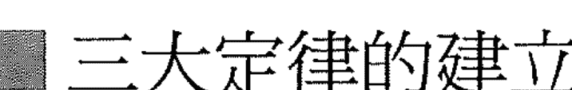

到水底去看，也就是深入研究基本面。

此外，市場行為和資訊，或者一切資訊之間，在邏輯上的關係也應該具有多元性：市場行為已經預先過度包容資訊；市場行為已經預先包容資訊；市場行為正在包容資訊；市場行為包容大部分資訊；市場行為包容一部分資訊；市場行為還沒有但是以後會包容資訊。

市場的波動反映出所有的真實資訊，日常交易則把麥粒從麥糠中篩揀出來。如果收成不好，市場將以低價反映其預計價值；如果收成的結果很好，在最勤奮、最先得到消息的人收拾好東西，並開始把結果計入線形圖的時候，價格的上漲早已經開始了。雖然我們都不是開普勒或牛頓，但是我們也可以總結出一些實用的規律，以幫助和保護那些每天都必須對未來進行預測的人。這正是股市晴雨表的作用。它從不自以爲是，晴雨表包含著很多人的因數和明顯的侷限性，但是它完全可以誠實地宣布自己具有一種預測的功能，迄今為止，還沒有任何一種商業資料能夠與之相提並論。

##### 三、「市場行為包容並消化一切」符合經濟學原理

馬克思指出，商品價值的源泉是生產勞動，生產是經濟成長的先決條件；產量不僅必須滿足生存的立即需求，而且必須還有剩餘的存量化來供給未來的生產。換句話說，在經濟得以成長以前，必須有生產剩餘來供儲蓄之用。當然，生產在一定程度 上也要和需求相配合，因爲現代的生產已經不只是为了自身的需求，更主要是為了社會的需求，要想達到這個目的，就必須得到社會的認同，實現交換價值，否則生產的價值就難以表現。

但根據凱恩斯學派的說法，生產的驅動力量是總需求——消費的欲望，是以可支配所得的金額來衡量的。凱恩斯認為，政府需要謹慎地提高每個人的貨幣所有，便可以刺激總需求。在這種情況下，企業界會提高生產，消費者會增加支出，而國家的財富（以GDP來衡量）便會累積。

其實，「總需求決定生產水準」的觀點是錯誤的。就個人而言，他不能透過增加需求或消費來累積財富。事實上，假定其他條件不變，一個人在荒島上如果增加需求，並增加消費量，則他所踏上的是一條自我毀滅的道路——減少未來的生產能力。這個道理也適用於「整體」，而不論其規模與複雜程度。

經濟成長是由一系列的環結構成，生產是最初一環——人類生存的基本條件。然而，僅依賴生產並無法導致成長，因為成長需要一定的生產過剩當作儲蓄，這就是創造價值。因此良好企業的價值就會升值，而生產出來的產品不會升值，而巴菲特所說的「買股票就是買企業」也就是這個道理。但是企業的價值表現也必須得到市場的認同。因此生產和需求的關係按照索羅斯的反射理論，是一對雙向互動、相互反射的關係，而不是誰決定誰的關係。

該理論揭示出的實質問題是，任何國家的國民經濟的生產與流通兩個部分，均表現出景氣的態勢時，其經濟狀況才是良好的，其股市也才是有活力的，而經濟狀況中的一切都會在股市中表現出來。所以道氏理論的一個基本觀點是：「任何人所了解、希望、相信和預期的任何事，都可以在市場中得到表現。」這也是雷亞的「第二大定律」，同時「市場包容並消化一切」也是技術分析三大定律的「第一大定律」。

## 三大定律的建立

### 第四章 ：基本波不能被人為操縱原理

——市場行為依趨勢演變

#### 第一節 道氏理論來自於道氏的實踐

基本波不能被人為操縱原理：由於市場的基本波是由自然法則所決定的，而自然法則就是客觀規律，因此由市場行為所構成的基本波必然是依照客觀的自然經濟規律發展的，按照一定的趨勢演變，進而使基本修正不能被人為操縱，人為操縱只能在日常交易和次級騙人波中發生有限的作用。

關於道氏理論的基本思想是如何形成的很少有人提及。通常人們認為，在1896年5月26日這個歷史性的日子，道氏創立了道氏理論，直到1902年道氏逝世，在這短短的5年時間，道氏就形成了自己理論體系的整體輪廓。在此，我們不得不對道氏當時在非常簡陋的歷史條件下，在如此短的時間裡，就能夠研究、總結出如此深刻的理論體系表示崇高的敬意，同時也對其天才般的非凡科學研究智慧和科學思考方式表示無比的敬佩服。

在1902年過世以前，他雖然僅有5年的資料可供研究，世人所記住的是他的文章，但他的觀點在範圍與精確性上都有相當的成就。他的文章中也表達出深邃的哲理。道氏理論同時也以結構的異常簡明凸顯其優美無比。也是因為道氏理論的簡明，多年來，並不為市場中絕大多數的投資人所深入認識及適當地運用。

但是，以上的敘述似乎並不能說明什麼。作者認為，道氏理論可以說是道氏從實踐中總結出來的。線索是漢密爾頓在《股市晴雨表》中提到：「道氏還曾是紐約股票交易所的成員，在股票交易所大廳裡工作過一段時間（1885年至1891年）。在羅伯特·古德鮑蒂為加入美國國籍而必須等待的時間裡，查里斯·亨利·道把持著股票交易所中的席位，並在大廳裡執行各種指令。」從這段描述可以看出，道氏當時應該掌管著巨額資金並進行股票投資操作。

事實上，在美國證券交易法尚未制定實施、證券交易委員會尚未成立之前，投機交易與人為炒作的確頗為盛行；但在現行嚴格的證券法規要求下，即使是在人為炒作頻繁如家常便飯的道氏時代，道氏本人也不認為人為炒作可以長期影響整個市場。道氏能在那個年代領悟出這個道理是十分難能可貴的。

#### 第二節 道氏理論均來自自然法則

道氏理論的基本思想是建立在自然法則基礎上的。由於自然界萬事萬物都是相輔相成、相生相剋、共存共亡的，大自然已經形成了成千上億年，萬事萬物均按照自然法則發生、發展、興旺、發達直至滅亡。在自然界裡，萬事萬物都是一物剋一物，沒有誰能夠占據絕對的統治地位，包括萬物之靈的人類也不可能戰勝自然，只能順應自然，遵守自然法則，否則必然會受到大自然的懲罰。因為大自然遠比人類的大腦複雜得多，人類在多大程度上違背自然法則，必然就會在多大程度上受到懲罰。即使是市場行為也必須符合自然法則，否則將同樣受到懲罰。

道氏理論認為，市場的基本波是不可被人為控制及操縱的，任何人為的控制和操縱都必將為此付出慘重的代價。在次級波和日常波動的層級上，市場或股價可能被人為控制或操縱。

這裡可用反證法來證明這一點。如果基本波可以被任意操縱，那麼市場中的操縱者將會永遠獲利，但是無數的事實顯示，幾乎操縱市場者最終都失敗了，因此，這說明市場的基本波是不能被操縱的。即使有極個別在主觀上的操縱者的操縱成功了，其實也是在很大程度上在客觀上順應了市場的基本波。相反地，如果市場果真能被任意操縱，我們所從事的市场分析也就完全失去了意義，因為市場價格完全由操縱者說了算，但這並不是說市場中没有操縱行爲，這個原理的意義在於，在市場的基本波不能被操縱的前提下，操縱者只能在日常波動中進行短期的操縱市場，最多也只能在次級修正中操縱一輪騙線，而操縱者很可能在騙線中也被騙。因此市場操縱者在市場中的作用是非常有限的。所以忽視市場操縱者的作用是不可取的，而盲目誇大市場操縱者的作用也是非常錯誤的。

基本波不可操縱這個原理的另外一個意思是，只要操縱市場就會受到市場的懲罰，道氏對這一點的強調顯得過於溫和。他認為只在主級正向波上股價的修正不可被人爲操縱和控制，還沒有徹底認識到，凡是規律均不可被違背和操縱，若硬是要違背和操縱就必須付出代價的這個不可更改的事實，甚至包含了在次級波和日常波動上違背規律進行人爲操縱和控制，也會為此付出代價，並遭到相同層級的市場報復和懲罰。

儘管在一定的條件下，組頭可以改變市場中的供需關係，操縱股價的波動，甚至是股價的基本波，但是組頭爲控制和操縱股價的波動和獲取暴利必須蒐集的大量籌碼，在出局離場時將遇到極大的麻煩。該種麻煩導致許多組頭在出局、向市場回吐籌碼的時候無法成功，自己卻遭到致命的殺傷而慘遭失敗。儘管組頭控制籌碼，製造需求可以讓股價不停地上漲，但是這種需求是組頭自己的特定需求，並不是市場真正的、普遍的需求。這種推動股價上漲的需求是虛假的，得不到市場的普遍認同。

在道氏提出基本思想之後，在投資觀念方面，漢密爾頓對於道氏理論的貢獻極大，特別是在許多問題中他都加入了自己的思想，其中包括對市場操縱行爲的討論。當然這也是在道氏的許多評論文章中總結出來的，只是由於道氏本人十分謙虛，從不願意將自己的思想過分張揚。

隨後，雷亞在深入研究道氏理論的精髓之後，提出了他的第一個「假設」——人為操縱：「指數每天的波動可能受到人為操縱，次級反轉也可能受到這方面有限的影響，但基本波絕對不會受到人為的操縱。」

在雷亞所著的《道氏理論》一書中，列舉了他從道氏理論中總結出「三大假設」和「五大定律」。事實上，它們應該分別被稱為原則與定義，因為道氏理論並不是類似如數學或物理學等嚴格的科學系統。根據雷亞的看法，道氏理論奠基於三項基本假設上，它們必須被「毫無保留地」接受。

這項假設的立論根據是，股票市場非常龐大而複雜，任何個人或法人都無法長期影響整體股票市場的價格，這是道氏理論的重要根據，因為整體股票市場的價格，如果可能經由個人意願改變，觀察和分析市場指數便沒有任何意義了。

道氏、漢密爾頓與雷亞都認為，當時的人都過於高估人為操縱（包括個人與集團的操縱）的嚴重程度。他們都認為，人為操縱的指控，主要是人們投機失敗時，用來推卸自身責任的一種藉口。如果有操縱行為，操縱實際上是出現在牛市的次級上漲中，而次級調整是由於投資者短期迴避風險所出現的。

此外，我們可以看出，道氏設計道瓊指數的用心良苦，他試圖用一套指數來客觀地描述市場，以便於投資者客觀地分析市場。同時，從前面的介紹我們也可以理解他專注於金融諮詢的苦心，也是試圖引導投資者從「內部人士」那裡獲得「內線消息」的錯誤觀念中轉移出來。「內部人士」的不敗神話已經完全被打破。多年以來，為道氏理論提供根基的道瓊股票指數逐漸顯示出更大的可靠性。

其實，今天的情況也是如此。就嚴格管制的現代市場來說，個人對於市場的操縱，基本上是一種不可能的行為，甚至於短期的操縱也不可能。從基本且長期的角度來說，基本修正更加無法被操縱，但趨勢的性質可能被改變，我們發現自從1987年10月美國股市崩盤以來便有這種現象。法人投資者的交易動輒數十億美元，這反而會加強基本修正的進行，使得基本修正更加堅固、更加符合自然法則。

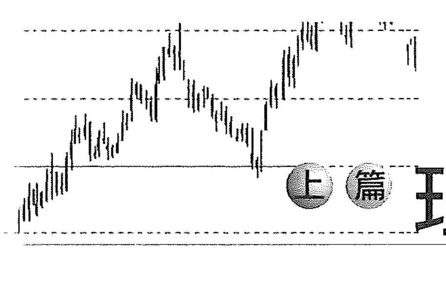

#### 第三節「人為操縱」是一個模糊的概念

##### 一、人為操縱市場的兩個特徵

- 第一，它是一種人為的反價值規律的行為。在自由、健全的商品市場中，商品的價格因供需關係的變化而圍繞著價值上下波動。那麼，證券市場中的證券是在特定市場中自由買賣的商品，自然也遵循著這個價值規律，而市場操縱者則是透過人為的干擾供需關係，使市場的供需力量無法發揮其自然調解的作用，使價值規律無法正常作用於證券市場，進而使忠實地遵循價值規律作出交易判斷並進行證券買賣的投資者蒙受損失。市場操縱者的這種反規律的行為又使得該部分損失的絕大部分變成其不當利益。

- 第二，它是透過影響市場價格來實現的。市場操縱者利用資金、資訊，甚至是職權等優勢，人為的改變證券市場的價格曲線，使證券價格背離其自身價值。這個被扭曲的價格曲線勢必導致投資者作出錯誤判斷，而操縱者則乘機大量低買高賣，進而謀取不當利益。

其實，對於「什麼是人為操縱」這個問題沒有明確定義。長期以來，對於因人人大戶的市場操縱行為而給市場造成的混亂局面，主要是依靠交易所或行業內的組織來處理。但是不透過運用相關法律，而只是透過行業內的應對措施解決問題的方式，使得市場操縱的認定基準也變得愈來愈模糊。

##### 二、人們對於「人為操縱」的想像過多

儘管操縱市場具有人為違反價值規律和影響市場價格的特徵，但是這都不足以說明問題。因此試圖以自身的買賣行為造成價格的變動，並因此而獲利，這並沒有什麼明顯的「狡猾」或「不公平」。大型的法人機構可以透過龐大金銀的買賣操縱市場的短期價格，它們的目標是透過相關市場的背離價格獲利；儘管它們自身的行為經常誘導或造成背離價格，但它們的成功，基本上是利用波浪觀察者的心理。

通常人們迷信地認為，華爾街存在著「強大的利益集團」，他們壟斷著資訊，並以此為自己牟取私利。特別是在道氏的年代，市場總是有類似這樣的觀點：「現在股票操縱者們誕生了，他們的技巧極其複雜，必須非常巧妙地操縱股票，使其看上去並未受到操縱。任何人都可以買賣股票，卻並非每個人都能在賣出股票的同時使別人相信他正在買進，進而使股價不可避免地繼續上漲。這要求操縱者具有無比的魄力和判斷力，理解股票市場的技術條件，非凡的獨創性和敏銳的思考能力，絕對了解人性，仔細研究賭博這個奇怪的心理現象，長期與華爾街散戶相處，並熟悉美國人民奇妙的想像力。此外還必須徹底了解所需僱用的形形色色的經紀人，他們的能力、缺點、個人品質，以及他們的價碼。」

道氏指出：「有些經驗豐富的交易者使用一種分析的方法，其理論依據是，市場總是或多或少的處於被操縱狀態。希望推動股市上揚的大戶不會購買所有的股票，而只是透過正當途徑或者以操縱手段買進兩、三種龍頭股，然後靜觀其他股票受到的影響。如果市場情緒高漲，人們都把股票握在手裡，那麼看到這兩、三種股票上揚的人就會立即開始購買其他股票，進而把市場提升到一個更高的階段。這就是散戶的反應，它預示著龍頭股票將會繼續上漲，整個市場將緊隨其後。」

然而，如果龍頭股的上漲並未引起其他股票的跟漲，這就顯示散戶不願意買進。一旦這種情況澄清之後，推動價格上揚的努力通常也將停止。這種方法特別適合於那些密切注意股市變化的人，但是我們也可以在一天結束後閱讀交易紀錄，以便發現哪種股票在特定的時點上被人選中，以及整個市場是否隨之上揚。

但是股票市場不是這些人所能代表的，而且華爾街的利益集團很少聯合起來行動，每個利益集團（甚至包括他們暫時結成的聯盟）在預測股票市場時都會經常犯錯。遺憾的是，這些觀點至今仍然非常流行，它沒有強調對價值和商業條件的

##### 三、為了掩蓋市場的摩擦現況

深了了解，而這正是確保市場得以存在的必要條件。在各種媒體上，股市分析或者市場分析師總是強調主力如何、基金如何，認為他們能夠控制市場，只要把主力或者基金的動向搞清楚，就一定能夠把握市場的走向。

事實證明，專心研究基金動向的人，最終會被基金所淘汰，因為他們永遠落後於基金，而基金也不可能長期任意操縱市場，他們也必須研究基本面，與其研究主力基金，還不如踏實地認真研究市場基本面，這樣才能少走冤枉路。因此，在市場分析中，以分析基金或主力的動向為主的思想是錯誤的。

就短期而言，市場行為符合「零和遊戲」的規則，即一方的虧損，必然是另一方的獲利。但是市場是處於動態中的，理論上，只要時間足夠，對手之間的盈虧最終會保持平衡。但是市場中有摩擦，也就是有交易成本，交易時間愈長，交易量愈大，交易成本愈高，從長期的角度來看，導致投資者最終虧損的原因是由於市場中有摩擦，而並非「零和遊戲」本身。但這個問題似乎被某些人「善意地」忽略了，轉而指責市場中的虧損現象是由於有人在操縱市場，似乎有轉移投資者注意力的嫌疑。

#### 第四節 市場的力量大於法人的力量

##### 一、是誰構成了市場

現在我們似乎可以回答一個本質性的問題了——是誰構成了市場？是市場操縱者嗎？是發行新流通證券的大銀行機構嗎？是那些向記者講述自己的利潤、向國會委員會講述自己如何賺錢，卻從來不講自己損失的廣大個人「經營者」嗎？當然不是。市場從產生那一天起，時時刻刻都是由投資大眾構成的。

## 三大定律的建立

當投資大眾一致認為應該在價格、利潤和交易量即將下跌之後收回自己的成果的時候，任何金融財團都不可能透過宣傳等手段操縱出一個牛市來。精明的操縱者最多只能在散戶心理允許的情況下，刺激某一種或少數本已上漲的特定股票的市場交易活動。

還有無數次操縱發行活動的努力，因為市場基本波使其變得既無利可圖又很危險而被迫放棄，而我們對此卻一無所知。大型私人金融法人通常是證券的賣出者，因為它們的工作就是創造證券，以供新企業發展需要，並把散戶資本的巨大蓄水池裡的「水」引入到這個管道中來。

##### 二、巴菲特能操縱市場嗎？

散戶往往會懷疑，像巴菲特這樣的大戶真的會為了一己私利而干預市場，占盡道氏所說的「小內線人士」的便宜嗎？巴菲特是讓他的可流通權益透過所持有公司的運作結果，而不是每天，甚至是每年的報價來告訴他投資是否成功。市場可能會在一段時間內忽視公司的成功，但最終一定會加以肯定。此外，只要公司的內在價值以令人滿意的速率增長，那麼公司被認知成功的速度就不會那麼重要。實際上，延後的認知有可能是一種有利因素：它可以讓我們以低價買到更多好股票的機會。

當然，有時市場可能會比實際情況高估公司的價值。在這種情況下，巴菲特會賣出手中的持股。有時巴菲特也會賣出一些估價得當，或者甚至被低估的證券，因為他需要資金用於被更加低估價值的投資，或者用於他更了解的公司。

不過，巴菲特不會因為股價上漲，或因為他已經持有很長時間而賣出股票，只要公司未來的產權資本收益令人滿意，管理人員稱職而又誠實（與別人不同，他對於所投資公司的高階人員的人品十分重視），而且市場沒有高估公司的價值，他就會無限期地持有這種證券。可見巴菲特在主觀上並沒有操縱市場的意願，在客觀上他也不能操蹤市場。

此外，在巴菲特看來，晦澀難懂的公式、電腦程式或者股票市場的價格行為等顯現出的信號不會導致成功。相反地，一個成功的投資者必須具備良好的判斷能力，同時必須把基於這種判斷的市場行為，與盤旋在市場中的極易傳染的情緒隔絕開來。

##### 三、索羅斯也不能操縱市場

從根本上來說，市場行為屬於群體行為，市場行為應該具備群體行為的特點。群體行為的特點是相互模仿，而操縱者在能夠絕對決定市場價格的情況下，是不可能模仿別人的，市場中的其他投資者也難以模仿操縱者的行為。如果市場價格能被操縱者決定（比如政府），那麼這已經不屬於市場行為了。

就操縱行為來說，最有發言權的應該算是索羅斯了，但是他也說市場是不可以被操縱的，他也不是市場操縱者，儘管人們都知道他成功地擊敗了英鎊，並發動了東南亞金融風暴。但依照索羅斯的反射理論，市場中根本就不存在操縱市場的行為，所有的操縱行為都是由於管理者所制定的市場規則與市場的發展互不適應所造成的。也正是由於市場是不可以被操縱的，所以在2000年初，納斯達克的下挫及歐元的再度走軟，也讓據說可以操縱市場的索羅斯的投資回報化為烏有，並於當年4月28日，索羅斯終於做出一個十分無奈的決定：將量子基金重組，並更名為「量子捐贈基金」，該基金今後不再進行高風險性投資，以確保慈善活動的進行。

《明星週刊》記者問：「索羅斯先生，您的名字已成為商標，您認為它代表什麼？」喬治·索羅斯答：「我是一個複雜的人物。在世界的一些地區，我以迫使英格蘭銀行屈服和使馬來西亞的人破產而出名，即以投機者和魔鬼而出名，但在世界其他地區，我被視為『開放社會』的捍衛者。」

問：您身為公民，曾對索羅斯這個投機者的做法表示遺憾嗎？

答：不。我是在金融市場上從事經營活動。我不為了獲利而進行骯髒的交易。由於我始終遵循市場規則，我不認為在我的經營活動中有一些不道德的東西。

問：但金融投機活動，尤其可能對弱小新興工業國家的國民經濟造成損害。

答：那是肯定的。但我不認為，我可以透過我個人的投資政策來改變這一點。

問：如果您以身作則，情況會怎麼樣？

答：這可能無濟於事。我不做這種交易，其他人也不會做。單我一個人不能治癒金融世界的疾病，我們應該擺脫這種錯誤的看法，也就是我們可以信賴市場參與者的紀律。

問：金融和股票市場隨時都有可能再度崩盤嗎？例如發生新的亞洲危機？

答：是的，必須對市場進行監控。令人生氣的是，某些監管人員對市場上將發生的事情的監控，可能比市場本身的調控還糟。因此，中央監控是錯誤的。由了解市場情況、並且能夠在中央銀行和市場之間充當調解者的機構來監控比較好。

從量子基金的解體我們認為，即使擁有雄厚的資金實力，索羅斯在客觀上並不可能操縱市場，同時他從主觀上也不認為自己能夠操縱市場，反而認為市場的監管機構的某些行為，才是操縱市場的行為。

##### 四、法人也無法操縱基本修正

當然我們不能排除在市場中的確有許多詐欺行為，但是這些行為對於市場到底會有多大作用呢？或者說市場到底能不能被操縱呢？面對當今股票市場上的主力操縱市場說和期貨市場的基金造市說，道氏理論又是如何給出正確答案的呢？

道氏在 1901 年撰文指出：「市場操盤手在某個時侯的確可以呼風喚雨，也可以操控股票價格的漲跌；他可以誤導投資人，讓投資人在他想出貨的時候進場，想買進的時候賣出。但是操盤手不可能永遠得逞，操縱者本人最後總是會學到教訓，認清事實的真相，然後他自己衡量股票真正的價值，獨立作出『賣出』或『繼續持有』的決定。」

漢密爾頓在《股市晴雨表》中指出：「回想起自己當時所承擔的責任，我必須感謝道氏理論，是它的正確性使我在惡毒的攻擊之下走過來。造市者總認為華爾街是不可饒恕的，因為當他犯錯誤時，華爾街總是正確的。最輕的指責認為華爾街『在羅馬處於大火之中時，卻對此不聞不問』，而普遍的觀點都認為，當時存在著賭徒式的罪惡操縱行為。然而，在熊市時期，以及從熊市向下一次牛市轉化的時期，這種指責總是會出現的，其實，操縱行為實際上是可以忽略的因素。」

這裡需要指出的是，道氏理論是建立在高度市場化的條件下。所謂市場化的特點就是市場中的投資行為是一種群體行為，但是在個別的「市場」中，由於「市場」太小或其他原因，使得投資行為高度集中在一個或幾個大戶手中，這樣的「市場」實際是失去了市場化的特點，身為一般的散戶，在這樣的「市場」中，風險將是巨大的。所以根據道氏理論，投資者應該遠離所謂的組頭股或遠離市場化程度太低的「市場」。

#### 第五節 基本波會被隨後的基本商業狀況所證實

我們將在道氏理論的幫助下，考察基本波是上漲還是下跌，期間從不足 1 年到 3 年以上不等；考察它們的次級波是下跌還是反彈；還要考察重要性較小卻無時不在的日常波動。我們將會發現，所有這些波動都是以華爾街對全國商業的整體理解為基礎；而操縱股市的行為並不能使晴雨表產生實質性的偏差。

##### 一、任何人進行成功的投機能力都是有限的

道氏指出：「一種極其錯誤的觀點認為，操縱行為能使那些權威性的、指導性的股市波動出現偏差，由此對股市晴雨表的實用性提出質疑。無論在基本波的最後階段過分投機，或過分拋售的傾向多麼嚴重，所有的牛市和熊市都會在其形成的過程中，到結束以前，被基本的商業事實證明是合理的。」

漢密爾頓在《股市晴雨表》中指出：「研究股市晴雨表以觀察基本波的商人、銀行家和製造者們能夠完全排斥此觀念，即操縱行為能夠改變基本波。因為每一次基本的市場波動都會被隨後的基本商業狀況所證實，它既不需要也不會受到操縱。雖然市場經常與商業狀況背道而馳，但這只是因為它的實用性可以由此達到最大化，進而實現真正的預測功能。它告訴我們的不是今天的商業如何，而是未來的商業將會怎樣。已為人知的新聞是没用的新聞，廣為人知的資訊已不能成為市場的因素，除非是在恐慌的情況下，因為此時的股市已經被突如其來的事件搞昏頭。投機者並沒有創造任何虛假的市場或市場活動的假像以吸引散戶參加賭博。所有的市場波動都有其合理的基礎。除非他可以預見未來，任何人進行成功的投機能力都是有限的。」

##### 二、在金融上的不可能性

漢密爾頓在《股市晴雨表》中做出如下說明：

「當詹姆茲·基恩決定為那些能夠建立聯合鋼鐵公司，卻無法使其股票流通的人推銷22萬股股票時，人們估計他必須在此過程中至少賣出70萬股這種股票。他把價格抬高到票面價格以上，為他的僱主實現了90～96點的淨利。這是一次比較小的股票集資活動，但是讓我們假設這次確保基恩成功的牛市是由某個辛迪加

（法語Syndicat，「組合的意思，屬於低級壟斷形式，它是透過少數處於同一部門的大企業間相互簽訂協議而產生的。」）製造出來的，它比股市中曾經出現的任何辛迪加都要大，而且擁有所有大銀行機構的支持。我們再進一步假設，這個超級辛迪加有能力忽視被我們的鐵路和工業平均指數選中的40種股票以外大量活躍的股票，並能夠拒絕任何合理的散戶觀點。我們還假設，它為使價格上揚而囤積了不是22萬股而是百倍於此的股票。

「任何在小學學過2加2等於4的人都會發現，我們讓自己遇到了一個金融上的不可能性。這個辛迪加肯定不會滿足於低於40點的淨利，在它能夠為自己建立起一個廣闊的交易市場（就像基恩爲聯合銅業公司所做的那樣）以前，它自己的實際交易量就將達到類似於1.2億股這樣的規模，即使按票面價格計算，這些股票也意味著幾十億美元的融資活動——如此巨額的資金，實際上將迫使有關的大銀行放棄其他一切業務，集中精力爲辛迪加的運轉服務。就美國現存的銀行系統而言，這種辛迪加在任何時候都無法完成這個工作或其中的一小部分。難道有人認爲聯邦儲備局的幫助會使這種蘊藏着恐慌的活動成爲可能嗎？」

就在作者寫這本書的時候，在電視裡看見一個老教授在做股市分析。他有一個有趣的理論，他認爲市場主力在熊市中最不會賠錢，因爲市場的下跌是由於主力「平帳指令」進行「對倒」，這樣原來20元的100股股票跌到10元後就變爲200股股票了，因此主力手中股票的總價值是不變的。乍聽起來有點道理，但實際上做過股票的人都知道，分佈在各個價位上的股票通常都不會有很大的量，而主力手中的股票數量是非常龐大的，根本就不可能將手中所有的股票「對倒」下來。就算主力能夠「對倒」將價位壓低，由於還有大量的高價股票因不能對倒下來而被套牢後產生浮動虧損，因此，主力透過「對倒」打壓股價有什麼實際意義呢？

換一個角度看，假設理論上股票價格的確可以被主力用「對倒」的方式（買方和賣方都是自己）來控制股價，在向上「對倒」股價的時候，低價股開始產生浮動獲利，但是這樣做的結果是，帳面上的浮動獲利不能兌現，因爲沒有賣方成為對手，賣出後（實際上還是「對倒」）股價還會回到原來的價格（原來20元的100股股票跌到10元後，就變為200股股票了）。但如果市場真的有對手可以使他的浮動獲利兌現，那麼就說明市場的力量還是要比主力的力量大，所以假設不成立。因此主力如果能在市場上賺錢，並不是由於主力能夠控制市場，而是他們發現了市場中具有投資價值的東西，所以任何人都不可能長期操縱市場。

即使在道氏那個年代，「虛賣行為」在很大程度上也只是散戶想像中的虛構現象，任何願意根據事實進行判斷的經紀人公司都不會接受「平帳指令」。股票交易所反對虛假交易的規則，今天在口頭上和行動中都得到了規範。

一個過度購買的市場所創造的虛假價格，絕對不會永遠漂下去，因為散戶保護自己的一個重要手段就是，持有所有權高度分散的股票。當某種股票幾乎完全被華爾街的一個集團所持有時，這個集團就可以隨心所欲地定義市場價格。但這已經不是「市場」價格了，因為在這種情況下，並不存在一個真正的市場。這是一個非常有益的論斷，我們在分析操縱行為的有限重要性時，也得出一樣的結論。那種認為單一的利益集團，在週末的兩小時交易時間內，就能操縱160萬股交易的觀點是極為荒謬的。對投資者來說，應該購買所有權分散的股票，而不應該購買所謂的「組頭股」。

事實上在熊市中不可能得到利潤，至少在股票上是這樣，除非以其他人的損失為代價，而在牛市中，則至少可以因為其他人自動放棄利潤而獲利。但是喜歡賣空的投資者對任何市場的幫助都遠甚於對它造成的傷害。如果真的不存在這種行為，市場將變得非常危險，在其發展的任何階段都可能出現意外的恐慌。因此賣空是必要的，也是散戶最好的防禦手段。

#### 第六節 可能存在操縱行為的地方

##### 一、操縱行為多出現在牛市

道氏正確地指出：「華爾街可以得到的任何微小資訊，都會像最明瞭的資訊一樣，在價格波動中提前反映出來（市場行為包容一切）。市場不會告訴你今天的商業條件如何，它說的是幾個月以後的事。即使操縱行為所包括的股票並非一種而是幾種，市場仍然會做出同樣的回答，操縱行為對此無能為力。操縱者只能預測他預期和希望的價值（有時是錯誤的）。在熊市中不可能實現旨在推動市場上揚的操縱行為。任何成功的精心策劃的操縱行為——它們的數量很少——都出現在牛市，牛市使操縱行為成為可能，之所以如此，是因為市場比操縱者看得更遠。無論華爾街還是其他各大市場的經驗顯示，操縱行為在下跌的市場中幾乎是不存在的。熊市總是以未來不利的事件為保證，因為市場具有可怕的預測未來的可能性。」

漢密爾頓指出：「正如平均指數所反映的，從實際效果來看，操縱行為對股市的基本修正不會產生，也不可能產生真正的影響。在牛市或熊市中，推動股市前進的力量是操縱行為無法左右的；但是在道氏理論的其他波動中（熊市中次的次級反彈和牛市中的次級下跌，或者無時不在的第三種運動——日常波動），操縱行為是可能存在的。不過，即使是在這種情況下，它也只能針對個別或少數公認的龍頭股。這可能會很輕易地達到某種驚人的暫時性效果。它可以排擠掉一些軟弱的股東，或者改變不景氣現象。這種專業性的『倒買行爲』經常可以在次級修正中顯示出來——當然也需要很好進行分析。」

##### 二、利用每股收益的增長

集團企業熟的關鍵，起因於投資者中盛傳的各種誤解。因為類似每股收益這樣的「基本因素」很容易量化。通常投資商把他們對股票的估值建立在每股收益報告的基礎上。投資商只知道每股收益的評估增長，卻未能看穿實現增長的方式。很多公司掌握了透過收購取得收益增長的方法。一旦市場開始對他們的表現作出正面反應，事情就簡單多了，因為它們可以在收購其他公司時，提供自己已經高估的股票當作支付工具。

這一套把戲的原理是這樣的：首先假設所有公司取得同樣的內部收益增長，但收購公司的股票以兩倍於被收購公司本益比的價格出售，如果收購公司得以實現規模加倍，其每股收益將上漲50%，企業成長率亦相對提高。

經理們發明了專門的會計處理技術，加強收購的衝擊力，他們還把一些新的處理方法引入被收購的公司：合理化操作、資產重質，以及普遍在淨收益上所做的手腳。可是比起收購行為對每股收益的影響來說，這些手法可謂小巫見大巫。

起初，每一個公司的紀錄都是基於其本身的價值。可是集團企業逐漸被承認為一個特殊板塊，於是出現了一批新型的投資商，即所謂的「短線獲利基金經理」或「快槍手」，他們與集團企業的經理人員建立起特殊的親密關係，雙方展開熱練聯繫，集團企業將所謂的「庫藏股」直接存放於投資商那裡，最後集團企業幾乎可以隨心所欲地控制股票價格和收益。

隨著本益比的爆漲，現實的市場終於無力承受預期的重負，儘管遊戲還在進行，但已經有愈來愈多的人意識到，支撐著市場繁榮信心的仍是一個錯誤的理論，收購的規模愈來愈大，非此則不足以保持增長的態勢，直到最後規模達到了極限點。

股票價格開始下跌，下降的趨勢進入自我強化的程式。收購對每股收益的有利影響消失了，新的收購成了不明智的舉動，在迅猛的外部增長期間，被掃到地毯底下的內部問題暴露出來了。財報揭示了令人驚訝的意外，投資商如夢初醒，公司經理們自危，令人興奮的成功已經過去，日常管理的瑣碎事務無人願意打理，這種困境又加劇了經濟衰退。許多趾高氣昂的集團企業陷於瓦解，投資商做了最壞的打算，也確實發生了幾宗這樣的案例。對於其餘的公司來說，實際表現經證明要優於市場的預期。最後，股票市場的形勢逐漸穩定，生存下來的公司多數進行了管理階層的大換血，然後艱難地從廢墟底下掙扎出來。任何形式的操縱都會得到相對的報復。

投資者所犯的「錯誤」不是對未來的理性認識，而是一個片面的認識，但是這種片面的認識總是在正反兩方面同時產生作用。不過，索羅斯認為：「不只是市場參與者在操縱市場交易時帶有片面性，同時，他們的片面性反過來會影響交易過程的未來發展，他們互為作用與反作用。」

##### 三、電腦程式交易

20世紀80年代中期以來，電腦交易已經完全改變了盤中價格走勢的性質，並為市場帶來前所未有的不確定性。目前，在任何時刻，一位程式交易經理人的判斷便可以發動買進或賣出的電腦程式，並在純粹技術的基礎上（換言之，相關股票的盈餘展望沒有任何的基本變化），造成5至30點以上的短線走勢。在電腦交易程式發明以前，絕對不會見到長達1.5小時的跌勢，中間沒有夾雜任何反彈。過去很少看見目前經常出現的v型（或顛倒的v型）反轉。由於機構法人的交易量非常龐大，一般大眾因為恐懼而退出市場，目前從事S&P的當日沖銷交易總讓人感覺好像有人拿槍指著你。任何時候程式交易經理人都可以扣動板機，於是市場在毫無預警的情況下，突然出現不利於投資大眾的走勢，而投資大眾根本沒有迅速認賠的機會，尤其在交易量很大時。

市場一且出現電腦程式交易的短線波動，如果投資大眾站在錯誤的一方，可能會造成致命的結果。當然，如果投資大眾站在正確的一方，獲利也相當可觀。問題是：這類走勢由一個人發動，除了少數人之外，沒有人知道整個交易計畫，所以目前短線交易非常困難，而且經常演變為擲骰子的賭博。然而，分析S&P 500期貨與S&P 500指數的走勢圖，精明的投資者或投資者可以辨識電腦程式交易的模式，並以此設定最理想的買、賣價格。以此方式掌握進、出市場的時機，這對於投資組合的績效有相當大的幫助。不過，在電腦程式交易的威脅下，以「市價」大筆買、賣股票或期貨，是相當愚蠢的行為。

就中期與長期的角度來說，電腦程式交易基本上無法操縱價格，但可以改變價格趨勢的性質，加速次級波的發展。就牛市而言，它們可以引發大量的投機性買盤。就熊市而言，可以對主要跌勢造成可怕的影響，就如同1987年10月美國股市崩盤的情況。

股票市場的跌勢形成氣候時，電腦程式交易會誇大整個情況的嚴重性，並造成史無前例的急跌走勢，這種誇大的跌勢，通常稱為「集體倒貨」，所以在牛市的頭部附近充滿不確定性與風險。這種情況的本質原因是，程式交易提高了投資者的執行力，一旦程式交易被執行，交易指令將以連續市價的方式執行，這必然會導致價格的大幅波動。

##### 四、專業投資者有限的影响力

不可否認，專家還是有一定優勢的。橋牌專家們認為，在玩橋牌時，一副好牌代表著80%的優勢，如果玩家的對手不強、運氣高於常人，並且擁有一個好搭檔，那麼即使毫無興趣或精神不正常的人也能贏，甚至還能在較長時間裡一直贏下去。然而剩下的20%優勢則決定一名選手是生手還是專家。如果玩牌的時間夠長，剔除運氣的成分，那麼優秀的選手肯定獲勝，而且還能在絕對公平的條件下獲勝。

透過專家專業性的分析，如果股利行動並意味著商業狀況的基本變化，這種日常變化將立即得到修正。對於非專業的散戶來說，如果存在股利行動引起的

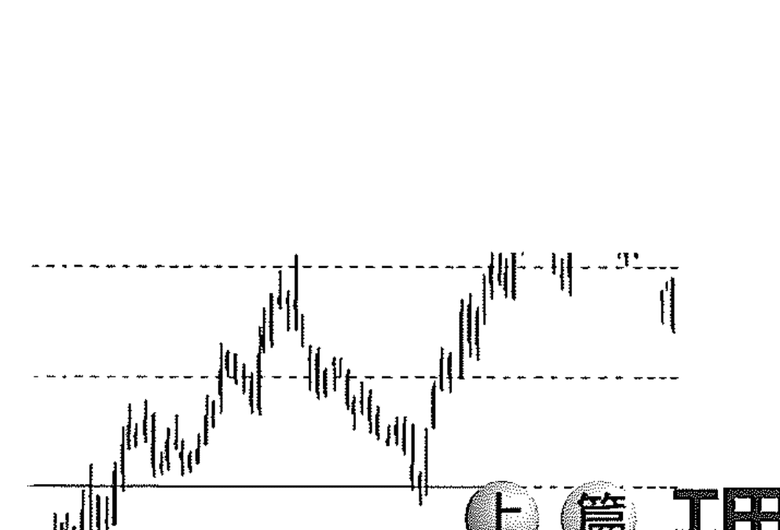

## 上篇 理論篇

市場變化，我們可以十分確定地認為，它早已在股票市場中被反映出來，因為市場對它的了解，要比這家公司或任何公司的董事會還要多。

##### 五、利用市場規則中不協調的情況

嚴格來說，根本原因在於制度本身的不合理，投機商正是利用制度的不合理部分進行運作，但實際上又沒有違反市場規則，然而監管機構卻認定投資商的這種行為為違規顯然有些不妥。需要注意的是，利用市場不合理的因素進行操作，與違法、犯罪有本質的不同，同時也必須注意，不要把本來就屬於違法、犯罪的行為當做操作市場的行為。

市場規則是在一定的歷史條件下建立起來的，以維護市場秩序，保持市場順暢進行。在市場規則制定的時候，通常都綜合各方面因素，依照並適應當時的市場情況，因此，當時是可以保證市場順利進行的。但是隨著市場的發展，又出現了新的問題、新的情況，而市場規則此時並沒有隨著市場的變化而作相應的調整，這樣就出現了市場規則與市場的不協調，這種不協調對於能夠把握市場先機的投資者來說就是機會。能夠尋找到市場規則與市場發展的不協調，往往是高明的投資者把握市場先機的關鍵，當他們尋找到市場先機，並採取有利於自己的策略時，也是市場管理者將他們從投資者看成市場操縱者的時候，但此時的管理者並沒有認真看待市場規則中的問題，而是將問題全部推到投資者身上。

當市場管理者看到規則中的問題，而採取的政策不適當的時候（實際上通常很難採取十分恰當的政策），又會給投資者帶來先機，反而又會使市場出現更大幅度的一大起大落。例如在中國的市場中，市場管理者稽查行動本身也被當作進行市場炒作的因素。隨著市場規則的調整，市場會有一個穩定期，但隨後又會出現新問題、新情況，管理者又要對市場規則進行調整，因此，市場總是處在司空見慣的一大起大落之中。市場管理者應該隨時關注市場的變化、新情況，進而對市場規則作出相應的調整，以免在過大的調整政策下，出現過度投機的現象。市場秩序與市場變化必須相適應，兩者是相互反射、相互作用、相互適應的關係。

需要指出的是，最不可能成為事實的就是熊市的操縱行為。我們一直在強調，任何一次熊市會被事後揭露出來的事實證明是事出有因。我們必須指出，某些影響是永久性的，儘管我們承認市場的視野比任何人都更廣、更遠，至少在理論上是如此，但是從某種程度上來說，它也無法預見到這些影響是多麼的深遠。

#### 第七節 充足的內線，可以毀掉華爾街的每一個人

##### 一、洩密者和內部人士無法利用內線操縱市場

漢密爾頓在《股市晴雨表》中是這樣描述洩密者和內部人士的：「我認識一些公然從事股市資訊交易的可愛『間諜』。他們提供的商品有一個專門的市場，而且他們都非常善於分析人性。他們從來不在股票市場傳播熊市的消息，因為牛市更能讓他們獲得成功，變得富有。同時，我認為他們還必須用景氣佳的積蓄來滿足不景氣的生活需要。他們告訴不理智的投資者的消息都是他想知道的，而不是他需要知道的。有時他們的猜測是正確的，但是這些猜測總包含著這樣的暗示：分析股票市場的修正是件神祕的事。如果這樣評價我們關於市場整體的資訊是正確的，那麼他們提供個股的情況更是如此。在他們的幫助下，『內部人士們』總是不停地買進。我在工作中認識了許多內部人士，而身為小投資者，他們犯錯的時候遠遠多於正確的時候。」

實際上，這些所謂的內部人士是負責處理公司實際業務的人，忙得根本沒時間關注股票價格的變化。他們僅局限於自己的交易之中，無法正確判斷市場的趨勢。他們通常對自己持有的資產充滿信心，因為他們相信自己的公司是極有可能繼續發展的。但是，當考慮到影響他們股票價格的商業波動，以及同一市場中同一板塊或所有鐵路和工業股票時，他們的視野又是非常有限的。充足的內部資訊可以毀掉華爾街的每一個人，這不是玩世不恭的觀點，而是事實。這不僅是事實，還是一件好事。大公司的經理們應該對自己業務領域之外的情況有一個基本而正確的認識，應該得到正確的指導。

這個例子向我們顯示，雖然他只發現眾多因素中的某一個因素，而市場卻能把它們全部考慮進去，但是他卻不願意相信晴雨表。實際上，投機者在市場受到限制的時候表現出色，（即在較小的市場容量中占有較大份量）使他毫不奇怪地認為，市場是由他一個人構成的，在市場上揚之前，有時也的確是如此。

還有一個原因可以解釋，為什麼熊市操作者在人們印象中进行的重要活動和「摧毀市場」的行為，要比他們實際執行的，甚至預想的還要多。這些人在炒作牛市的時候可以躲在幕後，然而炒作熊市的行為卻經常引人注目，大部分數據隨後都會被曝光。

##### 二、華爾街認為內線幾乎沒有價值

我們從一開始就假定讀者不屬於熟知內情的「圈內人士」。真正被稱為「圈內人士」的人，他們對市場中的每一個細節、數字和前景等可能影響股票去向的因素都瞭若指掌。像這一些人，我們不否認他們經常存在，有時也可能會對股票市場價格產生影響。但這樣的「圈內人士」實際上並不像普通交易者想像的那麼多，他們也不是像大家所說的那樣，可以影響市場波動的1/10，而招致散戶的責備。圈內人士也可能出錯，實際上，他們自己首先就承認了這一點。

通常他們的計畫常為一些難以預見的情形所打亂，或者由於對專業人士的忠告置若罔聞而陷入被動。他們所取得每一筆成功的交易，都是在交易所中簡單的買進和賣出中完成的。如果支配價格的供需平衡沒有變化，他們就無用武之地。無論他們如何操作，結果遲早也會反映在線形圖上，而所謂「圈外人士」同樣也能看到。至少我們會知道「圈內人士」的操作和其他的主要市場因素正影響著市場的供需平衡。因此你並不一定要成為一名「圈內人士」，反而可以經常追蹤他們。

不過，如果內部人員透過買賣他們公司的股票來賺取高額利潤的話，我們也不會感到奇怪。內部人員的這種能力在賈菲（Jeffrey F. Jaffe）、塞亨（H. Nejat Seyhun）、吉沃利和帕爾莫恩（Dan Givoltyand DanPalmmon）及其他人的研究中得到了證實。而賈菲的研究是最早證實了股價走勢，即股價在內幕人員集中購買後上漲，並且在他們集中抛售後下跌。

其他人員透過跟隨內部人員操作能夠獲利嗎？美國證券與交易委員會要求所有的內部人員要對他們的交易活動進行登記，並由證券與交易委員會在其出版的《內部交易官方概覽》（以下簡稱《官方概覽》)上刊登。《官方概覽》一旦出版，有關交易的知識就變成公開的資訊。這時如果市場是有效的，《官方概覽》中的資訊就會全面、迅速地表現在交易中，投資者是沒有機會從跟隨操作中獲得利潤的。

塞亨認真跟蹤研究《官方概覽》中的資料公開後的情況，他發現跟蹤內部人員的交易是無益的，在《官方概覽》報告內部人員購買股票後，雖然股票價格總有上漲的趨勢，但是跟蹤買股所得的非常規收益，並不能顯著地超過交易成本。

從公布日前幾天的收益模式可以得出，一些關於有效市場和資訊洩露的有趣證據。如果內部人員交易規則被嚴格遵守且得到完全實施，則在資訊發布之前，股價不應該顯示有非常規收益，因為在公布之前不可能獲得任何廠商的特定資訊。相較之下，我們只能在公布日當天觀察到股價的明顯躍升。

但實驗顯示，目標公司的股價在收購資訊公布前30天開始明顯地上漲，對此有兩種可能的解釋：一種解釋是資訊被洩露給一些市場參與者，他們已在公布之前購入股票，至少發生一些對內部人員交易規則的濫用；另一種解釋是，在收購企圖的前幾天，散戶開始對該意圖進行猜疑，因為他們得知有人大量地購買該公司的股票。隨著收購意圖變得日益明顯，收購的可能性逐漸提高，以至我們可以觀察到累積非常規收益逐漸上升。儘管這種解釋是一種確實有可能發生的，幾乎在所有的研究案例中，資訊洩露的證據總是普遍地存在，即便在那些散戶對資訊的獲知並非是漸進的案例中也是一樣。實驗顯示，累積非常規收益與股票公布情況也顯示密切，似乎違反內部人員交易規則的事確實發生了。

漢密爾頓在《股市晴雨表》中說：「伯納德·巴魯曾在戰後就他獲利頗豐的一次市場行為在國會委員會面前作證。他用最簡潔的方式證明，他只是分析了已知的原因之後，預見到由此可能對市場產生的影響。他證明自己並沒有得到所謂的『內線消息』，也沒有哪位華盛頓政府部門的職員向他出售過祕密情報，任何了解他的人都不會提出這個問題。華爾街認為這種祕密消息幾乎沒有價值。它們可能會在個別股票上具有不正當優勢，完全忽視它們也不會造成多大的損失，雖然它們並不像賣主那樣毫無價值。」這說明擁有「內線消息」是一回事，了解股票將如何據此進行修正則是另一回事。市場代表著任何人所了解、希望、相信和預期的任何事，而市場對所有的這一切，最終都将作出無情的判決。

#### 第八節 日常波動被人為操縱的程度非常有限

這裡我們需要討論一個非常重要的問題。我們知道，基本波不能被人為任意操縱，次級波具有欺騙性，只有日常波動可以被人為操縱。既然日常波動是可以被操縱的，那麼我們是不是可以作這樣的推理：次級波是由若幹個日常波動所組成的，基本波也是由若幹個次級波所組成的，那麼基本波不是也就可以被操縱了嗎？這和基本波不能被操縱不是矛盾嗎？

實際上，由於日常波動具有極強的隨機性，儘管操縱者可以利用資金實力將價位帶動一定的空間，但是任何操縱者面對市場的隨機性也顯得無能為力，我們可以看到國內外基金經理回報中的隨機性是損失的前兆。為了解釋這其中的原因，並了解隨機性對投資者會有什麼樣的影響，我們需要利用數學對隨機性、機率_and 賭博活動的研究成果作進一步的研究。這裡的賭博是指可以從不確定或隨機事件的結果中賺到錢的活動。

從數學的角度來看，投資和投機有許多共通之處。使用對投機活動研究的大部分成果分析投資，並用這種分析拓展對沖基金和它們的活動還是相對比較容易的事情。不幸的是，許多數學上的研究成果太抽象也太數學化，而且往往還會與我們的直覺相反。要詳細論述這方面的內容需要大量的證明和高級微積分。因此我們儘量避免細節問題，只用盡可能以簡單的方式來選取和描述案例中所要用到的工具和公式。同時為了簡化起見，對原生函數使用方便的近似假設。作者承認這些簡化會削弱所舉案例的嚴謹性。不過，在此同時，能夠增強解讀者所要試圖做出的論點。所以只能請那些喜歡數學的讀者原諒作者所作的簡化了。

有一些工具能夠顯示隨機方式的危險性，其中最有意思的工具是「賭徒輸光」理論。這個理論中的最基本原则是：處在賺錢和虧損機會相等的隨機市場上，基金經理的失敗率由所使用的槓桿倍數決定。也就是說，在獲利和虧損機會相等的隨機市場中，使用槓桿倍數愈大的經理，經營失敗的可能性也愈大。這種關係具有非線性的特徵，在「賭徒輸光」理論中的槓桿和虧損機率的非線性特徵證明了這一點。

為了便於理解，我們可以用「賭徒輸光」理論中的基本公式，它顯示了在盈虧機會均等時（即50%的賺錢機會和50%的虧錢機會），經理人把基金所有錢虧掉的機率Q可以用下面的公式來近似表示：

$Q = 1 - \frac{K}{B}$

其中：
- B 是經理頭寸的名義價值
- K 代表了對沖基金的資本

當槓桿倍數超過 9:1 時，經理人把投資者的全部資本虧損掉的機率會迅速地向 100% 收斂。相反地，如果沒有任何槓桿，經理人把投資者所有的錢虧損掉的機率則取決於市場中原有的可能性——50%。

透過使用「賭徒輸光」理論，我們還可以確定一名經理人把投資者的錢虧損掉的速度。基金的存續時間 D 是所有使用槓桿倍數的函數。D 可以用下面的公式來近似表示：

$D = K(B-K)$

其中：
- D——基金的存續時間（duration：用年表示）
- B——經理人頭寸的名義價值
- K——基金資本的大小

假設這些資金以小時為單位進行重新估計，公式告訴我們，如果一位經理人管理 1 億美元資金，並且使用 3:1 槓桿倍數，那麼我們可以預計他將以 67% 的機率在 2.31 年內把投資者所有的錢損失殆盡！這個前景對於投資者來說，並不讓人感到激動，尤其是我們在下面用其他實際和理論的資料對此加以證實之後更是如此。

不過，我們都聽說過，在隨機遊動的市場中，一名對沖基金經理人在某一個短時期內有優於市場的業績。因此就有必要弄清楚在所預測的 2.31 年的基金存續時間內，一名對沖基金經理人有多大的獲勝機率，答案是：非常大。

我們可以使用「布朗運動」中的一些數學性質來粗略地計算這種可能性。布朗運動是數學家และ物理學家描述微粒隨機運動方式的數學名詞。這些布朗運動的性質被稱作「反三角法則」，它們可以幫助我們理解水分子在熱水中或是粉塵在空氣中的這類運動，並且把這些運動方式模型化，就我們的研究目的而言，我們將使用反三角法則中的一種特殊情形，這種情形使我們在盈虧機會均等的假設下，可以導出一名經理在破產前的 2.31 年經營時期中，以 27% 的機率連續 6 個月獲利。而要連續一年獲利的話，在相同的假設下，大概會有24%的機率。雖然這名經理會在2.31年內把投資者所有的錢都虧損掉，但是在超過1/3（準確地說，是36%）的基金存續時間內，他有30%左右的機會產出色 的業績。

讀者也許會覺得這個推理過程有些奇怪，但是如果他們停下來想一想，就會發現這些結論可以解釋現實世界中「槍手」經理人的現象。

由於缺少可靠的對沖基金資料，我們很難確切地計算出對沖基金的死亡率。鑑於死亡率在對沖基金評估中的作用（所謂的生存偏差），這一點令人十分遺憾。幸運的是，國外某機構蒐集到由546名不同經理經營的901個基金，在10年以內的可靠資料，並對它們加以研究。從1988年我們剛開始蒐集資料時起，由191名經理經營的304個基金還在繼續運作。另一方面，597個基金已經解散，且355名經理宣告經營失敗。這些數據反映超過66%的死亡率，這個數字是驚人的。在這些停止運作的基金和經理中，他們的平均生存期限為3.5年。

透過理論計算和大量的事實我們不難發現，無論一名投資者的短期業績有多麼出色，只要在他的收益中隨機性的成分很高，他把所有的錢虧損掉的機率就很大。就市場操縱者來說，儘管他可以利用技術優勢和股票優勢透過操縱市場行為獲得短期的成功，但是在隨機性極強的市場中，這些經理的業績表現就像流星，在毀滅之前，會發射出瞬間的光芒；然後就從我們的視野中消失得無影無蹤。因此當我們把有關技術、隨機性和持久性表現的所有結論都彙集在一起時，操縱者對於日常波動的操作能力也將是十分有限的，對於基本修正的操作行為更是無稽之談。

#### 第九節 市場行為依趨勢方式演變

道氏透過市場的基本趨勢是不可能被操縱的原理，說明市場將依照自己的規律運動，而這個規律也是能夠被人類所認可的。其中的一個規律就是由道氏理論的操作市場理論所引申出的技術分析三大定律之一，也就是技術分析的第二大定律：「市場行為依趨勢方式演變」！

從「市場行為以趨勢方式演變」可以自然而然地推斷，對於一個既成的趨勢來說，下一步常常是沿著現存趨勢方向繼續演變，而掉頭反向的可能性要小得多。換句話說，即當前趨勢將一直持續到反向為止。「趨勢」概念是技術分析的核心。所謂趨勢其實就是規律，其主要思想是價格的變動是按一定規律進行，價格有保持原來方向運動的慣性。正是由於這一條，技術分析師們才花費大量心血，試圖找出價格變動的規律。

它的基本思路是牛頓的慣性定律。物理學中最著名的運動學慣性定律告訴我們：運動中的物體在未受到外來力量的作用下，將保持原來的運動不變。從該定律可引申出如下重要的實戰操作結論：成本制約效應。它有兩層含義：
- 一是價格一般不會亂跳，而是有一定規律地向一個方向移動；
- 二是只有在外力變化，也就是基本面發生巨大變化時，價格的波動方向才能改變。

在市場中，多頭的買進力量在未遭到空頭的賣壓根本打擊之前，股價將保持上漲的態勢，牛市也將繼續發展，直到空頭的賣壓從根本上超過多頭的買進力量時，股價的上漲才會停止，牛市也才會結束。相反地，結論也成立。在市場的力量沒有產生根本性、質變逆轉時，投資者不要輕言趨勢已經結束、盲目地去預言市場的頭和底，甚至展開反向逆勢操作，這必將付出慘痛的代價。

在一段時間內，如果沒有意外，價格也會按這個方向繼續上漲或下跌，沒有理由不改變這個既定的運動方向。如果沒有使價格調頭的內部和外部因素，就沒有必要逆勢而為，這是第二條定律合理的一個理由。否認這個假設，即認為即使沒有外部因素影響，價格也可以改變原來的運動方向，技術分析就沒有立足之地。這也是技術派投資者最看重的重要投資原則：順勢而為在我們的投資實戰操作中必須無條件遵守。

這個原理給我們的啟示是，基本波是按照客觀規律發展的，也就是市場行為是依趨勢演變的，沒有人能夠操縱基本波，這也是市場分析研究的基礎。需要注意的是，人為操縱在本質上仍然屬於市場行為。然而，許多事情本來屬於違法行為，並非市場行為，將這些事情算在操縱行為裡是不正確的。如違規股票進入市場，造謠、詐欺（特別是上市公司的詐欺行為），故意提供虛假證明文件，嚴重不負責任的行為，受賄罪等等，這些都不屬於市場行為。

總之，基本波是按照客觀規律發展演變的，因此基本波是不可以被操縱，但短期的日常交易是可以有限地被操縱的，而操縱行為在次級的騙線中也會被騙。這個原理十分重要，它既是道氏理論的核心思想，並被雷亞當作道氏理論的「第一大定律」，也是技術分析派引為技術分析三大定律的「第二大定律」——市場行為依趨勢方式演繹。這為我們使用技術分析法進行市場分析奠定了堅實的基礎，沒有這條原理，我們的市場分析將陷入不可知論，我們的分析工作將無所適從。

道氏的市場操縱理論告訴我們，市場的基本波是不能被操縱的，只有在次級波和日常波中操縱者才能產生有限的作用，這或許可以解釋，為什麼歷史上的金融操縱事件，幾乎都是以失敗告終的。這個理論不論是對於散戶，還是法人、市場分析師，以及投資理論者，都有鮮明的指導意義。散戶可以考慮，整天跟著主力動向、基金的路數是否有意義，或者說有多大的意義；法人可以考慮，打算操縱市場的可能性有多大，自己有這個能力嗎？或者說操縱市場的程度有多大，後果又是什麼，同時主力的詐欺行為也會在市場中表現出來；市場分析師可以考慮，自己分析主力的動向、基金的路數是不是繞了圈子，因為基金主力也不可能長期逆勢而動，他們最終也是靠深入研究基本面進行投資的。這條原理給我們更大的啟示應該是——如果我們遇到市場中的一些操縱現象，我們是抱怨市場不公平、不規範，還是發揮我們的創新精神去總結經驗、發現規律呢？

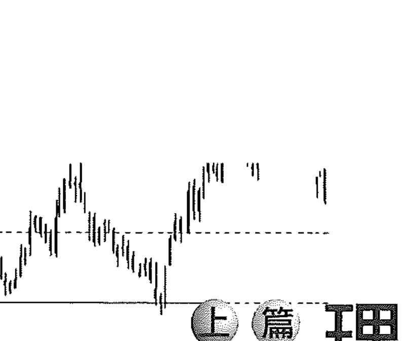

> 一代過去，一代又來。大地卻永遠長存。日頭出來，日頭落下，急歸所出之地。風往南颳，不往地旋轉，而其返回轉行原地。江河都往海裡流，海卻不滿。江河從何處流，仍歸何處……已有的事，後必再有。已行的事，後必再行。日光之下並無新事。
> ——《聖經》

### 第五章：道氏的時間週期

——歷史會重演

#### 第一節 週期來自「外來的力量」

人類還未理解的外生力量，可能在觸發各種週期和模式，我們並不拒絕接受這種想法。例如多年來，一些分析人員一直懷疑，太陽黑子的出現頻率與股票市場價格之間有一種聯繫，因為電磁輻射的變化會影響人們的心理，包括投資者的心理。1965年，查理斯·柯林斯曾發表過一篇名為《一項太陽黑子活動對股票市場影響的調查》（An Inquiry into the Effect of Sunspot Activity on the Stock Market）的文章。柯林斯注意到，自1871年起，熊市通常出現在太陽黑子活動超出一個特

#### 第二節 道氏的時間週期

定水平的高峰之後。

R·伯爾（R·Burr）博士在他的《生存的藍圖》（Blueprint for Survival）中報告說，他已經發現了地球物理週期與行星電子變化之間的密切聯繫。幾項研究已經指出，受月球和行星週期控制的電離子和宇宙射線在大氣中的撞擊變化，會對人類行為造成一種影響。實際上，某些分析人員曾利用明顯影響太陽黑子活動的行星彙聚，成功地預測股票市場。

1970年10月，《斐波納奇季刊》〔The Fibonacci Quarterly，由美國加州的桑塔·克拉拉大學（Santa Clara University）的斐波納奇協會（The Fibonacci Association）出版〕曾發表過里德博士（B. A. Read）的一篇文章，他是美國陸軍衛星通訊署（U. S. Army Satellite Communications Agency）的一名上尉。這篇題為《太陽系中的斐波納奇級數》（Fibonacci Series in the Solar System）的論文認為，行星間的距離和修正週期吻合斐波納奇關係。

與斐波納奇序列數字相關說明，股票市場行為與影響地球生命的地球之外的力量之間，可能不只是隨機的聯繫。然而，长久以來就存在這樣一種觀點，即社會行為的週期波動模式，源自於人類的精神和情緒、及其在各種社會環境中導致的行為傾向，我們對此感到欣慰。如果這些傾向因外来力量而觸發，或者受外来力量的約束，那麼有人將會證實這種聯繫。

在週期分析者的眼中，這個問題是理解市場起落現象最為關鍵之處。週期分析者認為，時間週期是決定牛市和熊市的關鍵因素，而不是次要的或輔助性的角色。一方面，時間因素在市場上占據統治地位，另一方面，所有的技術工具再加上時間週期後，便如虎添翼。例如移動平均線和KD值就可以透過主流週期而得到強化。在趨勢線分析中，我們可以借助週期分析對趨勢線進行判別，以確認有效的趨勢線。在價格形態分析中，如果結合考慮週期的波峰和波谷的分布，也能提高其效能。我們知道，形態形成時所經歷的時間長短，與隨後市場變化的範圍之間存在著一定的關係。趨勢線的支持水平和阻擋水平保持有效的時間愈長，則其影響力愈強。

「週期」與人類的歷史同樣古老。許多經濟學教師和不恥下問的謙虛經濟界人士都很相信人世間的週期性，這種信仰是複雜的、合理的。這裡我們所要解決的不再是市場要向哪個方向運動、目標有多遠的問題，而是要探究何時市場將到達哪裡，甚至是何時市場將開始轉折的問題。

道氏在注意到市場的運動是依趨勢發展的同時，也注意到三種運動與時間的關係。他注意到某些市場持續旋轉的重複，並正確地指出：「每一個基本波（無論牛市還是熊市）都具有一種自我否定的趨勢。根據波動和反波動的法則，預先確定任何基本波的長度是不可能的，但是它走得愈遠，這種反作用就愈大，進而根據這種反作用成功地進行交易的不確定性也愈大（這個部分被許多人忽略）。在市場上的表現是，市場在一個相當長的時期內，前進和衰退的天數是大致相當的。如果出現一個連續前進的時期，幾乎必然會出現一個衰退時期與之保持平衡。」這裡包含著濃厚的週期思想，這是由於道氏非常重視時間週期，以至於重視到在這個問題上幾乎犯了錯誤。

道氏在《華爾街日報》1900年12月19日的評論文章中寫道：「我們可以認為市場永遠包含著三種運度，它們是同時存在的。首先是日復一日、範圍狹窄的日常波動；其次是次級波，期間從兩週到1個月或更長些；最後是基本波，它的週期至少是4年。」這三句話概括了道氏理論對於股票市場價格修正的本質內容。

他還寫過一篇題為《運動中的運動》的文章，出現在《華爾街日報》1902年1月的「回顧與展望」的專欄裡，他寫道：「市場中存在三種相互融合的、確定的運動，這是毫無疑問的。首先是針對地方性事業和特定期點的買賣平衡而產生的日常波動；次級波所覆蓋的期間從10～60天不等，平均而言大約在30～40天之間；第三種運動的期間在4～6年的大修正。」

請注意道氏的這番話寫於許多年前，他並沒有今天這種分析股票市場波動的紀錄。他在此處提出的基本波的期間、被以後的經驗證明太長了。實際上，在道氏寫這番話之前，也從未出現過「4～6年」的大波動，很少能超過3年，更多的是少於2年。實際上，他的第三種基本波所需的時間，可以遠遠少於道氏所提出的4年，而且試圖根據10年的恐慌週期理論，把牛市和熊市大致上平均分爲各用5年的做法也是一種不自覺的誇張。然而，這些並不重要，重要的是道氏將時間週期看得很重。道氏成功地歸納出最有價值的股票運動理論，並且指出這些運動是同時發生的，進而爲來者建立股市晴雨表打下了基礎。

需要指出的是，道氏說的話向來都是有根據的。他堅定地相信，金融危機會在10年左右，經過一定的週期以後重新出現。道氏的這個想法或許來自於19世紀70年代，因爲當時英國的W·S·傑文森（W. Stanley Jevons）和美國俄亥俄州的農民撒母耳·貝納（Samuel Binner）都將各自國家的經濟資料與太陽黑子的紀錄相比較，並把經濟資料具有階段性的想法作進一步發展。1875年，貝納寫出現已聞名於世的《貝納預言：期貨價格的上漲和下跌》。貝納說他的輪動週期來自於太陽活動。貝納於1895年出版了一個有趣的線形圖，預言了經濟變化（見圖5-2-1）。大約在同時，克萊門特·朱各勒（Clement Jugular）發現了利率和經濟之間10～12年的輪動週期。現在這個輪動週期已用他的名字命名。或許是過於恪守道氏理論必須遵循自然法則的原則，道氏認為，在一個週期中有一個牛市運動和一個熊市運動，因此把10年的週期一分爲二。不過，股市的基本波與經濟週期還是有一些區別的。

圖5-2-1 貝納的經濟週期預言

事實很快地證明，道氏認為基本波為期5年，即把10年的週期一分為二的觀點是錯誤的。如在1902年1月他在自己典型的結尾中寫道：「根據歷史和過去6年的發展來判斷，認為我們在今後幾年中，至少遇到一次股市震盪是不無道理的。」他在此卻出奇地沒用自己至少4年的估計。道氏的這個預測是在一次牛市中作出的，這次運動結束於1902年9月，距離道氏的離世僅3個月。

看看隨後的情況。1902年9月產生的熊市，大約持續了1年；1903年9月又出現了牛市，於1904年6月最終形成，並在1907年1月達到顛峰，持續3年零4個月。而此後出現的，包括1907年危機在內的熊市，結束於1908年12月，為期11個月。

#### 第三節 根據傑文茲的恐慌紀錄

從歷史上紀錄的恐慌歲月中，時間表形成了週期觀念。斯坦利·傑文茲教授形成了他的理論，即這些危機與太陽黑子再現之間的關係及太陽黑子對天氣和農作物的影響。但是傑文茲記錄了英國發生商業危機的時間，說句實話，這些紀錄是相當驚人的，它們分別是1701年、1711年、1712年、1731～1732年、1742年、1752年、1763年、1772～1773年、1783年、1793年、1804～1805年、1815年、1825年、1836年、1847年、1857年、1866年和1873年。

道氏在1902年7月9日的《華爾街日報》上發表了一篇評論文章，他在文中引用了這些日期並寫道：「這非常有用地證明了以10年為週期的理論，而且美國在過去一個世紀中所發生的事，也在很大的程度上支持了這個理論。」

道氏對美國連續發生的危機（他本人經歷了其中的三次：1873年、1884年和1893年）的評論是出色的、有趣的。就像文茲記錄的日期而言，令人奇怪地是他在其名單的開頭遺漏了一次嚴重的危機。這次危機發生在1715年，蘇格蘭人在那一年入侵英格蘭，試圖扶持斯圖亞特王朝復辟，進而加劇了這次危機。也許太陽黑子的數量在那一年並不足以滿足他的理論，那麼傑文茲遺漏這次危機也是人之常情。

#### 第四節 經濟興衰的週期並不準確

根據傑文茲的說法，18世紀恰好發生了10次值得注意的危機，其平均間隔為10年，這或許讓人認為已經無須再對週期性理論進行分析。漢密爾頓發現傑文茲還遺漏了一次危機（即1715年蘇格蘭人入侵英格蘭造成的恐慌），因為那一系列的太陽黑子數量，不足以讓他建立大膽的理論，來描述兩種現象之間的關係。我們或許已經注意到，傑文茲認為1793年和1804～1805年是危機年份，而根據歷史記載，美國在19世紀發生的第一次恐慌，出現在1814年，但是這次恐慌是由於英國人占領了華盛頓而造成的，週期性理論根本無法預測到這個事件，除非我們假設它可以預見戰爭。然而，如果加上1814年和被道氏稱為「近似於一次危機」的1819年，美國在19世紀一共發生了10次危機。

讓我們看看週期主義者（或許這樣稱呼並不正确）是如何得出這個結論的。首先，1804～1805年的英國危機和美國的1814年危機之間間隔了10年，這或許能讓他感到振奮。然後，1837年和1857年發生極為嚴重的全國性危機將使他信心大增。他回憶起傑文茲的「十年理論」，發現美國到1837年已經發生了4次危機，正好是40年時間。美國在1847年並未發生像歐洲那樣的恐慌，只是那裡的慘狀給美國人留下了深刻的印象。但是當週期主義者發現1857年真的出現恐慌以後，他會說：「啊哈！我們現在已經發現這個祕密了。這是一次20年的週期·兩頭各有一次大的危機，中間的危機程度較輕。現在我們可以自信地讓事實服從於這個美妙的理論了。」

根據週期理論，1877年應該發生一次全國性的大恐慌，然而這顯然是有問題的，因為恐慌發生在1873年。如果不是因為美國農業獲得意外的豐收，而俄國農業全面減產，致使世界農產品市場大幅上揚，美元交易的過度氾濫將使這次恐慌提前到1872年。因此，兩次大危機之間的間隔被縮短了，20年的理論變成了16年的理論，雖然在兩次危機之間發生了1886年的倫敦恐慌，也不能對此有所補救。1886年的倫敦恐慌，使得股票交易所價格嚴重下跌，同年4月，出現了囤積密執安南方鐵路公司股票的情況，投機活動十分猖獗。道氏正確而謹慎地指出，此時出現新一輪的下跌「是再正常不過的事了」。

這一次和最後一次危機是世界性的，其影響程度也同樣深遠。週期主義者又說：「1857年和1873年的危機，間隔減少到16年只是一種偶然的失誤，至少我們能在進一步觀察這些基本規律之後，對它作出滿意的解釋。」堅持20年理論的週期主義者預言：「從1873年到1893年是20年時間。此時，道氏的晴雨表已經初步建立起來。它預見了1903年前後，將出現一次小規模的危機，而1913年最遲不會超過1914年將出現一次大恐慌。」

一個偉大的論點認為，「作用力與反作用力相等」，真是這樣嗎？在有文字記載的人類歷史上，幾乎無法為這個假設找到真正的證據。抱持這種觀點的人或許會反駁：「即使它們不相等，也應該是相等。」我們很容易發現，危機之間的間隔至少在表面上是逐漸延長的。從1893年到1907年，經歷了14年，而1920年根本沒有發生恐慌。我們很難把1920年的抛售浪潮視為一次典型的危機，除非我們強迫自己歪曲恐慌的構成條件。它不具備恐慌歲月的特徵，也無法與1893年、1873年、1857年和1837年的破壞性後果相提並論。

雖然華爾街打從心底相信恐慌和繁榮的週期性，但是它在劇烈波動時，並不在意太陽黑子的數目是否已經足夠，或許更客氣一點的說法是，這種偶然的週期性聯繫毫無意義，正如總統大選和經濟起飛的巧合性一樣。但是這種理論的實用主義基礎（至少是它實際使用的假設）依賴於人性本身。繁榮將促使人們過於狂熱，作爲對這種行爲後果的懺悔，隨之而來的將是蕭條。在絕對恐慌之後的黑暗歲月裡，工人會爲其得到的任何東西而感謝上帝，並從很微薄工資中留出一部分餘錢，而資本也將滿足於微薄的利潤和迅速的收益。

我們從一個毫無生氣的、安靜的經濟時期，走入真正的經濟活動之中，而後者又逐漸演變成氾濫的投機行爲，高利率、高所得和其他類似的經濟症狀已經十分明顯。在經過一段時期的美好歲月之後，發展的鎖鑰目前已經到了它最脆弱的邊緣。1907年的崩潰顯示：蕭條將籠罩股票市場和商品的價格，隨之而來的是大幅度的失業，儲蓄銀行的儲蓄率通常會出現實際的增長，但是冒險事業所需要的資金是絕對無法得到的。

恐慌和繁榮似乎各有自己的週期。任何對近代歷史有實際了解的人都可以列舉出我們的恐慌歲月——1837年、1857年、1866年（發生在倫敦的奧弗蘭·戈爾尼恐慌）、1873年、1884年、1893年和1907年，如果你願意，也可以加上1920年的通縮時期。這些恐慌至少顯示了它們之間的間隔並不相同，大致在10～14年之間。

所有這些工作都太過於強調週期理論，但是價格的谷底也未必起因於它的蕭條時期。股票市場的危機可能出現在牛市的中期，如果所有的恐慌和工業危機都是由同樣的原因造成的，並且能透過有節奏的、確定性的預測，那麼它們根本就不會發生，因爲人們可以事先預見到它們。

#### 第五節 週期理論可適用的範圍

週期理論的基礎過於狹窄，不具有前瞻性。它就好像不顧病人的當前症狀而認為他能康復一樣，因為他在過去10年裡都很健康。這是一個以不充分假設為基礎進行分析的例子。毫無疑問地，管理和其他方面的變化，有時會使一個有著良好的股利紀錄的公司遇到麻煩，而編撰者都會在線形圖中計算出發生這種情況的平均可能性，但是這個平均可能性也只能是歷史紀錄而不是晴雨表。氣象局的資料具有極高的價值，但是它們並不能預測出一個乾燥的夏天或溫暖的冬天。我們可以从個人經驗中得知，紐約很可能在1月份很冷，而在7月份很熱，這並不需要氣象局的幫助。

如果一種理論不能作出這種預測，它還有什麼用呢？但是從1893年到1907年，其間經歷了14年。這是因為20年的週期縮短了，還是因為10年的週期延長了呢？是否存在一個可靠的週期呢？我們發現在週期主義者預言的1903年或1913年根本沒有任何可以導致危機的可能性。實際上，全世界的投機活動的程度，還不足以促成一次危機。我們可以合理地認為，除非投機活動的大廈已經足夠高，以至於搖晃時發出刺耳的雜訊，否則崩潰是不可能發生的。

週期理論有什麼商業預測價值呢？這個理論必須作出許多讓步和假設，以至於只具有一種記錄事實的價值。我們看到，以週期性假設為基礎得出的主要結論，不得不一次又一次地改變。那麼它還有什麼真正的價值嗎？漢密爾頓說：「我絕不是懷疑論者，但是整個週期性理論的方法在我看來，就像你在一個人玩牌時作弊一樣荒唐可笑。我能夠理解任何嚴肅的、獨斷的或不合理的遊戲規則，可是我無法理解隨著遊戲的展開不斷變化的規則。」

不過，「恐慌週期」理論也是有用的，雖然它過於籠統，無法應用於日常的情況。這是一段非常有意思的歷史，理解了它的真正含義，能使我们有所啟發。

1873年，恐慌之後股市出現反彈，但是商業持續萎縮，當時的狀況與現在完全不同，卻與下面將要進行對比的時期有很多相似之處。我們幾乎可以認為，直到重新恢復硬幣支付（1879年）已經近在眼前的時候，商業才開始轉好的方向發展，最終結束於不太嚴重的1884年的恐慌。

與此類似，1893年恐慌之後的商業蕭條也比股市的下跌長得多，雖然它一直處於小幅波動之中。如果製成線形圖，驚人地發現，這種波動將與1909年股市反彈結束後的情況相似。由此我們可以得到某種一致性，至少表現出一些相似的規律，這些規律所決定的運動，比我們應用道氏理論得出的基本波還要大。至少可以發現，一旦信心被成功地擊潰了，那麼重新建立它將需要幾年而不是幾個月的時間。

事實顯示，如果我们不了解過去，也無法對未來進行預測，因為類似的原因將造成類似的後果。但是如果僅僅以此為依據，那麼預測將是錯誤的，或是不成熟的，足以致掉任何一個商人。一家商業線形圖的權威機構，不久前曾建議人們購買某種股票，它的分析基礎是過去10年中的利潤和股利紀錄。然而商業狀況已經發生了根本的變化，更糟糕的是，這家公司由於判斷失誤而改變政策，於是購買這種股票的人遭受了嚴重的損失。

股票指數是值得信賴的指南，這就是股市晴雨表如此珍貴的原因。它並不迷信週期或體系，也不看重有趣的，甚至很有道理的推斷或流行時尚。只要它們是有用的，它就會加以利用，而且還會利用它能得到的任何一個資訊。它完全可以誠實地宣布自己具有一種預測的功能。

我們已經看到並驗證道氏理論的正確性，認識市場同時存在著基本的上漲或下降運動、次級下跌或反彈運動，以及日常波動。但是我們的研究是否已經足以讓我們建立自己的週期理論呢？當然，週期理論所列出的恐慌日期很壯觀也很有啟發性。哈佛大學的圖表在這方面進行了很有見地的嘗試，它的週期排列為「蕭條、復興、繁榮、緊縮和危機」，並沒有對每個階段設定絕對的時間長度，甚至認為「緊縮和危機」、「危機和恐慌」或「緊縮和恐慌」有時是伴隨出現的。然而，我們可以從股票平均指數的紀錄中得出另一個週期，並幾乎可以稱之為「人類犯錯誤的週期」。

由此，我們建立了某種不規則的週期性理論。由於長期的、有節奏的週期性理論並未消失，使得許多讀者和批評者們似乎對此情有獨鍾，而且沒有人透過仔細地研究來分析一下自己的信仰。一般的觀點認為，這個理論「有些道理」，即使不經過驗證也應該是正確的。全球發生恐慌的日期本身就顯示了一種高度的週期性，根據過去的週期性，我們可以認為將來還會出現類似的情況。根據歷史紀錄分析，人類在處理自己的問題時，將永遠像以前那樣愚蠢。

我們在此需要表明的是，週期是存在的，但週期又是不準確的，它的作用在於給予我們某種啟示。

#### 第六節 歷史會重演

根據道氏理論對於時間週期的考慮，技術派人士提出了技術分析的第三大定律——歷史會重演：歷史總是那樣驚人的相似，過去在一定的條件下發生的事情，到現在如果這些條件依然具備，那麼類似的事情發生的可能性很大。這是從人的心理因素方面考慮的。市場中進行具體買賣的是人，是由人決定最終的操作行為。但人不是機器，他必然要受到人類心理學中某些規律的制約。一個人在某一場合得到某種結果，那麼下一次碰到相同或相似的場合，這個人就認為會得到相同的結果。

由於人類心理行為模式具有遺傳性特徵，因此在市場具備類似的情況和波動態勢時，投資者傾向於採取相同的人類心理、思考和行動方式進行應對，進而使市場的各種現象表現出與歷史現象相似似的重演特徵。也由於市場的修正具有客觀的週期性，這也會再現出歷史會重演的表面化特徵。人心難測，但人的目的和為達到該目的所採用的行為方式卻是有限的，可以在一定程度上被推測，這才是歷史會重演、市場可以被部分把握的真正本質原因。所謂江山易改，本性難移。

市場中的某個市場行為，給投資者留下的陰影或快樂是會長期存在的。在進行技術分析時，一旦遇到與過去某一時期相同或相似的情況，應該與過去的結果比較。過去的結果是已知的，這個已知的結果應該當作現在預測未來的參考，但市場行為是千變萬化的，不可能有完全相同的情況重複出現，差異總是或多或少地存在。在市場中，週期是有的，但又是確定的。換句話說，歷史會重演，但又不會簡單地重演。實戰操作中，請牢牢記住歷史會重演，不是講歷史現象的簡單重演，而是講歷史規律和歷史本質的反覆不斷作用，投資者在運用時，不應呆板和教條地進行理解。

以上所述的三大定律為所有技術分析理論奠定了基石，要用心反覆體會、仔細思考，並深刻領悟。在三大定律之下，技術分析有了自己的理論基礎。第一條肯定了研究市場行為，就意味著全面考慮影響市場經濟的所有因素，第二和第三條，使我們找到的市場運行規律，能夠應用於市場的實際操作之中。其實，這三大定律本身的合理性一直存在爭論，不同的人有不同的看法。正因為如此，在進行技術分析的同時，還應該進行基本分析，使得技術分析與基本分析的結論能夠相互驗證。

### 第六章 三重市場行為

#### 第一節 三種投資者與三種波的關係

道氏理論認為，任何市場同時都存在三種價格波動：日常波動，它可能持續數天至數個星期；次級波，它可能持續數個星期至數月；基本波，它可能持續數月至數年。道氏所確定的三種走勢，不僅適用於股票市場，也適用於期貨市場、外匯市場，以及貴金屬市場。針對這三種運動，在市場中也分別對應存在三種基本類型的參與者：交易者、投機者和投資者。

交易者的活動主要集中在盤中交易並引起日常波動。他們買賣股票、債券、商品或任何交易工具，時間框架都在數分鐘至數星期之內。投機者專注於次級波，他們建立市場資金，並持有一段大約數星期至數月的時間。投資者主要是考慮基本波，持有的資金可以長達數月至數年之久，通常都在一年以上。

##### 一、投資者

道氏所提到的「聰明資金」也就是我們所說的投資者。像牛市、熊市一樣，「聰明資金」也是道氏天才般的發明。相對來說，投資者擁有較大的資金量，而且他們是依據價值進行投資的，通常也稱他們為「價值投資者」。價值投資者依據對價值的評估，而不是對價格的評估進行投資，由於這個過程需要較長的時間，通常也稱他們為「長線投資者」。

他們知道市場具有自然規律。由於基本波反應的是市場發展的客觀規律，因此它不可能被人為操縱，而只能被人為利用。因為市場的力量遠遠大於法人的力量，所以無人能操縱基本波。所謂能操縱的地方，實際上就是利用市場規則。我們預測基本波的意義在於，基本波能被後來的商業行為所證實。

基本波總是可以被基本面所證實。一個大波浪輪動就是一個經濟週期，而經濟環境的變化也會引起企業基本面的變化。牛市、熊市的輪動，在經濟學上的表現為失敗的復興和失敗的衰退的輪動。一個牛市接著是一個熊市，或反過來說，一個熊市之後便是一個牛市，它們是和經濟規律相應的。牛市和熊市顯示了一個經濟週期的盛衰輪動，由繁榮期走入衰退期，由衰退期步入蕭條期，再由蕭條期走入復甦期，然後又開始另一個繁榮期。

基本波是指價格波動的大方向，一般持續的時間比較長，通常一年或一年以上。儘管市場依照自然法則表現客觀規律，但是探索規律並非易事。基本波最重要，是投資者極力要辨認、歸類與了解的，而且投資者需要花更多的時間來認定趨勢中的轉變。同時，價值也不是市場中所表現出來的實實在在的價格，因此確認價值並非易事，是需要時間的。

道氏理論認為價格走勢的基本波是有規律可尋的，可呈現一定的趨勢性，這一點更得到了甘氏理論的認可，甘氏理論認為市場的基本波就像一年四季的更替與潮起潮落一樣，有其自身規律性。威廉·甘氏對於道氏理論的基本波的發展作出了極其突出的貢獻。

甘氏理論的偉大，在於他「發現了」市場的「波動法則」（趨勢或規律），他認為股票或其他在市場買賣的商品，猶如電波一樣，有其獨特的「波動率」，這個波動率決定市場走勢的波動趨勢。他表示：「**偉大的波動法則的基礎是相同的條件產生物相同的結果。經過長期的研究，我發現波動法則助我準確地預測股票及期貨特定的時間的特定價位**。」

但是，對甘氏理論的波動法則的理解應該限制在基本波，如果任意擴大到次級波和日常波動，甘氏理論顯得偏於「形而上學」。因為次級波具有一定的規律，但也存在著一定的不確定性，甚至帶有欺騙性質，而日常波動不易預測和捕捉，持續時間往往都不會持久，甚至是「隨機漫步」的。

對投資者的行為有影響的是基本波，而次級波和日常波動不會影響投資者的行為。而基本波是受基本面的工商業經濟行為所影響，經濟行為必然也受經濟週期的影響，經濟週期會受到自然規律的影響，因此基本波是有很強的規律性。

##### 二、投機者

市場當中精明的專業投資者，也就是我們所說的投機者。市場的投機者是很據次級波的走勢，希望透過買、賣行為獲利。對他們的行為產生決定作用的也是次級波。儘管次級波對於投資者較為次要，但卻是投機者的主要考慮因素。當然並不是說投機者不考慮基本波，而是說對於投機者來說，在關注基本波的同時，他們更加關注次級波。

儘管投機者常被視為是炒作股票、房地產或其他交易工具的人。但實際上，在生產者生產出產品之後，需要消費和需求來購買產品，這樣生產者的生產才能繼續下去，而在需求方面則不僅是指消費，更重要的是指相當數量的投資性需求。需求方面透過交換將均衡商品的中期價格以貨幣價格的形式表現出來。但由於影響需求的因素太多，中期均衡價格與長期均衡的價格總是不能保持一致，因此投機者是根據現有生產水平，對消費需求和市場價格情況進行預期，並認為投資對自己有利益時而進行投資的。

特別是那些高瞻遠矚的專業投資者——基金，他們依據經濟週期的規律，利用資金優勢進行投機，這必然要影響商品的中短期價格。

特別需要重視的是，當他們投入的資金數量非常大的時候，會造成股票、商品相對嚴重短缺（大量買進時）或過剩（大量賣出時），並引起價格的大漲、大跌。但是投機的成功也必須順應基本波，因為強勁的基本波必須受到長線投資者的支持，如果投機活動違反基本波，無論多大的資金在運作都會失敗。

##### 三、交易者

散戶也就是交易者，他們所影響的是日常波動。由於大眾行為受大眾情緒影響，這意味著交易者常有不理智的行為。日常波動一般都不能當作經濟變化的判斷依據。大量的追高行為，對短期市場價格的漲跌也具有重大影響力，而更多的交易者亦相繼追隨，才會有一時的價格急劇漲跌。

這是基於買賣而影響的漲跌，這種走勢和經濟實況或個別公司的表現完全無關，經濟轉好，股市指數也可能有較大幅滑落，經濟沒有特別利多消息時，指數卻一樣可以大幅上漲。但基於買賣而影響的漲跌，對於長線投資者來說沒有意義，因此對基本修正也沒有影響。

日常波動最難預測，唯有交易者才會隨時考慮它。投機者與投資者僅有在少數情況下才會關心日常波動，並在日常波動中尋找適當的買進或賣出點，以追求最大的獲利，或盡可能減少損失。

交易者是市場中最活躍的群體。套用一句話，歷史是由人民創造的，價格則是由散戶促成的。其中最重要的是依據對市場行為的變化作出預期，並認為價格的變化對自己有利時就進行投資。由於他們更重要的是看中市場行為，他們總是引領著價格的變化、引領著趨勢的變化，所以也可以稱之為「趨勢交易者」。交易者總是基於對趨勢變化的預測，他們的買入推動價格上漲；他們的賣出則推動價格下跌。趨勢可以持續的唯一方法是，其他交易者也同時進入市場。

交易者通常是小股票，感覺上他們是市場上真正的「賭徒」，或許在常人眼裡他們就是在賭博。不過，當一個人嚴格按照一定的規則，不論是進行交易、投機還是投資，他將不再是進行賭博，而是從事一種有利可圖的職業，因為他們對於自己的分析很有信心，他們認為自己是對的。當他們做出買入行為時，是在投股票錢、情緒、名譽及自我。

此外，交易者的「人為因素」也會為市場日常波動帶來不可忽視的影響。索羅斯提出的反射理論，就是建立在交易者對市場價格的影響往往更具決定性。他認為經濟學所表述的均衡市場、充分競爭市場在現實中是不存在的，因為充分競爭市場的假設條件，即完備的知識和充分公開的資訊、同質而可分的產品、足夠數量的參與者，以使任何單獨的參與者都無法左右價格，這些並不具備或不同時具備。他進一步認為：「所謂糾正『投機』过度的『基本』力量是根本不存在的，而另一種情形，即投機行為改變了假設的供需基本條件，倒是完全有可能發生的。」

索羅斯的反射理論強調的是「人為的隨機因素」的作用。反射理論對於日常波動研究作出了偉大的貢獻，更為可貴的是，索羅斯用自己的實踐已經證明它是正確的。但是需要注意的是，如果將反射理論應用範圍擴大到次級波，甚至擴大到基本波中將是錯誤的。

日常波動主要受消息影響。眾所周知，日常波動經常用到「豬羊變色」這個詞来形容。導致日常價格波動突變的原因至少有下列幾種：

- 1. 突發的基本面消息刺激，比如地震、工廠爆炸、恐怖事件等。
- 2. 儘管有效市場理論不承認資訊有累積效應，但實際上市場訊息和情緒積累會導致行情的突變，這類突變最使人莫名其妙。
- 3. 金融大戶興風作浪引起的行情突變：大資金常常悄悄地入市，讓人難以覺察其部署，伺機突然行動，這些來得急、去得快的小波浪，可能是在數小時之內就有漲有跌，一個上午或一個下午便是一個波浪，或是一天一個波浪，或是一、兩個星期也說不定。快者可能在幾個小時之內就還原，令其他投資者反應不及，而慢者可能只需數天或一、兩個星期。

通常認為日常波動最容易受到人為操縱，不過從記錄的資料來看，即使操縱日常波動也是很難做到的，因為市場中有很強的隨機性，總是令操縱行為失敗。

由於「偶然因素」的即時出現，導致了價格波動的隨機性。即使是在日常波動上，市場走勢的形成也是由其特定市場環境條件所限定的。此外，根據作者的多年實戰經驗來看，當一個市場真的成為能被任意操縱市場的時候，任何投資者在那裡都是賺不到錢的。

在前面我們是從一個方面來解釋三種運動與三類投資者之間的關係。透過反射理論，我們知道，實際上投資者與基本波、投機者與次級波，以及投資者與日常波動，他們彼此之間是相互作用、相互影響、相互反射的。它們綜合地相互作用使得市場經常表現出很強的隨機性。

需要注意的是，三類投資者並非是指具體確定的人，實際上這三類投資者共存於我們每一個人身上，具體成為哪一類投資者將由我們自己所遵循的觀念而定。隨著投資活動的增加、經驗的豐富、觀念的成熟，將會使我們的投資行為偏向於其中的某一類，並使這類投資行為得到加強；而其他兩類投資者依然共存於我們身上，只不過這兩類投資行為將得到弱化。

#### 第二節 市場行為與壓力線、支撐線的形成

##### 一、不同時期、不同的投資者的行為不同

在第一章的牛市、熊市輪動的結構導圖左半部分，實際上我們將投資者分為三個群體，即投資大眾、「精明的」專業投資者、聰明資金。不過，在不同的時期，不同的投資者的行為是不同的。下圖說明的是熊市和牛市各時期之間的依次交替發展中，股市的投資性交易與投機性交易的比重也將依次發生變化。如圖6-2-1所示。

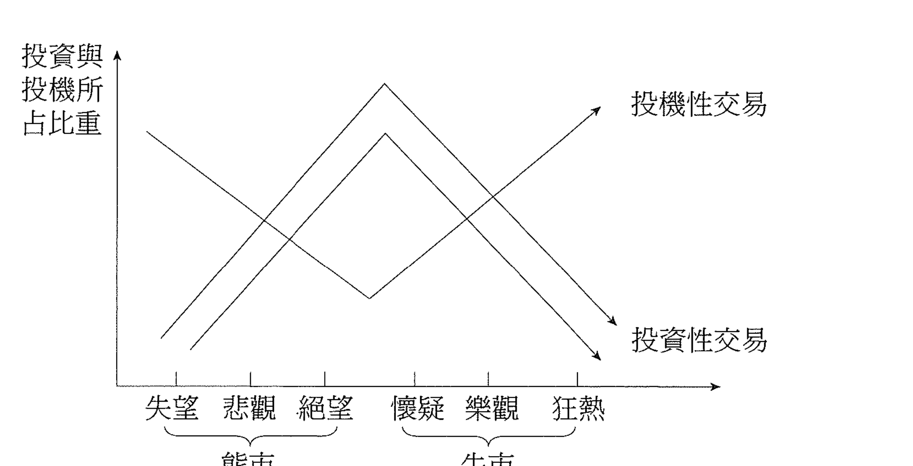

圖6-2-1 不同時期、不同類型交易的比重情況

從圖6-2-1中可以看出，在熊市的第三時期（「絕望」時期）及牛市的第一時期（「懷疑」時期）期間，投資性交易的比重趨於最大幅度，而投機性交易的比重趨於最小幅度。在牛市的第三時期（「狂熱」時期）和熊市的第一時期（「失望」時期），投機性交易的比重趨於最大幅度，而投資性交易的比重趨於最小幅度。

特別值得投資者注意的是不同類型的投資者在不同位置的交易行為。如圖6-2-2所示。「聰明資金」或者稱其為職業投資家是擁有大資金的投資性交易的投資者，投資大眾是擁有小資金的趨勢性投機性交易的投機者和交易者。因為投資者在牛市的末端，比在熊市的尾聲選擇性減少的缘故，導致在牛市的尾聲，一般投資大眾都處於滿倉狀態，所以比投資大眾處於有利地位的「聰明資金」將更願意出場，並且也具備出場的條件。而在熊市的尾聲，雖然一般投資大眾也處於空倉狀態，但職業投資者空倉的時間更長，因此更願意在此時買入，所以「聰明資金」總是提前於散戶入市或出市。這樣圖6-2-2表現的過程就出現圖6-2-1中所示的結果。

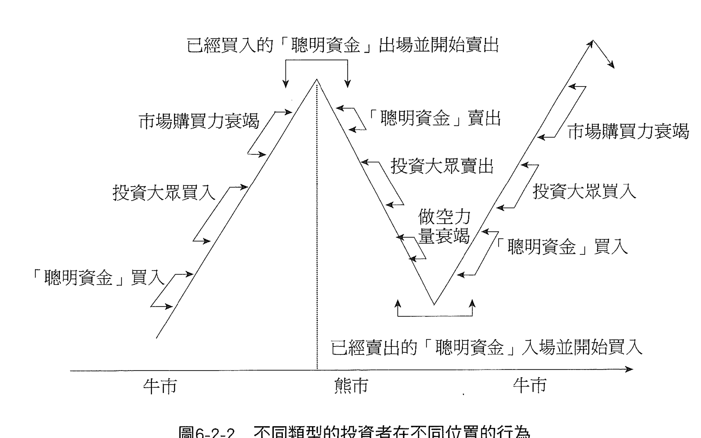

從整體上來看，投機者和散戶在次級修正和日常波動中賺小錢，而在基本波的水平上輸大錢，因此合計下來成為最終的輸家。而少數真正的職業投資家——「聰明資金」，則是在次級波和日常波動上輸小錢，而在基本波上賺大錢，因此成為最終的贏家。

根據以往的一些統計數據，在股票市場能夠長期成功的投資者，能夠長遠獲利的只占股市的5%～10%左右，其餘的都會在股票市場中虧損。全世界參與人數最多的市場中，贏家卻很少。股票市場已經發展了這麼多年，而且是順利發展，就股票長遠而言是不斷上漲的，但為何參與買賣的人卻大多數都是輸家？這是個耐人尋味的問題。

最初，技術分析僅被運用在股票市場，後來逐漸延伸到商品、債券、外匯與國際市場。但不論在哪一個市場，真正的技術分析方法所得出的結論必須與「群眾」的預期相互對立，這需要具備耐心、理性與客觀的態度。而成功的投資則要在經濟低迷、行情悲觀的情況下勇於買進金融資產，並在過度樂觀與陶醉的行情中賣出。

##### 二、支撐線、壓力線與三類投資者的關係

在前面，我們只討論了問題的一個面向，即在支撐線或壓力線區域投資者的動機，但是就同一個價格而言，為什麼會同時出現多頭和空頭呢？其實，壓力部位和支撐部位是由於不同類型的投資者對市場認識上的矛盾，進而採取不同的投資行為所產生的結果。

根據分析的目的不同，對於投資者的分類也不同。我們既可以像前面那樣將投資者分為多頭、空頭和觀望者，也可以將其分為投資者、投機者和交易者。主要是由於他們彼此遵循的投資觀念不同，所以他們的持倉時間是大相徑庭的。短的只有幾天、幾個小時，甚至幾分鐘；而長的有幾個月，甚至幾年，這就導致他們在同一價位有的人買進，有的人賣出，進而形成在一個價位的成交價格。

在牛市中，投資者中的多頭是長期買進者，一方面他們對於已經買進的股票打算長期持有。另一方面，在市場提供合適的機會時候打算再度買進，而在投機者中的多頭對於已經買進的股票只打算短期持有，只要所持股票的利潤達到目標或者只要有獲利就立即平倉。投機者是進行階段性操作，他們對股票是進行中期持倉階段性的操作，因此打算平倉的時間和空間要比投資者大，而比交易者要小。這樣就構成了不同程度的調整。如圖6-2-3所示。

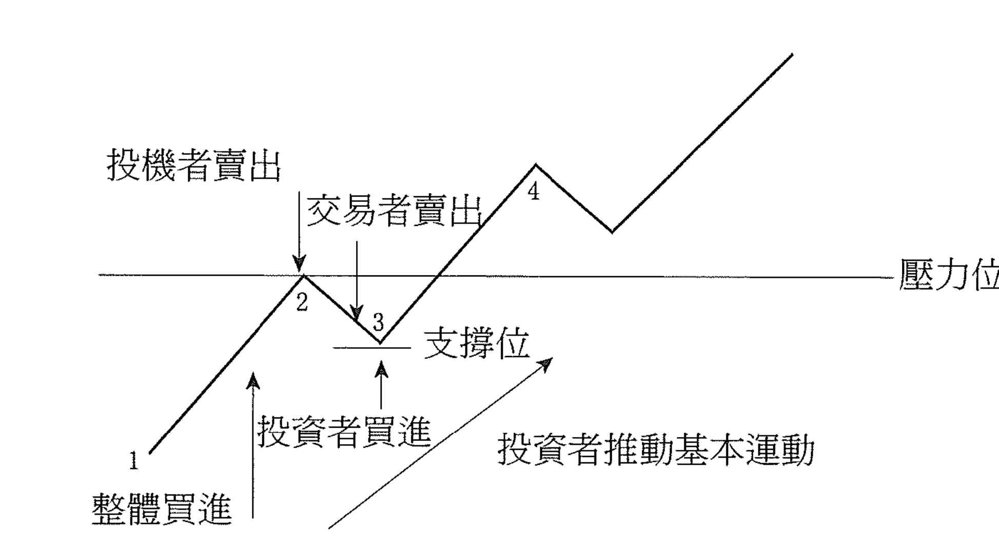

圖6-2-3 支撐位、壓力位與三類投資者的關係示意圖

投資者、投機者，以及交易者在第1處整體上都是多頭，因此價格一路上漲，而到2處投機者根據自己的操作策略開始對多頭頭寸進行賣出平倉，由於平倉數量較大，因此價格暫時停止了上漲，甚至出現一定程度的回跌。此時，交易者見到價格遇到了壓力，紛紛進行追回操作，對持有股票進行賣出平倉。這樣在投機者和交易者兩股力量的推動下，價格的上漲遇到了壓力，並產生一定程度的調整。這就是第2處壓力部位的形成過程，而據此畫出的水平線就是壓力線。

然而，投資者是堅定的長期多頭頭寸持有者，在價格跌到3處的時候，認為又是一個買進的機會，於是果斷買進。由於他們具有摧毀一切的力量，所推動的是基本波，所以價格很快在3處得到了支撐，並使價格迅速上漲。這就是第3處支撐部位的形成過程。據此畫出的水平線就是支撐線。在第2處到第3處的買入者通常是三種人：

- 1. 補倉者。在前期高點買入後，希望攤平成本，及早解套者。
- 2. 貪便宜者。覺得股價已跌得太多，現在買入很安全。
- 3. 前期成功獲利者。在高價獲利賣出的投資人，見股價遠遠低於自己的賣出價位，又進場買進，以求高賣低接。

隨著價格持續上漲，已經賣出平倉的投機者和交易者逐漸回到市場，投機者開始進行新一輪的操作，特別是當價格突破4處的時候，大量的採取追市操作的交易者又會湧入市場，此後的4處將變成支撐線。

需要說明的是，這個過程在整個一輪行情中一直保持着，只不過在投資者、投機者和交易者這三類投資者手中股票的持有時間會有很大差別，這導致不同層級的壓力線和支撐線，進而導致行情中的大浪、中浪和小浪。不過，在牛市中支撐的力量總是大於壓力的力量；在熊市則相反。

由於推動市場的根本力量是投資者，因此當投資者對於市場的看法發生轉變時，壓力和支撐將發生質變。也就是當牛市轉為熊市的時候，壓力線的作用將大於支撐線的作用。這將使得熊市行情能夠保持下去，也將引導投機者的投資策略產生變化，並使得投資者追市方向發生改變。在這當中由於交易者的行為最積極，因此他們對價格的直接影響也最大。

#### 第三節 三種投資者所遵循的投資觀念不同

作者在閱讀道氏的原文時發現，道氏用「Primary Tide」代表「基本波」。我曾經想過，道氏乾脆用「Long term trend（長期趨勢）」豈不是省事嗎？道氏為什麼偏用「Primary Tide」呢？在深思之後，才領悟到道氏用意之深。

對於眾多的、沒有耐心的人來說，所看到的是實實在在的水面波紋——漣漪；稍有耐心的人等到有風的時候看到波浪；而最具耐心的人才會在被海水沖刷過的沙灘上插一個尺規，關注海平面長時間的變化，透過對尺規的長期觀察，可以了解到現在海水的基本修正是處於漲潮還是退潮。

在市場中，剛開始的時候，更多的人所關注的是實實在在的日常波動，有一定經驗後，部分的人才發現，原來次級波具有很大的波幅，並維持一段不短的時間，只有極少數人才注意到更大層級，或者可以說是最大層級的基本波是有很強的規律性。

需要注意的是，「基本波」的學問在於「基本」兩個字，它代表最大層級。其實，基本波並非是真實可見的價格波動，它是深藏在日常波動和次級波中的深層次的波動，所以我們在現實中看不出基本波的價格是多少，而只能看出基本波是上漲還是下跌，即牛市還是熊市。要發現基本波動需要用「尺規」這樣的工具，並且發現基本波的過程是需要技術的，這才是技術分析的真正含義。也就是需要用技術方法、技術工具剝離日常波動和次級波的過程，才是真正具有意義的技術分析。通常人說的技術分析，可能僅算得上是「看圖說話」，或者乾脆叫做「假技術分析」，這是假技術派失敗的原因。

技術分析的真正含義不是「看圖說話」，而是透過市場表面的波動，探索市場基本波的規律方法。技術分析最終的目的就是為了確認市場和股票的基本波是上漲還是下跌。但是技術分析派發展到今天，卻把這最基本的一點忽略了，執著於如何精確地預測下個月、下一週、隔一天，甚至下一個小時、下一分鐘的具體走勢和價位，並因此發明了許許多多眼花撩亂的「新技術、新方法」，但是最終都沒能使散戶逃過失敗的命運。

希望能判定海浪中某一瞬間的小浪花飄向何方及波動幅度，過分注重技巧的使用而忽略基本波，將原本並不深奧的投資弄得複雜異常，這是假技術分析人士走入失敗的悲哀。究其原因，現代社會競爭激烈，生活節奏加快，分析師們為了自己的職位和錢包，為了迎合現代人希望快速致富的夢想，憑藉中長期趨勢耐心地慢慢累積財富的方法已經無法滿足人們日益貪婪的胃口，可以說人性的弱點註定了假技術分析的失敗。

基本波是投資者所主要考慮的，對於投機者較為次要。而次級波與日常波動都是附屬於基本波之中，唯有明白它們在基本波中的位置，才可以充分了解它們，並從中獲利。道氏堅信，大部分股市投資者鍾情於市場的基本波，所以道氏理論的主要著眼點是股市三種運動中的基本波。因為一旦股市潮流形成之後，儘管也會時常發生次級波的干擾，出現日常波動的雜訊，但其整體趨勢仍會繼續延伸下去，直到整個基本波發生根本性的逆轉。

這個原則也適用於投機者，他的操作目標是以順著次級波的方向為投資策略。然而，這種方式不是道氏所贊成的。儘管投機者可以利用日常波動的發展，觀察次級波的變化徵兆，不過他的投資觀念顯然不同于投資者，只不過辨識趨勢變化的基本原則相似而已。然而，如果希望掌握次級波，他必須了解次級波與基本波的關係。

# 理論篇

由於次級波的欺騙性常被誤認為是基本波的改變，這使得投機者屢屢上當，且其走勢也會受到一定的人為操縱，通常人們所說的順勢而為並不容易做到，即使是順勢而為也不一定能獲利。

交易者往往在過分看重圖表分析的時候，而把造就圖表形態的真正力量丟在腦後。其實，支撐線和壓力線，以及價格形態之所以能產生作用，絕不是線形圖或我們在線形圖上畫出的輔助線條具備什麼魔力。事實上，這些工具之所以發生作用，是因為它們如實描繪了投資者的所作所為，使我们得以清晰地把握投資者對各類市場事件的反應。

從表面上看，三類投資者之間只是持倉時間長短的不同，但是從根本上講，主要是他們所遵循的投資觀念有本質的差別。由於多年來作者一直主要從事有色金屬期貨交易，所以比較了解有色金屬的交易情況，特別是銅的開採、冶煉、加工、貿易及使用等多方面的情況。在長期避險的過程中，可以觀察出不同投資者的投資觀念的產生根源。

透過我多年的研究發現，儘管在西方經濟學中占主流地位學派的是供需關係決定價格，並認為透過調節供需關係就可以調整價格。但實際上，在供需關係中，供應與需求兩個方面對於價格的影響力道並不對等。供應確定價格的長期趨勢、需求決定價格的中期趨勢、投資行為決定價格的短期趨勢。

在三種基本類型的參與者中，投資者整體是根據生產供應情況進行投資的，他們大多是價值發現派，通常以價值分析為主；投機者整體是根據消費需求情況進行投資的，他們大多是基本因素分析派，通常以基本分析為主；交易者整體是根據市場行為情況進行投資的，他們大多是技術線形分析派，通常以技術分析為主。由於這三類投資者在投資觀念上存在巨大的差別，所以在市場行為方面也存在巨大的差別，而不僅是投資時間的長短。

總之，「聰明資金」屬於價值投資者，他們決定確定價格的長期趨勢，也就是基本波；精明的專業投機者確定價格的中期趨勢，也就是次級波；散戶確定價格的短期趨勢，也就是日常波動。歷史是由人民創造的，價格是由散戶促成的。大眾行爲受大眾情緒影響，意味著不理智的行爲。這種不理智的行爲使得散戶造成壓倒性的虧損的同時，為「聰明資金」帶來了巨大的利潤。這就是人們所說的「一將功成萬骨枯」。三類投資者只不過是具體地分類，但實際上這三類投資者的觀念，同時共存於我們每一個人的大腦中。從這個意義上來說，三類投資者是由我們的大腦結構決定的，透過建立正確的投資哲學、投資觀念，利用對自己有利的大腦結構，以決定自己成為價值投資者，這才是我們學習道氏理論的目的。

## 三大定律的建立

> 或許生命真的來自于大海，否則臥室門人類能從大海中獲得那麼多啟示？

### 第七章：三重運動原理

——道氏理論的核心思想

三重運動原理是道氏理論核心的核心，也是建立道氏理論思想體系的基礎。我們從物理和化學當中得到的是啟發是，有什麼樣的結構就會有什麼樣的性質和規律。因為事物的性質和規律來自於它們的結構。這個思考模式可以引申到市場當中，要想了解市場的性質和規律，我們就必須了解市場的結構。三重運動原理所要指出的就是市場的結構，然後我們據此可以了解市場的規律。

#### 第一節 來自大海的啟示

道氏理論的核心思想——三重運動原理是自然法則的產物。大海有三種運動，潮汐、浪濤和波紋。道氏受到大海的啟發，用大海的三種運動來比喻市場的三種運動，將股市具體地比喻為澎湃淘湧、千姿百態的大海。股市的漲落也可分別對應於三種不同類型的運動，並分別根據它們對於股市漲落的幅度大小、週期長短，以及對於未來的影響強弱而定義。

在海浪來臨時，住在海邊的人可採用在海邊放一隻尺規，讓一個來臨的波浪推動到其最高點的方法來確定海浪的方向。當下一個波浪推動海水高出其尺規時，他就可以知道潮水是在上漲，並認定漲潮開始了。如果他在尺規上做出每一波浪的最高水位記號，最終將會出現一個波浪在其上一個記號處停止，並開始回撤到低於這個標準，這時他就可以知道潮水已經回落了，並認定退潮開始了。

從堤岸尺規上，我們可以讀出每次波浪捲起的最高點置，然後透過每次比較這些最高點置的相對高低，就能測定海浪到底是漲還是落。如果讀數依次遞增，那麼就說明潮水依然在向陸地推進。只有當浪頭逐步遞減的時候，觀測者才能確知潮水已經開始退卻。

道氏把一個牛市比喻為一個湧來的漲潮，它將水面一步一步地向海岸推動，直到最後達到一個水位高點並開始反轉。接下來的則是熊市，可以比喻為退潮。但是無論是漲潮還是退潮的時候，波浪都一直在湧動，不斷地衝擊海岸並撤退。牛市可以比喻為一個漲潮。在漲潮過程中，每一個連續的波浪都較其前浪達到海岸更高的水平，而在其回測時，都比其前一次回測位置要高。熊市則可以比喻為一個退潮。在退潮的過程中，每一個連續的波浪上漲時，均比其前浪達到的水位低一點，並在其回測時，均比其前浪離開海岸更遠一點。

這些相對於大海的波浪就是股市的次級波。依據其波動與海浪的方向相反的波動幅度，來區分到底是基本波，還是有時與基本波相同，有時又與基本波相反的次級波。與此同時，海面一直不斷地被小波浪、漣漪，以及海風衝擊著，它們有的方向與波浪方向相同，有的則相反，有的則橫向穿行——這好比股票市場中的日常波動，每日都在進行著無關緊要的小趨勢波動。

基本波表示股市整體趨勢的興旺強盛或者低迷衰退。基本波通常持續一年以上，它如同大海中的潮汐，時而漲潮，時而退潮，周而復始。次級波是股市所產生的，時而與基本波背道而馳，時而又與基本波同行的短期和暫時的現象，一般可能持續數周到數月之久。它恰似大海中的波浪，無論潮汐來去如何，也都會漲落不斷，無休無止。日常波動也就是股市日復一日的隨機變化和波動，在多數情況下，只能維持幾天，甚至短到幾個小時。它就像大海中的漣漪，可能起因於任何局部或臨時的變化，而且連續不斷，與潮汐的漲落和浪潮的進退並無太多關聯。

滄海橫流、大浪淘沙的這三種運動形態，就是對於股票市場波瀾壯闊、氣象萬千的生動寫照，這就是道氏表達趨勢的方式。按照道氏的說法，市場的基本修正，是廣闊、吞沒一切的「潮流」，這個潮流時常被「波浪」或次級的反作用和反彈所打斷。小規模的市場波動是波浪上的「波紋」。除非小規模的市場波動能形成「線」，否則通常無足輕重。

道氏將市場波動分為基本、次級、日常三種波動，而它們也是由不同因素影響的相互獨立波動。這三種運動就像漣漪、海浪和海潮一般，分別受三種力量影響而進行獨立的波動。日常波動受資訊和人的心理活動影響，就像漣漪受海風的影響；次級波受供需影響，就像海浪受海水本身的既有頻率影響；基本波受價值影響，就像海浪受萬有引力的影響。將市場的波動進行分類，將不同性質的問題分別出來、然後區別對待，這就是道氏的投資哲學。

#### 第二節 三重運動原理的形成過程及內容

道氏抓住了事物發展變化的主要矛盾，正確地歸納出最有價值的股市價格波動理論，進而為追隨者建立道氏理論打下了基礎。1900年12月19日，道氏在《華爾街日報》的評論文章中寫道：「我們可以認為市場永遠包含著三種運動，它們是同時存在的。首先是日復一日的、範圍狹窄的日常波動；其次是次級波，期間從兩週到1個月或更長些；最後是基本波，它的週期至少是4年。」這三句話概括了道氏理論對於股票市場價格波動的本質，並且強調這三種運動是同時發生的。

關於市場的結構，實際上在道氏的構思中已經明確地指出，他繼續在1901年7月20日的文章中有如下描述：

> 「這個體系的問題在於小波動總是包含在大波動之中，機會均等的趨勢總是傾向於均衡地發生，每種可能的組合都可能出现。在股票交易中經常存在着一種長期的波動或連續很多天的上漲或下跌，從長期的觀點來看，它們是符合這種理論的，但是從許多連續的短期觀點來看，任何以此為基礎進行的交易都將遭到失敗。」

> 「以波動和反波動的法則為基礎而建立的理論是更實用的。市場中的基本波動常都包含著一次至少達到其3/8規模的反向作用的次級波，這似乎已經是事實。如果一種股票上漲了10點，它很可能會再下跌4點以上。這個法則似乎很靈驗，無論上漲的幅度有多大，20點的上漲通常會帶來8點以上的下跌。」

「這個體系的問題在於小波動總是包含在大波動之中」。這句話所指出的是市場的結構和層次，即次級波總是包含在基本波中，日常波動總是包含在次級波中。

「機會均等的趨勢總是傾向於均衡地發生，每種可能的組合都可能出现。」這句話提出市場處於均衡發展的思想。牛市與熊市是一對機會均衡發展的趨勢；正向次級波與逆向次級波是一對均衡發展的趨勢；上漲的日常波動與下跌的日常波動也是一對均衡發展的趨勢。這三種均衡發展的趨勢加乘在一起，會形成有一定規律的各種組合結構。所謂「歷史會重演」，實際上就是市場的多層次、多結構的重演。

而「波動和反波動的法則」是構成市場均衡發展的客觀依據。這是一種「二元」思考理論。它使得市場不會發生極端的上漲或下跌，使市場處於牛市和熊市的輪動中不斷地均衡發展。

因此，在每一輪基本波的發展過程中並非是一帆風順的，其中的反波動使得波動的發展得到調整，進而使波動能夠分階段、分層次、有步驟地進行。

不過，道氏所說的「基本修正，通常都包含著一次至少達到其3/8規模的反向作用的次級波」，或者「如果一種股票上漲了10點，它很可能會再下跌4點以上」，都只是為了能夠具體地說明問題而作的具體性論述，不能將其數位進行絕對化的理解。

此外，關於三個層級的波動所需的時間，道氏寫過一篇題為《波動中的波動》的文章，出現在《華爾街日報》1902年1月的「回顧與展望」專欄裡，他寫道：「市場中存在三種相互融合的確定波動，這是毫無疑問的。首先，是針對地方性事業和特定時間點的買賣頻繁而產生的日常波動。次級波所需的期間從10天到60天不等，平均而言大約在30～40天之間。第三種波動的期間約是4到6年的大波動。」

站在今天的角度來看，道氏的這段話裡所提到的時間並不準確，甚至是有問題的。正如漢密爾頓所指出的：「請注意道氏的这番話寫於許多年前，他並沒有今天這種分析股票市場波動的紀錄。他在此處提出的基本波的期間，被以後的經驗證明是太長了，而且經過仔細的檢查發現，在道氏寫這番話之前，也從未出現過『4～6年』的大波動，甚至很少能超過3年，更多的是少於2年。」

實際上，基本波所需的時間是可以遠遠少於道氏所提出的4年，而且試圖根據10年的恐慌週期理論，把牛市和熊市大致上平均分爲各用5年的做法也是一種不自覺的誇張。根據經驗顯示：基本波所經歷的時間至少在1年以上，通常還要長得多，與此相伴隨的是次級波——在熊市時期的劇烈反彈，或者在牛市時期的劇烈下跌。然而，我們不能過於嚴格地要求先驅者們的嚴謹性，他們的開拓和原創精神才是我們真正要學習的。

儘管大海的波動對道氏有一定的啟發，浪潮、波浪及漰潮的比較在道氏理論最早的時期就已經開始了。但是這個比喻不能走得太遠，股市中的浪潮與波浪遠不如大海的浪潮與波浪那樣具有明顯的規則。用以預測每一次浪潮及海浪的準確時間的時間表可以提前製作，但道氏理論卻不能對股市提出一個時間表。

在道氏提出基本思想的基礎上，雷亞繼續由道氏與漢密爾頓的著述中，整理出他所謂的「定律」。這些定律出版於1932年，基本上仍然適用於今天。為了確了解這些定律的意義，最好準備一套「道瓊工業平均指數」與「道瓊運輸指數」完整的走勢圖，包括成交量在內，並配合漢密爾頓與雷亞的相關評論。一旦了解漢密爾頓與雷亞的思想精髓之後，你可以很容易地將這套理論運用於當前的市場。相關討論請參考圖7-2-1。

雷亞根據道氏和漢密爾頓的論述提出的「定律一」——市場的三種走勢。市場指數有三種走勢，三者都可以同時出現。第一種走勢最重要，它是基本波：整體向上或向下的走勢而稱為「牛市」或「熊市」，期間可能長達數年。第二種走勢最難以捉摸，它是次級的反轉：它是牛市中的重要下跌走勢，或是熊市中的反彈。修正走勢通常會持續三個星期至數個月，第三種走勢通常較不重要，它是每天波動的走勢。

這三種趨勢的最大差別是，時間的長短和波動幅度的大小。將價格走勢歸類為三種運動，並不是一種學術上的遊戲。「市場」一詞意味著股票價格在整體上以趨勢演進，最重要的是基本波。它們是大規模的上下波動，通常持續幾年或更長的時間，並導致股價增值或貶值20%以上。

基本波在其演進過程中，穿插著與其方向相同或相反的次級波，有時當基本波暫時推進過頭時，會使其產生回撤或調整。最後，次級波由小趨勢或者日常波動組成，而這對大勢的作用並不是十分重要的。為了使讀者對三重運動原理的內容更清楚，在此，作者再根據以上的論述，精確地描述一下三重運動原理。

**三重運動原理：** 在結構上，三重運動是指基本的上漲或下跌修正、次級下跌或反彈波動，以及永不停歇的日常波動。在任何市場的發展過程中，都同時存在著這三種運動，彼此的方向可能相同也可能相反。在可預測性的方面，大層級的基本波是最重要的，基本波的規律能夠為我們所把握，但日常波動這樣小層級的波動具有很強的隨機性，很難被我們把握。而次級波的規律性介於基本波與日常波動之間，雖然在一定程度上可以被認識，但是難以準確把握，因此，帶有很強的欺騙性。這三個層級波動的驅動机理不同。在時間上，日常波動，持續數天至數個星期；次級波，持續數個星期至數個月；基本波，持續數個月至數年，通常在一年以上。

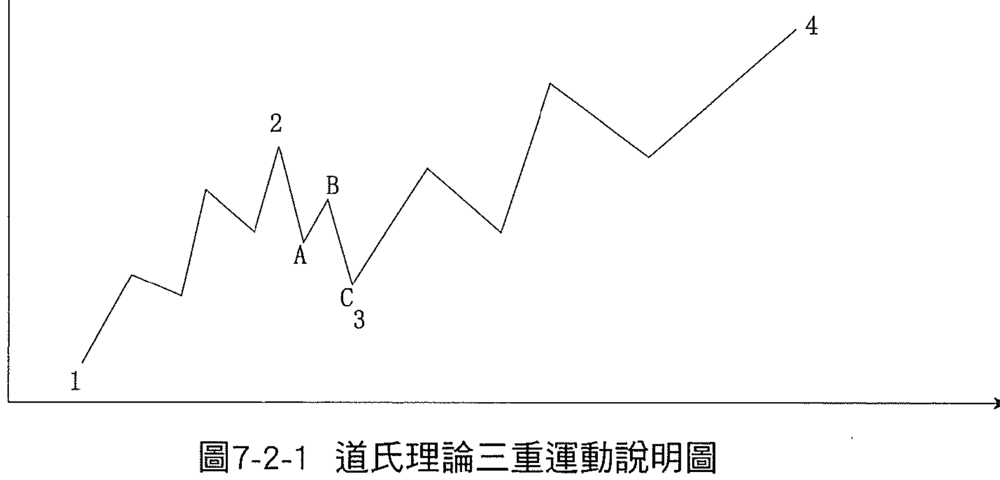

本圖表示了趨勢的三種規模：基本波、次級波和日常波動。點$1、2、3、4$表示了基本上漲趨勢。$2–3$浪代表基本上漲趨勢中的次級調整。同時，每一個次級的浪也可劃為更短的趨勢。例如次級波$2–3$可分成日常波動$A–B–C$。

如圖7-2-1所示，股價第一級的波動，即基本波，是最為重要的價格波動形式，是投資者獲取戰略性利潤的基礎，也就是我們通常所說的牛市或熊市。第二級波動，即是次級波，也就是我們通常所說的調整或反彈，是最具虛擬性、欺騙性的波動，是市場得以存在的基礎，也是絕大部分投資者虧損失敗的陷阱。第三級波動，即是日常波動，是最無意義的價格波動，是誘惑投資者不斷參與的誘餌，也包括盤中即時股價走勢。日常波動走勢目前無法尋找到不變的規律。從本質上看，日常波動具有最大的隨意性、不確定性和可人為操縱性。

#### 第三節 確定趨勢的定義

在技術分析三大假設中的第二條指出，市場行為沿著趨勢方式演繹。市場行為沿著趨勢波動是指，市場行為的變動不是朝一個方向直來直去，特別是價格或指數的軌跡酷似一系列前仆後繼的波浪，具有相當明顯的波峰和波谷。從圖形上看，就是一條曲折蜿蜒的折線，同時中間還夾雜有波折，每個折點處都會形成一個波峰或波谷。無論這些波峰和波谷是依次遞升，還是依次遞降，或者橫向延伸，其總方向就構成了趨勢。道氏首先利用水平線來測量這些波峰和波谷的相對高度，進而看出趨勢的方向。

##### 一、 趨勢的方向

趨勢的方向有三個：上升、下降、水平（有時也叫無趨勢）。若圖形中每個後面的波峰和波谷都高於前面的波峰和波谷，這就是常說的一個底比一個底高或底部抬高，則趨勢就是上漲的。見圖7-3-1。

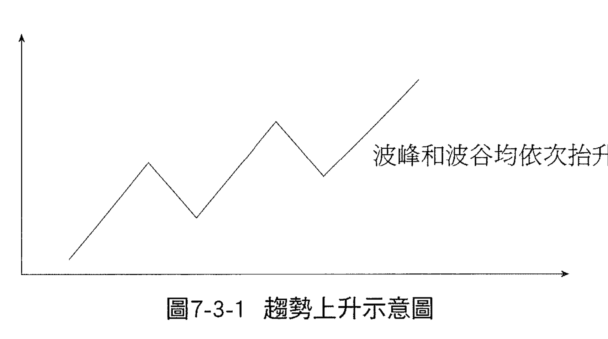

若圖形中每個後面的波峰和波谷都低於前面的波峰和波谷，這就是常說的一個頂比一個頂低或頭部降低，則趨勢就是向下的。見圖7-3-2。

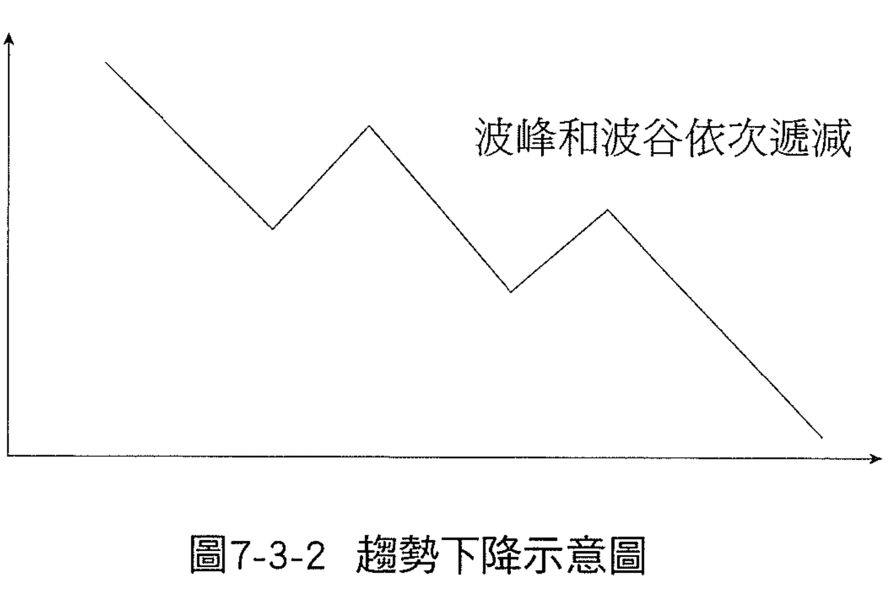

如果圖形中後面的波峰和波谷與前面的波峰和波谷相比，沒有明顯的高低之分，幾乎呈水平延伸，這時的趨勢就是水平方向，我們把橫向延伸趨勢定義為一系列依次橫向伸展的波峰和波谷。見圖 7-3-3。

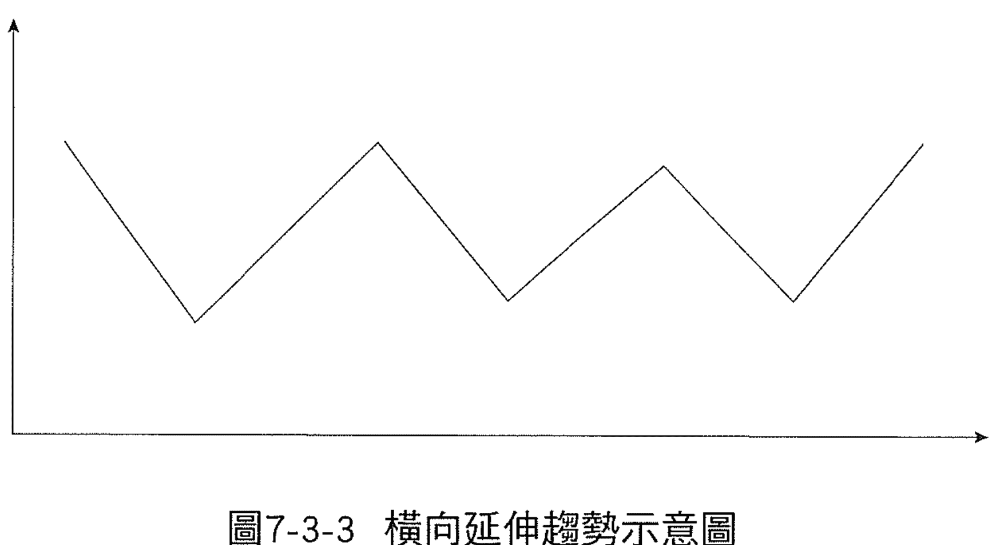

其中波峰和波谷均水平延伸，這類市場常常被稱為「無趨勢」市場。

就水平方向本身而言，也是極為重要的，僅就保守的估計來看，至少有 1/3 的時間，價格處於水平延伸的形態中，屬於所謂「交易區間」。所以弄清楚這個區間頗為重要，但這種情況常被忽視。大多數的技術分析方法，在對處於水平方向的市場進行分析時都容易出錯，或者說作用不大。根據這種水平延展的狀況顯示，市場在一段時間內處於均衡狀態，也就是說，在上述價格區間中，供需雙方的力量達到了相對的平衡。

對於交易者來說，理解一種趨勢的本質和特性是其可獲得的種種資訊中最重要的單一資訊，這使得他能夠選擇最適當的交易策略。趨勢可以是變化快速或者是緩慢的，它們是由只持續幾天或幾周的日常波動、持續數週或數月的次級波和可以維持數月，甚至有時是數年的基本波組成。一個穩定的趨勢顯示了一個低波動性的穩定上漲，價格上漲和下跌的幅度不大。當其波動性開始加大時，通常是趨勢要變得不穩定的一個早期信號。

如圖7-3-4所示。在LME鋁的迴線圖中，左邊為下降趨勢，當前為橫向延伸趨勢。如果市場決定性地向上升突破了2001年11月至2003年7月的高點，則將開始新一輪上漲趨勢。如果市場跌破低點之下，則下降趨勢恢復。

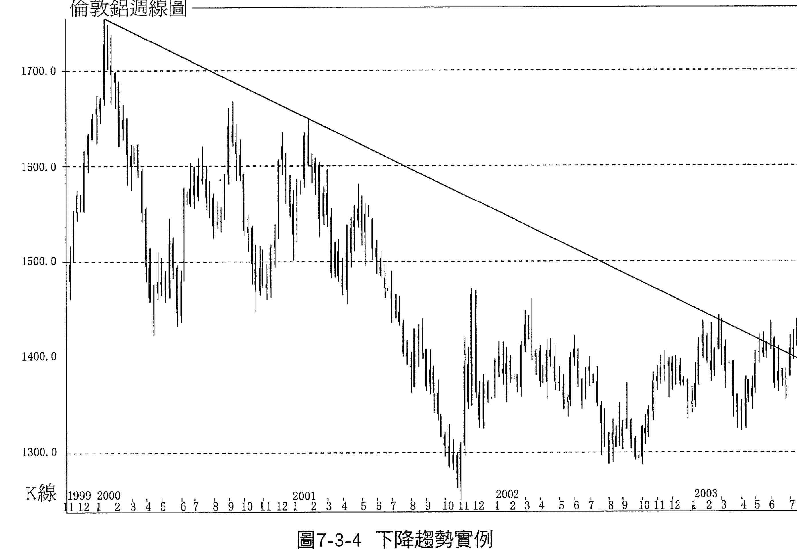

在LME鋁的迴線圖中，左邊為下降趨勢，當前為橫向延伸趨勢。如果市場決定性地向上升突破了2001年11月至2003年7月的高點，則將開始新一輪上漲趨勢。如果市場跌破低點之下，則下降趨勢恢復。

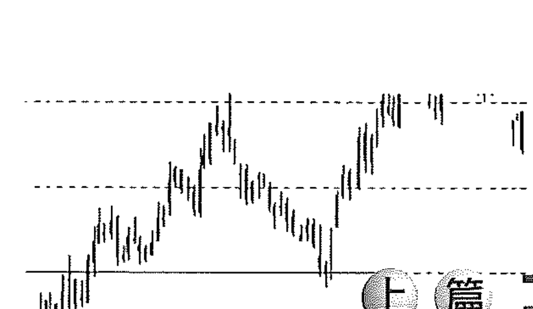

我們把這種持平的走勢定義成橫向延伸趨勢，更白話的說法是「沒有趨勢」。同時，價位下一步朝哪個方向走是沒有規律可循的，可以向上也可以向下，而對這樣的對象去預測它朝何方波動也是極為困難的。不過，這種趨勢得到了道氏極大的注意，並用「波紋線」來描述此類價格形態，以及所代表的意義。

##### 二、趨勢的層級

趨勢不但具有三個方向，而且道氏將趨勢劃分為三個層級，或者叫做三種運動。這三種運動就是基本波、次級波和日常波動。實際上在市場上，從覆蓋幾分鐘或數小時的、非常短暫的趨勢開始，到延續50年乃至100年的超長期趨勢，隨時都有無數個大大小小的趨勢同時並存、共同作用。不過，道氏對趨勢的分類僅限於上述三種。

- 基本波是趨勢的主要方向，是投資者一定要弄清楚的。一般持續的時間比較長，通常1年或1年以上，但沒有確定的時間期限。
- 次級波是僅次於基本波的中期趨勢。由於趨勢不會是直來直去的，總有個局部的調整和回測，次級波的任务正是完成這個使命，一般從3周到數月不等，也沒有確定的時間期限。
- 日常波動是在次級波中進行調整。日常波動與次級波的關係就如同次級波與基本波的關係一樣，只是反映幾天內的變化，通常被定義成短於2到3個星期，更沒有確定的時間期限。

這三個層級的趨勢，最大的區別，不僅是時間的長短和波動幅度的大小，更重要的是基本波有很強的規律性。次級波有一定的規律性但很難把握，因此，感覺在騙人。而日常波動大致上容易受大衆情緒影響，因此波動有隨機性。

這三個層級的趨勢並不是孤立存在的，每個趨勢都是其上一級更長期趨勢的一個組成部分。比如次級波是基本波中的一段組成部分。在牛市中，市場暫緩漲勢，

# 三大定律的建立

先調整數月，然後再恢復上漲，調整期間走勢就構成了牛市中的一部分。而次級波也是由一些較短期的日常波動所構成，呈現出一系列短暫的上漲和下降。不過，在區分基本波、次級波及日常波動這三種運動的時候，需要注意以下兩點：

- 1. 對基本波、次級波及日常波動的區別。儘管正確、準確地區別基本波、次級波及日常波動對投資成敗具有至關重要的意義，但是不論使用何種技術方法，都不可能達到百分之百的準確和正確地區分。投資者應該清楚，對市場的三種運動的區分，不可能達到盡善盡美的程度，因此，必須容許一定限度的錯誤空間。

- 2. 對基本波、次級波及日常波動的區分結果不是唯一的。投資家的重要工作之一，就是識別基本波，並根據其波動形態辨識其統計特徵，最終形成完整的交易策略，但是三種運動的區分結果並不是唯一的。由於三種運動是大致分類，而在每一類當中都可以分為很多層面，因此投資者對具體市場的統計特徵會有所不同，但是這只是量的區別，大致來說，區別不大，即使有一些區別，也不會影響對市場的整體把握。

##### 三、趨勢就是三重運動的規律

前面我們是從大層級的運動是由小層級的運動組成的來理解三重運動，當然也可以將其理解為三種運動的加總。道氏正確地指出在股票市場中同時存在著三種確定的運動——上漲或下降的基本波、不時讓前者中斷的次級下跌或反彈（視具體情況而定）、無法計算的日常波動。

而在股票市場的基本波和次級波的過程中，自始至終都存在著一種明顯的日常波動。這種對於股市價格波動的多層次理解和剖析給予後來的股市投資分析極其重要和深遠的影響。

趨勢具有慣性波動性質，同時我們必須注意趨勢反轉的辨別。可以說，不知道趨勢反轉，就不能夠真正認識趨勢，所謂趨勢也就沒有意義。我們建立的是輪動

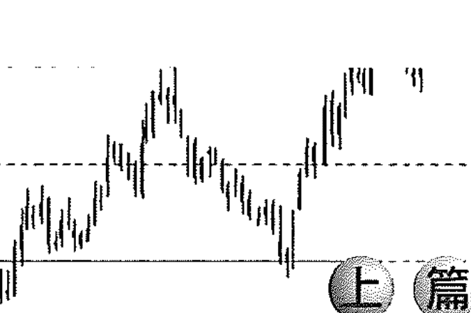

# 三 篇 理論篇

思考的關係，而不是線性思考的關係，這裡可以借用太極圖說明。在太極圖的大圓（大系統）中包含「陰、陽」兩個互為因果的子系統，它們互相競爭、瓜分已經被限定的大系統資源；因果不斷循環而形成輪動鏈，同時也構成相對趨勢。

對這種輪動，我們可以有兩種進一步的理解。一是正向輪動與負向輪動，它分別表現為趨勢的螺旋上升（牛市）和螺旋下降（熊市）。二是自我加強的輪動與自我抑制的輪動，即正循環（正向次級波）與負循環（逆向次級波）。沒有正循環就解釋不了趨勢的發展，以及短時間內會發生劇變，沒有負循環就解釋不了趨勢有較長期的停滯，甚至發生趨勢的反轉。兩種理解在本質上是一致的，但第一種理解注現象，第二種理解更深刻。

但是相當多的投資研究方法（包括各個分析流派），都違背了這個重要的科學思考方法。例如用趨勢線定義趨勢的方法。從表面上看，無論是用高點或低點定義趨勢，似乎趨勢線定義法與道氏「趨勢判定」定律是相同的。事實上，由於趨勢線定義法只考慮了一個要素，而非兩要素，因此用趨勢線定義趨勢的方法與道氏定義方法有本質上的區別。

趨勢就是市場價格整體波動的規律。基本波是價格波動的長期大方向，了解了基本波投資者才能做到順勢而為。

次級波與基本波的方向可能相同，也可能相反。如果次級波嚴重背離基本波，則被視為是次級的反轉或修正。次級波在基本波中的調整形式，通常持續3個星期到3個月。次級波的調整通常可回測到大約先前趨勢整個進程的1/3到2/3之間的位置。常見的回測幅度約為1/2。而道氏認為基本波的發展至少會出現一次3/8規模的逆向次級波。當然這不是絕對的，具體幅度還要根據各種市場情況而定。

次級反轉必須謹慎評估，不可將其誤認為是基本波的改變。次級波是在基本波過程中進行的調整，因為市場的趨勢不會是直來直往的，總有個局部的調整和回測，次級波正是完成這個使命，一般從3週到數月不等。這是道氏理論中最微妙和困難的一環。

# 三大定律的建立

而日常波動通常持續不到3個星期，是次級波中較短期的支波。日常波動是在次級波中進行的調整。日常波動與次級波的關係，就如同次級波與基本波的關係一樣，不過，反映的是幾天內的變化。

毫無疑問，道氏將市場的價格波動分成三重運動是正確的，他指出市場的結構和層次，指出市場系統兩個基本元素，即牛市和熊市力量轉換的規律。三重運動和週期輪動是我們建立市場結構的基本思想。最終週期輪動在牛、熊轉換的過程中，表現為歷史的重演。

什麼是「趨勢」？道氏並沒有直接給出趨勢的定義，而僅給出上升趨勢、下跌趨勢說明性的定義，也就是牛市和熊市理解性定義。我們把牛市理解為一系列依次上漲的波峰和波谷；把熊市理解為一系列依次下降的波峰和波谷。所以作者認為，所謂趨勢就是在牛市當中有下跌和熊市當中有上漲，且夾雜著日常波動的不斷延續的三重運動序列，趨勢就是三重運動的演進。

趨勢概念在技術分析中占有重要的地位，是技術分析研究的核心問題。三重運動原理是道氏理論的核心內容，同時也是道氏理論對技術分析最大的貢獻之一。這個原理發源於自然法則，因為其基本哲學思想是一致的，所以準確地說，理論系統的思考邏輯並無差異。由三重運動這個概念，我們可以推導出道氏為趨勢下的定義。

道氏對基本波與次級波的比例關係的描述，也是符合週期理論的比例原理。儘管次級波有時候波幅非常劇烈，但是波幅再大也不會大於基本波的波幅，所以我們不能教條地理解道氏所說的具體數值。

透過三重運動原理我們知道，隨機性是市場日常波動的本質特徵；而規律性是市場基本波的基本特徵；不穩定性是次級波的基本特徵。在後面的內容當中，我們將要論述基本波按常態分佈週期性演繹，次級波按波浪結構發展，價格以日常波動方式表現。身為投資者，只有在對這些基本特徵具有深刻認識的基礎上，才有可能制定出正確的投資戰略和投資方法。

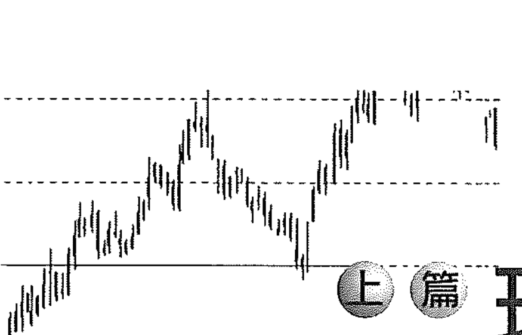

## 上篇 理論篇

總之，道氏正確地指出在股票市場中同時存在三種確定的波動——不斷引誘交易者進入隨機性很強的日常波動；不時擾亂基本波方向，或讓基本波中斷，進而欺騙投機者的次級波，以及只有真正的投資者才能認清的、深藏不露的基本波。至於說三種運動的支配關係，經過作者長期研究認為，次級波主要受基本波支配；日常波動主要受次級波支配；而日常波動受基本波的支配關係不大。

大致上來看，大多數投資人在市場上是在次級波和日常波動的水平上賺小錢，但在基本波的水平上輸大錢，如此一來一往成為最終的輸家。而少數真正的職業投資家則是在次級波和日常波動的水平上輸小錢，但在基本波的水平上賺大錢，因此成為最終的贏家。

此外，三重趨勢的劃分也為其後出現的道氏理論打下了良好的基礎，因為道氏理論也是受到大海的啟示。也許要想對道氏理論的這個思想有一個完整的理解，投資者務必帶著道氏理論的眾多問題，最好找一個有風的日子去看海，海水的潮起、潮落，帶著波光粼粼的海浪將會給你啟示。只有面對大海，才知道人的渺小，大自然有一種神奇的力量發揮著永恆的作用，那便是道氏理論的精髓所在。

### 第八章：
具有鬆散週期及近似常態分布結構的基本波

——基本波可預測原理

#### 第一節 基本波可預測原理

正確確定基本波的波動方向是決定成功投資（投機）的重要因素，投資勝負的更關鍵因素，也在於是否可以把投資建立在基本波的正確一方。

##### 一、市場並不像在風中搖擺不定的氣球

道氏有一個優點，他可以用最樸實的語言來表達深邃的哲理。道氏在1901年7月20日的《華爾街日報》上的一篇文章中說：「市場並不像一個在風中搖擺不定的氣球。從整體上看，它代表著一種嚴肅的、經過深思熟慮的努力，那些有遠見、資訊充分的人，正試圖讓價格與現存價值或在不久以後將存在的價值相適應。出色的交易者所想到的並不是價格能否被抬高，而是被購買的資產價值能否讓投資者和投機者們在半年以後以高於現有價格10~20%的價格買進股票。因此，在分析股票市場時，首先要知道一種股票在3個月以後的價值，然後再觀察操縱者或投資者們是否正在讓價格向那個數值靠近。這種方法可以很清楚地分析出市場的波動。了解價值也就明白了市場波動的含義。」這是一段非常樸實、簡單，但又是辨證、非常深奧、非常富有哲理的話。他正確地指出，市場的基本波

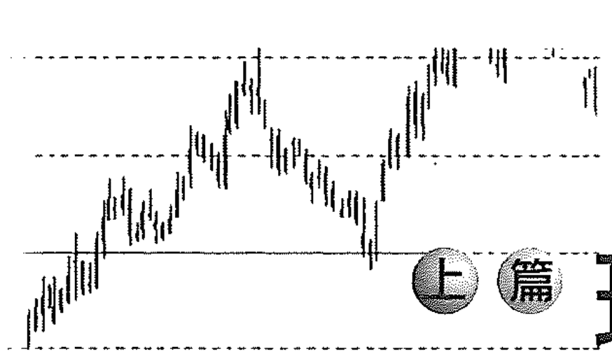

# 理論篇

是可以被預測的。

「市場並不像一個在風中搖擺不定的氣球」。也就是說，市場的波動是有一定規律的。「球」會搖擺，且「不定」，即市場是可以被預測的，因為市場的波動是有一定規律但市場又是測不準的，因為市場總是在「搖晃」。

「從整體上來看，它代表著一種嚴肅的、經過深思熟慮的努力」，也就是說，市場在無形的引力作用下，隨引力向著一個確定的方向發展。這個引力是由價值對於價格的引力。確定的方向就是價值是增值還是貶值，而股票價格的平均指數能向我們顯示目前和未來可能的價值。

**「那些有遠見、資訊充分的人，正在試圖讓價格與現存價值或在不久以後將存在的價值相對應。」**就是說，在有遠見、資訊充分的投資者參與下，價格向價值靠攏。因此只有正確評估價值的投資者，才是市場中真正成功的投資者。

**「出色的交易者所想到的並不是價格能否被抬高，而是被購買的資產價值能否讓投資者和投機者們在半年以後，以高於現有價格10～20%的價格買進股票。」**也就是說，出色的交易者所想到的不是價格是否能抬高，而要關心價值是否能增加。這說明道氏理論不僅是技術分析的基礎，更是正確投資觀念的基礎。

##### 二、投機行為使得市場可以被預測

道氏指出，是投機行為使市場可以被預測，投機是自然經濟的基本組成之一。投機行為不僅沒有降低晴雨表的實用性，反而使得這種實用性超出了我們在分析市場三重運動時的預期。我們至少為那些在工作中，必須預測交易基本走向的人，找到了某種有實際價值的東西。

在哈佛大學經濟研究委員會1903～1914年的圖表中，投機線總是位於商業線和銀行線之前。這是事後計算得出的結果，由於在形成過程中採取了極端保守的主義思想，並經過無數次修改，這種線形圖永遠也無法與每日記錄的平均指數

相提及論，股票平均指數以道氏理論對三種運動的論述為基礎，具備了股市晴雨表的功能。

哈佛大學經濟研究委員會在自己的商業圖表中使用了三條線——投機線、銀行線和商業線。這家機構成立於戰後，它發表了一個1903～1914年間的商業線形圖，這為我們一直討論的股市晴雨表提供了最好的證據。在這12年裡，它的投機線總是非在商業線和銀行線之前。換句話說，投機活動預見到商業的發展趨勢。

哈佛經濟研究委員會把股市平均價格作為自己的投機線，它注意到戰爭使許多計算都變得雜亂無章（因為它破壞了計算賴以存在的基礎），因此並未發表任何關於戰爭時期的線形圖。根據自然經濟法則，股市波動及其與商業的關係結論，幾乎都是根據同樣的原因而得出。但是，當政府以擔保形式接管鐵路公司之後，工業股票仍然保持著投機性波動，卻沒有任何相應的鐵路股票的反應對它進行校對總和印證。這是因為政府的干預使得鐵路股票失去了投機性，進而違反了自然經濟法則，也失去股市晴雨表預測功能。

##### 三、基本波可預測原理

漢密爾頓在《股市晴雨表》中，非常清楚地說明隱藏在道氏理論背後的基本原則：「任何人所了解、希望、相信和預期的任何事，都可以在市場中得到表現；市場中包含三種趨勢——日常趨勢、次級趨勢和基本趨勢，只有基本趨勢才是對長線投資者真正有用的；道氏工業和運輸業平均指數的修正是分辨市場未來走勢的關鍵。」

雷亞根據道氏的論述提出了道氏理論的「定律二」——基本波：基本波代表整體分析基本趨勢，通常稱為「牛市」或「熊市」，持續時間可能在一年以內，或數年之久。正確判斷基本波的方向，是投機行為成功與否的最重要因素，沒有任何已知的方法可以預測基本波的持續期限。

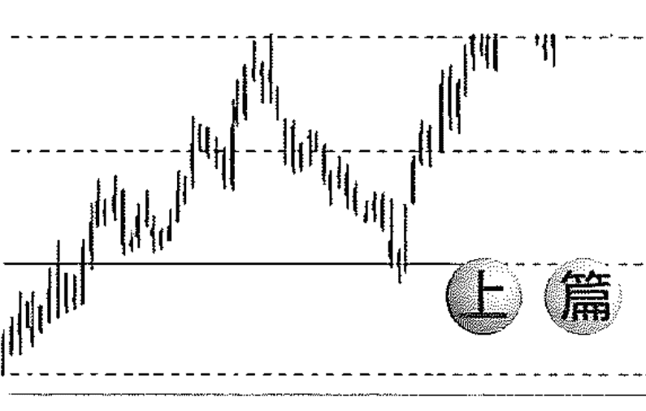

# 篇 理論篇

作者將道氏、漢密爾頓和雷亞對這個原理的相關論述進行結合，希望對基本波可以被預測的原理作詳細論述，這個陳述看來有些繁雜，不過嚴謹的論述還是必要的。

基本波可預測原理：任何人所了解、希望、相信和預期的任何事，都可以在市場中得到表現，這使得市場中包含三種趨勢——日波動、次級波和基本波，只有基本波才是對長線投資者真正有用的。因為投資者所想到的並不是價格能否被抬高，而是被購買的資產價值能否讓投資者在半年以後，以高於現有價格10～20%的價格買進股票。因此在分析股票市場時，首先要知道一種股票至少在3個月以後的價值，然後再觀察操縱者或投資者們是否正在讓價格向那個數值靠近，這使得投資者的行為對基本波發揮決定性作用。

基本波代表著一種嚴肅的、經過深思熟慮的努力，那些有遠見、資訊充分的人，正試圖讓價格與現存價值，或在不久以後將存在的價值相對應。了解價值也就明白基本波的含義，使得市場並不像一個在風中搖擺不定的氣球。

基本波代表整體分析基本趨勢，通常表現為牛市或熊市，持續時間可能在一兩年以內，乃至於數年之久，但沒有任何已知的方法可以預測基本波的持續期限，正確判斷基本波的方向是投機行爲成功與否的最重要因素。道瓊工業和運輸業平均指數的修正是否相對應，才是分辨市場未來走勢的關鍵。這種方法可以很清楚地分析出市場的基本波。

基本波是大規模、中級以上的上下波動，通常（但非必然）持續一年或有可能數年之久。預先確定任何基本波的長度是不可能的，但是它走得愈遠，這種反作用就愈大，進而根據這種反作用成功地進行交易的確定性也愈大（這個部分被許多人忽略了）。正常情況下——至少理論上是這樣——基本波是三種趨勢中真正長線投資者所應該關注的唯一趨勢。他的目標是盡可能在一個牛市中買入——只要一且確定它已經啟動——然後一直持有直到（且只有到）很明顯此時它已經終止了，而一個熊市已經開始的時候。根據經驗顯示，這種基本波所經歷的時間至少在一年以

# 三大定律的建立

上。不過，通常還要長得多，並導致股價增值或貶值20%以上。

了解基本波是成功投機或投資的最起碼條件。一位投機者如果對基本波有信心，只要在進場時機上有適當的判斷，便可以賺取相當不錯的獲利。有關基本波的幅度大小與期限長度，雖然沒有明確的預測方法，但可以利用歷史上的價格走勢資料，以統計方法歸納基本波與次級波。

與基本波相伴随的是次級波——在熊市時期的劇烈反彈或者在牛市時期的劇烈下跌。在次級波中，工業板塊可能比鐵路板塊恢復得更快產生背離，鐵路板塊也可能取得領先地位，而活躍的鐵路股票和工業股票分別作爲一個整體，在一次基本波中齊頭並進、交替上漲的情況，才代表一輪趨勢的繼續。道氏認爲可以很保險地忽視各種次級修正和日常波動。

道氏認爲，大多數投資者應該只參與大勢，而對於次級的調整被用於入市時機的選擇，對日常波動則置之不理。不論你參與的是哪一種市場或哪一種時間結構，除非你知道這種趨勢的方向，並了解如何判斷這種趨勢的變化，否則你不可能獲利。雖然道氏理論中的某些內容適用於股票市場，但絕大部分都適用於其他金融市場。了解這些內容，將非常有助於你判斷趨勢可能在何時發生變化或已經發生變化。

雷亞透過對基本波研究之後認爲，任何市場都必然處於四種技術階段之一：

- 1. 承接——長線投資者的買進；
- 2. 出貨——長線投資者的賣出；
- 3. 向上或向下的趨勢；
- 4. 整理——在經過確認趨勢的過程中，發生獲利了結之後的調整。如果市場並無趨勢，便是處於「狹幅盤整」的走勢。

雷亞將道瓊指數歷史上所有價格走勢根據類型、幅度大小與期間長短分別歸類。儘管他當時僅有30年的資料可供運用，但令人非常驚訝的是，他當時歸類的結果與到目前截止的一百多年的資料，兩者之間幾乎沒有什麼差異。例如次級

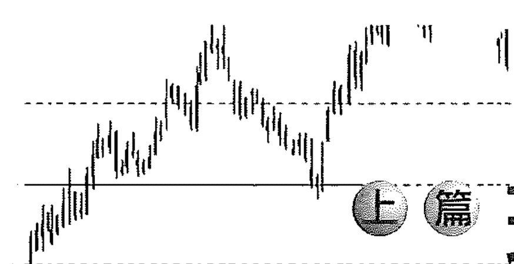

# 上輯 理論篇

波的幅度與期間，不論就牛市與熊市的資料分別或綜合歸類，目前常態分布的情況幾乎與雷亞當時的資料完全相同，唯一的差別僅在於資料的多寡。如圖8-1-1為道氏理論的基本修正圖，表示基本波具有近似常態分布的特徵。

這個現象確實值得注意。因為它告訴我們，雖然近半世紀以來的科技與知識有了突破性的發展，但驅動市場價格走勢的心理性因素基本上仍相同。這對專業投機者具有重大的意義：目前面臨的價格走勢、幅度與期間都非常可能落在歷史對應資料平均數的有限範圍內。如果某個價格走勢超出所對應的平均數水準，則說明介入該走勢的統計風險便與日俱增。若經過適當地權衡與運用這項評估風險的知識，可以顯著提高未來價格預測在統計上的精確性，而道瓊工業和運輸業平均指數的波動是否相對應，是分辨市場未來基本波的關鍵。

雖然道氏並沒有提出基本波空間和時間的明確定量標準，進而也致使眾多投資者在實戰的運用中出現的許多問題無法得到解決。但這個理論的哲學意義在於，要求投資者抓住事物發展的主要方面，並在此基礎上摸清市場發展的規律，使投資者可以在整體上把握市場。

##### 四、基本波的一些規律

###### （一）熊市的期間通常要比牛市短

實際上從一百多年的股市表現上來看，股票市場的基本波整體保持歷史性牛市。透過觀察我們發現，其中的原因是熊市的期間通常要比牛市短。或許這正如在牛市階段出現的次級下跌波動簡短而劇烈一樣，慢吞吞的反彈，比下跌需要更多的時間。因此，我們在研究基本波時，曾發現牛市的時間多於熊市。如果觀察的期間夠長，我們會發現市場的總趨勢是隨著國民財富增長而上升，至少到目前為止是這樣的，即使是戰爭也不會改變這個基本事實。從道瓊指數一百多年的歷史來看，美國股票市場呈現出歷史性的牛市，這無疑是最好的證明。

###### （二）趨勢的自我否定

我們可以發現，牛市出現的次級下跌不會再重新回到反彈之前的最低點，而且歷史紀錄顯示，在這之後，投資者和投機者们總是要預測股市波動，通常會把預測的期間定得太長，但不論是牛市還是熊市都有自我否定的傾向。當一個基本波繼續發展的時候，與這個趨勢相反的波動將愈來愈可能發生。如果股票市場是無所不知的，它肯定會讓自己避免發生過度哄抬或過度拋售的情況，就像它自動地避免發生任何可以預見到的事情一樣。晴雨表正是以這種方式進行自我調整的。但是我們必須承認，在熊市即將發生變化的轉折時期，各種資訊紛至沓來，人們的觀點異常混亂，即使我們考慮到股票市場代表著關於商業狀況及其影響因素一切可獲得資訊的事實，它也無法對自己無法預見的事情加以防範。因此作爲一個一般規則，當牛市達到頂點時，通常都不會出現一條可見的警戒線，尤其是在牛市決定否定自己的時候。

###### （三）恐慌之後可能伴隨一次大反彈

根據經驗顯示，恐慌之後會出現部分反彈，然後再繼續緩慢下跌，以考驗市場的真實能力。自從這種平均指數出現以來，所有的經驗一致顯示，恐慌下跌之後，將緊跟著一次程度高達40%～60%的反彈，然後是不規則的下跌，最終使價格回到原來的最低點，似乎只有這樣才能把那些促成恐慌的軟弱股票持有者排擠出去。我們似乎可以由此進行正確的推断，恐慌之後的這種拋售活動是必要的。

作者將以上所描述的基本波特用道氏理論基本波圖表表示，如圖8-1-1所示，基本波具有近似常態分布的特徵。

## 上篇 理論篇

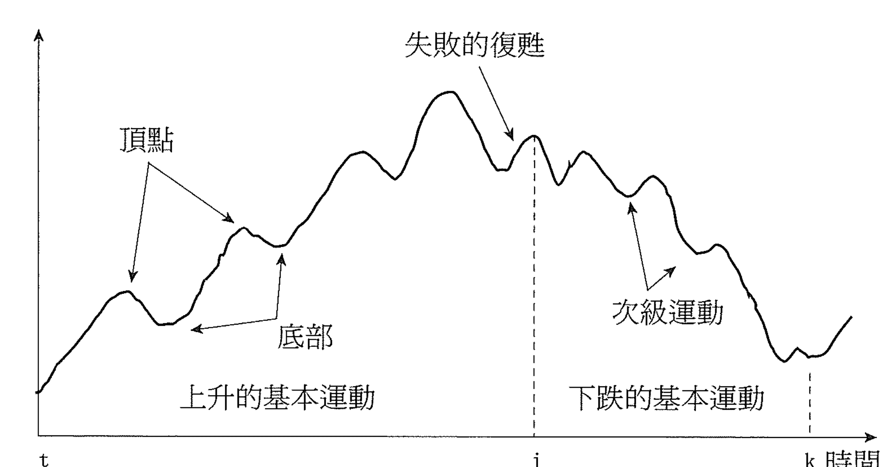

上圖是道氏理論基本波圖，上、下跌的基本運動，即大波。

下跌的基本波是由於次級波的上漲未能突破高點、反彈失敗形成的，時間為j至k日。

但是在k這個時間點，這次次級波沒有到達新的底部，顯示新的一輪多頭市場的開始。

#### 第二節 常態分布的形成

##### 一、長期線形圖能夠表現出常態分布

道氏指出：「市場的基本波是廣闊、吞沒一切的『潮流』，這個潮流被『波浪』或次級的反作用和反彈所打斷。」這個廣闊、吞沒一切力量的基礎就是市場的基本結構，而這個結構才是市場具有一定規律的基礎。

在此，作者應該特別強調，道氏在上述定律中，還間接提出了兩條重要的投資分析原則：

**三大定律的建立**

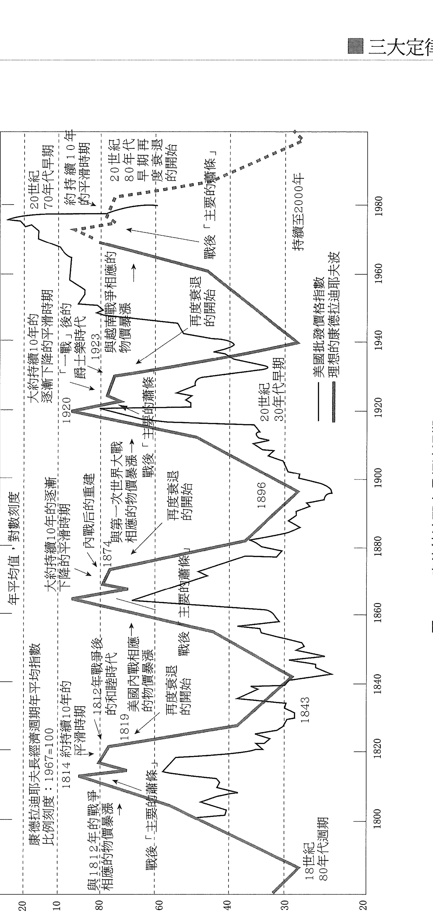

圖 8-2-1 費德拉波耶夫長景經濟週期

1. 市場價格波動的結構成分分解應把「市場不可人為操縱」當作重要標準之一。

先對市場價格波動的結構成分正確的分離，進而針對不同結構成分採取不同的操作策略，這是任何成功投資方法中的關鍵性步驟。道氏在100年前就提出了這個問題，而且明確、有效地對價格波動的結構分析提出了測量標準，這應該說是非常了不起的成就。

2. 投資交易策略的設計基礎應把「市場不可人為操縱」當作重要標準之一。

從基本波不能被人為操縱原理還可以引申出，當投資人設計投資交易策略時，應該把「市場不可人為操縱」當作最低測量標準。任何一個市場，不論是西方歷史悠久的證券市場，還是亞洲新興的證券市場，其價格波動中都必然包含一個以上的「不以投資人意志為轉移」的波動結構，而這個結構才應該是投資者據以制定投資交易策略的基礎。客觀地測定並有效地分離出這個完全不受人為因素影響的價格波動結構成分，是投資家所面臨的主要任務之一。

作者在談到道氏理論基本波圖時表示，基本波具有近似常態分布的特徵。我們在做技術分析的時候，不僅從圖形中可以清晰地看到趨勢部分和轉折部分，同時我們幾乎可以隨手拿着一張類似常態分布的長期線形圖，這是偶然的嗎？這當然不是偶然的。

如圖8-2-1所示。從康得拉迪耶夫長經濟週期的圖形當中，我們可以看出明顯的頭部形態和明顯的對稱上升趨勢、下降趨勢。兩個趨勢就是常態分布的兩條邊，形成波浪式演進的結構；而趨勢的反轉就是常態分布的轉折，特別是在頭部或底部將會形成各種形態。因此圖形展示的效果是，市場的基本波是符合近似常態分布的，也就是市場的基本波以不嚴謹的、週期性地進行近似的常態分布波動。

如圖8-2-2所示。倫敦3個月期銅月k線的長期線形圖也表現出清淅的常態分布形態。在圖形中也展示出常態分布主要分為趨勢和轉折兩個部分。我們也可以看出上升趨勢、下降趨勢，以及頭部形態。趨勢是常態分布的兩條邊，形態是常態分布的轉折，而頭部形態表現得更為清晰。

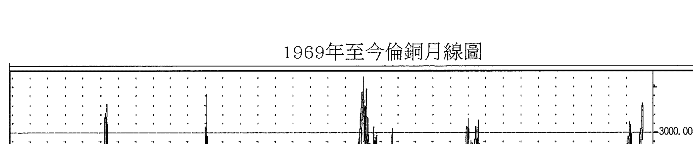

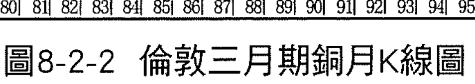

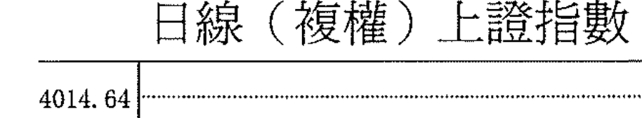

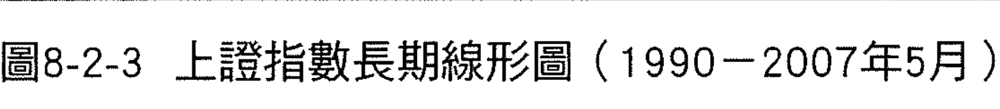

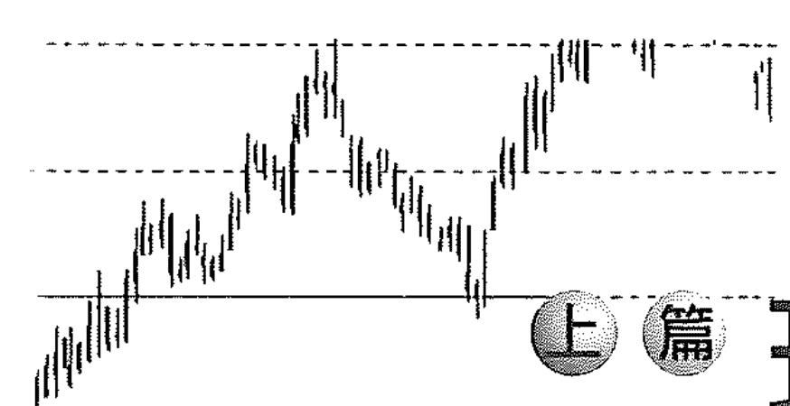

而圖 8-2-3 所的是上證指數長期線形圖。我們也可以發現一些不太清晰的常態分布結構。但或許是市場化程度還不夠高，導致了常態分布結構還不夠清晰，隨著股票市場的市場化程度不斷提高，常態分布結構將愈來愈清晰。

##### 二、常態分布的起因

從市場結構上講，金融市場與現實市場不同的是，在金融市場中沒有商家和家庭之分。在金融市場上只有為數眾多的買者和賣者，他們又可細分為投資者、投機者和交易者。根據薩伊定律，市場中買者的目的是為了賣；而賣者的目的是為了買。所以透過這個定律可以更加清晰地說明，在金融市場中，投資者進行交易是以追逐利益為目的。

在市場中每個投資者都是滄海一粟。由於在金融市場中，投資者的數量眾多，以至於每個投資者對市場價格的影響都微乎其微，這使得價格走勢遵循競爭市場的基本原則。因此對於任何股票及商品的走勢和定位，都要依據以市場定位為主的價格形成機制。正如亞當·史密所說：「每個人去盡力達到一個並非他本意想要達到的目的，也並不因為他的本意沒有達到就對社會有害。儘管他追求的是自己的利益，但往往使他能在真正出於本意的情況下，更加有效地促進社會的利益。」

儘管投機行為經常被貶與一種負面的含義，然而由於他們也是眾多投資者中的一員，所以一個投機者的作用和市場人士對投機者的理解相去甚遠。事實上，投機者可以為市場提供不可或缺的流動性，在大多數情況下，也可以促進金融資產的平順轉移，並透過資產配置讓它們發揮最佳的功能。而在市場中，投機的本意就是希望將自己的希望、預期得到實現。

市場是人的群體行為，而人的群體行為是符合自然法則的。用數學的概念可以理解為，在客觀實際中有許多隨機變數，它們是由大量的相互獨立的隨機因素綜合影響所形成。當然，它們並不是絕對獨立的，而是彼此之間發生內在的聯繫，其中每一個個別因素在整體的影響中所引起的作用都是微小的。這種隨機變數往往近似服從常態分布，這就是市場具有自身規律的客觀背景。

常態分布是大自然的普遍規律。這個規律代表著在相同的介質中，能量以常態分布的形式傳播，而整體修正的發展變化又是週期性的規律。就是歷史會重演！實際上，在自然現象和社會現象中，大量隨機變數都服從或近似服從常態分布。例如大海中波浪的斷層圖形，真空管或半導體中的熱雜訊電流或電壓等，都服從常態分布，所謂的歷史會重演，就是歷史不斷重複著常態分布的規律。就金融市場而言，所謂「能量」就是資金和驅動資金的觀點，介質就是這些資金所投資的品種。基本波是最大層級的價格波動，它以週期理論為基礎，以歷史會重演的方式進行牛市、熊市趨勢的演繹。

##### 三、關於常態分布

一個理論如果能夠用數學表示，代表這個理論的成熟。道氏理論具有許多的數學思想，它可以用常態分布論述基本波的數學特徵，並以常態分布當作基本修正整體技術分析的核心。

在數學中，常態分布是有嚴格定義的：假設連續隨機變數 $\chi$ 的機率密度為

$$f(\chi)=\frac{1}{\sqrt{2\pi\sigma^{2}}}e^{-\frac{(\chi-\mu)^{2}}{2\sigma^{2}}}, -\infty<\chi<\infty$$

其中 $\mu$、$\sigma$ ($\sigma > 0$) 為常數，則稱 $\chi$ 服從為 $\mu$、$\sigma$ 的常態分布或高斯（Gauss）分布，記為 $\chi \sim N(\mu, \sigma^{2})$。

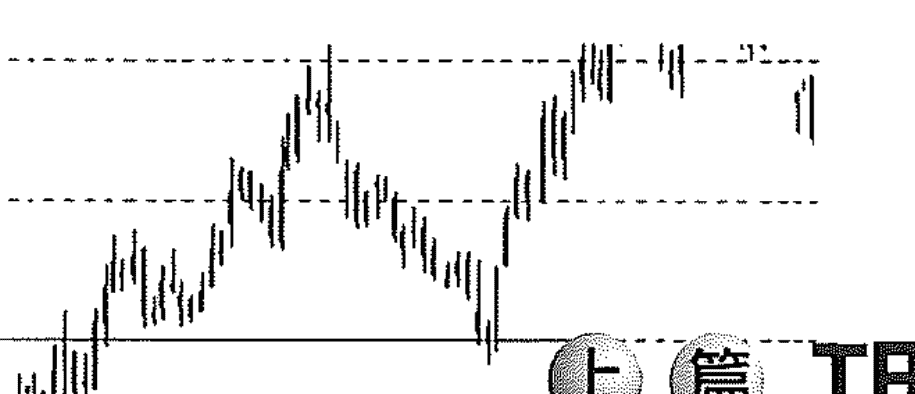

如圖8-2-4所示，常態分佈圖形有明顯的近似直線部分和頭部與底部部分，因此用常態分佈圖形我們很容易對應到基本波的幾個階段，就是牛市、熊市和底部、頭部階段。由於常態分佈圖形有明顯的底部、頭部和趨勢三個階段，因此，從這個意義上說道氏將基本波分為三個時期是有道理的。此外，對稱也是常態分佈的特徵，因此，我們不難理解為什麼道氏認為牛市、熊市是兩個均衡發展的部分，以及市場圖形總是出現那麼多的對稱圖形。用常態分佈進行道氏理論的數學表示，這可以算是投機數學。同時，用常態分佈的圖形也可以說明，為什麼價格在頭部的時間短，而在底部的時間長。

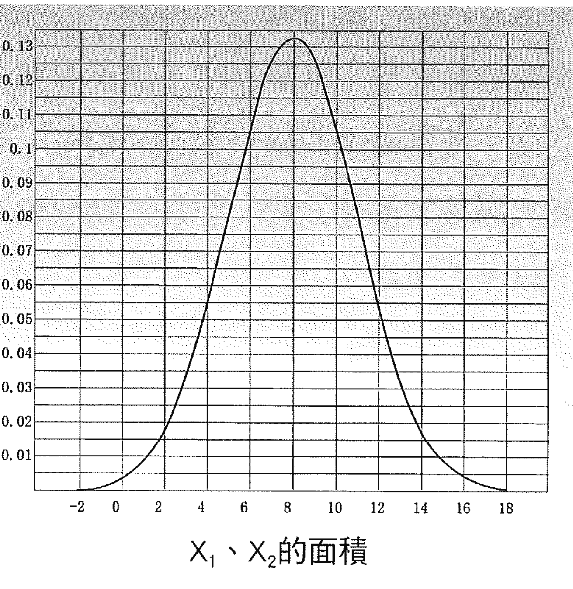

圖8-2-4 常態分佈曲線圖

#### 第三節 常態分佈的特徵

##### 一、基本波有明顯的趨勢

基本波的規律是由其中的系統結構所決定。在買方和賣方處於「零和遊戲」中，市場中的買賣雙方成交形成價格。上漲、下跌就像動能與勢能的轉換，是多頭轉空頭，以及空頭轉多頭的過程。而價格波動是在一定的軌跡中波動，這也就是技術分析的第二大定律——市場行為依趨勢方式演變。

我們從公式中可以看到，常態分布是一個關於 x 的自然指數函數，將函數兩邊取對數，就可以得到一個關於 x 的線性函數。正是由於將符合常態分布的函數兩邊取對數之後可以得到線性函數，因此有許多投資者將絕對值的價格圖轉化為對數圖之後，再做趨勢線效果會更好，因為在絕對值價格圖的圖形上會出現加速上升或加速下降的曲線形態，這不利於透過畫趨勢線進行趨勢分析。

不過，我們不要指望趨勢會走直線，因為地球是圓的。經過對數處理後，我們透過趨勢線和軌道線、支撐水平線和壓力水平線等技術分析工具，在趨勢持續的時間內，對趨勢進行評估，趨勢保持的時間愈長，則趨勢的影響力就愈強。特別是將線形圖進行對數化處理之後做出的對數圖，將可以使我们更加清晰地看出趨勢和週期波動的特性。有關這部分的研究還需要我們做出許多艱苦的工作，這也是道氏理論不斷創新、發展的精神。

##### 二、基本波的頭部和底部特徵

價格在趨勢的發展中變化並不明顯，但在反轉中的變化則是明顯的。基本波不僅有明顯的趨勢，而且趨勢有明顯的反轉。所謂「價格」在趨勢反轉中變化明顯，就是相對於原來的趨勢在方向上有明顯的變化。

此外，通常價格在牛市頭部的反轉要比熊市底部的反轉波動要劇烈一些。特別是在牛市的終結過程，較容易出現市場的急劇反轉現象。這主要是由於投資者是一個集合的群體，更容易受到恐慌情緒的相互感染。而這種恐慌情緒在牛市的尾聲比在熊市的尾聲更容易傳播。因為投資者在牛市的尾聲比在熊市的尾聲選擇性減少的緣故。特別是在牛市的尾聲，一般投資大眾大多處於滿倉狀態，所以此時的投資情緒處於極度高漲。因此在牛市的尾聲，一般投資大眾更像驚弓之鳥，極易出現瘋狂出走的現象。而在熊市的尾聲，一般投資大衆多數處於空倉狀態，因為此時的投資情緒極度低落。

對期貨市場而言，牛市與熊市的尾聲形態常與股票市場有些不同。由於期貨市場中允許先做空，而期貨市場中的價格變化，通常在牛市的頭部要比在股票市場中牛市的頭部表現得要緩慢一些，在期貨市場中，熊底部部的價格變化，要比在股票市場中熊市的底部通常顯得更为急促一些。

對於具有股票指數期貨的股票市場而言，其股票市場的股價波動更有期貨市場的特徵，如紐約股市、香港股市、東京股市等。即在市場的頭部和底部都會出現急劇的震盪。不過，整體來說，在價格的變化方面，牛市頭部的反轉要比熊市底部的反轉要劇烈一些。

由於各種形態主要發生在趨勢的反轉處，因此形態分析才引起投資者的注意，並在後來逐漸形成形態分析理論。利用常態分布圖形可以說明為什麼頭部時間短，底部時間長。從圖形中看到，頭部的反轉更加劇烈，而底部的反轉要平緩得多，針對這種特性，技術分析中的形態分析用於分析頭部形態非常管用，這也正好可以迴避價格下跌給投資者所帶來的風險。

所以道氏首先注意到的是頭部形態，他發現的第一個頭部形態是線——狹幅波動，線有可能是頭，有可能是底，也有可能是以平盤代替回檔；他發現的第二個頭部形態是M頭。因此可以利用「頸線」將頭部形態劃分出來，這對判斷突破很有幫助。由於築底時間比較長，形態分析對於底部判斷不如頭部判斷幫助大。

##### 三、如何利用常態分布爲分析基本波找到依據

首先，市場的基本波符合常態分布是市場的既定模式，是不以人的意志爲轉移的，是不能被人爲操縱的，投資者的分析對象如果在長期線形圖上能夠表現出常態分布的市場，才具有分析及參與價值。

其次，以常態分布當作一種整體技術分析的模式，可以使我們分析把握整體市場的基本波。從某種角度來說，將基本波用常態分佈來解釋，可以發揮化繁為簡的作用，也為我們用電腦分析預測市場的基本波找到了依據。

再次，利用常態分布這種基本波所具有的「不可被操縱」的既定模式當作分析市場的方法，結合趨勢分析法和轉折分析法，我們可以不斷對市場進行檢測、驗證。

此外，基本波的常態分布模式告訴投資者的是，不論上漲還是下跌都是不斷加速。我們可以在頭腦中保持一個基本波演進的整體形狀特點。一般情況下，牛市透過一系列不規則的上漲與下跌緩步地上升，並以中等速度的上升趨勢開始，而隨著市場接近其最後的頂點逐漸地加速；熊市則比牛市更陡峭。這些概念將會幫助我們判斷市場，為我們提供最佳獲利的時機。

##### 四、基本上牛市長熊市短

儘管對稱性也是常態分布的特徵，不過，在實際的對數圖中也經常表現出牛長熊短的特性。其原因是，一般來說，擴張期較衰退期長。道氏認為，這是由於建設所需要的時間總是長於破壞。基於這個原因，股票與黃金的牛市通常比熊市長，也就是整體上，基本波表現為波峰右移；而債券的情況正好相反，熊市長於牛市。實際上有許多技術形態，如三角形就是由於波峰的左右移動形成的。

#### 第四節 基本波的持續時間無法準確預測

道氏理論指出，牛市究竟能維持多久？熊市究竟能維持多長？即牛市什麼時候轉為熊市，熊市什麼時候轉為牛市，並沒有確定的時間，只有各種訊號出現才能確認是否反轉。這裡包含兩點值得重視的觀點：

##### 一、正確確定基本波對成功投資的極端重要性

基本波所指出的是市場價格波動的基本方向。它以「牛市」與「熊市」輪動的形式來表現。一般來說，趨勢所涵蓋的時間愈長愈容易辨識。因此基本波最容易辨認，也最有規律。不過，不同時期、不同情況的牛市或是熊市在時間上都會不同，甚至會有很大的差異。以往一般的牛市只會維持兩、三年，但1987年後開始，美國股市的大牛市卻能夠維持十多年，這和以前的牛市是不同的。

在理想的狀態下，牛市的上漲幅度應該等於熊市的下跌幅度，但兩者實際上有差異。因為推動股價上漲所耗費的時間，通常長於股價的下跌，所以牛市所涵蓋的時間一般要長於熊市。以後牛市和熊市時間可能會和以前的有更大的差別，投資者除了應參考以往牛市、熊市時間，也要參考當時的經濟因素，以及針對不同類型的市場進行研究，進而適當地判斷當時的牛市、熊市會維持多長時間。

##### 二、無法準確預測基本波的時間長度

迄今沒有任何方法能準確預測基本波的時間長度。時間長度可能少於1年，也可能長達數年之久。而基本波所涵蓋的期間通常在1～2年之間，反映的是投資者對於經濟週期發展的態度。在統計上，經濟週期由谷底到谷底所涵蓋的期間平均大約為3.6年，所以牛市與熊市各自持續大約1～2年。

一百多年前道氏就提出沒有任何方法能準確預測基本波的长度，一百多年後，仍然沒有任何方法能準確預測基本波的長度。這是一個非常重要的哲學思想。投資者相信不可能發現能準確預測基本波长度方法的重要意義在於，投資方法應以趨勢跟蹤技術為基礎，而不是以趨勢預測技術為基礎。

趨勢是從時間上衡量價格水準的變動方向，包含不同的時間架構。除了最重要的基本波外，還有次級波與日常波動。我們必須了解基本波方向與發展程度，但次級波的分析也有助於判斷基本波是否即將反轉。

我們觀察價格走勢圖，可以發現價格不是呈現直線走勢。一個基本的上升波段，中間會夾雜著數波次級的反轉。在牛市中，這些反基本趨勢的波動為次級波，它們持續的時間在3週至6個月以上。就是說，次級波是基本波中所夾雜的走勢。

同理，日常波動也是次級波中所夾雜的走勢，涵蓋期間在一週至三、四週。它們通常受到一些新聞事件的影響而隨機波動，所以較次級或基本波更加難以辨識。

透過上面的時間層次的關係，我們大致了解對基本波的節奏、階段有一定朦朧的判斷，但還是難以準確判斷基本波的持續時間。

##### 三、基本波沒有嚴謹的、確定的時間表

基本波是指一種市場波動的整體模式，追隨這個模式的是進行長期投資的一類群體，即使是他們都遵循長期投資，但對於不同的具體投資者由於有不同的投資習慣、不同的投資風格，使得具體的投資週期也是大相逕庭，因此，基本波的時間，大致上只是表現整體投資操作時間的長度，並非嚴謹的、確定的時間。

具體到股票指數的基本波，儘管整體股票市場有一定的趨勢性，也就是一起漲、一起跌的特性，但是又不能將這個思想絕對化。由於股票指數本身就是由許多股票價格合成的，個別股票之間除了共同性之外，還有各自的個性，這也在一定程度上造成了基本波難以有確定的時間長度。

總之，基本波是一種不嚴謹的、週期性的、近似常態分布的波動，其跨越時間至今無法準確確定。我們可以把基本波的常態分布當作整體技術分析（基本波）的核心思想，進而抓住市場的脈動。

#### 第五節 持有資金直到反轉信號明確出現

牛市、熊市性質的根本改變稱為「反轉」。但是，絕非任何時候的漲跌互換都能叫做反轉。華爾街有句名言：「不要與趨勢相對抗。」意思就是在股票投資中要順勢而為，看清大勢才能賺到大錢。牛市中要堅持以持股為主，少做空；熊市則以賣空為主，少做多。

這個原則可能比其他道氏理論的原則更招致非議。如果對其理解正確，正如我們已列舉過的其他原則一樣，這個原則同樣也是建立在實際檢驗的基礎上，也的確具有可行性。對於急躁的交易者，這無疑是一個警告，告誡交易者不要過快地改變立場而撞到槍口上。當然這並不是說當趨勢改變的信號已出現時還要作不必要的拖延，而是說明了一種經驗，那就是與那些過早買入（或賣出）的交易者相比，機會總是站在更有耐心的交易者一邊。

只有等到自己有足夠把握時才會採取行動，這些機會無法以數字表示。牛市不會永遠繼續，而熊市也遲早會跌至最低點。當一輪新的基本波首先被兩種指數的變化表現出來時，不論近期有任何回檔或間歇，其持續發展的可能性都是最大的。但隨著這個輪新的基本波持續發展，其繼續延伸原趨勢的可能性就愈來愈小，儘管接下去的牛市再度確認的可能性更小，也就是當一輪牛市延展數月之後，買入新的股票而能保證賣出獲利的可能性，都比這一輪牛市的初期更低或更不樂觀，但道氏理論告訴我們：「持有你的股票，直到出現相反的指令。」

這個要點的一個必然結果就是，趨勢中的一個反轉，在這一輪趨勢被確認後隨時可能發生。這並不像看上去那麼矛盾。它告誡道氏理論的投資者，只要他有任何一點資金，他就應該隨時關注市場。

由於必須等待出現明確的信號才能確認反轉。這對於許多投資者來說，是道氏理論更為明顯的不足。有時會有這樣十分不節制的評論：「道氏理論是一個極

### 第九章：牛市的波動特性

有一個有趣的問題，道氏為什麼要用「牛」、「熊」這兩種動物來代表兩種不同性質的市場呢？據說道氏借用這兩個動物來形容股市是因為它們的進攻特性，從熊和公牛的習性分析，公牛更有蠻勁，更有攻擊性；雖然熊也十分強壯，但和見人就頂的公牛比起來，它們善於沉思，並且易於撤退。因此用牛市和熊市來形容股市中的兩個典型趨勢，這是非常具體而有趣的表達。道氏之所以不使用我們常用的上升趨勢、下降趨勢、漲勢、跌勢之類的詞彙來表達，是因為它們沒有表達出力量的特徵。牛、熊這兩種動物更加具體化地形容兩種趨勢中投資者的心態和行為。我們由此可以看出道氏的編輯風格，不但在詞彙上創新，而且用詞精準。

#### 第一節 牛市是一股永遠向上的力量

##### 一、牛市的意思

道氏用“Bull Markets”代表牛市，而且“Bull”是公牛，象徵粗壯有力、奮力向上頂的力量。因為公牛在進攻的時候不斷地用牛角向上頂，這個動作的意義在於向上的力量總是比向下的力量大。而這裡用“Bull”又有「哄抬股票價格，買進股票、等待價格上漲以圖謀利者」的意思。在牛市中，價格走勢的形態也像牛角，不斷用力向上頂。儘管有向下的動作，但那是為再次向上頂獲取空間。由於向上的頂力總是大於向下回測的力量，因此向上波動的空間總是大於向下波動的空間。

牛市就是上漲的力量總是大於下跌的力量，並伴隨有向下的動作的波動序列。

在股票市場如果人人都看好，買進的力量大於賣出的力量，那就像公牛在進攻一樣，不斷地由下向上頂，股市也就因為投資者爭相將資金投入市場而推動股市上漲。在牛市中，由於股價向走，投資者也會因股價有好的期望而積極入市，這又令股價越拉越高。因為人心轉好，任何時候的賣出股票都會有人承接，也令股價維持高點。當牛市達到瘋狂階段的時候，因為人人都看好股市，股價一路被承托著。

##### 二、由道氏的描述直接引出牛市的定義

道氏所說的牛市是由連續一系列指數連快的漲勢構成，每一段漲勢都持續向上穿越先前的高點，而中間夾雜的跌勢都不會向下跌破前一波跌勢的低點。換句話說，牛市是由高點與低點都不斷墊高的一系列價格走勢構成的。

在牛市中，價格或指數不斷地上漲，就像海水漲潮一樣，每一次的水位都會比上一次為高，價格或指數上漲後，當然也會後退，這種在基本修正上漲中下跌的次級波動稱為「調整」。調整不可能會跌去所有的漲幅，調整範圍通常是前期漲幅的 $1/3$ 至 $2/3$，通常是 $1/2$，然後又再上漲，後退之後的再度上漲，一定會漲得更厲害。

高點和低點一路攀升，這次的高點會比上一次的高點高，這樣高點會愈來愈高；而低點也比上一次的低點高，這樣低點也會愈來愈高。整體指數一問向上。這樣的過程會不斷延續，直到新的趨勢出現為止。

用圖形表達，牛市就是第二低點要高於第一低點，第二高點同時也要高於第一高點，這樣的一個序列波形。如圖9-1-1所示。

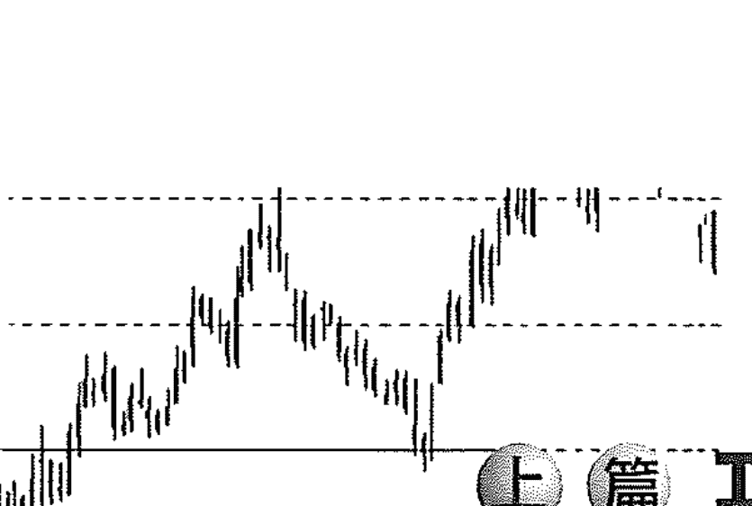

#### 第二節 「華爾街」的常態是牛市

我們非常喜歡牛市，牛市對我們也非常重要。漢密爾頓正確地指出：「根據平均指数的規律，更多的錢是在牛市而不是熊市巾賺來的，這或許是因為牛市的时间通常要比熊市長得多。」這也正如在牛市中出現的次級波簡短而劇烈一樣，慢慢吞吞的反彈比下跌需要更多的時間。從統計的資料看，牛市的長度差不多是熊市的两倍，而且從道瓊指数的一百多年歷史來看，美國股票呈現出歷史性牛市。

根據經驗顯示，「華爾街」的常態是牛市。因此在牛市中出現次級下跌而不景氣時，聰明的投資者和專業人士的反應是一致的。華爾街在過去為自己歸納出許多定律，其中之一就是「絕不能在市場不景氣時賣出股票」。當然，這裡的不景氣是指次級下跌，而在熊市中這是一個糟糕的建議。因為此時的市場會在劇烈的次級反彈之後繼續下跌，經驗豐富的交易員將相對地再次賣空股票。

牛市的時間的確多於熊市的主要原因是：

1. 透過足夠長時間的觀察，可以剔除牛市和熊市的影响，發現市場的總趨勢是隨著國民財富的增長而上漲，至少到目前為止是這樣的，甚至于戰爭也不會改變這個基本事實，美國股市的歷史性牛市已經做出了證明。
2. 「華爾街」在本質上需要牛市，因為投資者無法在熊市中立獲利潤。然而有人錯誤地認為熊市是華爾街的收穫季節，認為他們可以在此時利用災難為自己謀利。
3. 交易量的大小決定備金的多少，這是股市整體表現出牛市的特徵而非熊市的根本原因。當投資者對股市看好時，由於投資者積極參與，所以成交量就大。道氏指出：「股票的走勢是由股票市場內投資者的共同力量所決定的。如果要研究股票市場的共同力量，很多投資者第一個印象可能會問，所謂股票市場的共同力量是什麼？那當然是指所有投資者買賣的總和。」

在股票市場很多人買賣股票，但有些人買入之後就是長期投資，即他們很久才會進場一次。此外，一些人卻日日都會在股票市場內買賣。有時因為季節性的關係，因為經濟氣候的關係，也會出現不同的買賣氣氛。可以說，每日在股票市場內買賣的人數都不同，買賣的金額也不同。而在經濟情勢好、股市大好時，就會有很多人加入股市買賣。但在經濟情勢差時，很多投資者又會離開股市，不在股票市場內投資，起碼短期內不會。

#### 第三節 道氏將牛市、熊市分為三個時期

人們很可能要問，我們怎樣確認一次次級上升波在何時發展成一輪牛市呢？答案就在平均指數連續的鋸齒形波之中。如果熊市中的次級上升波在達到正常的頂點之後略有下跌，卻沒有達到前一次的最低點，然後又反彈至超過前次反彈最高點的點位上，我們可以確定，一次無法判斷其長度的牛市已經形成。需要知道的是，我們目前還無法預測基本波的長度。

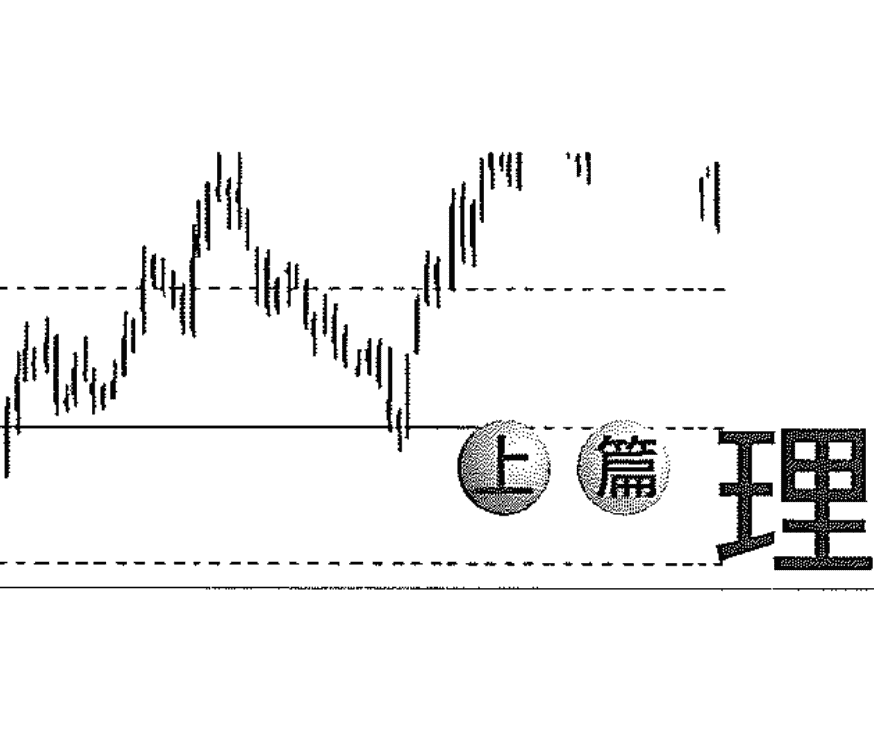

如果運用於市場整體而不是某種或少數股票的情況，道氏理論在預測牛市時，自始至終都是非常正確的。他正確地抓住了價格向價值調整這個本質問題。在他的許多預言性的文章中都會提到價值這個概念。後來出現的所有市場波動（上升或者下降）都已經證明了他的價值理論。這說明道氏不僅是技術分析的鼻祖。

##### 一、道氏的兩個牛市理論

道氏從看似雜亂無章的股市波動中，發現市場並不像風中的氣球那樣飄忽不定，而是有序的波動。他注意到某些市場持續旋轉的重複，並闡明了兩個已經經得起時間考驗的理論。

道氏的第一個理論是，市場在牛市中有多次振動的特徵（並非必要）。第一次振動是從前面熊市的過度悲觀開始的一次反彈；第二次向上振動與商業和利潤的增長運動；第三次也是最後一次振動是與價值背離的價格。

根據道氏的理論，漢密爾頓指出：「牛市在剛剛形成的時候不會得到人們的認可，這時進行預測絕不是件容易的事，想要使預測具有某種確定性就更難了。然而，股票市場行動的基礎並不是當前事件，而是它能預測到的一切事實，這一點還沒有被人們接受。」牛市的確認日，是兩種指數都向上突破熊市前一個修正走勢的高點，並持續向上攀升的日子。

雷亞根據道氏的理論，總結出道氏理論的「定律四」：

牛市是一種市場整體性的上漲走勢，其中夾雜次級的反轉，平均的持續時間長於兩年。在此期間，由於經濟情況好轉與投機活動旺盛，所以投資性與投機性的需求增加，並因此而抬高股票價格。牛市有三個階段：第一階段，人們對於未來的景氣恢復信心；第二階段，股票對於已知的公司盈餘改善產生反應；第三階段，投機熱潮轉為熾熱使股價明顯膨脹，這個階段的股價上漲是基於期待與希望。

在第一個理論的基礎上，道氏又提出第二個理論：無論是向上或向下，在每個市場擾動的同一點，會有一個將這次擾動減少3/8或更多的反向波動。

這個理論的詳細解釋是，牛市的特徵是所有主要指數都持續連袂走高，這一點往往被人們所忽視，拉回走勢不會跌破前一個次級反轉的低點，然後再繼續上漲而創新高價。在次級的反轉中，指數不會同時跌破先前的重要低點。

根據道氏這兩個理論，在一個牛市中，基本波可以分成三個上漲的時期，並且每一個時期構成股票上漲的主要原因都不同：當商業活動還很緩慢但預期將改善時，第一次向上的修正是有遠見的投資者在某一時期蒐集股票的結果；第二次上漲，是根據改善的基本商業環境和愈來愈多企業獲利的增加，使得投資者買進股票的結果；最後上漲的出現是當散戶最終注意到金融消息都是正向的時候，在這個階段出現瘋狂的投機性交易。

即使道氏並未將這些主要因素與人類因素的影響聯繫起來，但是市場畢竟是由人類創造的，而且道氏曾經注意到這些規律的延續和重複必然源自於人類。

##### 二、將牛市、熊市分為各三期符合趨勢發展的規律

道氏理論所講的牛市、熊市輪動交替，一定會不斷地在股票市場內出現，至於牛市和熊市各分三期，其實是前途是光明的、道路是曲折的哲學原理。不會因為新經濟就完全再沒有牛市和熊市的輪動。因為任何事物的發展都並非一帆風順，需要一個步驟一個步驟、一個時期一個時期地進行，以避免事態一下子發展到極端。股市並沒有只漲不跌的可能，也沒有只跌不漲的可能。牛市、熊市各三期，其實就是漲後的回檔、跌後的反彈必然現象。因此這一觀點當然是正確的，只不過時期或步驟有時候十分明顯，有時候不明顯。

此外，一輪基本波是否只分為三個時期，道氏理論並沒有將這個問題絕對化。正如道氏所說，牛市中有「三次」擾動，但「並非絕對」。三次擾動或者三個時期的「三」相當於中國古語當中的複數，實際上，通常的情況是，至少會有三次掙動。

最重要的一點是，道氏從來沒有說過牛市一定要是3年或5年，熊市一定是2年或3年，也從來沒有說過牛市或者熊市一定只有三個時期。但牛市、熊市永遠都不可能消失，必定是交替輪動的，而且牛市、熊市至少各分為三期，仍然都是不變的，只是程度上、時間上的情況有所分別而已。

##### 三、將一輪基本波至少分為三個時期的意義——提前對趨勢發展變化有所預期

在牛市中，輪動上漲階段的時間應該較長，幅度也應該較大，逆向次級波的低點應該高於前一個低點。熊市的情況恰好相反，換言之，下跌階段應該較長而幅度較大，反彈比較短暫而陡峭，但幅度較小。所以第三個或第三個以後的次級波輪動即將完成時，投資者必須留意基本波存在反轉的可能性。此外，當價格接近前一個次級波的低點（高點）時，也必須留意整體技術面是否轉弱（轉強）；必須注意價格是否有效跌破（向上穿越）關鍵水準。

基本波三個時期的劃分意義在於，如果市場已經進入第三期或以後的時期——在牛市中，瀰漫著投機氣氛與一些不切實際的期待；或在熊市中，瀰漫著悲觀氣氛與持續性的實壓——基本波反轉的可能性便很大。一方面，基本波的反轉未必出現在明顯的第三期，但這類的反轉通常很短暫。另一方面，大幅度的基本波反轉，往往發生在非常明顯的第三期。

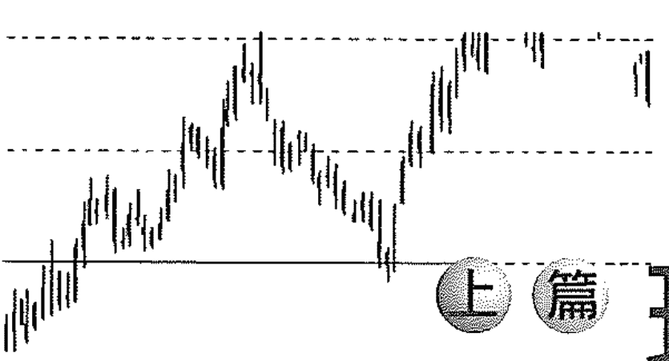

#### 第四節 牛市的三個時期及其特徵

在牛市中，股票價格上漲主要由於兩個原因：由於企業狀況改善而導致的股票投資活動增加，和由於市場活躍而導致的股票投機活動增加。牛市由三個時期構成。

##### 一、牛市第一期的市場概況

在經濟狀況方面，第一期為經濟復甦期；在股票投資活動方面，這個時期是「懷疑」時期，投資人對企業的前景信心在懷疑中逐步恢復。牛市第一期的上漲，是當股市處於低潮的時候，通常經濟也是處於低潮。這時，那些眼光遠大的投資者，當股價很低時，就進場買股票。在他們蒐集期間，經濟環境仍處於低潮，不過他們預期環境會改善，所以進行收購，趁低價買入。有遠見的投資者在股價很低的時候開始買入，是推动股價在牛市第一期向上的原動力和主要原因。

牛市第一期有兩個特徵：

###### （一）由恐懼陰影所主宰

股價隨著熊市發展一路下跌，沒有起色，一直跌到谷底，在谷底徘徊了很久，現在只不過是稍有點曙光，停止了繼續下跌，然後有一些人入市，大戶也做一點積極的行動，有一些比較大膽的，或是在以前的股災中只受了輕傷的散戶，也會做一些試探性買進。所以即使有投資者入市，數目也不大，沒有多少人敢大量買進。因此市場狀況稍稍轉好，但是大家對這個時候並沒有多少信心。

第一期是建倉（或積累）階段，是由恐懼主宰到先知先覺者先人一步。在這個階段，有遠見的投資者知道儘管現在市場蕭條，但形勢即將扭轉，所以就在此時購入那些勇氣和運氣都不夠的賣方所拋出的股票，並逐漸抬高其出價以刺激拋售，財報的情況仍然很差。實際上，在這個階段經濟還是處於最蕭條的狀態，散戶為股市狀況所迷惑而與之完全脫節，市場活動停滯，但也開始有少許反彈。

股票市場的市場狀況是由投資者的心理創造的。牛市第一期的市場狀況，若用心理學來形容，這時期的最大特徵就是「恐懼」。牛市第一期是在修痛的熊市之後，而以前的虧損到現在還未收回，要放膽入市買股票實在是苛求。

由於熊市第三期之後，不論是經濟還是股市，都剛剛低潮慢慢恢復正常，而且步伐很慢，以致股市的恢復速度也和經濟的恢復速度一樣慢。雖然牛市中的股市已經不像熊市期間那樣大幅下跌，卻因經濟只是慢慢復甦，悲觀情緒雖然籠罩著股市，導致市場並沒有一下子急促回升，或者大市不再出現下跌而已，所以牛市第一期只是慢慢地使股市上漲而已。不過，也有一些情況，經濟大衰退後恢復得極快，使股市的恢復步伐也極快，這時牛市第一期可能只要一年左右就能完成。

###### （二）大戶及專業人士先人一步

有些深入分析研究牛市、熊市的人，當中包括大戶。因為他們財粗勢大，當發現熊市已經結束，目前的新氣象並不是熊市中的小波瀾，而是步入牛市的象徵時，他們就會比很多人都早一步把握到這個先機，預見人所未見，預知人所未知，明白股市已經到了谷底，物極必反，真正悟到熊市過後牛市必來道理的人，會先人一步買進股票。

這時候入市，因為股價已經是在低點上，再跌的風險極少，購買個別股票，只要按照常理，分辨哪些上市公司具有賺錢實力，就選擇哪些股票。可以選擇績優股，而且很多二、三線潛力股一樣實力充足，將來股價漲幅也許會比績優股大得多。

善於分析牛市、熊市的投資者，和對牛市、熊市概念模模糊糊的人，在處理牛市第一期時，作風往往相差很遠，那些善於分析的聰明資金和專業投資者，知道現在已經是入市時機。但不善於投資的人，卻覺得沒有什麼可以做，有機會擺在眼前，也不懂得爭取，也不敢爭取，他們只怕再次遇上陷阱。

在這個時期，雖然雨過天晴，但因為人心不穩，所以股市漲勢很微弱，但這微弱的漲勢卻是持續的。當偶然有大戶大量入市，或是經濟有利多消息，那會像是打入一劑強心針，會刺激投資者的投資願望，但大致上，大家仍是靜觀其變，不敢草率投資。

不過，這時最壞的時刻已經過去，經濟的消息面，已經由以前在熊市時期發布出來的壞消息，改由漸漸一路有好消息發布。國民的消費能力已開始回復，失業率已經不再上升，反而有下跌現象。經濟確實是穩定下來，只不過是散戶因為經過熊市的大洗禮，如驚弓之鳥一樣，因此沒有採取入市行動而已。

##### 二、牛市第二期市場狀況

在經濟狀況方面，第二期為企業盈利增加期；在股票投資活動方面，這個時期是「樂觀」時期，在這個階段中，企業績效不斷改善的資訊不斷刺激股價上漲，投資人對企業前景處於樂觀狀態。

在牛市的第二期，股市指數上漲的原動力不再是那些有遠見的投資者在低點開始蒐集，使股價和指數得以推高。這時的上漲原因是公司的業績開始一路改善，投資者的信心恢復。經濟低潮已經過去，股市低潮也因此成為過去。當經濟環境改善、企業的獲利業績轉好時，再加上投資者對前景有信心，他們就會認為投資股票會帶來可觀的回報，於是競爭相入市買股票。因此，促成股價和指數的上漲。牛市第二期市場有如下特徵：

###### （一）投資者信心鞏固起來

經歷牛市第一期之後，便步入牛市的第二期。如果說第一期是牛市萌芽，那第二期就是開始生出幼苗，這是牛市生命的紮根時期，具有鞏固的作用。在客觀上，那是在鞏固股價；在主觀上，那是在鞏固投資者的信心。第二期是一輪穩定的上漲，投資者信心鞏固起來，股市進入平穩上升時期。交易量隨著公司業務的景氣不斷增加，同時公司的獲利開始受到關注。也正是在這個時期，技巧嫺熟的交易者往往會得到最大收益。

股市的支撐，主要是受到客觀經濟因素的作用。經濟環境好，企業獲得很多訂單，在業務中獲利不少，那就會支撐股市，因此股市很需要利多消息、各式各樣的經濟資料的支援。例如，國民生產毛額、貿易額、就業率、通膨率、地產物業價值等。這時期經濟與股市都是鞏固期。經濟在復甦之後，已經從衰退蕭條中恢復過來。經過一段恢復期之後，進入穩步發展階段，透過股市反映的經濟，經濟處在一個復甦狀態。

一般投資者，即使沒有研究經濟數據，也會注意一些上市公司公布的業績，如果每家公司都說自己虧損，不分息，那又如何能刺激投資者購買股票的慾望呢？而如果上市公司公布的業績令人滿意，利潤頗為豐厚，績優股大企業更是賺大錢，投資者將會被公布的業績吸引。若很多公司的業績都有好消息，股民的信心就會大增。

###### （二）牛市第二期是一個平穩向上時期

信心的作用非常重要，在牛市第二期當中，只要信心恢復，就很容易步入牛市第三期。在目前，信心和懷疑處於拉鋸戰，有時候好像信心高昂，有時候又信心受挫。信心處於強勢時，股市就持續走強，但突然有什麼風吹草動，卻又迅即失去信心。信心的起起伏落，反映在股市走勢的線形圖上，也是一樣是有漲有跌。

牛市第二期的特色是有漲有跌，但整體而言是穩步上漲的趨勢。這時還不能夠大漲，因為散戶信心還不足。有時候嘗試入市，小賺就立即賣掉不敢久留；有時候見股價稍低就立即買入，但買了很快就賣出。因此有買有賣，形成較為熱鬧的氣氛，而整體來說，股市在熊市第三期的可怕情況已經不再出現，人心對前景也較為樂觀。所以在牛市第二期，股市雖然不是大幅走升，也一定會獲得不少的漲幅。

當見到交易持續熱鬧，未敢行動者，見人家買了也沒有什麼損失，加上上市公司公布的業績情況也頗佳，信心便提高了，進而增加投資金額，入市者增多，為步入牛市第三期鋪路。

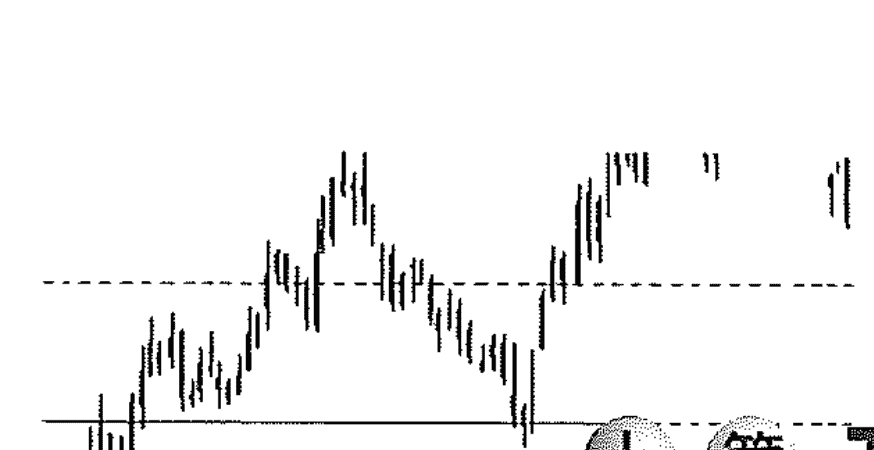
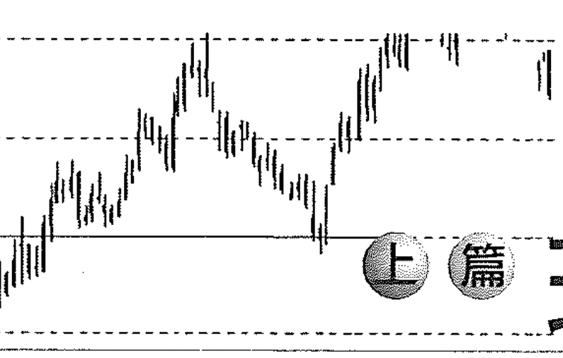

##### 三、牛市第三期市場狀況

在經濟狀況方面，第三期為投機旺盛期；在股票投資活動方面，這個時期是「狂熱」時期。在這個時期中，股價上漲已經完全脫離了企業效益的基礎，而完全由投資人的主觀願望所驅動。

在牛市第三期中，上漲的原動力又不一定是企業改善獲利，這些企業改善獲利所引發的上漲已經在第二期中出現。這時吸引投資者買入股票的原因，是所有消息都是利多的。所有金融報導、分析差不多都只有好消息，而没有壞消息，即使有壞消息也會被看做是好消息。股市便因大家都看好，大家爭相入市買股票、搶購股票，使指數不斷上漲。這時投機的氣味開始濃厚。牛市第三期的市場特徵如下：

###### （一）一個牛氣冲天的時代

隨著散戶蜂擁而上的市場高峰的出現，第三期來臨，所有資訊都令人樂觀，價格驚人的上揚，並不斷創造「嶄新的一頁」，新股不斷大量上市，市場牛氣沖天，歌舞昇平，一片榮景。此時，你忽略了一個事實，漲勢可能持續兩年，已經夠長了，現在到了該問賣掉哪種股票的時候。在這個階段的最後一個時期，交易量驚人地增長，而「賣空」也頻繁地出現；垃圾股也捲入交易（即低價格且不具投資價值的股票），但愈來愈多的績優股票此時拒絕追高。

牛市第三期是牛氣冲天的時代，是每個經濟週期或股市週期的黃金時代。這時候，早已遠離了上一個熊市，很多投資者已經忘記過去的創傷，損失慘重的情况已經記憶模糊。由牛市第一期到第二期，股市平穩向上，利多的消息多，利空的消息少，很多數據和專家意見，或是金融官員吹捧，都表示現在經濟形勢大好，熊市已經是歷史陳跡。投資者又再次情緒高漲，打算在股市上大展宏圖。

而那些對股票市場先知先覺的，由牛市第一期已經開始入市，股價一路上漲，他們一路發財。在牛市第二期，他們也有可觀的收穫，看得人人都心動，手上微有資本的，不少都願意把這些資本投入到股票市場。在你買、我也買的情況之下，每支股票的股價都水漲船高，而這時經濟利多的消息比牛市第二期更多，令股價更有支撐力。

這個時期，很多實力雄厚的公司會趁機擴展業務，收購其他公司，以加強自己的實力，令上市公司的規模膨脹起來，股價因此而上漲。同時，另有一些公司基於市場策略和招股策略的需要，分析上市業務。也有一些公司推展出新的業務計畫，在某些行業投入巨額資金。大家見經濟情況熾熱，心中也自然一片火熱，因而對股市前景高度樂觀。

公司相繼公布年度或中期業績，捷報頻傳，又賺了多少億元，留下一部分作投資之外，其他出貨給股東。股息、紅利、配股、認股權證等，股東獲利甚多，更令人對股市有很多憧憬，紛紛把自己手上的資金投入股票市場。

###### （二）投資者的羊群心理

這時候的投資者心理具有極重的羊群心態，很多不懂得投資為何物的散戶，或未受過什麼教育、連股票也未見過，現在都說要炒股票，並且誇口一買一賣賺了多少，但自己到底買什麼股票卻可能並不知曉，只是一窩瘋去買賺錢罷了。

股市指數因為股票投入多，股票供不應求，各支股票的價格都大大拉高，甚至已經超過了上市公司的資產價值及營利能力，股價還是在上漲，監管價格卻已經失去基礎，但仍然在漲。顯然，很多人都在盲目入市，大家以為好景就在眼前。

甚至是那些以為投資股票必發的，竟然採用高風險的投資策略，犯下很多投資大忌。例如心存僥倖，竟然借貸集資，把房子抵押給銀行，向財務公司借錢，或向親戚朋友集資等。而一些投資老手本來是講究分散投資、分散風險的，他們也有可能因為財迷心竅，把絕大多數的資金用來炒股。

###### （三）市面歌舞昇平，一片榮景

到牛市第三期，股市的消息大部分都是好消息，經濟走向繁榮，企業的獲利不斷上揚，市場上的消費力、投資欲望都十分高漲，股市不斷開創新高。當股價一路飆漲時，其價格已經慢慢和其投資價值出現脫勾的現象，愈來愈高於其實際的投資價值，這一種情況絕不可能維持很久。

這時候市場上歌舞昇平，一片榮景，各行各業極為盛旺，消費能力很強，租金、房價拉得很高，但能負擔的也不少，消費場所和飯店處處都是人，大家都是暴發戶的嘴臉，賺錢好像真的很容易。

但這種境況是不可能永久持續的，公司業績不可能長期維持在高點，經商必然有賺有賠。而且股票市場受到很多經濟因素影響，經濟因素發生變化，甚至是周邊經濟因素，一樣對股市影響重大。有什麼不利的情況出現，業績下滑，有公司要裁員、減薪，或某行業不景氣，經濟由繁榮走向衰退，股票價格就會滑落，股市指數亦因此下跌。

牛市第三期的結束，一向都是極度戲劇性的，而這齣戲一定是悲劇。當股價到達頂峰，大家還在醉生夢死，以為自己很風光，一個突如其來的事故，會導致股市急跌。例如某些不利的經濟因素出現，或有和大戶獲利回吐之類，都會形成劇烈的多米諾骨牌效應，股市可以在一日之內狂瀉10-20%，甚至更多，之後更出現恐慌性的賣壓，跌得更厲害。投資者通常稱這些情況為「股災」。股災的出現，意味著牛市第三期的告終，亦象徵了熊市的開始，為熊市揭開了序幕。表9-4-1透過列表說明牛市三個時期中開始的心理比較，使得我們更加了解不同時期市場的人氣。

表 9-4-1 牛市三個時期中開始時期的心理比較

| 對未來的看法 | 牛市第一期懷疑階段 | 牛市第二期樂觀階段 | 牛市第三期狂熱階段 |
| :--- | :--- | :--- | :--- |
| 政府與商業統計 | 持懷疑階段 | 轉為樂觀 | 繼續看好 |
| 股市分析與評論 | 持懷疑階段 | 轉為樂觀 | 繼續看好 |
| 投資大眾 | 持懷疑階段 | 轉為樂觀 | 繼續看好 |

##### 四、牛市特徵的總結

牛市和牛市的三個時期是由經濟週期決定，依照經濟發展的階段特徵，在經濟有利的時候，市場出現牛市，但牛市的發展是一波三折的，這就出現了牛市的三個時期，而道氏注意到在股市中也出現了三次震盪，當然也包括兩次回檔。下面是根據統計得出的一些牛市特徵的總結，需要注意的是其中的資料只有統計意義，對於預測沒有指導意義。

- 由前一個熊市的低點起算，牛市的價格漲幅平均數為77.5%。
- 牛市期間長度平均數為2年又4個月（2.33年），在歷史上所有的牛市中，75%的期間長度超過657天（1.8年），67%介於1.8年與4.1年之間。
- 牛市的開始，以及熊市最後一波的次級反轉，兩者之間幾乎無法區別，唯有用道氏確認日來確認。其中，牛市的確認日，是兩種指數都向上突破熊市前一個修正走勢的高點，並持續向上拉升的日子。
- 牛市中的次級反轉，跌勢通常較先前與隨後的漲勢更為劇烈，此外，反轉開始的成交量通常相當大，但低點的成交量則偏低。
- 在牛市的三個發展時期中，政府與商業統計、股市分析與評論及投資大眾這三個方面，對未來前景的看法仍是一致性地延後於股市的發展。

#### 第五節 不同股票在牛市不同時期中的表現

##### 一、牛市第一期

在牛市第一期，股市會出現一個大型的回檔，而且回檔的幅度是牛市第一期上漲幅度的1/3至2/3強，通常是1/2。不過，在這個時候，經濟只是從谷底回升，不论是消費者或是投資者信心都完全恢復。而且在經濟復甦時，通常都只會是大企業的業績開始好，而小型企業卻暫時未見好轉，且上漲的股票通常以大型績優股等實力強的企業為主。

很多低價股在牛市第一期不但不會上漲，反而在大勢上漲的時候轉而下跌，因為投資者都將低價股賣出，持有這些股票的投資者對這類股票已經失去信心，索性換上高價股和潛力股的緣故。

##### 二、牛市第二期

牛市第二期是一個比較慢的升浪，漲幅不算很大，以調整整固為主。很多小型企業仍然沒有真正地復甦。這個時期，除了有實力的高價股之外，就輪到一些實力較次，卻也不是低價股的股票上漲，高價股因為在牛市第一期已經有不少漲幅，因此在這個時期反而只作輕微的上漲。二線實力股、中價股在這個時期漲幅比高價股顯著。但因為中價股很多都不列入指數股之列，所以中價股的上漲，並沒有帶動指數的上漲。

低價股這個時期仍然不會上漲，只有個別的小型公司，從經濟衰退後復甦才有可觀的漲幅。但大致而言，低價股等在牛市第二期末有可觀的漲幅。個別的低價股仍在下跌，不斷探底。

##### 三、牛市第三期

進入牛市第三期，已經離之前的熊市很遠了。投資者在牛市第一期和牛市第二期出現後，看到股市已經穩定下來，對熊市所造成的打擊和創傷已經漸漸淡忘。到牛市第三期，這是一個雞犬升天的時候，差不多什麼股票，不論是有實力沒有實力的股票全部都上漲，只要是股票都會被炒的時候。所有股票輪著上漲，在這個時候，投資者對股票已經完全沒有戒心。

隨著經濟的長時間好轉，一些實力較次，甚至實力很差的企業，只要熬得過前面的大熊市，現在都繼續存在，也一定會在輪流炒作的機率之下，最後被炒到。漸漸地，投資者就會不問原由，只要是股票都會購入，更因為低價股在牛市第一期和第二期完全沒有被炒作過，在牛市第三期，這類股票會被炒得最熾熱，而且一旦被炒起來，漲幅可以急升。

牛市第三期是瘋狂時，低價股漲得最多。高價股雖然一路上漲，但因為之前已經有不少漲幅，即使再漲兩、三倍，與低價股可以漲十倍甚至數十倍、或上百倍，就已經顯得微不足道了。

### 第十章：熊市的波動特性

#### 第一節 熊市是一股永遠向下的力量

##### 一、熊市的意思

道氏用“Bear Markets”代表熊市，象徵沉重的負擔、巨大的壓力。在市場中，“Bear”的意思是「賣空者，做空頭者，即拋售股票或期貨，希望造成價格下跌的人。」在熊市中，價格形態就像熊掌，不斷用力向下抓。熊在進攻的時候，不斷用熊掌向下撲，這個動作的意義在於向下的力量總是比向上的力量大。儘管有向上的動作，但那是為再次向下抓贏得空間。由於向下的壓力總是大于向上抬升的力量，因此向下波動的空間總是大于向上波動的空間。

熊市就是下跌的力量總是大于上漲的力量，並伴隨向上的波動序列。如果市場中人人都看空，賣出的力量大于買進的力量，那就像熊在進攻一樣，不斷地由上向下撲，股市也就因為投資者爭相將資金撤離市場而推動股市下跌。在熊市中的特徵和牛市剛剛好相反，股價下跌，投資者也對股市比較灰心，對股票投資沒有信心，只敢賣出不敢買入，而賣出之後又不敢買入，因此股價愈跌愈低。

由於投資者在熊市中堅持只持有空頭資金，所以股價得以維持在下跌趨勢中。此時，一些具有潛質的股票，也因為大眾沒有信心而使得價格處於低點。就像海水的退潮，每一次後退之後，潮水又會再向上湧，但上湧之時會比上一次低。不過，當熊市走到盡頭時，如果不懂得把握熊市到底，在低點入市，等到高點時才去買股票，會令投資者錯失入市良機。

##### 二、由道氏的描述直接導出的熊市定義

熊市由一系列連續指數的跌勢構成，每一次下跌時，低點都會逐漸降低，這次的低點會比上一次的低點要低，而高點也會比上一次的高點也要低。每一段跌勢都持續向下穿越先前的低點。中間夾雜的反彈走勢都不會向上穿越前一波反彈的高點。在熊市中，跌勢中會出現次級的上漲波動，回升的情況稱為「反彈」。但反彈不會漲至跌幅的全部。反彈的幅度也是介於跌幅的1/3至2/3，通常是跌幅的一半。

總之，熊市是由低點與高點都不斷下滑的一系列價格走勢所構成的。低點和高點都在不斷下滑的波動過程不斷延續，直到新的趨勢出現為止。當然在跌勢中，指數也一樣會有大浪潮當中向上的波浪。

用圖形表達，熊市就是第二低點要低於第一低點，第二高點同時也要低於第一高點，這樣的一個排列波形。如圖10-1-1所示。

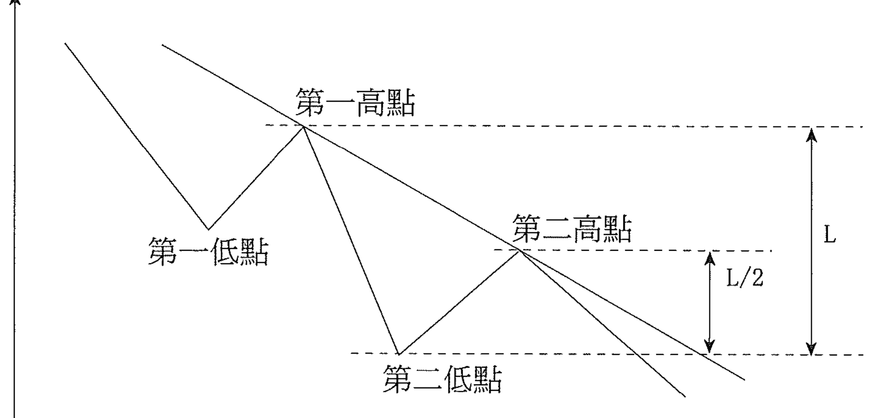

圖10-1-1 熊市特徵示意圖

#### 第二節 形成熊市的原因

熊市和牛市是一對孿生兄弟。熊市是指一個長期下跌的市場狀況，在經過一段很長時間的上漲以後，這個週期的牛市漲到了盡頭，取而代之的是熊市。熊市是由各類國民經濟病症所引發。當股票價格未充分反映人們對未來最嚴重事件的擔憂之前，熊市不會結束。熊市和牛市一樣分爲三期。每一個時期造成下跌的主要原因也不同。熊市第一期始於牛市到頂峰時的突然暴跌，大量拋售。熊市第二期容易讓人產生錯覺，在長期穩健的下跌中漲勢只是一種流沙。熊市第三期再次發生一窩蜂的拋售。

儘管上一章提到道氏的這兩個理論是針對牛市做出的，但實際上，不論是在牛市還是熊市中，都各自分爲三個階段，每一個階段都會有其主要構成和上漲或是下跌的原動力，來抬高股巿或是壓低股市。

熊市有三個向下的修正階段。當有遠見的投資者賣出時，第一個下跌修正的階段就發生，這是基於他們富有經驗的判斷，認爲那些高估和急速發展企業的獲利是難以持續的。第二階段下跌表現的是恐慌，由於此刻散戶以任意價格進行可怕的拋售，使得最近剛買進同樣的股票快要變成壁紙了。最後的下跌修正，是由於渾渾噩噩和急需現金所導致的。

雷亞根據道氏的文章總結了「定律三」。熊市是基本修正向下的走勢，期間夾雜著重要的反彈。它來自於各種不利的經濟因素，唯有股票價格充分反映可能出现的最糟情況後，這種走勢才會結束。熊市會歷經三個主要的階段：第一階段，市場參與者不再期待股票可以維持過度膨脹的價格；第二階段的賣壓是反映經濟狀況與企業盈餘的衰退；第三階段是來自於健全股票的失望性賣壓，不論價值如何，許多人急於求現至少會一部分的股票。

這項定律有幾個層面需要釐清。「重要的反彈」（次級的修正走勢）是熊市的特色，但不論是「工業指數」或「運輸指數」，都絕對不會穿越牛市的頭部，兩個指數也不會同時穿越前一個中期走勢的高點。「不利的經濟因素」是指（幾乎毫無例外）政府行爲的結果：干預性的立法、非常苛刻的稅務與貿易政策、不負責任的貨幣或（與）財政政策，以及重要戰爭。

有關熊市的情況，雷亞的另一項觀察非常值得重視：熊市末期，市場對於進一步的利空消息與悲觀論調已經產生免疫力。然而，在嚴重下挫之後，股價也似乎喪失反彈的能力，種種徵兆顯示，市場已經達到均衡的狀態，投機活動不活躍，賣出行為也不會再壓低股價，但買盤的力量顯然不足以抬高價格……市場籠罩在悲觀的氣氛中，股息被取消，某些大型企業通常會出現財務困難。基於上述原因，股價會呈現狹幅盤整的走勢。一旦這種狹幅走勢明確向上突破……市場指數將出現一波比一波高的上漲走勢，其中夾雜的跌勢都未跌破前一波跌勢的低點。這個時候……明確顯示應該建立多頭性的投資性資金。這項觀察也適用於商品市場；當然，不包括其中有利息的陳述。

一般的投資者都不喜歡熊市，因此大部分的股票投資者會在熊市受到嚴重的損失，特別是股市暴跌。價值投資的開山鼻祖格雷厄姆指出三種導致股市暴跌的力量：

- 第一、交易經紀人和投資法人對股票的操縱。每天經紀人總是添油加醋地告訴客戶哪支股票開始變動，以及一些令人興奮的股票訊息。
- 第二、銀行貸款購買股票的政策。上世紀20年代，銀行往往融資給那些焦急等待華爾街最新熱點的投資者，融資的金額，從1921年的10億美元上升到1929年的85億美元。由於融資是由股票市價來支撐的，當股市暴跌時，一切就崩盤了。美國《證券法》頒布後，保護了個人投資者不受經紀人詐欺，靠保證金買證券的做法也比20年代大大減少了。
- 第三種力量——過度樂觀。格雷厄姆指出，歷史性的樂觀是會蔓延的。格雷厄姆認為，過度樂觀應該對股市暴跌負責，但是這種因素是立法難以控制的。投資者往往容易受過去的繁榮所鼓舞，憧憬著一個持續增長與繁榮的時代，因此逐漸失去了對股票價格的感覺。在樂觀的市場上，股票可以是任何價格。在這種不理智的狀態下，投資與投機的界限也就模糊了。1929年的股災並非投機試圖偽裝成投資，而是投資趕時髦而成爲投機。格雷厄姆認爲，人們對股票所支付的價格，根本沒有考慮數學期望，其他一些原因只具有暫時性的影響。

任何一次熊市都會被事後揭露出來的事實證明是事出有因的。我們也必須指出，某些影響是永久性的，儘管我們承認市場的視野比任何人都更廣、更遠（至少在理論上是如此）但是從某種程度上來說，它也無法預見到這些因素的影響是多麼的深邃。

#### 第三節 熊市三個階段的狀況和特徵

##### 一、熊市第一期市場狀況

###### （一）眼光遠大的投資者高點出脫股票

在經濟狀況方面，第一期爲投機過度膨脹的泡沫破裂期；在投資行爲方面，第一期爲「失望」期，投資人開始放棄由牛市最後階段所誘發的貪欲，這時股市上的股票抛售主要由於失望情緒所引發。

第一期是出倉或分散（實際開始於前一轮牛市後期），熊市的第一階段原動力是聰明投資者的高點出脫，使得指數回落。在牛市第三期的後期，當股價已經漲得很高時，最初出現下跌的原因是，有遠見的投資者感到交易的利潤已達至一個反常的高度，而企業的獲利根本不足於維持這樣高的股價，因而在漲勢中拋出所持的股票。儘管股價上漲，但力道逐漸削弱，交易量仍居高不下，散戶仍很活躍，但由於預期利潤的逐漸消失，行情開始轉弱。尤其是出脫的如果是一些基金大戶的話，股價通常會在大量賣盤出現之時，市場就由漲變跌。

###### （二）物極必反

熊市第一期的序幕，始於牛市到頂峰時的股市暴跌。牛市第三期是一個絕大多數投資人都失去理性的時期，只看到股價上漲，而沒有想到股價不能承受瘋狂的上漲，漲到了某個階段之後，必然要下跌，而且下跌的速度又急又快。

市場中有許多投資者根據消息做股票，即根據市場的消息決定如何投資。有好消息就買進股票，消息愈好，投入的資金就愈多；有壞消息就賣出，消息愈壞，愈能幫助決定賣出。所以市場對消息非常敏感，牛市第三期之所以失去理智，便是因為利多消息太多，甚至微不足道的好消息也被放大，此時大家的判斷能力已經出現問題。

###### （三）投資者對壞消息更敏感

投資者對好消息固然敏感，但對壞消息更加敏感。牛市時壞消息不多，或小小的壞消息會被好消息中和，不引人注意。但到了牛市的頂峰時，就不是這樣了，因為這時的股價已經遠遠超出實際應有的支撐力。

在壞消息出籠時，有人看到形勢不妙，知道不能再等下去，或是寧可賺少一些，現在就出貨，而一些大戶更可能趁勢獲利回吐，把股票賣出。大戶手上的貨較多，賣出時會造成較快的下跌，其他人見勢也都不敢輕忽，很多的人都跟進，特別是其他大戶，如基金、大企業、金融法人等，也陸續出貨，散戶眼見形勢有變，也一樣跟進，陸續賣出。

於是多米諾骨牌效應形成了，積木被輕輕地一推就倒塌下來，記住——股價暴跌前夕有可能無聲無息。熊市第一期，通常都會是股災來臨，而且股災的出現都沒有明顯的徵兆，令人難以防備。

牛市第三期的榮景令人失去理性，而熊市第一期的暴跌，也同樣是令人失去理性。在牛市後期買入的股票成本不低，這時急促暴跌，股價遠遠低於買入價，現在要壯士斷腕，實在心有不甘，所以有些投資者忽然會抱有很不切實際的期望。他們一廂情願地欺騙自己：「這未必是真正的暴跌，只不過是一時的技術性調整而已，很快又會反彈回來，最要緊的是守穩，至少也要守到漲回成本價在賣出。」這樣的想法，會把很多投資者的害死。那些較為敏感和明智的，在避之不及時也會損失慘重。

重，對那些不甘心而死守的，更是賠得血本無歸。

###### （四）熊市第一期源於經濟逆轉

熊市是一股大洪流，任何人都不可能扭轉形勢。熊市的形成，一方面是股市投資者集體行為所引起的結果，另一方面也有經濟因素的根據。集體行為可以花時間調整，羊群心理可以扭轉過來，但經濟因素是實質的，不是一、兩個月，甚至一年半載可以扭轉的。例如經濟衰退、消費力減弱、生產毛額大減、貿易逆差等，都不是立即可改的，而要有特殊的經濟良方，或是要同時等待一些周邊因素改變。所以不正視經濟問題，只以為股市可以自然回溫，結果就愈等愈失望，愈等股市下跌得愈深，甚至於股價會跌進萬丈深淵。

熊市第一期的股市，暴跌得非常慘烈，一日之內可以下跌上千點，甚至數千點。在大跌勢的股災中，股市內任何一支股票都難以倖免，暴跌程度這樣嚴重，股市就會在重創之中慢慢步入熊市第二期。

###### （五）令人產生錯覺的熊市第一期反彈

在股災中，股票價格暴跌很多，當跌勢告緩時，會有很多人以為已經跌到谷底，可以逢低吸進。「下跌總會有一個底」，這是每個投資者的想法。和牛市高峰時相比，股價已經跌了很多，如果現在就止跌回穩，就算漲不上原價，若能回漲30%～40%，利潤已經十分豐裕。

很多投資者原本已經買了股票，但以為到底，就在「谷底」買進。當熊市第一期跌了一大段之後，就會步入熊市的第一期中的反彈。然而，這並不是熊市結束，只不過在這個時期，因為出現了「谷底買進」的現象，使人產生了錯覺。

在這個時期，買盤會增加，跌勢有了支撐力，正因為有這個現象，才有很多人誤以為已經到了谷底。但實際上，這時離真正的谷底尚有很遠的距離。第一期熊市過去後，股市指數下跌的幅度大大放緩，甚至停頓，然後增加買盤，這時會突然反彈起來。在線形圖上，我們見到熊市第一期的股市反彈，而且頗有一定的漲幅，便吸引更多不明就裡的投資者也加入羊群，一同買進。

熊市第一期，股市跌了相當的幅度，而在第一期反彈中，有可能累積已經下跌幅度1/2的漲幅。不過，痛苦還在後頭，這其實只是個陷阱，引誘那些尚未中招的踏入陷阱，也引誘那些已經中招的再死一次。

##### 二、熊市第二期的市場狀況

在經濟狀況方面，第二期為企業獲利衰退期，在投資行為方面，第二期為「悲觀」期，經濟病症與企業病症已開始顯現，進而引發新一波的股票拋售。

第二期是主要下跌的過程，股市下跌的原動力不再是那些高瞻遠矚的投資者高點出脫所致，而是在有遠見的投資者高點出脫之後，指數輾轉回落之後，其他投資者也發覺原來企業的獲利能力被大大地高估，企業股價不應該是如此高。於是他們開始感到恐懼，害怕股價仍然會有很大的下跌空間，於是競爭相賣出手中股票，和他們在牛市時爭相買入股票形成一個強烈對比。

熊市第二期我們又稱之為「恐慌階段」。買方變少而賣方就變得更為急躁，價格跌勢徒然加速，當交易量達到最高值時，價格也幾乎是直線落至最低點。恐慌階段與當時的市場條件相差甚遠。在這個階段之後，那些在大恐慌階段堅持過來的投資者，此時或因信心不足而拋出所持股票，或由於目前價位比前幾個月低而買入。

在熊市第二期的反彈是迴光返照的時期，可能存在一個相當長的次級波動，在這段期間，好消息有時可聽到，但也夾雜著不少壞消息，互相對抗。但實際的經濟情況還是很差，未見真正榮景，令人樂觀振奮的經濟數據沒有出現，到了第二期反彈的後期，真相就更加清楚。

經濟依然處在衰退中，商業數據還是惡化，上市公司的業績沒有根本性的改善，不僅沒有反彈的動力，甚至連維持當前的局面還覺得吃力。不利的消息陸續出來，如失業率繼續攀升，國民消費力弱，收入大減，宣告倒閉、清盤的公司、宣布破產的數字繼續上升，人浮於事，有人因失業或事業失敗而要接受心理輔導，到就業工作站求職的人數增加。

此外，很多大企業精簡人事，以節省成本，裁員減薪的方案紛紛出籠，業績公布，很多上市公司都處於虧損。種種情況令股市投資者不得不面對現實，很多投資者都決定，長痛不如短痛。如果股票還拿在手，不知要賠到何時，尤其是那些買入四、五線股的投資者，可能從此就不能再翻身，然後開始熊市第三期。

##### 三、熊市第三期市場狀況

在經濟狀況方面，第三期為失望期。隨著人們對經濟失望時間的延長，投資者對失望的利空消息有了免疫力。在投資行為方面，第三期為「絕望」期，市場被絕望氣氛所籠罩，投資人對經濟和股市感到悲觀。

隨著第三期的推進，跌勢並不快速，但持續時間長。通常這時候距熊市第一期的股價及指數的下跌已經有一段时间。但這時企業的獲利不但沒有改善、沒有提高，反而是愈來愈差，經濟金融消息和以前在上漲的主要趨勢時相反，差不多都是利空消息，使人心灰意冷。

在熊市第三期，將指數壓低的原動力又是另外一種。這是由於某些投資者因其他需要，不得不籌集現金而有愈來愈多地拋出其所持股票。在這個時期，股市之所以再下跌，原因就是，在熊市第一期和第二期沒有賣出股票的投資者，對於這些連續不斷的壞消息感到很無奈，對前景已經完全失去了希望。他們看不到股市有什麼美好的前景，於是受不了接二連三的壞消息壓力，將手中的股票賣掉。當大多數人都抱有這種觀念、很多投資都採取賣出股票的行動，賣出的原動力就出現，指數因此而下跌。

熊市第三期是一個漫長的下跌時期，雖然之前總會出現大跌的醞釀期，但很多投資者卻走避不及，在熊市第三期損失慘重。因此熊市第三期的主要特徵，就是再次出現拋售潮，賣盤多，買盤少，波浪潮翻愈低，一直跌下去。就算是一些具有穩實基礎的績優股，也一樣有人願意贱賣。原因很多，可能是投資者自己急於變現，可能是大財團、大企業的業績也不理想，甚至虧損，也可能是被已經瀰漫在整個股市中的「恐怖」氣氛嚇壞了。結果只有一個，就是最終跌到極低點。而熊市第三期的下跌，和熊市第一期一樣，都是以每日很大的幅度下跌，有時使人以為這是熊市的第一期。

當大市下跌之後，很久都不能夠重新回升，不論是股市或是整體經濟都已經元氣大傷。熊市第三期會持續很長的時間，和經濟情況相比，那是處於蕭條期。市面上的蕭條景象清楚可見，失業率高，消費力弱，大家都在各方面省錢，能省則省，不敢再買股票，銀行及財務公司呆帳特別多，房價大跌，通膨變成通縮，商店及辦公大樓的空屋率甚高，蕭條景象隨處可見。

當壞消息被證實時，而且預計情況還會繼續看跌，此時這一輪熊市就該結束了，而且常常是在所有的壞消息「出來」之前就已經結束。但是，只要經濟根基穩固，上軌道，那麼熊市也不是永恆的。到了某一個時候，整體經濟會現起色，露出曙光，股市就會轉移到牛市的第一期。熊市盡頭之日，就是牛市來臨之時，物極必反，否極泰來。

##### 四、熊市的某些特質

根據道氏理論將1896年至今的市場指數加以歸類，在此列舉熊市的某些特徵。需要注意的是，其中的資料只有統計意義，對於預測沒有指導意義。

- 1.由前一個牛市的高點起算，熊市跌幅的平均數為29.4%，其中75%的跌幅介於20.4%至47.1%之間。
- 2.熊市持續期限的平均數是1.1年，其中75%的期間介於0.8年至2.8年之間。
- 3.熊市開始時，隨後通常會以偏低的成交量「試探」前一個牛市的高點，接著出現大量急跌的走勢，所謂「試探」是指價格接近而絕對不會穿越前一個高點。「試探」期限，成交量偏低，顯示信心減退，很容易演變為「不再期待股票可以維持過度高漲的價格」。
- 4.經過一段相當程度的下跌之後，突然會出現急速上漲的次級反轉，接著便形成狹幅盤整而成交量縮小的走勢，但最後仍將下滑至新的低點。
- 5.熊市的確認日，是指兩種市場指數都向下突破牛市最近一個修正低點的日子，兩種指數突破的時間可能有落差，是正常的現象。
- 6.熊市的中期反彈，通常都呈現倒「V」形，其中低價的股票成交量偏高，而高價的股票成交量偏低。
- 7.在經濟出現不利的時候，市場出現熊市，熊市的发展也是一波三折。熊市由三個時期構成：第一期——失望；第二期——悲觀；第三期——絕望。
- 8.在熊市三時期中，投資人應該特別注意在上述三時期中，政府與商業數據、股市分析與評論及投資大眾這三個主要方面的各自表現，特別是其對未來前景的看法有相當的一致性（見表10-3-1）。

| 對未來的看法 | 熊市第一期失望階段 | 熊市第二期悲觀階段 | 熊市第三期絕望階段 |
|---|---|---|---|
| 政府與商業統計 | 仍看好 | 轉為悲觀 | 持續看壞 |
| 股市分析與評論 | 仍看好 | 轉為悲觀 | 持續看壞 |
| 投資大眾 | 仍看好 | 轉為悲觀 | 持續看壞 |

表10-3-1 熊市三個時期中開始時期的心理比較

#### 第四節 不同股票在熊市不同時期的表現

##### 一、在熊市第一期的表現

當牛市結束、熊市來臨時，股票會出現恐慌性下跌，這時高價股會跌得極兇，很多績優股也會下跌三、五成，甚至更多。股災的名稱由此而來。不過，相對高價股的跌幅，低價股會跌得更慘。很多低價股可能會在熊市第一期大跌九成，不少更因為經受不了經濟的突變，被迫清盤倒閉。高價股下跌三、五成的，已經算是很少。低價股因為在牛市第三期漲得過分，遇到經濟轉壞，股災出現，這些漲數十倍、上百倍的股票下跌時，即使是打回原形也跌得極為可怕。凡是在熊市，總是有一個鐵律，就是高價股會在幅度上變得較少，低價股，愈是低價的，在下跌之時期幅度卻愈高。

##### 二、熊市第二期的表現

熊市第二期是一個穩健下跌的過程，論到安全程度，始終都是高價績優股比低價股安全得多。在第二期中也有一個反彈的時期。不過，這個時候的反彈，也不是所有股票都受惠。通常在熊市第二期的反彈中，只有實力強大，或是次一等的二線實力股才會有很大的反彈。反彈的幅度達之前跌幅的1/3至2/3，通常會是一半，但低價股和反彈的幅度一般在熊市第二期時力道就弱得多。很多低價股在熊市第二期仍然下跌，有些只是因為市場反彈，所以沒有再下跌，處於膠著狀態，有些即使做出反彈，但反彈力道只是績優股反彈的一半，只是象徵性地反彈三、五百個分點，或是十來個百分點。

##### 三、在熊市第三期的表現

在熊市第三期，任何股票都不能夠倖免，都難逃大跌的命運。在熊市第三期下跌的股票中，跌幅最大的往往都是績優股。因為在熊市第一期，垃圾股已經大跌，雖然之後反彈，但始終都不會反彈到牛市時的價位，而且垃圾股可能在前兩個階段就失去其在前一輪牛市的上漲幅度。稍好些的股票跌得稍慢，因為持股者一直堅持到最後一刻，結果是在熊市的最後階段，這樣的股票反而又成為下跌的主角，人們不再相信優良股票的價值。這一輪的股票拋售在絕望的氣氛中進行，也可能是因為消息面非常惡劣，或是因為保證金催付通知而出現的斷頭實壓。

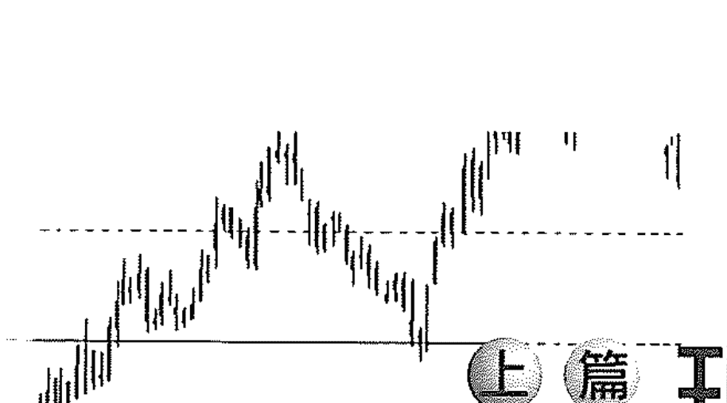

### 第十一章：欺騙並造成恐慌的次級波

了解基本波的方向與成熟度當然很重要，但為了協助評估基本波的發展程度，我們也必須了解次級波的某些典型特質。分析次級波有助於判斷股票或其他金融市場的基本波轉折。此外，必須將基本波的反轉和次級波進行區別。了解次級波性質後，可以利用它們來識別基本波的反轉。

#### 第一節 對次級波的重新定義與理解

##### 一、古典次級波的概念

由於認識次級波對識別基本波和日常波動有承上啟下的作用，因此必須對次級波的特徵有所認識。在先前的兩章中，我們討論市場的基本波；換言之，基本波是對應經濟週期（通常為三、四年）活動發展的價格走勢，而不符合上述情況的可定為次級修正。

雷亞的「定律五」是給次級波下的定義：次級波是牛市中重要的下跌走勢，或熊市中重要的上漲走勢，持續的時間通常在3個星期至數個月；此期間內折返的幅度，為前一次反轉結束後之基本波幅度的33%至66%。次級波經常被誤以為是基本波的改變，因為牛市的初期走勢顯然可能僅是熊市的次級波，相反的情況則會發生在熊市出現底部後。

在雷亞對於次級波的定義中，有一個關鍵的形容詞是「重要」。一般來說，如果任何價格走勢起因於經濟基本面的變化，不僅是技術面的調整，而且其價格變化幅度超過前一個基本波波段的1/3，都稱得上重要。如果聯儲將股票市場融資借款的比例由50%調高為70%，這會造成市場上相當大的賣壓，但這與經濟基本面或企業經營狀況並無明顯的關係。這種價格走勢屬於小型（不重要的）走勢。另一方面，如果發生嚴重的地震而使一半的加州沉入太平洋，股市在3天之內暴跌800點，這是屬於重要的走勢，因為許多公司的盈餘將受到影響。然而，日常波動與次級波之間的差異未必非常明顯，這也是道氏理論追隨者需要注意的部分。

次級波是沿著基本波方向演進中產生的重要回調。它們可以是在一個牛市中發生的中等規模下跌或「回檔」，也可以是在一個熊市中發生的中等規模上漲或反彈。正常情況下，它們持續3週到數月不等的時間，但很少再長。在一般情況下，價格回調到沿基本波方向推進幅度的1/3～2/3。然而我們必須注意，這個1/3～2/3並不是牢不可破的，它僅是一種可能性，大多數次級波都在這個範圍之間，很多在靠近中途就停止了，即回調到前面基本波推進幅度的50%。回調幅度很少有少於前面基本波推進幅度1/3的情況，但有些時候，由於幅度太小，幾乎完全看不出次級波。

或許我們問過一個問題，為什麼牛市中的次級波動不會跌去所有的漲幅？道氏指出：「市場中的基本波通常都包含一次至少達3/8規模反向作用的次級波，這似乎是個事實。」道氏對於基本波與次級波比例關係的描述是符合週期理論比例原理的，也就是時間週期長的波動幅度要大於時間週期短的波動幅度。儘管次級波有時候波幅非常劇烈，但是波幅再大也不會大於基本波的波幅。不過，我們仍然不能教條式地理解道氏所說的具體數值。

道氏估計這種與基本波反向的次級波時間為40～60天，然而隨後的經驗顯示這個上限很難達到，個別時間甚至達不到40天。

我們有兩個標準用以識別次級波。任何與基本波方向相反、持續至少3個星期，並且回調到上一個沿基本波方向上價格推進淨距離（從上一個次級波的末端到本次開始，略去小幅波動部分）至少1/3幅度的價格修正，即可認為是次級波。儘管如此，次級波經常令人捉摸不到。對其識別、確定其開始，並進一步發展的時間等，對道氏理論的追隨者來說都是最困難的事情。

雷亞對大多數次級波的折返幅度和時間作過統計，約為前一個基本波波段的1/3至2/3之間，持續的時間則在3個星期至3個月之間。對於歷史上所有的次級波來說，其中61%的折返幅度約為前一個基本波波段的30%至70%之間，其中65%的折返期間介於3個星期至3個月之間，其中98%介於2個星期至8個月之間。價格的變動速度是另一項明顯的特徵，相對於基本波而言，次級波動有暴漲暴跌的傾向。

不過，需要注意的是，如果我們只考慮波動的程度，那麼日常波動也可能嚴重到構成一次次級波的程度；但次級波不可與日常波動相互混淆，後者總是出現在基本波與次級波的走勢中。日常波動是構成次級波走勢的基本結構，在98.7%的情況下，持續的期間不超過2個星期（包括星期假日在內）。它們對於次級波與基本波幾乎完全沒有影響。截至1989年10月為止，歷史上「工業指數」與「運輸指數」共有694個次級波（包括上漲與下跌），其中僅有9個次級波的期間短於2個星期。

我們可以毫不遲疑地指出，如果說判斷牛市或熊市的轉折點是困難的，那麼判斷次級波的終點則更加困難，儘管指出次級波的終結和基本波的重新開始並非完全不可能，但是我們不能教條地看待這種波動的深度和期限。

##### 二、作者所定義的次級波

根據道氏理論前導對於次級波的描述，次級波顧名思義，無論在波動幅度還是波動時間都是僅次於基本波的波動，但是，次級波不僅是與基本波方向相反的調整走勢，而且它還可以與基本波走勢方向相同，當次級波與基本波方向相同時，進而形成基本波的加速行情，即在牛市中構成加速上漲，在熊市中構成加速下跌。特別是當次級波與基本波方向相反時，由於它的波幅有時非常大而發生的非常突然，所以會給投資者帶來很大的風險。

作者作出這樣的說明，目的在於針對不同層次的波動，投資者可以根據市場行爲去研究各種波動背後的影响因素，以便找到波動的動機後，更有效地把握市場。因爲不同層級的波動，其背後導致的因素是不同的。由於次級波在市場結構中發揮承上啟下的作用，所以要把握市場的整體結構，從次級波入手是一個很好的切入點。爲了準確認識次級波，我們需要有一個能顯示次級波性質的定義。

作者所定義的次級波：次級波是指無論是波動幅度還是波動時間都僅次於基本波的波動，它是由獨立因素引起的獨立波動，並與基本波加乘構成市場波動。次級波不僅是與基本波方向相反的調整走勢，而且它還可以與基本波走勢方向相同，當次級波與基本波方向相同時，進而形成基本波的加速行情，即在牛市中構成加速上漲，在熊市巾構成加速下跌。特別是當次級波與基本波方向相反時，由於它的波幅有時非常大，而且發生得非常突然，所以會給投資者帶來很大的風險，持續的時間通常在3個星期至數個月之間；在此期間內折返的幅度，爲前一次級反轉結束後的 基本波幅度的33%至66%。

由於次級波無論在波動幅度還是波動時間上都是僅次於基本波的波動，因此雷亞稱其爲「牛市中重要的下跌走勢，或熊市中重要的上漲走勢。」而根據週期理論的加乘原理，次級波是獨立於基本波之外的一種波動，產生次級波的原因，也是獨立於產生基本波的原因，而其中影響次級波的因素是會受到一定程度的人爲操縱。

在這種作者需要說明的是，道氏當年將次級波看成是與基本波反作用調整的行情（與基本波方向相反），所以道氏用「Secondary Reactions（產生副作用的反動力）」來表示次級波，但是透過週期理論我們知道，市場波動是由三種獨立的波動加乘而成的，所以作者用「次級」來闡述次級波的特點。實際上，次級波是僅次於基本波的波動，不論其波動幅度還是波動時間都可能是很大的，尤其是在時間短、波幅大的情況下，投資者往往面臨很大的風險，甚至到造成巨額損失。在牛市的初期走勢，可能僅是熊市的次級波。相反的情況則會發生在牛市出現頭部後，所以次級波經常被誤以爲是基本波的改變。因此道氏將次級波認爲是對基本波的調整，甚至稱之為「騙線」也不為過。

還有一點，我們不能被次級修正的「次級」表面意思所迷惑，不少投資者將其說成是「次要的」或「中級的」，但次級波是僅次於基本波的波動，不論其波動幅度還是波動時間都可能是很大的，有時候要遠遠大於「次要的」或「中級的」波動。而且次級波有副作用的反動力，還會產生推動主流方向的力量，引起主動力的作用，並使行情加速發展。

作者作出這樣的說明，目的在於針對不同層級的波動，投資者可以研究各種波動背後的影響因素，以便於找到波動的動機後，更好地把握市場。因為不同層級的波動，其背後所導致的因素也是不同的。

根據經驗統計，次級波的持續時間通常在3個星期至數個月；在此期間內逆向次級波的幅度為前一個正向次級波幅度的33%至66%。根據道氏的經驗，次級波經常可以從牛市中的囤積線或熊市中的拋售線預測出來。有一個從實踐中得出的規律可以為我們研究次級波提供方向，漢密爾頓指出：「次級波的改變是突然的，而基本波的重新開始又是緩慢的。」

##### 三、市場的風險主要來自於次級波

我們可以提出一個問題：「股票平均指數能夠可靠地預測次級波嗎？」從本質上來說，這是可能的。比如道氏發現一個規律，如果在基本的牛市發展過程中，兩種平均指數都形成了一條線，一旦價格低於這條線則暗示達到了飽和點，在熊市中則是相反的情況。然而經驗告訴我們，這種情況通常不是出現在次級下跌或反彈之前，而是在它之後。囤積線給牛市的暗示顯示，平均指數會達到比次級下跌開始時更高的水平。根據我們記錄的資料，這種新高點是牛市已經重新開始的結論性證據。

這裡需要指出，主要的風險來自於次級下跌，而預測次級下跌也是要冒風險
的。本書並不鼓勵這樣做。正是由於次級波的風雲變換不可預測，才使得市場的主要風險來自於次級波，投資者的虧損也主要在於次級波，並使投資者迷失方向，但隨後市場又恢復原來的基本波。

能當上「恆星」的人是少數的。「恆星」之一格雷厄姆說，記憶力好是一項負擔。一生中兩次損失重大的記憶，導致他強調下跌保護而不是上漲潛力的投資方法。由此看出，即使是價值投資理論的開山鼻祖格雷厄姆對於道氏理論的次級波也是無能為力的，以至於兩次遭受慘痛的教訓。

#### 第二節 次級波的性質

##### 一、具有騙人的性質

我們知道次級波時而與基本波方向相同，時而與基本波方向相反，次級波極具欺騙性，常使人誤認為基本波已經開始轉換。次級波經常被誤以為是基本波的改變，因為牛市的初期走勢可能僅是熊市的次級反轉，相反的情況則會發生在牛市出現頭部後。次級波的這種欺騙性根源於最後一個次級波，實際上可能成為下一個基本波中的第一波。因為牛市的初期走勢，可能僅是熊市的次級波。相反地，熊市的初期走勢也可能是牛市的次級波。所以次級波也經常被誤認為是基本波的改變。道氏理論的前輩們認為，次級波是騙線，並教導我們不要理會它。

特別是次級波會受到一定的人為操縱，所以它具有些騙人的性質。因此，道氏將次級波說成是騙線，這當然帶有很強的情緒化色彩。通常認為次級波帶有一定的人為操縱性質，但是我們常常看到操縱市場的人也被市場所欺騙，正是因為這一點，道氏並不認為次級波與人類的影響有關。

實際上，交易條件要比那些決定基本波的因素對次級波產生更大的影響。次級波的不確定人為因素最多，就算能夠讓你認識到市場的次級波，也未必能夠把握。這裡非常重要的是，要知道和做到風險控管、資金管理和操作行為執行能力的實戰問題。

##### 二、次級波不存在的形態或模式

前面的研究顯示，基本波是鬆散週期性的近似常態分布輸動的波動，而次級波則沒有固定模式，它是循環波動。市場還沒有足夠的資料來證明次級波和日常波動以什麼形式波動。由於次級波的市場功能是欺騙廣大投資者，使其投資決策失誤，因此次級波必然以多變的形態存在，不存在固定的形式或模式。這一點與基本波不同，因此抓住次級波是困難的。

次級波的不固定存在形態，說明風險控管的極端重要性。次級波的多變形態，要求投資人時刻保持謹慎的操作態度，隨時準備承認操作失誤。正是由於這一點，職業投資家靈活使用市場測試技術、加碼技術、減碼技術、投資保險技術等，以求最大限度地控管風險。

##### 三、基本波與次級波難以絕對區分

儘管基本波和次級波是分別屬於不同層級的波動，但是並不存在一個真正可以分離出來的基本波，由於三種運動是加乘在一起的，所以從某種意義上來說，可以將基本波理解成是由次級波所構成的。經過研究顯示，對基本波與次級波的識別都不可能分別獨立完成，必須經由兩者之間形態與發展過程的比較研究才可能得出。真正有效的投資分析方法，不可能是單獨描述基本波的分析方法，而是能較準確地描述基本波與次級波相互轉化關係的方法，這就需要相關驗證原則來幫助。

##### 四、次級波的構成

同樣地，我們可以將次級波看成是由日常波動組成的。H·M·加特利在其經典之作《操縱股市》（Profits in the Stock Market）中指出，截至1935年以前的40多年裡，美國股票市場的所有牛市行情的逆向次級波中，有2/3是呈現兩波段的跌勢，中間夾著一個短期反彈，反彈的幅度介於第一波跌勢幅度的1/3～2/3之間。從1935年以來的資料顯示，這種情況仍然普遍存在：大多數逆向的次級波包含兩個波段——不是一個波段，也不是三個波段的短期跌勢。不幸的是，熊市的逆向次級波沒有類似的明確現象，因為有些逆向次級波僅呈現單一的反彈，有些則是由無數的小反彈所構成，更有些是呈現橫向的震盪走勢。雖然加特利所指出的現象是針對股票市場而言，但這種修正模式也適用於其他金融市場。

#### 第三節 次級波的運動機制

##### 一、次級波發生的原因

因為股票價格的基本波取決於投資人對企業未來獲利能力的態度，企業獲利大致又取決於經濟週期的發展，所以較長期的趨勢會受到次級反轉所間斷，這似乎是不甚合理的現象，因此我們需要了解次級波發生的原因。

###### （一）過度樂觀或過度悲觀

根據歷史資料顯示，次級波之所以發生的原因之一，可能來自於投資人的過度樂觀（或過度悲觀），或新的數據顯示，經濟情況不如當初所預期的理想（或不理想），或整個情況可能朝相反方向發展。舉例來說，在牛市行情的第一波次級漲勢中，市場可能已經預先反映強勁的經濟復甦，但隨後的数据卻顯示經濟可能再次陷入衰退，於是出現逆向次級波。這類的恐懼，由事後的角度來觀察或許沒有根據，但當時足以造成逆向次級波。另一種可能性是擔心利率上升將抑制經濟復甦。因為價格已經預先反映強勁的景氣復甦，所以這類感覺上的變化會使投資人心存疑慮，造成價格下跌。

###### （二）利益再分配和過度擴張信用

引起次級波的另一個重要原因是利益的再分配。同時，許多投資人可能陶醉在最初的漲勢中，過度擴張信用，一旦價格開始回落，依靠融資進行投資的空頭賣壓可能促使價格進一步挫跌。

###### （三）預期心態的變化

在股票市場中，熊市反彈通常是因为經濟展望比預期理想。債券市場的熊市情況則相反。商品與外匯市場的逆向次級波也是因為市場參與者對基本經濟趨勢的看法產生不正確的變化。反彈走勢的催化劑是交易員或投資人回補空頭資金。我們必須強調一點，逆向次級波的表面原因未必與經濟預期或利率水準有直接的關係，也可能是因為政治或軍事事件惡化。一般來說，預期心態的變化，以及修正前一波正向次級波在技術面上的扭曲，再加上價格迅速變動，種種因素足以使絕大多數的市場參與者發生困擾。對於股票市場的基本波來說，唯有人們正確預期經濟將由復甦轉為衰退（反之亦然），趨勢才會發生反轉。

#### 第四節 次級波在市場中的作用

##### 一、減壓器的自我調整功能

道氏、漢密爾頓及雷亞都極其看重次級波，認為次級波的存在是股市得以正常運行的重要保障條件。他們認為，次級波對股市在客觀上發揮減壓器的作用。在基本波的發展過程中，次級波對供需關係的失衡狀態發揮調節和制衡作用，進而使基本波的發展過程，不致由於供需關係的嚴重失衡而中斷。次級波在客觀上，對基本波發揮自我調節的作用。

雷亞將次級波比喻為鍋爐中的壓力控制系統。在牛市中，次級波相當於是安全閥，它可以釋放市場中的超買壓力。在熊市中，次級波相當於為鍋爐添加燃料，以補充迅速流失的壓力。

次級波的真正目的和作用是什麼呢？如果允許我們進行比喻，可以認為次級波與調整指南針的儀器沒有什麼區別。我們許多人都曾見過輪船上有一種測量周圍情況的儀器，卻不知道它的作用是什麼。當然這個比喻是無法盡善盡美的，但是它可以清楚地顯示，次級波的可貴之處就在於調整我們的晴雨表。至少在這個意義上，我們的指示器是可以自我調整的。要知道我們的研究對象並不像水銀柱那樣確定，因為水銀柱的屬性已經完全被我們掌握了。股市晴雨表把任何可以想像出來的因素都考慮在內，包括最不易把握、最穩定、最不可計算的因素————人性本身，因此我們不能期望得到物理學上那種機械的準確性，這就需要晴雨表有自我調整的功能。

##### 二、隱蔽基本波

我們說基本波對投資者是最重要的價格波段，並非貶低次級波和日常波動的重要性。基本波是投資者獲利的基礎，而次級波和日常波動也是市場存在及正常運轉的基礎。次級波的另一主要功能是隱蔽基本波，使其真正意圖不被大多數投資人所覺察。我們知道在市場上，很多投資人在大多數的時候都是錯的。而犯錯的主要原因是被次級波所誤導。次級波的存在使大多數投資人走向錯誤的操作方向，進而保證只有少數人成為最終贏家，最後使以「零和博弈」為特徵的證券期貨投資遊戲規則得以維護。

##### 三、引發「恐懼」的心理

投資人最主要的兩大心理弱點是「貪婪」和「恐懼」。從心理學的功效上來說，次級波主要發揮誘發投資人「恐懼」的心理弱點，而日常波動主要發揮誘發投資人「貪婪」的心理弱點。每個有實際投資經歷的投資人，都能反省出自己被次級波震盪出局的經歷，而這正是恐懼的結果，怕失去已形成的浮動盈利或怕市場已經轉向等等。每個有實戰經驗的投資人，也都能反省出自己已被日常波動誘發貪欲的經歷，如為了搶反彈而錯誤進場，最終虧了大錢等等。

##### 結論：要注重對市場參與者心理特徵的理解與分析

根據三重運動原理，價格趨勢可以歸納為三類：基本波、次級波與日常波動。基本波涵蓋的期間通常為1年到3年，是反映投資人對經濟週期的態度。次級波所涵蓋的期間通常為3週到數月以上。這種趨勢雖然對投資者不是非常重要，但由於它具有使投資者產生恐懼心理的作用，因此辨識其方向仍有裨益。特別是在牛市的次級折返與熊市的第一波下跌，兩者之間的分辨可能是投資成敗的分水嶺。日常波動所涵蓋的期間通常短於三、四週，而且經常呈現隨機的性質，它發揮引誘散戶入市的作用。

對於短期交易的投資者，心理因素是最應該引起投資人重視的因素，對他們來說，心理分析對正確的投資決策具有重要的意義。投資者在進行心理分析時，必須要包括兩方面：一個是對自我的心理分析，它是解決投資人在投資決策過程中的心理障礙問題，要盡可能克服自身存在的弱點，特別強調戰勝貪婪和恐懼的心理；另一個是對市場的心理分析，它是解決投資者對市場中其他投資人的心理活動特徵的把握問題，特別強調注重逆向思考，反對盲從行為，以避免成為市場的「多數人」。

任何事物的性質都是由它的結構所決定，次級波也不例外，其實「零和機制」是股票、期貨、外匯，以及其他金融市場的基本機制，也正是次級波才使得市場的「零和博弈」特徵得以保持。而次級波所引起投資者強烈的恐懼心理，使得真正能認出基本波的人並不多。也就是說，次級波的存在，使得市場上只有少數人能夠成為最終贏家。

正如投資大師羅傑斯所說：「大部分的人大多數的時候都是錯誤的，世界上正確判斷市場的人是少數，但數量不變。」所以我們研究次級波的目的是，市場狂熱時賣出，市場失去信心時買進，避免一窩瘋，保持我們的投資決策與大多數人相反。當然需要了解次級波的結構，這也是下一章的主要內容。

### 第十二章：次級波的波浪結構

認識次級波對識別基本波和日常波動有承上啟下的作用。儘管了解基本波的發展進程很重要，但基本波的發展是有步驟、分階段進行的，為了更進一步研究基本波的發展變化，我們有必要對其細微結構——次級波有所認識。特別是由於次級波的波動幅度是很大，以至於非常容易將次級波的發展與基本波的反轉混淆起來，所以必須了解次級波的某些典型特徵，以便於將基本波的反轉和次級波發展進行判別。

#### 第一節 將基本波分解為多個次級波

##### 一、將基本波進一步劃分為三個時期

道氏將牛市到熊市的輪動大致分為六個時期，即牛市的三個時期和熊市的三個時期。

在牛市的三個時期包括：(1)因懷疑而猶豫期；(2)因信任而樂觀期；(3)因貪婪而狂熱期。

在熊市的三個時期包括：(1)因彷徨而失望期；(2)因震撼而恐懼期；(3)因厭惡而絕望期。

需要提醒讀者的是，這僅是一種大致的分法，因為將牛市和熊市都分為三個時期是對市場現象的一種理解或者描述，而根據對實際行情的研究顯示，一輪基本波至少有三個時期。

實際上，三個時期也就是三個次級波輪動。這裡所說的三個時期，如果是在牛市，所對應的就是道氏所說的「牛市中第三次擺動」。牛市第一期，也就是第一個次級波動，對應第一次擺動是前一輪熊市的過度悲觀之後的一次反彈開始；牛市第二期，也就是第二個次級波動，對應第二次向上擺動與商業和利潤的增長運動；牛市第三期，也就是第三個次級波動，對應第三次也是最後一次擺動的是與價格背離的價值。這裡再次提醒讀者，將一個基本波分為三個時期是一種理想的情況，因此讀者在市場中發現較多或較少的時期也沒有什麼奇怪的。

如同基本波動一樣，次級波所構成的是次級波動。一個次級波動也有兩個方向，一個是與基本波方向相同的正向次級波，另一個與基本波方向相反的逆向次級波所構成。根據週期理論，一次運動是由低點到低點來衡量（參考圖12-1-1）。

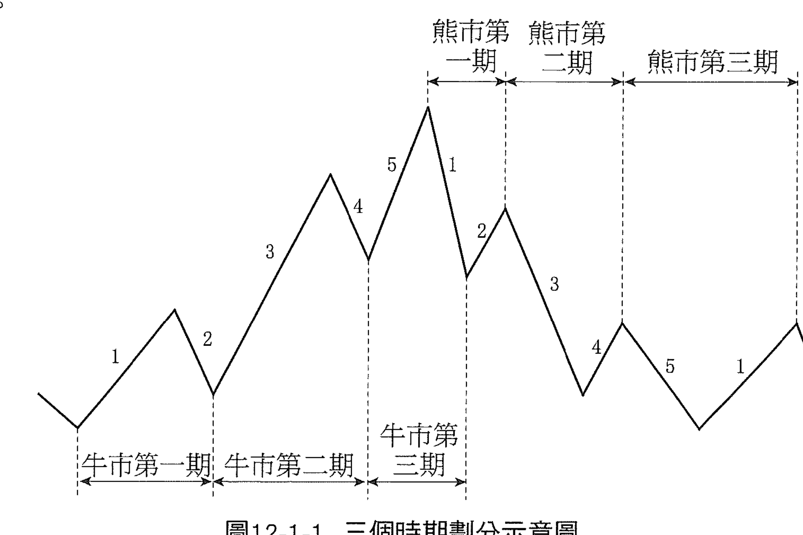

但是這裡有個問題，如果嚴格按照週期理論的分法，很難找到合適的熊市中次級波動順序的分法，而把熊市定義當作依據的話，熊市的次級波動應該按照圖12-1-1上方的標注方式。也就是在牛市第三期中包含熊市第一期的一部分；同理，熊市的第三期中也包含下一輪牛熊市第一期的一部分。從這個意義上來說，次級波的欺騙性部分就是來自於牛市第三期與熊市第一期，或者本輪的熊市第三期與下一輪牛市第一期有交叉部分所引起的。

##### 二、將基本波分解為多個次級波

從以上的描述中我們知道，不論是牛市還是熊市都有與基本波方向相同的三個階段和與基本波相反的兩個階段。同樣需要注意的是，將一個基本波分為三個階段的正向次級波和兩個階段的逆向次級波是一個理想情況，這樣理想地分解的目的是將市場的結構分清楚，因此讀者市場中發現較多或較少的階段也沒有什麼奇怪的。

一個理想的基本波是由五段次級波所構成，其中三段是與基本波相同方向，另兩段則呈現相反的方向。在牛市中，有三段正向次級波，它們是推動走勢，以及兩段逆向次級波，是回檔走勢；在熊市中，則為兩段反彈走勢，是調整走勢，並間隔三個次級的下跌走勢，是推動走勢。請參考圖 12-1-2。

根據上述討論，次級波基本上可以分為兩種類型。第一種是在基本波的基準上使基本波加速波動的推動走勢，它們被稱為「正向次級波」，第二種次級波走勢與基本波的基準方向相反的調整走勢，因此稱之為「逆向次級波」，它們的涵蓋時間通常為3週～3個月（偶爾會更長或更短），其折返的幅度為前一個正向次級波走勢的1/3～2/3左右，更多的情況是1/2左右。而正向次級波的方向與基本波的方向相同，所以涵蓋的時間通常大於逆向次級波走勢，價格波動的幅度也較大。

由於一個完整的基本波輪動週期是由一個牛市和一個熊市組成，所以也可以理解為由這10個階段組成，這10個階段其實就是10段次級波。而一個完整的次級波輪動是由一段正向次級波和一段逆向次級波所組成。這當然並不表示一個基本波輪動必然是由10段次級波所構成，實際情況經常不是這樣，或者說不一定是這樣。

應該提醒讀者的是，沒有任何兩個牛市或者熊市是完全相同的。正如道氏所說：「每種可能的組合都可能出现。」一些牛市自始至終只是以極快的價格上漲，也有一些可能缺失三個典型時期中的任何一個。牛市的第5階段，就是一個令人興奮的投機機會，散戶非常活躍，這個階段可能持續至少一年，也可能不過一、兩個月。假如你知道牛市的最後一個階段一般會出現哪些徵兆，就不至於為市場出現十分看漲的假象所迷惑。一些短期熊市的形成沒有明顯的恐慌階段，而另一些則以恐慌階段結束。熊市恐慌階段通常不是幾天，就是幾個星期之內就可以結束的。

##### 三、次級波中的投機行為

儘管道氏並不認為次級波與人類的影響有關，但畢竟市場行為還是與投資行為有關。實際上，次級波更主要的是由投機行為（與人為操操不同）所導致的，也與投資者和投機者們的投資週期有很大關係。

在牛市最初的發展階段，股票指數已經預先反映最嚴劣的利空消息，市場對於未來的信心逐漸開始復甦，作為「聰明資金」的代表投資家已經悄然入市，因此，出現牛市第一期的正向次級波。但是這種上漲行情並沒有得到散戶的認可，所以見到有相對的高點投資大眾還是繼續賣出股票，這就出現了牛市第一期中的逆向次級波。

在牛市第二期，市場開始對景氣的經濟產生認可已經比較明顯，牛市的形成已經得到散戶的認可，於是產生投機的心理，紛紛買進股票，因此形成牛市第二期的正向次級波。而此時職業投資人已經產生可觀的獲利，所以會賣出部分獲利豐厚的股票，因此出現牛市第二期的逆向次級波。

當投資人察見到股市出現低點時，認為好機會來了，於是紛紛大舉入市，於是形成了牛市第三期的正向次級波。牛市第三期的正向次級波的股價上漲程度會與現實脫節。熊市最初的發展階段也就是牛市處於最後的瘋狂階段。

隨著牛市進入最後的瘋狂階段，熊市最初的孕育階段也開始。由於此時散戶已經處於滿倉而沒有資金，所以購買股票的股價已經感到風險，於是大舉抛售，並引發散戶的抛售，於是熊市第一期的正向次級波就形成。此時，相當部分的散戶還沒有意識到熊市已經來臨，還認為是牛市中的回檔，是投資的好機會，於是又開始買進，因此形成了熊市第一期的次級逆向波。

然而，此時牛市已去，進入到熊市第二期，經濟活動與企業獲利明顯下降。散戶開始清醒過來，紛紛大舉抛售手中的股票，於是形成熊市第二期的正向次級波。此時股票價格已經跌去大半，手中早就沒有股票的法人開始嘗試性買進一些股票，於是形成了熊市第二期的逆向次級波。

由於市場依然處於熊市中，也很可能是因為消息面非常惡劣，或是因為保證金催付通知而出現散戶的斷頭實質。最後，當散戶不考慮股票的內在價值而抛售股票時，熊市行情便發展到底部，這代表熊市第三期的正向次級波即將結束。此時牛市最初的孕育階段也開始了。

##### 四、將基本波至少分為五個階段的意義

當出現道氏確認之後，意味著趨勢至少持續一年以上，將基本波分成三個時期或進一步分為五個階段之後（參見圖12-1-2）的操作意義在於，如果市場處於牛市中，在一段、三段和五段可以買進，而在二段和四段即使買進被套（在有做空機制的情况下）也没有太大的風險，因此不必恐慌。甚至高明的投資者可以知道在牛市的一段和三段的高點賣出平倉後，還可以在二段和四段的低點買進，但在第五段買進要保持高度警戒。在熊市中，在一段、三段和五段可以賣出，而在二段和四段即使賣出被套（在有做空機制的情况下）也沒有風險，不必恐慌，但在第五段賣出是要保持高度警戒的，在二段和四段賣出沒有太大風險。甚至高明的投資者可以知道在熊市的一段和二段低點買進後，還可以在二段和四段的高點賣出。

##### 五、歸納次級波的結構

- 1. 了解基本波的兩個調整或次級輪動波的特性，可以協助判斷基本波的發展進程。
- 2. 一個典型的基本波，是由212個次級輪動波所構成，每個輪動都包含一個上升與一個下降階段，它們是由投資週期決定的。在牛市中，每個正向次級上漲波必須不斷地創輪動高點；在熊市中，每個正向次級下跌波動，必須不斷創輪動低點。在判斷基本波的反轉時，跌破不斷墊高的底部，或向上穿越持續下滑的頭部，這顯然都是反轉的重要徵兆。
- 3. 用週期理論來解釋次級波。逆向次級波是次級輪動波的一部分，方向與基本波相反，在牛市是向下的折返，在熊市是向上的反彈。逆向次級波所涵蓋的時間通常為3週到3個月，折返的幅度為先前正向次級波的1/3～2/3之間。此外，逆向次級波也可能呈現狹幅盤整或橫向整理。

#### 第二節 次級波的波浪形態

##### 一、波浪結構

## 理論篇

這裡所說的股票市場的波浪就是指價格或指數波動的次級波。道氏由大海的運動得到了啟發，並形成了道氏理論核心思想——三重運動原理。根據三重運動原理，市場呈現的是波浪結構。因此，要認識市場的結構也需要借助波浪的概念。

大海的運動是由潮汐、海浪和漣漪所組成。根據三重運動原理，價格波動可以歸納為三類：基本波、次級波與日常波動。道氏指出大海的波浪結構，可以幫助投資者掌握這些波浪運動的具體意義，仔細理解其中所含有的啟示。

牛、熊二市顯示出的是一個大的輪動波，在這個漫長的過程中，並不是一氣呵成，而是呈現波浪式前進的。不管牛市還是熊市，都包含一個接一個的波浪。在牛市中，波浪是一浪高過一浪，次級波是一路向上；而在熊市中的情況則相反，波浪是一浪低於一浪，次級波是一路向下。投資者分析這些波浪，就可以發現一定的次級波規律。

儘管次級波動是投資活動的反應，但是市場並不是一個人做出來的，而是由股市中的群體行為產生的。這些群體行為並不一致，甚至是經常相反；有人買進，也會有人賣出。所以在各個波浪當中，有些波浪反映了真正的經濟情況，但有些只是人為的假象。由於次級波帶有一定的人為因素，因此很難準確把握。

透過道氏的長期觀察，整體上一輪基本波至少可以分為三個時期，或五個階段。需要不斷強調的是，一輪基本波並不一定只能分為三個時期，或五個階段，而是至少三個時期或五個階段。

基本波涵蓋的期間通常為1～3年，也可能更長或更短，是反映投資人對經濟運行週期的態度。次級波所涵蓋的期間通常為3周到數月以上，也可能更長或更短。這種趨勢雖然不是非常重要，但對辨識基本波方向仍有裨益。我們同樣可以將次級波看成是由日常波動組成的。

作者認為，儘管艾略特的道氏理論在道氏理論的波浪結構基礎上進一步研究次級波，並形成道氏理論，但是我們要避免道氏理論對次級波形而上學式的研究，避免將道氏理論擴大到基本波，或者滲透到日常波動，以及更小層級的修正，應將道氏理論限制在波浪層級的次級波中應用。

##### 二、次級波的時間和空間

根據道氏的說法，整體上，次級波會在原來累積的漲幅或跌幅中，朝反方向下跌或上漲，這個漲、跌調整的大約幅度可以高達1/3，甚至於2/3，通常為1/2，這是由前一個次級波的前端開始衡量的。

次級波是一個中期波動，它不是一天半天便形成或結束的。次級波所涵蓋的時間大約是3~4週以上，也可能一兩個月後還繼續這個趨勢，甚至可能三、四個月，也可能半年，還可能八、九個月到一年，故需要長期跟進分析，才可以理出次級波的整體脈絡。

道氏估計反向次級波的時間約為40～60天，然而隨後的經驗顯示，這個上限很難達到，有的時候甚至達不到40天。雷亞對大多數次級波的折返幅度和時間做過統計，約為前一個基本波波段的1/3至2/3之間，持續的時間則在3個星期至3個月之間。

對於歷史上所有的次級波來說，其中61%的折返幅度約為前一個基本波波段的30%至70%之間，其中65%的折返期間介於3個星期至3個月之間，而其中98%介於2個星期至8個月之間。參考圖12-2-1。

我們還需要對波浪層級的次級波基本特徵作進一步的研究。次級波的時間長度和價位高度有什麼關聯呢？次級波的形態呈現的是週期性更為鬆散、更為不規則的常態分布？或次級波的波高、波長與基本波的波高、波長到底存在某種聯繫呢？這些都需要進一步的研究，並尋找其中的規律。

#### 第三節 次級波的結構特性

雖然股票價格的基本波取決於投資人對企業未來獲利能力的態度，企業獲利大致又取決於經濟週期的發展，對於股票市場的基本波來說，唯有人們正確預期經濟將由復甦轉為衰退（反之亦然），趨勢才會發生反轉。然而，基本修正也經常會受到次級折返波動所間斷。為了解次級波發生的機制，我們需要了解次級波的結構。

##### 一、次級波的構成

H．M．加特利在其經典之作《揚威股市》中指出，在截至1935年以前的40多年裡，美國股票市場的所有牛市行情逆向次級波中，有2/3是呈現兩波段的跌勢，中間夾著一個短期反彈（相當於道氏理論中調整浪為3浪結構），反彈的幅度介入第一波跌幅的1/3至2/3之間。雖然加特利所指出的現象是針對股票市場而言，但這種修正模式也適用於其他金融市場。

從1935年以來的資料顯示，這種情況仍然普遍存在：大多數的逆向次級波包含兩波段——不是一個波段，也不是三個波段的短期跌勢。不幸的是，熊市的逆向次級波沒有類似的明確現象，因為有些逆向次級波僅呈現單一的反彈，有些則是由無數的小反彈所構成，更有些是呈現橫向的震盪走勢。

不過，透過作者的長期觀察和研究，正向次級波整體上也應該至少有五個更小的波段所組成（相當於道氏理論中驅動浪的五浪結構）。只不過，在逆向次級波中，有的小波動週期或有的小波動階段發生的不夠清晰，或許也是分析研究採用工具的原因，沒能將部分小波動週期或小波動階段清晰地表現出來。

##### 二、次級波不存在固定的結構

儘管基本波符合不嚴謹週期性的近似常態分布的輪動結構，但次級波卻沒有固定的整體結構，而僅是一輪又一輪的輪動波動。目前市場上還沒有足夠的資料證明次級波和日常波動以什麼形式波動。因此次級波應該是以多變的形態存在，不存在固定的結構或模式。這一點與基本波有本質的不同。

但並不是沒有規律可循，由於次級波發揮承上啟下的作用，一方面將基本波的微觀結構和市場波動的節奏更清晰地表現出來；另一方面，次級波在表現以市場波動為整體結構的同時，又以日常波動的方式將次級波的微觀結構表現出來。或許發現規律需要時間，這也許是道氏理論需要創新發展的部分。

##### 三、具有騙人的結構

基本波中的三個時期波動就是三輪次級波輪動（即六段次級波）。牛市的三個時期按波谷來區分，而熊市的時期按波峰來區分。這也許是次級波極具欺騙性的一個原因。即次級波的這種欺騙性根源於這一輪的最後一個逆向次級波很可能將成為下一個基本波中的第一波正向次級波。使我們覺得次級波總是在欺騙我們。如圖12-3-1所示。如果牛市和熊市正好都只有三個時期，則次級波的欺騙性來自於牛市第三期與熊市第一期的交叉部分的結構。

圖12-3-1 次級波交叉的部分示意圖

次級波的欺騙性來自於牛市第三期與熊市第一期的交叉部分的結構，需要道氏確認日來幫助識別。

從上圖可以看出，一輪基本波可以分為三個時期，或者五個次級波。我們可以認為三個時期由經濟週期決定，五段次級波由投資週期決定。儘管次級波是由獨立因素引起的，但是對次級波的走勢判斷與基本波並不獨立。由於牛市第三期本身就包括牛市第五段和熊市第一段。熊市第三期本身也包括熊市第一段和牛市第一期，這個交叉部分是很難分清楚牛市、熊市的，所以作者將其命名為反轉期。

需要注意的是，通常認為牛市過後就是熊市，或者熊市過後就是牛市，但作者透過長期研究得出的結論是：實際上，在牛、熊之間存在一個反轉期，我們需要道氏確認日來幫助判斷反轉期是否過去，以及新趨勢是否最終形成。

由於次級波具有欺騙性結構，所以它的市場功能就是誘騙廣大投資者，使其投資決策失誤，特別是有些形態極具誘惑，必須用正確的投資觀念來克服這種誘惑。其實，市場本身就具有巨大的誘惑力，這要求投資者時刻保持謹慎的操作態度，隨時準備承認投資操作的失誤。

由於次級波具有多變的形態，也就是次級波具有不固定存在的形態，所以抓住次級波是困難的。做為投資者，你是否考慮到因此產生的風險呢？這說明風險控制技術的極端重要性。正是由於這一點，職業投資家才需要靈活使用市場測試技術、加碼技術、減碼技術、投資保險技術等，以求最大限度地控制風險。

##### 四、三種運動存在依次循環轉化關係

進一步研究次級波欺騙性結構，作者認為，次級波具有一種特殊性，這種特殊性可能與基本波、次級波及日常波動之間存在層級和性質發生轉化有關。如圖12-3-2所示，僅表示次級波性質發生轉化的關係。

圖 12-3-2 次級波動性質發生轉化示意圖

這種轉化過程在艾略特的道氏理論中得到了發展，對於次級波的研究與發展，道氏理論發揮了重要作用。道氏理論對於市場結構、波動節奏、週期性都做出了深入的探討。遺憾的是隨著時代的發展，後人並沒有領悟到道氏理論的真諦，盲目將道氏理論教條化、絕對化，並將道氏理論的運用範圍擴大化。

從道氏理論的發展看，它是對基本波的結構和發展做出進一步深入研究。道氏理論的意圖是發現市場的結構層次，目的是為投資者在對基本波的運行和發展進行投資時，迴避風險，並使投資收益最大化。但不能將道氏理論的作用擴大化，而應該把道氏理論限制在次級波中。

例如，道氏理論所提到的，上升三波或者下降三波，具體情況要看當時的市場。實際上，根據作者的研究，在牛市中的次級上升波至少有 3 個，或者在熊市中的次級下降波也至少有 3 個。而道氏理論的追隨者們僅將它們限制在 3 個。

通常認為基本波只有 3 個時期的情況下，第三波不是最短的波，這或許是對的。但是，又不是絕對的，因為在一輪基本波中至少有 3 輪次級波的情況下，第三波也可能就是最短的波。而道氏理論是道氏理論的繼承和發展，所涉及的是另一個層面的理論，作者會在不遠的將來，撰寫有關道氏理論的書籍時再詳細介紹，在此，限於篇幅有限只做簡單介紹。

在一輪基本波的發展中，如果逆向次級波發展成正向次級波之後，將會形成新的基本波，也就是基本波的方向將發生改變。然後，隨著新的基本波發展，這個過程將再次發生。由於這個轉變的形式和過程沒有固定模式，因此，反轉的形式也是變化多端的，能否識別這個過程將決定投資的成敗。

舉例來說，牛市的次級折返與熊市的第一波下跌，兩者之間的分辨可能是投資成敗的分水嶺。具體而言，就是識別 逆向次級波 ——> 正向次級波 ——> 形成新的基本波 這種依次循環轉化關係。

當發現 逆向次級波 ——> 正向次級波 ——> 形成新的基本波 這種依次循環轉化關係後，將是投資的大好時機，可使投資者獲得三個好處：(1)最佳投資方案；(2)投資風險分散化；(3)最大限度地利用投資資金，即加快投資資金周轉。需要注意的是，這當中的正向次級波方向與原來的基本波方向是不同的。

#### 第四節 識別次級波

##### 一、次級波經常令人捉摸不透

我們知道次級波時而與基本波方向相同，時而與基本波方向相反，所以常使投資者誤認為基本波已經反轉。牛市的初期走勢，可能僅是熊市的逆向次級波，相反，熊市的初級走勢也可能是牛市的逆向次級波。也就是說，牛市的初期走勢可能是熊市的次級反轉，相反的情況則會發生在牛市出現頭部後。

不論從性質、幅度與期間來說，逆向次級波非常難以預測。它們幾乎會呈現一些令人迷惑的震盪盤勢，性質上非常難以捉摸，所以經常出現錯誤的信號。如果判斷錯誤，將會給投資者帶來很大的風險並造成巨額損失。如果根據次級波所設計的機械性交易系統，一般來說，獲利應該大多來自正向次級波，虧損大多來自於逆向次級波。這些都給順勢而為的投資者帶來極大的困難。所以在交易上如果對次級波沒有深入的研究，應該盡可能避免介入這種走勢。

此外，日常波動在相當大的程度內呈現隨機性質，非常難以掌握。需要盡力分清次級波與日常波動，不可將它們互相混淆。日常波動是構成次級波的走勢，它經常出現在基本波與次級波的走勢中。98.7%的情況下，持續的期間不超過兩個星期（包括星期假日在內），最長的日常波動所涵蓋的期間通常短於三、四週，它們對於次級波與基本波幾乎完全沒有影響。

##### 二、辨別次級波的方法

我們可以提出一個問題：「能夠可靠地預測次級波嗎？」從本質上說這是可能的。比如道氏發現這樣一個規律，如果在牛市的發展過程中兩種平均指數（工業指數和交通指數）都形成一條線，那麼一旦價格低於這條線則暗示達到了飽和點，在熊市中則是相反的情況。

然而，經驗告訴我們，這種情況通常不是出現在次級下跌或反彈之前，而是在它之後。囤鏡線給出牛市的暗示顯示平均指數會達到比次級下跌開始時更高的水平。根據紀錄的資料顯示，這種新高點是牛市已經重新開始的結論性證據。所以僅根據「線」來預測次級波也只能當作是風險提示，作為投資參考。

儘管不能預測次級波，不過我們有兩個經驗性的標準用以識別次級波。任何與基本波方向相反、持續至少3個星期，並且回測上一個沿基本波方向上價格推進，淨距離（從上一次級波的末端到本次開始，略去小幅波動部分）至少1/3幅度的價格波動，即可認為是次級波。根據經驗統計，次級波的持續時間通常在3個星期至數個月；在此期間內，逆向次級波的幅度為前一個正向次級波幅度的1/3至2/3。

價格的變動速度是另一項明顯的特色。相對於基本波而言，次級波有暴漲暴跌的傾向。有一個從實踐中得出的規律可以為我們研究次級波提供指南：「次級波使基本波的方向發生改變是突然的，而使基本波的重新開始是緩慢的。」

此外，基本波是對應經濟週期（通常為三、四年）活動發展的價格走勢，而不符合上述情況的，可定為次級波動。由於經濟活動過於複雜，所以用這種方式難度較大。

##### 三、正向次級波與逆向次級波的關係——加特利法則

道氏理論家加特利在《揚威股市》一書中，根據雷亞的次級波歸類而列出許多圖形，並提出一項結論即加特利法則：正向次級波的幅度愈小，隨後逆向次級波的幅度愈大，反之亦然同時，他指出這種現象普遍存在於牛市與熊市。從中我們可以看出多、空雙方力量的對比情況。在漲勢陡峭的地方正是由於多頭的力量強，才使得空頭的力量被壓制，所以漲幅大的地方之後的下跌反而小。如果漲幅逐漸減小，而跌幅逐漸增大，則說明空頭的力量逐漸加大。

如果用常態分佈圖形來解釋的話，就是在平穩的地方為了保持繼續平穩，因此才出現漲幅小的地方反而跌幅大，而在陡峭的地方為了保持陡峭，因此漲幅大而跌幅小。

##### 四、利用週期理論的波峰移動來判斷次級波的發展

結合週期理論，次級波的波幅再大也不會超過基本波的波幅，因此逆向次級波的幅度再大也不會大於之前的正向次級波的幅度，並在牛市中經常伴隨出現波峰右移現象，只不過週期理論研究的對象是時間，而非價格。

我們在描述次級波的結構時就已經清楚，市場波動是不對稱的。數學曲線被用來代表對稱的週期。他們假設市場的上漲和下跌持續的時間相等。然而，實際上市場的波動常常是可以轉化的。如果上漲比下跌持續的時間長，此時的週期被稱為「有一個右移」；如果下跌時間長一些，週期被稱為「有一個左移」（見圖 12-4-1）。

圖 12-4-1 週期波形的變化

我們簡單論述波峰左移和右移的原理。在研究市場價格週期時，我們會遇到波峰左移和右移的概念。位移的概念也許是週期分析中最重要的一面。所謂波峰左移和右移，是指實際的週期峰值向左或向右偏離了理論的峰值位置。例如20天的交易週期是從谷到谷測算出來的。那麼從理論上來說，波峰應該出現在離谷10天處，或者說是在兩谷的中點上。這樣一來，市場就先是由10天上漲，然後是10天下跌。然而，很少發生這種理想的情形。絕大多數週期的變異出現在波峰上，而不是波谷上。這就是一般認為在計算週期時，從波谷開始計算更為可靠的原因。也正因為如此，我們總是從谷到谷地測算週期長度。

波峰的變化取決於本週期的上一層次週期的趨勢方向。如果上一層次的較長週期的趨勢向上，那波峰向理想中點的右側偏移，產生右移現象。如果上一層次的較長週期處於下降階段，則波峰向理想中點的左側偏移，稱為「左移現象」。因此右移現象是看漲性的，而左移現象是看跌性的。也就是說，在牛市中，價格將在較長時間內處於上漲階段，而下跌所占的時間較短。這符合道氏理論關於牛市的論斷。而在熊市中，價格將在較長時間內處於下跌階段，而上漲時所占的時間較短。

要知道，我們把上升趨勢定義為一系列相繼遞升的波峰和波谷。而下降趨勢則是一系列相繼遞減的波峰和波谷。我們可以將這些波峰和波谷標示為週期的波峰和波谷。現在我們把趨勢的定義和偏移現象兩個概念結合起來（見圖12-4-1和圖12-4-2）。只要波峰和波谷依次上升（牛市），那麼週期的波峰就會朝理想的週期中點右側偏移（推遲出現）。而當波峰和波谷依次降低時（熊市），那麼週期的波峰就會向理想週期中點的左側偏移（提前出現）。唯有在市場上不存在明顯趨勢（牛、熊轉換期）的時候，即當買方和賣方的力量對比相對平衡，進而價格處於橫向延伸的交易區間時，週期的波峰才能恰巧出現在週期中點上。

圖12-4-2波峰左移和右移現象的例子。圖A為一種簡單的週期。圖B顯示較長週期的趨勢。圖C表示綜合的結果。當較長週期的趨勢上升時，波峰向右偏移。當較長週期趨勢下降時，波峰向左偏移。向右偏移看漲，向左偏移看跌。

下面我們不妨看看右移和左移現象的預測意義。最起码，我們可以透過觀察週期中點處的具體情況，更深入地了解趨勢的方向。只要價格峰出現在中點右側（即市場上升階段將比隨後的下落階段更長），我們就可以預期上升趨勢會持續下去。而當價格峰向週期中點左側偏移時，就構成了警告信號，意味著當前趨勢可能發生變化。在日間價格圖上，時間單位雖異，但道理相同（見圖12-4-3）。

圖12-4-3是一個波峰右移的實例，即4年的「大選年」週期。這是由谷到谷測得的。請注意，從1950～1968年為波峰右移現象，而從1968～1975年，在橫向延伸形態中為波峰對稱的情況。在1975年的底部之後，當主要牛市恢復後，仍為右移現象。股價指數也具備20週的主要週期。

舉例來說，如果在下降趨勢中，上一輪下跌期共延續了12天，那麼接下來的上衝期（熊市中的反彈）就不應該多過12天。這其實說明了兩方面要點：首先，如果下降趨勢依然有效，而上衝期已經快要達到12天，那麼我們常常可以預

# （上篇）理論篇

我們無法精確預測這輪上衝結束的確切日期。其次，如果這輪上衝期持續12天以上的話，那麼就意味著趨勢反轉了。

在週線圖上，我們也可以照章辦理。不妨以上升趨勢為例。如果最近一輪上升期從底到頂共花了7週，那麼就意味著市場向下調整期或橫向鞏固的時間不應該超過7週。我們可以把這種時間界限與一定的價格比例結合起來，通常，價格最大向下回測百分比為50%～66%。同時，最大的回測時間是7週。等到調整發生後，我們既可以在圖上標出最大的價格回測位置，也可以標明最大的回測時間範圍——7週。

如果調整一直持續到第7週，那麼這個7週的時間界限就派上用場。這一點剛好與在主要的上升趨勢線上買進的策略不謀而合。在這種情況下，對投資者極為有利。因為投資者清楚，如果趨勢持續，那麼在第7週內價格忽然回升；如果市場沒有如願以償地回升，則可以斷定趨勢反轉，進而扭轉資金方向。所以第7週的入市點風險較低。

4週的交易週期可以再分為兩個更短的週期，稱為「阿爾法和貝塔週期」。其長度都是2週。阿爾法週期的波峰出現在4週交易週期的前半周，或者說是其左側。貝塔週期出現在它的後半周，即其右側。因此，在4週交易週期的左移現象中，其波峰通常與阿爾法波峰重合。而在其右移現象中，其波峰通常與貝塔波峰吻合。阿爾法和貝塔週期是沃爾特．布雷塞特首創的，是週期理論霍爾方法的一個組成部分。

經驗證明，右移現象和左移現象是極有價值的輔助工具。事實上，它們適用於任何趨勢或任意長度的週期。不過話說回來，同其他技術工具一樣，我們也需要進行大量的練習，累積相當的經驗，才能得心應手、融會貫通。

在牛市中隨著波峰右移，可以證明牛市在繼續，一旦出现對稱圖形（雙頂、頭肩頂、雙底、頭肩底），將可能出現反轉，而當波峰左移時，則證明熊市在繼續。用這種方法不但可以評估次級波的發展情況，還可以協助評估基本波的發展程度。不過，在現實世界中，即便有效的週期仍繼續奏效，我們也會遇到波動不規則的問題。

重要的是要理解，用週期分析方法發現的理想化週期，實際上是歷史上發生的許多週期的合成物。這個合成物是由出現時間不相同的峰頂和谷底組成的。即便週期在數學上完全符合過去的資料，這些資料又是從過去實際峰頂和谷底產生的時間得來的，也絲毫沒有理由期待未來市場的轉捩點會完全符合理論上的週期相位。

#### 結論

儘管道氏將次級波說成是騙線，這當然帶有很強的情緒化色彩。通常認為次級波帶有一定的人為性質，特別是次級波還會受到一定的人為操縱，但是我們常常看到操縱市場的人也被市場所欺騙，正是因為這一點，道氏實際上並不認為次級波與人類的影響有關，因此次級波還是有一定的客觀規律。或許是道氏理論的前輩們技術手段與我們今天相去甚遠，難以總結出次級波的規律。即使我們擁有先進的技術也不代表我們可以輕易地抓住次級波的規律，這需要我們進行艱苦地探索、勇敢地創新。

### 第十三章：誘人、情緒化又隨機的日常波動

#### 第一節 日常波動具有極強的隨機性

作者將次級波層級以下的波動都歸類為日常波動，而不再繼續往下分類。不過道氏理論在這方面走得更遠，讀者若有興趣可以對其進行研究。日常波動是非常簡短的，很少持續3週，一般為小於8天的價格波動。從道氏理論的角度來看，其本身並無多大的意義，但它們合起來構成了次級波。不過，事情並非完全如此，一個次級波，無論是當作次級波本身，還是這個次級波構成基本波的一部分，都是由一連串的三個或更多的明顯小波浪組成，但從這些日常波動中作出的一些推論經常很容易引起誤導。

日常波動是三種趨勢中唯一可能被人為操縱的趨勢（事實上，在目前的情況下，儘管他們可能會有意操縱到很嚴重的程度，但這仍然值得懷疑）。正是它的可被人為操縱性，因此日常波動沒有規律可尋，具有極強的隨機性。而基本波不能被操縱與次級波被操縱的程度是極其有限的。

100年前道氏就對此提出了明確的結論。但是直到今天，甚至將來還是有人沉浸於妄想之中，耗費自己無窮的精力，企圖尋找日常波動的規律。日常波動並無規律可尋，有的只是實戰投資者總結出的可供參考的經驗，而且對於這些經驗的把握和靈活運用還具有極大的藝術性成分，其運用效果的好壞與投資者基本素質的高低，以及對於理論的理解有著極大的關係。在實際投資活動中，絕大多數投資者被盤面的日常波動所左右，不停地追高殺低，結果給自己帶來巨大的虧損災難。

在股市的具體波動階段中，就算是組頭，也只能在某種程度上控制自己坐莊股票的日常波動，而且這種控制是有一定的大盤背景和時間條件限制的，也不是百分之百的絕對無條件地控制股價的各級波動，他們也只能是相對的控制和把握。這種違背市場波動規律的人為控制，在組頭出貨的環節上將會付出巨大的代價。

#### 第二節 認識情緒化的「市場先生」

格雷厄姆說，形成投資者心理，是一個從資金上到心理上都為市場出現不可避免的上下波動做好準備的過程。不僅從理智上知道市場下挫即將發生，而且從感情上鎮定自若，從容應對，就像一個企業家面對不具吸引力的報價一樣：不予理睬！格雷厄姆說：「一個真正的投資者極少被追售賣股票。而且在任何時候他都有對目前市場報價置之不理的理由。」為了進一步澄清他的觀點，格雷厄姆創造了一個寓言式的人物，稱為「市場先生」。著名的「市場先生」的故事，為我們了解股價為什麼定期失去理智上了生動的一課。

假設你和「市場先生」是私有企業的合作伙伴。每天「市場先生」都要毫無例外地向你報價。你們共同擁有的企業非常幸運，經濟狀況十分平穩。但「市場先生」的報價卻一點兒也不平穩，因為「市場先生」的情緒不穩定。有時他情緒高昂，眼前一片光明，此時他會報出很高的價。有時候「市場先生」受到打擊，眼前一片漆黑，困難重重，這時他的報價就極低。

格雷厄姆說，「市場先生」還有一個可愛的特點——他從不介意被人冷落。如果「市場先生」所說的話被人忽略，明天他還會回來，同時提出他的新報價。格雷厄姆向他的學生提出警告，「市場先生」對我們有用的是他口袋中的報價單，而不是他的智慧。如果「市場先生」看起來不太正常，你完全可以忽視他，甚至於可以利用他的弱點。但是如果你完全受他左右，後果將不堪設想。

不要因為別人的錯誤判斷而落荒而逃，這就是格雷厄姆教會我們的一課。這一課巴菲特不僅學到精髓，而且反過來督促其他所有人效仿。我們很容易看出為什麼華倫·巴菲特在很多場合上與伯克希爾·哈撒威的股民們分享「市場先生」的故事。巴菲特經常提醒成功的投資家不僅需要對良好的企業有判斷力，同時也需要保護他們自己不受「市場先生」情緒漲涌影響的能力。正如他經常用「市場先生」的故事提醒自己一樣，在市場的愚蠢面前一定要防微杜漸。

#### 第三節 日常波動引誘投資人不斷上鉤

日常波動的主要功能是誘導散戶進入市場，使其常常能嘗到某種甜頭，即有某種浮動獲利或小額的終結獲利。投資人多少都有過在股票或期貨市場上賺錢的經歷，這種賺錢的經歷對大多數投資人而言，主要是在日常波動的水平上實現。具體來說，日常波動的主要功能，如同釣魚時不斷地餵魚餌，引誘投資人不斷上鉤，隨後的結果也就可想而知了。

股票、期貨市場一方面以「零和博弈」為特徵，進而決定只有少數人能成為最終贏家。但另一方面，股票、期貨市場又能夠長興不衰，日益擴大、發展，主要得力於日常波動引誘投資人不斷為市場注入新的資金。

真正成功的投資者具有與一般散戶完全不同的思考方式。在一般投資者看來，每日的股票波動是其關注的焦點，特別是期刊、報紙、電視、廣播、熱線、網路等媒體上的資訊，將投資者的注意力也集中於每日間的股票波動，結果就像「有效市場假設」指出的，但它沒有指清楚推動市場價格的原因是什麼，而認為市場的波動是資訊或者消息引起的，因此關注每日波動不會對投資者有實質性幫助。由於投資成功的機率直接取決於投資人抵抗「日常波動」干擾的能力，因此投資者不但必須明確抵抗「日常波動」干擾的重要性，而且必須尋找切合自身情況、能有效抵抗「日常波動」干擾的具體措施。

美國歷史上的大投資家都非常注意避免「日常波動」對自己產生干擾。這些投資家的操作地點，有的在遠離人煙的湖畔，有的在遠離人煙的深山，有的在遠離陸地的遊艇上。這些著名投資家能給一般投資大眾的啟發在於，不是其具體的投資操作方式，而是其思考方式和行為方式。

#### 第四節 不要被市場情緒所左右

在認識「市場先生」之後，我們知道不要被市場情緒所左右，這實際上屬於一個心理學的範疇。心理學是研究人類行為多變性及多重性，它在有效市場假設理論，以及現代證券投資理論裡並不占有一席之地。根據有效市場理論倡導者的觀點，市場之所以有效，是因為投資者在充分享有資訊的好處之後，會立即理智地定出證券的價位。

那種將人為的因素排除在外，不加考慮而又企圖加深對金融理解的做法，就好像使用指南針航海，但又沒有航海圖一樣——你忽略了一半的計算公式。當我們探討股市問題時，將人的因素考慮在內是至關重要的。環境愈抽象——對很多人來說，股票是個抽象的事物——無形的心理因素就變得愈強而有力。我們看到，許多驅使人們購買股票的行為是由集體決策所構成的，可以毫不誇張地說，整個市場的日常波動就是被人們的心理因素推來拉去的。長期以來，有效市場理論已被人們廣為接受，在人們心目中的地位可謂根深柢固。但巴菲特對此顯得不屑一顧。

巴菲特能很快地抓住購買個別股的投资行為與預測一般市場走勢的投機行為之間的差異。儘管購買股票需要具備某些會計上和數學上的技巧，而要理清市場價格的起落不定，又需要投資人控制自己的情緒起伏。但巴菲特在他的投資生涯期間，已經能夠不被股市情緒的力量所左右。除了電腦程式和一些黑箱作業之外，市場仍然是由投資人所組成的。因為情緒比理性更為強烈，恐懼和貪婪使股價在公司的實質價值附近震盪起伏。

相對於公司的基本因素，投資人的情緒對股票的價格有更顯著的影響。巴菲特說，當人們因貪婪或者受了驚嚇的時候，他們時常會以愚蠢的價格買進或賣出股票。巴菲特很早就認為，某些股票的長期價值是取決於企業的經濟發展，而不是每日的市場行情。他表示，長期來看，當公司的經濟價值逐步上升，該企業的普通股價也將提高；反之，如果公司經營不善，股價也會反映出這個問題。當然，短期之內，巴菲特認識到股票的價格在其企業價值上上下下波動動力，情緒遠勝於經濟面的影響。

巴菲特曾說過，就他而言，「市場」並不存在，即使有，也只是一個讓我們看誰在做傻事的地方。巴菲特也曾多次強調，他買入一支個股之後，完全不擔心這支個股有沒有人在買賣。即使買入股票之後，市場關閉長達10年不能買賣這個股票，他也不會憂心。

他始終信奉恩師格雷厄姆的名言：「就短期而言，股市是個情緒化的投票機器，但就長期而言，它卻是個準確無比的天平。」對巴菲特來說，股市是反應宇宙間所有已知和未知因素的指標。就像天氣那樣，準確無誤的預測是不可能的，最好就是做好準備，任何情況都能應付自如。

普林斯頓大學經濟學家馬基爾（Burton Malkiel）評論說，很多股民買股票時，價格雖高，但卻還是要買，因為大家心裡在想，雖然自己很傻，會以這個價格買入，但買入不久後，就會有更傻的人以更高的價格買進，所以今天高價買入並不算傻。馬基爾稱之為「更傻的人的原理」(Greater Fool Theory)。

## ■ 三大定律的建立

實際上，聰明的投資人利用這種市場的無知和情緒化而獲益。要想擊敗市場，第一個條件當然就是不要受市場情緒的影響。而不受市場情緒的影響，首要條件就是為自己確定一些選股的準則。儘管巴菲特從不公布他選股的本益比（市盈率）標準，但根據那些曾經把私人企業賣給巴菲特的創業家所說，巴菲特收購私人企業時，所要求的本益比不要超過10倍。

但我們必須明白的一點是，有些優秀的公司，因為傳統以來已經是眾人所愛，所以本益比不會很低。即使是大學裡的財經教授也會告訴你，只要是一家公司一直以來都在快速又穩定地成長，那麼30～40倍的本益比也未必過分。可口可樂就是一家這樣的公司。因此，你在分析優秀公司時，應該翻查有史以來有關公司的本益比資料，然後在股市低迷的時候，看看這家公司的本益比，是不是已經跌入前所未有的地步。

在美國，數千家各類基金的影響力很大。以目前來說，美國股市裡這些基金的資金多過了散戶投資人。就是這個原因，使基金經理所看中的公司，本益比一般會比較高，比如可口可樂、沃爾瑪百貨公司、微軟等。而投資者不肯買入的股票，包括波克夏，本益比就比較低，這是很明顯的供需定律作用。投資者確定一些選股原則後，就可以避免受到市場消息給情緒造成的不利影響，再結合道氏理論的正確投資觀念和方法，就可以使自己進入專業水平。

#### 第五節 蒐集資訊和消息不是基本分析

作者認為，當前的市場分析存在許多問題，其中一個問題就是錯把蒐集資訊，甚至打聽每天的消息當做基本分析。關於日常波動的成因有許多種解釋，儘管大多數金融消息的作者都按即時事件解釋市場活動，比如有效市場假設，但很少存在任何有價值的聯繫。市場上的大多數日子裡都充斥著過剩的利多和利空消息，人們通常篩選這些消息，以找到對市場波動看似合乎理性的解釋。

在《自然法則》中，艾略特是這樣評論消息的價值：充其量，消息是對已經產生作用的影響遲緩的認識，它只會使那些對趨勢毫無意識的人大吃一驚。經驗豐富、事業有成的交易者早就認識到，憑任何人的能力來解釋任何有關股票市場的單一消息價值都是毫無作用的，沒有哪個單一的消息或系列報導能成為任何持續趨勢的內在成因。事實上，在很長一段時間裡，相同的事件會有大相逕庭的影響，因為事件的環境已不可同日而語，對長期的道瓊指數的粗略研究就可以證明這個觀點。

在道氏所處的那個時期，國王過世、戰爭、戰爭謠言、經濟繁榮、恐慌、倒閉、新时代、新政策、信用崩潰，以及各種歷史和感情用事的事件接連出現。然而，所有的牛市都以同樣的方式波動，而所有的熊市也表現出相似的特徵，這些特徵可以控制並衡量市場對任何消息的反映，以及整體上市場趨勢分量的长度和比例。我們可以評價並利用這些特性來預測市場的未來活動，而無論消息如何。

有時會發生完全意想不到的事件，如地震。然而，如果我們不理會吃驚的程度，靜下來進行技術分析，就完全可以得出結論：意外事件的發展會很快結束，而且不會逆轉事件發生以前的既定市場趨勢。那些將消息當做市場趨勢成因的人，也許會在賭馬中更加走運，而不是憑他們的能力來正確揣度重大消息的意義。所以「看清森林」的唯—途徑是站在環繞的櫟木之上。

艾略特認為，不是消息，而是其他什麼東西形成了市場中清楚的模式。嚴格來說，需要著重分析的問題不是消息本身，而是市場認為或看上去認為消息是否重要。在樂觀主義不斷上升的時期，市場對一則消息的明顯反應常常與市場處於下跌趨勢時的不同。在歷史價格走勢圖上，從有紀錄的股票市場活動中找出戰爭這種最激動人心的類活動卻是不可避免的。所以與消息有關的市場心理有時是有用的，特別是在市場的反應與人們「通常」期望相反的時候。

研究顯示，消息不僅落後於市場，而且完全遵循相同的發展方式。在一個牛市的浪1和浪2期間，報紙頭版報導的是會引起恐懼和憂鬱的消息。通常「基本面」看起來糟糕透頂，因為市場新一輪漲勢的浪2還要考驗底部。令人鼓舞的「基本面」在浪3期間再次出現，並在浪4的初始階段暫時達到頂峰。它們在浪5期間又開始分化，而且就像浪5的技術面，不如浪3時那樣使人印象深刻。在市場的頂峰，「基本面」仍然一片光明甚至更好，但市場對此無動於衷，轉而下跌。調整明顯開始以後，不利的「基本面」開始再次興起。消息或「基本面」被一、兩個波浪從市場中抵消。這種事件的同步行進，是人類事物中的統一信號。

在解釋時間差的努力中，技術分析人士認為市場「不理會未來」，即市場實際上事先正確揣度社會條件的變化。這個理論原本是有誘惑力的，因為在前面的經濟發展，甚至社會政治事件中，市場好像感覺到它們發生之前的變化。幾乎可以肯定，實際上人們的情緒狀態和情緒走向就像市場價格反映的那樣，導致他們以最終影響經濟統計和政治活動的行為方式，即製造「消息」。甚至在一定程度上，消息就是為需要者而製造的。將各種基本因素匯合在一起，將使沒有一定投資觀念的投資者不知所措。

當然，不論是道氏及其傳人還是作者，都沒有打算陷入技術分析和基本分析孰優孰劣之爭，因為基本分析所探求的是市場發展變化的根本原因，而技術分析是探索市場變化的基本規律，技術分析的結論需要基本分析結果來驗證。

因為市場技術面的扭曲，有些形態極具誘惑，所以必須依靠正確的投資觀念才能克服誘惑，這就需要基本分析。儘管基本分析需要蒐集資訊，打聽消息。但基本分析並不僅是蒐集資訊，也需要打聽消息。然而，基本分析的真正意義在於，所蒐集到的資訊和打聽到的消息是經過深度思考之後，在大腦中的內在認知，它是非常「基本」的，而不是表面的。

### 第十四章：道氏理論的致命弱點

#### 第一節 無法準確預測趨勢的延續是致命關鍵

##### 一、股票分析中量的因素與質的因素

將股票分析涉及的諸多因素，分為質的因素和量的因素兩大類，有時是很方便的。

- 量的因素即指公司的各種統計數字，包括損益帳戶和資產負債表上所有有關生產能力和未完成訂單等。這些各式各樣的數位還能細分為資本結構、收益與股息、資產與負債和營業統計。
- 質的因素是指行業的性質、企業在行業中占有的地位、地理位置、經營風格和該企業、該行業的前景。企業的報表一般不會涉及此類問題，分析家必須利用各種可靠或不可靠的資訊來源作出判斷。

對於量的因素分析要比質的因素容易得多。量的因素數量有限，容易得到，更適於作出明確和可靠的結論。而且財務報表中的數位反映許多質的因素，所以即使對後者進行仔細的分析，收穫也有可能不是很大。典型的證券分析報告——比如那些經紀商或統計服務公司製作的分析報告——往往對質的因素給予簡練、概逃的闡述，而把主要篇幅用於展示數據。

質的因素是指業務的性質和未来的前景——人們對於證券分析中質的因素較為重視的是——業務的性質和企業的經營風格。這兩點極為重要，也極難處理。我們不妨先考察第一點：企業業務的性質及其發展前景。大多數的人都對什麼是「成功的企業」有明確的概念，這種觀點部分來自於財務報告，部分來自於對本行業特定條件的認識，另有一部分則來自於臆測甚至偏見。

從本質而言，那些業務發生下滑的行業，可被認為是「情況不妙」，應在投資時予以迴避。相反地，那些行業則理所当然地被認為是有利的。但是，這種結論經常被證明是大錯特錯的。極端有利和極端不利的情況都不會持久，無論是對於整個經濟還是個別行業都是如此。通常都會有修正的力量出現，進而使利潤消失的行業重現生機，使收益過高的行業利潤，回到與資本相匹配的水平上。由於需求的爆增而受益的行業會因為更為迅猛的供給增長而受挫。

管理的因素在投資時挑選「績優行業」至關重要，同時也非常不易，而挑選「出色管理」有同樣的難度。對管理階層的能力進行客觀測試的方法很少，且不夠科學。在大多數情況下，投資者評判的依據只是聲譽，在聲譽之下，有人名副其實，也有人虛有其名。能夠令人信服地證實，管理是否優良的證據，就是一段時期內的經營業績，但考察業績又使我們變為考察量的因素。

在股票市場中有這樣一種強烈的傾向，即在分析時，對管理的因素給予雙重考慮。股票的價格不僅反映出色的管理所帶來的巨大收益，還反映單獨考慮的「出色管理」價值。這種把同一因素考慮兩次的做法，經常會造成對股票價值的高估。

##### 二、過去的是事實，未來的是推測

近年來，人們對企業未來收益的發展趨勢愈來愈重視。一個利潤持續增長的紀錄，無疑是有利的現象。但是金融理論則走得更遠，它試圖透過套用過去的發展軌跡來推算企業未來的獲利情況，並將這個方法當作評估企業的基礎之一。因為在這個過程中使用了許多數字，所以人們都覺得這種做法在「數學上是合理的」。其實，過去的是事實，而未來只是推測。前文中，我們已經提過針對繁榮或過度蕭條的修正力量。同樣，對於一個上升或下降趨勢也存在著反作用的力量。

## 理論篇

量。當某一正在發生的趨勢清楚地顯現在人們眼前時，促進其改變的條件也可能已經成熟了。

關於未來，有一種邏輯認為，過去的趨勢會保持到未來，就像過去的股票平均指數還會重複出現一樣。這也許是正確的，並不意味與過去的個別或平均指數相比，趨勢對分析更為有用。因為證券分析並不假設過去的股價或指數一定能重複，而只是把它當做指示未來的一個大致指標。但是一種趨勢卻不能當作「大致指標」，它代表了非常明確的預測：或者更好，或者更壞。因此它不是正確，就是錯誤。

這種區別與證券分析家所抱持的態度有重要的關係，下面舉例說明。假設在1929年有一家鐵路企業債券，它在當年的收益是過去7年須支付的債券利息平均值的3倍，於是分析家會認為這張債券非常理想。這是一個基於數量因素和標準的判斷，但它並不意味作出今後7年的收益也能保持3倍於利息費用水平上的預測，它只能顯示，在收益達到利息費用3倍的情況下，收益不至於大幅滑落至危及債券的程度。幾乎在每一個實際案例中，這樣的一個結論都可以被認為是正確的，除非發生了突發性的經濟崩潰。

讓我們再看一個相似的結論，這個結論的基礎主要是基於對趨勢的分析。在1929年，絕大多數公用設施企業收益都呈現持續上升的趨勢，其中許多家由於沉重的固定支出負擔而幾乎耗盡了所有的淨收益。投資者們信心十足地買入這些股票，他們相信一個道理：即使安全邊際較低也不要緊，因為這些企業收益毫無疑問在持續上漲。在此，投資者作出一個明確的預期，他們投資所依據的原理，完全依賴於預測的正確性上。一旦預測錯誤——事實也確實如此——他們就會有慘痛的損失。

### 三大定律的建立

##### 三、無人能準確預測趨勢將延續多久

趨勢的實質是質的因素，質的因素難以合理評估。如果對趨勢給予壓倒性的重視，將會導致對股票價值的高估或低估。之所以會出現這種偏差，是因為任何人都無法準確預測出趨勢將延續的時間有多長，這給順勢而為的投資者帶來極大的困難。

在前面的章節中已經論述，基本波沒有一個嚴謹的、確定的時間表，時間週期並不準確，也就是歷史會重演，但又不會簡單重演。所以看似有數學根據的估算實際上只是出於心理的因素，而且隨機性很強。於是我們把趨勢當作一種質的因素來考慮，儘管它可能可以量的形式出現。

從確定性的角度來說，趨勢實際上是以一種明確預測的形式表述對未來前景的看法。與之相似的是，關於某個企業的業務性質及管理階層能力的結論之所以重要，主要也是因為它們與未來前景有關。這些質的因素都具有相同的基本特徵，都對分析構成同樣的困難——無法準確判斷這些因素應在價格中被反映的程度。在大多數案例中，如果這些因素得到確認，則往往會被過度重視。我們從一般的市場中發現，這樣的情況經常出現。過度漲跌一再出現的根本原因在於，當前景成為決定價值的主要基礎時，由此得出的判斷就不再受數學上的約束，幾乎不可避免走向極端。

身爲投資者所關心的，應該是有事實支撐的價值，而不是主要以預測爲基礎的價值。從這個角度而言，投資者所使用的方法與投機者的方法截然相反，後者的成功主要取決於預測或猜測的能力。當然，投資家也必須考慮到未來可能發生的變化，但他們這麼做的主要目的不是希望從預測中獲利，而是防止因爲變化遭受損失。總而言之，投資家將未來發展看做是一種自己的結論，必須面對的風險因素，而不是他的分析依據來源。

#### 第二節 「錯誤」是市場具備可預測性的條件

正是由於任何人都無法準確測量趨勢延續的時間有多長，使得我們的預測不可避免地會出現錯誤。實際上，股票價格或指數之所以波動，正是要否定當前的價格，也就是說，當前的價格是錯誤的。而指數具有預測能力，是因為它在統計上代表一種市場的共識，這項共識是以鈔票表達的，表達對當前價格的否定。因此，可以說價格取決於人們的判斷與偏好。如果你問場內交易的股票價格為何上漲，很多人可能會半開玩笑地答道：「因為買進多於賣出」。這個回答的真正意思是：「我不知道為什麼，但場內資金所代表的市場主要看法認為，價格應該上漲。」

可以說道氏理論是客觀化的分析理論。成功利用它協助投機或投資行為需要深入研究，並客觀判斷。當主觀使用它時，就會不斷犯錯，不斷虧損。作者可以再告訴大家一個祕密：市場中95%的投資者運用的是主觀化操作，這95%的投資者絕大多數屬於「七賠二平一賺」中的那「七賠」人士。

股票市場由人類組成，人類都會犯錯。幾乎在每一筆股票交易中，如果某一方正確，另一方便錯誤。雖然市場指數是代表一種淨結果，或市場參與者對於未來判斷的「集體智慧」，但歷史告訴我們，百萬計的人們也會像一個人一樣犯錯，股票市場當然也不例外。然而，市場有一項特性，它允許參與者迅速修正他們的錯誤。任何分析方法若認為市場不會犯錯，顯然是最大的錯誤。

如果今天聰明的投資者（多數情況下即為明天聰明的投資者）不能透過仔細研究股市晴雨表找到保護自己的方法，那麼本書在這方面就沒有達到預期目標。如果他已經正確理解了基本波的含義，那麼肯定也已經有了某種可觀的收益。如果他進入華爾街，只是因為聽到了一種他從未聽說過的股票資訊，而不去分析市場的基本波是上升還是下降，那麼他極有可能損失掉保證金帳戶中所有的錢。然而，如果他知道基本波的含義，並能在牛市典型的次級下跌後的背景下發現機會，他就比常人更有機會賺錢，這種利潤是經過多次思考而得來的。而那些到華爾街只是為了輸錢，然後在後半生詛咒它是賭博地獄的人，顯然是不會進行這種思考的。

「效率市場理論」便是一個典型的例子。它的主要論點是，電腦普及後，資訊的傳播非常迅速有效，所以任何方法都無法擊敗市場。它是將「道氏理論」的一項主張作無限的延伸——「市場指數會反映每一條資訊」，這是無稽之談。

「效率市場理論」認為，每個人會同時取得每一條重要資訊。這是相當荒謬的假設，每個人對於「重要」的定義未必相同。即使每個人可以同時取得每一項重要資訊，但每個人還是會根據自身的環境與偏好作出反應。如果每個人掌握的資訊都相同，而且反應也相同，市場根本就無法存在。務必記住：市場的存在是為了促進交易，交易之所以會產生，是因為參與者對於價值的偏好與判斷不同。

投機者的基本工作是辨識主要的影響因素，它們會驅動或改變市場參與者的主要看法，而市場指數是這方面的最理想工具，因為它會反映大衆對於金融事件的看法。所謂的金融事件涵蓋面極廣，包括政治與經濟的發展、科技的創新、服飾的流行趨勢乃至某家公司的盈餘展望。由於上述程序僅能在歷史範疇內進行，所以你頂多可以辨識過去的重要因素，並以此預測未來。某些因素在整個歷史上始終有效。一般來說，基本因素牽引的看法變動相當緩慢。經過適當的研究後，你可以抽取這些基本的因素，並根據它們預測未來。

索羅斯的反射理論指出，人類認識世界永遠是不會完備的，任何人做任何事情也不是會完美的。因此道氏理論也不完美，道氏理論並非不會出錯。但這並非是推卸責任，道氏理論的責任是表達一種正確的思想方法、一種正確的投資觀念，而不是完美的思想方法和投資觀念。道氏理論應該是一個永遠不完美的理論，是一個永遠會出錯的理論，所以也是不斷發展、不斷創新的理論。因此，雷亞將「假設道氏理論並非不會出錯」當作道氏理論的第三大假設。儘管市場不完美而且總是出錯，但是市場總是向著正確的方向走。根據正確的過去，否定錯誤的現在，走向正確的將來。這才是索羅斯先生所說的「市場是錯誤的！」的真正含義。

#### 第三節 假設道氏理論也會出錯

這是雷亞對道氏理論作出的第三大假設——假設道氏理論並非不出錯：道氏理論在整體正確的情況下，由於意外的情況可能導致理論出現錯誤。道氏理論在把握整體市場基本正確的情況下，也會出現部分的錯誤。但意外的錯誤不會影響理論整體的正確性，部分的錯誤並不影響整體的正確，而道氏理論的價值就是在整體基本正確的情況下把握市場的主流，並忽略次要因素。

##### 一、道氏理論不是一種打败市場的方法

漢密爾頓一再強調，道氏理論不是一種打败市場的方法，更不是一種能迅速致富的騙術。騙術的主要特徵就是告訴人們，這是一個在短期內不花力氣就能發大財的技術。當然，真正能讓人短期內發大財的技術除外。

雷亞根據漢密爾頓的反覆強調，對道氏理論作出第三大假設。這項理論並非不會錯誤：「道氏理論」並不是一種萬無一失而可以擊敗市場的系統。成功利用它協助投機行為，需要深入地研究，並客觀地綜合判斷。絕對不可讓一廂情願的想法主導思考。

《股市趨勢技術分析》的作者約翰·邁吉說，世上並不存在「鞭打市場」的萬靈手段，而且作者毫不誇張地說：永遠也不會有。然而，掌握技術分析的基本知識，並明智地應用將會有所收穫——對於一般交易者來說，這個提醒將會比其他迄今發現及建立的有關證券買賣的手段更能獲利，也更可靠。

由於任何理論都有成立的條件，滿足條件時，理論也自然成立，但條件短暫消失時，道氏理論也會失靈，比如自然經濟市場在受到政府政策的粗暴干預時，晴雨表就會被破壞。這並非是推卸責任，這條假設首先代表了道氏的謙虛精神，當今極少有投資家或者分析師認為自己的理論會出現錯誤。實際上，只有認識錯誤才能走向正確的道路，從某種意義上來說，歷史就是在否定錯誤中前進。因此索羅斯的反射理論指出：「人們對於事物的認識是不完美的，市場的定價總是錯誤的。」道氏理論對於市場的認識也是不完美的，道氏理論並非不會出錯。任何理論都需要在實踐中不斷發展、不斷創新。

雖然道氏理論整體是正確的，但也會出現錯誤，儘管在判斷基本波方面是正確的，但是有可能在次級回檔中被騙，更不可能準確判斷隨機波動的、帶有情緒化的日常波動。就其結論而言，道氏理論所得出的結論出錯是完全有可能的。由於人們只能掌握相對真理，而不能掌握絕對真理，道氏理論也不能認識市場的全部，而且道氏理論還不完整，有待完善。此外，道氏理論本身也有錯誤，也需要發展完善。理論的不完善，必然也會帶來對市場的錯誤認識，但是這種錯誤屬於發展中的錯誤，發展也就是對於過去錯誤的否定。

根據索羅斯的反射理論，人們對市場的認識也會影響市場的發展，而受影響的市場又會改變人對市場的認識，認識和發展的變化是同時進行的。因此人對市場的認識永遠是不完整的。在對市場認識不完整的的情況下，對市場的認識必然存在一定的錯誤。雖然我們不能完整地對這項假設進行表達，但還是需要一個近乎完整的表達。

##### 二、需要對預測確定合理的精準度

道氏理論並非不會出錯的意思是，道氏理論不能「過度」精確地預測市場。根據漢密爾頓的說法，市場指數是經濟預測的氣壓計。在氣象預測中，氣壓計是衡量空氣壓力的一種儀器。因為空氣壓力的變化先於氣象的變化，所以氣壓計是預測氣象的一種重要工具。然而，氣壓計本身無法提供任何有關降雨量的資料，氣壓與溫度之間也沒有高度的相關性。同理，市場指數雖然是經濟預測的好工具，但我們還需要許多輔助資訊才可以解開謎底。

因此道氏理論常令投資者疑惑不定。道氏理論對基本波走向的問題會給一個預測，而這個預測在新的基本波開始的短期之內，未必是清楚和正確的。有時一個優秀的道氏理論分析家也會說：「基本波仍然看漲，但已處於危險階段，所以我也不知道是否應該建議你現在買進，也許太遲了。」

然而，上述這個異議常常只是反映批評者本身難以接受「股價指數包容了一切資訊和數據」這個基本概念。對於「做何種股票」的問題，道氏理論的原則與其他途徑所得的結果不一致，因此投資者就對道氏理論產生懷疑。然而，道氏理論往往更接近事實。

這個評論在另一方面也反映了一種急躁心理。道氏理論無法「說明」的階段可能會持續數週或數月之久（例如直線形成階段），活躍的交易者本能地作出有悖於道氏理論的決策，但在股票市場中與其他情況下一樣，耐心同樣是一種美德——實際上，如果要避免嚴重的錯誤，這是必須的。

##### 三、如何正確對待道氏理論的致命弱點

對道氏理論的第一個批評是，這不是一個理論。道氏和漢密爾頓都沒有對其理論提供合適的學術報告，並對原則進行測試。他們的想法主要是透過《華爾街日報》的評論而公布的。雷亞把這些理論拼湊在一起形成著作。

第二，道氏理論被批評對趨勢的判斷太晚。熊市一直到前一個反應性高點被突不破算轉變為牛市。很多交易者認為太晚了。道氏和漢密爾頓認為是進入市場的第二波才能確定反轉。雖然這是基本波，但是已經失去了第一波移動，並失去了第二波的部分移動。如果有人想等待其他指數的確認，那麼就會更晚。

第三，由於它使用道瓊工業平均指數，所以被認為過時，不能反映目前的實際經濟情況。這也許是對的。但是股票市場總是領先於實際的經濟情況，它是個領先指標。同時，道瓊指數內容也不斷更新。

道氏和漢密爾頓的目的是分辨出基本波，並抓住基本波。他們同意市場是情緒化的，容易產生過當反應。當記住這點後，他們著重於分辨和跟隨基本波。趨勢保持原有狀態，直到被證明已經改變。

道氏理論幫助投資者分辨事實，而不是假定和預測。如果投資者的交易基於假設，這是危險的。預測市場是非常困難的，儘管不是完全沒有可能。在道氏理論中預測和分辨幾乎是同一概念。當記住這點後，道氏理論可以幫助投資者分辨事實，而不是假定和預測。

對市場的判斷是經驗科學。這樣道氏理論的原則就會有例外。必須記住的，道氏理論不是一門嚴謹的科學，漢密爾頓不只一次的指出這一點。道氏理論只是提供規則和指引，你可以進一步自己的研究工作。

漢密爾頓承認道氏理論不是完全沒有錯誤的。它主要的作用是幫助投資者建立股票市場分析的基石，以幫助他們建立自己的分析市場原則和方法。

由於市場是情緒化的，容易產生過當反應，所以投資者的交易基於假設是危險的。由於對市場的判斷是經驗科學。漢密爾頓承認道氏理論不是完全沒有錯誤的。這樣道氏理論的原則就會有例外。必須記住的，道氏理論不是嚴謹的科學，漢密爾頓不只一次的指出這一點。

從我們今天的角度來看道氏理論的確有許多不足之處，但那是先驅者們所必須經歷的歷程，這絲毫不能搖動道氏身為對整體股票市場分析開山鼻祖的地位。

我們既不能輕視，也不能高估開拓者們的工作，他們必須為自己找到出路，設計出自己的工具。而我們能從他們的全部經驗中蘊益，我們在太多的時候只不過是在從事一種創造性更少的工作，而且經常缺少了一種虔誠的精神。

### 第十五章：相互驗證原則

#### ——道氏理論的科學思想

實際上道氏理論家們早就承認這個理論存在致命的弱點，為了克服這個弱點，需要一種相互確認的關係來確定趨勢是否已經結束。道氏理論在實踐中被證明是最正確的一個含義是，兩種平均指數需要相互驗證。相互驗證原則是十分重要的，這種科學的思想貫穿於市場分析的始終，並為我們建立整體技術分析提供了思想方法。

#### 第一節 相互驗證原則及理論基礎

##### 一、相互驗證原則

- **相互驗證原則**：對於兩個有較強相關性的商品或指數，當它們之間的走勢一致的時候，其中一個商品或指數的走勢可以得到另一個商品或指數的驗證，這意味著趨勢還將繼續。當它們之間的走勢背離的時候，則其中一個商品或指數的走勢不能得到另一個商品或指數的驗證，這意味著趨勢難以繼續。

雖然兩者的制約因素不同，但是又有較強的相關性，這是相互驗證原則成立的必要條件。利用電腦建立模式，當我們得到相關係數 $\rho_1$ 達到70%以上，且相關係數 $\rho_2$ 在50%以上時，我們就可以認為兩個變數存在著較強的相關性。

既然是一種較強的相關性，也就存在一定的不相關。當出現不相關時，就出現相互背離現象。相互背離現象和它相對應的相互驗證原則總是聯合使用，因為它們的運作機理是一致的。在具體操作時，相互驗證是指把各種技術信號或指標加以比較，進而保證它們中的大部分相互驗證指向共同方向。

相互驗證的意義在於，一個指數與另一個指數如果無法相互驗證，就不能確定產生的信號是否有效，甚至意味著相互否定。這也意味著更老練的道氏理論家堅持己見，他們堅信趨勢的繼續和發展必須經得起考驗，否則遲早或者出現次級波的回檔，或者出現基本波的反轉。

##### 二、道氏的科學發展觀

哲學家卡爾·波普爾指出：「科學方法並非一定要靠歸納法，也可以靠驗證。理論經過驗證，才算得上是科學的理論。」

道氏以謙虛而科學的態度認為，他已經知道他的理論致命弱點，承認他的理論並非不會錯，因此才需要一些技術手段對趨勢進行驗證。這是道氏的科學發展觀，也是其他理論沒有提到的思想。如艾略特的道氏理論在這一點上與道氏理論有很大的不同，只要求單一平均價格給出結論就足夠了。

根據相互驗證原則，在任何一次基本波，甚至次級波中，二者都能保持一致。這是技術分析的一項重要原則。判斷股票市場牛市的準則之一是：各種分類指數應差不多同時連續創新高，共同驗證牛市的到來或繼續。

具體而言，道氏所指的工業股指同鐵路股指數相互驗證，意思是除非兩個指數都同樣發出看漲或看跌的信號，否則就不可能發生大規模的牛市或熊市。換句話說，為了標誌牛市的發生，兩種指數必須連續漲過各自的前一輪浪濤（次級波）的峰值。如果只有一個指數突破了前一個高峰，那還不是牛市。

這條原則已經經過時間的考驗。任何仔細研究過市場紀錄的人士，都不會忽視這個原則所發揮的作用。而在實際操作中將這個原則棄之不顧的交易者終歸是要後悔的。這就意味著，市場中包含多重含義，趨勢不是一種指數就可以單獨產生有效信號的。

這個原則十分重要，不但在於道氏提出了獨特的觀察股票市場的角度，而且提出了一種獨特的研究問題的方法。其真正含義並不在於簡單地觀察兩組資料之間的相互關係，僅將相互驗證原則理解為工業指數與鐵路指數之間的驗證是可笑的，而在於道氏提出了一個研究問題的科學思想方法，也就是利用相關性來證明事物發展進程。不過，很多投資者還是忽略了相互驗證原則所包含的深刻內涵。

##### 三、揭示出的實質問題

道氏理論認為，對股價波動結論的正確得出，必須建立在道瓊鐵路指數與道瓊工業平均指數的相互一致性印證基礎上。該理論揭示出的實質問題是，任何國家的國民經濟生產與流通兩個部分，均表現出轉好的健康態勢時，其經濟狀況才是健康的，其股市也才是有活力的。只要其中的任何一個部分出現不好的情況時，都預示著國民經濟及股票市場將會出現嚴重問題。

而一個真正健康仍有發展潛力的股市，必須是整個生產部分（由道瓊工業平均指數所代表）和整個流通部分（由道瓊鐵路指數——後改為道瓊運輸指數——所代表）都表現出不斷轉好的態勢。其中任何一個部分出現不佳的態勢，都預示股票市場將出現嚴重問題。

就像洪水到來一樣，任何低窪處必定不會同時被填滿，上升趨勢可以理解為是資金推動的，因此股票必定是有的先漲，有的後漲。當資金退潮時，市場常常不會同步下降，而是有的先跌，有的後跌。當一部分成員下跌的時候，還有一部分成員在上漲。這種不能相互驗證的情況，正是趨勢變化預警的信號之一。

觀察者在沒有得到鐵路股票平均指數的印證時，容易接受工業股票平均指數的誤導而得出牛市的結論。在趨勢發展的過程中，雖然兩種平均指數的波動強度

## 三大定律的建立

各不相同，但是它们的波动方向不会发生实质性差异，在基本波层级的价格波动中尤其如此。

在确定趋势发展变化的过程中，道琼斯铁路指数与道琼斯工业平均指数的波动必须同时考虑。在两个指数波动不能相互验证之前，无法获得可靠的结论。如果单独观察某一指数的波动，而不用另一指数加以验证，极易产生误导。

##### 四、必须建立的科学思想

道氏从不说没有根据的话，他早已发现基本波的运行周期是不严谨的，更没有准确的时间表，这对于依据道氏理论研究趋势发展变化的投资者来说面临极大的困难，因此迫切需要其他的工具给予帮助。道氏指出，虽然道氏理论的核心是市场的三重运动，不过它并不是指一个指数的三重运动，它是建立在道琼斯工业平均指数和运输指数之上的，道琼斯工业平均指数的波动必须得到运输指数的支持和确认，才能最终发展成为股市的潮流，否则趋势的发展将受到怀疑。幸运的是，道氏从一开始就建立了一套道琼斯指数体系，这为验证趋势的发展变化情况，为必须建立的科学研究思想提供了天然土壤。

##### 五、相互验证原则是必要但非充分条件

在股票市场上，股票数量多，平均价格指数的种类也多，通常不能要求所有指数都相互验证。为了判断牛市的到来，各种主要指数必须能相互验证。牛市的力量愈大，则相互验证的指数种类必定愈多。如果某个价格指数不能创新高，至少也不能创新低。

你应该记得道氏理论中有一项「假设」：「这项理论并非不会出错。」这项假设便适用于崩盘后的情况。不论你将当时的基本波视为牛市还是熊市，实际的情况非常混淆，但如果没道氏理论的客观指引，情况会更加的混淆。这个时候，「所有的相关指数都必须相互确认」的原则便开始发挥效力。需要注意的是，这项原则是必要条件，而不是充分条件。

##### 六、当反转信号明确，才代表一轮趋势可能结束

牛市不会永远上涨而熊市迟早也会跌至最低点，当一轮新的趋势首先被两种指数的变化表现出来时，不论近期有任何回撤或间歇，其持续发展的可能性都是最大的。也就是说，一个当前的趋势具有顽强的惯性，通常要继续发展。在相互验证原则的基础上提出这个原则，是目前广泛使用的研究趋势方法的主要基础。

但随着这一轮趋势的发展，其继续延伸的可能性会愈来愈小。每次牛市需要再度确认（一个指数新的次级波的高点为另一个指数一个新的次级波的高点所确认）时，都相应地具有更少的惯性分量。然而，要确认反转信号说起来容易，做起来困难。

因为当一轮牛市延续数月之后，买入的欲望、买入新的股票而能保证卖出获利的前景，都比这一轮牛市的初期更低或更不乐观。但道氏理论的这条原则告诉我们：「持有你的资金，直到出现相反的信号。」通常总是选择「趋势选择继续」这一边，其把握性更大些。

##### 七、机会总是站在更有耐心的交易者这边

相对验证原则可能比其他道氏原则更招致非议。但如果对其理解正确，正如道氏理论的其他原则一样，这个原则同样也是建立在实际检验基础上的，也的确具有可行性。对于性格过于急躁的交易者来说，这无疑是一个警告，告诫交易者不要过快地改变立场而撞到枪口上。

当然，这并不是说当趋势改变的信号已出现时还要作不必要的拖延，而是说明了一种经验，那就是与那些过早买入（或卖出）的交易者相比，机会总是站在更有耐心的交易者这边，只有等到自己已有足够把握时才会采取行动。

#### 第二节 相互验证是整体技术分析的中心

道氏所指出的相互验证是整体的、具有广泛意义的，并非是现象之间简单的验证，它既是指不同相关制约要素间的相互验证关系，也是指不同要素、不同指标间的相互验证。

##### 一、全面、整体地分析，以及相互验证的多样性

在市场中，存在一种最严重的错误，那便是仅根据一种指数的走势作出判断。因此雷亚指出：「两种市场指数必须相互验证——铁路与工业指数的走势应该永远一起考虑。一种指数的走势必须得到另一种指数的确认，如此才可以作有效的推论。仅根据一种指数的趋势判断，另一种指数并未确认，结论几乎是错误的。」

相互验证这一观点的作用在于提醒我们，事物的发展变化是普遍的，思考问题的视野一定要全面而完整，绝对不能只见树木不见森林，一叶障目不见泰山。相互验证原则提醒我们，看问题要全面，从多个角度进行观察，以免因片面而导致失误。同时，相互验证原则提供给我们的是相互验证的思想方法，不是两个指数可以验证。而且其他的因素也可以相互验证，这是一个科学的态度，以防止武断地下结论。

在投资操作活动中，我们要善于把握投资目标与其内在制约因素间的变化关系。当代最伟大的投资理论家索罗斯先生，就是精确地把握亚洲政府与企业间内在的不和谐制约因素，进而才能够在极为精准的时机投资，并获得了巨大的投资成功。

雷亚从1932年起根据上述原则进行多项观察，认为目前除了「道琼斯工业平均指数」与「道琼斯铁路（运输）指数」以外，我们还有S&P 500指数、「均线指数」、「主要市场指数」、债券指数、美元指数、商品指数……相互验证原则经过更新之后，「两种市场指数必须相互确认」应该改为「所有的相关指数都必须相互确认」。

更重要的是，在相关市场所组成的群类中，各个市场倾向于大致的同步，因此，我们必须探索对比一下与研究对象同属于一个群类的其他对象的市场行为。如果我们分析的是某金属市场，那么也应该看看对其他同类金属市场的情况如何。对其他市场的研究经常为我们的分析对象提供一些线索。

我们还可以考察我们的分析是否与商品市场的大方向一致。如果商品市场在整体上处于下降趋势，对于任何个别市场的看涨分析，都需要将它的分量打折。我们必须明确商品的整体环境底是牛市还是熊市，这就是相互验证的多面性。

##### 二、要正确理解相互验证原则

需要提醒投资者的是，相互验证提出的一种思想，必须找到符合自己情况的相互验证工具，即用一个参数与另一个具有强相关性的参数进行验证，以保证预测结论的可靠性，但确定趋势能否继续，不可机械式地利用工业指数和交通指数。

因为运输股平均指数正在慢慢过时，不再与工业股平均指数协调一致。公共事业股平均指数正处于强势，而且与工业股平均指数的协调性强得多。在过去许多年中，运输股平均指数与工业股平均指数之间的百分比未能保持相同，因为在这种情况下，不但工业股指数的涨势更强，而且涨速更快。根据道氏理论关注运输股指数是否印证工业股指数是非常愚蠢的行为。

多年来，许多批评始终围绕在一个论点上：铁路板块经常受到严格的管制（特别是在战争期间），或是运输指数已经不足以反映投资人对未来货物在运输上的预期。然而，道氏理论还是经得起时间的考验。事实上，各种批评都很正常，因为这项理论如果普遍被接受，又代表一种纯粹机械性的系统而不需要经验的判断，市场立即会预先反映其实、卖信号，道氏理论也将彻底无效。

##### 三、相互背离现象预示着风险来临

如果两个指数的表现相互背离，那么我们虽然可以认为原先的趋势依然有效，但必须提高警惕。我们经常可以发现，某一市场指数出现反转走势达数星期或数月之久，另一种指数却呈现相反方向的走势。这种现象称为「相互背离现象」，就趋势还将继续而言，它负有负面用途。

相互背离同相互验证相反，它是指在股市中不同板块的指标，或是在期货市场中同一市场的不同到期月份合约之间，或者在相关市场的不同市场之间，或者在同一合约的各种技术指标之间不能相互验证的情况。

需要注意的是，如果两个平均指数或价格表现为相互背离，那么我们就认为原先的趋势将有可能改变，但不确定。新的趋势也可能出现，但也不确定。相互背离现象在分析市场中极具价值，也是趋势即将反转的最好先期警讯之一。但由于它们有较强的相关性，因此，它们最终的走势将保持一致，而背离或许是暂时的。背离现象预示着风险的来临，而不是投资机会的来临。

投资者需要知道，即使两个指数出现了背离，也并不随之会出现基本波的反转。背离走势有两种可能，一种是通常的次级波，一种是基本波的反转走势。具体方式，可以观察股市的次级波，当这两个指数同时处于涨潮或退潮阶段时，才能证实整个股市基本波的形成。而任何单一指数的潮汐涨落，无论怎么强烈、长久、激动人心，都不足以说明股市潮流方向及其趋势的转变。

这个要点的必然结果就是：趋势的反转在这一轮趋势被确认后随时可能发生。这就告诫信奉道氏理论的投资者，只要他有任何一点资金，他就应该时时关注市场。就相互验证原则来说，作者认为投资者关心日常波动还是必要的，但不要追随日常波动进行交易。

##### 四、相互验证的适用范围

在两种平均指数得以存在的这些年里，这个规则已经被证明是完全可靠的。它不仅适用于市场的基本波，大致上还适用于次级下跌和次级反弹。但是它不适用于日常波动，用它分析个别股票的波动将有可能得到错误的结论。同时，在其他市场，只要是有较强的相关性，但又受制于不同因素，这项原则就是适用的。例如，根据从事多年期货交易的经验来看，相互验证理论也适用于商品期货市场。

如图15-2-1所示为伦敦三月期铜和伦敦三月期铝、周线的价格对比图。从伦敦铜、铝的对比图上看，无论是在大层级的基本波，还是在中层级的次级波，整体上它们都保持一致，但当铜、铝的走势相背离时，往往趋势都将发生逆转。

图15-2-1 伦敦三月期铜和期铝的价格比较图

在1999年「住友事件」之后，又爆发了东南亚金融风暴，导致铜价连连走低，5月28日最低到达1,365美元/吨，跌破了1993年10月29日的低点1,596美元/吨。虽然铝价也随铜价持续走低，但铝价在3月12日最低点为1,158美元/吨，并没有跌破1993年11月5日的最低点1,037美元/吨。由于在一个跨5年的大层级的行情中出现了背离，尽管按照道氏理论的走势定义，铜价应该继续下跌，但没有得到铝的验证，即图15-2-1中所示的基本波背离1，因此，铜价自1999年的下半年发生了逆转。

再如，1999年5月28日，铜价创造了12年来的低点1,365美元/吨，因此而到了2001年11月9日跌破了这个低点，最低到了1,335美元/吨，按照趋势理论应该继续下跌。但是，尽管伦敦三月期铝在1999年3月5日也跌到了12年来的低点1,158美元/吨，不过，在2001年11月9日最低仅到过1,261美元/吨，没有跌破第一个低点。从铜价的后来走势来看，并没有继续下跌，反而出现了反转行情，就是因为铜的下跌没有得到铝的验证，即图15-2-1中所示的基本波背离2。

在次级波中，1996年10月11日铝价最低到达1,305美元/吨，跌破了6月21日的最低点1,484美元/吨，铝价理应继续下跌。但是，铜价在9月13日最低到达1,822美元/吨，没有跌破6月28日的最低点1,745美元/吨，由于铝的下跌走势没有得到铜的验证，因此铝价随后出现了逆转行情。

1998年4月24日伦敦三月期铜的最高价为1,910美元/吨，超过1月30日的最高价1,794美元/吨，但4月25日伦敦三月期铝的最高价为1,483美元/吨，没有超过1月30日的最高价1,545美元/吨。由于铜的上涨没有得到铝的验证，因此铜的这次反弹很快就失败了。

铜价在1999年5月28日最低到达1,365美元/吨，跌破了3月12日的1,373美元/吨前期低点，铜价理应继续下跌，但铝价在5月28日的最低点为1,253美元/吨，没有跌破3月12日的前期低点1,158美元/吨，由于没有得到铝的验证，铜价出现了逆转。

2000年9月15日，尽管由于铜价最高到达2,036美元/吨，超过了1月28日的高点1,919美元/吨，本应继续上涨，但是铝价在9月15日最高仅到达1,668美元/吨，没有超过1月28日的最高价1,731美元/吨。在没有得到铝的验证情况下，铜的上涨没有继续。

由此可以看出，不管是基本波还是次级波，相互验证原则都是适用的，当得不到相互验证时，即相互背离时，原来的趋势都将难以继续。

#### 结论

相互验证原则是十分重要的，它贯穿于市场分析的始终。是为了验证趋势的发展情况，道氏根据道琼斯指数体系，建立了道氏理论整体技术分析科学思想，这为作者利用道氏理论建立道氏理论模型进行整体技术分析奠定了理论基础。

道氏理论是建立在道琼斯工业平均指数和运输指数体系之上，为了使趋势得到确认，道琼斯工业平均指数的波动必须得到运输指数的支持和确认，才能最终发展成为股市的趋势。也就是说，只有股市的次级波使这两个指数同时处于涨潮或退潮阶段时，才能证实整个股市基本波的形成与发展，否则就不能确定。

相互验证并非是现象之间简单的验证，它是指相关性很强，但又受不同相关制约因素影响的相互验证关系，其实是对不同要素、不同指标间的相互验证。虽然两者的制约因素不同，但是又有较强的相关性，这是相互验证原则成立的必要条件。正因为如此，道氏理论的市场信号经常有一个较长的延后期，因为它必须等候另一指数尾随进入相同的涨落期，才给出同样的趋势信号。

### 第十六章：成交量验证趋势原则
——成交量对趋势的微观验证

#### 第一节 成交量的意义

##### 一、成交量

成交量是指我们所研究的对象在基本时间单位内成交的总额。交易所公布的成交数量有按单边计算和双边计算两种。在股票市场中是按单边计算，而期货市场一般则是按双边计算。单边是指多头资金或者是空头资金的数量，而双边是指多头资金和空头资金的总和，投资者须事先了解清楚。

我们最关心和主要研究的是每日的成交量。每日成交量通常设置在形线图下部，也就是在价格变化图之下，以一条竖线段表示。市场交易的要素是在有一个买方的同时，必须有一个卖方才能完成交易，所以每日成交量与买、卖数量的关系如下：

- 买入的数量＝卖出的数量

此外，在周线图上，我们同样也可以做出成交量。这时价格图下方的竖线段对应于每一周的价格图位置上，画出的竖线段代表这一周内的总成交量。不过，在月线图上，通常不再采用成交量。价格与成交量的关系主要是在日线图中展现。

##### 二、成交量是推动价格波动的原动力

成交量是推动价格波动的原动力。像汽车一样，发动机在能量的驱动下产生动力，投资者的观点和资金推动投资品种的价格不断波动。像汽车转弯需要动力一样，价格转弯也需要成交量，而价格走直线时因保持惯性通常并不需要太大的成交量。

成交量被认为是具有统计学确认意义的。成交量的大小可以用来测量市场价格波动的强度和紧迫性。成交量与价格结构成交易额，交易额的增加相当于贸易量的增加，代表经济形势转好。

在研究价格行为变化时，透过考察成交量的变化，可以很好地把握市场变化后面的买卖双方的力量，并借此来证实价格波动趋势或警告价格波动的不可靠性。

此外，不论是股票市场还是期货市场，以及其他金融市场，成交量是市场行为之一，也就是由众多投资者参与的行为，因此必须保持一定的成交量，才能证明参与者的众多，否则应该考虑是否参与这种市场的交易。

##### 三、成交量代表股市内的人气

请仔细观察股价走势图。如果稍加留意，你将发现股价走势的最大特点，就是成交量往往在跟随股价的变化而不停地变化。这种现象不是绝无仅有的，在多数股票走势中都是如此。它也不是一种巧合，而是反映散户心理变化的量值。

成交量应该能够确认指数的涨跌。道氏理论认为成交量是想要买卖的指标，指示出的人气盛衰，以及人气所影响的整个市场氛围。在股票市场内，有时成交量很大，买卖极为跳跃；有时则非常少，买卖没有力道。

股市上涨时，买卖极多，大笔买盘，源源不断地吸入股票，买意极浓。此时，交易量很大，气势如虹，锐不可当。这时大家都好像极有信心，股市则愈涨愈高。但有时股市上涨，成交量却很少，大势即使上升，也无力道，比较软弱。

股市大幅下跌时，不单纯是指数的跌幅巨大，而且成交量更加惊人，不少大户大笔大笔地卖出股票，指数下跌时就像断了线的风筝一样十分可怕。这时人气也旺，不过都是看空大势，准备出货的，和旺市之时人人争相买入刚好形成强烈的对比。但有时大势下跌，成交量又很少，这时即使下跌，也好像不那么惊心动魄，跌势无力。

我们不仅要指数的涨跌幅度看股市表现，是令人鼓舞还是令人心碎，我们还要从股市的成交量、买卖的金额去衡量股市是人气旺盛，还是死气沉沉。买卖的金额多，就代表进场的投资人数过多；买卖的金额少，就代表进场的人数少，买卖并不活跃。

##### 四、成交量与个别股票价格的关系

由于多数时候成交量在牛市中遵循着量增价涨、量减价跌的规律，因此有人说，什么指标都会有假的，但成交量是不会说谎的。事实上，这句话只说对了一半，成交量和任何指标一样，也是可以作假，特别是在个别股票的交易中。

不过，在真实的交易中又是另一种情况。主要出现在某只个别股票的牛市中，在价格脱离底部时，成交量遵循着量增价涨，但是上涨至一定幅度后，成交量就无力随着股价的上涨而放大，甚至有时还有随着成交量逐渐缩小股价反而上涨的现象。

这是因为随着股价的上涨，法人大户已经逐步控制了大多数的筹码，法人既然持有大多数股票，外面流动的筹码自然就少了，因此成交量就不可能再随着股价的上涨而放大。当这种现象出现时，就表示这只股票已经被法人大户充分控制住，随后的走势就不能够刻板地用量随价涨的方法预测，因为这时法人大户可以「随心所欲地操纵股价」，并引诱散户钻进法人设置的陷穽中。

需要注意的是，法人大户可以透过对敲做出大成交量，但是却无法使成交量在他的控制中萎缩。从某种意义上来说，萎缩的成交量更加真实。投资者愈认同股价，交易就愈清淡，成交量就愈小。而投资者对于股价的看法愈分歧，认为股价较低的投资者就愈积极买进，认为股价较高的投资者就会卖出手中持股，买卖交易就愈活跃，成交量就愈大。

从某种意义上看来说，在趋势稳定期，成交量并不一定随着价格的上涨而增加，而成交量对趋势的验证主要是运用在趋势的不稳定期。

#### 第二节 成交量的性质

##### 一、成交量领先于价格

「价随量涨」这句话我们可以理解为：较重的成交量应该发生在与市场的基本波一致的方向上，因为成交量推动了价格的波动；而较轻的成交量反映在调整中，因为调整是由于驱动力量减小。至于逆转走势是由于作用的力量发生了变化，也就是成交量的作用方向发生了变化。

如果说投资者认为利用成交量预测价格的走势，其实是在说，无论是在上升趋势中价格上涨力量的减小，还是在下降趋势中价格下跌力量的减小，都可以透过成交量资料预先反应出来。如果用价格来分析，这一点要等到价格趋势实际反转时才能表现出来。但由于价格变化的实质是市场中买卖力量的变化——成交量作用之后结果反映在价格上，所以上升趋势中购买力减退和下降趋势中抛售力量的减弱，都能够预先反映到成交量的变化上。

##### 二、理想的成交量与股价的关系

###### （一）理想的上漲趨勢

「价随量涨」这个口头表达形式的意思就是，成交量随着牛市中的交易活动

而活躍，價格也就隨之上漲。在牛市中，隨著股價的上漲，每當走勢創出一個新高，成交量都會大於前一個高點的成交量，且每一個高點出現之後回落的低點，成交量都要大於前一個低點的成交量。當價格上漲時成交量也隨之增長；當價格回檔時，成交量也會減少。

成交量隨著股價的上漲也愈來愈大，而股價稍有回落，成交量就迅速萎縮。價格再上漲，成交隨之增加。但價格通常不是每天都上漲，而當成交量減少時，價格隨即回落。根據這種模式顯示，上漲趨勢有效，而且證明後市繼續看漲（見圖16-2-1）。

價格上漲，成交量隨之增加，通常價格不是每天都上漲。而當價格回落時，成交量隨即減少。這種模式顯示上漲趨勢有效，即後市繼續看漲。

## 理論篇

圖16-2-2所示為1999年的「519」行情。由於從7月到10月出現橫盤，也就是道氏「線」，所以10月以後到2000年1月處於次級回檔修正。之所以認為下跌是次級波，在這期間成交量很小。果然，從2000年1月以後隨著成交量的增加，上證指數也是節節攀升，因此市場整體保持牛市，同時也驗證了市場處於牛市中。

###### （二）理想的下跌趨勢

在熊市中，往往從最高點開始，隨著成交量的增加，價格開始下跌，並隨著成交量的萎縮，下跌速度也愈來愈慢。每次創出新低後，回檔高點的成交量也會小於前一個回檔高點的成交量。成交量再增長，價格也再下跌，當價格反彈時，成交量提前減少。價格再下跌時，成交量又提前放大。這樣的模式說明主力的空頭資金沒有回補買進，價格的基本波仍然繼續下跌（圖16-2-3）。

圖16-2-3 理想的下跌趨勢示意圖
價格下跌，成交量放大，當價格反彈時，成交量則減少。這樣的模式說明主力的空頭頭寸沒有回補買進，價格的基本波仍然繼續看跌。

###### （三）漲、跌停板限價的例外

需要注意的是，由於漲、跌停板的限制，這項規則的使用也造成了一些問題。因為在市場受到交易所漲、跌停板的限制而被鎖定的交易日中，成交量通常極小。這時如果市場處於堅挺的情況下，買方的需求量壓倒性地超出了賣方的供給量，價格很快上漲到當日的上限，這時交易活動實際上陷於停滯。根據一般的解釋規則，在上沖時伴隨著較輕的成交量就是看跌信號，而這種在限價日出現的較輕成交量，顯然就不符合上述通行規則。

##### 三、漢密爾頓關於成交量的推論

###### （一）牛市的成交量大而熊市的交易量小

道氏理論家漢密爾頓指出：「牛市的成交量通常總是大于熊市的成交量，隨著成交量的擴張而價格也上漲，隨著成交量的減少而價格也下跌。」

原因很簡單，在牛市中，隨著股價上漲幅度愈大，持有股票的投資人獲利也愈來愈豐厚，許多人實際上在帳面上都獲得了利潤，特別是在牛市的最後階段，成交量幾乎毫無例外地要超過他們實際擁有的資金量。於是逐漸加大賣出力道，見高價就賣出，逢低價就買進。

同時，場外資金因為見到獲利效應，因此隨著股價上漲幅度愈大，會有愈多的投資者大量進場追逐利潤。這種心理隨著股價的升高而愈來愈強烈，每次創出新高，成交量就提前放大。而在上漲過程中，股價稍有回檔，成交量就提前迅速萎縮，因為巨大的賣壓是獲利豐厚所致，獲利稍有減少，賣出就迅速減少。

在熊市中，許多人實際上都在帳面上受到了損失，用於投機或投機性投資的資金也相對地減少。成交量隨著股價的下跌逐步萎縮，這是因為隨著股價下跌幅度愈來愈大，投資者的虧損就日漸加大，他們愈不願認賠殺出。而此時場外觀望的資金因無利可圖，也就逐漸減少。隨著成交量的萎縮，股價就逐步下跌。熊市中的成交量通常要低於牛市中的成交量。

這一點在基本波中是正確的，但是應用到次級波上則需要進行一定程度的修改。例如在牛市中劇烈的次級下跌波動有時候會刺激成交量的提高。

###### （二）成交量的增長與基本波方向相同

漢密爾頓認為，成交量的增長應該與基本波的方向相同。在牛市中，成交量在上升時比調整時要高。成交量不僅在調整時會減少，同時市場廣度也在降低。市場在調整時變得「遲鈍和狹窄」。所謂狹窄是指下降的股票種類和數目不會很多。在熊市中，情況正好是相反的。在下降過程中，成交量放大，反彈時成交量減少。透過對反彈回升和調整的分析，你有可能判斷市場的強度。

###### （三）高成交量是一個即將反轉的指標

漢密爾頓指出，高成交量可能是一個即將反轉的指標。在一輪基本波過後，一個高成交量的交易日也可能是即將來臨的反轉信號，或者一個調整性糾正行情將開始。高成交量和波峰的形成是有關聯性的，而波峰的形成通常會有一定的延後。例如，自從1900年起，道瓊工業平均指數總共有14個輪動，成交量達到頂峰的時間平均比指數達到頂峰的時間要提早5.6個月。

### 三大定律的建立

如圖16-2-4所示。指數繼續下跌，直到高成交量的洗盤日。高成交量顯示一個可能的改變在接近。儘管高成交量的洗盤日不能當作買入信號，但是需要密切注視價格變化的信號。在洗盤日之後，指數繼續下跌，然後在1250左右回升，創造高的低點（圓圈所示）。即使高的低點產生，我們仍然認為「趨勢已改變」的判斷太早了。直到前一個反彈高點被突破，趨勢改變才被確認（趨勢線所示）。

##### 四、雷亞關於成交量的推論

雷亞指出兩個重要的價格走勢與成交量的關係。

1. 在超買的行情中，會出現價漲量減而價跌量增的現象；反之，行情處於超賣狀況時，會出現價跌量縮而價漲量增的現象。

當上升浪時成交萎縮，而下降浪時成交活躍，這說明市場處於超買狀態；反之，當下降浪時成交萎縮而上升浪時，成交活躍，則說明市場處於超賣狀態。

根據定義，在超買的行情中，價格主要是受到感覺、希望與預期的驅動，並非基於健全的經濟判斷與價值考慮。這時掌握明確資訊的人已經離開市場，一般參與者的熱情也逐漸冷卻。市場處於恐慌的狀態，只要出現些許的徵兆，便足以引發層層賣壓。在超賣的市場中，通常會出現價跌量增而價漲量縮的走勢。

超賣的情況也適用類似而反向的推理。超賣的市場發展至某一階段後，由於股票價位已經明顯偏低，精明的投資者開始在低檔持續地買進。市場中逐漸興起對於未來的希望與預期，在些許挑逗之下，便使股價在大成交量的情況向下上飆漲。所以在超賣的市場中，通常會出現量縮價跌、量增價漲的走勢。

2. 牛市結束的期間，會出現高度活躍但很快下降的交易量，在牛市開始的期間則交易相對冷清。

一般牛市開始階段成交相對清淡，而牛市結束階段成交高度活躍，這又是一個經過時間考驗的原理。

##### 五、成交量驗證趨勢原理

作者在這裡結合漢密爾頓和雷亞所指出的重要價格走勢與成交量關係，和成交量跟隨趨勢的基本事實，來描述標準的成交量驗證趨勢原理，以此來驗證趨勢是處於繼續還是轉折。

成交量驗證趨勢原理：

在一輪牛市中，開始期間交易相對冷清；在牛市過程中，當成交量增長時價格也隨之上漲，當成交量減少時價格也回檔；牛市結束的期間會出現成交量高度活躍，但很快就出現超買的行情（圖16-2-5）。

圖16-2-5 牛市中成交量驗證趨勢原理示意圖

在一輪熊市中，開始期間交易相對活躍；在熊市過程中，當成交量增長時價格也隨之下跌，當成交量減少時價格也反彈；熊市結束的期間會出現成交量縮小，但很快就出現超賣的行情（圖16-2-6）。

從統計學來說，成交量是推動價格波動的原動力，因此，成交量的變化通常領先於價格的變化，而且成交量的增長與基本波的方向相同。成交量的大小還可以用來估量價格波動的強度和緊迫性。而牛市的成交量通常总是大於熊市的成交量。

需要注意的是，高成交量也可能是一個即將反轉的指標。特別是在牛市結束期間會出現高度活躍但很快下降的成交量之後。

不論是趨勢的發展過程還是趨勢的結束過程，都會出現超買和超賣現象。在超賣的行情中，會出現量減價漲而量增價跌的現象；相反地，行情處於超賣狀況時，會出現量縮價跌而量增價漲的現象。在牛市中，超買的作用較為明顯；在熊市中，超賣的作用較為明顯。

總之，價格波動趨勢與成交量的關係可以概括為「價隨量走」。也就是說，價格通常往成交量增加的方向波動。如果成交量增加時，價格總上漲，則可期望上漲趨勢會繼續延伸，可能出現的回落也是相當溫和而短暫；相反地，如果成交量增加，價格總下跌，就可以預期價格會繼續跌落，反彈力道有限且短暫。

#### 第三節 用成交量驗證趨勢的方法

在上升趨勢中，當價格上漲時，成交量應較大；而在價格回跌時，成交量應減少或收縮。只要上述情形仍持續，說明成交量正在驗證趨勢。

##### 一、指數怎樣和成交量確認

道氏理論其中的一個原則是「指數和成交量要互相確認」。什麼是指數和成交量的互相確認呢？牛市的價量關係是「量增價漲」與「量縮價跌」。如果發生相反的情況，「量減價漲」與「量增價跌」，則趨勢就可能反轉。然而，這項原則僅供參考，因為趨勢反轉完全是由兩種指數來決定的，還必須進行相互驗證。這裡有以幾個重點：

1. 牛市中如果成交量增加則指數仍會再漲。如果是牛市，應該是愈來愈多的人願意買入股票，所以成交量應該是陪伴指數同時上升。只要成交量上升，而指數也同時上漲，這個漲市仍會持續不斷。因為買意仍然不斷增添，在買意增添之下，股市仍然有推動向上的原動力，潛力既然未充分發揮，股市當然就應該繼續上漲。

2. 成交量如果不增加而指數上漲則漲勢有限。如果指數正在上漲，但成交量卻並不配合，沒有同時上漲，這樣的成交量並不確認指數的上漲，因為並沒有買意去配合指數的上漲，這種上漲就只會是虛浮的漲勢，極為有限。成交量未能確認股市的上漲，這個漲市通常只是一個假像，而且很短暫，因此可能不會再上漲，甚至會很快就下跌。

3. 成交量創新高，指數也要創新高。如果指數漲勢凌厲，甚至創出歷史以來的新高點，代表買入的意願極大。不過，這樣的買入意願是否真誠就要看成交量。成交量可以確認股市是否真正上漲，還是曇花一現很快就會消失。成交量創新高，而指數也創新高的話，說明這個漲勢是確實的，成交量的漲勢被確認了。

4. 在熊市的中，成交量增加而指數仍在跌。當成交量增加時，而指數下跌，代表了賣出股票的賣壓強大。這時股票指數應該仍有下跌的餘地，下跌空間可能仍有很多。因為這時的成交量增加是賣股票的人多，在供過於求的情況下，會有指數再下跌的情況出現。

5. 在熊市中，成交量減少，跌幅減慢。如果熊市中成交量一路減少，指數的跌幅也會開始減小，成交量將對跌勢減慢進行確認。因為成交量的減少，代表賣出股票的意願暫時已經減弱，在拋售壓力減弱之下，股市再大跌的空間也同時減小。如果大勢已經跌了一段時間，而成交量卻極低，這時股市可能已經跌到無可再跌的地步，也可能已經見底，起碼可能是暫時見底。

6. 成交量創新低，指數也創新低，股市見底。儘管當股市創新低時，人心惶惶，如果這時成交量也創出新低，則股市見底可期。即使不是即日就見底，也可能距離見底不遠了。這時拋售的壓力已經減到最弱，股市還能有多少下跌餘地呢？

##### 二、運用次級波輪動來判定基本波反轉的方法

###### （一）依據基本波中最後一個次級輪動波的特性

除了實際計算次級波輪動的個數以外，我們也可以比較某特定輪動與典型反轉輪動之間的特性。這些特性列示如下：

1. 由牛市反轉為熊市。由於量是價的先行指標，所以正向次級修正在前一輪動高點以上的成交量如果沒有放大，這將是牛市轉為熊市的前兆。或者，當正向次級波在前一輪動高點的附近成交量放大，而價格卻難以有效突破壓力區。如此經過三、四週的時間，說明市場主力可能是在出貨，應該被視為可能是熊市的前兆。如果上述情況再配合價格向下穿移移動平均線，或中期動能指標產生背離的現象，則需要更加謹慎。

熊市的開始實際上是以下級波輸動的下降階段來表現的，通常會呈現兩種普遍的性質：(1)在下跌過程中成交量放大；(2)折返的幅度可能「吃掉」或遮掩同一輪動上升階段的80%以上。折返的幅度愈大，基本波發生反轉的可能性便愈大。如果折返的幅度超過100%，這代表價格已經破壞了先前不斷墊高的谷底的牛市定義，因此，基本波發生反轉的可能性大增。

2. 由熊市反轉為牛市。在熊市中，正向次級波創新低點時，成交量應該放大，所以次級波跌勢中的成交量一旦縮小，必須留意熊市可能即將結束。折返的幅度愈大，熊市發生反轉的可能性就愈大。

一個徵兆是折返幅度至少是前一波跌勢的80%。如果次級波的跌勢沒有創新低，情況更是如此。如果折返幅度超過100%，強烈顯示熊市可能發生反轉，因為價格已經向上穿越不斷下滑的頂點。因為熊市的特色——一系列不斷下滑的低點，也就是熊市定義——已經不復存在。隨之而來的是，在牛市的第一個正向次級波中，通常出現大成交量，而且明顯大於先前的次級上升波。換言之，牛市開始的成交量將大於先前熊市的次級反彈波動的成交量。

##### 三、成交量對價格形態的驗證

在對價格形態的討論中，我們也把成交量看做重要的驗證指標。頭肩頂成立的預兆之一，就是在頭部形成的過程中，當價格衝到新高點時成交量較輕；而在隨後跌向頸線時成交量卻較重。在M頭和三重頂中，價格上衝到每個後繼的峰時，成交量都較輕；而後的回落中，成交量卻較大。

###### （一）圖形構造的形成

1. 頭肩形構造

在頭肩形構造中，通常在左肩處成交量較大，而其回落點的成交量稍為減少；頭部高於左肩，但成交量少於左肩（這是明顯的超買現象）；右肩低於頭部，成交量明顯減少。

頸線突破後，將產生反彈波，反彈波的強弱由突破頸線時的成交量決定：在突破頸線位之後的走勢中，成交量愈大，反彈幅度愈小。在反彈過程中，成交量愈小，則反彈幅度愈大。反彈結束，成交量再次廣大。

2. M形和W形構造

M形在同一高度上，前峰成交量大於後峰，且峰點成交量大於回穩點。

W形構造在同一水平上，前谷成交量大於後谷，且底谷的成交量大於回穩點。

###### （二）證實形態突破的有效性——對趨勢變化的微觀驗證

將成交量的大小當作判定形態突破是否有效的一條準則，在價格線形圖分析中也發揮很大作用。形態突破是指某一價格形態的邊緣在價格波動過程中被穿透。按照道氏理論的驗證思想，突破的有效性必須經過驗證，其中之一就是用成交量去判斷。在突破點成交量增大被視為有效。通常，突破盤整區間的大成交量發生在突破走勢的開始，而非常大的成交量之後則預示發生一個較長的走勢。

如圖 16-3-1 所示，倫敦三月期銅在形成雙底之後，於 2002 年 10 月 29 日放量並突破重要壓力區 1,560 美元/噸，這也是前期的支撐區，也是後來行情的支撐區。這顯示了熊市的多結束，牛市的開始，它完成了趨勢的轉折。

儘管我們說成交量驗證趨勢，但是這個原則的真正意義在於對趨勢的轉損點的驗證和重要位置突破的證明，而不能機械地認為價格長期上漲時，成交量也一定隨之增加。實際上，在趨勢平穩發展時，成交量的變化反而呈現出脫序的狀態，因為只有在轉損點和重要位置才會吸引眾多投資者的注意，並把握機會入市或出市。因此，作者認為，應將成交量當作對趨勢變化的驗證。

如圖16-3-2所示。在1月中旬透過成交量放大，使得上證指數脫離了底部，也僅是在突破壓力區時出現「價隨量漲」，但在隨後的上漲中並沒有「價隨量漲」，只有到4月中旬再度突破前期高點、上證指數創新高時才又出現了「價隨量漲」，而在整體上升過程中並非價隨量漲。

圖16-3-2 「價隨量漲」對轉損點進行微觀驗證的實例

##### 四、成交量是一個重要的輔助分析指標

不論是牛市還是熊市都有許多波動階段。透過價量關係的評估對這些階段進行辨識，可以協助判斷基本波是否即將反轉。當兩種指數並未相互確認時，上述的輔助性指標尤其有用。在趨勢明顯的行情中，價量關係非常重要。特別是趨勢的反轉點是確定投資的關鍵，而成交量提供的資訊有助於解決一些令人困惑的市場行爲。

請留意，儘管成交量很重要，但通常只當作一種輔助工具，而不是主要的預測方法。只有認真觀察價格波動，同時又掌握成交量的變動，才算是全面而正確的分析方法。因此價量關係是一種並非永遠適用的數據，它們應該是從微觀角度驗證趨勢發展變化的輔助工具，而不是第一考慮的因素。在將價格或指數放在第一位的前提下，成交量只能提供一些相關的資訊，有助於分析一些令人困惑的市場行情。

#### 結論

在道氏理論中，對趨勢發展變化的結論是針對價格波動的最终分析中產生的。解決困境最佳的，或許是：「……順勢而爲，直到證據顯示趨勢反轉爲止。」如果其他指標（例如成交量、移動平均、動能與市場寬度）所構成「足夠的證據」強烈顯示趨勢反轉，則有助於我們應該將其視爲趨勢反轉。

自道氏理論首先提出了股市的成交量是一個重要的分析指標後，所有了解道氏理論的投資者，在買賣股票時都會對成交量作出分析，並將之與指數的漲跌互相印證和互相確認。成交量在很多時候也的的確確發出了很重要而且準確的資訊，使投資者更能夠把握股市的去向。這種價量關係不僅適用於股票市場，也適用於其他金融市場。

根據作者在實踐中的經驗，成交量驗證趨勢原則更加適用於對個別股票的分析。因爲大盤指數的成交量是指所有的股票或成交量的總和，而大盤指數僅包括所有股票中的指標股，所以「價量關係」有點不倫不類，而個股價格與個股對應的成交量就不會出現這個問題。

### 第十七章：收盤價原則

股票指數、股票價格的漲漲跌跌、起起落落，每時每刻都在發生變化，有時幅度大、有時幅度小。在一邊倒的利多消息影響下，股市就會狂漲；在一邊倒的利空消息影響下，股市就會狂跌。每日的漲跌幅度與消息的震撼程度有關，愈是震撼力大的消息新聞，對股市的衝擊愈大。一天之內的价格如此之多，作市場分析到底應該用哪個呢？答案是：收盤價。

#### 第一節 各種收盤價

1. 收盤價——在一個交易期間內，成交股票最後一筆的成交价，或者最後一段時間成交價格的平均值，它成為大多數交易者制訂下一天交易計畫的基準參考價格。如果接下去沒有成交，它也可能是在最初1小時之內記錄的資料。事實上，這是許多不經心的讀者，在財經版上看到的唯一價格，是當時市場對該股票的最後成交价。

2. 月收盤價——代表一個月當中多空雙方爭奪的結果，用於對超長期趨勢的判定。不過，通常只用來描述長期走勢，較少用來進行技術分析。

3. 周收盤價——代表一週當中多空雙方爭奪的結果，用於中長期趨勢的判定，據此作出戰略性選擇。由於投資者在經過一週的交易結束後，需要調整、休息，並決定下一步行動，因此，對於基本波的研究，這是最重要的收盤價。

4. 日收盤價——代表一天當中多空雙方爭奪的結果，用於中短期趨勢的判定，據此作出投資策略的選擇。由於一天的交易結束後，投資者也是需要調整、

休息的，因此，日收盤價對於研究次級波和日常波動是最重要的收盤價。

- **5. 日均價或者結算價**
從某種意義上來說，最可以代表一天股價的平均成本的當然不是收盤價，而是一日的平均價或者結算價。因為運用收盤價計算短期的移動平均線，比方5日平均線，就離真正的平均價較遠，所以用這種計算方法得出的平均線週期愈短，就愈不能代表平均成本。相對來說，週期愈長這種誤差就愈小。所以對於計算平均成本來說，有代表意義的是每日的平均價，並非收盤價，這個情況是使用移動平均線系統的投資者必須注意的。

透過長期觀察和實踐，作者認為比較有技術分析價值的是日收盤價和週收盤價，特別是週收盤價對於基本波的研究最重要。而太長或太短的價格圖收盤價的分析價值不大。主要原因是，其他的收盤價沒有「休息」的特性。因為每日或者每週交易之後，投資者都要在收盤之後休息，以便決定下一步的投資策略。特別是在長假來臨的時候，表現出明顯的休息特徵，這時的市場也會有反應，這就是假日效應。

除了日收盤價和週收盤價外，儘管年收盤價也有休息的特徵，但是由於年K線圖的跨越時間太長，因此，技術分析意義不大。不過，年收盤價的特徵通常用假日效應來表示。而分時圖和TICK圖的收盤價意義也不明確，它們的時間序列是連續的，此一時刻的收盤價也是下一時刻的開盤價，因此不符合收盤價的定義。從道氏理論收盤價的原則來看，真正具有技術分析意義的是日線圖和週線圖。

不過，目前許多金融市場的收盤價概念已有著弱化，因為有些交易所的交易基本上是一天24小時都在不斷地交易。例如倫敦金屬交易所除了場內交易外，還有場外交易及電子盤交易，實際上，投資者在全天都能交易，所以倫敦金屬交易所的場內收盤價對於上海期貨交易所金屬價格的指導作用愈來愈小。而真正對於上海期貨交易所的金屬價格有指導意義的是場外即時價，這個價格主要是受跨市套利盤的影響。此外，外匯市場也是全天交易，沒有明確的收盤價。不過，在作趨勢分析時，收盤價的作用還是非常重要的，它的地位還是不可動搖的，這需要選擇有休息特徵的價格作為收盤價。

需要了解的是，以收盤價當作計算移動平均線的基礎，是因為在過去不論是任何的技術指標，包括K線的紀錄，完全是手工記錄。當時要將每一支股票的收盤價記錄在案已經很不容易了，要得到股票的每日均價，必須要有交易所所提供的全部成交紀錄才能計算出來。一方面計算數據太大，另一方面數據來之不易。而收盤價較爲容易得到，所以就將收盤價當作計算移動平均線的基礎，久而久之，習慣成自然，也就一直沿用到今天。

#### 第二節 分析股票指數以收盤價為準

##### 一、未到收盤，中間的波動只是波幅

在股票市場，一天之內也會出現很大的變化，譬如開盤時是上漲的，甚至漲幅很大，但卻又逐漸回落，但過了一段時間，却又可能由跌變漲。到憑些時間又可能會再回跌，如此反反覆覆。同樣地，有時一開盤大跌的，可能一路跌，直跌至收盤，但却又有可能在接近收盤時，戲劇性地回漲，甚至急漲，愈漲愈厲害，全日計算不僅沒有下跌，甚至可能反過來爆漲。

股票市場當天的走勢是一個波瀾洶湧的市場，詭譎難測，只要還未到收盤的那一刻，很難斷定這一日的股市是漲還是跌。無論股市怎樣波動，只是未到收盤，中間的漲落，在道氏理論的原則來看，都只是一種波幅，波幅可大可小，每日每時都不盡相同。

##### 二、買賣角力勝負要看收盤價

在股票市場，不論任何時刻，都一定會有人看好，有人看空，這樣才可以完成買賣。如果只是有人看多，沒有人看空，則只有買家，並無賣家，也就不可能有任何交易。同樣，如果所有人都看空，只有賣家，並無買家，也不可能完成任何買賣交易。要完成一宗交易，一定是有個看多的人買入，而同時卻有另外一個看空的人賣出，才可以將買賣拉在一起，完成交易。在交易的每一個時刻，買家和賣家都在角力，未到收盤，很難斷定誰勝誰負。

在道氏看來，對於每日股市的波動，我們不必過於在意，最重要的是反映於指數的收盤價是上漲還是下跌。如果是上漲，即代表看多的一方勝出；如果是下跌，就代表看空的一方勝出。所以誰勝誰負，只以收盤的指數為依據，至於每日的波幅多少，有分析的作用，但作為指數分析，判斷趨勢，一切都須以每日的指數收盤價作準則。

##### 三、一切線形圖製作以收盤價為準

一切線形圖的製作要以指數的收盤價位為準，連買起來之後當作分析用。只有指數的收盤價和每日的結果如何，才是值得我們更加關注、花更多時間分析和研究的。不僅分析任何線形圖和分析指數如此，分析個別股票如此，分析移動平均線也一樣。既然收盤指數的漲跌是買家與賣家角力的結果指標，每一日的波幅也有用，也可當作分析的依據，但重要性始終不及指數收盤的漲跌。

##### 四、不用開盤價、最高價、最低價分析指數

儘管開盤價表示買方與賣方對當天交易開始的預期心理，而透過開盤價與前一交易日的收盤價的比較可以看出當前的市場情緒，因此，開盤價具有的第一個意義在於跳空，跳空意味著多空雙方有一方極力撤守最後防線，也將意味著一連串的潰敗。開盤價具有的第二個意義在於買、賣某一方長驅直入敵陣之後，後勁不足退回開盤價，即留有較長的上或下影線。這種情況盛極而衰，可能是一個變盤的開始。

道氏理論認為，開市價格不需要記錄。經驗告訴我們，開市價在估價未來發展趨勢時（這是我們一般感興趣的）很少有什麼重要性，而收盤價格是很重要的。而影線的最高價，代表多頭上攻的最高點；影線的最低價，代表空頭打壓的最低點。

#### 第三節 收盤價的作用

##### 一、收盤價原則

道氏理論的收盤價原則：在股市平均價格線形圖中，純粹依賴收盤價格，其信號是以收盤價格對前一個高峰或低谷的穿越為標誌。除了收盤價格之外，其餘日內價格變化即使穿越了上述高、低點也是無效的。

道氏在股市平均價格線形圖中，純粹依賴收盤價格，其信號是以收盤價格對前一個高峰或低谷的穿越為標誌。除了收盤價格之外，其餘日內價格變化即使穿越了上述高、低點也是無效的。

這是一條經歷了時間考驗的道氏原則。道氏理論並不注重任何一個交易日收盤前出現的最高峰和最低點，認為所有價格中，收盤價是最重要的價位，甚至認為只用收盤價，不必用別的價格。收盤價表現出多空雙方最終的爭奪結果。因為重要的是雙方的勝負結局，所以開盤價並不十分重要。

##### 二、收盤價的使用和輔助直線的引入

為便於觀察收盤價的波動，道氏在平均價格圖上所使用的輔助直線，就是在某一段時間內界定價格上下變化範圍的水平直線。其描述的橫向延伸波動常常出現在調整狀態中，也可以在頭部或底部的反轉過程中見到，其作用如下：

假設一輪上漲的基本波中的次級波，在某日上午 11 點達到頂點，此時工業指數，比方說是 152.45，然後又回跌到 150.70 報收，那麼前半日 152.45 這個高點就忽略不計。如果下一個交易日收盤時指數高於150.70，行情仍就看漲。相反地，如果下一個上漲階段即使指數在某一天當中達到一個高點，比如152.80，但這一天收盤時，指數卻低於150.70，那麼牛市是否持續就很難判定了。

##### 三、收盤價對於突破的確認

道氏和漢密爾頓顯然是把收盤價上任何的突破，哪怕是0.01的突破都當做有效標誌。但是近年來，市場研究人士對於一個指數突破前一限度（頭部或底部數位）以標誌（或確認或加強）一輪售出趨勢的範圍存在很多觀點。而一些現代分析家已經開始使用整點（1.00），或者突破前一交易日收盤價的3%當作突破的指標。儘管道氏原有觀點存在一些爭議，但是歷史紀錄顯示，在實際結果中，很少或幾乎沒有證據支持任何上述的修正。

### 第十八章：趨勢確認模型

前面曾經提到，道氏理論從本質上幫助投資者分辨事實，而不是假定和預測。在道氏理論中，預測和分辨幾乎是同一概念。先驅們的目的是要分辨出基本波，並抓住基本波。他們著重於：分辨和跟隨基本波。趨勢保持原有狀態，直到被確認已經改變。為了確認趨勢我們需要依據道氏理論的相關原則建立一個趨勢確認模型。

#### 第一節 相互驗證模型及使用 方法

##### 一、相互驗證模型

相互驗證模型是依據相互驗證原則而建立起來的。相互驗證模型所要表達的是，對趨勢的確認不是一種指數就可以單獨產生有效信號的。具體而言，工業股指與鐵路股指標相互驗證，意思是除非兩個指數都同樣發出看漲或看跌的信號，否則就不可能得出牛市或者熊市的預測。換句話說，為了標誌牛市的發生，兩種指數都必須快速漲過各自的前一輪浪瀆（次級波）的峰值。如果只有一個指數突破了前一個高峰，那還不是牛市；如果兩個指數的表現相互背離，那麼我們就認為原先的趨勢依然有效但需要提高警覺。雖然在圖形中用工業指數和鐵路指數來表達，但實際上投資者也可以透過行情分析軟體自編兩個指數進行相互驗證。

圖18-1-1是虛擬的相互驗證模型，在線形圖上我們假定一輪熊市已持續數月，然後由a到b是一個次級反彈，工業指數（伴隨著鐵路指數）上漲至b，然而在其下一個跌勢中，工業指數只跌至c，高於a，隨之彈升至d，高於b。從這一點看，工業指數已經顯示出趨勢由跌至漲的「信號」。

該模型顯示了一個指數如何與另一個指數相互確認。水平線標出的收盤價與趨勢線結合連接起來使每日趨勢更清晰了。

但我們再看一下這個時期的鐵路指數，首先由b至c，而c低於a，隨後由c漲至d，但d低於b。至此，鐵路指數與工業指數未能相互驗證，因而基本波仍認為是下跌的。如果鐵路指數漲至高於b點位置的話，那麼我們就得到一個熊市轉牛市的明確信號了。

然而，就是在這樣一個過程中，由於工業指數不會持續單獨上揚，或遲或早總會因為鐵路指數的下跌再次受到阻礙。不過，反轉的機會還是存在的，因此對於這個情況尤其量只能認為基本波的方向還未定型。

上文闡述的不过是相互驗證原則和應用的很多方式之一。同樣地，我們看看c點，從時間的遲早考慮，也可以說工業指數並未與鐵路指數的持續下跌形成相互驗證。而相互驗證的情況只在一個現行趨勢的持續或加強時才會出現。

##### 二、兩種指數相互驗證的方法

兩個指數相互確證的內在含義是什麼呢？正如道氏曾注意到到的，浮標可以隨著海水的漂蕩被沖到海邊的沙灘上，以指明潮水的方向，用走勢圖來表示價格是如何波動的情形完全一樣。道氏理論就是根據這樣的自然法則產生的。

和其他市場分析理論不同的是，道氏理論的基本原則是：既然兩個平均指數都是同一個海洋的組成部分，那麼一個平均指數的潮汐作用應與另一個的相互協調才是可靠的。因此需要在大海上立兩個尺規，以達到相互驗證。在一個已經形成的趨勢中，僅有一種平均指數向新價格極點的波動，是一種被認為是缺乏其他平均指數「鞏固」的新最高價或新最低價。

如果股票市場可以預先反映未來的經濟情況，當景氣擴張時，投資者應該希望買進製造產品的股票，也應該買進運輸產品的股票。因為一個健康發展的經濟，所製造的產品必須運輸到市場中銷售。在圖18-1-2範例a中，工業指數首先發出熊市（A點），但唯有運輸指數在B點加以確認以後，才代表真正的熊市。

(a)

(b)

圖18-1-2 指數相互確認示意圖

圖18-1-2範例b顯示市場由熊市轉變為牛市。經過相當大幅的下跌以後，工業指數創新低，然後出現一波反彈，但反彈之後的回檔並未跌破前一個低點。隨後，工業指數在A點穿越前一波的高點時，工業指數發出牛市信號。同時，運輸指數還在創新低。這引起一個問題：哪一個指數代表當時真正的趨勢反轉？根據趨勢的定義，一項趨勢持續存在，直到有足夠的證據顯示反轉為止。所以，就目前的情況來說，結論應該取決於運輸指數。唯有運輸指數在B點穿越前一個高點時，才能確認新的牛市開始，並給出道氏理論的買進信號。A、B分別為道氏確認日1和道氏確認日1。我們在本章第三節將詳細論述。

##### 三、相互驗證的幾種情況

###### （一）同時下跌，確認基本波是真正下跌

一定要兩個指數同時下跌，我們才能夠確認基本波是下跌的，如圖18-2（a）所示。如果一個漲，一個跌，根本就 不能確認趨勢是牛市還是熊市。如果一個下跌，另一個不漲不跌，也不能確認這是一個上漲還是下跌的基本波。

###### （二）同時上漲，確認基本波是真正上漲

互相確認的第一個原則就是：如果兩個指數都同時上漲，才能確認基本波是真正上漲；否則，其中一個指數正在不斷下跌，即使另外一個指數不斷上漲，也不可能確認這個基本波是上漲的趨勢，如圖18-2（b）所示。或者其中一個指數上漲，但另一個指數不漲不跌，也不能確認這是一個上漲的基本波。

###### （三）一漲一跌，基本波未能確認

根據道氏理論，道瓊工業平均指數和道瓊運輸指數是同樣重要的。如果一個指數不斷上漲，而另一個指數不斷下跌，究竟這時是牛市還是熊市？此時還不能肯定。一定要兩個指數都同時上漲，或是同步下跌，才能夠確認基本波是上漲或是下跌。當兩個指數背道而馳的時候，趨勢就不明朗了。需要注意的是，背離並不意味著一定會隨之出現反方向的波動，需待兩個指數更加明朗時，才能得到是上漲趨勢或是下跌趨勢的結論。

###### （四）兩者皆到頂，股市到頂

當兩種指數在牛市第三期的上漲階段都見頂回落，說明這個基本波已經完成。但如果只是其中一個經過牛市第三期的上漲而到頂回落，另一個指數仍然繼續上漲，則整個股市仍然不能算做是見頂。因此要確認見頂，一定是兩個指數都見頂。

###### （五）兩者皆到底，股市到底

在熊市中，當兩個指數經過了第三期後，见底回升時，可以確認這是見底。但如果一個指數已經見底回升，但另一個指數仍然下跌，則整個股市仍然不可以看做是見底。一定要兩個指數同時見底才能確認。

因為一個指數見底回升，而另一個指數卻繼續下跌，則下跌的指數有可能拖累本來是見底回升的指數，使這個指數也同時再次下跌，再創出新低。所以只要不是兩個指數都已經見底回升，就不能看做是趨勢到底。

###### （六）次級波一樣要兩個指數確認

兩種指數確認基本波究竟是上漲趨勢還是下跌趨勢的方法，本來是適用於基本波的，是一個整體分析方法。不過，經過多年的實踐驗證，兩個指數互相確認的方法其實也適用於次級波，這是道氏理論的整體分析方法對於微觀市場分析的指導作用。相互驗證對於次級波的確認，原則上與上述的基本波的確認是一樣。

次級波一般可能會維持數月，甚至一年，雖然並不如基本波那樣重要，但在一定程度上把握次級波的規律，在股票市場內可以躲避短期大幅下跌給投資者帶來的風險。

#### 第二節 時間驗證的必要性

我們還發現，兩種平均指數肯定會相互印證，儘管它們突破各自位置的時間可能不會在同一天或同一週，只要它們保持同向發展就已經足夠了。**經驗顯示，兩種平均指數完全沒有必要在同一天內達到基本波的最重點或最高點。儘管兩個市場不必同時發出上漲信號，但在時間上愈近愈好。**

一般說來，二者常常會一同到達一個新的高點（或低點），低點在持續了幾天、幾週或一到兩個月的停滯狀態之後，會存在許多情況。一個交易者必須在錯綜複雜的情況下保持耐心，以等待市場自己顯示出明顯的趨勢。

道氏認為兩種平均指數相互印證能確定趨勢的繼續，雖然一種平均指數隨後達到了新的最低點或最高點，而另一種平均指數沒有達到也是如此。因為兩個平均指數前一次的最高點或最低點已經清楚地顯示了市場的變化。但在一個平均指數還沒有被另一個平均指數印證之前，就接受它的暗示，是最容易犯錯誤的。

在具體的投資過程中，由於各類股價平均指數之間相互背離矛盾的情況時有發生，致使道氏理論處於無法判斷和利用這種不和諧行情的機會，也會使投資者錯失許多較大的局部性獲利機會。

同時，道氏理論的市場信號經常有一個較長的延後期，因為它必須等候另一指數尾隨進入相同的漲落期，並給出同樣的趨勢信號。這確實曾經幫助過投資者成功地識別出不少虛假潮流在短期內所出現的假象和偽裝。

儘管由於驗證需要時間，導致了投資者感到道氏理論的信號太慢，並使得投資者喪失一些投資機會，但這正表現出道氏理論的責任感。對於那些採取「追蹤趨勢」策略的投資者來說，略微延後的信號總比毫無信號要強，而喪失機會總比虧損要強。

#### 第三節 道氏確認日

##### 一、兩個道氏確認日

最困擾投資者的問題之一，就是如何辨識一個新的基本波的開始和既有基本波中的次級波。以牛市為例，當價格大幅回落時，如何判斷它是牛市中的逆向次級波，還是熊市的開始。我們必須找到相互驗證的工具，這就需要道氏確認日來幫忙。

在道氏理論體系中，道氏確認日是一個極其重要的概念，是根據道氏理論預測市場的重要依據。根據相互驗證原則，在設計道氏理論模型的時候，需要設計出兩個系統，因此，道氏理論模型應該有兩個道氏確認日。從某種意義上來說，它是相互驗證原則的微觀結構。根據道氏確認日的定義，可以分別確認牛市或熊市的開始。

具體而言，在模型中有兩個指數，即「道瓊工業平均指數」和「道瓊運輸指數」。在牛市中，至少是在牛市第三期後期，當第一個指數向下突破先前次級波的低點，第二個指數跟隨第一個指數之後，也向下突破先前次級波的低點，這一天就被稱為「道氏確認日」，由此可以確認熊市已經開始。

同理，在熊市中，至少是在熊市第三期後期，第二個指數跟隨第一個指數之後，也向上突破先前次級波的高點，這一天就被稱為「道氏確認日」，由此確認牛市已經開始。

在牛市轉熊市時，道氏確認日包括道氏確認日1和道氏確認日1'，只有一個確認日還不能得到轉市的確認。當道氏確認日1和道氏確認日1'相互確認時，才是賣出信號。不過，它們不一定發生在同一日。如圖18-3-1所示。

在熊市轉牛市時，道氏確認日包括道氏確認日2和道氏確認日2'，只有一個確認日還不能得到反轉的確認。當道氏確認日2和道氏確認日2'相互確認時，才是買進信號。不過，它們不一定發生在同一日。如圖18-3-1所示。

道氏確認日包括確認日1和確認日1'。道氏確認日1和道氏確認日1'是一對相互驗證、相互確認的時點。當道氏確認日1出現的時候，必須得到道氏確認日1'的驗證；反之亦然。當兩個指數都出現突破時，道氏確認日也就確定了。需要注意的是，只有一個指數突破還不能得到反轉的確認。不過，它們不一定發生在同一日。道氏確認日2和道氏確認日2'的相互驗證過程同理。

這裡有一個問題：兩種指數相互確認的時間，也就是道氏確認日1和道氏確認日1'間隔多久才被視爲是無效，道氏理論對於這點沒有明確的規定。一般來說，間隔的時間愈短，隨後的走勢愈強勁。

當道氏確認日出現後，意味著牛市或熊市即將結束，通常還意味著反轉之後將持續至少一年以上的新運行基本波。但投資者需要再次注意的是，只有出現道氏確認日並得到相互驗證之後，牛市和熊市的是否結束才能確定，否則不能確定，並且可以用確認日估計基本波的反轉日。由於這一點沒有得到衆多投資者的重視，因此總是「被騙」。

# 理論篇

##### 二、基本波反轉日

基本波反轉日實際上就是基本波的轉捩點，也就是基本波的最高點或最低點。基本波反轉日也是確認識別系統中的重要一員。由於基本波是深藏在市場行爲之下的波動，所以基本波反轉日實際上是一個看不見、摸不著的日點，必須透過技術手段才能「看到」，道氏確認日就是其中的一個。

儘管基本波反轉日與道氏確認日所要說明的是一回事，但兩者的概念不同。基本波反轉日代表著一輪原來基本波的結束，是市場內在的波動。道氏確認日是市場外在的、表面的波動。但是透過道氏確認日可以估計出基本波反轉日，也就是可以透過現象看本質。

基本波反轉日與道氏確認日本質上是一回事，但由於基本波反轉日是「看不見、摸不著」的，因此，具體時點很難確定。而道氏確認日是看得見、摸得著的，因此，可以透過道氏確認日的相互驗證來表現基本波的反轉。

一個指數的波峯、波谷在演進過程中，如果違反了趨勢發展的定義，但又沒有出現道氏確認日，此時原來的基本波可能已經反轉，但新的基本波是否形成還不能確定。基本波反轉日分為牛市反轉日和熊市反轉日。但作者透過長期實踐發現，實際上午市的結束與熊市的開始之間需要經過一個轉彎過程。這段時間的市場走勢通常會形成長時間的震盪格局，並在線形圖上形成各種形態。

如果只有一個指數的牛市反轉，還不能判斷出是牛市反轉日，此時還不能持有空頭資金。只有經過道氏確認日的確認才代表新趨勢的開始：即道氏確認日出現後，才是牛市的反轉，此時可以開始賣出，或持有空頭資金。

在理想的牛市第三期與熊市第一期，由於數期方式的不同，使得在時間上出現交叉，這將導致次級波動的欺騙性很大，其原因產生於這個部分。當出現一個指數違反趨勢的定象時，趨勢的繼續就已經值得懷疑。此時，不能再買。當道氏確認日出現後，意味著新趨勢開始，此後投資者就必須賣出。因為道氏確認日也就是對失敗的復甦確認。

以上我們討論了兩個確認系統，一個是相互驗證原則，這是整體技術分析方法，主要看趨勢是否繼續；另一個是道氏確認日，這是微觀技術分析方法，主要看趨勢是否反轉。還有一個是成交量對趨勢的微觀驗證已在前面討論過。因此，實際上我們已經討論了三個確認系統，下面將討論除了以上提到的其他的確認系統。

#### 第四節 其他的確認系統

由於相互驗證是建立在事物的發展變化是普遍聯繫的規律之上，因此，相互驗證除了相互驗證原則的狹義理論，還有多重因素相互驗證的廣義應用。下面僅列舉一二。

##### 一、幾個技術分析方法的相互驗證

透過用幾個指標的分析，也可以驗證市場的走勢。為了保證分析的準確性，需要用多個技術分析方法對市場進行分析。但是需要注意的是，投資者必須首先制定一個統一的口徑，以免得出相互矛盾的結論。

投資者可以利用其他的系統對趨勢進行相互確認。

- 1. 但在對市場進行技術分析時，各種形態的「頸線」突破也需要進行相互驗證才值得信賴。當兩個指數都出現形態的突破時，形態的形成和突破才算得到了相互驗證。
- 2. 趨勢線、移動平均線等對趨勢發展情況的指引也要進行相互驗證。當然，還有其他許多分析工具都可以依據相互驗證原則進行確認。

##### 二、龍頭股與普通股的驗證

有些經驗豐富的交易者使用一種反應方法，其理論依據是：市場總是或多或少地處於被操縱狀態。希望推動股市上揚的大交易者不會購買所有的股票，而只是透過正當途徑或者以操縱手段買進兩、三種龍頭股，然後靜觀其他股票受到的影響。如果市場心理高漲，人們都把股票握在手裡，那麼看到這兩、三種股票上揚的人就會立即開始購買其他股票，進而把市場提升到一個更高的階段。這就是散戶的反應，它預示著龍頭股將會繼續上漲，整個市場將緊隨其後。

然而，如果龍頭股的上漲並未引起其他股票的跟漲，這就顯示散戶不願意買進。一旦這種情況澄清之後，推動價格上揚的努力通常也將停止。由此可以得到驗證。這種方法特別適合於那些密切注意股市變化的人。我們可以在一天結束後閱讀交易紀錄，以發現哪種股票在特定的時點上被人選中，以及整個市場是否隨之上揚。

特別是目前各種股票分析軟體已經非常先進了，可以根據投資者設置的條件，很方便地編制符合自己要求的股票指數，這樣投資者就可以更加靈活地運用相互驗證原則了。

##### 三、基本面與技術面的驗證

在實際分析市場時，不僅需要對技術面進行深入分析，而且還需要對基本面進行分析，發揮用基本分析對技術分析的結果進行驗證的作用。透過技術分析，我們可以發現基本分析時所忽略的問題。這也算是技術分析對於基本分析的驗證吧。因為基本分析研究的是引起市場行為的因素，而技術分析研究的是市場行為發展變化的規律，所以兩者其實是一回事，它們研究的是同一問題的不同方面，因此需要進行基本分析與技術分析相互驗證。由此說明，技術分析也必須和基本面分析的結果保持一致。

### 第十九章：道氏理論模型

#### 第一節 建立道氏理論模型的必要性

##### 一、總結道氏理論的表現

紐約大學的學者們曾經作過一個研究。他們把道氏理論的基本波理論在電腦裡進行模式試驗，使用的歷史資料從1929年到1998年9月。當系統分辨出市場是牛市信號時，建倉多頭；當系統給出熊市信號時，系統清倉，並將資金投入到固定利率投資中。當資金從熊市中出來後，風險就大大降低。這是道氏理論非常重要的組成部分。

在70年歷程中，道氏理論系統超出「買入持有」策略每年2%。此外，整個投資組合風險更小。計算風險調整後的回報，系統表現更佳。在過去的18年中，道氏理論系統比市場表現低2.6%，但是風險調整後，道氏理論超出「買入持有」策略。

##### 二、投資者需要了解市場結構

「工欲善其事，必先利其器！」身為投資者，如果能夠根據道氏理論建立一個表達市場分析及操作的模型，將對投資大有益處。實際上，道氏理論的構思中已經有了一定的模型基礎。作者設計道氏理論模型的目的，是幫助投資者分析了了解市場的結構，了解市場結構也就了解我們在市場中所處的位置。

道氏理論模型的作用是：幫助投資者認識市場的波動模式、結構，以及分離構成市場價格的三種運動，將市場的結構清晰地展現出來，判定基本波的發展和變化，使投資者能夠追隨基本波。當然這些都是以道氏理論的基本原則為依據的。它是一個整體技術分析系統，並對微觀技術分析發揮指導作用，這個模型結構儘管比較簡單，但簡單的形式卻蘊藏著無窮的變化。

道氏理論的基本思想是探索牛市、熊市的輪動規律，而建立道氏理論模型所遵循的基本原則，是遵守道氏對趨勢所下的定義。道氏對趨勢所下的定義雖然提出於一百多年前，但仍然是最具參考價值判斷趨勢的方法。

##### 三、特別說明

關於作者總結道氏理論模型首先需要說明的是，這是一個理想化的模型，是整體技術分析的基礎，它是根據道氏理論的基本原理和原則所表達的一個市場波動基本結構，但實際情況要複雜得多，這需要讀者悉心體會。

原始的道氏理論重點考慮的是市場的基本結構和基本波發展及變化的規律，一旦趨勢形成之後，便被視為繼續存在，直到發生反轉為止。而基本波所涵蓋的時間與幅度並不當作重點考慮，並認為時間和幅度不能準確預測出來，不過，作者所設計的道氏理論模型主要考慮的是市場結構，並適當考慮時間和幅度。

作者將道氏理論當作一個整體技術分析體系，引導我們應用各種工具來分析、預測資本市場，當作經濟及其他時間序列資料的指南。道氏理論模型所提供的分析方法，適用於債券、股票與商品市場。外匯市場也有基本波，但因為外匯所反映的投資者態度是兩個經濟體系之間的相互關係，所以道氏理論模型分析方法用於外匯市場時要作適當的調整。

#### 第二節 建立道氏理論模型的基本原則和構造

##### 一、建立模型的基本原則

1. 根據道氏對趨勢所下的定義：當後續上升浪突破前一個高點，且後續下降浪終止於前一個低點之上時，則表示市場處於牛市中；反之，當後續上升浪終止於前一個高點之下，且後續下降浪突破前一個低點時，則表示市場處於熊市中。當道瓊工業平均指數與運輸指數同時處於上升趨勢時，則可確定整個市場處於牛市中；反之，則整個市場處於熊市中。而兩個指數不能夠相互驗證的情況下，趨勢不能確定。

2. 根據道氏理論的八個基本原則。這裡列出道氏理論的八個基本原則當作設計模型的指導思想。

    (1) 一件事情都包含在平均指數之中，主要表现在道瓊工業平均指數和道瓊運輸指數中。因為指數已經反映所有的資訊、經驗、知識、判斷和所有股票市場投資者的行為，所以能夠影響股票供需的一件事情都包含在股票平均指數中。

    (2) 股票價格有三種運動。第一種是基本波，基本波是大層級的長期趨勢。但是，實際上沒有這樣長期的直線波動，因此，必須由第二種來進行調整，這就是次級波。次級反向波是對基本波的修正、中斷，並且與基本波的波動方向相反。漣漪是非常小的日常波動，只涉及短期交易，根本不會受到道氏理論家的關注。

    (3) 向上的基本波，也就是牛市，通常有三次股票價格的上漲：當商業活動還很緩慢但預期将要改善時，第一次向上的波動是有遠見的投資者在某一時期蒐集股票的結果；第二次上漲，是根據改善的基本商業環境和愈來愈多企業獲利的增加，使得投資者買進股票的結果；最後上漲的出現是在當散戶最終注意到金融消息都是轉好的時候，在最後上漲的階段，出現瘋狂的投機性交易。

    (4) 向下的基本波，也就是熊市，通常有三個向下的波動階段：當有遠見的投資者賣出時，第一個下跌波動階段就發生了，這是基於他們富有經驗的判斷，認為那些高估和急速發展企業的獲利是難以持續的；第二階段下跌表現的是恐慌，由於此刻散戶不惜以任何價格進行可怕的拋售，使得最近剛剛買進的股票快要一文不值了；最後的下跌波動是由於揮淚斷頭和急需現金導致的。

    (5) 兩個指數必須相互驗證。對於一個牛市，信號為兩個指數必須漲到各自以前的次級波高點之上。對於一個熊市，信號為道瓊工業平均指數和道瓊運輸平均指數必須下跌至各自以前的次級波低點以下。只有一個平均指數波動至新高或新低並沒有意義。同樣，一個平均指數在其他信號以前給出改變趨勢的信號情況也並不罕見。道瓊工業平均指數與鐵路指數的相互確認並不需要發生於同一交易日。

    (6) 道氏理論並不保證任何時候確保兩個平均指數確認的結果是正確的。

    (7) 只考慮平均指數一天結束的收盤價，而忽略日間交易價格的波動。為了消滅錯誤的信號，道氏理論家漢密爾頓建議排除少於3%的移動。這並不是一個必須遵守的規則，但是這個意見值得在這裡提一下。今天的市場波動性越來越大，有必要平整天日波動，排除錯誤信號。

    (8) 基本波將一直持續，直到道氏理論的兩個平均指數出現反轉信號的時候。

3. 作者對道氏理論的特別說明。道氏理論是股票市場分析的基石。它的主要作用是幫助投資者建立自己的分析市場的原則和方法。道氏理論只是提供規則和指引，你可以進一步自己的研究工作。

道氏理論著重於分辨和跟隨基本波；趨勢保持原有狀態，直到被證明是錯的；道氏理論模型的目的是分辨出基本波，並希望能夠幫助投資者抓住大波段的價格移動。

股票指數具備預測功能，這是進行技術分析的重要依據！不過，在道氏理論中，預測和分辨幾乎是同一概念。由於市場是情緒化的，容易產生過激反應，所以投資者的交易如果基於假設是非常危險的。儘管不是完全沒有可能，但預測市場的結果很難達到理想的地步。當記住這點後，道氏理論可以幫助投資者分辨事實，而不是假定和預測。

由於對市場的判斷是經驗科學，所以漢密爾頓聲明道氏理論不是完全沒有錯誤的。這也是道氏理論的一個原則。必須記住的是，道氏理論不是嚴謹的科學，這是漢密爾頓不只一次地指出的一點。

##### 二、模型的基本構造

###### （一）三重運動結構

在深入研究道氏理論的基礎上，作者認為價格依趨勢演繹，趨勢依週期演繹，週期依三重運動的波浪規律演繹。三重運動原理代表著道氏理論的核心思想。道氏將股票價格的變化分為三大類：深藏不露的基本波、騙人的次級波、誘人的日常波動。更重要的是，我們可以透過三重運動原理闡述三種運動的關係。

理想化的基本波至少可以分爲3個時期或5個階段，這為我們在模型中分析研究次級波的規律提供了一個條件。雖然基本波符合近似常態分佈形態以不嚴謹的週期輪動，但是次級波週期沒有穩定的模式，僅是無規則的輪動波動。目前市場還沒有足夠的資料來證明次級波和日常波動以什麼形式波動，甚至沒有發現日常波動與次級波之間具備非常明顯的差異。

###### （二）基本波輪動服從不嚴謹的、週期性的近似常態分佈的規律

道氏理論的核心內容就是研究基本波的發展變化規律。道氏從市場的基本波不可能被人爲操縱的現象，體認到市場的基本波有其自身的規律。道氏用科學的頭腦爲我們打破了人爲操縱市場的神話。他的偉大結論相當於牛頓對神學的揭穿。這個規律就是作者所注意到的，基本波輪動服從不嚴謹的、週期性的近似常態分佈的波動序列。基本波服從不嚴謹的、週期性的常態分佈的客觀表現就是歷史會重演，但又不是簡單地重演。而且基本波的常態分佈特性爲我們利用對數線形圖研究週期序列提供了條件。大量的科學研究實際上就是將資料進行對數化處理，這樣資料的規律性將更加清晰。投資者可以在對數圖上進行技術分析，看效果是否能好一點。

###### （三）次級波符合波浪形態

整體上，次級波的形態基本符合道氏理論的形態規則。由於在次級波上數波浪比較清晰，因此，作者認為，道氏理論對於分析次級波有顯著的幫助。從這個意義上來說，用道氏理論既是對道氏理論部分內容的發展，也對道氏理論進行了必要的補充，還可以對道氏理論進行客觀的驗證。

###### （四）兩個相互驗證系統

本著兩要素化原則，在道氏理論模型的設計中有兩個系統，一個是道瓊工業平均指數，另一個是道瓊運輸指數。這兩個指數整體應該相互驗證，一旦發生走勢相互背離，將意味著原來的趨勢就值得懷疑，並警惕可能會發生反轉。不過，這也需要遵守相互驗證的原則，也就是一個指數的反轉需要得到另一個指數的驗證。

綜合以上原理和原則，用圖19-2-1表示道氏理論模型。

#### 第三節 模型的預測原理和功能

##### 一、預測趨勢的法則

道氏理論提出了預測股市基本波的方法論，一方面指出了預測趨勢繼續的法則，一方面提出了預測趨勢反轉的法則。

- 1. 預測趨勢繼續的法則：在牛市中，一浪高過一浪，即本次次級波的波峰高於上一個次級波的波峰，而次級波的波谷不低於前一個次級波的波谷，則整個股市處於漲潮階段，牛市還會得以繼續維持；反之，熊市週期的開始，即是退潮的到來。若次級波的波峰低於上一個次級波波峰，而次級波的波谷也低於前一個次級波的波谷，則標誌著股市的熊市還會繼續維持。
- 2. 預測趨勢反轉的法則——股市基本波逆轉，必須經歷的三部曲：
    - 第一部曲——股市發生長時間或大幅度的修正，同時明顯地反映在道瓊工業平均指數和運輸指數上；
    - 第二部曲——股市出現反彈時，其中某一個指數或者兩個指數同時都未能逾越修正前期的歷史水準；
    - 第三部曲——股市再度出現修正後，兩個指數的修正幅度都更大於前一次的水平，同創新低。

在基本波逆轉的三部曲中，第一段往往最容易受到人們的廣泛注意，而道氏理論更關心的卻是第二段和第三段，因為三部曲中缺少任何一段都不能得到股市趨勢已經確立的結論。倘若投資者嚴格遵守道氏理論所給予的市場信號，那麼他的損失額最多也只是股市第一次出現修正時所產生的修正數額。因為當第二次修正達到或超過第一次修正的幅度時，道氏理論會立即發出趨勢逆轉的信號，使得投資者馬上採取行動，停止損失。

需要注意的是，對於一個理想化的基本波，由於牛市與熊市的數期方式不同，牛市是按波谷數期，熊市是按波峰數期，牛市第三期與熊市第一期在時間上有交叉，在一定程度上導致了次級波動的欺騙性。牛市第三期的逆向次級波與熊市第一期第一段，兩者之間的分辨可能是投資成敗的分水嶺。

##### 二、判斷趨勢能否繼續的基本方法—波峰與波谷的演進

道氏理論模型波浪結構的重要意義之一是，提供了一個預測趨勢是否可以繼續的方法，即波峰與波谷的演進是判斷趨勢是否可以繼續的基本方法。它本原於道氏所指出的趨勢定義。

當今在追求精密數學技巧的過程中，某些最簡單與最根本的技術分析方法往往被人們忽略。波峰與波谷的演進便是這種被忽略的基本技巧之一，而這正是道氏當初所採用的趨勢判定方法：一個上漲的行情是由一系列的波浪所構成。每個上漲波的高點與折返波的低點都不斷地被墊高。一旦這種持續墊高的波峰與波谷中斷，就代表趨勢可能反轉。在解釋這種方法時，道氏曾經以海浪來比喻。他指出，我們可以根據海浪波峰、波谷的高度來判斷潮水是進是退，因此也可以根據相同的客觀標準來判斷市場的價格行為。

從週期理論的比例原理我們可以知道，波長和波幅是成比例的，也就是說波長長的波動幅度一定比波長短的波動幅度要大。所以，儘管次級波的波動幅度在短時間內很大，但是次級波波動幅度再大也不可能大於基本波的波幅。

正像道氏的趨勢定義一樣，牛市是由一系列不斷抬高的低點和不斷抬高的高點形成，一旦出現波動的低點比上一個低點低、高點比上一個高點低時，就說明牛市的方向發生了變化，而僅觀察次級波是不夠的。如果構成每一波所涵蓋的期間為兩、三周，則方向的變化屬於次級波層級，因為次級波是由多個為期低於兩、三周的日常波動所構成的。同理，如果構成波的構築是次級波，則方向的變化是基本波的反轉。觀察基本波的反轉，重要的是要觀察基本波內上漲波與折返波的幅度與期間。

#### 第四節 模型的整體、細部驗證功能

道氏理論的原則指出，兩種指數即道瓊工業平均指數和道瓊交通指數一定要互相確認，才可以確認一個基本波。兩種指數必須互相確認，這是非常合理的原則。道瓊工業平均指數與道瓊運輸指數永遠必須一起考慮，即兩種指數必須互相確認，這是道氏理論最重要的基本原則。如果兩個指數並不能夠互相驗證，則投資者不可以確認某個時期的基本波一定是牛市或是熊市。

有了道氏理論模型後，我們就有了整體技術分析的方法。道氏理論模型是整體技術分析系統，並對微觀技術分析產生指導作用。透過道氏理論模型，我們可以認識市場的波動模式，認清市場的結構，可以有把握地追隨市場的基本波。

## 三大定律的建立

儘管道氏理論主要是根據道瓊工業股平均指數和道瓊鐵路股平均指數的市場行為和相互關係總結出來的，但是其總結的結論對於具備大規模成交量的個別股票、商品、外匯等金融市場，其基本原則和原理都是適用的。伴隨著在其他市場的運用，道氏理論也得到了進一步的發展。

需要再次提醒讀者的是，「兩種指數」一定要互相確認是一種科學的證明觀點，並非需要教條地進行「兩種指數」的互相確認，而是要利用具有相關性的事物已經得出結論的觀點進行證明。

## 上篇 理論篇

### 第二十章：道氏理論模型對投資操作的指導

#### 第一節 預測趨勢的方法

依據道氏理論所進行的技術分析，根據足夠的證據來辨識趨勢是繼續還是反轉的藝術。道氏理論模型以整體技術分析為主要課題，目的是認識市場的基本結構，了解基本波的規律及特徵。新的趨勢形成時，必須經過兩種指數相互確認，並持續到兩種指數都得出反轉的確認為止。

##### 一、利用預測趨勢的法則

- 利用趨勢的定義預測趨勢繼續；
- 利用反轉三部曲預測趨勢反轉。

##### 二、判斷趨勢能否繼續的基本方法——波峰與波谷的演進

在圖20-1-1中，價格呈現一系列的上涨波浪，每一浪的高點與低點都高於前一浪。隨著波浪的發展，當某一浪的波峰不能夠創新高時，隨後的反轉又拉回到先前的波谷之下。上述情況發生在X處時，代表趨勢反轉。

在某些情況下，何謂上漲破位、何謂下跌破位，在判斷上相當主觀。解決的方法之一是設定一種客觀的衡量標準，例如，3%的幅度才視為上漲。通常認為，當一日以上的道瓊指數波動造成方向淨改變的幅度大於指數價格本身的3%時，則稱為之為「上升波浪」或「下降波浪」。需要注意的是，不能機械地、絕對地理解這個數值。

圖20-1-2也顯示出類似的情況，但趨勢是由下降反轉為上升。一系列波峰與波谷的中斷概念，也就是趨勢反轉，它們是價格形態分析的基礎。

##### 三、新趨勢的確認

如何辨識與基本波逆向的次級波和新基本波的開始，這是道氏理論中最難以理解的一部分，當然也是最重要的一部分。

在次級波中，逆向次級波是最具虛假性的欺騙性波動，也是市場得以存在的基礎，更是導致絕大部分投資者失敗的陷阱。對信奉道氏理論的投資者或者「順勢而為」者來說，最困難之處莫過於能把基本波中常見的次級波與掉頭反轉的基本波的第一段次級波區分清楚。

關於什麼樣的情形才是真正的反轉信號，這一點在道氏理論家之間還有爭議。不過，作者試圖從基本概念入手，將問題搞清楚。根據道氏的趨勢定義，如果一系列漲勢的高點不斷墊高，回檔走勢的低點也高於先前的低點，這代表牛市；反之，市場則處在熊市中，即一系列的高點與低點不斷下滑。因此，必須要有一個判斷反轉的方法。判斷反轉的工具有許多，如趨勢線、軌道線和移動平均線等。在這裡，我們依據道氏對趨勢下的定義。我們可以利用跌破前期低點（牛轉熊）和突破前期高點（熊轉牛）來確定反轉信號。反轉信號有兩種形態：「一蹶不振」型和「物極必反」型。

圖 20-1-3 一蹶不振型的情況

圖20-1-3的範例a代表理論性的牛市，中間夾雜著次級波。在範例a中，指數的走勢是由三個波峰與波谷所構成，第四波的漲勢未能夠穿越第三個波峰。在隨後的跌勢中，指數跌破先前的低點，在這種情況下，就存在著兩個依次下降的峰和兩個下降的谷，並在X點確認熊市的開始。X點是道氏確認日。這種反轉形態常常被稱為「一蹶不振」。X點也是一個清晰的賣出信號。圖20-1-3範例b是相反的情況。

##### 四、舊趨勢的結束

在許多情況下，波峰與波谷的演進形式可能比圖20-1-1和圖20-1-2複雜。以圖20-1-4的範例c來說，波峰與波谷最初不斷抬高，稍後雖然繼續創新高，但價格拉回時，在X點跌破先前的低點。在這個時候，不斷墊高的波谷已經中止，但波峰仍然超過前期的波谷。換言之，X點僅產生一半的信號。

在範例c中，牛市的第三個波峰之後，下跌走勢跌破前一個次級波的低點，代表熊市的徵兆。在這種情況下，前一個次級走勢是屬於牛市的一部分，但第三個波峰之後的波谷則不是，與範例a不同。在範例c中，許多道氏理論家並不認為X點的貫穿可以代表熊市的開始。他們採取比較保守的態度，等待下一波反彈後的拉回時，再跌破先前的低點。對於持續墊高的波峰與波谷來說，完全的反轉信號是發生在Y點，因為這個時候價格已經出現不斷下滑的波峰與波谷。圖20-1-4範例c、範例d所示的反轉形態稱為「物極必反」。

在X點，趨勢的判斷陷入困境，我們在解釋上或許應該保持一些謹慎。因為趨勢應該仍然被歸類為漲勢，但持續墊高的波谷已經中斷，顯示技術面轉弱。若等待Y點出現，我們將嚴重損失牛市中原本已經取得的獲利。雖然波峰與波谷的演進沒有確認真正的反轉，然而，此時我們應該抱著某種程度的懷疑，直到持續墊高的波峰與波谷都確認反轉為止。我們將X這樣一半的空頭信號定義為舊趨勢結束日，對c來說就是牛市結束日。

在範例c的X點，這個空頭徵兆發生時，如果有其他的技術指標也顯示趨勢反轉，我們可以假定該空頭徵兆確實有效；反之，如果其他技術指標不支持這個空頭徵兆，我們的態度或許應該有所保留，並採取比較保守的立場，僅視為舊趨勢結束日。如果有其他技術指標顯示趨勢反轉，應該把X點這個趨勢結束日視為道氏確認日。

儘管趨勢結束日顯示支撐區已經跌破，但作者不認為舊趨勢（牛市）結束日是一個良好的賣出信號，理由是這裡只有依次降低的低點，卻沒有依次降低的高點。只有看到道氏確認日才認為Y點是真正的賣出信號。因為此處既有依次下降的峰又有依次下降的谷。

圖20-1-4的範例d是相反的情況，即由熊市反轉為牛市，其中的X點也是趨勢結束日或者叫做「熊市結束日」，Y就是道氏確認日。當出現趨勢結束日時，顯示舊趨勢終止的可能性極大，而出現道氏確認日時，顯示新趨勢已經開始。X和Y之間的部位就是市場處於反轉的過程中。如果嚴格依據趨勢的定義，「物極必反」比較符合反轉的條件，投資者利用「物極必反」判斷反轉較為可靠。

##### 五、線型反轉

圖20-1-5顯示，基本波的反轉可能在波峰或波谷形成狹幅盤整。因不同週期的加乘隨機性，而出現不同形狀的頭部形態，狹幅盤整形成的線型是道氏最初注意到的反轉形態，盤整區間的反向破位X處就是道氏確認日，不過，在實際判斷時還要綜合分析。

#### 第二節 依據道氏理論模型預測市場的注意事項

##### 一、市場分析的三個結論

因為在道氏理論所確定的時間範圍內，市場的基本波是可以被預測的，但次級波帶有很強的欺騙性，而日常波動是測不準的，所以我們應該專注於基本波，忽略日常波動。趨勢具有各種時間規模，理解它們在時間標準上的區別是極為重要的。如果有人問你某市場趨勢怎樣，那除非你了解此人是針對何種時期而言，否则要回答他，即使不是不可能，也是非常困難的。或許你不得不用劃分三種波動的辦法來對號入座。如圖20-2-1所示。

道氏將價格趨勢確定為三重運動的加乘，這並不是一種學術上的遊戲，將趨勢劃分為三種運動是道氏理論分析市場最重要也是最基本的思想方法之一。三重運動原理說明的是市場的本質屬性，它來自於大自然的啟示。我們應該清楚，在我們不遵守的情況下，自然法則仍然產生作用。在地球引力的作用下，我手中的筆會從指間落到地上或桌面上，即使它沒有達到效果，也仍然發揮著作用。趨勢分析技術是尋找價格波動中有規律的部分最強而有力的工具。因為市場趨勢是客觀存在的，它反映著某種不以人們意志為轉移的客觀規律。

圖20-2-1 倫敦三月，鋁從1999年初到2000年初的日線圖

> 在基本波向上的情況下，包括次級下跌趨勢、次級橫向伸展和日常波動。在言及趨勢的方向前，我們首先必須明確其規模。

抓住基本波也就是抓住主要矛盾。首先將主次矛盾區分開來，並考慮最重要的因素，其次再考慮次要因素。將市場的波動進行分類，將不同性質的問題分別出來，然後區別對待，這是科學的態度。只要投資者抓住了基本波，也從多矛盾中抓住了主要矛盾，進而避免犯眉毛鬍子一把抓的錯誤。此外，在了解了基本波情況之後，還需要了解基本面的情況，以便於對基本波的看法進行驗證。

但是，僅考慮基本波正是不夠的，因為一位投資者即使順應基本波操作也有可能出現很大的風險。由於次級波的波動幅度很大，它的波動幅度僅次於基本波的波動幅度。因此，分析行情也必須針對基本波、次級波，以及日常波動，其結論是長期、中期、短期三個，而不能僅是看漲或看跌一個結論，這是得到三個市場分析結論的必要性。

一位投資者如果了解這三種運動而專注於基本波，也可以利用逆向次級波與日常波動來提升獲利能力。運用的方式有很多種。第一，由於他知道這只是次級的反轉，而不是基本波的改變，所以他可以在有信心的情況下，度過這段修正走勢。第二，如果基本波是向上，他可以在次級的反轉中賣空股票，並在修正走勢的轉折點附近，以空頭頭寸的獲利追加多頭頭寸的規模。第三，還可以利用短期趨勢決定買、賣的價位，提高投資的獲利能力。

不過，投機必然會帶來風險，風險來自市場的不確定性。就次級波呈現的劇烈價格波動而言，任何買、賣行為如果不了解進、出市場的重要性，或不根據次級波來調整投資組合的結構，都會面臨重大損失。投機者必須要學會資金管理和承認錯誤，因為只有正確的資金管理才能在市場的意外波動中才不至於一敗塗地，並為自己東山再起留下伏筆，而認識投資過程所犯的錯誤，反而可以認清市場發展的客觀規律，提高投資水準。

##### 二、要避免「精確化」預測

許多投資大師都認為，市場並非一個能精確衡量價值的「體重計」。相反地，它是一個「投票機」，不計其數的人所作出的決定，是一種理性和感性的摻雜物，有很多時候，這些抉擇和理性的價值評判相去甚遠。

道氏曾經明確指出：認為這種理論可以絕對精確地指出基本波轉捩點的觀點是荒謬的，用它來預測意外事件就更不實際了。但是對價格波動的分析又的確是非常有用的，因為它們對一次正在形成的基本波分析總是正確的。

漢密爾頓也指出：「被記錄下來的證據顯示，根據價格波動得出的推斷基本上總是正確的。在考察歷史紀錄和我個人的經歷之後，我並未發現嚴重誤解晴雨表意思的例子。以晴雨表為基礎的分析都能在散戶明白自己的想法之前預測到他們在想什麼。如果說出現過什麼錯誤的話，那也主要是因為預測市場的次級波幾乎是不可能的。預測次級波要比預測基本波困難得多，正如氣象局更容易預測大片地區的天氣，而很難說紐約明早是否會下雨一樣。」

市場價格波動代表一種集體性的混亂行為，我們發現，往往相同大小的原因能導致不同的結果。這一現象充分說明市場具有非線性性質。因此，你若時時刻刻以線性的角度來觀察，你將無法看清「真實」的市場，這樣的預測也通常得不到好的效果，並在投資過程中處於不利的地位。投資者要想長期獲得成功，必須能夠忽略股票市場日常波動的影響，而應把市場價格的基本波當作自己主要的把握要點，避免對價格進行「精確化」預測。

##### 三、要儘量在高度隨機的價格波動中找到規律

根據國外機構的統計，在為期4.5年的經營期中，在新的對沖基金中，有超過80%的可能性會把全部投資者的資金虧損掉而宣告破產。這樣高的死亡率存在於現實世界中，說明即使有法人短期內可以操縱市場，但由於市場所具有的隨機性卻使得操縱市場成功的機率很低。儘管股價波動在某種程度上存在非隨機性，但這也正是技術分析方法存在的基礎。

不過，規律性依然是市場基本波的本質特徵，在表面隨機的價格日常波動下面，深藏著很強規律的基本波。假設股價波動完全隨機，則無任何投資方法可言。因此投資者應盡可能在價格高度隨機的日常波動中，尋找到長期有規律的部分，當作投資的基礎。

##### 四、對散戶的幾點建議

###### （一）不要投資新股

散戶不應該買進一種還未形成永久性市場的股票。因為新上市的股票沒有歷史圖形，因此，無法得到道氏理論模型的幫助。只有當得到相當數量的資訊時，才應該把錢投資到股票上。此外，新發行股票和大部分股份掌握在公司決策人手中，容易被操縱，這種股票最好不要去碰它，這是一個多次得到證實的規則。

###### （二）不要投資強莊股

許多股票投資者喜歡買賣「強莊股」或者所謂「基金重倉股」，這是有悖於道氏理論的。因為道氏理論是建立在市場經濟環境下的，也只有在市場經濟條件下，道氏理論才能產生作用。而「強莊股」從性質上已經失去了市場環境，成為幾乎能被人控制的非市場化的股票，其他的投資者參與只能是以多寡少。所以道氏理論模型對「強莊股」不會有什麼幫助。

不僅在股市，在期貨市場或者其他市場也是如此，如果發現有強莊現象應儘量避開。因為對於強莊市場，散戶的資金對於強莊來說是透明的，散戶賺錢就意味著強莊虧損，而強莊絕不會罷休，必然要反戈一擊，將散戶置於死地。因此，在這種幾乎「非市場的市場」裡，散戶總是處於絕對不利的地位。

實際上，只要投資者所選擇的股票並非是強莊股或者是不活躍的股票，「道氏理論」的基本主張還是適用於個別股票的，而大型的個別股票在一定程度上具備大盤指數的性質。實際上這樣的個別股票的所有相關知識，都會反映在指數的走勢中。

###### （三）不投資不活躍的股票

散戶購買那些只是偶爾活躍的股票是危險的。今天的經紀人或許有能力很好地經營不活躍的股票，然而這種股票在取得銀行貸款時是不受歡迎的抵押品。促成股票波動的特殊條件或許在幾個活躍的交易日內即告消失，接下來的情況將是連續數天沒有一筆交易，這時的賣主則不得不作出一些讓步以尋找買主——基本上是負責這種交易的專業人士。這也屬於「非市場的市場」，散戶也處於絕對不利的地位。參與這種交易，投資者的進出貨都非常困難，因此風險也是很大的。

### 第二十一章：道氏理論是價值投資的輔助工具

#### 第一節 道氏的「價值觀」

##### 一、成功的投資需對投資對象進行價值分析

道氏指出：「無論資本活動的性質如何，股票市場將永遠把價格調整到與價值相對應的程度，進而迅速蒸發掉其中的水分。」雖然道氏自己沒有明確指出如何計算股票的價值，但是在他的思想體系當中，已經表現出推動股票價格的原動力是價值。作者認為，儘管道氏理論主要以研究市場行為為主，但實際上，它的根基還是建立在價值分析的基礎上。歷代道氏理論家一再強調，道氏理論並非是擊敗市場的工具，成功的投資都是對於投資對象的價值進行的投資！

下面是道氏在《華爾街日報》發表於1901年7月20日題為《以平均指數為依據進行交易》文章中的一段話：

「從價值的角度來分析市場是一種最好的方法。市場並不像一個在風中搖擺不定的氣球。從整體上看，它代表著一種嚴肅的、經過深思熟慮的努力，那些有遠見、資訊充分的人，正在試圖讓價格與現存價值，或在不久以後將存在的價值相對應。」

「出色的交易者所想到的並不是價格能否被抬高，而是他想購買的資產價值能否讓投資者和投機者們在半年以後，以高於現有價值10～20個百分點的价格買進股票。」

「因此，在分析股票市場時，首先要知道一種股票在3個月以後的價值，然後再觀察操縱者或投資者們是否正在讓價格向那個數值靠近。這種方法經常可以很清楚地分析出市場的波動。了解價值也就明白了市場波動的含量。

一百多年來的道瓊指數顯示一個事實：股票市場呈現出歷史性的牛市，說明人類社會的經濟整體是在不斷發展的，隨著經濟的發展，在行業中占領先地位的公司也隨之發展，進而使企業的價值也不斷提升。而股票的價格反映的是企業的價值，因此，好股票的價值也是不斷上漲的，而真正的好股票總和是可以代表一個國家的國民經濟，所以好股票的集合也表現出歷史性的牛市。

在這一百多年裡，一直保持在道瓊30種工業平均指數裡的股票只有通用電氣一家。歷史也證明了另一件事，就是真正的好股票是很少的，是非常稀有的，它們需要經過歷史的考驗，所以要找到優質的股票並非易事。

關於股票的價值問題，實際上，道氏已經在選擇股票進入指數的原則中解決了，因此，道氏理論並不直接涉及價值的具體評估問題。也就是說，道氏理論是建立在對具有投資價值的股票進行技術分析的基礎上。因此，技術分析必須在具有投資價值的股票中進行。

##### 二、基本波的波動原因

道氏理論將市場波動分為基本、次級、日常三種，它們是由不同因素影響的相互獨立運動。這三種運動就像漣漪、海浪和海潮一樣，分別受三種力量影響而進行獨立的運動。日常波動受資訊和人的心理活動影響，就像漣漪受海風的影響；次級波受供需影響，就像海浪受海水本身固有頻率的影響；最重要的是基本波，基本波受價值影響，就像海浪受萬有引力的影響。價值就是股市的萬有引力。

道氏指出：「基本修正產生的原因是商業的蕭條、復甦和人們認定的或實際的過度擴張，同時根據作用力與反作用力的原理，每一個基本的市場（無論牛市還是熊市）都具有一種自我否定的趨勢（這一點是許多追隨趨勢的投資者所容易忘記的）。了解一些有關市場基本波（無論上升還是下降）的知識也是任何大企業取得成功的必要條件。」

關於商業的蕭條、復甦和人們認定或實際的過度擴張，在道氏的論述中也多次提到，基本上主要是由自然的基本經濟規律、政府的政策干預和戰爭這三大因素所導致的。自然的基本經濟規律是根本，是推動市場的根本動力，它會使市場按照自然的規律興盛和衰退。但是政府不希望看到經濟衰退，因此，就抬出政策進行干預，一旦政府干預違背自然經濟規律，反而使得市場大起大落。最違反自然經濟規律的戰爭如果發生，將使得市場徹底違反經濟規律，其嚴重後果將是難以估量的極限投機。

股票既有投資特徵也有投機特徵。股票的投機特徵是人們恐懼和貪婪的結果。這些存在於大多數投資者中的情緒，往往導致股價過分偏離股票的內在價值。如果能絕緣於股市的情緒旋風之外，就有機會利用那些基於感情而不是基於邏輯分析的投資者的非理性行為，並以「價格合理」買進股票。

正是由於股市基本波產生的原因是商業的蕭條、復甦和人們認定或實際的過度擴張，道氏指出：「無論集資活動的性质如何，股票市場將永遠把價格調整到與價值相對應的程度，進而迅速蒸發掉其中的水分。」雖然道氏自己沒有明確指出如何計算股票的價值，但是在他的思想理論當中，表現出推動股票價格的原動力是價值。

#### 第二節 價值分析的要點

##### 一、價值分析的內容

股市中的價值分析人士依靠各種統計資料，不斷地檢查審計師的報表、損益報告、季節資產負債表、紅利紀錄，以及他們所關注的企業股票經營策略，他們

## 上篇 理論篇

分析銷售資料、管理狀況、生產能力及競爭能力，還關注銀行及財政報告、生產指標、價格統計及收成預測，以評定整體業務狀況。價值投資者經常仔細閱讀報刊新聞，以對今後業務狀況作出評估。綜合所有這些因素，他們會對其股票的價值作出評估，如果當前售價低於其評定的價值，他將認為可以購買。

##### 二、價值分析所研究的是股票的內在特質

每一個市場、每一個品種或者每一支股票除了具有共通性外，都會有特定的特質或特點，價值分析所研究的就是股票的內在特質。因此，在進行市場分析的時候，既要考慮到共通性也要考慮到個性，既要考慮整體市場的規律，又要考慮個別市場、個別品種的特殊規律。抓住了這些特殊規律，才能對個別股票、期貨、外匯、債券等有一個全面性的了解。

股神巴菲特就是價值分析領域最傑出的人物。巴菲特準則包括商業準則、管理準則、財務準則、市場準則。巴菲特認為個別股票的價值是由個別股票的特質決定的，由於每一支股票的內在特質不同，所以巴菲特在研究分析股票時，並不重視股市的整體走勢，因此可以拋開整體經濟的表現而分析個股。而道氏理論的相互驗證原則在價值分析中就無法運用了。請不要從字面上來理解其中的意思，儘管優質股票與劣質股票的確是沒有太大的共通性，但優質股票之間雖然各自擁有不同的特質，可是它們都是長期獲利的，特質的目的也是為了長期獲利提供保障，這使得它們的市場行為存在一定的共通性，我們仍然可以透過相互驗證原則來對優質股票進行確認。

##### 三、股票具有基本價值

股票被假定為具有真實的基本價值，這一價值不一定等於其市場價格。股票的基本價值或者決定於其基本資產的獲利能力，或者決定於與其他同質股票的比價。在任何一種情況下，都假定股票的價格在一個時段裡趨向於基本價值，進而為基本價值的分析提供一個有用的投資決策的指標。

交易價格和基本價值之間的差別，可以歸因於尚未認清的、但已經為股票市場所正確預見的該公司未來變化。股票價格的變動準確地預報公司未來經營狀況的變化。關於如何利用這一點對公司（市場、股票價格等）的未來發展進行貼現的問題，目前尚在討論中，儘管理論上還有待證明，但這並不妨礙他們假設市場可以準確地作出預報。

##### 四、「價值」是一個超出經濟學的概念

作者在這裡需要指出的是，「價值」是一個超出經濟學範疇的概念，它與人的價值觀是有直接關係的。特別是在不同的情況下採取不同的價值觀，則同一物體的價值是不同的。也就是說，不存在絕對合理價值之類的東西。價值從某種意義上來說就是「情人眼中的西施」。

邊際效用的規律指出，商品的價值即使在特定個體的層面上也會有所變化，這要看這一個體已經擁有的該商品數量。交易的發生只是因為交易雙方對要交易的商品效用存在分歧看法。交易如果要完成，也必須是每一方主觀上都認為對自己有利。

比如，一個饅頭和一個大小相同的黃金。在一般的情況下，這塊黃金的價值一定比饅頭的價值大，但是對於一個即將被餓死的人來說，這個饅頭就比黃金的價值大多了，因為這個時候他的價值觀變了，此時的饅頭對他來說就意味着生命，而黃金此時對他的生命毫無意義。不過，我們在市場中所說的價值僅限於商品的交換價值。

價值的確定過程是一種社會過程。價值是社會成員主觀估價的結果，根據他們意志的轉移而變化。奧地利保守派經濟學家路德維希·馮麥斯這樣描述：

供給和需求是一連串現象間的唯⼀聯繫，它的⼀端在市場中清晰可見，另⼀端則深深植根於⼈類的頭腦中。這種過程不是科學，也不是數學，更不是神祕主義或星象學。在個體的層次上，它是心理學的過程；在群體的層次上，它是社會學的過程。

經濟學中的供給和需求曲線是虛構的描述，現實中永遠也不會發⽣，只有特定的交易才會發⽣。「在標準條件下，較高的價格會有較多的供給」是⼀個理性的推論，但是，從來都沒有「標準條件」。非價格的決定因素從來都是不符合相同的「標準條件」。

##### 五、價值與價格的相互影響

值得重視的是價值分析中的假設──股票價格和該公司的經營狀況之間的聯繫是正相關的。公司的經營狀況決定了（儘管可能存在延後）在股票市場上交易的各種股票的相對價值，⽽股票市場的行情變化左右公司經營狀況的可能性，在這一方法中卻未予以考慮。

根據索羅斯的反射理論，股票價格不是單純的被動反應，它在同時決定股票價格和公司經營狀況的過程中發揮著積極的作用，投資者透過交易行為對於股票的價值進行認可，這種認可也會對價值有所影響。

股票價格可以影響⼀家公司的地位，更微妙的方式還有信⽤評等、消費者接受程度、管理者信譽等，這些因素對股票價格的影響當然得到場內⼈⼠的充分承認。奇怪的是，股票價格對這些因素的影響，卻為通⽤的價值分析所忽略。

這⼀遺漏在股票市場中的影響⽐在其他市場中要大得多，股票市場上的估價是影響股票基本價值的直接方法。特別是在股票、期權的發行和回購過程中，各種公司交易即兼併、收購、上市、私有化等對價值的影響將更直接。

這一點與價格理論很相近。無差別曲線形態確定了消費的相對總量，市場影響無差別曲線形狀的可能卻被忽略了。這種相似當然不是偶然的，因為價值分析是以價格理論為基礎，而價值是透過價格的長期均衡產物。

##### 六、價值規律與價格的關係

「價值規律」可能是迄今為止所有市場分析中最科學、最簡單、也是有用的理論。科學的價值分析也應該集中考察上市公司「勞動生產力」的情況，其中包括：工人的平均熟練程度，科學的發展水平和它在工藝上應用的程度，生產過程的社會結合，生產資料的規模和效能，以及自然條件。

價值規律的內涵不僅包括「價值決定論」、「價值交換論」，也包括「價值實現論」。理論上假設供需關係一致，那麼商品的價格就會和價值一致，市場就是對的。但是，市場的短期行為是「供需關係實際從來不會一致，如果它們達到一致，那麼只是偶然現象，甚至於可以被看做沒有發生過的事情。當市場的投機行為過度時，會出現價格嚴重偏離價值。」從這一點來看，正如索羅斯所講，「市場通常是錯誤的」。不過，需要記住的是，巴菲特所指出的：從長期來看，價格對於價值的衡量像天平一樣準確。

從以上對價值分析的了解，我們知道，價值分析是投資的首要工作，但是也不能忽視技術分析的作用。統計資料顯示，按照道氏理論進行技術操作要比僅是買進持有能獲得更多的利潤。因此，在實際投資時，應該以價值投資為主，以技術分析為輔。換言之，技術分析是價值投資的輔助工具。

#### 第三節 利用道氏理論發現價值

##### 一、價值發現是股票市場的功能

首先我們在這裡討論由兩個股票板塊——工業股票和鐵路股票——構成的平均指數。這些股票價格的任何調整都必須要以價值為基礎。股票交易所實際上是一個開放的市場，這種市場的任務是為各種矛盾的價值估計找到一個普遍的基礎，並以價格形式來表現。

這就是股票市場的功能，它必須考慮到基礎價值和發展前景兩方面因素。熊市即將結束時，拋售的動機是如此強烈，以至於人們不得不以低於正常價值的價格出售自己持有的股票。實際上這個价格還要低於票面價值，這是由於公司的資產價值既不包括生產能力，也不包括商譽的價值。而當銀行被迫收回它對股票交易所的交易貸款時，那些有確定價值的、管理出色的公司股票將率先受到衝擊，因為它們是銀行貸款的抵押品。

與此相對應，股票價格在牛市的初期嚴重低於其真正價值，而股票市場所預期和考慮到的全國商業狀況的基本改善，肯定會對散戶的預期有所幫助。在長期發展過程中，價值將逐漸被高估；當發展即將結束時，起初並未意識到有利可圖的機會的散戶，將由於資訊不充分而在購買股票時僅考慮發展前景。

##### 二、 價值的評估是難以精確的

經濟理論所採納的價值永遠涉及兩種選項之間的抉擇：多少的某一種東西可以等於多少的另外一種東西。也就是說，一個市場參與者所應該考慮的只是在自由交易中，他或她決定要支付給另外的參與者多少錢。經濟理論把市場參與者的價值觀和偏好照單全收，並且在這種方法學的掩護下，默契引進了一些有關價值的敘述，這其中最重要的只有市場價值應該予以考慮。

格雷厄姆是依據價值投資的堅決執行者。他認為價值投資法的缺點在於公司的銷售和收入經常變化，且近期業績預期很容易貼現到股票價格上。因此，關鍵而又基本的問題在於，投資價格不在於一家公司這個月或下個月能賺多少，也不在於下個季度的銷售額，而在於公司長期內能給投資者多少回報。基於短期資料的決策經常是膚淺和短視的。格雷厄姆多次強調，價值並非是在人們通常情況下可以理解的概念，正確理解價值是很困難的，因此華爾街重點強調價格變化與交易量，短期投資法成為主要方法，但這是違反價值投資原則的。

關於投資的期限問題，格雷厄姆的觀點也得到了費雪的認可。費雪特別指出，一些公司樂觀地相信未來公司會有足夠的成長，且能維持幾年的營運。但是很少公司能夠，制定出維持未來十到二十年內持續利潤成長的政策。而經營者一旦定出公司長期生存的政策，為了達到目標，公司必須是長期獲利的。相比之下，應把短期利潤放在次要目標上，但放棄短期利潤不應該與犧牲現時的利潤混淆。身為能力超過平均水準之上的經營者，應同時有能力履行公司的長期計畫，並能注意到公司每日的運作情形。

不過，關於決策的經濟研究顯示，即使在個體偏好上，人們的行為也並不與經濟理論的要求相符合，這項證據指出，人們的偏好並不是維持不變的，而是依據人們如何看他們所要解決的問題而改變。經濟理論自瑞士數學家伯努利（Bernoulli；約在1738年）之後，就假設經濟行為主體是根據最後財富的狀況來評比他們的選擇結果。

事實上，行為主體通常根據某一定點的賺賠來評定結果。而這些評定的結果可能對決策產生深遠的影響，因此，以財富來評定結果的行為主體，通常比只考慮虧損的行為主體更不願意冒險。實際上，格雷厄姆和費雪都有各自的價值偏好。投資者因為評定的根據不同而有不同的行為，投資者選擇評定的根據固然大致相同，但這並不可靠，而且時常有相當大的出入。

而索羅斯的投資活動價值跟經濟理論中所假設的價值是相似的。索羅斯認為，市場參與者的價值觀和偏好二者都要仔細評估並作出各種選擇，二者在本質上都是首要而非次要，二者都是連續而漸進，二者都專注於將風險和報酬間的比率擴張至最大，包括在有利的比率情況下接受較大的風險。

因此，索羅斯並不照單全收現有的價值，而以反射的角度來對待它們。這表示不同的條件有不同的價值，中間有一個雙向的循環體系把這些價值與真實世界連貫起來，造成一個獨特的歷史路徑。索羅斯提醒我們，價值是可錯估的，這表示這些在歷史中任何時空流行的價值，可能在其他時空中變成不成熟或是不適宜的，所以準確評估價值是不可能的。

格雷厄姆早就意識到這個問題。他指出，金融分析並不是一門精確的科學。他認為，內在價值方法受分析學家對公司未來經濟情況不精確的計算所限制。不過，他認為沒有必要確定公司內在價值的精確值，只需簡單地估計一個比市價明顯高或明顯低的預估值。所以格雷厄姆把正確投資的概念縮減為他稱為為「安全空間」的箴言。也可以稱為收益的安全差額。這句箴言試圖用單一的方法來統一所有的證券（股票和債券）的投資方法。如果一個分析學家在考察一家公司的經營歷史時發現，在過去5年裡，公司平均每年能獲得5倍於固定費用的收入，按格雷厄姆的理論，投資該公司债券的收益就有一個安全的空間。格雷厄姆並不指望投資者精確地確定公司未來的收入，他認為，只要收入和固定費用之間的差距足夠大，投資者在公司收入意外下降時就可以得到保護。

道氏理論以經濟理論為基礎，認為股票市場將永遠把價格調整到與價值相對應的程度。股票的價格以價值為基礎，價值是客觀的，因此是可以被確定的。但是由於價值觀和投資心理的作用，使得金融分析並不是一門精確的科學，因此，投資者對於價值的評估又是不精確的。不過，巴菲特始終都信奉恩師格雷厄姆的名言：「就短期而言，股市是個情緒化的投票機器，但就長期而言，它卻是個準確無比的天秤。」

儘管我們在前面提到，道氏理論的基礎是價值分析，但是並不是說道氏理論沒有用，可以說，在確定股票的投資價值之後，道氏理論是價值投資的最有力的輔助工具。只有堅持價值投資，又堅持道氏理論的基本原則，才能得到較為理想的收益。這就是道氏理論的價值所在。

##### 技術分析真諦

### 下篇

### 實戰篇

#### 導論

##### 其實你的眼睛總在欺騙你

或許我們都相信自己的眼睛，或者對自己的判斷非常有自信。事情真的是這樣嗎？下面我們來做一個實驗，讀者可以直接用肉眼來看一下這張圖，A、B哪條線與C是同一條直線？

市場分析的意義在於看清市場的本來面目

不錯，根據你的眼睛直接判斷，你會非常自信地認為C與B是同一條直線，但如果你用一支直尺再測量一下，你將得出另外一個結論，那就是C與A是同一條直線。為什麼會這樣呢？因為有干擾因素。技術分析的意義就在於「用一個直尺再測量一下」，以便於排除干擾因素，看清市場的本來面目。但是，這並非是一件容易的事。投資者必須建立一套分辨體系才能排除「干擾」。

實際上，做基本分析也是一樣。儘管基本分析需要蒐集資訊，也需要打聽消息。但基本分析並不僅僅是蒐集資訊，也需要打聽消息。然而，基本分析的真正意義在於透過投資者的觀念，對所蒐集的資訊和打聽到的消息經過深度思考之後，在大腦中獲得內在認知，它是非常「基本」的，而不是表面的。透過直接管道得到的資訊和消息大部分都是干擾因素。

技術分析是歸納重複發生價格模式的一種方法。這些價格模式之所以產生，主要是因為市場參與者在擬定決策時，都具備類似心理結構。在整個市場發展的歷史上，市場對於類似情況通常都會產生類似（但非絕對）的反應，而技術分析的最大貢獻便是提供一種方法，衡量這種反應。在這種認識之下，技術分析可以為市場分析與經濟預測提供一個不同的觀察角度，這是投機者與投資者經常忽略的一個領域。

因為在各個經濟週期中，投資者對經濟發展的態度與各種預期的變化，將引導市場的趨勢。所以在市場的趨勢發生反轉前，市場結構的強弱程度幾乎總是預先呈現徵兆。因此對市場規律的研究是技術分析的關鍵。準確地說，技術分析的核心就是研究市場波動的規律，而核心的核心是研究市場中基本波的規律。

技術分析的投資方法基本上反映一種觀念：價格將呈現趨勢變化，所謂趨勢其實就是一種規律，而這些趨勢是取決於投資者根據經濟、貨幣、政治與心理等因素而調整的態度。技術分析可以辨識趨勢在早期階段中的變動，並依此建立和維持一種投資的立場，直到足夠的證據顯示趨勢已經發生反轉才停止我們的投資。

##### 要了解技術分析

###### 一、技術分析的定義

技術分析是指直接對市場行為所作的分析。其特點是：透過對市場過去和現在的行為，應用數學和邏輯的方法，探索出一些典型的規律，並據此預測市場的未來變化趨勢。

技術分析既是記錄（通常用圖形方式）某一股票（或商品）價格和「指數」的實際交易過程，並從其中推斷出今後可能的發展趨勢的科學；它又是一種藝術，以權衡各種證據來辨識（價格）趨勢的反轉。

所謂的「證據」是指技術分析中的客觀因素，包括一系列在趨勢判定過程中通常有效的指標與技巧。所謂「藝術」是結合這些指標，形成一個完整的架構，以判斷某些情況是否是行情的波峰或波谷。

技術分析應該被視為一種評估特定市場之技術情況的藝術，再配合數種由科學角度所研究的指標。我們看到過許多機械性技巧，都能可靠地顯示市場情況的變動，但它們又都具有一種共同的特性：效果雖然可能，但也經常令人不滿意。

儘管對於有理性的投資者來說，使用機械性技巧的結果不至於構成嚴重的問題，因為一旦掌握了金融市場基本波的基本原理和有效的知識，再配合整體技術情況的平衡觀點，便是成功運作的卓越架構。然而，作者特別要說明的是，沒有任何事物可以取代獨立思考。技術指標雖然可以顯示市場的特性，但如何把這種資訊轉換成為一個可以實際運作的假設，則是投資者需要做的重要工作。根據作者的經驗，有了技術分析的幫助之後，投資者作市場分析和運作要理性得多。

###### 二、技術分析的「技術」是什麼？

「技術」這一詞彙，在市場分析的應用中，遠不是一般辭典中定義的那樣，它有其特殊的含義。它是專指對市場本身行為的研究，並非是對市場交易商品的研究，是分析個別股票和整體大勢的價位走勢，從中看出股票和指數基本波的規律。

需要注意的是，基本波並非是真實的價格波動，它是深藏在日常波動和次級波中的深層次波動，並非很容易看出來，要發現基本波則需要用能夠測量海水漲落的「尺規」這樣的工具，並且發現基本波的過程是需要技術的，這才是技術分析中「技術」的真正含義。換言之，要用技術方法、技術工具剝離日常波動和次級波的過程，才是真正意義的技術分析。

用技術工具和技術方法，將基本波從日常波動和次級波中剝離出來的過程，並在此基礎上探索基本波的規律，才是真正意義上的技術分析。通常人們所說的技術分析，只能算得上是「看圖說話」，或者乾脆叫做「假技術分析」。然而，技術分析不是「看圖說話」，它是透過市場表面的波動，探索市場基本波規律的方法。

希望能判定海浪中某一瞬間的小浪花飄向何方及波動幅度，過分注重技巧的使用而忽略基本波，這是假技術分析派走入末路的悲哀。究其原因，現代社會競爭激烈，生活節奏加快，分析師們為了自己的職位和荷包，去迎合現代人希望快速致富的夢想，而憑藉中、長期趨勢耐心的慢慢累積財富的方法已經無法滿足人們日益貪婪的胃口。可以說，是人性的弱點註定了他們的失敗。

關於技術分析，作者一直在考慮：是不是看看線形圖就是技術分析？技術分析最終的目的是發掘市場的三種運動背後的規律，特別是基本波的波動規律。不過，技術分析發展到今天，卻把這最基本的一點忽略了，反而執著於如何精確地預測下一個月、下一週、下一天，甚至下一個小時、下一分鐘的具體走勢和價位，並因此發明瞭許許多多眼花繚亂的、所謂的新的技術分析方法，但是最終都逃不過失敗的命運。

中國人本來就善於辨證思考和具體思考，特別是中文本身就是象形文字，是我們具體思考的文化歷史淵源。說一句題外話，馬列主義之所以能夠在中國開花結果，就是因為辨證思考是中國人的傳統思想方法。

科學研究顯示，具體思考會使人更為聰明，這對於中國人對圖形的理解非常有助。因此，作者堅信，在經過一段相當長的時間之後，中國的投資者在技術分析方面必將獨領風騷，也必將總結出更多的、能夠幫助我們分析市場的結論。

### 下篇 實戰篇

技術分析要有創新，在學習與研究西方技術分析的基礎上形成一套有中國特色、有自己特色的技術工具，是每一位技術研究者所追求的目標。

當然，「技術」的另一個意義在於可以大幅度降低成本，這也是技術派人士喜歡技術分析的一個重要原因，但是也成为人們分析市場時偷懶的方法，這是不可取的。

###### 三、技術分析的「分析」是什麼？

在編著《道氏理論——市場分析的基石》時，作者深為沒能讀過道氏的原文而感到遺憾。不過，有一些熱心的讀者，將他們在國外相關文獻中，摘錄的道氏理論一些原文發表在網上，也發給作者，在此深表感謝。透過閱讀原文，作者確實又有所領悟，特別是對道氏的用詞之精妙嘆為觀止。

閱讀道氏的原文時發現，道氏用“Primary Tide”代表「基本波」。我曾經想過，道氏乾脆用「Long term trend（長期趨勢）」不是很省事，他為什麼偏用“Primary Tide”呢？在深思之後，才領悟到道氏用意之深。

對於眾多的、沒有耐心的人來說，所看到的是實實在在的水面波紋——漣漪；稍有耐心的人等到有風的時候看到的是波浪，而最具有耐心的人才會在被海水沖刷過的沙灘上插一個尺規，關注海面平長時間內的變化，透過對尺規的長期觀察，可以了解到現在海水的基本波是處於漲潮還是退潮。

對於投資者來說，更多的人可能關注的是實實在在的日常波動。有一定經驗後，才發現原來次級波具有很大的波幅，並維持一段不短的時間。只有極少數人才注意到更大幅級，或者可以說是最大幅級的基本波。

最接近真實價格波動的是日常波動，它漂浮在次級波的表面，是我們最容易看到的，但也是最沒有規律的波動。次級波是浮動在基本波之上的大幅波動，似乎很有規律，但實際上常常發揮騙人的作用。不過，需要說明的是，基本波和次級波並非真實可見的價格波動。

特別要注意的是，基本波的學問在於「基本」兩個字，它代表著最大層級。因此，基本波並非是直接可見的價格波動，它深藏在日常波動和次級波中的深層次波動之中，實際上我們在現實中看不出基本波的價格是多少，而只能看出基本波是上漲還是下跌。

儘管市場的基本波是有規律的，且規律是客觀的，但是規律並非是表面現象，認識規律的過程是一個非常艱苦的過程。對於散戶來說，可能更多的人看到的是實實在在的日常波動，在有一定經驗之後才發現，原來次級波具有很大的波幅，並維持一段不短的時間，只有極少數「聰明資金」才會注意到更大層級，或者可以說是最大層級的基本波。只有他們才能駛過渦海，登上銀島，爬上金山，進入鑽石洞。

真正成功的投資者具有與一般投資者完全不同的思考方式。在一般散戶看來，每日波動是其關注的焦點，特別是期刊、報紙、電視、廣播、熱線、網絡等媒體上的資訊，將他們的注意力也集中於每日波動，結果就像「有效市場假說」這樣的理論指出，它沒有指清楚推動市場價格的推動原因是什麼，而認為市場的波動是資訊或者消息引起的，因此，關注每日波動不會對投資者有實質性幫助。

由於投資成功的機率直接取決於投資者抵抗「日常波動」干擾的能力，因此，投資者不但必須明確抵抗「日常波動」干擾的重要性，而且必須尋找到切合自身情況的、能有效抵抗「日常波動」干擾的具體措施。這就需要投資者進行技術分析。

美國歷史上的大投資家都非常注意避免「日常波動」對自己產生干擾，避免盲從心理。這些投資家的操作地點，有的在遠離人煙的湖畔，有的在遠離人煙的深山，有的在遠離陸地的遊艇上。如美國股神巴菲特一直遠離華爾街，「躲」在自己的家鄉投資股市；而投資大師羅傑斯則透過環球旅行進行投資，目的都是避免日常波動的干擾。這些著名投資家所能給予一般投資大眾的啟發之處，不是其具體的投資操作方式，而是其思考方式和行為方式——理性分析。

基本波代表著市場的基本力量，它深藏在價格的深處，其深度是常人難以想像的，那些高瞻遠矚、志向高遠的投資大師們遠離市場就是為了看清基本波，這樣才能保持投資決策與大多數人相悖，這需要有極強的洞察力。因為大部分人在大多數的時候是錯誤的，所以真正能識別出基本波的人並不多。

特別是在市場的重要轉折位置，世界上正確判斷市場基本波的人都是少數，而且基本數量不變。由於避免盲從心理，他們在市場狂熱時賣出，在市場失去信心時買進，以避免成為市場的「多數人」。投資大師們特別強調，要注重與一切散戶行為對應的逆向思考，這就是技術「分析」所要達到的目的。

###### 四、 在一段時間內系統模式要固定

即使是經前人像證能夠有效發生作用的，且效果好的技術分析工具，也會由於投資者所用用的技術指標參數的不同而得出完全相反的結論。這就說明投資者在使用技術分析時有較強的隨意性。不同的投資者往往是個個人的喜好而選用不同的技術分析理論和技術分析方法。為了減少技術分析的隨意性，投資者需要根據自己的特性建立起技術分析系統後，要堅持依固定的系統模式的提示操作，透過相互驗證和成交量驗證，並隨時調整參數，這樣做勝算才能提高。此外，不論使用什麼理論、什麼方法都要以基本波的分析為主，減少技術分析的隨意性。

經過適當的了解與正確的界定，技術分析可以提供重要的資訊，可以增加我們市場規律的把握程度，並顯示某些原本無法察覺的獲利機會，但需要以合理的態度看待它。因此，我們要相信技術分析，而不要迷信技術分析。不論使用什麼技術分析方法，都不應該違背道氏理論的基本原則。在具體應用中，只有這樣才能不斷地豐富和發展這套技術。

有些投資者認為，股票無祕訣，即使用上線形圖也並不代表就會比不用線形圖的投資者勝出，於是就認為對線形圖走勢的分析沒有用。不過，這可能是由於他們不會用線形圖才會這樣想。正像一臺精密儀器對於一個不會使用的人來說，的確是沒有用。如果他們真正接觸過股市線形圖走勢，並嘗試學習、運用，他們就一定會發覺線形圖雖然並不是萬能的，但卻是很有用的。掌握了這些思想，也就理解了道氏理論的真諦，並使技術分析走得更遠。

### 第二十二章：水平線預測法

大多數技術工具和系統在本質上都是順應趨勢的，其主要設計意圖在於追隨上升或下降的市場。當市場進入這種平衡或者說「沒有趨勢」的階段時，它們通常表現拙劣，甚至根本產生不了作用。剛好是在市場橫向延伸的時期，技術型投資者最易受挫折。顧名思義，對順應趨勢系統來說，首先必須有趨勢可循，然後才能施展功用。因為他所設計的系統要求在有趨勢的條件下工作，而運用到沒有趨勢的市場中就不中用了。他們或許忘記了一個真理，最簡單的東西才最有價值，在沒有趨勢的情況下，水平線預測法將非常有用了。

#### 第一節 用水平線判斷趨勢

##### 一、水平線

水平線是道氏最早用於確定趨勢的工具，主要用來衡量當前的價格是否高於前期高點或者低於前期低點，以確定市場是處於牛市還是熊市。因為在道氏那個年代，分析市場並非像我們今天這樣容易。我們今天有電腦，可以從網際網路上下載免費的分析軟體和行情資料，還有各種數不清的分析工具。但是，道氏是市場分析的先驅者，只能利用手中的鉛筆和直尺在手工繪製的線形圖上劃水平線來預測市場。

水平線是一種簡單而實用的工具，它是按一定原則和方法，在由價格的資料所繪製的線形圖中畫出一些水平直線，然後根據這些水平線的情況推測價格的趨勢。這些水平線的作用主要是發揮支撐和壓力的作用。不過，這個方法已經被許多投資者遺忘了，他們偏向於複雜而難以理解的分析工具，這個原生態的工具反而因為「過於簡單」而棄之不用。

水平線分析主要就是依據支撐和壓力的作用，在關鍵點位對市場進行驗證。確認趨勢的水平線畫法是最為重要的，畫得好壞直接影響預測的結果。目前畫水平線的方法有很多種，主要有水平的支撐線或壓力線，此外還有黃金分割線等。

##### 二、水平線是識別趨勢的工具

投資者所使用的全部工具，如支撐和壓力水平線、趨勢線、價格形態、移動平均線等等，其主要目的就是輔助我們估量趨勢。水平線預測法就是幫助投資者識別趨勢的方法之一。

若確定了一段上升或下降的趨勢，則價位的波動必然朝著這個方向波動。在牛市裡，雖然也時有下降，但不影響上升的大方向，不斷出現的新高價會使偶爾出現的下降黯然失色。在熊市裡的情況則相反，不斷出現的新低價會使投資者心情悲觀，人心渙散。儘管價格變動有一定的趨勢，如在長期上漲或下跌的趨勢中，但也會有短暫的盤旋或調整，投資者應把握基本波，不為暫時的回檔和反彈所迷惑，同時也應及時注意趨勢的反轉。

#### 第二節 支撐線與壓力線

##### 一、支撐線和壓力線

我們知道，價格波動形成的是一系列波峰和波谷，它們依次升降的方向決定了市場的趨勢。現在我們就來給這些波峰和波谷適當地命名，同時也加入支撐和壓力兩個概念。分析趨勢時，支撐線和壓力線的往後延伸位置對趨勢發揮一定的制約作用。一般來說，價格在從下向上抬升的過程中，一旦觸及壓力線，甚至遠未觸及到壓力線時就會調頭向下。同樣，價格從上向下跌的過程中，在支撐線附近就會調頭向上。

###### （一）支撐線

我們把波谷，或者說「向上反彈低點」稱為支撐，用某個價格水平或者線形圖上某個區域來表示。在其下方，由於買方興趣強大，因此是以支撐賣方形成的壓力，結果價格在這裡停止下跌，回頭向上反彈。通常，當前一個向上反彈的低點形成後，就可以確定一個支撐水平。

圖22-2-1 牛市中依次上升的支撐和壓力水平

點2和點4為支撐水平，通常由過去的向上反彈低點形成。點1和點3為壓力水平，通常由過去的峰當作指標。

在圖22-2-1中，點2和點4分別代表牛市中兩個支撐水平線。當價跌到某個價位附近時，價位停止下跌，甚至有可能回升，這是因為多方在此買入造成的。支撐線發揮阻止價位繼續下跌的作用。這個有著阻止價位繼續下跌的價格就是支撐線所在的位置。

###### （二）壓力線

圖22-2-2 熊市中的支撐和壓力水平

如圖22-2-2所示。壓力線也以某個價格水平線或圖表區域來表示。與支撐相反，在其上方，賣方壓力擋住了買方的推進，於是價格由漲轉跌。壓力水平線通常以前一個峰值為標誌。當價位上漲到某價位附近時，價位會停止上漲，甚至回落，這是因為空方在此拋出造成的。壓力線產生阻止價位繼續上升的作用。這個產生阻止價位繼續上漲的價位就是壓力線所在的位置。支撐線和壓力線都是水平線，他們通常是關鍵價位或整數位。

##### 二、短期支撐線和壓力線對趨勢的確認

在牛市中，支撐和壓力水平呈現出逐步上升的態勢。對於短期支撐線和壓力線來說，它們的作用是阻止或暫時阻止價位朝一個方向繼續波動。如圖22-2-3所示。階梯形的圖表形態肯定了一個強的趨勢，透過下方三重複合移動平均線系統中的長期移動平均線組的張角逐漸張明了趨勢強度。

圖22-2-3 三重複合移動平均線系統圖

階梯形說明趨勢強，三重線對強勢進行相互驗證。

為了完整地理解趨勢的概念，我們必須切實領會支撐和壓力這兩個概念。如果上升趨勢要持續下去，每個相繼的低點（支撐水平線）就必須高過前一個低點，同時每個相繼的上衝高點（壓力水平線）也得要高過前一個高點不可。特別是，如果支撐線呈現出階梯形的圖表形態則更加肯定了一個強的趨勢。

如果它們短期內不足以支持價格保持原來的變動方向，這只不過使得趨勢暫時停頓而已。如果這個支撐水平線被長期擊穿，就可能意味著趨勢即將由牛市反轉為熊市。當然，是否是反轉還需要用其他工具進行驗證。

有些投資者往往會產生這樣的誤解，認為只有在熊市中才有支撐線，只有在牛市中才有壓力線。其實，在熊市中也有壓力線，在牛市中也有支撐線。只不過在熊市中人們最注重的是跌到什麼地方，因此關心支撐線更多一點。在牛市中人們更注重漲到什麼地方，所以關心壓力線更多一些。在牛市中，壓力水平線意味著上漲趨勢將在此處稍息，但此後它遲早會被向上穿越。而在熊市中，支撐水平線也不足以長久地支撐市場的下滑，不過，至少能使之暫時得到支撐。

##### 三、長期壓力線和支撐線對趨勢反轉的確認

支撐線和壓力線又有徹底阻止趨勢按原方向變動的可能。當一個牛市結束時，它就不可能再創出連袂走高的、新的低價和新的高價，這樣支撐線和壓力線就顯得異常重要。在牛市中，每當市場向上試探前一個峰值壓力區的時候，這個位置總是處於極為關鍵的時刻。一旦在上升趨勢中，價格不能越過前一個高點，便發出了現行趨勢即將有變的第一個警告信號。通常這意味著，這一輪上升趨勢已經結束，下一步的走向是下跌的過程。如圖22-2-4所示。

> 在點5，價格無力向上超越過去的峰點3，然後又向下跌破了先前的低點4，這就構成了向下的趨勢反轉，此類形態稱為「M頭」。

請注意，在圖22-2-4中，價格在點5，先是無力超越前一高點（點3），然後就掉頭向下，跌破了點4所示的前一個低點。這種趨勢反轉其實可以簡單地透過觀察支撐和壓力水平來判別。這類反轉形態就是M頭。M頭是道氏注意到的第二個價格走勢形態。

同樣地，在熊市中，如果下一次未創新低，無力跌破前一個低谷支撐區，即未突破支撐線，這個熊市就已經處於關鍵的位置了。如果下一步價位向上突破了這次熊市的壓力線，就發出了這個熊市將要結束的第一個警告信號，隨後將很可能是牛市。如圖22-2-5所示。

> 通常，形成底部反轉的第一個徵兆是價格在點5能夠維持在先前的低點3之上，而當價格向上升越了先前的峰點4時，這個底部形成就得到了驗證。

圖22-2-6 底部反轉形成典型範例

請注意，倫敦銅在2001年11月創了新低，當2002年3月向上穿越2001年12月的前期高點時，趨勢轉向向上。

圖22-2-6是趨勢反轉的實例。請注意，倫敦銅在2001年11月創了新低，當2002年3月向上穿越2001年12月的前期高點時，趨勢轉向向上。

##### 四、評判支撐線、壓力線的重要程度

支撐或壓力線的重要程度可以由以下三個方面決定：市場在該處所經歷的時間、交易量，以及交易活動的發生時間距當前的遠近。

###### （一）逗留的時間

價格在某個支撐或壓力線逗留的時間愈長，該位置就愈重要。如果價格在上漲之前，在一個「混亂區域」徘徊了3個月，那麼這個支撐線就比市場僅逗留了3天的支撐水平線重要。

###### （二）交易量

交易量是衡量支撐和壓力線重要程度的另一依據。如果支撐線在形成過程中伴隨著高額的交易量，就意味著此處有大量股票或者期貨合約易手。相應的水平線就比交易平淡之處的水平線重要。在該支撐線發生的交易愈頻繁，就意味著愈多的市場參與者在此處擁有「既得利益」，因此該支撐線就愈重要。

###### （三）發生的時間距當前的遠近程度

根據交易發生的時間距當前的遠近程度，來判斷相應的支撐或壓力線的重要性。因為投資者是指對市場變化、針對現有資金或未開立的資金採取行動，所以交易活動發生的時間愈近，有關水平線發生影響的潛能愈大。

總之，價位停留的時間愈長，伴隨的成交量愈大、離現在愈近，則這個支撐或壓力線對當前的影響就愈大；反之就愈小。有時，由於價格的變動，會發現原來確認的支撐線或壓力線可能不是真正具有支撐或壓力的作用，特別是在不完全符合上面所述三個條件的情況下。這時就有一個對支撐線和壓力線進行調整的問題，這就是支撐線和壓力線的修正。

##### 五、確認和修正

對支撐線和壓力線的修正過程，其實是對現有各個支撐線和壓力線重要性的確認。每條支撐線和壓力線在人們心目中的地位是不同的。價格到了這個區域，投資者心裡要清楚，它很有可能被突破，在這種情況下，水平線的位置需要進行修正或調整而到了另一個區域，它就不容易被突破。這為投資者買入賣出提供了重要依據，使投資者不至於僅憑直覺進行買賣決策。

#### 第三節 支撐線和壓力線的相互轉化及穿越程度

前面我們把「支撐」定義為前一個低點，「壓力」定義為前一個高點。實際上，情況不僅僅如此，因為支撐和壓力的角色可以互換。只要支撐或壓力水平線被足夠大的價格變化確實地擊破，它們就發生了角色互換、演變成自身原先的反面。即壓力水平線就變成了支撐水平線，而支撐水平線變成了壓力水平線。

在牛市中，壓力線遲早會有被突破的可能，如果價格觸及壓力線後沒有轉向，而是繼續向上，這就叫壓力線的突破。突破之後，這條水平線仍然有實際作用，只是名稱和作用已經改變，此時原來的壓力線已經變成支撐線。

##### 一、壓力線轉化為支撐線

支撐水平線被穿越到一定程度之後，就轉化為壓力水平線；反之亦然。圖22-3-1到圖22-3-3與圖22-2-1和圖22-2-2類似，但稍有攻動之處。

在牛市中，當壓力水平線被市場以足夠大的幅度向上穿越後，就演變爲支撐水平線。注意，一點1處的壓力被擊破，則點4處構成了支撐。先前的峰值在以後的市場調整中將發揮支撐作用。

在圖22-3-1中，隨著價格的上升，向上反彈低點4出現在高點1的位上或者其上方。點1所示的前一個高點曾經是一個壓力水平線，但是一旦這個壓力峰值被3浪所示的動作決定性地向上穿越之後，就轉化為支撐水平線。所有先前在1浪所達高點附近賣出的投資者（這是導致這一壓力水平的原因）現在都搖身一變成了買方。

我們再假設價格在一個支撐位置獲得支撐後，在點3處停留了一段時間開始向下移動，如圖22-3-1所示。回檔到點4處又獲得了支撐。在牛市中，由於每次回檔都有更多的買入，因而產生新的支撐。

##### 二、支撐線轉化為壓力線

在牛市中，如果新的一輪調整一直下降到前一個低點的水平，這或許就是這輪牛市即將終結，或者至少即將蛻變成橫向延伸趨勢的先期警訊。如果價格觸及支撐線後沒有轉向，而是繼續向下，這就叫支撐線的突破。這條水平線仍然有實際作用，但這時名稱和作用已經改變，原來的支撐線變成了壓力線。以上的分析過程對於壓力線也同樣適用，只不過結論正好相反。

在熊市中，如果支撐水平被跌破，則演化為壓力水平線。請注意，點1過去是支撐，現在變成了點4處的壓力。

對於熊市，價格跌破了該支撐線，如圖22-3-2所示。點1曾經是支撐水平

### 下篇 實戰篇

線，但目前已经演化為點4所示的壓力水平線，並給市場封了頂。在該支撐線買入的多頭都意識到自己錯了，而沒有買入的或賣出的空頭都意識到自己對了。在點3處多頭都有拋出股票逃離的想法，而空頭則想進一步拋空，以待價格下跌伺機補回。一旦價格有些回升到點4處，尚未到達點4處的支撐位，就會有一批拋售壓力出來，再次將價位壓低。這樣原來的支撐線就轉化為壓力線。

支撐線和壓力線之所以能產生支撐和壓力作用，很大的程度是由於心理因素方面的原因，兩者的相互轉化也是如此，這就是支撐線和壓力線理論上的依據。圖22-3-3所示，1580至1630是一個非常典型的支撐及壓力區，每到1630之上，這個區則表現出良好的支撐作用，每到1580之下，這個區表現出良好的壓力作用。因此支撐和壓力也可以用狹幅區間來表示。

##### 三、穿越程度

一條支撐線如果被跌破，這一支撐線將成為壓力線；同理，一條壓力線被突破，這個壓力線將成為支撐線。這說明支撐線和壓力線的地位不是一成不變，而是可以改變的，條件是它被有效的足夠強大的價位變動突破。

價格從支撐或壓力水平線突破的距離愈大，則該支撐或壓力的重要程度也就愈強。當支撐和壓力被穿越進而角色變換時，對這種距離的要求尤為突出。當價格穿越支撐和壓力水平線達到足夠程度的情況下，兩者才互換角色。但是怎樣才算足夠呢？這需要由投資者的主觀認識來確定。有些投資者以穿越幅度達10%為標準，尤其是碰到重要的支撐和壓力水平線的時候。而短線的支撐和壓力位置可能只需要非常小的穿越幅度比例，比如3%到5%便可以肯定。

實際上，每個投資者都有自己獨立的有效穿越標準。需要知道的是，當市場從支撐或壓力水平穿越得夠遠、致使投資者確信自己判斷錯誤的情況下，兩者才能互換角色。價格穿越得愈遠，人們便愈信服自己的新認識。

#### 第四節 習慣數值左右判別支撐和壓力

每一條支撐線和壓力線的確認都是人為進行的，因此，根據價位變動畫出的線形圖有很大的人為因素。圖上即顯示了壓力線與支撐線是一個水平的價位線，這個價位線也可稱之為「關卡價」，較常發生在整數價位，如百元價位或千點大關。

黃金市場可以當作這種現象的絕佳例證。1982年熊市的最低點恰好是300美元。接著在1983年首季，市場大幅回升到稍高於500美元的位置，然後又跌退至400美元。1983年底，價格跌破400美元。在之後的6個月裡，市場曾三次徒勞無功地向上試探400美元（此時已成為壓力水平）。隨後，金價又跌回300美元的支撐區域。450和350美元兩個水平也都是重要的支撐和壓力區。在300美元以下，下一個長期的支撐區在250美元附近。此外，1974年牛市的最高點曾經接近200美元，而1976年熊市的最低點在100美元。

市場傾向於在習慣數字上停止上漲或下跌。投資者總喜歡以一些重要的習慣數，比如10、20、25、50、75、100，以及100的整數，當作價格目標，並相應地採取措施。因此這些習慣數常成為「心理上的」支撐或壓力水平。根據這個常識，交易者可以在市場接近某個重要習慣數字時平倉了結實現利潤。

這個慣例的具體應用，就是說不要將交易指令的水平正好設置在這些明顯的習慣數字上。比方說，如果投資者試圖在牛市中趁市場短暫下跌的時機買進，那麼就要把限價指令的水平設置在稍高於某個重要習慣數字上。因為其他人都企圖在習慣數字上買進，市場或許就跌不到那裡。如果投資者試圖在熊市中利用市場向上反彈的機會賣出，就應該把賣出指令的水平安排在稍低於習慣數字的位置上。如果我們要對已有的持有資金設置保護性停損，那麼其做法應該與開立新頭寸的時候正好相反。

一般說來，我們應該避免把保護性停損的水平設置在明顯的習慣數字上。舉例來說，空頭行情不應該把停損指令放置在4.00元，而應放在4.01元，以防止假突破，如圖22-4-1所示。或者反過來，多頭行情的保護指令應該安排在3.49元而不是3.50元，以防止假突破，如圖22-4-2所示。換言之，多頭的保護指令應低於習慣數字，而空頭的保護指令應高於習慣數字。市場遵循習慣數字，特別是這些較重要的習慣數字的傾向，是其特徵之一，因此，技術型投資者應該把它熟記於心。

空頭行情不應該把停損指令放置在4.00元，而應放在4.01元，以防止針對關鍵價位4.00的假突破。

多頭行情不應該把停損指令放置在3.50元，而應放在3.49元，以防止針對關鍵價位3.50元的假突破。

其中的原因是，高明的投機者透過停損單「操縱市場」。投資者通常會採用停損單來保護自己，限制損失。所謂的停損單，是指設定的價位一旦被觸及或穿越，則以當時「市價」買進或賣出。

例如，一位交易者以市價買進，隨後可能遞入另一張交易指令，在市場證明他錯誤的時候，就設定賣出停損賣單。因為高明的投機者每天都在「交易池」打滾，他們非常了解交易的心理與狀況，尤其是交易者如何設定停損點。在沒有重大新聞的情況下，停損點通常都會設定在先前的（重要或次要）高點或低點。由於了解停損點的位置，高明的投機者基於利益的考慮，都希望把價格推動至「支撐水準」的稍下方或「壓力水準」的稍上方，迫使停損單成交。這稱為「清除停損」。在停損單清除以後，市場將重新調整。這便是技術位假突破發生的原因。

而且每一種市場都會出現這類活動。清除停損最常發生在短線交易上，但也同樣適用於中期與長期。清除停損就是一種利用對於投資者習慣在電腦程式交易設置停損位的了解，用各種方法使停損被觸發，並導致連續交易。由於是連續交易通常可以走出一段莫名其妙的、凌厲的短期趨勢。

#### 第五節 支撐和壓力的心理學

技術分析從某種意義上來說，是對投資者的心理進行分析，即投資者對不斷發展的市場情況所作的心理反應的研究。我們何以能夠從價格圖表上辨識支撐和壓力水平線，何以能夠用它們來輔助預測市場波動，從心理學上都可以找到切實的依据。

為了理解支撐和壓力的奧妙，我們需要了解一點形成支撐和壓力水平線的心理學。我們可以市場參與者分為三類——多頭、空頭和觀望者。多頭為看漲並打算買進的投資者；空頭是指看跌並打算賣出的投資者；觀望者或者是已經平倉出市者，或者是尚在買賣之間猶豫不決者。

我們假定市場在某個支撐區域波動了一段時間之後開始向上移動。此時在接近支撐區域的多頭很高興，但感到不足的是當初沒有買得更多些。如果市場再轉回支撐區域附近，再增加一些多頭行情，那該多妙呀！而空頭現在終於認識到（或者非常懷疑）自己排錯隊。他們禱告老天價格再跌回到他們賣出的區域，這樣，他們就能在入市的位置（即「盈虧平衡點」）脫身。

觀望者有兩種，有的從未持有過股票，有的因為其他的原因已經在支撐區把手上的多頭股票賣出平倉了。後一種人過早地平掉了多頭股票，當然後悔莫及，於是他們指望再有機會在接近他們賣出的地方把那些多頭股票補回來。

最後說到那些猶豫不決的人了。他們現在終於認識到價格將進一步上漲，下決心在下一個買入的好時機進入市場，站到多頭一邊。

所有這四種投資者現在都決意在下一輪下跌中買進，那麼市場下方的這個支撐區域就關係到大家的「既得利益」。無論是四種投資者中的哪一種，都有買入股票成為多頭的願望。如果價格下降到該支撐附近，上述四個群體新的買進自然會把價格推上去。

正是由於這四種人決定要在下一個買入的時機買入，所以才使價位稍微回落就會受到大家的關心，他們會或早或晚地進入市場，買入股票，這就使價位根本還未下降到原來的位置，上述四種新的買進大軍自然又會把價格推上去，使該區域成為支撐區。在該支撐區發生的交易愈多，就說明很多的投資者在這個支撐區有切身利益，這個支撐線就愈重要。

正如上面的例子所展示的，在牛市中因為價格有所上升，投資者對每次下降的綜合反應是買進更多，因而產生了新的支撐。現在我們反過來，如果價格開始下跌，且跌破了前一個支撐線，情況便截然不同。所有在支撐線買進的人現在都認識到他們弄錯了，投資者難以對虧損的股票坐視太久。他們不是補足保證金，要不就是忍痛割愛，平掉多頭股票。

原本造就支撐線的是在其下方占壓倒多數的買進指令，而現在所有買進指令全部轉化成位於其上方的賣出指令，這樣一來，支撐就轉變為壓力。原先的支撐線愈重要——就是說，那裡的交易愈活躍、距目前愈近——那麼現在的壓力潛力便愈強大。上述三類人——多頭、空頭和觀望者——當初造就支撐的所有推動原因，現在剛好反過來，這為以後的價格上衝擊壓了一個蓋子。

### 第二十三章 狹幅區間波動預測法

#### 第一節 線的定義和意義

##### 一、道氏首先注意到了「線」

狹幅區間波動主要用來分辨股票的吸納或分散時期的市場行為。橫盤的地區出現突破時，通常能做筆好的交易，迅猛地突破這比一般的可靠。橫盤意味著市場的擁塞，擁塞得愈厲害，突破之後跟進就愈有利。今天我們知道將股票成交的價格記錄在紙上，而這些紀錄將形成一定的圖形，分析這些圖形對於預測市場將會有很大的幫助。開創性的方法就是偉大道氏發現。

關於圖形形態分析，道氏在1901年7月20日在《華爾街日報》有如下的描述：「有一種所謂的登記方法。根據價格的實際變化把它記錄下來，一次變化即為一個點，由此可以得到一條大致呈水平方向，但是隨著市場的上下波動而出現傾斜的曲線。一個比較活躍的股票價格，有時會停留在很狹窄的範圍內，比如說兩點之間，直到這些資料形成一條相當長的水平線為止。這條線的形成有時意味著股票正處於圖積期或拋售期，將導致其他人在同一時間買進或賣出。為取得股票而進行的操縱行為，經常可以用這種方法觀察出來。」

上文中提到的由狹幅波動所形成的線，這一圖形形態極為有用。道氏所說的「線」也就是在足夠長的時間內，在正常的交易量下，連續多日的收盤價在一個狹窄的範圍內波動。通常將價格或指數在5%的範圍內波動，至少持續3週以上時間的盤盤整結構就稱為「線」。道氏認為，它代表的意義是股票的拋售（圖23-1-1所示）和囤積（圖23-1-2所示），並從中可以看出操縱行為。需要說明的是，在國外投資者透過在二級市場上買進或賣出股票可以進行股份公司的收購或轉讓，而透過觀察「線」的圖形的途徑，可以關注這種操縱行為，其目的是要達到操縱公司的經營運作。在此需要注意的是，這和我们提到的操縱股票價格是不同的概念。

圖23-1-1 股票的拋售示意圖

圖23-1-2 股票的囤積示意圖

「線」的形成過程是這樣的，在牛市的頭部，擁有較佳資訊與態度謹慎的長期投資者，試圖在一段期間內出清（非常大量的）投資組合的股票，但又不希望明顯壓低價格。在當時市場上的多頭投機氣氛仍然相當濃厚的情況下，他們可以分批出貨，將籌碼轉手給交易者與投機者。這樣在數個星期或以上的期間內，價格將狹幅波動而沒有明顯向上或向下的趨勢，這樣就形成了狹幅盤整的走勢。這種情況可能發生在某個特定的個別股票，也可能發生在商品市場。

這是道氏注意到的第一個形態。它為描述趨勢的定義奠定了基礎。道氏在指數圖上所使用的輔助直線，就是在某一段時間內界定價格上下變化範圍的水平直線。其描述的橫向延伸波動常出現在調整狀態中，也可以在頭部或底部的反轉過程中見到，在現代術語中，這種形態稱為「箱形」。我們也發現，道氏線在很多方面與定義更嚴格的箱形形態極為相似。

正如在特定時期內的狹小波動所顯示的那樣，是判斷囤積或出售的一個必要指標。事實證明它在揭示基本波的進一步發展，或者次級波終止的可能性方面是最簡單，也是最好的工具。同時，這是一個很微妙的工作，很容易把它誤以為是新的基本波的開始。不過，線和轉折還是有一些区别的：線通常代表次級波但沒有改變趨勢，而轉折則是次級修正可能繼續發展到足以改變趨勢。

##### 二、漢密爾頓為「線」下的定義

道氏理論的嫡傳漢密爾頓在著作《股市晴雨表》中指出：「我們高興地發現，事實證明一定時期內的交易處於一個狹窄範圍內——我們稱之為線，隨著交易天數的增加而逐漸擴大——意味著股票的囤積或拋售行為，而隨後的價格波動則顯示市場中的股票是稀有，還是由於過分供給而處於飽和狀態，工業股票早已達到了這個階段，而且兩種指數都顯示出一條非常明顯的、清晰的囤積線，它隨時都可能顯示市場缺乏流動性的股票供給。」

漢密爾頓在多年的評論中不斷重複論述「線」。這裡的「線」指的是區域交易的水平線。當交易趨向於水平發展，你可以在它的頭部和底部劃兩個水平線，這時區域交易即產生。這些區域交易顯示吸納或分散在形成，但是在它向上或向下突破前，你無法區別它究竟是吸納還是分散。如果向上突破，那麼這個區域就是吸納區域；如果向下，就是分散區域。在突破前，這是個中性區域。

漢密爾頓給「線」下的定義：「我們通常認為這條線出現在熊市中的次級反彈之前，或牛市中的次級下跌之前，在少數情況下也可能出現在基本修正發生變化之前。我們幾乎可以完全確定地認為，這條線不是圓積線就是拋售線，買賣雙方的力量暫時達到了均衡狀態。」

##### 三、雷亞為「線」下的更精確的定義

在漢密爾頓之後，道氏理論的第三代傳人雷亞又給出狹幅盤整更精確的定義：「狹幅盤整」就是長達兩、三個星期或以上的價格走勢，在此期間，兩種指數都在大約5%（以平均值為中心）的價格區間內波動。這種走勢可能代表承接或出貨。兩種指數同時向上穿越盤整區間的上限時，代表的是承接的盤整，而價格應該繼續走高；反之，當兩種指數同時向下穿越盤整區間的下限時，代表的是出貨的盤整，價格應該繼續走低。如果僅根據一種指數判斷，另一指數並未確認，結論通常是錯誤。

狹幅盤整的走勢通常也發生在次級波的頭部或底部，這種情況下，雷亞的定義也完全適用。儘管道氏理論的術語中，「線」就是兩種指數或其中的一種作橫向波動，這一橫向波動大約需要兩到三週，有時甚至數月之久，在這期間，價格波動幅度大約在5%或更低一些。不過，我們還是不能教條地看待這種波動的深度和期限。如果我們只考慮波動的程度，那麼日常波動也可能嚴重到構成一次次級波的程度，甚至於次級波也未必能達到這個程度。對於「線」一般給定的兩、三週和5%的限度完全是經驗之談，其中存在一些更大幅度的橫向波動，這些橫向波動由於其界限緊湊明確，因此被看做是真正的「線」。

#### 第二節 關於「線」的形成

##### 一、囤積或拋售行為

正如特定時期內價格或指數的狹小波動所顯示的，「線」是判斷囤積或出售的一個必要指標。「線」隨著交易日數的增加而逐漸擴大，這意味著股票的囤積或拋售行為，而隨後的價格波動則顯示市場中的股票是稀有還是過分供給。當兩種指數都顯示出一條非常明顯的、清晰的囤積線，它隨時都可能顯示市場缺乏流動性的股票供給。

如圖23-2-1所示，上海汽車（600104）從2001年11月到2003年1月形成一個「囤積線」。在價格長期大幅下跌後，明智的長期投資者認為當時的股票價格具有長期投資的價值，於是開始逐漸建立大規模的股票。或許是為了試盤，或許是不希望推升股價，他們在持續1年多的期間內，默默地承接股票。

圖23-2-1 上海汽車的囤積線指示圖

在牛市的頭部經常也會發生相同的情況，但方向相反。結果也形成狹幅盤整的走勢，最後，市場共識認為價格將下跌時，將穿越狹幅盤整的下限。而「突破」是賣空股票或商品的絕佳時機。如圖23-2-2所示。道瓊工業平均指數在「線」內保持了近兩年的拋售行為後，突破震盪區間開始下跌。

##### 二、投機行為

需要提醒投資者的是，有時也會出現這種情況，在任意一個上升或下跌的波動中，至少暫時會出現一個意味深邃的停滯階段，但並不意味著會在相反方向上很快波動。

狹幅盤整的走勢，有時會發生在經過確認的基本波中間。這可能是因為下列兩項理由中的一種：價格上漲或下跌的走勢相當陡峭，許多交易者與投機者獲利了結時，便造成趨勢暫時停頓；或者市場對於未來發展並不確定，分歧的看法便於價格維持在相對固定的價位。第一種情況叫「整理行情」。第二種情況叫「等待行情」。如圖 23-2-3 所示。

圖23-2-3 整理行情和等待行情代表趨勢過程中的暫時停頓

它們可能出現在一個重要的底部或頭部，以分別表示出貨或建倉階段，但作為正在進行的基本波進程中的間歇，其出現較為頻繁。在這種情況下，「線」取代了一般的次級波。道氏估計這種次級波的時間為40～60天，然而，隨後的經驗顯示這個上限很難達到，有時的時間甚至達不到40天。

不過，需要提醒的是，在很多情況下，頭部或底部形成後，趨勢往往會突然改變，並沒有經過狹幅整理的期間。

經驗顯示「線」預示著一定時期的拋售或囤積行為。「線」的形成顯示了買賣雙方的力量大致平衡。當然，最終，或者一個價格範圍內已沒有人售出，那些需要購入的買方只得提高出價以吸引賣方；或者那些急於脫手的賣方在一個價格範圍內找不到買方，只得降低售價以吸引買方。因此，價格漲過現在「線」的上限就是漲勢的標誌；相反地，跌破下限就是熊市開始的標誌。總而言之，在這一期間，線愈長，價格波動範圍愈小，則最後突破時的重要性也愈大。

#### 第三節「線」的重要作用

##### 一、「線」為道氏形成趨勢的定義奠定了基礎

為什麼「線」這個形態會那麼重要？因為「線」是道氏注意到的一個形態，並為形成趨勢的定義奠定了基礎。「線」通常是次級波層級的波動，更重要的是它有時候代表基本波的轉折。此外，在很多情況下，「線」也可以轉換為其他形態。由於「線」經常出現，以至於道氏理論家們認為它們的出現是必須的。

今天我們利用電腦可以輕易地劃出許多水平線，但是道氏理論的先驅們只能在紙上用手工畫圖，他們的工作異常艱辛。不過，這種艱辛也是值得的，因為用手工畫過圖紙的投資者對於圖形會有一種特殊的體認，這一點只有投資者自己畫過之後才會知道。或許由於這個原因，由於先進的技術我們今天更加沉溺於大量現成的技術指標之中，反而對於圖形缺少了原創性的體認。

單獨某一天的交易不具有任何價值的含義，無論交易量有多大，它都不可能顯示基本波的情況，因此，道氏把日常波動認為是第三種也是最重要的一種波動。我們完全可以把它視為一種每天都出現的不規則濤沸運動，海面的基本水平不會因為哪裡出現異常而發生變化，大海真正的漲落是有規律的。

按照道氏的說法，小規模的市場波動是波浪上的「波紋」。除非後者能形成一條線，否則通常無足輕重。也就是說，儘管在道氏看來日常波動是最不需要注意的，但是當出現了「線」之後，就要關注日常波動了，特別是要關注「線」的突破，這是日常波動唯一需要關注的地方。而在一個交易日內出現並完成的明確反轉形態，我們稱之為「一日反轉形態」。

雷亞認為，觀察每天價格波動時，「突破」是唯一對於每一種市場參與者——不論是交易者、投機者或投資者——都是很重要的事情。每天的價格走勢都

## 三 實戰篇

應該加以記錄，因為一系列的單日走勢最後必然會發展為一種易於辨認而具有預測價值的模式。然而，僅根據單日的指數波動推論沒有什麼價值，而且幾乎是錯誤的，唯有「狹幅盤整」的走勢為例外。最後，市場共識認為價格將下跌時，將穿越狹幅盤整的下限。就市場術語來說，「突破」是賣空股票或商品的絕佳時機。此外，突破狹幅盤整的關鍵「信號」是伴有大的成交量。

##### 二、「線」是預測的好工具

事實證明，「線」在揭示基本波的進一步發展，或者次級波終止的可能性方面是最好的工具之一。同時，這是一個很微妙的工作，很容易把它誤以為是新的基本波開始的轉折。不過，「線」和轉折還是有很大的區別，區別在於線通常代表次級波但趨勢沒有改變，而轉折則是次級波的繼續發展到足以改變趨勢，然後形成新的趨勢。

##### 三、「線」對基本波和次級波的轉折無法準確預測

如果在牛市發展過程中，兩種平均指數都形成了一條線，那麼一旦價格低於這條線，則暗示著達到了飽和點；在熊市中則是相反的情況。然而經驗告訴我們，飽和點也有不是出現在次級下跌之前而是在它之後的情況。

道氏首先注意到的是，在趨勢發展到一定階段之後，價格會沿著一條水平線波動。所有研究平均指數的人都知道這樣一條廣泛適用的規則：平均指數的日常波動形成一條「線」意味著出現囤積或拋售行為；在飽和點或稀有點出現以後，平均指數高於或低於這條線的波動，對未來的市場波動具有重要的預測功能。

發現「線」的最大受益者是那些已經賣出股票又想重新進入股市的投資者，因為囤積線給出的牛市暗示顯示，平均指數會達到比次級下跌開始時更高的水平。根據我們記錄的資料，當出現新高點時是牛市已經重新開始的結論性證據。

儘管指出次級波的終結和基本波的重新開始也並非完全不可能，但是準確判斷牛市或熊市的轉折點是非常困難的，而判斷次級波的終點則更加困難，而牛市中的囤積線或熊市中的拋售線為我們預測次級波提供了一些思路。而在水平線的基礎上發展的趨勢線，為切線理論的發展奠定了基礎。不過，道氏和漢密爾頓對趨勢線都沒有特別的說明。

#### 第四節 對突破「線」的驗證

##### 一、利用相互驗證確定「線」的突破

一條平均指數的「線」暗示著囤積行為或拋售行為，一旦平均指數的波動超出這條「線」（上升或下降），我們可以認為市場波動的方向將會出現次級波，甚至是基本波的變化，當然這需要根據兩種平均指數是否相互印證而得到確認。道瓊指數記了許多經過挑選的工業股票和鐵路股票的每日平均收盤價，兩種彼此分離的板塊可以相互檢驗、相互印證。

當兩種平均指數高於「線」的最高點時，預示著較強勁的牛市力量。它可能成為熊市中的次級反彈，也可能是牛市波動的繼續發展。然而，如果兩種平均指數跌到最低水平以下，將意味著股票市場已經達到氣象學家所說的「飽和點」，此時「降雨」會隨之而來，將發展成牛市中的次級下跌波動，甚至還會發展形成一次熊市波動。

當一個指數要經歷一個典型的次級波的回檔時，在另一個指數上形成的可能就是一條「線」。突破「線」的結果不論是漲還是跌，都可能會緊跟著同一方向上一個更為深入的基本波。因此，並非次級波的突破就能確定基本波反轉的「信號」，而在實際突破發生之前，並不能確定價格將向哪個方向突破。

### 下篇 實戰篇

##### 二、成交量對突破「線」的驗證

突破狹幅盤整的關鍵「信號」是需要伴有大的成交量來驗證。認真研究平均指數，足以使你發現一條「囤積線」所給出的確定資訊，這不僅對交易者是有用的，而且對那些把股市當作預測全國商業基本趨勢的工具人來說也是有價值的。他們應該適當考慮一下交易量的含義。

不過，交易量的實際規模要比人們認為的小得多。因為只要這條線意味著吸收，市場的供給就會全部被吸收，而無論供給是30萬股還是300萬股。所以它是一個相對的概念，在整個市場異常活躍時，即使較大的交易量在市場中可能也是微不足道的。

##### 三、幅度的驗證

或許我們需要對突破這個概念有一個數量的界定。顯然，如果「線」的上端被突破超過3%，將暗示著流動的股票供給已被消化乾淨，必須抬高價格才能吸引新的供給者。與此相反，「線」的下端被突破3%，則暗示著出現了飽和點之後，必須壓低價格才能吸引新的買方，此時烏雲就會化作暴雨。隨後的市場將會萎縮，直到股票重新引起買主的興趣為止。

### 第二十四章：M頭預測法

讀者對於本書沒有介紹更多的形態分析方法或許感到遺憾，作者也感到有點遺憾。但是具體的形態分析方法其實已經有許多書介紹過了，而且具體的形態分析已經超出本書的內容。作者所要提倡的是，透過對M頭形態的發現過程及分析意義和方法的了解，投資者在市場中的投資過程中，要善於發現、總結市場中的規律，逐漸演變成分析市場的方法，這就是道氏理論的原創精神。

#### 第一節 發現M頭的背景——1901年的股市崩盤

一位華爾街的歷史學家約翰·穆迪（John Moody）曾經做出了這樣的估算，投資者如果花1,600美元在1896年購買100股聯合太平洋公司的股票，到1906年這些股票將值21,900美元。當然，公司最大的持股人哈里曼順理成章地成為了華爾街的巨富。

1901年因著名的美國北方證券案引起的股市崩盤的發生只持續一星期左右，崩盤的原因是由當時兩派人馬爭奪對北太平洋鐵道公司（Northern Pacific Railroad）的經營權所引發的。他們分別是金融大亨赫利曼（E. H. Harriman）和詹姆斯·J·希爾（James J. Hill），以及他們各自代表的康恩羅（Kuhn, Loeb & Company）和摩根銀行（J. P. Morgan Company）。

在那一段期間，當商業鉅子們想要接收其他公司的鐵路經營權時，他們會到集中市場靜靜的展開收購股票的工作，直到完全掌握了某家公司為止。現今，根據證券管理委員會（SEC）的規定，任何一個人若持有某一家公司5%（含）以上的股權時，必須在財務報表上公開披露。然而在1901年，並無此類的規定。當時任何一個人或公司，都不可能在股票市場上發覺到收購股權正在進行。

1862年，14歲的赫利曼從華爾街上的傳遞員開始了職業生涯。儘管身材矮小，深邃而又敏銳的目光總是讓人想起拿破崙，他對人們這樣的類比一點都不在意。19世紀70年代，他從叔叔那裡借來了3,000美元，在紐約股票交易所裡面買下了一個席位。很快他又投身於鐵路，他的岳父威廉·埃夫里爾（William Averell）是奧登伯格和尚普蘭湖鐵路（Ogdensburg and Lake Champlain Railroad）的總裁，於是赫利曼就利用這一關係，在1881年獲得了安大略湖南部鐵路的控制權。就像以前的「船長」范德比爾特一樣，赫利曼知道怎樣去經營一條鐵路。他減少浪費，消除貪污，在效益好的機車和線路上大量投資。兩年之後，他即將重新整頓過的鐵路賣給賓夕法尼亞鐵路公司，從中大賺了一筆。

赫利曼改造過其他好幾條鐵路，但是一直遵循著最基本的原則：唯一可以讓你的公司增值的辦法，就是讓它在最好的狀態下運行。1898年，他控制了瀕臨破產的聯合太平洋鐵路（Union Pacific）。由於與動產信貸公司醜聞相關聯，聯合太平洋鐵路的合法性一直遭受質疑，因此該公司被認為和垃圾沒什麼兩樣。但是赫利曼仔細考察公司，將賭注押在該鐵路會帶動中西部農場的重新繁榮上，他幾乎重修了這條鐵路。在他的經營下，聯合太平洋鐵路成了一棵搖錢樹。

1895年的美元救助行動之後，到1901年經濟繁榮開始回歸，這時赫利曼準備奪取聯合太平洋公司的主要對手和競爭者——北太平洋公司（Northern Pacific）的控制權。而北太平洋公司的主要持股人是丹尼阿利斯的希爾，他是大北方集團（Great Northern）的創始人和擁護者。在此之前，希爾用北太平洋公司獲得了芝加哥—伯靈頓—昆西鐵路（Chicago Burlington and Quincy）的控制權，這是一條威脅聯合太平洋鐵路生存的小鐵路。當希爾拒絕赫利曼提出的鐵路收購條件後，赫利曼決定透過收購北太平洋公司來解除這條鐵路帶來的威脅。

與赫利曼合作的銀行家是雅各·謝弗，而希爾是摩根銀行的客戶，因此，對希爾的進攻也就是對摩根的進攻。但是謝弗毫不畏懼，他很快地悄悄地將大部分北太平洋公司已發行的優先股（這種優先股和普通股有同樣的投資權）收購到手。同時，他還持有相當數量的普通股，這使赫利曼控制了絕對多數的北太平洋股票。此時摩根還在歐洲，他「打了一個小盹」，對此一無所知。

此前，赫利曼所代表的康恩羅和希爾及摩根所代表的摩根銀行雙方都未握有絕對多數的股份。1901年4月，赫利曼趁對手希爾及摩根出走開始祕密購買該公司的股份。在整個4月間，該公司股價上漲了25%，然而並未引起市場上太大的注意，因為整個股市都在上漲。又因為此次收購動作並不十分明確，所以有些交易員認為，北太平洋鐵道公司的股價漲得太快，因此在市場上放空。

當有人放空股票時，實際上是先行借入股票在市場上賣出，如果該證券的價格下跌，則放空的人就進場買回該股票來償還早先借入的股票，其所獲得的利潤就是賣高空中和買低回補的股價差額；反之，如果在低價放空而被迫以高價回補，就會發生虧損。

在1901年5月6日（星期一）北太平洋鐵道公司的股價突然間戲劇性的飆漲。似乎沒有人知道股價巨幅上漲的原因，即使是該公司的董事長及代表銀行也不知情。許多人認為這只不過是市場上人為的刻意炒作，於是更多的股票被放空，同時融券餘額也會增加。

當摩根銀行最終察覺到這個偷偷醞釀的計畫的時候，隨即向摩根發出了一封緊急電報，要求他授權銀行在5月6日（星期一）開盤後，購買15萬股北太平洋公司的普通股。對他們來說，剩下的一絲希望是：如果希爾能夠在市場上購得北太平洋公司大多數普通股，他就可以拖延時間來購回優先股，因為這是公司有權決定的，這樣希爾就能獲得控制權。雖然實施這個計畫至少要花費1,500萬美元，但是摩根立即回電批准了這一計畫，於是摩根和謝弗之間的競賽開始了。當華爾街的巨人開戰的時候，華爾街上所有其他人都要格外小心，免得被無辜傷及。

到了星期一早晨，赫利曼和希爾兩人共同持有了北太平洋公司80萬股中的63萬股。但是到星期二收盤的時候，摩根又為希爾的帳戶上添加了12.4萬股，這樣市場上只有4.6萬股還在其他人手裡，而這一天北太平洋公司股票卻成交了53.9萬股的天量。這巨大的交易量中絕大多數來自於一些做空投機者，他們一直期盼北太平洋公司的股價下跌，然而這支股票從謝弗開始購進起就一路上揚。

同年的5月7日（星期二）股價持續上漲，從每股117美元漲到每股143美元。接近傍晚時分，市場漸趨明朗化，傳言赫利曼使盡全力孤注一擲，想要全盤控制北太平洋鐵道公司。希爾和摩根剛獲知這個消息立即進行收購該股的行動，並且盡其所能買入這支股票，企圖阻止這家公司的控制權落入赫利曼之手。

5月8日（星期三），赫利曼、希爾與摩根雙方人馬較勁爭奪該公司的控制權已正式進入白熱化，並傳遍整個股市。其實，此事件實際上不會對整個股市有任何影響，但由於那些放空該股的投資人尚未回補他們的股票，於是便造成了嚴重的後果。沒人賣出該股，且市場上的買主將該股股價炒得一飛沖天，這意味著放空者被套牢，只要股價上漲，他們就開始嘗盡苦頭。在那幾天中，凡是放空者，必須在放空次日將股票送去交割，如果他們手頭還沒有股票就必須去借，如果無法交割，就必須到市場上以市價回補。5月8日，由於幾乎沒有人賣出該股，該股股價已飆升到每股180美元。9日一早（也就是事件發生後第9個交易日），放空的投資人陷入極度的恐懼之中，而恐慌就像燎原之火般迅速蔓延整個市場。當日中午時分，每股標借價格已達到1,000美元，情勢至此，空方已不計任何代價希望標借到股票了。

等空頭們意識到赫利曼和希爾兩人正在競相收購北太平洋公司股票時，一切都太晚了。他們在絕望中只好拋售手中其他股票，並以高價買進北太平洋公司的股票來履行合同。於是其他股票和債券的價格出現了雪崩似下跌，例如摩根剛收購的合眾國鋼鐵公司的股票，幾天前還在54.75美元的高點，星期四的一天內就從40美元滑落到26美元。

當時市場對北太平洋公司股票的需求如此巨大，以至於有一位經紀人為了將500股股票從奧爾巴尼帶到紐約，不惜專門雇了一列火車。一家小公司——諾頓公司（Norton）以每股1,000美元的價格將300股賣給了一個空頭，這個價格是一星期前的10倍。一個剛從郊區返回城裡的場內經紀人，搭乘一輛計程車回到華爾街，當他看到告示牌上，北太平洋公司的股價正在一路飆漲，就冒冒失失地承認他有1萬股。場內那些絕望的空頭們撕扯著他的衣服要買他的股票，最後他在交易所大廳幾乎被人剝了精光。

到星期四的中午，這場恐慌幾乎要把整個華爾街吞噬，JP·摩根和庫恩·勒布銀行只好簽訂緊急停戰協議。兩家銀行都宣布不再購買北太平洋公司的股票，同時允許所有的空頭以每股150美元的價格平倉，將他們從破產的邊緣拉回來。結果很明顯，庫恩·勒布銀行成功地打擊摩根銀行，使之不得不簽訂停戰協議，這使得赫利曼得到了他從最開始就想得到的——不是北太平洋公司的控制權，而是伯靈頓鐵路對他的權益的尊重。他很快成為伯靈頓鐵路的董事會成員。

就在同時，更有趣的事情發生了，放空的投資人由於身處在極端危險的情境中，開始不計成本地拋售他們手中所持有的其他股票，用以籌得現金來支援標借的股票。許多大型的經紀公司因為這件放空事件所引起的連鎖反應而陷入另一陣忙亂中。

在赫利曼、希爾及摩根達成停戰協定的次日，龍頭股跌了60點，而銀行也因顧慮到這個狀況而把融資利率由4%調高到6%。

這個事件給我們一個經驗：當一支股票價格扶搖直上，而市場上其他股票的股價全都跌入谷底時，其他股票的下跌並不是因為景氣蕭條或處於景氣輪動的谷底，也不是因為公司盈餘欠佳，或是整體經濟情勢逆轉，更不是對企業發展不利的訊息傳出市場，真正發生的原因是投資人放空。北太平洋鐵路股票陷入融券追繳的地步，讓這些放空的人面臨資金流動性的危機，所以他們只好拋出手中其他的持股以爲因應，如此才能獲得現金來彌補因放空所面臨的虧損。其他交易員擔心類似的事件會波及我公司，如滾雪球般愈演愈烈，於是信心開始動搖，並加入瘋狂拋售股票的行列。

市場機能允許投資人放空股票，加上北太平洋鐵道股票的突然上漲，引起了爆炸性的風暴，進而導致整個市場上巨量且非理性的拋售行為。不過，這次恐慌出現在牛市當中，只不過造成了一次劇烈的次級下跌波動，隨後牛市得到恢復，並在16個月以後達到了那輪牛市的頂峰。

#### 第二節 道氏發現風險來自於頭部

##### 一、發現M頭

就在北太平洋鐵路股票事件的過程中，敏銳的道氏天才般地發現了雙頂形態。道氏是最早利用形態分析預測市場的分析家，他在1901年7月20日的文章中指出：「另一種方法是所謂的M頭理論。交易紀錄顯示，在多數情況下，當一種股票的价格達到頂點時將會過度下跌，然後重新達到接近最高點的價位。如果此後價格再次下跌，則下跌的幅度很可能會加大。然而，許多試圖僅以這個理論為依據進行交易的人都發現，存在許多例外情況，而且在許多時候無法得到所需的信號。」

在這段文字中顯示，道氏在分析圖形時發現了M頭形態（圖24-2-1所示）。M頭形態可以算是道氏最早發現的第二個重要形態當出現M頭形態之後，價格將會有很大幅度的下跌，但例外的情況也時有發生，以及頭部形態並非總是以M頭出現。M頭形態的發現為形態理論的發展奠定了基礎。

道氏注意到隨著趨勢的發展，趨勢所面臨的反作用力也愈大。這是由於趨勢具有雙重性，一方面它將繼續，另一方面趨勢隨時都可能終止。因此，道氏對於趨勢反轉的轉折有相當篇幅的說明，同時運用判斷趨勢和轉折這兩類工具來監測市場的走勢。

依據道氏理論進行市場分析其實就是分辨目前市場處於什麼趨勢，以及目前出現轉折沒有。不論對於股市還是對於其他金融市場來說，投資者面臨的真正風險幾乎都來自於牛市的頭部，因此，儘管道氏理論的重點是對趨勢的研究，但對於趨勢的起點和結束點（轉折）也十分重視。

不過，構造這些形態的基本磚石還是支撐和壓力水平線。在市場試探這些長期支撐和壓力水平線的過程中，在線形圖上會形成各種圖案，這就是所謂的「價格形態」。

##### 二、M頭的形成過程

假定有一些消息靈通而且資金雄厚的投資者決定投資某公司的股票，現在的售價是40，資金雄厚的投資者認為價位很低，而對這一公司的經營狀況前景樂觀，不久之後就會吸引眾多的投資者，其股票也會上漲到一個更高的價位，可能是60或65。投資者可能意識到，如果他們能熟練地把握市場操作，而又沒有以預見的情況影響其計畫的話，在這一輪行情中就可以賺上20點。所以此時他們就開始買入所有價格合適的股票，而且盡可能不為人知，直到他們已經買進足夠的股票，例如可能每天買進達到數千股，實際上代表該股票當前所有的流動供給數量，然後他們就持股觀望，等待時機。

現在專業人士也開始心生疑惑，市場傳言四起，或者有一些精明的交易者已經發現這家公司的股票前景看好，線形圖分析家也開始察覺股票運作中的建倉信號。現在多頭已經發現此種股票告缺，市場上幾乎已經沒有，只得高價購入，一輪上漲行情就開始了。

漲勢不斷加速，愈來愈多的交易者为飆漲的價格所吸引，良好的財務報表（高利潤、分紅增加等）對此推波助瀾，而這正是資金雄厚的投資者所預計的。最終價格達至他們預期的獲取利潤的高度。但出清持股比買進時更要求有足夠的耐心和嫺熟的技巧。假定他現在的持股量是20000股，就不能馬上一次性出倉。因為如果這樣做，最終會對其本身不利。他必須一點點地把趨勢維持住，儘量避免引起注意，否則就會影響市場需求量，而導致價格狂跌。

如果此時這支股票日交易量已達到一定水平，比方說每日成交2000股，那麼他們可以一天拋出持股的500股，這樣就不至於導致價格下跌。資金雄厚的投資者知道，遲早他們都會和那些仿效其行動的交易者產生競爭，這些交易者在價位下跌時買入，以期在漲勢出現疲軟信號時拋出進而獲利。因此在漲勢看起來已經達到最大的能量，或者價格達到了他們的預期目標，但距離其最終可能達到的極限高度還有一段距離時，資金雄厚的投資者就開始拋售持股，而當其迅速拋售的同時，另一些一直仿效其行動的交易者迅速地買入。

不久之後，在出清所有持股之前，需求量會出現一個間歇。也許是有一些精明的買家察覺到供應量的增加，這時就出現一個回撤。資金雄厚的投資者馬上停止出倉；甚至在此時購入一部分以維持價位，以免價格下跌過猛。此時，由於市場供应量又出現了短缺，下跌停止後又開始上揚。此時，資金雄厚的投資者採取了任其發展的態度，直至價位又抬升到一個新的高度，這一漲勢加強了仿效其行動的交易者信心，也吸引更多的買家，一旦達到了預期的高點，資金雄厚的投資者就開始新的一輪出倉，如果策略高明的話，也許在兩至三週之內，市場需求疲軟之前，這一輪出倉就完成了。

資金雄厚的投資者現在出清了持股而且獲利頗豐，20000股已轉手他人。如果其對市場判斷準確，在漲勢轉跌時的最高價位時出清持股，那麼在未來的很長一段時間裡，市場需求量都會得到滿足。價格可能會一度回跌至前一輪跌勢時他

們所支持的價位，由於那些專門等著一次回檔時買進的交易者操作略有回升。此外一些交易者由於在前一輪交易高峰期未能把握時機出手獲利，現在正急於拋出持股，這一行為導致一輪次級修正的調整，甚至會出現基本修正的反轉。

##### 三、形成M頭形態的條件——時間和成交量

現在你應該清楚，在一輪行情中，形成一個頂點區域，一張出倉的圖表形態是需要時間和交易量這兩種因素的，只要知道這兩個條件，我們沒有必要和那些知情人士或投資財團一爭短長，或者被其他投資者對於一種股票不同的態度和盲目的操作搞得無所適從。

出倉，不過是市場上表逃供給超過需求過程的一種方式，它需要用一定的時間將大量持股轉手他人。我們會十分驚訝地看到，這些出倉的形態是如何傾向於與某些很好定義的形態相近。以後我們將簡單地稱為「頭部形態」，當然，還有許多類似的形態是當作「底部」出現的，這一過程中所顯示的是不斷地買進過程。

正如賽車在轉彎的時候需要一段時間一樣，我們也可以解釋為什麼一個重要趨勢反轉的產生需要時間、價格大幅的修正，以及交易量。只要我們稍加探究，其中的邏輯關係是顯而易見的，我們可以輕而易舉地以特定的術語描述所發生的情形。

在絕大多數情況下，當一個價格走勢處於反轉過程中，不論是由漲至跌還是由跌至漲，線形圖上都會呈現一個典型的「區域」或「形態」，它們被稱為「反轉形態」。一些圖型的形成極為迅速，而另一些可能需要數週之後才會明確地顯示出反轉形態。嚴格來說，反轉區域愈大，其所具有的意義也愈大，其間格波動的範圍愈大，形成的時間也愈長。同時，在這一階段的交易量也就愈多，因為在新的趨勢推進中，價格形態的形成是需要時間的。籠統的說，一個大的反轉形態會帶來一輪幅度較大的修正，而一個小的反轉形態只伴隨一輪小的修正。身為投資者，最重要的任務之一就是研究重要的反轉形態。

#### 第三節 M頭的結構與功能

先驅們非常重視對形態結構的研究，因為圖形的形態結構代表著散戶的投資思考的形態結構。我們要說明，市場如何透過價格形態的代表——M頭，來表示市場當前到底是處在趨勢反轉過程中，還是僅僅在當前趨勢的休息整理之中。道氏在發現M頭的結構和特徵之後，利用M頭結構對市場做出過許多成功的預測。

##### 一、M頭的結構

M頭形態在實際中出現得非常多。當行情上升的時候，伴隨著成交量也隨之上昇，但到某水平後開始回落，同時成交量減少。接著再次上升，成交量再隨之增加，但不能達到上一個高峰的成交量，而價格上升到上次的同一頂點時又一次受阻而回落。由於價格的移動軌跡就像英文字母「M」。因此，也有人稱之為「M型走勢」，見圖24-3-1。

從圖24-3-1中可以看出，M頭的突出結構特點是一共出現兩個頂，也就是兩個幾乎相同高度的高點。我們可以理解為是在支撐線和壓力線的共同作用下形成的。在上升趨勢的末期，價位在第一個高點A建立了新高點之後，進行正常的回落，受上升趨勢線的支撐，這次回檔將在B點附近停止。往後就是繼續上升，但是力量不夠，上升高度不足，在C點（與A點幾乎等高）遇到壓力，價位向下，這樣就形成A和C兩個頂的形態。A、C連線基本上是水平線，這條水平線有著壓力線的作用。

一個真正的M頭反轉突破形態的出現，除了必要的兩個相同高度的高點以外，還應該向下突破B點支撐線。即以B點作平行於A、C連線的平行線，就得到一條非常重要的水平線——頸線。M頭的頸線，就是第一次從高峰回落的最低點位置。頸線本質上是支撐線。所謂「M頭的突破」就是指突破頸線位置。當頸線位被突破後，M頭形態才算真正完成。

頸線的突破也有突破被認可的問題，主要是用百分比原則和時間原則。前者要求突破到一定的百分比例（通常為3%），後者通常要求突破後至少是兩日收盤價在頸線以下。M頭反轉突破形態一旦得到確認，就可以用它對後市進行預測。

##### 二、M頭形態形成的描述

為了使投資者對M頭形態的形成認識得更清晰，這裡用上面提到的概念再將形成過程敘述一下。行情持續的上升已經為長期投資者帶來了滿意的利潤，於是他們在市場上開始拋售，這一股拋售力量令上升的行情轉為下跌。當價格落到某水平，吸引了短期投資者的興趣，此外，較早前平倉獲利的投資者也可能在這個水平補倉或再次買入，於是行情開始恢復上升。

但與此同時，信心不足的長期投資者會因為這次的下跌而覺得錯過了一次在高價出貨的好機會，所以當行情回升到上次的高點附近時，這些在第一次的高點錯失出貨機會的人，馬上在市場拋出，加上在低水平買進的短期投資者也同樣在這一水平再度賣出，強大的拋壓使得行情再次下跌。

由於兩次高點都受阻回落，令投資者感到行情沒法再繼續上升（至少短期如此），假如愈來愈多的投資者拋出，將使得價格跌破上次回落的低點（即「頸線」），於是在強大的拋壓下，整個「M頭」形態便告形成。

##### 三、M頭的功能

###### （一）M頭的測算功能

從突破點算起，價位將至少要跌到與形態高度相等的距離。所謂的形態高度，就是從A或C到B點的垂直距離，亦即從頂點到頸線的垂直距離。換句話說，價位必須在這條線之下才能找到像樣的支撐，而它之前的支撐都不足取。如圖24-3-2所示。

###### （二）M頭形態告訴我們以下幾點市場訊息

- 1.這是一個「轉向形態」。當出現「M頭」時，即表示行情階段性的漲勢已經終結，在可見的一段時間裡將轉為下跌。
- 2.通常這些形態出現在長期性上漲趨勢的頭部，所以當「M頭」形成時，我们可以確定M頭的最高點就是頂點。
- 3.當「M頭」的頸線被跌破時，就是一個可靠的賣出信號。
- 4.「M頭」最少跌幅的量度方法，是由頸線開始計算，至少會再下跌從M頭最高點至頸線之間的差價距離。

###### （三）使用M頭的注意事項

- 1.「M頭」的兩個高點並不一定在同一水平線，只要二者相差少於3%是可以接受的。但這僅是經驗值，不要機械地理解它。通常第二個頭可能較第一個頭高出一些，原因是看好的力量企圖推動價格繼續再升，可是卻沒法使價格上漲超過3%的差距。
- 2.形成第一個頭部，其回落的低點大約是最高點的10%～20%。
- 3.兩個高點形成的時間超過一個月，兩個月左右的效果是最好的。
- 4.「M頭」的兩個高峰都有明顯的高成交量，這兩個高峰的成交量同樣尖銳和突出，但第二頭部的成交量較第一個頭部顯著為少，反映出市場的購買力量已在轉弱。「M頭」跌破頸線時，對成交量的上升要求不高。
- 5.通常突破「頸線」後，會出現短暫的反方向移動，通常我們稱之為「後抽」或「回測頸線」。而「M頭」的後抽不能高於頸線，只有這樣的形態才算有效。
- 6.一般來說，「M頭」被跌破後，跌幅都較量度出來的「最少跌幅」為大。
- 7.M頭形成以後，有兩種可能的前途：一个是未突破B點的支撐位置，價位在A、B、C三點形成的狹窄範圍內上下波動，進而演變成三重頂或箱形；另一個是突破B點的支撐位置繼續向下，這種情況的出現才是真正的M頭反轉突破形態。

而前一種情況只能算是一個具有潛在的M頭反轉突破形態出現。

#### 第四節 M頭形態的變形

##### 一、最可靠的圖形——頭肩頂的結構和功能

###### （一）頭肩頂的結構

頭肩頂是一個不應被忽視的技術性形態，從該形態中可以觀察到多空雙方的激烈競爭情況。價格漲後下跌，再上漲、再下跌，買方的力量最後完全放棄，賣方完全控制市場。頭肩頂走勢是形態分析中最重要的走勢分析形態，也是最可靠的形態。頭肩頂也是實際形態中出現機率最多的形態，甚至可以說是最著名和最可靠的反轉形態。一個完美的頭肩頂有以下幾個部分：

- 1.左肩部分。持續一段上漲的時間，過去在任何時間買進的人都有利可圖，於是開始獲利賣出，令價格出現短期回落。在這段期間成交量很大，不過，當回落時，成交量較上升到其頂點時有顯著的減少。
- 2.頭部部分。經過短暫的回落後，那些錯過上次漲勢的投資者在這次的調整期間買進，於是又推動價格上揚，成交量也隨之增加。不過，儘管價格超過了前期高點，但成交量的最高點較之於左肩部分明顯減退。而在價格漲破上次的高點的時候，那些對前景沒有信心和錯過上次高點獲利回吐的投資者，或是在回落低點買運作短線投機者紛紛賣出，於是又迫使價格再一次回落，成交量在這次回落期間同樣也減少了。
- 3.右肩部分。恰好價格下跌到接近上次的回落低點又再獲得支持回升，主要原因是那些後知後覺者，也就是在錯過兩次上漲機會的交易者在這次跌到前期低點時買進。可是市場投資的情緒明顯減弱，成交量較左肩和頭部大大減少，沒法抵達頭部高點便告回落，於是形成右肩部分。

如果把兩次短期回落的低點用直線連接起來，便可以畫出頭肩頂形態的頸線，當頸線的支持被跌破時，頭肩頂形態便告正式形成。簡單來說，「頭肩頂」的形態呈現三個明顯的高峰，其中位於中間的一個高峰較其他兩個高峰的高點略高。至於成交量方面，則出現「梯型」的下降。從圖 24-4-1 中看出，這種形態一共出現三個頂，也就是要出現三個局部的高點。中間的高點比另外兩個都高，稱為「頭」，左右兩個相對較低的高點稱為「肩」，這就是頭肩頂形態名稱的由來。

###### （二）頭肩頂形成的技術描述

以下對頭肩頂形態的形成進行介紹。在上升趨勢中，不斷升高的各個局部高點和低點保持著上升，然後在某一個地方趨勢的上漲行情開始放慢。圖 24-4-1 中 A 點和 B 點還沒有放緩跡象，但在 C 點和 D 點已經有了行情受阻的信號，這說明這一輪上漲趨勢可能已經出現問題。最後，價位走到了 E 點和 F 點，這時反轉向下的趨勢已勢不可擋。

這種頭肩頂反轉向下的道理與支撐線、壓力線的內容有密切關係。圖24-4-1中的直線L1和直線L2是兩條明顯的支撐線。從C點到D點突破直線L1說明上升趨勢的行情已經遇到了壓力，E點和F點之間的突破則是趨勢的轉向。此外，E點的反彈高度沒有超過C點，也是上升趨勢出現問題的信號。

圖24-4-1中的直線L2其實就是頭肩頂形態中極為重要的直線---頸線。我們已經知道，在頭肩頂形態中，它是支撐線，發揮支撐作用。頭肩頂形態走到了E點並調頭向下，只能說是原有的上升趨勢已經轉化成橫向延伸，還不能說已經反轉向下。只有當圖形走到F點，即價格向下突破頸線，才能說頭肩頂反轉形態已經形成。

為什麼說頭肩頂是最可靠的形態？由於價格已經跌破上升支撐線L1，說明上升趨勢已經結束；價格又已經跌破頸線L2，說明頭部已經形成；而且價格已經沿下降壓力線L3向下運行，並與L4構成年道，即下降趨勢已經形成。因此，頭肩頂是比M頸可靠的頭部形態，其中向下突破頸線是最關鍵的。

最初，看好的力量不斷推動價格上漲，市場投資情緒高漲，出現大量的成交量。經過一次短期的回落調整後，價格雖然繼續上漲，而且攀越過上次的高點，表面看來市場依然健康和樂觀，但成交量已大不如前，反映出貨方的力量在減弱。第三次的上漲，無力超越上次的高點，而成交量進一步下降，差不多可以肯定過去看好的樂觀情緒已完全扭轉過來。未來的市場將是疲弱無力，一次大幅的下跌即將來臨。

如圖24-4-2所示為道瓊工業平均指數的頭肩頂結構，需要注意的是：如果沒有出現回調頸線，將意味著猛烈下跌。

###### （三）頭肩頂形態的功能

- 1.頭肩頂是一個殺傷力十分強大的形態，通常其跌幅大於量勢出來的「最少跌幅」。下跌幅度，我們可以借助頭肩頂形態的測算功能進行。從突破點算起，價位將至少要跌到與形態高度相等的距離。形態高度的測算方法是：量出從「頭」到頸線的直線距離，這個長度就是頭肩頂形態的形態高度。上述原則是價位下落的最起碼的深度，是近期的目標，而價格的實際下跌的位置，要根據很多別的方法來確定。
- 2.一個基本波的「轉向形態」，通常會在牛市的盡頭出現。頸線被突破、反轉確認之後，我們就知道價位下一步的趨勢不是上漲或橫盤，而是下跌。
- 3.如果其頸線向下傾斜，顯示市場非常疲乏無力。

- 4.在跌破頸線後可能會出現暫時性的回升，也就是「後抽」或「回測頸線」，此情形通常會在低成交量的跌破時出現。不過，暫時回升不應該超越頸線水平。

###### （四）形態的確認

- 1.成交量方面，左肩最大，頭部次之，右肩最少。但不要機械地理解，因為根據有關統計所得，大約有1/3的「頭肩頂」左肩成交量較頭部為多，1/3兩者的成交量大致相等，其餘的1/3是頭部的成交量大於左肩。
- 2.與大多數的突破一樣，這時頸線的被突破也有一個被認可的問題。百分比原則和時間原則在這裡都適用。假如價格最後在頸線水平回升，而且高於頸部，或是價格於跌破頸線後回升高於頸線，這可能是一個失敗的「頭肩頂」，不可信賴。
- 3.當頸線被跌破時，成交量不必嚴格增加也可信賴。倘若成交量在跌破時激增，顯示市場的拋售力量十分龐大，因此，在成交量增加的情況下，通常會加速下跌。

##### 二、三重頂形態的結構和功能

###### （一）結構

真正的「三重頂」形態和「M頭」十分類似。成交量方面，第二次上漲的成交量較第一次少，第三頂的成交量較前兩次更少。三重頂形態也可以認為是頭肩形態的一種小小的變體，它是由三個幾乎一樣高的頂組成。與頭肩形的區別是，頭的價位回撤到與肩差不多相等的位置，有時甚至低於或高於肩部一點。從這個意義上來說，三重頂與M頭本質上是一致的，只是前者比後者多「折騰」了一次。

當行情第二次從高峰回落，在跌到上次的回落低點時，由於看好一方的力量還沒法消耗殆盡，部分投資者仍看好市場，後續的投資者繼續在這水平跟進，於是推動價格第三次回升，形成了「三重頂」。

應用和識別三重頂主要是用識別頭肩形態的方法，直接應用頭肩形態的結論和應注意的事項就可以了。頭肩形態適用的條件在三重頂幾乎都適用，這是因為三重頂從本質就是頭肩形態。有些文獻上甚至不把三重頂（底）單獨看成一類形態，而直接納入頭肩形態。

三重頂的走勢很容易與「長方形」形態混淆，有些分析人士認為將之歸列為「長方形」可能更為恰當。因此，我們把那些頭部不明顯、較為平緩的「頭肩式」形態也稱之為「三重頂」。與一般頭肩形態最大的區別是，三重頂的頸線和頭部的連線是水平的，這就使得三重頂具有箱形的特徵。不過，值得注意的是，比起頭肩頂（底）形態來說，三重頂（底）更容易演變成持續形態，而不是反轉形態。此外，如果三重頂的三個頂的高度依次從左到右是下降的，則三重頂就演變直角三角形態。

圖24-4-3是三重頂的簡單圖形。三重頂的頸線差不多是水平的，三個頂也差不多是相等高度。

圖24-4-4 倫敦三月鎳的三重頂圖形

圖24-4-4為倫敦3個月期鎳的三重頂結構。也有投資者將它看成頭肩頂，不過，有時候頭肩頂和三重頂是很難區分的。

###### （二）功能

- 1.三重頂測算功能與M頭和頭肩頂的測算方式基本是一樣的。
- 2.三重頂必須突破頸線，形態才可以確認成立。
- 3.當「三重頂」頸線突破時，成交量必須大量增加來配合，但要求並不嚴格。

振幅波動形態——線，和M頭形態基礎上逐漸形成的形態理論，構成了市場分析的一門重要學科，也代表著技術分析逐漸走向成熟。

#### 第五節 應用形態分析需注意的問題

形態分析是比較古老的技術分析方法，相對其他技術分析方法比較成熟，不過需要了解的是，許多試圖以該理論為依據進行交易的投資者都發現，存在許多例外情況，並且在許多時候無法得到所需的信號。此外，也有如何正確使用的問題。

- 1.要注意構成形態的條件。比如頭部形態最好在歷史的高價區或一輪行情的高點去找，因為在歷史的高價區比較容易形成頭部形態，這樣形成的頭部形態才算可靠，而在歷史的低價區找到的頭部形態就不太可靠，甚至是可笑的。同理，底部形態要在歷史的低價區去找。
- 2.判斷基本波的轉折點是困難的，但透過形態分析可以有效的判斷趨勢轉折點（但不充分）。不過，進行實際操作時，形態分析要求形態完全明朗才能行動，從某種意義上來說，會有錯過機會的可能。
- 3.從不同的角度，對同一形態可能產生不同的解釋。例如頭肩頂是反轉形態，但有時從更大的範圍去觀察，則有可能成為中途持續形態。因此，轉向形態的出現，並不意味著基本波會改變，它也可能是短期的頂。實際經驗顯示，通常的形態之後往往是一個次級波。
- 4.愈是成熟規範的市場及其交易的品種，其形態和走勢愈是標準。作者之所以引用大量的倫敦金屬交易所的基本金屬的圖形，就是由於倫敦金屬市場具有上百年的歷史，同時參與交易的都是非常專業的投資者（基金），因此，其圖形非常標準。相對而言，股票指數要比個股走勢標準一些。

總之，形態分析的目的是尋找反轉突破形態。趨勢的方向發生變化一般不是突然來到的，市場局勢的變化都有一個發展變化的過程。形態理論透過研究曲線的各種形態，發現市場正在進行的趨勢，以及趨勢是否還能進行。形態分析的重點是找出趨勢的轉折點。

#### 題外話

作者經常在股票大廳裡見到這樣的投資者，一旦出現各式各樣的原因導致自己的帳戶出現巨額虧損，他們在一分鐘之內就能找出一萬個虧損原因，但沒有一個原因是針對自身問題的。身為投資者，面對股票市場當中的事件、風波所引起的價格巨幅波動我們都經歷過不少，但當我們遇到股市動盪時，應該以什麼態度去面對呢？是抱怨有人操縱市場，還是抱怨政策多變，還是抱怨交易所不規範、法律法規不完善呢？偉大的道氏透過股票價格在事件過程中變化的情況，為我們總結出一些分析市場的思路或方法。不過，這是先驅者為我們指引的道路，真正的光明大道還需要我們自己去走。作者在一本介紹用紙牌賭博的書中見到一段話，意思是說在賭局中你必須有你自己扮老千的方法你才能獲勝。那麼作者認為，要想在股票市場投資中成為真正的贏家，你必須總結出自己的分析、預測股票市場的方法。

### 第二十五章：
趨勢線分析法

——最簡單實用的趨勢判斷法

#### 第一節 關於趨勢線

##### 一、確認趨勢

圖25-1-1 2003年1〜8月上證指數上升趨勢

注：RH＝相對高點；RL＝相對低點。

### 下篇 實戰篇

根據道氏理論，上升趨勢的定義是指：一系列較高的高點和較高的低點。例如在圖25-1-1中，1月到7月這段時期，上證指數的每個相對高點都高於前面的高點，而每個相對低點也都高於前面的低點。從意義上來說，在未跌至前一個低點之前，這一上升趨勢是完整的，違反這一條件的情形被看做是趨勢可能結束的警告。7月底跌破7月初的相對低點，預示著可能會隨之發生下跌。應該特別強調的是，價格的回落或回漲只應被看做一種跡象，而不是長期價格趨勢出現反轉的指標。

同理，下跌趨勢是指一系列較低的低點和較低的高點（見圖25-1-2）。下跌趨勢在前一個高點被突破之前是完整的。

圖25-1-2 2002年7月～2003年2月上證指數下降趨勢

注：RH＝相對高點；RL＝相對低點。

##### 二、趨勢線

除了水平線可以確定趨勢外，趨勢線是更為方便的確定趨勢的方法。趨勢線是線形圖分析師所使用的最簡便，同時也是最有意義的基本技術分析工具之一。做趨勢線是圖形分析最基本的技巧。趨勢線是衡量價格波動方向的，由趨勢線的方向可以明確地看出期價的趨勢，這是最簡單、最廣泛使用的技術分析方法。一個有經驗的投資者，會全心全意地注意趨勢線的導向，然後根據買賣信號原則進行交易。

趨勢線是在圖形上每一個波浪頂部最高點間，或每一個谷底最低點間的直切線。當一條趨勢線在時間上涵蓋數月之久，可稱之為「基本趨勢線」或「長期趨勢線」；較短時間的趨勢線則稱之為「次級趨勢線」或「中期趨勢線」。

在上升趨勢中，將兩個低點連成一條直線，就得到上升趨勢線，如圖25-1-3所示。

在下降趨勢中，將兩個高點連成一條直線，就得到下降趨勢線，如圖25-1-4所示。

在圖25-1-3和圖25-1-4中可以看出，上升趨勢線發揮支撐作用和下降趨勢線發揮壓力作用，也就是說，上升趨勢線是支撐線的一種，下降趨勢線是壓力線的一種。實際上，上升趨勢和下跌趨勢也可以用趨勢線來表示，一條上升的趨勢線，將依次漸高的低點相連結（見圖25-1-5和圖25-1-6），而下跌趨勢線所連結的是依次漸低的高點（圖25-1-7）。個別趨勢線有時也可延伸許多年。如圖25-1-8。

圖25-1-5 上升趨勢線：到2003年為止的上證指數過線圖

上圖向我們表示，上證指數也是呈現出歷史性牛市。

圖25-1-6 上升趨勢線：倫敦銅到1995年5月份支撐線轉為壓力線

圖 25-1-7 下降趨勢線：經過復權後的四川長虹（600839）

圖 25-1-8 下降趨勢線：可可連續期貨

從圖上我們很容易畫出趨勢，這並不意昧著趨勢線已經被我們掌握。我們畫出一條直線後，有很多問題需要我們去回答。最迫切需要解決的問題是：我們畫出的這條直線是否具有實用價值，以這條線當作我們今後預測市場價格的參考是否具有很高的準確性。解決這個問題的過程實際上就是對用各種方法畫出的趨勢線進行挑選評判，最終保留一些確實有效的趨勢線。

要得到一條真正有作用的趨勢線，要經過多方面的驗證才能確認，不合條件的應刪除。首先，必須確實有趨勢存在。也就是說，在上升趨勢中，必須確認出兩個依次上升的低點；在下降趨勢中，必須確認兩個依次下降的高點，才能確認趨勢的存在，這樣連接兩個點的直線才有可能成為趨勢線。

##### 三、三種趨勢並存

根據道氏理論的三重運動原理，在任何時刻，市場上總有三種不同層級的趨勢並存，因此我們有必要相對地採用不同的趨勢線來分別描述三個層級的趨勢。比如主要上升趨勢線係由主要上升趨勢的低點連結而成的。同時也可以用較短的、較靈敏的直線描述次級的價格攪動。此外，還可以用更短的直線來描述日常波動（見圖25-1-9）。

在本例中，線1是基本上升趨勢線，定義了基本上升趨勢。線2、線3和線4定義了次級的上升趋势。線5定義了處於最後一次次級上升趨勢中的日常上升趋势。在一張圖上，技術分析者往往同時採用三種趨勢線。

#### 第二節 做趨勢線

##### 一、 趨勢線做法

正如線形圖分析的其他方面一樣，正確地做出趨勢線也是一門技術。通常，為了發現恰當的趨勢線，我們有必要嘗試好幾條直線。有時候，一條趨勢線起初貌似正確，最終卻不得不擦去重來。當然，也有一些頗具價值的線，有助於我們探索出合適的趨勢線，這樣的趨勢線我們將保留下來。

首先，必須有根據說明趨勢存在。換句話說，為了畫出一條上升趨勢線，我們至少需要兩個有效向上反彈的低點，且後者要高於前者。這是由於兩點決定一條直線。例如在圖25-2中，當價格從點3開始向上推進後，線形圖分析師就能夠合理地判定新一輪向上反彈的低點已經形成，然後可以透過點1和點3畫出一條嘗試性的上升趨勢線。

某些線形圖分析師要求市場從點3起向上穿越點2所示的峰，進而使上升趨勢得到證實之後，才做出這條趨勢線。而另外一些人只要求市場從點3起，把點2到點3之間的價格變化回測50%，或者上升到接近點2。應該記住的要點是：無論標準是否一致，首先線形圖分析者都必須合理地確認一個反彈低點已經形成，然後才談得上判定它的有效性，一旦確認出兩個依次上升的有效低點，把它們連接起來便得到一條趨勢線。對於上升趨勢線來說，它位於價格的下側，向右上方伸展。

##### 二、 趨勢線對標的價格的選擇

在K線圖上做趨勢線時，可以選擇各種價格，不應該把它描繪在全部價格範圍之下或之上。大多數線形圖分析師更喜歡透過收盤價格來做趨勢線，這種做法是符合道氏理論的。不過，雖然收盤價格在全天的所有價格中確實是最重要的，但它依然只能代表全日價格活動的一個片斷。而當日全部價格範圍包含當日的所有價格變化，理應更有意義（見圖25-2-1）。

##### 三、試驗趨勢線需要第三點的驗證

道氏理論十分重视相互驗證。因此，畫出直線後，還應得到第三個點的驗證，才能確認這條趨勢線是有效的。一般來說，所畫出的直線被觸及的次數愈多，其趨勢線的有效性就愈能得到確認，用它進行預測就愈準確、有效。此外，這條直線延續的時間愈長，就愈具有可靠性。

圖25-2-1 趨勢線畫法示意圖

畫趨勢線的正確方法是，把每天的全部價格區間都包括進來。

圖25-2-2 上升趨勢線示意圖

上升趨勢線是由依次上升的向上反彈低點連接而成的。首先在兩個相繼的依次上升的低點（點1和點3）之下做出嘗試性趨勢線，然後還需要第三個點（點5）來確認該趨勢線的有效性。

如圖25-2-2中的直線所示，上升趨勢線是沿著依次向上的反彈低點連結而成的一條直線，位於相應的價格圖線的下側。下降趨勢線是沿著依次上衝的高點連結而成的，位於價格上側，如圖25-2-3所示。

以上所得到的還只是「試驗性」的趨勢線。為了驗證其有效性，必須看到價格第三次觸及該線，並從它上面再次反彈出去。如圖25-2-2所示，價格在點5對上升趨勢線試探成功，於是該趨勢線的有效性就得到了驗證。圖25-2-3展示的是下降趨勢的情況，不過，道理是一致的，在點5處也出現了对對趨勢線的成功試探。歸納兩點：首先，必須有兩點方可做出趨勢線；然後，用第三個點來驗證其有效性。

下降趨勢線是透過連接依次下降的上衝高點做出的。先由兩點（點1和點3）做出嘗試性下降趨勢線，然後透過第三點（點5）驗證其有效性。

#### 第三節 如何利用趨勢線

##### 一、趨勢線的作用

一般說來，趨勢線有兩種作用：

- 1. 對今後價格的變動產生約束作用，使價格保持在這條趨勢線的上方（上升趨勢線）或下方（下降趨勢線）。實際上，就是產生支撐和壓力作用。
- 2. 趨勢線被突破後，就說明價格下一步的走勢将要反轉。愈是重要的、愈是有效的趨勢線被突破，其反轉的信號就愈強烈。被突破的趨勢線原來所產生的支撐和壓力作用，現在將互相交換角色。

當價位觸及趨勢線附近時，就是投資者進行交易的一個良好時機與信號，即當價位向下跌破支撐線時賣出。同樣的，當價位向上突破壓力線，即應結束做空，反向買進。

這個買賣交易原則，可以應用到其他各種圖形上的變化。通常這種關卡的支撐線跌破之後，即為賣出信號，此時支撐線反成為壓力線，參見圖25-3-1。壓力線被突破之後，即為買進信號，此時壓力線反成為支撐線，參見圖25-3-2。

圖 25-3-1 跌破支撐線示意圖

圖25-3-2 突破壓力線示意圖

##### 二、怎樣使用趨勢線

只要第三點應驗了，且趨勢仍按既定的方向繼續發展，那麼上述趨勢線就在好幾方面大有用武之地。趨勢概念的基本觀點是：既成趨勢的下一步常常是順勢發展。由此推論，一旦某個趨勢如其趨勢線所標誌，具備了一定的坡度或演進速率之後，通常將繼續保持同樣的坡度。因此，趨勢線不僅可以確定在市場調整階段價格的極限位置，更重要的是，可以顯示出在何種情況下來來的趨勢正在發生變故。

舉例來說，在上升趨勢中，調整性的下跌是不可避免的，但它經常只是觸及或非常接近相應的上升趨勢線。因為投資者的目的就是在上升趨勢中趁低買進，所以趨勢線在價格下跌時所提供的支撐邊界正好可以用作買進區域；而下降趨勢線則可以提供壓力邊界，作爲賣出區域（見圖25-3-3和圖25-3-4）。

一旦上升趨勢線確立以後，就可以利用隨後的價格下跌接近該趨勢線的機會買進。圖中點5和點7就是建立新多頭或增加多頭股票的好機會。當市場在點9處跌破趨勢線後，就意味著趨勢要向下反轉，這要求投資者平倉了結所有的多頭股票。

圖中點5和點7可以對點1、3點連接的下降趨勢線進行確認，並用作期貨做空的賣出區。當市場在點9處突破該趨勢線後，就構成了向上的趨勢反轉信號。

只要趨勢線未被突破，我們就可以用它來確定買入或賣出區域。然而，如圖25-3-3和圖25-3-4在點9所示，萬一趨勢線被突破了，也就發出趨勢已經改變的信號，這要求我們平倉了結當初順著原有趨勢方向建立的所有頭寸。趨勢線的突破常常是趨勢方向改變的最佳預警信號。

小節以下經常被應用於趨勢線的規則：

- 1. 下跌至上升趨勢線附近和回升至下跌趨勢線附近，往往是依趨勢方向建倉的好時機。
- 2. 上升趨勢線（特別是在收盤價的基礎上）的向下突破是賣出信號，在沒有跌破前，上升趨勢線就是每一次回落的支撐。下降趨勢線的向上突破是買入信號，在沒突破之前，下降趨勢線就是每一次回升的壓力。一般來說，確認一個突破，在趨勢線上方要有最小價格變動率或是最低的收盤價。

##### 三、趨勢線的測算意義

趨勢線有助於測算價格目標。簡要地說，一旦趨勢線被突破了，那麼價格離開趨勢線的目標距離，通常與趨勢反轉以前價格在趨勢線另一邊曾經達到的垂直距離相等。

舉例來說，如果在原先的趨勢中，價格在上升趨勢線的上方曾達到50元（垂直地測量），那麼在該趨勢線被突破後，我們就可以預計價格將跌到低於趨勢線50元之處。

##### 四、百分比回測

從前面關於上升趨勢和下降趨勢的所有圖例中，讀者肯定已經注意到了，在每次重大的市場波動之後，價格總要回測其中的一部分，然後再按照原來的趨勢方向繼續發展。這類與趨勢方向相反的價格變化，剛好先前動作的一定百分比。

50%回測便是一個眾所周知的比例。舉例來說，假定市場處於上升趨勢，已經從100的水平上漲到200的水平，那麼接下來的調整常常是回測到這輪波動的一半處，即大約150的水平，然後市場再恢復原來的上升行情。這是一種十分常見的市場傾向，在市場上頻繁地重現。同時，這種百分比回測的概念也適用於任何層級的趨勢——基本波、次級波和日常波動。

需要說明的是，在很大的程度上，50%回測是市場的一種傾向性，而不是一條精確、嚴格的規則。此外，所謂最大和最小百分比回測——1/3回測和2/3回測——也是廣為人知的。換言之，價格趨勢可以分成三等份，通常最小的回測大約是33%，最大的回測約為66%。也就是說，在一個強勁趨勢的調整過程中，市場通常回測到前一輪波動的1/3位置。有幾方面的原因使這一常識極有意義。如果交易商試圖在市場下方計畫一個值得買入的價格，那麼就可以在線形圖上算出33%～50%回測的區域，以此為參考來選擇大致的買進機會（見圖25-3-5和圖25-3-6）。

最大回測百分比為66%，這裡對應著一個特別關鍵的區域。如果先前的趨勢能夠持續下去的話，那麼調整必須在2/3處打住。於是，在這種關鍵區域，無論是在上升趨勢中買進，還是在下降趨勢中賣出，相對來說風險都比較小。如果在調整中價格越過了2/3點，那麼趨勢反轉的可能性就會大於單純的調整了。下一步，價格通常將返回原先趨勢的起點，也就是要100%地回測了。

圖25-3-5 價格回測示意圖

價格在恢復原來 的方向之前，常常要回測先前的趨勢過程的一半。這是50%回測的情況。最小回測為1/3，最大回測為2/3。

圖25-3-6 價格回測實例

銅價在8月正好回測到從高點1720開始下跌66%的回測區1463處得到支撐。不過，由於本輪回檔太急，因此，33%的回檔區1593和50%的回檔區1527沒能發揮支撐作用。儘管回測線有效地指出了一些市場轉捩點，有些時候，它們是市場反轉的最佳警示，但它們並不是這樣靈驗。

其實，上述三種回測百分比50%、33%和66%都是道氏早期已經注意到 的。當我們學習艾略特道氏理論和菲波納奇比數的時候就會發現，它們不過是道氏的後塵，並引入了38%和62%兩種回撤百分比。作者認為，可以把兩組數位結合起來，把最小回撤區域設為33%～38%，把最大回撤區設為62%～66%。有些技術分析者進一步地折中，得出40%和60%兩種回撤區域。熟悉W·D·甘氏理論的人都知道，他把趨勢結構劃分成8等份——1/8，2/8，...，8/8。不過，即使如此，甘氏對3/8（38%）、4/8（50%）和5/8（62%）的回測比例也另眼相看，並且覺得趨勢三等分法——1/3（33%）和2/3（66%）——很重要。

##### 五、如何確定趨勢線的重要程度

下面我們對趨勢線的討論深入一步：到底由什麼因素來決定一條趨勢線的重要程度？答案包含兩個方面：它未被觸及的時間愈長和所經過試探的次數愈多就愈重要。比如說有條趨勢線成功地承受住8次試探，進而連續8次地顯示自身的有效性，那麼它顯然比另一條只承受住3次試探的趨勢線重要。一條持續有效達9個月之久的趨勢線，當然比另一條只有9個星期，乃至9天有效歷史的趨勢線更重要。趨勢線的重要性愈強，由其引發的信心就愈大，那麼它的突破也就愈重要。

結論如下：

- 1. 價位隨著固定的趨勢移動時間愈久，該趨勢就愈可靠，因此週線圖的趨勢線較日線圖更值得信賴，而太短時間所形成的趨勢線分析意義不大。
- 2. 在形成上升趨勢線的過程中，短期上升底部愈多，這條線的技術性意義也愈大。例如行情第三次回落到趨勢線上，在那裡獲得支撐，形成第三個短期低點後又恢復上升，其後又第四次在趨勢線上再獲支撐上升，那麼這條趨勢線的技術性意義愈來愈大，日後出現信號的可靠性也愈來愈高。下降趨勢線形成的過程，分析意義也一樣。
- 3. 較平緩的趨勢線，技術性分析意義較大，而太陡峭的趨勢線不能持久，分析意義也不大。

##### 六、趨勢線如何互換角色

前面講過，一旦支撐和壓力水平被擊破，其角色就互相對換，這個規律也適用於趨勢線（見圖25-3-7～9）。換言之，上升趨勢線（支撐線）一旦被決定性地向下突破後，就演變為壓力線；下降趨勢線（壓力線）一旦被決定性地向上突破後，就演變為支撐線。正因為這一點，我們在趨勢線被突破後依然把它們盡可能地向右延長。舊的趨勢線演化成自身的反面，未來再度形成支撐線或壓力線的現象實在屢見不鮮。

本線形圖示上升的支撐線演化成壓力線。通常支撐線被跌破後，在之後的上衝中將產生壓力作用。

圖25-3-8 壓力線演化成支撐線

下降趨勢線一旦被向上突破後，通常演化成支撐線。

圖25-3-9 倫敦三月期鋁壓力線的演化過程實例

請注意，圖中沿著2000年2月至2002年11月的高點做出的下降趨勢線，一旦被向上突破後，在2003年4月就成了支撐線。同時也請注意，沿著2001年11月低點做出的上升趨勢線，很漂亮地遏止了下跌趨勢。

##### 七、趨勢線的相對陡峭程度（斜率）

趨勢線的相對陡峭程度也很重要。一般來說，傾斜角度約為45°的趨勢線最有意義。些線形圖分析家甚至簡單地從圖上某個顯著高點或低點引出一條45°傾角的直線當作基本趨勢線。W·D·甘氏對所謂45°線技術特別偏愛。這樣的直線反映出的價格隨著時間上升或下降的速率，剛好從價格、時間兩個方面處於完美的平衡之中。

如果趨勢線過於陡峭（如圖25-3-10中1線所示），那麼顯示價格上升得太快，因此難以持久。如果這樣的趨勢線被跌破了，可能只是意味著上升趨勢的坡度將調整回45°線上下（如2線所示）而不是趨勢的逆轉。如果趨勢線過於平緩（如3線所示），則說明這個上升趨勢過於衰弱，不太可靠。

大多數有效的趨勢線與水平方向大約成45°角（見線2）。如果趨勢線過於陡峭（如線1），則意味著這種上升速度難以持久；如果趨勢線過於平緩（如線3），則說明相應的上升趨勢過於衰弱，可能是靠不住的。不少技術分析者將從先前的頂點或底點引出的45°直線當作基本趨勢線。

#### 第四節 趨勢的確定

##### 一、如何對待趨勢線的細小穿越

有時候某一日價格變化可能一度穿越趨勢線，但當天的收盤價格依然符合原趨勢的要求。在這種情況下，該趨勢線是否可以視為被突破呢？對此，分析者就會有所困惑（見圖25-4-1）。如果結果顯示這個小小的穿越只是暫時性的，那麼為了把新的價格資料包括進來，我們是否有必要重新畫一條趨勢線呢？圖25-4-1展示了這種情形。當天價格曾一度滑過原趨勢線，而後收盤價格又回到該趨勢線上。我們有必要重做趨勢線嗎？

有時候，日內價格變化可能一度穿越趨勢線。那麼在這種情況下，過去的趨勢線是否還有效，或者是否應該重新做趨勢線呢？折衷的辦法是，既保留舊的趨勢線（實線），也做出新的趨勢線（虛線），這樣便於判別真正的趨勢線。

棘手的是，在這種情況下沒有一成不變的規則可循。有時候，尤其是在隨後的市场行情證明原趨勢線依然有效的情况下，我們最好忽略這種「毛刺」。有些時候則必須折中一下，如圖25-4-1中虛線所示，補充一條新的試驗性趨勢線。那麼線形圖分析者在考察未來價格時，就既有原趨勢線（實線），又有新趨勢線（虛線）以資參照了。這裡有條普遍經驗：如果突破原趨勢線的動作規模相對較小，只是當天內的一時之舉，且收盤價又回到原趨勢線上，那麼上策可能是忽略這個「毛刺」，仍舊使用原趨勢線。正如其他許多市場分析領域一樣，碰上這種模棱兩可的情形時，分析者只有靠自己的經驗和主觀判斷來定奪了。

##### 二、什麼是對趨勢線的有效突破

解答這個問題也會牽涉到不少主觀性的成分。一般來說，收盤價格越過趨勢線要比只有日內價格穿越趨勢線更有分量。再進一步，有時甚至只有一個收盤價的穿越也還不足以說明問題。為了辨識有效的趨勢線穿越，排除壞信號（所謂「拉鋸現象」），技術分析者設計了不少時間和價格「篩檢程式」。所謂3%穿越原則便是「價格篩檢程式」的一例。這種價格篩檢程式主要用於分辨基本趨勢線的突破，它要求收盤價格穿越趨勢線的幅度至少達到3%，才能判定為有效突破（3%原則不適用於一些金融期貨，例如利率期貨市場）。

舉例來說，如果在黃金價格圖表上，有一條重要上升趨勢線當前正處在400美元的水平，那麼為了證明該線已被突破，當日收盤價格必須在其97%以下水平（此時收盤價格將在趨勢線以下12美元左右，即388美元）。不過，對超短線交易商來說，要求他們坐視價格走過12美元是不恰當的，1%原則或許更合適。3%原是價格篩檢程式的一種類型。有些線形圖分析者針對不同市場，選用了各種「最小價格波動容許值」，也有人根本不採用價格篩檢程式。不論選用何種價格篩檢程式，都有一半對一半錯的機會問題。如果篩檢程式設置得太小，那麼減少「拉鋸」影響的效果則不佳；如果選得太大，那麼在有效信號出現之前，就錯過了一大截初始動作時機。所以此處也不例外，投資者必須結合考慮所追隨市場的趨勢發育程度，靈活選擇最適合的篩檢程式，具體市場、具體分析。

價格篩檢程式的趨勢線有效穿越標準，除了要求收盤價格的變化達到預定的價格幅度或百分比外，還有另一種選擇——時間篩檢程式。其中最常見的為「兩天原則」。換句話說，為了對趨勢線構成有效突破，必須有連續兩天的收盤價格在該直線的另一側。於是，要突破上升趨勢線，價格就必須連續兩天收盤在該直線的下方，只持續一天的話，突破就不算成立。最後我們還必須補充一點，3%原則和2天原則不僅適用於考察重要趨勢線的突破，也同樣可以應用於分辨市場對重要支撐和壓力水平的突破。

##### 三、趨勢線假突破

趨勢線極易出現假突破。這類假突破可當做突破的反方向交易的信號。事實上，趨勢線假突破信號比常規的趨勢突破信號更值得信賴。在下跌趨勢的例子中，如果市場向上突破之後，在趨勢線下方達到一個特定次數的收盤數（如2或3個日、週、月等），那麼趨勢假突破會得到確認。同樣地，在上升趨勢的例子中，如果市場向下突破之後，在趨勢線上方達到一個特定次數的收盤數，那麼趨勢假突破會得到確認。

圖 25-4-2 下跌趨勢線的假突破：倫敦三月期銅

圖 25-4-3 下跌趨勢線的多次假突破：漢商集團（600774）

> 注：FBC = 假突破得到確認（如雨個收盤價於趨勢線下方）。

圖 25-4-2 列舉了一個下跌趨勢線假突破的例子。應該指出的是，由前面的三個相對高點確認的下跌趨勢線上出現了向上突破，之後緊跟著又向這條線之下發生了突破。所指出的假突破信號，是根據又回到趨勢線下有兩個收盤價才能確認的條件。

在趨勢線被反覆重新界定的過程中，極有可能在一張圖上產生若干連續的趨勢假突破信號。在圖 25-4-3 中，對下跌趨勢線最初向上突破發生在 2001 年 8 月上旬。價格很快又退回到這條線之下，所指出的失敗信號是由線下的第二個收盤價確認的。第二個假突破（趨勢線 I）發生在 5 個月之後，因此，根據 12 月的相對高點重新界定趨勢線（趨勢線 II）。根據 2002 年 10 月份，相對高點的連線，形成重畫的趨勢線（趨勢線 III），在 2003 年 4 月份出現向上突破，導致第三個趨勢假突破。

圖25-4-4說明了在上升趨勢線上出現的假突破。這裡也同樣假定失敗信號的確認條件，即在與原趨勢線方向相同的趨勢線之外，出現兩個收盤價。圖中表示了兩個這樣的趨勢假突破買入信號。

注：FBC=假突破得到確認（如兩個收盤於趨勢線上方）。

在跌破上升趨勢線 I 後，儘管上升趨勢線 II 發揮了良好的支持，但也有多次假突破：汽夏利（000927）。

趨勢線和通道確實很有用，但是它們的重要性經常被誇大。趨勢線要根據事後經驗來畫，它的可靠性容易被高估。一種經常忽略的因素是趨勢線當作牛市或熊市的延伸往往需要重畫。儘管趨勢線上出現的突破有時提供了趨勢反轉的信號，然而這種發展需要重畫趨勢線的情況也相當普遍。如圖25-4-4中，較低的那條上升趨勢線 II 是根據事後結果做出的，較高的上升趨勢線 I 是根據以前的情況做出的上升趨勢線。上升趨勢線 I 的突破並沒有導致趨勢反轉，只是必須得重畫趨勢線。值得注意的是，較高的高點和較低的低點這種形態，在前面的突破穿透了原有的上升趨勢線後，依然完整的得以延續（當然是在除去假突破的基礎上）。

圖25-4-5 下降趨勢線：倫敦三月期銅

圖25-4-5是一個關於下降趨勢的相似例子。下降趨勢線 II 比下降趨勢線 I 延長了3年。圖25-4-5中較高的下降趨勢線 II 是根據事後結果做出的，較低的下降趨勢線 I 是根據1997年以前的情況做出來的。11月份趨勢線 I 的突破並沒有導致趨勢的反轉，只不過需要重新做出趨勢線。這兩條趨勢線的突破沒有導致反轉，只是需要重畫趨勢線。這個例子說明趨勢線有時不得不重畫若干次。

前面的例子旨在闡明這樣的觀點：趨勢線的突破在更大程度上是遵循規律而不是違背它。一個簡單的事實就是，趨勢線易於被突破，在向前發展中不斷重覆，這就相當於是在說趨勢線經常在延伸中不斷修正。這一發現意味著趨勢線總是在事後表現出比在實際操作中更大的效用，而且趨勢線的突破被證明是虛假的信號。這類虛假突破可用在突破的反方向上進行交易的信號。

##### 四、怎樣調整趨勢線

在有些場合，有必要對趨勢線加以調整，以適應趨勢放緩或加速的要求（見圖25-4-6和圖25-4-7 A和B）。正如前面的圖例所示，在陡峭趨勢線被突破後，我們可能有必要做出新的較平緩的趨勢線。如果原先的趨勢線過於平緩，或許也有必要畫出新的更陡峭的趨勢線來。如圖25-4-6所示，在陡峭趨勢線（線1）被突破後，必須做出較平坦的新直線（線2）。在圖25-4-7和25-4-8中，原先的趨勢線（線1）過於平緩，所以有必要做出更陡峭的新直線（線2），因為此時上升趨勢已經加速，必須用較陡峭的直線方可描述新的市場情形。要是趨勢線距離當前價格變化過遠的話，則它對追蹤當前趨勢的變化幫助不大。

圖25-4-6 陡峭趨勢線的轉化

趨勢線（線1）過於陡峭事實說明，原來的上升趨勢線過於陡峭。當陡峭的趨勢線被突破後，意味著市場將調整到一個較慢的、更持久的上升趨勢線（線2）上。

圖25-4-7 上升趨勢線（線1）過於平緩

當上升趨勢加速後，線1顯然過於平緩，在這種情況下，我們應該做出另一條更陡峭的趨勢線來（線2），以更緊湊地跟蹤該上升趨勢。

圖25-4-8 倫敦三月期銅上升趨勢線變化實例

本例說明，當上升趨勢加速後，有必要做出更陡峭的上升趨勢線。即使在這樣的場合，如果把過去的趨勢線相對地延長，也仍然不失為明智之舉。將來或許它們遲早會派上用場。

在趨勢加速的情況下，有時我們需要依角度依次增加的順序做好幾條趨勢線。某些投資者提倡利用彎曲的趨勢線刻劃這種情形。因此最好採用另一種工具——移動平均線，它與彎曲的趨勢線異曲同工。在加速的趨勢中，如果用移動平均線來代替一系列愈來愈陡峭的趨勢線就更為有效、可靠。移動平均線是個很好的工具。掌握數種技術工具的好處，就在於可以得心應手地根據不同場合選擇最合適的工具。

##### 五、畫趨勢線的注意事項

- 1. 畫上升趨勢線是連接各波動的低點，不是各波動的高點。畫下降趨勢線是連接各波動的高點，並不是各波動的低點。
- 2. 當價格突破趨勢線時，突破的可信度可從下列幾點判斷：
    - (1) 假如在一天的交易時間裡突破了趨勢線，但其收盤價並沒有超出趨勢線的外面，這並不算突破，可以忽略它，這條趨勢線仍然有用。
    - (2) 如果收盤價突破了趨勢線，必須要超越3%才可信賴。
    - (3) 當價格上漲衝破下降趨勢線的壓力時，需要有大成交量增加的配合。但向下跌破上升趨勢線支撐則不必如此。
    - (4) 當突破趨勢線時出現缺口，這表示突破將會是強而有力的。
- 3. 有經驗的技術分析者經常在線形圖上畫出多條不同的試驗性趨勢線，當證明其趨勢線毫無意義時，就會將之擦掉，只保留具有分析意義的趨勢線。此外，還會不斷地修正原來的趨勢線。例如當價格跌破上升趨勢線後又迅即回升到這條趨勢線上面，分析者就應該從第一個低點和最新形成的低點重畫一條新趨勢線，或是以第二個低點和新低點修訂出更有效的趨勢線。

### 第二十六章：軌道線分析法

基本修正在接近趨勢線的平行線處轉向並不罕見。涵蓋一種趨勢的一對平行線被稱之為「趨勢通道」。軌道線是趨勢線技術的另一方面應用，有時又被稱為「返回線」。在某些情況下，價格波動區間被限制於兩條平行線之間——其中一條為基本的趨勢線，另一條便是軌道線。當這種情形出現後，如果投資者判斷正確就有利可圖。應該說，趨勢軌道分析法是趨勢線分析法的延伸，它對於趨勢的判定更為明確。

#### 第一節 軌道線

通道線又稱軌道線或管道線，是基於趨勢線的一種方法。在已經得到了趨勢線後，透過第一個波峰和波谷可以做出這條趨勢線的平行線，這條平行線就是軌道線。在平行的壓力線與支撐線之間所形成的範圍被稱之為「趨勢通道」，它又可分為「上升通道」（上升趨勢）與「下降通道」（下降趨勢）。幾乎所有的圖形分析與注釋均離不開上述這些趨勢線和軌道線的概念與原則。

軌道線的做法相對簡單些。如圖26-1-1所示，在上升趨勢中，首先我們沿著低點畫出基本的趨勢線，然後從第一個波峰（點2）出發，用虛線引出其平行線。兩條直線均向右上方伸展，共同構成一條通道。如果下一輪上漲抵達軌道線後折返下來（如點4處所示），那麼該通道就成立了一半；如果這次折返一直跌回原先的趨勢線上（如點5處所示），那麼基本上該通道就得到肯定。在下降趨勢中，情況與上升趨勢類似，但方向相反（見圖26-1-2）。

一旦做出基本的上升趨勢（透過點 1、點 3 處），我們可以透過點 2 處的第一個波峰引出其平行線（用虛線表示），這就是軌道線。

其通道從點 2 處的第一個低點出發（虛線表示），平行於基本的下降趨勢線（透過點 1 和點 3 處）。價格經常維持在這樣的趨勢通道中。

#### 第二節 軌道線的突破作用

軌道線的作用是限制價格的變動範圍，讓它不會變得太離譜。一旦一個軌道得到確認，那麼價格將在這個通道裡變動。然而，對上面的或下面直線的突破將意味著行情有一個大的變化。

- 1. 重要趨勢線被突破後，顯示現行趨勢發生了重大變故。與突破趨勢線不同，對軌道線的突破並不一定是趨勢反轉的開始，而可能是趨勢加速的開始，即原來的趨勢線的斜率將會增加，趨勢線的方向將會更加陡峭，表示現行趨勢開始加速。有些交易商把上升趨勢的軌道線突破視為增加多頭頭寸的依據。這通常是牛市中的次級上升階段，或者是在熊市中的次級下跌階段，不過，需要註意的是，這個加速時間通常不能持續太長。
- 2. 軌道線的另一個作用是提出趨勢轉向的警報。如果在一次波動中未觸及到軌道線，離得很遠就開始掉頭，這是趨勢將要改變的信號。我們還可以利用通道技術來辨別趨勢減弱的信號，這就是價格無力抵達軌道線的情況。在圖26-2-2中，價格無力達到通道的頭部（點5處），這也許就是趨勢即將改變的警示信號，顯示另一條線（基本的上升趨勢線）被突破的可能性有所增加。如果在既有通道中，價格無力達到某一邊，則意味著趨勢即將發生變化（加速或轉折），也就是說，通道的另一邊被突破的可能性增大了。

當上方的軌道線被突破後（如圖5所示），許多線形圖分析師將按照平行於新的上方軌道線的方向，重做基本的上升趨勢線。換言之，線4~6是平行於線3~5做出的，因為上升趨勢正在加速，所以順理成章，基本的上升趨勢線也應作相對的調整。

此外，我們也可以利用軌道線來對基本趨勢線進行調整（見圖26-2-1和圖26-2-3）。如果價格顯著地越過上升趨勢的軌道線，通常顯示趨勢增強。因此，某些線形圖分析家根據新的軌道線，從最後一個向上反彈低點出發，平行地做出一條更陡峭的直線，當作新的基本上升趨勢線（如圖26-2-1所示）。新的更為陡峭的支撐線經常比原先較為平緩的趨勢線更奏效。

圖26-2-2 趨勢轉折示意圖

如果市場無力抵達上側的軌道線，則經常構成警告信號，說明下側的直線將被跌破。請注意，在點5處，價格無力達到上側軌道線，隨後在點6跌破了基本的上升趨勢線。

圖26-2-3 轉折後通道的不確定示意圖

當價格無力抵達上側軌道線後，我們可以從兩個相繼降低的波峰做出下降趨勢線（線3～5），然後透過點4，平行於線3～5就可以做出嘗試性的軌道線。下側這條軌道線有時指明了可能出現的初始支撐位置。

類似地，在上升趨勢中，當價格無力抵達通道的上邊緣時，我們可以根據連接最後兩個波峰所得到的壓力線，從最後的向上反彈低點出發，做出一條平行線，當作新的支撐線（如圖26-2-3所示）。

#### 第三節 利用軌道線

- 1. 和趨勢線一樣，軌道線顯示當價格向其固定方向移動時，它非常有可能是沿著這條線繼續移動。正如趨勢線的情況一樣，軌道線未被突破的時間愈長，試探成功的次數愈多，那麼它就愈重要愈可靠。如圖26-3-1所示。

圖26-3-1 倫敦銅下降通道

軌道線未被突破的時間愈長，試探成功的次數愈多，那麼它就愈重要愈可靠。

- 2. 軌道線和趨勢線是相互合作的一對。很顯然，先有趨勢線，後有軌道線，趨勢線比軌道線重要得多。趨勢線可以獨立存在，而軌道線則不能獨立存在。因此應切記，在組成通道的兩條線中，基本的趨勢線遠比軌道線重要，也更為可靠。

### 下篇 實戰篇

靠。在趨勢線技術中，軌道線是第二位的。

- 3. 形成趨勢通道的一對線必須平行伸延出去。如圖26-3-2所示。

圖中兩條相互平行的上升軌道線包容了基本的上升趨勢。同時，在這個較大的通道中，還有一個次級的趨勢通道。基本的上升線（較低的直線）總是最重要的，不過，在上升趨勢中，軌道線也有助於穩定上方的壓力區。

- 4. 當價格漲破通道上限壓力時，顯示行情正進入「消耗性上升」階段；反之，當價格跌破下降通道下限支撐時，即是說行情已進入「恐慌性下跌」階段。理論上，這些情形都不可能持久。

- 5. 軌道線具有測算意義。一旦在價格管道的兩條邊緣上發生了突破，價格通常將順著突破方向達到與通道寬度相等的距離。因此，我們可以根據通道的寬度，從通道邊緣上的突破點起，簡單地順著突破方向投射出去得出價格目標。下降通道的末端和上升通道的頂端都代表了短線操作者潛在的獲利空間。

讀者應該馬上看出軌道線的有利可圖之處。基本的上升趨勢線是開立新的多頭頭寸的依據，而軌道線則可用作短線平倉獲利的參考。更積極的交易商甚至有可能利用軌道線來建立與趨勢方向相反的空頭頭寸（但這種逆勢做交易的策略可能招致危險，且常常要付出高昂的代價）。如圖26-3-3所示。

##### 圖26-3-3 倫敦鋁上升通道圖

更積極的交易商甚至有可能利用軌道線來建立與趨勢方向相反的空頭頭寸。

### 第二十七章：道氏理論對投資個股的幫助及道氏10法

一個保守而資金雄厚的投資者會更重視安全性，而不是最大的獲利數值。他通常可以將各種資訊，以及旺季發行的「績優股」做一個全面而徹底的羅列，然後在一輪牛市開始時大量買進，進而保證其投資的安全。他的做法有時會比其他人正確，有時也可能「失手」，但由於以價值分析為基礎，平均下來將會得到一個相當滿意的結果。如果我們知道在任意一段時間裡，如何選擇購進當時最有價值的股票，又在開始貶值之前把握機會果斷出倉，轉手他人，結果就會更好。

#### 第一節 道瓊平均指數的成分是道氏的價值投資組合

##### 一、道氏的「價值投資組合」

道氏指出：「工業生產的發展最終影響整個國民經濟的成長，它是驅動股市前進的根本動力。」雖然道瓊工業平均指數中也包括像摩根銀行（J.P. Morgan，JPM）一類的金融公司、像希爾斯（Sears）一類的服務公司，甚至像麥當勞速食店（McDonald's，MCD）一類的消費公司，但基本上它是以工業生產公司和機械製造行業為主。而道瓊運輸指數，顧名思義包括各種類型的運輸公司。工業生產公司需要運輸公司的服務才能夠把生產出來的產品運送到四面八方，最終完成從生產到消費的全過程。因此，只有當生產公司和運輸公司同時獲利賺錢、前景良好時，才說明工業生產乃至整個國民經濟真正得到了發展和成長。反映在制度上，就是只有當工業指數與運輸指數攜手並進、同創新高時，才為興市的到來奠定了堅實的基礎。反之，當經濟蕭條和企業萎縮導致二者亦步亦趨、同達新低時，衰市降臨則是毋庸置疑、難以避免的。

從上面的介紹中我們可以看出，道氏理論主要是一種把握股市整體修正趨勢的理論。由於誕生之際的華爾街還沒有真正對股市修正規律提出有科學價值的學說解釋，所以它的出現被投資者們視為一大法寶，許多人都用它來衡量股市的強勢和弱勢，進而決定自己的投資抉擇。事實上，道氏理論是20世紀初關於股市修正規律的唯一學說，而道瓊工業平均指數也是衡量華爾街狀態的唯一指數。

儘管它是完全簡單技術性的，觀察的對象主要是股市本身的行為（通常用指數來表達），並不是根據基本分析人士所依靠的商業統計數據，並不能說道氏理論觀察的是股市本身的行為。道氏從來就沒有說過買股票可以忽略基本因素，從道氏選股的對象就可以看出，道氏非常重視價值，只是相關的價值理論當時還沒有被提出來，因此，道氏研究股市的行為，也可以理解成研究價值的替代品。

##### 二、道瓊行業分類法

對上市公司進行行業分析，首先就要對上市公司進行行業分類，道瓊分類法就是最著名的分類方法之一。道瓊分類法是在19世紀末，為選取在紐約證券交易所上市的、有代表性的股票而對各公司進行的分類，是證券指數統計中最常用的分類方法之一。

道瓊分類法將大多數股票分為三類：工業、運輸業和公共事業，然後選取有代表性的股票。雖然入選的股票並不包括這類產業中的全部股票，但所選擇的這些股票足以顯示產業的一種趨勢。

在道瓊指數中，工業類股票選取了工業部門的30家公司，例如包括了採掘業、製造業和商業。這些產業有些擴張，有些下降；有些增長率超過國民生產總值的增長率，還有一些的增長率低於國民生產總值的增長率。運輸業包括了航空、鐵路、汽車運輸和航運業。作為計算道瓊股價指數的股票類別，公共事業的增長率一般是穩定的，公共事業類主要包括電話公司、煤氣公司和電力公司。

##### 三、依據道氏理論的選股原則選擇股票

從道氏的「價值觀」這個角度來說，道氏理論對於個股的選擇也是有幫助的。因為道氏在設計指數的時候已經制定了選股原則，那就是選擇具有長期投資價值的股票。從意義上來說，就選擇具有投資價值的股票而言，這已經不屬於技術分析的範疇。所以投資者在進入股票市場進行股票投資的關鍵是：首先要選取有價值並且有增值能力的優質股票，還要分析形勢，如經濟氣候、利率的趨勢、科技的發展、企業的獲利能力、股票市價相對於企業的獲利狀況、企業派息的政策等等，然後再配合技術分析進行投資。隨著工業和製造業公司的重要性逐漸超過鐵路公司，在1896年5月26日終於形成了12種股票為基礎的道瓊工業平均指數，如下表所示。

**1896年5月26日的道瓊工業平均指數**

| 1896年 | 1916年 | 1928年 | 1997年 | 道氏公司 | 價格指數% | 市場價值指數% |
| :--- | :--- | :--- | :--- | :--- | :--- | :--- |
| 美國棉籽油公司 | 美國甜菜糖公司 | 聯合化學公司 | 聯合信號公司 | 4.11 | 1.33 |
| 美國糖業公司 | 美國製罐公司 | 美國製罐公司 | 美國鋁業公司 | 3.97 | 0.79 |
| 美國菸草公司 | 美國汽車及鑄造公司 | 美國熔煉公司 | 美國推動公司 | 3.80 | 2.05 |
| 芝加哥天然氣公司 | 美國機車公司 | 美國糖業公司 | AT&T | 1.90 | 3.53 |
| 燕飆與家畜養殖公司 | 美國熔煉公司 | 美國菸草公司 | 波音公司 | 2.62 | 3.02 |
| 通用電氣公司 | 美國糖業公司 | 大西洋精煉公司 | Caterpillar | 2.70 | 1.17 |
| 拉克雷德天然氣公司 | 美國電報電話公司 | 貝利恆鋼鐵公司 | 謝夫倫公司 | 3.72 | 2.79 |
| 國民鉛業公司 | 阿納康達銅業公司 | 克莱斯勒公司 | 可口可樂公司 | 2.85 | 8.09 |
| 北美公司 | 鮑德溫機車公司 | 通用電氣公司 | 杜邦公司 | 2.94 | 3.81 |
| 田納西煤鋼公司 | 中央皮具公司 | 通用汽車公司 | 柯達公司 | 3.27 | 1.22 |
| 美國皮革公司(優先股) | 通用電氣公司 | 通用鐵路信號公司 | 埃克森公司 | 3.04 | 8.63 |
| 美國橡膠公司 | 古德里奇公司 | 古德里奇公司 | 通用電氣公司 | 3.15 | 11.78 |
| | 斯達德貝克公司 | 國際收割機公司 | 通用汽車公司 | 3.15 | 2.59 |
| | 共和鋼鐵公司 | 國際錫業公司 | 固特異公司 | 2.95 | 0.53 |
| | 德州公司 | 麥卡卡車公司 | 惠普公司 | 3.09 | 3.60 |
| | 美國橡膠公司 | 納旋汽車公司 | IBM | 4.92 | 5.54 |
| | 美國鋼鐵公司 | 北美公司 | 國際紙業公司 | 2.57 | 0.89 |
| | 猶他銅業公司 | 派拉蒙傳播公司 | J.P.摩根公司 | 5.27 | 1.08 |
| | 西屋電氣公司 | 郵政公司 | 父子公司 | 2.76 | 4.21 |
| | 西部聯盟公司 | 無線電公司 | 麥當勞公司 | 2.21 | 1.74 |

| | | 希爾斯百貨公司 | 默克公司 | 4.54 | 6.28 |
| :--- | :--- | :--- | :--- | :--- | :--- |
| | | 紐約標準石油公司 | 明尼蘇達礦業公司 | 4.37 | 2.08 |
| | | 德州公司 | 菲利浦·莫里斯公司 | 2.11 | 5.85 |
| | | 德克薩斯購硫磺公司 | 寶潔公司 | 6.34 | 4.91 |
| | | 聯合碳化物公司 | 希爾斯百貨公司 | 2.68 | 1.20 |
| | | 美國鋼鐵公司 | 旅行者集團 | 3.21 | 2.36 |
| | | 維克多對講機公司 | 聯合碳化物公司 | 2.46 | 0.35 |
| | | 西屋電氣公司 | 聯合技術公司 | 3.78 | 1.02 |
| | | 伍爾沃斯公司 | 沃爾·馬特公司 | 1.80 | 4.86 |
| | | 賴特航運公司 | 華特·迪士尼公司 | 3.72 | 2.88 |

早期道氏選入指數的股票主要集中於商業製造業，如棉花、糖、菸草、鉛、皮革和橡膠等。在最初的12家公司中有6家基本保持著原來的形式，但是能在道瓊工業平均指數中保持著席次又沒有改變公司名稱的只有一家——全世界市場價值最高的通用電氣公司。而通用電器的創始人就是我們所熟知的大發明家愛迪生，從這一點也可以說明創新的價值。

那麼最初的12種道氏工業股票情況到底如何呢？兩種股票（通用電氣公司和拉克雷德公司）保留了原來的名稱（和行業），五種股票（美國棉籽油公司、美國菸草公司、芝加哥天然氣公司、國民鈮業公司和北美公司）在原來的行業發展成大的公眾持有型公司，一種股票（田納西煤鋼公司）被美國鋼鐵公司吞併，還有兩種股票（美國糖業公司和美國橡膠公司）都在20世紀80年代轉為私人所有。讓人吃驚的是，只有一種股票（蒸餾和家畜養殖公司）改變了自己的產品類別（從酒類轉向石油化學製品，同時也生產乙醇），也只有一種股票（美國皮革公司）遭受了破產清算的命運。以下是最初12種股票的發展歷史：

- 1. 美國棉籽油公司在1923年變為最佳食品公司，1958年更名為穀物製晶精煉公司，最終在1969年變為CPC國際食品公司——在58個國家設有經營機構的大食品公司。它目前的市場價值是122億美元。
- 2. 美國糖業公司在1970年更名為美國之星公司，並於1984年轉為私人所有。它目前生產和銷售攜帶型電動工具。
- 3. 美國菸草公司在1969年更名為美國品牌公司（AMB），成為一個國際消費品控股公司，其主要產品是菸草、酒類、辦公用品和家庭用品。目前的市場價值是92億美元。
- 4. 芝加哥天然氣公司在1897年更名為人民天然氣光學和可樂公司，1980年再次更名為人民能源公司（PGL）。目前的市場價值為12億美元。在1997年5月以前，一直是道瓊公共事業平均指數中的成員。
- 5. 蒸餾和家畜養殖公司先後更名為美國精神製造公司和製造者證券公司。在禁酒令通過兩個月以後，它改變了公司章程，更名為美國食品公司，後又變為國民製造者和化學公司。1989年，它再次成為石油化學品和丙烷的主要生產者——量子公司。由於面臨破產，它又被英美兩國的跨國集團漢森PLC公司可以34億美元的價格收購。1996年10月，它被後者分割出來，變成了千年化學公司（MCH）。目前的市場價值為14億美元。
- 6. 通用電氣公司（GE）成立於1892年，是唯一一個至今仍保留在道瓊工業平均指數中的股票。這家巨大的製造業和媒體業集團控制著NBC，1997年的市場價值為世界第一，達到了3,400億美元。這裡所說的市場價值是根據銷售額計算的，世界最大的私人公司是通用汽車公司，但是若根據市場資本價值計算，它甚至不能排在前20名之內。
- 7. 拉克雷德公司保留了原來的名字，目前在聖路易斯地區分銷天然氣，市場價值為3.9億美元。
- 8. 國民鉛業公司（NL）在1971年更名為NL工業公司，生產二氧化鈦和特種化學品，目前的市場價值為6.4億美元。
- 9. 北美公司在1956年更名為聯合電業公司，為密蘇里和伊利諾提供電力，市場價值為37億美元。
- 10. 田納西煤鋼公司在1907年被美國鋼鐵公司吞併，現在是美國鋼鐵集團的X股，市場價值為26億美元。
- 11. 美國皮革公司曾經是20世紀初最大的皮鞋生產者之一，它在1909年是美國第七大公司，在1952年清算解體。股東當時得到每股1.5美元的資本，並以1:1的比例得到以前兼併的凱塔石油和天然氣公司的股票。但是，凱塔公司的資產在1955年被總裁洛維爾·比爾爾席捲一空，他後來逃到巴西以躲避美國當局。美國皮革公司的股票最終變得一文不值。
- 12. 美國橡膠公司在1961年更名為Uniroyal公司，1985年轉為私人所有。

實際上，最初被選用的公司幾乎都發展為成功的大公司，即使那些後來被指數放棄的公司也不例外。這足以說明道氏的獨具慧眼。

由於價值觀的不同，所以從某種角度上來看，道瓊指數的指標股並不是最好的，不過，《華爾街日報》的責任編輯對確定選擇股票的原則負主要責任。儘管它是完全簡單的、技術性的，主要觀察的對象是股市本身的行为（通常用指數來表達），並不是根據基本分析人士所依靠的商業統計數據，但並不能說道氏觀察的是股市本身的行为。道式理論研究的基礎對象是股票指數，但理論基礎的基礎是股票指數，代表整體股票的價值。這說明道氏理論不僅是技術分析的鼻祖。這也是作者將名著定为《道氏理論——股票市場分析的基石》的原由。

如果運用於市場整體而不是某種或少數股票的情況，道氏的預測在牛市自始至终都是非常正確的。他正確地抓住價格向價值調整的這個本質問題。他不但建立理論基礎、還身體力行分析價值。他曾經在一篇發表於1902年7月的論斷性文章中預言：「價格正在超過價值，數月之後市場將會預期鐵鐵路收益下降，大工業集團的發展至少會減緩，其他部門的交易也將萎縮。」後來出現的所有市場修正（上升或者下降）都已經證明了他的理論價值。遺憾的是，不久之後，偉大的道氏就離開了人世。

當道氏在1902年下半年去世時，平均指數使用的20種工業股票中只有6種被採用，而且當時使用的全部工業股票只有12種。在1895年以前，找到足夠的有代表性，並持續活躍的工業股票，以構成平均指數根本是不可能的。我們知道，兩種平均指數相互糾正、相互印證是非常重要的，不過，舊的平均指數不具有現在這種雙重形式的優勢。由於當時缺少足夠持續活躍的股票，而不得不把西部聯合公司歸入鐵路板塊之中。

#### 第二節 道氏理論的選股策略

我們假設投資者已經考慮過基本波的特點和股票市場的趨勢，那麼他的下一步就是選擇股票。而沒有耐心的散戶不會費心去了解自己打算用小額資本去冒險的股票的情況。

##### 一、應選大型高價績優股進行長期投資

在牛市和熊市的各時期中，不同種類的股票有不同的反應根本原因在於價值不同。高價績優股之所以保持高價就是由於價值在不斷提升，在熊市之中只不過是價格低於價值的階段，而在牛市中低於價值的部分得到了補償，整體價格保持上漲。由於資本具有逐利的本性，所以資金向利潤最佳的行業或企業流動。因此，優質股票的價值增長遠大於價格的增长。

所以站在投資的立場來看，投資者應以大型高價績優股為主。至於低價股，一些沒有實力的股票，我們不能排除在一定階段會有不錯的上漲空間，但長期不會有良好的表現，只能當作投機者進行投機的對象，而不是當作投資增值的對象。儘管長期持有具有高價值的股票可以確保獲利，但更好的收益還要依靠投資者按照趨勢發展各個階段的性質進行投資戰略設計。

在牛市中，除了牛市中整體股市的最後上漲階段，在其他各期當中，大型高價績優股上漲幅度都會更多，比低價股和小型股更有保障。低價股一般都要等到牛市第三期以後，或者最後階段才會全面上漲，在牛市第一期和第二期卻遲遲未有漲幅。相反，在熊市中，績優股跌幅較少，而低價股、小型股跌幅較多。

優質公司的關鍵是長期穩定地增長，道瓊指數一百多年的歷史告訴我們，能經得起歷史考驗的好公司並不多，多少公司幾度輝煌，但都不過是夜空中的流星。因此，一旦選中優質的股票一定要以長期投資為主。

##### 二、狩獵買進長期投資價值的股票

激進的交易者們會找寻一種趨勢反轉的早期信號。如果我們能夠早加入這一行列，隨著趨勢在接下來幾個星期或者幾個月的發展，我們就能夠獲得豐厚的收益，這是狩獵買進的一種形式。

狩獵買進或者尋求下降趨勢的底部，通常會受到有經驗的交易者和專業基金經理人的貶低和批評。他們認為這種方法不可能一直取得成功。投資顧問們經常會拿他們在這種情況下的糟糕表現當作證據，如果他們都不能夠取得成功，那麼對於一般的家庭投資者來說也是沒有什麼希望的。

但他們的這些陳述無疑是虛假的，因為投資行業在試圖尋求價值發現或者尋求下降趨勢的底部上花費了大量的時間、金錢和精力。價值投資被用來概括在市場上的其他人發現之前，就用低價買進好的公司股票的行为。

如果我們能夠認識，所有人都喜歡尋求低價的股票，這將是非常有用的。正如任何本來還是很高價的股票以低價買進很具有吸引力一樣，低價的重量級股票最具有吸引力。因為所有人都喜歡低價的股票，在市場上，這意味著我們必須努力尋找。

力去搜尋。大多數人不會停止這樣做，所以有必要學習怎樣更有效和更安全地搜尋。這來自於對股票特性的更佳理解。

尋求低價格股票的基本原則是：嘗試在盡可能靠近一個下降趨勢的底部，並且即將開始一次新的上漲趨勢的時候購買股票。當然這裡所說的低價是一個相對概念，而不是絕對的低價股票，因為真正的低價股票往往不是有價值的股票。這不僅要具備時機選擇能力，還要有出色的識別能力。

##### 三、短線投機可以在不同時期選擇不同股票

作為利益最大化的手段，可以適當參與一些短線投機。透過價值分析提供給我們一個重要資訊：不同種類的股票，在牛市、熊市當中會有不同的漲跌幅。如果做短線投機炒股票，則應該在不同時期選擇不同的股票。如果做短線投機，即低價買進，待更高價位時賣出，則需要掌握以下原則：

- 1.大型高績績優股在牛市第一期漲幅比低價股要高。如果在牛市第一期，做短線投機買入的是一些低價股，可能會失望而歸，這時買入高價股可能會有更可觀的回報。
- 2.如果在牛市第二期，買入一些中價實力股，比持有大型績優股回報可能會更高。
- 3.短線投機，應趁價位正在上漲，大勢處在牛市第三期，仍然未出現股災時，買入一些小型低價股。這類股票會在牛市第三期漲幅最多，隨時上漲數倍。不過，投資者當然不可以持有過久，否則牛市第三期一旦結束，熊市一旦來臨，就會走避不及導致血本無歸。
- 4.在熊市，本來是不宜買入股票的。在熊市第一期所有股票會大跌，更加不應該考慮買入股票的問題。但在熊市第一期後的反彈期，這時的反彈主要集中於高價值績優股。所以如果做短線的話，在熊市的反彈期，可以買入有實力的高價績優股，而其他股票一律不考慮。

# ⑤篇 實戰篇

- 5. 短線希望有回報的話，在熊市第三期完結之時，就應該買入高價績優股，待牛市第一期出現大勢回升時，績優股已經有不俗的回報了。熊市第三期是一個大跌的時期，但大跌之後，很快就會到牛市第一期。在熊市第三期將盡之時，正是入市時機。但這时一定要買入大型高價績優股票，因為小型低價股等只會在牛市第三期才會炒起。而在熊市第三期完結之時買入低價股，等到牛市第三期才可能炒起來，等的時間會很久。

##### 四、利用相對強度選擇投資類別

相對強度的概念，最初是由雷亞提出的，刊登於1932年《巴倫氏雜誌》的一篇文章中。當時，他並沒有採用「相對強度」的名詞，而稱此為「股票的習性與相對照的績效表現」。相對強度是指一支股票與一群股票或大盤指數之間的比率關係。不過，這種關係也可以存在於一群股票與另一群範圍更廣的股票或大盤指數之間。利用相對力道的概念，透過不同股票（或不同市場的商品）之間的差價或比價關係，可以幫助我們投資選股。

雷亞的本意是，你如果希望買進一支股票，你應該根據相對強度指標買進一支最強勁的股票。道瓊工業平均指數創新高時，要尋找在同一天或稍早也創新高的股票。這些便是最強勁的股票——市場龍頭股。

如果市場處於牛市中，這些股票便是你應該買進的對象。相對強度較高的股票，它們的上漲速度會快於其他的股票。需要注意的是，投資者不要在創新高的時候買進。你必須等待回檔，在回檔中買進，因為它們迅速回升的機會較高。

在市場的頭部附近準備賣空的時候，不可選擇相對強度較高的股票，因為萬一判斷錯誤，損失將十分慘重。如果買就要賣空最弱勢的股票，因為它們的下檔空間非常有限。最好賣空相對強度適中的股票，因為萬一你判斷錯誤，受傷的程度不會太深。

#### 第三節 道氏10法

##### 一、以股票指數為依據進行選股投資

投資的基本原則是：選擇具備升值能力，同時股票市場價格低於股票價值一定程度的股票。投資者在眾多的股票當中要做到這一點不太容易。有一種指責由來已久，說沒人能真正買賣平均價格指數，這完全正確，選證道氏理論並未說明何種股票當買或何種股票當賣。其實，道氏理論是以技術性的方式指示基本波的走向，這一點至關重要。儘管道氏理論不會、也不能告訴你去具體該買進何種股票，不過，大多數的個別股票走勢都與股票指數的基本波大致上一致。

從實際交易者的角度來看，我們所論及的道氏理論顯然存在一些「缺陷」。但這所謂的「缺陷」，實際上正是道氏理論正確的根據，也就是說，道氏理論不具體指導我們去買賣何種股票，但也並不是說我們無法根據道氏理論買進或拋出股票。「指數」正為我們選擇股票提供了一個很好的選股範圍，因為指證股已經是經過「精心」挑選出來的具有一定投資價值的股票。因此，以指證股當作投資組合是目前國外許多基金的流行做法。因此，在指證股中選擇股票是一個便捷的方法。道氏10法就是一種流行的方法。

道氏10法建議投資者買進道瓊工業平均指數中收益最高的十種股票，它被認為是有史以來最成功的投資方法之一。儘管到底是誰發明的，無從考證，但是《華盛頓郵報》的詹姆斯·格拉斯曼認為，是克利夫蘭的投資顧問和作家約翰·斯泰特在20世紀80年代發明了道氏10法。在1992年出版的《股利投資者》一書中，作者哈威·C·諾爾斯三世和達蒙·H·佩蒂分析了這種方法，並對它推崇備至。邁克爾·奧希金斯和約翰·道恩斯在《打敗市場》中也提出了同樣的觀點。

道氏10法背後的理論基礎是「價值投資」。價值投資者是一種不按常規行事的人，他們認為關於市場和個別股票的樂觀和悲觀情緒經常是不正確的，買進失寵的股票才是成功的方法。由於公司很少降低現金股利，因此，股利收益高的股票通常也是價格下跌而且不受投資者歡迎的股票。由於這個原因，道氏10法也經常被稱為「道氏的雜貨鋪」。

表27-3-1分別列舉了投資於道氏10法、道瓊平均指數和S&P 500指數的年複合收益率。道氏10法的成績在1928年以來整個期間內一直很出色，它的平均複合收益率是13.21%，比使用同樣加權方法的道瓊平均指數高出1.81%，更比S&P 500指數高出2.57%。

| 年份 | 道氏10法 | 道瓊指數 | S&P 500指數 |
| :--- | :--- | :--- | :--- |
| 1928 - 1997 | 13.21 (22.2) | 11.40 (22.7) | 10.64 (20.4) |
| 1940 - 1997 | 15.91 (18.3) | 12.71 (16.4) | 12.46 (16.7) |
| 1970 - 1997 | 18.04 (15.8) | 13.75 (16.2) | 12.83 (16.2) |
| 1930 - 1939 | -1.04 | 2.23 | -0.05 |
| 1940 - 1949 | 12.62 | 9.73 | 9.17 |
| 1950 - 1959 | 20.83 | 19.24 | 19.35 |
| 1960 - 1969 | 9.18 | 6.66 | 7.81 |
| 1970 - 1979 | 13.32 | 6.79 | 5.86 |
| 1980 - 1989 | 21.78 | 18.59 | 17.55 |
| 1990 - 1997 | 19.45 | 16.83 | 16.57 |

表27-3-1 道氏10法與標準方法複合收益率（%）（括弧內為標準差）

除去30年代，道氏10法的成績在每個十年中都超過後兩者：在1939年以後，它的收益率平均每年比道瓊平均指數高出3.26%，更比S&P 500指數高出3.7%。在30年代末以來的58年中，道氏10法打敗過道瓊平均指數43次；在剩下的15年中有9年它的收益率低於後者不足2個百分點。這個差額只有3年超過了5個百分點，1953年的情況最糟糕，它比道瓊平均指數低11個百分點。與此相對應，道氏10法超過道瓊平均指數10個百分點以上的情況出現過8次。

你或許認為這種出色的收益率伴隨著更高的風險，然而事實卻與此相反。道氏10法年收益的標準差實際上低於道瓊平均指數，只比S&P 500指數略高。道氏10法在1973～1974年的熊市巾表現得尤其出色，當時道瓊平均指數下跌了26.5%，S&P 500指數下跌了37.3%，而它卻上漲了2.9%！

道氏10法為什麼會成功呢？原因有兩點：首先，也是最重要的一點，是因為價值型方法以許多優秀的「倖存者」公司為基礎；其次是高股利策略。

在數學上可以證明，選擇價值下跌的股票的非正常方法，更可能在「倖存者」公司身上取得成功而不是相反。如果你決定買進的公司將被人遺忘，這種非正常方法也是無效的；但是道瓊平均指數中的公司，幾乎永遠不會遇到這種情況，因為它們被選中的基礎正是它們的優越性。

自道氏以來，負責為道瓊工業平均指數選擇公司的編輯們，似乎的確具有一種超乎常人的選擇能力。道瓊工業平均指數的收益率甚至超過了難以戰勝的S&P 500指數。雖然前面曾經提到，1896年最初的12種股票中只有一種至今仍保留在道瓊平均指數中，但是從整體上看，即使是被放棄的股票業績，通常也高於取代它的股票。

表27-3-2列舉了幾種自1970年以來與道氏10法有關的股票組合的業績。由前4年損失最大的10種道氏股票組成的投資組合，實現了每年16.6%的收益率（研究者通常把4年作為揭示這種非正常投資方法特徵的最佳時間），而只選擇前一年遭受損失的股票則沒有什麼效果，它們在長期中的收益正好與道瓊平均指數打平。

| 投資組合 | 歷史收益率（%） | 高於道氏30種股票的收益率（%） |
| :---: | :---: | :---: |
| 權數均等的道30種股票 | 13.7 | N/A |
| 權數均等的道10種股票 | 18.0 | 4.3 |
| S&P 500指數 | 12.8 | -0.9 |
| 道氏股票中的「落水狗」（前一年虧損） | 13.7 | 0.0 |
| 道氏股票中的「落水狗」（前4年虧損） | 16.6 | 2.9 |
| 道氏10種股票1月份的反轉 | 15.4 | 1.7 |
| 股利率前50名的大股票（10億美元以上，除公共事業股以外） | 14.9 | 1.2 |

表27-3-2 分析道氏10法在1970～1997年間的收益率

股利高的大股票的確能比股利低的大股票帶來更高的收益率，這是道氏10法取得成功的第二個原因。詹姆斯·奧紹尼昔曾經指出，股利最高的50種股票（公共事業股票除外）在1970年以來的平均年收益率為14.9%，比同期的道瓊平均指數高出1個百分點以上。股利收入的稅率高於資本收益雖然是高股利股票的收益率更高的原因之一，然而高股利收入只是道氏10法取得成功的一個次要原因。

由於目前美國證券交易委員會（SEC）要求開放型共同基金必須持有10種以上的股票，因此，不存在完全根據道氏10法經營的共同基金，但是某些共同基金是根據S&P 500指數再加上道氏10法來經營的。

值得借鑒的是，我們可以從指標股當中選取符合我們自己投資觀念的、優質的股票進行投資。不過，真正優質的股票是非常少的，是非常稀有的，一旦選中之後，一定要堅定信心，長期持有。

##### 二、如何應用道氏10法

應用道氏10法的基本方法有兩種：你可以獨自買進股利收入最高的道氏股票，也可以從經紀人公司手中以單位投資信託的形式買進它們。後者應用起來更方便，但是它的費用有時可能高達資產價值的2%甚至更多，很可能會使這種方法的歷史優勢喪失殆盡。

必須說明的一點是，道氏10法有1月份的成績最好的說法。如果僅在這個月中使用這種方法，你的年收益率也會比道瓊平均指數高1.7%。出現這種情況的原因目前還不清楚，大的價值型股票在1月份的收益也多，而道氏10法中的股票基本上都屬於這種類型。因此，在年終前根據道氏10法買進股票將是明智的選擇。

最後還要提醒一點：根據道氏10法進行的投資已達幾十億美元，專業人士還期待著再投資幾十億美元，而且這種方法目前已被應用於其他國家指數之中。貨幣的流入可能會促使這些股票的價格上漲，進而在今後使道氏10法或類似方法的優勢明顯削弱。請記住：歷史收益（以及歷史風險）可能會由於投資者努力利用其優勢而發生變化。

這裡介紹的道氏10法並非是讓投資者教條地利用它，而是透過道氏10法的借鏡，我們從股票指數的成分中，方便地挑選優質股票，還可以方便地利用股票指數對個別股票進行相互驗證。特別是股票指數期貨推出後，更可以為自己長期持有的股票進行避險。

# 下編 實戰篇

### 第二十八章：如何根據道氏理論投資實戰

#### 第一節 建立正確的投資觀念

道氏理論的締造者們十分注重對投資觀念的總結，特別是對於失敗的投資者的心態進行剖析，這是由於投資的成功不僅是技術分析的水平問題，更重要的是要有正確的投資觀念和良好的心態。

##### 一、分析三個趨勢，既要長期投資績優股又要短期迴避風險

由於市場的趨勢具有三重性，也就是市場趨勢由基本波、次級波和日常波動組成，因此，在分析趨勢時，必須對長期、中期和短期的趨勢進行分析預測，並分別得出長期、中期和短期趨勢走勢的結論。根據趨勢分析和形態分析檢測市場是否處於轉捩點，同時，透過各種壓力線和阻力線來確定市場是否處於重要位置，並確定這些位置。在進行趨勢分析時還可以相容其他技術分析方法和指標，如移動平均線，以便於對市場的趨勢有一個驗證。

由於市場中的投機行為，使得中、短期的行情會出現較大波動，投資者要有辦法規避次級波帶來的風險。對於大部分投資者來說，投資的風險主要來自於次級波。因此，利用相互驗證原則對於識別次級波就非常必要了。在日常波動中，平均指數對於個股的投機活動具有很強的欺騙性。

在有股指期貨的幫助下，投資者能夠在股票市場長期對優質股票投資的同時，利用股指期貨的保值操作對短期的風險進行迴避。但必須要知道的是，如果對股指期貨進行投機性交易風險是非常大的，特別是賣空交易。巴菲特說：「賣空交易沒有任何罪過，但如果你以20美元的價格買入某樣東西，你的損失最多也就是20美元，但如果你**在20美元的價格賣空**，那承擔的風險將是無限的。”

##### 二、首先要建立在長期投資的基礎上

要**以確立基本波、追蹤基本波為主**，因為只有基本波才能被正確地預測出來。在確立基本波之後還要進行驗證，否則基本波不能確定。

儘管預先確定任何基本波的長度是不可能的，但是根據波動和反波動的規則，**它走的愈遠，這種反作用就愈大**，進而根據這種反作用成功地進行交易的確定性也愈大。在市場上的表現是，市場在一個相當長的時期內前進和衰退的天數大致是相當的。如果出現一個連續前進的時期，幾乎必然會出現一個相對的衰退時期與之保持平衡。

所謂長期投資就是建立在跟隨基本波的原則上。請務必記住道氏的一段話。在1901年7月11日《華爾街日報》的社論中道氏寫道：“**一個人無資資本是多是少**，如果他希望在股票交易中得到的回報是每年12%，而不是每週50%，那麼從長期來看，他的結果要好得多。每個人在個人經歷中都明白這個道理，但是那些在經營商店、工廠或房地產時小心謹慎的人卻似乎認為，在股票交易中應該採用完全不同的方法，世上沒有比這更荒唐的想法。”

##### 三、正確的投資需要正確的預測，正確的預測將會有利於投資

有關市場指數所具備的預先反映或經濟預測的功能，並沒有什麼神秘之處。投資者（長期持有證券與其它交易工具的人們）會利用股票市場與其他交易場所，**將資本分配至他們認為最有利的個別股票、商品**，以及其它金融交易工具。他們會根據過去績效、未來展望、個人偏好，以及未來的預期等因素來作評估，然後配置他們的經濟資源。結果，最能夠預測消費者（這是指最廣義的消費者而言，包括資本、批發與零售市場的消費者）未來需求的投資者與企業將得以生存，並獲得最多的利潤。正確的投資將獲得報酬，錯誤的投資將蒙受損失。

一般的市場參與者如果不能正確預期未來的經濟活動，財富將持續減少。然而，事實上，一般的股票交易者可以適當地預測未來的經濟活動，並使股票價格的走勢輪動，領先於經濟輪動的變動。兩者在時間上的落差，來自於股票市場具有流動性，而經濟的調整則不具備這種流動性，因為資金與存貨之間的轉換性較為有限。

透過金融市場，投機者與投資者的行為結果，通常會擴展有利的活動，局限不利的活動。他們的行為無法改變過去的事實，也無法解決既有資金轉換性有限的問題，但他們確實可以防止對自己不利現象發生。市場指數的變動是反映這種程式。

##### 四、要了解自己對風險的理解

一個人參與股票交易是投資還是投機，完全要看他對風險的理解而定。如果他對自己的分析、判斷很有信心，他就可以對眼前的、短期的風險置之不理，或者說他可以承擔短期的風險，那麼他的行為就是投資；如果他對自己的判斷信心不足，而對眼前的風險就只能採取停損，或者說他不能承擔短期的風險，他只能進行投機。當短期的風險過去後，迎來的將是巨大利潤，這是投資的大部分結果；當停損之後，又沒能及時再入市，將錯過可以得到的利潤，這就是投機的大部分結果。因此，作者認為，投資是一種能承受更大風險的投機，不必過分拘泥於投資與投機的爭執。

如果你無法承受短期風險，又擅長迅速作出決定捕捉短期利潤，並且能夠利用停損控制風險，儘管停損屬於投機性操作，你可能會成為一個很好的短線交易者。如果你擅長研究全部因素之後再採取行動，則可能做不好短線交易，而適合做長期投資。然而，在市場上，多數的人本適宜做長線的投資卻在做短線，而本適宜做短線的人卻在做長線。因此，市場上大多數的人在虧損。

#### 第二節 確定投資者參與交易的類型

##### 一、自由交易

自由交易風格令交易者處於駕駛艙的位置。交易者依據道氏理論模型將他所偏好的指標集中起來，給每一個指標一個重要程度等級，然後基於交易者對指標閱讀和交易信號的理解來作出決策。這就不可避免地涉及了一些主觀判斷，進而可能導致錯誤的產生。交易按照同樣方式進行管理，這要求交易者有很高的自信程度。

##### 二、趨勢交易

趨勢交易強調自由交易，它追求在延續期內獲取顯著的交易利潤。華爾街有句名言：「不要與趨勢相對抗。」意思就是在股票投資中要順勢而為，看大勢。**牛市中要堅持以持股為主，少做空；熊市則以賣空為主，少做多。** 趨勢交易處於所有交易過程的核心位置。趨勢交易的目的是利用價格的穩步上漲從中獲取資本增值。趨勢交易能夠帶來很豐厚的收益，但是弱點在於進場和退出交易的延遲，與在趨勢的最早起始點和最終終止點上作交易相比，會損失掉一些潛在利潤和實際利潤。

趨勢交易依賴對於趨勢本質、特徵和強度的準確理解。趨勢說明了價格移動的大致方向。我們完全可以利用簡單的移動平均線對趨勢加以判別。在這種情況下，牛市中，趨勢交易通常是根據現有的短期平均價格一貫較大於長期平均價格來定義。

### 下篇 實戰篇

順應基本波是操作中要遵守的首要信條，只要移動平均線系統指明了大方向是上漲，我們一定要採取「逢底買入、逢高賣出」的操作方式，如果中期移動平均線系統顯示下跌，當然「逢高賣出、逢底買入」。

激進的交易者試圖預測一個趨勢的轉折點。那些進行突破交易的不是趨勢交易者，就是淡出趨勢的交易者。只要移動平均線系統沒有出現掉頭信號，堅持順勢操作，不盲目地「猜頂」、「猜底」是操作中減少風險、擴大收益最有效的手段。

保守的交易者更喜歡一直等到趨勢強度被證實才進場，他們的目的是參與一個趨勢，並盡可能長時間地駕馭它，他們利用了一組完全不同的工具和指標來確信趨勢中途入市的安全性和趨勢延續的可能性。

##### 三、系統交易

我們都會用到系統交易。這是對整個成功交易發揮核心作用的交易機會和成功交易方法進行識別和運用的系統。在開發一套交易系統的時候，可以選擇以道氏理論模型為基礎做起，可以採用適合自己風格的特殊方法，選擇能令我們更有效地應用自己的交易風格的軟體程式。

機械化的交易需要能夠將人為干涉，也就是將主觀行為盡可能多地從交易中刪除出去。特別是那些單純依賴於數學關係的系統，即使在許多系統建立時，仍會有主觀的人為輸入來決定其最想得到的結果。

當今系統交易的代表就是程式化交易，程式化交易使得我們看到了基金操作的手法「狼狽」。不過，我們不能盲目相信程式化交易。實際上，程式化交易所帶給我們的真正意義是提高我們的執行力。

##### 四、直覺交易

直覺交易是從經驗發展而來的，不能和初學者的內心感覺相混淆。有經驗的交易者會潛意識地認識到某些形態和市場模式。當他們面對市場時，他們根據多年的交易經驗直覺地採取行動。這點需要有高度的自信和技巧來確信地處理交易。這些交易流程很難被解釋。但是多數交易者並不是依靠直覺就能成功地交易，他們總是在尋找清晰的入場和離場信號。

##### 五、要依技術分析進行操作

首先，利用道氏理論總結出的技術分析方法對市場走勢進行分析。技術分析的真正意義就在於，透過分析圖形與技術指標，然後根據投資者自己所確定的買入信號和賣出信號的原則，但信號是否正確還需要驗證。技術操作就是當技術分析給出買入信號時就買入，當技術分析給出賣出信號時就賣出。在操作的時候應暫時不考慮帳面盈虧。停損或停利應該依照技術分析的結果進行。

這裡需要注意三個重要事項：

1. 成功的祕訣在於當市場發生漸變時就參與趨勢，不太成功的交易商一般選擇的交易方式與其性格相反。因此，透過技術分析必須能夠給出明確的買入信號或賣出信號。
2. 只按買賣信號做交易，不考慮帳面盈虧。如果交易時帳面出現獲利就按技術買賣信號執行，而帳面出現虧損時，則不按技術買賣信號執行，技術分析就失去其本身的意義，最終結果是帳面出現更大的虧損。這是假技術派失敗的原因。
3. 要在成熟的市場中交易。所謂成熟的市場就是具有一定的交易歷史，參與交易的投資者衆多，市場規則比較規範的交易市場和交易類別。因為只有在成熟的市場中，其交易行為才比較規範，趨勢走勢和形態走勢也非常標準。而在不成熟的市場，投資者將可能面臨市場被人為任意操縱、交易規則和政策多變的風險。這是由於不成熟的市場帶有很強的非市場因素，這是道氏理論所無能為力的事情。

#### 第三節 市場機制和摩擦是多數投資者虧損的原因

從股票市場的交易現象上來看，絕大部分投資者是虧損的，也就是說市場中投資者的整體基本上是虧損的。這一現象主要從兩方面來解釋：一方面是股票市場機制；另一方面是市場有摩擦。

##### 一、股票市場機制——零和規則

因為股票市場，甚至資本市場不同於生產性領域，其市場活動行為的本身無法創造價值。它只是一個利益不斷再分配的場所。所有贏家的獲利均全部來自於輸家的虧損——短期內交易結果符合零和遊戲規則。

這是資本市場的殘酷無情，也正是資本市場的零和規則。這和生產、流通領域有著本質的不同，也就是說就短期而言，股市不會有雙贏的局面產生。如果市場中沒有輸家，市場的零和規則就無法繼續進行，市場也就無法存在。因此，市場必然會有某種機制讓輸家必然產生和持續存在，這就是股市的奇妙之處。

具體到資本市場和股價的波動上就表現為，如果人人都能完全認識清楚市場的基本波，那麼就沒有人會成為輸家。市場總是要使絕大多數的人無法正確認識基本波，這需要對基本波的性質、空間幅度、時間長度和規模等進行掩藏。這時候次級波的效力就發揮出來，時常在基本波的相反方向上出現次級波，讓你無法判別是否是基本波已經運行完畢，市場就是這樣不斷上演著基本波與次級波，讓投資者每次受騙或總有一次受騙而遭虧損。

而股票市場「零和博弈」的特徵又透過次級波得以保持。也就是說，次級波的作用就是要使市場上只有少數人成為最終贏家。

##### 二、市場摩擦

另一方面，不論是為贏家和輸家服務的法人或個人都必須由輸家來養活，由於這一消耗，使得輸贏因此而永遠無法平衡，市場整體的資產是被消耗的，這就是市場摩擦。這就註定了大多數人必須賠錢虧損。但是這一點通常被「善意」地掩蓋了。不過，我們還是應該對此有一個清醒的認識，因為這是導致市場整體虧損的根本原因之一。甚至可以說，沒有市場摩擦就沒有虧損，所以投資者應該把握大勢機會，儘量減少入市次數。同時，儘量減小你的交易量。交易量過多，顯示你的資金在市場中的摩擦過大。

##### 三、只有少數人成為最終贏家

投資大師們常把交易看成是機率遊戲。一個投資者在一筆生意中賺了錢那是運氣。如果你認為你在10次交易中應該輸掉7次，只有另外三筆交易讓你財源滾滾，那你的看法就接近交易大師了。所以必須小心管好自己的財產，不要讓任何一筆損失擴大。

一開始你就必須知道這是一場遊戲，不一定每戰必勝，不要把輸錢看做是錯誤。要自我感覺良好，我沒有必要總是對的，我只要看準趨勢就行了。保守派才是最大的贏家。出色的防守，控制風險，保守交易，在任何方面都盡心盡力是大師們生意興隆之本。

避免盲從心理，作出自己的獨立判斷。當每個人都能看清價格為何變動，那麼機會在這種變動中就不會持續很久。交易大師具有獨立決策的能力，不與別人討論行情。很多人認為證明他們選擇正確的交易部位遠比賺錢更重要。他們很固執己見。不過，交易大師對自己的選擇並不自以為是，他們的觀點也時常多變。

##### 四、了解一些賠錢的方法

**（一）胡亂諮詢**

《股市晴雨表》中有這樣幾段描寫：「我們常見的是這樣一種投資者，他們賠錢是因為忘了當初進入市場的原因。我認識一個人，他問我對阿奇森鐵路公司普通股有什麼看法，於是我對他說明了這家公司的前景，說明利潤率足以支付股利，並介紹那個地區鐵路的基本情況。他最後認為這種股票（此處僅是舉個例子）很便宜，並買進一些。如果他向經紀人支付足夠的保證金或者立即付清全額，並且對日常波動置之不理，他很可能會賺錢。但是他總喜歡聽信各種流言，尤其是那種關於『交易員拋售』、『國會調查』、『可怕的罷工』或『農作物歉收』的消息。他忘記了市場在確定股票的未來價值時，已經考慮到任何可能性。一次小波動使他變得緊張，於是賣掉股票並決定再也不徵求我的看法。我至少希望他如此，但是不幸得是，他沒有。他又一次找我，想看看我能否推翻他以別人的觀點為依據得出的判斷。」

**（二）行動總是慢半拍**

有人正確地告訴一名投資者即將出現一次迅速的波動，或許會使某種股票上漲4點。他發現這種股票一直很活躍，卻沒有注意到他希望看到的4點中已經有1.5點在價格中表現出來。在經過一些猶豫之後他還是買進，而此時這次波動卻已接近尾声。他先看到一點小利潤，然后這個股票開始下跌——這次特殊波動已經結束。當專業人士的注意力轉向其他股票的時候，他的股票卻在隨市場波動，慢慢用利息吞食著投資。但是他仍然愚蠢地持有它，根本不知自己已經錯過了機會，也就得到了一次實際上很便宜且很有意義的教訓（如果他能理智地對待它）。這個投機者也忘記自己最初購買股票的原因。如果他期望的特定修正沒有實現，他應該確認損失或收回不令人滿意的利潤，等待下一次機會。但是大部分投機者都有一個毛病，即他們不僅記性不好，還缺少耐心。或許他們是要驗證什麼，但是等他們驗證完了，實際上行情已經過去了。

**（三）糟糕的小賭徒**

糟糕的小賭徒們接受了華爾街的低級觀念，試圖用自己的小聰明對抗經過訓練的大腦。他們的對手不僅包括投機者和股票交易所大廳中的專業交易員，還包括那些因工作需要而必須研究商業狀況的人。這種賭徒是糟糕的失敗者，經常表現得口若懸河。如果他在初次冒險時就得到失敗的教訓，以至於華爾街阻止他成為賭徒，那麼他和他的同類是很幸運的。如果股票市場充滿了他這種人，華爾街絕對會變成賭博之地。

#### 第四節 遵守安全區投資法

##### 一、安全區的概念

任何交易者都甘冒風險而對此置之不理，但是道氏本人卻從未想過要冒險。關於安全區的思想，準確地講是由價值分析的鼻祖格雷厄姆提出的，他在一生中兩次損失重大的記憶，導致他強調下跌保護而不是上漲潛力的投資方法。而這兩次失敗的記憶，也是他在投資生涯中的一項負擔。

格雷厄姆認為，對於一個被視為投資的證券來說，其本金必須有某種程度的安全性，並有滿意的回報率。格雷厄姆解釋說，所謂安全並非是絕對安全，而是指在合理的條件下投資應不至於虧本。

格雷厄姆常提及兩個投資原則：第一條原則是要不失敗；第二條原則是不要忘記第一條原則。這種「不要失敗」的哲學使格雷厄姆同時堅持安全空間的兩種選股方法：第一種方法是以不超過公司淨資產2/3的價格購買股票；第二種方法是購買本益比低的股票。以不超過資產2/3的價格購買股票既符合格雷厄姆對現實的感覺，又滿足了他對某種數學期望值的需要。如果股票價格低於每股淨資產值，格雷厄姆認為投資該股票就存在收益的安全空間。格雷厄姆認為在安全區內投資是一種錯不了的投資方法。他又著重強調這個方法是基于一組股票而不是基於單支股票。這種股票在熊市的底部非常普遍，在牛市期間則很稀少。他的這一一組合思想非常符合道氏理論的市場是一個整體系統的思想。

在期貨市場中，如果發現期貨價格低於商品的成本，可以肯定此時就是在安全區內，投資者此刻買進，就基本波層級的價格波動而言，幾乎是一個100%的賺錢機會。由於期貨價格在現貨價格的基礎上，加上利息、倉儲、運輸、保管等雜費，通常要高於現貨價。而期貨價格如果低於成本將更是難得的機會，這種情況主要是由於投資者本著順勢而為的思想進行，同時市場在短期內出現過度投機操作造成的。此刻，投資者就不應再死守順勢而為原則不放，而應該抓住這一難得的「安全」機會。此外要說明的是：任何一個原則都不可能是絕對的，只有在不同的情況把握不同的原則，才能立於不敗之地，當然這一點也是很難做到的。

##### 二、只在安全區內入市

許多投資者認為做投資應該順勢而為，道理固然不錯，但實際操做卻會遇到許多問題。趨勢是否還能繼續下去？目前是否處於趨勢的轉折點上？這是順勢而為者所苦惱的問題。做金融投資知道順勢而為還是不夠的，必須選擇較好的價位入市，才能既規避風險又有較好的收益。那麼，如何才能選擇較好的入市價位呢？作者認為只有在安全區內（安全買入區、安全賣出區）才能選擇較好的入市價位。

要想確定安全區首先就必須確定目前行情正處於什麼趨勢，這個前提確定之後，再選擇超買區、超賣區入市。通常所說的趨勢都是指基本波，在確定基本波時，應該用中長期技術指標來確定，而技術指標的超買、超賣通常是指短期技術指標的超買或超賣。因此安全區可以這樣確定：**在牛市中，中長期技術指標繼續保持牛市格局的同時，短期技術指標處於嚴重超賣，此時價位處於安全買入區；在熊市中，中長期技術指標繼續保持熊市格局的同時，短期技術指標處於嚴重超賣，此時是安全賣出區。** 投資者在安全買入區或安全賣出區入市，不但可以有很高的勝算率，而且也會有很好的收益。可以說，順勢當中有逆勢，逆勢當中有順勢，兩者之間是相互對立統一的，否則投資者只會陷入追高殺低的困境。不過，到底採取哪些中長期和短期技術指標，以及這些指標的參數，則要根據投資的類別及投資者需經過較長時間的摸索得出的經驗才能確定。

##### 三、安全區的特點

1. 在安全區內投資的最大特點是：比較容易設置停損並反敗為勝。一般在安全買入區進這時，如果價位觸及停損價位，此時的中長期技術指標也將由牛市格局變為熊市格局。同樣，在安全賣出區賣出時，如果價位觸及停損價位時，此時的中長期技術指標也將由熊市格局轉為牛市。投資者可以透過停損之後再反手交易的方法反敗為勝。
2. 入市點位好，收益大。由於在安全區內，雖然短期技術指標超買或超賣，但長期走勢並沒有改變，仍然屬於順勢而為，因此入市點位好收益也必然大。

以上只是用技術指標來確定安全區，投資者也可以根据K線組合圖形來確定安全區，而且在安全區內入市也要能找到明確的買賣信號（不一定是獲利的信號）。找到明確的入市點是技術派投資者的入市依據。在安全區內入市，不但可以順勢而為，而且入市點位好，既可以減小入市風險，也可以擴大投資收益。投資者可將「只在安全區內入市」當作入市的一個重要原則之一。不過，要想真正有好的收益還需要選擇較好的出市點，這一點比入市點更重要。

##### 四、做好投資計畫、資金管理，保持輕鬆心情

道氏指出：「投機者可以避免從一開始就陷入財務困境中，方法是把自己的交易限制在與資本相比較為合理的水平上。這個水平能為他保持清醒的判斷力，能夠在遭到損失後迅速退出來，或者在上漲時累積利潤，或者把投資轉向其他股票。一般來說，能夠使他在得知自己的安全係數低得只能面對損失、望而興嘆的時候，仍然保持輕鬆無畏的面貌。」

首先，要根據市場分析預測對基本波的方向有一個確定，其次是根據基本波確定投資的主體方向，並確立投資總計畫及資金分配方案，再根據次級波確立投資計畫，並根據日常波動確立捕捉出、入市點。當然這是一個十分專業而細緻的工作，這裡就不詳述了。

#### 第五節 做一名合格的投資者

##### 一、罕見的天才因其稀有而得到巨大的回報

任何罕見的天才都會因其稀有而得到巨大的回報。天賦是一個關鍵因素，巨額的財富來自於超人的智慧，這一點似乎並不被人們所承認。正像足球場上的射手總是比別人快一點，但這一點就是他與別人本質的不同。而認為市場就是賭場的業餘人士從一開始就是錯的。他總是患得患失，受到損失後繼續持有股票，當市場如其所願上漲時卻見好就收。業餘人士妒忌投資者，認為他們的股票有問題，但是投資者的方法與他正好相反。無論投資者多麼相信自己的判斷，一旦市場提出不同意見或者不能證實他們的推斷，他們會立即從中撤出。

##### 二、不要抱怨

如果他是一名羊毛交易的經營者，販售他在美國羊毛股票上的投資，或者如果他是一名銀行家，自以為預見到國外的毀滅性競爭而出售美國鋼鐵公司的普通股票，那麼他將認為自己的資訊來源要比投機者的資訊來源更好。投機者和他承擔著同樣的風險。投資者也經常是錯的，但是他並不怨天尤人。有許多這樣的投資者，從未聽過他們在失敗時發牢騷或者在勝利時誇誇其談。

不成功的小投機者抱怨自己沒有能力在股票市場中賺錢，卻不知道真正的原因，於是他選擇了一些專業性詞彙，或者編造出「市場操縱者」，以及「基金黑幕」之類的故事，以欺騙那些比他本人更不了解股票市場的人。他喜歡指責「專家」和「場內交易員」，他把這些人與賭場的帳房視為同類，甚至認為他們還不如後者，因為他們的交易機會要大得多。拿場內交易員來說，或許應該指出，他們確實具有較小的優勢，但這只是相對於那些想在活躍的市場中僅憑猜測而迅速獲利的新手們而言。

道氏的偉大成就，同時也深刻地啟示我們，真正能夠贏得大成功的人，是絕對不會被艱難困苦的環境條件所限制，而無所作為的。總是將自己失敗的原因歸結為外在條件惡劣的人，是不會贏得真正的成功。這不過是他為了安慰自己尋找的藉口而已。切記，如果你投資炒股虧損，決非是因你所用的電腦設備不好或軟體不先進。外在的條件惡劣，絕對不是你投資失敗的真正原因。不從自己的功力、觀盤實戰技能等根本素質的欠缺上尋找失敗的原因，哪怕你擁有了世界上最先進的電腦和最先進的軟體，最終也同樣還是會不斷地失敗和虧損的。

##### 三、學會沉默

實際上，在「華爾街」真正成功的人都不是健談的人。經驗告訴他要把舌頭放在牙齒之間，而且他根本就不擅長交際。在多數情況下，不成功的人也似乎無法對自己的失敗保持沉默，因此他們會因為這個性格上的大缺陷而表現得很健談。在習慣的指使下，他們總是說得太多而想得太少。

在市場中有人總是會對你說「我已經早就告訴過你，市場會這樣！」其實這種人是最不受歡迎的。不說並不等於你不知道。在中國歷史上關於詩仙李白有一個千古之謎，就是李白一生寫過無數首詩，唯獨沒有一首詩是描寫黃山的，實際上那時李白也多次去過黃山，難道黃山之秀美就沒有感動詩仙嗎？後來還是郭沫若去過黃山後才揭開了謎底。黃山七十二峰，峰巒絕美，連詩仙也自認為自己功力不夠，不敢妄加評判。黃山之美足以讓詩仙保持沉默，因此作者也想到，很難看到股神巴菲特在推薦股票。當然，普通的投資者適當的交流資訊、交流看法也是無可厚非的，只是不必過於炫耀即可。

##### 四、學會控制自己的情緒

在金融市場中，你將遇到你不曾遇到的情緒波動，尤其是當你持有大量資金時。出色的投資者必須找到一條控制自己情緒的途徑。(1)自信；(2)豁達；(3)感覺良好；(4)內靜外動是投資者的最佳狀態。

##### 五、要保持良好的身體

儘管在投資的過程中保持良好的心態非常重要，但絕對不是說可以忽視身體健康。道氏由於長期工作繁重，積勞成疾，英年早逝。這或許是道氏理論當年沒能進一步完善的重要原因，這不能不說是道氏理論的重大損失。因為從繼承人的許多理解來看，道氏從實踐中體認出來的思想並沒有得到發揚光大。況且包括漢密爾頓和雷亞在內都是體弱多病，這對道氏理論的發展、完善都會有一定的影響。

事實上，要想真正在股票市場獲得大的成功，也必須有一個健康的身體。有人問巴菲特如何才能賺大錢，他說：「活得夠長！」

作者祝福各位讀者身體健康，投資成功！

道氏理論是股市投資的經典理論之一，也是華爾街最悠久的股市技術分析理論。它誕生於19世紀，已有一百多年的歷史。自從它誕生時，人們便對它的理論基礎、分析方法及其應用條件進行了不斷的探索和紛爭，而對股市的分析和解釋有準確也有含混之處，致使這種紛爭有時變得非常激烈。

或許生命真的來自大海，否則為什麼大海會給我們那麼多啟示。要想對道氏理論有一個完整的理解，抓住道氏理論的精神實質，最好找一個有風的日子去看海，海浪隨著潮起、潮落的波動將會給你啟示，那便是道氏理論的精神所在。

### 附錄一：開山始祖——查理斯·亨利·道

#### 道氏是誰

道氏——查爾斯·亨利·道（Charles Henry Dow，1851～1902），是美國經濟學家和出版家。他是美國股市運動造詣最深的學者之一，是道氏理論的創始人。他被稱之為股市投資的先驅和宗師是當之無愧的，其歷史地位，以及他對於金融投資發展所作出的傑出貢獻也是首屈一指、舉世公認的。

1851年11月6日，道氏出生於美國東北部的新英格蘭康乃狄克州的斯特靈（Sterling）的一個農夫家庭。20歲時，他便開始採訪、編輯、撰稿評論的記者和編輯生涯，最初擔任美國麻省一家共和黨的編輯，先後為新英格蘭地區的三家當地報刊撰寫經濟與金融方面的新聞和編審社論。他是一位經驗豐富的新聞記者，早年曾得到薩爾爾·鮑爾斯的指導，後者是普斯林菲爾德《共和黨人》傑出的編輯。

道氏聰明、自制而且極度保守，他對自己的事業瞭若指掌。無論誰對他討論的熱情多麼高漲，他都能以法官般的冷靜來思考任何事情。漢密爾頓說：「我從未見過他發怒，不僅如此，我甚至從未見他激動過。」極度誠實和良好的感覺使他贏得了每一位華爾街人士的信任，而當時在金融領域幾乎見不到幾位勝任的報業人士，對金融業有深入了解的人就更少見了。

道氏是紐約道瓊金融新聞服務的創始人。1882年11月，查爾斯·亨利·道與愛德華·瓊斯（Edward Jones）、查爾斯·柏格斯特里瑟（Charles Bergstresser）三人合夥共創了道瓊公司（Dow Jones & Company. 股票代碼DJ），利用與紐約股票交易所相毗鄰的優越條件，專門向投資客戶遞送他們透過複寫紙手寫的有關股票、債券交易的新聞。1883年，公司正式開始發行匯總當天股市交易行情的《客戶午後日誌》（Customers' Afternoon Letter），這就是今天家喻戶曉的《華爾街日報》（Wall Street Journal）的前身。

同時，道氏還是美國金融史上第一位把統計數學方法應用於紐約股票交易的投资經紀人。1884年7月3日美國獨立日前夕，一直沿用至今的道瓊工業平均指數（Dow Jones Industrial Average, DJIA）經道瓊公司的計算和發布，首次進入了華爾街，開創了美國金融投資的新紀元。1889年7月8日，《華爾街日報》宣布創刊。身為創辦人之一，道氏親自擔任第一任總編輯，一直到他去世為止。1900年到1902年，他寫了許多社論，討論股票投機的方法。事實上，他並沒有對他的理論作系統的說明，僅在討論中作片段報導。《華爾街日報》的誕生為金融資訊的廣泛傳播與股市投資的深入發展奠定了基礎。

除此之外，道氏還有一個優勢，他曾是紐約股票交易所的成員，在股票交易所大廳裡工作過一段時間（1885～1891年）。這段經歷有些奇怪，他與愛爾蘭人羅伯特·古德鮑蒂（Goodbody）和葛林（Glyn）合辦了股票經紀公司（GG&D）。羅伯特·古德鮑蒂（貴格會教徒，華爾街的驕傲）當時從都柏林來到美國，由於紐約股票交易所要求每一位會員都必須是美國公民，道氏成了他的合夥人。在羅伯特·古德鮑蒂為加入美國國籍而必須等待的時間裡，道氏指揮著股票交易所中的席位，並在大廳裡執行各種指令。世人所記住的是他的文章，但是他在文章中所表達出來的深遠哲理，與這段經歷分不開，包括基本趨勢不可能被操縱的眾多思想，很有可能就是他的「親身體會」。同時也可以說，道氏理論是他從實踐中總結出來的。

儘管道氏在企業的創辦和管理上取得了傑出、輝煌的成就，但他始終堅持從事著昔日記者、編輯、評論員的工作。也由於他所代表的會員商行的會員資格無法繼續，當古德鮑蒂成為美國公民以後，道氏退出了交易所，重新回到他更熱愛的報業上來，直到1902年12月4日病逝於紐約的布魯克林（Brooklyn），享年52歲。

### 下篇 實戰篇

#### 道氏為人謹慎

我們不能不提及道氏的清晰思考和極其出色的感覺。他只說那些值得一說的話，說完之後就立即停下來，這是在評論文章中很少見的優點。他對基本事實及其包含的真相感覺是讓人敬佩的。實際上他討論了投機活動，但是他並未陷入無聊的道德問題之中，也沒有將它與賭博等同起來，而是揭示了其中的真相。

1902年過世以前，道氏雖然僅有5年的資料可供研究，但他的觀點在範圍與精確性上都有相當的成就。我們總不免會有些遺憾：道氏對於自己的市場波動理論很少有明確的論述，也很少能從這個理論中得出推論，更不用說應用它得出實用的事實分析。我們也總不免要感嘆，他總能在當時資料極其缺乏的情況下獲得如此深刻。

漢密爾頓說，他了解並且喜歡道氏，在道氏生命的最後幾年裡曾和他一起工作過。漢密爾頓說：「我也和他的許多朋友一樣，經常對他的過分保守感到很惱火。這一點在他為《華爾街日報》所寫的評論員文章中表現得尤其突出，這些文章現在必須得到重視，因為它們是道氏關於價格波動理論的唯一訴諸文字的記載。他會就某個影響金融業和商業的大眾話題寫一篇語氣強硬、可讀性很強，並極具說服力的評論員文章，然後在最後一段增加一些自我保護性的詞語，不是對文章的立論進行小的修改，而是對其中的『猛烈攻擊』加以剔除。用拳擊的語言來說，他收回了自己的重拳。」無論這個理論多麼合理，無論道氏的分析是多麼嚴密和清晰，過於謹慎的道氏無法直接地、固執地表明自己的理論。

在1901年和1902年上半年，他寫過許多評論文章分析股票投機的方法。他的理論必須從這些文章加以發掘，因為它只是說明性的，甚至是在不經意間得

為了慶祝道氏對投資市場研究的貢獻，1984年7月3日，美國市場技術分析師協會（MTA）也向道瓊公司頒贈了高漢默鏡獎，以表揚道氏對投資分析界的貢獻。MTA在致辭中寫道：「特以本獎授予查爾斯・亨利・道，表彰他對投資研究領域作出的不朽貢獻。在其逝世80多年後的今天，他所創立的這個不朽的指數仍然是市場技術分析者不可或缺的有力工具。同時，他的創造也為各種現有的指數奠定了基礎。這些指數是股票市場活動的晴雨表，受到了廣泛的重視。」

我們必須無條件地感恩於道氏的偉大天才，我們必須永遠牢記道氏的偉大功動；同時我們也可以說，自從有了股市以來，道氏理論是第一個對其進行完整的理論歸納和描述的哲學和分析操作學理論體系。

#### 道氏的偉大發明——道瓊指數

對於研究華爾街的歷史學家而言，道瓊指數同樣是無價的，因為它是現存最早的股票市場的連續平均指數，這個絕妙而又簡單的發明，從1896年就正式開始有了紀錄。

道氏於1884年7月3日首創股票市場平均價格指數——「道瓊工業平均指數」。道氏認為，市場價格指數可以解釋和反映市場的大部分行為。這是道氏理論對證券市場的重大貢獻。目前，世界上所有的證券交易所都採用一個本市場的價格指數，各種指數的計算方法大同小異，都是源自於道氏理論。1984年7月3日，《華爾街日報》發表了題為《卓越的道瓊指數百年誕辰》的文章。同一星期，在《華爾街日報》的姐妹出版物——《巴倫氏週刊》上，也刊載了《百年來道氏理論為投資者立下汗馬功勞》。上述文章便是為紀念他這一創舉100周年而撰寫的。

從16世紀初，從比利時的安特衛普和法國的里昂開始，世界上就有了股票交易。到17世紀初，荷蘭的阿姆斯特丹成為歐洲的證券交易中心，股票交易的規模已經開始擴大。但是直到19世紀80年代為止，人們都無法對股票市場的波動，從整體上思考和認知。只有查爾斯．亨利．道創造出道瓊指數後，人們才有可能對股市的波動進行完整、準確的記錄，因此，也才能談得上對股市的波動規律進行整體和細部的思考和認識。所以，我們每一個投資者都必須牢牢記住，查爾斯·亨利·道是股市理論研究的開山始祖。我們每一個投資者時刻都承受著查爾斯·亨利·道的巨大恩惠。如果沒有道氏天才般地創立出道瓊指數，人們可能還將在股市投資的艱辛、黑暗的道路上摸索很久，很可能也浪費多少代人的珍貴心智和金錢。

### 附錄二：道氏理論的形成過程

#### 道氏理論的由來

道氏建立了道瓊財經新聞服務社，並發明了股市平均指數。道氏的基本原理主要羅列於他為《華爾街日報》撰寫的文章中。1902年，在道氏去世以後，他的繼承者《華爾街日報》的編輯威廉·彼得·漢密爾頓繼承了道氏的理論，並在其27年有關股市的評論寫作過程中，加以組織與歸納而成為今天我們所見到的道氏理論。

一般我們所稱的道氏理論，客觀地說並非道氏的個人成果，道氏理論實際上是同道氏首先提出一套市場分析的整體構思，由S·A·納爾遜正式命名，並由道氏理論的追隨者們不斷完善、發展的集體智慧結晶。在初期，主要是查爾斯·亨利·道、威廉·彼得·漢密爾頓（William Peter Hamilton）和羅伯特·雷亞（Robert Rhea）三人共同的研究結果。他們都在道氏提出的基礎原理，以及原則上加入了自己的心得，使之不斷豐富、發展。

「道氏理論」這個詞是由納爾遜最先提出的。而道氏理論也是股市投資領域中最早提出的，並依然在廣泛使用的技術分析理論，即如何透過股票價格或股市指數的歷史軌跡來分析和預測其未來的走向或趨勢。不過，道氏從未對其理論著書立說，這是我們的一大損失。19世紀末，他在《華爾街日報》上發表了一系列社論，表達了他對股票市場行為的研究心得。關於道氏理論的系統地闡述，於1900年道氏為《華爾街日報》所撰寫的一系列社論中。

漢密爾頓在《股市晴雨表》中介紹：「道氏的全部作品都發表在《華爾街日報》上，只有在華爾街聖經的珍貴檔案中，仔細查找才能重新建立起他關於股市價格波動的理論。但是已故的S.A.納爾遜（S.A. Nelson）在1902年末未完成，並出版了一本毫不偽裝的書——《股票投機的基礎知識》(the ABC OF Speculation)。這本書早已絕版，卻可以在舊書商那裡偶爾得以一見（據說1978年弗雷澤出版公司重印此書）。納爾遜在道氏生前曾試圖說服道氏寫一本書，卻沒有成功，於是納爾遜把自己可以在《華爾街日報》找到的道氏關於股票投機活動的所有論述都寫進去。在全書的35章中，有15章即第五章到第十九章是《華爾街日報》的評論文章，有些經過少許刪節，內容包括「科學的投機活動」、「讀懂市場的方法」、「交易的方法」，以及市場的整體趨勢——所有這一切都很有趣。」在理查·羅素為該書撰寫的序言中，把道氏對股票市場理論的貢獻同佛洛伊德對精神病學的影響相媲美。正是這本著作首創了「道氏理論」這一名稱。進而使道氏理論正式定名。

漢密爾頓在《股市晴雨表》中說：「納爾遜的書是一部自覺的、敏感的小著作，他也是個自覺的、敏感的小人物——我們愛他也嘲笑他，因為年輕的記者們無法像他本人那樣對他嚴肅。當我寫作的時候，他的自傳就放在我的面前；而當我閱讀他對投機的道德問題過於傳統的討論時，我仍可以看到他那可憐的身影和那張真誠繃緊的臉。他不久就去世了，他死於肺結核，遠離他所鍾愛的華爾街，但是他創造了『道氏理論』這個名字。這是一個崇高的榮譽，道氏當之無愧；因為如果說許多人都曾發現股市中有跡可尋的波動含義——偉大的和有用的股市晴雨表，卻是道氏最先以一種實用的方法將這些思想歸納出來的。」

#### 道氏理論的成熟

道瓊指數的偉大誕生，使我們對股市的描述有了客觀的方法，同時也使我們能夠從整體、戰略的高度，從整體上思考股票市場波動的根本規律。有了該指數的描述，股市波動的現象和規律才能被忠實、客觀地記錄，我們的思考也才有了客觀的参照和豐富的實際素材。道氏的這一偉大功績，無論我們如何強調都絕對不過分。首先，從中獲益的就是道氏本人，因為道氏理論是建立在道瓊指數基礎上。

現今市場中流行的各種股價指數，如S&P 500（美國標準普爾指數）、NASDAQ（納斯達克指數）、香港恆生指數等均來自於此。因此，道氏理論是所有技術分析派別之始祖。在這之前的幾百年中，人們都只能對股市的問題進行一些微觀戰術上的破碎思考，這種只見樹木不見森林的思考，也極大地阻礙了投資理論的研究和發展。

1896年5月26日這個歷史性的日子，查爾斯·亨利·道創立了道氏理論。直到1902年道氏逝世，共經歷了短短的5年時間，道氏就形成了自己理論體系的整體輪廓。而該理論在道氏逝世後，最終由漢密爾頓及雷亞歸納、總結並完成。一百多年的市場事實，反覆證明了道氏理論是股市技術分析理論最為重要的奠基石。其在股市及其他資本市場中的理論和實戰地位，不管你如何強調都不會過分。其所蘊涵的哲學觀點的深刻洞察力、客觀科學含量，及其理論體系的完整性，迄今仍令我們嘆服不已。

1902年道氏過世以前，雖然他僅有5年的資料可供研究，世人所記住的是他的文章，但他的觀點在範圍與精確性上都有相當的成就。同時，他的文章中也表達深邃的哲理。道氏理論同時也以其結構的異常簡明而凸顯優美無比。在此我們不得不對道氏在當時非常簡陋的歷史條件下，僅在5年很短的時間裡，就能夠研究、總結出如此深刻的理論體系，而表示我們對英雄人物的崇高敬意，同時也對其天才般的非凡智慧和科學思考方式表示無比的敬畏。同時，也正是因為道氏理論的簡明，多年來其並不為市場中絕大多數的投資人所深入認識及好好運用。套用華倫·巴菲特所說，真正正確的理論和方法是很少能被人接受的。換句話說，真理總是掌握在少數人的手裡。

但是，道氏對他的理論基本思想是如何形成的，卻很少有人提起。應該說，道氏理論也可以說是他從實踐中總結出來的。漢密爾頓在《股市晴雨表》中提到：「道氏還曾是紐約股票交易所的成員，在股票交易所大廳裡工作過一段時間（1885～1891年）。在羅伯特·古德鮑蒂為加入美國國籍而必須等待的時間裡，道氏把持著股票交易所的席位，並在大廳裡執行各種指令。」從這段描述可以看出，道氏當時應該掌管著巨額資金。作者認為，道氏理論基本思想的形成與這段經歷分不開。作者估計，道氏當時的確用巨額資金操縱過市場，但都沒能成功，透過對於巨額資金的運作，道氏從中領悟到很多哲理，其中包括：「基本波是不可能被操縱的；價格走勢具有三重運動的性質；基本波是可以被預測的；趨勢的確立必須經過相互驗證；投機行為是市場中最鲜活的因素，是市場趨勢能被預測的根源。」等衆多思想，很有可能就是他的「親身體會」，甚至於有可能包括「慘痛的教訓」。不過，作者還是喜歡做這樣的推測，道氏在市場操作過程中，最終也是獲得了巨大的成功，只是由於道氏本人過於謙虛，他自己從不提起罷了。

當然，世界上不僅是道氏操縱過市場（如果是這樣的話），有意操縱市場的人不計其數，但其他的人並沒有領悟到市場的基本波是不可被操縱的這個道理，那是因為「偉大的理論只有偉大的人才能被發現」。只有偉大的人物才能從最普通、最平常的事物中發現偉大的真理。正如只有牛頓才能從樹上的蘋果落到地上的現象中發現萬有引力一樣，世界上也只有偉大的查爾斯·亨利·道才能從看似平常的市場行為中，發現道氏理論基本思想的深邃內涵。

然而，真正使道氏理論大放異彩、備受矚目的是道氏在《華爾街日報》的助手和傳人，也就是道氏之後的《華爾街日報》總編輯威廉·彼得·漢密爾頓，他的數篇社論，尤其是1929年10月25日在經濟危機爆發、股市崩盤臨近時的23日所寫的著名社論「潮汐逆轉」（A Turn in the Tide），正確地指出「牛市」已經結束，「熊市」時代來臨。這篇文章是以道氏理論為基礎提出的預測。緊接這一預測之後，果然發生了可怕的股市崩盤，於是道氏理論名噪一時，牢固確立了道氏理論在股市投資理論中的歷史地位，再將著名的道氏理論發揚光大。

道氏理論最早用於股票市場，以此判斷股市的漲跌，預測經濟的興衰，道氏的繼承人漢密爾頓將其作為推測投資市場走勢的一種工具。雖然在此之後，《華爾街日報》並未在社論中再度提及道氏理論，但它的根基已經深深植入股市投資理論與實踐的土壤之中，令後人絞盡腦汁、搜索枯腸，至今仍然在不懈地進行鑽研和探討。

漢密爾頓在道氏的指導下進行研究，他是當時道氏理論最佳的代言人。道氏過世後，漢密爾頓在1903年接替道氏擔任《華爾街日報》的總編，直至1929年過世為止，他繼續闡明與改進道氏的觀念，這些內容主要是發表在《華爾街日報》。道氏的觀念起先包含在一系列評譯文章中，所以在1922年，漢密爾頓出版了《股市晴雨表》（紐約哈普史弟公司出版）一書，書中集中論述道氏理論的精華，對道氏的理論進行歸納整理，並使道氏理論具備較詳細的內容與正式的結構。

漢密爾頓在許多問題中加入自己的思想，其中包括市場操縱行為（「在一次重要的牛市或熊市時期，積極向上的力量將壓倒市場操縱行為，這是後者無法比擬的」）、投機行為（「投機行為消亡之時就是這個國家消亡之日」），甚至包括政府的管制（「如果說過去的10年中有什麼值得散布牢記的教訓，那就是當政府干預私人企業的時候，即使這個企業的宗旨是發展公共事業，其結果也將是無法估計的損失和微乎其微的收益」）。應該說漢密爾頓繼承了道氏理論寶貴的哲學思想，這也是後人沒有給予重視的，它對於形成正確的思想方法和投資觀念發揮了重要作用。

繼漢密爾頓之後，羅伯特·雷亞又推進一步道氏理論加以提昇。羅伯特·雷亞是漢密爾頓與道氏的崇拜者，他從1922年開始，至1939年過世為止，在病榻上勉強工作，利用兩人的理論預測股票市場的價格，並有相當不錯的收穫。雷亞對於「道氏理論」的貢獻極多，他納入成交量的觀念，使價格預測又增加一項根據。《道氏理論》一書1932年由紐約巴倫氏出版公司出版，1932年發行，目前已經絕版，沒有中文譯本。雷亞在此書摘取漢密爾頓的研究成果，並提出許多有助於了解道氏理論的參考資料。稍後，在《道氏理論在商務與銀行業的應用》一書中，雷亞提出道氏理論可以穩定而精確地預測未來的經濟活動。

雷亞在所有相關著述中都強調，道氏理論在設計上是一種提升投機者或投資者知識的配備或工具，並不是可以脫離經濟基本條件與市場現況的一種全方位的嚴格技術理論。這個觀點非常重要，它正確地指出，道氏理論是基本分析和價值分析的輔助工具，應該避免成為所謂的「純技術派」。根據定義，道氏理論是一種技術理論，換言之，它是根據價格模式的研究，推測未來價格行為的一種方法。就這個角度來說，它是現代技術分析的始祖。

雷亞繼承了道氏理論當中對於市場分析實際應用的技術分析主要成分，使道氏理論向技術分析的實用化邁進了一步。在《道氏理論》一書中，雷亞列舉道氏理論中他所謂的三個「假設」（hypotheses）與五個「定律」（theorems）。事實上，它們應該分別被稱為「原則」與「定義」，因為道氏理論並不是類似數學或物理學等嚴格的科學系統。不過，人們對於道氏理論的解釋並不正確，有必要對道氏理論的深層內涵進一步理解。大致上，雷亞的觀念目前仍然適用。根據雷亞的看法，道氏理論奠基於三項基本假設上，它們必須被「毫無保留地」接受。

作者為沒能拜讀過雷亞的《道氏理論》而感到遺憾，在費盡心思之後才得到這本書的目錄，為了表達作者對這本書的盼望之情，這裡將雷亞的《道氏理論》的目錄列在下面，以示紀念。如果有哪位讀者可以為作者提供這本書，作者將不勝感激。

#### 羅伯特·雷亞寫的《道氏理論》大綱

《巴倫氏雜誌》於1932年9月發行，是一部解釋道氏理論發展，並詳細說明對做投機交易是有幫助的。雷亞仔細研究了252篇道氏和漢密爾頓的社論，以便於介紹道氏理論能夠對個人投資者有幫助的條款。

##### 目錄

- 前言 vii
- I 理論的演變 1
- II 漢密爾頓解釋的道氏理論 10
- III 操縱市場 16
- IV 平均指數包容一切（指的是指數和經濟的關係） 19
- V 道氏理論並並沒有缺陷 26
- VI 道氏的三種運動 32
- VII 基本波 35
- VIII 基本熊市 37
- IX 基本牛市 44
- X 次級逆向波 52
- XI 日常波動 67
- XII 兩種平均指數必須相互驗證 68
- XIII 決定趨勢 75
- XIV 道氏線 79
- XV 成交量與價格波動的關係 86
- XVI 雙頂和雙底 93
- XVII 個別股票 96
- XVIII 投機 98
- XIX 股市投資哲學 105
- 附錄 115

##### 威廉·彼得·漢密爾頓的社論

雷亞過世後，道氏理論落入一些無能之輩的手中。人們不能夠掌握這項理論的精髓，並做了許多不適當的解釋與誤用，以至於它被視為是一套過時的理論，不再適用於現代市場。這是完全不正確的看法。研究顯示，將道氏理論運用在1896～1985年的「工業指數」與「鐵路指數」（現在的「運輸指數」），可以精確地掌握74.5%的經濟擴張價格走勢與62%的經濟衰退價格跌勢，這是由道氏確認日分別至行情頭部或底部得到的確認而言。

此外，根據研究顯示，除了兩次世界大戰期間外，股票市場可以精確地預測經濟趨勢的變化，領先時間的平均數為6個月；並可以預測經濟輪動的高峰與谷底，領先時間的平均數為1個月。1949～1985年間，根據嚴格解釋的道氏理論來買、賣「工業指數」與「運輸指數」，理論上每年的平均報酬率（未經複利）為20.1%。投資者若運用道氏理論，他將於1987年的崩盤期間買空。沒有任何其他預測方法可以宣稱，它具備這種長期的一致性預測能力。每一位態度嚴肅的投機者或投資者，都應該深入研究道氏理論。

道氏理論在30年代達到巔峰。那時《華爾街日報》以道氏理論為依據每日撰寫股市評論。

時至19世紀20年代，《福布斯雜誌》的編輯理查·夏巴克繼承和發展道氏的觀點，研究出如何把「股價平均指數」中出現的重要技術信號應用於個股。在1948年出版的由約翰·邁吉、羅伯特·愛德華所著《股市趨勢技術分析》一書，繼承並發揚查爾斯·亨利·道及理查·夏巴克的思想，現在已被認為是有關趨勢和形態識別分析的權威著作。《股市趨勢技術分析》一書總結了道氏理論的基本要點：一、浪潮、波浪及漣漪；二、基本趨勢的幾個階段；三、相互驗證的原理。同時也對「道氏理論的缺陷」進行探討。

##### 技術分析真諦

約翰·邁吉被認為是技術分析領域的一名勇於創新的前鋒，他與《股市趨勢技術分析》的合著者羅伯特·愛德華的研究成果，繼承並發揚了查爾斯·亨利·道及理查·夏普克的思想，前者透過在1884年提出「股價平均指數」而奠定了技術分析的基石，而後者是本世紀20年代《福布斯雜誌》的編輯，他揭示了如何把「股價平均指數」中出現的重要技術信號應用於個股。在1948年出版的這些發現的總結性教材即《股市趨勢技術分析》一書，現在已被認為是有關形態識別分析的權威著作。在約翰·邁吉的技術分析工作中，他強調了三項原則：股價按趨勢方式波動；交易量跟隨趨勢；一旦一輪趨勢確立以後，傾向於繼續發揮作用。

《股市趨勢技術分析》中很大一部分內容集中傾向於對某一趨勢發生反轉時形成的形態討論，如頭肩形的頂和底、「W」形態、三角形及箱形等，這些對股票市場技術交易人士來說都是常見的形態。圓底及下垂的頸線則是較為少見的情形。

關於道氏理論的實戰效果如何，成功的道氏理論實踐專家維克多說：「任何關於市場運作本質的理解都是以本書（注：指的是《股市晴雨表》）為基礎的。我可以坦率地說，我在過去的市場交易中所取得的成功，有75%要歸於這種思想（道氏理論）。」在維克多的個人圖書館中，至少有1,200本有關金融市場的書籍，他認為真正傑出的作品僅占2%，可見他了解現有的、絕大部分的成熟理論，並做了取舍，之後選擇道氏理論重點研讀。他的理論是建立在《道氏理論》（羅伯特·雷亞著）的基礎上，透過30多年市場實踐形成一種獨特的、實用的理論，他的《專業投機原理》（俞濟詳、如真譯，香港科文1999年9月）是經典中的經典。

很多書籍中都对道氏理論做了簡短的歸納，我們只是記住幾條原理，如何理解，又怎樣去用，都將遇到很大障礙。因此作者建議對道氏理論感興趣的投資者可以看看《股市晴雨表》，去感受完整的理論思想；然後再去讀《專業投機原理》，體驗維克多是如何建立自己的交易系統。

許多投資者說，指數無法買賣，這也完全正確。道氏理論只是以一種技術性的方式指示基本波的走向，這一點至關重要，而大多數的個股走勢都與股票指數一致。所以，道氏理論不會、也不能告訴你該買進何種股票。值得一提的是，這一理論的創始者——查爾斯·亨利·道聲稱其理論並不是用於預測股市，甚至不是用於指導投資者，而是一種反映市場整體趨勢的晴雨表。但大多數人將道氏理論當做一種技術分析手段——這是非常遺憾的一種觀點。其實，道氏理論的最偉大之處，在於其實實的哲學思想和根基於價值分析的投資觀念，這才是它全部的精髓。

由於道氏體弱多病，無力經營公司，後來不得不將公司包括《華爾街日報》在內以非常低廉的價格賣掉。由於道氏長年積勞成疾過早去世，沒能將他的股票市場分析理論進一步完善總結，這是道氏理論的重大損失。從道氏身體不好這個側面說明道氏理論不能完善的部分原因。儘管後人也做了許多努力，但作者認為都不可能真正了解道氏對市場的真相。而且從繼承人的情況看也多是體弱多病，英年早逝，近乎都是在生命的最後幾年才對道氏理論有所領悟，可見道氏理論形成之艱辛。或許這也可以說明市場波動巨大帶給人的身心傷害也是巨大的。我們在股市投資的過程中，一方面要刻苦研究，另一方面要保持良好的身體。難怪有人問巴菲特如何才能賺到錢，他說——活得夠長！

道氏理論的形成過程可以說是異常艱辛，絕非常人們所能理解，僅是道氏在《華爾街日報》發表一些文章那麼簡單。前輩們付出的不僅是汗水，還有血淚，乃至生命。因此，作者將當初編著的《道氏理論——市場分析的基石》的封面建議設計成紅色，寓意道氏理論形成之艱辛，而封面的書名採用金色，寓意道氏理論價值之巨大。

總之，道氏理論的特點是從一開始就建立在實踐的基礎上，並用大量事實來論證。透過對比道氏理論在事前預測和隨後出現的事實，把這一理論的正確性、實用性和強大的生命力盡顯無遺，同時也表現出查爾斯·亨利·道及其隨後的許多追隨者所具有的嚴謹治學作風和無畏的追求精神。他們建立和發展了道氏理論，卻並沒有僅止於此，而是勇於把自己的理論拿到實際的市場中去實踐和驗證。

### 附錄三：美國領先指標體系

領先指標體系指一系列相關經濟指標。專家們可以用來測試整體經濟的轉換情況，並預測未來的經濟走向。領先指標群由美國商務部經濟分析局負責蒐集資料，範圍包括：美國商務部、勞工局、財政部、國防部、聯邦儲備銀行、聯邦房市協會、州政府房市協會、聯邦商品研究分析局、行銷經理協會，全國經濟研究小組和其他政府或私人學術機構等。領先指標體系通常包含12個經濟指標，各自代表商業週期內相近特點的經濟情況。專家可以用來綜合判斷整體經濟的好壞。這12個經濟指標分別是：

- 1. 製造商雇用工人平均工作週數；
- 2. 每週平均向州政府申請失業救濟金的人數；
- 3. 製造商所獲得消費物品和原料的訂單金額（以1972年美元貨幣價值為基準）；
- 4. 製造商完成訂單與訂單交運貨品的績效；
- 5. 小型工商業的轉換速率；
- 6. 流動資產總額的變化（以1972年美元貨幣價值為基準）；
- 7. 新建建築執照的申請數量；
- 8. 製造商存貨金額的變動（以1972年美元貨幣價值為基準）；
- 9. 敏感性商品的價格變動；
- 10. 股票市場的價格變動（全美前500家大公司）；
- 11. M2（廣義貨幣）的貨幣供給變動（以1972年美元貨幣價值為基準）；
- 12. 公司和消費者的信用變動情況。

領先指標體系通常是在每個月的最後一個工作日公布前一個月的統計結果。

由以上資料顯示，領先指標群涵蓋整體經濟體系的絕大部分。包含就業概況、消費支出、貿易、投資、存貨、價格變動、公司和利潤、貨幣供給與商業信用等。領先指標群比其他單一指標提供更多的具體資料。

領先指標體系的重要性在於，在經濟週期裡，雖然包含變數太多，但財經專家們指出，領先指標體系能平均預測未來10個月後的經濟情況。例如第二次世界大戰後，1957～1958年的經濟衰退，領先指標群提前12個月就預測出來。此外，1981～1982年的經濟衰退，領先指標群也早13個月就預測出前兆。

上述指數構成中任何一種要素的變化，通常被視為預測生產或投資將發生變動的早期信號。例如貨物需求的增長將需要額外的勞動，首先肯定會在產業工人的工作週數上顯示出來，最終導致產業工人的就業人數增加。一般而言，投資者對這些按月發表的經濟指數反應十分敏感，致使價格出現短期波動。從這個角度來看，這些指標的公布又是日常波動的原因。

### 附錄四：股票指數的計算與機能

如今，世界各國的股票市場幾乎都遍有自己的股票價格指數，較有影響的除道瓊指數以外，還有美國的標準普爾股票指數（有時記為S&P500指數）、紐約證券交易所股票指數，英國的《金融時報》股票指數，日本的產經新聞社道氏平均股票指數，以及中國香港的恆生指數等。在中國，目前以上證指數和深證指數為主。作為投資者沒有必要機械地按照「工業指數」與「運輸指數」進行相互驗證，完全可以根據自己的理念，用行情分析軟體來設計指數，進行相互驗證，這就需要對股票指數的計算與職能有所了解。

#### 股票價格指數的幾個概念

##### 一、股價平均數

股價平均數是用來反映多種股票價格變動的整體水平。股票價格平均指數是由證券交易所、金融服務公司、銀行或新聞機構編制的，用以反映證券市場股票價格行情變動的一種價格平均數。

由於股票市場上各上市公司股票價格變動的方向和幅度不可能完全一致，為了衡量由各種股票共同組成的大市整體價格水平和整個市場整體變動方向，一些組織開始編制了股票價格平均數。一般計算步驟是：先選定一些有代表性的樣本公司，再透過簡單算術平均法，以這些公司股票收盤價之和除以樣本公司數得出。計算公式為：

##### 二、基期

指在編制股票價格指數時，被確定作為對比基礎的時期。這個時期可以是某一日，也可以是某一年或若干年。例如，義大利商業銀行股票價格指數基期是一年，即以某一年全年股票價格平均數作為對比的基础；標準普爾500種和400種工業股的股價指數則以1941～1943年為基期。通常較多採用以某一日作為計算基期。由於股票價格指數是由現期水平同基期水平相比較得出，因此，基期的選擇對指數絕對值的大小具有重要影響。影響股票價格指數絕對水平大小的另一個重要因素是基數。

##### 三、基數

指股票價格指數在基期的數值。在大多數國家中，基數都定為100，也有定為10（如標準普爾500種股票價格指數）、50（如紐約證券交易所綜合股價指數），還有的定為500（如澳大利亞證券交易所股票價格指數）、1000（如中國香港恒生指數，加拿大多倫多300種股票價格綜合指數）等。基數的大小對股票價格指數絕對值的大小有重要影響。

##### 四、點

是股票價格指數的計算單位，在採用股票價格平均數和股票價格指數衡量股市行情變動的情況下，作為計算單位的「點」具有不同的含義。

在前一種情況下，「點」代表的是平均水平的價格單位，是一個金額概念，同貨幣單位（如元）在類似的含義上運用。如平均價格指數為150點，即意味著市場上股票價格的平均水平為150元。

在後一情況下，「點」反映的是計算期價格水平相對於基期價格水平變動的幅度，是指「百分點」（或「千分點」等）的意思，一般不能直接與金額概念等同。如基期指數定為100點，計算期指數為150點，即意味著計算期股票價格水平是基期水平的150%。但無論在什麼場合，「點」總是衡量股票價格行情起落變動的環境。

##### 五、股價指數

股價指數是一種定基指數，它是某個特定的年份或具體日期為基期（基期的股價水平為100），將報告期的股價水平與基期的股價水平相比計算出來的百分比率，用百分數或百分點表示。為了避免報告期與基期之間所跨時期太遠而帶來計算上的麻煩，通常先將報告期的股價水平與上一期的股價水平相比求得環比指數，然後利用環比指數與定基指數之間的關係算出報告期的股價指數，即：

報告期股價指數（定基指數）＝上期股價指數（定基指數）×報告期股價指數（環比指數）

這種求股價指數的方法，叫做「連環法」。當變更樣本或基期後，需要對報告的指數進行調整時，也可按此法從新基期往回溯測至舊基期，以保持股價指數的可比性。

由於世界各國的股票市場編制股票價格指數的方式不同，其選定的基期、確定的基數也不同，尤其是計算方法的差異，不论是不同股票市場的股票價格指數，還是同一股票市場的不同股票價格指數，在表面的絕對數上並沒有可比性。但是隨著全球經濟全球化趨勢的加強，各國不同股票價格指數變動趨勢在一定程度上具有了「聯動性」，這一點尤其是在1987年10月的世界股市崩盤時得到了印證。

##### 六、股價指數編制的一般步驟

- 1. 根據上市公司的行業分佈、經濟實力等因素，選擇適當數量的有代表性的股票，作為編制指數的樣本股票。樣本股票可隨時變換或作數量上的增減，以保持良好的代表性。
- 2. 按期到股票市場上採集樣本股票的价格，簡稱「採樣」。採樣的時間間隔取決於股價指數的編制週期。以往的股價指數較多為按天編制，採樣價格即為每一交易日結束時的收盤價。近年來，股價指數的編制週期日益縮短，由「天」到「時」直至「分」，採樣頻率由一天一次，變為全天隨時連續採樣。採樣價格也從單一的收盤價，發展為每時每刻的最新成交价或一定時間週期內的平均價。一般來說，編制週期愈短，股價指數的靈敏性愈強，愈能及時地表現股價的漲落變化。
- 3. 利用科學的方法和先進的手段計算出指數值。股價指數的計算方法主要有總和法、簡單平均法、綜合法等，計算手段已普遍使用電腦技術。為了增強股價指數的準確性、靈敏性，必須尋求科學的計算方法和計算技術的支援。
- 4. 透過新聞媒體向社會大眾公開發布。為保持股價指數的連續性，使各個時期計算出來的股價指數相互可比，有時還需要對指數作相應的調整。

#### 股價指數的計算公式

##### 一、加權綜合平均法

因為發行量、流通量、成交量不同的股票，其價格變動相同的幅度對股市的影響程度並不一樣。因此，計算股價指數時，通常要考慮股票的發行量、流通量或成交量等因素對股票市場價格的影響，否則難以真實、全面地反映股票價格的變動情況，故需要採用加權綜合平均法來計算股價指數。根據計算公式所選擇的時期所以不同，一般可以分為以下幾種（依同度量因素選擇不同來劃分）：

- 1. 以基期值（$Q_0$）為權數的公式（又稱為L氏公式或拉氏公式）
  $$I = \frac{\Sigma P_1 Q_0}{\Sigma P_0 Q_0} \quad (\text{算術平均法})$$

- 2. 以報告期值（$Q_1$）為權數的公式（又稱為P氏公式或派氏公式）
  $$I = \frac{\Sigma P_1 Q_1}{\Sigma P_0 Q_1} \quad (\text{調和平均法})$$

- 3. 同時考慮到基期與報告期數值的理想公式（幾何平均法）（略）

選擇不同時期的權數是一個複雜的問題，因為各種指數計算公式都會產生偏差，而就指數偏差實質來看，它是指數計算值與指數實值的差異。一般人們認為，以基期同度量因素為權數的L氏公式，未能反映同度量在兩個不同時期發生的變化；同時，L氏公式實質上是一個變化的算術平均數的演算法；而P氏公式經過變形後，實質上是一個調和平均數的演算法。由於算術平均數在同一資料條件下的計算結果大於調和平均數計算的結果，並且受數列極大值的影響大於受極小值的影響，（調和平均數的計算結果與之相反），進而導致計算結果與指數實值產生差異。這種差異稱為「型偏差」，由於使用的平均方法不同所致。指數偏差產生的另一種原因稱為「權偏差」，即由於計算權數選擇不同所致。

為了準確地反映指數的總變動情況，美國經濟專家I. Fisher在1992年的《指數編制法》一書中提出了一個理想指數公式。他認為該公式同時滿足他本人設想的因數互換測試、時間互換測試和輪動測試三種指數測算方法中的前兩個。

實質上他提出的是一個幾何平均演算法，在眾多的個體指數中，幾何平均法計算的指數可以同時滿足三種指數測試，且幾何平均數的結果大於調和平均數又小於算術平均數，所以還可以消除指數偏高或偏低的現象。指數偏差是影響指數準確度的重要原因，能夠消除這種偏差的指數公式無疑是科學的，但由於Fisher理想公式計算複雜，在實際計算中缺乏具體經濟含義，在結果上得到的準確性的改進要遠小於它在計算中所帶來的繁瑣。當應用在股指數的計算上時，還存在增資、除權及基期修正上的困難。

由於以上各種原因，目前國內、國外計算的各種指數多採用以报告期時點權數的P氏公式進行計算，在後面的股指計算中也將採用P氏指數加權綜合平均計算公式。

##### 二、股價指數計算中權數的確定

在計算股價指數的P氏加權綜合平均公式中，首先必須確定權數是選擇報告期的成交量、流通股本還是總股本。

由於國外股票市場上所發行的股票均要上市流通，因此，國外股價指數大都以發行量作權數，如S&P500指數、恆生指數等，中國的上證綜合指數在這方面也參照了這一國際慣例。不過，在計算股價指數時，必須對選擇不同權數下計算的指數序列是否存在系統性差異的問題進行分析。

##### 三、基期修正的方法

###### （一）基期修正方法的使用

在發生非股票價格因素的變化時，如有償增資、新股上市、股票合併、停／複牌、更換採樣股票、改變樣本容量等，股票的股本規模和結構發生變化，引起市價總額發生變動。這時要對基期市價總額進行修正，目的是使報告期與基期統計口徑基本一致，確保股指的連續性和真實性，避免由此帶來的股指數序列出現斷裂現象。

道瓊指數是最早採用基期修正方法的股票價格指數。然而在發生「股票分裂」及「無償配股」等情況下，儘管上市股票數量改變，但是並未改變股本的市

價總值，所以在這種情況下無須對基期進行修正。

###### （二）基期修正法的基本原理

當股票市值總值由於上市股票數量的變動而改變時，就應該對原有基期市價總值進行修正，剔除上市股票數量變動所引起的股指變動，單純保留由於股價變動所引起的股票價格指數變動。如果是上市公司股本結構或數量發生變化，而股票價格沒有發生變化，則股價指數就不應該改變。

因為按照前面的定義，股價指數是單純反映股票價格變化程度的，應該只由價格這一種因素來決定股指變動，而剔除掉其他因素的影響。在每次基期市值修正以後，就應該以修正後的基期市值來計算股票價格指數，直到再次修正為止，並以最新一次修正的市值作為基期市值來計算股價指數。

###### （三）基期修正的三種情況及其修正公式

新的修正後的基期市值 $Z_0^{*} = \left(Z_{t-1}^{*}\right) \div \left(Z_{t-1}\right) \times Z_0$

其中：$Z_0$ 表示原有基期市價總值；$Z_{t-1}$ 為修正前一日的市價總值。

- 1. 採樣股本樣本不改變，但上市股本數發生變動。
- 2. 樣本容量不變，替換樣本股。（用第 N+1 支股票替換第 1 支股票）
- 3. 樣本容量發生變化的基期修正公式。

(1) 當增加樣本容量時；（由 N 支股票增加為 N+1 支股票）

(2) 當剔除樣本時。（設將第 N+1 支股票剔除）

這樣股價指數的計算公式變為 $I_{t}^{*} = \left(Z_{t}^{*} \div Z_{0}^{*}\right) \times I_{0}$。$I_{0}$ 為基期指數值。

#### 股指作為尺規的六大職能

隨著時代的變遷和股市的進化，指數的職能也在不斷延展和豐富。但其初始職能卻非常簡單，而且在今天依然有效，這就是所謂的「尺規性職能」（Benchmark），即指數是以股市尺規的面貌而出現的。

##### 一、尺規性指數首先需要具備三大特點

- 1. 具有恆定的市場覆蓋率，無論股市規模如何急劇變化。作為股市的代言人與坐標系，尺規性指數宛若市場中的導航燈塔，如果燈塔也隨著潮汐漲落而漂移不定，其可靠性自然也就令人生疑。
- 2. 具有均衡的行業代表性，即在各行業間實現充分的投資分散化。指數不僅要穩定地覆蓋整個股市，同時還要穩定地代表各個主要行業，而不能帶有明顯的行業傾向。各個行業都存在著週期性，且週期還可能會交叉錯落出現。因此，均衡的行業代表性將有助於指數的平穩性和全面性。
- 3. 具有適當的可投資性。這也是尺規性指數與綜合指數的主要區別。

##### 二、指數的尺規性職能的主要表現

###### （一）詳盡劃畫股市的整體狀況

當年道氏之所以會萌生創立道瓊工業平均指數的念頭，就是為了給《華爾街日報》的讀者們提供了一個了解整體股市動態的視窗，使他們不再致「一葉障目」。從這層意義上來說，由個股所組成的股市指數就是股票市場的代名詞。它來自於個股又超脫於個股，有別於個股又代表著個股。其上漲、下跌所劃畫的是整體市場而非個別股票的波動狀況。

股市指數已經反映了投資者的整體看法。我們無須知道每一位投資者的想法。在股市內，一定有人看好，有人看空，但如果指數上漲，就一定是否看好的勢力壓倒了看空的勢力。當看好的投資者在勢力上壓倒了看空的投資者，我們得到的啟示就是應該看好，而不是看空。相反地，當指數下跌時，就代表看空的投資者在勢力上壓倒了看好的投資者。指數下跌的原因，就是賣壓大，買氣差。既然

是買壓大，買氣差，結局一定是股市下跌。

如果在股票市場，我們想知道股市投資者的心態，想了解他們是看空還是看多，將會買股票還是準備賣出股票，我們可以逐一訪問每一位投資者。不過，人心已經從股票市場的指數中反映出來。指數上漲，反映人心看多；指數下跌，反映人心看空。如果看多的人多，看空的人少，買入股票的人多，賣出股票的人少，在求過於供之下，股價自然會上漲，指數也自然會上漲；反過來，如果看空的人多，看好的人少，賣出股票的人多，買入股票的人少，在供過於求的情況之下，股價自然會下跌，指數也會隨之下跌。股市指數已經反映了人心的整體看法。

###### （二）真誠紀錄股市的波動軌跡

指數不僅是股市價位的度量，同時也是股市歷史的標本，可以用來追溯和研究資本市場的進化歷程。凡是能夠影響到股市波動的因素都會為人們所關注；凡是成功的投資者都能夠從股市的歷史陳蹟中汲取經驗教訓；凡是重大的國際國內事件也都會在指數歷史上留下指印。指數就是股市橫斷面上的年輪，它最珍貴的財富就是其久遠的歷史。

###### （三）間接反映經濟的變化趨勢

人們常說股票市場是反映國民經濟的指標，但二者之間的聯繫是透過上市公司經營狀況作為連接樞紐與傳輸管道。換言之，國民經濟的興衰是透過上市公司盈利的增減來驅動股市指數的漲落。當上市公司代表的經濟成分占國民經濟的比例達到相當水平，並具有較廣泛的代表性之後，指數波動與國民經濟狀況之間便會緊密聯繫。

股市的指數，反映的是一個地區經濟的盛衰情況。當一個國家或地區的經濟轉好，當地的股市應該也是轉好的，股市的指數就會因此而上漲；當一地的經濟衰退時，該地的股票市場也一定會表現不理想，代表整體股市的指數也一樣下跌。

如果要了解一個地區的經濟表現，我們無須詳細分析研究過多的經濟資料，只要看其股市表現，是上漲還是下跌，是大漲還是大跌，還是牛皮、停滯不前等等，就已經知道一個梗概。

社會對今後國民經濟走勢的預期會直接反應到股市上。國民對經濟前景的擔憂會導致減少、推遲消費，減低經濟活動的力道和速度，引起經濟衰退或危機。本國資產總價值會因股市下降而下降，因此會降低本國貨幣與外幣的兌換率。國人對經濟前景的估計不妙，會影響外國投資者和外貿商人，可能會影響吸引外資及外貿業務。

###### （四）客觀衡量投資的業績風險

投資收益可以用絕對值或相對值來衡量，但人們在大多數情況下關注更多的還是相對值。只有當大家全都面對同一市場基準時，其間的差異才會一目了然。這就是人們常說的「戰勝市場」一詞的實際內涵。指數所提供的正是這樣一條準繩，人們可以用它客觀地衡量股市投資的相對表現。

###### （五）資產分配模型的建立依據

對於養老基金和保險基金等法人投資者來說，將投資組合在不同類型的資產之間進行合理的動態配置，是提高分散化以降低投資風險的必經之路。資產類別可以粗分為股票、債券、貨幣市場基金、房地產、外匯、商品期貨等，也可以細分為不同類型的股票，如大型與小型股票、成長型與價值型股票。此時，如何界定資產類別，並確定不同資產在投資組合中的相對比重就成為成敗的關鍵。而指數可以用來表徵和描述資本市場的橫切面，其歷史表現（包括收益與波動性）也就是人們進行決策時的重要參考依據。

###### （六）解剖資本市場的工具

股市每天看上去只是資金的進出、股票的買賣，然而在這一表象的背後，卻可能隱藏著一些引人入勝的內在規律。這時人們便需要借助於指數這一解剖利刀來探索股市的運作機制與結構特點。決策者需要橫向的剖面分析來進行跨市場的對比研究，分析師需要縱向的時序分析來進行跨週期的趨勢研究，而投資人則需要動態的盈虧分析來制定跨行業的交易策略。指數所蘊涵的歷史資料和統計資料使得這些分析研究成為可能。

道氏理論在分析股票指數時，就是在尋找股市中的基本波規律——一個有次序的漲跌狀況。就好像音樂有高低音一樣，股市的漲落也有高低潮，有時漲到很高，像一個山的頂峰，但有時又會跌得很低，像到了一個山的谷底。

道氏理論指出，股市的漲跌是有規律的，不論股市的頂峰還是谷底，都會跟隨一個規律去演變。只要懂得這個規律，投資者可以從掌握規律而知道應該做出什麼樣的投資應對。要想知道整體股市的波動規律，我們別無他法，只有從分析股市的指數著手。

##### 三、運用股票指數的要點

從以上分析我們可以得出結論，這個結論有以下幾個重點：

- 1. 在股票市場內，指數代表整體股市的漲跌。
- 2. 股票指數能反映股市以外經濟的整體漲跌。
- 3. 股市的整體漲跌是有一定規律的，這個漲跌的規律就會反映於指數漲跌之上。
- 4. 要在股票市場中有所表現，增加勝算，降低風險，我們一定要掌握這個股市整體漲跌的規律。

我們需要分析股市的指數，而道氏理論就是教會我們怎樣分析這個指數的變化，進而掌握股市整體的變化。

### 參考書目

- 1. 威廉·彼得·漢密爾頓《股市晴雨表》〔M〕海南出版社、三環出版社，1999.
- 2. 維克多·斯波爾迪《專業投機原理》〔M〕宇航出版社，1999.
- 3. 喬治·索羅斯《金融煉金術》〔M〕海南出版社，1999.
- 4. 喬治·索羅斯《開放社會》〔M〕商務印書館，2001.
- 5. 約翰·墨菲·《期貨市場技術分析》〔M〕地震出版社，1994.
- 6. Jack D · Schwager《期貨交易技術分析》〔M〕清華大學出版社，1999
- 7. 葉童《金融教父——格蘭姆全傳》〔M〕中國經濟出版社，1998
- 8. 謝德商《巴菲特投資策略全書》〔M〕九州出版社，2001.

### 下篇 實戰篇

### Memo

### Memo

### BOOK 好書推薦
閱讀好書，體會書中精華與智慧

#### 【彩色圖解版】史上最強當沖大贏家

當沖股市贏家，祕訣大公開！

本書以淺顯易懂的方式為您介紹股票當沖的要訣，以及實用的投資觀念，讓您的每一分錢都能做最有效的運用，幫助您在低利率的時代裡，正確的投資股票，創造財富。

從股市賺錢不難，難的是自己沒有準備好投資，本書大量舉出各家公司的技術線圖，從中挖掘出上漲和下跌的各種指標和跡象。

#### 史上最強短線交易穩贏操作勝經

跟大師學當沖、波段、融資融券交易都賺錢的黃金法則

本書教你認清自己的地位和交易對象，你是在交易「人」，不是在交易「股票」，要意識到每筆交易後面都有對手，本書訓練你要夠「聰明」，才能打贏這場「交易藝術」的仗。

透過一系列市場的心理轉變、獲利週期和圖表，幫助活躍自主的交易者，獲得知識和掌握情報的必要工具。85%的交易活動是心理層面的反映，本書還將幫助交易者處理其他市場競爭者的心理和情緒挑戰。

#### **BOOK 好書推薦**
閱讀好書，體會書中精華與智慧

養生獨創，世代以來，
傳內不傳外的長壽密碼首度曝光！
本書有系統的區分爲內科、外科、男科、婦科、小兒科、五官科、皮膚科、美容科等，彙編處方達萬種，既有內服偏方，又有外治妙法。從藥方的「配料」、「制法」、「功用」等，皆詳細解說，同時，針對不同的病患，解說藥方的特定忌用性，是一本難得、實用方便、驗證嚴謹的健康參考書。

按摩推拿手法搭配辨證治療，
一書在手，如醫隨行！
按摩能提高人體抵抗病毒的能力，減輕和舒緩身心疲勞，改善血液循環，並改善失眠、心情憂鬱悶煩、過度緊張的現代文明病，維持心情愉快。
本書透過詳細的步驟圖解，加上操作說明和注意事項，在動動手，推、按、捏、摩之間，滿足所有讀者想提高自愈力和抵抗力，舒緩病痛，利用最天然的方式找回健康的願望。

#### **BOOK 好書推薦**

#### A Recommended Book
閱讀好書，體會書中精華與智慧

#### 圖解道德經大全

#### 「道」從「無」中創造主宰身心靈的智慧

《道德經》亦稱《老子》，或稱《五千言》，是道家學派最具權威的經典著作。書中文字簡約而且意義深邃，涵蓋哲學、倫理學、政治學、軍事學等諸多知識，內容博大精深，玄妙雋永，能涵括百家、包容萬物，被後人尊奉為治國、齊家、為學、修身的寶典。這本經典寶書，對中國古老的哲學、科學、政治、宗教等，產生深遠的影響，無論對中華民族性格的鑄成，還是對政治的統一與穩定，都有重要作用。

#### 圖解茶經大全

#### 《茶經》是精闢解說茶事文化的茶學聖經，所有愛茶、品茶、飲茶者的必知實用指南！

本書以傳播茶文化為目的，邀請多位專事研究茶文化的學者參與審定，查閱眾多茶書典籍，精心編寫而成。全書一共分爲十章，分別講述茶的由來及演變發展歷程、茶品種類及名茶介紹；茶道藝術及茶俗；茶生長的環境、茶葉的採製和加工、茶具及泡製方法；茶葉的主要產區、名茶分布區及十大名泉，還講述了飲茶養生保健等。每章各有重點，條理清淅，劃分細緻，讀者可根據需求和喜好來閱讀。

### 道氏理論

散戶、新手必讀，迅速學會操盤、看股、賺波段的致富勝經

作 者 陳 東

責任編輯 王淑燕

封面設計 林志鴻

法律顧問 朱應翔 律師

法律顧問 徐立信 律師

出 版 者 新文創文化事業有限公司
地址：235 新北市中和區建一路176號12樓之1
電話：886-2-2226-3070
傳真：886-2-2226-0198
E-mail：newknowledge2013@gmail.com

總經理 易可數位行銷股份有限公司
地址：231新北市新店區寶橋路235巷6弄3號5樓
電話：886-2-8911-0825
傳真：886-2-8911-0801

香 港 和平圖書有限公司
總經理 地址：香港柴灣嘉業街12號百樂門大廈17樓
電話：852-2804-6687
傳真：852-2804-6409

本版發行 2018年03月
ISBN 978-986-89829-7-0
定價 依封面定價為準

### 國家圖書館出版品預行編目(CIP)資料

道氏理論：散戶、新手必讀,迅速學會
操盤、看股、賺波段的致富勝經 /陳
東作.-- 新北市：新文創文化,2013.10
面；公分.--
ISBN 978-986-89829-7-0(平裝)
1.道氏理論 2.投資理論 3.投資分析
563.5 102018299
