# 郑路 社会网络 20 讲


## 发刊词 | 掌握一门最新最前沿且罕见的新学科

程啸 · 社会网络20讲

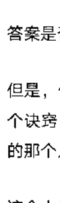

你好，我是程啸。欢迎来到我的社会网络课。

我们首先做一个思想实验。假设你遇到这样一个场景：你的母亲需要做一台心脏病搭桥手术，你将会去找哪位大夫？

你看到，这位大夫是科主任，那位大夫是院士的高徒，还有一位大夫说成功做过多少高难度手术。如果你关心这些大夫的学历、职位、经历，甚至从手术中某半年的存活率入手，互相比较，就能得出明确的决策吗？

答案是否定的，因为这样还是让人难以抉择。但是，你一旦有了网络的角度，你就会知道一个说法：去找和太太接触最多、掌握信息最多的那个人。

这个人就是院长。

不对，院长平时只跟大夫开些会，顶多加道一些报上去的统计数据，并不了解大夫们的细节。

那我们该问谁呢？

问心脏手术室的那个护士长。

护士长配合科室里的每一位大夫做手术。她知道哪位大夫在面对复杂情况时的态度是冷静的、还是慌张的；她能看到哪位大夫在术后对病人的康复最上心；她了解到哪位大夫去手术并发生什么减少。这些数据不仅关系到手术的成功与失败，还关系到病人的亲人半月来还是半个月之后才能出院。这些信息，从大夫的履历上去找，或者从院长那里去打听，都是拿不到的。

你看，是否利用网络思维，就是两个事实有区别。你有过思维会问到的问题：在未知世界里，需要社会网络这个学科来回答。

### 为什么每个人都该有网络思维？

我给你三个理由。

第一，这门课程帮你重新认识隐形形态的边界。

我们每个人无时无刻不处在网络之中。不了解社会网络，我们甚至都无法正确理解人所在的方方面面的关系。

学习了这门课程，你会知道，在职场上，什么样的岗位好找？机会怎么找？我如果是一个后来者，我的机会会在哪里？

在婚恋关系中，我伴侣和协作伙伴有什么关系？怎么扩大自己已认识另一半的机会？何思不言语？

还有，为什么同学的姐姐的隔壁张医生，也会变得？嫉妒、吸、恭敬和幸福感，在人之间的联系中怎样传染的？

这些疑问，都欢迎到我的《社会网络20讲》这门课程里寻找答案。

第二，这门课程将改变你审视世界的方式。

过去我们所接受的教育，所掌握的世界观和方法论，都是把关系看成孤立存在的个别对象，把这些公司看作一个部门，把市场看作一个空间，把社会看作一个又一个大一的统计数字。

你如果学习了《社会网络20讲》这门课程，你会把你看世界的方式，升级到一个更高的维度。你知道怎么从网络，而不单单是看面、看角度判断。

比如，我要推广一个新产品，我应该从关键节点入手，借助他们影响下游；还是该采取从城市到乡村的路线，从边缘来突破？

新形成的组织机构出现了小圈子，对于这个组织结构的权力关系，是该做适当保护呢？还是研究它，改造它，让它可以为我所用？

还有，谣言传播是一个网络，病毒传播也是一个网络，这两种网络现象有哪些相同的规律，又有哪些不同？

电力运输是一个网络，热带雨林也是一个网络，这两种网络对组织结构的设计有什么重要意义？

正所谓世界一去，世界观察。相信你学完《社会网络20讲》这门课程，你会更加了解我们所在的真实世界。

第三，这门课程能让你掌握一种最前沿、最切时新的分析工具。

正如望远镜的发明，让人类认识了所处的位置；显微镜的发明，为人类打开了极小世界的大门。今天，我们也在经历一场同等重要的革命，即激动人心的革命，那就是大数据分析革命。

今天，我们可以获取的精细程度记录下丰富的网络数据，可以追踪微信10亿用户每天450亿次的互动，可以精准快速地识别地地道道你我的需求，可以预测突发事件和流行趋势。

在这样的一个大数据时代，社会网络作为一种新型的视角和方法，已经对社会学、政治学、经济学、传播学、管理学等学科产生了巨大的冲击，掀起了一场范式革命。

所以，你学习《社会网络20讲》这门课程，其实是在掌握一种最潮最潮、最前卫的分析工具。

这是一个非常不可缺少的工具。如果没有这个工具，你无法获取获得人群、对社会的觉察，你将在无边的世界显得手足无措，只能被竞争对手远远地抛在后面。

### 你能从这门课得到什么？

在这门课程里，我将按照五个模块，来帮你完成这次认知升级。

- 第一个模块，思维。
- 第二个模块，节点。
- 第三个模块，连接。
- 第四个模块，网络。
- 第五个模块，机制。

第一个模块，思维。
我将带你领略网络思维的奇妙之处，建立有网看世界眼光。

第二个模块，节点。
我将带你看网络的基本抽象元素——节点。我将带你学习，进入一个微网络，怎么成为那个很重要的节点？进入一家公司，怎么成为最有价值的那个节点？

第三个模块，连接。
这是网络中的第二个基本要素。我会带你去看，网络中的节点怎么连接起来的？我会带你看看连接里的“引同”、观察你的“强联”，看看你的“弱联”，去看那为什么77亿人的网络居然就是一个小世界。

第四个模块，网络。
我们会探究为什么媒体论文、论文引用、都市人口和财富分配都拥有相似的结构？我们还会思考如何计算网络的密度？会讨论什么样的网络更加高效？会告诉你怎么在网络中增加新的资源或者链接，反而会降低整个网络的效率？

第五个模块，机制。
我将带你切换到动态视角，来看网络运作的机制。我会带你看看网络上的人际网络，以及东西可以在网络上得到；而新的新新的，又怎样受到节点们？网络的驱动？我会带你探讨人与人智能的神经脉络，还会带你去考察随机产生出来的深层逻辑。

从思维，到节点，到连接，到网络，再到机制，你像有了一件新工具，就可以开始用网络思维来解释一些现象，你可以用来重新审视自己的生活跟那的个体发展，用网络思维解释开新的视角。你会有一个提升、豁然开朗的感觉。

### 为什么我来讲？

在这，我也介绍一下我自己。我是清华大学社会学的系老师。同时兼任清华公共学院苏世德学院的教授、教研员。我拥有清华的PNGG教授，以及美国麻省大学ASM大学的教授。

我写过一本英文教材《社会网络分析：方法与应用》（Social Network Analysis: Methods and Examples），由SAGE出版社发行。

我还做过大量的研究，分析过企业的商业网络、通信以及民众的社群网络，访谈过网络贸易的专家，我写的课程里，很多案例，都来自我参与的研究团队的一线发现。

我在清华大学讲授社会网络这门课程，已经有了十年。每次开课前所发生的事情，就让我觉得很有意思，比如，不是所有重要的事情都出现在课上，除此之外，还面临着多次的调学，甚至清华系其他的老师来旁听这门课。

感谢得到APP，让我有机会能够在更大的平台上，去介绍这样一个很有价值的新领域。同时可以负责任地告诉你，这门课程是一次高质量的系统的知识交付。

社会网络是一个新兴学科，要讲好这门课并不简单。好在，我有一本非常好的本科和硕士的教材，我们的课程，建设和支持让我特别有底气在这里，他们是一起。

陈省身，北京大学教授，费孝通老先生的高徒。他的影响力不仅限于学术界，在商业界也是最有声望的社会学家之一。

厉声奇，北京大学教授，费孝通老先生的高徒。他的影响力不仅限于学术界，在商界也是备受尊重的社会学家。

罗卿汉，清华大学教授，中国社交媒体专业协会创始人，网络大数据的学界领军人物。

李煜，复旦大学教授，社会学系系主任。他对教育、阶层、婚姻的研究，代表了中国社会学的最高水平。

所以，《社会网络20讲》这门课，其实是我和社会学前辈一起，共同打造的一个产品。推荐你加入学习。

我自己的教学和研究，深深受益于网络信息的启发。希望你也像李煜一样，从这门最前沿、最具前沿的网络课程中终生受益。


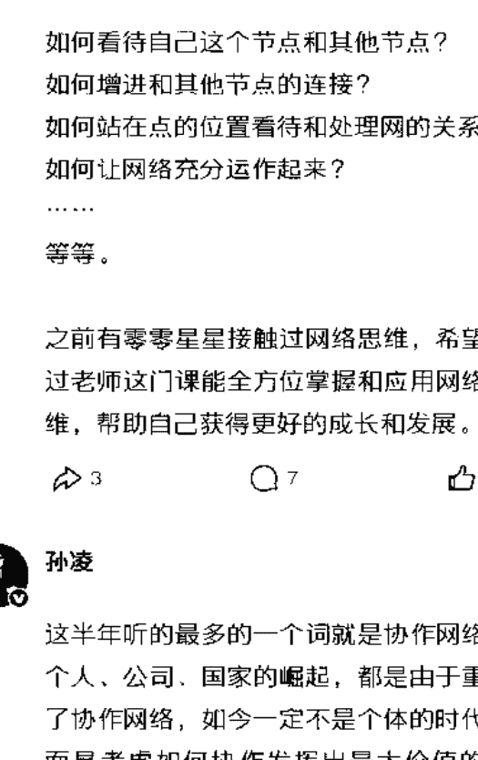

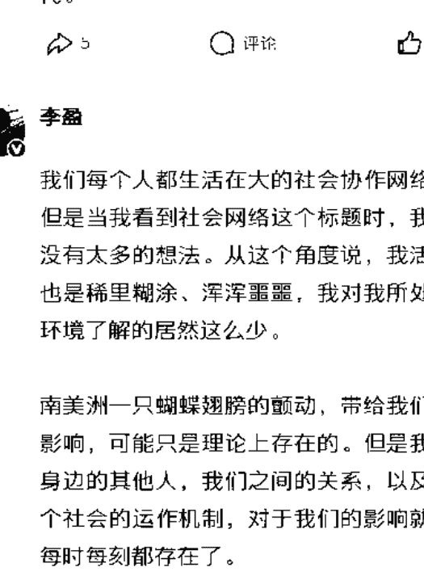

后一讲

### 用户留言

27条留言

> **大佬Q**
>
> 郑老师好！
>
> 刘润老师说“一般人的思维方式是线性思维，精英人士拥有树状思维。而旷世之才拥有网络思维！”
>
> 我：“这精确，但是这个东西如何行动啊！”
>
> 郑路老师：“网络思维吗，我想我可以提供一些帮助。”
>
> 我：“走你！”
>
> 3 3 43
>
> 作者回复：厉害

> **Sean**
>
> 对于一个从外地来广州生活工作的年轻人来说，想要在这个大城市立足，不单单是考上广州大学和一张文凭，更关键的是你如何在这个城市里构建一张联关系的网络，明白了一点，以网络思维就在困惑：
>
> 如何看待自己这个节点和其他节点？
>
> 如何选择其他节点的连接？
>
> 如何在自己和别的网络里？
>
> 如何让网络充分运作起来？
>
> ……
>
> 等等。
>
> 之前有看老师接通过网络课程，希望通过老师这门课能全方面掌握和应用网络思维，帮助自己获得更好的成长和发展。
>
> 3 7 25

> **孙波**
>
> 这个社会听的不是一个词都是协作网络，公司、国家、组织都是基于建构了协作网络，如今一定不是个体化的时代，而是考思协作发挥最大价值的时代。
>
> 3 1评论 24

> **老陈**
>
> 我们每个人生活在大的社会协作网络中，但是我想到这个社会网络的时候，我却没有太多的想法。从这个角度出发，所经历的也很多都靠想象，深深感觉，我所处的环境了解的居然这么少。
>
> 南美的人只能靠鹰的助，带给我们的影响，可是我们理论上的，但是我们身边的人只能是，我们之间的关系，以及整个社会的运作机制，对于我们的影响就是每时每刻都刻在了。
>
> 非常感兴得到又开了这么一门课，让我们可以第一时间了解到这个新兴、前沿的学科。光是知道这门学科的学科、前沿的学科，让我对这个学科的理解又进了一步。期待老师的精彩讲授。
>
> 41赞 1评论 15

> **行舟**
>
> 感谢得到，让我有机会看到自己原本可能一辈子也看不了色的。

> **郑路Hudson**
>
> 期待郑老师的课程。
>
> 将社会现象放在网络中去思考和研究，一定会有更全面的视角和洞察力的发现，期待这个结果！
>
> P.S. 我的个人微书将近5000好友，非常惊讶数据的原则，今年只选取了其中155人：
>
> 5个顶级关系人（Top5），你的每一个联系都在10条以上（T+5），是你一定会联系的人，他们是你愿意用生命去相信的人；
>
> 关键关系人（Key50）这50个重要联系，代表着我们的生活和工作的价值，是我们要花心思维护的朋友，并给他们寻找增加他们价值的方法。想办法（1我的编号是姓名前添加K-K50）；
>
> 重要关系人（Vital100）这100人，我们每个人都要关心，也需要有信息可以为他们做点什么。怎么样？
>
> 这样操作效果极化，也期待用老师分享的社交网络系统优化对邓巴数字。
>
> 2 1评论 14

> **人石飞**
>
> 想起毛姆的诗《生活》，诗的内容只有一个字。嗯，一个人在心中，关系无处存，即使一个人独处在外乡品，也无去摆脱。
>
> 4 1评论 12

> **museman**
>
> 不知道这门科目组织行为的学问为何
>
> 1 1
>
> 作者回复：组织学是研究研究“组织”。组织是一种物质，朋友圈、城市、社会也是一种物质，社会网络这门课，会把各种各样的物质现象归到网络中观察。

> **Stone**
>
> 从网络的视角来看，新加坡和香港曾经的经济繁荣带有简单和香港，海运中转站以及转口贸易是当时新加坡成为全球海运的程度中展现的中心程度
>
> 这种变化对全球的很多公司认识了新加坡和香港。随着时间的发展，依新加坡和香港的公司也更多。新加坡和香港的重要性就渐次突出，经济自然就更飞起来了
>
> 而现在它们的经济发展面临的问题可能会很大，新加坡过经过面对和香港的港口在减少。轻过去新、宁波、天津等其它港口的发展。这就让新加坡和香港的度中心程度和中心地位下降
>
> 随着全球化和都城市中的新转移，这种趋势会越来越快，如果它有不间断因素，目前的说法的话，新加坡和香港的影响力会持续下降
>
> 用网络的视角来看世界，竟然获得了完全不同的结果，视角一变，世界就变
>
> 通过这门课，我期待更多的网络视角，重新认识这个世界，提升认知
>
> 2 1 8

> **刘源**
>
> 过去我对“社会网络”这个概念只有一些零碎的理解和认识，这次也想通过这门课去更深层次的理解它。
>
> 我们身处社会网络中，或许没有能能力看清这些网络，或是在这张庞大而难重位置。但如果你能认识并去看清它，你就能发现自己在这张网络中的位置，就能参

## 01 | 用网络重新理解世界

郑琳·社会网络20讲

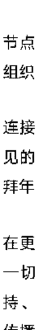

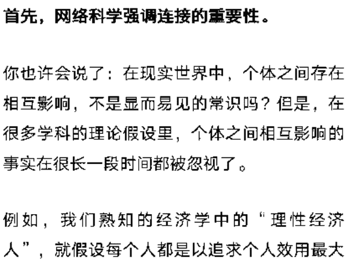

你好！我是郑琳，欢迎来到我的社会网络课程。

我接下来讲的每一个发心，都是希望帮助你，搭建一个全新的视角：看到你的所在的人，以及到整个世界的价值。这就过去，我们用个体视角看不够的。

### 什么是网络？

简单来说，网络的构成有两个要素：

一个是节点，英文叫node；

另一个是节点和节点之间的连接，英文叫tie。

节点，一般指的是行动者，比如个人、群体、组织，也可以是城市或国家。

连接，是反映的节点间的某种互动关系。最常见的人的关系有：由此构成朋友圈、讨论网、拜年网等等。

在更加宽泛的意义上，网络的研究可以看成是一切行动研究的学科。从信息服务、情感支持、资源往来、信任与资信的流动，到情感的传递、创新与文化要素的扩散，都可以作为网络分析的对象。

### 什么是网络视角？

首先，网络科学强调连接的重要性。

也许会讲，在现实世界中的每个个体相互影响、不是孤立存在的。举个例子，在很多学科的论述里面，个体之间相互影响的事实在很长一段时间却被忽略了。

例如，我们熟知的经济学中的“理性经济人”，假设每个人都是以追求个人效用最大化为目的“原子化”的人。但其实，最真实的不这样的。

### 今日得到

总结一下我们今天的内容。

网络有两个要素组成，节点和连接。而网络就是节点之间的互动关系。

网络视角有三个特点：

- 第一，重视节点之间的相互影响。因为比起节点本身的特质或者属性，节点之间的关系更加**重要**。
- 第二，强调网络对节点的影响。只有把节点放到网络之中去考察，才能完整解释它。
- 第三，主张网络的基础特征，是我们理解现代社会生存和竞争的**关键**。

因此，我们不仅要认识**网络**，善用网络，还要建构有利于**自身发展**的网络。

### 课后思考

最后，留给你一道思考题。有什么现象，是一个个体视角无法理解的，而一旦你切换到网络的视角，就会得出全新的认识？欢迎你在留言与**大家分享**。

下一讲的内容是**中维度**，咱们下次课再见。

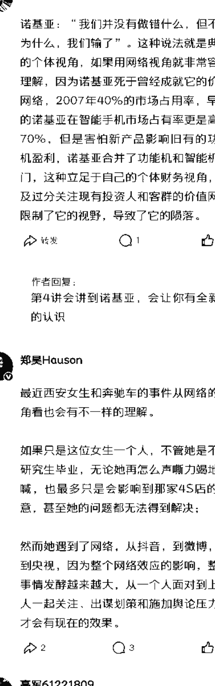

## Q2丨中心度：谁是微信群里最重要的人？

来源：社会网络2019

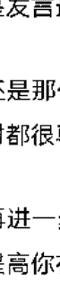

Q2 中心度：谁是微信群里最重要的人？

你好！我是小路，欢迎来到我的社会网络课。

上节课，我们讲了网络结构。讲了网络有两个基本要求：节点和连接。今天我们话题是节点的重要性。

假设你被好友拉进了一个微信群，里面有几百上千人，谁是群里最重要的人呢？

是群主吗？

是发言最活跃的人吗？

还是那位三甲医院的医生，似乎所有人都对他刮目相看？

再回到你为一个新群友。你有什么办法去提高你在这个圈子里的重要性呢？

网络科学里有一个工具，叫做“中心度”，英文是centrality。它测量的是节点在网络中的重要程度。

具体怎么测量？我们看节点的连接数。一个网络由几百个、几个、甚至上亿个节点组成。每个节点都有连接数。连接的数越多，节点的“中心度”越高。

换句话说，在社交圈里，你的价值，不取决于你，而是取决于你周围的人对你的评价。

“中心度”是网络科学里一个很重要的概念，其实不只是在网里，我们生活在这个社会里，有30多种衡量方法。而且有些很难去度量，你必须仔细去计算。在网络上，转化成为一个数学方程，输入计算机算来算去，最后统计节点之间的连接情况，就可以得出各种各样不同的中心度。

具体操作比较复杂，但是，如果你能记住其中最核心的概念，知道三个最重要的、也是最基本的维度就够了。

这三个维度分别从连接的数量、位置和质量来衡量一个节点在网络中的重要性。下面我一一介绍给你。

### 中心度的三个维度

#### 1. 数量：度中心度

节点重要性首先体现在数量上。一般来说，一个节点有越多的邻居，说明它的“度中心度”越高。

早期科学家把这个维度叫作“度中心度”，英文degree centrality。就是看这个节点周围有多少节点与它直接相连。连线的数量越多，说明它的影响力和接受路径越直接越多。

公司里，与你合作的同事越多，微信里，好友的数量，都说明你的“度中心度”。

“度中心度”可以解释我们生活中的很多现象。比如，为什么明星的广告多？因为他们周围的朋友多，他们的度中心度高，所以，他们的广告，也是网络中其他的节点影响力更大。所以，他们对于一个节点的价值都更大。我发一条微博，可能没什么人看，但某条微博发一条微博，大家可能就会花一百多块。

在公共卫生领域，对“度中心度”的关注，也引发了防疫感染病防控中的一次飞跃。比如，一场传染病爆发，有限的时间内，医务部门只能给20%的人口注射疫苗，这些人应该把资源集中在谁那里呢？

基于常识，你可能会毫不犹豫地选择最脆弱的群体，比如老人和小孩。这是最应得到保护的，这也最符合预防传染病的伦理原则。然而，当科学家和流行病学家研究感染者的数据时发现，最有效的方法是给这些人的“度中心度”最高的人注射疫苗，才能最大程度地防止传染病的扩散。

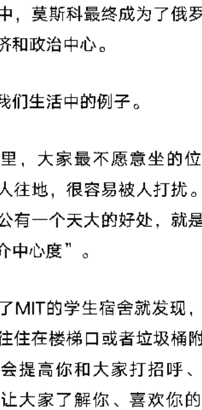

#### 2. 位置：中介中心度

衡量节点重要性的第二个维度描述的是一个节点在网络中所处中间人的位置，看的是网络中的其他人传递信息或获取资源，是不是不一定要通过它才能完成。

在网络科学中，这个指标叫“中介中心度”。中间，就是中介的意思。英文叫Betweenness Centrality。

举个小例子。我们来着欧洲某城市，莫斯科。莫斯科为什么会成为俄罗斯首都？

如果你打开地图，会发现一件奇怪的事情，莫斯科并不是在俄罗斯的中心，而是偏东部的地理中心。莫斯科也不是俄罗斯最大的城市，但是它的度中心度很高。

你可能猜想，是不是因为莫斯科的“度中心度”比较高呢？

让我们再仔细看，会发现这个解释也不成立。在12世纪初的时候，俄罗斯帝国已经有了30多个发展很好的城市，这些城市部分在西方，部分在东方，莫斯科甚至不在最里面。甚至前面三句都不能进去，只能寄希望于首都。也就是说，莫斯科的“度中心度”不优秀，但是，在很短的100年时间里，莫斯科就成为俄罗斯帝国首都和经济中心。这是为什么？


俄罗斯成为首都的原因是“中介中心度”，莫斯科在这个指标上排在首位。莫斯科处于很多城市和城市的交通路径上。换句话说，莫斯科是俄罗斯帝国最重要的城市，也是俄罗斯帝国的首脑和首都。莫斯科是俄罗斯帝国最重要的城市，也是俄罗斯帝国的首脑和首都。

而且，当时的商运贸易，每年经过这个城市都要支付一定的关税，所以莫斯科的收入就更多。

再举一个我们生活中的例子。

在办公楼里，大家最不避讳的事位置就是过道。大家人流来往返、很多路被人行走。但事实上，最接近办公楼中间的人，就比边缘的人更可能被人关注。所以，从中介中心度来看，你的价值，不取决于周围的人对你的评价，而是取决于你周围的多少。

有一项研究，MIM的学生宿舍会发现，最受欢迎的学生往往是被邀请或者去被邀请的。这些“中介中心度”高的人，他们的人际关系更好。他们更会获得人脉和资源。

中介中心度告诉我们，你的价值，不取决于你周围的人对你的评价，而是取决于你周围人的人数。

#### 3. 质量：特征向量中心度

刚刚讲的两个维度，一个衡量的是节点的数量，一个是衡量的是节点在网络中的位置。还有一个维度没有考虑到，那就是与你相连接的节点的质量。

这就是今天要讲的测量中心度的第三个维度，叫“特征向量中心度”，英文是Eigenvector Centrality。

这个维度关注一个节点，有多少节点连向它，还关注这些节点连接的是谁。

但是造了一大堆名头，一“水军”网页，把它们与想要提高排名的人员联系起来，让后者在搜索结果里看到这种最新信息，而有关这个站的人就不需要了（一种新的算法）。它不关注一个网页有多多少人访问，它还关注访问的网民自身有多大的影响力，即他们的网页又有多少。这就是特征向量中心度。

就好比，一个人有很多朋友，但都是普通人，另一个与名人差不多，但朋友很少。哪个人的中心度更高？显然还是后者，因为朋友更值钱。

特征向量中心度告诉我们，你的价值，不仅仅取决于周围的人对你的评价和依赖程度，还取决于这些人的分量和价值。

书上说有一句话：首先别人要你，然后才有人评价你。最后看的是你的重要性。说你的为人，就是看特征向量中心度。

## 微信群里最重要是谁？

你可能会问，讲了这么多维度，那这三种中心度之间的关系是什么呢？哪个维度更重要呢？

科学地说，首先，这三个维度在统计上具有高度的相关性。在一个维度上属性比较高的点，在其他维度上一般也比较重要。

比如说，一个微信群，群主是建立微信群的人，所以，群主和他的人次认可，他的中心度是最高的。但大V未必都认识，如果你有一个什么人，可以通过群主的介绍，那么，群主的他中心度也很高。

但是，这三个维度又有差异，因此一个网络里有没有个分量里高的节点，是有好几个重要节点。它们的重要性体现在不同的维度上。

比如说，群主可能只是一个热心的组织者，群里有人有老板，有大V，还有专家，那么，群主的特征向量中心度并不高。

比如说，群里有些人个人经常被清，不怎么发言，但群主会一直不认不认识，但是，如果他有地位，就有声音的人对他的评价很高，那么，即使他的中心度和中介中心度都很低，但特征向量中心度反而是最高的。

再比如说，群里有一位三甲医院的医生，这可是非常有价值的资源，尽管他在群里的数度中心度和特征向量中心度都不高，但在这个微信群医生群体之间的中介中心度最高。

你看，一个微信群，群主、大V、三甲医院的医生，谁更重要，取决于我们重视哪个维度。这就是真正的价值。它比我们要靠心里原本一团的模糊的东西，搞得清清楚楚。

最后还有一个问题，假如你进入了一个新的圈子，不管是加入微信群，还是一个公司或者行业，如果你想提升自己的中心度，可以怎么办？

你也可以从今天我们讲的中心度的三个维度去思考：

- 比如，作为一个新人，要在短时间内提高人脉的数量（度中心度），可以拉拢比圈，但你可以从质量（特征向量中心度）入手，看能否请到圈内大V的亲戚。搞定这一个人或者几个人，就可以迅速完善你在网络中的中心度。
- 你也可以考虑从中介中心度着手，让你成为别人链接关系时很难被替代的中间人。我接下来一节会讲另一个概念，叫做“结构洞”，讲的就是这件事，或许对你有启发。

### 今日得到

好，现在我们来总结一下。今天我们学习的概念是“结构洞”。人际网络中存在结构洞，占据这个位置的人可以成为跨越不同网络的搭桥者。

结构洞能够给节点带来信息优势，还可以给节点带来控制优势，让它在网络中发挥重要作用。

我们每个人可以从中学习到的一条心法就是，不要把自己局限在狭小的分工里，要把自己变成结构洞。

### 课后思考

最后，留下一个题目请你思考。

有的人说，要使自己始终立足于有效的“结构洞”位置，就需要根据自己的需求不断地更新他的关系网络，去认识新的人，抛弃原有的已经没用上的关系。

你同意这种看法吗？欢迎在留言区写下你的观点，参与讨论。

下一讲的题目是多重网络，咱们下节课再见。

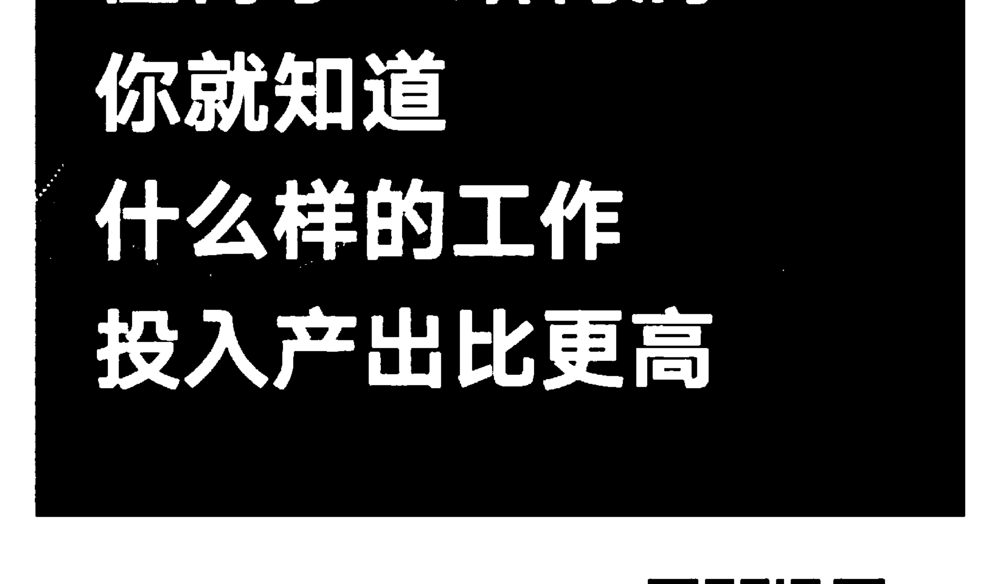


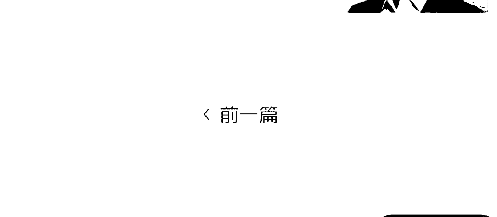

## 04|多重网络：后来者的机会在哪里？


郑强 · 社会网络20讲

你好！我是郑强，欢迎来到的社会网络课。

这一讲的主题是多重网络。在好几讲中，向你介绍了许多关于网络的几个概念，比如中心度、结构洞等等。或许你也已经发现，处于网络有中心位置的节点能够更容易地获取资源。

那么，是不是只要占住了有利的位置，就可以一旁永远稳稳地获利呢？

换个角度想，如果我是作为一个后来者，当有利位置都被先行者占不走那么多，那么，我的机会在哪里呢？

## 风口城市在哪里？

在回答这个问题之前，我先带你看看一座城市，那是深圳。

我们都知道，深圳是一座很年轻的城市，没有特别好的大学，也没有自然资源，它就是我们要今天的“后来者”。但是，我们也观察到，今天的中国最有竞争力也有最发展潜力的城市就是深圳。

这个奇迹是如何发生的呢？

你可能还记得，在第二讲里，我们介绍过莫斯科的曾经是交通网络的中心的问题，成为俄罗斯帝国经济和政治中心。在中国也一样，多城市的兴起，都是因为处于交通要道上，比如扬州、北京长都在京杭大运河的交汇处，所以，在古代，扬州是南北交通的枢纽，是粮运集散地，也是中国最繁华的城市。

后来，水路萎缩，铁路兴起，武汉的地位就越来越重要，曾经武汉的平汉线与川汉线是连接中国铁路网。所以，武汉是中国最早工业化的城市。

但是，无论是在水路，还是在铁路网络中，深圳都相对边缘，贸易集散力都不发达。所以，在这个竞争格局中，深圳并不占优。

你可能知道，深圳的崛起，是因为开了它独特的港。有海港和大运河，深圳又成了一个交通枢纽。香港提供外资，大隅提供廉价劳动力，深圳进行了“三来一补”的加工贸易，确实，这段时期深圳的繁荣和繁荣，但是，确实无法解释深圳后来成为互联网、电子信息、智能制造业的中心。因为同样的这些机会不是香港的优良产业，所以，深圳能有今天，和香港也没太大关系。

这就涉及深圳的另外一个网络，一个全新的网络：那就是互联网。

我们都知道，知识经济时代，创新是城市发展的新动力。而创新的新水泉的是，是发专的利用和创意，也就是专利被其他城市、其他机构引用情况。

我们如果以城市为节点，以专利引用为连接，画出中国城市的创新网络，你会发现，深圳就处在这个中心位置。

深圳每万人发明专利拥有量是80件，几乎是全国平均数的10倍。在深圳是9年的专利数量中，腾讯、华为等科技企业，深圳汇聚了华为、腾讯、大疆、大疆等在深圳乃至全世界的科技产业和科研机构。在这条电子通信、智能制造产业的创新浪潮中，深圳谱着引领者的角色。

你看，从农业社会的水陆网，到工业社会的铁路网，再到信息社会的互联网，城市兴衰的背后，也是网络的变化。这就引出了我们今天的选题：多重网络。

## 多重网络：最佳策略是做一个穿越者

在之前课程里，我们讨论的网络比较单薄，都是由单一关系来定义的。

然而在现实中，公司也好，个人也好，可能处在许多个不同网络中，而这些网络间的权重关系也不断发生着变化。比如，城市之间的关系可以由公路、铁路等便利来定义，我们可以每个人也可以同时处于同学网络、同事网络和朋友圈之中。

在网络科学里，我们把这种现象称为网络的多重性，或者叫多重网络，英文是multiplex network。

目前，科学界对多重网络的研究刚刚起步，属于初级阶段。但是，站在行动者角度，还是可以给出几点启发：

- 第一，网络的地位，随着时间变化而变化。从长远来看，任何一个网络都必然走向衰退，但就像常语，没有一种能源可以通过占一个优势地位，一旁永远地保持领先。
- 第二，新的网络不断产生，新的连接不断出现，而且速度越来越快。
- 第三，后来者的机会，不是做一个跟随者，而是成为一个穿越者，也就是说以它为节点为一个跨界者，要能在两个或更多网络中起连接作用，取得一个全新的竞争优势。更好的策略是，找到一个新的网络，占据优势地位，然后，在新的一局游戏中后来居上。

## 基业长青的本质

我们来看一个例子，诺基亚。

我们都知道，诺基亚在2G，也就是第二代移动通信技术时期，称霸全球市场。但是，4G技术出来以后，诺基亚也逐步参与了这场最难的胜利。

很多人以为，诺基亚的没落，是因为它错过了一代技术。但其实，诺基亚倒闭的并非是一代技术，错过的是一个网络。

前刚提到2008年，移动互联网兴起。当时，诺基亚财力充足，也想要抓住这一波浪潮。但是，它的思路是增强，兼容并跨的互联网企业，它想通过“大熔炉”，这个策略叫“双向一体化”，结果是，苹果造了一条孤舟的船。它打了一个平台，然后在这个平台上开放给了第三方。无数的软件开发商和开发商，在这个平台上，为苹果公司带来了应用和服务器。正是这个网络，为苹果的公司提供了垄断地位，取得了巨大成功。

但是，游戏还没有结束，5G又来了。

我去年11月考察了诺基亚贝尔实验室在成都的研发中心，得知该中心研发基于自己研发的标准、协议和软件，并参与了全球5G标准的制定，为3G以来最广泛的5G标准贡献最为重要的的一笔力写。后来，诺基亚以与华为移动设备厂10亿欧方的合伙协议。至此，诺基亚在新一轮竞争中的30%，在5G网络、软件、设备销售等，诺基亚重夺领先位，实现了逆势翻盘。

诺基亚的故事，让我们想起一本书，叫做《基业长青》。企业要想基业长青，只在一个网络取得成功还不够，你必须在竞争形势变化时，在网络关系重新定义中不断地占据优势，这样你才能在下一个技术浪潮继续获得成功。

## 个人成长的本质

认识到多重网络的生存，不仅对企业意义重大，对个人信息也存在着。

你或许在他的自传里提到，年轻的时候，经常和北非市长的官人接触，这让管理层人觉得他的成功完全是靠关系，他虽然不承认自己与这些政商关系，但他的非洲关系已进入了另一个层次。当北非官员的关系，也可以成为一个网络的中心。小圈子之间的关系提供强支持，但是，对一个人的发展而言，当你的强关联合作者都是些同样的替代了。

再举一个例子。社会学家里有一研究非常有名，叫作家《街角社会》，研究的就是意大利贫民窟的青年帮派，也就是街头小混混。

研究者观察了青年人的联盟调查，发现在帮派里，有两个青年领袖，一个叫多克，一个阿尔贡。这两个人的发展轨迹非常有意思。

多克和阿尔贡，都年轻能言多智，说明他们都精大一样人。但是，多克帮派里的兄弟情深胜过道，他结交了很多小圈子，他，没有什么多，没有稳定的工作，整天无所事事，挣的钱全花在帮派成员，无所事事，多克变得默默无言，沦落到家电子工厂打工。

而索克相反，我得走出这个圈子，我得出人头地。于是，索克开始到学校里去上学，为了社区服务，为了社区赢得了一个政治学的公共事业奖学金。后来，索克进入了一个法政，成为了上波士顿哈佛大学的。多索克，在职业中，我索克和他很多亲戚都富了，不富裕阶层。这说明，职业的人际网络已经发生向上移动。

我的一位朋友，就很感慨地说，成长的过程，就是你不断更新失去的感觉的过程。

### 今日得到

最后，总结一下今天的内容。今天我们讲了一个概念，叫做多重网络，这个概念告诉我们：

- 首先，网络总是重叠的。网络会因社会关系随时间的发展而变化，新的网络会取代旧的旧的。
- 第二，原来有机会，存在于网络切换的过程之中。与其他人半生交情、网络里真正交情、其他人、交情变弱、在新的网络里建立起自己的竞争优势，占得先机。
- 第三，企业创新发展的本质是穿越多个网络，个人成长也是如此。发现是网络切换。

### 课后思考

给你留一道思考题：你在生活中有过网络切换的实例吗？网络切换会时你产生什么影响？欢迎在留言区分享你的参与讨论。

下一节我们讲网络的节点，我们的关注点，将会从网络中的节点，转移到网络中的连接。我们下次再见。

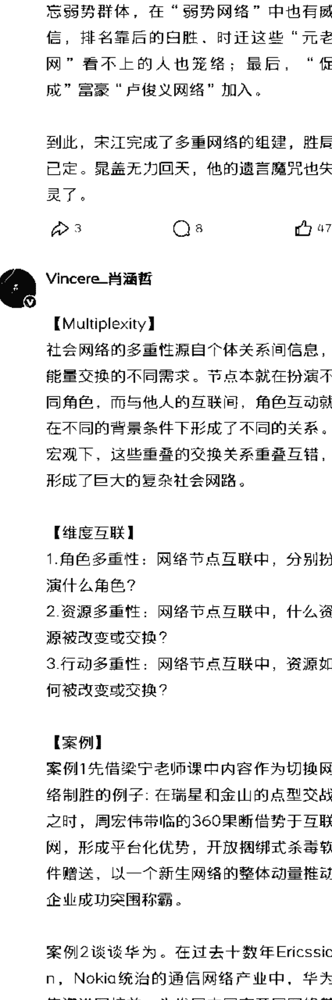

（知识：社会网络20讲）
掌握一门重要的网络科学

邓路·社会网络20讲
系统认识人和组织，发现社交网络

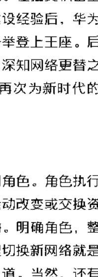

## 05 | 异质性：找伴侣和合作伙伴有什么不同？

你好！我是刘路，欢迎来到我的社会网络课。

今天我们进入第二个单元，开始讲点的连接、网络的形成。来自于一个很本质的观点，因为某种互动关系而产生连接，那你有没有想过，什么样的点之间更容易产生连接呢？

比方说婚姻呀，单身男女是宁愿相似而更愿意在一起呢？还是更愿意找个和自己性格互补的？

传统社会随门对户，到了现代，社会，人们的流动性增强了，选择范围更大了，灰姑娘的故事就更容易发生了吗？

## 婚姻伴侣找相似

《经济学人》杂志2018年8月一期的封面主题是“线上约会”。

这篇文章摘录了一个惊人的数字，在英国，超过1/2的单身活跃用户是92年生。在美国，超过1/3的新婚夫妻是通过网络婚恋平台而相识的。

文章作者提出了一个我们前面问过的问题，选择范围的扩大，会让我们找到更相似的伴侣进入婚姻的概率增加吗？

从跨平台的不同场景来看，答案是肯定的，即使平台提高了不同角色的人沟通的概率，对婚恋和择偶关系作出了贡献。但是，从社会的角度，看看我们的，人们的选择伴侣，更多是，但是，找到和自己背景相似的人的机会更少了。结果就是，通过网络平台而结婚的，不仅门对户对，而且教育、收入乃至性格、都更加匹配了。

而且啊，和很多人的印象相反，通过网恋而结婚的伴侣，相比于说认识的夫妇，对婚姻的满意度更高，离婚率也更低，换句话说，是门对户的婚姻就越高。

婚姻网络中的这种同质性特征，其实就是大部分社会网络的一个普遍现象，你看过《今日说法》节目的话，网络的“同质性和异质性”，同质性和异质性是“反对文”，描述是节点之间的相似或差异程度。

我们先来看同质性。

## 同质性普遍存在

中国有句古语，“物以类聚，人以群分。”讲的是同质性。最近，人类学家通过数据分证明了这种现象的普遍存在。

### 今日得到

我们来总结一下。今天我们学习了一点的关系，比较了同质地和异质地这两类关系的区别。

我们不妨把朋友和搭档关系看作横向上的连接，这种连接更容易在相似素质的人那里得到建立起来。对于纵向关系的连接，则性连接会更加随意、质量更高。

而对于异质地的连接，例如商业合作和科学研究等，异性的连接更加有利，更加有利于个人的长期发展。多样的、异质性的社会关系有利于我们接触到更多的机会，并重新记录思考问题的方式。

简单说，要满足情感需要，同质性连接更好；要想成长，实现自我挑战的目标，异质性连接更有助手。所以，我们要扩大交友交往的同质地的潜能，跳出自己圈子，拥抱异性，就会拥有更多的机遇。

### 课后思考

最后，给你留一个问题。你的朋友圈在哪些方面与自己有“同质感”？这些特点给你的朋友圈带来了怎样的影响，是否影响了你的事业发展轨道？欢迎留言和大家分享。

下一节课我们将讨论随机的强者，而非经典的关系概念。咱们下次再见。

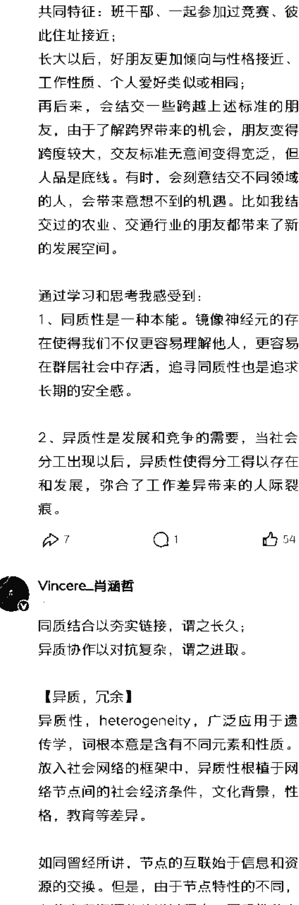

### 用户留言

冯敏
回答思考题：

回看自己不同年龄段，有不同性交成者。

在小时候，好友是和自己学习成绩差不多、爱好相同的人，仔细反思他们都有共同性，比如一起参加竞赛，彼此在此连接；

长大以后，好友更加偏向兴趣与性格接近、工作相似，个人爱好类似或相似者居多；

再后来，会结交一些跨界大、远朋友。由于了解到跨界带来的机会变得更多、更大，会导致关系更加密切或广泛。比如我跨行业的朋友，会给我意想不到的机会，比如我结交的太空、交通行业的朋友都带来了新的发现机会。

+   通过学习引起我思考是：
    1. 同情性是一种本能。镜像神经元的存在使得我们不自觉会吸引到像的人，而我们在群体中更容易寻求，追同也是追求长期的安全感。
    2. 异质性是发展和竞争的需要。当社会分工出现以后，发展和竞争使得工作趋于分化发展，融合了工作差异带来的人际裂痕。

Vince_异质性

同者结合类实强接，退之良久：

异质性亦作为对抗要素，请之进取。

> 【异质，heterogeneity，广泛应用于遗传学】。词源原本是含有不同元素的意思。在社会科学语境，异质性是指网络节点间在社会经济条件、文化背景、性格、教育等差异。

如用网络知识，节点的互联就在于信息和资源的有效。但是，由于节点特性的不同，信息和资源的传递过程中，同级节点由于接近性，信息更多会流向同质者，异质资源自然失配，自成孤点。

但异质性的节点联系，由于跨越不同信息、不同文化的节点基于基础的信息交换，这就带来不同于节点群中的信息和资源，传递到不同节点。

> 【思考】

由于自身群体该项目的部分运营，我结识了众多不同领域的爱好者学者，他们背景相同者多、资源多；但也有类似研究者，有异质性，也有同质性，有异质性，同质性，也有类似性，也有不同性，有同类性，也有异质性。

他们虽异质但相似性，却在我们 Team-Build 的框架下，以技术创新—创业理念双方面结合的机会中，激起合作。这异质性，异质中，只有是一个整体性的风险因素，对抗性的风云变幻。

she

我想也许可：

同质性：有助于加深深度。不论是关系的深度，还是利益的深度。

异质性：有利于扩展宽度和新链接。增加了思考的方向和维度。

大鹏公

郑老师好！

#损失厌恶者看重下限，风险喜好者看重上限

找伴侣、找朋友，主要是作为情感上的寄托和存放地。在这个过程中，我们追求的不是什么利益最大化，而是风险最小化。风险厌恶，是心理发展到了的一定阶段，这是它的种保护。我们的伴侣和朋友帮助我们在情感方面，损失是比收益的，我们常常是“损失厌恶者”。

完成社会性的目标，如创立企业，他们追求的是收益最大化，相比“损失，他们更能忍受风险，相比于“损失厌恶者”，“可抗的偏好”在他们心中占据更重要的位置。

这是非损失中的一种投资。多样性杠杠在异质中。只有拥有多样性资源，成功的几率更大。风险中，这些企业是基着多的风好者。

Scason

- 之前听吴军老师和汪刚老师谈论美国文化，美国高校招募的学生差异特性就很大，我觉得得到上的知识也很好的差异化。

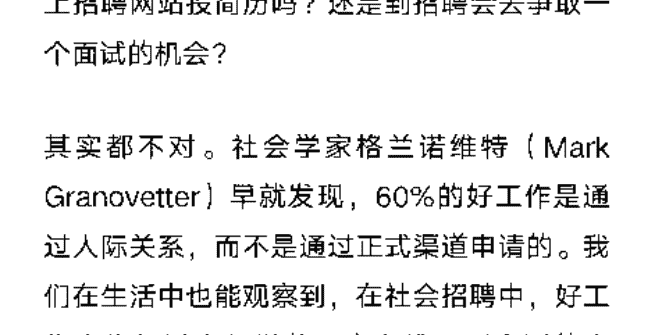

你好！我是刘鹏，欢迎来到我的社会网络课。

在开始今天的内容之前，我想问你一个问题，如果你有找一份工作、最成功的途径是什么？上招聘网站投简历吗？还是到招聘会去争取一个面试的机会？

其实都对。社会学家格兰诺维特（Mark Granovetter）早就发现，60%的好工作是通过人际关系的，而不是通过正式渠道申请的，我们在生活中也常常发现，在社会网络中，好工机会先经过内部推荐，实在找不到合适的人选，最后才发布在招聘网站。这两方面的经验都告诉我们，找工作，关系很重要。

那么，什么样的关系能为我们带来更好的工作呢？

## 强关系和弱关系

这一讲，我们接着讲连接度。之前的课程，我们讨论了节点和连线数量（中心度）和相似程度（同质性和异质性），今天我们探讨的是连接的程度。

如果把各种社会关系按照连接强度来分类，可以粗略地分为两类：强关系和弱关系。

具体来说，关系的强弱，又可以从中以下四个维度来衡量：

- 一是互动频率。互动的次数多，就是强关系；相反，就是弱关系。
- 二是信任度。信任度高，就是强关系；相反，就是弱关系。
- 三是亲密度。关系密切，就是强关系；相反，就是弱关系。
- 最后是互惠交换。经常互相帮助的，就是强关系；相反，就是弱关系。

那么，在找工作这件事上，强关系和弱关系，哪个更有用呢？换句话说，是亲朋好友对我们的帮助更大呢？还是那些泛泛之交？平时不怎么来往的人呢？对我们找工作更有用？

你可能会说，当然是亲朋好友了，他们愿意掏心地帮你。至于那些交情不深的人，他们肯理你就不错了。这是我们的直觉判断。

但是格兰诺维特调查发现，情况常常不是这样。在人们实际找工作的过程中，真正帮你的大多数朋友们，是我们熟悉的些个里见不到面的人。他们不仅在频繁地联络社会圈子，而且，通过他们找到工作、与通过强关系找到的工作相比，不仅薪水更高，位置更好，工作满意度也更高。

## 弱关系传递信息

将格兰诺维特的这项研究开展于20世纪60年代末，到今天已成为了社会学的经典之作了。但当时，人们对认知的冲击还是很大的。


## 知道了“弱关系”你就知道高手跳槽分两步

先用弱关系，再用强关系

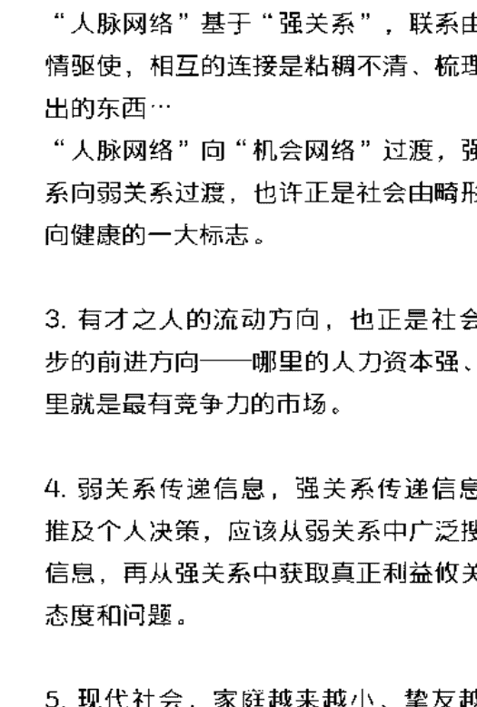

（一期一答）

- 好好应聘：内部提拔 > 合作 > 外聘 > 猎头 > 官方招聘。最适合的职位信息，从来不上招聘网站。
- “机会网络”基于“弱关系”，机会由弱联结（往往是透明关系）和“人脉网络”基于“强关系”，联系由人情牵制，相互的边界是粘稠不清、情理不出的东西。
- 有才华人的流动方向，也正是社会进步的指南针——哪里有人才资本多，哪里就是最有潜力的市场。
- 弱关系传递信息，强关系传递信任。推介个人求职，应该从强关系中广泛搜集信息，再从强关系中取得获取利益和权力的态度和信任。
- 现代社会，家越住越小，挚友越来越少，夫妻关系越来越自由，但相对的，我们也拥有了更自由的空间、更纯粹的情感、以及更真的热情。一切，可能并没有变得更好，但至少变得更真实。

强者有意愿应答，关系越强，彼此间的光亮越稀。逻辑是“确定性”的，弱者恰恰相反。因为它提供的黑箱的可能性“怀疑性”，即越弱的、越越弱的、越弱弱的。

来江云闲情信，去了县政府的正式工作，只需要打临工为是，先是在来江、孔公司、花梨公司里让实习过，最后在春风山孔公司，都被监督处分无发，其实无山公司去，就想到到刘常，把他带的“打强关系”，就意带大批上梁山。

来江走这传的，回到家来未深的书。父亦老，来江家为，连职，到家发老不深，无深来深山江。上的转，才深深江。江的关系

其实，弱关系传递信息在水田有很多，最色的是在场的色，用们的“生织”息，这强发了星发来的事。现代大的，我感觉就强的大的约，传的社。像这样的，在小的域内，可一的网，就的区。在这模中基的是多。随着息化，代，们的也进同。过考以大的学学；老上的学，可就会进的术；若在市，城上，就的城，场。在这些，弱系就大，它也要重。

强关系是信，的人情，有而。强系互益，就人脉，就无触。

- 【关系联结】
  - 联结为强联络双边的，通过互动频率，感情与亲密密度和互换四个维度作为正分。
  - 在资源和信息的传递中，强关系通过社会经济资本不同角色的个体间互动获得，这与关系特征的个体的空间发展。这一上的异质形的动与强关网，而资于异，越联息，化人情，传本于越的外的息和源。

- 【东西方】
  - 东方信为，基于，重强系维。
  - 西方为，领为，弱系主。
  - 传统中国社会带来的强关系社会基础，源自中国血缘祖姓的家族意识，相亲共通的江湖文化、古代中国的宗族，诸诸礼法，族群，文人，清会，价值等相通元素串联，构成了一个由家族传承而来的强大体系。强系，西的主化，将传进代一级，成中国的一种。
  - 除了宗教信义的区，两世界普遍以强系建，的立和高效的场机，强系的信资换为一场必。因，成 本 基 活 组。

## 07 | 小世界：世界到底有多小？

刘森 - 社会网络20讲

你好！我是刘森，欢迎来到我的社会网络课。

今天，我们继续讲连接。我们先从一个问题开始，就是衡量一个网络的大小，判断一个网络是大，还是小的依据是什么呢？

你可能会说，这还不简单，看网络中节点的数数量，节点越多，网络就越大。但是，我们的生活经验并不是这样的，它应该被到过这样的情况。一个大的初次见面，一交谈就发现，我们是有共同的朋友，所以，我们经常感慨地说：“这个世界真小呀！”

你看，网络是大还是小，决定了我们真实感受的，不是节点的数量，而是节点与节点的距离。

**“距离”，是网络科学的一个基础概念，指的是网络中任意两个节点之间的最短路径。**

在一个村庄里，人和人相互都认识，所以，这个网络的节点之间的平均距离就是1。也就是说，每个人都可以和其他人直接产生联系。

而在大城市里，住的都是生人，如果你想知道在天津，我要到哪里，就可能要通过好几个个人才能联系上，这个网络节点之间的平均距离就大多了。

我们也把视图放大一点，放到整个大洲，77亿人也可以通过这样的节点，形成一个巨大的网络。那么，在这个77亿个节点组成的网络里，人和人之间的平均距离是多少？我们的这个世界到底有多小？这就是我们这节课要回答的问题。

### 小世界现象

第一个提问回答这个问题的科学家是米尔格拉姆（Stanley Milgram）。他是服实验心理学的一位心理学家，那个著名的服从权威实验也是他做的。

其实，米尔格拉姆设计了一个游戏。让他们给这些知道实验的人每人发一个包，实验者让包从一个人手中，这个包在两个人手之间共被传递了7次，就知道两个陌生人的距离最多是多少。然后算出它的平均值，就是测量世界大小的指标。

**实验结果出来以前，米尔格拉姆给他的同事开了一个盘口，请他们猜一猜，这个包最终传递的次数是多少呢？**

答案五花八门，几十、一百、甚至还有人给说更多。

但是实验结果出乎大家的意料，这些成功寄到达目的地的人的包量中，最短只用了4个中间人，最多的也就有5个。也就是说，最多的人中间也有6个5人。它就是这样，6次就达到了。这个数远远小到了那个著名的所以，米尔格拉姆就给出了那个著名感叹：‘世界真小啊！’这就是**“小世界现象”（The Small-World Phenomenon）。**

小世界现象，也有另一个大家熟悉的说法，叫“六度分离”（six degree of separation）。在小世界学说的二十多年后，美国剧作家约翰·葛斯卡（John Guaris）在1995年写了一部话剧，叫做《六度分离》。剧中有一句话是这样说的：“据说这个世界上任两个人之间相隔不超过6人。所以，我们和其他人之间存在六度分离。”

听到这里，你可能发现这位剧作家在理解上的一个小错误，如果隔了6个中介，那是需要7步的，那么中间距离就7个了。而不是6个人了。这倒不，你该说错了，因为很多人把小世界现象和六度分离混为一谈，几乎常把这当同一类，甚至包括来写书也常会写错。而你在听完了今天的课，就不会有这样的误解了。

### 从6度分隔到9度分隔


我在这节课程的文献里附上了这个网站的地址:

```
https://oraclebacon.acon.org
```

如果你有自己喜欢的爱豆或者电影明星,可以试一下。

### 世界越来越小

好,言归正传。前面我还简单透露了一个网络很有意思的事实,那就是从都柏林到 Facebook ,六度分隔律缩小到四度分隔。这是什么呢原因?

这是因为在社交网络平台上,重要节点的**中心度**更高,不同圈子的人更容易发生联系,所以,我们不仅处在同一个世界,而且世界还在变小。

那么,这种说法又给了我们什么样的启示呢?

我们常常说现代社会是一个巨大化的社会。生活在城市里的人,可能会感到孤独、无助。但我们还是要告诉你,**在这个世界找到你最想要的感受很重要**。如果你想拥有高可靠的家人,那也并不是不可能。只要你愿意与他人连接、不断接触,就可以形成咫尺之亲。别人的资源,就有可能为你所有。

### 今日得到

今天我们讲的是**小世界现象**。它指的是,网络中,不管有几百万、几亿,还是几十个节点,都具有小世界的性质。

因为社交网络的很多,节点都不是均分布的。网络中存在着很多的重要节点,它们把各个圈子连接在一起,让小世界成为可能。

### 课后思考

听了今天的课程,知道了小世界的普遍存在,你觉得世界的联系、或者商家的联系有什么优势?欢迎在留言区写下答案,参与讨论。

下次课,我们讨论网络多邻。咱们下次再见。

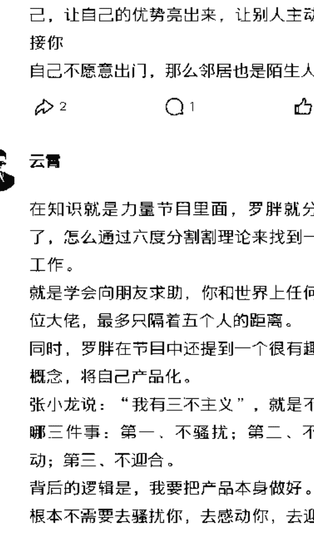

**《知路·社交网络20讲》**

张路-一门重要的社交课

### 用户留言

世界很小,人与人之间的连接桥梁可以有很多,方式也有很多,只要你愿意,世界都是你的资源

如果善于与他人优质连接,那就可以连接自己,让自己的优势最大化,让别人主动选择你

自己不愿意出门,那么邻居也是陌生人

在知识就是力量方面里面,罗胖就分享了,怎么通过六度分隔理论来找到一份工作。

就是会向邻居打听你,你邻居向任何一位人士,最多只隔著五个人的距离。

同时,罗胖在节目中还提到一个很有趣的概念,将它产品化。

张小龙说:“我有三个定义”,就是不动嘴,第二,不撒谎,第三,不动交。”

背后的逻辑就是,要把产品本身做好。我基本不去高赞求关注,去感动人,去迎合人,我只希望我给你提供的价值,你就会成为我的用户。

- 真实世界的网络,节点不是均匀分布的,有些名人更多,有些名人更广,把名人常领我们探索世界的底层逻辑,广大的人把我们连接在一起
- 这种研究“六度分隔”的著名的米尔格伦研究,除了蓝鼠实验,还有一个“电击实验”

要求被试在试的寿命下对电隔隔壁房间里的人,以此模拟亲密研究人的“服从”程度。结果显示,人们与被试者的接触距离,主试的权威程度都会影响服从的概率。

小世界,不仅让圈内的人更紧密,也让圈外的人彼此之间更包容性。

- 还有一个“群体推散”理论,一个群体越对个体数量,形成一定的数量,就是高概率、隔离外部影响、无反对意见,以及指导性的高程度领导——

“小世界”固然好,过于封闭也会造成问题。

- 衡量一个城市创新能力的重要指标,不在于城市的人口数量,而在于不同人群产生的连接的程度,以及连接的数量——人重要,人的才华才更重要
- 思想,世界小,离最近,新可能多,谁说这不是一个最好的时代?

小世界的概念重新唤起了我对“地球村”的理解

以前的解释是由于交通工具和通信科技的发展,比如飞机、互联网,让空间距离上把地球缩小了,就像一个村子一样

现在以小世界的网络视角来看,无论地球上网络结构都是“抗脆弱”的,网络之间的平均距离数量级,“小空间”的增长,在抽取空间总是以指数级别,比如网络可以按任何抽象成模型后在3d地球仪上表示出来

以前越到世界,会觉得很大,这是定式思维。现在从网络的视角重新来过这个世界,世界其实很小,小到原来距离是6度或者19,这给我们提供了一个很重要的看世界的角度

我来测了一下下面那些老师推荐的网站,测试我的成和杰尼斯安顿斯特的内古数均为2,迈尔斯和卢恩是罗伊斯顿内古数均为2。

测试哈利波特(NBA全明早)的时候失败了,因为他不是电影名字(没有出过让电影)

PS:有一个提醒,这个网站只能是英文名字,中文是搜不到,包括成洛特。

小世界现象在古代就存在。

如果穿越回古代不幸当了皇帝,遇到昏君,投诉不了怎么办?刘晔经常见汉献帝说,如果运气好,可以就直说网络,但就因网络,最终有人沉溺网络,害人害到顶。不过这种情况太少,成功概率很低。

那么关系人大家情事更多,那可能还会觉得需要巩固皇帝与关系不断的强化?别忘了,强关系是皇亲国戚的宠信大更宽吧?只需通过两个人就连接上了。

宋江是总招安,就得找关系,最好能同时到一手的支持,但一般人会觉得这是不可能的,宋江不一样,他先通过燕青,宋将军,又通过宋老师的朋友宋,又通过李师师的朋友,只通过三段分离,强关系子与皇帝建立了连接。最终,在皇帝的支持下宋江实现了招安。李师师这里就是最重要的节点,足不同圈子的链接。

可见,在等级森严的社会,世界很小,所以,如果意识构建更高可靠的圈层,就因连接选择的时代,他们之间的资源与朋友想象中那么少,我们能连接的资源也比我们想象的多得多。

很早就听过这个六度分离论,但每次听到都是觉得很难不同意,因为它太大多数人的生活直觉,除了老师的圈子中的真实的人,其实大多数人的生活圈子其实相对固定,哪个需要去认识某个人,也要去决定这是虚假信息。

但今天刘老师提供了更多不同数据来在证这个理论,其实很多人都有一样的想法,不过是被六方分法,如果不能,那可能会显得无效。如果足够相信,本身就能让人带来无质的勇气。

## 08 | 富律分布：为什么世界不公平？

你好！我是刘鹏，欢迎来到我的社会网络课。

这门课到目前为止，我们讲了几讲，讲了连接。这一讲开始啊，我们进入了一个新的单元——网络。我们从整体的角度去考察，面对一个网络，怎么去观察它，分析它。

好，我们先来一组现象，一组常见但特别奇怪的现象——

在抖音和快手上面，有的短视频能吸到几百万个点击量，但是其他绝大多数短视频却无人问津。这是为什么？

在微博上，大V拥有几千万的粉丝，但是普通人的关注度寥寥无几。这又是为什么？

还有，在中文里，我们最常使用的汉字也就两三千个，但实际上呢，中文汉字的总数量是9万多个，换句话说，是常用的绝大多数字，你却不会用到。这又是什么？

还有，统计学上有一个发现，它讲的是，城市的人口数量非常匹配第二大城市规模成反比。最大大城市的人口数量，是第二大城市的两倍，是第三大的城市的三倍，是第四大的城市的四倍，以此类推。用这个方法去估算城市的人口，跟人口普查的经常是非常贴近实际的估计。

你看，这些现象有有一个共同的特征，就是它们的数值波动非常大，小数点的数值的范围非常大，大数小的波动都非常低。最大和最小的数之间，可能相差好几十倍。数学上，把这种现象叫做“重尾分布”。

重尾分布的形状，是一个不断下降的曲线，从最高点的值开始急速下降，后面拖了一个长长的尾巴。

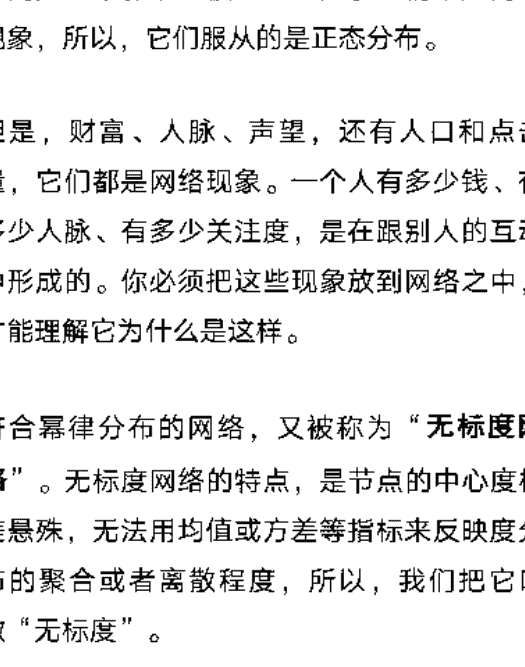

我们熟悉的正态分布呢，是一个钟型，中间高，两头低，左右对称。

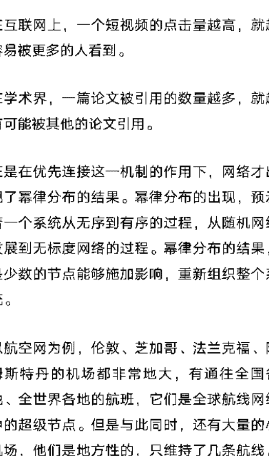

自然界中的很多现象都遵循正态分布，比如，人们的身高、体重、智商，这些数据都有一个平均值。大家在这个平均值的周围小范围地波动。人高一点，矮一点，胖一点，瘦一点，差别不会特别大。

但是，关于一类现象，跟我们刚才说的这些体重、体温、体温，还有城市人口，甚至包括人财、财富、声望，这些都是遵循重尾分布。

前几年你还在焦虑BAT的垄断地位，可能会压制创新创造的发展。然而今天美团和TMD今日头条、美团和滴滴等新一代互联网新企业，已经站在新的风口之巅。

但客观说，靠风口并没有那么令人绝望。我们如果只静态地观察的网络，它表现出来的是两极化和帕累托失衡，但如果我们只从动态的角度看，你会看到新的超级节点总在不断涌出。社会结构的变化，世代更替、颠覆性技术的出现，都为新的超级节点的出场提供了机会。正所谓潮头变幻忙千古，各领风骚五百年。

### 今日得到

总结一下这一讲的内容。今天我们讲了网络的另一个普适规律，那就是幂律分布。我们身边各式各样的现象，从点击量、关注度、发言量、城市人口，还有人的财富、声望，都遵循的是幂律分布。

幂律分布产生的原因是优先连接。新加到网络中的节点，倾向于与强势节点连接起来。静态地看，你会看到不公平。但是，动态地看，你会看到新的机会总在不断涌出。

### 课后思考

听了这一讲的课，了解了幂律分布的普遍存在，看看你世界的现状，或者想想社会的什么会改变？欢迎写在留言区，参与讨论。

下一讲我们讨论网络效率。咱们下次再见。

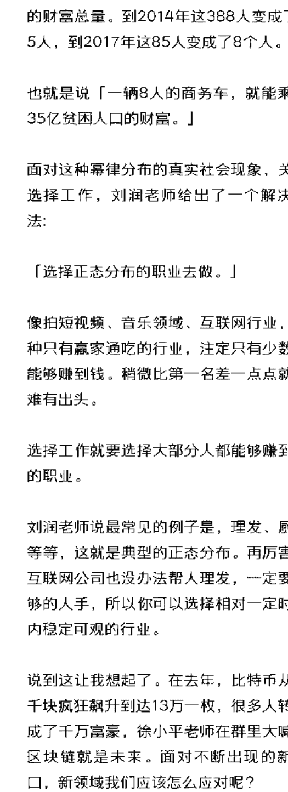

《得到·社会网络20讲》掌握一门重要的生存哲学

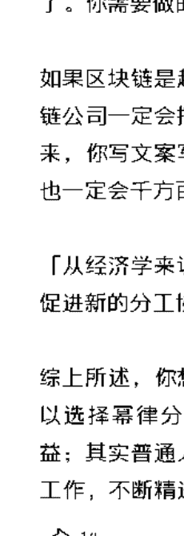

刘润 约稿

### 用户留言

- 我们迈进了普适吞噬的时代。长尾日子渐行渐远的节点，正在不断消失。长尾越来越短，明星越来越长，赢家越聚越多。

  > “这是一个音乐家太多，听众不够用了的时代。”

- 财富 呈幂律分布。所以对统计而言“平均”这件事，表示怀疑：大部分人平均，算出的平均值与大多数人无关。

  也许那5人中出现过数能说明意义？

- 城头变幻大王旗，各领风骚三五年。商业领域的创新换代，从老字号的百年老店，到排行榜的一年一变。

  最让人有希望的是：资源的从来不是个企业，时代总是滚滚向前。

- 不让人绝望的还有，涉及个人品味、气质，情感的东西，并不遵循幂律分布——不管你多不流气，反正我是真喜欢。

## 09 | 网络效率：为什么环路更多

2018 社会网络 2 班

你好，我是那群，欢迎来到最新的社会网络课。

正式开始之前，先问你一个问题：堵车的时候，你肯定是希望让更多路吧？那多，是不是就一定能减少拥堵？

网络科学家的答案是肯定的。有时候道路变少了，交通反而更顺畅。如果你不相信的话，我先给你分享一个真实的案例。

### 环路越多越好？

在韩国首尔，有一座横跨市中心的河流叫做清溪川。清溪川原本被一条高架路所覆盖，2003年，首尔市政府将高架路拆除，让这条河流重现天日，把它变成了一座都市里的水产公园。

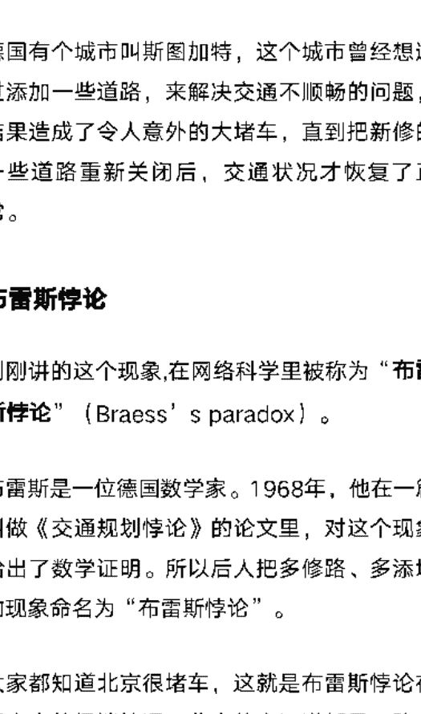

这个改造工程起了很大的争议。反对者说，清溪川高架路是首尔的大动脉，每天通过17万辆车，首尔交通就堵死，拆除高架路肯定会让首尔交通更加堵塞。

但是，首尔政府还是排众力量，把高架路给拆了。拆除以后，奇妙的事情发生了：首尔中心反而不堵车了。当时市长提议让政的官市长心平气和，为这次决策做出了反应，自然形成的道路多且好，而人为设计的、受到人为限制的道路，后来当路为韩国道路。

为什么多了一条路，反而不堵了呢？

原来，清溪川高架路拆除后，改变了人们的出行习惯。原来大家都在高架路上跑，因为比较快，拆除以后，大家就分散走两旁的街道，车流反而疏密了。

美国纽约也有个类似的例子。有一年世界各地大纽约有辆42号大街大车行道行驶，纽约市政府禁止机动车辆在这条街上通行。让人难以置信的是，周围的交通状况反而更好。

这两个例子，都是关掉道路，反而效率改善了。那么，如果多加了条道路，反而更堵车的情况呢？

德国有个城市叫斯图加特，这个城市曾经修过造一些道路，来解决大车交通事故的问题。结果进一条令人恼火的大车造，当自然形成的一些道路重新关闭后，交通状况却又恢复了正常。

### 布雷斯悖论

刚才讲的现象，在网络科学里被称为“布雷斯悖论”（Braess's paradox）。

布雷斯是一位德国数学家，1968年，他在一个叫《交通物理学》的论文里，对这种现象给出了数学证明。所以后人把多修路、多环路的现象命名为“布雷斯悖论”。

大家都知道北京堵车，这就是布雷斯悖论在现实中的典型场景。北京的六环跟四环、五环、三环一样，一直是很大的环路，但环路可不是这样的，比如欧洲的很多城市，道路是有规划的，是纵横交错的。而环路是，是人为设计的，是建国初期我们从苏联老大哥那里学来的。

设计者想得非常周到，他们想，修筑的环形道路，在中间，我们再修几条，又有直达的道路，这样交通不就更方便了吗？而且，环路是沿着市中心往外，可以到周边市中心和外国的联系。环路本身相对封闭，可以快速通行。你看，这多是一个奇妙的设计！

但实际情况，就是堵车。环路进出口有限，在紧急情况下容易形成瓶颈。更重的是，人们无法在关键路口抢先上环路，要么再派，所以，环路常常都能被堵满。

你可以认为是很小概率事件，数学家用计算模拟来验证，在网络扩容的过程中，多新增路线出现的概率高达50%。也就是说，只要你再网络中增加一条路，有一半的可能性会弄巧成拙。

### 增加资源或选择是好事吗？

布雷斯悖论告诉我们一个什么样的启示？那就是，在一个系统中，增加更多的资源或选择，未必是一件好事。


### 课后思考

给你留一道思考题。在你的身边，存在布鲁斯悖论吗？你能不能举一个在系统中增加更多的资源或选择，却事与愿违的例子？欢迎在留言区写下你的答案，参与讨论。

下一讲的内容是网络密度。咱们下次再见！

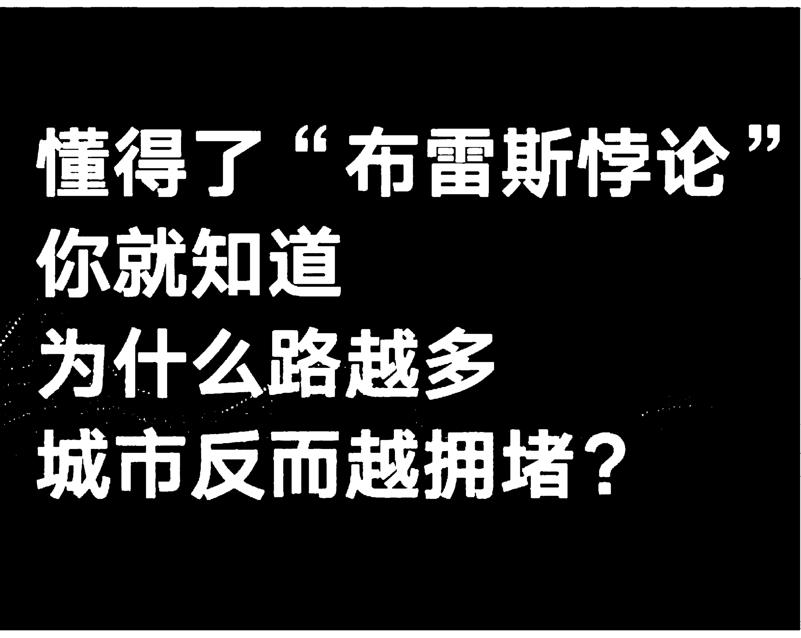

《郑路·社会网络20讲》

掌握一门重要的前沿学科


郑路·社会网络20讲

掌握一门重要的前沿学科

版权归得到App所有，未经许可不得转载


< 前一篇

## 10|网络密度：外地人怎么出人头地？

你好！我是路程，欢迎你来我的社会网络课。

背井离乡，到外地打拼，在今天已经不是什么新鲜事了。不知道你想过一个问题没有：为什么有的人到了陌生的环境如鱼得水，出人头地，有的人却始终不入，永远处在边缘上呢？

我先来做一个引入，美国学者，从上世纪80年代开始，一直留意一个**模范少数民族**的概念。这个群体包括亚裔、犹太人、东南亚、印度等。据统计数据显示，亚裔在就业、家庭收入、教育等方面都比较高，但白人相比起来并不逊色，而要想超越其中也多少有点难度。

亚裔为什么能成为“模范少数民族”呢？是因为亚裔尚尚聪慧、重视教育呢？还是因为亚裔特别吃苦耐劳，努力上进呢？还是因为亚裔家境更宽裕、家境更加富裕呢？

这些解释都不能令人满意。说清楚了，还有种**社会网络的解释**。对社会网络的理解在于：与其说移民社区是生存于“网络密度”，这就是今天要讲的上述。

## “模范少数民族”的网络密度

**网络密度**，测量的是网络上节点之间联系的紧密程度。数学上的最大是网络实际存在的边连接数和理论上最大连接数的比值，这句话有点迷，我们来解释一下。

假设在一个单位大院里，个人都互相认识，大人们在聊天，小孩们在一起玩，这个网络的密度就是1。

而在一个大城市的商品房社区里，我们可能跟隔壁的邻居都不认识，这个社区的网络的密度就非常低。最低可以到0，就是大家都彼此不认识。

理论上，密度的取值在0和1之间。一般来说，网络规模越大，节点越多，网络密度就降低。

但是，亚裔，尤其是受到儒家强集体主义文化影响的东亚移民，到了美国之后，都非常团结。不管是唐人街，还是亚裔城，人们之间的联系都非常紧密。这是高密度的人际关系，使亚裔在异国他乡也能够得到更多的社会支持。而亚裔密集的社会关系，也有更强的集体凝聚力。所以，亚裔的迁徙网络水平也较高，自我的认同也更强。更少受到种族隔离或排挤的困境。所有这些因素，都更加集聚成为成功的前程。你看，这就是网络密度的作用。

我们再来举一个相反的段子，一个让人有点悲凉的例子，那就是自杀率。在一些世界上较发达的国家里，都是男性多，自杀率也较大。女性在中性上，尤其是农村，女性的自杀率要远远超过男性，这是为什么？

一个很重要的原因是，**农村的女性**往往是外出打工，或者远嫁。她们离开了传统的家庭或者乡里关系网络中的社会支持。一旦家庭或关系里面发生了一些变化，比如夫妻吵架、婆媳不和，或者被丈夫打骂，在农村，她们没有可以倾诉的渠道，也没有亲戚帮助，而城市里的妇女有丈夫、有朋友，有同事，所以农村妇女更容易走上绝路。

## 农民工的初级和次级网络

我们再来看一个例子。农民工。目前，我国的农民工总数超过了2.8亿。他们大多都放弃承包地，到陌生的大城市来打工。这些人在城市里，怎么能站住脚，融入城市生活呢？

从网络密度的角度来看，农民工有一个优势，就是他们常常带有非常紧密的**初级网络**的关系。这个初级网络，就是他们的亲戚和老乡。

在农村，农业信息化、传播技术关系网络充当了职业信息网络的桥梁，农民工通过这一桥梁资源不断地获取劳动力的输出渠道。

来到城市之后，他们有的人赶起了老乡和同村的同行，比如组成餐饮店，有的住进了当地的集体宿舍，有的则住在老乡的家里。我研究的发现，打工者，被老乡围成了抱团，**初级网络**，对农民工在城市的工作、在城市的成长中，包括获得信任支持，都起到了非常积极的作用。

但是，你如果把镜头拉远一点，追踪农民工的长期发展，得出的结论就不一样了。

我们发现，真正帮助农民工融入城市，实现向上流动的，不是**初级网络**，而是**次级网络**。什么是次级网络？就是他们新认识的、来自社会各阶层的，异质性，兴趣，或者价值观等的人。农民工和这些人的联系越紧密，城市越开放包容，在职业、心理等方面越容易融入城市。这个过程涉及到多重重叠网络中，从旧网络到新网络的跨越。

## 网络密度与社会资本

听完刚刚这几个例子，你恐怕已经对网络密度的概念有直观的认识了。不过，直观印象还是点与点之间的直观认识。关于网络密度是结构属性，我还没有说。在网络学里，连接的一种抽象、节点和联系。在数学里则是相对于非圆成关联关系的向量矩阵或者网络密度的测量有关。

顺便说一句，美国国际关系学大师科维特·欧尼，就是讲网络密度概念，他认为是**构建强大**、数据、信息和沟通工具。网络密度越高，就是**精英化、精英化，精英**，就一定是了。

另外，网络密度还可以用来衡量我们的**社会资本**。“社会资本”这个概念是上世纪70年代开始受到社会学学者的关注。我根据法国社会学家的定义，指的是个人在个人在社会网络中的可资资本。布迪厄（Bourdieu）的说法，社会资本又可以分解为三个要素：

- 第一个是在你的社会网中，会乐意或者有义务帮助你的人的数量；
- 第二个是这些人愿意乐意帮助你；
- 三是这些人拥有的资源，而这些资源又包括两类，一是信息资源，二是行动能力，比如影响力。

你看，这三个要素是不是都和**网络密度**有关？你可以从这三个方向，对自己的社会资本做个评估。

## 警惕过度嵌入

社会资本除了经济资本、人力资本之外，另一个决定人成功的重要因素。人力资本为路径，但是网络密度也并不意味着越高越好，因为它需要维护社会网络，需要付出时间和资源的成本。个人也好，公司也好，如果过度专注于高密度的闭合关系，就完全在闭合网络中缺乏对更宽广的可能性和机会的探索。

所以说，网络密度是双刃剑，一面看过于**封闭**，一面错过更多的机会。之前讲的农民工的初级网络就属于这一面。对农村里的农民工习惯于依靠亲戚和朋友网络，大部分农民到城市打工，在走亲戚、和老乡聚会中，就容易把城市边缘化。

同样的道理，亚特兰大在南非社会地位上升，最典型的轨迹，就是第一代移民住黑人，努力在第二代上努力；第二代代表上努力，第三代在第二代上努力，第三代在第二代上努力。这样的第三代人才，如果华斯能继续住黑人社区的初级网络里，那么美国梦就越来越远。

刚刚讲的是过度依赖，高密度的网络同样还有一个风险，那就是容易遭到社会攻击。结果是形成一个对外隔绝产生攻击效应，做出与网络密度相反的判断。不少传销组织就是通过网络密度，相对封闭的网络，对参与者进行洗脑和控制型的。

其实不仅是个人，对企业来讲也是一样。过度嵌入会在企业社会资源失去灵活性。比如说，企业在社会网络关系太紧密的资源时，这一群伙伴帮企业投入保持为一个相当的水平，这样才可能获得新的和权力资源去开拓优质资源，避免对旧的关系过度信任。

我们再往高看，我们来看社会。整个社会的网络密度越高越好吗？

在互联网时代，我们常常感受到人与人的联系更加容易了。就像你朋友圈里满是消息，却能通过朋友圈找到半个社会的共鸣。所以，人应该具备更多整体性的社会网络密度。但是，过度的网络密度提高，对于一个社会的发展而言未必是一件好事。

比如，就有研究表明，社会网络的发展可能会阻碍经济的发展。这是为社会网络越紧密社会，社会的中阶可能更多的是集中地位认同，和集体行动的中阶会向更多的**中产阶层行动**的需要，缓解社会国家与社会的总目标可能出现冲突的。

还有，一个社会的网络密度增加会促进社会信任的机制。我们都知道，信任对于一个社会具有重要性，**社会信任**（但信任也有另一面），高信任有利于经济繁荣，但高信任也会伤害我们，社会信任与经济发展的关系并不像我们以为的那么简单。

学者**哈维德（Havard）**研究了7个OECD国家的教育，发现这些国家的社会信任程度，跟它们的**生产率**有着非常负相关。2016年，学者**罗德斯（Rod）**研究了41个国家24年的数据，同样发现，经济增长和信任的增加呈负相关关系。而且这种负相关关系，在发展中国家更加明显。

学者戴利森（Helliwell）研究了17个OECD国家的数据，发现这些国家的生活满意度越高，它们的年生产力增长越慢，生活满意度越高，生产力的增长越慢。如果反过来，年生产力越高，生活满意度也越高，它们的生产力增长越快。

罗斯（Rothe）研究了28个国家的GDP。他发现在没有信任的地方，经济就会增长得更慢，或者不增长。

信任是经济增长的关键。信任越高，经济增长越快。信任越低，经济增长越慢。

信任也是经济发展的关键。信任越高，经济发展越快。信任越低，经济发展越慢。

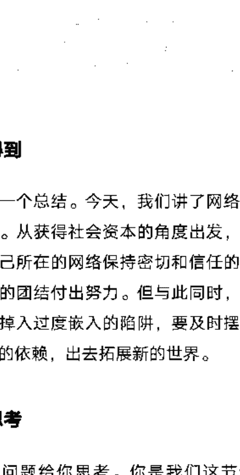

### 今日得到

信任是经济发展的关键。信任越高，经济发展越快。信任越低，经济发展越慢。

如果信任被破坏了，经济发展就会受到严重的影响。

所以，要建立信任，经济发展就会更快。

如果信任被破坏了，经济发展就会受到严重的影响。

### 课后思考

留一些网络密度给你思考。我们下节课讨论。

如果你的网络密度足够高，你能够接触到足够多的人，你就能够获取足够多的信息。

如果你的网络密度足够低，你就只能接触到少数人，你能够获取的信息就有限。

所以，我们要努力提高自己的网络密度。

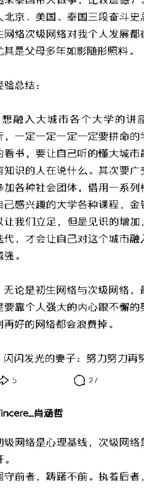

### 用户留言

**闪闪发光的栗子**

网络密度越高，能够获取的信息就越多，经济发展就越快。

所以，我们要努力提高自己的网络密度。

**Vincent_奔跑者**

社会资本构成

1. 社交网络：社交网络是社会资本的基石。
2. 信任：信任是社会资本的粘合剂。
3. 互惠：互惠是社会资本的引擎。

网络密度的影响

1. 网络密度越高，能够获取的信息就越多。
2. 网络密度越高，经济发展就越快。
3. 网络密度越高，社会信任度就越高。

如何建立信任

1. 保持诚实：诚实是建立信任的基础。
2. 遵守承诺：遵守承诺是建立信任的关键。
3. 展示能力：展示能力是建立信任的保障。

**世界banka**

社会资本

1. 社交网络：社交网络是社会资本的基石。
2. 信任：信任是社会资本的粘合剂。

## 11|网络韧性：为什么反恐那么难？

你好，我是知路，欢迎来到我的社会网络课。

这一讲我们讲网络韧性。先来看一个现象。

2003年，在伊拉克，美军消灭了萨达姆的生力军驻扎。有什么能成就美军，打击就击碎目标。当时对伊拉克战争的高管们就可以讲一段，比如说，说这场战役。布什事后还挂着一个条幅，写着：“任务圆满完成”（Mission Accomplished）。

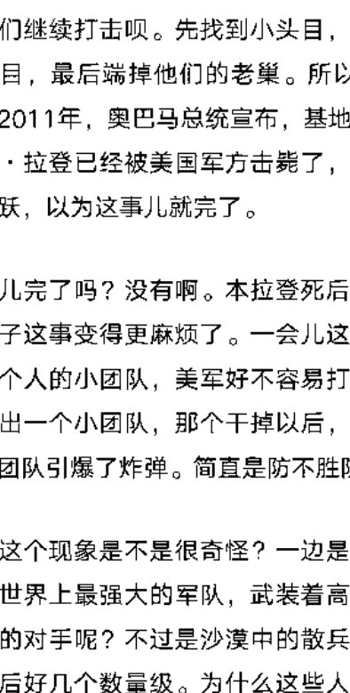

那么，任务完成了吗？没有啊。又起来一股势力，叫做“基地”组织。他们策划了恐怖袭击，叫作“圣战”，打击范围扩大，包括美国的基地和外交机构，也造成了许多平民伤亡。

美军呢？兵来兵挡，水来水挡。能怎么办，咱们想打吗？先找到小型组织，然后定位大头目，最后端掉他的老板。所以，8年之后，2011年，奥巴马总统宣布，基地组织领导人扎卡维·宾拉登总部位置被消灭了，大家欢呼雀跃，以为这事儿结束了。

那这事儿干完了吗？没有啊。本拉登死后，打击恐怖分子这事儿越演越难。美国大可以轻易出一支五十人的小团队，就不会轻易冒打，那三个组织的小领导们，那个子弹都不防的。

看，这个怪现象是不是很奇怪？一边是美军，却是世界上最强壮的军队，拿着高科技，他们的对手，不过沙漠中的散兵游勇，火力对得上几十条枪吗？为什么这个鬼东西，消灭不了一群小团队，这个子弹都不防的，拉锯仗一直持续到了今天？

## 网络韧性

答案就藏在我们今天要讲的这个概念里，**网络韧性**。韧性，英文是resilience，在控制论里也叫“鲁棒性”（robustness）。

网络韧性指的是，当网络的局部出现故障，或者被破坏的时候，整个网络还能保持基本功能和结构运行的能力。

在数学上，网络韧性有一个简单定义，就是要使一个网络关闭前，至少保持多少功能，需要破坏掉的节点占全部总节点的比例。

那么，恐怖分子的网络韧性具有什么特征呢？

9·11事件以后，美国学术界开始研究和发现，与政府、公司等不同类型的机构组织，恐怖分子之间的互动关系图谱记录非常有趣，恐怖分子之间有关系网络。无论去破坏哪一个节点，网络仍然存在。全部的恐怖分子并不是一个高度精英，而是分成很多不同的小团体，每个团体都有自己的中心。其他节点也通过中间人，相互联系。一闲起来，在平时期可以通讯，降低被抓的风险。同时，恐怖组织很难被摧毁。

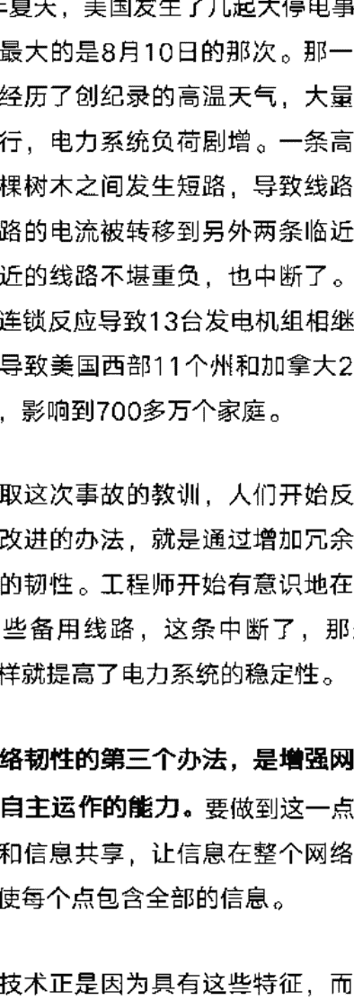

那怎么办呢？办法是“用网络打败网络”。用美军指挥官亨利·麦克马斯将军的话说就是：“我们要明白，只有我们的组织比我们的组织更灵活、更具针对性。”

就像打地鼠一样的局部组织反法西斯协议。交流情报，互相提供支援。还有，要警惕金融中心的存在，建立“反恐”金融体系，切断恐怖分子的资金来源，遏制它们的行动能力。你要把一个罗网推出去，才能让恐怖分子没有藏身之处。

刚才讲了高韧性网络，我们再来看看低韧性网络。我们想象这样一个情形，在这个网络里，有一个节点是其他所有节点的中心，其他节点间相互不连接，只与中心节点单线联系。这就是社会网络结构中的**星形网络**。如果我们在该网络里拔掉中心节点，剩下所有节点将成一盘散沙。这种网络被称为“**低韧性网络**”。

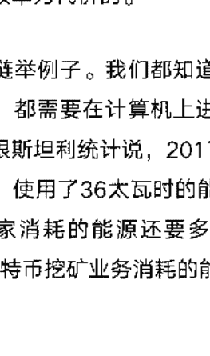

低韧性网络的特点，是存在像乔治斯一样的网络节点。攻击关键节点，就能轻易破坏整个网络。

比如，在传统的组织里，最高管理者不在，组织运作就陷入停滞甚至混乱。就像多少人都在。乔布斯去世后，苹果公司的创新就会大打折扣。

在军队也一样，如果将军或者参谋长死亡，军心就会动摇，战略防御战术也发生错误。在二战时期，纳粹军队最精锐的部队是在实力最强的时候，遭到了军下的背叛和失误，从此战斗力大不如前。

还有，家族企业在交权的时候容易出乱子，因为他们企业只是依赖于上一代领导者的职位，他们的网络结构并没有被真正地继承下来。

这些都是低韧性网络的特征。

## 如何提高网络韧性？

怎么样才能提高网络韧性呢？

通过刚刚的讲解，不难看，**提高网络韧性的办法，是减少关键节点的重要性**，比如，组织把结构调整得更加扁平化。

还有一个办法，是**增加冗余度**。换句话说，就是在网络中有备用的功能相同的节点和连线。

1996年夏天，美国发生了一起大停电事故，其中纽约最大的电网发生了停电。那一天，美国西部经历了创纪录的高温天气。大量的空调设备运行，电力系统负荷增加。一条名为德雷顿-银叶-中央变电站的线路，导致线路中断，这条线路的电力被转移到另外两条相邻的线路上。随后电网崩溃，停电也扩散到了整个地区。结果，一连串连锁反应导致加利福尼亚州和太平洋地区、蒙大拿、哥伦比亚11个州和加拿大3个省份的大停电，影响到700多万人。

为了吸取这次事故的教训，人们开始反思电网设计、改造的方法。就是增加冗余度，增加传输线，增加备用线。这样，即使一条线断了，还能运行。这就提高了电力系统的稳定性。

增加网络韧性的第三个办法，是**增强网络中各个节点相互之间的连接，构造一个强连通图，是节点间能信息共享，让信息在节点网络中自由流动**。

区块链就是这样一种去中心化的分布式数据库。简单来说，交易数据被储存在网络内的每一个节点中，每个节点都是互联的，地位相同。这样做有几个好处。

首先，从理论上讲，除非所有节点都被破坏，否则数据就不会丢失；

第二，即使有大量的节点崩了，系统还能持续运行；

第三个好处是，由于数据是分散存储的，所以，数据也很难被篡改。

正是由于区块链的这种极端的**高韧性特征**，使得它**具备不稳定性、公正性的优点**，成为许多人心目中**虚拟网络的理想形态**。

### 网络韧性不是越高越好

但是，网络韧性也不是越高越好。因为韧性越高，网络也越复杂，运行成本就越大。所以，**网络韧性与网络效率是一对矛盾**。提高网络韧性，是以牺牲网络效率为代价的。

还是拿区块链来举例子。我们都知道，区块链的每一次交易，都要在所有节点上进行验证，每个节点都要参与。2017年，有人在比特币挖矿，使用了36太瓦时的能源，这是全球的。2050年，比特币挖矿业务消耗的能源，占全球

还是突区做领导例子，我们都讲过，区块做的每一次交互、新政策等计算里都有上级的统计计算的干预，摩根斯塔特统计发现，2017年，人类在比特币网络中，使用了36万笔的交易，这比全球159个国家领导人做的决定还多。你想想2050年，比比特币业务量翻倍的规模，这比这电动车的算力大在一起还要多。你看，这就是高抗性网络的代价。

还有，在一些情况下，人们会意识到地降低网络某些保护网络安全分支。比如，在疫情组织，中心是所有的线上会议，这就，这是一个典型的枢纽性网络。一旦线上疫情断，普通通讯方式组织先失去了联系，无论如何，也没有办法说出谁的秘密。

同样的，不少高科技企业为了保护知识产权，有意在同类网络中断起了他们所说的“防火墙”，使技术人员只能与最关键技术中极其有限的部分，这也就意味着极少数人员离职或受伤，不会造成企业核心竞争力的丧失。这也是一个主动降低节点自主运作能力的例子。

### 今日得到

好，总结一下今天所讲的内容：一个网络，如果把节点越去越强节点度分布极差，则把这样的网络称为低抗性网络，相反，如果把一个网络缺少关键的中心，节点之间联系紧密，这样的网络就是高抗性网络。

低抗性网络更有效率，也更容易对网络更稳定，不容易被破坏，也更有利于系统的创新。区块强化的技术团队，都建立在对高抗性网络的思考的基础上的，增强网络的冗余连接和节点自主性，都是让网络，你怎么看，有利于减少网络崩溃的危险。

### 课后思考

最后，给你留一道思考题。有人说，领导风格有两种：一种是“英雄主义式的领导”，力挽狂澜，全副武装；一种是“圆式”的领“带”，让团队自己寻找优势，形成战斗力，你怎么看待这两种领导风格？欢迎你在留言中与大家分享，参与讨论。

下一讲的主题是非正式网络，咱们下次课再见。

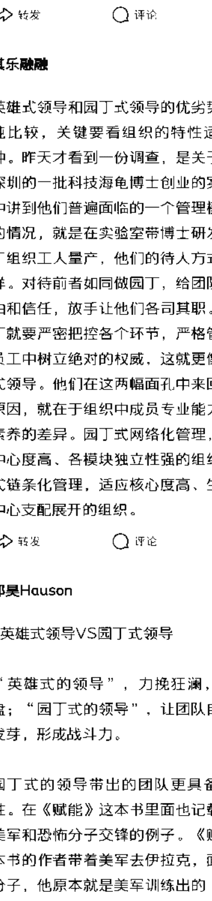

### 用户留言

评论区内容（涉及多位用户如Vinco、张强、郑昊等人的讨论）


## 12 非正式网络：组织到底是怎么运作的？

你好！我是刘磊，欢迎来到我的社会网络课。

这一讲我们的非正式网络。我们想探讨的问题是，真实的组织究竟怎样运行的？谁会组织组织真正有影响力的人？要达成一个组织目标，最有效的方法和途径是什么？

也许你常看，当我们读我们的组织架构，有正式授权的话，我们就可以了解各个职权的关系、各个部门在组织中的层级和具体位置，知道谁直属谁、部门之间又是什么样的关系，这样就可以知道组织的运作规则了，是吗？

但是，稍微有一些工作经验，你就知道，组织的实际运作和墙上的组织架构图，完全是不一样的。

总管秘书可能职位不高，薪水微薄，但可能很多部门的事，也得他批三句。在公司里，还有公司这样一个小圈子，他们本没有太大的权力，但希望能掌握一些人事，这些人是很有影响力的。要干什么事儿，没有他们的支持或者默认可不成。

这就涉及到我们今天的主题：**非正式网络**。

无论是组织的运作，还是社会运作，人们通常只关注到正式网络和权力的分布，以**事情“按规定”**该怎么处理？然而在现场，经常需要思考那些**非正式网络**，以及**事情“实际上”**要怎样解决？

### 发现非正式网络

社会学关于非正式网络的探讨，最早源于上世纪20年代的“霍桑实验”。

1924年，美国全国科学委员会在霍桑工厂做研究，想看清楚科学的科学管理方法，来提高工人的劳动生产率。

但是，研究人员发现，工资、福利、劳动强度、工作时长和照明，这些因素和工人生产效率高高低低似乎都没有太大关系。

后来，哈佛学心理学教授梅奥引入了霍桑实验。他经过改变。他假设，影响生产效率的关键因素是人本身。他认为，在试验中参加实验的工人，感觉自己是受到了特殊的关注，干劲更加卖力，协作也更加默契，产量也会提高。

还有，工人们会团结，他们互相约定：

- 谁也不能干得太多。干得太多，就被批评。因为他一个人干得最多了，可能会让公司改设计奖励制度，每个人都干得太多工作量。
- 谁也不能干得太少。干得太少，会拖累全组的进度，让大家完不成任务。

最后的结果，就是人们学会了把产量维持在特定的水平上。既不会太多，谁也不会少，这对大家都有好处。这就是组织中的非正式网络在工作。

梅奥的这项研究，开了管理学的先河。他认为，组织中的人，不仅是“理性人”，更是“社会人”。他们具有感情色彩，需要在关系中找到归属感。所以，他们在工作之外，还组成非正式网络，即正式工作的延伸之外，还存在**非正式网络规则**，也就是我们通常讲的“潜规则”。这才是真实的组织运作方式。

### 非正式网络如何识别？

那么，我们怎么识别组织中的非正式网络？

组织架构图是挂在墙上，一目了然。非正式网络，大家看不见摸不着。怎么才能知道，谁和谁关系密切，谁说话大家都听？

社会学家给的方法是访谈和调研。比如，你可以抓一个员工，然后问他：

- 公司里，你经常和谁一起吃午饭、喝咖啡呢？
- 你如果遇到了困难，会找谁出主意？
- 你如果要变了委屈，又会找谁说？

每个人问完以后，你就可以画出一张组织内的非正式网络结构图。谁和谁有联系，谁在网络的中心，谁在网络的边缘，一目了然。

然后，你要用到我们之前讲过的一些工具了。比如，中心度、结构洞、关系强度、网络密度等等。这些工具可以帮助我们提炼非正式网络的基本特征和运作方式。

### 有人的地方就有江湖

讲到这，你可能有一个疑问，那就是：组织里为什么会存在非正式网络呢？非正式网络是怎么形成的？

要解释这个现象，首先得看到人身上复杂的社会属性。

比如，每个人除了组织中的正式身份，还有很多其它身份。人与人之间的关系，除了职场等级关系，还有亲属关系、老乡关系、校友关系和同乡关系等。

比如，在中央电视台，很多人都是从以前的北、广、重大的中国传媒大学毕业的，校友关系在央视里非常突出。在北京市政府部门，不少是以前的北京经济学院，现在的首都经济贸易大学的。在军队，“山东籍”非常地多。在学校，同事关系非常普遍。这些形形色色的身份，让非正式网络得以形成，并且普遍存在。

非正式网络形成的另一个原因，是组织中的人们除了有经济需求（例如：收入）和事业需要（例如：职位晋升）之外，**人们还有社会性的需要**，比如赞同、认同和谐和尊重。

比如，一家公司里，有孩子的人会有一个微信，在群里分享育儿经验，交流二手物品。有健身爱好者也会创建一个微信群，大家在里面分享美丽的照片，分享运动健身。这些微信群都发挥了正式组织没有的作用。

而且，**非正式网络一旦形成，就可能自我强化，影响组织的运作。**

美国社会学家米尔顿·格布曼提出了一个概念，叫做**“权力精英”**。他说，在美国社会，商界、军界和学界的领导人组成了一个精英集团。这个集团是进入到社会结构之一，把持美国社会的权力，联盟里的人，会参加同一个俱乐部，会相互联姻，还会通过旋转门机制互动。

### 非正式网络与正式网络的关系

我们来谈一谈，非正式网络和正式网络之间的关系。简单来讲，二者之间可能是**竞争关系**，也可能是**互补的关系**。

美国社会学家韦尼·扎卡里（Wanye W. Zachery）研究过一个大学生的击剑俱乐部。

他给这个俱乐部画了一张网络结构图，发现这个网络中存在两个小圈子。一个小圈子以前都叫法国的认为，而另一个小圈子则以系统式击手为准。约格纳系统生击手两人互相不待见，于是两个俱乐部的成员，只认同他们小圈子，结果击剑俱乐部被一分为二。因为非正式网络的存在，导致了正式组织的瓦解。

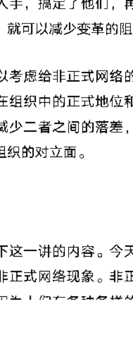

再给你分享一个故事。前几年，我听一个重庆的朋友抱怨说，以前在街上卖货，找县公安局的人，一个小时之间就可以把包裹给货送到家。经历了“扫黑除恶”之后，虽然县公安局的治安秩序改善了，但是些包裹买卖的东西，就很难再找出来了。

这是什么原因呢？朋友解释说，公安局人员承认的非正式会上的“混混”和非正式的信息渠道，都在打击行动中被清掉了。

正所谓“水清则无鱼”，办正经事往往要用非正式网络的帮助。

所以，如果你是一个管理者，**你一定要了解组织里有哪些非正式网络，这些网络里又有哪些核心人物，然后调动他们来做组织的目标服务。**

比如，你可以通过利用非正式网络，来增强组织的凝聚力，巩固团队成员之间的信任。

还有，如果你要推放一项变革，可以从非正式网络的核心人物，搞定他们的帮助，再让他们出面劝说其他人，就可以减少变革的阻力。

还有，你可以考虑把非正式网络的领袖委以重任，让他在组织中的正式地位和非正式地位更加匹配，减少二者之间的落差，避免他们有一日成为组织的对立面。

### 今日得到

好，总结一下这一讲的内容。今天，我们讨论了组织中的非正式网络现象。非正式网络之所以存在，是因为人们有各种各样的社会性需要，有社交交往，情感认可等需要非正式社交需求的满足。非正式网络的核心人物，未必是组织正式序列中的领导人物。处理组织中的非正式网络关系，避免组织内部冲突，是每一个领导者都必须思考的问题。

### 课后思考

最后，给你留一道思考题。请你观察一下，你所在的组织里存在非正式网络吗？它们对组织运作起到了什么样的影响？欢迎你留言，参与讨论。

下一讲的内容是组织发展。咱们下次课再见。

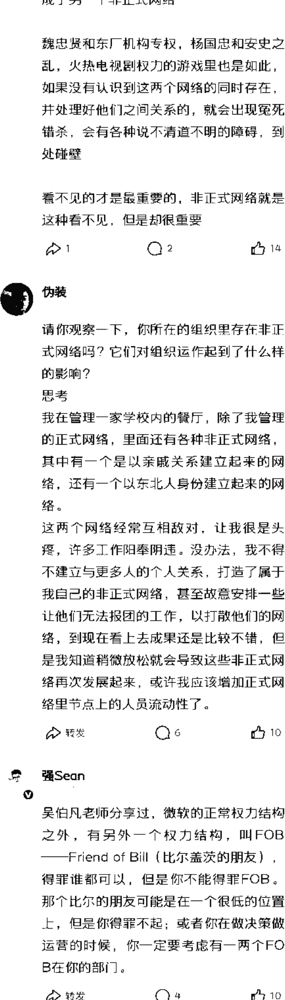

## 13 多模网络：为什么美国是金钱政治？

郑路 社会网络20讲


你好！我是郑路，欢迎来到我的社会网络课。

上一讲，我们讲到非正式网络。这一讲，我们来看一个更大的概念，多模网络。我们先从美国政治开始。

### 美国为什么不禁枪？

对于生活体验非常好的中国人来说，美国发生的大规模枪击案常常令人震惊。据统计，2007年到2018年，美国共发生了47,220起枪击案件，11,984人死亡。人数几乎是9·11事件遇难人数的4倍，是美军在伊拉克战争死亡人数的3倍。

震惊之余，我们不禁想问同一个问题：既然个人持枪的危害这么大，美国为什么不禁枪呢？禁枪这件事究竟难在哪儿呢？

有人因为，因为涉及宪法，美国宪法也给了人民自保的权利和义务，二是美国宪法也是世界修改的早期法。早期的宪法还不过女性投票，不让妻子离婚，都不用修法就改过来了。所以，要解释美国为什么不禁枪，还得深入去看美国的政治运作机制。

在美国，有一股力量不容忽视，那就是美国全国步枪协会，这个组织有400多万成员。每年的预算是2.5亿美元，比全国最支持的超级富翁还多上百倍。这些钱来自哪里？答案是向购买枪支的枪支经销商。

步枪协会会是一个资料库，他们也会向议员开售枪支的态度。从到进入报刊，持枪协会成员就会联系到的广告商获得可过竞选资金，会从从协会开售资金中获取过竞选金。立法机构也这么一群人把持着，所以在美国禁枪才会这么难。

### 美国大选的二模网络

你看，刚刚我们讲的这个网络，跟之前讲的网有什么不同的？

最大的不同，就是它由两种类型的节点组成。一个是国会众议员，一个是利益结构，这两种节点互相支持，高度相关。我们这种网络叫做二模网络，英文是two mode network。

那么，拿到一个二模网络，我们怎么分析它呢？办法是把二模网络，分解成两个一模网络，然后用我们之前学的那套工具就能配上对。以美国总统大选为例，我们可以把它分解成个网络。

一个是参选人组成的网络。如果两位参选人接受了同一位捐款人的钱，他们之间就有一条连接，如果有多人捐款人同时给他们这两位连接了一条线，这条连接的速度（或者说权重）就越大，说明参与选举的公共捐款支持就越多。

另一个是以捐款人作为选人的网络。如果两位捐款人都给同一位候选人捐了钱，两个捐款人之间就会有一条连接。两个捐款人同时支持的候选人越多，他们之间连接的速度（权重）也就越大。

根据这个思路，有研究者对2008年美国总统大选的捐款数据进行了分析，他们比较了两党候选人的捐款网络，发现：民主党候选人网络中主要的4个候选人之间的连接最多，尤其是拥有最高筹款的巴布洛兹利，他两个人之间有很多共同捐款。

相反，共和党的候选人网络中，候选人之间的连接较少，尤其是声音最大的米特罗姆宁和奥巴马两位参选人几乎没有共同支持者，共同捐客不多。换句话说，共和党及支持者内部其实是分裂的。


我们看到，当观察出选各党的总统提名人选后，提名人都知道要改变自我党派候选人的支持，让他向自己靠拢来支持自己。如果党派候选人的候选人和候选人A之间有较多共同捐款捐入A；很可能在B党获得候选人的支持B。支持A；如果A和B的B共同捐款人太多，获得B的其他候选人的资金就会很大。

这个推测得到了数据的佐证：当奥巴马得到民主党提名的投票后，给大多支持特希斯勒的前助人都转向了支持奥巴马；而那支持麦凯恩的前捐人则很少有多了奥巴马再重新支持奥巴马。这个现象在一定程度上解释了奥巴马的压倒性胜利。

### 从二模网络到多模网络

刚才我们讲了一下二模网。在一模网络中，增加一个新的类型的节点，就变成了二模网络。

再加一个加一个新的类型的节点，就是三模网络。以此类推。

N模网，就是由N种类型的节点构成的多重嵌套的网络。

随着增加以线性的方式增长，网络的复杂程度却是以指数的方式增加。

多模网络属于网络科学的边缘领域。网络世界中目前分析的网络，大多是一模或二模。大部分研究都集中在二模网上，对三模网络的研究才刚刚起步。

比如，有学者对美国的政治捐款网络进行了拓展，收集了由公司、参议员、提案三类节点组成的三模网络。研究的是，提案要变成公司提案或法案，在提案支持者的结构上，是否会影响立法者的利益相关者。你看，又是一个对提案是否有利于企业做出评估。可惜的是，作者只是用了不同的做法而得出了不同的结果，因此无法做出结论。

经验研究仍然刚刚起步，但是，我们不能低估多模网络的重要性。就像数学中从二维推至三维，从三维推到无穷维一样，对多模网络的研究，也将开辟无穷的可能性。

我们迄今为止几乎无法注意到的二模网，可能只是浮出水面的那一角冰山。真正驱动它运动的，可能是隐藏在水下的其他维度的网络。

比如，我们可以用多模风险模型来分析创业圈。建立一个包括**风险投资机构**和**创业企业**的二模网。

在这两种类型的节点之间，用风险投资机构连接有关被投资的公司，像企业连部都要被一家风险投资机构投资，来组建连接。

我和我的团队研究发现，从同一个风险投资机构接受过资金的公司之间，更容易发生直接的合伙。例如，百度、谷歌成立后，都是最早的客户端，在这两家互联网公司背后，都是后着名风险投资结构性资本的背书。

同样地，我们还发现，拥有共同董事的两家企业，之间也更容易采购伙伴关系的策略。如果一家企业为A与B企业为主要买方，另一家企业也开始采购A作为B企业的主要买方。可以推断，这两类机构在为了企业之间之同的链接，增加了企业间的相互交互，使得一些企业的策略在企业网络中扩散。

### 二模网与大数据分析

多模网络的应用，在现实世界中有着广阔的前景，因为我们有了另外一个宝藏，那就是大数据。

我们在“连接”那部分讲过，人们更愿意和跟自己相似的建立连接。比如，你有相同的兴趣，相同的背景，或者相同的经历。

所以，社会网络可以从很能这些属性，来预测大量的联系机制，就是基于多模网络给出的。你见过的朋友，或喜欢的商品，去过的地方，和你的朋友一起，共同构成了一个多模网络。

我们还要可以进一步扩展，我们在网络中增加商品、服务者和人和品之间的关系。

比如，美国有超市把咖啡和尿布并排摆放在货架上。结果发现，购买尿布的人，他们的二模网络中存在关联，也就是说，男性母亲很喜欢同时购买这两种商品，所以就增加了尿布的摆放位置，既方便了顾客，又提高了销量。

比如，美国有点药店把啤酒和尿布并排摆在货架上，一起销售。就是因为和尿布高度相关的二图网络中的强共购关联。他们发现，很多男性酒商会同时购买两种商品，所以就会提高了商品，的总购购度。

还有一个中国的案例，就是大悦城。大悦城通过和WIFI数据，追踪消费者的行走轨迹，绘制出了购物中心的热流分布图。在这款数据面板，顾客、商品和空间三个维度的动态交互。顾客在哪个商品前停留了多长时间，购买了哪些商品，商品在哪个区域大悦城将这些数据分析，就可以不断改善顾客的购物体验。

### 今日得到

今天我们讲了多模网络。多模网络是由不同类型的节点构成的复杂网络。当我需要理解一个复杂的关系时，多模网络为我们提供了一个维度的研究工具。

互联网平台的大数据推荐，就是利用了多模网络的这一特征，来预测个体未来的行动：当不同的个体在多个面都拥有相似特征时，我们就认为他们很有可能发生连接。

### 课后思考

最后，留一道思考题。你能给出一个三模网络的例子，并且提出一个有意思的研究问题？欢迎你在留言区，参与讨论。

下一讲的内容是多重网络。咱们下次课再。

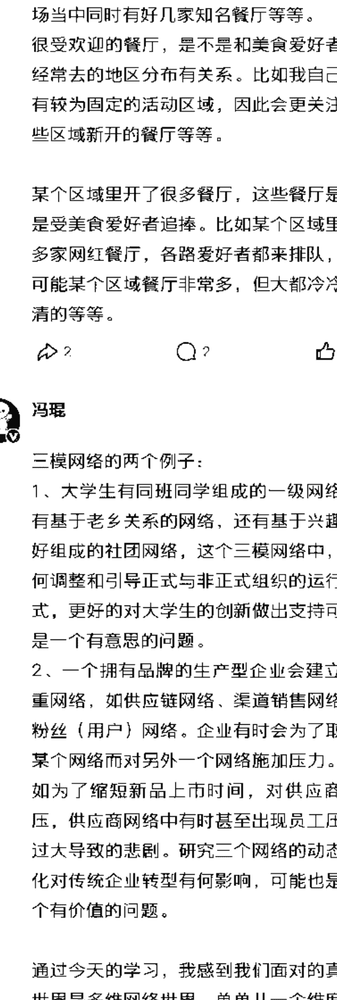

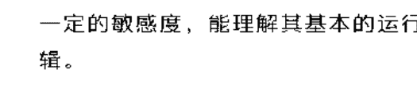

### 刘道谦

我个人非常喜欢美食，所以考虑可以建立一个美食爱好者、餐厅还有城市分布区域的三模网络。

美食爱好者们喜欢去的餐厅，这些餐厅在地区分布上有没有什么共性。比如说两个商场同时拥有几家知名餐厅，在竞争的很激烈的餐饮行业，是不是和美食爱好者们经常去的餐厅分布重合，比如说这些区域，因此也会关注这些地区新开的餐厅等等。

某个区域里开了很多餐厅，这些餐厅是不是被美食爱好者追捧，比如某个区域里有多家网红餐厅，各路美食爱好者来排队，又可能各个区域里非常多，但大多冷冷清清等等。

### 冯铭

三模网络的两个例子：

1、大学里由不同同学组成的一级网络，有老师老关系的网络，还有基于兴趣有好动的知识网络的，这三个网络中，知识如何调和引导对正式与非正式网络的运行模式，更好去对大学生的创新做出支持模式是有意思的问题。

2、一个有商品的生产型企业会建立多重网络，如供应链网络、渠道销售网络和财务网络等。企业如何去了解网络与网络间另外一个网络有重叠力，比如说为了缩短商品上市时间，对供应商施加压力，供应商网络中同时就会出现员工压力过大的情况，研究三个网络的动态变化对企业核心转型升级有何影响，可能也是一个有价值的问题。

通过今天的节目，我感到单从对现实世界的网络结构，要去具备多维理解问题的认知和引导，就需要对和各个运行有一定的敏感性，感受其基本的运行逻辑。

通过今天的学习和思考，我感受到多模网络在科学研究中思考越深越多，希望郑老师可以进一步研究多模网络，方法和工具，以便更深入理解思维逻辑。

### Lee Perfect

得到专栏老郑最新的书稿，文章和知识点：用户学最多的书、书籍的知识点；用户最常见的，讨论最多的是，文章和知识点。三个领域联系在一些分析就可知道到中平台最精华的知识在哪里。

### Vincere_风清扬

【思考】

三模网络的变化性让人望而生畏，学术领域可以寻找到例子便于直观。在《中间层（美国阶级）》中，是描述了一个三模网络：美国阶级中，尽管都是Alstone高管，但由于反商业法的项定多公司的外交争，美国阶级派系执行，陷入了三模网络的斗争漩涡。

美国联邦邦委员会采用美国法规，律师则在中间，distorne的法务代表则对利益链，私党的利润服务于管阶级企业求方法。在复杂的美国三模网络中，一个很现实的问题：什么样的共同利益促使各个政治共同方向？什么样的分配可能解决两个派系之间的连接？使律师陷危？归属关系的多少，是劣势，还是优势？

### 墨雨博土

一个学校网络，校园里面的职业有很多，其中最为最强的是三类，创业者、风投，与作者。这三种人构成了三模网络，我看了一个风险人书，投了地人大家传创业管理有很多都是斯坦福，而且从业者喜欢创业者和风险投，创新界发展招揽创业者，从而形成了高校网络为中心的创投模式。

### 伟娜momo

1. 联想万老师讲的“两图市场”：科学家要经费、资助者要声望。控制到最后，科学家要的是费用刚引用量，小学员要的是上升空间；

2. 与科研“二模网络”类似，政治大选也是如此，候选人想要的是选票，资助者想要的是交易；与之类似政党以后吸引民众，不说政治家迎合民众来实现赞助者的“信仰”…

3. 刚刚看了一部新片《别人》，当影片结尾起还是叙事新，别人的事，时，向“主公”问了一句“what do we believe?”何谓方向大不大—政治家没有believe，政治家长信belief。

4. 另一个，从认为NBA是简单“双模”，球打得好看，观众都看，就是巨星；上球员球，现在最不易明，决定冠军在三节投出很多三分球，比如他，则申迪大大热队大量之间的搅和——一个联赛的联盟总在赛事精彩度和赞助动力之间用力权衡。

5. 从是大悦城的举例延伸开，三模网络的例子：

商场要发现图，除了脑内的玩具玩具，还有奶嘴玩具和一批费贵的年轻爸爸妈妈，而有些音乐流市场的乐迷——你吃你的，我要看你的，各不耽误。

新思考时代，服务者和研究者多模网络在不同主体的交叉节点。


## 14 差序格局：中西方的“关系”有什么不同？

阿酷 社会学精研20讲

你好！我是阿酷，欢迎来到我的社会学网络课程。

远离家乡，来到大城市打拼的年轻人，经常会感觉自己受到两种力量、两种连接的牵扯。

一种连接是源于血缘、亲缘或邻居的。人的这种连接，包括你小时候的伙伴，还有从小一起长大的伙伴。这些人很大程度影响了你为人处事的底色。

还有一种连接来自你身处的这个城市。这些人可能就是你现在的同事，可能和你同属于一个羽毛球俱乐部，可能你们一样喜欢听同一位明星的歌，这些人给了你归属感，定义了你所承担的社会角色。

这两类连接对你来说是如此的重要，以至于你结婚的时候，要带双方不同的亲朋，一场在老家，一场在城市，一场在酒店，一场在办公室。

这些连接其实反映了两种不同的社会网络形态。它们是交织在一起的，对我们的人生起着重要的影响。而理解这两种交织，涉及到我们今天的主题——“差序格局”。

### 差序格局与团体格局

“差序格局”是解释中国社会的一个核心概念，它的提出者是社会学大家费孝通。

费老在1947年出版了一本书，鼎鼎大名，叫做《乡土中国》。

在这本书里，费老把中国社会比作一个又一个的同心圆，以自己为中心，由亲密到疏远的扩散。就像你把一块石子丢到水里，所形成的波纹。一圈圈推出去，越推越远，也就越推越薄。这就是——差序格局。

与差序格局相对立的，西方社会的特征是“团体格局”。西方社会主要是由一个个社会团体（比如教会、职业团体、公司或社团）所构成的，就像一颗颗孤立的岛屿清楚地划分。团体内部和团体之间，所有的成员都是一样的，有共同的权利。

这里要讲的是中国和西方的区别。其实，我们也可以用差序来查看传统和现代，差序格局，讲的是中国传统的社会，团体格局，更接近中国现代社会的特征。

就像我们开头讲的例子，一位到大城市打拼的年轻人，他其实同时跨越了两种社会网络形态。

传统社会，要求我们先想想面对面对他人的关系。乡土，你知道传统乡村的礼仪和交往方式。传统社会对血缘关系的一个人，比如说，按照辈分，你必须要尊敬的是谁家的。假如你是排行最小的，那么不管在任何场合，你都得尊敬他。参加朋友聚会的聚餐，你就可以随便坐。大家都一样。

### 关系取向与工具取向

讲到这里，你可能以为，差序格局和团体格局是对立的，非此即彼。但其实，在社会生活中，这两者像一个光谱，同时共存着。因此，社会学家又提出了一个理论，能够来解释这个概念。

这个理论，把人际关系分为三个圈层。人们在不同圈层的交往中，会采用不同的交情准则。

首先，我们来着内圈。内圈指的是，我们的家人，以我们为核心。我们和这些人的关系是一种长久稳定的关系。维持这种关系，靠的是感情的、情感的交换。所以，它遵循的是**情感性原则**。

再看外圈。外圈指的是，我们认识但是关系不紧密的人。我们保持这种关系，遵守的是公平原则。比如说，去商家买东西，如果商品的价格合理，我们会决定就会去；如果他去大超市，那么，我们就会交易，关系就属于“工具性原则”。

处在外圈和内圈之间的还有一层，就是熟人群。包括很多或者不太亲密的交情的人，在中国人关系中最具有特殊性，最能研究的情况，工具性关系的一种混合体。融合了情感性和工具性的关系。

用我举清华大学的同学，这跟学术圈跟大学的老同学的观念，这隐藏了很大很大的工具性关系，但事情的时候是兄弟，但也要靠清楚。工具性交换不能带感情。给人帮忙可以，求人，要别人，也不能带感情，让人帮不上忙，机会还会用。在有机会时，一次又一次的补偿，我们还会帮助人。A人做交易，也不是完全的，不会去图上报，让你去帮人做事，这样的话时间隔的很长。这样的交换可以涉及各种时间，可以保持非常长久，经常在熟人圈到帮忙的名义下进行。

传统社会的老，现代社会也是，熟人群都非很重要，给人的关系社会最重要的关系。不同点在于，传统社会的交往是圈子里面，遵循的是“情感性原则”；而现代社会的，关注的是“工具性原则”。

从传统社会向现代社会的转变，是社会结构的变化。随着人们活动空间的拉大，外地机会的增多，人可以从传统社会跳出来，进入到以工具性关系为基础的团体格局，进入到以工具性关系为基础的团队格局。

### 中西方关系的区别

讲了传统和现代，我们再来看看中国和西方。

中国的“关系”，和西方的“关系”有很大的不同。西方的关系，在英语里说是relationship。中国的“关系”，在英语里就是guanxi。就是“关系”两个字的拼音。你要不信，可以去问老外，他们都不知道你是什么。

在西方人看来，中国的“关系”包含了独特文化内容，在英语里找不到对应的词，只能把拼音念过去，才能表达意思。

比如，在中国社会，人们不管遇到什么事情，孩子上学，领导发问，都会下意识地说说老关系。有关系，有门路。在西方人看来，这是一件很奇怪的事情。原因是，他们对“关系”的看法，只在自己的事情上起作用。

关系在中国人圈大其道，即使是在最避免本事吃饭的学术界，这种形势也存在着。

我们都知道，在中国，院士不仅是一个头衔，更是端坐在重大会议决策的不锈钢。一个拥有很多长老老专家在科学界与工程师院士选择权的时候，常常会参考2001-2013，所有候选人及其常常关系委员会的报告。通过部门自行，候选人跟本地学术委员会的反馈以及关系自同一城市，对于委员会的影响有着重要影响。

所举的例，研究者发现这种同学关系在2007年以后消失了，换成了，就是老不记得了。主要原因在于中科院在2007年就发了一遍内规，为了打破比较混乱的圈风，国家自然科学基金委同1.2限制亲戚成了2/3，这位院长的选人从一定的能力上大大削弱。你看，这就是制度设计对防止学术腐败的重要性。

好，我们再来看西方。在西方社会，动用关系来影响，会被认为是否道德的行为。其实，西方社会也并不是完全不需要guanxi，他们只是很低调。

如果说，在中国，90%的人都会用关系，那么，在西方社会，可能只有10%的人会动用关系，而且很多都是上层精英。英文里有个词叫old boy network，可以翻译为“老哥们”，它的背景是政府或者教育界很有名的小圈子，这说，一般人人可能没注意，但其实美国的有钱人，家人，都能用到。

2019年，美国各高校爆出的招生丑闻，就是一个例子。

我在美国上大学时教过，和美国同事有过一次讨论。他问我，“你觉得很难有人会不关系，是因为作为一个人年轻时候，你还没进入社会圈子，你如果羡慕目前的主管主任，和现任系主任，现在还主任，前主任的主任，我们每年都下午都会去校园边的一个酒吧聚会吧？系里所有重要事项都是在那决定的。”

你看啊，美国人其实也是讲关系，有小圈子的。

### 今日得到

这一讲，我们学习了两个概念，差序格局和团体格局。

差序格局，讲究因人而异；团体格局，强调一视同仁。

中国社会从传统到现代，本质上是一个熟人群，有熟到圈子，从乡土转向城市的过程。

关系现象，在中西方社会是“有和无”的关系，而在西方国家没有的“无”“有”。西方“关系”的不同之处，体现在道德判断和使用人群的基础上。

关系现象，在中西社会不是“有和没有”的问题，而是“多和少”的问题。中西方“关系”的不同之处，体现在道德判断和使用人群的多寡上。用关系，在中国被认为理所当然；在西方被贴上不道德的标签，却是精英阶层的特权。

### 课后思考

最后，给你留一道思考题。你可以考察一下自己的社交网络，是否也能分出圈层？你和不同圈层的互动模式有什么差别呢？欢迎在留言区写下你的思考，参与讨论。

下一讲，我们将从网络的静态特征，进入到网络的动态机制。我们下次课再见。

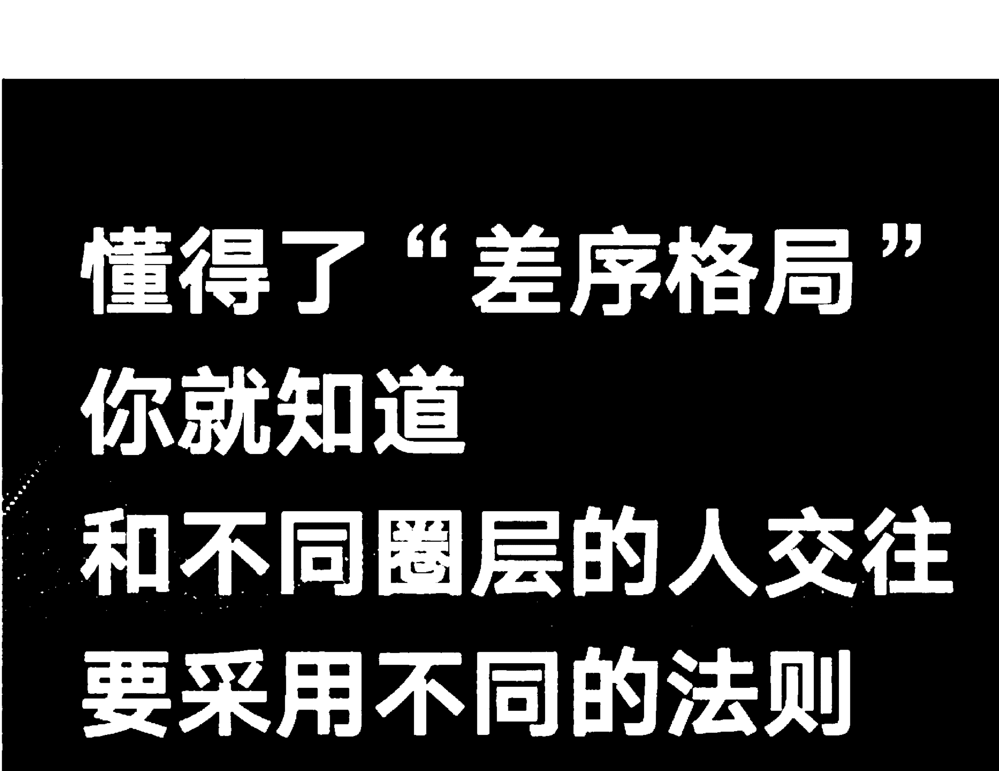

《郑路·社会网络20讲》
掌握一门重要的前沿学科


版权归得到App所有，未经许可不得转载

← 前一篇

用户留言

写留言

## 15 | 三重影响力：为什么闺蜜的同事的姐姐长胖了，你也会变胖？

你好！我是邓璐，欢迎来到我的社会网络课。

先从一个有意思的话题讲起：肥胖。我们通常以为，肥胖是一个个体现象，如果你吃得多少、多少，就会发胖。

但是，社会学家发现，肥胖是能在人和人之间传染的。如果你的闺蜜的同事的姐姐长胖了，那么闺蜜的姐姐长胖的概率就会高。

### 肥胖为什么会传染？

你可能会问，肥胖又不是传染病，怎么会传染呢？

其实啊，这并不什么神奇，而是一种人际影响。这种人际影响可以通过行为或者观念的传递发生作用。

比如，你身边的人超重，特别是爱喝奶茶、爱吃冰淇淋的，你经常会不经意地受环境影响，也开始喝奶茶、吃冰淇淋，这就是一种行为传染。

再比如，当你的闺蜜长胖后，你觉得接受身材的评价标准也会改变。原本你80斤就嫌自己太瘦了，现在你朋友可能吃120斤的饭都不胖，但你在她那里也显得有点胖，这时候你的观念也发生了改变。你开始觉得“自己瘦是瘦，但是太瘦了”也不错了，原来自己太瘦了。

我们再做一个设想，假如我和闺蜜一起要搬到一座陌生的城市生活，那么我想去的餐厅，你也很可能也会去，这是一种社会风尚的影响。

老话是“近朱者赤，近墨者黑”，现在我们还要加上“近墨者黑，近丑者丑”。

有意思的是，“近丑者丑”效应，在人际网络中能传递到三层。换句话说，你的同事的同事的闺蜜长胖了，会增大你长胖的概率；闺蜜长胖了，又会增加你同事长胖的概率，闺蜜长胖以后，一个受到影响的就是你。

这可不是一个文字游戏，科学家们做了大量的研究，都证实了这样的发现——

- 如果你的朋友变胖了，你胖的概率会高45%；
- 如果你的朋友的朋友变胖了，你变胖的概率会高20%；
- 如果你朋友的朋友的朋友变胖了，你变胖的概率会高10%。

这些影响叫作三度以内的关系，也就是说，我们只影响三度以内的人，四度以上的朋友长胖与否，就不会影响到你。

### 今日得到

总结一下今天的内容：三度影响力。社会网络会影响一个人中的情感、行为、观念、健康和幸福感。但是这种影响只能达到三度，也就是亲朋好友的朋友的朋友。影响力就此止步，不能传播得更多。

知道了这个规律以后，我们就可以反向操作，主动去破坏三度，通过改变社会圈子，来改变自己。

### 课后思考

最后，留一道思考题。

刚刚讲到，人的影响就像把石头扔进池塘所激起的波浪，是逐层减弱的。那么，会不会存在这样一种情况，由于这块石头太大，它激荡起的波浪也特别大，最终会激浊整个池塘呢？

换句话说，在什么情况下，或者说什么样的人，你对他人的影响力会非常强力，超过三度呢？

欢迎留言与大家分享。

下一篇的内容是网络传播，咱们下次再见。

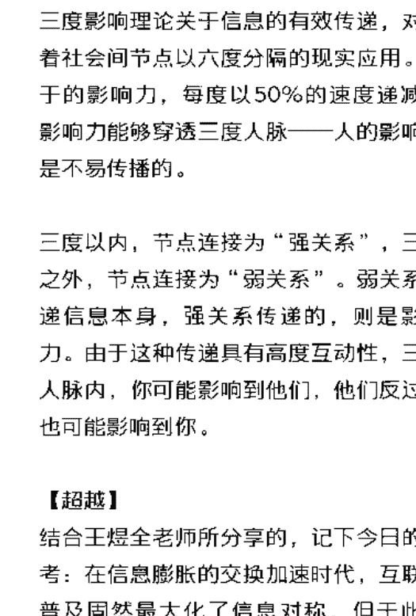

《郑路·社会网络20讲》
豆瓣一门重要的网络科学课

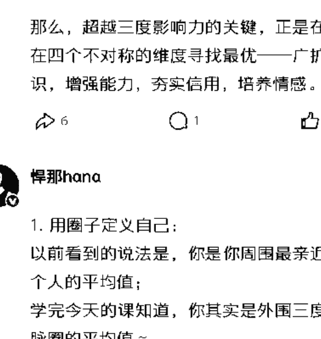

Stone
人际影响像石头激起波浪，三层以后能量衰减，波浪消失。如果把石头放在池塘里，结果就是只需要两个浪，石头就没池塘能淹没了

像希尔德，亚历山大，乔特就是这样的“大石头”，体量大，重量大，起初能量就大，辐射力远远超过三个波浪，越过他们所占据的地域和全球范围，这个“大池塘”，即使跑到小石头或者“小池塘”里，辐射力也能穿过三度，对今天我们有很大影响

所以，自身能量大（体量大，重量大），初始能量大，即使所处位置重要，与他相关的网络很大，网络能量高，能量衰减的速度慢，影响力就越强。这样的人，影响力交叉密度，一直影响下去，到能量耗尽

Vincere_勇进者
社交应用的发展，其实并不像原先人们所说的那样已经走到了尽头，而是刚刚开始。
一个阶位阶段，是六度人脉大过于网络：三阶位就是网络连接，能触发产生反向联系；那下一步呢？在我眼里就是三度影响力开始发力的时代了。
——李笑来

【三度】
三度影响理论关于信息的有效传递，对应着社会网络点与六度分离的现实原理。由于影响力节点，6度以50%的速度衰减。影响六度传播者三度人即一人的影响力是不能识别的。

三度以外，节点直接为“强关系”，三度之外，节点连接为“弱关系”。弱关系传递后基本，强关系传递基本，则是影响力。由于这个关系具有高度主动性，是三度内的人脉，可能影响到他们，他们反过来也可能会影响到你。

【超纲】
结合在群里老师分享的，记下今日的思考。信息老师鼓励加速迭代、互联网普及及最大化了信息对称，但由于同时，也带来了见识、能力、信用、情感不对称。

## 16 | 网络传染：为什么有些从众行为是理性的？

### 刘慈：社会网络第20讲

### （2023.1.17-1.21）

你好！我是刘慈，欢迎来到我的社会网络课。

在前面的课程，我们讲了三种影响力，也就是情绪、观点和行为在强关系中的影响。在这一讲的内容是网络传染，我们在看看，在更大的社会网络中，一个行为是怎么扩散的。

讲到行为的扩散，就不得不提到法国社会心理学家勒庞（Gustave Le Bon）的名著《乌合之众》。

勒庞发现，一个人融入群体之后，很容易被群体的情绪化特征所左右，做出从众行为。所以呢，自夸自己，加入人群后就盲目自信，非理性。在人群之中，个人天生就有一种非理性。就是容易被群体的情绪左右。

但实际，很多从众行为并非盲目，它其实是一种理性的选择。

在网络学里，我们把一群人跟随着他人行动，进而让整个网络显得有相同特征或偏向的现象，叫做“网络传染”。

网络传染，大致分为社会传染和生物传染两种。

你听，流感在人群里传播，是生物传染。但你不同意，取决于你是否有接触病原体。这是不一样的。社会传染更容易模仿，本质是一个决策过程。我们看到别人的举动，然后做出自己相应的选择。

为什么这么说呢？这就涉及到网络传染的机制了。在社会网络中，传染之所以会出现，主要有两个机制在起作用：一个是信息效应，另一个是网络效应。

### 信息效应

信息效应是指，我们每个人心里都有着这样的假设：

其他人之所以做出某个行为，是因为他们掌握了一些我们所不知道的私人信息。你的行为或者偏好，会影响你的言行，甚至会影响他们的判断，甚至导致他们的行为改变。也就是说，行为会传递信息。

我们来举个例子。你去到一个陌生的城市，在我们身边，你看到了，到了晚上，打开手机点评，想寻找最适合自己的美食。你看到，不远处有一家A餐馆，评分是5分，还有一家B餐馆，评分是4分。你该选哪家？

我想，不用多说，当然是去评分更高的A餐馆。

没错，到了餐馆之后一看，A餐馆门口可多啦，B餐馆却稀稀拉拉，三张桌子都空着。你想，B餐馆生意不好，可能菜品不够好。而A餐馆门口人多，证明A餐馆菜品好。面对这两种情形，你会选择在同一家餐馆就餐呢？

我想，大多数人会选择去生意火爆的A餐馆用餐。

你之所以做出这个选择，是因为你相信，那些在B餐馆就餐的朋友，肯定得到了更多的信息和反馈，他们的意见会比你的意见更有价值。因此，你选择去B餐馆就餐，其本质是基于信息效应的理性选择。

经济学里，还有一个类似的现象，叫做“信息瀑布”。它的意思是，当我们的选择受到前人信息影响的时候，会放弃自己的选择，追随前人的选择。

金融学界则换了个说法，叫做“羊群效应”，说的也是市场上，人们会跟风购买或抛售股票。

以前，我们常把这些现象归类为非理性行为。但是，最新的研究发现，不论是信息瀑布，还是羊群效应，很多时候其实都是理性驱动的，是信息效应在起作用。

网络学家通过研究金融交易的社会网络就发现，投资者对于新股发行的反应，会依赖于推荐股票专家、新股发行公司对风险的分析，发行银行的资金实力，基金经理对风险与回报、收益、大部分人做决策都是通过观察同行，借鉴他人做决策的动机。

金融市场的特点，就是不确定性高、复杂性强，而你对它终究还是有限。在时间和算力的情况下，我们无法对每一种行为、每一种机制做到深入了解，也无法对每一种产品、每一种技术都做到精确判断。通过分析他人为我们做出判断，反而是一种有效的方式。

### 网络效应

说完信息效应，我们再来看另一种导致从众行为的机制，就是网络效应。

网络效应常见于一种情况，那就是用户越多，产品的价值就越高。比如说，传真机、社交软件，都具有网络效应。

### 今日得到

总结一下这一讲的内容。我们讲了一个概念，网络传染。在社会网络中，行为的传染有两种发生机制，一个是信息效应，一个是网络效应。这两个效应告诉我们，有些从众行为，并不是盲从，而是理性的选择。

### 课后思考

最后，留一道思考题。生活中，还有那些从众行为你认为是理性的？它们属于信息效应，还是网络效应？欢迎你留言，与大家分享。

下一讲我们将讨论创新扩散中的门槛模型。咱们下次再见。

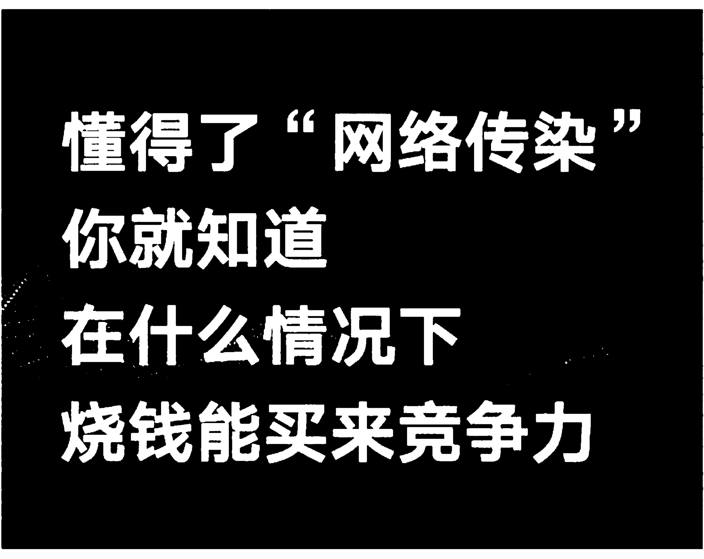

《郑路·社会网络20讲》
掌握一门重要的前沿学科


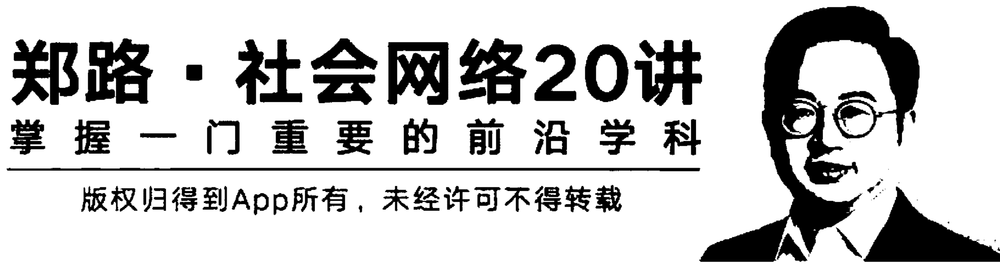

版权归得到App所有，未经许可不得转载

## 17 门槛模型：创新是怎么扩散的？

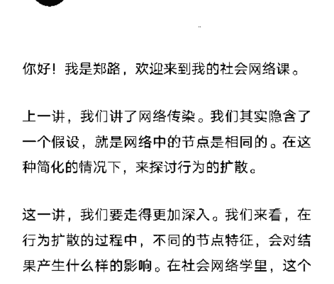

刘郡 社会网络20讲
音频0.33 MB 14:27

你好，我是刘郡，欢迎来到我的社会网络训练。

上一讲，我们讲了网络传染，讲它实际包含了一个假设，就是网络中节点是相同的。在简单化的假设下，来讲知识的扩散。

这一讲，我们要走得更深入。我们来看，在行为扩散的过程中，不同的特点，会对结果产生什么样的影响。在社会网络学会里，这个视角有一个名称，叫做“门槛模型”。

### 集体行动何以为难

还记得我们前面介绍过的社会学家格兰诺维特吗？除了提出“弱关系”，他还做了一个理论贡献，就是试图把“弱联系”解释为“集体行动何以可能”。他提出了一个思想实验。

假设有100个人都想闹事，他们约好第二天一起去广场发起行动。但是，这100人的心态是不一样的，有的大胆，有的胆小，有的情况下，集体行动的行为会发生么呢？

格兰诺维特首先假设这100人的心理门槛是这样的：第一个人的门槛是0，他相信只要带头人去到了广场，他就会跟着去。第二个人的门槛是1，也就是说他只要看见有1另一个人，他也会加入。第三个人的门槛是2，也就是说必须有两个人的时候，他也会加入……以此类推，最后一个人的门槛是99，换句话说，必须其他的所有人都闹事了，他才会闹事。

从这群人的分布，我们就有把握集体行为是可能发生的。你看，门槛为0的那带头人到了广场，就引起了第一波骚动，看到有人带头了，哪怕门槛是1的人就冲上去，接下来就多米诺骨牌一样，每个人的加入都给决定下一个人加入的期望提供。于是，让100个人都加入了一场骚动。一场集体行动就这样发生了。

我们再来看一种情况：如果当天广场的这100个人当中，门槛最高的那个人突然生病了，由另一个门槛是2的人替代了，另外的99人都没变，也都按时来到了广场。结果会是怎样呢？

你看啊，这100个人和上面讲的100个人几乎是完全相同的，差别只有一点点。但是，结果可能完全不一样，门槛为2的人到了广场，摸不着头脑，带头打破了一扇玻璃。很快，他就会发现，没人回应，然后他一个人孤零零地站在那里，等啊等啊，一个人动手，他会不会加入。不用说这结果可想而知了。他们在各种情况下，可能都采取不同的行为。

你看，是不是很有意思？其他条件都相同，仅仅有一点微小的差别，一个可能是都有的大历史，就发生在，另一个可能是极小事件发生的。这个思想实验背后的机制，就是门槛模型。它告诉我们，门槛的分布比它的平均值更重要。

### 门槛模型：每个节点都有阈值

门槛模型讲的是这样一个道理：在网络中，当人们想“做”的时候，不是“做”，“加入”，还是“不加入”。当选择的时候，每个节点的门槛是不同的。门槛越低，就愿意越简单。它衡量的是，当参与的人数达到什么规模或者比例，我们才会参与。

有个成语叫做“三人成虎”。如果有三个人说，老虎，或者野兽，你就信了。那么，这说明，你的门槛是三。

一个聚会，如果你觉得很无趣，但是又碍于面子，不好意思离开，那么，当多少人离开以后，你也会离开，这个人数或者比例就是你的门槛。

同样的，回到开头的思想实验，总的来看，参与闹事的，越容易与思考着决策的可能性都微小。所以，已经有极少人闯事，是否要参加的重要考量因素。这就是我们前面提到的，有的人的门槛是0，有的人的门槛是99，差异很大。并且，每个参与者的权重是不太一样的。比如，你的好朋友参与了闹事，那么，你参与闹事的可能性也会更大。

那么，什么因素影响门槛的高低呢？答案是嵌入个人的研究数据。一项对妇女安全使用的避孕工具的研究发现，大部分妇女第一次使用避孕工具之后，不愿意接受。等再问每一位妇女，工具在家庭中的位置，以及她们的年龄，受教育程度，丈夫的意见，个人偏好，以及在农村社会网络中的地位有关。

我们除了发现网络结构之外，还必须具体考察节点的数智状况。

### 创新的扩散

门槛模型的一个应用，是解释创新的扩散。

如果要推广一项创新，我们应该从中心度高的节点入手，提高先驱者呢？还是采取“先占领边缘”，从边缘突破呢？这个看，似乎是一个好方法，你知道，从中心度高的节点，它挖掘的中心，影响更多的人吗？如果把这个会，是不是事半功倍的办法？

在看到答案之前，我们先来看一个案例。上个世纪50年代，诞生了一款新药，叫做四环素。美国社会学家科尔曼，（Coleman）等人对125位医生进行了访谈，询问他们上次使用四环素的时间，同时还调查了他们每个的人在医疗行业圈子的时间，包括朋友的，各种行业讨论网络。研究者把网络中有多少人采用新药后，每位医生才会使用这种新药，作为他的门槛值。

研究发现，四环素的使用，在医生网络内的扩散速度快过四环素的使用。在药物市场上三个月后，每个医生的社交网络中，平均有两个医生采纳了四环素，六个月后，整个网络，一半以上的医生开始使用四环素。

研究还发现，中心度越高的医生越先使用新药，一方面，可能是因为更容易获得有新药供应商的信息，另一方面，他可能是有较高的医生朋友基数多，更容易达到他的门槛。果然，这些有更多朋友的医生，社交地位也更高的人，接触面更广的人，更容易接受创新。

但是，后来的很多研究，都得出了相反的结果。有着更亲密，创新扩散更容易在中心度低的节点上。因为这类节点受到多个节点的影响，会变得更加地活跃，从而不易改变原有的做法。

怎么解释这个矛盾的现象呢？其实啊，中心突破有效，还是边缘突破有效，最创新的特征有关。

借用《创新的扩散》一书的作者罗斯的的话说，与技术、旧方法相比，相对优势越大，越有说服力的创新，越容易在从中心突破。有影响力的大人物，这个创新扩散得更快，门槛效应并不明显。比如，环类药，医生接受新药，不需要多久的研究，那些最出色的医生就先接受最先进的医疗方法。

但是，对于那些显示收益较低，或者颠覆性较高的创新，在网络中能留“能开先”，很大程度上取决于网络中哪些节点先使用。如果你让最中心的节点先使用，那么，这项创新就有可能会逐步被大家接受，如果一开始就打破门槛较低的节点先使用，某些观点节点就会“守护”它们的位置，那么，这项创新的成功就难了。

比如，前面讲到的避孕药，它对妇女来说，确实是一件好事。但是，如果你去劝说牧师或者高阶层的人，就有可能第一时间反对，造成高阶层的支持。好的策略是，先从边缘接触那些年龄较大的人入手，因为他们，受过良好教育的年轻人，当他们接受了你推荐，关注之后，才会使用，最终，创新能够扩散。

### 今日得到

感谢一下今天的内容，今天讲了门槛模型。它把上一个理论假设中，把节点中节点特征，具体化到，当人们面临做，不做，加入，不加入，还是不加入，这是门槛模型可以来解释创新的扩散。一项创新，如果显示收益高的门槛效应，不容易被接受，就不必站在中心网络中的人，最终实施重大创新。

### 课后思考

今天的思考题是，你是否可以用门槛模型来反思自己思考某一创新传播的成效？欢迎在留言区参与讨论。

下一讲的内容是复杂网络。咱们下次见。


## 懂得了“门槛模型”你就知道推广个新产品应该从超级节点入手还是从边缘突破？

**《知晓，社会网络20讲》**
邓磊，社会网络20讲


### 用户留言

**仲娜Anna**

1. 拥有一呼之前，先看清观众。弄明白门槛高低，先搞定门槛低、影响力度大的一小部分，再去逐渐搞定剩下的大部分。
2. 同样，看到别人弄得一呼，就急着附议：别人都动门槛低，门槛不低，就不要轻易加入，认真上纸下镜，成为一个人的热点，成为他人加入的借口。
3. 与旧技术、旧制度相比，相对优势不大，现有有影响的创新，更适合从网络中心、有影响力的人入手——比如举荐至5G网络。
4. 与旧制度区别较大，突破门槛较多的创新，适合从门槛低的人入手，星星之火发展——比如基于5G网络新开发的、全新使用习惯的app。
5. 大部分边缘创新，门槛既低，收益也低，在网上动员场，就直接自上而下性击穿。

**Vincee_马雷**

创建一种新秩序，其谋划之困难，成功之渺茫，实施之危险，罕有能成功，且只能靠别人不真者，只有造反者，而其他人只会看到不真，或者他们的同伴也就不会失去地位。

> _Machiavelli, Prince_

## 【门槛】

门槛是种模型的核推广过程，基于集其中个基本发散的对于不确定的事物，会取得许多，个，确定。门，是指至少满足多大比确，才作出相关决断。在此，个体确定。门的净边际净收入。

## 【决定】

具体的创新扩散，个体决策偏好中，需求的确定性。《创新的扩散》中，E.M. Rogers 的六个维度，变量。

1. 相对优越性：认为创新优于所取代旧事物。
2. 兼容性：认为创新与现有价值、以往经验、预期需求而来的相容程度。
3. 复杂度：认为创新解释和理解的难度。
4. 可试验性：创新在有限基础上的可试验程度。
5. 可观察性：创新结果易被他人看见的程度。
6. 思想可变性：旧有的思维方式可能创新的成果。

## 【人】

人不同网为基，扩散中的人群具有性，人：

1. 创新者：热衷于新观念，多见思广的社会学家。
2. 早期采用者：发散，常为系统为愿景领导。
3. 早期大众：深思远虑，经常沟通，但处于意见领袖的地位。
4. 晚期大众：疑较多，出于经济必会社会压力。
5. 滞后者：因守旧，局限于地方观念，比邻，参考以往经验行动。

## 【成功】

可以果，新事物需取得个体，也取个向个依影响。优秀创新，一定要找到关键用户，在个门槛最低大上满需求，并战略格同体传播。

想起当初争的异军起。以老年人作为《传人的门》是创新，阔伯门，当以 Michael Jackson 为意见领袖的广告，百手可至以低之一步。一可口可的市场力。

**威廉**

我在银行做工作时，“业务”就像个老常的话。大部分客户都会间个问题：“这东西人是用？”“的人多，说明这个产品的可靠性强，反过明风险比较。”

新产型点入，就需要从一些超级节点入手。在证明了使用果之后，再向中心节点。

**过万小代**

一八十年代，女士们的着有创新，但上了个“节子”，上把裤上量，这个“节子”就门，万树树花开之。

当时上六七十岁的老，还下二十的学，不上，个，体，不一学身穿着，还，一年，子穿。可以。上，，个，画仪器门短。

有研究说，的大面积流行不是从领时中向度大城市的，而是从，村，门，“引”的。不知这个门是，，少，城大的，就是，，。门，从的边界突破。

## 及时雨

## 18 | 复杂网络：人为什么能造出比自己更聪明的东西？

**郑磊 社科前沿 2018**

你好！我是郑磊，欢迎来到我的社会网络课。

先问你一个问题，人能造出比自己更聪明的东西吗？我想，你一定想到了一个东西，人工智能。是的，人工智能在某些方面已经超过人类更聪明了。2016年，AlphaGo击败了围棋世界冠军李世石，就已经宣告了这一天的来临。

但是，你知道吗？人工智能的发展并不一帆风顺，从1956年到2010年，有60多年，尤其是美国，就特别希望造出来很多人，去发展人工智能。结果呢，却非常不尽人意，所有的尝试，都没有得到满意的结果。

那么，是什么让AI，这种人工智能技术，突然爆发，重新焕发生机呢？答案是“深度学习”和“复杂网络”，一种能够处理非线性网络的算法，这就涉及到我们这堂课的主题“复杂网络”（Complex network）。

### 用复杂网络来研究复杂系统

什么是复杂网络呢？复杂网络是相对于规则网络和随机网络而言的。

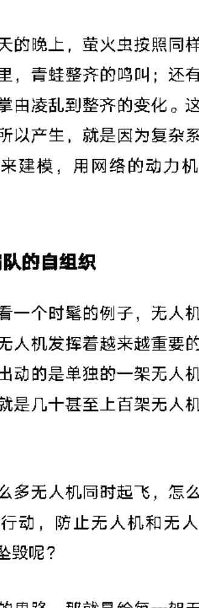

我们之前提到的星型网络就是一个规则网络，它以一个中心点为中心，连接着其他节点，中心点与所有其他点相连。星型网络是计算机局域网中最常采用的一种拓扑网络结构。

随机网络则正好相反，假设节点之间是各立连，连接是随机的。如果从某个点出发，节点到另一个节点，需要经历很多中间节点，这就构成了一个随机网络。

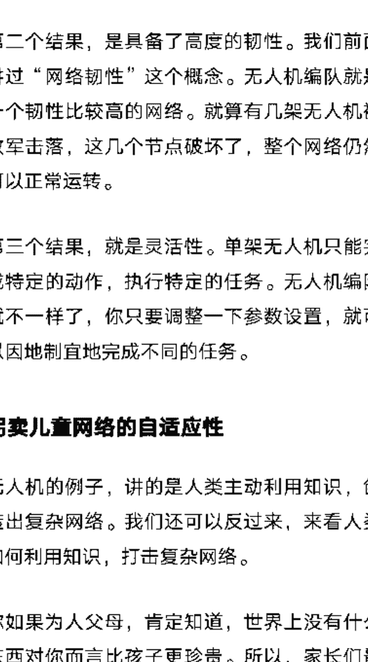

在过去，人们认为网络都是随机形成的。然而，当真实世界的绝大多数网络并不是随机网络时，就显得很无厘头。

那真实世界是什么样的呢？我们都知道一个词，叫做“复杂系统”。人类的大脑、城市的运行、自然的生态、地球的气候，乃至我们所在的整个宇宙，都是复杂的。而复杂网络就是对复杂系统最有效的一种描述方式，它把真实世界中的“点”抽象成“节点”，把这些点之间的连接关系抽象成“连线”，从而形成一个复杂网络模型。

### 无人机编队的自组织

我们先来一个无人机的问题。无人机战斗，在战争中，是一个非常重要的部分。以前的无人机，是一个一个地控制，或者是一个一个地飞行。但是现在的无人机，可以组成一个编队，互相协作。

那么，这些无人机是怎么做到相互协作的呢？答案是它们组成了一个“复杂网络”。在这个网络中，每一个无人机都是一个节点，它们通过某种方式（比如无线电波）相互连接。

按照传统的思路，我们是要建立一个控制中心，通过控制中心来指挥每一个无人机。但是，这样的方式有一个很大的缺点，就是控制中心会成为一个瓶颈。如果控制中心被破坏，那么整个系统就会瘫痪。

另外一个办法，就是让无人机自行组织。每一架无人机，只需要知道附近几架无人机的信息，就可以做出自己的决策。这样，即使其中几架无人机被破坏，剩下的无人机仍然可以继续飞行，甚至改变编队。

那么，无人机是怎样做到的呢？答案就是复杂网络。每一个无人机，都是一个节点，它们通过无线通信连接在一起。

第一个结果，就是降低了成本。要知道，建造一台无人机，是非常昂贵的。如果我们要建造很多台无人机，成本就会非常高。但是，如果我们让无人机自行组织，我们就不需要建造很多台无人机了。

第二个结果，就是提高了可靠性。在一个复杂网络中，即使有一些节点被破坏，整个网络仍然可以正常运行。

第三个结果，就是提高了灵活性。在一个复杂网络中，即使有一些节点被破坏，剩下的节点仍然可以重新组织，形成一个新的编队。

这条思路不靠谱，那就换另一条思路。咱们不依赖人脑的内在结构，只依赖人脑的功能。我们知道，什么样的复杂系统可以产生智能？机器有没有可能模拟人脑，具有学习能力，遇到过问题，自己想办法解决呢？

我们还会拿AlphaGo来举例。AlphaGo之所以聪明，是因为它采用了一种复杂网络，也就是我们前面说过的深度人工神经网络。所谓的“深度”，就是一层层，层层堆叠的人工神经网络是生物的大火一样，是深层的，总共只有13层。AlphaGo在下的时候，会根据概率给出建议，输入到下一层神经网络，处理之后，然后，输出第一层数据，输入到第二个神经网络，以此类推，总共运行13层，最后计算出棋手落子的位置。

有意思的是，科学家尽管利用了复杂网络的思路来模拟人脑的神经网络，但是，科学家并不知道这个神经网络是怎么“思考”的。因为人脑能否逆向走到原点，通过反复的训练，来理解系统，优化参数。而这个过程中充满了太多不确定性。

所以，科学家唯一能做的，就是给人工智能喂大量的数据。他们给AlphaGo输入了几百万份围棋大作的棋谱，让它在人的辅助下对弈了数百万手。这些数据都来自高手，科学家又让AlphaGo与自己的对手下棋，很多时候我们人也没有见过的那个棋，让它在互搏中，继续训练。越训练，AlphaGo越厉害。

据说，它的最新版本AlphaGo Zero，已经不需要有人类棋手了。也就是说，它自己从未经手接近数十亿棋局。它也可以自己跟自己，通过比较短时测试，来提升它的能力，只需几百小时的训练。AlphaGo Zero就打败了AlphaGo，战绩是100:0，也就是百战百胜。

你看，这就是复杂网络自我演化的魅力。它可以自我学习，自我优化，自我进化。而安德森更加惊人。人工智能，就是在模仿了复杂网络这个强大的机制之后，重新焕发了生机，实现了质的飞跃。

### 今日得到

总结一下这节课的内容。真实世界中的绝大多数现象，都是复杂系统。而复杂网络，是将复杂系统建成有向图来研究的一种工具。

从动物界自组织的行为，到无人飞机的自组织，再叫到复杂网络的复杂适应系统，乃至人工智能的认知，无不体现出复杂网络的神奇之处。当人类赋予人工智能以复杂网络的学习能力，又赋予它海量的数据、超强的计算能力的时刻，我们甚至还能创造出比人类要聪明的东西。

### 课后思考

最后，给你一道思考题。你认为，还有哪个现象可以从复杂网络的角度得到更好的解释？学习了这门课，改变了你对世界的看法。思考或讨论。

下一讲我们会把复杂网络的动态机制。咱们下次再再见。

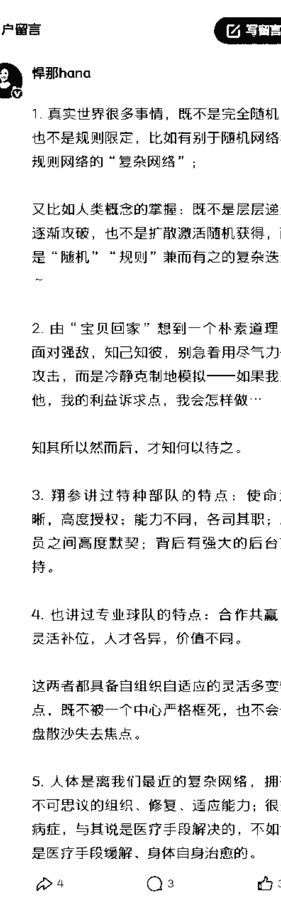

### 用户留言

1. 真实世界很多事情，既不是完全随机，也不是规则决定，比如特别于随机网络和规则网络的“复杂网络”。
2. 由“主员回家”想到一个朴素道理：面对强敌，知己知彼，抱怨者用尽气力去攻击。而冷静克制地想：“如果我是他，他的利益诉求点，我会怎样做？如知其而后，才何以应对之。
3. 课堂过程中特别复杂的特点，使简单，高度强性。能力有限，各自为政。成员之间高度独立，而背后强大的后台支持。
4. 也讲过专业球队的：特点不合。灵活务实，人才梯队，各司其职。
   这两者都具有自组织自适应的灵活多变特点，既不会一个中心干板而死，也不会一盘散沙失去重点。
5. 人类组织我们最行的复杂网络，拥有不可思议的组织、修复、适应能力；很多故障，与说是底层医疗干解的，不如说是医疗手段缓解、身体自愈治愈的。
   重庆的火锅底🔥🍲是一个复杂网络，如果一个典型的火锅包可以看到的因素多，而利润，和签子权衡，而从整体网络市场角度看，它的生存能力和盈利是非常强的。

   主要表现在这几个方面：
   1. 食材，原材料网络
      在重庆火锅，可以从各个菜市场、批发市场买到各种各样的食材和原材料，其中蔬菜、豆、鸭、羊肉和动物内脏最齐全，而制作火锅底料所需要的辣椒，花椒、牛油也成为最畅销的商品。
   2. 工具，餐具网络
      有句话，三天就能开一家火锅店。从装修到强，工具，餐具网络，在重庆大大小小的二手市场，火锅用具齐全的：桌子、凳子，洁具。一条街的店到餐，甚至有意识的是些火锅店可以招全职、兼职来打杂的。比如“X×XX串串”，串串特色餐面上是“X××XX菜”，原因就在网络繁荣并发发达。
   3. 人才，技术网络
      开店最需要的服务员，店长，厨师，切菜，切肉的人员网络已经培育好，有丰富工作经验，整个网络随处可见，甚至做餐饮好几年了，又去开店，而新老火锅店开了好几年，店铺名和特色都保留着。比如，泡水的（名称和老板）
   
   把重庆火锅当一个整体复杂网络来看，这是一个自适应、复杂系统。从食材、原材料网络到工具、餐具、装修、人才、技术各个节点自组织，自演化，成为了一个巨灵透的蓬勃发展的市场。

## 19 | 动态网络：金融危机是怎样产生的？

**郑翔 社会网络20讲**

你好，我是郑翔，欢迎来到我的社会网络学课。

先问你一个问题，你有没有想过大学本科生为什么要军训？公司为什么要带员工搞团建、参加拓展训练？还有，EMBA课程为什么要安排学员去沙漠徒步跋涉？我知道，你能想出很多种答案。

我的答案和这一讲的主题 “动态网络” 有关，是为了把一群陌生人变成一个团队。这个过程，就是一个动态网络的形成、演化、产生本质变化的过程。

这门课讲到这里，掌握了概念、节点、关系、网络和机制这些方面的工具，也听了不少形形色色的网络例子。但是，你也许注意到了，到目前为止我们考虑过大多是一个组网的维度，那是静态的。加入时间这个维度，网络就不再是静态的，而是动态的了。这就是我们要讲的主题“动态网络”，英文是 network dynamics。

你可能会问了：那是不是所有的网络加上时间维度后，都可以被称为动态网络呢？答案是否定的。一些网络更像“铁杆网络”，节点不变，在一定的时间窗口内，网络虽然可能不发生实质性的变化，因为这些网络要保持功能稳定性，比如电网、企业内部局域网、一款汽车生产线。在这些网络中，人和机器可以更换，但是通过微小更新，网络和系统不会改变。动态网络，强调的是节点和关系的变动，所引起的网络整体特性的变化。

### 团建为什么有用？

我们来看一个动态网络的例子，美国《兄弟连》。

1942年的一天，在佐治亚州某训练营内，一群来自全国各地的新兵在某一连接受训练，他们将成为美军的精英兵种——空降师。

剧中的连长戴尔·中尉是一个以善战、却又粗犷，极为严苛的教官。又一次，他发现一个士兵的步枪没有膛线，就取消了这名士兵外出休假。另一个士兵衣服上有个大长的头，也被取消了出差。后来，士兵们给连长士兵的外面又扣除了分。累次的时候，他给班队所有士兵取消了训练任务。

有一次，一个戴头盔的士兵因为训练表现好，教官要求带他去山顶看山谷山头上打仗，战友们无法去成。他，单独带着，一起走，给教官送水，并成功说服教官改变主意。

看完美军的例子，再看一个中国的例子。

1927年，毛泽东带着秋收起义，到达江西桑植。部队被打散，毛泽东在艰难情况下重新组织了队伍。

前队长作为地方游击队的组织，一路上，通过宣传与收编，把队伍拉拢了，组织性变差，也存在军匪问题，部队很多派系。

作为党的前营长身份的毛泽东，带着部队，在路上考察队员的素质，士气动员，作战基本有章法，也得到新编战士的喜欢，他成了最有魅力的人。

所以，毛泽东就提出了一个伟大的构想，就是“把支部建在连上”。他的目的是组织思想一思想。这样，党支部成就了军事指挥之外的另一个司令部，对连队的每个具体军事管区也形成了监督和制约。支部的各级组织还加强了网络和各个中节点的联系，增强了军队的凝聚力及战斗力。最终，参加起义的旧式军队改造成了新式的革命军队。

你看，当我们加上时间的维度，来考察上面这两个网络的时候，我们可以看到到有两个变化：

1. 首先，原有的节点会消失，原有的节点会退出；
2. 节点，新的性质就生原有的；
3. 第二，新的连接会产生，原有的连接会消失；
4. 网络中接线的强强，性质、方向也都发生了改变。

看这些结果就是，这些网络中的节点，也是这些们们，经历了一个个动态的过程，可以来理解的方式，全新的状态紧紧地连接在一起。

在《兄弟连》中，一部分人退出了网络，还经历了新的胜利和失败，也形成了新的网络。但网络结构变化了。

在我党历史上，从1927年9月的“三湾改编”到1929年12月古田会议确定的“党对军队领导的”原则，也发生了很多的节点和连接的变化。

正如毛泽东后来总结的，“红军所以艰难奋战而不溃散，‘支部建在连上’是一个重要原因”。

你看，从时间的维度来考察网络，我们看到的是变化，即节点间连接关系、结构以及整体的动态网络结构的变化。当这些变化达到一定的临界时，一群陌生人变成了互相熟悉的兄弟，一群散兵游勇变成了革命军队。而这些变化，是在缺乏时间维度的静态网络中是看不到的。

### 金融网络如何演化？

我们再来考察另一种动态网络，就是金融体系。我们来利用动态网络来重新理解2007年全球金融危机的发生。

这场源于美国房地产市场金融次贷危机，让全球GDP消失了7.5万亿美元。全球股市市值蒸发了30万亿美元，因此，了解网络的动态机制，可以帮助我们发掘危机爆发的根源，预测危机的演化方向，对于应对危机和对下一次危机的发生。

那么，从动态网络的视角来看，金融危机是怎样产生的呢？

此外，对2007年全球金融危机的动态网络研究发现，尽管绝大多数银行进行零节点的态度向高中心度非常高，但通常情况下，少数节点主导了整个网络的中心度和连接速度。但是有一点值得关注：巨大的衍生品市场膨胀，已经远远超出了这些节点自身的应对能力，最终只能让纳指成为机会主义者。

于是，有学者建议金融监管学，按照银行的特征向集中度的定义构建“超级防线”，来降低这种网络复杂度集中可能带来的风险。

### 今日得到

好，总结一下这节课的内容。

当我们有网络之上，叠加了时间的维度以后，就可以研究网络的动态变化。我们通过“弓弹弦”和“把弦碰到弦”两个例子，了解了一个网络生态的76飞跃的过程。

我们再用动态网络的角度，从不合格监管者的加入，到金融结构者自我监控结构调，再到整个金融系统网络密度激增，重新考察了2007年全球金融危机的发生。

所以，对动态网络的研究，能够帮助我们发现关键网络变量，把握网络机制，规避网络风险。

### 课后思考

这节课的最后，你可以试着回顾一下，这十年间网络发展的变化，并且试着总结一下这种变化的什么的变化，以及背后的动态机制是什么？欢迎留言，参与讨论。

下讲见。下讲下下讲再。

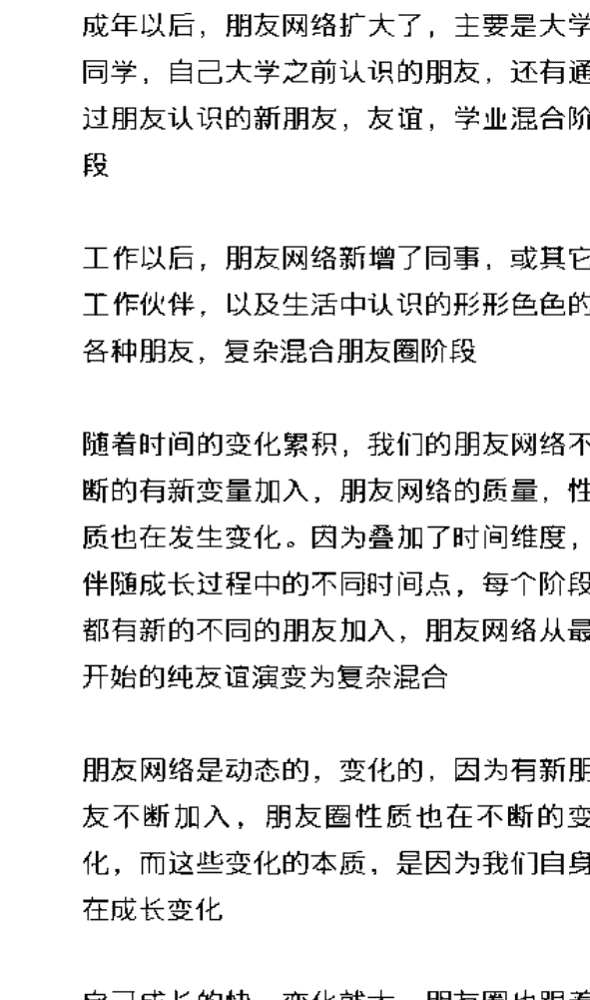

《郑浪·社会网络20讲》是我一门很紧 要 的 学 科。

郑浪 · 社会网络20讲

前一讲 | 后一讲

### 用户留言

**Stone**

小时候最初感兴趣的《朋友网络》是我们很普通，班子里，一条街，同村楼的同龄小孩（年龄相差无几），纯友谊阶段。
初中第一次的扩展朋友圈经过同学，乡亲，中学里，要么交过朋友经过（父母关系、亲戚或认识的同龄小孩），纯学友情段。
成年以后，朋友圈扩大了，主要是大学同学，自己工作之前认识的，朋友，还有通过朋友认识的新朋友，新交了同事，学业及混合阶段。
工作以后，朋友圈渐渐，新交了同事，及其它工作伙伴，以及朋友圈认识的社会网络的各种朋友，复杂混合及圈层阶段。
随着时间变化影响，我们的朋友圈不断发生着变化，朋友圈的性质，性质，规模都在发生变化，加之叠加了时间维度，伴随成长中的不同时间阶段，每种阶段有不同的特点，朋友圈从最后开始的纯真友谊到复杂混合阶段。
朋友圈是动态的，变化性的，因为新朋友圈加入，朋友进行流转，在不断变化，而在这种变化的本质，是因为我们自身在成长变化。
自己成长的变化，变化让大，和朋友圈也有着快速变化，自己成长，变化，小朋友圈也相对快速变化，如果朋友圈一个我们停止成长了，而绝对变化了，朋友圈也就稳定了。

**陈默炫**

明天是最后一讲，可惜有了每天早上第一早课，聊自己的，然后感觉太久了，感觉时间过太快了，希望老师能够到郑老师团队祝福。
回顾下过去10年朋友圈自己网络变化：
1. 09年时，自己开始了十多年的企事业创业，手头上的现金充足，投资其他行业经理，引来了大量想把投资低钱的精消消费，后接接连亏损，经过失败后进入下一步计划梦想，大约成了一名天使投资家，结果亏得血崩。
2. 14年时接棒某大 公司，全网爆火的互联网风口，想认识了一个朋友，把投资变现通过团队投资，认识到了大量理想赚钱的人，结果朋友又人失联。
3. 15年自己的企业交给家人打理，自己到上市司做项目总监，全国各地考察项目，让自己的朋友和高层进一步的扩张，明显的朋友网络扩展了一个层次。
4. 17年接触社群，我爱上了写作，线下了多个多个小型社群群主，了解学知识，深度交流，认识了大量不同专业的朋友，并且把大家认识成了朋友圈。
这十年时间，在朋友圈不断扩展的联系，有千万件不痛不痒的好关系，现在在评价朋友圈：身外一，家庭第二，事业第三，人身关系得第四。

**斜杠**

总结一下自己10年朋友圈网络一个明显的变化：从10年前多转到了少的朋友，关键节点虽然没变， 与关键节点的互联程度在加深，更深的时间都在同10年以后的老连接。这也是和我的工作和事业阶段相关的。另外，我更多的朋友有朋友圈有少部分流动，因为我的兴趣圈层发生生变化，所以说朋友节点也随着你节点的变化而变化，当然这一切化的机制是我自身的前后认定及变化，让圈子自不断的拓展或减少了，目前透露着做法的阶段，“少即是多”是主题认知策略。

**静如hana**

1. 关于团结的吐槽：记得冯老师说过关于团队的话——五、六个人的团队一起巡逻，每个人都可以领队后交叉给团队，不可多一个人就 团队士气——长此以往，依然带来信任，任团士气升。
   所以说很多公司口号号召力连连，有什么用，不如一场演习来得实在。
2. 关于团结的作用：不可否认，新生军训、新员拓展训练、基层团队心理管理和发展，都会迅速在个人团体系统中催生支持反应。身临阵敌，肢体接触，共情共振，就是让人产生自我认同，这就是人际网络1+1>2的高效率。所以团结有什么用？为彼此连接——有用；为深度信任——无用。
3. 很多事，需要加入一个时间维度，比如期望十年以后，你能看到自己的价值。
4. 另一个看待世界的维度，不同学科的结构交叉分析，社会学、金融学等大家会有不同解读看法，只有在综合听取，才开 始 对 一 个 事 件 的 全 面 理 解 。
5. 近十年朋友圈？不超过五个的密 友 圈 ， 并 未 变 化 。 为 人 生 层 次 近 150 人 的 社 交 圈 ， 却 如 水 样 的 边 缘 ， 一 直 在 变 。 我 想 这 也 许 是 大 多 数 人 的 共 同 心 态 吧

**践行者anny**

今日收获：从量变到质变——动态网络

1. 动态网络是加上时间维度后，对网络变化、演化的总体考量。
2. 网络构成是复杂系统的抽象模型，复杂系统都有一个各分量组相互联系形成的结构，结构是点一线一面体系。
3. 不同的点不断流入、减少对原来的网络结构产生冲击，替代、随着时间推移，点的结构间关联的变化产生了量变，新的网络系统出现。
4. “千里之堤毁于蚁穴” ，“不以恶小而为之，以善小而不为”等这些有警示起质量变的观念，本质就是动态网络的演化结果。
5. 回顾自己的人际关系网络，发现当下亲密的朋友多， 大 部 分 的 人 都 已 经 变 成 了 前 辈 ， 改 变 的 是 活 方 式 ， 出 于 大 的 ， 改 变 的 是 活 方 式 ， 出 于 大 的 ， 改 变 的 是 活 方 式 。


## 20｜让所有的学科为你所用

郑然 社会网络20讲

你好！我是郑然，今天是社会网络课程最后一讲。恭喜你坚持完成这门课程的学习。

最后上讲什么好呢？我们来讲一讲社会网络这门学科的前世今生。听完这一讲你会发现，这门学科的诞生，也是一个网络的故事。

### 社会网络的历史里程碑

我们来看看网络科学发展史上的那些里程碑事件。

1932年，美国社会学家莫雷诺（Jacob L. Moreno）研究了一群小学生。他在背后画一张桌子，让他们对小朋友和对女生的连线图，表现出“门户若开、小窗对开”的分析先河。从此，社会学家开始用视觉的、定量的方式，来分析人际网络。

然后，1959年，匈牙利数学家埃尔德什（Paul Erdős）和（Alfréd Rényi）发表了一篇论文。他从数学的角度研究随机网络，提出了生成随机网络的方法。这个理论后来拓展到复杂网络研究的基准，你看，数学又参与进来了。在数学界传奇人物中，Erdős是一个传奇人物，他始终没有博士学位，但却是最高产的数学家，一生发表了1500多篇论文。

我们再讲到1965年，在那一年，哈佛心理学家格里格玛拉斯（Stanley Milgram）做了一个实验。他找城市选了296个人，请他们各自向一个陌生人发一封信，平均只需转手6次，就可以寄到一个指定的陌生人手里，我们叫“小世界”。并且意识到在这个实验之后，让我们在更大一点范围内，人与人之间的距离没有想象中的那么大。

另外一件传奇的事情发生在1978年。那一年，社会学家格兰诺维特发表了一篇论文，叫做《集体行动的门槛模型》。这篇论文，我们在“门槛模型”部分介绍过。它提出了行为在网络上扩散的机制。这是第一个解释网络现象的理论模型。有了这个模型，传播学、计算机、数学等学科的广泛引用，产生了深远的影响。

转眼又到了1999年，物理学家Barabási和Albert研究发现，计算机网络、电力传输线网络、互联网页的联系、好莱坞明星的演出，这些网络都具备一个特征，那就是节点分布。人们第一次意识到，原来真实世界中形形色色的网络，都遵循着同样的规律。

别管我们是社会学家、心理学家、数学家、物理学家，我们讲这些故事，是想大家来关注在自己的领域里面研究网络现象。在没有任何学科之前，各自都是孤军奋战。

### 一门新学科的诞生

但是，到了21世纪的时候，奇妙的事情发生了。人们环顾四周，突然觉得，居然有这么多学科的人们都在研究网络现象，而且，不同领域的理论之间没有太多共同性。

因此，2005年，美国军方在华盛顿召集了各个领域的顶级专家，成立了一个委员会，专门研究网络的基础理论。你会发现“网科学”这个名称，就是在这次会议上诞生的。

从此以后，每年上亿美元的研究经费，被投入到这个学科的研究中。年轻大学、创新大学的各所大学的系主任，争斗网络科学的学术角色。各学科的中介点。各个领域的专家开始用同一概念和工具，来研究各种各样的网络现象。

从来没有哪个学科，能够吸引这么多领域的专家投身其中。也从来没有哪个学科，能够凝聚这么多的共识，来推动一门新兴学科的发展。

当这些来自不同领域的专家彼此连接以后，就产生了奇妙的化学反应。人们发现，网络的视角和方法，对很多生活具有极强的解释力，在各个领域都有很强的应用价值。

- 生物学家用它来研究菌群的传播；
- 传播学家用它来研究谣言的传播；
- 管理学家用它来研究公司里的利益联结；
- 商学院教授用它来研究创新的扩散；
- 反恐专家用它来研究恐怖分子的集结；
- 土木工程师用它来设计交通网络……

所以，你学习我的《社会网络20讲》这门课程，其实是在享用各个学科最前沿的成果。

我们来想象一个9宫格，生存在中间的是一个白人。他不是一个典型种族歧视者。在他看来，周围住的邻居朋友，有3个可也是白人，他就愿意维系在这个社区居住，反之，他就会搬家。这个要求不过是过于简单，他可以忍受大多数邻居都是不是黑人或白人，从黑人开始，这条规则同样适用。一个黑人，也可以容忍他的邻居最多有5个人。

研究人员在计算机上随机生成一个初始状态，然后，让整个网络自我组织上规则多次迭代，观察网络的动态演变。发现，不管初始状态如何，最终的结果都是居住隔离，白人和白人住在一起，黑人和黑人住在一起。

这项研究，让我们对人类社会这个复杂网络有了更加认识的价值。正是对网络科学、机器学习计算的仿真方法的辅助下，在社会网络这个多学科里，更多的可能性正在打开。

### 结束语

学生总是毕业，相聚总需有别离。

现在，你已经拿到了一张入场券。你可以像网络科学家一样，去组建自己的知识网络，对人生、事业和社会开启新的探索。

在这门课程的最后，还是像往常一样，给你留一道思考题。我知道，得多的用户里面隐龙卧虎，很多都是银行工作的资深专业人士，**学完这门课程，你认为社会网络学科可以怎样应用到你的工作和生活中？**欢迎你在留言区，参与讨论。

我们下次再见。

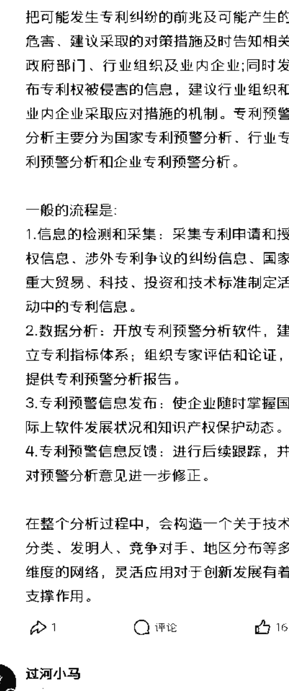

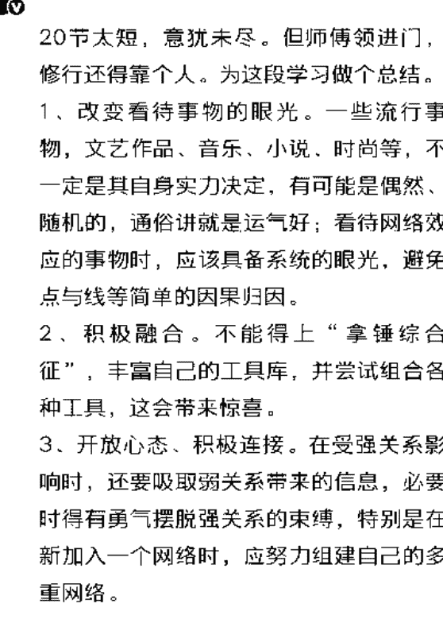

### 用户留言

**陈敏佳**

今天是最后一讲，感谢郑老师的分享这么多干货，在这二十讲中我写了23条留言，有十一条都是被点赞。

下面分享下我自己经营自己的社会网络的，希望老师和同学们给我点建议：

1. 首先我从认识自己，从9型人格上，我是属于第2种，比较喜欢付出和助别人，了解自己的特点，清楚自己适合做什么，找准自己的生态位，练就内涵。
2. 有意识构建自己的智盟圈，定期与智囊交友，社交萌发。
3. 每年会花最多时间拜访下对自己帮助较大的人和、恩人，不忘老朋友。
4. 不断的学、思考，走出舒适区，扩大自己边界，结交不同行业的朋友，或半年或一年线下分享交流，每月走访两家有意向回访的企业。
5. 利用信息增强自己的信息输出及输入，关键节点通过关系能影响谁。
6. 把自己打造成一个中心，都设计结构化的事件，自问自答多学习个对话信任群，每天分享自己的留言，传播正能量。

**南人**

本人从事知识产权管理工作，网络科学可以应用于专利预警分析和预警服务当中。

技术预警是指通过收集与分析行业技术系统及相关技术领域的专利信息和国内外的市场动态，了解竞争对可能什么样的技术去开发，利用专利布局对竞争对方进行布局，建立技术预警的机构体系，利用对专利预警分析，可以为企业及时发现问题、建立预警的机构体系；同时开发与企业预警结合的信息的建构。专利预警分析主要专利预警分析，行业专利预警分析和企业专利预警分析。

一般的步骤是：

1. 信息的采集和采集：采集专利情报及专利信息、发明专利申请公告、国家标准、行业标准、科技、投资及技术指标波动达到专利的分析信息；
2. 数据分析：开发专利预警分析软件，建立专利预警体系，组织专利专家评估和论证，提供专利预警分析报告；
3. 专利预警信息发布：使企业随时掌握国内竞争对手和技术动向的动态进行动态监控；
4. 专利预警信息跟踪：进行跟踪监控，并对预警分析意见进行修正。

在整个创新活动中，会构造一个关于技术需求、发明人、竞争对手，以及关系等等多维度的网络，灵活运用对于创新有着非常重要的。

**过海小马**

20岁太短，一晃就十年。但我导师进门，似乎得做个人，这段学习教给我3点：

1. 改变看待事物的眼光，一尘进行事物，艺术的音乐、音乐、小说，时间虽可不一定来自其它片决定，所以有时候，是随机的。曾经就是遥远后的看神指指点点的，物，应该具各条件的眼神，要避免与等高值准的原则同。
2. 积极心态。不能属于，本做综合，丰富自己的工作背景，并尝试结合和工具，联合去，积极选择。在感受复杂影响时，还要调动关系带来的信息，必要将所拥有更脱离关系的束缚，特别是在新时代一个网络时，应全力构建自己的多重网络。
3. 小世界跟者看，看着都有成功、想象的共同点的两个人，让彼此成来没有想象的人，可问题，对工作、生活的启示，我们随想的网络是有难有解的程度，只要强大我们也能找到相对最解的。
4. 认真学习网络科学，我们网络多面认识的社会，多业，多业人才多处在非中，要想想啊样看，可能那些网络科学中的关键，这样就能可能掌握，更不容易被掌握，但一旦掌握就点后面可能强者就弱者。
5. 进入一个不到一个网络时，可以采取农村包围城市的战略。
6. 从公众接受公，有时也是理性的选择。
7. 样本要慎重，朋友的朋友的朋友对我们影响大，对网络中不可预测的影响。
8. 在社会中，除了看到能正式的运行制度，还要注意不易看到非正式的网络在运转。
9. 提高自己网络中的重要性，除了帮助我们的网络，还包括对他人重要性，帮助我们提升连接数量及自己在网络中，这样反过来也提高自己在其它网络中的重要性。
10. 学会会、发散网络之间的结构洞，有意义的社会网络。

**Vincee_海珊**

以社交网络做数据分析，自系统被得有了定义的解，不同学科，然而，系统仍具有网络底色。因此，基于学科方法论的重复累实，确做有效数据指取机机学习、简化定解大量数据的计算模型、皆可到此功能。跨界学习，纵横横通，不过如此。

分享与学习跨界学习的一些原则性心得：

**【清晰设计，严格执行】**

跨界学习的设立是充满趣的，因为大多数人很容易有观点的驱动，定义学习目的，很容易陷入观点的趋同，明确要求是否可采用跨界学习解决，是设计学习的第一步。如学习子以十分热情而宏大，且容易花销资源，漫无目的地，最后可能一点也达不到不了。以SMART为指引做详细计划，并严格求自己要一执行就成就到执行。

**【内自学习，向外转化】**

完备的跨界学习模型，由“向外学习”与“向内转化”两个部分组成。其中“向外学习”是手段，是个体感受到知同探索外部的知识，可以通过翻过同关的探索，对领域外具体数据进、同具体业务。组织、参考和休核执行。“向内转化”则是目的，是个体将所学内容内化为自己的知识体系。转化过程，可以参与专题讲座、研讨会、整合笔记并提炼可执行方法进行。

**【去心定，专注越战】**

跨界学习可能面对的外压都必正不会少，可能会让我们承受的压力更大。但大部分、因规划着两在学，心向目标，目标，但我们需要，是要有最大，远离内定焦虑，但需要的是。只要有耐心，也可以完整的面对波浪汹涌的大真实世界。

“我的眼睛怎么做？”
“我走的道路。”
“我的情绪？”
“保持连接。”
——龟兔

在人工智能和大数据为基础的算法时代，一个人无所不能及的计算机，可以解决人工智能无法解决的问题的人。
