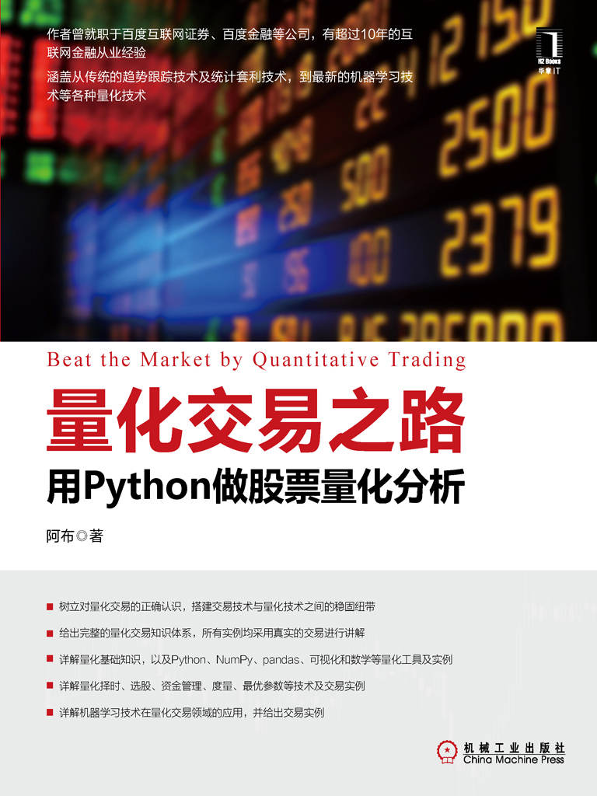

   

量化交易之路：用 Python 做股票量化分析

阿布　著

ISBN：978-7-111-57521-4

本书纸版由机械工业出版社于 2017 年出版，电子版由华章分社（北京华章图文信息有限公司，北京奥维博世图书发行有限公司）全球范围内制作与发行。

版权所有，侵权必究

客服热线：+ 86-10-68995265

客服信箱：service@bbbvip.com

官方网址：www.hzmedia.com.cn

新浪微博 @华章数媒

微信公众号 华章电子书（微信号：hzebook）

目录 前言 第一部分　对量化交易的正确认识 第一章　量化引言 1.1　什么是量化交易 1.2　量化交易：投资？投机？赌博？ 1.3　量化交易的优势 1.4　量化交易的正确认识 1.5　量化交易的目的 第二部分　量化交易的基础 第二章　量化语言——Python 2.1　基础语法与数据结构 2.2　函数 2.3　面向对象 2.4　性能效率 2.5　代码调试 2.6　本章小结 第三章　量化工具——NumPy 3.1　并行化思想与基础操作 3.2　基础统计概念与函数使用 3.3　正态分布 3.4　伯努利分布 3.5　本章小结 第四章　量化工具——pandas 4.1　基本操作方法 4.2　基本数据分析示例 4.3　实例 1：寻找股票异动涨跌幅阀值 4.4　实例 2：星期几是这个股票的“好日子” 4.5　实例 3：跳空缺口 4.6　pandas 三维面板的使用 4.7　本章小结 第五章　量化工具——可视化 5.1　使用 Matplotlib 可视化数据 5.2　使用 Bokeh 交互可视化 5.3　使用 pandas 可视化数据 5.4　使用 Seaborn 可视化数据 5.5　实例 1：可视化量化策略的交易区间及卖出原因 5.6　实例 2：标准化两个股票的观察周期 5.7　实例 3：黄金分割线 5.8　技术指标的可视化 5.9　本章小结 第六章　量化工具——数学 6.1　回归与插值 6.2　蒙特卡罗方法与凸优化 6.3　线性代数 6.4　本章小结 第三部分　量化交易系统的开发 第七章　量化系统——入门 7.1　趋势跟踪与均值回复 7.2　仓位控制管理 7.3　本章小结 第八章　量化系统——开发 8.1　abu 量化系统择时 8.2　abu 量化系统选股 8.3　本章小结 第九章　量化系统——度量与优化 9.1　度量的基本使用方法 9.2　度量的基础 9.3　基于 Grid　Search 寻找因子最优参数 9.4　资金限制对度量的影响 9.5　输入中文自动生成交易策略 9.6　本章小结 第四部分　机器学习在量化交易中的实战 第十章　量化系统——机器学习·猪老三 10.1　机器学习基础概念 10.2　猪老三世界中的量化环境 10.3　有监督机器学习 10.4　无监督机器学习 10.5　梦醒时分 10.6　本章小结 第十一章　量化系统——机器学习·abu 11.1　搜索引擎与量化交易 11.2　主裁 11.3　边裁 11.4　一定要赢得这场胜利，即使一切都不存在 11.5　本章小结 附录 A　量化环境部署 附录 B　量化相关性分析 附录 C　量化统计分析及指标应用 

# 前言

随着互联网技术的不断发展，许多传统行业（包括传统金融行业）也在不断地改变着自己的工作模式和流程，并且希望借助互联网技术得到进一步的发展。在金融行业中，股票及其他交易类型衍生品，如期权、期货交易无疑是最早受到冲击从而发生改变的。从算法交易之父托马斯·彼得菲，到如今依然活跃异常的量化投资之王西蒙斯，他们是最早的一批量化交易受益者，也是为整个金融行业指明方向的引导者。据统计，近年来自动化交易占据了美国股票市场 60%以上的成交量。

量化交易从一开始出现就仿佛戴着神秘的面纱，特别是对于普通的投资交易者。有些人认为它就是像炼金术一样的存在，有了它就能躺着挣钱了。当然也有些人认为它完全不靠谱。笔者研究量化交易多年，而且参与了大量的量化交易实战，从中积累了大量的心得体会，所以萌生了编写一本量化交易图书的想法，为读者揭开量化交易的神秘面纱。

本书分为 4 个部分来讲解量化交易的相关知识。

第一部分（第一章）着重讲解了投资者对量化交易的正确认识。

第二部分（第 2～6 章）主要讲解了量化交易需要的基础知识及相关工具，如 Python 语言、NumPy、pandas、数据可视化及量化数学等知识，适合完全没有任何编程经验的读者从头开始阅读。书中每一章的示例也尽量穿插股票及其他衍生交易产品的投资知识和交易技巧，尽量为读者建立一套独有的知识体系结构，为读者在交易技术与量化技术之间搭建牢固的基础纽带。

第三部分（第 7～9 章）着重讲解了使用量化系统回测交易策略及交易的度量等实战知识。对于有进阶需求的读者，则完整地讲解了整套量化回测系统择时、选股开发的关键点及滑点和资金管理的核心知识，以及更有针对策略地寻找最优参数及最优度量等知识。

第四部分（第 10、11 章）主要讲解了机器学习技术在量化交易中的应用。该部分内容从机器学习实战出发，同样适合大多数没有深厚数学基础的读者阅读，着重阐述了基于机器学习技术对交易进行预测的不可行性，以及正确的使用方式，即使用机器学习技术进行统计预言的概率。

附录给出了量化环境部署、量化相关性分析、量化统计分析及指标应用等内容。

特别需要提及的是，为了突出重点知识，减轻读者的阅读压力，本书在编写过程中通过故事的形式来讲解关键知识点。例如：

·通过“6.2.1 节你一生的追求到底能带来多少幸福”的故事，重点讲解了最优问题的计算；

·通过“7.2.3 节三只小猪股票投资的故事”，重点讲解了仓位控制管理的重要性；

·通过“第十章机器学习·猪老三”的故事，重点讲解了机器学习知识与工程上的使用问题。

本书所有示例均使用 IPython Notebook 编写，读者可在 Git 工具上找到对应章节的内容。具体代码下载地址为[`github.com/bbfamily/abu`](https://github.com/bbfamily/abu)。如下载地址有变动，可关注微信公众号 abu\_quant，获取最新的 Git 地址；或者在[www.hzbook.com](http://www.hzbook.com)网站上搜索到本书，然后按照网页上的说明下载。

适合阅读本书的读者及建议如下：

·有交易经验、对量化交易感兴趣、无任何编程经验的读者，需要多关注基础章节，加深对编程语言的理解及工具的使用；

·有任何一门编程语言基础、无交易经验、对量化交易感兴趣的读者，需要多关注书中讲解的关于交易的知识及正确的交易认识；

·有交易经验、有编程经验、对量化交易感兴趣的读者，需要多关注量化交易在交易技术和编程技术上的衔接点及书中的具体实例；

·对量化交易本身不感兴趣，但对数据处理、机器学习技术感兴趣的读者，需要多关注技术基础章节和机器学习章节的内容。

感谢机械工业出版社华章公司提供机会让我能编写本书！本书的完成同样需要感谢我的几位朋友：吴汶（老虎美股）、刘兆丹（百度金融）、胥嘉幸（百度糯米大数据），感谢你们在本书的编写过程中提供的帮助！在此还需要特别感谢本书编辑对我的帮助，不辞辛苦地晚上十二点还在和我沟通排版等细节问题。

编著者

# 第一部分　对量化交易的正确认识

·第一章　量化引言

## 第一章　量化引言  

### 1.1　什么是量化交易  

量化交易是指以先进的数学模型替代人为的主观判断，利用计算机技术从庞大的历史数据中海选出能带来超额收益的多种“大概率”事件以制定策略。它极大地降低了市场波动给投资者情绪带来的影响，避免在市场极度狂热或悲观的情况下做出非理性的投资决策。

我们经常会使用搜索功能，在搜索框中输入我们的问题，比如今天是立秋，想知道应该吃什么，既能符合节气的特点又有养生的作用，通过搜索，就可以获得想要的答案，如图 1-1 所示。


图 1-1　立秋吃什么好

那么如果想通过搜索来知道“今天买什么股票能挣钱”呢？如图 1-2 所示。

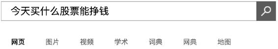

图 1-2　买什么股票

搜索无法告诉你答案，而量化系统的任务就是类似通知交易者今天应该买什么，今天应该卖什么。

普通的交易是由交易者根据自身的经验或者偏好进行投资决策，量化交易通过将数据（行情历史、基本面信息及新闻资讯等）输入量化模型之后，利用计算机及统计学技术方法分析数据，产生交易信号进行交易决策。量化交易的简单示意图如图 1-3 所示。


图 1-3　量化交易示意图

量化模型一般包括选股模块、择时模块、风险控制模块（暂时感性理解即可，后续的“第八章量化系统——开发中”将详细讲解 abu 量化系统中选股模块、择时模块、风险控制模块的实现与使用）。

传统的交易使用定性分析进行投资决策：

·传统的投资决策不论是技术面分析还是基本面分析都属于定性分析；

·定性分析一般是通过人的思维来完成，它的优点是在深度上占有绝对优势。

量化交易使用定量分析进行投资决策：

·量化交易投资决策属于定量分析，它以历史数据分析为基础，利用数学、统计学等工具高效快速地进行决策；

·定量分析利用计算机强大的运算能力，在广度上占有绝对优势。

定量分析也会使用到定性分析中的很多技术，大多数情况是人的思维对定性分析的高度抽象形成模式，将模式运用到定量分析以提升广度。最理想的情况是在不丢失深度的情况下，完全将思想移植广度提升，这样在大数定理的魔力下，更强有力地战胜市场。

### 1.2　量化交易：投资？投机？赌博？

从大众的普遍认知来说，人们都希望自己的交易是投资，自己是一个投资家。很少有人接受自己的交易是投机，更不会有人希望自己的交易被叫做赌博，自己是个赌徒。

但现实很残酷，实际上大多数人的交易方式确实是赌博。他们不断地在市场中进行短线交易，只在乎胜率（只想着赌赢）。例如，他们经常会赌某个股票价格涨太多了，应该下跌了，或者某个股票价格跌得太多，应该上涨了。一旦走势没有如预期的那样发展，他们则会将亏损的部分坚持持有，对外声称自己是价值投资者、基本面分析者，认为应该长期持有、长线投资，更有些有强烈虚荣心的人会对外宣称，自己每次交易都做对了方向，利润丰厚（逢赌必赢）。

我曾经问一个朋友：投资和投机的区别是什么？他的回答很有意思：股票就是投资，期货就是投机。我又继续问他：那投机和赌博的区别是什么？他想了半天说：不知道。

赌博靠的就是运气，完全无法得到概率优势。投机需要技巧和经验，衡量得失，获取概率优势。赌场里赌客赢钱概率最高的游戏是 21 点，是那里唯一相对公平的游戏，赌场的优势最小，专业赌徒通过自律及特定的方式可以提高自己在 21 点中的优势（在“第三章量化工具——NumPy”中将详细讲解）。

量化交易中大多数策略是基于对历史规律的总结，在规律的基础上发现概率优势，它的最大理论依据是人性的相似性以及人性很难改变的事实。如果每一个瞬间的股票价格都是全体交易者对价值所达成的一种瞬间共识，那么历史的规律在今后的交易中同样具有指导意义（在“第四章量化工具——pandas”中将详细讲解）。

一花一世界，一叶一菩提。由于世界上没有两片树叶是完全相同的，所以量化交易的概率优势并不具有绝对的优势，即达不到预测的程度。但传统意义上的投资目标需要一个相对比较大的概率优势目标，也就是说投资的目标需要有一个比较准确的预测结果。投资是指前期投入大量资源对投资目标进行研究分析，以获取丰厚投资回报为目标，进行长期投资的行为才能称做投资。其他所有的简单分析、中短期持有行为都应该属于投机范畴。作为个人小资金投资者，很难真正进行基本面分析，不要误以为使用市盈率、市净率等公开的基本面数据就是基本面分析。所以很遗憾，笔者认为量化交易更倾向于投机范畴。

很多交易者错误地认为自己是具有短线预测天赋的投资家，但其实他们只是市场中的“赌徒”。比起赌徒来说，相信对于大多数个人量化交易者或中小资金来说，通过量化交易技术获取交易概率优势，成为市场中的成功投机者，一步一步蜕变成投机家也是个很好的选择。

### 1.3　量化交易的优势

量化交易的最大优势及特点前面已讲解，总结如下：

·量化交易通过计算机强大的运算能力，在市场广度分析上占有绝对优势；

·量化交易通过历史规律的总结，在其基础上发现概率优势，形成良好投机基础。

下面为量化交易的其他优势，其实际成因都来自人性中的弱点，如贪婪、恐惧、自负、虚荣等负面心理。

#### 1.3.1　避免短线频繁交易

交易者常常是“交易瘾”患者，他们做交易时会有快感，其交易的主要目的是寻找刺激，他们企图抓住市场中每一次价格波动，贪婪地不想放过任何一次机会（如果买入后的走势符合他们的预期则表现为自负得意，如果走势背离预期则表现为懊恼，需寻找“复仇”机会）。另外还有一些交易者认为要像上班一样每天都得做交易，这样才算是付出劳动了，劳动必有收获，劳动才光荣，但他们不知道什么叫做多做多错，少做少错，不做不错的道理。

通过量化交易，上瘾型交易者可以将自身抽离决策前沿（心理学发现，交易瘾是由于交易决策所带来的快感，因此只要不在决策的最前沿就不会无法自拔），只通过计算机发出的信号进行买卖（可以程序化下单，但对于交易频率不高，特别是个人量化，推荐人工下单）。劳动型交易者也可以通过开发学习量化相关知识来避免短线频繁交易，但是劳动型交易者也需要注意不要过度拟合交易系统，以及实现太过复杂的交易策略。简单即美，如在期货市场，笔者最信奉的策略是 3 天内不能盈利便平仓。

#### 1.3.2　避免逆势操作

顺势交易可以说是投资者必须遵循的交易模式，但是大多数投资者喜欢逆势操作，比如只在股票下跌很多的时候进行买入。造成这种现象一方面是由于捡便宜心理，认为市场价格已经跌了很多，但实际上股票的价值是相对的，极端来说可以认为完全没有价值，价格却是市场中买卖双方达成的共识，它是绝对的。

另一方面，笔者认为这个现象是由于人性的本质导致的，人们都害怕死亡，我也一样，甚至小的时候经常幻想自己的死亡，那种恐惧、无助和孤独感让我无法呼吸，但有一天我突然想到，如果地球发生毁灭性的大灾难，所有的人类都将死亡，自己还会害怕吗？答案是否定的。投资者在股票下跌很多后买入股票，此时会有一种错觉：反正有很多人买的价格比我高，我不害怕，要死大家一起死。相反，投资者在股票价格突破后不敢买入股票的想法是：我不能在最高点买入股票，要是我买了以后股票下跌，只有我一个人去死，我绝对不能让这样的事情发生（更多关于此方面的实例讲解，请阅读“第七章量化系统——入门”中的内容）。

通过量化交易编写顺势交易策略可以克服上述人性的弱点，但并不是说没有逆势策略。比如均值回复模型，即假设之前的股价上涨只是暂时的，价格会恢复到一个相对正常的水平，也就是说随后的一段时间内股价将下跌，它的理论依据为价格将围绕价值上下波动。编写逆势策略需要有配套的止损策略与合理的资金管理策略，在后续章节中会详细讲解。

#### 1.3.3　避免重仓交易

重仓交易的危害绝不止是让交易者产生重大亏损这么简单。

在交易中经常会出现买入后初始阶段并没有盈利的情况，在仓位小的情况下加上合理的止损策略，完全可以等待走势步入正轨。但是过大的仓位会导致资金的大波动，交易者因无法承受资金波动选择过早离场，因而间接步入短线的陷阱。另外，很多的重仓交易是由于交易者选择向下加仓的结果，即交易者不断加仓已经亏损了很多的头寸，企图通过降低成本来实现交易反转，间接步入逆势的陷阱。

通过量化交易资金管理模块可以控制交易风险，计算最佳买入开仓量，通过卖出止损因子，可以保证资金的波动在合理范围内。另外，对于止损，可以编写不同的止损策略实现复杂合理的交易策略，比如不能让已经盈利的交易变成亏损的保护止盈、大波动止损等，在后续章节中会详细讲解。

#### 1.3.4　避免对胜率的盲目追求

交易者普遍喜欢追求胜率，希望自己所有的交易都能以盈利收尾，直接表现为：盈利的单子拿不住，稍微有一点利润就忙于兑现；亏损了的交易不卖出，持有到可以再次盈利为止。交易中应该追求的是让利润尽情地奔跑，让亏损尽快止损，但其实往往变成了让亏损尽情地亏损，让利润尽快地止赢。

笔者之前看过几个朋友的交易账户，发现他们交易的胜率非常高，但他们的账户最终都是亏损的。笔者认为交易中最虚幻的就是胜率，但是大多数人追求的反而是胜率，如果说市场最终的结果是以 90%的人将亏损收场的话，那笔者相信这 90%的人胜率大多数都超过 50%甚至更高（在“第九章量化系统——度量与优化”中将具体讲解）。

通过量化交易，可以制定量化的交易策略和风险控制，通过量化系统的度量模块，可以使交易者拥有正确的交易目标。

#### 1.3.5　确保交易策略的执行

比如一个交易者对市场进行分析后，决定第二天买入一个股票，但是在开盘后却因为种种原因临时改变决策，没有买入股票，甚至卖出股票或者买入空单。这种现象在交易者中很常见，人们往往不能坚持自己的策略决策，往往因为临时的一点点小的变动，将自己的交易搁置甚至反转。另外，假设交易者使用趋势跟踪策略进行交易（趋势跟踪策略的交易成功率会低于 50%），如果交易者坚持使用策略执行了前 6 次交易都是以失败告终，那么交易者在第 7 次交易信号来临的时候很可能会放弃原有的交易策略，不敢再次坚持交易。

通过量化交易，可以确保交易策略的执行，不会因为当天开盘前某些小波动而打乱了原有的交易策略（除非你的策略涉及这个小波动）。我们可以坚信量化交易策略执行的一大原因是我们所有的交易策略都会完成交易回测及回测结果度量，即通过回测及回测结果验证了我们的交易策略是可行的，是具有概率上的优势的交易策略，它具有正期望的投资回报。交易回测及度量的内容在后续章节中会详细讲解。

#### 1.3.6　独立交易及对结果负责的信念

交易者在市场中需要做出交易决策，但总不能随机地进行买卖吧，他们需要理由。如果让交易者独立进行分析，他们往往并不十分自信，这时他们会询求别人的意见，去各种社区寻找认同感，努力搜索与自己观点相同的新闻等。如果买入后，走势符合预期，他会认为是自己的能力和本事，如果不符合预期，他也会把责任推卸到其他人身上。

量化交易通过严格的交易流程，将整个交易流程自动化，并且通过回测寻找最优等方式，验证拥有概率优势，交易者更容易对结果负责以及培养独立交易的信念。

#### 1.3.7　从历史验证交易策略是否可行

交易者学习或者开发一种交易策略时，都需要验证该策略是否可行。比如 K 线形态分析，有些人认为有效，有些人认为它只是股评家的工具，一种事后对市场进行解释的万能工具。又或者有很多新兴理论，如缠论是否可以使用在交易中等。如果不使用量化，则需要直接在真实交易中通过“真金白银”来测试策略是否可行。

通过量化交易将需要验证的策略实现后进行历史回测，通过对回测结果进行度量即可大致清楚该策略是否有效以及有效范围等。

#### 1.3.8　寻找交易策略的最优参数

举例如下：交易者发现自己的交易成交后价格开始下跌，导致止损离场，但随后价格开始不断上涨，本来是一次可以盈利的交易，因为止损点稍高导致过早离场。交易者在之后的交易中降低了止损点，当交易再次成交后，价格不断下跌，直到跌破止损点，又一次失败的交易，但如果不是之前降低了止损点位，第二次的交易本来是可以少损失一些资金的。这里只以止损点举例，其他止盈点位、仓位基准参数的变动，都会造成上述类似问题。

通过量化交易来寻找最优参数技术（具体请阅读“第九章量化系统——度量与优化”中的内容）可以实现上述参数的最优选择问题。

#### 1.3.9　减少无意义的工作及干扰

很多人喜欢在交易中时刻盯着行情报价系统，似乎可以从中感悟到什么。其实所有盘中的小波动的意义不大，很多时候这些小波动还会将交易者代入误区，实在是个无意义的工作。但是很多交易者无法豁然面对，他们认为要在所谓的好机会出现的时候果断买入，所谓的风险来临前果断卖出，他们喜欢看着分钟 K 线图，幻想着自己在低点买入，在高点卖出，抓住市场中的每一次波动。

有些事情不管你愿不愿意都已经发生了，有些东西不管你想与不想它都已经流逝了，不管未来如何，过去的对与错也不想再追究，试着改变，试着放下，试着忘记，试着重新开始吧。

通过量化交易事先编写好买入策略，在配合仓位控制、止盈止损策略的前提下，交易者实际上并不需要过多关注盘间的价格波动，这样才能客观地对交易进行控制，不会被过多无意义的干扰打乱节奏，节省时间去做更多有意义的事情。

### 1.4　量化交易的正确认识

#### 1.4.1　不要因循守旧，认为量化交易是邪门歪道

一些对量化交易有成见的人认为量化交易无法成功，特别是基本面分析派。实际上，真正的基本面分析的进入门槛是很高的，需要大量的资源和调研资金，并不适合个人投资者，但是很多投资者却错误地认为自己是基本面分析派。

基本面分析的结果为长期预测结果，即通过大量的资源进行基本面调研后，寻找在长期投资期间内有丰厚投资回报的目标。

基本面技术分析以统计学为基础，通过寻找概率优势进行分析，分析的结果为概率。技术分析在中短期投资区内间内有效，很多量化策略是基于浅层基本面数据分析＋技术分析实现的。例如，选股模块使用浅层基本面数据分析进行初步筛选，择时模块通过技术分析加上更多的统计技术实现。

还有的反对者认为一种分析方法知道的人多了，使用的人多了，自然也就失效了。这个理论绝对是成立的，但是和量化分析没因果关系。在投资领域没有一种方式可以永远盈利，没有所谓的“一招鲜吃遍天”，唯一不变的是变化和手续费。量化分析在这方面反而有自己的优势，分析变化，调整策略，通过数据反向指导人的思维调整定性分析方法，再次抽象到定量分析。

#### 1.4.2　不要异想天开，认为量化交易有神奇的魔法

与 1.4.1 节的投资者相反，有另一些投资者对量化投资有一定程度的迷信误解。在他们看来，计算机的计算能力远远优于人类，依靠这个优势进行量化分析，不仅可以在广度上远远超过人类，而且还可以在深度上比人类分析得更透彻。实际上，现在所有的人工智能都属于弱人工智能。

比如当下流行的深度学习，它是机器学习的一个分支，依靠模仿人脑的神经系统来组织算法，模仿人的思维方法来做决策。但即使被称为深度学习，也只能用来完成人的思维所能完成的最初级的任务。可能你会反驳说不对，不是有个阿尔法围棋可以战胜围棋冠军李世石吗？那是因为该程序根据围棋规则通过计算机构建学习网络，然后使用强大的运算能力通过蒙特卡罗方法寻找最优“落子”。

俗话说“三个臭皮匠顶一个诸葛亮”，该程序运行的本质就是每走一步棋都依靠成千上万个臭皮匠（臭棋篓子）朝各种可能性走一步，然后从它们走出的结果中选取最好的那一个臭棋篓子上场，这个被选中的臭棋篓子和其他臭棋篓子没有任何区别，它只是幸运地走了最好的那一步。阿尔法围棋的本质是多个弱人工智能效力叠加，通过游戏规则取胜，所以与其说是阿尔法围棋大战李世石，不如叫十万个臭棋篓子大战李世石。

实际上很多人对机器学习等技术的幻想是：

机器学习.fit（x，y）=（股价预测，涨跌预测）

在“第十章量化系统——机器学习·猪老三”中将会详细讲述预测的不可行性，但是机器学习等技术在量化中也绝对不是没有作用。虽然市场无法预测，但是市场并不是杂乱无章的。由于市场参与者的非理性行为（有效市场假说不成立），通过历史数据发现规律，一定可以获得一些概率上的优势，笔者认为在预测和混沌之间存在着一种状态，这种状态可以使用概率来描述。即通过算法来找到这些概率的分布，预测市场的混沌。这部分内容将在“第十一章量化系统——机器学习·abu”中详细讲解。

#### 1.4.3　不要抱有不劳而获的幻想

量化交易给很多人的幻想是：每天打开计算机，执行策略，自动买卖，这样就可以每天躺在沙发上，看着钱滚滚而来，无忧无虑，不劳而获。

量化交易的基础依然是交易，交易付出的代价是相当高的：成功的交易者不但需要付出资金成本，忍受交易的各种“精神折磨”，反人性地训练自己的交易技术，而且更主要的是独立思考，不断地否定自我，不断地付出大量的时间去学习“更新”自己。不要说是不劳而获了，从某种角度上可以称为刀尖上舔血的工作。

姜文的电影《让子弹飞》（如图 1-4 所示）中有下面一段经典对话：

汤师爷顺着张麻子说：“那你是想站着，还是想挣钱呢？”张麻子连想都不想，说：“我是想站着，还把钱挣了！”汤师爷说道：“挣不成”。张麻子从兜里掏出手枪，啪的一声拍到桌子上问汤师爷：“这个能不能挣钱？”汤师爷回答：“能挣，山里。”张麻子拿过县长大印，问：“这个能不能挣钱？”汤师爷回答：“能挣，跪着。”张麻子把县长大印放到手枪旁边，问：“这个加上这个，能不能站着把钱挣了？”

在笔者看来：理解交易=手枪

量化交易=县长大印

（县长大印+手枪）=（量化交易＋理解交易）

\=站着把钱挣了


图 1-4　《让子弹飞》宣传海报

#### 1.4.4　不要盲目追求量化策略的复杂性

文艺复兴科技是有史以来最成功的量化交易对冲基金。自 1988 年成立以来，文艺复兴科技公司的大奖章基金平均每年取得 36%的回报，收益远超巴菲特、索罗斯，它的创始人西蒙斯被誉为“量化投资之王”。

有效市场假说认为市场价格波动是随机的，交易者不可能持续从市场中获利。而西蒙斯则强调有些交易模式并非随机，可以提供交易机会。外界猜测文艺复兴科技使用各种复杂的技术，另外还有谣言说文艺复兴科技与美国军方有技术合作，他们使用军方的最新技术，达成了如此高的投资回报。但是西蒙斯曾经多次公开宣称，文艺复兴科技使用的量化技术并非有多复杂、多晦涩，其实他们的策略都是很简单的。

笔者相信西蒙斯说的是真的，因为可以影响市场的原因是无限多的，且非线性关系，即无限解系统，所以无法通过复杂化系统来实现预测交易的效果。不论你使用的技术有多复杂高深（具体请阅读本书第四部分的相关章节），可以战胜市场的唯一方式依然是获取概率优势。

只有简单的策略，才能在长期投资中保持高度的稳定概率优势，即简单有效的策略最实用。

#### 1.4.5　认清市场，认清自己，知己知彼，百战不殆

算法交易之父托马斯·彼得菲最成功的一段经历是利用当时最快的计算机，租赁独享电话线以保证数据传输畅通无阻，甚至超越时代定制平板电脑，使用统计套利在不同市场进行对冲策略。这是最有保证的一段量化交易历史，在当时的交易环境下运用高科技技术在市场中确实可以获利。

但是这个策略放到今天肯定不适用，因为科技在不断进步，技术的不断透明化，信息社会的高速发展，自动化交易占据了美国股票市场 60%以上的成交量。在美国，很多高频交易为了通信速度能有几毫秒的提升，不惜在太平洋底打洞搭建自己的通信网络，也有专门提供暗光纤的独享网络商，他们一年的网络租赁费用就高达几千万美元。在这种环境下，个人量化投资者是不是一点机会都没有呢？

当然不是，首先要选定交易品种，股票、期权、期货、外汇，甚至比特币等都要考量，针对你的资金量、硬件设备等做出取舍。比如期货交易由于市场本身的特性，很多交易策略都是针对盘口数据做出快速反应，这样，硬件设备确实是能否获利的关键，高频交易也不适合个人投资者，但是更多的交易策略对硬件设备和速度的要求并没有那么高，个人使用的计算机完全可以满足需求。学会利用你的优势，比如大机构的大资金在市场中，每一次出手时需要考虑冲击成本冲击成本是指在交易中需要迅速而且大规模地买进或者卖出证券，未能按照预定价位成交，从而多支付的成本。冲击成本被认为是机构大户难以摆脱的致命伤等不利因素，这些不利因素对于在资金量小且处于活跃市场的个人量化投资者来说不需要考虑，编写出适合自己的交易策略，且遵守交易策略，利用大数定理，做好仓位管理，避免系统性灾难风险就可以有一个好的结果。

另外，针对个人量化投资者，一定要认清自己的策略与资金量是否匹配，尽量不要使用杠杆，杠杆放大了风险与收益的同时，也放大了希望和恐惧，期货市场的投资者的平均存活周期为 6 个月。笔者的一个朋友多年奋战在期货市场，在期货交易中赔了不少钱，在交流中笔者发现他竟然不知道期货套期保值等最基础的知识，完全是被高杠杆带来的高收益所诱惑，梦想着一夜暴富，加上期货市场既可以做多也可以做空，时时刻刻都有赌博的机会，致使交易者在期货市场中一般都是以失败离开。

但并不是说，个人投资者不可以去这些投资市场，前提是个人投资者需要对市场有足够的认识、敬畏，认清自己的资金量是不是可以满足市场的最低入门门槛，并且杠杆越高的市场要求投资者具有越高的自律性，控制自己的贪婪，不和市场较劲。

### 1.5　量化交易的目的

做任何一件事情都会有付出和相对应的收获，在量化交易上成功绝对不是一件简单的事情，它所需要付出的成本代价实际上相当高。那么为什么还有那么多人从事量化交易呢？从笔者个人角度来说，答案只有一个：自由。

笔者不喜欢任何形式的约束，也不喜欢现实世界中的人际关系，年轻的时候很叛逆，那个时候笔者理解的自由就是“你想干什么就干什么！”当年纪慢慢变大后，这种自由的状态就一点点消失了，特别是进入社会工作后，不得不直面这个真实的世界，做着不喜欢的工作，说着言不由衷的话，出席各种毫无兴趣的应酬，那个时候的感觉就是“你想干什么就干不了什么！”。

电影《搏击俱乐部中》（如图 1-5 所示）中对自由的定义是：

只有抛弃一切，才能获得自由。


图 1-5　《搏击俱乐部》宣传海报

笔者也确实认真考虑过，认为自己无法做到抛弃一切，也就是说我无法得到绝对的自由，但是依然存在着一种相对的自由，即“你不想干什么就不干什么！”。

量化交易是得到这种自由的一种工具，但是这种自由的代价同样很高，笔者的感受就是：绝对的自律＋控制自己的欲望。

很多朋友看到笔者现在的生活都非常羡慕：每天不是带狗狗出去游泳、撒欢，就是带着老婆孩子去公园、商场，要不就是看见我去健身房健身。诚然，我喜欢我选择的生活，白天大多数的时间确实也在做着自己想做的事情，但是很多朋友并不知道，我每天晚上从 10 点到凌晨 3 点都是在工作、看书，没有工作日和周末的区分。当然也确实有连续一段时间完全不工作的时候，但这样的生活规律使得我必须锻炼身体，所以每周去 5 次健身房是不得已的。

笔者希望每一位读者都可以认真考虑是否要进行量化学习，为什么要使用量化做交易，自己的目的是什么，能否付出高额的代价。

如果你的答案是否定的，那么笔者认为本书只有一个章节需要你继续阅读，即第六章中的“你一生的追求到底能带来多少幸福”一节的内容，其他章节没有必要浪费时间去阅读了，我们拥有的其实只有时间。

如果你的答案依然是要走这条路，那么希望你可以坚持下来，不要害怕失败，不要吝惜付出，因为这是你自己的选择。

林中有两条路，我选择了人迹更少的那一条，一切皆源于此。

——罗伯特·弗罗斯特

# 第二部分　量化交易的基础

·第二章　量化语言——Python

·第三章　量化工具——NumPy

·第四章　量化工具——pandas

·第五章　量化工具——可视化

·第六章　量化工具——数学

## 第二章　量化语言——Python  

人类之所以能够超越其他生物成为地球的统治者，原因就在于人类学会了用语言沟通来完成陌生人之间的分工合作——《人类简史》

目前，量化主要以 R 和 Python 为主。在早些年 R 占据了绝对的地位，但是随着 NumPy、pandas、Matplotlib、Sckikit-Learn 等 Python 开源工具的发展，Python 开源工具就像是原始人类掌握的石器、火等工具，而 Python 就像是原始人类掌握的语言在量化之路上大放异彩，再加上 Python 强大的调试能力和工程能力，让分析的结果和需要执行的任务可以无缝结合，使维护变得非常方便。

经常有人向笔者咨询，应该如何成为一个量化交易高手，是不是应该主要研究机器学习、研究算法？笔者给他们的建议一般都是提高 Python 语言技术能力是最重要的。很多人听到了这个回答都很不以为然，认为自己有着多年的编程经验，Python 很简单，用几天就可以成为高手了。笔者使用过 C、C++、Java、Object-C，甚至 JavaScript 语言，但最喜欢的语言一直是 Python。笔者最初的 5、6 年都是使用 C 和 C++语言，在多数人的眼里，C++是一门很难、很高深的语言，但是当把指针和引用等 C 语言中最基础的概念理解透彻后，C++将变成一种最单纯的语言。因为很多时候在 C++中使用复杂花俏的技巧本身就是不对的，如模板类、友元类和智能指针等，它们带来的坏处也许比好处要多。

Python 是一门入门非常容易的语言，多数没有任何编程经验的人，也可以在几天内学懂 Python 的最基础语法，写出简单的程序。但是 Python 语言有着众多的库、丰富的可扩展语法，完成一个功能可以有 n 种实现方式，使用 m 种编程技巧。每种实现路径都会有各自的优点和缺点，每条路径最适合连接的其他路径也会有各种各样的选择。Python 语言里的一些高级语法，如混入类 mixmins、元编程 metaclass 和装饰器，它们都是一些最优解决方案中必不可少的技术，甚至描述器这个一般用不到的技术，在编写大型项目中，也是使项目结构更优雅的“大杀器”。

吉他和钢琴是大家最熟悉的两个乐器（如图 2-1 所示），可以把 C++语言比喻为吉他，Python 语言比喻为钢琴。在一开始练习单音的时候，它们的入门难度都差不多，顶多就是按吉他的弦时手指会痛。在练习和弦的时候，都是需要左、右手互相配合的阶段，这个阶段其实钢琴的突破难度要低于吉他，因为吉他只有 6 根弦，钢琴有 88 个键，特别是针对多数人左手不灵活要去按和弦很困难。突破这个阶段后，弹吉他将变得很轻松，可以自弹自唱，但是对于钢琴来说，突破左、右手配合的阶段只是开始，要想成为一个钢琴大师更是前路漫漫。


图 2-1　吉他和钢琴

### 2.1　基础语法与数据结构

本节讲解 Python 在量化交易中经常需要用到的知识，不会涉及太复杂的内容，但是也会逐步增加一定的难度，这是成为量化高手的必经之路。

#### 2.1.1　基本类型和语法

1．基本类型

和大多数语言的基本类型包括 int、float、bool 和 str 等一样，Python 作为一种动态语言，是一种强类型语言，所以要注意对象的类型，可以使用 type（）函数来显示对象的类型。

int 整数示例如下：

* * *

```
i = 1
type(i)
```

* * *

输出如下：

* * *

```
<type 'int'>
```

* * *

float 浮点数示例如下：

* * *

```
f = 1.1
type(f)   
```

* * *

输出如下：

* * *

```
<type 'float'>
```

* * *

bool 布尔型示例如下：

* * *

```
b = (1 > 2)
print b
type(b)    
```

* * *

输出如下：

* * *

```
False
<type 'bool'>
```

* * *

本书编写的示例代码环境使用 IPython Notebook，Notebook 提供了面向过程的输入、输出环境，暂时只需了解：

·每一个代码输入单元格中 print 命令所打印的内容会在输出中打印；

·每一个代码输入单元格中最后一行执行的代码的返回值会在输出中打印。

如上面示例中分别使用 print b 和 type（b）在输出中打印，更多 IPython Notebook 的使用，请阅读附录 A 的相关内容。

str 字符串：

以下代码中 price\_str 为一个字符串，里面有 5 个交易日的股票收盘价格，以逗号分隔符将 5 个价格分开。

* * *

```
price_str = '30.14, 29.58, 26.36, 32.56, 32.82'
type(price_str)
```

* * *

输出如下：

* * *

```
str
```

* * *

2．基本语法

Python 是通过缩进规则来组织代码逻辑的，通过 Tab 键或者空格代表缩进。有相同缩进的代码属于同一代码块，如果使用 if、while、for、def 或 class 等关键字开始的代码行，要以冒号结束，并且其后所有代码缩进相同的量，直到结束。

·条件判断控制使用 if、else 和 elif，如果 if 语句判断是 True，则执行 if，否则执行 elif，再否则就执行 else；

·isinstance（）函数被用来验证某个对象是否是某个类型；

·在 Python 中逻辑运算符与、或、非是通过 and、or 和 not 来实现的，不同于其他语言中的&&、||、！。

以下代码判断 price\_str 是否为 int 和 float 类型，因为 price\_str 是 str 类型，所以将最终走到 else 通过 raise TypeError 抛出一个异常来明确问题。

* * *

```
if not isinstance(price_str, str):
    # not 代表逻辑'非'， 如果不是字符串，转换为字符串
    price_str = str(price_str)
if isinstance(price_str, int) and price_str > 0:
    # and 代表逻辑'与'，如果是 int 类型且是正数
    price_str += 1
elif isinstance(price_str, float) or price_str < 0:
    # or 代表逻辑'或'，如果是 float 或者小于 0
    price_str += 1.0
else:
    raise TypeError('price_str is str type!')
```

* * *

#### 2.1.2　字符串和容器

字符串和容器是所有语言中必不可少的，也是最基础的。

1．字符串

Python 中的字符串是不可变对象（immutable），一般对字符串操作的 API 都是返回一个新的字符串。

通过 id（）函数可以获得对象的内存地址，如果两个对象的内存地址是一样的，那么这两个对象是一个对象。以下代码使用 replace（）函数将空格删除，可以看出 replace（）函数后 price\_str 的 id 数值改变了。

* * *

```
print '旧的 price_str id= {}'.format(id(price_str))
price_str = price_str.replace(' ', '')
print '新的 price_str id= {}'.format(id(price_str))
price_str
```

* * *

输出如下：

* * *

```
旧的 price_str id= 4952191240
新的 price_str id= 4951758504
'30.14,29.58,26.36,32.56,32.82'
```

* * *

2．容器

列表是一种有序的容器，可以对元素进行增、删、改操作，例如：

* * *

```
# split 以逗号分隔字符串，返回数组 price_array
price_array = price_str.split(',')
print price_array
# price_array 尾部 append 一个重复的 32.82
price_array.append('32.82')
print price_array
```

* * *

输出如下：

* * *

```
['30.14', '29.58', '26.36', '32.56', '32.82']
['30.14', '29.58', '26.36', '32.56', '32.82', '32.82']
```

* * *

集合是一个无序的容器，且集合中的元素无重复。以下代码使用 set（）函数将 price\_array 转换为集合，发现之前加入的重复的 32.82 没有了。

* * *

```
set(price_array)
```

* * *

输出如下：

* * *

```
{'26.36', '29.58', '30.14', '32.56', '32.82'}
```

* * *

也可以使用 remove（）函数将'32.82'移除，注意它只移除第一次出现的数据。

* * *

```
price_array.remove('32.82')
```

* * *

输出如下：

* * *

```
['30.14', '29.58', '26.36', '32.56', '32.82']
```

* * *

3．循环控制

Python 中的循环与其他语言类似：

·表达式 for a in array 循环依次从 array 中获取元素赋予 a 变量；

·while 循环，结果为真时不断循环，结果不成立时退出循环。

【需求 1】将这一组收盘价格赋予更多含义，加上对应的收盘日期。

首先创建一个数组，里面对应着每个收盘价格的交易日期，使用 for 循环实现，代码如下：

* * *

```
date_array = []
date_base = 20170118
# 这里用 for 只是为了计数，无用的变量 Python 建议使用'_'声明
for _ in xrange(0, len(price_array)):
    date_array.append(str(date_base))
    # 本节只是简单示例，不考虑日期的进位
    date_base += 1
date_array
```

* * *

输出如下：

* * *

```
['20170118', '20170119', '20170120', '20170121', '20170122']
```

* * *

使用 while 循环实现：

* * *

```
date_array = []
date_base = 20170118
price_cnt = len(price_array) - 1
while price_cnt > 0:
    date_array.append(str(date_base))
    date_base += 1
    price_cnt -= 1
date_array
```

* * *

输出如下：

* * *

```
['20170118', '20170119', '20170120', '20170121', '20170122']
```

* * *

4．列表推导式

前面示例写了 8 行代码才构建了一组日期，在 Python 金融数据量化中更建议的写法是使用列表推导式来完成，代码如下：

* * *

```
date_base = 20170118
date_array = [str(date_base + ind) for ind, _ in
              enumerate(price_array)]
date_array
```

* * *

输出如下：

* * *

```
['20170118', '20170119', '20170120', '20170121', '20170122']
```

* * *

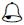备注：推导式的写法需要一段时间来适应，没适应前全部使用 for 和 while 循环也可以。

为了对应交易日期与收盘价格，可以使用 tuple 元祖来封装上面的这个结构，但需要注意 tuple 对象与字符串对象都是不可变对象（immutable）。

zip 的效果是同时迭代多个序列，每次分别从一个序列中取一个元素，一旦其中某个序列到达结尾，则迭代宣告结束。

* * *

```
stock_tuple_list = [(date, price) for date, price in
                    zip(date_array, price_array)]
# tuple 访问使用索引
print '20170119 日价格：{}'.format(stock_tuple_list[1][1])
stock_tuple_list
```

* * *

输出如下：

* * *

```
20170119 日价格：29.58

[('20170118', '30.14'),
 ('20170119', '29.58'),
 ('20170120', '26.36'),
 ('20170121', '32.56'),
 ('20170122', '32.82')]
```

* * *

5．可命名元祖：namedtuple

以上代码通过 tuple 访问使用索引，欠缺灵活性，可以通过 namedtuple 改进。代码如下：

* * *

```
from collections import namedtuple

stock_namedtuple = namedtuple('stock', ('date', 'price'))
stock_namedtuple_list = [stock_namedtuple(date, price) for date, price
                              in zip(date_array, price_array)]
# namedtuple 访问使用 price
print '20170119 日价格：{}'.format(stock_namedtuple_list[1].price)
stock_namedtuple_list
```

* * *

输出如下：

* * *

```
20170119 日价格：29.58

[stock(date='20170118', price='30.14'),
 stock(date='20170119', price='29.58'),
 stock(date='20170120', price='26.36'),
 stock(date='20170121', price='32.56'),
 stock(date='20170122', price='32.82')]
```

* * *

6．字典推导式

使用字典 dict 来完成这个任务，同样使用字典推导式完成，代码更简洁。

* * *

```
# 字典推导式：{key: value for in}
stock_dict = {date: price for date, price in
              zip(date_array, price_array)}
print '20170119 日价格：{}'.format(stock_dict['20170119'])
stock_dict
```

* * *

输出如下：

* * *

```
20170119 日价格：29.58

{'20170118': '30.14',
 '20170119': '29.58',
 '20170120': '26.36',
 '20170121': '32.56',
 '20170122': '32.82'}
```

* * *

dict 使用 key-value 存储，特点是根据 key 查询 value，速度快，使用 keys（）和 values（）函数可以分别返回字典中的 key 列表与 value 列表。

* * *

```
stock_dict.keys(), stock_dict.values()
```

* * *

输出如下：

* * *

```
(['20170121', '20170122', '20170118', '20170119', '20170120'],
['32.56', '32.82', '30.14', '29.58', '26.36'])
```

* * *

7．有序字典：OrderedDict

仔细观察上面的 keys（）函数可以发现，其返回的结果和之前 date\_array 的顺序并没有保持一致，字典的存储是无序的。

【需求 2】下面需要这个字典按照时间顺序返回。所以这里不能用普通的 dict，应该使用 OrderedDict，它将按照插入的顺序排列，代码如下：

* * *

```
from collections import OrderedDict
stock_dict = OrderedDict(
    (date, price) for date, price in zip(date_array, price_array))
stock_dict.keys()
```

* * *

输出如下：

* * *

```
['20170118', '20170119', '20170120', '20170121', '20170122']
```

* * *

如上代码所示，使用 OrderedDict 构造的 dict 返回的 keys 是按照插入顺序返回的。

### 2.2　函数

在所有语言中，函数的作用是相当大的，没有函数的话将不断编写重复的代码，函数是对代码的抽象封装。

#### 2.2.1　函数的使用和定义

1．内置函数

【需求 3】从前面组合的字典数据中找到最小的一个收盘价格。

以下代码直接对字典使用 min（）函数，发现输出结果只是针对字典的 keys 进行操作，结果只是最小日期，并不是最小的一个收盘价格。

* * *

```
min(stock_dict)
```

* * *

输出如下：

* * *

```
'20170118'
```

* * *

要满足需求寻找最小的一个收盘价格，使用以下代码实现。

* * *

```
min(zip(stock_dict.values(), stock_dict.keys()))
```

* * *

输出如下：

* * *

```
('26.36', '20170120')
```

* * *

2．自定义函数

【需求 4】计算所有收盘价格中第二大的价格元素。

系统中没有提供直接找到一个序列中第二大值的函数，但是可以自己编写函数完成需求。

* * *

```
def find_second_max(dict_array):
    # 对传入的 dict sorted 排序
    stock_prices_sorted = sorted(
        zip(dict_array.values(), dict_array.keys()))
    # 第二大值的函数也就是倒数第二个
    return stock_prices_sorted[-2]
```

* * *

使用 find\_second\_max（）函数：

* * *

```
# 系统函数 callable()验证是否为一个可调用(call)的函数
if callable(find_second_max):
    print find_second_max(stock_dict)
```

* * *

输出如下：

* * *

```
('32.56', '20170121')
```

* * *

#### 2.2.2　lambda 函数

针对前面 find\_second\_max（）这种简单函数，使用 lambda 匿名函数直接定义更加简洁。匿名函数轻量级地完成了函数的任务，特别是针对 reduce（）和 map（）等高阶函数，使用 lambda 函数是更好的选择。Java 8 也支持 lambda 这种写法。

* * *

```
find_second_max_lambda = lambda dict_array: \
sorted(zip(dict_array.values(), dict_array.keys()))[-2]

find_second_max_lambda(stock_dict)
```

* * *

输出如下：

* * *

```
('32.56', '20170121')
```

* * *

以上代码把一个 lambda 函数赋给了一个变量，可以这样操作的原因是 Python 里一切皆为对象，所以函数也是一个对象。这个特点可以帮助开发者完成其他语言中一些很复杂的操作。

备注：lambda 的写法需要一段时间来适应，没适应前全部使用 def 也可以。

Python 中的函数可以返回多个返回值，但实际上仍然是一个返回值，只不过返回值通过打包为 tuple 队列，实现多个返回值，与在 Java 中使用 Pair 返回多个返回值类似。

以下 find\_max\_and\_min（）函数返回收盘价格的最高价格和最低价格两个返回值。

* * *

```
def find_max_and_min(dict_array):
    # 对传入的 dict sorted 排序
    stock_prices_sorted = sorted(
        zip(dict_array.values(), dict_array.keys()))
    return stock_prices_sorted[0], stock_prices_sorted[-1]

find_max_and_min(stock_dict)
```

* * *

输出如下：

* * *

```
(('26.36','20170120'),('32.82','20170122'),
```

* * *

#### 2.2.3　高阶函数

常见的高阶函数包括：

·map（）函数，接收两个参数，一个是函数，一个是序列，map（）把传入的函数依次作用于序列的每个元素，并把结果作为新的序列返回；

·filter（）函数，接收两个参数，一个是函数，一个是序列，filter（）把传入的函数依次作用于每个元素，根据返回值是 True 还是 False 决定是保留还是丢弃该元素，结果序列是所有返回值为 True 的子集；

·reduce（）函数，把一个函数作用在一个序列上，这个函数必须接收两个参数，其中 reduce（）函数把结果继续和序列的下一个元素做累积计算，reduce（）函数只返回值结果非序列。

【需求 5】从收盘价格，推导出每天的涨跌幅度。

首先将两两相邻的收盘价格组成 tuple 后装入 list，代码如下：

* * *

```
# 将字符串的价格通过列表推导式显式转换为 float 类型
# 由于 stock_dict 是 OrderedDict 所以才可以直接
# 使用 stock_dict.values()获取有序日期的收盘价格
price_float_array = [float(price_str) for price_str in
                     stock_dict.values()]
# 通过将时间平移形成两个错开的收盘价序列，通过 zip 打包成为一个新的序列
# 通过[:-1]:从第 0 个到倒数第二个，[1:]：从第一个到最后一个，形成两两前后相邻
# 组成的序列每个元素为相邻的两个收盘价格
pp_array = [(price1, price2) for price1, price2 in
            zip(price_float_array[:-1], price_float_array[1:])]]
pp_array
```

* * *

输出如下：

* * *

```
 [(30.14, 29.58), (29.58, 26.36), (26.36, 32.56), (32.56, 32.82)]
```

* * *

上面代码使用\[：-1\]，\[1：\]，在 Python 中称为切片。

切片：price\_float\_array\[：-1\]代表一个切片操作，针对一个序列取指定索引范围的操作叫做切片，\[：-1\]表示从索引 0 开始取（如果第一个索引是 0，可以省略），直到索引倒数第一个为止，但不包括索引倒数第一，即选取所有索引但不含最后一个。同理，price\_float\_array\[1：\]，\[1：\]表示从索引 1 开始取，直到最后，即选取所有索引但不含第一个。

下面使用高阶函数 map（）和 reduce（）结合 lambda 函数完成需求，推导出每天的涨跌幅度。

外层使用 map（）函数针对 pp\_array 的每一个元素执行操作，内层使用 reduce（）函数即两个相邻的价格，求出涨跌幅度，返回外层结果 list。

* * *

```
# round 将 float 保留几位小数，以下保留 3 位
change_array = map(
    lambda pp: reduce(lambda a, b: round((b - a) / a, 3), pp),
    pp_array)
# list insert 插入数据，将第一天的涨跌幅设置为 0
change_array.insert(0, 0)
change_array
```

* * *

输出如下：

* * *

```
[0, -0.019, -0.109, 0.235, 0.008]
```

* * *

将计算出的涨跌幅数据加入 OrderedDict，配合使用 namedtuple 重新构建数据结构 stock\_dict。

* * *

```
# 使用 namedtuple 重新构建数据结构
stock_namedtuple = namedtuple('stock', ('date', 'price', 'change'))
# 通过 zip 分别从 date_array，price_array，change_array 拿数据组成
# stock_namedtuple 然后以 date 作为 key 组成 OrderedDict
stock_dict = OrderedDict((date, stock_namedtuple(date, price, change))
                         for date, price, change in
                         zip(date_array, price_array, change_array))

stock_dict
```

* * *

输出如下：

* * *

```
OrderedDict(
   [('20170118', stock(date='20170118', price='30.14', change=0)),
    ('20170119', stock(date='20170119', price='29.58', change=-0.019)),
    ('20170120', stock(date='20170120', price='26.36', change=-0.109)),
    ('20170121', stock(date='20170121', price='32.56', change=0.235)),
    ('20170122', stock(date='20170122', price='32.82', change=0.008))])
```

* * *

使用高阶函数 filter（）进行数据筛选，以下代码筛选出上涨的交易日。

* * *

```
up_days = filter(lambda day: day.change > 0, stock_dict.values())
up_days
```

* * *

输出如下：

* * *

```
 [stock(date='20170121', price='32.56', change=0.235),
 stock(date='20170122', price='32.82', change=0.008)]
```

* * *

以上代码需要筛选出的是上涨的交易日，但有时可能需要筛选出下跌的交易日，或者需要计算所有上涨的涨幅和数值或下跌的跌幅和数值。下面用一个通用的函数来完成所有需求。

·Python 中定义默认函数参数的方式和其他语言类似，直接在函数声明中赋予默认值；

·Python 中用三目表达式替代传统的 if 和 else 逻辑写法，使代码更加简洁。

* * *

```
# want_up 默认为 True, want_calc_sum 默认为 False
def filter_stock(stock_array_dict, want_up=True, want_calc_sum=False):
    if not isinstance(stock_array_dict, OrderedDict):
        # 如果类型不符合则产生错误
        raise TypeError('stock_array_dict must be OrderedDict!')

    # Python 中的三目表达式的写法
    filter_func = (lambda day: day.change > 0) \
        if want_up else (lambda day: day.change < 0)
    
    # 使用 filter_func 作为筛选函数
    want_days = filter(filter_func, stock_array_dict.values())

    if not want_calc_sum:
        return want_days

    # 需要计算涨跌幅和
    change_sum = 0.0
    for day in want_days:
        change_sum += day.change
    return change_sum
```

* * *

使用示例如下：

* * *

```
# 全部使用默认参数
print '所有上涨的交易日：{}'.format(filter_stock(stock_dict))

# want_up=False
print '所有下跌的交易日：{}'.format(
    filter_stock(stock_dict, want_up=False))

# 计算所有上涨的总和
print '所有上涨交易日的涨幅和：{}'.format(
    filter_stock(stock_dict, want_calc_sum=True))

# 计算所有下跌的总和
print '所有下跌交易日的跌幅和：{}'.format(
    filter_stock(stock_dict, want_up=False, want_calc_sum=True))
```

* * *

输出如下：

* * *

```
所有上涨的交易日：[stock(date='20170121', price='32.56', change=0.235), stock(date='20170122', price='32.82', change=0.008)]
所有下跌的交易日：[stock(date='20170119', price='29.58', change=-0.019), stock(date='20170120', price='26.36', change=-0.109)]
所有上涨交易日的涨幅和：0.243
所有下跌交易日的跌幅和：-0.128
```

* * *

#### 2.2.4　偏函数

前面示例中的 filter\_stock（）函数由于参数太多，很容易使用时产生错误。使用 functools.partial（）函数可以创建一个新的函数，从而在调用时更简单，函数功能也更加明确。

* * *

```
from functools import partial

# 筛选上涨交易日
filter_stock_up_days = partial(filter_stock, want_up=True,
                               want_calc_sum=False)
# 筛选下跌交易日
filter_stock_down_days = partial(filter_stock, want_up=False,
                                 want_calc_sum=False)
# 筛选计算上涨交易日涨幅和
filter_stock_up_sums = partial(filter_stock, want_up=True,
                               want_calc_sum=True)
# 筛选计算下跌交易日跌幅和
filter_stock_down_sums = partial(filter_stock, want_up=False,
                                 want_calc_sum=True)
```

* * *

使用示例如下：

* * *

```
print '所有上涨的交易日：{}'.format(filter_stock_up_days(stock_dict))
print '所有下跌的交易日：{}'.format(filter_stock_down_days(stock_dict))
print '所有上涨交易日的涨幅和：{}'.format(filter_stock_up_sums(stock_dict))
print '所有下跌交易日的跌幅和：{}'.format(
                                filter_stock_down_sums(stock_dict))
```

* * *

输出如下：

* * *

```
所有上涨的交易日：[stock(date='20170121', price='32.56', change=0.235),
                stock(date='20170122', price='32.82', change=0.008)]
所有下跌的交易日：[stock(date='20170119', price='29.58', change=-0.019),
                stock(date='20170120', price='26.36', change=-0.109)]
所有上涨交易日的涨幅和：0.243
所有下跌交易日的跌幅和：-0.128
```

* * *

### 2.3　面向对象

面向对象编程（Object Oriented Programming，OOP）是一种计算机编程架构。OOP 的一条基本原则是计算机程序是由单个能够起到子程序作用的单元或对象组合而成。OOP 达到了软件工程的 3 个主要目标：重用性、灵活性和扩展性。

#### 2.3.1　类的封装

面向对象的设计思想是抽象出类，类的抽象程度比函数要高，类既包含属性（数据），又包含操作属性的方法。

Python 中的类定义方式与其他语言差别不大，最大的特点是每一个类方法的第一个参数都是以 self 开始，后面是其他参数。

Python 中并没有访问控制，没有类似 Java、C++中 private（私有）、protect（受保护的）和 public（公有）的方法显式声明，而是通过遵循一定的属性和方法命名规则来达到这个效果。

·任何以单下画线开头的名字都代表 protect，如 self.\_price\_array、def\_init\_stock\_dict（self）；

·任何以双下画线开头的名字都代表 private，如 self.\_\_init\_change（self）；

·以双下画线开头结尾的名字都代表系统保留定义，如\_\_init\_\_（self）、\_\_str\_\_（self）、\_\_iter\_\_（self）、\_\_len\_\_（self）。

例如，StockTradeDays 中\_\_init\_\_（self）方法抽象了 2.2 节的代码完成了由一个字符串对象 price\_array 创建出 stockdict 的整个过程。可以发现，类中定义的\_\_init\_change（self）、\_init\_stock\_dict（self）以及 filter\_stock（self）都是 2.2 节使用过的方法，StockTradeDays 将它们进一步封装在类中。

* * *

```
from collections import namedtuple
from collections import OrderedDict
class StockTradeDays(object):
    def __init__(self, price_array, start_date, date_array=None):
        # 私有价格序列
        self.__price_array = price_array
        # 私有日期序列
        self.__date_array = self._init_days(start_date, date_array)
        # 私有涨跌幅序列
        self.__change_array = self.__init_change()
        # 进行 OrderedDict 的组装
        self.stock_dict = self._init_stock_dict()
    def __init_change(self):
        """
        从 price_array 生成 change_array
        :return:
        """
        price_float_array = [float(price_str) for price_str in
                             self.__price_array]
        # 通过将时间平移形成两个错开的收盘价序列，通过 zip()函数打包成为一个新的序列
        # 每个元素为相邻的两个收盘价格
        pp_array = [(price1, price2) for price1, price2 in
                    zip(price_float_array[:-1], price_float_array[1:])]
        change_array = map(
            lambda pp: reduce(lambda a, b: round((b - a) / a, 3), pp),
            pp_array)
        # list insert()函数插入数据，将第一天的涨跌幅设置为 0
        change_array.insert(0, 0)
        return change_array
    def _init_days(self, start_date, date_array):
        """
        protect 方法，
        :param start_date: 初始日期
        :param date_array: 给定日期序列
        :return:
        """
        if date_array is None:
            # 由 start_date 和 self.__price_array 来确定日期序列
            date_array = [str(start_date + ind) for ind, _ in
                          enumerate(self.__price_array)]
        else:
            # 稍后的内容会使用外部直接设置的方式
            # 如果外面设置了 date_array，就直接转换 str 类型组成新 date_array
            date_array = [str(date) for date in date_array]
        return date_array
    def _init_stock_dict(self):
        """
        使用 namedtuple，OrderedDict 将结果合并
        :return:
        """
        stock_namedtuple = namedtuple('stock',
                                      ('date', 'price', 'change'))
        # 使用以被赋值的 __date_array 等进行 OrderedDict 的组装
        stock_dict = OrderedDict(
            (date, stock_namedtuple(date, price, change))
            for date, price, change in
            zip(self.__date_array, self.__price_array,
                self.__change_array))
        return stock_dict
    def filter_stock(self, want_up=True, want_calc_sum=False):
        """
        筛选结果子集
        :param want_up: 是否筛选上涨
        :param want_calc_sum: 是否计算涨跌幅和
        :return:
        """
        # Python 中的三目表达式的写法
        filter_func = (lambda day: day.change > 0) if want_up else (
            lambda day: day.change < 0)
        # 使用 filter_func 作为筛选函数
        want_days = filter(filter_func, self.stock_dict.values())
        if not want_calc_sum:
            return want_days
        # 需要计算涨跌幅和
        change_sum = 0.0
        for day in want_days:
            change_sum += day.change
        return change_sum
    """
        下面的 __str__、__iter__、__getitem__ 和 __len__ 稍后会详细讲解
    """
    def __str__(self):
        return str(self.stock_dict)
    __repr__ = __str__
    def __iter__(self):
        """
        通过代理 stock_dict 的迭代，yield 元素
        :return:
        """
        for key in self.stock_dict:
            yield self.stock_dict[key]
    def __getitem__(self, ind):
        date_key = self.__date_array[ind]
        return self.stock_dict[date_key]
    def __len__(self):
        return len(self.stock_dict)
```

* * *

1．对象支持信息打印

下面的代码首先从 StockTradeDays 类初始化一个实例对象 trade\_days，然后打印出对象信息。

* * *

```
price_array = '30.14,29.58,26.36,32.56,32.82'.split(',')
date_base = 20170118
# 从 StockTradeDays 类初始化一个实例对象 trade_days，内部会调用 __init__
trade_days = StockTradeDays(price_array, date_base)
# 打印对象信息
trade_days
```

* * *

输出如下：

* * *

```
OrderedDict(
   [('20170118', stock(date='20170118', price='30.14', change=0)), 
    ('20170119', stock(date='20170119', price='29.58', change=-0.019)),
    ('20170120', stock(date='20170120', price='26.36', change=-0.109)),
    ('20170121', stock(date='20170121', price='32.56', change=0.235)),
    ('20170122', stock(date='20170122', price='32.82', change=0.008))])
```

* * *

这里能打印出信息，是因为 StockTradeDays 中定义了下面代码的作用。

* * *

```
def __str__(self):
    return str(self.stock_dict)
__repr__ = __str__
```

* * *

自定义\_\_repr\_\_（）和\_\_str\_\_（）的目的是简化调试和实例输出复杂度，使对象更具可读性。

2．对象支持长度获取

Python 中获取字符串长度或者数组的长度都是使用 len（str）和 len（list），而不是使用如 str.len（）和 list.len（）的方式，因为所有需要长度的对象都需要实现\_\_len\_\_（），len（）内建函数就是调用这个对象的\_\_len\_\_（）。

以下代码通过 len（trade\_days）获取元素个数。

* * *

```
print 'trade_days 对象长度为: {}'.format(len(trade_days))
```

* * *

输出如下：

* * *

```
trade_days 对象长度为: 5
```

* * *

这里能打印出对象长度，是因为 StockTradeDays 中定义下面代码的作用。

* * *

```
def __len__(self):
    # 通过代理 self.stock_dict 的 len()方法简单实现
    return len(self.stock_dict)
```

* * *

3．对象支持迭代

Python 的 list、tuple、dict 等对象都可以通过 for in 循环来遍历序列中的每一个元素，这个特性称做可迭代。

·要判断对象是否支持迭代操作，可以使用 collections.Iterable；

·自定义的类也可以通过实现\_\_iter\_\_（）方法来支持迭代操作。

以下代码判断 trade\_days 对象是否支持迭代（即是否可通过 for 循环遍历 trade\_days 对象），如果可迭代则迭代 trade\_days，依次打印序列元素：

* * *

```
from collections import Iterable
# 如果 trade_days 是可迭代对象，依次打印出
if isinstance(trade_days, Iterable) :
    for day in trade_days:
        print day
```

* * *

输出如下：

* * *

```
stock(date='20170118', price='30.14', change=0)
stock(date='20170119', price='29.58', change=-0.019)
stock(date='20170120', price='26.36', change=-0.109)
stock(date='20170121', price='32.56', change=0.235)
stock(date='20170122', price='32.82', change=0.008)
```

* * *

这里能迭代 trade\_days，是因为 StockTradeDays 中定义下面代码的作用。

* * *

```
def __iter__(self):
    """
    通过代理 stock_dict 的迭代，yield 元素
    :return:
    """
    for key in self.stock_dict:
        yield self.stock_dict[key]
```

* * *

4．对象方法调用

下面使用类中定义的函数 filter\_stock（），注意下面调用这个函数的时候，第一个参数 self 就是调用者 tradedays 本身，所以 Python 的类方法都要求第一个参数为 self。

* * *

```
trade_days.filter_stock()
```

* * *

输出如下：

* * *

```
 [stock(date='20170121', price='32.56', change=0.235),
 stock(date='20170122', price='32.82', change=0.008)]
```

* * *

5．对象支持索引获取

下面开始使用真实的股票数据构造 trade\_days，使用 abu 量化系统中的 ABuSymbolPd 获取特斯拉（TSLA）电动车两年的交易数据（abu 量化系统代码地址，请通过微信公众号 abu\_quant 获取，本书所有示例的 IPython Notebook 代码也在对应目录中）。

* * *

```
from abupy import ABuSymbolPd
# 两年的 TSLA 收盘数据 to list()
price_array = ABuSymbolPd.make_kl_df('TSLA', n_folds=2).close.tolist()
# 两年的 TSLA 收盘日期 to list()，这里的写法不考虑效率，只做演示使用
date_array = ABuSymbolPd.make_kl_df('TSLA', n_folds=2).date.tolist()
price_array[:5], date_array[:5]
```

* * *

输出如下：

* * *

```
 ([222.49000000000001,
  223.53999999999999,
  223.56999999999999,
  224.81999999999999,
  225.00999999999999],
 [20140723, 20140724, 20140725, 20140728, 20140729])
```

* * *

下面通过真实交易数据，构造 StockTradeDays，并使用索引获取对象数据。

* * *

```
# 这里传入 date_array，在 StockTradeDays 中 _init_days()会直接使用传入的时间序列
trade_days = StockTradeDays(price_array, date_base, date_array)
print 'trade_days 对象长度为: {}'.format(len(trade_days))
# 使用索引-1 获取最后一天的交易数据
print '最后一天交易数据为：{}'.format(trade_days[-1])
```

* * *

输出如下：

* * *

```
trade_days 对象长度为: 504
最后一天交易数据为：stock(date='20160726', price=225.93000000000001, change= -0.018)
```

* * *

上面代码中最后一天的交易数据可以通过 trade\_days\[-1\]获取，是因为 StockTradeDays 支持索引获取对象数据，StockTradeDays 中实现了\_\_getitem\_\_（），代码如下：

* * *

```
def __getitem__(self, ind):
    date_key = self.__date_array[ind]
    return self.stock_dict[date_key]
```

* * *

#### 2.3.2　继承和多态

逆势、短线和重仓是交易失败的三大原因。

封装、继承和多态是面向对象的三大特点。

以下代码通过实现一个最简单量化交易系统来讲解继承与多态。

·以下编写的交易策略与回测系统只是为了学习 Python 基础为目的，在“第八章量化系统——开发”中将详细讲解 abu 量化交易回测系统的具体开发流程；

·本章所有代码的实现前提是不使用 NumPy、pandas 等封装库，本章的很多问题在使用上述库后解决方案将变得十分简单。

Python 中通过 ABC 模块实现接口或抽象类，并且通过执行类型检查来确保子类实现了某些特定的方法。下面编写一个量化交易策略基类，代码如下：

* * *

```
import six
from abc import ABCMeta, abstractmethod
class TradeStrategyBase(six.with_metaclass(ABCMeta, object)):
    """
        交易策略抽象基类
    """
    @abstractmethod
    def buy_strategy(self, *args, **kwargs):
        # 买入策略基类
        pass
    @abstractmethod
    def sell_strategy(self, *args, **kwargs):
        # 卖出策略基类
        pass
```

* * *

TradeStrategyBase 类通过继承 ABCMeta，@abstractmethod 声明方法为接口。@xxx 这种写法在 Python 中称为装饰器。装饰器是在 Python 闭包技术基础上再次底层封装的技术，是建立在 Python 里一切皆为对象的根本上。多个装饰器修饰一个方法时，需要注意装饰器的顺序。

def buy\_strategy（self，\*args，\*\*kwargs）：中\*args、\*\*kwargs 代表可接受任意数量参数的函数。为了能让一个函数接受任意数量的位置参数，可以使用一个\*参数，它的数据结构类型为 list 列表。为了接受任意数量的关键字参数，使用一个以\*\*开头的参数，它的数据结构类型为 dict 字典。

下面编写具体量化策略 TradeStrategy1，继承 TradeStrategyBase 实现 buy\_strategy（）与 sell\_strategy（）接口。它的交易策略为：当股价上涨一个阀值（默认 7%）时买入股票并持有 s\_keep\_stock\_threshold 天，代码如下：

* * *

```
class TradeStrategy1(TradeStrategyBase):
    """
        交易策略 1: 追涨策略，当股价上涨一个阀值默认为 7%时
        买入股票并持有 s_keep_stock_threshold（20）天
    """
    s_keep_stock_threshold = 20
    def __init__(self):
        self.keep_stock_day = 0
        # 7%上涨幅度作为买入策略阀值
        self.__buy_change_threshold = 0.07
    def buy_strategy(self, trade_ind, trade_day, trade_days):
        if self.keep_stock_day == 0 and \
                        trade_day.change > self.__buy_change_threshold:
            # 当没有持有股票的时候 self.keep_stock_day == 0 并且
            # 符合买入条件上涨一个阀值，买入
            self.keep_stock_day += 1
        elif self.keep_stock_day > 0:
            # self.keep_stock_day > 0 代表持有股票，持有股票天数递增
            self.keep_stock_day += 1
    def sell_strategy(self, trade_ind, trade_day, trade_days):
        if self.keep_stock_day >= \
                TradeStrategy1.s_keep_stock_threshold:
            # 当持有股票天数超过阀值 s_keep_stock_threshold，卖出股票
            self.keep_stock_day = 0
    """
        property 属性稍后会讲到
    """
    @property
    def buy_change_threshold(self):
        return self.__buy_change_threshold
    @buy_change_threshold.setter
    def buy_change_threshold(self, buy_change_threshold):
        if not isinstance(buy_change_threshold, float):
            """
                上涨阀值需要为 float 类型
            """
            raise TypeError('buy_change_threshold must be float!')
        # 上涨阀值只取小数点后两位
        self.__buy_change_threshold = round(buy_change_threshold, 2）
```

* * *

继续编写代码，实现一个交易回测系统，代码如下：  

* * *

```
class TradeLoopBack(object):
    """
        交易回测系统
    """
    def __init__(self, trade_days, trade_strategy):
        """
        使用前面封装的 StockTradeDays 类和本节编写的交易策略类
        TradeStrategyBase 类初始化交易系统
        :param trade_days: StockTradeDays 交易数据序列
        :param trade_strategy: TradeStrategyBase 交易策略
        """
        self.trade_days = trade_days
        self.trade_strategy = trade_strategy
        # 交易盈亏结果序列
        self.profit_array = []
    def execute_trade(self):
        """
        执行交易回测
        :return:
        """
        for ind, day in enumerate(self.trade_days):
            """
                以时间驱动，完成交易回测
            """
            if self.trade_strategy.keep_stock_day > 0:
                # 如果有持有股票，加入交易盈亏结果序列
                self.profit_array.append(day.change)
            # hasattr: 用来查询对象有没有实现某个方法
            if hasattr(self.trade_strategy, 'buy_strategy'):
                # 买入策略执行
                self.trade_strategy.buy_strategy(ind, day,
                                                 self.trade_days)
                
            if hasattr(self.trade_strategy, 'sell_strategy'):
                # 卖出策略执行
                self.trade_strategy.sell_strategy(ind, day,
                                                  self.trade_days)
```

* * *

接下来使用前面获取的 TSLA 的 504 天真实交易数据构造的 StockTradeDays 类对象 trade\_days 和 TradeStrategy1 类，来实例化回测，并使用 execute\_trade（）函数执行回测，代码如下：

* * *

```
trade_loop_back = TradeLoopBack(trade_days, TradeStrategy1())
trade_loop_back.execute_trade()
print '回测策略 1 总盈亏为：{}%'.format(
    reduce(lambda a, b: a + b, trade_loop_back.profit_array) * 100)
```

* * *

输出如下：

* * *

```
回测策略 1 总盈亏为：37.6%
```

* * *

上面通过回测，reduce（）交易盈亏结果序列显示策略最终盈利 37.6%，但是这个结果很不直观。下面通过可视化技术来直观感受一下这个策略交易盈亏结果序列，结果如图 2-2 所示。

备注：读者不用理解下面的代码绘制流程，接下来的 NumPy、pandas 等几乎所有章节中都离不开数据可视化，本章的重点是 Python 基础。

* * *

```
# 图 2-2 所示
plt.plot(np.array(trade_loop_back.profit_array).cumsum())
```

* * *

输出结果如图 2-2 所示。

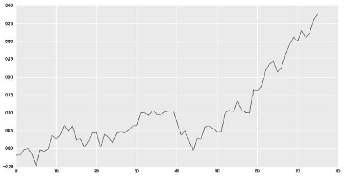

图 2-2　回测策略 1

#### 2.3.3　静态方法、类方法与属性

1．属性（property）

TradeStrategy1 类中的 self.\_\_buy\_change\_threshold 被定义为私有变量，外部不能直接赋值，使用了@property 来赋值，代码如下：

* * *

```
@property
def buy_change_threshold(self):
    # getter 函数
    return self.__buy_change_threshold
@buy_change_threshold.setter
def buy_change_threshold(self, buy_change_threshold):
    if not isinstance(buy_change_threshold, float):
        """
            上涨阀值需要为 float 类型
        """
        raise TypeError('buy_change_threshold must be float!')
    # 上涨阀值只取小数点后两位
self.__buy_change_threshold = round(buy_change_threshold, 2)
```

* * *

第一个@property 方法是一个 getter 函数，它使得 buy\_change\_threshold 成为一个属性，@buy\_change\_threshold.setter 属性添加了 setter 函数，这样外部的访问和设置形式如下。

访问：

* * *

```
trade_strategy1 = TradeStrategy1()
trade_strategy1.buy_change_threshold
```

* * *

输出如下：

* * *

```
0.07
```

* * *

设置：

* * *

```
trade_strategy1.buy_change_threshold = 0.08
trade_strategy1.buy_change_threshold
```

* * *

输出如下：

* * *

```
0.08
```

* * *

使用@property 的目的是给实例增加除访问与修改之外的其他处理逻辑，比如 buy\_change\_threshold.setter 做了类型检查和将 float 阀值保留两位小数操作，不要写没有做任何其他额外操作的 property。一些语言（如 Java）认为所有访问都应该通过 getter 和 setter，但是 Python 的最大特点就是简洁，而且使用@property 降低了效率。

下面将交易买入阀值从 0.07 上升到 0.1，即超过 10%的当日涨幅才作为买入信号，结果可以看到，总盈亏下降到 0.8%，代码如下：

* * *

```
trade_strategy1 = TradeStrategy1()
# 买入阀值从 0.07 上升到 0.1
trade_strategy1.buy_change_threshold = 0.1
trade_loop_back = TradeLoopBack(trade_days, trade_strategy1)
trade_loop_back.execute_trade()
print '回测策略 1 总盈亏为：{}%'.format(
    reduce(lambda a, b: a + b, trade_loop_back.profit_array) * 100)
# 可视化 profit_array，如图 2-3 所示
plt.plot(np.array(trade_loop_back.profit_array).cumsum())
```

* * *

输出如下，结果如图 2-3 所示。

* * *

```
回测策略 1 总盈亏为：0.8%
```

* * *

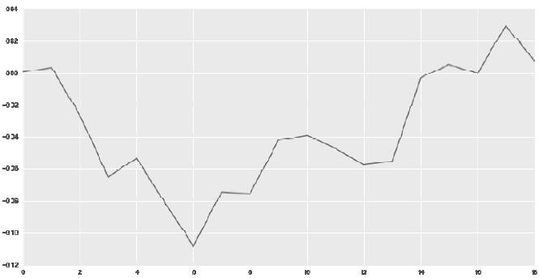

图 2-3　回测策略 2

继续编写一个均值回复交易策略，当股价连续两个交易日下跌，且下跌幅度超过一个阀值（默认-10%）时，买入股票并持有 s\_keep\_stock\_threshold（10）天，代码如下：

* * *

```
class TradeStrategy2(TradeStrategyBase):
    """
        交易策略 2: 均值回复策略，当股价连续两个交易日下跌，
        且下跌幅度超过阀值默认 s_buy_change_threshold(-10%)，
        买入股票并持有 s_keep_stock_threshold（10）天
    """
    # 买入后持有天数
    s_keep_stock_threshold = 10
    # 下跌买入阀值
    s_buy_change_threshold = -0.10
    def __init__(self):
        self.keep_stock_day = 0
    def buy_strategy(self, trade_ind, trade_day, trade_days):
        if self.keep_stock_day == 0 and trade_ind >= 1:
            """
                当没有持有股票的时候 self.keep_stock_day == 0 并且
                trade_ind >= 1, 不是交易开始的第一天，因为需要 yesterday 数据
            """
            # trade_day.change < 0 bool：今天股价是否下跌
            today_down = trade_day.change < 0
            # 昨天股价是否下跌
            yesterday_down = trade_days[trade_ind - 1].change < 0
            # 两天总跌幅
            down_rate = trade_day.change + \
                        trade_days[trade_ind - 1].change
            if today_down and yesterday_down and down_rate < \
                    TradeStrategy2.s_buy_change_threshold:
                # 买入条件成立：连跌两天，跌幅超过 s_buy_change_threshold
                self.keep_stock_day += 1
        elif self.keep_stock_day > 0:
            # self.keep_stock_day > 0 代表持有股票，持有股票天数递增
            self.keep_stock_day += 1
    def sell_strategy(self, trade_ind, trade_day, trade_days):
        if self.keep_stock_day >= \
                TradeStrategy2.s_keep_stock_threshold:
            # 当持有股票天数超过阀值 s_keep_stock_threshold，卖出股票
            self.keep_stock_day = 0
    """
        稍后会详细讲解 classmethod，staticmethod
    """
    @classmethod
    def set_keep_stock_threshold(cls, keep_stock_threshold):
        cls.s_keep_stock_threshold = keep_stock_threshold
    @staticmethod
    def set_buy_change_threshold(buy_change_threshold):
        TradeStrategy2.s_buy_change_threshold = buy_change_threshold
```

* * *

下面实例化一个 TradeStrategy2 对象 trade\_strategy2，使用它和 TSLA 的 504 天真实交易数据构造的 StockTradeDays 类对象 trade\_days，来实例化回测对象 trade\_loop\_back，并使用 execute\_trade（）函数执行回测，代码如下：

* * *

```
trade_strategy2 = TradeStrategy2()
trade_loop_back = TradeLoopBack(trade_days, trade_strategy2)
trade_loop_back.execute_trade()
print '回测策略 2 总盈亏为：{}%'.format(
    reduce(lambda a, b: a + b, trade_loop_back.profit_array) * 100)
# 图 2-4 所示
plt.plot(np.array(trade_loop_back.profit_array).cumsum())
```

* * *

输出如下，结果如图 2-4 所示。

* * *

```
回测策略 2 总盈亏为：13.3%
```

* * *

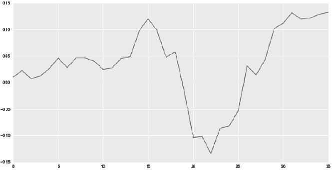

图 2-4　回测策略 3

从上面输出可以看出结果总盈亏为 13.3%，似乎还可以，但是从可视化盈亏曲线可以看出有一段持续下跌的过程，在量化交易中称为最大回撤。最大回撤是一个度量策略优劣的重要因素，在“第九章量化系统——度量与优化”中将详细讲解。

2．静态方法类方法（@classmethod 与@staticmethod）

Python 中通过装饰器@classmethod 和@staticmethod 来表明方法为类方法和静态方法，通过类名.方法名（）的形式调用：

·@staticmethod 不需要任何参数。

·@classmethod 不需要 self 参数，但第一个参数需要是表示自身类的 cls 参数。

s\_keep\_stock\_threshold 与 s\_buy\_change\_threshold 在 TradeStrategy2 中定义的方式都为类全局变量。

·@staticmethod 方法中如果要使用到这个类中的变量，只能直接使用类名.属性名或类名.方法名，代码如下：

* * *

```
@staticmethod
def set_buy_change_threshold(buy_change_threshold):
    # 类名称.类变量：TradeStrategy2.s_buy_change_threshold
    TradeStrategy2.s_buy_change_threshold = buy_change_threshold
```

* * *

@classmethod 方法函数声明中持有 cls 参数，可以通过 cls 来访问类变量，如下面 cls.s\_keep\_stock\_threshold 的使用，所以它的优点是避免硬编码。

* * *

```
@classmethod
def set_keep_stock_threshold(cls, keep_stock_threshold):
    # cls 来访问类变量，避免硬编码
    cls.s_keep_stock_threshold = keep_stock_threshold
```

* * *

以下示例代码通过类方法 set\_keep\_stock\_threshold（）与 set\_buy\_change\_threshold（）修改策略基础参数，改变策略的交易行为，代码如下：

* * *

```
# 实例化一个新的 TradeStrategy2 类对象
trade_strategy2 = TradeStrategy2()
# 修改为买入后持有股票 20 天，默认为 10 天
TradeStrategy2.set_keep_stock_threshold(20)
# 修改股价下跌买入阀值为-0.08（下跌 8%），默认为-0.10（下跌 10%）
TradeStrategy2.set_buy_change_threshold(-0.08)
# 实例化新的回测对象 trade_loop_back
trade_loop_back = TradeLoopBack(trade_days, trade_strategy2)
# 执行回测
trade_loop_back.execute_trade()
print '回测策略 2 总盈亏为：{}%'.format(
    reduce(lambda a, b: a + b, trade_loop_back.profit_array) * 100)
# 可视化回测结果，如图 2-5 所示
plt.plot(np.array(trade_loop_back.profit_array).cumsum())
```

* * *

输出如下，结果如图 2-5 所示。

* * *

```
回测策略 2 总盈亏为：31.9%
```

* * *

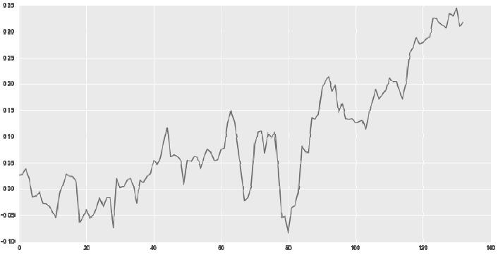

图 2-5　回测策略 4

### 2.4　性能效率

#### 2.4.1　itertools 的使用

标准库中的 itertools 提供了很多生成循环器的工具，其中很重要的用途是生成集合中所有可能方式的元素排列或组合。在量化数据处理中经常需要使用 itertools 来完成数据的各种排列组合以寻找最优参数。

* * *

```
import itertools
```

* * *

（1）permutations（）函数，考虑顺序组合元素，示例如下：

* * *

```
items = [1, 2, 3]
for item in itertools.permutations(items):
    print(item)
```

* * *

输出如下：

* * *

```
(1, 2, 3)
(1, 3, 2)
(2, 1, 3)
(2, 3, 1)
(3, 1, 2)
(3, 2, 1)
```

* * *

（2）combinations（）函数，不考虑顺序，不放回数据，示例如下：

* * *

```
for item in itertools.combinations(items, 2):
    print(item)
```

* * *

输出如下：

* * *

```
 (1, 2)
(1, 3)
(2, 3)
```

* * *

（3）combinations\_with\_replacement（）函数，不考虑顺序，有放回数据，示例如下：

* * *

```
for item in itertools.combinations_with_replacement(items, 2):
    print(item)
```

* * *

输出如下：

* * *

```
(1, 1)
(1, 2)
(1, 3)
(2, 2)
(2, 3)
(3, 3)
```

* * *

（4）product（）函数，笛卡尔积。

product（）函数与上述方法最大的不同点是：其针对多个输入序列进行排列组合，示例如下：

* * *

```
ab = ['a', 'b']
cd = ['c', 'd']
# 针对 ab、cd 两个集合进行排列组合
for item in itertools.product(ab, cd):
print(item)
```

* * *

输出如下：

* * *

```
('a', 'c')
('a', 'd')
('b', 'c')
('b', 'd')
```

* * *

在量化中通过参数组合来寻找最优参数时一般都会使用笛卡尔积，本节将重点示例。

下面继续刚才的回测实例，使用 itertools.product（笛卡尔积）求出 TradeStrategy2 的最优参数，即求出下跌幅度买入阀值（s\_buy\_change\_threshold）与买入股票后持有天数（s\_keep\_stock\_threshold）如何取值，可以让策略最终盈利最大化。

首先将 2.3 节修改 TradeStrategy2 策略基础参数并执行回测的代码抽象出一个函数 calc（），该函数的输入参数有两个，分别是持股天数和下跌买入阀值；输出返回值为 3 个，分别是盈亏情况、输入的持股天数和下跌买入阀值。

* * *

```
def calc(keep_stock_threshold, buy_change_threshold):
    """
    :param keep_stock_threshold: 持股天数
    :param buy_change_threshold: 下跌买入阀值
    :return: 盈亏情况，输入的持股天数, 输入的下跌买入阀值
    """
    # 实例化 TradeStrategy2
    trade_strategy2 = TradeStrategy2()
    # 通过类方法设置买入后持股天数
    TradeStrategy2.set_keep_stock_threshold(keep_stock_threshold)
    # 通过类方法设置下跌买入阀值
    TradeStrategy2.set_buy_change_threshold(buy_change_threshold)
    # 进行回测
    trade_loop_back = TradeLoopBack(trade_days, trade_strategy2)
    trade_loop_back.execute_trade()
    # 计算回测结果的最终盈亏值 profit
    profit = 0.0 if len(trade_loop_back.profit_array) == 0 else \
        reduce(lambda a, b: a + b, trade_loop_back.profit_array)
    # 返回值 profit 和函数的两个输入参数
    return profit, keep_stock_threshold, buy_change_threshold
# 测试，使用 2.3 节使用的参数
calc(20, -0.08)
```

* * *

输出如下：

* * *

```
(0.31900000000000006, 20, -0.08)
```

* * *

笛卡尔积求最优属于有限参数范围内求最优的问题，即将有限个参数形成集合，多个有限集合进行笛卡尔积，寻找问题的最优参数。下面通过 range（）函数使具体参数形成有限集合，示例如下：

* * *

```
#range 集合：买入后持股天数从 2~30 天，间隔两天
keep_stock_list = range(2, 30, 2)
print '持股天数参数组：{}'.format(keep_stock_list)
# 下跌买入阀值从-0.05 到-0.15，即从 5%下跌到 15%
buy_change_list = [buy_change / 100.0 for buy_change in
                   range(-5, -16, -1)]
print '下跌阀值参数组：{}'.format(buy_change_list)
```

* * *

输出如下：

* * *

```
持股天数参数组：[2, 4, 6, 8, 10, 12, 14, 16, 18, 20, 22, 24, 26, 28]
下跌阀值参数组：[-0.05, -0.06, -0.07, -0.08, -0.09, -0.1, -0.11, -0.12, -0.13, -0.14, -0.15]
```

* * *

通过对多个有限集合进行笛卡尔积，使用上面封装的函数 clac（）分别将各个组合参数代入，计算参数对应的最终盈利结果，将结果加入 result 序列，示例如下：

* * *

```
result = []
for keep_stock_threshold, buy_change_threshold in itertools.product(
        keep_stock_list, buy_change_list):
    # 使用 calc()函数计算参数对应的最终盈利，结果加入 result 序列
    result.append(calc(keep_stock_threshold, buy_change_threshold))
print '笛卡尔积参数集合总共结果为：{}个'.format(len(result))
```

* * *

输出如下：

* * *

```
笛卡尔积参数集合总共结果为：154 个
```

* * *

下面使用 sorted（result）将结果序列排序：

* * *

```
# [::-1]将整个排序结果反转，反转后盈亏收益从最高向低开始排序
# [:10]取出收益最高的前 10 个组合查看
sorted(result)[::-1][:10]
```

* * *

输出如下：

* * *

```
[(0.5790000000000001, 28, -0.1),
 (0.519, 26, -0.1),
 (0.5019999999999999, 28, -0.05),
 (0.4770000000000001, 24, -0.1),
 (0.4660000000000001, 22, -0.1),
 (0.45100000000000007, 16, -0.09),
 (0.44999999999999996, 20, -0.06),
 (0.44800000000000006, 28, -0.07),
 (0.437, 28, -0.13),
 (0.437, 28, -0.14)]
```

* * *

从输出结果中可以看出，持股天数等于 28 天、下跌阀值等于-0.1 的组合盈亏收益最高，达到 57.9%。当然这个结果只是在 keep\_stock\_list 与 buy\_change\_list 给定的参数中排列组合最优的参数，不代表绝对最优。

类似本节寻找最优的参数问题，在“第九章量化系统——度量与优化”中将详细讲解，其他寻找最优参数的方法会在“第六章量化工具——数学”中详细讲解。

#### 2.4.2　多进程 VS 多线程

2.4.1 节的笛卡尔积对两个参数集合排列组合总共有 154 种组合方式，由于这里的简单回测并没有运行复杂的计算，也没有繁多的 I/O 操作，所以通过 for 循环串行计算每组参数的结果也没有速度上的问题。真实的回测中不但有复杂的计算，繁多的 I/O 操作且回测本身的复杂度也不是 2.4.1 节中的示例能比拟的。

针对上面的问题，一般使用多任务并行的方式来解决，有如下几种方式：

·启动多个进程；

·启动多个线程；

·启动多个进程，每个进程启动多个线程。

使用哪种方式最好呢？

由于全局解释锁 GIL，Python 的线程被限制为同一时刻只允许一个线程执行，所以 Python 的多线程适用于处理 I/O 密集型任务和并发执行的阻塞操作，多进程处理并行的计算密集型任务。

Python 中实现多任务的库有很多，可以通过几行代码就完成一个并行任务，由于篇幅有限，这里只示例使用 concurrent.futures 库。

1．使用多进程（ProcessPoolExecutor）

下面使用（ProcessPoolExecutor）来完成与 2.4.1 节寻找最优参数相同的任务

* * *

```
result=[]
#回调函数，通过 add_done_callback 任务完成后调用
def when_done（r）：
#when_done 在主进程中运行
result.append（r.result（））
"""
with class_a（）as a：上下文管理器：稍后会具体讲解
"""
with ProcessPoolExecutor（）as pool：
for keep_stock_threshold，buy_change_threshold in\
itertools.product（keep_stock_list，buy_change_list）：
"""
submit 提交任务：使用 calc（）函数和的参数通过 submit 提交到独立进程
提交的任务必须是简单函数，进程并行不支持类方法、闭包等，
函数参数和返回值必须兼容 pickle 序列化，因为进程间的通信需要传递可序列化对象
"""
future_result=pool.submit（calc，keep_stock_threshold，
buy_change_threshold）
#当进程完成任务即 calc 运行结束后的回调函数
future_result.add_done_callback（when_done）
```

* * *

下面使用多进程并行方式的结果和上面 for 循环串行计算的结果是一致的，但是针对本例来说，运行耗时的多进程的并行操作反而会更慢，因为进程的创建、销毁，以及进程之间的通信都要有一定的开销。

* * *

```
sorted(result)[::-1][:10]
```

* * *

输出如下：

* * *

```
 [(0.5790000000000001, 28, -0.1),
 (0.519, 26, -0.1),
 (0.5019999999999999, 28, -0.05),
 (0.4770000000000001, 24, -0.1),
 (0.4660000000000001, 22, -0.1),
 (0.45100000000000007, 16, -0.09),
 (0.44999999999999996, 20, -0.06),
 (0.44800000000000006, 28, -0.07),
 (0.437, 28, -0.13),
 (0.437, 28, -0.14)]
```

* * *

2．使用多线程 ThreadPoolExecutor

使用多线程 ThreadPoolExecutor 与前面使用多进程的方法几乎一样，唯一的区别是使用 ThreadPoolExecutor 代替 ProcessPoolExecutor。

* * *

```
ThreadPoolExecutor 代替 ProcessPoolExecutor。

from concurrent.futures import ThreadPoolExecutor
result = []
def when_done(r):
    result.append(r.result())
with ThreadPoolExecutor() as pool:
    for keep_stock_threshold, buy_change_threshold in \
            itertools.product(keep_stock_list, buy_change_list):
        future_result = pool.submit(calc, keep_stock_threshold,
                                    buy_change_threshold)
        future_result.add_done_callback(when_done)
```

* * *

对结果进行排序：

* * *

```
sorted(result)[::-1][:10]
```

* * *

输出如下：

* * *

```
 [(0.5790000000000001, 28, -0.1),
 (0.5459999999999999, 28, -0.11),
 (0.519, 26, -0.1),
 (0.5019999999999999, 28, -0.05),
 (0.476, 22, -0.09),
 (0.44800000000000006, 28, -0.07),
 (0.437, 28, -0.13),
 (0.437, 28, -0.14),
 (0.437, 28, -0.15),
 (0.42500000000000016, 16, -0.15)]
```

* * *

仔细观察上面多线程运行的输出结果可以发现，与串行的结果和多进程的结果不一致。原因就在 clac（）函数中：

* * *

```
TradeStrategy2.set_keep_stock_threshold(keep_stock_threshold)
TradeStrategy2.set_buy_change_threshold(buy_change_threshold)
```

* * *

这两个设置参数的方法都是类方法，非实例方法。在同一进程中的多个线程不断针对类变量设置参数，结果是错误的，并无我们预想的结果。

在量化中一定要反复推敲验证自己写的每一行代码是否正确，差之毫厘，结果往往是谬以千里。

3．上下文管理器

前面对多进程以及多线程的示例中都使用了形如：

* * *

```
with A_Class() as a:
        do something
```

* * *

这样的代码块，使用 with 作为关键字开头在 Python 中称为上下文管理器，它的特点是：

·在进入上下文管理器定义的缩进模块后，会触发 A\_Class 中定义的\_\_enter\_\_（）函数；

·在结束上下文管理器定义的缩进模块后，会触发 A\_Class 中定义的\_\_exit\_\_（）函数。

一般，在\_\_enter\_\_（）和\_\_exit\_\_（）函数中定义相反的操作，如文件的打开、关闭，资源的创建和释放等。例如，在线程锁类 threading.RLock 中可以找到如下实现：

* * *

```
def __enter__(self)
    self.acquire()
def __exit__(self, t, v, tb):
    self.release()
```

* * *

通过在\_\_enter\_\_（）函数中使用 acquire（）函数来上锁，通过在\_\_exit\_\_（）函数中使用 release（）函数来解锁。

#### 2.4.3　使用编译库提高性能

前面使用了多进程和多线程并行处理任务的技术，来提升 Python 代码的运行效率，除此之外，还有一些很棒的开源库可以提高性能，比如：

·Numexpr 可以快速计算数值，缺点是局限性大；

·numba 运行时动态编译 Python 代码来提高效率；

·Cython 静态编译 Python 代码来提高效率。

下面示例使用 numba 来提升性能效率。继续使用寻找最优参数例子，但这里放大了寻找范围，结果的参数排序组合集合共有 49797 个参数组合，下面仍然使用串行，共耗时 1 分钟 48 秒。

* * *

```
# 买入后持股天数，放大寻找范围 1 ~ 503 天, 间隔 1 天
keep_stock_list = range(1, 504, 1)
# 下跌买入阀值寻找范围 -0.01 ~ -0.99 共 99 个
buy_change_list = [buy_change/100.0 for buy_change in range(-1, -100, -1)]
def do_single_task():
    task_list = list(itertools.product(keep_stock_list, buy_change_list))
    print '笛卡尔积参数集合总共结果为：{}个'.format(len(task_list))
    for keep_stock_threshold, buy_change_threshold in task_list:
        calc(keep_stock_threshold, buy_change_threshold)
# %time ipython magic code 详情查阅附录中关于 IPython 的使用
%time do_single_task()
```

* * *

输出如下：

* * *

```
笛卡尔积参数集合总共结果为：49797 个
CPU times: user 1min 48s, sys: 224 ms, total: 1min 48s
Wall time: 1min 48s
```

* * *

备注：上面通过%time 计算运行耗时的方法是 IPython 提供的 magic code 方法，详情可查阅附录中关于 IPython 的使用文档。

numba 动态编译可提高效率。下面可以看到只用一行代码 nb.jit（）来静态编译原始函数，之后调用编译好的 do\_singletask\_nb（）函数，最后的结果是耗时 1 分钟 13 秒，相比未优化前效率提升了 35 秒。

* * *

```
import numba as nb
do_single_task_nb = nb.jit(do_single_task)
%time do_single_task_nb()
```

* * *

输出如下：

* * *

```
笛卡尔积参数集合总共结果为：49797 个
CPU times: user 1min 13s, sys: 225 ms, total: 1min 13s
Wall time: 1min 13s
```

* * *

针对性能效率，除了使用并行计算、静态动态编译库外，更重要的是写代码的时候就应该注意代码的运行效率，针对每一行代码寻找运行效率更高的写法。

如果想要将 keep\_stock\_list 和 buy\_change\_list 两个序列里的参数都打印出来，那么以下两种方案都可以实现。

（1）keep\_stock\_list+buy\_change\_list：

* * *

```
for s in keep_stock_list + buy_change_list:
    print s
```

* * *

（2）itertools.chain（）函数：

* * *

```
for s in chain(keep_stock_list, buy_change_list):
    print(s)
```

* * *

第一种方案会创建一个全新的序列，而 itertools.chian（）函数不会创建新的序列，所以如果输入序列非常大时会很节省内存，提升运行效率。

### 2.5　代码调试

写完一段代码后，一定要对代码进行自测，特别是与数据量化相关的代码。例如，下面的代码将之前计算买入阀值集合 buy\_change\_list=\[buy\_change/100.0 for buy\_change in range（-5，-16，-1）\]的代码改写成如下形式：

* * *

```
def gen_buy_change_list():
    buy_change_list = []
    # 下跌买入阀值从-0.05 到-0.15，即从 5%下跌到 15%
    for buy_change in range(-5, -16, -1):
        buy_change = buy_change/100
        buy_change_list.append(buy_change)
    return buy_change_list
```

* * *

调用 gen\_buy\_change\_list（）函数发现生成的结果集合内全是-1，显然不符合预期。

* * *

```
gen_buy_change_list()
```

* * *

输出如下：

* * *

```
[-1, -1, -1, -1, -1, -1, -1, -1, -1, -1, -1]
```

* * *

在这种情况下，最常用的方式就是使用 print（）函数。使用该函数在可以找到问题线索的地方一步一步打印出问题线索，最后找到问题。对于这个简单的示例，通过以下代码就可以发现问题：

* * *

```
def gen_buy_change_list():
    buy_change_list = []
    for buy_change in range(-5, -16, -1):
        # 1. 原始 buy_change
        print buy_change
        buy_change = buy_change/100
        # 2. buy_change/100
        print buy_change
        buy_change_list.append(buy_change)
    return buy_change_list
```

* * *

buy\_change/100 的本意是取到小数，但是 Python 2 中的整数除法永远是整数，所以修改方式有以下两种。

·除数或者被除数其中一个是 float 类型；

·导入 future 库的 divisionfrom\_\_future\_\_import division。

* * *

```
# 2. 导入 future 库的 division`from __future__ import division`
from __future__ import division
def gen_buy_change_list():
    buy_change_list = []
    for buy_change in range(-5, -16, -1):
        # 1. 除数或者被除数中有一个是 float 类型
        buy_change = buy_change/100.0
        buy_change_list.append(buy_change)
    return buy_change_list
gen_buy_change_list()
```

* * *

输出如下：

* * *

```
[-0.05, -0.06, -0.07, -0.08, -0.09, -0.1, -0.11, -0.12, -0.13, -0.14, -0.15]
```

* * *

除了使用 print（）函数打印输出外，还可以使用 logging 模块打印日志。它的优点就是可以指定每一条打印语句的输出级别，logging 级别为如下几种。

·debug：调试信息；

·info：输出信息；

·warning：警告信息；

·error：错误信息；

·critical：严重错误。

通过 logging.basicConfig（）统一设置运行环境日志的输出级别，只有大于等于设置级别的日志才能打印输出，低于此级别的日志消息都会被忽略，代码如下：

* * *

```
import logging
# 设置日志级别为 info
logging.basicConfig(level=logging.INFO)
def gen_buy_change_list():
    # 会打印出来，因为 info >= level=logging.INFO
    logging.info("gen_buy_change_list begin")
    buy_change_list = []
    for buy_change in range(-5, -16, -1):
        # 不会打印出来，debug < level=logging.INFO
        logging.debug(buy_change)
        buy_change = buy_change / 100
        # 不会打印出来，debug < level=logging.INFO
        logging.debug(buy_change)
        buy_change_list.append(buy_change)
    # 会打印出来，因为 info >= level=logging.INFO
    logging.info("gen_buy_change_list end")
    return buy_change_list
_ = gen_buy_change_list()
```

* * *

输出如下：

* * *

```
INFO:root:gen_buy_change_list begin
INFO:root:gen_buy_change_list end
```

* * *

上面的调试问题非常简单，但很多实际的调试问题非常棘手，不是打印一些信息就能轻易发现的。这时候就要启动 Python 的调试器 pdb，让程序以单步方式运行，随时查看运行状态，示例代码如下。

备注：IDE 中对断点调试支持最好的就是 PyCharm。

* * *

```
import pdb
def gen_buy_change_list():
    buy_change_list = []
    for buy_change in range(-5, -16, -1):
        # 只针对循环执行到 buy_change == -10，中断开始调试
        if buy_change == -10:
            # 打断点，通过 set_trace()
            pdb.set_trace()
        buy_change = buy_change / 100
        buy_change_list.append(buy_change)
    # 故意向外抛出异常
    raise RuntimeError('debug for pdb')
    return buy_change_list
try:
    _ = gen_buy_change_list()
except Exception, e:
    # 从捕获异常的地方开始调试，是经常使用的调试技巧
    pdb.set_trace()
```

* * *

pdb 调试中经常用到的指令，如图 2-6 所示。

·l：堆栈信息；

·n：下一步 next；

·s：进入函数 step into；

·c：继续执行 continue。

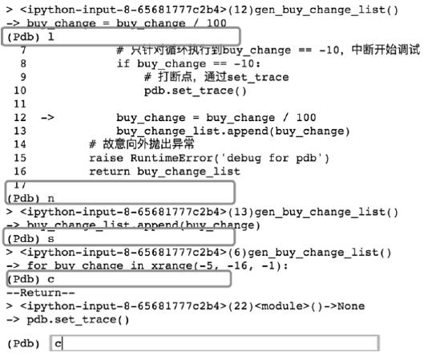

图 2-6　pdb 调试

### 2.6　本章小结

本章讲解了 Python 的基础语法、函数与面向对象等知识，事实上对于初学者并不简单，特别是文中那些使用 lambda 函数配合高级函数的例子。但在之后的章节中读者会发现，在有 NumPy、pandas 等工具的帮助下，同样的问题计算起来就变得简单多了。

由于本书并不是一本专门讲解 Python 语言的书，所以没用更多篇幅来讲解装饰器、迭代器、生成器、mixins、元编程和描述符等 Python 进阶知识，但本章所讲述的知识理解后也足够读者继续阅读本书了。

Python 的一大特点是简洁，但是在金融量化领域，不建议使用过短的变量名、类名、函数名等，因为试错的成本太高昂，略显冗余的名字可以规避很多问题。为了弥补这一方面的冗余，在金融量化领域，列表推导式、字典推导式、高阶函数、lambda 函数、三目表达式等技巧，会使用得比较频繁。

## 第三章　量化工具——NumPy  

针对一门语言甚至开发平台，在掌握了字符串和数组后就可以写出一个最简单的程序，虽然还有很多欠缺，但是入门的 hello world 足够了。不管是什么语言，什么平台，数组都是构建数据结构最常用的容器。

NumPy 是 Python 很多科学计算与工程库的基础库，在量化数据分析中最常使用的 pandas 也是基于 NumPy 的封装。可以说 NumPy 就是量化数据分析领域中的基础数组，学会使用 NumPy 是量化分析中关键的一步。

NumPy 底层实现中使用了 C 语言和 Fortran 语言的机制分配内存。可以理解为它的输出是一个非常大且连续的并由同类型数据组成的内存区域，所以你可以构造一个比普通列表大得多的数组，并且灵活高效地对数组中所有的元素进行并行化操作。

备注：本书的所有示例 IPython Notebook 代码，可通过微信公众号 abu\_quant 获取。

### 3.1　并行化思想与基础操作

习惯及推荐引用 NumPy 的方式如下：

* * *

```
# 如下方式引用 numpy 是 numpy.org 推荐的方式                     
import numpy as np
```

* * *

#### 3.1.1　并行化思想

首先看构建 10000 个元素的普通列表循环求每个元素的平方，使用 IPython Notebook 的%timeit 对比效率。

普通列表 best of 3：1.6 ms per loop 示例如下：

* * *

```
normal_list = range(10000)
%timeit [i**2 for i in normal_list]
```

* * *

输出如下：

* * *

```
1000 loops, best of 3: 1.63 ms per loop
```

* * *

使用 np.arange（）构建列表 best of 3：6.71μs per loop，运行效率会得到几个数量级的提升。示例如下：

* * *

```
np_list = np.arange(10000)
%timeit np_list**2
```

* * *

输出如下：

* * *

```
100000 loops, best of 3: 6.58 μs per loop
```

* * *

NumPy 数组和普通列表的操作方式也是不同的，NumPy 通过广播机制作用于每一个内部元素，是一种并行化执行的思想，普通 list 则作用于整体。示例如下：

* * *

```
# 注意 * 3 的操作被运行在每一个元素上
np_list = np.ones(5) * 3
print np_list
# 普通的列表把*3 操作认为是整体性操作
normal_list = [1, 1, 1, 1, 1] * 3
normal_list, len(normal_list)
```

* * *

输出如下：

* * *

```
 [ 3.  3.  3.  3.  3.]
([1, 1, 1, 1, 1, 1, 1, 1, 1, 1, 1, 1, 1, 1, 1], 15)
```

* * *

#### 3.1.2　初始化操作

下面为一些常用的初始化 np array 的方式：

* * *

```
# 100 个 0
np.zeros(100)
# shape：3 行 2 列 全是 0
np.zeros((3, 2))
# shape： 3 行 2 列 全是 1
np.ones((3, 2))
# shape：x=2, y=3, z=3 值随机
np.empty((2, 3, 3))
# 初始化序列与 np_list 一样的 shape，值全为 1
np.ones_like(np_list)
# 初始化序列与 np_list 一样的 shape，值全为 0
np.zeros_like(np_list)
# eye()得到对角线全为 1 的单位矩阵
np.eye(3)
```

* * *

输出如下：

* * *

```
array([[ 1.,  0.,  0.],
       [ 0.,  1.,  0.],
       [ 0.,  0.,  1.]])
```

* * *

可以将普通 list 作为参数，通过 np.array 来初始化 np array。

* * *

```
data = [[1, 2, 3, 4], [5, 6, 7, 8]]
arr_np = np.array(data)
arr_np
```

* * *

输出如下：

* * *

```
array([[1, 2, 3, 4],
       [5, 6, 7, 8]])
```

* * *

另外一个经常会使用的初始化方法是 linspace（）。下面的示例在 0～1 之间等间隔生成 10 个元素的序列。更多使用帮助，读者可自行使用 help（np.linspace）查看 API 文档，一定要学会通过 API 文档来扩展知识。

* * *

```
np.linspace(0, 1, 10)
```

* * *

输出如下：

* * *

```
array([ 0.        ,  0.11111111,  0.22222222,  0.33333333,  0.44444444,
        0.55555556,  0.66666667,  0.77777778,  0.88888889,  1.        ])
```

* * *

下面的例子都尽量使用了股票数据，首先使用 np.random.standard\_normal（）随机生成 200 只股票 504 个交易日服从正态分布的涨跌幅数据。

备注：

·504=252×2（两年美股交易日总数）；

·交易日的数量越多，股票的数量越多，生成的数据越服从正态分布（正态分布等统计学概念稍后讲解）。

* * *

```
# 200 只股票
stock_cnt = 200
# 504 个交易日
view_days = 504
# 生成服从正态分布：均值期望＝0，标准差＝1 的序列
stock_day_change = np.random.standard_normal((stock_cnt, view_days))
# 打印 shape (200, 504) 200 行 504 列
print stock_day_change.shape
# 打印出第一只股票，前 5 个交易日的涨跌幅情况
print stock_day_change[0:1, :5]
```

* * *

输出如下：

* * *

```
(200, 504)
[[ 0.38035486  0.12259674 -0.2851901  -0.00889681  0.45731945]]
```

* * *

可以看到输出结果为 200 行 504 列的矩阵，每一行代表一只股票，每一列代表一个交易日。上面输出的第一个值 0.38035486 代表的数据意义为：第 0 行的股票在第一个交易日中价格上涨了 0.38035486%。

#### 3.1.3　索引选取和切片选择

3.1.2 节中选取第一只股票前 5 个交易日涨跌幅的方式，stock\_day\_change\[0：1，：5\]就是一种选取，下面继续举例。

* * *

```
# 0:2 第一只、第二只股票，0:5 前 5 个交易日的涨跌幅数据
stock_day_change[0:2, 0:5]
```

* * *

输出如下：

* * *

```
 [[ 0.38035486  0.12259674 -0.2851901  -0.00889681  0.45731945]
 [ 0.13380956 -0.49312626  1.44701057 -1.03491806  0.42295542]]
```

* * *

可以使用-1 代表选取最后一个，即负数代表从后向前数，示例如下：

* * *

```
# -2:倒数第一只、第二只股票，-5:最后 5 个交易日的涨跌幅数据
stock_day_change[-2:, -5:]
```

* * *

输出如下：

* * *

```
 [[ 0.21652192 -0.03053515 -0.77747062 -1.19236603 -0.04788549]
 [-0.96380496  2.03488293  0.99338065 -0.92392477  0.96930104]]
```

* * *

以下代码交换上述两组股票交易日的切片数据，注意 stock\_day\_change\[0：2，0：5\].copy（）中的 copy（）的使用，如果这里不使用 copy（）的话，由于 NumPy 内部实现的机制全部是引用操作，所以当不使用 copy（）的时候得出的结果将会丢失 stock\_day\_change\[0：2，0：5\]，读者可自行测试。

* * *

```
# tmp = a
tmp = stock_day_change[0:2, 0:5].copy() 
# a = b
stock_day_change[0:2, 0:5] = stock_day_change[-2:, -5:]
# b = tmp
stock_day_change[-2:, -5:] = tmp
# view result
stock_day_change[0:2, 0:5], stock_day_change[-2:, -5:]
```

* * *

输出如下：

* * *

```
 ([[ 0.21652192 -0.03053515 -0.77747062 -1.19236603 -0.04788549]
 [-0.96380496  2.03488293  0.99338065 -0.92392477  0.96930104]],
[[ 0.38035486  0.12259674 -0.2851901  -0.00889681  0.45731945]
 [ 0.13380956 -0.49312626  1.44701057 -1.03491806  0.42295542]])
```

* * *

#### 3.1.4　数据转换与规整

数据进行类型转换的目的，有些时候是为了规整数据，有些时候可以通过类型转换进一步得到有用的信息。以下代码使用 astype（int）将涨跌幅转换为 int 后的结果，可以更清晰地发现涨跌幅数据两端的极限值，示例如下：

* * *

```
print stock_day_change[0:2, 0:5]
stock_day_change[0:2, 0:5].astype(int)
```

* * *

输出如下：

* * *

```
 [[ 0.21652192 -0.03053515 -0.77747062 -1.19236603 -0.04788549]
 [-0.96380496  2.03488293  0.99338065 -0.92392477  0.96930104]]
array([[ 0,  0,  0, -1,  0],
       [ 0,  2,  0,  0,  0]])
```

* * *

如果只是想要规整 float 的数据，如保留两位小数，可使用 np.around（）函数，示例如下：

* * *

```
# 2 代表保留两位小数
np.around(stock_day_change[0:2, 0:5], 2)
```

* * *

输出如下：

* * *

```
array([[ 0.22, -0.03, -0.78, -1.19, -0.05],
       [-0.96,  2.03,  0.99, -0.92,  0.97]])
```

* * *

很多时候需要处理的数据会有缺失，NumPy 中 nP.nan 代表缺失，这里手工使切片中的第一个元素变为 na，代码如下：

* * *

```
# 使用 copy()函数的目的是不修改原始序列
tmp_test = stock_day_change[0:2, 0:5].copy()
# 将第一个元素改成 nan
tmp_test[0][0] = np.nan
tmp_test
```

* * *

输出如下：

* * *

```
 [[        nan -0.03053515 -0.77747062 -1.19236603 -0.04788549]
 [-0.96380496  2.03488293  0.99338065 -0.92392477  0.96930104]]
```

* * *

下面使用 np.nan\_to\_num（）函数来用 0 来填充 na，由于 pandas 中的 dropna（）和 fillna（）等方式更适合 na 处理，这里简单带过，示例如下：

* * *

```
tmp_test = np.nan_to_num(tmp_test)
tmp_test
```

* * *

输出如下：

* * *

```
 [[ 0.         -0.03053515 -0.77747062 -1.19236603 -0.04788549]
 [-0.96380496  2.03488293  0.99338065 -0.92392477  0.96930104]]
```

* * *

#### 3.1.5　逻辑条件进行数据筛选

找出切片内涨幅超过 0.5 的股票时段，通过输出结果可以看到返回的 mask 是 bool 的数组，示例如下：

* * *

```
mask = stock_day_change[0:2, 0:5] > 0.5
print mask
```

* * *

输出如下：

* * *

```
 [[False False False False False]
 [False  True  True False  True]]
```

* * *

mask 的使用示例如下：

* * *

```
tmp_test = stock_day_change[0:2, 0:5].copy()
# 使用上述的 mask 数组筛选出符合条件的数组, 即筛选 mask 中对应 index 值为 True 的
tmp_test[mask]
```

* * *

输出如下：

* * *

```
array([ 2.03488293,  0.99338065,  0.96930104])
```

* * *

上述示例只是为了讲解过程，实际代码中一般会一行写完。比如下面的需求，找出 tmp\_test 切片中>0.5 的元素并且赋值为 1，代码如下：

* * *

```
tmp_test[tmp_test > 0.5] = 1
tmp_test
```

* * *

输出如下：

* * *

```
[[ 0.21652192 -0.03053515 -0.77747062 -1.19236603 -0.04788549]
[-0.96380496  1.          1.         -0.92392477  1.        ]]
```

* * *

针对多重筛选条件，使用｜、&完成复合的逻辑，注意需要使用括号将每一个条件括起来，否则会出错。

* * *

```
tmp_test = stock_day_change[-2:, -5:]
print tmp_test
tmp_test[(tmp_test > 1) | (tmp_test < -1)]
```

* * *

输出如下：

* * *

```
[[ 0.38035486  0.12259674 -0.2851901  -0.00889681  0.45731945]
[ 0.13380956 -0.49312626  1.44701057 -1.03491806  0.42295542]]
array([ 1.44701057, -1.03491806])
```

* * *

请读者尽量理解上述筛选过程，因为在数据的实际处理中以上操作的使用将非常频繁。pandas 中的数据 mask 抽取方式和这里是一样的（如果读者是第一次接触会不好理解，并行化执行的思想需要反复实践形成针对这种操作方式的语感，读者可以自己多造些数据，反复实践）。

#### 3.1.6　通用序列函数

NumPy 提供的通用序列函数可以高效方便地处理序列，下面例举一些常用函数的用法。

1．np.all（）函数

* * *

```
# np.all 判断序列中的所有元素是否全部是 true, 即对 bool 序列进行与操作
# 本例实际判断 stock_day_change[0:2, 0:5]中是否全是上涨的
np.all(stock_day_change[0:2, 0:5] > 0)
```

* * *

输出如下：

* * *

```
False
```

* * *

2．np.any（）函数

* * *

```
# np.any 判断序列中是否有元素为 true, 即对 bool 序列进行或操作
# 本例实际判断 stock_day_change[0:2, 0:5]中是至少有一个是上涨的
np.any(stock_day_change[0:2, 0:5] > 0)
```

* * *

输出如下：

* * *

```
True
```

* * *

3．maximum（）与 minimum（）函数

* * *

```
# 对两个序列对应的元素两两比较，maximum()结果集取大,相对使用 minimum()为取小的结果集
np.maximum(stock_day_change[0:2, 0:5], stock_day_change[-2:, -5:])
```

* * *

输出如下：

* * *

```
[[ 0.38035486  0.12259674 -0.2851901  -0.00889681  0.45731945]
[ 0.13380956  2.03488293  1.44701057 -0.92392477  0.96930104]]
```

* * *

4．np.unique（）函数

* * *

```
change_int = stock_day_change[0:2, 0:5].astype(int)
print change_int
# 序列中数值值唯一且不重复的值组成新的序列
np.unique(change_int)
```

* * *

输出如下：

* * *

```
[[ 0,  0,  0, -1,  0],
[ 0,  2,  0,  0,  0]]
[-1  0  2]
```

* * *

5．np.diff（）函数

Diff（）执行的操作是前后两个临近数值进行减法运算。默认情况下 axis＝1，axis 代表操作轴向。

* * *

```
# axis＝1
np.diff(stock_day_change[0:2, 0:5])
```

* * *

输出如下：

* * *

```
 [[-0.24705707 -0.74693547 -0.41489541  1.14448054]
 [ 2.9986879  -1.04150228 -1.91730542  1.89322581]]
```

* * *

如图 3-1 分解演示了第一个值-0.24705707 在默认 axis＝1 的情况下，是如何通过 diff（）函数计算出来的。

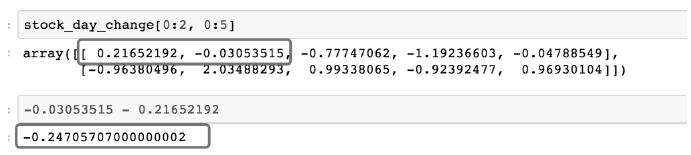

图 3-1　diff（）函数分解演示 1

下面同样使用 diff（）函数作用于相同的序列，但是 axis=0，示例如下：

* * *

```
# 唯一区别 axis=0
diff(stock_day_change[0:2, 0:5], axis=0)
```

* * *

输出如下：

* * *

```
[[-1.18032689  2.06541808  1.77085127  0.26844126  1.01718653]]
```

* * *

如图 3-2 分解演示了第一个值-1.18032689 在 axis=0 的情况下，是如何通过 diff（）函数计算出来的。

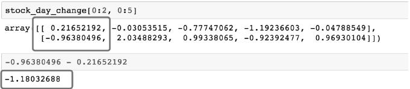

图 3-2　diff（）函数分解演示 2

6．np.where（）函数

下面重点示例 NumPy 中 where（）函数的用法，np.where（）函数在数据筛选、改造中有非常大的作用。

np.where（）函数的语法句式有点类似 Java 中的三目运算符，第一个参数是一个条件表达式，如果成立走第二个参数，否则走第三个参数。特点就是条件表达式的结果是一组序列，而不是一个。下面实例将涨幅大于 0.5 的标识为 1，其他的都为 0。

* * *

```
tmp_test = stock_day_change[-2:, -5:]
print np.where(tmp_test > 0.5, 1, 0)
```

* * *

输出如下：

* * *

```
[[1 1 0 1]
[0 0 1 0]]
```

* * *

如果涨幅大于 0.5 的标示为 1，其他的都保持不变：

* * *

```
print np.where(tmp_test > 0.5, 1, tmp_test)
```

* * *

输出如下：

* * *

```
[[ 1.          1.          0.26125628  1.        ]
[-1.57012465  0.25266829  1.          0.29308672]]
```

* * *

如果逻辑表达式为复合逻辑条件，则使用 np.logical\_and（）和 np.logical\_or（）函数，下面将序列中的值大于 0.5 并且小于 1 的赋值为 1，否则赋值为 0。

* * *

```
# 序列中的值大于 0.5 并且小于 1 的赋值为 1，否则赋值为 0
np.where(np.logical_and(tmp_test > 0.5, tmp_test < 1), 1, 0)
```

* * *

输出如下：

* * *

```
array([[0, 0, 0, 1],
       [0, 0, 0, 0]])
```

* * *

下面将序列中的值大于 0.5 或者小于-0.5 的赋值为 1，否则赋值为 0。

* * *

```
# 序列中的值大于 0.5 或者小于－0.5 的赋值为 1，否则赋值为 0
np.where(np.logical_or(tmp_test > 0.5, tmp_test < -0.5), 1, 0)
```

* * *

输出如下：

* * *

```
array([[1, 1, 0, 1],
       [1, 0, 1, 0]])
```

* * *

np.where（）函数在很多量化数据分析场景中起着很大作用，希望读者能理解掌握这种语法方式。

#### 3.1.7　数据本地序列化操作

接下来通过 np.save（）函数可以轻松地将 NumPy 序列持久化保存。注意不需要添加后缀，save 内部会自动生成.npy 文件，示例如下：

* * *

```
np.save('./gen/stock_day_change', stock_day_change)
```

* * *

读取只需简单使用 np.load（）函数即可，但需要注意参数文件名要加上 npy 后缀，示例如下：

* * *

```
stock_day_change = np.load('./gen/stock_day_change.npy')
stock_day_change.shape
```

* * *

输出如下：

* * *

```
 (200, 504)
```

* * *

### 3.2　基础统计概念与函数使用

量化中很多技术手段都是基于统计技术实现的，NumPy 给 Python 带来的不仅只有序列并行化执行的思想，更有统计学上很多方法的实现，比如期望（np.mean（））、方差（np.var（））、标准差（np.std（））等。下面首先尝试一下在 NumPy 中使用统计相关的函数。

用切片把序列切成只保留前 4 只股票、前 4 天的涨跌幅数据：

* * *

```
stock_day_change_four = stock_day_change[:4, :4]
stock_day_change_four
```

* * *

输出如下：

* * *

```
array([[ 0.38035486,  0.12259674, -0.2851901 , -0.00889681],
       [ 0.13380956, -0.49312626,  1.44701057, -1.03491806],
       [ 1.49695798,  1.17420526,  0.26125628,  0.70377972],
       [-1.57012465,  0.25266829,  1.14584289,  0.29308672]])
```

* * *

#### 3.2.1　基础统计函数的使用

如果想知道 stock\_day\_change 的一些统计信息，比如横向地分析出某只股票在 4 天内的统计信息，需要使用参数 axis=1，举例如下：

* * *

```
print '最大涨幅 {}'.format(np.max(stock_day_change_four, axis=1))
```

* * *

输出如下：

* * *

```
最大涨幅 [ 0.38035486  1.44701057  1.49695798  1.14584289]
```

* * *

如图 3-3 所示，第 1 只股票在 4 天内最大涨幅为 0.38035486，发生在第一个交易日。第 2 只股票在 4 天内最大涨幅为 1.44701057，发生在第 3 个交易日。第 3 只为 1.49695798，第 4 只为 1.14584289。

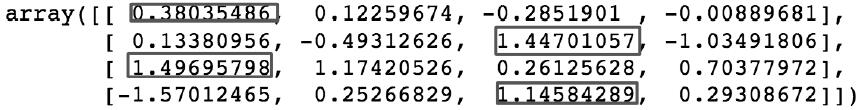

图 3-3　max（）函数分解演示

同理，下面分别统计出 4 只股票在 4 天内最大跌幅、振幅幅度和平均涨跌数据，同样需要使用参数 axis＝1。

* * *

```
print '最大跌幅 {}'.format(np.min(stock_day_change_four, axis=1))
print '振幅幅度 {}'.format(np.std(stock_day_change_four, axis=1))
print '平均涨跌 {}'.format(np.mean(stock_day_change_four, axis=1))
```

* * *

输出如下：

* * *

```
最大跌幅 [-0.2851901  -1.03491806  0.26125628 -1.57012465]
振幅幅度 [ 0.23989905  0.92537522  0.46843241  0.99049224]
平均涨跌 [ 0.05221617  0.01319395  0.90904981  0.03036831]
```

* * *

如果想纵向地统计数据，即针对某一个交易日的 4 只股票进行统计分析，需要使用参数 axis=0，举例如下：

* * *

```
print '最大涨幅 {}'.format(np.max(stock_day_change_four, axis=0))
```

* * *

输出如下：

* * *

```
最大涨幅 [ 1.49695798  1.17420526  1.44701057  0.70377972]
```

* * *

如图 3-4 所示，可以看到第 1 个交易日中 4 只股票涨幅最大的为第 3 只股票，涨幅为 1.49695798；第 2 个交易日中 4 只股票涨幅最大的仍然为第 3 只股票，涨幅为 1.17420526；第 3 个交易日最大涨幅为 1.44701057；第 4 个交易日最大涨幅为 0.70377972。

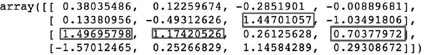

图 3-4　max（）函数分解演示

从上面的输出可以看到，使用 np.max（）函数只能统计出某个交易日的最大涨幅，但是并不知道是哪一只股票，而使用 np.argmax（）函数即可实现统计出哪一只股票在某个交易日的涨幅最大，例如：

* * *

```
print '最大涨幅股票{}'.format(np.argmax(stock_day_change_four, axis=0))
```

* * *

输出如下：

* * *

```
最大涨幅股票[2 2 1 2]
```

* * *

输出的 2212 代表：第一个交易日涨幅最大的为第 3 只股票，第 2 个交易日涨幅最大的为第 3 只股票，第 3 个交易日涨幅最大的为第 2 只股票，第 4 个交易日涨幅最大的为第 3 只股票。

同理，使用 np.argmin（）函数可以统计出哪一只股票在某个交易日跌幅最大，例如：

* * *

```
print '最大跌幅股票{}'.format(np.argmin(stock_day_change_four, axis=0))
```

* * *

输出如下：

* * *

```
最大跌幅股票[3 1 0 1]
```

* * *

下面分别统计出 4 个交易日中最大跌幅、振幅幅度和平均涨跌数据，使用参数 axis=0，示例如下：

* * *

```
print '最大跌幅 {}'.format(np.min(stock_day_change_four, axis=0))
print '振幅幅度 {}'.format(np.std(stock_day_change_four, axis=0))
print '平均涨跌 {}'.format(np.mean(stock_day_change_four, axis=0))
```

* * *

输出如下：

* * *

```
最大跌幅 [-1.57012465 -0.49312626 -0.2851901  -1.03491806]
振幅幅度 [ 1.09773969  0.59620404  0.69038879  0.64260976]
平均涨跌 [ 0.11024944  0.26408601  0.64222991 -0.01173711]
```

* * *

初学者很难记住轴向坐标，可以记住下面这张图 3-5。

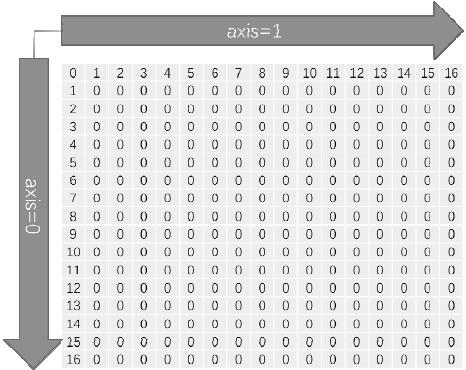

图 3-5　轴向坐标

备注：Python 标准库中的 max（）、min（）函数与 np.max（）、np.min（）函数的作用是相同的，在数据量非常小的情况下使用 NumPy 库执行效率反而会低下，所以不要所有的操作都使用 NumPy，类似情况还有 round（）等函数的使用。

#### 3.2.2　基础统计概念

本节主要针对前面提到的期望（np.mean（））、方差（np.var（））、标准差（np.std（））等概念进行简单讲解。

1．期望

在概率论和统计学中，期望是试验中每次可能结果的概率乘以其结果的总和，反映一组数据平均取值的大小，用于表示分布的中心位置。

在生活中，我们对未知事件有一个预期，也就是我们的期望。比如我们会根据一般的狗的孕产周期，来期望自家小狗的孕产周期（猫三狗四），而不会期望 10 个月生下小狗。

期望公式：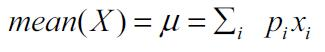  

2．方差

在概率论和统计学中，方差是衡量一组数据离散程度的度量，概率论中方差用来度量数据和其期望之间的离散程度，方差越大，说明数据越离散。

方差公式：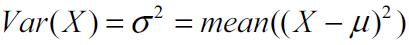

3．标准差

标准差为方差的算术平方根，标准差和变量的计算单位相同，所以比方差清晰。因此很多时候在分析时使用更多的是标准差，方差与标准差都可以用于表示分布的离散程度。

标准差公式：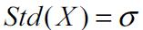

回到股票市场示例，如果有 a、b 两个交易者，他们多次交易的平均战果都是赚 100 元，那么他们两个人的期望都是 100，但是 a 交易者获利的获利稳定性不好，假设振幅为 50 即标准差为 50，b 交易者获利的获利稳定性比 a 好，假设振幅为 20，即标准差为 20，示例如下：

* * *

```
a_investor = np.random.normal(loc=100, scale=50, size=(100, 1))
b_investor = np.random.normal(loc=100, scale=20, size=(100, 1))
```

* * *

下面输出计算生成数据的标准差、方差及期望数据，结果期望都趋于 100，a 交易者标准差接近 50，b 交易者标准差接近 20。

* * *

```
# a 交易者
print 'a 交易者期望{0:.2f}元, 标准差{1:.2f}, 方差{2:.2f}'.format(
    a_investor.mean(), a_investor.std(), a_investor.var())
# b 交易者
print 'b 交易者期望{0:.2f}元, 标准差{1:.2f}, 方差{2:.2f}'.format(
    b_investor.mean(), b_investor.std(), b_investor.var())
```

* * *

输出如下：

* * *

```
a 交易者期望 101.03 元, 标准差 48.81, 方差 2381.93
b 交易者期望 99.73 元, 标准差 22.57, 方差 509.55
```

* * *

备注：这里只生成 100 次交易数据，数据越多越接近初始值。

下面由可视化角度看一下 a 和 b 两位交易者的获利图，注意图 3-6 中的 3 条直线分别代表：

·均值获利期望线；

·均值获利期望线＋获利标准差；

·均值获利期望线－获利标准差。

读者从可视化的角度理解一下：

·为何标准差可以量化数据的振幅？

·标准差与方差是独立于期望的另一个对分布的度量，两个分布完全可能有相同的期望，而方差标和准差则不同。

更多可视化内容，将在“第五章量化工具——可视化”中详细介绍。

a 交易者：

* * *

```
# a 交易者期望
a_mean = a_investor.mean()
# a 交易者标准差
a_std = a_investor.std()
# 收益绘制曲线
plt.plot(a_investor)
# 水平直线 上线
plt.axhline(a_mean + a_std, color='r')
# 水平直线 均值期望线
plt.axhline(a_mean, color='y')
# 水平直线 下线
plt.axhline(a_mean - a_std, color='g')
```

* * *

输出如下，结果如图 3-6 所示。

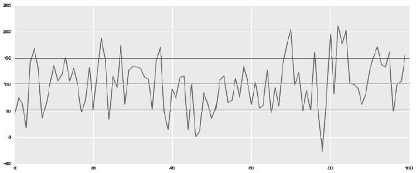

图 3-6　a 交易者

b 交易者：

* * *

```
b_mean = b_investor.mean()
b_std = b_investor.std()
# b 交易者收益绘制曲线
plt.plot(b_investor)
# 水平直线 上线
plt.axhline(b_mean + b_std, color='r')
# 水平直线 均值期望线
plt.axhline(b_mean, color='y')
# 水平直线 下线
plt.axhline(b_mean - b_std, color='g')
```

* * *

输出如图 3-7 所示。

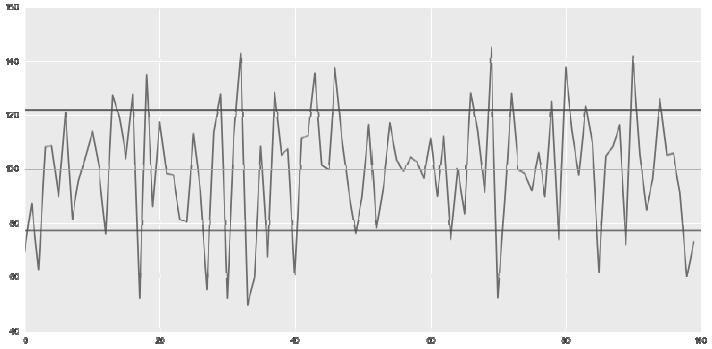

图 3-7　b 交易者

备注：除了上述分布度量工具外，偏度（skew）与峰度（kurt）也经常使用，本书由于篇幅所限，不再介绍，更多内容读者可自行查阅相关资料。

·Skew：偏度，密度函数曲线尾部的相对长度，由公式得名三阶矩 skewness=（（x-mean）\*\*3）.mean/std\*\*3；

·Kurt：峰度，反映频数分布曲线顶端尖峭或扁平程度的指标，由公式得名四阶矩 kurtosis=（（x-mean）\*\*4）.mean/std\*\*4。

### 3.3　正态分布

#### 3.3.1　正态分布基础概念

正态分布（normal distribution）是常用的概率分布。正态分布又被称为高斯分布（gauss distribution），因为高斯在 1809 年使用该分布来预测星体位置，正态曲线呈钟形，两头低，中间高，左右对称，因此又被称之为钟形曲线。

正态分布的特点：

·对于正态分布，数据的标准差越大，数据分布离散程度越大；

·对于正态分布，数据的期望位于曲线的对称轴中心。

下面继续使用本章开始时 stock\_day\_change=np.random.standard\_normal（（stock\_cnt，view\_days））生成的服从正态分布的股票数据做示例。

拿出随机生成的第一只股票的涨跌数据 stock\_day\_change\[0\]画出直方图，如图 3-8 所示，可以看出服从正态分布（呈钟形，两头低，中间高，左右对称），尾部逐渐趋近于 0，且均值期望趋于 0，振幅标准差趋于 1。

* * *

```
import scipy.stats as scs
# 均值期望
stock_mean = stock_day_change[0].mean()
# 标准差
stock_std = stock_day_change[0].std()
print '股票 0 mean 均值期望:{:.3f}'.format(stock_mean)
print '股票 0 std 振幅标准差:{:.3f}'.format(stock_std)
# 绘制股票 0 的直方图
plt.hist(stock_day_change[0], bins=50, normed=True)
# linspace 从股票 0 最小值－> 最大值生成数据
fit_linspace = np.linspace(stock_day_change[0].min(),
                           stock_day_change[0].max())
# 概率密度函数(PDF，probability density function)
# 由均值、方差来描述曲线，使用 scipy.stats.norm.pdf 生成拟合曲线
pdf = scs.norm(stock_mean, stock_std).pdf(fit_linspace)
# plot x, y
plt.plot(fit_linspace, pdf, lw=2, c='r')
```

* * *

输出如下：

* * *

```
股票 0 mean 均值期望:-0.020
股票 0 std 振幅标准差:1.007
```

* * *

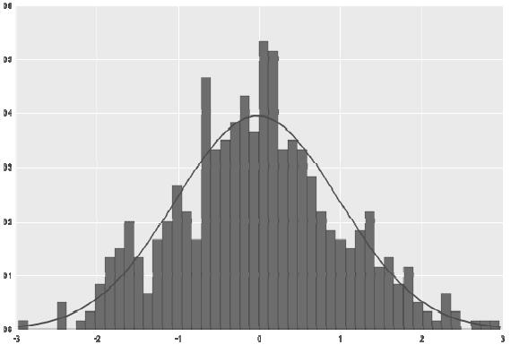

图 3-8　直方图和 pdf 曲线

上面的 pdf（）函数在统计学中称为概率密度函数，是指在某个确定的取值点附近的可能性的函数，将概率值分配给各个事件，得到事件的概率分布，让事件数值化，上面的 scs.norm 返回的 pdf 数值如下：

* * *

```
pdf
```

* * *

输出如下：

* * *

```
array([ 0.0054162 ,  0.00765058,  0.01065132,  0.01461578,  0.0197674 ,
        0.02635034,  0.03462041,  0.04483193,  0.05722053,  0.07198226,
        0.08925001,  0.10906873,  0.1313716 ,  0.15595953,  0.18248684,
        0.21045555,  0.23922051,  0.26800671,  0.29593894,  0.32208298,
        0.3454957 ,  0.36528069,  0.38064488,  0.39095113,  0.39576206,
        0.39487083,  0.38831588,  0.3763782 ,  0.35956132,  0.33855613,
        0.3141938 ,  0.28739138,  0.25909502,  0.2302256 ,  0.20163103,
        0.17404851,  0.14807866,  0.12417204,  0.10262765,  0.08360152,
        0.06712328,  0.05311796,  0.04143036,  0.0318497 ,  0.02413243,
        0.01802213,  0.0132654 ,  0.00962374,  0.00688139,  0.00484974])
```

* * *

统计套利中均值回复策略的理论依据为价格将围绕价值上下波动。与之类似，正态分布最大的特点即为它的数据会围绕某个期望均值附近上下摆动，摆动幅度为数据的标准差。下面使用正态分布的这个特点做一个简单的量化小策略。

备注：均值回复策略将在第七章中具体讲解。

#### 3.3.2　实例 1：正态分布买入策略

继续使用之前生成的 200 只股票 504 天的服从正态分布涨跌数据，保留后 50 天的随机数据作为策略验证数据，统计前 454 天中跌幅最大的 3 只股票，假设在第 454 天买入这 3 只股票，结果如何呢？

·np.sort（）针对序列进行排序；

·np.argsort（）将展示排序的原序列号。

* * *

```
# 保留后 50 天的随机数据作为策略验证数据
keep_days = 50
# 统计前 454 天中的 200 只股票的涨跌数据, 切片切出 0-454day，view_days = 504
stock_day_change_test = stock_day_change[:stock_cnt,
                        0:view_days - keep_days]
# 打印出前 454 天中跌幅最大的 3 只股票，总跌幅通过 np.sum()函数计算，np.sort()函数对结果排序
print np.sort(np.sum(stock_day_change_test, axis=1))[:3]
# 使用 np.argsort()函数针对股票跌幅进行排序，返回序号，即符合买入条件的股票序号
stcok_lower_array = np.argsort(np.sum(stock_day_change_test, axis=1))[
:3]
＃ 输出符合买入条件的股票序号
stcok_lower_array
```

* * *

输出如下：

* * *

```
[-63.3678566  -58.85378699 -45.36941461]
array([109, 132,  53])
```

* * *

上面输出第一个序列中的元素分别代表 3 只跌幅最大的股票前 454 日总共下跌的幅度，可看到跌幅最大的股票下跌了-63.3678566。第二个序列中的元素分别代表 3 只跌幅最大的股票在 NumPy 对象 stock\_day\_change 中的序号。

封装函数 show\_buy\_lower（）可视化选中的前 3 只跌幅最大的股票前 454 日走势，以及从第 454 日买入后的走势，代码如下：

* * *

```
def show_buy_lower(stock_ind):
    """
    :param stock_ind: 股票序号,即在 stock_day_change 中的位置
    :return:
    """
    # 设置一个一行两列的可视化图表
    _, axs = plt.subplots(nrows=1, ncols=2, figsize=(16, 5))
    # view_days504 - keep_days50 = 454
    # 绘制前 454 天的股票走势图，np.cumsum()：序列连续求和
    axs[0].plot(np.arange(0, view_days - keep_days),
                stock_day_change_test[stock_ind].cumsum())
    # [view_days504 - keep_days50 = 454 : view_days504]
    # 从第 454 天开始到 504 天的股票走势
    cs_buy = stock_day_change[stock_ind][
             view_days - keep_days:view_days].cumsum()
    # 绘制从第 454 天到 504 天中股票的走势图
    axs[1].plot(np.arange(view_days - keep_days, view_days), cs_buy)
    # 返回从第 454 天开始到第 504 天计算盈亏的盈亏序列的最后一个值
    return cs_buy[-1]
```

* * *

假设等权重地买入 3 只股票，输出如图 3-9 所示只有一只买入的股票还保持跌势，其他两只股票开始了涨势，结果最后的 50 天总收益为 16.43%，示例如下：

* * *

```
# 最后输出的盈亏比例
profit = 0
# 遍历跌幅最大的 3 只股票序号序列
for stock_ind in stcok_lower_array:
    # profit 即 3 只股票从第 454 天买入开始计算，直到最后一天的盈亏比例
    profit += show_buy_lower(stock_ind)
# str.format 支持{:.2f}形式保留两位小数
print '买入第 {} 只股票，从第 454 个交易日开始持有盈亏:{:.2f}%'.format(
    stcok_lower_array, profit)
```

* * *

输出结果如图 3-9 所示。

买入第\[10913253\]只股票，从第 454 个交易日开始持有盈亏：16.43%

这个策略之所以可以盈利，是由于通过 np.random.standard\_normal（）建立的服从正态分布的涨跌数据，这样我们买入前 454 天中跌幅最大的 3 只股票的理论依据就是按照正态分布理论，这 3 只股票后期的涨跌分布一定是涨的概率大于跌的概率。

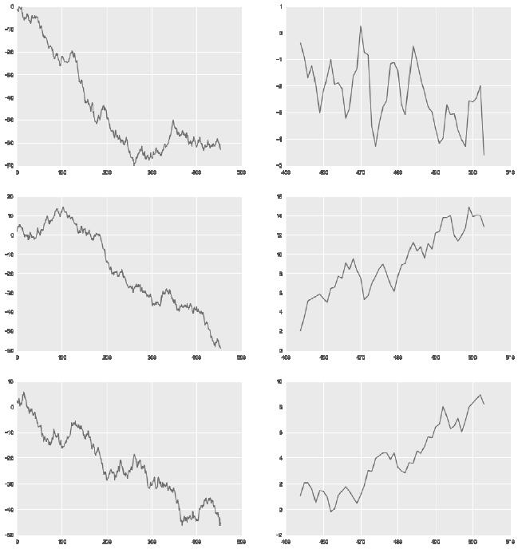

图 3-9　正态分布买入持有

早期华尔街的很多策略算法认为市场的涨跌将服从正态分布：一方面因为很多统计数据确实显示正态分布存在于很多金融市场；另一方面编写符合正态分布规律的算法更为简单。

现实中的情境由于人的参与及很多突发异常事件，导致市场不可能绝对服从正态分布，导致尾部也就不那么苗条了，也就是“肥尾”。

### 3.4　伯努利分布

除正态分布外，伯努利分布在量化分析中也是频繁用到的分布。

#### 3.4.1　伯努利分布基础概念

伯努利分布是很简单的离散分布，在伯努利分布下，随机变量只有两个可能的取值：即 1 和 0。如果随机变量取值 1 的概率为 p，则随机变量取值 0 的概率为 1-p。

在 NumPy 中使用 numpy.random.binomial（1，p）来获取 1 的概率为 p 的前提下，生成的随机变量。如果 p=0.5 的话，那么就类似投掷硬币的结果，即正面在上和反面在上的概率相同，下面使用 binomial 来做一个综合实例。

#### 3.4.2　实例 2：如何在交易中获取优势

在交易中，交易者永远是处于不利地位的，不利的情况就是需要交手续费，你可能会说那个没有多少钱（笔者遇到过很多交易者，特别是在牛市中挣到钱的人都是这种想法），如果你随机地胡乱买卖股票，在有足够多的本钱的情况下交易足够多的次数，最后的结果一定是符合正太分布的；但如果每次要多交 1%的手续费，情况就大不一样了，赌场要抽头，不抽头的赌场一定有“老千”。

实现函数 casino（）：假设有 100 个赌徒，每个赌徒都有 1000000 元，并且每个人都想在赌场玩 1000 万次，在不同的胜率、赔率和手续费下 casino（）函数返回总体统计结果，代码如下：

* * *

```
# 设置 100 个赌徒
gamblers = 100
def casino(win_rate, win_once=1, loss_once=1, commission=0.01):
    """
        赌场：简单设定每个赌徒都有 1000000 元，并且每个赌徒都想在赌场玩 10000000 次，
        但是如果没钱了就别想玩了
        win_rate:   输赢的概率
        win_once:   每次赢的钱数
        loss_once:  每次输的钱数
        commission: 手续费这里简单设置为 0.01 1%
    """
    my_money = 1000000
    play_cnt = 10000000
    commission = commission
    for _ in np.arange(0, play_cnt):
        # 使用伯努利分布，根据 win_rate 来获取输赢
        w = np.random.binomial(1, win_rate)
        if w:
            # 赢了 +win_once
            my_money += win_once
        else:
            # 输了 -loss_once
            my_money -= loss_once
        # 手续费
        my_money -= commission
        if my_money <= 0:
            # 没钱就别玩了，不赊账
            break
    return my_money
```

* * *

假设天堂赌场，没有“老千”，也没有抽头的情况：

* * *

```
# 100 个赌徒进场天堂赌场，胜率 0.5，赔率 1，还没手续费 
heaven_moneys = [casino(0.5, commission=0) for _ in
                 np.arange(0, gamblers)]
```

* * *

假设没有抽头，有“老千”，导致胜率只能达到 0.4 即 40%的情况：

* * *

```
# 100 个赌徒进场开始，胜率 0.4，赔率 1，没手续费 
cheat_moneys = [casino(0.4, commission=0) for _ in
                np.arange(0, gamblers)]
```

* * *

假设有抽头，没有“老千”，手续费 0.01 的情况：

* * *

```
# 100 个赌徒进场开始，胜率 0.5，赔率 1，手续费 0.01 
commission_moneys = [casino(0.5, commission=0.01) for _ in
                     np.arange(0, gamblers)]
```

* * *

分别可视化上述情况下赌徒最终的交易结果，如下所示。

（1）天堂赌场，大家都能活下来，每个人亏的和赚的最后都不太多，如图 3-10 所示。

* * *

```
_ = plt.hist(heaven_moneys, bins=30)
```

* * *

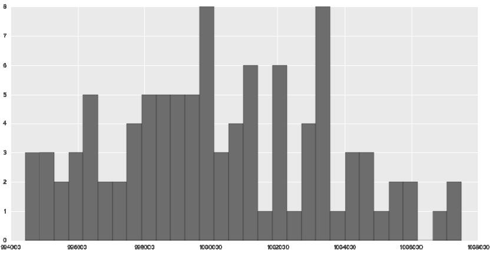

图 3-10　天堂赌场

（2）有“老千”的赌场没有人能活下来，钱都归 0 了，如图 3-11 所示。

* * *

```
_ = plt.hist(cheat_moneys, bins=30)
```

* * *

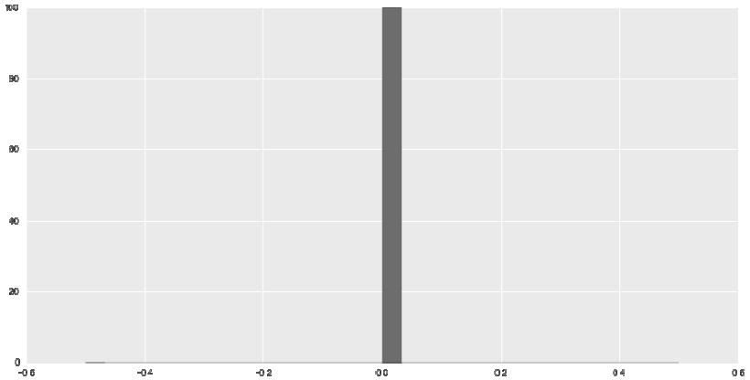

图 3-11　有“老千”的赌场

（3）有抽头的赌场，没有一个人赚钱，都是亏钱，当玩的次数再加大一个数量级时，最后的结果也一定是归 0，如图 3-12 所示。

* * *

```
_ = plt.hist(commission_moneys, bins=30)
```

* * *

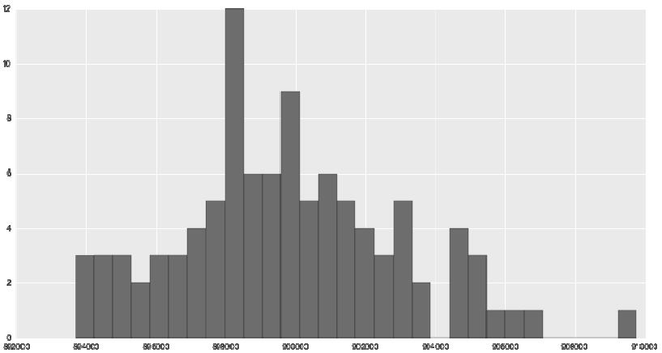

图 3-12　有抽头的赌场

假设我们的投资市场没有“老千”，但是一定会有手续费，这样的话注意上面的赌场函数，我们不能期待自己有“老千”的能力，也就是说如果你能有内部消息，胜率会提高到 60%或者更高。

那么就只有每次赢钱和每次输钱的参数了。下面把参数设置为每次赢相比默认值 win\_once 多出两个点，即提高 win\_once 1.0->1.02，每次输相比默认值 coss\_once 少两个点，即降低 loss\_once 1.0->0.98，这样的话赔率即为 1.02/0.98＝1.040816，下面让 100 个赌徒进入这个非均衡赔率的赌场。

示例如下：

* * *

```
# 100 个赌徒进场开始，胜率 0.5，赔率 1.04，手续费 0.01
moneys = [casino(0.5, commission=0.01, win_once=1.02, loss_once=0.98)
          for _ in np.arange(0, gamblers)]
_ = plt.hist(moneys, bins=30)
```

* * *

输出如图 3-13 所示。

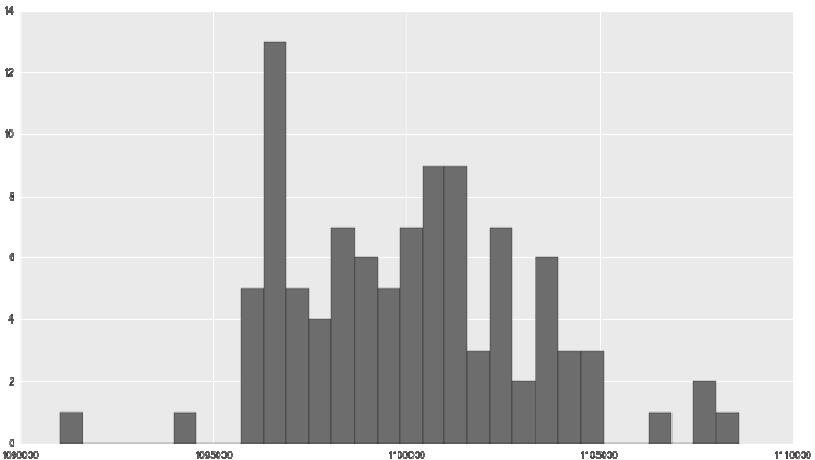

图 3-13　非均衡赔率赌场

从图 3-13 的直方图中可以发现每个人都能赢钱了，这也不合理啊。当然了，你凭什么能每次多赢，每次少输呢？

每本关于交易的书籍都会提到止损的策略，这些策略的核心思想就是让赚钱的股票多赚钱，让亏损的股票少亏损（让盈利奔跑，让亏损尽快了结）。这样的结果就是亏损的次数比赢钱的次数多，每次赢的钱比每次亏的钱多，也就是高止盈位，低止损位。

使用上述止盈止损策略后，会降低胜率，所以不能平白无故地提高 win\_once，对应的要降低 win\_rate。这里假设 win\_rate 是 0.45 即胜率为 0.45，赔率依然使用上面的设置，win\_once 1.0->1.02，loss\_once 1.0->0.98，即赔率依然为 1.02/0.98＝1.040816，下面让 100 个赌徒进入这个非均衡胜率和非均衡赔率共同生效的赌场。

示例如下：

* * *

```
# 100 个赌徒进场开始，胜率 0.45，赔率 1.04，手续费 0.01
moneys = [casino(0.45, commission=0.01, win_once=1.02, loss_once=0.98)
          for _ in np.arange(0, gamblers)]
_ = plt.hist(moneys, bins=30)
```

* * *

输出如图 3-14 所示。

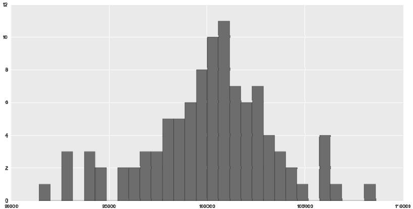

图 3-14　非均衡胜率和非均衡赔率

看到图 3-14 了吧，最后的结果就是又回到了有输有赢的情况，也就是产生了天堂赌场的感觉。

大多数交易者的胜率非常高，但他们的账户最终都是亏损的，交易中最虚幻的就是胜率，但是大多数人追求的反而是胜率，不关注盈亏比等其他重要因素，量化交易的核心依然是交易，交易的基本法则依然适用。

备注：本节问题在“第九章量化系统——度量与优化”章节中会详细讲解。

### 3.5　本章小结

·NumPy 的并行化操作思想在之后的 pandas 章节将继续延伸，初学者要熟练这种思想需要一定的练习。

·关于统计学知识，这里只挑选重要的知识进行讲解，量化需要的其他数学知识将在“第六章量化工具——数学”中详细讲解。

·本书并不是一本专门讲解交易知识的书，很多交易知识会在例子中阐述，如本章最后一个实例。

统计工具中的相关性原理及使用在本书“附录 B 量化相关性分析”中将详细讲解，推荐阅读完全书后再阅读。

## 第四章　量化工具——pandas  

pandas 在 Python 金融数据分析、量化交易等领域起到了至关重要的作用，pandas 的两大主要工具 DataFrame 和 Series 的框架设计与 API 参考方向，都是来源于统计分析语言 R。

可以这样说，如果没有 pandas，对于金融数据分析，还应该是 R 语言的天下。对于大数据处理更闻名的是 Hadoop 和 Spark，它们的优势是基于集群的云端数据处理，如果你的数据有几 GB，甚至 1～2TB，那么使用 pandas 也是处理数据的最好选择。

### 4.1　基本操作方法

以下引用 pandas 的方式是一种约定俗成的方式，也是 pandas 官方推荐：

* * *

```
import pandas as pd
```

* * *

4.1.1　DataFrame 构建及方法

在有 NumPy 的情况下使用 pandas 究竟有什么好处呢？下面使用第三章中 NumPy 保存在本地的数据，即 200 只股票、504 个交易日的涨跌幅虚拟随机数据作为示例。

* * *

```
stock_day_change = np.load('./gen/stock_day_change.npy')
stock_day_change.shape
```

* * *

输出如下：

* * *

```
(200, 504)
```

* * *

前面在 3.2.1 节中使用 np.argmax（）纵向寻找哪一只股票在某个交易日涨幅最大，最后得出的结果也只是一个数字序列，如果要对应到股票，还需要一个字典，记录股票代码对应关系，使用 pandas 就能很容易地解决这个问题，下面我们一步一步来。

首先构建一个 DataFrame 对象，只传入 NumPy 对象 stock\_day\_change，使用 head（）方法显示生成的表格对象的前 5 行数据，head（）函数接受 int 参数，如要显示前 10 行数据，也可以使用 head（10）。与 head（）对应着一个 tail（）方法，该方法是从表格尾部倒数 5 行数据。

备注：pandas 是在 NumPy 基础上构建的，所以 NumPy 的很多使用方式以及 NumPy 的很多通用函数都是可以直接在 pandas 的对象上直接使用，比如 head（）对应索引切片\[：5\]，tail（）对应索引切片\[-5：\]。

下面 3 种写法输出完全相同。

* * *

```
pd.DataFrame(stock_day_change).head()
pd.DataFrame(stock_day_change).head(5)
pd.DataFrame(stock_day_change)[:5]
```

* * *

输出结果如表 4-1 所示。

表 4-1　head（）函数输出结果

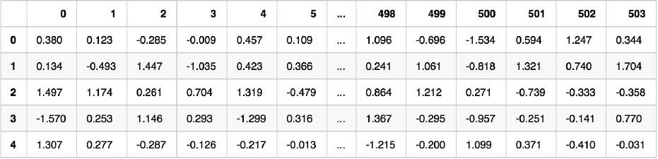

备注：输出如表 4-1 所示，head（）方法返回结果为 DataFrame 对象，在 IPython Notebook 环境下支持对 DataFrame 对象表格化输出，本书出现的类似表格都是程序输出的网页截图，并非是作者自己制作的表格。

从表 4-1 中可以看出，使用 NumPy 数组直接构建 DataFrame 对象，会默认将行列索引加上数字序号，这样的话和使用 NumPy 对象 stock\_day\_change\[0，0\]的数据意义“第 0 只股票第 0 个交易日的涨跌幅”相比较并没有显著提升。下面的示例将使用更有意义的行列索引名称，让数据的意义得到显著提升。

#### 4.1.2　索引行列序列

下面的代码使用股票 0、股票 1 作为股票的行索引。

* * *

```
# 股票 0 -> 股票 stock_day_change.shape[0]
stock_symbols = ['股票 ' + str(x) for x in
                 range(stock_day_change.shape[0])]
# 通过构造直接设置 index 参数，head(2)就显示两行，表 4-2 所示
pd.DataFrame(stock_day_change, index=stock_symbols).head(2)
```

* * *

输出结果如表 4-2 所示。

下面使用 pd.date\_range（）函数生成一组连续的时间序列，使用生成的序列作为 DataFrame 的列索引，代表每一个交易日，通过 columns 参数传入时间序列初始化 DataFrame 对象。

表 4-2　添加行索引后的输出结果

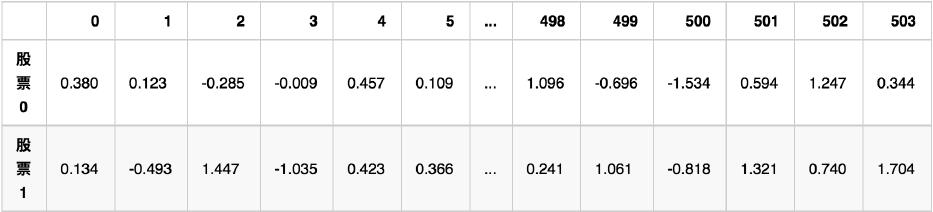

* * *

```
# 从 2017-1-1 向上时间递进，单位 freq='1d'即 1 天
days = pd.date_range('2017-1-1',
                     periods=stock_day_change.shape[1], freq='1d')
# 股票 0 -> 股票 stock_day_change.shape[0]
stock_symbols = ['股票 ' + str(x) for x in
                 range(stock_day_change.shape[0])]
# 分别设置 index 和 columns
df = pd.DataFrame(stock_day_change, index=stock_symbols, columns=days)
# 表 4-3 所示
df.head(2)
```

* * *

输出结果如表 4-3 所示。

表 4-3　时间序列作为索引的结果

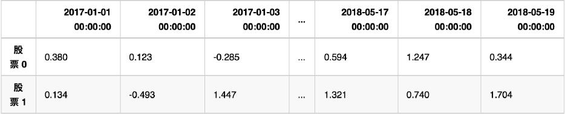

#### 4.1.3　金融时间序列

在量化分析中最常见的数据类型是金融时间序列，对于时间序列，pandas 拥有非常丰富友好的方法来分析挖掘数据。下面的代码首先将数据 df 做个转置，得到行索引为时间，列索引为股票代码的金融时间序列。

* * *

```
# df 做个转置
df = df.T
# 表 4-4 所示
df.head()
```

* * *

输出结果如表 4-4 所示。

表 4-4　金融时间序列输出结果  

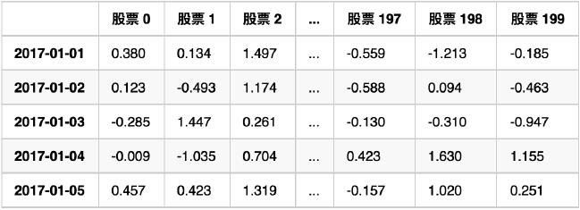

以下代码对 df 进行重新采样，以 21 天为周期，对 21 天内的时间求平均来重新塑造数据。

* * *

```
df_20 = df.resample('21D', how='mean')
# 表 4-5 所示
df_20.head()
```

* * *

输出结果如表 4-5 所示。

表 4-5　21 天重采样输出结果

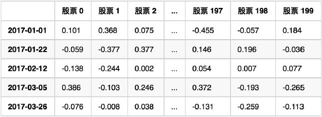

#### 4.1.4　Series 构建及方法

使用上面一个股票的时间序列数据，可以直接通过列索引 df\['股票 0'\]得到股票 0 的时间序列涨跌幅数据，通过 type（df\_stock0）来查看返回类型，发现返回的是 Series 类型，代码如下：

* * *

```
df_stock0 = df['股票 0']
# 打印 df_stock0 类型
print(type(df_stock0))
# 打印出 Series 的前 5 行数据, 与 DataFrame 一致
df_stock0.head()
```

* * *

输出如下：

* * *

```
<class 'pandas.core.series.Series'>
2017-01-01    0.380355
2017-01-02    0.122597
2017-01-03   -0.285190
2017-01-04   -0.008897
2017-01-05    0.457319
Freq: D, Name: 股票 0, dtype: float64
```

* * *

Series 是 pandas 中另一个非常重要的类，可以简单理解 Series 是只有一列数据的 DataFrame 对象，它们之间大多数的函数都是可以通用的，使用方式也很类似，比如上面使用 head（）函数打印出 Series 的前 5 行数据。

下面的代码通过将 Series 做连续相加操作 cumsum（），得到新的时间序列，新的时间序列中只使用了一行代码 plot（）就画出了股票涨跌走势图，如图 4-1 所示。

备注：关于使用 pandas 的更多可视化操作，将在后续章节详细讲解。

* * *

```
df_stock0.cumsum().plot()
```

* * *

输出结果如图 4-1 所示。

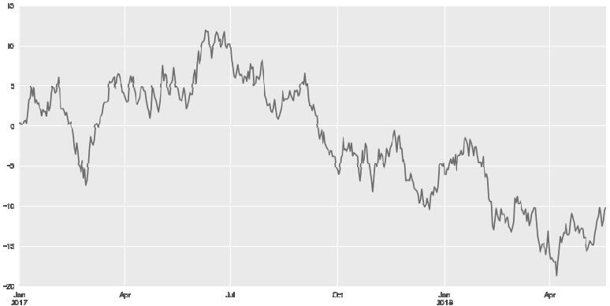

图 4-1　涨跌走势图

本质上 pandas 在基于封装 NumPy 的数据操作上还封装了 Matplotlib，起到了承上启下的重要作用，在它的帮助下，我们可以用很简短的代码完成复杂的任务。

#### 4.1.5　重采样数据

继续之前的 resample（）函数重采样话题，所有股票网站都提供了日 K 线、周 K 线、月 K 线等周期数据，但最原始的数据只有日 K 线数据。下面的代码通过重采样实现周 K 线、月 K 线的构建。刚刚构建使用的 how 参数的值是 mean，下面的代码使用 how=ohlc，它代表周期的 open、high、low 和 close 值，所以结果从一个列的 Series 变成了有 4 列数据的 DataFrame。

* * *

```
# 以 5 天为周期重采样（周 K）
df_stock0_5 = df_stock0.cumsum().resample('5D', how='ohlc')
# 以 21 天为周期重采样（月 K），
df_stock0_20 = df_stock0.cumsum().resample('21D', how='ohlc')
# 打印 5 天重采样，如下输出 2017-01-01, 2017-01-06, 2017-01-11,如表 4-6 所示
df_stock0_5.head()
```

* * *

输出结果如表 4-6 所示。

表 4-6　5 天重采样 head（）结果

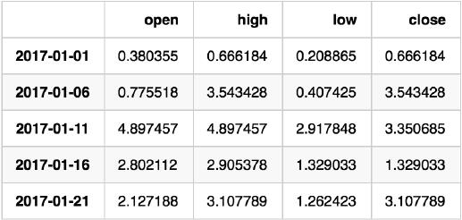

下面的代码使用 abu 量化系统中的 ABuMarketDrawing.plot\_candle\_stick（）方法，将数据的高开低收 K 线图绘制出来，也就是成功地从日线级别的数据重新构建出周线的数据，并且可视化。（abu 量化系统代码地址请通过微信公众号 abu\_quant 获取，本书所有示例的 IPython Notebook 代码也在对应目录中。）

·注意下面 K 线线图的 volume 成交量通过 np.random.random（len（df\_stock0\_5）生成随机数据填充；

·K 线图的绘制将在数据可视化章节详细讲解；

·对 df\_stock0\_20 月 K 线数据，读者可自己动手测试查看效果，也可以亲自实践，实现其他级别的周期重建。

* * *

```
from abupy import ABuMarketDrawing 
# 图 4-2 所示
ABuMarketDrawing.plot_candle_stick(df_stock0_5.index,
                                   df_stock0_5['open'].values,
                                   df_stock0_5['high'].values,
                                   df_stock0_5['low'].values,
                                   df_stock0_5['close'].values,
                                   np.random.random(len(df_stock0_5)),
                                   None, 'stock', day_sum=False,
                                   html_bk=False, save=False)
```

* * *

输出结果如图 4-2 所示。

注意上面的代码使用了 df\_stock0\_5\['open'\].values 属性，values 是一个 NumPy 对象，DataFrame 对象的行索引属性为 index，列索引属性为 columns，代码如下：

* * *

```
print type(df_stock0_5['open'].values)
print df_stock0_5['open'].index
print df_stock0_5.columns
```

* * *

输出如下：

* * *

```
<type 'numpy.ndarray'>
DatetimeIndex(['2017-01-01', '2017-01-06', '2017-01-11', '2017-01-16',
               '2017-01-21', '2017-01-26', '2017-01-31', '2017-02-05',
               '2017-02-10', '2017-02-15',
               ...
               '2018-04-01', '2018-04-06', '2018-04-11', '2018-04-16',
               '2018-04-21', '2018-04-26', '2018-05-01', '2018-05-06',
               '2018-05-11', '2018-05-16'],
              dtype='datetime64[ns]', length=101, freq='5D')
Index([u'open', u'high', u'low', u'close'], dtype='object')
```

* * *

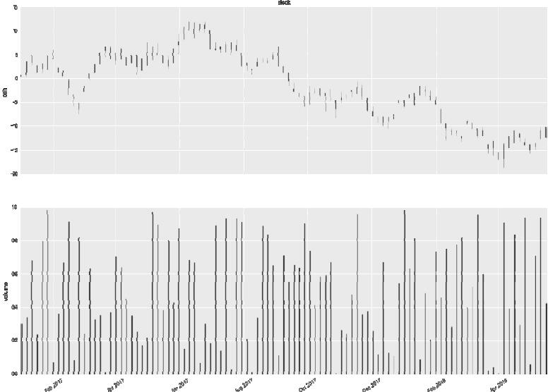

图 4-2　5 日重采样 K 线图

### 4.2　基本数据分析示例

下面我们使用真正的股票数据构建 DataFrame 对象，继续学习 pandas 的使用。首先获取特斯拉电动车两年的股票数据，如下所示。

* * *

```
from abupy import ABuSymbolPd
# n_folds=2 两年
tsla_df = ABuSymbolPd.make_kl_df('usTSLA', n_folds=2)
# 表 4-7 所示
tsla_df.tail()
```

* * *

输出如表 4-7 所示。

表 4-7　特斯拉电动车两年的股票数据


#### 4.2.1　总览分析数据

下面使用 pandas 的 plot（）函数展示 TSLA 在统计周期内的大致情况，注意只用了一行代码就可以画出走势图 4-3，非常 Python。

* * *

```
tsla_df[['close', 'volume']].plot(subplots=True, style=['r', 'g'],
                                  grid=True)
```

* * *

输出结果如图 4-3 所示。

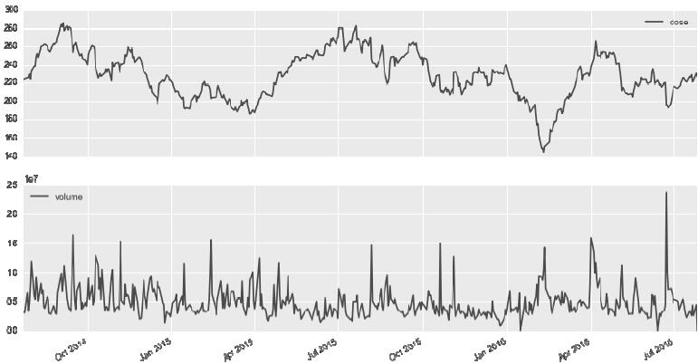

图 4-3　量价曲线图

pandas 的 Dataframe 对象总览数据的函数 info（）的用途是查看数据是否有缺失，以及各个子数据的数据类型，示例如下：

* * *

```
tsla_df.info()
```

* * *

输出如下：

* * *

```
<class 'pandas.core.frame.DataFrame'>
DatetimeIndex: 504 entries, 2014-07-23 to 2016-07-26
Data columns (total 12 columns):
close             504 non-null float64
high              504 non-null float64
low               504 non-null float64
netChangeRatio    504 non-null float64
open              504 non-null float64
preClose          504 non-null float64
volume            504 non-null int64
date              504 non-null int64
date_week         504 non-null int64
key               504 non-null int64
atr21             504 non-null float64
atr14             504 non-null float64
dtypes: float64(8), int64(4)
```

* * *

pandas 的 Dataframe 对象总览数据的函数 describe（）的用途是，分别展示每组数据的统计信息，使用效果如下：

* * *

```
# 表 4-8 所示
tsla_df.describe()
```

* * *

输出结果如表 4-8 所示。

表 4-8　describe（）函数输出结果

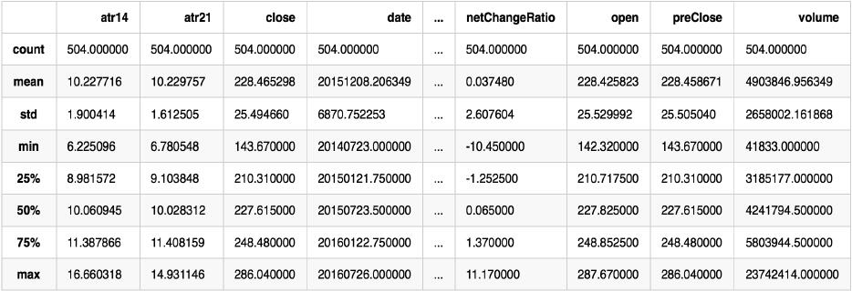

#### 4.2.2　索引选取和切片选择

NumPy 章节讲过使用索引选取序列和切片选择，pandas 支持类似 NumPy 一样的操作，但也可以直接使用列名、行名称，甚至组合使用，特点是需要使用 loc 或者 iloc 声明方式。

使用 loc 配合行名称、列名称选取切片示例如下：

* * *

```
# 2014-07-23 至 2014-07-31 开盘价格序列
tsla_df.loc['2014-07-23':'2014-07-31', 'open']
```

* * *

输出如下：

* * *

```
2014-07-23    220.01
2014-07-24    223.25
2014-07-25    222.72
2014-07-28    224.25
2014-07-29    226.61
2014-07-30    221.92
2014-07-31    229.26
Name: open, dtype: float64
```

* * *

loc 配合行名称，如不传列名则默认获取所有列，示例如下：

* * *

```
# 2014-07-23 至 2014-07-31 所有序列，表 4-9 所示
tsla_df.loc['2014-07-23':'2014-07-31']
```

* * *

输出结果如表 4-9 所示。

表 4-9　2014-07-23 至 2014-07-31 所有序列结果

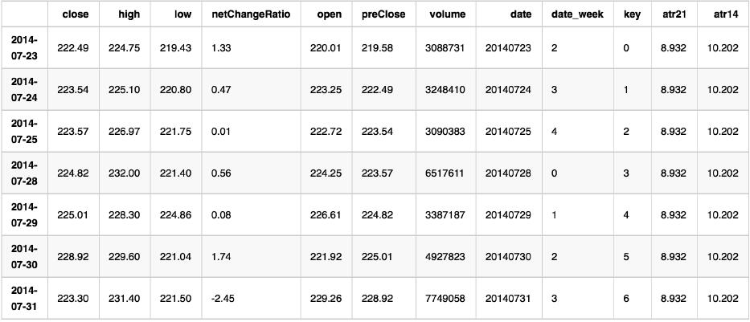

iloc 配合行索引数值及列索引数值选取切片（与 Numpy 相同），示例如下：

* * *

```
# [1:5]：(1，2，3，4)，[2:6]: (2, 3, 4, 5)
# 表 4-10 所示
tsla_df.iloc[1:5, 2:6]
```

* * *

输出结果如表 4-10 所示。

表 4-10　tsca\_df.iloc\[1：5，2：6\]结果

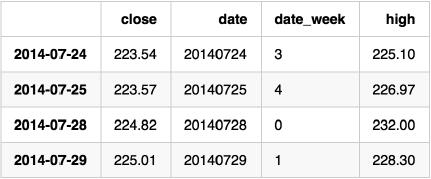

切取所有行或者列示例：

* * *

```
# 切取所有行[2:6]: (2, 3, 4, 5)列
tsla_df.iloc[:, 2:6]
# 选取所有的列[35:37]:(35, 36)行，表 4-11 所示
tsla_df.iloc[35:37]
```

* * *

输出结果如表 4-11 所示。

表 4-11　tsca\_df.iloc\[35：37\]结果

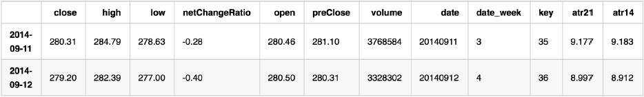

混合使用方式，实际项目中使用最频繁的就是这种方式了。

* * *

```
# 指定一个列
print tsla_df.close[0:3]
# 通过组成一个列表选择多个列，表 4-12 所示
tsla_df[['close', 'high', 'low']][0:3]
```

* * *

输出结果如表 4-12 所示。

* * *

```
2014-07-23    222.49
2014-07-24    223.54
2014-07-25    223.57
Name: close, dtype: float64
```

* * *

表 4-12　tsla\_df\[\['close'，'high'，'low'\]\]\[0：3\]结果

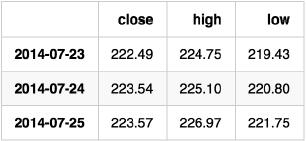

#### 4.2.3　逻辑条件进行数据筛选

句法结构与 NumPy 通过逻辑条件进行数据筛选，以下代码筛选出涨跌幅大于 8%的交易日数据。

* * *

```
#abs 为取绝对值的意思，不是防抱死，表 4-13 所示
tsla_df[np.abs(tsla_df.netChangeRatio) > 8]
```

* * *

输出结果如表 4-13 所示。

与 NumPy 一样，多重筛选条件，使用｜、&完成复合的逻辑，注意需要使用括号将每一个条件括起来。

表 4-13　涨跌幅大于 8%的交易日数据结果

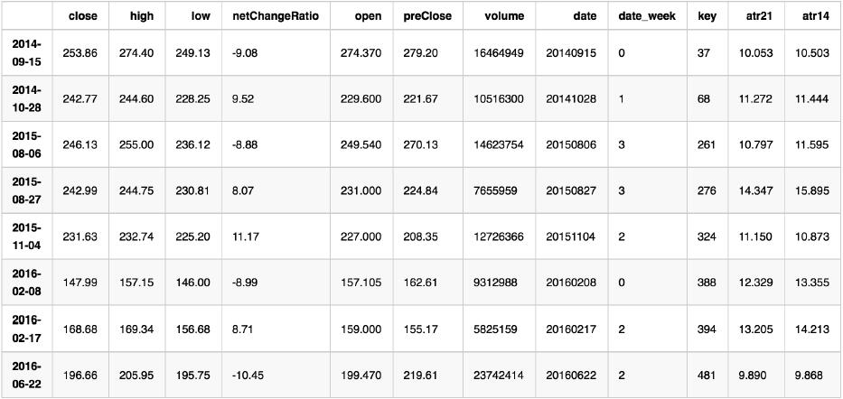

以下代码在筛选满足“涨跌幅大于 8%的交易日”的条件基础上，增加条件“交易成交量大于统计周期内的平均值的 2.5 倍”，完成后筛选出的数据就是股票交易中常说的放量突破（当然可以有更复杂的定义，比如持续 3 天保持趋势等）。

* * *

```
#表 4-14 所示
[（np.abs（tsla_df.netChangeRatio）>8）&（
tsla_df.volume>2.5*tsla_df.volume.mean（））]
输出结果如表 4-14 所示。
```

* * *

输出结果如表 4-14 所示。

表 4-14　放量突破结果

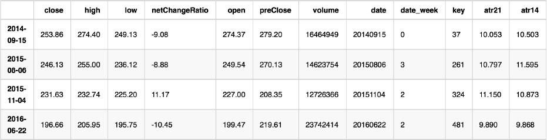

一个厨师在做菜，他需要有食材、调料，但要想做出一桌好吃的菜肴，则取决于他的食材组合和调料搭配，当然，最有技术含量的是火候，火候不能过，也不能不足。当一个厨师能认识所有的食材，辨别得出所有调料，知道它们的属性特征，它们的内在联系，掌握好火候时，就能做出一桌色、香、味俱全的好菜。现在读者正阅读学习的知识只是刀功、烹饪器具的使用，但是读者一定要把这些基础东西，学好、学通，只有这样才能自由地去研究食材的特性、搭配的好坏。不要因为刀功不好，而让上层的烹饪来适应下层，也不要因为某个厨房工具不会使用，挡住了对新菜的研发。

#### 4.2.4　数据转换与规整

1．数据序列值排序

以下代码对涨跌幅 netChangeRatio 进行排序，打印出跌幅最大的 5 个交易日：

* * *

```
# 表 4-15 所示
tsla_df.sort_index(by='netChangeRatio')[:5]
```

* * *

输出结果如表 4-15 所示。

表 4-15　跌幅最大的 5 个交易日结果

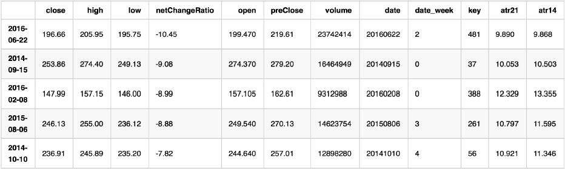

可以看到输出结果是按照从小到大的顺序，即升序排列的。

以下代码对涨跌幅 netChangeRatio 进行排序，通过 ascending=False 指定排序方式为降序，打印出涨幅最大的 5 个交易日。

* * *

```
# 表 4-16 所示
tsla_df.sort_index(by='netChangeRatio', ascending=False)[:5]
```

* * *

输出结果如表 4-16 所示。

表 4-16　涨幅最大的 5 个交易日结果

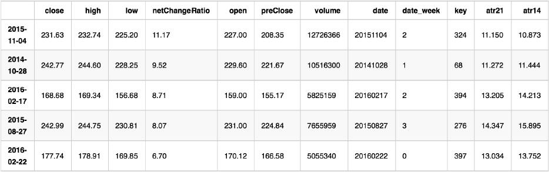

2．缺失数据的处理

pandas 在对缺失数据的处理上接口友好程度相对 NumPy 大幅度提升，以下为常用方法。

* * *

```
# 如果一行的数据中存在 na 就删除这一行
tsla_df.dropna()            
# 通过 how 控制，如果一行的数据中全部都是 na 就删除这行
tsla_df.dropna(how='all')    
# 使用指定值填充 na， inplace 代表就地操作，即不返回新的序列在原始序列上修改
tsla_df.fillna(tsla_df.mean(), inplace=True)
```

* * *

3．数据转换处理

pct\_change（）函数对序列从第二项开始向前做减法后再除以前一项，这个操作在股票量化等领域经常使用，因为 pct\_change（）针对价格序列的操作结果即是涨跌幅序列。

价格序列：

* * *

```
tsla_df.close[:3]
```

* * *

输出如下：

* * *

```
2014-07-23    222.49
2014-07-24    223.54
2014-07-25    223.57
Name: close, dtype: float64
```

* * *

针对价格序列做 pct\_change（）后即为涨跌幅。

* * *

```
tsla_df.close.pct_change()[:3]
```

* * *

输出如下：

* * *

```
2014-07-23         NaN
2014-07-24    0.004719
2014-07-25    0.000134
Name: close, dtype: float64
```

* * *

以上对价格序列 close 做 pct\_change（）分解详解，如图 4-4 所示。

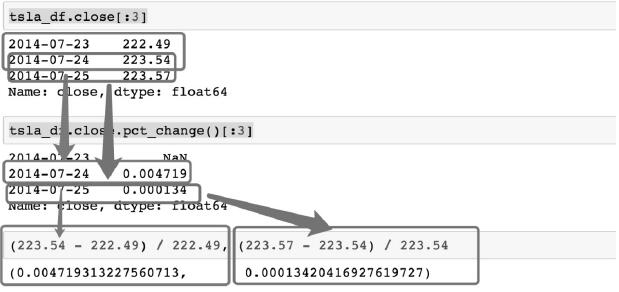

图 4-4　pct\_change（）分解详解

* * *

```
# 针对 close 做 pct_change()后的结果就是涨跌幅
change_ratio = tsla_df.close.pct_change()
change_ratio.tail()
```

* * *

输出如下：

* * *

```
2016-07-20    0.013762
2016-07-21   -0.034419
2016-07-22    0.008027
2016-07-25    0.034823
2016-07-26   -0.017738
Name: close, dtype: float64
```

* * *

round（）函数的使用如下：

* * *

```
# 将 change_ratio 转变成与 tsla_df.netChangeRatio 字段一样的百分百
# 同样保留两位小数
np.round(change_ratio[-5:] * 100, 2)
```

* * *

输出如下：

* * *

```
2016-07-20    1.38
2016-07-21   -3.44
2016-07-22    0.80
2016-07-25    3.48
2016-07-26   -1.77
Name: close, dtype: float64
```

* * *

上面使用 np.round（）函数保留数据小数点后两位。下面使用 Series 对象的 map（）函数针对列数据 atr21，来实现同样的功能。

·针对 DataFrame 对象使用 applymap（）来实现同样的功能；

·更多关于 apply（）方法的实例，请参考本章实例 3：跳空缺口。

* * *

```
format = lambda x: '%.2f' % x
tsla_df.atr21.map(format).tail()
```

* * *

输出如下：

* * *

```
2016-07-20    9.19
2016-07-21    9.17
2016-07-22    9.19
2016-07-25    9.27
2016-07-26    9.13
Name: atr21, dtype: object
```

* * *

#### 4.2.5　数据本地序列化操作

pandas 的 I/O 操作 API 支持的最主要的格式有 CSV、SQL、XLS、JSON、HDF5。

针对量化领域最常使用的是 CSV 格式和 HDF5 格式，下面展示 CSV 格式的写入和读取，abu 量化系统中数据本地缓存中使用 HDF5，有兴趣的读者可阅读完全书后查阅代码。

* * *

```
# 使用 to_csv 保存 dataframe 对象，columns 列名称
tsla_df.to_csv('./gen/tsla_df.csv', columns=tsla_df.columns,
index=True)
# 使用 read_csv 读取
tsla_df_load = pd.read_csv('./gen/tsla_df.csv', parse_dates=True,
                           index_col=0)
# 查看从文件中重新读取的 dataframe 对象, 表 4-17 所示
tsla_df_load.tail()
```

* * *

输出结果如表 4-17 所示。

表 4-17　从文件中重新读取的 dataframe 对象结果


备注：CSV 是以分隔符分隔的简单名文形式，读者可自行打开保存的 tsla\_df.csv 文件查看格式。

### 4.3　实例 1：寻找股票异动涨跌幅阀值

美股交易没有涨停、跌停的概念，全靠市场自己调节。这样的话公司市值及流通性对涨跌幅有着至关重要的意义，对于谷歌等市值高、流通性好的公司，也许 3%～5%的振幅已经很高；但对于很多市值小、流通性不好的股票，也许每天 5%以上的振幅是一种常态。如果把涨跌数据分类成 10 份，Top 10%振幅的就认为是异常表现的振幅，我们的需求是鉴定 TSLA 的异常振幅阀值是多少。

下面首先通过直方图 hist，对 tsla\_df.netChangeRatio 有个感性的认识，结果如图 4-5 所示。

* * *

```
tsla_df.netChangeRatio.hist(bins=80)
```

* * *

输出结果如图 4-5 所示。

如图 4-5 所示，涨跌幅数据直观上符合正态分布，没有出现肥尾。

使用 qcut（）函数将涨跌幅数据进行平均分类，这里分为 10 份，value\_counts（）函数经常和 qcut（）函数一起使用，便于更直观地显示分离结果，示例如下。

备注：value\_counts（）的使用需要记住，只有 Series 对象才有 value\_counts（）方法。

* * *

```
cats = pd.qcut(np.abs(tsla_df.netChangeRatio), 10)
cats.value_counts()
```

* * *

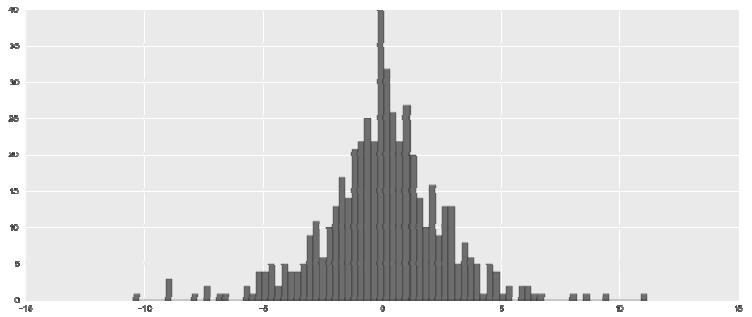

图 4-5　涨跌幅直方图

输出如下：

* * *

```
(4.221, 11.17)    51
(2.324, 3.01)     51
(1.764, 2.324)    51
(0.72, 1.04)      51
(0.436, 0.72)     51
[0.01, 0.192]     51
(1.34, 1.764)     50
(0.192, 0.436)    50
(3.01, 4.221)     49
(1.04, 1.34)      49
dtype: int64
```

* * *

从上面的输出可以清楚地发现涨跌幅在 4.22%以上情况的符合我们的条件，4.22％就是我们寻找的阀值，至于怎么用、什么时候用，就是笔者上面所说的厨师的问题了。

#### 4.3.1　数据的离散化

前面的 pd.qcut（）将数据平均分为若干份，如果交易者有自己的分类准则，那么应该使用 pd.cut（）传入 bins，示例如下：

* * *

```
#将涨跌幅数据手工分类，从负无穷到－7，－5，－3，0， 3， 5， 7，正无穷
bins = [-np.inf, -7.0, -5, -3, 0, 3, 5, 7, np.inf]
cats = pd.cut(tsla_df.netChangeRatio, bins)
cats.value_counts()
```

* * *

输出如下：

* * *

```
(0, 3]        209
(-3, 0]       193
(3, 5]         38
(-5, -3]       35
(5, 7]          9
(-7, -5]        9
(-inf, -7]      7
(7, inf]        4
dtype: int64
```

* * *

pd.cut（）函数经常会和 pd.get\_dummies（）函数配合使用，将数据由连续数值类型变成离散类型，即数据的离散化，get\_dummies（）生成离散化的哑变量矩阵多用于机器学习中监督学习问题的分类，使用它来作为训练数据使用，具体实例将在后续机器学习章节中讲解。

下面的代码使用对 cut（）后的数据进行 get\_dummies（）操作后生成哑变量矩阵：

* * *

```
# cr_dummies 为列名称前缀
change_ration_dummies = pd.get_dummies(cats, prefix='cr_dummies')
# 表 4-18 所示
change_ration_dummies.tail()
```

* * *

输出结果如表 4-18 所示。

表 4-18　get\_dummies（）函数操作后生成哑变量矩阵结果

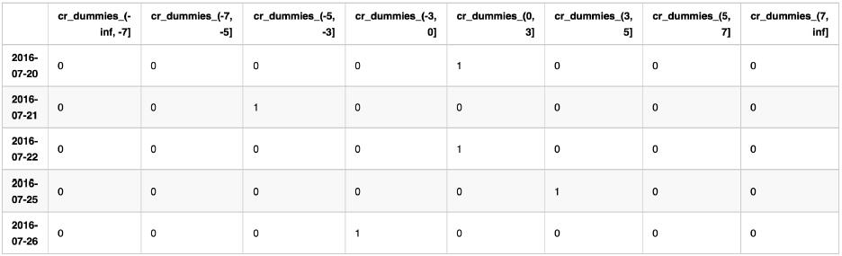

以上输出的哑变量矩阵每一行只有一个 1，其他元素都为 0。上面输出的第一行数据 2016-07-20 行只在 cr\_dummies（0，3）列数值为 1，表示在 2016-07-20 这个交易日 TSLA 的涨跌幅范围在 0～3%之间，实际上这一天 TSLA 的涨跌幅为 1.38。

#### 4.3.2　concat、append 和 merge 的使用

如果我们把上面得到的 change\_ration\_dummies 表格与 tsla\_df 进行合并，那么最简单的方式是直接使用 concat（）函数，示例如下：

* * *

```
# 表 4-19 所示
pd.concat([tsla_df, change_ration_dummies], axis=1).tail()
```

* * *

输出结果如表 4-19 所示。

上述 concat（）函数是在 axis=1，即纵向上的连接数据，如果横轴上连结数据，同样可以使用 concat axis=0，但是更加简单的方式是直接使用 append（）函数，代码如下：

* * *

```
# pd.concat()函数的连接 axis＝0：纵向连接 atr>14 的 df 和 netChangeRatio > 10 的 df
pd.concat([tsla_df[tsla_df.netChangeRatio > 10],
           tsla_df[tsla_df.atr14 > 16]], axis=0)
#使用 DataFrame 对象的 append()函数，结果与上面 pd.concat()函数的结果一致, 表 4-20 所示
tsla_df[tsla_df.netChangeRatio > 10].append(
    tsla_df[tsla_df.atr14 > 16])
```

* * *

表 4-19　concat（）函数输出结果

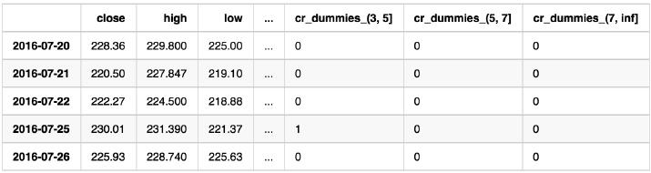

输出结果如表 4-20 所示。

表 4-20　pd.concat（axis=0）或者 append（）函数输出结果

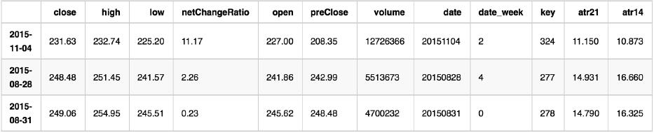

用于 pandas 数据连结归并除了上述 pd.concat（）和 append（）外，还会使用到 pd.merge（）函数，它的使用最复杂，参数组合组多，但也是灵活性最强的方式。特别是针对多个不同 key 的序列，但由于量化分析一般需要处理的都是时间序列，所以本书不做重点讲解。下面举一个简单使用示例：

* * *

```
stock_a = pd.DataFrame({'stock_a': ['a', 'b', 'c', 'd', 'a'],
                        'data': range(5)})
stock_b = pd.DataFrame({'stock_b': ['a', 'b', 'c'],
                        'data2': range(3)})
# 表 4-21 所示
pd.merge(stock_a, stock_b, left_on='stock_a', right_on='stock_b')
```

* * *

输出结果如表 4-21 所示。

表 4-21　pd.merge（）函数输出结果

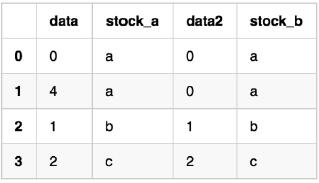

### 4.4　实例 2：星期几是这个股票的“好日子”

很多刚接触股票的人总喜欢把股票投资看成一种有固定收入的工作。比如他们有自己的规矩，周五一定要把所有股票都卖了，安安心心过周末，周一看情况一切良好再把股票买回来；还有一些人有着很奇怪的癖好，认为周三是他的幸运日，因此会在周三买入他选中的股票；有些人每个月第一个周五发工资，市场就是由这些各种各样的人组成的。某一只股票上的活跃用户在一段时间内变化并不大，也就是说这些习惯周五卖出周一买入的人会反复在一只股票上交易，比如特斯拉电动车概念在 2013 年火了，当时有大量普通投资者涌入市场。这些普通投资者，普遍的投资方式是针对一只股票不断地进行买卖，他们不会长期持有这只股票，但也不会远离这只股票很长时间。笔者认为有两点促成了以上事实。

·贪欲。贪欲在这中间起到了很大的作用，当一个人第一次买入一只股票并且持有到有一定利润的时候，他选择卖出这只股票，因为他认为该只股票涨的已经很多了，该适当地回调了。之后股价的走势只有两种可能：第一种是按照他的预期下跌，这样的话他可能选择跌到某种程度再次进场买入这只股票；第二种就是继续上涨，这种情况下他会选择不断“诅咒”这只股票，直到有一天股价上涨到让他无法忍受，从此由“黑转粉”。

·时间成本与懒惰。一个人的时间和精力都是有限的，无法获取市场中所有股票的信息，每次熟悉一只股票的时间成本在投资者看来也是非常巨大的，因此会反复地盯着自己最频繁买卖的那几只股票。

举个例子来描述上面的情形，即微信好友。

如果把一只股票比喻成你的一个微信好友，你希望能和有所收益的好友保持联系，一起玩。假设你的通讯录里只有 1 个好友“股票 a”，这个好友是通过某个渠道认识的朋友，你从知道他的名字开始，通过搜索添加他为好友，通过查看他的朋友圈相册来对这个好友进行初步了解，“心机婊”的你可能会进一步通过这个名字查看他在微博、知乎、豆瓣上的各种信息，希望对他能有彻底的了解。当你对“股票 a”的了解达到一定程度的时候，突然有一天他发了一条朋友圈炫美食，你终于按捺不住内心的冲动，决定约他一起吃饭，吃饭的结果只有两种：

·真的很开心，真的很好吃，下次还要和他一起玩；

·不开心，不好吃，还得你买单，什么朋友啊！再也不和这“货”一起玩了！但是你没删除他，就算是删除了也有可能再加回来。

一周之后的某一天，你可能是刚发了工资，又想找个人一起玩，你想通过添加新朋友的方式来找个新的朋友玩，但是害怕这个新的朋友坑你，并且你也懒得再去了解熟悉一个新朋友，这时你看了看自己的朋友圈，发现最近“股票 a”又是晒美食，又发心灵鸡汤，于是你决定还是和“股票 a”一起玩吧，毕竟之前了解过，这次看起来很美，也许这次能好玩呢。

结论就是不管股票的走势如何，你都不会轻易地离开这只股票，并且真的会有很多人按照准确时间来买卖这只股票。

从另一个角度来说，一个市场中的参与者随着时间的流逝，也在慢慢地变化，不断新老交替，就像我们人类，每 7 年就是一个全新的自己，所有细胞血液都将完全更新一遍。

下面的实例展示就是分析 TSLA 的数据，从数据中发现周几是 TSLA 的“好日子”。

tsla\_df 数据中 date\_week 字段代表周几，首先使用 np.where（）为 DataFrame 对象添加一列新数据 positive，代表交易日当天股票是上涨还是下跌，np.where（）的使用请参考“第三章量化工具——NumPy”中的内容。

* * *

```
tsla_df['positive'] = np.where(tsla_df.netChangeRatio > 0, 1, 0)
# 表 4-22 所示
tsla_df.tail()
```

* * *

输出结果如表 4-22 所示。

表 4-22　添加一列新数据 positive 结果

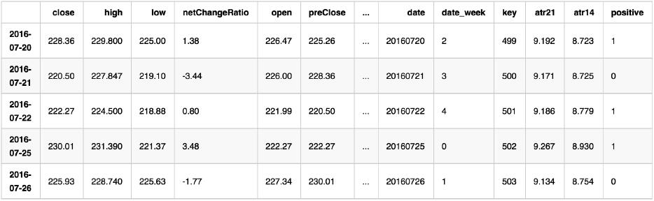

#### 4.4.1　构建交叉表

使用 pd.crosstab（）构建一个交叉表，行使用 date\_week 信息，列使用 positive，示例如下：

* * *

```
xt = pd.crosstab(tsla_df.date_week, tsla_df.positive)
# 表 4-23 所示
xt 
```

* * *

输出结果如表 4-23 所示。

表 4-23　构建交叉表


下面的代码是经常和 pd.crosstab（）配套出现的代码，读者可以认为这就是一个套路，xt.div（xt.sum（1）.astype（float），axis=0）看起来很难理解，其实它就是求出所占的比例。

* * *

```
xt_pct = xt.div(xt.sum(1).astype(float), axis=0)
# 表 4-24 所示
xt_pct
```

* * *

输出结果如表 4-24 所示。

表 4-24　使用交叉表计算比例结果


可视化结果，如图 4-6 所示。

* * *

```
xt_pct.plot(
    figsize=(8, 5),
    kind='bar',
    stacked=True,
    title='date_week -> positive')
plt.xlabel('date_week')
plt.ylabel('positive')
```

* * *


图 4-6　交叉表柱状图

由 xt\_pct 数据可视化可以发现，绿色柱（即图中浅灰色部分）最多的是代号 3，也就是周四。这样就完成了我们的任务，得出结论：在统计周期内 TSLA 在周四是个好日子，上涨的概率最大达到 0.56；从另一个角度来看，周二是 TSLA 下跌概率最大的日期，有 53%的概率下跌。那样你是不是可以写个简单策略：每周二收盘前如果 TSLA 下跌，那么买入 TSLA，在周四不论其涨跌都卖出 TSLA 呢？

说到这里就不得不说一个统计学上的概念，即大数定理。其实是很简单的理念，举例如下。

如果一个策略有 56%的胜率，那么一天只执行 10 次交易，则胜率有各种可能，不一定达到 56%。但是如果一天执行 1000 次、10000 次，那么你的胜率如果不是 56%，不管是更多或者更少，都代表你计算胜率的方式有问题。所以比如针对上面这个简单策略，尽管你只有 56%的胜率，但只要一天内可以从不同市场、不同股票、不同时段内找到足够多的交易机会，执行足够多的次数，那你最后一定是盈利的。统计套利的核心思想就是这个，不只是要单纯追求胜率，更应该关注大数定律，寻找多元化的交易机会，最终达成理想的胜率。

#### 4.4.2　构建透视表

前面的操作可以用更简单的工具 pivot\_table（）（透视表）求出结果，代码如下：

* * *

```
# 表 4-25 所示
tsla_df.pivot_table(['positive'], index=['date_week'])
```

* * *

输出如表 4-25 所示。

表 4-25　构建透视表结果


如下面的代码所示，和 crosstab（）、pivot\_table（）有着类似功能的是 groupby（）函数，该函数的操作更加底层，句法也更难理解，但是可以解决的问题也更全面。对于 pandas 初学者来说，首先应学会使用 crosstab（）和 pivot\_table（）函数，遇到这类的问题一般都可以通过它们来解决，等慢慢熟悉之后可以练习更加高级的“刀功”。

* * *

```
tsla_df.groupby(['date_week', 'positive'])['positive'].count()
```

* * *

输出如下：

* * *

```
date_week  positive
0          0           44
           1           51
1          0           55
           1           48
2          0           48
           1           57
3          0           44
           1           57
4          0           53
           1           47
Name: positive, dtype: int64
```

* * *

### 4.5　实例 3：跳空缺口

跳空缺口是指股价开盘价高于昨天的最高价或低于昨天的最低价，使 K 线图出现空档的现象。如图 4-7 所示，围绕跳空缺口有很多经典的交易策略。


图 4-7　跳空缺口

备注：缺口的类型可以分为以下几种。

·普通缺口：特点就是很快被回补，价格在几天之内就会回补；

·突破缺口：当价格和成交量伴随跳空（向上或者向下）跳出震荡区，则预示着新趋势的形成；

·衰竭缺口：缺口没有很快回补，走势也反复无常，最终慢慢地回补缺口，预示着市场走势将可能有剧烈的反转。

下面根据上面描述的理论来寻找 TSLA 电动车的跳空缺口，但并不是使用传统的跳空定义方式，因为这种方式很容易夹杂普通缺口，这里定义缺口的方式如下。

·今天如果是上涨趋势，那么跳空的确定需要今天的最低价格大于昨天收盘价格一个阀值以上，确定向上跳空；

·今天如果是下跌，那么跳空的确定需要昨天收盘价格大于今天最高价格一个阀值以上，确定向下跳空。

这种方式确定的跳空缺口存在很强的支撑或者阻力，首先确定跳空阀值，这里的计算方式是使用统计周期内收盘价格的中位数乘以 3％：

* * *

```
jump_threshold = tsla_df.close.median() * 0.03
jump_threshold
```

* * *

输出如下：

* * *

```
6.82845
```

* * *

接下来使用 for 循环遍历每一个交易日，按照上面描述的确定跳空方式来寻找跳空缺口。这里新建了一张表格来存储跳空的数据 jump\_pd，以下代码将符合条件的 today 添加了两组新的数据。

·jump 代表跳空的方向，方便之后的数据处理；

·jump\_power 代表跳空的能量，这里的能量计算是由缺口的高度除以阀值获得，能量再次量化了支撑或者阻力的大小。

* * *

```
jump_pd = pd.DataFrame()
def judge_jump(today):
    global jump_pd
    if today.netChangeRatio > 0 and \
                    (today.low - today.preClose) > jump_threshold:
        """
            符合向上跳空
        """
        # jump 记录方向 1 向上
        today['jump'] = 1
        # 向上跳能量＝（今天最低 － 昨收）／ 跳空阀值
        today['jump_power'] = (today.low - today.preClose) / \
                              jump_threshold
        jump_pd = jump_pd.append(today)
    elif today.netChangeRatio < 0 and \
                    (today.preClose - today.high) > jump_threshold:
        """
            符合向下跳空
        """
        # jump 记录方向，-1 向下
        today['jump'] = -1
        # 向下跳能量＝（昨收 － 今天最高）／ 跳空阀值
        today['jump_power'] = (today.preClose - today.high) / \
                              jump_threshold
        jump_pd = jump_pd.append(today)
for kl_index in np.arange(0, tsla_df.shape[0]):
    # 通过 ix 一个一个拿
    today = tsla_df.ix[kl_index]
    judge_jump(today)
# filter 按照顺序只显示这些列, 表 4-26 所示
jump_pd.filter(['jump', 'jump_power', 'close', 'date', 
                'netChangeRatio', 'preClose'])
```

* * *

输出结果如表 4-26 所示。

表 4-26　有跳空缺口的交易日数据结果


输出结果 jump\_pd 为符合跳空筛选的交易日，注意观察 jump\_power 可以发现，跳空能量和涨跌幅值成正比。

上面实现的代码虽然可以正常运行，输出结果也没有问题，但是在 pandas 对象中有另一种优雅的方式针对上面的 for 循环优化写法和效率，即使用 apply（）函数。该函数接受一个处理函数作为参数，处理函数默认只有一个参数也就是行或者列数据，通过 axis 参数确定是行还是列，如果处理函数需要另外的参数配合，可以通过 args 参数，它接受一个 tuple 来扩展。使用 apply（）代替上述 for 循环实现方式如下：

* * *

```
jump_pd = pd.DataFrame()
# axis=1 即行数据，tsla_df 的每一条行数据即为每一个交易日数据
tsla_df.apply(judge_jump, axis=1)
```

* * *

上面使用 apply（）函数筛选出的 jump\_pd 与 for 循环的结果是一致的。

以下代码使用 ABuMarketDrawing 将走势和选取的跳空缺口一起画出并标示，如图 4-8 所示。

* * *

```
from abupy import ABuMarketDrawing
# view_indexs 传入 jump_pd.index，即在 K 线图上使用圆圈来标示跳空点
ABuMarketDrawing.plot_candle_form_klpd(tsla_df,
                                       view_indexs=jump_pd.index)
```

* * *

输出结果如图 4-8 所示。


图 4-8　走势和跳空

### 4.6　pandas 三维面板的使用

pandas 最常使用的对象是以下两个。

·Series：一维带索引的序列数据；

·DataFrame：二维矩阵，由行索引、列索引和数据矩阵组成。

对于更高维的数据，由于多一个维度理解难度将呈几何级数增长，可视化不方便等问题，实际工程中的用途并不广泛，但有些情况下使用高维数据结构也会带来高效和灵活度的提升。

下面举例使用 abu 量化系统中的 ABuIndustries.get\_industries\_panel\_from\_target（）函数获取和传入 symbol 参数处于同一行业的一组股票数据，返回的数据 p\_date 是 pandas 三维面板数据类型 Panel。

* * *

```
from abupy import ABuIndustries
r_symbol = 'usTSLA'
# 这里获取了和 TSLA 电动车处于同一行业的股票，组成 pandas 三维面板 Panel 数据
p_date, _ = ABuIndustries.get_industries_panel_from_target(r_symbol,
                                                           show=False)
```

* * *

通过 type（）函数来看一下 p\_date 的类型：

* * *

```
type(p_date)
```

* * *

输出如下：

* * *

```
pandas.core.panel.Panel
```

* * *

p\_date 显示三维数据：7×504×12，下面的 axis 代表主轴名称。

* * *

```
p_date
```

* * *

输出如下：

* * *

```
<class 'pandas.core.panel.Panel'>
Dimensions: 7 (items) x 504 (major_axis) x 12 (minor_axis)
Items axis: usDDAIF to usTTM
Major_axis axis: 2014-07-25 00:00:00 to 2016-07-26 00:00:00
Minor_axis axis: atr14 to volume
```

* * *

可以使用 Items axis 来获取某一个维度的切面数据：

* * *

```
# 表 4-27 所示
p_date['usTTM'].head()
```

* * *

输出结果如表 4-27 所示。

表 4-27　某一个维度的切面数据结果


看到上面的 p\_date\['usTTM'\]（塔塔汽车），可能有读者会问：我使用一个字典直接把生成的二维 DataFrame 数据放入结构中不也可以达成需求吗，为什么要使用高维数据？

答案就是高维的 Panel 通过轴向的互换等空间操作，可以高效灵活地变换出各种数据形势。

如下所示，使用 Panel 的 swapaxes（）方法指定交互 items、minor 轴向的空间位置，转换后的结果显示三维面板 Panel 由原来的 7×504×12 变成了 12×504×7 的结构数据。

* * *

```
p_data_it = p_date.swapaxes('items', 'minor')
p_data_it
```

* * *

输出如下：

* * *

```
<class 'pandas.core.panel.Panel'>
Dimensions: 12 (items) x 504 (major_axis) x 7 (minor_axis)
Items axis: atr14 to volume
Major_axis axis: 2014-07-25 00:00:00 to 2016-07-26 00:00:00
Minor_axis axis: usDDAIF to usTTM
```

* * *

以下代码通过拿出 Items axis 中的 close 来选取所有股票的 close，形成一个新的横切面数据：

* * *

```
p_data_it_cose = p_data_it['close'].dropna(axis=0)
# 表 4-28 所示
p_data_it_cose.tail()
```

* * *

输出结果如表 4-28 所示。

表 4-28　close 形成一个新的横切面数据结果


以下代码将所有股票的 close 数据序列标准化后可视化，如图 4-9 所示。看到这里，读者能明白 Panel 数据的优点和用途了吗？

* * *

```
from abupy import ABuScalerUtil
# scaler_std 将所有 close 的切面数据做标准化，为了可视化在同一范围
p_data_it_cose = ABuScalerUtil.scaler_std(p_data_it_cose)
p_data_it_cose.plot()
plt.legend(bbox_to_anchor=(1.05, 1), loc=2, borderaxespad=0.)
plt.ylabel('Price')
plt.xlabel('Time')
```

* * *

输出结果如图 4-9 所示。


图 4-9　Panel 收盘价格可视化

### 4.7　本章小结

·本章主要讲解示例 pandas 的使用方法，pandas 是以 NumPy 和 Matplotlib 为基础封装的金融库，在后面的章节中将会反复出现。

·本章讲解的 pandas 技术偏重单索引序列，因为量化分析中基本都是非复杂单索引，对于多索引及其相关技术感兴趣的读者，可自行学习。

·大数定律是量化交易中很重要的基石，交易者不应仅单纯追求胜率，更应该关注大数定律，寻找多元化的交易机会，最终达成理想的胜率。

·跳空缺口等传统技术分析工具，在量化中也会经常使用，但使用方式差别很大，例如本章中计算跳空能量的方法，也可以配合成交量等因素计算。

## 第五章　量化工具——可视化  

可视化是量化中的一大关键辅助工具，量化中往往需要通过可视化技术来更清晰地理解交易，理解数据。通过可视化技术可以更加快速地对量化系统中的问题进行分析，更进一步地指导策略的开发，以及策略中的问题发现。

### 5.1　使用 Matplotlib 可视化数据

Matplotlib 是 Python 上最基础也最常用的可视化工具，许多更高级的可视化库都是在 Matplotlib 上再次封装提供更简单易用的功能，比如 seaborn 库。而且 Matplotlib 的使用方式和绘制思想已成为 Python 绘图库的标杆，其他大多数绘图库都会特意使用与 Matplotlib 类似的函数名称参数及思想，如果读者掌握了 Matplotlib 的绘制方式及思想，那么在 Python 上任何一个可视化库的使用都会感到简单易用。

#### 5.1.1　Matplotlib 可视化基础

一般习惯及推荐引用 Matplotlib 的方式如下：

* * *

```
import matplotlib.pyplot as plt
```

* * *

由于前面的章节都会涉及 Matplotlib 的使用，相信读者对 Matplotlib 的使用已经在一定程度上有了感性认识。下面直接从量化实例开始，首先还是获取特斯拉电动车两年的股票数据（abu 量化系统代码地址请通过微信公众号 abu\_quant 获取，本书所有示例的 IPython Notebook 代码也在对应目录中）。

* * *

```
from abupy import ABuSymbolPd
tsla_df = ABuSymbolPd.make_kl_df('usTSLA', n_folds=2)
# 表 5-1 所示
tsla_df.tail()
```

* * *

输出结果如表 5-1 所示。

plt.plot（）是最简单也最常用的绘图方式，可以通过 pandas 的 Series 直接作为参数进行绘制，也可以通过 NumPy 对象，甚至 Python 的 list 对象它都是支持的。以下代码封装函数 plot\_demo（），分别使用 Series 对象、NumPy 对象以及 list 绘制 TSLA 的收盘价格，为了曲线不重叠，这里每种方式绘制时 y 变量依次加了 10 个单位，且设置 c 为不同颜色，如图 5-1 所示。

表 5-1　特斯拉电动车两年的股票数据结果


* * *

```
def plot_demo(axs=None, just_series=False):
    """
    绘制 tsla 的收盘价格曲线
    :param axs: axs 为子画布，稍后会详细讲解
    :param just_series: 是否只绘制一条收盘曲线使用 Series，后面会用到
    :return: 
"""
# 如果参数传入子画布则使用子画布绘制，5.1.2 节中会使用
    drawer = plt if axs is None else axs
    # Series 对象 tsla_df.close，红色
    drawer.plot(tsla_df.close, c='r')
    if not just_series:
        # 为了使曲线不重叠，y 变量加了 10 个单位 tsla_df.close.values + 10
        # numpy 对象 tsla_df.close.index ＋ tsla_df.close.values，绿色
        drawer.plot(tsla_df.close.index, tsla_df.close.values + 10,
                    c='g')
        # 为了使曲线不重叠，y 变量加了 20 个单位
        # list 对象，numpy.tolist()将 NumPy 对象转换为 list 对象，蓝色
        drawer.plot(tsla_df.close.index.tolist(),
                    (tsla_df.close.values + 20).tolist(), c='b')
    plt.xlabel('time')
    plt.ylabel('close')
    plt.title('TSLA CLOSE')
    plt.grid(True)
plot_demo()
```

* * *

输出结果如图 5-1 所示。

·plt.xlabel（'time'）：x 轴名称；

·plt.ylabel（'close'）：y 轴名称；

·plt.title（'TSLA CLOSE'）：标题文字；

·plt.grid（True）：是否显示网格。


图 5-1 多种序列的曲线图

#### 5.1.2　Matplotlib 子画布及 loc 的使用

5.1.1 节分别使用 Series、NumPy、list 序列对象绘制了股价的走势，但是最终的图 5-1 中并没有标注哪一条曲线是使用 Series 绘制，哪一条曲线是使用 NumPy 或 list 绘制的。

Matplotlib 使用 legend（）函数操作标注，参数 loc 代表标注位置。下面代码通过生多个子画布，在不同的子画布上使用不同的 loc 值来示例标注及 loc 的使用，如图 5-2 所示，代码如下：

* * *

```
_, axs = plt.subplots(nrows=2, ncols=2, figsize=(14, 10))
# 画布 0，loc：0 plot_demo 中传入画布，则使用传入的画布绘制
drawer = axs[0][0]
plot_demo(drawer)
drawer.legend(['Series', 'Numpy', 'List'], loc=0)
# 画布 1，loc：1 
drawer = axs[0][1]
plot_demo(drawer)
drawer.legend(['Series', 'Numpy', 'List'], loc=1)
# 画布 2，loc：2 
drawer = axs[1][0]
plot_demo(drawer)
drawer.legend(['Series', 'Numpy', 'List'], loc=2)
# 画布 3，loc：2， 设置 bbox_to_anchor，在画布外的相对位置绘制
drawer = axs[1][1]
plot_demo(drawer)
drawer.legend(['Series', 'Numpy', 'List'], bbox_to_anchor=(1.05, 1),
              loc=2,
              borderaxespad=0.)
```

* * *

输出结果如图 5-2 所示。


图 5-2　子画布及 loc 参数的使用

上述代码使用 plt.subplots（）函数生成多个子画布，返回的 axs 是 NumPy 类型，参数 nrows 和 ncols 分别代表 x 与 y 轴的 shape 值，所以 plt.subplots（nrows=2，ncols=2，figsize=（14，10））实际会生成一个 2×2（两行两列的）numpy 对象 axs。在之前 plot\_demo（）函数的基础上使用 legend（）函数对绘制进行标注，这里 loc 使用不同的值，将导致标注的位置发生变化，axs\[1\]\[1\]演示使用 bbox\_to\_anchor 将标注绘制在画布的外面。如果 loc 无特殊需求，一般使用 loc='best'简单指定，即自动选择最优的位置进行标注绘制。

#### 5.1.3　K 线图的绘制

Matplotlib 对绘制 K 线图有直接的函数封装，所以使用 Matplotlib 绘制 K 线图非常简单。绘制 K 线图主要的工作就是制作一个 qutotes。

qutotes 里每个数据是一根蜡烛，绘制标准 K 图使用 matplotlib.finance.candlestick\_ochl（）函数，函数后缀的 ochl 的意思是按照开盘、收盘、最高、最低的顺序组织数据加入到 qutotes 中。另外还有 matplotlib.finance.candlestick2\_ohlc（）函数，后缀 ohlc 的意思是按照开盘、最高、最低、收盘的顺序组织数据加入到 qutotes 中，绘制结果图 5-3 所示，具体实现代码如下：

* * *

```
import matplotlib.finance as mpf
__colorup__ = "red"
__colordown__ = "green"
# 为了示例清晰，只拿出前 30 天的交易数据绘制蜡烛图
tsla_part_df = tsla_df[:30]
fig, ax = plt.subplots(figsize=(14, 7))
qutotes = []
for index, (d, o, c, h, l) in enumerate(
        zip(tsla_part_df.index, tsla_part_df.open, tsla_part_df.close,
            tsla_part_df.high, tsla_part_df.low)):
    # 蜡烛图的日期要使用 matplotlib.finance.date2num 进行转换为特有的数字值
    d = mpf.date2num(d)
    # 日期、开盘、收盘、最高和最低组成 tuple 对象 val
    val = (d, o, c, h, l)
    # 将 val 加入 qutotes
    qutotes.append(val)
# 使用 mpf.candlestick_ochl 进行蜡烛绘制，ochl 代表：open、close、high、low
mpf.candlestick_ochl(ax, qutotes, width=0.6, colorup=__colorup__,
                     colordown=__colordown__)
ax.autoscale_view()
ax.xaxis_date()
```

* * *

输出结果如图 5-3 所示。


图 5-3　K 线图

### 5.2　使用 Bokeh 交互可视化

有些时候将一段数据可视化后有交互操作的需求。比如 5.1.3 节中的蜡烛图，当绘制的蜡烛数量比较多的时候，可能有横向平移、放大某一时段等交互需求，Python 实现这些交互需求的解决方案一般是通过网页形式的可视化，配合 JavaScript（简称 JS）与网页完成交互。

Bokeh 是一个专门针对 Web 浏览器实现呈现功能的交互式可视化 Python 库，具体使用示例请参考[`bokeh.pydata.org/en/latest/docs/gallery.html`](http://bokeh.pydata.org/en/latest/docs/gallery.html)。

下面的 ABuMarketDrawing.plot\_candle\_form\_klpd（）函数绘制 K 线图的方法将 html\_bk=True 时使用 bokeh 绘制可交互的 K 线图，如图 5-4 所示，它将打开浏览器并在网页上展示 K 线图，支持拖曳、平移、放大等操作。

* * *

```
from abupy import ABuMarketDrawing
ABuMarketDrawing.plot_candle_form_klpd(tsla_df, html_bk=True)
```

* * *


图 5-4　可交互的 K 线图

### 5.3　使用 pandas 可视化数据

pandas 封装了 Matplotlib，使用 Matplotlib 可以实现的绘制可视化都可以使用 pandas 用更简单的方式实现。由于 pandas 是为了金融量化而生的库，包含很多金融量化接口，所以用 pandas 直接可视化金融数据非常简单。

#### 5.3.1　绘制股票的收益及收益波动情况

计算收益波动一般会使用 pd.rolling\_std（）函数和 rolling\_std（）函数，简单使用示例如下：

* * *

```
# 示例序列
demo_list = np.array([2, 4, 16, 20])
# 以 3 天为周期计算波动
demo_window = 3
# pd.rolling_std * np.sqrt
pd.rolling_std(demo_list, window=demo_window, 
center=False) * np.sqrt(demo_window)
```

* * *

输出如下：

* * *

```
array([         nan,          nan,  13.11487705,  14.4222051 ])
```

* * *

rolling\_std（）函数的意思是根据参数 demo\_window 的大小，从原始序列依次取出 demo\_window 个元素做 std（）操作，波动即等于每次取出子序列做 std（）之后的结果乘以 demo\_window 开方值，代码如下：

* * *

```
pd.Series([2, 4, 16]).std() * np.sqrt(demo_window)
```

* * *

输出如下：

* * *

```
13.11487705
```

* * *

原始序列 rolling 移动一个单位后继续执行：

* * *

```
pd.Series([4, 16, 20]).std() * np.sqrt(demo_window)
```

* * *

输出如下：

* * *

```
14.4222051
```

* * *

上述代码之所以使用 np.sqrt（）函数开平方 demo\_window 天数，是因为 std（）函数的计算本是方差开方，如果使用 var（）函数计算就可以直接使用天数，代码如下：

* * *

```
np.sqrt(pd.Series([2, 4, 16]).var() *  demo_window)
```

* * *

输出如下：

* * *

```
13.11487705
```

* * *

接下来使用 np.log（）函数计算投资收益，使用 pd.rolling\_std（）函数计算每 20 个交易日的移动收益标准差，使用 pd.ewmstd（）函数计算每 20 个交易日的加权移动收益标准差，最后绘制各组数据，如图 5-5 所示。

* * *

```
tsla_df_copy = tsla_df.copy()
# 投资回报
tsla_df_copy['return'] = \
    np.log(tsla_df['close'] / tsla_df['close'].shift(1))
# 移动收益标准差
tsla_df_copy['mov_std'] = pd.rolling_std(tsla_df_copy['return'],
                                         window=20,
                                         center=False) * np.sqrt(20)
# 加权移动收益标准差与移动收益标准差基本相同，只不过前者根据时间权重计算 std
tsla_df_copy['std_ewm'] = pd.ewmstd(tsla_df_copy['return'], span=20,
                                    min_periods=20,
                                    adjust=True) * np.sqrt(20)
tsla_df_copy[['close', 'mov_std', 'std_ewm', 'return']].plot(
    subplots=True, grid=True)
```

* * *

输出结果如图 5-5 所示。

如果读者对

计算投资回报不理解，可暂时略过，在“第七章量化系统——入门”中会详细讲解。

5.3.2 节的示例将使用 rolling\_mean（）函数计算移动平均线，rolling\_mean（）函数实现的原理与本节讲述的 rolling\_std（）函数实现方式基本相同，二者的不同点是在对 rolling 操作后一个是使用 std（）函数计算结果，一个是使用 mean（）函数计算结果。


图 5-5　收益及波动

#### 5.3.2　绘制股票的价格与均线

以下代码绘制股票的价格与 30 日均线、60 日均线、90 日均线，结果如图 5-6 所示。

* * *

```
tsla_df.close.plot()
# ma 30
pd.rolling_mean(tsla_df.close, window=30).plot()
# ma 60
pd.rolling_mean(tsla_df.close, window=60).plot()
# ma 90
pd.rolling_mean(tsla_df.close, window=90).plot()
# loc='best'即自动寻找适合的位置
plt.legend(['close', '30 mv', '60 mv', '90 mv'], loc='best')
```

* * *

输出结果如图 5-6 所示。


图 5-6　价格与均线

上面代码中，pd.rolling\_mean（）函数计算移动均线，只用简单的几行代码就完成了整个需求的绘制，但如果使用 Matplotlib 则要多写很多代码。

#### 5.3.3　其他 pandas 统计图形种类

前面讲解的示例都是曲线的绘制，pandas 通过向 plot（）函数传入 kind 参数支持绘制其他图形。

Kind 参数为字符串时代表的意义如下。

·'line'：默认，绘制曲线；

·'bar'：绘制纵向柱状图；

·'barh'：绘制横向柱状图；

·'hist'：绘制直方图；

·'kde'：绘制概率密度曲线；

·'density'：同 kde；

·'pie'：绘制饼图。

更多详细使用情况，请读者自行查阅帮助文档。

股票中有个概念叫低开高收，即最终收盘的价格高于开盘的价格。有些人认为这种情况下股票第二天的走势一般是向上的，即涨势。下面验证一下这个理论在 TSLA 这只股票上是否有效。

* * *

```
# iloc 获取所有低开高走的下一个交易日组成 low_to_high_df，由于是下一个交易日
# 所以要对满足条件的交易日再次通过 iloc 获取，下一个交易日 index 用 key.values + 1
# key 序列的值即为 0-len(tsla_df), 即为交易日 index，详细数据结构可查阅表 5-1
low_to_high_df = tsla_df.iloc[tsla_df[
                                  (tsla_df.close > tsla_df.open) & (
                                  tsla_df.key <> tsla_df.shape[
0] - 1)].key.values + 1]
# 通过 where 将下一个交易日的涨跌幅通过 ceil 和 floor 向上及向下取整
change_ceil_floor = np.where(low_to_high_df['netChangeRatio'] > 0,
                             np.ceil(
                                 low_to_high_df['netChangeRatio']),
                             np.floor(
                                 low_to_high_df['netChangeRatio']))
# 使用 pd.Series 包裹，方便之后绘制
change_ceil_floor = pd.Series(change_ceil_floor)
```

* * *

其中：

·（tsla\_df.close>tsla\_df.open）&（tsla\_df.key<>tsla\_df.shape\[0\]-1）设置条件收盘价格大于开盘，且不是数据中最后一个交易日；

·使用 iloc 选取低开高收的下一个交易日行数据；

·np.ceil（）函数将数据向上取整数（np.ceil（\[1.7，2.3，0.2\]）->array（\[2.，3.，1.\]），np.floor（）函数（np.floor（\[-1.7，-2.3，-0.2\]）->array（\[-2.，-3.，-1.\]））将数据向下取整数；

·使用 np.where（）函数将涨跌>0 的值使用 ceil 取整数，将涨跌<0 的值使用 floor 取整数，不使用 astype（int）的目的是不想取 0 值，否则如＋0.4 和-0.4 这种数都会变成 0，即丢失了涨跌方向信息；

·将 np.where（）函数返回的 NumPy 数据使用 pd.Series 包裹，方便之后绘制。

下面使用 subplots（）函数生成子画布，plot（）函数通过传入 ax 在不同的画布上使用不同的 kind 参数，如图 5-7 所示。通过可视化可以看出：在统计周期内 TSLA 低开高收的下一个交易日下跌的情况比上涨的情况还要多，而且比较明显。下面代码量化了下跌的 sum 与上涨的 sum，下跌 sum-311，上涨 sum 274。

* * *

```
print '低开高收的下一个交易日所有下跌的跌幅取整和 sum: ' + str(
change_ceil_floor[change_ceil_floor < 0].sum())
print '低开高收的下一个交易日所有上涨的涨幅取整和 sum: ' + str(
change_ceil_floor[change_ceil_floor > 0].sum())
# 2 × 2: 4 张子图
_, axs = plt.subplots(nrows=2, ncols=2, figsize=(12, 10))
# 竖直柱状图，可以看到-1 的柱子最高, 图 5-7 左上图
change_ceil_floor.value_counts().plot(kind='bar', ax=axs[0][0])
# 水平柱状图，可以看到-1 的柱子最长, 图 5-7 右上图
change_ceil_floor.value_counts().plot(kind='barh', ax=axs[0][1])
# 概率密度图，可以看到向左偏移, 图 5-7 左下图
change_ceil_floor.value_counts().plot(kind='kde', ax=axs[1][0])
# 圆饼图，可以看到－1 所占的比例最高, -2 的比例也大于＋2，图 5-7 右下图
change_ceil_floor.value_counts().plot(kind='pie', ax=axs[1][1])
```

* * *

输出如下，结果如图 5-7 所示。

* * *

```
低开高收的下一个交易日所有下跌的 sum: -311.0
低开高收的下一个交易日所有上涨的 sum: 274.0
```

* * *


图 5-7　多种 kind 参数图示例

### 5.4　使用 Seaborn 可视化数据

Seaborn 是在 Matplotlib 的基础上进行了更高级的 API 封装，从而使得作图更加容易，并且更漂亮。

一般使用以下形式导入 Seaborn 库（也有的人写为 import seaborn as sb，但是在中国 sb 容易让人产生误解，所以这里写为 sns）。

* * *

```
import seaborn as sns
```

* * *

通过一行代码，将直方图与概率密度图一起绘制出来，代码如下：

* * *

```
sns.distplot(tsla_df['netChangeRatio'], bins=80)
```

* * *

输出结果如图 5-8 所示。


图 5-8　直方图＋概率密度图

针对 pandas 的 DataFrame 数据，使用列名称定轴绘制箱形图，tsla\_df 中 date\_week 代表星期几，使用 date\_week 作为 x 轴，netChangeRatio 涨跌幅数据作为 y 轴，使用 boxplot（）函数绘制箱形图来可视化振幅和周几之间的关系，如图 5-9 所示。周一箱体最高，即 TSLA 周一股价振幅最大（即 netChangeRatio 普遍偏大）；周四箱体最矮，即 TSLA 周四相对股价振幅最小（即 netChangeRatio 普遍偏小）。

* * *

```
sns.boxplot(x='date_week', y='netChangeRatio', data=tsla_df)
```

* * *

输出结果如图 5-9 所示。


图 5-9　箱形图

通过 sns.jointplot（）函数，可视化两组数据的相关性及概率密度分布，代码如下：

* * *

```
sns.jointplot(tsla_df['high'], tsla_df['low'])
```

* * *

输出结果如图 5-10 所示。


图 5-10　相关性及概率密度分布

下面通过 sns.heatmap 绘制相关热力图。

下面的代码使用 pd.DataFrame.join（）函数将多组股票的 netChangeRatio 涨跌幅数据接起来组成一个新的 DataFrame，代码如下：

* * *

```
change_df = pd.DataFrame({'tsla':tsla_df.netChangeRatio})
# join usGOOG
change_df = \
    change_df.join(pd.DataFrame({'goog':ABuSymbolPd.make_kl_df(
        'usGOOG', n_folds=2).netChangeRatio}), how='outer')
# join usAAPL
change_df = \
    change_df.join(pd.DataFrame({'aapl':ABuSymbolPd.make_kl_df(
        'usAAPL', n_folds=2).netChangeRatio}), how='outer')
# join usFB
change_df = \
    change_df.join(pd.DataFrame({'fb':ABuSymbolPd.make_kl_df(
        'usFB', n_folds=2).netChangeRatio}), how='outer')
# join usBIDU
change_df = \
    change_df.join(pd.DataFrame({'bidu':ABuSymbolPd.make_kl_df(
        'usBIDU', n_folds=2).netChangeRatio}), how='outer')
change_df = change_df.dropna()
# 表 5-2 所示
change_df.head()
```

* * *

输出结果如表 5-2 所示。

表 5-2　多组股票的涨跌幅数据结果


下面使用 pd.DataFrame.corr（）函数计算每组数据的协方差，使用热力图展示每组股票涨跌幅的相关性，如图 5-11 所示。

备注：协方差与相关性知识请阅读本书附录 B。

* * *

```
# 使用 corr 计算数据的相关性
corr = change_df.corr()
_, ax = plt.subplots(figsize=(8, 5))
# sns.heatmap 热力图展示每组股票涨跌幅的相关性
sns.heatmap(corr, ax=ax)
```

* * *

输出：


图 5-11　热力图

通过图 5-11 的热力图可以发现，对角线的格子颜色最深，因为它们代表本股票相对自身的相关性，其值都是 1，非对角线的格子代表本股票相对其他股票的相关性，颜色相对较浅。

上面的热力图有一个很大的问题：数据可视化的目的是通过可视化更直观深入地理解数据，发现数据之间的关系，但是显然上面的热力图并没有很好地完成任务，在相关性上很多股票的差别并不会太大，导致直观性很差。尽管热力图看起来很“高大上”，但在实际项目中一定要从实际目的需求出发，完成需求才是关键，可视化只是辅助完成数据分析量化的工具，可视化不是目的。

更多 Seaborn 库的使用示例，请查询[`seaborn.pydata.org/examples/index.html`](http://seaborn.pydata.org/examples/index.html)。

数据的可视化目的是能快速地进行分析，通过可视化更清晰地理解数据，进一步指导策略，发现问题。下面的实例都是从实际问题出发，完成可视化需求。

### 5.5　实例 1：可视化量化策略的交易区间及卖出原因

【需求 1】标注策略交易区间。

假定我们运行了一个量化策略，执行回测，其中一个操作是：2014-07-28 买入股票 TSLA，2014-09-05 卖出股票 TSLA。我们的需求就是在收盘价格时间序列的基础上标明上面这个持有区间。

封装函数 plot\_trade（）实现上述需求，使用 plt.fill\_between（）函数填充标注持有区间，代码如下：

* * *

```
def plot_trade(buy_date, sell_date):
    # 找出 2014-07-28 对应时间序列中的 index 作为 start
    start = tsla_df[tsla_df.index == buy_date].key.values[0]
    # 找出 2014-09-05 对应时间序列中的 index 作为 end
    end = tsla_df[tsla_df.index == sell_date].key.values[0]
    
    # 使用 5.1.1 节中封装的绘制 TSLA 收盘价格时间序列函数 plot_demo()
    # just_series＝True, 即只绘制一条曲线使用 series 数据
    plot_demo(just_series=True)
    # 将整个时间序列都填充为一个底色 blue，注意透明度 alpha=0.08 是为了
    # 之后标注其他区间透明度高于 0.08 就可以清楚显示
    plt.fill_between(tsla_df.index, 0, tsla_df['close'], color='blue',
                     alpha=.08)
    # 标注股票持有周期为绿色，使用 start 和 end 切片周期
    # 透明度 alpha=0.38 > 0.08
    plt.fill_between(tsla_df.index[start:end], 0,
                     tsla_df['close'][start:end], color='green',
                     alpha=.38)
    
    # 设置 y 轴的显示范围，如果不设置 ylim，将从 0 开始作为起点显示，效果不好
    plt.ylim(np.min(tsla_df['close']) - 5,
             np.max(tsla_df['close']) + 5)
    # 使用 loc='best'
    plt.legend(['close'], loc='best')
    # 标注交易区间 2014-07-28 到 2014-09-05，图 5-12 所示
    plot_trade('2014-07-28', '2014-09-05')
```

* * *

输出结果如图 5-12 所示。


图 5-12　策略交易区间

备注：图 5-12 中左边深色的区域为绿色。

【需求 2】标明策略卖出原因。

假定我们运行了一个量化策略，执行回测，我们在 2014-07-2 日买入股票是因为量化策略发出信号，TSLA 满足了买入条件，所以买入了股票，而选择在 2014-09-05 日卖出股票 TSLA 的原因却有很多种可能。现在假定卖出的原因只有止盈和止损两种，我们的需求就是标明原因。

以下代码使用 plt.annotate（）函数在可视化的基础上添加文字注释，整体效果如图 5-13 所示。

* * *

```
def plot_trade_with_annotate(buy_date, sell_date, annotate):
    """
    :param buy_date: 交易买入日期
    :param sell_date: 交易卖出日期
    :param annotate: 卖出原因
    :return: 
    """
    # 标注交易区间 buy_date 到 sell_date
    plot_trade(buy_date, sell_date)
    # annotate 文字，asof：从 tsla_df['close']中找到 index:sell_date 对应值
    plt.annotate(annotate,
                 xy=(sell_date, tsla_df['close'].asof(sell_date)),
                 arrowprops=dict(facecolor='yellow'),
                 horizontalalignment='left', verticalalignment='top')

使用 plot_trade_with_annotate()函数：

plot_trade_with_annotate('2014-07-28', '2014-09-05',
                         'sell for stop loss')
```

* * *

输出结果如图 5-13 所示。


图 5-13　策略交易区间及卖出原因

备注：图 5-13 中左边的深色区域为绿色。

图 5-13 在图 5-12 的绘制基础上加上了一行卖出文字说明，读者可能已经发现上面这段交易区间明明是盈利了但还是用绿色标注，盈利了文字却显示 sell for stop loss。下面多设置几段区间，修改、完善之前的代码，让程序自己去判断是止盈卖出还是止损卖出，并且依照红涨绿跌的规则来为交易区间填充颜色，最终运行结果如图 5-14 所示，代码如下：

备注：有些市场确实习惯使用绿涨红跌。

* * *

```
def plot_trade(buy_date, sell_date):
    # 找出 2014-07-28 对应时间序列中的 index 作为 start
    start = tsla_df[tsla_df.index == buy_date].key.values[0]
    # 找出 2014-09-05 对应时间序列中的 index 作为 end
    end = tsla_df[tsla_df.index == sell_date].key.values[0]
    # 使用 5.1.1 节中封装的绘制 TSLA 收盘价格时间序列函数 plot_demo()
    # just_series＝True, 即只绘制一条曲线使用 Series 数据
    plot_demo(just_series=True)
    # 将整个时间序列都填充为一个底色 blue，注意透明度 alpha=0.08 是为了
    # 之后标注其他区间透明度高于 0.08 就可以清楚显示
    plt.fill_between(tsla_df.index, 0, tsla_df['close'], color='blue',
                     alpha=.08)
    # 标注股票持有周期为绿色，使用 start 和 end 切片周期，透明度 alpha=0.38 > 0.08
    if tsla_df['close'][end] < tsla_df['close'][start]:
        # 如果赔钱了则显示为绿色
        plt.fill_between(tsla_df.index[start:end], 0,
                         tsla_df['close'][start:end], color='green',
                         alpha=.38)
        is_win = False
    else:
        # 如果挣钱了则显示为红色
        plt.fill_between(tsla_df.index[start:end], 0,
                         tsla_df['close'][start:end], color='red',
                         alpha=.38)
        is_win = True
    # 设置 y 轴的显示范围，如果不设置 ylim，将从 0 开始作为起点显示
    plt.ylim(np.min(tsla_df['close']) - 5,
             np.max(tsla_df['close']) + 5)
    # 使用 loc='best'
    plt.legend(['close'], loc='best')
    # 将是否盈利结果返回
    return is_win
def plot_trade_with_annotate(buy_date, sell_date):
    """
    :param buy_date: 交易买入日期
    :param sell_date: 交易卖出日期
    :return:
    """
    # 标注交易区间 buy_date 到 sell_date
    is_win = plot_trade(buy_date, sell_date)
    # 根据 is_win 来判断是显示止盈还是止损卖出
    plt.annotate(
        'sell for stop win' if is_win else 'sell for stop loss',
        xy=(sell_date, tsla_df['close'].asof(sell_date)),
        arrowprops=dict(facecolor='yellow'),
        horizontalalignment='left', verticalalignment='top')
# 区间 2014-07-28 到 2014-09-05
plot_trade_with_annotate('2014-07-28', '2014-09-05')
# 区间 2015-01-28 到 2015-03-11
plot_trade_with_annotate('2015-01-28', '2015-03-11')
# 区间 2015-04-10 到 2015-07-10
plot_trade_with_annotate('2015-04-10', '2015-07-10')
# 区间 2015-10-2 到 2015-10-14
plot_trade_with_annotate('2015-10-2', '2015-10-14')
# 区间 2016-02-10 到 2016-04-11
plot_trade_with_annotate('2016-02-10', '2016-04-11')
```

* * *

输出结果如图 5-14 所示。


图 5-14 策略交易区间红涨绿跌

前面我们完成了需求，plot\_trade\_with\_annotate（）函数只要传入买入日和卖出日就可以画出整体分析图。从可视化的图像上可以分析我们的策略、寻找策略的问题和改善的空间。很多时候需要将策略运行后把失败的案例生成可视化图像，进一步针对所有失败的案例发现问题，寻找策略优化空间。

一个成功的量化策略就是在不断失败的案例中总结、优化、提升中萃取出来的，在做这一步时也要确保不要因为特殊案例使整个策略过拟合。这看起来有点类似做搜索的工作，对于一个搜索引擎能对搜索质量有着重要提升的因素是对失败案例的总结及优化修改，而不是你的搜索技术有多智能、多么“高大上”（更多相关内容请阅读“第十一章量化系统——机器学习·abu”中的内容）。

图 5-14 中笔者画出了几个模拟交易区间，特意挑选了一些盈利区间来可视化，如果这是一个真实的策略产生的结果，是不是会让人产生非常棒的感觉呢？这让笔者想起了一些人为了利益，找出一些符合其观点理论的 K 线图进行分析，并且分析得头头是道，用图来支持他的理论，引诱大家跟随他的意见，来达成其目的。希望读者养成独立思考的习惯，相信自己，在交易世界中成为一个独当一面的人。

### 5.6　实例 2：标准化两个股票的观察周期

【需求】将多只股票的价格在同一段统计周期内可视化，通过可视化发现股票间的走势关系和相关性等特征。

首先获取谷歌（Google）两年的股票交易数据，发现谷歌统计周期内的股价均值和中位数都在 600 左右，代码如下：

* * *

```
print round(goog_df.close.mean(), 2), round(goog_df.close.median(), 2)
# 表 5-3 所示
goog_df.tail()
```

* * *

输出如下，结果如表 5-3 所示。

* * *

```
624.28 599.25
```

* * *

表 5-3　usGOOG 两年的股票交易数据结果


TSLA 在同一段统计周期内，股价的均值在 200 元多，如果要把这两只股票画在同一张图上，对比两只股票的走势或相关性，应该怎么办呢？

首先下面的代码没有做任何处理直接画出两只股票的价格走势，结果如图 5-15 所示，可以看到，两只股票完全无法对比。

* * *

```
def plot_two_stock(tsla, goog, axs=None):
    # 如果有传递子画布，使用子画布，否则 plt
    drawer = plt if axs is None else axs
    # tsla red
    drawer.plot(tsla, c='r')
    # google greeen
    drawer.plot(goog, c='g')
    # 显示网格
    drawer.grid(True)
    # 图例标注
    drawer.legend(['tsla', 'google'], loc='best')
plot_two_stock(tsla_df.close, goog_df.close)
plt.title('TSLA and Google CLOSE')
# x 轴时间
plt.xlabel('time')
# y 轴收盘价格
plt.ylabel('close')
```

* * *

输出结果如图 5-15 所示。


图 5-15　没有对比性的两只股票

下面的代码使用 4 种方式对数据进行标准化处理。

·regular\_std（）：最常用的标准化数据序列的方式，z-score 规范化，也称零-均值规范化；

·regular\_mm（）：最小-最大规范化，对原始数据进行线性变换；

·two\_mean\_list t look\_max（）：两个序列向比较大的序列数据看齐；

·two\_mean\_list ty look\_min（）：两个序列向比较小的序列数据看齐。

* * *

```
def two_mean_list(one, two, type_look='look_max'):
    """
    只针对两个输入的均值归一化
    :param one:
    :param two:
    :param type_look:
    :return:
    """
    one_mean = one.mean()
    two_mean = two.mean()
    if type_look == 'look_max':
        """
            向较大的均值序列看齐
        """
        one, two = (one, one_mean / two_mean * two) \
            if one_mean > two_mean else (
            one * two_mean / one_mean, two)
    elif type_look == 'look_min':
        """
            向较小的均值序列看齐
        """
        one, two = (one * two_mean / one_mean, two) \
            if one_mean > two_mean else (
            one, two * one_mean / two_mean)
    return one, two
def regular_std(group):
    # z-score 规范化，也称零-均值规范化
    return (group - group.mean()) / group.std()
def regular_mm(group):
    # 最小-最大规范化
    return (group - group.min()) / (group.max() - group.min())

# 2 行 2 列，4 个画布
_, axs = plt.subplots(nrows=2, ncols=2, figsize=(14, 10))

# 第 1 个图标准化方式使用 regular_std()函数, 如图 5-16 左上图所示
drawer = axs[0][0]
plot_two_stock(regular_std(tsla_df.close), regular_std(goog_df.close),
               drawer)
drawer.set_title('(group - group.mean()) / group.std()')

# 第 2 个图标准化方式使用 regular_mm()函数，如图 5-16 右上图所示
drawer = axs[0][1]
plot_two_stock(regular_mm(tsla_df.close), regular_mm(goog_df.close),
               drawer)
drawer.set_title(
    '(group - group.min()) / (group.max() - group.min())')
# 第 3 个图标准化方式使用 two_mean_list type_look_max()函数，如图 5-16 右上图所示
drawer = axs[1][0]
one, two = two_mean_list(tsla_df.close, goog_df.close,
                         type_look='look_max')
plot_two_stock(one, two, drawer)
drawer.set_title('two_mean_list type_look=look_max')
# 第 4 个图标准化方式使用 two_mean_list type_look_min()函数，如图 5-16 右下图所示
drawer = axs[1][1]
one, two = two_mean_list(tsla_df.close, goog_df.close,
                         type_look='look_min')
plot_two_stock(one, two, drawer)
drawer.set_title('two_mean_list type_look=look_min')
```

* * *

输出结果如图 5-16 所示。


图 5-16　标准化处理对比

从图 5-16 中可以看出，将数据向大序列或者小序列看齐使用 two\_mean\_list（）函数可以最大程度保持原始数据的特性，实际工程中需要按照需求选择标准化数据的方式。

除了使用上述将数据标准化之后绘制数据的方式外，还可以使用双 y 轴坐标的方式来显示不在同一范围内的两组数据，双 y 轴就是左边一个 y 轴坐标，右边一个 y 轴坐标。

具体方法是使用 subplots（）函数生成一个子画布 ax1，使用 ax1 绘制第一个曲线，之后使用 ax1.twinx（）函数生成一个反向 y 轴的 ax2，再使用这个新的 ax2 绘制第二个曲线，如图 5-17 所示，具体代码如下：

* * *

```
_, ax1 = plt.subplots()
ax1.plot(tsla_df.close, c='r', label='tsla')
# 第一个 ax 的标注
ax1.legend(loc=2)
ax1.grid(False)
# 反向 y 轴 twinx
ax2 = ax1.twinx()
ax2.plot(goog_df.close, c='g', label='google')
# 第二个 ax 的标志
ax2.legend(loc=1)
```

* * *

输出结果如图 5-17 所示。


图 5-17　双 y 轴对比

### 5.7　实例 3：黄金分割线

黄金分割线是一种古老的数学方法，黄金分割的创始人是古希腊的毕达哥拉斯。黄金分割是指将整体一分为二，较大部分与整体部分的比值等于较小部分与较大部分的比值，其比值约为 0.618，这个比例被公认为是最具有美感的比例。很多设计师应用了这一比率，甚至苹果的很多产品也应用了这一比率，包括它的商标。

·斐波那契数列的定义为：从第三项开始，每一项都等于前两项之和，这样导致数列的后一项与前一项的比值无穷趋近黄金分割 0.618；

·黄金分割线是股市中最常见、最受欢迎的切线分析工具之一，实际操作中主要运用黄金分割来揭示上涨行情的调整支撑位或下跌行情中的反弹压力位。

#### 5.7.1　黄金分割线的定义方式

1．视觉上的黄金分割

视觉上的黄金分割指最小值与最大值之间的比例，如股价在 100～200 这个区间内，那么视觉上的 382 就是：

(200–100) × 0.382 +100 = 138.2

视觉上的 618 则是：

(200–100) × 0.382 +100 = 161.8

通过代码计算视觉上 TSLA 走势的分割线如下：

* * *

```
# 收盘价格序列中的最大值
cs_max = tsla_df.close.max()
# 收盘价格序列中的最小值
cs_min = tsla_df.close.min()
sp382 = (cs_max - cs_min) * 0.382 + cs_min
sp618 = (cs_max - cs_min) * 0.618 + cs_min
print '视觉上的 382: ' + str(round(sp382, 2))
print '视觉上的 618: ' + str(round(sp618, 2))
```

* * *

输出如下：

* * *

```
视觉上的 382: 198.06
视觉上的 618: 231.65
```

* * *

2．统计上的黄金分割

在量化中经常会使用统计上的黄金分割而不是视觉上的黄金分割，什么叫统计上的黄金分割呢？

比如有下面一个序列：

* * *

```
demo_list = [1, 1, 1, 100, 100, 100, 100, 100, 100, 100]
```

* * *

如果使用视觉 382 分割计算，就是：（100-1）×0.382+1=38.818。

但是显然序列中只有前 3 个元素为 1，后面 7 个元素都为 100，而且 1 和 100 之前变化太大，所以导致 1 在计算中所占权重过大。统计上的黄金分割计算最常使用的是按照序列值大小排序后，取序列排序后对应位置上的值，对 demo\_list 排序后排在 38.2 位置上的值是 100，以下代码输出对应着序列号 3，因为 demo\_list 只有 10 个元素，如果有 1000 个元素，则 38.2 对应着排序后的序号 381。

* * *

```
pd.Series(demo_list).sort(inplace=False)
```

* * *

输出如下：

* * *

```
0      1
1      1
2      1
3    100
4    100
5    100
6    100
7    100
8    100
9    100
dtype: int64
```

* * *

有时还会经常使用 stats.scoreatpercentile（）函数来直接计算值，代码如下：

* * *

```
stats.scoreatpercentile(demo_list, 38.2)
```

* * *

输出如下：

* * *

```
100.0
```

* * *

使用统计上的黄金分割在量化中的好处是时间变化对股价的影响可以考虑到，且针对股价的大波动变化也比视觉上的计算更客观，支撑与阻力的确定更加可靠。

接下来计算统计上 TSLA 走势的黄金分割线，使用 scipy.stats.scoreatpercentile（）函数计算值，代码如下：

* * *

```
from scipy import stats
sp382_stats = stats.scoreatpercentile(tsla_df.close, 38.2)
sp618_stats = stats.scoreatpercentile(tsla_df.close, 61.8)
print '统计上的 382: ' + str(round(sp382_stats, 2))
print '统计上的 618: ' + str(round(sp618_stats, 2))
```

* * *

输出如下：

* * *

```
统计上的 382: 219.62
统计上的 618: 237.56
```

* * *

通过 np.maximum（）和 np.minimum（）函数认定两种分割线的 above 和 below 区域，这样分割线分割出的就是两个区域，而不只是两个点。既然黄金分割线代表了阻力与支撑，那么在这两个区域内也同样拥有不一样的阻力和支撑，我们利用这个特性，可以变化出不同的交易策略和量化方式，示例如下。

备注：plt.axhline（）是画平行线的方法，plt.axvline（）是画竖直垂线的方法。

* * *

```
from collections import namedtuple
def plot_golden():
    # 从视觉 618 和统计 618 中筛选出更大的值
    above618 = np.maximum(sp618, sp618_stats)
    # 从视觉 618 和统计 618 中筛选出更小的值
    below618 = np.minimum(sp618, sp618_stats)
    # 从视觉 382 和统计 382 中筛选出更大的值
    above382 = np.maximum(sp382, sp382_stats)
    # 从视觉 382 和统计 382 中筛选出更小的值
    below382 = np.minimum(sp382, sp382_stats)
    
    # 绘制收盘价
    plt.plot(tsla_df.close)
    # 水平线视觉 382
    plt.axhline(sp382, c='r')
    # 水平线统计 382
    plt.axhline(sp382_stats, c='m')
    # 水平线视觉 618
    plt.axhline(sp618, c='g')
    # 水平线统计 618
    plt.axhline(sp618_stats, c='k')
    # 填充 618 red
    plt.fill_between(tsla_df.index, above618, below618,
                     alpha=0.5, color="r")
    # 填充 382 green
    plt.fill_between(tsla_df.index, above382, below382,
                     alpha=0.5, color="g")
    # 最后使用 namedtuple 包装上，方便获取
    return namedtuple('golden', ['above618', 'below618', 'above382',
                                 'below382'])(
        above618, below618, above382, below382)
```

* * *

使用 plot\_golden（）函数开始绘制分割线区域，代码如下：

* * *

```
golden = plot_golden()
# 根据绘制顺序标注名称
plt.legend(['close', 'sp382', 'sp382_stats', 'sp618', 'sp618_stats'],
           loc='best')
```

* * *

输出结果如图 5-18 所示。


图 5-18　黄金分割线阻力带与支撑带

假定使用上述黄金分割作为量化交易策略，策略简单描述为：在 382 绿色区域买入股票，在 618 红色区域卖出股票。

下面计算理论上的最高盈利点，即用 above618-below382 计算，代码如下：

* * *

```
print '理论上的最高盈利: {}'.format(golden.above618 - golden.below382)
```

* * *

输出如下：

* * *

```
理论上的最高盈利: 39.50254
```

* * *

#### 5.7.2　多维数据绘制示例

在黄金分割线基础上构建一个绘制 3 个维度数据的需求，用以学习 3D 数据绘制。

·分别使用 0.20、0.25 和 0.30 依次代替 0.382，即使用其他比例替换 0.382 作为买入比例；

·分别使用 0.70、0.80 和 0.90 依次代替 0.618，即使用其他比例替换 0.618 作为卖出比例。

下面的代码求出各种比例组合下的理论最高盈利结果。

* * *

```
from itertools import product
buy_rate = [0.20, 0.25, 0.30]
sell_rate = [0.70, 0.80, 0.90]
def find_percent_point(percent, y_org, want_max):
    """
    :param percent: 比例
    :param y_org: close 价格序列
    :param want_max: 是否返回大的值
    :return:
    """
    cs_max = y_org.max()
    cs_min = y_org.min()
    # 如果参数 want_max 为真就使用 np.maximum()函数，否则使用 np.minimum()函数，
    maxmin_mum = np.maximum if want_max else np.minimum
    # 每次都计算统计上和视觉上的黄金分割，根据 want_max 判断返回大的值 above，或小的值 below
    return maxmin_mum(
        # 统计上的黄金分割计算
        stats.scoreatpercentile(y_org, np.round(percent * 100, 1)),
        # 视觉上的黄金分割计算
        (cs_max - cs_min) * percent + cs_min)
# 存储结果 list
result = []
# 先将 0.382、0.618 这一组放入结果队列中
result.append(
    (0.382, 0.618, round(golden.above618 - golden.below382, 2)))
# 将 buy_rate 和 sell_rate 作为笛卡尔积，排列出各种组合
for (buy, sell) in product(buy_rate, sell_rate):
  # 参数 want_max 为 False，find_percent_point()输出结果即为理论上最低盈利值
    profit_below = find_percent_point(buy, tsla_df.close, False)
    # 参数 want_max 为 True，find_percent_point()输出结果即为理论上最高盈利值
    profit_above = find_percent_point(sell, tsla_df.close, True)
    # 最终将买入比例，卖出比例，理论最高盈利三个值添加到 result 序列中
    result.append((buy, sell,
                   round(profit_above - profit_below, 2)))
# 最后将 result 作为参数来实例化 numpy.array
result = np.array(result)
result
```

* * *

输出如下：

* * *

```
array([[  0.382,   0.618,  39.5  ],
       [  0.2  ,   0.7  ,  73.99 ],
       [  0.2  ,   0.8  ,  85.42 ],
       [  0.2  ,   0.9  ,  99.66 ],
       [  0.25 ,   0.7  ,  66.87 ],
       [  0.25 ,   0.8  ,  78.3  ],
       [  0.25 ,   0.9  ,  92.54 ],
       [  0.3  ,   0.7  ,  59.75 ],
       [  0.3  ,   0.8  ,  71.19 ],
       [  0.3  ,   0.9  ,  85.42 ]])
```

* * *

可视化上面这个 3 个维度的数据，可视化三维数据，一般有以下两种方式：

·通过 scatter（）函数点图，x、y 轴代表前两个维度数据，用颜色 c 代表第三个维度数据；

·通过 mpl\_toolkits.mplot3d 模块绘制三维立体图形。

下面分别用代码实现上述两种方式，代码如下：

* * *

```
# 1. 通过 scatter 点图
cmap = plt.get_cmap('jet', 20)
cmap.set_under('gray')
fig, ax = plt.subplots(figsize=(8, 5))
# scatter 点图，result[:, 0]:x，result[:, 1]:y, result[:, 2]:c
cax = ax.scatter(result[:, 0], result[:, 1], c=result[:, 2],
                 cmap=cmap, vmin=np.min(result[:, 2]),
                 vmax=np.max(result[:, 2]))
fig.colorbar(cax, label='max profit', extend='min')
plt.grid(True)
plt.xlabel('buy rate')
plt.ylabel('sell rate')
plt.show()
# 2. 通过 mpl_toolkits.mplot3d
from mpl_toolkits.mplot3d import Axes3D
fig = plt.figure(figsize=(9, 6))
ax = fig.gca(projection='3d')
ax.view_init(30, 60)
ax.scatter3D(result[:, 0], result[:, 1], result[:, 2], c='r', s=50,
             cmap='spring')
ax.set_xlabel('buy rate')
ax.set_ylabel('sell rate')
ax.set_zlabel('max profit')
plt.show()
```

* * *

输出结果如图 5-19 所示。


图 5-19　多维数据可视化

上面使用 scatter3D（）函数时参数 c 可以是一个序列，也就是 3D 绘图通过颜色最多可以描述 4D 数据。

备注：由于非彩色印刷，因此读者看不出图 5-19 中的颜色区别，但可使用 Git 上本书 IPython Notebook 中的相关章节代码运行后，查看绘制效果。

### 5.8　技术指标的可视化

Python 中计算技术指标一般通过 TA-Lib 提供的各种接口，如 RSI 只需要简单调用 talib.RSI（）函数、OBV 需要调用 talib.OBV（）函数，我们只要传入对应的参数即可。当然也可以自己实现计算技术指标的算法，也可以在标准实现算法上进行优化修改。

#### 5.8.1　MACD 指标的可视化

MACD 称为指数平滑异动移动平均线，是从双指数移动平均线发展而来的，由快的指数移动平均线（EMA12）减去慢的指数移动平均线（EMA26）得到快线 DIF，再用 2×（快线 DIF-DIF 的 9 日加权移动均线 DEA）得到 MACD 柱。MACD 的意义和双移动平均线基本相同，即由快、慢均线的离散、聚合形态，表征当前的多空状态和股价可能的发展变化趋势，但阅读起来更方便。当 MACD 从负数转向正数时，是买入的信号。当 MACD 从正数转向负数时，是卖出的信号。当 MACD 以大角度变化时，表示快的移动平均线和慢的移动平均线的差距非常迅速地拉开，代表了一个市场大趋势的转变。

下面绘制统计周期内 TSLA 的 MACD 趋势图，如图 5-20 所示，示例 TA-Lib 的使用方式，代码如下：

* * *

```
import talib
kl_index = tsla_df.index
# talib.MACD：注意参数序列必须是 NumPy 序列，所以不能是 tsla_df.close
dif, dea, bar = talib.MACD(tsla_df.close.values,
                           fastperiod=12,
                           slowperiod=26,
                           signalperiod=9)
plt.plot(kl_index, dif, label='macd dif')
plt.plot(kl_index, dea, label='signal dea')
bar_red = np.where(bar > 0, bar, 0)
bar_green = np.where(bar < 0, bar, 0)
# 绘制 bar> 0 的柱状图
plt.bar(kl_index, bar_red, facecolor='red', label='hist bar')
# 绘制 bar< 0 的柱状图
plt.bar(kl_index, bar_green, facecolor='green', label='hist bar')
plt.legend(loc='best')
```

* * *

输出结果如图 5-20 所示。


图 5-20　MACD 趋势图

#### 5.8.2　ATR 指标的可视化

ATR 又称 Average true range 平均真实波动范围，简称 ATR 指标，是由 J.Welles Wilder 发明的。ATR 指标主要是用来衡量市场波动的强烈度，即为了显示市场变化率的指标。

ATR 指标的计算方法如下。

·TR=∣最高价-最低价∣，∣最高价-昨收∣，∣昨收-最低价∣中的最大值。

·真实波幅（ATR）=MA（TR，N）（TR 的 N 日简单移动平均）。

·常用参数 N 设置为 14 日或者 21 日。

下面使用 TA-Lib 计算且可视化统计周期内 TSLA 的 ATR 走势，代码如下：

* * *

```
import talib
# 计算 atr14
atr14 = talib.ATR(tsla_df.high.values, tsla_df.low.values,
                  tsla_df.close.values,
                  timeperiod=14)
# 计算 atr21
atr21 = talib.ATR(tsla_df.high.values, tsla_df.low.values,
                  tsla_df.close.values,
                  timeperiod=21)
# 通过 close，atr14，atr21 数据构建 DataFrame 对象
使用 DataFrame 对象的 plot()函数来完成数据可视化
pd.DataFrame(
    {'close': tsla_df.close, 'atr14': atr14, 'atr21': atr21}).plot(
    subplots=True, grid=True)
```

* * *

输出结果如图 5-21 所示。


图 5-21　ATR 指标图示

### 5.9　本章小结

·数据可视化的目的是通过可视化更直、观深入地理解数据，发现数据之间的关系，因此一定要以实际目的需求出发，可视化不是目的。

·标准化数据后可视化，是一种常规操作方式，但是并没有哪一种标准化技术最好，因此应选择针对数据，分析需求最合适的标准化技术。

·对于超过三维的数据，可以使用降维技术将数据降到二维或三维，然后可视化，在“第十章量化系统——机器学习·猪老三”中将详细讲解。

·ATR 指标在“第八章量化系统——开发”的很多技术实现中都会使用。

## 第六章　量化工具——数学  

数学不能控制金融市场，而心理因素才是控制市场的关键。更确切地说，只有掌握住群众的本能才能控制市场。研究人性会让你收益匪浅。人们经常会犯过去犯过的相同的错误。当规则被参加者习以为常后，游戏的规则会随之发生变化。但是人性没变，从这个角度讲，规则从来没有变过。

——股票大作手回忆录

数学只是一种工具，帮助人们更好、更快地解决实际问题。提到数学大多人可能会感到害怕，其实大可放心，在工程上使用的数学已高度抽象为工具，使用者只要理解大概的原理和使用规则就可以了。每一个人的精力时间都是有限的，闻道有先后，术业有专攻，在有限的时间里做成一件复杂的事并达成目标，必须要站在巨人的肩膀上，借助工具，分析好问题的主要矛盾和次要矛盾，不要重复地造轮子，尽量用最高效简单的方式在最短的时间内完成任务的 80%以上的需求之后，再次快速取舍评估问题。本章尽量只讲解工程上的使用过程，但是会有一部分理论知识，读者可根据自身情况阅读。

### 6.1　回归与插值

回归，指研究一组随机变量（Y1，Y2，…，Yi）和另一组（X1，X2，…，Xk）变量之间的关系的统计分析方法，又称多重回归分析。通常 Y1，Y2，…，Yi 是因变量；X1，X2，…，Xk 是自变量。

统计上度量拟合程度常用以下 3 种方式：

（1）偏差绝对值之和最小（MAE）


（2）偏差平方和最小（MSE）


（3）偏差平方和开平方最小（RMSE）


·MAE 的特点是使用简单容易理解；

·MSE 的特点是对误差极值的惩罚程度大（平方放大了大的误差）；

·RMSE 的特点是对误差的评估更好理解（开方后误差为向量 norm）。

#### 6.1.1　线性回归

首先还是获取 TSLA 电动车两年的股票数据（abu 量化系统代码地址请通过微信公众号 abu\_quant 获取，本书所有示例的 IPython Notebook 代码也在其对应目录中）。

* * *

```
tsla_close = ABuSymbolPd.make_kl_df('usTSLA').close
# x 序列: 0，1，2, ...len(tsla_close)
x = np.arange(0, tsla_close.shape[0])
# 收盘价格序列
y = tsla_close.values
```

* * *

下面通过 statsmodels.api.OLS（）函数实现一次多项式拟合计算，即最简单的 y=k x+b。使用 summary（）函数可以看到 Method=Least Squares，即使用了最小二乘法，拟合效果如图 6-1 所示。

* * *

```
import statsmodels.api as sm
from statsmodels import regression
def regress_y(y):
    y = y
    # x 序列: 0，1，2, ...len(y)
    x = np.arange(0, len(y))
    x = sm.add_constant(x)
    # 使用 OLS 做拟合
    model = regression.linear_model.OLS(y, x).fit()
    return model
model = regress_y(y)
b = model.params[0]
k = model.params[1]
# y = kx + b
y_fit = k * x + b
plt.plot(x, y)
plt.plot(x, y_fit, 'r')
# summary()函数模型拟合概述，如表 6-1 所示
model.summary()
```

* * *

输出结果如表 6-1 所示。

表 6-1　summary（）函数模型拟合概述结果


图 6-1　一次多项式拟合

下面按照上述公式分别计算 MAE、MSE、RMSE 的值，来度量 y 和 y\_fit 的误差。

MAE 值：

* * *

```
MAE = sum(np.abs(y - y_fit)) / len(y)
print '偏差绝对值之和(MAE)={}'.format(MAE)
```

* * *

输出如下：

* * *

```
偏差绝对值之和(MAE)=19.9488373662
```

* * *

MSE 值：

* * *

```
MSE = sum(np.square(y - y_fit)) / len(y)
print '偏差绝对值之和(MSE)={}'.format(MSE)
```

* * *

输出如下：

* * *

```
偏差平方(MSE)=599.808668845
```

* * *

RMSE 值：

* * *

```
RMSE = np.sqrt(sum(np.square(y - y_fit)) / len(y))
print '偏差绝对值之和(RMSE)={}'.format(RMSE)
```

* * *

输出如下：

* * *

```
偏差平方和开平方(RMSE)=24.4909915856
```

* * *

上述度量的计算，更常用的方式是直接使用 sklearn.metrics 模块下的度量方法。

* * *

```
from sklearn import metrics
print '偏差绝对值之和(MAE)={}'.format(metrics.mean_absolute_error(y, 
                                                           y_fit))
print '偏差平方(MSE)={}'.format(metrics.mean_squared_error(y, y_fit))
print '偏差平方和开平方(RMSE)={}'.format(
    np.sqrt(metrics.mean_squared_error(y, y_fit)))
```

* * *

输出如下：

* * *

```
偏差绝对值之和(MAE)=19.9488373662
偏差平方(MSE)=599.808668845
偏差平方和开平方(RMSE)=24.4909915856
```

* * *

可以看到使用 sklearn.metrics 模块进行度量误差的值，与按照上述公式计算的结果是一致的。

#### 6.1.2　多项式回归

观察上面的误差值，由于一次线性回归所以误差值很大，多项式回归拟合最简单的方式就是使用 np.polynomial（）函数。

以下代码计算 1～9 次多项式回归，计算 MSE 的值，可以看到随着 poly 的增大，MSE 的值逐步降低，结果如图 6-2 所示。

* * *

```
import itertools
# 生成 9 个 subplots 3*3
_, axs = plt.subplots(nrows=3, ncols=3, figsize=(15, 15))
# 将 3×3 转换成一个线性 list
axs_list = list(itertools.chain.from_iterable(axs))
# 1～9 次多项式回归
poly = np.arange(1, 10, 1)
for p_cnt, ax in zip(poly, axs_list):
    # 使用 polynomial.Chebyshev.fit()函数进行多项式拟合
    p = np.polynomial.Chebyshev.fit(x, y, p_cnt)
    # 使用 p 直接对 x 序列代入即得到拟合结果序列
    y_fit = p(x)
    # 度量 mse 值
    mse = metrics.mean_squared_error(y, y_fit)
    # 使用拟合次数和 mse 误差大小设置标题
    ax.set_title('{} poly MSE={}'.format(p_cnt, mse))
ax.plot(x, y, '', x, y_fit, 'r.')
```

* * *

输出结果如图 6-2 所示。


图 6-2　1～9 次多项式回归

回归拟合在量化交易中有着多种多样的用途，比如我想要从 1000 只股票中发现走势最相似的股票，但是如果直接使用原始数据，会有很多极值噪音而干扰最终的结果。这时可以先使用多项式回归数据，使用拟合后的数据再次进行相似度计算，如图 6-2 中的 TSLA 数据，通过多项式拟合过滤了一段异常的下跌过程，过滤了噪音。

#### 6.1.3　插值

在数学方法上与回归非常类似的方式是插值计算，它的定义为：在离散数据的基础上补插连续函数，使得这条连续曲线通过全部给定的离散数据点。插值是离散函数逼近的重要方法，利用插值，可通过函数在有限个点处的取值状况，估算出函数在其他点处的近似值。插值用来填充图像变换时像素之间的空隙。

插值和回归都是数值逼近的重要组成部分，二者最主要的区别从字面意思上最容易理解，即回归的已知条件是坐标，通过坐标来确定连续曲面；插值则相反，它通过连续曲面穿过这些点。

下面的代码示例使用 scipy.interpolate（）函数做插值计算，结果如图 6-3 所示。

* * *

```
from scipy.interpolate import interp1d, splrep, splev
# 示例两种插值计算方式
_, axs = plt.subplots(nrows=1, ncols=2, figsize=(14, 5))
# 线性插值
linear_interp = interp1d(x, y)
# axs[0]左边的
axs[0].set_title('interp1d')
# 在相同坐标系下，同样的 x，插值的 y 值使 r.绘制（红色点）
axs[0].plot(x, y, '', x, linear_interp(x), 'r.')
# B-spline 插值
splrep_interp = splrep(x, y)
# axs[1]右边的
axs[1].set_title('splrep')
# #在相同坐标系下，同样的 x，插值的 y 值使 g.绘制（绿色点）
axs[1].plot(x, y, '', x, splev(x, splrep_interp), 'g.')
```

* * *

输出结果如图 6-3 所示。


图 6-3　线性插值和 B-spline 插值

更多回归相关内容，将在机器学习章节详细讲解。

### 6.2　蒙特卡罗方法与凸优化

蒙特卡罗方法（Monte Carlo method），也称统计模拟方法，是 20 世纪 40 年代中期由于科学技术的发展和电子计算机的发明，而被提出的一种以概率统计理论为指导的一类非常重要的数值计算方法。该方法是指使用随机数（或更常见的伪随机数）来解决很多计算问题的方法。

凸优化是指一种比较特殊的优化，是指求取最小值的目标函数为凸函数的一类优化问题。其中，目标函数为凸函数且定义域为凸集的优化问题称为无约束凸优化问题。而目标函数和不等式约束函数均为凸函数，等式约束函数为仿射函数，并且定义域为凸集的优化问题为约束优化问题。

在量化交易领域寻找最优参数是常见的需求，如针对多因子的因子重要程度配比、仓位管理的买入配比、模型的最优参数选择等，可以说在量化交易领域一定要掌握的数学工具就是寻找最优参数，凸优化与蒙特卡罗方法是寻找最优参数的方法中最普遍使用的两种方法。

由于本节的重要性，笔者会通过一个长的例子来详细讲解上面两种方法的使用，会用最朴素的代码来写，尽量不使用任何编程技巧、不做代码写法优化，只是为了能让读者更好地理解。

#### 6.2.1　你一生的追求到底能带来多少幸福

人生苦短，我们在亲人的欢笑声中诞生，又在亲人的悲伤中离去，富贵名利生不带来，死不带去。我们其实拥有的只有时间，时间不受我们的控制，曾经听说人的一生能吃多少饭都是固定的，吃够了量，就该走了。也有人比喻人一出生就好比从非常非常高的楼上开始坠落，但即使这样每个人都还在不停地追求，有的追求名望权力，有的追求富贵财富，当然也有的人只求一生健康长寿。

大家都说上帝是公平的，上帝关上一扇门，同时也会为我们打开一扇窗。笔者认为根本原因是，我们每个人能活的时间符合正态分布，平均期望是 75 年，75×365=27375 天，如果你在这有限的时间里把财富的积累看得最重，那么你一定付出了大多数时间在财富积累上面。假如你做期权期货投资，虽然你有可能在短时间内快速积累财富，但是也要为此付出身体健康的代价，做过高杠杆的读者一定知道高杠杆会给身心带来多大的痛苦。如果你把追求名望权力放在首位，那么在你的生活里必然免不了勾心斗角，尔虞我诈。如果我们追求吃饱了就好的生活呢？那样会不会像保尔·柯察金说的一样，因为虚度年华而悔恨，因为碌碌无为而羞耻。

那么我们应该怎样度过并不长的一生才最好呢？本章将使用蒙特卡罗方法与凸优化方法，计算应该怎样度过我们的一生才算最幸福的。由于是数学方法，必然需要一个数学模型，下面首先构建我们充满追求的一生的数学模型。

（1）Person 人类，初始人能活 75 年，一生会积累幸福、财富、权力，live\_one\_day（）函数为度过一天，参数 seek 为追求什么，代码如下：

* * *

```
from abc import ABCMeta, abstractmethod
import six
# 每个人平均寿命期望是 75 年，约 75×365=27375 天
K_INIT_LIVING_DAYS = 27375
class Person(object):
    """
        人类
    """
    def __init__(self):
        # 初始化人平均能活的寿命
        self.living = K_INIT_LIVING_DAYS
        # 初始化幸福指数
        self.happiness = 0
        # 初始化财富值
        self.wealth = 0
        # 初始化名望权利
        self.fame = 0
        # 活着的第几天
        self.living_day = 0
    def live_one_day(self, seek):
        """
        每天只能进行一个 seek，这个 seek 决定了你今天追求的是什么，得到了什么
        seek 的类型属于下面将编写的 BaseSeekDay
        :param seek:
        :return:
        """
        # 调用每个独特的 BaseSeekDay 类都会实现的 do_seek_day，得到今天的收获
        consume_living, happiness, wealth, fame = seek.do_seek_day()
        # 每天要减去生命消耗，有些 seek 前面还会增加生命
        self.living -= consume_living
        # seek 得到的幸福指数积累
        self.happiness += happiness
        # seek 得到的财富积累
        self.wealth += wealth
        # seek 得到的名望权力积累
        self.fame += fame
        # 活完这一天了
        self.living_day += 1
```

* * *

（2）BaseSeekDay 为追求 xxx 的一天基类，do\_seek\_day（）函数的返回值为这一天的追求结果，代码如下：

* * *

```
class BaseSeekDay(six.with_metaclass(ABCMeta, object)):
    def __init__(self):
        # 每个追求每天消耗生命的常数
        self.living_consume = 0
        # 每个追求每天幸福指数的常数
        self.happiness_base = 0
        # 每个追求每天财富积累的常数
        self.wealth_base = 0
        # 每个追求每天名望权利积累的常数
        self.fame_base = 0
        # 每个追求每天消耗生命的可变因素序列
        self.living_factor = [0]
        # 每个追求每天幸福指数的可变因素序列
        self.happiness_factor = [0]
        # 每个追求每天财富积累的可变因素序列
        self.wealth_factor = [0]
        # 每个追求每天名望权利的可变因素序列
        self.fame_factor = [0]
        # 这一生追求了多少天了
        self.do_seek_day_cnt = 0
        # 子类进行常数及可变因素序列设置
        self._init_self()
    @abstractmethod
    def _init_self(self, *args, **kwargs):
        # 子类必须实现，设置自己的生命消耗的常数，幸福指数常数等设置
        pass
    @abstractmethod
    def _gen_living_days(self, *args, **kwargs):
        # 子类必须实现，设置自己的可变因素序列
        pass
    def do_seek_day(self):
        """
        每一天的追求具体 seek
        :return:
        """
        # 生命消耗=living_consume:消耗常数 * happiness_factor:可变序列
        if self.do_seek_day_cnt >= len(self.living_factor):
            # 超出 len(self.living_factor), 就取最后一个 living_factor[-1]
            consume_living = \
                self.living_factor[-1] * self.living_consume
        else:
            # 每个类自定义这个追求的消耗生命常数及 living_factor，比如
            # HealthSeekDay 追求健康，living_factor 序列的值即由负值->正值
            # 每个子类 living_factor 会有自己特点的变化速度及序列长度，导致每个
            # 追求对生命的消耗随着追求的次数变化不一
            consume_living = self.living_factor[self.do_seek_day_cnt] \
                             * self.living_consume
        # 幸福指数=happiness_base:幸福常数 * happiness_factor:可变序列
        if self.do_seek_day_cnt >= len(self.happiness_factor):
            # 超出 len(self.happiness_factor), 就取最后一个
            # 由于 happiness_factor 值由:n—>0 所以 happiness_factor[-1]=0
            # 即随着追求一个事物的次数过多后会变得没有幸福感
            happiness = self.happiness_factor[
                            -1] * self.happiness_base
        else:
            # 每个类自定义这个追求的幸福指数常数，以及 happiness_factor
            # happiness_factor 子类的定义一般是从高到低变化
            happiness = self.happiness_factor[
                            self.do_seek_day_cnt] * self.happiness_base
        # 财富积累=wealth_base:积累常数 * wealth_factor:可变序列
        if self.do_seek_day_cnt >= len(self.wealth_factor):
            # 超出 len(self.wealth_factor), 就取最后一个
            wealth = self.wealth_factor[-1] * self.wealth_base
        else:
            # 每个类自定义这个追求的财富指数常数，以及 wealth_factor
            wealth = self.wealth_factor[
                         self.do_seek_day_cnt] * self.wealth_base
        # 权利积累=fame_base:积累常数 * fame_factor:可变序列
        if self.do_seek_day_cnt >= len(self.fame_factor):
            # 超出 len(self.fame_factor), 就取最后一个
            fame = self.fame_factor[-1] * self.fame_base
        else:
            # 每个类自定义这个追求的名望权利指数常数，以及 fame_factor
            fame = self.fame_factor[
                       self.do_seek_day_cnt] * self.fame_base
        # 追求了多少天了这一生 + 1
        self.do_seek_day_cnt += 1
        # 返回这个追求这一天对生命的消耗，得到的幸福、财富、名望权利
        return consume_living, happiness, wealth, fame
```

* * *

（3）具体追求的实现，首先编写 HealthSeekDay 追求健康开心的一天，代码如下：

* * *

```
def regular_mm(group):
    # 最小-最大规范化
    return (group - group.min()) / (group.max() - group.min())
class HealthSeekDay(BaseSeekDay):
    """
        HealthSeekDay 追求健康长寿的一天:
        形象：健身，旅游，娱乐，做感兴趣的事情。
        抽象：追求健康长寿。
    """
    def _init_self(self):
        # 每天对生命消耗的常数＝1，即代表 1 天
        self.living_consume = 1
        # 每天幸福指数常数＝1
        self.happiness_base = 1
        # 设定可变因素序列
        self._gen_living_days()
    def _gen_living_days(self):
        # 只生成 12000 个序列，因为下面的 happiness_factor 序列值由 1 到 0
        # 所以大于 12000 次的追求都将只是单纯消耗生命，并不增加幸福指数
        # 即随着做一件事情的次数越来越多，幸福感越来越低，直到完全体会不到幸福
        days = np.arange(1, 12000)
        # 基础函数选用 sqrt, 影响序列变化速度
        living_days = np.sqrt(days)
        """
            对生命消耗可变因素序列值由-1 到 1, 也就是这个追求一开始的时候对生命
            的消耗为负增长，延长了生命，随着追求的次数不断增多对生命的消耗转为正
            数因为即使一个人天天锻炼身体，天天吃营养品，也还是会有自然死亡的那
            一天
        """
        # *2-1 的目的:regular_mm 在 0～1 之间,HealthSeekDay 要结果在－1，1 之间
        self.living_factor = regular_mm(living_days) * 2 - 1
        # 结果在 1～0 之间 [::-1]: 将 0->1 转换到 1->0
        self.happiness_factor = regular_mm(days)[::-1]
```

* * *

* * *

```
def regular_mm（group）：
#最小-最大规范化
return（group-group.min（））/（group.max（）-group.min（））
class HealthSeekDay（BaseSeekDay）：
"""
HealthSeekDay 追求健康长寿的一天：
形象：健身，旅游，娱乐，做感兴趣的事情。
抽象：追求健康长寿。
"""
def_init_self（self）：
#每天对生命消耗的常数＝1，即代表 1 天
self.living_consume=1
#每天幸福指数常数＝1
self.happiness_base=1
#设定可变因素序列
self._gen_living_days（）
def_gen_living_days（self）：
#只生成 12000 个序列，因为下面的 happiness_factor 序列值由 1 到 0
#所以大于 12000 次的追求都将只是单纯消耗生命，并不增加幸福指数
#即随着做一件事情的次数越来越多，幸福感越来越低，直到完全体会不到幸福
days=np.arange（1，12000）
#基础函数选用 sqrt，影响序列变化速度
living_days=np.sqrt（days）
"""
```

* * *

以下代码初始化 me 的一生，每一天都不断地追求健康长寿快乐，结果输出显示活了 97.12 年，幸福指数 5999.5，积累财富 0，名望权力 0，代码如下：

* * *

```
# 初始化我
me = Person()
# 初始化追求健康长寿快乐
seek_health = HealthSeekDay()
while me.living > 0:
    # 只要还活着，就追求健康长寿快乐
    me.live_one_day(seek_health)
print('只追求健康长寿快乐活了{}年，幸福指数{},积累财富{},名望权力{}'.format
      (round(me.living_day / 365, 2), round(me.happiness, 2),
       me.wealth, me.fame))
```

* * *

输出如下：

* * *

```
只追求健康长寿快乐活了 97.12 年，幸福指数 5999.5, 积累财富 0, 名望权力 0
```

* * *

HealthSeekDay 的\_gen\_living\_days（）函数生成 self.living\_factor（消耗生命可变因素序列）：它的范围在-1 到+1 之间，也就是这个追求一开始的时候对生命的消耗为负增长，延长了生命，随着追求的次数不断增多生命的消耗转为正数，同时 self.happiness\_factor（幸福指数可变因素序列）也由 1 到 0 递减。

* * *

```
def _gen_living_days(self):
    # 只生成 12000 个序列，因为下面的 happiness_factor 序列值由 1 到 0
    # 所以大于 12000 次的追求都将只是单纯消耗生命，并不增加幸福指数
    # 即随着做一件事情的次数越来越多，幸福感越来越低，直到完全体会不到幸福
    days = np.arange(1, 12000)
    # 基础函数选用 sqrt, 影响序列变化速度
    living_days = np.sqrt(days)
    """
        对生命消耗可变因素序列值由-1 到 1, 也就是这个追求一开始的时候对生命
        的消耗为负增长，延长了生命，随着追求的次数不断增多对生命的消耗转为正
        数，因为即使一个人天天锻炼身体，天天吃营养品，也还是会有自然死亡的那
        一天
    """
    # *2-1 的目的:regular_mm()在 0～1 之间,HealthSeekDay 要结果在－1，1 之间
    self.living_factor = regular_mm(living_days) * 2 - 1
    # 结果在 1～0 之间 [::-1]: 将 0->1 转换到 1->0
    self.happiness_factor = regular_mm(days)[::-1]
```

* * *

注意：这里的 self.living\_factor 的基础函数选用的是 np.sqrt（）函数，基础函数的选择将影响序列的变化速度，days=np.arange（1，12000）只生成了 12000 个，所以大于 12000 次的追求都将只是单纯消耗生命，并不增加幸福指数（因为 happiness\_factor 序列值由 1 至 0 递减）。

下面绘制 health.living\_factor\*seek\_health.living\_consume 序列与 seek\_health.happiness\_factor\*seek\_health.happiness\_base 即：

·追求每天的生命消耗常数×可变因素生命消耗值；

·追求每天的幸福指数常数×可变因素幸福指数值。

代码如下：

* * *

```
plt.plot(seek_health.living_factor * 
seek_health.living_consum)
plt.plot(seek_health.happiness_factor * seek_health.happiness_base)
plt.legend(['living_factor', 'happiness_factor'], loc='best')
```

* * *

输出结果如图 6-4 所示。

追求财富的一天命名为 StockSeekDay，希望读者能理解这里的含义。《股票作手回忆录》中的主人公杰西·利弗莫尔被称为美国投机之王，他是华尔街最大的个人投资者，通过股票投资获得了巨额的财富积累，他在本该安享晚年的时候选择了自杀来结束自己的一生。杰西死后的财产清算，总价值超过 500 万美元，那是 1940 年，他留下的遗书写道：“我的一生是一场失败”。


图 6-4　HealthSeekDay 可变序列

杰西·利弗莫尔的遗书内容如下：

我已经无法忍受这一切了，所有事情对我来说都很差。我已筋疲力竭，无力奋斗。我已不能够再继续下去。这就是唯一的出路。我不值得被爱，我很失败，真的很对不起，但这是我唯一的出路。

Cant help it.Things have been bad with me.I am tired of fighting.Cant carry on any longer.This is the only way out.I am unworthy of your love.I am a failure.I am truly sorry，but this is the only way out for me。

基于相同原理，编写追求财富金钱的一天 StockSeekDay，注意与 HealthSeekDay 不同的常数设定和可变因素序列。

* * *

```
class StockSeekDay(BaseSeekDay):
    """
        StockSeekDay 追求财富金钱的一天:
        形象：做股票投资赚钱的事情
        抽象：追求财富金钱
    """
    def _init_self(self, show=False):
        # 每天对生命消耗的常数＝2，即代表 2 天
        self.living_consume = 2
        # 每天幸福指数常数＝0.5
        self.happiness_base = 0.5
        # 财富积累常数＝10，默认＝0
        self.wealth_base = 10
        # 设定可变因素序列
        self._gen_living_days()
    def _gen_living_days(self):
        # 只生成 10000 个序列
        days = np.arange(1, 10000)
        # 针对生命消耗 living_factor 的基础函数还是 sqrt()
        living_days = np.sqrt(days)
        # 由于不需要像 HealthSeekDay 从负数开始，所以直接 regular_mm 即:0 到 1
        self.living_factor = regular_mm(living_days)
        
        # 针对幸福感可变序列使用了 np.power4()，即变化速度比 sqrt()快
        happiness_days = np.power(days, 4)
        # 幸福指数可变因素会快速递减由 1 到 0
        self.happiness_factor = regular_mm(happiness_days)[::-1]
        
        """
            这里简单设定 wealth_factor=living_factor
            living_factor(0-1), 导致 wealth_factor(0-1), 即财富积累越到
            后面越有效率，速度越快，头一个 100 万最难赚
        """
        self.wealth_factor = self.living_factor
```

* * *

以下代码初始化 me 的一生，每一天都不断地追求财富金钱，结果输出显示活了 46.72 年，幸福指数 1000.15，积累财富 136878.35，名望权力为 0。

* * *

```
# 初始化 me
me = Person()
# 初始化追求财富金钱
seek_stock = StockSeekDay()
while me.living > 0:
    # 只要还活着，就追求财富金钱
    me.live_one_day(seek_stock)
print('只追求财富金钱活了{}年，幸福指数{}, 积累财富{}, 名望权力{}'.format
      (round(me.living_day / 365, 2), round(me.happiness, 2),
       round(me.wealth, 2), me.fame))
```

* * *

输出如下：

* * *

```
只追求财富金钱活了 46.72 年，幸福指数 1000.15, 积累财富 136878.35, 名望权力 0
```

* * *

下面绘制 seek\_stock.living\_factor\*seek\_stock.living\_consum 序列与 seek\_stock.happiness\_factor\*seek\_stock.happiness\_base，即：

·追求每天的生命消耗常数×可变因素生命消耗值；

·追求每天的幸福指数常数×可变因素幸福指数值。

如图 6-5 所示，注意对比 HealthSeekDay 可变序列可视化（图 6-4），以加深理解 happiness\_factor 使用 np.power（）函数的作用影响。

* * *

```
plt.plot(seek_stock.living_factor * 
seek_stock.living_consum)
plt.plot(seek_stock.happiness_factor * seek_stock.happiness_base)
plt.legend(['living_factor', 'happiness_factor'], loc='best')
```

* * *

输出结果如图 6-5 所示。


图 6-5　StockSeekDay 可变序列

注意：

·StockSeekDay 的 self.happiness\_factor（幸福感可变因素序列）基础函数使用 np.power（days，4）即变化越来越快（图 6-5 更直观），理解为财富越来越多，幸福感越来越少且变化速度比 HealthSeekDay 要快；

·self.living\_consume=2 与 self.happiness\_base=0.5 的常数设定，读者可变换为不同的值尝试结果。

基于相同原理，编写追求名望权力的一天 FameSeekDay，代码如下：

* * *

```
class FameSeekDay(BaseSeekDay):
    """
        FameTask 追求名望权力的一天:
        追求名望权力
    """
    def _init_self(self):
        # 每天对生命消耗的常数＝3，即代表 3 天
        self.living_consum = 3
        # 每天幸福指数常数＝0.6
        self.happiness_base = 0.6
        # 名望权利积累常数＝10，默认＝0
        self.fame_base = 10
        # 设定可变因素序列
        self._gen_living_days()
    def _gen_living_days(self):
        # 只生成 12000 个序列
        days = np.arange(1, 12000)
        # 针对生命消耗 living_factor 的基础函数还是 sqrt()
        living_days = np.sqrt(days)
        # 由于不需要像 HealthSeekDay 一样从负数开始，所以直接 regular_mm()即:0->1
        self.living_factor = regular_mm(living_days)
        # 针对幸福感可变序列使用了 np.power2()
        # 即变化速度比 StockSeekDay 慢,但比 HealthSeekDay 快
        happiness_days = np.power(days, 2)
        # 幸福指数可变因素递减由 1->0
        self.happiness_factor = regular_mm(happiness_days)[::-1]
        # 这里简单设定 fame_factor=living_factor
        self.fame_factor = self.living_factor
```

* * *

以下代码初始化 me 的一生，每一天都不断地追求名望权力，结果输出显示活了 36.06 年，幸福指数 2400.1，积累财富 0.0，名望权力 91259.86。

* * *

```
# 初始化 me
me = Person()
# 初始化追求名望权力
seek_fame = FameSeekDay()
while me.living > 0:
    # 只要还活着，就追求名望权力
    me.live_one_day(seek_fame)
print('只追求名望权力活了{}年，幸福指数{}, 积累财富{}, 名望权力{}'.format
      (round(me.living_day / 365, 2), round(me.happiness, 2),
       round(me.wealth, 2), round(me.fame, 2)))
```

* * *

输出如下：

* * *

```
只追求名望权力活了 36.06 年，幸福指数 2400.1, 积累财富 0.0, 名望权力 91259.86
```

* * *

下面绘制 seek\_stock.living\_factor seek\_stock.living\_consum 序列与 seek\_stock.happiness\_factor seek\_stock.happiness\_base，输出结果如图 6-6 所示。

注意对比图 6-4 和图 6-5，加深理解使用基础函数对序列变化速度的影响。

* * *

```
plt.plot(seek_fame.living_factor * seek_fame.living_consum)
plt.plot(seek_fame.happiness_factor * seek_fame.happiness_base)
plt.legend(['living_factor', 'happiness_factor'], loc='best')
```

* * *

输出结果如图 6-6 所示。


图 6-6　FameSeekDay 可变序列

·FameSeekDay 的 self.happiness\_factor 序列基础函数为 np.power（days，2），即幸福感变换速度比 StockSeekDay 要慢，比 HealthSeekDay 要快；

·self.living\_consum=3 比 StockSeekDay 的健康消耗常识还要大，导致只活了 36 年，因为程序认为勾心头角尔虞我诈的生活最累，读者也可修改为自己赞同的参数。

上面的模型中，应该怎样度过我们的一生才能最幸福呢？下面首选通过蒙特卡罗方法计算怎样度过一生最幸福。

#### 6.2.2　使用蒙特卡罗方法计算怎样度过一生最幸福

首先抽象一个函数 my\_life（），它的参数 weights 意义如下。

·追求健康长寿快乐的权重：weights\[0\]；

·追求财富金钱的权重：weights\[1\]；

·追求名望权力的权重：weights\[2\]。

weights\[0\]+weights\[1\]+weights\[2\]=1，即把我们一生的时间分成 3 份，追求健康、财富、名望各占的比例。

通过 seek\_choice=np.random.choice（\[0，1，2\]，80000，p=weights）加权随机抽取序列，预设好我们这一生追求的安排（一切都是已经安排好的），之后开始一生的追求，函数最后返回一生追求的结果，具体代码如下：

* * *

```
def my_life(weights):
    """
        追求健康长寿快乐的权重:weights[0]
        追求财富金钱的权重:weights[1]
        追求名望权力的权重:weights[2]
    """
    # 追求健康长寿快乐
    seek_health = HealthSeekDay()
    # 追求财富金钱
    seek_stock = StockSeekDay()
    # 追求名望权力
    seek_fame = FameSeekDay()
    # 放在一个 list 中对应下面 np.random.choice()函数中的 index[0, 1, 2]
    seek_list = [seek_health, seek_stock, seek_fame]
    # 初始化 me
    me = Person()
    # 加权随机抽取序列：80000 天肯定够了, 80000 天快 220 年了...
    seek_choice = np.random.choice([0, 1, 2], 80000, p=weights)
    while me.living > 0:
        # 追求从加权随机抽取序列已经初始化好的
        seek_ind = seek_choice[me.living_day]
        seek = seek_list[seek_ind]
        # 只要还活着，就追求
        me.live_one_day(seek)
    return round(me.living_day / 365, 2), round(me.happiness, 2), \
        round(me.wealth, 2), round(me.fame, 2)
```

* * *

测试一下 my\_life，手工分配追求健康 40%（0.4），追求财富 30%（0.3），追求名望权力 30%（0.3），结果输出显示幸福指数 9311.62。这个结果已经比之前的 3 种极端的人生幸福多了，接下来的工作就是寻找最优 weights 配比，获得人生最大幸福指数的 weights。

* * *

```
living_day, happiness, wealth, fame = my_life([0.4, 0.3, 0.3])
print('活了{}年，幸福指数{}, 积累财富{}, 名望权力{}'.format(
    living_day, happiness, wealth, fame))
```

* * *

输出如下：

* * *

```
活了 77.04 年，幸福指数 9311.62, 积累财富 51671.94, 名望权力 45925.16
```

* * *

下面的方法随机生成比例序列，3 个比例加起来总和为 1。

* * *

```
weights = np.random.random(3)
weights /= np.sum(weights)
weights
```

* * *

输出如下：

* * *

```
array([ 0.2683713 ,  0.68447481,  0.04715389])
```

* * *

利用上述的随机生成比例序列方法，随机生成 2000 组 weights 通过 my\_life（）函数，计算出 2000 组不同的人生结果。

* * *

```
result = []
for _ in range(2000):
    # 2000 次随机权重分配
weights = np.random.random(3)
weights /= np.sum(weights)
    # result 中：tuple[0]权重 weights,tuple[1]my_life 返回的结果
    result.append((weights, my_life(weights)))
```

* * *

将结果进行排序，key=lambda x：x\[1\]\[1\]即对 happiness 进行 sorted（）：

* * *

```
# result 中 tuple[1]=my_life 返回的结果, my_life[1]=幸福指数，so->x[1][1]
sorted_scores = sorted(result, key=lambda x: x[1][1], reverse=True)
# 将最优权重 sorted_scores[0][0]代入 my_life 得到结果
living_day, happiness, wealth, fame = my_life(sorted_scores[0][0])
print('活了{}年，幸福指数{}, 积累财富{}, 名望权力{}'.format
          (living_day, happiness, wealth, fame))
print('人生最优权重：追求健康{:.3f},追求财富{:.3f},追求名望{:.3f}'.format(
        sorted_scores[0][0][0], sorted_scores[0][0][1],
        sorted_scores[0][0][2]))
```

* * *

输出如下：

* * *

```
活了 76.42 年，幸福指数 9370.13, 积累财富 32136.24, 名望权力 56055.34
人生最优权重：追求健康 0.428,追求财富 0.229,追求名望 0.343
```

* * *

结果显示：追求健康 0.428，追求财富 0.229，追求名望权力 0.343，为人生追求最优分配比例，最优权重下人生的幸福指数为 9370.13。

上面求解的过程就是蒙特卡罗方法，它是一种思想，利用大数原理，遍历尽可能多的路径，只要走过的路径足够多，统计模型就可以成立，从所有路径的结果中寻找最好的结果，认定最好的结果的路径为最优路径。

蒙特卡罗方法的缺点就是慢，针对这个问题，可以首先寻找全局最优（接下来介绍），然后在这个全局最优的缩小范围内再进行蒙特卡罗方法。更通用的方式是使用并行多进程来提升执行效率，或者使用 numba 等一些编译库提升效率。

下面的代码：

·构建可视化数据结构 result\_show，通过 3D 方式可视化最终结果；

·通过 pd.qcut（）函数查看整体结果分布。

* * *

```
from mpl_toolkits.mplot3d import Axes3D
"""
    result 中: tuple[0]权重 weights, tuple[1]my_life 返回的结果
    r[0][0]: 追求健康长寿快乐的权重
    r[0][1]: 追求财富金钱的权重
    r[0][2]: 追求名望权力的权重
    r[1][1]: my_life[1]=幸福指数
"""
result_show = np.array(
    [[r[0][0], r[0][1], r[0][2], r[1][1]] for r in result])
fig = plt.figure(figsize=(9, 6))
ax = fig.gca(projection='3d')
ax.view_init(30, 60)
"""
    x:追求健康长寿快乐的权重, y:追求财富金钱的权重
    z:追求名望权力的权重, c:color 幸福指数, 颜色越深越幸福
"""
ax.scatter3D(result_show[:, 0], result_show[:, 1], result_show[:, 2],
             c=result_show[:, 3], cmap='spring')
ax.set_xlabel('health')
ax.set_ylabel('stock')
ax.set_zlabel('fame')
# 幸福指数
happiness_result = result_show[:, 3]
# 使用 qcut 分 10 份
print(pd.qcut(happiness_result, 10).value_counts())
```

* * *

输出结果如图 6-7 所示。


图 6-7　蒙特卡罗的结果可视化

* * *

```
[1353.2, 4819.212]      200
(4819.212, 6292.304]    200
(6292.304, 7284.718]    200
(7284.718, 7872.17]     200
(7872.17, 8337.13]      200
(8337.13, 8649.552]     200
(8649.552, 8913.334]    200
(8913.334, 9116.108]    200
(9116.108, 9251.311]    200
(9251.311, 9371.72]     200
dtype: int64
```

* * *

#### 6.2.3　凸优化基础概念  

凸优化本质上是使用 Gradient descent 梯度下降来找到函数局部最优解的一种方法。梯度可以理解为某一点在该点坡度最陡的方向，而梯度的大小告诉我们坡度到底有多陡。梯度下降是机器学习里最简单、最常用的一种优化方法。吴恩达（Andrew Ng）在他的机器学习课程中曾经形象地比喻：将函数比做一座山，我们站在某个山坡上环顾四周，寻找最陡的方向迈出一小步，不断地重复，就是下山的最短路径，如图 6-8 所示。


图 6-8　梯度下降

scipy.optimize 下包含了大部分我们需要用到的最优工具：

·scipy.optimize.fminbound（）函数寻找给定范围内的最小值；

·scipy.optimize.fmin\_bfgs（）函数寻找给定值的局部最小值。

下面示例使用 fmin\_bfgs（）函数配合线性插值 interp1d（）函数绘制股价的趋势骨架图，如图 6-9 所示。

* * *

```
import scipy.optimize as sco
from scipy.interpolate import interp1d
# 继续使用 TSLA 收盘价格序列
tsla_close = ABuSymbolPd.make_kl_df('usTSLA').close
# x = (0, 1, 2,...,len(tsla_close))
x = np.arange(0, tsla_close.shape[0])
# y= 收盘价格 NumPy 序列
y = tsla_close.values
# interp1d 线性插值函数
linear_interp = interp1d(x, y)
# 绘制插值
plt.plot(linear_interp(x))
# fminbound 寻找给定范围内的最小值：在 linear_inter 中寻找全局最优范围 1～504
global_min_pos = sco.fminbound(linear_interp, 1, 504)
# 绘制全局最优点，全局最小值点，r<：红色三角
plt.plot(global_min_pos, linear_interp(global_min_pos), 'r<')
# 每个单位都先画一个点，由两个点连成一条直线形成股价骨架图
last_postion = None
# 步长 50，每 50 个单位求一次局部最小
for find_min_pos in np.arange(50, len(x), 50):
    # fmin_bfgs 寻找给定值的局部最小值
    local_min_pos = sco.fmin_bfgs(linear_interp, find_min_pos, disp=0)
    # 形成最小点位置信息(x, y)
    draw_postion = (local_min_pos, linear_interp(local_min_pos))
    # 第一个 50 单位 last_postion＝none, 之后都有值
    if last_postion is not None:
        # 将两两临近局部最小值相连，两个点连成一条直线
        plt.plot([last_postion[0][0], draw_postion[0][0]],
                 [last_postion[1][0], draw_postion[1][0]], 'o-')
    # 将这个步长单位内的最小值点赋予 last_postion
    last_postion = draw_postion
```

* * *

输出结果如图 6-9 所示。


图 6-9　股价的趋势骨架图

#### 6.2.4　全局求解怎样度过一生最幸福

首先需要编写最优函数，代码如下：

* * *

```
def minimize_happiness_global(weights):
    if np.sum(weights) <> 1:
        # 过滤权重和不等于 1 的权重组合
        return 0
    # 最优都是寻找最小值，所以要得到幸福指数最大的权重
    # 返回-my_life，这样最小的结果其实是幸福指数最大的权重配比
    return -my_life(weights)[1]
```

* * *

·minimize\_happiness\_global（）函数包装 my\_life（）函数，过滤权重和不等于 1 的权重组合；

·最优函数都是寻找最小值，所以要得到幸福指数最大的权重，返回-my\_life（weights）\[1\]，这样最小的结果其实是幸福指数最大的权重配比。

使用 scipy.optimize.brute（）求解函数全局最优权重，代码如下：

* * *

```
opt_global = sco.brute(minimize_happiness_global,
                       ((0, 1.1, 0.1), (0, 1.1, 0.1), (0, 1.1, 0.1)))
opt_global
```

* * *

输出如下：

* * *

```
array([ 0.5,  0.2,  0.3])
```

* * *

·（0，1.1，0.1）设置具体追求的比例范围，这里只精确到小数点后一位，所以结果粒度也很大；

·brute（）函数的实现原理实际上是使用所有提供的参数做排列组合计算结果，寻找最优，类似 grid search，所以运行效率不高，适合非凸函数寻找最优。

将 opt\_global 带入 my\_life（）函数结果输出如下，这个结果其实就是精确到小数点后一位的最优人生配比。很多时候计算最优参数时精度确实不用太细，否则容易过拟合。

* * *

```
living_day, happiness, wealth, fame = my_life(opt_global)
print('活了{}年，幸福指数{}, 积累财富{}, 名望权力{}'.format
      (living_day, happiness, wealth, fame))
```

* * *

输出如下：

* * *

```
活了 80.34 年，幸福指数 9338.84, 积累财富 30503.32, 名望权力 48960.03
```

* * *

上面使用寻找最优的方法都是无约束问题求最优，严格来说不能称为凸优化，凸优化的目标函数必须是凸函数，且最优解唯一，所以上述使用的方法只能称为使用了梯度下降方法，证明一个函数是凸函数超出了本书范围。

scipy.optimize.minimize（）函数针对有约束问题，需要目标函数为凸函数，它是真正的凸优化问题，下面先不管 my\_life（）函数是否凸函数，我们尝试使用 scipy.optimize.minimize（）函数来寻找怎样度过一生最幸福。

#### 6.2.5　非凸函数计算怎样度过一生最幸福

实际上 my\_life（）函数是一个有约束问题：它的 3 个参数的权重和要等于 1，在使用 sco.brute（）函数的时候，我们在函数内部手动通过：

* * *

```
if np.sum(weights) <> 1:
    # 过滤权重和不等于 1 的权重组合
    return 0
```

* * *

对参数进行约束，minimize（）函数提供了 callback（）函数参数 constraints 对问题进行约束，bounds 参数类似上面全局最优 brute（）函数参数的范围选定。

（1）bounds：只适用于 L-BFGS-B、TNC、SLSQP，使用 None 代表不定义端点，如

* * *

```
bnds = ((0, None), (0, None))
```

* * *

代表了两个 0 到正无穷的参数范围。

（2）constraints：只适用于 COBYLA、SLSQP，使用字典表示，关键字如下。

·type：'eq'->x=1，'ineq'->x>1；

·fun：验证函数，一般使用 lambda 表达式；

·args：fun 需要的额外参数，不需要就不用传递。

（3）method：为寻找最优的计算方法，可选参数如下。

·'Nelder-Mead'：ref：（see here）；

·'Powell'：ref：（see here）；

·'CG'：ref：（see here）；

·'BFGS'：ref：（see here）；

·'Newton-CG'：ref：（see here）；

·'L-BFGS-B'：ref：（see here）；

·'TNC'：ref：（see here）；

·'COBYLA'：ref：（see here）；

·'SLSQP'：ref：（see here）；

·'dogleg'：ref：（see here）；

·'trust-ncg'：ref：（see here）。

更多 SLSQP 使用，请查阅以下资料。

·[`docs.scipy.org/doc/scipy-0.13.0/reference/tutorial/optimize.html#tutorial-sqlsp`](https://docs.scipy.org/doc/scipy-0.13.0/reference/tutorial/optimize.html#tutorial-sqlsp)；

·[`docs.scipy.org/doc/scipy/reference/generated/scipy.optimize.minimize.html`](https://docs.scipy.org/doc/scipy/reference/generated/scipy.optimize.minimize.html)。

求解代码如下：

* * *

```
method='SLSQP'
# 提供一个函数来规范参数,np.sum(weights) = 1 -> np.sum(weights) - 1 = 0   
constraints = ({'type': 'eq', 'fun': lambda x:  np.sum(x) - 1})
# 参数的范围选定
bounds = tuple((0, 1) for x in range(3))
bounds
```

* * *

输出如下：

* * *

```
((0, 1), (0, 1), (0, 1))
```

* * *

与 brute（）函数类似，提供求解方程 minimize\_happiness\_local（）函数，这里不再需要过滤权重和不等于 1 的权重组合。

* * *

```
def minimize_happiness_local(weights):
    print(weights)
    return -my_life(weights)[1]
# 初始化猜测最优参数，这里使用 brute()函数计算出的全局最优参数作为 guess
guess = [0.5, 0.2, 0.3]
opt_local = sco.minimize(minimize_happiness_local, guess,
                         method=method, bounds=bounds,
                         constraints=constraints)
opt_local
```

* * *

输出如下：

* * *

```
[ 0.5  0.2  0.3]
[ 0.5  0.2  0.3] 
[ 0.50000001  0.2         0.3       ] 
[ 0.5         0.20000001  0.3       ] 
[ 0.5         0.2         0.30000001] 
[ 0.  0.  1.] 
[ 0.25005274  0.10002109  0.64992617] 
[ 0.37504347  0.15001739  0.47493914] 
[ 0.43752435  0.17500974  0.38746591] 
[ 0.46876208  0.18750483  0.34373309] 
[ 0.48438086  0.19375234  0.32186679] 
[ 0.49219032  0.19687613  0.31093355] 
[ 0.49609508  0.19843803  0.30546688] 
[ 0.49804749  0.19921899  0.30273352] 
[ 0.49902371  0.19960948  0.30136681] 
[ 0.49951183  0.19980473  0.30068344] 
[ 0.49951183  0.19980473  0.30068344] 
[ 0.49951184  0.19980473  0.30068344] 
[ 0.49951183  0.19980475  0.30068344] 
[ 0.49951183  0.19980473  0.30068346]
 success: False
       x: array([ 0.49951183,  0.19980473,  0.30068344])
```

* * *

从上面输出中可以看到寻找最优失败了 success：False，由于 scipy.optimize.minimize（）函数针对的是凸函数寻找最优。如果函数并不是凸函数的话，会陷入局部最优，或者根本找不到方向。my\_life（）这个函数其实就是个非凸函数，无法使用 minimize（）函数寻找最优，只能使用 brute（）函数配合蒙特卡罗方法寻找局部最优，即缩小搜寻路径的范围后再使用蒙特卡罗方法。

下面使用 6.2.4 节蒙特卡罗寻找最优的输出结果 result 可视化 my\_life（）函数模型，对 my\_life（）函数的非凸特性进一步进行更直观的认识，如图 6-10 所示。

* * *

```
"""
    result 中: tuple[0]权重 weights, tuple[1]my_life 返回的结果
    r[0][0]: 追求健康长寿快乐的权重
    r[0][1]: 追求财富金钱的权重
    r[0][2]: 追求名望权力的权重
    r[1][1]: my_life[1]=幸福指数
"""
result_show = np.array(
    [[r[0][0], r[0][1], r[0][2], r[1][1]] for r in result])
fig = plt.figure()
ax = Axes3D(fig)
x = result_show[:, 0]
y = result_show[:, 1]
# 由于 3D 可视化这里只使用两个权重维度作为 x、y，然后做 meshgrid()
x_grid, y_grid = np.meshgrid(x, y)
# 在 meshgrid 基础上第三个维度可视化幸福指数
z_grid = result_show[:, 3]
# plot_surface: x, y, z
ax.plot_surface(x_grid, y_grid, z_grid, rstride=1, cstride=1,
                cmap='hot')
```

* * *

输出结果如图 6-10 所示。


图 6-10　可视化模型

#### 6.2.6　标准凸函数求最优

本节最后列举一个可以使用 scipy.optimize.minimize（）函数成功求最优的凸函数，以下绘制的函数为标准凸函数，有唯一最小值（0，0），如图 6-11 所示。

* * *

```
fig = plt.figure()
ax = Axes3D(fig)
x = np.arange(-10, 10, 0.5)
y = np.arange(-10, 10, 0.5)
x_grid, y_grid = np.meshgrid(x, y)
# z² = x² + y²
z_grid = x_grid ** 2 + y_grid ** 2
ax.plot_surface(x_grid, y_grid, z_grid, rstride=1, cstride=1,
                cmap='hot')
```

* * *

输出结果如图 6-11 所示。


图 6-11　标准凸函数

使用 L-BFGS-B、TNC、SLSQP 这 3 种方式进行计算寻找最优，bounds 支持上述 3 种算法，结果这 3 种方式都能通过极少的迭代找到最优解（0，0），代码如下：

* * *

```
def convex_func(xy):
    return xy[0] ** 2 + xy[1] ** 2
bounds = ((-10, 10), (-10, 10))
guess = [5, 5]
for method in ['SLSQP', 'TNC', 'L-BFGS-B']:
    # 打印 start
    print method + ' start'
    ret = sco.minimize(convex_func, guess, method=method,
                       bounds=bounds)
    print ret
    # 这里通过 np.allclose 判定结果是不是（0， 0）
    print 'result is (0, 0): {}'.format(
        np.allclose(ret['x'], [0., 0.], atol=0.001))
    # 打印 end
    print method + ' end'
```

* * *

输出如下：

* * *

```
SLSQP start
     fun: 0.0
     jac: array([  1.49011612e-08,   1.49011612e-08,   0.00000000e+00])
 message: 'Optimization terminated successfully.'
    nfev: 9
     nit: 2
    njev: 2
  status: 0
 success: True
       x: array([ 0.,  0.])
result is (0, 0): True
SLSQP end

TNC start
     fun: 1.3671152097425469e-16
     jac: array([  2.65355085e-08,   2.65355085e-08])
 message: 'Local minimum reached (|pg| ~= 0)'
    nfev: 5
     nit: 2
  status: 0
 success: True
       x: array([  8.26775426e-09,   8.26775426e-09])
result is (0, 0): True
TNC end

L-BFGS-B start
      fun: 1.7070610160649634e-15
 hess_inv: <2x2 LbfgsInvHessProduct with dtype=float64>
      jac: array([  6.84304889e-08,   6.84304889e-08])
  message: 'CONVERGENCE: NORM_OF_PROJECTED_GRADIENT_<=_PGTOL'
     nfev: 9
      nit: 1
   status: 0
  success: True
        x: array([  2.92152444e-08,   2.92152444e-08])
result is (0, 0): True
L-BFGS-B end
```

* * *

### 6.3　线性代数

使用 ABuSymbolPd.make\_kl\_df 同时获取多个股票的交易数据，my\_stock\_df 是 pandas 三维面板数据 Panel，通过 Panel 轴向变换生成多只股票的收盘价格 DataFrame 对象 my\_stock\_df\_close，关于 Panel 的内容可参看“第四章量化工具——pandas”中的内容。

* * *

```
from abupy import ABuSymbolPd
# 获取多只股票数据组成 panel
my_stock_df = ABuSymbolPd.make_kl_df(
    ['usBIDU', 'usGOOG', 'usFB', 'usAAPL', 'us.IXIC'], n_folds=2)
# 变换轴向，形成新的切面
my_stock_df = my_stock_df.swapaxes('items', 'minor')
my_stock_df_close = my_stock_df['close'].dropna(axis=0)
# 表 6-2 所示
my_stock_df_close.tail()
```

* * *

输出结果如表 6-2 所示。

表 6-2　多只股票收盘结果


以下代码将收盘价格数据标准化后可视化显示。

* * *

```
def regular_std(group):
    # z-score 规范化也称零-均值规范化
    return (group - group.mean()) / group.std()
my_stock_df_close_std = regular_std(my_stock_df_close)
my_stock_df_close_std.plot()
```

* * *

输出结果如图 6-12 所示。


图 6-12　标准化后可视化

假想投资者买入了上述 5 只股票，那么对于投资者来说，整个市场其实最关心的就是这 5 只股票。首先我们使用一些线性代数的工具来分析上述 5 只股票的收盘价格数据。

scipy.linalg 模块下包含了很多线性代数的工具如下：

* * *

```
from scipy import mat, linalg
```

* * *

#### 6.3.1　矩阵基础知识

矩阵（Matrix）：是一个按照长方阵列排列的复数或实数集合。

线性代数中很多基础方法只适用于方阵，方阵是行与列相等的矩阵。

DataFrame 对象的 as\_matrix（）函数可以直接转化为矩阵对象，首先只取前 5 个交易日的数据得到一个子方阵 cs\_matrix，代码如下：

* * *

```
# dataframe 转换 matrix 通过 as_matrix
cs_matrix = my_stock_df_close.as_matrix()
# cs_matrix 本身有 5 列数据(5 只股票)，要变成方阵即保留 5 行数据 0:5
cs_matrix = cs_matrix[0:5, :]
print cs_matrix.shape
cs_matrix
```

* * *

输出如下：

* * *

```
(5, 5)
array([[ 4449.56 ,    97.67 ,   226.5  ,    75.19 ,   589.02 ],
       [ 4444.91 ,    99.02 ,   225.8  ,    74.92 ,   590.6  ],
       [ 4442.7  ,    98.38 ,   220.   ,    73.71 ,   585.61 ],
       [ 4462.9  ,    98.15 ,   219.13 ,    74.677,   587.42 ],
       [ 4369.77 ,    95.6  ,   216.05 ,    72.65 ,   571.6  ]])
```

* * *

1．单位矩阵

在矩阵的乘法中，有一种矩阵起着特殊的作用，如同数的乘法中的 1，这种矩阵被称为单位矩阵。它是个方阵，从左上角到右下角的对角线（称为主对角线）上的元素均为 1，除此以外全都为 0。

下面使用 np.eye（5）得到一个 5×5 的单位矩阵如下：

* * *

```
eye5 = np.eye(5)
eye5
```

* * *

输出如下：

* * *

```
array([[ 1.,  0.,  0.,  0.,  0.],
       [ 0.,  1.,  0.,  0.,  0.],
       [ 0.,  0.,  1.,  0.,  0.],
       [ 0.,  0.,  0.,  1.,  0.],
       [ 0.,  0.,  0.,  0.,  1.]])
```

* * *

2．逆矩阵

设 A 是数域上的一个 n 阶方阵，若在相同数域上存在另一个 n 阶矩阵 B，使得：AB=BA=n 阶单位矩阵，则称 B 是 A 的逆矩阵，而 A 则被称为可逆矩阵。

下面使用 linalg.inv（）函数求逆矩阵，并验证矩阵相乘后的结果是单位矩阵 eye5，代码如下：

* * *

```
cs_matrix_inv = linalg.inv(cs_matrix)
print '逆矩阵: cs_matrix_inv'
print cs_matrix_inv
# 上面打印 cs_matrix_inv 输出并非绝对标准单位矩阵，是对角线值元素接近于 1，非对
# 角线元素接近于 0 的矩阵，需要使用 np.allclose()函数来确认结果
print '相乘后的结果是单位矩阵：{}'.format(
    np.allclose(np.dot(cs_matrix, cs_matrix_inv), eye5))
```

* * *

输出如下：

* * *

```
逆矩阵: cs_matrix_inv
[[ -9.53003102e-04  -9.94227739e-03   1.32619438e-03  -1.06930233e-02
    2.08850769e-02]
 [ -1.21921210e+00   1.34895797e+00  -8.23702632e-01  -4.83129572e-02
    7.56113063e-01]
 [  4.50912801e-02   5.73883374e-02   3.53113179e-03  -2.35567697e-01
    1.32708349e-01]
 [ -7.78016826e-01   1.18199410e+00  -1.95638102e+00   9.17562402e-01
    6.41818646e-01]
 [  2.93040644e-01  -3.21528233e-01   3.74945744e-01   6.22432880e-02
   -4.16107689e-01]]
相乘后的结果是单位矩阵：True
```

* * *

#### 6.3.2　特征值和特征向量

矩阵可以被赋予很多应用意义。当矩阵表示线性变换时，特征值和特征向量就是变换的本质！

矩阵可以用来描述线性变换，比如在二维空间下，让单位矩阵和矩阵执行矩阵乘积运算，就是相当于对单位矩阵执行所描述的线性变换，得到的结果如图 6-13 所示。


图 6-13　线性变换

这种变换效果可以用特征值和特征向量描述，对矩阵求特征值和特征向量如下：

* * *

```
a = mat('[1.5 -0.5; -0.5 1.5]')
# linalg.eig 对矩阵求特征向量和特征值
u, d = linalg.eig(a)
print '特征值向量：{}'.format(u)
print '特征向量（列向量）矩阵：{}'.format(d)
```

* * *

输出如下，结果如图 6-14 所示。

* * *

```
特征值向量：[ 2.+0.j  1.+0.j]
特征向量（列向量）矩阵：[[ 0.70710678  0.70710678]
[-0.70710678  0.70710678]]
```

* * *


图 6-14　特征向量与线性变换

由图 6-13 和图 6-14 可以发现，矩阵描述的线性变换相当于沿着矩阵的特征向量（列向量 v1、v2）方向，按特征值进行的缩放变换。

高维空间的线性变换是同一个模式，但是形象需要读者自行“脑补”。

#### 6.3.3　PCA 和 SVD 理论知识

PCA 和 SVD 都是通过分析矩阵的主要特征成分，实现矩阵降维的工具，区别是两者使用的数学方式不同。PCA 使用特征值分解数据矩阵的协方差方阵；而 SVD 用奇异值分解矩阵。

1．主成分分析（PCA）

主成分分析（Principal Components Analysis）PCA 的数学公式如下：


其中的和就是上面特征分解 linalg.eig（）函数的返回结果。PCA 通过对协方差矩阵进行特征分解，以得出数据的主成分（一组特征向量）与它们的权值（对应的特征值）。比如对于 m 个二维空间下的数据样本 X（m×2），希望降到一维。从变换的角度看，PCA 的实现分为以下 4 部分：

（1）先计算出样本矩阵 X 的协方差方阵 Cov（X），就是图 6-13 中的四边形，维度是（协方差相关知识见附录 B 量化相关性分析）。

（2）将 Cov（X）分解成 U、D、U^T，其中特征向量矩阵 U=\[v[1] v[2]\]，表示将坐标轴旋转到列向量 v[1]、v[2]为轴表示的坐标系下。

（3）对角矩阵的对角线数值由特征值组成，与特征向量一一对应，表示沿新的坐标轴按特征值缩放。

（4）按 U^T 逆向旋转，把坐标系转回去。由于 U 和 U^T 的旋转完全对应，最后整体相当于没有旋转，只是沿着特征向量按特征值缩放。

假设特征值 a[1]＞a[2]，那么特征向量矩阵 a[1]·\[v[1]\]就是 PCA 按照特征分解找到的最佳投影矩阵。样本集（m×2）乘以这个投影矩阵（2×1）就可以得到在一维空间的投影（m×1）。

整体上说，特征分解将矩阵描述的线性变换，也就是沿着特征向量按特征值缩放的变换，分解成 UAU^T\=坐标系旋转→坐标系缩放→坐标系逆向旋转。高维空间下同样的原理，把高维线性变换分解成若干个旋转、缩放变换，如图 6-15 所示。


图 6-15 主成分分析

2．奇异值分解（SVD）

奇异值分解（Singular Value Decomposition）SVD 的原理类似，数学公式如下：

X=UDV^T

SVD 将矩阵分解为奇异向量和奇异值，这些分解结果和特征分解得到的信息类似，区别是特征分解的数学方式只能作用于方阵，所以 PCA 需要先计算出矩阵的协方差方阵；而奇异分解可以作用于任何维度的实数矩阵。

从变换的角度解读，SVD 同样是“旋转→缩放→逆向旋转”，和特征分解不同的是，在分解非方阵时，奇异分解的旋转不是能转回来的关系。

#### 6.3.4　PCA 和 SVD 使用实例

如何把 PCA 和 SVD 应用在上述 5 只股票组成的股票池中呢？下面使用 sklearn.decomposition 的 PCA 模块进行主成分分析，只保留一个维度，生成股票池的大盘，如图 6-16 所示。

* * *

```
from sklearn.decomposition import PCA
# n_components=1 只保留一个维度
pca = PCA(n_components=1)
# 稍后会展示 fit_transform()函数的实现，以及关键核心代码的抽取
my_stock_df_trans_pca = \
    pca.fit_transform(my_stock_df_close_std.as_matrix())
plt.plot(my_stock_df_trans_pca)
```

* * *

输出结果如图 6-16 所示。


图 6-16　股票池的大盘

上面用 PCA 直接保留一个维度，绘制股票池的大盘走势，但是这个走势能描述前面所说的 5 个股票的走势吗？下面的可视化用图 6-17 代表。

·x 轴：保留的维度；

·y 轴：保留的维度下的方差比总和（可以简单理解为保留了多少主成分）。

* * *

```
# 可视化维度和主成分关系，参数空
pca = PCA()
# 直接使用 fit()函数，不用 fit_transform()函数
pca.fit(my_stock_df_close_std)
# x:保留的维度，y:保留的维度下的方差比总和即保留了多少主成分
plt.plot(np.arange(1, len(pca.explained_variance_ratio_) + 1),
         np.cumsum(pca.explained_variance_ratio_))
plt.xlabel('component')
plt.ylabel('explained variance')
```

* * *

输出结果如图 6-17 所示。


图 6-17　维数和主成分

由图 6-17 可以看到，一个维度下只保留了大概 55%的主成分，如果保留两个维度，大概可以保留 88%的主成分，保留三个维度大概可以保留 97%的主成分，一般需要根据实际目标需求来做取舍。比如尽量用最少的维度来表达数据的主要性质，那样的话就可以使用参数 n\_components＝2 来提取主成本，保留原始数据二或三个维度的好处是还可以对原本无法可视化的高维数据进行数据可视化（相关内容参见第十章量化系统——机器学习·猪老三中的具体示例），但更多时候的需求目标是保留一定阀值的主成分数据，一般习惯使用保留 95%的主成分作为主成分提取的阀值。

PCA 的构造函数支持直接输入浮点数参数代表保留了多少主成分，下面直接通过 PCA（0.95）保留 95%的主成分，结果显示了三个维度的走势。

* * *

```
# 0.95 即保留 95%的主成分
pca = PCA(0.95)
# 稍后会展示 fit_transform()函数的实现，以及关键核心代码的抽取
my_stock_df_trans_pca = \
    pca.fit_transform(my_stock_df_close_std.as_matrix())
plt.plot(my_stock_df_trans_pca)
```

* * *

输出结果如图 6-18 所示。


图 6-18 95%的主成分

下面来看一下 sklearn.decomposition.PCA.fit\_transform（）源代码实现，代码如下：

* * *

```
def fit_transform(self, X, y=None):
    U, S, V = self._fit(X)
    U = U[:, :self.n_components_]
    if self.whiten:
        # X_new = X * V / S * sqrt(n_samples) = U * sqrt(n_samples)
        U *= sqrt(X.shape[0])
    else:
        # X_new = X * V = U * S * V^T * V = U * S
        U *= S[:self.n_components_]
    return U
def _fit(self, X):
    X = check_array(X)
    n_samples, n_features = X.shape
    X = as_float_array(X, copy=self.copy)
    # Center data
    self.mean_ = np.mean(X, axis=0)
    X -= self.mean_
    U, S, V = linalg.svd(X, full_matrices=False)
    explained_variance_ = (S ** 2) / n_samples
    explained_variance_ratio_ = (explained_variance_ /
                                 explained_variance_.sum())
    components_ = V
    n_components = self.n_components
    if n_components is None:
        n_components = n_features
    elif n_components == 'mle':
        if n_samples < n_features:
            raise ValueError("n_components='mle' is only supported "
                             "if n_samples >= n_features")
        n_components = _infer_dimension_(explained_variance_,
                                         n_samples, n_features)
    elif not 0 <= n_components <= n_features:
        raise ValueError("n_components=%r invalid for n_features=%d"
                         % (n_components, n_features))

    if 0 < n_components < 1.0:
        ratio_cumsum = explained_variance_ratio_.cumsum()
        n_components = np.sum(ratio_cumsum < n_components) + 1
    # Compute noise covariance using Probabilistic PCA model
    # The sigma2 maximum likelihood (cf. eq. 12.46)
    if n_components < min(n_features, n_samples):
        self.noise_variance_ = \
            explained_variance_[n_components:].mean()
    else:
        self.noise_variance_ = 0.

    # store n_samples to revert whitening when getting covariance
    self.n_samples_ = n_samples

    self.components_ = components_[:n_components]
    self.explained_variance_ = explained_variance_[:n_components]
    explained_variance_ratio_ = \
        explained_variance_ratio_[:n_components]
    self.explained_variance_ratio_ = explained_variance_ratio_
    self.n_components_ = n_components

return (U, S, V)
```

* * *

上面的实现看起来很复杂，但其实核心代码没有几行、下面提取上面使用 SVD 进行奇异值分解并通过 n\_components 进行降维的核心代码，编写简单的 pca 函数 my\_pca（）如下：

* * *

```
def my_pca(n_components=1):
    # SVD 奇异值分解
    U, S, V = linalg.svd(my_stock_df_close_std.as_matrix(),
                         full_matrices=False)
    # 通过 n_components 进行降维
    U = U[:, :n_components]
    U *= S[:n_components]
    # 绘制降维后的矩阵
    plt.plot(U)
# 输出结果如图 6－19 所示
my_pca(n_components=3)
```

* * *

输出结果如图 6-19 所示。


图 6-19　简化实现降维

可以对比一下，使用函数 my\_pca（）绘制的效果图 6-19 与使用函数 pca.fit\_transform（）绘制的效果图 6-18 完全一致。

### 6.4　本章小结

·统计的相关知识在“第三章量化工具——NumPy”中已详细讲解。

·由于笔者不想刻意在本书中引入复杂的数学公式，因此本章中的很多概念并没有深入讲解，而且笔者也不希望读者陷在这些问题里，数学只是工具。

·量化中蒙特卡罗方法的运用范围要大大多于凸优化，因为现实中大多数目标函数是非凸函数。

·本章使用 sklearn 中的 PCA 进行主成分分析，更多 sklearn 的使用将在“第十章量化系统——机器学习·猪老三”中讲解。

# 第三部分　量化交易系统的开发

·第七章　量化系统——入门

·第八章　量化系统——开发

·第九章　量化系统——度量与优化

## 第七章　量化系统——入门  

本章通过讲解量化策略的典型理论模型和经典策略的具体实例，以及在量化交易中至关重要的仓位管理技术，来帮助读者入门量化知识。

### 7.1　趋势跟踪与均值回复

趋势跟踪与均值回复是很多量化策略的理论基础，本章将从理论基础出发，围绕这两个模型构建入门量化实例。

1．趋势跟踪

趋势跟踪模型里，假设之前价格的上涨预示着之后一段时间内也会上涨，很多交易策略都是围绕着趋势跟踪模型，比如各种向上突破信号、分批跟随趋势建仓等交易策略。使用趋势跟踪一定要做好止损，保护好资金，要认识到趋势跟踪策略将导致胜率降低，即亏损的次数比盈利的次数多，但每次盈利要高于每次亏损。

2．均值回复

均值回复模型里，假设之前的股价上涨（下跌）只是暂时的，价格会回复到一个相对正常的水，也就是说随后的一段时间内股价将下跌（上涨），它的理论依据为价格将围绕价值上下波动。算法交易之父托马斯·彼得菲最早就是利用均值回复策略编写自动化交易程序，均值回复模型属于统计套利的一种。

3．趋势的心理学

每一个瞬间的股票价格都是全体交易者对价值所达成的一种瞬间共识，它代表某个特定股票的瞬间价值的投票结果。大家可以选择买进或卖出，表达他的看法（投票），或者不交易观望（弃权票）。

·大多数交易者投赞成票，他们将价格不断推高，形成上升趋势；

·大多数交易者投反对票，他们将价格不断打压，形下跌趋势；

·大多数交易者投弃权票，价格将展现微弱变化，无趋势状态。

所以通过分析股票价格与成交量的曲线图（K 线图），就可以观察参与者的心理，量化分析 K 线图就像是分析交易者的行为。刚刚提到的趋势跟踪和均值回复就是交易者的行为所达成共识的群体行为效应，群体产生趋势，量化策略产生的信号就是选择什么时候加入群体，什么时候离开群体。

4．趋势跟踪 VS 均值回复

趋势跟踪和均值回复是两种截然相反的量化策略，使用模型的时候，判断当前时间序列是会形成趋势还是服从均值回复非常重要，因为需要根据它来判断使用哪种模型。

均值回复策略比趋势跟踪更容易让普通交易接受，笔者认为有以下几个原因。

·一些交易者把自己设定为价值投资者，他们设想自己的投资符合低吸高抛。也就是他们的交易模型是均值回复，大多数初入股市的人都喜欢在股票价格大幅下跌后选择买入，而不敢在价格上涨中买入，笔者认为这个现象是由于人性的本质导致的。

交易者在股票下跌很多后买入股票，会有一种错觉反正有很多人买的价格比我高，我不害怕，要死大家一起死，相反交易者在股票价格突破后会不敢买入股票的想法是不能在最高点买入股票，害怕买入后股票下跌，只有其一个人“去死”，绝对不能让这样的事情发生。

·趋势跟踪可以理解为追涨杀跌，很多人认为这是一种投机行为，非正途，其实最主要的原因是趋势跟踪的成功率普遍低于 50%。他们认为不确定性太大，这一点上笔者认为在市场中唯一确定的东西只有手续费，其他的都是概率。特别是要做量化交易，一定要否认确定性，量化交易不是预测未来，只是利用概率及人性的弱点等，挖掘优势、提升优势。

#### 7.1.1　趋势跟踪和均值回复的周期重叠性

趋势跟踪和均值回复可能在一个时间段内在一个股票上都有所体现，可能在一段时间内趋势跟踪上涨，在另一段时间内围绕某个特定值服从均值回复，表现为股价上下波动。

讲一个笔者自己的经历，在 2011 年美国经济开始复苏的时候，房利美的股票在二级市场（又称为粉股）表现相当活跃，从几分钱涨到接近 0.6 元，笔者当时刚开始使用量化技术做交易，系统风险控制、选股风险等都属于初步阶段，但更重要的是没能控制住自己的贪婪。

笔者的选股择时策略当时发出信号可以买入房利美股票，笔者按照信号从二级市场买了一些房利美的股票，几天之后收益翻倍，按照笔者当时的交易规则笔者选择了继续加仓，之后 1 个交易日股价再次疯狂上涨，笔者的收益又上涨到另自己疯狂的地步，接下来发生的事就像张楚的歌曲《爱情》里的歌词一样：

你坐在我对面

看起来那么端庄

我想我应该也很善良

我打了个哈欠

也就没能压抑住我的欲望

它看起来那么美好，笔者把持不住了！于是又继续加仓了！这次加了第一仓的 1 倍，把笔者的交易原则量化信号系统都抛在了脑后。就在笔者加仓完一个小时之后，房利美的股价从 1.5 元开始疯狂下跌，一个小时内下跌到 0.5 元以下，整个过程中笔者不断的想下单出手，但是只在 1 元多卖出去一点，最后都是在 0.6 元左右也就是差不多建立第一仓的价格时卖出的。也就是说笔者后面加的两仓差不多损失了一半（做过粉股的朋友应该知道，二级市场的股票只能挂限价单，不能挂市价单，这意味着大的波动时根本无法成交），在之后的很长一段时间里，房利美的股价开始了震荡走势，笔者却再也不敢碰它了。

上面的房利美的股价经历了上升趋势→下跌趋势→震荡（均值回复），读者也可以再次感受一下笔者前面讲到的趋势心理学。

失败的交易总是比成功的交易更容易让人难忘，不要害怕失败，而且越早失败越好。

引用笔者非常喜欢的一本交易经典书籍《华尔街幽灵》里的一句名言：

交易是失败者的游戏，经得起失败的人才是最后的胜利者。

笔者从始至终都认为量化交易的基础是交易，不相信有任何从没有在市场中经历过大的亏损的人能做好量化策略，交易者在下单时都会有一种兴奋感，这种兴奋感随着风险越大（收益越大）程度越高。笔者相信尤其是经历过期权期货交易的朋友，都体验过这种兴奋、激情以及对未来美好的种种幻想，并且当幻想破灭的那一刻，面对现实的无奈与懊悔，真正合格的量化交易者也应该正确认识到这种现象，即可以做到面对盈利及亏损都无过激的感觉，只是概率上的数字。从笔者自己的角度看，实际上这对交易来说减少了交易所带来的乐趣，但是要想在市场中存活，就应该放弃这种乐趣。

首先还是获取特斯拉电动车两年的股票数据（abu 量化系统代码地址请通过微信公众号 abu\_quant 获取，本书所有示例的 IPython Notebook 代码也在对应目录中）。

* * *

```
from abupy import ABuSymbolPd
kl_pd = ABuSymbolPd.make_kl_df('usTSLA', n_folds=2)
# 表 7-1 所示
kl_pd.tail()
```

* * *

输出结果如表 7-1 所示。

表 7-1　特斯拉电动车两年的股票数据结果


使用 seaborn 可以使用更少的代码画出更便于可视化目的的图，如图 7-1 所示为 TSLA 在两年内的股价走势，股价服从均值回复，股价表现为震荡走势。

* * *

```
sns.set_context(rc={'figure.figsize': (14, 7)})
sns.regplot(x=np.arange(0, kl_pd.shape[0]), y=kl_pd.close.values,
            marker='+')
plt.show()
```

* * *

输出结果如图 7-1 所示。


图 7-1 股价趋势拟合曲线

如果不使用 seaborn，要画出拟合曲线就要写类似下面的代码，但是有时确实需要这样写，比如下面的代码准确地计算出了拟合曲线的角度值为-4.841。

备注：后续章节使用机器学习量化中有一组特征就是一段时间内的股价趋势角度，将会使用以下的代码生成特征数据。

* * *

```
import statsmodels.api as sm
from statsmodels import regression


def calc_regress_deg(y_arr, show=True):
    """
        将 y 值缩放到与 x 一个级别，之后再拟合出弧度转成角度
        1 多个股票的趋势比较提供量化基础，只要同一个时间范围，就可以比较
        2 接近视觉感受到的角度
    :param y_arr:
    :param show:
    :return:
"""
    # 拟合的 x 是(0, 1, 2,...,len(y_arr))
    x = np.arange(0, len(y_arr))

    # 将 y 值缩放到与 x 一个级别
    zoom_factor = x.max() / y_arr.max()
    y_arr = zoom_factor * y_arr

    # 添加常数列
    x = sm.add_constant(x)
    # 使用 OLS()函数
    model = regression.linear_model.OLS(y_arr, x).fit()
    # y = kx + b : params[1] = k
    rad = model.params[1]
    # 弧度转成角度
    deg = np.rad2deg(rad)

    if show:
        # y = kx + b : params[0] = b
        intercept = model.params[0]
        # y = kx + b
        reg_y_fit = x * rad + intercept
        plt.plot(x, y_arr)
        # 相同的 x 下绘制拟合曲线
        plt.plot(x, reg_y_fit)
        # title 中显示拟合角度 deg
        plt.title('deg = ' + str(deg))
        plt.show()
    return deg
```

* * *

使用 calc\_regress\_deg（）函数计算收盘价格拟合角度，图 7-2 所示。

* * *

```
deg = calc_regress_deg(kl_pd.close.values)
print('趋势角度:' + str(deg))
```

* * *

输出结果如图 7-2 所示。


图 7-2　使用 OLS（）函数计算绘制价格拟合

* * *

```
趋势角度:-4.84158559124
```

* * *

回归正题，下面将时间轴缩短，只使用前 1/4 的数据来看看股价趋势，如图 7-3 所示为这段股价的拟合趋势服从趋势跟踪的下落趋势。

* * *

```
start = 0
# 前 1/4 的数据
end = int(kl_pd.shape[0] / 4)
# 将 x 也使用 arange 切割
x = np.arange(start, end)
# y 根据 start、end 进行切片
y = kl_pd.close.values[start:end]
sns.regplot(x=x, y, marker='+')
plt.show()
```

* * *

输出结果如图 7-3 所示。


图 7-3　下落趋势

下面再将时间轴向前推 1/4 单位个时间序列，如图 7-4 所示。

* * *

```
start = int(kl_pd.shape[0] / 4)
# 向前推 1/4 单位个时间
end = start + int(kl_pd.shape[0] / 4)
sns.regplot(x=np.arange(start, end), y=kl_pd.close.values[start:end],
            marker='+')
plt.show()
```

* * *

输出结果如图 7-4 所示。

可以发现这段股价的拟合趋势服从趋势跟踪，股价呈上升趋势。

综上所述，趋势跟踪和均值回复可能一个时间段内在一个股票上都有所体现，所以时间段的选择非常重要，选择的标准就是你所使用的因子的特点及整个交易系统的风格，综合来考虑选择的时间段。下面的例子将演示一个趋势跟踪实例和一个均值回复的实例。


图 7-4　上升趋势

#### 7.1.2　实例 1：均值回复策略

以下代码将实现一个简单的均值回复策略，首先分割训练测试集，如图 7-5 所示。

* * *

```
# 选定使用 TSLA 两年的股票走势数据
kl_pd = ABuSymbolPd.make_kl_df('usTSLA', n_folds=2)
# 头一年（[:252]）作为训练数据, 美股交易中一年的交易日有 252 天
train_kl = kl_pd[:252]
# 后一年（[252:]）作为回测数据
test_kl = kl_pd[252:]

# 分别画出两部分数据的收盘价格曲线
tmp_df = pd.DataFrame(
    np.array([train_kl.close.values, test_kl.close.values]).T,
    columns=['train', 'test'])

tmp_df[['train', 'test']].plot(subplots=True, grid=True,
                               figsize=(14, 7))
```

* * *

输出结果如图 7-5 所示。

策略总体思路如下：

·将两年收盘价格分开，一年收盘价格作为训练数据，另一年的收盘价格作为回归测试数据；

·训练数据通过收盘价格的均值和标准差构造买入信号与卖出信号；

·将训练数据计算出信号带入回归测试数据，对比策略收益结果与基准收益结果。

备注：美股交易中一年的交易日有 252 天，1 个月 21 天。


图 7-5　训练集走势与回测集走势

接下来计算出训练数据（头一年）收盘价格的均值和标准差，通过它们构造信号阀值，当时间序列触及买入信号阀值时买入股票，当时间序列触及卖出信号阀值时卖出股票，如图 7-6 所示。

* * *

```
# 训练数据的收盘价格均值
close_mean = train_kl.close.mean()
# 训练数据的收盘价格标准差
close_std = train_kl.close.std()

# 构造卖出信号阀值
sell_signal = close_mean + close_std / 3
# 构造买入信号阀值
buy_signal = close_mean - close_std / 3

# 可视化训练数据的卖出信号阀值，买入信号阀值及均值线
plt.figure(figsize=(14, 7))
# 训练集收盘价格可视化
train_kl.close.plot()
# 水平线，买入信号线, lw 代表线的粗度
plt.axhline(buy_signal, color='r', lw=3)
# 水平线，均值线
plt.axhline(close_mean, color='black', lw=1)
＃ 水平线， 卖出信号线
plt.axhline(sell_signal, color='g', lw=3)
plt.legend(['train close', 'buy_signal', 'close_mean', 'sell_signal'],
           loc='best')
plt.show()

# 将卖出信号阀值及买入信号阀值代入回归测试数据可视化
plt.figure(figsize=(14, 7))
# 测试集收盘价格可视化
test_kl.close.plot()
# buy_signal 直接代入买入信号
plt.axhline(buy_signal, color='r', lw=3)
# 直接代入训练集均值 close
plt.axhline(close_mean, color='black', lw=1)
# sell_signal 直接代入卖出信号
plt.axhline(sell_signal, color='g', lw=3)
# 按照上述绘制顺序标注
plt.legend(['test close', 'buy_signal', 'close_mean', 'sell_signal'],
           loc='best')
plt.show()

print('买入信号阀值:{} 卖出信号阀值:{}'.format(buy_signal, sell_signal))
```

* * *

输出结果如图 7-6 所示。


图 7-6　信号阀值

* * *

```
买入信号阀值:224.885056912 卖出信号阀值:241.944387532
```

* * *

接下来：

（1）通过 buy\_signal 和 sell\_signal 构建操作信号。

（2）将操作信号转化为持股状态。

备注：本文中所有交易策略只考虑单边做多，不考虑做空的情况。

构建买入信号 signal=1：

* * *

```
# 寻找测试数据中满足买入条件的时间序列
buy_index = test_kl[test_kl['close'] <= buy_signal].index

# 将找到的买入时间系列的信号设置为 1，代表买入操作
test_kl.loc[buy_index, 'signal'] = 1
# 表 7-2 所示
test_kl[52:57]
```

* * *

输出结果如表 7-2 所示。

表 7-2　买入时间系列的信号设置为 1 的结果


从输出中可以看到多了一列 signal，符合买入条件的行数据被赋予 1，其他为 NAN。

构建卖出信号 signal=0：

* * *

```
# 寻找测试数据中满足卖出条件的时间序列
sell_index = test_kl[test_kl['close'] >= sell_signal].index

# 将找到的卖出时间系列的信号设置为 0，代表卖出操作
test_kl.loc[sell_index, 'signal'] = 0
# 表 7-3 所示
test_kl[48:53]
```

* * *

输出结果如表 7-3 所示。

上面添加了的新列 signal 代表信号将要触发的操作，这里假设都是全仓操作，即一旦第一个信号成交后，后面虽然仍有信号发出，但由于买入全仓即没有钱再买了。同理，卖出信号由于都卖了，所以连续的信号只有第一个是有实际的操作意思。

表 7-3　卖出时间系列的信号设置为 0 的结果


下一步将操作转化为持股状态得到一个新的列数据，代码如下：

* * *

```
# 由于假设都是全仓操作所以 signal＝keep，即 1 代表买入持有，0 代表卖出空仓
test_kl['keep'] = test_kl['signal']
# 将 keep 列中的 NAN 使用向下填充的方式填充，结果使 keep 可以代表最终的交易持股状态
test_kl['keep'].fillna(method='ffill', inplace=True)
```

* * *

上面使用 fillna（）函数向下填充 NAN 可理解为一旦状态被设置为 1（买入持有），那么只有遇到 0（卖出空仓）时 keep 状态才会改变，否则向下的所有 NAN 都应该与其前面的元素保持一致。

接下来：

（1）计算基准收益。

（2）计算使用均值回复策略的收益。

（3）可视化收益的情况对比，如图 7-7 所示。

下面计算基准收益，计算的目的是为了与使用策略后的收益进行对比，所以新加入数据列 benchmark\_profit 来计算每一天的收益。基准收益简单来说就是，你从时间序列第一天开始就持有股票，直到时间序列的最后一天（即从第一天开始就加入群体直到最后一天）。

* * *

```
# shift(1)及 np.log()函数下面会详细讲解
test_kl['benchmark_profit'] = \
    np.log(test_kl['close'] / test_kl['close'].shift(1))

# 仅仅为了说明 np.log()函数的意义，添加了 benchmark_profit2，只为对比数据是否一致
test_kl['benchmark_profit2'] = \
    test_kl['close'] / test_kl['close'].shift(1) – 1

# 可视化对比两种方式计算出的 profit 是一致的
test_kl[['benchmark_profit', 'benchmark_profit2']].plot(subplots=True,
                                                        grid=True,
                                                        figsize=(
                                                        14, 7))
```

* * *

输出结果如图 7-7 所示。


图 7-7　两种方式计算 profit

上面的代码 test\_kl\['close'\].shift（1）的作用是移动股价序列。

股价序列移动前：

* * *

```
test_kl['close'][:5]
```

* * *

输出如下：

* * *

```
2015-07-24    265.41
2015-07-27    253.01
2015-07-28    264.82
2015-07-29    263.82
2015-07-30    266.79
Name: close, dtype: float64
```

* * *

使用 shift（1）将股价序列向后移动一个单位后：

* * *

```
test_kl['close'].shift(1)[:5]
```

* * *

输出如下：

* * *

```
2015-07-24       NaN
2015-07-27    265.41
2015-07-28    253.01
2015-07-29    264.82
2015-07-30    263.82
Name: close, dtype: float64
```

* * *

即 shift（1）是对序列的 value 在 index 不变的情况下向后移动一个单位，所以上述代码：

* * *

```
test_kl['close'] / test_kl['close'].shift(1) =今日收盘价格序列／昨日收盘价格序列
```

* * *

np.log（）函数的作用举例如下。

假设今日收盘价格=220，昨日=218，使用 np.log（）函数计算如下：

* * *

```
np.log(220/218)
```

* * *

输出如下：

* * *

```
0.0091324
```

* * *

即 np.log（）函数计算的结果为今天 220 相对昨天 218 的上涨幅度，结果为 0.091324（%0.9）。以上结果相对于取对数（np.log（））更好理解的计算方法是：

* * *

```
220/218 - 1.0
```

* * *

输出如下：

* * *

```
0.0091324
```

* * *

能发现它和使用 np.log（）函数的结果是一摸一样的，所以请读者注意，不要看到取对数、取指数类的操作就害怕，其实很多时候这些都是很基础的操作，不要心存畏惧，努力理解每一步操作的目的和意义才是关键，具体实现因人而异。很多时候看起来很高深的东西其实它们的原型都相当简单，使用它们的目的很多时候可能是为了执行效率、书写简短等因素。

以下代码计算使用策略后的收益，test\_kl\['keep'\]列是一个只有元素 1 和 0 的数据列，用它乘以 kl\_pd\['benchmark\_profit'\]的结果，就类似于创建了一个滤波器，这个滤波器过滤输入信号为 0 的结果，所以得到如图 7-8 所示的收益结果图。

* * *

```
test_kl['trend_profit'] = test_kl['keep'] * test_kl['benchmark_profit']
test_kl['trend_profit'].plot(figsize=(14, 7))
```

* * *


图 7-8　策略收益

最后将基准收益和策略收益放在一起可视化查看对比，如图 7-9 所示。

* * *

```
test_kl[['benchmark_profit', 'trend_profit']].cumsum().plot(grid=True,
                                                            figsize=(
                                                            14, 7))
```

* * *

输出结果如图 7-9 所示。


图 7-9　基准收益和策略收益

如图 7-9 所示，仔细观察就能更好地理解在本章开始阶段所说的量化策略产生的信号就是选择什么时候加入群体，什么时候离开群体。

可以发现使用策略的收益要好过基准收益，但是这样就能说明这个策略是个好策略吗？答案肯定是不行，读者可以尝试去使用其他股票运行这个策略，或者把训练数据和测试数据互换，试试结果会怎样。具体如何判断一个策略的好坏及效果，将在“第九章量化系统——度量与优化”中详细讲解。

从图 7-9 中直观感知策略的使用大概提升了 20%的交易回报，假设投资者只有 10 万元本金，如果有一个策略能有稳健的 20%交易回报，那么 10 年之后能有多少钱呢？下面用代码计算一下。

* * *

```
print(
'本金 10 万交易回报 20%, 10 年后收益为：{}'.format(round(100000 * (1 + 0.2) ** 10)))
print(
'本金 10 万交易回报 30%, 10 年后收益为：{}'.format(round(100000 * (1 + 0.3) ** 10)))
```

* * *

输出如下：

* * *

```
本金 10 万交易回报 20%, 10 年后收益为：619174.0
本金 10 万交易回报 30%, 10 年后收益为：1378585.0
```

* * *

可以发现，每年 20%~30%的回报能在短时期内带给投资者巨大的财富，尽管投资者一开始投入的很少。复利的力量是无比强大的，但前提是投资者没有中途破产，被迫从头再来。交易的首要目标应该是生存，一个期望值为正的系统或方法迟早会给投资者带来财富。但这一切的基础就是——投资者必须留在游戏中，生存是第一目标。

科幻小说《三体》中罗辑总结的宇宙社会学：

生存是文明的最根本需要，

文明不断增长和扩张，但宇宙中的物质总量保持不变。

备注：

上面可视化交易收益的代码

* * *

```
test_kl[['benchmark_profit', 'trend_profit']].cumsum().plot(grid=True)
```

* * *

也可以写成：

* * *

```
test_kl[['benchmark_profit', 'trend_profit']].cumsum().apply(
    np.exp).plot(grid=True)
```

* * *

即使用 np.exp（）函数，读者可以自己试一下两种图显示的不同之处，再次理解一下前面说的很多时候看起来很高深的东西，它们的原型都相当简单。

#### 7.1.3　实例 2：趋势跟踪策略

掌控优势，管理风险，坚定不移，简单明了。

——海龟交易的核心法则

《海龟交易法则》是量化经典书籍中的经典作品，其中介绍过一种趋势跟踪策略，即 N 日趋势突破策略：

趋势突破定义为当天收盘价格超过 N 天内的最高价或最低价，超过最高价格作为买入信号买入股票持有，超过最低价格作为卖出信号。下面用代码来实现海龟交易法则的这种趋势跟踪策略，向经典致敬。

设定海龟趋势突破规则的两个主要参数如下。

·N1：当天收盘价格高于 N1 天内最高价格作为买入信号，认为上升趋势成立买入股票；

·N2：当天收盘价格低于 N2 天内最低价格作为卖出信号，认为下跌趋势成立卖出股票。

N1 大于 N2 的原因是为了打造一个非均衡胜负收益及非均衡胜负比例环境（非均衡内容在后面的章节中会详细讲解），这一点很重要，因为我们量化的目标结果就是非均衡（我们想要赢得的钱比输出的钱多）。

* * *

```
# 当天收盘价格超过 N1 天内最高价格作为买入信号 
N1 = 42
# 当天收盘价格超过 N2 天内最低价格作为卖出信号
N2 = 21
```

* * *

本例中计算 N 天内最高值将使用 pd.rolling\_max（）函数，使用示例及详解如下：

* * *

```
# 示例序列
demo_list = np.array([1, 2, 1, 1, 100, 1000])
# 对示例序列以 3 个为一组，寻找每一组中的最大值
pd.rolling_max(demo_list, window=3)
```

* * *

输出如下：

* * *

```
array([   nan,    nan,     2.,     2.,   100.,  1000.])
```

* * *

rolling\_max（）函数寻找每一组中的最大值，分解示例如图 7-10 所示。


图 7-10　rolling\_max（）函数分解示例

接下来继续使用特斯拉两年内的股票走势数据 kl\_pd，下面加入新的数据列 n1\_high，代表 N1 天内最高价格序列：

* * *

```
# 通过 rolling_max()方法计算最近 N1 个交易日的最高价
kl_pd['n1_high'] = pd.rolling_max(kl_pd['high'], window=N1)
# 表 7-4 所示
kl_pd[0:5]
```

* * *

输出结果如表 7-4 所示。

表 7-4　加入新的数据列 n1\_high 的输出结果


可以发现上面新加入列 n1\_high 的前 N1 个都是 nan，因为你需要从第 N1 个开始计算最大价格值，本例将使用 pd.expanding\_max（）函数方法得到的值填充前 N1 行 n1\_high 数据。

pd.expanding\_max（）函数的操作即为从序列第一个数据开始依次寻找目前出现过的最大值，示例如下：

* * *

```
# 示例序列
demo_list = np.array([1, 2, 1, 1, 100, 1000])
pd.expanding_max(demo_list)
```

* * *

输出如下：

* * *

```
array([    1.,     2.,     2.,     2.,   100.,  1000.])
```

* * *

下面利用 pd.expanding\_max（）函数填充 n1\_high 前 N1 行数据：

* * *

```
# expanding_max()
expan_max = pd.expanding_max(kl_pd['close']) 
# fillna()使用序列对应的 expan_max
kl_pd['n1_high'].fillna(value=expan_max, inplace=True)
# 表 7-5 所示
kl_pd[0:5]
```

* * *

输出结果如表 7-5 所示。

表 7-5　利用 pd.expanding\_max（）函数填充 n1\_high 前 N1 行数据的结果


下面使用类似的方式构建 N2 天内最低价格卖出信号 n2\_low：

* * *

```
# 通过 rolling_min 方法计算最近 N2 个交易日的最低价格
# rolling_min()函数与 rolling_max()函数类似
kl_pd['n2_low'] = pd.rolling_min(kl_pd['low'], window=N2)
# expanding_min 与 expanding_max 类似
expan_min = pd.expanding_min(kl_pd['close'])
# fillna()函数使用序列对应的 eexpan_min
kl_pd['n2_low'].fillna(value=expan_min, inplace=True)
```

* * *

接下来根据突破的定义来构建 signal 列：

* * *

```
# 当天收盘价格超过 N 天内的最高价或最低价, 超过最高价格作为买入信号买入股票持有 
buy_index = kl_pd[kl_pd['close'] > kl_pd['n1_high'].shift(1)].index
kl_pd.loc[buy_index, 'signal'] = 1

# 当天收盘价格超过 N 天内的最高价或最低价, 超过最低价格作为卖出信号
sell_index = kl_pd[kl_pd['close'] < kl_pd['n2_low'].shift(1)].index
kl_pd.loc[sell_index, 'signal'] = 0
```

* * *

shift（1）的详解可查看 7.1.2 节的内容，这里的目的是通过 kl\_pd\['n1\_high'\].shift（1）获得截止到昨天为止的最高价格，即筛选条件：

* * *

```
kl_pd[kl_pd['close']  >  kl_pd['n1_high'].shift(1)  =  今天收盘价格  >  截止到昨天为止的最高价格
```

* * *

下面使用饼图显示在整个交易周期中的信号产生情况，可以发现，买入信号比卖出信号要多，如图 7-11 所示。

* * *

```
kl_pd.signal.value_counts().plot(kind='pie', figsize=(5, 5))
```

* * *

输出结果如图 7-11 所示。


图 7-11　买入信号与卖出信号

接下来使用和 7.1.2 节的均值回复策略相同的工作流程如下：

（1）将操作信号转化为持股状态，得到一个新的列数据。

（2）计算基准收益。

（3）计算使用趋势突破策略的收益。

（4）可视化收益的情况对比图，如图 7-12 所示。

* * *

```
"""
    将信号操作序列移动一个单位，代表第二天再执行操作信号，转换得到持股状态
    这里不 shift(1)也可以，代表信号产生当天执行，但是由于收盘价格是在收盘后
    才确定的，计算突破使用了收盘价格，所以使用 shift(1)更接近真实情况
"""
kl_pd['keep'] = kl_pd['signal'].shift(1)
kl_pd['keep'].fillna(method='ffill', inplace=True)

# 计算基准收益
kl_pd['benchmark_profit'] = np.log(
    kl_pd['close'] / kl_pd['close'].shift(1))

# 计算使用趋势突破策略的收益
kl_pd['trend_profit'] = kl_pd['keep'] * kl_pd['benchmark_profit']

# 可视化收益的情况对比
kl_pd[['benchmark_profit', 'trend_profit']].cumsum().plot(grid=True,
                                                          figsize=(
                                                          14, 7))
```

* * *

输出结果如图 7-12 所示。


图 7-12　收益对比

成功的交易，无非就是在低点买入特定的股票，然后在高点卖出（选股、择时）。

量化交易的优势就是利用统计学寻找一些市场行为，这些行为会在时间序列中重复出现，投资者应捕捉这些行为，提高自己在赌局中的优势，想办法提高胜率。当身在赌局中时，如果没自己的有优势，那么一定处于不利的地位，长期的交易一定会输光所有资本。

盈利像鲜花，它总不开放，欲望像野草，它疯狂地生长。

注意，本节的两个示例策略似乎看起来很美，但是本节的实现只是为了作为入门示例，因为我们的假定前提是知道要买什么股票，并且所有资金都买入这个股票，无风险考虑因素、无设定止损等量化交易必须的因素，交易手续费也全部忽略了，真实的策略及系统将在“第八章量化系统——开发”中展开。

### 7.2　仓位控制管理

对于量化来说，好的交易策略是投资者的进攻武器，是投资者的矛，仓位控制管理就是投资者的盾。

在市场这个战场中，有行行色色的人，有“开着坦克，行动缓慢”的大金融机构，遇到他们，投资者的优势就是灵活机动性，这个时候就不要拿你的“矛”乱捅了，也不要期望你的“盾”有多坚固，避开他们就是胜利。战场上有“裸奔”的人，且人数众多，我们的主要目标就是这些人，战胜他们，你就是战胜了市场，但很多时候市场中也会发生很多大规模性的灾难，它们的发起者不是某个具体的市场参与者，而是整个市场（天灾）。只要你在这个市场中，你就会受到牵连，所以要时时刻刻准备好你的“盾”，避免系统性的灾难，是“盾”的主要职责，所以一定要重视仓位管理，它是能安心使用你的交易策略的基础。

1952 年，马科维茨在他的学术论文《资产选择：有效的多样化》中，首次应用资产组合报酬的均值和方差这两个数学概念，从数学上明确地定义了投资者偏好。第一次将边际分析原理运用于资产组合的分析研究。这一研究成果主要用来帮助家庭和公司如何合理运用、组合其资金，以在风险一定时取得最大收益。

Markowitz 又叫均值-方差模型，它完成的任务是对仓位权重的配比，通过均值-方差预估利润－风险，它主要使用数学凸优化技术，在收益最大的方向上（风险最小，利润最大，风险和利润相对最平衡）寻找最佳配比权重。这种思想在量化交易领域是一种很重要的思路，在很多实际问题上如多个因子的权重配比，甚至多个仓位管理方法的权重配比都可以运用寻找最佳配比思想。由于篇幅所限，具体内容请阅读公众号 abu\_quant 中的相关内容，本书主要具体讲解凯利公式。

#### 7.2.1　凯利公式

在机率论中，凯利公式（也称凯利方程式）是一个用以使特定赌局中，拥有正期望值之重复行为长期增长率最大化的公式，由约翰·拉里·凯利於 1956 年在《贝尔系统技术期刊》中发表，可用以计算出每次游戏中应投注的资金比例。

  

上述公式中最终的输出结果 f 就是交易仓位的比例，Pwin 为盈利的概率，Ploss 为亏损的概率，b 是赔率。如果 1 元赌局，胜利赚 1 元，失败亏 1 元，此时 b=1，如果胜利拿 2 元，失败 1 元，则 b=2，即押 1 赔 b，在最简单的情况下主观假设 b=1，假如我们的量化策略有 55%的胜率，那么其实计算结果就是 0.55-0.45＝0.1，也就是每次投入总资本的 10%。

凯利公式原本被用于赌二十一点、轮盘等这种输赢都相等的赌博，适合赌博场合。在股票交易领域，有修正的凯利公式，考虑了期望收益和期望亏损两个参数，让仓位更接近实际最佳值。

  

下面将围绕凯利公式讲一个很长的故事，这个故事揭示了量化中很多核心的思想和思路，笔者会用最朴素的代码来写，不使用任何编程技巧，尽量不做代码写法优化，只是为了使读者方便理解。

整个故事分成两个部分，第一部分是一只股票的时间简史，第二部分是三只小猪股票投资的故事。

#### 7.2.2　一只股票的时间简史

在很久很久以前，有一个国家，整个国家只有一只股票，开始的时候该股票的走势完全服从下面的描述：

（1）股票的初始价格是 1 元钱，每次上涨只能上涨 5%，每次下跌只能下跌 5%。

（2）它的涨跌与只与前一天的涨跌相关，如果前一天是上涨的，那么今天仍然是涨的，如果前一天是下跌的，那么今天就是跌（马尔可夫假设）的。

备注：np.random.binomial（）函数的用法，可查阅 3.4 节伯努利分布的内容。

* * *

```
# 第一阶段走势涵盖股票上市后前 100 天走势情况
trade_day = 100
# 这个股票第一阶段走势函数 gen_stock_price_array()
def gen_stock_price_array():
    # 股票的初始价格是 1 元钱，即初始化 100 个初始价格是 1 元钱的 numpy.array
    price_array = np.ones(trade_day)

    # 以时间驱动 100 个交易日，生成 100 个交易日走势
    for ind in np.arange(0, trade_day - 1):
        if ind == 0:
            # 第一个交易日 50%的概率结果是 win
            win = np.random.binomial(1, 0.5)
        else:
            # 非第一个交易日时它的涨跌与只与前一天的涨跌相关,如果前一天是上涨的
            # 那么今天仍然是涨的，如果前一天是下跌的，那今天就是跌
            win = price_array[ind] > price_array[ind - 1]

        if win:
            # 每次上涨只能上涨 5%
            price_array[ind + 1] = (1 + 0.05) * price_array[ind]
        else:
            # 每次下跌只能下跌 5%
            price_array[ind + 1] = (1 - 0.05) * price_array[ind]
    return price_array

_, axs = plt.subplots(nrows=1, ncols=2, figsize=(14, 5))
# 运行两次，生成两种走势
price_array1 = gen_stock_price_array()
price_array1_ex = gen_stock_price_array()
# 图 7-13 左图
axs[0].plot(price_array1)
# 图 7-13 右图
axs[1].plot(price_array1_ex)
```

* * *

输出结果如图 7-13 所示。

可以从上面的走势看出，前 100 天的走势完全要看第一天上涨的概率，如果第一天是上涨的，之后一直是上涨的，否则之后直都是下跌的。


图 7-13　第一阶段走势

股票发行商会想尽一些方法让刚发行的股票保持上涨趋势，所以其实：

* * *

```
# 第一个交易日 50%的概率结果是 win
win = np.random.binomial(1, 0.5)
```

* * *

应该改写为：

* * *

```
win = np.random.binomial(1, 1)
```

* * *

所以这个股票跟随了 price\_array1 的走势（上升走势），但是也不能一直上升不下跌啊，因此只要保持总体趋势是上升的就可以。通过各种方式导致股票之后的走势规则变了，虽然仍服从之前的两条规则，但是又有了两条新的规则：

·股票的初始价格是 1 元钱，每次上涨只能上涨 5%，每次下跌只能下跌 5%；

·它的涨跌与只与前一天的涨跌相关，如果前一天是上涨的，那么今天仍然是涨的，如果前一天是下跌的，那它今天就是跌（马尔可夫假设）；

·如果股票连续上涨 3 天，第 4 天及之后下跌的概率为 55%；

·如果股票连续下跌 3 天，第 4 天及之后上涨的概率为 80%。

根据新添加的规则，编写新的规则代码如下：

* * *

```
# 第二阶段走势共覆盖了 252 个交易日，即一年的走势
trade_day = 252


# 这个股票第二阶段走势函数 gen_stock_price_array2()
def gen_stock_price_array2():
    # np.concatenate 连结之前 100 天的走势和新的 252 天走势
    # np.ones(trade_day) * price_array1[-1]：即新的走势使用上一阶段走势最后
    # 一天的价格初始化这个 252 个交易日的新序列
    price_array = np.concatenate(
        (price_array1, np.ones(trade_day) * price_array1[-1]), axis=0)

    # concatenate()操作之后：price_array 有 352 个元素
    # len(price_array1) - 1：即 ind 99 开始时间驱动生成第二阶段的 252 个交易日
    for ind in np.arange(len(price_array1) - 1, len(price_array) - 1):
        # 获取当前交易日为基准的四个交易日数据
        last4 = price_array[ind - 3:ind + 1]
        if len(last4) == 4 and last4[-1] > last4[-2] \
                and last4[-2] > last4[-3] and last4[-3] > last4[-4]:
            # 连续上涨 3 天, 第 4 天及之后天下跌的概率为 55%
            win = np.random.binomial(1, 0.45)
        elif len(last4) == 4 and last4[-1] < last4[-2] \
                and last4[-2] < last4[-3] and last4[-3] < last4[-4]:
            # 连续下跌 3 天, 第 4 天及之后天上涨的概率为 80%
            win = np.random.binomial(1, 0.8)
        else:
            # 涨跌只与前一天的涨跌相关，如果前一天是上涨的
            # 那么今天仍然是涨，如果前一天是下跌的，那今天就是跌
            win = price_array[ind] > price_array[ind - 1]

        if win:
            # 每次上涨只能上涨 5%
            price_array[ind + 1] = (1 + 0.05) * price_array[ind]
        else:
            # 每次下跌只能下跌 5%
            price_array[ind + 1] = (1 - 0.05) * price_array[ind]
    return price_array
```

* * *

注意：连续上涨 3 天，第 4 天及之后下跌的概率为 55%；连续下跌 3 天，第 4 天及之后上涨的概率为 80%，将导致总体趋势仍然是上升趋势。

接下来使用股票第二阶段走势函数 gen\_stock\_price\_array2（），来生成 9 组不同的股票走势图，如图 7-14 所示。

* * *

```
import itertools
# 生成 9 个子画布 3*3
_, axs = plt.subplots(nrows=3, ncols=3, figsize=(15, 15))
# 将 3 * 3 转换成一个线性 list
axs_list = list(itertools.chain.from_iterable(axs))
for ax in axs_list:
    # 使用 gen_stock_price_array2 生成 9 组不同的股票走势图,使用子画布绘制
    ax.plot(gen_stock_price_array2())
```

* * *

输出结果如图 7-14 所示。


图 7-14　9 个平行宇宙中产生的走势

将上面生成的 9 种走势，认为是这个国家的这个股票在 9 个平行宇宙中产生的走势吧，不用继续关注了。下面再次通过 gen\_stock\_price\_array2（）函数生成一组新的走势 price\_array2，并确定为是这个股票第二阶段 252 天的走势序列，如图 7-15 所示。

* * *

```
price_array2 = gen_stock_price_array2()
plt.plot(price_array2)
```

* * *

输出结果如图 7-15 所示。


图 7-15　第二阶段 252 天的走势序列

当股票走势成熟以后，由于种种不可控原因，股票发生了系统灾难性下跌，股票之后的走势规则又变了，虽然仍服从之前的 4 条规则，但是又有了一条新的规则：

·股票的初始价格是 1 元钱，每次上涨只能上涨 5%，每次下跌只能下跌 5%；

·它的涨跌与只与前一天的涨跌相关，如果前一天是上涨的，那么它今天仍然是涨，如果它前一天是下跌的，那它今天就是跌（马尔可夫假设）；

·如果股票连续上涨 3 天，第 4 天及之后下跌的概率为 55%；

·如果股票连续下跌 3 天，第 4 天及之后上涨的概率为 80%；

·如果股票连续下跌 3 天，第 4 天及之后存在系统性灾难概率，概率为 20%，表现形式为股价下跌 50%。

根据新加入的规则 5，也就是如果连续下跌 4 天成立，将导致第 4 天下跌幅度为 50%，这样的走势使股票最终一定归 0，因此需要加入规则，当股价小于 0.1 元时股价归 0，即退市。

根据这个新添加的规则，写新的规则代码函数 gen\_stock\_price\_array3（）：

* * *

```
#股票第三阶段的走势函数 gen_stock_price_array3()
def gen_stock_price_array3():
    # np.concatenate()连结之前 352 天的走势和新的交易日走势
    # np.ones(trade_day) * price_array2[-1]：即新的走势使用上一阶段走势最后
    # 一天的价格初始化 len(trade_day)个交易日的新序列
    price_array = np.concatenate(
        (price_array2, np.ones(trade_day) * price_array2[-1]), axis=0)

    # concatenate 操作之后：price_array352+len(trade_day)个元素
    # len(price_array2) - 1：即从 ind 351 开始时间驱动生成第三阶段的交易日数据
    for ind in np.arange(len(price_array2) - 1, len(price_array) - 1):
        # 获取当前交易日为基准的四个交易日数据
        last4 = price_array[ind - 3:ind + 1]
        if len(last4) == 4 and last4[-1] >= last4[-2] \
                and last4[-2] >= last4[-3] and last4[-3] >= last4[-4]:
            # 连续上涨 3 天, 第 4 天及之后天下跌的概率为 55%
            win = np.random.binomial(1, 0.45)
        elif len(last4) == 4 and last4[-1] < last4[-2] \
                and last4[-2] < last4[-3] and last4[-3] < last4[-4]:

            # 连续下跌 3 天, 第 4 天及之后上涨的概率为 80%
            win = np.random.binomial(1, 0.8)
            if not win:
                # 发生了灾难性的股价下跌，股价下跌 50%
                price_array[ind + 1] = (1 - 0.50) * price_array[ind]
                # 直接 continue 了
                continue
        else:
            # 涨跌只与前一天的涨跌相关，如果前一天是上涨的
            # 那么今天仍然是涨，如果前一天是下跌的，那么今天就是跌
            win = price_array[ind] >= price_array[ind - 1]

        if win:
            # 每次上涨只能上涨 5%
            price_array[ind + 1] = (1 + 0.05) * price_array[ind]
        else:
            # 每次下跌只能下跌 5%
            price_array[ind + 1] = (1 - 0.05) * price_array[ind]

        # 股价小于 0.1 元股价归 0，即退市
        if price_array[ind + 1] <= 0.1:
            price_array[ind + 1:] = 0
            # 退市
            break

    return price_array
```

* * *

根据以上规则构建的这只股票的走势，在 3 年内一定会股价归 0，读者也可以自己尝试，测试代码如下：

* * *

```
trade_day = 252 * 3
plt.plot(gen_stock_price_array3())
```

* * *

我们要开始故事的第二部分了，这一部分读者也会很熟悉，它的名字叫做三只小猪股票投资的故事。

#### 7.2.3　三只小猪股票投资的故事

猪妈妈有三个孩子，一个叫猪老大，一个叫猪老二，还有一个叫猪老三（如图 7-16 所示）。

三只小猪跟着猪妈妈来到了大城市，有一天，猪妈妈对小猪说：“现在，你们已经长大了，应该要买房子了，我给你们每个人 10000 块钱本金，你们各自去股票投资，挣够了钱，你们就可以买房子了！”

三只小猪问：“妈妈，怎么做股票投资呢？”

猪妈妈说：“我发现股票里有条规律，连续下跌 3 天的股票，在第 4 天差不多全是上涨，而且一般一涨就连续上涨 3 天，你们只要抓住这个规律就能盈利了！”

猪老大听到这里高兴地跑出了家门，想着赶快挣到大钱，买了房子之后，猪小花的妈妈就不会阻止他们在一起了（如图 7-17 所示）。


图 7-16　猪妈妈有 3 个孩子


图 7-17　幸福我来了

猪妈妈继续说：但是股票有风险，投资需要谨慎，一定要做好仓位管理，猪妈妈把凯利公式的使用方法告诉了猪老二和猪老三（如图 7-18 所示）。


连续下跌 3 天，第 4 天及之后上涨的概率为 80%，所以：


利用凯利公式计算保持每次买入仓位的 60%为可以控制风险，猪老二听到这里再也等不急冲出了家门，它仿佛看到了豪车、别墅在向它招手。


图 7-18　最重要的部分

猪妈妈继续对猪老三讲解系统性灾难及发生概率等，最后它总结出一条新的仓位控制方法，使用修正后适应于股票交易的凯利公式，考虑了期望收益和期望亏损两个参数。

修正的凯利公式计算如下：


期望收益：0.05×3=0.15（期待三天上涨，每天 5%）

期望亏损：0.5（系统性灾难概率，概率为 20%，表现形式为股价下跌 50%）


经过修正的凯利公式计算保持每次买入仓位的 13%为可最大程度控制风险，猪老三听完后也离开了家。

这一天是股票上市的第 352 天。

首先让时间继续运行，股票继续交易，生成随后 3 年在 gen\_stock\_price\_array3（）函数规则下的股票走势数据，如图 7-19 所示。

* * *

```
trade_day = 252 * 3
# price_array3 即为第三阶段股票走势
price_array3 = gen_stock_price_array3()
plt.plot(price_array3)
```

* * *

输出结果如图 7-19 所示。


图 7-19 第三阶段股票走势

编写猪妈妈买入股票的策略如下。

·获取最近 4 个交易日的涨跌情况，第一个交易日上涨，后续连续下跌 3 天的股票：买入；

·持有股票三天后：卖出；

·总资产 capital：股票价值＋现金；

·cash<0→爆仓了；

·函数 execute\_trade（）：参数 cash 表示总现金，参数 buy\_rate 表示每次买入的仓位比例。

实现代码如下：

* * *

```
def execute_trade(cash, buy_rate):
    commission = 5  # 手续费
    stock_cnt = 0   # 持有股票数
    keep_day = 0    # 持股天数
    # 资产结果序列
    capital = []
    # 从第 353 天开始，即从 index 353 开始直到最后一天
    for ind in np.arange(352, len(price_array3) - 1):
        if stock_cnt > 0:
            # 如果持有股票，增加持股天数
            keep_day += 1
        if stock_cnt > 0 and keep_day == 3:
            # 当连续持有股票 3 天后卖出股票
            cash += price_array3[ind] * stock_cnt
            cash -= commission  # 手续费
            if cash <= 0:
                # 如果没钱了，一切就都结束了
                capital.append(0)
                print '爆仓了!'
                break
            # 卖出后重置持股天数和持有股票数量
            keep_day = 0
            stock_cnt = 0

        # 获取当前交易日为基准 5 个交易日数据，5 个交易日价格到 4 个交易日的涨跌情况
        last5 = price_array3[ind - 4:ind + 1]
        # 买入条件
        # example: last5 = [82.4 86.5 82.2 78.1 74.2]
        # 1. 没持有股票：stock_cnt == 0
        # 2. last5 序列 last5[1] > last5[0] 86.5 > 82.4, 即第一个交易日上涨
        # 3. last5 序列后 3 个交易日连续下跌[-1]<[-2],[-2]<[-3],[-3]<[-4]
        if stock_cnt == 0 and len(last5) == 5 \
                and last5[1] > last5[0] \
                and last5[-1] < last5[-2] and last5[-2] < last5[
            -3] and last5[-3] < last5[-4]:
            cash -= commission  # 手续费
            # 按照资金仓位管理 buy_rate 买入
            buy_cash = (cash * buy_rate)
            cash -= buy_cash
            stock_cnt += buy_cash / price_array3[ind]

            if stock_cnt < 1:
                # 如果没钱了，一切就都结束了
                capital.append(0)
                print '爆仓了!'
                break
            keep_day = 0

        # 资产结果序列加入当日结果
        capital.append(cash + (stock_cnt * price_array3[ind]))
    return capital
```

* * *

猪老大 buy\_rate=1.0 每次全仓买入，结果爆仓了，最终全部输光！虽然最高资产曾经达到过 49757 元，但也只是纸上富贵一场，如图 7-20 所示。

* * *

```
pig_one_cash = 10000
# 1.0 全仓买入
buy_rate = 1.0
pig_one_capital = execute_trade(pig_one_cash, buy_rate)
print '猪老大最终资产：{}'.format(pig_one_capital[-1])
print '猪老大资产最高峰值：{}'.format(max(pig_one_capital))
plt.plot(pig_one_capital)
```

* * *

输出如下，结果如图 7-20 所示。

* * *

```
爆仓了!
猪老大最终资产：0
猪老大资产最高峰值：49757.9003394
```

* * *


图 7-20　猪老大资产曲线

猪老二 buy\_rate=0.6，最终资产为 7665！最高资产曾经达到过 26832 元，结果还不错吧，一共亏损了不到 3000 元，如图 7-21 所示。

* * *

```
pig_two_cash = 10000
# fwin0.8 -floss0.2 = 0.6 60%仓位买入
buy_rate = 0.8 - 0.2 
pig_two_capital = execute_trade(pig_two_cash, buy_rate)
print '猪老二最终资产：{}'.format(pig_two_capital[-1])
print '猪老二资产最高峰值：{}'.format(max(pig_two_capital))
plt.plot(pig_two_capital)
```

* * *

输出如下：

* * *

```
猪老二最终资产：7665.68271082
猪老二资产最高峰值：26832.476181
```

* * *


图 7-21　猪老二资产曲线

猪老三 buy\_rate=0.13，最终资产为 11472 元！盈利了！最高资产曾经达到过 13280 元，如图 7-22 所示。

* * *

```
pig_three_cash = 10000
# 最终 buy_rate＝0.13 即 13%仓位
buy_rate = 0.8 - 0.2/(0.15/0.5) 
pig_three_capital = execute_trade(pig_three_cash, buy_rate)
print '猪老三最终资产：{}'.format(pig_three_capital[-1])
print '猪老三资产最高峰值：{}'.format(max(pig_three_capital))
plt.plot(pig_three_capital)
```

* * *

输出如下，结果如图 7-22 所示。

* * *

```
猪老三最终资产：11472.9709883
猪老三资产最高峰值：13280.815385
```

* * *


图 7-22　猪老三资产曲线

故事最终的结果（如图 7-23 所示）：

·猪老大输光了所有的钱，它带着猪小花私奔了，离开了这个伤心的大城市。在家乡它用稻草盖了一栋房子，过着幸福快乐的生活；

·猪老二用剩下的钱买了木头，在家乡盖了一所木头房子，每天睡到自然醒，吃着自己种的无污染的蔬菜，过着幸福快乐的生活；

·猪老三虽然赚到一些钱，但是在大城市也买不到房子，它也回到了家乡，用钱买了砖，盖了一所结实的砖房。在家中，它继续研究着量化的相关知识，希望有一天能用自己的知识和能力在股票市场中赚到大钱，用这些钱让这个世界变得更好，它过着幸福快乐的生活。

幸福快乐是我们一生应该追求的东西。


图 7-23 幸福是什么

这个故事在这本书里还没有结束，既然是童话，结局就应该是王子和公主过着幸福的生活。后续请阅读“第十章量化系统——机器学习·猪老三”中的章节。

### 7.3　本章小结

本章主要讲解趋势跟踪和均值回复两种截然相反的量化策略模型，并分别举例进行说明。本章使用凯利公式对仓位控制管理进行讲解，实际上，凯利公式的变种以及优化公式有很多，比如有人使用 2p–1（p：胜率）作为 kelly 仓位控制，认为胜率不足 50%的情况下不应该买入。实际的仓位管理会根据更多的情况如本金的大小、市场震荡情况、流动性等诸多因素综合考虑，且绝不是越复杂的越好，适合自己的才是最好的。

由于本书并不是一本专门讲述交易技巧的书，没有用更多篇幅进行一一介绍，但是最基本的原则还是持有能让你安心睡觉的仓位为宜，大道至简。

## 第八章　量化系统——开发  

本章将完整地讲解 abu 量化系统的使用及实现，每一个部分都将分为使用示例及实现原理进行讲解。不论读者是否想要实现自己的量化系统，笔者都希望读者可以理解一般的量化交易系统实现原理及流程，如果暂时理解不了实现部分，可以选择暂时掠过。

备注：原始的 abu 量化系统即使用一本书的篇幅也很难讲清楚，所以编写本书时笔者为了给读者呈现一个易于理解的框架，重新写了一个便于讲解原理的回测系统框架，重构、删除了不容易理解的代码，剔除了所有自有体系代码，将每一个文件的名字命名尽量清晰（导致名字过长），尽管如此，仍不免有遗漏或者 bug，读者发现后可以联系笔者进行修改。

量化系统一般分为回测模块、实盘模块。

·回测模块：首先交易者编写实现一个交易策略，它基于一段历史的交易数据，根据交易策略进行模拟买入卖出，策略中可以涉及买入规则、卖出规则、选股规则、仓位控制及滑点策略等，回测的目的是验证交易策略是否可行。

·实盘模块：将回测通过的策略应用于每天的实时交易数据，根据策略发出的买入信号、卖出信号，进行实际的买入、卖出操作。

本章重点讲解回测模块的使用及实现，在理解了回测模块的情况下，读者可关注微信公众号 abu\_quant 中 abu 实盘模块的代码更新。

回测模块最重要的组成部分是择时、选股：

·择时，即什么时候投资；

·选股，即投资什么股票。

只有在对的时间买入对的股票才能获利，就像下面张小娴的名言一样，用“股票”代替“人”也完全合乎逻辑。

在对的时间，遇见对的人（股票），是一种幸福；

在对的时间，遇见错的人（股票），是一种悲伤；

在错的时间，遇见对的人（股票），是一声叹息；

在错的时间，遇见错的人（股票），是一种无奈。

### 8.1　abu 量化系统择时

下面我们编写 abu 量化系统择时的使用示例。

#### 8.1.1　买入因子的实现

以下代码 AbuFactorBuyBreak 为之前入门示例中讲述的，海龟交易法则中的 N 日趋势突破策略在 abu 量化系统中作为一个买入因子的实现代码。

* * *

```
# 需要继承自 AbuFactorBuyBase
class AbuFactorBuyBreak(AbuFactorBuyBase):
    def _init_self(self, **kwargs):
        # 突破参数 xd， 比如 20，30，40 天……突破
        self.xd = kwargs['xd']
        # 忽略连续创新高，比如买入后第 2 天又突破新高，忽略
        self.skip_days = 0
        # 在输出生成的 orders_pd 中显示的名字
        self.factor_name = '{}:{}'.format(self.__class__.__name__,
                                          self.xd)

    def fit_day(self, today):
        day_ind = int(today.key)
        # 忽略不符合买入日（统计周期内前 xd 天及最后一天）
        if day_ind < self.xd - 1 or day_ind >= self.kl_pd.shape[0] - 1:
            return None

        if self.skip_days > 0:
            # 执行买入订单后的忽略
            self.skip_days -= 1
            return None

        # 今天的收盘价格达到 xd 天内最高价格则符合条件
        if today.close == self.kl_pd.close[
                          day_ind - self.xd + 1:day_ind + 1].max():
            # 把 xd 赋值给忽略买入日，即 xd 天内再次又创新高，也不买了
            self.skip_days = self.xd
            # 生成买入订单
            return self.make_buy_order(day_ind)
        return None
```

* * *

下面使用字典形式初始化 buy\_factors，首先实现针对一只股票的择时操作：

* * *

```
from abupy import AbuFactorBuyBreak
from abupy import AbuBenchmark
# buy_factors 60 日向上突破，42 日向上突破两个因子
buy_factors = [{'xd': 60, 'class': AbuFactorBuyBreak}, 
               {'xd': 42, 'class': AbuFactorBuyBreak}]
benchmark = AbuBenchmark()
```

* * *

·benchmark 的意义为基准参考，基准默认使用回测股票对应市场的大盘指数；

·默认参数下回测过去两年的交易数据，传递 AbuBenchmark（n\_folds=2）参数修改回测周期；

·buy\_factors 由两个买入因子组成，进行择时的时候两个因子同时并行生效。

下面构建择时操作主类 AbuPickTimeWorker，通过 fit（）函数执行回测，%time 可以看到整个回测用时情况：

* * *

```
from abupy import AbuPickTimeWorker 
from abupy import AbuCapital
from abupy import AbuKLManger

capital = AbuCapital(1000000, benchmark)
kl_pd_manger = AbuKLManger(benchmark, capital)
# 获取 TSLA 择时阶段的走势数据
kl_pd = kl_pd_manger.get_pick_time_kl_pd('usTSLA')
abu_worker = AbuPickTimeWorker(capital, kl_pd, buy_factors, None)
%time abu_worker.fit()
```

* * *

输出如下：

* * *

```
CPU times: user 112 ms, sys: 846 μs, total: 112 ms
Wall time: 112 ms
```

* * *

其中：

·AbuPickTimeWorker 中，capital 参数表示需要资金类，参数 kl\_pd 表示历史走势数据，买入因子组为 buy\_factors，卖出因子组为 sell\_factors；

·AbuCapital 为资金主类，参数需要初始资金设定，这里初始设定 1000000 万，另一个参数为介绍过的 benchmark（基准参考）对象；

·AbuKLManger 走势数据 kl\_pd 管理类，主要目的是为了在多进程并行加速以及择时和选股两个阶段的数据的分离，多个买入因子和选股因子的情况下，使用内存数据替代频繁的文件读取操作。

注意上面 AbuPickTimeWorker 可以使用 dict 来初始化买入因子是由于在 init\_buy\_factors（）函数中有如下关键代码，即使用 Python 动态语言特性，通过类名称动态实例化对象（init\_sell\_factors（）函数与 init\_buy\_factors（）函数类似实现）。

* * *

```
for factor_class in buy_factors:
    if factor_class is None:
        continue

    if 'class' not in factor_class:
        raise ValueError('factor class key must name class !!!')

    # deepcopy()的目的是不修改原始 dict，因为后面有 del()等操作
    factor_class = copy.deepcopy(factor_class)
    class_fac = copy.deepcopy(factor_class['class'])
    # 构造好类之后，删除类信息后就剩下参数信息了
    del factor_class['class']
    # 实例化买入因子
    factor = class_fac(self.capital, self.kl_pd, **factor_class)

    if not isinstance(factor, AbuFactorBuyBase):
        raise TypeError('factor must base AbuFactorBuyBase')

    self.buy_factors.append(factor)
```

* * *

择时 AbuPickTimeWorker 主要驱动方式为时间驱动，即通过时间序列一天一天递进，通过买入因子和卖出因子的 fit（）来查询是否有事件生成（买入卖出行为），以下代码为 abu 量化系统时间驱动核心代码。

* * *

```
def _day_task(self, today):
    for buy_factor in self.buy_factors:
        # 遍历所有买入因子，执行 fit_day()
        order = buy_factor.fit_day(today)
        if order and order.order_deal:
            # 如果有 order 成交，加入 orders
            self.orders.append(order)

    for sell_factor in self.sell_factors:
        # 遍历所有卖出因子，执行 fit_day()
        sell_factor.fit_day(today, self.orders)

def _task_loop(self, today):
    day_cnt = today.key
    if day_cnt % 5 == 0:
        # 周任务
        self._week_task(today)
    if day_cnt % 20 == 0:
        # 月任务
        self._month_task(today)
    # 日任务
    self._day_task(today)

def fit(self, *args, **kwargs):
    self.kl_pd.apply(self._task_loop, axis=1)
```

* * *

以下代码可以看到因子除了日任务 fit\_day（）函数可以实现外，还有周任务 fit\_week（）函数、月任务 fit\_month（）函数，只要在因子中实现对应的方法就会执行。比如有个买入因子只需要每周执行一次，那也可以只实现 fit\_week（）函数。

* * *

```
def _week_task(self, today):
    for buy_factor in self.buy_factors:
        # 如果买入因子需要执行 fit_week()函数则执行，即实现了 fit_week()函数
        if hasattr(buy_factor, 'fit_week'):
            buy_factor.fit_week(today)

def _month_task(self, today):
    for buy_factor in self.buy_factors:
        # 如果买入因子需要执行 fit_month()函数则执行，即实现了 fit_month()函数
        if hasattr(buy_factor, 'fit_month'):
            buy_factor.fit_month(today)
```

* * *

备注：另外也有回测框架使用事件驱动，它们分别有各自的优点，原始的 abu 框架就是时间驱动＋事件驱动，它的最大优点是执行效率比时间驱动高，但是灵活性及扩展性要比时间驱动差。

下面使用 ABuTradeProxy.trade\_summary（）函数将 abu\_worker 生成的所有 orders 对象进行转换及可视化，由图 8-1 中可看出，由于 AbuPickTimeWorker 没有设置 sell\_factors，所以所有的交易单子都一直保留没有卖出。

·orders\_pd：所有交易的相关数据（之后会有内容展示）；

·action\_pd：所有交易的行为数据（之后会有内容展示）。

* * *

```
from abupy import ABuTradeProxy

orders_pd, action_pd, _ = \
    ABuTradeProxy.trade_summary(abu_worker.orders, kl_pd, draw=True,
                                draw_one_ax=False)
```

* * *

输出结果如图 8-1 所示。


图 8-1　回测交易图


图 8-1　回测交易图（续）


图 8-1　回测交易图（续）

最后将交易行为作用于资金上进行资金的走势模拟，如图 8-2 所示为策略资金走势。

* * *

```
from abupy import ABuTradeExecute
# 将 action_pd 作用在 capital 上，即开始涉及资金
ABuTradeExecute.apply_action_to_capital(capital, action_pd,
                                        kl_pd_manger)
# 绘制资产曲线
capital.capital_pd.capital_blance.plot()
```

* * *

输出结果如图 8-2 所示。


图 8-2　策略资金走势

#### 8.1.2　卖出因子的实现

上面所有单子都没有成交的原因是没有卖出因子。下面首先实现类似买入策略的 N 日趋势突破策略 AbuFactorSellBreak，当股价向下突破 N 日最低价格时卖出股票。

* * *

```
# 需要继承自 AbuFactorSellBase
class AbuFactorSellBreak(AbuFactorSellBase):
    def _init_self(self, **kwargs):
        # 向下突破参数 xd， 比如 20，30，40 天…突破
        self.xd = kwargs['xd']
        # 在输出生成的 orders_pd 中显示名字
        self.sell_type_extra = '{}:{}'.format(self.__class__.__name__,
                                              self.xd)

    @skip_last_day
    def fit_day(self, today, orders):
        day_ind = int(today.key)
        # 今天的收盘价格达到 xd 天内最低价格则符合条件
        if today.close == self.kl_pd.close[
                          day_ind - self.xd + 1:day_ind + 1].min():
            for order in orders:
                # 此条件对所有单子都生效，执行卖出
                order.fit_sell_order(day_ind, self)
```

* * *

同理，使用字典组装卖出因子：

* * *

```
from abupy import AbuFactorSellBreak
# 使用 120 天向下突破为卖出信号
sell_factor1 = {'xd': 120, 'class': AbuFactorSellBreak}
```

* * *

继续使用之前的 buy\_factors，但不再使用 AbuPickTimeWorker 等零散的类操作，使用 ABuPickTimeExecute.do\_symbols\_with\_same\_factors（）函数，封装以上零散的操作，结果如图 8-3 所示。

* * *

```
from abupy import ABuPickTimeExecute

# 只使用 120 天向下突破为卖出因子
sell_factors = [sell_factor1]
capital = AbuCapital(1000000, benchmark)
orders_pd, action_pd, _ = \
    ABuPickTimeExecute.do_symbols_with_same_factors(['usTSLA'],
                                                    benchmark,
                                                    buy_factors,
                                                    sell_factors,
                                                    capital,
                                                    show=True)
```

* * *


图 8-3　回测交易图


图 8-3　回测交易图（续）


图 8-3　回测交易图（续）

从图 8-3 中可以看到，大多数的交易卖出因子都生效了，但效果很不好，量化交易系统一般都会有止盈策略和止损卖出策略。下面使用真实波幅 ATR 作为最大止盈和最大止损的常数值（关于 ATR 的概念请参考 5.8.2 节），代码如下：

* * *

```
class AbuFactorAtrNStop(AbuFactorSellBase):
    def _init_self(self, **kwargs):
        if 'stop_loss_n' in kwargs:
            # 设置止损的 ATR 倍数
            self.stop_loss_n = kwargs['stop_loss_n']
            # 在输出生成的 orders_pd 中及可视化显示名字等作用
            self.sell_type_extra_loss = '{}:stop_loss={}'.format(
                self.__class__.__name__, self.stop_loss_n)

        if 'stop_win_n' in kwargs:
            # 设置止盈的 ATR 倍数
            self.stop_win_n = kwargs['stop_win_n']
            # 在输出生成的 orders_pd 中及可视化显示的名字
            self.sell_type_extra_win = '{}:stop_win={}'.format(
                self.__class__.__name__, self.stop_win_n)

    @skip_last_day
    def fit_day(self, today, orders):
        for order in orders:
            # 截至今天，相比买入时的收益
            profit = today.close - order.buy_price
            # ATR 常数，今天的 atr21 与 atr14 之和作为 ATR 常数
            stop_base = today.atr21 + today.atr14

            if hasattr(self, 'stop_win_n') and profit > 0 \
                    and profit > self.stop_win_n * stop_base:
                # 满足止盈条件，卖出股票
                self.sell_type_extra = self.sell_type_extra_win
                order.fit_sell_order(int(today.key), self)

            if hasattr(self, 'stop_loss_n') and profit < 0 \
                    and profit < -self.stop_loss_n * stop_base:
                # 满足止损条件，卖出股票
                self.sell_type_extra = self.sell_type_extra_loss
                order.fit_sell_order(int(today.key), self)
```

* * *

·当 stop\_win\_n 乘以当日 atr>买入价格－当日收盘价格时，止损卖出，如下止损 n＝0.5；

·当 stop\_loss\_n 乘以当日 atr<当日收盘价格－买入价格时，止盈卖出，如下止盈 n＝3.0。

下面使用 AbuFactorAtrNStop 和 AbuFactorSellBreak 两个卖出因子策略并行同时生效，交易结果如图 8-4 所示。

* * *

```
from abupy import AbuFactorAtrNStop

# 趋势跟踪策略止盈要大于止损设置值，这里分别为 0.5，3.0
sell_factor2 = {'stop_loss_n': 0.5, 'stop_win_n': 3.0,
                'class': AbuFactorAtrNStop}
# 两个卖出因子策略并行同时生效
sell_factors = [sell_factor1, sell_factor2]
capital = AbuCapital(1000000, benchmark)
orders_pd, action_pd, _ = \
    ABuPickTimeExecute.do_symbols_with_same_factors(['usTSLA'],
                                                    benchmark,
                                                    buy_factors,
                                                    sell_factors,
                                                    capital, show=True)
```

* * *

输出结果如图 8-4 所示。


图 8-4　回测交易图


图 8-4　回测交易图（续）


图 8-4　回测交易图（续）

量化交易系统一般都会有风险控制，比如当股票在今天的价格开始剧烈下跌时，采取果断平仓措施，编写 AbuFactorPreAtrNStop，下面继续使用真实波幅 ATR 作为常数值：

* * *

```
g_default_pre_atr_n = 1.5

class AbuFactorPreAtrNStop(AbuFactorSellBase):
    def _init_self(self, **kwargs):
        # 设置默认值
        self.pre_atr_n = g_default_pre_atr_n
        if 'pre_atr_n' in kwargs:
            # 设置下跌止损倍数
            self.pre_atr_n = kwargs['pre_atr_n']
            # 标识卖出类型
            self.sell_type_extra = '{}:pre_atr={}'.format(
                self.__class__.__name__, self.pre_atr_n)

    @skip_last_day
    def fit_day(self, today, orders):
        for order in orders:
            if today.preClose - today.close > \
                            today.atr21 * self.pre_atr_n:
                # 只要今天的收盘价格与昨天的收盘价格之差大于一个阀值就止损卖出
                order.fit_sell_order(int(today.key), self)
```

* * *

AbuFactorPreAtrNStop 当今日价格下跌幅度>当日 atr 乘以 pre\_atr\_n（下跌止损倍数），卖出股票，本例使用 pre\_atr\_n＝1.0。

sell\_factors 中加入 AbuFactorPreAtrNStop 卖出因子，3 个卖出因子策略并行同时生效，如图 8-5 所示。

* * *

```
from abupy import AbuFactorPreAtrNStop

# 暴跌止损卖出因子形成 dict
sell_factor3 = {'class': AbuFactorPreAtrNStop, 'pre_atr_n': 1.0}
# 3 个卖出因子同时生效，组成 sell_factors
sell_factors = [sell_factor1, sell_factor2, sell_factor3]
capital = AbuCapital(1000000, benchmark)
orders_pd, action_pd, _ = \
    ABuPickTimeExecute.do_symbols_with_same_factors(['usTSLA'],
                                                    benchmark,
                                                    buy_factors,
                                                    sell_factors,
                                                    capital,
                                                    show=True)
```

* * *

输出结果如图 8-5 所示。


图 8-5　风险控制生效图

如图 8-5 所示，上面的两笔交易由于使用 AbuFactorPreAtrNStop，损失减少不小。

由于篇幅所限，这里不会展示所有交易示意图，只展示发生变化的交易，完整的交易展示，可使用 Git 上本书 IPython Notebook 版本的代码运行后查看运行结果（Git 上 Notebook 代码运行沙盒数据环境，即运行结果与本书所示一致）。

备注：沙盒数据环境的意思是将编写本书时使用的交易数据保存在一个固定文件中，每次代码运行时并非实时从网络获取交易数据，而只从固定文件中获取交易数据，即保证代码运行环境的一致性，还原代码运行现场。

接下来注意图 8-6 所示的交易，读者会发现本来有很多的盈利，但是由于止盈没有达到，所以最后变成了亏损。


图 8-6　盈利变亏损

可以通过添加一个保护盈利的卖出因子 AbuFactorCloseAtrNStop 来使图 8-6 所示的交易获利。

* * *

```
class AbuFactorCloseAtrNStop(AbuFactorSellBase):
    def _init_self(self, **kwargs):
        # 设置默认 close_atr_n 值
        self.close_atr_n = K_DEFAULT_CLOSE_ATR_N
        if 'close_atr_n' in kwargs:
            # 设置保护利润止赢倍数
            self.close_atr_n = kwargs['close_atr_n']
            self.sell_type_extra = '{}:close_atr_n={}'.format(
                self.__class__.__name__, self.close_atr_n)


@skip_last_day
def fit_day(self, today, orders):
    day_ind = int(today.key)
    for order in orders:
        mask_date = self.kl_pd['date'] == order.buy_date
        # 计算出买入的 ind
        start_ind = int(self.kl_pd[mask_date]['key'].values)
        end_ind = day_ind + 1
        # 从买入日开始计算到今天，得到买入后最大收盘价格
        max_close = self.kl_pd.iloc[start_ind:end_ind, :].close.max()

        """
            1. 只针对有一定盈利的情况生效：
                max_close - order.buy_price > yesterday['atr21']：
            2. 下跌了一定值止盈退出：
                max_close - today.close >
                            today['atr21'] * self.close_atr_n：
        """
        if max_close - order.buy_price > today['atr21'] and \
                                max_close - today.close > \
                                today['atr21'] * self.close_atr_n:
            order.fit_sell_order(day_ind, self)
```

* * *

·AbuFactorCloseAtrNStop atr 移动止盈策略，当买入股票有一定收益后，如果股价下跌幅度超过 close\_atr\_n 乘以当日 atr，则保护止盈卖出，下面示例使用 close\_atr\_n＝1.5。

sell\_factors 加入 AbuFactorCloseAtrNStop 卖出因子，4 个卖出因子策略并行同时生效，结果如图 8-7 所示，单子盈利了。

* * *

```
from abupy import AbuFactorCloseAtrNStop

# 保护止盈卖出因子组成 dict
sell_factor4 = {'class': AbuFactorCloseAtrNStop, 'close_atr_n': 1.5}
# 4 个卖出因子同时并行生效
sell_factors = [sell_factor1, sell_factor2, sell_factor3,
                sell_factor4]
capital = AbuCapital(1000000, benchmark)
orders_pd, action_pd, _ = \
    ABuPickTimeExecute.do_symbols_with_same_factors(['usTSLA'],
                                                    benchmark,
                                                    buy_factors,
                                                    sell_factors,
                                                    capital,
                                                    show=True)
```

* * *

输出结果如图 8-7 所示。


图 8-7 保护盈利生效

注意：

（1）上面的很多拟合优化操作在实际应用中是不可取的，比如最后使用 AbuFactorCloseAtrNStop 使交易盈利，以及之后即将讲解的另一些手段使整体交易变好的做法，不应该因为某些特定股票或者特定交易修改参数或者添加因子等方式使结果变好，这样就是过拟合择时交易系统，在 8.1.3 节将通过示例讲解如何挑选参数及因子的选择问题，本章内容主要是为了讲解择时系统的示例。

（2）读者可能注意到笔者在多个卖出因子及即将讲到的仓位控制中都使用了 ATR，但请不要误会，笔者不是强调 ATR 有多重要，多好，只是笔者想尽量使用一个概念来完成尽可能多的任务，不必反复引入过多的交易概念，否则因为篇幅有限，容易引发阅读困难。

#### 8.1.3　滑点买入、卖出价格确定及策略实现

abu 量化系统为非高频操作，所以生成的买入单子及卖出单子产生的信号，均在下一个交易日执行。这种策略框架适合个人投资者，并非和大型基金私募去拼杀设备的好坏、拼杀速度，个人投资者不要妄想可以使用统计套利进行高频交易，比如跨市场期权套利，它们确实是最安全的套利方式，但所付出的高额成本也不是小资金能承受的，而且这种非高频操作也会有相当多的好处。比如可以使用机器学习甚至深度学习技术融入策略中（在“第十一章量化系统——机器学习·abu”中会详细讲解），但笔者还要再次强调，现阶段机器学习技术都是属于弱人工智能，不要因为想用某种技术而去用某种技术，所有技术只是工具。

回归正题，既然是第二天执行订单，那应该使用第二天的什么价格买入或者卖出呢？默认的策略都是使用当天的均价买入卖出，示例如下：

* * *

```
g_open_down_rate = 0.07

# 需要继承自 AbuSlippageBuyBase
class AbuSlippageBuyMean(AbuSlippageBuyBase):
    def fit_price(self):
        if (self.kl_pd_buy.open / self.kl_pd_buy.preClose) < (
            1 - g_open_down_rate):
            # 开盘下跌 K_OPEN_DOWN_RATE 以上，单子失效
            return np.inf
        # 买入价格为当天均价
        self.buy_price = np.mean(
            [self.kl_pd_buy['high'], self.kl_pd_buy['low']])
        return self.buy_price
```

* * *

AbuSlippageBuyBase 的实现也很简单，代码如下：

* * *

```
class AbuSlippageBuyBase(six.with_metaclass(ABCMeta, object)):
    def __init__(self, kl_pd_buy, factor_name):
        self.buy_price = np.inf
        self.kl_pd_buy = kl_pd_buy
        self.factor_name = factor_name

    @abstractmethod
    def fit_price(self):
        pass
```

* * *

卖出执行策略 AbuSlippageSellMean 基本与 AbuSlippageBuyMean 相同，当然也可以实现多种复杂的当日交易策略，设置限价单、市价单，获取当日的分时数据，再次进行策略分析执行操作，但是如果回测数量足够多的情况下，比如全市场回测，按照大数定理，这个均值执行其实是最好的模拟，而且简单、运行速度快。

注意上面代码设置 g\_open\_down\_rate 为 0.07，即一个小策略，当当天开盘价格直接下探 7%时，放弃买单，看看图 8-8 所示交易就可以发现，虽然是突破买入，但明显第二天执行买单时的价格是直线下跌的，且下跌不少，但还是成交了这笔交易。因为开盘下跌幅度没有达到 7%的阀值，下面我们就过拟合这次交易避免买入，只为示例。


图 8-8　执行买单时的价格是直线下跌的

下面编写一个独立的 Slippage（滑点）策略，只简单修改 g\_open\_down\_rate 的值为 0.02，示例如下：

* * *

```
from abupy import AbuSlippageBuyBase

# 修改 g_open_down_rate 的值为 0.02
g_open_down_rate = 0.02

class AbuSlippageBuyMean2(AbuSlippageBuyBase):
    def fit_price(self):
        if (self.kl_pd_buy.open / self.kl_pd_buy.preClose) < (
            1 - g_open_down_rate):
            # 开盘下跌 K_OPEN_DOWN_RATE 以上，单子失效
            print(self.factor_name + 'open down threshold')
            return np.inf
        # 买入价格为当天均价
        self.buy_price = np.mean(
            [self.kl_pd_buy['high'], self.kl_pd_buy['low']])
        return self.buy_price
```

* * *

但是滑点类是什么时候被实例化使用的呢？怎么使用我们自己写的这个滑点类呢？首先看买入因子基类 AbuFactorBuyBase，在每个买入因子初始化的时候即把默认的滑点类以及仓位管理类（稍后讲解）赋值，如下面片段代码所示，详情请查看源代码。

* * *

```
class AbuFactorBuyBase(six.with_metaclass(ABCMeta, ABuParamBaseClass)):
    def __init__(self, capital, kl_pd, **kwargs):
        # 走势数据
        self.kl_pd = kl_pd
        # 资金情况数据
        self.capital = capital
        # 滑点类，默认 AbuSlippageBuyMean
        self.slippage_class = kwargs['slippage'] \
            if 'slippage' in kwargs else AbuSlippageBuyMean
        # 仓位管理，默认 AbuAtrPosition
        self.position_class = kwargs['position'] \
            if 'position' in kwargs else AbuAtrPosition
        if 'win_rate' in kwargs:
            self.win_rate = kwargs['win_rate']
        if 'gains_mean' in kwargs:
            self.gains_mean = kwargs['gains_mean']
        if 'losses_mean' in kwargs:
            self.losses_mean = kwargs['losses_mean']
        self._init_self(**kwargs)
```

* * *

之后因子在每次生效产生买单的时候会触发 AbuOrder 实例对象的 fit\_buy\_order（）函数，fit\_buy\_order（）函数中将滑点类和仓位管理类实例化后，执行买入价格及数量确定，代码片段如下，详情请查看源代码。

* * *

```
def fit_buy_order(self, day_ind, factor_object):
    kl_pd = factor_object.kl_pd
    # 要执行买入当天的数据
    kl_pd_buy = kl_pd.iloc[day_ind + 1]
    # 买入因子名称
    factor_name = factor_object.factor_name \
        if hasattr(factor_object, 'factor_name') else 'unknown'
    # 滑点类设置
    slippage_class = factor_object.slippage_class
    # 仓位管理类设置
    position_class = factor_object.position_class
    # 初始资金，也可修改策略使用剩余资金
    read_cash = factor_object.capital.read_cash
    # 实例化滑点类
    fact = slippage_class(kl_pd_buy, factor_name)
    # 执行 fit_price()函数, 计算出买入价格
    bp = fact.fit_price()
    # 如果滑点类中决定不买入，撤单子，bp 就返回正无穷
    if bp < np.inf:
        # 实例化仓位管理类
        position = position_class(kl_pd_buy, factor_name, bp, 
                                  read_cash)
        # 执行 fit_position()函数，通过仓位管理计算买入的数量
        buy_stock_cnt = int(position.fit_position(factor_object))
        if buy_stock_cnt < 1:
            return

        # 如下生成 order 内部数据
        self.buy_symbol = kl_pd.name
        self.buy_date = int(kl_pd_buy.date)
        self.buy_factor = factor_name
        self.buy_price = bp
        self.buy_cnt = buy_stock_cnt
        self.buy_pos = position.__class__.__name__

        self.sell_date = None
        self.sell_type = 'keep'
        self.sell_price = None
        self.sell_type_extra = ''
        self.extra_info = None
        self.order_deal = True
```

* * *

卖出因子的滑点操作及仓位管理与买入类似，由于篇幅所限，读者可以自行阅读源代码，这里不再给出。

由以上代码可以发现，通过 buy\_factors 的字典对象中传入 slippage 便可以自行设置滑点类，由于上面的交易是 60 日突破产生的买单，所以我们只修改 60 日突破的字典对象，执行后可以看到结果如图 8-9 所示，过滤了两个 60 日突破的买单，即过滤了图 8-8 所示的交易，代码如下：

* * *

```
# 针对 60 使用 AbuSlippageBuyMean2
buy_factors2 = [{'slippage': AbuSlippageBuyMean2, 'xd': 60,
                 'class': AbuFactorBuyBreak},
                {'xd': 42, 'class': AbuFactorBuyBreak}]

sell_factors = [sell_factor1, sell_factor2, sell_factor3,
                sell_factor4]
capital = AbuCapital(1000000, benchmark)
orders_pd, action_pd, _ = \
    ABuPickTimeExecute.do_symbols_with_same_factors(['usTSLA'],
                                                    benchmark,
                                                    buy_factors2,
                                                    sell_factors,
                                                    capital,
                                                    show=True)
```

* * *

输出结果如图 8-9 所示。


图 8-9　回测交易图


图 8-9　回测交易图（续）

* * *

```
AbuFactorBuyBreak:60open down threshold
AbuFactorBuyBreak:60open down threshold
```

* * *

#### 8.1.4　多只股票使用相同的因子进行择时

使用 ABuPickTimeExecute.do\_symbols\_with\_same\_factors（）函数对多只股票使用相同的买入因子和卖出因子，代码如下：

* * *

```
#假定 choice_symbols 是选股模块的结果
choice_symbols = ['usTSLA', 'usNOAH', 'usSFUN', 'usBIDU', 'usAAPL',
                  'usGOOG', 'usWUBA', 'usVIPS']
capital = AbuCapital(1000000, benchmark)
orders_pd, action_pd, all_fit_symbols_cnt = \
    ABuPickTimeExecute.do_symbols_with_same_factors(choice_symbols,
                                                    benchmark,
                                                    buy_factors,
                                                    sell_factors,
                                                    capital,
                                                    show=False)
```

* * *

下面代码显示 orders\_pd 中前 10 个交易数据：

* * *

```
# 如表 8-1 所示
orders_pd[:10].filter(
    ['Symbol', 'buy Price', 'buy Cnt', 'buyFactor', 'buy Pos',
     'Sell Date', 'sell_type_extra', 'Sell Type', 'profit'])
```

* * *

输出结果如表 8-1 所示。

表 8-1　orders\_pd 中前 10 个交易数据结果


·表 8-1 中显示的 buy Cnt 的数量每次交易都不一样，由于内部有资金管理控制模块，默认使用 ATR 进行仓位控制（稍后会具体讲解）；

·本书大多数示例都基于美股市场，针对 A 股市场及港股市场请阅读附录 A 中的相关内容。

下面代码显示 action\_pd 中前 10 个行动数据：

* * *

```
# 如表 8-2 所示
action_pd[:10]
```

* * *

输出结果如表 8-2 所示。

表 8-2　action\_pd 中前 10 个行动数据结果


注意，deal 代表交易是否成交，由于内部有资金管理控制模块，所以不是所有交易信号都可以最后成交。

下面使用 abu 量化系统度量模块对整体结果做个度量，如图 8-10 所示（后面的章节会对度量方法及模块进行详细讲解，这里先简单使用即可）。

* * *

```
from abupy import AbuMetricsBase 
metrics = AbuMetricsBase(orders_pd, action_pd, capital, benchmark)
metrics.fit_metrics()
metrics.plot_returns_cmp(only_show_returns=True)
```

* * *


图 8-10　度量回测结果

输出如下：

* * *

```
买入后卖出的交易数量:67
胜率:41.79%
平均获利期望:12.01%
平均亏损期望:-4.91%
盈亏比:1.9336
策略收益: 27.18%
基准收益: 15.66%
策略年化收益: 13.59%
基准年化收益: 7.83%
策略共执行 504 个交易日
```

* * *

#### 8.1.5　自定义仓位管理策略的实现

根据度量结论，计算出：

·胜率为 41.79%；

·平均获利期望为 12.01%；

·平均亏损期望为-4.91%。

有了这 3 个参数，就可以使用入门量化章节提到的 kelly 公式来做仓位控制，AbuKellyPosition 实现如下：

* * *

```
# 需要继承于 AbuPositionBase
class AbuKellyPosition(AbuPositionBase):
    def fit_position(self, factor_object):
        if not hasattr(factor_object, 'win_rate'):
            raise RuntimeError(
                'AbuKellyPosition need factor_object has  win_rate')
        if not hasattr(factor_object, 'gains_mean'):
            raise RuntimeError(
                'AbuKellyPosition need factor_object has  gains_mean')
        if not hasattr(factor_object, 'losses_mean'):
            raise RuntimeError(
                'AbuKellyPosition need factor_object has  losses_mean')

        # 胜率
        win_rate = factor_object.win_rate
        # 败率
        loss_rate = 1 - win_rate
        # 平均获利期望
        gains_mean = factor_object.gains_mean
        # 平均亏损期望
        losses_mean = factor_object.losses_mean
        # kelly
        kelly_pos = win_rate - loss_rate / (gains_mean / losses_mean)
        # 最大仓位限制
        kelly_pos = g_pos_max if kelly_pos > g_pos_max else kelly_pos
        return self.read_cash * kelly_pos / self.bp
```

* * *

编写 buy\_factors2，其 42 日突破使用 position＝AbuKellyPosition，胜率为 metrics.win\_rate，期望收益为 metrics.gains\_mean，期望亏损为 metrics.losses\_mean，代码如下：

* * *

```
from abupy import AbuKellyPosition

# 42d 使用 AbuKellyPosition，60d 仍然使用默认仓位管理类
buy_factors2 = [{'xd': 60, 'class': AbuFactorBuyBreak},
                {'xd': 42, 'position': AbuKellyPosition,
                 'win_rate': metrics.win_rate,
                 'gains_mean': metrics.gains_mean,
                 'losses_mean': -metrics.losses_mean,
                 'class': AbuFactorBuyBreak}]

capital = AbuCapital(1000000, benchmark)
orders_pd, action_pd, all_fit_symbols_cnt = \
    ABuPickTimeExecute.do_symbols_with_same_factors(choice_symbols,
                                                    benchmark,
                                                    buy_factors2,
                                                    sell_factors,
                                                    capital,
                                                    show=False)
```

* * *

最后输出生成的 orders\_pd 中，buy Pos 列所有 42 日突破都使用了 AbuKellyPosition，60 日仍然使用 AbuAtrPosition：

* * *

```
# 如表 8-3 所示
orders_pd[:10].filter(['Symbol', 'buy Cnt', 'buyFactor', 'buy Pos'])
```

* * *

输出结果如表 8-3 所示。

表 8-3　使用 AbuKellyPosition 后 orders\_pd 中前 10 个交易数据结果


#### 8.1.6　多只股票使用不同的因子进行择时

使用 ABuPickTimeExecute.do\_symbols\_with\_diff\_factors（）函数针对不同的股票使用不同的买入因子和不同的卖出因子，通过查看核心代码可以发现它的实现非常简单，通过在 do\_symbols\_with\_diff\_factors（）函数中定义 callback 解包函数来在 do\_symbols\_with\_same\_factors（）函数中实现，具体内容请查阅源代码，使用示例如下：

* * *

```
# 选定 noah 和 sfun
target_symbols = ['usSFUN', 'usNOAH']

# 针对 sfun 只使用 42 日向上突破作为买入因子
buy_factors_sfun = [{'xd': 42, 'class': AbuFactorBuyBreak}]
# 针对 sfun 只使用 60 日向下突破作为卖出因子
sell_factors_sfun = [{'xd': 60, 'class': AbuFactorSellBreak}]

# 针对 noah 只使用 21 日向上突破作为买入因子
buy_factors_noah = [{'xd': 21, 'class': AbuFactorBuyBreak}]
# 针对 noah 只使用 42 日向下突破作为卖出因子
sell_factors_noah = [{'xd': 42, 'class': AbuFactorSellBreak}]

factor_dict = dict()
# 构建 sfun 独立的 buy_factors，sell_factors 的 dict
factor_dict['usSFUN'] = {'buy_factors': buy_factors_sfun,
                         'sell_factors': sell_factors_sfun}

# 构建 noah 独立的 buy_factors，sell_factors 的 dict
factor_dict['usNOAH'] = {'buy_factors': buy_factors_noah,
                         'sell_factors': sell_factors_noah}

# 初始化资金
capital = AbuCapital(1000000, benchmark)
# 使用 do_symbols_with_diff_factors 执行
orders_pd, action_pd, all_fit_symbols = \
    ABuPickTimeExecute.do_symbols_with_diff_factors(target_symbols,
                                                    benchmark,
                                                    factor_dict,
                                                    capital)
```

* * *

以下代码通过 pandas 的交叉表来分析输出的 orders\_pd，来证明 noah 买入因子全部是使用 21 日向上突破，sfun 买入因子全部是使用 42 日向上突破。

* * *

```
# 如表 8-4 所示
pd.crosstab(orders_pd.buyFactor, orders_pd.Symbol)
```

* * *

输出结果如表 8-4 所示。

表 8-4　买入因子交叉表分析结果


#### 8.1.7　使用并行来提升择时的运行效率

当选择的股票非常多的时候，比如很多时候是对全市场进行回测，那就需要多进程并行来提升运行效率，AbuPickTimeMaster.do\_symbols\_with\_same\_factors\_process（）函数通过定义 n\_process\_kl（同时获取股票数据的进程数）和 n\_process\_pick\_time（同时进行择时的进程数）来完成操作，代码片段如下：

* * *

```
class AbuPickTimeMaster(object):
    @classmethod
    def do_symbols_with_same_factors_process(cls, target_symbols,
                                             benchmark, buy_factors,
                                             sell_factors, capital,
                                             kl_pd_manger=None,
                                             n_process_kl=64,
                                             n_process_pick_time=8):
        if kl_pd_manger is None:
            kl_pd_manger = AbuKLManger(benchmark, capital)
            # 一次性在主进程中执行多进程获取 K 线数据
            # 全部放入 kl_pd_manger 中，内部启动 n_process_kl 个进程执行
            kl_pd_manger.batch_get_pick_time_kl_pd(
                target_symbols, n_process=n_process_kl)

        # 将 target_symbols 切割为 n_process_pick_time 个子序列
        # 这样可以使每个进程处理一个子序列
        process_symbols = split_k_market(n_process_pick_time,
                                         market_symbols=target_symbols)
        parallel = Parallel(
            n_jobs=n_process_pick_time, verbose=0,
            pre_dispatch='2*n_jobs')

        # 每个并行的进程通过 do_symbols_with_same_factors()函数
        # 以及自己独立的子序列独立择时工作，注意 kl_pd_manger 装载了所有需要的数据
        out = parallel(
            delayed(do_symbols_with_same_factors)(choice_symbols,
                                                  benchmark,
                                                  buy_factors,
                                                  sell_factors,
                                                  capital,
                                                  apply_capital=False,
                                                  kl_pd_manger=
                                                  kl_pd_manger)
            for choice_symbols in process_symbols)
        orders_pd = None
        action_pd = None
        all_fit_symbols_cnt = 0
        for sub_out in out:
            # 将每个子序列进程的处理结果进行合并
            sub_orders_pd, sub_action_pd, \
                sub_all_fit_symbols_cnt = sub_out

            orders_pd = sub_orders_pd if orders_pd is None \
                else pd.concat([orders_pd, sub_orders_pd])
            action_pd = sub_action_pd if action_pd is None \
                else pd.concat([action_pd, sub_action_pd])
            all_fit_symbols_cnt += sub_all_fit_symbols_cnt

        if orders_pd is not None and action_pd is not None:
            # 将合并后的结果按照时间及行为进行排序
            # noinspection PyUnresolvedReferences
            action_pd = action_pd.sort_values(['Date', 'action'])
            action_pd.index = np.arange(0, action_pd.shape[0])
            # noinspection PyUnresolvedReferences
            orders_pd = orders_pd.sort_values(['buy Date'])
            # 最后将所有的 action 作用在资金上，生成资金时序，判断是否能买入
            ABuTradeExecute.apply_action_to_capital(capital,
                                                    action_pd,
                                                    kl_pd_manger)

        return orders_pd, action_pd, all_fit_symbols_cnt
```

* * *

上面这种使用多进程的并行方式，也可以很容易地扩展为分布式的并行，这样可以使用 Hadoop、Spark 等分布式工具进一步提升性能，由于该部分已超出本书范围，这里不再演示。但笔者将进一步整理代码实现分布式的并行，有需求的读者可关注微信公众号 abu\_quant，继续关注关于代码的更新问题。

关于使用并行等方式提高量化运行效率的问题，需要提醒读者一点的是，不要在开发回测阶段太注重效率。有很多朋友尝试使用各种新技术来提高效率如使用 GPU 等，但是笔者认为他们的回测运行的时间本来就是在合理范围内的。例如一个量化私募，由于他们的策略中就使用了深度学习算法，运行非常耗时，一开始的时候这个策略每次运行要将近 70 个小时，但当确定策略的有效性后，通过各种方式优化效率后，只用了一周时间就将运行时间降到了 20 个小时以内，即可以在市场收市后开始运行策略，第二天开市前运行完成输出结果。做量化开发有时很容易陷于技术的陷阱无法自拔，不要盲目追求技术，一定要明确目的，技术只是手段工具，它要为最终的目的开道。

以下代码随机抽取市场中 500 只股票进行择时回测，读者也可自行使用 choice\_symbols=None 进行全市场回测。

* * *

```
from abupy import ABuSymbol

# 当传入 choice_symbols 为 None 时，代表对整个市场的所有股票进行回测
choice_symbols = None
# 顺序获取市场后 300 只股票
choice_symbols = ABuSymbol.all_symbol()[-300:]
# 随机获取 500 只股票
choice_symbols = ABuSymbol.choice_symbols(500)

# 将 ATR 仓位控制的仓位基数设置为 1%，默认为 10%
# 因为回测的股票数量提高了，所以降低 g_pos_base
abupy.beta.atr.g_atr_pos_base = 0.01
capital = AbuCapital(1000000, benchmark)
orders_pd, action_pd, _ = \
    AbuPickTimeMaster.do_symbols_with_same_factors_process(
        choice_symbols, benchmark, buy_factors, sell_factors, capital,
        n_process_kl=10, n_process_pick_time=8)
```

* * *

使用 AbuMetricsBase 度量结果，结果如图 8-11 所示。

* * *

```
metrics = AbuMetricsBase(orders_pd, action_pd, capital, benchmark)
metrics.fit_metrics()
metrics.plot_returns_cmp(only_show_returns=True)
```

* * *

输出如下，结果如图 8-11 所示。

* * *

```
买入后卖出的交易数量:2545
胜率:32.34%
平均获利期望:7.54%
平均亏损期望:-4.26%
盈亏比:0.8994
策略收益: -12.55%
基准收益: 15.66%
策略年化收益: -6.27%
基准年化收益: 7.83%
策略共执行 504 个交易日
```

* * *


图 8-11　度量回测结果

通过图 8-11 所示结果可知，随机抽取 500 只股票的结果显然不好，因此择时操作一定要配合选股才可以，下面进行 abu 量化系统选股。

### 8.2　abu 量化系统选股

#### 8.2.1　选股因子的实现

下面编写 abu 量化系统选股的使用示例。

以下代码 AbuPickRegressAngMinMax 为选股因子，它的作用是将股票前期走势进行线性拟合计算一个角度，参数为选股条件，将选股条件作用于角度后进行股票的筛选。

* * *

```
# 需要继承自 AbuPickStockBase
class AbuPickRegressAngMinMax(AbuPickStockBase):
    def _init_self(self, **kwargs):
        self.threshold_ang_min = -np.inf
        if 'threshold_ang_min' in kwargs:
            # 设置最小角度阀值
            self.threshold_ang_min = kwargs['threshold_ang_min']

        self.threshold_ang_max = np.inf
        if 'threshold_ang_max' in kwargs:
            # 设置最大角度阀值
            self.threshold_ang_max = kwargs['threshold_ang_max']

    @reversed_result
    def fit_pick(self, kl_pd, target_symbol):
        # 计算走势角度
        ang = ABuRegUtil.calc_regress_deg(kl_pd.close, show=False)
        # 根据参数进行角度条件判断
        if self.threshold_ang_min < ang < self.threshold_ang_max:
            return True
        return False
```

* * *

AbuPickStockWorker 中类似 AbuPickTimeWorker 通过 init\_stock\_pickers（）函数将所有选股因子实例化，然后在之后的 fit（）函数操作中，遍历所有选股因子，使用选股因子的 fit\_pick（）函数，保留所有选股因子的 fit\_pick（）函数都返回 True 的股票，只要有一个选股因子的 fit\_pick（）函数结果是 False，那么就将股票剔除。详细代码请查阅 AbuPickStockWorker 源代码。

* * *

```
def init_stock_pickers(self, stock_pickers):
    self.stock_pickers = []
    if stock_pickers is not None:
        for picker_class in stock_pickers:
            if picker_class is None:
                continue
            if 'class' not in picker_class:
                raise ValueError(
                    'picker_class class key must name class !!!')
            # 复制字典对象，因为之后会有 del()操作，不改变字典对象本身，以免再使用
            picker_class = copy.deepcopy(picker_class)
            class_fac = copy.deepcopy(picker_class['class'])
            del picker_class['class']
            picker = class_fac(self.capital, self.benchmark,
                               **picker_class)

            if not isinstance(picker, AbuPickStockBase):
                # 判定如果不是选股因子类就抛出异常来明确问题
                raise TypeError('factor must base AbuPickStockBase')

            if 'first_choice' in picker_class and picker_class[
                'first_choice']:
                if hasattr(self, 'first_choice'):
                    raise RuntimeError('first_choice just only one!')
                self.first_choice = picker
            else:
                self.stock_pickers.append(picker)
```

* * *

选股使用示例，例如只想选取符合上升走势的股票：

* * *

```
from abupy import AbuPickRegressAngMinMax
from abupy import AbuPickStockWorker

# 选股条件 threshold_ang_min=0.0, 即要求股票走势为向上上升趋势
stock_pickers = [{'class': AbuPickRegressAngMinMax,
                  'threshold_ang_min': 0.0, 'reversed': False}]

# 从这几个股票里进行选股，只是为了演示方便
# 一般的选股都会是数量比较多的情况，例如全市场股票
choice_symbols = ['usNOAH', 'usSFUN', 'usBIDU', 'usAAPL', 'usGOOG',
                  'usTSLA', 'usWUBA', 'usVIPS']

capital = AbuCapital(1000000, benchmark)
kl_pd_manger = AbuKLManger(benchmark, capital)
stock_pick = AbuPickStockWorker(capital, benchmark, kl_pd_manger,
                                choice_symbols=choice_symbols,
                                stock_pickers=stock_pickers)
stock_pick.fit()
# 打印最后的选股结果
stock_pick.choice_symbols
```

* * *

输出如下：

* * *

```
 ['usSFUN', 'usBIDU', 'usTSLA', 'usWUBA', 'usVIPS']
```

* * *

上面选股的结果将 noah 剔除，因为它在回测之前的选股周期内的趋势为下降趋势，如图 8-12 所示。

* * *

```
from abupy import ABuRegUtil
# 从 kl_pd_manger 缓存中获取选股走势数据
# 注意 get_pick_stock_kl_pd()为选股数据，get_pick_time_kl_pd()为择时
kl_pd_noah = kl_pd_manger.get_pick_stock_kl_pd('usNOAH')
# 绘制并计算角度
deg = ABuRegUtil.calc_regress_deg(kl_pd_noah.close)
print 'noah 选股周期内角度={}'.format(round(deg, 3))
```

* * *

输出结果如图 8-12 所示。


图 8-12　选股周期内角度

* * *

```
noah 选股周期内角度=-8.254
```

* * *

注意上面的选股数据要使用择时回测数据之前的一段时间数据，在 AbuPickStock Base（）函数中定义了 xd 和 min\_xd 选股周期获取参数。

* * *

```
class AbuPickStockBase(six.with_metaclass(ABCMeta, ABuParamBaseClass)):
    def __init__(self, capital, benchmark, **kwargs):
        # 资金类
        self.capital = capital
        # 标尺基准
        self.benchmark = benchmark
        # 是否反转选股结果
        self.reversed = False
        if 'reversed' in kwargs:
            self.reversed = kwargs['reversed']
        # 选股周期默认 252 天
        self.xd = 252
        if 'xd' in kwargs:
            self.xd = kwargs['xd']
        # 最小选股周期，小于这个周期将抛弃
        self.min_xd = int(self.xd / 2)
        if 'min_xd' in kwargs:
            self.min_xd = kwargs['min_xd']
        self._init_self(**kwargs)
```

* * *

在 AbuKLManger 中通过 get\_pick\_stock\_kl\_pd（）函数配合 xd 和 min\_xd 参数获取选股周期数据，具体代码请阅读 AbuKLManger 源代码。

这里计算拟合角度的方法 ABuRegUtil.calc\_regress\_deg（）函数实现如下，与之后机器学习章节计算角度特征使用的方法一致。

* * *

```
def calc_regress_deg(y_arr, show=True):
    """
        将 y 值缩放到与 x 一个级别，之后再拟合出弧度转成角度
        1 多个股票的趋势比较提供量化基础，只要同一个时间范围，就可以比较
        2 接近视觉感受到的角度
    :param y_arr:
    :param show:
    :return:
    """
    x = np.arange(0, len(y_arr))

    # 将 y 值缩放到与 x 一个级别
    zoom_factor = x.max() / y_arr.max()
    y_arr = zoom_factor * y_arr

    # 开始拟合
    x = sm.add_constant(x)
    model = regression.linear_model.OLS(y_arr, x).fit()
    # y = kx + b : params[1] = k
    rad = model.params[1]
    # 弧度转成角度
    deg = np.rad2deg(rad)
    
    if show:
        intercept = model.params[0]
        # noinspection PyUnresolvedReferences
        reg_y_fit = x * rad + intercept
        plt.plot(x, y_arr)
        plt.plot(x, reg_y_fit)
        plt.title('deg = ' + str(deg))
        plt.show()

    return deg
```

* * *

备注：这里定义走势只是从线性拟合角度，读者也可以自己定义更能代表股票走势的函数，这里只为方便读者理解。

ABuPickStockExecute.do\_pick\_stock\_work（）函数封装了 AbuPickStockWorker（）函数及零散操作，代码如下：

* * *

```
def do_pick_stock_work(choice_symbols, benchmark, capital,
                       stock_pickers):
    # 通过 benchmark, capital 实例化 AbuKLManger
    kl_pd_manger = AbuKLManger(benchmark, capital)
    # 实例化 worker
    stock_pick = AbuPickStockWorker(capital, benchmark, kl_pd_manger,
                                    choice_symbols=choice_symbols,
                                    stock_pickers=stock_pickers)
    # worker 开始选股操作
    stock_pick.fit()
    # 返回 worker 的选股结果
    return stock_pick.choice_symbols
```

* * *

下面定义 threshold\_ang\_min＝0.0，threshold\_ang\_max＝10.0，即只选取上升趋势且上升角度小于 10°的股票，下面示例中使用 ABuPickStockExecute.do\_pick\_stock\_work（）函数。

* * *

```
from abupy import ABuPickStockExecute

stock_pickers = [{'class': AbuPickRegressAngMinMax,
                  'threshold_ang_min': 0.0, 'threshold_ang_max': 10.0,
                  'reversed': False}]

ABuPickStockExecute.do_pick_stock_work(choice_symbols, benchmark,
                                       capital, stock_pickers)
```

* * *

输出如下：

* * *

```
['usSFUN']
```

* * *

可以看到结果只有 sfun 一只股票符合标准，下面通过代码验证一下，结果如图 8-13 所示。

* * *

```
kl_pd_sfun = kl_pd_manger.get_pick_stock_kl_pd('usSFUN')
print 'sfun 选股周期内角度={}'.format(
    round(ABuRegUtil.calc_regress_deg(kl_pd_sfun.close), 3))
```

* * *

输出结果如图 8-13 所示。


图 8-13　选股周期内角度

* * *

```
sfun 选股周期内角度=9.293
```

* * *

假设修改需求想要选取周期内趋势角度在 0°～10°之外的所有股票，可以这样编写代码：

* * *

```
# 和上面的代码唯一的区别就是 reversed=True
stock_pickers = [{'class': AbuPickRegressAngMinMax,
                  'threshold_ang_min': 0.0, 'threshold_ang_max': 10.0,
                  'reversed': True}]

ABuPickStockExecute.do_pick_stock_work(choice_symbols, benchmark,
                                       capital, stock_pickers)
```

* * *

输出如下：

* * *

```
['usNOAH', 'usBIDU', 'usAAPL', 'usGOOG', 'usTSLA', 'usWUBA', 'usVIPS']
```

* * *

可以看到结果与之前相反，除了 sfun 之外所有股票都被选上，由于在 AbuPickStockBase（）函数中定义了函数 reversed\_result（），该函数的作用就是定义结果是否反转。

* * *

```
def reversed_result(func):
    @functools.wraps(func)
    def wrapper(self, *args, **kwargs):
        result = func(self, *args, **kwargs)
        result = not result if self.reversed else result
        return result

    return wrapper
```

* * *

在每个具体的选股因子的 fit\_pick（）函数中，根据需要选择是否安上装饰器，如下面的价格选股因子代码所示：

* * *

```
class AbuPickStockPriceMinMax(AbuPickStockBase):
    def _init_self(self, **kwargs):
        self.threshold_price_min = -np.inf
        if 'threshold_price_min' in kwargs:
            # 最小价格阀值
            self.threshold_price_min = kwargs['threshold_price_min']

        self.threshold_price_max = np.inf
        if 'threshold_price_max' in kwargs:
            # 最大价格阀值
            self.threshold_price_max = kwargs['threshold_price_max']

    @reversed_result
    def fit_pick(self, kl_pd, target_symbol):
        if kl_pd.close.max() < self.threshold_price_max \
                and kl_pd.close.min() > self.threshold_price_min:
            # kl_pd.close 的最大价格 < 最大价格阀值
            # 且 kl_pd.close 的最小价格 > 最小价格阀值
            return True
        return False
```

* * *

#### 8.2.2　多个选股因子并行执行

·ABuPickRegressAngMinMax：threshold\_ang\_min=0.0，即要求股票走势为向上的，为上升趋势；

·ABuPickStockPriceMinMax threshold\_price\_min=50.0，即要求股票在选股周期内股价最小值要大于 50.0。

以下代码运行后，结果符合的只有 BIDU 股票及 TSLA 股票。

* * *

```
from abupy import AbuPickStockPriceMinMax

# 选股 list 使用两个不同的选股因子组合，并行同时生效
stock_pickers = [{'class': AbuPickRegressAngMinMax,
                  'threshold_ang_min': 0.0, 'reversed': False},
                 {'class': AbuPickStockPriceMinMax,
                  'threshold_price_min': 50.0,
                  'reversed': False}]

ABuPickStockExecute.do_pick_stock_work(choice_symbols, benchmark,
                                       capital, stock_pickers)
```

* * *

输出如下：

* * *

```
['usBIDU', 'usTSLA']
```

* * *

#### 8.2.3　使用并行来提升选股的运行效率

使用 AbuPickStockMaster 并行执行多个进程来提升选股效率，与并行择时实现方式类似，具体代码请查询 ABuPickStockMaster.py。下面为使用示例，使用 do\_pick\_stock\_with\_process（）函数执行默认 n\_process\_pick\_stock=8，即默认同时运行 8 个进程。

* * *

```
from abupy import AbuPickStockMaster

# 首先随抽取 500 只股票
choice_symbols = ABuSymbol.choice_symbols(500)
# 股价在 15～50 之间
stock_pickers = [
    {'class': AbuPickStockPriceMinMax, 'threshold_price_min': 15.0,
     'threshold_price_max': 50.0, 'reversed': False}]
% time
cs = AbuPickStockMaster.do_pick_stock_with_process(capital, benchmark,
                                                   stock_pickers,
                                                   choice_symbols)
```

* * *

输出如下：

* * *

```
CPU times: user 268 ms, sys: 127 ms, total: 395 ms
Wall time: 2min 5s
```

* * *

如果是在数量特别大的情况下进行选股，由于选股操作包含一些输入输出（I／O）操作，所以可以在每个进程中启动多个线程的方式，混合提升效率。但要注意，如果数量不是特别大的情况下，由于多线程涉及锁机制，所以效率可能反而下降。下面使用 do\_pick\_stock\_with\_process\_mix\_thread（）函数进行混合线程提速，每个进程中启动 3 个线程，代码如下：

* * *

```
% time
cs2 = AbuPickStockMaster.do_pick_stock_with_process_mix_thread(
    capital, benchmark, stock_pickers, choice_symbols, n_process=8,
    n_thread=3)
```

* * *

输出如下：

* * *

```
CPU times: user 413 ms, sys: 255 ms, total: 668 ms
Wall time: 2min 34s
```

* * *

可以看出，混合模式的执行效率反而更低，与择时的并行类似，这里也可以支持分布式的并行的操作，Spark 等分布式并行如后续有需求，将在代码中添加实现，超出本书知识范畴的部分，这里不再叙述。下面的代码验证了两种并行操作的执行结果是一致的。

* * *

```
print len(cs)
print len(cs2)
print len(set(cs) & set(cs2))
92
92
92
```

* * *

### 8.3　本章小结

·本书代码的实现力求简单易懂，比如 self.xd=kwargs\['xd'\]，在实际的实现时要对 xd 类型范围进行检测，抛出错误或者就地修正。

·由于篇幅原因，本书不着重讲解具体策略因子，贯穿全书只使用 N 日趋势突破策略，它并无实战价值，只作为系统教学示例，更多实战买卖量化因子，请关注微信公众号 abu\_quant 的代码更新通知。

·择时与选股操作是交易系统中的两大重点，它们之间的关系是相辅相成的。比如你实现了一个选股策略，选取股价在过去一年内在 5 元上下波动的股票，在美股中很多机构确实有规定 5 元以下的股票不能买入，所以很多机构会选择在 5 元进行救市。比如美国爆发经济危机时美国银行的股价就是在 5 元左右被托住，这样后续使用的择时策略就应该是属于趋势突破类型的择时策略，只有将选股和择时配合好，并且彻底理解你的策略，最终才能有好的结果。

·其他涉及交易回测的开源框架有 zipline、pyalgotrade 等，读者可以自行阅读对比。

## 第九章　量化系统——度量与优化  

第八章中讲述了 abu 量化系统择时与选股的开发及使用，本章主要围绕如何判断具体择时策略、选股策略的优劣，以及如何选取策略的具体参数使其能发挥策略的最大功效，避免过拟合等问题。

### 9.1　度量的基本使用方法

首先使用 abu.run\_loop\_back（）函数运行择时与选股策略回测，run\_loop\_back（）代码如下：

* * *

```
def run_loop_back(read_cash, buy_factors, sell_factors,
                  stock_picks=None, choice_symbols=None,
                  n_folds=2, n_process_kl=32,
                  n_process_pick=8):
    """
    :param read_cash: 初始化资金额度
    :param buy_factors:  买入因子序列
    :param sell_factors:  卖出因子序列
    :param stock_picks: 选股因子序列
    :param choice_symbols: 备选股票池
    :param n_folds: 回测 n 年的历史数据
    :param n_process_kl: kl 数据启动并行的进程数
    :param n_process_pick: 择时与选股并行的进程数
    :return:
    """
    benchmark = AbuBenchmark(n_folds=n_folds)
    # 资金类初始化
    capital = AbuCapital(read_cash, benchmark)
    # 选股策略执行，多进程方式
    choice_symbols = AbuPickStockMaster.do_pick_stock_with_process(
        capital, benchmark,
        stock_picks, choice_symbols=choice_symbols,
        n_process_pick_stock=n_process_pick)

    if choice_symbols is None or len(choice_symbols) == 0:
        return None, None

    # kl 数据管理类初始化
    kl_pd_manger = AbuKLManger(benchmark, capital)
    # 批量获取择时 kl 数据
    kl_pd_manger.batch_get_pick_time_kl_pd(choice_symbols,
                                           n_process=n_process_kl)

    # 择时策略运行，多进程方式
    orders_pd, action_pd, all_fit_symbols_cnt = \
        AbuPickTimeMaster.do_symbols_with_same_factors_process(
            choice_symbols, benchmark,
            buy_factors, sell_factors, capital,
            kl_pd_manger=kl_pd_manger,
            n_process_kl=n_process_kl,
            n_process_pick_time=n_process_pick)

    # 返回 namedtuple('orders_pd', 'action_pd', 'capital', 'benchmark')
    abu_result_tuple = namedtuple('abu_result', (
        'orders_pd', 'action_pd', 'capital', 'benchmark'))
    return abu_result_tuple(orders_pd, action_pd, capital,
                            benchmark), kl_pd_manger
```

* * *

下面使用 run\_loop\_back（）函数进行策略示例：

* * *

```
from abupy import AbuFactorBuyBreak
from abupy import AbuFactorAtrNStop
from abupy import AbuFactorPreAtrNStop
from abupy import AbuFactorCloseAtrNStop
# run_loop_back 等一些常用且最外层的方法定义在 abu 中
from abupy import abu

# 设置初始资金数
read_cash = 1000000
# 设置选股因子，None 为不使用选股因子
stock_pickers = None
# 买入因子依然延用向上突破因子
buy_factors = [{'xd': 60, 'class': AbuFactorBuyBreak},
               {'xd': 42, 'class': AbuFactorBuyBreak}]

# 卖出因子继续使用第八章中使用的因子
sell_factors = [
    {'stop_loss_n': 1.0, 'stop_win_n': 3.0,
     'class': AbuFactorAtrNStop},
    {'class': AbuFactorPreAtrNStop, 'pre_atr_n': 1.5},
    {'class': AbuFactorCloseAtrNStop, 'close_atr_n': 1.5}
]
# 择时股票池
choice_symbols = ['usNOAH', 'usSFUN', 'usBIDU', 'usAAPL', 'usGOOG',
                  'usTSLA', 'usWUBA', 'usVIPS']
# 使用 run_loop_back 运行策略
abu_result_tuple, kl_pd_manger = abu.run_loop_back(read_cash,
                                                   buy_factors,
                                                   sell_factors,
                                                   stock_pickers,
                                                   choice_symbols=
                                                   choice_symbols,
                                                   n_folds=2)
```

* * *

返回的 abu\_result\_tuple 可以直接作为 AbuMetricsBase（）函数的参数进行结果度量，代码如下：

* * *

```
from abupy import AbuMetricsBase
metrics = AbuMetricsBase(*abu_result_tuple)
metrics.fit_metrics()
metrics.plot_returns_cmp()
```

* * *

·输出的文字信息打印了胜率、获利期望、亏损期望、策略收益、买入成交比例等信息；

·图 9-1 中 a 图为策略收益与基准收益对照；

·图 9-1 中 b 图为策略收益线性拟合曲线；

·图 9-1 中 c 图为策略收益资金概率密度图。

输出如下，结果如图 9-1 所示。

* * *

```
买入后卖出的交易数量:67
胜率:55.22%
平均获利期望:14.11%
平均亏损期望:-7.7%
盈亏比:2.3543
策略收益: 50.44%
基准收益: 15.66%
策略年化收益: 25.22%
基准年化收益: 7.83%
策略买入成交比例: 80.0%
策略共执行 504 个交易日
```

* * *


图 9-1　度量策略收益

### 9.2　度量的基础

#### 9.2.1　度量的基础概念

9.1 节的度量概念简单解释如下。

·策略收益：


P\_end=统计周期内最后股票和现金的总价值

P\_start=统计周期内最初股票和现金的总价值

·策略年化收益：

策略年化收益=（（1+P）·252·n-1）×100%

P=策略收益，n=策略执行天数

注：252 是美股交易一年内天数，如果是 a 股则为 250 天。

·胜率：统计周期内所有投资盈利次数/统计周期内所有交易次数；

·盈亏比：统计周期内所有投资盈利单的盈利之和/统计周期内所有亏损单的亏损之和；

·平均获利期望：统计周期内所有投资盈利单的平均获利比例；

·平均亏损期望：统计周期内所有投资亏损单的平均亏损比例。

以上计算策略收益等基础度量指标使用了 Quantopian 开发的 empyrical 库，其基本提供了所有计算度量指标的函数，使用示例如下：

* * *

```
def _metrics_base_stats(self):
    # 收益数据
    self.benchmark_returns = np.round(
        self.benchmark.kl_pd.close.pct_change(), 3)
    self.algorithm_returns = np.round(
        self.capital.capital_pd['capital_blance'].pct_change(), 3)

    # 收益 cum 数据
    self.algorithm_cum_returns = stats.cum_returns(
        self.algorithm_returns)
    self.benchmark_cum_returns = stats.cum_returns(
        self.benchmark_returns)

    # 最后一日的 cum return
    self.benchmark_period_returns = self.benchmark_cum_returns[-1]
    self.algorithm_period_returns = self.algorithm_cum_returns[-1]

    # 交易天数
    self.num_trading_days = len(self.benchmark_returns)

    # 年化收益
    self.algorithm_annualized_returns = \
        (252 / self.num_trading_days) * self.algorithm_period_returns
    self.benchmark_annualized_returns = \
        (252 / self.num_trading_days) * self.benchmark_period_returns

    # 策略日平均收益序列
    self.mean_algorithm_returns = \
        self.algorithm_returns.cumsum() / \
        np.arange(1, self.num_trading_days + 1, dtype=np.float64)

    # 波动率
    self.benchmark_volatility = stats.annual_volatility(
        self.benchmark_returns)
    self.algorithm_volatility = stats.annual_volatility(
        self.algorithm_returns)

    # 夏普比率
    self.benchmark_sharpe = stats.sharpe_ratio(self.benchmark_returns)
    self.algorithm_sharpe = stats.sharpe_ratio(self.algorithm_returns)

    # 信息比率
    self.information = stats.information_ratio(
        self.algorithm_returns.values, self.benchmark_returns.values)

    # 阿尔法、贝塔
    self.alpha, self.beta = stats.alpha_beta_aligned(
        self.algorithm_returns.values, self.benchmark_returns.values)

    # 最大回撤
    self.max_drawdown = stats.max_drawdown(
        self.algorithm_returns.values)
```

* * *

其他一些度量指标的计算都在 fit\_metrics（）函数代码中实现，请读者自行阅读源代码。

上面的\_metrics\_base\_stats（）函数代码中还计算了夏普比率、信息比率、策略波动率、阿尔法、贝塔等度量指标，它们的概念如下。

1．夏普比率

夏普比率代表交易者每多承担一份风险，相应的就可以拿到几份超额报酬。若其为正值，代表回报率高过波动风险；若其为负值，代表操作风险大过于回报率。这样，每个策略都可以计算 Sharpe Ratio，即投资回报与多冒风险的比例，这个比例越高，策略越佳。


R[p]\=策略年化收益率，R[f]\=无风险利率（默认 0），σ[p]\=策略收益波动率

2．信息比率

信息比率以马克维茨的均异模型为基础，用来衡量超额风险所带来的超额收益。它表示单位主动风险所带来的超额收益，信息比率越大，说明策略单位跟踪误差所获得的超额收益越高，因此，信息比率较大的策略的表现要优于信息比率较低的策略。


R[p]\=策略年化收益率，R[m]\=基准年化收益率

σ[t]\=策略与基准日收益差值的年化标准差

3．策略波动率

测量策略的风险性，策略波动率越高代表风险越高，反之代表风险越小。


4．阿尔法

Alpha 量化了交易者从市场中获取的与市场走势无关的交易回报。


5．贝塔

Beta 量化了交易策略的风险，风险与回报是成正比的。


很多人做量化只注重策略收益，认为只要年化收益越高策略就越好。笔者之前帮一个朋友按照他的交易策略定制了专属的交易系统。他的目标是一个月 5%的收益，笔者说这个难度太大了，有点贪婪，应该收敛一点，他却惊讶地说“到这个目标应该很容易啊”，他现在的收益远远超过了这个目标。

下面仔细地计算一下：

* * *

```
print '平均每月目标收益 5%，一年总收益{}'.format(0.05 * 12)
print '100 万本金，年收益 60%，20 年复利总收益{}'.format(
    round(1000000 * (1 + 0.60) ** 20))
```

* * *

输出如下：

* * *

```
平均每月目标收益 5%，一年总收益 0.6
100 万本金，年收益 60%，20 年复利总收益 12089258196.0
```

* * *

如果按照这个目标，则 20 年复利达到 120 多亿，然而他自己感性上认为月收益 5%不是什么大目标，但至少笔者认为自己没有能力达成这个目标。很多时候我们编写出一个策略后发现预期收益非常高，遇到这样的情况，如果你是认真的，那么就应该考虑怎么降低收益，因为降低的不仅是收益也是风险，对应的提高的将是系统的稳定性。通过修改策略，通过上述度量指标或者其他你自己定义的度量指标来量化风险和收益，然后根据你的目标来调整系统，在资金量大的策略中，可以涉及多空双向对冲保护。

顺便说一下，笔者后来问那位朋友为什么定 5%为月收益目标呢？他告诉笔者，他的交易本金每个月 5%的收益可以比得上他现在的工资收入了。很多新进入投资市场的朋友都想把交易作为一种可以有稳定收入的工作，每个月甚至每天都要做一些事情，比如买卖股票，就像上班一样，似乎只有这样才能心安，才觉得是劳动所得。

#### 9.2.2　度量的可视化

以下代码通过 plot\_sharp\_volatility\_cmp（）函数可视化策略与基准之间波动率和夏普比率关系，结果如图 9-2 所示。

* * *

```
metrics.plot_sharp_volatility_cmp()
```

* * *

输出如下，结果如图 9-2 所示。

* * *

```
alpha 阿尔法: 0.197538710586
beta 贝塔: 0.14773829081
Information 信息比率: 0.0436254363993
策略 Sharpe 夏普比率: 1.95641533363
基准 Sharpe 夏普比率: 0.51605910654
策略波动率 Volatility: 0.107552568932
基准波动率 Volatility: 0.168920499846
```

* * *


图 9-2　策略与基准之间的波动率和夏普比率

实际上，各种度量指标的计算在了解计算公式后都是很容易实现的，比如策略 sharpe 值的计算：

* * *

```
def sharpe(rets, ann=252):
    return rets.mean() / rets.std() * np.sqrt(ann)

print '策略 sharpe 值计算为＝{}'.format(sharpe(metrics.algorithm_returns))
```

* * *

输出如下：

* * *

```
策略 sharpe 值计算为＝1.95641533363
```

* * *

可以看到自己计算的 sharpe 值与通过库计算的 sharpe 值是一致的，可以实现所有的度量算法，但是这些度量算法类似使用 TA-Lib 计算各种指标一样，已有标准算法和实现库，并不需要重复。

以下代码通过 plot\_effect\_mean\_day（）函数可视化策略买入因子生效间隔天数，统计买入因子的生效间隔，如图 9-3 所示。不同类型的买入因子策略在生效周期上差别很大，组合不同特性的买入因子组成良好的买入策略很重要，但是要注意买入因子的组合不是组合的因子越多，优势越大，所有因子的组合，不光是优势的组合，同时也是劣势的组合。

* * *

```
metrics.plot_effect_mean_day()
```

* * *

输出如下，结果如图 9-3 所示。

* * *

```
因子平均生效间隔: 16.7105263158
```

* * *


图 9-3　因子平均生效间隔

以下代码通过 plot\_keep\_days（）函数可视化策略持股天数，结果如图 9-4 所示。

* * *

```
metrics.plot_keep_days()
```

* * *

输出如下，结果如图 9-4 所示。

* * *

```
策略持股天数平均数: 36.4
策略持股天数中位数: 28.5
```

* * *


图 9-4　策略持股天数

以下代码通过 plot\_sell\_factors（）函数可视化策略卖出因子生效分布情况，结果如图 9-5 所示。

* * *

```
metrics.plot_sell_factors()
```

* * *

输出如下，结果如图 9-5 所示。

* * *

```
卖出生效因子分布：
AbuFactorAtrNStop:stop_loss=1.0           18
AbuFactorAtrNStop:stop_win=3.0             9
AbuFactorCloseAtrNStop:close_atr_n=1.5    31
AbuFactorPreAtrNStop:pre_atr=1.5           9
dtype: float64
```

* * *


图 9-5　因子生效分布

使用库计算的最大回撤只有回撤数值，所以如果需要可视化回撤的开始点与结束点位信息，结果如图 9-6 所示，需要自行计算，plot\_max\_draw\_down（）函数中实现了计算最大回撤并可视化。

* * *

```
metrics.plot_max_draw_down()
```

* * *

输出如下，结果如图 9-6 所示。


图 9-6　最大回撤

* * *

```
最大回撤: 0.0648317213261
{(Timestamp('2016-04-14 00:00:00'), Timestamp('2016-07-13 00:00:00')): 103775.66499999957}
```

* * *

### 9.3　基于 Grid Search 寻找因子最优参数

本章开头的代码使用了 AbuFactorAtrNStop 作为止盈止损卖出因子进行回测，其参数设置止盈 stop\_win\_n=3.0、止损 stop\_loss\_n=1.0，但是最好的设置一定是这个组合吗？

#### 9.3.1　参数取值范围

下面我们一步一步地开始寻找最优参数之旅，首先定义一个参数取值范围，代码如下：

* * *

```
stop_win_range = np.arange(2.0, 4.5, 0.5)
stop_loss_range = np.arange(0.5, 2, 0.5)

sell_atr_nstop_factor_grid = {
              'class': [AbuFactorAtrNStop],
              'stop_loss_n'   : stop_loss_range,
              'stop_win_n'   : stop_win_range
         }

print '止盈参数 stop_win_n 设置范围:{}'.format(stop_win_range)
print '止损参数 stop_loss_n 设置范围:{}'.format(stop_loss_range)
```

* * *

输出如下：

* * *

```
止盈参数 stop_win_n 设置范围:[ 2.   2.5  3.   3.5  4. ]
止损参数 stop_loss_n 设置范围:[ 0.5  1.   1.5]
```

* * *

使用类似的方式设置 AbuFactorPreAtrNStop 与 AbuFactorCloseAtrNStop 参数设置范围，代码如下：

* * *

```
close_atr_range = np.arange(1.0, 4.0, 0.5)
pre_atr_range = np.arange(1.0, 3.5, 0.5)

sell_atr_pre_factor_grid = {
              'class': [AbuFactorPreAtrNStop],
              'pre_atr_n' : pre_atr_range
         }

sell_atr_close_factor_grid = {
              'class': [AbuFactorCloseAtrNStop],
              'close_atr_n' : close_atr_range
         }

print '暴跌保护止损参数 pre_atr_n 设置范围:{}'.format(pre_atr_range)
print '盈利保护止盈参数 close_atr_n 设置范围:{}'.format(close_atr_range)
```

* * *

输出如下：

* * *

```
暴跌保护止损参数 pre_atr_n 设置范围:[ 1.   1.5  2.   2.5  3. ]
盈利保护止盈参数 close_atr_n 设置范围:[ 1.   1.5  2.   2.5  3.   3.5]
```

* * *

#### 9.3.2　参数进行排列组合

以下代码使用 ABuGridHelper 对各个卖出因子参数进行排列组合。

* * *

```
from abupy import ABuGridHelper

sell_factors_product = ABuGridHelper.gen_factor_grid(
    ABuGridHelper.K_GEN_FACTOR_PARM_SELL,
    *[sell_atr_nstop_factor_grid, sell_atr_pre_factor_grid,
      sell_atr_close_factor_grid])

print '卖出因子参数共有{}种组合方式'.format(len(sell_factors_product))
print '卖出因子组合 0 形式为{}'.format(sell_factors_product[0])
```

* * *

输出如下：

* * *

```
卖出因子参数共有 477 种组合方式
卖出因子组合 0 形式为[{'stop_loss_n': 0.5, 'class': <class 'ABuFactorAtrNStop. AbuFactorAtrNStop'>, 'stop_win_n': 2.0}, {'class': <class 'ABuFactorPre AtrNStop.AbuFactorPreAtrNStop'>, 'pre_atr_n': 1.0}, {'close_atr_n': 1.0, 'class': <class 'ABuFactorCloseAtrNStop.AbuFactor CloseAtrNStop'>}]
```

* * *

这 477 种组合包括不同参数的组合、不同因子的组合，也有完全不使用任何因子的组合。

以相似方式使用 ABuGridHelper 生成不同买入参数的因子排列组合，这里只使用 42 日、60 日作为备选参数。读者可使用类似 bk\_days=np.arange（20，130，10）方式生成更多的买入参数，但是在之后阶段运行 Grid Search 时速度会越变越慢。

* * *

```
buy_bk_factor_grid1 = {
    'class': [AbuFactorBuyBreak],
    'xd': [42]
}

buy_bk_factor_grid2 = {
    'class': [AbuFactorBuyBreak],
    'xd': [60]
}

buy_factors_product = ABuGridHelper.gen_factor_grid(
    ABuGridHelper.K_GEN_FACTOR_PARM_BUY,
    *[buy_bk_factor_grid1, buy_bk_factor_grid2])

print '买入因子参数共有{}种组合方式'.format(len(buy_factors_product))
print '买入因子组合形式为{}'.format(buy_factors_product)
```

* * *

输出如下：

* * *

```
买入因子参数共有 3 种组合方式
买入因子组合形式为[[{'class': <class 'ABuFactorBuyBreak. AbuFactorBuyBreak'>, 'xd': 42}, {'class': <class 'ABuFactorBuyBreak. AbuFactorBuyBreak'>, 'xd': 60}], [{'class': <class 'ABuFactorBuyBreak. AbuFactorBuyBreak'>, 'xd': 42}], [{'class': <class 'ABuFactorBuyBreak. AbuFactorBuyBreak'>, 'xd': 60}]]
```

* * *

由于只选用 42d、60d 为参数，所以只有 3 种排列组合，分别为：

·只使用 42d 突破因子；

·只使用 60d 突破因子；

·同时使用 42d、60d 突破因子。

#### 9.3.3　Grid Search 寻找最优参数

下面使用 Grid Search 来对买入和卖出因子的不同参数组合进行寻找最优参数，在“第六章量化工具——数学”中曾讲到寻找最优参数的两个技术，即蒙特卡罗方法与凸优化。

Grid Search 实际上是蒙特卡罗方法的一种实现子集，首先其固定了几组参数取值范围，把无限个解问题先缩小到有限个解的问题，然后再对排列组合的各个参数组合进行迭代运算，得到最优结果。

GridSearch 类的命名及部分代码的实现，参照了机器学习库 scikit-learn 中 GridSearch 类的代码，有很多朋友问笔者，机器学习到底应该怎样溶入到项目策略中？笔者的回答一般都是不要因为想要使用某个技术而去使用该技术，机器学习只是一种技术手段，不要盲目地使用。可以尝试从技术本身去学习一些思想溶于量化中，但是大多数人仍然无法理解笔者所说的意思，大多数人幻想中的机器学习技术带给他们的应该是：

机器学习.fit（x，y）=赚大钱

下面的代码使用 GridSearch 类进行最优参数寻找，从 GridSearch 类参数中可以看到，除了 buy\_factors\_product、sell\_factors\_product 外，还有 stock\_pickers\_product（选股因子排列组合）本例没有用到，读者可自行尝试。

* * *

```
from abupy import GridSearch

read_cash = 1000000
choice_symbols = ['usNOAH', 'usSFUN', 'usBIDU', 'usAAPL', 'usGOOG',
                  'usTSLA', 'usWUBA', 'usVIPS']
grid_search = GridSearch(read_cash, choice_symbols,
                         buy_factors_product=buy_factors_product,
                         sell_factors_product=sell_factors_product)
# 运行 GridSearch n_jobs=-1 启动 CPU 个数的进程数
scores, score_tuple_array = grid_search.fit(n_jobs=-1)
```

* * *

运行结束后，打印结果，可以看到最终的结果“组合因子参数数量”等于“最终评分结果数量”：

* * *

```
print '组合因子参数数量{}'.format(
    len(buy_factors_product) * len(sell_factors_product))
print '最终评分结果数量{}'.format(len(scores))
```

* * *

输出如下：

* * *

```
组合因子参数数量 1431
最终评分结果数量 1431
```

* * *

grid\_search 中保存了得到分数最高的对象 best\_score\_tuple\_grid，可以通过该对象直接用 AbuMetricsBase 可视化最优参数结果，如图 9-7 所示。

* * *

```
best_score_tuple_grid = grid_search.best_score_tuple_grid
AbuMetricsBase.show_general(best_score_tuple_grid.orders_pd,
                            best_score_tuple_grid.action_pd,
                            best_score_tuple_grid.capital,
                            best_score_tuple_grid.benchmark)
```

* * *

输出如下，结果如图 9-7 所示。

* * *

```
买入后卖出的交易数量:38
胜率:60.53%
平均获利期望:13.45%
平均亏损期望:-6.06%
盈亏比:3.2382
策略收益: 31.58%
基准收益: 15.66%
策略年化收益: 15.79%
基准年化收益: 7.83%
策略买入成交比例: 100.0%
策略共执行 504 个交易日
```

* * *


图 9-7　度量最优参数基本信息

备注：由于使用 AbuMetricsBase.show\_general（）函数度量交易结果，下面还会输出阿尔法、贝塔、信息比率等度量结果数值及夏普比率与波动率可视化结果，如图 9-8 所示。

* * *

```
alpha 阿尔法: 0.130680804703
beta 贝塔: 0.110097501244
Information 信息比率: 0.0200798246719
策略 Sharpe 夏普比率: 1.89066845177
基准 Sharpe 夏普比率: 0.51605910654
策略波动率 Volatility: 0.0741950974475
基准波动率 Volatility: 0.168920499846
```

* * *


图 9-8　度量最优参数夏普比率与波动率

读者看到这里应该会有两个疑惑，9.3.4 节中我们接着解析。

#### 9.3.4　度量结果的评分

读者可能会有的疑问 1：哪里来的分数，怎么评定的分数？

在 GridSearch 类的 fit（）函数中可以看到第 2 个参数 score\_class 需要一个判分类，在 fit（）函数的最后几行代码中使用 ABuMetricsScore.make\_scorer（）函数，将所有返回的结果 score\_tuple\_array 使用判分类 WrsmScorer 对结果打分，示例如下：

* * *

```
def fit(self, score_class=WrsmScorer, n_jobs=-1):
    score_tuple_array = []
    # 并行多进程设置
    parallel = Parallel(
        n_jobs=n_jobs, verbose=0, pre_dispatch='2*n_jobs')

    pass_kl_pd_manger = None
    if len(self.stock_pickers_product) == 1 and \
                    self.stock_pickers_product[0] is None:
        pass_kl_pd_manger = self.kl_pd_manger


    # 三层 for：1 选股因子组合，2 买入因子组合，3 卖出因子组合
    out_abu_score_tuple = parallel(
        delayed(grid_mul_func)(self.read_cash, self.benchmark,
                               buy_factors, sell_factors,
                               stock_pickers,
                               self.choice_symbols, pass_kl_pd_manger)
        for stock_pickers in self.stock_pickers_product for
        buy_factors in self.buy_factors_product for
        sell_factors in self.sell_factors_product)

    # 将 parallel 返回的 tuple 转换为 list，方便后面修改内容
    score_tuple_array = list(out_abu_score_tuple)
    # 使用判分类 WrsmScorer 对结果打分
    scores = make_scorer(score_tuple_array, score_class,
                         weights=self.score_weights)
    # scores.index[-1]即为分数最高的，拿出最高的因子组合参数赋予 best
    self.best_score_tuple_grid = score_tuple_array[scores.index[-1]]
    return scores, score_tuple_array
```

* * *

打分实现的基本思路为：如果想根据 sharpe 值的结果对最优参数进行判断，但是 sharpe 值多大时可以判定为 100 分？多大时可以判断为 50 分呢？我们无法确定，所以将所有 sharpe 结果排序。由于 sharpe 值越大越好，所以排序结果对应分数由 0 至-1，这样就可以得到某一个具体参数组合的 sharpe 值的分数。这样就可以使用多个评分标准，比如这里使用'win\_rate'、'returns'和'sharpe'和'max\_drawdown'4 种，就可以分别计算出某个参数组合对应的度量指标评分，再乘以分配给它们的权重即可以得到最终结果分数。

核心代码如下：

* * *

```
abu_score_tuple = namedtuple('abu_score_tuple',
                             ('orders_pd', 'action_pd', 'capital',
                              'benchmark', 'buy_factors',
                              'sell_factors', 'stock_picks'))


class AbuBaseScorer(six.with_metaclass(ABCMeta, object)):
    # noinspection PyUnresolvedReferences
    def __init__(self, score_tuple_array, *arg, **kwargs):
        self.score_tuple_array = score_tuple_array
        self.score_dict = {}
        self.weights_cnt = -1

        # 子类必须实现 _init_self_begin()
        self._init_self_begin(arg, *arg, **kwargs)

        # 检测 _init_self_begin 中必须要子类设置的：从 metrics 选取度量项方法
        if not hasattr(self, 'select_score_func'):
            raise RuntimeError(
                '_init_self_begin must set select_score_func')
        # 检测 _init_self_begin()中必须要子类设置的：度量名称序列
        if not hasattr(self, 'columns_name'):
            raise RuntimeError(
                '_init_self_begin must set columns_name')

        # 如果设置了权重就分配权重，否则等权重
        if 'weights' in kwargs and \
                        kwargs['weights'] is not None and \
                        len(kwargs['weights']) == self.weights_cnt:
            # 将外部设置的度量权重赋予类变量
            self.weights = kwargs['weights']
        else:
            # 等权重
            self.weights = self.weights_cnt * [
                1. / self.weights_cnt, ]

        for ind, score_tuple in enumerate(self.score_tuple_array):
            # 针对结果序列，一个一个地度量
            metrics = AbuMetricsBase(score_tuple.orders_pd,
                                     score_tuple.action_pd,
                                     score_tuple.capital,
                                     score_tuple.benchmark)
            metrics.fit_metrics()
            # 使用子类 _init_self_begin()中设置的 select_score_func 方法选取
            self.score_dict[ind] = self.select_score_func(metrics)

        # 将 score_dict 转换为 DataFrame 并且转置
        score_pd = pd.DataFrame(self.score_dict).T
        # 设置度量指标名称
        score_pd.columns = self.columns_name
        # 分数每一项都由 0 至-1
        score_ls = np.linspace(0, 1, score_pd.shape[0])

        for cn in self.columns_name:
            # 每一项的结果 rank()后填入对应项
            score = score_ls[
                (score_pd[cn].rank().values - 1).astype(int)]
            # DataFrame 添加对应度量分数结果项
            score_pd['score_' + cn] = score

        # 只拿出分数相关的
        scores = score_pd.filter(regex='score_*')

        # 根据权重计算最后的得分
        score_pd['score'] = scores.apply(
            lambda s: (s * self.weights).sum(), axis=1)
        
        # 完成分数设置后赋予成员变量 score_pd，便于之后在 fit_score()中使用
        self.score_pd = score_pd

        # 子类必须实现 _init_self_end()
        self._init_self_end(arg, *arg, **kwargs)

    def fit_score(self):
        return self.score_pd.sort_values(by='score')['score']

默认评分类 WrsmScorer 实现如下：

class WrsmScorer(AbuBaseScorer):
    def _init_self_begin(self, *arg, **kwargs):
        # 赋类变量 select_score_func，lambda 函，作用为从 metrics 中摘取判分子
        # 类所关心的度量单位，组成 list
        self.select_score_func = \
            lambda metrics: [metrics.win_rate,
                             metrics.algorithm_period_returns,
                             metrics.algorithm_sharpe,
                             metrics.max_drawdown]
        # 赋类变量 columns_name，表示判分子类所关心的度量单位对应名称
        self.columns_name = ['win_rate', 'returns', 'sharpe',
                             'max_drawdown']
        # 赋类变量 weights_cnt, 表示判分子类所关心的度量单位个数
        self.weights_cnt = len(self.columns_name)
```

* * *

以下代码实例化一个评分类 WrsmScorer，其参数为之前 GridSearch 类返回的 score\_tuple\_array 对象。

* * *

```
from abupy import WrsmScorer
scorer = WrsmScorer(score_tuple_array)
```

* * *

下面可以看到 scorer 中的 score\_pd 是由评分的度量指标数值，以及这个具体数据对应项所得的分数组成。

* * *

```
# 表 9-1 所示
scorer.score_pd.tail()
```

* * *

输出结果如表 9-1 所示。

表 9-1　评分类计算的分数输出结果


由于 AbuBaseScorer 中 fit\_score（）函数的实现只是对 score\_pd 的'score'项进行排序后返回 score，这样最终的结果为分数及对应 score\_tuple\_array 的序列号。从以下输出结果中可以看出 658 为最优参数序号，所以 score\_tuple\_array\[658\]与 grid\_search.best\_score\_tuple\_grid 是一致的（因为 GridSearch 默认使用 WrsmScorer 评分）。由于篇幅所限，读者可自行证明。

* * *

```
sfs = scorer.fit_score()
sfs[::-1][:15]
```

* * *

输出如下：

* * *

```
658    0.971853
664    0.964685
808    0.963811
688    0.962063
670    0.958392
838    0.955594
682    0.954545
676    0.954545
694    0.947727
657    0.946503
754    0.941783
687    0.941434
807    0.941259
724    0.939510
837    0.933916
Name: score, dtype: float64
```

* * *

#### 9.3.5　不同权重的评分

继续 9.3.2 节的问题，读者可能会有的疑问 2：为什么通过度量可视化看到的这个最优的投资回报，还没有本章最初那个回测高？

因为由于默认的 WrsmScorer 使用胜率、sharpe、投资回报、最大回撤这 4 个因素，综合评定策略的分数，并且 GridSearch 类默认为 4 项等权重评分。下面可以仍然使用 Wrsm Scorer 但是通过调整权重来达到各种评定效果。

* * *

```
# 实例化 WrsmScorer，参数 weights，只有第 2 项为 1，其他都是 0，
# 代表只考虑投资回报来评分
scorer = WrsmScorer(score_tuple_array, weights=[0, 1, 0, 0])
# 返回排序后的队列
scorer_returns_max = scorer.fit_score()
# 因为是倒序排序，所以 index 最后一个为最优参数
best_score_tuple_grid = score_tuple_array[scorer_returns_max.index[-1]]
# 限于篇幅，最优结果只打印文字信息
AbuMetricsBase.show_general(best_score_tuple_grid.orders_pd,
                            best_score_tuple_grid.action_pd,
                            best_score_tuple_grid.capital,
                            best_score_tuple_grid.benchmark,
                            only_info=True)
```

* * *

输出如下：

* * *

```
买入后卖出的交易数量:67
胜率:55.22%
平均获利期望:14.11%
平均亏损期望:-7.7%
盈亏比:2.3543
策略收益: 50.44%
基准收益: 15.66%
策略年化收益: 25.22%
基准年化收益: 7.83%
策略买入成交比例: 80.0%
策略共执行 504 个交易日
alpha 阿尔法: 0.197538710586
beta 贝塔: 0.14773829081
Information 信息比率: 0.0436254363993
策略 Sharpe 夏普比率: 1.95641533363
基准 Sharpe 夏普比率: 0.51605910654
策略波动率 Volatility: 0.107552568932
基准波动率 Volatility: 0.168920499846
```

* * *

可以看到，如果只考虑投资回报来评分的话，上面策略收益：50.44%为最高。下面看一下这个收益的买入因子参数、卖出因子参数，如下所示，可以发现它的因子参数组合与本章开始使用的参数是一样的。

* * *

```
best_score_tuple_grid.buy_factors, best_score_tuple_grid.sell_factors
```

* * *

输出如下：

* * *

```
 ([{'class': ABuFactorBuyBreak.AbuFactorBuyBreak, 'xd': 42},
  {'class': ABuFactorBuyBreak.AbuFactorBuyBreak, 'xd': 60}],
 [{'class': ABuFactorAtrNStop.AbuFactorAtrNStop,
   'stop_loss_n': 1.0,
   'stop_win_n': 3.0},
  {'class': ABuFactorPreAtrNStop.AbuFactorPreAtrNStop,
   'pre_atr_n': 1.5},
  {'class': ABuFactorCloseAtrNStop.AbuFactorCloseAtrNStop,
   'close_atr_n': 1.5}])
```

* * *

下面看一下只考虑胜率来评分的结果，如图 9-9 和图 9-10 所示。从结果可以看出，虽然胜率达到了 85%以上，但是收益并不高。

* * *

```
# 只有第 1 项为 1，其他都是 0，代表只考虑胜率来评分
scorer = WrsmScorer(score_tuple_array, weights=[1, 0, 0, 0])
# 返回按照评分排序后的队列
scorer_returns_max = scorer.fit_score()
# index[-1]为最优参数序号
best_score_tuple_grid = score_tuple_array[scorer_returns_max.index[-1]]
AbuMetricsBase.show_general(best_score_tuple_grid.orders_pd,
                            best_score_tuple_grid.action_pd,
                            best_score_tuple_grid.capital,
                            best_score_tuple_grid.benchmark,
                            only_info=False)

# 最后打印出只考虑胜率下最优结果使用的买入策略和卖出策略
best_score_tuple_grid.buy_factors, best_score_tuple_grid.sell_factors
```

* * *

输出如下，结果如图 9-9 所示。

* * *

```
买入后卖出的交易数量:21
胜率:85.71%
平均获利期望:19.09%
平均亏损期望:-9.29%
盈亏比:9.4104
策略收益: 21.38%
基准收益: 15.66%
策略年化收益: 10.69%
基准年化收益: 7.83%
策略买入成交比例: 86.67%
策略共执行 504 个交易日
```

* * *


图 9-9　度量只考虑胜率收益


图 9-9　度量只考虑胜率收益（续）

备注：由于使用 AbuMetricsBase.show\_general（）函数度量交易结果，下面还会输出阿尔法、贝塔、信息比率等度量结果数值及夏普比率与波动率可视化结果，如图 9-10 所示。

* * *

```
alpha 阿尔法: 0.0707896496258
beta 贝塔: 0.423572483083
Information 信息比率: 0.00805980113988
策略 Sharpe 夏普比率: 0.736100503028
基准 Sharpe 夏普比率: 0.51605910654
策略波动率 Volatility: 0.146330178081
基准波动率 Volatility: 0.168920499846
([{'class': ABuFactorBuyBreak.AbuFactorBuyBreak, 'xd': 60}],
 [{'class': ABuFactorCloseAtrNStop.AbuFactorCloseAtrNStop,
   'close_atr_n': 1.5}])
```

* * *


图 9-10　度量只考虑胜率夏普比率与波动率

从输出结果中可以看到，买入策略只使用 60 天突破买入作为买入信号，卖出策略以保护利润的止盈 ABuFactorCloseAtrNStop 发出卖出信号作为卖出信号，其实这种策略就是没有止损的策略，很像大多数普通交易者的交易模式，亏损了的交易不卖出，一直持有到可以再次盈利为止。这样的方式，投资者的胜率非常高，笔者之前看过几个朋友的交易账户，发现他们交易的胜率非常高，但他们的账户最终都是亏损的，而笔者认为交易中最虚幻的就是胜率，但是大多数人追求的反而是胜率。如果说股票市场最终的投资结果 90%的人将亏损收场话，那么笔者相信这 90%的人的胜率大多数都会超过 50%甚至更高，那么如果想最终战胜市场的话，我们的有效投资策略是不是应该是胜率低于 50%的呢？

备注：上面的输出显示胜率为 85.71%，由于胜率的计算只统计已完成一次买卖的交易，所以剩下的 14.29%是还没有完成卖出的交易，显然这 14.29%的交易肯定都是亏损的，因为一旦有利润就会卖出。

对于评分标准各有不同，比如很多基金经理很在乎 sharpe 和最大回撤原因是规则上，他们宁可放弃潜在利润，也要符合业绩需要。读者可以通过设置各项评分标准所占的权重来评分，也可以通过继承 AbuBaseScorer 实现自己的评分指标及细节方法。实现自己的 Scorer 类只需要实现\_init\_self\_begin（）函数和\_init\_self\_end（）函数，更多细节请自行阅读源代码。

除了对参数进行 GridSearch 寻找最优外，还应该对找到的最优参数进行 CrossValidation（交叉验证），这个最原始的思路也是从机器学习库 scikit-learn 中借鉴过来的。但是不同于数据，针对股票的 CrossValidation，应该从股票的相关性入手，abu 中基本思路如下：

·找到与输入股票相关性高的一组股票进行结果验证；

·找到与输入股票相关性低的一组股票进行结果验证；

·找到与输入股票在相关性上由低至高的一组股票进行结果验证；

·综合前 3 项结果对最优参数进行评定。

由于从原始 abu 系统迁移这部分代码比较复杂，且实现原理本身并不复杂，因此暂时不迁移这部分代码到开源的 abu 量化系统中，后续请关注微信公众号 abu\_quant 代码更新提醒。

### 9.4　资金限制对度量的影响

在 ABuPickTimeExecute 中，对所有交易首先都是在不考虑资金限制的情况下进行择时生成 orders\_pd，当所有的择时 worker 都完成了它们的工作后，才将不同进程生成的 orders\_pd 进行合并，最后的工作才会涉及资金问题（这样做的主要目的是为了并行拆分任务）。

ABuPickTimeExecute 中的相关代码如下：

* * *

```
if orders_pd is not None and action_pd is not None:
    # 要先 sort'Date', 'action'两项，不然之后的行 apply 后有问题
    action_pd = action_pd.sort_values(['Date', 'action'])
    action_pd.index = np.arange(0, action_pd.shape[0])
    # 按照买入时间顺序排序
    orders_pd = orders_pd.sort_values(['buy Date'])
    if apply_capital:
        # apply_action_to_capital()中才会涉及资金的计算及是否执行买单
        ABuTradeExecute.apply_action_to_capital(capital, action_pd,
                                                kl_pd_manger)
```

* * *

在 ABuTradeExecute.apply\_action\_to\_capital（）函数中才会涉及资金的计算及是否执行买单，它会遍历所有交易单，根据交易当天的资金来决定交易最终是否可以成交（详细代码请查阅 ABuTradeExecute.py、ABuCapital.py），最终的 action\_pd 中的 deal 字段就表明交易是否成交。这种实现方式一般不会产生什么问题，但是对全市场进行回测的时候会有一个问题，即无法准确地与基准进行对比。

首先进行全市场回测，示例如下：

* * *

```
# 初始化资金 200 万，资金管理依然使用默认的 ATR
read_cash = 2000000
# 每笔交易的买入基数资金设置为万分之 15
abupy.beta.atr.g_atr_pos_base = 0.0015
# 使用 run_loop_back 运行策略，因子使用和前面一样
# choice_symbols=None 为全市场回测，5 年历史数据回测
abu_result_tuple, _ = abu.run_loop_back(read_cash,
                                        buy_factors, sell_factors,
                                        stock_pickers,
                                        choice_symbols=None,
                                        n_folds=5)
```

* * *

从下面的回测结果 action\_pd.deal 中可以看到，由于很多时候资金不足，导致大约只有 1/3 的单子成交。

* * *

```
abu_result_tuple.action_pd.deal.value_counts()
```

* * *

输出如下：

* * *

```
False    109671
True      54635
Name: deal, dtype: int64
```

* * *

使用 AbuMetricsBase（）函数度量结果，从 metrics.plot\_returns\_cmp（）函数度量输出中显示，策略买入成交比例为 32.57%。

* * *

```
metrics = AbuMetricsBase(*abu_result_tuple)
metrics.fit_metrics()
# 图 9-11 所示
metrics.plot_returns_cmp(only_show_returns=True)
```

* * *

输出如下，结果如图 9-11 所示。

* * *

```
买入后卖出的交易数量:80743
胜率:44.24%
平均获利期望:10.0%
平均亏损期望:-6.17%
盈亏比:1.186
策略收益: 48.36%
基准收益: 77.87%
策略年化收益: 9.67%
基准年化收益: 15.57%
策略买入成交比例: 32.57%
策略资金利用率比例: 86.31%
策略共执行 1260 个交易日
```

* * *


图 9-11　度量全市场回测

虽然图 9-11 显示依然可以绘制出与基准收益的对比，但是很难判断当所有交易都成交后度量结果是否依然成立。

如果我们把初始资金扩大到非常大，但是每笔交易的买入基数却不增高，那么所有交易不就都可以成交了吗？示例如下：

* * *

```
# 设置初始资金数 1 亿
read_cash = 100000000
# 100000000 * 0.0001 = 10000
abupy.beta.atr.g_atr_pos_base = 0.0001
abu_result_tuple_large, _ = abu.run_loop_back(read_cash,
                                              buy_factors,
                                              sell_factors,
                                              stock_pickers,
                                              choice_symbols=None,
                                              n_folds=5)
```

* * *

果然，从回测结果 action\_pd.deal 中可以看出所有交易都顺利成交了。

* * *

```
abu_result_tuple_large.action_pd.deal.value_counts()
```

* * *

输出如下：

* * *

```
True    164308
Name: deal, dtype: int64
```

* * *

当我们使用 metrics.plot\_returns\_cmp（）函数度量结果后，可以看到策略买入成交比例为 100.0%，即所有单子确实都成交了，但是策略资金利用率比例只有 23.95％，这个资金利用率显然过低，它导致基准收益曲线和策略收益曲线不在一个量级上，无法有效地进行对比，结果如图 9-12 所示。

* * *

```
metrics = AbuMetricsBase(*abu_result_tuple_large)
metrics.fit_metrics()
metrics.plot_returns_cmp(only_show_returns=True)
```

* * *

输出如下，结果如图 9-12 所示。

* * *

```
买入后卖出的交易数量:80743
胜率:44.24%
平均获利期望:10.0%
平均亏损期望:-6.17%
盈亏比:1.1854
策略收益: 7.94%
基准收益: 77.87%
策略年化收益: 1.59%
基准年化收益: 15.57%
策略买入成交比例: 100.0%
策略资金利用率比例: 23.95%
策略共执行 1260 个交易日
```

* * *


图 9-12　资金利用率过低的收益对比

【解决方案】

使用满仓乘数，在 AbuMetricsBase 中的\_metrics\_base\_stats（）函数方法中有如下代码实现片段：

* * *

```
# 平均资金利用率
self.cash_utilization = 1 - \
                        (self.capital.capital_pd.cash_blance /
                         self.capital.capital_pd.capital_blance).mean()

# 默认不使用满仓乘数即 stocks_full_rate_factor＝1
self.stocks_full_rate_factor = 1
if self.enable_stocks_full_rate_factor:
    # 计算满仓比例
    stocks_full_rate = \
        (self.capital.capital_pd.stocks_blance /
         self.capital.capital_pd.capital_blance)
    # 避免除 0
    stocks_full_rate[stocks_full_rate == 0] = 1
    # 倒数得到满仓乘数
    self.stocks_full_rate_factor = (1 / stocks_full_rate)

# 如果 enable_stocks_full_rate_factor
# 则 * self.stocks_full_rate_factor 的意义为随时都是满仓
self.algorithm_returns = np.round(
    self.capital.capital_pd['capital_blance'].pct_change(),
    3) * self.stocks_full_rate_factor
```

* * *

即一旦设置 enable\_stocks\_full\_rate\_factor 为 True，则计算策略收益的时候会依据满仓乘数做出调整，详情请读者自行阅读源代码。以下示例使用满仓乘数，结果如图 9-13 所示。

* * *

```
# 与上面代码唯一区别就是 enable_stocks_full_rate_factor=True
metrics = AbuMetricsBase(*abu_result_tuple_large,
                         enable_stocks_full_rate_factor=True)
metrics.fit_metrics()
metrics.plot_returns_cmp(only_show_returns=True)
```

* * *

输出如下，结果如图 9-13 所示。

* * *

```
买入后卖出的交易数量:80743
胜率:44.24%
平均获利期望:10.0%
平均亏损期望:-6.17%
盈亏比:1.1854
策略收益: 50.85%
基准收益: 77.87%
策略年化收益: 10.17%
基准年化收益: 15.57%
策略买入成交比例: 100.0%
策略资金利用率比例: 23.95%
策略共执行 1260 个交易日
```

* * *


图 9-13 满仓乘数下的收益对比

如果不需要与基准进行对比，最简单的方式是使用 plot\_order\_returns\_cmp（）函数，在“第十一章量化系统——机器学习·abu”中会使用该函数度量对比开启裁判系统和未开启裁判系统的交易结果。

* * *

```
metrics.plot_order_returns_cmp()
```

* * *

输出如下：

* * *

```
买入后卖出的交易数量:80743
胜率:44.24%
平均获利期望:10.0%
平均亏损期望:-6.17%
盈亏比:1.1854
所有交易收益比例和：843.1047 
```

* * *

实际上，原始 abu 量化系统中在进行 ABuTradeExecute.apply\_action\_to\_capital（）函数资金计算是否执行买单这一步时，会将所有交易按照自然天进行切割，之后根据交易支持度 power 进行排序，会优先交易支持度更高的交易单，这样才能保证策略在资金一定的情况下最公正地度量，开源的 abu 系统会根据需求量进行完善，请关注微信公众号 abu\_quant 中的更新提醒。

另外，本节使用的全市场回测非常耗时，所以可以把运行的结果保存在本地，以便之后分析回测时再使用，保存回测结果数据的代码如下：

* * *

```
# 保存使用 store_abu_result_tuple()，读取回测结果为 load_abu_result_tuple()
abu.store_abu_result_tuple(abu_result_tuple, n_folds=5)
```

* * *

### 9.5　输入中文自动生成交易策略

对于很多没有编程基础的朋友，常常希望通过输入中文，就可以编写出交易策略，其实此种想法确实可以实现，而且并不困难，但是通过这种方式编写的策略的灵活度和复杂度都不会很高，所以这种封装技术的最大用途在于快速地度量一些简单策略的有效性及参数范围。下面演示通过 gen\_buy\_from\_chinese（）函数输入中文，对策略进行描述，输出交易策略代码。

* * *

```
init_self_code = {'类名称': 'AbuChineseGen',
                  '类变量': [('连续下跌买入阀值天数', {'默认': 3}),
                          ('计数连续下跌的天数', {'默认': 0})]}

fit_day_code = list()
fit_day_code.extend(
    ['如果|今天.收盘 < 昨天.收盘|计数连续下跌的天数+1', 
     '否则:计数连续下跌的天数=0'])
fit_day_code.extend(['如果|计数连续下跌的天数 >= '
                     '连续下跌买入阀值天数|买入&计数连续下跌的天数=0', ])
```

* * *

以上代码通过简单中文对策略的描述，实现一个均值回复类型的买入策略，即当股票连续下跌 n 天后，买入股票。

备注：实际上，这里的中文策略描述也需要遵循一定的语法和句式，由于篇幅所限，这里不过多阐述。

下面通过 abu.gen\_buy\_from\_chinese（）函数，将上述中文描述生成交易策略代码：

* * *

```
gen_code = abu.gen_buy_from_chinese(init_self_code, fit_day_code)
print gen_code
```

* * *

输出如下：

* * *

```
start parse init_self_code
class name = AbuChineseGen
self.a : 连续下跌买入阀值天数
self.b : 计数连续下跌的天数
gen init_self...
start parse fit_day_code
pop <
pop a : 今天
pop b : 今天.收盘
pop c : 昨天
pop d : 昨天.收盘
pop >=
gen fit_day...

from abupy import AbuFactorBuyBase

__author__ = '中文自动生成交易策略'


class AbuChineseGen(AbuFactorBuyBase):
    def _init_self(self, **kwargs):
        # 连续下跌买入阀值天数
        self.a = 3
        if 'a' in kwargs:
            self.a = kwargs['a']
        # 计数连续下跌的天数
        self.b = 0
        if 'b' in kwargs:
            self.b = kwargs['b']
        self.factor_name = '{}:{}:{}'.format(self.__class__.__name__,
                                             self.a, self.b)

    def fit_day(self, today):
        day_ind = int(today.key)
        if day_ind == 0 or day_ind >= self.kl_pd.shape[0] - 1:
            return None
        # 今天
        a = self.kl_pd.iloc[day_ind]
        # 今天.收盘
        b = a.close
        # 昨天
        c = self.kl_pd.iloc[day_ind - 1]
        # 昨天.收盘
        d = c.close
        if b < d:
            self.b += 1
        else:
            self.b = 0
        if self.b >= self.a:
            order = self.make_buy_order(day_ind)
            self.b = 0
            return order
        return None
```

* * *

通过策略代码生成器将上述中文输入，输出的策略代码结果如上所示。实际上这个策略代码生成器的实现原理并不复杂，因为把输出限定在买入策略模版代码范围内，所以只需要预先映射好一些系统关键字和一些策略关键字，然后通过分析语言的压栈顺序，分析单目、双目和左右运算符来组织出栈顺序，生成最终的策略代码。由于超出本书的知识范围，这里不过多阐述。

下面使用这个自动生成的策略进行回测并度量，使用 5 天作为连续下跌买入阀值天数，即当股票连续下跌 5 天后买入股票。度量结果如图 9-14 所示。

* * *

```
read_cash = 1000000
# 买入因子使用中文自动生成的交易策略，下跌天数阀值设定为 5 天
buy_factors = [{'class': AbuChineseGen, 'a': 5}]
# 卖出因子继续使用之前的，但是参数 stop_win_n 变小为 0.5
# 因为是一个均值回复策略，只博取小的反弹
sell_factors = [
    {'stop_loss_n': 0.5, 'stop_win_n': 0.5,
     'class': AbuFactorAtrNStop},
    {'class': AbuFactorPreAtrNStop, 'pre_atr_n': 1.5},
    {'class': AbuFactorCloseAtrNStop, 'close_atr_n': 1.5}
]
choice_symbols = ['usNOAH', 'usSFUN', 'usBIDU', 'usAAPL', 'usGOOG',
                  'usTSLA', 'usWUBA', 'usVIPS']
abu_result_tuple, kl_pd_manger = abu.run_loop_back(read_cash,
                                                   buy_factors,
                                                   sell_factors,
                                                   choice_symbols=
                                                   choice_symbols,
                                                   n_folds=2)
metrics = AbuMetricsBase(*abu_result_tuple)
metrics.fit_metrics()
metrics.plot_returns_cmp()
```

* * *

输出如下，结果如图 9-14 所示。

* * *

```
买入后卖出的交易数量:58
胜率:62.07%
平均获利期望:6.72%
平均亏损期望:-6.2%
盈亏比:2.2415
策略收益: 18.2%
基准收益: 15.08%
策略年化收益: 9.1%
基准年化收益: 7.54%
策略买入成交比例: 100.0%
策略资金利用率比例: 10.84%
策略共执行 504 个交易日
```

* * *


图 9-14　度量自动生成的策略


图 9-14　度量自动生成的策略（续）

从结果来看，当参数被设定为 5 的时候，该策略的有效性还可以，胜率达到 62.07%（此种均值回复策略在频繁止盈、止损的前提下，是需要关注胜率的）。

这样通过简单输入几行中文后，就可以快速地针对该策略度量基本效果及有效参数范围。在度量通过后再针对具体需要来编写实际的策略代码，大大提升了效率，避免了冗余的编码工作。

本节示例的策略是通过输入中文生成代码，也就是说交易策略的思想本身还是人设计的，那么是否有可能在没有输入的情况下，完全由计算机输出量化策略呢？

现阶段的量化策略还是通过人来编写代码，未来的发展也许会向着完全由计算机实现整套流程的方向迈进，包括量化策略本身。设想一下，人们只需要提供一些基础的简单种子策略代码，计算机在这些简单种子策略基础上不断自我学习、自我完善，创造新的策略，并且紧跟时间序列不断自我调整策略参数。最优方法中有一种算法叫遗传算法，有着与上述类似的实现思路，但是针对量化交易策略，绝对不是照搬某一个算法就可以解决问题，更多的时候借鉴的只是最外层的思想，内层的设计及算法需要的是想象力。

想象力比知识更重要。因为知识是有限的，而想象力是无限的，它包含了一切，推动着进步，是人类进化的源泉。

——爱因斯坦

### 9.6　本章小结

当编写策略后发现预期收益非常高，需要考虑怎么降低收益，降低的不仅是收益也是风险，对应的提高的将是系统的稳定性。

对于交易系统的优化，最优参数的选择时，首先要明确所有的参数拟合都是基于历史数据的，即拟合一组最优参数使其对特定历史或者特定一些股票的回测结果趋于完美的实际意义并不大，有时反而适得其反，但是大粒度的统计意义依然具备。比如上面使用的一些因子的参数如设置为 100 或者其他“不靠谱”的数据，那么肯定是不合适的。在统计范围内来限制参数的有限个解是有意义的，但是真实的最优参数却是不存在的，不要在最优参数上陷入误区，适可而止，掌握好度，是做好每一件事情的关键。

# 第四部分　机器学习在量化交易中的实战

·第十章　量化系统——机器学习·猪老三

·第十一章　量化系统——机器学习·abu

## 第十章　量化系统——机器学习·猪老三  

四百多年前，人类发明了望远镜，拓展了“视觉”的能力；三百二十年前，人类发明了代步工具——自行车，提升了“步行”的能力；一百多年前，从热气球到莱特兄弟的飞机，人类具备了新的能力——“飞行”。在信息技术日益成熟的今天，机器学习将带领我们步入更加神奇的世界——扩展“学习”的能力。

### 10.1　机器学习基础概念

如何让机器像智能生物一样，获得学习的能力？早些时候的科学家一直试图让机械拥有真正意义上的智能，进而产生智能行为——学习，但最终这个方向并没有走通。今天的科学家走出了思维的桎梏，放弃纯粹的生物模仿，而是利用科学理论完成仿生——用数学模拟智能生物学习的过程。就像莱特兄弟发明的飞机是空气动力学的产物一样，今天的机器学习是以数据为中心，通过训练模型发现数据中的某些内在模式，并将其运用到新数据中的技术。机器学习就是用科学研究数据，完成对生物学习能力的模拟。

让我们先看一个简单的故事，直观对比一下机器学习和人类学习过程的差异。

#### 10.1.1　小红帽识别毒蘑菇

小红帽去森林采蘑菇，她希望自己能够了解哪些蘑菇是有毒的。第一天，采集了 5 朵蘑菇，小红帽观察蘑菇外表，发现其中有 2 朵是鲜艳的毒蘑菇，有 3 朵是朴素的正常蘑菇，于是小红帽学到了一个新知识：“鲜艳的蘑菇是有毒的！”（如图 10-1 所示）。

小红帽通过眼睛观察蘑菇，机器则通过输入的数值识别事物。让机器模拟小红帽的这段学习经验，从用数据描述我们样本的信息开始：小红帽采集的 5 朵蘑菇，按特征（feature）提取数：值，可以描述为，其中 1 为鲜艳，0 为不鲜艳。


图 10-1　鲜艳的蘑菇是有毒的

同时，对蘑菇的类别进行编码，1 为毒蘑菇，0 为正常蘑菇，得到，y 叫做 x 的标签（label）向量。而 5 朵蘑菇叫做“训练集（training set）”。机器从训练集学习到“知识”，这一过程叫做模型（model）的训练，即机器学习中，机器学到的知识=训练好的模型。

第二天，小红帽为了检验她的新知识，又采集了 5 朵新蘑菇做实验，结果发现有误判 2 朵蘑菇，于是小红帽得出结论：利用之前总结的知识，识别毒蘑菇的准确率只有 60%。

对于学习到的模型，我们希望考察它在未知样本数据上面的应用能力，所以拿一部分和训练集不同的新样本，让模型进行预测。

新的检验知识的蘑菇集合叫做测试集（test-set），对应的测试结果为。

我们通过“准确率”衡量模型的表现：  

小红帽反思了自己，仅仅通过“外表是否鲜艳”这一特征辨别毒蘑菇是不准确的。于是，小红帽学着从更多的角度来判断蘑菇是否有毒，如蘑菇的外表、生长地、尺寸。有的特征对辨识毒蘑菇很有帮助，有的特征用处不大。慢慢地，小红帽学会同时权衡这些特征来辨识一朵蘑菇是否有毒（如图 10-2 所示）……


图 10-2　蘑菇的外表、生长地、尺寸

从机器学习的角度看：单个特征的模型太过简单，于是，提取了更多的蘑菇特征。


接着，我们需要某种方式将这些特征组合起来，让它们一起发挥作用，帮助小红帽识别毒蘑菇。机器学习中的模型组合特征的方式可以表示为：y=Model（w，x），其中 w 是模型通过训练获得的参数矩阵（或者向量）。

每个模型中，w 和 x 的组合方式都不一样。例如，可以对每个特征设置一个权重，权重越大，表示这种特征对目标类别影响越大。即，对应的类别输出：y=w·x。总之，参数化的模型通过某种数学方式，权衡特征，输出判断结果。

那么机器究竟如何衡量 w 中的每个权重呢？我们可以想象一下对狗的训练过程：当狗做对一件事情后给它根骨头表示奖励，反之做错时，会略微惩罚它一下（设计这个惩罚的方式就叫做损失函数）。机器学习训练模型的过程也与之类似：将辨识样本是否正确作为教师信号，机器正确辨识时，对应的起作用的特征权重会加分，错误辨识对应的作用权重将减分。最终，通过训练找到合适的权重，并按一定方式组合起来，得到一个可靠的分类器模型。

总结一下，小红帽学习的过程有 3 步：学习知识、修正知识和应用。机器学习的套路完全一样，如图 10-3 所示。

·训练模型；

·优化模型；

·应用模型。


图 10-3　学习的过程

可以看到：从设计的角度看，机器学习的实现并不是一种完全创新的“高深”思路，而是用数学的方式实现对自然智能行为的模拟。所有的机器学习算法，虽然数学推导和里层的代码实现很复杂，但背后往往都有非常简单的自然原型。对于应用层的工程师来说，理解其原型，运用其 API 就可以了（往往只有几行代码）。

#### 10.1.2　3 种机器学习问题

机器学习按应用的场景可以分为 3 类：

·有监督机器学习（Supervised learning）；

·无监督机器学习（Unsupervised learning）；

·强化学习（Reinforcement learning）。

给定数据集和对应的标签：X-y，训练模型，预测输出，这是有监督机器学习。本质上，机器学习模型只是在机械地拟合数据的表达式，赋予模型应用层面意义的是我们赋予它的 y 值的意义。给定一个蘑菇的颜色、尺寸等信息，当我们设置 y 值代表“是毒蘑菇还是普通蘑菇”这一类别时，这就是一个分类任务（Classification）；而当我们设置 y 值是“蘑菇的重量”时，这就变成了一个“预测蘑菇的重量”的回归任务（Regression）。

不关心有没有标签 y，只是挖掘数据集 X 的一些内在规律式，这是无监督机器学习。

在一些固定的场景下，机器在环境（Environment）中学习到策略（Strategy），按策略选择一个动作（Action），目标是让对应的回报（Reward）最大，这是强化学习研究的范畴。

很多现实中的问题都可以转化成分类/回归问题，比如

·识别类：图像识别（分类如是不是某种图片）、异常监测（正常类、异常类）等；

·预测类：房价预测、用户行为预测、个性化推荐等；

·搜索类：比如对于用户输入的搜索关键词（Query），预测相关度，并以排序后的结果返回。

机器学习还有一个大分支就是深度学习。通过设计类似生物神经的网络结构，完成一些更复杂抽象的任务。在海量数据和强大的集群计算能力支持下，深度学习模型比起传统的机器学习模型有了质的飞跃，并逐渐引领着当前 AI 技术的巅峰。

本书由于篇幅有限，无法过多地讲解关于机器学习理论及深度学习的所有细节。如想了解更多内容，请参考微信公众号 abu\_quant。

### 10.2　猪老三世界中的量化环境

笔者之前提到过很多人眼里的机器学习是这样的：

机器学习.fit（x，y）＝（股价预测，涨跌预测）＝发财

在现实世界中笔者没有能力准确预测股价及涨跌趋势，只能继续进入猪老三的世界，进入童话世界寻找这种可能。我们首先构造猪老三那个世界的股票走势。

以下代码通过 change\_real\_to\_another\_word（）函数将现实世界中的股票数据转换收盘价格，变成猪老三的世界中的股票收盘价格，核心代码在\_gen\_another\_word\_price\_rule（）函数中通过前天收盘量价、昨天收盘量价、今天的量，构建另一个世界中的价格模型。

* * *

```
import numpy as np
from abupy import ABuSymbolPd


def _gen_another_word_price(kl_another_word):
    """
    生成股票在另一个世界中的价格
    :param kl_another_word:
    :return:
    """
    for ind in np.arange(2, kl_another_word.shape[0]):
        # 前天数据
        bf_yesterday = kl_another_word.iloc[ind - 2]
        # 昨天
        yesterday = kl_another_word.iloc[ind - 1]
        # 今天
        today = kl_another_word.iloc[ind]
        # 生成今天的收盘价格
        kl_another_word.close[ind] = _gen_another_word_price_rule(
            yesterday.close, yesterday.volume,
            bf_yesterday.close, bf_yesterday.volume,
            today.volume, today.date_week)


def _gen_another_word_price_rule(yesterday_close, yesterday_volume,
                                 bf_yesterday_close,
                                 bf_yesterday_volume,
                                 today_volume, date_week):
    """
        通过前天收盘量价，昨天收盘量价，今天的量，构建另一个世界中的价格模型
    """
    # 昨天收盘价格与前天收盘价格的价格差
    price_change = yesterday_close - bf_yesterday_close
    # 昨天成交量与前天成交量的量差
    volume_change = yesterday_volume - bf_yesterday_volume

    # 如果量和价变动一致，今天价格涨，否则跌
    # 即量价齐涨－>涨, 量价齐跌－>涨，量价不一致－>跌
    sign = 1.0 if price_change * volume_change > 0 else -1.0
    
    # 针对 sign 生成噪音，噪音生效的先决条件是今天的量是这 3 天中最大的
    gen_noise = today_volume > np.max(
        [yesterday_volume, bf_yesterday_volume])
    # 如果量是这 3 天中最大的且是周五，下跌
    if gen_noise and date_week == 4:
        sign = -1.0
    # 如果量是这 3 天中最大的，并且是周一，上涨
    elif gen_noise and date_week == 0:
        sign = 1.0

    # 今天的涨跌幅度基础是 price_change（昨天、前天的价格变动）
    price_base = abs(price_change)
    # 今天的涨跌幅度变动因素：量比
    # 今天的成交量/昨天的成交量，和今天的成交量/前天的成交量的均值
    price_factor = np.mean([today_volume / yesterday_volume,
                            today_volume / bf_yesterday_volume])

    if abs(price_base * price_factor) < yesterday_close * 0.10:
        # 如果量比 * price_base 没超过 10%，今天价格计算
        today_price = yesterday_close + \
                      sign * price_base * price_factor
    else:
        # 如果涨跌幅度超过 10%，限制上限，下限为 10%
        today_price = yesterday_close + sign * yesterday_close * 0.10
    return today_price


def change_real_to_another_word(symbol):
    """
    将真正的股票数据价格列只保留前两天数据，成交量、周几列完全保留
    价格列其他数据使用 _gen_another_word_price()变成另一个世界价格
    :param symbol:
    :return:
    """
    kl_pd = ABuSymbolPd.make_kl_df(symbol)
    if kl_pd is not None:
        # 原始股票数据也只保留价格、周几、成交量
        kl_pig_three = kl_pd.filter(['close', 'date_week', 'volume'])
        # 只保留原始头两天的交易收盘价格，其他的都赋予 nan
        kl_pig_three['close'][2:] = np.nan
        # 将其他 nan 价格变成猪老三世界中的价格使用 _gen_another_word_price()
        _gen_another_word_price(kl_pig_three)
        return kl_pig_three
```

* * *

下面的代码中选定了一些股票，使用 change\_real\_to\_another\_word（）函数构建猪老三的世界中的价格走势，从输出结果中可以看到生成的新走势数据包括：收盘价、周几、成交量。

* * *

```
choice_symbols = ['usNOAH', 'usSFUN', 'usBIDU', 'usAAPL', 'usGOOG',
                  'usTSLA', 'usWUBA', 'usVIPS']
another_word_dict = {}
real_dict = {}
for symbol in choice_symbols:
    # 猪老三世界的股票走势字典
    another_word_dict[symbol] = change_real_to_another_word(symbol)
    # 真实世界的股票走势字典，这里不考虑运行效率问题
    real_dict[symbol] = ABuSymbolPd.make_kl_df(symbol)
# 表 10-1 所示
another_word_dict['usNOAH'].head()
```

* * *

输出结果如表 10-1 所示。

表 10-1　猪老三世界的 NOAH 走势数据结果


对比真实的 NOAH 数据：

* * *

```
#如表 10-2 所示
real_dict['usNOAH'].head().filter(['close', 'date_week', 'volume'])
```

* * *

输出结果如表 10-2 所示。

表 10-2　真实世界的 NOAH 走势数据结果


可以发现收盘价格的 2104-07-24 和 2014-07-25 是相同的，但之后的价格就不相同了，date\_week 和 volume 列的数据都是一致的。

接下来对比真实世界与生成的猪老三的世界中的股票走势图，由于不涉及随机概率元素，所以生成的另一个世界的股价走势是固定的，即读者使用 Git 工具的上本书 IPython Notebook 中的代码运行后，走势结果也会与本书一致，结果如图 10-4 所示。

* * *

```
import itertools
# 4 ＊ 2
_, axs = plt.subplots(nrows=4, ncols=2, figsize=(20, 15))
# 将画布序列拉平
axs_list = list(itertools.chain.from_iterable(axs))

for symbol, ax in zip(choice_symbols, axs_list):
    # 绘制猪老三世界的股价走势
    another_word_dict[symbol].close.plot(ax=ax)
    # 同样的股票在真实世界的股价走势
    real_dict[symbol].close.plot(ax=ax)
    ax.set_title(symbol)
```

* * *


图 10-4　股票走势图对比

### 10.3　有监督机器学习

猪老三回到了家乡，用钱买了砖，盖了一所结实的砖房，在家中它继续研究着量化交易的相关知识，希望有一天能用自己的知识和能力在股票市场中赚到大钱，用这些钱让这个世界变得更美好。

它研究了机器学习技术，想要使用机器学习技术来预测股价或者涨跌趋势，经过艰苦研究和反复的实验，以及反复试错的迭代过程，它终于确定了影响这个世界的股价走势因素有前天收盘的成交量、收盘价格和昨天收盘的成交量、收盘价格。它在函数中使用价格差、成交量差，以及价格差与成交量差乘积的正负号来构建特征。因为猪老三也不可能全部分析正确真实的特征因素，所以这里引入一些噪音特征：价格乘积、成交量乘积，代码如下：

* * *

```
def gen_pig_three_feature(kl_another_word):
    """
    猪老三构建特征模型函数
    :param kl_another_word: 即上一节使用 _gen_another_word_price()函数
    生成的 dataframe 有收盘价、周几、成交量几列
    :return:
    """
    # y 值使用 close.pct_change()即涨跌幅度
    kl_another_word['regress_y'] = kl_another_word.close.pct_change()
    # 前天收盘价格
    kl_another_word['bf_yesterday_close'] = 0
    # 昨天收盘价格
    kl_another_word['yesterday_close'] = 0
    # 昨天收盘成交量
    kl_another_word['yesterday_volume'] = 0
    # 前天收盘成交量
    kl_another_word['bf_yesterday_volume'] = 0

    # 对齐特征，前天收盘价格即与今天的收盘错两个时间单位，[2:] = [:-2]
    kl_another_word['bf_yesterday_close'][2:] = \
        kl_another_word['close'][:-2]
    # 对齐特征，前天成交量
    kl_another_word['bf_yesterday_volume'][2:] = \
        kl_another_word['volume'][:-2]
    # 对齐特征，昨天收盘价与今天的收盘错一个时间单位，[1:] = [:-1]
    kl_another_word['yesterday_close'][1:] = \
        kl_another_word['close'][:-1]
    # 对齐特征，昨天成交量
    kl_another_word['yesterday_volume'][1:] = \
        kl_another_word['volume'][:-1]

    # 特征 1: 价格差
    kl_another_word['feature_price_change'] = \
        kl_another_word['yesterday_close'] - \
        kl_another_word['bf_yesterday_close']

    # 特征 2: 成交量差
    kl_another_word['feature_volume_Change'] = \
        kl_another_word['yesterday_volume'] - \
        kl_another_word['bf_yesterday_volume']

    # 特征 3: 涨跌 sign
    kl_another_word['feature_sign'] = np.sign(
        kl_another_word['feature_price_change'] * kl_another_word[
            'feature_volume_Change'])

    # 特征 4: 周几
    kl_another_word['feature_date_week'] = kl_another_word[
        'date_week']


    """
        构建噪音特征, 因为猪老三也不可能全部分析正确真实的特征因素
        这里引入一些噪音特征
    """
    # 成交量乘积
    kl_another_word['feature_volume_noise'] = \
        kl_another_word['yesterday_volume'] * \
        kl_another_word['bf_yesterday_volume']

    # 价格乘积
    kl_another_word['feature_price_noise'] = \
        kl_another_word['yesterday_close'] * \
        kl_another_word['bf_yesterday_close']

    # 将数据标准化
    scaler = preprocessing.StandardScaler()
    kl_another_word['feature_price_change'] = scaler.fit_transform(
        kl_another_word['feature_price_change'])
    kl_another_word['feature_volume_Change'] = scaler.fit_transform(
        kl_another_word['feature_volume_Change'])
    kl_another_word['feature_volume_noise'] = scaler.fit_transform(
        kl_another_word['feature_volume_noise'])
    kl_another_word['feature_price_noise'] = scaler.fit_transform(
        kl_another_word['feature_price_noise'])

    # 只筛选 feature_ 开头的特征和 regress_y，抛弃前两天数据，即[2:]
    kl_pig_three_feature = kl_another_word.filter(
        regex='regress_y|feature_*')[2:]
    return kl_pig_three_feature
```

* * *

以下代码使用猪老三世界股票走势数据构建训练集特征模型：

* * *

```
pig_three_feature = None
for symbol in another_word_dict:
    # 首先拿出对应的走势数据
    kl_another_word = another_word_dict[symbol]
    # 通过走势数据生成训练集特征通过 gen_pig_three_feature()
    kl_feature = gen_pig_three_feature(kl_another_word)
    # 将每个股票的特征数据都拼接起来，形成训练集
    pig_three_feature = kl_feature if pig_three_feature is None \
        else pig_three_feature.append(kl_feature)
```

* * *

查看训练集数据：

* * *

```
print pig_three_feature.shape
#如表 10-3 所示
pig_three_feature.tail()
```

* * *

输出如下，结果如表 10-3 所示。

* * *

```
（4016，7）
```

* * *

表 10-3　训练集数据结果


#### 10.3.1　猪老三使用回归预测股价

猪老三使用上述数据作为训练集，要想使用回归训练数据，需要 x 特征矩阵和连续值 y 序列，构建过程如下：

* * *

```
# Dataframe -> matrix
feature_np = pig_three_feature.as_matrix()
# x 特征矩阵
train_x = feature_np[:, 1:]
# 回归训练的连续值 y
train_y_regress = feature_np[:, 0]
# 分类训练的离散值 y，之后分类技术使用
train_y_classification = np.where(train_y_regress > 0, 1, 0)

train_x[:5], train_y_regress[:5], train_y_classification[:5]
```

* * *

输出如下：

* * *

```
 ([[ 0.10373326 -0.11774155  -1.    0.     -0.28811183  1.06762997]
 [-0.16188093  0.59219085   -1.    1.     -0.10955316  1.06261116]
 [-0.14514248 -0.61666006    1.    2.     -0.11727893  1.01428228]
 [ 0.07398017 -0.5139319    -1.    3.     -0.52956586  1.00708995]
 [-0.14968579  1.1952326    -1.    4.     -0.33584097  0.99907223]],
[-0.00813274 -0.00726639  0.00498413 -0.00753711 -0.00882094], 
[0 0 1 0 0])
```

* * *

下面使用一个不在训练集中的股票 usFB，生成猪老三需要的测试集，通过函数 gen\_feature\_from\_symbol（）封装上述零散操作，生成测试集数据。

* * *

```
def gen_feature_from_symbol(symbol):
    """
    封装由一个 symbol 转换为特征矩阵序列函数
    :param symbol:
    :return:
    """
    # 真实世界走势数据转换到猪老三的世界中
    kl_another_word = change_real_to_another_word(symbol)
    # 由走势转换为特征 dataframe 通过 gen_pig_three_feature()
    kl_another_word_feature_test = \
        gen_pig_three_feature(kl_another_word)
    # 转换为 matrix
    feature_np_test = kl_another_word_feature_test.as_matrix()
    # 从 matrix 抽取 y 回归
    test_y_regress = feature_np_test[:, 0]
    # y 回归 －> y 分类
    test_y_classification = np.where(test_y_regress > 0, 1, 0)
    # 从 matrix 抽取 x 特征矩阵
    test_x = feature_np_test[:, 1:]
    return test_x, test_y_regress, test_y_classification, \
           kl_another_word_feature_test

test_x, test_y_regress, test_y_classification, \
    kl_another_word_feature_test = gen_feature_from_symbol('usFB')
```

* * *

下面使用 sklearn 的线性回归模块预测股价涨跌幅度，如图 10-5 所示的线性回归基本可以完美预测，猪老三通过 cross\_validation.cross\_val\_score（）函数进行交叉训练验证，计算 RMSE 数值作为预测准确度度量标准。

备注：

·RMSE 概念计算，可查阅本书 6.1 节线性回归章节中的内容。

·交叉验证（Cross validation）概念请读者自行查阅相关知识。

* * *

```
from sklearn.linear_model import LinearRegression
from sklearn import cross_validation


def regress_process(estimator, train_x, train_y_regress, test_x,
                    test_y_regress):
    # 训练训练集数据
    estimator.fit(train_x, train_y_regress)
    # 使用训练好的模型预测测试集对应的 y，即根据 usFB 的走势特征，预测股价涨跌幅度
    test_y_prdict_regress = estimator.predict(test_x)

    # 绘制 usFB 实际股价涨跌幅度
    plt.plot(test_y_regress.cumsum())
    # 绘制通过模型预测的 usFB 股价涨跌幅度
    plt.plot(test_y_prdict_regress.cumsum())

    # 针对训练集数据做交叉验证
    scores = cross_validation.cross_val_score(estimator, train_x,
                                              train_y_regress, cv=10,
                                              scoring=
                                              'mean_squared_error')
    # mse 开方 -> rmse
    mean_sc = np.mean(np.sqrt(-scores))
    print('RMSE: ' + str(mean_sc))


# 实例化线性回归对象 estimator
estimator = LinearRegression()
# 将回归模型对象、训练集 x、训练集连续 y 值、测试集 x、测试集连续 y 值传入
regress_process(estimator, train_x, train_y_regress, test_x,
                test_y_regress)
```

* * *

输出如下，输出结果如图 10-5 所示。

* * *

```
RMSE: 0.0260964344834
```

* * *


图 10-5　线性回归模块预测股价涨跌幅度

核心思想：本章开始编写的另一个世界股价走势代码其\_gen\_another\_word\_price\_rule（）函数是对猪老三是个“黑箱”而言，猪老三实际上并不知道那个函数里面到底是怎么运行的，对猪老三来说它就是一个“上帝”函数，猪老三并没有通过编写 rule 的方式来实现预测股价。它只是反复推敲测试，寻找历史上与股价最相关的一些特征，编写了提取这些特征的代码 gen\_pig\_three\_feature（）函数，然后运用机器学习的算法反向推导出模型算法，即达到如下效果（如图 10-6 所示）：

* * *

```
pig_three_estimator=机器学习.fit(gen_pig_three_feature)
pig_three_estimator.prdict(one_stock)≈_gen_another_word_price_rule(one_stock)
```

* * *


图 10-6　猪老三的机器学习

主要思想已讲完，下面我们将使用机器学习中的一些其他算法来作为示例，算法的好坏并不是那么重要，特别是在数据量足够多的情况下，特征的选取与数据的获取才是工程中最主要的问题。

下面通过 abu 量化系统中的 ABuMLExecute 来绘制学习曲线，观察随着样本数增大，算法在训练集和测试集方面的表现如何，如图 10-7 所示，具体实现请读者查阅 ABuMLExecute.py。

* * *

```
from abupy import ABuMLExecute

ABuMLExecute.plot_learning_curve(estimator, train_x, train_y_regress,
                                 cv=10)
```

* * *

输出结果如图 10-7 所示。


图 10-7　学习曲线

以下代码使用多项式提高拟合程度，可以看到 RMSE 变得更小，如图 10-8 所示。

* * *

```
from sklearn.pipeline import make_pipeline
from sklearn.preprocessing import PolynomialFeatures

# pipeline 套上 degree=3 ＋ LinearRegression
estimator = make_pipeline(PolynomialFeatures(degree=3),
                          LinearRegression())
# 继续使用 regress_process，区别是 estimator 变了
regress_process(estimator, train_x, train_y_regress, test_x,
                test_y_regress)
```

* * *

输出如下，结果如图 10-8 所示。

* * *

```
RMSE: 0.0242783959238
```

* * *


图 10-8　degree=3 时预测股价涨跌幅度

下面使用集成学习算法预测股价，AdaBoost 与 RandomForest（随机森林）是 sklearn 中最常用的集成学习算法。

集成学习是使用一系列学习器进行学习，并使用某种规则把各个学习结果进行整合，从而获得比单个学习器更好的学习效果的一种机器学习方法。

（1）AdaBoost 算法：其重点是“使下一个学习器更关注之前学习器分错的样本”，最后把一系列学习器按照一定权重组合在一起。

* * *

```
from sklearn.ensemble import AdaBoostRegressor

estimator = AdaBoostRegressor(n_estimators=100)
regress_process(estimator, train_x, train_y_regress, test_x,
                test_y_regress)
```

* * *

输出如下，结果如图 10-9 所示。

* * *

```
RMSE: 0.0236202304171
```

* * *


图 10-9 AdaBoost 算法预测股价涨跌幅度

（2）RandomForest（随机森林）算法：就是一系列决策树模型组合起来的投票模型。

* * *

```
from sklearn.ensemble import RandomForestRegressor

estimator = RandomForestRegressor(n_estimators=100)
regress_process(estimator, train_x, train_y_regress, test_x, test_y_regress)
```

* * *

输出如下，结果如图 10-10 所示。

* * *

```
RMSE: 0.0195852583561
```

* * *


图 10-10 RandomForest 算法预测股价涨跌幅度

可以看到，使用 AdaBoost 与 RandomForest 算法后度量 RMSE 值继续降低。

#### 10.3.2　猪老三使用分类预测股票涨跌

首先使用最简单的逻辑回归分类，同样使用 cross\_val\_score（）函数交叉验证训练集的结果是否正确，代码如下：

* * *

```
from sklearn.linear_model import LogisticRegression
from sklearn import metrics


def classification_process(estimator, train_x, train_y_classification,
                           test_x, test_y_classification):
    # 训练数据，这里要分类所以使用 y_classification
    estimator.fit(train_x, train_y_classification)
    # 使用训练好的分类模型预测测试集对应的 y，即根据 usFB 的走势特征预测涨跌
    test_y_prdict_classification = estimator.predict(test_x)
    # 通过 metrics.accuracy_score 度量预测涨跌的准确率
    print("{} accuracy = {:.2f}".format(
        estimator.__class__.__name__,
        metrics.accuracy_score(test_y_classification,
                               test_y_prdict_classification)))

    # 针对训练集数据做交叉验证 scoring='accuracy'，cv＝10
    scores = cross_validation.cross_val_score(estimator, train_x,
                                              train_y_classification,
                                              cv=10,
                                              scoring='accuracy')
    # 所有交叉验证的分数取平均值
    mean_sc = np.mean(scores)
    print('cross validation accuracy mean: {:.2f}'.format(mean_sc))


estimator = LogisticRegression(C=1.0, penalty='l1', tol=1e-6)
# 将分类器、训练集 x、训练集 y 分类、测试集 x、测试集 y 分类分别传入函数
classification_process(estimator, train_x, train_y_classification,
                       test_x, test_y_classification)
```

* * *

输出如下：

* * *

```
LogisticRegression accuracy = 0.93
cross validation accuracy mean: 0.92
```

* * *

使用 SVM 来做涨跌预测，查看效果：

* * *

```
from sklearn.svm import SVC

estimator = SVC(kernel='rbf')
classification_process(estimator, train_x, train_y_classification,
                       test_x, test_y_classification)
```

* * *

输出如下：

* * *

```
SVC accuracy = 0.94
cross validation accuracy mean: 0.92
```

* * *

使用 RandomForest 来做涨跌预测，运行并查看效果：

* * *

```
from sklearn.ensemble import RandomForestClassifier

estimator = RandomForestClassifier(n_estimators=100)
classification_process(estimator, train_x, train_y_classification,
                       test_x, test_y_classification)
```

* * *

输出如下：

* * *

```
RandomForestClassifier accuracy = 0.93
cross validation accuracy mean: 0.92
```

* * *

可以看到上面几种方法的正确率都差不多。下面使用 cross\_validation 模块下的 train\_test\_split（）函数切分训练测试集，将测试集设置为 0.5，即以一半数据作为测试集来看看效果。

* * *

```
from sklearn.cross_validation import train_test_split


def train_test_split_xy(estimator, x, y, test_size=0.5,
                        random_state=0):
    # 通过 train_test_split 将原始训练集随机切割为新训练集与测试集
    train_x, test_x, train_y, test_y = \
        train_test_split(x, y, test_size=test_size,
                         random_state=random_state)

    print(x.shape, y.shape)
    print(train_x.shape, train_y.shape)
    print(test_x.shape, test_y.shape)

    clf = estimator.fit(train_x, train_y)
    predictions = clf.predict(test_x)

    # 度量准确率
    print("accuracy = %.2f" % 
          (metrics.accuracy_score(test_y, predictions)))
    
    # 度量查准率
    print("precision_score = %.2f" % 
          (metrics.precision_score(test_y, predictions)))
    
    # 度量回收率
    print("recall_score = %.2f" % 
          (metrics.recall_score(test_y, predictions)))

    return test_y, predictions


test_y, predictions = train_test_split_xy(estimator, train_x,
                                          train_y_classification)
```

* * *

输出如下：

* * *

```
((4016, 6), (4016,))
((2008, 6), (2008,))
((2008, 6), (2008,))
accuracy = 0.92
precision_score = 0.93
recall_score = 0.92
```

* * *

可以看到，即使使用一半数据作为训练集，一半数据作为测试集，正确率分数、查准率分数及召回率分数都在 0.92 以上。下面使用 metrics.confusion\_matrixt（）函数来显示混淆矩阵情况，获得数据样本表现的二维分布。metrics.classification\_report（）函数用来查看其他分类信息。

* * *

```
def confusion_matrix_with_report(test_y, predictions):
    confusion_matrix = metrics.confusion_matrix(test_y, predictions)
    # print("Confusion Matrix ", confusion_matrix)
    print("          Predicted")
    print("         |  0  |  1  |")
    print("         |-----|-----|")
    print("       0 | %3d | %3d |" % (confusion_matrix[0, 0],
                                      confusion_matrix[0, 1]))
    print("Actual   |-----|-----|")
    print("       1 | %3d | %3d |" % (confusion_matrix[1, 0],
                                      confusion_matrix[1, 1]))
    print("         |-----|-----|")

    print(metrics.classification_report(test_y, predictions))


confusion_matrix_with_report(test_y, predictions)
```

* * *

输出如下：

* * *

```
          Predicted
         |  0  |  1  |
         |-----|-----|
       0 | 903 |  73 |
Actual   |-----|-----|
       1 |  84 | 948 |
         |-----|-----|
             precision    recall  f1-score   support

          0       0.91      0.93      0.92       976
          1       0.93      0.92      0.92      1032

avg / total       0.92      0.92      0.92      2008
```

* * *

可以看到二三象限的假阳、假阴大概占比 10%，分布均衡。

下面使用 ROC 曲线来看一下效果，如图 10-11 所示，具体绘制代码请读者查阅 ABuMLExecute。

* * *

```
ABuMLExecute.plot_roc_estimator(estimator, train_x,
                                train_y_classification)
```

* * *

输出结果如图 10-11 所示。


图 10-11　ROC 曲线

#### 10.3.3　通过决策树分类，绘制出决策图

决策树是通过不断寻找最佳分割特征建树，完成分类/回归目的的一类模型。

通过 DecisionTreeClassifier 等支持 tree\_ 的分类算法，可以使用 pydot 包和 graphviz 包绘制决策图，代码如下：

* * *

```
from sklearn.tree import DecisionTreeClassifier
from sklearn import tree
import os

estimator = DecisionTreeClassifier(max_depth=2, random_state=1)


def graphviz_tree(estimator, features, x, y):
    if not hasattr(estimator, 'tree_'):
        print('only tree can graphviz!')
        return

    estimator.fit(x, y)
    # 将决策模型导出 graphviz.dot 文件
    tree.export_graphviz(estimator.tree_, out_file='graphviz.dot',
                         feature_names=features)
    # 通过 dot 将模型绘制为决策图，保存为 png 文件
    os.system("dot -T png graphviz.dot -o graphviz.png")
# 这里会使用到特征的名称列 pig_three_feature.columns[1:]
graphviz_tree(estimator, pig_three_feature.columns[1:], train_x,
              train_y_classification)
```

* * *

如图 10-12 所示为通过 DecisionTreeClassifier 做分类预测涨跌时，所形成的决策树可视化图。


图 10-12　决策树分类

gen\_pig\_three\_feature（）函数中仍然存在两个噪音特征：成交量乘积与价格乘积。猪老三之前是如何反复测试来选取特征呢？下面的代码使用 feature\_importances\_ 或者 coef\_ 来查看特征的重要程度。

下面使用 RandomForestClassifier 作为示例分类器来查看特征的重要性，从输出结果中可以发现添加的两个 noise 噪音的权重 importance 为所有特征中最小的两个。

* * *

```
def importances_coef_pd(estimator):
    if hasattr(estimator, 'feature_importances_'):
        # 有 feature_importances_ 的通过 sort_values()排序
        return pd.DataFrame(
            {'feature': list(pig_three_feature.columns[1:]),
            'importance': estimator.feature_importances_}).sort_values(
            'importance')

    elif hasattr(estimator, 'coef_'):
        # 有 coef_ 的通过 coef 排序
        return pd.DataFrame(
            {"columns": list(pig_three_feature.columns)[1:],
             "coef": list(estimator.coef_.T)}).sort_values(
            'coef')
    else:
        print('estimator not hasattr feature_importances_ or coef_!')

# 使用 RandomForest 分类器
estimator = RandomForestClassifier(n_estimators=100)
# 训练数据模型
estimator.fit(train_x, train_y_classification)
# 对训练后的模型特征的重要度进行判定，重要程度由小到大排列，如表 10-4 所示
importances_coef_pd(estimator)
```

* * *

输出结果如表 10-4 所示。

表 10-4　模型特征重要度结果


此外，sklearn.feature\_selection.RFE 提供特征筛选，支持度评级，可以发现添加的两个 noise 噪音的支持度在最后两位，示例如下：

* * *

```
from sklearn.feature_selection import RFE


def feature_selection(estimator, x, y):
    selector = RFE(estimator)
    selector.fit(x, y)
    print('RFE selection')
    print(pd.DataFrame(
        {'support': selector.support_, 'ranking': selector.ranking_},
        index=pig_three_feature.columns[1:]))


feature_selection(estimator, train_x, train_y_classification)
```

* * *

输出如下：

* * *

```
RFE selection
ranking support
feature_price_change 1 True
feature_volume_Change 1 True
feature_sign 1 True
feature_date_week 2 False
feature_volume_noise 3 False
feature_price_noise 4 False
```

* * *

### 10.4　无监督机器学习

#### 10.4.1　使用降维可视化数据

PCA 是无监督学习里的一种，在“第六章量化工具——数学”中介绍过使用 PCA 对数据进行降维，在一些数据可视化中也经常需要使用 PCA 将数据的维度变成二维或者三维。下面使用 PCA 将前面猪老三的特征数据降到二维来绘制决策边界，结果如图 10-13 所示。

备注：绘制决策边界的代码详情请查阅 ABuMLExecute。

* * *

```
from sklearn.decomposition import PCA


def plot_decision_function(estimator, x, y):
    # PCA 进行降维，只保留两个特征序列
    pca_2n = PCA(n_components=2)
    x = pca_2n.fit_transform(x)

    # 进行训练
    estimator.fit(x, y)
    plt.scatter(x[:, 0], x[:, 1], c=y, s=50, cmap='spring')
    ABuMLExecute.plot_decision_function(estimator)
    ABuMLExecute.plot_decision_boundary(
        lambda p_x: estimator.predict(p_x), x, y)


estimator = RandomForestClassifier(n_estimators=100)
plot_decision_function(estimator, train_x, train_y_classification)
```

* * *

输出结果如图 10-13 所示。


图 10-13　决策边界

10.4.2　猪老三使用聚类算法提高正确率  

猪老三使用机器学习的分类算法预测股价涨跌的正确率已经可以达到 93%左右，示例如下：

* * *

```
# 使用 RandomForest 作为分类器
estimator = RandomForestClassifier(n_estimators=100)
estimator.fit(train_x, train_y_classification)
test_y_prdict_classification = estimator.predict(test_x)

print("accuracy = %.2f" % (
metrics.accuracy_score(test_y_classification,
                       test_y_prdict_classification)))
```

* * *

输出如下：

* * *

```
accuracy = 0.93
```

* * *

但是猪老三仍然想继续提高预测正确率，下面示例为猪老三如何使用 kmean 聚类算法来发现问题。

之前在 gen\_pig\_three\_feature（）函数中使用了周几这个特征 feature\_date\_week，但是学习算法并没有有效地使用这个数据对正确率做出贡献。下面首先构建一个为聚类准备的特别特征 y\_same，示例如下：

* * *

```
# 测试集 feature 即 usFB 的 kl feature
pig_three_kmean_feature = kl_another_word_feature_test
# 测试集真实的涨跌结果 test_y_classification
pig_three_kmean_feature['y'] = test_y_classification
# 使用刚刚的 RandomForest 作为分类器的预测涨跌结果 test_y_prdict_classification
pig_three_kmean_feature['y_prdict'] = test_y_prdict_classification
# 即生成一列新数据记录预测是否正确
pig_three_kmean_feature['y_same'] = np.where(
    pig_three_kmean_feature['y'] ==
    pig_three_kmean_feature['y_prdict'], 1, 0)
# 将 feature 中只保留刚刚得到的 y_same
pig_three_kmean_feature = pig_three_kmean_feature.filter(['y_same'])
```

* * *

使用 KMeans 聚类算法对特征进行聚类，将聚类结果标签 cluster 和 feature\_date\_week 合并。

* * *

```
from sklearn.cluster import KMeans

# 使用刚刚得到的只有 y_same 列的数据赋值 x_kmean
x_kmean = pig_three_kmean_feature.values
# n_clusters=2, 即只聚两类数据
kmean = KMeans(n_clusters=2) 
kmean.fit(x_kmean)
# 将聚类标签赋予新的一列 cluster
pig_three_kmean_feature['cluster'] = kmean.predict(x_kmean)
# 将周几这个特征合并过来
pig_three_kmean_feature['feature_date_week'] = \
    kl_another_word_feature_test['feature_date_week'] 
#如表 10-5 所示
pig_three_kmean_feature.tail()
```

* * *

输出结果如表 10-5 所示。

表 10-5　进行聚类后的输出结果


最后通过交叉表可清晰地发现周一和周五的预测失败率最高，其他都为 0，这样，猪老三就可以通过降低这两天交易的频率来提高战绩。

* * *

```
#如表 10-6 所示
pd.crosstab(pig_three_kmean_feature.feature_date_week,
              pig_three_kmean_feature.cluster)
```

* * *

输出结果如表 10-6 所示。

表 10-6　交叉表显示失败率结果


备注：实际上要发现这个问题有很多种简单的方式，这里只是为了演示 kmean 示例。

通过以上使用机器学习技术，猪老三可以做到对股价的小误差进行准确预测，对涨跌的大概率进行准确预测，也就在交易中占据了绝对优势，它一定可以战胜市场，在自己的世界中赚取很多钱，用这些钱让这个世界变得更美好（如图 10-14 所示）。

这个童话故事终于可以圆满地结束了。


图 10-14　机器学习与量化交易

### 10.5　梦醒时分

幻想都是用来破灭的，童话总会在现实面前变成普通话。而成熟的人们，却永不甘心绝望……

——《花儿与少年》

如果按照猪上述猪老三的模型来构建特征、预测股价、预测涨跌，那结局一定是忧伤的。

在猪老三的童话中笔者设定的可以影响股价走势的参数是有限的，特别是影响涨跌的因素很容易构造特征。在真实的市场中可以影响股价走势的因素是无限多的，而且这些因素之间也可以是相关的。就像求解一个方程组，这个方程组不是有一个或两个解，而是有无限个解的系统，并且每个解都与其他任意个解相关，但又并非简单线性相关。就像《人类简史》中说，市场是一个二级混沌系统，任何想通过技术对股价进行预测或者涨跌预测都是不可能的，不论你使用的技术本身有多么高深，都无异于管中窥豹。

读者读到这里可能会说：书中所讲的就是利用量化系统对股价趋势进行预测啊，怎么预测成不可能的了呢？本书在第一章即阐明投资与投机的主要区别，投资的目标需要有一个比较准确的预测结果，投机的目标是获取交易概率优势。量化交易更倾向于投机范畴，预测肯定了确定性，概率优势不需要肯定确定性，对确定性认识的差异导致交易者最终的交易行为产生根本区别。肯定预测确定性的交易者，如巴菲特会说股价下跌才是投资者最好的朋友，股价越下跌越要买，所以逆势、重仓交易在此类投资者身上也并非错误；但是对于只肯定交易概率优势的交易者，上述行为是大忌。所以本书讲述的是利用量化系统在交易中获取概率优势，并非预测。

笔者之前阅读阿西莫夫的科幻小说《基地》的时候，深深地被作者讲述的心理史学所吸引，但是与前面猪老三的故事一样，其实它们都是童话。

在宇宙中人就相当于一粒沙子，但比沙子还小的人脑却在思考整个宇宙。

——亚里士多德

前面猪老三的故事介绍了 sklearn 的 API 使用，虽然足够方便，但仍然需要记住一些 API 名称及使用流程。abu 量化中封装了 sklearn 中很多常用的方法，比如前面很多在猪老三的故事中使用的代码，可以使用如下简单的代码来实现。

构建 abuML：

* * *

```
from abupy import AbuML
# 通过 x, y 矩阵和特征的 DataFrame 对象组成 AbuML
ml = AbuML(train_x, train_y_classification, pig_three_feature)
# 使用 Random Forest 作为分类器
_ = ml.estimator.random_forest_classifier()
```

* * *

使用示例如下：

* * *

```
# 交织验证结果的正确率
ml.cross_val_accuracy_score()
# 特征的选择
ml.feature_selection()
```

* * *

输出如下：

* * *

```
accuracy mean: 0.91883391499
RFE selection
                       ranking support
feature_price_change       1            True
feature_volume_Change                 1            True
feature_sign                      1            True
feature_date_week            2            False
feature_volume_noise                     3             False
feature_price_noise          4             False
```

* * *

abuML 包含了绘制学习曲线、ROC 曲线、决策边界、混淆矩阵等常用方法，由于篇幅所限，详情请读者查询微信公众号 abu\_quant 中的 abu 文档。

#### 10.5.1　回测中生成特征/切分训练测试集/成交买单快照

下面将在我们的真实世界中，使用类似的机器学习方法在股票上看看结果。

abu 量化系统支持在回测过程中生成特征数据，切分训练测试集，甚至成交买单快照图片。

（1）env.g\_enable\_ml\_feature 将在生成最终的输出结果数据 orders\_pd 基础上加上买入时刻的很多信息，比如价格位置、趋势走向、波动情况等，核心实现在 AbuFactorBuyBase 的 make\_buy\_order\_ml\_feature（）方法中，该方法在每次生成 order 时被调用。

* * *

```
def make_buy_order_ml_feature(self, day_ind):
    if not ABuEnv.g_enable_ml_feature:
        return None

    ml_feature_dict = {}
    # 价格位置特征
    ml_feature_dict.update(
        ABuMLFeature.calc_price_rank_feature(self.kl_pd,
                                             self.pre_kl_pd, day_ind))
    # 历史拟合角度特征
    ml_feature_dict.update(
        ABuMLFeature.calc_deg_feature(self.kl_pd, self.pre_kl_pd,
                                      day_ind))
    # 历史波动特征
    ml_feature_dict.update(
        ABuMLFeature.calc_wave_feature(self.kl_pd, self.pre_kl_pd,
                                       day_ind))
    # 历史 ATR 特征
    ml_feature_dict.update(
        ABuMLFeature.calc_atr_feature(self.kl_pd, self.pre_kl_pd,
                                      day_ind))
    # 历史跳空缺口特征
    ml_feature_dict.update(
        ABuMLFeature.calc_jump_feature(self.kl_pd, self.pre_kl_pd,
                                       day_ind))

    # 成交买入快照
    if ABuEnv.g_enable_take_kl_snapshot:
        """
            g_enable_take_kl_snapshot 需要 g_enable_ml_feature 开启为条件
        """
        ml_feature_dict.update(
            ABuMLFeature.take_kl_snapshot(self.kl_pd, self.pre_kl_pd,
                                          day_ind))
    return ml_feature_dict
```

* * *

更多详情，请查阅代码 ABuMLFeature。

（2）env.g\_enable\_train\_test\_split 将选定的股票池切割成两部分：回测训练集与回测测试集，其内部实现使用 sklearn.cross\_validation.KFold 来打散切分数据，详情请查询 ABuSymbol.market\_train\_test\_split（）函数。

* * *

```
def market_train_test_split(choice_symbols):
    """
    切割训练集与测试集并保存，只返回训练集
    :param choice_symbols:
    :return:
"""
# 切割训练集与测试集, 默认 9:1
    market_symbols, test_symbols = \
       ABuSymbol.market_train_test_split(market_symbols=choice_symbols)
    # 本地序列化测试集数据
    ABuFileUtil.dump_pickle(test_symbols, K_MARKET_TEST_FN)
    # 本地序列化训练集数据
    ABuFileUtil.dump_pickle(market_symbols, K_MARKET_TRAIN_FN)
    # 只返回训练集 symbols 数据
    return market_symbols

def market_last_split_test():
    """
    使用最后一次切割好的测试集 symbols 数据
    :return:
    """
    if not ABuFileUtil.file_exist(K_MARKET_TEST_FN):
        raise RuntimeError(
            'g_enable_last_split_test not ZCommonUtil.fileExist(fn)!')
    market_symbols = ABuFileUtil.load_pickle(K_MARKET_TEST_FN)
    return market_symbols
```

* * *

如果只是在系统中使用上述功能则很简单，只需要在 abupy.env 中做一些回测全局设置，设置代码如下：

* * *

```
abupy.env.g_enable_ml_feature = True
abuppy.env.g_enable_train_test_split = True
```

* * *

接下来继续使用之前章节的 N 日突破买入因子和 3 个卖出因子，不使用选股因子，choice\_symbols 为 None。这样将进行全市场策略回测，在这种情况下初始化资金 200 万，资金管理依然使用默认 ATR，每笔交易的买入基数资金设置为万分之 15（abupy.beta.atr.g\_atr\_pos\_base=0.0015），这个值如果设置太大，如初始默认的 0.1，那么将会导致太多的股票由于资金不足而无法买入，从而丧失全市场回测的意义，如果设置太小的话又会导致资金利用率下降（如下面的度量结果中资金利用率为 86.22%），导致最终收益下降。度量类中的策略买入成交比例就是对这个值进行度量的指标（下面的度量结果中显示为 32.67%），在实盘中需根据投资者的策略及需求来改变值的大小。

更多资金限制的相关内容将在“9.4 节资金限制对度量的影响”中具体介绍。

* * *

```
# 初始化资金 200 万
read_cash = 2000000
# 每笔交易的买入基数资金设置为万分之 15
abupy.beta.atr.g_atr_pos_base = 0.0015
```

* * *

使用 run\_loop\_back（）函数运行策略进行全市场回测，代码如下：

* * *

```
from abupy import AbuFactorBuyBreak
from abupy import AbuFactorAtrNStop
from abupy import AbuFactorPreAtrNStop
from abupy import AbuFactorCloseAtrNStop
from abupy import abu

# 设置选股因子，None 为不使用选股因子
stock_pickers = None
# 买入因子依然延用向上突破因子
buy_factors = [{'xd': 60, 'class': AbuFactorBuyBreak},
               {'xd': 42, 'class': AbuFactorBuyBreak}]

# 卖出因子继续使用前面使用的因子
sell_factors = [
    {'stop_loss_n': 1.0, 'stop_win_n': 3.0,
     'class': AbuFactorAtrNStop},
    {'class': AbuFactorPreAtrNStop, 'pre_atr_n': 1.5},
    {'class': AbuFactorCloseAtrNStop, 'close_atr_n': 1.5}
]
# 全市场
choice_symbols = None
# 使用 run_loop_back 运行策略，5 年历史数据回测
abu_result_tuple, kl_pd_manger = abu.run_loop_back(read_cash,
                                                   buy_factors,
                                                   sell_factors,
                                                   stock_pickers,
                                                   choice_symbols=
                                                   choice_symbols,
                                                   n_folds=5)
```

* * *

以下为全市场中九成股票在过去 5 年中的回测结果（切割训练集与测试集默认 9：1），可以看到，最终策略的收益没能“跑赢”大盘，如图 10-15 所示。股票市场的 2/8 原则体现出了市场中 80%的股票会弱于大盘，只有 20%的股票会强于大盘，从另一个角度来说，海龟交易中介绍的突破法作为趋势买入信号也确实在实战中处于比较尴尬的境地，因为它的信号太明显了，只使用简单的双均线突破策略都会比该突破策略效果好，因为均线的参数设定有时间起点因素，导致信号不趋于同化（读者可自行测试）。

* * *

```
from abupy import AbuMetricsBase
metrics = AbuMetricsBase(*abu_result_tuple)
metrics.fit_metrics()
metrics.plot_returns_cmp(only_show_returns=True)
```

* * *

输出如下，结果如图 10-15 所示。

* * *

```
买入后卖出的交易数量:80261
胜率:44.2%
平均获利期望:11.28%
平均亏损期望:-6.12%
盈亏比:1.2097
策略收益: 58.05%
基准收益: 77.87%
策略年化收益: 11.61%
基准年化收益: 15.57%
策略买入成交比例: 32.67%
策略资金利用率比例: 86.22%
策略共执行 1260 个交易日
```

* * *


图 10-15　度量训练集全市场回测

下面设置 g\_enable\_last\_split\_test 使用刚才切割股票池中的测试集，其使用 pickle 读取之前已经切割好的本地化测试集股票代码序列，初始资金依然是 200 万，但是提高了 g\_atr\_pos\_base 值为 0.015（因为切割训练集与测试集之比为 9：1，所以提高 g\_atr\_pos\_base 值为之前的 10 倍）。

* * *

```
abupy.env.g_enable_train_test_split = False
# 使用刚才切割股票池中的测试集 symbols
abupy.env.g_enable_last_split_test = True
read_cash = 2000000
abupy.beta.atr.g_atr_pos_base = 0.015
choice_symbols = None
abu_result_tuple_test, _ = abu.run_loop_back(read_cash,
                                             buy_factors,
                                             sell_factors,
                                             stock_pickers,
                                             choice_symbols=
                                             choice_symbols,
                                             n_folds=5)
```

* * *

从度量输出中可以看到，除了结果数量大概为训练集的 1/10，其他走势与训练集走势类似。

* * *

```
metrics = AbuMetricsBase(*abu_result_tuple_test)
metrics.fit_metrics()
metrics.plot_returns_cmp(only_show_returns=True)
```

* * *

输出如下，结果如图 10-16 所示。

* * *

```
买入后卖出的交易数量:9381
胜率:43.58%
平均获利期望:9.91%
平均亏损期望:-6.68%
盈亏比:1.147
策略收益: 49.12%
基准收益: 77.87%
策略年化收益: 9.82%
基准年化收益: 15.57%
策略买入成交比例: 29.56%
策略资金利用率比例: 86.62%
策略共执行 1260 个交易日
```

* * *


图 10-16　度量测试集全市场回测

上面在所有生成结果的 orders\_pd 中添加了交易买入信号发出时刻的机器学习特征元素（通过 g\_enable\_ml\_feature 设置），如下面输出的 deg\_ang21、price\_rank90、jump\_up\_power、wave\_score1 等。

* * *

```
abu_result_tuple.orders_pd.columns
```

* * *

输出如下：

* * *

```
Index([u'buy Date', u'buy Price', u'buy Cnt', u'buyFactor', u'Symbol',
       u'buy Pos', u'sell_type_extra', u'Sell Date', u'Sell Price',
       u'Sell Type', u'ml_features', u'key', u'profit', u'result',
       u'deg_ang21', u'deg_ang42', u'deg_ang60', u'deg_ang252',
       u'price_rank60', u'price_rank90', u'price_rank120', u'price_rank252',
       u'wave_score1', u'wave_score2', u'wave_score3', u'jump_down_power',
       u'diff_down_days', u'jump_up_power', u'diff_up_days', u'atr_std',
       u'profit_cg', u'profit_cg_hunder', u'keep_days'],
      dtype='object')
```

* * *

#### 10.5.2　基于特征的交易预测

前面的 deg\_ang、price\_rank、wave\_score 等全部为策略交易信号发出时刻的特定特征，如果可以使用机器学习技术来学习这些特征生成模型，在之后的交易中通过模型来预测交易是否可以盈利以提升策略的盈利能力，那么是不是就拥有了类似猪老三一样的预测能力了呢？下面来尝试一下。

·AbuUmpMainMul 的内容将在第十一章详细讲解，这里暂时不需要了解；

·AbuUmpMainMul.UmpMulFiter 为 AbuML 的子类，详情请读者自行阅读源代码。

首先使用综合特征来训练模型，特征选择如下：

* * *

```
from abupy import AbuUmpMainMul

mul = AbuUmpMainMul.UmpMulFiter(orders_pd=abu_result_tuple.orders_pd,
                                scaler=False)
# 表 10-7 所示
mul.df.head()
```

* * *

输出结果如表 10-7 所示。

表 10-7　综合特征结果


在表 10-7 中输出的每一行实际上代表一次交易回测，result 代表这次交易的最终结果，0 为亏损，1 为盈利，deng\_ang252 代表买入信号发生时刻向前 252 天的交易日收盘价格拟合曲线角度特征值，其他的列也都为买入时刻的股票特征值（后续章节会讲解 price\_rank252 等特征的含义）。下面将以 result 为 y，其他特征作为 x，以能预测涨跌为目标，对特征进行训练验证等机器学习操作。

UmpMulFiter 类型对象 mul 默认使用 SVM 作为分类器，使用 cross\_val\_accuracy\_score（）函数进行交叉验证。从输出结果来看，根本无法达到可预测能力：

* * *

```
mul().cross_val_accuracy_score()
```

* * *

输出如下：

* * *

```
accuracy mean: 0.507419337402

array([ 0.5146381 ,  0.51526099,  0.51482681,  0.50685273,  0.50996761,
        0.49538998,  0.5049838 ,  0.50149514,  0.50485921,  0.505919  ])
```

* * *

下面使用 Random Forest 算法进行尝试，结果基本一样。

* * *

```
mul().estimator.random_forest_classifier()
mul().cross_val_accuracy_score()
```

* * *

输出如下：

* * *

```
accuracy mean: 0.521635563078

array([ 0.51501184,  0.53407251,  0.52803389,  0.5074757 ,  0.52367306,
        0.5251682 ,  0.520309  ,  0.52230252,  0.52093197,  0.51937695])
```

* * *

下面使用历史拟合角度特征来实验一下，特征输出如表 10-8 所示。

* * *

```
from abupy import AbuUmpMainDeg

deg = AbuUmpMainDeg.UmpDegFiter(orders_pd=abu_result_tuple.orders_pd)
# 分类器使用 adaboost
deg().estimator.adaboost_classifier()
# 如表 10-8 所示
deg.df.head()
```

* * *

输出结果如表 10-8 所示。

表 10-8　历史拟合角度特征结果


下面对 deg 进行交叉验证，示例如下：

* * *

```
deg().cross_val_accuracy_score()
```

* * *

输出如下：

* * *

```
accuracy mean: 0.552472450867

array([ 0.55587393,  0.55687056,  0.55743833,  0.52840768,  0.55183155,
        0.55693995,  0.55631697,  0.55407426,  0.55532021,  0.55165109])
```

* * *

效果看起来似乎不错，但别高兴太早，再看看混淆矩阵的分布可以发现，其正确率高的原因是模型大多数的预测都是 0，典型的非均衡结果预测。

* * *

```
deg().train_test_split_xy()
```

* * *

输出如下：

* * *

```
(80261, 4)
(72234, 4)
(8027, 4)
accuracy = 0.57
precision_score = 0.56
recall_score = 0.01
             precision    recall  f1-score   support

        0.0       0.57      0.99      0.72      4567
        1.0       0.56      0.01      0.02      3460

avg / total       0.56      0.57      0.42      8027
Confusion Matrix  [[4540   27]
 [3426   34]]
          Predicted
         |  0  |  1  |
         |-----|-----|
       0 | 4540 |  27 |
Actual   |-----|-----|
       1 | 3426 |  34 |
         |-----|-----|
```

* * *

下面使用更多的特征来实验一下，特征输出如下：

* * *

```
from abupy import AbuUmpMainFull

full = AbuUmpMainFull.UmpFullFiter(orders_pd=
                                   abu_result_tuple.orders_pd)
# 继续使用 adaboost
full().estimator.adaboost_classifier()
# 查看 full 的所有特征名称
full.df.columns
```

* * *

输出如下：

* * *

```
Index([u'result', u'deg_ang21', u'deg_ang42', u'deg_ang60', u'deg_ang252',
       u'price_rank60', u'price_rank90', u'price_rank120', u'price_rank252',
       u'wave_score1', u'wave_score2', u'wave_score3', u'jump_down_power',
       u'diff_down_days', u'jump_up_power', u'diff_up_days', u'atr_std'],
      dtype='object')
```

* * *

通过 full（）函数进行交叉验证：

* * *

```
full().cross_val_accuracy_score()
```

* * *

输出如下：

* * *

```
accuracy mean: 0.533646282273

array([ 0.55051701,  0.54304223,  0.53688014,  0.50137055,  0.52068278,
        0.51968602,  0.5428607 ,  0.52878146,  0.54846748,  0.54417445])
```

* * *

可以看到交叉验证的准确率依然不高，因此这里就不将这个模型带入我们切割的测试集中做验证了。

#### 10.5.3　基于深度学习的交易预测

前面介绍的浅层学习模型，训练好的模型应用于未知的新数据时，可以表现出一些类似智能的预测能力。让计算机通过拟合数据，“伪装出”非凡的智能行为，便是机器学习的终极目标。

1．深度学习

深度学习是机器学习的一个分支，学术别名为“人工神经网络”，和浅层模型相比较，深层模型的设计除了依赖统计学之外，还借鉴了很多生物学的知识。

深度学习模型自提出开始，并没有多少人关注，主要基于两个原因。

·训练神经网络需要海量的数据，而当时互联网并不成熟，数据储备不足；

·良好的神经网络模型需要大量的神经元计算（如狒狒大脑拥有 860 亿神经元），庞大的计算量是当时的硬件无法胜任的。

但是随着摩尔定律时代的开始，计算性能每年都有指数级的提高，同时互联网信息也迅速丰满起来。有了海量的计算能力及庞大的数据仓库，VC 机构 A16Z 的合伙人 Frank Chen 说“这就是深度学习的寒武纪大爆发”。

2．强人工智能 VS 弱人工智能

深度学习不代表强人工智能，深度只代表神经网络的复杂度，代表网络层数、神经元数或者连接权重数，特别是当 GoogLeNet 在 Imagenet 比赛上获得冠军后，似乎证明了用更多的卷积、更深的层次可以得到更好的结构。神经网络擅长模式识别——在某些小领域有时候表现得比人类还好。但它们还是弱人工智能，并不懂得主动思考、联想。人工智能可以使我们了解“智能”，而人脑是具备智能的，这是本质的区别。包括现在的人工神经网络、进化算法、遗传算法等，这些名字听起来和人脑机制一样，实际上要实现和人脑思维的方式，还有非常大的差距。

深度学习最普遍的应用就是在图像方面，比如针对海量的图片，可以通过训练模型，识别出哪张图片是猫，哪张图片是狗，甚至通过图像的训练分类，识别出狗的品种，如图 10-17 所示。


图 10-17　利用深度学习算法决策狗狗的品种

上述狗狗分类过程如下：

比如有 10 个狗狗的品种（拉布拉多、哈士奇、金毛、萨摩耶、柯基、柴犬、边境牧羊犬、德国牧羊犬、杜宾和泰迪犬），每个狗狗获取 n 张图片（n 越大越好）作为模型的输入进行训练，训练好的模型就是狗狗品种分类器。这样当输入一张不在训练样本中的狗狗图片时，分类器也可以决策出它属于哪一个品种狗的概率，通过概率最终识策它的品种，即最终达到如图 10-17 所示的效果。

如果通过大量的策略回测，生成大量买入时刻交易快照图片，通过回测结果将图片分成两组，即结果盈利的交易快照图片为一组，亏损的交易快照图片为另一组，将两组图片输入深度学习模型进行训练，最终依然按照概率对交易进行决策，那么对之后新产生的交易是否能有类似图 10-18 所示的指导作用呢？

将 abupy.env.g\_enable\_take\_kl\_snapshot 开关打开后，将在每一个买入单子成交后，生成买入股票时的 K 线快照在本地，如图 10-19 所示。


图 10-18　利用深度学习算法决策交易的盈亏


图 10-19　保存的交易快照

同时，在结果的 orders\_pd 中将记录这些快照的路径信息：

* * *

```
abu_result_tuple.orders_pd.ix[0].snap, abu_result_tuple.orders_pd.ix[0].result
```

* * *

输出如下：

* * *

```
（'/Users/Bailey/Desktop/yabeetu_work/abu/data/save_png/2017-02-03/2017_02_03_15_23_40_910930_10551_xKVpRAXlySRIESePPtpoWJmoYmgddZIYVEpPWIwTVtRDmMqYYtxlAImIwxFFmXgA.png'，
0）
```

* * *

有了这些信息之后，可以很容易地使用 TensorFlow 或者 Caffe 等深度学习工具对结果进行模型训练，并且对新的交易通过图像来判断是否对该交易进行拦截。实际上，这部分技术最核心的工作并不是对深度模型优化、设计新的神经层等工作，最关键的是以下几点。

·图像预处理。比如图 10-19 中的走势图可以首先将图像转换为单色，去除红绿颜色等信息，还可以使用 n 次拟合曲线代替标准 K 线图得到过滤部分噪音后的走势，如图 10-20 所示，然后在多个预处理以及图像变种的基础上设计决策方案。

·通过改变观察方向或者观察方式，增加样本的数量。这听起来有些抽象，但实际上大多数工具都会有一些针对这方面的常规设置，比如设置 mirror。mirror 的意思是将输入图像进行镜像反转变成一张新的图，该设置就可以直接将输入图像的数量翻倍。类似的设置还有 crop，其作用是随机切取原图的某一部分图像生成一张新图。可以想象，对于 mirror 和 crop 设置，在图 10-17 中所描述的狗狗分类案例中是有用的，因为把狗狗的图片进行 mirror 镜像反转后的图像还是狗狗，随机切割一张狗狗的图像后，切割出来的图像也还是狗狗，如图 10-21 所示。


图 10-20　n 次拟合曲线代替标准 K 线图


图 10-21　进行 mirror 和 crop 设置后还是拉布拉多狗

但是上述的方法对于图 10-18 中所描述的股票盈亏分类就显然不合适，因为当 mirro 反转一张盈利的买入时刻股价走势后，得到的新图像不能说明该股依然是盈利的，随机切割一张盈利的买入时刻股价走势后，所得到的新图像也不代表该股是盈利的，如图 10-22 所示。


图 10-22　mirror 和 crop 设置后不能确定盈亏

所以针对具体问题还要具体分析，设置好工具参数，以及独有的观察方向或者观察方式。

限于篇幅，在这里无法完整讲解，读者可查阅微信公众号 abu\_quant 中的相关文章。

这里仅说明结果：

·使用 K 线图进行深度学习的稳定性不够好，针对有些因子组合策略表现不错，但针对有些因子组合却无效；

·训练拟合度不容易把握，很容易过拟合。

结论：现阶段基本不可用于实盘。

#### 10.5.4　预测市场的混沌

读者阅读到这里可能会问：机器学习技术对量化交易一点用都没有吗？

当然不是，就以深度学习技术来说，笔者认识的一位做私募的朋友，他的策略中就使用了深度学习算法，并且现在运行收益良好。但是就像笔者之前所说的，深度学习只是一种弱人工智能，它完成的工作只是在广度上人无法高效完成的工作，并无神奇算法。

另外，就像笔者之前的章节借鉴 sklearn 中 GridSearch、CrossValidation 的设计寻找量化策略因子最优参数、验证参数的适用性等，学习技术的很多设计思想思路才是关键，深度学习也不是只能对 K 线图进行识别分类，它的很多思想才是机器学习在量化交易上的关键，比如前面说的那个私募策略就运用了深度学习中的 Dropout 思想。

更重要的是虽然笔者认为对市场无法做到确定性预测，但是股票市场也并不是杂乱无章的，由于市场参与者的非理性行为（有效市场假说不成立），通过历史数据发现规律，一定可以获得一些概率上的优势，即笔者认为在预测和混沌之间存在着一种状态，这种状态可以使用概率来描述，即通过算法来找到这些概率的分布，预测市场的混沌。

abu 量化系统命名规则里，a 代表 Alpha，b 代表 Beta，u 代表 Ump 即裁判员的意思。Ump 模块使用了多种机器学习技术，系统中通过 Ump 模块对回测策略进行模式识别，特别是针对失败的交易识别模式寻找规律，通过构建多个裁判员的方式来构建裁判（主裁、边裁）机制，对新的交易进行识别，当新的交易失败的风险大于一定的概率时，放弃这次交易。第十一章中将详细讲解上述技术实现及使用方法，第十一章内容属于进阶内容，请读者在熟练掌握现在为止所讲的所有技术，并且对 abu 量化源代码有一定理解的前提下再进行阅读。

### 10.6　本章小结

本章主要是通过实例来讲解机器学习的使用，针对回归和分类分别举例了对比效果，简单举例了无监督学习中的 PCA 和聚类，限于篇幅，很多理论知识如 SVM 中的核函数、为什么 SVM 叫做大间隔分类器、bagging 与 boosting 算法的区别等都无法逐一讲解。针对这些知识，还需要读者有一定程度的认知，但需要拿捏好度，因为笔者不希望读者陷入无边的理论知识中。关于深度学习技术，笔者认为 RNN 等技术概念会在量化领域找到独特的用武之地，但是千万不要因为想学习使用某个技术而去强行使用这个技术，技术只是工具。

## 第十一章　量化系统——机器学习·abu  

骰子？骰子是什么东西？它应该出现在大富翁游戏里，应该出现在澳门和拉斯维加斯的赌场中，但是在物理学中？不，那不是它应该出现的地方。骰子代表了投机，代表了不确定，而物理学不是一门最严格、最精密、最不能容忍不确定的科学吗？

——《量子物理史话》

第十章中介绍了 abu 量化系统支持在回测过程中生成特征数据、切分训练测试集、成交买单快照图片等应用，示例了使用训练集生成的特征训练预测的不可行性。在第十章的最后说过，虽然我们无法对市场做到确定性的预测，但是股票市场并不是杂乱无章的，预测和混沌之前存在着一种状态，这种状态可以使用概率来描述。《量子物理史话》中薛定谔方程说，整个宇宙，你和我都是概率。波恩对波动方程的解释为：电子电荷在空间中的实际分布是电子在某处出现的概率，我们只能预言概率！电子有 90%的可能性出现在这里，10%的可能性出现在那里，我们也同样可以使用统计来预言概率，如某个策略在某种情况下失败概率为 90%，成功概率为 10%。

本章将介绍 abu 量化系统中的 ump 模块，其使用了多种机器学习技术，来实现笔者前面所说的预测概率。首先加载第十章最后回测的突破策略训练集数据，读取回测结果使用 abu.load\_abu\_result\_tuple（）函数，保存结果使用 abu.store\_abu\_result\_tuple（）函数，由于篇幅有限，详细实现请读者自行查阅对应的源代码。

* * *

```
from abupy import AbuMetricsBase, EStoreAbu, abu
# 读取之前保存的训练集交易数据
abu_result_tuple_train = \
    abu.load_abu_result_tuple(5, EStoreAbu.E_STORE_TRAIN)
metrics = AbuMetricsBase(*abu_result_tuple_train)
metrics.fit_metrics()
# 图 11-1 所示
metrics.plot_returns_cmp(only_show_returns=True)
```

* * *

输出如下，结果如图 11-1 所示。

* * *

```
买入后卖出的交易数量:80742
胜率:44.24%
平均获利期望:10.0%
平均亏损期望:-6.17%
盈亏比:1.186
策略收益: 48.36%
基准收益: 77.87%
策略年化收益: 9.67%
基准年化收益: 15.57%
策略买入成交比例: 32.57%
策略资金利用率比例: 86.31%
策略共执行 1260 个交易日
```

* * *


图 11-1　突破策略训练集数据收益对比

### 11.1　搜索引擎与量化交易

对笔者在量化交易上帮助非常大的一个朋友，是搜索界非常有名的一位技术“大牛”，在交流中笔者发现，量化交易和搜索引擎结果的利弊中最相似之处有两点：

·对搜索引擎（量化策略）失败结果的人工分析，注重分析失败的结果以及是否存在改进方案，改进方案是否会引进新的问题；

·机器学习技术在搜索引擎（量化策略）上的改进，必须赋予宏观上合理的解释。

abu 量化系统中的 ump 模块就是基于以上两点进行开发的，下面将依次展开以上两点进行详细讲解。

ABuMarketDrawing.plot\_candle\_from\_order（）函数可以直接将 orders\_pd（交易单子数据）作为参数传入，save=True 将交易当时的买入点、卖出点等信息标注在图上并保存在本地。以下代码将收益为负值的前 100 个交易 order 数据进行本地保存，然后针对保存后的交易快照就可以进行人工分析了。

* * *

```
from abupy import ABuMarketDrawing
orders_pd_train = abu_result_tuple_train.orders_pd
# 选择失败的前 100 笔交易绘制交易快照
# 这里只是示例，实战中根据需要挑选，rank 或者其他方式
plot_simple = orders_pd_train[orders_pd_train.profit_cg < 0][:100]
# save=True 保存在本地
ABuMarketDrawing.plot_candle_from_order(plot_simple, save=True)
```

* * *

我们可以从繁多的量化策略失败结果中进行人工分析，观察是否有改进方案或者不合理的交易，如图 11-2 所示的这笔 usENG 交易，虽然是符合突破买入条件，但是从图 11-2 中可以看到股价走势前期持续走低，如在快速地拉升中买入则太过冒险。


图 11-2　前期持续走低，如在快速的拉升中买入太过冒险

针对这个问题的修正，可以在具体策略中编写代码来阻止类似的交易生效，但是这样容易过拟合，并且这种对策略的微调一定会带来一些负面的影响，很难量化最终的得失。但是对搜索引擎（量化策略）失败结果的人工分析的工作依然相当重要，它能让交易者发现策略中的重大问题。

下面将介绍 abu 量化系统中的 ump 裁判模块，就基于上面的问题。ump 将策略回测交易结果作为训练集进行模式识别，特别针对失败的交易识别模式寻找规律，通过非均衡技术近一步寻找概率上的优势，通过构建多个裁判员的方式构建裁判（主裁、边裁）机制，来对新的交易进行识别，当新的交易失败的风险大于一定的概率的时候，放弃这次交易，如图 11-3 所示。


图 11-3　ump 裁判模块

### 11.2　主裁

主裁核心代码在基类 AbuUmpMainBase 源代码中，使用 GMM 进行无监督机器学习，GMM 根据参数 component 将特征进行分类，component 的数值表示将回测交易数据分为多少个类别默认的 component 值为 40～85，即默认将回测交易数据分为 40 至 85 个分类，对所有分类结果的 cluster 组中对应的交易结果数据 result 进行统计，将 cluster 组中交易失败概率大于阀值（默认参数 0.65 即 65%失败率）的 GMM 分类器 clf 进行保存。

举例说明：使用 GMM 对回测交易数据进行聚类，假如对所有交易数据聚类聚了 20 个分类，然后发现第 19 个分类里 65％以上都是赔钱的交易，那么就提取这个分类的类别及分类器，作为之后的判定器的组成部分，如果新的交易被判定为这一类，那么就对这个交易进行拦截，关键代码如下，更多详情请读者自行阅读 AbuUmpMainBase 源代码。

* * *

```
K_DEFAULT_NCS_RANG = slice(40, 85)

def fit(self, p_ncs=None, threshold=0.65, show=True):
    """
    :param p_ncs: 分类范围,
    :param threshold: 选择阀值
    :param show:
    :return:
    """
    ncs = p_ncs
    if ncs is None:
        # 如果没传入 rang，则使用默认的 slice(40, 85)
        ncs = np.arange(K_DEFAULT_NCS_RANG.start,
                        K_DEFAULT_NCS_RANG.stop)
    # 这里要 copy
    df = copy.deepcopy(self.fiter().df)
    # 添加一个索引序列，方便之后快速查找原始单据
    df['ind'] = np.arange(0, df.shape[0])
    rts = {}
    for component in ncs:
        clf = GMM(component, n_iter=500, random_state=3).fit(
            self.fiter().x)
        # gmm 进行聚类
        cluster = clf.predict(self.fiter().x)
        # 其实只是临时变量，最终只会保留最后一个 component
        df['cluster'] = cluster

        """
            使用交叉表寻找关系
            xt 形如
            result       0      1
            cluster
            0          290    279
            2         1156    766
            3          160    137
        """
        xt = pd.crosstab(df['cluster'], df['result'])

        # 进行一次 cluster 内交易数量的淘汰，即一个簇里的数量太少不能成立
        # 无法准确量化某一个分类数量少于多少为不正常，这里暂时定义为 5
        xt = xt[xt.sum(axis=1) > 5]

        # 换算比例
        xt_pct = xt.div(xt.sum(1).astype(float), axis=0)
        """
            xt_pct 形如
            result          0         1
            cluster
            0        0.509666  0.490334
            2        0.601457  0.398543
            3        0.538721  0.461279
        """
        if len(xt_pct[xt_pct[0] > threshold].index) > 0:
            # component 为 key，把失败概率大于阀值的 cluster 和 clf 进行保存
            rts[component] = (clf, xt_pct[xt_pct[0] > threshold].index)
    self.rts = rts
    self.tmp_df = df

    # 针对字典中保存的分类簇分析，得到簇中的总失败个数序列和平均获利序列
    # 以及获利和序列等，为之后做最优准备需要的元素
    self.cprs, self.nts = self._gmm_parse_rt_plot(show)
    return self.cprs
```

* * *

#### 11.2.1　角度主裁

每个特定主裁有自己独特的选定特征，子类完成的主要工作就是对特征进行处理，如 AbuUmpMainDeg 的特征为 21、42、60、252 日拟合角度，代码实现如下：

* * *

```
class AbuUmpMainDeg(AbuUmpMainBase):
    class UmpDegFiter(AbuMLPd):
        @ump_main_make_xy
        def make_xy(self, **kwarg):
            """
            make_xy 通过装饰器 ump_main_make_xy()进行二次包装
            这里只需要使用 filter 选取需要的特征
            :param kwarg:
            :return:
            """
            # regex 格式化选择特点裁判对应的特征键值
            regex = 'result|{}'.format(
                '|'.join(ABuMLFeature.get_deg_feature_keys()))
            
            # 使用在 ump_main_make_xy()函数中筛选好的交易进行特征筛选
            deg_df = self.order_has_ret.filter(regex=regex)
            return deg_df


    def get_predict_col(self):
        """
        子类必须实现: 返回特征 keys @abstractmethod
        :return:
        """
        return ABuMLFeature.get_deg_feature_keys()

    def get_fiter_class(self):
        """
        子类必须实现: 返回 AbuMLPd 子类 @abstractmethod
        :return:
        """
        return AbuUmpMainDeg.UmpDegFiter
```

* * *

上述使用的装饰器 ump\_main\_make\_xy 实现代码如下：

* * *

```
def ump_main_make_xy(func):
    @functools.wraps(func)
    def wrapper(self, *args, **kwargs):
        if kwargs is None or 'orders_pd' not in kwargs:
            raise ValueError(
                'kwarg is None or not kwarg.has_key orders_pd')

        orders_pd = kwargs['orders_pd']
        # 对单子进行预处理，筛选有买卖结果的
        order_has_ret = orders_pd[orders_pd['result'] <> 0]
        # 转换为 0 和 1
        order_has_ret['result'] = np.where(
            order_has_ret['result'] == -1, 0, 1)
        # 赋予类变量，方便之后的类直接使用
        self.order_has_ret = order_has_ret

        # 上层装饰结束，开始 func
        ump_df = func(self, *args, **kwargs)
        # 下层装饰开始

        # 根据参数进行是否将数据标准化操作
        if 'scaler' in kwargs and kwargs['scaler'] is True:
            scaler = preprocessing.StandardScaler()
            for col in ump_df.columns[1:]:
                ump_df[col] = scaler.fit_transform(ump_df[col])

        # dataframe 对象转换矩阵，统一抽取 x，y
        ump_np = ump_df.as_matrix()
        # 内部遵循第一列放置 y 序列
        self.y = ump_np[:, 0]
        # 内部遵循除第一列外放置 x 序列
        self.x = ump_np[:, 1:]
        # dataframe 对象赋予类 df
        self.df = ump_df
        # dataframe 对应的 numpy 赋予类 np
        self.np = ump_np

    return wrapper
```

* * *

在回测中生成角度 deg 特征的主要代码，实现在 ABuMLFeature.calc\_deg\_feature（）函数中，详情请读者自行查阅源代码。下面先看看角度主裁有哪些特征：

* * *

```
from abupy import AbuUmpMainDeg
# 参数为 orders_pd
ump_deg = AbuUmpMainDeg(orders_pd_train)
# df 即由之前 ump_main_make_xy 生成的类 df，表 11-1 所示
ump_deg.fiter.df.head()
```

* * *

输出结果如表 11-1 所示。

表 11-1　角度主裁特征


表 11-1 中输出的每一行实际上代表一次交易，result 代表这次交易的最终结果，0 为亏损，1 为盈利；deng\_ang21 代表买入信号发生时刻向前 21 天的交易日收盘价格拟合曲线角度特征值，与此相似的 deg\_ang42、deg\_ang60、deg\_ang252 分别代表买入信号发生时刻向前 42 天、60 天、252 天收盘价格拟合曲线角度特征值。

下面使用 AbuUmpMainBase.fit（）函数进行主裁分类簇的筛选，以及可视化分类簇特性，结果如图 11-4 所示。

* * *

```
_ = ump_deg.fit()
```

* * *

输出结果如图 11-4 所示。


图 11-4　分类簇中样本特性

图 11-4 中的各个轴分别表示如下。

·lcs：分类簇中样本总数；

·lrs：分类簇中样本失败率；

·lps：分类簇中样本交易获利比例总和；

·lms：分类簇中样本每笔交易平均获利。

ump\_deg.cprs 提取了使用 GMM 从 40～85 个分类中，交易失败率大于 65%的簇。

#表 11-2 所示

* * *

```
ump_deg.cprs
```

* * *

输出结果如表 11-2 所示。

表 11-2　交易失败率大于 65%的簇结果


* * *

```
101 rows × 4 columns
```

* * *

对表 11-2 中的第一行数据详细解释如下：用 GMM 将特征进行分类，分为 40 个类，这个分类中的第 20 簇失败率为 0.695312，即 index：40\_20，这个分类中有 384 笔交易，平均每笔交易平均获利 0.010525，分类中所有交易获利比例总和为 4.041424。

下面找出所有提取结果中交易失败概率最大的分类簇：

* * *

```
max_failed_cluster = ump_deg.cprs.loc[ump_deg.cprs.lrs.argmax()]
print '失败概率最大的分类簇{0}, 失败率为{1:.2f}%, 簇交易总数{2}, ' \
      '簇平均交易获利{3:.2f}%'.format(ump_deg.cprs.lrs.argmax(),
                               max_failed_cluster.lrs * 100,
                               max_failed_cluster.lcs,
                               max_failed_cluster.lms * 100)
```

* * *

输出如下：

* * *

```
失败概率最大的分类簇 84_45, 失败率为 76.24%, 簇交易总数 101.0, 簇平均交易获利-8.39%
```

* * *

下面使用 show\_parse\_rt（）函数显示第 84\_45 分类簇，即最长那一根，结果如图 11-5 所示。

* * *

```
ump_deg.show_parse_rt(ump_deg.rts[84])
```

* * *

输出结果如图 11-5 所示。

接下来查看 ump\_deg.nts 表，它是字典结构，下面传人参数 ump\_deg.cprs.lrs.argmax（）函数，即失败概率最大的分类簇'84\_45'，获得这个分类簇下的所有交易的 DataFrame 数据对象。从下面的表 11-3 中可以看出 deg42、deg\_ang60 和 deg\_ang252 中存在非常大的负数，特别是 deg\_ang60 中，与之相对的 deg\_ang21 中普遍存在非常大的正数（注意输出中 cluster 列都为 45）。


图 11-5　第 84\_45 分类簇

* * *

```
max_failed_cluster_orders = ump_deg.nts[ump_deg.cprs.lrs.argmax()]
# 表 11-3 所示
max_failed_cluster_orders
```

* * *

输出结果如表 11-3 所示。

表 11-3　角度主裁失败概率最大的分类簇结果


下面使用 show\_orders\_hist（）函数可视化 max\_failed\_cluster\_orders 中的各项特征直方图，结果如图 11-6 所示。

* * *

```
from abupy import ml

ml.show_orders_hist(max_failed_cluster_orders,
                    s_list=['deg_ang21', 'deg_ang42', 'deg_ang60',
                            'deg_ang252'])
print '分类簇中 deg_ang60 平均值为{0:.2f}'.format(
    max_failed_cluster_orders.deg_ang60.mean())

print '分类簇中 deg_ang21 平均值为{0:.2f}'.format(
    max_failed_cluster_orders.deg_ang21.mean())

print '分类簇中 deg_ang42 平均值为{0:.2f}'.format(
    max_failed_cluster_orders.deg_ang42.mean())

print '分类簇中 deg_ang252 平均值为{0:.2f}'.format(
    max_failed_cluster_orders.deg_ang252.mean())
```

* * *

输出如下：

* * *

```
分类簇中 deg_ang60 平均值为-21.13
分类簇中 deg_ang21 平均值为 12.77
分类簇中 deg_ang42 平均值为-5.92
分类簇中 deg_ang252 平均值为-6.75
```

* * *


图 11-6　分类簇中的 deg\_ang

下面可视化训练集交易数据 orders\_pd\_train，如图 11-7 所示。训练数据集中 deg\_ang60 平均值仅仅为 1.49，可以发现分类簇中 deg\_ang60 的平均值为-21.13，处于训练集左尾部，训练数据集中 deg\_ang2 的 1 平均值仅仅为 3.50，显然分类簇中 deg\_ang21 的平均值 12.77 处于训练集右尾部，deg\_ang42 和 deg\_ang252 的统计值基本符合期望均值，示例如下：

* * *

```
ml.show_orders_hist(orders_pd_train,
                    s_list=['deg_ang21', 'deg_ang42', 'deg_ang60',
                            'deg_ang252'])
print '训练数据集中 deg_ang60 平均值为{0:.2f}'.format(
    orders_pd_train.deg_ang60.mean())

print '训练数据集中 deg_ang21 平均值为{0:.2f}'.format(
    orders_pd_train.deg_ang21.mean())

print '训练数据集中 deg_ang42 平均值为{0:.2f}'.format(
    orders_pd_train.deg_ang42.mean())

print '训练数据集中 deg_ang252 平均值为{0:.2f}'.format(
    orders_pd_train.deg_ang252.mean())
```

* * *

输出如下，输出结果如图 11-7 所示。

* * *

```
训练数据集中 deg_ang60 平均值为 1.49
训练数据集中 deg_ang21 平均值为 3.50
训练数据集中 deg_ang42 平均值为 2.75
训练数据集中 deg_ang252 平均值为 0.83
```

* * *


图 11-7　训练集 deg\_ang

从上面的分析结果中就可以对 GMM 分类结果中交易失败概率最大的分类簇进行宏观上的解释，即它识别的对象为：

·21 日拟合走势数值表现强势，宏观上为近期（一个月内）股价呈现快速拉升趋势；

·60 日拟合走势数值仍然表现极其弱势，宏观上为过去 3 个月股价呈现持续快速下跌趋势。

最终拦截的交易宏观上的解释为：针对近期股价呈现快速拉升，但过去 3 个月股价呈现持续快速下跌的买入信号认为风险大，这个宏观上合理的解释就是 11.1 节中所说的第二点。

然后将所有分类簇中的交易快照保存在本地，并进行人工分析，代码如下：

* * *

```
for ind in np.arange(0, max_failed_cluster_orders.shape[0]):
    # 得当单子相对 order_has_ret 中的位置信息 ind
    order_ind = max_failed_cluster_orders.ix[ind].ind
    ABuMarketDrawing.plot_candle_from_order(
        ump_deg.fiter.order_has_ret.iloc[order_ind], save=True)
```

* * *

下面筛选出几个典型的交易快照并显示出来，如图 11-8 所示。


图 11-8　角度主裁拦截典型交易快照

如图 11-9 所示的交易 usENG 是本章初失败结果人工分析的那个案例的交易，这里它在主裁 deg 识别中被捕获。这样我们就不需要在具体策略中编写代码阻止类似的交易生效，它被机器学习 GMM 识别到一个固定的分类簇中，我们保存这个分类簇，在之后的交易中可以运用这个分类簇对新的交易进行裁判，并且上面的分析可以对 GMM 这次分类进行宏观上合理的解释，也就是做到了前面笔者强调的机器学习技术在搜索引擎（量化策略）方面的改进，必须赋予宏观上合理的解释。  


图 11-9　本章初失败结果人工分析的那个案例的交易

备注：由于篇幅限制，这里只对每个主裁判失败概率最大的分类簇进行宏观上的解释，无法对更多分类簇进行宏观上的解释，读者可自行完成。

#### 11.2.2　使用全局最优对分类簇集合进行筛选

前面抽取了 GMM 大于阀值失败率的分类簇后，对 ump\_deg.cprs 进行分析可以发现，这些分类中存在很多分类簇中的交易胜率不高，但是交易获利比例总和却为正值的情况，也就是说这个分类簇由于非均衡赔率使得非均衡胜率得以保持平衡，并且最终获利，那么我们将所有分类簇保存在本地，对之后的交易进行裁决显然是不妥当的。下面使用全局最优技术对分类簇集合进行筛选，关键代码如下，详情请查询 AbuUmpMainBase。

* * *

```
def brust_min(self):
    """
    全局最优
    :return:
    """
    cprs = self.cprs
    bnds = ((round(cprs['lps'].min(), 2), 0, 0.5),
            (round(cprs['lms'].min(), 2), 0, 0.01),
            (round(cprs['lrs'].min(), 2), round(cprs['lrs'].max(), 2),
             0.1))
    """
        bnds 形如
        ((-13.75, 0, 0.5), (-0.07, 0.649, 0.01), (0.65, 0.78, 0.1))
    """
    brust_result = sco.brute(self.min_func_improved, bnds,
                             finish=None)
    return brust_result


def min_func(self, lpmr):
    """
    最优函数
    :param lpmr: lpmr[0]：获利和 ｜ lpmr[1]：平均获利 ｜ lpmr[2]：失败率
    :return:
    """
    cprs = self.cprs
    nts = self.nts

    # 只有失败率条件是取 >=，获利和与平均获利取 <=，筛选 cprs 子集 llps
    llps = cprs[
        (cprs['lps'] <= lpmr[0]) & (cprs['lms'] <= lpmr[1]) & (
            cprs['lrs'] >= lpmr[2])]

    nts_pd = pd.DataFrame()
    for nk in llps.index:
        # 将所有分类簇中的交易单子进行合并，注意会有重复的交易，下面要去重
        nts_pd = nts_pd.append(nts[nk])

    if nts_pd.empty:
        # 如果没有，返回一个不高的值，保证继续执行最优
        return np.array([0.0001, 0])
    
    # nts_pd 实际上是所有可能被阻拦的 component_cluster 对应的交易去除重复的结果
    nts_pd = nts_pd.drop_duplicates(subset='ind', keep='last')

    # 所有可能被拦截的交易个数
    num = nts_pd.shape[0]
    # 被拦截的交易失败率
    loss_rate = nts_pd.result.value_counts()[
                    0] / nts_pd.result.value_counts().sum()
    # 被拦截的交易成功率
    win_rate = 1 - loss_rate
    # 按照比例有可能提升的效果
    improved = (num / self.fiter.order_has_ret.shape[0]) * (
        loss_rate - win_rate)

    return np.array([improved, num])


def min_func_improved(self, lpmr):
    """
        求最大提高，min 负数
    """
return -self.min_func(lpmr)[0]
```

* * *

备注：全局最优技术请参考“第六章量化工具——数学”中的内容。

下面最终使用 brust\_min（）求得最优参数，最优结果为：

* * *

```
brust_min = ump_deg.brust_min()
brust_min
```

* * *

输出如下：

* * *

```
array([-1.29, -0.01,  0.65])
```

* * *

下面根据上面计算出的最优参数，对分类簇集合进行筛选。

·分类簇中样本交易获利比例总和小于-1.29；

·分类簇中样本每笔交易平均获利小于-0.01；

·分类簇中样本失败率大于 0.65。

以下代码返回的 llps 为最终筛选结果，可以看到最终 llps 为 41rows，最初 ump\_deg.cprs 在表 11-2 中显示为 101rows，即通过最优参数 brust\_min（）函数筛选出了最终角度主裁模型。

* * *

```
llps = ump_deg.cprs[(ump_deg.cprs['lps'] <= brust_min[0]) & 
                    (ump_deg.cprs['lms'] <= brust_min[1]) & (
                    ump_deg.cprs['lrs'] >= brust_min[2])]
# 表 11-4 所示
llps
```

* * *

输出结果如表 11-4 所示。

表 11-4　最终角度主裁分类簇结果


以下代码使用 choose\_cprs\_component（）函数来查看最优 llps 的性能，并可视化分类簇中所拦截的交易的总向下合力，如图 11-10 所示。

* * *

```
ump_deg.choose_cprs_component(llps)
```

* * *

输出如下，输出结果如图 11-10 所示。

* * *

```
训练集中生效拦截的数量:2084
拦截的交易中正确拦截比例:0.662667946257
拦截生效后可提升比例:0.00839711674222
```

* * *


图 11-10　分类簇中所拦截的交易总向下合力

最后的工作只要使用 dump\_clf（）函数将筛选后的分类簇集合（最终角度主裁模型）保存在本地，以预备之后对新的交易进行裁决。

* * *

```
ump_deg.dump_clf(llps)
```

* * *

显然对任何比赛，一个裁判是远远不够的，下面我们用类似的方式构造更多的裁判。

#### 11.2.3　跳空主裁

通过调用类方法 ump\_main\_clf\_dump（）可直接完成 GMM 分类、分类簇最优参数、分类簇筛选和本地保存分类器等操作。下面通过 ump\_main\_clf\_dump（）函数对 AbuUmpMain Jump 完成跳空裁判的训练保存等一系列工作。

* * *

```
from abupy import AbuUmpMainJump

ump_jump = AbuUmpMainJump.ump_main_clf_dump(orders_pd_train,
                                            save_order=True)
```

* * *

上面通过 ump\_main\_clf\_dump（）函数已经完成了训练、筛选和本地保存分类器等工作，下面还是针对 AbuUmpMainJump 寻找宏观上合理的分类簇拦截交易解释。

AbuUmpMainJump 中训练特征如下。

·diff\_up\_days：距离这次交易最近一次向上跳空买入日期时间间隔；

·diff\_down\_days：距离这次交易最近一次向下跳空买入日期时间间隔；

·jump\_up\_power：距离这次交易最近一次向上跳空能量；

·jump\_down\_power：距离这次交易最近一次向下跳空能量。

回测训练集中生成跳空特征的主要代码在 ABuMLFeature.calc\_jump\_feature（）函数中，详情请读者自行查阅源代码。

下面只通过 head（）函数显示特征：

* * *

```
# 表 11-5 所示
ump_jump.fiter.df.head()
```

* * *

输出结果如表 11-5 所示。

表 11-5　跳空主裁特征结果


下面详细解释一下表 11-5 中的特征数据。第一行数据：索引 2011-09-21，即交易信号发生的日期；jump\_up\_power 的数值为距离 2011-09-21 最近的一次向上跳空能量值；diff\_up\_days 代表了这次向上跳空距离 2011-09-21 有多少个交易日；jump\_down\_power 代表的数值为距离 2011-09-21 最近的一次向下跳空能量值；diff\_down\_days 的数值代表了这次向下跳空距离 2011-09-21 有多少个交易日。

下面依然挑选失败概率最大的分类簇作为分析样本，从输出结果中直观来看，jump\_up\_power 数值显然很大。

* * *

```
print '失败概率最大的分类簇{0}'.format(ump_jump.cprs.lrs.argmax())
# 拿出跳空失败概率最大的分类簇
max_failed_cluster_orders = ump_jump.nts[ump_jump.cprs.lrs.argmax()]
# 显示失败概率最大的分类簇，表 11-6 所示
max_failed_cluster_orders
```

* * *

输出结果如表 11-6 所示。

* * *

```
失败概率最大的分类簇 84_53
```

* * *

表 11-6　跳空主裁失败概率最大的分类簇


接下来继续使用 show\_orders\_hist（）函数对选取的特征进行可视化统计分析，输出结果如图 11-11 所示。

* * *

```
ml.show_orders_hist(max_failed_cluster_orders,
                    s_list=['jump_up_power', 'jump_down_power'])

print '分类簇中 jump_up_power 平均值为{0:.2f}'.format(
    max_failed_cluster_orders.jump_up_power.mean())

print '分类簇中 jump_down_power 平均值为{0:.2f}'.format(
    max_failed_cluster_orders.jump_down_power.mean())

print '训练数据集中 jump_up_power 平均值为{0:.2f}'.format(
    orders_pd_train.jump_up_power.mean())

print '训练数据集中 jump_down_power 平均值为{0:.2f}'.format(
    orders_pd_train.jump_down_power.mean())
```

* * *

输出如下：

* * *

```
分类簇中 jump_up_power 平均值为 529.70
分类簇中 jump_down_power 平均值为-2.97
训练数据集中 jump_up_power 平均值为 4.21
训练数据集中 jump_down_power 平均值为-2.22
```

* * *


图 11-11　分类簇中跳空能量

从图 11-11 中可以很清晰地看出，这个分类簇中 jump\_up\_power 的值都非常高，平均值为 529.70，远远超出训练数据集中 jump\_up\_power 的平均值 4.21。下面看一下它们对应的有代表性的交易快照，如图 11-12 所示。


图 11-12　跳空主裁拦截典型交易快照


图 11-12　跳空主裁拦截典型交易快照（续）

这样，最终宏观上的解释为当买入信号前期出现异常高的向上跳空能量后，特定的买入策略信号失效。

#### 11.2.4　价格主裁

下面依然使用 ump\_main\_clf\_dump（）函数完成价格主裁的训练、最优和保存等工作，示例如下：

* * *

```
from abupy import AbuUmpMainPrice

ump_price = AbuUmpMainPrice.ump_main_clf_dump(orders_pd_train,
                                              save_order=True)
```

* * *

如下显示的特征为买入当天价格相对特征周期内所有价格排序的位置值，例如特征周期为 60 天，如果买入当天价格为 60 天内最高，那么 price\_rank60=1.0；如果买入当天价格为 60 天内第 30 高价格，那么 price\_rank60=0.5。

可以看到，price\_rank60 的值很多都是 1.0，且在所有周期中 price\_rank 的值普遍比较大，这是因为使用了 42 日、60 日突破作为买入信号，表示在短周期内大概率为 rank 最大值，长周期内也是大概率比较大的值。

回测训练集中生成价格位置特征 price 的主要代码在 ABuMLFeature.calc\_price\_rank\_feature（）函数中，详情请读者自行查阅源代码。

* * *

```
# 表 11-7 所示
ump_price.fiter.df.head()
```

* * *

输出结果如表 11-7 所示。

表 11-7　价格主裁特征


下面针对 AbuUmpMainPrice 寻找宏观上合理的分类簇拦截交易解释，这里依然挑选失败概率最大的分类簇做分析样本。

* * *

```
print '失败概率最大的分类簇{0}'.format(ump_price.cprs.lrs.argmax())

# 拿出价格失败概率最大的分类簇
max_failed_cluster_orders = ump_price.nts[ump_price.cprs.lrs.argmax()]
# 表 11-8 所示
max_failed_cluster_orders
```

* * *

输出如下，输出结果如表 11-8 所示。

* * *

```
失败概率最大的分类簇 67_2
```

* * *

表 11-8　价格主裁失败概率最大的分类簇


从表 11-8 中直观地看无法发现明显的规律和异常，但当我们把交易快照保存分析后，就可以得出明显的结论，如图 11-13 所示。


图 11-13　价格主裁拦截典型交易快照


图 11-13　价格主裁拦截典型交易快照（续）


图 11-13　价格主裁拦截典型交易快照（续）

最终宏观上的解释为：4 个周期的 rank 呈现阶梯箱体特征，最后买入信号正好处于箱体前期高点，即处于箱体顶部但尚未突破，即我们的训练集使用的买入策略信号撞上了比它周期更长的阻力位，且阻力强度显然比突破信号强，GMM 分类簇将在之后的交易中阻止此类交易成交。

读者可能会发现，本分类簇拦截的交易，如果想在策略中通过手工添加逻辑代码去实现会相当复杂，但 GMM 分类簇却可以通过学习本分类簇的特征，在之后的交易中指导策略进行信号拦截。

#### 11.2.5　波动主裁

依然使用 ump\_main\_clf\_dump（）函数完成波动主裁的训练、最优和保存等工作，示例如下：

* * *

```
from abupy import AbuUmpMainWave
ump_wave = AbuUmpMainWave.ump_main_clf_dump(orders_pd_train,
                                            save_order=True)
```

* * *

回测中生成价格波动率数值特征 wave\_score 的代码在 ABuMLFeature.calc\_wave\_feature（）函数中，详情请读者自行查阅源代码，也可在本书 5.3.1 节绘制股票的收益及收益波动情况章节中查看代码片段。以下显示的特征为 3 个周期内的价格波动率特征。

* * *

```
# 表 11-9 所示
ump_wave.fiter.df.head()
```

* * *

输出结果如表 11-9 所示。

表 11-9　波动主裁特征


下面针对 AbuUmpMainWave 寻找宏观上合理的分类簇拦截交易解释，这里依然挑选失败概率最大的分类簇作为分析样本。

* * *

```
print '失败概率最大的分类簇{0}'.format(ump_wave.cprs.lrs.argmax())
# 拿出波动特征失败概率最大的分类簇
max_failed_cluster_orders = ump_wave.nts[ump_wave.cprs.lrs.argmax()]
# 表 11-10 所示
max_failed_cluster_orders
```

* * *

输出如下，输出结果如表 11-10 所示。

失败概率最大的分类簇 42\_7

表 11-10　波动主裁失败概率最大的分类簇结果


从表 11-10 中可以很容易地发现所有 wave\_score 值都异常高，对比训练集可以更清晰地看出所有分类簇中的 wave\_score 值都处于训练数据集中的右尾部。

* * *

```
ml.show_orders_hist(max_failed_cluster_orders,
                    s_list=['wave_score1', 'wave_score3'])

print '分类簇中 wave_score1 平均值为{0:.2f}'.format(
    max_failed_cluster_orders.wave_score1.mean())

print '分类簇中 wave_score3 平均值为{0:.2f}'.format(
    max_failed_cluster_orders.wave_score3.mean())

ml.show_orders_hist(orders_pd_train,
                    s_list=['wave_score1', 'wave_score3'])

print '训练数据集中 wave_score1 平均值为{0:.2f}'.format(
    orders_pd_train.wave_score1.mean())

print '训练数据集中 wave_score3 平均值为{0:.2f}'.format(
    orders_pd_train.wave_score3.mean())
```

* * *

输出如下，输出结果如图 11-14 所示。

* * *

```
分类簇中 wave_score1 平均值为 6.55
分类簇中 wave_score3 平均值为 5.59
训练数据集中 wave_score1 平均值为 0.52
训练数据集中 wave_score3 平均值为 0.45
```

* * *


图 11-14　分类簇和训练数据集中的 wave\_score 值

将交易快照保存并进行分析后，可以得出清晰的结论，通过下面的交易快照可以发现很多交易由于向上跳空导致大波动率，大波动率下很容易产生大的获利回撤，但是我们的训练集使用的买入突破策略却在向上跳空后发出买入信号，导致交易失败。

另外，笔者相信在跳空裁判的分类簇中也一定会有捕获此类信号的分类，可以在最终拦截的代码中通过综合强度来确认拦截信号的置信度，如图 11-15 所示为典型交易快照。


图 11-15　波动主裁拦截典型交易快照

最终宏观上的解释为：当股票呈现异常波动数值过大的情况下，买入信号容易偏差，所以我们的 GMM 分类簇将在之后的交易中阻止此类交易成交。可以发现，如果想要手工在策略中通过编写代码添加这个规则时，不得不面对阀值问题，即使用多大的波动率作为阀值？而使用 GMM 分类簇就可以有效规避此类问题，而且使得代码逻辑清晰，没有过多的硬编码。

#### 11.2.6　验证主裁是否称职

下面加载第十章中回测的突破策略测试集数据：

* * *

```
abu_result_tuple_test = \
    abu.load_abu_result_tuple(5, EStoreAbu.E_STORE_TEST)
```

* * *

测试集交易度量：

* * *

```
metrics = AbuMetricsBase(*abu_result_tuple_test)
metrics.fit_metrics()
# 图 11-16 所示
metrics.plot_returns_cmp(only_show_returns=True)
```

* * *

输出如下，输出结果如图 11-16 所示。

* * *

```
买入后卖出的交易数量:8882
胜率:43.14%
平均获利期望:9.38%
平均亏损期望:-6.27%
盈亏比:1.1605
策略收益: 46.54%
基准收益: 77.87%
策略年化收益: 9.31%
基准年化收益: 15.57%
策略买入成交比例: 28.43%
策略资金利用率比例: 86.25%
策略共执行 1260 个交易日
```

* * *


图 11-16　测试集收益曲线对比

接下来从测试集 orders\_pd 中选取有交易结果的数据 order\_has\_result，示例如下：

* * *

```
order_has_result = abu_result_tuple_test.orders_pd[
    abu_result_tuple_test.orders_pd.result <> 0]
```

* * *

下面编写 apply\_ml\_features\_ump（）函数，通过参数传入裁判和需要匹配的 need\_hit\_cnt，关键代码如下，更多详情请读者查阅 AbuUmpMainBase。

* * *

```
def predict(self, x, need_hit_cnt=1):
    # AbuUmpMainBase.dump_clf_manager 内存缓存分类器，避免反复文件读取
    dump_clf_with_ind = AbuUmpMainBase.dump_clf_manager.get_ump(self)
    count_hit = 0
    for clf, ind in dump_clf_with_ind.values():
        # 逐个拿出所有分类簇进行判别
        ss = clf.predict(x)
        if ss == ind:
            # 命中分类簇
            count_hit += 1
            if need_hit_cnt == count_hit:
                # 只有当 count_hit 等于 need_hit_cnt 时才发出拦截信号
                # 这样做的目的是增加非均衡生效数量，通过非均衡提升拦截正确率
                return 1
    return 0


def predict_kwargs(self, w_col=None, need_hit_cnt=1, **kwargs):
    if w_col is None:
        # 拿出本裁判需要的特征名称序列
        w_col = self.get_predict_col()

    for col in w_col:
        if col not in kwargs:
            return
    # 从输入特征筛选本裁判需要的特征
    x = np.array([kwargs[col] for col in w_col])
    x = x.reshape(1, -1)

    return self.predict(x, need_hit_cnt)
```

* * *

上面代码中：

·dump\_clf\_manager 是为了避免多次加载分类器数据和缓存数据，详情请读者查阅 AbuUmpBase；

·主裁中多个分类簇对 x 进行 predict 分类，一旦命中分类簇后将 count\_hit＋1，只有当 count\_hit 等于 need\_hit\_cnt 时才发出拦截信号，这样做的目的是增加非均衡生效数量，通过非均衡提升拦截正确率，类似机器学习技术中集成学习算法 boost 的原理。

下面分别将 4 个裁判作为参数，传入 apply\_ml\_features\_ump（）函数中：

* * *

```
import ast

def apply_ml_features_ump(order, predicter, need_hit_cnt):
    # 通过 ast 将 str 的 ml_features 转换为 dict
    ml_features = ast.literal_eval(order.ml_features)
    return predicter.predict_kwargs(need_hit_cnt=need_hit_cnt,
                                    **ml_features)

# 角度主裁开始裁决
order_has_result['ump_deg'] = order_has_result.apply(
    apply_ml_features_ump, axis=1, args=(ump_deg, 2,))
# 跳空主裁开始裁决
order_has_result['ump_jump'] = order_has_result.apply(
    apply_ml_features_ump, axis=1, args=(ump_jump, 2,))
# 波动主裁开始裁决
order_has_result['ump_wave'] = order_has_result.apply(
    apply_ml_features_ump, axis=1, args=(ump_wave, 2,))
# 价格主裁开始裁决
order_has_result['ump_price'] = order_has_result.apply(
    apply_ml_features_ump, axis=1, args=(ump_price, 2,))
```

* * *

上面代码将每组裁判拦截结果放在 ump\_\*中，下面来分析整体拦截准确率，代码如下：

* * *

```
block_pd = order_has_result.filter(regex='^ump_*')
# 所有 ump_*值相加
block_pd['sum_bk'] = block_pd.sum(axis=1)
# 拿出交易真实盈亏结果'result'
block_pd['result'] = order_has_result['result']

# 当 sum_bk > 0 即最少有一个裁判判定为拦截，如果 result 为-1，即正确拦截
block_pd = block_pd[block_pd.sum_bk > 0]
print '四个裁判整体拦截正确率{:.2f}%'.format(
    block_pd[block_pd.result == -1].result.count() /
    block_pd.result.count() * 100)
# 表 11-11 所示
block_pd.tail()
```

* * *

输出如下，输出结果如表 11-11 所示。

* * *

```
四个裁判整体拦截正确率 68.36%
```

* * *

表 11-11　4 个裁判整体拦截输出


下面对各个裁判的拦截正确率进行分析，代码如下：

* * *

```
from sklearn import metrics


def sub_ump_show(block_name):
    # 拿出此裁判的拦截结果序列
    sub_block_pd = block_pd[(block_pd[block_name] == 1)]
    # 如果失败就正确 －1->1 1->0
    sub_block_pd.result = np.where(sub_block_pd.result == -1, 1, 0)
    # 通过 sklearn.metrics.accuracy_score 计算正确率
    return metrics.accuracy_score(sub_block_pd[block_name],
                                  sub_block_pd.result)


print '角度裁判拦截正确率{:.2f}%'.format(sub_ump_show('ump_deg') * 100)
print '跳空裁判拦截正确率{:.2f}%'.format(sub_ump_show('ump_jump') * 100)
print '波动裁判拦截正确率{:.2f}%'.format(sub_ump_show('ump_wave') * 100)
print '价格裁判拦截正确率{:.2f}%'.format(sub_ump_show('ump_price') * 100)
```

* * *

输出结果如下：

* * *

```
角度裁判拦截正确率 73.83%
跳空裁判拦截正确率 60.87%
波动裁判拦截正确率 59.17%
价格裁判拦截正确率 62.50%
```

* * *

#### 11.2.7　在 abu 系统中开启主裁拦截模式

验证主裁后就可以在回测或者实盘模块中开启主裁拦截，针对策略产生的交易信号进行买入拦截。下面使用同第十章进行测试集回测相同的资金及策略参数等，唯一不同点在于开启主裁拦截，代码如下所示：

备注：本书无篇幅讲解实盘模块，Git 上的代码也暂时还没有整理，请关注微信公众号 abu\_quant 中的代码更新提醒。

* * *

```
from abupy import AbuFactorBuyBreak
from abupy import AbuFactorAtrNStop
from abupy import AbuFactorPreAtrNStop
from abupy import AbuFactorCloseAtrNStop

# 设置初始资金数
read_cash = 2000000
abupy.beta.atr.g_atr_pos_base = 0.015

# 开启特征生成，拦截需要特征生成开启
abupy.env.g_enable_ml_feature = True
# 使用最后一次切割好的测试集数据
abupy.env.g_enable_last_split_test = True

# 设置选股因子，None 为不使用选股因子
stock_pickers = None
# 买入因子依然延用向上突破因子
buy_factors = [{'xd': 60, 'class': AbuFactorBuyBreak},
               {'xd': 42, 'class': AbuFactorBuyBreak}]

# 卖出因子继续使用上一章使用的因子
sell_factors = [
    {'stop_loss_n': 1.0, 'stop_win_n': 3.0,
     'class': AbuFactorAtrNStop},
    {'class': AbuFactorPreAtrNStop, 'pre_atr_n': 1.5},
    {'class': AbuFactorCloseAtrNStop, 'close_atr_n': 1.5}
]
# 全市场回测
choice_symbols = None
```

* * *

下面开启多个主裁拦截开关：

* * *

```
# 前面的设置与第十章进行测试集回测设置相同，以下为不同点，开启多个主裁拦截开关
abupy.env.g_enable_ump_main_deg_block = True
abupy.env.g_enable_ump_main_jump_block = True
abupy.env.g_enable_ump_main_price_block = True
abupy.env.g_enable_ump_main_wave_block = True
```

* * *

在 AbuFactorBuyBase 即买入因子基类中通过 make\_ump\_block\_decision（）函数拦截回测中的交易，关键代码如下，详情请读者自行阅读 AbuFactorBuyBase 源代码。

* * *

```
def make_ump_block_decision(self, ml_feature_dict):
    ——"""
    """
```

* * *

默认的 make\_ump\_block\_decision（）中实现的裁判拦截机制使用一票否决机制，

即当一个裁判认为交易会失败就拦截本次交易，子类策略可设计自己独有的裁判拦截机制，进行裁判之间的拦截配合，提高策略灵活度。

* * *

```
    :param ml_feature_dict:
    :return:
    """
    if not ABuEnv.g_enable_ml_feature:
        return False

    # 角度主裁决策
    if ABuEnv.g_enable_ump_main_deg_block and \
            self.__ump_main_deg_block(ml_feature_dict):
        return True

    # 跳空主裁决策
    if ABuEnv.g_enable_ump_main_jump_block \
            and self.__ump_main_jump_block(ml_feature_dict):
        return True

    # 价格主裁决策
    if ABuEnv.g_enable_ump_main_price_block \
            and self.__ump_main_price_block(ml_feature_dict):
        return True

    # 波动主裁决策
    if ABuEnv.g_enable_ump_main_wave_block \
            and self.__ump_main_wave_block(ml_feature_dict):
        return True

    # 角度边裁决策
    if ABuEnv.g_enable_ump_edge_deg_block \
            and self.__ump_edge_deg_block(ml_feature_dict):
        return True

    # 价格边裁决策
    if ABuEnv.g_enable_ump_edge_price_block \
            and self.__ump_edge_price_block(ml_feature_dict):
        return True

    # 波动边裁决策
    if ABuEnv.g_enable_ump_edge_wave_block \
            and self.__ump_main_wave_block(ml_feature_dict):
        return True

    # 综合边裁决策
    if ABuEnv.g_enable_ump_edge_full_block \
            and self.__ump_edge_full_block(ml_feature_dict):
        return True

    return False


def __ump_main_deg_block(self, ml_feature_dict):
    if hasattr(self, 'ump_main_deg'):
        ump_main_deg = self.ump_main_deg
    else:
        # 提升效率一旦构成主裁，就赋值类变量
        ump_main_deg = AbuUmpMainDeg(predict=True)
        self.ump_main_deg = ump_main_deg

    # 子类策略可以覆盖 _ump_main_deg_hit_cnt()选择适合策略的 cnt
    need_hit_cnt = self._ump_main_deg_hit_cnt()
    return ump_main_deg.predict_kwargs(need_hit_cnt=need_hit_cnt,
                                       **ml_feature_dict)
```

* * *

最后通过 abu.run\_loop\_back（）函数执行回测：

* * *

```
abu_result_tuple_test_ump, _ = abu.run_loop_back(read_cash,
                                                 buy_factors,
                                                 sell_factors,
                                                 stock_pickers,
                                                 choice_symbols=
                                                 choice_symbols,
                                                 n_folds=5)
```

* * *

下面度量一下回测结果，AbuMetricsBase 中 plot\_order\_returns\_cmp（）函数的作用是查看在没有资金限制及仓位等问题前提下的策略度量结果，由于需要看整体拦截后对策略的影响，所以使用该函数（详情请阅读 9.4 节中的内容）。

* * *

```
metric_ump = AbuMetricsBase(*abu_result_tuple_test_ump)
metric_ump.fit_metrics()
metric_ump.plot_order_returns_cmp(only_info=True)
```

* * *

输出结果如下：

* * *

```
买入后卖出的交易数量:8637
胜率:43.58%
平均获利期望:9.34%
平均亏损期望:-6.15%
盈亏比:1.1875
所有交易收益比例和：57.4217 
```

* * *

下面对比一下之前未开启主裁拦截的回测结果。

* * *

```
metric_test = AbuMetricsBase(*abu_result_tuple_test)
metric_test.fit_metrics()
metric_test.plot_order_returns_cmp(only_info=True)
```

* * *

输出结果如下：

* * *

```
买入后卖出的交易数量:8882
胜率:43.14%
平均获利期望:9.38%
平均亏损期望:-6.27%
盈亏比:1.1605
所有交易收益比例和：48.3401 
```

* * *

从对比结果中可以发现，大约拦截了两百多笔交易，胜率及盈亏比都有所提高，但由于拦截的数量并不多，所以提升的比例不高，想要更多的提升，可以尝试以下方面：

·编写更多的裁判，寻找更多的特征；

·在 make\_ump\_block\_decision（）中组织裁判进行更复杂的综合裁决，进行裁判之间的拦截配合；

·为每个裁判通过统计赋予裁决权重，进行综合裁决；

·训练更多交易数据和更多策略来提升主裁的拦截水平及拦截认知范围。

上面第 4 点是最有效果且最正确的解决途径，因为依赖统计机器学习的算法，当数据越充足时效果越好，限于篇幅这里不再展开讲解。

### 11.3　边裁

边裁核心代码在基类 AbuUmpEdgeBase 源代码中，之所以称为边裁，是由于其实现原理是通过统计训练集数据两端边缘胜负数据实现的，具体如下：

（1）将交易训练数据集根据获利比例进行排序。

（2）找到 top win、top loss 并做上 rk 标记（如把获利最多的 25%rk＝1，亏损最多 25%rk＝-1，其他 rk＝0）。

训练关键代码如下：

* * *

```
K_CG_TOP_RATE = 0.236

def fit(self):
    self.fiter.df['p_rk_cg'] = self.fiter.df['profit_cg'].rank()
    """
        self.fiter.df 形如
                    profit  profit_cg  p_rk_cg
        2011-09-21  216.32   0.036216  58816.0
        2011-09-21  280.28   0.046784  61581.0
        2011-09-21 -582.08  -0.191184   1276.0
        2011-09-21   -2.55  -0.000428  43850.0
        2011-09-21   10.33   0.001724  44956.0
    """

    # 由于策略的胜负结果非均衡，即亏损的交易数量比盈利得多，所以 win_top 的位置
    # 实际相对 loss_top 为非均衡，目的是为后续制造概率优势，举例来说：如交易中的
    # 胜率为 45%, 假设有 100 笔交易，那么 rank 后：
    #     前 55 笔就是亏损的，loss_top 集合是在 55 笔亏损中拿出前 23.6 笔最失败交易
    #     后 45 笔就是盈利的，win_top 集合是在 45 笔盈利中拿出后 23.6 笔最成功交易
    #     亏损中的战斗机 f1，盈利中的战斗机 f2，但是 f1 的成色和纯度大于 f2
    win_top = len(self.fiter.df['profit_cg']) - len(
        self.fiter.df['profit_cg']) * K_CG_TOP_RATE

    # loss_top 从头取一定比例
    loss_top = len(self.fiter.df['profit_cg']) * K_CG_TOP_RATE

    # 默认都是 normal
    self.fiter.df['rk'] = EEdgeType.E_EEdge_NORMAL.value

    """
        根据 win_top, loss_top 将整体切分为 3 段，rk：-1, 0, 1

                    rk  profit_cg  p_rk_cg
        2011-09-21   0   0.036216  58816.0
        2011-09-21   1   0.046784  61581.0
        2011-09-21  -1  -0.191184   1276.0
        2011-09-21   0  -0.000428  43850.0
        2011-09-21   0   0.001724  44956.0

    """
    self.fiter.df['rk'] = np.where(self.fiter.df['p_rk_cg'] > win_top,
                                   EEdgeType.E_STORE_TOP_WIN.value,
                                   self.fiter.df['rk'])

    self.fiter.df['rk'] = np.where(self.fiter.df['p_rk_cg'] < loss_top,
                                   EEdgeType.E_EEdge_TOP_LOSS.value,
                                   self.fiter.df['rk'])
```

* * *

#### 11.3.1　角度边裁

与主裁代码设计结构类似，子类完成的主要工作就是对特征进行处理，如 AbuUmpEdgeDeg 的特征为 21、42、60、252 日拟合角度，代码实现如下：

* * *

```
class AbuUmpEdgeDeg(AbuUmpEdgeBase):
    class UmpDegFiter(AbuMLPd):
        @ump_edge_make_xy
        def make_xy(self, **kwarg):
            filter_list = ['profit', 'profit_cg']
            # 得到角度特征序列名称 keys
            cols = ABuMLFeature.get_deg_feature_keys()
            filter_list.extend(cols)
            # 只对有最终结果的交易单子取特征
            deg_df = self.order_has_ret.filter(filter_list)
            return deg_df

def get_predict_col(self):
    # 子类必须实现: 返回特征 keys @abstractmethod
        return ABuMLFeature.get_deg_feature_keys()

def get_fiter_class(self):
    # 子类必须实现: 返回 AbuMLPd 子类 @abstractmethod
        return AbuUmpEdgeDeg.UmpDegFiter
```

* * *

角度边裁与主裁对特征处理的架构类似，二者的主要区别如下：

·边裁特征不变区域为获利值（profit）与获利比例（profit\_cg）；

·边裁 make\_xy（）函数上的装饰器使用的为@ump\_edge\_make\_xy，主裁使用的为@ump\_main\_make\_xy，详情请读者查阅 ABuUmpBase.py。

* * *

```
def ump_edge_make_xy(func):
    @functools.wraps(func)
    def wrapper(self, *args, **kwargs):
        if kwargs is None or 'orders_pd' not in kwargs:
            raise ValueError(
                'kwarg is None or not kwarg.has_key orders_pd')
        orders_pd = kwargs['orders_pd']
        # 对单子进行预处理，筛选有买卖结果的
        orders_pd_tmp = orders_pd[orders_pd['result'] <> 0]
        order_has_ret = orders_pd_tmp[orders_pd_tmp['profit'] <> 0]
        # 赋予类变量，方便之后的类直接使用
        self.order_has_ret = order_has_ret
        # 上层装饰结束，开始 func
        ump_df = func(self, *args, **kwargs)
        # 下层装饰开始，对 func 返回的 dataframe 对象转换矩阵，统一抽取 x，y
        ump_np = ump_df.as_matrix()
        self.y = ump_np[:, :2]
        self.x = ump_np[:, 2:]
        self.df = ump_df
        self.np = ump_np

    return wrapper
```

* * *

边裁特征与对应主裁特征基本相同，最大的区别就是主裁特征固定区为 result，边裁为 profit 和 profit\_cg，示例如下：

* * *

```
from abupy import AbuUmpEdgeDeg 
edge_deg = AbuUmpEdgeDeg(orders_pd_train)
# 表 11-12 所示
edge_deg.fiter.df.head()
```

* * *

输出结果如表 11-12 所示。

表 11-12　角度边裁特征


下面使用 AbuUmpEdgeBase.fit（）函数进行数据非均衡，dump\_clf（）函数保存在本地：

* * *

```
edge_deg.fit()
edge_deg.dump_clf()
```

* * *

#### 11.3.2　价格边裁

价格边裁与角度边裁流程基本一致，下面训练价格边裁，输出为价格边裁特征：

* * *

```
from abupy import AbuUmpEdgePrice 
edge_price = AbuUmpEdgePrice(orders_pd_train)
edge_price.fit()
edge_price.dump_clf()
# 表 11-13 所示
edge_price.fiter.df.head()
```

* * *

输出结果如表 11-13 所示。

表 11-13　价格边裁特征


#### 11.3.3　波动边裁

下面训练波动边裁，输出为波动边裁特征：

* * *

```
from abupy import AbuUmpEdgeWave 
edge_wave = AbuUmpEdgeWave(orders_pd_train)
edge_wave.fit()
edge_wave.dump_clf()
# 表 11-14 所示
edge_wave.fiter.df.head()
```

* * *

输出结果如表 11-14 所示。

表 11-14　波动边裁特征


#### 11.3.4　综合边裁

综合边裁 AbuUmpEdgeFull 为综合多种类型特征的裁判，示例如下：

* * *

```
from abupy import AbuUmpEdgeFull 
edge_full = AbuUmpEdgeFull(orders_pd_train)
edge_full.fit()
edge_full.dump_clf()
edge_full.fiter.df.columns
```

* * *

输出如下：

* * *

```
Index([u'profit', u'profit_cg', u'deg_ang21', u'deg_ang42', u'deg_ang60',
       u'deg_ang252', u'price_rank60', u'price_rank90', u'price_rank120',
       u'price_rank252', u'wave_score1', u'wave_score2', u'wave_score3',
       u'atr_std', u'p_rk_cg', u'rk'],
      dtype='object')
```

* * *

#### 11.3.5　验证边裁是否称职

下面继续使用验证主裁的测试集回测交易数据，同样使用有交易结果的数据集 order\_has\_result。

边裁裁决交易是否拦截的关键代码在函数 AbuUmpEdgeBase.predict（）中，边裁的 predict（）函数实现相对主裁来说比较复杂，大致思路如下：

（1）从输入的新交易中挑选需要的特征组成 x。

（2）将 x 和之前保存的训练集数据组合 concatenate（），一起做数据标准化 scaler。

（3）使用 sklearn.metrics.pairwise.pairwise\_distances（）函数度量输入特征和训练集矩阵中的距离序列。

（4）取 pairwise\_distances（）TOP 100 个作为种子，继续匹配相似度（默认 np.corrcoef（））。

（5）相似度由大到小排序，保留大于保留阀值的相似度交易数据。

（6）保留的交易认为是与新交易最相似的交易，保留的交易使用之前非均衡的 rk 对新交易进行投票。

（7）最后的判断需要大于一定比例才被结果认可，即再次启动非均衡。

关键代码如下：

* * *

```
K_N_TOP_SEED = 100
K_DISTANCE_THRESHOLD = 0.668
K_SIMILAR_THRESHOLD = 0.91
K_EDGE_JUDGE_RATE = 0.618


def predict(self, **kwargs):
    # dump_clf_manager.get_ump()为使用内存缓存，避免频繁文件读取
    dump_clf = AbuUmpEdgeBase.dump_clf_manager.get_ump(self)
    # 2:profit  profit_cg -2: p_rk_cg rk
    x = np.array(
        [kwargs[col] for col in dump_clf['fiter_df'].columns[2:-2]])
    x = x.reshape(1, -1)

    # 把新的 x，concatenate()到之前保存的矩阵中
    con_x = np.concatenate((x, dump_clf['fiter_x']), axis=0)
    # 将输入的 x 和原始矩阵一起标准化，要在这里每一次都做
    x_scale_param = self.scaler.fit(con_x)
    con_x = self.scaler.fit_transform(con_x, x_scale_param)

    # 通过 pairwise_distances()计算距离 metric='euclidean'
    distances_cx = pairwise_distances(con_x[0].reshape(1, -1),
                                      con_x[1:],
                                      metric='euclidean')

    # 如果最小距离大于阀值，认为无效, 直接判定 normal
    if distances_cx.min() > K_DISTANCE_THRESHOLD:
        return EEdgeType.E_EEdge_NORMAL

    distances_cx = distances_cx[0]
    distances_sort = distances_cx.argsort()
    n_top = K_N_TOP_SEED if len(distances_cx) > K_N_TOP_SEED else len(
        distances_cx)
    # 取前 100 个作为种子继续匹配相似度
    distances_sort = distances_sort[:n_top]

    # 进行第二轮的相似度匹配
    similar_cx = {arg: similar_func(con_x[0], con_x[arg + 1]) for arg
                  in distances_sort}

    # 相似度大到小排序
    similar_sorted = sorted(
        zip(similar_cx.values(), similar_cx.keys()))[::-1]

    # 只保留大于阀值相似度的
    similar_filters = filter(lambda sm: sm[0] > K_SIMILAR_THRESHOLD,
                             similar_sorted)

    if len(similar_filters) < int(K_N_TOP_SEED * 0.1):
        # 如果投票的太少，初始相似种子的 0.1 为阀值，认为无效, 直接判定 normal
        return EEdgeType.E_EEdge_NORMAL

    top_loss_cluster_cnt = 0
    top_win_cluster_cnt = 0
    for similar in similar_filters:
        ind = similar[1]
        # ind 为 dump_clf['fiter_df']中的位置
        rk = dump_clf['fiter_df'].iloc[ind]['rk']
        # 对应这个最相似的在哪一个分类中，判断 edge
        if rk == -1:
            top_loss_cluster_cnt += 1
        elif rk == 1:
            top_win_cluster_cnt += 1
    # 上述操作后由于 fit()函数中 win_top 与 loss_top 的非均衡
    # 导致 top_win_cluster_cnt > top_loss_cluster_cnt 概率大

    # 最后的判断需要大于一定比例才被结果认可
    if int(top_win_cluster_cnt * K_EDGE_JUDGE_RATE) > \
            top_loss_cluster_cnt:
        return EEdgeType.E_STORE_TOP_WIN
    elif int(top_loss_cluster_cnt * K_EDGE_JUDGE_RATE) > \
            top_win_cluster_cnt:
        # 由于 top_win_cluster_cnt > top_loss_cluster_cnt
        # 导致非均衡本来就有概率优势，＊ K_EDGE_JUDGE_RATE 进一步扩大概率优势
        return EEdgeType.E_EEdge_TOP_LOSS
    return EEdgeType.E_EEdge_NORMAL
```

* * *

上述边裁裁决方式多次使用非均衡技术对最后的结果概率进行干预，目的是使最终的裁决正确率达成非均衡的目标。非均衡技术思想是量化中很很重要的一种设计思路，因为我们量化的目标结果就是非均衡（我们想要赢的钱比输的钱多）。

下面编写 apply\_ml\_features\_edge（）函数通过参数传入边裁，分别将 4 个边裁作为参数传入并对裁决结果进行记录，示例如下：

* * *

```
def apply_ml_features_edge(order, predicter):
    # 通过 ast 将 str 的 ml_features 转换为 dict
    ml_features = ast.literal_eval(order.ml_features)
    # 边裁进行裁决
    edge = predicter.predict(**ml_features)
    return edge.value

# 角度边裁开始裁决
order_has_result['edge_deg'] = order_has_result.apply(
    apply_ml_features_edge, axis=1, args=(edge_deg,))
# 价格边裁开始裁决
order_has_result['edge_price'] = order_has_result.apply(
    apply_ml_features_edge, axis=1, args=(edge_price,))
# 综合边裁开始裁决
order_has_result['edge_full'] = order_has_result.apply(
    apply_ml_features_edge, axis=1, args=(edge_full,))
# 波动边裁开始裁决
order_has_result['edge_wave'] = order_has_result.apply(
    apply_ml_features_edge, axis=1, args=(edge_wave,))
```

* * *

上面的代码将每组裁判拦截结果放在 edge\_\*中，下面来分析整体边裁拦截率，示例如下：

* * *

```
block_pd = order_has_result.filter(regex='^edge_*')
"""
    由于 predict 返回的结果中 1 代表 win top
    但是我们只需要知道 loss_top，所以只保留-1, 其他 1 转换为 0
"""
block_pd['edge_block'] = \
    np.where(np.min(block_pd, axis=1) == -1, -1, 0)

# 拿出真实的交易结果
block_pd['result'] = order_has_result['result']
# 拿出-1 的结果，即判定 loss_top 的
block_pd = block_pd[block_pd.edge_block == -1]

print '四个边裁拦截交易总数{}， 拦截率{:.2f}%'.format(
    block_pd.shape[0],
    block_pd.shape[0] / order_has_result.shape[0] * 100)
# 表 11-15 所示 
block_pd.head()
```

* * *

输出如下，输出结果如表 11-15 所示。

* * *

```
个边裁拦截交易总数 2379，拦截率 26.78%
```

* * *

表 11-15　4 个边裁拦截输出


下面计算每一个边裁的拦截正确率：

* * *

```
def sub_edge_show(edge_name):
    # 拿出对应边裁裁决为拦截的单子
    sub_edge_block_pd = order_has_result[
        (order_has_result[edge_name] == -1)]
    # sklearn.metrics.accuracy_score 判定准确率百分数形式，第二个返回拦截数量
    return metrics.accuracy_score(sub_edge_block_pd[edge_name],
                                  sub_edge_block_pd.result) * 100, \
           sub_edge_block_pd.shape[0]


print '角度边裁拦截正确率{0:.2f}%, 拦截交易数量{1:}'.format(
    *sub_edge_show('edge_deg'))

print '综合边裁拦截正确率{0:.2f}%, 拦截交易数量{1:}'.format(
    *sub_edge_show('edge_full'))

print '波动边裁拦截正确率{0:.2f}%, 拦截交易数量{1:}'.format(
    *sub_edge_show('edge_wave'))

print '价格边裁拦截正确率{0:.2f}%, 拦截交易数量{1:}'.format(
    *sub_edge_show('edge_price'))
```

* * *

输出如下：

* * *

```

角度边裁拦截正确率 61.73%, 拦截交易数量 776
跳空裁判拦截正确率 62.83%, 拦截交易数量 374
波动裁判拦截正确率 60.64%, 拦截交易数量 846
价格裁判拦截正确率 60.00%, 拦截交易数量 865
```

* * *

可以看到，边裁拦截交易的数量明显高于主裁，4 个边裁总共拦截交易 2379 个，占测试集总交易数量 26.78%，但是 4 个边裁的拦截正确率略低于主裁的正确率，但也都超出了 60%以上，再加上边裁拦截目标为 top loss，因此盈亏比会提高，因此可放心使用。

#### 11.3.6　在 abu 系统中开启边裁拦截模式

验证边裁后就可以在回测或者实盘模块中开启边裁拦截，针对策略产生的交易信号进行买入拦截，在之前针对测试集开启主裁拦截代码的基础上，我们开启边裁拦截开关：

* * *

```
abupy.env.g_enable_ump_edge_deg_block = True
abupy.env.g_enable_ump_edge_full_block = True
abupy.env.g_enable_ump_edge_price_block = True
abupy.env.g_enable_ump_edge_wave_block = True
```

* * *

即主裁与边裁同时生效，开始回测测试集交易数据：

* * *

```
abu_result_tuple_test_ump_edge, _ = abu.run_loop_back(read_cash,
                                                      buy_factors,
                                                      sell_factors,
                                                      stock_pickers,
                                                      choice_symbols=
                                                      choice_symbols,
                                                      n_folds=5)
```

* * *

下面将不使用拦截的回测，开启主裁拦截的回测，以及主裁＋边裁拦截的回测，并将二者进行对比。

（1）不使用拦截的回测，示例如下：

* * *

```
metric_test.plot_order_returns_cmp(only_info=True)
```

* * *

输出如下：

* * *

```
买入后卖出的交易数量:8882
胜率:43.14%
平均获利期望:9.38%
平均亏损期望:-6.27%
盈亏比:1.1605
所有交易收益比例和：48.3401 
```

* * *

（2）开启主裁拦截的回测，示例如下：

* * *

```
metric_ump.plot_order_returns_cmp(only_info=True)
```

* * *

输出如下：

* * *

```
买入后卖出的交易数量:8637
胜率:43.58%
平均获利期望:9.34%
平均亏损期望:-6.15%
盈亏比:1.1875
所有交易收益比例和：57.4217 
```

* * *

（3）开启主裁＋边裁拦截的回测，示例如下：

* * *

```
metric_ump_edge = AbuMetricsBase(*abu_result_tuple_test_ump_edge)
metric_ump_edge.fit_metrics()
metric_ump_edge.plot_order_returns_cmp(only_info=True)
```

* * *

输出如下：

* * *

```
买入后卖出的交易数量:6988
胜率:44.12%
平均获利期望:9.03%
平均亏损期望:-5.79%
盈亏比:1.2196
所有交易收益比例和：55.9924 
```

* * *

可以看到，开启主裁＋边裁拦截的回测胜率及盈亏比是最好的，且边裁拦截了大量的交易可以节省佣金。更重大的意义在于边裁避免了重大的风险，因为边裁的拦截目标是训练集 top loss，在实盘中往往根据资金量和策略并行数量等因素计算出每日最佳交易数量，通过选股模块＋ump 模块使得每天实际交易数量逼近每日最佳交易数量。

边裁的效果提升的方法与主裁类似，最重要的依然是训练更多的交易数据和更多的策略来提升边裁的拦截水平及拦截认知范围，给每一个裁判看更多的比赛录像，提高比赛录像水准，如从多个不同视角录制比赛，这样裁判才能在实际比赛中做出最正确的判断。

### 11.4　一定要赢得这场胜利，即使一切都不存在

本书使用的特征如角度、跳空等都为简单特征，为了不增加读者理解难度，真实交易中会根据实际情况组织编写特征。

本章介绍的 ump 使用仅限于买入交易的拦截，即 AbuFactorBuyBase 中策略在买入时刻的交易识别判断，原始 abu 系统中曾使用类似技术针对卖出信号进行识别，阻止卖出行为识别系统，即在 AbuFactorSellBase 中的实现，读者后续可关注 Git 上的代码更新，如果读者喜欢 abu，希望在 Git 上评个 star。

衷心感谢读者能将本书读到这里，真的很不容易，也希望本书能在量化交易这条路上给读者带来帮助，如有问题也可以联系 abu 本人，abu 会在自己能力范围内尽量解答。

本书关于 abu 裁判识别拦截模块已全部讲完，既然裁判都已经准备好了，那么就可以开始比赛了，一定要赢得这场胜利，即使一切都不存在！

告诉自己生命就像一场比赛

不争取就一定会失败

我不会再失败

我不愿再等待

我要赢得这场胜利

即使一切都不存在

我要成为你的英雄

带着我的梦想你的喝彩

——汪峰《英雄》

### 11.5　本章小结

·对量化策略失败结果的人工分析，注重分析失败的结果以及是否存在改进方案，改进方案是否会引进新的问题。

·机器学习技术在量化策略上的改进，必须赋予宏观上合理的解释。

·预测和混沌之前存在着一种状态，这种状态可以使用概率来描述。

·给每一个裁判看更多的比赛录像，提高比赛录像水准，如从多个不同视角录制比赛，这样裁判才能在实际比赛中做出最正确的判读。

·非均衡技术思想是量化中很很重要的一种设计思路，因为我们量化的目标结果就是非均衡（我们想要赢的钱比输的钱多）。

# 附录 A　量化环境部署

## A.1　基础包环境部署

### A.1.1　Anaconda 部署

很多操作系统已经内置了 Python 环境，比如 Ubuntu、CentOS、Mac OS，这些系统的很多功能都依赖于 Python 的某个版本，如果自己编写程序所使用的 Python 版本或 Python 库版本不一致时，就需要升级或降级版本，但升级或降级后导致的不兼容问题却数不胜数。为了不污染系统运行的 Python 环境，在这里建议读者使用 Anaconda 来管理开发的 Python 环境。Anaconda 所建立的 Python 环境与系统的 Python 环境是完全隔离的，而且 Anaconda 还可以创建多套 Python 环境，这样就保证了开发环境和系统环境互相独立。除了 Anaconda 之外，还有 Virtualenv 等流行的开发环境管理器。Anaconda 的优势在于简单的安装和集成了几乎所有的科学计算库，同时支持 Linux、Mac OS、Windows 主流平台。

Anaconda 的下载地址是[`www.continuum.io/downloads`](https://www.continuum.io/downloads)，读者可根据所使用的操作系统下载对应的版本。

1．安装

（1）Mac OS 安装

Mac OS 提供了两种安装程序，一种是 dmg 格式的安装程序，就是带图形化的版本，提供了图形化的安装和管理，但是图形化的管理程序经常出现卡死的情况，因此不建议使用。另一种是直接下载 sh 格式命令行的安装程序，打开 Terminal.app 或者 iTerm2.app 并输入：

* * *

```
$ bash ~/Downloads/Anaconda2-4.2.0-MacOSX-x86_64.sh
```

* * *

然后按照提示信息使用默认选项进行安装即可，安装默认输出到~/anaconda2/下面。

（2）Windows 安装

双击 Anaconda 安装程序，并按照提示安装到默认路径下，安装成功后如图 A-1 所示。


图 A-1　Windows 安装

（3）Linux 安装

下载 sh 格式的安装程序，和 Mac OS 的命令行安装过程一样，打开终端程序并输入：

* * *

```
$ bash ~/Downloads/Anaconda3-4.2.0-Linux-x86_64.sh
```

* * *

然后以下载的文件名称替换上面的安装名称即可。

2．卸载

·Windows 的卸载和其他程序一样在控制面板中卸载；

·Mac 和 Linux 使用 rm-rf~/anaconda2/即可。

完成安装之后，就拥有了大部分本书中所使用的库，如表 A-1 所示。

表 A-1　本书所使用的库


### A.1.2　Anaconda 的使用

Anaconda 环境管理器通过 conda 命令管理。常用方法参如表 A-2 所示。

表 A-2　conda 命令


conda 在安装之后会生成一个默认的环境 root，参数-n 是开发环境的名称，省略-n 参数就是对当前的环境执行对应的操作。

conda 使用最多命令就是 install 命令，如可以使用 conda install xxx 命令安装某个安装包，它最大的好处是分析好包的依赖关系。比如需要安装 a，它可以分析出 a 的安装需要升级现在环境中的 b，降级现在环境中的 c，这样用户来综合决策是否要安装 a，当用户决定安装 a 的时候，conda 会将上述升级 b 与降级 c 的操作一并执行。

### A.1.3　pip 的使用

conda 中并没有所有包的安装源，所以需要使用 pip 工具配合安装，比如安装 TA-LIB 就需要使用 pip 进行安装：

* * *

```
pip install TA-LIB
```

* * *

但是需要注意，使用 pip 安装 TA-LIB 时需要底层 TA-LIB 的环境，所以一般会先安装底层依赖库，比如在 Mac 下可以先使用：

* * *

```
brew install ta-lib
```

* * *

进行底层依赖库的安装。

使用 pip instal abupy 也可以直接安装 abu 量化系统，但是安装后没有 Git 上的相关例子及文档。

## A.2　abu 量化系统

本书中大量的量化模块都使用了 abu 量化系统，包括数据、alpha、beta、因子、交易和机器学习等模块。

读者可以在[`github.com/bbfamily/abu`](https://github.com/bbfamily/abu)中下载并使用，如下载地址有变动，可关注微信公众号 abu\_quant 获取最新的 Git 地址。代码具体部署方式，请阅读 Git 项目首页，或者阅读公众号中的 abu 文档。

### A.2.1　数据模式的切换

之前的章节中多次使用过 ABuSymbolPd.make\_kl\_df（）函数获取交易数据，代码如下：

* * *

```
from abupy import ABuSymbolPd
# 表 A-1 所示
ABuSymbolPd.make_kl_df('601398').tail()
```

* * *

输出结果如表 A-3 所示。

表 A-3　获取的交易数据


abupy.env.g\_data\_fetch\_mode 为获取数据的模式，默认使用模式为 EMarketData FetchMode.E\_DATA\_FETCH\_NORMAL，其中，NORMAL 的意义是默认优先从缓存中获取，如果缓存中不存在，再访问网络，尝试从网络中获取。除此之外还有一些优化，比如，虽然缓存中的数据也无法满足要求，但是缓存索引记录今天已经尝试从网络获取过，这种情况下也不再访问网络，更多详情请阅读相关代码。

EMarketDataFetchMode.E\_DATA\_FETCH\_FORCE\_LOCAL 为强制从缓存获取，实际上在做量化回测的时候，使用的一般都是这种模式。比如编写了一个策略进行回测结果度量，通常情况下需要反复修改策略，重新进行回测，强制使用缓存的好处是：

·保证使用的数据集没有发生变化，度量结果有可比性；

·提高回测运行效率，特别是针对全市场的回测。

下面的代码示例为使用 E\_DATA\_FETCH\_FORCE\_LOCAL 强制从缓存加载数据，对策略进行回测，在笔者编写本书时实际上使用的基本都是这个时间段的数据集。

* * *

```
from abupy import EMarketDataFetchMode, abu

# 强制使用本地缓存数据
abupy.env.g_data_fetch_mode = \
    EMarketDataFetchMode.E_DATA_FETCH_FORCE_LOCAL

from abupy import AbuFactorBuyBreak
from abupy import AbuFactorAtrNStop
from abupy import AbuFactorPreAtrNStop
from abupy import AbuFactorCloseAtrNStop

# 设置初始资金数
read_cash = 1000000
# 设置选股因子，None 为不使用选股因子
stock_pickers = None
# 买入因子依然延用向上突破因子
buy_factors = [{'xd': 60, 'class': AbuFactorBuyBreak},
               {'xd': 42, 'class': AbuFactorBuyBreak}]
# 卖出因子继续使用之前使用的因子
sell_factors = [
    {'stop_loss_n': 1.0, 'stop_win_n': 3.0,
     'class': AbuFactorAtrNStop},
    {'class': AbuFactorPreAtrNStop, 'pre_atr_n': 1.5},
    {'class': AbuFactorCloseAtrNStop, 'close_atr_n': 1.5}
]
```

* * *

使用 run\_loop\_back（）函数进行回测：

* * *

```
## 择时股票池
choice_symbols = ['usNOAH', 'usSFUN', 'usBIDU', 'usAAPL', 'usGOOG',
                  'usTSLA', 'usWUBA', 'usVIPS']
# 使用 run_loop_back 运行策略
abu_result_tuple, _ = abu.run_loop_back(read_cash,
                                        buy_factors, sell_factors,
                                        stock_pickers,
                                        choice_symbols=choice_symbols,
                                        n_folds=2)
```

* * *

使用 AbuMetricsBase 进行结果度量，结果如图 A-2 所示。

* * *

```
from abupy import AbuMetricsBase
metrics = AbuMetricsBase(*abu_result_tuple)
metrics.fit_metrics()
metrics.plot_returns_cmp(only_show_returns=True)
```

* * *

输出如下，输出结果如图 A-2 所示。

* * *

```
买入后卖出的交易数量:67
胜率:55.22%
平均获利期望:14.26%
平均亏损期望:-7.7%
盈亏比:2.386
策略收益: 51.11%
基准收益: 15.08%
策略年化收益: 25.55%
基准年化收益: 7.54%
策略买入成交比例: 80.0%
策略资金利用率比例: 26.8%
策略共执行 504 个交易日
```

* * *


图 A-2　度量强制从缓存加载数据的回测结果

EMarketDataFetchMode.E\_DATA\_FETCH\_FORCE\_NET 为强制使用网络进行数据更新，如果切换了数据源，或者缓存中的数据存在问题的情况下会使用 E\_DATA\_FETCH\_FORCE\_NET，以下使用 A 股市场中的股票作为示例，代码如下：

* * *

```
# 强制走网络数据源
abupy.env.g_data_fetch_mode = \
    EMarketDataFetchMode.E_DATA_FETCH_FORCE_NET

# 择时股票池
choice_symbols = ['601398', '600028', '601857', '601318', '600036',
                  '000002', '600050', '600030']
# 使用 run_loop_back 运行策略
abu_result_tuple, _ = abu.run_loop_back(read_cash,
                                        buy_factors, sell_factors,
                                        stock_pickers,
                                        choice_symbols=choice_symbols,
                                        n_folds=2)
```

* * *

对 A 股市场回测结果 abu\_result\_tuple 进行度量，结果如图 A-3 所示。

* * *

```
metrics = AbuMetricsBase(*abu_result_tuple)
metrics.fit_metrics()
metrics.plot_returns_cmp()
```

* * *

输出如下，输出结果如图 A-3 所示。

* * *

```
买入后卖出的交易数量:52
胜率:34.62%
平均获利期望:7.3%
平均亏损期望:-5.01%
盈亏比:0.9671
策略收益: 4.34%
基准收益: 18.14%
策略年化收益: 2.17%
基准年化收益: 9.09%
策略买入成交比例: 75.93%
策略资金利用率比例: 31.96%
策略共执行 503 个交易日
```

* * *


图 A-3　度量强制从网络加载数据的回测结果


图 A-3　度量强制从网络加载数据的回测结果（续）

### A.2.2　目标市场的切换

前面使用了 A 股市场的股票运行回测，虽然可以得出回测结果，但是很多交易细节还是使用默认设置中的美股交易模式，因为默认的设置 EMarketTargetType.E\_MARKET\_TARGET\_US 是美股，会影响到佣金计算、最少买入股数限制、一年多少个交易日等交易细节。例如，下面的示例中会根据默认市场来确定使用佣金的计算方式。

* * *

```
def buy_stock(self, a_order):
    calc_commision_func = ABuTradeExecute.calc_commision_us
    # 不同的市场不同的计算手续费方法
    if ABuEnv.g_market_target == \
            EMarketTargetType.E_MARKET_TARGET_CN:
        # A 股市场走 calc_commision_cn
        calc_commision_func = ABuTradeExecute.calc_commision_cn
    elif ABuEnv.g_market_target == \
            EMarketTargetType.E_MARKET_TARGET_HK:
        # 港股市场走 calc_commision_hk
        calc_commision_func = ABuTradeExecute.calc_commision_hk

    order_cost = a_order.buy_cnt * a_order.buy_price + \
                calc_commision_func(a_order.buy_cnt, a_order.buy_price)


def calc_commision_us(trade_cnt, buy_price):
    # 每一股一分钱手续费
    commision = trade_cnt * 0.01
    if commision < 2.99:
        # 最低消费 2.99
        commision = 2.99
    return commision


def calc_commision_cn(trade_cnt, buy_price):
    cost = trade_cnt * buy_price
    # 只计算印花税＋佣金：印花税 0.3‰，佣金 0.25‰
    tax = cost * 0.0003
    commision = cost * 0.00025
    commision = commision if commision > 5 else 5
    commision += tax
    return commision


def calc_commision_hk(trade_cnt, buy_price):
    cost = trade_cnt * buy_price
    # 只计算印花税＋佣金： 佣金 2‰，印花税 1‰
    tax = cost * 0.001
    commision = cost * 0.002
    commision += tax
    return commission
```

* * *

### A.2.3　A 股市场的回测示例

如果想要对 A 股市场进行回测，标准的做法是：

* * *

```
abupy.env.g_market_target = EMarketTargetType.E_MARKET_TARGET_CN
```

* * *

这样做之后在进行全市场回测的时候，即 choice\_symbols 传入 None 的时候，会根据 g\_market\_target 来确定从某个市场获取所有的股票 symbol。下面对 A 股市场进行 5 年策略回测，示例如下：

* * *

```
from abupy import EMarketTargetType

abupy.env.g_market_target = EMarketTargetType.E_MARKET_TARGET_CN
# 初始化资金 800 万
read_cash = 8000000
# 每笔交易的买入基数资金设置为 0.15‰
abupy.betAatr.g_atr_pos_base = 0.0015
# 使用 run_loop_back 运行策略
# 因子使用和之前一样，choice_symbols=None 为全市场回测，5 年历史数据回测
abu_result_tuple, _ = abu.run_loop_back(read_cash,
                                        buy_factors, sell_factors,
                                        stock_pickers,
                                        choice_symbols=None,
                                        n_folds=5)
```

* * *

对 A 股全市场回测结果 abu\_result\_tuple 进行度量，结果如图 A-4 所示。

* * *

```
metrics = AbuMetricsBase(*abu_result_tuple)
metrics.fit_metrics()
metrics.plot_returns_cmp()
```

* * *

输出如下，输出结果如图 A-4 所示。

* * *

```
买入后卖出的交易数量:56685
胜率:46.75%
平均获利期望:14.88%
平均亏损期望:-8.25%
盈亏比:1.8294
策略收益: 59.66%
基准收益: 51.2%
策略年化收益: 11.93%
基准年化收益: 10.24%
策略买入成交比例: 39.98%
策略资金利用率比例: 75.5%
策略共执行 1260 个交易日
```

* * *


图 A-4　度量 A 股全市场回测结果


图 A-4　度量 A 股全市场回测结果（续）

从输出结果中可以看到，随着设置 EMarketTargetType.E\_MARKET\_TARGET\_CN，度量的基准也由之前的美股大盘变为 A 股大盘。

### A.2.4　港股市场的回测示例

同理，设置 EMarketTargetType.E\_MARKET\_TARGET\_HK 可以对港股进行策略回测，如果需要从网络获取最新数据进行回测，推荐在使用 abu.run\_loop\_back（）函数进行全市场回测前，使用 abu.run\_kl\_update（）函数首先将数据进行更新。在 run\_kl\_update（）函数中会首选强制使用网络数据进行更新，更新完毕后，更改数据获取方式为本地缓存，示例如下：

* * *

```
def run_kl_update(n_folds=2, start=None, end=None, n_jobs=16):
    # 所有任务数据强制网络更新
    ABuEnv.g_data_fetch_mode = \
        EMarketDataFetchMode.E_DATA_FETCH_FORCE_NET
    # index=True,需要大盘数据,根据 g_market_target 获取的对应市场
    symbols = all_symbol(index=True)
    # 并行获取数据，how='thread'｜'process'默认使用多线程方式，因为 Mac 10.9
    # 及之后的系统版本并行＋numpy＋网络＝系统 bug，n_jobs 为并行个数
    make_kl_df_parallel(symbols, n_folds=n_folds, start=start,
                        end=end, n_jobs=n_jobs)
    # 完成更新后强制走本地数据模式
    ABuEnv.g_data_fetch_mode = \
        EMarketDataFetchMode.E_DATA_FETCH_FORCE_LOCAL
```

* * *

使用 abu.run\_kl\_update（）函数的好处是将数据更新与策略回测分离，在运行效率及问题排查上都会带来正面的提升。

以下示例对港股全市场进行回测：

* * *

```
# 设置市场类型为港股
abupy.env.g_market_target = EMarketTargetType.E_MARKET_TARGET_HK
# 在进行 5 年历史数据回测前，获取 6 年的股票历史数据
abu.run_kl_update(n_folds=6, n_jobs=32)
# 初始化资金 800 万
read_cash = 8000000
# 每笔交易的买入基数资金设置为 0.55‰, 这个值参考市场中的 symbol 数量
abupy.betAatr.g_atr_pos_base = 0.0055
# 使用 run_loop_back 运行策略
# 因子使用和之前一样，choice_symbols=None 为全市场回测，5 年历史数据回测
abu_result_tuple, _ = abu.run_loop_back(read_cash,
                                        buy_factors, sell_factors,
                                        stock_pickers,
                                        choice_symbols=None,
                                        n_folds=5)
```

* * *

对港股全市场回测结果 abu\_result\_tuple 进行度量，结果如图 A-5 所示。

* * *

```
metrics = AbuMetricsBase(*abu_result_tuple)
metrics.fit_metrics()
metrics.plot_returns_cmp()
```

* * *

输出如下，输出结果如图 A-5 所示。

* * *

```
买入后卖出的交易数量:21775
胜率:44.82%
平均获利期望:15.98%
平均亏损期望:-7.86%
盈亏比:1.8234
策略收益: 130.64%
基准收益: 17.31%
策略年化收益: 26.13%
基准年化收益: 3.46%
策略买入成交比例: 44.68%
策略资金利用率比例: 79.37%
策略共执行 1260 个交易日
```

* * *


图 A-5　度量港股全市场回测结果

从上面的输出结果中可以看到，对港股全市场进行 5 年历史数据回测的结果是策略收益 130.64%。下面分析一下为什么会有这么高的收益，以下代码将 orders\_pd 的收益 profit\_cg 进行排序：

* * *

```
# 筛选交易已经有结果的单子
has_result = \
    abu_result_tuple.orders_pd[abu_result_tuple.orders_pd.result <> 0]
# 按照收益打印前 10 位,如表 A-4 所示
has_result.sort_values('profit_cg').filter(['buy Price', 'Symbol',
                                            'sell_type_extra',
                                            'Sell Date',
                                            'Sell Price',
                                            'profit_cg'])[::-1][:10]
```

* * *

输出结果如表 A-4 所示。

表 A-4　收益最靠前的 10 只股票


输出结果中显示了收益排序的前 10 只股票，可以发现这些股票的买入价格都在一毛或两毛钱之间，有的甚至是几分钱的股票，所以才会有这么高的收益。但是实际交易中针对这种情况需要考虑风险，而且要分析你的量化资金量会不会对交易产生冲击成本、引发大的滑移差价等实际因素，不要沉迷于追求小市值策略，以及超高的回测收益数值。很多时候我们编写出一个策略后发现预期收益非常高，遇到这样的情况，就应该考虑怎么降低收益，因为降低的不仅是收益也是风险，对应的提高的将是系统的稳定性。

使用 abu.run\_kl\_update（）函数进行数据更新时会将全市场的交易数据都写入缓存中，需要关注缓存格式，数据缓存默认使用 HDF5，但是 HDF5 针对非固态硬盘在写入量大的情况下会很慢。所以如果使用的计算机硬盘为非固态硬盘则需要改变默认存贮类型，以下为提供的缓存存贮类型：

* * *

```
class EDataCacheType(Enum):
    # 读取及写入最快 但非固态硬盘写入慢，存贮空间需要大
    E_DATA_CACHE_HDF5 = 0
    # 读取及写入最慢 但非固态硬盘写入速度还可以，存贮空间需要较小
    E_DATA_CACHE_CSV = 1
    # 读取及写入速度一般，存贮空间需要较大
E_DATA_CACHE_MONGODB = 2
```

* * *

·abupy.env.g\_data\_cache\_type=E\_DATA\_CACHE\_HDF5 为默认缓存，为 HDF5 形式，其优点是读取和写入的速度最快，缺点是非固态硬盘写入速度慢，存贮空间需要较大；

·abupy.env.g\_data\_cache\_type=E\_DATA\_CACHE\_CSV 即可修改默认缓存为 CSV 形式，其优点是存贮空间需要较小，读取及写入速度最慢，但非固态硬盘的写入速度还可以；

·abupy.env.g\_data\_cache\_type=E\_DATA\_CACHE\_MONGODB 即可修改默认缓存使用 mongodb 形式。

如果使用的计算机为固态硬盘，那么还应使用 HDF5，因为 HDF5 的存贮读取速度最快。

## A.3 IPython 与 Notebook

IPython 作为 Python 解释器的增强工具，以非常快捷的代码提示功能而受到广泛的喜好，IPython 有多种环境，常见的就是 shell、qt 和 Notebook 风格。shell 是无图形化的工作方式，qt 是基于 Qt 图形界面框架工作，Notebook 是基于 JavaScript 的浏览器环境。本书使用的是 Notebook 方式，shell 和 qt 的方式这里不做详细介绍。

1．启动 Notebook

启动 IPython Notebook，在 shell 中输入：

$ipython notebook

启动 Notebook 的工作环境，默认配置下会启动计算机的默认浏览器来打开[`localhost:8888/tree`](http://localhost:8888/tree)，显示当前工作目录下的所有文件信息。在右上角单击 new，选择 Pyhton 生成后缀为.ipynb 的 Notebook 文件，在 ipynb 文件中就可以使用 Python 的标准库进行数据分析了，如图 A-6 所示。


图 A-6　Notebook 运行示例

Notebook 中每一个可编辑项都是一个 cell，cell 有 Markdown 和 code 等类型。

Notebook 支持 Markdown，让文档的编辑简单、高效，即将代码的编写和文档的编写无缝地进行衔接，通过简单的 Markdown 编写文档方式，使开发者不必浪费过多的时间在文档格式、排版、布局等问题上（Markdown 的详细使用请读者自行查阅相关资料）。

Notebook 最大的优点在于其交互方式，笔者初次接触 Notebook 时就被这种超强的交互方式所吸引，交互式的操作提供了将零散的思路快捷实现的途径，强大的可视化内嵌进一步引导思路，方便我们将零散的思路一点点变成代码，验证代码的有效性，以及更多的实验特性。

2．Notebook 作为代码草稿纸

可以把 Notebook 作为代码草稿纸来使用，将头脑中面向过程的思路在 Notebook 上以最简单、快速的代码实现代后，验证思路是否可行。证明可行性后，再将注意力转移到代码的运行效率及更优编码实现方案上，等一切都运行良好后再次整理代码，将面向过程的代码重构为面向对象的实现流程，最后再将整理好的代码转移到 IDE 上进行代码规范等问题的处理上。上述实现流程可以极大提高开发效率，避免无谓的开发时间的浪费，这里再次总结流程如下：

（1）面向过程的思路→代码简单快速实现→验证思路是否可行。

（2）代码的运行效率及更优编码实现方案。

（3）将面向过程的代码流程重构为面向对象的代码流程。

（4）代码转移到 IDE 上进行代码规范等细节的问题处理上。

除了以上一些特性外，Notebook 最大的区别在于提供了一些特殊的功能，如图 A-6 中的%matplotlib inline，这是 Notebook 独有的功能，称之为魔法（Magic）。

### A.3.1　Magic 命令

Magic 命令有两种执行方式，以%开头的命令被称为行命令，其只对单行有效，以%%开头的命令为单元命令，其放在单元的第一行，对整个单元有效。

%time 的使用示例如下：

* * *

```
# 输出 CPU 的执行时间
%time arry = [i for i in xrange(100000)]
```

* * *

输出如下：

* * *

```
CPU times: user 23.2 ms, sys: 7.14 ms, total: 30.3 ms
Wall time: 26.6 ms
```

* * *

%timeit 的使用示例如下，默认执行 100 次：

* * *

```
# 执行 100 次，输出最佳单次时间，用于分析性能十分有效
%timeit arry = [i for i in xrange(100000)]
```

* * *

输出如下：

* * *

```
100 loops, best of 3: 12.2 ms per loop
```

* * *

%timeit 指定执行次数，示例如下：

* * *

```
# 执行 1000 次，输出最佳单次时间
%timeit -n 1000 arry = [i for i in xrange(100000)]
```

* * *

输出如下：

* * *

```
1000 loops, best of 3: 12.2 ms per loop
```

* * *

·%%time：针对整个 cell 生效计算性能效率；

·%matplotlib inline：在 Notebook 的 cell 中将可视化图像以网页内嵌的形式进行展示。

使用示例如下，图 A-7 所示为运行结果。

* * *

```
% % time
import matplotlib.pyplot as plt
import math
# 让 matplotlib 绘图嵌入到 Notebook 中
% matplotlib inline
a = range(0, 360 + 1)  # 度数
x = map(lambda x: math.pi * x / 180.0, a)  # 弧度
plt.plot(x, map(lambda x: math.sin(x), x))
plt.show()
```

* * *

输出结果如图 A-7 所示。


图 A-7　Notebook 网页内嵌展示

* * *

```
CPU times: user 237 ms, sys: 8.75 ms, total: 245 ms
Wall time: 245 ms
```

* * *

以上介绍了%time、%%time、%timeit 和%matplotlib inline 的用法，足够读者了解本书中所使用的魔法。除此之外还有%prun、%load 和%load\_ext 等高级魔法，这里不再介绍，读者可自行查阅资料。

### A.3.2　IPython Notebook 运行本书所有示例代码

从 Git 上下载代码后，可以在对应目录下找到 IPython 文件夹，文件夹中有本书所有章节使用的示例代码 IPython Notebook 版本，如图 A-8 所示。


图 A-8　示例代码 IPython Notebook 版本

在对应本书这些 IPython Notebook 中，都通过使用 abupy.env.enable\_example\_env\_ipython 开启使用 Git 上附属的一个数据集作为数据源，这个数据集为编写本书时使用的数据集。通过使用这个数据集，运行 IPython Notebook 中的代码，可以达到与本书中示例一样的效果，如图 A-9 所示。


图 A-9　使用沙盒数据集

# 附录 B　量化相关性分析

## B.1　皮尔逊相关系数

皮尔逊相关系数衡量两个序列的线性相关的程度，相关系数定义如下：

Cov 是协方差，Std 是标准差。

两个序列的协方差的计算公式如下：

从公式中可以看出，协方差代表了两个序列同时偏离均值的程度，相关系数就是用协方差再除以两个序列的波动程度的乘积，从公式中可推导出相关系数的特性如下：

·相关系数值在-1～1 之间；

·相关系数>0，说明两个序列的变化呈现正关系（即一个变大，另一个也跟着变大；一个变小，另一个也跟着变小）；

·相关系数<0，说明两个序列的变化呈现负关系（即一个变大，另一个变小；一个变小，另一个变大）；

·随机生成的两个序列之间的相关性应该趋于 0。

下面使用 NumPy 来演示相关性的计算过程，首先生成两组随机变量。

备注：生成随机数的数量越多，两组序列完全无关，即相关性为 0 的概率越大。

* * *

```
arr1 = np.random.rand(10000)
arr2 = np.random.rand(10000)
```

* * *

使用上面的公式计算相关性，代码如下：

* * *

```
corr = np.cov(arr1, arr2) / np.std(arr1) * np.std(arr2)
corr
```

* * *

输出如下：

* * *

```
array([[ 0.08347028, -0.0005613 ],
       [-0.0005613 ,  0.08384639]])
```

* * *

可以看到，计算的结果是一个 2×2 的矩阵，统计学中，协方差其实就是一个矩阵。对角线代表的值是每个序列的方差，而非对角线值才代表不同序列之间的协方差，所以我们需要取的就是返回的协方差矩阵中的非对角线矩阵中的一个元素就够了，代码如下：

* * *

```
corr[0, 1]
```

* * *

输出如下：

* * *

```
-0.00056129837995422228
```

* * *

从输出中可以看到结果趋于 0，读者可自行测试增大 np.random.rand（）函数随机元素的个数，观察 corr 是否越来越趋近于 0。

实际上，NumPy 有封装好的函数计算相关系数，示例如下：

* * *

```
np.corrcoef(arr1, arr2)[0, 1]
```

* * *

输出如下：

* * *

```
-0.0067094304043567527
```

* * *

可以发现，上面两个结果有很小的计算误差，一般使用 np.allclose（）函数判断两个 array 在误差范围内是否相等，示例如下：

* * *

```
np.allclose(np.corrcoef(arr1, arr2)[0, 1], corr[0, 1], atol=0.01)
```

* * *

输出如下：

* * *

```
True
```

* * *

## B.2　斯皮尔曼秩相关系数

首先创建两个正相关的序列，arr1 随机生成 10000 个数据，arr2 在 arr1 的基础上加上随机噪音 np.random.normal（0，.2，10000），示例如下：

* * *

```
arr1 = np.random.rand(10000)
arr2 = arr1 + np.random.normal(0, .2, 10000)
```

* * *

使用 corrcoef，示例如下：

* * *

```
np.corrcoef(arr1, arr2)[0, 1]
```

* * *

输出如下：

* * *

```
0.82056599067667357
```

* * *

斯皮尔曼秩相关系数针对非线性相关的相关性计算，即非线性的单调函数。在计算斯皮尔曼秩相关系数时，不使用原始序列，而是使用序列的秩。

下面通过代码示例什么是原始序列，什么是序列的秩：

* * *

```
import scipy.stats as stats
demo_list = [1, 2, 10, 100, 2, 1000]
print '原始序列: ', demo_list
print '序列的秩: ', list(stats.rankdata(demo_list))
```

* * *

输出如下：

* * *

```
原始序列:  [1, 2, 10, 100, 2, 1000]
序列的秩:  [1.0, 2.5, 4.0, 5.0, 2.5, 6.0]
```

* * *

scipy.stats 中直接封装斯皮尔曼秩相关系数函数 stats.spearmanr（）函数，下面直接使用该函数，由于 arr1 和 arr2 是线性相关的，所以在这个示例中结果基本相同：

* * *

```
stats.spearmanr(arr1, arr2)
```

* * *

输出如下：

* * *

```
SpearmanrResult(correlation=0.83056392883363928, pvalue=0.0)
```

* * *

下面来做个实验，将 arr2 序列整体向右移动 10 个单位，然后再检测相关性，代码如下。

备注：这里使用 scipy.ndimage.interpolation.shift 移动 numpy array，实际工程中一般都会使用 pandas 的 shift（）函数，所以这里一笔带过。

* * *

```
from scipy.ndimage.interpolation import shift
# arr2 序列向右移动 10 个单位，使用 arr2 的 mean()函数来填充不足的数据
arr2_shift10 = shift(arr2, 10, cval=arr2.mean())
print np.corrcoef(arr1, arr2_shift10)[0, 1]
print stats.spearmanr(arr1, arr2_shift10)[0]
```

* * *

输出如下：

* * *

```
-0.0131377471443
-0.0134668241733
```

* * *

通过上面的结果可以发现，仅仅是对一个序列移动了 10 个单位数据，整体结果就从强正相关到负相关的变化，其实就算只移动一个单位，整体的结果变化同样强烈。因为两个随机生成的序列数据无直接相关性，实际的时间序列如一只股票的走势，如果今天上涨了，可能会带来之后的几个交易日都是上涨行情，如果今天股票下跌了，同样会对接下来的几个交易日产生负面影响，以一句名言概述：

今天很残酷，明天更残酷，后天很美好。

但在量化交易中常常会有某只股票的走势反应要迟缓或敏感于另一只股票，比如龙头股首先动，其他股票后动，虽然不会像上面随机生成的数据那么敏感，但是时间上的差异还是客观存在的，因此可以在实际的项目中根据具体需求手动微调时间轴，产生多个序列配对组，通过多次的结果取平均等方式，来确定相关系数，或者使用其他更复杂的方式。

## B.3　相关性使用示例

【示例 1】使用 abu 量化系统中的 ABuSimilar.find\_similar\_with\_cnt（）函数找到与目标股票相关程度最高的股票可视化，如图 B-1 所示，以下代码返回与特斯拉电动车相关性的分析结果：

* * *

```
from abupy import ABuSimilar

net_cg_ret = ABuSimilar.find_similar_with_cnt('usTSLA', 252,
                                              show_cnt=10,
                                              how='process',
                                              rolling=True,
                                              show=True)
```

* * *

输出如下，输出结果如图 B-1 所示。

* * *

```
[('usTSLA', 0.99999999999999978), ('usHDS', 0.47379425572572431), ('usCRM', 0.47375417183293367), ('usRLGY', 0.46530043030311291), ('usAXON', 0.4642388 4750037775), ('usN', 0.46361757344740329), ('usSPLK', 0.46324281516229121), ('us.IXIC', 0.46124414400698988), ('usALLE', 0.44753688932445235), ('usHUBS', 0.44575663997713)]
************************************************************************************************************
show net cg ret...
```

* * *


图 B-1　Top10 特斯拉电动车相关性

下面代码中的 net\_cg\_ret 返回目标股票关于市场中所有股票相关性结果的字典数据：

* * *

```
net_cg_ret[:10], net_cg_ret[-20:-10]
```

* * *

输出如下：

* * *

```
 ([('usTSLA', 0.99999999999999978),
  ('usHDS', 0.47379425572572431),
  ('usCRM', 0.47375417183293367),
  ('usRLGY', 0.46530043030311291),
  ('usAXON', 0.46423884750037775),
  ('usN', 0.46361757344740329),
  ('usSPLK', 0.46324281516229121),
  ('us.IXIC', 0.46124414400698988),
  ('usALLE', 0.44753688932445235),
  ('usHUBS', 0.44575663997713)],
 [('usMPET', -0.11170345264611249),
  ('usTVC', -0.11303234118042207),
  ('usCVCY', -0.11501112713345256),
  ('usBNSO', -0.11511448924577804),
  ('usGAINO', -0.11700690598912916),
  ('usRIC', -0.11763038800896081),
  ('usCBFV', -0.11860360663993209),
  ('usKBSF', -0.12207468344299301),
  ('usIAG', -0.13715864310284659),
  ('usUSEG', -0.14066077922640682)])
```

* * *

【示例 2】使用 abu 量化系统中的 ABuTLSimilar.calc\_similar（）函数，计算两只股票相对整个市场的相关性评级。

* * *

```
from abupy import ABuTLSimilar
ABuTLSimilar.calc_similar('usAAPL', 'usTSLA')
```

* * *

输出如下，输出结果如图 B-2 所示。

* * *

```
usAAPL similar rank score usTSLA :0.672019904999
```

* * *


图 B-2　usTSLA 与 usAAPL 的相关性

输出结果显示如果以整个市场作为观察者，usTSLA 与 usAAPL 的相关性为 0.672。

下面从 ABuSimilar.find\_similar\_with\_cnt（）函数返回的 net\_cg\_ret 中，以 usTSLA 作为观察者，查询其与 usAAPL 的相关性数值，示例如下：

* * *

```
for ncr in net_cg_ret:
    if ncr[0] == 'usAAPL':
        print ncr[1]
        break
```

* * *

输出如下：

* * *

```
0.265664130811
```

* * *

通过上面的 net\_cg\_ret 查询到 AAPL 和 TSLA 的相关性只有 0.26。

使用 ABuTLSimilar.calc\_similar（）函数计算返回的相关性数值，是以目标股票所在市场为观察者，它不关心某一只股票具体相关性的数值大小，calc\_similar（a，b）的工作流程如下：

（1）计算 a 与市场中所有股票的相关性。

（2）将所有相关性进行 rank 排序。

（3）查询股票 b 在 rank 序列中的位置，此位置值即为结果。

即 ABuTLSimilar.calc\_similar 返回值由 0 至 1，这样的好处是通过计算 usTSLA 与 usAAPL 在所有股票中的相似度水平，更全局客观地体现相关性。

【示例 3】相关与协整组成的一个简单量化选股策略，使用封装好的函数 coint\_similar（），结果如图 B-3 所示。

备注：协整是相关的一种不同形式，协整描述了序列之间的平衡或平稳关系，更多关于协整的知识，请阅读相关统计书籍。针对本示例对协整的理解只要记住下面一点，即协整序列的差值在序列差值的均值上下来回波动。根据协整序列的这个特性，适合应用在统计套利策略中。

* * *

```
ABuTLSimilar.coint_similar('usTSLA')
```

* * *

输出结果如图 B-3 所示。


图 B-3　相关与协整组成的一个简单量化选股策略


图 B-3　相关与协整组成的一个简单量化选股策略（续）

上面的 coint\_similar（）函数从使用的角度来说，只需要知道该函数综合利用相关和协整的特征返回查询的股票是否有统计套利的交易机会、即从整个市场中首先通过相关性分析筛选出与查询股票最相关的前 100 只股票作为种子，然后从这 100 个种子中通过与查询股票协整程度的计算来度量查询股票是否存在统计套利机会，度量标准是最上方线与最下方线的空间是否足够大、目标股票的波动程度是否符合要求等，如果符合度量标准的话，就可以编写具体策略。例如，触及最下方的线及以下时可以考虑买入股票，触及最上方线及以上时的情况需考虑卖出股票，也可以将这个信息作为一个因子的组成部分。  

更多关于 coint\_similar（）函数的技术实现细节，请读者阅读源代码 ABuTLSimilar.py。

# 附录 C　量化统计分析及指标应用

## C.1 量化统计分析应用

在“第四章量化工具——pandas”章节中跳空缺口的实现是比较粗糙的，比如跳空阀值 jump\_threshold 不应该取固定值，可以根据每个月的波动率以时间加权计算跳空阀值，跳空只考虑了价格没有考虑成交量等细节，abu 股票量化系统中的 ABuTLJump 模块实现了上述细节，具体详情请自行查阅代码。本节只从使用的角度出发，示例如何针对统计分析进行应用。

下面依然使用特斯拉电动车两年内的股票数据作为示例：

* * *

```
from abupy import ABuSymbolPd
tsla_df = ABuSymbolPd.make_kl_df('usTSLA', n_folds=2)
#如表 C-1 所示
tsla_df.tail()
```

* * *

输出结果如表 C-1 所示。

表 C-1　特斯拉电动车两年内的股票数据


以下示例通过 tl.jump.calc\_jump（）函数可视化统计周期内的跳空缺口，结果如图 C-1 所示。

* * *

```
from abupy import tl
jumps = tl.jump.calc_jump(tsla_df)
```

* * *

输出结果如图 C-1 所示。


图 C-1　统计周期内的跳空缺口

缺口最大的意义在于存在很强的支撑或者阻力，你可以发现上述实现的缺口选取了很多点，那么首先来做做减法，选取那些阻力支撑最强的缺口，从代码方面来说就是 jump\_power 最大的那些缺口。

·tl.jump.calc\_jump\_line（）函数的实现获取了 jump\_power 大于阀值的缺口；

·tl.jump.calc\_jump\_line\_weight（）函数与 calc\_jump\_line（）函数的区别是根据时间权重，重新计算了 jump\_power。例如，一年前有个 jump\_power=2 的缺口，昨天也有个 jump\_power=2 的缺口，根据时间线性加权的结果，一年前的 jump\_power 要远远小于 2，可能只有 0.8 了，但是昨天的缺口 jump\_power 还是 2。

使用时间加权的一个原因是随着时间的流逝，越远的记忆越淡忘，不管你当时有多懊悔或多伤悲；另一个原因是针对同一个市场，一只股票的交易者可能已经交替更换，新的交易者没有之前或惋惜或懊悔的记忆（记得前面的 pandas 章节中微信好友的比喻吗？他终于不关注这个好友了，深深地被伤害了。每 7 年我们就是一个“全新”的自己，所有细胞血液完成一遍更新）。

下面的代码使用 tl.jump.calc\_jump\_line\_weight（）函数即时间加权方式，对缺口行进行过滤，结果如图 C-2 所示。读者可自行使用非加权方式 tl.jump.calc\_jump\_line（）进行测试。

* * *

```
# sw[0]代表非时间因素的 jump_power，sw[1]代表时间加权因素的 jump_power
# 当 sw[0]=1 时与非加权方式相同，具体实现请参考源代码  
jump_pd = tl.jump.calc_jump_line_weight(tsla_df, sw=(0.5, 0.5))
```

* * *

输出结果如图 C-2 所示。


图 C-2　时间加权对缺口行进行过滤

得到 jump\_pd 之后怎么实现一个策略应用呢？从图 C-2 来说，最简单的方式是只保留最上面和最下面的两个缺口，上面的缺口作为卖出信号，最下面的缺口作为买入信号，非常简单。但简单的东西不代表效果不好，当然也可以加入其他元素，或者融合到其他主题里，每一个人都可以设计出属于自己的独一无二的策略，正所谓一花一世界，一叶一菩提。

通过统计分析选取阻力支撑位的方式来实现一个应用策略的模式很广泛，以下示例使用 tl.wave.calc\_wave\_abs（）函数可视化价格波动情况，结果如图 C-3 所示。

* * *

```
tl.wave.calc_wave_abs(tsla_df, xd=21, show=True)
```

* * *

输出结果如图 C-3 所示。


图 C-3　通过价格波动选取阻力支撑位

* * *

```
wave(wave_mean=7.206933462709587e-15, above=7.431979027749451, below=-7. 431979027749437, now=-6.1922857142857097)
```

* * *

## C.2　量化技术指标应用  

前面的章节中重点讲过对量化策略失败结果的人工分析，是对策略结果影响非常大的一个环节。下面首先使用 abu.load\_abu\_result\_tuple（）函数从缓存中加载一份回测数据。

* * *

```
from abupy import EStoreAbu, abu

abu_result_tuple_train = \
    abu.load_abu_result_tuple(5, EStoreAbu.E_STORE_TRAIN)

# 只筛选 orders 中有交易结果的单子
has_result = abu_result_tuple_train.orders_pd[
    abu_result_tuple_train.orders_pd.result <> 0]

# 随便以一个交易数据作为示例
sample_order = has_result.ix[100]
```

* * *

在前面的章节中示例过使用 K 线图来可视化交易的买、卖点，结果如图 C-4 所示。

* * *

```
from abupy import ABuMarketDrawing
_ = ABuMarketDrawing.plot_candle_from_order(sample_order)
```

* * *

输出结果如图 C-4 所示。


图 C-4　使用 K 线图来可视化交易的买、卖点

除了使用 K 图来做可视化人工分析之外，使用一些成熟的技术指标做可视化人工分析也非常合适，虽然技术指标都是由量和价计算出来的，但是由于技术指标滞后性这个特点，反而在可视化人工分析中可以更直观地发现问题。当然，分析时同样要注意不能以偏概全，过分拟合交易行为，只有通过大量的交易分析，客观的数据统计，才具有反向指导策略的意义。

以下代码示例 MACD 指标结合股价及买、卖点的可视化，结果如图 C-5 所示。

* * *

```
from abupy import nd
nd.macd.plot_macd_from_order(sample_order, date_ext=252)
```

* * *

输出结果如图 C-5 所示。


图 C-5　MACD 指标结合股价及买、卖点的可视化

下面的代码示例 BOLL 指标结合股价及买、卖点的可视化，结果如图 C-6 所示。

* * *

```
nd.boll.plot_boll_from_order(has_result.ix[100], date_ext=252)
```

* * *

输出结果如图 C-6 所示。


图 C-6　BOLL 指标结合股价及买、卖点的可视化

以下代码示例 MA 均线指标结合股价及买、卖点的可视化，结果如图 C-7 所示。

* * *

```
nd.mAplot_ma_from_order(has_result.ix[100], date_ext=252,
                         time_period=[10, 20, 30, 60, 90, 120])
```

* * *

输出结果如图 C-7 所示。


图 C-7　MA 均线指标结合股价及买、卖点的可视化