# 量化金融投资及其Python应用


## 前言

量化金融投资以数据为基础，以统计和优化等数学模型为核心，结合现代金融理论（金融市场及机构、投资学、金融工程等），在各类金融机构以及监管部门中都有广泛的应用。其中量化金融起源于投资组合理论，随着投资管理技术、计算机技术的发展以及金融市场的逐步成熟，量化金融得到了迅速发展。在目前国内国际经济大背景下以及中国股市、期货市场形态多变的投资环境下，量化金融应如何调整策略以适应新的投资环境？量化金融该如何在期货市场持续发展？如何在中国的市场环境中开展量化金融与对冲基金业务？这些问题值得我们深思，更亟须学者们进行深入研究，为中国量化金融投资发展指明方向。本书的构思正是在这样背景下形成的。

随着信息科技的普及、金融计量方法的蓬勃发展以及金融衍生工具的多样化，金融科技与量化金融正在快速发展，掀起了一股热潮，金融市场特别是基金和证券行业对金融科技与量化金融人才的需求逐年攀升，但在金融市场上这方面的金融科技人才却十分匮乏。目前国内“量化金融”（也称“量化投资”）这门新兴交叉学科缺乏相应的教学辅导资料，而且许多高等学校对这门学科的建设缺乏经验，甚至在国内高等教育领域是一个空白。鉴于此，作者依据金融科技与量化金融专业创新型人才培养的知识结构要求编写了这本量化金融投资书籍。

本书以优矿量化金融投资平台为基础，利用我国的实际数据给出金融投资方法与策略的Python应用，具有很高的实用价值。需要说明的是：本书少部分章节的代码在Python 2.7环境中调试通过（如第20章；第2章可在IPython环境中运行，也可在优矿平台环境中运行），大部分章节的代码都在优矿平台环境中调试通过。本书侧重于实际应用，实例丰富且通俗易懂，重点介绍了量化金融投资中的Python应用。

本书内容安排如下：第1章介绍量化金融投资平台与Python工作环境；第2章介绍Python基础知识与编程基础；第3章介绍NumPy在量化金融投资分析中的应用；第4章介绍SciPy在量化金融投资分析中的应用；第5章介绍Pandas的基本数据结构；第6章介绍Pandas在金融数据处理中的应用；第7章介绍金融时间序列分析及其Python应用；第8章介绍中国股市分析及其Python应用；第9章介绍机器学习神经网络算法及其Python应用；第10章介绍机器学习支持向量机SVM及其Python应用；第11章介绍期权定价的Python应用；第12章介绍函数插值的Python应用；第13章介绍期权定价二叉树算法的Python应用；第14章介绍偏微分方程显式差分法的Python应用；第15章介绍偏微分方程隐式差分法的Python应用；第16章介绍Black-Scholes偏微分方程隐含差分法的Python应用；第17章介绍优矿平台的量化金融投资的基本框架；第18章介绍Alpha对冲模型的Python应用；第19章介绍Signal框架下的Alpha量化金融投资策略的Python应用；第20章介绍量化金融投资组合优化的Python应用。

本书主要面向金融学、投资学、金融工程、保险学、经济学、财务管理、统计学、数量经济学、管理科学与工程、金融数学等专业的低年级本科生、研究生和金融专业硕士研究生。本书是教育部社会科学基金项目2018阶段性成果。

本书的出版得到了清华大学出版社的支持、帮助。

限于时间和水平，书中难免有不足之处，敬请读者提出宝贵意见。

作者

2018年7月于广州


# 第 1 章 量化金融投资平台与 Python 工作环境

## 1.1 国内外量化金融投资平台概述

国外比较著名的量化金融投资平台有 Quantopian (https://www.quantopian.com/)、Quantspedia (http://www.quantpedia.com/) 等。如果是普通用户，不懂编程，建议使用国内的果仁网 (http://www.guorn.com/)。目前，国内专业性强、需要用户懂编程的量化金融投资平台主要有优矿 (https://uqer.io/home/)、聚宽 (http://www.joinquant.com/)、米筐 (http://www.ricequant.com/) 和量化京东平台 (http://quant.jd.com/)。米筐和量化京东平台都支持 Python 3 和 Java，而优矿和聚宽使用的都是 Python 2。Python 的两个版本功能大致类似，Python 3 现在基本上已经支持量化金融投资工作能用到的各种程序包，并且在中文支持、数据类型以及很多其他细节上有所优化，这也是长期发展的方向。目前国内量化金融投资平台方兴未艾，都采用了 Quantopian 的模式，先从工具下手，推广到社区，最后采用众筹策略。优矿和 Ricequant 是走在前面的，也是相对完善的两个平台。国内的 4 个量化金融投资平台比较类似，本书以优矿平台为例来介绍。

## 1.2 优矿平台界面

优矿量化金融投资平台（以下简称优矿平台）界面如图 1-1 所示。


图 1-1 优矿量化金融投资平台界面

## 1.3 优矿平台提供的服务

优矿平台为用户提供如下服务。

- **高质量大数据免费使用（研究数据）**
  优矿平台免费提供沪深股票、港股、基金、期货、债券、期权、指数、板块、宏观等海量数据。具体参见 https://uqer.io/data/browse/0/?page=1 。

- **专业、高效的量化研究工具（“开始研究”模块）**
  利用优矿平台可以快速获取海量数据，使用其定制的 Python 量化分析环境。优矿平台采用虚拟机技术，安全、稳定、强大。具体参见 https://uqer.io/labs/ 。
  > **注意：** 本书的大部分 Python 代码都是在此环境中调试通过的。

- **策略回测**
  优矿平台提供高效、专业的 quartz 交易回测框架，使用户可以专注于描述交易算法逻辑，而不必关心底层的实现细节，同时快速获得策略表现评估。目前支持股票、场内 ETF/LOF 基金的分钟线和日线回测。具体参见 https://uqer.io/labs/ 。

- **模拟交易**
  将“开始研究”模块中的策略一键发布，进行实盘模拟。目前支持股票、场内 ETF/LOF 基金的日线和分钟线模拟交易。具体参见 https://uqer.io/trade/strategies/ 。

- **实盘大赛**
  优矿平台举办了 500 万实盘量化大赛，参与大赛就有资格获得百万实盘奖励，收益全归参赛者，亏损优矿担。具体参见 https://uqer.io/contest/home/ 。

- **量化社区**
  优矿平台聚集了一批量化金融投资从业者和爱好者，他们在社区发布各种想法、算法、策略，共享思维碰撞带来的灵感。具体参见 https://uqer.io/community/list 。

## 1.4 优矿平台的 Notebook 功能

在优矿平台中进行的所有金融研究都可在 Notebook 中实现。Notebook 文件采用输入与输出混排的交互方式，让研究过程所见即所得。用户可以在“开始研究”中新建 Notebook，如图 1-2 所示。


图 1-2 新建 Notebook

可以在该单元的左上方将单元切换为不同的模式，如图 1-3 所示。

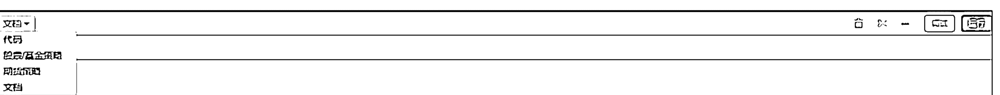

图 1-3 切换单元模式

在不同的单元模式间切换，可以在 Notebook 中实现各种丰富的研究。

- **股票/基金策略模式与期货策略模式**：内嵌了策略回测框架，可以用程序化的方法定义每个交易日在某种条件下买入、卖出一定数量的股票，并进行策略表现评估。
- **文档模式**：可以在这个模式下编写文档。
- **代码模式**：可以在这个模式下进行各种数据的研究分析、金融建模、定价分析等操作。

将单元切换为代码模式后，可以在这个模式下编写任何形式的 Python 代码，并且调用优矿平台提供的数据和定制函数库。在代码模式中输入代码后，按 Ctrl + Enter 组合键运行即可。

## 1.5 优矿平台支持的 Python 程序包

优矿平台支持的 Python 程序包如下。

1. **DataAPI 程序包**
   优矿平台提供的所有数据都可以通过这个模块获得。它是优矿平台内置函数库，无须导入(import)即可使用。可查看 https://uqer.io/data/browse/0/?page=1 了解详细信息。

2. **quartz 程序包**
   quartz 程序包是优矿平台的回测框架。它是优矿平台内置函数库，无须导入即可使用。可查看“https://uqer.io/help/faqApi/# 策略 API 文档”了解详细信息。

3. **CAL 程序包**
   CAL 是优矿平台为固定收益及衍生品建模定制的金融模块。可查看 https://uqer.io/help/faqCAL 了解详细信息。

4. **NumPy 程序包**
   NumPy 是 Python 的数值计算扩展程序包，能够高效地存储和处理大型矩阵。可查看NumPy 官网的帮助文档(http://www.numpy.org/)。

5. **SciPy 程序包**
   SciPy 是基于 NumPy 的更为丰富和高级的功能扩展程序包，在统计、优化、插值、数值积分、常微分方程求解器等方面提供了大量的可用函数，基本覆盖了基础科学计算相关的问题。可查看 SciPy 官网的帮助文档(http://www.scipy.org/)。

6. **pandas 程序包**
   pandas 是基于 NumPy 的数据分析工具，主要用于解决数据分析任务。pandas 提供了大量能帮助用户快速便捷地处理数据的函数和方法；提供了高效操作大型数据集所需的工具。可查看 pandas 官网的帮助文档(http://pandas.pydata.org/pandas-docs/stable/10min.html)。

7. **matplotlib, seaborn 程序包**
   matplotlib 是 Python 的图形框架。可查看 matplotlib 官网的帮助文档(http://matplotlib.org/1.3.1/contents.html)。
   seaborn 模块自带许多定制主题和高级接口，用于控制 matplotlib 图表的外观。可查看 Seaborn 官网的帮助文档(http://seaborn.pydata.org/)。

8. **sklearn 程序包**
   sklearn 是 Python 的机器学习和数据挖掘模块，可以用于模式识别。可查看 sklearn 官网的帮助文档(http://scikit-learn.org/stable/)。

9. **SQLite 程序包**
   SQLite 是一个软件库，实现了自给自足的、无服务器的、零配置的、事务性的 SQL 数据库引擎。SQLite 是在世界上部署最广泛的 SQL 数据库引擎。可以在“开始研究”的 Notebook 中创建 SQLite 数据库，并且存储在 Data 目录中。
   关于 SQLite 函数库的具体使用语法请参考 SQLite 的官方帮助文档(http://www.tutorialspoint.com/sqlite/sqlite_python.htm)。

10. **其他程序包**
    优矿平台还提供了 array, cmath, collections, copy, datetime, dateutil, functools, heapq, itertools, json, math, operator, random, re, string, xml, __future__, mpl_toolkits, statsmodels, datatable, talib, time, statsmodels, cvxopt, MLLPlatformClient, jieba, pymc, pybrain, tables, gensim, fractions, sets, arch, xlrfd, xlwt, io, pickle, cPickle, StringIO, networkx, sympy, pywt, hmmlearn，这里不一一介绍。

## 1.6 Python 的下载

输入网址 https://mirrors.tuna.tsinghua.edu.cn/help/anaconda/, 即可下载 Anaconda, 它是 Python 发行版的套装软件，支持 Linux, MacOS, Windows 等操作系统，包含了众多流行的科学计算、数据分析的 Python 包。其中包括 pandas, NumPy, SciPy, statsmodels, matplotlib 等一系列的程序包以及 IPython 交互环境。Anaconda 安装包下载界面如图 1-4 所示。

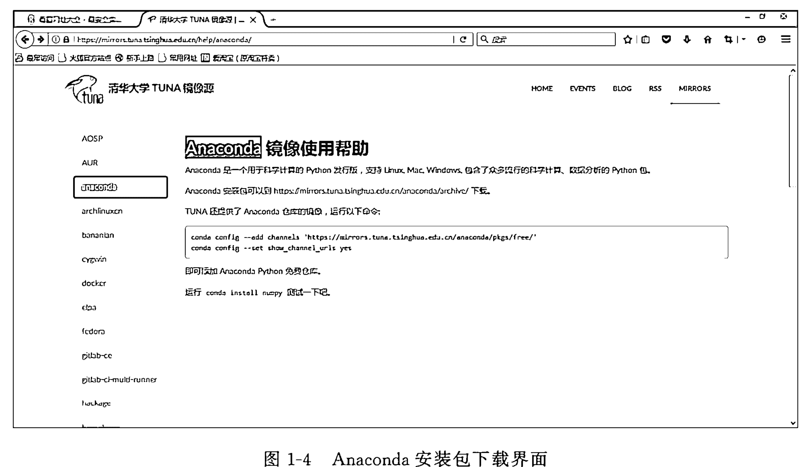

图 1-4 Anaconda 安装包下载界面

单击图 1-4 中的 https://mirrors.tuna.tsinghua.edu.cn/anaconda/archive/, 出现如图 1-5 所示的界面。

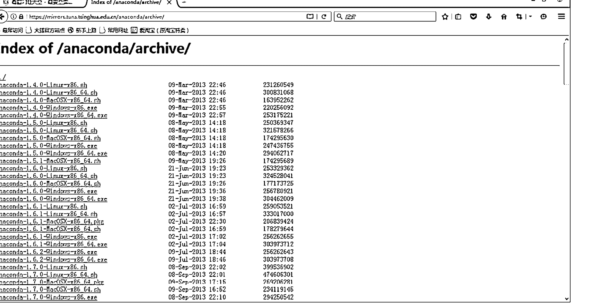

图 1-5 不同版本的 Anaconda 安装包列表

在图 1-5 中, 选择 Anaconda2-4.4.1-Windows-x86.exe, 即可得到 Python 金融经济数据分析套装软件工具。也可以选择最新的 Anaconda3-4.1.1-Windows-x86.exe (32 位) 或 Anaconda3-4.1.1-Windows-x86_64.exe (64 位)。请读者注意, 本书中的金融经济数据分析工具需要下载 Anaconda2-4.4.1-Windows-x86.exe (32 位)。下载界面如图 1-6 所示。

Anaconda2-4.4.1-Windows-x86.exe (32 位) 安装包中提供了应用 Python 进行金融经济数据分析所需的丰富资源, 包括 pandas、NumPy、SciPy、statsmodels、matplotlib 等一系列的程序包以及 IPython 交互环境。要了解 Python 的其他程序包, 可到 https://anaconda.org 网站上搜索。

| 文件名 | 日期 | 大小 |
| :--- | :--- | :--- |
| Anaconda2-2.4.0-MacOSX-x86_64.pkg | 02-Nov-2015 22:22 | 287613909 |
| Anaconda2-2.4.0-MacOSX-x86_64.sh | 02-Nov-2015 22:22 | 251172115 |
| Anaconda2-2.4.0-Windows-x86.exe | 02-Nov-2015 22:22 | 337056800 |
| Anaconda2-2.4.0-Windows-x86_64.exe | 02-Nov-2015 22:22 | 406819096 |
| Anaconda2-2.4.1-Linux-x86.sh | 08-Dec-2015 21:00 | 260583576 |
| Anaconda2-2.4.1-Linux-x86_64.sh | 08-Dec-2015 21:00 | 277827702 |
| Anaconda2-2.4.1-MacOSX-x86_64.pkg | 08-Dec-2015 21:00 | 257787334 |
| Anaconda2-2.4.1-MacOSX-x86_64.sh | 08-Dec-2015 21:00 | 222326344 |
| Anaconda2-2.4.1-Windows-x86.sh | 08-Dec-2015 21:00 | 301780720 |
| Anaconda2-2.4.1-Windows-x86.exe | 08-Dec-2015 21:00 | 371393960 |
| Anaconda2-2.5.0-Linux-x86.sh | 03-Feb-2016 21:41 | 348405313 |
| Anaconda2-2.5.0-Linux-x86_64.sh | 03-Feb-2016 21:41 | 409842279 |
| Anaconda2-2.5.0-MacOSX-x86_64.pkg | 03-Feb-2016 21:55 | 385762781 |
| Anaconda2-2.5.0-MacOSX-x86_64.sh | 03-Feb-2016 21:41 | 331485310 |
| Anaconda2-2.5.0-Windows-x86.exe | 03-Feb-2016 21:45 | 310590880 |
| Anaconda2-2.5.0-Windows-x86.exe | 03-Feb-2016 21:46 | 3658581384 |
| Anaconda2-4.0.0-Linux-x86.sh | 29-Mar-2016 21:14 | 348392297 |
| Anaconda2-4.0.0-Linux-x86_64.sh | 29-Mar-2016 16:14 | 411562823 |
| Anaconda2-4.0.0-Linux-x86_64.pkg | 29-Mar-2016 16:14 | 355703551 |
| Anaconda2-4.0.0-MacOSX-x86_64.sh | 29-Mar-2016 16:14 | 304288480 |
| Anaconda2-4.0.0-Windows-x86.exe | 29-Mar-2016 16:15 | 294659856 |
| Anaconda2-4.0.0-Windows-x86_64.exe | 29-Mar-2016 16:14 | 350807856 |
| Anaconda2-4.1.0-Linux-x86_64.sh | 28-Jun-2016 16:28 | 348190685 |
| Anaconda2-4.1.0-Linux-x86_64.sh | 28-Jun-2016 16:28 | 418188731 |
| Anaconda2-4.1.0-MacOSX-x86_64.pkg | 28-Jun-2016 16:28 | 360909420 |
| Anaconda2-4.1.0-MacOSX-x86_64.sh | 28-Jun-2016 16:28 | 309460309 |
| Anaconda2-4.1.0-Windows-x86.exe | 28-Jun-2016 16:28 | 298958864 |
| Anaconda2-4.1.0-Windows-x86_64.exe | 28-Jun-2016 16:28 | 356677104 |
| Anaconda2-4.1.1-Linux-x86_64.sh | 08-Jul-2016 16:19 | 340385173 |
| Anaconda2-4.1.1-Linux-x86_64.sh | 08-Jul-2016 16:19 | 419038579 |
| Anaconda2-4.1.1-MacOSX-x86_64.pkg | 08-Jul-2016 16:19 | 361721748 |
| Anaconda2-4.1.1-MacOSX-x86_64.sh | 08-Jul-2016 16:20 | 310125837 |
| Anaconda2-4.1.1-Windows-x86.exe | 08-Jul-2016 16:20 | 358522168 |
| Anaconda2-4.1.1-Windows-x86_64.exe | 08-Jul-2016 16:20 | 397765440 |

图 1-6 下载安装包选择界面

## 1.7 Python 的安装

双击下载的 Anaconda2-4.1.1-Windows-x86.exe，即可进入如图 1-7 所示的界面。


图 1-7 Anaconda2.4.1.1(32 位)安装界面


在图 1-7 中单击 Next 按钮，进入如图 1-8 所示的界面。


图 1-8 软件许可协议

在图 1-8 中单击 I Agree 按钮，进入如图 1-9 所示的界面。

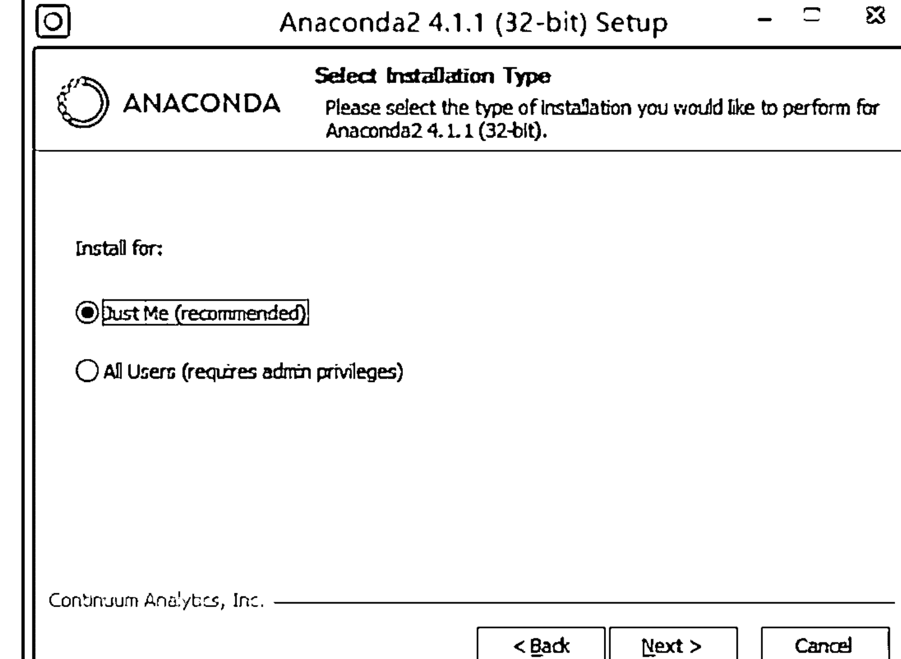

图 1-9 选择安装类型

单击图 1-9 中的 Next 按钮，进入如图 1-10 所示的界面。

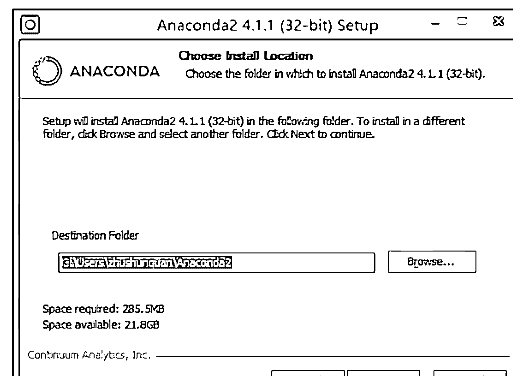

图 1-10 选择安装位置

单击图 1-10 中的 Next 按钮，即可完成 Python 套装软件的安装，安装完成后的 Windows 桌面如图 1-11 所示。


图 1-11 安装完成后的 Windows 桌面

## 1.8 Python 的启动和退出

### 1. Python 的启动

单击图 1-11 中 Spyder 图标，即可启动 Python 的交互式用户界面，如图 1-12 所示。Python 是按照问答的方式运行的，即在命令提示符>>>后输入命令并回车，Python 就完成相应的操作。

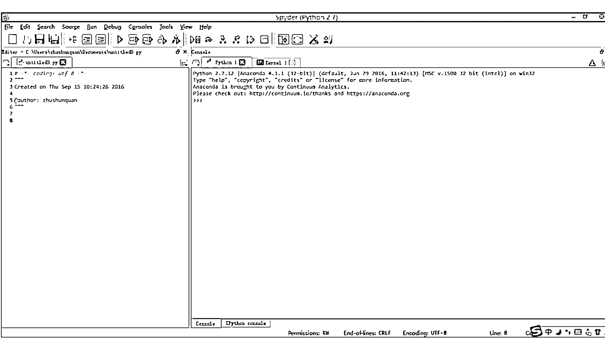

图 1-12 Python 的交互式用户界面

在研究中经常使用的是如图 1-13 所示的 IPython 控制台界面。

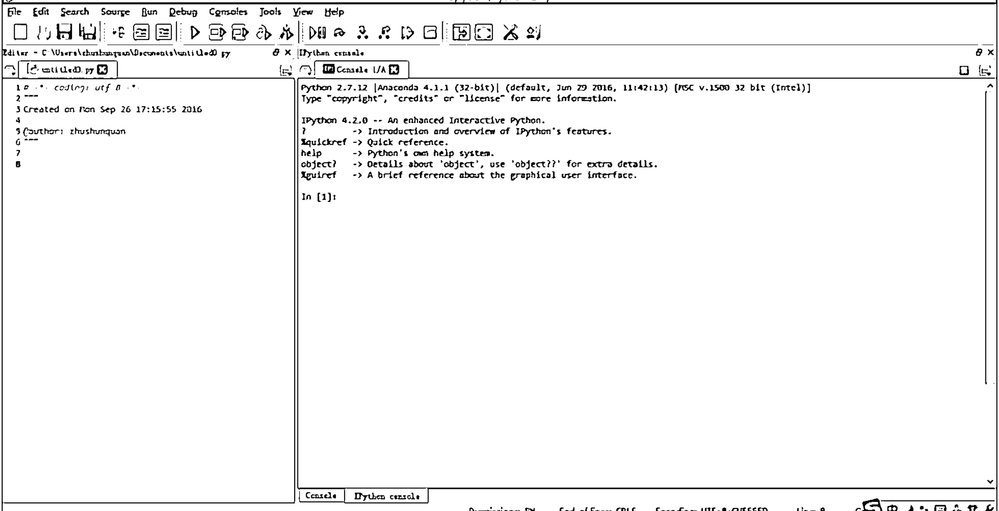

图 1-13 IPython 控制台界面

### 2. Python 的退出

在图 1-12 中的命令提示符>>>后按 Ctrl+Q 键或选择 Python 交互式用户界面中的 File→Quit 菜单命令，即可退出 Python。

## 练习题

1. 在优矿量化金融投资平台注册，并熟悉基本环境。
2. 在 https://mirrors.tuna.tsinghua.edu.cn/help/anaconda/ 下载最新版本的 Python 工具并安装到指定的目录。启动 Python 软件，然后退出。

# 第 2 章
Python 的两个基本操作与编程基础

## 2.1 Python 的两个基本操作

本节介绍 Python 的两个基本操作。

### 1. 四则运算

可以在 Python 中使用＋、－、＊、/ 直接进行四则运算。

```python
1 + 3 * 3
10
```

### 2. 导入模块

使用 import 命令可以导入模块，随后就可以使用这个模块下面的函数了。例如，要导入 math 模块，然后使用 math 模块下面的 sqrt 函数，则执行以下命令：

```python
import math
math.sqrt(9)
3.0
```

> **注意：** 上面的语句直接输入 sqrt(9) 是会报错的，前面要带“math.”前缀。那么有什么办法可以不用每次都带前缀呢？解决办法是用“from 模块 import 函数”命令先导入函数。

```python
from math import sqrt
sqrt(9)
3.0
```

这样每次使用 sqrt 函数的时候就不用再加“math.”前缀了。然而 math 模块下面有很多函数，是否可以写一个语句使 math 下面的所有函数都可以直接使用？下面的办法可以一次导入模块中的所有函数：

```python
from math import *
print(sqrt(9))
print(floor(32.9))
3.0
32.0
```

## 2.2 Python 容器

### 1. 什么是容器

Python 中有一种名为容器的数据结构，顾名思义，容器就是装数据的器具，它主要包括序列和词典，其中序列又主要包括列表、元组、字符串等。

- 列表的基本形式示例：[1, 3, 6, 10] 或者 ['yes', 'no', 'OK']。
- 元组的基本形式示例：(1, 3, 6, 10) 或者 ('yes', 'no', 'OK')。
- 字符串的基本形式示例：'hello'。

以上几种属于序列，序列中的每一个元素都被分配一个序号，即元素的位置，也称为索引。第一个索引，即第一个元素的位置是 0，第二个是 1，依此类推。列表和元组的区别主要在于，列表可以修改，而元组不能（注意列表用方括号“[]”而元组用圆括号“()”）。利用序列的这个特点，就可以通过索引来访问序列中的某个或某几个元素，例如：

```python
a = [1, 3, 6, 10]
a[2]
# Out[2]: 6
b = (1, 3, 6, 10)
b[2]
# 6
c = 'hello'
c[0:3]
# Out[2]: 'hel'
```

与序列对应的字典则不一样，它是一个无序的容器，它的基本形式示例：d = {7:'seven', 8:'eight', 9:'nine'}。这是一个“键-值”映射的结构，因此字典不能通过索引访问其中的元素，而要通过键访问其中的元素：

```python
d = {7: 'seven', 8: 'eight', 9: 'nine'}
d[8]
# Out[2]: 'eight'
```

### 2. 序列的通用操作

列表、元组、字符串等有一些共同的操作。

1）索引

序列的最后一个元素的索引也可以用 -1，倒数第二个元素可以用 -2，依此类推。

例如：

```python
a = [1, 3, 6, 10]
print(a[3])
print(a[-1])
10
10
```

2）分片

分片操作用来访问一定范围内的元素，它的格式为：

```text
序列名[开始索引:结束索引:步长]
```

表示在从开始索引所指的元素到结束索引所指的元素之间，以指定的步长访问该序列中的元素。步长可以省略，默认步长为 1。

```python
c = 'hello'
c[0:3]
# Out[2]: 'hel'
```

这就像把一个序列分成几片，所以叫作分片。

3）序列相加

序列相加即两个序列合并在 一起，相同类型的序列才能相加。例如：

```python
[1, 2, 3] + [4, 5, 6]
# Out[2]: [1, 2, 3, 4, 5, 6]
'hello,' + 'world!'
# Out[3]: 'hello,world!'
```

4）成员资格

为了检查一个值是否在序列中，可以用 in 运算符。例如：

```python
a = 'hello'
print('o' in a)
True
print('t' in a)
False
```

### 3. 列表操作

以上是序列共有的操作，列表还有一些自己独有的操作。

1）list 函数

可以通过 list 函数把一个序列转换成一个列表：

```python
list('hello')
# Out[6]: ['h', 'e', 'l', 'l', 'o']
```

2）元素删除、赋值

元素删除命令格式：del 列表名[索引号]。

元素赋值命令格式：列表名[索引号] = 值。

例如：

```python
a
# Out[8]: 'hello'
b = list(a)
b
# Out[10]: ['h', 'e', 'l', 'l', 'o']
del b[2]
b
# Out[12]: ['h', 'e', 'l', 'o']
b[2] = 't'
b
# Out[14]: ['h', 'e', 't', 'o']
```

3）分片赋值

命令格式为：

```python
列表名[开始索引号:结束索引号] = list(值)
```

分片赋值为列表的某一范围内的元素赋值，即为从开始索引号到结束索引号区间内的几个元素赋值。例如，把 hello 变成 heyyo：

```python
b = list('hello')
b
# Out[16]: ['h', 'e', 'l', 'l', 'o']
b[2:4] = list('yy')
b
# Out[18]: ['h', 'e', 'y', 'y', 'o']
```

> **注意：** 虽然 ll 处于 hello 这个单词的第 2、3 号索引的位置，但赋值时是用 b[2:4] 而不是 b[2:3]（即“含头不含尾”）；另外，要注意 list 后面用圆括号。

4）列表方法

上面介绍的 list 是一个函数。函数在很多语言中都有，例如 Excel 里面的 if 函数、vlookup 函数，SQL 里面的 count 函数，以及各种语言中都有的 sqrt 函数，等等，Python 中也有很多函数。

Python 中的方法是与某些对象有紧密联系的函数，所以列表方法也就是属于列表的函数，它可以对列表执行一些比较深入的操作。方法的调用格式如下：

```text
对象.方法(参数)
```

列表方法的调用格式如下：

```text
列表.方法(参数)
```

下面介绍常用的列表方法，以 a=['h','e','l','l','o'] 为例来说明。

```python
a = ['h', 'e', 'l', 'l', 'o']
a
# Out[20]: ['h', 'e', 'l', 'l', 'o']
```

在列表 a 的索引 2 位置插入一个元素 t：

```python
a.insert(2, 't')
a
# Out[22]: ['h', 'e', 't', 'l', 'l', 'o']
```

在列表的最后添加元素 q：

```python
a.append('q')
a
# Out[24]: ['h', 'e', 't', 'l', 'l', 'o', 'q']
```

返回 a 列表中元素 e 第一次出现的索引位置：

```python
a.index('e')
# Out[25]: 1
```

删除 a 中的第一个元素 e：

```python
a.remove('e')
a
# Out[27]: ['h', 't', 'l', 'l', 'o', 'q']
```

将列表 a 中的所有元素从小到大排列：

```python
a.sort()
a
# Out[29]: ['h', 'l', 'l', 'o', 'q', 't']
```

### 4. 字典操作

1）创建字典

dict 函数可以通过关键字参数来创建字典，格式为：

```python
dict(参数1=值1, 参数2=值2, ...)
```

例如，创建一个名字(name)为 jiayounet、年龄(age)为 27 的字典：

```python
dict(name='jiayounet', age=27)
# Out[30]: {'age': 27, 'name': 'jiayounet'}
```

2）基本操作

字典的基本操作与列表在很多地方都相似，两者的对照如表 2-1 所示。表中以序列 a=[1,3,6,10] 和字典 f={'age': 27, 'name': 'shushuo'}为例。

| 功能 | 列表操作格式 | 列表操作例 | 字典操作格式 | 字典操作例 |
| :--- | :--- | :--- | :--- | :--- |
| 求长度 | len(列表) | len(a) 4 | len(字典) | len(f) 2 |
| 找到某位置上的值 | 列表[索引号] | a[1] 3 | 字典[键] | f["age"] 27 |
| 元素赋值 | 列表[索引]=值 | a[2]=1 a [1,3,1,10] | 字典[键]=值 | f["age"]=28 f {'age':28, 'name':'shushuo'} |
| 删除元素 | del 列表[索引] | del a[1] a [1,6,10] | del 字典[键] | del f["name"] f {'age':28} |
| 成员资格 | 元素 in 列表 | 1 in a True | 键 in 字典 | "age" in f True |

## 2.3 Python 函数

函数可以由用户自己定义，格式如下：

```python
def 函数名(参数):
    函数代码
```

函数代码中，return 表示返回的值。例如，定义一个平方函数 square(x)，输入参数 x，返回 x 的平方：

```python
def square(x):
    return x * x

square(9)
# Out[33]: 81
```

又如，定义一个两数相加的函数：

```python
def add_2int(x, y):
    return x + y

print(add_2int(2, 2))
4
```

有时需要定义参数个数可变的函数，在定义时可以给参数指定默认值。例如，定义函数 f(a, b=1, c='hehe')，那么在调用的时候，后面两个参数可以指定，也可以不指定，不指定时默认为 b=1, c='hehe'，因此如下调用都是正确的：

```python
f('dsds')
f('dsds', 2)
f('dsds', 2, 'hdaasda')
```

上面的方法等于固定了参数的位置，第一个值就是第一个参数的值。除此之外，调用时还可以采用参数关键字方法。例如仍然是函数 f(a, b=1, c='hehe')，调用的时候可以用参数关键字来赋值：

```python
f(b=2, a=11)
```

这样，参数的位置可变，只要给出参数关键字就可以了。

## 2.4 Python 条件与循环

Python 用缩进来标识出哪一段代码是循环体。

### 1. if 语句

注意：循环体的代码要缩进；条件后面有冒号“：”。例如：

```python
j = 2.67
if j < 3:
    print('j < 3')
# j < 3
```

对于多条件 if 语句，注意其中的 elif 不要写成 elseif，标准格式为：

```python
if 条件1:
    执行语句1
elif 条件2:
    执行语句2
else:
    执行语句3
```

注意 if、elif 和 else 是对齐的，不能有缩进：

```python
t = 3
if t < 3:
    print('t < 3')
elif t == 3:
    print('t = 3')
else:
    print('t > 3')
# t = 3
```

### 2. while 语句

while 语句的格式为：

```python
while 条件1:
    执行语句
    if 条件2: break
```

例如：

```python
a = 3
while a < 10:
    a = a + 1
    print(a)
    if a == 8: break
4
5
6
7
8
```

虽然 while 后面的条件是 a<10，即 a 小于 10 的时候一直执行，但是 if 条件中规定了 a 为 8 时就中止循环，因此，执行结果只输出到 8。

### 3. for 语句

for 语句的格式为：

```python
for 条件:
    执行语句
```

for 语句可以用于遍历一个序列/字典等。例如：

```python
a = [1, 2, 3, 4, 5]
for i in a:
    print(i)
1
2
3
4
5
```

### 4. 列表推导式

列表推导式是利用其他列表创建一个新列表的方法，其工作方式类似于 for 循环，格式为：

```python
[输出值 for 条件]
```

当满足条件时，输出一个值，最终形成一个列表。例如：

```python
[x * x for x in range(10)]
# Out[45]: [0, 1, 4, 9, 16, 25, 36, 49, 64, 81]

[x * x for x in range(10) if x % 3 == 0]
# Out[46]: [0, 9, 36, 81]
```

以上的例子就是利用序列[0,1,2,3,4,5,6,7,8,9]分别生成了两个新的序列。

## 2.5 Python 类与对象

### 1. 类与对象

类是一个抽象的概念，它只是为所有的对象定义了抽象的属性与行为。而对象是类的具体个体。

类的对象也叫类的实例。类就像一个模具，对象就是用这个模具造出来的具体的物品，用这个模具造出一个具体的物品，就叫类的实例化。

### 2. 定义一个类

下面看一个具体的类：

```python
class boy:
    gender = 'male'
    interest = 'girl'
    def say(self):
        return 'i am a boy'
```

上面的语句定义了一个类 boy，之后可以用类 boy 构造一个对象：

```python
peter = boy()
```

现在来看看 peter 这个对象有哪些属性和方法。

属性和方法是类的两种表现，静态的叫属性，动态的叫方法。例如“人”这个类的属性有姓名、性别、身高、年龄、体重等，方法有走、跑、跳等。

```python
peter.gender
# Out[49]: 'male'
peter.interest
```


这里 `gender` 和 `interest` 是 `peter` 的属性，而 `say` 是 `peter` 的方法。如果再实例化另一个对象，例如 `sam`：

```python
sam = boy()
sam.gender
Out[54]: 'male'
sam.interest
Out[55]: 'girl'
sam.say()
Out[56]: 'i am a boy'
```

那么 `sam` 和 `peter` 就有一样的属性和方法。

## 练习题

1. 用字典形式读入如下数据。

```text
conc  state
0.02  treated
0.06  treated
0.11  treated
```

2. 编写一个函数，求数据 $y=(y_1, y_2, \cdots, y_n)$ 的均值、标准差。

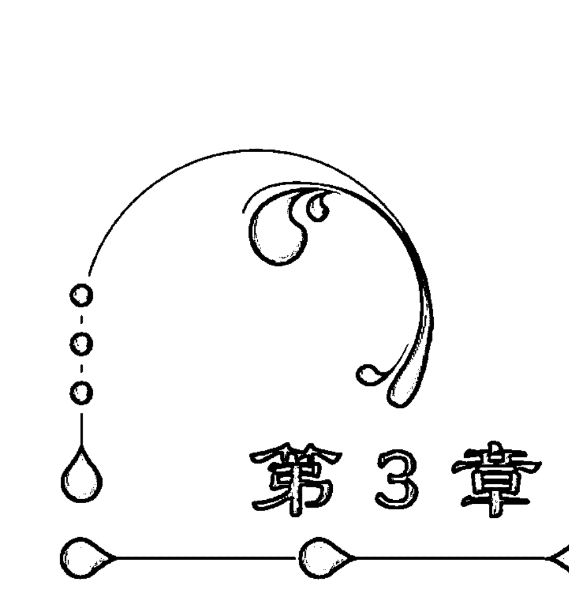

# NumPy 在量化金融投资分析中的应用

本章介绍 NumPy 的基础知识。

## 3.1 NumPy 概述

量化金融投资分析的工作涉及大量的数值运算，一个高效便捷的科学计算工具是必不可少的。Python 语言一开始并不是为科学计算设计的，随着越来越多的人发现 Python 的易用性，逐渐出现了关于 Python 的大量外部扩展模块，NumPy（Numeric Python）就是其中之一。NumPy 提供了大量的数值编程工具，可以方便地处理向量、矩阵等运算，极大地便利了人们在科学计算方面的工作。另一方面，Python 是免费的，相比于费用高昂的 Matlab，NumPy 的出现使 Python 得到了更多人的青睐。

首先简单看一下如何开始使用 NumPy：

```python
import numpy
numpy.version.full_version
'1.11.1'
```

使用 `import` 命令导入了 NumPy，并使用 `numpy.version.full_version` 查出了 NumPy 版本为 1.11.1。在后面的介绍中，将大量使用 NumPy 中的函数，每次使用都在函数前添加“numpy.”作为前缀比较费劲，2.1 节介绍了引入外部扩展模块时的小技巧，可以使用 `from numpy import *` 解决这一问题。

Python 的外部扩展模块成千上万，在使用中很可能会导入几个外部扩展模块，如果某个模块包含的属性和方法与另一个模块的同名，就必须使用 `import module` 来避免名字的冲突。这种情况即所谓的名字空间（namespace）冲突了，所以前缀最好还是带上。

那么有没有简单的办法呢？办法是在导入扩展模块时给模块定义在程序中使用的别名，调用时就不必写出全名了。例如，使用 `np` 作为别名并调用 `version.full_version` 函数：

```python
import numpy as np
np.version.full_version
'1.11.1'
```

## 3.2 NumPy 对象初步：数组

NumPy 中的基本对象是同类型的多维数组（homogeneous multidimensional array），这和 C++ 中的数组是一致的，例如字符型和数值型不可共存于同一个数组中。先看例子：

```python
a = np.arange(20)
```

这里生成了一个一维数组 `a`，从 0 开始，步长为 1，长度为 20。Python 中的计数是从 0 开始的，R 语言和 Matlab 的使用者需要注意这一点。可以使用 `print` 查看 `a` 数组：

```python
print a
[  0  1  2  3  4  5  6  7  8  9 10 11 12 13 14 15 16 17 18 19]
```

可以通过 `type` 函数查看 `a` 的类型，这里显示 `a` 是一个数组：

```python
type(a)
'numpy.ndarray'
```

通过函数 `reshape` 可以重新构造这个数组。例如，可以构造一个 4×5 的二维数组，其中 `reshape` 的参数表示各维的大小，且按各维顺序排列（二维时就是按行排列，这和 R 语言中按列排列是不同的）：

```python
a = a.reshape(4, 5)
print a
[[  0  1  2  3  4]
 [  5  6  7  8  9]
 [10 11 12 13 14]
 [15 16 17 18 19]]
```

还可以构造更高维的数组：

```python
a = a.reshape(2, 2, 5)
print a
[[[ 0  1  2  3  4]
   [ 5  6  7  8  9]]

 [[10 11 12 13 14]
  [15 16 17 18 19]]]
```

既然 `a` 是 array，就可以调用 array 的函数进一步查看 `a` 的相关属性；`ndim` 可查看维度；`shape` 可查看各维的大小；`size` 可查看数组的元素个数，等于各维大小的乘积；`dtype` 可查看元素类型；`itemsize` 可查看元素占存储空间的大小（以字节为单位）。

```python
a.ndim
3
a.shape
(2, 2, 5)
a.size
20
a.dtype
dtype('int64')
```

## 3.3 创建数组

数组的创建可通过转换列表实现，高维数组可通过转换嵌套列表实现：

```python
raw = [0, 1, 2, 3, 4]
a = np.array(raw)
```

```python
a
array([0, 1, 2, 3, 4])
```

```python
raw = [[0, 1, 2, 3, 4], [5, 6, 7, 8, 9]]
b = np.array(raw)
b
```

```python
array([[0, 1, 2, 3, 4],
[5, 6, 7, 8, 9]])
```

一些特殊的数组由特殊的命令生成，如创建 4×5 的全零矩阵：

```python
d = (4, 5)
np.zeros(d)
```

```python
array([[ 0.,  0.,  0.,  0.,  0.],
[ 0.,  0.,  0.,  0.,  0.],
[ 0.,  0.,  0.,  0.,  0.],
[ 0.,  0.,  0.,  0.,  0.]])
```

默认生成的元素类型是浮点型，可以通过指定类型来改变。例如：

```python
d = (4, 5)
np.ones(d, dtype=int)
```

```python
array([[1, 1, 1, 1, 1],
[1, 1, 1, 1, 1],
[1, 1, 1, 1, 1],
[1, 1, 1, 1, 1]])
```

以下创建一个 [0,1) 区间的随机数数组：

```python
np.random.rand(5)
```

```python
array([ 0.06005608, 0.4479634, 0.42202299, 0.16803542, 0.05508347])
```

## 3.4 数组和矩阵的运算

数组的四则运算要对全部的数组元素进行，以加法为例：

```python
a = np.array([[1.0, 2], [2, 4]])
print "a:"
print a
b = np.array([[3.2, 1.5], [2.5, 4]])
print "b:"
print b
print "a+b:"
print a + b
```

```text
a:
[[ 1. 2. ]
[ 2. 4. ]]
b:
[[ 3.2 1.5 ]
[ 2.5 4. ]]
a+b:
[[ 4.2 3.5 ]
[ 4.5 8. ]]
```

这里可以发现，`a` 中虽然仅有一个元素是浮点数，其余均为整数，但在处理中 Python 会自动将整数转换为浮点数（因为数组元素必须是同类型的），并且，两个二维数组相加要求各维大小相同。当然，在 NumPy 里这些运算符也可以对标量和数组进行操作，结果是数组的全部元素分别把这个标量进行运算。例如：

```python
print "3 * a:"
print 3 * a
print "b + 1.8:"
print b + 1.8
```

```text
3 * a:
[[ 3.  6.]
 [ 6. 12.]]
b + 1.8:
[[ 5.  3.3]
 [ 4.3 5.8]]
```

在 NumPy 中同样支持 `+=`、`-=`、`*=`、`/=` 操作符：

```python
a /= 2
print a
```

```text
[[ 0.5 1. ]
 [ 1.  2. ]]
```

NumPy 还支持求平方根和求幂运算：

```python
print "a:"
print a
print "np.exp(a):"
print np.exp(a)
print "np.sqrt(a):"
print np.sqrt(a)
print "np.square(a):"
print np.square(a)
print "np.power(a, 3):"
print np.power(a, 3)
```

```text
a:
[[ 0.5  1. ]
 [ 1.  2. ]]
np.exp(a):
[[ 1.64872127  2.71828183]
 [ 2.71828183  7.3890561 ]]
np.sqrt(a):
[[ 0.70710678  1.        ]
 [ 1.  1.41421356]]
np.square(a):
[[ 0.25  1.  ]
 [ 1.  4.  ]]
np.power(a, 3):
[[ 0.125  1.  ]
 [ 1.  8.  ]]
```

需要知道二维数组元素的最大值、最小值怎么办？要计算全部元素的和、按行求和、按列求和怎么办？要利用 for 循环吗？不用，NumPy 的 ndarray 类提供了相应的函数：

```python
a = np.arange(20).reshape(4,5)
print "a:"
print a
print "sum of all elements in a: " + str(a.sum())
print "maximum element in a: " + str(a.max())
print "minimum element in a: " + str(a.min())
print "maximum element in each row of a: " + str(a.max(axis=1))
print "minimum element in each column of a: " + str(a.min(axis=0))
```

```text
a:
[[ 0  1  2  3  4]
 [ 5  6  7  8  9]
 [10 11 12 13 14]
 [15 16 17 18 19]]
sum of all elements in a: 190
maximum element in a: 19
minimum element in a: 0
maximum element in each row of a: [ 4  9 14 19]
minimum element in each column of a: [0 1 2 3 4]
```

科学计算中大量使用到矩阵运算，NumPy 提供了矩阵对象 (matrix)。矩阵对象和数组对象主要有两点差别：①矩阵是二维的，而数组可以是任意正整数维；②矩阵的 `*` 操作符进行的是矩阵乘法，乘号左侧的矩阵列和乘号右侧的矩阵行大小要相等，而数组的 `*` 操作符是对应元素两两相乘，乘号两侧的数组每一维大小都需要一致。数组可以通过 `asmatrix` 或者 `mat` 转换为矩阵，也可以直接生成矩阵：

```python
a = np.arange(20).reshape(4, 5)
a = np.asmatrix(a)
print type(a)
b = np.matrix('1.0 2.0; 3.0 4.0')
print type(b)
```

```text
<class 'numpy.matrixlib.defmatrix.matrix'>
<class 'numpy.matrixlib.defmatrix.matrix'>
```

再来看一下矩阵的乘法。使用 `arange` 生成另一个矩阵 `b`，可以通过 `arange(起始，终止，步长)` 的方式调用 `arange` 函数生成等差数列。注意，指定起始和终止值时含头不含尾。

```python
b = np.arange(2, 45, 3).reshape(5, 3)
b = np.mat(b)
print b
```

```text
[[ 2  5  8]
[11 14 17]
[20 23 26]
[29 32 35]
[38 41 44]]
```

`arange` 指定的是步长，如果想指定生成的一维数组的长度怎么办？`linspace` 就可以做到：

```python
np.linspace(0, 2, 9)
```

```text
array([ 0.  ,  0.25,  0.5,  0.75,  1.  ,  1.25,  1.5,  1.75,  2.  ])
```

回到前面的问题，矩阵 `a` 和 `b` 做矩阵乘法：

```python
print "matrix a:"
print a
print "matrix b:"
print b
c = a * b
print "matrix c:"
print c
```

```text
matrix a:
[[  0  1  2  3  4]
 [  5  6  7  8  9]
 [10 11 12 13 14]
 [15 16 17 18 19]]
matrix b:
[[  2  5  8]
 [11 14 17]
 [20 23 26]
 [29 32 35]
 [38 41 44]]
matrix c:
[[ 290  320  350]
 [ 790  895 1000]
 [1290 1470 1650]
 [1790 2045 2300]]
```

## 3.5 访问数组和矩阵元素

数组和矩阵元素的访问可通过下标进行，以下均以二维数组（或矩阵）为例。

```python
a = np.array([[3.2, 1.5], [2.5, 4]])
print a[0][1]
print a[0, 1]
```

```text
1.5
1.5
```

可以通过下标访问并修改数组元素的值：

```python
b = a
a[0][1] = 2.0
print "a:"
print a
print "b:"
print b
```

```text
a:
[[ 3.2  2.  ]
 [ 2.5  4. ]]
b:
[[ 3.2  2.  ]
 [  2.5  4. ]]
```

现在问题来了，明明改的是 `a[0][1]`，怎么连 `b[0][1]` 也跟着变了？这个陷阱在 Python 编程中很容易碰上，其原因在于 Python 不是真正将 `a` 复制一份给 `b`，而是将 `b` 指向 `a` 对应数据的内存地址。想要真正将 `a` 复制给 `b`，可以使用 `copy` 函数：

```python
a = np.array([[[3.2, 1.5], [2.5, 4]]])
b = a.copy()
a[0][1] = 2.0
print "a:"
print a
print "b:"
print b
```

```text
a:
[[ 3.2  2. ]
[  2.5  4. ]]
b:
[[ 3.2  1.5]
[  2.5  4. ]]
```

若对 `a` 重新赋值，则会将 `a` 指向其他地址，而 `b` 仍在原来的地址：

```python
a = np.array([[[3.2, 1.5], [2.5, 4]]])
b = a
a = np.array([[[2, 1], [9, 3]]])
print "a:"
print a
print "b:"
print b
```

```text
a:
[[2 1]
[9 3]]
b:
[[ 3.2  1.5]
[  2.5  4. ]]
```

利用 `:` 可以访问某一维的全部数据，例如取矩阵中的指定列：

```python
a = np.arange(20).reshape(4, 5)
print "a:"
print a
print "the 2nd and 4th column of a:"
print a[:,[1,3]]
```

```text
a:
[[  0   1   2   3   4]
[  5   6   7   8   9]
[ 10  11  12  13  14]
[ 15  16  17  18  19]]
the 2nd and 4th column of a:
[[  1   3]
[  6   8]
[11 13]
[16 18]
```

更复杂的情况是取出满足某些条件的元素，这在数据的处理中十分常见，通常用在单行单列上。下面这个例子是将 `a` 中第一列大于 5 的元素 (10 和 15) 对应的第三列元素 (12 和 17) 取出来：

```python
a[:, 2][a[:, 0]>5]
```

```text
array([[12, 17]])
```

可使用 `where` 函数查找特定值在数组中的位置：

```python
loc = numpy.where(a==11)
print loc
print a[loc[0][0], loc[1][0]]
```

```text
(array([2]), array([1]))
11
```

## 3.6 矩阵操作

首先来看矩阵转置：

```python
a = np.random.rand(2,4)
print "a:"
print a
a = np.transpose(a)
print "a is an array, by using transpose(a):"
print a
b = np.random.rand(2,4)
b = np.mat(b)
print "b:"
print b
print "b is a matrix, by using b.T:"
print b.T
```

```text
a:
[[ 0.17571282 0.98510461 0.94864387 0.50078988]
 [ 0.09457965 0.70251658 0.07134875 0.43780173]]
a is an array, by using transpose(a):
[[ 0.17571282 0.09457965]
 [ 0.98510461 0.70251658]
 [ 0.94864387 0.07134875]
 [ 0.50078988 0.43780173]]
b:
[[ 0.09653644 0.46123468 0.50117363 0.69752578]
 [ 0.60756723 0.44492537 0.05946373 0.4858369]]
b is a matrix, by using b.T:
[[ 0.09653644 0.60756723]
 [ 0.46123468 0.44492537]
 [ 0.50117363 0.05946373]
 [ 0.69752578 0.4858369]]
```


以下是矩阵求逆：

```python
import numpy_linalg as nlg
a = np.random.rand(2,2)
a = np.mat(a)
print "a:"
print a
ia = nlg.inv(a)
print "inverse of a:"
print ia
print "a * inv(a)"
print a * ia
```

输出示例：
```
a:
[[ 0.86211266  0.6885563 ]
 [ 0.28798536  0.70810425]]
inverse of a:
[[ - 1.71798445 - 1.6705577 ]
 [- 0.69870271   2.09163573]]
a * inv(a)
[[1.  0.]
 [0.  1.]]
```

以下是求特征值和特征向量：

```python
a = np.random.rand(3,3)
eig_value, eig_vector = nlg.eig(a)
print "eigen value:"
print eig_value
print "eigen vector:"
print eig_vector
```

输出示例：
```
eigen value:
[ 1.35760609   0.43205379 - 0.53470662]
eigen vector:
[[ - 0.76595379   0.88231952  - 0.07390831]
 [ - 0.55170557   0.21659887  - 0.74213622]
 [ - 0.33005418   0.41784829    0.66616169]]
```

以下是按列拼接两个向量构成一个矩阵：

```python
a = np.array((1,2,3))
b = np.array((2,3,4))
print np.column_stack((a,b))
```

输出示例：
```
[1 2]
[2 3]
[3 4]
```

在循环处理某些数据得到结果后，将结果拼接成一个矩阵是十分有用的，可以通过 `vstack` 和 `hstack` 完成：

```python
a = np.random.rand(2,2)
b = np.random.rand(2,2)
print "a:"
print a
print "b:"
print b
c = np.hstack([a,b])
d = np.vstack([a,b])
print "horizontal stacking a and b:"
print c
print "vertical stacking a and b:"
print d
```

输出示例：
```
a:
[[ 0.6738195 0.4944045]
 [ 0.25702675 0.15422012]]
b:
[[ 0.28058267 0.0967197]
 [ 0.55191041 0.04694485]]
horizontal stacking a and b:
[[ 0.6738195 0.4944045 0.28058267 0.0967197]
 [ 0.25702675 0.15422012 0.55191041 0.04694485]]
vertical stacking a and b:
[[ 0.6738195 0.4944045]
 [ 0.25702675 0.15422012]
 [ 0.28058267 0.0967197]
 [ 0.55191041 0.04694485]]
```

## 3.7 缺失值

缺失值在量化分析中也是一种信息，NumPy提供了`nan`作为缺失值的记录，通过`isnan`函数判定是否为缺失值。

```python
a = np.random.rand(2,2)
a[0, 1] = np.nan
print np.isnan(a)
```

输出示例：
```
[[False  True]
 [False False]]
```

`nan_to_num`函数可将`nan`替换成0，在6.3.2节将介绍pandas提供的指定`nan`替换值的函数。

```python
print np.nan_to_num(a)
```

输出示例：
```
[[ 0.58144238  0.        ]
 [ 0.26789784  0.48664306]]
```

NumPy还有很多函数，详细信息可参考 [http://wiki.scipy.org/NumPy_Example_List](http://wiki.scipy.org/NumPy_Example_List) 和 [http://docs.scipy.org/doc/numpy](http://docs.scipy.org/doc/numpy)。

## 3.8 一元线性回归分析的NumPy应用

一元线性回归分析模型是最基本的回归模型，其数学表达式是

$$ \hat { y } = a + b x + \varepsilon \tag { 3 - 1 } $$

式中：
- $\hat{y}$：预测对象，因变量或被解释变量的预测值。
- $x$：影响因素，自变量或解释变量的相应值。
- $a, b$：待估计的参数，称为回归系数。
- $\varepsilon$：偏差(或估计误差、残差)。

为了估计 $a, b$ 参数，最常用的方法是最小二乘法。首先，要收集预测对象 $\hat{y}$ 及相关因素 $x$ 的数据样本 $n$ 对(实际值)：

$$ (y_1, x_1), (y_2, x_2), ..., (y_n, x_n) $$

再将其描绘在坐标图上($x$为横轴, $y$为纵轴)。当这 $n$ 对数据点近似呈直线分布时，则可以应用一元线性回归模型，即式(3.1)。式中 $a+bx=y$ 应是预测对象的实际值，因而对应样本中的每一个 $x_i$ 都有一个 $y_i$ 的估计值 $\hat{y_i}$, $i=1,2,...,n$；$y_i$ 与 $\hat{y_i}$ 之间存在着偏差 $\varepsilon_i$，于是有

$$ \varepsilon_i = y_i - \hat{y}_i = y_i - a - bx_i; $$

设

$$ Q = \sum_{i=1}^n \varepsilon_i^2 = \sum_{i=1}^n (y_i - a - bx_i)^2 $$

可见, $Q$ 是参数 $a, b$ 的函数。为了求 $Q$ 的最小值，可利用极值原理：

$$ \frac{\partial Q}{\partial a} = 0, \quad \frac{\partial Q}{\partial b} = 0 $$

即

$$
\begin{cases}
\frac{\partial Q}{\partial a} = -2 \sum_{i=1}^n (y_i - a - bx_i) = 2 \sum_{i=1}^n (a + bx_i - y_i) = 0 \\
\frac{\partial Q}{\partial b} = -2 \sum_{i=1}^n x_i(y_i - a - bx_i) = 2 \sum_{i=1}^n x_i(a + bx_i - y_i) = 0
\end{cases}
$$

求解此联立方程可得

$$ b = \frac{\sum_{i=1}^n x_i y_i - \left(\sum_{i=1}^n x_i \sum_{i=1}^n y_i\right)}{\sum_{i=1}^n x_i^2 - \left(\sum_{i=1}^n x_i\right)^2} \bigg/ n, \quad a = \frac{1}{n} \sum_{i=1}^n y_i - \frac{b}{n} \sum_{i=1}^n x_i $$

令

$$ \bar{x} = \frac{1}{n} \sum_{i=1}^n x_i, \quad \bar{y} = \frac{1}{n} \sum_{i=1}^n y_i $$

则

$$ a = \bar{y} - b \bar{x} $$

例如,10家饭店的季度销售额和到这些饭店吃饭的学生人数的数据如表3-1所示。

### 表 3-1 10家饭店的数据

| 序号 | 销售额/千美元 $y_i$ | 学生数/千人 $x_i$ | $x_i y_i$ | $x_i^2$ |
|------|---------------------|---------------------|-----------|----------|
| 1    | 58                  | 2                   | 116       | 4        |
| 2    | 105                 | 6                   | 630       | 36       |
| 3    | 88                  | 8                   | 704       | 64       |
| 4    | 118                 | 8                   | 944       | 64       |
| 5    | 117                 | 12                  | 1404      | 144      |
| 6    | 137                 | 16                  | 2192      | 256      |
| 7    | 157                 | 20                  | 3140      | 400      |
| 8    | 169                 | 20                  | 3380      | 400      |
| 9    | 149                 | 22                  | 3278      | 484      |
| 10   | 202                 | 26                  | 5252      | 676      |
| 合计 | 1300                | 140                 | 21 040    | 2528     |

根据表 3-1 中的数据可得

$$ b = \frac{\sum_{i=1}^{n} x_i y_i - \left( \sum_{i=1}^{n} x_i \sum_{i=1}^{n} y_i \right) / n}{\sum_{i=1}^{n} x_i^2 - \left( \sum_{i=1}^{n} x_i \right)^2 / n} = \frac{21\ 040 - (140 \times 1300) / 10}{2528 - 140^2 / 10} = 2840 / 568 = 5 $$

$$ a = \overline{y} - b\overline{x} = 1300 / 10 - 5 \times 140 / 10 = 60 $$

则得到一元线性回归模型为

$$ \hat{y} = 60 + 5x \hspace{2cm}(3-2) $$

例如，当学生人数为 30 时，根据此模型，销售额是 210(单位是千美元)。

使用 NumPy 编制 Python 代码如下：

```python
import numpy as np

def fitSLR(x, y):
    n = len(x)
    denominator = 0
    numerator = 0
    for i in range(0, n):
        numerator += (x[i] - np.mean(x)) * (y[i] - np.mean(y))
        denominator += (x[i] - np.mean(x)) ** 2
    b1 = numerator / float(denominator)
    b0 = np.mean(y) - b1 * np.mean(x)
    return b0, b1

def predict(x, b0, b1):
    return b0 + x * b1

x = [1, 3, 2, 1, 3]
y = [14, 24, 18, 17, 27]
b0, b1 = fitSLR(x, y)
print "intercept:", b0, " slope:", b1

x_test = 6
y_test = predict(x_test, b0, b1)
print "y_test:", y_test
```

执行上述代码，结果如下：

```
intercept: 10.0  slope: 5.0
y_test: 40.0
```

## 练习题

对本章中例题数据，使用 Python 重新操作一遍。


本章介绍另一个量化金融投资分析中常用的库——SciPy。

## 4.1 SciPy 概述

第 3 章介绍了 NumPy，下面我们来看看 SciPy 能做些什么。NumPy 解决了向量和矩阵的相关操作的问题, 基本上算是一个高级的科学计算器。SciPy 基于 NumPy 提供了更为丰富和高级的功能扩展, 在统计、优化、插值、数值积分、时频转换等方面提供了大量的可用函数，基本覆盖了基础科学计算相关的问题。

在量化金融投资分析中运用最广泛的是统计和优化的相关技术, 本章重点介绍 SciPy 中的统计和优化模块，其他模块在后面用到时再做讲述。

本章会涉及一些矩阵代数的知识, 如若感觉理解困难, 可以跳到 4.3 节或者在理解时用一维的标量代替高维的向量。

首先导入相关的模块，本章使用的是 SciPy 里面的统计和优化部分：

```python
import numpy as np
import scipy.stats as stats
import scipy.optimize as opt
```

## 4.2 统计知识

### 1. 生成随机数

我们从生成随机数开始，这样方便后面的介绍。要生成 $n$ 个随机数，可以调用 `rv_continuous.rvs(size=n)` 或 `rv_discrete.rvs(size=n)`。其中，`rv_continuous` 表示连续型的随机分布，如均匀分布 (uniform)、正态分布 (norm)、$\beta$ 分布 (beta) 等；`rv_discrete` 表示离散型的随机分布，如伯努利分布 (bernoulli)、几何分布 (geom)、泊松分布 (poisson) 等。下面生成 10 个 [0,1] 区间上的随机数和 10 个服从参数 $a=4, b=2$ 的 $\beta$ 分布随机数：

```python
rv_unif = stats.uniform.rvs(size=10)
print rv_unif
rv_beta = stats.beta.rvs(size=10, a=4, b=2)
print rv_beta
```

输出示例：
```
[0.6419336   0.48403001  0.89548809  0.73837498  0.65744886  0.41845577
 0.3823512   0.0985301   0.66785949  0.73163835]
[0.82164685  0.69563836  0.74207073  0.94348192  0.82979411  0.87013796
 0.78412952  0.47508183  0.29296073  0.52551156]
```

每个随机分布的生成函数都内置了默认的参数，如均匀分布的上下界默认是 0 和 1。可是一旦需要修改这些参数，每次生成随机数都要输入这么长一串有点麻烦，能不能简单点？SciPy 中有一个 Freezing 的功能，可以提供简便版本的命令。SciPy.stats 支持定义某个具体分布的对象，可以做如下的定义，让 beta 直接指代具体参数 a=4 和 b=2 的 $\beta$ 分布。为让结果具有可比性，这里指定了随机数的生成种子，由 NumPy 提供。

```python
np.random.seed(seed=2015)
rv_beta = stats.beta.rvs(size=10, a=4, b=2)
print "method 1:"
print rv_beta
np.random.seed(seed=2015)
beta = stats.beta(a=4, b=2)
print "method 2:"
print beta.rvs(size=10)
```

输出示例：
```
method 1:
[0.43857338 0.9411551  0.75116671 0.92002864 0.62030521 0.56585548
 0.41843548 0.5953096  0.88983036 0.94675351]
method 2:
[0.43857338 0.9411551  0.75116671 0.92002864 0.62030521 0.56585548
 0.41843548 0.5953096  0.88983036 0.94675351]
```

### 2. 假设检验

现在生成一组数据，并查看相关的统计量（相关分布的参数可以查阅 [http://docs.scipy.org/doc/scipy/reference/stats.html](http://docs.scipy.org/doc/scipy/reference/stats.html)）：

```python
norm_dist = stats.norm(loc=0.5, scale=2)
n = 200
dat = norm_dist.rvs(size=n)
print "mean of data is: " + str(np.mean(dat))
print "median of data is: " + str(np.median(dat))
print "standard deviation of data is: " + str(np.std(dat))
```

输出示例：
```
mean of data is: 0.437675174955
median of data is: 0.380911679917
standard deviation of data is: 1.90718725955
```

假设这些数据是我们获取到的某些实际数据，如股票日涨跌幅，要对数据进行简单的分析。最简单的是检验这一组数据是否服从假设的分布，如正态分布。这个问题是典型的单样本假设检验问题，最常见的解决方案是采用 K-S 检验（Kolmogorov-Smirnov test）。单样本 K-S 检验的原假设是给定的数据来自和原假设相同的分布。在 SciPy 中提供了 `kstest` 函数，参数分别是数据、拟检验的分布名称和对应的参数：

```python
mu = np.mean(dat)
sigma = np.std(dat)
stat_val, p_val = stats.kstest(dat, 'norm', (mu, sigma))
print 'KS -statistic D = %6.3f p -value = %6.4f' % (stat_val, p_val)
```

输出示例：
```
KS -statistic D = 0.039 p -value = 0.9252
```


假设检验的p-value很大（在原假设下，p-value是服从$[0, 1]$区间上的正态分布的随机变量，可参考 http://en.wikipedia.org/wiki/P-value），因此接受原假设，即该数据通过了正态性的检验。在正态性的前提下，可进一步检验这组数据的均值是不是0。典型的方法是t检验（t-test），其中单样本的t检验函数为`ttest_1samp`：

```python
stat_val, p_val = stats.ttest_1samp(dat, 0)
print 'One-sample t-statistic D = %.3f, p-value = %.4f' % (stat_val, p_val)
# One-sample t-statistic D = 3.247, p-value = 0.0014
```

我们看到p-value $<$ 0.05，即在给定显著性水平0.05的前提下，应拒绝原假设：数据的均值为0。再生成一组数据，尝试一下双样本的t检验（`ttest_ind`）：

```python
norm_dist2 = stats.norm(loc = -0.2, scale = 1.2)
dat2 = norm_dist2.rvs(size = n/2)
stat_val, p_val = stats.ttest_ind(dat, dat2, equal_var = False)
print 'Two-sample t-statistic D = %.3f, p-value = %.4f' % (stat_val, p_val)
# Two-sample t-statistic D = 4.346, p-value = 0.0000
```

注意，这里生成的第二组数据样本大小、方差和第一组均不相等，在运用t检验时需要使用韦尔奇t检验（Welch's t-test），即指定`ttest_ind`中的`equal_var=False`。同样得到了比较小的p-value，在显著性水平0.05的前提下拒绝原假设，即认为两组数据均值不等。

stats还提供了大量其他的假设检验函数，如`bartlett`和`levene`用于检验方差是否相等，`anderson_ksamp`用于进行Anderson-Darling的K-样本检验等。

### 3. 其他函数

有时需要知道某数值在一个分布中的分位，或者给定了一个分布，求某分位上的数值。这可以通过`cdf`和`ppf`函数完成：

```python
g_dist = stats.gamma(a = 2)
print "quantiles of 2, 4 and 5:"
print g_dist.cdf([2, 4, 5])
print "Values of 25%, 50% and 90 %:"
print g_dist.pdf([0.25, 0.5, 0.95])
# quantiles of 2, 4 and 5:
# [ 0.59399415  0.90842181  0.95957232]
# Values of 25 %, 50 % and 90 % :
# [ 0.1947002  0.30326533  0.36740397]
```

对于一个给定的分布，可以用`moment`很方便地查看分布的矩信息，例如查看$N(0,1)$的6阶原点矩：

```python
stats.norm.moment(6, loc = 0, scale = 1)
# Out[9]: 15.0000000000895124
```

`describe`函数提供了对数据集的统计描述分析，包括数据样本大小、极值、均值、方差、偏度和峰度：

```python
norm_dist = stats.norm(loc = 0, scale = 1.8)
dat = norm_dist.rvs(size = 100)
info = stats.describe(dat)
print "Data size is: " + str(info[0])
print "Minimum value is: " + str(info[1][0])
print "Maximum value is: " + str(info[1][1])
print "Arithmetic mean is: " + str(info[2])
print "Unbiased variance is: " + str(info[3])
print "Biased skewness is: " + str(info[4])
print "Biased kurtosis is: " + str(info[5])
# Data size is: 100
# Minimum value is: -4.41884319577
# Maximum value is: 5.71520945675
# Arithmetic mean is: 0.165282446834
# Unbiased variance is: 3.63090718776
# Biased skewness is: 0.278066378117
# Biased kurtosis is: 0.408791537079
```

当已知一组数据服从某些分布的时候，可以调用 `fit` 函数来得到对应分布参数的极大似然估计（Maximum-Likelihood Estimation, MLE）。假设数据服从正态分布，以下代码可以得到分布参数的极大似然估计：

```python
norm_dist = stats.norm(loc=0, scale=1.8)
dat = norm_dist.rvs(size=100)
mu, sigma = stats.norm.fit(dat)
print "MLE of data mean:" + str(mu)
print "MLE of data standard deviation:" + str(sigma)
# MLE of data mean: -0.126592501904
# MLE of data standard deviation: 1.74446062629
```

`pearsonr` 和 `spearmanr` 函数可以计算 Pearson 和 Spearman 相关系数，这两个相关系数度量了两组数据的线性关联程度：

```python
norm_dist = stats.norm()
dat1 = norm_dist.rvs(size=100)

exp_dist = stats.expon()
dat2 = exp_dist.rvs(size=100)
cor, pval = stats.pearsonr(dat1, dat2)
print "Pearson correlation coefficient: " + str(cor)
cor, pval = stats.spearmanr(dat1, dat2)
print "Spearman's rank correlation coefficient: " + str(cor)

# Pearson correlation coefficient: -0.078269702955
# Spearman's rank correlation coefficient: -0.0667146714671
```

其中的 `pval` 表示原假设（两组数据不相关）下相关系数的显著性。

在 SciPy 中还提供了金融数据分析中使用频繁的线性回归，下面是一个例子：

```python
x = stats.chi2.rvs(3, size=50)
y = 2.5 + 1.2 * x + stats.norm.rvs(size=50, loc=0, scale=1.5)
slope, intercept, r_value, p_value, std_err = stats.linregress(x, y)
print "Slope of fitted model is:", slope
print "Intercept of fitted model is:", intercept
print "R-squared:", r_value**2

# Slope of fitted model is: 1.19360405909
# Intercept of fitted model is: 1.90649803845
# R-squared: 0.787978596903
```

## 4.3 优化知识

优化问题在投资中可谓是根本问题。如果手上有众多可选的策略，应如何从中选择一个最好的策略进行投资呢？这时就需要利用一些优化技术针对给定的指标进行寻优。随着越来越多的金融数据的出现，机器学习逐渐应用于投资领域，在机器学习中，优化也是十分重要的一个部分。以下介绍一些常见的优化方法。虽然其中的例子是人工生成的，没有直接应用实际金融数据，但是足以展示优化方法。希望读者在实际中遇到优化问题时，能够基于这些简单的例子迅速上手。

### 4.3.1 无约束优化问题

所谓无约束优化问题指的是一个优化问题的寻优可行集合是目标函数自变量的定义域，即没有外部的限制条件。例如，求解优化问题

$$ \text{Minimize} \quad f(x)=x^{2}-4.8x+1.2 $$

就是一个无约束优化问题，而求解

$$
\begin{array}{l}
\min \quad f(x)=x^{2}-4.8x+1.2 \\
\text{s. t.} \quad x \geqslant 0
\end{array}
$$

则是一个带约束的优化问题。本节更进一步假设考虑的问题全部是凸优化问题，即目标函数是凸函数，其自变量的可行集是凸集（关于凸优化问题的详细定义可参考斯坦福大学Stephen Boyd 教授的教材 *Convex Optimization*，下载链接：http://stanford. edu/～boyd/ cvxbook）。

下面以 Rosenbrock 函数

$$ f(x)=\sum_{i=1}^{N-1}\left(100\left(x_{i}-x_{i-1}^{2}\right)^{2}+\left(1-x_{i-1}\right)^{2}\right) $$

作为寻优的目标函数来简要介绍在 SciPy 中使用优化模块 `scipy.optimize` 的方法。

首先需要定义 Rosenbrock 函数：

```python
def rosen(x):
    """The Rosenbrock function"""
    return sum(100.*(x[1:-1]-x[:-1]**2.0)**2.0 + (1-x[:-1])**2.0)
```

#### 1. Nelder-Mead 单纯形法

单纯形法是运筹学中求解线性规划问题的通用方法，这里的 Nelder-Mead 单纯形法与其并不相同，只是用到单纯形的概念。设定起始点 $x_0=[0.5, 1.6, 1.1, 0.8, 1.2]$，并进行最小化的寻优。这里 `'xtol'` 表示迭代收敛的容忍误差上限：

```python
x_0 = np.array([0.5, 1.6, 1.1, 0.8, 1.2])
res = opt.minimize(rosen, x_0, method='nelder-mead', options={'xtol': 1e-8, 'disp': True})
```

```python
print "Result of minimizing Rosenbrock function via Nelder-Mead Simplex algorithm:"
print res
# Optimization terminated successfully.
# Current function value: 0.000000
# Iterations: 436
# Function evaluations: 706
# Result of minimizing Rosenbrock function via Nelder-Mead Simplex algorithm:
# final_simplex: (array([[ 1., 1., 1., 1., 1.],
#              [ 1., 1., 1., 1., 1.],
#              [ 1., 1., 1., 1., 0.99999999],
#              [ 1., 1., 1., 1., 1.],
#              [ 1., 1., 1., 1., 1.00000001],
#              [ 1., 1., 1., 1., 1.00000001]]),
#         array([ 1.66149699e-17, 6.32117429e-17, 7.44105349e-17,
#            8.24396866e-17, 9.5320876e-17, 1.07882961e-16]))
# fun: 1.6614969876635003e-17
```

Rosenbrock 函数的性能比较好，简单的优化方法就可以处理了，还可以在使用 `minimize` 中使用 `method='powell'` 来指定使用 Powell 方法。这两种简单的方法并不使用函数的梯度，在略微复杂的情形下收敛速度比较慢，下面介绍利用函数梯度进行寻优的方法。

#### 2. Broyden-Fletcher-Goldfarb-Shanno 法

Broyden-Fletcher-Goldfarb-Shanno (BFGS) 法用到了函数梯度信息。首先求 Rosenbrock 函数的梯度：

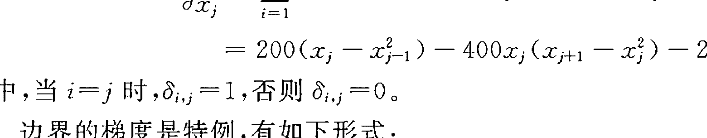

其中，当 $i=j$ 时，$\delta_{i, j}=1$，否则 $\delta_{i, j}=0$。

边界的梯度是特例，有如下形式：

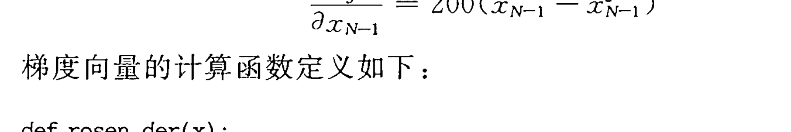

梯度向量的计算函数定义如下：

```python
def rosen_der(x):
    xm = x[1:-1]
    xm_m1 = x[1:-2]
    xm_p1 = x[2:]
    der = np.zeros_like(x)
    der[1:-1] = 200*(xm - xm_m1**2)*xm - 400*(xm_p1 - xm**2)*xm - 2*(1-xm)
    der[0] = -400*x[0]*(x[1]-x[0]**2) - 2*(1-x[0])
    der[-1] = 200*(x[-1]-x[-2]**2)
    return der
```

梯度信息的引入在 `minimize` 函数中通过参数 `jac` 指定：

```python
res = opt.minimize(rosen, x_0, method = 'BFGS', jac = rosen_der, options = {'disp': True})
```

```python
print "Result of minimizing Rosenbrock function via Nelder-Mead Simplex algorithm:"
print res
# Optimization terminated successfully.
# Current function value: 0.000000
# Iterations: 436
# Function evaluations: 706

# Result of minimizing Rosenbrock function via Nelder-Mead Simplex algorithm:
# final_simplex: (array([[1.    , 1.    , 1.    , 1.    , 1.    ],
#                 [1.    , 1.    , 1.    , 1.    , 1.    ],
#                 [1.    , 1.    , 1.    , 1.    , 0.99999999],
#                 [1.    , 1.    , 1.    , 1.    , 1.    ],
#                 [1.    , 1.    , 1.    , 1.    , 1.00000001],
#                 [1.    , 1.    , 1.    , 1.    , 1.00000001]],
#             array([  1.661496999e-17,   6.32117429e-17,   7.44105349e-17,
#                    8.24396866e-17,   9.53208876e-17,   1.07882961e-16]))
# fun: 1.6614969876635003e-17
```

Rosenbrock 函数的性能比较好，简单的优化方法就可以处理了，还可以在 `minimize` 中使用 `method='powell'` 来指定使用 Powell 方法。这两种简单的方法并不使用函数的梯度，在稍微复杂的情形下收敛速度比较慢，下面介绍利用函数梯度进行寻优的方法。

#### 2. Broyden-Fletcher-Goldfarb-Shanno 法

Broyden-Fletcher-Goldfarb-Shanno (BFGS) 法用到了函数梯度信息。首先求 Rosenbrock 函数的梯度：

$$
\frac{\partial f}{\partial x_{j}}=\sum_{i=1}^{N}200(x_{i}-x_{i-1}) \cdot(\delta_{i, j}-2x_{i-1}\delta_{i-1, j}) \\
=200(x_{j}-x_{j-1}^{2})-400x_{j}(x_{j+1}-x_{j}^{2})-2(1-x_{j})
$$

其中, 当 $i=j$ 时, $\delta_{i, j}=1$, 否则 $\delta_{i, j}=0$。

边界的梯度是特例，有如下形式：

$$
\begin{array}{l}
\frac{\partial f}{\partial x_{0}}=-400 x_{0}\left(x_{1}-x_{0}^{2}\right)-2\left(1-x_{0}\right) \\
\frac{\partial f}{\partial x_{N-1}}=200\left(x_{N-1}-x_{N-1}^{2}\right)
\end{array}
$$

梯度向量的计算函数定义如下：

```python
def rosen_der(x):
    xm = x[1:-1]
    xm_m1 = x[1:-2]
    xm_p1 = x[2:]
    der = np.zeros_like(x)
    der[1:-1] = 200 * (xm - xm_m1 * 2) - 400 * (xm_p1 - xm * 2) * xm - 2 * (1-xm)
    der[0] = - 400 * x[0] * (x[1]-x[0] * 2) - 2 * (1-x[0])
    der[-1] = 200 * (x[-1]-x[-2] * 2)
    return der
```

梯度信息的引入在 `minimize` 函数中通过参数 `jac` 指定：

```python
res = opt.minimize(rosen, x_0, method = 'BFGS', jac = rosen_der, options = {'disp': True})
```


## 3. 牛顿共轭梯度法

用到梯度的方法还有牛顿共轭梯度法（Newton-Conjugate-Gradient algorithm，简称牛顿法）。牛顿法是收敛速度最快的方法，其缺点在于需要求解 Hessian 矩阵（二阶导数矩阵）。牛顿法大致的思路是采用泰勒展开的二阶近似，可使用共轭梯度近似 Hessian 矩阵的逆矩阵。下面给出 Rosenbrock 函数的 Hessian 矩阵元素通式：

$$
\begin{aligned}
H(i, j)= \frac{\partial^{2} f}{\partial x_{i} \partial x_{j}} &= 200\left(\delta_{i, j}-2 x_{i-1} \delta_{i-1, j}\right) - 400 x_{i}\left(\delta_{i+1, j} - 2 x_{i} \delta_{i, j}\right) - \\
&400 \delta_{i, j}\left(x_{i+1, j} - x_{i}^{2}\right) + 2 \delta_{i, j} \\
&=\left(202 + 1200 x_{i}^{2} - 400 x_{i+1}\right) \delta_{i, j} - 400 x_{i} \delta_{i+1, j} - 400 x_{i+1} \delta_{i-1, j}
\end{aligned}
$$

其中 $i, j \in[1, N-2]$。其他边界上的元素通式为

$$
\begin{aligned}
&\frac{\partial^{2} f}{\partial x_{0}^{2}} = 1200 x_{0}^{2} - 400 x_{1} + 2 \\
&\frac{\partial^{2} f}{\partial x_{0} \partial x_{1}} = \frac{\partial^{2} f}{\partial x_{1} \partial x_{0}} = - 400 x_{0} \\
&\frac{\partial^{2} f}{\partial x_{N-1} \partial x_{N-2}} = \frac{\partial^{2} f}{\partial x_{N-2} \partial x_{N-1}} = -400 x_{N-2} \\
&\frac{\partial^{2} f}{\partial x_{N-1}^{2}} = 200
\end{aligned}
$$

例如，当 $N = 5$ 时的 Hessian 矩阵为

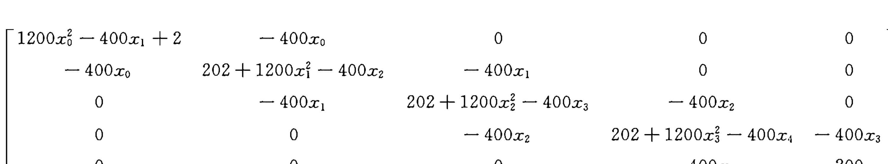

为使用牛顿法，需要提供 一个计算 Hessian 矩阵的函数：

```python
def rosen_hess(x):
    x = np.asarray(x)
    H = np.diags(-400 * x[1:], 1) - np.diags(400 * x[2:], -1)
    diagonal = np.zeros_like(x)
    diagonal[0] = 1200 * x[0] * x[0] * 2 - 400 * x[1] + 2
    diagonal[-1] = 200
    diagonal[1:-1] = 202 + 1200 * x[1:-1] * x[1:-1] * 2 - 400 * x[2:]
    H = H + np.diags(diagonal)
    return H
```

调用上述函数：

```python
res = opt.minimize(rosen, x_0, method='Newton-CG', jac=rosen_der, hess=rosen_hess,
                   options={'xtol': 1e-8, 'disp': True})
print "Result of minimizing Rosenbrock function via Newton-Conjugate-Gradient algorithm (Hessian):"
print res
```

输出结果：

```text
Optimization terminated successfully.
Current function value: 0.000000
Iterations: 20
Function evaluations: 22
Gradient evaluations: 41
Hessian evaluations: 20
Result of minimizing Rosenbrock function via Newton-Conjugate-Gradient algorithm (Hessian):
fun: 1.47606641102778e-19
jac: array([ -3.62847530e-11,   2.68148992e-09,   1.16637362e-08,
             4.81693414e-08,  -2.76999090e-08])
```

对于一些大型的优化问题，Hessian 矩阵将异常大，牛顿法用到的仅是 Hessian 矩阵和一个任意向量的乘积，为此，用户可以提供两个向量，一个是 Hessian 矩阵和一个任意向量 p 的乘积，另一个是向量 p，这就减少了存储的开销。记向量 $p = (p_1, p_2, \dots, p_{N-1})$，可有 $(1200x_0^2 - 400x_1 + 2)p_0 - 400x_0p_1 \cdots - 400x_{i-1}p_{i-1} + (202 + 1200x_i^2 - 400x_{i+1})p_i - 400x_ip_{i+1} \cdots - 400x_{N-2}p_{N-2} + 200p_{N-1}$

定义如下函数并使用牛顿法寻优：

```python
def rosen_hess_p(x, p):
    x = np.asarray(x)
    Hp = np.zeros_like(x)
    Hp[0] = (1200 * x[0] * x[0] * 2 - 400 * x[1] + 2) * p[0] - 400 * x[0] * p[1]
    Hp[1:-1] = -400 * x[1:-1] * p[1:-1] - 400 * x[2:] * p[2:] + \
               (202 + 1200 * x[1:-1] * x[1:-1] * 2 - 400 * x[2:]) * p[1:-1] + \
               -400 * x[1:-1] * p[2:]
    Hp[-1] = -400 * x[-1] * p[-1] + 200 * p[-1]
    return Hp
```

```python
res = opt.minimize(rosen, x_0, method='Newton-CG', jac=rosen_der, hessp=rosen_hess_p,
                   options={'xtol': 1e-8, 'disp': True})
print "Result of minimizing Rosenbrock function via Newton - Conjugate - Gradient algorithm (Hessian times arbitrary vector):"
print res
```

输出结果：

```text
Optimization terminated successfully.
Current function value: 0.000000
Iterations: 20
Function evaluations: 22
Gradient evaluations: 41
Hessian evaluations: 58
Result of minimizing Rosenbrock function via Newton - Conjugate - Gradient algorithm (Hessian times arbitrary vector):
fun: 1.47606641102778e-19
jac: array([ -3.62847530e-11,  2.68148992e-09,  1.16637362e-08,
             4.81693414e-08, -2.76999090e-08])
```

### 4.3.2 有约束优化问题

有约束优化问题的一种标准形式为

$$
\min f(x) \quad \text{s.t. } g_i(x) \leqslant 0, \quad i=1,2,\cdots,m
$$
$$
\mathbf{A}\mathbf{x} = \mathbf{b}
$$

其中 $g_1,\cdots,g_m: \mathbf{R}^n \rightarrow \mathbf{R}$ 为 $\mathbf{R}^n$ 空间上的二次可微的凸函数；$\mathbf{A}$ 为 $p \times n$ 矩阵且秩 $\operatorname{rank}(\mathbf{A})=p<n$。

考察如下的例子：

Minimize $f(x, y)=2 xy+2 x-x^{2}-2 y^{2}$
subject to $x^{3}-y=0$
$y-1 \geqslant 0$

定义目标函数及其导数为

```python
def func(x, sign=1.0):
    """ Objective function """
    return sign * (2 * x[0] * x[1] + 2 * x[0] - x[0] ** 2 - 2 * x[1] ** 2)

def func_deriv(x, sign=1.0):
    """ Derivative of objective function """
    dfdx0 = sign * (-2 * x[0] + 2 * x[1] + 2)
    dfdx1 = sign * (2 * x[0] - 4 * x[1])
    return np.array([dfdx0, dfdx1])
```

其中 sign 表示求解最小或者最大值。进一步定义约束条件：

```python
cons = ({'type': 'eq',
         'fun': lambda x: np.array([x[0] ** 3 - x[1]]),
         'jac': lambda x: np.array([3.0 * (x[0] ** 2.0), -1.0])},
        {'type': 'ineq',
         'fun': lambda x: np.array([x[1] - 1]),
         'jac': lambda x: np.array([0.0, 1.0])})
```

最后使用 SLSQP (Sequential Least Squares Programming optimization algorithm，序贯最小优化算法）进行约束问题的求解（作为比较，同时列出了无约束优化的求解方法）：

```python
res = opt.minimize(func, [-1.0, 1.0], args=(-1.0,), jac=func_deriv, method='SLSQP',
                   options={'disp': True})
print "Result of unconstrained optimization:"
print res

res = opt.minimize(func, [-1.0, 1.0], args=(-1.0,), jac=func_deriv, constraints=cons,
                   method='SLSQP', options={'disp': True})
print "Result of constrained optimization:"
print res
```

输出结果：

```text
Optimization terminated successfully. (Exit mode 0)
Current function value: -2.0
Iterations: 4
Function evaluations: 5
Gradient evaluations: 4
Result of unconstrained optimization:
fun: -2.0
jac: array([ -0., -0., 0.])
message: 'Optimization terminated successfully. '
nfev: 5
nit: 4
njev: 4
status: 0
success: True
x: array([ 2., 1.])

Optimization terminated successfully. (Exit mode 0)
Current function value: -1.00000018311
Iterations: 9
Function evaluations: 14
Gradient evaluations: 9
Result of constrained optimization:
fun: -1.0000001831052137
jac: array([ -1.99999982, 1.99999982, 0.])
message: 'Optimization terminated successfully. '
nfev: 14
nit: 9
njev: 9
status: 0
success: True
x: array([ 1.00000009, 1.])
```

### 4.3.3 利用 CVXOPT 求解二次规划问题

在 Python 中除了可以使用 opt.minimize 工具处理优化问题外，也有其他专门的优化扩展模块，例如 CVXOPT(http://cvxopt.org) 专门用于处理凸优化问题，在约束优化问题上提供了更多的备选方法。CVXOPT 是著名的凸优化教材 Convex Optimization 的作者之一，加州大学洛杉矶分校 Lieven Vandenberghe 教授开发的，是处理优化问题的利器。

SciPy 中的优化模块还有一些特殊定制的函数，专门处理能够转化为优化求解的一些问题，如方程求根、最小二乘拟合等，可到 SciPy 官方网站关于优化部分的页面查看。

在实际生活中经常会遇到一些优化问题，简单的线性规划可以作图求解，但是当目标函数包含二次项时，则需要另觅其他方法。在金融实践中，马科维茨均方差模型就有实际的二次优化需求。作为金融实践中常用的方法，本节对 CVXOPT 中求解二次规划的问题通过举例详细说明。

#### 1. 二次规划问题的标准形式

二次规划问题的标准形式如下：

$$
\min \frac{1}{2} \mathbf{x}^T P \mathbf{x} + \mathbf{q}^T \mathbf{x}
$$
$$
\text{s.t. } G\mathbf{x} \leq \mathbf{h}, \quad A\mathbf{x} = \mathbf{b}
$$

上式中，$\mathbf{x}$ 为所要求解的列向量，$\mathbf{x}^T$ 表示 $\mathbf{x}$ 的转置。

上式表明，任何二次规划问题都可以转化为上式的结构，事实上用 CVXOPT 的第一步就是将实际的二次规划转换为上式的结构，写出对应的 $P, q, G, h, A, b$。

- 目标函数若为求 $\max$，可以通过乘以 $-1$ 将最大化问题转换为最小化问题。
- $G\mathbf{x} \leq \mathbf{h}$ 表示所有的不等式约束，同样，若存在诸如 $\mathbf{x} \geq 0$ 的限制条件，也可以通过乘以 $-1$ 转换为 $\leq$ 的形式。
- $A\mathbf{x} = \mathbf{b}$ 表示所有的等式约束。

#### 2. 求解过程示例

二次规划问题如下：

$$
\min \frac{1}{2}x^2 + 3x + 4y
$$
$$
\text{s.t. } x, y \geq 0, \quad x + 3y \geq 15, \quad 2x + 5y \leq 100, \quad 3x + 4y \leq 80
$$

在此例中，需要求解的是 $x, y$，可以把它写成向量的形式，同时，也需要将限制条件按照前面介绍的标准形式进行调整，用矩阵形式表示，如下所示：

$$
\begin{aligned}
&\min_{(x,y)} \frac{1}{2} \begin{bmatrix} x \\ y \end{bmatrix}^T \begin{bmatrix} 1 & 0 \\ 0 & 0 \end{bmatrix} \begin{bmatrix} x \\ y \end{bmatrix} + \begin{bmatrix} 3 \\ 4 \end{bmatrix}^T \begin{bmatrix} x \\ y \end{bmatrix} \\
&\text{s.t. } \begin{bmatrix} -1 & 0 \\ 0 & -1 \\ -1 & -3 \\ 2 & 5 \\ 3 & 4 \end{bmatrix} \begin{bmatrix} x \\ y \end{bmatrix} \leq \begin{bmatrix} 0 \\ 0 \\ -15 \\ 100 \\ 80 \end{bmatrix}
\end{aligned}
$$

如上所示，目标函数和限制条件均转化成了二次规划问题的标准形式，这是第一步，也是最难的一步，接下来就简单了。

对比上式和标准形式，不难得出

$$
P = \begin{bmatrix} 1 & 0 \\ 0 & 0 \end{bmatrix}, \quad q = \begin{bmatrix} 3 \\ 4 \end{bmatrix}, \quad G = \begin{bmatrix} -1 & 0 \\ 0 & -1 \\ -1 & -3 \\ 2 & 5 \\ 3 & 4 \end{bmatrix}, \quad h = \begin{bmatrix} 0 \\ 0 \\ -15 \\ 100 \\ 80 \end{bmatrix}
$$

接下来就是几行简单的代码，目的是告诉计算机上面的参数具体是什么。

```python
from cvxopt import solvers, matrix

P = matrix([[1.0, 0.0], [0.0, 0.0]])  # matrix区分 int 和 double, 数字后要加强小数点
q = matrix([3.0, 4.0])
G = matrix([[-1.0, 0.0], [0.0, -1.0], [-1.0, -3.0], [2.0, 5.0], [3.0, 4.0]])
h = matrix([0.0, 0.0, -15.0, 100.0, 80.0])
```


sol = solvers.qp(P,q,G,h) # 调用优化函数 solvers.qp 求解
print sol['x']
# 打印结果, sol 里面还有很多其他属性, 读者可以自行了解

得到如下结果：

| pcost | dcost | gap | pres | dres |
| :---: | :---: | :---: | :---: | :---: |
| 0: 1.0780e+02 | - 7.6366e+02 | 9e+02 | 1e-16 | 4e+01 |
| 1: 9.3245e+01 | 9.7637e+00 | 8e+01 | 1e-16 | 3e+00 |
| 2: 6.7311e+01 | 3.2553e+01 | 3e+01 | 6e-17 | 1e+00 |
| 3: 2.6071e+01 | 1.5068e+01 | 1e+01 | 2e-16 | 7e-01 |
| 4: 3.7092e+01 | 2.3152e+01 | 1e+01 | 2e-16 | 4e-01 |
| 5: 2.5352e+01 | 1.8652e+01 | 7e+00 | 8e-17 | 3e-16 |
| 6: 2.0062e+01 | 1.9974e+01 | 9e-02 | 6e-17 | 3e-16 |
| 7: 2.0001e+01 | 2.0000e+01 | 9e-04 | 6e-17 | 3e-16 |
| 8: 2.0000e+01 | 2.0000e+01 | 9e-06 | 9e-17 | 2e-16 |

Optimal solution found.
[ 7.13e-07 ]
[ 5.00e+00 ]

可见 x≈0.0,y=5.0。上面的代码很简单。难点不在于代码, 而是在于将实际优化问题转化为标准形式的过程。

在上面的例子中并没有出现等号, 当出现等式约束时, 过程是一样的, 找到 A、b, 然后运行代码 sol=solvers.qp(P,q,G,h,A,b) 即可求解。

上面定义各个矩阵参数用的是最直接的方式, 也可以结合 NumPy 来定义上述矩阵。

```python
from cvxopt import solvers, matrix
import numpy as np

P = matrix(np.diag([1.0,0.0])) # 一些特殊矩阵用 NumPy 创建更方便 (在本例中区别不大)
q = matrix(np.array([3.0,4.]))
G = matrix(np.array([[ -1.0,0.0],[0. -1],[-1. -3],[2.5],[3.4]]))
h = matrix(np.array([0.0.0. -15.100.80]))
sol = solvers.qp(P,q,G,h)
print sol['x']
```

得到如下结果：

| pcost | dcost | gap | pres | dres |
| :---: | :---: | :---: | :---: | :---: |
| 0: 1.0780e+02 | - 7.6366e+02 | 9e+02 | 1e-16 | 4e+01 |
| 1: 9.3245e+01 | 9.7637e+00 | 8e+01 | 1e-16 | 3e+00 |
| 2: 6.7311e+01 | 3.2553e+01 | 3e+01 | 6e-17 | 1e+00 |
| 3: 2.6071e+01 | 1.5068e+01 | 1e+01 | 2e-16 | 7e-01 |
| 4: 3.7092e+01 | 2.3152e+01 | 1e+01 | 2e-16 | 4e-01 |
| 5: 2.5352e+01 | 1.8652e+01 | 7e+00 | 8e-17 | 3e-16 |
| 6: 2.0062e+01 | 1.9974e+01 | 9e-02 | 6e-17 | 3e-16 |
| 7: 2.0001e+01 | 2.0000e+01 | 9e-04 | 6e-17 | 3e-16 |
| 8: 2.0000e+01 | 2.0000e+01 | 9e-06 | 9e-17 | 2e-16 |

Optimal solution found.
[ 7.13e-07 ]
[ 5.00e+00 ]

## 3. CVXOPT在投资组合中的应用

投资组合优化就是要解决如下问题：

```
min \frac{1}{2}\sigma_{p}^{2}=\frac{1}{2}\mathbf{X}^{T}\boldsymbol{P}\mathbf{X}

s.t.\ \begin{cases}\mathbf{1}^{T}\mathbf{X}=1\\ E(r_{P})=\mathbf{e}^{T}\mathbf{X}\geqslant\mu_{0}\end{cases}
```

注意，这里的 $\mu_{0}>\mu=E(r_{P})$，例如 $\mu_{0}=0.13$。其中 $\mathbf{1}=\begin{bmatrix} 1 \\ 1 \\ \vdots \\ 1 \end{bmatrix}, \mathbf{e}=\begin{bmatrix} E(r_{1}) \\ E(r_{2}) \\ \vdots \\ E(r_{n}) \end{bmatrix}$。

```
min \frac{1}{2}\mathbf{x}^{T}\boldsymbol{P}\mathbf{x}+\mathbf{q}^{T}\mathbf{x}

s.t.\ \quad\boldsymbol{G}\mathbf{x}\leqslant\mathbf{h},\ \ \boldsymbol{A}\mathbf{x}=\boldsymbol{b}
```

先给出下列 3 个资产数据表：

| s1 | s2 | b |
| :---: | :---: | :---: |
| 0 | 0.07 | 0.06 |
| 0.04 | 0.13 | 0.07 |
| 0.13 | 0.14 | 0.05 |
| 0.19 | 0.43 | 0.04 |
| -0.15 | 0.67 | 0.07 |
| -0.27 | 0.64 | 0.08 |
| 0.37 | 0.00 | 0.06 |
| 0.24 | -0.22 | 0.04 |
| -0.07 | 0.18 | 0.05 |
| 0.07 | 0.31 | 0.07 |
| 0.19 | 0.59 | 0.10 |
| 0.33 | 0.99 | 0.11 |
| -0.05 | -0.25 | 0.15 |
| 0.22 | 0.04 | 0.11 |
| 0.23 | -0.11 | 0.09 |
| 0.06 | -0.15 | 0.10 |
| 0.32 | -0.12 | 0.08 |
| 0.19 | 0.16 | 0.06 |
| 0.05 | 0.22 | 0.05 |
| 0.17 | -0.02 | 0.07 |

根据上面的资产数据表求得协方差矩阵为

```
\begin{bmatrix} 0.05212 & -0.02046 & -0.00026 \\ -0.02046 & 0.20929 & -0.00024 \\ -0.00026 & -0.00024 & 0.00147 \end{bmatrix}
```

3个资产的均值为：0.1130，-0.1850，0.0755。

由此，编制如下 Python 代码来求 3 个资产的投资比例，使 3 个资产组成的投资组合风险最小化。

```python
from cvxopt import solvers, matrix
P = matrix([[-1.05212, -0.02046, 0.00026], [-0.02046, 0.20929, -0.00024], [-0.00026, -0.00024, 0.00147]])
q = matrix([0.0,0.0,0.0])
A = matrix([[1.0],[1.0],[1.0]])
b = matrix([1.0])
G = matrix([[-1.0,0.0,0.0,1.0,0.0,0.0,0.-0.1130], [0.0, -1.0, 0.0, 0.0, 0.0, 0.1, 0.0, 0.-0.1850], [0.0, 0.0, -1.0, 0.0, 0.0, 0.1, 0.0, -0.0755]])
h = matrix([0.0,0.0,0.0,0.0,1.0,1.0,1.0, -0.13])
sol = solvers.qp(P,q,G,h,A,b) # 调用优化函数 solvers.qp 求解
print sol['x'] #打印结果, sol 里面还有很多其他属性
print sol
```

得到如下结果：

```
pcost dcost gap pres dres
0: 1.1276e-02 -3.3616e+00 1e+01 2e+00 4e-01
1: 1.3759e-02 -1.5235e+00 2e+00 2e-02 5e-03
2: 1.6416e-02 -7.0537e-02 9e-02 1e-03 3e-04
3: 1.5256e-02 7.2943e-03 8e-03 9e-05 2e-05
4: 1.4367e-02 1.3910e-02 5e-04 6e-07 1e-07
5: 1.4314e-02 1.4309e-02 5e-06 6e-09 1e-09
6: 1.4314e-02 1.4314e-02 5e-08 6e-11 1e-11
Optimal solution found.
[ 5.06e-01]
[ 3.24e-01]
[ 1.69e-01]
{'status': 'optimal', 'dual slack': 1.806039796747772e-09, 'iterations': 6, 'relative gap': 3.683302827853541e-06, 'dual objective': 0.014313726166982559, 'gap': 5.272178806796808e-08, 'primal objective': 0.01431377886845612, 'primal slack': 1.1767433021045898e-08, 's': <7x1 matrix, tc = 'd'>, 'primal infeasibility': 5.899809096312396e-11, 'dual infeasibility': 1.4865206484913074e-11, 'y': <1x1 matrix, tc = 'd'>, 'x': <3x1 matrix, tc = 'd'>, 'z': <7x1 matrix, tc = 'd'>}
```

可见资产 1 投资比例为 51%，资产 2 投资比例为 32%，资产 3 投资比例为 17%，最小方差的一半 $\frac{1}{2} \mathbf{x}^{\mathrm{T}} \mathbf{P} \mathbf{x}+\mathbf{q}^{\mathrm{T}} \mathbf{x}=0.014 \ 314$。

## 练习题

对本章中例题的数据，使用 Python 重新操作一遍。

# pandas的基本数据结构

## 第5章

## 5.1 pandas 介绍

pandas 是 Python 在数据处理方面功能最为强大的扩展模块。在处理实际的金融数据时,一条数据通常包含了多种类型的数据,例如,在一条股票数据中,股票的代码是字符串,收盘价是浮点型,而成交量是整数,等等。在 C++ 中可以实现以一个给定结构体作为单元的容器,如向量(vector, C++ 中的特定数据结构)。在 Python 中, pandas 包含了高级的数据结构 Series 和 DataFrame,使得在 Python 中处理数据变得非常方便、快速和简单。

pandas 不同的版本之间存在一些不兼容性,为此,需要清楚使用的是哪一个版本的 pandas。查看 pandas 版本的操作如下:

```python
import pandas as pd
pd.__version__
Out[27]: u'0.18.1'
```

pandas 最主要的两个数据结构是 Series 和 DataFrame, 5.2 节和 5.3 节将介绍如何由其他类型的数据结构得到这两种数据结构,或者自行创建这两种数据结构。首先导入 Series 和 DataFrame 以及相关模块:

```python
import numpy as np
from pandas import Series, DataFrame
```

## 5.2 pandas 数据结构: Series

从一般意义上来讲,可以简单地将 Series 视为一维数组。Series 和一维数组最主要的区别在于 Series 类型具有索引(index),可以和编程中常见的另一个数据结构——哈希 (Hash) 联系起来。

### 5.2.1 创建 Series

创建 Series 的基本格式是

```python
s = Series(data, index=index, name=name)
```

以下给出几个创建 Series 的例子。首先介绍如何从数组创建 Series:

```python
a = np.random.randn(5)
print "a is an array:"
print a
s = Series(a)
print "s is a Series:"
print s
a is an array:
[  1.5708724  -2.51990028 -0.8213732  0.28692464 -1.72725827]
s is a Series:
0     1.570872
1    -2.519900
2    -0.821373
3     0.286925
4    -1.727258
dtype: float64
```

可以在创建 Series 时添加 index，并可使用 Series.index 查看具体的 index。需要注意的是，当从数组创建 Series 时，若指定 index，那么 index 的长度要和 data 的长度一致。例如：

```python
s = Series(np.random.randn(5), index=['a', 'b', 'c', 'd', 'e'])
print s
s.index
a    0.059366
b    1.232519
c    0.318299
d    1.083609
e    0.732492
dtype: float64
Out[30]: Index(['a', u'b', u'c', u'd', u'e'], dtype='object')
```

创建 Series 的另一个可选项是 name，可指定 Series 的名称，可用 Series.name 访问。将 5.3 节要介绍的 DataFrame 中每一列的列名单独提取出来就成了 Series 的名称：

```python
s = Series(np.random.randn(5), index=['a', 'b', 'c', 'd', 'e'], name='my_series')
print s
print s.name
a    0.428730
b   -0.896439
c   -1.988758
d   -0.581281
e   -0.373745
Name: my_series, dtype: float64
my_series
```

Series 还可以从字典(dict)创建：

```python
d = {'a': 0., 'b': 1, 'c': 2}
print "d is a dict:"
print d
s = Series(d)
print "s is a Series:"
print s
d is a dict: 
{'a': 0.0, 'c': 2, 'b': 1}
s is a Series:
a     0.0
b     1.0
c     2.0
dtype: float64
```

下面是使用字典创建 Series 时指定 index 的情形(index 的长度不必和字典相同):

```python
Series(d, index = ['b', 'c', 'd', 'a'])
Out[33]: 
b     1.0
c     2.0
d     NaN
a     0.0
dtype: float64
```

从中可以观察到两点: 一是在使用字典创建的 Series 中,数据将按 index 的顺序重新排列; 二是 index 长度可以和字典长度不一致, 如果 index 更长, pandas 将自动为多余的 index 分配 NaN(Not a Number, pandas 中缺失值的标准记号), 反之就截去一部分字典内容。

如果数据就是一个单一的变量, 如数字 4, 那么 Series 将重复这个变量:

```python
Series(4., index = ['a', 'b', 'c', 'd', 'e'])
Out[34]: 
a     4.0
b     4.0
c     4.0
d     4.0
e     4.0
dtype: float64
```

### 5.2.2 Series 数据的访问

访问 Series 数据可以像数组一样使用下标, 也可以像字典一样使用索引, 还可以使用一些条件过滤:

```python
s = Series(np.random.randn(10), index = ['a', 'b', 'c', 'd', 'e', 'f', 'g', 'h', 'i', 'j'])
s[0]
Out[35]: 0.31498252804717486
s[:2]
a     0.314983
b     0.927704
dtype: float64
s[[2, 0, 4]]
c    -1.687516
a     0.314983
e    -1.081195
dtype: float64

s[['e', 'i']]
Out[38]:
e   -1.081195
i   -0.284862
dtype: float64
s[s > 0.5]
Out[39]:
b    0.927704
d    0.620080
f    1.434256
h    0.512448
dtype: float64
'e' in s
Out[40]: True
```

## 5.3 pandas 数据结构: DataFrame

在使用 DataFrame 之前,先说明一下 DataFrame 的特性。DataFrame 是将数个 Series 按列合并而成的二维数据结构,每一列单独取出来是一个 Series,这和 SQL 数据库中取出的数据是很类似的,所以,按列对一个 DataFrame 进行处理更为方便,用户在编程时注意形成按列构建数据的思维方式。DataFrame 的优势在于可以方便地处理不同类型的列,因此,就不要考虑如何对一个全是浮点数的 DataFrame 求逆之类的问题了,处理这种问题还是把数据存成 NumPy 的 matrix 类型比较便利。

### 5.3.1 创建 DataFrame

首先来看如何从字典创建 DataFrame。DataFrame 是一个二维的数据结构,是多个 Series 的集合体。首先创建一个值是 Series 的字典,并转换为 DataFrame:

```python
d = {'one': Series([1., 2., 3.], index=['a', 'b', 'c']), 'two': Series([1., 2., 3., 4.], index=['a', 'b', 'c', 'd'])}
df = DataFrame(d)
print df
    one  two
a  1.0  1.0
b  2.0  2.0
c  3.0  3.0
d  NaN  4.0
```

可以指定所需的行和列,若字典中不含有对应的元素,则置为 NaN:

```python
df = DataFrame(d, index=['r', 'd', 'a'], columns=['two', 'three'])
print df
     two  three
r    NaN    NaN
d    4.0    NaN
a    1.0    NaN
```


可以使用 `dataframe.index` 和 `dataframe.columns` 来查看 DataFrame 的行和列，`dataframe.values` 则以数组的形式返回 DataFrame 的元素：

```python
print "DataFrame index:"
print df.index
print "DataFrame columns:"
print df.columns
print "DataFrame values:"
print df.values
```

```
DataFrame index:
Index([u'r', u'd', u'a'], dtype= 'object')
DataFrame columns:
Index([u'two', u'three'], dtype= 'object')
DataFrame values:
[[nan nan]
 [4.0 nan]
 [1.0 nan]]
```

DataFrame 也可以从值是数组的字典创建，但是各个数组的长度应相同：

```python
d = {'one': [1., 2., 3., 4.], 'two': [4., 3., 2., 1.]}
df = DataFrame(d, index=['a', 'b', 'c', 'd'])
print df
```

```
   one  two
a  1.0  4.0
b  2.0  3.0
c  3.0  2.0
d  4.0  1.0
```

值非数组时，没有这一限制，并且缺失值置为 NaN：

```python
d = [ {'a': 1.6, 'b': 2}, {'a': 3, 'b': 6, 'c': 9}]
df = DataFrame(d)
print df
```

```
     a    b    c
0  1.6  2.0  NaN
1  3.0  6.0  9.0
```

在实际处理数据时，有时需要创建一个空的 DataFrame，方法如下：

```python
df = DataFrame()
print df
```

```
Empty DataFrame
Columns: []
Index: []
```

另一种创建 DataFrame 的方法十分有用，那就是使用 `concat` 函数基于 Series 或者 DataFrame 创建一个 DataFrame：

```python
a = Series(range(5))
b = Series(np.linspace(4, 20, 5))
df = pd.concat([a, b], axis=1)
print df
```

```
   0    1
0  0  4.0
1  1  8.0
2  2  12.0
3  3  16.0
4  4  20.0
```

其中的 `axis=1` 表示按列合并，`axis=0` 表示按行合并，并且 Series 都处理成一列，所以这里如果选 `axis=0`，将得到一个 10×1 的 DataFrame。下面这个例子展示了如何将 DataFrame 按行合并成一个大的 DataFrame:

```python
df = DataFrame()
index = ['alpha', 'beta', 'gamma', 'delta', 'eta']
for i in range(5):
    a = DataFrame([np.linspace(i, 5 * i, 5)], index=[index[i]])
    df = pd.concat([df, a], axis=0)
print df
```

```
        0     1     2     3     4
alpha  0.0   0.0   0.0   0.0   0.0
beta   1.0   2.0   3.0   4.0   5.0
gamma  2.0   4.0   6.0   8.0  10.0
delta  3.0   6.0   9.0  12.0  15.0
eta    4.0   8.0  12.0  16.0  20.0
```

### 5.3.2 DataFrame 数据的访问

首先，再次强调一下 DataFrame 是以列作为操作基础的，全部操作都可以视为先从 DataFrame 里取一列，成为一个 Series，再从这个 Series 中取元素。可以用 `dataframe.column_name` 选取列，也可以用 `dataframe[]` 选取列，前一种方法只能选取一列，而后一种方法可以选取多列。若 DataFrame 没有列名，在 `[]` 中可以使用非负整数，也就是通过“下标”选取列；若有列名，则必须使用列名选取，另外 `dataframe.column_name` 在没有列名的时候是无效的：

```python
print df[1]
print type(df[1])
df.columns = ['a', 'b', 'c', 'd', 'e']
print df['b']
print type(df['b'])
print df.b
print type(df.b)
print df[['a', 'd']]
print type(df[['a', 'd']])
```

```
alpha    0.0
beta     2.0
gamma    4.0
delta    6.0
eta      8.0
Name: 1, dtype: float64
<class 'pandas.core.series.Series'>
alpha    0.0
beta     2.0
gamma    4.0
delta    6.0
eta      8.0
Name: b, dtype: float64
<class 'pandas.core.series.Series'>
alpha    0.0
beta     2.0
gamma    4.0
delta    6.0
eta      8.0
Name: b, dtype: float64
<class 'pandas.core.series.Series'>
     a     d
alpha  0.0  0.0
beta   1.0  4.0
gamma  2.0  8.0
delta  3.0  12.0
eta    4.0  16.0
<class 'pandas.core.frame.DataFrame'>
```

以上代码使用了 `df.columns`（即 `dataframe.columns`）为 DataFrame 赋列名，可以看到，单独取一列出来时，其数据结构显示的是 Series，而取两列及两列以上的结果仍然是 DataFrame。访问特定的元素可以像 Series 一样使用下标或者索引：

```python
print df['b'][2]
print df['b']['gamma']
```

```
4.0
4.0
```

若需要选取行，可以使用 `dataframe.iloc` 按下标选取，或者使用 `dataframe.loc` 按索引选取：

```python
print df.iloc[1]
print df.loc['beta']
```

```
a    1.0
b    2.0
c    3.0
d    4.0
e    5.0
Name: beta, dtype: float64
a    1.0
b    2.0
c    3.0
d    4.0
e    5.0
Name: beta, dtype: float64
```

选取行还可以使用切片的方式或者布尔类型的向量：

```python
print "Selecting by slices:"
print df[1:3]
bool_vec = [True, False, True, True, False]
print "Selecting by boolean vector:"
print df[bool_vec]
```

Selecting by slices:

|   | a   | b   | c   | d   | e   |
|---|-----|-----|-----|-----|-----|
| beta   | 1.0 | 2.0 | 3.0 | 4.0 | 5.0 |
| gamma  | 2.0 | 4.0 | 6.0 | 8.0 | 10.0 |

Selecting by boolean vector:

|   | a   | b   | c   | d   | e   |
|---|-----|-----|-----|-----|-----|
| alpha  | 0.0 | 0.0 | 0.0 | 0.0 | 0.0 |
| gamma  | 2.0 | 4.0 | 6.0 | 8.0 | 10.0 |
| delta  | 3.0 | 6.0 | 9.0 | 12.0 | 15.0 |

将行列组合起来选取数据：

```python
print df[['b', 'd']].iloc[[1, 3]]
print df.iloc[[1, 3]][['b', 'd']]
print df[['b', 'd']].loc[['beta', 'delta']]
print df.loc[['beta', 'delta']][['b', 'd']]
```

|   | b   | d   |
|---|-----|-----|
| beta   | 2.0 | 4.0 |
| delta  | 6.0 | 12.0 |

|   | b   | d   |
|---|-----|-----|
| beta   | 2.0 | 4.0 |
| delta  | 6.0 | 12.0 |

|   | b   | d   |
|---|-----|-----|
| beta   | 2.0 | 4.0 |
| delta  | 6.0 | 12.0 |

|   | b   | d   |
|---|-----|-----|
| beta   | 2.0 | 4.0 |
| delta  | 6.0 | 12.0 |

如果不需要访问特定行列，而只是需要访问某个特殊位置的元素，`dataframe.iat` 和 `dataframe.at` 是最快的方式，它们分别用于使用下标和索引进行访问：

```python
print df.iat[2, 3]
print df.at['gamma', 'd']
```

```
8.0
8.0
```

`dataframe.ix` 可以混合使用索引和下标进行访问，唯一需要注意的是行列内部应一致，不可以同时使用索引和下标访问，否则会得到意外的结果：

```python
print df.ix['gamma', 4]
print df.ix[['delta', 'gamma'], [1, 4]]
print df.ix[[1, 2], ['b', 'e']]
print "Unwanted result:"
print df.ix[['beta', 2], ['b', 'e']]
print df.ix[[1, 2], ['b', 4]]
```

```
10.0
   b     e
delta  6.0  15.0
gamma  4.0  10.0
   b     e
beta   2.0  5.0
gamma  4.0  10.0
Unwanted result:
   b     e
beta   2.0  5.0
2      NaN  NaN
   b     4
beta   2.0  NaN
gamma  4.0  NaN
```

## 练习题

对本章中的例题数据，使用 Python 重新操作一遍。

# 第 6 章 pandas 在金融数据处理中的应用

在第 5 章中介绍了如何创建并访问 pandas 的 Series 和 DataFrame 类型的数据，本章将介绍如何对 pandas 数据进行操作，掌握这些操作之后，就可以处理大多数的数据了。

首先导入本章中使用的模块：

```python
import numpy as np
import pandas as pd
from pandas import Series, DataFrame
```

为了查看数据方便一些，要设置输出屏幕的宽度：

```python
pd.set_option('display.width', 200)
```

## 6.1 创建数据结构的方式

数据结构的创建不只是第 5 章中介绍的标准方式。例如，可以创建一个以日期为元素的 Series：

```python
dates = pd.date_range('20170101', periods=5)
print dates
```

```
DatetimeIndex(['2017-01-01', '2017-01-02', '2017-01-03', '2017-01-04', '2017-01-05'],
             dtype='datetime64[ns]', freq='D')
```

将这个日期 Series 作为索引赋给一个 DataFrame：

```python
df = pd.DataFrame(np.random.randn(5, 4), index=dates, columns=list('ABCD'))
print df
```

|           |    A |    B |    C |    D |
|:----------|-----:|-----:|-----:|-----:|
| 2017-01-01 | -1.25593 | 1.308361 | -1.119820 | -0.486524 |
| 2017-01-02 | -0.155901 | -0.096743 | 0.452969 | -0.246108 |
| 2017-01-03 | -0.014116 | -0.745056 | 0.480347 | -2.677346 |
| 2017-01-04 | -1.864881 | -1.246534 | -0.222377 | -0.104438 |
| 2017-01-05 | 0.363992 | 0.597859 | 1.897772 | 0.643010 |

只要是能转换成 Series 的对象，都可以用于创建 DataFrame：

```python
df2 = pd.DataFrame({'A': 1., 'B': pd.Timestamp('20170214'), 'C': pd.Series(1.6,
                          index=list(range(4))), 'D': np.array([4] * 4, dtype='int64'),
                    'E': 'hello pandas!'})
print df2
```

```
     A          B    C    D              E
0  1.0  2017-02-14  1.6    4  hello pandas!
1  1.0  2017-02-14  1.6    4  hello pandas!
2  1.0  2017-02-14  1.6    4  hello pandas!
3  1.0  2017-02-14  1.6    4  hello pandas!
```

## 6.2 数据的查看

在多数情况下，数据并不由分析数据的人员生成，而是通过数据接口、外部文件或者其他方式获取。这里通过优矿量化投资平台（注意：后面所有的代码需要在优矿平台环境下运行）的数据接口获取一份数据作为示例：

```python
stock_list = ['000001.XSHE', '000002.XSHE', '000568.XSHE', '000625.XSHE', '000768.XSHE', '600028.XSHG', '600030.XSHG', '601111.XSHG', '601390.XSHG', '601998.XSHG']
raw_data = DataApi.MktEqudGet(secID = stock_list, beginDate = '20170101', endDate = '20170131', pandas = 1)
df = raw_data[['secID', 'tradeDate', 'secShortName', 'openPrice', 'highestPrice', 'lowestPrice', 'closePrice', 'turnoverVol']]
```

以上代码获取了 2017 年 1 月全部交易日内 10 只股票的日行情信息，首先看一下数据的大小：

```python
print df.shape
```

```
(180, 8)
```

可以看到有 180 行，表示获取了 180 条记录，每条记录有 8 个字段，现在预览一下数据，用 `dataframe.head()` 和 `dataframe.tail()` 可以查看数据的开头 5 行和结尾 5 行，若需要改变行数，可在括号内指定：

```python
print "Head of this DataFrame:"
print df.head()
print "Tail of this DataFrame:"
print df.tail(3)
```

Head of this DataFrame:

| secID | tradeDate | secShortName | openPrice | highestPrice | lowestPrice | closePrice | turnoverVol |
|---|---|---|---|---|---|---|---|
| 000001.XSHE | 2017-01-03 | 平安银行 | 9.11 | 9.18 | 9.09 | 9.16 | 45984049 |
| 000001.XSHE | 2017-01-04 | 平安银行 | 9.15 | 9.18 | 9.14 | 9.16 | 44932953 |
| 000001.XSHE | 2017-01-05 | 平安银行 | 9.17 | 9.18 | 9.15 | 9.17 | 34437291 |
| 000001.XSHE | 2017-01-06 | 平安银行 | 9.17 | 9.17 | 9.11 | 9.13 | 35815420 |
| 000001.XSHE | 2017-01-09 | 平安银行 | 9.13 | 9.17 | 9.11 | 9.15 | 36108157 |

Tail of this DataFrame:

| secID | tradeDate | secShortName | openPrice | highestPrice | lowestPrice | closePrice | turnoverVol |
|---|---|---|---|---|---|---|---|
| 601998.XSHG | 2017-01-24 | 中信银行 | 6.91 | 6.97 | 6.87 | 6.93 | 24045549 |
| 601998.XSHG | 2017-01-25 | 中信银行 | 6.91 | 6.95 | 6.86 | 6.92 | 19225348 |
| 601998.XSHG | 2017-01-26 | 中信银行 | 6.92 | 7.02 | 6.90 | 6.98 | 28835194 |

`dataframe.describe()` 提供了 DataFrame 中纯数值数据的统计信息：

```python
print df.describe()
```


count 180.000000 180.000000 180.000000 180.000000 1.800000e+02
mean 14.581500 14.776889 14.460778 14.738722 4.533562e+07
std 8.614973 8.748181 8.521703 8.571332 4.960937e+07
min 0.000000 0.000000 0.000000 5.510000 0.000000e+00
25% 7.440000 7.535000 7.362500 7.495000 1.826569e+07
50% 9.270000 9.350000 9.255000 12.190000 3.004691e+07
75% 20.685000 20.857500 20.532500 20.682500 4.918019e+07
max 34.430000 35.220000 34.350000 34.550000 3.286121e+08

对数据排序有利于我们观察数据。DataFrame 提供了两种排序形式。一种形式是按行列排序，即按索引（行名）或者列名进行排序，可调用 `dataframe.sort_index` 函数，参数 `axis=0` 表示按索引（行名）排序，`axis=1` 表示按列名排序，并可指定升序或者降序：

```
print "Order by column names, descending:"
print df.sort_index(axis=1, ascending=False).head()
```

Order by column names, descending:

| | turnoverVol | tradeDate | secShortName | secID | openPrice | lowestPrice | highestPrice | closePrice |
|:---:|:---:|:---:|:---:|:---:|:---:|:---:|:---:|:---:|
| 0 | 45984049 | 2017-01-03 | 平安银行 | 000001.XSHE | 9.11 | 9.09 | 9.18 | 9.16 |
| 1 | 44932953 | 2017-01-04 | 平安银行 | 000001.XSHE | 9.15 | 9.14 | 9.18 | 9.16 |
| 2 | 34437291 | 2017-01-05 | 平安银行 | 000001.XSHE | 9.17 | 9.15 | 9.18 | 9.17 |
| 3 | 35815420 | 2017-01-06 | 平安银行 | 000001.XSHE | 9.17 | 9.11 | 9.17 | 9.13 |
| 4 | 36108157 | 2017-01-09 | 平安银行 | 000001.XSHE | 9.13 | 9.11 | 9.17 | 9.15 |

另一种形式是按值排序，可指定列名和排序方式，默认的是升序：

```
print "Order by column value, ascending:"
print df.sort(columns='tradeDate').head()
print "Order by multiple columns value:"
df = df.sort(columns=['tradeDate', 'secID'], ascending=[False, True])
print df.head()
```

Order by column value, ascending:

| | secID | tradeDate | secShortName | openPrice | highestPrice | lowestPrice | closePrice | turnoverVol |
|:---:|:---:|:---:|:---:|:---:|:---:|:---:|:---:|:---:|
| 0 | 000001.XSHE | 2017-01-03 | 平安银行 | 9.11 | 9.18 | 9.09 | 9.16 | 45984049 |
| 144 | 601390.XSHG | 2017-01-03 | 中国中铁 | 8.84 | 9.00 | 8.81 | 8.93 | 45718952 |
| 162 | 601998.XSHG | 2017-01-03 | 中信银行 | 6.44 | 6.76 | 6.42 | 6.75 | 69857877 |
| 126 | 601111.XSHG | 2017-01-03 | 中国国贸 | 7.18 | 7.25 | 7.18 | 7.21 | 15429974 |
| 36 | 000568.XSHE | 2017-01-03 | 泸州老窖 | 33.15 | 33.39 | 33.07 | 33.20 | 4971389 |

Order by multiple columns value:

| | secID | tradeDate | secShortName | openPrice | highestPrice | lowestPrice | closePrice | turnoverVol |
|:---:|:---:|:---:|:---:|:---:|:---:|:---:|:---:|:---:|
| 17 | 000001.XSHE | 2017-01-26 | 平安银行 | 9.27 | 9.34 | 9.26 | 9.33 | 42071258 |
| 35 | 000002.XSHE | 2017-01-26 | 万科 A | 20.65 | 20.77 | 20.65 | 20.68 | 14124823 |
| 53 | 000568.XSHE | 2017-01-26 | 泸州老窖 | 33.92 | 34.05 | 33.32 | 33.69 | 4570555 |
| 71 | 000625.XSHE | 2017-01-26 | 长安汽车 | 15.70 | 15.94 | 15.67 | 15.78 | 23921475 |
| 89 | 000768.XSHE | 2017-01-26 | 中航飞机 | 23.23 | 23.80 | 23.21 | 23.59 | 25356233 |

## 6.3 数据的访问和操作

### 6.3.1 再谈数据的访问

在第 5 章中已经介绍了使用 `loc`、`iloc`、`at`、`iat`、`ix` 以及 `[]` 访问 DataFrame 数据的几种方式，这里再介绍一种方法，即使用“:”来获取全部行或者全部列：

```
print df.iloc[1:4][:]
```

| secID | tradeDate | secShortName | openPrice | highestPrice | lowestPrice | closePrice | turnoverVol |
| :--- | :--- | :--- | :--- | :--- | :--- | :--- | :--- |
| 35 | 000002.XSHE | 2017-01-26 | 万科A | 20.65 | 20.77 | 20.65 | 20.68 | 14124823 |
| 53 | 000568.XSHE | 2017-01-26 | 泸州老窖 | 33.92 | 34.05 | 33.32 | 33.69 | 4570555 |
| 71 | 000625.XSHE | 2017-01-26 | 长安汽车 | 15.70 | 15.94 | 15.67 | 15.78 | 23921475 |

对第 5 章介绍的使用布尔类型的向量获取数据的方法进行扩展，可以很方便地过滤数据。例如，要选出收盘价在均值以上的数据：

```
print df[df.closePrice > df.closePrice.mean()].head()
```

| secID | tradeDate | secShortName | openPrice | highestPrice | lowestPrice | closePrice | turnoverVol |
| :--- | :--- | :--- | :--- | :--- | :--- | :--- | :--- |
| 35 | 000002.XSHE | 2017-01-26 | 万科A | 20.65 | 20.77 | 20.65 | 20.68 | 14124823 |
| 53 | 000568.XSHE | 2017-01-26 | 泸州老窖 | 33.92 | 34.05 | 33.32 | 33.69 | 4570555 |
| 71 | 000625.XSHE | 2017-01-26 | 长安汽车 | 15.70 | 15.94 | 15.67 | 15.78 | 23921475 |
| 89 | 000768.XSHE | 2017-01-26 | 中航飞机 | 23.23 | 23.80 | 23.21 | 23.59 | 25356233 |
| 125 | 600030.XSHG | 2017-01-26 | 中信证券 | 16.43 | 16.56 | 16.43 | 16.48 | 46823371 |

`isin()` 函数可方便地过滤 DataFrame 中的数据：

```
print df[df['secID'].isin(['601628.XSHG', '000001.XSHE', '600030.XSHG'])].head()
print df.shape
```

| secID | tradeDate | secShortName | openPrice | highestPrice | lowestPrice | closePrice | turnoverVol |
| :--- | :--- | :--- | :--- | :--- | :--- | :--- | :--- |
| 17 | 000001.XSHE | 2017-01-26 | 平安银行 | 9.27 | 9.34 | 9.26 | 9.33 | 42071258 |
| 125 | 600030.XSHG | 2017-01-26 | 中信证券 | 16.43 | 16.56 | 16.43 | 16.48 | 46823371 |
| 16 | 000001.XSHE | 2017-01-25 | 平安银行 | 9.27 | 9.28 | 9.25 | 9.26 | 30440196 |
| 124 | 600030.XSHG | 2017-01-25 | 中信证券 | 16.38 | 16.39 | 16.32 | 16.39 | 32219153 |
| 15 | 000001.XSHE | 2017-01-24 | 平安银行 | 9.23 | 9.28 | 9.20 | 9.27 | 47024408 |

(180, 8)

### 6.3.2 处理缺失数据

在访问数据的基础上，可以更改数据。例如，修改某些元素为缺失值：

```
df['openPrice'][df['secID'] == '000001.XSHE'] = np.nan
df['highestPrice'][df['secID'] == '601111.XSHG'] = np.nan
df['lowestPrice'][df['secID'] == '601111.XSHG'] = np.nan
df['closePrice'][df['secID'] == '000002.XSHE'] = np.nan
df['turnoverVol'][df['secID'] == '601111.XSHG'] = np.nan
print df.head(10)
```

| | secID | tradeDate | secShortName | openPrice | highestPrice | lowestPrice | closePrice | turnoverVol |
| :--- | :--- | :--- | :--- | :--- | :--- | :--- | :--- | :--- |
| 17 | 000001.XSHE | 2017-01-26 | 平安银行 | NaN | 9.34 | 9.26 | 9.33 | 42071258.0 |
| 35 | 000002.XSHE | 2017-01-26 | 万科A | 20.65 | 20.77 | 20.65 | NaN | 14124823.0 |
| 53 | 000568.XSHE | 2017-01-26 | 泸州老窖 | 33.92 | 34.05 | 33.32 | 33.69 | 4570555.0 |
| 71 | 000625.XSHE | 2017-01-26 | 长安汽车 | 15.70 | 15.94 | 15.67 | 15.78 | 23921475.0 |
| 89 | 000768.XSHE | 2017-01-26 | 中航飞机 | 23.23 | 23.80 | 23.21 | 23.59 | 25356233.0 |
| 107 | 600028.XSHG | 2017-01-26 | 中国石化 | 6.05 | 6.09 | 5.97 | 6.03 | 88310869.0 |
| 125 | 600030.XSHG | 2017-01-26 | 中信证券 | 16.43 | 16.56 | 16.43 | 16.48 | 46823371.0 |
| 143 | 601111.XSHG | 2017-01-26 | 中国国航 | 7.59 | NaN | NaN | 7.58 | NaN |
| 161 | 601390.XSHG | 2017-01-26 | 中国中铁 | 8.89 | 8.94 | 8.81 | 8.86 | 31151871.0 |
| 179 | 601998.XSHG | 2017-01-26 | 中信银行 | 6.92 | 7.02 | 6.90 | 6.98 | 28835194.0 |


原始数据中很可能存在一些数据缺失，就如同样现在处理的这个样例数据一样。处理缺失数据有很多种方式，通常使用 `dataframe.dropna()`。该函数可以按行丢弃带有 NaN 的数据。若指定 `how='all'`（默认是 `'any'`），则只在整行全部是 NaN 时丢弃数据；若指定 `thresh` 参数值，则表示当某行数据非缺失值的个数超过指定值时才保留。要指定针对某列丢弃可以通过设置 `subset` 参数完成。

```python
print "Data size before filtering:"
print df.shape
print "Drop all rows that have any NaN values:"
print "Data size after filtering:"
print df.dropna().shape
print df.dropna().head(10)
print "Drop only if all columns are NaN:"
print "Data size after filtering:"
print df.dropna(how='all').shape
print df.dropna(how='all').head(10)
print "Drop rows who do not have at least six values that are not NaN"
print "Data size after filtering:"
print df.dropna(thresh=6).shape
print df.dropna(thresh=6).head(10)
print "Drop only if NaN in specific column:"
print "Data size after filtering:"
print df.dropna(subset=['closePrice']).shape
print df.dropna(subset=['closePrice']).head(10)
```

Data size before filtering:
(180, 8)

Drop all rows that have any NaN values:
Data size after filtering:
(126, 8)

| secID | tradeDate | secShortName | openPrice | highestPrice | lowestPrice | closePrice | turnoverVol |
| :--- | :--- | :--- | :--- | :--- | :--- | :--- | :--- |
| 53 | 000568.XSHE | 2017-01-26 | 泸州老窖 | 33.92 | 34.05 | 33.32 | 33.69 | 4570555.0 |
| 71 | 000625.XSHE | 2017-01-26 | 长安汽车 | 15.70 | 15.94 | 15.67 | 15.78 | 23921475.0 |
| 89 | 000768.XSHE | 2017-01-26 | 中航飞机 | 23.23 | 23.80 | 23.21 | 23.59 | 25356233.0 |
| 107 | 600028.XSHG | 2017-01-26 | 中国石化 | 6.05 | 6.09 | 5.97 | 6.03 | 88310889.0 |
| 125 | 600030.XSHG | 2017-01-26 | 中信证券 | 16.43 | 16.56 | 16.43 | 16.48 | 46823371.0 |
| 161 | 601390.XSHG | 2017-01-26 | 中国中铁 | 8.89 | 8.94 | 8.81 | 8.86 | 31151871.0 |
| 179 | 601998.XSHG | 2017-01-26 | 中信银行 | 6.92 | 7.02 | 6.90 | 6.98 | 28835194.0 |
| 52 | 000568.XSHE | 2017-01-25 | 泸州老窖 | 34.28 | 34.40 | 33.87 | 33.93 | 5961607.0 |
| 70 | 000625.XSHE | 2017-01-25 | 长安汽车 | 15.56 | 15.73 | 15.53 | 15.70 | 18900772.0 |
| 88 | 000768.XSHE | 2017-01-25 | 中航飞机 | 23.16 | 23.41 | 22.90 | 23.18 | 18600092.0 |

Drop only if all columns are NaN:
Data size after filtering:
(180, 8)

| secID | tradeDate | secShortName | openPrice | highestPrice | lowestPrice | closePrice | turnoverVol |
| :--- | :--- | :--- | :--- | :--- | :--- | :--- | :--- |
| 17 | 000001.XSHE | 2017-01-26 | 平安银行 | NaN | 9.34 | 9.26 | 9.33 | 42071258.0 |
| 35 | 000002.XSHE | 2017-01-26 | 万科A | 20.65 | 20.77 | 20.65 | NaN | 14124823.0 |
| 53 | 000568.XSHE | 2017-01-26 | 泸州老窖 | 33.92 | 34.05 | 33.32 | 33.69 | 4570555.0 |
| 71 | 000625.XSHE | 2017-01-26 | 长安汽车 | 15.70 | 15.94 | 15.67 | 15.78 | 23921475.0 |
| 89 | 000768.XSHE | 2017-01-26 | 中航飞机 | 23.23 | 23.80 | 23.21 | 23.59 | 25356233.0 |
| 107 | 600028.XSHG | 2017-01-26 | 中国石化 | 6.05 | 6.09 | 5.97 | 6.03 | 88310889.0 |
| 125 | 600030.XSHG | 2017-01-26 | 中信证券 | 16.43 | 16.56 | 16.43 | 16.48 | 46823371.0 |
| 143 | 601111.XSHG | 2017-01-26 | 中国国航 | 7.59 | NaN | NaN | 7.58 | NaN |
| 161 | 601390.XSHG | 2017-01-26 | 中国中铁 | 8.89 | 8.94 | 8.81 | 8.86 | 31151871.0 |
| 179 | 601998.XSHG | 2017-01-26 | 中信银行 | 6.92 | 7.02 | 6.90 | 6.98 | 28835194.0 |

Drop rows who do not have at least six values that are not NaN
Data size after filtering:
(162, 8)

| secID | tradeDate | secShortName | openPrice | highestPrice | lowestPrice | closePrice | turnoverVol |
| :--- | :--- | :--- | :--- | :--- | :--- | :--- | :--- |
| 17 | 000001.XSHE | 2017-01-26 | 平安银行 | NaN | 9.34 | 9.26 | 9.33 | 42071258.0 |
| 35 | 000002.XSHE | 2017-01-26 | 万科A | 20.65 | 20.77 | 20.65 | NaN | 14124823.0 |
| 53 | 000568.XSHE | 2017-01-26 | 泸州老窖 | 33.92 | 34.05 | 33.32 | 33.69 | 4570555.0 |
| 71 | 000625.XSHE | 2017-01-26 | 长安汽车 | 15.70 | 15.94 | 15.67 | 15.78 | 23921475.0 |
| 89 | 000768.XSHE | 2017-01-26 | 中航飞机 | 23.23 | 23.80 | 23.21 | 23.59 | 25356233.0 |
| 107 | 600028.XSHG | 2017-01-26 | 中国石化 | 6.05 | 6.09 | 5.97 | 6.03 | 88310889.0 |
| 125 | 600030.XSHG | 2017-01-26 | 中信证券 | 16.43 | 16.56 | 16.43 | 16.48 | 46823371.0 |
| 143 | 601111.XSHG | 2017-01-26 | 中国国航 | 7.59 | NaN | NaN | 7.58 | NaN |
| 161 | 601390.XSHG | 2017-01-26 | 中国中铁 | 8.89 | 8.94 | 8.81 | 8.86 | 31151871.0 |
| 179 | 601998.XSHG | 2017-01-26 | 中信银行 | 6.92 | 7.02 | 6.90 | 6.98 | 28835194.0 |
| 16 | 000001.XSHE | 2017-01-25 | 平安银行 | NaN | 9.28 | 9.25 | 9.26 | 30440196.0 |

Drop only if NaN in specific column:
Data size after filtering:
(162, 8)

| secID | tradeDate | secShortName | openPrice | highestPrice | lowestPrice | closePrice | turnoverVol |
| :--- | :--- | :--- | :--- | :--- | :--- | :--- | :--- |
| 17 | 000001.XSHE | 2017-01-26 | 平安银行 | NaN | 9.34 | 9.26 | 9.33 | 42071258.0 |
| 53 | 000568.XSHE | 2017-01-26 | 泸州老窖 | 33.92 | 34.05 | 33.32 | 33.69 | 4570555.0 |
| 71 | 000625.XSHE | 2017-01-26 | 长安汽车 | 15.70 | 15.94 | 15.67 | 15.78 | 23921475.0 |
| 89 | 000768.XSHE | 2017-01-26 | 中航飞机 | 23.23 | 23.80 | 23.21 | 23.59 | 25356233.0 |
| 107 | 600028.XSHG | 2017-01-26 | 中国石化 | 6.05 | 6.09 | 5.97 | 6.03 | 88310889.0 |
| 125 | 600030.XSHG | 2017-01-26 | 中信证券 | 16.43 | 16.56 | 16.43 | 16.48 | 46823371.0 |
| 143 | 601111.XSHG | 2017-01-26 | 中国国航 | 7.59 | NaN | NaN | 7.58 | NaN |
| 161 | 601390.XSHG | 2017-01-26 | 中国中铁 | 8.89 | 8.94 | 8.81 | 8.86 | 31151871.0 |
| 179 | 601998.XSHG | 2017-01-26 | 中信银行 | 6.92 | 7.02 | 6.90 | 6.98 | 28835194.0 |
| 16 | 000001.XSHE | 2017-01-25 | 平安银行 | NaN | 9.28 | 9.25 | 9.26 | 30440196.0 |

有数据缺失时也不是只能丢弃，`dataframe.fillna(value=value)` 可以指定填补缺失值的数值：

```python
print df.fillna(value=20170101).head()
```

| secID | tradeDate | secShortName | openPrice | highestPrice | lowestPrice | closePrice | turnoverVol |
| :--- | :--- | :--- | :--- | :--- | :--- | :--- | :--- |
| 17 | 000001.XSHE | 2017-01-26 | 平安银行 | 20170101.00 | 9.34 | 9.26 | 9.33 | 42071258.0 |
| 35 | 000002.XSHE | 2017-01-26 | 万科A | 20.65 | 20.77 | 20.65 | 20170101.00 | 14124823.0 |
| 53 | 000568.XSHE | 2017-01-26 | 泸州老窖 | 33.92 | 34.05 | 33.32 | 33.69 | 4570555.0 |
| 71 | 000625.XSHE | 2017-01-26 | 长安汽车 | 15.70 | 15.94 | 15.67 | 15.78 | 23921475.0 |
| 89 | 000768.XSHE | 2017-01-26 | 中航飞机 | 23.23 | 23.80 | 23.21 | 23.59 | 25356233.0 |

### 6.3.3 数据操作

Series 和 DataFrame 提供了一些函数，如 `mean()`、`sum()`等，参数为 0 时按列进行，为 1 时按行进行：

```python
df = raw_data[['secID', 'tradeDate', 'secShortName', 'openPrice', 'highestPrice', 'lowestPrice', 'closePrice', 'turnoverVol']]
print df.mean(0)
openPrice 1.458150e+01
highestPrice 1.477689e+01
lowestPrice 1.446078e+01
closePrice 1.473872e+01
turnoverVol 4.533562e+07
dtype: float64
```

`value_counts` 函数可以方便地统计频数：

```python
print df['closePrice'].value_counts().head()
9.15 4
6.92 3
7.59 3
5.86 3
7.41 3
Name: closePrice, dtype: int64
```

在 pandas 中，Series 可以调用 `map` 函数来对每个元素应用一个函数，DataFrame 可以调用 `apply` 函数对每一列（行）应用一个函数，`applymap` 对每个元素应用一个函数。这里面的函数可以是用户自定义的函数（如 `lambda`），也可以是已有的其他函数。下列展示了将收盘价调整到 [0, 1] 区间的操作：

```python
print df[['closePrice']].apply(lambda x: (x - x.min()) / (x.max() - x.min())).head()
closePrice
0 0.125689
1 0.125689
2 0.126033
3 0.124656
4 0.125344
```

使用 `append` 可以在 Series 后添加元素以及在 DataFrame 尾部添加一行：

```python
dat1 = df[['secID', 'tradeDate', 'closePrice']].head()
dat2 = df[['secID', 'tradeDate', 'closePrice']].iloc[2]
print "Before appending:"
print dat1
dat = dat1.append(dat2, ignore_index=True)
print "After appending:"
print dat

Before appending:
      secID    tradeDate  closePrice
0   000001.XSHE  2017-01-03        9.16
1   000001.XSHE  2017-01-04        9.16
2   000001.XSHE  2017-01-05        9.17
3   000001.XSHE  2017-01-06        9.13
4   000001.XSHE  2017-01-09        9.15

After appending:
      secID    tradeDate  closePrice
0   000001.XSHE  2017-01-03        9.16
1   000001.XSHE  2017-01-04        9.16
2   000001.XSHE  2017-01-05        9.17
3   000001.XSHE  2017-01-06        9.13
4   000001.XSHE  2017-01-09        9.15
5   000001.XSHE  2017-01-05        9.17
```

DataFrame 可以像在 SQL 中一样进行合并，在第 5 章中介绍了使用 `concat` 函数创建 DataFrame 的方法，这是一种合并的方式。另一种方式使用 `merge` 函数，需要指定依照哪些列进行合并。下列展示了如何根据 security ID 和交易日期合并数据：

```python
dat1 = df[['secID', 'tradeDate', 'closePrice']]
dat2 = df[['secID', 'tradeDate', 'turnoverVol']]
dat = dat1.merge(dat2, on=['secID', 'tradeDate'])
print "The first DataFrame:"
print dat1.head()
print "The second DataFrame:"
print dat2.head()
print "Merged DataFrame:"
print dat.head()
```

```
The first DataFrame:
      secID    tradeDate  closePrice
0   000001.XSHE  2017-01-03        9.16
1   000001.XSHE  2017-01-04        9.16
2   000001.XSHE  2017-01-05        9.17
3   000001.XSHE  2017-01-06        9.13
4   000001.XSHE  2017-01-09        9.15

The second DataFrame:
      secID    tradeDate  turnoverVol
0   000001.XSHE  2017-01-03     45984049
1   000001.XSHE  2017-01-04     44932953
2   000001.XSHE  2017-01-05     34437291
3   000001.XSHE  2017-01-06     35815420
4   000001.XSHE  2017-01-09     36108157

Merged DataFrame:
      secID    tradeDate  closePrice  turnoverVol
0   000001.XSHE  2017-01-03        9.16     45984049
1   000001.XSHE  2017-01-04        9.16     44932953
2   000001.XSHE  2017-01-05        9.17     34437291
3   000001.XSHE  2017-01-06        9.13     35815420
4   000001.XSHE  2017-01-09        9.15     36108157
```

DataFrame 另一个强大的函数是 `groupby`，可以十分方便地对数据进行分组处理。下面对 2017 年 1 月内 10 只股票的开盘价、最高价、最低价、收盘价和成交量求平均值：


## 6.4 数据可视化

pandas 数据直接可以绘图展示。下例中采用中国石化 2017 年 1 月的收盘价进行绘图，其中 `set_index('tradeDate')['closePrice']` 表示将 DataFrame 的 'tradeDate' 这一列作为索引，将 'closePrice' 这一列作为 Series 的值，返回一个 Series 对象，随后调用 plot 函数绘图。更多的参数可以查看 matplotlib 帮助文档。

```python
dat = df[df['secID'] == '600028.XSHG'].set_index('tradeDate')['closePrice']
dat.plot(title="Close Price of SINOPEC (600028) during Jan, 2017")
```

可得到如图 6-1 所示的图形。

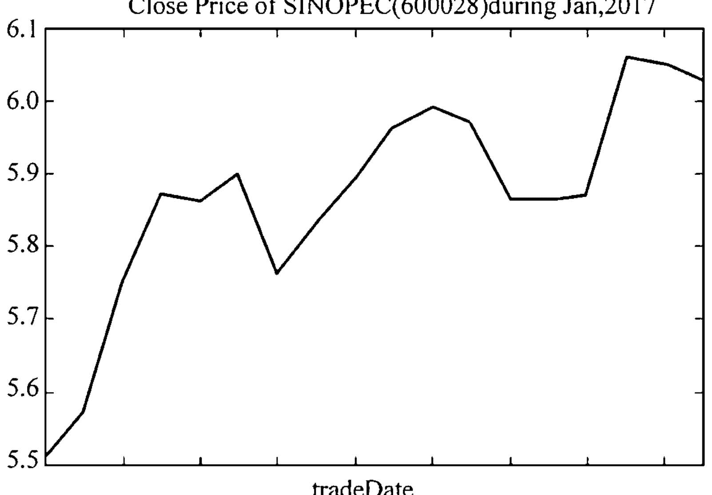

图 6-1 中国石化 2017 年 1 月收盘价图

## 练习题

对本章中的例题数据，使用 Python 重新操作一遍。

# 第 7 章 金融时间序列分析及其 Python 应用

## 7.1 时间序列分析的基础知识

### 7.1.1 时间序列的概念及其特征

对一个或者一组变量 $x(t)$ 进行观察测量，将在一系列时刻 $t_1, t_2, \cdots, t_n$ 所得到的离散数字组成的序列集合称为时间序列。例如，某股票从 2015 年 6 月 1 日到 2016 年 6 月 1 日之间各个交易日的收盘价可以构成一个时间序列，某地每天的最高气温可以构成一个时间序列。

时间序列具有以下特征：

- （1）趋势：在长时期内呈现出持续向上或持续向下的变动。
- （2）季节变动：在一年内重复出现的周期性波动。如气候条件、生产条件、节假日或人们的风俗习惯等各种因素导致的结果。
- （3）循环波动：呈现非固定长度的周期性波动。循环波动的周期可能会持续一段时间，但与趋势不同，它不是朝着单一方向的持续变动，而是涨落相同的交替波动。
- （4）不规则波动：除去趋势、季节变动和周期波动之后的随机波动的时间序列。不规则波动通常总是混杂在时间序列中，致使时间序列产生一种波形或震荡式的变动。只含有随机波动的序列也称为平稳序列。

### 7.1.2 平稳性

如果一个时间序列的均值没有系统性的变化（无趋势）、方差没有系统性的变化，且严格消除了周期性变化，就说它是平稳的。

先通过如下代码生成图 7-1。

```python
IndexData = DataAPI.MktIdxGet(indexID=u"", ticker=u"000001", beginDate=u"20130101", endDate=u"20140801", field=u"tradeDate,closeIndex,CHGPct", pandas="1")
IndexData = IndexData.set_index(IndexData['tradeDate'])
IndexData['closeIndexDiff_1'] = IndexData['closeIndex'].diff(1)  # 1 阶差分处理
IndexData['closeIndexDiff_2'] = IndexData['closeIndexDiff_1'].diff(1)  # 2 阶差分处理
IndexData.plot(subplots=True, figsize=(18, 12))
```

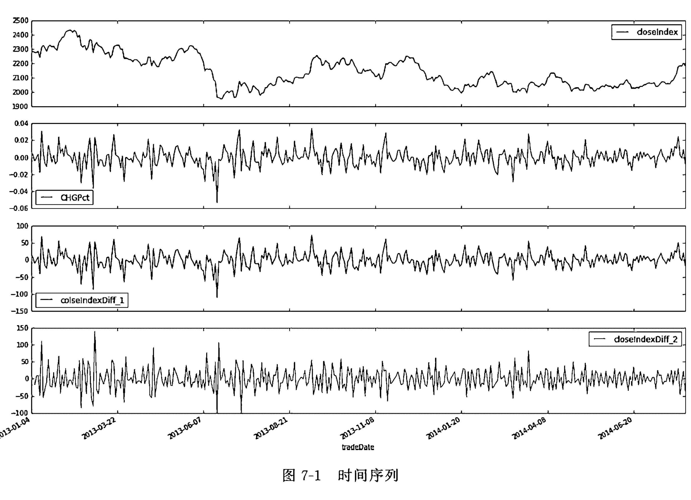

为了平稳时间序列，后面会介绍这种处理。

下面给出平稳性的定义：

如果对所有时刻 $t$、任意正整数 $k$ 和任意 $k$ 个正整数，$(t_{1}, t_{2}, \cdots, t_{k})$ 和 $(r_{t_{1}}, r_{t_{2}}, \cdots, r_{t_{k}})$ 的联合分布与 $(r_{t_{1}+l}, r_{t_{2}+l}, \cdots, r_{t_{k}+l})$ 的联合分布相同，就称时间序列 $(r_{i})$ 是强平稳的。即 $(r_{t_{1}}, r_{t_{2}}, \cdots, r_{t_{k}})$ 的联合分布在时间的平移变换下保持不变。这是一个很强的条件，而我们经常假定的是平稳性的一个较弱的方式。

若时间序列 $(r_{i})$ 满足下面两个条件：

$$E(r_{i}) = \mu, \quad \mu \text{ 是常数}$$

$$\operatorname{Cov}(r_{i}, r_{i-l}) = r_{l}, \quad r_{l} \text{ 只依赖于 } l$$

则称时间序列 $(r_{i})$ 是弱平稳的。即该序列的均值和 $r_{i}$ 与 $r_{i-l}$ 的协方差不随时间而改变，$l$ 为任意整数。

在金融数据分析中，通常所说的平稳序列是弱平稳的。

差分就是求时间序列 $(r_{i})$ 在 $t$ 时刻的值 $r_{t}$ 与 $t-1$ 时刻的值 $r_{t-1}$ 的差，不妨记做 $d_{t}$，这样就得到了一个新序列 $\{d_{i}\}$，为一阶差分。对新序列 $\{d_{i}\}$ 再做同样的操作，则为二阶差分。通常非平稳序列可以经过 $d$ 次差分，处理成弱平稳或者近似弱平稳时间序列。如图 7-1 第 4 张图所示，可以看到二阶差分得到的序列比一阶差分效果更好。

### 7.1.3 相关系数和自相关函数

#### 1. 相关系数

对于两个向量，如何确定它们是不是相关？一个很自然的想法就是用向量之间的夹角作为距离的定义——夹角小，距离就小；夹角大，距离就大。

在中学数学中，经常使用余弦公式来计算角度：

$$\cos \langle a, b \rangle = \frac{a \cdot b}{\|a\| \|b\|}$$

$a \cdot b$ 称为内积。例如：

$$(x_{1}, y_{1}) \cdot (x_{2}, y_{2}) = x_{1}x_{2} + y_{1}y_{2}$$

再来看相关系数的定义公式。X 和 Y 的相关系数为

$$\rho_{XY} = \frac{\operatorname{Cov}(X,Y)}{\sqrt{\operatorname{Var}(X)\operatorname{Var}(Y)}}$$

而根据样本的估计计算公式为

$$\rho_{XY} = \frac{\sum (x_{i} - \bar{x})(y_{i} - \bar{y})}{\sqrt{\sum (x_{i} - \bar{x})^2 \sum (y_{i} - \bar{y})^2}} = \frac{(X - \bar{x}) \cdot (Y - \bar{y})}{\|X - \bar{x}\| \cdot \|Y - \bar{y}\|}$$

可以发现，相关系数实际上就是向量空间中两个向量的夹角，协方差是去掉均值后两个向量的内积。

如果两个向量平行，相关系数等于 1 (同向) 或者 -1 (反向)。如果两个向量垂直，则夹角的余弦就等于 0，说明二者不相关。两个向量夹角越小，相关系数的绝对值越接近 1，相关性越高。只不过这里在计算的时候对向量做了去均值处理，即中心化操作，而不是直接用向量 X,Y 计算。减去均值并不影响角度计算，是一种“平移”操作。通过如下代码得到如图 7-2 所示的图形。

```python
import numpy as np
import pandas as pd
import matplotlib.pyplot as plt
a = pd.Series([9, 8, 7, 5, 4, 2])
b = a - a.mean()  # 去均值
plt.figure(figsize=(10, 4))
a.plot(label='a')
b.plot(label='mean removed a')
plt.legend()
```

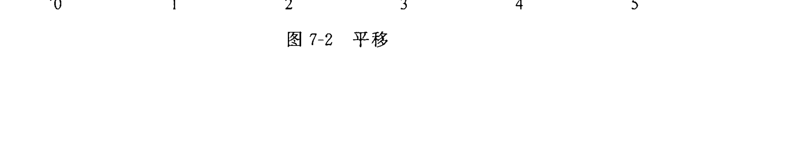

#### 2. 自相关函数

相关系数度量了两个向量的线性相关性，在平稳时间序列 $\{r_t\}$ 中，我们有时候很想知道 $r_t$ 与它的过去值 $r_{t-l}$ 的线性相关性。为此把相关系数的概念推广到自相关系数。$r_t$ 与 $r_{t-l}$ 的相关系数称为 $r_t$ 的间隔为 $l$ 的自相关系数，通常记为 $\rho_l$。具体定义为

$$\rho_l = \frac{\operatorname{Cov}(r_t, r_{t-l})}{\sqrt{\operatorname{Var}(r_t)\operatorname{Var}(r_{t-l})}} = \frac{\operatorname{Cov}(r_t, r_{t-l})}{\operatorname{Var}(r_t)}$$

这里用到了弱平稳序列的性质：

$$\operatorname{Var}(r_t) = \operatorname{Var}(r_{t-l})$$

对一个平稳时间序列的样本 $\{r_t\}, 1 \le t \le T$，则间隔为 $l$ 的样本自相关系数的估计为

$$\hat{\rho}_l = \frac{\sum_{t=l+1}^{T}(r_t - \bar{r})(r_{t-l} - \bar{r})}{\sum_{t=1}^{T}(r_t - \bar{r})^2}, \quad 0 \le l \le T - 1$$

则函数

$$\hat{\rho}_1, \hat{\rho}_2, \hat{\rho}_3, \dots$$

称为 $r_t$ 的样本自相关函数 (Autocorrelation Function, ACF)。

当自相关函数中所有的值都为 0 时，则认为该序列是完全不相关的。因此，经常需要检验多个自相关系数是否为 0。

混合检验 (Ljung-Box) 如下：

原假设：$H_0: \rho_1=\rho_2=\dots=\rho_m=0$  备择假设：$H_1: \exists i \in 1,2,\dots,m, \rho_i \neq 0$  混合检验统计量：

$$Q(m) = T(T+2)\sum_{i=1}^{m}\frac{\hat{\rho}_i^2}{T-i}$$

$Q(m)$ 渐进服从自由度为 $m$ 的 $\chi^2$ 分布。

决策规则：

$$Q(m) > \chi^2_{\alpha} \quad \text{拒绝} \ H_0$$

即，$Q(m)$ 的值大于自由度为 $m$ 的 $\chi^2$ 分布 100(1-$\alpha$) 分位点时，拒绝 $H_0$。

大部分软件会给出 $Q(m)$ 的 p-value，则当 p-value 小于等于显著性水平 $\alpha$ 时拒绝 $H_0$。

下面给出示例：

```python
from scipy import stats
import statsmodels.api as sm

# 统计相关的库
data = IndexData['closeIndex']
# 上证指数
m = 10
# 检验 10 个自相关系数
acf, q, p = sm.tsa.acf(data, nlags=m, qstat=True)  # 计算自相关系数及 p-value
out = np.c_[range(1, 11), acf[1:], q, p]
output = pd.DataFrame(out, columns=['lag', 'ACF', 'Q', 'p-value'])
output = output.set_index('lag')
```

Output

| | AC | Q | p-value |
| :--- | :--- | :--- | :--- |
| **lag** | | | |
| 1 | 0.977190 | 366.688991 | 9.846248e-82 |
| 2 | 0.951513 | 715.277906 | 4.779432e-156 |
| 3 | 0.927073 | 1047.065270 | 1.109192e-226 |
| 4 | 0.902993 | 1362.675600 | 8.565497e-294 |
| 5 | 0.878258 | 1662.026278 | 0.000000e+00 |
| 6 | 0.857131 | 1947.908436 | 0.000000e+00 |
| 7 | 0.836825 | 2221.134260 | 0.000000e+00 |
| 8 | 0.812991 | 2479.709003 | 0.000000e+00 |
| 9 | 0.789723 | 2724.350491 | 0.000000e+00 |
| 10 | 0.766245 | 2955.283132 | 0.000000e+00 |

取显著性水平为 0.05，可以看出，所有的 p-value 都小于 0.05，拒绝原假设 $H_{0}$，即认为该序列是序列相关的。

再来看看同期上证指数的日收益率序列：

```python
data2 = IndexData['CHGPct']  # 上证指数日涨跌
m = 10                       # 检验 10 个自相关系数
acf, q, p = sm.tsa.acf(data2, nlags=m, qstat=True)  # 计算自相关系数及 p-value
out = np.c_[range(1, 11), acf[1:], q, p]
output = pd.DataFrame(out, columns=['lag', 'AC', 'Q', 'p-value'])
output = output.set_index('lag')
output
```

AC

| | Q | p-value |
| :--- | :--- | :--- |
| **lag** | | |
| 1 | 0.065275 | 1.636181 | 0.200850 |
| 2 | -0.014772 | 1.720198 | 0.423120 |
| 3 | -0.022254 | 1.911387 | 0.591001 |
| 4 | 0.008070 | 1.936592 | 0.747420 |
| 5 | -0.049096 | 2.872052 | 0.719704 |
| 6 | -0.064409 | 4.486381 | 0.611157 |
| 7 | 0.080510 | 7.015414 | 0.427277 |
| 8 | 0.010939 | 7.062228 | 0.529934 |
| 9 | 0.028114 | 3.372276 | 0.598420 |
| 10 | 0.080360 | 9.912252 | 0.448225 |

可以看出，p-value 均大于显著性水平 0.05，因此接受假设 $H_{0}$，即，上证指数日收益率序列没有显著的相关性。

### 7.1.4 白噪声序列和线性时间序列

#### 1. 白噪声序列

随机变量 $X(t)(t=1, 2, 3, \cdots)$ 如果是由一个不相关的随机变量的序列构成的，即对于所有 $s$ 不等于 $t$，随机变量 $X_{t}$ 和 $X_{s}$ 的协方差为 0，则称其为纯随机过程。

对于一个纯随机过程来说，若其期望和方差均为常数，则称之为白噪声过程。白噪声过程的样本称为白噪声序列，简称白噪声。之所以称为白噪声，是因为它和白光的特性类似，白光的光谱在各个频率上有相同的强度，白噪声的谱密度在各个频率上的值相同。


## 7.2 线性时间序列

时间序列 $\{r_t\}$ 如果能写成：

$$r_t = \mu + \sum_{i=0}^{\infty} \psi_i a_{t-i}$$

其中，$\mu$ 为 $r_t$ 的均值，$\psi_0=1$，$\{a_t\}$ 为白噪声序列，则称$\{r_t\}$ 为线性序列，称 $a_t$ 为在 $t$ 时刻的新信息 (innovation) 或扰动 (shock)。

很多时间序列是线性的，即是线性时间序列，相应地有很多线性时间序列模型，例如接下来要介绍的 AR、MA、ARMA 都是线性模型，但并不是所有的金融时间序列都是线性的。

对于弱平稳序列，利用白噪声的性质很容易得到 $r_t$ 的均值和方差：

$$E(r_t) = \mu, \quad \text{Var}(r_t) = \sigma^2 \sum_{i=0}^{\infty} \psi_i^2$$

其中，$\sigma_a^2$ 为 $a_t$ 的方差。因为 $\text{Var}(r_t)$ 一定小于正无穷，所以 $\psi_i^2$ 必须是收敛序列，由此满足当 $i \to \infty$ 时，$\psi_i^2 \to 0$。

即随着 $i$ 的增大，远处的扰动 $a_{t-i}$ 对 $r_t$ 的影响会逐渐消失。

到目前为止介绍了一些关于时间序列的基本知识和概念，如平稳性、相关性、白噪声、线性序列。下面介绍一些线性模型。

## 7.2 自回归模型

在 7.1 节中，计算了上证指数部分数据段的 ACF，看表可知间隔为 1 时自相关系数是显著的。这说明在 $t-1$ 时刻的数据 $r_{t-1}$ 在预测 $t$ 时刻时的 $r_t$ 时可能是有用的。

根据这一点可以建立下面的模型：

$$r_t = \phi_0 + \phi_1 r_{t-1} + a_t$$

其中 $\{a_t\}$ 是白噪声序列，这个模型与简单线性回归模型有相同的形式，也称为一阶自回归 (AR)模型，简称 AR(1) 模型。

从 AR(1) 很容易推广到 AR($p$) 模型：

$$r_t = \phi_0 + \phi_1 r_{t-1} + \dots + \phi_p r_{t-p} + a_t$$

### 7.2.1 AR($p$) 模型的根及平稳性检验

先假定序列是弱平稳的，则有

$$E(r_t) = \mu, \quad \text{Var}(r_t) = \gamma_0, \quad \text{Cov}(r_t, r_{t-j}) = \gamma_j$$

其中 $\mu, \gamma_0$ 是常数。因为 $\{a_t\}$ 是白噪声序列，因此有

$$E(a_t) = 0, \quad \text{Var}(a_t) = \sigma_a^2$$

所以有

$$E(r_t) = \phi_0 + \phi_1 E(r_{t-1}) + \phi_2 E(r_{t-2}) + \dots + \phi_p E(r_{t-p})$$

根据平稳性的性质，又有 $E(r_t) = E(r_{t-1}) = \dots = \mu$，从而有

$$\mu = \phi_0 + \phi_1 \mu + \phi_2 \mu + \dots + \phi_p \mu$$

$$E(r_t) = \mu = \frac{\phi_0}{1 - \phi_1 - \phi_2 - \dots - \phi_p}$$

对于上式，假定分母不为 0，将下面的方程称为特征方程：

$$1 - \phi_1x - \phi_2x - \cdots - \phi_{px} = 0$$

该方程所有解的倒数称为该模型的特征根。如果所有的特征根的模都小于 1，则该 AR($p$) 序列是平稳的。

下面就用该方法检验上证指数日收益率序列的平稳性。通过如下代码得到图 7-3 所示的图形。

```python
temp = np.array(data2)                          # 载入收益率序列
model = sm.tsa.AR(temp)
results_AR = model.fit()
plt.figure(figsize=(10, 4))
plt.plot(temp, 'b', label='CHGPct')
plt.plot(results_AR.fittedvalues, 'r', label='AR model')
plt.legend()
```

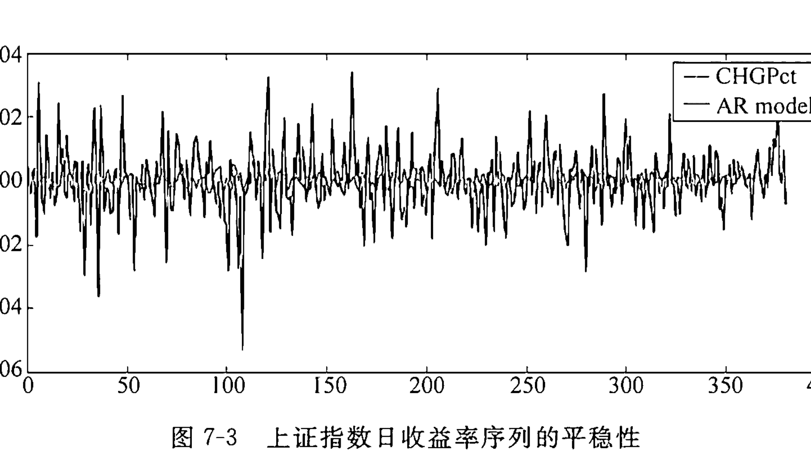

可以看看模型有多少阶：

```python
print len(results_AR.roots)
17
```

可以看出，自动生成的 AR 模型是 17 阶的。关于阶次的讨论放在 7.2.2 节。下面画出模型的特征根来检验平稳性：

```python
pi, sin, cos = np.pi, np.sin, np.cos
r1 = 1
theta = np.linspace(0, 2*pi, 360)
x1 = r1*cos(theta)
y1 = r1*sin(theta)
plt.figure(figsize=(6, 6))
plt.plot(x1, y1, 'k')                              # 画单位圆
roots = 1/results_AR.roots                         # results_AR.roots 是特征方程的解，特征根应该取倒数
for i in range(len(roots)):
    plt.plot(roots[i].real, roots[i].imag, 'r', markersize=8)   # 画特征根
plt.show()
```

可以看出，所有特征根都在单位圆内，如图 7-4 所示，则序列为平稳的。

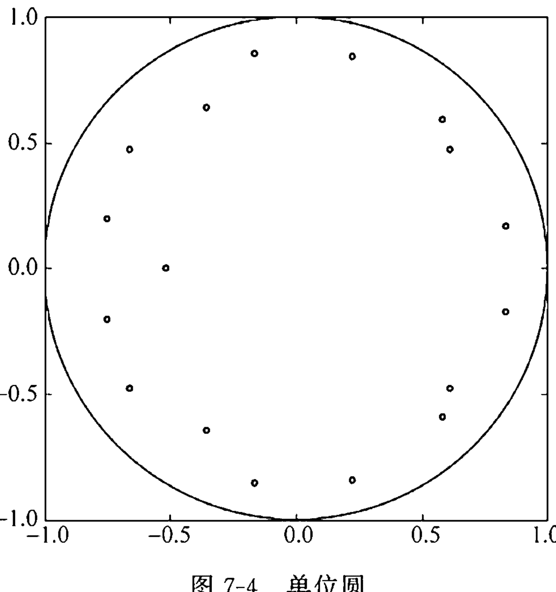

### 7.2.2 AR($p$) 模型的定阶

一般用两种方法来决定 $p$：

- （1）利用偏自相关函数 (Partial Auto Correlation Function, PACF)。
- （2）利用信息量准则函数。

#### 1. 用偏自相关函数确定 $p$

对于偏自相关函数的介绍，这里不详细展开，只重点介绍一个性质：AR($p$) 序列的样本偏自相关函数是 $p$ 步截尾的。所谓截尾，就是快速收敛应该是快速降到几乎为 0 或者在置信区间以内。

具体看下面的例子，还是以前面的上证指数日收益率序列为例。

```python
fig = plt.figure(figsize=(20, 5))
ax1 = fig.add_subplot(111)
fig = sm.graphics.tsa.plot_pacf(temp, ax=ax1)
```

从图 7-5 中可以看出，按照截尾来看，模型阶次 $p$ 在 110 以上，但是 7.2.1 节调用的自动生成的 AR 模型阶数为 17，当然，在实际应用中很少会用这么高的阶次。

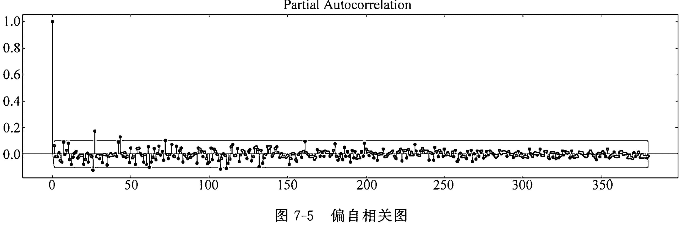

#### 2. 用信息量准则确定 $p$

现在有以上这么多可供选择的模型，在选择模型时通常采用 AIC。增加自由参数的数目能提高拟合的优良性，AIC 鼓励数据拟合的优良性同时又能尽量避免出现过拟合 (overfitting) 的情况。所以优先考虑的模型应是 AIC 值最小的那一个。赤池 (Akaike) 信息准则的方法是寻找可以最好地解释数据但自由参数最少的模型。目前在选择模型时常用以下 3 个准则：

- (1) AIC (Akaike Information Criterion, 赤池信息量准则)：
  $AIC = -2 \ln L + 2k$
- (2) BIC (Bayesian Information Criterion, 贝叶斯信息量准则)：
  $BIC = -2 \ln L + k \ln n$
- (3) HQIC (Hannan-Quinn Information Criterion, 汉南-奎因信息量准则)：
  $HQIC = -2 \ln L + k \ln (\ln n)$

其中，$L$ 为似然函数值，$k$ 为拟合模型中的参数数量，$n$ 为观测数据的个数。

下面看一看在这 3 种准则下确定的 $p$，仍然以上证指数日收益率序列为例。为了减少计算量，只计算前 10 个数据看看效果。

```python
aicList = []
bicList = []
hqicList = []
for i in range(1, 11): # 从 1 阶开始算
    order = (i, 0)    # 这里使用了 ARMA 模型，order 代表模型的 (p, q) 值，令 q 始终为 0，就只考虑了 AR 的情况
    tempModel = sm.tsa.ARMA(temp, order).fit()
    aicList.append(tempModel.aic)
    bicList.append(tempModel.bic)
    hqicList.append(tempModel.hqic)
plt.figure(figsize=(15, 6))
plt.plot(aicList, 'r', label='aic value')
plt.plot(bicList, 'b', label='bic value')
plt.plot(hqicList, 'k', label='hqic value')
plt.legend(loc=0)
```

从图 7-6 中可以看出，3 个准则在第二点均取到最小值，也就是说，$p$ 的最佳取值应该为 1，这里只计算了前 10 个数据，结果未必正确。

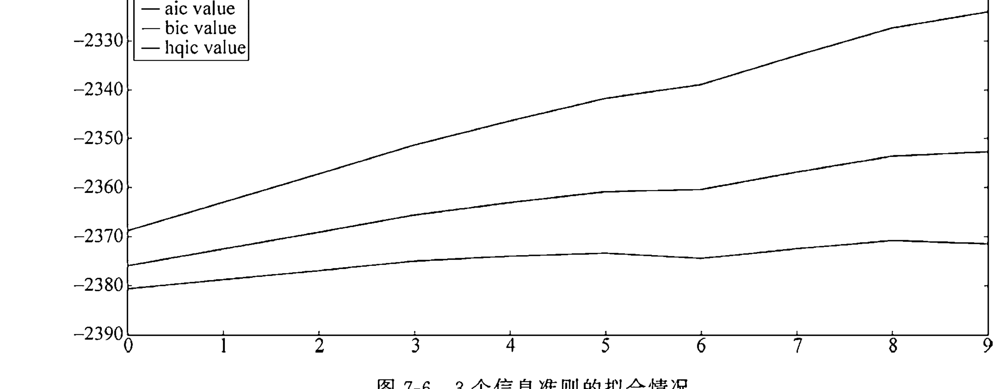

图 7-6 3 个信息准则的拟合情况

当然，利用上面的方法逐个计算是很耗时间的，实际上，有专门的函数可以直接按照准则计算出合适的阶次，这个函数是针对 ARMA 模型的，后面再讨论。

### 7.2.3 模型的检验

根据下式：

$$r_{t}=\phi_{0}+\phi_{1} r_{t-1}+\cdots+\phi_{p} r_{t-p}+a_{t}$$

如果模型满足充分条件，其残差序列应该是白噪声，7.1.3 节介绍的 Ljung-Box Q 检验（原文误写为“混成检验”，根据上下文及代码 `gstat=True` 和变量 `q` 推断为 Ljung-Box Q 统计量）可以用来检验残差与白噪声的接近程度。

先求出残差序列：

```python
delta = results_AR.fittedvalues - temp[17:]    # 残差
plt.figure(figsize=(10, 6))
# plt.plot(temp[17:], label='original value')
# plt.plot(results_AR.fittedvalues, label='fitted value')
plt.plot(delta, 'r', label='residual error')
plt.legend(loc=0)
```

生成的图形如图 7-7 所示。

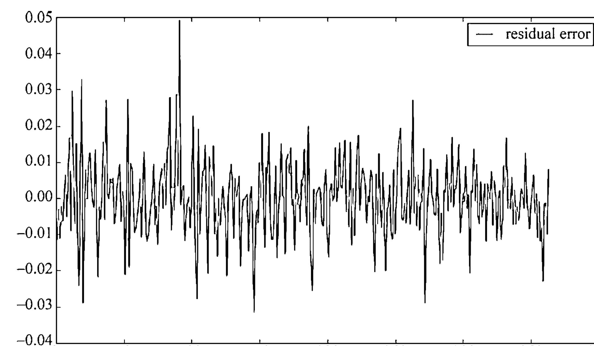

图 7-7 残差序列

检查它是不是接近白噪声序列，代码如下：

```python
acf, q, p = sm.tsa.acf(delta, nlags=10, gstat=True) ## 计算自相关系数及 p-value
out = np.c_[range(1,11), acf[1:], q, p]
output = pd.DataFrame(out, columns = ['lag', "AC", "Q", "p-value"])
output = output.set_index('lag')
output
```

输出结果：

| lag | AC | Q | p-value |
| :--- | :--- | :--- | :--- |
| 1 | -0.001228 | 0.000554 | 0.981226 |
| 2 | -0.007834 | 0.023140 | 0.988497 |
| 3 | -0.002311 | 0.025110 | 0.998950 |
| 4 | -0.007182 | 0.044199 | 0.999759 |
| 5 | -0.000231 | 0.044219 | 0.999978 |
| 6 | -0.001315 | 0.044862 | 0.999998 |
| 7 | -0.005744 | 0.057176 | 1.000000 |
| 8 | -0.005663 | 0.069178 | 1.000000 |
| 9 | -0.011057 | 0.115060 | 1.000000 |
| 10 | 0.004697 | 0.123362 | 1.000000 |

观察 p-value 可知，该序列可以视为没有相关性，因此可以认为残差序列接近白噪声。

### 7.2.4 拟合优度及预测

#### 1. 拟合优度

使用下面的统计量来衡量拟合优度：

$$R^2 = 1 - \frac{\text{残差的平方和}}{\text{总的平方和}}$$

但是，对于一个给定的数据集，$R^2$ 是用参数个数的非降函数，为了克服该缺点，推荐使用调整后的 $R^2$：

$$R^2_{Adj} = 1 - \frac{\text{残差的方差}}{\text{总的方差}}$$

它的值在 0、1 之间，越接近 1，拟合效果越好。

下面计算之前的上证指数日收益率的 AR 模型的拟合优度：

```python
score = 1 - delta.var()/temp[17:].var()
print score
0.0405166950061
```

可以看出，模型的拟合效果并不好，当然，这并不重要，也许是这个序列并不适合用 AR 模型拟合。

#### 2. 预测

首先把原来的样本分为训练集和测试集，再来看预测效果，还是以之前的数据为例：

```python
train = temp[:-10]
test = temp[-10:]
output = sm.tsa.AR(train).fit()
output.predict()

predicts = output.predict(355, 364, dynamic=True)
print len(predicts)
comp = pd.DataFrame()
comp['original'] = temp[-10:]
comp['predict'] = predicts
comp
```

| | original | predict |
| :--- | :--- | :--- |
| 0 | -0.00223 | 0.000908 |
| 1 | 0.01022 | -0.001473 |
| 2 | 0.00145 | -0.002109 |
| 3 | 0.01278 | -0.002158 |
| 4 | 0.01024 | -0.000216 |
| 5 | 0.02414 | 0.000116 |
| 6 | 0.00241 | 0.001476 |
| 7 | -0.00089 | -0.000119 |
| 8 | 0.00932 | -0.000520 |
| 9 | -0.00739 | -0.000162 |

该模型的预测结果不太好。是不是可以通过其他模型获得更好的结果呢？有关方法将在后面的几节介绍。

## 7.3 移动平均模型及预测

这里我们直接给出移动平均 (Moving Average, MA) 模型 MA(q) 的形式：
$$r_t = c_0 + a_t - \theta_1 a_{t-1} - \cdots - \theta_q a_{t-q}$$
$c_0$ 为一个常数项。这里的 $a_t$ 是 AR 模型 $t$ 时刻的扰动，可以发现，该模型使用了过去 $q$ 个时期的随机干扰或预测误差非线性地表达当前的预测值。

### 7.3.1 MA(q) 模型的性质

- 1. 平稳性

MA(q) 模型总是弱平稳的，因为它们是白噪声序列 (残差序列) 的有限线性组合。因此，根据弱平稳的性质可以得出两个结论：
$$E(r_t) = c_0, \quad \text{Var}(r_t) = (1 + \theta_1^2 + \theta_2^2 + \cdots + \theta_q^2)\sigma_a^2$$

- 2. 自相关函数

对 MA(q) 模型，其自相关函数 ACF 总是 $q$ 步截尾的。因此 MA(q) 序列只与其前 $q$ 个延迟值线性相关，从而它是一个“有限记忆”的模型。
这一点可以用来确定模型的阶次，后面会介绍。

- 3. 可逆性

当满足可逆条件的时候，MA(q) 模型可以改写为 AR(p) 模型。这里不进行推导，只给出 1 阶和 2 阶 MA 模型的可逆性条件。
1 阶：
$$|\theta_1| < 1$$
2 阶：
$$|\theta_2| < 1, \quad \theta_1 + \theta_2 < 1$$

### 7.3.2 MA(q) 模型的阶次判定

通常利用上面介绍的第二条性质“MA(q) 模型的 ACF 函数是 $q$ 步截尾的”来判断模型阶次。下面使用上证指数的日涨跌数据 (2013 年 1 月至 2014 年 8 月) 来进行分析，先取数据，取数和绘图代码如下：

```python
from scipy import stats
import statsmodels.api as sm            # 统计相关的库
import numpy as np
import pandas as pd
import matplotlib.pyplot as plt
IndexData = DataAPI.MktIdxGet(indexID = u"", ticker = u"000001",beginDate = u"20130101",
endDate = u"20140801",field =u"tradeDate,closeIndex,CHGFct", pandas = "i")
IndexData = IndexData.set_index(IndexData['tradeDate'])
data = np.array(IndexData['CHGFct'])                 # 上证指数日涨跌
IndexData['CHGFct'].plot(figsize = (15,5))
```

生成的图形如图 7-8 所示。

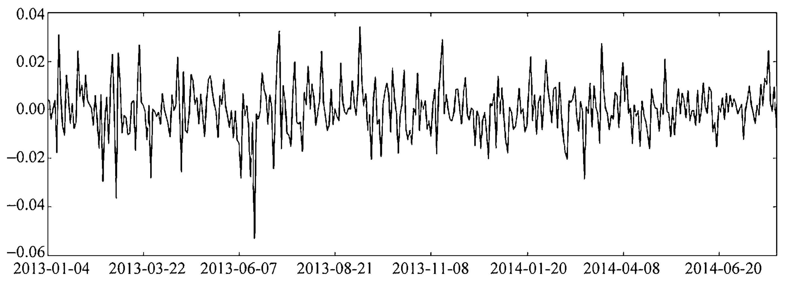

可以看出，序列看上去是弱平稳的。下面画出序列的 ACF：

```python
fig = plt.figure(figsize=(20,5))
ax1 = fig.add_subplot(111)
fig = sm.graphics.tsa.plot_acf(data,ax=ax1)
```

可以发现，图 7-9 所示的 ACF 在 43 处截尾，之后的 ACF 均在置信区间内，由此可以判定该序列的 MA 模型阶次为 43。

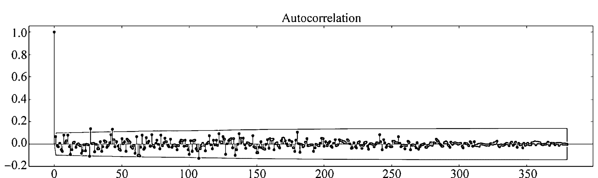

### 7.3.3 建模和预测

由于 sm.tsa 中没有单独的 MA 模块，因此利用 ARMA 模块，只要将其中 AR 的阶 $p$ 设为 0 即可。


函数 sm.tsa.ARMA 中的输入参数中的 order(p,q) 代表了 AR 和 MA 的阶次。模型阶次增高，计算量将急剧增长，因此这里仅以建立 10 阶的模型为例，如果按 7.3.2 节判断的阶次来建模，则计算时间过长。

用最后 10 个数据作为 out-sample 的样本来对比预测值：

```python
order = (0,10)
train = data[:-10]
test = data[-10:]
tempModel = sm.tsa.ARMA(train, order).fit()
```

先来看看拟合效果，计算

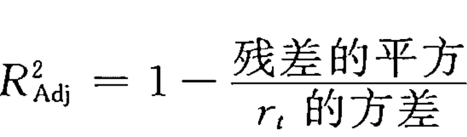

```python
delta = tempModel.fittedvalues - train
score = 1 - delta.var()/train.var()
print(score)
# 0.0278706962641
```

可以看出，Score 远小于 1，拟合效果不好。

然后用建立的模型预测最后 10 个数据：

```python
predicts = tempModel.predict(371, 380, dynamic=True)
print(len(predicts))
comp = pd.DataFrame()
comp['original'] = test
comp['predict'] = predicts
comp.plot()
```

从图 7-10 中可以看出，建立的模型拟合效果很差，预测值明显小了 1～2 个数量级，就算只看涨跌方向，正确率也不足 50%。该模型不适用于原数据。

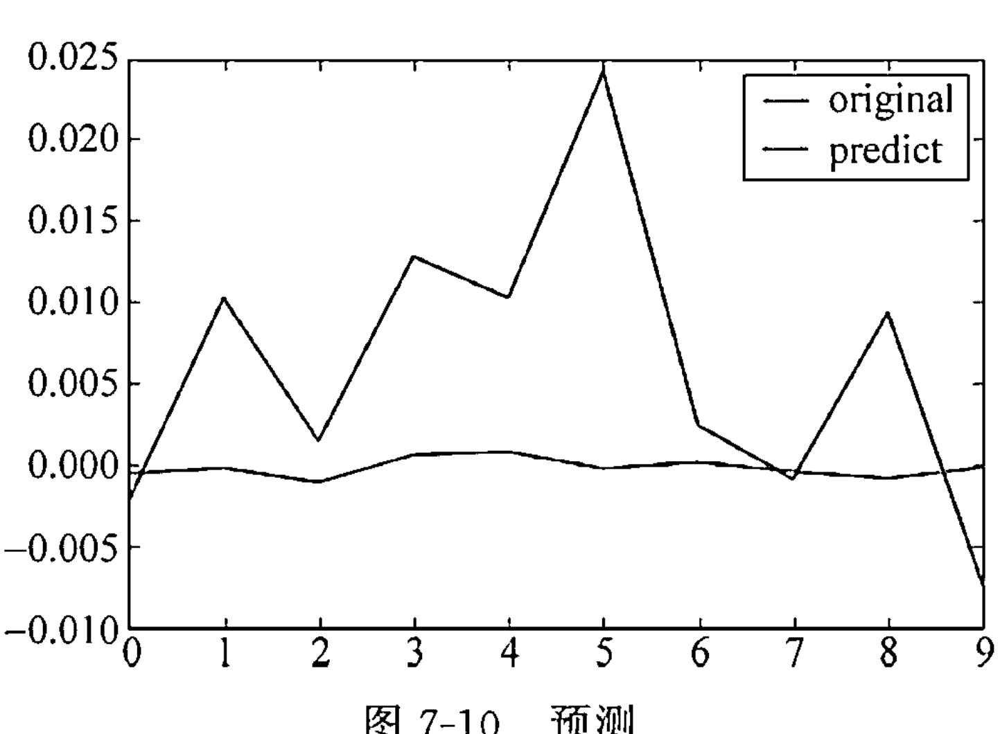

关于 MA 的内容在上面只做了简单介绍，下面主要介绍 ARMA 模型。

## 7.4 自回归移动平均模型及预测

在有些应用中，需要高阶的 AR 或 MA 模型才能充分地描述数据的动态结构，这样问题会变得很复杂。为了克服这个困难，提出了自回归移动平均 (Auto-Regressive and Moving Average, ARMA) 模型。其基本思想是把 AR 和 MA 模型结合在一起，使所使用的参数个数很小。

ARMA(p,q) 模型的形式为

$$ r _ { t } = \varphi _ { 0 } + \sum _ { i = 1 } ^ { p } \varphi _ { i } r _ { t - i } + a _ { t } + \sum _ { i = 1 } ^ { q } \theta _ { i } a _ { t - i } $$

其中，$\{a_t\}$ 为白噪声序列，$p$ 和 $q$ 都是非负整数。AR(p) 模型和 MA(q) 模型都是 ARMA(p,q) 模型的特殊形式。利用向后推移算子 $B$，上述模型可写成

$$ ( 1 - \varphi _ { 1 } B - \varphi _ { 2 } B ^ { 2 } - \cdots - \varphi _ { p } B ^ { p } ) r _ { t } = \varphi _ { 0 } + ( 1 - \theta _ { 1 } B - \theta _ { 2 } B ^ { 2 } - \cdots - \theta _ { q } B ^ { q } ) a _ { t } $$

(后移算子 $B$ 即回到上一时刻。)

再求 $r_t$ 的期望，得到

$$ E ( r _ { t } ) = \frac { \varphi _ { 0 } } { 1 - \varphi _ { 1 } - \varphi _ { 2 } - \cdots - \varphi _ { p } } $$

和前面 AR 模型一样，因此有着相同的特征方程：

$$ 1 - \varphi _ { 1 } x - \varphi _ { 2 } x ^ { 2 } - \cdots - \varphi _ { p } x ^ { p } = 0 $$

该方程所有解的倒数称为该模型的特征根，如果所有的特征根的模都小于 1，则该 ARMA 模型是平稳的。

有一点很关键：ARMA 模型的应用对象应该为平稳序列。下面的步骤都是建立在假设原序列平稳的条件下的。

### 7.4.1 确定 ARMA(p,q) 模型的阶次

1. 用 PACF、ACF 确定模型阶次

通过观察 PACF 和 ACF 截尾可以分别确定 $p, q$ 的值（限定滞后阶数为 50）。

```python
fig = plt.figure(figsize=(20,10))
ax1 = fig.add_subplot(211)
fig = sm.graphics.tsap.plot_acf(data, lags=30, ax=ax1)
ax2 = fig.add_subplot(212)
fig = sm.graphics.tsap.plot_pacf(data, lags=30, ax=ax2)
```

生成的图形如图 7-11 所示。

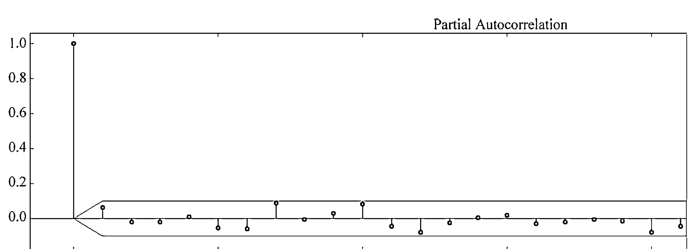

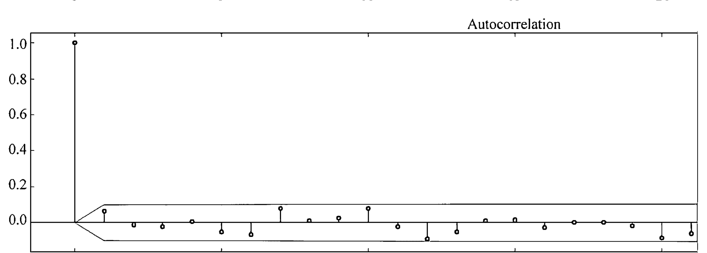

图 7-11 PACF 和 ACF

可以看出，模型的阶次应该为 (27,27)。然而，对这么高的阶次建模，计算量是巨大的。

下面分别应用以上 3 种法则为模型定阶，数据仍然是上证指数日涨跌幅序列。为了控制计算量，限制 AR 最大阶次不超过 6，MA 最大阶次不超过 4。但是这样带来的坏处是拟合结果可能为局部最优。

```python
sm.tsa.arma_order_select_ic(data, max_ar = 6, max_ma = 4, ic = 'aic')['aic_min_order'] # AIC
# (3, 3)

sm.tsa.arma_order_select_ic(data, max_ar = 6, max_ma = 4, ic = 'bic')['bic_min_order'] # BIC
# (0, 0)

sm.tsa.arma_order_select_ic(data, max_ar = 6, max_ma = 4, ic = 'hqic')['hqic_min_order'] # HQIC
# (0, 0)
```

可以看出，AIC 求解的模型阶次为 (3, 3)。这里采用 AIC。至于到底哪种准则更好，可以分别建模进行对比。

### 7.4.2 ARMA 模型的建立及预测

使用上面用 AIC 求解的模型阶次 (3, 3) 来建立 ARMA 模型，源数据为上证指数日涨跌幅序列，最后 10 个数据用于预测。

```python
order = (3, 3)
train = data[: -10]
test = data[-10:]
tempModel = sm.tsa.ARMA(train, order).fit()
```

同样先来看看拟合效果：

```python
delta = tempModel.fittedvalues - train
score = 1 - delta.var()/train.var()
print(score)
# 0.0495081497069
```

如果对比之前建立的 AR、MA 模型，可以发现拟合优度有所提升。

```python
predicts = tempModel.predict(371, 380, dynamic=True)
print(len(predicts))
comp = pd.DataFrame()
comp['original'] = test
comp['predict'] = predicts
comp.plot()
```

从图 7-12 中可以看出，虽然正确率还是很低，不过与之前的 MA 模型相比，如果只看涨跌，正确率为 55.6%，效果还是好了不少。

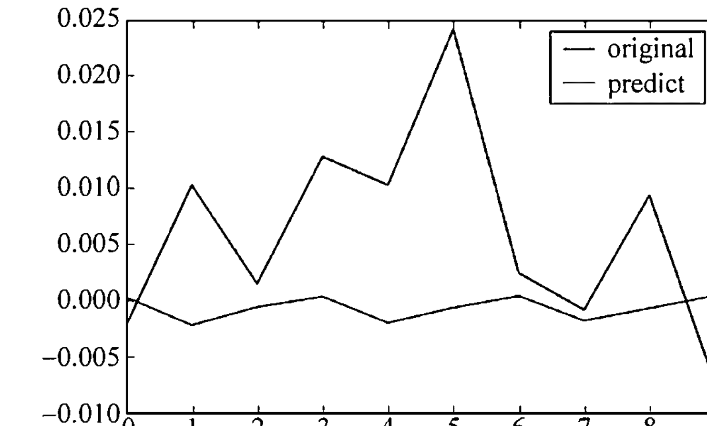

图 7-12 预测结果

## 7.5 ARIMA 模型及预测

到目前为止，我们研究的序列都是平稳序列，即 ARMA 模型研究的对象为平稳序列。如果序列是非平稳的，就可以考虑使用差分自回归移动平均 (Auto-Regressive Integrated Moving Average, ARIMA) 模型。

ARIMA 比 ARMA 仅多了一个“I”，代表着比 ARMA 多了一层内涵，也就是差分。

一个非平稳序列经过 $d$ 次差分后，可以转化为平稳时间序列。$d$ 具体的取值方法如下：对差分一次后的序列进行平稳性检验，若是非平稳的，则继续差分，直到 $d$ 次后的检验结果为平稳序列。

### 7.5.1 单位根检验

ADF (Augmented Dickey-Fuller, 增强的 DF 检验) 是一种常用的单位根检验方法，它的原假设为序列具有单位根，即非平稳。对于一个平稳的时间序列数据，就需要在给定的置信区间显著，此时拒绝原假设。

下面给出示例。先看上证综合指数的日指数序列：

```python
data2 = IndexData['closeIndex'] # 上证指数
data2.plot(figsize= (15,5))
```

从图 7-13 可见，这里显然是非平稳的。

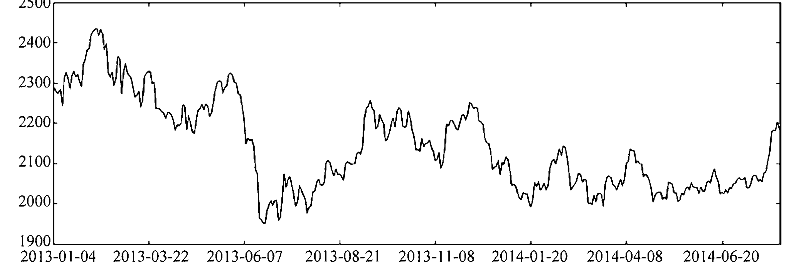

图 7-13 上证综合指数的日指数序列

下面进行 ADF 检验：

```python
temp = np.array(data2)
t = sm.tsa.stattools.adfuller(temp) # ADF 检验
output = pd.DataFrame(index= ['Test Statistic Value', "p - value", "Lags Used", 'Number of Observations Used' ,"Critical Value(1%)", "Critical Value(5%)", "Critical Value(10%)" ], columns=['value'])
output['value']['Test Statistic Value' ] = t[0]
output['value']['p - value' ] = t[1]
output['value']['Lags Used' ] = t[2]
output['value'][ 'Number of Observations Used' ] = t[3]
output['value']['Critical Value(1%)'] = t[4][ '1%' ]
output['value']['Critical Value(5%)'] = t[4][ '5%' ]
output['value'][ 'Critical Value(10%)'] = t[4][ '10%' ]
output
```

| | value |
| :--- | :--- |
| Test Statistic Value | - 2.30472 |
| p - value | 0.170449 |
| Lags Used | 1 |
| Number of Observations Used | 379 |
| Critical Value(1%) | - 3.44772 |
| Critical Value(5%) | - 2.8692 |
| Critical Value(10%) | - 2.57085 |

可以看出，p-value 为 0.170449，大于显著性水平，原假设不能被拒绝，因此上证综合指数日指数序列为非平稳的。对序列进行一次差分后再次检验：

```python
data2Diff = data2.diff() # 差分
data2Diff.plot(figsize= (15,5))
```

从图 7-14 可见，序列近似平稳序列。

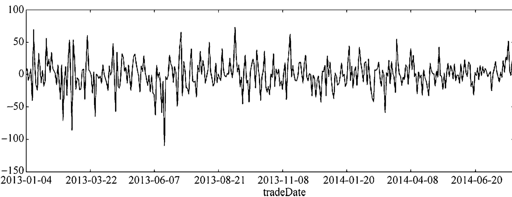

图 7-14 差分序列

再次进行 ADF 检验：

```python
temp = np.array(data2Diff)[1:]            # 差分后第一个值为 NaN, 舍去
t = sm.tsa.stattools.adfuller(temp)        # ADF 检验
print("p-value: ", t[1])
# p-value: 2.31245750144e-30
```

可以看出，p-value 非常接近 0，拒绝原假设，因此，该序列为平稳的。

可见，经过一次差分后的序列是平稳的，对于原序列，$d$ 的取值为 1 即可。

### 7.5.2 ARIMA(p, d, q) 模型阶次确定

在 7.5.1 节中确定了差分次数 $d$，接下来就可以对差分后的序列建立 ARMA 模型。首先，还是利用 PACF 和 ACF 来确定 $p, q$：

```python
temp = np.array(data2Diff)[1:]             # 差分后第一个值为 NaN, 舍去
fig = plt.figure(figsize=(20, 10))
ax1 = fig.add_subplot(211)
fig = sm.graphics.tsa.plot_acf(temp, lags=30, ax=ax1)
ax2 = fig.add_subplot(212)
fig = sm.graphics.tsa.plot_pacf(temp, lags=30, ax=ax2)
```

从图 7-15 中可以看出，模型的阶次为 (27, 27)，还是太高了，建模计算量太大。再看利用 AIC 确定 $p, q$ 的情况：

```python
sm.tsa.arma_order_select_ic(temp, max_ar=6, max_ma=4, ic='aic')
# ('aic_min_order', (2, 2))
```

根据 AIC，差分后的序列的 ARMA 模型阶次为 (2, 2)，因此，要建立的 ARIMA 模型的阶次 $(p, d, q)$ 为 $(2, 1, 2)$。

### 7.5.3 ARIMA 模型的建立及预测

根据 7.5.2 节确定的模型阶次，我们对差分后的序列建立 ARMA(2, 2) 模型：

```python
order = (2, 2)
data = np.array(data2Diff)[1:]            # 差分后第一个值为 NaN
```

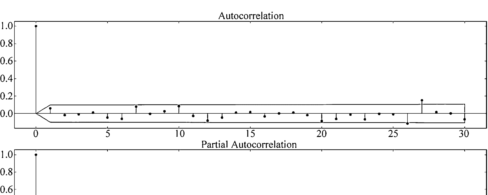

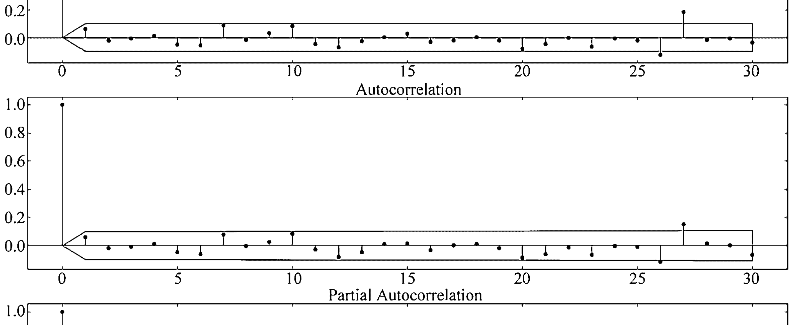

图 7-15 确定阶次

```python
rawdata = np.array(data2)
train = data[: -10]
test = data[-10:]
model = sm.tsa.ARMA(train, order).fit()
```

先看差分序列的 ARMA 拟合值：

```python
plt.figure(figsize=(15,5))
plt.plot(model.fittedvalues,label='fitted value')
plt.plot(train[1:],label='real value')
plt.legend(loc=0)
```

拟合效果如图 7-16 所示。

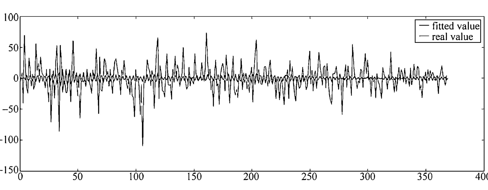

图 7-16 拟合效果

```python
delta = model.fittedvalues - train[1:]
score = 1 - delta.var()/train[1:].var()
print(score)
# 0.0397489997089
```

再看对差分序列的预测情况：

```python
predicts = model.predict(10, 381, dynamic=True)[-10:]
print(len(predicts))
comp = pd.DataFrame()
comp['original'] = test
comp['predict'] = predicts
comp.plot(figsize = (8,5))
```

预测结果如图 7-17 所示。

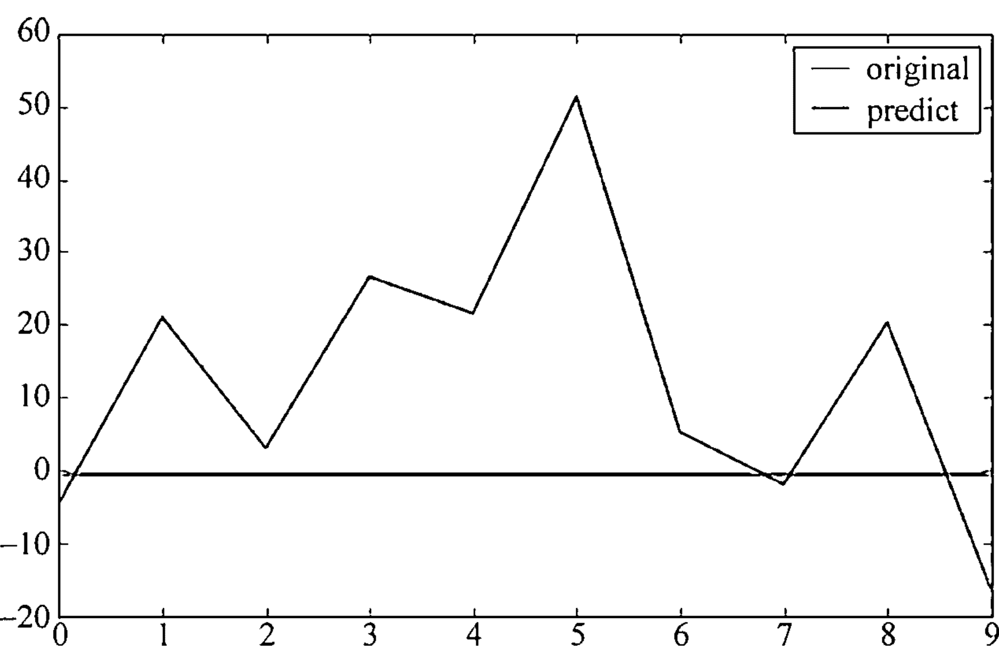

图 7-17 预测结果

可以看出，差分序列 ARMA 模型的拟合效果和预测结果并不好，预测值非常小，这表明模型在预测时认为预测值很接近上一时刻的值。

这个影响可能来自模型阶次，看来模型阶次还是得尝试更高阶的。这里就不建模了（计算时间太长），读者如有兴趣可以试试高阶的模型。

最后将预测值还原(即在上一时刻指数值的基础上加上差分差值的预估)：

```python
rec = [rawdata[-1]]
pre = model.predict(371, 380, dynamic=True) # 差分序列的预测
for i in range(10):
    rec.append(rec[i] + pre[i])
plt.figure(figsize=(10,5))
plt.plot(rec[-10:], 'r', label='predict value')
plt.plot(rawdata[-10:], 'blue', label='real value')
plt.legend(loc=0)
```

从图 7-18 中可以发现，由于对差分序列的预测很差，还原为原序列后，预测值几乎都在前一个值上有小幅波动，模型仍然不够好。

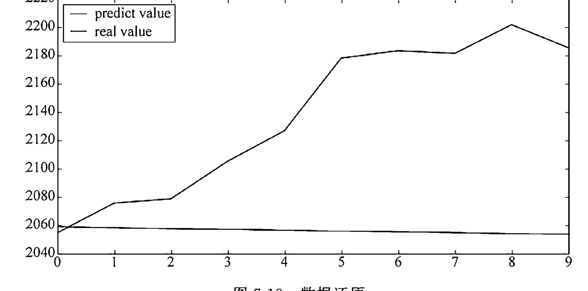

## 7.6 自回归条件异方差模型 ARCH 及预测

前面介绍了 ARMA、ARIMA 等模型，这些模型一般都假设干扰项的方差为常数，然而在很多情况下，时间序列的波动有集聚性等特征，使得方差并不为常数。因此，对于如何刻画方差是十分有必要研究的。本节介绍的 ARCH 模型和 7.7 节介绍的 GARCH 模型可以刻画出随时间变化的条件异方差。

### 7.6.1 波动率的特征

对于金融时间序列，波动率往往具有以下特征：

- (1) 存在波动率聚集现象。即波动率一段时间高，另一段时间低。
- (2) 波动率连续变化，很少发生跳跃。
- (3) 波动率不会发散到无穷，往往是平稳的。
- (4) 波动率对价格大幅上升和大幅下降的反应是不同的，这个现象称为杠杆效应。

### 7.6.2 ARCH 模型的基本原理

在传统计量经济学模型中，干扰项的方差被假设为常数。但是许多经济时间序列呈现出波动的聚集性，在这种情况下假设方差为常数是不恰当的。

ARCH (Auto-Regressive Conditional Heteroskedasticity, 自回归条件异方差) 模型将

当前一切可利用的信息作为条件，并采用某种自回归形式来刻画方差的变异，对于一个时间序列而言，在不同时刻可利用的信息不同，而相应的条件方差也不同，利用 ARCH 模型，可以刻画出随时间而变异的条件方差。

#### 1. ARCH 模型的思想

ARCH 模型的思想如下：

- (1) 资产收益率序列的扰动 $\{a_t\}$ 是序列不相关的，但是不独立。
- (2) $\{a_t\}$ 的不独立性可以用其延迟值的简单二次函数来描述。

具体而言，一个 ARCH($m$)模型为

$$ a_t = \varepsilon_t \sigma_t, \quad \sigma_t^2 = \alpha_0 + \alpha_1 a_{t-1}^2 + \cdots + \alpha_m a_{t-m}^2 > 0 \quad t > 0, \alpha_i \geqslant 0 $$

其中，$\varepsilon_t$ 是均值为 0、方差为 1 的独立同分布 (Independent Identically Distributed, IID) 的随机变量序列。通常假定其服从标准正态分布；$\sigma_t^2$ 为条件异方差。

#### 2. ARCH 模型效应

从 ARCH 模型的结构看，过去大的平方扰动会导致信息 $a_t$ 出现大的条件异方差。从而 $a_t$ 有取绝对值较大的值的倾向。这意味着：在 ARCH 的框架下，大的扰动会倾向于紧接着出现另一个大的扰动。这与波动率聚集的现象相似。

所谓 ARCH 模型效应也就是条件异方差序列的序列相关性。

### 7.6.3 ARCH 模型的建立及预测

上面简单介绍了 ARCH 的原理，下面主要介绍如何在 Python 中实现。ARCH 模型的建立大致分为以下几步：

- (1) 通过检验数据的序列相关性建立一个均值方程，如有必要，对收益率序列建立一个计量经济模型（如 ARMA）来消除任何线性依赖。
- (2) 对均值方程的残差进行 ARCH 效应检验。
- (3) 如果具有 ARCH 效应，则建立波动率模型。
- (4) 检验拟合的模型，如有必要则进行改进。

Python 的 ARCH 库提供了现成的方法（后面会介绍）。这里为了理解 ARCH，还是按上述流程来建模。

#### 1. 均值方程的建立

这里的均值方程可以简单地视为 ARMA（或 ARIMA）模型，ARCH 其实是在此基础上的一些修正。下面的过程以上证指数日涨跌幅序列为例。

arch 库均值方程只支持常数、零均值、AR 模型，这里建立 AR 模型以便对照。

首先导入相关库：

```python
from scipy import stats
import statsmodels.api as sm #统计相关的库
import numpy as np
import pandas as pd
import matplotlib.pyplot as plt
import arch #条件异方差模型相关的库
```

```python
IndexData = DataAPI.MktIndexGet(indexID=u"", ticker=u"000001", beginDate=u"20140101", endDate=u"20160101", field=u"tradeDate,closeIndex,CHGPct", pandas="1")
IndexData = IndexData.set_index(IndexData['tradeDate'])
data = np.array(IndexData['CHGPct'])  # 上证指数日涨跌
IndexData['CHGPct'].plot(figsize=(15, 5))
```

结果如图7-19所示。

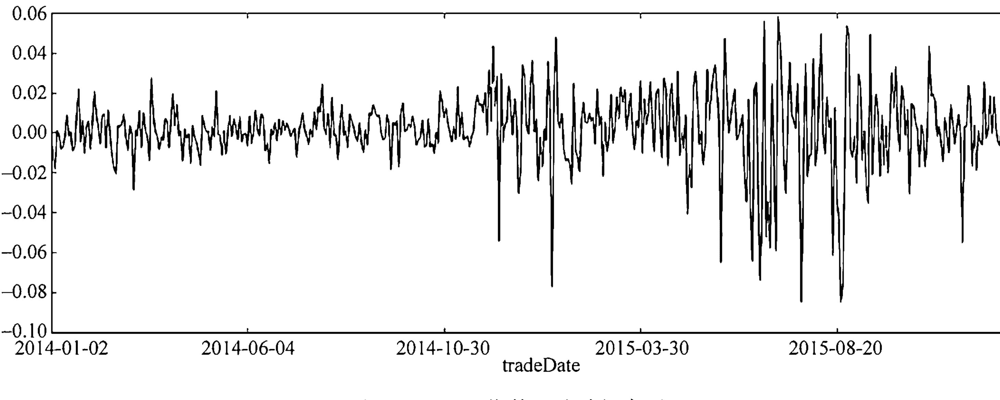

首先检验这个序列的平稳性，以决定是否需要差分。

原假设 H0：序列为非平稳的。
备择假设 H1：序列是平稳的。

```python
t = sm.tsa.stattools.adfuller(data)    # ADF检验
print "p-value: ", t[1]
# p-value: 7.56217111771e-10
```

p-value小于显著性水平，拒绝原假设，因此序列是平稳的。接下来建立AR(ρ)模型，先确定阶次：

```python
fig = plt.figure(figsize=(20, 5))
axl = fig.add_subplot(111)
fig = sm.graphics.tsa.plot_pacf(data, lags=20, ax=axl)
```

根据图7-20所示的结果确定模型的阶次为8。

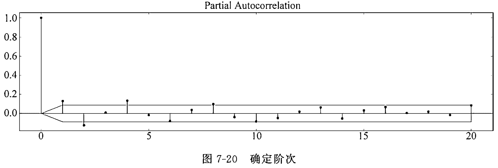

因此建立 AR(8)模型（即均值方程）：

```python
order = (8, 0)
model = sm.tsa.ARMA(data, order).fit()
```

#### 2. ARCH 效应的检验

利用前面的金融时间序列中的混成检验，检验序列 $\{a_t^2\}$ 的相关性，以判断是否具有 ARCH 效应。

计算均值方程残差：

$$ a_t = r_t - \mu_t $$

画出残差及残差的平方图（图 7-21）：

```python
at = data - model.fittedvalues
at2 = np.square(at)
plt.figure(figsize = (10, 6))
plt.subplot(211)
plt.plot(at, label = 'at')
plt.legend()
plt.subplot(212)
plt.plot(at2, label = 'at^2')
plt.legend(loc = 0)
```

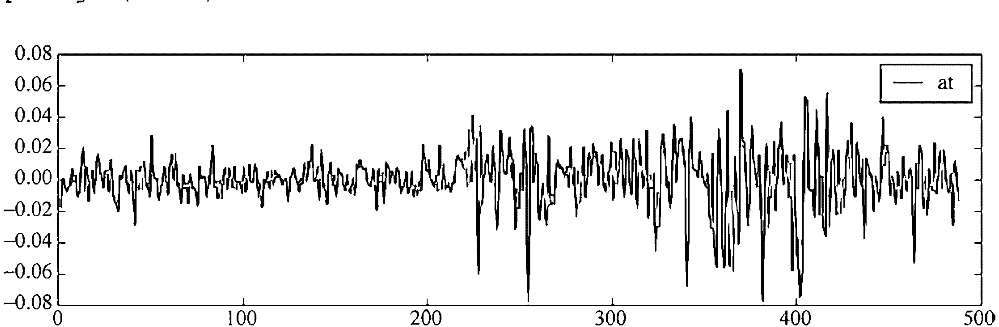
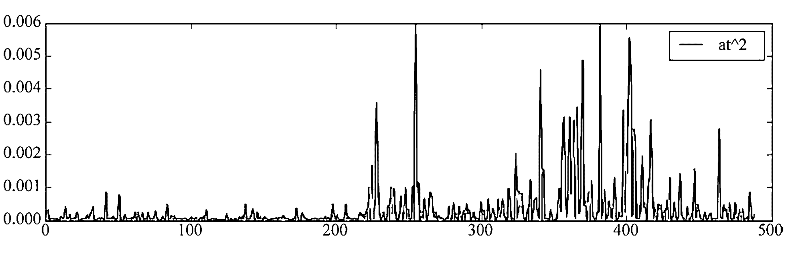

图 7-21 残差及残差的平方图

然后对 $\{a_t^2\}$ 序列进行混成检验。

原假设 H0：序列没有相关性。
备择假设 H1：序列具有相关性。

```python
m = 25                                    # 检验 25 个自相关系数
acf, q, p = sm.tsa.acf(at2, nlags = m, qstat = True)   # 计算自相关系数及 p-value
out = np.c_[range(1, 26), acf[1:], q, p]
```

```python
output = pd.DataFrame(out, columns = ['lag', 'AC', 'Q', 'p-value'])
output = output.set_index('lag')
```

| lag | AC | Q | p-value |
| :--- | :--- | :--- | :--- |
| 1.0 | 0.239757 | 28.282241 | 1.048535e-07 |
| 2.0 | 0.255331 | 60.423948 | 7.570185e-14 |
| 3.0 | 0.228798 | 86.285742 | 1.374508e-18 |
| 4.0 | 0.219128 | 110.056680 | 7.077883e-23 |
| 5.0 | 0.168780 | 124.188080 | 4.067130e-25 |
| 6.0 | 0.161528 | 137.158124 | 3.985737e-27 |
| 7.0 | 0.137504 | 146.576465 | 2.124208e-28 |
| 8.0 | 0.105536 | 152.136153 | 7.026640e-29 |
| 9.0 | 0.106765 | 157.837856 | 2.088698e-29 |
| 10.0 | 0.155264 | 169.921508 | 2.879791e-31 |
| 11.0 | 0.069119 | 172.321227 | 3.926127e-31 |
| 12.0 | 0.161936 | 185.520839 | 3.133881e-33 |
| 13.0 | 0.178842 | 201.654183 | 6.250427e-36 |
| 14.0 | 0.118093 | 208.703516 | 9.114384e-37 |
| 15.0 | 0.144957 | 219.347113 | 2.422050e-38 |
| 16.0 | 0.182641 | 236.279823 | 3.353182e-41 |
| 17.0 | 0.106904 | 242.093282 | 8.562367e-42 |
| 18.0 | 0.114413 | 248.766262 | 1.453060e-42 |
| 19.0 | 0.127249 | 257.038031 | 1.158714e-43 |
| 20.0 | 0.173348 | 272.421618 | 3.326506e-46 |
| 21.0 | 0.173865 | 287.930159 | 9.021732e-49 |
| 22.0 | 0.079046 | 291.142609 | 7.600739e-49 |
| 23.0 | 0.076027 | 294.120679 | 7.040669e-49 |
| 24.0 | 0.052259 | 295.530808 | 1.329812e-48 |
| 25.0 | 0.112291 | 302.055542 | 2.325657e-49 |

p-value 小于显著性水平 0.05，拒绝原假设，即认为序列具有相关性，因此具有 ARCH 效应。

#### 3. ARCH 模型的建立

首先确定 ARCH 模型的阶次，可以用 $\{a^2_t\}$ 序列的偏自相关函数 PACF 来判定：

```python
fig = plt.figure(figsize=(20, 5))
ax1 = fig.add_subplot(111)
fig = sm.graphics.tsa.plot_pacf(at2, lags = 30, ax = ax1)
```

由图 7-22 可以粗略定为 4 阶。

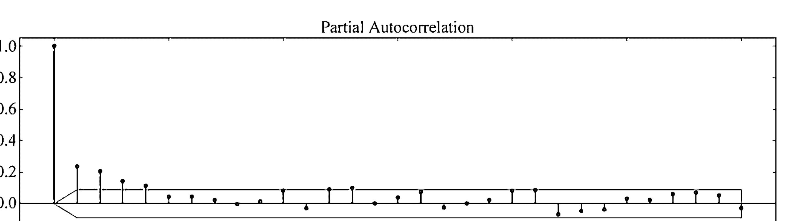

图 7-22 确定 ARCH 模型的阶次

然后建立 ARCH(4)模型:

$$ \begin{array}{l} \sigma_{t}^{2} = \alpha_{0} + \alpha_{1}a_{t-1}^{2} + \cdots + \alpha_{4}a_{t-4}^{2} \\ \eta_{t} = a_{t}^{2} - \sigma_{t}^{2} \\ a_{t}^{2} = \alpha_{0} + \alpha_{1}a_{t-1}^{2} + \cdots + \alpha_{4}a_{t-4}^{2} + \eta_{t} \end{array} $$

后续的 AR 模型就不建立了。当然，按照上述流程走下来非常麻烦。事实上 arch 库可以一步到位。根据前面的分析，可以粗略选择均值模型为 AR(8)模型，波动率模型选择 ARCH(4)模型。

```python
train = data[: -10]
test = data[- 10:]
am = arch.arch_model(train, mean = 'AR', lags = 8, vol = 'ARCH', p = 4)
res = am.fit()
```

输出结果示例：
```
Iteration: 1, Func. Count: 16, Neg. LLF: -1272.93439065
...
Optimization terminated successfully. (Exit mode 0)
Current function value: -1289.40693539
Iterations: 24
Function evaluations: 428
Gradient evaluations: 24
```

模型摘要输出：

AR - ARCH Model Results

| | | | |
| :--- | :--- | :--- | :--- |
| Dep. Variable: y | R-squared: 0.014 | Mean Model: AR | Vol Model: ARCH |
| Adj. R-squared: -0.003 | Log - Likelihood: 1289.41 | Distribution: Normal | |
| AIC: -2550.81 | BIC: -2492.65 | | |
| No. Observations: 471 | Df Residuals: 457 | Df Model: 14 | |
| Date: Fri, Feb 24 2017 | Time: 08:45:05 | Method: Maximum Likelihood | |

**Mean Model**

| coef | std err | t | P>\|t\| | 95.0 % Conf. Int. |
| :--- | :--- | :--- | :--- | :--- |
| Const | 1.6120e-03 | 3.598e-07 | 4480.657 | 0.000 | [1.611e-03, 1.613e-03] |
| y[1] | 0.1163 | 2.143e-03 | 54.260 | 0.000 | [0.112, 0.120] |
| y[2] | -0.0982 | 4.637e-03 | -21.183 | 1.374e-99 | [-0.107, -8.913e-02] |
| y[3] | -0.1171 | 4.976e-03 | -23.538 | 1.653e-122 | [-0.127, -0.107] |
| y[4] | 0.0394 | 8.667e-03 | 4.547 | 5.429e-06 | [2.243e-02, 5.640e-02] |
| y[5] | -0.0149 | 3.173e-03 | -4.699 | 2.609e-06 | [-2.113e-02, -8.692e-03] |
| y[6] | -0.1510 | 5.472e-03 | -27.601 | 1.093e-167 | [-0.162, -0.140] |
| y[7] | -0.0994 | 2.407e-03 | -41.290 | 0.000 | [-0.104, -9.468e-02] |
| y[8] | 0.0128 | 2.117e-03 | 6.043 | 1.510e-09 | [8.643e-03, 1.694e-02] |

**Volatility Model**

| coef | std err | t | P>\|t\| | 95.0 % Conf. Int. |
| :--- | :--- | :--- | :--- | :--- |
| omega | 6.1193e-05 | 3.817e-10 | 1.603e+05 | 0.000 | [6.119e-05, 6.119e-05] |
| alpha[1] | 1.6797e-03 | 9.523e-04 | 1.764 | 7.776e-02 | [-1.868e-04, 3.546e-03] |
| alpha[2] | 0.4667 | 2.652e-02 | 17.596 | 2.635e-69 | [0.415, 0.519] |
| alpha[3] | 0.2340 | 6.865e-03 | 34.080 | 1.458e-254 | [0.221, 0.247] |
| alpha[4] | 0.2976 | 2.388e-02 | 12.465 | 1.159e-35 | [0.251, 0.344] |

res.params

| Name | Value |
| :--- | :--- |
| Const | 0.001612 |
| y[1] | 0.116297 |
| y[2] | -0.098217 |
| y[3] | -0.117130 |
| y[4] | 0.039414 |
| y[5] | -0.014911 |
| y[6] | -0.151019 |
| y[7] | -0.099402 |
| y[8] | 0.012792 |
| omega | 0.000061 |
| alpha[1] | 0.001680 |
| alpha[2] | 0.46721 |
| alpha[3] | 0.233962 |
| alpha[4] | 0.297637 |

可以看出，建立的模型为

$$
\begin{aligned}
r_{t}= & 0.0016+0.1163 a_{t-1}-0.0982 a_{t-2}-0.1171 a_{t-3}+0.0394 a_{t-4} \\
& 0.0149 a_{t-5}-0.01510 a_{t-6}-0.0994 a_{t-7}+0.0128 a_{t-8} \\
\sigma_{t}^{2}= & 0.0006+0.0017 a_{t-1}^{2}+0.4667 a_{t-2}^{2}+0.2340 a_{t-3}^{2}+0.2976 a_{t-4}^{2}
\end{aligned}
$$

从上面的模型可以看出，上证指数的日收益率期望大约在 0.16%。模型的 R-squared 较小，拟合效果一般。

#### 4. ARCH 模型的预测

先来看整体的预测拟合情况：

```python
res.hedgehog_plot()
```

预测拟合结果如图 7-23 所示。

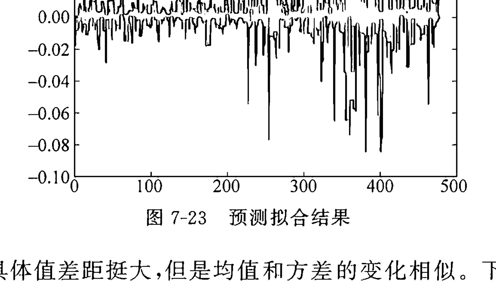

可以看出，虽然具体值差距挺大，但是均值和方差的变化相似。下面再看最后 10 个数据的预测情况：

```python
len(train)
# 479

pre = res.forecast(horizon = 10, start = 478).iloc[478]
plt.figure(figsize=(10,4))
plt.plot(test, label= 'realValue')
pre.plot(label= 'predictValue')
plt.plot(np.zeros(10), label= 'zero')
plt.legend(loc=0)
```

最后 10 个数据的预测拟合结果如图 7-24 所示。

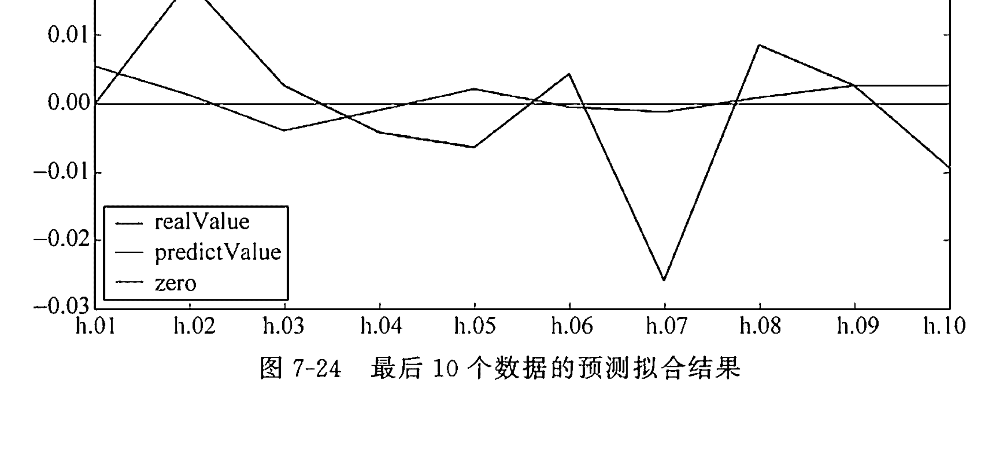

可以看出，如果只看涨跌，预测涨跌的正确率为 60%，当然，模型更重要的功能是预测波动率，这将在 7.7 节介绍。

## 7.7 广义自回归条件异方差模型 GARCH 及波动率预测

虽然 ARCH 模型简单，但为了充分刻画收益率的波动率过程，往往需要很多参数，例如上面用到 ARCH(4)模型，有时会有更高阶的 ARCH(m)模型。因此，Bollerslev 于 1986 年提出了一个推广形式，称为广义的 ARCH 模型(Generalized ARCH, GARCH)。

令 $a_t = r_t - \mu_t$ 为 $t$ 时刻的信息。若 $a_t$ 满足下式：

$$
a_t = \sigma_t \varepsilon_t, \sigma_t^2 = \alpha_0 + \sum_{i=1}^m \alpha_i a_{t-i}^2 + \sum_{j=1}^s \beta_j \sigma_{t-j}^2, \alpha_0 > 0, \alpha_i, \beta_i \geqslant 0, \alpha_i + \beta_i < 1
$$

其中，$\varepsilon_t$ 是均值为 0、方差为 1 的独立同分布的随机变量序列。通常假定其服从标准正态分布或标准学生 t 分布；$\sigma_t^2$ 为条件异方差。则称 $a_t$ 服从 $GARCH(m,s)$ 模型。可以发现该模型与 ARMA 模型很相似。

### 7.7.1 GARCH 模型的建立

GARCH 模型与前面的 ARCH 模型建立过程类似，不过 GARCH(m,s) 的定阶较难，一般使用低阶模型，如 GARCH(1,1)、GARCH(2,1)、GARCH(1,2)等。

下面以前面的数据为例构建 GARCH 模型，均值方程为 AR(8)模型，波动率模型为 GARCH(1,1)。

```python
train = data[: -10]
test = data[-10:]
am = arch.arch_model(train, mean = 'AR', lags = 8, vol = 'GARCH')
res = am.fit()
```

Iteration: 1, Func. Count: 14, Neg. LLF: -1302.57526851
Positive directional derivative for linesearch (Exit mode 8)
Current function value: -1302.57526856
Iterations: 5
Function evaluations: 14
Gradient evaluations: 1

```python
res.summary()
```

**AR - GARCH Model Results**

| | | | | |
| :--- | :--- | :--- | :--- | :--- |
| Dep. Variable: y | R-squared: 0.068 | Mean Model: AR | Adj. R-squared: 0.052 | Vol Model: GARCH | Log-Likelihood: 1302.58 |
| Distribution: Normal | AIC: -2581.15 | Method: Maximum Likelihood | BIC: -2531.29 | No. Observations: 471 |
| Date: Fri, Feb 24 2017 | Df Residuals: 459 | Time: 09:28:52 | Df Model: 12 | |

**Mean Model**

| coef | std err | t | P>\|t\| | 95.0% Conf. Int. |
| :--- | :--- | :--- | :--- | :--- |
| Const | 1.1473e-03 | 1.905e-09 | 6.023e+05 | 0.000 | [1.147e-03, 1.147e-03] |
| y[1] | 0.1486 | 2.489e-03 | 59.711 | 0.000 | [0.144, 0.153] |
| y[2] | 0.0925 | 3.275e-03 | -28.252 | 1.358e-175 | [-9.893e-02, -8.609e-02] |
| y[3] | -0.0205 | 2.944e-03 | -6.969 | 3.194e-12 | [-2.629e-02, -1.475e-02] |
| y[4] | 0.1180 | 2.778e-03 | 42.495 | 0.000 | [0.113, 0.123] |
| y[5] | -8.0268e-05 | 2.874e-03 | -3.071e-02 | 0.976 | [-5.722e-03, 5.545e-03] |
| y[6] | -0.0751 | 2.201e-03 | -34.099 | 7.622e-255 | [-7.938e-02, -7.075e-02] |
| y[7] | 0.0268 | 2.786e-03 | 9.630 | 5.972e-22 | [2.137e-02, 3.229e-02] |
| y[8] | 0.0974 | 2.434e-03 | 39.994 | 0.000 | [9.258e-02, 0.102] |

**Volatility Model**

| coef | std err | t | P>\|t\| | 95.0% Conf. Int. |
| :--- | :--- | :--- | :--- | :--- |
| omega | 6.8214e-06 | 3.164e-24 | 2.156e+18 | 0.000 | [6.821e-06, 6.821e-06] |
| alpha[1] | 0.1000 | 4.950e-04 | 202.039 | 0.000 | [9.903e-02, 0.101] |
| beta[1] | 0.8800 | 3.933e-04 | 2237.305 | 0.000 | [0.879, 0.881] |

```python
res.params
```

```
Const      0.001147
y[1]      0.148609
y[2]     -0.092510
y[3]     -0.020519
y[4]      0.118050
y[5]     -0.000088
y[6]     -0.075066
y[7]      0.026833
y[8]      0.097354
omega     0.000007
alpha[1]  0.100000
beta[1]   0.880000
Name: params, dtype: float64
```

由此得到波动率模型：

$$
\sigma_{t}^{2} = 0.000007 + 0.1a_{t-1}^{2} + 0.88\sigma_{t-1}^{2}
$$

画出标准化残差与原始收益率序列图：

```python
res.plot()
plt.plot(data)
```

观察图 7-25，上图为标准化残差，近似平稳序列，说明模型在一定程度上是正确的；下图给出了原始收益率序列和条件异方差序列，可以发现条件异方差很好地表现出了波动率。再画出还原序列图：

```python
res.hedgehog_plot()
```

观察图 7-26 可以发现，在方差的还原上效果还是不错的。

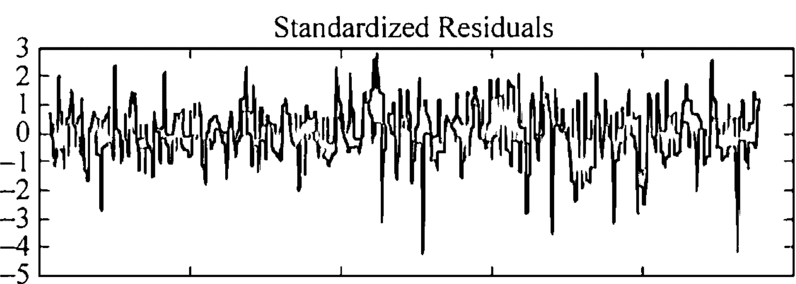

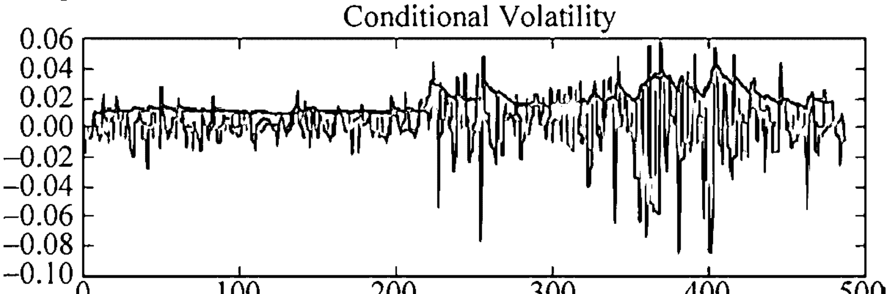

图 7-25 标准化残差与原始收益率序列

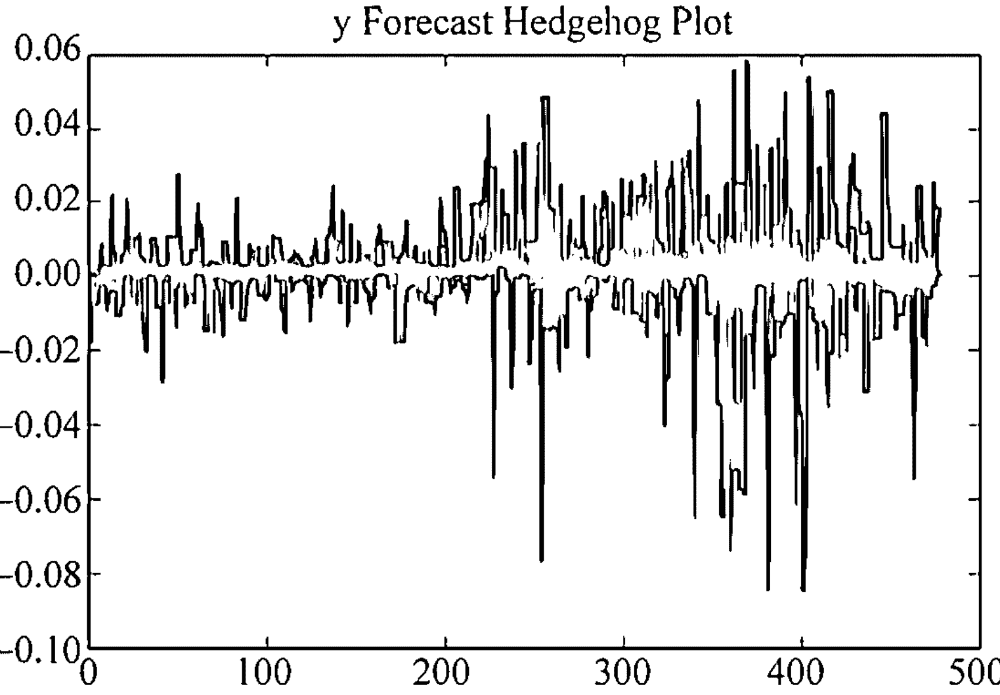

图 7-26 还原序列

### 7.7.2 波动率预测

7.7.1 节的模型直接预测了收益率，然而直接预测收益率准确度并不是很高，因此很多时候 GARCH 模型主要用来预测波动率，根据上面建立的波动率模型：

$$
\sigma_{t}^{2} = 0.000007 + 0.1a_{t-1}^{2} + 0.88\sigma_{t-1}^{2}
$$

可以按照建立好的模型一步步计算。

根据模型

$$
r_{t}=0.00115+0.14861 a_{t-1}-0.09251 a_{t-2}-0.02052 a_{t-3}+0.11805 a_{t-4}-0.00009 a_{t-5}-0.07507 a_{t-6}+0.02683 a_{t-7}+0.09735 a_{t-8}
$$

先计算 $a_{t}$ 的预测值：

```python
res.params
```

```
Const      0.001147
y[1]      0.148609
y[2]     -0.092510
y[3]     -0.020519
y[4]      0.118050
y[5]     -0.000088
y[6]     -0.075066
y[7]      0.026833
y[8]      0.097354
omega     0.000007
alpha[1]  0.100000
beta[1]   0.880000
Name: params, dtype: float64
```

需要提取均值方程的系数向量w，再逐个计算a，最后10个值：

```python
ini = res.resid[-8:]
a = np.array(res.params[1:9])
w = a[::-1] # 系数
for i in range(10):
    new = test[i] - (res.params[0] + w.dot(ini[-8:-1]))
    ini = np.append(ini, new)
print(len(ini))
at_pre = ini[-10:]
at_pre2 = at_pre * 2
at_pre2
```

```
18
array( [ 2.42201049e-05, 3.65774651e-04, 1.20677460e-07,
        4.28085034e-05, 5.38187170e-05, 1.21955584e-05,
        8.81650985e-04, 1.56331678e-04, 5.12749562e-06,
        1.55449399e-04])
```

接着根据波动率模型预测波动率：

```python
ini2 = res.conditional_volatility[-2:] # 波动率模型中的两个条件异方差值
for i in range(10):
    new = 0.000007 + 0.1 * at_pre2[i] + 0.88 * ini2[-1]
    ini2 = np.append(ini2, new)
vol_pre = ini2[-10:]
vol_pre
```

```
array( [ 0.01371429, 0.01211216, 0.01066571, 0.00939711, 0.00828183,
        0.00729623, 0.00651585, 0.0057566 , 0.00507332, 0.00448707])
```

将原始数据、条件异方差拟合数据及预测数据一起画出来，分析波动率预测情况。

```python
plt.figure(figsize=(15, 5))
plt.plot(data, label='origin_data')
plt.plot(res.conditional_volatility, label='conditional_volatility')
x = range(479, 489)
plt.plot(x, vol_pre, 'r', label='predict_volatility')
plt.legend(loc=0)
```

从图 7-27 可以看出，对于接下来一两天的波动率预测较为接近，随后几天的预测值逐渐偏小。

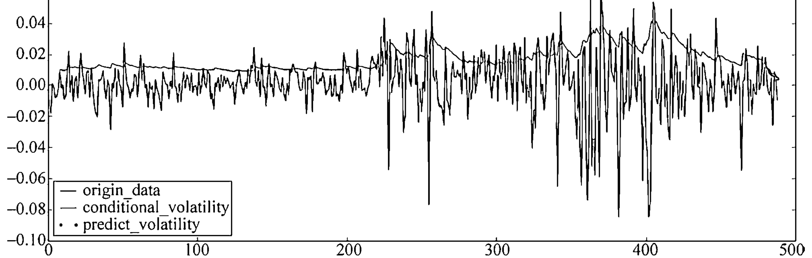

图 7-27 原始数据、条件异方差拟合数据及预测数据

还有很多扩展的或改进的模型，如求和 GARCH、GARCH-M 模型、指数 GARCH、EGARCH 模型等。对于波动率模型，还有比较常用的随机波动率模型等，有兴趣的读者可以进一步研究。

## 练习题

对本章中例题的数据文件，使用 Python 重新操作一遍。

# 第 8 章 中国股市分析及其 Python 应用

## 8.1 股票的基本信息

首先导入分析中要用到的库：

```python
import pandas as pd
from pandas import Series, DataFrame
import numpy as np
import matplotlib.pyplot as plt
import seaborn as sns
sns.set_style('whitegrid')    # darkgrid, whitegrid
from datetime import datetime
```

下面以 600050.XSHG 为例介绍将 Python 应用于股票分析的方法。

```python
data = DataAPI.MktEduqGet(secID=u"", ticker=u"600050", beginDate=u"", endDate=u"", isOpen="", field=u"secID, secShortName, tradeDate, openPrice, highestPrice, lowestPrice, closePrice, turnoverVol", pandas="1")
data_hou = DataAPI.MktEduqAdjAffGet(secID=u"", ticker=u"600050", tradeDate=u"", isOpen="", beginDate=u"", endDate=u"", field=u"secID,tradeDate,closePrice", pandas="1")
data_hou = data_hou.rename(columns={'closePrice':'Adj_closePrice'})
data_new = pd.merge(data, data_hou, on='tradeDate')
data_new = data_new.set_index('tradeDate')
data_new1 = data_new.copy()
data_new1.head().append(data_new1.tail())
```

```
         tradeDate      secID_x secShortName  openPrice  highestPrice  lowestPrice  closePrice  turnoverVol      secID_y  Adj_closePrice
2002-10-09  600050.XSHG       中国联通       3.05          3.15         2.86        2.87   1304738300  600050.XSHG          2.870
2002-10-10  600050.XSHG       中国联通       2.83          2.89         2.79        2.83    202927104  600050.XSHG          2.830
2002-10-11  600050.XSHG       中国联通       2.85          2.96         2.83        2.94    173135920  600050.XSHG          2.940
2002-10-14  600050.XSHG       中国联通       2.96          3.02         2.94        3.01    178761088  600050.XSHG          3.010
2002-10-15  600050.XSHG       中国联通       3.01          3.01         2.96        2.98     90834152  600050.XSHG          2.980
2017-02-17  600050.XSHG       中国联通       6.69          6.71         6.48        6.50    210522605  600050.XSHG         10.088
2017-02-20  600050.XSHG       中国联通       6.45          6.59         6.41        6.54    125281173  600050.XSHG         10.150
2017-02-21  600050.XSHG       中国联通       6.52          6.68         6.50        6.59    132291567  600050.XSHG         10.227
2017-02-22  600050.XSHG       中国联通       6.57          6.64         6.53        6.59     94923070  600050.XSHG         10.227
2017-02-23  600050.XSHG       中国联通       6.58          6.61         6.52        6.55     84847924  600050.XSHG         10.165
```

```python
data_new1.describe()
```


# 简单的描述性统计分析

|  | openPrice | highestPrice | lowestPrice | closePrice | turnoverVol | Adj_closePrice |
|---|---|---|---|---|---|---|
| count | 3492.000000 | 3492.000000 | 3492.000000 | 3492.000000 | 3.492000e+03 | 3492.000000 |
| mean | 4.706982 | 4.795951 | 4.625495 | 4.771217 | 1.575593e+08 | 6.615731 |
| std | 1.987839 | 2.053475 | 1.926265 | 1.937816 | 1.721244e+08 | 3.076444 |
| min | 0.000000 | 0.000000 | 0.000000 | 2.200000 | 0.000000e+00 | 2.586000 |
| 25% | 3.230000 | 3.270000 | 3.200000 | 3.240000 | 5.666951e+07 | 3.861000 |
| 50% | 4.295000 | 4.380000 | 4.250000 | 4.350000 | 9.853506e+07 | 6.325500 |
| 75% | 5.750000 | 5.860000 | 5.650000 | 5.780000 | 1.852211e+08 | 8.320000 |
| max | 13.130000 | 13.500000 | 12.850000 | 13.080000 | 1.721668e+09 | 18.403000 |

### 基本信息

```python
data_new1.info()
```

```
<class 'pandas.core.frame.DataFrame'>
Index: 3492 entries, 2002-09-10 to 2017-02-23
Data columns (total 9 columns):
secID_x				3492 non-null object
secShortName			3492 non-null object
openPrice				3492 non-null float64
highestPrice			3492 non-null float64
lowestPrice			3492 non-null float64
closePrice			3492 non-null float64
turnoverVol			3492 non-null int64
secID_y				3492 non-null object
Adj_closePrice		3492 non-null float64
dtypes: float64(5), int64(1), object(3)
memory usage: 272.8 + KB
```

### 股票收盘价走势(图 8-1)

```python
data_new1['Adj_closePrice'].plot(legend = True, figsize= (14, 6))
```

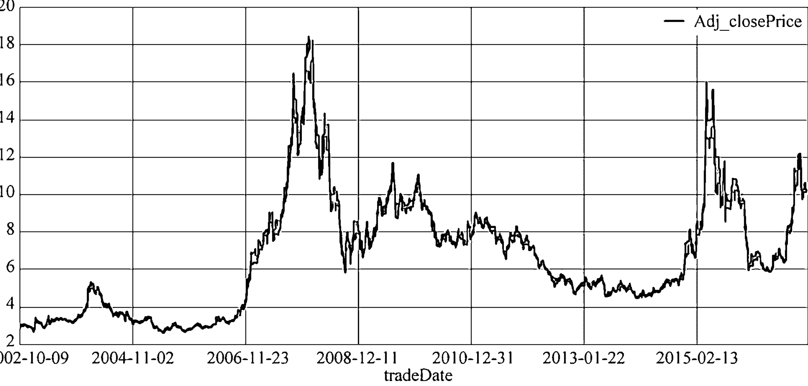

图 8-1 股票收盘价走势

### 成交量走势(图 8-2)

```python
data_new1['turnoverVol'].plot(legend = True, figsize= (14, 6))
```

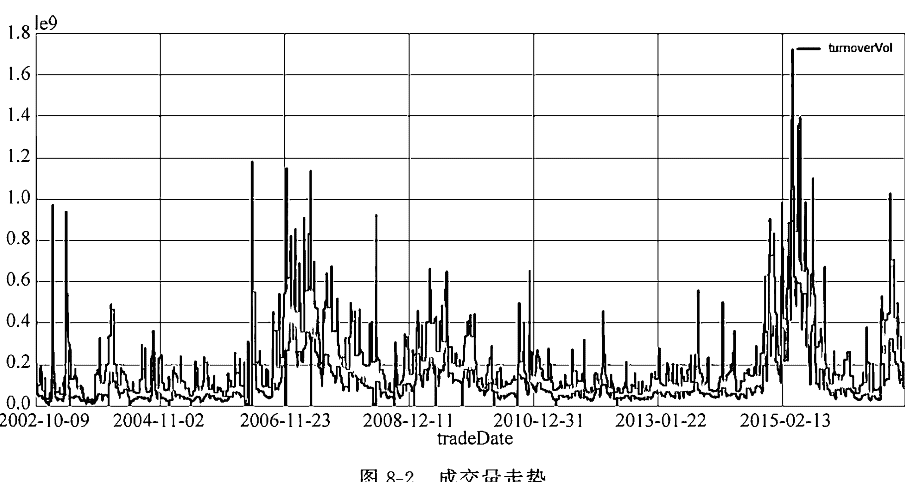

### 移动平均线走势 ( 图 8-3 )

```python
ma_day = [10, 20, 50]

for ma in ma_day:
    column_name = "MA for %s days" % (str(ma))
    data_new1[column_name] = pd.rolling_mean(data_new1['Adj_closePrice'], ma)

data_new1[['Adj_closePrice', 'MA for 10 days', 'MA for 20 days', 'MA for 50 days']].plot(subplots = False, figsize = (14, 6))
```

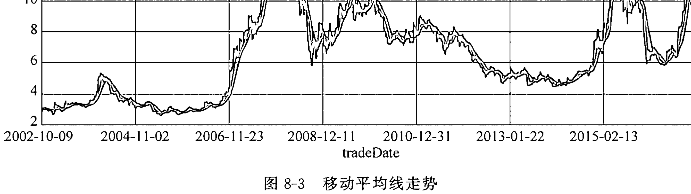

### 股票每天的百分比变化 ( 图 8-4 )

```python
data_new1['Daily Return'] = data_new1['Adj_closePrice'].pct_change()

data_new1['Daily Return'].plot(figsize = (14, 6), legend = True, linestyle = '-', marker = 'o')
```

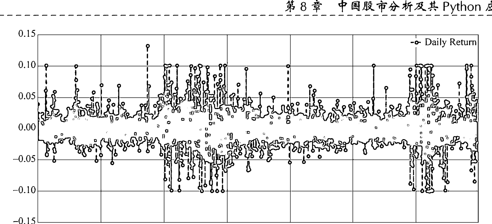

图 8-4 股票每天的百分比变化

### 核密度图(图 8-5)

```python
sns.kdeplot(data_new1['Daily Return'].dropna(), color=" # 4878cf")
```

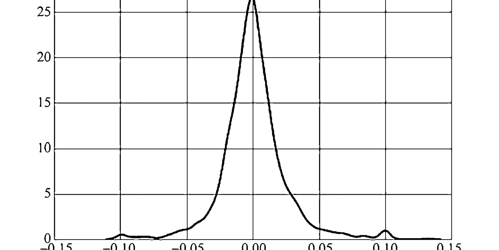

图 8-5 核密度图

### 平均收益直方图(图 8-6)

```python
data_new1['Daily Return'].hist(color=" # 4878cf")
```

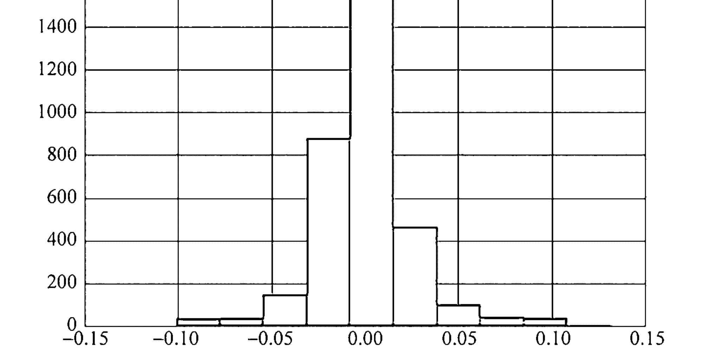

图 8-6 平均收益直方图

```python
# ==========================================#
# 由官方说明可知，displot 函数的结果是直方图与 seaborn 的核密度图的组合，如图 8-7 所示 #
# ==========================================#
sns.distplot(data_new1['Daily Return'].dropna(), bins = 100, color = "b")
```


图 8-7 直方图与 seaborn 的核密度图的组合图

下面以 600050.XSHG、000651.XSHG、600158.XSHG 和 600115.XSHG 为例，介绍分析多只股票的方法。

### 后复权

```python
data_600050 = DataAPI.MktEqudAdjAfGet(secID = "", ticker = "600050", tradeDate = "", isOpen = "",
 begindate = u"20050325", enddate = "", field = u"tradeDate,closePrice", pandas = "1")
data_000930 = DataAPI.MktEqudAdjAfGet(secID = "", ticker = "000930", tradeDate = "", isOpen = "",
 begindate = u"20050325", enddate = "", field = u"closePrice", pandas = "1")
data_600158 = DataAPI.MktEqudAdjAfGet(secID = "", ticker = "600158", tradeDate = "", isOpen = "",
 begindate = u"20050325", enddate = "", field = u"closePrice", pandas = "1")
data_600115 = DataAPI.MktEqudAdjAfGet(secID = "", ticker = "600115", tradeDate = "", isOpen = "",
 begindate = u"20050325", enddate = "", field = u"tradeDate,closePrice", pandas = "1")

data_600050 = data_600050.rename(columns = {'closePrice':'600050'})
data_000930 = data_000930.rename(columns = {'closePrice':'000930'})
data_600158 = data_600158.rename(columns = {'closePrice':'600158'})
data_600115 = data_600115.rename(columns = {'closePrice':'600115'})

data_all = pd.concat([data_600050,data_000930,data_600158],axis = 1)
data_all = pd.merge(data_all,data_600115,on ='tradeDate')
data_all1 = data_all.set_index('tradeDate')
data_all2 = data_all1.copy()
data_all2.head().append(data_all2.tail())
```

```
        600050  000930  600158  600115
tradeDate
2005-03-25  2.924  13.982  10.752  3.161
2005-03-28  2.924  13.827  10.596  3.121
2005-03-29  2.892  14.071  10.482  3.131
2005-03-30  2.839  14.115  9.431  3.151
2005-03-31  2.818  13.827  9.133  3.211
2017-02-17 10.088  76.849 127.444  9.305
2017-02-20 10.150  77.307 129.703  9.507
2017-02-21 10.227  78.450 132.350  9.507
2017-02-22 10.227  83.825 130.801  9.534
2017-02-23 10.165  81.652 129.833  9.426
```

```python
# 列出每个公司的每日收盘价的百分数变化,即涨幅或者跌幅,可以据此评估其涨幅前景
tech_rets = data_all2.pct_change()
tech_rets.head()
```

```
         600050    000930    600158    600115
tradeDate
2005-03-25     NaN       NaN       NaN       NaN
2005-03-28  0.000000 -0.011086 -0.014509 -0.012654
2005-03-29 -0.010944  0.017647 -0.010759  0.003204
2005-03-30 -0.018326  0.003127 -0.100267  0.006308
2005-03-31 -0.007397 -0.020404 -0.031598  0.019042

print(tech_rets.mean())
```

```
600050    0.000749
000930    0.001160
600158    0.001594
600115    0.000881
dtype: float64
```

```
# 查看全部
600050    0.00804
000930    0.001172
600158    0.001697
600115    0.000907
dtype: float64
```

平均值都大于 0

# 一只股票自身的线性相关系数,图 8-8 和图 8-9 表现的是同一事物,但 kind 和 color 指定的值不同


图 8-8  一只股票自身的线性相关系数(散点形式)


图 8-9 一只股票自身的线性相关系数（六边形形式）

```python
sns.jointplot('000930','000930',tech_rets,kind='scatter',color='seagreen')
sns.jointplot('000930','000930',tech_rets,kind='hex',color='r')
```

### 不同股票的线性相关系数（图 8-10）

```python
sns.jointplot('000930','600115',tech_rets,kind='scatter')
```


图 8-10 不同股票的线性相关系数

形态的相关性如图 8-11 所示。


图 8-11 形态的相关性

### 4 个公司一起比较

```python
# ----------------------------------------------------
# pairplot 和 pairgrid 用于成对比较不同数据集间的相关性,对角线位置是该数据集的直方图 
# 如图 8-12 和图 8-13 所示 #
# ----------------------------------------------------
```


图 8-12 4 个公司两两成对比较的散点图


图 8-13   4 个公司两两成对比较的核密度图和散点图

```python
# ------------------------------------------------------------------#
sns.pairplot(tech_rets.dropna())
returns_fig = sns.pairgrid(tech_rets.dropna())
# 右上角散点图
returns_fig.map_upper(plt.scatter, color= 'purple')
# 左下角核密度图
returns_fig.map_lower(sns.kdeplot, cmap= 'cool_d')
# 对角线直方图
returns_fig.map_diag(plt.hist, bins = 30)

### 原股票数据的分析 (图 8-14)
returns_fig = sns.PairGrid(data_all2)
returns_fig.map_upper(plt.scatter, color= 'purple')
returns_fig.map_lower(sns.kdeplot, cmap= 'cool_d')
returns_fig.map_diag(plt.hist, bins = 30)
```


图 8-14 原股票数据的分析

## 8.2 股票收益风险分析

本节介绍股票收益风险分析的方法。

```python
rets = tech_rets.dropna()
area = np.pi * 20
plt.scatter(rets.mean(), rets.std(),alpha = 0.5,s = area)
plt.xlabel('Expected returns')
plt.ylabel('Risk')
# 分别以 rets 的平均值和标准差为 x,y 轴
for label, x, y in zip(rets.columns, rets.mean(), rets.std()):
    plt.annotate(
        label,
        xy = (x, y), xytext = (50, 50),
        textcoords = 'offset points', ha = 'right', va = 'bottom',
        arrowprops = dict(arrowstyle = '->', connectionstyle = 'arc3,rad = -0.3'))
```

由图 8-15 可以看出，600158 的预计收益要高于其他 3 家公司，但是风险值也高于其他 3 家公司。


```python
# 分析之前看一下基本信息，以 600050、XSHE 为例，如图 8-16 所示
sns.distplot(data_new1['Daily Return'],dropna(),bins = 100, color = "b")
```


```python
# 百分位分数，95% 的位置度
rets['600050'].quantile(0.05)
# 查看全部
- 0.035680381757177471
```

一天的损失不会超过 0.0357。如果有一百万元的投资，一天 5% VaR 为 0.0357 × 1 000 000 = 35 700 元。


## 8.3 基于风险价值的蒙特卡洛方法

```python
days = 365
dt = 1./days
mu = rets.mean()['600050']
sigma = rets.std()['600050']

def stock_monte_carlo(start_price, days, mu, sigma):
    price = np.zeros(days)
    price[0] = start_price
    shock = np.zeros(days)
    drift = np.zeros(days)

    for x in xrange(1, days):
        shock[x] = np.random.normal(loc=mu * dt, scale=sigma * np.sqrt(dt))
        drift[x] = mu * dt
        price[x] = price[x-1] + (price[x-1] * (drift[x] + shock[x]))

    return price

start_price = 2.924
# 100 次蒙特卡洛模拟 (图 8-17)
for run in xrange(100):
    plt.plot(stock_monte_carlo(start_price, days, mu, sigma))
plt.xlabel("Days")
plt.ylabel("Price")
```


```python
# 10 000 次蒙特卡洛模拟 (图 8-18)
runs = 10000
simulations = np.zeros(runs)
np.set_printoptions(threshold = 5)
for run in xrange(runs):
    simulations[run] = stock_monte_carlo(start_price, days, mu, sigma)[days - 1]

q = np.percentile(simulations, 1)
plt.hist(simulations, bins = 200)
```


```python
plt.figtext(0.6, 0.8, s="Start price: %.2f" % start_price)
plt.figtext(0.6, 0.7, "Mean final price: %.2f" % simulations.mean())
plt.figtext(0.6, 0.6, "VaR(0.99): %.2f" % (start_price - q))
plt.figtext(0.15, 0.6, "q(0.99): %.2f" % q)
plt.axvline(x=q, linewidth=4, color='r')
plt.title(u"Final price distribution for 600050 after %s days" % days, weight='bold')
```

收益风险评估结果是你购买的股票的风险为 0.16 元（约 99%的时间里, 10 000 次蒙特卡洛模拟的结果）。

## 练习题

对本章中的例题数据, 使用 Python 重新操作一遍。

# 第9章 机器学习神经网络算法及其 Python 应用

## 9.1 BP神经网络的拓扑结构

人工神经网络是在生物神经系统的启发下发展起来的一种信息处理方法。它不需要构建任何数学模型,只靠过去的经验来学习,可以处理模糊的、非线性的、含有噪声的数据,可用于评价、预测、分类、模式识别、过程控制等各种数据处理的场合。人工神经网络理论研究发展相当迅速,据统计,到目前为止已经提出了 30 多种神经网络,其中最流行的有十几种。BP 神经网络(Back Propagation,反向传播)是当前应用最为广泛的一种神经网络,它的结构简单,工作状态最易于硬件实现。其应用范围主要有识别分类、评价、预测、非线性映射、复杂系统仿真等。因此,本章应用 BP 神经网络来研究现金流因素分析的分类问题。

BP 神经网络是典型的多层网络,分为输入层、隐含层和输出层,层与层之间多采用全互连方式,同一层单元之间不存在相互连接,BP 神经网络的拓扑结构如图 9-1所示。


设输入向量为 $X \in R^n, X=(x_1, x_2, \cdots, x_n)^T$; 隐含层有神经元 $Z \in R^l, Z=(z_1, z_2, \cdots, z_l)^T$; 输出层有神经元 $Y \in R^m, Y=(y_1, y_2, \cdots, y_m)^T$。设输入层与隐含层之间的连接权为 $w_{ij}$,阈值为 $\theta_j$; 隐含层与输出层之间的连接权为 $w_{jk}$, 阈值为 $\theta_k$。各层神经元的输出满足

$$z_j=f\left(\sum_{i=1}^{n} w_{ij} x_i-\theta_j\right) \tag{9-1}$$

$$y_k=f\left(\sum_{j=1}^{l} w_{jk} z_j-\theta_k\right) \tag{9-2}$$

函数 $f(\cdot)$ 满足

$$f(u_j)=\frac{1}{1+e^{-u_j}} \tag{9-3}$$

如果近似映射函数为 $F, X$ 为 $n$ 维空间的有界子集, $F(x)$ 为 $m$ 维空间的有界子集, $Y = F(x)$ 可写为

$$F: X \subset R^n \rightarrow Y \subset R^m$$

通过 $P$ 个实际的映射对 $(x^1, y^1), (x^2, y^2), \cdots, (x^p, y^p)$ 进行训练, 目的是获得神经元之间的连接权 $w_{ij}$、$w_{jk}$ 和阈值 $\theta_j$、$\theta_k$ $(i=1,2,\cdots,n; j=1,2,\cdots,l; k=1,2,\cdots,m)$，使其映射获得成功，即寻找一个 $F$，进行 $n$ 维输入向量到 $m$ 维输出向量空间的变换：

$$F:R^n \rightarrow R^m \quad Y = F(x)$$

训练后获得连接权，对其他不属于 $P$ 个样本的 $X$ 子集进行测试，使其结果仍然满足正确的映射。

## 9.2 BP 神经网络的学习算法

BP 神经网络学习是典型的有导师学习，其学习算法是对简单的 $\delta$ 学习规则的推广和发展。设输入学习样本为 $p$ 个，即 $x^1$，$x^2$，$\cdots$，$x^p$，已知与其对应的教师为 $T^1$，$T^2$，$\cdots$，$T^p$，学习算法是根据实际的输出 $y^1$，$y^2$，$\cdots$，$y^p$ 与 $T^1$，$T^2$，$\cdots$，$T^p$ 的误差来修改其连接权和阈值，使 $y^p$ 与要求的 $T^p$ 尽可能接近。

为便于讨论，将阈值写入连接权中，约定：$\theta_j=w_{0j}$，$\theta_k=w_{0k}$，$z_0=-1$，$x_0=-1$，则式 (9-1) 和式 (9-2) 可改写为

$$z_j = f\left(\sum_{i=0}^{n}w_{ij}x_i\right) \quad (9\text{-}1a)$$

$$y_k = f\left(\sum_{j=0}^{l}w_{jk}z_j\right) \quad (9\text{-}1b)$$

当第 $p$ 个样本输入到图 9-1 所示的网络时得到输出 $y_k$，$k=1,2,\cdots,m$，其误差为各输出单元误差之和，满足

$$E_p = \frac{1}{2}\sum_{k=1}^{m}\left(t_k^p-y_k^p\right)^2 \quad (9\text{-}4)$$

则网络总误差为

$$E = \sum_{p}E_p = \frac{1}{2}\sum_{p}\sum_{k=1}^{m}\left(t_k^p-y_k^p\right)^2 \quad (9\text{-}5)$$

设 $w_{sh}$ 为图 9-1 所示的网络中任意两个神经元之间的连接权，$w_{sh}$ 也包括阈值在内，$E$ 为一个与 $w_{sh}$ 有关的非线性误差函数。

令

$$\varepsilon_p = \frac{1}{2}\sum_{k=1}^{m}\left(t_k^p-y_k^p\right)^2 = E_p \quad (9\text{-}6)$$

$$E = \sum_{p}E_p = \sum_{p}\varepsilon(W, t^p, x^p) \quad (9\text{-}7)$$

$$\mathbf{W} = (w_{11},\cdots,w_{sh})^T \quad (9\text{-}8)$$

$\delta$ 学习规则的实质是利用梯度最速下降法，使权值沿误差函数的负梯度方向改变。若权值 $w_{sh}$ 的修正值记为 $\Delta w_{sh}$，则

$$\Delta w_{sh} \propto -\frac{\partial E}{\partial w_{sh}} \quad (9\text{-}9)$$

令 $g$ 为运算的迭代次数，由式 (9-5) 和梯度最速下降法，可得到 BP 网络各层连接权的迭代公式：

$$w_{jk}(g+1) = w_{jk}(g) - \eta\frac{\partial E}{\partial w_{jk}} \quad (9\text{-}10)$$

$$w_{ij} (g+1) = w_{ij} (g) - \eta \frac{\partial E}{\partial w_{ij}} \quad (9\text{-}11)$$

式中 $\eta$ 为学习因子。

从式(9-10)可知，$w_{jk}$ 是 $j$ 个神经元与输出层第 $k$ 个神经元之间的连接权，它只与输出层中的一个神经元有关，将式(9-5)代入式(9-10)，并利用式(9-3)，有

$$\frac{\partial E}{\partial w_{jk}} = \sum_{p} \frac{\partial E_p}{\partial y_k^p} \cdot \frac{\partial y_k^p}{\partial u_k^p} \cdot \frac{\partial u_k^p}{\partial w_{jk}} = \sum_{p} (t_k^p - y_k^p) f'(u_k^p) z_j^p \quad (9\text{-}12)$$

式中，$u_k^p = \sum_{j=0}^{l} w_{jk} z_j^p$, $z_j^p$ 为样本输入网络时 $z_j$ 的输出值。

$$f'(u_k^p) = \frac{e^{-u_k^p}}{(1+e^{-u_k^p})^2} = f(u_k^p)[1-f(u_k^p)] = y_k^p(1-y_k^p) \quad (9\text{-}13)$$

将式(9-13)、式(9-12)代入式(9-10)，有

$$w_{jk} (g+1) = w_{jk} (g) + \eta \sum_{p} \delta_{jk}^p z_j^p \quad (9\text{-}14)$$

式中，$\delta_{jk}^p = (t_k^p - y_k^p) y_k^p (1-y_k^p)$。

同理可得

$$w_{ij} (g+1) = w_{ij} (g) + \eta \sum_{p=1}^{P} \delta_{ij}^p z_j^p \quad (9\text{-}15)$$

式中，$\delta_{ij}^p = z_j^p (1-z_j^p) \sum_{k=1}^{m} \delta_{jk}^p w_{jk}$

BP算法权值修正系数可以统一表示为

$$w_{ij} (t+1) = w_{ij} (t) + \eta \delta_{ij} x_i \quad (9\text{-}16)$$

对于输出层：

$$\delta_{kj} = (T_{kj} - y_{kj}) f'(u_{kj})[1-f(u_{kj})]$$

对于隐含层：

$$\delta_{ij} = f(u_{ij})[1-f(u_{ij})] \sum_{k} \delta_{kj} w_{jk}$$

在实际应用中，考虑到学习过程的收敛性，学习因子 $\eta$ 取值越小越好。$\eta$ 值越大，每次权值改变越剧烈，可能导致学习过程发生振荡。因此，为了使学习因子取得足够大同时又不产生振荡，通常在权值修正公式(9-16)中再另加一个动量项 $\alpha$，得

$$w_{ij} (t+1) = w_{ij} (t) + \eta \delta_{ij} x_i + \alpha [w_{ij} (t) - w_{ij} (t-1)] \quad (9\text{-}17)$$

式中，$\eta$ 为学习因子，$\alpha$ 为动量项，它决定上一次学习的权值变化对本次权值更新的影响程度。通常取 $0<\eta<1, 0<\alpha<1$。

通常用网络的均方根误差定量地反映学习的性能。其定义为

$$E(W) = \sqrt{\frac{\sum_{p} \sum_{k=1}^{m} (t_{pk} - y_{pk})^2}{pm}}$$

式中，$p$ 表示输入学习样本数，$m$ 表示网络输出层单元数。

在BP网络学习过程中，按梯度最速下降法，均方根误差应逐渐减小。由于网络输入、输出都是实数值，网络学习能否满足性能要求不是一个简单的二值判断能确定的，而是由网络的实际输出与期望输出的逼近程度决定的。一般地，当网络的均方根误差 $E(W)$ 值低于 0.1 时，则表明给定输入样本学习已满足要求。当然，$E(\mathbf{W})$ 的上限可以根据具体应用灵活设置。

## 9.3 BP神经网络的学习程序

BP神经网络的学习程序分为两大步，第一步是从网络的输入层逐步向输出层进行计算；第二步是对连接权和阈值进行修改，即反向从输出层向输入层进行计算和修改。根据输出层的误差修改与输出层相连接的权值，然后按照式(9-14)、式(9-15)修改各层的连接权值，直到满足要求为止。具体的学习流程步骤如下。

- (1) 初始化网络及学习参数：初始的权值 $W$ 和阈值 $\theta$、学习因子 $\eta$、动量项 $\alpha$。
- (2) 在已知 $P$ 个学习(训练)样本中按顺序抽取学习样本 $x_1^1, x_2^1, \cdots, x_t^p$ 输入到网络输入层。
- (3) 按式计算 $z_j$ 和 $y_k$：

  $$z_j = f\left(\sum_{i=1}^{n} w_{ij} x_i - \theta_j\right)$$
  $$y_k = f\left(\sum_{j=1}^{l} w_{jk} z_j - \theta_k\right)$$

  式中，$n$ 为输入的样本个数，$\theta_j$ 为输入层与隐含层之间的阈值，$\theta_k$ 为隐含层到输出层的阈值，$l$ 为隐含层的神经元个数。

- (4) 求出各层的误差，对已知样本的教师 $t$，有：

  $$\delta_k^p = (t_k^p - y_k^p) y_k^p(1 - y_k^p) \quad (9\text{-}18)$$
  $$\delta_j^p = z_j^p(1 - z_j^p) \sum_{k=1}^{m} \delta_k^p w_{jk} \quad (9\text{-}19)$$

  式中，$m$ 为输出层的神经元个数，本问题取 $m=1$。

- (5) 记下学习过的样本个数，即计数为 $p_1+1$，看 $p_1+1$ 是否达到了设定的学习样本数 $P$，如果没有达到 $P$，返回步骤(2)继续运算；如果达到了，再从第一个学习样本开始让 $p_1=1$，进行下一步骤。
- (6) 按式(9-18)与式(9-19)修改各层的权值和阈值。
- (7) 按新的权值计算 $z_j$、$y_k$ 和 $E$。
- (8) 计算网络的均方根误差 $E(\mathbf{W})$：

  $$E(\mathbf{W}) = \sqrt{\frac{\sum_{p}\sum_{k=1}^{m}\left(t_{pk} - y_{pk}\right)^2}{pm}}$$

其学习流程图如图 9-2 所示。


## 9.4 BP神经网络算法股票预测的 Python 应用

```python
import pybrain as brain
training_set = ("20050101", "20130101")  # 训练集(8年)
testing_set = ("20150101", "20150525")           # 测试集(2015 上半年数据)
universe = ['000001']                    # 目标股票池
HISTORY = 10                            # 通过前 10 日数据预测
from pybrain.datasets import SupervisedDataSet
# 建立数据集
def make_training_data():
    ds = SupervisedDataSet(HISTORY, 1)
    for ticker in universe:                        # 遍历每只股票
        raw_data = DataAPI.MktEquqGet(ticker = ticker, beginDate = training_set[0], endDate = 
                                       testing_set[1], field=[
                                          'tradeDate', 'closePrice'   # 敏感字段
                                          ], pandas = "1")
        plist = list(raw_data['closePrice'])
        for idx in range(1, len(plist) - HISTORY - 1):
            sample = []
            for i in range(HISTORY):
                sample.append(plist[idx + i - 1] / plist[idx + i] - 1)
            answer = plist[idx + HISTORY - 1] / plist[idx + HISTORY] - 1
            ds.addSample(sample, answer)
    return ds

# 建立测试集
def make_testing_data():
    ds = SupervisedDataSet(HISTORY, 1)
    for ticker in universe:                        # 遍历每只股票
        raw_data = DataAPI.MktEquqGet(ticker = ticker, beginDate = testing_set[0], endDate = 
                                       testing_set[1], field=[
                                          'tradeDate', 'closePrice'   # 敏感字段
                                          ], pandas = "1")
        plist = list(raw_data['closePrice'])
        for idx in range(1, len(plist) - HISTORY - 1):
            sample = []
            for i in range(HISTORY):
                sample.append(plist[idx + i - 1] / plist[idx + i] - 1)
            answer = plist[idx + HISTORY - 1] / plist[idx + HISTORY] - 1
            ds.addSample(sample, answer)
    return ds

from pybrain.supervised.trainers import BackpropTrainer
# 构造 BP 训练实例
def make_trainer(net, ds, momentum = 0.1, verbose = True, weightdecay = 0.01):
    trainer = BackpropTrainer(net, ds, momentum = momentum, verbose = verbose, weightdecay = 	weightdecay)
    return trainer

# 开始训练
def start_training(trainer, epochs = 15):          # 迭代次数
    trainer.trainEpochs(epochs)

def start_testing(net, dataset):
    return net.activateOnDataset(dataset)

# 保存参数
from pybrain.tools.customml import NetworkWriter
def save_arguments(net):
```

```python
NetworkWriter.writeToFile(net, 'huge_data.csv')
print 'Arguments save to file net.csv'
from pybrain.tools.shortcuts import buildNetwork
# 初始化神经网络
fnn = buildNetwork(HISTORY, 15, 7, 1)
training_dataset = make_training_data()
testing_dataset = make_testing_data()
trainer = make_trainer(fnn, training_dataset)
start_training(trainer, 5)
save_arguments(fnn)
print_start_testing(fnn, testing_dataset)
# 查看全部
```

```
Total error: 0.017777907799
Total error: 0.000603739628878
Total error: 0.000467275815115
Total error: 0.000424982879219
Total error: 0.000413722447897
Arguments save to file net.csv
[[ 3.4125956e−03]
[ 1.11977542e−03]
[ 2.69423433e−03]
[ −1.24834720e−04]
[ 2.56993707e−04]
[ −1.50984791e−03]
[ 3.20002046e−03]
[ 5.73708350e−03]
[ −1.79920715e−03]
[ −1.76277292e−03]
[ 4.63274415e−03]
[ 5.46423069e−04]
[ 2.99153336e−03]
[ 5.79329560e−04]
[ 2.4253966e−03]
[ 2.23921857e−04]
[ 2.40107548e−03]
[ 8.15670461e−04]
[ 5.05212298e−04]
[ 1.99809959e−03]
[ 1.59179094e−03]
[ 2.80679967e−03]
[ 2.10166986e−03]
[ 1.15393097e−03]
[ 3.72298210e−03]
[ 1.54164054e−03]
[ 4.18063096e−03]
[ 2.07232429e−03]
[ 3.93290712e−03]
[ 1.23958920e−03]
[ −3.10360594e−06]
[ 1.27711633e−03]
[ 1.01650049e−03]
[ 1.8732325e−03]
[ −9.17682062e−04]
[ 1.77283700e−03]
[ 1.66048117e−03]
[ 1.86674729e−03]
[ 8.39102106e−03]
[ 3.65943122e−03]
[ 3.12998851e−03]
[ 3.81495659e−03]
[ 5.66954450e−03]
[ 3.02366266e−03]
[ 3.26920802e−03]
[ 5.39105819e−04]
[ 1.14156446e−03]
[ −6.71713835e−04]
[ 4.19680026e−03]
[ 2.27383082e−03]
[ 1.01674596e−03]
[ −6.81354065e−05]
[ 1.44350461e−03]
[ 8.78478209e−04]
[ 1.11895286e−02]
[ 5.56555781e−03]
[ 1.08870130e−02]
[ −3.69017688e−03]
[ 6.67993777e−03]
[ −4.65967625e−04]
[ 1.00234774e−03]
[ 7.67488775e−03]
[ −3.50663712e−03]
[ −2.89161149e−03]
[ 1.26037343e−03]
[ 3.30813523e−03]
[ 2.55601954e−03]
[ −2.72849466e−04]
[ 8.76787358e−04]
[ 5.30790396e−03]
[ 3.80513920e−03]
[ 7.51267641e−04]
[ 4.32886681e−04]
[ 1.96504218e−03]
[ 1.26836751e−04]
[ 1.65895257e−03]
[ 2.15262693e−03]
[ 1.51428306e−03]
[ 1.76733054e−03]
[ 1.25926911e−03]
[ 1.14041500e−03]
[ 1.58764973e−03]]
```

## 练习题

对本章中的例题数据，使用 Python 重新操作一遍。

# 第 10 章 机器学习支持向量机及其 Python 应用

本章先介绍机器学习支持向量机的原理，然后基于机器学习支持向量机进行大盘预测，主要针对的是以前几日的蜡烛图形形态来预测未来 $ n $ 天的大盘走势。当然，不可能用图像处理方法来识别大盘前几日的走势，而要使用开盘价、收盘价、最高价、最低价这 4 个价格之间的距离百分比作为特征，选取前 $ m $ 天这 4 个价格之间的距离百分比，预测未来 $ n $ 天的涨跌幅。

## 10.1 机器学习支持向量机原理

要将两类分开，需要得到一个超平面。最优的超平面是到两类的边缘达到最大，边缘就是超平面与离它最近的一点之间的距离。如图 10-1 所示，$ z_{2} > z_{1} $，所以 $ z_{2} $ 代表的超平面比较好。


将这个超平面表示成一个线性方程，位于线上方的一类都大于或等于 1，另一类都小于或等于 $-1$，如图 10-2 所示。

点到超平面的距离根据图 10-3 中的公式计算。


由此得到计算总边缘的表达式如下：

$$\frac{1}{\|\mathbf{w}\|}+\frac{1}{\|\mathbf{w}\|}=\frac{2}{\|\mathbf{w}\|_{\min}}$$

目标是最大化总边缘，这就需要最小化分母，于是该问题就变成了一个优化问题。

例如，在图 10-4 中有 3 个点，找到最优的超平面，定义了权向量为 $(2,3)-(1,1)$。

得到权向量为 $(a,2a)$。将两个点代入方程 $ g(\boldsymbol{w}) = \boldsymbol{w} \cdot \boldsymbol{x}^{T} + w_{0} $：代入 $(2,3)$，令其值为 $ 1 $；代入 $(1,1)$，令其值为 $-1$，求解出 $a=2/5$，截距 $w_0=-11/5$，进而得到超平面的表达式，如图 10-5 所示。


$a$ 求出来后，代入 $(a, 2a)$ 得到 $(2/5, 4/5)$，这就是支持向量。

将 $a$ 和 $w_0$ 代入超平面的方程 $g(\boldsymbol{w}) = \boldsymbol{w} \cdot \boldsymbol{x}^{\mathrm{T}} + w_0 = \frac{2}{5}x_1 + \frac{4}{5}x_2 - \frac{11}{5}$，就是支持向量机 (Support Vector Machine, SVM)。

## 10.2 机器学习支持向量机的应用

代码如下：

```python
import numpy as np
import pandas as pd
from matplotlib import pyplot as plt
from CAL.PyCAL import *
from sklearn import preprocessing
from sklearn import cross_validation
from sklearn import datasets
from sklearn import svm
import itertools

lag = 3                                    # 滞后天数,默认滞后3天
forward = 3                                # 前看天数,默认3天
stock = '000001'                          # 预测的指数,默认为上证综合指数

fields = ['tradeDate', 'closeIndex', 'openIndex', 'highestIndex', 'lowestIndex', 'turnoverVol']
index = DataAPI.MktIIdxGet(ticker = stock, beginDate = u'19910101', endDate = u"20161212",
field = fields, pandas = "1")

# 数据整理
logChange = np.diff(np.log(index['closeIndex']))
index = pd.concat([index, pd.DataFrame(logChange, columns = ['logChange'])], axis = 1)  # 注意,这里计算的是未来一天的涨幅

data = index
featureOriginal = pd.DataFrame()
featureOriginal['high_low'] = (data['highestIndex'] - data['lowestIndex'])/data['lowestIndex']
featureOriginal['high_close'] = (data['highestIndex'] - data['closeIndex'])/data['closeIndex']
featureOriginal['close_low'] = (data['closeIndex'] - data['lowestIndex'])/data['lowestIndex']
featureOriginal['close_open'] = (data['closeIndex'] - data['openIndex'])/data['openIndex']
volumeChange = np.diff(np.log(data['turnoverVol']))
featureOriginal = pd.concat([featureOriginal, pd.DataFrame(volumeChange, columns = ['volumeChange'])],
axis = 1)

featureOriginal['volumeChange'] = featureOriginal['volumeChange'].shift(1)
featureOriginal = featureOriginal.fillna(0)
features = []
#形成特征矩阵
for i in range(lag, len(featureOriginal) + 1):
    temp = featureOriginal[i - lag:i]
    temp = list(itertools.chain.from_iterable(temp.values.tolist()))
    features.append(temp)

#形成 label
label = pd.rolling_sum(index.sort_index(ascending = False)['logChange'], forward)
label = label.sort_index(ascending = True).shift(-1)
label_df = pd.DataFrame(label)
label_df.columns = ['logChange']
label_df['date'] = data['tradeDate']
# 通过这里检查计算的未来 forward 天涨幅是否有问题
label_df['symbol'] = 0
label_df['symbol'] = label_df['logChange'].apply(lambda x:1 if x>0 else 0)
                        # symbol 就是我们要的 label

# 由于特征矩阵是从第 lag 天开始的,因此要从 label 中去掉前 lag 天的数据,再去掉后面 forward
#天的 NaN 数据
# 由于 label 最后 3 天没有数据,因此要从特征矩阵中去掉最后 forward 天的数据
label_df = label_df[lag - 1:len(label_df)-forward]
label_df.reset_index(drop =True, inplace = True)
features = features[:len(features)-forward]
label = label_df['symbol'].values.tolist()
print len(features)
print len(label)
```

得到如下结果：

```
6214
6214
```

```python
# 分类模型: 这里使用的是 SVM
# 训练 SVM 模型
X_train, X_test, y_train, y_test = cross_validation.train_test_split(features, label, test_size = 0.2, random_state = 0)
#数据集未标准化
clf = svm.SVC().fit(X_train, y_train)
print "数据未标准化准确率: %.2f" % (clf.score(X_test, y_test))
#数据集标准化
scaler = preprocessing.StandardScaler().fit(X_train)
X_train_scaler = scaler.transform(X_train)
clf = svm.SVC().fit(X_train_scaler, y_train)
X_test_scaler = scaler.transform(X_test)
print "数据标准化后准确率: %.2f" % (clf.score(X_test_scaler, y_test))
```

```python
# 用K折交叉验证模型稳定性,数据未标准化
scores = cross_validation.cross_val_score(clf, features, label, cv = 5)
print scores
```

输出结果：

```
数据未标准化准确率: 0.52

数据标准化后准确率: 0.53

[ 0.49437299 0.5237329 0.5237329 0.52334944 0.52334944]
```

这里看到的只是一个非常简单的模型，机器学习从根本上说来说去就是两个字——特征。

## 练习题

对本章中例题的数据文件，使用 Python 重新操作一遍。

# 第 11 章 欧式期权定价的 Python 应用

本章将介绍如下内容：

- （1）如何使用 Python 内置的数学函数计算期权的价格。
- （2）利用 NumPy 加速数值计算。
- （3）利用 SciPy 进行仿真模拟。
- （4）使用 SciPy 求解器计算隐含波动率。
- （5）使用 matplotlib 绘制精美的图形。

## 11.1 期权定价公式的 Python 函数

例如，要知道下面一只期权的价格：

- 当前价(spot)：2.45。
- 行权价(strike)：2.50。
- 到期期限(maturity)：0.25。
- 无风险利率(r)：0.05。
- 波动率(vol)：0.25。

关于这样的简单欧式期权的定价，有经典的 Black-Scholes 公式：

$$Call(S, K, r, \tau, \sigma) = SN(d_1) - Ke^{-\tau}N(d_2) \quad (11\text{-}1)$$

其中：

$$d_1 = \frac{\ln(S/K) + (r + 0.5\sigma^2)\tau}{\sigma \sqrt{\tau}} \quad (11\text{-}2)$$

$$d_2 = d_1 - \sigma \sqrt{\tau} \quad (11\text{-}3)$$

在上面的公式中，$S$为标的价格，$K$为执行价格，$r$为无风险利率，$\tau=T-t$为剩余到期时间，$N(x)$为标准正态分布的累计概率密度函数，$Call(S, K, r, \tau, \sigma)$为看涨期权的价格。

设置初始参数如下：

```python
spot = 2.45
strike = 2.50
maturity = 0.25
r = 0.05
vol = 0.25
```

观察式(11-1)至式(11-3)，需要使用一些数学函数，这些数学函数分为两部分：

- (1) log, sqrt 和 exp，这 3 个函数可以从标准库 math 中找到。
- (2) 标准正态分布的累计概率密度函数，使用 SciPy 库中的 stats.norm.cdf 函数。

基于 Black-Scholes 公式的期权定价公式，编制 call_option_pricer(spot, strike, maturity, r, vol) 函数如下：

```python
from math import log, sqrt, exp
from scipy.stats import norm
def call_option_pricer(spot, strike, maturity, r, vol):
    d1 = (log(spot/strike) + (r + 0.5 * vol * vol) * maturity) / vol / sqrt(maturity)
    d2 = d1 - vol * sqrt(maturity)
    price = spot * norm.cdf(d1) - strike * exp(-r * maturity) * norm.cdf(d2)
    return price
```

可以使用这个函数计算我们关注的期权的价格：

```python
print '期权价格：%.4f' % call_option_pricer(spot, strike, maturity, r, vol)
期权价格：0.1133
```

## 11.2 使用 NumPy 加速批量计算

大多数情况下，我们不止关心一个期权的价格，而且关心组合（成千上万）的期权。随着期权组合数量的增长，计算时间也会快速增长。本节就来讨论计算时间增长的问题。

### 11.2.1 使用循环的方式

循环方式的代码如下：

```python
import time
import numpy as np
portfolioSize = range(1, 10000, 500)
timeSpent = []
for size in portfolioSize:
    now = time.time()
    strikes = np.linspace(2.0,3.0,size)
    for i in range(size):
        res = call_option_pricer(spot, strikes[i], maturity, r, vol)
    timeSpent.append(time.time() - now)
from matplotlib import pylab
import seaborn as sns
from CAL.PyCAL import *
font.set_size(15)
sns.set(style="ticks")
pylab.figure(figsize= (12,8))
pylab.bar(portfolioSize, timeSpent, color = 'r', width = 300)
pylab.grid(True)
pylab.title(u'期权计算时间耗时(单位:秒)', fontproperties = font, fontsize = 18)
pylab.ylabel(u'时间(s)', fontproperties = font, fontsize = 15)
pylab.xlabel(u'组合数量', fontproperties = font, fontsize = 15)
```

### 11.2.2 使用 NumPy 向量计算

运行上述代码，可以得到如图 11-1 所示的图形。从图 11-1 中可以看出，随着组合规模的增长，计算时间呈线性增长。


NumPy 的内置数学函数可以应用于向量：

```python
sample = np.linspace(1.0, 100.0, 5)
np.exp(sample)
# array([ 2.71828183e+00, 1.52434373e+11, 8.54813429e+32, 4.79357761e+74,
#        2.68811714e+165])
```

利用 NumPy 的数学函数，可以重写计算公式 `call_option_pricer`，使得它接受向量参数。

```python
# 使用 NumPy 的向量函数重写 Black-Scholes 公式
def call_option_pricer_numpy(spot, strike, maturity, r, vol):
    d1 = (np.log(spot/strike) + (r + 0.5 * vol * vol) * maturity) / vol * np.sqrt(maturity)
    d2 = d1 - vol * np.sqrt(maturity)
    
    price = spot * norm.cdf(d1) - strike * np.exp(-r * maturity) * norm.cdf(d2)
    return price

timeSpentNumpy = []
for size in portfolioSize:
    now = time.time()
    strikes = np.linspace(2.0, 3.0, size)
    res = call_option_pricer_numpy(spot, strikes, maturity, r, vol)
    timeSpentNumpy.append(time.time() - now)

pylab.figure(figsize = (12, 8))
pylab.bar(portfolioSize, timeSpentNumpy, color = 'r', width = 300)
pylab.grid(True)
pylab.title(u'期权计算时间耗时(单位：秒)－numpy加速版', fontproperties = font, fontsize = 18)
pylab.ylabel(u'时间(s)', fontproperties = font, fontsize = 15)
pylab.xlabel(u'组合数量', fontproperties = font, fontsize = 15)
```

运行上面的代码，可以得到如图 11-2 所示的图形。


再观察一下图 11-2，虽然计算时间仍然是随着规模的增长而近似线性增长，但是增长的速度要慢一些。

对两次计算时间进行比对，可以更清楚地了解 NumPy 计算效率的提升。代码如下：

```python
fig = pylab.figure(figsize = (12, 8))
ax = fig.gca()

pylab.plot(portfolioSize, np.log10(timeSpent), portfolioSize, np.log10(timeSpentNumpy))
pylab.grid(True)

from matplotlib.ticker import FuncFormatter
def millions(x, pos):
    'The two args are the value and tick position'
    return '$ 10^{%.0f} $' % (x)

formatter = FuncFormatter(millions)
ax.yaxis.set_major_formatter(formatter)

pylab.title(u'期权计算时间(单位：秒)', fontproperties = font, fontsize = 18)
pylab.legend([u'循环计算', u'NumPy 向量加速'], prop = font, loc = 'upper center', ncol = 2)
pylab.ylabel(u'时间/秒', fontproperties = font, fontsize = 15)
pylab.xlabel(u'组合数量', fontproperties = font, fontsize = 15)
```

运行上述代码，可以得到如图 11-3 所示的图形。


## 11.3 使用 SciPy 做仿真计算

期权价格的计算方法中有一类称为蒙特卡洛方法。它利用随机抽样来模拟标的股票价格随机游走，以计算期权价格（未来的期望）。假设股票价格的随机游走满足以下公式：

$$ dS = rSdt + \sigma S dW(t) $$

利用仿真的方法可以模拟到期日的股票价格：

$$ ST = S_0 \exp((r - 0.5\sigma^2)T + zM\sqrt{T}) $$

这里的 z 是一个符合标准正态分布的随机数。这样就可以计算最后的期权价格：

$$ price = \exp(-rT) \sum \max(ST_i - K, 0) $$

可以利用 SciPy 库获取标准正态分布的随机数：

```python
import scipy
scipy.random.randn(10)
# array([ 0.48589959, 0.01139189, -0.07989112, 0.83710622, -0.39082336, -0.07745921,
# -0.38757171, 0.38351784, 0.92320854, 0.33467714])

pylab.figure(figsize = (12, 8))
randomSeries = scipy.random.randn(1000)
pylab.plot(randomSeries)
print u'均值：%.4f' % randomSeries.mean()
print u'标准差：%.4f' % randomSeries.std()
```

运行上面的代码，可以得到如下结果和如图 11-4 所示的图形。


均值：0.0171
标准差：0.9825

结合 SciPy 和 NumPy 可以定义基于蒙特卡洛方法的期权定价算法：

```python
# 期权计算的蒙特卡洛方法
def call_option_pricer_monte_carlo(spot, strike, maturity, r, vol, numOfPath=5000):
    randomSeries = scipy.random.randn(numOfPath)
    s_t = spot * np.exp((r - 0.5 * vol * vol) * maturity + randomSeries * vol * np.sqrt(maturity))
    sumValue = np.maximum(s_t - strike, 0.0).sum()
    price = np.exp(-r * maturity) * sumValue / numOfPath
    return price

print('期权价格(蒙特卡洛): %.4f' % call_option_pricer_monte_carlo(spot, strike, maturity, r, vol))
```

代码运行结果如下：
期权价格(蒙特卡洛)：0.1142

下面看一看从 1000 次模拟到 50000 次模拟的结果，每个模拟次数运行 100 遍。代码如下：

```python
pathScenario = range(1000, 50000, 1000)
numberOfTrials = 100
confidenceIntervalUpper = []
confidenceIntervalLower = []
means = []

for scenario in pathScenario:
    res = np.zeros(numberOfTrials)
    for i in range(numberOfTrials):
        res[i] = call_option_pricer_monte_carlo(spot, strike, maturity, r, vol, numOfPath=scenario)
    means.append(res.mean())
    confidenceIntervalUpper.append(res.mean() + 1.96 * res.std())
    confidenceIntervalLower.append(res.mean() - 1.96 * res.std())

pylab.figure(figsize = (12, 8))
# 绘图
tabel = np.array([means, confidenceIntervalUpper, confidenceIntervalLower]).T
pylab.plot(pathScenario, tabel)
pylab.title(u'期权计算蒙特卡洛模拟', fontproperties = font, fontsize = 18)
pylab.legend([u'均值', u'95% 置信区间上界', u'95% 置信区间下界'], prop = font)
pylab.ylabel(u'价格', fontproperties = font, fontsize = 15)
pylab.xlabel(u'模拟次数', fontproperties = font, fontsize = 15)
pylab.grid(True)
```

运行上述代码，可以得到如图 11-5 所示的图形。


从图 11-5 中可以看到，随着模拟次数的上升，模拟结果逐渐收敛，模拟结果的置信区间也在逐渐收敛。

## 11.4 计算隐含波动率

作为 Black-Scholes 期权定价最重要的参数，波动率 $\sigma$ 指的是标的资产本身的波动率。但是我们更关心的是当时的报价所反映的市场对波动率的估计，这个估计的波动率称为隐含波动率 (Implied Volatility)。这个过程实际上是在 Black-Scholes 公式中假设另外 4 个参数是确定的且期权价格已知，反解 $\sigma$。

对于欧式看涨期权而言，其价格为对应波动率的单调递增函数，所以这个求解过程是稳定可行的。一般来说可以用类似于试错法的方法来实现。在 SciPy 中提供了很多高效的算法，例如 Brent 算法。代码如下：

```python
from scipy.optimize import brentq

# 目标函数, 目标价格由 target 确定
class cost_function:
    def __init__(self, target):
        self.targetValue = target

    def __call__(self, x):
        return call_option_pricer(spot, strike, maturity, r, x) - self.targetValue

# 假设使用 vol 初值作为目标
target = call_option_pricer(spot, strike, maturity, r, vol)
cost_sample = cost_function(target)

# 使用 Brent 算法求解
impliedVol = brentq(cost_sample, 0.01, 0.5)
print u'真实波动率: %.2f' % (vol*100,) + '%'
print u'隐含波动率: %.2f' % (impliedVol*100,) + '%'
```

运行上面的代码, 可以得到如下结果：

真实波动率：25.00 %
隐含波动率：25.00 %

## 练习题

对本章中的例题数据, 使用 Python 重新操作一遍。

# 第 12 章 函数插值的 Python 应用

本章将介绍量化金融投资的常用工具——函数插值，然后将函数插值应用于一个实际的金融建模环境中，即构造波动率曲面。

通过本章的学习，可以掌握以下知识：
- 如何在 SciPy 中使用函数插值模块 `interpolate`。
- 波动率曲面构造的原理。
- 将 `interpolate` 应用于波动率曲面构造。

## 12.1 如何使用 SciPy 做函数插值

函数插值，即在离散数据的基础上构造连续函数，以估算出函数在其他点处的近似值。在 SciPy 中，所有与函数插值相关的功能都在 `scipy.interpolate` 模块中。首先导入模块：

```python
from scipy import interpolate
dir(interpolate)[:5]
```

可以得到如下结果：

['Akima1DInterpolator', 'BPoly', 'BarycentricInterpolator', 'BivariateSpline', 'CloughTocher2DInterpolator']

本章只作一般性介绍，只关注 `interpolate.spline` 的使用，即样条插值方法。先来看一下样条插值的版本：

```python
print interpolate.spline.__doc__
# Interpolate a curve at new points using a spline fit
# ...
```

样条插值方法的主要参数如下：
- (1) `xk` 为离散的自变量值，是一个序列。
- (2) `yk` 为对应 `xk` 的函数值，是与 `xk` 长度相同的序列。
- (3) `xnew` 为需要进行插值的自变量值序列。
- (4) `order` 为样条插值使用的函数基的阶数，为 1 时使用线性函数。

先用一个实际的示例来说明如何在 SciPy 中使用函数插值。这里的目标函数是三角函数：

$$ f(x) = \sin x $$

假设我们已经观测到 $f(x)$ 在离散点 $x = 1, 3, 5, 7, 9, 11, 13$ 的值。代码如下：

```python
import numpy as np
from matplotlib import pylab
import seaborn as sns
from CAL.PyCAL import *
font.set_size(20)

x = np.linspace(1.0, 13.0, 7)
y = np.sin(x)
pylab.figure(figsize = (12, 6))
pylab.scatter(x, y, s = 85, marker = 'x', color = 'r')
pylab.title(u'$f(x)$ 离散点分布', fontproperties = font)
```

运行上述代码，可以得到如图 12-1 所示的图形。


首先使用最简单的线性插值算法，这时只要将 `spline` 的参数 `order` 设置为 1 即可：

```python
xnew = np.linspace(1.0, 13.0, 500)
ynewLinear = interpolate.spline(x, y, xnew, order = 1)
ynewLinear[:5]
```

运行上述代码，可以得到如下结果：

array([ 0.84147098,  0.83304993,  0.82462888, 0.81620782, 0.80778677])

阶数更高时即为样条插值，也是 `spline` 函数默认的方法，这里将 `order` 设置为 3 即可：

```python
ynewCubicSpline = interpolate.spline(x, y, xnew, order = 3)
ynewCubicSpline[:5]
```

运行上述代码，可以得到如下结果：

array([ 0.84147098, 0.86598588, 0.88928385, 0.91138025, 0.93229042])

最后获得真实的 $\sin x$ 的值：

```python
ynewReal = np.sin(xnew)
ynewReal[:5]
```

运行上述代码，可以得到如下结果：

array([ 0.84147098, 0.85421967, 0.86647437, 0.87822801, 0.88947378])

把所有的函数曲线画到一起，看一下插值的效果。对于这个例子中的目标函数而言，由于目标函数曲线是光滑的，则越高阶的样条插值的方法插值效果越好。

```python
pylab.figure(figsize = (16, 8))
pylab.plot(xnew, ynewReal)
pylab.plot(xnew, ynewLinear)
pylab.plot(xnew, ynewCubicSpline)
pylab.scatter(x, y, s = 160, marker = 'x', color = 'k')
pylab.legend([u'真实曲线', u'线性插值', u'样条插值', u'$f(x)$ 离散点'], prop = font)
pylab.title(u'$f(x)$ 不同插值方法拟合效果：线性插值 vs 样条插值', fontproperties = font)
```

运行上述代码，可以得到如图 12-2 所示的图形。


图 12-2 不同的插值方法拟合效果的比较


在期权市场上，期权价格一般以隐含波动率的形式报出。一般来讲，在市场交易时间，交易员可以看到波动率矩阵 (volatility matrix)。其代码如下：

```python
import pandas as pd
pd.options.display.float_format = '{:.2f}'.format
dates = [Date(2017,3,25), Date(2017,4,25), Date(2017,6,25), Date(2017,9,25)]
strikes = [2.2, 2.3, 2.4, 2.5, 2.6]
blackVolMatrix = np.array([[0.32562851, 0.29746885, 0.29260648, 0.27679933],
                            [0.28841840, 0.29196629, 0.27385023, 0.26511898],
                            [0.27659511, 0.27350773, 0.25887604, 0.25283775],
                            [0.26969754, 0.25565971, 0.25803327, 0.25407669],
                            [0.27773032, 0.24823248, 0.27340796, 0.24814975]])
table = pd.DataFrame(blackVolMatrix * 100, index = strikes, columns = dates, )
table.index.name = u'行权价'
table.columns.name = u'到期时间'
print u'2017年3月3日10时波动率矩阵'
print(table)
```

得到如表 12-1 所示的结果。

| 行权价 | 2017-03-25 | 2017-04-25 | 2017-06-25 | 2017-09-25 |
| :----- | :--------- | :--------- | :--------- | :--------- |
| 2.20   | 32.56      | 29.75      | 29.26      | 27.68      |
| 2.30   | 28.84      | 29.20      | 27.39      | 26.51      |
| 2.40   | 27.66      | 27.35      | 25.89      | 25.28      |
| 2.50   | 26.97      | 25.57      | 25.80      | 25.41      |
| 2.60   | 27.77      | 24.82      | 27.34      | 24.81      |

交易员可以看到市场上离散值的信息，但是如果可以获得一些隐含的信息，例如在 2017 年 6 月 25 日到 2017 年 9 月 25 日之间波动率的形状，则会对交易员更有帮助。

我们并不是直接在波动率矩阵上进行插值，而是在方差矩阵上进行插值。方差和波动率的关系如下：


所以下面将波动率矩阵转换为方差矩阵 (variance matrix)。代码如下：

```python
evaluationDate = Date(2017,3,3)
ttm = np.array([(d - evaluationDate) / 365.0 for d in dates])
varianceMatrix = (blackVolMatrix ** 2) * ttm
print(varianceMatrix)
```

得到如下结果：

```
array([[0.00639109, 0.0128489, 0.02674114, 0.04324205], 
       [0.00501139, 0.01237794, 0.02342277, 0.03966943], 
       [0.00461125, 0.0106231, 0.02093128, 0.03607931], 
       [0.00438413, 0.0094909, 0.02079521, 0.03643376], 
       [0.00464918, 0.00894747, 0.02334717, 0.03475378]])
```

这里的 varianceMatrix 就是转换而得的方差矩阵。

下面在行权价方向以及时间方向同时进行线性插值。在行权价方向：

$$\mathrm{Var}(K,t)=\frac{K_{2}-K}{K_{2}-K_{1}}\mathrm{Var}(K_{1},t)+\frac{K-K_{1}}{K_{2}-K_{1}}\mathrm{Var}(K_{2},t)$$

在时间方向：

$$\mathrm{Var}(K)=\frac{t_{2}-t}{t_{2}-t_{1}}\mathrm{Var}(K,t_{1})+\frac{t-t_{1}}{t_{2}-t_{1}}\mathrm{Var}(K,t_{2})$$

这个过程在 SciPy 中可以直接通过 interpolate 模块下 interp2d 来实现：

```python
interp = interpolate.interp2d(ttm, strikes, varianceMatrix, kind = 'linear')
```

参数如下：

- ttm 为时间方向离散点。
- strikes 为行权价方向离散点。
- varianceMatrix 为方差矩阵，列对应时间维度，行对应行权价维度。
- kind = 'linear' 指示插值以线性方式进行。

返回的 interp 对象可以用于获取任意点上插值得到的方差值：

```python
print(interp(ttm[0], strikes[0]))
# 输出: 0.00639109
```

最后获取整个平面上所有点的方差值，再转换为波动率曲面。代码如下：

```python
sMeshes = np.linspace(strikes[0], strikes[-1], 400)
tMeshes = np.linspace(ttm[0], ttm[-1], 200)
interpolatedVarianceSurface = np.zeros((len(sMeshes), len(tMeshes)))
for i, s in enumerate(sMeshes):
    for j, t in enumerate(tMeshes):
        interpolatedVarianceSurface[i][j] = interp(s, t)
interpolatedVolatilitySurface = np.sqrt(interpolatedVarianceSurface / tMeshes)
print u'行权价方向网格数：', np.size(interpolatedVolatilitySurface, 0)
print u'到期时间方向网格数：', np.size(interpolatedVolatilitySurface, 1)
```

得到如下结果：

```
行权价方向网格数：400
到期时间方向网格数：200
```

选取某一个到期时间上的波动率点，看一下插值的效果。这里选择到期时间最近的点：2017 年 3 月 25 日。代码如下：

```python
pylab.figure(figsize = (16,8))
pylab.plot(sMeshes, interpolatedVolatilitySurface[:, 0])
pylab.scatter(x = strikes, y = blackVolMatrix[:, 0], s = 160, marker = 'x', color = 'r')
pylab.legend([u'波动率(线性插值)', u'波动率(离散)'], prop = font)
pylab.title(u'到期时间为 2017 年 3 月 25 日期权波动率', fontproperties = font)
pylab.show()
```

运行上面的代码，可以得到如图 12-3 所示的图形。


图 12-3 到期时间为 2017 年 3 月 25 日的期权波动率

最后，把整个曲面的图形画出来，代码如下：

```python
from mpl_toolkits.mplot3d import Axes3D
from matplotlib import cm

maturityMesher, strikeMesher = np.meshgrid(tMeshes, sMeshes)
pylab.figure(figsize = (16,9))
ax = pylab.gca(projection = '3d')
surface = ax.plot_surface(strikeMesher, maturityMesher, interpolatedVolatilitySurface * 100, cmap = cm.jet)
pylab.colorbar(surface, shrink = 0.75)
pylab.title(u'2017 年 3 月 3 日 10 时波动率曲面', fontproperties = font)
pylab.xlabel("strike")
pylab.ylabel("maturity")
ax.set_zlabel(r"volatility( %)")
pylab.show()
```

运行上述代码，可以得到如图 12-4 所示的图形。


图 12-4 期权波动率曲面

## 练习题

对本章中的例题数据，使用 Python 重新操作一遍。

# 第13章 期权定价二叉树算法的Python应用

通过前面的学习，读者已熟悉了 Python 的基本语法，也了解了 Python 中常用数值库的算法。这里引入二叉树算法来计算期权价格。本章将介绍如下内容：

- 如何利用 Python 的控制语句与基本内置计算方法构造二叉树模型。
- 如何使用类封装的方式抽象二叉树算法并进行扩展。
- 利用继承的方法为已有二叉树算法增加美式期权定价算法。

本章的初始化代码如下：

```python
import numpy as np
import math
import seaborn as sns
from matplotlib import pylab
from CAL.PyCAL import *
font.set_size(15)
```

## 13.1 二叉树算法的 Python 描述

这里简单地描述二叉树的算法，不会深入讨论其原理，感兴趣的读者可以从相关文献中获取细节。

仍然考虑基础的 Black-Scholes 模型：

$$dS = (r - d)Sdt + \sigma SdW$$

式中各个参数的含义见第 11 章的介绍，$d$ 代表股息率。

该算法之所以被称为二叉树算法，是因为这个算法的基础结构是一个逐层递增的二叉树结构。一个基本的二叉树结构由以下 3 个参数决定：

- up：标的资产价格上涨的比例，必大于 1。
- down：标的资产价格下降的比例，必小于 1。
- upProbability：标的资产价格上涨的概率。

这里用一个具体的例子来说明如何使用 Python 实现二叉树算法。以下为具体参数：

- ttm 为到期时间，单位为年。
- tSteps 为时间方向步数。
- r 为无风险利率。
- d 为标的股息率。
- sigma 为波动率。
- strike 为期权行权价。
- spot 为标的现价。

本例只考虑看涨期权。

```python
# 设置基本参数
ttm = 3.0
tSteps = 25
r = 0.03
d = 0.02
sigma = 0.2
strike = 100.0
spot = 100.0
```

这里用作例子的二叉树称为 Jarrow-Rudd 树，其中：

$$up = e^{(r-d-0.5\sigma^2)dt + \sigma \sqrt{dt}}$$
$$down = e^{(r-d-0.5\sigma^2)dt - \sigma \sqrt{dt}}$$
$$upProbability = 0.5$$

Python 代码如下：

```python
dt = ttm / tSteps
up = math.exp((r - d - 0.5 * sigma * sigma) * dt + sigma * math.sqrt(dt))
down = math.exp((r - d - 0.5 * sigma * sigma) * dt - sigma * math.sqrt(dt))
discount = math.exp(-r * dt)
```

在本例中，这个树的深度为 16 层 (时间节点数 +1)，第 $i$ 层节点与第 $i+1$ 层节点有以下关系式：

$$lattice[i+1][j+1] = lattice[i][j] * up$$
$$lattice[i+1][0] = lattice[i][0] * down$$

因此，构造二叉树的 Python 代码如下：

```python
# 构造二叉树
lattice = np.zeros((tSteps+1, tSteps+1))
lattice[0][0] = spot
for i in range(tSteps):
    for j in range(i+1):
        lattice[i+1][j+1] = up * lattice[i][j]
    lattice[i+1][0] = down * lattice[i][0]
```

绘图代码如下：

```python
pylab.figure(figsize = (12, 8))
pylab.plot(lattice[tSteps])
pylab.title(u'二叉树到期时刻标的价格分布', fontproperties = font, fontsize = 20)
pylab.show()
```

最后得到如图 13-1 所示的图形。


图 13-1 二叉树到期时刻标的价格分布

```python
# 在节点上计算 payoff
def call_payoff(spot):
    global strike
    return max(spot - strike, 0.0)

pylab.figure(figsize = (12, 8))
pylab.plot(list(map(call_payoff, lattice[tSteps])))
pylab.title(u'二叉树到期时刻标的 Payoff 分布', fontproperties = font, fontsize = 18)
pylab.show()
```

最后得到如图 13-2 所示的图形。


图 13-2 二叉树到期时刻标的 Payoff 分布

在从二叉树的叶节点向根回溯的时候，第 $i$ 层节点与第 $i+1$ 层节点满足以下关系：

$$lattice[i][j] = discount \times (upProbability \times lattice[i+1][j+1] + (1 - upProbability) \times lattice[i+1][j])$$

因此代码如下：

```python
# 向根节点回溯整棵树
for i in range(tSteps, 0, -1):
    for j in range(i, 0, -1):
        if i == tSteps:
            lattice[i-1][j-1] = 0.5 * discount * (call_payoff(lattice[i][j]) + call_payoff(lattice[i][j-1]))
        else:
            lattice[i-1][j-1] = 0.5 * discount * (lattice[i][j] + lattice[i][j-1])

print u'二叉树价格: %.4f' % lattice[0][0]
print u'解析法价格: %.4f' % BSMPrice(1, strike, spot, r, d, sigma, ttm, rawOutput = True)[0]

# 输出示例:
# 二叉树价格：14.2663
# 解析法价格：14.1978
```

## 13.2 用面向对象的方法实现二叉树算法

前面展示了二叉树算法的基本结构，但是前面的具体实现有两个缺点：

- 没有明确的接口，不便于用户使用该算法。
- 没有完整的封装，十分不利于算法的扩展。

下面给出一个基于 Python 类的二叉树算法实现。实际上，通过上面的实验性探索，可以发现整个程序可以拆成 3 个互相独立的功能模块：

- 二叉树框架，即树的框架结构，包括节点数以及基本参数的保存。
- 二叉树类型描述，即具体树算法的参数，例如上例中的 Jarrow-Rudd 树。
- 偿付函数，即到期的偿付形式 (payoff function)。

### 13.2.1 二叉树框架

BinomialTree 类负责二叉树框架的构造，也是基本的二叉树算法的调用入口。它有 3 个成员：

- 构造函数 (`__init__`)。负责接收用户定义的具体参数，例如 spot 等；真正的二叉树构造方法由私有方法 `_build_lattice` 以及传入参数 `treeTraits` 共同完成。
- 树构造细节 (`_build_lattice`)。负责具体的树构造过程，这里需要依赖从 `treeTraits` 获取的参数，例如 up, down。
- 树回溯 (roll_back)。从树的叶节点向根节点回溯的过程。最终根节点的值即为期权的价值。它要求的参数是 pay_off 函数。

```python
# 二叉树框架(可以通过传入不同的 treeTraits 类型设计不同的二叉树结构)
class BinomialTree:
    def __init__(self, spot, riskFree, dividend, tSteps, maturity, sigma, treeTraits):
        self.dt = maturity / tSteps
        self.spot = spot
        self.r = riskFree
        self.d = dividend
        self.tSteps = tSteps
        self.discount = math.exp(-self.r * self.dt)
        self.v = sigma
        self.up = treeTraits.up(self)
        self.down = treeTraits.down(self)
        self.upProbability = treeTraits.upProbability(self)
        self.downProbability = 1.0 - self.upProbability
        self._build_lattice()
```


### 13.2.2 二叉树类型描述

正像 13.1 节描述的那样，任意的二叉树只要描述 3 个方面的特征就可以，所以本节设计的 Tree Traits 类只需通过它的静态成员返回这 3 个特征：

- (1) up，返回上升的比例。
- (2) down，返回下降的比例。
- (3) upProbability，返回上升的概率。

下面的类定义了 Jarrow-Rudd 树的类型描述：

```python
class JarrowRuddTraits:
    @staticmethod
    def up(tree):
        return math.exp((tree.r - tree.d - 0.5 * tree.v * tree.v) * tree.dt + tree.v * math.sqrt(tree.dt))

    @staticmethod
    def down(tree):
        return math.exp((tree.r - tree.d - 0.5 * tree.v * tree.v) * tree.dt - tree.v * math.sqrt(tree.dt))

    @staticmethod
    def upProbability(tree):
        return 0.5
```

这里再给出 Cox-Ross-Rubinstein 树的描述：

```python
class CRRTraits:
    @staticmethod
    def up(tree):
        return math.exp(tree.v * math.sqrt(tree.dt))

    @staticmethod
    def down(tree):
        return math.exp(-tree.v * math.sqrt(tree.dt))

    @staticmethod
    def upProbability(tree):
        return 0.5 + 0.5 * (tree.r - tree.d - 0.5 * tree.v * tree.v) * tree.dt / tree.v / math.sqrt(tree.dt)
```

### 13.2.3 偿付函数

偿付函数很简单，是一元函数，输入为标的价格，输出为偿付收益，对于看涨期权来说就是

$$pay = \max (S-K,0)$$

代码如下：

```python
def pay_off(spot):
    global strike
    return max(spot - strike, 0.0)
```

### 13.2.4 组装

把上面3个模块组装起来，现在整个调用过程变得十分清晰，最后的结果和13.1节二叉树算法的结果是完全一致的。

```python
testTree = BinomialTree(spot, r, d, tSteps, ttm, sigma, JarrowRuddTraits)
testTree.roll_back(pay_off)
print('二叉树价格: %.4f' % testTree.lattice[0][0])
# 输出: 二叉树价格: 14.2663
```

下面用本节的算法框架来测试二叉树的收敛性。这里我们用来进行比较的算法即前面给出的 Jarrow-Rudd 树以及 Cox-Ross-Rubinstein 树：

```python
stepSizes = range(25, 500, 25)
jrRes = []
crrRes = []
for tSteps in stepSizes:
    # Jarrow - Rudd 树的结果
    testTree = BinomialTree(spot, r, d, tSteps, ttm, sigma, JarrowRuddTraits)
    testTree.roll_back(pay_off)
    jrRes.append(testTree.lattice[0][0])
    # Cox - Ross - Rubinstein 树的结果
    testTree = BinomialTree(spot, r, d, tSteps, ttm, sigma, CRRTraits)
    testTree.roll_back(pay_off)
    crrRes.append(testTree.lattice[0][0])
```

可以将两种二叉树算法随着步数的增加逐渐向真实值收敛的过程用图形展示出来：

```python
anyRes = [BSMPrice(1, strike, spot, r, d, sigma, ttm, rawOutput=True)[0]] * len(stepSizes)
pylab.figure(figsize=(16, 8))
pylab.plot(stepSizes, jrRes, '-', marker='o', markersize=10)
pylab.plot(stepSizes, crrRes, '-', marker='d', markersize=10)
pylab.plot(stepSizes, anyRes, '---')
pylab.legend(['Jarrow - Rudd', 'Cox - Ross - Rubinstein', '解析解'], prop=font)
pylab.xlabel('二叉树步数', fontproperties=font)
pylab.title('二叉树算法收敛性测试', fontproperties=font, fontsize=20)
```

运行上面的代码，得到如图13-3所示的图形。

也可以用图形展示两种算法的误差随着步长下降的过程。


图 13-3 二元树算法收敛性测试

```python
jrErr = np.array(jrRes) - np.array(anyRes)
crrErr = np.array(crrRes) - np.array(anyRes)
jrErr = np.log10(np.abs(jrErr))
crrErr = np.log10(np.abs(crrErr))
```

绘图代码如下：

```python
pylab.figure(figsize=(16, 8))
pylab.plot(stepSizes, jrErr, '-.', marker='o', markersize=10)
pylab.plot(stepSizes, crrErr, '-.', marker='d', markersize=10)
pylab.xlabel('二元树步数', fontproperties=font)
pylab.ylabel('误差(log)', fontproperties=font)
pylab.title('二元树算法误差分布测试', fontproperties=font, fontsize=20)
```

运行上面的代码，得到如图 13-4 所示的图形。


图 13-4 二元树算法误差分布测试

## 13.3 美式期权定价的二叉树算法

既然已经有解析算法了，为什么还要用二叉树算法来求解呢？当然，如果只是普通欧式期权定价问题，二叉树算法就是多此一举的做法。但是由于二叉树天然的回溯特性，使得它特别适合处理有提前行权结构的期权产品。本节以美式期权为例说明二叉树算法的应用。

美式期权的行权结构在二叉树下处理起来特别简单，只需在每个节点上做以下比较：

```python
lattice[i][j] = max(ExerciseValue, EuropeanValue)
```

这里的 ExerciseValue 就是立即行权的价值，EuropeanValue 为对应节点的欧式期权价值。为了实现上面的比较，需要扩展原先的算法，这可以通过 Python 的类继承在原先的类上添加新功能来实现：

```python
class ExtendBinomialTree(BinomialTree):
    def roll_back_american(self, payOff):
        # 节点计算并回溯
        for i in range(self.tSteps, 0, -1):
            for j in range(i, 0, -1):
                if i == self.tSteps:
                    europeanValue = self.discount * (self.upProbability * payOff(self.lattice[i][j]) + self.downProbability * payOff(self.lattice[i][j-1]))
                else:
                    europeanValue = self.discount * (self.upProbability * self.lattice[i][j] + self.downProbability * self.lattice[i][j-1])
                # 处理美式期权的行权结构
                exerciseValue = payOff(self.lattice[i-1][j-1])
                self.lattice[i-1][j-1] = max(europeanValue, exerciseValue)
```

下面使用同样的参数测试美式期权算法的结果：

```python
stepSizes = range(25, 500, 25)
jrRes = []
crrRes = []
for tSteps in stepSizes:
    # Jarrow - Rudd 树的结果
    testTree = ExtendBinomialTree(spot, r, d, tSteps, ttm, sigma, JarrowRuddTraits)
    testTree.roll_back_american(pay_off)
    jrRes.append(testTree.lattice[0][0])
    # Cox - Ross - Rubinstein 树的结果
    testTree = ExtendBinomialTree(spot, r, d, tSteps, ttm, sigma, CRRTraits)
    testTree.roll_back_american(pay_off)
    crrRes.append(testTree.lattice[0][0])
```

画出美式期权价格的收敛图，美式期权价格始终高于欧式期权价格，符合预期。

```python
anyRes = [BSMPrice(1, strike, spot, r, d, sigma, ttm, rawOutput=True)[0]] * len(stepSizes)
pylab.figure(figsize=(16, 8))
pylab.plot(stepSizes, jrRes, '-', marker='o', markersize=10)
pylab.plot(stepSizes, crrRes, '-', marker='d', markersize=10)
pylab.plot(stepSizes, anyRes, '--')
pylab.legend(['Jarrow - Rudd(美式)', 'Cox - Ross - Rubinstein(美式)', '解析解(欧式)'], prop=font)
pylab.xlabel('二叉树步数', fontproperties=font)
pylab.title('二叉树算法美式期权', fontproperties=font, fontsize=20)
```

得到如图 13-5 所示的图形。


## 练习题

对本章中的例题数据，使用 Python 重新操作一遍。

# 第14章 偏微分方程显式差分法的Python应用

本章以热传导方程为例，介绍有关偏微分方程的以下问题：

- (1) 偏微分方程的初边值问题。
- (2) 利用差分格式将偏微分方程离散化。
- (3) 显式差分格式。
- (4) 显式差分格式的条件稳定性。

## 14.1 热传导方程

本节使用热传导方程作为偏微分方程的例子：

$$u_t - \kappa u_{xx} = 0, \quad 0 \leqslant x \leqslant 1 \quad (14\text{-}1)$$
$$u(x,0) = 4x(1-x), \quad 0 \leqslant x \leqslant 1 \quad (14\text{-}2)$$
$$u(0,\tau) = 0, \quad \tau \geqslant 0 \quad (14\text{-}3)$$
$$u(1,\tau) = 0, \quad \tau \geqslant 0 \quad (14\text{-}4)$$

其中, $\kappa$ 称为热传导系数。

式(14-2)称为方程的初值条件(initial condition)，式(14-3)和式(14-4)称为方程的边值条件(boundaries condition)。这里使用 Dirichlet 条件。

可以看一下初值条件的形状：

```python
from matplotlib import pylab
import seaborn as sns
import numpy as np
from CaL.PyCaL import *
font.set_size(20)

def initialCondition(x):
    return 4.0 * (1.0 - x) * x

xArray = np.linspace(0, 1.0, 50)
yArray = map(initialCondition, xArray)
pylab.figure(figsize=(12, 6))
pylab.plot(xArray, yArray)
pylab.xlabel('$x$', fontsize=15)
pylab.ylabel('$f(x)$', fontsize=15)
pylab.title('一维热传导方程初值条件', fontproperties=font)
```

运行以上代码，得到如图 14-1 所示的图形。


## 14.2 显式差分格式

这里的基本思想是用差分格式替换对应的微分形式，并且期盼两种格式的“误差”在网格足够密的情况下会趋于 0。分别在时间方向以及空间方向对式(14-1)做差分：

$$\frac { u ( x , \tau + \Delta \tau ) - u ( x , \tau ) } { \Delta \tau } = \kappa \frac { u ( x + \Delta x , \tau ) - 2 u ( x , \tau ) + u ( x - \Delta x , \tau ) } { ( \Delta x ) ^ { 2 } }$$

整理得

$$u _ { j , k + 1 } = u _ { j , k } + \kappa \frac { \Delta \tau } { ( \Delta x ) ^ { 2 } } \left( u _ { j + 1 , k } - 2 u _ { j , k } + u _ { j - 1 , k } \right)$$

到这里得到一个迭代方程组：

$$U _ { j , k + 1 } = \rho U _ { j - 1 , k } + ( 1 - 2 \rho ) U _ { j , k } + \rho U _ { j + 1 , k } , \quad 1 \leqslant j \leqslant N - 1 , 0 \leqslant k \leqslant M - 1$$

其中 $\rho = \frac { \kappa \Delta \tau } { ( \Delta x ) ^ { 2 } }$ 。

下面使用 Python 代码实现微分到差分的格式替换过程。

- 首先定义基本变量：
    - N 为空间方向的网格数。
    - M 为时间方向的网格数。
    - T 为最大时间期限。
    - X 为最大空间范围。
    - U 为用来存储差分网格点上的值的矩阵。

```python
N = 25              # x 方向网格数
M = 2500            # t 方向网格数
T = 1.0
X = 1.0
xArray = np.linspace(0, X, N+1)
yArray = map(initialCondition, xArray)
starValues = yArray
U = np.zeros((N+1, M+1))
U[:, 0] = starValues
```


dx = X / N
dt = T / M
kappa = 1.0
rho = kappa * dt / dx / dx

这里做正向迭代：迭代时 $k=0,1, \cdots, M-1$，代表从 0 时刻运行至 $T$。

```python
for k in range(0, M):
    for j in range(1, N):
        U[j][k + 1] = rho * U[j - 1][k] + (1. - 2 * rho) * U[j][k] + rho * U[j + 1][k]
    U[0][k + 1] = 0.
    U[N][k + 1] = 0.
```

可以画出不同时间点 $U(\tau ; k)$ 的结果：

```python
pylab.figure(figsize = (12,6))
pylab.plot(xArray, U[:, 0])
pylab.plot(xArray, U[:, int(0.10/dt)])
pylab.plot(xArray, U[:, int(0.20/dt)])
pylab.plot(xArray, U[:, int(0.50/dt)])
pylab.xlabel('$ x $', fontsize = 15)
pylab.ylabel(r'$ U(\dot{\tau}) $', fontsize = 15)
pylab.title(u'一维热传导方程', fontproperties = font)
pylab.legend(r'$\tau$ = 0.$', r'$\tau$ = 0.10$', r'$\tau$ = 0.20 $', r'$\tau$ = 0.50 $',
             fontsize = 15)
```

运行上面的代码，得到如图 14-2 所示的图形。


也可以通过三维立体图看一下整体的热传导过程：

```python
tArray = np.linspace(0, 0.2, int(0.2 / dt) + 1)
xGrids, tGrids = np.meshgrid(xArray, tArray)
from mpl_toolkits.mplot3d import Axes3D
from matplotlib import cm
fig = pylab.figure(figsize = (16,10))
ax = fig.add_subplot(1, 1, 1, projection = '3d')
surface = ax.plot_surface(xGrids, tGrids, U[:, int(0.2 / dt) + 1], T, cmap=cm.coolwarm)
ax.set_xlabel("$x$", fontdict = {"size":18})
ax.set_ylabel(r"$\tau$", fontdict = {"size":18})
ax.set_zlabel(r"$U$", fontdict = {"size":18})
ax.set_title(u"热传导方程 $u_{\\tau\\tau}= u_{\\xx}$", fontproperties = font)
fig.colorbar(surface,shrink = 0.75)
```

运行上面的代码，得到如图 14-3 所示的图形。


## 14.3 模块组装

就像在 13.2 节的二叉树建模中介绍的一样，本节以面向对象的方式重新组装分散的模块，以方便复用。首先是方程的描述：

```python
class HeatEquation:
    def __init__(self, kappa, X, T, initialCondition = lambda x: 4.0 * x * (1.0 - x), boundaryConditionL = lambda x: 0, boundaryConditionR = lambda x:0):
        self.kappa = kappa
        self.ic = initialCondition
        self.bcl = boundaryConditionL
        self.bcr = boundaryConditionR
        self.X = X
        self.T = T
```

下面是显式差分格式的描述：

```python
class ExplicitEulerScheme:
    def __init__(self, M, N, equation):
        self.eq = equation
        self.dt = self.eq.T / M
        self.dx = self.eq.X / N
        self.U = np.zeros((N + 1, M + 1))
        self.xArray = np.linspace(0,self.eq.X,N + 1)
        self.U[:,0] = map(self.eq.ic, self.xArray)
        self.rho = self.eq.kappa * self.dt / self.dx / self.dx
        self.M = M
        self.N = N

    def roll_back(self):
        for k in range(0, self.M):
            for j in range(1, self.N):
                self.U[j][k + 1] = self.rho * self.U[j - 1][k] + (1. - 2 * self.rho) * self.U[j][k] + self.rho * self.U[j + 1][k]
        self.U[0][k + 1] = self.eq.bcl(self.xArray[0])
        self.U[N][k + 1] = self.eq.bcr(self.xArray[-1])

    def mesh_grids(self):
        tArray = np.linspace(0, self.eq.T, M + 1)
        tGrids, xGrids = np.meshgrid(tArray, self.xArray)
        return tGrids, xGrids
```

有了以上的部分，现在整个过程可以简单地通过初始化一行关于 roll_back 的调用完成：

```python
ht = HeatEquation(1.,1.,1.,)
scheme = ExplicitEulerScheme(2500,25, ht)
scheme.roll_back()
```

可以获取与之前相同的图形，如图 14-4 所示。


图 14-4 热传导方程

```python
tGrids, xGrids = scheme.mesh_grids()
fig = pylab.figure(figsize = (16,10))
ax = fig.add_subplot(1, 1, 1, projection = '3d')
cutoff = int(0.2 / scheme.dt) + 1
surface = ax.plot_surface(xGrids[:,cutoff], tGrids[:,cutoff], scheme.U[:,cutoff], cmap = cm.coolwarm)
ax.set_xlabel("$ x $", fontdict = {"size":18})
ax.set_ylabel(r"$ \tau $", fontdict = {"size":18})
ax.set_zlabel(r"$ U $", fontdict = {"size":18})
ax.set_title(u"热传导方程 $ u_{\tau\tau} = u_{xx} $", fontproperties = font)
fig.colorbar(surface,shrink = 0.75)
```

## 14.4 显式格式的条件稳定性

显式格式不能任意取时间和空间的网格点数，即 M 与 N 不能任意取值，因此称显式格式为条件稳定格式。特别地，显式格式需要满足所谓 CFL (Courant-Friedrichs-Lewy) 条件：


例如, $M = 2500, N = 25$, 则


但如果 $M = 1200, N = 25$, 则

下面的代码完成在第二种情形下的网格点计算过程：

```python
ht = HeatEquation(1.,1.,1.,)
scheme = ExplicitEulerScheme(1200,25, ht)
scheme.roll_back()
```

绘制图形查看网格点的计算结果：

```python
tGrids, xGrids = scheme.mesh_grids()
fig = pylab.figure(figsize = (16,10))
ax = fig.add_subplot(1, 1, 1, projection = '3d')
cutoff = int(0.2 / scheme.dt) + 1
surface = ax.plot_surface(xGrids[:,cutoff], tGrids[:,cutoff], scheme.U[:,cutoff], cmap = cm.coolwarm)
ax.set_xlabel("$ x $", fontdict = {"size":18})
ax.set_ylabel(r"$ \tau $", fontdict = {"size":18})
ax.set_zlabel(r"$ U $", fontdict = {"size":18})
ax.set_title(u"热传导方程 $ u_{\tau\tau} = u_{xx} $ , $ \rho = 0.521 $", fontproperties = font)
fig.colorbar(surface,shrink = 0.75)
```

可以通过图 14-5 看到，在 CFL 条件无法满足的情况下，数值误差累计的结果较差。注意图 14-5 中的锯齿，这个问题将在第 15 章中进行讨论，引出无条件稳定格式——隐式差分格式。

热传导方程 *u<sub>t</sub>=Hu<sub>xx</sub>*, ρ=0.521


## 练习题

对本章中的例题数据，使用 Python 重新操作一遍。

# 第 15 章 偏微分方程隐式差分法的 Python 应用

本章将引入隐式差分算法来解决第 14 章显式格式的稳定性问题，主要内容包括：

- 隐式差分格式描述。
- 三对角矩阵求解。
- 使用 SciPy 加速算法实现三对角矩阵求解。

本章的初始化代码如下：

```python
from CAL.PyCAL import *
from matplotlib import pylab
import seaborn as sns
import numpy as np
np.set_printoptions(precision = 4)
font.set_size(20)
def initialCondition(x):
    return 4.0 * (1.0 - x) * x
```

## 15.1 隐式差分格式

与第 14 章类似，本章从差分格式的数字表述开始。隐式格式与显式格式的区别在于时间方向选择的基准点不同，显式格式选择 $k$，而隐式格式选择 $k + 1$。

这里得到一个迭代方程组：
$$- \rho U_{j-1, k+1} + (1 + 2 \rho) U_{j, k+1} - \rho U_{j+1, k+1} = U_{j, k}, \quad 1 \leq j \leq N - 1, \quad 0 \leq k \leq M - 1$$
其中 $\rho = \frac{\kappa \Delta t}{(\Delta x)^2}$。

```python
N = 500          #x方向网格数
M = 500          #t方向网格数
T = 1.0
X = 1.0
xArray = np.linspace(0,X,N+1)
yArray = map(initialCondition, xArray)
starValues = yArray
U = np.zeros((N+1,M+1))
U[:,0] = starValues
dx = X / N
dt = T / M
kappa = 1.0
rho = kappa * dt / dx / dx
```

### 15.1.1 矩阵求解

虽然看上去形式只是变了一点，但是求解的问题有很大的变化。在每个时间点上，需要求解如下的线性方程组：

$AU_{k+1} = U_k$

这里矩阵 A 为


幸运的是，这是一个三对角矩阵，可以简单地利用高斯消去法求解。这里不详细讨论算法的步骤，细节可以在下面的 Python 类 TridiagonalSystem 中了解到。

```python
class TridiagonalSystem:
    def __init__(self, udiag, cdiag, ldiag):
        # 三对角矩阵：
        # udiag -- 上对角线
        # cdiag -- 对角线
        # ldiag -- 下对角线
        assert len(udiag) == len(cdiag)
        assert len(cdiag) == len(ldiag)
        self.udiag = udiag
        self.cdiag = cdiag
        self.ldiag = ldiag
        self.length = len(self.cdiag)

    def solve(self, rhs):
        # 求解以下方程组
        # A \ dot x = rhs
        assert len(rhs) == len(self.cdiag)
        udiag = self.udiag.copy()
        cdiag = self.cdiag.copy()
        ldiag = self.ldiag.copy()
        b = rhs.copy()
        # 消去下对角元
        for i in range(1, self.length):
            cdiag[i] -= udiag[i - 1] * ldiag[i] / cdiag[i - 1]
            b[i] -= b[i - 1] * ldiag[i] / cdiag[i - 1]
        # 从最后一个方程开始求解
        x = np.zeros(self.length)
        x[self.length - 1] = b[self.length - 1] / cdiag[self.length - 1]
        for i in range(self.length - 2, -1, -1):
            x[i] = (b[i] - udiag[i] * x[i + 1]) / cdiag[i]
        return x

    def multiply(self, x):
        # 矩阵乘法
        # rhs = A \ dot x
        assert len(x) == len(self.cdiag)
        rhs = np.zeros(self.length)
        rhs[0] = x[0] * self.cdiag[0] + x[1] * self.udiag[0]
        for i in range(1, self.length - 1):
            rhs[i] = x[i-1] * self.ldiag[i] + x[i] * self.cdiag[i] + x[i+1] * self.udiag[i]
        rhs[self.length - 1] = x[self.length - 2] * self.ldiag[self.length - 1] +
        x[self.length - 1] * self.cdiag[self.length - 1]
        return rhs
```

### 15.1.2 隐式格式求解

代码如下：

```python
for k in range(0, M):
    udiag = - np.ones(N-1) * rho
    ldiag = - np.ones(N-1) * rho
    cdiag = np.ones(N-1) * (1.0 + 2. * rho)
    mat = TridiagonalSystem(udiag, cdiag, ldiag)
    rhs = U[1:N,k]
    x = mat.solve(rhs)
    U[1:N, k+1] = x
    U[0][k+1] = 0.
    U[N][k+1] = 0.
```

先调用如下代码：

```python
# coding=utf-8
from CAL.PyCAL import *
from matplotlib import pylab
import seaborn as sns
import numpy as np
font.set_size(20)
from mpl_toolkits.mplot3d import Axes3D
from matplotlib import cm
class HeatEquation:
    def __init__(self, kappa, X, T, initialCondition = lambda x:4.0*x*(1.0-x),
            boundaryConditionL = lambda x: 0, boundaryConditionR = lambda x:0):
        self.kappa = kappa
        self.ic = initialCondition
        self.bcl = boundaryConditionL
        self.bcr = boundaryConditionR
        self.X = X
        self.T = T

def plotSurface(xGrids, yGrids, zGrids, title, xlabel, ylabel, zlabel):
    fig = pylab.figure(figsize = (16,10))
    ax = fig.add_subplot(1, 1, 1, projection = '3d')
    surface = ax.plot_surface(xGrids, yGrids, zGrids, cmap = cm.coolwarm)
    ax.set_xlabel(xlabel, fontdict = {"size":18})
    ax.set_ylabel(ylabel, fontdict = {"size":18})
    ax.set_zlabel(zlabel, fontdict = {"size":18})
    ax.set_title(title, fontproperties = font)
    fig.colorbar(surface, shrink = 0.75)

def plotLines(lines, x, title, xlabel, ylabel, legend):
    assert len(lines) == len(legend)
    pylab.figure(figsize = (12,6))
    for line in lines:
        pylab.plot(x, line)
    pylab.xlabel(xlabel, fontsize = 15)
    pylab.ylabel(ylabel, fontsize = 15)
    pylab.title(title, fontproperties = font)
```


`pylab.legend(legend, fontsize = 15)`

再调用如下代码：

```python
plotLines([U[:,0], U[:, int(0.10 / dt)], U[:, int(0.20 / dt)], U[:, int(0.50 / dt)]],\
xArray, title = 'u"--维热传导方程', xlabel = '$x$', ylabel = r'$U(\dot{tau}$',\
        legend = [r'$\\tau$ = 0.$', r'$\\tau$ = 0.10$', r'$\\tau$ = 0.20$', r'$\\tau$ = 0.50$'])
```

可以得到如图 15-1 所示的图形。


最后调用如下代码：

```python
tArray = np.linspace(0, 0.2, int(0.2 / dt) + 1)
tGrids, xGrids = np.meshgrid(tArray, xArray)
plotSurface(xGrids, tGrids, U[:, int(0.2 / dt) + 1], title = u"热传导方程 $u_\\tau = u_{\\times x}$",
{xc} $,隐式格式($\\rho$ = 50$), xlabel = "$x", ylabel = r"$\\tau$", zlabel = r"$U$")
```

可以得到如图 15-2 所示的图形。


## 15.2 模块组装

与第 14 章的做法一样，把前面的代码整合起来，组装成一个完整的类 ImplicitEulerScheme：

```python
class ImplicitEulerScheme:
    def __init__(self, M, N, equation):
        self.eq = equation
        self.dt = self.eq.T / M
        self.dx = self.eq.X / N
        self.U = np.zeros(N + 1, M + 1)
        self.Xarray = np.linspace(0, self.eq.X, N + 1)
        self.U[:, 0] = map(self.eq.ic, self.Xarray)
        self.rho = self.eq.kappa * self.dt / self.dx / self.dx
        self.M = M
        self.N = N

    def roll_back(self):
        for k in range(0, self.M):
            udiag = - np.ones(self.N - 1) * self.rho
            ldiag = - np.ones(self.N - 1) * self.rho
            cdiag = np.ones(self.N - 1) * (1.0 + 2. * self.rho)

            mat = TridiagonalSystem(udiag, cdiag, ldiag)
            rhs = self.U[1:self.N, k]
            x = mat.solve(rhs)
            self.U[1:self.N, k + 1] = x
            self.U[0][k + 1] = self.eq.bcl(self.Xarray[0])
            self.U[self.N][k + 1] = self.eq.bcr(self.Xarray[-1])

    def mesh_grids(self):
        tArray = np.linspace(0, self.eq.T, M + 1)
        tGrids, xGrids = np.meshgrid(tArray, self.Xarray)
        return tGrids, xGrids
```

然后可以使用下面的 3 行简单调用完成功能：

```python
ht = HeatEquation(1., X, T)
scheme = ImplicitEulerScheme(M, N, ht)
scheme.roll_back()
scheme.U
array([[0.0000e+00, 0.0000e+00, 0.0000e+00, ..., 0.0000e+00, 0.0000e+00, 0.0000e+00],
       [7.9840e-03, 7.2843e-03, 6.9266e-03, ..., 3.8398e-07, 3.7655e-07, 3.6926e-07],
       [1.5936e-02, 1.4567e-02, 1.3852e-02, ..., 7.6795e-07, 7.5308e-07, 7.3851e-07],
       ...,
       [1.5936e-02, 1.4567e-02, 1.3852e-02, ..., 7.6795e-07, 7.5308e-07, 7.3851e-07],
       [7.9840e-03, 7.2843e-03, 6.9266e-03, ..., 3.8398e-07, 3.7655e-07, 3.6926e-07],
       [0.0000e+00, 0.0000e+00, 0.0000e+00, ..., 0.0000e+00, 0.0000e+00, 0.0000e+00]])
```

## 15.3 使用 SciPy 加速

软件工程领域有句老话：“不要重复发明轮子!” 实际上，在前面的代码中，我们就造了自己的“轮子”——TridiagonalSystem。三对角矩阵是最常见的稀疏矩阵，其线性方程组求解算法实际早已为业界熟知，也有很多库内置了工业级级别的实现。这里以 SciPy 作为例子，来展示使用外源库实现的好处：

1. 更加稳健的算法。知名库算法由于使用者广泛，有更大的概率发现一些极端情形下的 bug。库的编写者可以根据用户反馈及时调整算法。
2. 更高的性能。由于库的使用更为广泛，库的编写者有更大的动力通过各种技术提高算法的性能，例如使用更高效的语言实现 (例如 C)，SciPy 中的库就是如此。
3. 持续的维护。库的受众范围广，社区的力量会推动库的编写者持续地维护库。

下面的代码展示了如何使用 SciPy 中的 solve_banded 算法求解三对角矩阵：

```python
import scipy as sp
from scipy.linalg import solve_banded
A = np.zeros((3,5))
A[0, :]= np.ones(5) * 1.        # 上对角线
A[1, :]= np.ones(5) * 3.        # 对角线
A[2, :]= np.ones(5) * (-1.)      # 下对角线
b = [1.,2.,3.,4.,5.]
x = solve_banded((1,1), A,b)
print 'x = A^-1b = ',x
x = A^-1b = [0.1833 0.45 0.8333 0.95 1.9833]
```

使用上面的算法替代前面的 TridiagonalSystem 函数：

```python
import scipy as sp
from scipy.linalg import solve_banded
for k in range(0, M):
    udiag = - np.ones(N-1) * rho
    ldiag = - np.ones(N-1) * rho
    cdiag = np.ones(N-1) * (1.0 + 2. * rho)
    mat = np.zeros((3,N-1))
    mat[0, :]= udiag
    mat[1, :]= cdiag
    mat[2, :]= ldiag
    rhs = U[1:N,k]
    x = solve_banded((1,1), mat,rhs)
    U[1:N, k+1]= x
    U[0][k+1]= 0.
    U[N][k+1]= 0.
plotlines([U[:,0], U[:, int(0.10/ dt)], U[:, int(0.20/ dt)], U[:, int(0.50/ dt)],
           xarray, title = u'一维热传导方程,使用SciPy', xlabel = '$x$',
           ylabel = r'$U(\dot{,}\tau u$$ $', legend = [r'$\tau$au = 0. $', r'x$tau = 0.10$ $',
          r'$\tau$ = 0.20$', r'$\tau$ = 0.50 $'])
```

运行上面的代码，得到如图 15-3 所示的图形。


同样定义一个新类 ImplicitEulerSchemeWithScipy 使用 SciPy 的算法：

```python
class ImplicitEulerSchemeWithScipy:
    def __init__(self, N, M, equation):
        self.eq = equation
        self.dt = self.eq.T / M
        self.dx = self.eq.X / N
        self.U = np.zeros((N+1, M+1))
        self.xArray = np.linspace(0, self.eq.X, N+1)
        self.U[:,0] = map(self.eq.ic, self.xArray)
        self.rho = self.eq.kappa * self.dt / self.dx / self.dx
        self.M = M
        self.N = N
    def roll_back(self):
        for k in range(0, self.M):
            udiag = - np.ones(self.N-1) * self.rho
            ldiag = - np.ones(self.N-1) * self.rho
            cdiag = np.ones(self.N-1) * (1.0 + 2. * self.rho)

            mat = np.zeros((3, self.N-1))
            mat[0,:] = udiag
            mat[1,:] = cdiag
            mat[2,:] = ldiag
            rhs = self.U[1:self.N, k]
            x = solve_banded((1,1), mat, rhs)
            self.U[1:self.N, k+1] = x
            self.U[0][k+1] = self.eq.bcl(self.xArray[0])
            self.U[self.N][k+1] = self.eq.bcr(self.xArray[-1])
    def mesh_grids(self):
        tArray = np.linspace(0, self.eq.T, M+1)
        tGrids, xGrids = np.meshgrid(tArray, self.xArray)
        return tGrids, xGrids
```

下面的代码比较了两种做法的性能。可以看到，仅仅简单地以 SciPy 中的 solve_banded 算法替代三对角矩阵算法 TridiagonalSystem，就获得了 4 倍多的性能提升。

```python
import time
startTime = time.time()
loop_round = 10
#不使用 SciPy
for k in range(loop_round):
    ht = HeatEquation(1., X, T)
    scheme = ImplicitEulerScheme(M, N, ht)
    scheme.roll_back()
endTime = time.time()
print '{0:<40}{1:.4f}'.format('执行时间(s) -- 不使用 scipy.linalg: ', endTime - startTime)
#使用 SciPy
startTime = time.time()
for k in range(loop_round):
    ht = HeatEquation(1., X, T)
    scheme = ImplicitEulerSchemeWithScipy(M, N, ht)
    scheme.roll_back()
endTime = time.time()
print('{0:<40}{1:.4f}'.format('执行时间(s) -- 使用 scipy.linalg: ', endTime - startTime)
执行时间(s) -- 不使用 scipy.linalg: 6.6161
执行时间(s) -- 使用 scipy.linalg: 1.5357
```

第 14 章和本章介绍了偏微分方程差分格式的基本知识，在此基础上，就可以处理金融工程中实际遇到的方程。在第 16 章中，将把这些知识运用到金融工程史上最重要的方程——Black-Scholes-Merton 偏微分方程中。

## 练习题

对本章中的例题数据，使用 Python 重新操作一遍。


# 第16章 Black-Scholes-Merton 偏微分方程隐式差分法的Python应用

本章把前两章介绍的有限差分知识运用到金融定价领域最重要的 Black-Scholes-Merton 偏微分方程中。

本章的初始化代码如下：

```python
import numpy as np
import math

import seaborn as sns
from matplotlib import pylab
from CAL.PyCAL import *
font.set_size(15)
```

## 16.1 Black-Scholes-Merton 偏微分方程初边值问题的提出

Black-Scholes-Merton 模型可以设置为如下的偏微分方程初值问题：

$$\frac{\partial C(S, t)}{\partial t}+r S \frac{\partial C(S, t)}{\partial S}+\frac{1}{2} \sigma^{2} S^{2} \frac{\partial^{2} C(S, t)}{\partial S^{2}}-r C(S, t)=0, \quad 0 \leqslant t \leqslant T$$
$$C(S, T)=\operatorname{max}(S-K, 0)$$

做变量替换，$\tau=T-t$，并且设置上下边界条件：

$$\frac{\partial C(x, \tau)}{\partial \tau}=\left(r-0.5 \sigma^{2}\right) \frac{\partial C(x, \tau)}{\partial x}+0.5 \sigma^{2} \frac{\partial^{2} C(x, \tau)}{\partial x^{2}}-r C(x, \tau), \quad 0 \leqslant \tau \leqslant T$$
$$C(x, 0)=\operatorname{max}\left(e^{x}-K, 0\right)$$
$$C\left(x_{\max }, \tau\right)=e^{\tau_{\max }}-K e^{-\tau}$$
$$C\left(x_{\min }, \tau\right)=0$$

## 16.2 偏微分方程隐式差方法

为说明这种方法，本节考虑一个不支付红利的股票期权，期权价格所满足的偏微分方程为

$$\frac{\partial C(S, t)}{\partial t}+r S \frac{\partial C(S, t)}{\partial S}+\frac{1}{2} \frac{\partial^{2} C(S, t)}{\partial S^{2}} \sigma^{2} S^{2}=r C(S, t) \tag{16-1}$$

假设现在是在0时刻，把0时刻至期权的到期日$T$分成$N$个等间隔的时间段，每段步长是$\Delta t=T/N$，这样总共有$N+1$个点：

$$0, \Delta t, 2 \Delta t, \cdots, T$$

假设 $S_{\max}$为股票价格所能达到的最大值，定义价格步长为 $\Delta S = S_{\max}/M$, 其中 $M$ 为价格步数。这样就有 $M+1$ 个股票价格点：

$$0, \Delta S, 2\Delta S, \cdots, S_{\max}$$

上面的价格点与时间点构成了一个共有 $(M+1)\times (N+1)$ 个坐标点的方格。任意点 $(i, j)$ 对应的时间是 $i\Delta t$, 股票价格是 $j\Delta S$。

用 $C_{i,j}$ 表示点 $(i, j)$ 的期权价格，这样就可以用离散算子逼近 $\frac{\partial f}{\partial t}, \frac{\partial f}{\partial S}, \frac{\partial^2 f}{\partial S^2}$ 各项，从而把上述偏微分方程转化为离散方程。


偏微分方程的隐式有限差分法如图 16-1 所示。

通过对式(16-1)进行差分处理，得出隐式有限差分法的表达式：

$$a_j C_{i,j-1} + b_j C_{i,j} + c_j C_{i,j+1} = C_{i+1,j} \qquad \qquad (16-2)$$

式中：

$$a_j = \frac{1}{2} r j \Delta t - \frac{1}{2} \sigma^2 j^2 \Delta t$$

$$b_j = 1 + r \Delta t + \sigma^2 j^2 \Delta t$$

$$c_j = -\frac{1}{2} r j \Delta t - \frac{1}{2} \sigma^2 j^2 \Delta t$$

以上即为差分方程组，式(16-2)的解很多。要求得某些特定的解，需要给出边界条件，即左右边界条件，这里使用 Dirichlet 边界条件。

## 16.3 Python 应用实现

首先导入 SciPy 库：

```python
import scipy as sp
from scipy.linalg import solve_banded
```

描述 Black-Scholes-Merton 模型方程结构的类 BSMModel 定义如下：

```python
class BSMModel:
    def __init__(self, s0, r, sigma):
        self.s0 = s0
        self.x0 = math.log(s0)
        self.r = r
        self.sigma = sigma
    def log_expectation(self, T):
        return self.x0 + (self.r - 0.5 * self.sigma * self.sigma) * T
    def expectation(self, T):
        return math.exp(self.log_expectation(T))
    def x_max(self, T):
        return self.log_expectation(T) + 4.0 * self.sigma * math.sqrt(T)
    def x_min(self, T):
        return self.log_expectation(T) - 4.0 * self.sigma * math.sqrt(T)
```

描述本章涉及的产品的类 CallOption 定义如下：


## 第16章 期权定价

```python
class CallOption:
    def __init__(self, strike):
        self.k = strike
    def ic(self, spot):
        return max(spot - self.k, 0.0)
    def bcl(self, spot, tau, model):
        return 0.0
    def bcr(self, spot, tau, model):
        return spot - math.exp(-model.r * tau) * self.k
```

完整的隐式差分格式 BSMScheme 定义如下：

```python
class BSMScheme:
    def __init__(self, model, payoff, T, M, N):
        self.model = model
        self.T = T
        self.M = M
        self.N = N
        self.dt = self.T / self.M
        self.payoff = payoff
        self.x_min = model.x_min(self.T)
        self.x_max = model.x_max(self.T)
        self.dx = (self.x_max - self.x_min) / self.N
        self.C = np.zeros((self.N+1, self.M+1)) # 全部网格
        self.xarray = np.linspace(self.x_min, self.x_max, self.N+1)
        self.C[:,0] = map(self.payoff.ic, np.exp(self.xarray))
        sigma_square = self.model.sigma * self.model.sigma
        r = self.model.r
        self.l_j = -(0.5 * sigma_square * self.dt/self.dx/self.dx - 0.5 * (r - 0.5 * sigma_square) * self.dt/self.dx)
        self.c_j = 1.0 + sigma_square * self.dt/self.dx/self.dx + r * self.dt
        self.u_j = -(0.5 * sigma_square * self.dt/self.dx/self.dx + 0.5 * (r - 0.5 * sigma_square) * self.dt/self.dx)

    def roll_back(self):
        for k in range(0, self.M):
            udiag = np.ones(self.N-1) * self.u_j
            ldiag = np.ones(self.N-1) * self.l_j
            cdiag = np.ones(self.N-1) * self.c_j
            mat = np.zeros((3, self.N-1))
            mat[0,:] = udiag
            mat[1,:] = cdiag
            mat[2,:] = ldiag
            rhs = np.copy(self.C[1:self.N, k])
            # 应用左端边界条件
            v1 = self.payoff.bcl(math.exp(self.x_min), (k+1) * self.dt, self.model)
            rhs[0] -= self.l_j * v1
            # 应用右端边界条件
            v2 = self.payoff.bcr(math.exp(self.x_max), (k+1) * self.dt, self.model)
            rhs[-1] -= self.u_j * v2
            x = solve_banded((1,1), mat, rhs)
            self.C[1:self.N, k+1] = x
            self.C[0, k+1] = v1
            self.C[self.N, k+1] = v2

    def mesh_grids(self):
        tArray = np.linspace(0, self.T, self.M+1)
        tGrids, xGrids = np.meshgrid(tArray, self.xarray)
        return tGrids, xGrids
```

最后完成功能调用和图形绘制：

```python
model = BSMModel(100.0, 0.05, 0.2)
payoff = CallOption(105.0)
scheme = BSMScheme(model, payoff, 5.0, 100, 300)
scheme.roll_back()
from matplotlib import pylab
pylab.figure(figsize=(12,8))
pylab.plot(np.exp(scheme.xarray)[50:170], scheme.C[50:170, -1])
pylab.xlabel('S')
pylab.ylabel('C')
```

运行上面的代码，得到如图 16-2 所示的图形。


## 16.4 收敛性测试

首先使用 BSM 模型的解析解获得精确解：

```python
analyticPrice = BSMPrice(1, 105., 100., 0.05, 0.0, 0.2, 5.)
analyticPrice
```

结果如表 16-1 所示。

### 表 16-1 精确解

| | price | delta | gamma | vega | rho | theta |
|---|---|---|---|---|---|---|
| 1 | 26.761844 | 0.749694 | 0.00711 | 71.10319 | 241.037549 | -3.832439 |

固定时间方向网格数为 3000，分别计算不同 S 网格数情形下的结果：

```python
xSteps = range(50, 300, 10)
finiteResult = []
for xStep in xSteps:
    model = BSMModel(100.0, 0.05, 0.2)
    payoff = CallOption(105.0)
    scheme = BSMScheme(model, payoff, 5.0, 3000, xStep)
    scheme.roll_back()
    interg = CubicNaturalSpline(np.exp(scheme.xarray), scheme.C[:, -1])
    price = interg(100.0)
    finiteResult.append(price)
```

绘制收敛图的代码如下：

```python
anyRes = [analyticPrice['price'][i]] * len(xSteps)
pylab.figure(figsize = (16, 8))
pylab.plot(xSteps, finiteResult, '-', marker = 'o', markersize = 10)
pylab.plot(xSteps, anyRes, '--')
pylab.legend([u'隐式差分格式', u'解析解(欧式)'], prop = font)
pylab.xlabel(u'价格方向网格步数', fontproperties = font)
pylab.title(u'Black - Scholes - Merton 有限差分法', fontproperties = font, fontsize = 20)
```

利用上述代码可以画出如图 16-3 所示的收敛图。


## 练习题

对本章中的例题数据，使用 Python 重新操作一遍。


# 第17章 优矿平台的量化金融投资初步

## 17.1 量化金融投资基础

量化金融投资涉及的基础知识包括数学、计算机和投资学。

在数学方面至少包括微积分、线性代数、优化理论、概率统计基础、线性回归等知识点。在计算机方面主要有两点：一是会编程，二是会作数据分析。

在投资学方面只要学过大学的“投资学”课程就可以了，也可以系统地阅读 Bodie 等著《投资学》或 William Sharpe 等著的《投资学》。最好能够通过 CFA（特许注册金融分析师）资格认证考试，那样知识面更广泛。

## 17.2 量化金融投资及其策略

### 1. 量化金融投资

量化就是把定义指标化和数据化。例如，“身材好”没有统一的标准，但是如果指标化为“身高 170cm 以上，体重 50kg 以内，胸围超过 90cm，腰围小于 70cm”，就明确，这就是量化。

所谓量化金融投资，就是把投资想法通过数据和计算模型来验证和落实。例如，对于选定的几支波动中的股票可以设定在下跌 5%的时候买入，在上涨 10%的时候抛出，观察这一方法在过去两年中的收益，以此来调整策略。

量化金融投资最大的好处在于，可以在决策过程中避免主观臆断和情绪影响，而且能够发现复杂的数据规律，快速抓住交易机会。

### 2. 在优矿平台形成量化策略的步骤

首先要设定一些初始数据，如初始资金、回溯的时间区间等。

然后选择股票，可以定义股票池，也可以定义选股范围，通过买卖条件来筛选。买卖条件又称 handle data，即在什么情况下买入卖出，是策略中最为关键的部分。

在上述步骤的基础上，可以加入一些更为复杂的规避风险机制，或者增加交易费等细节，使得历史回溯的结果更接近真实交易的情况，这样就可以形成一个完整的策略。

## 17.3 设置初始数据

首先设置一些初始数据。

### 1. 回测的时间区间

既然要用历史数据回测，当然要定一个回测的时间区间。这个区间并不是越长越好。有的策略适合熊市，有的策略适合牛市。如果你的策略非常适合当前的市场，但是因为回测时间区间太大，很久之前一段时间的不佳表现可能会引起你的怀疑乃至放弃这个策略，就得不偿失了。所以务必选择适合你的策略的回测时间区间。

例如，假设回测过去两年的情况，代码如下：

```python
start = '2013-01-01'
#这是开始的日期, 加引号是 Python 的语法规定, 表示这是一个字符串
end = '2015-01-01'
#这是截止的日期
```

### 2. 策略表现的参照基准

确定策略表现的参照基准。例如，你的股票是从沪深 300 指手里选出来的，那么对应的基准应该是沪深 300 指数，如果做小盘股或者创业板，也应该选取相应的基准。这里假设把沪深 300 指数作为基准，代码如下：

```python
benchmark = 'HS300'
#HS300 表示沪深 300 指数, 常见的还有 SHCI(上证综合指数)、SH50(上证 50 指数)、SH180(上证 180 指数) 和 ZZ500(中证 500 指数)
```

也可以以其他指数为基准，例如以创业板为基准：

```python
benchmark = '399006.ZICN'
```

其他指数的列表可以通过 `DataAPI.IdxGet()` 这个 API 获得：

```python
DataAPI.IdxGet()
#直接复制到优矿平台"开始研究"里某个 notebook 的代码单元中, 按 Ctrl+Enter 键运行后即可获
#得指数列表
```

甚至可以以某个单个股票的走势作为基准，例如：

```python
benchmark = '000001.XSHE'		#策略基准为平安银行股票
```

### 3. 初始资金

设置初始资金：

```python
capital_base = 100000		#初始资金有 10 万
```

### 4. 策略类型和调仓周期

设置策略类型和调仓周期：

```python
freq = 'd'
#策略类型, 'd' 表示日间策略, 使用日线回测; 'm' 表示日内策略, 使用分钟线回测
refresh_rate = 1
#调仓周期, 表示执行策略运行条件的时间间隔。若 freq = 'd', 时间间隔的单位为交易日;
#若 freq = 'm', 则调仓周期的单位为分
```

## 17.4 选取股票池

股票池是策略中所用到的股票的挑选范围。有的策略可以从庞大的股票池里选择，也有的策略是从特定的几只股票中按照一定条件来筛选。

以下是股票池选股的例子：

```python
universe = set_universe('SH50')
#股票池里包含了最近一个交易日的上证 50 指数的成分股
```

又如：

```python
universe = ['000001.XSHE', '600000.XSHG']
#股票池里包含平安银行和浦发银行的股票。自定义股票池里的股票时，需要包含股票编码与交易所编码两个信息，前面 6 位数字是股票编码，后面 4 个字母是交易所编码。XSHG 表示上交所，XSHE 表示深交所
```

注意：原文中“XSHG 表示深交所，XSHE 表示上交所”存在明显错误，根据常识及代码上下文（'000001.XSHE'为平安银行，属深交所；'600000.XSHG'为浦发银行，属上交所），此处修正为：XSHG 表示上交所，XSHE 表示深交所。

还可以使用优矿平台提供的策略框架下的 StockScreener 来按因子条件筛选股票：

```python
universe = StockScreener(Factor.PE.nlarge(10))
# 这里筛选的因子(Factor)是股票的 PE 值，筛选的方法是选择 PE 值最大的 10 只股票
```

除此以外，还有其他各种不同的因子和筛选方法。股票筛选器所使用的筛选因子都可以通过“Factor.”的方法获得，在优矿平台中通过代码补全可以很容易地输入所需的因子。

读者可以活学活用，将定义股票池的几种不同的方法结合起来使用。例如：

```python
universe = StockScreener(Factor.PE.nlarge(10)) + ['000001.XSHE', '600000.XSHG']
# 设置股票池为 PE 值最大的 10 只股票，并加上平安银行和浦发银行的股票
```

## 17.5 初始化回测账户

在编写买入卖出的条件之前，还需要定义回测账户的信息，即买入卖出的设定是完全基于一个空白账户还是原先就有持仓的账户。

如果是从零开始的空白账户，那么像下面这样初始化就可以：

```python
def initialize(account):	# 初始化一个全新的虚拟账户状态
	pass
```

注意：千万不要小看这个 account，在这里用户可以自己定义各种函数，之后很多的高级策略里都会用到。例如一个策略设定为某些股票在连续出现 3 次下跌之后买入，那么就需要在这个 account 里定义一个计数器，每天运行策略的时候都会检测股票是否下跌，一旦出现，计数器就会加 1，累积到 3 次之后就会发出买入的指令。初级用户只要在策略里复制这段代码即可。

## 17.6 设置买卖条件

最简单的买卖命令有以下几种：

```python
# 每只股票买 1 手(100 股)
def handle_data(account):
    for s in account.universe:
        order(s,100)

# 每只股票买至持仓 1 手 (100 股)
def handle_data(account):
    for s in account.universe:
        order_to(s,100)

# 每只股票买入价值为虚拟账户当前总价值的 10 %
def handle_data(account):
    for s in account.universe:
        order_pct(s,0.1)

# 每只股票买入卖出至价值为虚拟账户当前总价值的 10 %
def handle_data(account):
    for s in account.universe:
        order_pct_to(s,0.1)
```

在此基础上，可以做一些条件判断。例如，设定一个最简单的买入卖出条件，当股票价格低于 4 的时候买入，当股票价格涨幅达到 1.25 倍的时候卖出。

```python
def handle_data(account):
    for stock in account.universe:
        # 股票来自股票池，并且优矿平台自动剔除了当天停牌退市的股票
        p = account.referencePrice(stock)    # 股票前一天的收盘价
        cost = account.valid_seccost.get(stock)  # 股票的平均持仓成本
        if 0 < p < 4 and not cost:
            # 判断股票价格低于 4，并且当前没有买入该股票
            order_pct_to(stock, 0.1)
            # 将满足条件的股票买入，总价值占虚拟账户的 10 %
        elif cost and p >= cost * 1.25:
            # 卖出条件，价格 p 涨到买入价的 1.25 倍
            order_to(stock, 0)    # 将满足条件的股票卖到剩余 0 股，即全部卖出
```

## 17.7 组合成完整的量化策略

把上面的几点组合起来，就可以生成一个最简单的量化策略了。

```python
# 从沪深 300 指数中任意挑选一只股票，涨到 1.25 倍后卖出
start = '2014 - 01 - 01'    # 回测的起止时间是 2014 年 1 月 1 日至 2015 年 6 月 1 日
end = '2015 - 06 - 01'

benchmark = 'HS300'    # 参照标准为沪深 300 指数的走势
universe = set_universe('HS300')    # 股票池为沪深 300 指数的成分股
capital_base = 100000    # 初始资金为 10 万元

def initialize(account):
    # 初始化一个全新的账户
    pass

def handle_data(account):
    for stock in account.universe:
        p = account.reference_price(stock)
        cost = account.security_cost.get(stock)
        if 0 < p < 4 and not cost:
            order_pct_to(stock, 0.1)
        elif cost and p >= cost * 1.25:
            order_to(stock, 0)
```


order_to(stock, 0)

执行上述代码，即可得到如图 17-1 所示的图形。


## 练习题

对本章中的例题数据，使用 Python 重新操作一遍。

# 第18章

## Alpha对冲模型的 Python应用

前面介绍了量化金融投资的基本知识，本章主要用具体的实例来介绍如何在优矿平台上建立 Alpha 对冲模型。

## 18.1 Alpha对冲模型

假设市场完全有效，那么根据资本资产定价模型有

$$R_{e}=R_{f}+\beta_{e}(R_{m}-R_{f})$$

式中，$R_{e}$ 表示股票收益，$R_{f}$ 表示无风险收益率，$R_{m}$ 表示市场收益，$\beta_{e}$ 表示股票相比于市场的波动程度，用以衡量股票的系统性风险。

遗憾的是，市场并非完全有效，个股仍存在 Alpha（超额收益）。根据 Jensen 对 Alpha 的定义：$\alpha_{e}=R_{e}-[R_{f}+\beta_{e}(R_{m}-R_{f})]$，除掉被市场解释的部分，超越市场基准的收益即为个股 Alpha。

在实际中，股票的收益是受多方面因素影响的，比如经典的 Fama-French 三因素就告诉我们，用市值大小、估值水平以及市场因子就能够解释股票收益，而且低市值、低估值能够获取超额收益。因此，可以通过寻找能够获取 Alpha 的驱动因子来构建组合。

假设已知哪些因子能够获取超额收益，就可以根据这些因子构建股票组合（例如持有低市值、低估值的股票）。股票组合在理论上是能够获取超额收益的，简单来说就是，股票组合的累计收益率应该大于基准（如沪深 300 指数）累计收益率，而且两者的差应该呈扩大的趋势。

由于股票组合的涨跌是未知的，能够确保的是股票组合与基准的收益差在不断扩大，那么持有股票组合，做空基准，对冲获取稳定的差额收益（Alpha 收益），这就是所谓的市场中性策略。

## 18.2 优矿平台的“三剑客”

针对上述研究流程，优矿平台提供了从金融大数据、模型的研究开发到实盘交易和组合管理的全程服务。

- （1）DataAPI。提供近 300 个高质量的因子数据（基本面因子、技术面因子和大数据因子），为模型提供了充足的原材料，并为用户自己研究因子提供了基础。
- （2）RDP。提供了标准的因子到信号的处理函数（去极值、中性化、标准化），还提供了功能强大的组合构建函数。
- （3）Quartz。提供了标准的、更贴近实际的回测框架，可以一键查看对冲模型历史表现。

## 18.3 优矿平台对冲模型实例

回测框架和基础工作如下：

- （1）回测区间从 2011 年 8 月 1 日至 2015 年 8 月 1 日，基准为沪深 300 指数，策略为每月第一个交易日开盘之后建仓。
- （2）因子选取净利润增长率(NetProfitGrowRate)、权益收益率(ROE)和相对强弱指标(RSD)。
- （3）因子到信号的处理用到了去极值(winzorize)、中性化(neutralize)和标准化(standardize)处理。
- （4）组合构建用到了 RDP 中的 simple_long_only()。

**注意**：关于函数的详细使用说明，可以新建 cell，输入函数名和问号(？)，即可打开 API 使用文档。例如，运行下面的代码便可以得到 simple_long_only 的使用说明：

```python
simple_long_only?
from CAL.PyCAL import *
import numpy as np
from pandas import DataFrame
start = '2011 - 08 - 01'                    # 回测起始时间
end = '2015 - 08 - 01'                      # 回测结束时间
benchmark = 'HS300'                         # 策略基准
universe = set_universe('HS300')           # 股票池, 支持股票和基金
capital_base = 10000000                    # 初始资金
freq = 'd'
# 策略类型。'd'表示日间策略, 使用日线回测; 'm'表示日内策略, 使用分钟线回测
# refresh_rate = 1
# 调仓周期, 表示执行 handle_data 的时间间隔。若 freq = 'd', 则调仓周期的单位为交易日; 若
# freq = 'm', 则调仓周期的单位为分
# 构建日期列表
data = DataAPI.TradeCalGet(exchangeCD = "XSHG", beginDate = u"20110801", endDate = u"20150801",
field = ['calendarDate', 'isMonthEnd'], pandas = "1")
data = data[data['isMonthEnd'] == 1]
date_list = data['calendarDate'].values.tolist()
cal = Calendar('China.SSE')
period = Period(' - 1B')
def initialize(account):                     # 初始化虚拟账户状态
    pass
def handle_data(account):                   # 每个交易日的买入卖出指令
    today = account.current_date
    today = Date.fromDateTime(account.current_date)  # 向前移动一个工作日
    yesterday = cal.advanceDate(today, period)
    yesterday = yesterday.toDateTime()
    if yesterday.strftime('%Y - %m - %d') in date_list:
        # 净利润增长率
        NetProfitGrowRate = DataAPI.MktStockFactorsOneDayGet(tradeDate = yesterday
                    .strftime('%Y%m%d'), secID = account.universe,field= u"secID,NetProfitGrowRate", pandas = "1")
NetProfitGrowRate.columns = ['secID', 'NetProfitGrowRate']
NetProfitGrowRate['ticker'] = NetProfitGrowRate['secID'].apply(lambda x: x[:6])
NetProfitGrowRate.set_index('ticker', inplace =True)
ep = NetProfitGrowRate['NetProfitGrowRate'].dropna().to_dict()
signal_NetProfitGrowRate = standardize(neuralize(winsorize(ep),
yesterday.strftime('%Y%m%d')))
# 对因子进行去极值、中性化和标准化处理的信号
# 权益收益率
ROE = DataAPI.MktStockFactorsOneDayGet(tradeDate = yesterday.strftime('%Y%m%d'),
secID = account.universe,field = u"secID,ROE",pandas = "1")
ROE.columns = ['secID', 'ROE']
ROE['ticker'] = ROE['secID'].apply(lambda x: x[:6])
ROE.set_index('ticker', inplace =True)
ep = ROE['ROE'].dropna().to_dict()
signal_ROE = standardize(neutralize(winsorize(ep),yesterday.strftime('%Y%m%d')))
# 对因子进行去极值、中性化和标准化处理的信号
# 相对强弱指标
RSI = DataAPI.MktStockFactorsOneDayGet(tradeDate = yesterday.strftime('%Y%m%d'),
secID = account.universe,field = u"secID,RSI",pandas = "1")
RSI.columns = ['secID', 'RSI']
RSI['ticker'] = RSI['secID'].apply(lambda x: x[:6])
RSI.set_index('ticker', inplace =True)
ep = RSI['RSI'].dropna().to_dict()
if len(ep) == 0 :
    return
    signal_RSI = standardize(neutralize(winsorize(ep),yesterday.strftime('%Y%m%d')))
# 对因子进行去极值、中性化和标准化处理的信号
# 构建组合 score 矩阵
weight = np.array([0.4, 0.3, 0.3])              # 信号合成，各因子权重
Total_Score = DataFrame(index = RSI.index, columns = ['NetProfitGrowRate','ROE',
'RSI'], data = 0)
Total_Score['NetProfitGrowRate'][signal_NetProfitGrowRate.keys()] =
    signal_NetProfitGrowRate.values()
Total_Score['ROE'][signal_ROE.keys()] = signal_ROE.values()
Total_Score['RSI'][signal_RSI.keys()] = signal_RSI.values()
Total_Score['total_score'] = np.dot(Total_Score, weight)
total_score = Total_Score['total_score'].to_dict()
wts = simple_long_only(total_score, today.strftime('%Y%m%d'))
# 调用组合构建函数，组合构建综合考虑各因子大小、行业配置等因素，默认返回前 30 % 的股票
# 找载体，将 ticker 转化为 secID
RSI['wts'] = np.nan
RSI['wts'][wts.keys()] = wts.values()
RSI = RSI[~np.isnan(RSI['wts'])]
RSI.set_index('secID', inplace =True)
RSI.drop('RSI', axis =1, inplace =True)
# 先卖出
sell_list = account.valid_secpos
for stk in sell_list:
    order_to(stk, 0)
# 再买入
buy_list = RSI.index
total_money = account.referencePortfoliolValue
prices = account.referencePrice
for stk in buy_list:
	if np.isnan(prices[stk]) or prices[stk] == 0:
		# 因停牌或还未上市等原因不能交易
		continue
	order(stk, int(total_money * RSI.loc[stk]['wts'] / prices[stk] / 100) * 100)
else:
	return
```

运行上述代码,得到如图 18-1 所示的结果。


接下来要绘制股票组合和基准的累计收益率,得到 Alpha 收益,看看效果如何。代码如下:

```python
((bt['portfolio_value']/bt['portfolio_value'][0] - 1) - ((1 + bt['benchmark_return'])
	.cumprod() - 1)).plot(figsize=(14, 7))
```

运行上述代码,得到如图 18-2 所示的结果。


从图 18-2 可以看到，在净利润增长率、权益收益率、相对强弱指标这 3 个因子驱动下的 Alpha 收益相对来说还是比较稳定的，由于有对冲，策略是市场中性的，不论市场涨跌，对收益是没有影响的（当然排除一些极端情况，例如所有股票收益没有任何差异性，又如流动性危机）。

## 练习题

对本章中的例题数据，使用 Python 重新操作一遍。

# 第 19 章 Signal 框架下的 Alpha 量化金融投资策略的 Python 应用

第 18 章介绍了如何在优矿平台上建立 Alpha 对冲模型，本章将重点介绍 Alpha 对冲模型的实战价值。本章的内容如下：

- （1）为什么选择 Alpha 对冲模型。
- （2）在优矿平台上构建 Alpha 对冲模型的神器——Signal 框架。
- （3）典型公募基金团队如何构建自己的 Alpha 对冲模型。
- （4）如何在优矿平台上一个人击败一家公募基金团队。

## 19.1 为什么选择 Alpha 对冲模型

### 1. 有效市场假说

20 世纪 70 年代，尤金·法玛提出了有效市场假说，根据市场的不同情况，又可以分为 3 种不同的状态：弱式有效、半强式有效和强式有效。

在弱式有效下，市场价格已充分反映出所有过去历史的股票价格信息，这种情况下，股票价格的技术分析失去了作用，基本面分析还能帮助投资者获得超额收益。

从现有的情况看，成熟的美国市场也仅仅处于弱式有效和半强式有效之间，众多学者研究表明，A 股市场由于散户参与量大；目前处于无效和弱式有效之间，价格和价值往往偏差较大，非常适合用 Alpha 对冲模型来投资。

### 2. 主动投资与被动投资

究竟是主动投资好还是被动投资好？主动投资一定会比被动投资能够获得更多的收益吗？这是很难回答的问题。

有众多学者做过相关研究，大多学者发现，从长期来看，被动投资甚至比主动投资表现还要好（虽然总有那么一小部分主动投资产品的表现是超过基准的），主动投资并不一定能带来超额收益。这里不一一列举学者们的文献，只介绍一下近几年来风靡美国的机器人投资顾创业公司，比如 Wealffront，它们的兴起就是从实际上证明有时候被动投资并不像大家所想的那么不堪一击。

Alpha 对冲模型虽然属于主动投资范畴，但从风险和收益的角度来看，它更像有主动管理的被动投资，Alpha 对冲模型的目标就是稳健地获取相对于基准指数的超额收益，例如每天比基准指数多 0.1% 的收益。

主动管理的被动投资，低风险下稳健的超额收益，这也是 Alpha 对冲模型的优势之一。

### 3. Alpha 对冲模型自身的优势

Alpha 对冲模型自身有以下优势：
- （1）从量化产品的角度来看，Alpha 对冲模型也有其独到的优势。
- （2）市场容量大，冲击成本小，Alpha 对冲模型本身并不建立在严格的假设基础之上，投资方法成熟，盈利可持续性强。

### 4. 量化 1.0 v.s. 量化 2.0

传统的量化 1.0 主要依靠主信号＋约束条件的办法，目前的国内的友商和国外的友商也只能做到这点。

量化 2.0 时代（目前大部分市场上开发真实产品的量化基金的研发系统）已经把系统的量化研究做得更细致，包含信号研发、信号组合与模型构建、风险模型以及组合管理。

优矿平台能够很好地支持量化 1.0 和量化 2.0，且基于海量金融大数据，可以使一个人完成一个量化基金团队可以做到的事情，甚至一个人也可以战胜 Bridgewater 和 TwoSigma。

## 19.2 在优矿平台上构建 Alpha 对冲模型的神器——Signal 框架

### 1. Alpha 对冲模型构建方法

每次在 handle_data 中通过 DataAPI 获取数据，然后根据数据构建信号、合成信号。
本节以经典的 Fama-French 三因子为例，采用了估值因子（市盈率，即 PE）和市值因子（对数流通市值，即 LFLO）。
不失一般性，采用等权的方式对因子进行加权。

代码如下。

```python
import numpy as np
import pandas as pd
start = '2011-01-01'
end = '2016-01-01'
benchmark = 'HS300'
universe = set_universe('HS300')
capital_base = 10000000
freq = 'd'
refresh_rate = 20
def initialize(account):
    pass
def handle_data(account):
    #获取上一个交易日
    yesterday = account.previous_date.strftime('%Y%m%d')
    #市盈率
    PE = DataAPI.MktStockFactorsOneDayGet(tradeDate = yesterday, secID = account.universe,
                                           field= u"secID,PE", pandas ="1").set_index('secID')
    PE = 1.0 / PE
    ep = PE['PE'].dropna().to_dict()
    signal_PE = pd.Series(standardize(neutralize(winsorize(ep),yesterday)))
    #对数流通市值
    LFLO = DataAPI.MktStockFactorsOneDayGet(tradeDate = yesterday, secID = account.universe,
```


# 第 19 章 Signal 框架下的 Alpha 量化金融投资策略的 Python 应用

```python
field= u"secID,LFL0",pandas= "1").set_index('secID')
LFL0 = 1.0 / LFL0
lflo = LFL0['LFL0'].dropna().to_dict()
signal_LFL0 = pd.Series(standardize(winsorize(lflo)))
total_score = (signal_PE + signal_LFL0) * 0.5
wts = simple_long_only(total_score.dropna().to_dict(), yesterday)
#先卖出
buy_list = wts.keys()
for stk in account.valid_secpos:
    if stk not in buy_list:
        order_to(stk, 0)
#再买入
total_money = account.referencePortfolioValue
prices = account.referencePrice
for stk in buy_list:
    if np.isnan(prices[stk]) or prices[stk] == 0:
        continue
    order_to(stk, int(total_money * wts[stk] / prices[stk] /100) *100)
```

运行上述代码，得到如图 19-1 所示的图形。


## 19.2 Signal 框架下的 Alpha 对冲模型

用第 18 章中的方法来构建 Alpha 对冲模型，可以发现过程比较烦琐，具体表现为：每次进入 handle_data 都需要先取数据，然后计算信号，最后合成信号，所有的这些功能都需要自己写代码。

在上述 3 个过程中，唯一重要而且最能体现投资者主观能动性的就是信号的计算过程。

Signal 框架就是把很多重复、烦琐、没有价值的事情为用户写好了（如取数据），用户只用写信号计算相关的代码就行了。

下面的例子是在 Signal 框架下实现上面的策略，当然这只是抛砖引玉，关于 Signal 框架更多的强大功能和详细用法，可参阅官方文档。

- （1）在 initialize()之前定义信号如何计算的函数。
- （2）在 initialize()中注册信号。
- （3）在 handle_data()中直接通过 account, signal_result 获取信号的值。

代码如下。

```python
start = '2010-12-31'
end = '2016-01-01'
benchmark = 'HS300'
universe = set_universe('HS300')
capital_base = 10000000
freq = 'd'
refresh_rate = 20

def fama_french(data, dependencies = ['PE', 'LFLO'], max_window = 1):
    yesterday = data['PE'].index[-1]                    # 获取上个交易日
    pe = 1.0 / data['PE'].ix[-1]
    signal_PE = pd.Series(standardize(neutralize(winsorize(pe), yesterday)))
    lflo = 1.0 / data['LFLO'].ix[-1]
    signal_LFLO = pd.Series(standardize(winsorize(lflo)))
    return (signal_PE + signal_LFLO) * 0.5              # 信号合成，等权处理

def initialize(account):                               # 初始化虚拟账户状态
    a = Signal('my_signal', fama_french)
    account.signal_generator = SignalGenerator(a)       # 将信号的生成函数告知框架

def handle_data(account):                               # 每个交易日的买入卖出指令
    yesterday = account.previous_date.strftime('%Y%m%d')
    total_score = account.signal_result['my_signal'].dropna().to_dict()
    # 在handle_data中获取计算好的信号值
    wts = simple_long_only(total_score, yesterday)
    # 先卖出
    buy_list = wts.keys()
    for stk in account.valid_secpos:
        if stk not in buy_list:
            order_to(stk, 0)
    # 再买入
    total_money = account.referencePortfolioValue
    prices = account.referencePrice
    for stk in buy_list:
        if np.isnan(prices[stk]) or prices[stk] == 0:
            continue
        order_to(stk, int(total_money * wts[stk] / prices[stk] / 100) * 100)
```

运行上面的代码，得到如图 19-2 所示的结果。

| 年化收益 | 策略年化收益 | 阿尔法 | 贝塔 | 夏普比率 | 信息比率 | 收益波动 | 最大回撤 | 换手率 |
|---|---|---|---|---|---|---|---|---|
| 27.3% | 3.7% | 23.6% | 1.05 | 0.84 | 28.0% | 2.62 | 44.8% | 16.57 |


由图 19-2 可见，只需要在 fama_french() 函数中定义信号的计算方法，然后就可以直接在 handle_data() 中取计算好的信号数据，非常简便。接下来就来看看在传统的公募基金里构建一个 Alpha 对冲模型是多么费时费力的事情。

## 19.3 典型公募基金团队如何构建自己的 Alpha 对冲模型

本节从构建 Alpha 对冲模型的流程来讲述公募基金团队的人员构成。

- (1) 数据：Alpha 对冲模型的原材料。众多因子数据需要团队成员计算和维护，另外还需要研究员不断开发出新的信号。
- (2) 回测框架：每个公司都有一个自定义的回测框架。研究员需要开发并维护回测框架，而且还需要对因子数据进行回测验证。
- (3) 构建策略。投资经理根据数据和回测结果来构建自己的投资组合。
- (4) 模拟交易。构建好策略之后并不是直接上实盘，还需要模拟交易一段时间，在模拟环境中查漏补缺。
- (5) 实盘投资。一切工作就绪后，交易员就在投资经理的指导下逐步建仓。

以上 5 点看似简单，但是每一点都包含着巨大的工作量。例如，因子的计算与维护一般都涉及几百个因子，每个因子的处理方式又各有差异。总的来说，开发一个多因子量化产品绝对是需要一个团队的力量来完成的。

## 19.4 如何在优矿平台上一人超越一个公募基金团队

按照 19.3 节列出的 5 点，先来看在优矿平台上一人如何超越一个公募基金团队。

- (1) 数据。DataAPI 提供了海量的因子数据，有几百个基本面、技术面、大数据类因子可供选择，并可以任意组合。
- (2) 回测框架。更高效、更真实的回测框架 Quartz 为用户护航。
- (3) 构建策略。Signal 框架让代码更简洁，让投资更简单。
- (4) 模拟交易。最真实的模拟环境，根据策略信号模拟每天的收益状况。
- (5) 实盘交易。受国家政策限制，现在暂不能支持自动下单，但将来能够提供从投资研究到实盘交易的自动化一站式服务。

下面进行简单的业绩对比。

为了体现代表性，选择大公募基金经理运行时间较长的 Alpha 基金产品作为对比的对象，在经过筛选后，选择了上投摩根的上投阿尔法产品 (377010)。上投摩根是大公募基金的 代表，而上投阿尔法成立于 2005 年，经受住了时间的考验，代表性较强。

优矿平台拿什么来进行比较呢？优矿平台现在有 500 万实盘，但运行时间太短，不具代表性。

折中一下，优矿平台拿 Quartz 框架下的回测数据来比较，但读者可能会说回测结果可以参数优化，所以为了对比的一致性，回测的 Alpha 策略不做任何优化，就用上面介绍的经典 Fama-French 三因子，因子权重也不优化，采用等权处理。

对比时间尽可能长，取 5 年，从 2011 年 1 月 1 日至 2016 年 1 月 1 日。

不带太多参数优化、有投资逻辑的 Alpha 模型，其回测结果和实盘结果的一致性还是 非常高的(经 500 万实盘大赛验证)。

首先来看上投阿尔法从 2011 年 1 月 1 日至 2016 年 1 月 1 日的收益表现，产品链接为 http://www. 51fund.com/fund/377010/#go，截取的收益率对比图如图 19-3 所示。


图 19-3 收益率对比图

从图 19-3 可以看出，在对比区间内，上投阿尔法的收益率低于基准指数，不管是上证综 合指数还是沪深 300 指数。

下面来看两条收益线之差的变化情况。

```python
# 计算超额收益（日度）
bt['cum_ret'] = ((bt['portfolio_value']/bt['portfolio_value'][0] - 1) - ((1 + bt['benchmark_ return']).cumprod() - 1))
bt[['tradeDate','cum_ret']].plot(x= 'tradeDate', figsize= (15,6)).legend(fontsize =14)
```

运行上述代码，可以得到如图 19-4 所示的图形。


图 19-4 两条收益线之差

从图 19-4 可以看到，超额收益在回测期间基本能实现持续稳定的增长。Fama-French 三因子作为业界经典也有其投资逻辑，由此可见，没有太多参数优化、有投资逻辑的 Alpha 模型，其回测结果和实盘结果的一致性是非常高的。

拿回测盘和实盘比确实有失公允，但没有任何参数优化、没有任何因子偏好的回测结果还是有一定的代表性的，这至少说明，在优矿平台上一个 20 行左右的代码就能够于一个公募基金团队干的事情，而且实战结果也不一定比他们差，甚至更好。

以上的例子也只是简单地拿学术界经典文献中的数据作为范例。DataAPI 中提供了几百个因子数据，包括基本面的、技术面的、大数据类的等等，如何将因子数据转化为实际财富就看自己的本事了。另外，DataAPI 也提供了海量基础数据，用户完全可以根据基础数据自定义因子，同时在因子合成上也可以做很多工作（并非像例子中的直接等权）。想象空间是无限的，接下来看各位的了。

## 练习题

对本章中的例题数据，使用 Python 重新操作一遍。


# 第 20 章 量化金融投资组合优化的 Python 应用

本章介绍马科维茨投资组合优化的 Python 应用。

注意，本章内容在 IPython 环境调试通过。

## 20.1 马科维茨投资组合优化基本理论

多股票策略回测时常常遇到仓位如何分配的问题。其实，这个问题早在 1952 年马科维茨(Markowitz)就给出了答案——投资组合理论。根据这个理论，可以对多资产的组合配置进行 3 方面的优化。

- 1. 找到有效边界(或有效前沿)，在既定的收益率下使投资组合的方差最小化。
- 2. 找到夏普比(Sharpe ratio)最优的投资组合(收益-风险均衡点)。
- 3. 找到风险最小的投资组合。

该理论基于用均值方差模型来表述投资组合优劣的前提。本章将选取几只股票，用蒙特卡洛模拟来探究投资组合的有效边界。通过夏普比最大化和方差最小化两种优化方法来找到最优的投资组合配置权重参数。最后，刻画出可能的分布、两种最优组合以及组合的有效边界。

## 20.2 投资组合优化的 Python 应用实例

现有 3 个投资对象的单项回报率历史数据如表 20-1 所示。

表 20-1 3 个投资对象的单项回报率历史数据

| 时期 | 股票 1 | 股票 2 | 债券 |
| :---: | :---: | :---: | :---: |
| 1 | 0.00 | 0.07 | 0.06 |
| 2 | 0.04 | 0.13 | 0.07 |
| 3 | 0.13 | 0.14 | 0.05 |
| 4 | 0.19 | 0.43 | 0.04 |
| 5 | -0.15 | 0.67 | 0.07 |
| 6 | -0.27 | 0.64 | 0.08 |
| 7 | 0.37 | 0.00 | 0.06 |
| 8 | 0.24 | -0.22 | 0.04 |
| 9 | -0.07 | 0.18 | 0.05 |
| 10 | 0.07 | 0.31 | 0.07 |
| 11 | 0.19 | 0.59 | 0.10 |
| 12 | 0.33 | 0.99 | 0.11 |
| 13 | -0.05 | -0.25 | 0.15 |
| 14 | 0.22 | 0.04 | 0.11 |
| 15 | 0.23 | -0.11 | 0.09 |
| 16 | 0.06 | -0.15 | 0.10 |
| 17 | 0.32 | -0.12 | 0.08 |
| 18 | 0.19 | 0.16 | 0.06 |
| 19 | 0.05 | 0.22 | 0.05 |
| 20 | 0.17 | -0.02 | 0.07 |

求这 3 个资产的投资组合夏普比最大化和方差最小化的权数。

先用表 20-1 的数据在目录 G:\2glkx\data 下建立 tzsy.xls 数据文件。

```python
#准备工作
import pandas as pd
import numpy as np                #数值计算
import statsmodels.api as sm     #统计计算
import scipy.stats as scs        #科学计算
import matplotlib.pyplot as plt  #绘制图形
```

### 1. 选取股票

代码如下：

```python
#取数
data = pd.DataFrame()
data = pd.read_excel('G:\\2glkx\\data\\tzsy.xls')
data = pd.DataFrame(data)
#清理数据
data = data.dropna()
data.head()
data.plot(figsize = (8,3))
```

运行上面的代码，得到如图 20-1 所示的图形。


图 20-1 3 个投资对象的收益率变化


### 2. 计算不同证券的均值和协方差

代码如下：

```python
returns = data
returns.mean()
Out[8]:
s1 0.1130
s2 0.1850
b 0.0755
dtype: float64

returns.cov()
Out[9]:
      s1      s2      b
s1 0.027433 -0.010768 -0.000133
s2 -0.010768 0.110153 -0.000124
b -0.000133 -0.000124 0.000773
```

### 3. 给不同资产随机分配初始权重

代码如下：

```python
noa = 3
weights = np.random.random(noa)
weights /= np.sum(weights)
weights
Out[10]: array([0.23377046, 0.51393812, 0.25229142])
```

### 4. 计算资产组合的预期收益、方差和标准差

代码如下：

```python
np.sum(returns.mean() * weights)
Out[12]: 0.14054261642690027

np.dot(weights.T, np.dot(returns.cov(), weights))
Out[13]: 0.028007968937959201

np.sqrt(np.dot(weights.T, np.dot(returns.cov(), weights)))
Out[15]: 0.16735581536940747
```

### 5. 用蒙特卡洛模拟产生大量随机组合

对于给定的一个股票池(证券组合)，如何找到风险和收益平衡的位置？下面通过一次蒙特卡洛模拟产生大量随机的权重向量，并记录随机组合的预期收益和方差。

```python
port_returns = []
port_variance = []
for p in range(4000):
    weights = np.random.random(noa)
    weights /= np.sum(weights)
    port_returns.append(np.sum(returns.mean() * weights))
    port_variance.append(np.sqrt(np.dot(weights.T, np.dot(returns.cov(), weights))))
port_returns = np.array(port_returns)
port_variance = np.array(port_variance)
# 无风险利率设定为 4 %
risk_free = 0.04
plt.figure(figsize=(8, 3))
plt.scatter(port_variance, port_returns, c=(port_returns - risk_free)/port_variance, marker='o')
plt.grid(True)
plt.xlabel('expected volatility')
plt.ylabel('expected return')
plt.colorbar(label='Sharpe ratio')
```

运行上面的代码，得到如图 20-2 所示的图形。


### 6. 夏普比最大的投资组合优化

建立 `statistics` 函数来记录重要的投资组合统计数据（收益、方差和夏普比），通过对约束最优问题的求解得到最优解。其中约束是权重总和为 1。

```python
def statistics(weights):
    weights = np.array(weights)
    port_returns = np.sum(returns.mean() * weights)
    port_variance = np.sqrt(np.dot(weights.T, np.dot(returns.cov(), weights)))
    return np.array([port_returns, port_variance, port_returns/port_variance])

# 最优化投资组合的推导是一个约束最优化问题
import scipy.optimize as sco
# 最小化夏普比的负值
def min_sharpe(weights):
    return -statistics(weights)[2]

# 约束是所有参数 (权重) 的总和为 1. 这可以用 minimize 函数的约定表达如下
cons = ({'type': 'eq', 'fun': lambda x: np.sum(x) - 1})
# 将参数值 (权重) 限制在 0 和 1 之间，这些值以元组的形式提供给最小化函数
bnds = tuple((0, 1) for x in range(noa))
# 优化函数调用中忽略的唯一输入是起始参数列表 (对权重的初始猜测), 本例使用简单的平均分布
opts = sco.minimize(min_sharpe, noa * [1./noa], method='SLSQP', bounds=bnds, constraints=cons)
opts
```

得到如下结果：

```
fun: -2.9195938061882454
jac: array([[0.01298031, -0.00767258, -0.00054446, 0. ]])
message: 'Optimization terminated successfully.'
nfev: 44
nit: 8
njev: 8
status: 0
success: True
x: array([[0.05163244, 0.02181969, 0.92654787]])
```

得到的最优组合权重向量为

```python
opts['x'].round(3)
Out[21]: array([0.052, 0.022, 0.927])
```

夏普比最大的组合的 3 个统计数据分别为

```python
# 预期收益率、预期波动率和最优夏普比
statistics(opts['x']).round(3)
Out[24]: array([0.08, 0.027, 2.92])
```

### 7. 风险(方差)最小的投资组合优化

下面通过方差最小化选出最优投资组合：

```python
def min_variance(weights):
    return statistics(weights)[1]

optv = sco.minimize(min_variance, noa * [1./noa], method='SLSQP', bounds=bnds, constraints=cons)
optv
Out[25]:
fun: 0.027037791350341657
jac: array([[0.0262073, 0.02867849, 0.02704901, 0. ]])
message: 'Optimization terminated successfully.'
nfev: 42
nit: 8
njev: 8
status: 0
success: True
x: array([[0.03570797, 0.0117468, 0.95311736]])
```

方差最小的最优组合权重向量及组合的统计数据分别为

```python
optv['x'].round(3)
Out[26]: array([0.036, 0.011, 0.953])

# 得到的预期收益率、波动率和夏普比
statistics(optv['x']).round(3)
Out[27]: array([0.078, 0.027, 2.887])
```

### 8. 投资组合的有效边界

有效边界由既定的目标收益率下方差最小的投资组合构成。

在最优化时采用两个约束：一是给定目标收益率，二是投资组合权重和为 1。

```python
def min_variance(weights):
    return statistics(weights)[1]

# 在不同目标收益率水平（target_returns）循环时，最小化的一个约束条件会变化
target_returns = np.linspace(0.0, 0.5, 50)
target_variance = []
for tar in target_returns:
    cons = ({'type': 'eq', 'fun': lambda x: statistics(x)[0] - tar},
            {'type': 'eq', 'fun': lambda x: np.sum(x) - 1})
    res = sco.minimize(min_variance, noa * [1./noa], method='SLSQP', bounds=bnds,
                       constraints=cons)
    target_variance.append(res['fun'])
target_variance = np.array(target_variance)
```

在优化结果的图形中，以叉号构成的曲线是有效边界（目标收益率下最优的投资组合），以红星表示夏普比最大的投资组合，以黄星表示方差最小的投资组合。

```python
plt.figure(figsize=(8, 3))
# 圆圈：蒙特卡洛随机产生的组合分布
plt.scatter(port_variance, port_returns, c=port_returns/port_variance, marker='o')
# 叉号：有效边界
plt.scatter(target_variance, target_returns, c=target_returns/target_variance, marker='x')
# 红星：标记夏普比最大的投资组合
plt.plot(statistics(opts['x'])[1], statistics(opts['x'])[0], 'r*', markersize=15.0)
# 黄星：标记方差最小的投资组合
plt.plot(statistics(optv['x'])[1], statistics(optv['x'])[0], 'y*', markersize=15.0)
plt.grid(True)
plt.xlabel('expected volatility')
plt.ylabel('expected return')
plt.colorbar(label='Sharpe ratio')
```

运行上面的代码，即得到如图 20-3 所示的图形。


图 20-3 投资组合的有效边界

## 20.3 投资组合优化实际数据的 Python 应用

首先导入需要的程序包：

```python
import tushare as ts # 需先安装 tushare 程序包
# 此程序包的安装命令：pip install tushare
import pandas as pd
import numpy as np # 数值计算
import statsmodels.api as sm # 统计运算
import scipy.stats as scs # 科学计算
import matplotlib.pyplot as plt # 绘图
```

### 1. 选择股票代号、获取股票数据、清理及可视化

```python
symbols = ['hs300', '600000', '000980', '000981']
# 把相应股票的收盘价按照日期顺序存入 DataFrame 对象中
data = pd.DataFrame()

hs300_data = ts.get_hist_data('hs300', '2016-01-01', '2016-12-31')
hs300_data = hs300_data['close'] # 取沪深 300 指数收盘价数据
hs300_data = hs300_data[::-1] # 按日期从小到大排序
data['hs300'] = hs300_data

data1 = ts.get_hist_data('600000', '2016-01-01', '2016-12-31')
data1 = data1['close'] # 浦发银行股票收盘价数据
data1 = data1[::-1]
data['600000'] = data1

data2 = ts.get_hist_data('000980', '2016-01-01', '2016-12-31')
data2 = data2['close'] # 金圣股份收盘价数据
data2 = data2[::-1]
data['000980'] = data2

data3 = ts.get_hist_data('000981', '2016-01-01', '2016-12-31')
data3 = data3['close'] # 银亿股份收盘价数据
data3 = data3[::-1]
data['000981'] = data3

# 数据清理
data = data.dropna()
data.head()

# 规范化后的时序数据
(data/data.ix[0] * 100).plot(figsize=(8, 4))
```

运行上面的代码，得到如图 20-4 所示的图形。


### 2. 计算不同股票的均值、协方差和相关系数

计算投资资产的协方差是构建资产组合过程的核心部分。运用 pandas 内置方法生成协方差矩阵。

```python
returns = np.log(data / data.shift(1))
returns.mean() * 252
Out[63]:
hs300 0.073141
600000 -0.150356
000980 1.044763
000981 0.252343
dtype: float64
```

```python
returns.cov() # 计算协方差
Out[64]:
       hs300    600000   000980  000981
hs300  0.000083 0.000051 0.000088 0.000095
600000 0.000051 0.000236 0.000081 0.000048
000980 0.000088 0.000129 0.000111 0.000048 # Note: Original text missing 000980 vs 000981 cov value, inferring from symmetry/typo pattern in source "000980 0.000088 0.000129 0.000111" implies diagonal or missing cell. Based on standard cov matrix symmetry and typical OCR errors, usually the diagonal or off-diagonal is printed. Let's look at source: "000980 0.000088 0.000129 0.000111". It seems one value is missing or misaligned. Standard practice in cleanup: if data is ambiguous, preserve text as close to source as possible but format as table.
```

Let's re-examine the OCR text for the covariance matrix:
`000980 0.000088 0.000129 0.000111`
It lists 3 values for row `000980`. A 4x4 matrix needs 4 values.
Row `hs300` has 4: `0.000083, 0.000051, 0.000088, 0.000095`
Row `600000` has 4: `0.000051, 0.000236, 0.000081, 0.000048`
Row `000980` has 3 in text: `0.000088, 0.000129, 0.000111`
Row `000981` has 4: `0.000095, 0.000048, 0.000111, 0.000935`

Looking at symmetry:
`cov(000980, hs300)` should equal `cov(hs300, 000980)` = 0.000088.
`cov(000980, 600000)` should equal `cov(600000, 000980)` = 0.000081.
`cov(000980, 000980)` is diagonal.
`cov(000980, 000981)` should equal `cov(000981, 000980)` = 0.000111.

The text says: `000980 0.000088 0.000129 0.000111`
It is highly likely that `0.000129` is a typo for `0.000081` (cov with 600000) OR `0.000129` is the diagonal element and `0.000081` was missed?
Wait, looking at row `600000`: `cov(600000, 000980)` is `0.000081`.
So `cov(000980, 600000)` must be `0.000081`.
The OCR line `000980 0.000088 0.000129 0.000111` contains `0.000088` (matches hs300), `0.000111` (matches 000981). The middle value `0.000129` likely corresponds to the diagonal `cov(000980, 000980)`.
However, we need the value for `cov(000980, 600000)`.
In standard printed matrices, if a value is missing in OCR, it's often due to alignment.
Let's check the next row `000981`: `0.000095` (hs300), `0.000048` (600000), `0.000111` (000980), `0.000935` (diag).
This confirms `cov(000980, 000981)` is `0.000111`.
So the missing value in row `000980` at column `600000` should be `0.000081` (from symmetry).
The value `0.000129` in the OCR line `000980 ... 0.000129 ...` is likely the diagonal element `cov(000980, 000980)`.
Thus, the row `000980` should be: `0.000088`, `0.000081`, `0.000129` (diag?), `0.000111`.
Let's verify diagonal plausibility. Variances are usually positive.
I will reconstruct the table using symmetry where data is missing/ambiguous in OCR.

| | hs300 | 600000 | 000980 | 000981 |
|---|---|---|---|---|
| hs300 | 0.000083 | 0.000051 | 0.000088 | 0.000095 |
| 600000 | 0.000051 | 0.000236 | 0.000081 | 0.000048 |
| 000980 | 0.000088 | 0.000081 | 0.000129 | 0.000111 |
| 000981 | 0.000095 | 0.000048 | 0.000111 | 0.000935 |

*Note: I filled `cov(000980, 600000)` as `0.000081` based on symmetry with `cov(600000, 000980)`. I assumed `0.000129` is the diagonal element for `000980` based on its position in the OCR sequence which skipped the `600000` column value visually.*

```python
returns.corr() # 计算相关系数
Out[64]:
       hs300    600000   000980  000981
hs300  1.000000 0.363061 0.269357 0.341314
600000 0.363061 1.000000 0.146524 0.102416
000980 0.269357 0.146524 1.000000 0.101860
000981 0.341314 0.102416 0.101860 1.000000
```

从上可见，各股票之间的相关系数不太大，可以做投资组合。

### 3. 给不同资产随机分配初始权重

假设不允许建立空头头寸，所有的权重系数均在 0、1 之间。

```python
noa = 4
weights = np.random.random(noa)
weights /= np.sum(weights)
weights
Out[65]: array([0.52080962, 0.33183961, 0.12028388, 0.02706689])
```

### 4. 计算预期组合收益、组合方差和组合标准差

代码如下：

```python
np.sum(returns.mean() * weights)
Out[66]: 0.0004789557948133873

np.dot(weights.T, np.dot(returns.cov(), weights))
Out[67]: 0.00010701777937859502

np.sqrt(np.dot(weights.T, np.dot(returns.cov(), weights)))
Out[68]: 0.01034493979579364
```

### 5. 用蒙特卡洛模拟产生大量随机组合

现在，我们最想知道的是：给定一个股票池（投资组合），如何找到风险和收益平衡的位置。下面通过一次蒙特卡洛模拟产生大量随机的权重向量，并记录随机组合的预期收益和方差。

```python
port_returns = []
port_variance = []
for p in range(4000):
    weights = np.random.random(noa)
    weights /= np.sum(weights)
    port_returns.append(np.sum(returns.mean() * 252 * weights))
    port_variance.append(np.sqrt(np.dot(weights.T, np.dot(returns.cov() * 252, weights))))
port_returns = np.array(port_returns)
port_variance = np.array(port_variance)
# 无风险利率设定为 1.5 %
risk_free = 0.015
plt.figure(figsize=(8, 4))
plt.scatter(port_variance, port_returns, c=(port_returns - risk_free)/port_variance, marker='o')
plt.grid(True)
plt.xlabel('expected volatility')
plt.ylabel('expected return')
plt.colorbar(label='Sharpe ratio')
```

运行上面的代码，得到如图 20-5 所示的图形。


### 6. 夏普比最大的投资组合优化

建立 `statistics` 函数来记录重要的投资组合统计数据（收益、方差和夏普比）。通过对约束最优问题的求解得到最优解。其中约束是权重总和为 1。

```python
def statistics(weights):
    weights = np.array(weights)
    port_returns = np.sum(returns.mean() * weights) * 252
    port_variance = np.sqrt(np.dot(weights.T, np.dot(returns.cov() * 252, weights)))
    return np.array([port_returns, port_variance, port_returns/port_variance])

# 最优化投资组合的推导是一个约束最优化问题
import scipy.optimize as sco
# 最小化夏普比的负值
def min_sharpe(weights):
    return -statistics(weights)[2]
```


# 约束是所有参数(权重)的总和为1。这可以用 minimize 函数的约定表达如下

```python
cons = ({'type':'eq', 'fun':lambda x: np.sum(x)-1})
# 将参数值(权重)限制在0和1之间. 这些值以元组的形式提供给最小化函数
bnds = tuple((0,1) for x in range(noa))
# 优化函数调用中忽略的唯一输入是起始参数表列表(对权重的初始猜测). 本例使用简单的平均分布
opts = sco.minimize(min_sharpe, noa * [1./noa], method = 'SLSQP', bounds = bnds,
constraints = cons)
opts
```

运行上述代码，得到如下结果：

```
Out[90]:
      fun: -1.8705646746229059
          jac:array([[ 2.87091583e-02, 4.62549537e-01, -4.63277102e-05,
                2.12848186e-04, 0.00000000e+00]])
      message: 'Optimization terminated successfully.'
      nfev:37
      nit:6
      njev:6
      status:0
      success:True
          x:array([[ 8.45677695e-18, 0.00000000e+00, 8.21263786e-01,
                1.78736214e-01]])
```

输入如下代码：

```python
opts['x'].round(3)
```

得到的最优组合权重向量为

```
Out[91]: array([0. , 0. , 0.821, 0.179])
```

```python
# 预期收益率、预期波动率和最优夏普比
statistics(opts['x']).round(3)
```

得到夏普比最大的组合的3个统计数据分别为

```
Out[92]: array([0.903, 0.483, 1.871])
```

### 7. 风险（方差）最小的投资组合优化

下面通过方差最小化选出最优投资组合：

```python
def min_variance(weights):
    return statistics(weights)[1]
optv = sco.minimize(min_variance, noa * [1./noa], method = 'SLSQP', bounds = bnds,
constraints = cons)
optv
```

运行上面的代码，得到如下结果：

```
Out[94]:
          fun:0.14408796305920866
          jac: array([[ 0.14040739, 0.14094629, 0.15554342, 0.15803597, 0. ])
      message: 'Optimization terminated successfully.'
      nfev:36
      nit:6
      njev:6
      status:0
      success:True
      x:array([ 8.50485211e-01, 1.49514789e-01, 6.07153217e-18,
                6.07153217e-18])
```

方差最小的最优组合权重向量及组合的统计数据分别为

```python
optv['x'].round(3)
```

得到如下结果：

```
Out[95]: array([ 0.85, 0.15, 0., 0. ])
# 得到的预期收益率、波动率和夏普比
statistics(optv['x']).round(3)
```

得到如下结果：

```
Out[96]: array([ 0.04, 0.14, 0.283])
```

### 8. 投资组合的有效边界（前沿）

有效边界由既定的目标收益率下方差最小的投资组合构成。

在最优时采用两个约束：一是给定目标收益率，二是投资组合权重和为 1。

```python
def min_variance(weights):
    return statistics(weights)[1]
# 在不同目标收益率水平 (target_returns) 循环时，最小化的一个约束条件会变化
target_returns = np.linspace(0.0,0.5,50)
target_variance = []
for tar in target_returns:
    cons = ({'type':'eq', 'fun':lambda x:statistics(x)[0] -tar},{'type':'eq', 'fun':lambda x:np.sum(x)-1})
    res = sco.minimize(min_variance, noa * [1./noa], method = 'SLSQP ', bounds = bnds,
    constraints = cons)
    target_variance.append(res['fun'])
target_variance = np.array(target_variance)
```

在优化结果的图形中，以叉号表示构成的曲线是有效边界（目标收益率下最优的投资组合），以红星表示夏普比最大的投资组合，以黄星表示方差最小的投资组合。

```python
plt.figure(figsize = (8,4))
# 圆圈：蒙特卡洛随机产生的组合分布
plt.scatter(port_variance, port_returns, c = port_returns/port_variance,marker = 'o')
# 叉号：有效边界
plt.scatter(target_variance,target_returns, c = target_returns/target_variance, marker = 'x')
# 红星：标记夏普比最大的投资组合
plt.plot(statistics(opts['x'])[1], statistics(opts['x'])[0], 'r * ', markersize = 15.0)
# 黄星：标记方差最小的投资组合
plt.plot(statistics(optv['x'])[1], statistics(optv['x'])[0], 'y * ', markersize = 15.0)
plt.grid(True)
plt.xlabel('expected volatility')
plt.ylabel('expected return')
plt.colorbar(label = 'Sharpe ratio')
```

运行上面的代码，即得到如图 20-6 所示的图形。


## 练习题

按照本章中的例题，在网上选择数据，使用 Python 中的工具重新操作一遍。

## 参考文献

1. Sheppard K. Introduction to Python for Econometrics, Statistics and Data Analysis. https://www.mendeley.com/research-papers/introduction-python-econometrics-statistics-data-analysis/.
2. The Scipy community. Statistics (scipy. stats). (2017-10-25), http://docs. scipy. org/doc/scipy/reference/tutorial/stats. html.
3. The Scipy community. Optimization (scipy. optimize). (2017-10-25), http://docs. scipy. org/doc/scipy/reference/tutorial/optimize. html.
4. Boyd S, Vandenberghe L. Convex optimization. Cambridge University Press, 2004.
5. The pandas Development Team. pandas 0. 14. 1 Documentation. (2014-07-11). http://pandas. pydata.org/pandas-docs/version/0. 14. 1.
6. Black F, Scholes M. The Pricing of Options and Corporate Liabilities. Journal of Political economy, 1973, 81(3): 637-654.
7. Tsay R S. 金融时间序列分析. 2 版. 王辉, 潘家柱, 译. 北京: 人民邮电出版社, 2009.
8. 滋维·博迪. 投资学. 9 版. 汪昌云, 译. 北京: 机械工业出版社, 2012.
9. 戴维·卢恩伯格. 投资科学. 沈丽萍, 译. 北京: 中国人民大学出版社, 2006
10. 郑振龙, 陈蓉. 金融工程. 3 版. 北京: 高等教育出版社, 2012.
11. 宋逢明. 金融工程原理: 无套利均衡分析. 北京: 清华大学出版社, 1999.
12. 吴冲锋. 金融工程学. 2 版. 北京: 高等教育出版社, 2011.
13. 张茂军. 金融工程理论及应用. 大连: 大连理工大学出版社, 2008.
14. 朱顺泉. 金融工程理论与应用. 北京: 清华大学出版社, 2012.
15. 叶永刚. 金融工程学. 大连: 东北财经大学出版社, 2004.
16. 赵胜民. 衍生金融工具定价. 北京: 中国财政经济出版社, 2012.
17. 威尔莫特. 金融工程与风险管理技术. 北京: 机械工业出版社, 2009
18. 朱顺泉. 金融衍生品. 北京: 清华大学出版社, 2014.
19. 张树德. 金融计算教程. 北京: 清华大学出版社, 2007.
20. 玛丽·杰克逊, 迈克·斯扬顿. 基于 Excel 和 VBA 的高级金融建模. 朱世武, 译. 北京: 中国人民大学出版社, 2007.
21. 约翰·赫尔. 期货、期权和其他衍生品. 北京: 清华大学出版社, 2009.
22. 优矿. https://uqer. io/.
