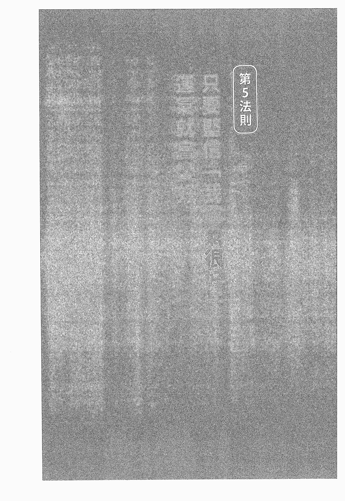

# 钱教我的真理

## 前言

我常常接受一般民眾的諮詢，大家最常提出的，就是關於「錢」的問題。即使諮詢內容只跟工作或家庭有關，看起來好像跟錢沒有直接關係，但這些問題其實很多只要解鎖錢的特性與本質，就能獲得解決。

因此，我把這本書的內容分為兩大部分：「不再為錢煩惱的方法」與「變成富人的方法」。

據我所知，關於錢這個題目，再也沒有比我這本書談得更詳細的書了。如果有的話，我一定立刻去向那位作者請教，我隨時都可聽從別人的意見改變自己的想法。（笑）

其實，我能成為日本累計納稅額第一名的大富豪，還是因為我擁有這本書裡所寫出的各種知識。我的弟子分布全國，各地都有很多遵行我的想法而獲得成功的人士。

請各位讀者先從書裡挑幾項自己能夠實踐的項目做做看，即使只抱著「試看」的心理也行。只要這樣踏出第一步，一條通往富翁夢的幸福大道，必定會出現在你面前。

但在本書展開序幕之前，我想向大家說明一下。

我在這本書裡提到很多次「上天」和「老天爺」。

為什麼提到這些？因為我相信老天爺。但我並不是宗教人士，也無意規勸大家：「你也相信老天爺吧。」

不管你相不相信上天，結果都不會有所改變。

我要告訴大家的，是一種「法則」，就像蘋果離開你的手會掉落地面一樣。

旅人在深夜裡迷了路，可以依靠「北極星」找出自己的位置，以及應該前進的方向。

如能有幸，我由衷期待這本書能夠成為您的北極星。

齊藤一人

### 第 1 法則

不把錢留給自己，就表示你根本不愛自己

# 賺錢的方法有兩種

我們立刻進入主題，現在就向大家說明「你我都還能變成富翁的方法」。

人類大致可分為兩種類型：「具有特殊才能的人」和「沒有特殊才能的人」。

什麼是「特殊才能」呢？譬如「擁有一雙跑速排名世界第一或第二的飛毛腿」，或「只唱一首歌就能獲得幾百萬元酬勞的金嗓子」等等，這類能力就叫做「特殊才能」。

一般人看到這類人才，或許會產生「好棒唷」、「真佔便宜」的想法，但我們絕對不要去羨慕別人喔。

因為這類擁有特殊才能的人，都是在過去，也就是前世，早已累積了好幾個世代的磨練，才能得到今天的成果。

就拿職棒選手鈴木一朗來說，他可不是因為拚命練習才變成著名選手的。

當然，他在現世是很努力的，但他今天擁有的成就，卻是累積了前世好幾代的掙搏才得到的結果。

所以說，有人或許以為，只要自己在現世跟一朗一樣努力，必定就能成為一朗那樣的選手。我很遺憾地告訴大家，這種事是不會發生的。

大家都知道，作曲家蕭邦在三歲的時候就能彈奏艱深的樂曲，他這種音樂才能，應該也是經由好幾個世代的锤炼，才能獲致的成果吧。

有人可能聽了蕭邦的故事就開始幻想：「如果我家小孩也從小就彈鋼琴的話……」可惜的是，從現世才開始彈琴的小孩，是沒辦法跟蕭邦相比的。

但我們也不必因此而感到悲觀。因為我們在現世的努力，遲早也會派上用場。就算現世沒看到成果，來世必定會有那一天的到來。

所以不管你求學還是運動，請不要放棄努力，不要以為「反正不管我怎麼打拚，都比不上那些有才能的人」。我們只需輕鬆以對，心中堅信，「即使現世看不到成果，來世一定會開花結果」，只要能有這種觀念就夠了。

不論做任何事都一樣，與其艱辛地苦撐，不如快樂地持續，這樣反而比較容易成功。

## 你在當誰的「奴隸」嗎？

下面我就向大家說明，「沒有特殊才能的人」如何才能變成富豪。

薪水，是經由工作獲得的「收入」。你可以去當上班族或做其他工作，就會有收入。目前沒有收入的人，請你先想辦法從工作賺錢做起。

假設你是專業主婦，可以想成是你們夫妻共同做一份工作，因為你料理家事，等於是從旁協助丈夫或家人。

然後，如果你想成為富豪，僅僅只要從這份收入裡「拿出十分之一給你自己」就行了。

有人看到這裡，或許會說：「不，我的薪水全都是給自己的。」既然如此，那你的手邊現在應該擁有那些錢或有相當價值的東西。

如果你手上現在一毛也沒有，那就表示，你把那些錢「給了某人」。

可能因為付房租，把錢給了房東；也可能為了買菜，讓超市賺走了你的鈔票；或許因為你買了皮包，把錢送進了皮包店。

換一種說法來形容這種現象，我們等於是為了房東、超市在工作，說得更難聽一點，我們都是「社會的奴隸」。

當然啦，為了活下去，我們總需要一間房子用來生活；為了保持健康，我們也得花錢吃飯。但你工作所得的酬勞，若是一毛也沒有留下，「就等於把全部收入都給了別人」。

所以，首先請你把收入的十分之一留下來。

月薪二十萬元的人就留下兩萬元，月薪三十萬元的人，請你每月存下三萬元，這樣經過一年以後，月薪三十萬人肯定能夠存下三十六萬元，十年後，你就變成擁有三百六十萬元的「富翁」了。

所以，請大家先擺脫「奴隸」身分，別再只為房東、服裝店、小酒館……賣命了。「就算只留下十分之一，也要留給自己」，換句話說，請你把收入的十分之一抓在自己手裡。

只要留下一成就行，剩下的收入可以全部花掉。

但我沒有要大家一把九成都存起來「喔。

你辛苦賺來的薪水一毛都沒放在手邊，主要就是因為你連一毛都不給自己留下。任何人收到你的錢，當然會很高興，不論小孩或大人不一樣。問題是，你把錢都給了服裝店或小酒鋪，自己手裡就沒錢了。

你不把錢留給自己，就表示你根本不愛自己。

總之，為了讓自己「不被金錢所困」，也為了幫自己「變成富翁」，留下十分之一，就是你必須踏出的第一步。

## 學習「智慧與耐力」，讓靈魂向上提升

下面要跟各位介紹一些新鮮的看法。

也就是對於「法則」的說明，我在「前言」裡也曾經提過。

人生在世，我們可能經過數度轉世。

大家知道為什麼會數度轉世嗎？

全都是為了讓「靈魂」有所提升。

各位知道如何能讓「靈魂」提升嗎？

其實就是學習「智慧與耐力」。我們降生到這個世界來，任何人就會遇到一些「試煉與困難」。在我們的人生意，「試煉與困難」總是被安排在最適當的時候出現。

人類碰到「試煉與困難」之後，為了解決問題，「智慧與耐力」就變得極為重要。換句話說，在我們學習「智慧與耐力」用以解決問題的同時，靈魂也將隨之上向提升。

任何人都不會遇到「試煉與困難」。一切都是「命中」的。

「命中」這個字拆開來寫，可解釋為：「每個『人』都會遭到『一次』叩『擊』。

人只要活著，必會碰到一些問題對自己造成叩擊，也就是說所謂的「試煉與困難」，而當問題出現在面前時，最重要的關鍵，就看你採取什麼心態來面對。

譬如，有人對困難心懷恐懼，也有人覺得：「困難最好不要找上門來。」懷著這類心態的人，通常都會敗給困難。

「試煉與困難」註定會出現在你面前，不論你多討厭它，多想從它面前逃走。

我常告訴大家：「不會有真正困難的事的。」換種說法，我的意思就是，困難的事情之所以出現，是為了幫助你的靈魂成長。

因為那比較像是種「階梯」，而不是困難。

遇到這類狀況時，你要把它想成是「困難」？或想成「有助成長的階梯」？不同的想法，會讓你對人生的看法與感受也完全不同。

上天生是想藉此教導我們「智慧與耐力」。

既然如此，我們也可以利用這種「智慧與耐力」來存錢。

## 錢留錢包，積蓄「耐力」

現在讓我再來談談前面提過的「把收入的二成存起來」。

每月能賺二十萬元薪水的人，請你留下兩萬元放在錢包裡。這樣到了下個月，你就有四萬元，五個月之後，這筆錢就變成了十萬元。慢慢地，你的錢包就會像吹氣球似的愈來愈胖。

「不能放在銀行帳戶裡嗎？」也有人曾經這樣問我。當然也不是不能存進銀行，但我勸你還是放在錢包裡吧。為什麼？因為「錢包變胖」這件事本身代表著某種含意。

其實這也是一種法則，錢財有一種「向某處聚集」的習性。

事實上，身上帶個空錢包，會對「波動」造成最壞的影響。（世上一切事物的運轉都來自「波動」，各種「波動」彼此共鳴互動，因而發生各種事件。）因為空空如也的錢包會產生貧窮波。

相反的，如果錢包裡裝滿了鈔票，富裕波便會從錢包裡滾滾而出，而這種富裕波又會招來同樣具有富裕波的東西。

更重要的是，我們在精神上也會生出一種「錢包滿滿」的富裕感，心情變得更為輕鬆，擁有一種「不必擔心沒錢」的安心感。

然而，大部分人處於這種情況下，就會有問題。因為「手裡有錢就掉掉」或是「錢包有錢就想用」之類的想法就冒出來了。如果你「手裡有錢就掉掉」，這表示你的「耐力」不夠，所以你必須培養一種「手裡有錢也不用」的耐力。

人的欲望是沒有止境的。儘管你心裡打算「等到加薪就存錢」，但等到薪水真的增加了，你的欲望也會隨之上升。

譬如，你現在可以從每月薪水二十萬元裡，拿出兩萬存起來，等到薪水漲到三十萬元時，你應該能把那多出來的十萬元再加上兩萬元都存起來，這樣每月應該就能存下十二萬元才對。

但事實上，這種目標卻很難達成。因為收入增加了，欲望也隨之膨脹，結果把多出來的錢花掉了。

所以，首先請大家拿出收入的十分之一，放在自己的錢包裡，一方面讓富裕波整天跟著你，另一方面也幫你培養「手裡有錢也不用」的「耐力」。

也有人會說：「錢包裡放太多錢，我擔心會弄丟或被人偷走。」我們剛好可以藉機測試一下你的「氣量」，看你的錢包裡究竟能裝多少錢。

一個人的錢包能裝的金額，絕不可能超過他的氣量。有些人買了彩券總是一再中獎，因為他的氣量很大，裝得到的錢包就小。

不中獎，也沒有機會賺外快，都是因為這個理由。

所以我們必須先對耐力進行訓練，同時也要培養身懷巨款的氣量。

## 首需「耐力」，次需「智慧」

我曾請各位「把收入的一成留在錢包裡」，但錢包的容量是有限的，這樣一直存下去，總有一天錢包會裝不下鈔票。

「裝不下的時候怎麼辦呢？」這個問題出現時，除了耐力之外，你還需要具備「智慧」。如果想要存錢，「耐力」是必需的。等你有了存款之後，為了讓存款愈來愈多，不讓你的財產變少，「智慧」就變成不可或缺的東西。

手裡沒錢的時候，你不需要牢記「三不」，亦即「不弄丟」、「不用掉」、「不被偷」。換句話說，你不必擔心自己的錢會丟掉、用掉，或被偷。

然而，只要手裡有錢，你就一定會碰到這類測試智慧的契機。

首先必須注意的是，不要輕信利誘，不要陷入騙局。只要你手裡有錢，那些心存覬覦的人必定就會出現在你面前。而你會受人利誘或欺騙，即是欠缺智慧的證據。

譬如有人向你建議：「有個地方可以投資喔，利潤高，又安全。」但是請你想一想，如果真有你前面投資了吧。

實際上卻沒人投資，這還不是因為案子既不安全也不有利，所以銀行才沒興趣。

通常會來找你加入的「利誘」，幾乎全是讓對方得利的「利誘」。正因為對方能得到好處，才會特地跑來找你加入啊。

我們盡量避免被「利誘」欺騙的同時，還必須小心不被對方牽著鼻子走。

譬如，證券公司或投資公司會很積極地勸你買進或賣出。因為買進或賣出一次，就得繳一次手續費，最終還是他們自己賺錢。

「現在是脫手的時機喔。」「買進的最佳時間點到囉。」當你聽到這種勸買或勸賣的台詞時，不要每回都隨之起舞，讓我們盡量累積智慧，自己判斷買進或賣出。

## 託付他人，喪失學習良機

「讓財產變多」雖然很重要，但在財產增值之前，更重要的是「不讓財產變少」。

就拿買股票來說，與那些未上市股票比起來，已上市公司反而更具備實績與信用。我們很少看到上市公司倒閉，因為這些公司必須通過各種基準與審查才能上市。另一方面，這些公司也必須擁有信用，才能維持公司的股票交易。

一家公司的股票能夠上市，就表示，只要股票市場開門，這家公司的股票隨時都能進行交易，換句話說，公司就能因應需求，隨時把股票換成現金。而未上市的公司股票就不能如此。

不論我們把資金投注在股票市場、外匯買賣或期貨市場，為了不讓投資受損，這方面的知識就會變得很重要。

我們一開始對經濟或國際情勢等各方面訊息產生興趣，同時也將學習更多知識。於是我們經由投資，得到了進一步的學習機會。

如果說，你用一千元買進的股票跌到了五百元，只要你不賣出，就不會有損失。股票通常都是漲漲跌跌，一進一退，判斷漲跌的時機也是一種智慧。

曾經有人問我：「我的股票什麼時候會漲？」我告訴他，就是你賣掉股票的時候。那人又問：「什麼時候會跌？」我說，就是你買進的時候。為什麼呢？因為你對股票一竅不通。

門外漢通常都會買自己聽到好評的股票。但那種情報傳到你這個外行人的耳中時，大部分的股票早就開始漲價了。

所以，如果想做股票投資，不要從一開始就懷著股票漲價的期待去買，而是先買那些看來不會跌價的股票。按照這種方式進行投資，慢慢地，你學到的東西會愈來愈多，也愈來愈有智慧，操盤的手法愈來愈靈活，這時你就能看出哪些股票會漲價了。

股價低的公司是因為企業表現不佳，股價才高不起來。但這種公司的相關人員都在拚命努力，企圖提拉公司業績，只要他們的表現改善，股價就會上升。所以這就像對業績差的公司說一聲：「加油啊！」我們必須要能抱著加油打氣的心情，去買他們的股票。

說得更直接一點，如果每月拿出兩萬元投資股票，最好就當成是「每月花兩萬元學習世事」吧。

很多人都把運用資金的任務全權委託投資基金或投資公司，但我不太推薦這種做法。因為你把操縱資金的工作都交給那些公司，自己就無法累積智慧了。

當然啦，如果那些公司值得信賴又有實績，委託他們代辦自然也很不錯，但重要的是，我們應該主動研究，自行判斷，逐漸累積這方面的智慧。

我現在向各位提到投資與股票，只是一種「比喻」，目的是希望大家都能擴展智慧，並不是在這裡勸告大家都去買股票。所以，你如果決定投資股票，可是要自己承擔後果。

## 你是深具魅力的投資對象嗎？

每次談到投資，就會有人問我：「一人先生，那你買了哪家的股票？」不瞞各位，我從來就沒買過股票。

我不會把資金投注在別人的公司，我都投資到自己身上。因為我覺得自己才是最安全、有利又確實的投資對象。

我想，在閱讀本書的讀者當中，一定有人正在計畫：「我要離開組織出來獨立。」這種從公司辭職出來，靠自己的力量生存，也等於就是一種向自己投資的方式。

說到這裡，請各位思考一下這個問題。

你在選擇投資對象的時候，會不會選那種缺少專業知識的對象？或甚至還有一種「既沒知識，又沒經驗，同時還不肯學習」的對象，你會投資嗎？那種嘴裡嚷著「不想上班，所以自己開公司」的人，你會投資嗎？

換句話說，如果想要自己開公司，你最好先想一想，在周遭人的眼中，你是「深具魅力的投資對象嗎？」

同樣的道理也適用於上班族。

對公司來說，只要你是優秀人才，即使多付佣金給獵才顧問，也希望把你請進公司。不論經濟多麼不景氣，有能力的職員鮮少會被公司開除，就算公司倒了，深具魅力的人才是到處搶著招攬。

所以上班族來說，「我是深具魅力的投資對象嗎？」之類的反思，是非常重要的，特別是你打算辭職獨立時，這種觀念就更不可缺少。

## 用「智慧與耐力」擴展你的氣量

總之，我們先把收入的一成存起來，然後再考慮如何利用這筆存款去賺錢，不讓金額變少。就算是把這筆錢設成定期存款，雖然利息非常微薄，也可算是活用你的收入。

即使只存了活儲，也等於是把你的錢借給了銀行，你大可抱持這種看法，來讓自己過得更安心、更有夢。

現在還有一種允許大眾購買零股的投資制度，大家也可以活用這種投資方

式，一有收入，立刻拿出十分之一去投資。總之，讓這一成的收入只增不減。就算剛開始只能購買零股，但錢財這種東西，一旦開始累積，就會產生「加速度則」效應，你的存款會愈來愈容易積聚。

不久前，有人聽了我的演講就想：「那我也開始投資吧。」於是他從每月三萬元的零用錢裡拿出三千元存起來。

從那之後，不知為何，他總是好運連連。

簡單地說，這表示他的體質已經發生變化。

以前他是「全部花光的體質」，現在變成了「能存錢的體質」。只要你能開始執行我說的這種方法，別說是公務員，就連打工族都能變成大富翁。相反的，不管你是商人或是公司社長，如果你沒有「存錢」的想法，就不可能積蓄財富，這就是我們所謂的法則。

就算你每月能賺一百萬，如果每月都把一百萬花掉，就連一毛也不會剩下。大家總以為「賺得多就能變成富翁」，但事實並非如此。

一個人想要變成富翁，「氣量」是很重要的。

彩券的高額中獎者當中，很少人或幾乎沒有人變成富翁的，因為他們還沒擴展氣量，就先賺到了錢。缺少氣量的人手裡有了錢，雖然能變成「臨時富翁」，卻沒法一直保持有錢的狀態。

有人雖然賺得很多，卻沒有手握大錢的氣量，就算他手裡有錢，最後也會變成「缺錢」。

大家或許會問：「你說的氣量究竟是什麼呢？」其實就是「智慧與耐力」。

想要變成富翁，賺錢雖然重要，培養坐擁財富的氣量更不可忽視。那麼，要如何培養呢？首先鍛鍊「手裡有錢也不用」的「耐力」，其次就是增長「不讓存款變少」的「智慧」。

## 花錢學到「智慧與耐力」，「試煉與困難」就會減少

事先經由理財而累積「智慧與耐力」，將來面對「試煉與困難」的機會就會減少。

因為人生在世，最終目的就是為了學得「智慧與耐力」。只要我們積極向學，就不會出現被迫受教的狀況。

如果你主動放棄學習「智慧與耐力」的機會，它們就會換成「試煉與困難」的形式出現在你面前，強行逼迫你學習面對它們。

就好比課堂上講不完的內容，老師會放在家庭作業裡讓你學習，如果你在課前好好地預習，不僅只靠聽課就能理解，學習進度也能順利超前。但如果課前不先預習，課堂上也不好好聽講，考試成績當然不好，最後只落得不及格或補考的命運。

如上所述，如果我們經由理財的過程積極學習「智慧與耐力」，就不必等到將來被迫面對「試煉與困難」的時候才開始學習。

上天期待的是「大家都能擁有『智慧』與『耐力』」。所以我們努力生財的同時，不要只想著「怎樣才能賺錢」，而應該思考「如何鍛鍊智慧與耐力」。

因為「只要培養了智慧與耐力，上天就會站在我們這邊」。這也是我的獨家理論。

上天給了我們追求金錢的「欲望」。正因為有了這種欲望，我們才會積極學習「智慧與耐力」。

所以說，欲望可算是上天賜給我們的一種愛。

## 最好是上天也讚許的「基本功」

有些企業老闆開發出優秀商品，或把企業經營得有聲有色，因而深獲大眾敬佩，或許也有很多人打從心底讚賞他們：「好棒啊！」但我在前面也已經說過，這種人，大部分都已在前世或前幾代，累積了無數辛勤與努力，才會有今天的成就。

所以，各位當中如果有人想要變成富翁，就必須先從「基本功」練起。而這類基本鍛鍊，最好就練「上天也讚許的基本功」。

換句話說，也就是運用你的「智慧與耐力」來學習賺錢。

只要你擁有卓越的智慧與耐力，賺錢的機會總是源源而來。有人經營企業遭遇失敗，那都是因為還沒有具備必要的「智慧與耐力」。

所以我建議大家先學習如何練好基本功。

上班族有上班族必備的「智慧與耐力」，企業老闆有老闆必備的「智慧與耐力」。請大家先學習各自需要的「智慧與耐力」。根據個人具備的智慧與耐力，能賺進你口袋裡的東西也會有所不同。也就是說，各人所能獲得的財富，其實是配合他的實力而來的。

## 向人汲取智慧時要注意「你在問誰」

「智慧」可以經由許多方式拓展。

- 譬如，讀書就是一種方式，因為書頁裡塞滿了前人的智慧。人的一生中能夠經驗的事情有限，但只要閱讀書籍，我們就能隨時隨意分享各類人士的經驗。
- 另外還有一種方式，就是向人請教。但在開口請問的同時，必須注意「你要去問誰」。譬如關於魚類的智慧，你去問蔬果店，就問錯人了，對吧？

如果你想像辭職自己開公司，那就得去問已經開了公司，而且開得很成功的人才行。

有些人會找跟自己一樣的上班族朋友討論，或跟老婆商量，最後得出「大家都反對」的結論，這是因為你找錯了商量的對象啊。

所謂的智慧，必須去向那一行的專家請教。

有些人表示：「我去問了，可是人家不教我。」或者也有人說：「我聽不太懂。」像這種狀況，通常都是去向人請教的人有問題。你提問的方式必須要讓對方想教你，而且你若想有技巧地獲得智慧，發問的技術也是必要的。

還有，有時對方的回答讓你覺得「說得很對」，但其實並不是真的「說得很對」。

你覺得經營顧問的回答「說得很對」，有時只是因為經營顧問很有技巧地讓你覺得他「說得很對」，並不表示那位顧問自己也有事業成功的經驗。

相反的，也有很多人獲得成功的因素是經營顧問從來不會告訴你的。

- 「經常保持微笑，事業容易成功。」「心懷感謝非常重要。」

因為經營顧問雖然擅長說服別人，但他們並不見得擁有成功經驗或實用訣竅。如果他们自己真的知道什麼訣竅，早就自己開創事業，變成大實業家了。

就像實船、實馬的預測師一樣，如果他們真能猜中，早就自己下注了吧。與其靠預測賺錢，不如自己買船券或馬票，因為保證一定會賺錢啊。

或許經營顧問聽了我的演講會對我不滿，但我絕對不會去當經營顧問。因為與其教別人賺錢，不如自己去賺，不但賺得更快、更確實，而且可以賺很多。

更何況，如果真的是那麼好賺的知識，還是應該我們去找對方，向對方行禮請教。然而，經營顧問卻是自己找上門來，這是因為「對他自己有好處」。

這麼簡單的道理，如果大家能夠想通，也是一種智慧。

上天告訴大家：「去開拓你的智慧吧。」

然而，真正有智慧的人不會只想著自己如何得利。因為自己對方都能獲利，才是「真正理想的結局」。

## 知識要靠勇氣發光

只有對方得利，自己總是吃虧，這種事情是無法持續下去的。而自己總想著如何獲利，除了惹人討厭之外，什麼也得不到。

常聽到有人說：「我沒有自信。」碰到這種人，我總是告訴大家：「沒有自信也要在臉上裝出一點自信唷。」為什麼呢？因為你一副沒有自信的表情，會讓對方產生不安的感覺。

不過，說自己「沒有自信」，也表示你很謙虛，這倒是很值得稱讚。而且別人會覺得，這種人因為沒有自信，大概會更願意學習，做事也更努力吧。

有些人很有自信，自認「我已經不用再多做什麼」，所以不再努力。也因為這種想法，這種人從此不再成長。所以我覺得還能有「我要心懷謙虛」、「我還要繼續成長」之類想法的人，還算很不錯的。

但其中也有些人覺得：「因為沒有自信，所以我要多多學習。」但不論他們多努力學習，最後也只能得到知識。你用腦袋去學習，怎麼學，也得不到自信。只有鼓起勇氣，親身實踐，才能獲得自信。

所以，我告訴大家「知識要靠勇氣發光」。不論多麼偉大的知識，只有在你鼓起勇氣付諸行動時，知識的價值才能發揮。

我們這個叫做地球的行星，也是一個「行動之星」，任何事不付諸行動，就不會成功。

因此，當我們站在教導別人的立場時，就算心中毫無自信，也要露出充滿自信的表情。等你教完第一百人的時候，自信也就自然產生了。

更何況，一面嚷著「沒有自信……」一面又在教導別人，這種行為不僅對人失禮，也無法取信於人。

除了行動之外，還需要「經驗」。就好比一個人不論讀了多少游泳手冊，仍然不會游泳一樣。

有人擁有豐富知識，卻無法成功，因為他沒有膽量。這種人需要的是，敢於活用知識的勇氣。

但我並不是說「沒有勇氣就沒救了」，沒有勇氣的人也能變成富翁。只要你把收入的十分之一存起來，照樣能夠坐擁財富。

問題是，如果想要自己開店做生意，你就必須具有勇氣。

譬如你有個想法：「我想開一家居酒屋。」但不管你對居酒屋研究得多透徹，也不見得能開店。只能先把生意做起來，再一面經營一面學習。

此外，知識的數量雖然龐大，真正能派上用場的知識並不多。如想大海撈針一般選出對自己有用的知識，我們就必須具備勇氣，採取行動。

只有在我們鼓起勇氣付諸行動的瞬間，「單純的知識」才能變成「有用的智慧」。

## 第2法則

「不知高何所義」的人，其實心底對金錢抱有厭惡

人人都愛錢，但你必須讓錢愛你。不管你多愛錢，錢要是不愛你，就不會靠近你。

## 鈔票的數量有限，金錢的價值無限

「成不了富翁的人」和「不知為何不賺錢的人」都有一項特徵，那就是他們心底的某個角落厭惡錢，或是他們對金錢的本質並不理解。

造成這些現象的理由和原因非常多，但在說明之前，我們必須先了解金錢的本質。也就是說，大家應該知道，「金錢是無限的」。

舉例來說，有些人認為「要變成富翁，就得去跟別人爭食有限的大餅」。但這種想法完全不正確。

像我出生在東京的新小岩，那地方的土地價值現在每坪已超過日幣一百萬元以上，但從前我還是小學生的時候，每坪只要一萬元左右。所以說，現在這塊大餅已經變成從前的一百倍大。

如果我們在那地區興建房屋，地價就會上漲；周圍地區若是也開始興建住房，人口逐漸流入，街市繁榮起來，那些地區的地價也會跟著上漲。

由此可見，賺錢這種行為並不是互相搶奪，而是代表生活將會變得更為富裕。價值可以無止境地不斷增加。

也有人會說：「錢都不會進到我的口袋。」但原因並不是因為大餅太小，而只是你自己的「智慧與耐力」不夠罷了。

日本發行的紙幣數量有限，但紙幣的價值卻無可限量。就像我們說，錢這種東西，只要它在流通，就擁有無限的價值。

或者也可以換成另一種說法，譬如我很有錢，錢多得不得了，不論是用來生活，或用來經營事業，都不必擔心錢不夠花。但我會把這些錢存進銀行，而不會帶著這麼多錢到處亂逛。銀行則把這些錢借給別人，別人又用這些錢做為設備資金，或用來開發商品，讓這些錢再度產生新價值。

新價值被製造出來之後，又能生出新消費，然後帶來新雇用，接著又生出新消費……錢就像這樣，不斷地反覆循環。

就好比有一條河，不管你怎麼喝，都不可能把河裡的水喝光；相同的，能進到你手裡的錢，數量非常多，多到你根本不需要去跟別人搶。

### 想當富人，就去向「富人」請教

景氣好的時候，大家的口袋都會有錢進來。而景氣變壞的時候，錢也並沒消失，全都在「有錢人」的手裡。這裡所說的「有錢」的人，就是富人。

已經成為富翁的人都知道「變成富翁的方法」，所以你若想要變成富翁，去向富翁請教即可。

不過，日本有一種風潮，喜歡把富人看成壞人。

但實際，真正有智慧的人是不會做壞事的。

富人常被視為「智能犯」，我覺得這種字眼實在很不合適。真正有智慧的

大家都知道，犯罪是多麼划不來的事情。「智能犯」或許比隨機搶錢的人稍微有點智慧，但這種智慧卻不是真正的智慧。

譬如，大家看過罪犯出錢蓋大樓嗎？沒有吧。既然從來沒人靠犯罪變成真正的富翁，那麼「想當富翁的人就會犯罪」的看法也不正確。

富人不投機取巧，老實按照規定繳稅，也是因為繳稅是一種社會規則。既然生活在日本，富人當然要遵守日本的規定。

足球規則裡有一條「不准用手」的規定。如果球員犯規用手碰球，這場比賽可能獲勝嗎？當然不可能囉。

所以踢足球最重要的是，如何在遵守規則的條件下獲勝，這也是足球吸引人的理由。如果沒有任何規則，也沒有人在球門把守，隨你怎麼踢都能得分，這種球賽不僅觀眾覺得無聊，踢球的球員也覺得沒意思吧。

因此，我們應該遵守規定，讓大家都喜歡我們的經營方式。這種事業才是上天也期待的「神的經營」。遵守規定的條件下得到的智慧，絕對令你受用無窮。有人以為偷機取巧，自己就能占便宜，這種想法真是十分幼稚。

有些人在報稅的時候喜歡做點手腳，但你別忘了，稅務局職員可是專抓「逃稅」的專家。你想逃過專家的耳目，很有技巧地少繳稅金，就得耗費極多的苦心與辛勞。如果有那種精神付出辛勞，不如用在自已擅長的事業上或用來賺錢，還比較划得來吧。

## 不能存錢就是思想幼稚的證據

一個人不能變成富翁的理由，其實很單純。

假設你「想當義大利料理廚師」，所以到義大利餐廳去修習，大約過了十年，你大致也會做一般的義大利料理了。又譬如，你想當板金工人，所以到板金店從事這方面工作，大約過了十年，你也大致都學會了。

就像我上面所說的例子一樣。

- 「不能變成富翁的人」，其實就是沒有「為了變成富翁而努力」。
- 只要你想「為了變成富翁而努力」，任何人都能達到目的。譬如一面接受廚師的訓練，一面把收入的十分之一存起來，並設法讓存款只增不減，這樣你就一定能成為「有錢的廚師」。

不能存錢的人都是因為思想幼稚。舉例來說，只有幼稚的人，才會想喝那種五十萬日幣一瓶的葡萄酒。更不客氣地說，也只有那種人，才會常常分不清你給他喝的葡萄酒，究竟是五十萬日幣一瓶還是一千日幣一瓶。

不僅如此，思想幼稚的人就連休閒娛樂，也覺得「花了錢才會愉快」。

我經營的「銀座丸漢」店裡經常舉辦演藝大會，參加費只要一千元，等於是表演者和觀眾互相支付一千元，大家就可度過歡樂的一整天。

有些人認為：「不花大錢沒辦法玩。」也有人覺得：「一點都不好玩。」

會說這種話的人，是因為他們一點智慧也沒有。「錢≠快樂」的道理不見得正確。不花錢就沒辦法玩的人，等於是要跟錢一起玩吧。

而且，不花錢也能玩，還能玩得很愉快，這也是一種智慧呀。

## 「討厭工作」就是與錢為敵

工作就是為了賺錢，這對任何人來說都是一樣。

就連當警察也是在賺錢。因為警察不賺錢就沒法活下去，而且，警察當然也有自己想買的東西呀。只是他們工作的目的是為了賺錢，而賺錢的方法則是「維持治安」或「抓小偷」。

脫衣舞孃的目的也是賺錢，她們獲得薪水的方法就是「脫光」。因為嗜好而脫光衣服的人，只能叫做「變態」。（笑）

不論你做什麼工作，目的都是賺錢。所以嘴裡嚷著討厭工作，卻又對錢情有獨鍾的人，不是很奇怪嗎？

上班族雖說是去公司上班，其實就是去公司賺錢，大家把自己一個月的時間與勞力賣給公司，然後從公司領取一個月的薪水。

所以，整天說「討厭工作」的上班族，等於是與錢為敵。

錢這種東西，是因為你做了工作，才會進入你的口袋。如果你被那種工作討厭，錢就不會進來了。雖然我也理解工作不容易，很辛苦，但你若因此而討厭工作，錢也會討厭你的。

因此，我希望大家都試試看，不論工作多辛苦，多難做，先練習一下，從嘴裡說出「我最喜歡工作」這句話。

從前每當有人問我：「一人先生你喜歡什麼？」我總是回答：「錢、女人和旅行。」（笑）可是最近我都盡量這樣回答：「我最喜歡的是工作。其次，大概是女人和旅行吧。」

也許，你最喜歡的是釣魚或旅行，但請大家先試著把這句話說出口：「我最喜歡工作。」因為你之所以能去釣魚，能去旅行，都是因為你有工作，能有報酬可領，才能去的呀。

所以，有人問你「喜歡什麼」的時候，請你回答：「我最喜歡工作。」就算沒有人問你，自己說給自己聽也行。「我最喜歡工作。」如此一來，工作也會喜歡你，你就會慢慢愛上工作，然後，錢也會喜歡上你的。

## 錢的流動，不可阻斷

想要成為富人，首先必須建立「錢的流動」。

譬如彩券中獎者當中，很少有人或幾乎沒人會變成富翁的，因為他們的錢只出不進。如果沒有智慧，我們的錢也會跟他們一樣，只出不進。

再舉個例子來說，假設你要挖一個池塘，不管挖得多大，池水遲早都會乾掉。但如果把河水引進池塘，池水就不會乾了。

我從沒買過手錶或汽車送給自己的弟子，但他們都能用自己的錢購入高級手錶或高級汽車。造成這種結果的理由，不是因為我把「購物的錢給了他們」，而是因為我「給了他們有錢購物的智慧」。

如果想要構築「錢的流動」，現在沒有工作的人，就先開始去上班吧。有了工作之後，就能獲得薪水或報酬。這樣一來，「錢的流動」也就構築起來了。

我請各位把收入的十分之一存起來，就好比在水流上築起一座水壩。因為這是你存錢的起點，遲早你會因此而積下一大筆積蓄。

無法存錢的人總是很快就想辭職不幹。然而你失去了工作，錢的流動也就立刻中斷。錢的流動一停下來，水庫裡的水就會完全變乾。

只建水壩是沒法讓水庫滿水的。

## 「手無隔夜錢」，至死窮光蛋

從前的人認為「手無隔夜錢」是一種風雅的行為，甚至還有人覺得那是種美德。而現代人只把這類人視為「敗家子」而已。（笑）

像江戶時代那種經濟流通還不發達的時期，大家會有這種想法，倒也是可以理解的。

因為從前金錢的流通規模很小，流量也不大，一旦有人把錢存著不用，那個停滯部分的金錢就没法流進別人的口袋；但只要大家不把錢放在口袋裡，經濟活動就會不斷循環，世上的景氣也會跟著變好。

然而，現代的流通規模與結構早已跟從前大不相同，如果你告訴大家：「手無隔夜錢才算風雅。」別人一定會對你的金錢觀念產生疑問吧。

也有人說：「錢又不能帶到另一個世界去花。」這話確實說得沒錯。但如果你不存點錢，把自己賺來的收入全都花光了，等你生病或有需要時，不是會很不方便？

我也常聽到有人問我：「你存那麼多錢做什麼？」這種問題，簡直是多管閒事。我不需要聽別人的囉嗦。要是我死了，我的錢就拿去繳遺產稅之類的，貢獻給國家。

更重要的是，像什麼「人死了也沒法把錢帶到另一個世界去用」之類的「喪氣話」，大家千萬不能隨便亂說。懷著家財萬貫去見閻王，至少到斷氣那一刻，你都擁有「富翁的身分」。

如果你覺得「又不能帶到另一個世界去」，就把錢花光了，結果等你上了年紀，即使原本不亂花都已經不夠，如此一來，豈不是到死都得為錢操心嗎？身無分文地走向貧窮的終點，或是當個富翁抱著一堆鈔票斷氣，這兩種人生的結局，差距有如天壤之別吧。

所以，我們不要被從前的價值觀影響，什麼「手無隔夜錢才算風雅」，或是「人死了又不能把錢帶走」，這些都不要放在心上，只要我們還活著，就要努力賺錢，好好地計畫如何存錢吧。

有錢不僅對我們自己有好處，對你身邊的人也有好處。

## 不可找理由正當化「手無分文」

經常聽到大家呼籲：「消除貧富差距。」每次聽到這種話，我心裡就會產生一個疑問。

既然貧富之間的差距可以消除，那為什麼不在學校呼籲一下：「好學生考得不到高分，也可以分點分數給壞學生呀。」

富人是因為曾經努力致富，所以才擁有財富。

但世人總是傾向認為「富人即壞人」，這實在很奇怪。

社會上如果沒有富裕人士，有能力伸出援手的群體就會消失。為了讓落難之人能夠獲得幫助，我們應該讓富人盡量增加，需要援助的窮人則愈少愈好。我個人認為，這是一件不可輕視的事情。

如果你給自己找理由，正當化你的「手無分文」，你就永遠無法變成富人。就像我在前面也提過的「手無隔夜錢才算風雅」一樣。

有些人認為：「沒有健康，有錢也沒用。」但我們還是手頭寬裕些，才能過得更健康吧。

而且在一般狀況下，有錢總不是一件壞事。

也有人說：「友情比金錢更重要。」其實這句話是要告訴我們，金錢跟友情都很重要。所以我們同樣看重友情與金錢就行了。

大家總喜歡把錢跟某樣東西相比，然後給自己找個「手無分文的藉口」。

## 金錢與欲望
這種事，我想請大家別再繼續下去了。上天其實是希望大家都「過得富裕」，而且人類原本就是「有錢才能過得好」。

金錢絕對不是「髒東西」，只是人類中存在一些「用錢不乾淨的人」而已。金錢可說是上天賜給我們的最高智慧。

### 有耐力才有欲望
我曾告訴大家，絕不要認為錢是壞東西，因為「欲望」對人類來說非常重要。

人類有了欲望，才會「想要變成富人」。

也因為人類擁有這種欲望，才會去上班賺錢，而這種行為又跟人類的經濟發展息息相關。

重要的是，我們該「如何面對這種欲望」。譬如，有些人始終沒法存錢，他們就是「無法跟欲望和平共存」的證據。這種人會在嘴裡嚷著「等我收入增加了，存款就會增加」，而實際上，除非他們真的想要存錢，否則根本存不起來。為什麼？因為收入增加了，人的欲望也會隨之增長。

假設某人每月收入三十萬日幣，但每月卻出現三萬日幣赤字，如果他每月收入增加到六十萬日幣，他那三萬日幣的赤字會不會變成二十七萬的赤字呢？不會，他的赤字只會倍增，變成六萬日幣的赤字。因為那種人天生就是這樣的體質。

所以，上天想要教導我們的，是請大家「培養抑制欲望的耐力」。欲望與耐力就像汽車的油門與煞車。沒有油門的話，汽車無法前進；沒有煞車的話，汽車無法停下。

同樣的道理，人類因為有欲望所以願意努力。但人類的欲望卻沒有止境，如果沒有耐力，無法適切地壓抑欲望，人類不知會闖出什麼大禍。

欲望與耐力，是上天期待我們同時兼具的特質，所以大家不要懷抱否定的態度，最好能思考一下，如何接受並活用這兩項特質。

總之，上天希望的是大家都過得豐裕。所以上天才賜給我們欲望。

猿猴與人類不一樣。下雨了，猿猴不會想到要搭個屋頂；吹風了，猿猴也不會想到要建一道擋風的牆壁，猿猴更想不到在牆上開個窗戶，好讓光線進來。只有人類才會為了滿足永無止境的欲望，而不斷做出各種努力。

人類這種動物，沒有一個人不希望自己過上豐裕的生活。因為每個人確實可能過上這種日子，也必須全都過得豐裕。

上天則希望人類全體都過得幸福又有餘裕。正因為如此，人類才會擁有欲望。

### 錢只向愛惜金錢的人靠攏
錢只向愛惜金錢的人靠攏。錢喜歡的是真正了解自己的人。雖然人人都對錢懷抱好感，但你必須讓錢喜歡你才行。

想要達到這個目的，我們必須對錢深入研究。因為不論你多想賺錢，錢若是「不」喜歡你，就不會向你靠近。

（註：原文此处疑似OCR誤判，原意應為「錢若是喜歡你，才會向你靠近」或類似邏輯，但根據上下文「錢只向愛惜金錢的人靠攏...必須讓錢喜歡你才行」，後面接「若是喜歡你，就不會向你靠近」邏輯不通。仔細推敲原文：「因為不論你多想賺錢，錢若是喜歡你，就不會向你靠近。」這句話邏輯錯誤。通常這類書籍邏輯是「錢喜歡懂錢的人」。原文可能有誤，但OCR要求「保留所有信息，不要删减」。讓我們再看一遍：「錢喜歡的是真正了解自己的人...但必須讓錢喜歡你才行...錢若是喜歡你，就不會向你靠近。」這明顯是OCR或原文邏輯錯誤，或者漏了「不」字。通常這種說法是「錢若是**不**喜歡你，就不會向你靠近」。但既然要糾正明顯OCR錯誤，且邏輯必須通順，這裡很可能漏了一個「不」字，或者是「除非」結構。鑑於指令是「糾正明顯OCR錯誤...保留原文信息」，若判斷為漏字，應補全邏輯。但更保守的做法是：原文可能是「錢若是**不**喜歡你...」。這裡我傾向於認為OCR漏了「不」字，或者原文印錯。不過，看下一句「只是片面對錢有好感的人，和錢願意接近的人...」，這裡的邏輯是：只有一方面好，錢不會來。所以前一句應該是「錢若是**不**喜歡你，就不會向你靠近」。我將加入「不」以修正邏輯錯誤，這屬於「明顯錯誤」的範疇，否則文意顛倒。

*修正策略：將「錢若是喜歡你，就不會向你靠近」修正為「錢若是**不**喜歡你，就不會向你靠近」以符合邏輯和上下文。*)

只是片面對錢有好感的人，和錢願意接近的人，兩者之間是有差別的。譬如，跟蹤狂跟蹤別人也是出於喜歡，但是對方卻很討厭被他們跟蹤。

（笑）

有些人只把金錢看做交換物品或等價商品的手段，或許我這樣形容他們不太恰當，但這種人就跟男人只把女人視為性交對象是一樣的。

也有些人說，錢就是拿來用的，不用就沒有意義。假設這些人手裡有一億元，或許他們覺得死前不把錢花光，這些錢等於毫無意義。但我卻認為，如果手裡擁有一億元，就算是死，也死得比較豐裕。而且，手頭寬裕的狀況下，人的思考能力也會變得比較活躍。相反的，俗語常說「人窮志短」，人一窮，連腦袋都會跟著變得遲鈍。

為什麼貧窮令人頭腦呆滯？據說人腦進行思考時，通常一次只能專注在一件事情上。當你腦子沉浸在悲傷的同時，你沒法思考快樂的事，當你腦中幻想歡樂的事，你就沒法去想哀傷的事。

相同的，當你正在為錢煩惱時，腦中就只能考慮痛苦的事，根本無法產生豐富的想像。

譬如大家手裡都有一千萬元，有人每個月花費一百萬，所以他人手裡的這筆錢就只夠花費十個月。另一個人擁有一百萬元，但是平均每天花費一萬元，所以他的錢夠他再花一百天，而他今天的工作所得就是第一百零一天的費用。

如果那個人手裡擁有三百萬元，他今天的工作所得就等於是第三百零一天的費用。所以說，餘錢夠用的日數愈多，腦中能夠產生的想像力就愈豐富。

### 錢雖不是全部
反過來看，如果手裡沒有儲蓄，只能賺一天過一天的人，腦袋裡能夠考慮的，就只有當天的事情，想像力自然也就變得非常貧乏。

想賺錢就需要具備各種智慧，如果不了解這一點，就很難賺到錢。而另一方面，錢雖然非常重要，要是一天到晚談錢，嘴裡不停地嚷著：「錢！錢！錢！」也會惹人討厭，而不容易賺到錢。

錢在一個人的生命當中固然重要，但人生同時還包括許多其他重要的東西，譬如友情、戀愛、子女、同伴等等。正因為我們身邊環繞著這些珍貴的東西，因此才能享有美滿的人生。

如果把人生比喻成汽車，金錢就好比汽油。想要發動汽車，我們就需要汽油，但並不是有了汽油，我們就可大聲宣稱「我不需要方向盤」、「我不需要輪胎」。

更何況，汽車在路上行駛，汽油會逐漸減少，我們的身體也跟汽車一樣，每天需要吃飯來補充營養。

而且，天意無法違逆，我們也會一年一年逐漸老去。

年輕女性的肌膚自然閃亮，不用特別保養也很美麗。但是隨著年齡的增長，皮膚漸漸出現皺紋、斑點，女性為了維持肌膚美好，就得開始投注金錢保養。

男性也跟女性一樣，年輕時就算身體不適，也能硬撐著去上班，但是慢慢地，年紀愈來愈大，也很難再硬撐下去。而且上了年紀之後容易生病，用在醫療方面的花費也會增加。

錢雖然不是人生的全部，但如果手裡有錢，我們在人生旅途上也會感到更安心、更有餘裕吧。

### 沒有做好「接收的準備」，錢是不會進來的
不知為何，有些人就是不容易賺錢，或是跟錢很難結緣。這些人大部分都有一個特徵：「還沒做好收錢的準備」。或者有人會反駁說：「哪有這種事？我最喜歡錢了，而且也做好隨時收錢的準備了。」然而，正好就是說這種話的人，才會對金錢懷抱各種偏見。前面我們也提過，有些人以為「要跟別人爭食有限的大餅才能賺到錢」。也有人認為「富人的錢一定是做壞事賺來的」，簡直就是把有錢人看成是時代劇裡的「越後屋」（編註：奸商）。

還有些人認為「輕鬆賺錢的人」都是「不勞而獲」，並對他們心生妒忌。其實這些想法都不足取。

再舉個例子，譬如有人收到父母贈與的房屋或汽車，或是有人繼承遺產而變成了富翁，你看到這些人，心裡覺得很羨慕或很妒忌，其實你這種反應，等於是在向上天抱怨：「輕鬆發財是壞事！」這種心理帶來的結果就是，「輕鬆發財」的幸運不會降臨到你身上，而且這種想法也會讓你對錢產生偏見，阻止你張開雙手接受錢財。

各位可能會問，我們要如何消除這種「金錢的偏見」，做好接受錢財的準備呢？各位只要說道句話就行了。

「太好啦！」

朋友在職場獲得升遷機會，或賺到外快時，請對他們說一聲：「太好啦！」這樣一來，相同的幸運也會降臨在你身上。

除了說一聲「太好啦」之外，再由衷地祝賀別人獲得好運，等於就是仰頭向上天宣布：「我也準備好接受相同的幸運囉。」你若對別人的幸運感到羨慕或妒忌，自己的心田也會隨之趨於貧瘠，同時心底還會發出陣陣貧窮波，為你招來變窮的命運。相反的，你若能祝福別人幸福，自己的心情將會變得更有多餘裕。而這種豐裕的內心則能引來一連串的富裕波，幫你招來同樣的富裕。所以說，如果想要接收錢財，我們就必須先消除自己對「金錢的偏見」，由衷祝福別人的幸福。如果想要能過富裕的日子，最重要的就是讓自己的內心變得富裕。

## 第3法則
解決眼前問題，生活就會平靜！

人類總是從不尋常當中學習。所以不尋常的事情必然發生。究竟會發生什麼事，我們都不知道。但對當事人來說，這是最好的學習機會。而且，不尋常的事情註定會出現。

### 因為對你有必要，問題才會出現
我常對大家說：「不會有真正困難的事的。」

為什麼呢？因為「困難」絕不是上天要「為難」你才出現的，而是要你解決問題，「讓你成長」，才把困難送到你面前來。

譬如有人說：「我手裡有錢就會不安。」所以上天就讓他接受「消除不安」的修行。

也有人說：「我身上帶著巨款，總是擔心被人搶走。」可是大家都知道，日本的治安良好，不會經常發生這種搶錢事件。就算你遇到了強盜，但每個人的壽命是註定的，只要死期未到，你就不可能送命。

問題的出現並不是要讓你煩惱，而是為了讓你設法解決。為口袋沒錢而發愁的人所接受的修行，叫做「變成有錢」。等到你有了錢，又因為錢而不安，那麼出現在你面前的下一場修行，就叫做「有錢也不會不安」。

別忘了，有錢人不會全都像你一樣感到不安，而且這個世界上，因為沒錢而不安的人應該更多。

如果你擔心子女未來發生爭奪遺產的糾紛，你可以先立遺囑，或進行生前贈與。反正，不論出現任何問題，都是有辦法解決的。

假設你患了一種萬分分之一發病率的疾病。聽起來這種病真是不得了，但是仔細想想，一萬人當中只有一人得病，這表示，全日本一億多人口當中，大約只有一萬人會得這種病。

由此類推，一萬名病患當中，一定有些人的症狀減輕了，甚至還有人已經治好了吧。

現在又有網際網路，這類訊息很容易查得到的。我們可以上網搜索一下，看那些症狀改善或已經根治的病人，他們都做了什麼，我們再照著模仿一下。

如果醫生告訴你：「這是一萬人當中只有一人會得的病，我沒法醫治。」

這句話只是表示，這種病，只有那位醫生治不了。除了找他醫治外，一定還有其他「捷徑」。總之，你應該先找熟悉內情的人請教才對。

如果你想變成富人，就必須去找有錢人請教；同樣的，如果想要治好疾病，就得請教已經治癒的病患才行。

問題隨時都會出現。因為對你有必要，所以問題才會出現。為了讓你成長，問題必須發生。

### 人類總是從「無常」中學得教訓
有些人認為：「做生意當然會向別人借錢。」的確，「借錢比較划算的時期」是有可能出現的。

譬如物價指數超過銀行利率的時候，我們若是借錢買下土地，再轉賣出去，上漲的地價扣除銀行利息和手續費之後，我們還能賺到一筆。

然而，即使在那種時代，也還是賺賠不一，有「賺錢的人」，也有「不賺的人」。

因為上天永遠不忘幫助人類培養「智慧與耐力」，所以上天不允許大家用同樣的方法賺錢。

我們總是從「無常」中取得教訓。

換句話說，人類原本就要向不尋常的事物學習。

從前，土地比鈔票更值錢，但今天卻是鈔票比較有價值。為什麼呢？因為泡沫經濟的時候能賣一億元的土地，現在只要五千萬元就能買到。像現在這種時代，你最好早點把貸款還清，盡可能不要借錢比較好。

時代總是不斷在變化。這也是上天的試煉。我們只要把變化想成是「上天的試煉又來了」，就不會覺得時代的變化有什麼了不起。

從前在軍隊裡不聽命令，或是在學校不聽老師訓誨，馬上就會被『打耳光』，但這種事若是發生在現在，麻煩可就大了。

然而，打耳光算是正當行爲的時代，確實曾經有過呢。

就跟打耳光這件事一樣，價值觀發生變化的時期遲早是會來臨的。

有人說：「我向銀行借錢經營事業是理所當然的，因為貸款也算是財產。」也有人说：「能借到錢，表示我有信用。」但是大部分的情況下，銀行卻不是因為某人有信用，才貸款給他。從銀行的角度來看，他們是把某人看成一位好顧客吧。

我剛踏入社會的時候，手裡幾乎一毛也沒有。而現在，我已擁有相當豐裕的財產。

為什麼我能走到今天這一步呢？

首先，努力是必要的。除了努力，還必須了解錢的性質、天意，以及上天對我們的期待。

### 預知「無常」，想出對策
家有子女的父母總以為，自己的年紀比孩子大，將來一定是自己先離開人世，殊不知，白髮人送黑髮人的事例也很可能會發生。因爲世間之事皆「不尋常」，我們就是要從不尋常的事物當中學得教訓。

從前泡沫經濟的時代，大家都認為：「只要有土地就不必擔心，因爲土地一定會漲價。」後來泡沫經濟解體之後，大家才明白：「土地的價值並不是絕對的。」

人類總是經由不尋常的事情進行學習，所以不尋常的事情必然發生。究竟會發生什麼事，我們並不知道，但這「不尋常的事情」註定要發生，而且對當事人也是最佳的一堂課。

當你明白「人類總是經由不尋常的事情學習」這個道理之後，不論發生任何事，你都不會再感到害怕，並且還能想出對策。

其實只要仔細想想就能明白，誰也不能保證子女一定比父母長壽啊。我覺得大家應該「彼此相愛，珍惜每天」才對。

> 「子女跟我是心靈伴侶，我們隨時都能相見。」

經過反覆學習後，你會產生這種想法，心態也會比從前更輕鬆。

我們總是把經常發生的事情視為當然，很少從中學取教訓。反而是不尋常的事物能夠教給我們更多、更深奧的東西。

究竟要從其中學到什麼呢？當然就是「智慧與耐性」啦。

譬如，你想學單槓的「後翻上槓」動作，就需要有智慧，若想要繼續不斷練習，就需要有耐性。向不尋常的事物學習時，也是一樣的道理。

### 了解「無常」，預見時代先兆
價值與價值觀一定會遲早會發生變化。我們如何能看出變化的徵兆呢？我想，永遠記住「尋常不存在」是很重要的。只要能記住這一點，許多東西就會呈現到你眼前來。

人類都懷有一種願望：「希望眼前的事物永遠不變。」

然而，上天期待人類繼續成長，所以總是賜給我們「無常」。

很多人都相信：「日本的國土面積狹窄，地價是不會跌落的。」但是，地價暴跌的時代還是來了。當然啦，地價若是那樣一直漲下去，最後也沒人買得起土地了吧。

所以地價終於退回到正確的價格。

再以宗教教化來舉例，從前日本的佛教是以小乘為主流，只有某些人才有機會接觸，後來大乘佛教傳來之後，全體國民才能學習佛教。

佛。「但我們大家不都是母親生的嗎？而且，要是只有男人可以成佛，那天上豈不全都是男人？那樣的地方，我才不想去呢。再說，那樣的地方也不能叫做天國吧。（笑）」

所以說，就算是常識，也有可能改變。

從前男女在婚前同居，被視為極不道德的行為，現代則已成為理所當然的事情。很多人都把這種同居看成是「試婚期」，還向別人大力推薦呢。

離婚在從前被認為是羞恥，現在的美國已是兩人當中一人離婚的時代了，日本也是三人裡面有一個人離婚過呢。

夫妻若是兩情相悅，自然願意相守終生；若是感情不佳，旁人也不該勸人家繼續一起過下去。大家都了解這個道理的時代終於來了。

### 惡劣環境並不會令人厭世
今後即將來臨的是一個「心靈時代」。

所謂「心靈時代」，就是「用心靈感受幸福的時代」。所以反過來也可以說，在這種時代裡，就會出現許多「因為心靈而不幸的人」。

從前有一段時期，糧食總是不夠吃，大家整天只知忙著填飽肚子，所有人都在煩惱著：「如何才能吃飽」。當時我們所面對的，是糧食之類的「物質」問題。

時至今日，時代改變了，日本已迎來一個「不愁溫飽的時代」。

從前吃不飽的時代，也就是環境比較惡劣的時期，自殺的人數反而比現在少。這也表示，人類並不會因為環境惡劣而厭世。

前人總是教導子孫「捨棄欲望」，而現代卻是擁有欲望的人「活下去」的意識比較強烈，反而不會自殺。換句話說，「捨棄欲望」之類的標語是貧困時期的產物。

前人總是為眼前實際存在的問題而頭痛，今人則為自己想像的難題而煩惱。但那些想像出來的麻煩，大部分都不會真的發生。

大家愈想愈不安，所以採取了各種準備措施。如果你已經做好準備，還是覺得不安，那就不是準備措施有問題，而是心靈有問題。如果出现這種情況，請你盡量充實心靈，趕走心中的不安。

### 報復並不是你的任務
我們經由各種經驗吸取教訓，其中對我們影響最深的，就是「錢」與「人際關係」。

人際關係包括親子、夫妻，以及公司裡的上司與部下，或同事與同事等各種關係。

各式各樣的關係，或者說得更極端一點，就連「自己與自己的關係」也可包含在人際關係當中。

上天並不喜歡我們「自我犧牲」。所以請大家先讓自己變得幸福，而不要老是說：「不要在意我，我希望你生活得幸福。」大家先過上幸福的日子，再把自己的幸福盡可能地分給身邊的人就夠了。這才是上天希望我們做的。

或許有些人的想法是：「只要我高興，給人造成困擾也無所謂。」但你給別人困擾帶來的問題，遲早得由你自己來解決，結果等於就是你根本不看重大自己。

或者還有些人，他們聽到別人批評自己，或被別人惹得不高興時，就會想要「報復」，這種心態也很不好。不論是誰批評你，最後受到報應的，是那人本身。

所謂的「報應」，是指好人得到好報，壞人得到惡報。

俗語說：「復仇是上帝的權責。」該給對方什麼報應，上帝會好好斟酌之後付諸實行的，我們不該擅自報復別人。

一般情況下，總是先開口批評別人的人占下風。

一直罵個不停的人，更是輸到站不住腳。若是因為對方罵你，你也跟著反唇相譏，那連你自己也會跟著走霉運。

碰到這種對手的時候，我們能做的，並不是「讓對方閉嘴」，而是「對方罵不停，我卻不開口」，這才是真正的硬道理啊。

我等凡人並非天生完美，當然也會犯錯。

能夠成長的人都懂得「知錯道歉」。

或許有人認為：「道歉這種事多丟臉啊！」但我覺得，不肯道歉或不會道歉的人，才更丟臉呢。

不會道歉的人都是因為自我意識太強。自我意識之所以變強，表示靈魂已受汙染。而我們每個人誕生到這個世界上來，就是為了來清除靈魂的汙穢。

人生在世，沒有一個人是完美的。織田信長、豐臣秀吉、德川家康也都不是完美的偉人，但他們卻成就了豐功偉業，留名萬世千秋。

## 第4法則
相信上天的人会成功

深思熟慮之後得出的結論
如果是「我想變成富人」，倒也不錯。

但若認為「變成富人就會幸福」、
「所有的問題都解決了」、
「金錢萬能」……你就會遭遇挫折。

### 不相信上天，幹不出「大事」
我在這本書的「前言」裡也曾說過：「本人無意規勸大家：『你也相信老天爺吧。』」

但我還是要在這裡再度強調，相信上天的人比較容易獲得成功與幸福。

人類若不相信上天，便會以為「自己就是人生的主宰」，於是，行為失控的人會愈來愈多，因為「不能做這種事，否則會遭天譴」之類的禁忌便從人類心中消失。

當一個人不再覺得「如果我欺壓弱小，專幹壞事，就會下地獄」，抑制他行為的煞車也會跟著失效，他的人生便將瀕臨毀滅。

上天不會犯錯。我們都是上天的最佳傑作。

人類原本就是如此，只要你腦中想著：「我是上天最棒的成品，也是非常可貴的珍品。」你做的事情也會變得十分寶貴。

譬如把財富投資到自己身上，這就是一種體現「我很有價值」的方式。你若自認是個「毫無價值的人」，就會做出無聊低賤的事。

在所有的人類當中，我們找不到另一個跟自己臉孔一樣的人。

就算是雙胞胎，只要你仔細打量就會發現，兩人的長相還是會有些差異。

人類的命運也跟長相一樣，世界上不會有另一個人跟自己的命運完全一樣。潮起潮落，沒有一股波浪的形狀會跟另一股波浪相同。換句話說，上天創造萬物，絕不會做出兩個完全相同的東西。

然而，上天創造人類時，雖然給予每人不同的臉孔與性格，卻讓大家可以同樣深具價值，只要我們各自發揮個性，必能獲得成功。

在我們接受學校教育的過程中，有些人學習成績優異，有些人的成績不盡理想，這也表示，「不會讀書就沒出息」這句話並不正確。

每個人都是上天最棒的傑作，我們只憑自己的努力應該就能成功。所以說，就算世間有些「不懂的事」，其實就是「不懂也無關緊要的事」，等你因為不懂而遇到問題時再學也不晚。

只要了解這層道理，任何人都能獲得成功，都能變成富人。然而，大多數人卻總是想著：「我不行。」我們首先應該發現自己的價值，否則是無法幹出「大事」的。

「汲取智慧與耐力的良機」，契機總以這種形式出現
上天對待人絕對公平，所以我們每個人都擁有「致富的機會」。而這裡所謂的「機會」，通常會以「汲取智慧與耐力的良機」的形式出現在你面前。換句話說，只要我們遵照「上天的期待」努力，我們就一定能變成富人。

此外，如果想要變成富翁，你還必須弄懂「錢的特性」才行喔。譬如我們去釣魚，如果不懂魚的特性，就沒法把魚釣上來。同樣的，如果不懂錢的特性，我們就沒法變成富人。如果不懂魚的特性，不論你撒多少網，一條魚都抓不到。撒網之前必須先觀察風向、潮汐，但如果不懂魚的特性，就無法決定撒網的地點。有人每次出去釣魚都能滿載而歸，但這絕對不只是因為那個人「運氣好」，他肯定知道「該把網撒在哪裡」。

或許有人會說：「那我們豈不是不需要向上天祈禱了？」但是魚的特性和潮汐的形成，全都是上天決定的呀。如果有人問你，究竟有沒有上天？我想不會有人回答說沒有吧。我提這個問題並不是規勸大家：「去信仰一種宗教。」譬如大家到神社去，都會捐些香火錢，但是這種行為並不是為了向神明祈求財富，對吧？因為神社平時花費很多經費進行經營與維護，我們捐出香火錢，只是像付一點管理費的感覺。然而，捐千元的人跟捐一千元的人之間，會不會出現一百倍的利益差呢？當然不會啦。

我還想順便提醒大家一下，有些人對於禮拜的姿勢、動作之類非常講究，但我覺得這些不是重點，去神社參拜時，最重要的是要相信神明的存在。

## 「心的問題」與「錢的問題」，解決方法大不相同

「心的問題」只要心意改變，總有辦法能夠解決。但是「錢的問題」如果沒有錢，就無法解決。不管怎麼說，「沒錢就沒辦法」。世界上有兩大問題：「心的問題」和「錢的問題」。這是我從孩童時期就已看清的事實。「心的問題」可以靠「想法」獲得解決。而「錢的問題」則屬於「現實問題」。譬如像公務員，也不是永遠都不可能變成富翁。公務員只要把薪水的十分之一存起來，然後想辦法把存款拿去生財，如此一來，不論是誰都能「變成富翁」的。

凡是發生在這個世界上的問題，必定都能找到答案。如果是因為沒錢引起的問題，就叫做「貧窮問題」。也是一定有辦法解決的。上天不會給我們出無法解決的難題。要是上天出了一道無解的難題，那就是在「欺負」我們了。（笑）上天不會故意讓我們痛苦的。所以說，只要大家改變想法，任何問題一定能找到解決的辦法。

## 智慧是一種「愈用愈有的東西」

一個人落單的時候覺得很寂寞，但要是「跟欲望搭上了伴」，就會一下子變得精神百倍。儘管有人嘴裡嚷著說要「拋棄欲望，從有到無」，但人類就是到了另一個世界，也不可能回到「無」的狀態。「人生好空虛。」常常有人喜歡把這句話掛在嘴上，其實會說這種話的人，是因為他缺少「智慧」。我們若是不懂如何活得快樂，沒有這種「智慧」，就會覺得空虛。

人類就算停止呼吸，到另一個世界去了，也不會變成「無」的狀態。所以大家還是趁自己一息尚存，把面前的問題解決一下，不要一味地只知嚷著「好空虛」之類的負面字眼。問題會出現在你面前，並不是為了讓你煩惱，而是讓你設法解決。你只需要把已經發生的問題一個一個解決掉就行了。

首先，你會碰到自己擅長解決的問題。但無論任何問題，都不是只有你才會碰到。你可以自己思考，或向人請教，也可以閱讀書籍，這些都是學得智慧的方法。總之，不管利用哪裡得來的智慧都行，只要你能把問題解決。一旦排除了困難，靈魂也會得以成長，段數愈高，你就會覺得愈幸福。解決問題就像玩電動遊戲，充滿了樂趣。而我們就像是活在電動遊戲裡，這個「名叫『人生』的電動遊戲」是上天專為我們準備的。

我還想告訴大家，智慧是一種「愈用愈有的東西」。任何人都擁有智慧。你把智慧用掉了，還會有新的智慧進入你腦中，所以我們絕對不可「捨不得用」自己的智慧。

我想，我一定是個最貪心的人。因為我既想變成富翁，也想做個萬人迷，並且希望能夠暢所欲言，同時還想享有自由。「這怎麼可能？」很多人這樣問我，但我覺得並非不可能。譬如我想擴大公司規模，卻不想聘請太多職員，所以只在公司裡雇用最少人數的員工。還有，我既想暢所欲言，又不想被人討厭，所以就把「自己想說的話」變成「別人想聽的話」，這樣就沒問題了。

## 照自己的方式活，並非不可能

如果你說的是別人喜歡聽的內容，不論你多麼囉嗦，也會有人願意聽。而且跟別人交談時，與其說對方不愛聽的，還不如說些別人想聽的，自己也會比較愉快吧。我常聽到有人抱怨說：「身邊的人都不肯聽我講話。」其實那是因為你說的話不是對方想聽的嘛。

此外，我也常聽到有人說：「老闆都是招人厭惡的。」但我認為，或許只是那個當老闆的人惹人厭吧。因為這個世界上也有很多深受員工好評的社長啊。一個老闆想讓全體職員和相關職工都喜歡他，這是不太可能的，但如果大多數員工都不喜歡他，證明他一定犯了什麼錯。一般來說，人類對自己的同類都很有好感。所以一個人會被同類討厭，應該是有什麼被人嫌惡的理由吧。

猶豫不決時，就選「能賺錢的那條路」

當你覺得無法做出抉擇時，選「能賺錢的那條路」就對了。「能賺錢」的意思，表示這條路是大家需要的，也受到眾人的期待，是大多數人覺得必要的一條路。換句話說，你選了這條路，就能造福更多人。所以，當你猶豫不決時，請先想想「哪條路能讓我賺到錢」。

我一提起「能否賺錢」，不免令人產生「唯利是圖」的印象，但事實並非如此。譬如現在有兩個工作讓你選，一個是「義務服務」，一個是「有薪工作」，你還是先選「有薪工作」比較好吧。我的意思並不是說「義務服務不好」，因為對社會來說，義務服務也是很需要的。但是想請大家想一想，「有薪工作」的意思就是說，那項工作就算要付工錢也必須找人来做。這表示求才的公司正缺人手，而且也有這方面人才的需求。

如果你選了這項工作，對於求才與求職的雙方都有好處，很多人會因為這項工作或服務而獲利。而你選了這項工作，新的消費由此產生，景氣也能獲得改善，所以從結果來看，可說是衆人都能從中獲益。

再舉一個例子，這也是我應該引以為戒的事情，因為從我不再煩惱沒錢之後，我就常想：「我要寫一本很棒的書，就算不能賺錢也無所謂。」不過啊，很棒的書其實還是能賺錢的。「我要寫一本很棒的書」這種想法，一方面出於我的自私，另一方面也可能給周圍造成壓力，所以周圍的人跟我之間就不免產生意識的差距。

事實上，這世界上比錢更重要的東西多得狠，也有很多東西是錢買不到的。我現在舉這個例子，並不是想告訴大家：「錢比友情更重要。」或許你會覺得：「友情也可能勝於金錢。」或者你會覺得：「愛情比金錢更貴重。」如果你你有這種想法，當然也可以選擇愛情。但我只是想告訴大家，當你不知選哪個才好的時候，通常，選擇可以賺錢的那一方是不會錯的。

從前，我們經歷過非常窮困的時期，窮困到大家必須彼此分食才能活下去，有時還有人必須忍受飢餓，甚至飢死。但現在日本的生活資源已經豐富得不得了，甚至還得為了處理吃剩的食物而煩惱。所以我們不再需要討論誰必須忍耐，誰必須犧牲，現在已是很多雙贏的方法可供選擇的時代，大家都可按照自己的喜好選擇。但我要提醒大家，儘管我告訴大家「能賺錢的那條路比較正確」，但違反社會常規或觸犯法律的事情絕對不可做。

## 錢在你眼裡，「只是一張紙」？還是「朋友」？

錢是有「意志」的。譬如像拋棄式刮鬍刀，只要你用得仔細，用完之後還讚美一下：「了不起，刮得好乾淨唷。」這樣一來，刮鬍刀的壽命就能延長好幾倍呢。相同的，如果你經常對錢表達感謝，錢也會願意為了你「多做點事」。但也有人認為：「錢只不過是一張紙，數字哪有什麼意志？」我想這種人大概只把錢看成是「一張紙」或「一個「數字」吧。

有一本書叫做《巴比倫富翁的理財課》（喬治·克雷森著），內容寫得非常妙，我建議大家都讀一下。只是書裡有一句話：「把錢當作你的奴隸，盡情使用吧。」讀到這句的時候，我不禁產生疑問：「是嗎？」但不可否認的是，很多盡情用錢的人確實變成了大富翁。

但我覺得，與其說「把錢當作奴隸」，不如說「錢是珍貴的朋友」，這種比喻絕對比前者好多了。更何況，錢也確實是在為你做事。我認為，「錢是上天的靈光乍現」。錢也是老天爺的霎時現身。但有些人認為：「哪有什麽上天。」這種人就不會看到閃現的上天。而跟我一樣相信老天爺的人，就有機會體驗上迹遭遇。

我跟各位說這些，並不是想討論「誰對誰錯」之類的问题，比這更重要的，我覺得這是一個「如何看待才幸福」、「如何思考才愉快」的問題。對那些認為「老天爺不存在」的人，我完全不想說服他們。這個問題就像我們討論有沒有來世一樣。有人相信有來世，有人卻不相信，不論相不相信，大家遲早都會離開人世。既然如此，相信來世的人絕對會過得比較幸福。這也可以算是我的思想吧。總之，我們先求現世獲得幸福，不愁錢財，然後再來世也能過得幸福，這就是我想教給大家的生活方式。

## 認識錢的「兩張臉孔」，行為就會改變

錢擁有「兩張臉孔」。一張臉就是它代表的「數字」。這是什麼意思呢？譬如說，你賺了十萬元，用掉八萬元，還剩下兩萬元。如果你賺了二十萬元，用掉八萬元，就剩下了十二萬元。但有些人卻是賺二十萬元，用二十萬元，甚至還有人賺二十萬元，用二十二萬元。所以大家已經明白了吧，如果想要變成富人，「增加收入」與「減少支出」是不可忽視的事情。

再來說錢的另一張臉孔，就是它所代表的「能量」。錢本身擁有力量，如何利用錢的力量，也是非常重要的一件事。譬如同樣是十萬元，你可以神氣活現地花它，也可以心懷感謝地花它；你可以齷齪低俗地花它，也可以清白高雅地花它，同樣花十萬元，結果卻完全不同。

由此可知，人生在世不能不花錢，即使是買一個麵包，你可以懷著感謝之心說聲：「這裡的麵包真好吃。」或「謝謝你。」給人留下良好的印象，也可以擺出一副神氣活現的模樣嚷道：「我是顧客，為我服務！」但是兩者給人留下的印象卻有天地之差。不僅如此，開心愉快賺來的錢，跟含辛茹苦之後才賺到手的錢，兩者之間的差別是很大的。同樣是二十萬元，一個是快樂的成果，一個是痛苦的結晶，大家都理解這兩者的分別吧。

所以說，同樣都是賺錢，何不歡欣愉快地賺呢？絕對勝過悲傷痛苦地賺吧。賺到錢之後，請你從收入裡拿出十分之一，花在自己身上。此外，存錢也很重要。雖然有人認為：「只會存錢的人很吝嗇。」「或認為存錢是「壞事」，但你如果沒有存款，很可能一輩子都得過得非常吝嗇。

畢竟，手頭不寬裕，心胸也會變得狹隘，人一旦變得小氣，就容易與人發生爭執。與其在爭執中度過唯一無二的人生，當然還是心有餘裕地生活比較好吧。所以，存錢對我們還是必要的。另外，有些人明明很有錢，卻總是與人斤斤計較，由此可見這種人的心地實在太貧瘠了。

## 懶人祈求上天，勤者感謝上天

我們在上天的面前，有人祈求，有人感謝。勤勞者向老天爺表達謝意，懶惰者則向老天爺表露期盼。向上天祈求並不是壞事，但只知嘴裡嚷著：「老天爺，求求您！」自己卻一點也不努力，這種做法既不能培養「智慧與耐力」，對祈求者來說也沒有任何好處，所以老天爺是不會幫助這種人的。

接下來要說的，只是我個人的想法，我覺得日本的社長當中，女性少於男性的原因，是因為女性有機會「嫁入豪門」，所以女人都比較不肯努力。而事實上，男女的能力都是一樣的，不，女性如果認真起來，努力發揮實力，就連男性也可能自嘆不如。不過，「風光迎娶富家女」的機會並不多，所以男人只好靠自己的力量打拚了。

只要我們肯付出努力，智慧必定源源不斷地從腦中湧出。而且智慧絕不會辜負我們的期待，一定是愈用愈多，永遠都用不完。你會開始覺得「工作好有趣」，也是因為你愈努力，湧現出來的智慧愈多，這些智慧不僅能帮助自己，也能造福周圍的同事。

就连世界首富現在都很認真地工作呢。可見我們即使手頭很寬裕，想做什麼就做什麼，但心裡最喜歡的一件事，還是工作。因為工作真的是世界上最有**趣**的事情。也有人會想：「要是中了彩券，我就可以不用上班了。」我覺得這種人根本不懂工作的本質。

偶爾會有人問我：「怎樣才能中獎呢？」老實說，我從來沒中過獎，更沒買過彩券。我常聽說：「有人追蹤採訪從前的彩券高額中獎者發現，很多人現在過得並不幸福。」其實這是我早就預料到的結果。

說起錢這種東西，雖說賺錢的方法非常重要，但是賺到之後，如果不懂如何用錢、如何理財，反而會變得非常不幸。譬如，像賺錢、存錢的方法，以及依據金額大小採取各種用錢與理財的方法，最好是一步一步慢慢學習，否則一個人突然拿到一大筆錢，根本不會懂得如何處理。

舉例來說，這很像「只會打壘球的人突然被選為職棒選手」。雖然外表看來光鮮耀眼，但這位選手會被自己所擔負的重任壓垮的。通常一個人成為擁有三億元財富的富翁之前，應該會發生一段「故事」才對。用建築物來比喻的話，譬如你建造一棟三十層的大樓之前，應該先打好非常穩固的基礎，然後才在地基上興建大樓。一個人若是突然變成富翁，就好像突然被人拉到三十層樓上，卻又立刻放手不管他了。這樣他遲早會從樓上掉下去的。我想這種人一定會留下慘痛的記憶吧。

## 被錢擺布，證明人生並非「你當主角」

手裡有了錢，結果如何，還是得看一個人的「氣量」。譬如你的氣量只有一個「小酒杯」那麼大，就算讓你到「華嚴瀑布」去裝水，結果還是只能裝「一個小酒杯」的水回來。或許有人會問，你說的「氣量」究竟是什麼？說了半天，其實「氣量」就是「智慧與耐力」。

譬如你原本不懂喝酒，但喝了一瓶五十萬的葡萄酒之後卻沾沾自喜，這就表示你沒有智慧。或者還有人說：「真希望我可以不看標價就把東西買下來。」而事實上，不看標價就買東西，等於告訴大家，你根本不懂那商品的價值，也令人不免懷疑：「真正有智慧的人會做那種事嗎？」所以說，有沒有「氣量」，從這些地方就能看得出來。

誠實回答「不知道」，也是有氣量的表現。「我根本喝不出三千元的葡萄酒和三十萬元的葡萄酒有什麼分別，所以就喝三千元的吧。」能說出這種話的人，可算真的有氣量，同時也顯得很珍惜金錢，我覺得這才是真正的富豪會做的事。

很多人對味道並不內行，他們只對「喝了三十萬元的葡萄酒」這件事心懷憧憬，或是覺得「不看標籤就買東西」很厲害，但事實卻非如此。真正懂得金錢價值的人，不會做那種事，更不會想要嘗試一下。我認為，真正有氣量的人不管「在高級餐廳吃一份牛排」，或「在市井的小食堂吃個荷包蛋」，同樣都能吃得有滋有味。

假設有人從前都在市井的小食堂吃荷包蛋配白飯，現在因為有錢了，就去高級餐廳吃飯，這只能證明他的氣量太小。還有些人「跟著周圍的意見隨之起舞」，這也是氣量不大的證據。手裡有錢就擺出高高在上的姿勢，這種人其實已敗在金錢的腳下，也等於主動向大家宣布：「我的氣量很小。」

我們可不能被錢操縱。這是不對的，主角應該是你自己。若你的人生受錢擺布，錢就變成了人生的主角。錢的本身擁有能量。我們一旦被它的能量所擺布，自己的人生也就完蛋了。

很多人變成富翁之後，就把資產轉到低税率國家，或是乾脆移民到那些國家去。有人曾經問我：「一人先生你不做這種事嗎？」我想我最喜歡的地方還是日本啦。也因爲我最愛日本，所以才在這裡打拚，如果能為日本繳出大筆的稅金多好啊！我是抱著這種心願在工作。所以我想日本也會變成支持我的後盾，讓我生意愈做愈大，愈做愈好。

## 你真正想要的是「變成富翁」嗎？

「我要變成富翁。」如果你有多種願望，請你承認地想一下這個問題：「我真正想做的，是什麼？」接下來，再請你好好考慮一下，你想做的那件事，真的是「沒錢就不能做嗎？」

有錢確實能買很多東西，但我們並不是為了買那些昂貴的皮包、手錶才降生到這個世界來的，就算能開著高級車到處跑，或是住在豪宅裡，也不能表示你的人生成功了。我從來沒有為了能過奢華生活，而在心底期待：「我要變成富翁。」我熱愛自己的工作，喜歡與人交往，向來都不吝嗇貢獻自己的所知所學，這樣一路走來，結果就變成了我的「現在」。

如果是經過深思熟慮之後得出「我要變成富翁」這種結論，倒也挺好的，但如果你懷著「金錢萬能」之類的想法，以為「有錢就會幸福」、「有錢就能解決一切問題」，你就會遭遇挫折。很多人變成富翁之後，每天開著高級車到處招搖，住進超高層公寓的頂樓，每晚享受高級料理與酒類，不過其中有些人卻會抱怨「心裡不滿足」、「感覺很空虛」。

為什麼會這樣呢？因為他們心裡很明白，自己是「因為花錢所以受人歡迎」，事實上，「自己並不受人歡迎」。一天的工作結束後，跟幾位好朋友就著烤雞串當下酒菜，一起喝杯碳酸燒酌，這才是人生最快樂的享受。

如果你覺得「很空虛」，那是因為你做的事情很虛偽，或根本缺少內涵。譬如，你到酒家去玩的時候很受酒店小姐的歡迎，但你回家之後卻覺得十分空虛，因為你心裡明白：「我是客人，所以才受歡迎。」所以說，所謂的奢侈，跟你花了多少錢並沒有關係。

這本書即將出版時，我跟出版社的編輯趁開會之便，一起開車到千葉去玩，結果四個人只花了大約兩萬元日幣。那位編輯還感謝我說：「您讓我享受了一段豪華時光。」由此可見，奢侈這東西原本就是根據心情而定，跟「總共花了多少錢」比起來，還是跟好朋友共度的時光才更有價值呢。

## 只要你願意，萬事皆可供你學習

儘管我堅信「自己的意見是正確的。」但其他跟我想法不同的人，他們的意見錯了嗎？我想，他們也沒有錯。所以我們永遠都不該忘記一件事：「自己的意見並非絕對正確。」有資格稱「絕對」的，都屬於「老天爺的管轄範圍」。

如果我們自巓地以爲：「我的意見絕對正確。」很多重要的東西就會從我們眼前消失，身邊的朋友也會離我們遠去。所以有件事非常重要，那就是，我們應該常常提醒自己：「一定還有更好的意見，雖然現在還沒人想出來，但一定還會有更好的。」

只要你願意學習，幾乎任何事物都可提供學習的機會。下面我要說明的，完全只是「打個比方」。譬如，大家都知道所謂的「不良少年」吧。這些少年的老師不會叫他們去當不良少年，他們的家長也不會說這種話。而那些「可能變成不良少年的人」，他們一眼看起來就像不肯聽從父母師長勸告的人，對吧？但奇怪的是，他們對自己幫派老大的命令，卻肯乖乖地聽從。

既然如此，公司的社長也可以模仿幫派老大的語氣對員工說話呀。譬如你可以說：「既然領了薪水，你當然就該拚命幹活呀。就連我做老闆的，都在外面努力打掙呢。你不要抱怨什麼『工作的價值』，先給我好好幹！」一般形容男性常用「男子氣概」這類名詞，如果你是老闆，就這樣對你的員工說：「你這傢伙很有男子氣概嘛。」我們形容女性則常用「性情溫柔」之類的字眼，如果你用它形容女性員工，她們就會心悅誠服地為你賣命喲。

我現在每天都會開車到外面到處閒逛，這一切，都得感謝我公司的員工，多虧他們努力工作，幫忙照應業務，我才能得空出去散心。而且更棒的是，誰也不曾向我抱怨：「好過分，只有社長自己一個人出去兜風。」為什麼大家都願意幫我呢？因為我們公司非常重視「義氣與人情」，來這裡上班的，也都是重視「義氣與人情」的同事。

不論發生任何問題，我一定首先維護公司員工的利益，所以我們辦公室現在仍在新小岩。如果因為公司規模變大了，就把辦公大樓建在大手町或六本木那種地方，員工來上班就會很不方便。

# 第 5 法則

只要堅信「我運氣很好」，運氣就會變好。

正因為我總是為大家著想，公司員工才都願意跟著我工作。這就是「義氣與人情」的世界。所謂的「義氣與人情」，原本是構成俠義江湖的要素。但這麼完美的情操只讓俠義江湖獨占，豈不是很可惜嗎？

變成富人的方法也跟改善運氣一樣，首先堅信「我運氣很好」，然後下定決心：「我要成為富人。」再把一成的收入存起來，你的運氣就會改善。接下來，「加速法則」啟動了，你的存款就會愈來愈多。

## 「改善運氣的方法」，已獲科學證明

前幾天，我看到一個電視節目介紹說，「好運」與「厄運」，確實是存在的，改善運氣的方法也已經受到科學的證明。

那個節目還說，「好運之人」和「厄運之人」相比之下，前者不見得智能比較優異，生活也未必過得比較富裕，而且前者完全沒有預知未來的能力。

那麼，什麼樣的人才會變成「好運之人」呢？節目裡舉例說，像「笑臉常開的人」、「以正面態度思考的人」。所以說，只要改變思考、行為，任何人都可能改善自己的運氣。

再譬如，中有兩條路，一條是「捷徑」，另一條是「遠路」，「好運之人」通常都會選擇「遠路」。

因為「好運之人」深具自信，他們認為自己即使選了「遠路」，最後還是能夠到達目的地。

但大多數人通常都會選「捷徑」。因為「捷徑」畢竟還是比較省力。不過，選擇「捷徑」的人多了，競爭率也就隨之提高，結果反而可能變成選「遠路」的人獲得成功。

再以拋錢幣來舉例，通常大家會以為，拋出「正面」與「反面」的比率應該是「各占50%」，但實際的紀錄卻是，有些人拋出比較多「反面」，而有些人拋出比較多「正面」，想要拋出正反面剛好各占50%，反而比較困難。

相同的，一個人之所以能夠變成富翁，並非「只是運氣好」的偶然結果，而是因為那個人懷著「我運氣很好」的想法，並且還深信「所以我能變成富翁」，只有這樣才可能變成富翁。那些整天想著「我運氣很壞」、「我不可能成為富翁」的人，我幾乎從沒聽說他們偶然致富的前例。

從前，武術界有句俗語：「別想得勝。只要腦中有這種念頭，就已經輸了。」這句話的意思是說：「『獲勝』的想法令人輕敵，我們必須常保警惕，集中精神，面對挑戰。」所以與人對戰的時候，若不懷著「必勝」的決心，就不可能獲勝，棒球選手若不懷著「我要打全壘打」的信念，就不可能打出全壘打。

想要變成富人也是一樣的道理。首先，你要覺得「自己運氣很好」，然後下定決心：「我要成為富人。」再把自己的十分之一收入存起來，如此一來，運氣也會跟著改善，最後啟動「加速法則」，存款就會愈來愈多。

### 無法感覺「我運氣很好」，原因是「恐懼」

我們都知道，「只要腦中想著『我運氣很好』，運氣就會變好」。儘管如此，還是有人始終無法相信：「我運氣很好。」

「厄運之人」或「整日憂慮的人」雖然各自擁有不同的理由，但大部分都是因為「恐懼」。

還有一種「整天怒氣沖天的人」，最根本的理由還是因為恐懼。恐懼以攻擊的形態出現，就變成了憤怒。心中無懼的人不會發怒。當恐懼轉向內在時，就變成了攻擊自我的憂鬱。

人類的心中只有「愛」與「恐懼」，就像硬幣只有正反兩面一樣，「愛」浮現在表面時，「恐懼」就不會現形，「恐懼」浮出水面時，「愛」就無法顯現。

我們怎麼做才能不讓恐懼浮現呢？請大家像念咒語一般地反覆默念：「我不害怕，我不生氣，我運氣很好，運氣很好，運氣很好……」

恐懼通常都在「腦中空空如也」或「很閒」的時候浮現出來。而人類一次只能思考一件事，就好像手握拳頭的時候不能把手掌張開一樣，你只能握拳或打開手掌。

所以，我請大家反覆默念「我不害怕，我不生氣，我運氣很好，運氣很好，運氣很好……」如此一來，你的心裡就沒有恐懼，並且充滿了愛。

## 想像一下，幻想成真的可能性就會大為提高

你的恐懼其實根本是「無憑無據」的東西。

有些人一天到晚嚷著：「我真為這孩子的將來操心啊。」但這種杞憂完全是人類自己製造的恐懼。

為什麼呢？因為「過去」是「已經過去的事」，早就不存在了。而「將來」則是以後才會發生的事，所以這句話裡的「將來」不過是一種想像而已。

做母親的嚷著「擔心孩子的將來」，都是出於母親自己的幻想吧。

而母親嘴裡說「擔心這孩子」，表示這位母親對孩子懷有負面的想像。事實上，這在科學上也已經得到驗證，只要你懷有負面的想像，幻想成真的可能性就會大為提高。

所以，大家即使關心自己的孩子，也不可抱著負面的想法。如果你非得操心不可，就像我前面說的那樣，不斷反覆告訴自己：「我不害怕，我不生氣，我運氣很好，運氣很好，運氣很好……」或對自己說：「這孩子不會有問題。」就算只為孩子好，你也必須這麼說才行。

因為反覆默念，就能幫你和孩子消除心中的「恐懼波」。

假設你腦中正在思考「有點討厭的事」，只是思考這個行為，就會讓你體內積存「討厭波」，你也因此變成一個「有點討厭的人」。

相反的，如果你正想著「有點可喜的事」，心底便因此積存著「可喜波」，你也會變成一個「有點可喜的人」。

或許你以為只是「有點」，沒什麼了不起，但就是那個「有點」，能讓很多事情發生極大轉變。

現在的你，就是從你出生到現在，腦中進行思考活動之後得到的結果。因此，現在正在發生的事情，也受到你「過去的思考」帶來的影響。所以，為了掌控未來即將發生的狀況，大家應該多表達些類似「以後都沒問題了」、「我可以放心了」……對未來充滿希望的想法，說得愈多，未來就會真的變得更有希望。

這種心情日積月累，我們愈來愈覺得安心，你會從「有點好運之人」變成「比較好運之人」，然後再變成「非常好運之人」。

### 你會變成自己想像的那種人

現在發生在你身上的現象，都是從你「過去的思考」而來，所以說，「你會變成自己想像的那種人」。而且釋迦牟尼和耶穌都曾提出過類似的教誨。

如果你想讓未來即將發生的事有所改變，只要現在改變自己的思考方式就行了。

不論是你嘴裡說的，還是腦中想的，都改一改。這樣經年累月一天天累積起來，未來就會發生變化，你的人生也能有所改變。

從你嘴裡說出來的話，不但會影響你的幸福，也會對身邊親人的幸福或不幸造成影響。

做母親的人明白這個道理之後，就會懂得如何讓自己、子女和丈夫過得幸福。

不過，我現在並不是告訴大家，「不可以擔心自己的子女」。

我只想讓大家明白：與其因擔心而引發恐懼波，不如安慰自己說：「一切都沒事」，這樣反而能產生「愛心波」，這才是我們該做的。

更重要的是，孩子接收到父母發出的「愛心波」，孩子本身也會開始產生「愛心波」呢。

假設我們在一間無風的房間裡，把一張紙從床鋪上方垂直拋下，這時紙張正面或反面先著地的可能性應該是各占一半，但你若是不斷默念：「正面，正面……」結果正面著地的比率就會壓倒性地提高。

思考能夠產生能量。所以思考能對許多事物發生影響。同樣是進行思考，與其去想那些令人不安的事情，不如想想如何愉快地度過今天或明天吧。

## 運氣不好的人就算結了婚，運氣還是好不了

「要是公司把我開除了怎麼辦？」「要是不能結婚怎麼辦？」很多人經常擔心這擔心那，總是想著一堆令人不安的問題，但所有出現在你面前的問題，全都是有辦法解決的。所以只要等到問題真的發生後，再考慮「怎麼解決」就行了。

再說，一個人處於煩惱的狀態等也是一種恐懼，這種狀態不但使人運氣變壞，更令人無法發揮自己的能力。

如果擔心自己「不能結婚」，可以想辦法找婚姻介紹所幫忙。解決問題的方法很多。一個人遇到問題不能採取正確對策，也是因為他心懷恐懼的關係。

恐懼是一種「不幸波」，跟「幸福」相隔了十萬八千里。恐懼絕對不會帶來幸福。

煩惱其實不是因為個人問題，而只是來自恐懼。因為你恐懼，所以問題才會出現在你面前。所以你必須先把那份恐懼排除，只要它消失了，你自然就明白自己應該怎麼做。

「我是因為這樣那樣，這樣那樣，這樣那樣，所以才這麼不幸。」經常聽到有人這樣列舉一長串理由辯解，不過，就算是拋硬幣，也不會這樣連續拋出反面吧。聽了這種話，我真想問問他們：為什麼只有你會遭遇不幸呢？

歸根究柢，只要你不改變自己，不幸的現象就不會改變。或許你會問，那我改變什麼呢？首先，請改變你說話的方式。只要你不斷告訴自己：「我運氣很好，運氣很好，運氣很好……」你會遇到「好運」，不管結不結婚，今後必能享受「好運人生」。

「運氣不好的人」就算結了婚，運氣還是好不起來的。

## 不改「根源」，狀況不會變

運氣變好變壞，並不像站在雙岔路口面臨選擇：「我要往哪邊走，才能遇到好事？」而是運氣好的人「不論往哪走，運氣都很好」，運氣不好的人「不論往哪走，運氣都不好」。

算命的會告訴顧客：「北方為吉。」我對這類指示，向來不放在眼裡。因為我覺得自己運氣很好，不管走到哪裡，那裡就是最好的方向。所以就算到了千葉或埼玉，我還是好事連連。

有時雖然也會辦事不順，但過一會兒之後，我就安慰自己說：「遇到這種經驗也很不錯啊。」就用這種方式把壞運勢轉成好運。

而相反的，總是覺得自己運氣不好的人，不論走到哪都不順利，解決一個問題之後，又會有不同的問題出現在眼前。

好運的，我只念到中學畢業，卻成了富翁。

運氣不好的人雖然是大學畢業生，但做事始終不順。一切都是因為他們不改「根源」，只想扭轉眼前的狀況啊。

曾經有人喋喋不休地對我訴說自己的不幸。他說：「我父母離婚之後，父親失蹤了，我被一戶人家收養，卻遭到他們虐待，等我自己結了婚……」聽到這裡，我忍不住問他：「你有沒有想過，為什麼只有你一直這麼不幸？」

如果只有自己一個人遭遇不幸，你就應該反問自己：「怎麼會有這種怪事！」

心意即是想法，要改變心意非常容易，連一秒鐘都不需要。

首先，你只需對自己說：「我運氣很好。」你的運氣就真的會變好。但越是運氣不好的人，愈是堅決不肯接受這種勸告。

自己什麼都不肯改卻想改變其他，是不可能的。

根源不改，只想改變狀況，也是不可能的。

而且，要讓想法「徹底改變」其實也是不可能的。那究竟什麼是可以改變的呢？話語可以改變。心意總是不斷「搖來擺去」，即使你認為已經有所改變，卻又會立刻變回原來的模樣。每當你碰到這種情況，就必須不斷告訴自己：「沒問題！」「我運氣很好。」「你必須經常設法阻止自己的心意朝不安的方向移動。

## 最後還能說聲「好棒」，就能獲得「好棒的人生」

有些找我諮詢之後，他們的事業便開始蒸蒸日上，邁向成功。這些人都具有一個共通點：對於從前遭遇的不順或失敗，他們都能接受事實，並且說聲「能遇到這種事好棒啊」。

相反的，找我諮詢之後也沒法改變命運的人，他們總是緊抓過去，不肯鬆手，還不斷嚷著：「那時要是沒有怎樣怎樣的話……」或「我不能原諒某某……」

很多人都認為：「過去雖已不能扭轉，未來卻是可以改變的。」儘管如此，我們若不能原諒、承認過去，依然緊緊抓著過去不放，我們就永遠無法前進，更別妄想改變未來。

那些狀況變好的人都會對我說聲：「我能遇到一人先生，真的好棒啊。」但我最覺得最關鍵的，還是他們最後都能產生「好棒」的想法。

不論遇到或發生了什麼事，最後能覺得「真的好棒啊」的話，任何事都會變成「好事」。只要最後能以「好棒啊」作為結尾，那個人的人生也會變成「好棒的人生」。

以往的一切都沒那麼重要，因為以往的事情早已結束。

今後的事情則屬於「想像」的範圍，所以你必須站在對自己有利角度「創造」想像，不斷創造更多的想像。

但或許大家也沒法立刻改變自己吧。因為這就是所謂的勁勢。譬如汽車正以時速一百公里的速速往前衝，這時就算踩下煞車，汽車也沒法立刻停下來，你必須先降低速度，讓汽車滑行幾十公尺，然後再踩煞車，汽車才能停下來。汽車正在奔馳的時候突然轉了方向盤，車子就會翻倒，所以我們必須先大幅度地降低時速，或甚至停車之後再轉動方向盤，就不會有問題了。

## 愈成功的人，愈會自我欺騙

「深信自己走運的人」—不管碰到什麼好運，都抓不住，所以這種人永遠無法成功。

「心懷恐懼的人」不管碰到任何事，都覺得「這是我的好運」，因此立即抓住機會，也把機會變成了自己的好運。

然而，大多數人都採取「不做不錯」的方針，但實際上，「多做多錯」才更好。

譬如現在你面前有兩個杯子，一杯是「鹽水」，一杯是「糖水」，如果你只是瞪著杯子，不論你瞪多久，永遠弄不清杯裡裝著什麼。這時你只需嚐一嚐味道，就能得出答案了。

「到底是哪杯呢？」很多人花上一小時左右思來想去，但我連一分鐘都不要，只要我親自品嚐一下，馬上就能弄清哪杯是糖水。

像這種猶豫半天也弄不清答案的事情，若你為這種事情傷神，也會給自己的運氣帶來不好的影響。

所以，我們首先應該明白：「我並不完美。」此外，我們還必須牢記：「上天絕對完美，我不是絕對完美。」這才是成功的祕訣。

不過，愈成功的人愈懂得自我欺騙。他們會騙自己說：「我好聰明。」而且都會信以為真。

但是相信上天的人，都知道自己並不完美。儘管他們嘴裡嘆著：「這件工作幹得無懈可擊！」心裡卻也明白：「我並非完美無缺。」所以工作進行一半，發現錯誤時，他們就能立刻加以改進。

人類做任何事都没法達到完美的境界，這也是上天賜給我們的一種愛。

因為我們無法做到完美，就算做出相當滿意的成品，仍想不斷地改進，繼續創作更好的作品。

而完美的成品就無法繼續進化，剩下來的只有毀滅。

譬如現在的汽車，車上裝置的都是最新技術與設備，但人類在未來還有能製造出更便利、更進步的汽車。

而人類生來並不完美，所以我們都有可能變得比現在更好。不論你現在多麼不幸，將來一定會更幸福；就算你現在已經非常幸福，將來還是可能比現在更幸福。

## 所謂「頭腦聰明」，亦即明白自己的缺陷

我從開始創辦事業到現在，業績一直都能維持成長，我覺得自己能有這種成果，主要還是因為我很明白：「自己並不完美。」

譬如，當我說聲：「就這麼辦！」做出決策之後，其實心裡還是會猶豫：「說不定另一種做法比較好？」也因為知道自己並不完美，萬一發現決策出了問題，我會立刻轉變方向。

若是以拿屏風來舉例，一座屏風放在地上不會倒，因為它是曲折的。所以我們只要學習屏風，曲折前進就行啦。如果你不相信，非要筆直前進，就會摔倒在地。這就是為什麼頭腦愈棒的人，愈容易遭遇巨大挫折的理由。

大家常常讚美我說：「一人先生你真了不起！」但我要是真的以為：「我很厲害！」那可就糟了。

即使聽到別人讚不絕口，我們還是不能忘記，自己並不完美。就算已經創下了豐功偉業，只要能牢記自己並不成熟的人，就能永保謙遜。

我在前面舉過兩杯水的例子，當你進行確認時，即使你滿懷自信，也應戰戰兢兢地懷疑一下：「這杯真的是糖水嗎？」然後很小心地舔一小口。如果你過於自信，咕咚一下把水全部喝掉，那可就不得了啦。同樣的道理也適用於投資，過於自信的投資總是帶來無法挽救的巨大損失。

做生意的人不站在服務顧客的角度考慮是不行的，因為顧客不是為了你才存在的。要是你忘了這件事就完了。因此，不懂謙遜的人必定失敗。不論你對自己的工作多有自信，還是必須像在冰上行走一樣地小心翼翼才行。

所謂的「頭腦聰明」，其實並不是指一個人具有高學歷或豐富知識，而是指他明白自己的缺陷。

我們人類天生並不完美，也沒有完美的必要。

很多人期待自己完美，也以完美為目標。但是上天並不期望人類完美，上期待的是人類的成長。

## 「積德」幫你消除不必要的恐懼

任何事都會令人產生「恐懼」。尤其是「踏出第一步」的時候，任何人都會覺得害怕。然而，只要我們多積德，心中就不會產生多餘的恐懼。

譬如上廁所的時候看到裡面很髒，就把廁所打掃乾淨，又譬如吃飯時稱讚一句：「味道真好！」諸如此類，只要你平時多做好事，心裡相信「老天爺會幫助積德行善之人」，那些不必要的恐懼感就會離你遠去。

任何人都會感到恐懼。恐懼是很自然的感覺。如果有人說：「我完全不覺得恐懼。」他一定是感覺遲鈍的人。

但不論你心裡多害怕，還是得踏出第一步，否則永遠無法前進。

當我們面臨關鍵的時刻，有人恐懼得一步也踏不出去，有人雖然心裡害怕，卻能勉強踏出腳步，這時的差別就在你平時有沒有積德，有沒有到神社去雙手合十參拜過神明。只要你平時不忘多積德、多參拜，心中自然擁有堅定的自信：「老天爺一定會在緊急時刻保佑我！」於是，你就能夠踏出第一步了。

踏出腳步的瞬間，最重要的是你能堅信，因為自己平時積德，上天會站在自己這邊，「所以我不會有問題」。

積德是一件不可忽視的大事。雖然積德之後不一定立刻會有福報，但你在最迫切需要的時候，福報肯定會降臨在你身上。

## 上天幫你繪出的人生，規模遠超出你的想像

有些事就像入學考試一樣，令人覺得「好煩」，卻又無法逃脫。

而所謂真正好運的人，就是通過了入學考試之後運氣不錯；考試落榜之後進入另一家學校，運氣也不錯，或是在那所學校交到終生好友；或是放棄升學，自己開創事業獲得成果。

你腦中的人生只是你自己描繪的人生藍圖，而上天幫你設計的人生，要比你的藍圖規模大很多喔。

所以，你只需藉由積德提高自己的運勢，以後即使碰到令人氣餒的狀況，其實卻可能因而招來運氣極好的喜事。

說實在的，我從沒想到自己的累計納稅額會成為日本第一，也沒想到自己竟能出書，甚至還變成了暢銷書，更沒想到自己在全國已有數十萬的粉絲。

其實我從小並沒有什麼特別的抱負，我只希望手裡有點零用錢，讓我自由自在地隨意閒逛，就很滿意了，誰知上天竟給我準備了這樣的舞台。

如果問我做過什麼努力，我只是看到廁所髒了，就把廁所擦乾淨再出來。還有就是經常讀美別人，就算不太好吃的拉麵，我吃完了也會稱讚一聲：『吃飽啦！味道很棒喔。』大致就是這些。

我只是做了自己能做的小善事，稍微積了點善德而已。

## 為防萬一而存錢，存款卻因萬一而消失

就像水管滴滴答答漏著水，水滴雖然很小，但不知不覺中就能積滿水桶一樣，小小的善德累積起來，遲早會變成巨大的轉機。

相反的，如果你總是在背後說人壞話，做些缺德的勾當，日久天長累積起來，總有一天會變成極大的禍事降臨在你身上。

上天並沒有叫我們「去幹些石破天驚的大事」。上天只告訴我們：「做你能做的。」有些事明明是我們能做的，卻不肯動手做，這是上天不喜歡看到的情景。

同樣是存錢，由於存錢的理由不同，結果就完全不一樣。譬如有人存錢因為期待：「我要變成富翁！」有人存錢則因為擔心：「萬一发生意外，沒錢就糟了。」

為了應付萬一而存下一筆錢，等到萬一真的發生了，存款也就沒了。因為「恐懼」而存錢，錢又因為恐懼而消失。最先是因為害怕「萬一發生意外就糟了，還是存點錢吧」，結果卻因為「發生了萬一」，所以把錢花光了。

跟上這個例子相比，我們還是為了「希望生活更富裕」而存錢比較好吧。你在心裡撒下豐裕的種子，就會結出豐裕的果實；撒下恐懼的種子，結出來的就是恐懼的果實。

俗話說：「福臨笑門」。事實上，只要你常保笑容，自然就會覺得生活幸福。而且所謂的「笑口常開，福氣自來」，也已經被科學證明是事實。

說起「笑」這個動作，「主動露出笑容」固然重要，但「對方看到我的笑臉時的感覺」也不可忽視。因為「運氣自生，隨人而來」，「對方對我的觀感」是非常重要的。

有些人令我覺得「一見到他就有精神」；也有些人給我的印象是，「跟他見面，我就覺得沮喪」；還有些人是我「老遠趕去也想相見的人」，但另外有些人令我覺得「跟他在一起就難過」。

人生在世，大家都得活下去，所以我們還是做個「一見到他就有精神」或是「老遠趕去也想相見」的人吧。

## 只顧解決問題，煩惱就會變成虧損

一個人只要相信上天，他「面對問題時的想法」也會與眾不同。

很多人碰到問題時只想著，如果能把問題解決就「太好了」。

但我的看法是，如果發生問題代表減號，那解決問題只能算是正負相加變成零，「為了解決問題而煩惱就是虧損」。

為什麼呢？因為我覺得「上天不會『無緣無故』只給我們一個問題或一次試煉」。我們必須從問題裡學到什麼，並讓我們有所成長，問題才會變成加號。

有些人認為「眼前一寸是黑暗」，也有些人認為「眼前一寸是光明」，這兩種人遇到的現象不會一樣，他們的人生也完全不同。

有人問我：「那麼怎麼做，才能感覺『眼前一寸是光明』呢？」其實根本不需要感覺，你只要用嘴巴默念就行了。

整天都反覆說這句話，不知不覺地，你就會真的相信這句話了。

不幸的人不是突然變得不幸，都是從小到大的想法累積起來，才會變成現在的模樣。

就算有人突然命令他們把想法「改一改」，他們也很難立刻改變。但事實上，只要改變一下平時說話的習慣，身邊的現象就會隨之發生變化，別人看他們的眼光也會有所不同。周圍的世界變了，人生也將跟著改變。

說得誇張一點，就算你滿腦子想著壞主意，只要你對人說話輕聲細語，別人就會覺得你「這個人好溫柔啊」。

## 真正的成功即是「成功的累積」

如果你想變成富人，首先請你全神貫注地默念：「我要賺五萬元！」等你有了五萬元之後，再請你非常認真地默念：「我要賺十萬元！」如果你真的又賺到十萬元，就算你成功了。

自己期待的願望實現之後，你會生出「夢想成真」的自信。而這份自信對你下次的挑戰或行動也會發生影響，並且提拉你的運氣。

所以說，真正的成功即是「成功的累積」。
成功的次數愈來愈多，你的波動也會改變。波動發生變化後，吸引到你身邊的東西也隨之改變。
如果你一開始就把目標設定為一千萬元或一億元，那是不可能成功的。
真的想變成富翁，首先要從你可能達成的目標開始。譬如，先把目標設定在三萬元，然後再提高到六萬元、九萬元，成功的次數愈來愈多，你的腦子也開始相信「只要動手做，就能達成目標」。
但是愈沒有自信的人，愈容易懷抱「不能成真的夢想」。又因為夢想不能實現，心情就更沮喪。其實你們只要降低目標就好啦。
原本一毛錢存款都沒有的人，如果能存到三萬元，應該也算變成「富人」了。接下來，只要繼續維持這種富人的狀態就行了。
存滿三萬元之後，你可以慶祝一番。等到下次再存滿三萬元，再慶祝一下，就像這樣，歡歡喜喜地存錢吧。

如果目標太過遠大，實行起來非常辛苦，也感覺不到任何樂趣。

大家常常說：「懷抱巨大的夢想吧。」但我認為：「夢想要小，努力要大。」「只要能做到這一點，任何人都能獲得成功。”

## 摩西分海之前，就已相信上帝

獅子號稱「百獸之王」，但獅子如果真的所向無敵，這個世界上就應該只剩下列子才對，而事實卻並非如此。

其實這種現象剛好證明了上天的存在。

不久前，我到一家中華料理店去吃飯，我還有菜沒送來，肚子就已經填飽了。

我忍不住把店家叫來詢問，這才知道他們忘了做我點的菜。聽了他們的回答，我當場說：「你們太不負責任了。」

答，我不禁答道：「看來真的有老天爺啊。」（笑）

一個人如果相信上天存在，哪怕只看到一些小事，也會心懷感激。

假設他沒看到海水在眼前分成兩半，就沒法相信上天，那實在太令人惋惜與憐憫。

摩西早在海水分成兩半之前就已相信上帝的存在，因此才會發生那些奇蹟。如果一個人看到小小的奇蹟不覺得感動，更大的奇蹟也就不會發生在他身上。

所謂的奇蹟，就像一本電話簿，一張張書頁雖然很薄，釘成一冊之後卻顯得十分厚重。相同的，正因你相信小小的奇蹟，無數奇蹟累積起來，才會發生巨大的奇蹟。

就跟「我運氣很好」這句話一樣。

「我沒遇到好事，所以不覺得自己運氣好。」這種想法是不對的。我們應該這樣想：因為我覺得「自己運氣好」，所以就會遇到好事。

愛所帶來的豐裕與幸福。

我們大家都是「上天之子」，只要你做好了準備，就能隨時接收「上天的」

## 結論

我期待大家都能明瞭「錢的真理」。如果大家都明白了其中奧妙，都能變成富人，我們國家的有錢人也就會隨之增加，然後，我們這樣滿街富豪的國家就變成一個富裕的國家。

雖然有人說，福利充實的國家才算富裕，但如果沒有人賺錢之後認真繳納稅金，福利什麼的，根本就談不上吧。

而且，原本接受福利照顧的人如果也變得富有了，他們就不需要這項服務，而福利照顧的範圍則可擴及到更多真正需要的對象身上。

如此一來，納稅人也不用再「做手腳」逃稅了，大家一想到自己的稅金能幫助那些需要的人，都會心甘情願地乖乖繳稅。

大家總說：「任何事扯上錢，就會糾紛不斷。」但事實上，上天原本是為了讓人類過得幸福，才為我們創造了錢。

金錢引起的糾紛或問題，等於是上天發出的警訊：「你們都錯了。」同時也是我們需要學習的證據。

因為我們明瞭了上天的用意，所以才把收入的十分之一存起來，剩下的收入則花在自己和周遭人的身上，讓自己和大家都過得幸福。

從此我們不僅不再需要為錢煩惱，也能因而獲得「真正的富裕」。

二〇一六年三月吉日
齋藤一人

## 錢教我的真理

日本繳稅排名第一的大戶告訴你，關於錢和人生所有你該知道的事

お金の真理

- 作者：齋藤一人
- 譯者：章蓓蕾
- 封面設計：呂蓁芬
- 責任編輯：張海靜、劉家芬
- 行銷企劃：陳雅雯、張瑾瑜、蔡瑛玲、余一靧、王涵
- 行銷業務：郭其彬、王毅晨、邱紹溢
- 副總編輯：張海靜
- 總編輯：王思迅
- 發行人：蘇拾平
- 出版：如果出版
- 發行：大雁出版基地
- 地址：台北市松山區復興北路333號11樓之4
- 電話：02-2718-2001
- 傳真：02-2718-1258
- 讀者傳真服務：02-2718-1258
- 讀者服務信箱：E-mail andbooks@andbooks.com.tw
- 劃撥帳號：19983379
- 戶名：大雁文化事業股份有限公司
- 出版日期：2017年9月 初版
- 定價：260元
- ISBN：978-986-94806-7-3
- 有著作權 · 翻印必究

歡迎光臨大雁出版基地官網 www.andbooks.com.tw
訂閱電子報並填寫回函卡

OKANE NO SHINRI by Hiroi Saito
Copyright © Hiroi Saito, 2016
All rights reserved.
Original Japanese edition published by Sunmark Publishers Inc., Tokyo.
This Traditional Chinese Language edition is published by arrangement with Sunmark Publishers Inc., Tokyo,
in care of Turtule-Mori Agency, Inc., Tokyo.
through Future View Technology Ltd., Taipei.

國家圖書館出版品預行編目(CIP)資料

錢教我的真理：日本繳稅排名第一的大戶告訴你，關於錢和人生所有你該知道的事／齋藤一人著；章蓓蕾譯．－初版．－臺北市：如果出版：大雁出版基地
發行，2017．09
面；公分
譯自：お金の真理
ISBN 978-986-94806-7-3（平裝）
1． 2．
