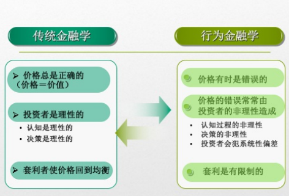
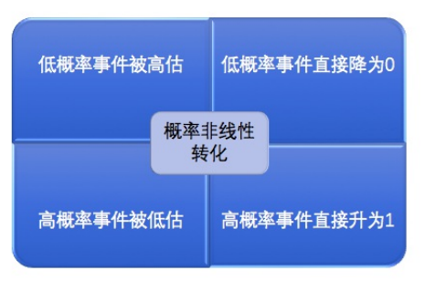
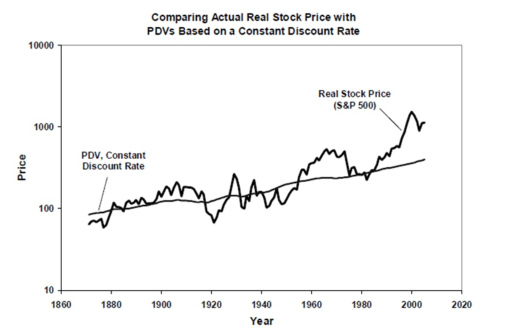

   

欢迎加入共享书屋，分享微信 gxswno12,得到 APP，喜马拉雅，混沌，樊登读书会等等海量资源分享 目录 00 发刊词 任何市场环境，你都能有机会 模块一 什么是行为金融学？ 01 行为金融学为何擅长投资实战？ 02 人是不是真的有智慧战胜市场？ （书籍分享微信 gxswno12） 03 价格错误是如何产生的？ 04 现实生活中，你应该如何套利？ 模块二 认知非理性 05 你能真正了解一家公司吗？信息收集阶段的认知偏差 06 为什么股评不可信？信息加工阶段的认知偏差 07 为什么人越自信赔得越多？信息输出阶段的认知偏差 08 踩过的坑为什么还会踩？信息反馈阶段的认知偏差 09 盈利和亏损得看参考点？参考点依赖 模块三 决策非理性 10 牛市赚不到头，熊市一亏到底？盈利和亏损的不同风险偏好 11 为何投资者总把小概率事件扩大化？错判概率导致的决策偏差 12 为何不能天天查看自选股？狭隘框架 13 做股票亏了无所谓而吃饭钱丢了可不行？心理账户理论 14 股票市场就是个选美博弈：我得看你怎么选 模块四 典型的交易错误 15 买熟悉的股票不对吗？分散化不足 16 为什么把鸡蛋放在不同篮子里还是赔了？简单分散化 17 来回倒腾为什么不如不动？过度交易理论 18 卖出盈利的还是亏损的？卖出行为偏差 19 涨停敢死队怎么赚钱的？买入行为偏差 20 追逐热点投资对不对？羊群效应 模块五 股票大盘的奥秘 21 大盘可以预测吗？大盘可预测理论 22 无论如何你都应该买点股票：股权溢价之谜和战略资产配置 23 怎样解读放量？价量关系理论 1：Miller 假说 24 你参与了股票市场的击鼓传花？价量关系理论 2：博傻理论 模块六 行为投资策略 25 行为金融交易策略如何盈利？利用人们的错误 26 为何会有免费的午餐？行为组合策略原理 27 买大公司还是小公司的股票？规模溢价和价值溢价 28 跌久必涨还是惯性效应？如何用好股价规律 29 财报里藏了什么秘密？利用财务报表信息来制定交易策略 30 免费的午餐一直都有？持续获得有效的投资策略 模块七 实战分析 实战 01 贵州茅台的股票值得持有吗？ 实战 02 从“乐视网”看公司基本面 实战 03 股市大跌时如何应对？ 实战 04 大盘短期能否预测？ 实战 05 如何对待股权质押类资产 实战 06 概念股炒作中，投资者怎么做？ 实战 07 如何应对股市中的黑天鹅事件？ 

## 00 发刊词 任何市场环境，你都能有机会

欢迎加入《行为金融学课》，我是陆蓉，上海财经大学金融学院讲席教授、博士生导师。

数据显示，在得到用户里，有三类课程特别受欢迎，那就是经济学、金融学、心理学。我相信能打开这篇发刊词的，都是重视训练自己的经济学、金融学素养的人。

如果说这三门课组成了得到课程中的皇冠，那么行为金融学就是这顶皇冠上的明珠。它是基于这三门学科诞生的一门跨界学科，在真实的世界里，指导你的投资实战。

在今天，很少有人能完全置身金融市场之外，投资已经成为个人财富增长的重要手段。

然而，投资市场总是让人感觉变幻莫测，难以预测。

牛市中你赚不到头，熊市中却又一亏到底；

天天查看单只股票涨跌，但买来卖去也没赚到什么钱；

你信心满满冲进熊市抄底，但发现只有更低，没有最低；

知道资产配置很重要，鸡蛋也明明放在不同的篮子里了，但你还是没能躲过风险 ……

如果你也注意到了这些问题，那么，你就应该开始学习《行为金融学》了，因为人在金融市场上犯的错误正是行为金融学研究的基础内容。

这里有个很烧脑的逻辑：金融市场归根结底是由人组成的，人是非理性的，是人就会犯错。

就像是一场实力相当的乒乓球赛。想要赢，制胜的法则有两条，自己少犯错，同时抓住对手每一次犯错的机会发起攻击。

《行为金融学》就是要告诉你，在金融市场上，你怎么才能少犯错，同时又该如何利用大多数人的错误，反向操作，来制定交易策略。

非理性的人做出的非理性行为，可以预测吗？行为金融学可以。

大多数人都在犯的错误会在短期内影响价格的涨跌，而从长期来看，价格又会回归价值。你掌握了这样的规律，不但可能预测市场，甚至有可能战胜市场。

这就是这门课最有魅力的地方。

是不是觉得不可思议？其实专业的投资机构早就先一步认识到了它的价值，金融市场对《行为金融学》的追捧可以用 “ 趋之若鹜 ” 来形容。

全世界的基金公司越来越多地采用行为金融交易策略。著名的 LSV 基金的创始人是三位行为金融学教授，凭借他们的研究， 40 多个员工，管理着 1190 亿美元的资产， 1994 年创立至今，在 25 年的时间里拥有不败战绩。

华尔街的投资者会一直紧盯《行为金融学》的研究，哈佛大学、芝加哥大学、康奈尔大学、北京大学、五道口金融学院等金字塔尖上的高校，只要开设《行为金融学》课或者讲座，基本上都是一座难求。

2002 年，丹尼尔 · 卡尼曼因 “ 前景理论 ” 获诺奖；

2013 年，罗伯特 · 席勒获奖因 “ 市场可预测理论 ” 获诺奖；

2017 年，理查德 · 塞勒因 “ 人的有限理性 ” 获诺奖。

他们都是行为金融学家。屡获诺奖不但让越来越多的人认识到这门课的价值，也从侧面反映了这门课对于金融市场的卓越贡献。

可惜的是，因为《行为金融学》非常新锐，很多的行为金融学家又都冲进了投资市场做实战，所以直到今天还没有一本权威的教科书。

我在美国康奈尔大学访学期间，系统学习了国际顶尖行为金融学专业的硕士和博士全部课程，还曾在国内大型证券公司和基金管理公司从事研究和投资工作，也一直在追踪国内外的最新研究进展。

我愿意在这门课中，把我的毕生所学，传递给你。

我的课程总共分为六个模块：

第一个模块，你会系统理解什么是行为金融学。

第二个模块，你会了解人在认识事物时最容易犯的十种错误。

第三个模块，你会知道人在决策时的六大偏差，也会系统学习行为金融学获诺奖的三大理论。

第四个模块，你会了解人在金融市场上六种最典型的交易错误。

第五个模块，你会掌握股票大盘的四大规律。

第六个模块，你会了解行为金融学最有魅力的部分，行为投资策略，掌握 7 种交易策略。

总之，通过上面六大模块，

你会学到：如果想在充满了陷阱的投资市场上盈利，正确的做法是什么。

也会了解：怎么预测金融市场，如何选择正确的交易时机。

还能懂得：如何正确地配置资产，怎样科学合理地提高财富水平。

最后，行为金融学实际上也是一套关于认知和决策的完整课程。学完了，你会知道，小到买一床被子，大到人生方向的选择，应该如何做出正确决策。

财富有两个敌人：风险和恐惧，只有知识才能对抗它们。

我愿教给你顶尖的投资实战知识，让你在金融江湖中占领先机。

学完了这门课，你会相信，任何市场环境，你都能有机会。

2018 年 11 月 11 日

  

  

  

# 模块一 什么是行为金融学？

## 01 行为金融学为何擅长投资实战？

你好，欢迎收听《行为金融学》课，在第一讲，我会带你快速理解，什么是 “ 行为金融学 ” ，它与传统金融学的差异是什么，它的 “ 根 ” 又是长在哪里的。

\*  看待任何领域事物， “ 应该是 ” 的视角让你把握长远基准； “ 实际是 ” 的视角帮助你理解当下正在发生的事。

2011 年 11 月，哈佛大学爆出了一件新闻， 70 名哈佛大学学生集体退选了经济学教授曼昆的《经济学原理》这门课。

曼昆是谁啊？经济学大牛，他写的《经济学原理》和《宏观经济学》这两本书是全世界大多数高校经济学的专用教材。

但是，这么厉害的一个人，学生们竟然质疑他说， “ 曼昆，你告诉我们，世界有多理性，市场多么有效，那为什么会发生这么严重的金融危机？你为什么不告诉我们世界运行还有其他规律？ ”

学生罢选曼昆的课，倒不是说曼昆教得有什么问题，而是借此对教育制度发难，认为学校不该只传授一种知识。

这件事在整个教育界引起了反思，在高校里，只开设传统经济学、传统金融学的课程可能是有问题的，应该告诉学生世界是多元化的，认识世界的方式也应该是多元的。

更重要的是，给学生机会，让他们去自己去思考、辨别究竟应该用哪种理论去指导自己的实践。

这件事的后续发展是，今天，我们可以看到包括哈佛在内的很多高校开设了《行为金融学》课程，而它也开始颠覆了人们对金融市场的传统认知。

### 行为金融学是怎么认识世界的？

我给你讲一个芝加哥大学流传的笑话。有人惊呼，地上有一百块钱。传统金融学家说，这不可能，地上不应该有一百元钱的，有的话早被捡走了；而行为金融学家说，怎么不可能啊，他跑去一看，果然有，开开心心地捡走了 100 块。

你看，传统金融学研究的是，市场 “ 应该是 ” 什么样，均衡来看，地上不应该有一百元，这是长期的趋势和规律。而行为金融学研究的是，真实市场 “ 实际是 ” 什么样。

行为金融学认为，不能用 “ 应该是 ” 的理论去指导实际决策，这会出问题。就像监管者面对市场时，不能认为市场从长期来看总是对的，就不管它了，要是早点干预市场，说不定金融危机都不会发生。

你仔细想想，其实任何学科和领域都可以用这两种方式来思考问题。

比如，物理学从 “ 应该是 ” 角度来看待宇宙的运行规律，在物理学看来，一切都是均衡的呈现。而在生物学看来，每一个物种 “ 实际是 ” 在优胜劣汰的进化过程中，捕捉自己的生存机会，以完成自我的迭代升级。

再比如说，在司法领域，法学家从 “ 应该是 ” 的角度，保证整个司法体系维持着长远的公平；而律师搜集证据，从 “ 实际是 ” 的角度，为自己的委托人争取权益。

那么同时拥有这两种视角对你有什么用呢？你看待任何领域的事物， “ 应该是 ” 的视角让你把握长远基准； “ 实际是 ” 的视角帮助你理解当下正在发生的事。

好，你已经理解了传统金融学和行为金融学的不同视角了，现在我再告诉你这两种视角从哪里来，又会到哪里去。

### 传统金融学和行为金融学的根本分歧

如果我们把传统金融学比喻成一棵大树，树有根、有干、有枝、有叶，越是根上的理论，越基础。任何学术进步，都是在这棵树上的某个部位又生了新芽、发了新叶。如果根上的理论不成立，那么整棵树就要坍塌了。

那么，行为金融学是在树的什么位置与传统金融学分开了呢？

答案是：根。行为金融学与传统金融学是从根上分开来的。

它们的理论基础不同，有各自的理论体系，长成了两棵完整的大树。

然而，树冠部分却是重合的，也就是说，传统金融学研究哪些问题，行为金融学同样研究这些问题。只不过，两者的出发点不同，结论就大相径庭。

那么，两棵树的根有何不同？我先举个例子让你理解传统金融学植根于哪里。

经常有人问我，陆老师，我们家孩子以后想从事金融行业的工作，应该学什么专业呢？我告诉你，这个问题的答案其实很简单，而且有个 “ 标准 ” 答案。

金融学，从学科分类来说，是二级学科，它的一级学科是经济学，准确地说，叫应用经济学。你知不知道应用经济学的学科基础是什么？是数学。所以，答案很简单，本科学基础学科数学，硕士转一级学科应用经济学，博士转二级学科金融学。这就是金融学标准的培养路径。

传统金融学认为，金融学是经济学基本理论在金融市场的展现而已。而经济学的最基本假设，或者说树的根是 —— 人是理性的。

简而言之，就是所有人的决策都是可以用数学计算出来，就像机器人一样精确。理性人你也可以理解为机器人。机器人不会出错。因此，均衡的市场条件下，任何时刻观察到的金融资产价格都是那个时刻所有信息的准确反映。

这就是 “ 有效市场假说 ” ，它是传统金融学根上的理论，提出这一理论的经济学家尤金 · 法玛(Eugene Fama)2013 年获得了诺贝尔经济学奖。

接下来我们对比看看，行为金融学的根在哪儿。

在 20 世纪 70 年代，有两位学者，一位是金融学家，一位是心理学家，他们常在一起聊天，金融学家说，我们研究金融市场的 …… 问题，结论是这样的 …… ，心理学家就说，这好像不对吧？因为从心理学的角度看，结果不会是这样的。

心理学家说得确实没错儿，金融学从根本上说，属于社会科学，社会科学研究的是与 “ 人 ” 相关的社会运行的规律。金融市场买什么、卖什么的决策都是人做出的。那么金融学当然应该先从人出发来研究问题，而不是从数学出发来研究问题，而人是怎么想的、怎么做的，这是心理学的研究领域。

因此，这两个学者开始系统地从心理学出发来研究金融学，开创了行为金融学科，这两位学者就是丹尼尔 · 卡尼曼 (Daniel Kahneman) 和阿莫斯 · 特沃斯基 (Amos Tversky) 。

2002 年，卡尼曼获得了诺贝尔经济学奖，这标志着这个学科正式被学术界所认可。可惜的是，特沃斯基英年早逝，错过了这份荣耀。

### 行为金融学的特点

我们从字面意思上来看， “ 行为金融学 ” 由 “ 行为 ” 二字加 “ 金融学 ” 构成， “ 行为 ” 取自心理学中的行为主义，它是行为金融学的理论基础。

自卡尼曼和特沃斯基创立了行为金融学派之后，越来越多的人意识到这个学科更能解释金融市场的各种现象。从 20 世纪 80 年代开始，这个学派的理论迅速成长，逐渐形成了与传统金融学对峙的态势。

到了 20 世纪末，甚至有学者说： “ 我预测，行为金融学在不远的将来将成为一个多余的术语，因为除了这个，还能有什么别的金融学呢？ ” 说这句话的人也是一个行为金融学家，叫理查德 · 塞勒(Richard Thaler) ，他是 2017 年诺贝尔经济学奖得主。

当然了，后来的事实是，行为金融学也没有完全取代传统金融学，两个理论都在发展。但是，相比于传统金融学，行为金融学更加实战。有意思的是，理查德 · 塞勒常常被称为 “ 临床经济学家 ” 。

什么意思呢？就是能解决现实问题的经济学家。

行为金融学最擅长的是投资实战，制定交易策略，我们现在常常见到的所谓 “ 量化交易策略 ” 绝大多数都是以行为金融学理论为基础的。

你在金融市场上看到的一些原来是大学里的金融学教授，后来转做投资实务的，一般都是行为金融学家，而传统金融学家做研究的多、做实务的少。所以，请珍惜给你讲《行为金融学》课的人，因为我们中的很多人讲着讲着就转去做投资实务了。道理很简单，因为收益高嘛。

而且基于行为金融学的交易策略甚至不需要组建一个庞大的团队，也不需要雇佣很多的分析师，去一家家公司做调研。很多成功的行为金融交易团队甚至只有几个人。

听上去是不是很神奇？听完我的课，你也一样能做到。

### 总结

传统金融学从 “ 应该是 ” 的视角寻找长期均衡的规律；而行为金融学用 “ 实际是 ” 的视角解决当前具体的金融决策。

传统金融学认为市场是不可预测、无法战胜的；而行为金融学认为市场是有规律的，战胜市场是可能的。

原因是，行为金融学是心理学和金融学的交叉学科，而心理学认为人的行为有规律、可以预测。

我还希望你记住的是，我今天讲的学科树的故事。这样，你的学习就可以逐步形成系统化的知识，而不仅仅是收获碎片化的信息。

陆蓉

这一讲的最后，我想给你留一个思考题：如果你要买股票，好公司的股票是不是就是好股票？

## 02 人是不是真的有智慧战胜市场？

你好，欢迎收听《行为金融学》课。在上一讲，你已经了解了行为金融学是什么，在这一讲，我要和你聊聊，行为金融学是怎么用一套新的解释方法，颠覆了人们对金融市场理解的，又是怎样改变了投资者、融资者和监管者的行为决策。听完这一讲你就会知道，它和你息息相关。

\*  格林斯潘： “ 我可能高估了投资者的理性，低估了机构的贪婪。 ”

### 好公司的股票等于好股票吗？

先问你一个问题，如果你炒股，你会怎么挑股票？大多数人会说， “ 挑一家有潜力的好公司买啊！巴菲特是这么说的，传统金融学也是这样教的，大多数人也是这么做的 ” 。

那你有没有认真想过，好公司的股票真的就等于好股票吗？

一家好公司，股票值 20 元一股；一家坏公司，股票只值 10 元一股。好公司的基本面比坏公司强。

但是，当好公司原本 20 元的股票价格已经卖到 40 元了，它还是好股票吗？当然不是了。而只值 10 元的坏公司，股票价格可能只有 5 元，它算是坏股票吗？也不算啊。

是的，行为金融学与传统金融学的差异就在于此。

传统金融学认为，值 20 元钱的公司，股票价格就应该正好在 20 元钱； 10 元钱的公司，股票价格就应该正好在 10 元钱。不存在错误定价。

而行为金融学认为，值 20 元的股票被炒到 40 元很常见；值 10 元的股票大家都不喜欢，就只能卖到 5 元钱。所以，凡是有关 “ 错误定价 ” 的，就属于行为金融学。传统金融学是没有 “ 错误定价 ” 这个说法的。

这只是一个例子，总之，行为金融学诞生之后，不管是投资者、融资者还是监管者，他们对于金融市场的判断和决策都开始发生变化了。

说到这里你可能觉得，这跟我有啥关系？太有关系了。

在金融学看来，市场只有这三种人：投资者、融资者、监管者，你必是其中之一。

接下来，我就用三个故事告诉你，金融市场上的这三类人是怎么被行为金融学改变的。

### 投资者：人是不是真的有智慧战胜市场？

第一个故事， “ 猩猩与基金经理 ” ，是关于投资者的。

这是传统金融学经常引用的华尔街的一个著名实验，这个实验是想验证长久以来一个有争论的问题 —— 人是不是真的有智慧战胜市场。

实验者找来一只会扔飞镖的大猩猩，让它扔飞镖决定买什么股票；再找一些知名的投资专家来精挑细选他们认为最应该买的股票，过一段时间来比较猩猩和投资专家的业绩。

你猜怎么着？两者真差不多，猩猩还略胜一筹。你会想，怎么可能呢？知名投资专家的决策为什么还不如猩猩？

我先强调一下，首先这个实验是真的。它证明了传统金融学的观点，市场是不可预测的，没有任何人、没有任何一种交易策略可以持续地打败市场。上节课我说过，这叫 “ 有效市场假说 ” ，是传统金融学树根上的理论。

这个故事也告诉你，作为一个投资者，如果你相信传统金融学理论，那请你不要整天刻意去挑选股票了，如果你做股票的话，那就买大盘，也就是股票指数，这就是最优组合。

这个理论叫做投资组合理论，获得了 1990 年的诺贝尔经济学奖，提出这个理论的学者叫哈里 · 马科维茨 (Harry Markowitz) ，被人尊称为现代投资之父。

但是，到了行为金融学这里，这个故事就不成立了。为什么呢？ “ 猩猩与基金经理 ” 的实验样本量太少，这个结论不具有代表性。

金融市场是由人构成的，是人就会有行为规律，人的行为是可以预测的，因此由一个个人所构成的市场就有规律可循，战胜市场是完全可能的。

买什么、卖什么有讲究；什么时候买、什么时候卖也有讲究。

所以，如果你是一个投资者，如果你相信传统金融学，那请你乖乖地去买指数。如果你相信行为金融学，那请你听我在后面的课程里告诉你，金融市场究竟有什么规律，你能怎样打败市场。

### 融资者：有没有更简单的方法借到钱？

第二个故事关于融资者，说的是股票高送转。

融资者一定要注意了，按照传统金融学理论，融资者想要筹到更多的钱，要靠提升公司的业绩，让公司更值钱，让投资人有信心，愿意借更多的钱给公司。

但是听完这个故事，你就会知道，在股市上，有更简单的方法让自己借到钱。

股票高送转是股票市场的一个特有现象，很受投资者追捧。它指的是，上市公司给每个持有其股票的股东发放的一种 “ 福利 ” ，这个 “ 福利 ” 叫股票股利。什么意思呢？公司业绩好，赚到了钱，就会把一部分钱分给股东，这就是股利，也就是我们常说的分红。

股利一般都是发现金的，这是回馈投资者的一种方式。还有一种股利，不发现金，而是发股票，这种就称之为股票股利。股票股利发放得比例高，就称为高送转。

投资者心想，这是好事儿啊，买这家的股票还多得了，因此很愿意投资。但是，错了，其实他们什么也没得到。这就像是分蛋糕，蛋糕就那么大，本来十个人，每人分一份，现在，每人再多送一份。一个蛋糕切成 20 份，那份量不就变小了吗？

所以，这种股票股利根本没意思，就是个游戏，让投资者手中的股票数量翻了一倍，但每股的价值降一半。然而，奇怪的是，投资者却特别喜欢这种做法。

投资者为什么会喜欢这种做法呢？因为他们不是机器人，很容易被骗。他们把股票当成青菜来买了。 10 元钱的股票他们觉得贵， 10 送 10 以后相当于变成 5 元了，他们觉得好便宜，但是他们不知道的是，自己股票的价值已经缩水了。

我把这种现象叫做 “ 低股价幻觉 ” ，融资者利用投资者的这种非理性就可以达到不用提升业绩就多融资的目的。

通过这个故事，我想要告诉你的是，真正的融资市场并不是像传统金融学讲得那样，人都是理性的，实际上，在真实的市场上，时间、方式、怎样回馈投资者等等，都非常重要，这与行为金融学的观点完全相符。

### 监管者：市场到底要不要管？

第三个故事是关于监管者的，讲的是 “ 监管理念与金融危机 ” 。

这是一个关于监管者的故事。听完这个故事，你就会知道监管者用什么理论来指导实践，对市场的影响甚至是致命的。

2006 年，美国在一个风景优美的小镇 Jackson Hole 为格林司潘举办了一场庆功会。格林司潘何许人也？他曾经是美联储主席，也是任期最长的美联储主席，在位时间长达 19 年，任期跨越 6 届美国总统。当时金融界流传着一句话 “ 格林司潘打个喷嚏，全世界股市都要抖三抖 ” 。

格林司潘深受传统金融监管思想的影响，他长期奉行的监管原则是 —— 尽量不要过多插手市场，当好裁判就好了。

在这场庆功会上，各界名流对在对格林斯潘的丰功伟绩歌功颂德时，一位名叫 Raghu Rajan 的教授讲了一句话，让大家吃了一惊。他说： “ 格林司潘，你长期以来对金融市场放任不管，这是不对的，可能会造成严重的后果。 ”

Raghu Rajan 当时是芝加哥大学一位印度裔的美国教授，说完此话，在华尔街引起了一场不小的争论，大家都认为 Raghu Rajan 夸大其词。

直到 2007 年金融危机暴发， Raghu Rajan 一语成谶，他也一跃成为 21 世纪最伟大的 4 位经济学家之一。后来印度还把他请了回去，做了印度央行的行长。

再说格林司潘，他从来不承认金融危机跟他有什么关系，直到 2008 年的 10 月 24 日，格林司潘首次在纽约时报上公开表态，承认自己可能犯了一个错误，他说， “ 我可能高估了投资者的理性，低估了机构的贪婪 ” 。

高估理性、低估贪婪，这完全就是行为金融学的观点嘛！

对于监管者来说，市场是管还是不管，你相信传统金融学放任自流，认为市场可以自我修复；还是相信行为金融学，市场经常会失灵，政府的积极干预是必要的，这对于整个金融市场来说，结果完全不同。

### 总结

行为金融学不仅提供了另外一套完整的金融学思维方式，也在用更加有效的方式影响着整个金融市场的判断与决策。

对于投资者来说，市场是由人组成的，人的行为有规律，于是可以预测，这就让金融市场有规律可循，战胜市场是可能的。

对于融资者来说，因为市场上的人是非理性的，利用人的非理性，靠设计融资时间、融资方式、回馈投资者的方式，就可以筹到更多钱。

对于监管者来说，市场管还是不管，是不是要积极干预，对于整个金融市场来说，结果完全不同。

陆蓉

这一讲留给你的问题是，现在你已经了解了股票高送转究竟是什么含义，如果你是投资者，对高送转的股票，你会怎么操作呢？

## 03 价格错误是如何产生的？

你好，欢迎收听《行为金融学》课。上一讲我用三个故事带你了解了行为金融学怎么用一套新的解释方法，改变了投资者、融资者、监管者在金融市场上的判断和决策。

这一讲，我来给你画一棵大树，让你了解行为金融学的基本框架，当你心里有了这棵树，在接下来的课程中，不管听到哪里，都会知道这些知识点会在什么时间、什么情况下影响你的金融行为和决策。

### 大盘到底可预测吗？

为你画行为金融学的大树之前，我先和你讲讲 2013 年的诺贝尔经济学奖。

为什么要讲它呢？因为这一届的诺贝尔经济学奖非常特殊，它颁给了两位观点完全相左的学者。

（书籍分享微信 gxswno12）

历史上确实会有两位学者共同分享一个奖项的情况，但是他们一般都是研究一个问题的合作者，而研究同一个领域、观点完全相左的两个人得奖，这在诺贝尔奖历史上很罕见。

这两位获奖者，一位是行为金融学家罗伯特 · 席勒，他的代表性观点是 “ 大盘可预测 ” 理论；另一位是传统金融学家尤金 · 法玛，他的代表性理论是 “ 有效市场假说 ” ，用这个理论来看大盘规律，那大盘就是不可预测的。

一个人说大盘可预测，一个人说不可预测，两人同时得奖，说明这个问题在理论上没有明确的答案，公说公有理、婆说婆有理，但是都得到了认可。

为什么我要讲这件事呢？我想告诉大家的是，行为金融学和传统金融学是针锋相对的，所以行为金融学的理论框架可以从它和传统金融学的对应观点来着手。

### 两棵树看懂行为金融学

第一讲我说过，要在头脑中先建立两棵树的样子，一棵是传统金融学；一棵是行为金融学。我们来看看两棵树具体有什么不同。

  

我问你，如果一个学科想要挑战另一门学科，你觉得从树的什么位置来撬动它最有效？

对，从树根。

### |  根上的分歧：有效市场假说 VS  错误定价

传统金融学的根是什么呢？我前面说过，是有效市场假说。

按理说，越是根基上的理论越容易获得诺贝尔奖，但是这个理论直到 2013 年才获诺贝尔奖，原因就是行为金融学老是挑战它。

它的基本结论是：金融资产的价格总是正确的。什么叫正确？就是价格总是等于价值。

那行为金融学与之相对的基本观点是什么呢？就是价格常常会错，会不符合价值，也就是错误定价。

### |  人是理性的 VS  人是非理性的

我们再来看传统金融学和行为金融学下一个互相对应的不同点。

传统金融学用来支撑 “ 价格总是正确 ” 的理论是 —— 人是理性的。

怎么理解人是理性的？我们这样来想，人做任何决策其实都分两步：

第一步，了解你需要决策的每一个对象，这叫认知；

第二步，对它们进行比较，这叫选择或者决策。

传统金融学认为人的认知过程是理性的，选择过程也是理性的。

举个例子来说，如果你是个消费者，双 11 、广告应该对你没影响；如果你是个企业老板，就应该不会错过赚钱的良机；如果你是个投资者，那你就应该拥有计算机一样的记忆和计算能力。因为每个人都是理性人，所以市场决策一定会让所有的资源都得到最优的配置。

但是，在行为金融学这里，观点就相反了。在认知这一步，行为金融学的观点是，你根本没办法正确认识你的决策对象。

到了做选择和决策的这一步，传统金融学认为，理性人在做选择时，会选对自己效用最大的那个，这叫预期效用最大化，是经济学的最基本定理。

而行为金融学认为，决策并不取决于效用的绝对值，而是要看跟谁比。

所有的决策都是比较而言的。比如说，我给你发一万块钱奖金，你高不高兴？你说，不好说，我得看看我的同事拿到了多少钱。这就是决策非理性，也叫前景理论，它是行为金融学第一个获诺贝尔奖的理论。

传统金融学家看到行为金融学家的这些研究结果，也开始让步，他们也承认认知和决策是有非理性的，但是他们说，这有什么关系呢？这些非理性是随机发生的。

什么叫随机？随机就是可以互相抵消的，因此最后均衡的结果不变，价格还是正确的。

行为金融学对此又是怎么回应的呢？他们借鉴社会心理学研究结果，社会心理学研究群体行为。

中国有一句老话 “ 三个臭皮匠顶一个诸葛亮 ” 。但是，这句话在社会心理学的研究中并不成立。

三个臭皮匠别说顶不了一个诸葛亮，连一个正常理性人的智商都没有。

社会心理学认为，人都有理性的一面和非理性的一面，如果非理性的一面被统一了以后，心理群体的智商甚至比单个理性人的智商还要低。非理性的心理群体会产生系统性合力。

什么叫系统性？系统性和随机不同，随机是大家互为不同方向，因而可以互相抵消；而系统性是同方向的。比如，现在股票价格已经跌得很惨了，但是大家会同时产生一种恐慌情绪，都不愿意买，全都在卖，这就叫系统性。

社会心理所产生的系统性影响使价格不会像传统金融学预期的那样迅速修复，而是会持续下跌。

所以，股票崩盘就是这么回事儿。

这时传统金融学怎么捍卫自己的理论呢？我们来看传统金融学和行为金融学第三点分歧。

### |  套利 VS  有限套利

传统金融学说，好吧好吧，我也相信社会心理学有一定的道理，但是那有什么关系呢？我还有一个法宝 —— 套利，套利可以消除一切价格偏差。什么是套利呢？简单的说，一买一卖，就是套利。

获诺贝尔经济学奖的斯蒂芬 · 罗斯 (Stephen Ross) 就曾说过一句经典的话： “ 要教会一只鹦鹉金融学，你只需要教给它一个单词 ‘ 套利 ’” 。套利是保证金融学（这里指传统金融学）所有理论成立的基础。世界上哪怕只有一个人是理性的，都能够完成套利，都能够纠正价格偏差，价格还是对的。

这是为什么呢？因为在传统金融学看来，套利有三个条件：零成本、无风险、正收益。我问你，如果有一件事儿，不要钱、还能赚到钱、又没风险，你愿意用多少钱去做这件事？理论上，你应该动用全世界的财富来做这件事，直到这个套利机会消除。所以，传统金融学说，哪怕只有一个人是理性的，套利也可以使得价格恢复到价值，所以我的理论还是成立的。

此时，行为金融学又是怎样回应的呢？它说，真实市场的套利不可能零成本、无风险、正收益。

真实的套利是有限制的，称之为有限套利。

有限套利使得理性人不敢去套利，从而套利机会一直存在，价格错误很正常。

我把有限套利称为行为金融学的一条腿。

在套利不能纠正价格偏差的情况下，才有必要了解价格偏差究竟是怎样形成的。这时造成价格偏差的，也是行为金融学另外一条腿 —— 心理学就站起来了。

好，这棵树已经给你描画完了。

### 课程是如何架构的？

我们这门课其实就是按照这样的架构来讲的。

第一个模块，带你把握行为金融学主要在做什么。

第二和第三模块，和你详细解释，心理学中的认知非理性和决策非理性，也就是在认识事物和做出选择的时候你会犯什么错。

从第四模块开始，我会给你讲行为金融学的应用，让你了解在真实的投资市场中，你应该怎么做才能避免错误、打败市场。在这个模块，你会知道自己什么地方会犯错，下次怎样避免自己的错误。这个模块听上去会很过瘾，你会感觉就像是在讲自己，因为是人就会犯错，我告诉你错在哪里。

第五和第六个模块讲行为投资策略，这两个模块就很实战也很烧脑了。

听到这里，你应该已经了解了，想要在脑海中建立起一棵行为金融学的大树，你也要同时看到传统金融学对应的位置，两相比较，建立起一个完整的学科体系。

因为股票市场是个人投资者参与最多的一个市场，所以，在我的这门课中，我主要讲行为金融学在股票市场中的应用。如果你能理解这其中的原理，那么，你也可以把它们推衍到更多的投资场景中去。

在这一讲的最后，我也想告诉你一个事实，《行为金融学》还没有一本权威的教材，理论框架也没有现成的。因此，你听到的这个框架是我在多年研究基础上总结出来的，它凝结着许多顶尖行为金融学家的智慧。

此前，你可能接触过行为金融学的不少概念、心理现象和投资启示，但它们更像是一片片绚烂的树叶，是碎片化的信息，不能有效地为你所用。而建立起学科框架后，今后你再收集树叶，它就会变成你知识体系的一部分。

这个方法是我自己的心得，其他学科也一样适用，我把它推荐给你。

### 总结

行为金融学的理论大树可以和传统金融学对比来看，最核心的分歧主要有三点：

第一，传统金融学认为大盘是不可预测的；而行为金融学认为，大盘是可预测的。

第二，传统金融学认为人是理性的；而行为金融学认为，人是非理性的，一群人在一起，还会产生系统性偏差。

第三，传统金融学认为套利可以消除一切价格偏差；而行为金融学认为真实市场中的套利是有限的。

最终，在套利也不能纠正价格偏差的情况下，心理学这条腿就站起来发挥作用了。

陆蓉

留一个思考题，你是不是可以写一个自己知道的行为金融学知识，然后看看这个知识应该安在行为金融学这棵知识树的哪个部分？

## 04 现实生活中，你应该如何套利？

你好，欢迎收听《行为金融学课》。

上一讲我们曾经举过一个例子，叫 “ 鹦鹉的金融学 ” ，讲的是你要想教会一只鹦鹉金融学，只要教给它一个词就行了 —— 套利。这说明套利对于金融市场非常重要。

但是，套利又因为太专业，常常让人感觉很深奥。今天这一讲，我就来让你了解，到底什么是套利，为什么套利无处不在；现实生活中的套利为何存在很多限制，称为有限套利；你需要注意套利的哪些风险点；以及有限套利为何对于行为金融学这么重要。

### 什么是套利？

从广义来说，我们日常生活中的很多行为都可以归于套利，你可能经常做，只是你不知道罢了。

那套利是什么呢？你可以把它想成是两两比较，出售一个，换更合算的持有的一种操作。

比如，你既投资了房产，又投资了股票，当房价下跌，股市繁荣的时候，你把房子卖了，用卖房子的钱买股票，那就是套利。

再举个例子，你如果做股票，平常一定会有股票换仓，将一只股票换为另一只来持有，也可以把这种操作看成是广义的套利。

你可能要问了，那它和普通的买卖金融产品有啥区别呢？

你平常经常做的单买、单卖金融产品，其实都是投机。投机是赌涨或赌跌，要么成功要么失败，收益和风险都很高。

但套利与投机不同，是做两笔操作的，一买一卖，赚的是买卖的差价。整体上涨，赚买卖差价；整体下跌，还是赚买卖差价；整体不动，仍然赚买卖差价。

所以，套利的风险比做投机的风险小多了。

而且套利的一买一卖，必须是差不多的东西，但具有不同的价格。理论上说，相同的东西应该具有相同的价格，价格一旦不同，套利的人就可以通过买入低估品种、卖出高估品种，获得收益，

最终使价差消失。

### 为什么传统金融学认为套利重要？

理论上，套利是零成本、零风险、正收益的！只要抓住了套利的机会，就能在金融市场上获利。

讲到这里，你可能不太理解为什么套利可以零成本、零风险、正收益。

我简单跟你讲讲，理论上的 “ 零成本 ” 是说，一买一卖，卖出的钱刚好可以用来买入，所以不需要成本；

“ 零风险 ” 是指，本质上相同的东西价格会逐渐靠近，不存在不确定性；

“ 正收益 ” 是指套利的收益在初期的时候就是确定的。

注意了，上面我用了一个词， “ 理论上 ” 。在现实生活中，零成本、零风险、正收益的套利机会其实是不存在的。

套利都有限制，既有成本、又有风险，而且收益不能保证。行为金融学将现实中的套利称为 “ 有限套利 ” ，将理论上的套利称为 “ 教科书上的套利 ” 。

真实的套利为何是有限制的？

好了，现在该和我进入真实世界了。

市场中，有三种常用的套利方法：跨市场套利、跨商品套利、跨期限套利。

跨市场套利，是指同一个商品，在不同市场上价格不同。理论上同一商品价格应该只有一个，所以可以通过买低卖高来套利。

中国有句老话叫做 “ 坐贾行商 ” ，看过《大宅门》的人都知道，那会儿，山西每年都有一次全国最大的药材大集，百草厅的少爷白景琦提着十万两白银，在当地一泡半个月，就是为了以低价囤积药材，再运回北京销售。这其实就是中国传统的跨市场套利。

再看今天的现实情况。铜期货，在上海和在伦敦证券交易所的价格不同，在考虑运输成本后，如果存在价差，就可以买入低价的、卖出高价的来套利。等到未来价差收敛后，就可以反向操作来平仓（平仓就是把之前买进的卖出、把之前卖出的买进）。

所以，套利的收益是建立在这两个时点上的买卖价差之差。

但是，套利是有成本的，因为无论在哪个市场上买卖，两头都需要交保证金，并且你卖出那个商品的收入是不可以提取出来用于买入的。因此，零成本这个条件现实中不存在。

此外，套利是有风险的，假定上海铜比伦敦铜便宜，你卖了伦敦铜来买上海铜，希望两个市场铜的价格趋于一致，后来，那个便宜的上海铜更加便宜了，你卖的那个贵的伦敦铜更加贵了，这就会导致套利存在风险，你的套利会失败。

最后，套利的收益也是不能保证的，因为套利不一定能坚持到胜利的那个时刻，中间由于保证金不够，很可能就已经被迫平仓出局了。

我建议你去看一下《大空头》这部电影，电影描述的是 2007 年美国金融危机发生前，几位大空头预测市场即将大面积下跌，于是选择做空市场来套利。这里面就表现了几位做空者中途保证金亏光了之后内心的煎熬。

总之，套利的原理都是相同的，也都面临着有成本、有风险、收益不确定的情况。

这就是套利的局限性，行为金融学称之为 “ 有限套利 ” ，它阻碍了理性人用套利来纠正价格偏差。

### 套利失败的典型案例： LTCM

接下来，我给你讲个长期资本资产管理公司 LTCM 套利的故事，让你体会一下套利的局限性。

LTCM 公司成立于 1994 年，是一家主要从事债券套利的对冲基金。这家公司极其有名，因为它的合伙人中有好几位诺贝尔经济学奖得主，算是拥有顶尖金融智慧的最强投资团队了。 LTCM 的投资业绩也确实骄人，业绩来自于通过理论计算得出的 “ 套利 ” 机会，也就是买入被低估的债券，卖出被高估的债券。

这简直可以算是金融界 “ 套利 ” 的最高配置了吧？然而，接下来的故事，我会让你看到 LTCM 是怎么败于他们最擅长的套利的。

当时的情况是这样的， 1998 年亚洲金融危机爆发，使得俄罗斯的债券价格下跌过度了。如果是你，看到这种情况应该怎样来做交易呢？

你可能会说，俄罗斯的债券价格现在太低了，那应该买入啊。但是，光买入这一种债券的话，只要价格不涨，你就亏损了，这样操作风险太大了。

此时，你观察到还有一种债券 —— 德国债券，这种债券以前很好，但随着欧元的启动，德国债券的好处将不再明显，换句话说，德国债券现在价格有点高了。同理，你也不能单卖德国债券，因为你不能确定德国债券的价格一定跌，只要价格没跌，你就亏损了。

所以，单赌俄罗斯债券价格涨，或者单赌德国债券价格跌，风险都比较大。然而你把两个结合起来看，大概率情况下，俄罗斯债券应该比德国债券涨得快，这是比较确定的。所以，比较保险的做法是，你在买入俄罗斯债券的同时，卖出德国债券。

LTCM 就是这么做的，但顶级高手成功套利了吗？

并没有。 LTCM 没有算到的是，同年 8 月小概率事件发生了！国际石油价格下滑，俄罗斯经济不断恶化，俄政府突然宣布卢布贬值，停止国债交易。投资者纷纷从亚洲市场退出，转而持有美国、德国等发达国家债券。

LTCM 两边都做错了方向，原来买入的俄罗斯债券价格下跌，而原来卖出的德国债券价格上涨，套利失败！这家曾与量子基金、老虎基金、欧米伽基金一起被称为国际四大对冲基金的 “ 四大天王 ” 之一，就此解体。

现在你已经了解到，现实中的套利不像 “ 教科书上的 ” 套利那样零成本、正收益、无风险，可以消除一切价格偏差。它有很多局限性，具有很大的风险。

问题是，谁在市场上做这么专业的操作呢？

答案是专业机构，这是因为套利的资金量需求比较大。金融市场的价格是由大资金的交易决定的，所以大机构的大量套利会影响资金价格。

你可能会问，那么套利与我们平常人是什么关系呢？

就像我在开头说的，我们日常生活中的很多行为都可以归于套利，因为你时刻都在比较，择优就是一种广义套利。你要记得的是，只要是套利，就一定是有成本、有风险，并且不见得会取得正收益的。

### 总结

这一讲，你了解了真实套利中的成本、风险以及收益不确定性。

有限套利使理性人即使看到有套利的机会也不太敢去做套利，这样，套利机会才会在很长一段时间内存在。由于现实中套利不能纠正价格偏差，我们才有必要了解价格偏差究竟是怎样形成的。

这时候，心理学就开始发挥作用了。

预告：下面两个模块我就带你了解，支撑行为金融学的另一条腿 —— 心理学，是怎样在实际的金融决策中发挥作用的。

陆蓉

留一个思考题：你是否能够举出一个生活中套利的例子，并试着分析一下，想要获得收益，会面临什么样的风险？

  

  

  

# 模块二 认知非理性

## 05 你能真正了解一家公司吗？信息收集阶段的认知偏差

你好，欢迎来到《行为金融学》。

从这一讲开始，我们进入第二模块，认知非理性。我会用四讲告诉你，为什么你没办法真正理解你的认知对象，你在认识事物的整个过程中会犯什么错。

这一讲，我先谈谈人在信息收集阶段会犯什么错。

人为什么不能真正了解一家公司？

### 什么是认知非理性？

一句话就是，你没办法正确地认识你想要了解的事物。

通常我们做投资的第一步，都是先去了解一家公司，再去做投资决策吧？第一步做错了，最后的投资是不可能正确的。

那我说一个让你吃惊的结果：无论在投资前你认为自己对一家公司有多了解，做了多少调查，实际上你都无法真正了解一家公司。

这是为什么？

因为从认知心理学的角度来看，人在处理信息的整个过程中都存在认知偏差。

认知过程可以切分为四个阶段：信息收集、信息加工、信息输出和信息反馈。人对任何事物的认知过程其实都可以分成这四个阶段。

举例来说，你要做股票投资，需要了解公司，总要看看企业的财务报表、听听企业和行业的新闻吧？这些都是信息的收集。在第一阶段你就会犯错。

而当这家公司所有信息都收集来之后，你的阅读理解过程，比如，读报表、听新闻时，你的内心就开始有判断了，这就是信息加工阶段。这一阶段你又会犯错。

信息输出阶段是指，在信息加工的基础之上你做出对这家公司买或卖的决策，把信息输出出去。

这一步你又会犯错。

信息反馈阶段是指，你在做出决策后，看到决策的结果，赚钱了还是亏钱了，是会不断学习反省的，理性人总是会吸取教训的吧？但是，你的反省真的是对的吗？后面我会告诉你，你真的会吸取经验教训，还是会重蹈覆辙。

好，听完了上面的内容，你对这个模块应该有了一个大致印象，接下来，我就通过四讲带你掌握认知过程中的各种心理偏差。

这一讲我和你说认知的第一个阶段，信息收集阶段人通常会存在什么样的认知偏差。

### 被你记住的信息 —— 易记性偏差

|  两种信息来源

我先问你一个问题，平常你的决策来源于哪些渠道收集的信息？

你可能会说，信息来源很多啊，我上网、刷微博、看微信、与朋友聊天，都能收集到信息。的确，信息渠道有很多，但我归纳一下的话，你的决策其实只依赖于两类渠道的信息：

一类来源于所有被你记住的信息，另一类是还没有被你记住的信息。

先说第一类，信息收集来源于被你记住的信息时，我们会犯什么错。

|  易记性偏差

我告诉你一个最典型的偏差（或称错误） —— 易记性偏差。

人有一种行为习惯，就是搜集信息时喜欢先在自己的记忆库中去找信息，容易被你记住的你会认为它是真的。

你不相信吗？请你来做个测试：

如果我给你一本英文书，请你随便挑一个单词。如果这个单词中包含一个字母 r ，请问， r  更可能出现在单词的首字母还是第 3 个字母。请快速回答。

我猜，你可能回答的是 —— 首字母。而且我想，你应该是这样做判断的：赶快在脑海中找几个单词，是 r 在首字母的；再赶快在脑海中找几个单词，是 r 在第 3 个字母的，然后判断哪种可能性更大。由于首字母检索比较容易，就像我们查字典都是用首字母来查的，没人用第 3 个字母来查。

因此你很有可能找到首字母是 r  的单词比第 3 个字母的数量多，所以，你回答 “ 是首字母 ” 的可能性大。

但是，机器人（理性人）的判断却与你不同。理性人认为， r  是辅音字母，按英语的造字规则，辅音字母出现在单词第 3 个字母位置上的可能性远超过首字母。因此，理性人的回答是第 3 个字母的可能性大。

你错在哪里了呢？强调一下，这里我们说的犯错都是与理性人比较的。你错在认知的时候，喜欢先在自己的记忆库中去找信息，容易被你记住从而容易被你提取出来的信息你会认为是真的。

类似的例子还有，给你几个股票的名字，让你说哪只股票比较好。其中有些股票是你熟悉的，还有些是你不熟悉的。我猜你会从熟悉的股票中找出那个你认为最好的，不太可能说你不熟悉的。

你买股票时是不是也会犯类似的错呢？别说普通投资者会犯这个错，就连专业的证券分析师都会犯错，他们推荐的往往都是自己经过调研的公司，而没调研过的呢？是否就真的不够好呢？

以上就是易记性偏差，也叫易得性偏差。

|  哪些信息容易被你记住？

那么，哪些信息容易被你得到，从而被你记住呢？

心理学研究发现，事物的新近性、显著性、生动性、可想象性等影响人的记忆。

刚刚发生的事，容易从记忆库中提取出来，在做决策的时候会更容易影响你。

刚刚盈利了，更容易再买，从而忽略风险。刚刚亏损了，更容易悲观，不敢再碰。

新闻媒体不断报道的事情，会加深你的记忆，你也更容易认为这是真的。

例如有段时间新闻连续报道飞机失事，你可能就会尽量避免坐飞机。还有，金融业内都知道，每一年都有新财富最佳分析师评比，分析师到了这个时候会非常活跃，希望进到这个榜单中。实际上，人还是那个人，为什么上不上榜就这么重要？因为上榜会影响别人的认知，让人因为熟悉而信任。

下次你投资时再看到各种各样的排行榜，想要买或卖的时候，可要多个心眼了，是不是受到了易记性偏差的影响呢？

此外，以更显著、更生动的方式展现的信息，你更容易记住，觉得是真的。例如我问你，你觉得哪位老师是最好的老师？你回答的可能是某位讲课很生动、或让你曾经感动的一位老师，而你可能不知道，那位给你布置很多作业、不苟言笑的老师才是对你一生知识积累最重要的人。

金融市场也是一样，你有没有注意过，无论哪家证券公司，他们的分析师报告都非常注重形式，目的就是吸引人的关注，从而影响人的决策。你现在知道了，形式与内容同等重要，了解了这一点，一定能提高你工作和生活的质量。

没被你记住的信息 —— 信息发生顺序影响决策

接着我来说第二类，信息来源于在你身边正在发生的，但还没被你记住的信息时，你会犯什么错。身边正在发生的事影响你的方式有很多，这里我告诉你其中最突出的一种，信息发生顺序容易影响人的决策。

### |  首位效应

你经历过 “ 一见钟情 ” 吗？一见钟了情，后来有点问题，自己还是愿意去接受的；一见没钟情，后来你的对象再怎么好，都很难再接受了。

这种现象称为 “ 首位效应 ” ，指你在做决策时给首次到达的信息赋予了最大的权重。机器人都不会这样做决策的，他们会理性地分配各个信息的权重。

而现实中的每个人都会受到这种次序效应的影响。

你对一家公司仔细调研后，形成了对这家公司的一个判断。之后，你就不太可能改变这个判断了。如果你觉得它是家好公司，后来又出了坏消息，你会为它辩解；如果你觉得它是家坏公司，后来出了好消息，你也不会相信这个好消息。

### |  末位效应

有意思的是，信息顺序影响人决策还有另一种完全相反的情况，叫 “ 末位效应 ” ，指最后到达的信息在做决策时赋予了最大的权重。举个例子，你认真听一下下面这两句话。

我给你推荐一只股票， A 股票收益不错，但，有风险！

我再给你推荐一只股票， B 股票有风险，但，收益不错！

你觉得哪只股票好些呢？

可能你会说，感觉 B 好一点。你再仔细想想，我说的其实是一回事，只是说话的顺序颠倒了一下，而最后到达你耳中的信息，你在决策时赋予了更大的权重，但你的这些决策是非理性的。

### |  撞车怎么办？

这时候，你可能要问了，既然首位效应和末位效应都能影响人的决策，那么我们在现实中怎么选择呢？

我的方法是，看信息到达的速度和强度。如果首位效应还未对你的决策产生影响，而此时你又收到一个信息，很可能末位效应就会占主导。例如，你在看几张财务报表来评价一家公司，很可能最后看的那张报表信息对你的影响更大。

### 总结

人的信息处理过程分成信息收集、信息加工、信息输出和信息反馈四个阶段。

在信息处理的不同阶段，人都会产生认知偏差。

信息收集阶段，信息的来源分为两类，当信息来源于被你记住的信息时，常常容易产生易记性偏差；

当信息来源于还没有被你记住的信息时，容易受首位效应和末位效应的影响。 当两种效应都存在时，要看信息到达的速度和强度。

陆蓉

检验一下你是否掌握了我教给你的知识。

请问，你能举一个信息收集阶段认知偏差的例子吗？欢迎你在留言区写下答案和我交流。

当然，你无法真正了解一家公司，还与信息处理其他阶段的认知偏差有关。下一讲，我会和你讲讲信息加工阶段的认知偏差。

## 06 为什么股评不可信？信息加工阶段的认知偏差

你好，欢迎收听《行为金融学》。

认知心理学把人的信息处理过程分为信息收集、加工、输出和反馈四个阶段。在上一讲，你已经了解了信息收集阶段人的认知偏差。

信息收集完了，你就该加工了吧？这一讲我们就谈谈第二个阶段，信息加工阶段的认知偏差。

在这个阶段，人最容易犯的就是代表性偏差。你理解了这个错误，不仅可以避免投资分析时的误区，而且在日常工作、生活中处理类似问题，也会很受启发。

### 代表性偏差的一个测试

下面，我给你描述小张这个人的性格特点，请你猜猜看她更可能从事什么职业。

小张很害羞，乐于助人，但对周围发生的事不太关心，喜欢活在自己的世界里。

她很整洁，做任何事都很有条理，关注细节。

请问，你认为，小张更可能是从事以下哪种职业的？农民、图书管理员。

我猜，你大概会说小张是图书管理员，大多数人确实都会这样回答。

为什么你觉得她像是图书管理员呢？你可能会说，刚才描述的这些特征也太像一个图书管理员了，有 99% 都像，比农民要像得多啊。但这真的就能说明小张最有可能是图书管理员吗？

错了！

如果换成理性人，他们会怎么回答？他们会按照贝叶斯法则来计算小张从事图书管理员工作的概率。

简单地说，贝叶斯法则测算的真实概率由两个概率的乘积构成，第一个概率就是你刚才看中的那一项 99% ，指的是给出的这些描述 “ 有多像 ” 一个图书管理员。

这些描述确实很像，假定概率高达 99% ，这一项就被称为 “ 代表性 ” 。但真实概率除了这一项之外，还有一项，被称为无条件概率。

无条件概率不依赖于任何条件，当然也不依赖于我刚才对小张的那一堆描述。

怎么理解无条件概率呢？你可以理解为，在大街上你随手一指，这个人就是图书管理员的概率。

这个概率有多大？你会说，这个概率也太小了吧。全国能有多少个图书管理员呢？被我手一指就猜对的概率可能不足 10 万分之一。

比较之下，我们再来计算一下小张是农民这个职业的概率。这些描述也太不像是个农民了，但是假设 100 个农民中，有一个人符合描述的这些特点，差不多吧？所以，第一个概率， “ 代表性 ” 的概率是 1% 。但是，中国的农业人口占总人口的 50% ，你看，这第二个概率就非常大了。

两个概率的乘积，图书管理员职业的 99% 乘以 10 万分之一，远远小于农民职业的 1% 乘以 50% 。所以，理性人的回答是：小张是农民的可能性更大。

现在你仔细想想，你脱口而出，认为小张是图书管理员，错在哪里了呢？

错在你太关注代表性特征，而忽略了其他信息。当某件事的代表性特征一展现出来，你会立即做出判断。

对小张性格特点的描述，非常符合一位图书管理员的代表性特征，你立刻就判断她是图书管理员了，却忘记了她还有好多你没有观察到的特点，所以，她不是图书管理员的概率其实更大。

从这个例子，你就能明白了，人总是倾向于根据代表性特征来冲动地做判断，这就被称为认知的代表性偏差。

### 金融市场中常见的代表性偏差

在金融市场中，代表性偏差非常常见。

例如，你看到某位基金经理连续获得金牛奖（一种相当于最强基金经理的称号），就立即做出判断：都获得金牛奖了，那他一定是一个好基金经理啊。是不是很像我刚才给出的图书管理员那个例子？

实际上，你忘记了要得出正确的结论，还有很多决定性的其他信息，比如他这几次成功是偶然的，不能归于能力，如果时间放长一点，或考虑到公司、团队、工作经历的偶然性等因素，这种随机性就会消失。也就是说，你没观察到的因素太多，代表性特征的信息量不足以做决策。

再例如，你看到一家公司连续 3 年利润都翻番，然后立即对它的股票做出判断 —— 买！

你又冲动犯错了。还是错在代表性偏差。连续 3 年利润翻番，是一个好公司的代表性特征。但这并不意味着这家公司真的就是一家好公司，这家公司还有好多信息都被你忽略掉了。

比如说，公司高管近期需要减持股票，业绩可能是有意调整出来的；再比如说，这家公司未来的盈利机会消失，业绩不能持续。你被公司的一些代表性特征吸引了，就立即判断了。

再举个例子，你一位平时很靠谱的朋友给你推荐了一只股票，出于对他的信任，你立刻就买入了，犯的也是代表性偏差的错。

你会奇怪了，这里面代表性特征是什么呢？

是你朋友靠谱。你太看中这个代表性特征了，股票被你这个靠谱的朋友推荐了，那还能不是一只好股票吗？实际上，一只股票好不好，被你朋友推荐与否这个因素实在是太不重要了。你忽略了好多公司的其他信息。

好，现在你是不是已经能够理解代表性偏差了？在你的生活中，这种偏差简直是无处不在，随时随地影响着你的判断。

### 造成代表性偏差的原因

那我们再深究一下，你为何会那么冲动，觉得仅凭几个代表性特征就可以做判断了呢？

原因就是，你可能将 “ 大数定律 ” 误用为 “ 小数定律 ” 了。

“ 大数定律 ” 是概率论历史上第一个极限定理，指的是当试验次数足够多的时候呈现的统计规律性。

例如，你扔一枚均匀的硬币，若次数足够多，出现正面的频率应该无限接近于概率 ——1/2 。你需要注意的是，大数定律，需要数据量足够多、样本量足够大才能下结论。

而代表性偏差，则是人们误用了大数定律，只用少量样本就做决策，这种错误被称为 “ 小数定律 ” 。

还是以扔硬币为例，当连续 6 次都正面朝上，让你下注押下一次，你会押正面还是反面？

你可能会押反面吧？即使赌场高手也会犯这个错误，所以小数定律也被称为 “ 赌徒谬误 ” 。

小数定律错在了小样本是不可以用来下统计推断的。在小数这里，都是偶然，下一次出现正、反的概率仍然相等。

代表性偏差就是错在了用小样本的很少信息来做判断。

这种小样本的代表性偏差同样容易出现在金融市场里，比如挑选基金经理、评选分析师、预测公司盈余、预测市场、挑选股票等等。

为什么股评家不可信？

对于炒股的人来说，总有一些他们特别信赖的股评家，觉得他们的预测特别准。

我举个投资中常见的骗局，你就会了解，为什么不可轻信股评家的话。假定一个人吹嘘他是推荐股票的大神，荐股从来没错过，看看他是如何让你相信他说的话是真的。

这个人第一周向 800 个人发出 800 条微信，其中 400 条说某只股票涨， 400 条说跌；第二周，他向其中说对的 400 人再发一条微信，其中 200 条说这只股票涨， 200 条说这只股票跌；第三周他再向说对的 200 人发微信，其中 100 人说股票会涨， 100 人说会跌。

你会发现， 3 轮之后，最后总有 100 人，发现这人连续 3 次都说对了这只股票的涨跌，简直神奇，就信了这个人，跟随他投资。

所以，通过这个例子你看出来了什么？

你现在知道这个人的推荐完全是随机的，但总有一部分人打开电视、打开收音机、翻开报纸，会连续收到他说对的信号，这样，这个人的代表性特征就表现出来了，你可能就按此做决策了。

其实，除了面对不认识的人，面对你熟悉的人，你更容易犯这种错，只要他有几次做对了、说对了，你可能就觉得他很厉害，从而轻信于他。

听完这一讲，你应该了解这叫代表性偏差，你做的判断是冲动的。

### 总结

这一讲我们讲了在人的信息处理第二个阶段，即信息加工阶段最容易犯的认知错误 —— 代表性偏差。

代表性偏差指，当事物的代表性特征表现出来以后，人容易冲动地做判断，而忽略了其他更多决定性的信息。

归根结底，代表性偏差源于人们以为小样本的代表性特征就可以用来做推断。

在金融投资中，很多人或投资标的都会展现出一些代表性特征，学习了今天的课程后，下次你在做投资决策时，应该警惕这种直觉式思维，至少，你得认识到这样的决策有很大的风险。

陆蓉

给你留一个思考题，请举一个你在投资或生活中遇到的代表性偏差的例子。

欢迎在留言区写下这个例子，也让更多的人警惕发生在身边的这些代表性偏差。

## 07 为什么人越自信赔得越多？信息输出阶段的认知偏差

你好，欢迎收听《行为金融学》课。

上两讲，你已经分别了解了信息收集和信息加工阶段的认知偏差。这一讲我给你讲讲信息输出阶段的认知偏差。

信息输出阶段指的是你收集来了信息，也理解加工过了，现在要做出买或者卖的决策了，在这个阶段，人最容易犯的、也是最经得起检验的偏差就是 “ 过度自信 ” 。

自信是对自己能力的认知，传统金融学认为理性人对于自己能力的认知是准确的。非理性的人对自己能力的认知超过了自己的实际水平，也就是过度自信。过度自信是人与生俱来的性格特点。

听完了这一讲，你就会知道，这个市场上多数投资者都是过度自信的，而这会导致投资决策偏差。

### 什么是过度自信？

心理学家说了，过度自信大概是最经得起检验的人的认知偏差。也就是说，只要是正常的人，一般都是过度自信的。不信吗？我来举个例子，让你感觉一下。

假定你是一位刚刚创业的私营企业主，你和其他 50 个同样刚创业的人坐在一起。在现场，我说， “ 觉得自己的企业能活过 5 年的请举手 ” ，这个时候你举不举？你大概率会举手。我相信现场 80% 以上的人都会举手。

（书籍分享微信 gxswno12）

你可能会说， “ 我的企业肯定能活过 5 年啊，如果 5 年都过不了，那我当初就不会来创业了 ” 。

现在给你揭晓真实数据。有一项统计结果表明，初创企业的风险非常高，能活过 5 年的概率不会超过 1/3 ，也就是说，有超过 2/3 的初创企业会在 5 年内消亡。

显然，人们对自己能力的认知超过了实际水平。这就是过度自信。

### 人为何会产生过度自信？

原因很多。从生物进化角度来看，过度自信可以让自己显得比实际上更聪明和强壮，增加个体传宗接代的机会。

在社会环境中，你会观察到，自信的人比不自信的人能获得更多的工作机会、交友机会。

而从个人成长轨迹来看，大多数人被家庭过度保护，会逐渐滋长过度自信。

这些原因都很好理解，我就不一一展开了。在这里，我想特别强调心理学上提出的一个原因，它和我们的投资决策息息相关。

心理学家揭示，人的过度自信与信息积累有关。

我问你，如果你对股票投资一点都不懂，你会自信吗？你可能会说，那应该不会自信。是的。当你什么信息、什么知识都没有的时候，你是没什么自信的，随着信息收集越来越多，例如，你通过对股票专业知识的系统学习，信息积累多了，能力相应就涨了，这时你的自信心也在同步增加；你又来听了我的《行为金融学》课，信息积累得更多了，能力进一步上涨，你的自信心又进一步增加，信息、能力、自信，此时是同步增长的。

但是，注意了，信息没有上限，能力却是有的。你不断增加各种信息积累，但是你的能力却是会封顶的。到了一定程度，随后到达的信息没有增加你的能力，却还在不断增加你的自信心。最终，你的自信程度会超过自己的实际水平。这就是人为什么一定会过度自信的原因。

### 过度自信的利弊

对金融市场来说，过度自信影响非常深远。

传统金融学中有个定理，叫 “ 无交易定理 ” ，意思是，在没有什么新信息的情况下，理性人对金融资产价格的判断没有分歧，既然没有分歧，就不会有人要买、同时又有人要卖，因此均衡的时候应该没什么交易量，称为 “ 无交易定理 ” 。

而我们实际观察到的是，市场每时每刻都有大量的成交。原因就是，投资者都是过度自信的。你只相信你的判断，认为价格低估了；他只相信他的判断，认为价格高估了，那会怎么样？

成交！所以，成交实际上就是意见分歧的体现。

总体而言，留在金融市场上的人都是过度自信的，因为你肯定认为自己能战胜市场、能赚到钱，才会留在市场上的。

所以，金融市场上的投资者都是过度自信的，这一点和传统金融学恰恰是相反的，传统金融学认为，留在市场上的人都是理性的，恰当自信的。

过度自信能放大市场的成交量、提高市场的流动性，所以，过度自信对于市场来说是有益处的。

当然，过度自信也有不好之处。过度自信使人感觉良好，做一些在理性情况下不会做的事情，但可能会付出高昂的代价。例如，在医生诊断病人、法官审判案件或央行设计利率时过度自信，都会导致严重的社会后果。

在金融市场上，过度自信使人忽视风险，做出过度的交易。

换句话说，不该买入的时候，你不断地买入；不该卖出的时候，你又不断地卖出。很多投资者做了很多交易，但发现没赚到什么钱，做的越多，亏的越多，就是这个原因。

### 过度自信的影响因素

那么，哪些因素最容易影响人的过度自信呢？

首先，专业知识会影响过度自信的程度，专家或者自认为是专家的人过度自信更严重。

过度自信的人对自己能力的认知超过自己的实际水平。专家的能力确实比一般人更高，但是他们的过度自信也会更严重。

当任务难度小，可预测性非常高时，专家的预测可能更准确；但当任务难度大，可预测性非常低时，自认为是专家的人，更容易对市场预测发表观点，且常常高估自己预测成功的概率。所以，这个时候，你就需要客观判断专家的建议了。

其次，经验也会影响过度自信的程度。金融市场上有一句话，没有经历过一个完整牛熊市的人都不是一个合格的投资者。为什么呢？

就是因为在投资者的整个投资生涯中，投资成功的经验会增加过度自信的程度。牛市往往会导致更多的过度自信；而经历熊市的投资者比那些没有经历过的更加悲观。

只有经历过一个完整的牛熊市，才能平衡自己的投资心态和决策。

要想减少损失，你需要克服过度自信。

### 怎样避免过度自信？

回答这个问题之前，我先问你一个问题，在你平时的生活中，你觉得对自己和对别人，用的是同一套评价体系吗？

你可能会说，应该是吧。

错！过度自信主要是对自己而言的，对别人的评判却往往是准确的。

你判断自己创业的公司能否成功，往往会过度自信，但是让你去评判别人公司成功的可能性，却往往是准确的。你了解到初创企业存活 5 年的概率不超过 1/3 ，你认为其他公司应该基本符合这个规律，只有自己是例外。每个人都是这样想的！

你想盘下一间门面房来做生意，前一户因经营不善离开了，你在盘下店面的时候，可能从来没想过，自己的经营很有可能与他一样。

所谓当局者迷，就是这个道理。自己如果是当事人，往往看不清；自己如果是旁观者，很容易指出其中的问题。

做金融投资也是一样，你一定是相信自己有能力，才会去投资；你又同时能接受大多数散户会亏钱的现实。你觉得自己与他们不一样，而每个人都是这样想的，就像每个遭遇大病的人，在生病之前绝对不会想这事儿会落在自己头上一样。

现在回到我们的问题，怎样克服过度自信？你应该已经得出结论了。

站在第三方的立场来看，评判会准确得多。或者站在一个更高的视角，或者尝试置身事外。这也是一种很有效的思维方法，你可以在生活中试试看。

### 总结

我们讲了人在信息处理第三个阶段，即信息输出阶段，最容易犯的认知错误 —— 过度自信。

过度自信指人对自己能力的认知超过了自己的实际水平。

过度自信是生物的本能，但它在金融投资中却可能是有害的。

主要表现在，过度自信使人低估风险，做出不必要的买和卖。因此，减少交易次数是明智的。

多站在第三方的客观立场来看待自己的行为有助于减轻过度自信的影响。

陆蓉

给你留一个思考题，请举一个你自己或身边人过度自信的例子，欢迎在留言区写下答案和我交流，也希望你把今天的课程转发给身边那个特别自信的人。

## 08 踩过的坑为什么还会踩？信息反馈阶段的认知偏差

你好，欢迎收听《行为金融学》。

这一讲我会带你了解，人在认知的最后一个阶段 —— 信息反馈阶段的认知偏差。

前几讲你已经知道了，人在了解一个投资对象时，信息收集、加工和输出阶段都会产生错误，从而让你对投资对象产生认知偏差。

但是，人能不能通过不断的学习和反思，纠正这些偏差呢？无论这次投资是成功还是失败，好好总结一下，下一次投资应该比这一次更好才对吧？

很遗憾，错了，如果你留心，就会发现，无论是在投资，还是生活中，人发现了自己的问题，仍然很难通过学习反思纠正自己。

这一讲，我就来告诉你，踩过的坑为什么还会踩？为什么人很难随着经验越来越丰富而逐步消除认知偏差，最终变得像机器人一样理性？

信息反馈阶段有哪些认知偏差？

人在信息反馈阶段，会出现几种常见的认知偏差。包括：

自我归因、后见之明、认知失调、确认性偏差、神奇式思考，这些都是心理学的研究结果。

也就是说，你已经看到结果了，但对待结果的态度却与机器人不同，这些认知偏差会让你重蹈覆辙而不是越来越理性。下面，我就来给你一一讲解。

### 自我归因

信息反馈阶段第一种认知偏差就是自我归因偏差。

归因就是追溯事情产生的原因，这种偏差说的就是，人容易把好的结果归于自己的能力，而把坏的结果归于他人或客观原因。

你去看上市公司发布的年报、季报时就会发现，在总结业绩时，如果业绩上涨了，一般都会将原因归结为公司对市场把握正确、决策合理、风险控制得当等；如果业绩下滑，一般会将原因归结为本期出现了不可预知的宏观经济或国际市场的新情况，或者公司突然发生了非可控事件等等。

盈利了，统统归因于自己的能力；失败了，统统归因于他人或客观原因。这就是自我归因偏差。

你再想想自己或身边的人有没有这种现象？成功了，都是自己的好；失败了，全怪别人。

自我归因偏差导致你没有找到盈利和亏损真正的原因。

实际上，你归因于自身能力的盈利，很可能是因为大盘普遍上涨了，也有可能只是短期的运气而已。

你归因于外界环境的亏损，例如，政府为何还不来救市、那个基金经理的推荐我再也不相信了等，其实也并不是你亏损的真正原因，真正的原因可能在于你收集信息的偏差、你理解信息的片面和你买入卖出决策的冲动。

总之，自我归因偏差使得你不知道自己为何会盈利，也不知道自己为何会亏损，下次投资时并不会变得更聪明，而是会重蹈覆辙。

### 后见之明

信息反馈阶段的第二种偏差是 “ 后见之明 ” 。

其实是没有这个词的，那个众所周知的成语应该叫 “ 先见之明 ” 。先见之明，指在出现结果之前，就预测到结果的能力。

我这里说的后见之明，指的是，当事情已经出现结果之后，误以为自己早就知道结果的一种幻觉。

例如，你身边可能有位炒股票的朋友，有一天他在微信朋友圈晒出他对行情的猜测，还附上曾经猜测的时间。他确实在之前就猜对了，这难道不是 “ 先见之明 ” 吗？

不是，其实，他猜了很多次，只有这一次是准的，他把这一次结果拿出来了而已。他甚至自己也忘记了那些曾经猜错的经历，只记住了这次对的经历。

所以，人们经常在某些不确定事件的结果出现后，觉得似乎 “ 我早就知道是这个结果 ” 。这种 “ 后见之明 ” 使人们对自己的判断能力感到自豪。在投资中，后见之明使人们在估计风险时过度乐观，从而导致投资失败。

### 认知失调

现在你是不是已经感觉到自我归因和后见之明在生活里简直无处不在了？那接下来的这种认知偏差你的体会应该会更深，因为它常常出现在让你感到痛苦的地方。那就是认知失调。

认知失调说的是，当事情出现的结果与预想不一致时，人感到一种不协调的痛苦，为避免这种痛苦，可能会对事实选择视而不见或故意歪曲。

例如，有人花多年积蓄买了房子，就不允许别人提这个房子降价的信息。因为降价会让自己感到认知失调，非常痛苦。所以宁愿选择不听、不看的方式来避免这种痛苦。刚刚新买车的人在购买完后会有选择性地避免阅卖其他车型的广告，而仅仅关注他自己车子的广告，这也是一种人为扭曲信息的认知失调行为。

投资时也是一样。买入之后，就不去看坏消息。卖出之后，就不去看好消息。

因为这些不利信息都会让自己感到痛苦。而且投资者常常有一种共同的特点，那就是只关注自己所投资的那个资产的信息，但这并不意味着其他信息没有发生，而是你在人为规避而已。

认知失调让你收集不到全面的反馈。

### 确认性偏差

确认性偏差，也非常常见，指的是人一旦形成一种观念，就会从肯定自己的一面寻找证据，而不倾向于从否定自己的一面寻找证据。我们常常说， “ 历史是一个任人打扮的小姑娘 ” 就是这个意思。

在金融市场上，比如，你买了一只股票，你满眼看到的、满耳听到的都会是支持你买入的好消息；你卖出一只股票，你看到的、听到的也都是支持你卖出的消息。

实际情况是，正面和反面的信息都有，你只是在有目的地选择对自己有利的信息。通常，你总是能找到你要的信息，但这并不代表你的决策就是对的。

### 神奇式思考

最后要介绍给你的这种认知偏差被称为 “ 神奇式思考 ” 。

它最初是一个学者在 1948 年用鸽子做的一个心理学实验中发现的。不管鸽子做什么，固定每隔 15 秒给鸽子少量的食物。尽管喂食不受鸽子动作的影响，但鸽子们深信一定是它们的某种行为导致了主人的喂食。

一只笼子里的鸽子在喂食时点了一下头，它产生了一种 “ 神奇式的思考 ” ，认为一定是自己的点头行为导致了喂食，于是这只笼子里的鸽子就频繁地点头。

另一只笼子里的鸽子在喂食时扇了一下翅膀，它也产生了一种 “ 神奇式的思考 ” ，认为一定是自己的扇翅膀行为导致了喂食，于是这只笼子里的鸽子就频繁地扇翅膀。

神奇式思考是将相关性误以为因果关系而致。

点头以及扇翅膀与喂食有相关性，但并不是因果关系。

人也常常会出现神奇式思考。比如说，古代人们常常 “ 卜以决疑 ” ，在重大决策前占卜。占卜的结果如果是好的，还会重复不断地这样做。

再比如，丹麦有个天文学家叫第谷 · 布拉赫，他每次吃饭的时候都要在餐桌下安排一个侏儒，他认为这个侏儒能够在他吃饭的时候传递给他精神力量。

还有著名的物理学家尼古拉 · 特斯拉，迷恋数字 3 ，就连他住的酒店房间号都必须要能被 3 整除。

这些都是典型的神奇式思考造成的。

在金融市场上，因为不可控情形太多，这种认知偏差就更常见了，比如，公司金融里，有些公司的某些投资或管理决策刚好是在业绩提升前做的，公司管理者就会不断重复这些决策，即使这些决策与业绩根本无关。

在投资中，我们可能也会把一些具有相关性的事物误以为是因果关系，重复着我们自认为正确的投资模式。

但实际上，它们只是相关而已。成功的话也只不过是概率在发挥作用。例如，大多数笃信股票投资技术分析的人，会根据技术指标来进行投资，盈利后认为某些技术指标对于指导投资非常有用，这很有可能就是一种神奇式的思考。

### 总结

信息反馈阶段，人的认知偏差主要有自我归因偏差、后见之明偏差、认知失调、确认性偏差和神奇式思考等。

正是因为在信息的反馈阶段存在这些偏差，导致了人们并不能像传统金融学预期的，可以通过不断的反馈学习而纠正自身的错误。

大多数情况下，你都会重蹈覆辙，踩过的坑下次还会再踩。

所以，正确归因、尽量用反例来思考、寻找因果证据，可以帮助你改善信息反馈阶段的认知偏差。

### 陆蓉

给你留一个思考题：请结合这一讲的信息反馈阶段的各种偏差，举一个自己或身边人所犯的任一种偏差的例子。

## 09 盈利和亏损得看参考点？参考点依赖

你好，欢迎收听《行为金融学》课。

这一讲开始我们进入第三个模块 —— 决策非理性。

认知和决策是两个步骤。认知是对单个对象的了解过程，决策是对两个或多个对象的比较选择过程。

即使你能准确认识你的投资对象，决策也有可能出错。

这一讲，我先给你讲决策参考点，这是行为金融学第一个诺奖理论 —— 前景理论中最重要的部分，学习了这一讲，你就会知道参考点在你的决策中起了怎样的关键性作用。

人们到底是怎么决策的？

先给你讲一个故事。

小明要给自己的双人床选一床被子，她在商场看到一款喜欢的被子正在打折。

正常售价是超大码豪华双人被 1000 元；豪华双人被 600 元；普通双人被 400 元，但是现在所有的尺码都只卖 300 元，限时一周。

如果是你，你会买什么被子呢？

反正小明买了一床超大码豪华双人被，虽然很值，但和她的床一点儿也不搭。

回忆一下，你是不是也做过很多和小明一样的决策？我们怎么理解这种决策方式呢？

实际上，决策是一个人们用了几百年来讨论和研究的话题。

能获得最大财富的选择是最好的？

请你跟我一起把视线投向 17 世纪。在那个时候，一些数学家就开始思考人在面对选择的时候是怎么决策的。

当时公认的想法是，如果有几个选择，能获得最大财富的那个选择就是最好的。

但是这种观点受到了圣彼得堡悖论的挑战。

### 什么是圣彼得堡悖论呢？

假设有人邀请你玩一个赌博游戏，游戏中你不断投掷硬币，直到硬币正面朝上为止，游戏结束。

如果第一次就成功了，你可得 2 美元；如果第二次才成功，可得 4 美元；以此类推，如果第 n 次成功，奖金为 2 的 n 次方美元。

这个赌局的价值应该是它的平均收益 —— 正无穷大。理论上，你应该倾家荡产来参加这个游戏才对，但是实际上，你当然不会花那么多钱来参加这个游戏。

所以啊，人不是像之前想的那样，以财富的绝对值为决策依据的。

1738 年，数学家伯努利回答了这个问题。他说，随着财富的增加，人们对金钱的期望效用是递减的，这就会产生风险厌恶现象，也就是说，虽然财富的诱惑力很大，但是风险会让人们停下脚步。这也是第一次有人提出了期望效用。

能获得最大效用的选择是最好的？

时间又往后推了 206 年，直到 1944 年，数学家冯 · 诺伊曼 (von Neumann) 和经济学家摩根斯特恩(Morgenstern) 正式提出期望效用理论，才解开了这一谜团。

冯 · 诺伊曼，是 20 世纪最重要的数学家之一，被人们称作 “ 计算机之父 ” 和 “ 博弈论之父 ” 。

他提出的期望效用理论，认为人关心的不是财富的绝对值，而是关心财富所带来的效用。

效用这个概念代替了之前财富绝对值的概念，是决策理论的重大突破，成为经济学最根基的理论之一。

但是，这么厉害的期望效用理论，又受到了另一个著名悖论阿莱悖论 (Allias Paradox)  的挑战。

为了了解阿莱悖论讲什么，先请你做一个选择题。

你先在 A 和 B 中做个选择：

A ：有 80% 的机会得 4000 元，但有 20% 的机会不得钱；

B ： 100% 得到 3000 元。

选哪一个呢？我猜你会选 B 。因为 80% 的人都是这么选的。

你再在 C 和 D 中做个选择：

C ：有 20% 的机会得 4000 元，有 80% 的机会不得钱；

D ：有 25% 的机会得到 3000 元，有 75% 的机会不得钱。

选哪一个呢？ 65% 的人会选 C 。

你仔细观察就会发现，如果按照期望效用一致的标准来看，人的偏好应该一致，选 B 的人，应该同时选 D 才对啊。

阿莱悖论的提出，促使大家思考，期望效用理论，可能并不符合人的实际决策选择。

### 前景理论：决策依赖于参考点

那实际的决策选择是什么呢？

在所有研究实际决策的理论中，行为金融学家卡尼曼和特沃斯基提出的前景理论 (Prospect Theory)最有名，并因此获得了 2002 年的诺贝尔经济学奖。

前景理论最著名的观点是，决策依赖于参考点。

什么意思呢？假设你的办公室是恒温的，你对温度没什么感觉，但秋天当你走出办公室的时候，一阵风吹过，你会觉得有点冷。办公室的温度就是参考点。但是在外面呆一段时间之后，你是不是对温度又没什么感觉了？这个时候，户外的温度就成了参考点。

人本身就是通过变化来体验生活的。

网上有一门很火的公开课，叫《哈佛大学的幸福课》。课程火爆说明了 “ 什么是幸福 ” 是大家都很关心却又很困惑的一个问题。其实，幸福就是效用，幸福是效用的生活化表达。

那么，怎样才能让自己感到幸福呢？

期望效用理论认为，效用是财富的增函数，虽然边际效用递减，但财富水平高时的效用肯定比低时的效用要高。但情况真的是这样吗？

例如，公司这个月给你发了一万元的奖金，你高不高兴？

传统期望效用理论认为，你当然知道自己是否高兴，因为这一万元绝对值带给人的效用是确定的。但你可能会说，等一下，我得先看看同事拿了多少钱，如果他们拿了五千，我就高兴，如果他们都拿了三万，我就不高兴。

所以，参考点就是同事的奖金水平。

前景理论认为，效用并不取决于财富绝对值带来的感受，而取决于跟谁比，跟谁比，就是参考点的位置。

参考点不同，效用是不同的。

哪些因素会影响参考点？

既然参考点很重要，那么哪些因素会影响参考点的位置呢？研究发现，参考点与以下几个因素有关。

*   参考点与历史水平有关  
    

在金融领域，投资中的历史水平，最重要的参考点是成本价。

投资者总是会将现在的价格与成本价比，我称之为 “ 往回看 ” 。往回看是与历史在比，而理性人是 “ 往前看 ” ，看未来。

“ 我已经赚了 20% ，可以出手了 ”“ 等我解套了就走 ”…… 这些常见的投资决策，其实都是在 “ 往回看 ” 。无论是 20% 还是是否 “ 解套 ” ，你在决策时一直都在与自己的成本价比，这个参考点成了影响你决策的重要因素。

历史水平的参考点，除了成本价之外，还有最高价、最低价等。

常见的比如，现在价格降一点了，我再买一点，不就摊薄成本了吗？摊薄成本，这是你将参考点定在近期的高点或低点而做出的决策。

*   参考点与期望水平有关  
    

期望水平指心理预期的一个水平。

例如，你买房子的成本价是 100 万，但预期水平可能是 500 万，那出售价格的参考点可能就是 500 万，而不再是成本价 100 万。

*   参考点与身边人的决策有关  
    

将决策的参考点定为同行或朋友的决策，这称之为决策的 “ 同群效应 ” 。

我的研究发现，在公司金融领域，公司的资本结构（负债率）会参考同行业公司，公司是否违规也会受同地区公司的影响。

国外的研究发现，公司的分红水平会受同行业公司的影响。

投资决策同样有很强的 “ 同群效应 ” ，很多人投资不是去看投资对象，而是看朋友、专家买了什么，卖了什么，然后跟随决策。

*   参考点可以被控制  
    

卡尼曼和特沃斯基指出： “ 可以通过改变参考点的方法来操纵人们的决策。 ”

比如，商场在促销时，一件 3 千元的衣服，如果原价出售，就不如以 3 万元原价、现在 1 折出售销售得好。原价是顾客决策的参考点， 1 折让人感觉便宜。

很多人买东西，不是看绝对价格，或自己是否真需要，而是看是否便宜。

“ 便宜 ” 需要参考点，而参考点往往被卖家所利用。

现在各大网站人为制造了很多促销日，许多平台商家都会参与，通过控制参考点的方法来让顾客产生 “ 便宜 ” 的错觉，有效达到了促进销售的目的。这就是各种人造节日存在的行为学基础。

好了，现在再看我开始讲到的小明的决策，你是不是能理解了？她之所以买了自己不需要的东西，是因为她的参考点是原价。如果她知道这个道理，就不会带着一床超大的被子回家，最后束之高阁了。

同样，公司的人力资源决策也一样，在总额不变的情况下，固定工资的效果就不如工资稳步上涨给员工带来的效用高。

工资的绝对水平不是幸福的决定性因素，与谁比才重要！

### 总结

这一讲，我们讲了决策非理性的代表理论，前景理论的第一个概念 —— 参考点效应。

任何选择不是看绝对水平，而是看相对水平。

参考点与历史水平、期望水平、他人决策等有关。

参考点还可以被控制和调整。

例如，你到现在还感觉到不幸福，或者说效用不高，无一例外，那一定因为参考点定高了！试着调低一些参考点，你的幸福感将油然而生。

有了参考点，才有了盈利和亏损的概念，下一讲我就来讲你在面对盈利和亏损时的不同态度，以及这会对决策的影响。

陆蓉

留一个思考题：你投资时有参考点吗？是什么？你觉得投资决策有参考点的问题会在哪里？

  

  

  

# 模块三 决策非理性

## 10 牛市赚不到头，熊市一亏到底？盈利和亏损的不同风险偏好

你好，欢迎收听《行为金融学》课。

上一讲你已经了解了参考点在决策中到底有多重要。

投资时我们常将买入价格定为参考点，有了参考点，就可以定义盈利和亏损。

而行为金融学告诉我们，投资者在面对盈利和亏损时的风险偏好是不同的。

这一讲，我就来和你说说，人对风险的不同偏好到底是什么，以及它可能导致的投资错误。

### 为何牛市赚不到头，熊市一亏到底？

我先给你描述一个现象，如果你炒股的话，联系一下自己的经历，看看我说的对不对？

股市有牛市也有熊市，这个我不多说了。在牛市的时候，资产价格普遍上涨，通常你都是处在盈利状态。但是，我预测，你在牛市里可能不能赚不到头， 2 、 3 个涨停板后你就要落袋为安了，对吗？

在熊市的时候，资产价格普遍下跌，你很有可能处在亏损状态。

我预测，你在熊市里可能会一亏到底，迟迟不愿意割肉，手中亏损的股票一直伴随漫漫熊市，你一直在等待扳本的那一天，等价格回复到买入价，你终于解套了，赶紧抛出后，价格又一飞冲天，让你追悔莫及。

（书籍分享微信 gxswno12）

我的描述准确吗？

为什么我能预测到你的行为呢？

这是因为在盈利的时候，人会风险厌恶，所以，你不愿意冒险，选择 “ 落袋为安 ” ；但是亏损的时候，人不喜欢接受确定性的损失，所以，总是想要搏一把，于是你一直在等待。

为什么会这样呢？这可不是个别现象，行为金融学的理论就是这么预期的。

风险偏好如何影响人的决策？

下面我用一个例子让你体会一下，人在面对盈利和亏损时的不同心理。

先让你做个选择，请在 A1 和 A2 中选择一个：

A1 ：你有 50% 的机会得到 1000 元， 50% 的机会不得钱。

A2 ：你有 100% 的机会得到 500 元。

你会选择赌一下 A1 ，还是确定性盈利 A2 呢？记住你的选择。

我再请你在 B1 和 B2 中选择一个：

B1 ：你有 50% 的机会损失 1000 元， 50% 的机会不损失。

B2 ：你 100% 损失 500 元。

你会选择赌一下 B1 还是确定性损失 B2 呢？

你是不是在 A1 和 A2 中选了 A2 ， 100% 的机会得到 500 元；而在 B1 和 B2 中选了赌一下， B1 ， 50% 的机会损失 1000 元， 50% 的机会不亏？

大部分人都会这样选择。

我再问你，在 A1 和 A2 中，你究竟看中了 A2 的什么？

你可能会说， A2 比较确定，我喜欢确定性的东西，不喜欢冒险。

喜欢确定性、不喜欢冒险，用金融学的术语来表示，就是厌恶风险。理性的人都是厌恶风险的，这没什么奇怪。

但是，你发现没有，你不喜欢冒险这种讨厌风险的偏好只是在面对赢利时，当你在面对亏损的时候，你却没有选择确定性的损失，而是选了赌一把。

所以，在损失区域，你是喜欢冒险的。

所以，现在，你是不是理解赌徒的心理了？你要劝一个赌博的人，让他别赌了，真的很难，让他别赌了，就是让他接受确定性的损失。他会说：你再给我一次机会，我有可能扳本。

其实，不光是赌徒，你自己在损失的时候，也想要冒险吧？

传统金融学认为人都是讨厌风险的。而行为金融学认为，人讨厌风险这个特征只是在面对赢利时才表现的，在面对损失时，人却表现为喜欢风险，更喜欢赌一把，看是不是有机会，能绝处逢生。

好，那这种心理会带来什么结果呢？

最简单的就是，这会导致牛、熊市时期你的行为决策不同。这就回到了我在开头描述的，牛市的时候，你总是选择落袋为安，赚不到什么钱；熊市的时候，又老想着翻本，迟迟不愿意割肉，最后赔上一笔。

### “ 损失厌恶 ” 在熊市中如何影响你？

现在你已经理解了人的风险偏好在盈利和亏损时是不一样的。我再告诉你一个词 —— 损失厌恶。

决策理论还告诉我们，投资者在面对盈利和亏损时心态也是不对称的。

人在决策时，内心对利害的权衡不均衡，赋予 “ 避害 ” 因素的权重远大于 “ 趋利 ” 的权重，称为损失厌恶或损失规避。

我们先来做一个测试，来体会损失厌恶是什么。

假定我现在设一个赌局，有一半的概率可以赚到 100 元，有一半的概率会亏掉 100 元。你会有兴趣参加吗？

这个赌局称为 “ 公平赌局 ”(fair game) 。多数人都不愿意参加公平赌局，觉得这没什么意思。那怎么样才能让你觉得有意思呢？

如果 50% 对 50% 的概率，亏的话，你会亏掉 100 元，但是赚的话，你能赚到 200 元，这个时候，你愿意参加吗？

我想，你应该会的。

这种情况下，我们称损失的厌恶系数为 2 。如果情绪有强度值的话，也就是说，损失的痛苦值大约是同等盈利带来快乐感受值的 2 倍。

这在金融市场上会有什么表现呢？

假如你买了一只股票，涨停了，赚了 10% ，你会很高兴，但如果是跌停了，损失 -10% ，这个痛苦可能要 2 倍于盈利的喜悦。

一方面，损失厌恶的心理会使投资者尽量避免做出让自己损失的决定。

例如，委托他人投资，投基金或交给自己相信的人，这样，当出现损失时，可以将责任推给其他人，减少自己投资决策失败并且要为此负责的内疚心理。也有可能会结伴一起投资，这样当看到大家一起亏损时，心里就没那么难受了。

当然了，我并不是说投基金或与他人决策一致是不对的，而是说如果这是决策的考量因素就非理性了，理性的投资行为只看投资对象，不会参考其他人的决策，或将错误归于其他人。

另一方面，损失厌恶的心理会使投资者在发生损失时，难以止损。

止损，就是让浮动亏损实现，这让投资者非常痛苦。很多人在亏损时会选择不管了，放在那里视而不见，最后变麻木，就是这种心理。所以，投资者也将止损称为 “ 割肉 ” ，形容这像割肉一样的疼。但是事实是，止损如果不果断，会加重损失。

机构投资者比个人投资者理性得多，他们止损果断。但是机构投资者也是人啊，也会损失厌恶，不同的是，为了克服人性中自己 “ 割肉 ” 下不了手的缺点，机构一般都设置风控部门，在必须止损时会由监察稽核部接管并下达交易指令，毕竟割别人的肉比割自己的肉容易操作。

所以你看，在熊市的时候，你到底有多么危险，损失厌恶让你不想把亏损变成既成事实，风险偏好又让你想要搏一把，就这样，在熊市里，你越亏越狠，越狠又继续亏，最后赔得一塌糊涂。

### “ 损失厌恶 ” 在牛市中有何不同？

好，现在你已经理解损失厌恶了，但是损失厌恶效应在牛市中对你的影响又是不同的。

刚才我们已经讲了牛市中，人是风险厌恶的，愿意落袋为安，但是有一种情况又是例外的。那就是 “ 赌场钱效应 ” 。

什么意思呢？

“ 赌场赢利效应 ”(house money effect) ，指当赚钱很容易时，会轻视风险。

赌场为了吸引客人，有时会给新来的客人发些筹码。你会马上把筹码换成真钱离开，还是会拿着这些钱继续赌啊？

再比如，你如果玩老虎机突然中奖，机器吐出很多筹码，你会把筹码换成真钱离开，还是会接着玩？

你会选择继续赌，而不是离开吧？直到把所有的 “ 赌场钱 ” 全部挥霍完。

这就称之为 “ 赌场钱效应 ” 。而如果这些钱是你自己的血汗钱，你大概不会冒这么大险。对于这些得之容易的钱，你的损失厌恶会大大减轻。

损失厌恶使熊市中跌到再低，投资者也不敢进场。所以熊市往往会超跌。

但是在牛市中，不少投资者赚了很多 “ 赌场钱 ” ，这时就不太会轻易离场，而是乐观地高呼： “XX 点指可待！ ” 市场泡沫就是这样形成的。

### 如何应对牛熊？

现在你已经了解盈利和亏损时不同的风险偏好，以及 “ 损失厌恶 ” 心理在熊市和牛市中的不同表现了，那我们应该怎么做呢？

熊市中尽快卖出，避免损失；牛市中，把股票捂在兜里，让盈利多一点吗？

错了！

想要克服上面的心理的影响，你的关注点不应该在盈利和亏损上面，你要做的最重要的事情，是克服参考点的影响。

忘记你的买入价位，就不会存在赢利和损失这个概念。

你总是看赢利和损失，我称之为 “ 往回看 ” ，指你投资时总是在与过去相比。

正确的投资应该 “ 往前看 ” ，看未来，根据预期做决策。预期将上涨，则买入或持有；预期将下跌，则应立即止损。

这个方法，我想，不仅可以用在金融投资中，而且对你人生中的所有重大决策都应该有帮助。

### 总结

这一讲，我讲了人处在盈利和亏损时的不同风险偏好。

人在盈利时讨厌风险，喜欢落袋为安；人在亏损时却偏好风险，希望能够扳本。这样的风险偏好，让投资者很难在牛市中赚到头，却又会在熊市中一亏到底。

此外，人会损失厌恶，难以在亏损时及时止损，加重损失。牛市中的 “ 赌场钱效应 ” 会减轻投资者的损失厌恶，在牛市中轻视风险而产生损失。

唯一重要的方法就是忘记参考点，往前看。

陆蓉

留一个思考题：你能够用我们今天讲的这个原理和方法来指导一个生活中难以决断的选择吗？

## 11 为何投资者总把小概率事件扩大化？错判概率导致的决策偏差

你好，欢迎收听《行为金融学》课。

上一讲你已经了解了，处于盈利和亏损时，人的风险偏好是不同的，这也会导致不同的决策。

无论是参考点依赖，还是盈利和损失的偏好逆转，都是行为金融学最受人关注的决策非理性。

这一讲我就来告诉你一种常被忽视却又十分常见的决策非理性 —— 错判概率而导致的决策错误。

### 错判概率导致的决策错误

你身边有没有特别害怕乘飞机的人啊？飞机从出事的概率上来讲，应该算是最安全的交通工具，

为何会有人怕乘呢？

还有，你认不认识特别爱买彩票的人？彩票的中彩概率非常低，这种投资并不合算，那为什么还有这么多人买呢？

再来，你做股票投资的朋友中，有没有人热衷于打新股？后面我会具体和你讲，什么叫打新股，打新股的中签概率也非常低，这种投资方式可能也不合算。

那这些决策怎么还会发生呢？其实这些全都是由于错判概率而导致的决策偏差。

也就是说，人在决策时，内心给予一件事情的权重并不等于它的实际概率。

这和理性人的做法完全不同。

我举个例子，带你看看理性人是怎么做的。

如果有一个投资项目， 50% 可能赚 20 万元， 50% 可能亏 10 万元，这个项目能不能投呢？

做不做这个决策有两个因素，绝对损益（ 20 万和负 10 万）以及概率。

对理性人而言，概率是多少，决策时的权重就是多少。概率到决策时的权重是 1:1 线性转换的。

理性人会在决策时进行加权平均： 20\*50%+(-10\*50%) ，一算，正的，那就投吧。

但是，行为金融的决策理论对于权重问题有一个论断，那就是概率权重到决策权重的转化是非线性的，也就是说，决策时，你是非理性的，你内心给予的权重并不等于它的实际概率。

  

### 低概率事件被高估

第一种情况是讲，低概率事件被高估。

比如说，我们上面说过的坐飞机。坐飞机，出事的概率是很低的，但出事的后果很严重。能不能坐飞机，取决于后果和出事概率的乘积。

如果在心目中，绝对损失已经很大了，决策的时候你又把出事的概率放大了，这飞机就不能坐了。这就是很多人怕乘飞机的原因。这种人对小概率事件特别敏感，决策权重与真实概率偏离大，买彩票也是一样的道理。

其实，不光是怕坐飞机和爱买彩票的这些特殊群体，金融市场上的投资者高估低概率事件的错误也非常普遍。

这类事件有一个共同的特征：具有很高的绝对损益，但概率很低。投资者往往会被那个绝对收益吸引，在心目中放大了概率。

例如，打新股。所谓打新股，是按一个折扣价格，比如 50% 的折扣，买入新股。这个收益率算是比较高了，而且基本上无风险。所以，有很多人愿意去打新股。但是，因为打的人太多，所以，要摇号决定谁能中签，而中签率却很低，例如，只有 0.1% 。

按收益率乘以中签率来计算，平均收益率只有 0.05% ，其实非常低。但在投资者心目中，低折扣在决策时的权重被放大了，所以，打新股就非常吸引人。

投资者的问题出在只看中收益，却忽略了概率太低。

这种收益很高但概率很低的特征，用学术的语言讲，叫 “ 偏度 ” 高。市场上有很多这种偏度高的投资品种。

比如说，处于热点话题中的股票往往具有这种高偏度特点，高收益吸引了大量的投资者追捧，但这些股票很多并没有基本面的支撑，盈利的概率是很低的，收益维持的时间非常有限，只有极少量入市早的人才能够获利，后面进场的人都是在为前人 “ 抬轿子 ” ，造成许多跟随的人亏损。

不少人都了解金融投资中收益、风险的概念，但很少有人了解 “ 偏度 ” 这个概念。现在，你就知道了，在投资中，不但要考虑收益和风险，也得考虑偏度。偏度发挥的正是概率权重的作用。

### 低概率事件直接降为 0

再来第二种情况，低概率事件被低估，直接降为 0 ，做决策时直接忽视掉。

比如说，你家里小孩出门的时候，你可能会关照一声， “ 出门当心点！ ” 而小孩可能会觉得你很啰嗦，回一句 “ 知道了，没事！ ” 你觉得出门是有一定风险的，所以提醒他当心，而他却将出危险这种低概率事件的权重直接降为 0 ，所以会觉得你很啰嗦。

现在，你可能已经发现，上面两种情况，其实都是低概率的，但是做决策的时候，一个被高估，一个干脆被忽视。这在投资市场中，应该怎么区分判断呢？

给你一个简单的方法，第一种，高估概率的投资对象往往偏度高，特征是损益非常高，投资者会被极端损益所吸引，怱视了它的概率其实很低。坐飞机、高收益投资等都是这种情况。

而第二种情况强调的是对低概率事件的漠视。

例如，投资专家或自认为是专家的人，不太愿意相信与先前观念相抵触的微量信息，选择漠视。

在金融市场上，个人投资者更容易产生前一种高估低概率事件的情形。

上面这两种情况说的都是低概率事件，下面我要给你说的这两种都是高概率事件。

### 高概率事件被低估

你看过一部很火的电视剧，叫《人民的名义》吗？剧里面高育良书记喜欢一个叫小凤的女孩，甚至不惜为她离开家庭。问他为何会这么喜欢小凤？高育良说，小凤这个女孩真了不起，还懂一些明史呢！但他却忘记了，他的太太吴老师才是明史大家。

吴老师对高育良的爱是个大概率事件，在高育良的心目中，大概率事件的决策权重降低，感受不到，而只见过几面的小凤是小概率事件，在心目中决策权重变大，最后导致决策错误。

你是否也曾经出现过 “ 失去了才觉得是最美的 ” 这种感觉？例如父母的关心，为何你拥有的时候不觉得美，失去了才觉得美呢？这就是人低估高概率事件造成的。

在投资决策中，这种低估高概率事件，典型表现为不重视资本配置。

所谓资本配置，指你的资金如何在大类资产中配置，多少比例存银行、多少比例买股票、多少比例买债券等，这个比例至关重要，占你投资收益的 90% 以上！但多数人却忽略了这个高概率因素，将大量的时间放在如何挑选个股上，这是导致投资收益不高的重要原因。

我在第 16 讲会具体给你讲资本配置的问题。

所以，做金融投资，实际上最重要的就是抓住高概率事件，充分发挥它的价值。可惜，大多数人都搞反了。

### 高概率事件被升为 1

最后一种情况是高概率事件，在做决策的时候，权重直接被当作 1 。

这种情况常常发生在连续概率的决策中。

例如，作为一个领导现在要决定是否投资一个项目，这个项目由 7 个环节构成，每个环节都有 90% 的把握能拿下来。

你可能觉得这个项目十拿九稳，可以投了。实际上，当 90% 乘 6 次以后，概率已经不足 50% ，即这个项目失败的可能性很大。

你错在哪里了呢？错在你把高概率事件的概率高估，直接升为 1 。 1 乘 6 次还是 1 ，所以你做出了错误的决策。

同样，你会发现，后面两种，其实都是高概率事件，那为什么一种会被低估，一种又会被高估呢？如何区分这两种情况？

我的答案是，把概率直接升为 1 往往发生在连续决策事件中。

例如金融市场的分析师，推荐决策往往包括连续的几步，如调研、分析、判断、决策，如果每一步你都收到大概率肯定的信号，则会倾向于做出确定性的推断，而忽略决策链条的长度；单次决策的情形则容易低估高概率，即 “ 失去了才最美 ” 效应。

### 总结

人在决策时，事件的决策权重并不等于事件发生的概率。

在低概率区域，投资者会被极端损益所吸引，在心目中放大低概率；在高概率区又会产生 “ 失去才最美 ” 效应，在心目中忽视大概率事件。

此外，还有两种，直接漠视或者直接把概率生成 1 ，你也了解了这两种情况什么时候会出现。以后再做决策时，你是不是可以理性使用概率了？

到这里，我们已经完整地讲完了行为金融学第一个获诺奖的理论： “ 前景理论 ” 。

第九讲说的是参考点理论，即人在决策时经常会往回看，找参考点。

第十讲讲的是对盈利和亏损的风险态度。在盈利时风险厌恶，在亏损时风险喜好。

第十一讲讲的是决策权重理论。概率到决策权重的转化非线性，同样会导致决策错误。

以上就是行为金融学最著名的 “ 前景理论 ” 的全部内容。

陆蓉

留一个思考题：你已经了解偏度的含义，请找出一个高偏度的资产，并阐述你的理由。

## 12 为何不能天天查看自选股？狭隘框架

你好，欢迎收听《行为金融学课》。

前面三讲你已经系统了解了 “ 前景理论 ” ，知道了产生错误决策的一种方式。

这一讲我来讲讲狭隘框架。狭隘框架理论同样是 “ 前景理论 ” 的提出者卡尼曼和特沃斯基提出的，在行为金融学中有非常广泛的应用。

学习了这一讲，你会了解，因为狭隘框架的存在，你一些习以为常的投资操作，例如，天天查看自选股等有什么问题，以及你应该怎样克服这种最常见的决策偏差。

讲述什么是框架效应之前，我先和你讲一个信用卡刚刚诞生时的故事。

信用卡在美国刚开始普及的时候，发卡机构和零售商打起了官司。他们争论的焦点是，对于使用信用卡的消费者，商家是不是应该收取更高的价格或者附加费。这是因为商家要给发卡机构交一笔交易处理费用。所以，商家自然就希望这笔钱由消费者买单了。

但是信用卡机构不干了啊，要多花钱，这么做，谁还用信用卡呢？他们要求两种消费一定要价格一致。

这该怎么办呢？后来发卡机构换了一个思路，不关注内容，而是关注形式。

如果商家一定要收取不同的价钱，那么 “ 正常价格 ” 就是向信用卡用户收取的价钱，而使用现金的用户可以享受打折优惠。

同样是有差价，但无论是商家还是消费者都很满意，至少在表面上，价格是一致的。

这其实就是利用了人们的框架效应。

什么是狭隘框架？

框架，你可以想象成拍照的时候相机的取景框，由于取景框的镜头只有有限的角度，框定在哪里，你看到的只有框里呈现出的景色。

所以，形容人在决策时没有全局观就是狭隘框架 (Narrow Framing) 。

按照传统金融学理论，理性人是不存在取景框的，他们的视野是全局的。而现实中的人做决策，都会受框架影响，这就是框架效应。

在金融市场上，框架效应到底会如何影响你正确地做决策呢？

为了更好地观察金融市场，你先试着在脑子里画一幅图。

一个立体的金融市场，存在两个维度：

一个是横截面维度，指的是在一个时点上，观察市场上的很多投资品种。

另一个是时间序列维度，指的是固定一个投资对象，看它在不同时间点上的表现。

我们就按照这样的维度来看狭隘框架的影响。

### 横截面上的理性投资：投资组合理论

下面，我先带你看看横截面上理性的决策应该是什么样的，再让你体会存在狭隘框架时的决策差异。

你一定听说过 “ 不要把所有鸡蛋都放在同一个篮子里 ” 这个说法吧？

在投资中，就是 “ 别把所有钱都投资于同一个对象 ” ，应该分散投资，这就是理性投资决策最重要的理论 —— 投资组合理论 (Portfolio Theory) 。

投资应该怎样组合效果最好呢？

我们以股票投资为例来说明。假定当你找到一只世界上最好的股票，你现在知道不能把所有钱全买了它。因为如果价格上涨你就赚钱了，但如果价格下跌你就会亏钱，这样风险太大了。

为了降低风险，你决定再买一只股票。

我问你，为了分散风险，应该买一只价格波动方向与之前那只相同还是相反的股票？

应该是相反。

所以，将波动方向相反的两只股票组合在一起，比将同一个波动方向上，第一好的股票与第二好的股票组合在一起风险要小。

投资组合理论讲的就是这个道理。

两只股票的组合就不如三只股票组合分散风险的效果好，三只股票的组合就不如四只股票组合分散风险的效果好 …… 依次类推。

所以，当组合中股票数目相当多时，单只个股的波动已经不重要了，因为已经被其他波动相反的股票完全抵消掉了。

所以，决定整个组合的风险不再是单个股票自己的波动，而是股票与其他股票之间的相关性。

讲了这么多，就是想告诉你，理性人不会关心单个资产的上下波动。道理很简单，单个资产的波动会被其他资产平衡掉，对风险没有影响。

理性投资者只关心资产之间的协同变化有没有发生变化，而不是去查看单个资产的涨跌。

### 横截面上的狭隘框架：看单个投资的涨跌

但是，在现实生活中，人们是这么做的吗？

不是。因为存在狭隘框架，人在投资时就没有全局观。就像瞎子摸象一样，每个人才摸到一小部分，就开始做决策决断了。

比如说，大多数人都明白要投资组合，分散风险。于是买了很多的鸡蛋，把它们放在篮子里。

但是你从来不关注这个组合的涨跌，而是把注意力放在每一只鸡蛋上，逐一查看单个自选股是跌了还是涨了。

这种最常见的每日操作，其实是错的！

就像我上面说的，理性人应该选择不同波动方向的资产来组合。这样，单个自选股的涨跌就会被其他股票的波动所平衡掉，对风险没有影响。但是，投资者却总是错误地将个股的涨跌当作风险。

而股票涨涨跌跌时，投资者又会关注涨跌相对于参考点的变化，像是成本价、近期高点、低点等等，这又会影响决策。

跌了会风险喜好，长时间持有；涨了又会风险厌恶，过早出售。

逐一查看自选股的错误，就在于投资时缺乏全局观，被单个资产的狭隘框架局限了，没有将资产当成组合来看，误将单个资产的涨跌当作风险。

正确的做法是什么呢？

应该站在全局，考察整个组合资产之间协同波动的方向及幅度，根据这个来操作，而不是根据个股的涨跌来操作。

### 时间序列上的理性投资：不清点资产

我们再从另一个维度，时间序列来看投资。

资产一直不断地涨涨跌跌，应该多长时间清点一次资产，以确定盈亏呢？

理性的答案是：不要清点！

这一点可能挑战了很多人的认知。

清点一下自己的资产不可以吗？难道不应该去了解自己的盈亏吗？

理性人的投资只往前看，往未来的方向看，不会受过去影响，不会有参考点依赖。

时间序列上的狭隘框架：频繁清点资产频繁清点资产就是时间序列上的狭隘框架。

投资者清点资产的主要问题在于，他们清点的目的是想要了解盈亏，而了解盈亏则是往回看，这样投资决策容易受到参考点的影响而发生错误。

个人投资者常常会每日清点一下自己的资产。每日清点资产，实际上每天都在用参考点来校准。

这大大增加了参考点效应对于投资决策的影响。

机构投资者虽然操作没有个人投资者频繁，但他们也要清点资产的。对于公司和基金来说，因为有披露季报的要求，所以，资产至少一个季度清点一次。而清点资产由于受到参考点的影响，也可能会引起不必要的操作。

实际上，清点资产的主要问题在于，会不自觉地计算盈利和亏损，导致投资决策 “ 往回看 ” 。

如何避免 “ 往回看 ” ？

我举个例子，告诉你 “ 往回看 ” 的问题及解决方法。

假定你 30 元买了一只股票，决定等它涨到 60 元的时候就卖出。现在股票价格已经 55 元了，请问你应该如何操作？满仓吗？空仓吗？半仓还是其他仓位？

是不是觉得很难决策？

为何你觉得难呢？是因为你在 “ 往回看 ” ，你始终无法忘记 30 元这个参考点。现在请你忘记这个参考点， “ 往前看 ” ，决策将变得容易。

你试着这样做：你现在看到一只股票，价格是 55 元，目标价位是 60 元。

对于这样一只股票，你愿意配置多少仓位呢？

你可能会说，那最多配一成仓位吧。那么，就请你出掉 9 成仓位！

是不是很简单？

所以，清点资产不是问题，问题在于要摆脱参考点的影响。摆脱参考点的影响，投资应该 “ 向前看 ” 。

好了，这就是投资的框架效应，再回到刚开始信用卡的故事。

其实，对于店主还有消费者来说，打折和交额外的附加费并没有区别，但是，人们就是更愿意接受打折这种形式。

现在回头看看，是不是在很多事情的决策上，你的眼睛前面都有一个框架呢？

### 总结

这一讲，我们讲了决策理论中的狭隘框架理论及其应用。

投资上的狭隘框架在横截面和时间序列两个维度都会出现。

横截面上的狭隘框架主要表现在对资产组合没有全局观，关注单个资产的涨跌，导致没有正确理解风险。

时间序列上的狭隘框架主要表现在频繁清点资产，对每个时间点的资产孤立来看，这会受到参考点很大的影响，从而影响决策。

正确的做法是 “ 向前看 ” 。

陆蓉

留一个思考题：你是否能够举出一个日常生活中被狭隘框架影响的例子？

## 13 做股票亏了无所谓而吃饭钱丢了可不行？心理账户理论

你好，欢迎收听《行为金融学》课。

通过前面 4 讲，你已经了解了前景理论，知道了参考点、风险偏好、概率、狭隘框架是怎么影响你的决策的。

这一讲我来讲心理账户理论，这个理论看似容易理解，但几乎所有的投资者都难逃这个诅咒。

因为它特别重要，所以提出这个理论的理查德 · 塞勒教授还获得了 2017 年的诺贝尔经济学奖。塞勒教授常常被人叫做 “ 临床经济学家 ” 。啥意思呢？特别擅长投资实践的经济学家嘛。

这一讲，我们就跟着他的理论，来看看心理账户是怎么在我们的投资决策中发挥作用的。

你会知道怎样通过心理账户来改善投资绩效，也会把它运用在你的生活里，改变你看问题的心态。

### 什么是心理账户？

心理账户是相对于真实账户而言的。

人在做决策时，有一个真实的账户，记录着真实的盈亏；与此同时，人还会在心理上建立一个账户。

心理账户与真实账户有一定的关系，它会随着真实账户而变化，但又不完全对等。

那么，当你做决策的时候，你依据的是真实账户还是心理账户呢？

别着急回答，我先用一个经典的例子带你感受一下。

第一种情况，你花了 1500 元买了一张音乐会的门票，你在去的路上，发现票丢了，售票处这个时候仍在售票，你会再买一张吗？

第二种情况，你去听一场音乐会，打算去现场买票，票价是 1500 元。但是，你在去的路上，丢了 1500 元，如果你带的钱仍然充足，你会继续买票听音乐会吗？

你是不是丢了票，就会选择回家，但是丢了钱，就会接着去听呢？

为什么会这样呢？

从传统金融学的观点看，两种情形是一样的，人的真实账户都是少了 1500 元。但研究表明，多数人在丢了票以后会决定回家，但在丢了钱呢，会决定继续买票。

这种行为差异就可以用心理账户来解释了。

决策者有很多个心理账户，单独记账。在音乐会的心理账户中，听音乐会的享受价值相当于它的票价 1500 元。

在第一种情况下，丢了票，再买一张票，心理账户就会感觉音乐会的成本变成了 3000 元，超过了听音乐会带来的享受，所以你可能不愿意再买票了。

而在第二种情况下，丢了 1500 元钱的损失是放在现金这个心理账户里的，并没有和音乐会的心理账户相关联。所以，丢了钱，还是不会影响你去听音乐会这个决策的。

这就说明了，决策行为不是受真实账户影响，而是受心理账户影响的 。

而且，对于投资者来说很重要的一点是，人的心理账户有很多个，彼此分割，你在决策的时候没有考虑它们之间的相互关联。

### 心理账户对投资决策的影响

回忆一下你或者你朋友的投资方式，是不是会把钱划成几部分，投资一部分到相对安全的资产，例如存银行；一部分到风险资产，例如买股票。

然后把这两个资产分别在两个心理账户中进行管理。一个避免贫穷保证基本生活，另一个希望暴发致富。

我说的没错儿吧？

但在传统经济学假定的情景中，理性人就不会这么做，他的决策是没有心理账户的，所有资产是统一的真实账户，他对待投资组合的风险态度是唯一的。会根据自己的风险偏好来配置最合适的投资组合。

比如说，在某一风险偏好下，用一部分资金来配置安全资产，存在银行中；另一部分配置在高风险资产中，买了股票。但无论是存银行还是买股票，组合的风险和收益是加权平均计算的，是在一个风险偏好下算出来的最优组合。

然而，在实际中，人们在投资时却很会受心理账户的影响。所有的人在投资决策时都会先划分心理账户，再为每个账户设定单独的资金用途：拿来吃饭的钱绝对不敢冒险；小孩教育的储备金用来做长期投资，希望到期时的收益保证；希望暴富的钱用来炒股票，涨跌相对淡然。

你看，这是不是很像你小时候，父母会把不同用途的钱，比如买食物的、买生活用品的、交学费的装在不同的信封里，花的时候只考虑这个信封里的钱应该怎么安排。

之所以你会这么做，可能是因为，心理账户由于单独核算，可以帮助人们储蓄和约束消费。例如，储蓄某个特定用途的资金（教育、养老等），将某个渠道的收入用作特定的投资等。

### 心理账户有什么问题？

心理账户会给投资者的决策带来什么问题呢？

首先，心理账户导致人们缺乏长远眼光，不能全局看问题，因厌恶损失而使投资过分保守。

其次，总组合对于投资者来说并不是最优的。此外，由于对每个账户单独核算，风险容忍度不同，比如说，对股票的风险容忍度高，对教育储备金风险容忍度低，这也会让投资者对每个账户单独决策，导致操作失误，更进一步偏离最优总组合。

### 心理账户对生活决策的影响

其实，心理账户不仅存在于投资实践中，还广泛存在于日常生活中。

*   先付费还是后付费  
    

比如说，先付费与后付费，这两种情况下心理账户不同，即使真实账户相同，感受也是不一样的。

有一次我的两个朋友先后到国外旅游。一位选择了最贵的一个团，回来之后，他对那次旅游赞不绝口，说想吃什么随便吃，想玩什么随便玩，想进什么景点随便进，感觉真的太开心了。后来，他给那个旅行团打了最高的评分。

另一位朋友则报了一个便宜的团。结果，那一趟玩得并不开心。吃什么，付费；玩什么，付费。后来，他对那个旅行团给出的评价也不高。

实际上，算下来这两位朋友的消费总额是一样的，因此真实账户是相同的。两个人感受的差异就在于心理账户。

前一个人先付费，在游玩的心理账户里只有愉快，并没有受之前团费支出的影响，怎么玩怎么开心，没有痛苦。后一个人在每一次消费时，消费的快乐都会被付钱的痛苦抵消一部分。

*   工资和福利应该如何发放  
    

再举个例子，工资和福利分开发放，其实也是利用了心理账户的特点。从真实账户来看，不管是工资还是福利，其实都是个人的收入。但如果将所有收入一起作为银行存款进行发放，远不如将其分割成一个个福利发放。不同类型的福利，会让人在各自独立的心理账户中不断感受着愉快，因此福利的感觉会更高。

### 如何理性决策？

了解了心理账户之后，在决策的时候，你应该如何避免它干扰我们的理性决策呢？

我的建议是，投资时不要对各个资产单独决策，也不要太在意单个账户的涨跌，而应该放在一起通盘考虑。

除此之外，我们又可以利用人的心理账户这一点来帮助我们决策。

比如，如果你是老板，在给员工发福利的时候就应该尽量把奖金、福利、消费、礼物等尽量分开，让你的员工充分感知各个账户的效用，提高幸福感。

### 总结

这一讲，我们讲了理查德 · 塞勒的心理账户理论。

人的决策取决于心理账户，而非真实账户。

投资者会将资金分为不同用途，为其建立各个心理账户，并对不同的心理账户采用不同的风险态度。这样的投资决策有约束自己消费的作用，但并不是最优组合。

在生活中，心理账户也是无处不在。

我们对事物的评价可能并不取决于事物的本身，而取决于我们将其放在哪个心理账户中进行核算。

知道了心理账户与真实账户的不同，了解理性人决策应该取决于真实账户，这对未来理性分析事物和正确投资决策都有帮助。

陆蓉

留一个思考题：对于经常用来劝人的一句话 “ 想开点吧 ” ，请用心理账户来解释当事人为何有时会钻牛角尖，而非当事人则会比较理性。

## 14 股票市场就是个选美博弈：我得看你怎么选

你好，欢迎收听《行为金融学》课。

在这个模块里，你已经学习了决策非理性中的几个理论，包括以参考点为基础的前景理论、狭隘框架理论和心理账户理论。

学了前面的内容，你应该已经了解了很多决策的具体方法了，那么，我问你，在做投资的时候，你是在研究股票，还是研究人？哪方面你觉得更重要？

在这个模块的最后一讲，我就来和你谈一个决策的底层问题 —— 投资决策的立场，也就是说，你应该站在自己，还是他人的立场上来决策。

听完这一讲，你将会更深刻地体会到心理学对于投资的重要作用。

### 选美博弈

得到的用户可能听说过大经济学家凯恩斯的 “ 选美博弈 ” 理论，它说的是在一场选美比赛中，很多美人依次出来展示。 你作为观众一员，需要票选出一人。如果你选的这个人获得了最多的选票，成为选美皇后，那你就会得到最多的奖金。

请问，你会选你认为最美的那个人吗？

不会，因为你的目的是赢得这场比赛，所以你会把票投给那个你认为，别人心目中那个最美的人。而别人也不会把票投给那个自己认为最美的人，而是会把票投给他们觉得，别人心目中那个最美的人。

所以，当你做选择的时候，你其实是在猜别人，这就是选美博弈。

理解了这个道理，我现在来请你和我一起做个游戏。你试试看能不能用到选美博弈的道理。

### 猜数游戏

游戏很简单，假设有很多人一起参与。每人只需要在 0 ～ 100 之间，任意报出一个数，这个游戏就结束了。

怎样才能赢呢？

当你猜的数与其他人猜的数的平均数的 2/3 最接近时，你就赢了。

什么意思呢？我打个比方啊，如果其他人先估计一个平均水平的数 50 ，那 50 这个数的 2/3 就是 33 ，猜 33 的人就赢了，那如果大多数人也猜了 33 怎么办呢？那猜的数字接近 33 的 2/3 ，也就是猜 22 的人就赢了。

好了，现在游戏开始，请问，你会猜几呢？

你可以和你的朋友们玩一玩这个游戏，看看最后的结果是什么。

反正，有一位学者 Dick Thaler ，曾经在《金融时报》上做过这个实验，邀请华尔街的人参加。胜者奖励 2 张从纽约到伦敦的往返商务机票。

结果大家猜的平均数是 18.91 。所以，胜者为最后猜 13 的人。

是不是没有想到这么低？实际上，这道题具体中奖的是什么数字并不重要，这个题目有个理性均衡解： 0 。

为什么会是 0 呢？

因为这道题的关键是，你猜的数要比其他人更低一些，而且你猜的别人，也在猜别人。所以，你认为别人持什么观点，很重要。

因为别人也在猜别人，每个人都希望猜的数比其他人小，是别人猜的数的 2/3 。这样，最后这个问题将收敛于 0 ，达到均衡。

所以，如果每个参与者都是理性的，均衡只有一个，为 0 。这就是理性人的答案。

但在现实中，猜 0 并不是一个好的策略。因为你在想，现场这么多人，可能并不是都那么理性。

但凡有一个人不够理性，他不猜 0 ，那你猜 0 就肯定输了。所以，你猜多少取决于你认为别人会猜多少。

你发现没有，这个游戏你回答几，取决于你认为别人有多理性。华尔街的人比一般人可能理性一些，在内心中博弈的次数多一些，因而回答的数字更接近理性均衡。

那么，从这个游戏中，我想让你明白什么道理呢？

其实这个游戏就是选美博弈的升级版，我想让你知道的是：

金融投资其实就是在猜别人。你认为别人是怎么想的，比你是怎么想的，更重要。股票市场就是个选美博弈

你会把钱用来买那个你觉得最好的股票吗？

不，因为你想盈利，所以，你应该把钱用来买那个你认为，别人觉得最好的股票。

那么，你认为别人喜欢什么呢？这就要学些心理学。本模块和前一个模块就是讲心理学基础的。

我在此前讲过的种种人在真实环境下的错误认知和错误决策就是你揣测别人的工具了。

你现在应该体会到，心理学对金融投资的作用至关重要吧？

通过这个例子，我想让你明白的道理是，金融投资选什么资产，并不取决于你认为资产的价值如何，而是取决于你认为大家觉得这个资产的价值如何。

### 怎样根据他人心理来 “ 聪明 ” 决策？

明白了这个道理，你就能知道投资应该以自己的看法还是他人的看法为决策依据了。

我举个例子，如果你看到有只股票现在的价格是 50 元，你认为它的实际价值只值 30 元。但是，这时市场上有关于这只股票的利好消息，可能会导致股票价格进一步非理性上涨到 80 元。此时，你应该如何决策呢？

如果是传统经济学中的理性人，他会卖空这只股票，因为现在的市场价格已经超过了其本身的价值。

但在现实中决策，卖空这只股票不会是个好策略。如同选美博弈一样，你的主要目的是盈利，你觉得谁美或不美并不重要。

当你觉得大多数人都觉得它会上涨时，你就应该买入。

现实中的这种决策方式不能算是理性的，因为理性人只根据资产的价值来决策；但是，这种决策也不是非理性的，因为这样确实可以获得盈利。

我就把这种决策方式的人称为 “ 聪明投资者 ” ，既区别于理性人，也区别于非理性的人。

我的团队写了一篇关于 “ 聪明投资者 ” 的文章，首次提出了这个概念，国外也有类似的发现，他们称这种投资方式为 “ 聪明钱 ” 效应。

索罗斯的投资方式就非常类似于 “ 聪明投资者 ” ，在价格已经超过价值时，只要预期大众心理会进一步推高价格，则会进一步追买。

而巴菲特的投资方式更类似于理性投资者，他能够在股价还没达到价值位时，先人一步看到未来投资价值而先行布局，但会在股价到达价值区间前退出，也就是平常所说的价值投资。

中国的股票市场以个人投资者为主体，相对于以机构投资者为主体的发达市场，更加不理性，价格超过价值的情况更为常见。

所以，学完了今天这一讲，有助于你认识和理解价格与价值的对应关系，知道投资决策应该站在他人的立场而不是自己的立场。

你怎么看市场，其实并不重要；你觉得其他人怎么看的，这才重要。所以，多花时间研究心理学，与你花时间研究投资对象同等重要，甚至，更加重要。

在投资市场中，有很多看起来复杂的情况，但其实，如果你换一个决策立场，站在他人视角上，用心理学来思考，就很容易理解，并且能够做出正确判断了。

比如说，国别贸易摩擦对股票市场会产生很大的影响。你应该怎么做决策呢？

很多有经验的投资者会把自己关起来，用丰富的理论知识来冷静思考，不受他人影响。这样做对不对呢？

通过这一讲你应该知道，正确的做法应该是多去关注股票论坛、评论，不是因为这些人说的更对，而是他们的决策会影响股票的价格。

再举一个更简单的例子，很多研究房地产的专家通过自己的理性分析认为房价虚高，一直没买，但是眼看着房价越来越高，再也买不起。这也就是各行各业的专家总是被称为 “ 砖家 ” 备受质疑的原因。

### 总结

这一讲是这个模块的最后一讲，这个模块我们讲的是决策非理性。

行为金融学共有三个理论获得诺贝尔经济学奖，其中两个理论就在这个模块。

前景理论告诉我们，所有的决策取决于参考点。对于投资的启发意义就是，人容易 “ 往回看 ” ，即总是与参考点比较。

比较后就会感觉出赢利和亏损，在赢利和亏损时，人对风险的态度又不同，这就造成投资决策非理性。

我们还讲了获得 2017 年诺贝尔经济学奖的心理账户理论。

心理账户理论与之前一讲的狭隘框架理论密切相关，它本质上也是因为人的视野狭隘而造成的。

这一讲我们讲的是投资立场，告诉你站在他人的立场决策的重要性，这一点对于中国的金融市场投资至关重要，因为价格泡沫是常态，学会怎样与资产泡沫共处是一种重要技能。

陆蓉

给你留一个思考题：请问，在中国股票市场上制造泡沫有何好处，请用今天讲的决策视角观点来回答。

  

  

  

# 模块四 典型的交易错误

（书籍分享微信 gxswno12）

## 15 买熟悉的股票不对吗？分散化不足

你好，欢迎收听《行为金融学》课。

行为金融学的基础你已经都学完了，从这个模块开始，我们正式进入到行为金融学的应用。

行为金融学与传统金融学的研究领域几乎完全相同，只有研究投资者错误行为的这部分是不同的。

因为传统金融学假设理性人是不会犯错的，而行为金融学恰恰认为，投资者行为有错误，是投资失败的重要原因。

这个模块我就来给你讲讲投资者常犯的典型交易错误。如果你来自专业机构，我建议你必须听的是这门课的最后一个模块 —— 利用别人的错误制定交易策略。

但如果你是个人投资者，接下来的这 6 讲你一定要集中注意力好好听，可以帮助你避免错误的交易，减少损失，至少不会让你成为被专业机构利用的对象。

这一讲，我先告诉你一个十分常见的股票交易错误 —— 买熟悉的股票。

你肯定听过分散投资的理念，投资中你也尽量避免集中投资，但你知不知道，你只买熟悉的投资恰恰悖离了这一理念。

### 无处不在的本地偏差

你可能会问了，陆老师，股票不就是应该买熟悉的吗？难道大家不都是这么做的吗？

确实，大家都在这样做。比如说，在国别投资中，研究发现，世界各国的投资者都将绝大多数资产投资于本国的市场，例如美国的这一比例为 94% ，英国的这一比例为 82% ，日本的则为 98% 。

这一现象被称为 “ 本国偏差 ” 。

本国偏差是本地偏差的一种。什么是本地偏差呢？

比如说，上海人可能更偏爱上海的股票，四川人可能更偏爱四川的股票。

也确实有研究证明了人们更加偏爱本地股。 1984 年，美国电话电报公司 AT&T 因为受到美国反垄断局起诉，当地电讯业务被分割成 7 个独立的小贝尔并分开上市。之后，投资者只喜欢投资本地的小贝尔，不喜欢投资外地的小贝尔，尽管这些小贝尔是完全相同的。

所以，这种结果只能用投资者偏好本地资产来解释。这就是本地偏差。

*   本地偏差还包括哪些呢？  
    

比如，你会不会对你住所旁边的公司情有独钟？会不会对你学习的那个专业的公司更加关注？如果你所在的单位就是上市公司，你会不会买本公司的股票？以上这些问题，如果你的回答的是 “ 是 ” ，那可能就存在本地偏差。

但其实，本地偏差，是资本配置的错误方式。

*   本地偏差错在哪儿？  
    

简单地说，本地偏差的问题在于分散化不足，这是相对于理性的投资，充分分散化而言。

那分散化投资，分散的是什么呢？分散的是风险。

风险本质上又是什么呢？我这样来启发你，当你最缺钱的时候，你买的股票也亏钱，这叫风险；还是当你最有钱的时候，你买的股票在亏钱，这叫风险呢？

很显然，第一种情况叫风险。你最缺钱的时候，买的那个资产也亏钱，让你 “ 雪上加霜 ” ，这种情况是你无法忍受的，希望极力避免，这是风险。

第二种情况，你并不缺钱，所以资产亏一点，并不太要紧。所以，你记住：

“ 雪上加霜 ” ，也就是这个投资的变动方向与你现有资产的变动方向一致时，就叫风险。

你明白了什么是风险，就知道正确的风险分散应该怎样进行了：

不应该配置与你现有资产波动性一致（正相关）的资产，比如，你在房地产企业工作，就不应该再配置房地产企业的股票，因为这会导致 “ 雪上加霜 ” 。

你应该配置与现有资产波动不相关或者最好是反向波动的资产，比如，不再配置房地产这种周期性的股票，而应该配置防御性的食品或医药股票，这会在你最缺钱的时候，反向波动帮到你，或减少波动，减轻你的损失。

这里给你普及一个知识点，按照行业配置股票，可以分为防御性和周期性两种。

防御性行业股票对经济周期不敏感，一般经济收缩时配防御型行业的股票，收缩比其他行业的小。经济扩张时配周期性股票，会比其他股票扩张快。

根据经典资产定价理论 CAPM ，风险源只有一个 —— 大盘，各种资产都与这个风险源 —— 大盘有一定的关系，关系越大，则对大盘越敏感，风险也就越大。你可以想象 “ 雪上加霜 ” 这个概念，指的就是你的资产和大盘同向波动的意思。所以，要想降低风险，就不能再配置与大盘同向波动的资产了，因为 “ 雪上加霜 ” 不仅不会缓解，反而更加严重。

那大盘这个风险源代表什么呢？

它代表的就是整体宏观经济，影响大盘的主要因素就是本国宏观经济。

现在，我们拿本国股票与外国股票来比较，看看究竟哪种股票的风险大。

你这样来想，你最大的资产其实是你的人力资本，或者你的收入。一般人的主要收入是在本国取得的，所以，你的收入涨跌大致与本国的经济波动一致。

而本国的股票，其价值主要取决于公司的经营状况。本国的公司经营与本国的经济环境密切相关，与外国经济的关系很小。所以，本国股票价格的涨跌会与你的收入或者你最大的资产正相关。你也可以把它想象成 “ 雪上加霜 ” 。

相比较而言，外国股票与本国经济的关系要弱得多，与你的主要资产相关性也要弱很多。

所以，从资本配置的角度来看，你应该配置一定比例的外国股票，以减少与你最大资产的相关性，有效降低风险。因此，你只盯住本国资产，是一种配置错误。这就是本国偏差。

### 买本公司的股票为何不对？

在所有的本地偏差中，可能最多人掉进的坑就是买本公司的股票。

我讲一个安然公司的例子，让你体会买本公司股票的巨大风险。

安然公司 (Enron) 成立于 1930 年，在 2000 年《财富》世界 500 强排名第 16 位，是美国最大的天然气采购商及出售商，也是领先的能源批发做市商。《财富》杂志自 1996 ～ 2001 年，持续 6 年将安然评为 “ 美国最具创新精神公司 ” ， 2000 年安然更被该杂志评为 “ 全美 100 最佳雇主 ” 。

在这样的背景之下，安然公司的员工当然会持有大量安然的股票，他们认为这是最安全、回报最高的投资。

然而，这一庞大帝国却突然破产了。今天，我们不讲安然破产的原因，你可以很容易查到，也是一个非常有意思的故事。我们只讲破产的后果。

在安然破产的前一年，安然公司的股票为每股 90 美元，破产后却不到 1 美元。该公司的 2 万名员工投资于该公司股票的退休储蓄金全部泡汤，损失高达数十亿美元。这些人不仅失去了工作和收入，连退休收入也全没了，后果十分凄惨。

安然的案例绝非偶然。有研究发现，在美国，公司雇员喜欢买本公司的股票。公司员工会将企业年金中 30% 的资产投向本公司的股票。

从安然案例就可以发现，自己的工资在这家公司拿，这是个人最大的资产，如果再将投资也配置在同一家公司上，这是极度的集中投资，与分散投资的理念背道而驰，具有巨大的风险。

风险并不一定发生，但并不表示不存在。

### 本地偏差的心理原因

从心理学上讲，这是因为人具有模糊规避的心理。

模糊是一种不确定性，相比于同样也是不确定性的风险，模糊是连不确定事件的发生概率都不知道，这比风险更让人受不了。你要知道，模糊这个概念在理性人的世界里是不存在的，你可以想象机器人具有无限的认知能力。但真实的人认知能力有限，很多事情不了解，就会感觉模糊。

人非常讨厌这种模糊性，因此会选择它的反面，即相对熟悉的事情。

做投资也是一样，投资者认为本国市场比外国市场更加熟悉，或更少模糊；地理位置更靠近的也更熟悉；雇主的股票更加熟悉，他们错误地以为配置熟悉的资产比分散化投资的风险小。

但其实，这不是一种理性的风险分散，理性的风险分散要计算各种情形下收益的方差、协方差矩阵，以达到风险－收益的最佳平衡。即使你不知道如何去计算方差和协方差，但至少，理解了本地偏差，也可以帮你规避最大的风险源。

### 总结

学完了这一讲，你应该对什么是风险有了更深刻的了解。

实际上，即使是金融专业人士，也并不一定完全清楚风险的真正含义。

请你记住我讲的 “ 雪上加霜 ” 这个词，了解风险是指与风险源的正相关性。

风险分散应该寻找波动方向相反的证券。

熟悉偏好是导致本地偏差的重要原因。

投资熟悉的资产其实是一种错误，因为它风险集中，悖离了分散化投资原则。

理性的分散化投资与熟悉与否无关，是在一定风险下收益最高的配置决策，也称组合投资。

陆蓉

留一个思考题：请问你总是操作熟悉的那一只或几只股票会存在什么问题，正确的方式应该是怎样的？

## 16 为什么把鸡蛋放在不同篮子里还是赔了？简单分散化

你好，欢迎收听《行为金融学》课。

上一讲你已经了解了，只做熟悉的投资是一种分散化不足。

你现在知道，集中投资有风险，如果有可能，你会将投资分散化。

但是，你是不是听过一个很扎心的段子，你把鸡蛋放在了不同的篮子里，可是篮子却在同一辆车上？

这一讲我们就来讲分散化的另一个问题 —— 简单分散化，这同样也是一种错误的资本配置。

听完了这一讲，你就知道自己一直在做的分散化投资，其实并没有最合理地分散风险，什么样的鸡蛋放在哪些篮子里是有讲究的。

资本配置和资产选择哪个更重要？

一般你在投资时，会怎么做呢？是不是一般会先琢磨一下拿多少钱放银行，再用多少钱买债券，多少钱买股票？如果你要买股票，是不是又要花心思选一选，看买什么好？

我先教会你两个词，一个是 “ 资本配置 ” ，说的就是资金如何在大类资产中进行配置，例如多少比例存银行、多少比例投债券、多少比例买股票等；另一个是 “ 资产选择 ” ，指的是对于某一类资产，例如股票，买哪些具体的股票。

实际上，只要你投资，就会用到这两个词，因为所有的投资都面临资本配置和资产选择两步。

好，问题来了，你觉得资本配置和资产选择哪一步更重要呢？

一般人是不是都是凭感觉，拍拍脑袋来配置资产，但是花大量的时间和精力在挑选哪只股票上？

我告诉你，其实第一步，资本配置重要得多。

与巴菲特、罗素等齐名，有投资界活传奇之称的加里 · 布林森 (Gary Brinson) 曾在 1991 年的一篇著名的合作研究中指出：

资本配置，即资金如何在股票、债券、银行存款等大类资产中配置，对总收益的影响超过 90% ！

你没有想到吧？大多数人花了绝大多数精力在挑选哪只股票上，其实，这对总收益的贡献不足 10% 。而你随意拍脑袋决策的资本配置，才是至关重要的。

### 错误的 “1/n 法则 ”

投资者进行资本配置时会分散投资，知道不应该把所有鸡蛋都放在同一个篮子里，但一般人理解的分散投资太简单了，这不是真正意义上的充分分散化，或最优分散化，很容易导致配置错误。

我们先从一个测试开始，让你了解分散化投资可能错在哪里了，最后告诉你正确的资本配置是指什么。

如果你有一笔资金需要投资，给你几个投资选择：

你可以全部投资于一只货币市场基金，它风险小；

也可以全部投资于一只债券型基金，它风险中等；

还可以各投一部分。你怎么投呢？

我猜你可能会选择各投一部分，以分散风险，并且获得平均收益吧。

那怎么分散投资呢？一种典型的做法是各投 1/2 。

我再给你另一种投资选择，你会偏好哪一种呢？你可以全部投资于一只债券型基金，它风险中等；也可以投资于一只股票型基金，它风险高；也可以各投一部分。你怎么投呢？

我猜你可能还是会选择各投 1/2 吧。

再换一种投资选择，你可以全部投资于一只风险小的货币市场基金，也可以投资于一只风险高的股票型基金，也可以各投一部分。你怎么投呢？

你可能还是会各投 1/2 吧。

想想你自己是如何分配你的投资资金的，是不是和上面的选择非常接近？不管风险是小中配、中高配还是高低配，你都会各投 1/2 。

我的这个猜测不是没有根据的。

2001 年，诺贝尔经济学奖得主理查德 · 塞勒与他的合作者做过一个研究，发现人们是想要做分散化投资的，但只是简单分散化。

在 170 个大型企业年金的投资计划中，投资者只是对每种可供选择的投资各投资 1/n ，而不论所提供的投资是什么。

如果可选择的投资是股票型和债券型两种基金，投资者会各投资 50% ；

可选择的投资是股票型和混合型（ 50% 投资于股票、 50% 投资于债券）两种基金，投资者还是会各投资 50% ；

可选择的投资是债券型和混合型，还是各投资 50% 。

无论给出什么样的选择，投资者都会按 1/n 来 “ 出牌 ” ，这被称之为 “1/n 法则 ” 。

但是，注意了，这其中的差别其实非常大。

在第一种选择下，投资者的资产实际投资于股票的比例为 54% ；

在第二种选择下，投资者的资产实际投资于股票的比例为 73% ；

在第三种选择下，投资者的资产实际投资于股票的比例为 35% 。

“1/n 法则 ” 不是一种理性的资本配置方式。

### 理性人如何配置资产？

“1/n 法则 ” 不是一种理性的资本配置方式。我来告诉你理性人会怎样选择。

无论给出的可选择品种是什么，理性投资者应该非常清楚自己的风险偏好，且偏好不会发生改变。

也就是说，理性人在以上三种可选择的品种中，会精确计算资本配置的比例，最终投资于某个风险资产。

例如，股票的比例在三种情况下都是一致的。如果对于这个人来说，最优投资于股票的比例为 40% ，则不论给出哪些可选择的资产，这个人最终投资于股票的比例都应该为 40% 。

所以， “1/n 法则 ” 这种简单的分散投资方式，与理性的精确分散是不同的。简单分散化，错用了资本配置，对于投资决策来说，是一种不可忽视的错误。

听到这里，你应该明白，简单分散化与理性的精确分散化不同。

那么，理性的分散化究竟应该怎样做呢？

实际上，理性分散化或最优资本配置的比例是可以精确计量的。

每个人的最优资本配置应该让自己的效用最大化。效用值取决于三个变量：资产的收益、资产的风险和自己的风险偏好。

也就是说，面对同样的资产，每个人的最优资本配置的比例取决于各人的风险偏好，理性人根据自己的风险偏好来计算最适合自己的配置比例。

例如，对于你来说，可能更怕风险一些，那么计算出来你的最优资本配置可能是，将 62.7% 的资金投资于银行， 37.3% 投资于股票。而我没那么怕风险，计算出来我的最优资本配置是将 36.4% 的资金投资于银行， 63.6% 投资于股票。

你和我由于风险偏好不同，资本配置是不一样的。但任何人都有确定的风险偏好，所以对于每个人来说，最优资本配置是确定的。

再次强调一下，简单分散化，拍脑袋决策的 “1/n 法则 ” 不是一种理性的资本配置，而资本配置是影响你投资收益最重要的因素。

### 总结

这一讲我们讲的是资本配置中的一种偏差 “1/n 法则 ” ，指的是投资者知道要进行分散化投资，以分散风险，但并不了解分散风险的正确做法，往往采用非常简单朴素的一种资本配置方式，即简单平均。

而研究发现，资本配置才是影响收益最重要的因素。

如果你想克服资本配置上的非理性，今后就不应该多花时间在资产选择，也就是仔细挑选哪几只股票上，因为你选来选去，对你收益的影响有限，你应该多花时间仔细思考在大类资产的资本配置比例，这会极大改善你的投资收益。

陆蓉

给你留一个思考题：你的资本配置比例是怎样的，选择这样的资本配置理由是什么，能怎样改进。

## 17 来回倒腾为什么不如不动？过度交易理论

你好，欢迎收听《行为金融学》课。

前两讲你已经了解了资本配置上的两种错误 —— 分散化不足和简单分散化。

这一讲我会告诉你频繁交易也是导致收益受损的重要原因。

听完了这一讲，你就会明白，即使投资对象选对了，不当的交易频率仍然会导致投资受损。

### 你过度交易了吗 ？

你有没有注意到一个现象：金融市场上的个人投资者亏损多、机构投资者亏损少？

是的，其实这是长期以来大家的一个直觉，但很少有人提供确切的证据，也不太清楚个人投资者容易亏损的主要原因。

直到 2000 年，这个谜团首次解开了。

芝加哥大学的两位学者，巴伯和欧迪恩取得了美国一个大型券商 35000 个个人投资者的交易数据，他们发现，如果考虑交易成本，个人投资者的收益远低于大盘收益。

两个学者按月换手率排序，将投资者分成 5 等分，他们发现无论换手率如何，投资者的总收益都差不多。

“ 换手率 ” 也叫 “ 周转率 ” ，指的是在一定时间内股票转手买卖的频率。

股票换手会增加交易成本，所以换手率越高的组，投资者的净收益越低（净收益为总收益减去交易成本）。他们还把这个研究结果发表在了金融学顶级期刊 JF 上。

这个统计结果揭示的是，个人投资者亏损的主要原因是，交易太多了！

不少人自认为对某些股票很熟悉，会反复做同一只股票，买进后再卖出、卖出后再买进，反反复复。

这个大样本的研究想说明的就是，无论你怎样频繁交易，与你买入并持有，总收益是差不多的，但会损耗成本，最终的结果是，来回倒腾不如不动。

这个现象不管是在国外，还是在国内，都是个人投资者普遍的交易特征。

在中国市场，个人投资者的比例高达 80% ，而美国则不足 10% ，因此这个现象在中国尤其明显，这就导致了整个市场的交易量特别大，换手率特别高，投资者的亏损也非常严重。

相对于理性的交易频率来看，投资者交易过度了，这就是过度交易理论。

如果投资者的投资行为是理性的，那么他们会怎么做呢？

他们将按照基本价值投资。基本价值的变化是很少的，因此理性投资者的交易应当不是很频繁。

如果大家都是理性的，那么你愿意卖的时候我应该不会愿意买。

而事实上，在世界上大多数交易所里，交易的频繁程度都远高于理性原则所达到的程度，机构投资者和个人投资者都如此，但个人投资者的交易则更加频繁。

对投资者过度交易的行为金融学解释是：

投资者相信他们掌握了充分的信息，可以进行交易了。而实际上，这些信息不足以支撑任何交易。过度自信程度更高的投资者交易会更频繁，但由于交易成本存在，就会使得收益更差。

### 什么人更容易过度交易？

投资者为什么总是忍不住过度交易呢？

这种行为主要源于第 7 讲我们谈到的一种认知偏差 —— 过度自信。过度自信的人过于相信自己的判断，更容易冲动地买入或卖出，造成交易频率过高。

那什么样的人更容易因为过度自信而交易过度呢？

*   性别影响  
    

研究发现，性别是一个很明显的因素。

上面提到的过度交易理论的提出者巴伯和欧迪恩， 2001 年在经济学顶尖期刊 QJE 上发表过一篇研究性别、过度自信与股票投资的著名文章，主标题就叫 “Boys will be boys” （男孩就是男孩）。

指的是男生比女生要调皮、更好动，更加过度自信，因此他们的交易频率更高。从数据上看，男性平均比女性多交易 45% 。过度交易使得男性每年减少 2.65% 的净收益，女性减少 1.72% 的净收益。

再细分样本后发现，单身男性比单身女性交易更频繁，也亏得更多。单身男性比单身女性交易频次多 67% ，使得他们的收益比单身女性少 1.44% 。

不止是这一篇研究指出了女性的风险偏好趋于保守，非理性交易行为少于男性。

2014 年 8 月 4 日，《华尔街日报》也报道了有些基金专门投资女性领导者的公司。这些基金认为，女性领导者公司的业绩往往优于那些缺少女性领导者的公司。

比如说，巴克莱 (Barclays) 推出的 “ 女性领导者全收益指数 ” 基金就是其中的一只，它只投资于女性 CEO 或董事会成员中女性占比至少 25% 的美国公司。

投资于女性管理的金融企业好处更多。 2013 年初， Rothstein Kass 会计师事务所一份报告指出， 2012 年 1 月至 2012 年 9 月期间， 67 只由女性管理的对冲基金所构成的指数，其收益率为 8.95% ，远超由所有对冲基金构成的指数收益率 2.69% 。

该报道的最后一句话是亮点：女性领导的公司和对冲基金，以压倒性优势击败她们的竞争对手。

金融学顶级期刊 JFE 2013 年也发表过一篇很有影响力的，被引用过很多次的文章，这里面就揭示，女性高管的投融资决策与男性高管不同，男性比女性更加过度自信，男性由于过度自信会更发起更多的收购、更多借债。

这是导致男性 CEO 所管理公司比女性业绩差的主要原因。

*   理性程度影响  
    

除了性别会影响过度交易外，还有哪些群体更容易过度交易呢？理性程度弱的人比理性程度强的人过度交易更加严重。一般认为，个人投资者比机构投资者的理性程度弱，过度交易也更严重。

所以，如果一家公司的投资者结构是以个人投资者为主体，则过度交易导致的交易量或者换手率会特别高。

### 如何避免过度交易？

那什么样的交易频率是合适的，怎样才能避免过度交易呢？

你需要注意一些会影响交易频率的因素。

巴伯和欧迪恩研究发现，交易方式会影响交易频率，更方便的交易方式会使交易变得更加频繁。

例如，网上交易、程序化交易等。不信，你看，习惯于用手机 app 进行股票操作之后，你的交易频率是不是大大增加了？

美国金融学年会主席 Zingales 还曾指出，朋友圈子也会影响交易频率，人的投资会受环境影响，

你周围的人交易频率增加，你的交易频率也会增加，因此，独处和静思是降低交易频率的有效方式。

2015 年，金融学顶尖期刊 JF 上有一篇研究也揭示了一个很有意思的发现，叫邻居效应，说的是连基金经理这种理性程度很高的人，其行为也会受到住得近的同行的影响，这就揭示了社交效应和社群效应的存在性。

此外，过度自信理论揭示，经验越丰富的人，过度自信程度越严重，所以，越是觉得自己经验丰富的人，越需要注意过度交易的可能性。

### 总结

这一讲，我们讲了影响收益的一个重要因素 —— 交易频率。

投资者由于关注绝对收益，很少考虑交易成本，容易导致投资受损，这是投资者区别于理性人的普遍现象，造成它的原因是过度自信。

有研究表示，性别与过度交易有关，男性比女性的过度交易更严重。

此外，方便的交易方式、与朋友的密切交谈、交易经验等都可能潜在地增加过度交易。

所以，你应该做的是降低交易频率，有效节省交易成本。

陆蓉

给你留一个拓展的思考题。

2017 年 8 月金融学顶级期刊 JF 上发表了一个研究揭示，更加理性的基金的交易频率与其业绩是正相关的，跟我们前面讲的恰恰相反。对此你怎么评价，请写出你对交易频率的认知和感悟。

## 18 卖出盈利的还是亏损的？卖出行为偏差

你好，欢迎收听《行为金融学》课。

前面几讲你已经了解了投资者容易在资本配置和交易频率上犯什么错，接下来就到了很多人非常关心的买卖环节了。

这两讲我就分别和你说说投资者在买入和卖出上的行为偏差。

相对于从无限的可选项中买入，卖出相对容易一些，因为你手里持有的是有限的，从里面选择不想要的卖出就行了，所以这一讲我先讲卖出行为偏差，下一讲再介绍买入行为偏差。

### 普遍存在的处置效应

我先问你一个问题：如果你现在手中有一只盈利的股票、一只亏损的股票，急需钱用，必须变现一只股票，你会变现哪一只呢？

我猜你可能会变现盈利的那一只吧？不光你会这么做，大多数人也都会这么做。

行为金融学家泰伦斯 · 欧迪恩 (Terrance Odean) 在 1998 年的时候分析了美国一家大型券商 10000 个投资者的账户数据，他们测算了投资者们实现浮盈的比例和实现浮亏的比例，通过大样本的统计数据发现：

投资者更倾向于卖出盈利的股票，而不愿意卖出亏损的股票。

这个现象其实并不稀罕，有一个专有名词叫做 “ 处置效应 ” ，指的就是投资者不愿意以低于购买价格出售资产的现象。

也就是说，投资者倾向于 “ 售盈持亏 ” 。这是行为经济学家赫舍 · 谢弗里 (Hersh Shefrin) 和他的合作者梅尔 · 斯塔曼 (Meir Statman) 早在 1985 年就提出来的。

售盈而持亏不对吗？

你可能会问了，售盈而持亏，这种做法难道不对吗？毕竟现在亏损的，未来还有可能上涨啊？

我们可以通过交易一段时间之后的结果，来检验这个投资决定是否正确。

还是回到上面那个测算，欧迪恩检验后发现：

在投资者们交易之后的 84 个交易日，也就是 4 个月后，被投资者卖出的盈利股票仍然在盈利，被投资者留在手中亏损的股票仍然在亏损。

在交易之后的 252 个交易日，也就是 1 个交易年后，被投资者卖出的盈利股票仍然在盈利，被投资者留在手中亏损的股票还是在亏损。

在交易之后的 504 个交易日，也就是 2 个交易年后，被投资者卖出的盈利股票和留在手中亏损的股票都转为盈利了，但仍然是被卖出的盈利的股票赚钱更多。

所以，无论从短期还是长期来看，投资者们都卖错了。

如果从行为金融学来看，人为什么不倾向于出售亏损呢？

回忆一下之前你学到的，试试看有没有找到答案？

是的，这完全可以用前景理论来解释。

人在收益和损失区域的风险偏好不同。盈利时，投资者讨厌风险，所以希望落袋为安；亏损时，投资者偏好风险，希望放手一搏。

处置效应在投资实践中有何表现？

处置效应在投资实践中很常见。

我在 2007 年的时候曾经写过一篇文章，发表在国内经济学顶尖学术期刊《经济研究》上，研究了投资者在赎回基金时的一个异常现象，它就是处置效应在基金市场的体现。

说是异常现象，但只要你投资基金，基本上都会遇到这种情况，所以，下面，你好好听，看看是不是这样。

公募基金的运作方式是这样的：投资者把钱投给基金，基金管理者用这些钱去投资，收益全归投资者，基金管理者按基金规模收固定的管理费。

照理说，管理者应该把基金业绩做得越高越好，因为如果业绩做好，理性的投资者应该会越投资这个基金，这样基金规模变大，管理者就可以收到更多的管理费。反之，业绩不好，理性的投资者应该会撤资，导致基金规模变小，管理者的管理费就收得少。

总之，基金业绩与投资者的现金流应该是个正反馈的过程。没错儿吧？

然而，非常奇怪的是，实际情况恰恰相反，我在基金公司工作的时候，常听基金经理报怨：现在业务很难做，做得好吧，投资者就会撤资，真不知道净值要做到多少才好。

这个对话促使我深入思考，写了这篇文章。

经过大样本的检验我发现，在基金业绩提高，也就是投资者处于盈利状态时，投资者不仅没有如理论预期的那样追加资金，反而赎回了。而业绩差时，却并没有赎回。

我将这个现象称为基金的 “ 赎回异象 ” ，指基金申购和赎回的现金流，与基金业绩的关系与理论预期相悖离的现象。

实际上，基金的 “ 赎回异象 ” 就是投资者的处置效应造成的。在盈利区域，投资者讨厌风险，希望 “ 落袋为安 ” ，所以会赎回基金；而在损失区域，投资者却是风险喜好的，所以反而不会赎回。

这样造成的结果就是，基金业绩做得越好，投资者越赎回。这对于基金行业来说，是非常不利的。

因为基金管理者会无心专注于投资。做得越好，投资者越撤资。基金管理者了解投资者有这种非理性心理，就会去迎合这种心理。

一个常见的现象就是，基金管理者没有将心思全花在提高业绩，帮用户赚钱上，但却对能有效提升基金规模的事情乐此不疲。

我在 2014 年《经济研究》上发表的一篇论文，就揭示了这样一种现象 —— 基金拆分。

举例来说，当一只基金净值很高时，例如到了 4 元，就将 1 份基金分拆成 4 份，变为 1 元钱 1 份。按照理性理论，这种行为没有改变基金的价值，不会影响投资者的申购和赎回。

而实际上，投资者受到名义价格幻觉的影响，会大量申购这种拆分后变得 “ 便宜 ” 的基金。

基金规模有效扩大，比对投资者实际有利的提升业绩有效得多。关于名义价格幻觉，我在第二讲讲股票高送转的故事中详细介绍过。

关联阅读： 02 |  人是不是真的有智慧战胜市场？  

上面我讲的这一点，可能投资了很多年基金的人也未必能够意识到。

总之，不管你是做专业金融工作的，还是一般投资者，希望你能记住我对基金赎回异象的讲解，下次再看到这类现象时就能触类旁通，冷静分析。

### 如何克服处置效应？

那你可能要问了，这个原理我懂了，但是在卖出时，我具体应该怎么做呢？

首先，你应该了解处置效应是一种决策错误。

处置效应本质上是由决策参考点导致的，由于存在参考点，人会不自觉地在盈利和亏损的感知区域进行决策。而盈利和损失区域的风险偏好不同，就会导致 “ 售盈而持亏 ” 的卖出决策。

你现在已经知道售盈、持亏是不对的。我问你，下次你再出售时，是出售盈利的还是亏损的呢？

你是不是要回答，那就出售亏损的。

如果你真的是这样回答的，就是我担心的了。我只说过出售盈利是不对的，但从来没有说过出售亏损就是对的。

实际上，出售盈利和出售亏损都是不对的。

还记得我说过，投资应该 “ 向前看 ” ，不能 “ 向回看 ” 吗？理性人的出售行为不会向回看。

出售行为应该与成本参考点及相应的盈利或亏损无关，而应该向未来看，选择那个未来预期收益最低的。

其次，你还应该举一反三的是，类似于基金拆分这种利用了投资者心理偏差的金融市场现象很多。

例如我们前面提到过的大比例分红、这一讲提到的基金拆分等。

因为基金管理者非常清楚地知道投资者有售盈持亏的心理，所以，他们并不一定以投资者的利益为重，做高业绩，而是利用了这些心理，做对自己有利而对投资者可能不利的决策。

所以，面对市场上看起来充满诱惑力的金融产品，你是不是可以用我们讲过的各种心理偏差仔细分析一下，从而做出正确选择呢？

### 总结

这一讲我讲了出售资产时的一种典型行为偏差 —— 售盈持亏的处置效应。

投资者会过早出售盈利资产，过长时间持有亏损资产。售盈持亏是错误的，反之，售亏持盈也不对。

正确的做法是向未来看，不要受买入成本等参考点的影响。

售盈持亏很有可能导致投资者在牛市时赚不到头，而在熊市时却一亏到底。基金及上市公司管理者清楚地知道投资者有这种行为偏差，所以他们会做出对自己有利而对投资者可能不利的决策。

陆蓉

给你留一个拓展的思考题。

有研究显示，处置效应只出现在自己亲自投资的品种上，对于委托投资，例如投基金，则会出现 “ 逆处置效应 ” ，即亏损时会出售而非继续持有，并把这个现象归结为找到了 “ 替罪羊 ” 。

你能猜想一下什么是替罪羊现象，以及为何委托投资会出现 “ 逆处置效应 ” 吗？欢迎在留言区写下答案和我交流。

## 19 涨停敢死队怎么赚钱的？买入行为偏差

你好，欢迎收听《行为金融学》课。

在上一讲了解了卖出行为偏差后，这一讲我们来谈谈买入行为偏差。

买入比卖出相对困难，因为市场上的可选项太多。

这一讲我就给你介绍典型的买入行为偏差，这些错或多或少你都犯过。

这一讲能让你站在高一点的视角来审视自己的买入行为，了解这些偏差的表现及产生原因，在今后的投资中尽量避免。

### 涨停敢死队事件

我先给你讲一个股市上非常经典的事件。

中国的老股民可能还记得 “ 涨停敢死队 ” 。 “ 涨停敢死队 ” 事件曾经在中国的股票市场上 “ 轰动一时 ” 。他们实际上是一个利用人们的买入行为偏差来套利的专业团队。

根据交易所规定，涨幅或跌幅靠前的个股，其交易量最大的营业部会被公布。曾经有一段时间，宁波有一家营业部经常上榜，说明这家营业部可能有固定的机构专门运作涨停的股票，市场人士于是给这家机构起名为 “ 涨停敢死队 ” 。

这个团队也引起了上海证券交易所的注意，交易所还专门委托他们的高级金融专家对 “ 涨停敢死队 ” 做过详细分析，发现了他们套利的手段。

（书籍分享微信 gxswno12）

他们的策略为：在第一次达到涨停后买入，然后在第二天卖出。

85% 的买入指令发生在股票第一次触及涨停板的 1 小时内， 58% 的买入指令发生在股价第一次触及涨停板的 5 分钟内。

这种做法并不违规，因为他们不是通过交易把股票拉成涨停，如果是这样则是市场操纵，就违规了；但他们看到股票涨停后再迅速买入，这是利用公开信息的交易行为，是正常的。

*    “ 涨停敢死队 ” 的获利策略  
    

现在，我就带你来分析一下 “ 涨停敢死队 ” 的获利策略。

股票如果发生涨停，并且大概率下涨停不止一次，那么追涨停将是一个有效的交易策略。 “ 涨停敢死队 ” 会在当天涨停发生的第一次买入，然后在第二日卖出。所以，他们大概率上赚了一个涨停。

*   “ 涨停敢死队 ” 的获利条件  
    

第一，要能够买到涨停的股票。那么，涨停的股票是谁卖出的呢？是那些售赢持亏、过早出售盈利资产，想要落袋为安的投资者。

第二，需要能将股票在第二天卖出去。卖给谁呢？要知道，涨停之后，交易所和各大榜单会公布信息，这时候就会吸引一部分投资者关注，最终引起买入。换句话说， “ 涨停敢死队 ” 将自己前一天吸收的筹码有效出售给了慢他们一拍、且关注力有限的普通投资者。

在上面的调查中，专家发现， “ 涨停敢死队 ” 账户的日收益率为 1.16% 。但是普通个人投资者则在该策略中受损，第一个涨停时卖出的，损失了后面股价可能上涨带来的 1.46% 的收益；而买入慢一拍的个人投资者，由于未来股价回归，将遭受 0.88% 的损失。

现在你已经理解 “ 涨停敢死队 ” 是怎么做的了，那我问你，涨停敢死队利用了人们什么样的交易偏差呢？

### “ 涨停敢死队 ” 利用了什么交易偏差？

*   第一种被利用的买入行为偏差： “ 追涨 ”  
    

“ 追涨杀跌 ” ，这个词你一定听说过。它是投资者一种常见的交易方式。这是因为涨是一个好股票的代表性特征，会让人产生买入的行动。

这么做难道不对吗？从涨停敢死队事件中你应该能够体会到，个人投资者的追涨行为往往慢人一拍。涨停敢死队利用的就是普通人慢的这一拍来获利。

那这种追涨杀跌行为偏差错在哪里了呢？是错在判断失误，还是错在反应太慢？

都不是。

追涨杀跌本质上错在了这种决策在 “ 往回看 ” ，总以为历史会重演，涨的还会再涨、跌的还会再跌。

但根据 2013 年诺贝尔经济学奖得主尤金 · 法玛提出的有效市场假说，价格已经反映了所有可能得到的信息。因此，认为历史会重演，是没有理论根据的。

你可能要问了，那为什么追涨杀跌在 “ 涨停敢死队 ” 那儿就不是错误了呢？

因为他们的行为是有意识的。而普通投资者是无意识的，这就会导致交易节点不对。

如果你的交易节点能和机构一样准确，那当然能够盈利。但是你看，在上面的案例中，普通的投资者与敢死队完全是反向操作的。

这就是机构的行为金融交易策略 —— 预测别人的错误，并且利用他们的错误盈利。

那对于普通人来说，正确的做法是什么呢？往前看，不受过去信息的影响，否则就很容易被涨停敢死队这样的机构所利用。

*   第二种买入行为偏差：有限关注  
    

投资者买入股票，只是在那些引起 “ 关注 ” 的股票中进行选择。做广告、新闻、获奖等容易引起关注的事件，就可能引起买入，这也被称为 “ 有限关注理论 ” 。

那么涨停敢死队是怎么利用这一点的呢？因为他们知道涨停的股票一定会上榜，只要上榜，就会获得普通投资者的关注。

但你可能会问，所有引起关注的事件，无论好坏都会引起买入吗？好消息引起买入可以理解，坏消息怎么会引起买入呢？

这里既有规则又有心理的原因。

对于金融资产来说，坏消息虽然可能引发卖空，但卖空的限制条件很多，例如现在对于股票融券有限制性规定，普通投资者卖空股票比较麻烦，因此，卖空很少。

同时，不少投资者相信 “ 利空出尽是利好 ” ，坏消息释放以后就是一种好消息，因此净效应也是买入。这就是有限关注理论的原理：只要是引起关注的事件，都会引发买入。

那么，哪些事件会引起关注呢？研究发现，以下三种情况特别容易引起投资者关注。

第一，交易量增加，对于股票来说，就是股票放量。放量，指交易量突然大幅增加。放量的股票会引起关注，因为投资者会觉得股票中可能隐含着某种别人知道而自己不知道的信息，从而吸引买入。

第二，有新信息发布。例如公司发布财务报表，上新闻头条等。但实际上，根据已经发布的信息再做交易已经晚了。

第三，有极端历史收益，例如昨天涨停或跌停。市场上会有各种收益率排行榜，例如 “ 龙虎榜 ” 等，会发布每日涨幅排名靠前或跌幅排名靠前的股票。国内外许多研究揭示了，列进榜单的股票对投资者有巨大的吸引力。

因为投资者普遍存在 “ 追涨杀跌 ” 和 “ 有限关注 ” 行为，所以在金融市场上才会经常被专业团队 “ 利用 ” ，获得套利成功的机会。

现在你就知道了，在真实市场上，行为金融交易策略主要运作原理其实就是：一部分投资者要犯错，而另一部分理性人或者说专业机构，利用这种错误来盈利。

### 其他买入行为偏差

除了上面说的两种典型的买入行为偏差，还有什么常见的买入行为偏差呢？

第一，倾向于重复做同一只股票。

买入曾经卖出过的股票，特别是这只股票在上一次卖出时是盈利的。尤其当这只股票现在价钱下跌了，更倾向于买。这种行为可以用行为金融学的理论来解释：习惯于只做同一只、或几只股票，这是熟悉偏差，我在第 15 讲的时候介绍过。

卖出时是盈利的，会让人产生愉快的感觉，增加自己的自信心，从而更愿意再次买入。实际上，正确的做法是，买入时不要总盯着自己熟悉的来投资。

第二，摊薄成本偏好。

摊薄成本，指买入已经持有的股票，特别是当这只股票价格下跌时会补仓，在心理上就会感觉成本不断降低。这也是一种交易行为偏差，由狭隘框架和参考点效应造成。

投资者买入的时候，还是只狭隘地选择了自己手上的投资，没有全局观；受参考点所限，投资者投资时总是 “ 往回看 ” ，而不是 “ 向前看 ” ，造成越跌越买的行为偏差。

正确的做法是 “ 向前看 ” ，且要有全局观，这样才是理性的买入行为。

总结

这一讲我讲了买入行为偏差。

投资者存在几种典型的买入行为偏差，第一种是追涨，正确的做法是决策不要太冲动，且投资不要 “ 往回看 ” 。

第二种是有限关注所导致的行为错误。例如极端收益（涨停或跌停）、放量、发布新闻等，都会引起投资者关注并买入。

我们还通过对 “ 涨停敢死队 ” 现象的剖析，让你初步了解了行为金融交易策略的主要运作原理：一部分人要犯错，而另一部分人利用他们的错误来盈利。

最后，我们还讲了其他几种常见的买入行为偏差 —— 重复做同一只股票以及摊薄成本偏好。

这些买入交易错误都是由狭隘框架及参考点效应所导致，要避免这些买入错误，应该将视野扩大，投资时 “ 向前看 ” 。

陆蓉

给你留一个思考题，请根据本节所述的买入行为偏差，寻找并剖析自己的买入决策问题。

## 20 追逐热点投资对不对？羊群效应

你好，欢迎收听《行为金融学》课。

今天是这个模块的最后一讲。前面几讲我们主要讲了个人投资者行为，这一讲我们来看群体行为。

群体行为研究人与人互动、加总以后的行为表现。

学完这一讲，你会了解你的行为为何以及如何受他人的影响，你应该怎样正确看待群体行为并避免自己的错误。

### 三个臭皮匠顶一个诸葛亮吗？

说到群体行为，中国有句谚语，叫 “ 三个臭皮匠顶一个诸葛亮 ” ，但真的是这样吗？

社会心理学对此的研究结果刚好相反，三个臭皮匠别说顶不了一个诸葛亮，连一个个体理性人的智商都不到。

几乎每一次金融市场的巨大崩溃都是来自于群体心理的崩溃。比如说，你可能听说过，人类历史上第一次有记载的金融泡沫 ——“ 郁金香泡沫 ” 。

16 世纪中期郁金香传入西欧后，人们对这种植物产生了狂热。 1634 年，炒买郁金香的热潮蔓延为荷兰的全民运动。 1000 元一朵的郁金香花根，不到一个月后就升值为 2 万元。无论处在哪个阶层，人们都将财产变换成现金，投资于这种花卉。一颗郁金香花根甚至可以换一座房子。

1636 年，为了方便郁金香交易，在阿姆斯特丹的证券交易所内开设了固定的交易市场。一年后，郁金香的价格比上一年上涨 59 倍！

就当人们沉浸在郁金香狂热中时，一场大崩溃已经近在眼前。卖方突然大量抛售，公众陷入恐慌，郁金香市场在 1637 年 2 月 4 日突然崩溃。一夜之间，郁金香球茎的价格一泻千里。成千上万的人在这场大崩溃中倾家荡产。

不止是郁金香泡沫，人类历史上几乎每一次金融市场的大起大落都可以用社会心理学的研究结果来解释。

社会心理学认为，人都有理性的一面和非理性的一面，当人非理性的一面在群体中被统一了以后，心理群体的智商就会低于单个个体理性人的智商。

知道了这一点，对于行为金融学有很重要的意义。为什么呢？如果只考虑单个个体，个体的心理偏差是随机发生的，那么就有可能相互抵消掉。

但社会心理学认为，人的非理性行为不是随机的，而是会发生系统性偏差。当出现极端事件时，比如市场大跌，并不是像理性理论预期的那样，会有很多买入来纠正向下的价格偏差。实际上在恐慌性情绪下，大跌的市场往往会发生相互踩踏，竞相出售，使得价格进一步偏离，甚至发生崩盘。

### 羊群行为和信息瀑布

那么，社会心理学在金融市场上有哪些重要表现呢？

其中最重要的就是 “ 羊群行为 ”( Herd behavior ) 。

“ 羊群效应 ” ，就是指放弃自己判断，追随大众的决策。

例如，你早上去交易大厅，本来没想买入，后来发现周围的人都在买，于是你也买了，这就是羊群行为。

不仅个人投资者会出现羊群行为，连机构投资者也会。基金经理也会互相打听持仓情况，甚至放弃自己原来的判断而保持与他人一致。

与 “ 羊群行为 ” 非常近似的一个现象叫 “ 信息瀑布 ” 。指的是你用别人的决策直接代替自己的决策，完全放弃了自己的观点。因为在实践中，这两种现象很难区分，我们就不多解释了。

### 板块轮动与概念股炒作

那么，羊群效应是怎么在金融市场上发挥作用的呢？

比如说，中国股票市场上存在一种常见现象，叫 “ 板块轮动 ” 。什么意思呢？它类似于行业轮动，包括但不限于行业的轮动。

行业轮动是指，随着经济从繁荣到萧条再到繁荣等的周期性往复变化。

在特定的经济时期，有特定的行业受益，投资者会根据经济情况配置不同的行业，形成行业的轮动现象，这在所有国家的市场中都存在。

中国的股票市场除了行业具有轮动性，还具有 “ 板块轮动 ” 的现象。板块包括地区、热点话题、热点事件等。例如新能源板块、 P2P 板块等。

板块的轮动与经济周期或基本面并没有太多关系，更多的是投资者行为聚集而形成的，也就是我上面讲的 “ 羊群效应 ” 。

我的研究团队在 2017 年做了一个监管者委托的研究项目 “ 概念股炒作中的羊群效应识别 ” ，这是交易监管最为关注的问题，运用的就是这一讲的知识。

我们用真实的投资者交易数据，分析了概念股炒作的一般规律，从里面识别出了 “ 领头羊 ” 的特征、 “ 羊群 ” 的特征及交易行为、股价突破压力位前后羊群行为的变化。

### 概念股是怎么炒起来的？

因为这样的情况你会在股市中大量遇到，所以下面我就和你分享一下我们的研究，带你了解概念股是怎么炒起来的。

我们的研究发现， “ 领头羊 ” 一般是持仓市值超过 1000 万元的超级大户，而 “ 羊群 ” 为持仓在 50 万元以下的小户和 10 万元以下的散户。多数炒作模式是， “ 头羊 ” （超大户）直接入场 —— 拉抬股价——“ 羊群 ” （其他投资者）跟进（占 60% － 70% 账户）。

在概念股的炒作中，超级大户与中小散户的净买卖行为相反， “ 头羊 ” 提前建仓，炒作期间净卖出，建仓过程较慢，但是清仓过程很快。而 “ 羊群 ” 的表现刚好相反，他们慢于 “ 头羊 ” ，一般进场时头羊已经建仓完毕。并且小散户离场不果断，炒作结束后未完全出货，被套住的比例高。

### 追逐热点的投资行为错在哪里？

通过对这种概念股炒作中的羊群行为分析可见，投资者追逐热点投资是不理性的。

你需要意识到其中的几个关键问题：

第一，概念股炒作很多是没有基本面支撑的。

一些热点问题完全是制造出来的，部分理性的投资者或者上市公司仅仅依靠投资者形成羊群效应，就可以达到自己的目的。你要知道，发达市场上机构投资者占比超过 90% ，而中国市场的投

资者结构呈现典型的 “ 二八 ” 现象，即个人投资者数量超过总数的 80% ，但资金量并不大，也就是散户为主，但是，能够控制市场的却是数量占比不足 20% 的机构，这样的投资者结构有利于形成 “ 羊群效应 ” 。

第二， “ 羊群效应 ” 产生的过程中，上市公司、分析师、媒体、机构投资者都扮演了一定的角色，诱使投资者成为 “ 羊群 ” 。

对于上市公司而言，诱使羊群效应产生能给公司带来短期利益。上市公司甚至仅通过更换一个名字就能成为热点。上市公司高管还可能单独，或者与机构联合，通过制造市场热点，产生群体反应。 “ 羊群效应 ” 将推高短期股价，对高管减持、公司资本运作有利。

而分析师本应提供第三方客观的投资评价，但受激励方式的影响，他们会通过羊群效应推高股价，使自己的业内评价上升，这对分析师自身有利，最终造成分析师的投资推荐并不一定客观。

媒体虽然不是 “ 利益攸关者 ” ，但报道客观上起到了信息传播和信息强化的作用。

第三，投资者会被所谓的市场热点所吸引，从而成为 “ 羊群 ” 之一，其心理原因是被高收益但低概率的事件所吸引。

这个偏差我们在第 11 讲曾详细介绍过。一个个的市场热点，会造成相关股票的投资收益比其他股票好，如同买彩票一样，如果中奖，会有巨大的收益。投资者看到很多把握住热点且踩准市场节奏的人发家致富了，觉得自己也有这样的运气。但是他们看中了极端收益，但忽视了小概率。

通过上面的分析，你应该了解到，识别概念股非常重要。在概念股的炒作中，真正能获利的只有那些有目的的 “ 头羊 ” 。不少个人投资者喜欢看技术分析指标，并据此行动。如果你觉得观察到了某种信号，认为自己很有可能抓住了机会，有很大的可能性，是有人想让你看到这个结果，从而让你有可能成为 “ 羊群效应 ” 的牺牲者。

所以，不轻易跟随所谓的市场热点，不要仅凭技术分析指标操作，减少交易频率，可以有效减少损失。

### 总结

这一讲，我带你了解了金融市场上的羊群效应。

通过对概念股炒作过程中 “ 羊群效应 ” 投资者行为的分析，你应该对 “ 羊群效应 ” 的表现及危害有了比较深刻的意识，也知道识别出概念股炒作后应该怎么做。

陆蓉

给你留一个思考题，这也是我一直以来考虑的一个问题。

从郁金香泡沫算起，各种金融泡沫已经发生过很多次了。为何 “ 头羊 ” 仍然屡屡能玩弄 “ 羊群 ” 于股掌之间？ “ 羊群 ” 为何总是记吃不记打呢？

  

  

  

# 模块五 股票大盘的奥秘

## 21 大盘可以预测吗？大盘可预测理论

你好，欢迎收听《行为金融学》课。

这一讲开启新的模块，我来和你讲讲股票大盘的规律。

股票大盘到底有没有规律，是不是可以预测？我们先来看看诺贝尔经济学奖怎么说。

你可能听说过， 2013 年的诺贝尔经济学奖同时颁给了三个人，尤金・法马、皮特・汉森以及罗伯特・席勒。

几个人共享一个奖项并不意外，但非常罕见的是，法马和席勒都因为 “ 可预测性 ” 而获奖，但他们代表的是观点完全对立的传统金融学和行为金融学。

传统金融学说大盘不可预测，但行为金融学说可预测。这一讲，我就带你看看大盘是否可预测，以及在何种程度上可预测。

### 大盘真的可预测？

我先来给你讲一个故事，让你看看金融市场上一个非常有名的关于大盘预测的事件。

2013 年，有一本书叫做《非理性繁荣》荣登亚马逊畅销书榜。这本书的作者正是罗伯特 · 席勒，这本书是他诺奖得奖理论 “ 大盘可预测理论 ” 的集结。

大盘可预测性与 “ 非理性繁荣 ” 这个词有何关联呢？这里有个有趣的故事。

1996 年，耶鲁大学的席勒教授与他的合作者完成了一项研究，他们预测当时美国市场的股票价格估值过高，蕴含着巨大的风险。

12 月 4 日，席勒向美联储主席格林斯潘报告了他们的研究成果。结果第二天，格林斯潘在华盛顿发表了一次讲话。在讲话中，他用了 “ 非理性繁荣 ” 一词来形容当时股票市场中投资者的非理性行为和股价不正常的高估，这立即引起了全世界的关注，全球股市应声而落。

次日，日经指数下跌 3.2% ，香港恒生指数下跌 2.9% ，德国 DAX 指数下跌 4% ，伦敦 FT-SE100 指数下跌 4% ，美国道琼斯工业平均数下跌了 2.3% 。

全球市场的剧烈变化，让所有人都记住了格林斯潘使用的这个词 ——“ 非理性繁荣 ” 。因为格林斯潘正是参考了席勒的研究成果才讲出了这个词，后来，席勒教授就把他这本关于大盘可预测的著作命名为《非理性繁荣》。

### 大盘为何可预测？

席勒教授成功预言了美国股票市场在 2000 年左右的暴跌，但其实他的研究结果早于实际发生 5 年。而且运用他的方法，也能较为准确地预测 2007 年的金融危机。

那么接下来，我就给你讲讲，他到底是怎么预测的呢？

原理其实并不复杂。你思考一下，股票的价格究竟应该等于什么？

股票代表的是投资者对上市公司的所有权，具有对上市公司收益的要求权。股东持有股票，可以以获得股息的方式分享企业的收益。所以，你现在愿意用多少钱买股票，应该等于股票未来所有股息的贴现值，贴现值的意思就是现在的价值。

席勒教授就是用这个最基本的原理来预测市场的。

他将 1871 年开始到 2002 年美国标准普尔 500 指数值与成分股股息的贴现值画在一张图上进行对比。结果发现，相对于股息的贴现值，股价的波动太大了。

传统金融理论是没办法解释这种过度波动现象的，所以人们把它叫做过度波动之谜。按照有效市场理论，如果你买一只股票，那么它只能反映未来的基本面，或者说预测未来的股息贴现。并且，因为股票价格只会对新的信息有反应，所以，市场有效也意味着，未来的股票价格是不能被预测的。

而过度波动指，相对于平稳的股息贴现，股票指数的价格，也就是大盘，过度波动了。

但过度波动为何可以预测股价呢？

下面有一幅席勒教授的图，结合这幅图来看，股价虽然相对于股息的贴现过度波动了，但也没有完全脱离。

从图形上看，股价围绕着股息的贴现值在波动。换句话说，当股价偏离股息贴现时，就有某种力量将股价拉回来。所以，从这个意义上说，根据股息的贴现，是可以预测股价的。

  

### 市盈率的预测力

这里，我想强调一下，大盘可预测理论，与其他多数理论是由数理方法推导而得出的不同，这就是一个实证的检验结果。

什么叫实证检验呢？就是用真实的大样本，以统计方法来提炼规律性。

熟悉股票市场的人，一定知道一个比率 —— 市盈率， P/E 。市盈率是股票的市场价格与每股收益的比值，你可以看成是股票价格相对于基本面的一个倍数。

从历史数据看，市盈率一般会稳定在一个区间，在美国，这个区间大致为 12 － 20 倍。在中国，这个区间大致为 15 － 40 倍。市盈率会在这个区间上下波动。

历史上，市盈率每当碰到顶点时，一般都伴随着危机事件，例如 1901 、 1921 、 1929 、 1966 、1981 、 2000 年， P/E 值都碰到了区域边界，也确实都伴随了大的金融风险事件。

从理论和实践来看，正如价格与股息贴现的关系规律一样，市盈率 P/E 也会围绕一个稳定的水平波动。

如果 P/E 与稳定区域相比偏高了，就可以预测未来 P/E 会回归。

这里和我做一个简单的数学题啊，你知道 P/E 是个比值，要使 P/E 值回归，是不是有三种方式？一种是分子 P ，也就是股价会降；第二种是分母 E ，也就是每股收益会上升；三是分子分母一起变化。

### 哪种情况说明大盘可预测呢？

席勒教授的检验结果支持第一种结果，即现在高 P/E 值可以预测未来分子 P ，也就是股价会降。这就说明大盘是可以预测的。他也正是用这种方法预测了两次美国的金融危机。

大盘何种程度上可预测？

现在，你知道了，大盘确实是可以预测的。但是问题在于，大盘在何种程度上可以预测呢？

事实上，实证检验的结果支持大盘可以预测，但是并不是在所有的区间都可以预测。大盘的可预测性只表现在长期，这个长期有多长呢？实证研究显示，长达 10 年！

大盘短期的噪音太大，导致预测的效果不好。而长达 10 年的可预测性，在实践中几乎不可操作。

所以，你看，事实上，虽然大盘可预测，但是因为时间太长，指导实践的作用其实非常有限。

听到这里，你是不是心里有些怀疑了，既然指导不了短期的操作投资实践，那我们了解它有啥用呢？

我想强调的是，虽然股市的短期择时非常困难，但对于判断股票市场当前的系统性风险高低来说，这个理论是非常有益的。

虚拟市场，不能偏离实体经济太远。我们可以通过实体经济的基本趋势，例如，经济景气的先导指标、企业财务预测等这些比较容易获得的指标，像席勒教授的方法一样，找到股票市场波动的

基准。如果股票市场偏离这个基准太远，就应该预测它将会回归实体经济基准线。

大盘可预测的心理学原因是什么？

好，我一再强调股票市场是由人来操作的，那大盘具有可预测性，心理学的原因是什么呢？

心理学原因在于，高于正常水平的市盈率 P/E 其实是由投资者的情绪所导致的。

假如一家公司每股收益 E 的增长率比较高，比如每股收益增长了 50% 的时候，投资者会对这家公司的未来增长产生乐观情绪，简单地以过去的这种高增长来对股票估值。然而，随后投资者看到实际增长达不到预期就会感到失望，导致股票价格未来下降是可预测的。

接下来，我举个例子，用上面的分析来解释牛市中的现象，看看投资者容易发生什么错误。

中国股票市场曾经在 2007 年达到牛市的顶点，当时大盘都已经是 6000 点高点时，为何还不断有人兴奋地高呼 “1 万点指日可待 ” 呢？因为牛市中，公司的每股收益增长很快，投资者误以为这样的增长是可以持续的，因此给予很高的市盈率。

但是，公司的未来盈余不能看过去的财务报表信息，收益不可能一直持续高增长，所以，当公司未来收益达不到预期时，股价就支撑不了这么高的市盈率了，这就会导致大盘下跌。

在这轮牛市行情中，不断有私募基金清盘，就是这个道理，这些机构投资者相对于个人投资者来说要理性得多。

所以，今后你可以关注一下大盘的市盈率，如果你发现它偏离正常区域太多时，就要警惕投资者对于公司盈利的增长过度乐观，可能会错误地以过去增长代替未来增长，从而忽视了风险。

在牛市中进行反向思维是必要的，别人贪婪的时候我应该害怕。

### 总结

这一讲讲的是行为金融学第二个获得诺贝尔经济学奖的理论 —— 大盘可预测性。

大盘可预测的原理是，股票价格不应背离公司的经营情况。如果背离了，则股价将会回归，但股价围绕公司盈余的波动不会在很短的时间内回归，因此，大盘在长期，例如 10 年的预测效果比较理想。

大盘可预测的基本原理还是受投资者的心理偏差所推动，投资者错误地将企业过去的盈利增长外推到未来所致。

陆蓉

给你留一个思考题。股价的预测作用，为何只检验大盘，即所有股票加总以后的表现，而不检验单只股票呢？

## 22 无论如何你都应该买点股票：股权溢价之谜和战略资产配置

你好，欢迎收听《行为金融学》课。

这门课听到现在，你已经学了很多《行为金融学》的投资方法，尤其是上一讲还学习了大盘可预测理论，那么，我问你，现在你该不该买点股票呢？

无论如何，你都应该配置一些股票。

我为何这么说呢？这一讲我就从金融学资产定价领域的一个重要谜团 —— 股权溢价之谜讲起，给你讲讲配置股票的重要性，也一并告诉你，你应该怎样进行战略资产配置。

什么是股权溢价之谜？

所谓 “ 股权溢价之谜 ”(Equity Premium Puzzle) ，最早是在 1976 年，由芝加哥大学教授罗杰 · 伊博森(Roger Ibbotson) 提出的。

伊博森教授将眼光拉长，计算从 1925 年末开始，一直到现在， 1 美元的不同资产，比如股权类资产、债权类资产的收益率情况。

你猜哪种资产收益率最高呢？

以截止到 2016 年底为例， 91 年的时间，如果持有的是小公司股票，到期末将为 3.3 万元，竟然翻了 3.3 万倍，换算成年化收益率为 12% 。持有大公司股票，期末为 6 千元，年化收益率为 10% ；持有长期国债，期末为 130 元，年化收益率为 5.5% ；持有短期国债，期末为 20 元，年化收益率只有 3.4% 。

你可能会问了，这么算考虑通货膨胀了吗？别急，这 91 年的通货膨胀率期末仅仅是 13 元，年化 3.0% ，也就是说，如果你什么资产也不投资， 1 元钱会自然增长为 13 元钱。

从上面这组数据你会发现，股权类资产的收益太高了，远远高于其他资产，而它能得到这么高的收益，又远大于传统资产定价模型所得到的结果，因为不能用传统金融学理论解释，所以被称为 “ 股权溢价之谜 ” 。

伊博森教授后来成立了 Ibbotson Associates 公司，每年出版一册以上大类资产的收益率更新报告。

很多学者的研究发现， “ 股权溢价之谜 ” 不是美国市场特有的现象，许多国家，例如英国、德国、意大利、法国等也都有类似的结论。这是一个普遍的规律，中国也不例外。

### 为何你应该配点儿股权资产？

那么， “ 股权溢价之谜 ” 为什么被称为难解之谜，它对你的资产配置又有什么用呢？

股权溢价的难解之处在于，它违背了金融学收益与风险对应的基本原理。

举例来说，一个收益 10% 的资产，你想不想要呢？想要的话就要付出代价，这个代价就是你要承担它的风险，所以资产的收益等于风险。

除了风险之外，还有什么会影响你买不买它呢？你这样来想，如果你这个人极度怕风险，要让你愿意买它，这个资产能带来的收益需要更高才行吧？所以：

资产定价的基本原理是：资产的收益等于风险乘以风险厌恶系数。

那股权资产的收益最高，是不是代表着它的风险很高呢？

并不是，它的风险水平其实并不太高。

有关风险的度量，我在第 12 讲讲投资组合理论时已经详细描述过。你应该还记得，风险指的不是一只股票自己的上下波动，而是指股票收益与消费增长的协方差。协方差就是指两种资产共同变动的方向和程度。

我们在实践中可以观察到，消费增长的波动率很低，这么低的波动与高波动股票的协方差当然很低，所以股权资产的风险并不高。

那么，股权的溢价只能由非常高的风险厌恶系数来解释了。为了要得到上面那组数据中的收益，计算出来的风险厌恶系数将会非常高，甚至达到 20 以上。

20 以上是什么意思呢？合理的风险厌恶系数一般在 2 － 5 之间， 20 以上的话，那你是不是一听到股票这个词就会浑身发抖了啊？

显然，这也不合理。既不能用风险来解释，也不能用风险厌恶系数来解释股票的超高收益，因此被称作资产定价的 “ 谜团 ” 。

股权资产的收益太高了，而风险并没有那么大。这对于资产配置而言的意义是非常直观的 —— 从战略的角度而言，无论如何，你都应该配置一些股权资产！

### 如何解释 “ 股权溢价之谜 ” ？

既然股权资产是一种特别适合配置的资产已经不是秘密了，那么理论上，投资者是不是应该非常愿意投资股票啊？

实际上，并非如此。这又引发出另一个谜团 —— 股票非参与之谜。

理论上，家庭或个人投资者无论风险厌恶程度怎样，都应该配置一些股票资产，因为太划算了啊。但是在美国，只有不足 50% 的家庭拥有股票，在其他一些国家，家庭的股票拥有率更低。这被称之为 “ 股票非参与之谜 ” 。

导致家庭股票拥有率低的 “ 股票非参与之谜 ” ，可能是因为一次性成本高，这些成本包括财富、时间、学习等。研究发现，金融财富的配置与你周围的人际交往圈有关，人们喜欢跟朋友配置相似

的资产配置，越不擅交际的家庭越不倾向于持有股票，越不相信他人的人也越不太可能持有股票，富有的和受教育程度高的人群则比较爱投资股票。

这说明，相对于理性人， “ 股票非参与之谜 ” 可能是一种投资错误。这就像是有一个机会，因为一部分人一直看不到，不参与，这就让这个机会，也就是 “ 股票溢价之谜 ” 始终存在。

那为什么投资者常常感受不到股票的高溢价呢？

这可以用前景理论和狭隘框架来解释。投资者受狭隘框架影响过于频繁地清点他们的资产，股票的涨跌波动又较其他资产更大，前景理论预期投资者对于下跌所造成的损失特别敏感，因此会对股权资产要求更高的溢价。

总之， “ 股权溢价之谜 ” 说明，参与股权投资并非为一个零和的博弈。从近百年的数据来看，股权资产的收益很高，年化能够达到 10% 以上。所以，无论你的风险偏好如何，都应该在战略上配置一些股票。

注意，我说的是战略，资产配置的战术性选择并不简单。所谓战术性选择，指的是市场进入和离场的时机问题，也称择时，这就很难了。

为何战术性选择这么困难？

上一讲我说席勒教授拿着研究成果去找格林司潘的故事，发生在 1996 年。

1996 年之前，市盈率 P/E 还是相对稳定的，而 1996 年之后 P/E 值陡然升高，预示着股票市场已经累积了相当大的风险。请问，当时如果你要做投资决策，看到席勒教授的研究成果，你应该怎样配置你的资产呢？

我猜你可能会减仓，甚至卖空股票吧？

如果你准备这样做，我告诉你，你的资产将可能全部亏光。

当时的市场情况是，股票市场在 1996 年并没有下跌，真正的下跌发生在 2000 年。所以，如果你在 1996 年就做空市场，那就 “ 对早了 ” 。在金融市场上， “ 对早了 ” 也是错。

投资者都试图寻找准确的市场临界点，而市场临界点的寻找非常困难，有人认为这可以用物理学的复杂性 (Complexity) 与混沌理论 (Chaos) 来解释。

啥意思呢？你可以设想一种场景：一个孩子在海滩上让沙子从手中缓缓流下来。开始时沙堆是平的，随着沙子越来越多，沙堆将会出现小的斜滑面，最终沙堆达到最高。这个时候再堆沙子，整个沙堆将失去平衡，形成崩塌。

沙堆就是一个复杂系统。崩塌的动态变化只能从整个沙堆的总体描述，而没办法从每一粒沙的轨迹来解释。

在金融市场中，崩溃的发生也是单个市场参与者同步性加剧的结果。投资者之间在局部相互模仿、自我强化。正是由于复杂性和混沌的存在，预测准确的临界点是非常困难的，尤其是做空市场风险非常大。

投资大师索罗斯也承认，在 2000 年左右做空美国股市，风险巨大。因此，择时操作非常困难。

虽然市场短期预测是诺贝尔获奖理论也解决不了的世界级难题，但是不是完全没有办法和规律呢？

在下一讲，我会和你讲讲你在传统金融学里学不到的一个知识点 ——“ 价量关系 ” 理论，学完了这一讲，你就知道，虽然做短期预测是不可能的，但是理解了价格和交易量的关系，仍然可以帮助你在交易中相对准确地判断什么时候买进，什么时候卖出。

### 总结

战略性资产配置是可能的。股权资产有超常溢价但风险不高，所以无论你的风险偏好如何，你都应该在资产配置中考虑配置一些股票。

具体配置多少，则取决于你的风险偏好。

但是，战术性的资产配置，也称市场择时则十分困难，上一讲时你已经知道，成功的择时取决于投资的期限，从长期来看，股票市场在某种程度上可预测，但短期的预测效果不好。

坚持长期投资会有较好的回报，这也是机构投资者在进行长期投资时不太重视择时的原因。

陆蓉

给你留一个思考题。你对战略性资产配置和战术性资产配置的观点如何？

## 23 怎样解读放量？价量关系理论 1：Miller 假说

你好，欢迎收听《行为金融学》课。

上一讲你已经了解了，在你的战略性资产配置中，为什么一定要配一些股票。在大盘的规律性中，还有一个重要的内容是传统金融学不讲的，那就是交易量。

接下来，我就用两讲来给你介绍价量关系，你会了解，价格和交易量是怎样配合的，把它们结合起来观察，可以怎样预测市场，以及你应该怎样避免风险。

价和量之间具有什么关系？

我先问你啊，你买卖股票时会不会参考当时的成交量？有没有总结过一些交易规律，比如说大家都冲去买一只股票的时候，价格也会涨，当成交量收缩的时候，价格也会跌等等？

我知道很多聪明人都会这么做，因为但凡做实务的，都知道，股票交易行情的主界面就是由价格与交易量构成的，投资决策时观察它们的关系就特别重要。

可惜传统金融学认为价格是价值的体现，均衡价格不会受交易量影响，所以并不研究 “ 交易量 ” 这个问题，而平时你的这些经验和感觉又得不到验证。

那这一讲，我就来给你介绍一个价量关系的经典理论 —— 米勒 (Miller, 1977) 假说。它直到今天都是研究价量关系中最有效也最有影响力的。

和它一对照，你就知道，你的那些经验、感觉是对了还是错了，你应该怎么把握买进卖出的重要时机。

（书籍分享微信 gxswno12）

讲米勒假说之前，问你个问题，交易量究竟反映的是什么呢？

成交，本质上反映的是意见分歧。你觉得价格高估了，坚信自己的观点，所以希望卖出；我觉得价格低估了，也坚信自己的观点，所以希望买入；我俩谁也说服不了谁，结果如何呢？成交！

所以，交易量反映的是投资者的意见分歧程度，交易量越大，则意见分歧越大。

米勒假说就认为，均衡的时候股票价格一定是被高估的，价格反映的是乐观者的预期。

这个假说需要满足两个条件： 1. 投资者具有意见分歧， 2. 市场具有卖空约束。

第一个条件很好理解，投资者对于股票的估值有意见分歧。这个条件很容易满足，例如悲观的投资者认为某股票值 10 元 / 股，高于这个值，就会有人愿意卖出。乐观者认为该股票值 20 元 / 股，低于这个值，就会有人愿意买入。

第二个条件，市场具有卖空约束，这个条件也很容易满足。什么是卖空呢？卖空其实就是卖，但是它是一种特殊的 “ 卖 ” 法，因为金融资产是虚拟的，所以可以先卖再买。

卖空一般发生在什么情况下呢？预测股价下跌的时候。这样就能够通过卖高买低获利。那为什么市场会限制卖空呢？很简单啊，你卖完拿着钱跑了怎么办？所以允许卖空的机构会给你很多限制，约束你一定会再买回来。

实践中大多数市场对卖空都有一定的约束。有的证券完全不能卖空，就算允许卖空的证券，卖空成本也远高于买入。这就像你要干一件很困难且成本很高的事儿，不是绝对看好结果，你是不会出手的，所以，在卖空有约束的条件下，股票将由出价最高的乐观者得。

所以，米勒假说认为，市场最终达到平衡的时候，股票价格一定是高估的，它反映的是乐观者的情绪，由乐观者得所有的股票，而不是像理性理论所预期的那样，股价是准确反应投资者的平均预期的。

米勒假说还有两个推论，第一个是，投资者意见分歧越大，股价高估越严重；第二个是，越是难卖空，股价高估也越严重。上面我已经给你分析了原因，这里就不重复了。

总之，你和其他投资者之间存在意见分歧正是交易量产生的原因，因此，米勒假说被认为是价量关系的经典理论。

### “ 米勒假说 ” 对你的价值

现在你已经理解了米勒假说，那它对我们投资实践的指导意义是什么呢？

首先，它让我们认识到股价有泡沫是常态。

根据米勒假说你就知道，股价反映的不是投资者的平均预期，而是乐观者的预期，仅用基本面来分析市场是不够的。了解投资者的心理和行为，对于投资至关重要。

其次，你要注意了，越是放量，也就是交易量变大的股票，你越需要警惕泡沫的存在。

这是因为，米勒假说的第一个推论，投资者意见分歧越大，则股价高估越严重。交易放量，说明投资者意见分歧加大，出价最高者得股票，因此，交易量越大，股价泡沫越严重，风险也越大。

第三，你还应该注意那些卖空特别困难，比如无法卖空或流动性缺乏的市场和证券。

因为卖空有限制的情况下，如果还存在放量，则股价泡沫会特别严重。研究发现， 2001 ～ 2005 年，由美国 500 家上市公司组成的标准普尔 500 指数中的 100 只卖空成本最高的股票平均年收益为 8% ，而 100 只卖空成本最低的股票平均年收益高达 14% ，可见卖空约束对收益有很大的影响。所以，对于那些卖空成本很高的股票，你应该尤其慎重。

如何判断买进、卖出的时机？

听到这里，你是不是想问，陆老师，米勒假说我理解了，也理解如何判断市场泡沫了。能不能告诉我应该什么时候买进，什么时候卖出呢？

想要解决这个问题，其实你只需要记住一点，这也是股票市场上一个广泛流传的说法：利好出尽是利空。这个说法其实有深刻的理论背景，与价量关系理论有关。

Berkman 等人 2009 年在国际顶级期刊 JFE 上发表了一篇著名的文章，标题就叫《新闻一出就要卖》(Sell on the news) ，这个标题来自于一个英语谚语，全句是 “buy on the rumors, sell on the news” ，谣言起则买，新闻起则卖。

如果一件事情还在传闻阶段，则买入，如果已经落实且发布消息了，则应该卖出。这就类似于我们常常说的：利好出尽是利空，利空出尽是利好。

这个结论是 Berkman 等人从实证中得来的，我简单和你介绍一下他们的方法。

他们根据米勒假说，在上市公司年报、季报发布的时间窗口，按投资者的意见分歧和卖空约束指标来构建对冲组合：买入股价最高估组并卖出最低估组，观察该组合在公告日前后共 21 天的收益率变化。

研究发现，该组合在盈余公告日之前，对冲投资组合的买入并持有收益逐步提高，到公告日前一天，收益达到顶点。公告日当天，收益率迅速回落，随后逐步降低。

这个结果就说明了，投资者对于公司的盈余公告最为关注，在公告发布之前，大家竞相竞猜，换句话说，传闻期投资者的意见分歧达到最大，股价被极度高估；随着公告的发布，谣言变成新闻，投资者的意见分歧迅速消失，股价回落。这就支持了那句谚语，也是文章的标题：新闻一出就要卖。

咱们再深入一步，拓展一下，既然 “ 谣言起则买 ” ，投资者的意见分歧最大的时候，股价会被极度高估，那么能从哪些具体数据看出投资者的意见分歧程度呢？

有 5 个衡量指标，分别为：公司收入波动、股票收益波动、分析师预测差异、被股票研究数据库收录的时间长短、换手率。

记不住也没关系，你只需要记住换手率就可以了（交易量除以流通股）。换手率是最为稳健且简单的度量投资者意见分歧的指标。

也就是说，当换手率下降之前，你可以买入，当换手率快速下降的时候，你则应该果断卖出。

### 意见分歧产生的原因：投资者情绪

最后我还想和你再强调一下意见分歧产生的原因 —— 投资者情绪。

米勒假说对于价量关系的指导意义，在于让你明白股票等资产价格其实有一个重要影响因素 ——投资者的情绪。

投资者受情绪的影响，可能乐观或者悲观，乐观愿意买、悲观愿意卖。投资者的情绪决定了投资者之间意见分歧的程度，也就决定了交易量，而交易量在卖空有约束的条件下，可以预测价格走向。

在这里，投资者的情绪其实是可以预测的。

大量研究揭示了投资者的情绪受新闻报道的影响，新闻报道的内容、方式、次数等都会影响投资者的情绪。

报道什么内容、用什么版面来报道、是否在排行榜上出现、报道几次，这些都会引起投资者的关

注不同，从而影响其决策。例如，登上华尔街日报 “ 风格之王 ”(Category Kings) 榜单的基金，比在差不多位置但未上榜的基金，季度资金流多增加了 31% 。

所以，我们可以通过观察分析这些报道或是排行榜来预测投资者的情绪。而预测情绪的作用是什么呢？通过这一讲你就知道了，可以预测交易量，知道什么时候应该买，什么时候应该卖。

### 总结

这一讲你学习到了价量关系的第一个理论 —— 米勒假说。它对于投资实务非常重要。

米勒假说指出，股价有泡沫是常态，股价泡沫的大小与投资者的交易量有关，交易量是投资者意见分歧的体现，卖空限制越严重，价量之间的正相关关系越明显。

而新闻、舆情对投资者的情绪影响很大，这是交易量影响资产价格的重要因素。

陆蓉

给你留一个思考题：当你听到股市上有一个板块成为热点的时候，你应该怎么做决策呢？

## 24 你参与了股票市场的击鼓传花？价量关系理论 2：博傻理论

你好，欢迎收听《行为金融学》课。

上一讲你已经通过学习 “ 米勒假说 ” 理解了价格和交易量之间的关系，还学会了如何识别泡沫，指导交易决策。

这一讲我来告诉你价量关系的另一个重要理论 “ 博傻理论 ” 。

学习了这一讲，你会了解市场上的人为何偏爱短期快速交易，还会了解 “ 击鼓传花 ” 式的短期交易行为将使价格偏离基本面到何种程度，这种类型的投资有何风险，你应该怎么做。

### 什么是博傻理论？

先问你一个问题，做投资的时候，你偏向于长期价值投资，还是短期频繁交易？

传统金融学教人们坚守长期价值投资。但在真实市场中，大多数投资者还是偏爱短期。这个现象就可以用博傻理论来解释了。

博傻理论 (Greater Fool theory) ，是哈里森和克雷普斯在 1978 年提出来的，翻译过来就是，更大的傻瓜，为了记忆方便，我把它叫做博傻理论。它关于价量关系的结论比上一讲介绍的米勒假说更为激进，认为：

在均衡的时候价格会超过所有人的预期，包括乐观者的预期。在它看来，短期越是频繁交易，资产价格越高。

这是为什么呢？

你可以把股票投资想像成一个击鼓传花的过程，每个人对股票价格都有自己的判断，可以向下一个人抛出自己的股票。假定大家对于股票的价值有意见分歧，有人悲观，有人乐观，但都认可这个观点 —— 从长期来看，这只股票应该值 200 元。

但短期情况就不同了，如果你认为有人会在短期犯傻，也许可以以 300 元卖给他，那你现在就可能愿意用 250 元的价格来购买股票。

从理性的角度来看，股票的长期均衡价值为 200 元，你现在却用 250 元的价格来买它，那你真是个 “ 傻瓜 ” 。你之所以愿意做这个 “ 傻瓜 ” ，是因为还有比你 “ 更傻 ” 的人。这就是为什么均衡的时候，股票价格会超过所有人，包括最乐观者的预期。

### 博傻理论的关键点：快速交易

“ 博傻理论 ” 的关键在于短期交易，要快速将手中的股票转让出去，股价在快速换手中，价格有不断提升的预期。只要那朵花别落在自己手上，就有可能通过高速换手从更傻的那个人那里获得收益。

在博傻中，如果坚守价值投资理念，始终将股票拿在自己手中坚持到长期，股价最终回落，那可就真成 “ 傻瓜 ” 了。现在你明白了吧，为什么真实的市场中，人们都爱短期投资，是因为没有人愿意，也没有人敢做那个傻瓜啊。

“ 博傻理论 ” 可以解释金融市场的很多现象。

下面我就给你讲一个极端案例，让你了解在真实的市场中，人们是怎么搏傻的。

中国股票市场上曾经出现过一个非常著名的现象 —— 权证的末日疯狂。一种完全没有价值的权证居然出现了很高的成交价。这是怎么发生的呢？

权证实际上是一种期权，它有两种形式，一种为认购权证，指未来可以以某一个价格购买股票的权利。举个例子，如果一只股票的正股价格为 100 元，一个执行价格为 80 元的认购权证，就可以以 80 元的价格购买一个值 100 元的股票，所以，权证是有价值的。

还有一种权证为认沽权证，指未来可以以某一个价格出售股票的权利，举个例子，如果一只股票的正股价格为 100 元，一个执行价格为 120 元的认沽权证，就是说，你可以以 120 元的价格出售一个值 100 元的股票。

刚才我举的例子中，这些权证立即行权都是有正的价值的，称为价内权证。

权证也可以是价外的，例如，我送你一个认购权证，可以以 80 元的价格买一股值 60 元的股票，这就叫价外权证。

用 80 元的价格买 60 元的股票，不是亏了吗？那价外权证为何还有人交易呢？因为权证还没有到期，正股的价格还在波动，万一 60 元涨到 100 元呢？价外权证也有可能变为价内权证。

所以，价外权证的价值由立即行权的内在价值加上时间价值构成。

而在权证交易的最后一日，权证的时间价值已经耗尽，所以价外权证是没有任何价值的。然而，当时的实际情况是，这种连 1 厘钱都不值的价外权证在末日交易的时候，盘中甚至出现 0.1 元的非理性的高成交价。这种现象被人称为 “ 权证的末日疯狂 ” 。

有学者就用 “ 博傻理论 ” 对权证的末日疯狂现象进行了解释。

按照 “ 博傻理论 ” ，谁都知道价外权证在末日交易的时候是分文不值的，所以，用几厘钱甚至几分钱的价格去买这种权证，那真是 “ 傻瓜 ” 。但是，只要你相信还有 “ 更大的傻瓜 ” 会接盘，你就会用非理性的高价买入，然后快速卖给更大的傻瓜。

这就像是一个击鼓传花的游戏，只要快速交易，让接力棒不要停在自己手上，就可以赚钱。

倒霉的其实是最后的那个人，但是之前我们也讲了，人在决策的时候都是过度自信的，有谁会认为自己是那个最后的傻子呢？

### 如何分辨出 “ 击鼓传花 ” 的游戏？

知道了什么是博傻，那你在真实、复杂的股票环境中，怎么分辨这个击鼓传花的游戏已经开始了呢？下面我就告诉你两个条件：

*   第一是交易要快。  
    

博傻会出现在短期快速交易中。因为所有人都会认为股价相对于长期价值来说被高估了，但在短期来看，却是合理的。所以，交易快是第一位的。每个人都不想让那朵花落在自己手里。

*   第二是交易量要大。  
    

因为每个人都采用动态策略，会在短期内大量交易，以使接力棒不停在自己手上。所以短期越是放量，则向 “ 更大的傻瓜 ” 再售期权的价值就越高，价格泡沫越严重。

持续的交易量是度量投资者情绪的重要指标。

由此可见， “ 博傻 ” 需要流动性，流动性越强的市场或证券，则价格越可能被高估。而流动性受限制的市场，例如熔断机制，或者流动性较差的证券，由于在短期难以成交，只能到长期才能成交，则投资者再售期权的价值小，从而价格的泡沫会小。和你解释一下熔断机制，它指的是股价波幅达到规定的熔断点时，交易所为控制风险采取的暂停交易措施。

### “ 博傻 ” 的市场影响

好，相信现在你对于 “ 博傻行为 ” 已经有自己的判断了。它导致的击鼓传花式的快速交易，会在市场上制造价格泡沫，蕴含着巨大的风险。

对于投资者来说，它鼓励短期行为，因为从长期来看，价格泡沫是很明显的，所以，没有人愿意进行长期投资。之所以大家愿意参与这个有泡沫的市场，是希望通过信息和交易优势从别人那里攫取财富。一旦接力棒停在自己手上，将会产生巨大的风险。

对于整个金融市场来说，击鼓传花式的快速交易行为，并没有任何好处。

金融市场的主要功能是为实体经济进行市场化的资源配置的。然而，投资者热衷于快速交易，资金从一个人的口袋转移到另一个人的口袋里，却并没有注入到实体经济中。

所以，对于整个市场来说，利用 “ 博傻理论 ” 的高交易量－高价格的规律性，具有较强的破坏作用。要让资金从金融市场回流到实体经济中，还需要鼓励长期投资行为。

理解了博傻理论，你应该就更能理解股票市场了。它向你揭示了，长期持有资产不动并不是一个好的策略，因为任何时刻资产的均衡价格可能都是高估的，你长期持有，就把接力棒停在自己手上了，成为了最傻的那个人。

尤其要注意的是，击鼓传花式的快速交易并不是偶发现象，它可能是金融市场的一个常态，尤其是在个人投资者为主的中国金融市场中，因为个人比机构更加不理性，操作更频繁，交易行为短期化而导致价格泡沫更严重。

资产泡沫对整个金融市场来说，是非常不好的；但对于你个人来说的意义在于，要充分意识到长期持有的风险，不可盲目照搬价值投资理念。也要尽量避免放量的股票，因为股价高估可能更严重。

### 总结

总结一下，这一讲你学习了价量关系的第二个理论 “ 博傻理论 ” 。

投资者愿意以高于基本面的价格来购买证券，这 “ 很傻 ” ，但这么做是有目的的，只要可以快速在短期内交易给另一个投资者，还是有利可图的。

陆蓉

给你留一个思考题。请谈谈你经历过的一次股市中的击鼓传花，并试着分析它。

  

  

  

# 模块六 行为投资策略

## 25 行为金融交易策略如何盈利？利用人们的错误

你好，欢迎收听《行为金融学》课。

从这一讲开始，我们就进入这门课的最后一个模块了，我来给你讲讲怎么用行为金融学理论制定交易策略。

还记不记得我在课程一开始的时候就和你说过，要珍惜现在还能给你讲这门课的老师，因为搞行为金融学的教授很多都去搞投资实战了，道理很简单，因为收益高啊。他们能够打败市场，靠的就是行为金融交易策略。

制定交易策略需要大量的资金，虽然都是专业的投资机构在用，个人很难完全复制，但我会彻底打开黑箱，带你看看这些赚钱的机构，都是怎样操作的。

理解了他们盈利的机会和构建策略的方式，对你的投资也会有很大的启发。

### 行为金融特别实战。

有个段子，如果你想要找一个搞传统金融的学者，你去哪里找？去一个高校，推开金融系的门就见到了。如果你要找一个搞行为金融学的学者，你要去哪里？华尔街。

一流的行为金融学的学者们会利用学术假期冲进投资市场去做顾问，或者开自己的投资公司。

不止如此，金融市场也一直紧紧盯着行为金融学的研究，哪怕是纯学术的研讨会上，只要是行为金融的专场，会场里也会挤满了来自华尔街的人。

这些华尔街的专业人士来听什么呢？他们来了解学术界有没有捣鼓出什么新的可以盈利的交易策略，先行一步拿到这些策略，好去市场上搏一个投资先机。

美国有一家 LSV 基金 (LSV Asset Management) 就是最典型的代表。

它的三位创始人 Lakonishok, Shleifer, Vishny 都是行为金融学教授，分别来自于伊利诺伊大学、哈佛大学和芝加哥大学。这家基金成立于 1994 年，管理着 1190 亿美元的资产，远超中国大型非货币

型基金管理公司的资金规模，但是它的员工人数只有 40 多个人，远远少于国内基金动辄近千名的员工数量。

为什么这么少的人能管理这么多的资金呢？

我们对比一下传统基金公司在做的事儿就了解了。传统投研团队根据行业、公司来分配研究员，

进行深度调研，撰写报告，一个研究员能覆盖的公司有限，因此，建一个传统的投资和研究团队，需要非常多的人力成本。

而 LSV 基金公司基本上可以不依赖去上市公司调研，公司的投资以创始人及员工的研究为基础。

公司员工在 30 多年的时间内撰写了 200 多篇学术论文，用自己的理论来指导投资实践。靠他们研发的策略模型，获得了稳健的收益。

好，你注意到了没，想利用行为金融策略盈利，靠的就是用理论来指导投资实践。这里的理论可不是道理，而是利用心理学原理，通过大量的市场数据建构出来的交易策略。

听到这里，你是不是急切地想看看行为金融交易策略是怎么发挥作用的呢？下面我就带你一起揭开行为交易策略的面纱。

### 什么是行为金融交易策略

行为金融交易策略，简单的说，就是利用行为金融学原理而制定的交易策略。

传统金融学认为，不可能有持续战胜市场的交易策略；而行为金融学则认为有效的交易策略能够打败市场，获得超额收益。

那么，行为金融交易策略能取得超额收益的原因是什么呢？

本质上，就在于它利用了普通投资者的错误来构建自己的投资策略。所以，这个策略成功需要有三个条件：

*   首先，投资者要犯错。  
    

通过学习前面这么多讲，你已经知道了，在认知、决策和交易的各个环节中，大多数投资者都会犯错。他们的错误是系统性的，会使价格产生错误，什么是价格错误啊？就是不等于价值嘛。价格有时会被高估，有时会被低估。价格有错，是行为金融交易策略的前提条件。

*   其次，需要做与犯错的投资者方向相反的操作。  
    

也就是所谓 “ 别人恐惧的时候我贪婪，别人贪婪的时候我恐惧 ” 。别人都买入的、大家都喜欢的品种，就会让价格高估，那么在策略中就应该卖出这个品种；别人都卖出的、大家都不喜欢的品种，就会让价格低估，那么策略中就应该买入这个品种。

*   最后，从长远来看，价格需要向理性的方向收敛。  
    

否则低估的永远低估，高估的永远高估，价格得不到纠正，那策略也无法盈利。

LSV 基金就是通过这样的方法，在几十年的时间里，一直获得超额收益。通过他们的操作，我们也能发现行为交易策略的两大优势：

第一，节约成本。这些基金靠的是构建可靠的策略模型，所以甚至不用依赖去上市公司调研就可以获取较为稳健的收益。以前动辄上千人才能完成的投资业绩现在几十个人就能完成了。

第二，人为干预少，因而可以有效控制风险。这种交易策略说到底是找到价格与价值相偏离的证券，并反向投资，每个组合策略都要花费很长时间建立自己的模型，但模型一旦确定，就不会随意调整了。这样做的好处是，它利用人的行为偏差来建立模型，同时又限制了自己的行为偏差，不容易让交易受损。

### 行为交易策略会一直有效吗？

为什么像 LSV 基金中的研究人员会一直发论文呢？华尔街上的投资者们又为什么要密切关注学术界的研究成果呢？

这就牵涉到一个很重要的问题：行为金融交易策略一旦建立，会一直有效吗？它能够管用多长时间呢？

实际上，没有任何一种交易策略可以一直有效，都只是在一段时间内有效，短则几个月，长达 十几年。

策略只能一段时间有效的原因是，行为金融交易策略，本质上是利用别人的错误来反向操作。随着这些错误越来越多地被市场人士知道，利用它反向操作来赚钱的人会越来越多，犯错的人会越来越少，所以，策略一旦公布，它的效用是会衰减的。

所以，有关交易策略的研究，就一直在不断寻找可以获得盈利的新方法。之所以华尔街的投资者对于学术界的新动向趋之若鹜，就是因为学术研究强调严谨性、规范性、稳健性，尤其是发表在顶尖学术期刊上的这些研究，有明确的理论支撑，策略干净、控制了风险和成本、经过各种稳健性检验，因此结论是可以相信的。而且越早拿它来建构自己的投资策略，收益也就越高。这就是新的研究成果总是能够吸引很多的业内投资专家的原因。

一些像 LSV 那样的行为金融基金，自己也在做研究，不断研发新的能够盈利的策略。当然，你可以想象，他们不太可能把正在使用的有效方法写成文章发表出来。新研究成果总是先给自己用，赚够了钱，等到策略不太管用了，才会拿来发表。

那么，当策略失效了，新的交易策略应该怎样迭代呢？除了研发新的可以盈利的因子以外，还有一个常用的方法就是，将原来单独的盈利因子复合起来使用。

我们下面几讲就会介绍构建组合的一般方法，以及到现在依然有效的一些单独的盈利因子。而且，一些已经发表过的研究成果在一些成熟的市场失效，但可能在发展中市场还能有用。

### 行为交易策略适用于所有市场吗？

最后，你可能想知道的是，行为金融交易策略是不是适用于所有市场呢？它在美国等发达市场更管用，还是在中国这种发展中市场更管用？

答案是，行为交易策略尤其适合在中国这种市场中使用。

因为这种交易策略，需要有大量的投资者犯错，他们的错误会影响到资产的定价，这样才可以利用错误的价格来反向操作。

美国市场有 90% 都是机构投资者，行为相对理性，犯错的可能性少；而中国市场 80% 以上都是个人投资者，各种投资者行为偏差在中国市场都有很充分的体现。

所以，不少美国鼎鼎大名的行为金融学家，想到市场里来实践，都会选择来中国市场。

下一讲，我就具体给你介绍这些金融机构是如何建构行为投资策略的。

### 总结

总结一下，这一讲你了解了行为金融学最厉害的部分 —— 制定交易策略，它打败市场的核心就在于利用投资者的错误来反向交易。通过这样的操作，很少的人就可以控制大量的资金。

行为金融的学术研究与实务联系非常紧密，追踪学术研究的最新进展，抢先一步利用新的投资机会非常重要。

当然，任何一种交易策略都不可能长期有效，价格最终会向传统金融学揭示的价值方向收敛，策略也需要不断迭代更新。

陆蓉

留一个问题供你思考。你认为，理解了行为投资策略，对于个人的投资，有什么样的帮助和意义呢？

## 26 为何会有免费的午餐？行为组合策略原理

你好，欢迎收听《行为金融学》课。

上一讲你已经看清楚了行为交易策略的黑箱，知道了那些专业的投资机构是怎么在市场上盈利的。

这一讲我就来给你详细解剖一下构建行为组合策略的一般原理和具体步骤。

学会了这一讲，哪怕你自己不上手，起码把钱交给行为金融基金的时候，也知道它们是怎么赚钱的。当然，我也鼓励你去实践我教你的方法，无论是复制别人的策略还是建构一个自己的策略，实践起来其实并不困难。

### 盈利靠风险还是靠能力？

先问你一个问题，你在投资的时候，有没有一种很直观的感受，越赚钱的投资风险也越大？

假设说，你和另一个人在 PK 投资业绩，你的收益不如他，请问，想要最快超过他的收益，应该怎么做？

做法很简单，你把风险提高，就立刻可以提高收益啊。

那怎么提高风险呢？配置高风险行业的资产或者是集中投资就行了。假定跟你 PK 的那个人的资产组合中买了股票、又买了债券、还存了银行，风险很分散，那你全买股票就好了啊。

这就是传统金融学的基本原理 —— 风险－收益对应。

传统金融学认为，金融市场没有免费的午餐，所有收益一定来源于风险。所以，想要提高收益，只能把风险拉高。但是行为金融学通过构建策略打破了这种法则。

我问你，如果以提高风险的方法来提高收益，是你的能力吗？你现在已经知道了，这当然不是。

这是资本市场本来就应该给你的，你承担了更多的风险，当然应该获得更多的回报。

那怎样 PK ，你的业绩提升才算你的能力呢？答案是，风险没增加，但收益却提高了。

所以，行为金融策略的本质在于，可以找到一些方式，使得你在没有增加风险的情况下，获得更多的盈利。

### 免费的午餐 —— 异象

这种现象相当于 “ 免费的午餐 ” ，学术领域有一个专门的名词来形容它，叫做 “ 异象 ” 。指的就是违

背传统金融学风险－收益对应原理的异常现象。

实际上，行为金融交易策略就是在寻找这种异象机会。

找到能够获得超额收益的异象因子，是各家行为金融基金的高度机密。他们就靠这些个异象因子来赚钱，所以你要是去问，还真没有人会告诉你他们现在正在用的异象因子是什么。

没关系，下面我就带你看看异象怎么找，怎么用。

其实，异象的获得是非常容易的，它往往来源于朴素的投资经验，可以说一般的投资者，只要有些投资经验，根据直觉，都能发现异象因子。

比如，你可能会觉得分红多的股票投资收益比较好，那么，高分红就是一个 “ 特征 ” ，就可能成为异象因子。再比如，你觉得雾霾少的地区，上市公司的股票比较好，那么，雾霾少也是一个 “ 特征 ” ，可能成为异象因子。还有，如果你觉得有些行业的股票比较好，那么，行业也是一个 “ 特征 ” ，可能成为异象因子。

像国际著名的行为金融基金 LSV ，就曾用过股价短期惯性的动量因子、股票估值低廉的价值因子来做策略，取得了非常好的收益。这些著名的因子在后几节我会给你逐步讲解。

所以，难点在哪里呢？你可能已经意识到了，难在怎么验证它是 “ 真的 ” 。这些 “ 特征 ” 真的是一个可以盈利的异象因子，还只是你一厢情愿的以为是这样，那是需要通过检验的。

我们在第 8 讲的时候，曾经提到过一种认知偏差，叫神奇式的思考，指的是你以为两件事有因果关系，其实它们根本没有关系。以上提到的这些 “ 特征 ” ，很有可能就是这种情况，你很多次买了具有这样特征的股票，都赚到钱了。就以为这种特征可以产生超额利益。但很有可能，它只是承担了风险，或者仅仅是发生了几次偶然。

所以，你找到的 “ 特征 ” 是否真能拿来制定稳健的策略，要通过一定的方法检验，检验的目标就是，看看是不是排除了策略中含有的风险，同时还能保证具有稳健的收益。

### 如何检验异象因子？

具体应该怎么检验呢？机构一般会用以下四步来检验：

*   第一步，把市场上的所有股票进行排序。  
    

怎么排呢？就按机构观察到的能够获取超额收益的 “ 特征 ” 来排。比如，机构认为 “ 小公司股票收益更好 ” ，就可以按 “ 市值 ” 这个特征来对市面上所有股票进行排序。

*   第二步，把排序好的股票分成十等分。  
    

当然，也可以根据资金量分成 20 、 50 ，甚至 100 等分。

*   第三步，构建对冲组合。  
    

买入觉得低估的，即未来收益好的那个等分组，卖空觉得高估的，即未来收益差的那个等分组。

以公司规模为例，既然认为小公司股票收益更好，那就买入 1/10 最小规模公司的股票，卖空 1/10 最大规模公司的股票。

*   第四步，检查组合风险。  
    

看以这个 “ 特征 ” 排序而构建的对冲组合，买入端和卖出端收益上的差异，是不是因为风险产生的。检验组合风险需要用到因子模型，在这里我就不展开了，会在最后一讲专门来给你讲解。总之，如果不是因为风险而产生的收益，那这些机构找到的这个 “ 特征 ” 就是 “ 真异象 ” 。就可以用它持续地来投资盈利了。

无论是哪种行为组合策略，以上步骤都是最基本的构建方法。基本上所有的行为金融机构都是按照这种方式来检验他们观察到的异象的。

我们来思考一下以上步骤的原理是什么。

你发现没有，如果用规模这个 “ 特征 ” 来排序，为何买入小公司的同时还需要卖空大公司呢？这是为了控制系统性风险。试想一下，如果单买小公司的股票，万一小公司股票的价格都下跌了呢？

这就是系统性风险。还记得我们之前学的套利吗？我们在第四讲说过。

我们其实并不是赌小公司股票一定会涨，本意应该是指小公司股票比大公司股票涨得好。所以，我们买入小公司的同时卖空大公司，在股票市场都涨的时候，小公司比大公司好，策略可以盈利；在股票市场横盘不动的时候，小公司也比大公司好，策略还是可以盈利；在股票市场整体下跌时，小公司比大公司还是好，策略仍然可以盈利。

所以，这样一买一卖的好处是规避系统性风险，无论整个市场是涨是跌，策略都可以盈利。

这里我插入一句，为什么很多的机构不论是大盘好还是坏，都能赚到钱呢？这是因为机构采用了上面的这种方法，而大多数个人投资者一到大盘差的时候马上赔得血本无归，其实就是不懂得用这样的方式来对冲风险。

说回来，我们再思考一下，行为组合策略为何要买一组小公司股票，而不是买一只呢？前面我们说过，每只股票涨跌不同，幅度更是各不相同。买一只股票具有非系统性风险，那我们就需要通过多买几只来分散这种非系统性风险。

因此，按这个方法构建的组合策略，通过一买一卖，也就是套利，规避了系统性风险；通过买和卖一组而不是一只，规避了非系统性风险，这样整个组合既没有系统性风险又没有非系统性风险，总风险很小。

如果你的直觉是对的，即找到的这种 “ 特征 ” 能够通过风险检验，证明确实不存在风险，则组合策略就很有可能获得超额收益，你就可以在一段时间内用这个 “ 异象 ” 来赚钱了。

但是，提醒一下，还记得我们上一讲说的吗？没有一种异象是能够持续发挥作用的，随着它被越来越多的人知道，它的效用也是在衰减的。

所以，不断寻找可以盈利的新异象或者把原来单独的盈利因子复合起来使用就变得特别重要了。

### 总结

这一讲我们剖析了行为组合策略的构建步骤。

行为组合在不承担风险的情况下，却能够产生超额收益。它应用简单，不需要依赖个股的基本面，只要有投资获利的经验直觉都可以用这种方法来构建策略。

当然，采用行为组合策略需要有一定的资金量，所以更适合机构投资者，毕竟构建组合需要买入和卖空一组而不是单只股票。

但是对于个人来说，是不是就不能操作了呢？不是的，所有人都可以按照这个方法来操作。

例如，如果你资金不够，你可以减少买入和卖空的量。你甚至可以不卖空。当然这样你就会承担一部分系统性风险。最重要的是，你知道了有战胜市场的方法存在，找到这些特征至关重要。它们能够为你带来更多的收益。

陆蓉

留一个思考题。请写出你在以往的投资中总结出的一个可以盈利的直觉，尝试用这一讲我讲过的步骤看应该怎样构建交易策略。

## 27 买大公司还是小公司的股票？规模溢价和价值溢价

你好，欢迎收听《行为金融学》课。

上一讲我带你了解了行为组合策略是怎么一步一步构造出来的，这一讲我就带你看看两种最经典的组合策略 —— 规模策略和价值策略。

这两种策略不用承担风险，就能获得收益，是最早发现、在实务中最常用，也是在理论界影响最大的两种交易策略。

学习了这一讲，你就会知道这些高深的行为组合策略其实离我们很近，甚至可以用我教给你的方法举一反三，构建自己的交易策略。

### 规模溢价：小盘股异象

上一讲我说了，很多的投资 “ 异象 ” 都是来源于我们朴素的经验或者感觉。

比如说，你会不会觉得小公司的股票收益更好呢？

在学术领域，就有一个专门的词儿 “ 规模溢价 ” 来形容这种现象，它也是行为金融学里第一个被发现的 “ 异象 ” 。

1981 年，金融学家本兹首先发现了小公司股票的收益总是比大公司股票的收益高这个异常现象，简称 “ 小盘股异象 ” 。

说是 “ 异常 ” ，是针对传统金融学 “ 正常 ” 而言的，啥是 “ 正常 ” 呢？传统金融学认为买股票最好的配置是随机的，就是市场上所有股票都买一点，这样风险最分散化，收益最优。

而小盘股异常现象告诉我们，只买小公司股票，肯定比随机地大、小公司股票都买要好。

如果小盘股异象真的存在，那制定策略就非常简单了。

按照我们上一节课讲的构造策略的一般步骤，将股票从小到大排个序，买入公司规模最小的 1/10 组，卖掉规模最大的 1/10 组，这样整个组合是没有风险的，但能取得超额收益。

传统金融学家看到这个结果，心想，这怎么可能呢？肯定是因为你们样本太少，或者计算有偏差。我得自己来算一遍。

于是，诺奖得主芝加哥大学的法玛教授和他的合作者弗伦奇教授重新对规模效应做了检验，他们不但把研究样本拉长，从 1963 年到 1990 年，将近 30 年；样本覆盖范围也增加，把美国三个交易所的所有股票全部纳入分析。

结果怎么样呢？非常出乎意料，他们不但没有推翻这个结论，反倒用这么大的数据再一次验证了这个异象！在他们的实验中，买入小股票并卖掉大股票的简单策略竟然能获得每个月 0.74% 的收益，折合成年化收益率超过 8% ！

在美国这个成熟的市场上，能够获得 2% 左右的稳定收益都已经不容易了，更别说用这么简单的方法就能获得如此高的收益。

无风险的组合能取得这么高的收益，这个结果还是传统金融学的权威人物用这么大的样本量自己算出来的，所以，规模效应就被大家认可为传统金融理论所难以解释的 “ 异象 ” 。

那么这个异象是不是只在美国市场存在呢？

并不是。我告诉你，本兹提出规模效应之后，引起了全世界学者的广泛关注，学者们在不同国家的股票市场上都做了检验，发现存在不同程度的类似现象。

规模不同的公司，其股票收益确实会不一样，这就是著名的 “ 规模效应 ” ，也是金融市场发现的最早的收益异象。

### 价值溢价：价值股异象

讲完了小盘股策略，我们再接着看思想更古老、更广泛使用的一种策略 —— 价值股策略。

咱们爱学习的得到用户一定听说过有 “ 华尔街教父 ” 美誉的本杰明 · 格雷厄姆，这个策略追溯起源的话就和他有关。格雷厄姆先生写的《证券分析》是所有想做股票投资人的入门必读书，因此他也被世人尊称为证券分析之父。

他最有名的一个观点就是 “ 高举价值投资大旗 ” 。什么意思呢？就是价值投资能够获得最优回报。

那什么是价值投资？这个你天天在各大媒体上见、也是你时常挂在嘴边的词，很多人其实并不清楚，也容易误解。那它究竟是什么含义呢？

实际上，价值投资就是买价值股，而价值股是有明确定义，并且是可以度量的。

简单地说，价值股就是便宜股的意思。我来考你一下，你看看哪种是便宜股？

第一种情况， 100 元的股票和 50 元的股票，哪个更便宜？

第二种情况， 20 倍市盈率的股票和 10 倍市盈率的股票，哪个更便宜？市盈率我们在第二十一讲讲过，指的是市价与这家公司基本面每股收益的比率。

答案是，前一种情况，无法比较；后一种情况， 10 倍市盈率的股票更便宜。

你答对了吗？

便宜是一个相对的概念，相对的是股票的基本面，所以， 100 元的股票与 50 元的股票是无法比较哪个更便宜的。而市盈率是市价与每股收益的比率，所以 10 倍市盈率的股票比 20 倍市盈率的股票便宜。

继格雷厄姆之后，也有相当多的研究揭示，买入价值股或者便宜股，会比买入成长股涨得更多，也就是收益更高。那什么是成长股呢？就是价值股的反面，昂贵的，或市盈率高的股票。

这下，传统金融学又不干了。因为如果价值股收益更高，那制定策略也会非常简单。

结果 1992 年的时候，法玛和弗伦奇又把价值股异象用更大的样本重新检验了一遍，历史又一次重演了。他们发现这个策略竟然真的可以获得超额收益。买入 1/10 价值股组合同时卖掉 1/10 成长股

组合，每月可以获得 1.53% 的收益，换算成年收益率超过 10% ！

### 如何解释规模溢价和价值溢价？

传统金融学家的两次检验都证明了异象确实是存在的，这完全违反了传统金融学的基本原理：风险－收益对应论。这该如何解释呢？

传统金融学和行为金融学给出的理由截然不同。

传统金融学家认为，规模和价值可能代表了某种不可知的系统性风险。究竟是什么系统性风险，他们并没有明确给出。

但是他们利用了这个检验结果。法玛和弗伦奇将规模溢价和价值溢价这两个异象因子做进了资产定价模型中，强调这是两个未知的风险因子，连同 CAPM 模型，也就是代表宏观经济风险的大盘因子，提出了著名的三因子定价模型。三因子模型也是迄今为止，金融学领域引用率最高的研究之一。最后一讲我会为你系统介绍三因子模型，在这里就不展开了。

那行为金融学呢？他们认为这是由于投资者的行为错误所导致。于是利用这两种异象来构建组合策略，用于投资实战。

小盘股溢价，归根结底是因为投资者错误估计了小盘股的价值，不喜欢这种类型的股票。在美国，投资者结构以机构为主，小盘股的流动性不够，只有一些封闭式基金会愿意持有小盘股，大型机构不太会持有流动性较差、业绩较差的小盘股，这就造成了小盘股的溢价现象。

价值股溢价，也是相似的原因。价值股，表现为市盈率或市净率较低的股票，也就是成长性不太好的那些股票。

由于投资者往往都会追逐高成长股，所以会低估价值股。例如同等情况下，一家好公司值 20 元，一家差公司值 10 元，好公司比差公司的业绩好，所以价值更高。投资者都会追捧好公司的股票，造成好公司的股票价格可能已经涨到 30 元了，而差公司则无人问津，很可能股价已经跌至 5 元了。

所以价值投资策略的思路是买差公司价值股，因为它的价格被低估，未来等到价格向价值收敛，价值股将能取得高收益。

听到这里，你可能很想问了，中国投资市场也一样吗？

前面我说过，行为金融策略成功的基本原理是反向操作 —— 买入别人都不喜欢的，卖空别人都喜欢的。

中国市场和美国市场不太一样。因为中国投资市场以散户为主，投资者对大小盘股的偏好与美国不同，时任中国证监会主席的郭树清就曾经说过，中国的投资者喜欢炒新、炒小、炒差，其中，炒小就是指炒作小盘股。所以，小盘股策略在中国很有可能效果不好，但价值策略却很适用，因为环境是一样的。

### 总结

总结一下，我带你了解了两种最常见的行为金融策略 —— 规模策略以及价值股策略。

策略的制胜原理是，这些 “ 特征 ” 被投资者所低估，所以，利用大众心理造成的资产定价错误反向操作，就可以获得盈利。

但是，需要注意的是，我们在利用这些策略时需要注意具体的投资环境，不能一味照搬。

陆蓉

给你留一个思考题。请把你对在中国投资小盘股和价值股的理解写在留言区和我交流。

## 28 跌久必涨还是惯性效应？如何用好股价规律

你好，欢迎收听《行为金融学》课。

上一讲你了解了最经典的规模策略和价值策略，从这之后，金融市场上，各种行为组合策略层出不穷。

但无论什么策略，基本上都是从股价和基本面这两个因素着手的，这也是分析股票最基本的因素。

那么在金融市场上，有没有可能不看基本面，就看股价走势就制定策略呢？

有可能。股票的价格走势确实具有一定的规律性，而且可以制定稳健的交易策略。

这一讲，我就来给你讲讲，怎么从股价里面看出规律，又怎么利用规律制订策略。什么情况下应该顺势而为，什么情况下则需要反其道而行之。

### 长期反转效应：涨久必跌／跌久必涨

实际上，大多数做股票的投资者都会看技术分析，技术分析实际上就是分析股票价格走势的规律性。但问题是，大多数技术分析指标其实都并不可靠，因为它背后并没有理论来支撑。比如说 macd 、 kdj 日线的金叉死叉等。

然而，在这些价格规律中，有两种是可靠的，下面我就给你介绍一下，让你可以直接拿来用。

*   第一种叫长期反转效应。  
    

1985 年，诺贝尔经济学奖得主理查德 · 塞勒和他的合作者德邦特，最早发现了股票在涨涨跌跌中，长期具有一定的规律性，那就是 —— 涨久必跌、跌久必涨。

你可能会想，这个道理很简单啊，炒股的人都知道。

但你有没有发现， “ 涨久必跌、跌久必涨 ” 这八个字的关键在于 “ 久 ” 。如果你不能准确预测这个时间长短，这个道理那就是个摆设。

我们经常在股市中看到，有的人看股票跌了两个月了，觉得差不多够久了，于是，信心满满杀进去。结果怎么样呢？被套了。

那应该怎么做呢？正确的做法是在买跌的时候你一定要注意，不是刚跌就买，而是要跌久的。

塞勒和德邦特就利用这个规律做成了交易策略，他们用纽约证券交易所 1926 － 1982 年的样本，按照之前 3 年股票的表现来排序，买入后 35 只亏得最狠的股票，同时卖空前 35 只涨得最好的股票，

发现这种策略平均每年可以获得 8% 的高额收益。

“ 跌久必涨 ” ，这个跌的时间到底指的是多长呢？

在美国市场基本上是三年。在中国市场上，这个道理虽然同样适用，但是表现出来的时间长短就不太一样了。一般会短于美国市场，我们团队测出来的大约在一年半左右。

为什么不同的市场上，这个时间长度不一样呢？这是因为投资者的理性程度不同，中国市场以个人投资者为主体，短期行为更加严重，所以会缩短长期价格规律的时间。

这个策略就是著名的长期反转策略，顾名思义，就是要与过去的表现反着操作。买跌卖涨。

你发现了吧，在众多技术分析指标中，涨久必跌、跌久必涨这句话可谓是最简单的价值规律了，所以，交易策略往往来源于非常朴素的直觉，并不需要多复杂的指标。

### “ 长期反转策略 ” 的理论依据

虽然这个规律很简单，但是你要注意了，任何行为金融策略都必须找到理论依据，否则，就很有可能是样本内有用，一拿到样本外，到实际市场检验可能就不成立了。

那么长期反转策略的行为金融学理论基础是什么呢？

长期反转策略，买跌卖涨，利用的是投资者过度反应这种心理偏差，过度反应会使股票价格被高估或低估。

导致投资者过度反应的心理学原因在第 6 讲和第 7 讲已经详细介绍过：

一种原因是在信息加工阶段，由投资者的代表性偏差所引起，例如当股票某些特征，高成长、大比例分红、登上排行榜等情况出现时，投资者往往忽略其他信息而立即做出决策，导致过度反应；

另一种原因是在信息输出阶段，由投资者的过度自信所引起，过度自信的投资者过于相信自己的判断，也会导致过度反应。

长期反转策略正是利用了投资者的这种非理性心理，某些股票被过度追捧或过度忽视，于是就产生了股价过高或过低的情况。这个策略用两头极端错误定价的组合，而放弃中间部分，与投资者的过度反应反向操作，并期待价格回复。

参考阅读：

06 |  为什么股评不可信？信息加工阶段的认知偏差  

07 |  为什么人越自信赔得越多？信息输出阶段的认知偏差  

### 惯性效应：追涨杀跌

说完了股票长期有反转的特性，我们再来看看股票短期的价格特征。

股票在短期表现与长期完全相反 —— 具有惯性！惯性，也就是原来涨的还会涨，原来跌的还会跌。所以，短期交易策略为 “ 追涨杀跌 ” 。

惯性效应，也称动量效应，这是杰格迪什和蒂特曼 (Jegadeesh and Titman) 在 1993 年首次提出的。

他们将 1963 － 1989 年纽约证券交易所交易的股票按 6 个月前的收益来排序，划分为 10 等分，然后与长期反转策略刚好相反，买入涨得最好的那一组，同时卖空亏得最惨的那一组。发现，这个策略每年可以获得高达 10% 的收益。

这就是著名的惯性效应，诺奖得主法玛甚至把它称为 “ 祖师爷 ”(granddaddy) 级别的异象 (Fama,1998) 。

祖师爷，既指这个异象非常显著、很难消除，又指这个异象是一系列其他同类异象的根源。例如，下一讲我要讲的年报中的价格规律就是以惯性效应为基础的。

### “ 惯性交易策略 ” 的理论依据

我们还是来看看惯性交易策略的理论基础。

惯性交易策略，即追涨杀跌，利用的是投资者对股票市场上的信息反应不足这种心理偏差。

你可能会问，反转交易策略利用的是反应过度，惯性交易策略利用的却是反应不足，那么，究竟如何判断反应不足与反应过度呢？

答案是：时间长短。

反转交易策略利用的是长期价格规律，我们上面也说过，在构造组合时用过去 3 年，最起码超过一年的业绩来排序；而惯性交易策略利用的是短期价格规律，在构造组合时用过去半年，最多不超过一年的业绩来排序。

这种短期惯性、长期反转的运动规律，你可以把它想象成一种波浪运动。短期股价会重复原来的价格，积累到一定阶段以后，长期则反转。

股价的这种短期惯性现象非常稳健。惯性效应不仅在股票市场上存在，也在外汇、期货、债券等市场广泛存在，而且广泛存在于各国市场，所以，才有 “ 祖师爷 ” 级别异象之称。

投资者反应不足是如何产生的？

好了，现在你已经理解了惯性策略，也知道了它与投资者对信息的反应不足这种非理性有关。那么，投资者的反应不足又是如何产生的呢？

有学者（洪和施泰因）在 1999 年提出了信息缓慢扩散理论，解释了投资者为何会对信息的反应不足。

传统金融学认为，在一个有效的市场中，信息是即时的、可得的，因此价格应该准确反映所有可得的信息。但在实践中，投资者并不像机器人一样能对信息做出即时恰当的反应。

有些人离信息源更近或对信号更加敏感，会对信息的反应及时；而有些人对信息的反应更慢，或必须先看到别人的反应才会行动，这就造成了信息在市场上是缓慢、逐步扩散的。

就像我在第 19 讲中举的涨停敢死队的例子一样，涨停敢死队利用的就是股价涨停对后知后觉的投资者的吸引，投资者追逐已经涨停的股票，造成涨停的股票可能连续涨停，让股价出现惯性。

参考阅读：

19 |  涨停敢死队怎么赚钱的？买入行为偏差  

### 总结

总结一下，这一讲你学习了通过理解股价规律而产生的两种交易策略 —— 长期反转策略和惯性策略。

这两种策略的构造方法刚好相反，一种是利用了长期价格规律，买跌卖涨，一种利用了短期价格规律，追涨杀跌。

这两种交易策略都很容易复制，你可以结合我上面的内容在你的投资实践中运用。

陆蓉

给你留一个思考题：根据你的经验，有哪些股价的技术分析指标你觉得是比较有用的，并请分析一下可能有效的原因。

## 29 财报里藏了什么秘密？利用财务报表信息来制定交易策略

你好，欢迎收听《行为金融学》课。

上一讲我说，股价和基本面是分析股票最基本的因素，你还学会了利用股价规律来制定交易策略。

这一讲我就来告诉你，怎么看懂公司的基本面，并且利用其中的信息来制定交易策略。

听到这里，你是不是有些困惑： “ 陆老师，你在前面的课程中不是说，行为金融学不会一家一家公司做调研吗？那为什么还要给我讲怎么看公司的基本面呢？ ”

我在这里可不是要教你怎么全面分析公司的基本面，而是要带你抓住两个点：

一个是财务报表中隐藏的秘密 —— 应计异象；

一个是财务报表发布时的规律 —— 盈余公告后漂移效应。

之所以要给你讲这两个点，是因为金融机构通过它们来构建交易策略，能够取得惊人的超额收益。而理解了它们背后的原理，你不但知道金融机构是怎么做的，也能够在自己的投资中有所借鉴。

### 判断企业盈利质量的差异：应计交易策略

先看应计交易策略。

在企业众多基本面信息中，最重要的就是财务报表了。简单的一张财务报表，是对企业经营方方

（书籍分享微信 gxswno12）

面面的忠实记录。但也正因为所有人都相信记录是 “ 忠实 ” 的，很少有人会认为这里面有错误。只要有错，就有可能制定行为交易策略。

那么看似忠实的财务报表可能会错在哪里呢？我给你讲一个著名的反常现象 —— 应计异象。

应计 (Accrual) ，指的是应该记入财务报表但没有付钱的会计项目所产生的异常现象。它主要包括应收账款、应付账款和存货。

1996 年，宾夕法尼亚大学的会计学教授斯隆 (Sloan) 首先发现了应计异象。他发现买入应计项目少的公司股票，同时卖空应计项目多的公司股票，可以获得超额收益。

这是为什么呢？我先来带你看懂背后的原理。

给你一张财务报表，你第一眼会看哪个指标呢？大多数人看财务报表，第一眼都会看 “ 每股收益 ” 这个指标， “ 每股收益 ” 也是列在交易系统首页上仅有的几个财务指标之一。分析师在预测财务信息时，最重要的指标也一定是每股收益。

每股收益，反映的是每股股票对应的基本面价值，也是形成股票投资价值判断，例如市盈率的分母。

那你光看这个指标够不够呢？

当然不够了。比如说：你知道每股收益 2 元的公司价值肯定是高于每股收益 1 元公司的，但是，如果两家公司的每股收益都是 1 元，它们的价值一样吗？

我告诉你，同样的盈利，但是盈利的质量不一样，两家公司经营情况可能大不相同。所以，光看每股收益这个指标根本不够，你还应该看应计项目，它从侧面反映了一个公司股票的真实价值。

它为什么能反应真实价值呢？我带你看看它背后的原理。应计项目主要等于应收账款 — 应付账款+ 存货。

应收账款指的是，当一家公司卖出商品，别人总不给钱，这样的收入就会计入应收账款，再看另一家公司，它卖出的商品，都能收到现款，虽然两家的盈利水平一样，但盈利质量却不同。应收账款越多，盈利质量越差。

应付账款指的是，一家公司经营很好，进货的时候可以先不给钱，于是这笔赊账就会计入应付账款，什么样的公司不能赊账呢？经营状况不好的。所以，应付账款越少，就代表着这家公司盈利质量越差。

最后再看存货的不同，好公司存货少，差公司东西卖不出去，只能计入存货。所以存货越多，盈利质量越差。

综合上面三类情况，最终的表现是，应计越高，企业的盈利质量就越差。在估值的时候，如果你不仔细看财务报表数字背后的信息，很可能给出盈利相同但盈利质量不同的两家公司估值一样的错误判断。

因为市场上的大多数投资者都搞不清楚两家公司盈利质量的差异，会犯同样估值的错误，所以，高应计的公司未来收益会差，很多的金融机构就会利用这一点来制定行为交易策略！

斯隆教授就把这个现象转变成了一个行为交易策略。他把所有股票按应计项目的大小排序。买入应计最少的那组股票，同时卖空应计最多的那组股票，结果发现，这个策略在 30 年样本期内，有 29 年都可以获得正的超额收益，年化收益率超过 10% ！

你想想，如果有一个交易策略，可以让你连续 29 年都能获得每年 10% 的超额收益，是不是相当好了？这就是行为金融交易策略的魅力。

因为财务规律就是这样的，所以这个现象在中国市场也同样存在。从这里你可以发现，财务报表中的秘密是可以用来制定交易策略的。而应计作为一种非常稳定的异象，也可以为你的交易提供某些参考。

### 财务报表发布的规律：盈余公告后漂移策略

除了上面讲的应计异象可以用来制定交易策略外，财务报表发布时价格表现的差异性，也会有机会。

密歇根大学的伯纳德教授和哥伦比亚大学的托马斯教授 (Bernard and Thomas) 在观察每季度财务报表发布时发现，发布好消息和坏消息公司的股价有一种规律性：

好消息的股票会持续走好，而坏消息的股票也会持续走差，各种消息按好坏程度好象会长时间漂移一样，他们把这个现象称为盈余公告后漂移，并制定了行为金融交易策略，可以连续 10 多年保持年收益率 10% 以上。

为了让你明白怎样找策略和怎样建策略，我们就以这个盈余公告后漂移策略为例，说明一个交易策略是怎样被发现的，以及可以怎么用。

我们先来看看盈余公告后漂移现象的直觉是什么。

我相信，许多做过股票的投资者每当公司的年报、季报发布前后，都会来炒作一把，认为这叫年报、季报行情。

实际上，这个策略的直觉就来自于这个现象。好消息会带来一波上涨行情，而坏消息则会带来一波下跌行情。

按照我们之前讲的策略构建的方法，应该按照消息的好坏程度来对所有股票进行排序。然而，这

里有一个 “ 机关 ” 你得注意，就是什么算好消息，什么算坏消息？

我考你一下，一家公司报盈利增长 50% ，另一家公司报盈利增长 100% ，哪个消息更好呢？是盈利增长 100% 的公司吗？

不是，因为盈利增长很可能已经被市场预期到了。分析师们都会在企业的财务报表发布前进行盈利预测。因此，如果盈利增长 100% 被完全预期到，而盈利增长 50% 完全没有被预期到，则盈利增长 50% 的消息更好。

道理很好理解啊，如果预期到了，大家是不是当时就会买入了？增长性就差啊，只有意料之外的好消息发布了，才会让股票的涨势更好。

所以，构建策略的时候应该按照没有被预期到的盈利增长来排序，也就是用真实的盈利增长减去被预期到的部分。

伯纳德和托马斯就是按照上面讲的没有被预期到的盈利增长来对所有股票排序，买入高意外组并卖空低意外组。发现，在财务报表公告的 60 天后，这个策略能获得 10% 以上的年化超额收益，且在样本的 13 年期间内除了 3 个季度外，其他每个季度都可以获得盈利。这是不是非常了不起的投资策略！

听完之后你是不是也觉得这个投资策略非常了不起啊？

盈余公告后漂移策略的诱人绩效吸引了众多研究者和实践者跟进。但是，在这里我要告诉你，我们团队曾经用中国的数据复制过这个策略。你猜结果怎么样？结果是，效果并不理想。

我们来分析一下，你就知道这个策略的理论背景是什么，什么情况下会失效，以及怎样才能提高策略的绩效。

盈余公告后漂移的理论基础是上节课所讲的惯性效应。因为投资者对财务信息反应的快慢是不同的，这就让信息在市场上缓慢扩散，如果能够比大多数人快，提前发现没有被预期到的盈利增长，用这个构建策略就很容易成功。

市场已经验证了，这个策略在所有的行为交易策略中是比较稳健的。但是因为市场环境不同，它的效用也是不同的。如果信息提前泄露，那在盈余公告日，构建策略的效果会较差。

在美国市场，选择性信息披露是写入公平信息披露法案被禁止的。但是在中国，由于法律和制度的历史原因，股票市场还是会提前泄露信息。于是，专业机构和研究者会调整策略，把构造策略的时间提前。我的团队也曾经做过研究，在中国市场上，在盈余公告正式发布前，利用业绩预告信息来构造策略，可以大大提升策略的效果。

### 总结

总结一下，本节你学习了利用企业基本面信息来构建的两个经典策略 —— 应计交易策略和盈余公告后漂移策略。

这两个策略分别从财务报表的内容和财务报表的发布两个角度来构建。

类似的策略还有很多，不仅有利用财务报表各种标准化信息的，还有利用非标准化信息的，通过文本挖掘、数字分析、甚至是视频、声音等信息来制定策略，今后我会持续给你介绍这些策略的最新进展。

陆蓉

留一个思考题。你对定期和非定期的财务公告或其他公告有何经验性直觉，指出这个直觉中可以用来对所有股票排序的那个指标，欢迎在留言区写下答案和我交流。

## 30 免费的午餐一直都有？持续获得有效的投资策略

你好，欢迎收听《行为金融学》课。

这是我们这门课的最后一讲了，趁这个机会，我要集中把有效投资策略的一些核心问题，比如说学科基础、策略的获利条件都讲给你。

你会更好地理解在实战中，传统金融学与行为金融学相生相克的共生关系。

我还要告诉你，虽然这门课要结束了，但是你可以怎么跟踪最新的行为交易策略，持续地获得金融市场上 “ 免费的午餐 ” 。

### 行为金融交易策略基础：心理学和传统金融学

学完了之前的几讲，我先来和你总结一下，到底是什么在支撑着行为金融交易策略。

曾经有一种说法，说女士裙子的长度与股市涨跌有密切关联。所以，交易策略很简单，只要每年量一下时尚杂志当年流行的裙子长度，就可以预测股市。请问，你敢把钱投在这个策略上吗？

你应该不敢吧？原因就在于，你找不到支撑这个现象的理论依据，所以你无法相信它。

类似的例子还有，用潮汐来预测股市，用小动物来预测股市、球赛等。这些所谓的规律，没有理论依据，很可能是样本内的一种巧合。用样本内的巧合事件来对样本外进行预测，是不准的，你也不会按这些方法来投资。

但是，这个模块前面几讲我告诉你的策略，都是典型的行为金融交易策略。为什么它们就能够用来投资呢？有两个基础。

*   心理学的支撑  
    

首先：一个规律要能成为稳定的策略，必须要有原理上的支撑。

传统金融学并不认为有战胜市场的交易策略存在，而行为金融学却认为战胜市场是可能的，因为

人会犯错。至于人会犯什么错，心理学早就为我们揭示了。所以，我们在课程的二、三模块系统讲解的投资者的各种认知和决策偏差，就是行为金融策略的理论基础。

你看，大多数人有狭隘框架，关注大公司，所以小公司才会产生溢价；个人投资者追逐成长股，机构才会玩价值投资。大多数人对信息反应速度慢，所以短期交易的 “ 追涨杀跌 ” 才会起作用。大多数人只看盈利，不看盈利质量，这才产生了应计交易策略。

所以，当你能想明白大多数投资者到底错在了哪里，你才能理解一个策略产生盈利的原理是什么，也才敢把钱投在这个策略上。

这就是每个行为金融交易策略必备的分析过程。

如果你觉得这样做很困难，那我告诉你一个容易的方法。你可以看看行为金融学的前沿学术研究，这里面会经常发布一些新的交易策略。我的团队一直持续追踪最新的研究进展，今后我也会带你一起关注最前沿的研究，找到好的投资策略思路。

*   传统金融学的作用：灯塔  
    

其次，虽然传统金融学和行为金融学核心观点有分歧，但它一直在支撑着行为交易策略。

这是因为从长期来看，价格总是会向真实的价值回归的。而传统金融学能告诉我们正确的价格是什么。就像是它给行为金融学立了一个灯塔，长期来看，一个好的行为金融策略会向灯塔靠近，不偏离方向。

以规模效应为例，小公司的股票收益比大公司好，换句话说，就是小公司的股价现在被低估了，你的策略是买小卖大，希望未来小公司被低估的价格会被纠正，会涨上去。因此，策略要成功，价格需要向理性的方向收敛。

所以，行为金融学与传统金融学并不矛盾。就像我们在第一讲中说过的，它们是短期和长期的关系。

传统金融学讲长期价格最终应该会是什么样，行为金融学讲这中间经常会出什么错。正是由于很

多人利用这些价格错误，反向操作，价格会向理性的方向收敛。

总结一下，心理学让我们理解人会犯什么错，传统金融学提供了价格理性的方向，这两者合在一起就构成了行为金融策略发挥作用的基础。

### 相生相克的传统金融学与行为金融学

前面我也讲过， 2013 年，诺贝尔奖同时颁给了传统金融学家和行为金融学家，以奖励他们对资产价格理论做出的贡献。那么我们来看看，在真实的金融市场上，它们到底是一种什么样的关系呢？

四个字，相生相克。

在构建交易策略的时候，传统金融学不承认市场上会有不用承担风险就能获得收益的 “ 异象 ” ，他们认为，任何收益的获得必须承担风险。

行为金融学却认为异象因子是真实存在的，可以构建出策略，通过传统金融学的风险检验。检验风险的模型是这样的，我一说，你就明白。模型左边是策略产生的收益，右边是风险。以最经典的资产定价理论 CAPM 为例，右边只有唯一的一项风险源 —— 大盘，也就是宏观经济。

按照传统金融学理论，任何收益都等于风险，也就是模型左右两边相等。然而，用行为金融策略产生的收益去检验后，往往会在模型右边多出一项，这就说明收益减去承担的风险后，还多出来了一部分不用承担风险的收益，这就是异象。

传统金融学家为了证明异象并不存在，提出是资产定价模型出了错，就是模型的右边，风险源少了，需要再增加一些风险因子。于是把验证过的确实存在的异象因子放到右边当未知的风险源。

这样，左右两边就匹配了，不会出现多出来的项了。传统金融学的资产定价理论就是沿着这个路径展开的。

增加风险因子后的定价模型，最有影响力的就是法玛和弗伦奇在 1992 年提出的著名的三因子模型，三因子就是在原来的大盘因子上加上第 27 讲所说规模因子和价值因子。这两个因子都是被行为金融学用来构建交易策略的。

你想想，如果模型的左边是规模异象，右边再加上同样的规模因子，那超额收益当然就消失了。

所以，传统金融学家就一直这么操作，行为金融学发现什么异象，那传统金融学就把这个异象认为是风险因子。你左边加一个，我右边就加一个，这样可以始终保持左边的收益都被右边的风险解释掉了。所以，传统金融学还是成立的，也就是没有 “ 免费的午餐 ” 。

当然，传统金融学的风险因子也并没有无限制的增加。继三因子模型后，最有影响力的是加上第 28 讲所讲的动量因子，构成的四因子模型。因子模型的最新进展是法玛和弗伦奇在 2015 年提出的五因子模型，是在三因子模型上加入盈利能力和投资水平两个因子所构成的。

这么多年过去了，定价的风险因子并没有无限制的增加。目前，有影响力的也就是这些风险因子。很奇怪的一点是，很多异象，用这些有限的因子模型一检验，确实超额收益就消失了。这就说明，很多异象可能都和风险模型中的因子有关。传统金融认为，这样的策略是有风险的。

### 行为金融学资产定价理论的发展

你现在已经知道了，传统金融学与行为金融学一直在忙些什么。

传统金融学用有限的风险因子捍卫自己的领地，说明金融市场没有 “ 免费的午餐 ” ，任何收益的获得必须承担风险。行为金融学发现的所有异象都要经过传统金融学因子模型的检验，看是否承担了风险。如果通过这些风险因子检验后，还能取得超额收益，学术界才承认又发现了新的异象。

而行为金融学家坚持认为金融市场上存在 “ 免费的午餐 ” ，他们致力于挖掘各种各样的异象。这些层出不穷的异象，对理论界和实务界都有深远的意义。

对于理论界而言，异象的出现推动资产定价理论的发展，让学术界对于收益和风险的对应关系有了更加深入地了解，也能不断发现人性这一因素在资产定价中的作用。

对于实务界而言，这些异象却是投资中的饕餮盛宴。异象的发现是形成行为交易策略的基础。

可惜的是，交易策略具有隐秘性。行为金融策略的基金是不会把它们正在用的盈利因子告诉你的。

那我们要去哪里寻找稳健的 “ 异象 ” ，才能持续获得免费的午餐呢？

我在这个模块一开始已经给你介绍过了。一个是发表在顶尖学术期刊上的收益异象。另外一个是每年的金融学术年会，例如美国的 AFA 年会、中国的 CICF 年会、中国金融学年会等，它们都会有行为交易策略的专题。多参加这些学术年会，也是发现最新交易策略最好的路径之一。

下面，我也给你提供了一个表格，上面有 97 个异象因子，这些因子都是经过学术界研究检验的，供你在投资决策中参考。

当然，你需要注意的是，随着异象的公布和利用，已经发现的异象在不承担风险的情况下获得的超额收益会越来越少，因此，你需要不断地寻找新异象。

但是，只要投资者犯错，金融市场的 “ 免费午餐 ” 就有可能不断出现。学习行为金融学，有助于你发现价格规律，避免自身的投资错误，并有可能利用别人的错误来制定有效的交易策略。

虽然课程已经结束了，我还是会经常回来和你分享学术界的最新动态。

### 总结

这一讲你学习了行为金融交易策略的制胜条件 —— 投资者犯错，且错误的价格会向理性的方向收敛。

行为金融策略异象的检验需要使用传统金融学的风险模型，这推动了两个学科的共同发展。

陆蓉

给你留一个思考题。请问，你是怎么看待传统金融学与行为金融学的关系的。欢迎在留言区写下答案和我交流。

  

  

  

# 模块七 实战分析

## 实战 01 贵州茅台的股票值得持有吗？

你好，欢迎来到《陆蓉 · 行为金融学》。这个模块的目的是针对股票市场中的典型问题，让你看看咱们的同学，投资市场中的高手是怎么想，怎么做的，也希望通过我的点评能够让你进一步收获。

其中全部内容都来自于第一期 “ 实战训练营 ” ， 1166 位同学共同参与进来，留下了 6923 条高质量留言，我从中选择有代表性的留言进行分析。我们一起构建了这个独立有价值的模块。

有 103 位同学连续 7 天参加 # 投资实战 # ，我们也会为这 103 位同学每人发放 20 元得到贝奖学金，直接充值到账户。

接下来我就分成七篇整理本次成果，便于你学习和查看。

### \# 投资实战 # 第一问：

贵州茅台，是中国市场最亮眼的企业之一。近 3 年茅台的股价从 170 元翻了近 5 倍。今年 1 月，有专家说 “ 茅台不算贵 ” ，同期，茅台股票价格到达 790 元，为价格峰值。实际上，茅台上市后的业绩是持续增长的，但历史上有过两次约六成的下跌，而每次下跌前都有专家公开说很看好。

那么请你分析：

1\. 为什么这些专家，没能分析出股票即将下跌，反而公开看好？

2\. 你是否认为茅台这家好公司的股票就是好股票，你的理由是什么？

3\. 结合你的投资情况，你会选择持有这支股票么？为什么？

  

### “ 海哥哥 ” 说：

股票的价值在于成长性，不在于一时的涨跌，让我们看看过去 200 年来各类资产的收益率，在杰里米 · 西格尔教授的《投资者的未来》一书里，剔除通货膨胀的影响， 1802 年投资 1 美元在黄金、票据、债券、股票上的

收益分别是 1.39 美元、 301 美元、 1072 美元、 579485 美元，我们可以看到同样的投资放在不同的资产上，股票的收益最大。

中国对全球的 GDP 的贡献在可以看到的 20 年或 30 年有可能占到 25% ；在这样大背景下，茅台作为一个存在了上千年的优质品牌，它只产生于赤水河的很小一片区域，原则上它的产量有天花板，所以一定是稀缺资源，只要解决了密封保存问题，一定是越放越值钱，它只能通过涨价来解决供需矛盾突出的问题；茅台酒从国民革命战争末期 0.8 元每斤， 1967 年前是 8 元一斤、 80 年代是 8 元一斤、 1987 年是 128 元一斤、 1988 年是 140 元一斤、 2001 年 218 元一斤、 2003 年 268 元一斤、 2006 年 308 元一斤、 2007 年 600 元一斤、现在是接近 1000 元。

茅台现有的库存就已经超过了市值，一直以来都是卖方市场。茅台的价值就像当年的沃尔玛一样，可以通过业务规模扩大和企业内生性增长，做大蛋糕，使价格回归价值。对标的市场价值远期看在 900 元。所以专家们会公开看好。

2 、我认为茅台这家好公司的股票就是好股票、我的理由，茅台这家公司主业清晰，毛利率高，对管理团队的依赖度低，不管茅台管理团队怎样变更，茅台依然按自己的发展规律不断地成长，重要的投资原则是不要借钱投资，用自己的资金投资，虽然短时间内可能会下跌，但它一定会通过自身的成长让价格回归价值。投资就是买未来。

3 、我已经选择了这只股票，我用准备做银行长期存款的钱（闲钱）来买贵州茅台，我长期看好茅台，它就像苹果公司一样有稳定增长的现金流，现金流充裕，保证了该企业财务的稳定性，和发展的动力，放眼整个 A 股市场，没有一家公司有此际遇；我同时也看好中国的经济长期稳定增长，好的企业一定是会和国家的发展一起成长的。上对了车，剩下的就是等待收获的喜悦了。

  

### 点评：

感谢 “ 海哥哥 ” 的留言，我来点评、解析一下。

你的投资价值评估做得不错。对公司投资价值的评估，一般进行宏观、中观（行业）、公司三个层次的纵向以及国内外、板块间的横向分析。

宏观分析一般做景气分析、政策评估等；中观（行业）分析一般做行业轮动（与经济周期关系）分析、行业生命周期分析等；公司分析一般包括公司财务报表分析、公司治理分析、公司估值分析等。

除以上绝对价值评估外，还需要进行相似公司（国内外、板块间、上市与否）以及价格相对值（市盈率、市净率等）评估。公司价值评估不属于本课程考察的重点，理论上应归属于传统金融学领域。大家可参考各证券公司的分析师报告（分析师报告的偏差则是另外的问题）获取这类信息。

咱们课程的目的在于提示大家，价格与价值可能存在悖离的情况。尤其是好公司，更应该注意这种问题。好公司，是否无论多高的价格都是好股票？显然不是这样的。什么样的信息会驱动股票价格的变动？不是已有信息，而是向前看的未来信息。

我们这样来想，支持你买入的这些信息，例如茅台酒的不可复制资源、历史需求、价格等，这些都是已有信息。是否有人在你之前已经利用这些信息买过茅台的股票？而当你买入的时候，他是否可能在卖出？

所以，你用了他已经用过的信息，而他基于同样信息，已经在卖出了。所以，金融学的一个原理是，我们任何时刻观察到的股票价格实际上已经反映了所有可以得到的信息（有效市场假说，获 2013 年诺贝尔经济学奖）。所以，我们不能通过已知信息来获利，因为它已经反映到价格中了，而要用尚未在价格中反映的信息（例如调研公司，在公司发布财报前获知的信息）。

如同我在第一次直播以及课程最后一个模块详细介绍的，行为金融策略的原理是反向操作。大多数投资者都会喜欢茅台这种股票（成长股），因为它们的业绩亮眼、有独特的基本面优势。大多数人的这种行为（这是心理学）会造成股价高估（相对于价值）。

所以一个重要的策略是价值股策略，买入价值股，价值股与这类成长型股票相反，它们往往容易被投资者忽略，造成价格低估。记住，买股票，看价格与价值的对应关系。训练反向思维，非常重要。

  

### “My Faith” 说：

1\.  从认知过程的偏误看，首先，信息收集阶段，专家也会因为媒体的轮番报道而犯易记性偏误；其次，在信息加工阶段，白酒行业，特别是贵州茅台以往的高业绩增长，也容易使得专家犯代表性偏误，忽略其他不利信息；然后，在信息输出阶段，由于专家更容易过度自信而犯错；最后，在信息反馈阶段，专家一旦发布了很多关于茅台的言论，可能出现认知失调和确认性偏误，即使发现不利信息也不会重视。

2\.  贵州茅台是一家好公司，但其股票不一定是好股票。因为一旦其股票被大家追捧，股价上涨后，不一定可以拿到预期的受益。此时，茅台股票是一个绝对受益高而盈利概率小的高偏度资产，理性视角看，受益并不高，故不是好股票。

3\.  按照我目前的状况，不适合配置贵州茅台。首先，我对白酒行业不太熟悉，贵州茅台这家公司不在我能力圈范围内。其次，目前可分配用于股票投资的资金比较少，购买茅台这种高价股，风险会比较集中。

  

### 点评：

感谢 “My Faith” 的留言，我来点评、分析一下。

你能够结合认知过程的四个阶段分析专家可能存在的错误，说明对课程的内容掌握得很好。

不针对案例中涉及的具体人，心理学理论揭示，专家或者自认为专家的人，过度自信的程度会更高。过度自信指对自己能力的认知，超过了自己的实际水平，详见课程第 7 讲。

好公司与好股票不是一回事，主要指价格与价值可能会不同。对于某只特定股票，价格是否被高估或低估，需要具体问题具体对待。但是，心理学研究以及行为金融基金实际应用的策略可以给大家提供一定的参考：

金融资产的交易价格归根结底是由交易的人所决定的；而非如传统金融预期，是机器算出来的均衡值。是人，就会符合心理学预期，会发生同样的问题（系统性错误），都喜欢一些资产，也都不喜欢一些资产，这会造成价格高估或低估。

所以，有些现象是可以预测的。例如，成长股（如本例中的贵州茅台）价格很有可能被高估，而价值股价格很有可能被低估。因此，价值股策略被许多理论研究证明有效，我们在课程后面，第 27 讲有讲到。

至于你的资本配置选择，我有两个提醒：一是关于 “ 熟悉 ” 的问题，是否 “ 熟悉 ” 不应成为配置与否的原因（详见课程第 15 讲）。因为价格是由大多数人决定的，个人的熟悉与否不影响定价，而由于不熟悉可能会错失一些机会。二是关于 “ 高价 ” 股，价格是否高，不应该看绝对数字。这样来想，如果觉得绝对价格高，那 10 送 10 ，是否就 “ 便宜 ” 了？很显然，价格降一半，但股数增加一倍，是不会变 “ 便宜 ” 的。请参考第 2 讲中的 “ 高送转 ” 例子。请记得，价格 “ 贵 ” 还是 “ 便宜 ” 是针对基本面来说的，例如市盈率、市净率这些相对指标就能衡量 “ 贵 ” 还是 “ 便宜 ” ，而不是绝对价格。

  

参考阅读：

07 |  为什么人越自信赔得越多？信息输出阶段的认知偏差  

27 |  买大公司还是小公司的股票？规模溢价和价值溢价  

## 实战 02 从“乐视网”看公司基本面

\# 投资实战 # 第二问：

乐视网，是近期中国股票市场最具争议的企业之一。以打造基于视频产业、内容产业和智能终端的 “ 平台 + 内容 + 终端 + 应用 ” 完整生态系统，近 3 年股价从 3 元翻了近 15 倍，达到 44 元。 2017 年，乐视网欠款事件曝光，股价走上漫漫熊途，跌回 3 元附近。期间，融创中国董事会主席孙宏斌投资 165 亿接盘乐视，也终告失败。

请你谈谈：

1\. 从这一案例中，你体会到决定公司基本面最重要的因素有哪些？

2\. 仅看公司基本面，为何容易被 “ 割韭菜 ”? 为避免被割，你最大的经验、教训或体会是什么？

3\. 分析机构投资者（融创中国）的行为，是否理性，为什么？

  

### “will” 说：

决定公司基本面最重要的因素有：

1\. 公司现金水平能否保证公司生存。

2\. 市盈率，能否保证公司有持续稳定的收入，其中要关注主营业务是否有持续的收入。

3\. 其他就是护城河、行业地位、国家政策，所在行业发展趋势是否符合周期。

长期来看股票的价格总是在围绕价值波动，如果一个公司基本面好，长期趋势一定会涨的，如果看好一个公司基本面，为了避免被割，坚持两点 :

1.  长期持有，不受市场价格波动影响。  
    
2.  设定止盈点，下跌时定投，上涨时，如果达到止盈点则抛出，然后循环。  
    

融创的行为一定是理性的，但由于是跨行业并购，赌博的成分应该更大一些，而且是在市场都不看好的情况下，还是过度自信了，敬佩孙宏斌的魄力。在入主之后，看到事情不可为，能够果敢的放弃，体现了魄力和理性，理性的决定也不可能不犯错，只不过是大概率能赢而已。

  

### 点评：

感谢 will 。基本面分析，是投资分析的基础。

我在课程最后一讲，讲解行为组合策略原理时会说，基本面分析，像是灯塔一样，指引着价格收敛的方向。所以，掌握基本面分析是必要的能力。

所谓基本面分析，是指分析公司的价值，一般由宏观、行业、企业分析三部分构成。你通过乐视网这个案例，已经了解到在基本面分析中，哪些是公司经营最大的风险，风险分析与大家都关注的业务亮点分析同等重要。

这也是一种反向思维的训练（别人关注亮点，你关注风险）。平常可以多记录一些这些风险点（例如本例中的盈利现金流），然后寻找可以通过什么信号（例如财务报表分析中的指标）来评估这些风险点。长此以往，你的基本面分析一定越做越好。

行为金融学就像在打靶一样，传统金融学的基本面分析是靶子，行为金融学则分析出剑为何会偏离靶心。行为金融学认为，投资者都关注或都不关注，会造成股价的高估或低估，这里的高估或低估，指与基本面相比。像本例中的乐视网一样，价格在生态系统的宣传下会一飞冲天。另外，投资者往往会对信息过度反应。

在本例中，乐视网在资金链断裂的事实暴光后股价又一落千丈。有两点基本结论需要了解：

支撑股价的核心是基本面，所以股价终究反映基本面；但股价与基本面的偏离是常态（出剑一般都会偏离靶心）。平常注意积累什么情况下会往哪里偏，才能更好地避免被割，最终达到驭剑飞行的境地。

从融创的行为可以看出，每个人都认为自己是理性的，但无论是谁，都有可能犯错。对于投资者而言，谨慎客观对待你信赖的专家、机构、朋友，以平常心对待，保持自己的分析，合理分配仓位非常重要。

  

### “ 大凯 ” 说：

1\.  公司基本面最重要的因素是能够获得稳定未来现金流的能力。用自上而下的观点来看：首先，从宏观方面来看，当地经济发展水平、人口结构、人群消费习惯是怎样的；在行业中，该公司所处的行业是否具有成长性，在这个行业中的占有率如何，是否已建立起护城河；再到公司本身，作为互联网公司，流量、渠道、自身商业模式、成本控制、回款周期都十分值得关注。

2\.  看公司基本面，其实看的就是公司反映在公开市场上的信息，包括公司最新动向、财务状况、高管访谈等，这代表的是公司的内在价值（ intrinsic value ）。而直接参与到买公司股票这件事上，买卖的价格就是股票的市场价格（ market value ）。公司内在价值和市场上反映的价格往往不一样。一笔好的投资，就是在市场价格低于内在价值的时候买入。

我自己曾在基因概念热炒的时候以 200 元以上的价格投资过华大基因，惭愧的是买入前并未实际研究过基因行业。在亏损三分之一的时候幡然醒悟后离场，当然是被割了一波韭菜。这件事给我的教训是，永远不要投资自己看不懂的行业。而且，投资需要有严格的纪律，不管是个人还是机构，要为自己设定止损线。

3\.  融创向乐视投资 165 亿的行为，在现在看来绝对是不理性的行为，随后孙宏斌直接将这笔投资全部计提坏账证明了这一点。然而，在投资时的时点来看却未必如此，纵观孙宏斌过往的投资经验， 2014 年计划出手收购绿城， 2015 年宣布收购风险不明的佳兆业，随后表达了对有资金链危机的雨润集团的投资意向。这家公司的投资风格倾向于高风险标的。而且，孙宏斌当时进入的价格，与在那之前的估值抑或乐视上一轮定增的价格相比，也相当有吸引力。这个决定绝对是符合融创一贯风格的，我相信在做出决定的时点，这一行为是理性的。

  

### 点评：

感谢大凯，你对问题回复很全面，很有深度，也结合了自身的经验教训。这样的回答对于其他投资者来说，本身就具有参考价值。

大凯同学的基本面分析是比较接近机构的基本面分析方法的，其他同学可以做一参考。

第 2 个问题，涉及价格与价值的悖离。这里稍微欠缺一些的是，如何判断价格的高估和低估。

行为金融学专门研究价格高估或低估的原因和时机。这些原因主要是由投资者心理所造成。当大家都关注并追逐时，价格容易高估，例如，本例中的乐视网，暴光度高、分析师覆盖广、基本面有良好预期，这些都是价格高估的典型特征。

而行为交易策略实际上是利用投资者的错误反向操作的，因此被投资者称为 “ 割韭菜 ” ，就是机构往往会与普通投资者的操作方向反向。机构具有信息优势、资金量大、反应迅速，普通投资者容易成为机构的对手盘。

所以，把握价格高估或低估的特征，训练自己的反向思维能力，而不要惧怕 “ 不熟悉 ” ，你的投资会越来越成熟。

第 3 个问题也回答得很全面。我们从中可以学到的是，你可以把自己放在孙宏斌的立场上来思考。如果是你，你是否会做出投资乐视网的这一决策，支持他投资的原因可能是什么，又有什么风险他没有看到。当乐视网的问题出现后（资金链及公司管理问题），如果是你，你又会做出什么决策。常常换位思考，并理性分析成功与失败，会大大提升你面对各种信息的处理能力。

## 实战 03 股市大跌时如何应对？

\# 投资实战 # 第三问：

2015 年的千股跌停、 2016 年的熔断、 2018 年质押平仓告警 ……

1\. 为什么在出现系统性风险的这些时间，想买到盈利的资产这么困难？

2\. 请问系统性风险一般有哪些来源，市场会有什么特征？

3\. 你会采取或你了解什么措施来应对系统性风险？

  

### “ 小铮 ” 说：

一旦发生系统性风险，是整个系统受到冲击、牵连。身处系统之中的资产不可避免地需要承担整体系统带来的风险和损失。 “ 覆巢之下，焉有完卵 ” 说的就是这个意思。所以想要在出现系统风险的这些时间买到盈利的资产是很困难的。

我觉得系统性风险来源可从外部和内部两方面考虑。外部有国家的宏观政策、海内外重大事件影响，内部有经济周期的自身变迁或是泡沫破裂时大众的跟风与极端情绪反应。某个触发因素引发的系统局部反应，反应自身又会不断得到增强，将局部风险引导成整体的系统性风险。市场表现就是大盘无理性地下跌，甚至题目里千股跌停的壮观场面。

会采取什么措施呢？学习金融行为学，掌握大众心理、行为表现，同时关注国家宏观经济政策和时事事件。要做到兼听市场报道，更要独立思考。能用系统论的角度看待整个市场行情。结合自身的资金状况和承受能力，制定好投资策略和体系。努力平衡好 —— 趋势与逆逝的艺术。

  

### 点评：

（书籍分享微信 gxswno12）

小铮同学的回答，很认真也很全面。

第一问让大家了解股票投资中的最大风险是什么。系统性风险是影响股票价格最大的风险，按照资产定价理论，系统性风险甚至是影响股票价格唯一的风险。所谓系统性风险，就是影响所有股票的风险，而且会让股票的价格往一个方向偏离（详见课程第 3 讲），这就是很难买到盈利资产的原因。

第二问关于系统性风险的来源，这是资产定价理论的核心问题。现实远比理论复杂得多，小铮同学对系统性风险来源的思考角度值得大家参考。

第三问回答的操作性稍有欠缺。该问考察系统性风险的对冲手段。大家可以配合这个问题学习课程最后一个模块，下周我就会来讲。通过这个模块，你会加深对于行为组合策略构造原理的了解。

风险一般分为系统性和非系统性风险。非系统性风险影响单只股票，不影响其他股票，所以，多买一些波动方向相反的股票就可以分散掉这种风险（这就是投资组合理论 Portfolio Theory ）。

而系统性风险就不能通过多买股票来分散了，因为当面临这种风险时，所有股票的波动方向一致。所以，处理系统性风险的方法叫对冲，就是一买一卖。既然股票的波动方向一致，因此投资方向相反，就可以平衡掉这种风险。例如，买入股票的同时，做空股指期货；买入股票的同时，融券卖出类似的股票等。在最后一个模块讲解行为组合策略的构造时，买入低估的股票，同时做空高估的股票，就是在对冲系统性风险。对于普通投资者而言，卖空受到比较大的限制，在面临系统性风险时，降低仓位（相对于持股不动或换仓）是更优的策略。

  

参考阅读：

03 |  价格错误是如何产生的？  

25 |  行为金融交易策略如何盈利？利用人们的错误  

  

### “ 大器慢成 ” 说：

1、2015 年的千股跌停原因首先是，股民通过场外配资加杠杆迅速推高股价，然后监管者发现股市存在泡沫，又要求立即清理场外配资，大量配资资金马上流出，导致千股跌停。这是成也配资败也配资。

2016 年熔断的原因是股市政策设计导致系统性风险。

2018 年质押平仓警告的原因，是大量民企上市公司大股东质押股票，因为股市大幅下跌，出现大面积质押平仓情况，导致股价跳水。深层原因是部分民企前一阶段大幅扩张加杠杆融资。

2、在系统性风险发作期间，基本上是泥沙俱下，这时买资产就是接刀子，短期会有不少亏损，只有在风险过去后，才是进场好机会，能买到优质资产。

3\. 我本人经历了这几场系统性风险，没能躲过，基本是持仓而过，伤痕累累。我从中总结的经验是，第一，系统性风险普通股民很难躲过，第二在股市高估期间要敢于放弃部分收益，勇于止盈，第三，要学习金融学和行为金融学知识，懂得市场处于何种阶段和市场将会发生什么风险等。

  

### 点评：

大器慢成同学的回复，详细回答了题目中列举的每一次系统性风险的原因和表现。他仔细总结每一个现象并审视自己经验教训的这种方法值得大家学习。

投资的目的不仅仅是盈利，也是一个快乐的学习过程。参与实战的同学，应该都感觉到相比没投资前，对各种信息更加敏感了，周围发生的任何社会、经济问题开始变得与自己相关了。

要想达到最好的学习效果，理论和实践必须紧密结合。理论是实践的高度抽象，理论涵盖着实践的终级问题。例如，理论预期，系统性风险是决定资产价格唯一的因素（资产定价理论）。我们观察到的现象，例如投资者每次在查自选股的时候，一定还会查一下大盘，这是因为大盘是影响单只股票的系统性风险源，对单只股票价格的影响最重要。

而非系统性风险由于可以通过组合的方式分散掉，所以不能再要求收益的补偿（即，不会被定价）。想要了解学术研究究竟发现了哪些系统性风险源，可以参考我的微信公众号 “ 金融学前沿论文速递 ” ，主页下方 “ 领域 ” －资产定价来检索。

实践远比理论复杂得多，所以，仅仅掌握理论原理是不够的，还要在实践中运用这些理论。例如，在本例中，这些系统性风险都有清晰的、具体的表征，需要我们平时认真总结。关于系统性风险的对冲手段，理论研究的结论可以参考，我在对小铮同学的评论中详细说明了。你也可以就这一问题继续查询资料，找到可以操作的方法。

## 实战 04 大盘短期能否预测？

\# 投资实战 # 第四问：

市场底部到了吗？明年预测多少点位？这大概是股票市场投资者最关注的问题之一了。

但《投资者报》对国内 20 家券商的年度预测进行了统计，发现他们的预测准确度只能打一个及格分。中泰证券首席经济学家李迅雷也认为，券商分析师的准确度就如算命，真正有价值的是分析的逻辑和框架。

大家心中也都有自己的预测方法。

请问：

1\. 你认为市场短期可预测吗，为什么？

2\. 如果你觉得可以，请分享你（或你比较信服的机构或专家）的市场预测方法，并简要说明理由。

3\. 如果你觉得不可以，或分析师预测不可信赖，也请说明理由。

  

### “ 薛文 ” 说：

正如老师讲的，短期大盘预测不可能，不过有些特殊情况下，大盘可以短期预测。

1\. 利好利空政策出台。政策出台，支持扶植哪些行业，哪些行业就会有一轮机会。若是两会或者峰会后，好政策频繁抛出，多行业扶持，势必在短期内给股民们信心利好。同时，人们可以预测到这一点，提前套现等待政策，所以之前大盘会有短期下跌。

2\. 央行降息、降低存款准备金率。新的钱对于大盘来说绝对是利好消息，如果力度大，甚至可以造一波牛市。

3\. 中国制造出现污点。例如毒奶粉事件，受伤的是几十个孩子，毁掉的是中国制造的信誉，不仅会让行业信誉暴跌，也会连带其他中国制造一起背负污名。短期内可以影响整个大盘，利空。

4.ipo 。中国的 ipo ，停停开开，很有特色。股市利好时候，就打开 ipo 。股市利空的时候就关闭 ipo 。在一定程度上，可以短期引起大盘反应，也是国家逆周期调控的好工具。

5\. 负面报道。个股负面报道很难影响大盘，但是个别影响特别大的除外。譬如中兴芯片案，短期造成中美关系紧张，美方纠缠不放，甚至要波及到整个 IT 行业的感觉。中概股全线利空，大盘也不能幸免。

6\. 周五，节假日。白天炒 A 股晚上炒美股，还有比特币、期货等等市场，金钱是没有周五和节假日的，所以是利空，有可能会影响大盘走向。企业也学会了在周五放出负面消息，减少股民情绪，所以也是利空。

股民的情绪比想象的要更容易煽动，所以短期内特殊情况下，大盘涨跌是可以预测的，可以赋予上述类似的条件权重，构造模型，再与现实的大盘对比，不断修正。

  

### 点评：

薛文同学对短期市场预测进行了详细回复，说明平常对这些问题进行了深入地观察和思考。相比于较多同学从技术分析角度阐述预测短期市场的方法，薛文同学的回复独树一帜。

可以看出，薛文同学主要是从市场新信息的角度来预测市场的。这符合金融学的价格决定理论。

资产价格为何会波动？是因为新的信息，而不是已有的信息。

技术分析的问题在于，利用的是已有的历史信息。 2013 年诺贝尔经济学奖的得奖理论 —— 有效市场假说，就是说明历史信息在预测股价上的能力有限。如果一个市场是弱有效的，则价格已经充分反映了所有历史信息。既然已经充分反映，那就很难再通过这一信息获取超额收益了。

我们这样来想，假定一只股票现价是 50 元，如果有个办法（某个技术指标）可以预测股价将在 3 天内涨到 70 元。你应该怎么做？会立即买入吧。如果这个办法其他人也知道，那股价将不会 3 天

后才涨到 70 ，现在应该就是 70 元了。所以，我们任何时刻观察到的资产价格（ 70 元），都是那个时刻所有信息（包括技术分析方法）的准确体现。

当然，行为金融学并不排斥技术分析，因为大众心理可能会推动价格产生一些规律性。不过，行为金融学理论目前只有在整体市场的长期价格的预测力上被证明有效（见 21 讲），在短期价格的预测上并没有取得突破性进展。你认为有效的技术分析指标，要避免信息反馈阶段的认知偏差，即你想要找证据，一定能找到（详见第 8 讲）。

值得注意的是，行为金融学还在不断发展，有些理论，例如信息缓慢扩散理论等为短期价格的惯性提供了解释。大家可以关注行为金融学的最新进展（我的微信公众号 “ 金融学前沿论文速递 ” －领域－行为金融），为自己的短期市场预测提供理论依据。

参考阅读：

08 |  踩过的坑为什么还会踩？信息反馈阶段的认知偏差  

21 |  大盘可以预测吗？大盘可预测理论  

  

### “ 徐嘉骏 ” 说：

1\. 不一定，一般来说大盘指数短期不可预测，席勒和塔勒布都说了短期市场指数波动是随机漫步，完全没有规律，虽然重大的事件出现后会系统性地影响股价，但事件本身是不可预知的。个股走势短期内还是可以在一定概率上预测的，动量交易就是根据股票短期走势的惯性发展的交易策略。

2\. 李大霄之前预测挺准的，但后来也不准了，可能前几次是运气，就像之前课里讲的机构给客户发邮件，最后筛选出每次都收到预测对的邮件的客户一样，分析师的预测也被算选了，之前预测错的分析师都被遗忘了，每次都预测对的被筛选下来被大家记住了。

相对来说，我比较信塔勒布的黑天鹅理论，在股票市场这个极端市场中，唯一可预测的就是我们所有人都低估了黑天鹅事件的发生概率，发生的时间点可能是长期、中期，也可能是短期，看火鸡什么时候意识到了感恩节要吃火鸡。

3\. 很多分析师不可信，主要有以下原因：

一个是过多参照历史走势，这明显是不理性的，比如技术分析派分析师；

二是过度关注股票价值，没考虑心理因素，比如之前 2700 点的时候就有分析师说市盈率已经非常低了，低于 2014 年，应该是底部了，结果没过几天又下探到 2400 多点；

三是只看政策和消息，虽然股票市场对信息的反应较快，但信息能产生多大的效用还得看投资着的心理状态，比如牛市阶段，投资者信心满满，一个利多的消息会被放大很多倍，而利空消息会被忽视，投资者悲观的时候则相反。

类似的种种，分析师忽略了投资者心理和自己的心理偏误，以及市场本身的复杂性导致预测如同算命。

  

### 点评：

徐嘉骏同学对分析师行为的分析很中肯。

关于分析师预测的准确性，大量学术研究做了研究，有两种对立的观点。一种认为，分析师预测有偏，主要是主观和客观两方面原因造成。客观原因是，分析师不具备预测市场的能力；主观原因是，他们不愿意与同行的预测不一致，或与所属公司利益不一致。

还有一种观点认为，分析师能够分辨信息。一篇国外研究介绍了利用分析师专业特长的一个好办法：分析师们精力有限，他们会把有限的精力放在最有投资价值的公司上。

因此，一家公司被分析师跟踪的强度可以用来预测公司价值。这篇文章发表在金融学国际顶级期刊 Journal of Financial Economics 2017 第 5 期上，作者是斯坦福大学的教授，同时也是大型投资公司 Nipun Capital 的联合创始人。

关于分析师预测的价值，更多研究可以关注我的微信公众号 “ 金融学前沿论文速递 ” ，在领域一栏中查看 “ 金融中介 ” 模块。

## 实战 05 如何对待股权质押类资产

\# 投资实战 # 第五问：

第五题比较专业，关于股权质押。

Wind 数据显示，截至 2018 年年中， A 股 3526 只个股中，有 3496 只股票存在股权质押的情况，而没有质押的股票仅有 30 只，可谓 “ 无股不押 ” 。另据 Choice 数据显示，控股股东累积质押数量占持股比例超过 70%

的有 772 只股票；其中，有 425 只个股的控股股东累计质押数量占持股比例超过 90% ；更有 100 只个股的控股股东累计质押所持股份数量占持股比例达到 100% 。 6 月 14 日，摩恩电气（ 002451 ）发布公告称，公司第二大股东融屏信息前期部分股权质押合约发生违约，证券公司将对融屏信息所持的股票进行减持处置。这类现象并非个例。

请问：

1\.  从总体上，你会对股权质押现象进行哪些角度的分析（例如，这种现象为何在近期特别普遍等），根据这些分析，你会怎样调整你的资本配置（资金如何在大类资产中调整，如存款、股票、基金、房产等）；

2\.  从横截面上（一家一家公司看），你会对股权质押公司进行哪些维度（例如质押比例、资金去向等）的分析；根据这些分析，你会怎样进行资产选择（是否选择以及选择哪种类型的质押公司）。

  

### “ 寂寞老莫 ” 说：

一、什么是股权质押

股权质押，是上市公司的股东将股份 “ 典当 ” 的一种行为。拿着手上的股票去 “ 当铺 ”-- 券商等金融机构换钱花。在质押到期时，要偿付本金和利息。如果这部分典当出去的股票贬值了，股东还要再抵押补充足够的股票或现金。

如果质押到期，发现没钱还，或者股票下跌的太厉害，无力补充质押，那么这次典当行为就变为 “ 死当 ” 。质押的股东无权再拿回来，券商自行处置。

典型的例子有乐视网的贾老板，股价高位时大举质押，跌到腰斩的腰斩后，无力补充，干脆连上市公司都不要了。

二、为什么股权质押（股权质押的目的）

目的是为了其自身或相关方获得信贷资金。主要原因如下：

一是大股东或关联方因资金紧张质押股份融资；

二是大股东将上市公司股权质押作为增大投资杠杠的方式，在对上市公司表决权、资产收益权、剩余财产分配权等权利不受影响的情况下，扩大对资源的利用；

三是股权分置改革后，也有部分大股东为提升上市公司价值采取措施支持上市公司发展，包括为上市公司获取信贷资金提供股权质押担保。

三、如何调整资产配置

如何调整资产配置不好说，资产配置是一个综合的动态过程，每个投资者的风险承受能力、投资资金都不同，所以最终选择的组合也不一样。

四、对股权质押公司分析

1\. 从板块来看，更多主板质押股票跌破平仓线，创业板、中小板、主板跌破平仓线的质押股权规模分别为 336 、 1149 、 2248 亿元，分别占各板块质押股权规模的 5.3% 、 8.4% 、 11.4% 。

2\. 从行业来看，房地产、医药、传媒、化工跌破平仓线的质押股权规模最大，分别为 435 、 417 、351 、 252 亿元，而银行则没有。

3\. 从市值来看，更多小市值公司跌破平仓线，在跌破平仓线的质押股权中，市值小于 100 亿元公司的质押股权市值占比为 40.1% ，而在 A 股中，市值小于 100 亿元公司市值占比仅为 21.4%

4\. 从结果来看， 80% 的客户一般采取追加保证金补仓，从而不会对外公告，如遇到难以补充保证金的情形，一般通过场外抵押和其他担保等方式解决。

五、怎么资产选择

1\. 了解上市公司股权质押的比例，和资金用途；选择那些股权质押比例不高，资金用途正当的公司；

2\. 关注投资标的，一旦这家公司各种消息、政策、利好就会频繁出现，就要考虑公司是否出现股权质押危机，抓紧跑路。

  

### 点评：

寂寞老莫同学的回复，体现了处于学习的兴趣阶段、投资实务可能开始不久这类同学的典型情况。这次投资实战训练营出的题目有一定的难度，且越往后题目的难度越大。面对陌生的问题，寂寞老莫同学的态度值得大家学习。借此，我来谈谈我觉得比较有效的学习方法。

首先，知道 “ 我们有很多知识不知道 ” ，这一点很重要。无论在投资的哪个阶段，都会有自己不了解的问题，这是学习金融学与其他学科非常大的不同。金融市场日新月益，它既是一个财富高度累积的市场，也是一个智慧高度累积的市场。无论你原来从事什么专业，只要认为自己足够聪明，都会愿意到这个市场来一展身手。积聚了这么多聪明人的市场，自己不了解的新问题层出不穷，当然是常态。

其次，面对不懂的问题时，应该像寂寞老莫同学这样，认真地查资料，直至把问题弄清楚。本例涉及 “ 股权质押 ” 这一专有名词，该同学一、二、四这三个问题的回复，体现了自己查阅资料的过程。这几个问题的回复也补充了本问题的背景，有参考价值。今后大家再碰到这些陌生的问题时，也应该积极面对、勇敢挑战。正如我在课程第 15 讲中所述，只碰自己熟悉的资产或熟悉的信息，也是一种行为偏差，因为其他人未必不熟悉，你回避一些资产，机会成本很高。

最后，学习的目的是学以致用。无论进行了多少学习，最终还是要解决问题。从三、五这两个问题的回复来看，还有进一步思考的空间。在实际投资时，资本配置和资产选择都是必须要解决的重大问题，指导着我们投资资金的分配。

资本配置问题，需考虑大类资产间风险的相对变化。第一问，主要引导大家进行宏观经济的时间序列分析。为何今年的股权质押这么普遍？股权质押本质上是一种融资的手段，也是最容易获取资金的手段（相对于再融资、减持、贷款等）。大面积的股权质押，反映了实体经济的资金紧张和业绩下滑。实体经济是股票市场的根基，股价会围绕实体经济波动（见第 21 讲）。

所以，这种情况下减少股权资产的配置可能就是比较理性的做法。考虑到股权质押的普遍性，选择无质押的股票已经非常困难，那么资产选择只能在有质押的股票中进行选择。资产选择这一问，考核的是资产横截面分析的能力。问题中已经给出了分析的几个角度，例如质押比例、资金去向。

在回答问题时，应该就这些角度进行深入的分析，找到对应的案例和评论（例如雪球上有不少关于股权质押横截面的深度分析），给出明确的答案（如果是自己在买，会买哪只，为什么）。

按以上分析方法，不仅能够解答本题的问题，长期坚持这样的训练，培养出的就是股票投资的通用技能。

  

参考阅读：

15 |  买熟悉的股票不对吗？分散化不足  

21 |  大盘可以预测吗？大盘可预测理论  

  

### “ 笨笨 ” 说：

1\. 分析股权质押现象：

宏观上：监管大力去杠杆，中美贸易战，导致市场预期节节下行，以悲观情绪为主；微观上：当大家都以股权质押的方式找钱时，未进行股权质押的企业便开始跟风而动，造成系统性风险，有点儿类似 “ 大而不能倒 ” 的道德风险。

市场处下行期，应该以实物资产，现金，货基为主，对于好企业，要往前看，继续持有。总体而言，股市资金我会配置 3 ～ 4 成资金，货基 2 ～ 3 成，现金 1 成，其余实物资产。

2\. 横截面一家一家看公司：

对于质押比例：

横向同行业比较，看其处于均值的什么位置，若过高，那该公司资金链断裂的话，股东会受严重危害，不选择持有其股票。若处均值或以下，则 case by case 分析是否持有其股票。

纵向比较股权质押比例，越高说明其融资困难，且近期现金流问题很大，不会选择持有其股票。

对于资金去向：

若流向研发投入或行业整合，说明其看中未来长远发展，属于潜力股，我会选择稳步加仓持有；

若流向还旧债或者投入其它不相关行业，则其现金流问题不小，不会持有其股票。

  

### 点评：

笨笨同学对股权质押进行了比较深入的分析，根据对股权质押现象的剖析，思考了该现象对自己在资本配置和资产选择上的影响。

在资本配置上，看到了这一现象与经济景气循环的关系，判断出可能处于经济下行期，于是相应减少了自己高风险资产的配置。

在资产选择上，考虑到了与同行业均值比较以确定公司融资总体风险大小；对于质押比例和资金去向也做了一定的分析。

从大家的回复来看，资产的横截面分析（不同股票的比较，以进行资产选择）稍显欠缺，我从行为金融学视角提供一些分析思路。

公司内部人比外部人更清楚自己公司股权的价值。我举个例子，研究指出，当公司进行并购时，你会发现有些公司用现金收购，而有些公司用股权收购。

产生这些差异的原因是什么呢？是公司股权的价值。

当管理者觉得自己公司的股票价格现在被低估了，在并购中就不舍得用股票来支付，会用较多的现金；而当管理者觉得现在股票价格被高估了，那当然用虚高的股票来支付比较合算。所以，我们观察并购中支付的方式，就可以判断这家公司的股票现在是高估还是低估。

同理，我们来看股权质押。银行可能给大股东 50% 的质押融资，如果公司股价现在是 100 元，大股东股权质押后可得 50 元。

观察大股东把质押后的资金投向了哪里，如果他们投向了原来持有的公司股票，说明他们对自己股票价格还是有信心的。而若是他们质押后就不再投自己公司股票了，说明股票价格的水分还很大。

这一分析还可再进一步细分，例如质押比例、公司具体经营（如急缺资金周转）、大股东对其他公司的持股及质押情况等也会对上述结果产生差异化的影响。以上就是典型的行为公司金融学分析方法，希望你能掌握。更多这样的分析，也可参考我的微信公众号 “ 金融学前沿论文速递 ” －领域－公司金融（或行为金融）。

## 实战 06 概念股炒作中，投资者怎么做？

\# 投资实战 # 第六问：

比特币已从今年高点逾 17000 美元降至最低 3800 美元左右，降幅近八成。不过，今年并不是比特币最疯狂的年份。 2013 年年初，比特币价格为 13.3 美元；到年底，比特币价格为 1237.6 美元，一年间，比特币涨了 9205% 。当前的虚拟货币暴跌让众多机构损失惨重，前火币集团首席战略官蔡凯龙甚至表示要退出币圈去禅修。虚拟货币暴跌还沉重打击了矿机生产商。有人测算了新型蚂蚁矿机的挖矿性价比，按照当前比特币的价格，挖矿一年，一台净亏 9230 元。

请问：

1\. 比特币事件总体上归属于哪类事件，请写出历史上相似的事件有哪些，当时的市场情况如何。

2\. 从另一个角度看，比特币也是一种高偏度的资产（指收益很高，但概率很低，详见第 11 讲），高偏度资产往往会伴随概念股的炒作，请列举你知道的概念股炒作案例（可分析炒作特征、不同投资者的行为、收益情况），并谈谈你从中吸取的经验教训。

  

（书籍分享微信 gxswno12）

### “ 在水一方 ” 说：

比特币和 2000 年前后的互联网泡沫事件很像，两者有很多相似之处，都是新兴的好技术，但是由于发展还没完善，也没有找到合适的实际应用，所以吹的泡沫很快超过了当时的价值。

我认为这个技术会经历：爆炸增长 —— 断崖下跌 —— 平稳增长，这个过程。

炒作有点类似击鼓传花的过程，但是更多了一丝神秘的色彩，因为能炒作说明这个资产大部分人还不懂甚至几乎全部人都不懂。

它的爆炸性增长的时段，就是大部分人还不了解它的时候。

等到很多专家出来对概念进行解释分析的时候，反而是价格下跌的时候。

所以从行为金融学的角度来看，当炒作开始的时候，尽管你不了解，因为大部都争着去买，所以你也要买，随着泡沫一起上涨，是聪明的行为金融操盘手的一大特征。

  

### 点评：

不少同学都回答对了比特币事件与荷兰郁金香泡沫、英国南海泡沫等事件相近。在水一方同学回答出了比特币事件和美国 2000 年前后的互联网泡沫事件相似。并且指出了除传播外，两者共同具有的特点：新兴技术革命、多数人不知其为何物。

思路很正确。

但是，比特币与美国互联网泡沫事件还是有一些细微区别。比特币影响一种类型的资产，而互联网泡沫影响了几乎整个股票市场。互联网泡沫期间，相当多的公司哪怕只要将名字更名为 .com 都会带来股价暴涨。也有很多公司把旗下与互联网沾边的子公司分拆上市，也会使得市值暴涨。市场整体的非理性上涨是可以预测的，事实上，课程第 21 讲席勒教授的大盘可预测理论也正是因为准确预测了互联网泡沫而名声大噪。

我带领的团队曾经做过一个监管课题 “ 概念股炒作中的羊群行为研究 ” ，详细分析了各类概念股炒作及不同类型投资者在其中的买卖行为。

我们的研究发现，概念股炒作分为几类，有的炒作有基本面支撑，这种炒作后期股价会反转，但力度不会太大，从而危害不算最高；需要警惕的是没有基本面支撑的炒作，极端情况下可能是 “ 庞氏骗局 ” 。

在水一方同学回答出了这类炒作的 “ 击鼓传花 ” 特点，但 “ 驭沫而行 ” ，却是非常冒险的行为，尤其是面对无基本面支撑的纯概念的这类炒作中。

我们的研究数据也揭示，超大户能够驾驭泡沫，但并非跟随，而是制造泡沫，当泡沫起时，他们会迅速撤离（与普通投资者操作方向相反），普通投资者在概念股的炒作中普遍亏损。

  

### “ 半江 ” 说：

一、与比特币相近的事件：

典型事件是 “ 郁金香事件 ”(Tulip Mania/Tulip Bubble) 。国内有类似的 “ 君子兰事件 ”(Incident of CrazyClivia ）。 1984 年君子兰被命名为长春市市花，人人都以养君子兰为荣，珍品君子兰的市价逐渐提升，超过万元甚至 10 万元。当时君子兰花市繁荣，很多人购花是为了转卖，当作投资以期未来获得高收入。也曾有一盆花换一个电视或者冰箱的情况。

1985 年 6 月，政府采取行政手段抑制超高的花价，君子兰迅速贬值到数百元。

共同的特征： 1.  价格严重偏离价值； 2.  人们明知 1 的情况，但市场已狂热，难以避免从众心理、形成羊群效应； 3.  结果是市场回落时很多人巨亏。

英文里用 mania, bubble,  和 crazy 也可见这些事件的实质。

二、概念股炒作案例及教训：

个人认为这是个炒作案例，炒作到欺骗的程度：

Theranos  由当时 19 岁的伊丽莎白 . 霍姆斯 2003 在硅谷创立，是一家提供血液检测的公司。

2013 年， Theranos  推出血液检测服务，称只需要 2.99 美元，刺破手指获取几滴血便可以完成在专业医疗实验室内进行的多达 240 项医疗检查，从胆固醇到癌症几乎都能检测。

美国血液检测市场容量为 750 亿美元；霍姆斯大二时从斯坦福辍学创业时的合作者是一位教授钱宁 . 罗伯逊；公司在发展过程中，获得了来自甲骨文创始人 Larry Ellison ，风投德丰杰等个人和机构的总额超过 4 亿美元的投资；数位前美国政界、军界的重要人物加入董事会，为其背书；她也将自己包装成女版乔布斯。 2014 年底，公司的估值达 90 亿美元，霍姆斯个人资产达 45 亿美元。

但 Theranos 并没所声称的低成本血液检测技术，这一情况逐步被客户、员工等发现，《华尔街日报》的记者约翰 . 卡雷鲁开始调查并揭露了事实。后来监管机构开始调查并最终定性为欺诈。

这家公司并没上市，投资受损的都是机构投资者和投资大佬（蒂姆 . 德雷珀、史蒂夫 . 尤尔维特生、马克 . 安德森等）。

这一案例让我们看到即使专业投资者也有时难免掉进炒作概念的坑中。本案符合高偏度特征：低成本血液检测是好概念，会有超高收益；但事件本身成功率低概率低到零。

三、教训：如果市场上出现了明显不合常识的情况，且价量齐升，那就很有可能是炒作。不要贪心，不参与或果断离场。

  

### 点评：

之所以选择半江同学的留言来回复，是因为这份留言本身就具有很多信息含量，大家可以从中学习很多。实际上，开设这个训练营，初衷就是希望给大家提供一个交流的平台。我说什么可能并不重要，因为一个人的信息量和认知总是有限的。每个人都把自己的知识拿出来分享，这可能是这个训练营的一个重要作用：我们搭台，大家来唱戏。

半江同学与其他同学不一样的视角是，收集了较多国外市场的案例。金融学理论是不分国界的，中国资本市场相对于国外成熟市场还很年轻，这说明借鉴国外市场的一些经验，或许可以使自己少走一些弯路。

除国内外市场（横向看）很多事件具有相似性之外，历史（纵向看）也会惊人的相似。其原因就在于，市场是由人的行为主导的，而人的行为具有一致性，导致市场事件和反应具有相似性。

有不少聪明的投资者，会选择跟随国外或学术研究中提到的策略来进行复制。这些策略在国外市场不一定持续有效了，但在中国市场却可能非常有效。

本案例提到的这类高偏度资产总是会吸引投资者的目光，就像博彩一样，因为有人曾获得了超高的收益。这会让我们跃跃欲试。通过让大家寻找类似的案例来体会，引导同学们今后能理性判断这类资产的盈利概率。如果你不能先知先觉，对于普通投资者而言，最好的建议还是尽量远离这类资产。推荐大家阅读斯坦福大学金融学双栖（学术和实务）教授 Charles Lee 的一篇文章 “ 如何在市场疯狂时保持理性 ” ，在我微信公众号 “ 金融学前沿论文速递 ” －系列－趣文推荐系列。

## 实战 07 如何应对股市中的黑天鹅事件？

\# 投资实战 # 第七问：

比特币已从今年高点逾 17000 美元降至最低 3800 美元左右，降幅近八成。不过，今年并不是比特币最疯狂的年份。 2013 年年初，比特币价格为 13.3 美元；到年底，比特币价格为 1237.6 美元，一年间，比特币涨了 9205% 。当前的虚拟货币暴跌让众多机构损失惨重，前火币集团首席战略官蔡凯龙甚至表示要退出币圈去禅修。虚拟货币暴跌还沉重打击了矿机生产商。有人测算了新型蚂蚁矿机的挖矿性价比，按照当前比特币的价格，挖矿一年，一台净亏 9230 元。

请问：

欢迎加入共享书屋，分享微信 gxswno12,得到 APP，喜马拉雅，混沌，樊登读书会等等海量资源分享

1\. 比特币事件总体上归属于哪类事件，请写出历史上相似的事件有哪些，当时的市场情况如何。

2\. 从另一个角度看，比特币也是一种高偏度的资产（指收益很高，但概率很低，详见第 11 讲），高偏度资产往往会伴随概念股的炒作，请列举你知道的概念股炒作案例（可分析炒作特征、不同投资者的行为、收益情况），并谈谈你从中吸取的经验教训。

  

### “ 冯博宇 ” 说：

1\. 如果之前没买入这个股票，一定不会碰。一是这个企业已经触碰了做人的底线，坑害的是全中国儿童。二是这种重大安全事故，主席总理亲自批示追责到底，退市也就是大概率事件了；如果之前买入了这只股票，一旦打开跌停板就抛出去，认亏离场。但这种黑天鹅事件会有很大范围的波及面，医疗行业普遍大跌，此时可以趁机买入一部分优质医疗企业的股票。

2\. 手持长生股票的机构，利用拉涨停板吸引散户入场，或是放出可能重组的消息，游资再从中接力，导致羊群效应，散户跟风买入，机构和游资分批甩给散户。

3\. 这种发生重大安全事故的公司的股票不会持有，可以关注同行业其他优质的股票。黑天鹅往往导致全行业的系统性下跌，很有可能发 \*\* ，使价格跌的更多。这时运用反向操作，逐步建仓，做低成本。

  

### 点评：

冯博宇同学分析了是否原来持有这类股票时，正确的行为方式，观点很好。这里我谈四点想法：

第一，冯博宇同学谈到了一个社会责任问题，大家也可以关注。当经济发展到一定阶段，人们对于一个企业的要求将不仅仅是经济利益，还对其有社会责任诉求，例如污染排放、环境治理、教育公益等。近期哈佛商业评论刊登了一篇文章 “ 为何激进对冲基金会关心苹果的设备是否对孩子不好？ ” （我的微信号 “ 金融学前沿论文速递 ” －系列－趣文系列），你可以发现，机构投资者已经意识到环境及社会影响，与财务绩效同样重要，因为前者会影响后者。这可以帮助我们判断投资标的的价值。

第二，这道题考察出现 “ 黑天鹅 ” 事件或 “ 地雷股 ” 时的应对。当出现不可控的外部力量或公司内部丑闻爆出，都会导致股价的剧烈波动。从 \*ST 长生受疫苗事件影响，连续 37 个一字板跌停，就可以看出这类事件的影响。对于投资者的启发是，这类事件因外生性很强（很难通过研究分析来避免），如果原来持有，则应果断离场，而且应该第一时间以跌停价出售。从该股 37 个跌停可以看到，即使第一天没出售掉，后面无论哪一天出售，都能避免之后更大的风险。我在基金公司工作的时候，当机构碰到这类 “ 地雷股 ” 时，斩仓是非常坚决的。

第三，这只股票在跌停后，连续拉出涨停。跌停后涨停，有两种情况，一种是反应过度（课程第 20 讲），所以需要补涨；一种是恶意的击鼓传花（课程第 24 讲），没有基本面支撑，通过快速换手给其他人来获利，最后的接棒人损失。结合前面的分析，应该能判断出这只股票属于后一类情况。我在对昨天问题的答复中也提到，我团队曾参与了一个 “ 概念股炒作中的羊群行为研究 ” 研究，虽然该例不属于概念股，但拉升段的行为非常类似于这种炒作的手法。超大户会利用信息和资金优势提前建仓，然后释放信号，普通投资者观察技术指标的这些信号，进场接盘，遭受重大亏损。希望通过这个案例，今后你能避免做接盘人。

第四， “ 黑天鹅 ” 事件往往会波及无辜。冯博宇同学对于该例中同行业其他被错杀股票的分析思路也值得借鉴。

参考阅读：

11 |  为何投资者总把小概率事件扩大化？错判概率导致的决策偏差  

20 |  追逐热点投资对不对？羊群效应  

24 |  你参与了股票市场的击鼓传花？价量关系理论 2 ：博傻理论  

  

### “ 陈 C” 说：

1\.  出现这种 “ 黑天鹅 ” 事件，我认为要做三件事，第一是判断事件本身的性质，确认事件与公司的关系强度，并据此判断股票的价格趋势；第二是尽快跟进股票当时的交易状况，看自己判断的趋势有没有已经展开；最后再根据具体情况制定策略、开展交易。比如 \*ST 长生的情况是，长春长生已经被收回 GMP 证书，企业信用已经濒临崩溃，并且第二天就开始跌停，这种股票毫无疑问要尽早脱手，不能心存侥幸。

2\.  股票连续跌停后反向涨停有几种可能，比如之前跌停时价格下跌过度后趋于理性的回涨。但是长生公司信用崩溃，股票已经 \*ST ，基本排除这种可能，因而该股的回涨更有可能是一部分大户有意为之，制造 “ 抄底 ” 的假象勾引散户入坑，然后出坑收割一轮韭菜。

3\.  事件一般都有酝酿期，如果我来制定策略，会在实锤出现之前便尽早开始抛售问题股票。考虑到长生公司属于极端情况，基本已无翻盘可能，但如果公司只是受事件波及，实际操作时可能需要配置认购期权等手段以对冲风险。当然更好的办法就是，该行业多持有几只股票，以对冲个股遭遇黑天鹅事件带来的风险。

  

### 点评：

陈 C 同学的回复非常全面。我补充一下行为组合策略问题。

行为组合策略，要在资产定价理论的基础上做。资产定价理论将影响股票价格最重要的因素提炼出来，认为任何一只股票，定价只取决于这几个因素。

在因子模型中，最著名的当属 Fama and French 的三因子模型（课程第 26 讲），认为股票的价格只取决于 3 个因素：大盘、市值、价值（市净率或市盈率）。这三个因子是固定的，股票对于这三个因子的敏感度不同。国际顶级期刊 JFE 最新刊发了一个研究 “ 中国股票市场的市值与价值因素 ” （可见我的微信号 “ 金融学前沿论文速递 ” －系列－国际顶级系列），在业内引起很大反响。

该文揭示，仅用 3 个因子，就可以解释中国股票市场的股票定价。这三个因子与 Fama and French 最初提出的三因子相比，做出了一些针对中国市场的改进，其中，构建市值因子时需要排除市值最小 30% 的公司，因为这些小公司市值包括壳价值。

本例的 \*ST 长生，正是落于这一区域的股票（市值排名在全 A 、中小板、深 A 、剔除创业板，均为后 20% ）。该文称，为避免壳价值的 “ 污染 ” ，在组合时，需要排除市值最小 30% 的公司，这部分占股票市总市值约 7% 。

换句话说，在构建行为组合策略时，机构投资者一般会避免这种类型的股票。在中国，这类股票往往有基本面大幅变化的风险，导致股价波动剧烈。希望这个案例也能为机构构建行为组合策略提供一些新的思路。

关于行为组合策略，课程第 30 讲有介绍 97 种策略，可查看

参考阅读：

26 |  为何会有免费的午餐？行为组合策略原理