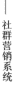
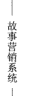
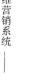
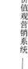
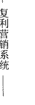
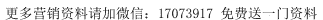
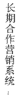
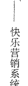

# 陈昌文：72大营销系统（下）

## 序

营销，必须有文化体系，与方法论。
营销的文化体系，就是儒家思想。
营销的方法论，是陈昌文方法。
儒家思想+陈昌文方法，这是陈昌文老板社群的结构学说，专业研究互联网营销，打造互联网品牌化自动成交系统。
陈昌文方法，是专业解决互联网营销问题的一套行动方案+解决方案。解决方案是解决出单问题，解决赚钱问题，解决内容问题，解决营销问题，解决粉丝问题，解决微信、QQ免费声明赚钱的问题，解决品牌的问题。
行动方案=36循环系统。
客户是衣食父母。永远为客户释放最有价值的信息、方法论。36循环系统，不是为了自己，而是为了客户获取最先进的思维模式、营销方法、营销资讯，帮助客户赚钱，告诉客户怎么做，做什么最有前途。告诉客户去哪里做，提供客户不知道如何干的解决方案，是陈昌文方法的写作，创作方向。

然后我们确定价值观建设：客户第一。
使命建设：让天下没有难创的业。
也就是我们老板社群里的老板，都是这个目的：让天下没有难创的业。陈昌文方法，是老板们的营销方法，只要拿着这套方法论，去执行，就能让老板们少走弯路，靠近成功。
我没办法保证您绝对成功，但我确实给您的是经我实践成功后，可以让您少走弯路，少出错的方法论。
有理论指导的营销方法，与没理论指导的营销方法，是两码事。陈昌文方法，就是专门解决老板互联网营销中的问题。属于一个系统，这系统就是为社会提供互联网营销、社群营销解决方案的。

更多营销资料请加微信：17073917 免费送一门资料

取势，从整个产业的高度来看产业链，知道自己的企业在哪里；
明道，系统化打造企业的战略，明确自己提供的价值曲线；
优术，在取势和明道的指导下开展运营锻造团队。

陈昌文方法的构成，文化思想是儒家思想；行动纲领是36循环系统；营销思想是内部营销系统+外部营销系统；持久战思想，也就是我们做任何项目，都是打算从一而终，一辈子干这个；聚焦是我们的核心思想。当我们不赚钱的时候，往往都是因为我们去做了其他项目；永远是客户第一，我们制造的是客户需要的内容；要把服务做到极致，365天、十几位讲师不间断、全年无休的讲课，这是服务的核心；我们的流量，全部来自于儒家思想和陈昌文方法极致的内容。

陈昌文方法是专业的营销系统，也就是您不会卖货，不会搞营销，就跟着我们学习营销。我们专业搞营销，卖营销，培训互联网营销，培训网络营销人。我们所有的东西，其目的，最终还是搞营销，营销培训，营销教学。我们做好营销的核心，是宣讲儒家思想。

**我们的每一个营销套路都来自于儒家思想，我们是搞传统文化+营销的。每个营销，都有步骤。**

**我喜欢国学，一切通过国学解决问题。我建立了社群，一切通过社群解决问题。**儒家思想与陈昌文方法结合，构建企业家思想。有思想，才有企业；无思想，则无企业。经营企业是经营思想的结果，营销策划是有技术的，做企业也是一门技术。

我们老板社群里的人主要干啥？

- 1、学习儒家思想。
- 2、学习陈昌文方法。
- 3、也可以跟着老师合作做老板社群等项目。

我开发陈昌文方法的目的，就是让任何接触到我的人，收入倍增。任何企业，接触到我的方法的，收入倍增。这就是我开发这套方法的初衷。还要保证大家的价值观正。所以，我讲儒家思想，写《论语》给大家。

社群研究的是儒家思想、陈昌文方法，也就是价值观+营销。这玩意有什么用？儒家思想统领陈昌文方法72大营销系统。儒家思想本身就是王道思想，而营销是术，这道术一结合，就自成一体，成为最强大的营销学。

人们都会为宏大的目标惊艳，人们希望参与到宏大目标中来，所以，我们开始提出宏大目标。我们的宏大目标，就是把儒家思想、陈昌文方法，普及给十亿中国人。为什么要提出这个宏大目标？这会让我们很多人跟着我们干这个伟大的事业。

乔布斯提出了非同凡响，与众不同，改变世界，这就是一个宏大的目标，宏大的目标总是让人记住，总是让更多的热血青年，有能力的青年来参与。

我们必须在这个品类里是一个超级制高点。把儒家思想、陈昌文方法普及给十亿人。这个超级制高点，没有人会做，这个是一个峰级事业，这会吸引到很多牛人来跟我们干这个事业。

宏大的目标，能让人们为之奋斗一辈子，一个宏大的目标，也让我们所有内部人、外部人知道，这个目标是遥遥无期的，这个目标太伟大，太遥远了。所有人要开始思考，我们如何能快速实现这个目标？我们如何能更好的完成这个目标？

营销的主要目标，不是营销外部人，而是营销内部人，让内部人都理解了这个概念，都知道了我们的未来要去向何方，大家自然有了凝聚力。我们的目标，把儒家思想、陈昌文方法普及给十亿中国人！

来点厉害的角色，跟着我们一起来实现这个目标吧！

乐观向上，永不言弃。成功的唯一路径，就是永不放弃。太多的人，都是因为坚持不下去，放弃了。好的方法论，比如聚焦系统、减法系统，是要您坚持不懈，长时间的尝试，您才有机会体会到这些优秀的赚钱手法。否则，您可能一辈子也体会不到这些优秀的赚钱思维模式。

不放弃，您的经验才会增加；不放弃，您的事业才有可能成功；不放弃，您才能见到大多数人见不到的风景。

大多数人的心性不及格，这是大多数人失败的原因。

先修炼心性，才是我们成功的唯一出路。

永不放弃！

陈昌文
2020年2月于上海

更多营销资料请加微信：17073917 免费送一门资料

7

更多营销资料请加微信：17073917 免费送一门资料
更多营销资料请加微信：17073917 免费送一门资料
目录

## 第三部分 陈昌文方法实力打造系统

### 第三十七章 陈昌文方法72大营销系统之品牌营销系统

> 品牌是核心竞争力。——陈昌文

#### 品牌就是文化原型

品牌就是文化原型。

其实品牌有两个出路，一个是把自己打造成品牌，这个就是英雄改变时势。难之又难，建议大家不要走这条路。第二条路，就是找到文化母体，文化原型，所有成功的人，都是借力的高手。所以，李嘉诚讲，取势是核心重点。

品牌最大的优势在于能够让消费者在特定的场景中产生联想，进而潜意识的引导消费者进行购买。

IP营销的核心，不是宣传自己，而是让自己跟某些强IP扯上关系。比如，跟传统文化扯上关系就很好。

高手都是IP开发大师。《明朝那些事儿》、《货币战争》，都是如此，一个强大的IP，加上作者对词语、文字、文化的把控，就火了。

比如四川的张飞牛肉，至于张飞牛肉同张飞是否有关系，暂且不论，但是有了三国文化的传承，有了张飞这个因素，引导消费者的联想的指向已经建立，辅以适当的营销宣传，很容易被消费者接受。

云南的过桥米线、北京的烤鸭、兰州的牛肉拉面，能够流行，基本上都是借了传统文化的光！

又比如，我们社群要取的是儒家思想的势，传统文化的势。衣食住行，很多道具，都可以用古装的，这就是文化营销。您跟着做，就会感觉到这个文化营销的魅力。而且您的朋友圈、您的微博、您的形象，天生就有差异化、特殊化、品牌化。与众不同，才能让人记住。抖音上，很多火起来的人都是借助了中国传统文化，借助了古风的力量。

可以这样说，中国的所有明星，都借助了古装的力量，他们几乎都是靠这个火起来的。传统文化、古装，是根植于中国人内心深处的是，是我们内心深处的梦。

**品牌必须建立在文化母体、文化原型上。** 一个群体，必须与众不同，又在人们的幻想、梦中，然后又讲的非常有道理，这就有杀伤力了。

比如，我们社群是讲商业思维的，有了商业思维+传统文化，这个模型，我们一定可以做好。

老板在一起相互交流是非常重要的，您必须有先进的模式。闭门造车是非常愚蠢的，要开放。要跟更多厉害的老板、同行学习他们的经营模式，思维模式，这是陈昌文老板社群的价值。

有很多人，都想学习先进的赚钱理念，分享先进的赚钱理念、机会，我们社群就起到这个作用。

我们社群的价值是什么？一群老板每天讨论如何利用短视频、直播、朋友圈、社群盈利；如何做流量，如何做转化。

**互联网创业，可以让很多人的成本变得极低。**

您投资一个餐厅，是需要大成本的，

您投资一个工厂，需要的成本更大。这样搞亏损的风险非常大。

所以我们希望老板们要懂得文化营销，就要学会运用中国最强大的文化母体、文化原型，就是我们几千年来的衣食住行，我们几千年来的文化。

**我们生存的本质，是我们为社会贡献了多少价值。** 我们的直播，我们的视频，我们的文案，是不是释放了陈昌文方法的每个系统。这些系统，都是可以征服人的，只有通过这个系统征服了人，别人才会买单。也就是您在外面讲的没价值，别人就不会买单。

从衣服、讲话、使用的物品上，看到您的与众不同，这是我们社群品牌化，文化原型营销，文化母体营销的第一步。

买广告的目的是让流量成本持续降低，一直到 **0**。而买流量，则流量成本越买越高。买流量就是吸毒，买得越多，毒瘾越大，越戒不掉。企业存在的唯一价值，就是交“流量税”。

广告建立品牌，买流量不能建立品牌。所以，我们一定要建立自己的品牌，而不只是有流量。纯粹的买流量，没什么意思。一定要建立一个品牌，靠着这个品牌卖货，卖服务，则我们可以做强做大。靠着买流量，犹如在沙子上建立城堡。

以后的社会，就是品牌化、规模化，才有出路。您不做品牌，没有核心品牌，您是很难赚钱的。

品牌让消费者建立忠诚度，属于一种无形资产。我们对品牌的投资，是音频投资、视频投资、文章投资。所谓忠诚度，就是您实实在在在帮助了客户，客户没有办法离开您。跟着您，客户获得的好处更大。所以，我有一些客户，以前有过矛盾，不过依旧跟着我学，这就是品牌忠诚度。为什么？因为他在我这里可以获取好处，可以继续发财，继续创好业。

人只能自己消灭自己，别人消灭不了您。您只需要不断强大自己，优秀自己就行了。

品牌是一项服务，对这个社会起到某种作用。而我们的品牌：陈昌文方法，就是服务企业家、老板的，有很多都在我实用的互联网营销、社群营销方法，苦于找不到，浪费了大量钱财、精力、时间。而我们建立的营销方法，其目的就是为社会节约时间、成本、精力，让这个社会更高效地运转。

所以，有志于做一个社会企业家，或者在社会上，对整个社会有帮助的人，都可以跟我合作。一个产品或者服务起到了作用，从而让大家记住了它的名字，这就是品牌。陈昌文方法，必须让客户感觉到有用，而且去实践的时候，确实能帮其赚钱，帮其更快的成功。

所以，我希望什么样的客户来找我？也就是在网络上，通过我的只言片语，理解了营销，然后去获得了一些好处。比如多赚了钱，多找了客户，走的更稳的时候，再来找我。而不是一开始，就拿着钱来找我，相互之间，没有深层次的信任，不好沟通，效率低。

我们先通过有价值的执行方案去赚钱，有了本质的提升，我们再进行深度合作。

**品牌的目的是为了在消费者心中形成固定印象，增加溢价，从而提高产品的销售量。**陈昌文方法就是一套营销的方法论与具体执行方案。我们要留给大家的印象，就是我们是为社会贡献营销方法的。我们是营销方法的提供商，我们为老板们提供解决方案，服务于最终目的。也就是老板们认认真真 的理解我到底说了什么样的赚钱方法，以及具体的创业、营销步骤。他跟着我这个步骤，这个理论去行动，就能成功。这就是我这个品牌的唯一目的。

## 品牌的本质是降低营销成本

我们是搞品牌营销的。我们的品牌是什么？陈昌文方法72大营销系统、陈昌文老板社群、儒家思想。这就是我们的品牌，我们也是营销我们品牌的。

我们是干啥的？我们是教人做营销的，搞品牌，搞社群的。我们也教人儒家思想，这是做人的问题。

儒家思想跟营销有什么关系？儒家思想是正念，是大道，我们是用儒家思想来驾驭陈昌文方法72大营销系统的。

我们的客户是谁？是老板，只有老板才可以进入社群。社群是个入门级产品，是跟我的一些粉丝、爱好者一起建立的。

品牌营销就是要打着一个品牌名称，我们的品牌名称，就是陈昌文老板社群，陈昌文方法，以及儒家思想。我们做生意，必须要有品牌，要有品牌名称。我做微博的原因，也是为了给社群建立一个品牌。社群有了品牌，有了信任度，您是谁？您的公司是什么？您的身份地位搞清楚了，别人才会给您付费。

品牌的本质是降低营销成本，传播成本，提升信任度的。品牌，吸引对应的人。要让市场非常明确我们的定位。

陈昌文老板社群的品牌目的是什么？为客户服务一辈子，做最好的老板圈子。最便宜的价格，付出最有价值的内容。

我们要培养更多的优秀讲师来讲视说，爆粉，不断地宣传陈昌文老板社群整个品牌。

赚钱的本质是您在陈昌文老板社群里找到干货，传播出去，而且只讲干货。我们不需要很多粉丝，我们要的是极其精准的企业家。

既是要铁粉，就要求我们非常有能力，而不是哗众取宠。

品牌营销首先要验。也就是不要让社会找到我们的漏洞，有漏洞我们要及时改正，否则增加我们的经营风险。

我们做陈昌文老板社群这个品牌，目的就是降低企业家的选择成本，企业家就应该加入我们社群。让企业家们知道，这个社会上有这么一个圈子，圈子里面有很 有 价 值 的 信 息 。

陈昌文，这三个字就是品牌，讲直播、朋友圈、公众号、微博等方面面都体现出来陈昌文这几个字。

陈昌文老板社群的本质是在营销陈昌文开发出来的儒家思想，陈昌文方法72大营销系统。也就是说，产品是儒家思想、陈昌文方法72大营销系统。

贩卖的是什么？贩卖的就是陈昌文先生的思想语录。这是大家要深刻认识的，我本人跟“陈昌文”是无关的。当然这是一个观念、一个看法。也就是，陈昌文先生其实是抽离出来的一个品牌。我们大家都在卖陈昌文先生这几个字而已。

陈昌文先生，就是一个人物、一个品牌、一个营销源头。这个营销源头会自带神秘感、权威感，具有影响力。当这个影响力存在的时候，您再去宣传，而且讲的确都是干货，您的演讲也炉火纯青，讲的好。则，客户就自然付费买单了。

品牌营销的目的是什么？就是要卖得好，卖得多，卖得贵，卖得快，卖得具有信任感。所以，陈昌文先生是一个非常强大的营销品牌。这就跟蜘蛛侠一样。蜘蛛侠的东西，大家都喜欢，都购买，无论是电影，还是海报，还是玩偶，但是蜘蛛侠的扮演者，这个演员，其实跟这个蜘蛛侠无关的。陈昌文先生也跟陈昌文本人无关，这就是一个品牌形象，大家靠着这个品牌形象吃饭。

有了陈昌文先生这个品牌，则具有天然的信任感，也可以贵卖，还可以以高冷模式的卖。大家不过都是陈昌文先生的社群顾问而已。您不要体现您自已牛 B，而是要体现您转介绍的儒家思想，陈昌文方法72大营销系统，都是陈昌文先生的边角料，还有很多更厉害的东西。如此模式，您的卖单才会更厉害。

书籍营销系统的建立，也是为丁建立这个陈昌文先生的品牌形象。我们是为丁这个品牌工作，贩卖品牌。我们的目的，也是为丁让企业家为这个品牌买单。

什么是好生意？贩卖儒家思想，陈昌文方法，就是好生意。贩卖陈昌文老板社群就是好生意。这是卖智慧，卖思想的生意。

陈昌文方法是个品牌，品牌营销如何做？大家都来卖陈昌文方法，都依托于陈昌文方法这个品牌。陈昌文方法是一个营销系统，是可以落地到任何企业家、团队的营销系统。儒家思想呢，是正本清源的规整这个陈昌文方法，让这个营销系统是最正宗，接近于道的营销系统。

陈昌文方法，是阳谋性质的营销系统。陈昌文方法是我们的品牌，我们也要构建我们的品牌营销系统，也就是我们社群怎么建立自己的品牌，这不是正确的问题。如何创建品牌？ 这也 不是正确的问题。问这样的问题，差不多就是一切谬误的开始。

正确的问题是：“品牌的目的是什么？”

> 只要您始终服务于最终目的，就有良知良能， 就能堵塞一切错误的源头。我们为什么犯错？因为想太多了。

我要建立的品牌，就是陈昌文而已。我要干啥？我就是教人创业，做互联网营销，带人做社群。

## 何谓品牌？

一直在谈品牌营销，但多数人理解什么是品牌营销吗？品牌营销，就是您的名字，就能成交，这就是品牌营销。

何谓品牌？您对社会的承诺就是您的品牌，您的 IP，您每天说的话，都是您的品牌。

您必须不断地释放好东西，然后您就成了品牌。然后您有了广告尾巴系统，有了内部营销系统，自然就出单了。品牌，是拼命释放出来的。年轻的时候赚钱，只知道努力。年纪越大，慢慢明白，赚钱靠的是影响力、品牌、知名度、IP。

**品牌化营销，是我们的必经之路。**
**品牌创造顾客。**
**品牌，是唯一的竞争优势。**
**品牌化的目的，是降低成本，成本低到极致，让客户识别到我们，这样才能成交。**

比如，陈昌文方法，就是唯一的竞争优势。陈昌文方法就是一个品牌。记不住名字，一切都不存在。我们必须让别人记住我们的品牌名，我们是卖什么的。这样，别人想买，就来了。

**IP 模式，就是打造一个绝对独一无二的东西。这就是品牌，这就是核心竞争力。**

**品牌营销是最强大的营销体系，我们社群，主要是传播儒家思想*陈昌文方法 72 大营销系统，我们建立品牌营销系统，让品牌自动带着大家赚钱。**

**一件事，不能长久的做，则毫无意义。**儒家思想、陈昌文方法，能讲一辈子，而且，进入品牌化营销模式。这是能长期做的。我以前做过很多项目，不能长期做，我的资源、精力损失了。而传播儒家思想、陈昌文方法 72 大营销系统，品牌营销的建立，是可以长期做的。我会一辈子干这个。

# 如何建立自己的品牌？

我们想要赚钱，就是日日不断地搞 36 循环系统，永远都在干，永不停息的干。智慧是在干的过程中总结出来的。想要建立品牌，就不要换项目，就要从一而终。时间越久，您就越有品牌。

您做讲师，做 10 年，做 50 年，您一定可以在中国小有名气。品牌是对消费者的一个承诺。比如，我们社群几大讲师，日日讲课。

我们要求讲师日日备课，日日讲课，主动带大家赚钱。同时讲师自己要以身作则，做好表率，不断地出单。

有了品牌，别人认可您了，沟通成本低，买单效率就高。

有了品牌，我们的营销成本就降低了。

商业的本质，就是降低成本，

买贵的东西，买有品牌的东西，也是为了降低成本，为什么？比如，买便宜的车，您可能经常要修，会坏，安全性不好。买贵的，看似很贵，但不用经常修，安全性好，本质是成本更低。

看起来贵的东西，成本低，看起来便宜的东西，成本高。其实这个社会，富人的生活成本低，所以是富人。穷人的各项生活成本，消耗太高，所以是穷人。这个哲学问题太深刻，可能一般人理解不了。理解了这个，就知道为什么我们要建立品牌，为什么我们要买品牌的东西。也就知道我们做品牌的价值。

有了品牌，客户老老实实选择我们的服务，我们的社群。为什么？因为，我们就代表质量非常高的社群。您选其他的，没我们这个服务好。您为什么不选我们的？我们只建立一个品牌，就是老板社群，就是培训讲师。

想要有自己的品牌，就要给自己取一个让人过目不忘的名字，一个简单又过目不忘的名字，就是您的品牌，就是您打天下的核心资产。

想要自己有品牌，就要包装自己。

比如，您经营过什么公司，您的职位，您的业绩，您的成绩，我们社群的人数，我们社群经营了多少年了，我们社群是干啥的。

这些都是包装。我们每个讲师的形象是不是高大上，话语是不是高大上，这些都是包装。包装不是欺骗，不允许讲假话，公共场合讲假话，是违规行为，严重违法，是自己给自己挖坑。所以，每个人都要讲真话。每个人，必须按照明星的要求，把自己打扮成男神、女神，这是互联网生存之道。您不重视，有人重视，您就淘汰出局。

包装的目的，是为了让人记住您，活成别人的信仰，活成别人心中的神，活成别人心中的幻想。

所有成功者，都是别人心中的神、幻想。所有真正的成功者，都是这个模式。要么活成小众的神，要么活成大众的神，要么活成粉丝的神。

要有品牌，也靠良知。

人是有感应的，您真在帮大家，大家是能感受到的，长此以往，就支持您。您要只是坑害人的钱财，大家是不会喜欢您的，长此以往，您就会被抛弃。

要有品牌，德行必须好。这也是我们要日日修炼的。

品牌，一定要做的是定位！

为何要定位？没有定位就没有地位！

更多营销资料请加微信：17073917 免费送一门资料

比如，我教营销，我教互联网营销，我教传统老板转型互联网营销，我教美容行业老板互联网营销，我教美甲店老板互联网营销，我教美甲店老板抖音营销。这个定位的思路，来自于聚焦，聚焦就是定位最好的方法。

# 品牌的四个定位：

- 1、确定竞争对手是谁：我们要分析外部环境。多找同行，观察同行，借力同行。
- 2、树立品牌的优质定位：避开竞争对手在顾客心智中的强势，利用竞争对手强势中蕴含的弱点，确立品牌的优势位置，树立一个最肥美的市场。我们聚焦，攻占最肥美的市场。
- 3、信任状：寻求一个可靠的证明。别人为什么信任我们？从形象上，就要解决这个问题，从朋友圈解决这个问题，从照片、视频，解决这个问题。展示出来，但必须讲真话，不可弄虚作假。
- 4、将信息植入客户的心智：将这个定位整合进企业内部运营的方方面面，特别是传播上要有足够多的资源。

# 第三十八章

# 陈昌文方法72大营销系统之差异化营销系统

营销就是差异化。——陈昌文

更多营销资料请加微信：17073917 免费送一门资料

### 差异化就是利润

品牌化的核心，就是差异化。差异化，就是利润，就是流量。您不懂差异化，就没前途。

差异化+儒家思想+陈昌文方法，就能出单。所以您们必须差异化。

差异化，就是品牌化；差异化，就是流量。

差异化，比什么都重要。

与显而易见的真理反着走。

想要在互联网上崛起，您必须差异化，您必须跟人与众不同，非同凡响。您要是跟别人一样，就没有人搭理您。您必须有资源。互联网上做视频，做直播，有起色的，全部都是跟普通人的玩法不一样的，全部都是有特色的人，任何网红都是如此，您必须差异化营销自己。

什么差异化是营销的本质，为什么品牌是营销的本质，就是因为稀缺，稀缺性才是一切。与显而易见的真理反着走，这就是制造非常强大的稀缺性，这是最有杀伤力的营销思维与操作手法。

与显而易见的真理反着走，就是差异化、特殊化。有特征，有品牌，品牌是唯一的竞争力，差异化是唯一的竞争力。内容有干货，形式有差异化，释放正能量，无违法乱纪，这就是营销的核心。

差异化+重复，等于利润。

一个人没有差异化，没有想象力，就没有品牌。乔布斯说：“与众不同，非同凡响。”这几个字，就是营销的精髓。

### 差异化，才能传播

营销必须要有差异化，服务必须帮助到客户。其他事情，都没差异化+真正帮助到客户更加重要。

凡是懂差异化的，百分百赚钱，百分百让人记住您，记住您的人越多，您利润越高。

所有火的人，都是差异化、特色化，毫无例外。没有创新创意，没什么意义的。企业家的定义，其实是创新。没有创新的企业主，只是管理者。真正的暴利，是创新、创意，是差异化。这才是真正的传播。

凡是厉害的，都要搞差异化营销，只有差异化，我们才能生存。只有极度的与众不同，我们才能存活。

所有人先解决第一步，差异化问题。每个人，先树立自己的话题性。这一步完成，每个人都飞跃。

差异化，其实很容易的。你们不愿意做罢了。与众不同，弄一弄就与众不同了。您可以天天说，我是个鸡蛋，我今天给大家讲创业。

营销就是差异化。绝对标志化，差异化，才能树立品牌，动流量。

扯淡，囧，有特色，尴尬，有点难受，有点恶心，又积极，正能量，这种人，会火得一塌糊涂，营销最牛B的，必须是差异化，特色化。凡是能够领悟这个的，火起来是必然，赚钱也是必然。火起来很简单，就是特殊，就是差异化，就是囧。好好理解“囧”这个字。

### 品牌化与差异化，不可分割

品牌化和差异化，这两者是分不开的。

用差异化打造您的品牌化，鱼和水的关系。

您有什么与众不同、非同凡响的地方？您凭什么区别于其他人？这就是您的品牌。做别人从未做过的事情，这就是品牌，《魔兽世界》以前的口号，就是做别人从未做过的事情。

品是什么？品字三个口，就是传播，众人传播。您有被传播的价值，您就有了品质。您必须成为话题本身。王某某说吴某某。王某某是营销大师，他总是成为话题本身。然后大家传播王某某，他就是品牌了。比如，讲师，您必须成为话题本身。名字+形象+讲述的内容+社群，都必须成为话题的本身。

牌是什么？是您的标签，您的slogan，您的IP，您独有的让人们记住的独特之处。这个独特之处怎么打造？就要差异化。

差异化就是市场竞争力，是利润点；

差异化的作用是让别人记住您，忘不掉，挥之不去。差异化，就是要一眼记住，忘都忘不掉，没办法忘记，这就是最高明的差异化+品牌。

差异化的好处就是快速打响知名度，不管是个人还是企业。

差异化分有形和无形两方面。任何事物都可以做到差异化，差异化在我们生活中的各个方面。

品牌的核心作用是让人迷恋上您，甚至自己迷恋上自己，让别人日思夜想，神魂颠倒，就想要您。

您有没有日思夜想一个人？有没有日思夜想一辆车？有没有日思夜想一件衣服、一双鞋子、一块手表、一顿美食、一次旅游？这就是迷恋，也是品牌的塑造。

我们为什么要打造自己，就是让别人迷恋上，您让人着迷了，您就售卖什么卖什么，对方全买单。

想要别人迷恋您，您就要有特殊的地方，也就是差异化。绝对吸引，不是简单搞怪。要从每个环节、每个细节入手，每天翻开您都是不一样，每天都想探索，完全沦陷。

怎么让人迷恋上您，源于7个触发器：欲望、神秘感、警报、威望、权利、罪恶、信任。

这7点就是迷恋的核心，是影响决策力的方法，它比营销、广告，其它形式的交流更具说服力。

- 为什么您会被特定的人吸引？
- 为什么您会牢记于心而忘掉其他？
- 什么力量驱使我们购买自己原本支付不起的奢侈品？
- 为什么爱上根本“不该爱”的人？

从您选择的品牌到您记住的歌词，从您的结婚对象，到您所雇佣的员工。您看似对一切“尽在掌握”，实际却被迷恋的触发器操纵。学会正确的激活触发器，您就能让任何人着迷！包括您自己！

这是行为学、社会学、神经学、人类进化学，揭示我们为什么会某些东西神魂颠倒，迷恋不已。

# **学会让自己成为别人迷恋的核心，让它不可抗拒的影响力为您所用。**

比如，我们社群的品牌就是典型的差异化社群，典型的迷恋品牌社群，是一个综合体，让您欲望不能的差异化老板社群。

我们社群现在内部8位老师循环讲，还不包括外部；每天5个小时以上的课程，真人讲课不是录音，课上一对一提问；我们的讲师不是只

会讲不会干，是每天都在干目的，且自己必须有超过所有学员的收入；全年 365 天无休；我们不但教理论，我们还一步步实操讲方法，教任何一个操作细节；我们社群陈昌文先生每天研究市场，跟着市场一起成长，哪里火，我们就去哪里；我们讲师演讲，陈昌文先生每天都给写出一篇演讲稿，不需要讲师发挥，完全听话照做执行；我们每天重复陈昌文方法，让这套方法深入您的血液和骨骼，帮助您赚钱，教您成为一代业内高手，一代业內宗师；我们社群每天抱团操作项目，每天抱团涨粉，抱团打下；我们每天讲儒家思想，指导社群每位成员做一名儒商，走大道；我们是最负责任的社群，遵以己所不欲勿施于人，有问必答；我们是在外部释放价值最多的社群，外部课程讲的都是实用的干货；我们不做售前，只专注做售后，把售后做到极致；我们提供社群创业者项目，分工合作，只收取一点香火钱；我们全面提供给您需要输出的内容，而且社群资源您全可以使用，不涉及侵权。

这样的老板社群，目前您找得到第二家吗？这些全部都是差异化，用差异化树立我们的独特品牌，跟别人不一样，我们社群的讲师讲直播都带着钢碗瓢盆，有这样的吗？没有，这也是差异化，**一个人差异化容易点，一个团队差异化很难。** 差异化就是您在某个地方跟别人不一样，然后不断扩大。

## 第三十九章 陈昌文方法 72 大营销系统之重复资产营销系统

> 重复才能成为资产，享受复利。——陈昌文

### 成功的核心是重复，而不是标新立异

商业上的成功靠什么？靠不断地重复，强调一个概念重要，客户就会买单了。人生的成功，来自于不断地重复 36 循环系统，一切只重复，传播，洗脑的本质是重复。

> **不断地重复，永不放弃的重复。成功的核心是重复，而不是标新立异。**

我们社群只重复 36 循环系统，或者干 36 循环系统，无论是微博还是老板社群，都是如此。只讲一件事，只塑造一个品牌关键词，塑造一个卖点。其他卖点都扔掉，则客户记住您。从此过后，我们的一切，都贴上 36 循环系统的标签。

金刚经道场一直讲《金刚经》。于丹就是讲《论语》的。这才是重复的根茎，您讲其他的，就不好了。

只有重复，才能形成传播，才能形成记忆，才能形成资产，任何事，我们每天重复 36 次，重复一辈子，否则，我们就不开始，重复一万年。不重复的事情，没有意义，只有重复的事情，才有意义，**一件事只要不能重复，就放弃。**只做重复的事情，陆某重复“真好”，就出名了。

各位必须重复，只有重复才能形成品牌关键词，形成记忆，形成传播，形成势能，形成资产，不胫而走，自动飞翔。

真正的营销是重复，只讲重复的东西，不重复的东西不讲。不是天天找新的讲，而是天天找旧的讲。温故而知新。

我们社群只做重复的事情，不重复的事情，我们根本就不做，直接放弃。比如，我们是搞老板社群的，我们就只讲营销方法，儒家思想。

我们每天重复什么？36 循环系统，聚焦系统，儒家思想，裂变系统，收徒系统，矩阵营销思维，人海战术，蚂蚁战术……我们就重复这些，脑子好的，多重复几个，脑子不好的，少重复几个。

日日重复这几个重要系统，整个平台、社会，都记住我们了。当然，我们的大品牌关键词是陈昌文老板社群，这是要核心重复的，日日重复的。重复多了，就成了资产，每个系统也成了资产，资产自己会下金蛋。

营销的核心是让客户记住，让客户记住我们的名字，我们的价格，让黑粉都记住，让所有人都记住。

矩阵战略，人海战术，蚂蚁战术的核心是，您必须把现有的、身边的每个人都维护好，让他们在直播间、视频里，您的整个社交关系网加持您，也就是您必须释放有意义的东西给别人。

我们的核心理念就是重复，我们的一切都嫁接文化母体，一切对接中国传统文化、神话，营销的最高境界是神话传说，其实是传统文化传说。比如，我们社群的一切知识点都对接儒家思想、《道德经》、佛家经典。我们只重复人类历史上最经典的数字、故事。

我们只做重复的事情，我们必须积累我们的品牌资产。

### 品牌就是一连串的记忆

品牌是要重复的，品牌就是一连串的记忆。个人品牌，就是您要在一个领域里重复您是第一人，您是第一名，您是最牛 B 的，您是这个领域的专家。这样，就会有更多的人来找您做生意，您做生意也就容易了。

品牌的核心，就是重复系统。

- 重复了，就有了记忆力；
- 重复了，就有了标签。

我微博上的文章，足够大家一个人年赚几百万了，就这点东西，翻来覆去的讲。讲东西，不是讲多的，不是成天追着新的讲，而是讲老的，讲旧的，把老旧的东西讲出新花样，讲出记忆感，有趣感。

幽默是什么？大家熟悉的地方的另一个比喻。也就是说，如果您讲的别人都听不懂，无论您是多么好笑的一个笑话，别人都不会笑。这是一个哲学问题，也是一个实践问题，重复系统，就是不断地重复几个关键词。比如，我们社群讲 36 循环系统、儒家思想、聚焦系统、讲师系统，《论语》只讲十篇，不允许讲多了，系统只讲几个关键系统，形成品牌资产，不允许讲多了。讲的少最好，而不是讲的多。翻来覆去，只讲几个系统，不断地重复就行了，也是核心中的核心。

重复系统，是所有系统中，最有意思的系统，品牌资产的建立靠重复，传播也靠重复。讲以前的文章，翻来覆去的讲，讲各大系统的文章。重复的系统要做得好，就是讲得少，讲得重复。

重复系统，才是真正有意义，真正强大到不可思议的系统。直播的时候，必须利用重复系统，重复几个关键词，这几个关键词，就是您的品牌资产。

陈昌文老板社群，陈昌文方法，儒家思想，这就是我们社群所有人的品牌资产，重复的次数多了，随便收单。这些，都是系统化的教学方案，知行合一。

我们只讲重复的东西，而不是去讲新东西。

赚钱就是重复。

### 不断地贩卖，传播，就是投资资产

世界上最厉害的就是重复。只要重复的次数多，就会成为传奇。不要创新，找到了好的资产、好的卖点，就一直卖。比如，陈昌文老板社群，就是专业卖儒家思想，陈昌文方法 72 大营销系统，搞品牌营销，资产积累，资产营销。

什么东西是资产？有人买，而且您一直重复，不创新，就是资产，您的粉丝一直看到这个东西，天天在这个资产上吸取养分，而且，这个东西不断地在卖，有新的人购买，就是资产。

这个资产，不会被放弃，永远不过时，就是资产。会过时的，会放弃的，都不是资产。而且，这个东西会产生现金流，让卖这个资产的人都获益。这就是好资产。

陈昌文方法，儒家思想，陈昌文老板社群，就是这样的资产：大家天天卖，取之不尽用之不竭。儒家思想不会过时；陈昌文方法 72 大营销系统，不会过时；陈昌文老板社群，这是一个企业家的圈子，不会过时。这个生意可以做一辈子，一万年，这就是好资产。

不断地贩卖，传播，就是投资资产。

只重复一个卖点，一个关键词，不要重复多了。一个人的卖点一旦定下来，就永远不要换，这才是高手。我们前面讲了 5 大锁定系统，所有人都必须根据 5 大锁定系统做事。您锁定了一群人，服务一群人，跟一群人合作，就永远不要情绪化，不要变。

越是不变，越有利润；越是变，越趋倒霉。

我们只干重复的事情，我们一起床，就知道我们要传播什么资产，要售卖什么资产。这才是高手。

比如，我们天天卖书，卖社群，卖儒家思想，卖陈昌文方法，卖陈昌文老板社群。这个资产能盈利，且越卖越强大，而且书籍会重复购买，而且是小单，可以卖给任何人，传播得更快、更广，受益的人更多，更普及，这叫法布施，智慧布施，智慧帮人，同时对社群的每个人都是加持。

### 从一而终，品牌才有力量

做项目，最重要的就是从一而终，滴水穿石，绳锯木断。做项目，最重要的是要一辈子只搞一个项目，当您找到这样的项目过后，您就要重复工作，而不是放弃，而不是换新的。大多数人都非常有冲动换项目。因为他们总是觉得自己赚不到钱，是项目问题，是外因，而不知道，其实自己要是明白了经商的道理，任何项目都能做起来，要是不明白经商的道理，再换项目，也没有意义。

我不反驳任何人，我不怒任何人，我不嘲讽任何人，跟任何人有过节，即便是别人让我很不爽，我也只反思自己，去重复售卖我们已经拥有的卖点、资产。一切不过是强大自己的结果，一切不过是经济强大的结果，您的经济强大了，很多事情，您也就无所谓了。

进陈昌文老板社群，一辈子，只干重复的事情。只重复售卖资产，不乱搞创新，只做微创新，只做微调整，就是最大的创新。不断地重复，客户才会买单，不重复，没有品牌资产。

### 品牌资产贴现

我们社群的重要资产是什么？

- 儒家思想
- 陈昌文方法
- 陈昌文老板社群
- 个人品牌训练营
- 聚焦系统（隶属于陈昌文方法）
- 减法系统（隶属于陈昌文方法）
- 36循环系统（隶属于陈昌文方法）
- ……

**什么叫做资产？就是这个东西在社会上有一定名气，在粉丝们心目中有一定的影响力。资产是什么？就是这个东西我们可以一直加强它的势能，还能不断地贴现，这就是资产。**

比如，我们不断地宣传陈昌文老板社群、陈昌文方法，以及个人品牌训练营、儒家思想、聚焦系统，就有人来买单。这叫做品牌资产的贴现，以及加强品牌资产。我们这个品牌资产非常有意思，您每宣传一次，品牌资产的能量就加强，同时还有可能贴现，您每贴现一次，品牌资产势能又进一步加强。

**重复才能形成复利效应。**

**我们只做能重复的事情，能重复的事情，才有威力，重复才能形成品牌，形成复利效应。我们只搞复利效应，我们长期作战。**

**您必须日复一日的重复您的工作，不重复的工作没有意义。重复，才会有复利效应。**

## 第四十章 陈昌文方法 72 大营销系统之社群营销系统

> 社群营销是个赚钱系统。——陈昌文

社群是天下无敌的模式。群策群力，大家一起干，一起赚钱的模式，才是最厉害的。社群是最厉害的，里面最有厉害的人，比公司化运作厉害多了，就是比公司招的员工牛 B 多了。

我本人做社群，我没有什么力量，只有大家一起努力才有力量。这是我做社群的精髓。我要搞的就是品牌模式、团队模式、社群模式、讲课模式。大家一起干，大家一起发财，而不是我一个人发财。

**社群模式，可以解决一切问题。**社群什么都可以解决，商业上的，团队上的，都可以解决。玩懂社群，就是天下无敌。

社群做得好不好，主要是看社群创始人的格局，然后看创始人身边做服务的人有多厉害，社群里的核心人物有多厉害，能独当一面，当社群领袖。这个社群就很厉害，就能有所发展。

社群做得好不好，最终是看这个社群能为社会创造多大价值。

### 如何做一个牛 B 的社群

首先得有人。什么人？就是定位。您想做什么社群，就定位什么人群。比如，我做社群，我只定位老板，只要是老板，想学习互联网营销，互联网创业，互联网转型，就可以找我们。

做一个社群，必须有价值提供，且这个价值必须聚焦。也就是您谈论的主题永远不换。这样您不断地在网上宣传推广这个主题，讲这个主题的知识，培养这个主题的老师。则，加入您这个社群的人就会越来越多。

坚持不懈的宣传。宣传 3 个月做不好一个社群，宣传一年，您也做不到多大。宣传两年，您也做不到多大。我们做老板社群的时候，就有很多人看看我们做，也跟着做，只是，这些人做了几个月，2 年就放弃了。我们还在做。所以我们是最大的。而且，我们的目标是终身制，永远都会做下去。能永远做下去，是社群变强，变大的核心。

想要做好一个社群，您必须讲真话，不要讲假话。不要炫耀库房，收入。一旦炫耀，您就会进入一个虚荣模式，造假会越来越多。说话越来越不靠谱。漏洞越来越多，信任您的人越来越少。您这个社群就经营不下去了。

做一个社群，开始是几个人，然后是十几个人，然后是几百人，这个时候，可以靠能力、聪明，去管理这个社群。当社群进一步增大，达到 2000、3000、5000，这种人口基数的时候，里面就藏龙卧虎了。这个时候，您就必须靠德行管理了。如果您有德行，您就根本不知道会发生什么。小胜靠智，大胜靠德，没有到一定数量级的时候，您根本理解不了这句话。

想要做好一个社群，您必须带领更多的人做服务。比如我们社群，现在有两个老师在服务。做公司、做企业的人教大家玩互联网营销、互联网创业，都是实践派。不是实践派的老师，我们不要。

一个社群，里面鱼龙混杂，尽可能不要做低端人的生意，不要做喜欢找事的人的生意，情愿不赚钱，也别做这些人的生意，一个人没能力，他不是怪自己，而是怪社群领袖，怪老师。如果您收了这些人的钱，他们势必会在社群里面到处加人，诋毁、毁骂、闹事。这是很多社群崩溃的重要原因。

做社群营销，只盯着富有的人。只有这些人，才能明白社交，交流的重要性。低端人士，理解不了社群的重要性，他们总觉得为什么加入一个群体，要付费？为什么有门槛？他们觉得不值得。这些人，您跟他们交流，也不会有什么收获。高端的，有钱的老板，他们舍得花钱进入群里交流，学习，社交。因为他们认为这个重要。只要您盯着高端客户，您的生意就会越来越好。社群就会越来越好。否则，您就惨了。

想要做好社群，一定要一群人去建立高端社交关系。比如，我们就可以专门做一个抖音里的社交关系网络，只跟抖音里的老板，厉害的主播交流。这些人，如果加入社群，我们社群的势能就会更强大。

一个社群要做好。社群成员的故事要多，故事多，故事传播的远，自己的故事多，则社群做得更好。每个成员要现身说法。比如，您的粉丝是如何做到 300 万的？您用了多久时间？有什么人支持您？您为什么可以靠做社群赚钱？这些，都是价值，天天讲这个，加入社群的人就更多。

做社群，一定要做免责声明，不要让人找您麻烦，要完全规避法律风险，当您只跟高端人士做生意的时候，您这个社群，就能做得非常好。

### 社群经营思维

建立自己的战略，自己的永恒资产。

比如，陈昌文系统方法，就是陈昌文老板社群这个名字。只要我们所有人天天喊这个名字，这个资产就会不断地增值。消费者为什么购买我们社群？为什么？我们的客户是老板。老板为什么加入社群？老板进来交流，进来了解互联网营销？视频营销，直播营销？老板的目的，就是卖货，就是了解互联网。最终学习到商业智慧。

所有的设计，都是一件事，都是为了一个名字，一个卖点，一个营销，一个广告，全面统一化，利出一孔，所有地方都统一。社群的名字，既是我们的战略，也是我们的战术，也是我们的设计，也是包装，也是创意。一切的一切都很植于一个点。

所有客户的反馈，就是最好的营销。客户的故事，客户的感谢，客户的欢迎仪式，这个截图，才是最有杀伤力的。讲故事的关键，是讲什么时间，什么地点，在网络上看到了什么，过程是如何发生的，产生了什么情绪，进群过后，产生了什么改变。

比如，我们社群学员，学了儒家思想的改变，学了陈昌文方法的改变。学会了尊师重道，谦虚低调，讲好运，学会了早起早睡，锻炼身体，学会了 36 循环系统做流量，内部营销系统做转化。交到了多少老师做朋友？交往到了多少同学做朋友？

### 一个社群，必须有定位

一个社群，必须有定位，才可以吸引到精准流量。

一个社群，只要精准流量。非精准流量，没什么意义，付费可能性太小。比如，我们社群的精准定位，就是做社群讲师，传统企业老板做讲师，老板做讲师。一切目的，都是为了打造更多的短视频讲师、社群讲师、陈昌文方法讲师、儒家思想讲师、直播讲师、营销讲师、创业讲师。

每一个想做好社群的人，做好出单的人。都必须让粉丝明确的知道您是干啥的，您锁定的客户区间越狭窄，越赚钱，聚焦到一点，只谈论一件事，别别人就找您。

您是一个专卖店，您才有前途。您是一个杂货铺，找您买单的人只会越来越少。一个社群如果没有定位，客户不知道您是干啥的，就不可能买单。一个社群如果没有定位，客户根本就记不住您。您定位清晰、精准，就会在客户脑中留下挥之不去的印象，他想买单了，自然找您买单了。所以，要不听地诉说一个点。

做社群，您的定位是什么，这是您要天天宣讲的，您不讲，客户就不知道。您讲了，吸引到的都是精准流量。能吸引精准流量，才是真本事，我们希望吸引到想学做互联网讲师的老板，加入陈昌文老板社群。

您必须宣布您是做的最好、最大、最强的，没有竞争对手。然后，客户认为您没有竞争对手，您就是第一的时候，您就成功了。您的目标，也是您的定位。社群将要演化成什么样子，您必须宣布出来。社群到底在做什么动作，您也必须宣布出来。

比如，我们社群的定位，就是您是个老板，您不知道如何在互联网上做流量，变现，我们就是专业解决这个问题的。且我们也不断地培养您当讲师，讲师也是专业解决做流量，做变现的问题的。其实，所有生意的本质，就是做流量，做变现。

社群一旦有了定位，就不要换了，就天天讲这个。天天做这个生意，其他任何生意，无论多赚钱，多有诱惑力，都不碰。真正的利润是复利效应。也就是看似现在不赚钱，但我们不断地积累粉丝，积累变现能力。日复一日的干下去。干上 3 年、10 年、30 年，钱自然来了，要多少有多少。因为，这个时候，您就是这个领域的第一名。而且，没有人可以超越您，除非他也用 30 年时间。您可以把一个社群做得天下人都认可您。

大多数做社群的人不成功，就是因为讲话稀里糊涂的。客户也被您弄得稀里糊涂的。如果客户加到您，经常问您，您是干啥的啊？您做什么的啊？可以介绍一下吗？就说明，您自己都没讲清楚您是干啥的，您自己稀里糊涂的，客户不可能付费。

真正的定位高手，就是客户非常明确知道您干啥，学啥，为什么要付费。你们每个人要把为什么要付费讲清楚，学啥，交流啥讲清楚，付费给您，可以干啥，讲清楚。则您就定位清晰了，客户就自动付费。

### 知识型社群管理规则

很多人做社群，不懂管理，那么这个社群势必会被做烂。

网络上什么人都有，即便是您锁定了客户群体，依然有性格奇怪，喜欢找事的人来找我麻烦。管理是非常必要的，我以前做社群，是不管理的。

这就导致有个别坏人，出来搞破坏，聊些无关紧要的话题，甚至带偏整个社群的节奏。社群应该锁定一个话题，除了这个话题，其他的都不谈。所以，一定要禁言那些喜欢乱讲话，喜欢讲广告的人，第一次警告，第二次禁言。否则，这些人会给社群带来麻烦。

不要与笨蛋、唱反调的人争论。比如，您这个社群，是做创业项目的，社群里就永远谈创业项目，其他事情不谈。您这个社群，是做情感服务的，就永远讲情感服务。

进行社群营销，永远只找对的人，也就是理解您的，不找您麻烦的。付费过后不退货的，永远只找高端人群。

对所有客户，都是零承诺。也就是什么也不承诺。懂得价值的就来，不找事的就来。这些，您都需要写清楚，让所有人看到。否则，您社群里就会进来一些渣滓。让您的社群经营不好。

### 我们社群的玩法

所有人抱团。所有人讲儒家思想，陈昌文方法 72 大营销系统。每个人都进行线上、线下裂变。只收老板。每个讲师，都要极其精通陈昌文方法的各大系统，且能讲解的出神入化、迷人。

胸怀宽广，日行一善，多讲道德素质，日日直播。每个老师，日日有几百个流量，有转化，算勉勉强强及格。群策群力，所有人抱团发展、传播智慧，做好免责声明，一起强大。

我们社群，每一个分支，都可以讲一周，甚至一年，里面都是博大精深，且相互关联的。比如 36 循环系统，想要做好，您必须每天 10 几个账号，36 个原创视频，保质保量的完成。这样，您就有粉丝。但是您想要做好，您就要理解同行数据库系统。您必须收集 100 个同行，不断地复制，改编，优化同行非常好的内容、思维模式。这样，您有源源不断地内容军火库，您才可能源源不断地做出视频，做好 36 循环系统，增加粉丝。

每个进群的人，就是深入学习陈昌文方法的每个系统，您可以用这个系统去驾驭自己的项目，自己的服务，也可以跟着我们一起讲陈昌文方法，不断地宣传，靠宣传陈昌文方法，售卖陈昌文方法赚钱。每个人进入社群过后，学习的内容变得极其简单。演讲的内容也变得极其简单，就是陈昌文方法的总纲，陈昌文方法的分支系统。

比如，陈昌文方法里的品牌系统。就是教您如何建立自己的品牌，找到自己的文化原型。品牌到底是什么？品牌是您对社会的承诺，您能做好这件事，降低顾客寻找您的成本，这就是品牌的价值。您质量好，客户信

任意，这就是品牌。

陈昌文方法，是我们社群的所有优秀的人共同丰富、建设的一套品牌、营销、广告方法。是每个老板都需要深入学习的互联网时代的商业思维利器。陈昌文方法建立的社群体系，有内部课程，内部社群，大家可以一起做朋友，一起交流商业智慧，一起学习。您可以让您的亲人、朋友、同事，以及您认识的所有人，参与到学习与演讲陈昌文方法的运营当中来，他们只要有能力，也可以跟着赚钱。

陈昌文方法是行之有效的互联网新商业思维，很多人靠着这个年赚几百万。所以，这是一套很多老板都应该学习的商业思维。

## 社群营销系统

# 第十一章

# 陈昌文方法72大营销系统之故事营销系统

> 无故事，不营销。——陈昌文

### 营销就是讲故事

营销就是讲故事，讲故事以人为中心。

营销的核心是塑造完价值，讲完故事，客户主动找您买单。价格不是问题，故事是问题，价值塑造是问题。只要故事讲到位，价值塑造到位，客户就自动买单。

由近及远，时时刻刻关心您的客户，看您的客户为什么不来听您的直播，为什么不给您付费，时时刻刻关心客户的刚需，然后讲客户的刚需，这样，单子就会越来越多。

客户不高兴了，要问客户为什么不高兴，然后做得让客户高兴。赚钱的核心，是找到更优质的客户，释放价值，讲故事。营销的目的，是找到有钱的客户，释放价值，讲故事。

营销就是讲故事。故事如何讲？现在教大家方法。

- a、我开了一个小饭店，虽然不赚钱，但我苦苦挣扎，欠债很多，但是每个月也能得过且过。
- b、有一天，某些人来找事，举报我，我本来还能继续开下去的，结果这些人举报我，搞我，员工也不努力干活，不好管理。
- c、忽然，我感觉我很痛苦，我跑到自己的卧室哭了，哭的很伤心，我就是一个小老板，想赚点钱，过上美好的生活，但是，尼玛的，社会这么难，我干不下去了。
- d、我必须得学习，必须得找出路，我不能再继续搞这个传统生意了，继续搞下去，负债更高，我心力交瘁，头发都掉了，还没钱。老子不玩了。
- e、我到处学习，终于找到了陈昌文老板社群。这里当讲师很爽啊，玩社群营销，搞知识付费。收上来的都是纯利润，站着挣钱，不再求人，也不再干苦力了，赚到了都是我的，我也不用去管理某些低素质的人了。

我想这就是我要的生活。

- f、我立马就开始干了。放弃以前传统生意。然后，我又过上了有钱且自由的生活，我的生活开始阳光了。
- g、这个当中，还有很多曲折，比如我走了弯路，没有一次找到陈昌文老板社群。比如，我开始不相信陈昌文老板社群，但是呢，我是病急乱投医，没办法，只有这样干啊。再比如，我在做的过程中，也不是一帆风顺，有人骂我，我还哭了。有人举报我，我还想放弃了。再比如，家里人、老公、老婆、朋友不理解，认为我在搞传销，解释不通等心力交瘁的事情。

你们用这个故事营销的方法去讲你们所有的故事，你们就会变成讲故事大师，且会自动成交。

### 一个讲故事的高手，永远都是素描模式

一个讲故事的高手，永远都是素描模式。现实、写实模式讲故事。所有的古诗词，所有的最流行的歌曲，素描模式的故事，一定占大多数。

什么是素描？

有一个盗贼，去一个城里，看到一个卖酒的姑娘，从此就不做盗贼了，立志做一个正人君子。经过努力，他追求到这个姑娘，这个姑娘也答应他，跟他做夫妻。

有一次，这个盗贼有事外出，结果，盗贼团伙来袭，杀了这个姑娘，等到盗贼再回去的时候，姑娘已死。

盗贼非常伤心，默默埋葬了姑娘。然后开始参军，奋力杀敌，杀盗贼，一路高升，最后做了大将军。无论天寒飞雪，还是烈日炎炎，他都在统领军队杀盗贼、乱世。每场战争结束，他都一个人在边上面吃面，也不跟大家喝酒。终于，所有的盗贼都被他统领的军队杀光，天下太平。皇帝问他要求什么封赏？他只要辞去官职，去那个女人的城市，在那个店面继续卖酒。

这个故事就讲完了，这就是一个纯粹素描的故事《盗将行》。功力够的人再配合这个素描故事，自己与听众都会哭，这就是最高明的营销。如果我每天给您们上这样一个故事，您天天讲，就会扬名天下。

**故事最好是情感故事，自己的情感故事、发展故事、社群里的故事。只有您多讲情感故事+发展故事+案例故事，您才会最牛B。**

比如，我们社群，本来就是一个故事集合，一个历史发展集合，您就讲这个，就有历史感，别人就会加入。故事如何讲？社群故事，社群里的人的故事，社群里做视频的故事，社群里的项目故事，社群发展故事，社群里谁在捣乱的故事。真正的社群营销，其故事是围绕社群去讲的，这样您卖单速度就快。其实，您讲您自己的故事，都没有讲社群的故事赚钱快。只是，您自己觉得讲的嘛。讲故事，讲社群的故事，自己的故事，自己与老大的故事，与老师的故事。讲几个完整的故事，又讲几个一半的故事。也就是说，故事有的是完整的，有的是残缺的，犹如，复仇者联盟123就是残缺的故事，而4，是一个完整的故事。有了残缺的故事，才是完美的故事。不会讲故事，这个人说话就是没有意义的。您必须是个故事大王。您永远是一个讲故事的高手，则您是一个营销大王。只有故事才能不胫而走。

不会讲故事的人，我送您几句话，您就成为故事高手，

1. 永远讲自己；
2. 永远讲社群里的老师、老大；
3. 自己与社群老师、老大进行链接，进行精神链接；
4. 感恩，这个很重要；

尊师重道+感恩，传统文化是人类文化母体，这个东西搞进来，您的精神、情感就升华，形象伟光正，则您的营销力就提升。

故事有几大要素。

1. 时间，什么时候加入社群；
2. 人物，谁带您加入社群；
3. 事件，您进入社群过后，碰到了谁，对您营销大，影响大；
4. 发展，您在社群里有什么发展，您现在在干什么；
5. 感恩，您为什么感恩社群，您以后打算做哪些事回报社群。

从具体事件到情感升华，您就是一个伟光正的形象，也是一个英雄形象，您就厉害了。

社群故事有几个重点，您是谁？您为什么加入社群？在社群里一年干了啥？有什么成长？您是女人？您的爱情故事？您对男人的故事？这些都是非常有杀伤力的故事。一切故事链接到社群，社群就卖出去了。自己在群里这一年的故事，注意，讲跟社群发展的故事，几个月的变化，一年的变化，两年的变化，社群里老大的故事，社群里老师的故事，自己的发展故事，讲自己做抖音的故事，自己创业的故事，自己赚钱的故事，就是讲故事。肖申克的救赎，就是一个好故事。写故事，不是瞎编乱造，而是自己的亲身经历，社群里发生的真实故事，这样才有意义。这些故事融入到社群里，然后再讲男女关系故事。这个结构就天下无敌。

故事就是每一个物品、服务，都必须有故事。

没有故事，就没有未来。而这个故事，必须是与人合在一起的。与人合在一起，不断地讲故事，您的生意，就会越来越好。我们的产品社群，都必须是讲故事的社群。故事，要日日夜夜的讲。

### 讲故事不是编故事

对一个品牌的认知，依然是从故事开始的。

高手永远在讲故事，永远在描述一个人，或者一件事。人是天生的传播者，人是天生的 IP 。

多写故事。要习惯性分段，不要把文字弄成一团，这样读者看起来不方便。多讲正能量的事情。最厉害的，是写自己的业务故事、生活故事。这样，您就是一个完整的人。互联网营销，主要是提高信用度。不要弄虚作假。讲故事不是让您编故事。

做业务，要老实，不要编故事骗人。编故事骗人是违法的。所有东西，都必须完全是原创，而且，必须是真实的。这是我们所有社群人必须坚持的原则。别人的软文、文章，只是参考，不能照着抄袭，犯法。

有人听您直播是为什么？是因为您不骗人，足够现实，真正在帮大家。也就是说，信用是第一重要的，坦荡是第一重要的，这是您直播应该塑造的人格。

要习惯性写自己的故事。

- 1、业务故事
- 2、老婆故事
- 3、事业故事
- 4、子女故事
- 5、改变您命运的关键点故事

生意的核心，其实是信任。故事多了，就有了信任感，凡是营销大师，都是故事大师。无故事，不传播。

36循环系统应该用来做故事。没事，自己也可以拍视频讲故事。36循环系统成功的秘密，是大家搞互联网创业，互联网营销的核心。高端的36循环系统，是每天36个自己的原创故事，搞成视频、音频去传播。这难度太大。如果您是超级高手，您可以在我的指导下去干这件事。

没有启发、心得和感悟的写故事，还是不要写了，否则，看的人会觉得你这个人至少脑子有点毛病，有点不正常。

我这个人的写作模式，就是乱写，但是我最终是积极的，是向上的，我其实越来越喜欢写故事。

比如，我为什么早上很早起来给大家直播做早操了？就是为了激励大家，我不是在睡懒觉，我就是5点起床奋斗。

讲故事，只讲讲信用的故事，正面故事，儒家思想的故事，也就是必须是个有道德的故事。历史是故事的集合。想要在小视频平台有一片天，也就是故事的集合。

您应该如何写故事？

您做什么项目，就永远说什么关键词，写什么故事。

比如，您做创业培训，您就永远讲创业应该如何如何？您搞营销培训咨询社群，也是同理。

见到任何人的有价値的故事、信息，都可以杂交，改编，但必须取材真实。当然，您也可以写自己的亲身体验，我自己创业过，做过几个项目，我有许多经验，所以我写的，一般是自己的经验。

您要锁定一个赚钱的人，把他所有的赚钱道道翻过来覆去的改骗，不要嫌烦。吃透一个人，一个能赚钱的人，您就能改变命运。

很多人为什么不赚钱？为什么觉得自已什么都懂？别人的道道都懂了。还是不懂钱？就是因为，他本质上并没有把这个人的赚钱道道吃透彻。大家吃透彻两、三个牛人的故事就行了。搞音频、视频、直播，软文即可。

人们对故事的记忆是非常深刻的，而且可以形成自动传播。很多人不会讲故事，讲故事的核心是真实故事，不要瞎编乱造。会记流水账，就会讲故事，讲故事是毫不费力的。不要用想象力，不要骗，直接叙述。

比如，您以前开过饭馆，为什么要开？因为家里有人有在饭店打工的，您也去饭店干了几个月，于是您就想开个饭店，自己去买菜，买菜，炒菜等。这些都可以写，可以讲。比如您小时候捉泥鳅，抓黄鳝的故事；比如，您小时候偷苹果的故事，都是可以讲的。这些故事，能增添信任感，也有趣。

讲您爱人瞧不起的故事，这个每个人或多或少都有。然后讲，您通过奋斗，赚钱了。比那些瞧不起您的人还厉害了。人都喜欢听逆袭的故事。多找找，自己生命中逆袭的故事。

做讲师的，每天都要不断地讲故事。以您个人为中心的故事，然后以社群为中心的故事。要讲个人，只讲个人没有转化，没赚钱，但可以增加信任感。最后要讲社群的故事，在社群里学习知识的故事，在社群里成长的故事，在社群里认识谁，让自己变得优秀的故事。

营销是无时无刻进行的，是有落点的，最终，故事一定是落脚到产品或者服务上。当然，当今时代，一点是搞智力服务、知识服务、社群服务，最赚钱，讲故事为主，说理为辅助。完全不会讲故事的人，就平白直接叙述。

比如，我起床，锻炼身体，做视频，吃饭，然后一直在工作，工作了多久。接待了多少人，朋友圈发了多少条，有多少人找我聊天。我在群里看到了什么。就讲这些。

想要讲好故事，主要是有情绪，您的语言要有感染力，也就是要有情绪，要真实。虚假的东西，感染力很弱。因为您讲的时候，您是靠想象力在讲，您自己都不信，这些东西会体现在您的语言中。

还有一种讲故事的方法，就是说人。比如，说您爸爸、妈妈、男朋友、女朋友、合作伙伴，以人物为中心，不断地叙述这个人的性格，对您的影响，您的看法。

如果这些您都应用不了，还有最后一招，您把中国企业家的书都买来，天天照着读就行了。今天讲李嘉诚，明天讲马云，然后再把美国、英国企业家的都买来。今天比尔盖茨，明天巴菲特，全球富豪榜，排行榜前一千名，天天讲他们的故事，最后对接到社群，您就讲这个，一年下来，年收入也是几百万。很多事情非常简单。您们想的太复杂而已。

内容输出，永不停止，什么意思？就是您从早到晚都在做内容。坚持三个月以上，每天16小时以上，疯狂搞流量。

### 有杀伤力的故事，一定是记录实际的东西

故事的写作手法，就是小学生作文体系，流水账就可以了。比如，您今天是不是去拔花生了，有什么体验、感悟、思想、思考。这种就非常有杀伤力。

### 故事营销系统

有杀伤力的故事，一定是记录实际的东西，没有实际东西的事情，毫无杀伤力。虚构的东西，除非您能巧夺天工，一般，没什么杀伤力。

所以，我一直推荐大家，只搞真实的事情。

故事的核心是人与事。讲人，最有杀伤力。就是这个人做了什么。讲社群里的人，讲人。切记，只要您们会讲人，您们都是神。比如，拿我举例。

您们说：“我们老大是个疯子，每天写几十篇文案在我们社群，让我们学习，从不间断，呕心沥血的写，每天写了都发在群里，让我们学习。”

这一句话中，就有人：老大、陈昌文。

- 事情：写文案在群里，
- 数量：几十篇、几百字、几千字，
- 时间：每天
- 地点：陈昌文老板社群

这就是讲人的事情，就是故事。按照这个模式去演讲，直播，您的演讲魅力就会提升。

人们天生喜欢听一个人的故事，是不可抗拒的，人们其实不喜欢听原理。

讲自己孤独的故事。

自己是孤单英雄，很多人都反对，没人支持，自己一个人坚强奋斗，最终获得江山，成为寡人的故事。讲些孤独的王者的故事，讲些背叛的故事，讲些背叛依然感恩别人的故事。

### 讲故事，是为了提高人格魅力

讲故事的核心特征是什么？是虽千万人，吾往矣。也就是有一种使命感的，而自己就是这种使命感的主人翁，这种故事最能感动人。讲故事的目的是传达价值观，而不是为了赚钱。然后顺便收单就行了。

讲故事，一定是讲道，而不是讲赚钱如命的故事。赚钱如命的故事，不能感动人，讲守死普道的故事才能感动人。

真正讲故事的高手是这样的，讲完后，粉丝觉得自己的人格也是伟光正的，粉丝觉得自己是正义的。粉丝有了赞同感，您就无所不能了。有趣的故事，是这样的，傻傻而有力量。偏强、吃亏，但有力量。弱小但聪明智慧。有一个反差感，有一个制度的点，这让很多人觉得，这个人就是他自己，他虽然有很多缺陷，但是有一个优点，可以靠着这个优点制胜。讲故事，您虽然是一个孤独的英雄，但您要把您的灵魂复制给您的听众。让您的听众觉得，他们也可以，您这个故事就活了。

讲故事，虽然是天上下天下，唯一独尊的模式去讲这个人的英雄故事，但是您也要关心您的听众，说些好听的话给听众，证明您感恩、低调、谨虚，会做人，有礼仪。

人们吃这一套。人们希望看到一个孤独英雄保护他们，而不是高高在上，而是俯视一切。女人的内心，都希望一个力大无穷的王字对自己温柔。故事的模式，也是这样，故事是用来塑造自已伟大的人格魅力的，聪明智慧，又温柔多情，对待各位小宝宝那是一个好啊。

### 真正的营销大师是收魂派

为什么要讲故事，讲奋斗的故事？因为我们不仅仅要营销在直播间里的粉丝，我们还要营销他们的梦，离开了直播间，他依然在想您，在传播您。

真正的营销大师是收魂派，也就是您的梦里也是他。

故事高手，就是专注力高手。

没事就听单田芳、郭德纲，把单田芳、郭德纲的本事学过来，讲故事。私以为，单田芳更加故事大王。

声情并茂讲故事，您就无敌于天下。

只讲真理，别人会恶心您，讲故事，让别人悟出真理，别人就说，啊，您是个高人啊。

把我们想说的，全部搞到故事里去，比如，您想让客户努力，您就讲坚持的故事。您想让客户做直播，您就讲直播的故事。您想让客户感恩，您就讲感恩的故事。

有感情的人，才有人买单。您要的就是别人的眼泪或者笑容，您能把粉丝整哭，搞笑，您就是高手，反之，您的客户都很理智，抱歉，您就是个傻瓜。

真正的营销故事大王，就是成为情感达人。人们买单不是理性的，而是情性的，所以，您必须成为粉丝的情感专家大师，切记，您是粉丝的情感专家、情感大师，您是搞情感的，您是讲情感故事的。

故事的核心是什么？带给人同情、仇恨与后悔，然后是快乐、喜悦，与赞同。

比如，陈昌文方法，以及儒家思想，也是从情感上去帮助客户的。浪漫主义必将战胜现实主义。

直播讲故事，全行动起来，煽情、哭泣、笑，神态必须到位，身体动作也必须到位，牵动每一位听众。

什么样的故事是好故事？残酷的社会现实体现的故事，让人感同身受，比如，传统行业的槽点：赚不到钱，女人多可怜？直播与传统行业的区别：怎么搞，复利好？利润高？

#### 流水账故事营销

最厉害的营销是诚信的故事。您不能瞎编故事，人们反正喜欢听故事，您就记流水账故事给您的粉丝听就行了。比如，您朋友是干啥的，您今天干了几个视频，几个直播，跟哪些老板聊了什么。

想要成为营销高手，您记流水账，记录真实的故事就行了。大家就会喜欢您。只要您的故事都是真的，粉丝、朋友，以及所有人都知道您不会骗人，时间长了，这些人都心甘情愿的买单。

做营销，说假话，是灾难，会导致您的信用破产，以及被很多人攻击。如果您不想被人攻击，就每时每刻必须讲真话。

杀伤力最大的，就是流水账故事营销。

所谓流水账，就是我干了啥，我就记录下来。流水账故事系统，要配合流水账图片系统。从早到晚嚷嚷，我是干什么的，我现在在干啥。让粉丝知道您是干啥的，您活灵活现了，客户就记住您了，就忍不住买单了。那些户外主播，本质上也是通过直播记录流水账，营销能力就很强。

每个在网络上做生意的人，都必须是流水账大王。

比如，我今天听了群里老大讲了一堂课，做了一个视频，结果爆发了，**200万**的阅读量。老天天都写说说，让我们拼命干活，竭尽全力的战斗，不断地工作，不断地拉流量，搞流水账故事营销系统，搞成交。

我们都听腻了，但我知道这是真理啊。不这样干，不赚钱……

**流水账故事营销，提高财商。一个人想要赚钱，就要会讲故事，有故事，就有人听，听的人多了，就成了粉丝，粉丝多了，就赚钱了。这是新时代的财商课程。**

罗伯特•清崎那个年代，没有**QQ**群，没有直播，我们现在有啊，这就是抖音财商课，微信财商课，**QQ**群财商课，与时俱进的财商课。

流水账故事营销，主要记录的是流水账，流水图片，然后在文案里推销您的产品、服务。

什么是财商课？能赚钱，能保护好自已的财产，能继承自已的财产，就是财商课。我们社群也主要讲财商课，也讲创业课，也讲营销课。创业、营销，本来也是财商的一个分支。如果您想长期跟着我们学习，奋斗，一定要每天开发几十个流水账营销故事，然后在朋友圈进行推单，通过视频、语音、直播，搞流水账故事营销推单。

流水账故事营销卖商业社群，非常简单，就是日日夜夜开发基于商业社群的流水账故事。**赚钱，要三句话不离高行。**是通过流水账故事营销，不断地讲商业故事，社群里的故事。是基于社群开发实事求是的流水账，开发故事。故事多了，别人天天看，自然进来了。流水账故事营销，是在故事中直接就推单了。

**您不赚钱，就是因为没有落脚点，您必须用故事去描述您的商业社群，则别人就买单，否则，别人不买单。日日夜夜开发这个东西，别人就来了。**

流水账故事营销，我们的人能赚钱，就是对36循环系统用的透彻。

对聚焦系统用的透彻，这些都是陈昌义方法的分系统。我们社群的高手，就是运营这些系统。流水账故事营销，是最犀利的营销。

举例，流水账故事，

- 1、时间过的很快，早上起床，就收了一会单子，然后去吃饭，饭吃了，继续收单子，喝了几杯水，写了几个说说。单子一如既往的多，一如既往的来。
- 2、还有几篇文章没写，赶快去写文章，再去推本书，又中午了。
- 3、今天上午，赚的钱也不少，下午还有钱，本来想去电信公司搞两个电话号码，因为有两个重量级的微博想要入手。
- 4、合作伙伴说我心大，手上牛B的账号已经足够多了，搞那么多干啥？玩得过来吗？现在最主要的是赚钱。
- 5、我的合作伙伴很牛B，我比较佩服的是什么？他对什么都很清楚，有逻辑，知道进退，不贪婪，不盲目，做啥都有规则。而且深通人性，知道照顾人内心的感受。我则不然，我本质上是一个二杆子，是个傻瓜，我是那种只管冲，不顾后果的人。如果让我管理一大堆事，我一定会搞砸，坍塌，乱七八糟。但是我这个人好处是德行好，跟我混的人铁心。我不用挣，也有钱赚。
- 6、我的合作伙伴是策略，技巧高手，制度建设高手。我是闷葫芦，什么都不懂，假装自己懂，还唬住了不少比我牛B的人。本质上我是一个沙雕。这个世界上，沙雕其实还是少。傻是傻，但是一个雕。
- 7、我的前途，就是尊重合作伙伴，合作伙伴聪明，他们说啥就是啥，我就配合合作伙伴就行了。善为上者为之下，我要当好孙子，让牛B的人心里舒服，开心，觉得我好，觉得我谦虚。赚钱了，多给合作伙伴分点，他要一万，我就给一万二，多给点，不要说啥，他多赚了，自然觉得我好。以后，合作伙伴到上海，我就好服侍他，随着我经济实力增强，我会带着跟班，做好服务团队。也就是，从表情、内心，肢体动作让每一个到上海的合作伙伴感觉到，我就是好人啊。非常好客啊，对我真好啊。杜月笙的本事，我少说也要学几成吧。—等人，有本事，没脾气。我这个人没本事，有脾气。我接下来就要修炼的是没脾气，至于本事，只要我听合作伙伴说的话，他们说怎么干，我就怎么干。我也就有本事了。本事容易学啊，这脾气好，能当好孙子，不是谁都学得会的。

### 举例：

我们老大态度非常恶劣，经常骂人，但还是有人跟着混，我也不知道为什么，或许是道吧，希望老大不要经常骂人，我们的小心脏受不了，小宝宝心里不开心啊。

有时候又想离您而去，有时候，又觉得，还行，就这个缺点，人是个好人，心肠好，跟着混吧。男人这玩意，暴躁是暴躁点，但哪里又有完美的男人呢？我这辈子，就报废在这个男人这里算求了。想多了又累。

人生不过是不断地记流水账，然后搞营销，有广告，有流水账故事，就有人买单。

## 第四十二章

陈昌文方法 72 大营销系统之案例营销系统

> 所有营销都是靠案例完成的。——陈昌文

### 营销是靠案例完成的

什么是案例营销系统？也就是所有营销是靠案例完成的。这个世界上最厉害的营销就是案例。案例都是故事，都是人物，会让人记住，具有跟随效应、羊群效应、从众心理，也会给粉丝造成随大流心理。

有些人不知道讲什么，不知道营销朋友圈做什么，不知道微博晒什么？那就是案例，就是人与事。

我们社群的一切都是案例，特别是搞小视频的，全部都是案例矩阵营销。天天讲案例，讲矩阵，讲老师，讲实际存在的东西。

这个营销会深入骨髓，当我们的案例达到几十个、几百个的时候，收单会非常快。

创业社群想要做好，全部是矩阵案例。

案例是什么？哪个老师，抖音做了多少粉丝，多少天做起来，一天有多少流量。朋友圈有截图，全部释放案例。哪个老板又进群里了，这个老板的故事。这个老板与社群的链接，与陈昌文方法、36循环系统、儒家思想的链接。

真正的营销是反哺平台，平台就会反哺您，也就是说我们社群非常强大，您维护好了这些社群成员，让社群成员到您的直播间自动加持，您自然赚钱。如果每个人有这个意识，则，我们社群一日千里。整个社群，全网矩阵营销。

陈昌文书籍+陈昌文方法+36循环系统+聚焦系统+儒家思想，全部案例化，介绍化，案例是核心中的核心，也是我们能摆出来的东西。

营销最厉害的就是案例。而案例就是人，就讲这个人，有人就有故事。实实在在的案例，自动具有说服力。

社群是案例营销、势能营销，比如，我们有多少账号，多少粉丝，我们社群里有谁谁谁在群里，哪个老师；我们社群有没有网红，有没有名人。天天讲社群人物、案例，我们账号的粉丝多少了。这个，就会直接证明我们的强大啊。

每天早上的文章，是大家一天的工作，是大家一天到晚上方方面面的营销素材。比如直播、朋友圈、群里、图片、36 广告尾巴营销系统等的营销素材。

那么到底什么是案例？

举例：

陈昌文本人的微博，本人的社群，日日上百人听课的社群就是案例。

也就是这个社群本身就是案例。

陈昌文老板社群里的每个老师都是案例，您要是进群不知道如何营销，您就讲我们社群里的各个老师的历程，这些老师时间越长，您就讲这些老师在我们社群里的发展，怎么从没粉丝做到有粉丝的，做了多久了，学习儒家思想对他们有什么改变，学习陈昌文方法对他们有什么改变。

每天讲的 YY 课程，也是案例，今天讲了什么？在课上提问了什么有趣的东西？

群里哪个牛人发言了，这个人说了什么对社群有利的话，对生意有利的话，对人生有利的话，这些都是案例。

自己在群里学到了什么，改变了什么，特别是社群里的儒家思想，陈昌文方法对您有什么改变，这个其实就是故事，是案例。这种东西，也具有传播性。

有 3 个案例，经常讲，再讲些新的案例，粉丝形成记忆，形成传播，自然就赚钱了。

案例营销是围绕人来的，有这个人，这个人说了什么，做了什么，这种东西就具有传播性。

营销一个东西，您要经常提起这个东西，这就是营销。营销是要让客户记住您的品牌名、产品或服务，记住了，他再到您朋友圈看价格，自然就付费了。若是您天天吹牛皮，不说主题，就不产生营销。

想要赚钱，就要不断地扩散信息，不断地裂变粉丝，不断地营销。赚钱从来都是很难的，不容易的，按照正确的方法坚持下去，就能水到渠成，滴水穿石。希望大家能理解事物的规律，并且持之以恒。

### 案例落地营销

当今商业环境，只有用互联网的模式管理团队，才是最优秀的团队；只有用互联网的模式管理创业团队、员工团队，以及代理团队，才是最优秀的团队。以前的员工制度，只有破产；以前的员工模式，不再适合现在的商业环境了。而陈昌文老板社群的模式，就是当今互联网时代最先进的公司化模式，线上网络社群模式。可以说，在当今商业环境中，还能盈利不错的企业，基本上都要采取这种模式。

陈昌文老板社群讲儒家思想，而且要求每个老师都要讲儒家思想，这个也是各位要把这个东西注入到自己的团队、企业当中去的。

最厉害的管理，就是思想管理＋方法管理。

打造互联网最先进的案例，我们社群就是一个案例，里面有很多富豪、老板，大家每天聊天，说话，上课，进步。

我们做过天涯、贴吧、喜马拉雅等音频平台，今日头条等平台，现在主攻抖音流量以及微博流量，然后通过朋友圈更新，直播，视频等模式赚钱。

我们以前呢，没有微信的时候，用 QQ，以及 QQ 空间赚钱，陈昌文老板社群，跟随时起趋势一路走来，有一帮好人，做着一件好事，为老板服务。我们在普及儒家思想，利国利民；普及陈昌文方法营销系统给老板。让他们有思想，有方法去领导自己的团队，提升业绩，每个老板，都应该学习。

打造社群里的学员为案例，每个学员，成功的学员，都可以释放到自己的朋友圈，自己的直播间，以及自己的视频里，既传播自己的学员，也传播自己，很多人不喜欢传播别人，导致自己也不会被传播。

精选优秀的几个学员，日口进行传播，反复传播。最好这些学员也有抖音，也直播。

传播我们社群里的老师。这些讲师在直播，您就去传播。

打造案例的本质是借势能进行营销。您传播什么，您就在卖什么，不喜欢传播，客户就记不住您，就不会买单。很多人以为传播别人，自己吃亏了，其实不是。人的记忆是联系性记忆，而不是单点记忆。一个只会说自己的人是没有前途的。您能把您的案例跟您，跟社群连成一片，客户才会真正的记住，想忘记，都忘不掉。而且形成规模效应过后，您会获得信任感。

微商这么牛 B，为什么？微商就是天天讲故事，讲案例。朋友圈，以及演讲模式，永远是自己的故事，自己的案例。当然这里面有虚假成分，所以，我希望大家不要搞虚假的案例、故事。虚假会涉及到违法犯罪、诈骗。

当我们打造的案例越多的时候，就会案例吸引案例。打造案例，直接在我们陈昌文老板社群里捞案例，发自己朋友圈，做视频，做直播，就行了。等外面的粉丝都知道这个案例来自于陈昌文老板社群，这些人自然就来学习了。

每个学员，天天都应该讲我们社群的真实案例。真正的营销，就是儒家思想+陈昌文方法+案例故事模式，天宣传扬，案例有几百个的时候，我们要啥有啥了。

社群营销案例，我们社群本来就是一个超级强大的案例。  
所有老板，想在互联网上做团队的，可以学习我们；  
社群头子，可以学习我们；  
社群团队长，可以学习我们。

我们有什么优势，什么特征？  
我们是互联网社群，也就是我们的讲师，都是互联网上认识的，都是社群里的成功者、老板，年收入百万以上的人很多。这是我们通过互联网打造的，我们社群有几十位互联网老师，  
有传统企业转型老师，  
有个人品牌训练营老师，  
有微博老师。  
每个老师都非常优秀。如果您想学打造互联网讲师系统，可以到我们社群，我们社群是活着的案例。社群成员目前5000+。高级老板群里近2000人，大家记住，讲案例的时候，一定要讲人数。  
我们社群有自己的陈昌文方法理论体系，72套营销系统，这个只是为了方便大家记忆，实际上，我们有上百个系统了。如果您是年收入百万、千万以上的社群头子、微商头子、老板。您想要学习我们的理论体系，打造自己的社群、案例、微商团队，您就非常有必要加入我们社群，因为我们社群就是活案例，您可以进来边学边用。  
当今商业环境，被互联网化了。以前的公司是传统公司，现在任何一个公司，都必须得注入互联网模式、社群模式，被社群同化。  
凡是被颠覆，利润降低，走得艰难的公司，都是没有互联网化，没有社群化的公司。所以，这些传统的，不会玩社群、互联网的老板；不会玩抖音、微博的老板；不会打造自己个人品牌的老板，都必须跟着我们社群，加入我们社群，把我们社群当案例搬运到您们自己的公司，自己的团队。

我们自己就是案例，我们必须分享我们的经验给其他老板，让其他老板跟着我们社群，学习我们的模式。我们欢迎老板来学习我们这个案例，把我们社群里的所有的知识体系、营销方法，都学会并且实践在自己的社群、公司里。我们要让做社群的，做微商头子的，做老板的，因为我们社群的知识、思想而获益。

## 第四十三章

陈昌文方法72大营销系统之语言营销系统

> 语言就是命令。——陈昌文

### 有什么样的语言系统，就有什么样的人生

您拥有什么样的语言系统，就会在什么样的阶层，或者走向什么样的社会阶层。

贫穷的人讲的话，您注意去听，一定是一套专业的贫穷的话语体系；富有的人的话语体系，也一定是专业的富人话语体系。

所以，每一个人讲话的时候，要注意自己的说辞。不要以为随随便便讲话不会影响到自己的命运。

我的语言系统，都是谈论的财富自由、管理、领导、团队、做项目，投资，做一个企业家。我非常喜欢我这一套语言系统。我所思所想都是如何赚钱。当然，我还有一个语言系统，是锻炼身体的语言系统，增加自己的肌肉，增加自己的体能。我还有一套语言系统是生活作息的语言系统，我必须严格要求自己早睡早起。

比如，一个人如果习惯晚睡，那么第二天势必很难早起，早餐吃的不到位，精神不好，工作效率就低。

一个人说什么，他的未来就是什么样子，所以，每一个想财富自由的人，从现在开始，您必须严格规定，什么样的话题是自己可以讲的，什么样的话题，是自己不能讲的。假如，您还是我行我素的谈论电视剧，谈论八卦，围观别人的争吵，甚至喜欢参与无聊的争吵。那么这样的语言系统就是贫穷的语言系统。

拥有什么样的语言系统，就拥有什么样的未来，也就拥有什么样的人生。

您释放什么信息，您就拥有什么样的朋友，拥有什么样的收入，拥有什么样的客户。您的文字，您的语言，都在不断地筛选着您的同类。比如，您讲的是年赚百万的话，写的是年赚百万的文字。那么百万富翁就关注您，就喜欢您。您讲的是年赚千万的话，写的是年赚千万的文字，那么年赚千万的人就关注您。您讲的是屌丝话，写的是屌丝文字，那么屌丝就关注您。

您吸引到谁，谁就买您的单。您每时每刻在筛选这个社会，这个社会也在不断地把您归类，这就是阶层。假如我们的收入很低，阶层很低，我们就要想想，是我们自己写的文字，说的话导致的。我们就要想想，如何才能吸引到千万富翁、亿万富翁。这样，富贵的人买我们的单，我们赚的钱就多了，社会地位也就提升了。

一个人的未来，就在他的嘴里。

一个人嘴巴里讲什么话，他就会做什么样的事情。语言本身就是对自己的命令。

头脑里只有好的词语，嘴里只有好的语言，那么这个人就不会去干坏事，就不会去做对自己不利的事情。一个人头脑里都是肮脏的词汇，嘴里都是邪恶的语言，他也做不了什么好事。

语言这个东西，讲一次并没有用处，要不断地讲，不断地给自己的头脑下命令，给自己的潜意识下命令。自己的行为与身体才会按照自己的语言去行动。

持续很重要，为什么有的人说话不算数呢？就是因为没有持续给自己下命令，只要持续给自己下命令，这个人就不可能说话不算数。而且要每天都给自己下达好的命令。要时时刻刻给自己下达好的命令。

如果能这样成为一个习惯，一个堕落的青年很快就会改邪归正，很快就会飞黄腾达。

先学会给自己下达命令，把自己管理好了。我们就可以开始给别人下达命令了。听话的人多了，您就成了团队领导。带着大家做正事，做赚钱的事情，做光明的事情，您也就成了一个了不起的企业家。

一个人下达正面的命令，您与您的跟随者都会变得越来越正面，您也可以聚集到更多的正面的人。负面的人要么远离您，要么被您改造。

同样的，一个人喜欢下达负面的命令，您与您周围的跟随者也会变得越来越负面。您也会聚集到很多负面的人。正面的人要么远离您，要么被您改造成坏人。

一个人的语言就是一个人的命运，就是一个人的未来。

**每个人的生活，都是由自己的思维造成的，有什么样的思维，就有什么样的行为。其实，一个人怨恨社会，也是他自己造成的；一个人喜欢这个社会，也是他自己造成的。**

您想成为什么样的人，您就去读什么样的人写的书，去学他的思维，去学他的行为。自然，您就会有他那样的生活与收入。

**这个社会没有什么秘密，所有的赚钱秘密，都摆在这个社会上面，只是很多人视而不见，听而不闻罢了。**

### 词语可以操控思想

**词语是可以营销人的。**

比如，您说，我这里收有付费意识的人。那么，很多人就会自动把自己定位成有付费意识的人。

比如，您问一句，您们愿意为学习而付费吗？您们愿意为提升阶层而买单吗？您们愿意为了未来而付费吗？就这一句话，您的粉丝，买单的概率就会增加。

**词语可以操控思想**。如果您理解我说的这些，您赚钱将变得容易。这些知识，是潜意识营销。

重要的事情说三遍，多问几次，问到对方深思熟虑，对方给您的回答，他的答案是一定的，是肯定的。

语言是人类的第一技术。

所以我们要在抖音+喜马拉雅上去搞 **36** 循环系统，搞语言循环。口语和语音在语言技术中，居于首要地位。

您所有的文章、视频、音频，全部是口语化的，只讲通俗易懂的东西，只讲大家都明白的东西，对于大家不明白的东西，绝对不讲。

> **想要传播好，就是讲任何人都听得懂的套话。**

知识就是力量？您必须用您的嘴巴，您的抖音，您的喜马拉雅，搞 **36** 循环系统，把价值释放出去，赚到了钱，您才有力量。否则，您没什么力量。

### 词语就是召唤

用一个固定的词语去圈人。您的客户是谁？您就天天喊，喊其名字，召唤他们。比如，喊老板，传统老板，美甲店老板，美容老板，培训师，讲师，社群营销。您喊啥，就来啥。

**词语就是召唤，日日召唤，日日直播呼喊，他们都会来。**您不能今天喊这个，明天喊那个，后天又换一个客户词语喊。那么，别人就不知道您到底要什么客户了。

要喊老板来我们社群，就天天喊老板。不是老板的，自然就退去了，老板自然就是了。

**所有的词语系统，必须是正能量的。避免负能量的词语，只要这个词语是负能量的，立刻替换成正能量的词语。**

**语言是一个人的命令，语言方式，决定了一个人的人生方式。所谓话术，不过是言语；所谓演讲，也不过是言语。**

### 名字咒语

好的名字、好的词语、好的聚焦点，**就直接能收钱。名字是召唤，您是干啥的？一句话讲清楚。您能给客户带去什么？**

比如，我们是互联网讲师，您想学直播，学讲师，学社群营销，就来找我。其实这个还是很复杂，您能一句话讲清楚，你们就能赚钱。

名字要简单、直白。每个人都认识，还要每个人都不会忘记。有些演员，明星为什么要改名？就是以前那个名字太拗口，不会红的。人们不会念您的名字，就相当于不知道您是干啥的，自然不买单。所有红的人都有一个简单的名字，比如“凤姐”、“毛毛姐”。

名字必须简单，业务能一句话讲清楚，比如，我就是培训讲师的。

名字，是先于您的服务，产品体验的。如果您的名字不好听，不好记，则您卖不出去您的产品。苹果电脑，苹果就好听，而戴尔就不好听。

社会上留下来的所有牛B的服务、产品，都有一个好听，顺口，让人不会忘记的名字。

名字是咒语，名字也是您的资产，您的利润。每个人都要有自己的一句话广告，每个人都要有自己的服务名字，然后天天叫。犹如脑白金，送礼就送脑白金一样。天天喊这个，这个就是咒语，听多了，您自然买单。

广告与名字是咒语。您的目标，就是通过直播，演讲，把咒语种植进听众的头脑。则听众想起您，就会有买单冲动。

为什么要学习当讲师？因为语言本身是魔法，是咒语，他是用来驱动人去做事，从而让您发财的艺术。做讲师，本身不是做讲师，是做语言魔法师。会做讲师的人，词语就是印钞机。名字广告语，就是最短小精悍的印钞机。

名字与广告语，是否够厉害？话语体系是否够厉害？是看您能不能召唤听众的情感、情绪。送礼就送脑白金，孝敬爸妈脑白金。召唤的是孝敬，孝敬情感被召唤，则产品自动销售。

我们招收讲师，是训练语言魔法师的。语言魔法师，可以打造自己的名字，广告语变成印钞机。也可以通过学习语言的艺术去驱动人，召唤情感。郭德纲、岳云鹏召唤的是喜悦的情感，有人为了喜悦买单。

我们社群，应该召唤的是学习的冲动，学习的好处，学习讲师的利益，讲师区别于其他职业的优势。

比如，您只需要动嘴就能赚钱，而别人需要体力。

一个好讲师，是不断地召唤听众的情感的。词语、语言，以及您的名字，都是用来召唤人们的情感的。当人们的内心情感波动越大，正面情感越多，这个时候，钱就无所谓了，就直接给了。

每一个词语、名字、广告、语言，都是自带价值的，美言可以市尊，

好的言语是可以拿去卖钱的。这个是《道德经》里的一句话。

讲师是专业卖词语、名字，以及广告语的。讲师就是词语魔法师，而且非常值钱。如果您还不能理解讲师讲话是非常值钱的，您就一定要好好研究我的课程。研究透彻，一天几万不算啥。

如果您的名字、广告，都有情感故事。而且能有文化原型，大家都想带入，则客户的买单能力更强。所以，所有大品牌、奢侈品，要么讲他的创始故事，要么讲他的传说故事。只要您能在您的名字，以及您的广告语当中不断地加入正面故事。则，您的收入就会不断地增长。

您为什么取这个名字？你们社群为什么取这个名字。天天讲。名字是您最大的文化资产。

每个讲师，都必须有自己独特的口语、俗语。都必须有自己的口头禅。必须有属于自己的广告、歌曲。比如岳云鹏的五环之歌。

**只有口语化，俗语化，才能传播。** 我们的俗语应该多来自于《论语》。

天天讲，客户就习惯了这个东西是从您这里听来的。

当您的名字，您的广告语，以及您的俗语，进入了这个人的头脑。当他挥之不去的时候，他买单只是迟早的事情。

我们是专业名字、广告、词语操控魔术师的社群。如果您想变成一个会说话的印钞机魔法师，就可以找我们。

### 说服营销

任何人，都是可以被词语动摇，且控制其潜意识，然后左右这个人**的选择的。程度不同而已。** 也就是，如果您每天用这些词语去轰炸一个人，这个人就会变成您词语中的这个人。这就是为什么要讲亲贤臣，远小人。小人是不可防范的，因为，小人的词语系统会进入您的头脑，您的头脑就会被左右，小人只有远离。

人这种动物，是可以进入头脑的。人跟外界在进行交流，交际。他的分子、电路、意识，都会跟外界的分子、电路、意识，进行交流。最后会被外界的意识进行同化。高手是远离对自己有害的意识、分子、电路。**人的意识不过是电路板上的涟漪**。

正面的词语，会激发正面的想法，选择。比如，您说，您们愿意花钱买时间吗？您们愿意加入一个高阶层的圈子，改变命运吗？这种提问就是引导式营销，成交。

**营销就是抢占用户的注意力**。一切生意本质都是创意。为什么要创意？就是抢占用户的注意力，只要用户的注意力被您抢占，用户的头脑里只有您，这个人就变成了您的财富。一切广告、品牌、创新、差异化，都是为了达到这个心理学效果。

训练粉丝的专注力。让粉丝不断地写，让粉丝互动，就是吸引粉丝的注意力。根据一心不可二用的原理，一旦您全面把一个粉丝拖入到您的行为，演讲中来。他就只能认同您。认同的本质是熟悉，最后被同化。一个被同化的人，会自己说服自己进行买单。

如果您特别重视您的客户，您的客户就会特别重视您。所以，您要不断地强调这一点，客户买单几率就会增加。您要设置更多的系统。让客户不断地在这些系统中做事，回想。比如，早上、中午、晚上，都给他们安排事情做。

## 第四十四章

陈昌文方法72 大营销系统之营销系统

营销是求不得，而不是求得。— 陈昌文

### 什么是营销

唱戏的目的，是为了吸引流量，最后变现。

营销，是靠双脚、文字、嘴巴，去丈量人心。

什么是营销？

营销不是读书，也不是听讲座，也不是请大师教你，而是用双脚去丈量世界，用嘴巴去交流，用文字去写作。

营销的真相，就是迅速的去跑业务，迅速的去制造文章、图片、尾巴系统。营销的真相，就是迅速的拿起键盘，敲，或者跑线下地推。

营销，是踏踏实实研究内部服务与释放的内容是不是足够好？我的营销策略是什么？就是将心比心，没有套路，真诚在群里做服务。真诚对待每一个跟我学习社群营销的人。我不想用什么套路，就是认认真真服务学员。

我哪里懂什么商业，懂什么财经，懂什么创业，懂什么营销？我只是带着一帮傻子，跟着我蛮干而已。乱干，乱发财。

永远都在扩散信息，永远都在当粉丝老师，永远都在教会粉丝一些什么，文字、直播、视频、图片、营销，永远都在弄这个，您就能万物生长。

### 营销做常识，最大的常识就是人性

千百年来，人性没有什么进步，也没有什么退步。因此，只要人性不变，营销的原理和方法也不会变。

营销做常识，最大的常识就是人性。我不喜欢什么颠覆不颠覆的，我只喜欢研究那些规律，那些不变的东西。我们只要把规律做好了，什么都有了。而洞察消费者心理是做好营销的基础，你去看，营销高手个个是心理学家。

真正的营销，是不着痕迹的，是偷偷摸摸的，是随风潜入夜的，也是正大光明的。没有人看得懂，但是您已经被营销了，这就是最高明的营销。真正的营销，是您心急火燎的想去买单，也说不清楚为什么。达到这个境界的营销，就算文章营销、视频营销、音频营销高手了。

就听歌来说，一般情况下，男人还是喜欢听女声，女人还是喜欢听男声，这大概就是异性相吸吧。营销，必须符合人性，否则毫无前途。一个人，必须时时刻刻记住，您要取势。

### 营销就是不断地命令客户

人的头脑，是有音轨的，也是有文轨、视轨的。也就是，当您持续接受一种信息，就会形成一种轨道，您就会喜欢上这种音、文、视。这才是营销，持续洗脑最厉害的地方。

那么，真正厉害的是什么？是直接找到您头脑里的音轨、文轨、视轨，直接利用，直接捞钱。

**营销就是不断地命令客户。用语言，不断地重复，不断地命令客户，客户自然付费了。视频，直播，搞的就是这个动作。**

富人要什么？老板要什么？您直播的时候说什么呢？您做视频的时候说什么呢？您朋友圈说什么呢？您跟一个高手交往，您该做什么呢？您如果搞不清楚您该做什么，那么社会、世界就搪塞您。您也就获得了很多被动，您的弯路就多了。

营销不让人讨厌，也能营销很多人。如果您让人讨厌了，就证明您水平不够。

#### 营销系统

### 营销是有方法论的

**营销，必须有方法论，必须有套路。营销是有迹可循的。**

聚焦系统+36 循环系统+广告尾巴系统+持久战系统+内部营销系统+图片系统+合作系统……

这些系统，构成了我们做互联网营销的理论与实践基础。只要您都在这些理论的指导下工作，就一定有流量，一定有转化。

我创作实践陈昌文方法、营销方法、裂变系统、讲师系统、直播系统、流量运营系统、儒家思想、收徒系统、社群营销系统、外部营销系统……

我的底层思想是儒家思想，外延的营销方法都是源自于儒家思想。

这是一个视频化、直播化、社群化的互联网营销时代。
也是一个社交营销时代，会社交者得天下。
会营销是基本功，您基本功扎实吗？您会玩社交吗？
营销的核心是不断地营销。
营销的精髓是造势营销。
营销的人物必须会包装自己。
营销是向上的，也就是您必须营销成功人士，这样，您才会越来越成功。
做人一定要客气，对任何人要有礼数，不要装，这是营销的核心。
平易近人营销，也是儒家思想。

要有一句话，不断地重复，犹如"真好"一样。您必须不断地重复一句话，比如，我们的使命。不断地重复，让人记住您。所有营销高手，都有一句口头禅。这句口头禅，有文化原型，就传播开来了。
真正的营销，是让人们记住您，这种营销是最厉害的。正规的模式•有点扯淡的模式，就是这个时代。
只要您够聪明，每个营销步骤，都是可以赚钱的，字里行间，都是可以赚钱的。我们的一切目的，只是为了营销。

### 每个人都必须成为一个营销高手

每个人，首先要把自己变成营销王。聚焦一个项目，不断地营销。不断地找人来做营销，不断地进攻客户，这样，我们才有钱赚。
每一个老板，都必须是营销神人。互联网时代的直播、视频、文案神人。如此，我们才能不断地提高自己的收入。

每个人都要不断地研究营销，且执行营销，时时刻刻都要想着营销，才能真正成为营销达人，营销高手。

每个跟着我学习的人，必须是营销高手。我只训练营销高手、营销老手、营销神人，分分秒秒，都在搞营销。每个人都要努力赚钱，努力做单子，每个人都是营销人，我们必须靠营销吃饭。

每个人都必须成为一个营销高手，这是大家唯一的出路。

您必须是超级营销高手，您要不是营销高手，您就没什么出路。营销是每个人必须学的，而且，必须学透彻。如果您不能把营销学透彻，您这个人，就毫无前途。您也是一个无趣的人。当您会营销的时候，您就会赚钱，也会生存，甚至，可以交往到很多朋友。

不要急，慢慢来，您终究会把自己修炼成超级营销人。现代社会，互联网时代，不懂营销的人都会落伍，被淘汰。

承认别人优秀是很难的，想要学习营销，首先要承认别人的营销思维比您先进，优秀。

### 营销就是不停的卖卖卖

营销，争分夺秒的营销。营销系统的核心是聚焦系统。当然，营销太犀利，所以，必须用儒家思想驾驭。

高手是用现在拥有的资源，不断地变现、变现，还是变现；不断地卖、卖、卖，对方才会买单。如果您们不知道持续推销，营销，跟踪推销，那么你们就是傻子。

习惯性的按时吃饭，睡觉。习惯性的努力工作，习惯性的努力搞营销。

营销，营销，还是营销，您要时时刻刻的营销客户，拉流量，变现。
您才会变成神。

您永远都在想办法做营销，您才能赚到钱。否则，您就会一无所有。
您永远都是一个营销人，除此之外，别无他法。每时每刻都要研究营销，
都要研究如何赚钱。只有研究营销，研究不断地赚钱，才有未来，否则，
没有任何未来。

营销就是搞流量，搞品牌，搞变现。不断搞，不断弄，不要停下来。
营销，就是死磕广告，其实有些高手根本不做内容，只做广告。
我们引入一切概念，都是为了营销，没有营销，没有单子，一切都是
错误。根本不是钱难赚，而是您不会营销，不懂什么是拼命学习营销，专
研营销，且让您的营销能力变现。

### 营销策略

**人们只关心他自己**。所有的话语体系，都是说到客户的心里，去击中他们的内心世界，只讲客户自己的心理活动。所有的话语体系，都是站在客户的角度，对他们输送利益。
切记，我们是卖牛肉的，我们是卖煎牛肉的吱吱声。我们不是卖服务的，我们是卖服务后的好处。**卖东西，是卖好处，天天诉说的是好处，而不是东西本身，这是营销的核心**。
只要您们能理解这个，则收入疯狂上涨。

多谈感情的人，文字就会有深度，有力度。文字，不过是描述感情的东西。回忆感情，对感情有些看法。那样的文字，就会撞击到一些人，就会有杀伤力，营销力。年轻人、年纪大的人，都有情。"情杀"，才是真正的营销。

营销是互动化的，营销应该通过视频，拨动人的情绪。真好哥，面筋哥，都是拨动情绪的高手，一个是内部拨动，一个是动作拨动。真好哥，是通过内部情绪尴尬性质拨动。面筋哥是通过形体、声音进行动作拨动。任何人，只要采取这种拨动人情绪+肢体+思想的做法，就能快速火起来。

互动系统方法论，

- 1、情绪拨动；
- 2、肢体拨动；
- 3、思想共鸣性质拨动；

最后这一种，我一般不希望 people，因为这是重剑无锋的大招，属于内容营销的深度表现，专门营销智力高的人的。而这个世界上，俗气的人多。所以，采取前面两种拨动法，进行互动即可。

互动是营销的核心，您要去回复您的粉丝，您要跟他们有联系，有了联系，就容易成交。一切话术、言语、文字、表情，都是为了互动，只有互动，才有传播，才可以被人津津乐道。

## 第四十五章

陈昌文方法 72 大营销系统之国學思維营销系统

国学的核心思维，就是管得住自己。——陈昌文

### 国学是什么

国学是什么？

人心的学问，人性的学问，积德行善的学问；
国学，是保家卫国，保护自己的学问；
修身养性，多做好事学问。

就这点东西，就可以让人获得自己想获得的一切。

大多数人不愿意积德行善，修身养性，认为这些都是狗屁，是虚的，是吹牛，是封建迷信，是糟粕，不符合经济社会。

错了，错了，大错特错。

就一个谦虚谨慎，尊重人系统，您学会了，一辈子顺风顺水，升官发财。可惜，您瞧不起我这个尊重人系统？对不对？瞧得起，您又学不学得会？学会了，您能不能绝对执行到位？尊师重道，您听不听听得懂呢？就只想赚钱吗？

什么是国学？鬼谷子、儒家思想、佛法等等都是国学，都充满了智慧。

任何人的税收，都是智商税；
任何人，都是因为认知低下，而倒霉的。

所以，最厉害的，就是提升认知，而提升认知最快的途径，就是学习国学，以及传统文化。

凡是老祖宗说的，都是对的。

我们社群的本质，是国学文化。国学是这个世界上最智慧的学问，没有之一，中国人，必须学好国学。

中国文化，最厉害的就是国学。我以后要重点写国学，营销。我们社群，就是专业搞国学，搞营销的。能搞国学，人际关系就会好，赚钱也会凶猛。每个人都必须学国学，学影响力，学品牌建设，学营销。而用国学来带头，最厉害。

曹操是营销高手，诸葛亮也是。诸葛亮没出山，大家都知道了卧龙，用歌曲传颂自己名声的，都是高手。我最喜欢张仪，苏秦这些人，我喜欢鬼谷子，也喜欢刘邦。年轻的时候喜欢项羽、韩信，为他们悲伤，年纪大了，认可刘邦，认可朱元璋，认可伟人。而传统文化，国学思维都与这些历史和历史人物是分不开的。

但，不能死学，不能只是爱好。国学，一定要商业化，那就有趣了，要用来谋生的，赚钱的。不用来赚钱的国学，毫无意义。国学赚钱之快，之凶猛，根本不是一般人能理解的。僧释道，赚钱之凶猛，根本不是常人能理解的。当然，我们很多人并不愿意有铜臭味，没关系，您们自己不要铜臭味即可。

国学思维是要求帮大家赚钱。分名，分利，分钱，把什么都分出去。这本质是企业家思维。什么都自己做，是极度愚蠢的行为。儒家思想要求，人多势众，要求大家一起干。

国学对人的好处太大了。自律啊，修养啊，医学啊，都太大了。搞国学，就不要瞎说话了。乱说话，自己会吃亏。国学，首先是教人说话，翻译高等语言系统。

### 国学能赚钱吗

国学能赚钱吗？当然能，附上广告，随便收单。

国学思维收单，速度之快，其他任何方法、模式，都赶不上国学收单的速度快。

国学的第一基础是不争，不争是谓大争。看似不争，实际上是不争无利之事，都是营造势能，到时候，都可以一网打尽，所有利益都会来。

真正的国学高手是默默的就把利益吃掉了。哪里跟个小孩子似的，成天口舌之辩？

能学国学的，能用国学的，能用国学安身立命的，都是高手。大部分人根本理解不了国学的重要。

国学是关系学，是心理学，是人性之学，当然，里面啥都有，兵法、道法、组织行为学，什么都有。中国国学，天下无敌。

国学要求做事，按部就班，欲速则不达。

任何事，都是有道理的，都是有规律的，比如，有人看我的文案，知道我们社群，他慢慢了解，该买单的就来了。我连营销都懒得做，很多人直接就打钱了。要是东问西问的，我根本不予搭理。也就是很多人加了我微信，咨询我，我根本不说话，因为，牛人一看，直接打钱，写自愿申请书完事。

欲速则不达，爱来不来，这就是国学的智慧，也是佛系营销智慧。

但行好事，莫问前程。您做事，就老老实实做事，把事情做好，不要做一段，就问一段回报。这就让人讨厌了，也让讨厌了，同时，您做事没有虔诚之心，做不了多久，您就放弃了。索取心太强的人，注定没成绩。

我们能不能老老实实把事情做好，把回报交给天，把回报交给时间，若是如此，您自然顺风顺水，自然有前程。

问前程的人无前程。把事情做好，多做好事，自然有前程。

我爱国学，是因为，这是老祖宗的宝贝，我学一点，用一点，讲一点，对自己实在是有好处。也就是我以后的一切，都是国学智慧、营销智慧、佛系智慧。对于单纯的赚钱，我要加上国学思维。

后面我研究啥？我传播啥？靠什么收钱？靠人性，靠国学。国学是用来研究社会，研究人性的。这些东西，才是赚大钱的秘密，这是最高学问，没有之一。

若是让我搞国学，我就比较开心，比较爽。如果让我搞其他的，我反而没那么多心思。人啊，如果能聚焦到一件事上，那么这个人就会很厉害。如果让我选择聚焦，我就选择聚焦在国学上，然后利用国学赚钱。

我的基本任务，就是研究国学，以及普及国学，然后传播国学，用国学养活跟着我混的人。他们都养活我了，我养活我自己，也就轻轻松松。

国学文化到底吸引的是谁？

- 1、企业家；
- 2、搞文学的；
- 3、务虚的高手。

这世界上啊，虚实相生，务虚的人才是务实。务好虚，什么都有。

国学是用来赚钱的，也是用来修身养性的。国学一定要跟营销，经济挂钩，只搞国学，清冷，没钱，贫寒，势必孤苦，没有必要啊。如果您搞国学，还没饭吃，您把孔老庄佛的老脸蛋都丢光了。

一个人能学好国学，自然人际关系，赚钱，养家糊口，安身立命都有本事。若是此人说自己懂国学，却囊中羞涩，证明他在骗人。能弘扬国学的人，如南怀瑾，必定门庭若市，必定誉满天下。曾国藩也是国学集大成者，王阳明这些人，都是出将入相的人才。这才是我为什么宣传国学，收国学弟子的原因。

### 最厉害的，就是儒家思想+营销。

一个人，必须知道这些思想，才能做好管理。一切让您不爽的事情，一切您想要的真正答案，都可以通过国学来解决，找到答案；都可以通过营销，以及社群来解决。一切营销，都是正面营销，绝对没有负面，讲究现实。儒家思想，是理想主义；纵横家、法家是现实主义。最有用的是纵横家，言语之间都是实用的东西。但是儒家思想是平民百姓都需要的。总体来讲，儒家思想是第一名。我是干啥的？我主要通过国学打造影响力，进行营销。

### 国学更适合管理，适合社交，适合影响力打造。

这就是为什么我建立了陈昌文老板社群的原因。

国学是精炼性言语，道理精深奥妙，一个中国人，就算倒背如流，也可能很少理解中国国学的奥义。

西洋文学，一本书，厚厚几百页，就诉说中国国学一句话，一句诗歌，一句词，但是大家读起来，却惊为天人，觉得发现了新大陆。比如日本的工匠精神，不过是只要功夫深，铁杵磨成针。

稻盛和夫的阿米巴，不过是鸡犬之声相闻，垂拱而治。还有西方很多经济学，也不过是中国国学里的一句话而已。

中国的国学，不是一般人能学懂的，就算您天天抱着学，倒背如流，也不能理解其中意思。

### 中国的国学，可以说是世界上最强大的学问。

西方人，弄了一点点东西，细化了，就可以笑傲群雄了。在中国古人眼里，他们真的什么也不算。不过他们在近现代搞了精细化操作。

### 儒家思想的核心其实是自保

传统文化的根基是什么？

比如，有人谩骂我们，我们根本不搭理；有人唾弃我们，随他自己干口水。《增广贤文》里面有很多牛B的观点，这些都是国学文化的组成部分，也就是说，一个国学人，根本不怕苍蝇谩骂，就算苍蝇成群结队，对于国学人来讲，也都是无关风月的事情。

人的首要任务是提高智力。不断地提高认知，否则，我们都会倒霉，而真正的厉害的认知，就是传统文化，就是国学。这是我一辈子要从事的事业。

国学要求进退有度，跟人良好互动。良好互动的前提是，君上是清醒的，臣下也是明白的。要是有一个糊里糊涂，另一个，也就难了。所以，好话只对好人讲，讲话要分人的，儒家思想的核心其实是自保。自己都保不好，那算什么呢？

不要打仗，要和平，这是《孙子兵法》的思维，别人搞我们，我们一般都让一让。莫要恶事，以和为贵，这也是国学思维。和气生财，这是很多人看不懂的，但这是真的。所以，有人找我麻烦，我都是以和为贵，您喜欢找，您浪费时间去找吧，我做我的正事去了。

学习国学、传统文化，能让人人际关系变好，能让人心情变好，前途光明。

国学思维要求我们不要情绪化，该做什么，就去做什么。人不要抱怨任何人。自己的损失，自己承担，自己想要好的东西，自己去争取。懂得拉

# 第四十六章

### 陈昌文方法72大营销系统之塑造价值营销系统

> 人与人之间不过就是价值交换。——陈昌文

#### 营销是塑造价值，是自动成交

营销的本质，就是塑造价值，多塑造价值。价值塑造够了，客户非常快的就会下单。

营销是塑造价值，是自动成交。说多少钱，这是非常愚蠢的。

塑造价值，价值要塑造到位，是个社会学、心理学问题。

做业务，不是当孙子，而是塑造好价值，客户就自动买单了。有些人的思维是习惯性当孙子，没必要的，没必要习惯性当孙子。我们要堂堂正正的，保证我们的服务是最好的。

体会人的心理，让客户超值满意才行。

赚钱就是释放价值，死磕流量，成交，占用粉丝的时间，让粉丝跟着我们做生意。工欲善其事必先利其器。您总得先干点流量，塑造点价值，才能要钱。您给客户讲的真有用，您真心帮助客户，您这座庙自然香火旺盛。莫要怪别人不给您香火钱，先想想自己是不是真的在搞法布施。

审美，常常并不需要知道原理，但创造美的人必须有方法论，否则不可能持续创造。

我的核心思想是创造价值。所谓价值，就是人家看了过后，就会自动付费加入我的社群，跟我一起学习，做项目。不满足别人的需求，就对别人无价值。真正的经商，人际关系相处，本质就是制造满足别人需求的内容，内容包括文字、音频、视频。

营销的核心是塑造价值。

通过视频、音频、图片、人际关系、衣食住行，言谈举止等塑造价值。载体是微博，朋友圈。

任何人都是花钱买价值的。只要价值塑造到位，价格不是问题。很多人卖东西，以为是价格的问题，其实不然，是价值的问题。会塑造价值的，自然有人不断地给钱。

营销是宣传价值，开发新的价值。营销并不是跑过去吼一嗓子价格，或者说我要降价了。这种营销人员，全部是傻瓜。如果这有效果，您只需要弄个高音喇叭，您就发大财了。营销是不谈价格，然后不断地塑造价值，或者说价格最后说；或者说先把价值谈到位。

营销不过是价值交换。

所以，想要成交，就要日日夜夜打造、塑造自己的价值。

您要不断地重复您是做什么的，客户为什么要付费。您要不断地塑造您自己的价值。您的价值，至少要塑造 36 条出来。客户因为价值而买单，当有价值的时候，价格就不是问题。一个上来就读价格的营销人，不是一个好的营销人。可以说还没入门。

您必须是价值塑造专家。客户永远不知道您的价值是什么，永远别以为客户精通您的价值。您必须塑造，不断地塑造。塑造到位了，客户就自动买单。如果您的客户没有复购，就只能证明您是一个努力的推销员。如果您的客户复购到位，就证明，您在营销上，算摸到门道了。塑造价值，就是一、二、三、四，讲到客户心里去，客户自然买单。

赚钱是靠动脑子，也靠体力，缺一不可。只动脑，不动手的人，是思想的巨人，行动的矮子，一辈子活得非常憋屈。只动手，不动脑的人，实际上，比那种思想的巨人，行动的矮子活得好点，至少有点小收入，不至于太憋屈，自己太蠢，也没那么多花花肠子，也活得心舒，不过很难赚大钱。

为什么现在社会很多大学生，高学历的人士内心痛苦？就是因为他们学会了思想，但是呢，就是不会动手，然后认为自己读了大学，就应该过上等人的生活，但是现实是他们过不了上等人的生活，也饿不死，内心憋屈。所以，高手是手脑并用，有行动力，也有思考力。我觉得，您们做一个行走的主播，一个讲师也行，在旅游景点、酒店，好玩的地方，随时开课，进行营销也是可以的。最起码也是在为粉丝创造价值。

营销，就是通过各种方式塑造价值，释放价值。

#### 真正能帮助客户，是愿望+实力

为什么很多抖音上的人，有很多粉丝，却不赚钱？

为什么很多人很努力的搞很多粉丝，又是唱歌，又是跳舞，又是扭屁股的，吸引了很多人，却不赚钱？

其实本质是，您的东西没价值，您的东西不是刚需性质的东西，您没有真正帮助到大家，您是搞娱乐的，娱乐粉没什么价值。虽然有很多粉丝，但不能变现，本质就是您讲的话没有意义，没有营养。您要做高价值的东西，才会有人付出真金白银跟您交换。

那么，到底什么是高价值的东西？

就是您说的东西真正对大家好处，您真教会了大家营销，赚钱，真正帮人成长了。

比如，我们社群有什么价值？

我们就是讲儒家思想，儒家思想真正对人有好处。

我们要说什么？我们要说的就是陈昌文方法72大营销系统，儒家思想。这些都是极大的价值。我们也是社群营销专家、直播专家、短视频专家。这个都是可以讲出去的。做人，做事，修心，营销等对人都好好处。是真正的正道上的价值观。正道上的价值观，不怕粉丝少。因为能明白这个东西的人本来就是少数人，多数人不明白这个价值，而世界很简单，就是少数人有钱，所以，有价值的东西，本来也是给少数人讲的。

我们讲企业家真正关心的问题，比如，怎么做广告，广告怎么发。每天都要发出去36个广告，每天在直播、视频、文案里，都必须发广告，只有发广告，广告多，才能成交。不发广告，就毫无意义，唯独有发广告，多发广告，才有意义。发广告的模式，就是潜意识营销、嫁接营销、介绍式营销、故事营销。这个在陈昌文方法72大营销系统里讲了很多次了。比如36广告循环系统，要求您前面有行业内的干货分享，后面加上广告尾巴收费。

我们只讲我们系列化的东西。我们情愿重复有价值的东西，也不愿意哗众取宠，说些没有营养的话。只有有价值，有营养的话，才能吸引，留住有钱人。而娱乐的，没有意义的话语，可以爆粉，可以留住很多人，但这些人没有消费能力。

我们力求每个视频、直播，每句话、每篇文案，都是有价值的。也可以讲很多企业家的故事，很多世界级名人的发家史，营销策略，讲大师的营销策略。这些都是有价值的，分享给老板们。

一切真正有用的东西都在大师那里，都在老祖宗那里，我们要做的，就是不断地搬运，整合这些大师的东西，然后把这些东西卖给高质量的粉丝。高质量的粉丝理解，整合有用的大师的东西是要浪费很多时间的，耗时耗力。这些东西很值钱，所以，高价值的粉丝知道付费。而低价值的粉丝，会觉得这些整合没价值，他会说，他们自己也可以找到这些书籍、资料来看，可不知道，他们一辈子也不会找到这些书籍、资料。即便是找到了，他们也没有能力阅读，提炼。他们也没有时间、精力，把这些提炼出来，他们只会嚷嚷，他们可以找到这些大师的高价值的东西。而高价值

的企业家粉丝，他们聪明，他们会直接买单，购买智慧，浸润到我们社群里来。

《论语》里说闻者与达者，闻者，就是哗众取宠，只求名声，没有实质；而达者，就是必须要求做的事情是有意义的，是真理的，讲话必须言之有物，而不是只要求吸引注意力。

一个人如何才能做到达者？就是嘴里，行为上，只跟老祖宗的经典学习，跟大师的经典学习，并且把老祖宗、大师的东西分享出来，这些东西就足够厉害。如果您不分享老祖宗、大师的东西，您就会言之无物，声音再大，也是噪音。

必须求得实至名归，必须下苦功夫。

比如，我们讲课，就只讲儒家思想，陈昌文方法的72大营销系统，这些都是精华中的精华，翻来覆去的讲精华，才会真正做到实至名归。否则，都是徒劳无功，哗众取宠。

为什么这个社会上有很多人一辈子都很苦？因为他理解不了他给别人的好处是没有意义的。而高手，用的是有价值的东西交换，谁能领悟这个，谁就开始赚钱。那些赚不到钱的人，都是用没意义的东西浪费别人时间。

帮助客户是一种愿望，真正能帮助客户，是愿望+实力。

只有愿望的人不能赚钱。要有愿望+实力的人，才能赚钱。

#### 塑造价值也是人际交往的原则

人与人之间是交换，智力越高的人，越能理解，人与人之间是交换。您要对待起别人，您就要讲有意义的话、真话、实话。这样，聪明人能感受到，否则您就是个坏人，交往的也是垃圾，别人不会给您钱的，也没钱。

**人际关系的本质是输送别人利益。**

**很多人人际关系差，就是给予别人的东西太少。**

给别人什么？金钱与好的语言。大部分人没钱，给不了钱。那就给语言。语言有几个模式，网络上，说别人好帖子、好言论、好思想，别人就会喜欢您，您的人际关系就会好。

思想的给予。您的思想非常优秀，能帮人，您就可以开课讲授，或者文章讲授。别人也会喜欢您。

一毛不拔，索取者，还不知道讲人好话的人，人际关系自然差。

**人际关系的本质，是给予别人好处。您记住这句话，您的人际关系就好了。**

- 如果您这个人没有价值，没什么好处可给，那么没人搭理您。
- 您必须给人带去有趣的东西；
- 您必须给人带去精神的愉悦；
- 您必须给人带去钱；
- 您必须教会别人一点东西。

这些，都是我日日夜夜，力求要做到的东西。我做老板社群，就是为了让我的粉丝学会赚钱。

网络上牛人多的很，只要您真正的对大家有帮助，真能帮到大家，非常诚恳，就有各种大佬给您钱。您要多少，就有多少。您要担心的是，您没有真正的价值。

所以，高手都是打造真正有价值的方法论、思想、套路。然后，自然人有人花钱来买。

#### 给别人一个付费的理由

每个人都要想尽办法变成营销之神，想尽办法的营销，营销，想尽办法的行动，您永远在裂变粉丝，不断地裂变，不断地直播，您永远在传播一些东西给粉丝。这样，您才能赚钱。您现在就必须耕耘，并非等到收获来了，才行动，而是不断地行动，收获自然来。也就是您没钱，没收入的时候，您就死磕价值释放，则钱该来的时候就来了。

如果您不会塑造价值，那么后果是很严重的，客户会极度不满意。高手是通过塑造价值，达到客户自动买单的水平；做交易，不要着急，慢慢来，总是会成交的。价值做到位了，就能成交，价值没到位，就不能成交。很多人抱怨钱难赚，其实不是的，而是我们的价值没做到位。

赚钱不过是天天弄广告，弄价值。

网络营销，就是日日夜夜的价值输出，一刻不停的，进行价值输出。输出的多了，别人关注的多了，这个时候，再推出社群服务什么的，自然有人付费。

做课程收费的社群，您得给别人一个付费的理由；招聘代理，您也得给代理一个理由，您的产品、质量、支持，您是如何赚钱的，您的干法？您都教给别人了，而且，您自己能赚钱。如此，您才能成为一个好的老大。

否则，人家为什么跟您混？

设计的模式，绝对不能是拉人头。而是产品、服务的自动传播。其实我们社群已经做到了产品、服务的自动传播。我们要把服务做到极致，人家跟着我们能赚钱，自然就有前途了；人家觉得我们的产品、服务就是好，人家也会跟着我们长期混。

# 第四十七章

## 陈昌文方法 72 大营销系统之心流营销系统

> “一个人进入心流状态，他的一切痛苦与幸福都是幸福。”——陈昌文

### 极度专注，就能通神

所谓心流，就是极度专注于一件事，一项工作。

比如，搞视频，搞直播，搞 36 广告循环系统变现。人只有极度专注，进入心流状态，才会与神对接。当一个人与神对接，与天对接的时候，他的工作会做的非常出色。当一个人的工作出色的时候，他的回报自然就来了。

很多人一辈子根本没有真正的专注于自己的工作，没有认认真真做好一个视频，做好一场直播，做好一天 36 广告循环系统，就想耍钱，这是错误的。

一个人的幸福感，就是来自于心流状态：

**一个人的幸福感，来自于完全的专注，投入。**

比如，我们就是营销儒家思想，陈昌文方法，永远都在搞视频，直播，36 广告循环系统变现，永远专注于一个点做减法。

一个人只有搞减法系统，才能进入心流状态。当您的事情多了，您就复杂了，手上的事情复杂，环节多了，头脑复杂了，什么事情都做不好，都是三心二意的，没办法专注，您进入了不心流状态，工作效率不高，工作没成绩，您就会感到悲凉，没有幸福感。

**当一个人进入心流状态，工作效率会极高，而且不会感到痛苦，您必须沉浸在作品中，您会感觉到时光飞逝，您会感觉到幸福。**

一个人在工作中感觉不到幸福，这个人就很难成功。集中所有精力，集中所有力量在一个点上不断地专研。进入心流状态，不断地释放价值，就算您在菜市场工作，您也会感觉到幸福。您妈妈在唱歌跳舞，放很大声的音乐，您都听不到，这样您就会感觉到极其愉快。

在我读初中的时候，我的数学一直是班里第一名。上晚自习，所有人都在吵闹，但是我根本听不见，就是因为完全沉醉在解析数学题中，这就是心流。而当我们长大了，杂事多了，我们就没有心流了，我们就变成了普通人。

希望所有人看懂我这篇文章，然后您们做视频，做直播，做36广告尾巴循环系统的时候，都进入心流状态。如此模式，您们不想在抖音上有成就都难。

### 人必须进入心流状态，才配拥有财富

进入心流营销状态。

用能通神，不要怕做视频，做直播，要把儒家思想，陈昌文方法练得炉火纯青。我们的产品，就是陈昌文老板社群，儒家思想，陈昌文方法，比如，您是讲师，您把这个讲到淋漓尽致，炉火纯青，融入身心的去讲，当您集中一切力量去传播，去演讲的时候，您自然就变成一个神了。

> 庖丁解牛，卖油翁，都是用神驭工作。用神驾驭工作的核心是您集中精力去做。

比如，我写文章，就是几分钟一篇，而且毫不费力，为什么？就是因为我集中精力，一定要做这件事，要做好，全身心投入。人必须全身心投入，您才能征服工作，您才不会怕工作。人不全身心投入，您就会怕工作，不想工作，进而工作做不好，您就变成一个废物。

要安静，要心无旁骛，比如，我搞文案的时候，有微信消息，我是不管的，其他人找我，也是不管的。我只专注于自己的工作。我不在意其他关系，我只是用尽一些心思，静下来，疯狂的工作。

人必须进入这个状态，才配拥有财富。

心流体验是一种幸福感，当您这样做的时候，您会感觉到从头到脚都幸福，您能感觉到天地之间就您一个人，当然，您知道您的电脑、手机，以及父母都在哪里，但您就是默默的工作，幸福的工作，而且，您这样做下去，一定会成功，您也知道。

人如果不集中精力工作，自由散漫，那么他的精神就会进入熵的状态，熵就是一种无序的死亡现象。也就是人不集中精力工作，赚钱，人就会进入精神无序死亡状态，这些人的生命质量会变得非常差，心灵健康、身体健康、幸福感都会出问题。

人生的幸福，全靠不断地工作，全身心投入工作，进而获得财富。一个人只会努力工作，没什么了不起，进入心流状态工作，才了不起。努力工作，熬着，而不进入心流状态，人会老得快，是一种生命消耗。您不全身心投入并喜欢工作，您就会倒霉、衰老、不幸福。而当您全身心投入工作的时候，您获得了心流体验，您会变得年轻有魅力了。真正的心流状态是快乐的，快乐工作，效率极高，而且人变得极其有魅力，也会有很大的成果。

这是一种工作禅定态，这自然会让人给您付费。

希望我们全部进入这种心流营销状态，要把营销当成一种幸福的工作。集中精力的劳动，营销，卖，您才会进入这种状态，否则，您这一辈子，特别的不容易，是一种精神消耗，进入精神熵，您的人生就是一种折磨。一个人不赚钱，穷，就会生起怨愤；一个人富贵，才会知礼仪。这话有漏洞，但大概率是这样的。别强调贫穷也知道礼仪，抱歉，您不是顾回，您就是一个普通的人，贫穷了，您智力就变低，而且有怨恨心。所以，劳动吧，富贵吧，进入心流状态吧。

### 拯救一个人就是开始对其精神排序

心流营销系统，这个很重要，这个是很多人能赚钱，能做好一个项目的必然。

一个人啊，只要绝对专注在自己的工作上，他就自然学会减法系统，安静系统，禅定系统。

一个人只要进入工作禅定中，他自然能把工作做好。

比如，现在的抖音短视频，爆粉，以及直播，以及不断地搞潜意识营销、嫁接营销、36循环系统，一个进入禅定的人，他就能做好这些事情，他自然能传播好儒家思想，陈昌文方法。

一个能进入绝对专注状态的人，他一定会口若悬河，文思泉涌，他什么都能干好。这就是心流状态。

一个人进入心流状态，他不会感觉到累，他会感觉到幸福，无论任何情况下，都会幸福，比如，这个人得了肾结石、鼻炎，以及无论什么家庭变故，如坐针毡的痛苦，他也会感觉到幸福。

一个人进入心流状态，他的一切痛苦与幸福都是幸福。

也就是痛苦将变成幸福的一份子，他能全然接受整个世界，然后这种人，他自然能做好任何事。

这个社会上的大多数人，都被大自然的媒体，社会的嘈杂弄昏了头脑。能修禅定，以及能修心流、专注力的人极少。他们的精神混乱了，工作混乱了，人生就混乱了。

进入心流状态是重新开始对其精神排序，犹如光合作用对世界上的能量进行排序一样，这样变成生命，变得有意义。

所有精神状态好的人，他们的工作就会做好，人生就会幸福。而专注力，进入心流状态，就是对精神排序，对工作排序，对人生排序。

必须远离那些打乱自己精神状态的状况。

所以，刷抖音，玩游戏，看某些媒体推送内容，就是打破自己有序精神的行为，这是对整个人生有伤害的，而这种精神有序谋杀在这个社会上到处都是。

谋杀别人的精神，进入资本市场，让资本市场赚大钱，却牺牲了很多人的精神有序排列。当然，这也是怪这些人愚蠢。

电视剧、电影，把人的精力吸引进去了，这些人的精神排序，也会变得更混乱，甚至逻辑都会变得混乱。这些人都会变成傻瓜，当然，他们的工作很难做好，他们的人生，也难以做好。

每个人都可以通过训练自己的专注力，心流状态，进入一个精神的缓慢排序过程。

当您的精神排序越牛 B，则您的工作做的越好，您的人生就越美好。

人生，只有工作干得好，您才会充实，幸福；玩游戏，游玩，以及整日看电视剧，会让您的精神排序受到极大的伤害，最终让您心灵空虚，人生走下坡路。

所以，拯救一个人就是开始对其精神排序。

对于陈昌文老板社群来讲，就是只管推广儒家思想，陈昌文方法，做好短视频，爆粉，做干货化，系列化作品，以及直播。谁赚钱多？就是那些只搞陈昌文老板社群，干货化，系列化的人，系列化、干货化，其实本质也是一个排序过程。

而有些傻瓜，天天到处找些无排序的视频内容、干货，无系列化的东西，拍视频，做直播，虽然累，但他们不赚钱。

这就是因为他们理解不了什么是精神排序。只要您不搞精神排序，您的人生就会进入白费状态。而当您一开始搞精神排序，您的人生就会越来越好。

心流的本质，首先是对工作进行排序，做减法系统，做聚焦系统，做唯一系统，做干货化，系列化营销。若是谁听不懂，这辈子大概会精神混乱的过完这一生，碌碌无为而已。

对于我们社群，就是只有儒家思想，陈昌文方法，陈昌文老板社群的传播与宣传。只有我们内部的文章，我们内部的理论体系，采取述而不作，信而好古的方式，我们就能把陈昌文老板社群做的非常好。

《穷爸爸，富爸爸》，定位丛书，包括后来他们的财富商学院，以及其企业家商学院，不过都是一个精神排序的产物。

若是您们还是看不懂我写的什么，您的一生大概率，就是非常忙碌，然后啥也没有。

# 第四十八章

## 陈昌文方法72大营销系统之价值观营销系统

> 所有价值观必须要正，正到极致。 ——陈昌文

### 人要先有价值观，然后才会有成绩

营销讲到一定的境界，就是价值观营销了。

不再是方法，技术的营销。

当然，我们的聚焦系统、36广告尾巴营销系统，复制、改编、优化，这些系统，还算是技术层面的。

但是只有技术，没有价值观，没有境界，这个人是做不好的，也是坚持不下去的。人要先有价值观，然后才会有成绩。

价值观，是我们社群要讲给大家的重中之重的东西。

一个人要想有成绩，就只能只问耕耘，不问收获。一个人一旦开始问收获，他就开始计较投入，或者不想投入了。不想投入，不想全身心的投入营销，直播，朋友圈、文案、视频、广告中，他就不可能有收获。而搞营销，赚钱，不是谈判，不是跟合伙人、老师，市场谈判，而是您要不断地耕种您的这块田。

比如，我们就是搞社群营销的，我们不要怕付出，不断地演讲，搞文案，搞广告，搞干货，把这个搞到极致，自然有人来买单。

有人买单，我高兴；没人买单，我也不抱怨。不要想着跟老师谈判，跟市场谈判，没人有功夫跟您谈判。果子熟了，并不是因为您谈判熟的，而是来自于春天的辛勤播种，夏天的施肥呵护，秋天才会有果实，冬天您还要积累，不要把种子吃完了，还要投入来年的春天播种。您冬天还得养精蓄锐。

很多人把赚钱，营销工作当成了抱怨，对社会的谈判，这实在是小人心之，实在是入不入流的角色才有的思想。只是这种不入流的角色有点多，所以赚不到钱，营销工作做不到位的人太多。

一个人只要想要结果，就会忘记耕耘，人就会变得德行差，变坏。这种人也不可能有合作伙伴，谁跟着这种人合作，就是一种灾难，他总是在算计他付出了多少，人都喜欢说自己付出的多，这是人性，这样，他就想得到的多。实际上，这种人对合伙做生意没什么好处，只有破坏性，消极性的影响。这种消极性，一般会导致生意做不下去。

所以，我建议，大多数人都一个人上路，去做生意，因为您的价值观就是付出，不断地付出，收获自然会来。而大多数人的价值观是干一天活，就要一天的收入，这个收入就是工资。这种人，您公司做大了，您看得长远，就给这些人发工资就行了。您公司没做大，您就一个人玩，不要跟这些短视的人交流。

其实真正的高手，也没有看得长远这个说法。很多大企业家、大人物都说过，他们根本没想到后来做那么大。但是为什么做那么大呢？就是只问耕耘，不问收获，老老实实的干。

犹如我们现在，能赚钱的人，本质就是老老实实干朋友圈，干36广告循环系统，干聚焦系统，干直播系统，干视频系统，干导师重道系统，干搬运系统。他们不是图财的，他们把每个系统，包括操盘营销系统，潜意识营销系统，都运营到极致，他们把课程讲到极致，给了粉丝足够的好处，就赚钱了。他们也不图赚钱，就图做好事情。这种人以后自然是最赚钱。而那种一上来就问，可以赚多少钱啊？多久出成绩啊？您保证我赚钱吗？这种人，就是典型的负面人，建议不要交往，这些人都是短视的，根本不适合做创业，甚至一个稍微的管理人员都不适合他们。

一个真正的营销大师，就是只问耕耘，不问收获的。

做到这点，这个人就崇德了。

### 价值观营销系统

### 儒家思想是更高明的价值观营销学

儒家思想其实是更高明的价值观营销学。

任何人，学习儒家思想，都会改变价值观，进入正道模式。这正道树木模式，就如同拈花飞叶，就算这营销模式不厉害，也会变得非常厉害。

**儒家思想，讲的是道，能让任何术都枯木逢春。**

也就是说，陈昌文方法72大营销系统，就算不厉害，在儒家思想的驾驭下，也会成为中国第一营销学。当然，儒家思想会加强陈昌文方法72大营销系统的力量。这相当于陈昌文方法是外功，而儒家思想是内功，当然，儒家思想不仅仅是内功，本来就可以内圣外王。这儒家思想，陈昌文方法，可以相辅相成。

这样去教化企业家，我们王道、霸道，都可以成。

儒家思想是我们的根基，教人做人的，而做人比营销重要。先学价值观，然后学营销，这样，我们自然能做好。

**儒家思想的核心是找自己的问题，找自己哪里错了。**学以润身，找自己问题。如果理解不了这个，就理解不了儒家思想。吾日三省吾身。儒家思想的基本要求，就是您别抱怨任何人，无怨。

明确价值观营销，才是真正厉害的营销，是采取物以类聚，人以群分的营销。也就是我们在直播间、视频里，晒的是价值观。您价值观跟我一样，赞同我，才看我们直播。

**要明确自己的价值观，要有自己的价值观，要有商业真理，讲出来这些真理。**

比如，我们社群的真理是什么？是我们的儒家思想，陈昌文方法72大营销系统，您同意这样做人吗？先做人，后做事，先同意这样做人了，

我们才做事，我们才进行下一步沟通，否则我们不沟通。

价值观必须明确，所谓价值观，就是您必须告诉您的粉丝，您是一个什么样的人。比如，我就是一个爱憎分明的人，好的就是好的，坏的就是坏的，我觉得做人应该怎么样？真诚、善良。

我们倡导儒家思想价值观。

- 每一篇文章，都是一个价值观；
- 每一个营销系统，也是一种价值观。

比如，聚焦系统，我们只做一个卖点，一个生意，从一而终，一辈子，您认可吗？认可就来，不认可就不来。

您们喜欢我吗？不喜欢您走，喜欢我，就来。

价值观是真正用来区分人群的，要不断地讲自己的价值观，社群的价值观，让所有人都知道我们的价值观，三观。通过三观，自动筛选对应的人找到我们，加入我们。

真正的营销，就是价值观的营销。

- 一个是找到对应价值观的人加入，
- 一个是改变一些人的价值观，让他们认同我们的价值观。

我们社群的儒家思想是什么意思，我们社群的做人准则是什么？我们首先是教人做人，才教人商业，搞营销的。

做人是前提。其实也就是价值观的植入，纠正，学习，塑造，以及寻找同类。

儒家思想+陈昌文方法，这个东西是融合的，不能说我们只要价值观，不要钱。也不能说，我们只要钱，不要价值观。价值观就是钱，钱就是价值观，是融合的。君子爱财取之有道。

君子喻于义，小人喻于利。

### 价值观营销是最彻底的营销

有人说，讲儒家思想不赚钱，这是大错特错。

儒家思想是非常值钱的，卖出去就行了，跟卖萝卜补充维生素一样，跟卖人参一样，跟卖中草药一样，这东西可值钱了，人必须学，实药救命。

买儒家思想的价值观救赎，这个人的将因为儒家思想而变得更美好，扭转一个家族的命运。

不是儒家思想不值钱，而是我们没卖好。我们的几百篇儒家思想驾驭陈昌文方法的商业运用，社群运用，就是我们的案例。我们社群，就是靠儒家思想做起来的。这就是案例，单单是卖我们这个案例给很多老板，都能赚不少。

跟任何粉丝，做直播，做视频，首先是正其三观。是通过儒家思想，陈昌文方法来正其三观。我们只是找到认同我们儒家思想，陈昌文方法的人，进入内部群来熏陶。我们只是寻找需要修正自己价值观的聪明人来我们社群。

价值观有什么用？

价值观决定着一个人想问题的方法、思想、人生的语言模式、行为模式。恶毒的价值观寻求的是恶毒的人生；贫穷的价值观寻求的是贫穷的人生；富贵善良的价值观寻求的是富贵善良的人生。

价值观是一个人的导航仪。他是比一个人思想、智慧、能力更底层的逻辑。改变一个人的价值观，就是改变一个人的命运。

做营销，要价值观正，把客户导入正道。

赚钱是靠日日努力，靠天天努力而实现的，不是靠等待。做单子赚到钱，这是肯定的，要有攻击性，要有业绩，当然，我们讲儒家思想，要修心，修好了心，再赚钱，这样就对了，否则，一切都是过错。

**忧道不忧货。要行道，行道，不断地行道。道行，自然有财富。要理解这个逻辑。**

我的理解很简单，一直做直播，一直做视频，一直爆粉，一直宣传儒家思想，陈昌文方法，宣传社群，就能赚钱。这就是我的简单理解，您们觉得呢？我的理解是，您对社会有贡献，自然就有收益。

我们社群，讲价值观，也讲如何赚钱，不过只是对老板讲的，我们对任何人没意见，这不过是我们的定位。

我们社群宣传的是儒家思想的价值观，是要把一个人训练成谦谦君子，训练成儒者、儒商。若是想让您的生命、灵魂变得更好一些，您就应该加入陈昌文老板社群，熏陶，浸泡。

在陈昌文老板社群，时时刻刻都有陈昌文先生修正您的价值观，帮您变得更厉害，更正；人生会变得更幸福。因为陈昌文先生每天都会在里面发表很多话语，您可以浸泡式学习。

营销粉丝，首先讲价值观，然后再讲营销方法，营销方法是用来赚钱的，价值观是用来正心的。

**心正了，钱自然来。**

**心不正，难得狠，干啥都难。**

**聪明、努力的用处并没有价值观正大。**

很多人以为自己时运不济，一事无成，有能力，没运气，其实仅仅是价值观错了，价值观导航仪出了问题。自己的价值观正了，人生导航仪正了，您自然会寻找到满意的人生。

**价值观营销是最彻底的营销**，世界上所有伟大的公司，差不多都是这个策略。阿里巴巴、苹果公司都是如此。

陈昌文老板社群的价值观，就是各个儒家思想的条条框框；陈昌文方法，也可以当成价值观去讲，比如，聚焦系统，我们就是要聚焦，这个也可以说是我们的方法，也可以说是我们的价值观。

我们首先是把我们的价值观传播给成功的老板们。

# 第四十九章

## 陈昌文方法72大营销系统之传播营销系统

> 传播是赚钱的核心。——陈昌文

### 传播追求的是变现

传播学，不是追求真理的，是追求传播效果。

您参考一下战争时期，各国的宣传标语，您就理解了。再看看X老师在抖音上1700万粉丝，然后他到底讲了些啥，您就理解了。

传播学+营销+产品+服务=金钱，其目的，不是宣传真理，而是追求变现，这是一个现实主义者，他逻辑清晰，必定懂得他自己说啥。

营销工作，搞的是品牌营销，传播营销。只要传播的多，品牌名字提到的次数多，您的利润就会高。

传播是赚钱的核心，传播起来，就有利润。各位，您们会传播吗？文章+语音+视频+直播，后面附上您的广告小尾巴，日日反复这样做。传播是营销的核心，是赚钱的核心。

传播后面+广告，也就是每个传播必须加上广告尾巴系统，这个模式，必定让您的收入几倍，几倍的翻。

### 传播的核心特征

注意力的内容，是传播学的东西。

但是，只有好内容，才能长久。不过高手可以把注意力与内容进行深度结合。

有时您会发现，很认真写出来的东西竟然根本没有预期的反应，随便搞搞的东西却竟然满天飞……

**传播的核心到底是什么？其实是共鸣。**

杜某为什么能传播？因为他说的那些话都是大家经常说的。

俗气、娱乐的东西，才会传播。

大家推荐我听《卡路里》，为什么这种歌曲传播得这么厉害？就是俗气，就是现实，就是真实，还女性。

**传播的核心特征：女人+俗气+大家关心的问题。高雅的东西没办法广泛传播。就这种最传播，也最赚钱。**

**有的人是技术流，可以靠传播吃饭。这种人，是有内容，有心理学的。传播，是口耳相传，您能不能制造一些顺口溜，如郭德纲一样，到处传播您的智慧？这是赚钱的核心。**

**传播的核心，是直播，是口语化，是裂变，是制造自己的品牌概念。**

### 传播的本质，是传

**传播的本质，是传。**

**所有的话术体系，就是让人去传播。所有的高手，都是驱动人去传播的高手。只要能设计传播的话语体系，这个人必定致富。**

高手，都是传播，传播，再传播，不断地传播。只有传播，才能生存。每个人，每天都要做传播工作，您唯一的出路，就是让更多的人知道您。知道的多了，朋友圈做点营销，就出单了。

**不会制造传播话题的人，会非常累。**

赚钱，您必须习惯性的传播，不断地传播您的产品，您的服务，不断地告诉别人，您要收费。您才能做起来，且要绝到聚焦。偷懒的人不可能做出来好的网络传播。

### 网络传播，重在持续

也就是您不能保持每天高强度的传播，做文章，做语音，做视频，坚持3个月以上，您就没必要做互联网生意。

网络传播，重在一个概念，也就是，您永远只宣传一个概念。

比如，我就是专业教人做互联网营销的，我专业做老板社群的，其他事情，我是不做的。

网络传播，重在利用新媒体。

例如，贴吧、论坛、抖音、喜马拉雅、小说流量、娱乐流量的利用。这里，任何一个流量做起来，都不得了。

打造自己的品牌化营销，也就是您的老婆、朋友、同事，都必须是围绕您的品牌在进行传播。只有把所有力量，都聚焦到您的品牌上去搞传播，您才能快速赚钱。

腾讯传课、各大媒体的课堂平台，都可以去做流量，做免费播讲。做免费播讲的目的，是传播品牌化，最后都在微信、QQ空间买单。网络传播重在找同行，看同行的流量渠道，同行的成交手法，同行的图片系统、音频、视频、标题系统，都改编、优化成自己的。

# 第五十章

## 陈昌文方法72大营销系统之干货营销系统

> 干货是为了变现。—陈昌文

### 干货才能形成滚雪球效应

讲干货，所谓干货，就是真正有用的东西，也就是各位老板拿去就能用的东西，就是干货。

我们的聚焦系统，就是让人聚焦一个点，一直输出。这就是干货。

我们很多人只是为了爆粉，这些粉丝爆过来了，然后通过故事、东拉西扯的吸引，这样的粉丝吸引过来的，其实不是精准流量，而且会越做越累。这就不是干货。

所谓干货系统，就是我们只讲干货，有用的东西。

**社会的价值交换体系是有用，我买单。** 并不是一味的吸引粉丝，把动静搞大。您只要讲的是有体系的干货，您吸引的人很少，但慢慢的，您这个雪球会滚大。

若是您弄的是很有动静，很热闹的东西，您吸引来的人也是大众，您天天讲的很热闹，其实您很辛苦，因为您天天讲的东西都不是干货，不成体系，会导致吸引到的人来了看着没什么用，就是看热闹。

比如，我们社群的直播、视频，要系列化，所谓系列化，就是陈昌文方法的各大系统，陈昌文老板社群的发展史，为什么我们做到这个规模，为什么我们要做个人品牌训练营，这是老板都要学的。

这本质是一个整体，都是一个项目。犹如《穷爸爸，富爸爸》，就讲一个系列，开始的时候，没人搭理他，慢慢的，他名气越来越大，一有机会就火了。而如果我们长期东拉西扯的搞下去，您的演讲、视频、文案、文章，就不会有滚雪球效应，就是散乱的。

我们每一个视频、每一次直播，都必须是干货，是系统化的故事+案例，是有真材实料的，这样，我们才能最优秀，我们是真正的老板社群，而不是唱戏的。

只有真正有用的干货，真正有用的系列出来，才能真正滚雪球，做大做强。若是一味的哗众取宠，一味东拉西扯，一味的不成体系，没有干货，会导致我们止步不前，浪费精力与时间。

只有真正有用的系列，才会变成巨大的财富，否则难。

### 干货价值营销

高手只为干货买单，而且卖东西的本质，就是交换，别人给我们钱，是因为我们值得。

比如：客户为什么买我们的社群，我们的服务？就是因为我们讲的是干货。陈吕文方法论的72大营销系统，能解决大家的问题。聚焦系统，能让大家深刻理解到只做一件事，做好一件事，一直做，就有结果；媒婆营销系统，能让大家理解到，自己不要抢主角的戏，卖什么，说什么。能正本清源，让大家知道如何卖产品，卖服务，如何搞营销，讲的都是大师级的干货。

想要别人说我们好话，必须是我们自己有两把刷子，我们自己很强大，演讲炉火纯青，演讲的内容极度具有价值，这样别人就会说我们好话，说我们好话的人越多，我们赚钱就越多。

必须多提大师与老祖宗的理论，这样会更干货，大家也会更认可。不要抄袭那些不入流的宵小之徒的东西，我们只复制大师级的东西，老祖宗的东西，只复制千锤百炼的老祖宗、大师的精华。

然后把这些整合在陈昌文方法里，卖出去。

（题外话）说几句比较实在、比较残酷的真话：没有几个人可以从干货中提高点什么，或得到点什么。

这并不是说分享的人有什么保留，根本也不是这么回事。

钢琴家是靠每天十几个小时练琴练出来的，不是靠看什么文字或视频干货，看着看着就成了钢琴家。

大多数人只看 不做。算是对读者的提醒吧。

### 干货变现思维

其实，陈昌文方法，以及儒家思想，就是一个思维问题，用陈昌文方法的很多系统，以及儒家思想来打造个人品牌训练营和陈昌文老板社群都可以。

什么是干货？就是您要言之有物，什么是言之有物？就是说的东西，是实事，且对大家有帮助，对老板，对商人有帮助，是帮助大家赚钱的，或者做人的。

这就是干货，不要胡扯，也不要哗众取宠，也不要吸引垃圾粉丝，要有目的，有干货。

所以，我建议大家天天读我写的儒家思想，这里面全部是做人的干货。

然后我的陈昌文方法72大营销系统，是做商业的干货。

很多人会讲干货，也天天在帮助人，没错。我知道您们天天在帮助人，但是您们不赚钱啊！也就是不变现。不变现就是错误的，一个流量、一个粉丝、一个客户，只要不付费，就是浪费时问，没有意义。

一定要让他付费，您必须有这个思维。

一切不付费，不变现的粉丝都是假粉丝。

所以，您讲干货的目是变现。

没错，我们帮助您，但您也得付赏啊！不然我们就饿死。

很多人提没有变现思维，不敢向客户要钱，不敢打广告。

朋友圈，必须每天36个广告，也就是每个干货文案背后，都须有广告，或者潜营销系统。作为一个营销人，一个老板，一个讲师，一个玩自媒体、玩微信朋友圈的人、玩视频、玩直播的人，您们必须理解，这个是您变现的工具。

您工作的目的，是为了收获，而不是工作了，不打广告。所以，要彻底研究媒婆营销系统，以及潜营系统，以及36广告尾巴循环系统。

没错，做广告，做多了恶心。我有经验，不喜欢做。任何人都不想广告，任何人，都会觉得烦躁。比如，我有时候讲聚焦系统，讲多了，我也觉得烦躁。但是我们还不得不每天写点文案，让大家聚焦。

做广告也是如此，我们必须喜欢上做广告，而且要把广告与干货结合的炉火纯青。让客户不知不党听了广告，然后买单。这是我们所有的修烁，没有干货，吸引不到客户；没有广告，不能变现。不能变现，所有粉丝都是假粉丝，所有工作，都是白做。

赚驰，必须有势利心，必须不能白干。

凡是高手，凡是有感恩之心的人，是老板的人都懂，您要让他们买单，在视频、直播间，我们要搞潜营销、媒婆营销系统：在朋友圈，我们要直接搞36广告循环系统；然后我们的所有视频、产品，都是系列化的，也就是系列化我们的5大资产。用这个思维来营销。

无论做何项目，您都必须专注于变现，不要小清新，不要感动了自己，而不研究如何让客户交钱。

无论是做微博，还是做抖音，甚至我们以后可能延伸的百度流量池，都是如此。

# 第五十一章

## 陈昌文方法72大营销系统之系列营销系统

> 系列自动具有专业性，具有可信度，具有营销性质。人脑自动认为摘系列的是专家，自然买单。
> 陈昌文

### 有价值的东西都是成体系的

有价值的东西，都是一章一章的，成为一个体系，这样，我们就能做的越来越好。

所有成名大师的模式，都是一个体系，而不是东拉西扯乱搞。

系列营销系统，是我们的一切都要形成系列。

比如，

- 我们的5大资产，要形成系列；
- 我们的陈昌文方法要形成系列；
- 我们的个人品牌训练营，个人品牌要形成系列；
- 我们的儒家思想要形成系列；
- 我们的陈昌文老板社群的发展史、故事、案例，都必须形成系列；
- 要日日更系列，不允许东拉西扯。

### 只有系列才具有营销能力

只有系列才具有营销能力。

《穷爸爸，富爸爸》在更前几本书的时候，根本不火，更了很多本的时候，在同一个方向努力，才火了的。定位丛书要是只有一本，就不可能火，他是在这个方向上持续深耕才火了的。《穷爸爸、富爸爸》定位丛书都是系列作品，包括后来他们开了商学院也是如此。

所以，陈昌文老板社群也只更系列视频、文章、直播，以及视频。所有人讲的课程，都是系列课程，都是我文章里写到的东西，这样您们就有提纲要了。有了提纲，您们就可以给粉丝预告，我今天讲什么，明天讲什么，后天讲什么。有了计划，有了蓝图，有了顺序，有了系列，就能培养更多的忠实精准粉丝。

举个例子，比如，这几十个视频只讲陈昌文方法。

- 第一、讲聚焦系统；
- 第二、36 循环广告系统；
- 第三、裂变系统；
- 第四、媒婆营销系统；
- 第五、潜营销系统；
- 第六、系列营销系统；
- 等等，这样一直讲，则客户就会听得有头有尾。

如果您讲的东西，没预告，想起哪里，干起哪里，则客户听了就很不爽，也不能形成记忆，也不知道您是干啥的。如您有几百个视频，讲的都是陈昌文方法的 72 大系统，客户就知道，这是陈昌文方法。

同样，讲陈昌文老板社群的案例，也是如此。

然后我们社群里的内部案例，后面还有很多内部案例，只要挖掘就有很多。经过他们同意，就可以开始讲了。

这个形成系列不断地传播，对内、对外部都很好。

为什么要搞系列系统？

系列自动具有专业性，具有可信度，具有营销性质。人脑自动认为搞系列的是专家，自然买单。

因为陈昌文老板社群内部的系列更全面，客户已经在外部学了很多，想要知道的更多，自然就买单了。而东拉西扯，不成系列的东西，没有意义。

## 第五十二章
## 陈昌文方法72 大营销系统之复利营销系统

事业，就靠复利效应。——陈昌文

### 懂得了复利效应，也就理解了坚持的意义

人生复利，复利人生。

所谓复利，就是一辈子做好一件事，日日对这件事精益求精。这样，您就会超过大多数人。当我们在网络上卖这个超过大多数人的服务、技能、产品的时候，我们就会获得复利效应。

事业，就靠复利效应。懂得了复利效应，也就理解了坚持的意义。

我现在的目的，不过是想活得更长，多赚钱，身体健康。这人，要活得长，才会有复利效应。所以，必须做到早睡早起，锻炼身体。

根据复利原则，一个东西、一个人、一个事物、一个项目，如果不能投资一辈子，那么，就一刻也不要投资。因为，只有长期做，才会有复利。一定要长期做，不断地做。不能休息，休息会让您一无所有，要长期厮杀，单子才会起来。

“在有限的时间，把有限的精力和财富，持续而反复地投入到某一领域，长期坚持，最终财富的雪球越滚越大，实现财务自由。”

聚焦系统+持久战系统+锁定系统+36循环系统+社群营销+合作系统+讲师培训系统+收徒系统，这些系统，都只锁定一个项目，理解并执行陈昌文方法即可。

赚钱不过是日复一日的循环一件事。

您们真想赚钱？可以跟我循环讲师系统、创业系统、营销系统、抖音系统。日复一日的循环，循环多了，自然有人付费；循环少了，自然不赚钱。天天都循环，形成一套理论即可。

#### 如何搞复利效应

不是复利效应的事情，我们不碰。

所有的资产、产品、话语体系，以后还会讲，我们才讲；散乱的东西，我们不讲了。我们只讲一个体系化的东西。

我发现所有的大人物、大师，都只会翻来覆去讲一个东西，比如四个象限，比如儒家思想，比如价值观，都是翻来覆去的讲。

如何搞复利效应？

首先明确我们的资产，也就是我们的产品。我们到底是卖什么产品的？

举例：
- 我们是卖陈昌文方法72大营销系统的。
- 我们卖的是陈昌文老板社群的创业史、发展史、故事、我们的做法；
- 我们要卖的是个人品牌训练营，个人品牌打造；
- 我们要卖的是我们的故事，我们的案例；
- 我们自己就是一个经典的商业案例；
- 我们卖的是儒家思想。

所以说，我们的视频、直播、朋友圈，永远只有这几个产品。儒家思想+陈昌文方法72大营销系统+陈昌文老板社群发展史故事+个人品牌训练营里的专业知识。

我们的所有视频、直播、朋友圈、文案，都是围绕我们的资产去解释，讲述，描述，帮助各位老板成长的。

所谓复利效应，就是这个东西我们一直在这里搞。然后呢，这些东西我们天天念叨，天天讲，翻来覆去都是讲这个的，整个市场都知道我们是讲这个的，慢慢的，大家都慕名而来了。而不是我们天天到处捣热点，到处蹭，那些都是散乱的点，没有复利效应，弄了，就弄了，对我们没什么长远好处。

**一件事，如果不能长期做，我们就不做。**

理解了这个，我们就知道，我们以后所有动作的范围，都是我们的5大产品。除了我们的5大产品，我们的视频、朋友圈，以及直播，不再讲其他的。完全耕耘自己的产品，琢磨自己的产品。

搞营销，要简单，我们的5大资产，要不断地深挖，不断地在商业实践中，解决老板的问题。

- 比如，聚焦系统解决的是，我们只能有一个卖点，一件事的事情；
- 比如，36循环广告尾巴系统，解决的是变现的问题；
- 比如，媒婆系统，解决的是自己的定位问题，很多商人总是抢产品的戏，导致自己卖不出去东西；
- 比如，潜营销系统......

如果你们只卖我们的5大资产，你们就学会了潜营销系统。

如果你们的动作，不是在复利效应范围内，您这一辈子累死，也不会赚钱。所以，我们所有人，都必须在复利效应范围内。《穷爸爸，富爸爸》系列公司、图书，之所以牛B，就是这个系列，全部都是复利效应模式。他讲的理论，就是那些，翻来覆去的讲。定位丛书也是如此，每一本书，也就只讲一个关键点，翻来覆去的讲，全部是体系化的，所以，他们都有自己的商学院。

全部复利效应化，全部体系化。我们只讲我们的5大资产，以及5大资产在商业中的运用。学会复利效应系统，您自动学会潜营销系统+媒婆营销系统。

诸恶莫作，众善奉行，多做好事。如果您这个人的长相出了问题，心情出了问题，运气出了问题，收入出了问题，大概是因为好事做少了。从现在开始，日行一善，想方设法帮助社群里的学员，以及外围粉丝。用什么帮人？做好事。用我们社群的 5 大资产。

#### 定心方可复利

人必须心定，然后事才能定。事定下来，才会生根发芽，才会茁壮成长，才会有复利效应。

无论别人多赚钱，您都不要跟，只做自己的项目。选好了一个项目，则日日弄，天天弄，在这个项目上，做到极致，做到出类拔萃。

比如，我们就是贩卖儒家思想，陈昌文方法 72 大营销系统的。我们就是传播儒家思想，陈昌文方法 72 大营销系统的，就干这个。定好了只做企业家生意，就只做企业家，就不要换了，这个也是定心。

人的事业不定，没有成绩，主要是心不定。心神不定，就会一直迷茫，不知道做什么。

一个人一旦彻底定心了，这事业就彻底定下来，接下来，就是干的事情。一个人一辈子根本做不了几件事，因为任何事，要想做大，少则 3 到 5 年，多则 8 到 20 年，您算一算，您一辈子能折腾几件事？一个人可以这样说，如果折腾完 5 件事，这个人，差不多也就废了。因为成功几率很小。与其这样，我们还不如，选好一个万古长青的项目，就一直定心在这个项目上。

由此，我们就选择贩卖儒家思想，因为这个是正道，是王道，是企业家们必须要学的大道。

小可安生，大可立命。

同时，我们要教大家做营销。所以，我们又开发了陈昌文方法72大营销系统，让企业家既会营销，又会做老板。做老板，靠儒家思想，大多数是做人的学问，是做君主的学问。这个东西，我们也是可以贩卖一辈子的。而且，都是正道。

#### 复利营销系统

您跟着一个群体做生意，您也别换，心定下来，外面非常美好，诱惑非常多。别去。您去了，就会发现不美好。最美好的就是现在。

人只有心定了，不为外物所诱惑，才能专心致志做好现在的事情，才能有所成就，人生才有复利。

## 第五十三章
## 陈昌文方法72大营销系统之团队营销系统

格局要大，抱团打天下。——陈昌文

### 人力是这个世界上，最值钱的力量

自己赚钱快吗？快，只是，没有一个大团队快。大团队最好是网络团队。大家的力量，才是力量，个人的力量微不足道。

人力是这个世界上，最值钱的力量。

一个人是赚不了多少钱的，通过团队，通过管理，才能赚很多钱。要组织人一起搞营销，搞流量，才能赚钱。

战斗的本质，是团结更多的人。只要人更多，力量更大，我们就能获得胜利。做人要心胸开阔，老老实实的支持别人，老老实实的加持别人，该有的都会有的。

- 普通人赚钱，靠体力；
- 中产阶级靠智力；
- 高手靠团队；
- 当老板的技巧、资源、人工智力、境界、格局，这些，都是赚钱速度慢的最高明的人靠德行赚钱。

靠德行赚钱等同于团结“天下”这个所有可以团结的力量赚钱。

为社群付出，为整体付出，您想，您会获得什么？

但是，您做不到啊。人啊，心胸宽广，不断地付出，为别人赚钱，总是难的。其实，真正高明的人，都是为别人赚钱的，这种人就是赚钱超级高手。而大多数人，他们的眼睛永远在算计，怕别人发财，所有的钱，都要赚到自己手里，结果，没人帮他，顶他，他一个人在那里苦苦死磕。如何？速度如何？

最牛的是种田爆兵流。我粮食多，我人多。您奈我何？人多，高科技也会产生：人多，才能具有不可思议的财富。所以，我的目标，就是团结更多的人奋斗。团结才是最厉害的。人多势众，人多力量大，可不是开玩笑的。要让更多的人跟着我们奋斗，则家大业大。

要团结一切可以团结的力量。对地位高的，要团结；对地位低的，要团结；对地位一样的，要团结；这个哲学太深刻了。能做到这点，做事业自然飞黄腾达。

- 高手给我讲的，都是团结，支持的道理；
- 低手给我讲的，都是顾影自怜的道理。
- 心胸开阔的人，帮助别人，自己也会受到反馈；
- 心胸狭窄的人，怕别人发财，结果自己也发不了财。
- 您希望别人成为什么样，自己就会成为什么样。
- 赠人玫瑰，手留余香。

我们社群的赚钱模式是什么？

- 矩阵赚钱，团购赚钱，相互加持赚钱，相互帮助赚钱，平台模式赚钱。
- 互联网社群的经营，核心是规模经营，富人经营，自愿申请书经营。
- 独乐乐不如众乐乐。

一个人的力量是极其有限的，加入我们社群的所有人，必须理解，我们是一个团队，相亲相爱，相互帮助，相互借力。

一定要有团结思维，互利思维，一起才能抱团打天下。要有利用整个社群的所有资源的思维模式，不要独龙模式。大家相互独立，又相互合作。这就是道家的最高境界。相互加持，抱团矩阵。

我们社群的本质，是一个强大的团队。每个人都是团队领袖，我们是一起当领袖，一起当团队长，一起管理整个社群，用这个模式，去让社群茁壮成长。搞溢出效应，复利效应。一起发展，我们都是围绕着社群在创业，在发展，在吃饭。

大团队模式，其实是大家利用我们的社群，利用我们的粉丝资源，搞自己的复利效应，自己的溢出效应，自己的名气，自己的品牌效应。

团队非常有用作，要打造好团队，不断地进行团队化操作，一切靠团队完成，一切靠社群完成。这就是我们的商业模式。

人只有进行精准定位，打造团队，才能无敌于天下。所有的群友，所有的粉丝，都是您的团队，社群就是您的团队，您有这个思维，您就立刻拥有了团队，您没这个思维，您就没有团队。

### 团队是一种思维模式

任何人都可以立刻拥有团队，团队是一种思维模式。想要有团队，就要有团队思维。

什么是您的团队？

比如，我们的陈昌文老板社群就是您的团队，我就是您的团队，我的文字、我的文章、儒家思想、陈昌文方法 72 大营销系统、个人品牌训练营、都是您的团队。我写的书籍、讲的音频，也是您的团队。

真正聪明的人，就知道社群里的一切，都是您的团队，讲师也是您的团队，学员、粉丝都是您的团队。

能不能拥有团队，是一种思维，是一种格局，您利用谁，谁就是您的团队。所以，您加入我们社群，足够感恩，足够真诚，您就会发现自己立刻就获得了很多赚钱工具、思维。然后您把这些东西搬运出去，嫁接出去，立刻就来钱了。

有些人为什么能赚钱？真正做到了尊师重道，听话、照做、执行，把我们社群的资源利用了起来，变成了自己的团队、自己的外脑。如果您没这种思维，您会发现我们社群没什么用；如果您有这种思维，您就会发现在我们社群简直哪里都是宝贝。其实各位都可以是企业家、团队长、团队领袖，都可以赚大。只是大家没有这种思维而已。

当今互联网时代，一个网红、一个主播、一个企业家，靠自己就能创造几百人团队的销量。这个人的销售业绩，也是整个团队的 90%，甚至更多。这些人，本质都是领袖思维、团队长思维，靠自己就能赚钱了。

- 您想利用一切，您就可以利用一切；
- 您不想利用一切，您就利用不了一切。
- 您没这个思维，您就会发现您是孤身一人；
- 您有了这个思维，您就立刻拥有了千军万马。

大家出去讲直播，也是这个思维，您不是一个人，您是一个团队领袖，您是一个社群领袖。只是这人啊，不是万事如意的，您总是会遇到一些不顺心的事情，您总是觉得有些地方不是那么顺利，您也不可能得心应手的干任何事。这世界上，没有人可以做到得心应手，万事如意，只是在现有的条件下，用最好的思维去讲述，去做事，您其实就拥有足够的力量了。

理解了这个思维，您就会发现，您在我们社群，也拥有强大的力量，就是借力，就是团队的力量。

您之所以没有力量，是您释放的价值太少，您帮助的人太少。您如果像我一样，从早到晚都在帮助人，您自然有很多粉丝，您的力量自然强大到可怕。

我们社群是个强大的团队，是个强大的资源库，要利用好我们整体资源，去做您的直播、视频、朋友圈，做您的 36 广告尾巴系统。只利用我们社群内部的资源，您就会足够强大。所有的营销，都是团队营销，都是调动整个社群，以及外围粉丝，铁粉，跟着我们一起学习，演讲儒家思想、陈昌文方法 72 大营销系统。

这就是这个时代社群的玩法，社群的意义。

#### 团结一切可以团结的力量

**营销首先解决的是力量问题，也就是团队问题。**

有团队，才有力量。

陈昌文老板社群的力量是什么？是所有群友、所有粉丝、所有铁粉、所有家人。要发动能发动的每一个人跟着宣传陈昌文方法、儒家思想。

比如您的家人、朋友、亲戚、所有的合作伙伴、所有的铁粉，都让他们参与到公益讲座，跟我们合作也行。

有团队，才能打天下，谁是我们亲密的人，我们就发展谁，就让谁来听我们的直播，看我们写的儒家思想，陈昌文方法。

**要最大限度的交叉营销，也就是微博、微信朋友圈、直播、所有账号进行交叉营销。** 交叉营销，也就是矩阵营销，不要以为只有抖音可以矩阵，朋友圈、微博都可以矩阵。每个人都是您的矩阵，您要珍惜您的每一份力量，无论大小。让他们都参与到儒家思想、陈昌文方法的学习，传播，营销，以及社群盈利活动中来。

**要苦口婆心的进行裂变，** 教会群里每一个人、每一个铁粉、直播间的每一个铁粉，都要让他们跟着我们学习，跟着干，跟着分享。分享才能传播。真正有效的是教会铁粉赚钱，教会铁粉分享。

要不断地教化大家，教化大家尊师重道，感恩：教会大家德行好，品行好，且努力赚钱。

亲戚朋友、老公老婆、兄弟、同事、合作伙伴、内部群里的人，由近及远的发动人跟我们学习儒家思想、陈昌文方法，去看我们社群的直播。不断地教育我们的粉丝、我们的所有铁粉、我们的所有群友，有空就开直播，教大家如何通过讲解陈昌文方法、儒家思想去赚钱，去搞社群变现。一步步的教，并且告诉大家教学相长，您只有参与我们的儒家思想、陈昌文方法教学，参与了陈昌文老板社群的社群变现模式，您才能领悟这个营销模式。

不断对接微商头子，不断的帮助有社群的人，也就是我们要做微商头子、社群头子、互联网团队头子的总教练。这个方向，也是我们团结的重点。

呕心沥血带现在的群友、铁粉，要明确客户第一。

**服务好客户的核心是让客户发财**，让客户赚到钱，身心健康，近悦远来，服务好现在的人，就会有更多的老板慕名而来。

社群里的每个人，每个讲儒家思想、陈昌文方法的群友，每个铁粉，都相互为团队。在陈昌文老板社群的人，看似只有一个人，实际上，每个人都有千军万马。因为大家都互为团队，相互支撑，相互帮助。每个在陈昌文老板社群的人，都必须相互帮助。相互感恩、尊重，尊师重道。

团队的建设，是网络化的，不搞网络化团队，是没什么意义的。网络团队，力量绝对比现实团队强几十倍，甚至几百倍。

所以我都建议要么您一个人干，要么，您搞网络化的团队。公司里有那么十几个人，就行了，没必要招人。甚至连这点人也可以不要。公司小了好啊，现在都是靠互联网辐射了。

这就是我们社群的模式，您可以模仿、复制我们的模式。

## 第五十四章
## 陈昌文方法72 大营销系统之长期合作营销系统

永远追求长线利益，永远追求跟一群人长期合作。—— 陈昌文

### 从一而终，分工合作赚钱模式

只有合作才能赚大钱，没有之一。

为什么要合作？您一个人精力有限，大家抱团取暖，相互合作，每个人只做一小部分，合起来，我们就是一个强大的群体组织，而不是自己要做每个部分。

合作分钱模式，才是未来。

一定是相互合作、配合，一起玩才能赚大钱。一定是大家一起，相互借力，才能赚大钱。单打独斗，个人英雄主义是行不通的。

从一而终，分工合作赚钱。

想要赚钱，我们在网络上找到一个项目，就直接从一而终，也就是说，您只要喜欢换项目，您就永远也别想赚大钱。别跟我说李嘉诚做了多少个项目，您还没有到达他那个境界，最好就玩玩从一而终。等到您身价过了一个亿，再去考虑李嘉诚的模式。

对于小商人，就考虑从一而终，把一个项目玩到极致。把一个项目的服务、产品、营销玩到极致，管理到极致。

实际上做为一个创业者，您是不可能把一个项目的营销推广，产品服务都玩到极致的。您只能选择其中最重要的一部份来做了，比如营销推广，而把产品与服务都外包。

为什么要选择营销推广？因为您不做营销推广，根本就没人来让您做产品与服务。而营销推广是最难的，这最难的一部份，您不做，是没有人帮您做的。从而，就引出了我要讲的第二点，分工合作赚钱体系。

最聪明的人，一定懂得分工合作，因为就算您再聪明，您也不可能在每一个方面都非常优秀，都能做好，而且能赚钱。就算您有这个本事，在产品、服务、推广、售前方面都能做好，您的时间与精力也是有限的。就算您一个人能完成 **100** 个人的工作，您也不可能完成 **1万** 个人的工作。所以，如果您想有大的成就，赚很多钱，一开始，就要有分工合作的意识。也就是，**我们必须要组成一个团队，各司其职，各人发挥自己的特长，这样，我们才能快速的完成一件事。**

**只有团队配合，我们才会越来越完美。** 比如，搞微商，就有一个人专门做内部的营销图片，有一个人专门做内部的营销文案。然后有人专门做推广，有人专门做售前，有人专门做售后。只有分工合作，才能精益求精，才能把每一个部分都做好。当然，这个过程，缺不了老板的监督，缺不了老板的检查。 能领悟我讲的，从一而终，与分工合作赚钱系统，您在这个社会上就不可能混的太差。前提是，您会去执行我这个思想。

### 跟什么样的人合作才能赚钱

跟什么样的人合作才能赚钱？

答案是，只有跟本来就能赚钱的人合作，才能赚钱。

**社会的真相是，人的成长性是非常小的**，也就是说，穷可能穷一辈子，富可能富一生。生活在哪个层次，变化性不大。只有极少数人能变异，也就是说，只有极少数人能穷人变成富人，能从富人变成穷人。

所以，我们开公司，做企业，想要赚大钱，我们的核心合作者，是本来就能赚钱的人。

来就能赚钱的人。真正的高手，是不断地寻找那些本来就很优秀的人跟着自己混。把那些低手直接开除，不是我们不给低手机会，而是低手不会成长成高手。

大家说，跟着马云混的 **18** 罗汉，不是从低手变成高手了吗？错，跟着马云混的人，本来就是高手，本来就是好苗子。他们那个年代，能出国的人，能在政府部门工作的人，能够从事互联网行业的人，能读大学的人，本来就是极度优秀的人。而马云的 **18** 罗汉，就是这样的优秀人士。

真正能赚钱的人，理解大数法则，不挑战社会规律。如果您能听懂我在说什么，您管理企业，赚点小钱，都不会太难了。

### 长期合作，带来复利

长期合作的意思是，我们做任何事，都是长期的，不是短期行为，我们根本不开始短期行为。因为只有长期行为，才能带来复利效应。

所以，陈昌文老板社群只做长期能做的事情。如果一件事不能长期做，我们就做不做。生意追求的是万年老店，而不是做一会儿就不做了。只图眼前，做一会，就不做了。这种人是愚蠢的。

- 不谋万世者，不足以谋一世。
- 不谋全局者，不足以谋一域。

我们跟人合作，也是长期合作的模式，营销客户，帮助客户，也是长期帮助，而不是弄一会儿就跑了，就换项目，就换赛道。这样不仅仅丧失了积累，没有复利效应，而且您给人的感觉是不靠谱的，是三心二意的，您是一个没有信任感的人，没有信义的人。人们都喜欢一个不变的东西。

世界上任何事都在变化，但有些东西是不能变的。我们要抓住的就是这些不变的东西。

比如，我们做陈昌文老板社群，服务老板，我们一辈子就干好这个事。我们社群讲儒家思想，陈昌文方法72大营销系统，我们就讲好这个，不要东讲西讲的。这个东西就能安身立命，而且是非常伟大的。

儒家思想普及文化思想，提升人格，提升智慧，人学会酒食应对，知书达理，身心健康；陈昌文方法72大营销系统，让人学会营销，做生意，做社群，做组织，管理互联网团队。

这两件事，彻底搞懂，就搞懂了儒商。这个事情彻底推向整个地球，陈昌文老板社群名声就会响彻云霄。这个事情，可以干一辈子，可以干成商学院界的可口可乐、百事可乐。让所有老板、商人都知道我们。

长期合作系统，要求我们客户不变，也就是老板客户群体，不要变化了，就服务好我们的客户。客户第一，只要我们真心感动客户，服务好了老板，我们什么都有了。

长期合作系统，要求我们讲师之间的合作，不要变化。就这一群人，长期走下去，不要一会儿一个想法，一直跟社群合作，跟讲师合作，跟客户合作，跟粉丝合作。不要变化。很多人以为生意不好做了，趋势不行了。这是一个错误的认知。您只要呕心沥血的服务好现在拥有的人，近悦远来，服务好身边的人，远处的人自然来了。您之所以生意难做，是因为您现在手上的人并没有服务好，也就是您从来都没有服务好过。

讲好陈昌文老板社群的儒家思想、陈昌文方法72大营销系统，竭尽全力服务好内部学员、外部粉丝、朋友圈粉丝、直播间的爆粉，您自然有利润，有前途。

**人的一生，只需要践行好一个思想观念，我们社群选择了儒家思想。**

这是够我们与儒家思想合作一辈子了。

您不要老是总换思想，一会换成佛家，一会换成道家，您就会把您换成傻子。从而一终与儒家思想合作，宣传儒家思想。选好了，就别换了。与一个老师、一个群体合作。选好了就别换。衣不如新，人不如故，大家在一起磨合时间长了，有感情，有合作基础，了解双方性格，相互进步。不要以为其他老师更好，其他地方更好，不要总是吃着碗里，看着锅里，不要成天想耕种别人的田。家里的田耕好，就有前途。

与一个项目合作，搞这个项目，就搞这个项目。这个项目能万古长青，为什么不一直搞？利润会来的，要多少有多少，总是有个播种时间，不要着急。**人的一生，只有求少，才能长期合作，人要是求多，乱花渐欲迷人眼，不知道跟谁合作了，最后把自己整懵圈了。**

**永远追求长线利益，永远追求跟一群人长期合作。复利效应来的时候，您挡都挡不住。** 很多人一辈子没进入复利效应模式，就是因为走了两步，就换个赛道，再走两步再换，一辈子换了很多赛道，碌碌无为。

做好一件事，跟好一个人，宣传好一个思想，营销好一群人，长期合作下去，您终究会得到您想要的。人的一生，只需要一本书、一个老师、一个项目、一个未来。人不需要很多东西。搞透彻一件事、一群人，什么都好了。贪婪者必贫穷。

但是，人们是是难长期合作的。为什么？人们都觉得自己聪明，人都想自己当老大，人都想按照自己的意志行动。人呢，容易看不起别人，人喜欢找事，追求新的东西。人总是对现在不满，体现在现在的业务、老板、老丈人身上，不满意。有时候，我们不想独立，有时候我们想独立。不独立，利益更大，合作更厉害。独立，心里舒服。这就是人。

所以，慢慢的，我就学会了沉默，不说话。其实，真正的高手就是沉默，不说话，合作。沉默，不说话，付出，舍得，进入合作模式。这样，自己的利益最大。而独立的模式，最蠢。有时候，我们仅仅是看到我们失去的，并没有看到我们获得的。要沉默，低调，合作，付出，尊重，合作。钱能多给别人一点，就多给别人一点。如此模式，我们最终才最厉害。

什么人能合作？心胸开阔，共同愿景，深刻理解大家合作，才能做得更大、更强，抱团取暖是最厉害的。要有这个心思，我们才会做得更大。所以，各位，您能跟着我们长期合作，需要的是心胸、忍耐、素质、眼光。一般不具备这个素质的，几个月就出局了。高手，跟着我们走一辈子，会获得他想象不到的财富。

道合则远而亲，大家同理，同利益，就算千里之远，也一起使劲。所以我们的社群设计模式，就是大家同理，同利。

所有老大考虑问题的方式是，大家都有利，则蒸蒸日上。对人尊重点，特别是牛人，对人好点，特别是大家一起合作，心胸开阔一点，有合作精神，这样，大家都能发展好。

社群模式是相当重的，重得很。人多，复杂，大家相互合作，才能做好。独龙模式，做不好。切记，高手都是合作模式。相互借力，合作，这样，您就更强大。合作要格局，其实也要不了什么格局，聪明人都懂，就合作了。

赚钱的核心特质，就是我有资源，有背景，有资金。我有精力，我有时间，我就出。您没有，您就跟我合作。您出力推广，大家一起盈利。别说那么多，就是立刻加入干。

想要赚大钱，必须是合作模式，与有实力的人合作，不断地打造合作体系，对有粉丝的人进行变现。或者去找粉丝。一定是合作思维，一定是跟有能力、资源的人合作。

我要成为那个能给大家提供资源、服务的人。大家跟我合作，找有粉丝的人进行变现。这个模式，一定会让大家迅速积累财富。

任何一个人的精力+时间+体力都是有限的，纯粹的单纯匹马个人英雄，虽然很有成就感，但是基本止步于小打小闹。会整合就可以放大精力，放大时间，放大空间。……赚钱钱的人都是玩整合。整合的集大成者境界就是商业模式中的平台模式，多做整合。

大部分贫穷的人，都不喜欢合作，都不喜欢做减法，都想把每一分钱都赚完。于是，他们即便是很努力，一个月也只能赚几万块。这是他的性格决定的收入，没有办法改变。赚钱最快的模式，不过是自己踏踏实实生活。然后与牛人合作分钱就完事了。现在这个社会，大家都在网络上搞粉丝，合作分钱了。还不会进入这个模式的人，已经落伍了。团队才是我们的亲人。能赚钱的合作者，才是我们的亲人。很多人，理解不了什么是亲人。我就告诉你，跟着您一起，大家合作，赚钱的才是亲人。

营销，其实也要相互配合的。我刚有的时候，以为营销是一个人的事情。后来，才慢慢明白，营销也需要借助别人的智力、资源、根基。大家相互配合，才能真正变成营销之神。

很多事情，我自己去做，是做不好的。我交给我的合作伙伴，我老老实实的支持合作伙伴，这样我们都有前途。带团队，自己牛B 没什么了不起。大家都牛B，大家都比我牛B，我支持大家，这才是最了不起的。人啊，很难学会谦虚，总会认为自己聪明。我结交到的很多人都比我牛B，但我还是认为我比他们聪明，这是病。我要老实一点。

- 有智慧的人，习惯性分工合作、分钱，大家团结，所谓抱团取暖；
- 没智慧的人，贪婪，什么都想抓住，想出头，喜欢独立。
- 有智慧的人，大家一起使劲，相互帮助；
- 没智慧的人没什么本事，还想什么都干，一分钱都不想给别人赚。

项羽有本事，但不喜欢分钱。刘邦牛B，分给大家，大家跟着我们一起干，自己当自己的诸侯就完事了。

一个人，是不可能干好一个社群的，他需要一个组织，甚至是几十个**人的群体努力**，**才能真正干好一个社群**。企图一个人就把一个社群干好的人，简直是笑话，这需要集体的力量。而且是强大的集体的力量。

这世界上的很多事情，都需要大家一起创业，一起努力，并不是哪一个人能干的。比如，我们社群的书籍营销系统、儒家思想、陈昌文方法营销系统，都不是哪一个人能干的。实际上，我们社群早就是一个精密的组织、一个公司了。任何人，一个人都干不了这个事情。必须大家相互团结，各司其职，做好本职工作，才能做好这个社群。每个人，都有每个人的用处，要尊重每个人，并且爱护他们，大家一起合作。

**赚钱的本质，是您配合我，我配合您，大家都是高手，赚钱了事。**

而不是相互拆台，而不是自己不给力。不是抱怨，怨恨。本领悟到这个点，才让我的各方面资源倍增的。

### 陈昌文方法升级营销系统

# 第四部分

## 陈昌文方法72大营销系统之讲师赚钱营销系统

讲师都是领袖模式。｜陈昌文

### 内圣外王

内部讲到极致，外部就能讲到极致。内部的人，要教育到位，则外部自然就做好了。由内而外，内圣外王。内部讲师团，每人半小时，讲的炉火纯青。大家要踊跃讲课，多讲课，没事就去直播，就去搞粉丝，就去成交，就去宣传自己，宣传社群，收单子。牛人来跟着我们讲儒家思想、陈昌文方法、品牌营销。内部讲师团必须强大到不可想象那么强大。

我们群里的人，都是聊天高手、讲师高手。每个人都要加入讲师团，训练自己，让自己变成神一样的人。

我们必须是中国最厉害的企业家讲师团。我们社群的老师，以后都是专业级的大师，所以我们所有的工作、文章、视频、音频、直播、朋友圈，全部是系列化的，我们就是要做系列大师。

讲师团队的任务，就是做好讲师。每个人都做好讲师，外部讲师、内部讲师，成为社群管理层。我们要更多、更厉害的社群管理层，只有管理层厉害了，我们社群才会厉害。每个进入社群的人，都是社群管理。高级群，就是我们整个社群的领袖纲领群，大家一起抱团发展。

群体式管理营销。我们社群的每个人都必须是讲师，必须讲直播，讲课，必须做社群管理。我们社群要怎么发展，全靠各位努力做讲师。讲师是现代社会赚钱最多的职业，现在是粉丝经济；再过3年，是个人品牌经济。我们现在粉丝多，后面就会打造个人品牌经济。

### 品牌营销模式

我们社群，就是搞品牌营销，系列化打造 “陈昌文先生” 这个品牌，大家卖的就是这个品牌的话语体系、思想体系、社群体系。用这个模式，整个社群就会做到最好。

我们社群的任务，是打造正规化讲师团队。讲师团队多了，我们自然是无敌的。每个讲师都是一个 IP、一个品牌，我跟您们一样，是属于您们品牌的一份子，我们都没什么区别。我们做品牌联合，这样才厉害。

世上所有的高效率，都来自于唯手熟尔。无论是武功高手，还是演讲大师。您去研究，他们都有一个固定模板。把这个固定模板练到炉火纯青、出神入化。

也就是我们建立了自己的理论体系，犹如《论语》、《道德经》、《金刚经》一样。我们建立自己的商业营销理论体系。这个理论体系，就是陈昌文方法的 72 大营销系统，我们用这个模型，为商业世界做贡献。这套体系是我们的陈昌文品牌内容。

**只要彻底理解，且执行陈昌文方法，业绩就会翻倍。**

要让所有的学员、客户，都参与到使用陈昌文方法，使用儒家思想中来 ；要让所有的粉丝、客户，都参与到视频、直播中来。只有他们参与了，他们知道我们的好了，才会形成口碑，形成巨大的传播效应。

### 社会要的是现金，讲师要的是变现

#### 讲师赚钱系统

每个人做我们任何项目，必须是一个厉害的讲师，讲师就是要天天讲课，这样讲上一年，您就厉害了。讲师要天天讲课，才厉害：讲师不天天讲课，就不厉害。讲课的目的，是让所有人去干活，赚钱，人不干活，不赚钱，就是傻子。

讲师的任务，就是建立社群管理团队。讲师的任务，就是让所有人都搞流量，聊天，收钱。任何项目都是。讲师讲课，大家不干活，没意义。只有不断地实干，才有流量，才有成就。讲师要日日讲课，天天讲，讲直播。讲一辈子，讲师要激励大家，激励所有人干，只有不断地干才能赚钱。

讲师是驱动力，所有讲师必须理解一个思维。您们讲课的目的是驱动粉丝去干活，驱动我们群里的粉丝变得强大，还要让他们跟着我们一起干。

很多人不理解一个道理，我们社群要看的是现实成绩，其实我现在对讲师的要求，最低要求都是年入至少过百万。您才华横溢有个屁用？我要的是业绩，社会要的是现金。

一个好讲师，必然要出单，每天都要赚钱。一个不能赚钱的讲师，不是好讲师。郭德纲说，不能卖票的相声演员，当然不是好相声演员。必须与经济挂钩。大家都不是活在空气中的，大家必须出单。

大家要不断地追求流量+变现模式，要是没有流量，没有变现，则品牌没意义，项目没意义。所有人，所有老师，都要实干，不实干流量，不实干广告尾巴循环系统，则毫无意义。

您讲课的目的是什么？您讲个人品牌训练营，居然没有人买单？买社群的单子？居然没有人对个人品牌训练营感兴趣？这就是您的错。

### 为什么要做讲师

为什么要做讲师？

无论您卖服务，还是卖产品，您都要讲。无论您是打造自己的IP，还是跟人混，您都要讲。演讲、讲课，这些学问，无论学的多深入，都不为过。

演讲，就是营销。讲师的营销就是教学。

做互联网讲师最有前途。互联网的质是，疯狂的传播内容，做36循环系统，做广告尾巴系统，做内部营销系统。搞流量，出单就行了。

很多人不理解做讲师的好处，以为讲师就是讲讲课，没什么回报。这是错误的认识。讲师系统，是最赚钱的系统。讲师系统+付费社群释放价值系统，是最盈利的。凡是跟我做讲师的，都要进入赚钱模式。钱+智力=更多的钱。

讲师的收入是非常高的，无论线下、线上，收入都会比一般人高。

什么是富人？一口田，靠着嘴吃饭的人是富人。什么是穷人？靠着力气吃饭的人，是穷人。所以我们群里，就是专业培养靠着嘴吃饭的人。讲师是靠着嘴吃饭的，企业家、老板，都要会讲。现代社会是互联网时代，需要做短视频，需要做直播。通过录音，讲课，演讲，去做粉丝，做客户，做成交。这就是为什么在互联网时代做讲师最有前途的原因。

讲师的首要任务，是研究人性、人心，都要有郭德纲、赵本山的本事，都要有马云演讲的功力。培养讲师，与演讲口才、互联网营销，这是可以讲一辈子的。互联网创业，这是可以讲一辈子的。

一辈子，从事讲师这个行业，这个人，就会非常厉害。

做什么，都要聚焦，做什么，都要专心致志。做讲师，不是吹牛，不是忽悠，是勤奋+真心诚意，正心。有些讲师，讲话不靠谱。我们要培养的人是这样的，特别老实、诚恳、态度好。就是为了教会别人一些东西。不是一种表演，而是一种奉献。

成就他人是唯一快速变富的道路。成就周围的人，成就学员，成就您见到的一切人，成就粉丝，成就抖音，成就内部人，名气大了，会有溢出效应，大家都会赚钱，每个人都会有收入。

讲师是可以赚很多钱的，只要您精益求精。宣传儒家思想，然后再宣传陈昌文方法。一套文化价值观 + 一套营销方法论，天天就讲这个。演讲、直播、做讲师，社群营销、儒家思想，是赚钱最快、最安全的模式。

### 讲师基本功

#### 德行是才华的主人

我们社群的老师到底是什么定位？

我们的老师，就是大师的定位，就是孔子的定位，就是孟子的定位。我们社群的老师，要立德立言立功。当然，老师最重要的是传播正确的价值观、方法。这样，有助于社会。老师不能太自我，否则教不出来好弟子。老师的目的，是善为天下公，也就是儒家思想是好的，陈昌文方法是好的，就传播给企业家，让他们身心健康，事业发展，这就是我们社群对社会做出的贡献。

说白了，大家要注重的是人品、德行的修炼。

所有老师必须讲好课，真心真意，讲真话，拒绝说谎。所有老师要修德，这个社群疯狂修德。德本，财末。德行是才华的主人。大家要修德第一，赚钱第二，一切求真。拒绝假话，只讲实话。

我们是实践派，每个老师必须日日修德。不修德的人，不带着大家向善的人，不行。先讲德行，讲善良，再讲儒家思想、陈昌文方法。再讲老板服务的事情。

大家都想求富贵，岂不知，富贵不可求，这种东西，是自然生发出来的。但是也可以求，也容易。就是积德行善啊，积德行善，您把这个东西，派生给其他人，给学员，给粉丝，您自然就富贵了。

您只想求果，不想在因上花功夫，所谓，菩萨畏因，凡人畏果。您们求财富不得，苦不苦？容易的路您不走，您当然苦，日曰做好事，人向善，您自然大富大贵。

我们的社群很大了。我们影响的内部人达到数千人，外部达到数万人、几十万人。您们的一言一行，都是道义，都是道场，您们的言行之下，都有人命关天了。也就是您们一句话，乱讲，可以使一个老板破产。一句话讲对了，可以使一个人从此富贵。社群大了，讲师要关注自己的责任，自己的一言一行，是不是给整个社群的内、外部粉丝带去利益。而不是带去灾难。

每个讲师的本质，就是社群领袖，您们的每一句话，都是影响着千千万万的人。您们乱说话，也是损耗自己的福德；您们说对了，就是增加自己的福德。别以为当讲师这么容易，特别是我们社群的内部、外部人多了。您乱搞，您会下地狱，您那讲好好，您上天堂。

我们社群现在的规模，已经是一个道场的规模了。是个小道场，慢慢变成大的道场。外围粉丝也会影响很多人。这不仅仅仅是一个商业行为，这还是一个教育，一个道债务行为。

讲师团要绝对努力。每个讲师首先正心，每个讲师，都是我们社群的纪检委。必须让所有人心好。正人正心，真话，不允许夸大，踏踏实实的干。

#### 当老师，就是救人的灵魂。

您与粉丝的关系：您与大家的关系，不是您的演讲技术有多高，也不是您说话多有水平。您的德行，老师的德不增加一分，您的能力就上不去。您的德行增加一分，您的能力就增加十分。否则，您的能力就会止步不前，不论您到什么地方求方法，求技巧，甚至无论您多努力都没用。

您的德行不修炼，则您的讲课能力就不会提升，大家的收入也不会增长。德之不修，学之不讲。您没有办法教化众人。

- 您首先是一个教化工作，再是一个收学费，赚钱，营销工作；
- 您首先是一个修德的工作，修谁的德，一个是修自己的德，一个是修群里的人的德，一个是修自己粉丝的德，这样，您才能成长。

人慢慢就走偏了。然后修德，又能把您修回来。财富只是果，修德是内功，是根基。你们的演讲内容，都是技巧。但是如果没有内功，就是练拳不练功，到时一场空。

#### 教人向善，是最快积累福德的方式

获取财富非常简单，您在朋友圈、直播、视频里，讲做好事就行了；积德行善，就行了；“听话照做执行”六字真言，日日讲，就行了。

您帮助的人越多，赚钱越容易，教人向善，是最快积累福德的方式。你们坚持去做，你们就会获得您想象不到的福报。

我们社群的每一个老师，首先是要教人向善，在这个基础上，我们再来讲儒家思想、讲陈昌文方法。心念正了，人老实了，什么都会有了。

改命很容易，就是善，一个是自己善良，二是传播善良。改命，就是多做好事就行了，很简单吧。

行善成德，神明自得，而圣心备焉。

大家只要行善，只要不断地帮助人变得善良，多做好事，则您拍视频，搞直播，搞朋友圈，自然就赚钱了。

赚钱根本不重要，做好事才重要；积德行善才重要；传播有价值的福德给别人，才重要。这些，您日日做，自然富贵。

求财富，只要是个好人，善人就就行。通过互联网传播善，传播做好事，就是法布施。您得了智慧，收的是香火钱；群众布施的是财富，故而收获的是财富。视频、直播、文案、朋友圈、图片，都是教人向善的，善良的对待自己的父母、家人、粉丝、群友，您就会获得很多财富。善良，是每个老师日日要重复的，善了，就会生起慧根。

你们只要日日讲积德行善，而且教大家用儒家思想、陈昌文方法积德行善，你们什么都会有，会有一切福德，现在明白，亡羊补牢，为时未晚。不要只知道求财。财富这种东西，该来，自然就会来了。

不断地宣传善良，尊师重道，听话、照做、执行，复制、改编、优化，不断地宣传真诚，做好人，好事。不断地宣传诸恶莫作，众善奉行。

这个东西威力非常非常大。真诚、老实，这个东西威力非常大，这是正道。只是时间长了，大家不相信正道了。就走偏了。

告诉您们，你们赚钱的人，本质是靠我说的这段起家的，只是，时间一长，你们就飘了。忘记了本来该走的路，又开始走小径。

### 名字

每个想做讲师的，都必须取一个非常好的名字，都必须取一个有特色，让人过目不忘，让人听了就忘不了的，神魂颠倒的名字。

有力量，有品牌，有内涵，高大上。这就厉害了。

### 唯一

永远强调我们是市场上唯一一个能手把手教实战的社群。

我们是市场上唯一一个，日日不断，一年无节假日，永远在工作，在做服务的社群。

唯一性，才是我们立足的原因。

每个讲师，都是唯一的，不可替代的，这样，跟您学习的人才会多。

唯一，是我们立足在互联网市场上的原因。

### 激情

讲话必须活泼，不可死气沉沉，底气不足。如此，别人听起来很难受。

讲话是一种感觉，一种激情在里面。所以，学四个人：赵本山、周星驰、郭德纲、单田芳。

### 互动

视频、直播、文案的作用是互动。

疯狂的留槽点，疯狂的互动，只有互动才有传播；只有互动，才有利润，别人才会记住您，关心您。

带着大家互动，是最高明的营销。您的视频、直播、文案，要能驱动人行动，您就厉害。

### 只练一招

古代但凡武林高手，都有一个招式是自己的杀手锏。只要他们用这一招，必让对方毙命或者臣服。程咬金就是靠三板斧打了一辈子的仗。营销方法非常多，您不可能一场直播把所有的招式都用完。只能找到一个最适合自己项目的招式，练透练精！

一个人不需要学很多，就是一招，用到炉火纯青，比如，您讲媒体思维、潜营销思维，就够了，就这两招，您就可以笑傲江湖了。其他72个系统，由其他老师讲。每个老师都有一个精通的招式。然后我们一起实战昌文方法，陈昌文老板社群，个人品牌训练营。这样，我们就成了。

写作、讲课、语音、视频，只能锁定一个关键词，只能把一招讲透彻。不可以一节课讲了很多观点，一个都没讲透彻。

每个老师，都要讲唯一性，聚焦、减法，以及锁定唯一的卖点。头脑复杂，收入下跌得非常非常厉害。我们做的太多了，太复杂了，导致大家收入低下。我们必须只有唯一的一个卖点。

讲课的目的，是提升所有群众的收入。

### 讲师的语言系统

每个讲师的一切言语体系，都是营销。讲课要有灵魂，语言是有灵魂的，要让听众感觉到您的真诚，您的那颗心。要发自肺腑的讲课，才有杀伤力。

如果您吸引到了很多负能量的人，证明您的语言系统是负能量语言系统。

我这里，只传播古人的真智慧。而不传播一些智力低下的，下三滥的，不入流的东西。必须是老祖宗，有据可查的东西。您讲医学，就必须是《黄帝内经》、《伤寒论》这些经典；您讲佛家，也必须讲经典；讲儒家、道家，也必须讲经典。您讲的必须有据可查。

- 第一、依法不依人；
- 第二、依义不依语；
- 第三、依了义不依不了义；
- 第四、依智不依识。

述而不作，信而好古，引经据典。真正的善，就是提升我们学员的收入。不要乱讲，不要跑偏，只讲落地，只讲操作细节。述而不作，信而好古。

讲师要训练的，是讲故事的能力。日口讲我们社群的流量故事，培养讲师能力的故事，变现故事，讲自己的故事。只有会讲故事的讲师，才是合格的讲师。讲师必须对我们整个社群的发展，未来，以及现状特别清楚。然后讲好自己那个小点，如此模式，您就会借到力，一旦借到力，您的发展速度就会变快。

### 从一而终

您立志一辈子干讲师，干演讲，干宣传，干演说，您就可以变成郭德纲这样的牛人。传播思想+知识+方法论，发财没什么难的。赚钱，只是顺手的事情，一旦从事这个职业了，就是从早到晚，都在干这个活。从一而终，不变。

互联网时代，做讲师，就靠语音、视频，就可以解决一切客户需要的问题。只要有人有问题，通过直播，在线就可以解决。这样，日复一日，我相信，学员与讲师都能成长起来。效率最高。

### 听话照做执行

讲师，是能做到听话、照做、执行的人，有强大的执行力。

每个人，都必须把粉丝做到一百万，都必须讲透彻儒家思想、陈昌文方法，都必须跟着我们搞品牌营销、圈子营销、定位营销、战略营销、战术营销。这是每个讲师的基本任务。

每天都想着爆粉，直播间的粉丝有几千人吗？这是所有人努力的方向。我们的粉丝精准吗？是铁粉吗？是讲的儒家思想、陈昌文方法的干货系列化吗？

讲师必须日日讲课，天天讲，积极的讲课，不积极的退下来，继续补充积极的人上去。

### 客户第一

必须给客户讲透彻儒家思想、陈昌文方法；必须教会客户儒商的做人做事的方法；必须爱护铁粉，不断地爱，让客户知道我们的好。专业课程，看起来无聊，但是吸引过来的，都是精准，有钱的粉丝。

每个讲师的目的，就是浇灌客户的心，让他们感恩、尊重，礼序教化他们。为人师表，首先是教人礼节，洒扫应对。让他们学会陈昌文方法72大营销系统，且执行，搬运到自己的公司。

### 讲师必须抠细节

讲课，要讲细节，您的关键词，如何去落实？

比如，行动，如何行动？早上几点起床，锻炼身体多少分钟？然后做什么？一个小时多少视频？多少文章，多少图片？聚焦也是如此，36循环系统也是如此，内部营销系统也是如此。都是一个个的细节。都老实点，抠细节。这就是任何人都可以赚钱的模型。

我们社群所有人，只抠细节，只讲怎么做，如何做。儒家思想，本来就是日常行用，这就是我为什么不讲佛、道的原因。一切都是抠细节，细节到位，每个人都会发财。您写的，您讲的，一切必须是细节。这是我们演讲+行动的核心标准，只有这样，才能真正帮助到大家。

**一个有良心的人，绝对舍不得浪费大家的时间，因为时间就是生命。**

每天直播您面对的是几百、几千、几万人，如果您不抠细节，这相当于一次性谋杀几千人、上万人 的几小时。这简直是罪大恶极。对中国的生产力产生了倒退效果，对GDP产生了负面效应。

一个善良的人，通过大型沟通，必须让人们获取财富，获取行动。每一句话，必须让大家在金钱的道路上走一步。而不是让我们的学员听了，也没什么鸟用。

一个人有没有能力，就是看其是不是能抠细节。能抠细节，这个人就是做具体事情的人。一个人不知道细节，就证明这个人是个忽悠。文章、图片、视频、音频，怎么做？具体干法是怎么样的？如何干，能出单？如何干，有流量？如何做转化？这才叫做有水平。只要不是谈如何搞流量，搞转化的，细节不讲的，都是浪费生命。**所谓成交，是因为您有细节。**领悟这个点，做生意会非常爽，出单率会提升。只要您们喜欢抠细节，您们盈利能力就会提升。

如何拉流量？第一步、第二步怎么做？

如何社交？如何话术？如何私信？如何读判？

如何塑造价值，比如，热门价值、关键词价值、seo 价值、外链价值。如何用 seo 的手法来玩微博。

讲案例，讲故事，讲历史，讲流量，讲变现。您讲的是不是细节？只有细节，才能帮人，才能真正营销人。

力求抠细节，把这件事做到极致。业务就是我们的命。讲师必须把手的带会所有人，抠细节。

### 老师的讲课任务是什么

- 1、具体拉流量方法；
- 2、具体价值塑造方法；
- 3、具体聊天方法；
- 4、具体收单方法；
- 5、儒家思想梳理价值观；
- 6、具体陈昌文 72 大营销系统怎么干。

老师们的讲课任务，是教会大家怎么赚钱，怎么干，具体的干法。一切要具体，傻瓜式，抠细节，细化。要教客户、学员、粉丝具体动作。也就是这个动作教了，大家能直接做。比如，做视频，做直播。所有老板、粉丝，必须做视频，做直播，卖社群，卖服务，卖产品，必须直接利用陈昌文方法、儒家思想去变现。

讲师代表着我们陈昌文老板社群几千人出去服务，讲师代表着我这个千万大 V 的脸面，讲师代表着我们这个社群的素质，以及未来。

您别以为只有您一个人。您的素质，代表着所有人。所有人的脸面，都在您脸上，都在您的行为上。您必须服务好您的粉丝，因为整个社群是联合在一起的。

您做好了，大家才有饭吃，别的能力差的兄弟姐妹们，才能养家糊口。

您做不好，您自己有饭吃，其他兄弟姐妹们得饿死。您做好了，所有人正面效应：您做差了，服务不好客户，所有人进入负面效应。

### 铁粉群体，增加势能

有参与感，才有口碑，才有未来。

所有老师的目的，就是让所有人行动起来，行动起来，动什么？就是懂陈昌文老板社群的儒家思想、陈昌文方法72大营销系统。先是内部动起来，然后是外部认可我们的粉丝动起来。动起来的人越多，我们社群的势能就越强。

想要让客户行动，就必须形成铁粉群体。首先是内部讲课，培养自己的铁粉群体；外部讲课，培养自己的铁粉群体。内部课上，培养的铁粉群体越多，您在外部讲课，赚钱速度就越快。

所以，内部讲师的最大复利，就是每天培养内部铁粉，成为您的铁粉，成为陈昌文老板社群的铁粉。

很多人理解不了铁粉的意义，理解不了内部讲师的意义，内部讲师的本质是培养铁粉，宣传自己，给自己做信用背书，增加成交势能。谁的内部课程讲的好，谁的成交能力就会变得非常强。成交势能就会变得非常大。内部课程讲好了，互为铁粉，互为口碑，则您就能把营销做的越来越好。

挖掘内部课程人员势能，挖掘外部铁粉势能，所有内部讲师要理解这个，您每个人都会变得极其强大。一起加大参与感，势能营销。什么时候，您能理解成交、赚钱不是您一个人的能力，是所有人给您赋能，是陈昌文老板社群的所有学员，陈昌文老师的思想、知识、智慧、儒家思想、陈昌文方法72大营销系统，所有铁粉都在给您赋能。您能撬动所有人参与到您的视频、直播间、整体矩阵。方方面面的矩阵帮助您，您就可以成为一个厉害的人。如果您一直是孤军奋战思维，抱歉，您的人生很抱歉，您打不赢一个军队。

陈昌文老板社群的参与感营销，就是为了让你们领悟，您们拥有一支强大的矩阵军队，只是您不会利用。要组织群里的人气，群里的矩阵，这样去营销，才会厉害。

内部讲师的本质，就是组织内部粉丝群体，矩阵群体，内部强大了，您的铁粉多了，您自然成交，自然有势能。内部讲课教学，然后到直播间讲课教学，本身就是神秘营销，黄金分割营销。

人的失败，首先是性格、人品的失败。做一个讲师，首先要讲透彻儒家思想、陈昌文方法72大营销系统，首先要让内部学员引用的炉火纯青。这些人，形成了矩阵，到外部去矩阵，他们随口讲您一句话，就会给您带来巨大的利益，每个人在矩阵中获益，如果您们理解了，做讲师，做陈昌文老板社群的讲师，实际上是宣传社群，也宣传自己，然后在矩阵中获益，则您的收入就会增加。

扎扎实实的做好内部营销，做好内部课程、教程，内部的学员都教会了，做直播就自然成单了。

#### 黄金分割点营销

任何课程，只讲一半，讲出最精彩的部分，就戛然而止。

比如，您讲喜马拉雅，一定是我们音频截取的5分钟，只截取5分钟，高潮部分，让人听到即可。讲视频也是这个道理，要留一半。长期讲，一定要有不完整个部分。可以有完整的，但必须有不完整的。

### 讲策略钱营销系统

要讲谜题。也就是习惯性的讲故事，讲一半留一半。或者留个尾巴，请听下回分解。您们有没有发现，好的小说，好的故事，都是如此，好的电影，电视剧也是如此。

比如，复仇者联盟，您总在期待下一集，对不对？美剧，权力的游戏，也是如此？对不对。斯诺死了，到底复活不复活？您傻了吧？您永远在纠结他复活不复活。

这就是俘获人的注意力、焦点的好办法。您可能会想一年，甚至两年这个谜题，谜题是最迷人的，这同时也是炮妞，营销的核心。让人魂牵梦绕的核心。为什么说老实人无聊？因为您太老实，您啥都告诉别人了，平白无常的告诉别人，您就什么也不是了。所以，最高境界的营销是谜题，是让人魂牵梦绕，想解开这个谜题，想知道答案。

营销也是如此，外部内容，不完美的，才是真正的美。任何高手，都是玩黄金分割点的0.618部分，让人看到，剩下的，就不让人听到，看到了。

这个营销手法，可以用到所有的文字、自媒体、音频、视频、图片，一切都是迷迷糊糊的，但是讲出去的，又极度具有价值。视频收费网站，音频收费，小说收费，都是这个模式。

所有淘宝里面的内容，讲商业、创业、社群圈子、自媒体分享，一切领域都可以做为您的内容军火库。但是，切记，不可以直接抄袭，一定要改编，要绝对避免版权问题、法律风险问题。

电子书这些，所有的东西，都只给人一半多。我以前在 QQ 空间里放录音，也只放一半多，放了5节，很多人听了我的录音买单。我放电子书108招，只给60招。别人看了，就来找我买单。

优米网、得到、樊登读书，都是这个营销套路。爱奇艺、优酷、腾讯视频的会员都是这个套路，让您先用一用，试听一部分，试看一部分，然后您就会买单。这个方法，配合上您的内容，不断地截取，一段一段的玩。这个黄金分割营销方案，您去搞的炉火纯青，收入又会发生质的飞跃。

所有成交是水利聚成的，是顺其自然的，是让客户服了，绝对服了，自然买单的。黄金分割点营销系统，是建立在36循环系统之上的。我们讲过的任何技巧，都要立刻融入到36循环系统之中。一切都是给出去一大半干货，留点高潮在自己手里，这种营销模式，客户自动付费，跟电视剧一样，高潮不给您看，想看，就等着看下集，或者付费。

录音、视频，都是截取的片段，让人意犹未尽，还想再看，再听。

### 活动炒作营销

任何老师，都需要一个活动，这个活动是对整个社群，对整个粉丝有意义的，有积极意义的，也就是帮大家赚钱。然后带着大家一起做这个动作。

任何宗教、任何组织、任何厉害的团队，都有这个模式。比如，有人一起跪拜孔子，有人一起拜佛。有人一起组织大家对自己的账号做一个动作，这就是活动。

活动要天天干，日日干，日日循环，永不停止。活动从开始没人跟您玩，到很多人跟您玩，您就做大做强了。

线下聚会也是一种活动，拍照片，放一起。

创业赚钱的本质是服务，服务大家活动，照顾大家，让大家一起参与，整齐划一做这个活动。大家就会有组织感，归属感。

我以前玩魔兽世界。我做一个几百人的公会，有个有经验的人就告诉我，要有活动，活动不是说我们非要去打很牛B的BOSS，而是天天带着大家去玩，大家每天都在一起玩，然后就有了归属感，别人看到了，就会加入进来。

所以，讲师的核心动作，应该是带领您的学员，您的粉丝做一个动作。也就是讲话其实不是最厉害的，您必须通过讲话，让这些人参与到一个游戏中，这就是真正的组织形成，这就是真正的领袖形成。

我们讲课，通过抖音，通过自己的YY，就是要建立一个赚钱的活动，每个老师都去建立这样一个活动，活动只要有益，对大家有帮助，对赚钱有帮助，对抖音账号有帮助，你们日日坚持，以后就会有大规模的人跟随你们。讲课不是只是说话，而是要驱动大家跟您做游戏。

每个老师，最好有一个实际炒作自己的活动。这个活动，就是带着大家做有利于自己的动作。这个就是我以前玩魔兽世界，一个牛B的MT，告诉我的套路。他说，您想要做一个公会，不在乎这个公会能打多厉害的副本，而在于您有活动，您每天都有活动，就能聚集到很多人跟您玩，您的公会就做起来了。

炒作是可以赚大钱的。比如，《哪吒》不断地炒作，您就着去看。同理，您不断地炒作，就有人付费加入。炒作，赚钱速度最快，但必须有内容。

### 骨气系统

人必须有骨气，我们是生意人，不是成天跪舔别人的人。

我们社群教大家学习的是儒家思想，所谓儒家思想，就是用之则行，舍之则藏。我给您讲明白了我的价值，您是一个讲理的人，您是一个聪明人，有能力理解我们的价值，且认同，您就买单，您要是理解不了，您就继续看我们外面免费的信息。

直播的时候，也是释放价值，您对我好，我就对您好，您对我不好，我就对您不好。以直报怨，以恩报恩。您若敌视我，我就不理您了，大路朝天，各走一边，一别两宽了。

我们不是任何人的钱都收，我们只收老板的钱，这是聚焦。很多产品，比如足力健老人鞋，只卖给老人。孕妇燕窝，只卖给孕妇。我们的社群，也只卖给老板。

定位要精准，越精准，越有前途，越好营销，不精准，面积太广，一个也射不到。您不可能同时追两只兔子，只能追一只，我们的儒家思想+陈昌文方法，也只是给老板讲的。

对客户要筛选，主要是筛选德行，我们没有功夫跟德行不过关的人交流，没有那个时间和精力，对不对。这些特征，您都要表现在自己的朋友圈、直播间，以及所有地方。一个人首先要态度端正，才不会吸引到不该吸引来的人。

酒逢知己饮，诗向会人吟。

您必须理解，钱是有能量的，不是任何人的钱都要赚的，负能量的人的钱财不赚，通过文案、广告、直播，就把这些人过滤掉了。不要怕收不到钱财，则钱财就会越多，越是想收钱，反而收不到。

君子坦荡荡，小人长戚戚。我们主要是要讲明白我们的价值，把课讲好，啥都有了。不要抱怨社会，粉丝不给我们钱财，这些都是我们自己的语言体系、广告体系、人的气质、德行出了问题导致的。只要我们把自身的德行、气质、语言体系、广告体系调整过来，什么都好了。一个人的面相上，是不是有怨气，是不是坏人，都是有说法的，我们赚长得漂亮的人的钱，赚老板的钱，这样，我们社群就会越来越好。

高智力的老板理解，万事都不容易，需要努力，需要用心，赚钱有一个过程；高智力的老板，也理解，没什么暴利，都是靠自己努力争取来的。

没有骨气的人，说话颠三倒四的，以为跪着就有钱，其实没有。有骨气的人，说话硬气，真人，真心，真本事，诚恳做人。用之则行，舍之则藏。我们首先是搞教育的，首先是为人为师表，不是商人。当然，我们用了商业的手段。

教育者，有教育者的尊严，有教育工作者的骨气。

### 收缩思维

任何人在我们社群，都是拥有足够资源，以及足够卖点，是够多的赚钱方法，以及足够多的人脉的。

您不要以为您没有什么，您之所以贫穷，不赚钱，恰好是因为您拥有的多了，您迷茫了，您不知道干啥了。所以我们陈昌文方法就开发了收缩系统。

所谓收缩，就是您现在的一切，要不断地缩小，能放弃的就放弃。

### 1、收缩卖点

最终只有一个卖点，所有的视频、直播、文案，都是为了这个卖点服务。比如，要么只卖个人品牌训练营，要么只卖陈吕文老板社群，要么只卖陈吕文方法 72 大系统。

### 2、收缩人脉关系

一个人不需要很多人脉关系，人越简单越好。您只需要照顾好给您钱的人，这些人照顾好了，您自然可以获得更多的传播加持。

### 3、收缩您的精准粉丝

不要哗众取宠，不要弄很多无关的粉丝。比如我们只营销高端老板，就只讲帮助高端老板的东西，其他的一概不讲。对自己的课程、直播、视频完全系列化，只针对铁粉出内容。

### 4、收神

何为收神？人的精神最重要。大多数人就是被无关的事情，给耗散掉了，所以不赚钱。不要玩游戏，不要见无关的人，老老实实睡觉，锻炼身体，工作，您就能赚钱了。

### 5、精准理解拉流量，聊天，收钱

也就是，我们只拉老板流量，然后朋友圈更新广告，或者靠直播就成交了。

### 6、收缩到极小范围内，比如锁定微商老板

就只讲跟微商有关的，管理啊，营销啊，社群等方面的东西。可以在这之上进一步收缩，就只讲微商宝妈的社群营销。宝妈这个群体，也是最有利润的。也可以给宝妈介绍社群知识。

可以说，普通人、赚不到钱的人，大多是神散了。都在扩张，什么都懂，什么都不精，而收缩思维，就是让大家不断地缩小自己的经营范围。

我们拥有的足够了。多了，压垮了我们的生命，我们的能量不够用了。所以您必须深刻理解收缩思维，把自己的经营范围缩小到只有一个点。

### 只做锦上添花的事情

我们社群的所有老师，只做锦上添花的事情。

所谓锦上添花，就是这个人是个成功者，能赚钱，在社会上混得好，我们就帮助他。帮他，学习社群知识，学习儒家思想，学习陈昌文方法 72 大营销系统。让他赚更多的钱，这是天道。

只有能赚钱的人，才能赚到更多的钱。只有能赚钱的人，您帮他，他才知道您在帮他，他才感恩您。

帮能赚钱的人容易，这是一个非常美好的事情，帮不能赚钱的人属于亏本，不仅仅您从物质上帮不了他，从精神上，您也帮不了他。您帮他，他很大几率不会赚钱，还会抱怨，甚至报复您。

所以，我们的锦上添花系统，就是要让大家理解，天下万物，各有各的去处，各有各的本性，不要违背事物的本来面目。

事情做的不顺利，大概率是圈层不对，您与不行的人在合作。合作是什么？是客户，是交易，找好了卖点，还要明白应该卖给谁。收人钱财，本来就是合作的开始，所以，高智力的培训服务，咨询服务，圈层服务，只适合能赚钱的老板，而且，高智力的人，牛人会消费智力培训。他们对消费智力培训感恩戴德。我们去帮助他们，就属于锦上添花。

投资的逻辑，也是投资锦上添花，而不是雪中送炭，雪中送炭大概率会打水漂，没有意思，是逆天道的行为。

我们的服务，本来就是给企业家、老板，提供的服务。若是没找对人，我们自己的麻烦就会很多。而且没效果，没发展。

帮助本来就有团队，有公司的人，他们拿着我们的营销经验、思想经验，直接搬运到自己的团队中，马上就会产生立竿见影的效果。而帮助那些什么都没有的人，就会很难。

品行好的人，我们交往起来极其愉快。知恩图报，能理解价值，理解我们作出的贡献。而且，后面可能有深度的合作，他也有能力跟我们合作。反之，不能赚钱的人，也没什么能力后续合作，如果与这种人交往，实际上是严重的亏损。

所以，我们社群的定位，就是只收社会成功者，这些人在混社会的时候，已经证明了自己赚钱的能力和素质。有自己的团队，有自己的事业，尊师重道，感恩、老实、虔诚。

我们是做圈子的，社会就是圈子的划分，不同圈子的人语言系统不一样。

### 关系营销

善意的揣摩，会让他也有善意，即便是恶，他慢慢也就善了。

恶意的去揣摩别人，别人也就慢慢恶劣了，即便是他们开始对您善。

大多数人的心理，都是您若无情，休怪我无义，既然您这样，那么我就这样了。这就是人性。

每个人都有善的一些组成部分，也有恶的组成部分，我们尽可能的去发挥人的善良，隐藏人的恶。惩恶扬善。

宣传人的善。那么您接下来，要做的事情，就是与铁粉、学员、讲师，建立一个善意的关系。

人只有在善意的关系中，才会开心，才会积极，才愿意多做一些事情。人一旦陷入恶意之中，就会斗争，会消极，谩骂。

粉丝们、学员们，发现您是善意的，真正的帮助他们，这个时候，您说的意见，他们就能听了，他们也会爱您。

人这东西，是非常情绪化的。我们每个人，都特别情绪化，我本人也是如此。我们都是有情众生，所以，我们一定要照顾大家的情绪，跟人处理好关系，是一种极大的能力，跟学员、铁粉处理好人际关系，我们一定要努力去做的。

没错，我们都是行有不得，反求诸己，我们都想说，靠我们自己内在的力量、本事，我们就可以打天下，没错，确实是这样。

但是善于处理关系，善于照顾粉丝的情绪，能让我们更加一日千里。照顾粉丝的情绪不是妥协，负能量的人，我们照样拉黑。而是我们要告诉客户、粉丝、学员，我们是善良的。我们跟您个人是友好的，而且，我在对您好，您们必须明白。但并不代表，我们在原则问题上，在大是大非上，在儒家思想价值观上有所妥协。我们绝不妥协，我们要宣传的是我们善良的，是诚恳的，发自内心对您们好的。

不跟任何人搞对立，跟内部学员、外部粉丝是统一的。我是善意的，并不代表，我不指出您的缺点，并不代表我唯唯诺诺，放过您。而是我先告诉您，内心，我是善意的，我就是要指出您的缺点，您对社群的伤害，对大家的伤害。这样，聪明、理智的人就更容易接受。也要告诉客户、粉丝，我们是善意的，并不代表我不批评您。我就是要批评您，指责您，但是我是善意的，这是立场问题，做人问题，也希望您理解。

人的发心要正，攻人之恶，这样，才能真正处理好人际关系，处理好聪明人之间的人际关系，处理好学员、铁粉的人际关系。处理人际关系不是妥协，不是您想怎么就怎么，而是要做到发自内心，让社群里的学员，外面的铁粉都爱我们。

规劝人向善，达到人际关系的最高境界，真正的发自内心帮助人，但不破除霹雳手段。

处理好人际关系不是妥协，不是同流合污，是真正的泾渭分明，是真正的爱护学员、铁粉。是为了敲打大家，让大家走上正轨的必修课。

### 激活营销

任何讲师，都要做激活营销。激活营销，分为外部激活与内部激活。我们有很多个群，您们讲直播的时候，一定有很多群里的人来看您。这个时候，您要让他们发您的直播截图、视频截图到各大群里。也就是我们自己群里的学员，要全部激活到您的直播间。

外部激活就是让您直播间的人，去扔您的截图，在他所有的群，所有的朋友圈，不断地分享陈昌文方法。

能做好激活营销，就能做好裂变营销。激活的目的，是让大家参与您的直播、您的内部课程。内部课程，要不断地扔截图到每个群里。不断地让听课的人动起来。

激活的目的，不是说服学员，而是说动。说动比说服重要。是要有活动的，是要让所有人参与进来。没有参与感的内部课程、外部课程，都是失败的课程。

- 讲师赚钱营销系统

激活营销要讲系统，细节越到位，参与的人越多。再重复一次，您必须时时刻刻说动您的粉丝，参与到您的激活营销里来。也就是您讲课，要让您您的信息不断地在直播间传递，在课堂上传递，还要驱动，说动您的粉丝。而且，您还要设计广告词，把野生徒弟，也驱动、激活起来，让他们到处去传播。这就是裂变营销与激活营销结合的运用。

您必须学会激活营销，您就可以天天运用激活营销+裂变营销，不断地增加您直播间、课堂人数。朋友圈粉丝，也必须全部激活到您的直播间听课。

每个老师，都必须把激活营销+裂变营销运用得炉火纯青。开始的时候，没几个人会动。但您天天打造您的忠实的裂变系统+激活系统的种子粉丝、学员，不出 3 个月，您的直播间、课堂人数就会不断地增加。

激活系统的最重要表现形式，就是一句话广告、讲课截图、直播间截图，这样吸引人最快。

### 失去感营销

佛系营销，越高冷越出单，高冷、直白。

人们最怕失去，人们怕一件好东西离他而去。而我们社群就是无价之宝，里面有儒家思想、陈昌文方法，是一个高端圈层，高端人士聚集地。里面有很多好东西，可以改变人的境界，提升人的收入，让人进步。

如果一个人听我们的直播，看我们的文字，而不加入，他就少提升一天，少进步一天；如果一个人加了我们老师的微信，不进群，则我们就删除他，因为我们的微信位置是有限的；我们是全网最好的老板社群，没有之一，我们具有实战能力。不加入，就是对他人生的一种损失；不加入我们的社群，在互联网上做生意，做抖音，做微博，是一种极大的亏损，要走很多弯路，浪费很多金钱，也不一定有结果；我们社群，是整个互联网小视频商业模式黄埔军校，进入我们社群，基本上，一切做互联网的秘，您都知道了。

### 正面联想营销

您让客户的注意力、焦点集中在什么地方，时间一长，他们就认为这个东西是对的。也就是说，无论对错，只要您让人的注意力、焦点，集中在您想售卖的东西上面，则客户就会自动买单。

自己提出一个观点，要列举案例、故事，让粉丝、观众对您的观点进行联想，甚至举出案例。只要客户举出的案例越多，故事越多，客户就自己说服自己，付费了。

多用比喻句，类推句子，您想要什么结果，就用什么比喻，就用什么类推。类比，类推，会让人几乎相信您说的就是对的。其实很多类推，类比都不对，但演讲需要这个。

比如，您不想让人去打工，您就要把打工比喻成创业者不可接受的事情。您想让人去创业，想让人去做项目，您就要把创业，做项目，比喻成好事。您想要讲好比喻，就要对生活小事了解透彻，对男女之事了解透彻，对历史故事了解透彻。人们最喜欢听的就是这几类故事与案例。任何故事与案例，都可以按照自己想要的方式去措辞。

我们是搞培训的，做社群的，我们永远都在讲您为什么要付费学习，为什么要接受培训，为什么要加入社群，不加入的坏处，加入的好处。然后讲群里面的案例、人物、故事，讲一半，留一半，让人付费自己去了解。这样就最厉害。

> 讲师是操控语言的高手。您们每个人必须明白，会说话，就会办事。说话是一门高深的艺术，一句话对了，钱就来了，还可以做朋友，付费的人还感恩。一句话错了，不仅仅钱没来，还可能做敌人。能研究透彻语言的人，自然销售业绩好。

永远让客户进行正面联想。正面的东西讲的越多，客户就越喜欢您，越相信您。不要反驳直播间的负面人。您越反驳，大家就越认为您是错的。对负面人，直接冷处理，无视最好。

讲课不要说客户消耗多少成本，也不要说价格这种词语，要用投资这种词语，词语是一种非常高深的学问。每一个词语都可以让人联想，并且对人进行为操控。当您讲投资的时候，人们会联想到回报。有回报，他们投资一些钱也就无所谓了。但如果您说学费是成本，这个时候，人们的心思是，有成本，不干，我需要的是免费。

**投资，获益，这种词语要多用。获益，获利，获得思维增长，获得朋友，获得圈层。** 这些词语能提高您的成交率。

一个厉害的演讲高手，会全面避免负面词汇。把顾客的注意力、焦点，全面吸引到正面词汇、正面联想上。一个厉害的演讲高手，犹如一个棋手，他能理解，他每个词语都是棋子，哪个词语可以说，哪个词语不可以说，说了过后，会对客户产生什么样的联想，都清楚。

为什么有的人跟人聊天，如沐春风，有的人跟人聊天，您就感觉到恶心，讨厌，恨死他了。其原理就在这里。您的词语背后，会左右人的潜意识，会左右人的联想。

高手的言谈举止，衣食住行，形象，都是为了最有利成交的方向去打造的。这个人，会把自己打造成吸金机器。而低手的头脑思考深度没这么深，所以，其言谈举止，形象，衣食住行，都是奔着不赚钱的方向去的。这种人，就是个破产机器，吸不住钱。

### 日程管理

首先，大家要理解，社会是残忍的。社会的残忍，也就是您把时间分配错了，您就要付出代价；您把时间分配对了，您就享受结果。

首先，要告诉大家的是，任何人都会玩，不是只有您懂得玩，懂得什么劳逸结合，懂得休养生息，我也懂。

我们之所以出这个严酷的日程管理，也只是给那些想改变命运的，想提升自己收入的人。您要是做不到，觉得不合理，您可以按照您现在的方法去做。

人与人是区有别的，有些人是抢钱，抢时间，抢知识。而您，是不是呢？那是您自己的事情。

不过，我讲这个日程管理的详细版，一定会对很多想赚钱的人有帮助。一个人要想成长，要想赚钱，首先是要把时间、精力投入到赚钱上。但是时间使用有一个原则，就是要大块大块的使用。要是您的时间被各种杂人、杂事搞乱了，那您就不会赚钱了。

理解不了这个，您就理解不了我对时间的安排。

以抽奖项目为案例，怎么安排时间呢？（其他同理可证）

- 1、早上 6 点到晚上 6 点，就是想方设法拉流量，私信，社交，主动加流量，搞到 100 个流量。
- 2、晚上 6 点到 7 点，或者 8 点，就是更新朋友圈案例，更新 20 个。写好朋友圈，搞好营销。
- 3、8 点到晚上 10 点，就是聊天，收钱，服务客户，给客户当老师。

这样，日复一日的重复，重复 3 个月，日赚几千，几万都正常。重复 6 个月，日收入过万都正常。

切记，日日不可间断，间断一日，需要用 3 个月来弥补，才找得回来感觉，这也是赚钱之道的百日筑基。

以做抖音为例，如果您开始做抖音，您就必须一想的就是视频爆粉，直播爆粉，而且只能执行这个动作，您大概有 10 个小时都在执行这个动作。

也就是从早上 6 点到晚上 6 点，您基本都在执行这个动作。然后从晚上 6 点到 7 点，您得更新个朋友圈，以及图片，以及广告。从晚上 8 点到 10 点，您应该在搞成交。也就是每一个时间段，您有一个主要任务，这个主要任务来了，您基本是放弃其他杂事杂人的。

高手，其实都有一个会客时间，也就是有一个时间段是专门用来处理杂事杂人的，其他时间段，是绝对不打乱自己的时间安排。

建议大家用一个闹钟，给自己调整好。严格根据闹钟去执行这个日程系统。我本人是用两个手机、闹钟，一起提醒我，否则，只有一个闹钟，我关了就行了。而且，我的闹钟离我有 5 米远，不是顺手去关的，必须起来，走几步去关，这就提醒了我必须按照这个日程管理去做。

每个人必须有一个日程管理，且严格执行，这就是天之道，也就是循环之道。天道，如太阳总是雷打不动的东升西落，永远如此不断地循环，这就是大道。

人是能把自己的时间，也拿来，这样永远在一件事情上循环，这个人，就算很笨，也会有大成就的。

一个狠人，最厉害的，就是锁定一件事，日日不断，滴水穿石，进入复利效应模式。记住，开始我已经讲过了，如果日程系统安排好了，您做几个月，觉得今天无所谓，换一下，断一下，抱歉，您得 3 个月，重新进入状态了。

从古至今，很多伟人，都有日日不断，滴水穿石的精神，也都有自己的日程管理。国外有个科学家，甚至被人们当成了闹钟，他什么时间出现在什么地方，基本是固定的。曾国藩有这么大的成就，也是因为严格利用自己的时间，日日不断地功夫。有兴趣的可以去购买一下关于曾国藩的书籍。我不展开，因为展开篇幅太大。

李嘉诚每天早上固定起床，固定运动，固定看报，晚上固定阅读，白天固定工作，固定时间陪家人。这都是很好的日程管理系统。

如果您想成功，想赚钱，您就必须给自己弄个严格的日程系统，对于我们陈昌文老板社群的每个人，我希望您们的日程系统里面重要的点就是大块时间拉流量，一小块时间搞朋友圈变现，一小块时间搞直播变现。您们都是聪明人，都能听懂我在说什么，如果您们不做，那么就是您们自己的事情了。

人一定要对自己要干啥非常清楚，要干到什么成绩也非常清楚，我今天要干啥，我上午要干啥，我下午要干啥，我今天要出多少单子，必须清楚，必须规定自己每个时间段要干啥，要细化。

只做上午工作计划，下午工作计划，晚上工作计划，而且必须完成，不要做明天的计划，下周的计划，下个月的，明年的。通常，您做的计划时间越长，您越越是无所措，也是等拖拉。您做的计划时间长了，您就习惯性骗自己。您很难完成的。计划要短到几个小时内，这样，您就没办法诓骗自己，您诓骗自己，您马上就知道您是个连自己都骗的骗子。

对自己有承诺，而且是短时间的承诺。对自己的粉丝，自己的学员，自己的群友有承诺。要做好什么，让大家监督，且天天循环洗脑自己。这样逼着自己成长。您总不希望有人说您是个骗子吧。为什么很多演讲者很成功，越来越成功？就是因为公众承诺，他本来不想奋斗的，但是由于不断公众承诺，最终，他不得不奋斗。他把自己绑架了。要把自己良性绑架在努力工作，积极向上的状态，我每天写文字，每天讲课，就是绑架自己。不断地绑架自己，这样让自己快速进步。

**承诺，是用来要求自己的**，比如，我要保证自己的精神状态好，我要保证自己的工作做到位，我要给大家讲课，让大家奋斗，这些都是对自己的要求。精神越好，赚钱就越快，工作就能做得越好。所以每个人都必须养好精神。

要有业绩要求，就是自己一天要做多少个视频，多久直播，要赚多少钱，要对自己有要求。越具体越好，然后向着这个目标，拼命干。

要对自己有惩罚机制，这个机制也是良性的，比如，做不到多少业绩，就俯卧撑多少个，不吃晚饭，吃素一周，这是良性惩罚。

对自己没承诺，对自己没达到业绩无所谓的人，这辈子就基本什么也做不好了。

### 爱上自己的工作

人生来就是一个简单人，他经历过很多事情，很多人，他就会爱上一些事；一些人，同样，他也会恨一些人，一些事情，当然，他也对一些人无所谓，对一些事情无所谓。

当我们成年了，长大了，我们就需要谋生，需要做一些具体的事情，您必须做，无论如何，您都必须做一些事情，比如，养家糊口，比如一份工作。这个时候，我们就必须爱上自己的工作，否则，您就会非常痛苦。

每个人要理解，赚钱，工作，做直播，做视频，也是一种享受，传播儒家思想，陈昌文方法 72 大营销系统，以及卖书，也是一种享受，一种娱乐。

为什么有的人能打3天3夜的麻将？

因为他觉得这是娱乐， 这好玩。 而对于工作， 我们也必须有这个精神，我们必须爱上自己的工作。稻盛和夫说， 要非常非常爱自己的工作， 必须爱自己的工作， 您才能做好。 您不爱您的工作， 您只是为了赚钱， 您就会感到痛苦， 因为您会觉得您是在做奴隶， 您会觉得总是赚不到钱， 总有人比您有钱。 而当您爱上您的工作的时候， 您不赚钱， 也快乐。 当您爱上您的工作， 您就真心想做好。 这个时候， 您不想赚钱也难， 钱自然会来。

所以，您必须在工作中找到乐趣，而且不断地说自己就是想干这个工作，最后，您会发现您真能爱上自己的工作。

所有有成就的人，都不是强迫自己工作的，最后都会在工作上找到乐趣。有的人给我讲，我不喜欢这个工作，他要找一个喜欢的。其实，您现在做的工作，您都很难爱上，换一个工作，您会重复以上动作，您很难爱上。

爱上自己的工作，是一种能力，也是一种教养。当您爱上您工作的时候，您的工作就会回报给您。

# 第五十六章

陈昌文方法72大营销系统之形象包装营销系统

> 无形象，不成交。——陈昌文

## 形象打天下

赚钱的核心特征是什么？

- 聚焦；
- 打造好自己的形象；
- 真正的认真。

凡是真正认真的人，收入都不会低。

**想要赚钱，形象是您的命。**微博形象、微信形象、直播形象、都是您的命，视频、图片形象。**没形象，就没高收入。**

形象一定要走在能力前面，百万大 V 形象必须打造到位，否则，客户怎么相信您？怎么买单呢？形象大于天。爱情的第一步，首先是形象，一见钟情的第一步，也是形象，没形象，一切都没戏。

想要赚钱，首先是自己的形象问题，自己的身份地位问题。自己的身份、地位牛 B 了，才能赚钱。自己的形象不过关，没有收入。不投资时间、精力、金钱、形象，想做好项目？做梦。

**人长得漂亮、帅气，全靠打扮，打扮好了，赚钱容易。**自己没打扮好，赚钱难啊。一个人想有钱，我能理解，但能认真赚钱的人少。要打扮自己，漂亮了，您赚钱就容易了。

没事，您就打造自己的形象，自己的百万金 V 形象，一定要打造出来。办法很多，方法很多，您只要去打造，就能打造出来。没事，就去拍照片，有些人，连磨刀不误砍柴工都理解不了。您先要打造好您自己的兵器，也就是形象啊。

如果您们打造不好您们自己的形象，您们就别想赚钱。别人都看不起您。怎么会买您的单子？您们想想这个问题。

形象打天下。您必须有形象，从您的头像，言谈举止，您晒出去的照片、视频，必须牛 B。您是一个牛 B 的人，您才会有很多客户，您是一个二货，没人愿意当您大客户。

有客户，才有利润。钱是客户给的，必须照顾好客户的情绪，心理。

一个不会打扮，不会化妆，不会管理自己身材的女人，就是灾难性毛坯房。男人也一样。

每天都要琢磨自己的形象投资。

- 自己的头像；
- 自己的朋友圈；
- 自己的百万大 V，如何能让自己变得更牛 B。

做到这几点，赚钱手抽筋，做不到这几点，抱歉，没人给您付费。

## 形象是表面、直观的销售

为什么有些美女做直播，直接就有人付费？只要漂亮，形象好就行了。我们做讲师的，也是如此。我们搞企业家培训，老板培训，白富美培训，营销培训，针对的是高端人士，我们要非常在意我们的形象，形象是要管理的，而且形象是非常值钱的。

人们是通过您的衣服、面容、头发、穿戴来认识您的价值的。如果您衣服、头发、面容、穿戴都非常差劲，一看就是一个屌丝，或者一副穷酸相，别人就不会相信您；当然，不仅仅是穿的贵就行，还必须穿得专业、得体。

所谓专业，不过是职业化，既然是白富美的老师、老板的老师，如何体现自己的专业化？职业化？首先是通过参考年赚几十亿的同行的讲师形象。一切优秀的案例，都在同行那里，其次是您的照片背景、您的直播背景。您的背景很差，别人就不信任您。

人首先要学会做表面工作。当然，这不是让您们去骗人，而是实事求是的做表面工作，进行包装。一句话，不同的讲法，就有不同的效果。同样的成本，买不同的服装，打造不同的衣食住行形象，就会带来不同的收入，以及赢得不同层次的客户。

有专业化的图片、视频，专业化的团队形象。

色彩管理、发型管理、坐姿管理，都是学问。进而进入到言谈举止的管理，比如，有人骂您，您不会生气，还能教育他。您的境界、形象进一步升华。

您的形象，本质上就是您社会阶层的反应。您有什么具体的形象，您慢慢就会变成那个阶层的人。

穿着、说话得体，应对得体，不要动不动就骂人，滚之类的。真正的形象，就是专业化、职业化，让别人信得过，让别人喜欢。

一个真正的高手，他接触的人，他都要管理。跟很多人合影，本质也是提升自己的形象。

## 形象就是金钱

人的精神不好，他就赚不到钱。人不注意自己的形象包装，他也赚不到钱。把自己打扮漂亮帅气，是每个老板的第一步。您连您自己的形象都管理不好，您怎么搞视频，直播？怎么搞照片呢？

**形象就是金钱**。一个美女，首先要靠形象赚钱，形象就是本质，没形象的女人很笨劲。有了形象，结合儒家思想、陈吕文方法，赚钱才厉害。外表就是本质。

各位老板要死磕形象。**无形象，无成交**。

很多人之所以不成交，就是一看，就是个挫货。一个厉害的人，形象要达到什么境界？就是无论男女，都想过来靠近您，您就赢麻了。

形象打造工程，是重中之重，每个人都必须有点意思，有点形象。

**表面的功夫，就是实质，表面一定要好，这就是形象打造系统。**这其实是子贡讲的话，子贡说，要是虎豹的皮，没了纹路，就跟狗羊的皮一样了。所以，表面的纹路就是实质。所以我们要打造好自己的百万大 V。

## 营销的第一步，首先是把您这个人卖出去

一个女人漂亮不漂亮，很大程度上，看身材，这是全貌。然后是头发，秀长乌黑。所以，您必须注意自己的妆容、身材、气质。

站前来，必须挺拔、笔直，不允许弓腰驼背，脑袋趴着，在地上找钱这个样子不允许。每个女人，必须昂首挺胸。自信，有笑容，微笑。

健身是最好的美容，也是保持身材最重要的方式。

熟读儒家思想、国学、传统文化，会让一个女人从里到外变得有魅力。

营销的第一步，就是漂亮，有气质，身材好，脸蛋漂亮，头发漂亮，衣服、裤子、裙子、鞋子漂亮。营销的第一步，首先是把您这个人卖出去，您这个人卖出去了，观念、思想、服务就卖出去了。您讲视频、直播、语音、电话、文案、拍照的时候，首先就必须先把自己的美丽卖出去。卖不出去自己这个人，说啥都是错的，没人搭理。

社会是现实的，没有人愿意与一个邋遢、不修边幅的人交往。所以，每个人务必把自己的形象提升几个维度，您要去提升，总是能提升的，富贵、漂亮、有文化，有内涵，全面融合。

您必须注意自己的形象，必须非常漂亮、美丽、魅力。您搞的丑极了，贱极了，鬼愿意给您买单？看到您，想起您，都吓跑了。社会是现实的，要不豪车有的都是美女？您整个歪瓜裂枣去试一试？卖得出去？世界是现实的，不允许把自己弄得一塌糊涂。您的形象不好，您的衣食住行不牛B，别人就认为您混得差。您混得差，别人就不跟您做生意。所以，您必须要学会包装自己，然后去社交，您才能有单子，没人希望跟一个邋遢的人交往，客户也是如此。

粉丝为什么喜欢您？

您的形象很重要。1、穿着；2、化妆；3、美颜滤镜。明星都是这个套路。粉丝不喜欢您，不买单，粉丝不喜欢一个丑人。

赚钱的人，衣食住行，都是成功的样子；

赚钱的人，言谈举止，都是成功的样子；

赚钱的人，会把自己打扮，包装成功者的样子，不赚钱的人反者搞。

如果您开饭店，您装修好了，就可以卖高价，人多。您要是装修的很垃圾，您卖不了高价，而且客户少。

美女、帅哥，都要竭尽全力的打扮自己。您卖相不好，没人买单，这也是人性。有内涵有外延，有形象才行啊。

在网络上做生意，一定要注意自己的形象。自己丑爆了，也不梳妆打扮，这就得罪客户了；自己衣服都是脏的，如何做直播？自己的家里，水泥地都起泡泡，还很脏，还翘起来了。我就看到几个人，在某视频平台这样吸粉。天啦，您是魔鬼吗？

# 形象好就是品牌

老板要打造好自己的形象，形象好就是品牌，必须把自己打造成品牌。

# 朋友圈形象打造

朋友圈除了我们每天的文字输出，图片输出，还可以晒自己的生活照，图书照、友情、爱情照，这些都是我们打造自己形象的极佳方式，方便被人认识您，信任您，最后达成成交。

展示最好高大上，不要把垃圾生活展示出来，只需要展示最好的一面，始终明白，只要能展示出来的都是最好的一面。就是客户看到的都是我想让客户看到的，我不想让客户看到的，绝对不展示。

# 微博形象打造

微博里面都是高端人士，保持自身的高端形象打造，最好申请金V认证，信任会马上提起来，更有助于我们达成高端人士的成交方案。

# QQ形象打造

以上所有的形象打造，账户都必须是时间久的，可信度高的，条件允许的情况下，能开通各种会员尽量开通，也会增加信任度。

任何方面的形象打造必须细做到极致，方方面面都要做到位，不能忽视任何细节，细节决定成败。

# 没有包装过的营销，没有杀伤力

营销的最高境界是包装自己。然后叙述自己的业务故事、产品故事，对方自然就买单了。明星、大人物，都是包装大师。您把自己包装成牛B的人了，您赚钱自然就容易了。包装问题，能解决，您就能牛B。包装是入门，包装不了自己，您把其他方面做得再好，也相当于您没入门。赚钱，就是八仙过海各显神通。您有多聪明？您能把自己包装得多厉害？您能见到多厉害的人物，且推销，让其买单，您就收入增加。

# 无包装，不营销

包装自己的文化素养，不仅仅是物质包装，还要有文化包装，地位包装。有文化实力，但是也要结合物质实力，两个方面结合，大家才会把业务做得更好。

没有包装过的营销，没有杀伤力。从微博、朋友圈，以及言语之间，都要进行真实的包装。也可以建立一下高端人脉、人际关系的包装。也就是进行一些名人合影，这个模式会让您的信任背书变得强大。也可以赶一些会场，让自己变得有信任背书。

消费能力也体现着您的实力。

在包装的时候，切记不要诈骗，不要欺骗，要做好免责声明，法律风险要把控好，切记，不要过分。一点包装没有不好，包装过分，也会让自己吃亏。我经常讲，10 万块钱包装自己，200 万回来了。可惜，大多数人赚钱了，就入袋为安。用钱来包装自己，相当于投资，相当于建立资产，建立自动成交系统。钱是用来包装自己的，谁理解了这个，谁的生意就越来越好。您把自己包装成牛人，一辈子包装，您就是个牛人。您吸引富人，您的利润自然高了。

# 做互联网营销，第一步，就是学会包装

一个不会包装的人，就是一个没有前途的人。

这个世界上，所有的明星、名人，99%都是包装的产物。还有那么一两个神仙级一样的人物，看似不包装，其实也是包装大神。

表面功夫＋儒家思想、陈昌文方法，这个表面功夫，要当回事。

做生意必须包装，做社群也必须包装，外表很重要。通过微博、照片、视频、文案，包装自己的个人形象。自己的头像、名字，都必须高大上，真名。然后，日日有自己的生活照，朋友圈照片更新，有生活视频更新。微博看似没用，实际上是大量提升自己信任度的地方。

# 形象包装营销系统

朋友圈包装，朋友圈要把微博上展现的东西，都再次展现一次，微博具有信任度，而朋友圈没有，朋友圈要日日更新很多文字、广告、图片、视频，这些东西是用来进一步提升自己的信任度，以及发布广告的。

抖音视频是我们用力最多的地方，抖音直播也是我们用力最多的地方。所有人，能上形象设计师的，就上形象设计师，全部上私人形象设计师，各种头型，体形，都要卖出去。搞清楚搞视频，搞直播，首先是卖的您这张脸、您的身材、您美丽。这些东西是体现您的魅力的地方，您每天必须有30%的功夫，都花在这个地方。

有些人说，老师，我们是卖儒家思想、陈昌文方法，卖老板圈子的，我们是文化人，贩卖知识的，搞这些虚头巴脑的干啥？错误，我们就是要搞这些虚头巴脑的东西。而且要搞好，搞到全网最好。这样，我们的儒家思想、陈昌文方法，以及高端老板圈子就会卖得更好。既要有内部思想，又要有颜值。这是苹果崛起的秘密。

包装的目的，就是好看，我们必须非常好看，所有做视频，做直播的人，每天都必须学会修图，学会拍美丽的照片、视频，进行传播。没有多少人愿意为一个丑陋的人买单。您们看明星，看成功上市公司的老板是怎么包装自己的，您们就怎么包装，照着世界名人的样子去包装自己的头像、照片、视频、直播。

包装会带来巨额利润，要舍得投入时间、精力搞包装系统。

只要您身上不差钱的，就专业请 2、3 个人专门为您的形象服务，这些人，就负责搞您的形象、生活，制作高大上的视频、图片，进行传播。做互联网营销，第一步，就是学会包装。

微博包装+抖音包装+朋友圈包装，从视频、直播、照片、文字思想上都要包装，儒家思想、陈昌文方法，用这些打造我们社群的个人品牌系统。不允许不包装自己，傻瓜才不包装自己，这是品牌问题，也是形象问题，关乎着经济与生存。

# 第五十七章

陈昌文方法72 大营销系统之自我介绍营销系统

自我介绍做好了，可以自动成交。——陈昌文

## 自我介绍营销系统

# 自我介绍是成交的精髓

自我介绍营销系统，就是介绍自己的收入、公司、发展潜力，个人基本的真实情况。只能真实介绍，不可弄虚作假。您想交朋友，您就说老实话，这是每一个人，做互联网应该做的自我介绍营销系统。

自我介绍是成交的精髓，但必须真实，不可以弄虚作假，谎报事实。弄虚作假，欺骗大众是犯罪行为。自我介绍营销系统，做好了。大家都会自动成交。

您的身价：您的年收入：您什么公司的？职位是什么？您的创业故事；几套房子，几辆车……一切求真。

打造自我介绍营销系统的目的是让外面的人看到我们，确实是做事的，也确实是可以信的，值得信赖的。如此，我们的成交进一步自动化。切记，不可弄虚作假。

营业执照、年收入报表、公司名称，这些都是我们打造的方向。

自我介绍营销系统，主要是告诉客户、粉丝，您能帮助大家解决什么问题。绝对不是索取者系统，就是我需要什么？而是，我能帮助大家什么，我能给大家贡献什么样的思想+方法论。穷人的思维逻辑是，我要什么，你们要给我，你们要帮助我，结果，大家都远离他，有本事的人不想搭理，他们越来越穷。富人的逻辑是，我有什么思想，我有什么方法论，我能贡献给你们什么，我帮助你们，感恩有你们。结果，富人就越来越富。大家都越来越喜欢富人。

所以大家的自我介绍营销系统一定要融入这个思想。否则，您就悲哀了。

# 如何做自我介绍营销系统

如何做自我介绍营销系统?

- 1、您是哪里人？
- 2、您是做什么的？
- 3、您有什么牛 B 的故事？
- 4、您创过什么业？
- 5、您有什么值得骄傲的成绩？
- 6、您有什么本事可以帮助大家？
- 7、大家为什么要付费给您？您的价值？
- 8、您的性格？
- 9、您的年收入？
- 10、上图片，上视频，上微博，上一切介绍。

自我介绍营销系统,必须完全真实,一句假话也不可以说。不要编造。假话多了,是犯法的。更不可以虚构成事实。

您的自我介绍,这个东西是公开的,可以更新到朋友圈,进一步吸引志同道合的人。自我介绍营销系统做好了,成交都是自动的。

自我介绍营销系统,是您飞黄腾达要修炼的一招。

## 第五十八章

# 陈昌文方法 72 大营销系统之洗脑营销系统

> 洗脑就是改变潜意识。——陈昌文

# 营销高手，都是洗脑高手

学会这一招，空气您都能卖出去！

所有的营销高手，都是洗脑高手。您卖不动产品，是您根本不会洗脑。从马云到雷军，到董明珠，哪个不是洗脑木杠杠的。

在这里我声明一点，“洗脑”这个词，并不是什么坏词、或贬义词，因为我们每一个人都或多或少都被洗脑，这是无法改变的事实。我甚至很喜欢这个词。您去看喜欢说别人是洗脑的，基本都是混得不怎么样的。就像您出生一直吃米饭，您可能一辈子就喜欢米饭，这是不是洗脑呢？当然更多人是喜欢说这叫习惯，也行，不重要。您再看看家里的每一种东西，哪一样不是被人洗脑回来的？

也就是说，只要别人或环境，不断让您重复做一件事，或听一些重复的信息，时间长了，您就相信了，您就形成了固有的认知习惯。

我们再看另一种洗脑，超级简单，是个人就行，只要您持续做一件事，就是不断传播某个信息，时间一长，只要持续关注的人都会相信，会被洗脑。就像一条广告一样，今年过节不收礼，收礼还收什么？脑白金。这就是最直接的洗脑模式，虽然简单粗暴，可是有效果呀，这条广告活了十几年，这证明什么？有效，能赚钱。当然值得持续投放。

就像现在的公众号或自媒体平台，只要您持续去传播一件事，时间久了，关注的人都会信，不过，有一点要注意，那就是以前的人都是单一维度，主要受家庭或学校影响，或报纸、电视影响，包括一些宫廷剧，现在呢？主要是受网络影响。

在公交上，或马路上，或餐厅，几乎清一色的全在看手机，起码是 80% 的人都在看手机，手机里有什么？信息。文字、语音、视频，就这三样。只要您能持续输出信息，您就能达到洗脑的效果，如果您要效果好，有三个关键点：

- 专注一个领域；
- 持续传播 3-10 年；
- 有案例，有数据，有理论，有结果。

这么一看，很简单，仔细去做，80%的人做不到，可是……您发现没有，所有人都相信权威，

权威怎么来的？

- 资历，专注心理学 30 年；
- 位置，某大学心理学教授；
- 名号，心理学 XX 领域第一人；
- 作品，出版 10 多本书或专栏或采访；

您信不信？99% 的人都会相信他，因为不管是过去的教育认知让我们相信了，还是这些证据让我们相信了，他就是权威。起码，在他的领域里，他无所不知，无所不为，事事都可以帮您轻松在这里解答，您就是专家，您就是权威。

又或，我经常问这个问题：一个 50 岁的女人在菜场，她说一句话，让您马上尊重她？这个也超简单：XX 市场长、XX 集团总裁、XX 大学博士生导师。

你看，一个头衔就能给她无限赋能，马上高大上，是不是超简单，为什么您会认为她厉害呢？您过去的认知里就是这样理解的，这样的人，就是值得尊重的，这也可以叫做洗脑。

# 洗脑就是改变潜意识

上面说的洗脑，您无法逆转或改变，唯一的办法就是，让您比他高 10 个级别或层次，您再看，她就没有您理解的那么值得尊重了。

如果这样一说，您有没有发现，洗脑很简单：

**洗脑就是改变潜意识，潜意识就是重复习惯形成的条件反射**！就像狗听到铃铛，就开始流口水，因为每次吃饭都给先它摇下铃，反复操作，它就变成习惯，也就是条件反射。

那是不是可以这样理解，很多人在网上想赚钱，想创业，如果还是一个打工的脑子，还是一个打工的认知，您是不是就很难创业赚钱呢？结果毫无疑问。老板是老板思维和认知，打工是打工思维和认知，这是无形的区别。打工是我人要钱，老板是给您可以钱。就像，您想在网赚赚钱，您要付 4 万块钱买一本复印资料，您会出钱买吗？没有零风险承诺，没有任何承诺，您会付钱吗？90%的人不会付钱，更不会买，他们只会想到一个词：骗子！而结果很打脸，说这种行为是骗子的人一直没赚到钱，而付钱买到这些书的人都开始轻松赚钱。

这说明什么？思维的差异无法逾越，穷是本能，富也是本能，您要改变结果，最好的方法就是：给自己洗脑！要是您依然用过去、失败的、无效的、落后的赚钱模式和方法工作或创业，我敢说，200%会失败。因为，这个时代发展太快了，以前搬几块砖还能赚点工钱，现在全自动化了，好多行业的劳动力都失业了。

# 头脑开放，换脑才能换人生

人的失败，是因为头脑固化，以失败的思维模式在生存，以贫穷的思维模式在生存。如果您的头脑思维模式是富人的思维模式、营销人的思维模式，您的收入自然不会低。

人的失败，就是因为不愿意改变自己头脑里的想法。所以，高明的人，首先是开放自己的头脑，愿意接受比自己厉害的人的思维模式。而低能的人，总觉得别人洗脑他，混得一塌糊涂，却非常害怕被别人洗脑，什么都不听，不愿意接受，结果就只能保持现状，但是又特别羡慕富人，又想变成富人。这犹如明明想取暖，却跳进冰箱里，不想出来，主要是怕被火烧着，但是呢，又想取暖。很多人不明白，换脑就能换人生。

贫穷，是因为从小都是接收贫穷环境的意识，思维上有盲点。贫穷的人不愿意接受别人的帮助，总是觉得别人在坑他。总是觉得别人要骗他。说白了，他一无所有，但是他就是怕别人骗他，其实，很多人根本就不值得骗。因为您本来就一无所有，您出去混，接受先进的观念，就是赚。

高手是相互帮助、相互支持、相互鼓励，不断地前进。低手，是相互拆台、相互诋毁、相互谩骂，原地踏步。高手一听到正确的建议，立刻改变自己的行为，改变是在一瞬间完成的。

只有头脑极度开放的人，完全放下自我意识的人，才会听从高手的建议。

高手不断地训练自己与人沟通、交流的能力；高手不断地训练自己的演讲能力，心胸开阔，头脑开放，不断地教会别人自己知道的东西，这样弟子徒弟越来越多，积累到一定的时候，不想发财都难。低手，保守，不愿意别人知道自己的发财秘籍。

我们社群为什么不断地培养讲师？其目的，就是不断地传播营销的智慧，让更多头脑开放的人获得竞争优势。物竞天择，适者生存。有人变得聪明，就注定有些愚蠢的人会在丛林世界中被淘汰。

人都有潜意识防卫机制，就是怕别人把自己坑了，把自己的钱骗了。所以，即便是别人真心实意的教他真正的好东西，他也不愿意接受。看不清，就没前途。

头脑防卫机制，会固化一个人的意识，自己有弱点、错误，也会坚守，只是一年一年的年纪大了、老了，生活过得越来越差，也不愿意改变。这样的人，就会被时代淘汰。

头脑开放的人，必须意识到自己的弱点，且立刻改正。您必须对高手听从，顺从。所以跟一个老师学习，首先要听话、照做、执行。但因为人人的头脑有天生的防卫机制，所以，大部分人都做不到这一条。

愚蠢的头脑听不进去别人的批评，因为他会认为这是在攻击他。岂不知，真正批评您的人是在帮您。所以，一般情况下，我们为了避免受到愚蠢的人的攻击，我们一般不批评人。所以我们的客户对象是老板。老板相对于普通人要聪明点，我们批评他的时候，他会反思，有些老板会理解我们在帮他，就会感谢我们。所以这也是为什么我们一定要锁定高层次的老板加入我们社群的原因。老板的头脑，比一般的人的头脑要开放一些。

所有真正的高手，都不是为了证明自己正确，而是为了寻找真相。真相是什么？就是客观事实。

比如，您今天是不是出单了，是不是收入提高了。如何才能提高收入？高手只关心客观事实，需要做什么，才能把视频做好，直播做好，才能做好朋友圈，才能出单。低手，总是情绪化，谩骂，侮辱，抱怨，总是争吵一些跟客观事实无关的事情，不喜欢找方法，不喜欢解决问题，也不喜欢干活。情绪化本质也是封闭头脑。

头脑开放的人善于接受所有高手的建议。头脑封闭的人，听别人的建议，就是攻击自己。切记，头脑开放是只开放给高手，而不是开放给非常愚蠢的人。**头脑开放的人不是天天证明自己正确，而是寻找比自己更高明的人的想法，然后自己听话、照做、执行，复制、改编、优化**。

如果一个比您强大的人批评您，您感到愤怒与受辱，那就证明您是一个愚蠢的人，也就是头脑封闭的人。一个比您强大的人批评您，您找到了您自己的客观缺陷，且开始修正自己的行为、思维，您变得更强大了，您就是一个头脑开放的人。

# 第五十九章

# 陈昌文方法72大营销系统之裂变营销系统

> 利益驱动，是所有驱动中最核心的思维。——陈昌文

## 讲师裂变

利益驱动，是所有驱动中最核心的思维。只谈理想，是没有用的。必须谈利益，必须让利。讲师裂变的主要核心就是以利益驱动，您想要把生意做大，就要让利润出去，让跟您合作的人有钱赚。没有这个思想，您的生意是做不大的。想要把生意做大，您必须有很多合作者。没有合作者，做什么生意呢？裂变的核心，是招聘合作者、代理。但是注意，要咨询律师，不要陷入法律风险。裂变的核心，是您的产品、服务质量过硬。当然，您有没有种子客户相对非常重要。

## 产品

营销当中，很重要的一环，就是产品好。

有个老板说产品为王，我深以为然，产品好，系列化，精准定位，为王。

现代社会，很多人只喜欢吹牛，说什么赚钱了，有豪车，有豪宅，不断地秀，然后呢，找代理，压货。这个品牌、这个产品，做死了，做下一个品牌、下一个产品，下一个模式，继续吹牛，继续割韭菜。他们就是这样起盘，跌倒，割韭菜，继续赚钱的。

我们不这样干。我们是搞产品、干货、系列化的，我们的东西，必须是真正对人有利益。我们绝对不弄个盘子，玩一年，又换个盘子继续割韭菜。所以，我们陈昌文老板社群，要永久的做下去，只要我们有客户，这个盘子就一直做。一直做下去的前提是产品好。

所以，陈昌文老板社群的产品是什么？是儒家思想。儒家思想教人洒扫应对，礼乐教化，为人处世，万世师表，这些东西，都是非常好的老祖宗文化，教我们行住坐卧。我们真正按照儒家思想的方法去做，坦坦荡荡的做人做事，都会开心，有前途。

第二个，我们的陈昌文方法 72 大营销系统，要的就是落地，就是系列化。比如，聚焦系统，您真正能聚焦，您就会发现业绩真的会越来越好。比如服务营销系统，就是要想尽办法服务好客户，让客户传播我们，说我们好话，加持我们，重视服务客户，客户第一，就是重视产品。

海底捞为什么这么牛？把客户服务透彻了。

阿里巴巴为什么这么牛？就是因为客户第一。

而我们陈昌文老板社群厉害，就是把儒家思想系列化，讲透彻，讲得落地，让我们社群里的人招招落地，一是帮助自己，二是呕心沥血的帮助直播间的铁粉。然后要讲透彻陈昌文方法 72 大营销系统，一个系统一个系统的分析，掰碎了，给我们的铁粉讲明白，如何用陈昌文方法 72 大营销系统的每一个系统，去整合，提升他们组织的智力，提升他们组织的销量。

**我们的目标是让这些老板用最正确的方式为人处世，然后养护每一个营销系统，直接搬运我们的思想体系，到其团队提升业绩。** 只要每个老师发心极度善良、真诚，真正的帮助这些老板，让这些老板赚钱了，他们自然会传播我们，说我们老师好。我们的老师自然就有前途了。

这就是真正的帮助客户，服务客户的思维模式，也是王道思想。我们这里没有镰刀，不割韭菜，只有真诚的帮助客户，只有养分。我们的儒家思想+陈昌文方法 72 大营销系统，是市面上最好的商业服务思想+方法。我们必须把我们的产品打磨好，打磨成全世界最厉害的利剑，而且是平民化的，您们不用花几十万去商学院学，在我们这里，就是最实战的。

我们每个老师的追求，就是呕心沥血的讲好课程，帮助好客户，这样，就是真为社会做贡献，为客户做贡献。不要想着割韭菜，用个什么模式。不要想着，做垮陈昌文老板社群，又换一个模式继续搞钱。我们要把一个生意做一辈子，要做成奇货可居，让人听了我们的名声，就跟随。这都靠王道思想、一颗真心。也就是营销最终的落脚点，就是客户得利，客户开心，客户业绩提升。这样，我们的好名声自然不腔而走。路漫漫其修远兮，吾将上下而求索。

打磨好我们的系列化产品，精准定位我们的老板客户，我们才会有未来。对于所有的商人，我都讲这个思想，您们真正服务好了您们的客户，您们不愁生意做。您们之所以愁生意不好做，是您们根本没有服务好您们的客户，您们的产品是垃圾。您的聪明用在新模式、新品牌，起盘割韭菜，没意义的。

## 服务

凡是我们社群的人，都必须清楚我们社群的5大资产，必须清楚我们社群的六脉神剑。陈昌文老板社群是卖思想，卖营销方法的。卖什么？儒家思想+陈昌文方法72大营销系统。这个东西给老板讲透彻，让他们利用搬运系统、嫁接系统，搞到自己的公司、团队，让他们发财就行。

**所谓服务系统，就是所有人必须要服务好现在的粉丝、铁粉、现在的学员。通过内部YY、外部讲座、视频、直播、朋友圈，不断地服务客户。**

服务客户，就是讲透彻儒家思想，这个百分百对客户身心健康有帮助。讲透彻陈昌文方法72大营销系统，只要客户听话、照做、执行，就百分百对客户有好处。

作为我们社群的讲师，如果对儒家思想、陈昌文方法学得不透彻，不理解，这就是罪过。

一个人利用儒家思想、陈昌文方法赚到钱了，就说明他对社会有贡献，对社群有价值，否则这个人就是一文不值。谁赚的多，谁的社会价值就更大。前提是在不违法乱纪的情况下。

术业有专攻，我们要成为商业领域的一个商学院级别的存在，要让全中国的成功老板，都加入我们社群，跟着我们宣传儒家思想+陈昌文方法 72 大营销系统。这就要求我们的群友、讲师，要非常透彻理解我在微博上写的几百篇文章。您们就做好搬运工作，讲解透彻，就能征服中国很多了。

我们的儒家思想都是非常落地的讲解，陈昌文方法也是落地的营销方法，都是我们在用的。我们相信，只要我们讲的好，然后继续爆粉，这两个动作循环播放，我们就能把陈昌文老板社群做好，做到极致。

什么是服务意识？就是必须让老板、客户，粉丝在我们社群获得真正的好处，从接触他开始，他们就特别满意，而且越来越开心，我们要的是呕心沥血的为他们服务。我们相信近悦远来，也就是现在接触到我们的粉丝，我们都竭尽全力的服务好了。自然会有更多的粉丝，这是商业的基本逻辑。

海底捞就是服务精神好。服务精神好，才能赚钱。很多伙伴没有服务精神，我建议大家做极致得服务，首先把课讲好。我们是卖社群，卖思想，卖课的。您必须卖好课，但不跪舔。儒家思想讲，用之则行，舍之则藏。

鼓励所有人进行裂变，义务传播儒家思想+陈昌文方法，积累功德，多为大家做好事，我们宣传的是正道思想，所以配得上大家传播。鼓励大家用好搬运系统、嫘婆营销系统、潜营营销系统、嫁接系统。

当今社会，是互联网视频、直播、朋友圈营销时代，要讲师越多越好，谁做讲师，谁赚钱。讲师也是最快快速传播思想，传播文化的人。一个社群想要把生意做好，就要更多的讲师，我们社群也不例外。可以合作，可以代理。

每个讲师，要不断地鼓励所有的群友、粉丝开直播，做视频，爆粉，做讲师。一定要教会所有人参与到这个游戏中来，那么我们就会有更好的发展。

裂变讲师，要日日讲，内部课程讲，外部课程也讲，朋友圈也讲。让大家都来做圈子讲师、儒家思想讲师、陈昌文方法72大营销系统讲师、社群讲师、个人品牌训练营讲师。

做讲师，可以提升自己的演讲能力、卖货能力、营销能力。赚钱多了，当然阶层就提升了。做讲师是赚钱速度最快的模式，是传播思想最快速的模式。法布施，积德行善的模式。

社群讲师多了，就可以相互为矩阵。相互加持、学习，人多力量大。不要怕讲师多了抢生意，反而是讲师多了，势能才会变大，蛋糕才会变大。

当然，做讲师的首先要道德素质好。一个人之所以有前途，是因为他呕心沥血的在帮助客户，他对社会真正有贡献，没贡献的人当然不可能有什么前途。所以讲师的任务就是呕心沥血的用儒家思想、陈昌文方法72大营销系统，去不断地帮助自己的粉丝赚钱。要想办法真正帮助粉丝赚钱，给客户具体的方法、心法，比如搬运系统是怎么回事，聚焦系统是怎么回事，给客户讲透彻商业营销的原理，让客户真正提升收入。

裂变粉丝的家人、朋友、同事、合作伙伴，都来开直播，做讲师赚钱。做讲师，可以讲一辈子，而且越讲越值钱。我们要把陈昌文老板社群的讲师矩阵搞到几千人，几万人。日日发展讲师。也为社会解决就业、创业的问题。

我们的核心方向，是搞裂变。裂变就是自然传播，靠着口碑传播。

口碑传播的核心，就是我真正的做好群内辅导。

我奉行儒家思想，也就是近悦远来。我要做最本质的事情，也就是服务学员。我要做的最核心的事情，就是孔孟思想，就是王道。我一心一意的在群里做好辅导。我让我们的学员赚到钱，我们就能自动裂变了。

## 提升道德素质，是裂变的根本

我们社群的核心根基，就是讲师。

我们对讲师的要求，就是道德素质高，事业有成，在以前的线下有自己的团队、组织，有过成功经验，或者现在是一个成功的老板、企业家。

讲师分为内部讲师、外部讲师。讲师的任务，就是裂变出来更多优秀的、有事业的讲师。我们为什么只要优秀的、有道德素质，有事业的讲师？因为这些人素质高，知道我们社群儒家思想的价值，陈昌文方法的价值，社群营销的价值。我们的目标是把儒家思想、陈昌文方法普及给十亿人。有事业、素质高的人，知道我们为社会做出的贡献，这些老板理解我们。而没什么事业、钱财的人，他们理解不了我们。

讲师的任务是真正的帮助铁粉、学员。不要嘲讽，谩骂，侮辱学员，要让他们好好跟着学习，成长，赚钱，真正教会他们如何做抖音，做直播，做朋友圈，做广告，收单子。这样，我们的铁粉、学员就会越来越多。

一定要不断地让我们的铁粉、学员，无论是付费的，还是未付费的，都参与到宣传儒家思想、陈昌文方法中来。只要他们参与进来，获得了收益，迟早都会跟着我们干。

人与人之间的**人性差距相当大**，有些人人性差，无论怎么培养都没有任何意义，他们迟早都是一些不好的苗子。所以我们在开始选人的时候，一定要选一些真正优秀、道德素质高的人。强化大家的善念，强化大家的道德素质，强化大家的赚钱能力，这是我们讲师的任务。只有讲师团的老师，把道德素质提升到极高，我们社群才有希望。

内部讲师团＋外部讲师团，道德素质、人性、神性，都要提高到极致。讲师的首要任务是提升道德、格局，训练讲师团，这是讲师的唯一任务。有格局，发展更多的道德素质高的、有财富的、有地位的、有事业的人做我们的铁粉讲师团。

把所有有事业、有道德的人，组成我们的铁粉讲师团。发展讲师，是我们社群发展的核心重点。

大家要相互珍惜，教化道德素质高的讲师，一起进步，而不是唾弃。我们对内部人，能教育的，都要教育，对于实在不行的，我们才放弃。原则上，不放弃内部人、铁粉，听话、虔诚、尊师重道的人。我们希望培养道德素质高，业务能力强的讲师，真正想传播儒家思想、陈昌文方法给十亿人的人。我们希望为这个社会培养一些圣贤。

找自己的问题，管好自己的事情，做好自己的本职工作。也就是作为一个讲师，您的目标是讲好课程，让听课的人发财，让听课的人提高道德素质。自己的道德素质则更高，赚钱能力更强，这就是讲师要做的事情。至于不是自己的事情，就不要去管理了。

讲师要格局大，讲师代表的是我们社群的发展，我们社群的未来，要培养更多优秀的铁粉、学员变成讲师，这样整体势能才会变得更大，各位讲师的利益才会变得更大。

内部付费的学员、铁粉，要去教化成更善良，道德素质更高，更赚钱的人。

必须爱讲师团队，爱铁粉。讲师就是我们社群的灵魂、标杆、为人师表。既然为人师表，就要有个师表的样子，要为铁粉做出贡献，为学员做出贡献，为爱我们的老板做出贡献。

发展讲师团，多来些厉害的，有事业的讲师，这是我们每个讲师要发展的。我们专业讲解儒家思想、陈昌文方法、社群营销、如何做讲师。讲师把自己锤炼好了，社群就好了。我们社群的重点，就是裂变出来更多、更优秀的讲师。现在的讲师疯狂成长，这就是我们的未来。

讲师团不好，社群没有好的发展，讲师团好了，社群才会有好的发展。这是所有讲师都必须深刻认识到的，所有铁粉都必须深刻认识到的。我们社群，首先是讲师要优秀，要裂变；铁粉要优秀，要裂变。

严格按照正确的理论、知识来经营生活，组织。

比如，我们的目标，就是管理好自己的事情，自己的组织。我们做社群，就是要讲师厉害，不断地裂变道德素质高，有事业的讲师，帮助铁粉赚钱。我们的每一个动作，都必须有儒家思想理论，有王道思想理论。

讲师团队才是我们的生命，讲师团队的素质好，课件的好，我们社群才有未来，无论是微博社群，还是抖音社群，都是这个模式。所有讲师，必须讲好课程，做好一个讲师的本职工作。

内求，做好自己的工作，就会有收益，否则，没有收益。

我的核心逻辑，就是培养好讲师，带领好讲师；我的核心逻辑，就是让讲师们变得更优秀，更厉害，更多。培训讲师，裂变讲师，才是所有人的根本任务。

营销工作要天天做，视频爆粉要天天做。讲课的目标是干货化，系列化，搬运化，自己的真实故事，结合儒家思想、陈昌文方法去讲述。所有讲师必须学会，把儒家思想＋陈昌文方法的72大营销系统灵活运用到自己切身商业案例、故事中，也可以用来解读自己以前的历史行为，故事行为，当老板的行为。

不在其位不谋其政，大家要做现在的工作，做好现在的社群营销，讲好《论语》，讲好陈昌文方法，做好讲师，服务好现在的学员、粉丝，进行裂变，进行道德教育＋赚钱能力教育。

**这就是一手抓精神＋一手抓物质，必须双丰收。**

### 分钱营销

成功的秘密，只有一个，就是做小事，做减法，聚焦到极致。与人配合，分任务给别人，与人合作。糊涂的、愚蠢的人，贪婪的人，都想把所有的利益都搞到自己的头上，见不得别人拿一小部分走。因为这样他们心疼，他们看不起别人的工作，总是认为别人不值那点利益，于是，他们就没前途。我们要打造的，就是聚焦到极致的老板社群，**我们要打造的，就是分利益的联合体社群。**

想要成功，一定是合作模式。不愿意合作的人，最终会把自己累死。分出去一部分利益，只做极少的一部分。如果连这个都不会，您很难有成就。

我的目标，就是把一切都分出去。我虽然讲了好几年分利益了，但是做到很难，不过我一直在分利益给别人。我们跟人合作，通过不断地合作的模式来增加收入。可以说，有些人获取成功靠拼命，这只能小成功，因为您的精力会被分散。而高手，显然是合作模式。**与人合作，然后自己做的事情越少，就越精，结果自己的利益反而越来越多**了。

我们的一切智慧、课程，社群里的一切，都布施出去。我们所有老师、所有学员，都可以建立自己的社群，利用我们社群里的资源。想跟着我们大群混的，跟着我们大群混。想自己建立我们的微信群的，自己去建立。我们唯一的目标，就是辐射更多的人，普及陈昌文方法，以及儒家思想。我相信这个模式会赚更多的钱。搞小单系统的，搞小单系统。跟着我们搞大单系统的，搞大单系统。我们永远传播的，不过是陈昌文方法、儒家思想。

### 合伙人裂变

代理营销，也可以叫合伙人营销，是可以用在每一个组织、企业中。**代理越多，这个组织发展的就越快、越强大。任何组织，只要做好了招收代理这个环节，这个组织，都可以活得很好。**

招收代理的目的，是这些代理非常有本事，来壮大我们社群，宣传儒家思想、陈昌文方法 72 大营销系统，他们自己也可以盈利。

社群想要发展好，就要不断地招兵买马，不断地赚钱，然后要用儒家思想、陈昌文方法教化大家。

**做社群，要搞代理合伙人模式。合伙人越多，则势能越强大。**

开线下公司，线下招商会议，线下见面会议，讲儒家思想、陈昌文方法。与合伙人签订合同，写自愿申请书，搞免责声明，一切交由律师审核。

## 合伙人模式与营销系统

用绝对不违法的模式来做合伙人模式。

合伙人模式是线上、线下、抖音，一起开始做陈昌文老板社群。卖的产品就是儒家思想+陈昌文方法。儒家思想正人心，陈昌文方法让每一个老板进一步学会营销、社群，以及做互联网团队等等。

我们卖的是圈子文化，也是高端圈子，我们卖的也是企业管理思想，就是企业、组织管理思想，网络社群管理思想。

陈昌文方法是最先进、落地的企业家营销方法，而且我们一辈子只做这个产品。

我们社群，要把发展合伙人当成一个卖点，一个项目来做。这是非常必要的。合伙人营销系统，是所有社群、组织，做大的基本标准。我们社群拥有微博项目、个人品牌训练项目、陈昌文老板社群圈子项目，以及儒家思想、陈昌文方法72大营销系统文化产品。只要是合伙人，都可以进来做项目，或者做圈子。

社群想要强大，一定要有很多合伙人。这些合伙人都在各大平台里面矩阵、直播、视频，且相互背书，这样社群会更强大。

合伙人营销，也是矩阵营销的一部分。在我们矩阵中，您努力做事，就会获得巨大的回报，这是大家一起努力的结果。个人很难战斗过群体，这就是我们矩阵的意义。大家相互合伙，相互矩阵，相互抱团打天下。

时时刻刻咨询律师，搞清楚法律问题，搞清楚哪些人不应该接触的问题，我们的所有业务，必须是正规、不违法的。这样我们才能做好。

任何生意，只要用了合伙人营销慢慢的去打造，天天去打造，这个公司的业绩都会飞速提升。

我讲陈昌文方法的每个营销系统，看似只讲陈昌文老板社群，是因为我用的是陈昌文老板社群做为案例，实际上，是可以延伸到您自己的生意上的。

## 朋友营销

建立嫡系部队与兼职部队，就是建立阴阳关系。有了阴阳关系，才能**获得胜利**。跟任何人，都是交朋友思维，我们有儒家思想、有陈昌文方法 72 大营销系统，精通社群营销、直播、短视频，群里有几千个老板，这个朋友圈价值几十万、几百万。陈昌文本人是千万大 V，群里很多人有几十万粉丝的人很多。这个群体，是专业的互联网营销群体，是专业的做互联网生意的人，我们也只交往那些本来在互联网上能赚钱的老板。

跟任何人，都是交朋友模式。互联网时代，朋友之间会传播一些非常有价值的信息，而这些有价值的信息，就可以改变命运。主要交往的人是老板、社群头子、有自己组织的人。用交朋友的方式做视频、直播、文章，与人谈话。

社交思维、交朋友思维、人脉思维。

## **野生收徒裂变**

每个群友，都必须在网络上收徒。通过直播、视频，收免费徒弟。真诚的教免费徒弟陈昌文方法的各大系统，让他们学会做直播，做短视频。让免费徒弟不断地赚钱。只要您的免费徒弟足够多，您就可以让免费徒弟帮您传播。让自己的家人、亲戚、朋友、同事，加入抖音做视频，做直播，免费学习陈昌文方法。让所有免费学习陈昌文方法的都学会自媒体营销、短视频营销、音频营销、直播营销，直击目标客户心理，所有陈昌文的视频、音频，都可以输出到各大平台，让野生徒弟获得收入，那么他们会自动加入我们社群，传播我们的思维，推广陈昌文方法。

以下为学习的主要类目：

1. 怎么做社群讲师？
2. 怎么通过互联网引流量？
3. 怎么打造个人IP？
4. 怎么打造个人影响力？
5. 怎么在互联网创业？
6. 怎么做传统行业转型？
7. 怎么做社交电商？
8. 怎样提高执行力？
9. 短视频营销？
10. 各大短视频平台规则？
11. 如何掌握短视频技巧？
12. 如何通过抖音做垂直定位？
13. 如何通过抖音去制作优质内容？
14. 如何发布优质短视频？
15. 学习抖音直播的形象打造？
16. 学习直播的控场和互动？
17. 学习如何给微信朋友圈设计和定位？
18. 如何组建社群卖货？
19. 设计营销话术？
20. 如何写故事宣传品牌？
21. 如何让顾客成为你的代理？
22. 如何利用闲置资金？
23. 如何做现金流循环？
24. 如何组建网络营销团队？
25. 如何选择项目？
26. 学习互联网手法赚钱项目？
27. 学习互联网工具应用？
28. 学习单品引爆？
29. 学习互联网转线下？
30. 课程太多，根据实际需求学习......

更多营销资料请加微信：17073917 免费送一门资料

## 社交关系裂变

每日要建立 36 个新的社交关系，维护 36 个老的社交关系。社交关系会裂变出来客户，无论您在任何平台，都要不断地裂变社交关系。

有了社交关系，然后私下里推销，营销，附上自愿申请书，则变现水到渠成。

每个人都要习惯性的运用 36 循环系统，建立自己的社交关系。社交关系发生在粉丝中，一切目标，都是为了传播，裂变，重复。

我们社群重复什么？

执行 **36 循环系统**，聚焦一个项目，一直进行塑造价值。36 循环系统的核心，就是要求，您每天建立 36 个社交关系，每天对 36 个人进行聊天，营销，塑造价值，日复一日，不可偷懒。

为什么您迷茫？因为您不搞 **36 循环系统**，您就会失去目标。只要您不断地搞 **36 循环系统**，您出成绩了，您就开心了，您就好受了。

主要是吃透社交关系，也可以语音+电话模式，也可以微信聊起来。

永远是这个模式，去搞 **36 循环系统**，最终，让自己年赚千万。这个就是您们要奋斗的方向、目标。

北上广深，吃透任何一个地方的社交关系，年赚千万，没什么难度。

如果您们发展团队，吃透北上广深社交关系，然后，再相互配合拿单子，您们都会变成神。

### 粉丝裂变

您永远都要裂变粉丝，裂变跟随者，让他们跟您做一样的事情，帮他们赚钱。

您要教会他们直播，搬运系统，讲解儒家思想，讲陈昌文方法，讲媒体营销、潜意识营销、36 广告循环系统。记住，营销不是独角戏，而是大家都来参与，您要让大家跟着您有饭吃，学会一门技能。

您必须真诚的帮助大家，从细节到思想上不断地帮助大家，让大家一步步的跟着你做，且实际上赚到钱。不断地教大家做短视频，做直播，做朋友圈，做成交，让大家行动起来。

您要去裂变企业家、老板，让他们跟着我们社群一起玩。格局要大，大家一起玩，不要小肚鸡肠，不要觉得别人赚钱跟您无关，别人赚钱跟您关系大着呢，您让别人吃饱饭，您就能吃饱饭。让自己的同学、朋友、粉丝，凡是帮助过您的人，都让他们参与我们的社群营销。

我们的目的是把儒家思想、陈昌文方法普及给十亿人。

通过这个愿望，去召唤更多优秀的人。

**爱一个人最佳表现，爱粉丝的最佳表现，就是带着粉丝学会社群营销、儒家思想、陈昌文方法，带着他们赚钱。拥有大格局，让大家一起赚钱，在我们的生态下赚钱。比如，我们的书籍营销系统，就是带着所有人跟着我们赚钱。**

您带来能赚钱的人越多，您就越赚钱，人跟人是间接的，他会帮您传播名气，然后您就更有名气。您宣传别人，别人就不会宣传您，您的格局越大，您的粉丝越多，您的运气就越好。很多人就是因为格局太小，结果运气越来越差。

大家都用我们的内容、品牌、名气去赚钱。而不是让大家没有机会赚钱，而不是打碎大家的饭碗，这就是格局，天天讲不要诈骗，不要违法乱纪就行了。**耐心的去开直播，做视频，做教学，真正的价值来自于您教会了大家安身立命，跟着社群一起安身立命。用儒家思想、陈昌文方法、社群营销安身立命。**

做社群赚钱吗？当然赚钱，分给大家的钱越多，赚钱就越多。我们一辈子都做社群，要习惯性裂变，要习惯性帮助粉丝找吃饭，他们用儒家思想、陈昌文方法、社群营销跟着我们吃饭。大家不要打碎了粉丝的饭碗。格局小，会导致自己的收入低。

做讲师的，也必须有裂变思维。很多人抠抠搜搜的，不喜欢让别人裂变，觉得天下是自己的，这是愚蠢的小人。

做讲师，必须让几百人、几千人，一起跟自己做讲师。自己不发财没关系，先让自己的跟随者发财，这个思路才是重要的。在我们社群的所有老师，都要有格局，有裂变思维。

> 我们的目标，根本不是自己赚钱，而是让粉丝们学习儒家思想、陈昌文方法，学会赚钱，让他们实践搞抖音，搞宣传，搞我们社群的内容。您们只要让粉丝们都学会利用我们社群的内容赚钱了，您就自然会赚钱。您若只想自己赚钱，您的直播、视频，就会越来越没有价值。

人越来越空洞，就是因为自己不专注。最重要的是自己没有打造组织的习惯，只顾自己，我们共同打造⼀个社群组织，才不会空洞，您只管自己，就会空洞。

您要管理社群，管理粉丝，管理所有人吃饭，您的人生就会繁华，否则就会空洞。您感觉您每天的日子很空洞了吗？就是因为您不愿意裂变粉丝，您不愿意帮助大家，您觉得只跟您自己有关系。

您没想到让跟随者有饭吃，反而打碎了跟随者的饭碗。这是愚蠢的。只要大家不违法乱纪，就给大家饭吃，这是一个讲师必须有的格局。

> 您每天做的事情，就是让大家有饭吃，大家学会直播，爆粉，变现。让大家不断地裂变社群，不断地传播社群。您们必须传播陈昌文老板社群，这是我们共同的品牌。必须维护这个社群，您在其中的名声越大，您的利益就越多。而名声来自于您裂变了多少人。裂变这个词语非常重要。裂变的目的，是帮助大家做抖音，爆粉，赚钱，利用我们的内容直接赚钱。无这个心思，您做起来就会举步维艰。

要彻底教会每一个学员、粉丝，做视频，做直播，做抖音，跟着我们做讲师，做社群，传播儒家思想、陈昌文方法。要彻底爱护大家，让大家认真真跟着社群吃饭。

学习+吃饭+传播，保证大家学会。

## 亲友团裂变

亲友团是扩张团队的第一步。

一个人想要赚钱，必须是有团队的，搞流量的搞流量，聊天塑造价值的塑造价值。团队一般都是从自己的好友，信得过的人里面找。这样速度是最快的，能交往几个牛B的好朋友，您的起步就会快很多。

团队内部分工合作，然后谈好分钱机制，干活即可。所有想赚钱的人，必须对拉流量，搞业务，精通透彻。

想要赚钱，人数是绝对优势。

打造自己的亲友团队，一起分钱。直接晒图，介绍我们的赚钱模式、项目。对您周围任何想要赚钱的，有一定关系的人，都可以进行介绍，让他加入您的团队，配合分钱。因为不需要投入，且利润会越来越高，并且非常高，可以让其加入。

对互联网上的团队头子，有一定实力的人，进行介绍。让其加入您的团队，跟着您干。特别是互联网上的社群头子，让这些人介入我们的项目，让其赚钱就行了。

### 如何打造亲友团？

群里的真实付款案例，赚钱方法，进行介绍 对项目进行介绍。全部是零成本操作，不需要任何人投资。手机大家都有？电脑大家都有？有手机，有电脑，就可以操作。没有大号，就玩小号，自己申请一个就能玩。多几个手机，多申请几个微博。这就是亲友团打造。

每个人吃的不过是饭钱，赚到的就是纯利润。有人每天能出十几单，您就能出十几单，带亲友团一起干。亲友团发展，先发展身边的人，闺蜜、同学、情侣，同事、朋友。所有喜欢赚钱的人，都可以给他介绍。让深刻的理解我们的赚钱模式，让其看到我们的出单，让其理解我们的发展，我们的未来。他们自然会参与，毕竟不要钱，零投资。

您要琢磨一下您的讲话技巧，您介绍不好，也没人跟您奋斗。团队的力量是非常强大的，有能做团队的，就做团队，无能力的，就自己干。

## 第六十章

## 陈昌文方法72 大营销系统之搬运营销系统

搬运过后收费，这就是最厉害的赚钱模式。——陈昌文

### 商人就是搬运

一切都是述而不作，信而好古，直接搬运，演绎，这样才是赚钱的好方法。不累，又赚大钱，不动脑子，又暴利，这个才是我们的追求。

真正的高手不搞原创，不搞生产，这些都是农民干的活。商人干啥？搬运赚钱，但是搬运得不太法乱纪，搬运得没有把柄，您找一个不找您麻烦的人搬运，您就能发财了。

商人就是各奔东西，所谓各奔东西，就是把货物从东到西，从西到东，搬运去卖。淘宝、京东、微商都是搬运系统，都是到处搬运东西，收钱。这些是货物收银模式，如果您能货通天下，也就是把货搬到天下每个地方，您就能赚爆。

古代，是从山西搬到内蒙古，或者从江南搬到江北，这是商人。现代商人，是从快手搬到抖音，从微博搬到抖音，从喜马拉雅搬到抖音，从贴吧到抖音，从天涯到抖音。从“陈文文老板社群”到微信朋友圈，从抖音 A 账号搬到抖音 C 账号。改编一下就行了。然后后面附上 36 广告尾巴循环系统，也就是，您每天通过直播、朋友圈，必须发出去 36 个广告。

商人是搬运，切记切记，农民才是生产。我们不生产水，我们是大自然的搬运工。我们不生产内容，我们只是内容的搬运工，防止版权问题，避免法律风险，所以我们要改编、优化一下。

搬运过后收费，这就是最厉害的赚钱模式。通过搬运抖音内容，进行改编，吸粉收费。切记，避免敏感词。

还有一个模式，直接倒流到 YY ，进行深度营销。也就是我们建立一个免费的 YY 公开课模式。然后，里面有老师一直讲，外面的直播老师，直接导入这个 YY, OK, 在这个 YY, 您们就可以直接把陈昌文方法讲透彻, 然后卖广告就行了。

我们社群的产品是什么？ 5 大资产，陈昌文方法 72 大营销系统、儒家思想、陈昌文老板社群、社群系列故事案例、个人品牌训练营。这就是我们社群的 5 大资产；这 5 大资产，是知识，是营销方法，是思想，是故事，是案例，弄成几十个、几百个系列，做成视频、直播、朋友圈，到处搬运，搬运我们社群的儒家思想+陈昌文方法，去赚钱就行了。

所谓搬运系统，就是您只需要搬运我们社群的东西，系列的东西，天天在外面沿街叫卖，在视频、直播、朋友圈等平台叫卖。记住，您是个卖东西的人，卖产品的人，您不要忘记您自己的定位，所以我们开发了，媒婆营销系统+潜营销系统，其目的，就是要定义您是一个卖东西的。很多人一辈子搞不清楚自己是干啥的，全部是乱干，成天表现自己，故而没钱。卖错东西了。切记，您是卖我们的 5 大资产，靠进群落地的。

## 搬运大法

一个人怎么可以值钱？不是您多值钱，而是您卖的东西值钱，您卖的好，您自然就有钱了。您的演讲能力，都是为了卖东西，您的文案、图片能力，讲故事的能力，都是为了卖产品，卖服务。

一切美好的东西，都是别想那么多，老祖宗、大师都给您总结好了。牛人都帮您奠定好了基础，您不要自由发挥，您不要瞎搞，您只需要听话、照做、执行就行了。牛人的东西，您搬运过去就行。比如，我们社群的儒家思想解读，陈昌文方法 72 大营销系统，您搬运进视频，进直播，进朋友圈，直接在后面摘广告尾巴营销系统收单就行了。

进我们社群，就是按部就班的跟着有能力的老师直接学习，搬运。大家怕相互同质化，您根本同质化不了，您水平不高，您演绎的能力有限，您怎么会同质化。每个老师的风格都不一样，千人千面，不会同质化。

进我们社群，首先背熟悉儒家思想，然后背熟悉陈昌文方法 72 大营销系统，然后做到儒家思想、陈昌文方法 72 大营销系统应用到视频、直播演讲到炉火纯青。进我们社群，首先学会每一个文案、视频、直播都应用故事营销、潜意识营销、娼婆营销、势能营销、聚焦系统，把这几个系统应用到炉火纯青。

进我们社群，首先好好听一个月课程，听明白了，搞清楚了，选择一个卖点，比如社群营销专家、讲师专家、搬运系统专家。我们每一个系统，都可以成为一个专家系统。我们可以专业卖社群营销专家系统给老板。

进我们社群，必须最快速度开直播。把我们社群里的知识吃透彻，不要急，慢慢来，也不要缓，跟得上进度。按部就班的做好每件事，后面的利润自然不会少。我们社群已经有足够强大的体系、价值观、系统，您要做的只是搬运出去讲，介绍，根本不需要什么创新，您就能留广告，赚钱了。

## 搬运，收钱

只要彻底理解，且执行陈昌文方法，业绩就会翻倍。

原创+改编，释放最有价值的内容，是吸引流量的根本。您永远都在释放。记住，学习不赚钱，搬运+改编+36循环系统+内部营销系统变现，才是最赚钱的。商人的本质，不是创造什么，而是搬运什么，而是广告什么。所以，学到的教会别人，赚到的给别人，这就是最厉害的人。大家直播，不赚钱的本质，是没有讲陈昌文老板社群的系统，这当然是我的过错，所以我现在每天早上都给亲们准备一篇演讲稿，你们都讲透彻，自然进入神秘营销，心智模式营销，重复营销，规模营销中。也就是我给亲们讲的方法，您们也要原封不动的讲给客户。您可以什么都不懂，您可以不学习，但您必须干 36 循环系统。

我学了十几年的书，读了古今中外很多书籍，一度我认为我自己学富五车，才高八斗，可我依然贫穷。只是，当我迅速贩卖我知道的东西的时候，以及我开始学会搬运+改编过后，我开始干 36 循环系统过后，我的收入就起来了。如果您的能力够强，团队够大，您每天可以干 2 个 36 循环系统，或者 3 个 36 循环系统。

搬运系统，其实就是您在我这里见到好的文字、文案，我们社群里的好的思想、故事，比如，儒家思想+陈昌文方法？大 2 大营销系统，直接搬运过去，搬运给对应的人，然后收费就行了。做社群营销就是这样的，您们主要的工作是卖，是营销，而不是创作，就是搬运，收钱。如果领悟不了这个，其实蛮难的。是我们用最快的速度，用精力去搬运，去营销，去卖。从早到晚，您都在营销，都在卖我们社群里的系列，给老板。您其实每分钟每秒都是有价值的，只是您不珍惜，时间就没变成钱。

## 赚钱高手是直接搬运

想要赚钱，首先学习陈昌文方法的搬运系统，任何人，只要理解了搬 运系统，都会迅速赚钱的。搬运系统，是最轻松、最简单的赚钱模式。别 人弄好了，您拿去变现，您都不会吗？

不赚钱的本质是没能力。没能力，就练习。练习什么能力？搬运智慧 的能力，搬运儒家思想+陈昌文方法的各大系统的能力，搬运做短视频， 做直播的能力。卖，不断地卖，您的能力就强大了。

赚钱高手不是学习，凡是想进来学习的，得到指点的，基本都是傻瓜， 连门都没入。赚钱高手是直接搬运陈昌文方法，搬运儒家思想，群里录音、 故事、视频、音频，直接搬运到抖音变成钱。

只有傻瓜，成天才学习，学习，学习，不干活， 高手是变现，变现，变现，换成钱。

您都学了几十年了，您还学？现在是搬运变现的时代。

## 把旧的东西讲一万次

我们社群是讲儒家思想、陈昌文方法的。

儒家思想当然是述说孔夫子的道理，陈昌文方法是搬运天下最牛 B 的营销大师的东西，当然，也更多的是从儒家思想、国学经典里的东西，把他们演化成了现代营销学。就是说这个搬运系统，本质就是述而不作，信而好古的解释而已。奈何学会的人寥寥无几。

您不需要创造什么，您讲直播，讲视频，也只需要讲儒家思想、陈昌文方法，这个就是要搬运出去的，这是一个系统，一个理论体系，已经非常有杀伤力了。这就是非常厉害营销的了，您们不用，非要自己在那里创造啊，当主角。

我们社群里有老师，每天都很认真，很努力，但是一直也不怎么赚钱？为什么？此人不是很虔诚，对我讲的，对社群里讲的，经常是视若无睹，也没有耐心听，就只是知道自己那点东西，心没静下来，头脑里认为自己聪明。这种人，很难学会搬运系统、媒婆营销系统、潜意识营销系统，又瞧不起人，瞧不起社群的心思在心里，这导致其虽然很努力，也没什么收获。跟他一起的人，远远超过他了，他还不知道。一个能会，且运营搬运系统、媒婆营销系统、潜意识营销系统炉火纯青的人，必然是对陈昌文老板社群虔诚的人，也是尊师重道的人，至少是发自肺腑的尊重陈昌文先生，因为他也是受益者。

一个真正能懂得感恩的人，才能真正讲好儒家思想、陈昌文方法，因为他会发自肺腑的希望我们的老板们都学会儒家思想、陈昌文方法，在生意、生活中获益。这种人自然有前途了。搬运系统，就是您要演演说好。您只需要演说好我们社群的唯一性系统，儒家思想、陈昌文方法72大营销系统就行。您只需演说好，社群里创作的几百篇文章，社群的实事就行了。演说一个事实，叙述一个实事，不用夸张，不用杜撰，不用骗人。实事求是的讲，不要乱讲。不要自由发挥跟社群无关的东西。

就讲儒家思想的价值观，就讲陈昌文方法72大营销系统是怎么在抖音上运作的，怎么在生意上运作的，对自己的帮助。对任何人，都不用利诱。而是直接讲清楚我们拥有什么样的价值观，什么样的营销方法。

更多营销资料请加微信：17073917 免费送一门资料

# 搬运营销系统

我写的《陈昌文讲透《论语》》，这套书，是够您讲几年了。《陈昌文方法 72 大营销系统》，这套书，也足够您讲几年了。您就平平凡实的叙述就行了。就这点，你们还做不到吗？

人真的不需要创作些什么新的，您又不会讲，讲的内容就会空洞无物。您不要觉得我们的东西讲了，就没得讲了。就这个儒家思想，翻来覆去的讲，会越来越博大精深的。而且，这些真理都需要反复叙述，才能让一些人听懂。陈昌文方法的 72 大营销系统也是如此。就一个聚焦系统，就可以讲一年了。不要觉得讲了就没得讲。可以反复讲，用 PPT 讲，用视频讲，用案例讲，各种讲法都可以上。

我们不是要讲一万个新东西，而是把一个老东西讲一万次，这才是真正的营销。

要学会反复搬运，要学会的是传播给更多的人。我们的目的就是把儒家思想、陈昌文方法传播给十亿人，而不是不断地变化，创新，述说一些空洞的东西。

## 第六十一章
## 陈昌文方法 72 大营销系统之势能营销系统

> 您之所以厉害，是因为您站在巨人的肩膀上。——陈昌文

# 善用兵者，求之于势

我的所有文章，是为了大家的直播素材、文章素材、朋友圈素材做准备的，也就是您们拿着我的文章去讲，去复制、改编、优化，到自己的营销直播间、朋友圈、广告尾巴系统里，后面附上广告变现就行了。

何为势能？《孙子兵法》讲：“善用兵者，求之于势，不贵于人。”擅长用兵打仗的人，不责备士兵无能，不会打仗，不勇猛，而是为将为帅的，要造好势能让敌人不得不投降。用到营销上，就是我们陈昌文老板社群，要造好势能，让客户不得不来。

道理何在？当客户觉得我们绝对可以信任，绝对值得，绝对有价值的时候，客户自然就买单了。

犹如苹果手机，又便宜又好用，这个为什么好，为什么便宜，用 5 年都还很流畅，这就是了不起的技术，了不起的好，其他手机很难做到。我认为苹果手机干的就是价格战。性价比超高，很多人认为苹果手机贵，这是一个错误的认知。

同理，我们社群具有价格势能、价值势能。从价格上，从价值上，我们具有别人不可超越的优势，所谓势能，就是要证明您厉害，拿事实说话。我们社群里有的人的粉丝量有多少，这也就能说是势能。所谓势能，就是摆事实讲道理，我就是比您厉害，厉害到什么地方，您可以去查看，网络上一搜索就出来了。通过图片，百度出来，给客户看到，让客户听到。客户没有理由拒绝，这就是我们最终要追求的。

势能营销的核心特征是要借势，借我们社群里的势能，借我的势能，而不是靠自己一张嘴。只靠自己走不远，而是大家一走起走，心胸越开阔的人越能借到势能，会让自己的营销越办好。记住，我们是一个整体，您不是一个个体。这样，您才能理解势能营销。

您必须传播陈昌文方法、陈昌文老板社群，以及我的微博、我的名字，这是势能营销，这样，您的生意就好做了。

# 一个人厉害不厉害，不是看他自己多厉害，而是看他能借来什么

您之所以厉害，是因为您站在巨人的肩膀上。您跟牛人合作，您跟有资源的人合作，您就有资源；您跟智慧的人合作，您就有智慧。您不要想着自己开荒，跟人分钱，买经验是最聪明的人。

首先判断其资源的优势是什么，最擅长的是什么，然后直接合作，卖这个点。比如，我们社群肯定是社群专家，5 年社群营销实践，沟沟坎坎都过过。怎么网络运作，团队运作，我们都有经验，“社群营销专家”绝对配得上这个称号，或者说社群营销实践专家。您推销这个卖点，这就是借势。

一个人厉害不厉害，不是看他自己多厉害，而是看他能借来什么，别人卖什么，您就帮着卖，这样，您就直接拥有了力量。卖什么呢？比如，我们是社群营销专家，您可以卖如何做社群，您可以卖如何做讲师，您也可以卖我们社群里所有的课程。

也可以卖圈子，这样，我们社群的势能就全部被您借到了。当然，您最好选择一个点，非常具有说服力的点去卖，您可以想想，我们社群最具有说服力的点是哪个点？

诸葛亮厉害，是因为他借东风，草船借箭，借火等的势能。借我们的文章，我写的儒家思想，几百篇陈昌文方法，这样您的文案，演讲，广告尾巴系统都有了。其实所有的好东西，我们已经给您准备好了，就看您能不能借过去赚钱。

## 第六十二章
## 陈昌文方法 72 大营销系统之潜营销系统

> 顾客实际上的购买决策以潜意识为主。——陈昌文

# 真正的营销是引导式营销

真正的营销高手，是引导式营销，每句话、每个故事、每个案例、每个理论，最终都是为了卖主语。能领悟执行潜营销系统的人，也就算摸到营销的门槛了。

比如，我们社群叫做陈昌文老板社群，如果您是卖陈昌文老板社群，则您每个故事、每个理论，比如聚焦系统、减法系统，都是来自于陈昌文老板社群的研发。您的每个案例、每个故事、每个商业行为，都是来自于陈昌文老板社群的学习，实践。则，您的直播就看似没营销，但是销售很厉害了。

讲故事，讲案例，讲笑话，不是孤立您的卖点，而是所有的故事、案例、笑话，要么是来自于卖点，要么是辅助卖点，要么是衬托卖点。也就是您要必须几分钟出现一次卖点，而且要看起来一点也不违和。

现在很多人讲直播的特点是，只管自己嗨而跟卖点没关系，这样的直播是没有意义的，也是为什么很多人不赚钱的原因。这个潜营销系统，无论学习多少次，练习多少次，都不为过。要熟能生巧，要练熟巧妙的运营这个潜营销系统，您要不断地通过各种故事、案例、理论、话语体系、幽默的体系，过渡到我们的卖点里，也就是陈昌文老板社群。只要客户记住我们的卖点，客户就会买单。各行各业都是如此。

“某会卖书，就是这个模式，这个理论来自于这本书，这个方法来自于这本书，我在这本书里有什么启发，建议大家看看这本书，我若是早点看了这本书我就会怎么样？我后悔没有早点看到这本书，这本书真是我见到的最好的书，有了这本书，我就有了理论基础，我就是按照这本书里的理论，来做人做事做生意的。”

这都是潜营销系统，您听一场直播，基本都会去买这本书。我们的陈昌文老板社群，也要按照这个模式进行潜营销。真正的潜营销，就是营销了，您都没感觉到营销，但是销量提升。潜营销系统，是我们社群的核心之一，上升到聚焦系统、减法系统、36 循环系统一个级别。

# 直播间演讲模式：潜营销 + ABC 法则

ABC 营销（B 宣传说 A 厉害，最后 C 买单）

# 潜营销演讲模板

- 1、每天列出 10 个话题作为案例；
- 2、每个案例控制在 15 分钟内。每天直播时长 2 个半小时；
- 3、讲完一个案例顺势打出一个广告；
- 4、每天利用一个案例，讲解一个营销系统。

# 演讲大纲框架

- 1、30%的思维（强者思维、彰显个性活出自我）；
- 2、30%的干货（用故事、情感话题来展示更容易被接受）；
- 3、30%的儒家思想（尊重自然规律与常识，打破粉丝的幻想，真实、真诚、感恩、虔诚）；
- 4、10%的互动，回答粉丝问题时，用一个故事让粉丝自我对照，比直接给答案效果好百倍。

顾客实际上的购买决策以 95% 的潜意识（直觉）为主，只有 5% 是显性意识起了作用。而我们现在当下都把顾客当作理性消费者，从而在 5% 的显性意识上下功夫，力图操控顾客的理性。而事实证明，这个思考方向需要修正。为什么我们要搞大量的故事营销？其实营销顾客，是一种感觉，一种非理性的判断。你只要理解了这个点，你就是营销大师了。

营销最核心的步骤，是持续营销。

# 集体潜意识

大家都想学习的东西，都认可，理解，知道的东西，就是集体潜意识。当我们的品牌上面，有很多集体潜意识，我们的客户就非常多了。

潜营销，您会很讨厌的，开始觉得很违逆。但是当您习惯了就好了。习惯了，您就会发现这个威力太大了。所有高手都懂这个，都是用这个模式去搞营销。一切有趣的故事、案例、情节、方法，都是辅助这个潜营销的对象。

能理解潜营销的人，每句话都在营销，每句话都是引导式营销，但是听众听起来是不知道的。

# 意识流形态营销

潜意识营销的更高级版本，意识流形态营销。

前面我讲过价值观营销，也就是说真正厉害的营销是改变人的价值观，重塑人的价值观。

真正厉害的营销是不可逆的价值观营销，此人的价值观被我们改造。跟一个人交往，首先就是重塑其价值观。一个人的价值观不被一种观念重塑，就会被另一种观念重塑。

我们拥有儒家思想这样优秀的价值观，我们拥有陈昌文方法 72 大营销系统这样优秀的营销方法，我们必须抢占客户的时间，重塑他们的价值观。我们必须占用我们粉丝的时间，占用的越多，我们就越成功。由此，我们就开发了，意识形态营销系统。

陈昌文老板社群是一个老板圈子，当今社会，一个老板，需要加入一个圈子，不断地升级自己的价值观，不断地更新自己的营销方法。老板天生就应该拥有这样一个圈子，这就是一个意识流。要把这个意识流植入到每一个老板的头脑中。

# 什么是植入意识流？

犹如很多人要买一个品牌的手机，而不买其他手机一样，这就是一个意识流植入。当一个人的意识流被植入过后，他就只会用这个品牌的手机了。比如，当一个人的意识流被植入过后，他就必须加入陈昌文老板社群，跟着陈昌文老板社群学习儒家思想、陈昌文方法。植入意识流的核心，就是您必须通过这样一个社群来升级自己的头脑、价值观、思想营销方法。要把这个群体潜意识发放给市场，给抖音，给媒体，给粉丝。当群体潜意识形成过后，大家都会不自觉的买单。

意识流的形成会让粉丝莫名其妙的认同，会让整个社会莫名其妙的认同。一旦领悟意识流，其营销能力进入无人之境，这也是潜意识营销的更高级版本。

# 潜营销系统

## 第六十三章
## 陈昌文方法 72 大营销系统之媒婆营销系统

> 商人就是媒婆，媒婆思维就是赚钱思维。——陈昌文

# 商人就是媒婆，媒婆思维就是赚钱思维

厉害的营销，不是说自己厉害，而是说别人厉害，说组织厉害。

人性是这样的，您说您自己厉害，别人就说您是傻瓜。您说您的组织，您后面的人厉害，您不行，那么别人就觉得您厉害。

当不好媒婆的人，做不好生意，跟做生意没有缘分，总是想把媒婆嫁出去，这怎么搞？所有的商人，本质都是媒婆，打扮自己的目的，也是为了更好的当媒婆。别人会跟进您的打扮，言谈举止，来期待您的卖的产品了价值。能当好媒婆的人，赚钱就会非常快。当不好媒婆的人，干啥都没希望。

比如，我们社群里的每句话、每个图片、每个动作，都分享出去，这就是什么？这就是营销啊，这就是媒婆要干的事情啊。我们社群现在重要的问题，就是所有入当好媒婆，每个人都是媒婆，搞好定位。每个人有很多事情要做。您们要做的，就是传播，传播，还是传播。然后，就是营销，营销，收单，还是收单，注意，商人就是媒婆。做好媒婆，什么都有了。

赚钱就是当好媒婆，您卖的东西很值钱，您描述好了，别人就买这个产品了，您就有了利润。自己值钱的目的，是让产品更值钱。媒婆思维一定要有，否则，您非常非常努力，您也把自己搞成了一个很值钱的媒婆，但是，您的产品还是没卖出去。

方法，大家都明白，却只有少数人努力和坚持。大家都喜欢抢戏，不喜欢说出来核心卖点；大家都喜欢表现自己，大家理解不了要表现卖点，这是人性决定的，大多数人一辈子都跟赚钱无关，他们人性不及格，格局不到位，走到对的路上，他们浑身不舒服，他们只有走那些错误的道，他们才会开心，这不过是一种金钱的买单。只是浪费的是他们自己的生命与钱财。

赚钱这件事，在规律上，犹如捡钱，就是媒婆营销系统、潜意识营销系统，功成不必在我，没有随喜赞叹之心的人，都是小人，这小人，不可能有君子的财富。愿无伐善、无施劳，大家都喜欢抢功，天妒之。怎么可能出单。

要有冠军心态，要有营销心态，每句话都是搞营销，搞 36 广告循环系统，搞媒婆营销系统，搞潜意识营销系统，不允许抢戏。一个还要抢戏的营销人员从心态上、格局上都不及格，这种人，根本不能卖好东西，非常喜欢表现自己，而不是营销产品，这种人，很难成功。首先要搞清楚，您的产品，您的服务，您卖的是什么，您的客户是谁，而不是哗众取宠，沐猴而冠，表演自己。

不甘愿当配角的人当不了主角。

不甘愿当介绍员、广告员、解说员的人，赚不了钱。

您想证明自己厉害，大家就看戏了。即便是您真的很厉害，大家也不买单，因为您这场戏已经在演了，我买什么单？所有人付费看戏，只是因为这场戏还没演，付费过后才演，要是电影院的预告片把戏都演了，电影院就没没人去了。预告片就是告诉您，我们的戏很厉害，您付费去电影院看。预告片不厉害。

您们喜欢抢戏，喜欢抢主角的戏，于是您这个配角也不开心，没什么收入。喧宾夺主，还想赚钱。

您想证明自己很厉害，大家就看戏，就觉得您就是主角，既然主角都来了，付个毛钱？

36 广告循环系统，要求您每 10 分钟告诉他们一次广告。广告的核心目的，不是说自己厉害，是说产品厉害，服务厉害，老师厉害。筹码营销是一个牌，一个牌的打。是介绍模式。您是主角，就抢戏，产品是主角，您才能卖。您们都想当主角，于是主角在了，不赚钱了。您抢了产品与服务的戏。

您是配角，只是为了介绍主角，于是您就赚钱了。所以，凡是想当主角的人，都当不了主角。凡是能当好配角的人，都不知不觉的当了主角，您们别抢主角的戏。

比如我们社群，这个主角就是社群里的其他老师、内容，就是陈昌文方法、陈昌文老板社群、儒家思想、内部的文案、各大系统、交流社群。直播，不是炫自己牛掰，而是介绍自己后面有很多张掖，很牛掰。这样，慢操控，客户心花怒放，自然成交，勾引的神魂颠倒。

都想当主角的人，就都不赚钱。要有人愿意当配角，配角当好了，大家才愿意买单。要做好广告介绍。

所以，时时刻刻要记往媒婆思维，要记住 ABC 法则，要记往潜营销，您们就会变成赚钱神器。切记，媒婆非常非常非常值钱，但是媒婆也可能很穷；媒婆非常非常非常不值钱，但是媒婆把值钱的产品卖了，媒婆就有钱了。

有钱跟值钱是两码事，理解了这个，您就会服气，为什么有些人看起来就是个草包，什么都不是，没学历，没文化，还很粗野，但就是暴富，这种人，我们叫做暴发富，这种暴发富，一定是当好了媒婆，或者无意间当好了媒婆。而有的人，学富五年，才高八斗，博士生，非常值钱吧？但是不赚钱。为什么？这种人只想着打造自己，而当不好媒婆。值钱，不赚钱；赚钱不用值钱，很多明星，其实就是如此。值钱不赚钱，很多劳苦功高的将军，就是这模式，虽然是国之重器，但是却穷因潦倒，您能说他们不值钱？值钱得很，只是不是媒婆而已。

所有人都要拼命，但是有媒婆思维的拼命。这个世界上，有的人劳苦功高，却穷困潦倒，有些科学家、专家，就是这类角色，虽然其理论、专业，以及贡献都非常非常，但是即便是发给他大奖，也就几百万而已。他们非常非常值钱，可以说是值钱的不能再值钱了，但是他们没有钱。

媒婆思维，就是赚钱思维，拥有媒婆思维是赚钱最快的模式。比如，我们社群里有产品，您卖出去就是媒婆思维。

# 商人直接是买进来，卖出去这个关系

媒婆营销系统是俗称，ABC 营销系统是学术名称。

为了让大家搞清楚，搞得明白，顺口，所以叫做媒婆营销系统。

我们很多人不会做生意，主要是因为自己的定位不清晰，不知道自己是个商人，不知道自己是个人中间人，不知道自己是中介。

一切商人的本质，就是中间人、中介、媒婆。如果一个人从事生产，这个人就是生产商或者加工商，其实都不算得商人。商人直接是买进来，卖出去这个关系。商人不是卖自己，而是卖产品，卖服务，即便是把自己打扮得很牛掰，装扮得无效，口若悬河，非常吸引人，您也要搞清楚您的定位，您是商人，您是媒婆，您们总是喜欢喧宾夺主，您们总是想把媒婆嫁出去，您们都有一颗恨嫁的心，所以，您们没钱。每个老师、每个学员、每个老板，都要知道，自己仅仅只是个媒婆，不要抢主角的戏。无论从事传统行业，卖手机，还是卖房子，注意，您的打扮，您的言谈举止很重要，但是您是媒婆，您要卖的是产品、服务。如果您从事教育行业，您卖的就是教育产品。我们是卖社群的，所以，您卖的就是陈昌文老板社群、陈昌文方法，儒家思想。陈昌文方法里面有 72 大系统。

媒婆系统与潜营销系统，每个人必须完全理解这个逻辑，且在直播、视频，以及朋友圈、36 广告尾巴循环系统里，用的炉火纯青。

所以在我们社群，您们永远是卖陈昌文老板社群，或者个人品牌训练营。我们的所有产品，都是为老板服务的。您们要把我们的产品，介绍给老板，是这个模式。

直播与视频讲啥？讲的就是我们各大产品，在商业中的运用。我们的产品是什么？陈昌文老板社群在商业中的运用，陈昌文方法在商业中的运用，72 大系统在商业中的运用，个人品牌在商业中的运用。这就是我们社群的产品结构图。

我们讲这些，就是自动吸引老板的。让老板来学习我们产品的应用。大家一定要搞清楚商人的定位，也就是您们是媒婆，您们是卖产品的，您们是把产品卖给老板的。要是您们理解不了您们这个媒婆的定位，您们一辈子也就明白了不了商人的定位。您们就会进入自我表演，自我消耗当中，会造成自己每天非常累，但是又没有成绩，还不知道为什么。

因为您们理解不了营销的逻辑，搞不清楚什么是媒婆，什么是商人。

# 媒婆营销系统

## 第六十四章
## 陈昌文方法 72 大营销系统之炒冷饭营销系统

> 不怕会一万招，就怕您精通一招。——陈昌文

# 炒冷饭，走老路，是最赚钱的模式

炒冷饭营销系统，也就是我们必须挖掘我们讲过的好的营销系统，而不是追新逐异，把我们的老概念讲透彻，比如，聚焦系统、唯一性系统、减法系统、裂变营销系统等讲透彻。

营销一定要炒冷饭，越炒越香，不要追新逐异，不要觉得新的好。我们的老系统，老祖宗的东西就非常好，所以要反复炒冷饭。

比如，我写的儒家思想，反复炒；我写的陈昌文方法 72 大营销系统，要反复炒。能反复炒的东西，才是好东西。不能反复炒，市场不能形成记忆，不能规模化，就不是好东西。对于好的营销系统，要反复讲，比如，媒婆营销系统、潜意识营销系统、聚焦系统、减法系统、唯一性系统、5 大锁定系统，就要反复讲。不要觉得自己讲课没得讲，我有几千篇文章，够您吃一辈子，营销一辈子，建立商业帝国了。反复讲，反复营销，把老板都营销到我们社群里来。我们的资源已经够强大，我们现在要研究的就是传播，就是卖，就是变现。也就是我们的儒家思想，陈昌文方法 72 大系统已经非常完备，现在大家就拿着这个东西去变现，去讲课。书籍，我们所有人都可以拿来卖。

所有东西，都是冷饭，冷饭在这里，我们现在想着的是规模化，简单化，标准化，然后每个老师，用自己的能力去演绎我们的儒家思想，陈昌文方法 72 大营销系统就行了。永远不讲新东西，只讲老东西，冷饭是够我们吃了。我们现在的儒家思想、陈昌文方法，没有任何人，有能力全部演绎精通，讲的非常完美，这需要一辈子修炼。因为我们的系统太多，儒家思想也太多。您很难全部搞定，演讲的炉火纯青。

记住，我们是搞社群变现的，卖陈昌文老板社群、儒家思想、陈昌文方法的，不是说相声的。我们的一切成续是看卖了多少份出去。炒冷饭，走老路，是最赚钱的模式。这样，您就不会迷茫，我有几千篇文章，您直接拿过去做视频，做直播，收单子就行了。您没有我文字的依据，您不喜欢炒冷饭，您会迷茫，不知道干啥，发呆。

# 重复才能洗脑，炒冷饭才香

任何人在我们社群都不需要原创。只需要炒冷饭，搬运。借用别人的智慧，已经有的智慧，进行搬运，讲解，告诉客户，这就是陈昌文老板社群的，就是爆婆营销，潜意识营销，您必须买单，必须学习。

创新、原创会浪费大量的时间。我们已经有的儒家思想，已经有的陈昌文方法 72 大营销系统，以及社群里发生的事情、故事，都是足够好的营销素材，搬运出去，精通过后去运用就行了。

总有新的粉丝，我们的目的也是营销新人，中国人非常多。一些老油条，您没必要继续讨好他们，给他们讲解，其实，您们创新，就是为了吸引老油条，没必要的。真正的真理，就那么多，讲完了，反复讲。所以，有十篇好的演讲稿，反复讲就行了。

如果您不知道要讲什么，要发表一些什么，就翻一翻我们的老文章，我们的录音，这样，您就知道要干啥了。直接复制我们社群里的东西，这样效率最高，我们社群是一个分工合作的关系，您不要想着每一个步骤，都用您自己的力量去完善，这样，又累又没有质量。

# 第六十五章
## 陈昌文方法 72 大营销系统之嫁接营销系统

> 所有的事情，都是一件事。——陈昌文

### 注重文化修养+营销系统+管理系统

嫁接系统，主要是为了嫁接给规模性团队长。

嫁接系统，主要是服务企业、企业主。

嫁接系统，就是陈昌文老板社群的儒家思想、陈昌文方法的 72 大系统，全面注入您的企业，以及您的所有团队，让您的团队进行自动运作。

陈昌文老板社群的儒家思想，与陈昌文方法的 72 大营销系统，是非常强大的做营销，做企业，团队管理系统。任何想要把生意做好，管理好团队，搞好营销的人，都必须学习。所有的事情，都是一件事。

微商对社会的贡献是非常大的，解决了很多就业问题，但是微商人普遍没有过硬的内核文化以及成体系的营销方法、管理方法、文化方法，我们陈昌文老板社群的儒家思想+陈昌文方法的 72 大营销系统，就是专门提升团队的文化，以及营销能力的，而且是系统性的提升。

微商前几年，都是爆棚，没有做微商，没有踩微商风口的人，真是遗憾，这是一个巨大的风口，成就了很多千万富翁、亿万富翁，在微商行业，百万富翁真的不算什么。但是潮水退去了，很多微商人在痛苦了，有的卖不动了，有的说不好做了，确实如此。但是，注重文化修养+营销系统+管理系统的人，依旧好卖。

不好做了，那些具有真材实料的人就能胜出，永创高峰。所以，我开发了个陈昌文方法之嫁接系统，就是专门针对微商来提升他们的营销能力，以及管理能力与文化修养。

---

### 嫁接，就是做团队长的外脑

#### 微商的麻烦

**1、鸡血课后遗症**

冲动拿货，退货。鸡血有余，后劲不足，听完千条路，上手就扑街。解决方案，团队长必须不断地教育团队的营销能力，教育团队儒家思想，这样，可以让团队里的人有方法，有了方法才能赚钱，这就是陈昌文方法的 72 大营销系统的作用。只告诉大家鸡血是没用的，一个人有了方法，还必须有能力，文化就是陈昌文老板社群的儒家思想。要求大家正直、善良，有能力，聪明，有营销系统，才能持续赚钱。若是只叫大家拼命，而不教大家方法，这个团队长是有问题的。

所以，不要觉得打鸡血就行了，更不能只会打鸡血让代理压货，坑害代理钱财。一个有良知的团队长，必然要打鸡血+儒家思想+陈昌文方法 72 大营销系统。

有鸡血，有能力，有德行，这是现在团队长必须要做到的事情，而不是只有鸡血。

**2、微商永远有风口**

新时代，新模式，短视频重生，微商调性重塑。不是说微商不好做了，而是愚蠢的微商团队长不好做了。不知道学习，与时俱进的团队长要没饭吃了。而牛掰的微商团队长，流量依然多，流量在什么地方？在短视频里。微商团队长也到了个人品牌化的时候，所以，我们也开始教微商团队长做个人品牌。也就是说，微商团队长的智力应该升级了，营销模式，培训模式应该升级了。而陈昌文老板社群的嫁接系统，就是把这一套升级模式，注入到微商团队长的头脑里。这个东西就是陈昌文方法的 72 大营销系统，以及儒家思想，以及社群营销模式。

微商团队长，必须学习陈昌文老板社群的管理模式，营销模式，以及儒家思想*陈昌文方法 72 大系统，来升级自己的团队，每天学习一篇儒家思想，和陈昌文方法的一个系统。

**3、谁还在朋友圈卖点东西**

面子迈不开，朋友圈格调升级，你不是做销售的料。卖什么，就讲什么，把一件事情讲透彻。在朋友圈卖东西，您就要只关心给您钱财的富人，不给您钱财的人，慢慢您就不要搭理他们，然后大家就相互不认识了。没有什么面子不留面子的问题，只有赚钱包自己肚子的问题。微商团队长，必须传达这个理念给团队成员。团队长以及团员顾面子，不一天到晚的卖货，团队就会饿死。团队长的任务，就是从早到晚给团队成员正心，学习营销，给大家打鸡血。

**4、专业微商的转型阵痛期**

老大跑路，废柴上架，个人无数瓶颈，根本就没弄懂就一头扎进来。微商团队长，想要长期做好，必须找人品靠谱的老大，必须找真正厉害的货源，这个货是货真价实的，也就是没有实力，人不正直的老大，不跟了。微商团队长要是没这个能力，找些坑货老大，结果就是自己没赚钱，自己的几千人、万人团队也跟着倒霉。如果一个微商团队长找对了老大，找对了货，其实根本就没有阵痛，反而高兴，因为傻瓜都倒霉了，而厉害的微商团队长还活着。因为真正的老大，会教您们转型，赚钱，营销升级，以及思想升级。

**5、刚上车就到终点站**

厂家韭菜割完了，创业梦想港起航就搁浅，想开船却发现风停了。微商团队长要理智的看待产品，看待市场，这个货品是不是真的有市场需求，这个货是不是真的好，厂家是不是真的有实力。若是没有，绝对不跟，不要跟没实力的人合作，浪费自己的青春，浪费自己的时间，导致团队解散。

我们陈昌文老板社群是专业的，有智慧的社群。我们属于做儒家思想嫁接团队，以及陈昌文方法 72 大戏嫁接团队的专家。也是业绩提升专家。我们有几十位老师，我们规模可以，也有能力，陈昌文老板社群在提升团队长业绩方面，是有能力的，不是那种忽悠了团队长钱，就跑路的社群。

**6、万人团队幻灭的背后原因**

被厂家捆绑，被库存捆绑，被格局捆绑，被时代淘汰。这个问题主要是营销问题，流量问题，解决不了这个问题，就会导致压货，导致自己也做不起来。

以前的营销，在朋友圈就行了。现在的营销，流量，必须在小视频，很多微商团队长已经开始转型小视频搞流量了，这是好事。

赚钱一定要跟着时代趋势，那么到成什么是时代趋势？就是流量趋势，就是人流趋势，所以，微商团队长必须上小视频，而且整个团队必须上小视频打造个人品牌，搞流量到自己的朋友圈，再进行营销。

**7、微商小白已经没有机会**

红利期已过，守旧的鸡血培训课程，团队解决了实际问题，培训只为圈人头。微商团队长必须明白，只给团队打鸡血，圈钱，是走不长远的，说白了，只是坑了代理一波。做生意要长久，必须时时刻刻让跟着自己的人发财，我们的理念，必须是想方设法让跟着自己的人发财，而不是圈这些人的钱财。

所谓，微商团队长要理解，找出路，找流量，找营销，找思想升级，思维升级是自己的事情，而不是团员的事情。帮团队赚钱，是微商团队长唯一的出路。

**8、朋友圈地推都摆不下去了**

时代已经不同，朋友圈无人问津，摆地推都需要方法，谁会在地推上高消费呢。

新时代的微商朋友圈，必须是个人品牌化的，也就是所有团队长，要开始打造自己的个人品牌，打造自己的专业营销理论体系、思想体系、管理体系。微商团队长的朋友圈不及格，那么自己团队里的人就一场糊涂。

卖货，要正面卖，怎么讲产品、故事、案例，微商团队长，都必须有自己的专业营销系统，以及个人品牌打造系统。

**9、你眼中的微商和实际的微商**

衣着光鲜背后的强撑之末，出国旅游的装蛋群发，团队无能的强买强卖。微商团队长必须明白，包装是很对的，是很正确的，必须要包装，但不能只有包装，要苦练营销能力，团队管理能力，培训系统。日日都要培训，那么，包装自己就如虎添翼，日日不做培训，则包装就成了骗子。

而我们陈昌文老板社群，就是一个日日培训的社群，这个就可以嫁接给各位微商团队长，拿去培训自己的团队。也就是微商团队长在陈昌文老板社群里学到儒家思想+陈昌文方法的 72 大营销系统，就每天直接复制到自己的团队里。自己团队的业绩也就增加了。也就是陈昌文老板社群，对全中国所有的团队长，进行知识、培训嫁接体系。

让你们的团队赚钱，业绩提升，管理能力提升。

**10、以前是团伙作案手段解析**

拉个群，上个课，圈帮人，卷钱跑，打折门槛套路多，购物送礼搞不完，国外旅游花样多。

野蛮生长的时候，这样做，无可厚非，也让很多人暴富了。但本质上，生意要长久，必须要能力，必须要有系统的培训，要帮助您下面的人真正赚钱。愚蠢的跑路行为，只会让自己赚一次，而且经营多年，什么都没，其实是亏损，交往不到真正的高人、朋友，求利当中求秋利。

**11、微商团队的几大通病**

拿货不出货，钱都在货里，名为带你飞，实际全是坑，C 端疲软，上家狂吹。

团队长要做好系统的培训，而且要找到刚需市场的产品，而且要找到富人人脉，这里面有两个原因，一个是团队长自己能力不行，不学习，二是找的人的能力，就不适合赚钱，创业。所以，要解决这个问题，一个是提升团队长的系统培训能力，这就是嫁接系统，直接提升团队长能力。二是一定要找富人，有能力的人跟自己混，否则就是找自己麻烦。双管齐下。

**12、如何带领团队转型**

有觉悟的老大已经打造团队，梳理思维，加强学习，没能力的自己都吃不饱还有空理你？

聪明人，一定是团队学习儒家思想，学习陈昌文方法 72 大营销系统，日日培训，绝对不间断，不断提升千人、万人团队的能力。如果您觉有烦，您就直接加入陈昌文老板社群，复制陈昌文老板社群里的思维体系，以及营销体系去搞就行了。陈昌文老板社群，专门培养拥有自己的千人、万人团队的团队长，给他们嫁接营销系统。

**13、私域流量几时枯竭，您早就知道**

会做人，私域流量会增加；对大家真好，大家就会传播您。当然，自己还必须跟着趋势跑，什么是趋势？抖音等短视频平台是趋势，去搞流量，去宣传自己的个人品牌，而且大家一起上，整个团队都去。

18 年初庞氏骗局全面崩盘，稳扎稳打才是关键，多数微商的选择在今时今日来非常荒唐。不要欺骗任何人，要老老实实的教，才能做得长远。骗人钱财，来得快，心安吗？

**14、您的未来是谁决定的**

您老大都没赚到钱，他每天跟您讲的梦想可信吗，4S 店已经不欢迎微商拍照了，谁告诉您以后该怎么走？

老大赚钱？下面的人就赚钱？不一定，微商团队长的任务，是竭尽全力的帮助团里的人学习营销，学习思想，搞流量。带着大家日日培训，干活。而不是只会讲梦想。梦谁都有，营销系统，以及思想、思维不是谁都有的。

**15、新时代来了，从夹缝中走出来吧**

各大平台都不喜欢微商是为什么，社会标签化如何摘除，以前的朋友圈，现在的短视频。

不喜欢微商，就打造自己的个人品牌，流量搞到自己的微信，再通过私聊，朋友圈搞营销就行了。

写以上这些，主要是为陈昌文方法的嫁接系统服务的。也就是陈昌文老板社群的儒家思想，以及陈昌文方法的 72 大营销系统，全部可以嫁接那些几百人、几千人、几万人的团队长。我们社群，也就对他们进行了一个文化培训，我们相当于这些团队长的外脑。

他们直接在我们社群里捞文化，捞培训，复制过去，就提升业绩了。陈昌文老板社群的嫁接系统最终贡献会非常大。

# 第六章
## 陈昌文方法 72 大营销系统之书籍营销系统

我们社群，有自己的思想体系，理论体系。我们社群的每个价值观，每一个文化体系，都是有书面依据的。

陈昌文

### 书籍营销是道具营销

道具营销，就是您要让很多东西帮您营销。为什么有些读书会做到几十亿营业额？就是靠矩阵式营销，道具营销的力量。而书籍，就是道具。书籍不贵，只要您把书籍里的精华介绍出来，讲点您与这本书的故事。然后，介绍一下，就有很多粉丝会买。

买书是一种习惯，也是一种焦虑。只要您告诉粉丝、客户、朋友圈里的人，陈昌文老板社群的书说了什么？为什么要推荐这些书？只要有人看到了，就必然有人去买。而买了后，他就会理解，这是陈昌文老板社群的书。他就会记住这个社群，通过读书，了解了陈昌文方法，儒家思想。最终，他就会加入。

买书是培养用户的消费习惯。犹如您开始舍不得买奢侈品，但是当培养您买两件小的，您就会花大价钱买大的。同样，培养消费者买我们的书，先通过书籍学习儒家思想和陈昌文方法，他觉得很难，他就会加入我们的社群。

天天推荐书籍，在群里截图，讨论。这个模式，只会让很多人参与到消费行为中来。您们讲课的时候，也有得讲，按照书籍去讲，介绍就行了。讲课也可以是介绍模式。这个模式，赚钱会非常快，而且简单。

### 书籍法器营销系统

书籍就是我们的教程。

有教程，照本宣科，讲的炉火纯青，成为全中国老板的教程，儒家思想教程，陈昌文方法教程。依据教程，做成视频，做成直播。

书籍将成为我们社群的超级引流单品，每个视频，都可以用来卖书，获取第一波精准流量，然后通过广告、朋友圈，进行深度营销。

每个视频、直播，都直接用来卖书，然后邮寄，然后朋友圈进行社群营销，这个模式，将会让大家进入更高维度的赚钱模式。

书籍营销系统，我们会发展的很庞大，这个是我们外围重要的营销，推广，教程，标准化的东西。这样，就真正可以当成货物卖出去了。而且，可以当实物进行传播。别人做微商卖化妆品，我们做微商卖书。建立组织、团队去卖。

我们是搞文化营销的，最终把文化当成货物去卖，零售文化。

这样一个体系，当然会做的非常好。

书籍营销系统，认认真真的去构建，可以真正构建出一个商业帝国出来。我们的书籍营销系统，是可以卖给任何人的，这就建立了我们社群的零售体系，这个体系是有巨大经济效益的。

书籍营销系统，是引流道具，讲课道具，视频道具，朋友圈道具，也是吸引高端客户的道具。

直接引流到自己的微信，让其付费，邮寄，成交。然后，对于老板，让他们仔仔细细阅读我们的儒家思想、陈昌文方法，认可了，彻底服气了，就可以付费添加加入我们的老板社群。这样，就相当于我在帮您们做营销了。你们的所有流量，都变成精准流量。这样会变得非常厉害。

用如此模式，我们社群营销也会做得好，老板的圈子也会做得好，相得益彰的事情。

我们社群，是自己的理论体系，不是在网络东拉西扯，到处弄那些白痴的东西去吸引非精准粉丝。每个讲师都有迹可循，每个讲师都有教程，直接对着教程讲。人手一本，翻着讲，翻到第几页讲。讲透彻我几百篇儒家思想，讲透彻我几百篇陈昌文方法，是每个做讲师的人必须要学会的，要把这个在小视频上讲透彻，通过视频，直播讲透彻。

我们社群，有自己的思想体系，就讲我们自己的，不用讲别人的，讲到炉火纯青，是会吸引到很多智慧的老板。我们社群的每个价值观，每一个文化体系，都是有书面依据的。我们社群自然就是一个完备的儒商理论体系。并不是在网络上东拉西扯，哗众取宠。有如此模式，大家耐着性子吸引粉丝，销售书籍，销售社群，我们自然会开宗立派。

这样，标准化、流程化，卖儒家思想，卖陈昌文方法，卖书籍，这个模式会做的非常好。

所有讲师，外围粉丝，包括微商头子，都可以参与进来组建团队卖书，也可以卖社群。

书籍营销系统，都是教科书教学模式，这会让我们的出单率，信任度进一步增加。我们的实体书籍，以及联合代理给大家搞流量，搞变现，搞传播。书籍系统，将会让你们飞跃，我们并不需要在书籍上赚钱，而是书籍成为你们的引流，传播，变现，教程工具。

卖儒家思想、陈昌文方法，卖圈子、视频、直播、朋友圈，是网络虚拟形态的卖。书籍系统，是实体系的卖。这样就是虚实结合。法器弄到别人身边。书籍是实体+社群是虚拟，混合交叉营销，人们买了小单子，就会买大单子公司，全网铺垫，相当于给大家做势能，做法器。这就是法器营销系统了。所谓法器营销系统，就是您要您的法器扔到别人的家里、卧室里、厕所里、车里，让他们日日阅读，到处传播。

你们就按照书里的内容，每天讲干货。他买回去后，就放在床头、办公室、书房，他会天天都想起这本书，是陈昌文老板社群的。

**营销最厉害的，就是让用户记住您。**

**书籍成为你们与粉丝的情感链接，书籍成为你们的引流产品，书籍成为你们过滤铁粉的工具。** 当粉丝买了书籍，认可了，再加入社群的几率会翻倍。而且书籍是一个道具，会在粉丝家里、甚至公司传播。这样，我们的传播就不仅仅是直播间、抖音。

这个法器，就是我们的儒家思想，陈昌文方法。这个法器营销系统结合直播系统+视频系统+朋友圈系统+社群营销，这个整体链接在一起。然后您的直播间的人数会增加，您的社群会卖得更好。书籍+社群模式，相互推销，相互背书，相互影响，会让大家的书籍销售+社群销售都变得非常快，而且让传播变得凶猛。变得言之有物，也就是，以后我们讲直播，讲视频，直接拿着书读。潜意识营销+媒婆营销。最终为了卖社群，从建立情感链接，到建立实物法器链接，我们的社群会变得更强大。

出教程，出书，然后搞研讨会营销，抖音研讨会，全国研讨会，网络研讨会营销模式。就是正儿八经在的小视频上讲课，用这个模式来做整体的儒家思想，陈昌文方法，陈昌文老板社群营销。一个是卖书，一个是卖社群。书卖的好，社群的流量更大，更精准，大家会更好做。这是关乎着每个人的事情。

书籍营销系统，可以采取微商起盘，招聘代理的模式，做成一个非常强大的营销系统，盈利体系。用微商模式卖书，这个规模做起来，会非常厉害。微商模式嫁接到书籍上，用书籍招聘代理搞批发模式，搞书籍的儒家思想与陈昌文方法 72 大营销系统售卖。用这个模式来卖，搞代理卖书，有人就去做这个小单去了。建立书籍营销系统，实际上，就是一个小单系统。但是，会带来非常明显的营销效果。也会传播给更多的人一起来学习儒家思想和陈昌文方法，传播更广。

这样，高中低价格都吃透彻了。微商开盘的书籍系统，将可以弄几万人，任何人，都可以来参与我们的书籍营销系统。最终，这些流量，会回流到各位的直播间，然后，您们又讲书，又变现，每个月一本，形成连载体系。

**书籍系统，可以建立一个书籍的帝国。可以弄成一个文化帝国。**

卖书，可以做到几十亿规模。专业卖书，组建团队，卖陈昌文方法 72 大营销系统、卖儒家思想......然后，再卖社群，卖培训，这个模式，我们就能干到几十亿，甚至几百亿规模。

只搞儒家思想，卖陈昌文方法 72 大营销系统，卖陈昌文老板社群，一辈子就搞这个。整个社群，都要架设在教程上，教科书上。教科书、教程，交叉营销社群，营销儒家思想，营销陈昌文方法。搞讲座模式，专业模式，这样，我们必须做的非常好。

不过重要的是坚持，持之以恒。您能做上一年、两年，您就会卖出去几十万本书。然后，您就会有几万忠实粉丝，几千人买单进入社群，利润就很客观了。

**简单的事情重复做，就会成为伟大的事情。所有做起来的厉害的读书会，不过就是日复一日的推荐书籍。就会形成一个庞大的读书群体，后面就会有一大帮不断地买单的人。**

书籍会使我们社群进一大步。书籍营销系统会一直做，会不断地做。什么东西，都是持续的力量。

书籍系统，可以辐射到更多的人，让他们理解，了解我们社群，我们这个圈子，我们的思想，是对社会有好处的。

这是一个大事业，我始终相信，只要做好了事情，只要服务好了粉丝，人民币自然为我们服务。只要我们服务好了粉丝，服务好了老板，人民币自然就会服务我们。

**我们追求的不是赚钱，而是钱自然来服务我们，求着服务我们。人找钱，难；钱追人，容易。**

这个事情慢慢来，是一个非常宏大的事情，书籍营销系统，会爆发式的发展。特别是通过视频爆破，直播爆破，应该是可以传播得非常非常远的，可以传播给非常非常多的人的。

我们要把书籍销售给十亿人。儒家思想、陈昌文方法，传播给十亿人。我们完成的是这个宏大的使命。

书籍营销系统

# 第六十七章

# 陈昌文方法72大营销系统之卖字诀营销系统

从早到晚，都是卖，卖，卖；营销，营销，还是营销。——陈昌文

## 神人，是收钱模式

赚钱就是卖，您必须告诉别人，您是卖啥的，然后您直播，视频，讲课，才有意义，否则，是没什么意义的，都是徒劳。

卖一个东西，就是要在下面无限延伸。

神人是卖、卖、卖，是摘单子，爆粉，搞流量，成交。

神人，是收钱模式。傻瓜，从早到晚总是在买，买了一堆垃圾。

卖，就是爆粉＋直播，收单子，重复这个动作，把自己修炼成神。卖，所有人，都是卖字诀，必须从早到晚的卖。

比如，儒家思想＋陈昌文方法，就是您们赚钱的利器，卖出去，卖社群，卖圈子，卖吧，卖老师，卖我的微博名气。

卖，会卖的是高手，傻瓜是买买买。聪明人，天天都在卖智慧，卖思想，卖服务，卖产品，收到了很多钱，人生就美好。

只有“卖”这个动作有意义，其他动作，没意义。卖出去，收钱，这就是高人。从早到晚不断地卖，不卖的，都是脑子有问题的人。认认真真赚钱，其他没用的不管，只管卖，从早到晚的卖。卖社群，卖圈子，卖思想，不断地卖。

## 这是一个买卖的世界

高手从早到晚都是爆粉，开直播，朋友圈实际昌文老板社群，实际昌文方法，卖圈子，卖个人品牌训练营，卖思想，卖故事，卖方法。

高手所有的事情，只贴近“卖”这个字，让别人买单。

愚蠢的人干啥？愚蠢的人哗众取宠，不知道自己在干啥，忙忙碌碌，以为自己在赚钱，其实做的都是跟赚钱无关的事情。大道至简，牛人的每一个动作，都是清晰、简单的；傻瓜的每一个动作，都是糊里糊涂的，说不清，道不明，还很复杂的。

一个人从早到晚，都在卖思想，卖圈子，卖社群，卖方法，卖故事，让别人买单，交钱，这个人就是高人，智慧的人；一个人从早到晚，都在买单，买垃圾，到处买，到处学习不行动，这是一种消耗，一种傻瓜行为，最后一无所获。

生命异常短暂，年纪大了，我们就明白，我们必须让别人多买单，这个世界是牛人的世界，什么样的人牛人？一天到晚都在卖；让别人买单的人。

这个世界，就是买卖的世界，您要么在买，要么在卖，一切消耗自己生命能量的事情，都是买的事情；一切有利于自己生命能量的事情，就是卖的事情。

《道德经》讲，将欲取之，必先予之。我们就是不断地释放信息，陈昌文老板社群的圈子信息，陈昌文方法营销系统信息，儒家思想信息，如此日日循环。

大道至简，任何人，只有两个动作，一是爆粉，二是直播或者朋友圈收单，日日如此，日日循环，一切复杂的动作，都是傻瓜做的。群里谁最赚钱，我们就效仿谁，抖音里哪个是牛人？我们就跟着牛人做。谁能有几个亿的客户，我们就跟谁做。我们的一切任务，就是传播，传播，还是传播，让更多的人知道我们，不断地出单。一切花招都没有。一个人不赚钱，大概是花招多了，关键的动作，他们都不做的，全部做些废动作，反动作。记住，您们唯一的目标，就是爆粉＋直播或朋友圈收单。其他一切外包，一切砍掉。

理解了“卖”字诀营销系统的人，这一辈子就是人上人。理解不了“卖”字诀营销系统的人，这一辈子就有点惨，大概就是买单侠，接盘侠。人生区区百年，希望你们现在就醒悟。

## 赚钱，就是一直在卖

我们都是出来卖的。很多人不喜欢说我们都是出来卖的，认为是侮辱人。其实，每个人都是出来卖的。比如我，就是卖知识，卖思想，卖文化，卖视频，卖语音的。您去打工，也是卖您的打工技能的。您去当老板，是卖您的资本溢价，您的管理技能，卖您对风险的把控。美女在网络上拍视频，搞直播，也在卖美色。老师虽是人类灵魂的工程师，但也是卖的，卖知识而已。

为什么您什么都知道，看了很多新奇的概念，您依然不富贵？不过是您只会被消费而已，您被人卖了帮人数钱而已。真正的高手，是卖，卖，卖，而不是学，学，学。学了很多，新奇的概念，只是在自己头脑里意淫，这样的人，会穷，会活得憋屈。看清楚吧，高手，只负责卖出去，不意淫，也就是高手是喜欢干营销的人。

大家的目的，不过是卖货而已，卖产品而已。我们是卖儒家思想，卖陈昌文方法，卖陈昌文老板社群而已，卖圈子而已。既然是卖，我们就天天喊着卖这个，我们就是卖这个的，专业的。您一定要告诉所有粉丝，精准粉丝，您是卖啥的。

卖社群，就是专业卖老板圈子，天天都在卖，有的人理解不了什么是赚钱。赚钱，就是一直在卖。朋友圈卖，直播卖，文案卖，图片卖，截图社群里的一切，卖，占据粉丝的时间，卖。只要您这样做，就有单子。日复一日，争分夺秒。

想要成功，就是营销，营销，还是营销。您从早到晚都在卖服务，卖产品，卖，您不会卖，则您什么也不是，您卖不出去，就什么也没有。买，傻子都会；卖，才是高手。学会卖，您就飞黄腾达。

想要出单，想要牛B，一定要主动找客户营销，营销，还是营销，不断地营销，这是您唯一要干的事情。您不营销别人，别人就营销您。您没有营销，就没有利润。您必须营销。

您从早到晚都有一个“卖”字诀，把电脑、墙上，都贴上“卖”，把我们的服务卖出去，您就发财，赚钱就是这么简单。

做老板社群的核心，就是一个“卖”字，能卖出去，能收钱，才是真理。如果只会讲方法，讲书，而不研究卖，研究营销，就成了娱乐了。我们是专业卖创业社群的。当然，您也可以说是卖老板社群的。卖社群，社群里有陈昌文方法、儒家思想、营销方法、创业方法，您来学。如果做社群，不会卖，这是不行的。

从早到晚，都是卖，卖，卖；营销，营销，还是营销。

# 第六十八章

# 陈昌文方法 72 大营销系统之痛点营销系统

> 真正的购买，来源于痛苦或者感动。——陈昌文

更多营销资料请加微信：17073917 免费送一门资料

## 只谈客户的痛点

只谈客户的痛点。什么痛谈什么，不痛的不谈，人性这个东西，是只想解决自己最痛的点，否则，就是拖拖拉拉。所以我们的营销逻辑，就是谈客户最痛，什么痛苦，我们谈什么。

比如，女人到底对什么痛苦？男人、钱、孩子、情感，就是这个，我们就谈这个。

比如，陈昌文方法，解决的是老板的营销问题，赚钱问题 ；儒家思想，解决的是老板的价值观问题。如何选伴侣，不被坑，首先是价值观问题。如何吸引异性，首先是一个营销问题，情感如何不受伤，如何疗伤，情感上如何不被坑，这些，都可以用儒家思想来正其观念，正其手段，抵御风险。一个人没有正确的价值观，没有思想防火墙，营销防火墙，很容易被坑，一坑，损失不仅仅是钱的问题，还有宝贵的青春。

我们嘴巴里，只谈论客户最痛最痛的点，并且用陈昌文方法，以及儒家思想里面的观点、知识来对应解决这些老板的痛点。

痛点分为真痛点、假痛点。假痛点，就是您天天谈论，客户不买单，假热闹，假人气，客户无所谓的。犹如美女跳舞，客户看了就看丁，不看也行，这就是假痛点。

灵魂深处的痛点是什么？能把客户刺激得哭，刺激得难受，非解决不可，如同肉中刺，眼中钉一样，不拔不行。我们的话语体系必须是这样的。这就是刚需性的需求。

我们社群的陈昌文方法、儒家思想，必须对到应老板最痛的点上去解决问题。

## 真正的购买，来源于痛苦或者感动

营销人，首先要找的是痛点，对接痛中之痛，如果这个不是客户心中的朱砂痣，我们就不营销，不说这个点。

我们的儒家思想，陈昌文方法72大营销系统，全部要锁定老板的痛苦去讲。这个痛点，就是老板踩过的坑，不想再被坑了的坑。他们难受到极致，我们就去拯救他们。他们急需解决这个问题，不解决这个问题，就痛彻心扉，就彻夜难眠，就不得了。就会进入人生的超级大损失。而我们儒家思想，陈昌文方法72大营销系统，陈昌文老板社群的存在，就是为了解决这个急需解决的痛苦。

> 痛苦，痛点，真正的痛苦，真正的痛中之痛，才会让客户行动。

不痛苦，能拖，他们就会拖下去，要让客户深刻的认识到，不能再拖了。

比如，我们嘴里谈论的永远是用儒家思想、陈昌文方法72大营销系统去正这些老板的价值观，用钱的方法，管理团队的方法。让他们节约大量金钱，不会踩到几百万、几千万的坑。如果不是痛点，我们不谈。痛点+营销模式，则你们营销功力一日千里。

真正的购买，来源于痛苦或者感动。这个思维，就是无敌的思维。营销必须精准的打击到受众的痛点。我们永远在讲述客户的痛点，天天讲，客户痛，痛了才付费，痛了才购买。

不痛，是行不通的。不痛，就没人关注您，必须绝对精准的打击人的刚需，人的刚需。

## 能赚到钱就是彻底满足人的刚需

客户到底需要什么？我们就卖什么。大家切记，我们创业，也只定位客户的刚需。客户的刚需，就是出单。为了出单，赚钱，我们就开发了36循环系统+广告尾巴系统。这两个系统一合并，就可以出单。我们继续完善广告尾巴系统，就产生了图片系统。我们为了帮助客户处理售后，我们又开发了合作系统，保证我们的客户无后顾之忧。

然后我们为了保证客户不走偏，不给自己惹麻烦，又开始讲儒家思想，还帮助客户建立自己的免责声明系统……陈昌文方法，就是这样开发出来的。其目的，最终为了保证客户既能赚钱，又无后顾之忧，还没有法律风险。这是一套最先进的创业理论+营销理论。

能赚到钱是为什么？彻底满足人的刚需。

我们的儒家思想，非常仁慈，学会了，心安理得，走大道，正道赚钱，站着赚钱。我们的陈昌文方法，是系统的，有效，可以执行的赚钱系统。我们社群，一教做人，二教赚钱。

赚钱，先学做人。人做好了，大家喜欢您了，自然赚钱。不急不躁，做好讲师，单子自然来。

那么，您到底真正在卖什么刚需？写出几十点，天天念给客户听。然后讲一个刚需点，天天给客户听，赚钱，是营销能力的体现。

高手，只讲刚需， 高手能吸引人的核心原因，就是细枝末节的刚需，具体方法论。不要瞎吹，脑残喜欢瞎吹，自嗨，浪费大家时间，只有神经病才喜欢这样干。

必须实事求是，必须认认真真做好每一个细节。必须让所有人进入细节状态。任何一个关键词，任何一句话，都是追求如何做。怎么做，怎么落实，落实到具体行动上。凡是喜欢瞎吹，说些没什么用的人，我们都不接触，简直是谋财害命，罪大恶极。

## 善意营销

**善良是这个世界最好的品质。**

我们的视频、直播间、朋友圈，只能宣传善良的东西、道德的东西、尊师重道的东西。

善良的东西，就是正面的东西。所谓善良，就是真心实意的帮助客户解决其痛点。

痛点营销，就是我们要通过儒家思想、陈昌文方法**72 大营销系统**去对接老板最痛苦的那个刚需点，也就是不是痛苦的、难受的点，我们不谈，不对接。这是商业目的，客户只会为了他痛的、不可接受的点，买单。

我们讲老板痛点，不是不择手段的激发其痛苦，然后让客户买单。而是通过儒家思想、陈昌文方法嫁接到这个痛点、刚需点去解决客户的痛点。通过挽回客户的财富、精神损失，生命损失，去赚钱。要让客户理解到，陈昌文老板社群是极大善意、善良的。越早进来吸收陈昌文老板社群的儒家思想价值观、陈昌文方法**72 大营销系统**，越能帮助客户节约钱，不上当，不踩坑。

对人性的理解，是我们的特长。很多老板一辈子都踩了不少坑，损失几百万、几千万的。他们非常需要我们直指人心，见性成佛的对人性的见解。我们帮他们规避那些坑货风险，我们的价值是足够大的。如果不学习我们的思想、价值观、营销方法，后面的路途，他们的人生成本、生命成本会增加，且造成巨大的损失。

我们的价值太大了。我们的一切都是善意的，我们每天都要激发每个人的道德素质，做一个好人。做一个有价值观，有手段，对人性精通的好人。

每个老师，都要发自肺腑的善良，善意解决每个粉丝的问题，每个内部学员的问题。每个老师的内部课，目标也是激发群友的善良。自己善良了，群友善良了，就会自然生起智慧。

只有您发心真想帮助大家的时候，您的课程才能讲好。否则，您很难讲好您的课程，您会混日子，还会觉得是负担。

钱被谁赚了？钱被那些真正善良，真正帮助别人的人赚了。您善良，学员支持您，就会到您的直播间形成能量场；您善良，您在内部课呕心沥血的付出，您在外面自然就能表现得好；您善良，您自然会日复一日的修炼，进步，您帮助的人多了，社会自然回馈您，您就赚钱了。

钱不过是心地善良的自然回馈。

一个善良的人，语言系统，为人处世，与一个恶人不一样，这个善良、真诚的人，自然有人给他回馈的。

# 第六十九章

# 陈昌文方法72 大营销系统之快乐营销系统

> 为了钱，不一定能赚钱。——陈昌文

## 心情比赚钱更重要

快乐吗？快乐就干，不快乐就不干。

人的主要目的是快乐，开心。比如，快乐，开心对接陈昌文老板社群、儒家思想、陈昌文方法 72 大营销系统，对接讲师。您必须非常快乐的看文案，做视频，做讲师，然后，您就真的能做好。

我就特别快乐，我只做我快乐的事情，我现在干的事情，我就特别开心。如果您开心，就跟着我一起做 ；如果您不开心，算了。开心的人干啥都开心：不开心的人干啥都不开心。我开心，您开心吗？

做生意，心情比赚钱更重要。我求道，心情舒服，就做；心情不舒服，就不做。没工夫，为了钱，让心情不爽。让我心情不爽，证明这个人不应该跟我合作。您们都是聪明人，您们觉得您聪明。对，您就自己玩。

您们好好想想，为什么您们不愉快？痛苦？就是您们跟弱智在一起纠缠。

人生的痛苦，大多来自不理解，来自胡搅蛮缠，来自于不对等群体。人生的不愉快，大多是因为您跟傻瓜建立了一个关系。

- 对话关系
- 业务关系

您只要跟傻瓜纠缠到一起，您就不愉快。不对等，沟通成本太高。

人生就是远离沟通能力，理解能力有问题的群体。

## 乐在其中，就不可能不赚钱

我们只要快乐的人，这个人生活不快乐，我们就不要。这个人不善良，不爱我们的儒家思想，陈昌文方法 72 大营销系统，我们就不要。

我们要求每个看我们视频的，看我们直播的人，都是喜欢我们的人，不喜欢我们的人，我们就没必要在一起。

陈昌文老板社群的创始人是陈昌文，陈昌文老板社群里有很多老师，如果有人不喜欢我们的氛围，我们就没有必要在一起。

我们在方方面面追求快乐，我们要把这个理念传达给每个人。您喜欢来，您就来，来了就好好爱我们，跟我们在一起过一辈子。您不喜欢我们，您就应该离开。我们的营销策略是，您爱我们，就跟我们在一起；您不爱我们，就不要跟我们在一起。

我们不讨好任何客户，不讨好任何人。

我们要的是愿意跟我们干的人。愿意跟我们干的人，他不赚钱也愿意跟着我们干。当他不赚钱都愿意跟着我们干的时候，自然会赚很多钱了。为了钱，不一定能赚钱；快乐了，就能坚持下去，就能一直干，乐在其中，就不可能不赚钱。

您快乐吗？您追求快乐，就来跟我们合作做生意。

# 第七十章

# 陈昌文方法72大营销系统之征服人心营销系统

> 我根本不是在做生意，我是要经营一辈子的人心。——陈昌文

## 每个人，都是一颗人心

世间万物都有各自的规律，人的言语，就是人的心。注意一个人的言行，就能知道这个人的内心世界。

征服一切人，一切客户内心，若是做不到这点，就证明我们的能力有问题，思维有问题，需要继续修炼。

在互联网上，每一个粉丝，每个人，都是一颗人心。您有心，您啥都有；您没心，您啥都没有。看您有没有心了。我们要用心对待每一个粉丝，每一个群友，我们要真正的对大家好。这是每个人都要学会的。

社会上最暴利的是什么？社会上最暴利的是人心，理解传统文化，更理解人心了。

如何让人的心被征服？这是您们要思考的，要做到的。

南怀瑾做到了，我们能做到吗？

孔夫子做到了，我们能做到吗？

我们太过急躁，是因为我们太穷。我们不穷了，我们赚钱就悠闲了，也能征服人心，钱反而更多了。

我们社群只搞征服人心的儒家思想，只搞征服人心的系统，这个人不能征服，不虔诚，放手。我们社群的所有业务，社群里的所有人，都是征服内心模式。比如，大家进我们群不开心，就不要进，彻底开心，感恩，虔诚，老实才加入。这也是我们的门槛系统。

我们社群是什么模式？

就是纯粹的真诚，真正的去帮助客户，帮助每个粉丝的心，我们相信如此模式，干啥生意都能干好。我们社群的儒家思想+陈昌友方法是极其强大的，你们只需要学习透彻，然后讲透彻，搬运透彻，到你们的粉丝、团队中去，他们就会爱上你们，且动力十足。对我来讲，**我根本不是在做生意，我是要经营一辈子的人心**。

我经营粉丝的心，让他们真正虔诚，感恩，尊师重道，学习儒家思想，学习并且实践陈昌文方法。厚德载物，所有人想要真正成功，就要进德修业，进德是第一步，当然，这里面有很多坑，我也会告诉你们。否则，你们只顾进德了，还要踩坑。

### 我们收憨笨虔诚的人来拼命

陈昌文老板社群的核心目的，是征服人心，而不只是表面上赚钱，用套路赚钱，用技巧赚钱。我们不用这些。
我们只用王道思想赚钱。
我们社群，用的是君子哲学，只用阳谋，不用阴谋。我一五一十的告诉客户，我们到底是干啥的，而且，一句假话不讲，只讲事实，您还是看得上，就来。您心里觉得一丝一毫亏，就不要来。

**社群营销的理念，不是求着给您钱**，而是把社群其实实实在在的好处写出来，讲出来。比如我们社群里，几千个老板在相互交流。交流什么？如何做直播，做视频，做朋友圈营销，学习儒家思想。如何做老板？学习互联网变现，互联网引流。

讲师呢？想要征服人心，就必须讲透彻聚焦系统、**36循环系统、**72大营销系统、图片营销系统、广告尾巴系统、免责声明、激活系统、裂变系统、野生收获系统等等系统。您讲的非常到位，客户听了觉得您讲的非常好，能帮助到他，他主动就来了。

善用兵者，求之于势，不责于人。所有营销高手，是讲清楚了，造好了势，客户不得不来。所有高手，是讲透彻我们陈昌文方法的每个系统，客户一听，惊呼，太厉害了。

我们只搞征服人心系统，这个人的心没被征服，我们不要。我们搞的门槛系统，人心系统，是专业征服人心的。有良心、感恩、虔诚、老实的人，跟着我们踏踏实实的干。我们收敛笨虔诚的人来拼命。

## 温水煮青蛙

我们都知道温水煮青蛙的故事。

任何事都是慢慢来的。

情人之间的分手，是慢慢来的，不要急，急了就有问题。客户的成交，也是慢慢来的，快了，客户就跑了，犹如钓鱼，慢慢来，直到征服客户的人心。

日日不断，滴水穿石。有很多人，只能坚持一会，坚持几天，几个月。当您放松的时候，就是您的收入下滑的时候，您要再保持这个收入就又重新努力。慢慢来的诀窍，是持续，总是会出单的。如果忘记了持续，您这个人基本就没前途了。

征服人心需要一个过程，慢慢来，慢慢润，慢慢征服。

# 第七十一章

# 陈昌文方法72大营销系统之吸引注意力营销系统

> 注意力是最有价值的资产。——陈昌文

## 真正的营销，是占用客户的大脑与时间

真正的营销高手，是无形的，能引导心理活动，能制造成交的环境与想象。这是营销的最高明之处。

**一切高手，都是吸引注意力的高手。** 注意力代表重要程度。只要人们的注意力被您吸引，人们就会觉得您重要。

- 带着勾子耳环会长期吸引人的注意力。
- 服装打扮也可以长期吸引人的注意力。
- 明星之所以这么厉害，就是因为他吸引注意力的高手。

词语、服装、关键词、文化原型、文化母体，都是可以吸引注意力的东西。明星最恐怖的不是绯闻，而是被遗忘，只要一个明星一直吸引着人们的注意力，这个明星就有市场。

川普能当上总统，在于他永远在吸引人的注意力。他没有当总统前，就在各大媒体吸引注意力。他占据着人们的头脑。所以选他是水到渠成的事情。

**竞争的本质，在于持续不断地占用顾客的时间，** 对顾客疯狂提供价值、信息。顾客的脑子里只有您，他就只好与您发生交易。顾客见多识广了，您的东西就不好卖了。

就比如农村的姑娘进趟城了，见多识广了，农村的小伙子就不好“骗”这些姑娘当老婆了，想用一个头猪或者干几天农活，就把这些姑娘“骗”回家当老婆就难了，这些农村姑娘就不愿意了。所以，农村男人不喜欢自己的女人到城市里打工，这是有道理的。怕农村媳妇见多识广过后，就不买农村男人的单了。

竞争的本质，就是占用客户的生命。这一招学会了，您们就知道如何控制自己的伴侣了。天天对着她的耳朵、脑袋进行疯狂的洗脑，洗得她连她妈妈、爸爸都不认，就您最重要。任何人都可以轻易被洗脑的。包括我自己，当我接触到一个文化的时候，也会被洗脑。

只是由于我懂得这个原理，我只选择优秀的东西洗我的脑。任何东西都可以被同化。估计除了得道高僧，没有人可以逃脱这个洗脑法则。

我曾经见过一个非常漂亮的上海女人，她的男朋友是一个渣子一样的人，不工作，啃老族，也赚不到什么钱，毫无前途的一个男人。这个上海女人不管到哪里上班，他都不断地发短信，打电话给这个女人，这个男人把这个女人的 QQ 头像、微信头像都换成了自己的，在这个女人的包包上也贴上了自己的头像，钱包里也放上了自己的照片。

这一系列动作下来，就没有其他男人能竞争得过他了。因为这个男人的信息就不断地出现在这个女人的脑海里。泡妞的竞争，本质上就是信息的竞争，您的信息在女人的脑子里有多少？如果非常多，这个女人时时刻刻都想起您，她就不知不觉买单了。

比如，您天天看到益达的广告，您就一定会买益达。如果一段时间您不看这个广告了，慢慢的，您买益达就少了，甚至不买了。

这就是泡妞的原理，大家就明白了为什么不要脸，死皮赖脸的追一个女人，这个女人就可能被成交，就算这个女人本来不喜欢这个男人，她也会被成交，稀里糊涂的就成交了。

有个别营销高手、思维高手早就明白了这个道理。我认识一个金融公司的副总经理，本来是个中专生，没什么文化，就是因为明白这个道理。他自己长相也不行，有一个女人一直看不上他，他就一直打电话给这个女人，发短信给这个女人，三年过去了，这个女人都是拒绝的，但是突然，这个女人在一个空窗期，他打电话过去，这个女人接了，聊了，然后就在一起了。

这其实就是水滴石穿，绳锯木断而已。这个男人同时用这种方法交往了很多个女人。

这就是竞争的道理，就是营销的道理，也是商战的道理。美国有一个啤酒公司，他的竞争对手不是其他啤酒公司，而是人类的喉咙份额，与我讲的这个理论有异曲同工之妙。

竞争的本质就是充分占用顾客的时间，让顾客的脑中只有你，OK，他就买单了。

一件事情本身有意义、无意义，都不重要。重要的是他能吸引您的注意力，而且您沉迷其中，那么，您就会被他征服。无论是正面的，还是负面的，对的、错的都是如此。

> 注意力是最有价值的资产。注意力是表面的资产，而注意力背后的想象力，就是埋进人们潜意识的隐形资产。

一个厉害的讲师、主持人，只出现在非常好的环境中。高大上的环境中。只要出现在这个环境中，与厉害的人见面、握手、照相，就能给人想象力。比如，马云与政委在一起，刘强东老婆章泽天与世界名流在一起。

在各种高大上的场所出现，您就会想着，这些人都是一个群体，一个级别。您的背景，您出现的场所，您的穿戴赋予您力量。也是引导着别人如何想象您。这也代表着您的收单能力。

想要吸引人们的注意力，引导人们的想象力，让这些人买单。那么，您必须管理您的衣食住行，您出现的场所，您接触的人，您跟谁的合照，以及您的语言系统。您的语言系统，必须是高大上的。必须是大数字的，比如，讲的就是马云、马化腾，讲的就是比尔盖茨、巴菲特，讲的就是企业家，讲的就是名人传记，以及传统文化。

您管理不好您的背景、衣食住行、言谈举止、言语、神态，您就不会出单。您的背景、神态、言语、着装，就是您这个人的价值。您谈论的东西很小，就没有大人物买单。要引导所有人积极正面的说话、评论，只要有负面情绪，成交率就会下降。只要大家都是正面，积极向上的，成交率就会提升。

所以，一个聪明的讲师，言必讲道德素质，必讲儒家思想、王道思想，必讲正能量的东西。

吸引注意力最厉害的招式，就是让用户只考虑一个品牌，比如，只考虑死磕，学习陈昌文方法，且去运用。用大量的时间，给他们讲陈昌文方法，讲老板社群的运作模式。讲为什么值得加入学习，只讲这个，其他的不讲。大量输出文案、图片、视频、直播。则客户了解的越多，就自动买单了。

真正的营销，是占用客户的大脑与时间。社群方法系统积累了，就讲儒家思想、王道思想、中国传统文化，占用客户的头脑、时间，则客户自动买单。

只要您能吸引客户的注意力、粉丝的注意力，通过词语、广告、打扮，吸引客户注意力，客户会想起您，最终客户就会买单。

吸引注意力，主要靠创意、差异化、创新。吸引注意力的另一个手段，就是长久，持续。比如，日日搞文案，日日搞内部营销系统、图片系统、视频系统、直播系统。日日重复，则客户今日不买单，以后总有一个时候买单。

## 焦点营销

**您重复一件事，不断地用一个东西去吸引客户的注意力，客户的购买意愿就会强烈。**

伟人说，思想这个东西，您不去占据这个阵地，别人就会去占据。

本质上，营销，就是占据别人头脑里的思想。而思想不分好坏，只要能占据，就会带来金钱。所以，您谈论的应该是您卖的服务，以及如何付费给您，且不断地重复，而不要提其他的东西。

卖点对越唯一，买单的人**就越多**。比如我们社群教短视频营销、直播营销、社群营销、培训讲师，都教。则，可能买单意愿低落。

如何我们只说，您想做讲师，我就教您做讲师，进群就行了。只讲这个点，客户的买单意愿就会**越来越强烈**。

让您成为客户的焦点，让您的服务，您的卖点成为客户的焦点。让客户评价您这个人，您的耳环、衣服、鞋子、您的性格、言语、您的大长腿。只要客户天天评论您，客户就会不知不觉的爱上您。人就是这样，他们会越来越喜欢他们熟悉的东西。这就是为什么“头陀不三宿空桑。” 一个修行人，如果在一颗空空的桑树下打坐三天，第四天，就非离开不可，为什么？因为时间一久，人就会留恋那个地方。这也是为什么时间越久的情侣，即使是不合适，也很难分手。分手会变得越来越痛苦，这是人性的规律，也是我们可以用来做营销的地方。

让客户谈论您的产品、您的服务，也会起到同样的效果。他们不断地谈论，最后就必定会买单或者帮您传播。

让您的客户、您的粉丝给您出主意，评价您的直播、您的服务、您的社群，评价您的方方面面，客户就会不断地买单。越评价，越买单。因为您是他们口里的焦点。

讲家里的故事，父母、自己的故事，创业的故事，也是为了让客户记住您。郭德纲经常讲于谦家里的事情，就是一个技巧。不断地重复这个于谦老婆、孩子的事情。所有的客户都会被绕进来，进而头脑里只有这个事情。就自然成为话题，自然买单。

创造具有自我特色的语言系统与歇语，顺口溜，创造具有自我特色的服装。炫耀一件具体的事情。这件具体的事情，重复讲，重复说，聚焦系统。把一个环节做透彻了，您就会迅速富有，您的资本会不断地增长。

## 念力想象力营销

您做营销的时候，要假设顾客已经成交了。

根据宇宙吸引力法则，您的世界，最终会变成您念力的世界。您想象您会获得一个帅哥，您最终就会获得；您想象您会成为年赚百万、千万的老板，您最终就会变成那样；您想象您的粉丝，都成交了，都付费了，最终，他们就会付费。

人是想象力的产物，是您念力的产物。您只要想，您就会得到，您只要一直想就行了。心想事成，念念不忘，必有回响。

比如，当您假设所有的粉丝，都加入到社群里的时候，您所有的话语文体系，都变成了对付付费客户的体系，当这个体系成立过后，则客户会不知不觉的被影响，被营销。他不付费都难受，因为，万事俱备，只欠进群了。因为，您讲的很多东西，都是群里的事情，而他就差付费进入才能知道，否则不知道，他自己就会付费。

再比如，当一个女人有一个群体，为她出谋划策的时候，她一定会变得更聪明，更智慧，更有竞争力，一定可以嫁一个更帅气，有钱的男人。这个女人，一定可以混得比一个人的时候更好。这个女人有一个智囊团为其出谋划策的时候，这个女人一定会变成人精，不再被坑。

把女人带入到加入群里过后获得的服务这种感觉，这种情景。当女人想象了很多次，已经进入这个群的画面的时候，她就会自我陶醉。

真正的高明的营销者，善于利用客户的想象力。让客户想象跟您工作、学习的场景；让客户想象跟您的未来；让客户想象在您的带领下的变化；泡妞的核心，是开发妞的想象力。

儒家思想的核心特征是不让您乱用想象力。按部就班，实事求是的达成目标，做好免费声明。

一个人如果会开发另一个人的想象力，这个人又没什么德行，那么，这个人就是个可怕的骗子。

开发客户的想象力，是更深层次的吸引注意力营销。

## 第七十二章

陈昌文方法 72 大营销系统之开宗立派营销系统

近悦远来，苦练内功。——陈昌文

## 商业大脑

我们陈昌文老板社群，是整个商业互联网、商业形态、商业世界，商人、成功商人，必须学、必须来的地方。

我们是儒家体系，您要经商，先做人，学习洒扫应对，为人处世，学习尊师重道，为人师表。

每一个企业家、老板，都是一个老师，是员工、社会、行业的老师。所以，陈昌文老板社群传授，解释儒家思想。

述而不作，信而好古。

陈昌文方法 72 大营销系统是什么？

是商人、老板、企业家，有钱人必须学的营销方法、商业实践理论、社群实践理论，现在的微商头子们、社群头子们，必须跟我们学习。

我们是老板圈子规模最大的社群，讲师最多的社群。

商业大脑是什么意思？

首先，我们要做商业领域的大脑，大家都跟着我们学习。

其次，我们陈昌文老板社群是整个体系的大脑。每一个老师、每一个在群里的人，都是这个大的一环。

我们收什么人来跟着我们讲？

收线下的老板、有公司的人、喜欢搞培训、搞分享的人，像别的公司那样，搞线下读书会、研讨会。像阿米巴，像稻盛和夫这个模式学习，像樊登读书会学习这个线下模式。可以是公益的，也可以收费。只要有能力的人，利用我们的思想＋知识体系，就可以卖起来。

我微博几百万粉丝，也是大家的信任背书，我是千万大 V，也是大家的信任背书。我们社群里很多人有几十万粉丝，几百万粉丝，都是大家的信任背书。

每个主播，都驱动自己的粉丝，建立线下的研习会，然后这些人，再看我们主播，我们讲师的直播、视频，进行进一步学习。只要我们公益的人越多，分享的人越多，线下经济体建立了，线上直播的时候，看我们的人多了，有些人，就自然进入我们陈昌文老板社群这个大脑，跟着大脑一起工作。

陈昌文老板社群，通过付费的模式，免费的模式，研习社的模式，每个城市设立研习社、讲习会，只讲儒家思想＋陈昌文方法 72 大营销系统，在商业中的应用。不断地传播，不断地为商人、老板做出贡献。则我们的市场就越来越大。

我们的目的，是回馈社会，让老板、企业家，因为我们的商业思想变得更富有，人生、身心更健康。

我们对社会做出的贡献越大，我们的收获自然越大。

驱动我们的粉丝，我们有几十个社群，几十人团队的老板，有自己培训公司的老板去做这个事情，去独立的做这个事情。有人去做，慢慢的，很多人就会去做。

陈昌文老板社群，是整个过程吕文方法驱动，儒家思想普及驱动的大脑。各位粉丝里一定有厉害的人，这样，我们就建立在线下＋线上结合的模式。流量会变大，信任感变强，对社会贡献变得更大。这里面，自然就会有利润。

商业大脑，也就是陈昌文老板社群是大脑，线下驱动那些年赚几百万的老板，建立线下、线上直播组织，搞商业思想分享公司。

## 滚雪球模式

陈昌文老板社群的5大资产是什么？

1. 陈昌文老板社群;
2. 儒家思想;
3. 陈昌文方法72大系统;
4. 个人品牌训练营;
5. 陈昌文老板社群的创业故事、历史故事、发展史，群里讲师的故事、伙伴的故事;

我们讲课，视频、直播、朋友圈、36广告尾巴系统的所有内容，都是围绕我们的5大资产来的，凡是跟我们5大资产无关的，我们都不讲，不听，不看。所有人，接触我们唯一的目的，就是了解我们的5大资产。

我们的5大资产，相当于一个人，我们就打造这5大资产的个人品牌。这个个人品牌越出名，大家赚钱就越多。

所谓滚雪球系统，就是所有人只讲陈昌文方法的72大系统，以及72大系统的应用。只讲系列，今天一个系统，明天一个系统，今天一个故事，明天一个故事，拒绝东拉西扯，拒绝在外面胡编乱造。

我们社群，已经有详细的文案、系统，自己多读几次，就会有自己的理解，然后跟着讲述就行了。

比如，这个聚焦系统？聚焦一个老师、一个社群、一个行业、一个领域、一个工作，从一而终，一辈子。这聚焦系统就有这么多关键词可以讲。比如，我们只聚焦陈昌文老师，跟着他只聚焦陈昌文老板社群。

滚雪球，要求我们只讲我们自己的 5 大资产。陈昌文方法是一个系列，陈昌文老板社群的故事，也非常多，每天进行实事描述，我们上午、下午、晚上，有十几个有成绩的讲师给大家讲课。我们的讲师，本来就是老板。

### 佛在灵山莫远求

什么是开宗立派？

也就是我们要有自己的门派，自己的武功，自己的理论，自己的案例，自己的实践体系。

我们陈昌文老板社群一路走来，开启第六年了，创立了陈昌文方法，用儒家思想指导我们社群的思想以及发展。

所谓开宗立派，不过是近悦远来而已，也就是我们自己做好了自己的事情，讲好了自己的陈昌文方法的 72 大系统，老板们认可我们，自然加入陈昌文老板社群，这就开宗立派了。

再比如我们的个人品牌训练营，这个训练营是一个项目，如何搞起来？就用儒家思想+陈昌文方法 72 大系统，把它搞起来。当然，慢慢的，我们会加入一些个人品牌训练的专业知识。

那么，到底怎么样，才能开宗立派？

就是只讲我们自己的陈昌文方法 72 大系统，只讲我们陈昌文老板社群的发展史，只讲我们个人品牌训练营是如何打造的。也就是，我们只讲自己的事情，自己的案例，把自己的事情，自己的案例，讲到极致，是潜营销系统+媒婆营销系统的具体应用。

我们自己就是一个成功的案例，天天讲这个，自然有老板对我们社群感兴趣，对陈昌文方法72大系统感兴趣，自然就有人来学。

我们如何去铺设我们的信息呢？

从视频到直播，到朋友圈，都去铺设陈昌文方法72大系统，陈昌文老板社群的发展史，个人品牌训练营的发展史，以及我们会怎么去玩个人品牌训练营。

也就是我们的视频、直播、朋友圈、文案、广告，都只讲我们自己的事情。这样就能开宗立派。

犹如《穷爸爸、富爸爸》只讲自己的事情，定位从书只讲自己的事情，把自己的事情讲透彻，我们就是商业上的奇迹。我们讲我们自己的书籍、教程。

我们把每一个系统讲透彻，都能吸引到很多老板。我们自然就能为社会做贡献，赚到很多钱。

那么我们以前是怎么做的呢？

我们天天在网络上东拉西扯的找别人的东西，进行复制、改编、优化，其实没什么意义，都是浪费时间，给别人打了广告，也没做好媒婆，也没做好潜营销系统，导致我们大量精力浪费。

佛在灵山莫远求，灵山只在汝心头。

我们的道场在什么地方？

我们的道场，就是我们自己的陈昌文方法72大营销系统，陈昌文老板社群的发展史，我解读的儒家思想，个人品牌训练营的发展史，这就是我们的道场。

我们要深耕，要为市场贡献，讲述的只能是陈昌文方法72大系统的应用，陈昌文老板社群的发展史，个人品牌训练营的发展史，老板如何应用个人品牌为自己获利。

我们对我们自己家里的法宝，要反复讲述，反复深耕，而不是成天在外面直播、视频、朋友圈讲些跟我们社群毫无关系的内容，这属于孤魂野鬼模式。

也就是说我们这么多年来，靠着孤魂野鬼模式，也赚了些钱，但这个模式，不再适合我们未来的发展了。

我们会真真实实的搞自己的陈昌文方法 72 大系统，陈昌文老板社群发展史，个人品牌训练营发展史，儒家思想。

我们只关心自己的法宝，用自己的法宝打天下，我们只修炼自己的内功，当我们把自己拥有的这 72 大系统耕耘到极致的时候，日日耕耘的时候，就会获得庞大的复利效应，最终会让我们在市场上变成热点，以后，别人就来向我们学习，我们自然也就赚钱了。

这就是近悦远来，苦练内功，每个地方我们都苦练内功，我们不再向外求，所有的视频、音频、文案、广告尾邑循环系统、直播，我们都是一切向内求。用这个模式，我们必定可以开宗立派，建立自己的商学院。

我们的商学院模式会非常正规，以后这些老板就知道，找我们，就是学习陈昌文方法 72 大营销系统，学习陈昌文老板社群的发展史，学习个人品牌，学习个人品牌训练营的发展史，学习儒家思想。

让社会上的老板养成习惯，我们这里有一套现成的商业逻辑、商业实践理论。所以，大家不要浪费时间了，按照这个模式，你们每个人都能年收入几百、几千万。当然，您觉得这样做很为难的，可以慢慢改变，不要急。觉得不为难的，直接开始干。

用这个模式，我们陈昌文老板社群、陈昌文方法、儒家思想，就算开宗立派了。

万里长征第一步，开始走吧。

更多营销资料请加微信：17073917 免费送一门资料

