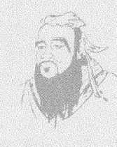
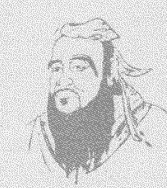
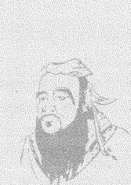
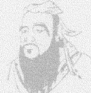

## 陈昌文方法：解读论语1

## 序

我为什么要讲《论语》？因为《论语》改变过我的命运。

当然我读小学的时候，就知道《论语》。那个时候经常背诵的就是“学而时习之，不亦说乎？有朋自远方来，不亦乐乎？人不知而不愠，不亦君子乎？”

我时常就想啊，这学习是痛苦的，怎么会快乐呢？我只想玩游戏啊。虽然那个时候是街机，也就是什么街头霸王之类的游戏。一颗币两毛钱，偶尔爸妈给我一块钱当中午饭，也就是一年当中有几次考试，学校里不蒸饭，爸爸妈妈会给我一块钱，让我去街上吃一碗米粉，就算那个年代开革了。但是我呢，会把这钱省下来，去玩街头霸王。一块钱买五枚游戏币，我大概能玩上十多分钟就完事了，因为我的水平实在是差。我一般玩街头霸王和恐龙快打。

为什么要提这个事情呢，是因为我根本不能理解，学习是快乐的。我只知道玩游戏是快乐的。

同样，我也不能理解，有朋自远方来，不亦乐乎？当然，你说你带了几颗水果糖给我吃，我当然是快乐的。但是这些亲戚、朋友往往不是带来了水果糖。要么是找我们帮忙，要么还要我们卖一点谷子、麦子，买两斤肉给他们吃。朋友来了，我们要花钱，花精力，当然就不快乐了。

以至于现在做企业，我们也不喜欢那些所谓的朋友来拜访我们。

虽然我们请人吃饭的钱是出的。其他甚至茅台，我们也喝得起，烤全羊也吃得起，最贵的名牌酒店，我们也去得起。但我们还是不愿意很多朋友来找我们，来拜访我们。

有的朋友会送我一些肉，说什么野味，其实我也不喜欢。为什么呢？因为这会浪费我们很多时间，而我们的时间是要用来工作，做学问的。

所以有朋自远方来，不亦乐乎？表面看上去也是错误的。

最后一句话，人不知而不愠，不亦君子乎？

小时候就更加不理解这句话了。比如，我读小学一年级，有一个同学跑来打我，他用自己的牙齿咬我的头，岂不知我的头非常的硬，他的牙齿掉了一颗，这下好了，他的父母来找我的父母说，我把其牙齿打掉了，我的父母就当着他们家长和娃，把我狠狠的揍了一顿，然后把家里养的猪卖了，给这个家长赔钱了事。

我当然很生气，因为这件事自始至终都是那个小孩子打我，自己把自己的牙齿搞掉了。我首先是被这个小孩子打，然后是被自己家长打，因为他们不知道事情的经过。二十多年过去了，他们都以为是 我的错。而实际上我根本没做错什么，我能不生气吗，怎么可能人不知而不愠呢，还要当君子！君子既然这么受委屈，我才不要当什么君子呢。

这些思想大概都是我小时候对《论语》的认识，后来步入社会，我甚至找不到工作，花了一年多时间，终于在一个大学里，找到了一个网络管理的工作，说白了就是给别人修修电脑。我觉得这个工作蛮耻辱的，但是几年过去了，却有一个兄弟从这个岗位上成长成了那个集团公司的副总裁，这是后话。以后讲《论语》的正题中，有机会了，我会再提这个兄弟。

有一天我鬼使神差跟着我的一个同事，去了领导的办公室，看到了一本著作放在书柜里，是讲《论语》的，我就顺手拿了过来，并且带回了自己的办公室。

从此过后，我就对《论语》爱不释手。天天读，天天看。我以前是一个很烦躁的人，很迷茫的人，不知道应该怎么样工作和生活。在上海这座城市立足，想想人家都能赚那么多钱，也有女朋友，有背景，有前途，我好像什么也没有。

但是当我在不断的学习《论语》的过程中，我发现我成长了。我开始感觉到我越来越有底气。这种底气或许是一种修养。我慢慢发现我的心性比一般人好，我更加有耐心，更加冷静。我慢慢发现我有强烈的出人头地的欲望，而且我相信我一定会出人头地。

虽然穷，但读《论语》读出来了人格的自信，读出来了修养的自信。我虽然是一个打工的，我想我一定会成为一个老板，靠自己养活自己，这都是那个时候读《论语》读出来的心。

那么，为什么我现在给大家讲《论语》呢？

是因为我在网络上做了多年的网络教学。有很多人跟着我做互联网创业，做网络项目，他们以为在互联网上创业、赚钱是有一个什么技巧的，其实本质上是他们的品行、心性、素质的问题，而不是技巧的问题。比如对待发帖这件事，没有耐心，平台删除了，他们就不想再发了，就崩溃了。

比如做事，三天打鱼两天晒网，不能数十年如一日刻苦努力的对待自己的工作。比如不懂春耕、夏种、秋收、冬藏的道理，总是想今天做点事情，明天就有收获，急功近利。

比如不能做到知行合一。老师告诉了他方法，他并不能勤而行之，而是听了就听了，根本不干活。但是过了几天，他们就想有收获，等等。这些问题导致了很多粉丝、学员不能成功，故而我开始对自己圈子里的粉丝、学员解读《论语》，其目的是为了提升大家的心性，人文素养修养。

在中国古老的智慧当中去发现自己的缺点，做到知行合一，有利于自己的事业、人生。我想《论语》如果不能帮助大家把生活过的好，那就没有意义。

我是一个现实主义者，是一个实践主义者。我要求任何事情的发生，必须有利于我们，这就是我解读《论语》的缘起，那么我将用什么样的方式来解读，也就是我的写作手法是什么呢？

一、首先，我都是写自己的心得，也就是我懂的我才写，不懂的绝对不写。我追求的是实践体会，追求的是行动，而不是在书上做学问，我力求每一个跟我学习《论语》的伙伴，在生活上、事业上、做企业、创业上，都要日日提升。这是苟日新，日日新，又日新的道理。

二、我写作目的是要交往到一些喜欢中国传统文化智慧的人。中国传统文化经典智慧是讲究效率，讲究公用的智慧，而不是无条件平等，无脑公平的思维。中国智慧要求的是把饼做大，大家都过的越来越好。而不是砸锅想法，就是我过不好，也让你过不好的思维是错误的。

三、我解读《论语》只用大家都听得懂的话讲，只用通俗易懂的话语体系讲，而且我会逐字逐句的讲每一个字，我都会给大家讲透彻，讲明白，多角度讲解，多个商业案例讲解。而且只讲实事求是的商业案例、创业案例。那种文学性的描述，小说性的描述，我是不讲的，其目的就是要让任何文化水平的人都能看懂我的讲解。

四、我解读这部《论语》不会去批评任何一个历史学者，我尊重他们，特别是如同朱熹一样的大儒，张居正一样的帝王师，我更加不会去驳斥这些人，我是谦虚谨慎的，跟着他们学。我看见有些人批评曾国藩、张居正，就啧啧，称其不知道这些人。

你有什么资格去批评这些知行合一的大人物呢？学习一定要老实，一定要老实对待有本事的人，我们要听话、照做、执行。

你想批评别人，请问你超过别人了吗？嘴巴上超过，没有用，要实际的超过。所以当你实际没有超过这些牛人之前，还是老老实实的听话、照做、执行。

很多人一辈子的悲剧来源于自以为是，不听牛人的话，不照着牛人的方式做事，不执行大佬的理论，非要用自己的头脑去反驳别人实践过的真理。

五、由于我本人是做实际营销的，我会讲一些我的工作体会。目的只是结合我自己的经商体验，让大家看看我是如何实践《论语》当中的智慧的。

六、学习一定是为了自己成长，不管是人格方面的成长，还是功课方面的参照，学习绝对不是为了在别人面前炫耀。

当我们步入社会，自己创业做企业，为人处事，娶妻生子的时候，我们就要为了自己而学习了。中国有句古话，闷声发大财。我觉得蛮好，就是为自己而学习，而不是为了炫耀。当你有炫耀之心，你的学习基本就偏离了正道，变得没有什么意义了。

七、学习《论语》不要呆板。

什么意思？就是别人怎么说、怎么做的，是有时代限制的，是有语境限制的。你这个时代不一样，你的条件不一样，你应该有你自己的应对策略。比如我说创业先招聘几个营销人员跟自己混。这个语境是，我有一笔钱，我可以招聘，而你自己一分钱没有，你就不要去招聘几个营销人员了。因为你没有管理经验，也发不起工资，所以这个时候你应该亲力亲为，先赚一点原始积累，也就是不要呆板的去学任何学问。

八、我解读《论语》，其目的只是为了表述真理，让更多的具有智慧的人跟着我一起学习，并且实践真理。想要学到真智慧，就一定要放弃自己错误的偏见。看到别人好的观点，要丛善如流，这样你才能飞速进步。有一种人，只要别人一开口，他就习惯性反驳、反对。这样的人是很难读懂《论语》这种真正智慧经典的。

九、学习的目的是知行合一。

如果我们学习不是立刻去实践，只是学习，你就不能发现自己的理解哪里是错误的。不是书上错了，而是你理解错了，领悟错了。不去行动，只会越学、越错、越远。

所以任何学习必须带着实践，否则就会变成百无一用的是书生了。

十、高手学习不是一曝十寒，而是日日不断，也就是每天都要学习《论语》，每天都要干活，带着《论语》里的智慧，去待人接物，娶妻生子，开公司，创业，做企业，搞管理。不要让《论语》悬在空中。

十一、一命二运三风水四积阴功五读书六名七相八敬神九交贵人十养生。以后有功夫了，我会给大家细讲这些改变命运的方方面面。

最后一点，养生休息是为了走得更远，休息是为了前进，你必须学会休息，早睡早起，锻炼身体，才能学好《论语》，建议大家晚上九点半睡觉，精神好，不要熬夜，每天跟着我学习《论语》。

陈昌文

二〇一九年二月十一日，于上海

## 《学而篇第一》

### 1. “学”是什么意思

**原文**

子曰：“学而时习之，不亦说乎？”

**陈昌文解读《论语》：**

《论语》开篇第一个字“学”，为什么是这个字？不是其他的字？我思考过许多年，让你一开始什么都不会的，一定要学！

想要创业，需要学；想要当老板，需要学；想要做人，需要学；甚至想谈女朋友，也需要学。比如公司要招聘一个管理人员，你没有学会做管理人员，你当然就应聘不了管理人员。所以，“学”真的是体现在生活的方方面面。

你不懂经济，你就不可能懂得中国的房地产市场会涨，还是会跌？你不懂人情世故，你就不懂得拍马屁有时候是必须的；你想升官发财，你就必须学会拍马屁。你这个人很冷漠，不懂得让领导、有本事的人舒心，你就没有前途。你不学，你甚至还嘲笑那些会拍马屁，而日子过得比你好，老婆比你老婆漂亮的人。你不学，你就会成为一个酸腐的人。

学，有两种模式，一种是越学越让自己过得好，就是滋润自己。另一种是越学让自己越蠢。比如一到节日，很多人看到别人发节日祝福，自己也复制、粘贴节日祝福到处乱发，凡是在微信上的都去发一发。有关系、无关系的人都发。这就是盲目的学，你浪费了别人的时间，也浪费了自己的时间。这都是无脑的人才干的事情，也就是学错了。而正确的东西，你又反对，不去学。比如我刚才讲了，你要让你的领导舒心，你才有可能升官发财。结果你反对，说这是拍马屁，结果你只能当一名员工，收入非常低，这就是学错了。比如在家里，你要学习让老婆开心。结果你说男人要有男人样，大男子主义，让老婆很不开心。家里鸡飞狗跳的，这就是学错了。

什么是学而？这就是“学”了过后，才有“而”。就是说任何事，我们必须先学习，才有后来的好处，或者是坏处。如果你不学习，做后面的“而”什么的，就没有。只有你愿意学，你才有做人上人的机会。如果你不学，你就只能做普通人，做愚味的人。

学而时习之，这个实质是要求我们时时刻刻学习，也就是不是今天学了，明天就不学了。比如很多人读书的时候努力学习，大学一毕业就不学习了，就不摸书了，这就是没读懂这个实质。时代是不断前进的，有新的技术，新的社会趋势。比如当年淘宝来了，你不学习；后来微信来了，你也不学习；后来，人工智能来了，你也不学习，那么你就被时代淘汰了。这个“习”字，很多大儒讲的是练习。这练习当然也对，也就是你从老师那里学到的知识，自己去琢磨练习，把这个本领变成自己的，越来越熟练。我还要说另一种解释就是习惯，你必须把学习本领当成一种习惯，那么你就会快乐起来。这有点以苦为乐的意味。所以后面说不亦说乎？大概就是这个道理。

学的本意不是让你只是懂得一个道理，而是要练成一项有用处的本领。比如你去听某人的赚钱课，你不是天天听其课程，而是需要把他的方法学到自己手上，练习会了，去赚钱。当你真正赚钱了，你才会快乐。如果学习只是听课，只是理解一个道理，那么不如不学习。

学是要讲功用的，学习要有功利主义，如果不懂这个道理，就会变成那些说自己读了很多书，懂了很多道理，依然过不好这一生，也就是依然赚不到钱的人。

学习的本质是先模仿，模仿就要模仿大师，也就是你要把古今中外最牛最厉害的高手找出来模仿，那么你就会变成高手。这里有一个改变命运的密码，也就是有些人天生学的就是农民工，所以一辈子成了农民工。而有的人天生就开始学大师，所以一辈子荣华富贵。比如我有一个亲戚去了蓝翔技校学挖掘机，现在在一个沙场开挖掘机。这个人就很难荣华富贵了。再比如我以前打工的老板儿子，这个公子哥先是在英国留学，回国后，老爸直接派他到一个最好的分公司总经理那里做了总经理助理，就是跟着总经理学习做总经理。后来这个公子哥学了三年就成了总经理。而我们很多人还在为月收入破一万而奋斗。当然很多人会说我没有那么好的条件，不能学习做总经理怎么办？每个人的条件不一样。但是你可以是在你的能力、眼界范围内，迅速找到一个有利于你的本领去学习。我相信你能懂我这句话，你的命运会迅速改变。

所以，读懂“学”这个字会改变命运的，这就是圣人书厉害之处。学，不是提出相反的看法，不是口头上讨便宜，很多没什么智慧的人喜欢口舌上胜利，而高手一定是勤勤恳恳。按照老师的说法、做法去行动，最后自己得利，这就是我语言里讲过的，闷声发大财。

高手都能理解，跟着牛人学习做事一定有好处。而愚蠢的人自己没本事，就习惯性反驳别人。真正的高手呢，也就不点醒这帮愚蠢的人，他蠢，由他蠢了。所有的学习都是先模仿，你必须模仿富人，你才能成为富人，你模仿穷人，你就成为穷人。所以，但凡是在网络上，现实中，仇富的人都是笨蛋，一个人不可能模仿他仇恨的人。如果你仇富，请迅速改变你的心态，这将改变你的命运。学习的根本是照着做而不是听课，也就是高手如何说，你就去做，不会也做，做多了摸着石头过河，你也就学会了，会了过后，你得利了，你就会会心一笑，这就是不亦说乎。这种喜悦是内心的喜悦，用不着与人分享，这就是圣人之学，学以润身。

学习的过程中，我们有一些东西学不会，可能会很纠结，甚至会怨恨教授者，这也是错误的心态。行有不得，反求诸己。想想是不是自己没有领悟到要点？是不是自己浅尝辄止？比如我们创业做一个项目，你做了五天就要求有结果。而一般创业是要求拼命干三个月，甚至六个月才能看看是不是有结果。所以没有结果要反思自己哪里错了，而不是怪老师，怪你模仿的案例有问题，别人既然能生存，说明别人的道理是对的，你不能生存下去，不能做到，说明你领悟力、行动力有问题，这就是存在即合理的道理，要根据事实去修正自己的思维与行为。

学，还有一个核心，就是你不要见啥都学，你要学习你愿意从事的工作，愿意认可的思维，你不认可你就别学，你不愿意行动，你也别学。你去学你认可的，你愿意行动的学问。如果你不愿意行动，你还去学，本质是浪费时间。所以其实很多人学习英语，但是并不用英语，这是一种极大的时间浪费、精力浪费。我还看到很多人去考驾照，自己又没有买车，甚至根本用不着开车。去花大量的时间去学开车，这在员工当中是一种风气，这也是一种错误的学习，学习要聚焦，你能学到一种生存本领就不得了了。不要试图学会很多种生存本领。人的时间精力是有限的，把所有时间都聚焦在一个点上，成为一个专家，你的收益会是最大的，而不是盲目的学很多种本领，一种也不精。最后养家糊口都困难。这些正确的学习理念，你跟着模仿，做到了最后。让你安身立命。说白了，你就是靠着你的特长赚钱了，开公司了，当老板了，甚至带着一帮听话的新人做大做强了，你当然就不亦说乎。你就品味到圣人说的原来是真理，你得利了，你就快乐。这便是把学习当成一种习惯，不断的练习。对于自己有好处 的本领，靠着这个本领得利了，能养家糊口，甚至兼济天下了。这难道不是一件很快乐的事情吗？

### 2. 有朋自远方来，不亦乐乎的奥秘

**原文**

有朋自远方来，不亦乐乎？

**陈昌文解读《论语》：**

这句话的关键点就是这个“朋”字，搞懂这个字，你才能理解这句话，他能理解人家乐的是什么，否则你还以为人家是吃了一块水果糖，甜甜的就乐了。很多人一辈子都没搞懂谁是自己的朋友，谁是自己的敌人，同是人生的一大问题。这个问题搞不懂，糊里糊涂地过了好多年，最终一事无成，搞不懂“朋”这个字的人，很多时候都会认贼作父，养虎为患，害人害己。还不知道为什么！

不是从远方来的都是你的朋友。有些人是给你带来灾难的，一般人不能分清楚谁是带来灾难的人。比如酒肉朋友就是带来灾难的人，你跟这些人喝酒看似很快乐，实则是浪费了自己的时间、金钱。一无所获，甚至还染上了一些坏毛病。十多年前，我认识一个老板，有几个厂房，家大业大，父亲是高级工程师。这个老板呢，喜欢广交朋友，然后在 KTV 里认识了一帮社会上的混混，这帮人就教唆他吸一口违禁品，说是只吸一口没关系的，仅仅一口。这个老板在众多朋友的起哄之下，就吸了这一口，从此一发不可收拾。多次晚上偷偷跑出去吸违禁品，后来身体一天不如一天，却也跟这帮朋友混得如胶似漆，最后甚至走上了犯罪的道路，自己的家业也就毁于一旦了。便宜了某些小人。

朋，是志同道合的意思，这个人跟你的志向一样，你当然就高兴。但有些人打着志同道合的幌子，不做事，这也是一种消耗，本质上不是朋友。比如我刚创业的时候，交往了一个合伙人小王，这个人，我提出的任何项目他都支持，我提出的看法，他也支持。我想发财，他也想发财，这看起来是志同道合了吧。但是小王不做事，天天对着电脑发呆，也不找客户，也不能把内部营销做好，导致小王自己连饭钱都赚不回来，经常找我借钱。不作为的人不能叫作朋友，也不能与其交朋友。

还有一种人，是无能力的人，虽然你提出的主张，他都同意、都支持，但是他无能力做到。这就不是朋。

所以“朋”有三个要素：

- 第一，支持你的想法、做法，志同道合。
- 第二，有这个能力跟着你做事。无能力不行的，比如你开公司需要一个总经理，你的发小是个保安，他做不了这个总经理，他就不能做总经理。这个朋只能做保安。
- 第三，这个朋有了能力还不能偷懒，必须勤奋，跟你干活、实践。

因为有了这三个要素，就是现实当中的朋友。其实这三个要素，也是公司招人生最重要的读书与交朋友，当你真正分清楚谁是你的朋友的时候，你的女人也并不一定是你的朋友。比如某女明星嫁给一个富豪，天天就是买买买，把这个富豪给买破产了。由于这个女明星长的很漂亮，手段高明，又连续交了两个富豪，随后的这两个富豪也在这个女明星的买买买下破产了。同理，你的儿子、父母、发小，你的闺蜜也不一定是朋。主要看他们给你带来了生命之不可承受之重，还是给你人生带来了辉煌飞跃还是动力。

我习惯把一个人看成一个能量体，也就是给你带来正能量的是朋，带来负能量的是敌人。有时候我们人是麻木的，没有智慧的。会跟给你带来负能量的人玩得很开心，但是时间长了就会给你造成很大的损失。所以这种开心不是真正的开心，真正要乐必须是跟正能量的人做朋友。

做企业的人的朋友是谁呢？当然是那些富人，那些能买得起我们产品的人，就是我们的朋友，也就是我们的客户，是我们的朋友，那些反对我们、抹黑我们，不买我们产品，成天找我们麻烦的人，当然就不是我们的朋友。对于这些人，我们不要去与其理论，不要去与其解释，最好的办法就是相忘于江湖。我们交朋友也要聚焦，不能什么朋友都交。比如我认识一个很有财富的土豪，这个土豪经常找我聊天，他又不做事业，因为他父亲的公司很大了，那么他经常找我，只能消耗我的时间，对我的事业没什么帮助，而且他喜欢玩的东西，在我看来没有什么价值，所以我不会为了讨好一个土豪去浪费我的时间，这种朋友其实就没有必要去交往。与其与这种朋友交往，不如与孔夫子的思想交往做朋友，看一看孔夫子写的书。

人呢，还要学会与自己做朋友。比如我们创业开始是没人理解的，比如现在的微商，其实很多微商人赚钱很厉害，但是没人理解。相反，嘲讽批评谩骂怀疑的人很多，甚至你做微商，有些人就跟你绝交了。那么我们就要自己耐得住寂寞，自己天天努力地奋斗，有了成果能买房买车，娶妻生子。我们当然会会心一笑，这就是我们自己耐得住寂寞，与自己做朋友的一个结果。当年做某宝的人应该也有类似的经历。现在做自媒体创业的人，应该也正在经历着这样的过程。

其实，孔夫子当年也是这样的，他的政治主张始终没有人采纳。但是到了汉武帝与董仲舒手上开始罢黜百家，独尊儒术，终于成了中国文化的正统。也就是我们自己的主张是正确的，没人认可，没有关系，我们自己默默地做，就算这一辈子没机会也没有关系，只要我们坚持的是真理，只要是真理就一定能发光。孔夫子的发光晚了五百年，但还是发光了。我相信孔夫子知道这个事情过后也会非常快乐。这也是另一种形式的有朋自远方来，不亦乐乎。

其实做人做事业都是这样，我们有的人创业，连几个月的寂寞期都过不了，又去打工了。说明这些人还是适合与打工者做朋友，不能与创业者做朋友，也不能与自己做朋友。有朋自远方来，不亦乐乎。

总体来说，一个是要区分出来谁是我们的朋友，谁是我们的敌人，这是人生的根本问题。交错朋友好比认贼作父，养虎为患，不可不慎。二是交朋友的三要素是什么，要搞清楚，三个是要耐得住寂寞，要学会等待远方的朋友来。不管是时间上的远，还是空间上的远，不要因为寂寞就乱交朋友，把握住了这三个点，你自然就快乐了。

### 3. 做人没必要生气，不愠的哲学

**原文**

人不知而不愠，不亦君子乎？

**陈昌文解读《论语》：**

比如，在公路上开车，有的人因为前面一个车挡住了自己的视线，就非常生气。甚至愤怒了，开车去撞别人的也有，打架斗殴的也有。其实，有可能别人根本不知道挡住了你的视线，这是第一层不知。第二层不知，就是别人不知道礼貌，就是挡住你的视线，他依然我行我素。你看淡一点就行了。

这人不懂礼貌，没有社会常识。你不要跟他死磕。浪费自己的时间、精力。只要没造成实际的损失就行。也就是我常说的：碰见不懂事的人，你不要去教育他，不要去跟他争吵，否则，你就成了那个不懂事的人。那么，第三层次，如果对方给你造成了损失，你也不要生气。不要愠。没什么好生气的。直接报警，让警察处理。让法律、规则，去赔偿你的损失。这三层，一层比一层高明。当然，这里面还隐含了一层，就是，他给你造成了损失，你也不能找社会规则去处理，这种情况，这时候，你就权衡利弊，自由搏击。一般情况下，我推荐你选择隐忍。生气、发怒，只能说明你没有智慧，或者没有能力。而且，生气、发怒、愠这种事情，首先伤害的就是你自己。比如：我们在网络上做生意，有的小人会骂我们，如果我们选择跟着他们对骂，后果就是浪费了我们时间，惹得自己不高兴。还有可能这些小人没事做，就天天找我们麻烦。甚至导致我们本来的生意也不好做了。

所以，沉默是金，不要与其对话，隐忍即可。特殊情况下，实在是特殊，才权衡利弊，自由搏击。从长远角度来看，很多事情，并不值得我们大动干戈。孔夫子并不是教你软弱。有些人理解错了，说什么别人侮辱你老婆，打你父母？你也不愠吗？这些人是理解能力有限，智慧有限，理解不了更高明的第三层。只是蛮斗。所以，项王谓汉王曰：“天下匈匈数岁者，徒以吾两人耳，愿与汉王挑战，决雌雄，毋徒苦天下之民父子为也。”汉王笑谢曰：“吾宁斗智，不能斗力。”项羽明显更加意气用事，而刘邦更加智慧，站在了第三层智慧之上。

人生的搏击当中，谁更容易愠，谁就更容易失败。人不知，而不愠，我们才是君子。为什么呢？因为别人不知道很正常，就如同，你也有很多不知道，是别人知道的。每个人的角度不一样，擅长的点不一样。

你管理一个员工，你布置一个任务给他，你以为他应该知道怎么做。但实际上，他不会做。把事情给搞砸了，你就非常生气：“你怎么连这个都不知道？”其实，你不应该生气，你应该反思的是，他为什么不知道。为什么他不知道，你还让他干？员工不合格，本质是你不合格。

同理，你找的老婆，你不满意，本质是你自己无能。没什么好生气的。你儿子，你不满意，本质也是你这个做父母的没有教好，没有做好表率，没有把自己的事情做好。后面，我们会讲：“君子务本，本立道生”，就会跟这个点相呼应。

做人，首先是做好自己的事情。其实人家知道不知道，我们根本不应该去管，也管不了，更别说生气了。重要的是管好自己的本。

我在网络上做教学，一个事情教了无数次了，依然有人来问我，说不知道，不懂。有时候，我也很生气，很不耐烦，很愤怒。其实想想，真不应该。因为我知道的东西，我已经千锤百炼很多次了。而别人是新手，别人在这个领域从来跟我没有过交集。自然是不知道的，我给一些老学员讲过的案例，新学员并不知道，所以，来问也是正常的。

前面讲的大概是，我们要理解别人的不知道。后面开始讲，要理解别人不懂我们的懂。什么意思？就是我们有能力、有本事，对别人好，别人不知道，你也要理解。比如，你对你儿子很好。教他做作业，叫他走路小心车，他却反感你啰唆。没关系，他迟早会懂的，就算他这一辈子不懂，也没关系。你做得对就行。再比如，我为公司做了很多事情。公司的领导却充耳不闻。没关系，领导也有愚昧的领导。只要我不断地做好事，做出业绩。就算得不到提拔，但我总是锻炼了自己的能力，长此以往，社会会回报我的。

这就如同股票的价值投资。只要这个公司是有价值的，就算一时半会儿，我买的股票不涨。但总是会涨上去的。成功是天时、地利、人和的事情。有时候，我们虽然人和了，但没有天时、地利，你就耐心等待。不要生气。

恼其实是一种怨气，总是在别人身上找问题的人，才有恼这个毛病，长此以往，就会出现怨天尤人的心理。这种心理，当然人见人恨，其实是一种不健康的心理疾病。这《论语》读懂，是真能治疗很多心理疾病的，不是虚言。

当我们不断找自己的问题的时候，我们才能获得真正的成长。所以，不愠， 也就是不怨恨别人了。那么，你就开始成长成一个君子了。

人不知而不愠，不亦君子乎？别人不知道，你不生气，你难道不是一个 君子吗？

### 4. 君子务本，本立而道生，什么是本？

**原文**

有子曰：“其为人也孝弟，而好犯上者，鲜矣；不好犯上而好作乱者， 未之有也。君子务本，本立而道生。孝弟也者，其为仁之本与！”

**陈昌文解读《论语》：**

这段里面有两个关键点，一个是本，一个是仁。仁呢，在下一段会讲， 也就是巧言令色，鲜矣仁。孝悌是仁的本。何谓孝？孝的意思就是你要孝敬 父母。有人说我父母对我不好，我不应该孝敬父母。非也。天下间确实有 的父母很不堪，甚至可以用坏来形容。但是他给了你生命，这是最大的恩德， 让你来到了这个世界上，如果他没给你生命，或者刚刚生下来就结束了你的 生命，那么你根本就没有说话的机会，也没有在这个世界上生存的机会。

西汉大将霍去病的父亲与平阳公主侍女私通，生下了霍去病，不肯承认 有霍去病这么个儿子，一生也没有尽过一天父亲的责任，但是霍去病功成名 就过后，还是找到父亲，给父亲买了房子。并且帮助其后母培养了他们的儿 子霍光。有能力的大人物，基本都懂得这个道理，因为父母给了你生命。没 有能力不懂事的小人物，才会去怨恨自己的父母，不能看到别人的恩情，只 看见别人的不是。

何谓弟？弟者，敬爱兄长，友爱兄长，也就是在家里你有哥哥兄弟，你都要敬爱，友爱。不要没事就挑拨离间，反对自己的兄长。兄弟齐心才能办大事，不管是干粗活还是经商，至少开始兄弟齐心，能让自己的胜算大一些。当你功成名就过后，你当然也应该友爱、敬爱你的兄长，你的力量就会进一步增加。

下面一句，其为人也孝弟，而好犯上者，鲜矣。就是说啊，一个人有了孝敬父母的心思，有了友爱兄长的美德，这个人还会犯上作乱的就很少了。我是带过组织的人，我是深有体会。说的是一个孝敬父母，对兄长很敬爱，这个人就不会莫名其妙的反对上级。我们知道在经营企业的时候，做一件事情的时候，如果有人经常反对老板、领导的决策，那么企业工作是很难做好的，就算这个人说的对，也会导致公司没有凝聚力、向心力，导致组织分裂，人心惶惶，无效率。所以马云讲，一流的创意，三流的执行比不过三流的创意，一流的执行。所以老提反对意见，老是喜欢反驳的人，注定是没什么成就，也没什么朋友的。这种人在组织当中是极具破坏力的。

我做企业的时候，就碰到这样一个合伙人，他当然是打着为了我好的旗号，每次都提些反对意见。当我提出一个方案项目的时候，他总是不能尽心尽力地去执行。这就导致了他做的项目浪费了大量的人力、物力、财力，而没有什么结果。其实很多项目都能赚钱，战略上没什么好讨论，只要勤勤恳恳，把战术上的事情做好了，我们就能活下来，而且越活越好。最后战术往往变成了战略。就比如支付宝开始并不是从战略角度去考虑的，只是从战术角度去考虑的。其目的就是想让支付变得更方便一点而已。但是执行好了，慢慢的战术就变成战略了。那么如果一开始内部就有一个关键人物对支付宝这件事不断地提反对意见。如果马云听了，估计也就没有支付宝这回事了。那么作为一个在社会上做事的人，这个犯上又有什么启发呢？也就是当你还不是一个人物，一个角色的时候，要把心态放低，比你有本事有能力的人其实就是你的兄长，你也不要只看其年纪是不是比你小，反正是比你有本事，有能力就行了，人家安排给你的任务，你就踏踏实实的听话照做执行，执行到位。事情做成了，人家就对你另眼相看，你的收入也会增加。

其实这是最好的在社会上生存的方式，但是大部分人就如同有反骨一样，坚决不愿听比自己厉害的人的话，自己一无是处，但就是习惯性反驳，习惯性表示自己很高明，这就是犯上的毛病。有了犯上这个毛病，接下来就是作乱了。何谓作乱，就是经常捣乱，我们去网络上各大网站看评论，你们就能看见很多人习惯性的捣乱。这些人正事不做，就是喜欢批评别人。如果有人要做一件事，他们必定去抹黑别人，去谩骂别人，总之就是别人不对，自己是对的，一定要把别人的锅给砸了，也不管砸别人的锅，对自己有好处还是没有好处。这种捣乱者自己对一切持怀疑态度，到处搞破坏，然后还要呼吁一帮不明就里的群众，也跟着自己捣乱。这种人就是捣乱，正事不做的人，这种人不可能有什么成就。好捣乱，作乱是非常恶劣的一种品行。

后面讲君子务本，本立道生。什么意思呢？就是我们不要去做那种不孝敬父母，喜欢犯上作乱的人，喜欢捣乱的人。我们要务本，什么是本？就是做人的本。孝敬父母，友爱兄长，其实原文就是这么简单。但我要给大家解读深一点，否则不过瘾。

我们要孝敬父母，友爱兄长，是要有成绩的。这成绩来源于做正事，也就是做项目，做事业，做工作，赚钱养家，这才是孝敬父母。孝敬父母，不仅仅是口头上的表达，而是你要做出实际行动。你要勤快，比如，你创业的时候有没有做好业务，有没有一门心思地在赚钱，你有没有买房子买车，把自己的婚姻大事安排了，把自己的子女教育好，不要让你白发苍苍的父母为你操心，这就是孝敬的实际行动。

再比如友爱兄长的延伸。比如你在一个公司做事，你有没有把领导、老板交代的业务完成好，让老板不要操心，成为老板的左膀右臂？而不是自己成天对老板、领导表示意见，表面上提意见，背后骂骂咧咧的，甚至背后不去执行，浪费公司的资源。只要我们有在公司工作的经验，我们就会发现有一部分人就是这样的。这样的人要清理出公司，要远离。

一个孝敬父母，友爱兄长的人是没有那么多时间去游戏，更加不会找借口不努力工作，更加不会出现在父母需要钱的时候，拿不出来的情况。也就是我们强调的是知行合一，而不只是理论上的知道。如果一个人仅仅是在理论上的孝道，其实是一种伪孝道，基本就等于不孝敬父母，不友爱兄弟。这样的人，如果你周围，说他有责任心，他爱老婆，爱同事，你就要小心了，他是骗人的。他实际上可能是一个捣乱者，是一个奸恶之人，只是潜伏在你周围，随时随地会露出他的真面目。

这句话不仅教会我们自己应该如何做人，也教会了我们选择什么样的人，跟我们做朋友、同事、伴侣，甚至创业合伙人。《后汉书·韦彪传》里有一句话：“夫国以简贤为务，贤以孝行为首。孔子曰：‘事亲孝，故忠可移于君。’是以求忠臣必于孝子之门。”也是对那个思想的诠释。

### 5. 不要巴结人，也不被人巴结

原文

子曰：“巧言令色，鲜矣仁！”

陈昌文解读《论语》：

巧言，就是好听的话，巴结人的话。

令色，就是表面谄媚，讨好。

这个世界上有一种人，总是在讨好人，总是在对领导、老板说好话，这样的人你要小心了。真正做实事的人，研究的是业务、利润。是没有心思去研究巴结领导、老板，讨好、谄媚领导的。而当老板的也要清楚，我们要的是实际利润，而不是找个员工来讨好我们。

如果我们需要人讨好，不如去看电视剧，不如去娱乐场所。没必要在公司里培养巴结我们的人、谄媚我们的人。但是被人巴结、讨好，内心是很舒服的。所以，很多老板周围都有这样的人。这是很多人都需要注意的，并且需要修正的地方。

高手观察一个人的语气、神色，就知道这个人是不是一个巧言令色的人了。他会自动远离这样的人。这句话，同时教会我们不要去做一个巴结人、谄媚人、讨好人的。没什么意思。我曾经为了做生意，也谄媚过一个大老板，巴结过一个大老板。生意没做成，反而觉得自己的人格低劣。几个月时间，内心与神情都不是很舒服。以至于后来这个老板找我，我总是找借口不跟他见面。我们虽然为了赚钱，但我们不能牺牲自己的人格去赚钱。因为业绩不是通过谄媚别人而来的，而是靠自己实实在在的干出来的。

做人呢，不要想着占别人便宜，就没有谄媚别人的想法了。只有你自己想走捷径，想占便宜，才想着谄媚，讨好别人。“天下间没有免费的午餐。”就算你花言巧语，谄媚别人，获得了一些好处，其代价也是自己独立人格，魅力人格的损失，划不来。

一个随时随地想着讨好人，想着花言巧语的人，内心一定没有仁德。一个经常受人巴结，讨好的人，基本上，会不坚持原则，就算以前有仁德，也会被腐蚀。历史上开始有原则，后来，周围这种巧言令色的小人多了，变得不仁不义的领导者如过江之鲫。所以，要防微杜渐。

勿以恶小而为之，一丝一毫的讨好，也不接受。

一个人是如何说话的，一个人的神态是什么样子的。往往就是一个人内心世界的反应。

我们做人，应该有正念，讲正能量的话语，做正行，然后就有了正果。如果我们做人，有了邪念，讲的话语就会是负面的话语，行为也会出现负面行为，最后的结果，就是邪果。

有仁德的人说话，神态都是庄严肃穆的。无仁德的人说话不讲原则，不讲真理，是见风使舵，善于讨好别人，为了目的不择手段，说话都是为了迎合有权有势的人。而大家都知道，不论是谁，都喜欢别人顺着自己。时间长了。周围就会聚集一帮靠着花言巧语，顺从你的人。你就被腐蚀了。这样的人，往往也不能给你带来什么成绩，本质上，是一种损耗。这些人呢，一般都做不了什么事情。但是他们会看见那些能做实事，有成绩的人闪闪发光，他们就会在你面前中伤那些人。这就是亲小人的后果。最终，你也开始讨厌那些做正事的人。

很多老板、领导、皇帝，都是因为落入了这个恶性循环，最后，把自己的事业给毁了。

那么我们应该怎么讲话做事呢？

就是我們只讲真话，靠自己的实际行动去获利。我们讲真话，有人接受，就接受，不接受就算了。不能为了利益，就巧言令色，神色伪善。同时，我们周围也拒绝那种花言巧语，神色伪善的人靠近。我们要的是真话，真实的行动，有结果。

### 6. 每天反思与总结，应该是一种习惯

原文

曾子曰：“吾日三省吾身：为人谋而不忠乎？与朋友交而不信乎？传不习乎？”

陈昌文解读《论语》：

我每天都要求跟着我做事的人写总结，总结自己应该感谢哪些人，总结自己做了哪些事情，总结自己应该怎么做，才能做得更好，这个精神，就是从这里演变而来的。当然，这不是原文的意思。

吾日三省吾身，也就是我每天都要反省自己三个点，后面就开始讲那三个点了。

#### 第一条：为人谋而不忠乎？

这个忠，值得研究。也就是你替人办事，你是不是真心实意，竭尽全力的帮人办了？你是忽悠别人，敷衍别人？得过且过吗？特别是我们做教育工作的，明明知道学生学错了，我们心里想，多一事，不如少一事。反正又不是我自己的儿子，不管了。这就是错误的思想，就属于不忠，既然我们做教学，我们就不应该把别人往沟里带。甚至是别人要掉沟里了，我们也要多讲两句，伸手拉一拉。这其实就是儒家思想，我们是要出来做实事的，而不是躲在后面，管他春夏秋冬。不是说明我们收了别人的钱财，为别人把事情做到得过且过就行了。而是要尽心尽力，把自己的最大心力拿出来为人做事。这才能算是忠。

每一个老板，本质上都是教育工作者，你在教员工，也在教客户。本质上都是知识传播者。思想的传播，尤其要尽心尽力，要有忠心的思想。因为思想错误，一个人一辈子就毁了。大部分人无成就，贫穷一生，本质上都是思想有问题。

为人谋要忠，就是你帮人做事啊，不要找借口做不到。我们很多员工，都习惯性在老板面前找借口，我这件事做不了，把难题交给老板。认为自己工资就这么多，不应该再多做了。

我们很多时候，为客户做事，也是如此，认为客户就付费几千块，我们的付出已经是几万块了，已经值了，就不愿意继续服务了。这其实都是不忠的表现。当我们尽心尽力的做好事情的时候。看似吃亏了，但是这样，更多的客户知道我们好，就会在我们这里持续买单。我们的收入只会越来越高。同样，那些升职加薪比较快的人，其实也是不找借口，尽心尽力把事情做到极致的人。那些习惯性找借口的人，拒绝了别人的同时，也拒绝了机会。

这个忠还有一层意思。就是你只管赚钱，而不忠于做事，事情没做好，你是赚不到钱的。这是很多人的毛病。眼睛只盯着利益，而不懂得需要竭心尽力地为人做事。我们在互联网上，经常看到有些人发硬广告，就想赚钱，这种人的生意一定做不大，做不好。因为客户没有获得你的好处，你只是想赚钱而已，这就是不忠。

#### 第二条：与朋友交而不信乎？

你交朋友，就要讲信用，答应别人的事情就要做。不然不要答应。你答应别人的事情不做，一来耽误别人的事，人家早知道你干，就找别人干就行了。二来，损失自己的信用。以后别人就不敢找你了。还有一层意思，我们做人，不要虚情假意，要实事求是。讲真话，做真事。不要虚伪，自己累，别人也累。别人错了，就指出来，不要为了讨好，别人错的，也说的对。那么，有的人说“我为什么要指出来呢？他又不是我的朋友，又不给我好处。”嗯，他不是你朋友，不给你好处，你就远离他即可。你不要让他人以为你是他朋友，然后你有错，你也不指出。这也是虚伪，浪费自己的时间，浪费别人的感情，于心不安。朋友不在多，在精，很多人是没必做朋友的，既然你知道，你就更加不应该跟这些人虚情假意。

我以前在一个公司打工。很多人经常在一起吃饭喝酒，其乐融融，看似是朋友，其实离开过后，谁也不联系谁了。所以，这种聚会是非常没必要的。没必要虚情假意的开始，也没必要虚情假意的结束。这就是信。这样人生的损耗变得最小，你才可以把自己的精力用来做正事。

#### 第三条：传不习乎？

这一条特别重要，也就是我们从老师那里学到了好东西，被传授了一些好的学问，做人、做事的道理。我们要不断的练习、复习、温习、熟悉。比如，我们知道早起早睡好。你是不是因为打游戏，玩到晚上12点还没睡觉？我曾经就因为玩《魔兽世界》，晚上12点，还没睡觉。我也因为中午被游戏耽误，而不休息。一些有本事的人，都讲过，早上非常重要。

所以，我们要做到早上5点、6点起床。再比如，大家都知道锻炼身体好。那么你是不是每天锻炼身体？这也是习，而不是仅仅知道这些知识点。

读《论语》或者中国古代经典有个好处，因为都是老祖宗的智慧，老祖宗不会欺骗我们。

我们天天读，就天天洗脑自己，那些错误的思维就会得到修正，进而行为也会得到修正。这也是为什么我这么喜欢中国古代文化，并且立志要解读中国古代经典。一来为了自己。二来为了我的学员、粉丝，大家共同进步。

真正的高手，注重的是自己有没有练习，而不是老师教的如何。有些人总是批评老师教的好不好。比如，昨天有一个学员，在直播课上说：今天老师的课讲得不错。这种人，我是不搭理他的。为什么？因为这种人是批判性思维，评论型思维，总是评说别人，而不是想想，我自己做了什么，老师讲的，我都去练习了吗？有成绩来汇报吗？自己不练习，不琢磨，不探索，无成绩，成天评说老师，这是很多人的毛病。

后面我们会讲到：“子路有闻，未之能行，唯恐有闻。”就是说，子路最怕孔夫子讲新课，为什么？因为以前的还没做到啊。说明子路就是一个关注自己有没有行动的人，而不是评论老师对错的人。可见，儒家思想，讲的是行动学，练习学，做到学，而不是批判，评论，嘴巴上逞能。问题都是别人的，眼睛不盯着自己。这是大多数人的毛病。

习的本意是，你自己干活不干活？你把老师的理论弄的滚瓜烂熟，自己不干活，以为自己懂了，但无结果，赚不到钱，不能得利，吃亏的还是你自己。

- 今天主要讲了：
第一条：为人做事要尽心尽力。
第二条：不要对朋友虚情假意，更加没必要用虚情假意去社交。
第三条：老师教授你的，你自己练习了吗？行动了吗？会了吗？有结果了吗？

这三条，是我们每天都要反省与总结的。

### 7. 如何做领导

原文

子曰：“道千乘之国，敬事而信，节用而爱人，使民以时。”

陈昌文解读《论语》：

这一段，是领导的大学问，孔夫子在这里教大家当领导。也就是如何领导一个千乘之国，你当然可以看成是如何领导一个组织、一个集体、一个国家、一个企业、一个社群。有五点。

第一，敬事。

什么是敬事，就是我们必须认真地做每一件与客户与群众有关的事情。为什么要敬事？因为我们带领的人跟着我们吃饭、穿衣，他们家里有老有小，要养家糊口。如果我们做事不认真，不赚钱，会导致他们家庭的灾难。所以，领导者必须大量思考、实践，认真地给大家找到一条路，一条有利于众人的路去走。领导者，必须磨炼自己的智慧，做出正确的决策，因为你的决策关系到跟随者的饭碗。所以我一直讲聚焦，也就是做的事情要极少，极度简化！

为什么？因为领导者不是神，不可能什么事情都懂，当然要做得少。做得少了，才能做精，不出错，才不至于给跟随你的人造成灾难性的影响。对做事没有敬畏之心的人只能当普通员工，绝对不可以当领导者，因为没有敬畏之心的人做事，很容易失败。普通人失败，影响的是他自己，没关系。领导者失败，就是一种罪过。因为你砸了太多人的饭碗，是一种灾难性的影响。有时候，我们认为当领导，能力最重要，但是在我看来，一个领导者的态度，道德比能力更重要。所以，必须对你做的每一件事有敬畏之心。

其实我觉得：稻盛和夫的成就就来源于一个敬字，有空大家可以去读读他的《干法》。

看稻盛和夫是怎么做事的，他甚至生产一个产品之前，要去洗手。

第二，信。

人无信不立。李嘉诚的大儿子被张子强绑架了。10年后，张子强被抓了。有人问，张子强，你这一辈子做的最大一票是什么？张子强说：是绑架李嘉诚大儿子。这才道出了李嘉诚大儿子被绑架了这个事实。为什么李嘉诚选择不报警，不公之于众？因为李嘉诚答应了张子强，不报警。李嘉诚说：商海沉浮多年，学到的最重要的就是信，一个商人，首先要讲信用。

我最喜欢李嘉诚先生，为什么？因为我得觉得李嘉诚先生，学的就是儒家思想。真是中国文化的集大成者。他有一句最喜欢的活：“不义而富且贵，于我如浮云。”也是《论语》中的话。所以张子强也答应了李嘉诚，以后永远不会再找李嘉诚的麻烦。

信用是商业的命门，是领导者的命门。你不讲信用，别人上当一次，以后就不跟你合作了。你就失去了多次交易的机会，你不可能做大做强。你不会有什么跟随者。就算你已经有了一些跟随者，大家知道你不讲信用，也会远离你。做领导的本质，就是取信于人。信你的人多了，你才是领导。没人信你，你是光杆司令。还当什么领导？

第三，节流。

也就是节约的意思。节流，不是不花钱，而是不乱花钱，不铺张浪费，只把钱花在刀刃上。我刚开始创业的时候，赚了一些钱，好大喜功，好面子。招聘女秘书，漂亮的女秘书。其实这些女秘书也没什么能力。她们能做的工作，我都能做，反而多了一道手续，毫无意义。我也招聘两个以上的人事主管，也招聘了一些多余的员工。这样，看起来公司规模大些，我觉得这样有面子。

其实这些人压根用不上。看起来一大家子人，热热闹闹的。但是吃闲饭的人多了，人浮于事，这其实就是铺张浪费。

真正要做好一个组织，应该是做实事的人多，赚钱的地方多，而用钱的地方少，吃皇粮的人少。这个组织，才能经营得越来越好。所以，我读到了这句《论语》，多次反思，就把我一些铺张浪费的行为纠正过来了。

我看了一一个曹旺德的豪宅纪录片，我发现曹旺德先生虽然有钱，但是也亲自去关掉一些不必要的电灯，说是要节约电。

想想我自己。就经常开着一些不必要的电灯通宵到天明。而且办公室的电脑，甚至晚上也不关，这就是铺张浪费。大财富，小积累。也就是你要从小地方去积累，你才可能有大的财富。我们老一辈的父母，他们虽然赚得少，但能拿出来很多现金。我们现在的年轻人，看似赚得多，但是是月光族，这就是因为没有节约的观念导致的。当有急事真需要钱的时候，还得找我们老一辈父母那里去拿。

我认识一个老板，生意做得好，一年有数百万的收入。但是这老板有一个不良嗜好，喜欢“小三”，听说还养了几个。后来被几个“小三”给拖垮了。因为这“小三”的消费太惊人了。其实，你们注意一下这方面的新闻，有很多人本来就坐钓鱼台，都是由于铺张浪费，寅吃卯粮，把自己的资金链搞断裂了，最后身败名裂，甚至银铛入狱，就是不懂得节用的道理。所以，我们做为领导者，一定要量入为出，这也是老祖宗的智慧。我有多大能力，吃多大碗饭。不超支，则能长久美好地生活下去。

第四，爱人。

古代有子民的说法，有为官者，就是父母官的说法。不是让你把民众当成你的子女随意驱使，不是让你高高在上。而是说，你要把大家当成你孩子一样，有耐心地对待他们、爱护他们。你是不是发自肺腑的帮助大家提高自己的精神境界，你是不是呕心沥血的帮助大家提高收入？你是不是真正对大家好，不是诓骗大家的钱财？只有你真正发自肺腑的爱大家，大家感受到了，自然会听你的，会跟着你干。若是，你是一个冷血的，只知道赚钱，而不是真心爱你的客户，爱你的跟随者。那么，你这个领导者也会随时随地被人抛弃，并且，大家并不会尽心尽力地跟着你干。你的事业，也就做不大了。

第五，使民以时。

比如，我做直播的时候，如果我在早上5点做。我相信基本没人来看。为什么？因为大家都在睡觉，时间对不上。我们现代社会，做网络生意，早上很多人坐车，赶公交，地铁，刷自己的朋友圈，就在摄取信息，这个时候，你就要准备好信息给这些人看。你不要在半夜，人家都睡觉了，你才释放信息，这个时候没人看了。这就是使民以时。使民以时的意思，就是你不要耽误别人的正事。你要配合大家的时间，而不是大家配合你的时间。

比如开会这件事，你不要耽误员工的正常工作。你要找一个不耽误员工工作的时间点去开会，这就是使民以时了。

### 8. 实践比学习更重要

原文

子曰：“弟子入则孝，出则弟，谨而信，泛爱众，而亲仁。行有余力，则以学文。”

陈昌文解读《论语》：

做人呢，在家里要孝敬父母，外出要友爱，敬爱兄长，尊敬兄长。做人做事，谨慎小心，讲信用。对你见到的人，都要一视同仁的爱，还要习惯性亲近有仁德的人。你把这些都做到了，还有多余的精力，就可以学习诗书文献了。

原文的意思，其实很简单，但是很深刻。总结一句话：把生活实践做好了，再学习。

大部分人反过来。也就是本做不好，生活实践做不好。但是习惯性学习书本知识，习惯性听课，习惯性找方法、找技巧。我从事过多年的教学，发现有部分人是通过学习来逃避工作的。不喜欢干活，一说干活儿，他就不喜欢学习。

我以前有一个合伙人，我告诉他，钱，是我们在电脑上不断释放内容，输出内容获得的。但是他不去做这些，每次被我逼急了，他就去电脑上找些学习资料来看，来研究，就是不去干活，于是干了几年，连自己的本钱都赚不回来。

同样，我还有一个合伙人，看起来很憨，很傻。也不怎么学习，就是你告诉他一招，他就去实践、去练习，日日夜夜的操练，永远都在输出内容，结果赚的钱反而是最多的。

我的生活经验，其实一个人根本不用学那么多。你能把你已经懂的做好，你就能成为一个非常有成就的人了。每个人从小学到大学，再到社会上工作几年，其实已经学了足够多的知识。任何一门你知道的知识，都足以让你过好这一生，都足以让你安身立命。但是，你都是浅尝辄止。我以前有一个同事，是网络管理员，大家都看不起这个岗位，可是这个小伙子，把这个工作做到了极致，完成了整个集团公司的信息化建设，最后，被任命为公司的副总裁。

所谓：君子务本，本立道生。你到底有没有把自己的事情干到极致？如果自己已经懂的招式都没练到极致，反而去追求学习那些自己还不懂的。这个人，其实就是在浪费时间。或者说逃避工作。所以，我招聘用员工的时候，最怕的一类应聘者，就是说：“我来公司学习的。”这种人，基本注定没什么成就，就是浪费公司的资源与工资，万万不可招纳到公司里来。不管是招聘用员工，还是合伙人，我们要的是那种实践型的。有的人说：“我不会啊，你就让我实践，我想要先学习。”这种人，本质是不愿意工作，找借口而已。因为你去做的时候，慢慢就懂了如何工作。就是摸着石头过河的道理。你必须下水，才能学会游泳。而不是在岸上观看视频，观看别人的游泳姿势来学习。你非要说，你需要学习。那么，你别用工作时间来学习，你抽业余时间

### 9. 能把自己生活搞好，才是大学问

原文

子夏曰：“贤贤易色；事父母，能竭其力；事君，能致其身；与朋友交，言而有信。虽曰未学，吾必谓之学矣。”

**陈昌文解读《论语》：**

见到厉害的贤达，比你厉害的人，要尊重，并且跟着学习。这是贤贤易色。

我们网络上有很多喷子，这些喷子，见到厉害的人，首先是反对、喷、嘲笑、讽刺、怀疑。而无尊重牛人的心态。所以，一辈子，只能继续当喷子。侍奉、赡养、尊重你的父母，按照自己的能力来。把自己的能力都发挥出来，叫竭其力。不要你明明养得起你的父母，却找借口不赡养。经常看到一些电视节目，其子女都生活条件还可以，却相互推脱不赡养父母。这种人就是没有学问，不懂生活的人。

人在做，天在看，你的子女也在看。你的子女也会依样画葫芦，等你老了的时候，重复、循环你的行为。你怎么对待你的父母，你的子女就怎么对待你。因为父母是子女最重要的老师。有的人可能说：我的父母对我不好，我想报复他们。不要这样想，你父母给了你生命，就是给你最大的恩德。你现在要给你的子女做榜样。没有必要为了报复父母，而毁灭了自己在子女心里的形象，把自己子女教坏了。

侍奉君王，我们现代社会讲，顾客就是上帝。也可以说，对待你的客户，要致其身，也就是你的这身肉都要侍奉出去，真是把自己整个都交出去侍奉君王，侍奉客户。

很多人对这里，可能不理解了。怎么侍奉客户、君王比侍奉父母还上心？答案很简单。你不把客户侍奉好了，不把君王侍奉好了，你是赚不到钱的，没有俸禄。别说你父母了，就是你都得饿死。你不想做个啃老族吧？你把客户侍奉不好，没有收入，后面的与朋友交，你也别谈了。贫在闹市无人问，富在深山有远亲。你也没朋友了。有了朋友，我们才讲，与朋友交，要言而有信。你把前面这4点都做 到了。虽然你可能不是大学生，没读过什么书，其实，你已是一个大学问家了。

这段话，到底是什么意思？

我们很多现代人，把大学那个毕业证书，研究生那个证书，会不会讲英语，会不会会计，会不会一些技巧当成了本。其实这只是枝叶，不是本。真正的学问，是生活实践。你有没有本事处理好你的日常行用，处理好你的生活？这才是学问。也就是，你见到牛人要学，见到父母要孝敬，把自己的身家性命都交给客户，君王，也就是你老板。然后与朋友交往，要么不答应别人的事情，要么答应了，就要做到。

慧能是个劈柴烧饭的人，但是却比一个饱读佛经的神秀高明，成了禅宗六祖。为什么？因为慧能干的就是生活实践。你会发现一个事实，乔布斯、比尔·盖茨、扎克伯格都退学了。但是他们的事业却做得很大。

这些人都是习惯性重视生活实践的人。我经常见到很多老板雇佣大学生，其自己学历比较低。比如，一个做广告牌子的老板。在上海做了很多年的广告牌子，亲手去刷涂料。当我还在读书的时候，他已经在做广告牌子了，走街串巷的递名片。当我大学毕业还在找工作的时候，他已经在上海买房子了。然后还招聘了几个大学生给他打工。

我也知道一个做木工家具厂的木匠，就是租了一个厂房，给人做家具。然后带着一帮人给人做家具，干的是粗活，不过，也在上海买了房子。而且，有意思的是，这些人是全款买房。因为他们压根就不懂得贷款。甚至，他们连合同怎么签订，都不懂，也不在意。只是，你布置给他的任务，交代好了，你给钱，他做事。而我们很多大学生，有一个大学学历，却没有干实事的精神，只能领点薪水过日子。

能把生活实践做好，才是大学问，而不是读书本上的理论、知识。

现在有一种论调说以前的老板，可以不读大学，以后一定要读大学。说以前的老板只是靠时代机会成功了，没什么学历。现代社会当老板，没有大学学历不行了。很多人认同这个观点。其实不然。这就是只看到了表面现象。

这个世界上，有些本质是不变的。掌握了这些本质的人，当然比那些只有学历，而不懂生活实践的人过得好。懂生活实践，是人生大学问。而不是要读什么书。你不懂生活实践，自以为自己有个学历，不过是你比别人蠢，多浪费了几年时间而已。其实，真正的知识源自实践的过程中。你很难通过读书学到什么。所以，你读了很多书本上的知识，你感觉你什么都懂了，都会了。这实际上是一个错觉。你只是看了一场电影，出了电影院，电影是电影，你还是你。你只是能徒事讲说，叙述梦境而已。当你一动手的时候，你就发现，你什么也不会。

我有很多学员，习惯性的找我：老师，你能不能讲点具体的，你讲的都是大道理。我还是不能赚钱？

这些学员就是搞错了一个道理：他们不在意实践，不从实践中去体会，而仅仅想通过别人的嘴巴里讲的理论来发财。你真要做学问，其实是通过干活做学问。而不是通过听别人嘴巴里的理论来做学问。别人嘴巴里的理论，只能起参考作用。所以，即便是你读了比尔·盖茨的书，你读了马云的书，你如果不实践在自己的事业上，通过干活去体会，你永远也明白不了什么是真正的学问，你也不可能赚钱。

能通过实践干活把自己生活搞好，才是大学问，而不是停留在书本知识，别人的理论上。

### 10. 改变自己命运的方法，要交比自己厉害的朋友

原文

子曰：“君子不重则不威，学则不固，主忠信。无友不如己者。过，则勿惮改。”

陈昌文解读《论语》：

什么是重？厚重，深沉，对别人讲的事情，有谦虚的心态，认为自己不懂。这样的人，在别人眼里，就有威信，别人愿意相信你。这样讲，大家听不懂，我从反面讲一讲，大家就听懂了。这个世界上有一种人是毫无威信的，大家也不喜欢，不相信他。比如，别人讲一个专研了几年的专业，人生经验。而另一个人，从来对这个问题没有深入过，没有实践过，在这方面也没有任何建树，但是他听你一讲，就是：我懂了，原来就是这么回事啊，你还有没有更高明的方法啊。

这样的人，其实就是不懂谦虚的浅薄之人，当然大家就不重视他，他也没什么威信。其实就是想证明自己聪明，有本事，可是方法用错了，适得其反。

有些事情，别人钻研并且实践了好多年，而且靠着这个技术、理论、思想生存，养家糊口。但是，一个明显什么都不懂的人，新手，你一教他，他就说：“你讲的都是大道理，我都懂。”你一问他：为什么都懂，你为什么不自己去做呢，还要学什么？他就哑口无言，或者，开始骂娘，情绪化，说你不尊重人。这种人，就是不厚重，不谦虚，自以为是，当然就没什么威信。

下一句讲：学则不固。一个人，既然不谦虚，你给他讲什么，他也是听不进去的。为什么听不进去？因为，谦受益，满招损。他已经自满了。他一窍不通，什么都没学的时候，就自以为是比你更高明了，看透了一切。他会用自己的主观观念，戴着有色眼镜来对待你所讲的。他的目标，是要通过讲话觉得自己比你聪明。他的目标，是要批评你，说你不行。这样的人，根本就没法学到别人讲的东西的精髓。

所以，学的东西就不牢固、稳固，更别说学会了。高明的人，是怎么回事呢？就算自己对别人讲的真正理解，而且已经靠着这些东西得利了，但还是空杯心态，一次又一次反复学习，琢磨，思考，实践。你只有这样，才能把一样东西学得稳固、牢固。

主忠信的意思是，做人要有忠诚之心，做人要言而有信。

无友不如己者。

很多人在这句话上很有争议。说孔夫子不是那么势力的，不是说：交朋友只交比自己厉害的。其实，我想说：“没必要给圣人戴高帽子。”我情愿认为孔夫子就是这样讲的：我们交朋友，就是要交往比自己强的，这样我们才能学习到好东西，当我们学到好东西的时候，我们就能改变我们的命运。虽然势力的，但是更加真实有用。

我相信，孔夫子是一个生活实践家，读《论语》的目标，是让我们生存得更好，而不是空谈道德。当然，这一句话还有更深层次的理解。也就是，每一个人都有特长，我们要学习这个人的特长，每一个人呢，也有缺点，我们不要看其缺点。比如，有些人，你看不起他的人品，但是他就是能赚钱，你就学习他的赚钱经验。比如，有些人，你看不起他的演讲能力，但是他的人品还可以，你就可以跟着他学习其做人的修养。

过则勿惮改。

就是你有了过错，一定要改正，别怕。我们有时候，有这样一种性格，就是明明自己错了，自己也知道。但是别人一说呢，我们还是为了自己的面子，要跟人吵架，要坚持自己错误的行为。且不断嚷嚷：错就错了，你把我怎样？我就是要这样。这种人，就是胡搅蛮缠，最后倒霉的还是自己。高手，“见善如不及，见不善如探汤。”见到对的东西，赶紧思考一下，自己是不是做到了，没做到的赶快修正。见到错误的东西，就如同伸手进开水里一样，迅速缩回来，也就是迅速调整到正确的道路上。

颜回之所以受到孔夫子的欣赏，最重要的一条就是：无二过。

什么意思？就是知道自己错了，一定改过来。

### 11. 不要做那个薄情的人，也不与薄情的人交往

原文

曾子曰：“慎终追远，民德归厚矣。”

陈昌文解读《论语》：

本意是讲，要好好的对待家人去世这件事，要懂得祖先、先辈的付出，要感恩。有了这个家族观念，你自然愿意建立一个美好的家族，你自然不愿意去做坏事，做坏的榜样。你总是想要给子孙后代留下点什么。所有人都这样想，这样干。那么，人民群众的道德风俗意识自然就提高了，人就厚道了。

慎终，当然还有更深层的意思。

为什么要慎终，因为这个世界上，你必须时时刻刻把每一件事情做好。你若做不好，就会伤了一些人的心，特别是有些人对你有恩。父母对我们都是有的，祖先开创了基业，披荆斩棘，茹毛饮血，才弄到一口饭吃，把你这个血脉传承下来。你如果不懂得孝敬、感恩、尊重，这些人死了过后，你就会后悔莫及，想要再做点什么，也就没有机会了。所谓：“子欲养，而亲不待，树欲静，而风不止。”

我自己就有这个遗憾。我的外公，年纪已经60多了，还在我们家里干农活，付出了很多。我小时候，不懂事，还老是去与外公争论，甚至出言不逊。外公走了过后，我并没有做出任何成绩，那个时候我还在读高中，天天玩游戏。有时候我们没有能力去回报一些亲人，但我们的态度一定要好。当我们在社会工作过后，我们一定要努力做好工作，多赚钱。这样，才能及时的回报那些还活着的，对我们有大恩的人。

我们中年了，要有一些房产，来供奉祖宗牌位的，供奉那些给你施恩的人的牌位。以前看古装电视剧，经常看到，有的大人会供奉一些对他有恩的人的牌位。会去回报这些对他有恩的人，若是这些有恩的人死了，也要找到他的子孙去回报。人有感恩之心，当然是一个高尚的人。这高尚其实还有一些好处，是很多薄情的人不能理解的。

比如，当你记住了有很多人有恩于你的时候，你自然会奋发图强。因为我们欠别人的恩情，是要还的。我们做人也会越来越真诚，不至于去干坏事。我们的恩人，当然不希望他曾经帮助过一个薄情的人。

我非常喜欢儒家思想，这不是封建迷信。这是做人的道理。懂了这些道理，我们就能安身立命，堂堂正正做人，而且是一个高尚的人。儒家思想，不仅仅教会我们做人，如果我们按照儒家思想的逻辑去做，我们就比较笨，光宗耀祖的可能性也非常大。因为做大事业，很大程度上，并不是因为你懂了什么技术、方法、技巧，而是你会不会做人。而儒家思想就是专门教人做人的。

所以，我有很多学员喜欢听我讲技术，其实，我自己明白，讲儒家思想，讲道，才是对人的最大帮助。我觉得，曾国藩就是一个典型的用儒家思想要求自己的人。现代商业社会，很多人学的非常薄情寡义，我曾经也是这样的一个人，因为我觉得，这样可以快速的赚到很多钱。别人的恩惠、信任，有时尚我们为利益，置若罔闻。那时尚不懂事，寒了很多人的心，现在想想，内心不安，灵魂不安。所以，现在要做的就是真诚，并尽可能地去回报一些帮助过我的亲人、客户。

我们都不喜欢跟白眼狼交往，所以我们自己也不要做白眼狼。人对我有恩，比如，客户给了我金钱，我定当竭尽全力，涌泉相报，我觉得这就是做人的基本修养。也是孔子教会我的。我始终在讲，我们要多赚钱。为什么？其中有条就是，人穷比，祖宗的牌位都没地放，你想感恩的人的牌位也没地放。总得有个形式，不能只放在心里。

所以，我们要努力工作，努力赚钱。不要穷到只能在大城市租房子住，连祖宗的牌位都比不起来。当然，我们懂得感恩了，也要把这个思想，传承给子孙后代。教育好了子孙后代做人要有感恩之心的道理，也就给后代留下了美好的家园和政治遗产。同时，也让自己老了有个依靠。

很多人养子孙不教育，结果，自己老了，子孙甚至仇视自己，这都是自己年轻的时尚，不懂做人的后果。我们今天讲的这些东西，如果社会所有人都做到，则：德比厚矣。人民的风俗，就有了厚道，有了厚重。

### 12. 如何修炼人格魅力

原文

子禽问于子贡：“子于至于邦也，必闻其政，求之与，抑与之？”

子贡：“子于温、良、恭、俭、让以得之。子于之求也，其诸异乎人之求之与？”

陈昌文解读《论语》：

子禽、子贡，都是跟随孔夫子学习的学生。

有一天，子禽问子贡：“我们老师，每到一个国家，就开始了解这个地方的政治环境，政治关系，这是想当官？想要求点什么？还是想要了解了这个地方的政治过后，给点什么建议？”子禽这个问话，把孔夫子低俗化了，把老师看成了普普通通的为了生存，为了利益而找官做的人。

子贡立刻告诉子禽：“我们老师，有5个美德，温和、良善、恭敬、有节制、谦虚，有了这些美德，大家都喜欢我们老师，有什么信息，都告诉我们老师，老师就算请求点什么，难道跟普通人的求法也一样啊？换句话说，我们老师是圣人求法，其他人是普通人求法，有本质区别。”每个人都想得利，这是人之常情。所以，普通人也会揣测孔夫子，到处跑，到别人国家去，是探听别人的政治，想要求官做，或者想给点什么好的建议，让国君采纳，自己好升官发财。

实际上呢，孔夫子是因为有5个美德。

- 1. 温

待人温和，大家喜欢。厚道，不粗暴，不跟人争论，不让人生厌。

- 2. 良

是个良善的人，正直的人，所做都是正事，所说都是正言，君子们都愿意跟随孔夫子。

- 3. 恭

做人不做慢，不像有些人，有才华就傲慢，最终被别人讨厌，甚至迫害。

- 4. 俭

做人有节制，无论什么时候，对人都有礼节。不对陌生人做慢，也不对自己熟悉的朋友调戏无礼，有这种品质的人，很多人都愿意长期跟随。

- 5. 让

为人谦虚。

当一个人具备了这5种品质，大家都喜欢他了，都愿意听他的话，都愿意把好的信息告诉他。他想要干什么，别人都提供信息。这就是孔夫子。

我有一些网友经常问我，老师，如何修炼人格魅力？这就是修炼人格魅力的5条方针。一个人有权力、有官位、有财富，那不是人格魅力，那是机构赋予你的权力，金钱赋予你的力量。你确实可以用金钱雇佣一个人为你打工，但你只有用人格魅力才能让他死心塌地地跟随。人家听你的话，是碍于你的位置，而不是你的人格魅力。

真正要成为一个大人物，一个君子，一个好领导，你必须修炼你的人格魅力。你才有真正的跟随者。当你有了真正的跟随者，你做什么事情，大家心悦诚服地帮你，你做事成功概率就大增。如果你想想赚钱，大家也是心悦诚服地帮你。你赚钱也容易，客户给你钱，也是心悦诚服的，没有什么后顾之忧。

如果你是靠聪明才智，手段来做事赚钱。就算你能赚到钱，基础也是不牢靠的，纠纷也会非常多。比如，网络上爆料的一些不良金融机构，就是靠着一些政策空子在那里发聪明智慧的财。这些人，有的最后被清算了，有的进了监狱。求官，求财，求事业，走圣人这条路，是最稳妥的路子。求到过后，心安理得，睡觉也踏实，基业也稳固。

这里有一个重点，要有实践体会的人才知道。也就是我们有人格魅力，但是我们也必须区别出来其他无人格魅力的人。我们要跟那些具备优秀品质的人合作。而不是自己特别愚昧，只管自己有人格魅力，结果没能力区别出来其他一些人不具备人格魅力。把一些无能力的人聚集在自己周围，最后导致自己入不敷出，最后破产，倒闭了事。

做人啊，既要有人格魅力，也要有智慧，有能力找到合适的人跟自己混。这才是最完美的模式。后面这一层思想，很多人不讲，认为太势利了。圣人、君子不应该势利。其实，就是因为这一段不教，害得很多人家破人亡，甚至说圣人之道，是错误的，是糟粕。

所以，教人一定要教到底，送佛一定要送到西天。不要留一段让别人自己去悟，别人悟出来的成本太大了。

### 13. 能照顾父亲的意愿，才算孝顺

原文

子曰：“父在，观其志；父没，观其行；三年无改于父之道，可谓孝矣。”

陈昌文解读《论语》：

读这段，首先不要钻牛角尖，说：“如果父亲让我干坏事怎么办？我也要听话吗？不听，就是不孝？”

不要钻牛角尖，那样，我们学什么都没办法沟通。父亲在世的时候，我们要懂得父母的意思，父母的意愿，而不仅仅是给父母食物、衣服，这种物质层面的关怀、理解。父亲去世了，我们得从行为上，也不能忘记父母生前的志向、意愿。比如，父母希望你帮助他的亲戚朋友，当父母的亲戚朋友再来找你的时候，你如果有能力，当然应该尽可能地帮助父母的亲戚朋友。而不是说父亲过世了，这事我不管了。

这就是父母过世后的孝道的延续。父亲去世了，你还能去照顾父亲生前的意愿，三年了，都还愿意去照顾，这样的人，就是真孝顺了。而不仅仅是停留在嘴巴上。可见儒家思想，真的是讲究一个：真诚，诚恳。讲究的是心一定要到位。

这种诚恳，在现代商业社会，尤其重要。比如，我们做生意，不是说只是卖给一个客户产品、服务。而是要帮助客户设身处地的去想，他到底是要什么样的结果。往往，这些地方，都是创新的地方，都是让你把生意做大的点。也不是说，把产品卖出去，把服务卖出去，我们就不管了。反正钱已经赚到手了，这个事情就算结束了。不是这样。而是，我们要思考，客户在使用产品与服务过程中，会碰到哪些问题，我们还要帮客户考虑。

产品与服务卖出去，不是结束，而是刚刚开始。用这种心态来做生意，就符合儒家思想的精神。儒家思想比一般人的想法更加有深度。也不是一般人能做到的。一般人认为这种思想，是亏本的。成了不计成本做服务的人。其实不然。当我们设身处地的去为客户着想的时候，我们往往会发现更多的赚钱机会。而且我们的口碑会越来越好，客户会不断地转介绍。客户会帮我们做广告。其实，如果我们不这样做，我们势必要在其他地方多花时间，精力去做广告，成本也是很大的。

与其这样，不如深耕自己的客户，在自己的客户身上多投入。客户的转介绍，也会让我们发财。不要怕付出会亏本，这是很多人人性的硬伤。付出不会亏本，播种就一定有收获。

### 14. 懂礼与和，是打造一个好的组织的必要条件

原文

有子曰：“礼之用，和为贵。先王之道，斯为美，小大由之。有所不行，知和而和，不以礼节之。亦不可行也。”

陈昌文解读《论语》：

人是组织动物，人与人之间地位是不平等的，必须懂礼，也必须懂和，才能平衡。礼是什么？礼就是人与人之间的应对，跟什么人，用什么样的态度，用什么样的称呼，每个人都是有地位的，尊卑上下各不同。

和是什么？和就是你讲了等级差距，你不能这么无情的对待每一个有血有肉的人，你还要让人感觉到情义上的温暖。以前我招聘了一个员工。他一

进来，就管各个部门的负责人叫哥哥，见到美女领导就叫姐姐。看似很亲热，实际上打乱了公司的架构次序。其实让每个人心理都不怎么舒服。普通员工与主管、经理、总经理的地位是不一样的，必须从职务上去称呼。每个人对公司的贡献不一样，对业务的熟悉程度不一样，拿的薪水也不一样，当然没办法平等对待。你弱小，你就必须承认你弱小。让强大的人带领你，你就必须尊重强大的人，从称呼上都要尊重。

现在一些受过大学教育的人，经常在网络上发表一些平等的言论。然后在社会上做事，也认为自己跟所有的人都平等，这种人是职场、社会毒瘤，搞不清楚尊卑有序，就是不懂礼数的人。如果在你公司有这样的人，直接开除。当然，你愿意承担成本，也可以先培训、教育一下。我讲这话，就是圣母了，其实对你不负责任。还是建议你不要付出这个成本。

一个人不懂礼，他的成本应该由他自己付出。社会本来就是有秩序的。永远不能坏了礼仪规矩，这样，这个组织才好指挥，效率也最高。讲礼，就是要从情感上让人接受这个等级制度。不是很冷漠的让人服从，这样，就可以达到平衡。平衡了，所有人心理才舒服，这就是和。

所以，做公司，做组织，你必须要讲礼。但是又要明确地告诉大家，大家是有等级差别的。所有人都接受这个点。比如开会，老板坐正位，总经理坐旁边，根据职位高低依次排开，这个规矩是不能破坏的。这种尊卑有序，应该体现到公司的方方面面，这种排列组合，才能让公司的效益最大化。互联网公司最讲平等，也必须按照这个规则来。只有这样，效率才是最高的，利润才是最大化的。

估计大家都在企业里吃过年夜饭。领导们会对每一个不同级别的职员敬酒，这时候，其实就是和的发挥，很多人不懂罢了，以为只是跟着走过场。对每个小职员敬酒，就是为了让小职员找到自己的存在感。觉得领导也是有情分的，给我敬酒了。这就是和。但是不能一味的和，只要你当了领导，你就必须有责任建立威信。你如果跟谁都嬉皮笑脸，都打闹，都称兄道弟，后果就是，没人听你话了。你布置的任务，大家都当耳边风。

我以前的公司有一个车间主任，天天跟他的员工喝酒、打牌、称兄道弟。后来安排工作，这些员工就不干活了。做错了，就说：“哥，你不要批评我，我们是兄弟。”后来这个车间主任根本就管理不了这帮人了。这帮人没大没小的，公司只好把这个车间主任换掉。上一个新的车间主任。这个新的车间主任上去过后，首先开除了两个最不懂礼数的人，重新建立了一套礼数体系，这个团队才又开始正常工作。前面那个车间主任，就是和的过分了，只管和，忘记了礼。就是无节制的和是不行的，是带不了团队的。

所以，不懂礼数，其实是会给公司，组织造成损失的，这种损失是隐性的，一般人不觉得，只有聪明智慧的人，才能理解这种隐性的损失。而且，你想要做一个好公司，你一开始建立你的公司的时候，就要建立你的礼数。这种礼数，是组织文化的重要组成部分。

什么样的礼数最好？

就是既照顾了下属的情绪、面子、尊严，又不至于让自己丧失威信。既让人认可你就是他们的上级，又让大家知道，你是一个重情义，爱护大家的人。既不让人感到害怕，又不让人感觉到你这个人可以调戏。总结一句：既不能太礼了，也不能太和了。要在中间找到一个平衡点。做到这种恰到好处处，就叫做：“斯为美。”就算你懂礼也懂和了。

### 15. 选择是做人的大学问

**原文**

> 有子曰：“信近于义，言可复也。恭近于礼，远耻辱也。因不失其亲，亦可宗也。”

#### 陈昌文解读《论语》：

信是什么意思？就是你要讲信用，你说过的话，必须兑现。说过的话要兑现，就不要乱说话，要看准了才说，要做得到的才说，所谓：“轻诺必寡信。”你说话，经常不兑现，以后就没人相信你了。觉得你这个人不靠谱，你就没公信力，也没有领导力了。

人无信不立。商鞅徙木立信，就是为了建立政府的信用。

义是什么意思？

就是义理，合实际的，应该做的，有道理的事情，在自己能力范围内的事情，自己也愿意去做的事情。

满足不了这几条，你去承诺给别人的事情，怕就要食言了。

恭是什么意思？

就是对人、对事，都要恭恭敬敬，有态度。这样，你就是一个懂礼的人了。比如，我有一个员工小张，对老板、客户都是大喊大叫，虽然工作干得好，但是不懂得尊重人。结果，有一次就被客户当着面侮辱了。小张就觉得自己非常没面子，但是也没办法。这就是受到了侮辱，所以，做人恭恭敬敬，有礼貌，所谓：礼多人不怪。就可以远离一些耻辱。

再比如，我们经常看到一些新闻，几个朋友在一起喝酒，吹牛。结果，因为有些人开玩笑，没分寸，就骂起来、打起来，甚至闹出人命的。这都是不懂得恭敬，不懂得礼数的后果。

其实，一个人懂了礼数，懂了恭敬，会碰到很多贵人的。如果不懂礼数，得罪人，一些本来想帮你的人，看你这个样子，就默默地走开了。当然，叫你恭敬，并不是让你谄媚，让你阿谀奉承，一个人习惯性谄媚，阿谀奉承，也会被人瞧不起，这属于自取其辱。所以，很多事情，都讲究一个平衡。

这个东西，要自己多琢磨，多观察高手。比如，李嘉诚、马云、马化腾，以及一些国家领导人是如何表现的。看多了，就能理解恭敬的意思了。就没人侮辱你了，也不会自取其辱了。我有过谄媚的经历，想想都脸红。我当然也经常说些伤害人的话，不懂礼数的话，因此得罪了一些人，这些人就通过各种手段对我谩骂、侮辱。这是我自己要反思的地方。

> 因不失其亲，亦可宗也。

亲的意思是有道义的、正确的、走正道的、可以亲近的人。因的意思是依靠。宗的意思是同宗，也就是说可以长久依靠的最亲近的人。连起来是什么意思？就是我们跟人交往，不管是做生意，还是交朋友、谈对象、招聘员工，一切的一切，都要从长远打算。不做短期投资，不投机。找到可靠的人，长期相互帮助，找到正确的事业，做一辈子。而不是现在为了生存，为了快速获利，只要看见有利益，就扑上去，也不管这个人可不可以长期交往。所谓：人无远虑必有近忧。

也就是你不注重长期交往，长期投资，你一定生存忧愁之中。

我有一个小学同学，看到别人都买房买车，有事业了，自己就急了，后来就关进了监狱。我听她妈妈说："这孩子，为了赚钱，不择手段，亲近那些贩毒分子。"

还有一些人，谈对象的时候，只是为了解决生理需要，并不是为了长久相伴，结婚生子。这样的做人做事方法，都会给自己带来无限的麻烦。

再比如，我们一些人做工作，并不是选择一个终生愿意从事的工作去做。是看到什么赚钱，就干什么。结果，一辈子干了几十份工作，一份也没有干到极致。碌碌无为的挣扎在现实社会里。

如果你想演戏，你就演一辈子，就算你不成为大明星，你养家糊口没问题。如果你想成为一个作家，你就写一辈子，别一会儿又去搞音乐了。如果你想选择一个朋友，一定要选择一个可以一辈子做朋友的人。

交朋友不在多，在精，在长久。这其实就是巴菲特的：价值投资。

炒股不是为了股票高了就抛掉，这些人不是股民，是投机者，是注重短期利益的人，注重短期利益的人，基本都会吃亏。如果你非要做一个投机者，也要专业，也就是你知道你是一个投机者，你就天天研究投机。别一会认为自己是在炒股，一会认为自己是股东，一会又想做法投机者。巴菲特其实不是炒股的，他就是一个买到好股票不抛的人，本质上，就是做有价值公司股东的人。所以，很多炒股的以巴菲特为榜样，其实是以巴菲特是个炒股的投机者。

部分人因为开始亲近的人与事，都是不靠谱的，都是想短期获利。所以，过上了不靠谱的人生，只能偶尔获利，总体来说，是一个输家。真正的高手，看好了人，才去交往，看好了事才去做。这样的思维让自己交到长久的朋友，如同宗族一样的朋友。所以，你去看那些事业极度成功的人，你会发现，他们的合作伙伴很多都是几十年的老朋友。如同宗族里的亲人一样的老朋友，老事业伙伴。

《论语》如果你真的读懂了。你会发现，现代社会所谓的做人做事的道理，西方哲学，其实都在《论语》里讲了。你按照《论语》当中的道理去做人做事，你这一生一定会是一个成功者。

### 16. 做到这四条才算好学

**原文**

> 子曰：“君子食无求饱，居无求安，敏于事而慎于言，就有道而正焉，可谓好学也已。”

#### 陈昌文解读《论语》：

这一句话里面，特别注意的是这个“学”字。要明白，学习是实践，是练习，不是死读书，纸上谈兵，空讲理论。那么怎么才算好学呢？

### 1. 不要成天研究吃

大鱼大肉，胡吃海喝，满足自己的口腹之欲。当然，不是说让你吃得很差。而是说，你吃得刚刚好就行了，能够生存就行。不要享受吃。

### 2. 居无求安

不要想着住豪宅、大房子。舒服的、漂亮的房子。

前面这两点，是普通人非常渴求的，要吃好、要住得好。孔夫子讲，这个不重要。因为人的精力是有限的。你成天花心思在吃与住上面，你花在学习，做事上的精力势必就少了。人生想要有成就，是一定要聚焦的，一定要做减法的，这聚焦与做减法，体现在生活的方方面面。所以，我们经常看到史玉柱，在哪里都是红色衣服，白色裤子。扎克伯格、乔布斯这些人，衣服、住宿都很简朴。曾经有人问扎克伯格为什么要衣着简朴。扎克伯格说："是为了节约精力，节约判断力，因为如果每天想着怎么穿衣服，那么用在工作上的判断力就会少些。为了为更多的人服务，所以，买了几十件一模一样的衣服。"

一些人会认为成功的人，都是吃得好，住得好，穿得好。而且，一些人想要成功的目的，就是要吃与穿，住得好。其实，这就是缘木求鱼了。你的心思想吃与住，你认为吃与住重要，你就很难成功，最终，你是吃也吃不好，住也住不好。

那么，你要干什么呢？你要认为做事才是重要的，工作才是重要的。工作比吃与住重要多了。你有了这个思维，自然能赚钱，以后自然有吃有住，比大部分人都好。所以接下来就讲了。

### 3. 敏于事而慎于言

做事速度要快，要立刻行动，对做事要上心，喜欢实干，不要讲大话，讲瞎话，多行动，不讲废话，少纸上谈兵。

### 4. 就有道而正焉

这句话，其实非常有含金量。看到有道的，正确的，比你厉害的，你就去亲近，去学，思考一下自己哪里不对，赶快修正，改正。比如，你看到别人在互联网上赚了很多钱，你就不要诋毁谩骂，你应该想想自己为什么收入低，人家赚钱比自己厉害，就说明人家的道比自己高明。赶快学，赶快改正。一些企业家经常组织起来，去参观一些标杆企业，其目的就是为了更快的学习别人的先进，修正自己的错误。

其实，这句话搞懂了，执行了，一辈子就会很幸福。你把这4条都做到了，就算你好学。少一条都不行。

### 17. 求道者自然富贵

**原文**

子贡曰：“贫而无谄，富而无骄，何如？”子曰：“可也，未若贫而乐，富而好礼者也。”子贡曰：“《诗》云，‘如切如磋，如琢如磨，’其斯之谓与？”子曰：“赐也，始可与言《诗》已矣，告诸往而知来者。”

#### 陈昌文解读《论语》：

子贡这个人，很有本事，赚了很多钱，当然是富人了。有一天，子贡就去问孔子。穷的时候不谄媚，富了也不骄傲。这样就很好了吧，我这样做人，就到位了吧？这大概是子贡说自己，想得到老师的表扬，其实有点得意了。子贡是一个商人，自己从穷到富走过。故而有这一问。

我贫穷的时候，好像是谄媚过富人，我现在回想起来是非常恶心的。而且，你谄媚富人，你失去了人格，还是不能赚到钱，人家还瞧不起你。人不要失去自己的人格，有志气，这样会赚到更多的钱。人一旦失去自己的人格，去谄媚，内心就矮人半截，这种人没志气，自然就很难靠自己安身立命。人一旦开始谄媚别人，就没有行动力了，总是想走歪门邪道，把自己的根本就丢掉了。人争一口气，佛争一炷香。一个人少了一口志气，基本就算废了。所以，一个穷人想变成富人，必须要靠自己安身立命，有志气，而不是去谄媚富人。谄媚富人的，谄媚权贵的人，即便是获得了财富，也不长久。

财富是向内求的，不是向外求的。想做大企业家，先做一个铮铮铁骨的人。那么，我们自己富了，还要不骄傲。有部分是得意就忘形，认为自己比普通人富有，就高看自己一眼，没想到我也可以年赚百万，我也可以年赚千万，也可以住豪宅，开豪车，这样就是得意忘形了。这种心理，就会延伸出来看不起别人的心理，同时会出现自高自大，自满的心理，会导致自己不能进步，还容易得罪人，说话会变得狂妄。

当一个人开始得意的时候，自己就经常会给自己挖坑。别人看到你，也不想支持你了，失败离你就不远了。所以，谦虚谨慎，是一个富贵者时时刻刻都要有的心态。

我刚刚赚得比一般打工的人多的时候，我也有些狂妄，甚至对着一个比我富的老板说：“我一定会超过你的。”其实这种话就会得罪人，这就是得意忘形了。这就是富而骄了。

其实富而骄的人，都不是真富贵。真富贵的人，都是平平常常的，继续做自己的事情。后面孔子给出了自己的答案。

首先讲“可也”。肯定了子贡，说你这样就可以了，算你及格了，你要我给你个优秀，我也给你。但是呢，“未若贫而乐，富而好礼者也。”

贫穷要乐？乐什么呢？当然是乐道。也就是穷的时候，不是动歪脑筋去谄媚，也不是说仅仅不谄媚就行了。而要乐于尊重道，尊重规律，踏踏实实把自己的小事情做好。把自己的小事情做好了，自然有人发现你，有人买你的单，你自然也就会越来越富。这就是走正道的富。走这种正道的富，也会是最快速的致富，也会心安。

歪门邪道，一般都会失败，偶尔能成功，也不长久。

富而好礼的意思是，仅仅做到不骄傲，也行，但如果你富了，还能懂很多礼数，更加尊重人，更加和蔼可亲，这就会给你加分不少。

李嘉诚就是这样一个人，虽然很富有了，不仅仅不骄傲，对穷人、富人，都非常好礼数，尊重人，让每一个跟他接触的人很舒服。所以，国内国外的人都愿意跟他做生意，也有很多厉害的人帮他做事。这就是做人到位了。

想要把生意做好，首先是做人到位。《论语》当中，很多都是教人做人的。

子贡听了老师的回答，评论，就有了下一句感叹。子贡曰：“如切如磋，如琢如磨。”其斯之谓与？子贡的意思是，我已经觉得我很厉害了，没想到前面还有这么高深的境界。这做人的学问，真是要精益求精，要不断地琢磨，就像打磨一块玉石一样。开始的时候就是块石头，我们要切开找到玉石，然后要不断地打磨，打磨什么呢？一个是把无用的石头打磨掉，一个是把玉石给琢磨出来。做人也是这个道理吧？做学问也是这个道理吧。

意思是，我们往往认为自己很了不起了，其实我们还有打磨自己的余地，学问之道，是无止境的，只要你不断地追求，总是有更高一层境界。也就是，你觉得年赚千万很厉害，其实还有年赚一个亿的，你觉得年赚一个亿很厉害，其实还有年赚10个亿的，以此类推。

孔夫子听了过后说：赐也，始可与言《诗》已矣！告诸往而知来者。意思是子贡，你能做到举一反三，触类旁通，我就可以跟你谈谈《诗经》了。

做学问，必须要会举一反三，精益求精，不断琢磨，没有举一反三的本事的人，你跟他谈什么都费劲。

## 18. 升官发财之道，是了解别人

**原文**

子曰：“不患人之不己知，患不知人也。”

#### 陈昌文解读《论语》：

这一句话特别重要，与开头的“人不知而不愠，不亦君子乎！”相呼应。

人有一个毛病，别人不理解自己，不了解自己，就痛苦，就责怪别人，比如，男女之间谈恋爱。女孩子会责怪男人不懂自己的小心思，怪罪男人这也想不到，那也想不到。男人开始追求女人的时候，小心翼翼，想尽办法争取做到了解这个女人，一旦追到这个女人过后，就懒得继续了解这个女人了。会认为这个女人无理取闹，不好交流。为什么就不能为自己着想一下？人家的女友都为自己男人着想，帮助自己做事业，自己的女友为什么就这么不懂事？当我们做生意的时候，也是如此，我们总是痛恨客户不理解我们做的是什么生意，卖的是什么产品，卖的是什么服务，价值如何？价格如何？是不是值这个钱？明明很简单的事情，为什么客户就是不明白呢？还要解释，已经解释了一万次，已经讲了一万次了。客户还是不明白。甚至内心会骂娘。

当我们在一个公司打工的时候，我们总是觉得自己做了很多工作，但是领导、老板就是不理解我们，不了解我们做了莫大的贡献，我们多么渴望领导了解我们，这样，我们就能升官发财，不然，我们就只能“怀才不遇”。有一些人，甚至因为别人不了解我们，不理解我们，而得了忧郁症、自闭症，沉默寡言了。

戚戚然，觉得自己好惨。这就是患人不知道自己。孔老师的意思是，你别这样。你应该如何？要忧患自己不知道别人。

一个人在世界上做事，有两种模式。

一种是，自己没什么本事，或者说本事还没到位，就天天宣传自己很有本事，想要获得更大的利益。这种人，看似能获得很多利益，其实都不长久。最终，口碑也会越来越差，因为大家会发现你根本没说你的那么厉害。这种人，就是急于求成的人，也是社会上的大多数。而另一种人，是自己踏踏实实做事，明明很有本事了，宣传的时候，还是说自己仅仅是略知一二，但是由于有真本事，真做事的时候，做得很漂亮。慢慢就会形成好的口碑，大家都认可这种做人，做事方式，基础牢靠，这种人的机会就越来越多，路走的也越来越稳。

前面一种模式，是小人之道，开始的时候确实能火一把，聪明的小人，还能火很长一段时间，因为他总是能找到新的宣传策略，但是，时间是他的敌人，他迟早会消失在人们的眼前。其实，现代商业社会，恰好就有一个活生生的例子。你们自己去猜我说的是谁。

后面一种模式，是君子之道，君子总是习惯把把事情做实了，不急于成名，但是成名过后，谁也撼动不了他的江湖地位。

金庸小说《射雕英雄传》里的郭靖是这样一个人。华为也是这样一个公司，所有成大功的人，都应该是这样一种模式。君子在乎的是自己实际的能力，小人在乎的是自己的名声。同样，小人也喜欢去污蔑那些有实际能力的人，然而，规律还是会起作用，很多年后，小人消失了，而那些有实际能力的人，名声也会越来越响。所以，我们不要愁别人不了解我们，我们只要踏踏实实把自己的事情做好，不断加强自己的实力就行了。

后面一句讲：患不知人也。我们要去多了解别人。了解你的客户，看看客户到底需要什么？我们就释放什么。你这样做，客户就会满意，我们的客户就会越来越多。而不是等着客户来了解我们。

了解我们的女友，否则，我们的女友可能就跟别人在一起了，因为别人一开始会付出心思去了解我们的女友。了解我们的朋友，如果我们的朋友是些品行恶劣的朋友，我们就赶快绝交吧，也就是不要交往损友，你不了解你的朋友，你当然不知道哪些是损友，哪些是益友。如果我们的朋友是些有能力，有本事、有好品格的人，我们就赶快学习。了解我们的老板，看我们老板到底需要什么？满足我们老板的需求，老板就让我们升官发财。了解新事物，凡是成功者，都不拒绝了解新事物，因为新事物，意味着新的机会。其实，主动了解别人的人，是付出型人格，付出的多，自然会得到回报。而要求别人主动了解自己的，是索取型人格。这样的人，路只会越走越窄，大家都不喜欢跟这种冰冷的人交往。

我教了一些学员，有的学员，认为老师应该主动把方方面面都给他们做好，总是对老师不满意，这样的学员，也是最没前途的那一部分人。而有前途的学员是如何的？具有主观能动性，主动去了解老师教的一切，自己主动查找资料，对老师教的会举一反三。其实，学习本来就是个主动要求自己的过程，而不是被动要求别人给自己灌输的过程。凡是习惯性评价别人不行的人，本质是自己不行。高手眼中只有行的人，所以，他自己也越来越行。

## 《为政篇第二》

## 1. 管理的本质是管理自己，而不是管理别人

原文：
> 子曰：“为政以德，譬如北辰，居其所而众星共之。”

陈昌文解读《论语》：

很多人觉得政治离我们很遥远，其实这是个误区。一个家庭就是一个政治单位，一个部门、一个团队、一个企业、一个慈善机构，都是一个政治单位。所以，任何人，都要学习政治理论，然后用这些政治理论来指导自己的工作。可不要说“政治跟自己无关”这种话。

为政以德，是说要自己的德行做好，自己要成为一个团队的榜样。你做什么，下面的人就做什么。你习惯性投机取巧，下面的人也会跟着你学投机取巧；你脚踏实地，埋头苦干，下面的人也会跟着你脚踏实地、埋头苦干。所以，坏人其实最惨。为什么惨？因为你坏，你下面的人就跟着你学，最后这些坏的招式，都会用到你身上。你是一个好人，你下面的人也会跟着你的德行学好。

吴起打仗为什么那么厉害？因为他永远是身先士卒，永远是起好带头作用。下面的士兵看到统帅如此，个个也都奋勇争先了。

我们经营企业也是一样。如果当老板，以为在家里睡到自然醒，然后到公司里开开会，激励一下员工，就行了。这种做企业的模式，注定没什么成就，甚至会倒闭。你必须是一个劳模，不仅仅是表面上做给员工看的，而且要发自内心的喜欢工作、喜欢业务。这样，你的员工才会真正跟着你拼搏，跟着你做事。企图只是嘴巴上去动员大家拼命工作，而行动上却偷懒，那么你带出来的员工都跟你一个德行。最终公司也只有倒闭。

譬如北辰，居其所而众星共之。你必须知道自己在什么位置上，应该有什么样的表现，而且你必须做到这个表现。否则，众人就不会继续支持你，你这个组织，也就变形了，也就垮了。本质上，一个人自己做不好事情，则没有人能帮你。

所以，不要以为自己没钱，就是因为自己没在某个大领导、大企业家的位置上。本质是因为你自己做不好事情。即便是把你放在大领导、大企业家的位置，也是一场灾难。

同理，你如果有能力做好事情，管理好自己，你即便现在没有在大领导、大企业家的位置，你也会很快走上这个位置。因为自然会有人支持你。政治这个东西，主要是做好自己的事情，而不是管理别人。想要管理别人，唯一的方法，是管理好自己。这个理论，德鲁克也讲过。管理其实是管理自己，而不是管理别人。

## 2. 你想功成名就，就一定要思无邪

原文：
> 子曰：“《诗》三百，一言以蔽之，曰‘思无邪’。”

陈昌文解读《论语》：

中国是一个诗的国度，很多哲理，做人的道理，都在诗词歌赋里面。孔子总结《诗经》，这里面做人的道理，就是思想没有邪念，也就是都是善良的。佛经当中讲，诸恶莫做，众善奉行。一个人怎么样算是成佛？就是不做恶事，所有的事情，都是善良的。孔夫子这里讲，思想上都要没有邪念，思想是指导行为的。我们想赌博了，我们就可能去赌博；我们想看黄色电影了，我们就会去找黄色电影。所以控制自己的思想，比控制自己的行为更重要。

有人说过这样一句话，说看一个人的行为更重要，不能只看他的思想。这话其实不究竟，一个人的思想，才是这个人的本质。一个人的思想邪恶，即便是现在没有作恶，或许是客观条件不成熟，一旦客观条件成熟，他就会作恶。所以很多高人，能够预言一个人的未来，就是因为这个高人了解了这个人的思想。

思无邪，走正道，做正事，便是为善去恶。就是得道者，得道多助，失道寡助。用这种心态去做事业，事业就会越来越好。一件事只要是对的，正能量的，走正道的，这件事自然就会越做越大。当然，一件事是邪恶的，走邪道的，不符合规律的，这件事自然就越做越小，最后消失了。而这，都来自你的思想是正的，还是邪的。所以，你想功成名就，就一定要思无邪。

## 3. 要让人们知道什么是耻辱

原文：
> 子曰：“道之以政，齐之以刑，民免而无耻；道之以德，齐之以礼，有耻且格。”

陈昌文解读《论语》：

“道”是领导的意思，讲政治的原理。

齐之以刑，为了让大家行为一致，我们用刑罚来约束人们，也就是你不听话，我就罚款你，就打你，甚至判你刑。用各种各样的条条框框来管理人们，这种模式呢，就是用智力与武力跟人民斗智斗勇了。这样民免而无耻。就是说，人民会为了逃避惩罚尽办法，就算做了坏事，只要逃脱了惩罚，也没有什么耻辱感，反而觉得自己有本事，认为领导蠢，自己有本事逃脱法律法规的制裁。就比如我们开公司，我规定早上不准迟到，结果就有员工早早跑来打卡，然后再去买早餐。这样的结果就是员工虽然浪费了公司的资源、时间，不为公司创造价值，但还觉得自己很聪明，并不觉得自己耻辱。

道之以德。自己把自己的事情做好了，做好了表率，清楚地告诉大家什么是礼数。你不尊重礼数，你就是无耻的。要让人们感觉到自己不守规矩、犯了错，是耻辱的，不仅大家都看不起你，你自己也觉得自己非常可耻。用这种德行教育人民，用这种耻感文化感化人们。人们就不会背后做坏事了。因为道德是自己监视自己，你做了坏事，自己感觉到耻辱。

有耻且格，自己把自己纠正好，就叫做格。当然，这个格是领头的人做好的表率。我的经验是，仅仅是耻感文化也是管理不好一个公司的，必须要及时清除一些你不管给他怎么讲、怎么要求他，也不按照规矩来的人。这个社会上，确实有些人是不受教化的。也就是现实中我们要礼与刑并用，还要学会放弃教化一些人。

## 4. 圣人，对自己人生的总结

原文：
> 子曰：“吾十有五而志于学，三十而立，四十而不惑，五十而知天命，六十而耳顺，七十而从心所欲，不逾矩。”

陈昌文解读《论语》：

这是孔夫子70岁的时候，对自己这55年来的总结。十五岁的时候，开始立定志向，要好好求学。有人说，孔夫子知道自己要学习挺晚的，比如，我们读小学的时候6岁，就开始求学了。我们比孔夫子厉害。其实不是这个意思。一个人真正能懂自己要好好学习挺难的，有的人一辈子到死，也没有动过这个心思。可以说，大部分人都几十岁了，也没有要好学习的心思。一个人越早有志于要学点东西，就越早立起来。孔子花了15年，立起来，也就是三十而立。

三十而立，不是我们经济独立了，不是我们不靠父母了，大家都靠我们了。不是这个意思。这三十而立，是承接“十五而志于学”的。也就是通过15年的求学，终于知道自己应该学什么了，这一辈子应该走什么路了。很多大企业家，就是懂这个“立”字的。比如，有人说，我这一辈子就只做生意；有人说，我这一辈子，就做一个健康管理专家；有人说，我这一辈子就做一个哲学家、思想家，做一个教书育人的人；有人说，我这一辈子，就做一个好人。这就是立，是安身立命，志有定向了。不再想其他的事情了。大部分人为了生存，在社会上东搞搞，西搞搞，这种人，就是一辈子都没立起来的人。

四十而不惑。这个世界上，再也没有我看不明白的事情了。每个人说什么话，做什么事，什么虚情假意，真情实意我都知道。社会上的各种舆论，各种风向，我都明白是怎么回事。哪些是真的，哪些是假的，我也明白了；哪些是对人有坏处的，哪些是对人有好处的，我也明白了。不再有什么事情、人，能让我疑惑。整个人活明白了。这个不惑，这世界上可能没几个人能修炼到这个境界吧。

五十而知天命。天命的意思，就是替天行道了。按照天道的道路去走了。四十而不惑，仅仅是知道这个社会上哪些是对的，哪些是错的，别人不能欺骗你。但是你还是有点危险。因为，有些话是不能讲的，讲了就有灾难；有些事情是不能做的，做了就有个人安危。但知道天命的人，一定是替天行道，不会因为个人安危，该说的就不说了，该做的就不做了。文天祥就是知道天命的人吧，明知道不投降会死亡，但是为了保持民族气节，就是不投降。

六十而耳顺。对大是大非，小是小非，都能够平平常常的去看待。因为自己知道了天命，自己也不惑了。有人反对我，也没关系，慢慢教化；有人赞同我，也没什么高兴，因为我行的就是天命。已经到了不以物喜，不以己悲的境界。别人说刺耳的话，说好听的话，我都不动心了。耳朵听到，心里也都舒服。

七十而从心所欲，不逾矩。不逾矩，就是暗合天命，暗合道了。自己所思所想，所有的行为，本身就是道，就是天命。心里面根本不会去想那些不合道、不合天命的事情。行为上根本不会去做那些不合道、不合天命的事情。这完全是一个得道之人的境界。

举个例子，就是早起早睡已经不需要闹钟了。是自然而然的就做到了早起早睡。努力工作，不仅仅不需要别人的敲打，就是自己也不需要提醒自己了。已经完全就是努力工作的状态。这种状态，真的好啊。与规律合二为一了。自己就是规律，规律就是自己。这就是天人合一的境界吧。

## 5. 什么是孝，你有尽孝的资格吗

原文：
> 孟懿子问孝，子曰：“无违。”樊迟御，子告之曰：“孟孙问孝于我，我对曰‘无违’。”樊迟曰：“何谓也？”子曰：“生，事之以礼；死，葬之以礼，祭之以礼。”

陈昌文解读《论语》：

孟懿子请教孔子，什么是孝？

在古代，孝是非常重要的，一般有地位、有德行的人，都非常看重孝，大家都想把孝搞清楚，怎么才算孝，这样才好执行。

孔子说：“不要违背。”

这句话其实没讲清楚，到底什么是不要违背，不违背什么？都没说清楚。可惜孟懿子没有追问。所以孔子就没接着往下讲了。

这个地方是学习非常重要的一环。不要自己以为自己懂了，孟懿子是一个有地位的人，是一个高官，可能是怕丢面子，故而没有追问。现在很多人也有这个毛病，自己明明就不懂，但是碍于自己的情面，不承认自己不懂，就是承认自己蠢嘛。结果，这种心态导致自己一辈子都不懂。所以，我们请教别人的时候，不懂就是不懂，不妨多问问。搞懂了才有面子，为了面子，不愿意追问，搞不懂，这是真正的没面子和愚蠢。

别人不问，孔子当然不好多说什么，毕竟别人也是一个大官。所以，当樊迟给孔夫子驾车的时候，这个樊迟是孔子的学生，也给孔子做司机，驾驭孔子的马车。孔子就对樊迟说：“孟懿子问我什么是孝，我回答他，无违就行了。”这一次，樊迟这个学生就很争气。自己不懂什么叫做无违，就赶紧追问老师：“何谓也？什么意思呢？老师？”

这个地方，我们要感激樊迟啊，要不是有这么一个追问的学生，可能孔子这个孝的方法论就不会传递下来了。这就如同佛经里经常有各种人问佛祖一样。如果没有须菩提不断地问佛祖，那么，就不会有《金刚经》这本经典了。因为有了樊迟继续问，所以孔子就继续完善了这个答案。

父母活着的时候，对待父母要讲礼节、礼数。这当然不只是嘴上说好话，行动上也要关爱父母。父母死了，葬父母的时候，也要讲礼数，不要父母死了，就不当回事了。每年还应该祭奠死去的父母。这三件事，都做到了，就叫孝。按照这个标准，恐怕很多现代都市人，都是不孝的。

我也思考过，为什么我们现代很多都市人，甚至读了大学的人，也做不到这几点？比如，很多人都在城市里租房子，就算有本事供养父母在北上广深，如果父母得病了，去世了，都只能死在别人的房子里，也就是出租房里了。埋葬到什么地方？自己心里都没底。没有这个经济基础，没有这个能力买自己的房子。现实所迫，让很多人根本做不到孝。

所以啊，大家努力做事业，努力赚钱吧。争取父母老去的时候，能老在你自己买的房子里。父母还健在的时候，你能待在身边尽孝。

为什么有的人家里有族谱？其实是人家的经济能力强，所以有族谱，注重这些礼数。有的人吃饭、穿衣、住房子、结婚都成问题，属于“泥菩萨过江，自身难保”。再谈孝，就有点高远了。

孔子这里的孝，可不仅仅是嘴上讲的，而是要行动的，要付出实际代价的。想想管仲的两句话：“仓廪实而知礼节，衣食足而知荣辱。”再结合孔子讲的这个孝，真是心生感叹。也想多努力一点，才能尽孝。

我有空的时候，就再去读读《管子》。

## 6. 孝的具体表现形式

原文：
> 孟武伯问孝。子曰：“父母唯其疾之忧。”

陈昌文解读《论语》：

孟武伯，是孟懿子的儿子。孟懿子问了孝，孔夫答无违，没有具体解释。后来对樊迟讲了对无违的解释。这是上一篇我们讲的事情。

这一句，是孟武伯问的。孔子答得非常具体。父母，唯其疾之忧。也就是说，想想父母在我们生病的时候，多么忧愁，那种神态、心态，我们能不能做到以同样的心态、神态去对待父母？每一个人想想自己小时候，婴儿期、儿童期、未成年期，以及成年期，你的父母是如何对待你的？你生病了，父母有多操心？你在学校里学坏了，你在社会上混得不如意，父母又有多操心？这种心态，我们体会过来，还给父母，就叫孝了。

如果继续讲具体点。就是，我们小时候读书，不要让父母担心我们的成绩。我们不要让父母担心我们学坏了，比如贩毒、吸毒，比如赌博，等等，我们不要去参与。更加不要借高利贷。现在有些学生都在借高利贷，用来虚荣性消费，这都是让父母担忧的人。

再比如，我们找工作，能找到工作，也能把工作做好，能养活自己，能自立立他。不要让父母担心我们生活困难，吃不起饭，住不起房子。我们该交男女朋友，能交到合适的男女朋友，该结婚买房，能够做到结婚买房。走的是正道，不是过刀头舔血的生活。

这就是孝的具体表现形式。

何谓不孝？你把我上面列举的这么几点，反着看，再根据自己的想法、行为对照一下，你就知道自己是不是孝了。

中国古代是一个以孝治天下的民族。孝敬父母，一个人必然走正道，也必然是一个正能量的人。有些人批评中国的孝道文化，只能说他们很无知。佛经当中，专门有一本经，叫《佛说父母恩难报经》。有空大家可以看看，你就知道为什么我们要孝敬父母了。

## 7. 你尊敬你的父母吗

原文：
> 子游问孝。子曰：“今之孝者，是谓能养。至于犬马皆能有养；不敬，何以别乎？”

陈昌文解读《论语》：

子游是孔子的弟子，来问如何才算是孝敬父母？孔子答：“现在的人，以为孝敬父母，就是养着父母，给钱，给吃的而已。”

就比如我们现在，在外面打工，每个月给父母邮寄几百块或者几千块，自己就觉得是非常孝敬了。甚至有的人把父母接到家里，虽然给父母饭吃，但让父母做家务，也不给父母好脸色看。实际上，请个保姆还要给工资，还尊敬保姆，你不尊敬保姆，保姆就走了。而有些人，让父母在家里做家务，还以为自己是养着父母的，就给了一口饭吃，还给父母脸色看。这些人还以为自己孝敬。这其实是有些大逆不道了。很多人以为给口饭吃，就算是孝敬父母。其实，养一条狗，一匹马，也是给他们食物吃。这话说得很严重。

如果你不懂得尊重父母，言语上尊重，行为上尊重，心理尊重、尊敬。那么，你养父母，跟养狗、养马又有什么区别呢？

根据孔子讲的这一条，大家迅速反思自己的言语、行为、心态可是有尊重，尊敬父母？可是有感恩父母？还是抱怨父母不是当官的，或者是大老板，自己没做到富二代、官二代，心理有怨恨呢？孝道是非常重要的，一个人懂得孝，就开始会做人了。

## 8. 不要给父母长者带去心理负担

原文：
> 子夏问孝。子曰：“色难。有事，弟子服其劳；有酒食，先生馔，曾是以为孝乎？”

陈昌文解读《论语》：

子夏也去问孔子，什么是孝？孔子说，如果有什么事情要去劳动，你去了，不要让你的父母、老师去干。就比如，孔子曾经想救鲁国的一个军事上的灾难，想自己去别的国家游说这件事。子贡知道了，子贡就去做，没让老师去干这件事。这就是服其劳。

有酒食，先生馔。意思是，有什么好吃的，比如，吃饭的时候，先让长者、父母、老师去吃。而不是自己跟长辈一起吃，也不是抢着吃。这难道就是孝吗？显然这不是孝。那么真正的孝是什么？其实就是色难。还是态度问题。跟上一句的：“不敬，何以别乎？”遥相呼应。

你虽然帮长者做了事情，但是你脸色不好看，不情愿，这其实给长者内心压力了。你虽然让长者先吃好食物，但是，看到长者吃的时候，不高兴，这就不是孝。

比如，有一个父亲，一直教育自己的儿子要学“孔融让梨”。要先把水果让给客人吃，先把大的苹果让给别人。要先谦让一番。这个小孩子在家里吃水果的时候，都是挑一个大的，问爷爷奶奶、爸爸妈妈你们吃吗？爷爷奶奶、爸爸妈妈知道小孩子在学“孔融让梨”，就谦让一番，说我们不吃，你吃吧。能把这个行为学到就行了。

有一次，这个家庭来了一个客人。这个小孩子就飞快地跑去挑了一个最大的苹果，让给这客人吃。这客人就把这个水果拿过来吃了。这时候，这个小孩子就感觉非常不高兴，甚至愤怒了，哇哇大哭。因为，以前的套路不是这样的，以前家里的套路是挑一个大水果，这个水果拿去给爷爷奶奶、爸爸妈妈那里谦让一番，最终，这个最大、最好的是自己吃，而且还受到一番表扬。但今天这个客人，明显不是这个套路，居然直接吃了，还没表扬他，于是他脸色自然不好看。这种行为，就不是孝。

其实我们这个社会上，有很多人都是这样，假装虚伪一番，心里面是不愿意干活的，也不愿意让别人吃好的。真正的孝，必须做到愉悦、愉快，你就是特别愿意帮长者干事，也打心底里让长者先吃好东西。如果你做这些事情不愉快，即便是你为长者做了一些事，其实是给长者带去了更大的心理压力，当然不是孝。

## 9. 真正聪明的人是执行获利

原文：
> 子曰：“吾与回言终日，不违，如愚。退而省其私，亦足以发，回也不愚。”

陈昌文解读《论语》：

颜回是孔子最得意的弟子之一。孔子经常在各种场合提起他。孔子说，我与颜回说一整天话，颜回都不跟我争论、辩论，甚至不跟我讨论，甚至不提问。好像颜回提的问题极少，简直就是闭嘴不言，只是听着。

如愚。可能是个比较愚蠢的人吧，比较鲁钝的人吧。等到颜回独处的时候，我就去观察他，看看他私底下做什么。结果，颜回把老师说的，都去做了，严格执行，而且还能举一反三。说明颜回不是愚蠢，不是鲁钝，反倒是最聪明、智慧的那个人。

我读书的时候有一个经验。凡是班上第一、第二、第三的学生，基本上上课不提问。就是认认真真听，听了过后，就去做练习题，基本上每本练习题都做完了。反倒是第 10 名到 20 名的学生喜欢提问，然后成绩再差一点的人偶尔问个问题。我读书的时候，一个班级大概 40 人左右。高中的时候，我有一个化学老师，动不动就叫人把试卷抄一次。全班很多人都偷懒，没多少人执行。而有一个学生一直在执行，大家都觉得功课太重了，你怎么还有时间、耐心执行呢？有的人甚至反对老师让其抄写试卷，有的人呢，还跟老师讨论要不要抄写。而一直执行抄写试卷的这个学生，慢慢地，就考到了班级里的第一名。

现在在社会上工作了。经常碰见一些人，喜欢去请教高手问题，喜欢讨论一些事情，甚至反驳高手。而高手给他们的意见，他们是从来不执行的，但是会继续问高手，有没有其他意见，有没有更新奇的手段。很多人的目的，是考验高手，跟高手、老师辩论，或者是反驳。徒事讲说，想从语言上压倒老师。而不是用实际行动来证明高手、老师的言论是不是正确，可以不可以执行。真正聪明的人，努力执行，因为一般情况下，老师不会害你的，你执行得好，就自己获利。当然，这一句话放在《为政》里，其目的也是教大家做一个弟子，你是要执行上级的话语、命令、思维，而不是跟上级、老师辩论、探讨、反驳。

一般情况下，如果公司里有不喜欢执行，喜欢探讨、讨论、反驳的员工，直接开除得了。这种人，没什么大用。你跟他解释，也是风马牛不相及。真正的聪明人，是直接执行高手、老师、老板的话语。去做，然后自己获利。

## 10. 如何看透一个人

原文：
> 子曰：“视其所以，观其所由，察其所安，人焉廋哉？人焉廋哉？”

陈昌文解读《论语》：

所以、所由、所安，分别对应目的、手段、心安于何处。搞清楚一个人的目的、手段、心安于何处，这个人就被你看透彻了。

“视其所以”的意思，就是看一个人的目的、目标，这个人到底想要干什么？想做一件什么事，想成为一个什么样的人？成为一个商人吗？成为一个罪犯也无所谓吗？

比如，我读小学的时候，我们班里有一个同学，非常崇拜电视里的黑社会。说自己以后就要成为那样的人。最后，就跟街上的那些无赖流氓玩在一起了。这就是这个人的目的。有的人呢，想成为一个好人，一个富有的有钱人。这也是他的目的。

但是，我们要“观其所由”，也就是要看他的手段、方法。他是为了实现自己的目的不择手段吗？比如，我们有的人做项目赚钱，就做色流。做色流，是能赚钱，而且很多项目都用在色流在养活自己，比如壮阳、阳痿、早泄等互联网项目，好多人都用色流在养活自己。这就是手段不正当。这也体现了一个人的人品。圣人是不用卑鄙、恶劣的手段实现自己的目的的。我们要用正规的手段，赚干净的钱。

“察其所安”。我们看到别人用邪恶的手段，赚到了钱。我们能心安吗？我们嫉妒、眼红吗？觉得自己走正道划得来吗？安心吗？一个好人应该是怎么样的？首先，目标是好的，只做好事，不做坏事。其次是手段正规，

绝对不为了达到目的不择手段，伤天害理。再次是，即便是我走正道，用正规的手段，比那些用邪恶手段的人获利少，我也心安理得，安贫乐道。当然，一个坏人，跟这三点是有出入的。通过这三点，去观察一个人，人焉所知哉？任何人，都会原形毕露。任何人都没办法隐藏自己。这个“焉”，是隐藏的意思。

所以，如果开公司，招聘员工，找合伙人的时候，你们就可以通过这三点来跟对方谈话。这其实是最高明的招聘策略。

## 11. 最快速的成功方法

**原文**

子曰：“温故而知新，可以为师矣。”

**陈昌文解读《论语》：**

把过去的东西不断拿出来温习、复习、练习、钻研、玩味。就能知道以前不知道的东西，甚至能预测未来。这样的人，就可以当老师了。比如，我们学习一本书，我们不是学了就扔了，而是要有计划地重新拿回来，反复读一读。随着你自己的社会阅历、社会实践的增加，你就能有新的所得。

我以前碰到一个人对我讲，读过一次《孙子兵法》，还非常洋洋得意。只要有人说，打仗，他就说，他小学的时候就读过《孙子兵法》了。可惜后来他就从来没有再读过。这样的人，就是不懂温故而知新的人。以为自己读过一次了，就算懂了。其实要反复读，反复回味、玩味。再比如，我们很多人都经常问，有没有什么新项目赚钱的？有没有什么新机会？其实，你不要问有没有什么新机会、新项目，你就把你的老项目，你正在做的项目拿出来反复琢磨，反复玩味。对于一般人来讲，你那个行业其实是非常大的。你已经做到行业第一了吗？行行出状元。你没耐心，你就永远以为别人的项目好，别人的项目更赚钱。其实当你去做别人的项目过后，你又开始以为其他项目更赚钱了。

大部分人，都是这山望着那山高，做不到脚踏实地干自己的事情。反复琢磨自己那点事情。老干妈，就一瓶辣椒酱，也能做到数亿资产。只有不断地温故的人，才能发现别人发现不了的新知识，这就如同参禅打坐，你只是坐一下，与别人坐几年虽然动作好像都差不多，但是体会到的东西有云泥之别。在旧地方不断体会的人，这样的人，活在了别人的想象之外，这样的人就可以当老师了。

我经常教学员做广告、做文案。我永远在讲，我们一辈子只能做一个文案，一个广告，把这个广告玩得炉火纯青。我们就能成为富人。比如史玉柱，一个脑白金广告做了 10 多年。反复优化一个广告。而不是优化出很多个广告。这其实也是另一种模式的温故而知新，可以为师矣。一个追新逐异的人，其实是一个肤浅的人。一个高明的人，是把一本书读一万次，而不是读一万本书。我们肯定是愿意跟那个把一本书读一万次的人学习他的绝学。而不是跟那个读了一万本书，每本只读了一遍的人学习。做项目，开公司，都是这个道理。当然，这个“新”也可以解释成未来。也就是我们读历史，把历史读透彻了。其实，未来也是如历史，只是换了个表面，里面的规律是不变的。

所谓：太阳底下并无新鲜事。你读懂了历史，也就读懂了未来，你当然也可以当老师了。把已有的项目做好，是最快速的成功方法。

## 12. 什么样的人适合当领导

**原文**

子曰：“君子不器。”

**陈昌文解读《论语》：**

器，是器皿，一个固定的东西。比如，饭碗是一个器皿，是用来吃饭的。杯子是一个器皿，是用来喝水的。一般情况下，不会用杯子来吃饭，也不会用饭碗来喝水。但是君子不是一个器皿。君子是什么都可以干的，干什么像什么的。只有这样，才是一个领导者、一个创业者、一个企业家、一个领袖。

普通人，就是个器，是个专才、专家。比如公司里的员工，他是个人事，你让他做业务，他就不开心了，他说，这不是他的事情。他是个会计，你让他给你做秘书工作，他也不开心了。而真正的君子不是这样，君子是，既能搞招聘工作，也能做业务工作，也能做会计工作。君子偏向于通才，普通人偏向于专才。如果你想成为一个领导者、一个管理者、一个创业者，你就最好是一个通才，而且你必须是一个通才。这也是为政的哲学思想。

所以，如果你想提拔一个人当领导，你就多安排一些他不熟悉的工作，让他去做，看他能不能做好。如果他能把自己不熟悉的工作也做好，则他就是一个君子，一个通才。如果他只能做自己熟悉的工作，则这个人就是一个器，让他当一个专家得了，这样的人，不适合当领导。

## 13. 先行动，再说话

**原文**

子贡问君子。子曰：“先行其言而后从之。”

**陈昌文解读《论语》：**

子贡问孔子，什么是君子？孔子说，君子就是先行动、先做事，行动完了，再说。那么我们普通人是怎么回事呢？做事不行，吹牛很厉害。比如，有的人说我要创业了。结果说了三年，还在打工，还没行动。比如，有的人说，我要去锻炼身体了，天天都说要去锻炼，还是没有行动。有的人说，我要早起早睡了。结果都是不断的立志，但是从来不行动。活生生把自己活成了一个骗子。这骗子，骗别人不算是最倒霉的。最倒霉的人是连自己也骗，因为习惯了说话不行动，慢慢地就觉得这样就无所谓了。脑袋里的条件反射出了问题，只有命令，没有行动，就把自己训练成一个废物了。一个废物，自然是不可能成为一个君子的。

所以，君子呢，一定是先行动，绝对不会事情还没做，就到处嚷嚷。或者说，至少要少嚷嚷。等到事情完成了，再说，这样就是有图、有真相、有实锤。这样，大家就愿意跟随你，因为你是真干，真说的人啊。

先行动，后说话，还有一个好处是，有的事情，你自己不去做，根本不知道自己能不能搞得定，如果你已经说了自己能搞定，但是去做了，发现自己搞不定，这就尴尬了。君子呢，就是做了再说。

## 14. 怎么样区分小人与君子

**原文**

子曰：“君子周而不比，小人比而不周。”

**陈昌文解读《论语》：**

周，是普遍的意思，比，是偏私的意思。君子尊重普遍的规律，对一人视同仁。小人，有偏私。根据个人好恶来决定对谁好与不好。而不尊重客观规律。

比如，一个君子领导，不会因为不喜欢一个下属，这个下属能力强，也不重用。而一个小人领导，由于喜欢一个人，这个人本来是不应该放到这重要位置上，他也重用。

君子是按规律办事的人，一件事该怎么就怎么。绝对不会因为别人跟我走的近，就偏袒对方。我不喜欢这个人，本该给这个人的机会，我也不给他了。这就是小人。君子是一视同仁的。小人是拉帮结派，为了利益勾结，为了自己的利益，可以颠倒黑白的人。君子帮助一个人，是不求回报的。就是觉得于情于理我该帮你。若是有回报，受之无愧，无回报，不喜也不悲。小人帮一个人，就要在心里想，我帮你有什么好处？我帮你天大的忙，你不回报我，我就要怨恨你，甚至要找找你的麻烦。君子不会为了利益趋炎附势、攀附权贵、颠倒黑白。小人呢，为了利益，就会趋炎附势，攀附权贵，颠倒黑白。短期来看，小人在人生当中占上风。但从长期来看，天下还是君子的，最高位的人，还是君子多。不要认为做君子划不来。你长期做君子，大家都知道你是君子了，跟你合作更放心，而且你交往到的朋友，也都是君子。

君子型的人，可靠。小人型的人，没有谁敢深交。搞不好，什么时候就把自已出卖了。

## 15. 你为什么没有成就

**原文**

子曰：“学而不思则罔，思而不学则殆。”

**陈昌文解读《论语》：**

这讲的是儒家的学习学、思考学。

一个人只顾学习，不断地学很多东西，但是不实践，不琢磨，不能把这些东西内化成自己的。这个人就只能吹牛，骗骗自己。骗骗不懂事的人。不会有什么成就。

很多大学生本科毕业，一辈子也混得很普通，百思不得其解，其实答案很简单，就是你学的知识是知识，你只是学了，而没有把这些知识用来实践，属于学而不思则罔。罔，就是迷茫啊，比如，有人说：“我跟老师学了几个月了，课也听了，为什么我还是不赚钱啊？是老师蠢啊，是老师骗我啊。”都属于迷茫，属于罔。这些人就是学了不立刻进行实践的典型代表。这种人不在少数。

怎么学习才算高手？不是到处找老师，不是天天听课，不是学很多招，而是听到一招，立刻去实践，琢磨体会，融会贯通，能在社会上得利了。我再学下一招。甚至，如果你特别笨，一辈子就学一招。比如，老干妈，就卖好一瓶辣椒酱，苹果公司就做好一种手机，加多宝就卖好一种饮料。

那么，还有另一种人。就是思而不学则殆。这种人呢，成天自己瞎琢磨、瞎想，就是不愿意读书，也不愿意交厉害的朋友，更不愿意付费向高手请教了。他们总是认为，别人的经验都不值钱。经验都是骗人的。他们眼里，只有买点肉应该付钱。而智慧、知识这些东西，都应该是免费的。你不给我，我也不想跟你学。并且对别人的经验、知识、智慧持否定态度。明明自己苦思冥想的东西，别人一句话就解决了。但就是坚决不学。这种人，会把自己笨死。把自己陷入死胡同里。这两种人，其实就是我们社会上的大多数人。

一个人要有成就啊，必须是既学习，又思考。就是说，又要向别人学习先进的经验，学来了过后呢，不是徒事讲说，成天吹牛。而是立刻开始行动，开始实践，去琢磨。在实践的过程中呢，又继续请教高手，这样不断地迭代。这个人才会有成就。

## 16. 切勿标新立异

**原文**

子曰：“攻乎异端，斯害也已！”

**陈昌文解读《论语》：**

喜欢走邪道、捷径，喜欢听奇怪的学说，喜欢标新立异，这是最大的错误，对自己的危害是最大的。人总是这样，喜欢奇怪的东西，你告诉他走正道，正正经经地做人。他总是听不听。该读书不读书，该工作不工作，该睡觉不睡觉，该结婚不结婚，该吃饭不吃饭。他为什么不愿意走正道？因为正道无聊啊，因为正道是老生常谈，是天下至理。大多数人想，我凭什么听你的？你算老几？大多数人都很自我。等到结果出来了，年纪大了，才懂得：“不听老人言，吃亏在眼前。”

就比如我认识一个小女孩，年轻的时候很漂亮，仗着自己有几分姿色，对男人挑挑拣拣。非要高富帅不嫁，说就算老娘35了，也照样嫁得好。结果年纪大了，也没嫁出去，现在降低要求了，也没人要。正常女性，都在 25 岁左右结婚。她非要标新立异，一般换来的都不是好结果。

我们偶尔在社会上看到一些标新立异而成功的人。我们偶尔看到一些人走捷径成功。我们就非常兴奋，就觉得走捷径才是聪明。但当 ourselves 去做的时候，就发现那个其实是个坑。是聪明人挖的坑等着你去跳呢。真正好走的路，就是大道，就是靠自己踏踏实实的积累，一点一滴的进步，日日不断地干活。慢慢地，我们就能获得真正的成功。

那些走捷径成功的人，根基不稳，就算一时获得成功，也很难获得持续的成功，也很难获得大的成功。甚至，走捷径的成功，只是失败的前奏而已。当我们开始追求那些标新立异的东西，那些不合常理的东西的时候，就是我们上当受骗的开始。

比如秦始皇、汉武帝，都追求过长生不老药。长生不老药，这就是标新立异的东西，这就让秦始皇、汉武帝受到了莫大的欺骗。什么是最快速的成功方法？就是走正道，就是老生常谈的东西，你把它做好就行了。

## 17. 如何取得人生的胜利

**原文**

子曰：“由！诲女知之乎？知之为知之，不知为不知，是知也。”

**陈昌文解读《论语》：**

孔子说，子路，我教你什么是知道。你真知道的，就是知道。不知道不要装着知道，就是真知道。

《孙子兵法》讲：“知己知彼，百战不殆。”

我想说，你不可能知己知彼的。太难了，特别是敌人的心理状态，你更加难知道了。但是，你可以知道你自已知道些什么，不要在自己不知道的地方跟敌人打。自己不懂的地方，永远不要去，这就是胜利的法侧。

巴菲特有一个重要的观念，就是不投资那些自己不懂的行业，那些变化太快的科技行业。不懂，势必有很大的危险，就算成功了，很多时候也是侥幸。反观中国炒股的人，很多人根本不知道这个公司的管理人员是什么素质，甚至不知道这个公司具体干啥的，就敢拿着数百万资金、自己的棺材本去投资理财。一般，赔本的机会非常大。

做生意的人，有一句行话：做熟不做生。隔行不取利。为什么做熟悉的？因为熟悉的地方，你都不赚钱，你不熟悉的地方，有赚钱的道理吗？

人最重要的是在自已已经懂的地方不断的深入，挖掘，温故而知新。这样就更加容易把别人甩开。

每个人都不是全知全能的，所以你没必要不懂装懂，你只管懂自己已经懂的那一部分。其实，每个赚大钱的人、胜利的人，都活在别人的想象之外，因为你那个行业，你天天专研，你懂的最多。社会就是懂的人，赚不懂的人的钱。懂的多的人赚懂的少的人的钱。

不知为不知，是知也。

有的人认为，不懂是一种耻辱，为了好面子，喜欢不懂装懂。这样的人，实际上是在给自己挖坑。当自已真正去做的时候，露馅了，失败了，导致重大的损失，这才是最丢脸，最没面子的事情。放下面子，实事求是，这样的人最聪明。

## 18. 如何当官

**原文**

子张学干禄。子曰："多闻阙疑，慎言其余，则寡尤；多见阙殆，慎行其余，则寡悔。言寡尤，行寡悔，禄在其中矣。"

**陈昌文解读《论语》：**

子张这个人找孔子学如何当官。孔子说，多听，积累经验。不懂的地方保持怀疑。只说自己懂的事情。不懂的，有疑问的，都慎言，或者不说。这样，就不会得罪人了。

这是讲当官如何说话，也就是只说自己懂的。只要不懂的就不说，不夸海口，不吹牛，这样，不会给任何人把柄，也不会引起人的反感。人们就会喜欢你。

第二段，是讲如何做事。做任何事，都是先去学习别人先进的经验，先看。做事呢，觉得自己做不好的，有危险的事情就不做。只做自己能做好的事情。这样干，就不会做错事。不做错事，就没什么后悔的。一个人说话永远是对的，做事永远是对的，这个人就能当官了。

这段话，看起来有点精明，有的人可能会说，孔子太滑头了。只说自己懂的话，只做自己懂的事情。其实，这不是滑头。一个人不需要尝试太多，就是把自己懂的那点事情精益求精，就能成长成一个了不起的人。

很多人总是去讲别人很懂的事情，很多人总是去做别人会做的事情。而忘记把自己懂的事情讲好，把自己会做的事情做好。都在舍本逐末。不仅很难成功，还经常得罪人。这样的人当然不能当官。

## 19. 老板如何让人真心实意地服从自己

**原文**

哀公问曰：“何为则民服？”孔子对曰：“举直错诸枉，则民服；举枉错诸直，则民不服。”

**陈昌文解读《论语》：**

哀公问孔子，怎么样才能让人民服从我，顺服我，心悦诚服的听我的？

孔子说，你启用正直的君子，让君子领导小人，人民就服。你让奸佞、小人当官，让君子听从小人的，则人民就不服。

其实管理一个团队，一个国家，一个组织，都没那么难。当然也没那么简单，就是你必须找到谁是君子，谁是正直的人，让这些正直的人当领导，这个组织，国家就变好了。所以，很多人不理解，为什么有一句话是：得一人而安天下。其实，就是把一个君子，一个正直的人放到最高的权位上就行了。

一般的老板，受不了正直的人，因为这个正直的人，对谁都是一个态度，不好亲近。老板觉得这种人对自己不礼貌，也不怎么听话。甚至敢顶撞自己。总之，让这种人跟着自己，感觉不是很舒服。而小人、奸臣呢，只要对自己有利的，可以无人格、无尊严的服从。对老板表面也很尊敬。人们不知不觉地就喜欢上了小人。

君子会让人民过得很好，让老板表面上过的不舒服，但实则有利。小人会让老板表面上过得舒服，但坏老板的大事。

所以，只有非常有智慧的人，能看到真理的人，才会举用君子当权，这样，自己的团队成员，才会真心实意地服从自己。

## 20. 如何用人

**原文**

季康子问：“使民敬、忠以劝，如之何？”子曰：“临之以庄，则敬；孝慈，则忠；举善而教不能，则劝。”

**陈昌文解读《论语》：**

季康子问孔子，怎么样使人们尊敬我，对我忠心，还要努力给我干活？这是我们每个当老板的、当领袖的，都在思考的问题。

孔子说，你想要别人尊敬你，你自己要有个庄严的样子，成天嬉皮笑脸，嘻嘻哈哈，钓鱼摸虾，看戏喝酒，无人君的样子，别人怎么尊重你？所以高明的领导，就算有娱乐活动，也是跟专门的玩伴一起去娱乐，绝对不跟组织成员去娱乐。因为，大家在一起娱乐多了，工作的时候，大家就想领导娱乐的时候是那个样子，就很难尊重你。也就是，你必须有个人君的样子，别人才尊重你。

你想要人民都忠于你，你必须在家孝敬父母、长辈。对晚辈、下属很慈爱。你如此有道德，就能感化人民，人民就会忠于你。

这里谈谈我们经常讲的：企业忠诚度，算是延伸阅读。

有人谈客户对企业的忠诚度。这纯粹是瞎讲。客户没有义务忠诚于你。客户就是看到谁的产品好，就用谁的产品。你必须忠诚于客户，把产品做得又好，又便宜。则客户才持续支持你，买你的单，持续买你的单，你也可以说客户忠诚于你。但是要搞清楚，一旦有其他企业的产品比你好，比你便宜，客户就走了。所以，想要客户忠于我们，我们必须先忠于客户。

怎么让人民努力干活，从事生产？就是对于有能力的人，有本事的人，我们要举用，放权给他们，对于没能力的人，我们要教他们，培训他们。这样，所有人，都会努力工作了。

## 21. 当官的第一关是什么

**原文**

或谓孔子曰：“子奚不为政？”子曰：“《书》云：‘孝乎惟孝，友于兄弟，施于有政。’是亦为政，奚其为为政？”

**陈昌文解读《论语》：**

有人去找孔子说，你说得这么厉害，你为什么不去当官？不去参与政治呢？这话有讥讽孔子的意思，想让孔子难堪，属于来者不善。一般人碰到这句话，可能就吵起来了，甚至会打起来。孔子没生气，引用《尚书》上的话说，在家里孝敬父母，对兄弟友爱，处理好朋友关系，这就是政治。意思就是把自己的家庭管理好，就是政治。不需要再找一个什么官来当，才叫参与政治了。这话很深刻。

也是我们古人讲的齐家、治国、平天下。这里我们也可以认为就是讲齐家。一个人能把家庭打理好，就已经是政治高手了。

有的人想当官，你要反思一下，你有没有把自己的家庭打理好。如果自己的家庭都打理不好的人，是不适合当官的。所以，大家都看到，不管是东方，还是西方，一个人若是离婚了，对自己的仕途影响是很大的。很多人不理解。

如果你读了这段《论语》，你就理解了。逻辑很简单，家庭打理不好的人，不配管理更多的人。因为政治的本意，就是管理更多的人。所以，很多人为了当官，明明夫妻两人之间已经是事实离婚了。但还是要伪装夫妻关系很好。就是为了当官，甚至竞选总统，制造一个家庭和睦的表象。

所以，当官的第一关，是把自己的家庭打理好。

## 22. 想要干一番事业的关键点是什么

**原文**

子曰：“人而无信，不知其可也。大车无輗，小车无軏，其何以行之哉？”

**陈昌文解读《论语》：**

孔子说，人不能没有信用，人如果没有信用，真不知道这个人可以干什么了。信用是人的关键点。你不讲信用，别人第一次听你的，第二次，还有相信你的人听你的。想要第三次别人再听你的，就难了。

一个人为政，做领导，当官，如果三番五次失信于人。这个就很难再经营好一个组织了。一个人经商，如果经常欺骗客户，客户就会流失。一个人交朋友，答应朋友的事情不做，朋友就会疏远。人无信不立。你想立足于这个社会，你就必须讲信用，否则寸步难行。

所以，孔夫子又用了大车没有輗，小车没有軏来形容信用的重要性。只有有了这个东西，才可以套上牛，或者马，这个牛与马才能使上劲，才能拉车。这信用，就相当于驱动组织前行的动力传输系统。没了信用，你的关系，你的组织，就会破裂。这个比喻非常精妙。

如果大家不理解古代的牛车、马车。换个说法，就是现代汽车，虽然有发动机，也有轮子，但当中那个传输动力的系统出了问题，这个车子是开不走的。那么这个传输动力的系统，在组织中，在各种客户关系，朋友关系中

# 22. 信用是根基

是什么呢？就是信用。

所以，商鞅上台，第一件事，就是徙木立信，重新建立信用。人们知道我们说的都是真的，真说真干，才有跟随者。

为什么喊狼来了的那个小伙子最后被狼吃了？人们也不来救他？就是因为他丢失了信用。为什么周幽王最后没人来救他？就是因为他多次烽火戏诸侯。这烽火，本来是传递信任的。他多次欺骗诸侯，那么这烽火就只能是烽火了。

对于普通人来讲，没有信用，一辈子就会毫无成就。对于国君、领袖来讲，丢失信用，亡国丢命。

## 23. 怎么预测未来

原文

子张问：“十世可知也？”子曰：“殷因于夏礼，所损益，可知也；周因于殷礼，所损益，可知也。其或继周者，虽百世，可知也。”

**陈昌文解读《论语》：**

子张问孔子，十世过后的事情，能知道吗？这就是问孔子，能预测未来吗？什么叫世？就是一个朝代，夏为一世，殷为一世，周也为一世，一直往下推，秦也是一世，汉也是一世，等等。十世就是十个这样的朝代，后面还没发生的事情，能预测吗？

孔子说，能预测。为什么呢？

因为殷朝的政治规律、法律法规、人心所向、社会风俗，都是夏朝演变而来的。所损益，就是根据时代的发展，有的地方减损了，有的地方增加了。

周朝的政治规律、法律法规、人心所向、社会风俗，又是根据殷朝演变而来的。所损益，也是根据时代的发展，有的地方减损了，有的地方增加了一些。

这些都是有规律的。不变的地方，永远不变。变的地方，也是根据时代发展的规律来变化的。所谓万变不离其宗，变的只是表面上的形式。朝代都是换汤不换药。所谓：太阳底下并无新鲜事。那么继承周朝的朝代，他的法律法规、政治规律、社会风俗、人心向背，就算是 100 世，也是可以知道的。

预测未来，并不是迷信，也不是神弄鬼。是因为熟读历史，理解了历史的规律，自然知道时代的发展、时代的未来到底是怎么回事。

## 24. 做自己该做的事情

原文

子曰：“非其鬼而祭之，谄也；见义不为，无勇也。”

陈昌文解读《论语》：

鬼是什么？是祖先。不是你的祖先，你就不要祭拜。你去祭拜别人的祖先，就是谄媚。人要分清楚，你该做什么、不该做什么。

你是 A 公司的员工，当然为 A 公司考虑，为 A 公司说话。你是中国人，当然为中国人说话。如果你是中国人，又为某些其他国家说话，抨击中国人，你这就是谄媚。你跟一个老师学习，就按照这个老师的思想去做事，行为去做事。你跟一个老师学习，又按照其他老师的思想去做事，宣传其他老师的思想，并且来抨击这个老师，这就是谄媚，也是非其鬼而祭之。当领导也是这样。比如，你的下属在破坏组织的信誉，你却不敢站出来说话，甚至为了不得罪这个下属，狼狈为奸。这也是谄媚。

明明知道错了，不敢指出来。这就是见义不为，无勇也。所以领袖讲了：谁是我们的敌人，谁是我们的朋友，是革命的首要问题。

很多人这一辈子，怕是没搞清楚谁是自己的朋友，谁是自己的人，经常性认贼作父。不该祭拜的鬼去祭拜，该祭拜的鬼，他却憎恨。活颠倒了。

# 《八佾篇第三》

## 1. 什么样的人会使叛变

原文

孔子谓季氏：“八佾舞于庭，是可忍也，孰不可忍也。”

陈昌文解读《论语》：

八佾是天子才有资格用来祭祀祖先的舞蹈，而这个祭祀自己在家里就用，只有天子才能用的舞蹈来祭祀祖先，这明显就是把天子不放在眼里，把朝廷不放在眼里。后面一句，孰不可忍也，这种事情他都忍心干，他还有什么不忍心干的呢？谋反叛变，他也忍心干吧。

要知道一个人未来的发展，看他是不是忠心，就看他的行为。

比如一个下属敢辱骂领导，这明显是不把领导放在眼里，有的领导就比较粗心，原谅这个辱骂自己的下属，说这样显示自己的大度。其实，敢辱骂领导的人只要逮住机会，就会做出更加出格的事情。

我以前有一个人力主管，在公司里喝水，把水倒到了电脑上面，电脑被烧掉了，他理直气壮的不赔偿，我就大度的原谅了他。后来他自己是人力主管，因为公司的一些人事公章就在他的手里，于是他把跟公司签订的合同撕毁，重新签订了一个新的合同，并且自己偷偷用公司的章盖了章，然后拿着这个合同向公司索要更多的钱，并且要去状告公司。

所以从一开始，我们就应该按照规则办事算了，妨碍公务的人就是要赔偿，不要表现大度。如果一个人对损害公物都理所当然了，那么他就忍心做更加恶毒的事情。这是对于“是可忍，孰不可忍也”的一点切身体会。

## 2. 无有规矩，不成方圆

原文

三家者以《雍》彻，子曰：“‘相维辟公，天子穆穆，’奚取于三家之堂？”

陈昌文解读《论语》：

三家是鲁国当政的孟孙氏、叔孙氏、季孙氏，他们祭祀祖先过后，一起唱《雍》这首诗歌来结束祭祀，这是天子才能用的礼仪。前面八佾舞于庭也是天子用的礼仪。这鲁国权臣只是大夫而已，连诸侯都不是，却用天子的礼仪，真不知道他们想干什么。

相维辟公，天子穆穆，祭祀祖先诸侯站两边，天子从中间庄严地走过。这首诗难道是这三家应该唱的吗？难道是这三家权臣应该用来祭祀祖先的礼仪吗？天子在哪里呢，诸侯又在哪里呢，这里只有大夫，连诸侯都没有，更别说天子了，但用天子才能用的礼仪舞蹈诗歌。这明显就是想要造反了，司马昭之心路人皆知。

一个人要摆正自己的位置是什么地位，就用什么礼仪。如果你用了你上级的礼仪，你把你的上级放到什么地方呢？你是一个主管，你坐了总经理的位置，总经理坐什么地方？你是总经理，你把老板的位置坐了，老板坐什么地方？

什么东西，都要讲个规矩，无有规矩，不成方圆。

## 3. 人的核心是什么

原文

子曰：“人而不仁，如礼何？人而不仁，如乐何？”

陈昌文解读《论语》：

一个人如果没有仁爱之心，留礼节礼仪又怎么样呢？

一个人如果没有仁爱之心，有舞蹈，有音乐又如何了？

也就是讲一个人不要虚伪，要真正的有仁爱之心。

这一章主要讲为政，也就是政治。

比如，一个老板对人彬彬有礼，讲话也很有水平，但是内心里对下属冷血并不关爱，对有能力的人也不懂得提拔，甚至嫉贤妒能，就算是有理有节，也是没什么用的。

一个老板年会的时候，懂得给大家安排节目娱乐大家，制造其乐融融的气氛。但是心底里还是瞧不起员工，利用员工，没有仁爱之心。那么举办宴会，安排舞蹈音乐，也是没有意义的。所以礼仪礼节，舞蹈音乐都是表象，一个人具有不具有仁爱之心才是核心。

我们经常看电视剧里面一些位高权重的奸臣，辩论起来头头是道，对人也很有礼貌、礼节。表面忠君爱国，实则通敌叛国。这就是不仁。

我们也经常看到一些人物，虽然没文化粗鲁，不懂礼节，顶撞上级，但是这些人赤胆忠心，真正为国家考虑，这就是仁。

## 4. 什么是礼仪的核心

原文

林放问礼之本，子曰：“大哉问！礼，与其奢也，宁俭；丧，与其易也，宁戚。”

陈昌文解读《论语》：

林放问孔子，礼的本质是什么？

林放看见人们有各种各样的礼仪，相互行礼，想知道礼的本质。孔子感叹道，好有意义的一个问题。正常的礼节与其很奢侈，不如简简单单的就行了。

比如请人吃饭，没有必要一直在那里讲礼节，结果吃饭大家吃的都不自在了。比如谁是领导，谁先吃，领导不动筷子，我们也不动筷子，领导不喝酒，我们也不喝酒，这礼太多，吃饭势必就吃不好。不如简简单单的表示一下礼节，然后大家开开心心吃饭就行了。丧礼呢，语气有很多规矩，比如又是披麻戴孝，又是哭丧，又是点香，又是烧纸，每个地方都如同流水线一样，要注意仪式，很多人开始专注重这些流水线上的细节，而心中的悲伤感情却没有了。所以情愿有这些悲伤的感情，也不能只有丧礼的流程。

这一段呢，其实还是上一段的延伸，就是我们要注意心中的感情，而不是表面的礼节，表面的程序，这就是礼的本质。

## 5. 文化与精神比君王更加重要

原文

子曰：“夷狄之有君，不如诸夏之亡也。”

陈昌文解读《论语》：

夷狄是文化落后的边疆地区，这些地方也有酋长，也有君王，但是没有文化礼仪。诸夏是有文化的地方，就算没有君王，也比落后且没有文化的边疆部落要好。

这句话说明了文化传承的重要性，说明了精神的重要性。为什么华夏对于夷狄有优越性呢？因为有文化在上的，统治下属，下属满足顺从，上级是有规矩的。而夷狄这些部落是没有规矩的，是乱七八糟的，没有文化。

文化是一种软实力。虽然看不见摸不着，但是最具杀伤力。中国几千年来被外族吞并过很多次，但是后来外族都消失了，失败了，或者被我们同化了。为什么？就是因为我们有文化、有礼仪、有精神。一旦被我们打败，同化只是迟早的事情，可见文化与精神比君王更加重要。

## 6. 你想造反，你带的人就想造你的反

原文

季氏旅于泰山。子谓冉有曰：“女弗能救与？”对曰：“不能。”子曰：“呜呼！曾谓泰山不如林放乎？”

陈昌文解读《论语》：

季氏去泰山打猎，履行祭祀泰山之神。这是什么意思，这个意思就是想要当天子，当国君了，因为泰山的地位非常重要，一般都是周天子去祭祀。连诸侯国君都不是，只是一个大夫，他是没有资格去祭祀泰山之神的，但是他带着自己的家产就去祭祀泰山。意图明显。

孔子就对他的弟子冉有说，你能劝阻季氏这个行为吗？冉有，是祭祀的重要家臣。但冉有说，季氏已经决定这样做了，我劝阻不了。孔子就说，天呢，难道泰山之神还不如林放吗？林放是一个懂礼的人，这祭祀明明是违背了君臣之礼，想要造反去求泰山之神，保佑他造反成功。这怎么可能！泰山之神是正直的神，怎么可能还不如林放懂礼呢，怎么可能保佑季氏造反呢？你想造反，你下面的人就想造你的反，所谓上行下效，你这种不懂礼的人，怎么可能得到泰山之神的保佑呢？后来季氏的家臣阳虎就造了季氏的反，夺了季氏的政权。

## 7. 为什么说一切都是自己的问题

原文

子曰：“君子无所争，必也射乎！揖让而升，下而饮。其争也君子。”

陈昌文解读《论语》：

孔子说，君子没有跟人争斗的心思，君子心态是很平静的，平常就是修炼自己的技艺，修炼自己的水平，自己的水平越来越高了。如果说我非要与人争个输赢，那么可能就是射箭比赛了。

孔子那个时代射箭是一项全民运动，大家喜欢比赛射箭，君子去比赛射箭，一定是懂礼数的。相互敬礼，切磋技艺，自己好好发挥，发挥自己的本事。赢了不骄傲，不嘲讽其他人。比赛输了，也不怪其他比赛者水平比自己高。比赛完毕后，大家在一起喝酒，相互玩乐，相互探讨并不仇视别人，也不找别人麻烦。这样就算是君子之战了。

这段话对我们很有启发意义。比如我们现在很多人说生存压力太大了。怪社会压力大，房价高，自己买不起，这都不是君子之战。

君子之争，永远是在反思自己，修炼自己。为什么别人能买得起，就我买不起，这肯定是自己的问题，不是社会的问题，也不是房价高的问题。

有君子心态的人，才能找到问题的本质。与君子对应的是小人心态，自己落后了，就怪社会，怪别人。自己技不如人，就说是因为别人太厉害了。

有一句话说的是，不是我们无能，是别人太狡猾了。这是小人心态。君子找自己的问题，修炼自己，小人找别人的问题，抱怨环境。赢了，嘲讽别人。输了，不满别人，不懂礼貌。

## 8. 本质是最重要的

原文

子夏问曰：“‘巧笑兮，美目盼兮，素以为绚兮’何谓也？”子曰：“绘事后素。”曰："礼后乎？"子曰："起予者商也！始可与言《诗》已矣。”

陈昌文解读《论语》：

子夏说，一个女人笑得很巧，很倩，眼睛又漂亮，好像看着你，又好像没看着你，这真是美极了。后面这句话，素以为绚兮，说这些表面动作啊，只是美女天生丽质的衬托。子夏就是不懂这句话，孔子就讲了。绘事后素是什么意思呢？就是我们画画。实际上要考虑的是画布的材质颜色，如果画布材质颜色不好，你想把画画好是很难的，或者说基本不可能的。

什么意思呢？就是这个美女，如果她不是天生丽质，不是本来身高、三围、脸蛋都好看，就算你后来打扮，无论如何打扮也很难漂亮。

子夏就说，那么一个人是不是讲礼仪，只是表面上做得好也不行吧，要看这个人的类型吧。比如说你孝敬父母，虽然有孝敬父母的行为，但是心里，骨子里不愿意孝敬父母，这就是不孝。

也就是我们要透过现象看到本质，主要是看一个人的心理是不是有尊敬别人的意思。孔子说，对的，就是这个理解。你能由读诗，想到你的修养，想到做人的修养，就是能够举一反三了。你启发了我，我可以跟你谈论诗了。

这一段主要讲了，我们要看到事物的本质，尊敬不仅仅是表面，说好话，动作好看，而是要看到这个人的内心世界，比如古代有些牵强礼仪，这个表面动作就做得特别好，但内心在骂娘，这种人就是不懂礼仪。

## 9. 知道真理的唯一方法是什么

原文

子曰：“夏礼吾能言之，杞不足征也；殷礼吾能言之，宋不足征也。文献不足故也，足则吾能征之矣。”

陈昌文解读《论语》：

孔子说，夏朝的礼仪我能说一说，但是杞国不能证明我说的对，因为时代变迁了。杞国虽然是夏朝的后代，但是杞国人已经不用夏朝的礼仪。

殷朝的礼仪，我也能说一说，但是宋国这个地方，现在的礼仪也不能证明我说的对。因为宋国虽然是殷朝的后代，但是也已经发生了变化。为什么会出现这样的情况呢？礼仪为什么就这样断掉了呢，就是因为没有文字记载，也没有人照着以前的礼仪去做。或许是因为战乱以及时代的发展，这文字记载和按照那种礼仪要求自己的人已经没有了。这就说明文化传承的重要性，也说明我们看到的一切都发生了变化，都不是事物的本质。要想找到事物的本质，就要学王阳明的知行合一心学，要自己去琢磨，去体会，因为这个世界上很难看到真正的文字记载，以及真正懂得真理的人了，也就是什么都要靠自己，用心去体会，你才会知道真理。

## 10. 做人不要虚伪

原文

子曰：“谛自既灌而往者，吾不欲观之矣。”

陈昌文解读《论语》：

谛是一种天子才能用的祭祀祖先的礼仪，这里鲁国君主用了，是失礼了。祭祀一开始首先是灌，也就是献酒。献第一次酒的时候大家还有敬意，心还诚恳。不过接下来大家就是走程序走过场了。

孔子说，我不想再观看下去了。

这里有两个意思。

- 一是这不应该是鲁国君主用的礼仪。
- 二这就是走个过场，大家心里不诚恳，简直没有必要。

所以孔子不愿意继续观看了。

## 11. 改变命运的秘密在礼仪当中

原文

或问谛之说。子曰：“不知也。知其说者之于天下也，其如示诸斯乎！”指其掌。

陈昌文解读《论语》：

有人去问孔子，什么是谛礼？

孔子说，我不知道啊，谛是一种天子才能用的礼仪。所以孔子不方便说，因为说了得罪很多人，比如鲁国国君等，也可以让一些心里想当天子的人模仿。总之就是不说，但是孔子是知道这个礼仪的，所以孔子接下来说，知道谛礼的人就能治理好天下，知道谛礼的人看天下，就如同看自己手一样，极其简单，看得非常清楚。

这说明什么呢？说明国家礼仪每一环节都有象征意义，理解了这些象征意义，也就知道如何做天子了。糊涂的人，只能把各种礼仪当成流程、仪式。而聪明的人知道，这背后实际上是文化，是规矩，是战略，是法律，是战术。就比如糊涂的人，不知道为什么高手非常尊重人，以为那只是简单的虚伪，但高手就知道这个尊重人是一种社交货币，是一种软实力。这样跟你合作的人会更多。这样你就理解了，为什么李嘉诚这些人非常尊重人，而一些没什么本事的人，对于这些礼仪，根本不看重。

这一段《论语》读懂，就能改变你的命运。

## 12. 重要的事情一定要亲自参与

原文

祭如在，祭神如神在。子曰：“吾不与祭，如不祭。”

陈昌文解读《论语》：

祭祀祖先，就跟祖先在面前一样。

祭祀神，就当神就在面前一样。

这代表极度虔诚。稻盛和夫说，他工作非常认真，他认为万事万物都有神，都是通神的。我觉得很多大企业家，很多大人物都是这样，都认为所有东西都是通神的。对于任何事都很虔诚，内心对什么事情都很精进，而不是只知。

孔子说，如果我不亲自参与祭祀，就跟没祭祀一样。有些人拜祖先说自己工作忙，就请别人帮着自己祭祀一下。自己不参与。这种人，按照孔子的意思就是跟没祭祀一样。孔子的意思是，你重祭祀，是你就要亲自参与。

所以我们觉得做什么事情重要，我们就亲自参与，比如做生意，做营销推广很重要，这件事，你既然重视，你就亲自参与，千万不要觉得这事是最重要的，结果呢，你作为老板不亲自参与，往往就要打败仗。

所以古代打仗，胜利者往往是皇帝御驾亲征，为什么？因为士兵们觉得皇帝都来了，证明很重视，我们士兵呢，也就不怕死了。自然是战无不胜，攻无不克了。

## 13. 绝不贿赂，任何人按照真理做事

原文

王孙贾问曰：“‘与其媚于奥，宁媚于灶，’何谓也？”子曰：“不然，获罪于天，无所祷也。”

陈昌文解读《论语》：

奥代表的是比较大的神，灶代表的是比较小的神。

王孙贾的意思就是你与其讨好大神，不如讨好小神。

什么意思呢？因为小神管具体的事情，小神管着你，效果最明显。大神天高皇帝远，你很难搭上话，搭上台话了，大神又不上心。如果你讨好小神，小神能立刻解决你的问题，也可以到大神面前去美言你几句，你就前途无量。

孔子说不对，我只按照真理做事，天就是真理。我如果不按照真理做事，无论我讨好大神还是小神，最终我都要倒霉。王孙贾是走捷径的思维，是贿赂人的思维。孔子的思维是踏踏实实靠自己，靠真理指导自己，绝对不会漏水，你看得上我，我就按照我所理解的真理来帮你，你不用我所理解的真理，我就走了，绝不委曲求全，这就是君子人格。

## 14. 孔子遵从周朝的文化

原文

子曰：“周监于二代，郁郁乎文哉！吾从周。”

陈昌文解读《论语》：

孔子说，周朝的文化借鉴了两个朝代，也就是夏朝、商朝的文化。保持了好的东西，修改了不好的文化。所以周朝的文化是集大成的文化。

郁郁乎文载的意思是非常繁盛的人文文化。形容周朝的文化是最好的文化。吾从周，我完全遵从周朝的文化。

## 15. 懂了，也要问

原文

子入太庙，每事问。或曰：“孰谓鄒人之子知礼乎？入太庙，每事问。”子闻之，曰：“是礼也。”

陈昌文解读《论语》：

孔子进入太庙，也就是祭祀周公的庙。每件事都要问这个是干什么的，那个是干什么的，应该怎么做都问得很具体。

有人看见了，就说，谁说孔子知道礼？进太庙，每件事都要问。明明就是不知道嘛，鄒人之子，这个鄒指的是孔子父亲，因为孔子父亲在鄒这个地方做过大夫。

孔子听说了过后，就说每件事都问，本来就是礼。

比如我们带员工，我们认为我们的员工会的事情，我们都知道。当我们跟员工交流的时候，我们还是应该每件具体的事情都要问一问，因为你可能只是书面上知道了，当真正做具体的事情的时候，你可能并没有经验，所以要每件事都要问，这才是礼仪。而你直接认为你知道了，很有可能是自欺欺人。

一个做具体事情的人，他的认识一般都比一个只是从书面上、从表面上认为自己知道的领导对这个具体的事情了解的深入，所以多问就是智慧，就是懂礼。

一个老板要管理好一个公司，你就需要多向做具体事情的员工发问请教。不要以为是你的公司，你知道公司里的每个细节，每件事，也就是你要有懂了也要问的精神，这才是礼，才是智慧。

## 16. 要给别人留面子

原文

子曰：“射不主皮，为力不同科，古之道也。”

陈昌文解读《论语》：

孔子说，射箭不要把靶子射穿，而是射中了就行。这是批评有些人非要把靶子射穿，人与人的体力不一样，有的人力量大，有的人力量小，只要能射中靶心，就算好。

古时候大家都尊重这个道。这大概是孔子批评有的人凭着自己的力量大，就把靶子射穿，以显示自己比别人的技术高明，这显然是失礼的行为。

我们每个人在社会上混，要知道人与人之间术业有专长，也有体力、智力专业的不同。不要觉得自己在某方面厉害，就故意做出出格的事情来显示自己，让别人难堪。大家相互比赛就是切磋技艺而已，没必要让别人面子上过不去。

这就算是知道礼了，要给别人留面子，本质是自己有修养。

## 17. 表面功夫也要做到位

原文

> 子贡欲去告朔之饩羊，子曰：“赐也，尔爱其羊，我爱其礼。”

陈昌文解读《论语》：

告朔是每月初一，君主开会听朝前要行的礼仪，就是要向鬼神、祖先报告自己做了什么，要做什么。这时候要杀一只羊，可能是后来这个国君荒废了开

## 18. 走自己的路，让别人说吧

原文

> 子曰：“事君尽礼，人以为谄也。”

陈昌文解读《论语》：

孔子说，我侍奉君主，就是做到臣子的礼数，并没有什么过分，但是很多人说我谄媚。什么原因呢？其实是因为别人不按礼数来，大部分人做不到对君王忠诚，对君王安排的任务尽心尽力。但是大家都是得过且过，就这样混日子，好像也没有什么不对，但是孔子呢，不愿意混日子。君王安排的任务，尽心尽力的做。君王开会，认认真真地听，认认真真地发言，一丝不苟，战战兢兢，对君王又特别礼貌。孔子这么做，就把平时那些混日子的人比下去了。这样大家就排挤孔子。说孔子是谄媚。

孔子心里有数，才说了这句话。事君尽礼，人以为谄也。

我读书的时候，也碰到过这种情况，就是我非常勤奋，努力学习，努力发言。其他同学就嘲笑我、排挤我。当然我知道我必须努力学习，把功课做好才能考上大学。至于别人说闲话，嘲笑真的无所谓。但我也知道有的同学本来很积极，但是呢，由于同学嘲笑干扰，说闲话，就变得消极了。

工作当中也碰到过这样的情况。有的人工作很努力，结果被同事嘲笑说闲话，说他拍马屁，他就开始同流合污了。这种人就活生生地把自己前途断送了。

人呢，自己应该怎么做就怎么做，不要怕别人说闲话。不要怕别人说自己拍马屁，前途是自己的，人格尊严也是自己的，你做得对，没人可以践踏你。

## 19. 最高明的领导方法是什么

原文

定公问：“君使臣，臣事君，如之何？”孔子对曰：“君使臣以礼，臣事君以忠。”

陈昌文解读《论语》：

鲁定公问孔子，君王如何使用臣子？臣子如何侍奉君王？这大概问的是手段层面，当领导的总是以为有什么权术可以驾驭下属。也对下属有要求，就是下属应该做到什么，才算合格的下属。

孔子说，领导对下属要讲礼，不要问怎么驾驭下属，而是你要对下属有礼貌，你首先要像一个君王，像一个领导。尊重下属，讲礼仪就是一个领导要做到的。

当臣子呢，要忠诚领导交代的事情，真心真意的去干，别敷衍了事。

孔子的意思就是不要用手段，大家都要真诚地对待别人。多在自己身上找问题，而不是对别人提要求。

古今中外所有成大事的人，都是在自己身上下功夫。对待别人真诚，而不是用手段去领导别人，去敷衍别人。用手段最多只能短暂的获利，只有真诚的人才能笑到最后。

## 20. 要控制好自己情绪

原文

子曰：“《关雎》，乐而不淫，哀而不伤。”

陈昌文解读《论语》：

关关雎鸠，在河之洲。这《关雎》是诗经里的一首诗，描写爱情的。说，这个追上了，志同道合了，一起娱乐了。虽然快乐，但是不淫，就是过分的意思。过分快乐出格了，哀而不伤，意思就是追不到，虽然也很难受，睡不着觉，但也不过分析伤。也是有序的，能控制自己的心情行为，这就是最高明的谈恋爱，为人处事的方式方法了。得之我幸，失之我命，在过程中争取，但也接受结果。得到了不得意忘形，失去了不失落落魄。

我们有些人得到爱情呢，或者某些好东西，就不知道自己姓什么了，就骄傲了，骄傲了，过分了。有些人呢，得到一样东西的时候，能控制自己的感情，但是失去一样东西的时候，却失意，控制不住自己，从此就废了。有些人出格，比如犯下强奸、殴打等罪行，这样是不对的。这一节推崇的是，我们要管理好自己的情绪，做事不要过分。

## 21. 不要追究改变不了的事情

原文

哀公问社于宰我，宰我对曰：“夏后氏以松，殷人以柏，周人以栗，曰使民战栗。”子闻之，曰：“成事不说，遂事不谏，既往不咎。”

陈昌文解读《论语》：

鲁哀公问宰我，社稷用什么树木？社稷就是祭祀祖先的庙。宰我说，夏朝用的是松树，殷朝用柏树，周朝用栗树。栗，是让人民感到害怕的意思，这是不好的象征意义。孔子听了过后，说已经做完了的事情，就不要拿出来了，已经做完了的事情，你再的这个不对，也没有什么意义。这件事已经错了，你追究也改正不过来了。这个周朝用的栗树这件事是错的，但是我们管不了，就不要去说他。

我们做人做事都应该这样，不要去管那些已经犯下的错误，也不要去指责别人。事情已经发生了，你指责也没有什么意义。想想接下来你应该干什么吧。既往不咎。比如我们有的人谈女朋友，在女人身上花了很多钱，结果这个女人没有跟他，他就上门去砸别人家的车，最后还被警察给抓起来了。聪明人，知道这个是沉默成本。不管了，继续去追求新的爱情。

## 22. 管仲气局小

原文

> 子曰：“管仲之器小哉！”

陈昌文解读《论语》：

孔子说，管仲这个人气局小。为什么呢？因为管仲虽然本事大，帮助齐桓公称霸，也给中国带来了和平，给人民带来了安乐。但是他没有行王道，没有让天下永远的太平下去。管仲这个人是典型的只管现在过得好，不管未来的人。管仲的才干非常大，他有本事把一个国家经营好，也有很好的机会。齐桓公给予他足够的信任，管仲这个人让人民富裕，让国家兵力强大，还不用打仗，就让别的国家承认齐国的霸主地位，是非常有智慧，有本事的人。但是管仲只图自己享受，并没有形成一个王道制度流传下去，甚至也没有培养好接班人。所以等到管仲死了，齐国就开始出现问题。齐桓公也没有得到善终。这是非常可惜的。

所以孔子有了这个感叹，这其实不算是批评，因为管仲已经很有能力了，只能说是是一个期望吧。希望以后如果有人有管仲这么好的机会，有这么强的能力，一定要形成一套王道制度，不仅仅自己在世的时候，能把国家经营好，就算自己死了也要泽被后世。

## 23. 孔子批评管仲不节俭

原文

> 或曰：“管仲俭乎？”曰：“管氏有三归，官事不摄，焉得俭？”

陈昌文解读《论语》：

有人问管仲这个人知道节俭吗？

孔子说，管仲有三个地方都是豪宅，都可以回去住，哪里称得上节俭！

不摄的意思就是每个人只管一件事，不管第二件事。当官的，这样势必就要设置很多官员，也就有很多官员成天没事干。

官事不摄，这官僚集团的人非常多，国库消耗就非常大。这当然也是不节俭。

孔子的要求应该是当官的，要节俭。官员应该少，每个当官的应该多做事。

## 24. 为什么孔子批评管仲

原文

> “然则管仲知礼乎？”曰：“邦君树塞门，管氏亦树塞门；邦君为两君之好，有反坫。管氏亦有反坫，管氏而知礼，孰不知礼？”

陈昌文解读《论语》：

有人问管仲这个人知道礼吗？

孔子说，国君有塞门，这个塞门是国君才能用的一种屏。管仲也有塞门，规格跟国君一样。国君有反坫，是国君才有资格用的一种放酒器的器具。管仲也弄了。这种只有国君才能用的反坫，这管简直就是完完全全用了国君的规格来招待自己。弄得跟国君没有区别了。如果说管仲这样算是知道礼的，那么还有谁不知道礼呢？

意思就是说管仲完全是不知礼的，或者说知道了，也不按照礼去做。享受的是他不应该享受的国君的待遇，所以。孔子批评管仲。

## 25. 孔子是怎么谈论音乐的

原文

子语鲁大师乐，曰：“乐其可知也。始作，翕如也；从之，纯如也，皦如也，绎如也，以成。”

陈昌文解读《论语》：

孔子跟鲁国掌管音乐的乐师谈音乐。说音乐是这样的套路，首先迅速地预热，让听众都兴奋，让气氛都热烈起来。接下来，就是用纯净的声音、清晰的声音，节奏明白的继续演奏，最后达到高潮，慷慨激昂或者庄严肃穆。然后余音绕梁，有未尽之意，然后结束音乐的套路，大概都是这样。

我仔细去听了一下《青藏高原》，好像就是这个套路，大家看看最好听的音乐是不是都是这个套路。

这一节是孔子谈论音乐的。我当然是外行，如果是搞艺术的，搞音乐的，有必要好好读读孔子这句话，看看能不能领悟到圣人是怎么谈论音乐的。

## 26. 孔子让文化不失传

原文

仪封人请见，曰：“君子之至于斯也，吾未尝不得见也。”从者见之。出曰：“二三子何患于丧乎？天下之无道也久矣，天将以夫子为木铎。”

陈昌文解读《论语》：

仪这个地方的一 个官员求见孔子。说，有道德 有学问的人来我这个地方， 我都要见一见，跟随孔子的人就 找了 一个机会 引见这个人。见到了孔子，至 于这个官员与孔子谈论了什么，我们不知道，但是这个官员见了孔子出来了 过 后，说 你们不要忧 患 中 国 文 化 要 丢 失，不要忧 患 天 下 无 道 久 矣。上 天 生 了 孔子这么伟大的人，中国的文化就不会丢失了，天下就会有道了。上天以孔 子作为木铎，来让世人清醒警醒，木铎是古代用来警示众人的响器。

## 27. 周武王也没有做到尽善尽美

原文

> 子谓《韶》：“尽美矣，又尽善也。”谓《武》：“尽美矣，未尽善也。”

陈昌文解读《论语》：

孔子说，《韶》这个音乐是真美、真善。《韶》是尧舜禹中的舜的音乐。 代表舜这个人得天下。音乐是非常美丽的，表现形式非常美，价值观、道德 层面来讲也是非常善的。

《武》是周武王。这个音乐呢，只能是美。表现形式很美，但 不能说很善， 为什么呢，因为舜得天下是尧禅让而来，舜是靠自己的德行得来的，没有周 武王那么多流血事件，周武王就算是说救民于水火，也是一代圣君，但这天 下 始终 是 杀 了很 多 人，才得 来 的。

敌人也是人，也是老百姓，所以没有做到尽善。这当然也有时代的限制。 我们只能 说 孔子 的 要 求 实 在 是 太 高 了。这 或 许 是 孔子 一 辈 子 很 难 把 自 己 的 理 想抱负变成现实的原因吧。

## 28. 如何才算懂礼

原文

子曰：“居上不宽，为礼不敬，临丧不哀，吾何以观之哉？”

陈昌文解读《论语》：

孔子说，在上位的人要对待下面的人宽容仁爱一些，你什么都管，什么都查得清清楚楚，下面就没办法做事了。

所谓人至察则无徒，你什么都要搞得清清楚楚，就没人跟你混了。打个不恰当的比喻，比如两个人谈恋爱，一个人要管另一个人的手机里的短信、微信里都聊了些什么，要管另一个人的每一分钱的花销，这恋爱就很难谈下去了。

为礼不敬，这一句说什么呢，就是说我们做人，不要只顾表面上的礼仪程序，内心要有敬的意味。比如你给你父母钱财，你不要太一脸不愉悦，不开心。这样父母拿了你的钱，其实比没拿你钱还难过。你内心里真愿意给，你才给。不要只做表面功夫。

尊重人也是如此，我们有些人尊重人，喜欢打带“心”字的那个“您”字。他说这是尊重人，其实他只是会打这个字而已。这样的人很多，并不尊重人，并不是发自内心的尊重。对于这样的人，我建议是远离。

临丧不哀，说的是一个人也来哭丧也来烧纸，但可能他还是喜悦的，因为一会儿有猪头肉吃，他还要打两圈麻将。这样的人就不应该来奔丧，没有哀痛。

孔子说讲礼仪吧。一个在上位的人，如果对付下位的人不宽容，一个人如果仅仅只有表面的礼节，对礼节代表的实质性的东西没有尊重，一个人如果碰见丧事，并不哀痛，这样的人，我不忍心看到，我也看不下去。

# 《里仁篇第四》

## 1. 如何才算智慧

原文

> 子曰：“里仁为美。择不处仁，焉得知？”

陈昌文解读《论语》：

里，代表二十五家人。就是这个地方居住了二十五家人，就是一里。如果这里都是仁人，也就是道德高尚的人，这个里就美了。我们如果不跟仁人君子、道德高尚的人住在一起，我们就不算有智慧。

我其实非常喜欢这个解释，因为这很现实。孟母为了让孟子学好，就有孟母三迁的故事。一个人的成就来自他周围人的影响。

我知道一个老板，喜欢跟社会上那些作风不好的人在一起，结果自己就进了监狱。我也看到过一些人跟着厉害的人混，最后自己也混成了非常了不起的角色。

所以选择环境非常重要，人是环境的产物，结交贵人确实可以改变命运。要主动靠近贵人，当然更加高级的解释是，我们自己要成为那个仁人君子，成为别人可以结交的贵人，这就更加了不起了。

## 2. 怎么做人最有利

原文

> 子曰： “不仁者不可以久处约，不可以长处乐。仁者安仁，知者利仁。”

陈昌文解读《论语》：

孔子说，不仁的人呢，长久穷下去就会讨厌坏人，做坏事，想通过犯罪而走险发家致富。不仁的人呢，也不会安于富贵，富贵久了，他们就会骄奢淫逸。总之，不仁的人不会尊重原则。总是要挑战原则，偏离正道。

而生下来就仁厚的人，他永远不会偏离正道，永远坚持原则，不管是贫穷还是富贵，他都不会犯罪而走险，他都不会骄奢淫逸，因为他认为仁德是他的本性。

而智慧的人，是通过后天的大量学习，懂得了做一个仁德的人，是最有利的。

小人不理解仁德有什么好处，当官就贪污，当穷人就抢劫偷盗，最后自己就倒霉了。

君子知道本本分分靠自己的能力赚钱，养家糊口，君子爱财，取之有道，这样是对自己最有利的，可以做强做大。

## 3. 人要有好恶之心

原文

子曰：“唯仁者能好人，能恶人。”

陈昌文解读《论语》：

孔子说，只有仁者对于自己喜欢的人能表现出来，对于自己讨厌的人也能表现出来，讨厌你，就是讨厌你。

我自己做点小生意，面对有些客户明明很讨厌他的言行，但是为了赚钱就不能表现出来。这其实是不对的，我们应该放弃跟自己讨厌的人做生意。

这样剩下的都是我们真正喜欢的。世界很大，我们没有必要去跟那些我们讨厌的人打交道，更没必要因为其他原因，装着跟讨厌的人关系很好。

我们喜欢一个人，怎么做就怎么表达，一个人连自己的好恶都不能表现出来，慢慢地就没有了是非观念，做人就成了墙头草。随着别人摇摆了，或者随着利益摇摆，很多走了邪道的人，就是如此吧。

比如有一个老板。他本来不吸毒的，但是人家说吸一口没事的。他经不住狐朋狗友劝说，就吸了一口，从此就染上了毒瘾。

如果是一个仁者呢，讨厌什么人，就不跟什么人交往，讨厌什么样的行为，就不做那种行为，你劝说也没用。所以仁者就是有自的的中心思想，有自己的原则标准。符合自己标准的，喜欢。不符合自己标准的，讨厌。

## 4. 坚持不做坏事

原文

子曰：“苟志于仁矣，无恶也。”

陈昌文解读《论语》：

孔子说，一个人立志做一个仁人，就不会做一个坏人。

一个人可能没有多大成就，当不了大官，也发不了大财，但首先要做到做一个好人，不做一个恶人。也就是说，一个人一定要是有非之心。我们有些人为了赚钱，就愿意做一个坏人，一个恶人。这就错得很离谱。李嘉诚有一句座右铭，不义而富且贵，于我如浮云。意思也是差不多的，不要做坏事去赚钱。你想要达到一个目的，有坏的路径，也有好的路径，一定要找到那个有原则的路径，也就是让自己心安理得的路径，而不是为了目的就说服自己走坏的路径，或者说苟且一回，其实往往后悔一辈子。

坚持不做坏事，是一个人起码的修养。

## 5. 永远都走正道

原文

子曰： “富与贵，是人之所欲也；不以其道得之，不处也。贫与贱，是人之所恶也；不以其道得之，不去也。君子去仁，恶乎成名？君子无终食之间违仁，造次必于是，颠沛必于是。”

陈昌文解读《论语》：

孔子说，每个人都想富贵，但是呢，君子爱财，取之有道。要走正道，不走邪道来获得财富，获得富贵。贫穷、低贱，每个人都讨厌，如果用邪恶的方式摆脱贫困，那么我情愿不摆脱贫困。君子，如果没有仁了，就不是君子了。

君子在任何时候都有仁。吃饭的时候，有仁，应对特殊情况的时候，还是有仁，颠沛流离，居无定所，无论是贫穷还是富贵，都不会违背仁，这样的人才是君子。

总结一句，不管任何情况下永远都走正道，这就是仁。

## 6. 只要你努力，就能完成仁德的修养

原文

子曰： “我未见好仁者，恶不仁者。好仁者，无以尚之；恶不仁者，其为仁矣，不使不仁者加乎其身。有能一日用其力于仁矣乎？我未见力不足者。盖有之矣，我未见之也。”

陈昌文解读《论语》：

孔子说，我没有见过喜欢仁德的人，看不起不仁的人。也就是说一个道德高尚的人，不会说另一個人道德低下。如果你说别人道德素质不够，那么说明你自己道德素质不够。

喜欢仁德的人，是天下间修养最好的人。不会有其他什么东西可以锦上添花了。如果一个人讨厌那些不仁的人，那么这个人就是不仁。仁者的方法是同情那些不仁的人，并且引导他们也变成仁者。

仁，当然很难修炼。一个人能保持一天都在仁德之中就很难。但是只要你愿意努力也是可以做到仁。如果说通过自己努力，做不到仁，有这种情况吗，可能也是有的，但是我还没有见过这种人。

什么意思呢？

就是你只要真正愿意成为一个仁者，你愿意努力，就可以成为一个仁者，就怕你根本不努力去成为一个仁者。进一步讲，别为自己做坏事找借口，你可以不做坏事的，每个人都能做到这一点。

## 7. 如何知道一个人的底线

原文

> 子曰： “人之过也，各于其党。观过，斯知仁矣。”

陈昌文解读《论语》：

孔子说，每个人犯错，跟他交往的朋友圈子、社会背景、思想、价值观都有关系。人是环境的产物，每个人犯的错误都不一样。

我们看一个人犯了什么错误，就知道他的底线在哪里，就知道他是怎么理解仁的。

看一个人是不是仁，不是看他做了多少好事，做了多少正面的事情，而是看他怎么对待自己的过错，哪些错误他不能容忍，那么这就是他的底线。

小人罪大恶极也无所谓，君子就连小错误也不愿犯，做人底线就高。

## 8. 真理最可贵

原文

> 子曰：“朝闻道，夕死可矣。”

陈昌文解读《论语》：

这句话在中国，只要有点文化的人，可以说是尽人皆知了。

道是什么意思，可以说是天下治理。

儒家思想讲的道，一般指仁。也就是说一个人做到了仁，那么这个人就算得道了。

闻道的意思，是知道怎么去做一个仁者了。早上知道了，做一个仁者，一个完美的人的方法，晚上死了也值。可见仁是多么可贵，多难得。

道也代表真理，真理这东西谁都不敢说掌握在自己手里，如果真正闻到了真理，那么我早上知道了真理，晚上死了也可以做仁。就怕一辈子都是迷迷糊糊，没活明白就死了。所以闻道是很多人一辈子的追求。

你们看电影、电视剧里面那些高人经常有一个情节得道过后呢，很可能就直接坐化了，也差不多是这个意思。

就是我已经得道了，没必要再待在人间了，就坐化了。也就是死了。

## 9. 如何才能做成一件事

原文

> 子曰：“士志于道，而耻恶衣恶食者，未足与议也。”

陈昌文解读《论语》：

孔子说，有志气的人心里面是有追求的，追求自己的使命、自己的理想。而不是为了衣服食物，也就是基本的财富奋斗。如果一个人说他有追求、有理想，但是成天跟人比车子、房子、票子，你就不要跟这个人谈论使命理想了。

一个人只要有自己的追求，而这个追求又是对人民有益的，对社会有好处的，只要他不断地在这个道上找，深入钻研，那么财富就随之而来。

比如马云说让天下没有难做的生意，马云也确实是这样做的，就算开始几年不赚钱也这样做，把这个事情做成了，自然有人给他钱。

求道的人不会被眼前的利益收买，一个被眼前利益收买的人，很难成功。为什么？因为任何事情都要坚持下去，才可能成功。心中没有道的人坚持一小段时间发现，不赚钱就不干了，又去找其他的事情干，周而复始的重复干一小段时间，发现不赚钱又不干了。只有心中有道的人，求道的人才会出现不赚钱也要干，一定要把事情干成的心思。

有了这个心思，一般这个事情就能够干成。

## 10. 君子最重要的是仁义

原文

> 子曰：“君子之于天下也，无适也，无莫也，义之与比。”

## 11. 君子绝对不会为了利益做坏事

原文
子曰：“君子怀德，小人怀土；君子怀刑，小人怀愆。”

陈昌文解读《论语》：
孔子说君子念念不忘仁义道德。讲究的是原则、规则、道理，会约束自己不会乱来。而小人呢，念念不忘的是舒服。怎么舒服怎么来，无视原则，无视规则，无视道德，只管自己爽，眼里毫无仁义君子。怕犯法，做事规规矩矩，不干净的钱不挣，当官不贪污，不徇私枉法，做生意不行贿，获得更大的好处，不做伤天害理的事情。

小人呢，心里只想得利，想着赚钱，为了赚钱，为了自己获利，不惜铤而走险。为非作歹，视法律为无物，或者总是觉得法律管不了自己，有侥幸心理。

## 12. 只会算计利益，就会遭到怨恨

原文
子曰：“放于利而行，多怨。”

陈昌文解读《论语》：
孔子说，一个人什么都按照对自己有利的方式来做人做事，那么大家就会怨恨他。

比如你与人合伙做生意，总想多拿钱，其他人就会很不开心。你做生意，好处归自己，麻烦归别人，时间长了，大家就开始怨恨你。你习惯性跟任何人都争名夺利，于是大家就都相互算计。人性很有意思，每个人都会认为自己亏了，最后大家都会相互怨恨，所以有智慧的人，首先是讲仁义、讲规则、讲原则，然后把自己的一部分利益都让给别人，让大家看到你是这样一个人，这样大家都愿意跟你做事情，你的事业才可能越做越大。

也就是说仅仅是算清楚了利益还不行，你必须给予别人更多的利益，才能少些怨恨，其实，每个成功的人都会招致一些人的怨恨，怨恨多了就会毁灭自己的名声。所以很多成功的人就算自己做得已经非常好好了，还要出来做慈善，尽量减少普通大众对自己的怨恨。多数人不理解，吃亏是福，就是不理解这句话。

## 13. 做任何事情都要讲理

原文
子曰：“能以礼让为国乎？何有？不能以礼让为国，如礼何？”

陈昌文解读《论语》：
一个国家要讲礼、讲礼让、讲顺序、讲秩序，这样的国家就是好国家。

一个国家不讲礼让，不讲秩序，所谓的礼也就没有什么意义了。

比如我们去医院排队，你必须按照先来后到。按照顺序去挂号看医生，有些人素质差，来得比较晚，却要插队。结果先来的人不愿意了，有时候别人忍了，而有的时候就争吵甚至打架。如果所有后来的人都要插队，那么先来的人肯定不乐意，一定会发生大规模的冲突。

人世间的每一件事情都是有礼的，当时有规矩的，都按照规矩来，社会才会美好，这就是礼仪。我们做生意的时候也有一些规矩。规定好了，就按规定来，但有时候打破规定，可以迅速获得一些利益，按照规矩来了，就要损失一些利益，于是很多人习惯性的讲特事特办，这个口子一开，你就会发现特事特办的事情越来越多。

一个社会特事特办的事情越来越多，这个社会就会变得越来越差，这就是不讲理了，所以越是高明的人越是讲规矩、讲秩序、讲道理，越是笨蛋，就越喜欢不讲原则。他们以为特事特办，他们占了便宜。

## 14. 修炼好了真本事，自然有名

原文
子曰：“不患无位，患所以立。不患莫己知，求为可知也。”

陈昌文解读《论语》：
孔子说，你不要担心自己没有位置，你要担心的是，你靠什么才能获得位置。

你不要担心别人不知道你的名声，你要想你有什么实际的东西，你有什么品德。

就跟我们很多人成天抱怨自己没有当到 CEO 一样，说别人当了大法官是运气好，说别人就是因为当了大官，才买了房子的，要不然不当官也买不起房子，这是错误的思维。

你要想你到底为企业做出了什么贡献，你到底为社会做出了什么贡献，你做出了对应的贡献，自然有对应的回报，自然有对应的位置，自然有对应的金钱。

你没有对应的位置，就说明你没有做出对应的贡献。

同样，有的人求名。总是想自己很出名。在互联网时代，大家都想当网红赚大钱。为了出名，很多人简直不择手段。如果你真正做了些了不起的事情，你自然就会出名，所以落脚点还是要求真功夫。

比如你做直播唱歌唱得好，自然就出名了。也就是说，为了营销而营销，就不是好营销。产品服务做到极致了，你的名气自然就大了。

郭德纲讲他为什么不炒作自己，因为他说炒作自己是捷径，火起来很快。这样的名声是大了，别人过来一看，觉得你不符合实际，有时就说你是骗子，不如踏踏实实把相声说好，大家自动传播。传到哪里算哪里。这样名誉是符合的，就没人说他是骗子。随着自己真实能力的体现，名声自然越来越大，所以不用求名，只要你有真本事，自然有名，你应该修炼的是自己的真本事。

## 15. 一辈子做好一件事

原文
子曰：“参乎！吾道一以贯之。”曾子曰：“唯。”子出，门人问曰：“何谓也？”曾子曰：“夫子之道，忠恕而已矣。”

陈昌文解读《论语》：
孔子说，曾参啊，我的道就是一以贯之。曾子说，是的，我懂了，孔子就出去了，结束了对话。但是其他人没有听懂，就问曾子，一以贯之到底是什么意思？曾子就说老师的道就是忠诚、宽恕而已。

一以贯之到底是什么意思？一个人一辈子能做好一件事，就已经很了不起了。一个人选好了一件事，一个理念，能够把这个理念，这件事搞透彻，就更加了不起了。一个人选好一件事，一个理念，能一辈子执行，做到这一步才叫做一以贯之。

凡是能够达到一以贯之境界的人，就是这个社会上的成功者。曾子讲的孔子的道就是忠诚宽恕，未免太简单。

不过，一个人，你一辈子能做到忠诚宽恕，也就很了不起了。

## 16. 己所不欲勿施于人

原文
曾子曰：“夫子之道，忠恕而已矣。”

陈昌文解读《论语》：
曾子说，孔夫子的道就是忠诚宽恕而已。

什么是忠诚，你给谁办事就忠诚于谁，你是A公司的员工，就忠诚于A公司，不要拿着本公司的机密去卖给B公司。这是第一层意思。更深一层的意思要忠于自己的内心，你不想做的事情，你就别去做，不要强颜欢笑。

比如你不要讲你为了赚钱去做一些你认为伤天害理的事情是迫不得已的，你觉得一件事情违背了自己的内心，你就不应该去做，这就是忠诚于自己。

宽恕是什么意思呢，别人不想做的事情，不要强迫。你怎么知道别人不想做，所谓将心比心，推己及人，己所不欲勿施于人。你想一想，哪些事情你不愿意做，然后再根据客观情况猜测一下别人是不是愿意做。不要强迫别人做不愿意做的事情。

当然，还有一种情况就是你不想做，而别人想做的事情，你能不能够看得开，让别人去做，这就是忠恕之道。

## 17. 为什么讲道义是有好处的

原文
子曰：“君子喻于义，小人喻于利。”

陈昌文解读《论语》：
孔子说，君子做事，首先看这件事的是非对错，合于义则做；不合于义则不做。而小人呢，做事首先看有没有利，心里只想着利益了，为了利益就可以违背道德准则。这是两种价值观。

这个世界上确实有些事情违背了道义去做可以快速见到利。于是很多人就做了。比如给人当小三来钱快，于是有些人就做了，但是这件事情，对家庭父母，以及以后自己的丈夫、孩子都是有点问题的。

小人的道，不顾道义。虽然能够快速得利，但最后一般都会被反噬，得不偿失。

君子的道，都是老老实实、踏踏实实，不弄虚作假，开始的时候是非常辛苦的，因为你讲真话，就没有人相信你，或者说相信你的人少。

比如你找人一起创业，你说要吃很多苦，要拼命干，要长期才有机会成功，还不能保证成功。结果你就很难找到人跟你干。不过呢，一旦你曾找到的人，这些人也都跟你一样遵守道义也都是君子，也容易干成事。

小人呢，他不会这样讲，他会讲跟我干吃香的喝辣的，很快就会发大财。他这样讲就马上有很多求利的人跟着他干，他的事业好像很快就干起来了。传销就是这样的小人思维模式，虽然很快能骗到很多人过来跟着他干，但是这些人都是求利的。这些人又基本舍不得吃苦，又不懂得长期坚持干，都是一帮弄虚作假，喜欢走捷径的人。做不了多久，发现根本见不到利就不干了。开始相互批评，相互指责。最后，事情就失败了。

物以类聚，人以群分，你是君子，你懂是非，讲道义，你的周围就会聚集一帮懂是非，讲道义的君子。你是小人，你喜欢通过利益来笼络人，你周围就会聚集一群心里只有利，不顾道义的人，这些人为了利益，甚至会出卖你。

每个人都想快速成功，都在追求快速的方法，都在追求利益，但智慧的人最后会发现追求快速成功，心里只想着利益其实是冤枉路，而讲规则，讲规律，懂是非的，开始的时候支持你的人少，你做起来非常难。但是随着时间的推移，你周围会聚集越来越多，跟你一样的君子，那么你们的事业就会越做越好。

讲道义的人根基扎实，稳固。利益自然也会属于讲道义的人。

讲利的人，利益来得快，去得也快。

## 18. 永远让自己变得更加优秀

原文
子曰：“见贤思齐焉，见不贤而内自省也。”

陈昌文解读《论语》：
孔子说，见到比自己有道德的、有才能的，就要看看自己哪里不足，赶快学过来。争取自己也成为一个有道德，有才能的人。

见到没有道德、无能的人，我们不要着急指责别人，挖苦嘲讽别人，而是想想自己是不是也有这个毛病，然后改正过来。

我们经常上网，经常看到别人的评论，就会发现一个现象。一些人看到比自己厉害的，比自己有道德的人，不是思考自己如何学习这些道德典范，而是找别人的问题。比如李嘉诚捐款做慈善，一些人说这是应该的，谁让他赚了那么多黑心钱了，而不是想想自己为什么不能赚钱，去做慈善。比如马云推动了中国经济的发展，网络上却有很多人骂马云，把他们的生意搞破产了，说马云是骗子，这些人都是没有做到见贤思齐，反而诋毁贤能的人。

网络上还有另一类人，别人贫穷了，买不起房子了，他们就嘲笑挖苦别人，而不想想自己是不是买了房子，或者说自己买了一套还是几套，是老破小，还是大平房？还是大别墅？人们挖苦比自己差的人的时候，毫不留情。丝毫不顾及别人的尊严，也不爱惜自己的名声。

我也有这个毛病，我也挖苦过不如自己的人。在此，我要好好检讨自己，以后争取做到不嘲讽挖苦不如自己的人，只要遇到没有道德素质的人，我都要反思自己是不是也有这个毛病。

## 19. 孝敬父母，首先要态度好

原文
子曰：“事父母，几谏，见志不从，又敬不违，劳而不怨。”

陈昌文解读《论语》：
孔子说，劝谏父母，给父母意见，要温和委婉、婉转，不可语气重，更加不可以辱骂、殴打父母。如果自己劝谏父母，父母不听从，那么，我们还是要尊敬父母的意见，不要强行违背父母的心。同理，更加不可代替父母做主。就算自己心里忧愁，但也不能怨恨父母。

我们看现代社会，很多男孩子娶不上媳妇、买不起房子就抱怨父母没有本事。我们也看到一些新闻，一些女孩子为了买奢侈品、买苹果手机，而父母买不起，就怨恨父母，甚至殴打自己亲人的行为。这些都是不懂孝敬的美德，社会上还有一些人说，父母没有经过我们同意，就把我们生下来，这是父母不对。讲孝道就是奴性奴役我们，说是为了让我们给父母养老送终。这些思想显然都是错误的，父母为我们付出了很多。小时候给你吃给你穿，给了你生命，就算不讲孝敬，你也应该回报父母。因为父母对你进行了大量的投资。孝敬父母应该是每一个有良知的人理所应当应该做的，不要被一些不良思想毒害。如果一个人连孝敬父母都不会的话，这样的人，我们是不敢跟其合作的，我们是不敢跟其交往的。

## 20. 孝敬父母的准则是不让父母操心

原文
子曰：“父母在，不远游，游必有方。”
子曰：“三年无改于父之道，可谓孝矣。”

陈昌文解读《论语》：
父母在的时候，不要跑到很远的地方，一来可以照顾父母，孝敬父母，二来不能让父母担忧你。跑远了，父母见不到你，很担忧。

当然社会进步了，四川人也可以到北上广深打工。那么你要是有本事，就把父母带在身边。要是经济能力有限，也要经常给父母打电话、视频报平安。为人子女要有为人子女的样子，游必有方。就算在外面打工，做事也要有方法策略，去照顾自己的父母。不要离开了父母，就不管了。

有些人家里没人，父母在家里去世了，都不知道。这就是无方。

父母对子女都是牵肠挂肚的，不可以让父母为自己操心，这就是孝。孝敬父母并不是给父母送礼，而是让父母不为自己操心。我看那些大富大贵的人，都有一颗孝心。想想也对，连自己父母都不孝敬的人，这样的人在社会上做人、做事，也做不到位，也就没有什么跟随者，当然就很难成功了。

子曰：“三年无改于父之道，可谓孝矣。”这句话，在“学而篇”已经讲过了。

## 21. 要知道父母的年纪

原文
子曰：“父母之年，不可不知也。一则以喜，一则以惧。”

陈昌文解读《论语》：
孔子说，父母多大年纪了，你必须知道。

一来知道父母年纪长一岁感到高兴，因为父母活得长久，就是子女的福分。

二来要有惧怕心理，因为父母年纪大了，离终点就越来越近。如果你说你孝敬父母，你连你父母多大年纪都不知道，就很难谈得上孝敬，知道父母多大年纪了，要及时地孝敬父母，不要父母劳累了一辈子，自己一事无成，然后没有能力孝敬父母，父母就去世了。

所以要赶快在父母还健在的时候，有一点事业才有经济基础，孝敬父母，不要给自己留下终身遗憾。

## 22. 人生最大的价值就是说话算数

原文
子曰：“古者言之不出，耻躬之不逮也。”

陈昌文解读《论语》：
孔子说，古代的人不怎么说，不轻易开口，为什么呢，因为怕说出来不能身体力行，就失信于人，失信于己。养成习惯过后，大家都知道你说话，说了也白说，也就不相信你了。你自己呢，也知道自己说了也是白说，也就随便说话。

比如你说你要去健身，结果你根本不去。然后每天继续鼓励自己要经商，但还不去。比如你要创业，你永远在说我要创业了，但你依旧在打工不行动，慢慢地你就老了，也就无所谓了。

人最怕的是说话不算数。人，最可贵的是说话算数。人家觉得你实在，就愿意跟你合作。你自己呢，如果每句话都考虑得很清楚，说了就去干，那么你这一辈子一定有成就。人生最大的价值就是说话算数。人最愚蠢的是说话不算数，看似忽悠了别人，最终忽悠了自己。

## 23. 要能管住自己，才不会失败

原文
子曰：“以约失之者鲜矣。”

陈昌文解读《论语》：
知道约束自己，管住自己，比较谨慎的人，失败的很少，失误的很少。

我们经常在网上做业务，有时候会为了一个琐事误会，就跟客户吵架，经常会认为客户是在网络上，就算我们骂了他，他也奈何不了我们。于是自己的道德素质不在乎，不是那么能约束自己，什么无底线的话都敢讲、无底线的事情都敢做。

前一段时间，有一个女客户在某宝上买了东西，给了差评，然后店主通过电话跟这个女客户吵了起来。这个女人也是不约束自己什么，难听的话狠话都讲了。结果这个店主居然就坐车找到了这个女客户，还动手打了这个女客户，当然最后这个店主也进了拘留所。这种事情就是不谨慎，不约束自己，无法无天。结果给当事双方都造成了精神与经济的损失。

再举一个例子，现代社会大家都有电脑玩，有游戏玩，明明第二天要上班，但是还是不会约束自己玩到很晚。结果第二天上班就没有精神，这也是不会约束自己，耽误自己的工作、前途。

人总是应该管住自己。知道什么时候过分了，就不应该去做了。

古人认为：上等人先天性的就能管住自己。中等人犯了错误，知道这样不好，别人告知他了，他知道痛了才能管住自己。而下等人，就只能一次次地感受到肆意妄为，给自己带来的损失，还是不知悔改。

## 24. 只有行动，才能成功

原文
子曰：“君子欲讷于言而敏于行。”

陈昌文解读《论语》：
孔子说，一个君子说话是慢的，是迟钝的，说话的时候看起来还比较笨，反应不敏捷，而行动很迅速，主要就是干！

为什么要这样，因为说话是容易的，而去做事是比较困难的。难以开始行动，也难于坚持。就说锻炼身体这几个字，我们嘴上说说非常容易，一旦让你去干，你可能说自己条件不成熟，没有健身房，当你有了健身房的时候，你又会找其他借口。今天就不去了吧，明天再去。说话是相当容易的，执行有些难度。

再比如我们大家都知道，早起早睡好，有部分人天天都在说我要早起早睡，但是每天依旧在玩游戏的，依旧在看电视剧，晚睡。

人一旦养成了喜欢说，说了又不执行的习惯，就很容易变得一事无成。所以我们要尽量少说，但是说了，就一定要快速地去执行。无论是对自己的修养，还是取信于人，都是需要行动的，而不仅仅是嘴上说说。

## 25. 你是什么人，你周围就是什么人

原文
子曰：“德不孤，必有邻。”

陈昌文解读《论语》：
孔子说，有道德的人不会孤单的，周围一定有跟他一样有道德的人。

这就跟做生意一样，你只要把你的产品服务做到极致，自然会有人买单，你根本不用欺骗客户，或者做一些虚假营销，你甚至可以劝你的客户，觉得我们的产品不好，可千万不要买单，你的客户还是会主动买单的，就如同老干妈做好了一瓶辣椒酱，自然有喜欢这个好产品的人买单。而如果辣椒酱做得不好，只是靠营销靠大喊大叫说这个辣椒酱好，就算别人会买一次，以后也不会持续买单。

物以类聚，人以群分。你之所以是一个不赚钱的人，本质上不是没机会，而是你没有本事，你无能，所以你周围都聚集着无能的人，你也把握住机会，也就看不见机会。同理，当你觉得社会上的人都是坏人，本质上其实你自己是一个坏人，你把这些坏人都吸引在你周围。当然，当你觉得社会上的人都是好人，本质上是你是一个好人，你把优秀的人都吸引在你的周围了。这句话告诉我们，只要我们踏踏实实、认认真真地做好自己的产品、内容、服务，自然有人支持我们。

这就是德不孤，必有邻。

## 26. 要顺应人性，不要自取其辱

原文
子游曰：“事君数，斯辱矣；朋友数，斯疏矣。”

陈昌文解读《论语》：
子游说，侍奉君王，如果你觉得什么是对的，而君王没有做，你就多次去告诉他、劝谏他，他就会很烦。最后你好人当不成，还会自取其辱。

跟朋友相处也是同样的原理，你知道你朋友有一些错误，你经常去规劝，啰里啰嗦地讲，你以为你在做好人，时间长了，朋友就讨厌你，就疏远你，认为你管得宽，朋友也没得做了。

我们在公司中也有这样的体会。面对合伙人，比如你想要把公司发展好，而你的合伙人天天睡觉，迟到早退，你经常去管他，让他早点起来干活，努力时间长了，他就觉得你管的宽，甚至讨厌你，你这个合伙人也就没得做了。

对待公司的员工也是这样，员工不努力，完不成公司的任务不能为公司赚钱，你天天培训教育引导，员工背后就要骂你这个老板傻了，你还得给他发工资，他还会掌握你公司的机密把柄，到劳动局去告你。

所以啊，做人要洒脱一点，你能听，我就讲。你不能听，我们一拍两散，合伙人就不要合伙了，不赚钱的员工早点劝退，而不是什么啰里啰嗦地教育他。

要理解人性，顺应人性，不要跟人性做斗争，不要教育人性。这里面也包含着选择大于努力的意思。我们说几次发现对方不听，我们就算了，不要自取其辱，制造不痛快，要么不说了，要么赶快换人。

# 《公冶长篇第五》

## 1. 透过现象看本质

**原文**

子谓公冶长：“可妻也，虽在缧绁之中，非其罪也！”以其子妻之。

**陈昌文解读《论语》：**

孔子说，公冶长这个人可以把女儿嫁给他。他虽然被关在监狱中，但不是他的错，他没有犯罪，然后把自己的女儿嫁给了公冶长，这就是明辨是非的能力。

人很容易被贴上标签。只要你坐过牢了，不管是不是你的错，很多人都会自动远离你，认为是你的错。同样很多人为什么上当受骗？只要人家把公司装修好了，台面做好了，就有些人大把大把的给钱。股票市场如此，金融市场也是如此，就是因为人们看不到问题的本质，而只看表面，所谓谣言止于智者。有人骂，不一定是他真的犯了错误，而是有些人故意去抹黑他，有人说他好，也不一定真的好。有可能有什么利益关系在里面。

所以我们对一个人的认识，一定要亲自去搞懂到底是怎么回事，才能下结论。透过标签看到板子。

## 2. 明哲保身

**原文**

子谓南容：“邦有道不废；邦无道免于刑戮。”以其兄之子妻之。

**陈昌文解读《论语》：**

孔子说南容这个人，国家有道，会得到重用。国家无道呢，也能明哲保身，不会受到牢狱之灾，或者丢了性命。把自己哥哥的女儿嫁给南容做老婆。

什么是高人？高人就是任何情况下立于不败之地。明哲保身最重要，如果您连性命都保不住，那么，您这个人也就一文不值了，再有才华也不行了。

当今这个网络社会，有很多网红因为乱讲话，就被封杀了。这些人，都做不到明哲保身。所以，不乱说话，能明哲保身最重要。有了明哲保身的思维模式，我们再去追求出人头地，功名利禄。

我学到的最大本事，也就是明哲保身。我们现在做项目，都搞免责声明，零承诺给客户。我也希望大家都去做自己的免责声明，零承诺，电子合同给客户。要确保您的客户在法律上不可能找到您的漏洞。虽然我们认认真真做服务，做产品，但是这个世界上总是有人来找您麻烦。人上一百，形形色色。害人之不可有，防人之心不可无。

有很多做互联网项目的人，都因为没有明哲保身的思维，被别人有机可乘了。不要给小人机会，也是儒家思想的一个重要观点。

我觉得儒家思想是最优秀的思想，我本人要完全按照儒家思想来活人。所以，我同时也开始讲解《论语》，以帮助我社群的成员在这个互联网时代活得更好。

## 3. 发达的关键在于学习高手

**原文**

子谓子贱：“君子哉若人！无无君子者，斯焉取斯？”

**陈昌文解读《论语》：**

孔子说子贱这个人，是一个君子，如果鲁国没有君子，这子贱从哪里能把君子的道德素质学过来呢？这句话的本意是，您就算是一个君子，您也是学来的，不是天生来的。您是君子的原因，是鲁国的君子多。当然，子贱要去学才行。但首先要有个外在的环境条件。

如同我们现在做自媒体创业。比如，您们去做抖音，想要吸到粉丝，首先，您要确定一个关键词，比如，您做情感方向的创业项目。您首先要找到很多同行，进行模仿。看同行是怎么做视频的，您就怎么做，同行用什么软件，您就用什么软件。先模仿，模仿的跟同行一模一样的，再想着超越。如果您连优秀的同行都找不到，您从哪里去学习呢？去模仿呢？所以，第一步，您首先要给自己打造一个拥有优秀模仿对象的环境。

为什么很多厉害的企业家都喜欢读名人传记？不是为了模仿名人的行为、思维。当您经常模仿大人物的行为、思维过后，您就是一颗大人物的种子。就有机会成为大人物。如果您根本不学习，模仿大人物，您只模仿那些扫地的，送外卖的，当保安的，您就会成为一个送外卖的，当保安的，扫地的。当然，我们不是歧视任何一个职业，没这个意思，只是为了说明这样一个道理。也就是说，如果您想成为一个送快递的，您就去模仿送快递的。您想成为一个企业家，您就去模仿企业家，所谓求仁得仁，又何必怨？

当然，从经济的角度来讲，您确实应该模仿那些能赚钱的高手。这是您升官发财的基本。

## 4. 孔子是如何评价子贡的

**原文**

子贡问曰：“赐也何如？”子曰：“女，器也。”曰：“何器也？”曰：“瑚琏也。”

**陈昌文解读《论语》：**

子贡问孔子说：“您看我如何啊？您评价一下我？”

孔子说：“您是一个器皿。”

子贡没听明白，器皿可多了，什么器皿呢？器皿与器皿的差别也是很大的，犹如有的石头是用脚踩的垫脚石，有的石头却被雕刻成了佛像，用来祭拜，这差别可大了。

于是，子贡继续问：“我到底是什么器皿啊？”

孔子说：“您就跟瑚琏一样。”瑚琏是什么呢？瑚琏是古代宗庙里用来盛小米的玉器、礼器，祭祀用的。

这是孔子夸子贡，是国之大器，是重要的，是有用的。

孔子这个人，经商、当官、外交，都很有成绩。但孔子并没有给子贡君子的评价，可能子贡想要君子这个评价。可见，孔子对君子的要求是很高的。

## 5. 不要嘴巴上逞强好胜

**原文**

或曰：“雍也仁而不佞。”子曰：“焉用佞？御人以口给，屡憎于人。不知其仁，焉用佞？”

**陈昌文解读《论语》：**

有的人说，冉雍这个人，虽然很仁义，但是口才不行。

孔子说“用不着口才啊？用口才，辩论的功夫去跟人作对，别人说不过你，心里就会憎恨你，不知道他仁不仁，但是用口才干什么呢？”

这段话的核心是，不要从嘴巴上战胜别人，您就算辩论得过别人，就算别人嘴巴上输了，但是别人心里会服气吗？

我自己也有这个体会，因为我自己也是个老板，经常批评员工，甚至教育合伙人。

我看的书多，能言善辩。员工或者同事迫于我的位置或者我的言论，没办法反对我。或者嘴上服气，心里不服气。长此以往，员工就用脚投票，不干了，走了，不跟我辩论了。所以，从嘴巴上战胜别人，短期看来，您很厉害，长期看来，其实是对您个人，甚至组织都是有害的。每个人心里都有一杆秤，我们要的是讲仁义，让别人心服。

《论语》这本书，很多人认为是迂腐的书籍，讲的是迂腐的道理，不符合当今时代了。其实，里面的智慧才是真智慧。社会科技进步了，时代变了。但人心还是没变，人性还是没变。重要的是讲仁义，让人心服，而不是口头上争强好胜。

## 6. 不要为了自己发达，就给别人造成损失

**原文**

子使漆雕开仕，对曰：“吾斯之未能信。”子说。

**陈昌文解读《论语》：**

孔子说，漆雕开可以去当官了。

漆雕开说：“我觉得我还做不好，我还没有自信做好官。”

孔子听了过后，很高兴。漆雕开的了不起之处是，对自己认知很清晰。认为自己不行，就是不行，不会因为老师表扬自己，就说自己行，就去做官。

我们现代社会有很多人创业，到处去借钱，到处去融资，拍着胸脯保证自己创业能成功，能为别人赚钱，其实，自己心里都没有底。不会管理，不会营销，就是想先拿到钱，拿着别人的钱去做实验。给别人带去损失在所不惜，只要自己的欲望能实现就行了。这样的人，就是跟漆雕开这样的人反着的。

我们做人，还是要踏实一点，不要给别人造成了损失。修炼自己的内功，自己真能行了，才上，不行就不上。一个人，要知道自己有几分几两。做好自己分内的事情，人最怕不知道自己到底有多大本事，在能力圈外做事，就会给自己，给相信自己的人带去灾难。

## 7. 勇敢固然重要，但谋略更重要

**原文**

子曰：“道不行，乘桴浮于海。从我者，其由与！”子路闻之喜。子曰：“由也好勇过我，无所取材。”

**陈昌文解读《论语》：**

孔子说，如果我的道不能够实行，不如乘坐木筏去海外发展。愿意跟着我的，可能只有子路了。子路听见老师这样表扬自己、肯定自己，非常开心。孔子看见子路开心的样子，赶忙批评子路。说子路非常勇，比较勇敢，比我还厉害，太勇敢了，这样就没什么可取了。一个人太勇敢了，就会做过分的事情，孔子讲究的是用之则行，舍之则藏。而是不用我，或者用不上我了，还往上面冲，最后牺牲了性命。

所以，凡是中国历史上，性格非常强硬，为了达到目的，牺牲性命也在所不惜的人，基本都不是儒家。子路跟孔子学了一辈子，也没有改变自己的性格，就是好勇，最后，因为好勇，脑袋不转弯，白白牺牲掉了自己的性命。

我看《三国演义》，曹操说：“将在谋，不在勇。”意思就是将军啊，不是说您勇敢，敢于牺牲自己就算您厉害，牺牲没什么了不起的。能胜利才是了不起的行为。而胜利，是要谋划的，有勇无谋，可不是我们推崇的。做事，还得靠脑子。

就比如我们搞互联网推广，要有智慧，有脑子，肯钻研，而不是只知道一味死磕，却没有流量，没有赚钱。

没有谋略的人，一般命都不会好。就算勤奋、努力、勇敢，也难命好。

## 8. 每个人都有进步的空间

**原文**

孟武伯问：“子路仁乎？”子曰：“不知也。”又问。子曰：“由也，千乘之国，可使治其赋也，不知其仁也。”

“求也何如？”子曰：“求也，千室之邑、百乘之家，可使之宰也，不知其仁也。”

“赤也何如？”子曰：“赤也，束带立于朝，可使与宾客言也，不知其仁也。”

**陈昌文解读《论语》：**

孟武伯问孔子，子路仁吗？

孔子说，不知道啊。孔子说，子路这个人，千乘之国，让他管理税赋是没有问题的，但是不知道他仁不仁，孔子不肯给予子路仁的评价。

继续问，再求仁吗？

孔子说，再求，一千家人的邑，一百辆车的大夫之家，可以让他当个管家，再求能管理得好这个大夫之家。至于仁，我不知道他够不够得上。

公西赤仁吗？这人啊，可以穿好衣服，立在朝堂上，与其他地方的宾客对答，可以搞外交。但是不知道他仁不仁。

孔子不给这些学生仁的评价，仁不是一般人能做到的，基本上相当于一个完美的人了。我们只有无限靠近完美，很难代表完美本身。每个人都有进步的空间，不要自高自大。连孔子这么优秀的学生，也够不上仁。不要说我们这些普通人了。

## 9. 知道别人比自己厉害很重要

**原文**

子谓子贡曰：“女与回也，孰愈？” 对曰：“赐也何敢望回？回也闻一以知十，赐也闻一以知二。” 子曰：“弗如也，吾与女，弗如也。”

**陈昌文解读《论语》：**

孔子问子贡，您觉得您跟颜回比，谁强啊？子贡说，我怎么敢跟颜回比啊？颜回闻一知十，就是见到一点点，就能知道事物的全貌。我呢，最多闻一知二，看到正面，能知道反面就是闻一知二了。

这样的人，其实已经很了不起了。孔子说，你是不如颜回。我赞同你的观点，您跟颜回比，差距还是很大的。子贡是非常了不起的人才，外交、经商、政治，都是有成绩的。孔子故意问他，看对自己的认识清楚不清楚，结果，子贡非常清楚自己不如颜回。孔子就很高兴，很开心，认可子贡有自知之明。

一个人有自知之明非常了不起。普通人是没有自知之明的。虽然普通人经常以为自己自知之明。我就深有体会。我总是看不起很多人，觉得自己的水平比别人高。结果往往是，实际情况是别人比我厉害多了，我才是技术、文化、业务能力，认知最差的那一个，但是我们还是经常看不起别人。是打心底里看不起，瞧不起别人，认为别人都是笨蛋。这就是没有自知之明。总是认为自己厉害的人，自己比别人高明的人，就很难进步了。也很难交往到真正的朋友。而且，这样的人，也没人愿意跟您做事。最终，您就是孤家寡人，失败在所难免。

项羽就是一个认为自己比别人强的人，结果跟着他混的人好多都跑了。而刘邦，觉得自己没别人强，觉得跟着他混的人，很多都有本事。于是，更多的人跟着刘邦混了。您必须知道很多人都比您厉害，因为这其实是事实。

## 10. 严格自己的作息

**原文**

宰予昼寝。子曰：“朽木不可雕也，粪上之墙不可杇也！于予与何诛？”

**陈昌文解读《论语》：**

宰予是孔子的学生，白天睡大觉。孔子怒了，就骂他，真是朽木不可雕琢，朽木是没有办法雕琢成自己想要的器具的。像粪上一般的墙壁，根本没办法粉刷。我根本不知如何说宰予，太差劲了。这样差劲的人，根本没办法形容。

白天睡觉，是一种耻辱。至少对于想成就一点事业的人来讲，是这样的。我自己也有这个毛病，有时候中午睡超过 30 分钟，其实，中午睡 10 分钟就行了。

我早上也有一个毛病，有时候，会睡懒觉。不过，我现在痛定思痛，早上 5:00 起床，晚上 9 点睡觉，下午 6 点会去锻炼身体。中间去工作。

一个人，只有严格要求自己，工作才能做好。不然，您根本不知道您的时间应该做什么。不知不觉，一天就黑了。然后第二天重复昨天浑浑噩噩地过。

如果我们养成睡懒觉的习俗，中午再无节制的休息，这人，就很难有成就了。一个人想要有成就，就要把时间划分好，每个时间段要做什么，都要明明白白的。

一个人，无论您头脑多聪明，您多有智慧，只要您懒惰，白天睡大觉，您基本就废了。勤能补拙，只要您勤奋，无论是做项目、生活、工作，还是锻炼身体，您都会收获满满。

## 11. 言行一致，才是好同志

**原文**

子曰：“始吾于人也，听其言而信其行；今吾于人也，听其言而观其行。于予与改是。”

**陈昌文解读《论语》：**

孔子说，我以前是如何看待一个人的呢？听他说什么，我就信他要干什么。现在我是如何看待一个人的呢？我是听他说什么，不是马上就相信他要干什么。我是听了他说什么，还要观察他的行为。

我为什么变成这样了？就是宰予这个学生，宰予这个学生能言善辩，有才华，但是白天睡觉。大概是嘴上一套，行为上一套的典型。所以，孔子痛恨这种行为。想要有所成就，嘴巴上厉害，其实用处不大，当然有用处，能养活自己，还能赚点小钱。但是呢，想要有大成就，必须知行合一。

您说了，您就去做。用实践，用行为，去兑现您嘴里说的话。我这个人也有个毛病，天天说去锻炼身体，结果没去，结果一身肥肉就长出来了。母亲千言万语的叫去锻炼身体，我也不去。我每天也给自己洗脑，我要去，结果我还是没去，身体越来越差。这就是做不到言行一致的后果。现在呢，由于我长期学习《论语》，学习儒家思想，我开始行动了。然后感觉整个人都舒服多了。

说要早起早睡，就早起早睡，说要每天 6 点多去锻炼，就去锻炼。说要努力工作，就努力工作。但凡是有些人，读了大学，依旧贫穷。但凡是有些人说，懂了这么多道理，依旧过不好这一生。这些人，都是不懂知行合一的人。是要被孔子批评的。

所以：言行一致，才是好同志。

## 12. 无欲则刚，只走正道

**原文**

子曰：“吾未见刚者。”或对曰：“申枨。”子曰：“枨也欲，焉得刚？”

**陈昌文解读《论语》：**

孔子说，我没有讲过刚强坚定的人，有的人说，申枨呢？孔子说，申枨有欲望，怎么可能刚？所谓“无欲则刚”，您必须没有欲望，不受到诱惑，才能志有定向，才能按照原则办事，自己不上当，不吃亏。大多数人吃亏，其实，不应该怪别人，而应该怪自己，都是破坏了原则。

比如，一个美女，您看到她非常美丽，但您也发现一个问题，就是这个女人人品有问题，道德素质有问题，您为了她的美色，继续交往，当然可能给您带来极大的金钱、精力、时间损失。甚至有的人为此搭上了大好前途，甚至失去性命。这种事，在人间，几乎是天天上演，您不贪图别人的美色，会上当吗？

再比如，现在的一些金融诈骗案件，许诺您高额的回报。这明显极其其不合理，但是您还是掏出自己的本金，去参与了，最后，很多人发现自己上当受骗了。别人跑路了。就破口大骂，但也无济于事。这些都是欲望冲昏了自己的头脑，利令智昏。

所谓刚，是什么意思？

就是不要认为自己聪明，要踏踏实实，一切按照原则，规律做事。遵从自己的良知，所以道德素质、人品，这些都是非常有用的，所谓害人终害己，想占别人便宜，结果自己却被别人占了便宜。

我学习儒家思想，学习《论语》最大的收获是什么？就是做人要老实，踏踏实实，不夸大，不贪心，一步一个脚印，我们看起来很弱小，但很实在，说的每一句话都是实在话，每一个粉丝，都是真实粉丝。每一笔钱，都是实实在在的拿自己该拿的那一部分，绝对不为了赚钱而进行欺骗。所以，我在网络上做生意好几年了，其实纠纷有吗？当然有，但是极少。而且，别人都拿不出真正可以整我的证据。这就是我正心术，走正道，立正学的结果。因为我有这样的价值观，所以我的学员慢慢都有这样的价值观。

我们是靠尊重原则，尊重规律做人做事。是靠自己踏实干活获取财富。我知道财富是辛勤工作换来的，所以不吹什么轻轻松松就能赚钱这种欺骗、诱惑性的话语。所以，跟着我的人，都理解这个规律，就能刚。

## 13. 永远不要高估自己

**原文**

子贡曰：“我不欲人之加诸我也，吾亦欲无加诸人。”
子曰：“赐也，非尔所及也。”

**陈昌文解读《论语》：**

子贡评价自己说：“我不想别人的想法加到我身上，我也不想我的想法加到别人身上。”
孔子说：“子贡啊，您做不到您说的这样。”子贡的意思，就是“己所不欲，勿施于人”。自己不想要的坏东西，就不要引到别人身上，让别人痛苦。

这就是由己及人的思考。自己不想挨骂，就不要让自己的骂让别人挨，或者去骂别人，将心比心，为别人考虑。

子贡觉得，自己配得上这评价。孔子就说他，配不上这个评价。实际上，我们很多人都有这个毛病，都认为自己的道德素质好。

谈话的时候，大都会明里暗里的表扬一下自己，甚至不是表扬，而是真正的认为自己就是那个道德素质高尚的人。但真实的情况是，自己远远没有那么高尚，没有那么好。而当您自己说自己好的时候，一般人也懒得反驳您，就算知道您做得不行，大家也都为了人情世故，或者为了您的面子，附和您，说您确实如此。当您得到社会的反馈是这样的，您可能终生不会进步了。所以，我们要自己小心谨慎，警惕自己。自己认为自己的道德素质是过关的，自己得意的地方，经常表扬自己的地方，是不是并不是自己认为的那样，而是与现实差距相当大。

有时候，我自己认为我的演讲是有水平的。其实，我后来自己去听自己的录音，才知道自己其实极其幼稚、可笑，大言不惭。

于是，我开始努力学习儒家思想，学习《论语》，勉勉强强再提升自己的文化素养，不要再像以前那样闹笑话。

认清自己的真相，是进步的开始。可以低估自己，但别高估自己，高估自己容易导致毁灭性的失败。低估自己，就算达不到一定的高度，发挥不出来自己本来的本事，也不至于败得太惨。

长远来看，避免风险的人最高明。长远来看，稳定最重要。一时的辉煌，没什么吸引力。如果有了这种思维，我想，就会少很多人去炒自己根本不懂的股票，或者去参与自己根本不懂的金融，让自己亏损了。这些人，都认为自己是幸运儿，都认为自己是行家里手，懂他们买的股票，懂他们参与的金融项目。实际上呢？他们哪里懂？他们只是盲目的高估了自己的能力而已。

历史上重大的军事活动，凡是高估自己能力的人，总有获得一时辉煌的人，但是其实闹笑话的最多。最后，统一江山，长盛不衰的，还是那些小心谨慎、笑到最后的人。

## 14. 先做好日常行用才算及格的人

**原文**

子贡曰：“夫子之文章，可得而闻也；夫子之言性与天道，不可得而闻也。”

**陈昌文解读《论语》：**

子贡说，孔子的文章，外显的东西、言论，这些您可以听到，看到。孔子讲的性与天道，大家就很难听到了。为什么呢？

孔子基本上多讲日常行用。而性与天道这种抽象的哲学，孔子也知道，但是基本不讲。就比如鬼神这些东西。孔子说，敬鬼神而远之。不谈论这些东西。孔子自己知道，但是没必要说。

一个人，能把日常行用做好了就行了。日常行用都没做好，去谈论那些高明的哲学体系，好像有点奇怪，有点不务正业。连人都服务不好，就不要去谈论鬼神，天道。对于普通人来讲，根本就上升不到性与天道这个层面。所以，普通人还是务实的好。

当然，儒家思想体系里面，确实有专门讨论性与天道的著作，与思想体系的。比如，王阳明《心学》，比如《中庸》这些书籍，就是讨论性与天道的。一般人也不会去读，读也读不懂。没有阅历、根基、慧根、耐心，读这些东西，也等于白读。儒家思想，还是讲做小事，小事做好了，修好了自己，大事自然做好。

我觉得，对于我们的启示也很简单。您有没有把自己照顾好，比如，早起早睡，锻炼身体。然后，您再说孝敬父母。如果您自己都是个病秧子，您

拿什么孝敬父母？恐怕反过来，父母成天担心您、照顾您。所以有些人假装有孝心，实际上连自己都照顾不好的人，行为上就是不孝。

再比如，您自己连基本工作都做不好，一天的任务都不能保质保量地完成，自己的一个基本收入都保证不了，在这社会上混的属于比较差的那种。什么是比较差的？就是您的收入比社会平均收入低，属于中下层，那么，您就是比较差的。这是客观事实。也就是人家有房有车、有老婆、孩子，还能为父母拿钱，去赡养父母，而您根本做不到。您连养活自己都难，因为您工作做得非常差。那么，这样的人就属于日常行用都干不好的人，就更是羞于谈性与天道了。父母想买件衣服，想吃顿好的，您都拿不出来应该的钱财，这就是基本功都不扎实。所以，我们先做好日常行用。

第一，自己的身体是否健康。

第二，自己的工作是否做好了，保质保量完成了。

做好了这两条，您基本算及格了，有了余力，我们再去讨论性与天道。

## 15. 学习的本质是行动，而不是批判谁

原文

> 子路有闻，未之能行，唯恐有闻。

陈昌文解读《论语》：

子路听到有用的道理，还没做呢，还没来得及实践，就怕听到其他道理，因为其他道理，也是要来实践的，上一个道理没有实践完毕，就不敢听到下一个道理。这是一种非常好的学习观念。就是学习，是用来实践的，不是嘴上争斗，不是我懂了一个道理。

比如，您知道一个赚钱的方法，赶快去实践，而不是争论，探讨，讲说。

大部分人，只喜欢嘴上讲说，而且一定要争斗赢，这其实没有任何意义。只有行动，才是学习的本质，才是道理的本质。

高手，听到一个道理，就是勐而行之。愚蠢的人听到一个道理，并不执行，又开始问还有没有其他道理，又听到一个新的道理，又不执行，又去问还有没有其他道理。一辈子都在追逐着道理，而一条也没有实践好。其实，人一辈子，能听一言，听到一句好话，终身执行好，就非常了不起了。人一辈子，做好一件小事，把一个道理搞透彻，就能安身立命。但是，大部分人都不是这样，大部分人都在不断的追求新奇的东西。

学习的本质，不是去学您不知道的东西。所谓“温故而知新。”学习的本质，是把已经有的，已经知道的玩到极致，实践到极致。这个时候，您自然会体会到一些新东西。大家还有一个毛病，希望说别人不行。不管跟谁学，看到谁，都说别人不行。其实，别人行不行，跟自己没啥关系。自己听到这个道理，能不能干，能不能干好，能不能干一辈子，才是关键点。理解透彻了这个东西，您无论是做事业，还是健身，都会是一等好手。

我经常碰见一些人，您给他讲一个道理，他非常不服气，马上就来批判您。他好像非要在智力上，或者口舌上，让您服软。碰到这样的人，我总是摇摇头，感觉无可奈何，甚至感觉心里很悲哀。学习是事上琢磨，事上实践，哪里是去批评老师不对？哪里是去发表观点，表明自己聪明？对于现实社会来讲，俗气一点的说法就是，赶快去实践一下，看能不能赚到钱。有了这种思维模式，您才能获得学习的好处。否则，徒事讲说，成天吹牛，争斗，到头来，一无所有。

## 16. 勤学好问才是高手

原文

> 子贡问曰：“孔文子何以谓之‘文’也？”子曰：“敏而好学，不耻下问，是以谓之‘文’也。”

陈昌文解读《论语》：

子贡问孔子，孔文子为什么谥号为文？孔子说，因为他聪明但是又好学，地位高，还经常问别人问题，不耻下问。所以，谥号为文。

孔文子这个人，是一个非常彪悍的人，看起来跟“文”这个字没什么关系。文的谥号，是非常美的一个谥号。在历史上，凡是谥号为文的，都是非常了不起的人。比如，周文王、汉文帝，都是非常了不起的人物。子贡可能觉得，这个孔文子，哪里配得上“文”这个谥号呢？于是，孔子就给子贡解释了。

说这个孔文子啊，敏而好学，自己非常聪明，还非常好学。一般情况下，一个愚蠢的人，都不怎么好学，普通人都认为自己聪明了，也用不着学什么，成天就是玩乐。而自己本来也是非常聪明的人，更是骄傲，自然就懒惰，哪里还要努力学习呢？孔文子这个人，聪明却好学。

孔文子的第二个优点，就是不耻下问。这是非常了不起的行为。孔文子地位非常高，一般情况下，地位高的人，总是不喜欢下问别人，这样好像有点没面子。或者说，您地位那么高，连这个简单的东西都不懂吗？可能会受到别人的嘲笑。

所以地位高的人，一般难以做到不耻下问。而孔文子，不管这些，可以不耻下问。其实我自己也有一个感觉，进步来自问别人问题。您不知道，您就要去学习，我在网络上，经常付费给别人学习。我发现，付费给别人学习，经常大幅度改变我的思维模式，甚至改变我的收入。但同时我也知道大部分人都有一个心理，别人懂的我也懂，他那点东西，没什么了不起。学他那点东西没什么用。怎么还可能给别人付费呢？于是，这样的人，一辈子都很难进步。不管是付费学习，还是免费问别人问题，大多数人都以这种行为为耻辱。

所以，我们经常看见网络上，很多不学无术的人，经常嘲讽那些付费学习的人，说别人是草包，是被割韭菜，是智力低，被收了智商税。这些人，才是真正的智力低下。一个人当然应该多交“智商税”，智商低，还不交税？交多了，就变聪明了嘛。一直不交税的人，其实一辈子都在交税。交完一次，学会了，下次就不在这个地方交税了，甚至去收别人的智商税了。但是，这些人偏偏要抗拒成长的机会。

人性就是如此，所以，能做到不耻下问是非常难得的。所以，孔子说，孔文子能做到敏而好学，不耻下问，当然担得起“文”这个美丽的谥号。

## 17. 学会这 4 条，就可当领导

原文

> 子谓子产：“有君子之道四焉：其行己也恭，其事上也敬，其养民也惠，其使民也义。”

陈昌文解读《论语》：

孔子说子产，有君子之道四条。

- **行己也恭**
这是自我修养，做人恭敬，谦虚，有礼貌，别人有本事，就说别人有本事，不抢别人的风头，不抢别人的功劳。严格要求自己。

我自己也有这个体会，如果我们不尊重别人，别人就不会尊重我们。如果我们想要自己的同事、朋友尊重我们，我们就必须养成处处待人恭敬的习惯。

儒家思想，主要是自我修身，您想要别人如何待您，您就需要如果待别人。如果您自己做不好，企图别人做好，基本是不可能的。

- **事上也敬**
见到领导、父辈，尊敬。这是一个次序问题，一个组织必须要有次序，必须要对领导人，对上级尊敬。只有这样子，组织的效率才高。如果在下面的每个人都认为，我跟在上面的人是平等的，我无需尊重您，那么这个组织效率低下，在社会中的竞争力就会下降。所以，如果您想要您的下级尊重您，尊敬您，您就得做好表率。有些人，尊敬骂骂咧咧的，尊敬无法无天，却希望自己的跟随者对自己温顺恭敬听话，这无异于痴人说梦。

- **养民也惠**
对待民众，就是给予恩惠。什么是恩惠？就是对大家有好处的，就去干。对大家有坏处的，赶紧清理了，赶紧停止。任何一个人，只要日复一日的重复这个动作，这个人，就会成为一个领导人，成为一个发大财的人。这其实也是最高明的营销，最高明的做服务的方法。您想大家都跟随您，您就要给大家恩惠，其实，现代互联网也是这样的，您的观点、思想、技术、服务能力对大家有好处，您就不断的去释放，别人得到您的好处了，自然跟随您。您自己的客户、下属、朋友，他们有什么不对的地方，有什么会倒霉的地方，您赶紧指出来，赶紧帮助他们，这样日复一日的干下去，大家当然会喜欢您，表扬您。您的路就越走越宽。无论您做生意，还是做事业，您都会越发展越好。

- **使民也义**
用人要合理，合法，比如，赚钱这件事，有些是违法乱纪的事情，长期做是要倒霉的。您不要图一时之快，带领大家做缺德事，自己占便宜，自己得到好处。而损害大家的阴德，甚至是给大家带去实际的损失。不能因为利益，而忽悠大家，让大家实际上获得精神的伤害，物质的伤害，或者毁灭大家的前途。要传播给大家的手段、目的，都是健康的，积极向上的，正能量的。不要牺牲大家，达到自己的目标。这就是义。

儒家思想，讲究的是先正己，再正人。讲究的是先修身，再要求别人。

这四条，让子产这个人成为了一个好的领导人，成为了千古圣贤，能让孔夫子表杨的人很少。子产算一个。这四条，也是领导力，也是当领导的修养。我们直接拿过来用就行了。

## 18. 尊重人是一种修养

原文

子曰：“晏平仲善与人交，久而敬之。”

陈昌文解读《论语》：

孔子说，晏平仲，也就是晏子，也就是晏子使楚的那个晏子。是一个非常善于与人交往的人，您跟他认识越久，反而越尊敬，敬重他。

我们大多数人都 有一个毛病，开始的时候，大家客客气气的，比如我们见到一个亿万富翁，有几套豪宅，有一个几百人的公司，社会关系网牛B，我们多么希望跟他交流一下。在一起吃顿饭，喝杯水，都觉得很光荣，是别人给自己的机会。但是，时间长了，相处时间长了，就会对别人不尊重，心里面就会觉得，别人也是人，也没什么了不起的。甚至在别人面前忽略别人的感受。说话骂骂咧咧的。人生若只如初見，何事秋风悲画扇。

其实，并不是人心变了，而是我们的行为，我们的心态变了。如果我们一直都很尊重人，别人也会尊重我们的。这样，随着交往时间长了，别人也会打心里尊重我们。我们做生意也是这样。当您很穷的时候，没什么客户，有一个客户，您都是非常开心，真把客户当上帝。当您的客户非常多了，您可能就开始怠慢了，所谓店大欺客，对人不尊重。然后，就会有很多人骂您。然后，您的生意也会越来越差。当然，有时候，别人骂您，您的生意也会好。但我们尽可能不做这种人。

我的经验是，就算客户蛮不讲理，故意诋毁您，甚至故意当众羞辱您，找事。您也要尊重他，要态度好。尊重人，态度好，是自己的修养，如果您这样做，其他客户，其他人看到，会更尊重您。有时候，这个蛮不讲理的客户，也会醒悟，会反思。最后给您道歉，还会更尊重您。千万不要针尖对麦芒，千万不要您不仁，我不义，搞起来了，最后斯文扫地，大家都成了仇人。尊敬别人，只跟自己有关，是一种自我修养。

## 19. 命运掌握在自己手里

原文

子曰：“臧文仲居蔡，山节藻棁，何如其知也？”

陈昌文解读《论语》：

孔子说，臧文仲这个人，养乌龟，成天把乌龟当成神来祭拜。给这个乌龟建立了豪华的房子，这房子上啊，雕得有山有水的。这个人，能算有智慧吗？显然是一个没有智慧的人。祭祀，不是用来玩的，不是找个莫名其妙的东西来祭祀的。祭祀，是一种政治行为，是一种礼仪，一种形式，一种尊重。如果胡乱祭祀，是没什么好处的。显然，臧文仲这种祭祀，在孔子看来，就是莫名其妙、胡乱祭祀。跟国家、政治，什么礼仪都无关，纯粹是捣乱。

人的成功，不是靠祭拜一个什么神，这最多是一种仪式、礼节。而这种礼节、仪式，必须传统。人的成功，最终还是要靠自己的努力，自己的主观判断，自己的智慧。其实在古代，最高明的人，都是不相信鬼神、迷信的。他们都知道这些东西是用来驱动愚蠢的人听话的。而智者，还是靠着自己对形势的判断来做决定的。

一个高明的人，不是成天乞求别人以及鬼神施舍给自己的人。而是自己每天踏踏实实地做事，靠自己的智慧，聪明才智，以及勤奋，去赢得这个世界。现代社会，我也经常发现很多人把命运交给别人。比如，买彩票的人成天企图中奖一样，本质上，还是一种不劳而获的心态。还有的人成天不努力工作，看电视剧、电影、发呆、睡懒觉，却妄想每天都有高收入进来。妄想每天都有单子接。这些人，跟那些成天祭拜鬼神，乞求升官发财，多子多福的人没什么区别。

记住，您的命运不是掌握在鬼神手里，而是您自己手里。

## 20. 学会做一个可靠的人

原文

子张问曰：“令尹子文三任为令尹，无喜色；三已之，无愠色。旧令尹之政，必以告新令尹，何如？”

子曰：“忠矣。”曰：“仁矣乎？”曰：“未知，焉得仁？”

陈昌文解读《论语》：

子张问孔子，楚国执政令尹子文，三次被委任为令尹这种大官，没有什么喜色。就是认认真真地做事。三次又把他从这个位置上放下来，就相当于我们今天公司把一个总经理放下来一样，子文没有表示不满，没有怨言、怒气。并且，还把自己之前工作上的所有事情，重要的、不重要的，方方面面都告诉接替他工作的新令尹。这样的人很厉害了吧？您怎么评价？孔子说，是一个忠臣。子张觉得这个评价还不够，继续追问，够得上仁这个字吗？子张自己估计对这种行为评价很高了，故而追问。孔子说，不知道啊，不能算仁吧。其实，令尹子文就是做好了本职工作。就是做好了一个臣子应该做的事情。这样的人属于认真工作，努力工作这类型，属于栋梁之材。

公司要是全部都是这样的角色，那么公司也能发展好。这是一个忠于本分的行为。但是够不上仁。仁这个标准是非常非常高的，应该还要做好其他很多事情，才能够得上仁。其实我对普通人的建议，就是能把您的本分工作做好，公司给您安排的事情，领导、老板给您安排的事情，您是不是做到位了。

如果让人来接替您的工作，您必须把这事看成是一个正常的事情，不可以耍脾气，如果您耍脾气，故意不交接好，就是您的人品人格有问题了。我们做公司的时候，就经常碰到这样的员工，开始好好的，一旦不想工作，想辞工了，就找各种借口，不交接工作。甚至碰到一个员工，把相关资料、电脑，都上了密码，不交接给对应的人员。所以，很多公司的做法，就是压半个月工资，如果不交接清楚，是不发工资的。以这种方式来强迫交接。这其实对大家都是一個双输的局面。当然，我们不可能让每个人都做到令尹子文这样。但是呢，我们自己一定要成为一个别人可以托付事情的忠臣，或者忠人。如果您这个人不忠，就没人敢交代您事情了。因为您随时打算给别人添麻烦，找事，随时都会给别人造成巨大损失。先学会做一个可靠的人。先做到这一点，我们再谈仁吧。

## 21. 别以为自己很优秀，您还差得远

原文

> “崔子弑齐君，陈文子有马十乘，弃而违之，至于他邦，则曰：“犹吾大夫崔子也。”违之。之一邦，则又曰：“犹吾大夫崔子也。”违之。何如？子曰：“清矣。”曰：“仁矣乎？”曰：“未知。焉得仁？”

陈昌文解读《论语》：

崔子这个人，把齐国的君子齐庄公杀了。

陈文子呢，是一个大官，也很富有，不愿意跟崔子同朝为官，有马十乘，一乘4匹马，就是有40匹马，10辆车，这人是非常富有的。为了不跟崔子这样的人在一起工作，同流合污，或者见到这样的人，或者在他治理下做事。陈文子就放弃了他的财富，跑到其他国家去。去了其他国家，又看到了其他国家的执政、领导。他就说：这个地方的执政、领导跟崔子一个样，于是，又抛家舍业，到另一个国家去。去了过后，他又说：跟齐国大夫崔子差不多，又抛家舍业走了。这样的人，怎么样？孔子说，算是清白的人，不同流合污。

子张继续问：仁吗？孔子说，不知道，这算不上仁吧。

孔子对仁的要求是非常高的，应该是十全十美的德行行为与功德都有了，才能算仁吧。陈文子这种不同流合污的性格，只能算是比普通人优秀一点点。所以，很多人只是比普通人优秀一点点，就自我感觉良好了。其实，这只是您应该做的。不要以为自己很了不起了，就想给自己带戴高帽子。人就是有这个毛病，在一个公司里，只是稍微做了点事情，就以为自己做出了非常大的贡献。

我以前招聘了一个演员，刚进公司3天，就要大牌。我说，您为什么这么要大牌？他说，我给您拍了三天视频，您赚钱了。这就是为什么我有资格要大牌。我就告诉他，您拍的视频，我都还没看呢，我都还没去卖呢，再说了，您拍的视频，基本都不合格。您还需要磨合一下，还需要精益求精一下，我本来计划，前三个月都是您的适应期，您应该先适应，先钻研业务。

如果您很厉害，应该是三个月后，才有可能为公司创造效益。说白了，现在是我出钱，出人力，出精力，养活着您，您对我们公司来说是一个新人。而您自己，却以为给公司赚钱了。您的自我感觉太良好了。由于他认为自己贡献特别大，于是，我就辞退了他。也是可惜。所以，人啊，不要以为自己做了一点点，就认为自己特别优秀了，您还差得远。

## 22. 少想，多干

原文

季文子三思而后行。子闻之，曰：“再，斯可矣。”

陈昌文解读《论语》：

季文子这个人，非常小心谨慎，做什么事情，总是左思右想，想透彻了，把什么都算计清楚了，再去做。孔子听说了，就说，想两次就行了。

为什么是这样呢？因为这个世界本来就是有非常多个维度的，如果您不断地思考，总是还有很多漏洞。就比如，对方犯法了，您可以去告别人，但是，您继续想，又怕别人报复您，您就不去了。然后，您又继续想，不去好像也不妥，毕竟您受到损失了。然后，您又继续想，损失也不大，去告别人耽误时间。然后，您还可以继续想，耽误点时间没关系。杀鸡儆猴，去告他，以后就没人敢找您麻烦了。然后，您还可以继续想，继续思考……总之，想下去，是无限的。无限的假设，无限的推理，无限的结果。

孔子的意思就是，您想两次，就可以下决定了，就可以去做了。因为很多事情没必要持续推理下去。又比如，我见过很多人想创业。这些人的思维是，我先学两年技术，才去创业，稳妥点，然后再想想，过两年创业，是不是黄花菜都凉了，我还是现在去。然后又想想，我是不是太年轻了，创业不容易成功，要不再等两年。然后继续想，我是不是等两年，年纪老了，又没冲劲了。

如此，可以不断地反复下去，这个事情就越来越复杂了。其实，您想创业，想一下，能承受得起损失吗？想清楚了，就直接干了。

想多了，就是做白日梦，非常犹豫，浪费时间，还容易得病，于事无补。有时候，事情并没有那么复杂，我们就白白地浪费很多精力。有时候，都是自己吓自己。想好了，就在实践中去总结。要学会在战争中学习战争，而不是通过空想去判断。这个社会上，其实有很多人，就是想法太多，结果干得太少。也有很多人，因为想法太多，准备太多，反而浪费了不少资源。

## 23. 远离昏君，亲近明君

原文

子曰：“宁武子，邦有道则智，邦无道则愚。其智可及也，其愚不可及也。”

陈昌文解读《论语》：

宁武子这个人，国家有明君，政治好，他就出来做官发挥自己的才智。国家无道，政治昏暗，没有明君，他就隐藏智慧，显得愚蠢，不出来做事。他的智慧，我们可以学到，可以达到。他的愚蠢，隐藏的功夫，我们很难做到。

这是什么意思呢？

犹如我讲课教学一样，碰见聪明的，一听就懂的，我们就非常开心，发挥自己的才智。但是，碰见蠢的笨的，甚至辱骂老师的，我们就跟着对骂，我们就非常生气，受不了这个侮辱。于是，自己的体面也不要了，下去撸起袖子就跟学生争执。这样的结果，是自己输得很惨，没了名声，没了钱赚，也没了面子。相互攻击，肯定有输的风险。碰见聪明的人，碰见好人，我们就可以帮助他变得更聪明、更好，我们就奉献自己的智慧。碰见愚蠢的、恶毒的坏人，如果我们上前去纠正他，可能导致我们引火烧身。

所以，儒家思想，不是让您去牺牲，而是先做到保全自己，那些为了纠正一些错误，把自己牺牲了的人，一定不是学的儒家思想，就算他说他学的是儒家思想，也是伪儒家。儒家思想是智慧的，是真正能让人长久幸福生存下去的一种经世致用的学问，不是那种不拐弯的学说。有的人说儒家思想迂腐，只是在于他自己没学懂罢了。跟好人，就待在一起，跟坏人，就要迅速远离，或者装着自己啥也不懂，不去教育他，隐藏自己的智慧。天下间最愚蠢的人，就是跟坏人、愚蠢的人搅到一起。跟昏君、昏暗的人搅到一起，最后把自己害了。有则改之，无则加勉。

## 24. 教会学生去施展自己的抱负

原文

子在陈，曰：“归与！归与！吾党之小子狂简，斐然成章，不知所以裁之。”

陈昌文解读《论语》：

孔子在陈国，说：“我们回去了，回到家乡吧，我的徒弟们，门徒们，有很大的志向，但是能力，才能还是不足，简单，简略。但是斐然成章，文采好，只是不知道如何裁剪啊，如果裁剪得好，也有前途。”

孔子本来想在外面施展自己的才华，施展自己的抱负，可惜没人用他。于是，孔子打算回到家乡，开始教学，把自己的价值观、想法、学问、政治才华，都著书立说，教给学生，传之后世。一个人的抱负，自己实现不了，是可以著书立说，教学生，让徒弟们来实现的。功成不必在我，只要您的思想是对的，传播下去，就一定会开花散叶。孔子本人并没有施展自己的才华、

## 25. 不要进行人身攻击，只找问题本身

原文

子曰：“伯夷、叔齐不念旧恶，怨是用希。”

陈昌文解读《论语》：

伯夷、叔齐，这两个人，对事不是人，一个人身上有恶，他们憎恨的是这个恶，而不是这个人。由于他们的这种品行被别人知道了，别人也很少怨恨他们，因为大家都知道伯夷、叔齐是不恨自己这个人的，而是恨自己身上恶的行为。这是一种非常了不起的品质。有了这种品质，可以与任何人成为好朋友，可以与任何人交心。而普通人的内心是，如果这个人做了错事，有了恶行，就连带着这个人一起恨，结果，会导致双方都相互怨恨，相互进行人身攻击。这仇怨就难以解开。

所以，我们在工作中，一定要强调对事不对人，要指出的是这事做得不地道，哪里不对。而不是指出，这个人有问题。当然，这个社会上，一个人做的事情，与这个人本身其实是分不开的。当出现一个人确实是改不过来他的毛病的时候，我们也是有管理成本的，不要无限制的投入，这个时候，就只好放弃他。不过，在您没有放弃的那个范围内，您还是要经常讲，对事不对人。

在工作、生活中，永远不要对人进行人身攻击，这个最招人怨恨。只谈具体问题，具体解决方案。这样，就算您纠正了别人的错误，由于大家都知道您是好心的，像伯夷、叔齐一样，并不是怨恨对方。别人也就不怨恨您了。

一个人，如果能做到指出对方错误，而别人不怨恨，这个人，就可以当一个好的管理者了。

## 26. 借花献佛的人可恶

原文

> 子曰：“孰谓微生高直？或乞醯焉，乞诸其邻而与之。”

陈昌文解读《论语》：

孔子说，那个说微生高这个人直啊？有人向他要醋，他没有，就去找邻居要了，给别人。这种人就是典型的借花献佛。

我也碰到过好几个这样的人。读大学的时候，老师来向我们收取一个管理费，几块钱，我一个同学居然直接拿我在匣子里的钱给老师。他还是那么理直气壮，那么随意，好像就是自己的一样。后来我工作的时候，碰到一个同事。我买的东西，他都拿去分给别人，吃的、用的，他不出钱，但他见谁都很热情，把我的东西分给别人，好像是他自己的一样。别人就对他说“谢谢”。他自己感觉自己是一个非常伟大、非常好的人。但是他不拿自己的钱买东西分给别人。

我觉得，一个人您有钱，有物质，您想分给别人，就给别人，您没有，您去找别人拿，甚至直接拿，然后去做人情。这样的人，实在可恶。人应该自己有就有，没有就没有，是非曲直，善恶好坏，分得清清楚楚。

我就不喜欢那些喜欢骗人的人。好像这个世界上，就是有这是一种人没有良知，也没有道理。愚蠢的不知道别人的付出，只图自己的喜好。我建议这种人，如果能看懂我的文字，赶快改正过来。如果看不懂，那我就建议，其他人远离您。就算您想沽名钓誉，您也要用自己的钱财、物质去做代价，别拿别人的钱财物质。美其名曰：借花献佛。

## 27. 直心是道场，直对自己有好处

原文

子曰：“巧言，令色，足恭，左丘明耻之，丘亦耻之。匿怨而友其人，左丘明耻之，丘亦耻之。”

陈昌文解读《论语》：

喜欢说好听的话，脸色很好，讨好人，看起来非常恭敬。这样的人，左丘明以之为耻，我也以之为耻。心里明明对人有怨恨，但不说出来，还是表面上对人非常友好。这样的人，左丘明以之为耻，我也以之为耻。

不必要讨好人，是什么，就说什么，这样的人有威严，是君子。成天讨好人，不喜欢，还牺牲自己，伪装自己，这样的人是小人。做君子的好处是，您最终周围都会吸引到一帮君子，讲真话，您活在一个真实的世界。喜欢伪装自己的后果是您周围都是跟您一样的，相互欺骗，相互伪装，最后，您自己都搞不懂这个世界的真假。

学习儒家思想的好处是，可以自己修炼一个属于自己的道场。我们想让怎么对别人，我们就要如何对别人。

犹如我们在企业里做领导，我自己去讨好我们的领导，不讲实话，我们下面的人，就会跟着学讨好我们，也不讲实话。当我们讲实话，我们下面的人也会跟着我们学讲实话。所以上行下效。您不要以为您奸诈，就对您有好处，真相是，您奸诈，您周围的人就跟着您学奸诈，对您奸诈。所以，我们都想生活在一个正直、善良、真实的环境里。所以，我们自己就要表现得真实、正直、善良。这样，大家都跟着我们学，然后我们就吸引了君子，小人要么跟着我们学君子，要么最后就远离了我们。您刚开始这样做的时候，会与社会格格不入，会不开心，甚至会受到斗争。但时间长了，您会变成最开心的那一个，因为这个生存环境，社会环境被您自己塑造出来了。

直一点，对自己有好处。

## 28. 分享财富这件事，可以要求自己，不可以要求别人

原文

颜渊、季路侍。子曰：“盍各言尔志？”子路曰：“愿车马、衣轻裘，与朋友共，敝之而无憾。”

陈昌文解读《论语》：

颜渊、子路站在老师旁边，侍奉老师。孔子说，你们都说说你们的志向。子路先发言，我有车、有马、有衣服。都可以给朋友用，用坏了，我也没什么遗憾。我的就是您的，您的还是您的，我不会占您便宜，您可以不用我的。后面这句话没写出来。如果说，子路自己愿意把自己的东西给别人用，也要求别人把别人的东西，给自己用。这就不对了。可以要求自己，不能要求别人。

在生活中，我们也碰到一些人，愿意把自己的财富分享给别人。但是呢，如果别人不愿意把别人的财富分享给他，他就生气，就觉得不公平。这种人，实际上不是通财之义。实际上，是一种恶习了。

儒家思想一直是向内求的，包括在财富上，总是不断地修炼自己对财富的看法、做法。而不是要求别人，您自己能做到多好？是福是祸，都是自己享受，自己承担。别人如何？您看得顺眼就交往，看不顺眼，就离开。

## 29. 您的志向在哪里，您的成就就在哪里

原文

> 颜渊曰：“愿无伐善，无施劳。”子路曰：“愿闻子之志。”子曰：“老者安之，朋友信之，少者怀之。”

陈昌文解读《论语》：

颜渊说：我的志向是希望没人张扬我做了多少好事，也没有人诉说我有多少功劳苦劳。颜渊这个想法，就是君子了。普通人做点好事，就喜欢到处宣传。做点工作，就喜欢说，没有功劳也有苦劳。我反思自己，也有这个毛病，有的朋友说我帮大家打通了互联网营销的道路，让大家赚到了钱，我就沾沾自喜，有时候，还插嘴几句，你们看，我是不是很厉害啊？我就是行啊。你们跟着好好学。其实，这非常没有必要。我应该做的，就是好好做自己的理论、实践，人家得到好处了，是别人聪明，不是我聪明。我也没有把所有人都教会啊！还是有人骂我啊！不要只看到说自己好的人，只听得到好话，而听不见说自己坏的话。您做什么事情，是您自己的宣传，不要宣传自己的功劳、苦劳。求仁得仁，为自己而活，不要为别人而活，更加不要为名利所累，凡是求个自己心安就行了。就是我们网络上流行的一句话：“做自己”“遵从自己的内心。”

子路说，老师，您的志向呢？

孔子说，我的志向是，人老了也能幸福，老有所养。朋友之间能相互信任，不要相互欺骗，这样社会成本最低，交易成本最低，社会发展就迅速。年纪小的，能关怀他们，不让他们误入歧途，让他们有教养。孔子的志向，要是实现了，这就是孔子心目中的理想社会了。也就是圣人世界了。

其实，马云建立的支付宝体系，就是解决朋友信用的问题，解决的是信任问题。您的业务能解决什么问题？您就成就在哪里。

所以，老者安之，少者怀之，其实也是一个可以做到如同阿里巴巴那么大成就的业务企业。您的志向在哪里？您的成就就在哪里！

## 30. 自责反思，能让人进步

原文

子曰：“已矣乎！吾未见能见其过而内自讼者也。”

陈昌文解读《论语》：

算了吧，完了吧，我没有见过谁能够知道自己的过错，然后内心自责自己，自我反省。这是一个人性问题。别说我们自己反思自己的过错了，一般都是洋洋得意，觉得自己高明，聪明有智慧。

很少有人觉得自己做了愚蠢的事情，有愚蠢的行为，即便是那些做了坏事，沾染了黄赌毒的人，依旧觉得自己是对的。别人指出他的错误，一般的人都是急着反驳，甚至暴跳如雷，很难去反省自己是不是真的错了。

孔子说，我没有见过能够知道自己过错，还能够自责，自我反思的人。一个人能够自我反思，自己责备自己，这人就会进步神速。今日而知昨日之非，今天就能知道昨天自己哪里做错了。

比如我们昨天偷懒了，没完成功课，今天是不是知道错了？责备自己？比如，我们昨天没有什么收入，我们几个月收入都很低，没有什么改变，我们是不是对不起自己的时间，对不起自己的父母，自己的妻儿老小。我们有没有反思过，自责过？还是依然无所谓，就这样过。我们看到的大部分情况是，大家都无所谓，依然这么过。每个人身上都有一大把的毛病，每个人身上都有很多过错。如果真读懂了这句话，您一定会自责，自我反思。我自己呢，是知道自己有很多毛病，很多功课没有完成的，心里也有些彷徨，有些难过。

也在努力改正很多错误，但好像改正起来比较困难。

我希望大家经常读这句话，读懂这句话，真的能使人进步。

## 31. 成就来自于不断的学习

原文

> 子曰：“十室之邑，必有忠信如丘者焉，不如丘之好学也。”

陈昌文解读《论语》：

孔子说有十户人家的小邑，一定有忠诚，值得信任的像我一样的人，但是没有我好学。这是什么意思呢？老实人、好人、讲忠诚，讲信用的人还是很多，但是好学的人就少了。孔子的主要成就，来自于不断的学习。

其实，我自己也有体会，我经常浪费时间发呆，或者做一些与学习无关的事情。但是，自己真正能赚钱的本事，还是靠自己不断的学习获取的。一个人成天讲道德，讲信用、素质、忠诚，也非常好。但是不学习，这个人的成就是非常有限的，只能讲，这个人是老实人，是个好人。

那么如何才算好学呢？您必须锁定一个领域，不断的学习，而不是锁定很多领域学习，这样，您就成了三脚猫功夫，看起来，这也会，那也会，实际上都不会。您必须持续不断的学习，不能学习3个月，就不学习了。要持续学习，日日不断，滴水穿石，绳锯木断，学习一辈子，终身在一个领域不断的前进。有如此恒心、耐心的人，则一定成功。

您必须不断的找高手，把同一个领域内的高手的本事，都看看，都学学。

不能闭门造车，靠自己的幻想来学习。如此，也不会有什么成就。学习应该是功利的，也就是学以致用，要把学到的东西变成钱，或者对大家有利。纯粹的脱离生产的学习，是没有什么意义的，不要做清高的人，要做现实的人。儒家思想看起来不言利，实际上，言的是大利，是为天下人的利。您的学习也要有利于天下人。把自己已经懂的东西，搞得更透彻，耕耘好自己的一亩三分地，不要成天追求新鲜的东西。

学习是有边界的，这个边界越小，您把自己这个小领域的东西都搞透彻，您就更加有前途。一个人的成就，来自于不断的学习。道德素质，是根基。

# 《雍也篇第六》

## 1. 榜样的力量是无穷的

原文

子曰：“雍也，可使南面。”仲弓问子桑伯子。子曰：“可也，简。”仲弓曰：“居敬而行简，以临其民，不亦可乎？居简而行简，无乃大简乎？”子曰：“雍之韪然。”

陈昌文解读《论语》：

孔子说：冉雍这个人，能力德行可以当一国之君。仲弓是冉雍的字，冉雍听到了，就问，子桑伯子这个人如何？

孔子说，这个人也可以，就是有点简单随便，对自己要求不严格。

冉雍就说，对自己的行为要求严格，有礼貌，有规矩，而对别人要求简单，宽宏大量，用这样的方式来对待天下人是可以的。如果对自己不严格要求，没礼貌，没规矩，对别人也不严格要求，这就太简单了，这样是不行的。

孔子说，冉雍说的对。

这讲了一个道理，做领导人，要对自己要求严格，因为您就是大家的表率。对下属呢，一般情况下，都是宽宏大量的。那么可不可以自己也很随便，对大家都很随便？这是不行的。因为您放松了，大家就跟着放松了，整个组织，就一点纪律也没有了。现实中，经常出现什么情况？就是大家对别人要求非常苛刻严格，对自己要求是很宽松的，甚至没什么要求。一些人，甚至认为当了领导，就放松了，就没人管了，就是去管别人。其实，德鲁克也讲过，真正的管理，是管理好自己，而不是去管理别人。我们自己能不能做到早上5点起床，开始工作，锻炼身体，严格饮食，努力赚钱，这很重要。因为您是大家的表率，而不是您成天要求大家早睡早起，锻炼身体，努力工作。而您自己却睡懒觉，暴饮暴食，非常懈怠，这条路是行不通的。

当然，您如果自己对自己要求不严格，对大家也没什幺要求，这条路也是行不通的。唯一行得通的，就是对自己要求严格，做大家的榜样，大家自然跟随您。

## 2. 好学的标准是什么

原文

> 哀公问：“弟子孰为好学？”孔子对曰：“有颜回者好学，不迁怒，不贰过。不幸短命死矣！今也则亡，未闻好学者也。”

陈昌文解读《论语》：

鲁哀公问孔子，您的弟子，哪个好学啊？

孔子说，颜回好学。为什么好学？

有两条标准，第一，不迁怒，对具体的事情，不把怒气撒到别人、其他事物身上。第二，不贰过，一个错误，犯一次，就改正，不犯第二次。不过，不幸短命死了。现在没有好学的了，也没听说过谁好学了。

好学是有标准的，不是谁说自己好学，就好学，不是做出刻苦的样子就是好学。如同很多人说，自己刻苦努力工作一样，也是有标准的，您没赚到钱，没结果，从某种程度上来讲，您就是不刻苦，不努力，只是您自己认为自己努力工作罢了。

那么，什么是好学的标准？

- 不迁怒

比如，我以前在网上跟客户吵架了，员工再来找我做其他事情，我可能会对员工态度不好，脾气不好。这就是迁怒。比如，我在公司里生气了，我回家吃饭，跟母亲吵架，这就是迁怒。这种行为，就是让情绪左右自己，而不是让理智、道理左右自己。

好学的第一条标准，就是您这个人理智了，讲理了，有道理了，而不是活在情绪中。下等人活在情绪、喜好中，与这种人交流，是非常难受，非常痛苦的。

- 不贰过

您犯了一次错误，比如，没锻炼身体，长了肾结石，通过手术治疗好了。那么，您就应该日日锻炼身体，做做运动，多喝水。可惜，您还是不愿意运动，继续瘫坐在椅子上玩游戏。继续长肾结石，又进了医院。比如，您喜欢睡觉，不按时吃饭，身体差，并且也不努力工作。结果自己穷困潦倒，靠人救济过日子。但您还是不愿意改变，还是继续如此下去。知错不改，这种人不是好学。

任何事情都是有标准的，不是您嘴里怎么说。客观标准，不以个人意志为转移。犹如我们很多人说自己多努力工作一样。但是，工作没效率，没效果，也没结果。那么努力，结果自己的生活物质水平，精神水平都没有提高。这种人，就不算努力工作，这种人，就是自欺欺人而已。

所以，大家记住，好学的标准就是，用理智左右情绪，不迁怒。错误犯一次，就改正，不要屡教不改，一辈子都在原地踏步，如此，不叫好学，叫愚蠢。

## 3. 为什么不做糊涂账，不做人情账

原文

> 子华使于齐，冉子为其母请粟。子曰：“与之釜。”请益。曰：“与之庾。”冉子与之粟五秉。子曰：“赤之适齐也，乘肥马，衣轻裘。吾闻之也，君子周急不继富。”原思为之宰，与之粟九百，辞。子曰：“毋！以与尔邻里乡党乎！”

陈昌文解读《论语》：

子华，也就是公西赤，出使齐国。冉有就为公西赤母亲要粟，也就是要饭吃，说这个公西赤出使齐国，家里没人照顾，妈妈要饭吃。孔子就说，那就给她一釜，一釜是六斗四升，够吃一个月。冉有说，多给点吧。孔子说，那就再给一庾。二斗四升。够吃10天的。冉有一看，给的太少。于是自作主张，给了五秉，就是八百斗。整整多了一百倍。够吃10年了。孔子就说，公西赤出使齐国，驾着肥马拉的车，穿的是轻裘这种好衣服，有钱啊，富人啊。我听说，救急可以，别人已经很富了，让他再富一点，没必要。原思为孔子的家宰。孔子给他粟九百，很多。原思就说，我用不了这么多。辞掉这些粟。孔子说，不要推辞，您用不了，您就给您邻居、乡党，让他们帮您吃掉。

这是两个故事，两件事。

第一件事是孔子对公西赤，您家里很富了，您不是缺饭吃，不应该给您那么多，就不给您那么多。

第二件事是，原思，您应该获得的，您必须拿走。不是说您不想拿走就行。您用不了，这是您自己的事情，随便您怎么用。哪怕您请人去用，也行。爱憎分明，一码归一码。在钱财上，非常明确。圣人的用财之道，不让人占便宜，也不让人吃亏。自己不占人便宜，自己也不吃亏。不做糊涂账，不做人情账。当您做了糊涂账，人情账，看起来，您可能占便宜，实际上，别人心里也在算人情。到最后，都觉得您亏欠了别人。最后，吃亏的还是您。所以，大家都坦诚一点，最好。拿走该拿的，不该给的，不给。这其实是对自己最大的保护。对整个组织，也是最大的保护。如果一个人的贡献非常大，他获得的非常少，那么就乱了套路，那些贡献比他小的人怎么办？大家都讲道德素质吗？都不领俸禄了吗？所以，贡献大的人，不拿走自己对应的财物，其实是对组织有伤害的。

## 4. 英雄不问出处

原文

子谓仲弓，曰：“犁牛之子骍且角，虽欲勿用，山川其舍诸？”

陈昌文解读《论语》：

孔子对冉雍说，犁牛虽然是毛色不纯，但是他生的小牛，毛色纯正通红，牛角端正。就算人们不想用这个小牛去祭祀，山川大地难道会舍弃它吗？孔子这话是什么意思？

就是说冉雍虽然出生低贱，父母不行，没关系，只要自己有能力，有本事，有德行，就算别人不重用，山川大地，上天都不答应的。

当下有些年轻人，说自己怀才不遇。其实，这是一个虚假问题。只要您有才，您就一定会显示出来，现代互联网社会，只要您真有才，您在互联网上展示，就有人买单。很多人在各种小视频、音频，以及自媒体网站上，都去表现自己有才，就有了粉丝，就有人买单。人没有必要自己作践自己。没必要觉得自己出生低贱，父母不行，自己就不行了。很多人觉得这个社会是一个拼爹的社会，没错。社会确实非常“拼爹”。但是，不能说没可拼的爹，我们就不放弃了。我们自己有能力、有本事，自己就能做好。不需要拼爹。

有的人出身好，这是幸福的事情。

有的人出身不好，但也有非常多的出身不好的人，通过自己的努力爬上来了。

英雄不问出处，流氓不问岁数，看您实际的品行、能力、本事。不要自怨自艾，不要以为父母出生低贱，就怨天尤人，否定自己。

## 5. 做圣人的方法其实很简单

原文

> 子曰：“回也，其心三月不违仁，其余则日月至焉而已矣。”

陈昌文解读《论语》：

颜回啊，他的心，可以三个月不违背仁德。其余的人呢，有的能做到一天不违背仁德，有的能做到一个月不违背仁德。

儒家思想讲究的是不违背仁德。很多人只能做到一天，厉害的人，能做到一个月，这些人也以为自己具备了仁德，具备了儒家思想，甚至自己是一个圣人了。这是天大的误会。这里明确提出，三个月不违背仁德。我也经常讲，改变一个人，只需要三个月，一个人的收入提升，项目能不能做起来，也只需要三个月。也就是这三个月，您能不能坚持，早起早睡，日日夜夜都锁定自己的项目，不断的推广，不断的成交，然后做好服务，无论您是通過外包，还是自己干，能不能做好服务？大部分人，都是给自己打鸡血，干一天，最多的干一个月，然后就放弃了。这就是为什么大多数人改变命运特别困难的原因。因为标准就是三个月。三个月，您就能养成一个习惯，您就能换一个人 生。您就可能成为圣人。

儒家思想，贵在坚持，贵在滴水穿石，贵在日日不断，没有坚持精神，不能做到日日不断，这个人做啥都做不起来。

凡夫与圣人的差别，就在于此。

其实每个人都可以有大的成就，根本不需要学多少新的东西，就是自己知道的这点理念，能不能彻底做好。就比如，聚焦这个理念，做减法这个理念，能不能彻底做到位？我想，没多少人可以彻底做到位的。大家都是忽忽悠悠，

今天讲，明天讲，今天做一点，明天又不做了。故而这人不可能有成就。凡是能把一个正确观念，一个正确规律彻底做到，彻底坚持做到，不打马虎眼，坚持3个月的人，这个人就是圣人了。

就是这么简单的标准。不信，您执行一下。写这篇文章，对我的内心是有非常大的震撼的。我本人也做了非常多的项目，干了非常多的事情。我写完这篇文章，打算彻底革新我自己，就做互联网营销培训，社群营销培训，把这件事做到极致，用三个月来考察自己，争取做到颜回这个标准。

我当然也希望大家看到我这篇文章过后，彻底用儒家思想武装自己，凡事彻底，并且坚持。这样，您很快就可以改变自己的命运，提升自己的阶层。您愿意按照圣人的思想来指导自己的人生吗？做圣人的方法其实很简单，凡是彻底，并且坚持到底。我做圣人的方法，就是坚持、聚焦。当然我不一定做得到，我只是在这里说大话而已。但我希望我能做到。我去努力试一试，与诸君共勉。

## 6. 如何算是一个合格的领导人

**原文**

季康子问：“仲由可使从政也与？”子曰：“由也果，于从政乎何有？”曰：“赐也可使从政也与？”曰：“赐也达，于从政乎何有？”曰：“求也可使从政也与？”曰：“求也艺，于从政乎何有？”

**陈昌文解读《论语》：**

季康子问孔子，仲由有能力从政吗？管理政治，做领导吗？端木赐呢？冉求呢？孔子说，这些弟子都可以从政，管理政治，做领导。仲由这个人果断，有决断，来得快。端木赐这个人通达，聪明智慧，闻一知二，会变通，灵活。

冉求这个人，多才多艺，什么东西都会。

这是孔子对弟子的评价，也说明了哪些人可以做领导，做管理，管理政治。

- 管理者，必须杀伐果断，不能犹豫不决，一个事情拖几天，拖几个月都决定不了，水都过了三口田了，黄花菜都凉了。

比如我们有的人去创业，说了要创业，又说老板离不开我，我不想辞工，您过两年去问他，他还在打工，还在犹豫不决。其实很多事情，您想好了，就立刻去做。别拖。有拖延症的人，基本都毁了。

再比如，您决定早上5点起床，那么5点一到，就是一瞬间就起床了，别拖，别赖床，这也是杀伐果断的性格决定的。要养成果断的习惯。不然，您领导的人，下面的人也觉得您磨叽死了，大家都痛苦。

- 要会变通，通达，此路不同，我们换个路走，能达到目的就行。手段只是工具。刻舟求剑的人，太呆板，也不适合做领导。现实中，我们碰到的事情，都是非常复杂的，教科书中不一定有，这个时候，就要变通了。

传统企业老板，很多还是喜欢线下渠道，互联网来了，也不专研互联网，移动互联网来了，也不专研？业绩不断的下滑，这就属于不懂变通。不懂变通的人，您跟他交流，也是极度痛苦的。也没有未来，做不好管理。会把团队带入死亡。

- 多才多艺。做领导，不是说什么都不会，让下属干就行了。而是，您需要知道很多细节的，您需要比下属对业务了解得更加透彻。很多人说，我懂大方向，懂战略就行了。这个观点有待商榷。如果您自己不懂，您下面的人就可能糊弄您，您根本不知道他们做的工作真实情况。这是我们在实践过程中发现的问题。有时候，那些培训讲师讲评书讲的，与我们在工作中是不一样的。实践出真知，不要相信什么有了大方向，老板、领导懂战略就行了。我看战术更加重要，细节更加重要。如果一个领导人，对自己公司的看家本领，具体做法都不懂。这个人，也很难带好这个团队。

总结起来，一个合格的领导人是这样的。

- 杀伐果断，不是犹豫不决。
- 会变通，不呆板。
- 熟悉自己的业务，而不是只知道泛泛而谈战略，不懂战术。

## 7. 拒绝人要明确，不可模棱两可

**原文**

季氏使闵子骞为费宰。闵子骞曰：“善为我辞焉。如有复我者，则吾必在汶上矣。”

**陈昌文解读《论语》：**

季氏让使者请闵子骞去做费邑的管理。

闵子骞说，您好言好语为我推辞了。如果您再来请我去做费邑的管理，那么我就走了，走到汶上，汶水之北，也就是齐国去了。

闵子骞决心推掉这个官位，非常坚决。做事果断坚决，行就是行，不行就是不行，断别人的念想，也断自己的念想。

人最怕的就是推拖拉，给人希望，又不说破，不断地给人制造麻烦，制造幻想。这样的人，造成自己的人生效率低下，也给别人造成损失。

回想起来，比如，有一个老板想跟我合作一个项目，我没有明确拒绝他，就导致别人因为我，浪费了不少时间和精力，别人明显可以去找别人。所以，我们拒绝一个人要非常明确。比如，还有一个老板，跟我合作项目，半天不出钱，又说要干，一会儿又说要想想，这也浪费了我不少时间，这样的人，我也不想再交往了。拒绝人要明确，请勿模棱两可，推拖拉，看似给自己机会，实际上，自己的人生效率低下，又给别人造成了时间以及金钱，还有机会的损失。

## 8. 得病就看命好不好 了，大部分病是自己作来的

**原文**

伯牛有疾，子问之，自牖执其手，曰：“亡之，命矣夫！斯人也而有斯疾也！斯人也而有斯疾也！”

**陈昌文解读《论语》：**

伯牛，就是冉耕，得了麻风病。

孔子来探望他。从南面的窗户握着他的手，说，这人要走 了，这是命吧。这样的人，怎么会得这样的病！这样的人怎么会得这样的病！

冉耕是孔门十哲之一。贤者也得病。麻风病是非常严重的传染病，孔子也去探望了。这就是圣人。我们平常人，避之而不急。当然，我不在这里对大家进行道德要求，让大家去探望有传染病的人。我的建议是，大家保护好自己，不要得病，得了病，就只能看命了。命好，会好起来，命差，会越来越坏。所以，我建议大家早起早睡，饮食规律，锻炼身体，远离疾病。这得病是天下间最痛苦的事情，大部分病其实也是因为自己作来的。您要是注意预防，得病的概率就会大大降低。

## 9. 什么东西比拥有财富更快乐

**原文**

子曰：“贤哉，回也！一箪食，一瓢饮，在陋巷，人不堪其忧，回也不改其乐。贤哉，回也！”

**陈昌文解读《论语》：**

孔子赞叹颜回贤德，说颜回，一天就吃一箪饭，一天就喝一瓢水，生活在简陋的房子里，要是其他人，早就忧愁万分，愁眉苦脸了。颜回呢，还是非常快乐。颜回真是贤德的人啊。大家都知道贫穷是一件很痛苦的事情。所以大家都追求财富自由，要么都在拼命工作，要么都在那里专营，要么走正道狂奔，要么走邪道，邪恶地使用各种技巧捞物质，捞利益。

这人啊，很难不忧愁，因为没物质基础嘛，愁眉苦脸的人到处都是，即便是有些人有了一个小房子，还要大房子，有了大房子还要大平层，有了大平层，还要大别墅，有了大别墅，还要有游泳池的，有高尔夫球场的别墅，有了这些，还要买私人飞机、游艇。人的欲望是无限的，很多人都被这种声色犬马，物质追求所困，而忘记了当初的志向。

颜回贫穷，但也很乐，这不是傻乐，而是颜回在学习，实践孔子的道统。这是一种志向。这种志向，可不是为了追求物质。有了这种志向，有物质的时候，快乐，没有物质的时候，依然快乐。这不仅仅是穷人理解不了的，也是富人理解不了的。穷人会想，我这么穷，这么忧愁了，颜回这种人为什么还这么快乐？怕是没心没肺吧。富人会想，您那么穷，衣食住行都成问题，您还快乐？您追求什么呢？怕是穷傻了吧。这就是为什么颜回贤德的原因，因为颜回是为了学习，实践孔子的道统，他得了孔子的道了。朝闻道，夕死可矣，别说什么物质了，就是生命也在所不惜。这就是求道的精神。

谈谈创业这件事。为什么有的人在贫穷当中依然能崛起，能做好一件事？而不是放弃？比如马云吧，他的目的，就是让天下没有难做的生意，他要实现的是这个使命。所以，即便是在他很贫穷，有更好的工作机会的时候，多次濒临企业死亡的时候，他依然会干下去。他追求的不是金钱，这是事实。马云在求道，所以，当马云说“我对钱不感兴趣”的这个时候，就有很多人嘲笑，以为马云吹牛，其实不是，马云说的就是实话，马云的这种行为，跟颜回类似。穷富、物质，在求道者眼里，只是一个工具。有物质更好，没有，也不妨碍我们的志向，妨碍我们求道，实践道。志有定向，这样的人最快乐。而欲望随着物质财富，声色犬马跑的人，看起来快乐，实际上，永远也体会不到志有定向的快乐。

## 10. 不要找冠冕堂皇的借口

**原文**

冉求曰：“非不说子之道，力不足也。”子曰：“力不足者，中道而废，今女画。”

**陈昌文解读《论语》：**

冉求说，我不是不喜欢老师的道，实在是我力不够，做不到啊。心有余而力不足。孔子说，您哪里是力量不够，力量不够的，做到半途大家看得出来，就停止了。您是自有选择，不愿意执行我的道。

冉求这个人，为什么让孔子生气？因为冉求为了保住自己的荣华富贵、权势，做了一些孔子认为有悖于正道的事情。冉求来拜见老师，老师当然就问他为什么要这样做。冉求就找借口说，是因为自己能力不足，喜欢还是喜欢老师的道，就是做不到。这就是为自己找借口，孔子当然知道这是借口，知道他不是力不足，而是有自己的私心，有自己的选择。直接毫不客气地指出来了。

我自己答应别人的事情，比如在做员工的时候，答应给领导做一个文案，结果晚上回去打游戏了，没有做出来。第二天，领导叫我，我就说，实在是能力不够，写不好，写不出来，所以没完成任务。我不是不支持领导的决定啊。实在是我无能为力。这种行为就跟冉求一样，有自己的选择，还喜欢为自己没做到的事情辩论。这是一个恶习。您自己怎么想的，就怎么说，不要自己内心有选择，然后表面上，又有一套说辞。能做到，该做到的，如果您不去做，就不要跟人辩论，老老实实承认自己内心的想法也蛮好。当然，最好是能做到的，就都做到。

## 11. 不可为了虚名而放弃做一个君子

**原文**

子谓子夏曰：“女为君子儒，无为小人儒。”

**陈昌文解读《论语》：**

孔子对子夏说，您要想做一个君子儒，不要做一个小人儒。这儒，也分君子与小人？那么到底什么是小人儒，什么是君子儒呢？君子儒做学问，为了自己的修养，为了提升自己的实力，名声没有实力强。

小人儒是什么？做学问不是为了自己，而是为了炒作，为了影响力，为了钱财，为了在别人面前炫耀。为什么要这样做？因为大家都能看得到，不断的炫耀，不断的炒作，就有了名气，有了名气，就可以拥有社会地位，拥有金钱。可以说，在现代社会，很多人也用这个方法，不断地在赚钱。然后，忘记了学问的目的，其实是强大自己，提高自己的修养，做学问的目的，其实是为了自己。而不是成天想着去为了吸引别人的眼球，增加自己的影响力。结果搞的名不副实，也就是名气非常大，而实际上，自己没有什么实力。

总有个时候，大家会发现这个人在吹牛，不老实，然后人设坍塌，闹了大笑话，一辈子可能就毁了。比如，有些人在网络上，拍视频炫富。其实，他并不富有。结果被人拆穿，他就惨了。所以，我一直强调，您要低调、低调、再低调，比如，您一天赚 10 万块钱，别人问您，赚多少了，您不能说，您赚了一百万一天。您要说，您不赚钱，或者说，赚得很少，不如社会上很多人。

为什么要这样？因为您吹牛、炫富，并不能给您带来多大的利益，即便是有名气，最后都会还回去。还会招到大家的耻笑。而您谦虚低调，不会引来别人的仇恨，踏踏实实做自己的业务，提高自己的修养，实力强大了，自然佩服您的人越来越多。

其实，我们根本不争别人的佩服，这也没什么意义。主要是我们要自己走得稳，做学问为自己。不可欺骗大众，也不可欺上罔下。更加不可为了虚名，而不做实事了。

## 12. 人才的标准是什么

**原文**

子游为武城宰。子曰：“女得人焉尔乎？”曰：“有澹台灭明者，行不由径。非公事，未尝至于偃之室也。”

**陈昌文解读《论语》：**

子游在武城这个地方当长官。孔子说，您有没有找到什么人才啊？子游说，有澹台灭明这个人。不走小路，只走大路。没有公家的事情，从来不找我，从来不到我屋子里来。

孔子为什么问子游，您有没有找到人才？

这就是当领导的最重要的点，就是找人才。马云为什么这么厉害？就是天天找人才。我们想要把一个公司，一个项目做到极致，就是天天寻找人才。有了人才，项目、公司自然好，没人才，无论您做啥，都很难跟。

那么，什么是人才的标准？

第一，行不由径。

不走小路，不找捷径，只走大道，这就是人才。其实天下间的道理非常简单，每个人都明白的大道理，就是真道理。就那么几句话，您能做到，您就会有成就，您就是人才。

比如，勤奋，小富由勤，大富由命，就是这么简单。但是，很多人都认为，别人富有是因为有什么背景，有什么关系，走了什么邪道，还有仇富心理。

这都是错误的认识。就是走大道就行了。

比如，永不放弃，滴水穿石，熟能生巧，都是老祖宗总结下来的智慧，但是呢，总是有人想着各种各样的怪招来反对这些真理。

人们不能成功，是因为不相信成功的方法就是这么简单，简单到人难以置信。

第二，没有公事，不拉私人关系。

这也是人才的标准。人才，拉什么私人关系呢？就是靠本事，靠能力吃饭，靠品行德行吃饭。您觉得我行，认可我，我们就合作，您觉得我不行，不认可我，算了吧。我不会跟您拉私人关系的。拉私人关系，就有贿赂的风险，就有道德败坏的风险，就有破坏原则的风险。德行上就可能亏。

就比如我们做业务也是这样，我是做什么的，我能做什么，我有哪些案例，我一五一十地释放出来。您看到了，认可我，就买单，不认可，算了吧。我不会讨好您，也不会跟您多说什么。您用我，看得起我，付费，我帮您服务。您看不起我，不能认可我的价值，咱们大路朝天，各走一边。我绝对不来主动推销，来挽留您，没意思的。

我只是一个卖货或者卖服务的儒者。我们人格是平等的。只谈公事，不谈私人事情。我学了儒家思想过后，也比较不喜欢别人来找我拉家常，我感觉没什么意义，就谈公事嘛。

这段话，主要讲了两个问题。

第一，领导的主要责任是不断地寻找人才。让人才为组织工作。

第二，人才的标准很简单，走大道，不走邪道。不拉家常，不贿赂，只谈公事，靠本事、能力吃饭，大家都堂堂正正，这就是人才。

## 13. 如何征服人心

**原文**

子曰：“孟之反不伐。奔而殿，将入门，策其马，曰：‘非敢后也，马不进也。’”

**陈昌文解读《论语》：**

孔子说，孟子反不夸耀自己的功劳。奔跑着去殿后，军队撤退，主动殿后。最后一个回到城里。刚刚要进城的时候，就挥鞭打马屁股，说，不是我敢殿后啊，我也不想殿后啊，因为这个马跑不快，我只好殿后。

这是什么意思？

就是自己有了天大的功劳，也不说是自己的功劳，找点客观原因，找点谦虚的借口，给大家听。大家听了就心理舒服。为什么呢？如果一个人说，你们不殿后，只能我殿后，你们怕死，我不怕死，我要为国家做出贡献，我的功劳最大。如果一个人这样表现，那么，即便是这个人真正有功劳，大家也会嫉恨他，也会找他麻烦。如果一旦这个人有点小毛病、隐私，就会被群起而攻之。其实，您有功劳，大家都看在眼里，您谦虚点，找点借口，说不是自己的本事，大家心里好受，对您就尊重，这是人性。

谦虚，是一种莫大的智慧，任何时候都要谦虚，谦虚不仅仅是美德，是一种自我保护。比如，现代社会，很多成功的大企业家、大老板喜欢说，我为什么把企业做得这么大？我为什么拥有这么大的财富？都是运气，感谢社会，感谢时代。那么，在同样的社会下，时代下，为什么您没成功，而这些大企业家成功了。原因非常简单，他们真的是下了功夫的，要么书读的多，要么工作刻苦，要么思考的多。

没有人的成功是随随便便的，但是，别人就是要谦虚地说，靠运气，靠时代，靠社会，自己没有寸功。以前看南怀瑾大师说话，南怀瑾就是一个极度谦虚的人，他讲了很多书，思想，他最后说，您们在我这里也没学到什么，我最多最多，是帮助您们整理一下您们头脑里本来就有的东西，实在是没帮上什么忙。这就是一种谦虚。

我写这篇文章，也没帮到大家，只是叙述了谦虚是美德，是一种自我保护，我这样说，也算是活学活用了。学以致用。目前的互联网环境，自媒体环境，大家都喜欢炒作，说炒作，炫富有名气，最赚钱。我觉得，还是要努力把功夫做实了，然后谦虚的说法，您有实力，自然会越来越强大。老干妈、华为，走的都是这条路。

一个人，一个企业，最好的修养应该是这样的，时时刻刻谦虚谨慎，时时刻刻增加自己的实力。就说营销吧，很多人觉得，营销应该是说自己的产品，如何如何好。我觉得没必要，踏踏实实战说出自己的实力即可，不用夸大。要做到让人心悦诚服，心服口服，通过夸大，通过美化自己的说辞是没意义的。

唯一的出路是您非常谦虚，然后给出的好处，确实让顾客感同身受，出乎意料的好。如此，才能让人心悦诚服。儒家思想，不仅仅是要征服人的外在，最重要的是要征服人心。

## 14. 投资智慧比投资美貌划得来

**原文**

子曰：“不有祝鮀之佞，而有宋朝之美，难乎免于今之世矣。”

**陈昌文解读《论语》：**

孔子说，如果没有祝鮀的口才，能言善辩，巧舌如簧，只是有宋朝的美貌，这宋朝是个极度美貌的男子，在当今这个世道，也难免免祸啊。祝鮀这个人，有智慧，能言善辩，会说话，这种人是最厉害的。很多人讥讽别人说，只是会说话罢了。他们不理解，一个会说话的人，其实是极度聪明的，智慧是永恒的，一般随着年纪的增加，还会更智慧，口才会更好。而美貌这种东西，是有主客观感受的。也随着人们的喜欢会有所变化。比如我们尚武年代，喜欢看武打片，喜欢看武侠片，那个时候的明星，就跟现在喜欢小鲜肉时代的明星有本质的差别。因为人们对美貌的欣赏也变了。

吸引人，讨好人，征服人，可以用智慧，也可以用美貌。这里的意思，明显是智慧、口才，比美貌要好很多，更有价值。所以，我劝那些成天研究打扮自己的男人、女人，多花点心思学习智慧。

为什么红颜命薄？就是因为以色侍人者，色衰而爱驰。美貌一定会随着年纪增加而流失，无论您付出多大的代价去挽回，他终究会走的。这不符合投资的逻辑。而智慧、口才、学识，如果您不断的投资，会产生复利效益，会越来越值钱，越来越有筹码。免祸，取决于智慧，而不是美貌。当然话说回来，美貌也好。您能把自己打扮漂亮一点，也是价值。并不是要您完全放弃对美貌的追求。

## 15. 只走大道，走正道，最简单

**原文**

子曰：“谁能出不由户，何莫由斯道也？”

**陈昌文解读《论语》：**

孔子说，谁能够出去不经过门呢？但为什么就是没有人走这条路呢？

是什么意思？就是人们对正确的必经之路都不愿意走，不屑于走，非要走捷径，动歪脑筋，不走正门，翻窗户。不走正道、大道，天天想着找邪道、小径、弯路。天天吹牛弯道超车。这正道上您都超不了车，您凭什么想着在弯道上，您就厉害了？您就能超别人的车？别人弯道就比您弱？

儒家思想，就是正正当当、坦坦荡荡的思想。比如我们做营销，您就讲实话、真话，不可弄虚作假，真实才有力量，才能做成品牌，才有未来。可有些人的脑子就认为，只有弄虚作假、欺骗，才能让别人付费，才能有未来。这是典型的不走正道，喜欢动歪脑筋走邪道。

我接触到一个群友，非要动歪脑筋，去欺骗人家拍实行。实际上人家拍实行都是人情，都是“千年老狐狸”，您怎么可能欺骗得到他们？我这样给您讲，就算您欺骗了别人，别人上当了，也能通过各种手段找您讨说法，您最后还得赔钱、赔礼、赔罪，搞不好，还得把自己弄进去。一个动歪脑筋的人，会给自己招祸、招灾。就如做项目这件事，您只需要踏踏实实，认认真真的耕耘好自己这一亩三分地。但是有些人不这样，做着自己的项目，想着别人的项目赚钱，就成天去找别人的项目，别人的机会，结果钱到别人的项目，精力、时间都砸进去了，而自己的项目也半死不活了。这都是不走正道，喜欢走邪道的后果。人们总是认为走正道吃亏了，凭什么别人可以走捷径，走

## 16. 成为一个领导人的两个标准

邪道成功？而我总是要安安稳稳的？人们不相信走大道会成功，也不相信大道是最好走的道。因为大道太简单，太直白，走大道，好像是在愚弄自己的智力一样。你们看，这老干妈，就是踏踏实实做一瓶辣椒酱，成绩如何？你们看华为的思想，就是认认真真地做自己的事情，成绩如何？

“正则通、通则大”，不正不可能通四海，不通不可能达三江。大道是最简单，最平坦的道。我们讲勤勤恳恳，努力工作，聚焦到极致，自然就有钱赚了。但是反对的人很多啊。他们会举出非常多的例子来反驳我。说谁谁谁勤奋工作，依然没钱。他们就非要找那种不勤奋工作也能有很多钱的案例来说事。

原文

> 子曰：“质胜文则野，文胜质则史。文质彬彬，然后君子。”

陈昌文解读《论语》：

这里的君子，是指管理人民的领导者，不是简单的只有道德修养的人。孔子说，有实力、有内涵、有修养、有本事、有能力，但是没有好的礼仪、口才、交际能力、态度，与人之间的应对不合格，这样的人，就像野人一样，像乡下人一样。只有礼仪、口才、交际能力、态度好、讲礼貌、文采飞扬，但是没有实际的本事、能力、内涵、办事能力、没有修养，这样的人，就如同史官一样，虽然讲得好，但是不是自己的东西。只有既有实力，又有文采，既会干活，又会演讲，又有口才的人，才能做好君子，做好领导。也就是文采与实力要相当，就是文质彬彬了。

所以，这样看来，做一个领导者，要修炼的两样功夫，一个就是表面功夫，口才演讲能力，一个就是自己的办事能力。您不能说您是领导，只负责吹牛，而不会干活。抖音 App 上就有很多只会吹牛不会干活的大师，也能成功，不过大家还是有些看不起他们。

其实，只负责吹牛没有实际事业的人，大家都有些看不起。而只有关于干活能力，没有演讲能力的人呢，很多人认为这样就好了，踏踏实实干活嘛。不错，我也很欣赏这样的人，但是，如果您想成为一个领导者，您就必须会演讲、会表达、会交际。您不仅仅要自己干，还要教会别人干，还要激励别人干，这样您的事业才能做大。您才是一个合格的领导者，否则，您就只能做一个个体户，或者一个好员工。

所以，想要把自己修炼成一个合格的领导者。

- 第一，要有实力，动手能力，办事能力，自己会做。
- 第二，要有礼仪，交际能力，表达能力。会讲，会引导。缺一不可。

## 17. 诚实是活着的套路

原文

> 子曰：“人之生也直，罔之生也幸而免。”

陈昌文解读《论语》：

孔子讲，人之所以还没倒霉，还活着，是因为直，直就是诚恳老实，讲真话，不做欺骗自己、欺骗别人之事，一切求真。那些弄虚作假，喜欢欺骗，喜欢谎言的人，也活着，也还没倒霉，那是因为他幸运啊。犹如我们很多人在网络上做项目，能长久、能善终的人，都是那种踏踏实实做好基本工作，奔着百年老店思维去做的。绝对不弄虚作假，每一个步骤都做到位，给客户的，也是自己最真实的一面。都是真材实料，有一说一。

那些喜欢欺骗的，为了成交不择手段的，也有赚到钱的。比如，各种金融欺骗性项目，各种卖假药的，卖假酒的，各种仿制品，他们以自欺欺人的模式经营着他们的项目。没错，他们有的人确实赚了大钱，生活得很好。很多人看着也羡慕。这是他们幸运的时候。可是大多数人不可能永远靠幸运活着，总有清算您的时候。您得罪过的人以及公共权力，有一天可能会找上您。那么，有些人就锒铛入狱，财产被没收。这就是“罔”的后果，就是自欺欺人的后果。

比如，高铁霸座的那个男的，就出名了，为什么出名了？以前啊，在生活中横行霸道习惯了，占便宜习惯了。以为这次也没事，结果被网友爆到网络上，弄得很没面子。也付出了代价。

我们总是有人看着别人自欺欺人，搞欺骗活动得利了，有些羡慕，但很少有人去翻翻古今中外，上下五千年，多少人被清算过。不要觉得自己不会被清算，那是因为您够幸运，那是因为您的恶还没有结果。都有一个时间过程，善的回报，有一个时间过程，恶的结果，也有一个时间过程。不要急，该来的都会来。没人可以逃得过这个因果。

您想要过得好，您就直，一切实事求是，有一说一，不说半句假话。您就获得全天下的信服，您的福报不可限量。

您想倒霉，您就欺骗自己，欺骗别人，就弄虚作假，为了利益不择手段。别看今天闹得欢，总有有时候，有人给您拉清单。除非您死得早，讨债的还没来，您就已经死了。这就是幸而免。

## 18. 学习的最高境界，乐在其中

原文

> 子曰：“知之者，不如好之者；好之者，不如乐之者。”

陈昌文解读《论语》：

孔子说，只是简单的知道的人，不如喜欢知道的人；喜欢这个事物的人，不如此为乐趣的人。这道明了学习的三个境界。

- **大多数人都是知道先生。** 您给他讲一个事情，他马上说，哦哦哦。我知道了。您让他去学习一样东西，他就跑马观花，快进式的学习，比如听谁的录音，听谁的课程，他恨不得快速拉到高潮部分，别人几十年的研究成果，几年的功力，他就想在一瞬间看完，听完，学完。然后，他马上就来找您，我已经学完了，我向您请教一个问题，然后开始说自己的事情。其实，这种人，连他自己以为的知道，都没做到。只是以为自己知道罢了。大多数人都在这个急切的境界。所以我让人学习，首先要仔仔细细的听别人讲了什么，然后，做好笔记。然后还要写总结。其实，做到了这一步，才算知道。还不算喜欢。

- **第二种境界，喜欢一个事物了。** 所谓喜欢，比如，您喜欢坐办公室工作？还是喜欢去外面送快递？大多数人，会选择说，我喜欢坐办公室这个工作，您问他为什么？他可能就说不，不用那么累，不用风吹雨打，看起来也有面子。他也确实是喜欢在办公室里当白领。但是工作不一定做得好。为什么？因为仅仅是喜欢，一个人喜欢的东西可以有很多。比如，喜欢看美剧，喜欢玩游戏，但可能都是为了打发时间。而不是真正的喜欢。这种人，能混日子，成就不会太大。

- **第三种境界就是乐在其中。** 乐知者。这种人，选定一个事物去学习，去了解，感到这是一种乐趣。不需要强迫自己工作，不需要强迫自己学习，也不需要说喜欢，自然而然的，就干的大部分人好了。而且，您让他休息一下，他还不愿意，他会说，什么是休息？我本来就在休息嘛。这就如同有些人打麻将，玩游戏一样，您让他休息一下，他会觉得您神经病，他根本不需要休息，几天几夜也不需要休息，因为他乐在其中，快乐。用这种精神来学习，来做事业，必然有成就。只有乐在其中的人，才能深入这个事物。才能对这个事物有本质的了解，才能有一定的成就。人一辈子，就是要找到一样东西，您能乐在其中，在这件事上有成就。就算您了不起。

## 19. 因材施教

原文

> 子曰：“中人以上，可以语上也；中人以下，不可以语上也。”

陈昌文解读《论语》：

孔子说，中等智慧才能水平的人，可以跟他讲高深的、上面的东西。中等智慧才能水平以下的人，不可以跟他说些高深的、上面的东西。这就是因材施教。

您讲话，首先是要看对象是什么水平的。您对一帮根本就没读过什么书的人，就不要吟诗作赋了。别人听不懂，会认为您有神经病。您对有能力，有智慧的人，为了高效沟通，也没必要从头，从最基础的开始讲起，因为他们已经懂了。您需要直接讲主题，他们能听得懂。

每个事业，都需要对应的人来做。您首先要选对象，您说的话才有意义，别人才懂。如果实在没办法，您选的人各种资质都有，那么，就要求您这个老师，讲话者非常 有水平。根据不同的人，讲不同的话，每个人都能听懂，每个人都能在您的指挥之下，达到目的。

这个世界，从来没有一味药，可以治天下所有的病，所以，包治百病，基本都是骗人的。您要调剂出来不同的药，对应不同的症状。这样交流，才没人埋怨您，大家都喜欢您，事情也就自然顺利。

## 20. 如何算是有智慧？如何算是仁者？

原文

> 樊迟问知，子曰：“务民之义，敬鬼神而远之，可谓知矣。”
> 问仁，曰：“仁者先难而后获，可谓仁矣。”

陈昌文解读《论语》：

樊迟问什么是智慧啊？孔子说，把人与人之间的事情做到合适，做好，尊敬鬼神，但是远离鬼神。这就可以说是智慧了。

什么意思呢？这智慧，其实很简单，就是做好人事，做好能做的事情，在自己能力、见识范围内的事情，把其做好。并不是去做那些自己不懂的事情、不知道的事情，比如，鬼神，这种事情，我们虽然没有见过，但是也没办法证明鬼神不存在。所以我们就存而不论，不去谈论他，但尊敬他。这是我们能力圈外的事情。

什么是智慧，《孙子兵法》里讲打仗，也是如此，要把敌人引导到我熟悉的地方进行战争。而不是我进到敌人的地盘，而我的不熟悉这个地方，这就要吃亏了。智慧，是在自己的能力圈内做事，智慧是做好人事，而不是去求鬼神保佑。做好人与人之间的事情，自然可以无祸。如果做不好人与人之间的事情，成天求鬼神，那也不能免祸。

樊迟继续问，那什么是仁呢？

孔子说，仁的人啊，先付出，再收获，争着做难的事情，再要回报，争着多给别人一些，多考虑一下别人，自然有收获，这样做，就是仁了。

其实字面意思非常简单，但要做到非常难。

- **第一，先付出，后收获。**

我们做任何事情，不管是种田，还是人际交往，还是做项目，还是求学，皆是如此。由于我经常做一些教学工作，经常碰见这样的人，他会说，您先教会我，我就会加倍的付您学费，您先培养我会赚钱了，我再付学费给您，这样，才能证明您教的是有用的，是实用的。这些人，看似聪明，但实际上我们是不陪他们玩的。他们总是想不出一分钱学费，到处找免费的东西，让自己获取了金钱过后，再付出。我们也不跟这样的人打交道。

因为这个世界上，总是有一些聪明人，懂得要先种田，还要浇灌，付出心血，才可能有收获，有时候，碰到天灾人祸了，就算付出，也没收获。您必须懂得这个道理。不懂先付出的人，注定一辈子命途多舛，难以有什么收获。就算您免费教他，他也学不会的，因为他是一个不尊重规律的人。

这个世界上的成功者，基本都是先付出代价的，都是奉献者。这个世界上的失败者，大多都是索取者，什么都不愿意付出，就直接想要别人的钱财或者其他东西，还非常理直气壮。

- **第二，先难后获。**

争先恐后地去做那些难的事情，而不是退避三舍，不是避让。要迎难而上，不是知难而退。比如，有些人就喜欢推卸责任，您让他去做一个视频、音频，做点流量，这样以后可以做成交赚钱。他就会说，我不会啊，好难啊。您让他买点资料去自学，他就会说，您教我吧，您能不能简单点，一句话把我教会？这些人，都是不具备迎难而上的特质的。

这其实主要是一个心理因素，是一个态度问题。其实事情并没有那么难，只要您去做，您就会发现越来越简单。但大部分人不愿意自己动脑，动手去做事。逃避、躲避，一句话推卸责任，让其感觉更加轻松愉快。但是又想要收获，这是不可能的。仁者知道，我们必须克服一些困难，才可能有机会获取财富。

- **第三，先别人，后自己。**

这也是仁。人心都是肉长的，大家都想争先恐后的获取利益，怕自己不能获取利益。于是，想着自己先拿、多拿，别人后拿、少拿。这样的人，就只能当一个小人物，很难成为大人物，成为一个仁者。

先别人，后自己，这样，别人才愿意跟您长期玩下去，然后您才能长期获得利益。而如果您先自己，后别人，慢慢地，别人都离开您了，您只能获得前面第一次的利益，路越走越窄。

成功者，都是让别人顺应人性，成功者，看起来傻，实际上是大智慧。大部分人，都是被人性控制的。这也就是为什么仁者少的原因。

## 21. 长寿的秘诀是仁德

原文

> 子曰：“知者乐水，仁者乐山。知者动，仁者静。知者乐，仁者寿。”

陈昌文解读《论语》：

孔子说：智慧的人喜欢水，仁德的人喜欢山。智慧的人，聪明的人喜欢动。仁德的人喜欢安静，喜欢观察这个世界。

智慧的人，聪明的人快乐，仁德的人，高尚的人，寿命长。

水的性格，是我们老祖宗较推崇的性格，滋养万物，卑下，清洁污垢，不畏高山悬崖，灵活多变，看似无形，确有目标。聪明人，智慧的人，就喜欢水，学水。仁德的人呢，像山一样，看起来好像没什么大用，实际上，飞鸟走兽，各种树木，都长在上面。仁德的人，静静的奉献自己的能力、资源。

智慧聪明的人，比较喜欢动。由于其又聪明，很多事情能办成，又快乐。仁德的人乐意看见智慧的人做成事情，也提供帮助，默默奉献，道德高尚。

一个道德高尚的人，心情舒畅，精神得到享受，没有心理疾病。身体健康首先要精神、心理健康。所以，道德高尚的人，仁德的人，寿命就长。

由此，可以得知，卑劣的人、坏人、内心恶毒的人会短命。所以，如果您想长寿，还是选择仁德吧。

## 22. 先照顾自己的利益，再照顾组织的利益

原文

> 子曰：“齐一变，至于鲁。鲁一变，至于道。”

陈昌文解读《论语》：

孔子说，齐国如果改革一下政治，就能追上鲁国的政治水平。鲁国如果改革一下自己的政治，就能达到道的水平，先王之道，就是王道，就是理想的政治水平。

孔子是鲁国人，认为鲁国的政治比齐国好。为什么？因为齐国行的是霸道。富国强兵，做过春秋五霸第一霸。管仲发展经济，富国强兵。为了富国强兵，牺牲了很多。犹如商鞅变法一样，富国强兵，国家是强了，兵力也厉害了，但这样的政治不长久。对人民来说，是一种伤害。而人民是政治的基础。

霸道，犹如吃了一剂猛药，这个人强壮起来了，但是有后果的。过一段时间，后果出来了。就可能面临严重的衰退，甚至死亡。

而鲁国的政治呢，是仁先行，不是为大家牺牲小家的政治。先照顾好自己、亲人，再照顾鲁国的利益。这种政治，看起来比较弱小，实际上人民是幸福的。

历史上，凡是行霸道的国家、朝代，多数一时能崛起。行仁道的国家、朝代，看起来比较弱小，但是比行霸道的国家都要活得长一点。人民应该来说，也要快乐一点。孔子比较了齐国与鲁国的政治，还是比较喜欢鲁国，当然，孔子最喜欢的是先王之道。

先照顾好个人，再照顾好大家利益，这就是仁。先照顾大家利益，再照顾好个人利益，这就是义。讲舍生取义，就是让牺牲个人，那么大家愿意牺牲个人吗？其实口号可以这样喊。真叫您牺牲，您还是有些不情愿的，即便是有人愿意这样做，还是少数。所以，凡是讲为大家，舍弃小家的团队、组织，他的政治水平，就会低于这种先照顾好小家，再顾大家的。从历史上来看，行霸道的，没有行仁道的活得长。

这种思维逻辑，很多老板都是不能接受的，大部分老板都是想先照顾好自己公司、企业，才照顾好员工、下属。而一旦您有这种思维逻辑，开始用这种思维逻辑去洗脑员工、下属，一时半会儿，可以洗脑一些人为您奋斗，时间长了，大家就反应过来了，或者不满意了。您这个组织、企业就会走下坡路。

而您的态度是，大家先照顾好自己，然后再认真完成公司里的事情。这样，每个员工、下属就会开心，做公司的事情的时候，就会尽心尽力。是发自内心的尽心尽力，而不是走过场。

前一种思维逻辑，会培养出很多走过场的下属、员工，即便是在您公司，也是身在曹营心在汉，出工不出力。后一种思维逻辑，政治治理，会让人真正上心。

据说，好的公司、好的组织，都在采取后一种政治逻辑。您敢不敢试一试？王道就是这么做有意思，即便是从理论上、道理上给您讲通了，您总是不敢实践。

在孔子、孟子那个时代，也是如此。孔子、孟子，讲通了很多君主。但是大家都不敢实践孔孟之道。不过，我打算实践一下试一试。

我希望跟着我的人，都先照顾好自已的利益，再来照顾组织的利益，照顾我的利益，在我的利益与您的利益发生冲突的时候，您先照顾自己的利益。这个思维逻辑很好。

我自己也要学会，先照顾我的利益，再照顾别人的利益。这样，大家都不吃亏，而且合情合理。

我认为，忽悠人先照顾别人的利益，再照顾自己的利益，是不道德的。这就是鲁国的政治水平。

## 23. 必须严格按照规则做人，做事

原文

> 子曰：“觚不觚，觚哉！觚哉！”

陈昌文解读《论语》：

孔子说，觚不像一个觚，觚啊，觚啊。还能叫觚吗？还能叫觚吗？应该像觚才行啊。觚是喝酒的容器。这句话，有几种说法。

- 第一，这个觚做得比按照规矩做的觚装的酒多，看起来是觚，实际上已经不是觚了。
- 第二，叫您只喝一觚酒，您喝完一觚又一觚，还要觚干什么？不如用更大的容器喝酒。

总之，就是不按照规矩，破坏规矩，有名无实，偷奸耍滑，油腔滑调，不实在。

犹如领导给我们布置一个任务，比如跑业务，让我们去拜访客户。我们也去拜访，走到客户公司门口，跟前台打声招呼，就回来了。看似也拜访了客户，实际上没有尽心尽力，见到关键人物，该说的话不说，该讲的话不讲。这就是只重形式，不重实际。

比如，我们做短视频，想要吸引到粉丝。我们有的同学的做法是，只顾数量，不顾质量，不用心，做得很粗糙，然后还到处嚷嚷自己做到了。结果没有粉丝，没有流量，没有成交，就开始怨恨社会，怨恨别人。

一个人，必须知道自己应该做什么，严格按照规矩来，严格按照规律来。说一，就是一，说二就是二。

比如，锻炼身体，不能只是去健身房拍照片。该跑多少分钟，速度有多快，距离有多远，都必须有严格的规定。不能说，我去了健身房就行了。没有实际的东西，只重形式，只能忽悠自己，结果不会骗人。

再说我们早上起床。规定 5 点起床，就必须得起来。不是说我起来，发个图片，发几段文字“早起早睡”然后继续睡觉，睡到上午 10 点才起床。

人要安分守己，讲规矩，名副其实，说到做到，知行合一。不可以只重形式，不重内涵。

现代社会，有些女人化妆就是这样。明明不美丽，懒惰，肥胖，但是呢，通过化技术，通过一些塑形的衣服，来显得自己身材好，显得自己有魅力。实际上，现代社会，大家都不是傻子。您最终只能欺骗自己，聪明人不会为您的虚假买单。

做人老实点，踏实点，功夫做到位。成天糊弄规则，那还要规则做什么，被您糊弄的规则，还是规则吗？只有讲规矩的人，才可以获得讲规矩的好处。一切弄虚作假，破坏规则的人，都将受到不尊重规则的惩罚。

## 24. 先保护好自己，再照顾他人

原文

> 宰我问曰：“仁者，虽告之曰：‘井有仁焉。’其从之也？”
> 子曰：“何为其然也？君子可逝也，不可陷也；可欺也，不可罔也。”

陈昌文解读《论语》：

宰我问孔子，一个仁者，如果告诉他，井里掉下去一个人，这个仁者会跳下去救人吗？

孔子说：为什么要跳下去救人呢？君子可以跑过去看一看，能救就救，不能救就算了。根据具体情况，具体分析，没有必要让自己陷入进去，没有必要把自己搭进去，甚至要避免把自己搭进去。

君子可以被欺骗，因为这社会确实有高明的欺骗者，有很多道理，君子不知道真相，有时候，只能选择相信。但君子不可以被愚弄，您让其跳到井里，把自己搭进去，这就是愚弄。

儒家思想宣传的是先保全自己，才救别人，先自己，后别人。有些思想，是宣传先别人，后自己。牺牲自己，成就别人。有些思想宣传的是，自己与别人一样，没有区别。后面这两种思想，都不符合人性，也不符合自然规律，是一种愚弄人的做法。

一个人，应该先照顾好自己，才能照顾好父母，妻儿老小，进一步照顾亲戚，然后是朋友，然后是同事、社会人士。爱的传递，是有等差的。这也合理。能照顾您的，小时候是您父母，大了是您自己，然后能对您最好的，是您的妻子，儿女，亲戚次之，再进一步说，外人更次之。如果您连这个顺序都搞不清楚，那就乱了套了，没人敢投资您这种人。

比如，您会为了陌生人牺牲自己，您就让您的父母、妻儿无依无靠，您就让您亲人的投资打水漂了。这是多么愚蠢而不合理的行为。君子不可罔也，不可以被这样愚弄。

我一直在宣传，一个人要先照顾好自己，别说那些舍己为人的话，也别鼓励您周围的人这样做。一个人若是能照顾好自己，他就必须得努力工作，必须得做出贡献，他自然就要上进，拼搏。

如果您经常宣传，先照顾好您，先把您的组织、公司、企业照顾好，再照顾员工、下属自己。这员工、下属心里就会不舒服，就会没动力。最终，就是公司也照顾不好，自己也照顾不好。

儒家思想并不是用一些高尚的说辞来愚弄人。而是每一句话，都是自然规律，追求的是合乎道理，在纠正一些社会上的错误言论，思想对人的毒害。人们学多了，总是会提出一些让人哭笑不得的理论。所以，必须有圣人来正本清源。连先保护自己，后照顾别人这样的道理都需要有圣人来明示，可见这个社会上的思想之乱，别有用心的人之多。

我们能接触到儒家思想，是多么幸运。不然我们很多人都被一些别有用心的人“罔”了，也就是被愚弄了。皇权思想，从来都是牺牲臣子，保全皇帝。封建皇帝，天天让人宣传这种思想，导致很多错误的思潮在人们的头脑里游荡。而圣人，并不是为了皇权服务的，很多人冤枉了孔子，说孔子讲的是封建糟粕。

说孔子是为了皇帝服务的，这真是天大的冤枉。圣人之学，是教君子的，是教仁者的，是有教无类，是教天下所有人的，只要您愿意学，愿意付学费，他就教。

越读《论语》，您就越会发现孔子的伟大，圣人的伟岸。您也会非常庆幸，您居然有缘分读到真正的孔子，读到真正的《论语》。因为您读到了孔子真正的思想过后，您这个人就有了灵魂，有了根，心中有了主见，您能立起来了，您不再是那个被人愚弄的人。

儒家思想，是正本清源的思想，是最正的思想。所以，可以为天地立心，为生民立命，为往圣续绝学，为万世开太平。

## 25. 如何能走上正确的道路

**原文**

子曰：“君子博学于文，约之以礼，亦可以弗畔矣夫！”

**陈昌文解读《论语》：**

孔子说，君子要广博的学习各种文化、知识。然后又能用礼来约束自己，也就可以不离经叛道了。现在都在讲专业化，讲聚焦，学习工作，都要聚焦，才有出路。但是，君子要博学，要从各个角度、各种假设、各种条件、各种人的方向去看一个问题，这样才能看透全局，不谋全局者，不足谋一域。懂了全局，看一个问题，才能看得更透彻，更深入。懂了全局，又要约束自己去执行，约束自己不要走偏，不要离经叛道。不要走歪门邪道。一些人懂得多了，就喜欢走歪门邪道，一些人是懂得少了，比较愚蠢，就天天想着歪门邪道。

我见过一些人，学历低，见识少，他们就以为发财都是要违法的，而且认为富人都是违法犯罪，有原罪。于是，他们自己也想通过犯罪赚大钱，所谓干一票大的，干了，就收手。就是这一群离经叛道的人干的事情。总的来说，懂了全局的人，不太喜欢离经叛道。但是也容易不执行，就是不能约之以礼。以为懂了，就不执行了。学得越多，这个人有可能越懒惰。没有知行合一的精神。这个礼，就是执行，就是知道的付诸实践。

所以，有时候我喜欢讲，一个人要是学对了一个道理，然后一直执行这个道理，这个人就很了不起了。总的来说，能约之以礼的人少，能执行的人少。博学的人还是很多，离经叛道的人就更多了。按照圣人经典来做事，就叫做依照经典做事。不能博学，双眼蒙蔽，也没跟一个好老师，学到东西，也不实践，这种人，就叫做离经叛道。

走正确的路的方法：
- 第一，博学。多学知识、文化，多角度参考、思考、观察。
- 第二，实践。

## 26. 不破坏原则而达成目的

**原文**

> 子见南子，子路不说。夫子矢之曰：“予所否者，天厌之！天厌之！”

**陈昌文解读《论语》：**

孔子去见南子，子路不高兴了。孔子于是对天发誓，假如我做错了什么，就让上天讨厌我吧，就让上天讨厌我吧。南子是卫灵公夫人，把持卫国朝政，行淫乐，名声不好。孔子到了卫国，想要在卫国施展自己的政治抱负，就必须接近、结交权力人物，而南子是卫国实际上的权力人物。孔子的名气大，南子的权力大，名声不好，南子派人召见孔子，孔子也不好拒绝，就去了。子路是个直肠子，当然非常不开心，我们老师是圣人，是君子，怎么可以跟这种名声不好的、具有淫行的人在一起见面？会见？秘密谈论些什么呢？这不是败坏名声？跟孔老师平常讲的不一样了吗？这是子路这样的人的想法，也是这样的人的做法。子路是个直脾气。

而孔子是圣人，为了自己的目的，会去见一些不想见的人，但也不会做错什么事情。在生活中，我们也会碰到这样一些事情，有些人我们不想见，但是我们还必须见，因为我们要达到的一些目的，必须要靠这些人。然后，就有了妥协。

这时候，就会招到一些人的质疑，甚至是嘲讽。但这也是没有办法的事情。但在这个过程中，大是大非是要坚持的，不要做错事情，所以，子路不高兴了，一点精神上的牺牲也不愿意做，有洁癖。孔子就对天发誓，如果我做错了什么，让上天讨厌我，让上天讨厌我。也就是说，即便不得已，去见了自己不想见的人，也不要做错事。

基本上，还是不破坏自己的原则，而达成了目的。一般情况下，破坏自己的原则，做错了什么，而达到自己目的的人，都会被反噬，是一件划不来的事情。圣人当然明白这个道理。

## 27. 儒家思想的核心之一：中庸之道

**原文**

> 子曰：“中庸之为德也，其至矣乎！民鲜久矣。”

**陈昌文解读《论语》：**

孔子说，中庸是最好的仁德，是达到极致的仁德，人们很久都没拥有过中庸了。这社会上，很多人都以为自己懂了中庸之道，大多数人甚至以为和稀泥就是中庸。因为这个中字，好像去取中间的意思，这个庸，恰好可以与平庸组成一个词语。于是人们就想当然地认为，中庸之道，就是平庸之道，就是无能之道。

我听过很多人在不同场合讲，中国这个中庸之道害死人，和稀泥，平庸，无所谓。这其实是没有认真理解这个儒家思想的精髓。所谓中，就是您必须恰到好处地得到那个极限的点，一击必中，做事恰到好处，分毫不差。犹如，您拿捏做人做事的分寸，拿捏跟人套交情的分寸，拿捏送礼的分寸，说话的分寸，不让人觉得您拍马屁拍得过了，又让人觉得您尊重他，还让外人看到您彬彬有礼。

所有地方都得体到极致，才能算是中。不得体，就不算中。

那这个庸字是什么意思？庸就是平常，就是常识，就是天下人皆知认可的真理。犹如，早睡早起身体好，每天应该锻炼身体，应该努力工作，孝敬父母，应该勤学好奇。这些都是庸，这是常识，常识可不是平庸，常识做到了，这个人就伟大。人们之所以不能够伟大，是因为大家不尊重常识，不执行常识。任何人，只要执行常识，都会变成一个非常了不起的人。中庸之道，就是最符合天道，符合人道的道理、德行，是至理，天下没几个人能做到，孔子也没见过几个人能做到。做到了，就是了不起的人，就是伟大的人，就是德行君子，可不是大家稀里糊涂认为的平庸，和稀泥，无用的人，碌碌无为的庸才的意思。具备中庸之道的人，也有喜怒哀乐，但这是为天下人发的，发得非常到位，不会迁怒别人。怒，可能是怒小偷，怒坏人，但是不会过分的迁怒其他人。遇到喜事，喝酒也行，圣人也喝酒，但是不会喝到失礼，误事，乱事。情感方面，都是刚刚好。

就如同我们现在在抖音短视频里经常听到的那些女孩子说的，不胖不瘦，刚刚好。中的状态，少一分无味，多一分太腻。如果中庸之道当领导，则可以整合所有人的意见、能力、资源，达到一个最大效用。让所有人心服口服。中庸之道，是最高明的道。

中，刚好达到那个点。不能比这个点再好，也不能比这个点再坏。庸，按照常识、道、规律做事，则称之为庸。能做到中庸之道的人，几乎是圣人了。

## 28. 事业有成，人格有成就的方法论就是仁

**原文**

> 子贡曰：“如有博施于民而能济众，何如？可谓仁乎？”
> 子曰：“何事于仁？必也圣乎？尧舜其犹病诸。夫仁者，己欲立而立人，己欲达而达人。能近取譬，可谓仁之方也已。”

**陈昌文解读《论语》：**

子贡问，仁是什么？能够广博，广泛的施恩惠及人民，并且能赈济到大众，这样的人，算是仁了吗？孔子说，做到这样，哪里仅仅是仁啊，已经是圣人了，尧舜也达不到这个条件，但也称为圣人了。仁者，我想要的，也想着别人要，我想要达到的，也想着别人要达到。能够将心比心，设身处地的为别人想，这就是仁了。

子贡问的这个仁，要求太高，是一个结果，是尧舜这种圣人也做不到的。就是能惠及所有的民众，能让所有的民众都过好。这是一个平天下的结果，这是圣人的结果。仁者，是一个发愿，是一个走在路上的人。甚至，圣人也是一个走在路上的人，最终那个理想社会，我们希望达到的社会，这个地球上，应该没有任何一个国家，可以达到让所有人民都完全满意，高兴。这几乎是不可能的。能做到仁已经很了不起了。孔子说了两句我们经常讲的名言，己欲立而立人，己欲达而达人。

这就是将心比心，也是领导哲学，推己及人的道理，要设身处地的为别人着想。您想要成为什么人，您就去帮助别人成为什么人，您想要达到一个什么愿望，您就帮助别人达到什么愿望。比如，您想发家致富，您就去帮别人发家致富。有了这个心思，您就是一个仁者了。当然，反向推理，就是己所不欲勿施于人。您不喜欢的，讨厌的，就不要把这个东西扔给别人，比如，您不喜欢被人谩骂、污蔑，您就不要去污蔑、谩骂别人。

其实，这个社会，是一个反射系统，如果您经常侮辱、谩骂别人，别人势必要侮辱、谩骂您，即便是别人表面不敢骂您，敢怒不敢言，但心里骂您，是跑不了的。同理，您想要发家致富，不断的帮别人发家致富，别人富起来了。您当然也会富起来，而且，您可能是最富有的那一个，因为受到您恩惠的人，会回馈您。

当然，孔子并没有在这里讲，要回馈您，只是给您讲了，您想成为一个仁者，您就己欲立而立人，己欲达而达人。子贡问的那个仁，是做不到的，连尧舜这种圣人都做不到。孔子讲的这个仁，是平凡人、普通人，都可以去发愿，去执行的。孔子的伟大，就伟大在能让普通人都能够身体力行他的学说。儒家思想，就是这么实用。在日常行用之间，都能体现儒家思想。

有些人的心思是见不得别人好，拆别人的台，他们认为，这样，有利于他们自己的生存，或者是心里爽，这种类型的人，就是小人。这些思想、行为，都会反射到自己身上，导致自己一事无成，事业人生败。

这个仁，既是成为一个君子、领导者的方法论，也是一个君子、领导者应该拥有的思想。

凡是按照这两句话去做的人，都会成为一个人格完善，并且有一定事业的君子、领导者，过上幸福的生活。

## 《述而篇第七》

## 1. 一切套路都在古人那里，听话照做，执行就行了

**原文**

> 子曰：“述而不作，信而好古，窃比于我老彭。”

**陈昌文解读《论语》：**

孔子说，我就是只叙述，不创作，相信古代人，相信古书，可以把我比着老彭。老彭是商朝的贤大夫。大概也是，述而不作，信而好古。这是儒家的学习，学做人，做事的方法论。这一句话听懂，照做，则人生无难题。人生的困苦，大多在于创作，因为您创作，就会出错，变异多，创新多，就会出错。“动辄得咎”就是这个意思。

为什么要述而不作？述，就是叙述，跟着做，跟着学，严格按照古人、优秀同行、老师的套路，严格遵守、执行，不要以为自己聪明智慧，去更改，去创作。您所碰到的任何问题，古人都总结过，都有答案，都碰到过。甚至都总结出来了最好的经验、套路、操作方法，您全世界去找好的方法就行了。

为什么大多数人不愿意跟古人学？跟高手学？跟优秀同行学习？就是因为大多数人都认为自己聪明，认为自己智慧。瞧不起古人、老师、同行，人都有自己创作的欲望，这是导致自己失败的根源。老祖宗讲的话，经验，大部分都是对的，部分因为时代的变化，而出现一些问题的，极少。

科技的进步，不一定意味着思想的进步。孔子讲的大多数是思想层面、管理层面的东西。所以，您不要说西方的科技是进步，就否定我们老祖宗思想的先进性。我们同样可以用我们老祖宗的思想来驾驭西方的科技。信而好古，您要相信古人，要相信百年经典，要相信老师比您强，优秀的同行比您强。信字最为重要，不要以为自己有判断力，就盲目否定，瞎否定。同行优秀，老师优秀，古人优秀，经典优秀，已经成了一个现实。尊重现实，绝对相信，您才会照做。我提出来过六字真言：“听话、照做、执行”，则您的人生幸福。听高人的话，照着高人的套路做，只管执行。这就是知行合一。

莫要自己去创作。

孔子是圣人，孔子都知道不要作，要述。叙述就行了。而很多普通人，什么都不懂，就喜欢自己创作。一切优秀的套路，在古人那里，在同行那里，在老师那里，别人都总结好了。

听话，照做，执行，则眼看他起高楼。喜欢创作，创新，标新立异，不听指挥，认为自己聪明。则，眼看他楼塌了。

## 2. 做教育培训行业的方法论

**原文**

> 子曰：“默而识之，学而不厌，诲人不倦，何有于我哉？”

**陈昌文解读《论语》：**

孔子说，把知识默默地记在心里，学习不厌烦，教育人不疲倦、厌倦，哪一样跟我有关系呢？哪一样我做好了呢？我都没做好吧。

这里，首先讲了学习的方法论。

- 第一，默而识之。

默默地记住，并且运用，用心去学。不是朗读，不是炫耀，不是只学在书上，外表上，而是学到心里去。理解知识的本意。

- 第二，学而不厌。

就是一直学，不厌烦，大多数人学习一件事，一类知识，都是开始有决心，非常刻苦，比如，看一本书，下决心要看，去买了。买回来，就看了几页，再也不愿意继续下去了，厌烦了。做事也是如此，开始鼓足劲头做几天，做上一段时间，就厌烦了，懈怠了。开始玩了。

- 第三，诲人不倦。

学习了，还要教人，不断的分享，教人是一个非常需要耐心、情商、智商的工作。每个人的智慧不一样，您要不断的耐心重复，循循善诱，想方设法地教会他。比如，我们教一个员工，我们会觉得他太笨了，为什么说一次还不会？我们甚至觉得有些事他们天生就应该会，为什么还要我们教呢？

诲人不倦非常难，因为大家都不想付出，更别说持续地付出。大家只想收获，天天忙着收获。

孔子说，这三点，我都没做到。这是孔子的谦虚。孔子是一个做到了默而识之，学而不厌，诲人不倦的人。如果从事教育行业，只要您做到这三点，您就能够做得非常不错。

其实，这个社会有很多人，只是做到了最后一点，诲人不倦，也能发家致富，只是这些人教的是歪理邪说。要想真正把人教好，您自己必须默而识之，学到心里去，自己会运用。然后自己要不断地学习，如果您不学无术，天天在外面教别人，您就是瞎讲，引导人倒霉。这社会上，确实有一些搞培训的是这样做的，希望读完我这篇《论语》讲解的人，一定要做到前两点，再做第三点。

教育人是有顺序的，也是需要基础的，不给自己打基础，直接去诲人不倦，就成了“毁人不倦”了。

## 3. 成为一个高手的 4 个方法论

**原文**

> 子曰：“德之不修，学之不讲，闻义不能徙，不善不能改，是吾忧也。”

**陈昌文解读《论语》：**

不修炼自己的德行，不讲习自己的学问，听到仁义的行为不跟着做，不善良的行为，不改正，这些，是我担忧的。成为一个厉害人物，没那么高深，就这四点，细细讲来，看您能不能做到吧。

- 第一，修德。

道德这个东西，在年轻的时候，初出茅庐，很多人会觉得这个没什么用。都是虚的，随着您阅历的增长，事业的发达，您就会越来越觉得重要。讲信用，有素质，尊重人，谦卑，这些，能让您走得长远。能力，只能让您赚小钱，德行，才能让您赚大钱，获得大的胜利。日日夜夜，要修炼自己的道德素质。有很多人，就是因为不修炼自己的道德素质，引起了某些人的攻击，马失前蹄，得不偿失。道德也是自己的保护伞。当然，这样讲，是有点功利了，但我相信您听得懂。有些人天生就是具有道德的，这是仁者，有些人是喜欢道德的，这是智者。无论如何，您想成为一个真正厉害的人，都要修炼自己的道德素质。

- 第二，讲学。

日日琢磨自己那点学问，琢磨自己的业务，不断地学习优秀同行，学习古人，您才会越来越先进。否则，您迟早变成一个老古董，被时代抛弃。人生就是不断地学习，活到老，学到老。

- 第三，徙义。

见到仁义的事情，听到仁义的行为，立刻跟着学，立马跟着做。这是执行。修养自己的道德，学习，都是行动反射，都是要干活的，要实在，不要只停留在脑子里、理论上、幻想上，要立刻行动。这叫做徙。您动了，才叫做徙，否则就等于零。

- 第四，把不善良的都改正了。

改正自己的缺陷，比如，知道晚睡对身体不好，立马就早睡。知道懒惰对自己不好，立马就勤奋。知道自己应该做啥，立刻就改，而不是推拖拉。其实这四点，很普通，很简单，都是日常常用，若是能做到，您就能成为一个了不起的人。儒家思想，并不是让您去学习，修炼那些玄之又玄的东西。不是让您去搞那些高深的，我们搞不懂的东西。就是简简单单的几句话，照做，您就会成为高手。就会成为一个完美的人。儒家思想，是非常接地气的方法论、思想体系。这也是我个人为什么这么喜欢儒家思想的原因。

## 4. 慎独且愉快地活着

**原文**

> 子之燕居，申申如也，夭夭如也。

**陈昌文解读《论语》：**

孔子下班在家居住的时候，也严格要求自己，但是面有愉悦的神情。燕居，就是自由了，下班了，回家了。与工作相对。我们很多人，在公司工作的时候，有模有样，回到家了，光着身子乱跑，或者乱穿，穿戴不整齐。人的形象没了，人的精神也会跟着有所损失。形象对人的精神是有影响的，所以，圣人，一个人的时候，也注意自己的形象。

以前有个故事，说的是一个成功的销售给人打电话，在自己家里已经睡觉了。但是想起来要打个电话，起床还要把服装穿戴整齐，然后再打电话。他老婆问他：“您这不是多此一举，客户又看不到您？”他说：“客户看不到，但我自己能看到。”

由此，我想起来了乔布斯。

乔布斯对苹果手机内部的走线，要求也极为严格，也追求极致的完美。很多工程师都不理解乔布斯，认为乔布斯是多此一举，故意让我们不愉快，给我们设置工作难度。乔布斯的意思是：苹果内部客户看不到，但我们自己能看到。我不允许内部如此乱，这欺骗不了我们，我们应该有如此的高要求。这个关于乔布斯的故事，大家可以去网络上搜索一下。

儒家的申申如也，也可以理解为慎独的功夫。一个人独处，也是一件庄严的事情。可以这样讲，凡是有成就的人，都是在自己独处的时候，也在努力，并没有说独处，就不顾忌自己的形象。

夭夭如也。

独处呢，总不会一直板着脸，在家里嘛，面有愉快的颜色，这也是一种神态的放松、高兴。放松与慎独并不矛盾，有愉快的神情与放纵自己并不矛盾。

孔子的做法，就是在家也注意自己的形象，慎独，也很愉快。穿戴整齐，面有愉色。犹如在家认真用功读书，又很开心放松，用功不是痛苦，而是一件开心的事情。

## 5. 在自己精力旺盛的年纪拼命

**原文**

> 子曰：“甚矣吾衰也！久矣吾不复梦见周公。”

**陈昌文解读《论语》：**

孔子感叹道，天啦，我真的是衰老了！很久我都没有再梦见周公了。

孔子为什么以前梦见周公？因为孔子学习周公、思念周公、崇拜周公，对周公可以说是日思夜想，日日学习，专研，考察研究。

我自己也有类似的经历，高中的时候，天天做数学题、物理题。有时候，一道题没解开，晚上做梦，好像想到了，把这个题给解开了。日有所思，夜有所梦，当您极度用功，努力的时候，您在梦中，就会梦到您想要的一切，会梦到您正在做的事情，甚至还会出现一些新思路，帮助您达成您想达成的目的。国外，也有一些科学家有这个报道，就是在梦中解开了一些难题。

孔子的一生，就是在追求周礼，把周公当成榜样。所以，孔子用功至极的时候，经常梦见周公。但孔子老了，年纪大了，很多理想并没有实现。血气既衰，也没办法像年轻的时候，那么努力用功了。有一天，突然发现自己很久没有梦见周公了，很震惊，感叹，于是讲了这句话：“甚矣吾衰也！久矣吾不复梦见周公。”

我们能从其中总结点什么？

年轻的时候，一定要努力做自己想要做的事情，达到日思夜想的地步，因为当您年纪大了，您血气开始衰老，身体也不行了，您再想拼命工作，努力上进，也是违背大自然的规律的。很难有成就了。当然有个别例外，任何事都有例外，但我们不要去追求这个例外。还是选择在自己精力旺盛的年纪，把自己想做的事情，都做了吧。

有诗曰：

三更灯火五更鸡，正是男儿读书时。
黑发不知勤学早，白首方悔读书迟。

## 6. 靠这4点，可以安身立命

**原文**

> 子曰：“志于道，据于德，依于仁，游于艺。”

**陈昌文解读《论语》：**

孔子说：“有志于道，大道，对自己有德行要求，有一颗仁慈的心，有技术，有安身立命的技艺，会六艺。”这是孔子对弟子们的要求。

- 志于道。

一个人要知道自己的大道，就是您到底追求什么？比如马云做阿里巴巴，不是追求赚钱，而是追求让天下没有难做的生意，是帮助人做生意的，这是马云的道，也是阿里巴巴的道。您的道决定了您的高度，您的天花板。比如，您追求的道仅仅是自己赚钱，则没人跟随您，而您追求的是天下人都需要的大道，则会有很多人跟随您，所以，您看，凡是厉害的企业、组织，他们都有一个天下人都需要的道。

一个人首先要有自己的追求。没有追求，您就成天迷茫，迷迷糊糊的。每个人都必须找到自己的道。

- 据于德。

您必须有德行，这个德行是要求自己的，不是要求别人的。您有追求，还注意自己的道德范围，不能为了追求不择手段，伤天害理。不能为了实现自己的道，而牺牲别人。要对大家都有好处，这是德。

- 依于仁。

仁慈的，爱人的。在您实现目标的过程中，您要悲天悯人，爱人爱物，具有同理心，同情心，为别人着想，不铺张浪费人力、物力。

游于艺。这个“艺”在古代就是六艺，是古代的一些生存、职业技能，也可以理解为一技之长、技术。我们想要生活，想要实现自己的目标，要有一技之长，不能什么都不会。您什么都不会，您根本就不知道一天天该做什么。有了会的东西，然后天天琢磨自己的技艺，靠技术养活自己，传播自己的技艺，才能实现自己的道。

这是孔子对自己弟子的四点要求。一个人如果按照这四点来要求自己，这个人就会顺风顺水，不会有什么灾难，也会过得幸福。

你们可以看，这 4 个点，少哪一个点，都会出问题。比如，有道，无德，可能迟早倒霉，会引起人们的公愤。其他都具备了，没有艺，没有技术，一切都是空谈，成了吹牛的道德先生。无仁呢？不会悲天悯人，可能会浪费资源。当然，缺了道，没了目标，这人就算其他的都具备了，也是迷迷糊糊，不知道自己该干什么，不会有什么成就。

## 7. 孔子筛选学生的方法

### 原文

子曰：“自行束脩以上，吾未尝无悔焉。”

#### 陈昌文解读《论语》：

孔子说，只要自己带来 10 块肉干作为拜师礼物的，我从来没有说不教的。

孔子教人，是有条件的，您要给我礼物，也就是学费。学费，也是有数量的，不是您想给多少，就给多少。孔子并不是有些人想象中的那种圣人。有些人想象中的圣人，应该是免费教学，主动教学。不是这样的。教育不是慈善。任何事物都有其内部规律，违背这个规律，就得不好结果。

如果不懂道理，有时候，就会好心办坏事。

一个人想要学习，首先他自己要主动。自己不主动，老师就算想教您，也教不了您。您想要学习，您就要付出代价，代价表示诚意，也表示对老师的尊重。如果自己又不愿意出钱，或者说，老师教的价值一百块，自己只愿意出一分钱。这就是不尊重老师。老师也不愿意教。代价是一种筛选，您不愿意付出这个代价，说明您还没想好。就不要浪费彼此的时间与情谊。

很多人不喜欢谈钱，说谈钱伤感情，都在那里模棱两可的说些面子上的话。这实在没有必要。您真要做什么，就直接说，想收学费，收多少，直接说，对方愿意交学费，就交，不愿意，或者交不起，就算了。很多事情，说明了，反而不伤感情。就怕那种模棱两可，拖拖拉拉，您搞不清楚，他到底是要付费，还是不付费，谈到最后，才谈钱。既浪费时间，又伤感情。

还有这样一种人。他不带学费过来，他说他是找您探讨的。明明他的水平没您高，他就是想通过探讨这种档口，浪费您的时间，从您这里获取宝贵的经验、知识。很多人以为知识、经验、谋略，就是别人说说话而已，没什么成本。这是他们智力低下的体现，他们理解不了这些虚拟的东西是非常值钱的，信息就是权力。当然，聪明的人，也知道这些人没有诚心，您就告诉他了，他可能还会嘲讽您，讽刺您的思想、智慧、知识也没什么了不起。所以，高明的老师，都是先看学费，看代价，您先满足了这个门槛，我们再开始，满足不了这个门槛，我们干脆就不见面，不开始进行教学。高明的老师，也不主动教人。对方有诚意，自然会带着礼物过来，自然会对您尊重，礼貌请教您。这个时候，您教他，他才听得进去。而他不主动，您主动去教他，他就会觉得您烦，觉得您多事，甚至会侮辱您，高明的老师，没必要自取其辱。所以，当老师，必定要学生主动。

学习东西吧，应该收一个比较贵的学费，十条肉干，在孔夫子那个时代，应该是比较贵重的，那个时候生产力低下，能吃上肉的不多。贵是非常有好处的，这样学生才重视。没付出代价的，免费的，大家都不珍惜。于学生，于老师，都没什么好处。收学费，不是势利，而是现实，是懂生活，懂人性人心。谈钱，是最高明的。不谈钱，才是最愚蠢，最卑微，最容易出事的。

凡事多从利益角度去考虑问题，您会变得聪明起来。若是经常只会从感情角度去考虑问题，您会变得越来越笨。所以，作为一个老师，哪些学生值得教呢？

答案是：付足了学费的同学，我们才教。

## 8. 孔子为什么只教主动学习的学生

### 原文

子曰：“不愤不启，不悱不发。举一隅不以三隅反，则不复也。”

#### 陈昌文解读《论语》：

这是孔子的教学方法。孔子说，不愤不启，愤，是自己有学习欲望，思考欲望，想要求知。这个时候我们才启发他，也就是对于那种没有学习欲望，没有思考欲望，不想求知的人，我们基本是不搭理，或者放弃。

学生没有主动想学的欲望，老师再好也没用。你非常想学习，也在勤于思考，你在努力的节骨眼上，我们才启发，帮助你。不悱不发，悱，是马上就要得到答案了，但是还差一点火候，其实自己心里差不多要明白了，自己通过努力，快要得到自己想要的目标了。这个时候，老师就帮助其达到，说两句，点出了。一定要让学生主动，学生不主动，即便是我们告诉答案了，他听着轻飘飘的也不在意，也没什么用处。所以只是抄袭答案是没有意义的，要自己去思考，去探索，弄懂原理，自己能推导出答案了，才叫做学习。

很多人说为什么我懂了这么多道理，还是过不好这一生。答案是，你只是个抄袭答案的，你并没有靠自己推导出这个道理。所以其实你根本不懂，所以以后你们别再说你懂了很多道理，还是过不好这一生。本质是，你根本不懂，你只是个抄袭别人答案的。

举一隅不以三隅反，则不复也。一个学生，我们说一个角落，他如果不能推导出来另外三个角落，我们就不讲给他听了，为什么？因为说明这个人比较呆板，如果持续教下去，学生会越来越糊涂。只教机制灵活的学生，给机制灵活的学生不断的“复”，就是不断的举一反三。一个优秀的学生，必须是灵活的，触类旁通的，闻一知二的。高手是不可能手把手教出来的。所以我们在教学过程中，只要碰到了那种每个步骤都要问，每一步都必须教的学生，其实这种学生，你就不用跟他多讲了，讲的越多，他越糊涂，干脆就不给他举例了。

学习是学生自己的事情，你想学好，首先你自己要努力，你自己不主动，企图让老师主动帮你思考，你是学不好的。你自己没有得到答案，老师即便是给你答案，也是没有什么用的。不能举一反三，自己去探索，老师也是教不会的。

总而言之，学习首先自己要主动。

## 9. 孔子的同情心是如何表现的

### 原文

> 子食于有丧者之侧，未尝饱也。子于是日哭，则不歌。

#### 陈昌文解读《论语》：

> 子食于有丧者之侧，未尝饱也。

如果有人在办理丧事，孔子在旁边吃饭，都是寥寥草草吃一顿，不会吃饱。

为什么呢？别人办丧事，您还大吃大喝，吃饱喝足，这气氛就怪怪的。做人不能没有同情心。同情心，是一个人起码的素质。别人痛苦了，您毫无感觉，这样的人，也没有谁想接触。这个世界上，确实有人，在别人办丧事的时候，大吃大喝，甚至高声喧哗，有说有笑，甚至还做赌博活动，难道事主想看到这些吗？别人看在眼里，记在心里，对您有看法是肯定的。

> 子于是日哭，则不歌。

孔子如果当天去吊丧哭过，则这一天不会再唱歌娱乐自己。这也是礼节。您去别人家吊丧，哭过。不管是在别人那里，还是回家，又去唱歌娱乐，开心。您这到底是什么意思？没有一点同情心、章法，您这是高兴吗？所以，大家如果在生活中，有过给人吊丧的事情，千万不要又约人去唱 KTV。这样，大家知道您是这样一个 人，可能会心寒。儒家思想影响的不仅仅是您自己，还要考虑到您周围人的感受。所谓己所不欲勿施于人，多数时候，换个位置想想，如果您 是当事人，您希望看到一个什么样的结果，您希望接触什么样的人。

有些文化中，说死了人，还要开心，要高兴，要大喝特喝，还要唱歌娱乐。这种文化，我是不太赞 同喜欢的。人活着，不是完全独立的，人是社会属性的高级动物，您的一举一动，都影响着周围人的心情，都影响着周围的人对您的看法。同情心、同理心，是必须要有的，而且您的动作还必须 要体现出来，给人看到。不能说您知道自己有同情心就行了。没有执行，表现出来的同情心、同理心，也是没什么意义的。要注意自己一言一行给别人带去的影响，推己及人。

## 10. 提高自己比找机会重要

### 原文

子谓颜渊曰：“用之则行，舍之则藏，惟我与尔有是夫！”

子路曰：“子行三军，则谁与？”子曰：“暴虎冯河，死而无悔者，吾不与也。必也临事而惧，好谋而成者也。”

#### 陈昌文解读《论语》：

孔子对颜渊说，如果有人用我的道，我们就行道于天下，如果别人放弃用我的道，我们就走了，我们就藏起来，能做到这样的，只有我与您吧。这是一种人生哲学，很多人一辈子都在找机会飞黄腾达。儒家思想的策略是向内求，我不断地修炼我自己的能力、本事、品德、修养，当我极度优秀的时候，自然有人来找我，自然就飞黄腾达了，我的道，也就行之于天下了。那么，就算我运气不好，别人都不用我的道，也没关系，我走了或者藏起来就行了。总之，我是不会去强行行道，或者违背道去寻找一些机会的。这样的人，是有风骨的人，我觉得我们做业务也应该这样。

我们就是不断地优化自己的业务，提高自己的业务水平。我们根本不是在找客户，我们的产品、服务、内容、价值都做到极致，自然有人买单。那些不愿意买单的，我们也懒得跟他多说什么。买单，我们就好好服务，不买单，算了，我走了，继续修炼我们的内功。

子路听见孔子这样说，觉得孔子太老（此处OCR原文为“老颜渊”，根据语境推测为误识或原文有误，但为保留信息，此处按通顺逻辑稍作理顺为“太老成”或保留原意，参考上下文“太老”可能指太消极避世，或者原文确为“太老”形容孔子态度。这里保留原意但修正明显断句错误）颜渊（此处疑为衍字或误识，结合下文子路问话，应是子路觉得孔子太消极，或者觉得孔子不重视武艺。根据原文“子路听见孔子这样说...于是问老师”，推测“老颜渊”可能是OCR错误，原意或许是“觉得孔子太老成”或者仅仅是段落转换。鉴于保留原则，此处修正为通顺语句：子路听见孔子这样说，觉得孔子太消极。颜渊是懂道，但我打仗厉害啊...）。

*注：根据OCR原文“子路听见孔子这样说，觉得孔子太老颜渊”，这里“老颜渊”极大概率是“太老成”或者排版错误导致的乱码。根据后文子路自夸武艺，推测是子路不服气。为了忠实于“不删减”，我将把这句通顺化：*

子路听见孔子这样说，觉得孔子太消极（原OCR：太老颜渊，推测为误识，依语境修正）。颜渊是懂道，但我打仗厉害，有武艺，会军事，于是就问老师。“老师，您带领三军打仗，您这么多徒弟，您带谁呢？”意思是，您只有带我了吧。我打仗厉害。颜渊是懂道，但我打仗厉害啊，我会武艺啊，会军事啊。子路以为，孔子只有回答他，打仗嘛，就带您了。结果孔子说，

徒手跟老虎搏斗，不拿武器，以为自己很勇敢，徒手过河，渡河的工具没有，想凭借着自己会水，就游过去，就算死也不悔改，后悔。这样的人我不带。我带谁呢？遇到事情，就害怕，有恐惧之心。知道老虎不好惹，知道徒手过河有危险，不拿生命开玩笑，我带那种有谋略的，有谋划的人。

读到这里，我们想起了，《孙子兵法》说：兵不在多而在精，将不在勇而在谋。一个将领，只有勇敢，而没有谋略，碰到厉害角色了，只是死得快而已。这个地方很有意思，有些人性 格刚毅，也有本事，就会轻敌，少做准备，因为他们觉得，对方没什么了不起的，自己能干得过。其实不然。您真上了战场，有各种变数，各种意外，其实，就算您算的十拿九稳了，还是有很大的风险。所以真正的高手，都是要谋划周全的，小心谨慎，即便是知道自己能徒手打死老虎，也带工具。有人说：“杀鸡焉用牛刀？”比喻大材小用。其实不然，真正的战争，就是要压倒性优势的投入。不允许儿戏，只允许胜利。成本大，投入的精力大点，没关系，胜利才是最重要的。如果，不舍得思考，不舍得投入，结果失败了，战败了，轻则做俘虏，重则丢命。再说这个徒手过河，确实，您可以游过去，但是，万一出现意外怎么办？河里有大鱼，吃了您怎么办？所以，我们要在自己力所能及的范围内，把风险降到最低。

比如，从桥上过，或者找艘船。假如没桥也没船，条件极其简陋，您过河，至少也要抱一根木头。子路这个人非常勇敢，后来也果然死于自己的不怕死，死于自己的勇敢。孔子在这里，已经根据子路的性格预言了他的未来。只是一个人的学问好提升，性格、修养很难提升啊。

## 11. 原则才是最大的利益

### 原文

子曰：“富而可求也，虽执鞭之士，吾亦为之。如不可求，从吾所好。”

#### 陈昌文解读《论语》：

这可能是学生跟孔子讨论如何变富的事情，孔子有感而发。孔子说，如果富贵是可求的，就算让我在马车前面拿着鞭子给人开道，我也干。如果富贵不可求，那么还是不要忘记自己的目标，自己的理想是道。可求，当然是符合道的意思，符合德行，符合正义的事情才干。执鞭之士，就是形容低贱的工作，也干。

只要是符合道的，正义的，只要能富有，低贱的工作也干。如果不符合道，正义的事情，就算能富也不干，从吾所好，跟随道。有一句话叫，不义而富且贵，于我如浮云。也是这个意思，想要富基本是所有人的愿望，但是不能违背原则。坑蒙拐骗的事情，绝对不做，有伤天害理的事情，绝对不做。想要富贵，估计是每个人的愿望。但手段与目的，都必须在正道上。有些人为了富贵，走了邪道，结果进去了，这就划不来了。富贵的过程中，必须讲原则，原则是对自己的最大保护。所以我们现在做生意，都要讲，您先做好免责声明，不要骗客户先交钱。有人的思维模式是，先把钱搞过来，然后再做服务，开始没讲清楚免责声明。乱承诺给客户。结果，很多客户就买单了。结果，很多客户进来，觉得没有满足自己，就开始闹事。这样看起来，是可以提高营业额，但这样做生意的方式是不长久的。

什么样的生意模式是长久的呢？

不要急于成交客户，不断地释放价值，做好免责声明。让客户深刻地认

识到您的价值，然后让客户理解，就算成交过后，自己什么也得不到，也认了。我们只成交这样的客户，从现实意义上来讲，免责声明是具有法律效力的，说清楚了，别人再来找事，您可以找律师告他的。

讲原则，讲规矩，讲道义，我们跟很多人交流的时候，会跑掉很多单 子，看起来走得慢了。但是会有复利效应，时间长了，成交率会越来越高。反而没什么后顾之忧。这个世界上，始终是尊重道义，讲原则的人最占便宜。只是开始的时候，很多人鼠目寸光，目光短浅，只能看到眼前的一点小利益，不懂得原则、道，才是最大的利益。

## 12. 孔子慎之又慎的三件事是什么

### 原文

> 子之所慎：斋、战、疾。

#### 陈昌文解读《论语》：

孔子所谨慎的是：斋戒、战争、疾病。

当然，并不是说孔子对其他事情不谨慎，而是说，这三件事，比普通的事情更加谨慎。斋戒、祭祀，这是很庄重、庄严的事情，各种礼仪、规矩都要有，不能随随便便，稀里糊涂，吊儿郎当的对待。各种服装要穿到位，动作要做到位，人也要到位，不然，不如不要祭祀。祭祀神，就如同神在那个地方一样，祭祀祖先，就如同祖先活着，在那里一样。如果自己不能亲自参加祭祀，也不能找人替代自己祭祀。这是没有意义的，一定要亲自参加。战争、打仗，这是孔子这里说的第二件事。战争，意味着死亡，枪炮一响，黄金万两，意味着巨大的消耗，关系到国计民生。输了可能掉脑袋，一切都没了。赢了呢，也不见得能捡到多大的便宜，所以，对待战争，要慎之又慎。每一步都要想仔细，面面俱到。疾病，这是孔子这里说的第三件事。有病 了，赶快医，不

要等到小病变大病，大病变成不可救药。其实很多病，一开始是有得治疗的，只是当事人不在意，对待这件事不谨慎。

严格的作息规律，早起早睡。要勤于锻炼身体，饮食健康。身体是革命的本钱，不注意身体的人，注定很难有大的事业。有些人年纪轻轻，就显示出衰老之相，精力跟不上，做点事情，就昏昏欲睡。这样的人，不可能有什么成绩。能把自己身体调理好的，是高人。

## 13. 学习要完全投入，如痴如醉的投入

### 原文

> 子在齐，闻《韶》，三月不知肉味，曰：“不图为乐之至于斯也。”

#### 陈昌文解读《论语》：

孔子在齐国，听到了韶乐，就跟着学习，沉醉在其中，三个月都不知道肉的味道，如痴如梦，沉迷了，也可以说，学进去了，忘我了。感叹到：“既然有如此美妙的音乐，能达到如此的境界。”

韶乐，是舜的礼乐。

有解释说是孔子学韶乐，学到了三月不知肉味，有说法是孔子三个月没吃肉。还有说法是，孔子这三个月，就算吃肉了，也品不出来肉的味道，因为学习，欣赏音乐入迷了。

您想把一个技能学透彻，确实要达到这个境界，如痴如醉，忘记食物的味道，满脑子，都是学习，都是知识。孔子大概是一切心神都投入到这个韶乐上了。如果我们用这种精神来学习东西，来做事业，我想，大多数人都会成功。

想想经营之圣稻盛和夫，他的《干法》、《活法》不过也是在描述，您要竭尽全力的投入到自己的事业中。

我们经常碰到的人是这样的，还没干，就在问，什么时间有收获？能收获多少？失败了怎么办？失败了您赔我钱吗？每每跟这样的人交流，都脑壳疼。您根本不想跟这样的人交流。他们根本不是想到如何竭尽全力的投入，如何去把一门手艺，技术学到极致。他们是一帮连任何小事都没耐心学的人，连一篇简单的文章，都没耐心一个字，一个字的认真读完的人。但却想追求事业的成功，却也想学别人有成就。这个世界上，任何一个领域成为领导者，达到巅峰状态的人，应该都是孔子这种境界：“三月不知肉味。”

真正的为了学习一门技艺，忘我了，如痴如醉了，完全投入了。长期练习，这个人有成就的可能性就非常大。我经常讲三个月坚持下来，这个人就差不多了。能不能成，三个月就能看出来。《论语》当中，也出现过几次“三月”，这两个字。最近，我在培养人当讲师。讲师这个职业，想要做好，您也必须达到“三月不知肉味”的境界，方可能有成就。

可以说，孔子这里，指出了如何才能学会一门技能的秘密。

## 14. 子贡演示高手说话的方式方法

### 原文

冉有曰：“夫子为卫君乎？”

子贡曰：“诺，吾将问之。”

入，曰：“伯夷、叔齐何人也？”曰：“古之贤人也。”曰：“怨乎？”曰：“求仁而得仁，又何怨？”

出，曰：“夫子不为也。”

#### 陈昌文解读《论语》：

冉有问子贡，说，我们老师支持卫国的君王吗？子贡说，我去问一下老师。

进去，找到了老师，问，伯夷，叔齐这两个人怎么样啊？孔子说，他们是古代的贤者啊，子贡问，那么，他们怨恨吗？孔子说，他们追求仁，也得到了仁，有什么好怨恨的呢？子贡出来，对冉有说，我们老师不支持卫国君王。

这一段话，体现了子贡高明的外交艺术、问话艺术、情商、智力。所以子贡是孔子门下成就比较大的学生，不是靠运气的。这个地方的卫君，是卫出公，他爹在外流亡，也想回来当国君。所以，冉有就想问老师，到底支持谁。这是一个政治问题，非常敏感，非常严重，说错了，可能就要惹麻烦。麻烦还很大，甚至要掉脑袋。当时孔子与孔子的门人都在卫国。子贡就说，我去问一下。子贡见老师，并没有直接问：老师，您到底支持卫出公，还是卫出公他爹来当君王？这样问，就会把孔子逼迫到绝境，让孔子被迫站队，是给老师招惹麻烦。所以，高明的人，都是旁敲侧击，通过其他的一些语言艺术，获得自己想要的答案。于是，子贡就问，老师，您怎么看伯夷、叔齐这两个人？

为什么提伯夷、叔齐？ 因为这两个人，是大家让他们当国君，他们推辞不当。为什么推辞不当？他们的爹，喜欢老三叔齐，想传位给叔齐，叔齐就跑 了，为什么跑了？因为他觉得伯夷是太子，是大哥，应该是大哥当国君。伯夷呢，觉得，爹是喜欢老三叔齐，应该传给叔齐。于是也跑了。两个人一起跑了。最后国君只能传给老二。伯夷、叔齐跑到周国，碰到周武王出兵伐纣。伯夷、叔齐认为，这是臣子造反，是不合道义的。于是去劝周武王不要伐纣。当然劝不了。后来周武王成功了，天下是周朝的了。这两兄弟就发誓不吃周粟。在首阳山采薇吃，吃不饱，就饿死了。

子贡就拿两个人的事迹来问孔子，孔子说，这两个人是古代的贤人。这个答案，显然用处不怎么大，不能够进一步窥视孔子的心境，到底是赞同还是不赞同？或许是子贡想更近一步地获得更准确的答案。于是追问了一句："怨乎？"他们两兄弟，因为坚持仁德，融入不了社会，饿死了，有怨恨吗？

孔子说：这两个人是求仁得仁，每一个步骤都是对的，坚持道德标准。也践行了道德标准。又有什么好怨恨的呢？

孔子是一个一直以来都在推崇禅让制度的人，而不是一个要争君王位置的人。子贡从对伯夷、叔齐的问话中，就知道了，孔子还是支持让出国君之位。所以，子贡出来，对着冉有说，我们老师不支持卫出公。

这段对话，是典型的高明的外交辞令。看似什么也没说，说的都是无关的，恰好都是相关的。而且，答案是非常明显的。

曹操立谁为世子？问贾诩，您说，我立谁好？贾诩沉默，不说话。曹操就问，您为什么不说话呢？贾诩就说，我在想袁绍、刘表父子啊。曹操大笑。就立长子曹丕为世子了。为什么呢？因为袁绍、刘表，都是废长立幼，最后自己内部陷入派系斗争，给自己造成了很大的损失。贾诩什么也不说，就是提两个人名，他们的事迹曹操去想，曹操也是聪明人，一听就明白了。当然哈哈大笑。

高明的人、聪明的人都是如此。贾诩看似什么都没说，避免了自己陷入麻烦，但是呢，其实什么都又说了。贾诩与子贡，在这件事上，水平差不多。

这种高手过招，在中国历史长河里，还是非常多的。我这里就不一一列举了，有兴趣的去看看伍子胥的各种故事，也是机锋无限，读来令人拍案叫绝。当然，高手说话，也只能高手听。水平不够的人，接不了招，听不懂，您也白说。棋逢对手，将遇良才，才好玩。讲这些技巧，听起来当然非常开心了，但是还是要回归儒家思想的本质。还是迫仁，而不会为了利益动摇自己追求仁的初心。不是说卫出公是国君，我们就必须支持，我们最终追求的，还是基本的道和仁德。

## 15. 过程与结果一样重要，凡事尊重仁义

### 原文

> 子曰：“饭疏食，饮水，曲肱而枕之，乐亦在其中矣。不义而富且贵，于我如浮云。”

## 15. 不义而富且贵，于我如浮云

**陈昌文解读《论语》：**

孔子说，吃粗茶淡饭，喝点凉水，枕着胳臂睡觉（估计是枕头都买不起，贫困成这样。）我也很快乐啊，我也乐在其中啊。不择手段，不仁义，变得富贵这样的事情，对我来说，犹如远在天边的浮云一样，不可得。

穷还快乐吗？一定就要富才快乐吗？其实穷富不是一个人乐不乐的根本原因。圣人的乐，是乐在道中，而不是乐在穷富中。穷也不觉得苦，富嘛，就享受好了，也不觉得只有富才快乐。

一个人有了目标，有了道，天天都在道中，忙自己的事情，修自己的德行，自然是快乐的。一个穷人，只是知道自己穷得很辛苦，难受，也不去做事，没有追求，天天唉声叹气，他当然不乐。那么，一个富人，只是想尽办法赚钱，做事没有标准，贪污受贿，贪赃枉法，作奸犯科，虽然有人是通过这种手段富起来，但是活得胆战心惊，也不善良，对社会没有正面的贡献。这样的人，也快乐不了，只能醉生梦死，也只能愁苦。

李嘉诚也非常喜欢这句话，特别是最后这句话 “不义而富且贵，于我如浮云”。我们做事不仅仅是要结果，还要过程的正义、正当。过程没问题，您才不会被颠覆，过程有问题，就是您的漏洞，福报消耗完了，迟早有人找您算账，找您麻烦。所以，我们现在做生意的策略，都是 “只在直中取，不在曲中求”。一切讲清楚，比如免责声明，您跟我们做业务，一切后果您自己负责，您看清楚了再买单。绝对相信我们的人品、道德素质、业务能力，才跟我们合作，我们不对您负任何责任。在这种声明下，还愿意跟我们合作的人，就是真正了解我们、理解我们、支持我们的人了，我们就竭尽全力服务好这帮人就行了。这样其实就构造了自己的一个理想国，诸事顺心，皆大欢喜，大家都很开心。

如果我们做业务的过程中，大量承诺，通过坑蒙拐骗的手段，忽悠很多人来买单。这样干，确实能让我们多接一些单子，但是后果呢？后果就是里面会有很多的扯皮、推诿，甚至麻烦与官司，这就是不义了。不义之人，自然会给自己找麻烦。

儒家思想看仿佛道德、原则、仁义，虚无缥缈的东西，实际上，这些东西，您严格遵守去做，您会发现这些东西是用来保护您的。是能让您走得稳，走得长远。既是道德的修炼，也是业务上术的修炼。很多人没这样去做，没在实践中体会，就以为儒家思想只会空谈，说得比唱得好听，但圣人是知行合一的，是有具体体会的。几千年下来，才传了大家一点真骨血，可惜，大部分人不当回事。甚至还辱骂儒家思想这一套迂腐，不实用。有自己的原则，穷也在道中，富贵也必须讲仁义。这些都是实用的处世哲学，甚至也是方法论。

当您到一定的境界了，您就会发现，哲学与方法论是合二为一的。大多数人都惧怕贫穷，都希望自己富贵，在这个纸醉金迷的社会当中，抵挡不住物欲横流。结果，就放弃了自己的原则，也放弃了自己的仁义，去追求了富贵，走错了很多路，回首一看，其实自己啥也没得到，即便是虚幻的得到了一些东西，很可能一不小心，又吐出来了，一夜回到之前的状态。做了黄粱一梦，感叹自己时运不济，命不好。

其实是这些人不懂得尊重道，尊重仁义，注重过程的合法性、合理性，结果才会好。

## 16. 千金难买早知道，读好书要趁早

**原文**

> 子曰：“加我数年，五十以学《易》，可以无大过矣。”

**陈昌文解读《论语》：**

孔子说，假如多给我几年，五十岁的时候开始学《周易》的话，这一生，可以没有什么大的过错了。

这话是孔子差不多七十岁的时候说的。如果五十岁就学《周易》就好了，现在学，有点晚了，这是孔子晚年读了《周易》感叹为什么没有早点读。

千金难买早知道。很多知识、信息，早点知道，确实会改变自己的人生。有价值的信息，对人的重要性是毋庸置疑的。凡是有点智慧的人，都在抢知识，就是想多知道点有价值的信息。孔子这个感叹，充分说明了《周易》的重要性。

《周易》是一本什么书呢？是周文王的研究成果，里面叙述了万事万物的变化规律。人生碰到的每一种情况，里面都有具体的叙述，也给出了对应的解决方案。里面讲了君道，比如乾卦，也讲了臣道，比如坤卦。讲了在最坏的情况下，怎么做，也讲了在好的情况下怎么做。讲了人情世故，比如，谦卦，您要一直谦虚，就一直吉祥。讲了事物的发展规律，比如，乾卦开始，潜龙勿用。事物刚刚开始，您不要轻举妄动，先等等。见龙在田，利见大人。您有一点小本事，刚刚崭露头角，可能就有贵人协助，栽培您。终日乾乾，您要一直很努力，很勤奋，很勤恳。或跃在渊，无咎。不要犯错，继续努力，有可能您就飞起来了。也有可能不动。飞龙在天，飞起来了，一朝权在手里，便把令来行。您成功了，亢龙有悔，飞起来了，不要飞得太高，知道进退，物极必反，盛极必衰。

作为一个中国人，每个人都应该买一本《周易》，没事就翻出来读一读。《周易》是大智慧之书，也是群经之首。既然孔子这么推崇，我想，大家都有必要听一听这方面的讲座，看一看这方面的资料，你人生的很多问题都会有答案。

## 17. 信息要传播的广，就要讲普通话

**原文**

> 子所雅言，《诗》《书》、执礼，皆雅言也。

**陈昌文解读《论语》：**

孔子什么时候讲普通话呢？

读《诗经》《尚书》，行礼仪，参加有礼仪的正式活动，都讲普通话。雅言，就是孔子那个年代的普通话，国家的官方语言，首都的发音。读书，当然用普通话，在家里讲家乡话，也是情有可原。比如，您是四川人，您在家里讲四川话，可以。但是，如果您在正式场合，接待其他省份的客人，您当然应该讲普通话。正式的礼仪上，您也应该讲普通话。读书，用普通话，以后，您出去讲也是普通话。

为什么要讲普通话？

我接触过一些人，他们不会讲普通话，他们到了北上广深，也希望别人讲家乡话，别人不讲他们听得懂的家乡话，他们就可能骂人，还很愤怒。您讲什么样的话，才能融入什么样的群体，才能跟这个群体交流，才能最大限度地生存、发展。比如，您想做全国人民的生意，您只讲一门方言是不够的，您需要讲普通话，最大限度的传播您的观点、信息。信息传播的要广，就要讲普通话。所谓普通话，就是大家都能听懂的语言，对于整个地球来说，当然英语是传播最广的语言，您如果要做整个地球的生意，您就应该讲英语。您如果要做整个中国的生意，您就应该讲普通话。

马云为什么这么厉害？普通话与英语都是大师级水平。所以，马云搞传播非常厉害。

孔子周游列国，当然需要有一口标准的普通话。如果大家想做好自己的业务，当然也需要一口标准的普通话。您不要跟我争论，说某某大人物就不讲普通话。不要这样说，这是一个缺陷，只是别人其他地方都非常优秀。所以，别人依旧是大人物。但是，如果他能有一口标准的普通话，他将更厉害。

## 18. 坦然面对一切的孔子

**原文**

> 叶公问孔子于子路，子路不对。
>
> 子曰：“女奚不曰，其为人也，发愤忘食，乐以忘忧，不知老之将至云尔。”

**陈昌文解读《论语》：**

叶公问子路，说，您老师孔子如何啊？您怎么看啊，您给我评价评价啊？子路不回答叶公。子路就去找孔子了，把这个事情给孔子说了。孔子说，您怎么不回答他呢？您就说孔子这个人啊，学习起来忘记了吃饭，乐在道中，快乐的忘记了忧愁，甚至不知道自己快要老了。

叶公这个人，也是一个有本事的人，孔子去了叶公的封地，叶公几次请教了孔子。但是没有重用孔子。叶公自己搞不清楚，孔子到底可以用，还是不可以用。有个成语“叶公好龙”，就是这个叶公，孔子相当于龙啊。到了叶公这里，叶公天天说自己喜欢龙，但是真龙来了，他反而不知道该怎麽办了。于是，叶公就去向子路问，子路当然不好回答，也不应该回答他。弟子呢，一般不适合去评价老师。您回答不好这个问题，而且，这个问题，是应该叶公自己去搞清楚的。

儒家思想，是非常讲究用之则行，舍之则藏的，您看懂了，您看得起我，主动跟我玩。您看不懂，看不起，对不起，我都不想跟您推销什么。孔子呢，比较坦然，教育子路说，您就直接说我是一个勤奋学习的人，学习起来忘记了吃饭。您就直接说我是一个快乐的人，忘记了忧愁，连自己快老了都不知道。孔子也知道叶公不会用他，于是，就走了。

这一节，我觉得我能学到的，就是孔子的坦然，我是什么样的，就是什么样的。以及子路的不推销，不评价自己的老师。这看起来，稍微有点矛盾在里面，但实际上一点也不违和。

儒家思想伟大在什么地方？

历史上，很多人物，其实是自己主动争取机会的，甚至会采取一些极端手段争取机会。而这些人也争取到了。比如商鞅，比如贾诩，都是主动争取机会的人，而且争得非常激烈。自己的政治理想、功业希望，都不同程度地实现了。而孔子，当然也有能力通过一切手段，为自己争取到这些机会。但是孔子居然一点也不动摇自己的原则，手段与目的全部都是王道思路。没人用我，我就走。就算一辈子不得用，也行，算我的命不好。这样的人格魅力，真是太伟大了。

金庸先生的《天龙八部》里面，有一段话，描述乔峰。说，乔峰为什么了不起眼？具有人格魅力？说这一个一般的人，是打不赢，也要打，要骂。比如，现在网络上的很多“键盘侠”，就是此类人，自己没什么本事，如同蚍蜉撼大树，也没什么道理，但就是成天在网络上谩骂比自己厉害的人。

再加某些人，坐出租车，自己明明没有道理，也是弱小的一方，但是他们居然敢对着对骂的彪形大汉进行谩骂、攻击。第二种人，是有点本事，棋逢对手，那么，更要打了，要一决雌雄嘛，绝对不允许自己受委屈。第三种人，就是非常有本事，有能力，能碾压别人，但道义所在，不愿意破坏自己做人的原则，情愿被比自己弱小的人欺负、辱骂、殴打。乔峰，就是这第三种人。

想想孔子，也是一个非常有能力的人，自己的道并未实施，但是他是可以靠弟子，以及自己的能力去干的，然而，孔子并没有这样做。这就是孔子具有人格魅力之处。不过很少有人能理解圣人的心境。大家好好体会一句话，或许就能明白了。“不争之争，是为大争。”孔子虽然没有争取到施展自己才华的机会，但是后世几千年，我们都受到了他的极大影响。这或许就是大争吧。可以这样讲，孔子最后的坚持，实际上获得了极大的成功，只是孔子自己没见到而已。

## 19. 要成为一个抢知识的人

**原文**

> 子曰：“我非生而知之者，好古，敏以求之者也。”

**陈昌文解读《论语》：**

孔子说，我并不是生下来就知道一切的，我是喜欢古代的文化、古人的历史、古人的言辞、礼仪、书籍、道理、道德。然后通过勤奋、敏捷，努力学习来的。

这是孔子的自谦之词，也许有人说，孔子，您为什么知道这么多，您是天才吧！还有一种类似的说法，说李嘉诚这些人，成功是靠运气。总之，大家都希望圣人承认，他们知道很多，很厉害，都不是人力，不是靠自己勤奋而来的。

李嘉诚的说法是：“别人都是学知识，我是在抢知识。”孔子、李嘉诚类似的说法，充分断绝了部分人说他们是靠运气、靠天赋的念想，没办法给自己找借口了。让每个人都认识到，任何人的成功，都是勤奋而来的，您别想偷懒。

这是一个教育家的谦虚，也是一种对大众的教育。

那么，到底有没有天才？确实是有，孔子或许就是天才，人的智力是有高有低的，孔子或许就是那个智力非常高的人。但孔子不能说，我就是天才，我生下来，什么都知道了，我就是比你们聪明。什么东西不学就会，或者一看就会。如果这样讲，就让跟着学习的人失望，也失去了努力学习的动力，很多人就会自暴自弃，也会给自己找借口，看自己不是天才，学习太累了，或者懒得学了，反正学了也比不上孔子。

作为我们个人，我们当然不能自暴自弃，我们即便不是天才，我们的想法应该是，孔子是天才都这么努力，这么谦虚，我们不是天才，我们更要努力学习。

好古，这两个字非常重要。

孔子是述而不作，为什么？因为历史上的人，把一切都总结好了。一切答案、秘密，要么在历史上，要么在同行那里，我去看，看到了，照做，我们就会变成高手。承认古人的智慧，承认过来人的聪明，这是最高明的智慧。有些人瞧不起过来人，岂不知，过来人花费了大量的时间、精力、代价，才理解了一些东西，最后形成了一个固定的套路。而您只需要跟着学，然后执行，您就会获取跟古人，或者同行一样的成就。

人分四个层次：

- 第一，生而知之。
  
  这个世界上，真的有人生下来就知道一切，看什么都会。或者一看便会。我读高中的时候，班里第一名那位同学从来不做笔记，下课也不学，放假就去玩，第一学期，老师上课就骂他不认真，他也不搭理老师，结果考试一出来，全班第一名。后来，一直就这样，一直考班上第一名，老师再也不说他了，但也不拿他当榜样。因为如果其他学生也如此，估计全班很多人就别想考什么大学了。这种人，就是真有天分，但是不是我们学习的对象。

- 第二，学而知之。
  
  这种人，平常就知道学习，比较喜欢学问，不断地学习。大部分有成就的人，都是这种人。

- 第三，困而学之。
  
  这种人，碰见了困难，才去学，因为倒霉了，才开始努力。就是社会上的中坚力量，大部分普通人就是如此。

- 第四，困而不学。
  
  有病不就医。倒霉了，悲惨了，还是不学习。比如，有些人，身材非常胖了，就是不锻炼身体。快要饿死了，还在睡大觉，连去当乞丐都嫌弃累。公司快要开除他了，他也无所谓，继续浪费时间，什么也不干。手里没有资金了，信用卡也欠上了，也不急，房租交不起了，也不急。就这样拖着。这就是社会上下层的人，但这个社会上这种人还不少。

孔子讲这句话，实际上，是希望我们做第二种人，学而知之，通过不断地勤奋、努力，让自己有一点成就。当然，孔子自己是有天分的，然后再勤奋好学，于是，孔子就成了圣人。我们不是天才，但是我们要学会勤奋好学，敏而好古，要学会抢知识。

## 20. 少走弯路的秘密

**原文**

> 子不语：怪、力、乱、神。

**陈昌文解读《论语》：**

孔子不讲，也不说，不跟人讨论的四件事。

### 第一，怪

怪异之事，山精、水怪、野怪，如果您要谈《聊斋》，孔子听到了，不会发表意见，也不会讨论这些事情的。孔子只谈论平常的事情，常识，而不说这些怪异的事情。圣人，就是常识掌握住的人，常识就是规律。

### 第二，力

什么是力？力量大，违背常人所见识的力量。比如历史上那些大力士，一个人就能攻破城门的，比如李元霸，两个金锤子，八百斤。这些事情，孔子也不谈论。孔子为什么不论力量大这种事情？因为人立身靠的是德行，而不是力量多大。所以孔子经常谈论的是道德仁义。力量能征服人的身体，而道德仁义，能征服人的内心。

### 第三，乱

反面的东西，犯上作乱，叛乱，乱了伦常。孔子不读这些反面东西，只谈正面的，与乱相对的治。反面东西举例太多，人们就会学反面去了。比如，现代互联网发达，实际上，很多反面的例子在网络上流传，本来是既有教育意义，让人们不要学坏的。结果，有些人看到了这些反面例子，偏偏去学习。所以，孔子是不举反面例子，只举正面例子。

### 第四，神

不读神仙。神到底有没有？儒家思想的态度是“敬鬼神而远之”，否定神的存在，但谁也没见过。不读神仙之事，谈人间的事情。孔子宣扬的是一种事在人为的精神。宣扬的是人的重要性。

这四点其实非常重要。

我们大多数人头脑浑浑噩噩的，经常走错棋，把人生搞复杂了。就是因为喜欢谈论怪力乱神。人间的事情，本来就是日常行用，平平常常。能把平常的每一件小事做好，这个人就会非常了不起。然而，大多数人并不是把注意力投入到自己的日常行用，而是投入到那些怪异的事情上浪费时间。不修自己的德行仁义，而以为靠蛮力、靠技巧、捷径就能获取自己想要的。正面教材不学习，总是找反面教材去学，甚至为了发财不惜违法犯罪。成天求神拜佛，而不知道干自己的业务。企图让神保佑自己，而不是做实事。

如果能把孔子讲的这四点都领悟，并且照着做，人生要少走很多弯路。

## 21. 见到对的，立刻学习，见到错的，立刻反思，有错就改

**原文**

> 子曰：“三人行，必有我师焉。择其善者而从之，其不善者而改之。”

**陈昌文解读《论语》：**

孔子说，三个人同行，一定有可以做我老师的地方。看到对的，善的，值得学习的，就跟着学与做。看到错误的，不善的，反思自己有没有这个毛病，立刻改正。三个人一起做事，一起学习，一起修德进业。您总是能发现一个人的优点，也能发现一个人的缺点。不是非要比您强，才能做您老师。比您弱，也可以做您老师，当反面教材嘛。

比如，我以前有一个同事，虽然聪明，但天天睡觉，于是没什么收入。最后，连自己都养不活。这就是反面教材。告诉我们，不要睡睡觉，要努力去干。

互联网时代，网络上有很多厉害的人，打开互联网，您就能找到很多学习的样板。互联网时代，是多人行了，随便一个社交网络，您都可以找到成千上万的优秀的人，跟着学习。当然，也可以找到成千上万的反面例子，让我们反思我们自己是不是也有这个毛病，立刻改正。学习要注意一个从字，听从，服从。别人优秀，立刻跟随，听话、照做、执行，别想那么多。别人有缺点，马上对照自己是不是也有这个毛病，立刻改正。而不是指责别人有缺点，谩骂别人或者嘲讽别人，这毫无意义。

我经常看到网络上有些人谩骂，嘲讽那些有缺点的人，这是浪费自己的时间。一个人如果能做到这样不断学习，反思，日复一日下去，这个人必定会成为一个非常优秀的人。只是说起来容易，能做到的实在太少了。

儒家思想，都是在对照自己应该干啥，几乎不去教育，要求别人要如何做。自己做好了，一切都好。别人做得好与坏，我们管不了，也跟自己关系不大。这句话，也是从要求自己出发的。这种学问是最有意义，最有用的。是我们立刻就可以操作的。拿着这句话，去对照自己的业务，德行，您立刻就会有进步。

## 22. 要尽人事，才可以安天命，不可消极等待

**原文**

> 子曰：“天生德于予，桓魋（tuí）其如予何？”

**陈昌文解读《论语》：**

孔子说，上天赋予德行给了我，桓魋能把我怎么样呢？桓魋是宋国司马，掌握兵权。孔子进入宋国，桓魋怕孔子威胁到自己的权位。因为孔子到每一个国家，其目的都是推行自己的理念。如果孔子掌握大权，讲的是君君臣臣，父父子子。宋国就得讲原则，按照规矩办事。

这桓魋，在宋国是骄奢淫逸，权势滔天，如果按孔子的那一套来办事，则相当于限制自己的权力。所以，桓魋势必要杀死孔子。于是桓魋就派兵去杀孔子。

孔子在一颗树下与同学们讲学，大家听说桓魋要来杀孔子，就保护孔子逃跑了。桓魋的人就把孔子讲学那个地方的那棵树给砍了。

孔子在逃跑的途中，说了这句话。意思就是上天生了我，给了我德，这是天命，天命不可违。这桓魋能把我杀死吗？能把我怎么样呢？这表现了孔子知天命的豁达。

当然，事实是，孔子也逃跑了，而不是等在那里，等着桓魋派兵来杀。这是尽人事。一个优秀的人当然有天命，有上天赋予的责任，也有对社会贡献的责任，所谓“能力越大，责任越大”。如果孔子不逃跑，果真是被桓魋派人杀死了。那不仅仅是孔子自己的损失，也不仅仅是孔子家人、学生的损失，也不仅仅是孔子那个时代社会的损失。这个损失会是整个中华文明的损失，是人类文明的损失。这个损失，没人可以担得起，大到不可想象。所以，必须尽人事，必须主动做出点什么，比如：“逃跑”。

尽人事非常重要，而且是必不可少的。不是说您有天命，就消极等待，就靠天吃饭。尽人事，也是实现天命的一环，或者说是催化剂，助推器。您有能力，有德行，不奉献出来，没有人因为您的德行，能力受益，您的天命就不能实现。比如，现代社会，没有一个好产品，好服务，您要学会营销，推广，吸引流量，搞好转化，找好人合作，甚至组建团队去营销好产品，好服务。而不是说，我有好产品，好服务，总是会有人欣赏的，在家里干等着，最后的结局，就是把自己饿死了。

尽人事，安天命，是一体的，是连贯的。我们努力到无能为力，则天命如何，就如何，坦然，豁达的接受。

## 23. 做圣人的秘密是把普通小事做好

**原文**

> 子曰：“二三子以我为隐乎？吾无隐乎尔。吾无行而不与二三子者，是

陈昌文解读《论语》：孔子说，您们以为我藏着什么绝招不告诉您们吗？我没有什么绝招藏着没告诉您们。我没有行为言论没有给您们看，给您们听的，我任何行为言论都是和您们一起的，我孔丘就是这样的人啊。

这大概是孔子的弟子们跟孔子学习，看见老师这么厉害，而自己跟老师总是有差距，就以为老师有个什么秘密绝招，没告诉他们。于是，孔子就发表了这个感慨，您们把我孔丘当成什么人了？我是这样的人吗？我的日常行用都给您们看了，毫不保留，全部教您们了。

为什么大家会有这种错觉，总是认为老师有绝招没告诉大家？大部分人做不好简单的，普通的事情，不肯下笨功夫，只想走捷径，只想一步登天。看到大人物如今呼风唤雨，而自己低到尘埃，就认为别人有绝招，有捷径，有秘密，就想从别人口中得到这个成功的秘密。跟人聊天，总是想套别人的话，成天到处请教别人，想请教高人，高人又拒绝跟他浪费时间。因为高人那里也没有绝招，也没有捷径。高人，不过是舍得下笨功夫，舍得投入，舍得付出而已。而普通人要请教的是什么？是如何不投入，不下笨功夫，不付出，就有大量的收获，有跟高人一样的收获。两个人的理念不一样，没办法请教，没办法交流，一句话都是多余的。

比如，有些人想通过别人的培训获得一些经验、知识，但是不愿意付学费。他们的理由是，还没学会，为什么要付费？万一付费后，把学费搞不回来，怎么办？老师能不能保证我发大财？而高人的思维模式是，能学到一点就行了。学不学得得到是我自己的事情，能不能发财，看我自己的执行，领悟能力。高人的做法，是早睡早起，锻炼身体，这样身体就好了。而普通人想请教的是，能不能吃什么灵丹妙药，就能身体好了。您是不是有个什么祖传秘籍，能不能告诉我？

高人事业好，利润丰厚。做法也很简单，每天就是从早到晚做自己的业务，学习同行。高人拜老师，听话，照做，执行。而普通人则不然。普通人的做法是，玩游戏，看网页，发呆，看新闻，八卦，家长里短。也不学习同行，只会浪费时间。但是呢，又想升官发财。一年来到头，没有成绩，急了，又想去找高人请教。

普通人拜老师。首先是反驳，怀疑，质疑，甚至嘲讽老师。老师算个屁啊。不都是一个人吗？这是大部分普通人的习惯性想法，做法。就听话这两个字就难得到做到。老师说了啥？讲了啥？也不做笔记，课也不听，到头来，到底自己为什么拜老师，都搞不清楚。只想要一句话，一句简单捷径的话。普通人不愿意走大道，只想翻窗户。有些普通人能做到听话，但是做不到照做，总是想创新，明明自己是个新手，但就是觉得自己比老手更聪明。不能理解，老师其实是付出了大量的时间，精力，才总结了一点点方法论。就算照做一段时间，又觉得枯燥，太累，就不再照做。执行就更难了。

大多数人懒惰，被社会推一步，干一步，不想多干。执行的每个动作，力度都不够。但是，干两天，就又要成绩了。急切的想收获，不知道播种。高手呢？老师让如何执行，就如何执行，只问耕耘不问收获。只问自己是不是还没做到位啊，是不是哪里还没做好啊，不断的优化自己的执行动作，一直做一直做。没出成绩，是自己的问题。出了成绩，也不惊喜，也理解，这是水到渠成的事情。

孔子的意思，大概就是这样，我把一切都告诉您们了，没什么隐瞒的。我怎么说，怎么做，您们就怎么说，怎么做，就行了。不要把我想的那么坏，那么猥琐，非要留点什么不告诉您们。圣人，人人可为，没有秘密，只是您们做得不到位罢了。

何为圣人？不过是把普通的规则尊重了，执行了。何为大众？普通人？不过是不尊重常识而已。您让他早起早睡，锻炼身体，他偏要半夜玩游戏，日日懒惰，坐在凳子上或者躺在床上不动。然后他却大叫，我身体不好啊，有什么方法秘密让我身体好呢？大家都在挖空心思找捷径，岂不知，大道就是捷径，简单的原则就是最好的秘密。人们总是对真正有用的规律性知识视而不见，听而不闻。而心心念念都想追求奇异的方法，秘密。

甘于普通，才能成为高手，愿意下苦力，才是真正的捷径。我们之所以蝇营狗苟，没有成就，大部分是因为我们不愿意做普通小事。

儒家思想的真相是什么？真相就是在日常行用之间，把日常行的每一件事做到极致。吃穿行住，做到极致，讲礼貌，尊重人，谦虚，低调，努力上进，积极，听话、照做、执行，不反驳，不嘲讽，不怀疑，不质疑。把我们伸手可及的事情做到极致。这人就能成为圣贤。没有必要再追求其他什么乱七八糟的捷径，秘密了。把已经知道的，做到极致，您就可以成为圣贤。

## 24. 信用是人的最高追求

**原文**

子以四教：文、行、忠、信。

**陈昌文解读《论语》：**

这四个字，就是学习的逻辑、顺序，以及一个人成功的大秘密！

儒家思想简单、直白。几个字，就教您真经，而且呢，作为普通人，要去做，其实都能做到。这就是为什么我特别喜欢儒家思想的原因。佛学、道家，很多理论，听起来高明，您想听懂都难，别说做到。

上文孔子说，我没什么绝招隐藏给你们的，所有的都教你们了。这句话，就是进一步解释孔子到底教什么？就是四个方面：

- **第一，文。** 文化、书籍、诗书礼仪、典籍。古代的六艺：礼、乐、射、御、书、数。教学习的方式方法，教理论知识。作为孔子的学生，您一定是博览群书，要努力学习很多东西。儒者，先是有学问的人。
- **第二，行。** 教的是实践知识。行是行为，实践。一举一动，一言一行，跟着孔子做。只有理论，没有行动毫无意义。很多人其实只停留在了第一步，就是“文”，也就是理论。所以，很多人说，为什么我什么都知道，然而还是过不好这一生？就是这第二步，行都没有做到位。行到位了，后面还有两步，您才可以有成就。
- **第三，忠。** 有了理论，有了行动，还要忠，忠，是保证您的行不要行偏了。走的是正道。何为忠？不欺骗自己，不欺骗别人，一切都是实事求是。曾子说：“夫子之道，忠恕而已矣。”恕，是什么意思？同理心、同情心，自己想做什么，也要想想别人是不是也想干？自己想要利益，就要满足别人的利益，这就是恕。否则，没人跟您玩。己欲立而立人，己欲达而达人，老吾老以及人之老，幼吾幼以及人之幼。要想到别人，这就是恕。用爱自己的心去爱别人。忠呢？就是要尽心尽力，首先是对自己，想要做成一件事，是不是尽心尽力了。然后是对别人，您受人之托，是不是尽心尽力？还是敷衍了事？恕，别人的想法要看在眼里，记在心里，要把别人的事情，当成自己的事情一样，认真对待。这就是恕。这个忠字，教自己要走正道，跟别人交流的态度。
- **第四，信。** 文行忠都做好了，忠到极致，就有了信。信就是让别人相信自己，首先，您自己相不相信自已？您对自己的事情是不是尽心尽力，您自己都做好，怎么能做好别人委托给您的事情？您做好了别人委托您的事情。这就是上文讲的恕，时间长了，经过检验了，您就有了信。您是不是实事求是，不说假话，不欺骗自己，也不欺骗别人？一个人只讲真话，做真事，时间长了，这个人就犹如神助，只要他干啥，他就能干什么。别人也愿意帮助这样的人。

一个人如果老是说假话，没有信用，最后就会成为真正的孤寡寡人，他说什么，想做什么，都没人帮他。最后他自己都得怀疑自己。人生的最高追求，就是这个信字。商鞅变法能成功，就是徙木立信。人不信不立，国不信不兴。可见信之重要。

我现在想，马云说要建立一个信用体系，这阿里巴巴支付宝，就是用来建立信用体系的。这真是高明，这是一个人的最高追求吧，信用体系，是具有极大价值的。大家都相信您了，您自然要风得风，要雨得雨，自然有大成就。讲信用，不是负担，而是收获。

## 25. 虚荣与装 × 是人生大敌

**原文**

> 子曰：“圣人，吾不得而见之矣，得见君子者，斯可矣。”
> 子曰：“善人，吾不得而见之矣，得见有恒者，斯可矣。亡而为有，虚而为盈，约而为泰，难乎有恒矣。”

**陈昌文解读《论语》：**

孔子说，圣人，我见不到啊，能够看见君子，我就满意了。孔子说，善人，我见不到啊，能够见到有恒心的人，我就满意了。没有学问装着自己有学问，自己是个内在空虚的人，却装着学富五车、才高八斗、满腹经纶的样子。明明很穷，却装着非常富贵的样子，假装自己是大老板、大财主、富人。这样的人，想要做到有恒很难啊。

圣人是很难得的，圣人是上知天文，下知地理，中通人事，应变无穷，一切都在道中。有能力，有道德，而且都到了中庸的境界，也就是一切都做到极致了，不能再好了。待人接物，洒扫应对，无不一精通到极致。格物、致知、诚意、正心、修身、齐家、治国、平天下，都能做到。这样的人，就是圣人。这样的人，孔子说，我没见过啊。

君子是什么？君子呢，也懂一些东西，也有能力，也有道德。但是，不能做到极致，是人中极品，这样的人有，不多，孔子能见到。

善人是什么？一辈子做善事，一件坏事也不做。做了一件坏事，就不是善人。这标准太高了。做善人，要智慧、能力、学识、德行，什么都少不了，才可以做善人。我甚至估计，还要一点运气，才能一辈子不做坏事。这样的人，孔子没见过，但是见过有恒者。

有恒，是什么意思？观点、干法、想法，立场不变，不是墙头草，一会儿一个立场。想法与做法都是恒久不变，知行合一。对待一个事物，对待自己的志向、学业，有恒心一直做，能坚持。这样的人，还是见过的。

比如，一辈子做一个项目，一个业务的人，就是有恒者。能做到这样的人，基本都能在社会上有所成就。例子太多，就不列举了，大家自己去想了。说一个规律，一个人一般能在一个行业坚持努力 3 年，就会有小成就。坚持努力 10 年，就会有一个中等成就。坚持努力 30 年，就会有一个大成就。坚持努力 300 年，当然就可以在整个世界扬名立万了。但是，现在的人，能老老实实在一个行业干 3 个月的都少见。

不过有恒者，孔子也见过。圣人与善人，要求都太高，我们能做到君子或者做到有恒者，就很了不起了。

可见孔子的教学，并不是让大家去做那种他没见过的人。而是让大家去做他见过的优秀的人，这一点，我认为，比佛家、道家都实用很多。佛家、道家里面让我们学的一些人，我们在生活中，根本见不到。当然我不是否定佛家、道家，我是说儒家思想是实用的，是现实的，这是题外话。

讲回正题。什么样的人，难以成为有恒的人呢？就是那种没有学问，装着有学问的人，内在空虚，却装着自己学富五车、才高八斗的人，自己很穷，却穿金戴银，装着自己是富人，大老板的人。这样的人，就很难成为有恒的人。

我觉得最后这一点，特别重要。指出了什么样的人会很没有成就。就是喜欢自欺欺人的人，虚荣的人。这些人，他的精力没用到正道上，天天就忙着弄虚假假了。其实弄虚假假也很累的，且得不偿失。虚荣这个东西，比如，您并没有富贵，却花了几万块，买了一个包包。您背出去以为别人能高看您一眼。您到处嚷嚷，觉得自己高人一等，其实您心里很清楚，您自己的财力不足。别人也很清楚，您就是财力不足。跟您一个等级的人，知道您就是装门面的。比您高几个等级的人，一眼就能看穿您。大家看破不说破，还是好朋友。但是，您自己却有可能在这种虚幻当中得到满足感，继续浪费本来就不多的财富、时间、精力，在那些对您毫无帮助的事情上面。

再比如，一个人没学问却天天夸夸其谈，看上去很有学问的样子，到处指点别人，发表观点。但由于您没有真本事，您这样做，并不能给您带来什么。但您以为这样做能给您带来点什么好处，于是，天天就去干这种夸夸其谈，装着有学问的样子。又浪费了自己的时间、精力。

有了这些虚荣的毛病，装的毛病，您就很难静下心来下功夫了，您就很难成为一个有恒的人，因为您觉得虚荣、装，就能让您获得一些东西了，没必要有恒心地去去做一些什么了。而任何长久成功的人，几乎都是有恒心的人，不装，不虚荣，耐得住寂寞，一直做好一个项目，一个业务，修炼一技之长。您去看那些有大成就的人，几乎都是一个实打人。这真有本事，就如同怀孕，您不用到处嚷嚷，也不用装，肚子自然会一天天大起来，小宝宝自然会生下来。您没有怀孕，无论您到处嚷嚷，还是找个枕头垫进去，您这娃娃到时候还是生不下来。所以虚荣，装到头来，就是白忙活一场，典型的自欺欺人。

所以，想要成为一个成功者，首先就要去除弄虚作假，虚荣、表里不一，然后做一个有恒者。有原则，有恒心，有毅力，能坚持，莫要做墙头草，一会儿这个观点，一会儿那个观点，一会儿干这个，一会儿干那个，一晃就老了，然后一事无成。

## 26. 儒家对动物也仁义

**原文**

子钓而不纲，弋不射宿。

**陈昌文解读《论语》：**

孔子钓鱼不用网。射鸟，不射正在窝里睡觉的鸟。

钓鱼，就钓鱼，不要一网全部捞起来。能吃多少，就钓多少。不要竭泽而渔。鸟在窝里睡觉，再去攻其不备，有些不义，所以一般射飞鸟。钓，是一个鱼钩。纲，是一根粗大的绳子，下面有很多鱼钩，横贯一条河，这样去网鱼。弋呢，是前面一个箭头，箭头后面一根线，线最后，还有一个石头。射中了鸟，线会缠住鸟的翅膀，鸟就掉下来了。一块石头拖住鸟，鸟就跑不掉了。

这里表达了两个意思，要尊重自然生态的发展。不可过分捕杀动物。也体现了孔子的仁义不仅仅对人，而且对动物也仁义。对动物都这么好，这么讲道义，对人呢，就更讲道义，讲仁了。圣人的德行是普育万物的。并不仅仅是“以人为本”，还会以物为本，以动物，以及使用的物件为本。比如，您离开办公室了，就关灯，工作的时候不要浪费纸张。实际上，也是保护自然，也是爱惜物资。

人的仁义，是体现在方方面面的。不是选择性的。犹如，网络上有人对动物施虐，然后还传播这样的视频。有些人辩解说，这些人只是对动物残暴，对人还是挺好的，挺讲道德的。他说这些话，我是不相信的。人的思维模式是一以贯之的，是具有惯性的。对待动物残暴的人，对人也好不到哪里去，当然，这个世界上会有这样能分得清楚的人。但这样的人毕竟是少数，所谓见微知著，如果我们见到一个人对动物进行虐杀，我们还是要对这个人有所提防。正常的捕杀动物吃肉，这是合理的，虐杀，这一定是过分的。弋不射宿，让我想起了以前看那些武侠片。我要打您了，大吼一声“看招”，表示我不会乘人之危，我不会攻其不备。我要放暗器了，也会大吼一声“看镖”，我叫了，您躲不躲得过，就是您的本事了，至少我没有攻其不备。都在明处，不使阴招。我自己的感受是，如果自己使阴招了，即便是得到便宜了，心里还是过意不去。如果都是明明白白地告诉对方，对方犯了错，被我抓住，我惩罚他，我心里也好受，也是占理的。儒家思想的每一步，都是名正言顺。手段与结果，都是占理的。看似迂腐，但您会心安理得。

## 27. 不知道的别乱说、乱写，要实事求是

**原文**

子曰：“盖有不知而作之者，我无是也。多闻，择其善者而从之，多见，而识之。知之次也。”

**陈昌文解读《论语》：**

孔子说：这个世界上，有人不知道，就乱写、乱作、乱说，我没有这个毛病。我是怎么做的？到处去听，选择里面对的，正确的，作为自己的依从。多去见识，自己去看，自己记住，学习。这是次一级的知了。

这是什么意思呢？就是说，这个世界上，有一种人啊，什么都不懂，并不知道真相，但就是在那里吹牛，创造，创作。把假的说得跟真的一样。不懂装懂，这样的人祸害是非常大的，害自己、害别人，偏偏倒是有很多人相信这些人。

市场上有很多培训师，企业管理培训的，他们的理论明明是错误的。我刚开始做公司的时候，就听了他们一些理论，结果公司越做越差。后来我开始反思，过后才知道他们简直就是瞎讲，以盲引盲，很多事情，不符合实际的规律。不符合实际规律的东西，天天讲，您去做，就会造成损失，这些东西只能用来吹牛，且不符合实际的吹牛是有毒的。

孔子说，我不会这样做，我没有这个毛病。

孔子是如何做的？多闻。多去听，听谁的？听经历过这件事的，听做过实际事情的人的叙述。比如，您做企业，您必须听那些做过企业的人的话，而不是听那些没做过企业的人的话。比如，您去采访一段历史，您必须听那些经历过那段历史的人的话，看经历过那段历史的人的书籍。而且要听，也就是您要找到一个以上的当事人，去听，去分辨，用您的头脑去推理，谁说的是现实，是真的。

再有，就是您要多看，然后把这些记下来。这个智慧，是次一等的智慧。头等智慧是什么？是生而知之，天生就晓得。或者自己能亲身经历过的事情。

这其实，就是毛主席经常讲的实事求是。一个人一旦能实事求是了，这个人就是有智慧的人了。说的每一句话，做的每一件事，都要有事实依据，要有实践的检验，不是乱说。不要采取那些似是而非的理论，不要听那些信口雌黄的人说的东西。

孔子是述而不作，叙述真实的东西即可，用不着自己创作。

很多人都不理解真实的力量，一切都是真的，没有半点虚假。这样，自己就不会吃亏，其实，喜欢吹牛、忽悠，其结果一般都是自己把自己忽悠了。而且，您说的都是假的，别人慢慢也会知道您是假的，假的真不了。您就会被冠上骗子，诈骗犯的称号。最后，就没人相信您了，甚至人人喊打。

求真的方法也列出来了。只找当事人了解，只找可信的人了解具体情况，然后还要根据自己的头脑进行判断这个到底是不是真的。很多人都有这个毛病，不知道的，就瞎忽悠，乱说，以为这样，能得到别人的认可，进而自己可以获取一些利益。完全没有必要这样，您只讲实话，别人一样会认可您，同样，也有不会认可您讲实话的人。但这没关系，您至少没有沦落成为一个骗子，就算别人不相信您也没关系，您自己知道自己说的、做的都是真的，就行了。

真的假不了，假的也真不了。所以，我现在的写作风格，就是素描，只写实际发生过的事情，就是叙述。绝对不云里雾里的去创作一些没有的东西。

## 28. 不搞地域歧视，始终帮人进步

**原文**

互乡难与言。童子见，门人惑。子曰："与其进也，不与其退也，唯何甚？人洁己以进，与其洁也，不保其往也。"

**陈昌文解读《论语》：**

互乡这个地方的人，很不好说话，就是这个地方的人口碑不好，犹如现代社会，我们说某个地方的人不好，歧视某个地方的人一样。这个地方有一个小伙子，来求见孔子，孔子见了。孔子的门人、弟子们就比较疑惑。疑惑什么呢？这个地方的人，有什么好见的呢？口碑这么差？还见他做什么？

孔子说：他来见我，就说明想上进，我就鼓励他进步的地方，不认同他退步的地方。这个人有什么不能见的呢？人家既然来见我了，就是想净化自己，想要进步。那么我们就帮助他进步，净化自己的错误。他以前犯的错误，或者说以后犯的错误，我是不计较的，我只管现在，帮助他进步，鼓励他进步。这就是圣人了不起的地方。

我们做生意的都知道，有些人的生意是不能做的，不能交往的，因为他口碑差，找麻烦，是大概率事件，不满意，也是大概率事件，所以我们要筛选客户，找到好客户，好口碑的人，免得这个客户在跟我们合作的过程中，总是找各种借口找我们麻烦。结果我们在他身上得到的利润，都赔给他还不够。按照这种思维模式，孔子的门人当然不愿意孔子见互乡这个地方的人了。然而，孔子这个人，有教无类。您想上进，我就帮您上进。至于您或者您那个地方的口碑差我不在意。见谁，都是把人往好的方向带。

我自己也有一个经验，就是不断地帮助人，尊重人。无论对方是不是找事的，是不是找麻烦的，我们都尊重对方，无论对方的社会地位差，还是贫穷，还是口碑差。我们也尊重对方，甚至帮助他。慢慢地发现，有很多故意找麻烦的人，也不找麻烦了，也开始尊重我了。有很多人在别的地方口碑差，在我这个地方，反倒变成一个口碑好的人了。

圣人的做法，应该是可以感化这些口碑较差的人。所以，我最佩服的人是那种与什么人都能相处好的人。那些不好相处的人，也说他的好话，这就太厉害了。当然，也可以理解为，互乡这个地方的人口碑差，并不代表所有互乡这个地方的人口碑都差。个体与整体是有差异的。犹如我们说，某某地方的人很差劲，但不排除里面也有一些很优秀的人。没有必要一棍子打死所有人。

## 29. 做好小事，就是圣人

原文

> 子曰：“仁远乎哉？我欲仁，斯仁至矣！”

陈昌文解读《论语》：

孔子说，仁，离我们很远吗？我想要仁，仁就到了啊。总是有些人认为做到仁特别难，成为圣人特别难。其实，人人皆可为尧舜，人人皆可为圣人。只要您想做，马上就能获得仁。此话怎么讲呢？

比如，您在公司打工，您是不是尽心尽力地完成了老板给您布置的任务，这一刻，您就开始仁了。

您是一个老师，您是不是尽心尽力地教育好了学生？还是敷衍了事？您现在在写一篇演讲稿，一篇文章，您是不是认认真真地做好了每一个细节？您在一个团队里，您是不是做好了表率工作？

所谓道不远人，人能弘道，非道宏人。道就在我们身边，我们触手可得的地方。只是大多数人不愿意抓而已。都在逆天而行。让您早起早睡，您偏要半夜玩游戏，看电视剧。颠倒作息，逆天而行。让您锻炼身体，您偏要宅在家里。

仁，到底在哪里？

就在您的手里，您的脚下，您的头脑里，任何人，都可以随时随地的开始仁。只要您欲仁，想要仁，都唾手可得。没有人有资格说，自己没机会，没有人有资格说自己条件差。因为在一瞬间，您就可以触摸到道，触摸到仁，您可以立刻改变。只是您不愿意罢了。

修心、修行，不过是修顺应天道，修的是本来就可以触摸到的东西。不是叫您去完成不可能完成的事情。儒家思想的圣人，就是从日常行用，就是从小事开始做起。每个人都在面对日常行用，都在面对小事。日常行用，小事都做好了，做到极致了，这个人就是圣人。为大于其细，小事做好了，自然就变成了大事。

不积小流无以成江海。您没有资格为自己找借口，因为道在脚下，道在手上，道在头脑，仁，唾手可得。您只是不愿意干罢了。只要您欲仁，仁就来了。

## 30. 不要跟故意找事的人辩论

原文

陈司败问：“昭公知礼乎？”

孔子曰：“知礼。”孔子退，揖巫马期而进之，曰：“吾闻君子不党，君子亦党乎？君取于吴，为同姓，谓之‘吴孟子’。君而知礼，孰不知礼？”

巫马期以告。

子曰：“丘也幸，苟有过，人必知之。”

陈昌文解读《论语》：

陈国司寇，就是一个掌管刑狱的官员，问孔子：“鲁昭公知礼吗？懂礼吗？”孔子说：“知礼。”

然后孔子就不跟他理论了，自己走了。陈国司寇一看，孔子走了，就向孔子的弟子，巫马期作揖，让他上前来，说：“我听说君子不偏袒自己人的错误。孔子是不是偏袒鲁昭公了呢？”

鲁昭公娶了吴国跟自己同姓的女子，掩人耳目的说是“吴孟子”。根据周礼，同姓是不可以通婚的。如果这都算知礼的话？还有什么人是不知礼的呢？

巫马期把这个话带给孔子了。

孔子说：“孔丘真是幸运啊，假如有过错，人们必然知道，就给我指出来了！”陈司寇这个人，明明知道鲁昭公不知礼，还故意问孔子，这就是专门整孔子，给孔子出难题。孔子呢，不跟陈司寇辩论，直接说，鲁昭公知礼。这可能出乎陈司寇的意料，本来想让孔子难堪，想着孔子这下难了。说不如礼得罪鲁昭公，没有了君臣之礼，鲁国也没了尊严。说知礼，就落个偏袒鲁昭公的话柄，您这孔圣人不大如此吗？见到权贵，就低头了？怎么做万世师表？

陈司寇这人，就是故意找事，给孔子难堪，也设计好了套路，无论孔子如何回答，后面都等着给孔子难堪。

孔子是什么人？圣人也，知道陈司寇的心思，直接回答知礼，还没等陈司寇再问，孔子就退了，就走了。

这里，孔子有两个值得我们学习的地方。

- 第一，自己的国君、上司，在外面，一定不能说自己国君坏话，这是基本的礼。现代社会，我们看到有些人诋毁自己的老板，就知道，这人不行。连自己的老板都不维护，您还能维护谁呢？犹如我们在这个社会上，经常听到一些人诋毁自己的老师，也是如此，您连自己的老师都不知道维护，天天诋毁自己的老师，您觉得，您这样，能受到其他人的尊重吗？有些人天生喜欢说人坏话，说老板坏话，说老师坏话，这其实是愚蠢的行为。这个地方，孔子的处理方式值得我们学习，首先要维护自己的国君。这是国家尊严问题。
- 第二，我不跟您辩论。我走了，因为孔子心里也知道，我们国君确实有不知礼的地方，辩论下去不好说，直接走。如果不走，当面争论下去，双方可能就很不愉快了。这个地方我们也可以学来，对于对方故意整我们，给我们难堪，我们就不要陪他玩了。直接走，不搭理。这也是我们现代人需要学会的。有些人，别人故意找他麻烦，他还在那里跟对方辩论，最后甚至动手，轻伤伤人，重则出人命。没有必要，走嘛。走了，就没有麻烦了。

孔子不跟陈司寇辩论。陈司寇看到孔子走了，孔子的弟子巫马期还没走，赶忙就让巫马期上前，对巫马期说，我听说君子不偏袒任何人，你们老师是不是君子呢？是不是偏袒了鲁昭公？这鲁昭公明明娶了同姓女子，你们老师却说鲁昭公知礼？如果这都算知礼？天下间就没人不知礼了。这算是直接发难了。

就算孔子走了，陈司寇也要借孔子弟子，巫马期的嘴，再把这个难题扔给孔子。这个世界上，就是有这样的人，拿着鸡毛当令箭，逮住一个机会，就像狗皮膏药一样，非要发难，非要让对方难堪。巫马期回去告诉孔子陈司寇说的话，孔子就说，我真是幸运啊，我有错了，马上就有人指出来。孔子就说，是我的错，我错了。但还是不说国君错了。这就非常高明了。孔子在这里说我错了，是为了让大家明白鲁昭公娶同姓女子，则确实不知礼。但避免了在外人面前说自己的国君不知礼，这样既保持了国君，国家的尊严，又让大家知道礼的标准是什么。孔子不是不认错，而是要看在什么时间、什么地点认错，以及认错是不是有益于社会以及后世。在有些人面前，有些错误是不能承认的，但错误毕竟是错误，还需要正名，需要修改。

## 31. 承认别人的长处，马上跟着学

原文

子与人歌而善，必使反之，而后和之。

陈昌文解读《论语》：

孔子与人唱歌，觉得别人唱得好，一定请人反复唱一次，再唱一次，然后跟着学，跟着一起唱。

圣人喜欢唱歌，不是板着脸，非常严肃，也不搞娱乐活动。

孔子是善于学习别人的长处，要是发现了别人比自己强的地方，就一定反复跟着学，跟着请教。

我们常人则不同，往往认为自己比别人高明。不愿意承认别人比自己强，一个不愿意承认别人比自己强的人，很难看到别人的长处；自己也就夜郎自大，很难进步。

常人不会虚心请教厉害的人，如果别人确实比自己厉害多了，往往心里谩骂、诋毁，说别人没什么了不起的，要么是运气好，要么是背景好。一说谁是大企业家，就说别人的爸爸是当官的。一说谁是大明星，就说别人的爸爸也是演员，或者别人靠“潜规则”上位的。看不得别人比自己有本事。就没办法谦虚跟着学习，不可能有请教之心。

孔子是圣人，学富五车，才高八斗，也有社会地位，却能谦虚的请教唱歌的人。仔仔细细地听，看别人到底好在什么地方，然后，听完了，马上跟着唱，就怕哪里没有学到位。没学到位，立刻纠正。

普通人则不然，就算耐着性子请教了一番，也是迅速说自己懂了，懂了。就算要练习，也是回到家里偷偷练习，怕出丑。一般情况下，回到家里就忘记了，不会再练习。

圣人是发现别人比自己厉害，马上承认，立刻请教，进而跟着练习。普通人是发现别人比自己厉害，马上找借口，立刻感叹别人背景好，回家就诋毁、谩骂，根本不承认别人就是比自己厉害。

## 32. 为什么您懂得那么多，还是没成就

原文

> 子曰：“文，莫吾犹人也。躬行君子，则吾未之有得。”

陈昌文解读《论语》：

孔子说，书本上的道理，我懂得跟别人差不多，也不比别人差。但是身体力行去执行，说到做到，懂了就做，知行合一成为一个君子，我还没做到。什么叫懂？不是看了别人的文章就是懂了。您听了马云的演讲，您不能获得马云那么大的成就，原因在什么地方？在于您没有做。您看了健身书籍，您知道了练出来八块腹肌的方法，但是您不去行动，不去挥汗如雨，日日坚持，您也不可能有八块腹肌。躬行才是君子，要身体力行，知行合一，说到做到，才算君子。否则，就只能是看到一个道理，但这道理是道理，您是您，您跟这个道理没关系。

现代社会，有很多大学生不服气，为什么很多小学生是老板？收入比自己高？答案很简单，您只是看了书，有了知识而已。而那些小老板，收入比您高，是因为别人身体力行，躬行君子，干了具体的活。现代社会是知识社会，很多人都读了大学，也都认识字。又有了互联网，任何问题，我们都可以网络上查找。导致很多人有了虚幻的感觉，就是感觉自己什么都懂，甚至觉得自己与马云、马化腾，与孔子、与历朝历代王公大臣懂得都差不多。任何人，都可以指点江山，激扬文字。说起来厉害得一塌糊涂，一问工资、收入、成就，就沉默了。追问几句，要么大怒，要么说自己时运不济，别人只是运气好，因为别人懂的，自己都懂。就是因为自己没有运气，没有背景，没有机会而已。岂不知，真懂是躬行。也就是您要去做。

很多人学会了吹牛，识字，讲话，学不会干活。虽然学不会干活呢，但都想要收获。也就是大部分人都不播种，播种是辛苦的，还要浇灌，又要付出心血、精力。看着自己的种子发芽，成长，壮大，还要提供保护措施。

这些过程都没有去做，却直接想要收获。

有些人创业，什么都没干，就想着如何分赃了，几个人因为分赃不均，就大闹，就吵起来了，甚至打架。这种事情，在生活中，经常发生。

有些人想要做一个项目，不想出资金，就算出了资金，还没干两天，就马上问收入呢？他们从来不问自己是不是把活干好了，干到位了。只要活干到位了，干好了，自然是有收获的，但大多数人不 管这个，很多人甚至想都不想还需要执行，需要干活，就直接想要收获了。人与人的区别就在这里。是不是身体力行了。

大多数人都知道一辈子坚持做好一件小事就行了。一件小事做到足够好，您就是这方面的专家，名誉与物质都会有。但是没几个人会真的专心致志地做好一件小事。相反，他们到处找机会，从这件事到那件事，再从那件事到另外一件事，一件事也没做好。从这个公司到那个公司，再换公司，在任何一个公司，任何一个岗位上，都静不下心来干活。没有付出，只是在想，是不是自己运气不好，是不是老板不赏识我。是不是公司无前途。其实公司有没有前途，这是宏观面的事情。但人最应该考虑的是您自己那点事情是不是做好了。您那点事情做好了，您自然就会有您应该有的回报。

如果这个不能理解，我们讲个近的。大家都知道早睡早起好。晚上九点睡觉，早上五点起床，精神好，时间多，早上起来就能做很多工作，一日之计在于晨。日复一日地坚持下去，您一定会比同龄人优秀很多。但多少人能做到？不都是听听而已？这就是孔子说的，从知道这个道理的角度，我们都差不多。但能身体力行，我就不行了。当然这是孔子谦虚的话。身体力行，才是成为君子，有成就的人的核心要义。

## 33. 如何成为圣人

原文

> 子曰：“若圣与仁，则吾岂敢！抑为之不厌，诲人不倦，则可谓云尔已矣。”

公西华曰：“正唯弟子不能学也。”

陈昌文解读《论语》：

孔子说，如果说我是圣人、仁人，我怎么敢当呢？不过我有两点做到了，实践干活不厌倦，教育别人，教别人不厌倦。你们可以这样说我。公西华说，这两点，正是我们弟子学不来的啊。

什么是圣人呢？能将其美德发扬光大，教育天下，教化万物。

什么是仁人呢？其美德纯净，没有丝毫杂质，没有丝毫遗漏，美德全面而又无杂质。

孔子活着的时候，就已经被人们尊称为圣人、仁人了。这里是孔子自谦之词，说自己不敢当圣人、仁人。可见，圣人是非常谦虚的。谦虚这个精神，我们每个人都应该学会。谦受益，满招损，您盛气凌人，大家就会讨厌您。这是人性。

孔子做到了哪两点呢？

- 第一，为之不厌。
  实践不厌倦，不是听到一个道理，就认为自己懂了。儒家思想里面，很多地方，都在强调“为”。也就是您要去做，要实践啊，要干活。懂得道理，道理还是道理，您实践了，且反复实践，不是说干一次，两次，不成功就不干了。要不厌其烦地干。永远也感觉不到疲惫的干。这样做下去，您就一定能与道理合二为一，您一定会有成就。只喜欢看教程，而不喜欢实践，干活的人，自以为懂了很多，其实都是傻瓜，浪费时间而已。
- 第二，诲人不倦。
  我们很多人都有这个经验。比如我们教人，教了您一次，您还不懂，再教您一次，您还不懂，再教一次，再不懂，就要骂娘了。就要爆炸了，要跳起来了。别说教别人，就是教自己的子女，也没这么耐心的，多次听不懂，就要大发雷霆，就要打人了。这样的人，就没办法有跟随者，没办法有人服气您。

这两个点，考验着人的耐心，对别人的包容，甚至是您对别人的爱。

这些，不是能力的事情，而是态度的事情。可以说，大部分人都可以有成就，但为什么很多人一辈子碌碌无为？就是因为态度不好。对别人没有爱，没有包容，更没有耐心。这样的人很难成为一个领导者。

儒家思想，其实大部分是教人做一个领导者的。学会了儒家思想，您就有了领导力。领导力呢，自己实践干活不要烦，带着别人做不要厌烦，教诲您的跟随者不厌烦。如此下去，您的跟随者就会越来越多。您的领导力也会越来越强大。

为之不厌，诲人不倦，这两点是关键点。道理大家都懂，后面公西华说，这正是弟子们做不到的。也就是大多数人不能成为圣人、仁人的原因。

孔子的道，都是非常平凡的道。一天、两天，您能做到的人不在少数。如果您能长期坚持这平凡的两点，您就注定不平凡。能为之不厌，诲人不倦，就是成为圣人、仁人的标准。如果您们想做圣人、仁人，就先做到这两点。

## 34. 不要临时抱神脚，平常就要做好

原文

子疾病，子路请祷。子曰：“有诸？”

子路对曰：“有之。《谥》曰：‘祷尔于上下神祇。’”子曰：“丘之祷久矣。”

陈昌文解读《论语》：

孔子生病了，子路就开始祈祷了，求神了。孔子看见了，就问，有用吗？这求神仙保佑真有用？子路说，有啊，《诔》词说，向天上地上的神仙祈祷。孔子说，那我己经祈祷过很久了啊。孔子是不说鬼神的。孔子也不迷信。

中国历史上很多智慧的大人物，都不迷信。武王伐纣，卜一卦，说，继续行军，大凶，姜太公就把占卜的龟甲，蓍草销毁，继续行军，灭了纣王，建立了周朝。姜太公也不迷信。孔子虽然不迷信，但弟子们急了，要为老师向神仙祈祷。孔子就看着他们祈祷。并且问他们祈祷神仙是不是有用。子路回答，有用啊，《诔》这个悼词里写的，向天上地上的神仙祈祷。接下来孔子说，我祈祷了很久了啊。为什么讲很久了？因为祈祷神仙，实际上是对自己的要求，敬天，敬地，敬神，敬祖先，敬鬼，敬人，敬事，敬物。这些事情，孔子天天都在做。平常，孔子也有参加各种祭祀活动，当然就祈祷过了。而且一直很认真，因为孔子就是讲究礼仪的人嘛。但祈祷，不是为了求神仙保佑自己。而是一种礼仪，一种敬畏，一种规矩，一种政治活动。祈祷本来是一种对自己的要求，对自己的尊重。而不是对神的索求。祈祷是一种仪式，他是用来提醒自己，要求自己的。而不要求祖先，神仙要保佑我们，要给予我们什么。这个思维非常重要。不是说您出了事情了，就去求神仙。而是您平常就要严格要求自己，不要愧对祖先、神仙。让神仙、祖先看着您，盯着您，您自己努力上进。

有些人平常不努力，灾难来了，搞不定了，就求神拜佛。这种思维是错误的。是没用的。有用还是靠平常努力做事，做好准备。

有一个孩子，在上海，不努力工作，天天就是睡觉，玩游戏，然后没钱交房租了，就求房东宽限两天，求同事借钱，求老板提前预付工资。有用吗？有用，开始的时候，别人会宽限他两天，帮他一下。但是一而再，再而三的交不上房租，不知悔改。同事也不借钱给他了，公司也开除他了，房东也找人来把他撵走了。人平常，要努力，而不是等到倒霉了，就去求当名人。

我还经常看到一些人，得了大病，不治之症，就求神拜佛。烧香放生，这个时候，祈求神仙保佑，能让病好。更有甚者说，这样确实治好了他的病，还现身说法。这种事情，我是不赞的。我的想法是，您平常就要健身，早起早睡，不要暴饮暴食，保持心情愉快，不要一惊一乍的，不要纵欲。这样，您的身体自然就好了。若是等到重病，不可救药，再去求神拜佛，又有什么用呢？

要求神拜佛，平时就去，经常去，别等到病重，倒霉了，再去，这样啊，神仙看您都觉得奇怪。要拉关系，平常就去拉，别等到有事情了再去拉关系。别人看您太势利了，也不帮您啊。这求神拜佛，是让您严格要求自己，有一颗向善助人的心。而不是去要求神仙给您治病，帮您度过难关。很多人求神拜佛的初衷都错了。所以，当然是没用的。

平常抱神脚的本意，就是您平常要努力，未雨绸缪，您的结果就是好结果，就不会倒霉。您到时候，也不用去哀求谁了。孔子就很坦然，孔子说，我平常都在祈祷啊。

## 35. 不要奢侈，要节俭

原文

> 子曰：“奢则不孙，俭则固；与其不孙也，宁固。”

陈昌文解读《论语》：

孔子说，奢侈，就会变得没礼貌，蛮横。节俭，就会鄙陋，寒酸。与其没礼貌，蛮横，不如寒酸，丑陋。

孔子的本意是说，鲁国奢侈之风太盛行了，太多人讲排面，排场，相互攀比。这样容易不讲礼貌，蛮横，认为老子天下第一，人容易膨胀。与奢侈的反面对比，就是节俭，节俭会让人看起来寒酸，扫面子。但比起奢侈的危害，还是选择节俭比较好。

这句话是人生的大学问，没有经历的人很难读得懂。

拿我小时候来讲，我们家里很穷，看别人都比我们富有。卖几百斤谷子，才能买双乔丹鞋。卖半头大肥猪，才能买得起一件皮衣。很穷，但是心里比较虚荣，觉得没面子，于是就想尽办法想要装面子，想要奢侈。于是就花钱去买乔丹鞋，去买皮衣。这会让本来就不好的生活雪上加霜。所以，奢侈对穷人来讲，也是不好的。后来我自己创业，收入高了，但还是虚荣心作怪，喜欢奢侈，吃要吃最好的，住要住最好的，玩要玩最好的。经常住那种很贵的五星级酒店，甚至带员工出去玩，也是给最好的待遇。这种行为，导致了很多铺张浪费，甚至会给自己一种幻觉，认为自己天下第一了。在一些重要决策上，为了满足自己的虚荣心，明明不该那样做的，也那样做了。

在顺的时候，手里的资金多，没感觉，等到企业需要过冬的时候，忽然意识到，自己以前铺张浪费太多，这个冬天过不过去了，无力回天了。因为奢侈，穿着、打扮、排场都很讲究。见到比自己财力大几十倍、几百倍的老板，也不懂得谦虚了，认为自己跟别人一个层次。因为表面看起来，确实差距不大了。不就几件衣服吗？不就一点办公家具吗？我用的还是最好的呢。其实，由于现代社会，制造业发达，装门面的东西，也花不了太多的钱。但是，给人虚幻的骄傲感，奢侈感却是真的。于是对人没礼貌，看不起别人。因为这样，导致一些人不愿意跟我交往，也错失了一些机会。现在想想，有些大人物为什么办公室简陋，办公室也极其小，办公桌就是一张普通的桌子，慢慢明白了，这些人才是真正懂孔子的人啊。

一个人，习惯性奢侈，会给自己制造假成功的幻觉。即便是真成功，也会让人盛气凌人，招人讨厌，为自己失败埋下祸根。一个勤俭节约的人，能用就行了，看起来寒酸，但是自己有真材实料，这样的人才能走得远。而且节俭的人，一般头脑不会发热，都是清醒的。

奢侈的人，容易头脑发热，自己明明没有多少财力，就敢买奢侈品，穿到自己身上。普普通通地过日子，本来能过得比大多数人好，结果由于自己的奢侈，导致自己原本可以过的好生活也没有了。寒酸，不过是别人嘲笑我们，但我们自己过得滋润。奢侈，不过是拿着自己的资金去娱乐别人的耳目，结果自己越过越差。奢侈的危害，主要不是铺张浪费，而是精神的变化，人会认不清自己几斤几两。以为穿个奢侈品，就成了上流社会，然后对人无礼貌，蛮横，变得趾高气扬，说出来的话，后来醒悟了，自己听着都害臊。

而节俭，看起来寒酸，没面子。但精神上是冷静的，是谦虚的，是低调的，会比较务实。这样的人，就能活得长。

所以，与其奢侈，不如节俭。

## 36. 君子与小人的区别

原文

> 子曰：“君子坦荡荡，小人长戚戚。”

陈昌文解读《论语》：

孔子说，君子呢，总是非常坦荡、自然、自在，过得很舒心。小人呢，总是忧虑、焦急、焦躁、不开心，心里总是在担忧什么。

我经常讲这句话，也非常喜欢这句话：为什么君子总是淡然自处？因为君子尊重规律，尊重道理，凡是按部就班，踏踏实实干事，总会有好的结果。小人则不然。小人总是想走捷径，总是以为别人有个升官发财的歪门邪道。

然后心思静不下来，没办法做好小事。成天看这个也比自己厉害，那个新闻谁谁又中奖了，再看看自己，一无所有，就急了，就难过了。

我经常碰到一些创业者，一些小老板，他成天都说，他非常急，脸上显示出很痛苦的神色。见到别人，就述说他的痛苦、焦虑。问他为什么？他就显得非常伟大的样子，非常善良的样子说：他交不起房租了，他公司要破产了，发不起工资了。好急啊，非常着急，着急得很啊。您让他去干活，去干点正事。他也不，但是他就是天天表现得忧心忡忡的样子。他不理解的是正是因为他这种忧心忡忡，不干正事的习惯，导致了他深陷泥潭。

小人总是以为自己情绪上表现的担忧，就能解决问题。

君子明白，必须按照道理做事，才能解决问题。按照道理做事，是很简单的事情，谁都能做，有什么担忧的？

小人心不安，这山望着那山高，做一件事，刚做几步，就担心这个事情做不做得起，做起来了，又有什么收获？是不是比得过别人。

君子则是选好一件事，就把这件事做到极致，也不问有没有收获，也不问是不是以后也没什么成就。因为君子明白，任何一件小事做到了极致，他就不是小事了。应该得到的，一分也不会少。不应该得到的，一分也不会多。

君子追求的是耕耘，总是忙忙碌碌的在干活，没有工夫想太多，君子理解，耕耘到位了，自然有收获。

小人不会干活，总是想太多，想什么呢？想如何发横财，如何收获。小人不播种，不耕耘，就是想暴富，成天在网上、现实社会里找暴富的方法，要么就是去羡慕其他暴富的人，越想就越难受，越想就越不开心。想多了，还会被同样是小人的人欺骗。变得越来越自暴自弃，越来越忧心忡忡。

君子是使命驱动，主要目的不是求财，而是求把一件事做好。他就会专心致志的做这件事。志有定向，人就会很安静，知道自己应该干啥。

小人没有使命，没有目标，只想发财，根本没有心思做好任何一件小事。总是在换目标、换项目、换公司、换赛道，小人是投机心理。既然投机，就患得患失，也怕竹篮打水一场空。投资就是快进快出。一点点收益，还不够交手续费，大多数时候，都是一点点收益也没有，一直在赔本。

君子关心自己，今天比昨天优秀就行了。关心自己的衣食住行是不是搞好了。

小人则不然，小人眼睛盯着别人，别人有个包包，自己也要买一个，别人有个钻戒，自己也要买一个。总是在攀比，也不知道这样做的意义。小人喜欢浮夸、攀比、奢侈，往往是丢了最重要的里子，去追求面子，越追越空虚。

君子相信汗水，踏踏实实地干活会赢未来。

小人不相信汗水，相信的是各种歪门邪道，总是在找歪门邪道，然而，这世界上最大的成就，一般都不是歪门邪道投机来的，一般都是靠务实获取的。不可否认，这世界上，确实有人投机成功，但来得快，去得也快。君子看在眼里，记在心里，就算能投机成功，也不投机，还是按照规律办事，按照规则做人。

君子走正道，一切都是阳谋，非常坦荡，什么都可以说。

小人走邪道，喜欢用阴谋，心里总是装着些不可告人的秘密，成天藏着掖着，偷偷摸摸，说话遮遮掩掩，面容躲躲闪闪，忧心忡忡。

走正道，按规律办事，就是坦荡君子。

走邪道，喜欢投机，就是小人。

## 37. 圣人的修养是怎样的

原文

> 子温而厉，威而不猛，恭而安。

## 陈昌文解读《论语》

孔子温和而又严肃，有威严而又不暴戾，恭敬而又安详。人的表情、状态、仪表，都体现着人的修养。高明的人，看一眼您的外表，就能把您猜测得八九不离十，您的思想境界、地位、经济能力，别人能看透，就通过您的仪表、状态、神情。

这里叙述的是孔子的仪表、状态、神情，这是圣人的状态。圣人是一个温和的人，您看着虽然温和，但是又很严肃，就如同一个老师，很温和地给您布置任务，但您又感觉到老师很严肃，您不会违背。这种境界，只可意会，不可言传。是修养出来的。

圣人是威严的，不可侵犯的，但是又不暴戾、暴躁，并不以自己的威严去蹂躏别人，侵犯别人。

圣人恭敬，有礼貌，但不是奉承别人，不是拍马屁那种状态，而是很安详，从容不迫，稳重。圣人的状态，不多不少，就是中庸的道理。加一分太多，减一分太少。

普通人的状态呢？

比如做老师，想要严肃些，想要学生听话，结果变成了骂骂咧咧。虽然对学生也是好意，但是自己失去了温和。自己失去了温和，就会被误解和谩骂，甚至对有些不理解的学生会起反效果。

普通人若是有一点威严，有一点实力了，保不住，就会用自己的威严和实力欺负人，就算明知道不对，也会做出这个好像是本能的动作。普通人见到达官贵人，本来是想礼貌礼貌的，结果言语神情之间，往往会出现巴结、谄媚的状态。

《论语》这里，提到了圣人的状态、神情、心态，我们就要跟着修养。

在现实社会中，有时候，我们会觉得，比如奉承达官贵人，有好处，万一别人赏赐我们一点呢？有权力，就要用来欺负人，过了这个时间段，万一以后想欺负人了，没权力了？后悔了怎么办？教育别人，骂骂咧咧，自己快活就行了，管那么多呢？是的，您这样做，确实会一时爽快，或者一时得利。但长久下来，您会后悔的。有人生经验的人，慢慢都会明白。就是孔子这个状态最好、最妙。没有达到这种状态的，就跟着这句话去修炼。

## 《泰伯篇第八》

### 1. 做好事不留名，是最高德行

原文

子曰：“泰伯，其可谓至德也已矣。三以天下让，民无得而称焉。”

陈昌文解读《论语》：

孔子说，泰伯这个人，可以称得上是最有德行的人，有德行到极致。

多次把国君天下让给别人，人们都不知道这个人的德行，找不到可以被称赞的地方。

为什么找不到可以称赞的地方？这就是做好事不留名，不宣传、不炫耀。

有些人做好事，是为了博得美名，当然这种也是我们喜欢、推崇的。

但从某种程度来讲，做好事，留名，是一种营销，一种交易，不是那么纯粹。

泰伯这个人，做好事，是不留名的，也不给人心里负担，就纯粹是为了帮助别人，这就是至德。

泰伯这个人呢，是周公姬叉的长子，本来应该继承周的天下。但因为父亲喜欢三弟的儿子，想把天下传给三弟的儿子。

于是，泰伯就带着二弟，走了，谎称入山为父亲采药治病，跑了很远很远的地方，建立了吴国。

结果自己没有子嗣，又把吴国传给了自己带出来的弟弟——虞仲。

所以泰伯是多次让天下。

这么重大的事情，居然没多少人知道，这就是做好事、做大事不留名的典型代表。

一般的人，做点好事，就天天说，不断的争名，争利，争功劳。这样的人，虽然也做了点好事，但索取心态太重，不算有德之人。

但是我们也反对这种做好事留名的态度，甚至应该鼓励，做好事，就是德行。求名，就求名吧。

不过做好事，不留名，这种境界是真正的高境界，是圣人境界。也是大家最欣赏、最喜欢的境界。

### 2. 过犹不及，多找自己的问题

原文

> 子曰：“恭而无礼则劳，慎而无礼则蒉(xì)，勇而无礼则乱，直而无礼则绞。君子笃于亲，则民兴于仁；故旧不遗，则民不偷。”

陈昌文解读《论语》：

- 孔子说，恭敬但没有礼来节制，双方都感觉很烦劳。
- 您一直非常恭敬，各种礼都有，不知道哪个地方应该停一停，您恭敬，别人也必须对您恭敬尊敬的，最后双方都会非常烦劳。
- 谨慎没有礼来节制就感觉胆怯，过于谨慎，做什么事情都畏畏缩缩的，就会少点火候，不堪大任。
- 勇敢而没有礼来节制，就会出现莽撞，无视危险，无视后果，最后出现悖乱。
- 直白而没有礼来约束，就会出现尖酸刻薄，伤害到别人。
- 君王，如果对待自己的亲人好，则人民就会越来越仁厚。
- 君王如果不忘记自己没有发达的时候的朋友、故旧，则人民就不会薄情寡义。

前面四句讲恭敬、谨慎、勇敢、直白都是好品质，但要用礼来约束，为什么？

因为过犹不及，做得过了，跟做得不到位，是一样的，都会出现问题。

当然，做得不到位也不行。

儒家思想讲的就是中庸之道。中庸之道，讲的就是您要做得恰到好处，到极致，多一分太多，少一分太少，这就是中庸，就是到位。

后面两句，讲君王应该对自己的亲人好，当然包括父母、亲戚、子女之类的。

如果君王、领导人这样，下面的人就会跟着学，也会对自己的亲人，包括父母、亲戚、子女好。

这样，人民就有了仁厚之风。

讲了亲人，再讲朋友、故旧。

如果君王对故旧念旧情，不是自己发达了，就忘记了以前的朋友、故旧，薄情寡义。

则人民也会跟着学，也不会薄情寡义。

后面两句，主要讲了上行下效，人民的行为，就是跟君王学的。

所谓，上梁不正下梁歪。上面是坏蛋，下面就是一帮坏蛋。上面是好人，下面就是好人。

所以，在上位的领导人，不要成天骂下面的人偷鸡摸狗，男盗女嫖，贪财好色。

首先反思，您自己是个什么角色。

儒家思想的意思很简单，您坏了，大家都坏，您是好人，大家都是好人了。您讲道德，大家都讲道德，您不讲道德，大家也跟着您学。

一切都是反求诸己，不要认为社会错了，不要认为别人错了。错误都在自己身上。

年轻的时候，我们的智力不成熟，根本理解不了这些高明的道理。随着我们自己在社会上混，到处碰璧，想按照自己的那一套去行动，却发现自己除了年纪的增加，并没有获得什么。

开始的时候，我们想要改变别人，后来终于明白，我们能改变的，只有自己。我们自己改变了，别人就改变了，世界就改变了，或者您换了圈子。

随着年纪大了，偶尔也听到说，有问题，都在自己身上。会怪人则怪自己，不会怪人怪别人，听了十几年，也没听懂。

但，现在慢慢懂了。确实是如此，一切问题，都在自己身上。不要找别人的问题。

比如，您交往一个女朋友，铺张浪费，您不要去怪您女朋友，您要想想，是不是您自己脑子有问题，您为什么要选择这样一个女朋友？

比如，您做公司，找来的员工偷懒。

您找的合伙人天天睡觉，不干活，只管铺张浪费，这是不是您自己的眼光有问题？是不是自己的判断力有问题？是不是自己也是一个铺张浪费的人？是不是您周围的人的坏习惯都是跟您学的？

多想想，自己的行为，自己的眼光，自己的判断力是不是出了问题。

## 3. 儒者必须要做到身体健康，没有毁伤

原文

> 曾子有疾，召门弟子曰：“君子足！君子手！《诗》云：‘战战兢兢，如临深渊，如履薄冰。’而今而后，吾知免夫！小子！’

陈昌文解读《论语》：

曾子重病了，快要死了，把徒弟们都召集过来，打开帘子讲：“你们看看我的手，看看我的脚，都在吧。《诗》上说，战战兢兢，如临深渊，如履薄冰。我算是保全了身体，手脚都在地走完了这一生，从今天开始，我的身体不会再受到损伤了。徒弟们！’

很多人可能非常奇怪，这一段写的莫名其妙的。死了就死了，说什么身体都保全了，没有少胳膊小腿，又有什么意义？

其实很多人不明白，儒家讲：“身体发肤，受之父母，不敢毁也！”
儒家是最看重身体健康的，不会为了工作把身体搞垮了，也不会暴饮暴食，无度娱乐，作为一个儒者，您还必须尊重规律，早起早睡，锻炼身体。
如果您是个病秧子，您就很难说，您是个儒者，首先您就对不起您的父母。一个病秧子，在生命中受到伤害的人，肯定是让父母劳心劳力，父母很难快乐起来。

曾子就很了不起，一辈子生命即将走到终点，父母给了个健全的身体，他就还回去了一个健全的身体。
想要保全自己的身体，不出意外，就要一百个小心，不该玩的游戏别玩，不该去的地方别去，不该见的人别见，一切尊重规律。
当然，这身体健康，也分为显疾与隐疾，显的就是我们能看到的，少胳膊，少腿，这种明显的伤害。这当然要规避，比如，不要去玩各种死亡游戏，有危险的地方别去。
隐疾呢？就是呼吸系统、生殖系统、泌尿系统、消化系统等各种系统性疾病，是不是能避免。避免这些隐性的疾病，主要就是尊重大自然的规律，早起早睡，锻炼身体，合理饮食，放宽心态，比如抑郁症，这些心理疾病，您如何避免？
这也是一个儒者应该思考的问题，且要做到没有隐疾。

## 4. 学会这三招，就会做领导

原文
曾子有疾，孟敬子问之。曾子言曰：“鸟之将死，其鸣也哀。人之将死，其言也善。君子所贵乎道者三：动容貌，斯远暴慢矣；正颜色，斯近信矣；出辞气，斯远鄙倍矣。笞豆之事，则有司存。"

## 陈昌文解读《论语》

曾子重病，可能快要死了，孟敬子就赶快来问点好东西，问点最后的交代。

曾子说，鸟要死了，其鸣声恐惧，悲哀。人要死了，他也不图您什么了，就算以前是坏人，现在也只想讲几句好话给您，帮助到您。

说这话的意思就是，我现在要死了，讲的都是真东西，真对您好，您要重视。

下面直达主题。

君子的道有三点，是最重要的。

- 第一，动容貌，斯远暴慢矣。

君子的容貌是什么？温良恭俭让。

您的容貌充满温和、善良、恭敬、俭朴、礼让。

您不对别人粗暴，不对别人怠慢，就没人会粗暴，怠慢您。您成天嬉皮笑脸，没个正经，就别怪别人不拿您当回事。

您在别人脸上看不到温和、恭敬、俭朴、礼让，是因为您脸上没有这些。

- 第二，正颜色，斯近信矣。

仪态正，一脸正气，脸上无奸诈的表情，无闪烁的眼神，堂堂正正的面容。

这样，别人就信任您。您这脸一看，就是鬼鬼祟祟，躲躲闪闪，有话又不说的神情，皮笑肉不笑，则别人就不信任您。

- 第三，出辞气，斯远鄙倍矣。

说话，要正，不要调戏，不要乱讲，不要阴阳怪气，不要顾左右而言他，您不调戏别人，别人自然不会调戏您。

有时候，我们总是感觉别人在冒犯我们，实际上，是因为我们冒犯了别人，别人回应我们而已。

讲到这里，我就喜欢刘强东讲话，此人虽然普通话不标准，但说话一股正气，当然，董明珠也是这种讲话模式。

您如此讲话，当然没人用非常难听的话来回敬您。

这三点，就是从人的容貌、仪态、言辞上，先让人自己做一个君子，则别人就不会故意给您难堪了。

儒家思想，总是向内求的，为什么别人给您难堪？为什么别人不相信您？为什么别人对您很粗暴，讲难听话对您？

您要反思，这是您自己造成的。而不是别人造成的。您行得端，坐得正，别人也就跟随您行得端，坐得正了。

您自己行邪道，嬉皮笑脸，谎话连篇，还期望别人对您真诚，这是不可能的。

笾豆之事，则有司存。

做到了以上三点，您就是个君子，是个领导了。

笾豆是古代祭祀用的礼器。这个呢，有管事的人管理，您就不用管了。

什么意思呢？

当君子，当领导，做到了以上三点，小事，就让管事的人去做。您就不用管了，他们自然也能做好，也不会欺骗您，不会糊弄您。

但如果您没做好君子之道，则，您下面的人就会鄙视您，欺骗您，糊弄您。您就做不好这个领导。

这一段，是曾子讲的君子领导哲学。

领导并不是要您做具体的小事，而是您的容貌、仪态、言语，是不是能让人信服，能让人打心底里不愿意欺骗您，糊弄您。

有些领导要想想了，为什么您周围的人对您嬉皮笑脸，不尊重您，甚至背后骂您，当面顶撞您。

您安排的事情，他们都做不好？

这问题，就出在您自己身上。您不懂君子之道。

“管理不是管理别人，而是管理自己。”自己管理好了，您周围的一切都能管理好。自己管理不好，企图通过制度、言语、手段去管理下属或者周围的事物，只能竹篮打水一场空。

## 5. 要认识到自己的局限性，多请教别人

原文

> 曾子曰：“以能问于不能，以多问于寡；有若无，实若虚；犯而不校。昔者吾友尝从事于斯矣。”

陈昌文解读《论语》：

曾子说，自己很有能力还是要去问不如自己有能力的人。自己知道的很多，还是去问知道的比自己少的人。

为什么要这样？

因为即便您是圣人，也有做不到的事情。即便这个人是一个普通人，他也有他的长处，也有您不会的事情。

即便是您学富五车，才高八斗，您也有学不完的学问。即便一个人学问非常少，也有您不懂的地方。

所以，问一问别人，并不是说自己很无能、无知，也并不丢脸。而是进一步的求知，而是知道对知识无涯的敬畏。您必须理解并且承认，人人都有长处。高明的人是能看到别人长处并且加以学习利用的人。

愚蠢的人，才认为自己无所不能，无所不知，看任何人都不如自己。

有若无，有跟没有一样。

这叫做谦虚，谦受益，满招损。您只有非常谦虚，您才能获取一些知识、智慧。您若骄傲，您就只能溢出了。

谦虚，您才能听得懂金玉良言。君子有能力，但隐藏自己的能力，先看看别人有什么能力可以学习借鉴利用。

实若虚。

自己有实际的本事，但也虚怀若谷。不断地吸取别人的经验、智慧，借鉴、利用别人的能力、长处。

犯而不校。

别人冒犯了我，我也不计较，不怨回去，不冒犯别人。

原因有二，一个是原谅别人的冒犯，有度量。

二是想想是不是自己也冒犯了别人，导致别人怨我们，是不是自己礼数不周，平常没个正行，别人也就对我们没正行，这个时候我们要想的是修正自己，提高自己。

儒家思想好就好在，总是找自己的问题。改正自己，提升自己的修养。而不是遇到事情了，就大发雷霆，大打出手。下一次碰到了，还是找不到问题的根源，碰得头破血流。

昔者吾友尝从事于斯矣。

我以前啊，有个朋友在这几点上做得不错。

很多人都说曾子说的这个朋友，就是颜回，颜回是孔子最喜欢的弟子之一，能做到这几点。这也属于曾子的感叹回忆吧。

同时也说明了，为什么颜回在孔子弟子中这么有地位的原因。

所以，如果大家也想成为一个了不起的人，就按照这几点去做。

大概有三种境界，第一，无知，却以为自己很厉害。这种人在社会中是大多数。什么都不知道，也无能力，却盛气凌人的，天天对这对那都评头论足的。您让这种人拿点成绩出来，是不可能的。做啥也做不好。

第二，知道自己几斤几两，知道自己有什么能力，知道些什么。这种人，已经是不错了，能成为社会的中坚力量。所谓自知者明。

第三，自己很有能力，很有学问，却虚怀若谷，勤学好问，知道天外有天，人外有人，也知道每个人总是有极限的，能看到别人的能力，长处，加以学习，借鉴，利用的，这种人就是领导者。

## 6. 什么样的人 是君子

### 原文

曾子曰： “可以托六尺之孤，可以寄百里之命，临大节而不可夺也。君子人与？ 君于人也。 ”

#### 陈昌文解读《论语》：

可以托六尺之孤。六尺之孤，是没有满15岁的幼主，也就是皇帝死了，剩下的幼主，这个人是需要有人辅助的，能辅助幼主的人，被委托辅助的人，就是托孤之臣。

可以寄百里之命，方圆一百里这么大的地盘，这个政治如何搞？ 就靠这个托孤重臣了。这个人要有搞政治的能力，具备管理能力。

临大节而不可夺也。大节分为两方面，一个是自己私心重，有能力，但是想取代幼主，想为自己谋私利。历史上，有托孤重臣就把幼主给掀翻了，自己当了皇帝。还有一种情况是外敌入侵，其他人想抢夺这个幼主的地位，而这个托孤重臣搞不定，被人夺了江山。这就属于没能力守护幼主。

如果能搞定政治，也能不图私利，还有能力防御外敌，以及一切祸患，这样的人，是君子吗？ 是君子也。

可见这君子是很难当的。

- 有政治能力。
- 让人放心。
- 不会为自己谋私利，不背叛。
- 能抵御外敌，有军事能力。

做到这四点，就算君子了。

## 7. 作为一个士要使命远大，坚持不懈

原文

> 曾子曰：“士不可以不弘毅，任重而道远。仁以为己任，不亦重乎？死而后已，不亦远乎？”

陈昌文解读《论语》：

士，做事的人，有责任在身的人，有使命的人，不可以不弘毅。

弘，弘大，理想大，心大，使命大，追求高远。毅，有毅力，不气馁，坚持到底。

做事的人，君子，不可以心胸不大，不可以追求不高远，不可以没有毅力，不可以气馁，不可以半途而废。

为什么呢？因为任重而道远。

君子，士，肩膀上的责任重啊，要追求的很远，要走的很远。

为什么远？仁以为己任，要实现仁啊，孔子就没表扬几个人具有仁的品格，可见要实现仁是非常难的。

仁到底是什么呢？您的使命要泽济天下。比如，您当老师，您教育了多少人？几十个？几百个？几千几万？这远远不够。要教育天下人，整个中国有多少人？您都教育了？整个地球有多少人？您都教育了？

您能教化天下，化育万物，这就是仁。

所以，各位是不是感觉自己肩膀上的担子重了很多？

您从事任何职业，任何工作，都可以跟仁对接。

比如，最近哪个酒店里不卫生的事情发生了，被曝光了？有人可能会说，在酒店打扫卫生，这种低微的工作有什么了不起？没前途！

说这种话的，就是没有仁以为己任，对自己的事业马马虎虎，就不可能达到教育天下，化育万物的目的。

日本有一个人叫新津春子，也是一个清扫工。把自己的职责做到了极致，真的就是仁以为己任。现在成了日本国宝级匠人，而且在世界范围内传播其清扫经验。

任何职业，任何岗位，只要有了仁以为己任的精神，都可以教育天下，化育万物。

所以，只要您是一个士，是一个君子，您的责任就很重。您要做好表率，做出成绩，教化天下所有人。

远？为什么远呢？

因为这是一件没有尽头的的事情。

只能死而后已，死了才能安心的放手。

为何？

比如当老师这件事，天下问永远有学生，就算是孔子、老子、释迦牟尼的智慧，也不可能传播给天下所有人。

就算现在传播给天下所有人了，每秒钟，还有新生婴儿出现，您还得开始传播，教化天下。

搞清洁也是如此，您必须日日清洁，不是说今天清洁了，明天就不需要了，明天又有明天的脏物，垃圾。

任何岗位，如果您是一个士，一个君子，则您的道路就远了，您越想越远。

曾子讲的这句话，非常有意思，也非常值得玩味。

听闻很多人都说自己没前途，没机会，说自己的工作是社会上最低贱的工作，说自己没有背景，不可能发达。其实不是的。

任何人，完全理解了这句话，就会明白，他们可以发达。

只要做到心怀天下，不气馁，坚持下去，有毅力。然后理解仁的精神，就是要把自己懂的这点知识，自己会的这点服务，用来服务天下所有人，把这点服务做到极致。一直在这个道上走，要明白，这是一条没有尽头的路。说实话，从古至今，就没人能走完这条道，只有死了以后，死了放手，让自己的徒子徒孙，子子孙孙继续走下去。

如果您完全理解了这个，您就不会轻看自己现在的工作，现在的岗位，您也不会轻视自己现在学到的知识无用。

去做吧。再好好玩味一下这句话。

曾子曰：“士不可以不弘毅，任重而道远。仁以为己任，不亦重乎？死而后已，不亦远乎？”

想想阿里巴巴提出的使命：“让天下没有难做的生意。”也具有仁的精神，也是任重而道远。

所以，马云经常讲胡雪岩说的那句话：“生意永远是越来越难做，关键是眼光。如果有一县的眼光，那可以做一县的生意。如果有一省的眼光，那可以做一省的生意。如果有天下的眼光，那可以做天下的生意。”

要实现做天下人的生意，就要弘毅，眼光远大，使命远大，坚持不懈，不气馁，要仁以为己任，知道道路远。

## 8. 学习的步骤，有见识，有规矩，有修养

原文

子曰：“兴于《诗》，立于礼，成于乐。”

陈昌文解读《论语》：

这是孔子教学的三个顺序。

兴于《诗》。启蒙教育，就是让您学《诗》。很多诗歌里面有很好的做人做事的哲理，也押韵，读起来朗朗上口。诗歌呢，其实是人类文化的精髓，很多好的东西都编写在诗歌里面，由大家传唱。多读诗歌还能增加一个人的见识。

小孩子什么也不懂，就天天背诵吧，能懂多少懂多少，不懂也没关系，先练童子功，先背诵下来。以后，您有一辈子的时间去反复琢磨。小时候，背诵了很多诗歌是人生的一大笔财富。只不过，普通人的父母并没有这个意识。

立于礼。等您学过了很多诗，就要开始给您立规矩了，就要开始讲洒扫应对，待人接物，就要告诉您哪些事情该做，哪些事情不该做了。所谓礼，就是有个规矩，有个约束，有个原则，有个节制，不要胡作非为，不要任由自己的性子瞎搞。

成于乐。诗，主要是培养一个人的见识，能力，知识的。礼，主要是培养人的规矩，原则。乐，主要是培养人的境界的。乐，通过歌舞，音乐来培养人的修养，培养人的性情，学成之后，整个人的灵魂，境界都在礼中，整个人的任何想法，任何做法，都是有修养的。乐，对人的教化作用是潜移默化的，也是最直击心灵的，也是最彻底的。把乐学透彻了，这个人就成了。

## 9. 六字真言：听话、照做、执行

原文

子曰：“民可使由之，不可使知之。”

陈昌文解读《论语》：

孔子说，老百姓可以让他们按照我的方法、思想去干活，不可以在让他们知道为什么要干活，不可以让他们明白为什么要这样干。

这句话，很多人攻击，说孔子是愚民政策，坏得很。

说这种话的人，才是真正的没有生活经验，没有带团队的经验，才是真正的蠢人，或者是坏人。

这管理团队、带团队、带人，如果大家都来讨论对错，讨论主意，要把一个事情弄明白，相互说服对方，这是不可能的，只有倒闭，散伙了事。每个人都有每个人的主意，思想是不可能被统一的，只能暂时被屈服。

其实大部分人都比较愚蠢，您给他讲，他也不一定听得懂。

大部分都是听的迷迷糊糊，听了过后呢，就开始觉得自己懂了，对老师也不尊重了。

老师的经验一般都是对的，否则当什么老师？很多时候，按照老师的方法去执行就行，很多事情，是您现在想不明白的，随着您不断地深入照做，深入执行，有了成就了，时间长了，您慢慢就能理解为为什么要这么做了。

我教一个学员做视频，我说是做国学推广，以后很有前途，能发财。

他就开始反驳我，说某某老师，已经是这个行业的大咖了，我再去推广，是不是永无出头之日啊？做这个真的很有前途吗？

这种人，就是想把什么都搞明白了，再做。其实不去做，永远也不可能升官发财，严格按照老师的要求去做了，才有机会求发展，但大多数人都不懂这个道理。

管理企业，也是这个样子，老板的目的，就是让大家按照自己的意志干起来。

而不是天天让大家明白为什么要这样干。一旦您天天培训大家为什么要这样干，这个企业就开成讨论会了，员工慢慢地就认为老板没本事，没智慧，什么都不懂，还不如我，这人啊，大部分都是“贡高我慢”。看一圈，想一想，还是自己最聪明。既然自己聪明，老板不按照我的做，就说明老板蠢，既然知道老板蠢了，我自己做事，也就没耐心了。

大家扪心自问一下，有多少人在骂比自己有财富，有地位的老板蠢呢？您去员工的圈子听一听，您就会发现很多员工私下里都在骂老板蠢。这一般都是老板企图让员工明白为什么要这样干的恶果。

作为老百姓，最聪明的，就是完全听大佬的话，听老师的话，老师说如何干，就如何干，绝对不要怀疑、质疑、反驳，也别问那么多为什么。

因为，别人既然财富比您多，每天收入比您多，是您老师，就比您厉害，智慧就比您高，您为什么不听？您既然拜了老师，就听话，拜了老师，又不听话，您就愚蠢透顶。您既然拜了老师，就说明老师有长处您需要学习嘛。

为什么要照着做？因为您刚入门，别人都在这个行当干了三年，甚至十几年的经验了。您为什么不照着做？您真以为您聪明绝顶，一上来，就比老手还智慧？还懂？如果您真这么聪明，您早就是亿万富翁了啊。何必现在还这么魁屈的跟着老师学习呢？所以，一定要照着做。

为什么要执行？执行是一种天赋，没有执行力的人，就会一事无成，执行是对老师的尊重，是承认别人比自己厉害，自己就跟着干。

承认别人比自己厉害不可耻，可耻的是别人明明比自己厉害，还不跟着干，还反驳，这样的人，就基本属于傻子了，但是有趣的是这样的傻子还不少。所以，这个社会本质上竞争并不激烈。

因为大多数人自己把自己搞死了，因为大多数人，都学不会听话、照做、执行。因为大多数人都喜欢反驳，喜欢问为什么，喜欢为难自己的老师。所以，这些人是什么前途的。

这个社会机会非常多，但为什么很多人一辈子没前途？因为只要高手出现在他面前，教他一些东西，他就马上判断，对方不行，没他聪明，最聪明的还是他自己，于是，他就走老路，于一辈子没什么变化，故而一事无成。

能完全服从高手，完全听话、照做、执行的人，寥寥无几。故而，成功者也寥寥无几。

如果您注意，您就会发现一个有意思的现象，有的企业的总经理、CEO竟然是前台、服务员做出来的。有些人以为是运气、机缘。

其实，这些人，都是服从力极强的人，自己没什么智慧，就听老板的，一直听话、照做、执行。

最后老板发现，整个公司，最听话的，就是这个前台，于是提拔，提拔，再提拔，最后随着公司做大，这个人甚至就成了总经理、CEO。

作为老师、领导、老板，我们要带的人，也是那种听话、照做、执行的人。而不是找那种喜欢跟我们反驳、抬杠，天天讨论为什么的人。

作为一个老百姓，如果您想有发展前途，就找认您认可的 老师，直接听话、照做、执行。莫要用自己的脑袋天天反驳，判断，决策，或许您的日子就好过些，您的生活就会好起来。否则，您就一直很痛苦，收入不会提高，阶层不会提升，事业一塌糊涂。最后，您只能获得一种空虚的满足感，就是感觉自己最“聪明”，最“智慧”。

儒家思想最强大的是什么？是儒家思想是解决问题的，解决生活问题，领导问题，前途问题。

这是中国文化的特征，每一句话，都能改变命运，让您活得更好，财富增加。这也是我为什么传播儒家思想的原因。

## 10. 激发对方的善意，实在激发不了，就放弃，没必要引火烧身

原文

> 子曰：“好勇疾贫，乱也。人而不仁，疾之已甚，乱也。”

陈昌文解读《论语》：

孔子说，一个人好勇，又很憎恨自己贫穷，受不了自己是个穷人，就会作乱。看到别人不仁，非常痛恨别人不仁，逼迫别人，别人迫于您的逼迫、威胁，就会作乱。

这两句话非常有意思，也非常有哲理。

第一句话，好勇，本来是好事儿，是美德，但是呢，自己不能安贫乐道，不能走正道，受不了贫穷，则会作乱。

人要有正确的价值观，这样有能力，才是好事儿。人的价值观错误，有能力，就会拿着自己的能力为非作歹。

所以啊，看一个人首先不是看其能力，而是先看其价值观是否正确。

一个人无能力，价值观错误，也做不了多大的坏事儿。一个人有能力，价值观错误，则为非作歹，造反悖乱，揭竿而起，其破坏性就非常大。

就比如一个女人，她要是非常丑陋，又没有什么能力，很难有有能力的人爱她，她就算心如蛇蝎，非常坏，也干不了什么坏事儿，没什么破坏力。

但如果一个女人极其漂亮，能迷惑到有能力的君王，那么这个女人再心肠歹毒，就会让很多人掉脑袋了，就会作乱。

第二句话，疾恶如仇，别人不仁，您心里急，并且不断地逼迫对方，表现出来了。那么，对方也会受不了。对方会想，我不仁，有您什么事儿？我做什么不好？

不好，有您什么事情？您有什么了不起？您为什么老是跟我作对？

一旦伤害到别人的核心利益，或者对方忍无可忍，您说我不仁对吧？那 我就不仁给您看，那我就报复您，这样，对方就作乱了。

犹如我曾经教育一个人走正道，说多了，这个人不听，就开始报复我了， 就开始造谣我了。我事后想想，为什么呢？

因为我经常批评他，让他生气了，伤心了，感觉自己没有尊严了。

我以前也被一个高手教育过，说别人走什么路，跟您无关系，他杀人放火， 自然有法律惩罚他，但是如果您去找他的麻烦，他可能就要摧毁您了，您划 不来。

有时候我们善意的提醒几句，对方不听，或者看到我们自己要倒霉了， 我们就应该撤了。

儒家思想从来不是让大家牺牲。而是“邦有道，则仕；邦无道，则可卷 而怀之。”

您听得进去，我就讲讲，就帮帮您。您听不进去，我就收拾好我的行囊， 走了。

儒家思想，不是强迫对方非要怎么样。而是给予善意的引导，但不引火 烧身。

在我们的能力范围内，最大程度地激发对方的善意，如果实在激发不了， 也没必要把我们自己搭进去。

为什么？

因为我家里也有妻儿老小，我自己也要生存啊。

每个人都有善与恶，我们不要非把对方看成是歹毒的人，尽量认为对方 是善意的，尽量开发对方的善。这样，一些看起来很恶的人，其实也可以被 我们开发出来善。

这样我们的路，就更好走些，也算是對社会的功德。

如果我们先假设对方是恶的，我们去激发对方的恶，甚至对方本来很善的，结果对我们就不善了，对社会也不善了。

所以，我们尽可能激发对方的善，对自己、对社会，都是有好处的。

实在激发不了，我们就卷而怀之了，走了。

## 11. 骄傲吝啬是人生大敌

原文

> 子曰：“如有周公之才之美，使骄且吝，其余不足观也已。”

陈昌文解读《论语》：

孔子说，如果您跟周公一样有才华，有美德，但是您骄傲、吝啬。您这个人也就没什么可以值得称道的了。其余的才华，也就没什么可看的了。

这句话非常重要。学习儒家思想，《论语》最核心的就是学习德行，修正我们的缺陷。

这也是我讲儒家思想，解读《论语》的原因。

有才华，有美德，固然好，值得表扬。帅气，漂亮固然好，值得欣赏。

但骄傲，这骄是什么意思？

就是您自己觉得自己有本事，有能力，瞧不起别人，也不喜欢别人有能力，有本事超过自己。有这种性格的人，基本就废了。

为什么？

- 第一，自己骄傲，就不能获取别人的认可，别人看您不顺眼，就不支持您，还引来仇恨，或者别人搞小动作搞您。
- 第二，自己骄傲，认为自己了不起，当然别人厉害了，也不学了。谦虚精神没了。所谓夜郎自大，骄兵必败。
- 第三，自己骄傲，就没有舍己从人的德行了，甚至明明知道别人对了，嘴上还硬，结果错误越犯越严重。大家看有些电视剧、电影里的人，明明自己特别聪明，但由于骄傲，结果看到别人比自己厉害，别人是对的，也不跟随，自己越错越远，到了尾大不掉，再想改变已经来不及了的状态。

吝啬是什么意思呢？

自己有能力，有本事，有道理，不想让别人学。什么都是藏着、掖着。这种人，有什么不好呢？

容易产生幻觉，觉得自己手握真理。别人都没真理。觉得别人愚蠢。其实，别人也不蠢，您不教别人，别人自然找其他方法替代，或者找另外的人教，结果就超过了您。

因为感觉自己懂了点别人不懂的东西，心里满了，就不能进步。有空杯心态的人才容易进步。

所以，您教别人的同时，您就会不断地强迫自己学新东西，您的进步速度反而会更快。

如果一个人不吝啬，什么都愿意与别人分享，分享最真的理。让别人也进步，竭尽全力把好东西教化于人。这个人就会进步神速。这个人最终会成为圣人，这就是我们应该追求的。

藏着掖着，看似聪明，其实是浪费自己的人生。浪费了自己的才华，不能为社会做贡献。

特别是互联网时代，我们就应该分享最好的知识、道德、价值观给大家，造福所有人。

那么什么样的人高手？

有本事，有能力，有才干，也能把自己打扮好。极度谦虚，低调。要理解社会上有能力的人多着呢，尺有所短寸有所长，别人总是有我们需要学习的地方。要虔诚地把自己的才干奉献给别人，奉献给社会。这样，您才能获得人心。

获得人心，就是得道者，得道多助，失道寡助。

为什么有的人在这个社会上混得差？

因为这些人啊，不得人心，大家都讨厌他。

为什么有的人能混好？因为得人心，大家都喜欢他。如此而已。

骄傲、吝啬的人，人人唾弃，这种人还可能有未来吗？

傲慢，没有跟随者，吝啬也没有跟随者。这人的不可能做领导了。

所以领导哲学的首要目标，是去掉骄傲、傲慢、吝啬。舍己从人，人比我强，就跟随。人比我强，就学习。谦虚低调到极致。

这样的人，就是我们要做的人，也是我们推崇的人。

## 12. 高手谋道，得道则财富随之而来

原文

> 子曰：“三年学，不至于谷，不易得也。”

陈昌文解读《论语》：

孔子说，跟我学了三年，还不想着当官发财的人，太不容易得到了，太不容易做到了，这样的人太少了。

这句话深刻啊，也是发家致富的核心理念，但是大家都不注意，就以为是孔子发牢骚，很多人以为，圣人说话，不食人间烟火，我都要饿死了，您还让我不要求着开官发财？

我想三天就发财，我想三个月就发财，您让我熬三年？我看您居心不良，这就是大多数人的想法。胸无半点笔墨，毫无本事，却比那些有能力，有学问的人要求还高，还不尊重规律。

其实这人啊，越是急着求升官发财，越是容易出问题，也当不了官，也发不了财。

人要先求学，学问做到位了，学以润身，自己有真功夫了。真正把事情做好了，社会需要您这样的人，您自然就升官发财。

财富不过是社会对您的酬劳，您没有能力为社会贡献点什么，社会凭什么白免费送您财富？

您急也没用，哀号也没用，谁让您不老老实实学本事，老老实实为社会做贡献？

而大部分人不想着学点真本事，不想着自己练点真能力，能为社会做出什么具体的贡献，自己到底能做什么？这些大部分人不想。

大部分人只想直接发财，当官，省略学习的过程与痛苦，省略为社会做贡献这个步骤。

那么真正的高手呢？是一心一意地求学，一心一意地做事。犹如老干妈，做好一瓶辣椒酱，连广告都不需要做，连营销都不需要做。大家需要吃，自然去找她。因为她把一瓶辣椒酱做到了极致。

犹如任正非，从来不高调。低调、务实，做好自己的产品，做好自己的服务，则业务自然飞速扩张。利润想都不用想，随之而来。

我经常碰到一些人，求财的，他们总是在抱怨老师没教好，总是在抱怨社会上机会太少，总是在抱怨做业务的时候，碰到了很多困难，搞不定，这些统统是老师的错误、社会的错误、平台的错误，就自己没错，急着想日进斗金。

但您一问这样的人，他到底干了什么具体的工作？有没有具体的成绩？做事的每项指标都到位了吗？

他们就哑口无言，暴怒、抱怨，或者顾左右而言他。

我们的志向应该是求道。

何为求道？日常行用都做到位了，工作都做到位了，早起早睡，锻炼身体，按时吃饭，不要暴饮暴食。

工作的细节也做到位了，优秀的同行能做的，我也能做到，甚至比同行更优秀，那么，您说您穷的没饭吃，我都不相信。

不过，有趣的是，大部分人就是喜欢哀号自己贫穷，但从来不求道，让他去找一百个同行学习学习，让他想尽办法去超越同行，他就是不去。

为什么您很惨？一无所有？混社会多年，感觉自己伤痕累累，看着自己拥有的那点就想哭？

就是因为您一直想着发横财，您这样的人，心思不在工作上，不在把事情做好上，不在对社会有贡献上，不在释放价值上，犹如行尸走肉，成天做着白日梦，自然只会越来越惨。

快乐的人总是相似的，不快乐的人各有各的不同。

快乐的人，乐在道中，专心致志的求学问，竭心尽力地做好手上的小事，自然升官发财，这就是：“君子谋道不谋食。”

## 13. 跟一个道学，要绝对相信，从一而终

原文

> 子曰：“笃信好学，守死善道，危邦不入，乱邦不居。天下有道则见，无道则隐。邦有道，贫且贱焉，耻也；邦无道，富且贵焉，耻也。”

陈昌文解读《论语》：

笃信好学。

这四个字，讲做学问的核心是信。信了才学，绝对相信。不信，您就别学，您去找您信的学。

您选一个老师，选一门技术，选一个谋生，选一个项目，一个业务，一门工作，您就必须信。

您必须信这个道。不信，您就别选。不信，您还选，选了干着，又不信，您就没办法全身心投入。

对于老师是损失，对于您自己是损失。

兵法云：“疑人不用，疑人不用。”也是这个道理，只用相信的人，不相信的人不用。没有信，一切无从谈起。

要把一件事学到极致，要成功，就必须盲目相信，绝对相信。这就是笃信。

这世间万物，每个道，都有每个道的道理，每个老师，也有每个老师的本事，您如果学到极致，做到极致，自然有成果。怕就怕在，您这也不信，那也怀疑，结果时间飞逝，您还没反应过来，人就老了，一技之长也没有，您就什么也不是了。

守死善道。

既然选择了这个道，就守到死。每个人选一个道，有时候是机缘的问题。这道呢，也并不分高下。

有些人成了厨师，有些人成了管理人员，有些人成了将军。有些人信佛，有些人信道，有些人学儒。各有各的谋生，各有各的道理。

您选了一个道，就从事一个道，就绝对在这个道上走。

有部电影说：“您要好好学武术，就学武术，要好好变戏法，就变戏法，您莫要把武术当戏法，也莫要把戏法当武术。”

不要一会儿当司机，一会儿当厨师，不要一会儿跟张老师，一会儿跟王老师。您就一辈子从一而终。把一门善道搞透彻，要是这个道里的所有老师都被您超越了，您就当这个道的最高峰。

要守到死，死了，自然就终结了。

如果你们有这个精神，何愁学业不成？何愁事业不成？哪里还用得着成

天愁没有饭吃，没有收入？没有财富？

先求道，财自来。丢掉了道，或者，在各个道上跳来跳去找机会。自以为聪明，结果在高手眼里，您不过是跳梁小丑而已。

危邦不入。

有危险的地方，您不要去，儒家对生命是很看重的，身体发肤，受之父母，不敢毁也。

绝对不让自己受到不必要的伤害。那个地方明明有危险，您还要冲上去，您就是不孝顺，您也是愚蠢的。

乱邦不居。

这个地方有危险，您就赶快挪一挪，能走多远走多远。儒家绝对不是后来那些酸腐的家伙，鼓励别人面对危险，去牺牲的。

儒家这个智慧，就是保存实力，等待机会，等到安全了，我们就出来做事。所以，后面接着讲。

天下有道则见，无道则隐。

有道，上面有明君，我就出来做事，为天下老百姓做贡献。因为明君会采纳正确的意见。

上面是无道之人，我就隐藏起来，为什么？因为我的意见不会被采纳，如果强行出头，就会惹来麻烦。儒家活得很。后世那些不灵活的，把自己脑袋玩掉了，就不是儒家。

邦有道，贫且贱焉，耻也。

这个地方，有道，上面有明君，您还贫穷、低贱，证明您努力不够，才能不够，是您自己的缺陷，这就是耻辱了。

邦无道，富且贵焉，耻也。

这个地方，无道，上面是昏君，坏人富贵，您如果也富贵，证明您跟这些坏人，无道之人同流合污，也是耻辱啊。

## 14. 做好自己的事情，不要去关心别人的事情

原文

子曰：“不在其位，不谋其政。”

陈昌文解读《论语》：

孔子说，您没在这个位置上，就别谋划别人的政治管理工作内容。

也就是说，不要多管闲事，不要对别人的工作指手画脚，为什么？

因为您根本不知道别人的水有多深，别人收集到了什么情况，什么信息，您一个外行，对内行指指点点，显然是不负责任的，还会给别人带去困扰，甚至麻烦。

喜欢发表意见，对什么都要评论一番，小到别人的高矮胖瘦，家长里短，大到国际形势，中东局势，天天都有人不断的发表意见。

实际上，这些人连这些地方都没去过，连别人起码的信仰，到底碰到什么问题，也只是通过网络或者报纸等媒体看到的。就在那里指手画脚，以为自己高明，想要指点指点。

对于明白人，懂的人来讲，您这种意见，简直就是蠢人的废话，毫无意义。

这句话，也很明显的指出来了您到底应该做什么？

就是您在什么位置，就做什么事情，多关注自己，学以润身。自己那点业务做到极致了吗？自己的温饱问题、财富问题、家庭问题、子女问题、房子问题、车子问题解决了么？

自己的问题不解决，不关心，成天关心别人的问题，指挥别人如何解决别人的问题。

这纯粹是无知。

有些人自己的收入低，成天关心别人的收入高，还是低，别人又不告诉他，他就很不满意，就嘲讽别人，挖苦别人。别人说收入高，他就打击别人，说别人是骗子。别人说收入低，他就瞧不起别人。但是他从来不去问一问，自己的收入如何才能提升。

人们应该各司其职，每个人把自己的事情做到极致了，社会就美好了。

人要不关心自己，成天关心别人，这社会就乱套了。

## 15. 只听正能量的音乐

原文

子曰：“师挚之始，《关雎》之乱，洋洋乎盈耳哉。”

陈昌文解读《论语》：

这个是孔子从卫国返回鲁国，与鲁国太师、首席乐官一起定乐完成后，听了一次完整的演奏，非常开心，满意的感叹。

孔子说，奏乐，从师挚开始，最后是大合奏《关雎》，洋洋乎的音乐盛满了我的耳朵，太美妙了。

音乐，反映了一个地方的政治，反映了人民的生活情况，也反映了一个人的状态，靡靡之音，可以影响人变成奢靡堕落的人。

正能量的音乐，也可以影响人，变成一个正能量的人。

音乐这件事很重要。所以孔子很重视而且亲自参与了定乐。

听音乐，学习音乐，不要只顾自己快乐，而要先分辨这个音乐是正能量的，还是负能量的，不要毫无分辨，就直接沉醉其中了。

很多人只知道毒药不能吃，并不懂得，有的音乐也是毒药不能听。

很多人只知道病从口入，祸从口出。并不能理解，倒霉的事情，也可以从耳朵进入自己的头脑。

我们是色声香味触法，六根，都可以接受毒害我们的东西。所以，我们时时刻刻要注意我们接触的东西。

我们现在的人生，就是我们选择我们接触到的东西的总和。

孔子删诗书，定礼乐。就是把那些负能量的，对人民没有好处的东西删除，留下正能量的东西给大家。

这里就是孔子与首席乐师定乐完成，从头到尾听了一次，感觉很满意，发出的感叹。

## 16. 人间三种极品废物是什么样的

原文

子曰：“狂而不直，侏而不愿，悻悻而不信，吾不知之矣。”

陈昌文解读《论语》：

孔子分别说了三种极品废物。

第一种，狂而不直。

这种人很狂妄，一般狂的人，都很直率，很坦白，没什么藏着、掖着的，能力有些夸大，但不至于坏，就是狂了点。狂妄，直白，坦白，有时候，还算美德。

但有一种人，是非常狂妄自大，但不直白坦白，藏着、掖着，表面狂妄，内心里有其他的想法，甚至是通过狂妄，夸大自己的能力来进行欺骗。

有一种创业者，就是如此，有个别做企业的人也是如此。

说话非常狂妄，每句话都非常坦然，看起来忧国忧民，心怀天下，内心里却是想骗一笔投资算求，然后再骗一笔投资算求。这种人，真的是无可救药啊。

第二种，倜而不愿。

倜是无知，就是知识少，没什么能力，没什么本事，没什么学问的人。

愿，就是谨小慎微。既然知道自己没能力，没学问，就非常老实，也不说大话，这才是正常的。

但有这么一种人，自己无能，没学问，但是却张口就是乱讲，而且什么都敢说，什么都敢批评，什么都敢反对，好像自己很懂的样子。

如下面：

卜算子·醉舞经阁半卷书

本是后山人，
偶做前堂客。
醉舞经阁半卷书，
坐井说天阔。
大志戏功名，
海斗量福祸。
论到囊中羞涩时，
怒指乾坤错。

学生当中，就有这样的人，老师明明比他厉害多了，但他就是不满意，他一个新手，什么都不懂，却敢批评老师。

无知，但是胆子大；无知，但是嘴巴不饶人；无知，但是脾气还不好；无知，也不尊重比他厉害的人，就是这样的人。

这种极品废材，您真的不知道他想干啥啊。

第三种，悝悝而不信。

悝悝，就是非常诚恳，表面看起来非常憨厚老实，而且，是个不敢犯大错的胆小之人。

但是不讲信用。这样的人祸害非常大。

这种人跟您交流，您会感觉您托付给他的事情，他都会做好，都会好好答应您，而且，您感觉啊，就是一百万个放心。

但是您一旦让他做什么，他就不讲信用。比如，找您借几千块，说了百分百什么时候还您，您也很放心地借给他，因为您相信他嘛，而且您看他，胆小诚恳憨厚的样子，没理由赖账啊，于是就借给他。

但是到了还账的日子，您去找他，他要不不说话，要么顾左右而言他，要么说下一次再还，要么干脆就赖账，甚至说根本没借过您财物。

这第三种人，真是让您捶胸顿足，也是极品之一，是不可救药的奇葩。

您根本不知道该说什么了。

孔子就说，我也不知道这些人要做什么，简直是无解啊。

## 17. 学习犹如追兔子，要聚精会神

原文

子曰：“学如不及，犹恐失之。”

陈昌文解读《论语》：

孔子说，学习好像在追赶什么东西一样，总是怕追不上，追上了，又恐怕丢掉了。这是学习的方法论。学习，就要心心念念的想着您要学的这个东西，比如您学什么专业，您就一直想着您这个专业的知识。怕自己学不懂，听不明白，做不好，努力去做。做的过程中呢，又有其他的诱惑。比如，您又想去玩游戏了，或者又想起来其他的事情走神了，或者想换一门专业去学习，有了这个心思，就要马上拉回来。不然，您就搞丢了这个学问。

学习犹如追兔子，想着自己追不上，拼命追，看稳了，看准了，要聚精会神的追，否则，一不留神，兔子就跑了。人的精神呢，总是会走神。犹如我自己读书，坐在电脑旁，总是想去看看电脑里面的社交工具，是不是又有什么新的消息。这人啊，做一件事，就应该排除其他的干扰。当然，最重要的干扰，是我们自己的干扰，就是我们总是走神，总是想其他的事情，回过神来，马上就要拉回来，继续做自己的事情。

学习，还有一个重点，就是复习。因为您走神了，您就要复习，您要重新来过。这样，您才能把刚才跟丢了的重新追回来。为什么我们会追不上？因为我们总是想着其他新目标。为什么我们总是失去？因为我们走神，走神过后又不复习。

所以，如果我们想要学透彻一点东西，如何做呢？

- 只学一门，不要学多种东西。
- 要学会复习，不断的温故而知新。
- 旧目标没达到滚瓜烂熟，绝对不追新目标。
- 排除外界一切干扰，自己内心的干扰，比如走神，也要排除掉。实在要走神，后面就要拉回来，重新开始。

如果您做到以上 4 点，您就算读懂了孔子讲的这句话：“学如不及，犹恐失之。”

## 18. 拥有权力与财富是一种责任，没什么好炫耀的

原文

子曰：“巍巍乎，舜、禹之有天下也，而不与焉。”

陈昌文解读《论语》：

孔子说：“真是太伟大了，舜和禹富贵而拥有天下，但却不以为意，好像不在乎的样子，好像根本没有这回事一样。”

这就是圣人气象，圣人有德行，就算有了富贵、权利，也不骄傲，也不觉得自己多厉害，也不猖狂。普通人则不然，一点小小的成绩，小小的财富，就沾沾自喜，到处炫耀、夸耀，觉得老子天下第一，生怕别人不知道他有房子、车子、票子似的。

为什么圣人不炫耀他们的权利、财富呢？因为他们知道，权利、财富，是责任，他们要为天下人做出贡献，他们要为天下人谋福。

普通人则不然，普通人不在意自己的德行，只顾为自己谋福，获得权利。不能理解权利是用来帮助人的，而不是自己的私利。

一个人应该时时刻刻提醒自己，手里的财富，到底是谁赋予的？到底应该用来做什么？这个人就清醒了，也就没有什么好骄傲的了。

一个人不能理解自己的权利和财富，这个人就会狂妄。

犹如我们的讲师讲课一样。您不能理解，您其实面对的是几十个人一个小时的生命。您不能理解，您每句话，都可能影响几百人、几千人的命运，家庭财富，家庭幸福。您可能就会瞎讲，瞎忽悠，不负责任的浪费大家的时间，还洋洋自得，还自以为是。

当我们的讲师能理解，我们面对的是几百人、几千人。我们的一句话，可以影响某些人的收入。某些人的收入提升了，家庭幸福了，孩子能吃好饭，老婆也开心了，也不离婚了，父母也健康了。您这就是功德一件。您就会对讲师，老师这个职业充满了敬意。您自然就愿意抠细节，把工作做好了，因为这本质是为自己积德。

什么时候，您们能把课讲好？就是您们真正的善良，真正的愿意帮助人了，您们就能把课讲好了。

否则，您就把讲课当成一种娱乐，当成一种自嗨了。这就是不负责任的表现。

圣人之所以是圣人，是看到了自己肩膀上的责任、义务，而不是自己身上的权力与财富。

普通人之所以是普通人，是盯着权力与财富，推卸责任与义务。

## 19. 尧为什么伟大

原文

子曰：“大哉，尧之为君也！巍巍乎！唯天为大，唯尧则之。荡荡乎！民无能名焉。巍巍乎！其有成功也。焕乎，其有文章。”

陈昌文解读《论语》：

孔子说，尧作为君王，真是崇高伟大啊。唯天为大，唯尧则之。天下间，只有天最大，尧呢，则天而行，以天理而行来治理天下。这说明，尧已经掌握了天地之间的规律，是真正的天子。

什么样的人最厉害？就是掌握天理的人最厉害，太阳东升西落，您就应该跟着太阳一样，早睡早起。这就是天理。天理就是规律。尊重规律，您就是圣人。就能达到尧的境界。

荡荡乎！民无能名焉。尧的功德太大了，人们找不到词语来称赞他了。一个人功德太大，人们都发自内心的感动，所以，很难有什么词语来形容内心的震撼。这就是大恩不言谢，主要您根本也说不出来这种恩。如果能用言语说的恩，都不是什么大恩。

巍巍乎！其有成功也。焕乎，其有文章。前面是说他的武功，看得到的功德，后面说的是他的文功。所谓武功：治理水患；颁授农耕时令；制定四时成岁。所谓文功：开创了禅让制，让其成为千古圣人，制定了礼仪，广开言路，让人们敢于给他提出政见。

孔子寥寥数语，就说出来了尧为什么伟大。如果我也想成为一个了不起的人。就要尊重规律，多为老百姓做好事，还要有文治武功。

这就是成为圣人之路，大家加油吧。就算做不到，也拿来鞭策我们自己。

## 20. 成功主要靠人才

原文

舜有臣五人，而天下治。武王曰：“予有乱臣十人。”孔子曰：“才难。不其然乎？唐虞之际，于斯为盛，有妇人焉，九人而已。三分天下有其二，以服事殷。周之德，其可谓至德也已矣。”

陈昌文解读《论语》：

舜有臣五人，而天下治。

舜有五个厉害的臣子，舜有五个厉害的下属，天下就治理好了。

舜有什么事情呢，就交给这五个人去做。只要人才，您就能办好事。就能让天下归心，所以找人才重要，有人才就厉害。

武王曰：“予有乱臣十人。”

这里的乱，有治理的意思。武王说，我有十个能帮我治理天下的人。

有十个人才，就能王天下，就能治理好一个国家。可见人才难得。也可见人才能力很大。

所以，接下来，孔子就感叹了。

孔子曰：“才难。不其然乎？唐虞之际，于斯为盛，有妇人焉，九人而已。三分天下有其二，以服事殷。周之德，其可谓至德也已矣。”

孔子说，人才真是难得啊。难道不是吗？唐尧时期、虞舜时期、周武王时期是人才最鼎盛的时期。但是呢，武王的十个人才里面，其实有一个妇人，妇人只理内不理外，其实就是九个人才而已。

有九个人才，就能让天下的三分之二顺周朝，但是周文王是了不起的圣人啊，虽然力量比殷大，但还是臣服于殷，文王没有造反，保全了他的道德。等到周武王的时候，纣王更加淫乱，才取了纣王的天下。

人才难得，人才稀少，有人才就能做大事，得天下。这是孔子的感叹。可见事业的成功主要靠人才。所以我们只要不断地找到人才，让人才跟着我们做事，我们就能得到我们想要的。

马云建立阿里巴巴，就是这个思路，马云不过是到处找人才，支持人才，让人才跟着自己一起奋斗而已。

人才难得，我们就要不断地寻找，对人才好，让人才能施展自己的才华，让人才真正愿意跟着我们为社会做贡献。则大事可成。

- 第一，您要能识别人人才。
- 第二，您要找得到人才。
- 第三，您要是能让人才服气您。
- 第四，您要是能让人才跟您做事。
按照这个思路来经营自己的事业，则大事可成。

## 21. 伟大在于为人民服务，而不是个人享受

原文

子曰：“禹，吾无间然矣。菲饮食，而致孝乎鬼神；恶衣服，而致美乎黻冕；卑宫室，而尽力乎沟洫。禹，吾无间然矣。”

陈昌文解读《论语》：

孔子说，禹这个人，我没有什么好非议的，我找不到他的缺点。

大凡帝王，几乎都能找到非议的地方，秦始皇武那么厉害，也有非议的地方，一个帝王做到没有人能找到非议的地方，实在是了不起。孔子说了以下三点，进一步说明为什么大禹是一个不可非议的人。

菲饮食，而致孝乎鬼神。

自己平时吃的就是粗茶淡饭，不在意口腹之欲，而祭祀神仙、祖先、天地、鬼神的时候，却是非常重视的。

恶衣服，而致美乎黻冕。

自己平常穿着普通，平平常常，但祭祀的时候，穿得非常华美，不吝啬。这都说明大禹并不是不会吃好的、喝好的、穿好的。而是心思不在这些地方，在重要场合，大禹自然会重视饮食、穿着。

卑宫室，而尽力乎沟池。

自己的宫殿很简陋，不像有些帝王，只知道修豪华的宫殿，劳财伤命，修了一个，还想修下一个豪华宫殿。

大禹呢，主要是想着为人民服务了。大禹干啥呢？就是治理水患，让人民安居乐业。

大禹就是这样一个人，不在乎自己个人的享受，非常俭朴，但又非常勤奋，一直为人民，为国家做贡献。

孔子列出了大禹的行为。然后继续感叹。大禹啊，我真是对他一点非议也没有。他就是一个完美的帝王。

伟大的人都这样，不在乎个人的享受，而天夫为人民服务。

# 《子罕篇第九》

## 1. 不要怨恨自己的命差，这是天意，靠自己奋斗吧

原文

子罕言利，与命与仁。

陈昌文解读《论语》：

这句话有两种解释：

孔子很少谈论利的事情，因为谈利就会伤及仁义。谈利，人就会无耻，为了利，不择手段，不讲道义。所以孔子讲的少。

孔子也不谈论命。为什么不谈？接受命运，您的命是什么样的，您出生在什么家庭，不是您决定的，说这个没什么意义。

尽人事，安天命，您现在有什么条件，可以利用，可以努力，这个才重要。所以，很多人抱怨自己家庭差、社会差、工作差、长相差，没什么好抱怨的。这是命，您所能做的，就是利用您现在拥有的，您的才智能力去提升自己的生活。

孔子从来不肯定哪个活着的人，具有“仁”这个标准。

仁太高了，一般人达不到，仁是最高道德要求，当然没人做到，所以，也没办法说谁是仁者。

第二种解释是什么？

孔子不怎么谈利，谈利有害道义。

我们现在很多人，天天就想发财，从来不求道，懒惰，不锻炼自己的能力，不去干活，就是想要利，想一夜暴富，想财务自由，想发财想疯了，不尊重事物发展的规律，手段恶劣，坑蒙拐骗偷，什么都敢干，为了利，胡作非为。

所以，孔子不谈利，就是为了大家求道义，有了道义，富贵自然就来了。

孔子赞同命与仁。

命是上天注定的，您没办法改变，从这个角度来讲，说改变命运本来就是错误的，您爹是谁，您是没有办法改变的，只能接受。拜干爹也不是改变命运，而是后天努力。

您出身不好，您也没办法改变，您也只能接受。

尽人事，安天命。命不好，不用抱怨，我们接受命运，然后再奋斗，这才是我们应该做的。

这样，很多人就少了怨气、怨恨。

有些人认为自己的父母没本事，大发雷霆，火冒三丈，甚至殴打父母，成天怨声载道，这改变不了命。

您必须接受，并且靠自己去奋斗，命是与生俱来的东西，您就是您，能坦然接受自己的命运的人何尝不是君子呢？

接受了自己的命运就没什么不开心了，再奋斗，这样的人，就显得有人格魅力了。

## 2. 小人物喜欢吹牛，大人物在意做好小事

原文

达巷党人曰：“大哉孔子！博学而无所成名。”子闻之，谓门弟子曰：“吾何执？执御乎？执射乎？吾执御矣。”

陈昌文解读《论语》：

达巷党这个地方有一个人说，孔子真是伟大啊，什么都懂，无论您问他国家大事，还是驾车射箭等小事，孔子都懂，您都不知道他是靠什么成名的，什么都会啊，您都不知道他到底是靠什么成名的了。任何事情的关键点、渊源，孔子都知道。无论您如何称赞孔子，都不足以表达孔子的伟大。

孔子听到了传闻，听到了弟子告诉他，达巷党人这样说。就对弟子们说，我有什么本事呢？我有什么特长呢？

是驾车呢？还是射箭呢？我的特长就是驾车啊。

党，是一个数量单位，五百家为一党。

驾车是六艺当中最低贱的工作。孔子如此伟大，但说他就是个驾车的，他的特长就是驾车。我们都知道，孔子也会弹琴的，而且弹得非常好。孔子当然还会其他高雅的东西，对政治军事等也是非常精通，十分了得。

但为什么非要说自己的特长是驾车？

普通人都不断吹嘘自己厉害，这也行，那也行，自己本事多大，实际上呢，自己没什么本事，干什么都干不好，干什么都干不成。

孔子呢，什么都会，就偏偏选个最低贱的职业，作为自己的特长。

一个人一定要有一个特长，这样，您就有了标签，别人就好找您，您就能生存了。

大人物在乎小事，在乎自己到底会什么，大人物不会觉得说自己做小事很丢脸，因为小事做好了，自然会成为大事。

小人物，没什么本事的人则不然，他们喜欢吹嘘，喜欢说自己厉害，说小事他们瞧不上，做不好小事，故而也不可能有什么大成就。

所以，孔子说，我不过是个驾车的罢了。

## 3. 宽以待人是礼，对自己有要求也是礼，尊重别人也是礼

原文

子曰：“麻冕，礼也；今也纯，俭，吾从众。拜下，礼也；今拜乎上，泰也；

虽违众，吾从下。”

#### 陈昌文解读《论语》：

麻冕，是祭祀戴的一种帽子，这种帽子做出来比较麻烦，耗费人力、物力、财力。但是呢，戴这种帽子表明您对祭祀很重视，是懂礼的象征，这是周礼。

到了孔子时代，人们不想这么麻烦了，就用黑色丝绸替代。孔子呢，也不坚持，也用丝绸替代。孔子从众，简单点，就简单点吧，大家既然都用黑色丝绸做帽子，我也用吧。

为什么孔子从众呢？不是抛弃周礼，而是帽子是别人做的，浪费的是别人的人力、物力、财力、时间，这是宽以待人，这本身也是礼。

今拜乎上，是说，现在拜见人君啊，都只在堂上拜一拜。按照周礼，您得先在堂下拜一拜，也就是磕头，然后再升堂，再到堂上拜一拜。这就拜了两次。今天的人就不舒服了。为了舒服，就只在堂上拜一拜，堂下这一次就免了。

孔子呢，每次都要堂下拜一拜，然后再到堂上拜一拜，拜两次。特立独行，大家看孔子就不开心，不顺眼，觉得就您懂礼？就您多事？您是在拍君王马屁吧？

虽然大家不高兴，不这样做，但孔子依然这样做，孔子认为这是礼。

为什么前面一种礼，孔子不坚持？因为前面一种礼坚持下去，会为很多人带来不方便，做帽子的人也会耗费大量的人力、财力、物力，也会给一些人带去经济负担，所以能俭就俭吧。这是宽以待人。

而拜见君王之礼呢，拜两次呢，这是对自己的严格要求，与别人无关。也不会给别人造成什么损失，只是有些人看自己不顺眼罢了，但这没关系，孔子是对的，所以坚持。

回想起来，我读高中的时候，每次老师找我谈话，教育完毕，我都给老师敬礼，其他同学不敬礼。我们化学老师还专门为此表扬过我。但是时间长了，我自己居然放弃了向老师敬礼，因为我总是太特立独行了，现在读读孔子讲的这句话，感觉深深的遗憾。对人礼貌，讲礼，是一种自我要求，就算别人看不顺眼，我们只要不伤害到别人，就应该坚持下去。

# 4. 尊重客观规律，多为别人想一想

原文

子绝四：毋意、毋必、毋固、毋我。

陈昌文解读《论语》：

这是四种坏心态，孔子是绝对没有的，我们普通人是经常出现的，哪四种呢？

1. 毋意。

主观臆断，对于事情的真相是什么，不关心，一厢情愿的认为事情就是自己想象中的。因为这样想象对自己有利，或者自己开心，就这样想。比如，客观事实，就是别人不喜欢您，您非要主观以为别人就是喜欢您的。再比如，网络上看到一个新闻事件，报道的就算是事实，但由于这个事实，您难以接受，于是，您就有了另一种解释。毋意的人不尊重事实，只在乎自己的情绪与主观感受，胡乱想象符合自己情绪的幻境。

2. 毋必。

这种人就是必须要怎么样，不怎么样就不行。比如，今天中午必须吃鱼，就算客观条件不存在，也必须这样，否则，就要闹的鸡犬不宁。比如，某些人买了房子，就不允许跌，否则，就要打砸售楼处，或者拉横幅，进行宣传，抗议。这种人，没有买定离手，愿赌服输的精神。不懂得地球不是按照我们的意愿去转的，我们必须尊重客观规律。比如，我们喜欢一个美女，我们不断的追求，别人就是不愿意，我们又是送花，又是送车，送房，别人还是不愿意，弄得自己茶饭不思，工作也做不好，甚至生了相思病。这都是毋必心在作怪。世界是客观的，既然努力了，谈不拢，达不到自己的要求，该放手，就放手。有些人一辈子为了某些事情，不放手，不断的搞事情，结果把自己一辈子都搭进去，把自己搞废了，要是早点放手，没有毋必心，他就有时间，精力去做正事，他就能过得更好。一些女孩子必须要求自己的男朋友、丈夫怎么样，否则就要闹，这也是毋必，说白了，就是作。

3. 毋固。

不要固执己见，错了就错了，早点认。不要继续固执，给自己，也给别人，甚至是整个组织造成更大的损失。有些人明明错了，自己也知道，但还是要固执己见，为什么？面子问题，觉得承认自己错误是丢脸的。如果您客观上，就是没别人厉害，就是错误的，您承认了，并不丢脸，反而显得您聪明、智慧，格局大，心胸开阔。如果您继续固执，大家就只能离开您了，您在大家的心里，其实是非常愚蠢的。

4. 毋我。

这一点最深刻，最有意思。比如，就拿讲课来说，我们很多讲师，只是为了表现“我”，而不能理解讲课其实是为听众服务的，您能帮助到大家提升收入，提升人生境界，让大家身体健康，家庭幸福，才是您应该做的。而普通人不是这样想的，普通人想的是，我的形象如何？我的衣服如何？我的演讲口才如何？我表现的好不好？多为别人考虑，多帮助别人的人才会成功，只关注自己的人，只能自娱自乐，最后被抛弃。所以为什么我说，讲课，要讲重点，讲细节，讲操作，让听众听了，就能去干，就能获利。这本质就是舍己为人，忘我，彻底的去帮助听众的心态，如果有了这种心态，您自然升官发财，该您的，都会是您的。少痛苦自己不能获得什么，多想想，自己能为别人做点什么，这就是毋我。

这四点呢，主要就是让我们要尊重客观规律，不要太主观，多为别人想想。

# 5. 高手是使命驱动

原文

> 子畏于匡，曰： “文王既没，文不在兹乎？天之将丧斯文也，后死者不得与于斯文也；天之未丧斯文也，匡人其如予何？”

陈昌文解读《论语》：

孔子在匡这个地方，与匡人发生了私斗、械斗、民间斗殴。匡人把孔子以及孔子的弟子包围起来了，想要杀死孔子。为什么呢？

因为孔子的长相跟阳虎像，阳虎这个人在匡这个地方进行谋害匡人的事情，而且以前给阳虎驾车的人，现在是孔子的学生，也在给孔子驾车。

这匡人看见了，就认定孔子就是谋害过他们的阳虎，所以要杀死孔子，于是包围了孔子以及孔子的弟子们，情况万分危急。

孔子就感叹了，文王已经死了，文化礼仪这些东西不都在这里吗？如果上天要断绝文化的传承，后死者，也就是我就不可能继承这个文化礼仪。如果上天不让文化断绝，要让文化继承下去，那么，匡人又能把我怎么样呢？

孔子这里就是相信天命，他觉得他就是上天派他来传承中国文化的，既然他是中国的文化传承人，这匡人必定不能伤害他。

后来，匡人也弄清楚了，这是个误会，就把孔子放走了。

孔子是有使命感的人，有使命感的人，才能把一个东西学的非常深刻，非常透彻。

心中只有权利、财物的人，很难把一个东西学透彻。我们要跟孔子学的，就是这种使命感。任何人想成为一个真正有成就的人，绝对不是求财，而是使命驱动。

有了使命驱动，您会为了伟大的目标奋斗，而且您会发现，您有用完不完的动力，您也愿意发自内心的把事情做好。

# 6. 粗活干到极致，就是机会，能成为圣人

原文

太宰问于子贡曰： " 夫子圣者与 ? 何其多能也 ? " 子贡曰： " 固天纵之将圣，又多能也。 "

子闻之 , 曰 : “ 太宰知我乎 ? 吾少也贱 , 故多能鄙事。君子多乎哉 ? 不多也。 ”

陈昌文解读《论语》：

太宰问子贡，说，你们老师孔子，真是圣人啊，他怎么什么都懂？什么都会干？

子贡说，上天让他做圣人，上天让他多才多艺，什么都懂，什么都能干啊。

孔子听说了太宰与子贡的对话。就说，还是太宰懂我啊，我少年的时候家里穷，没办法，什么都要学，各种粗活都学会了，都干。

君子需要什么 都懂，什么都会吗？其实不需要啊。

圣人也干粗活，而且干得很出名，干得很到位，很懂，干得大家都服气，觉得他是行家里手。圣人不是天生就是圣人，是不断的修炼成为圣人的。当然，这也许是圣人谦虚的说法，有可能圣人就是天生的。但说修炼出圣人，也是鼓励大家，给大家机会。

圣人不是不食人间烟火，圣人会把粗活干好，干成标杆。普通人会瞧不起粗活、小事。当然就很难干好了。圣人会把粗活小事干的比谁都好。孔子饲养牲口，牲口就比其他人饲养长得好。

由此我又想起了老干妈，一瓶辣椒酱做到极致，这个人就什么都有了。

有些人成天说没机会，其实机会就是您手上的那种小事，您做到极致了，您就是圣人，您就什么都有了。您是讲师，您讲课讲好了，一节课讲到极致了，听众获益，不断地传播您，您就什么都有了。

不要想着找机会，而要想着，您能不能把手上的事情干到极致。干到极致，就是机会，而且机会越来越多。机会会主动来找您。

我个人干社群，一直干，也没干到极致，但比普通人干得好一点点，我就发现机会非常多。有很多“大佬”都想找我合作，只是我基本都拒绝了。

# 7. 机会是什么？不过是把活干到极致

原文

牢曰：“子云：‘吾不试，故艺。’”

陈昌文解读《论语》：

牢是孔子的一个弟子。牢说，孔子说过，我没有被国家任用，所以练就了很多技艺。

这是孔子对机会的态度，大多数人总是希望有机会，孔子当然也在求机会，但求不到，也没事，自己不断的锻炼自己的技艺，琴棋书画，还是军事、粗活，都干。而且都能干好。

高手能做到随遇而安，也能做到在生活的过程中，把小事做好。

普通人则不然，他们会不断地抱怨社会，渴求机会，但是他们好像一辈子也没什么机会，于是 一辈子就碌碌无为。

孔子虽然也没什么机会，但孔子自己开了私学，著书立说，教出来很多得意弟子，还成了千古圣人。

其实很多厉害的人，当年都是没什么机会的，就就近取材，自己手里有什么工作，就把什么工作做好，做到极致，然后慢慢地，把这点工作普及到社会，传播得非常广阔，结果也成就了一番伟业。

现代社会，是一个多元化的社会，是一个分工极其细的社会。

有些人打游戏，打到极致，也成了某些平台的“一哥”，也致富了；有些人跳舞，也跳成了“一哥”“一姐”；有些人坐在家里写小说，也火了；有些人当讲师，不断地讲课，也火了。

人生并不需要那么多机会，人也不是非要别人给机会，您自己能做好小事？能干好一件粗活？能为社会贡献点什么？最重要。就说讲师这个职业，其实人人都可以做，现在直播这么方便，视频传播这么方便，有人做到极致了，一天就可以获得某些人一年的收入。

您需要什么机会呢？机会是可以自己创造的。如果您什么也不会，什么都做不好，即便是您有强大的背景，也不可能有什么成就的。

我想起杜月笙，此人当年是个送水果的，削梨子，能做到把梨子，水果刀背在身上，把一个梨子皮给削下来。然后再把梨子皮合起来，看起来，居然是一个完整的梨子。

杜月笙去重庆，别人都以为他就是个流氓头子，看不起他，他就露了这一手，在座的达官贵人对他就肃然起敬了，此人绝非浪得虚名。

人生就是如此，您有什么绝活能拿出来吗？没有，就去练吧，别抱怨社会没机会。圣人不是不干粗活，而是能把很多粗活都干到极致的人。干到极致的粗活已经成为机会本身了。

# 8. 问对问题，答案自然显现

原文

子曰：“吾有知乎哉？无知也。有鄙夫问于我，空空如也。我叩其两端而竭焉。”

陈昌文解读《论语》：

孔子说，我有知识吗？我是什么都懂吗？我无知啊，我也不是什么都懂。有人问我，我也不知道他要问什么，他也不知道他问的是什么。我就根据他的问题，不断地从两端反问他，一直问下去，他的问题没有了，答案就显现出来了。

这就是圣人的智慧，问题的本身就是答案，问题的反面就是答案，问对问题非常难，只要问对了问题，答案就出来了。

孔子呢，主要是根据对方的问题，不断地反问对方，不断地引导对方，最后找到真正的问题，这样答案就出来了。

这教学，有两个要点，一是对方真正愿意学，您不断地问他，引导他，他愿意思考，愿意跟随，才能教会。

有些人非常懒惰，不愿意思考，您引导他，他不跟着来，这种人教不会。还有一种人，他不是诚心请教的，他是故意来嘲讽您，来跟您捣乱的。这样人，您也没有必要回答他的问题。

在我们讲课，教学的过程中，经常会碰到这样的人。有些人就是天生的喜欢表现自己，其发言都具有攻击性，嘲讽性质，他的目的，是给您难堪，而不是学习，他是来踢场子的。

碰到这样的人，您不要跟他对着搞，您就夸他聪明，礼貌地对他，然后您就说，您要讲下一个问题了，不要跟他纠缠，浪费讲课时间，浪费教学其他同学的时间。

孔子的博学不是他记住的死知识多，而是他拥有一套方法，一套正确有效的逻辑。任何问题在这套逻辑之下，都会呈现答案，这就是圣人。这就是很多人觉得孔子博学的原因。

# 9. 人没有平台是不可能成功的

原文

子曰： “凤鸟不至，河不出图，吾已矣夫！”

陈昌文解读《论语》：

孔子感叹道，凤凰不飞来，黄河不出河图，我这一辈子就完了，我这一辈子理想就不能实现了。

传说凤凰飞来，河里出河图，是祥瑞，有圣君出现。孔子希望有圣君出现，采用自己的政见，让自己有政治抱负。

孔子虽然很厉害，但一辈子，没有获得施展抱负的机会，所以也有了 这个感叹。

儒家思想虽然讲用之则行，舍之则藏，但真让自己有本事，不用，只能带进棺材里，孔子也有感叹，最后，孔子就教徒弟们，把自己的本事传给徒弟们。

一个人虽然有本事，但还得有平台，有人赏识您，您才能成功，所以高明的人，都比较感恩给他机会的人，这样，给他机会的人就更多。

而笨蛋呢，总觉得成功只跟自己有关系，这样的人，大家都讨厌，慢慢地，就真的没人帮助他了。

孔子呢，没机会施展自己的政治抱负，就教了很多学生，他的学生，有 很多人都当官了，也算是实现了部分抱负。

孔子的学术思想流传了下来，后世很多人都在学，也算孔子间接的施展 了自己的才华。

# 10. 为什么对任何人都要尊重

原文

子见齐衰者、冕衣裳者与瞽者，见之，虽少，必作；过之，必趋。

陈昌文解读《论语》：

孔子见了穿丧服的人、穿着代表爵位礼服的人与盲人，看到了，即便是 对方是个少年，年纪小，孔子也会马上站起来，表示对对方的尊重、礼仪。

如果从对方身边经过，也会快步走过，表达一定的敬意。

孔子是个非常懂礼仪，而且自己身体力行的执行礼仪的人，且要从行为 上表现出来。

见到对应的人，要站起来，该小跑的要小跑。很多人会觉得这多此一举。 当然，对于弱者，比如盲人、服丧的人，大家都觉得可以理解，人性都比较 同情弱者。对于有爵位的人，贵族，很多人的骨头硬，对这些人礼貌，有些 人就会说您拍马屁，就会说您趋炎附势。这话从三个方面来讲。

第一，人与人之间，是应该尊重的，而且您必须表现出具体的动作，对 方才能看得懂，这就是礼仪的重要，您不能说您闷在心里，说其实您心里对 别人尊重，这样，没有人知道，对方也感受不到，这样没意义，一定要仪式化。

第二，对于强者尊重是有好处的，也是有利益的，不尊重强者的后果，可能会受到强者的攻击，这划不来。尊重强者，可能会得到一些自己想要。的机会。

您自己正直就行了，别人说您拍马屁，趋炎附势，也没关系，人不是活在别人的口中的，而是尽可能活在真理中，去寻找真理。按照真理做，不要被一些愚蠢的大众舆论压弯了腰。

第三，尊重人本来不分强者和弱者，而是您对任何人都应该尊重。而且要从礼仪、形式、仪式上表现出来。您如此做，大家都开心、舒心，您自己也会获得好处。

# 11. 高明的老师能让学生欲罢不能，一日千里，进步神速

原文

> 颜渊喟然叹曰：“仰之弥高，钻之弥坚；瞻之在前，忽焉在后。夫子循循然善诱人，博我以文，约我以礼，欲罢不能，既竭吾才。如有所立，卓尔，虽欲从之，未由也己。”

陈昌文解读《论语》：

颜渊喟然叹曰，心悦诚服的感叹，孔子厉害，到底厉害到什么地方呢？

仰之弥高，钻之弥坚。

仰望我们的老师，是越看越高，没有尽头，进一级，就发现后面还有一级。专研我们老师的学问，以为有所获了，结果也是进一层，里面还有一层。

瞻之在前，忽焉在后。

以为老师在前面，马上奋力追赶过去，赶到了前面，又忽然感觉老师在后面，又开始往后面追赶。老师的境界已经让人不可描述了，高到无形。深不可测，高的不可穷尽。

孔子是圣人，是大师，当然不是一般人能看透，学透彻的。有时候，您以为您知道了，其实您只是知道了粗浅的皮毛，当您更进一步的时候，您以为您又知道了，其实您知道的还是皮毛。

孔子就是这样的大师，会不断地让您获得新知，让您不断的突破，这一段主要是颜渊描述自己跟着老师学习的感受。

夫子循循然善诱人。

夫子是有耐心的，是不断的引诱您去学习的智者，兴趣是最好的老师，夫子会根据您自己的特点，不断地去发问，不断地去引导您学习，这当然是最高明的老师的境界。

普通老师是填鸭式教育，非常无趣。夫子能把学习变得非常有趣。

博我以文，约我以礼。

让我博古通今，学习很多文化知识，把天下间所有的道理都学到了，都融会贯通了，一切都明白了。用礼来约束我，让我讲规矩，尊重规律。不会因为学得多，恃才傲物，甚至做些坏事，一切都在礼仪之中，尊重规律。

欲罢不能，既竭吾才。

孔老师这种教学方法，让我学习上瘾了，想要停下来，都不能够停下来，把我的所有才能都激发出来，非常过瘾。这就是学习的乐趣。

如有所立，卓尔。虽欲从之，未由也已。

好像看到了老师的道，就卓然立在前方，赶快跑上去想要跟随，又找不到了。

老师就是这样循循然，善诱人也。

学生碰到这样的老师，不想进步都难，简直是被老师引诱着飞速成长。能碰到这样的老师，这样的圣人，真是三生有幸。您的境界一日千里，当然老师的境界就一日万里了。

这是颜渊跟孔子学习的感受，简直是美妙极了。

做老师的，不是怨恨学生笨，而是自己有一套非常专业的教学方法，让学生跟随，这大概就是最高明的老师吧。

# 12. 尊重规矩，不要弄虚作假

原文

子疾病，子路使门人为臣。病间，曰："久矣哉，由之行诈也！无臣而为有臣。吾谁欺？欺天乎？且予与其死于臣之手也，毋宁死于二三子之手乎？且予纵不得大葬，予死于道路乎？"

陈昌文解读《论语》：

孔子病重了，子路就让学生们假装成孔子的家臣，想要用大夫之礼来安葬孔子。孔子这个时候已经不是大夫了，原则上，没有理由，也没有资格用大夫之礼安葬，也就是没有资格拥有家臣。

病间，也就是病好了一点。孔子就说，您这样干了很久了是吧，子路啊，您这是欺诈啊，孔子非常生气，为什么生气？因为孔子最重视规矩，重视礼制，而子路在孔子生了重病，就破坏这个规矩，直接扣了一个不讲规矩、不讲礼的帽子在孔子头上。

无臣而为有臣。本来没有资格拥有家臣，您却弄些家臣给我。这些家臣，都是子贡要求孔子的弟子假装的。

我要欺骗谁呢？难道欺天吗？

做人，是骗不了别人的，大家心里都清楚，自己心里也清楚，所以孔子就反问你了，是想欺天吗？也就是说，假的就是假的，真不了，谁也欺骗不了。

如果我死在你们这些假臣子身份的学生手里，我宁愿死在你们真正的学生名义的手里。因为师徒情谊是真，而家臣的身份是假的。就算我死后不会风光大葬，难道我还死在道路上没人收尸了吗？

这段话，就是子路在孔子病重的时候造假，不懂规矩，破坏礼制，孔子震怒发表的一段话。孔子是一个实事求是，不搞欺诈的人，是什么，就是什么，为什么要故意造假呢？一切求真，造假谁也骗不了，骗不了自己，也骗不了别人，就算一时半会别人被蒙骗，迟早别人会明白您在骗他。到时候，连本带利都要还，甚至会出现还不起的状况。

一个人一辈子实事求是，就不会有什么灾难。有一些人一辈子很倒霉，就是因为喜欢造假，没有的说有，最后自己被反噬。甚至一些本来有点本事，前途光明的人也是如此，本来好好的，有前途，结果他却一不小心，姑息养奸，弄虚作假，结果毁了一世英名。

子路跟孔子这么久，还是不懂孔子。

我们讲孝道，什么是孝道，父亲死了，您还会明白父亲的心意，比如父亲不喜欢奢侈，他死了，您安葬他的时候，就不要奢侈，这就是孝敬。

孝敬，不仅仅是做面子活，是要理解对方的心意。

孔子不需要面子活，孔子需要的是学生们真正理解他的心意。

# 13. 君子爱财，取之有道

原文

> 子贡曰：“有美玉于斯，韫椟而藏诸？求善贾而沽诸？”子曰：“沽之哉！沽之哉！我待贾者也。”

## 陈昌文解读《论语》：子贡问政

子贡问老师，假如我有一块美玉，是用柜子藏起来呢？还是找个好价钱卖了？子贡是个高明的外交家，也是一个商人。高手问话都是旁敲侧击，看似轻描淡写，但都问的是实质。当然，您不是高手，对方也不是高手，就不要这样问话，以免鸡对鸭讲。

子贡这个问题，哪里是问什么美玉，其实是问孔子的才华，德行。这个德行没人用，怎么办？就这样一直藏下去吗？还是要求一个好商人给个好价钱卖掉？这是子贡的疑惑，想看看老师到底怎么想的。

孔子当然明白子贡的问题，就说啊，卖了吧，卖了吧，但我不是主动卖啊，我是在等待懂我的商人买。

子贡的卖，是求，孔子的卖是待，这两个字，可谓微言大义，春秋笔法。

求是什么意思呢？是想尽办法达到目的，不择手段完成自己想要的东西，如此，未免有失身份，求，就要按买家的要求去做事，求别人，自己的一些正当的理念，就很难实现。

孔子的思维是待，我等着您，谁看懂了，就请我，按照我的想法，我的道德，我的看法去施展政治抱负。如果您不按照我的想法，我的理念去施展政治抱负，您给我官，给我俸禄，我也不要。

孔子不仅仅是要个好价钱，还要您给了好价钱，要善待我的才华，我的理念。子贡呢，只是一个商人，卖出去，变成钱，有盈利就行了。

人们的语言系统，就是人们的内心世界，从一个人的语言系统，就能看到一个人的境界。

我当然是欣赏孔子这种境界，也追求这种境界。比如我们做生意，我讲好了我的理念，我的思想，您觉得可以，认可，正确，跟我合作就行了。如果您要改变我的想法，这是不可能的，我不会为了盈利，非要做您这个生意。

为什么？因为真理只有一个。

孔子是一个懂得放弃的人，也是一个能守得住原则的人。孔子也是一个想要发挥自己才华服务社会的人。但是没有这样合适的时机，也没什么遗憾，继续等待，等不到，自己著书立说，办私学，传播文化也行。

孔子这种价值观，就是站着挣钱的价值观，不会为了挣钱，就弯腰，就低劣自己的人格，出卖自己的尊严，自己的原则。

您不用我，就算了，我就等。等不来也无所谓。

为了功名利禄，出卖尊严、原则的人，当然不是孔子的学生，也不是儒生了。

所谓：君子爱财，取之有道，违背道义的事情，我们是不做的。

### 14. 孔子想去朝鲜施展自己的理念

原文：

> 子欲居九夷。或曰：“隘，如之何！”子曰：“君子居之，何陋之有？”

陈昌文解读《论语》：

这里的九夷，指朝鲜。

孔子感觉自己的理念在中国得不到推行，就想渡海去朝鲜施展自己的理念。

有的人就说了：那个地方很陋啊，那个地方的人没办法交流啊，不是人住的地方啊。在古代，朝鲜还算是蛮荒之地，都是些野人居住。孔子，您去那个地方怎么办呢？

孔子就说，君子居之，这里的君子，有说是比喻孔子自己，有人说是箕子，箕子建立了朝鲜，教化了朝鲜这个地方的人民。

孔子的意思是，君子去了朝鲜，自然会教化这个地方的人，让他们有文化、有礼节，也会让他们提高生产。

孔子的意思就是自己可以去施展自己的理念。

孔子这句话，主要是感叹自己的理念在中国得不到实行，所以想找个地方，去施展自己的理念。这个地方，他选定的是朝鲜。当然这只是个愿望，最终没有去。

### 15. 能把日常行用做到位的人就是圣人

原文：

> 子曰：“吾自卫反鲁，然后乐正，《雅》《颂》各得其所。”
>
> 子曰：“出则事公卿，入则事父兄，丧事不敢不勉，不为酒困，何有于我哉？”

陈昌文解读《论语》：

这两句话，前面讲大事，文化大事，国家大事。孔子从卫国回到鲁国，周游列国，相互印证，相互了解，终于把周公制定的礼乐顺序搞明白了，然后回到鲁国，让《雅》《颂》各得其所。让文化遗产得以继承、传承，这是非常了不起的事情。这件事，孔子花了很多精力做好了。

后面一句话，讲日常行用，孔子自己说没做好。

出去与王公大臣、有官位的人交流，工作上的事情，是不是做到位了，大家满意吗？回家与父兄交流，是不是尽到了家庭的责任？孝敬父母，友爱兄长，尊敬兄长，是不是做到了？

遇到丧事，是不是诚恳，心里是不是当回事了？没有做出越轨的行为。喝酒的时候，是不是太开心，喝多了？管不住自己的嘴？不为酒所困。

这些事情啊，哪一件我做好了呢？

这些事情啊，我都没做到呢。看圣人的追求，不过是这些日常小事，把这些日常小事做到位了就是圣人。工作做好了吗？家庭打理好了吗？自己德行上有亏吗？能不能管住自己的食欲，不暴饮暴食？对人是不是有礼貌，诚恳？

人啊，一次做好，没什么了不起的，最了不起的，就是您能不能十年如一日，常年把日常行用做好。如果您一辈子都能把这些事情做好，那么，您就是圣贤，您就是圣人。

孔子对做国家大事这样的事情，前面说的《雅》《颂》各得其所，说明他做到了，但是对于小事，他就不敢说自己做到了。这也充分说明做小事难啊。

人们一辈子都在追求做大事，岂不知，做好小事更伟大，小事做好了，做到极致了，自然成为大事，收获可能比您自己做大事来得还大。

有谁能天天做到早睡早起？锻炼身体？一日三餐，饮食规律？对人尊重，礼貌，低调谦逊，然后努力工作，做好自己那点小事情？

能一辈子做到这几件事，这个人，就是圣人。

### 16. 道是什么？永不停息的奔跑

原文：

> 子在川上曰：“逝者如斯夫！不舍昼夜。”

陈昌文解读《论语》：

此句极其简单，但是蕴含了道，美到不可方物，也是我经常吟诵的一句，有时候吟诵都能感觉到热泪盈眶。

此句，就是美，你们好好感受下。

孔子站在河边，说逝去的东西就如同这个河水一样啊，昼夜不停地奔流。

大家去看河里的水，几乎是永不停息的奔流，流得慢，流得快，但总是在流。这就是道体本然。一切都是如此，太阳东升西落，月亮也东升西落，春夏秋冬，一年四季，都在重复着，前进着，持续着。万事万物，不可能等着您，都在向前变化。

天行健，君子以自强不息。明道的人，就是生生不息的干。

百丈禅师说：“一日不作，一日不食。”一天不干活，就一天不吃饭。永远都要干活，不要休息，死了，您自然就休息了，实际上，您死了，您的身体、精神，也在不断地变化。

苟日新，日日新，又日新，每天都要比昨天前进一步，这也是儒家思想。日日不断之功，日拱一卒，滴水穿石。水能穿一个石头，不是说今天猛滴，过两天不滴了。而是日日不断，一直滴下去，才可能穿石。

有人说，这很无聊，没意思。但所有伟大的人，都是简单、单纯、纯粹的努力，纯粹的重复的工作，让工作、产品服务精益求精。

那些想着玩耍的，想着什么时候财富自由，有了被动收入，成天想着打造自动赚钱机器的，不属于儒家。儒家要求您日日精进，一刻不得停歇，这是生命本来的意义。休息，也是为了走得更远、更快。休息，也是奔跑的一部分。这样，休息也是奔跑了。

我们要学大河里的水，川流不息。

任何人只要领悟了这个道体本然，他来做视频、直播、音频、文章、讲师等工作。不断地释放价值，他都可以成就一番伟业。

任何人，只要领悟了这个生生不息，不含昼夜的精神，他们只要在一件事上不断地做。他们终将得道。终将成为一代宗师。稻盛和夫就是案例。

道本来就是简单的，单纯的，重复的，日日不断的，永不停息的，永远坚持的努力，永远习惯的努力。

得道就是这么简单，就是做到跟大河里的水一样，就得道了。

如果您想成为一个得道的人，就要日夜兼程，永不停息，一直奔跑下去，一直努力下去。

如果您真这样做，您想要的很多东西，在三个月内，就会让您触摸到。

### 17. 要把好德当成天性一样来执行

原文：

> 子曰：“吾未见好德如好色者也。”

陈昌文解读《论语》：

孔子说，我没见过谁对德行的喜好与对美色的喜好一样。

为什么感叹地说出了这句话？

孔子在卫国，卫灵公带着自己的美女夫人南子招摇过市，让孔子坐第二辆马车，跟在后面，孔子觉得卫灵公好色大于好德，于是讲了这句话。虽然卫灵公给了孔子很好的待遇，但孔子依然离开了卫国。因为在这里，也实现不了孔子的德政。

人好色，是知行合一的，积极行动，基本没有假的。

人好德，嘴上说爱好德，等到实际利益来的时候，可能就违背道德了。

孔子并不是批评人好色，好色是人的天性，孔子只是希望大家能把好德也当成自己的天性。

### 18. 想清楚了，就永远干下去

原文：

> 子曰：“譬如为山，未成一篑，止，吾止也。譬如平地，虽履一篑，进，吾往也。”

陈昌文解读《论语》：

孔子说，就如同我要堆成一座山，还有最后一筐土，我就堆完了，我停下来了，是我自己停下来了。就如同我要从平地堆成一座山，只堆了一筐土，还要继续，那也是我决定的还要继续。别人都管不了自己，自己要前进，还是要后退，还是要停下来，都是自己的决定。任何事都是如此，您想要成功，您就一直干下去，志有定向，不断的努力，不要给自己找借口。您如果做到一定的时候，就不做了，想换方向了，那么，您就功亏一篑，怪不得别人，也怨不了社会。

这个社会上有很多都是如此，坚持不下去，开始有了投入，做一会儿，就不做了。

得出的结论，是这个事情不会成功，我试过了。

其实很多事情，从理论上去看，是对的，您去做，一般也都有结果。只是愿意坚持下去的人太少了。走着走着放弃了，总是以为别人的项目更好做。结果呢，去做别人的项目，没坚持多久又放弃了。

一个人没有志向，就会被很多机会诱惑，很多机会看似是机会，结果都成了这些没志向的人的陷阱，浪费了他们的时间，不多的金钱。最后看一看自己，却是一事无成。为什么很多人会一事无成？因为他们只想要结果，要财富，他们并没有想着能做好一件什么事情。结果任何事情，项目都没做好。当然不会有什么结果。欲望非常强烈，但没志向。这就是大多数人。一个人一旦有了志向，想清楚自己要做什么是了，就算什么也没有，就可以开始，一直坚持，永远在这个事情上做。这个人就必定成功。

所有真正的大企业家、大人物、有点成就的人皆是如此。

比如，您要做讲师，您就一直做，别人说什么其他项目好，其他地方有机会，您也别管，您就一直做这个事情。您就算开始一无所有，终究会有大成就的。

相反，就算您马上就成为一个优秀的讲师了，但是呢，您总觉得其他项目更有前途，您马上就没大功告成了，但是您还是放弃了，您又开始追逐新的目标了，这种人，就算背景，天赋再好，也难以达到宗师级水平。

真正的宗师级水平，是那种志有定向，一直在那里干，把事情想清楚了，理论搞明白了，目标树立好了。就这样干，绝不后悔，绝不放弃。

所以，马云讲，永不放弃，这就是伟大的人物之所以伟大的原因。

注意，这里有一个核心，就是理论上想明白了，目标树立了，即便是没有成功，也坚持，即便是一辈子都没有机会显现，也要干下去。有这种精神，就是真正的儒家思想。用之则行，舍之则藏。没有人用我，我把本事带到棺材里去，但确实，我练就了一身本事。

不过，一般情况下，您在这个社会，不会这么倒霉，您真有本事，那么，您真会被用，所以，您也不要担心，您会有一身本事而穷困潦倒。您应该担心的是，您确实什么本事都没有，成天感觉自己怀才不遇，运气不好，成了个怨妇。

### 19. 学习的精髓是全神贯注，日日精进

原文：

> 子曰：“语之而不悱者，其回也与！”
>
> 子谓颜渊曰：“惜乎！吾见其进也，未见其止也。”
>
> 子曰：“苗而不秀者有矣夫，秀而不实者有矣夫！”

陈昌文解读《论语》：

孔子说，听我说话，能全神贯注，把每个字都听明白，不走神，只有颜回吧。不悱，这两个字非常精糙，这也是学习的精髓。很多人听课，边听边走神，做不到全神贯注，为什么？

- 这个我听过了，没什么意思，我已经懂了。老师讲的没新意。
- 这个听了也没用，不能让我立刻发财。
- 老师也不过如此，没什么了不起的，没必要那么认真。

现在我们很多人听课，就是这样的，走神，不做笔记，不当回事。其实呢，这些人都是没什么成绩的人，也不可能做出什么成绩，听课都不认真，做事也好不到哪里去。

所以，孔子就感叹，表扬颜回，听课全神贯注，不分心，不走神。孔子说，可惜啊，颜渊这个人，我只看见他进步，从来没见过他停止啊。能一直进步，就是了不起，要么一直在学习，要么一直在反思，要么一直在实践。反正，从来都不会停下来。这种人，不出意外，一定变成高手，有成就的人。

学习，最忌讳一曝十寒，有时候猛学，有时候又特别放纵自己。

儒家思想讲究生生不息，讲究日日不断，永不懈怠，永不放弃，这样的人，肯定会进步，只是进步的快慢不同而已。一直进步的人是非常恐怖的，您别看他有时候慢，但水滴石穿，几年过后，您再看他，您就会发现，您与他的距离太远了，再过几年，您再看，您可能就会绝望了。他已经让您感觉永远也追不上了。

孔子最后说，禾苗虽然长出来了，但没有吐穗扬花是有的啊。吐穗扬花了，但没有结果也是有的。

颜回有才学，但早逝，孔子痛心疾首，于是有了这三句叹借。

### 20. 年轻人会很厉害，年纪大了，还一事无成，就不值得敬畏了

原文：

> 子曰：“后生可畏，焉知来者之不如今也？四十、五十而无闻焉，斯亦不足畏也已。”

陈昌文解读《论语》：

孔子说，后生可畏，为什么后生可畏？因为他们年轻，年轻就是优势，就是机会，他们会成长，精力好，您年纪大了，您精力跟不上，新鲜的东西，您理解不了，于是您就落后了。

莫欺少年穷，不要看到别人年纪小就欺负别人，将来您老了，别人欺负您，您就惨了。看到别人爬山的时候，能帮一把，就帮一把，帮不了，别嘲讽。不要以为自己高高在上，当您下山的时候，没落的时候，不要指望别人帮您，但是，也少点麻烦，落井下石的事情，您能少碰一点。

您不要看到您现在很厉害，后生、年轻人，一定超越您，因为这是历史规律，长江后浪推前浪。所以，高明的人都喜欢提携年轻人，帮助年轻人，因为，年轻人会成事。愚蠢的人，喜欢打击年轻人，嘲讽年轻人不行。

但是，如果到了四十、五十岁，还没成名，一无所有，这样的人，可能就是能力问题了，老了，还没显现本事，估计也就没什么机会了。当然，不排除有个人年纪大了，也能成事，成名，但毕竟是少数。

这句话同时也告诫年轻人，别以为自己会大器晚成，如您趁早没有努力，没有珍惜光阴，等您年纪大了，就闹笑话了。别人看不起您，您就是自找的。黑发不知勤学早，白首方悔读书迟。

年轻的时候，该办的事情，都要努力去办了，岁月不饶人，老了可能就该退下来，颐养天年。不要等到老了，您还一事无成，穷的自己都养不起，别说父母、子女，这个时候，您才想着发愤图强，也没人想给您一个老人家机会了。就等于您五十岁还想出去从零开始奋斗，您出去找工作不好找了，要您的人很少了。

孔子这句话，教大家，不要轻视年轻人，要懂得年轻人有能力，会成长，也要珍惜光阴，别等到四十、五十还一事无成，这个时候，就没什么好敬畏的了。

### 21. 哪种人不可救药

原文：

> 子曰：“法语之言，能无从乎？改之为贵。巽与之言，能无说乎？绎之为贵。说而不绎，从而不改，吾未知如之何也已矣。”

陈昌文解读《论语》：

法语之言，就是法则，规律，正直的言论，您听到了是不是马上就跟从，您犯错了，别人用正直的言论，规律性的言论来批评您，您是不是马上就听从，并且改正自己犯的错误？能听从法语之言，改正，跟从，就是好。

巽与之言，恭敬您，赞同您的言论，您听起来是不是很开心？是不是很高兴？别高兴得太早。有些人就是喜欢委婉，婉转的说话，他大部分都是说您好，但有一句话是婉转的批评您的，您能不能听懂？能不能体会到？能不能细细品味到这句批评您的话，说您缺点的话，才是关键点。然后根据这句婉转批评您，说您缺点的话，去纠正自己错误的行为。这才是可贵的。

如果您这人只能听得进去别人夸奖您的话，赞同您的话，而听不到那句委婉批评您的话，我也不知道该拿您如何办了？

如果您这个人，别人讲了法言，正确的言论，规律性的言论来批评您，您只是表面唯唯诺诺，答应了别人。实际上，您并不改正。表面唯唯诺诺，答应别人，只是为了让别人快点闭嘴，自己不想听了，也不想辩论了。这样的人，我也不知道该如何办了。

能从善如流，过而能改，就是真英雄，是真了不起。当然大部分人是做不到的，大部分人是知错不改，知道错误，承认自己有错，但就是不改。只许别人说自己的好话，杜绝别人说自己的坏话，而且选择性的忽略别人批评自己。这种人已经到达一种高境界的自欺欺人了，简直就是掩耳盗铃。这种人就完全不可救药了。

### 22. 做人必须忠诚讲信用，知错就改，与高手交朋友

原文：

> 子曰：“主忠信。毋友不如己者。过则勿惮改。”

陈昌文解读《论语》：

- 人最重要的是忠诚，讲信用。您答应别人的事情，就要做，不然别答应。如果谎话连篇，欺上瞒下，这种人，我们真的不知道如何交往了，只能离开。所以，您与一个人交往，这个人喜欢说谎，基本上，其他的优点，就可以忽略了。这种人如果在您周围睡觉，您睡觉都不踏实。忠诚是非常必要的，我们用人也只忠诚之人。一个人不忠诚，他能力越大，破坏性越大，您根本不知道什么时候，他就搞坏事了。
- 毋友不如己者，和比自己厉害的人交朋友，您能学到更多。

您跟一个人交朋友，要找一个长的长处，而不是找一个人的短处，您肯定是和别人学长处对吧？有些人喜欢和比自己差的人交朋友，这样自己有信心，但是，这样这个人就会越混越差。

过则勿惮改。知错就改，不要给自己错误找借口。不要掩饰自己的错误，不要错了，还继续错，觉得无所谓。

改错是一个很了不起的行为，大家都敬佩。大大方方地承认自己有错，然后立刻改正就是高人。为自己的错误掩饰，巧言如簧，看似聪明，实际上，就是掩耳盗铃，自欺欺人，所有人心里都知道您错了，到最后，您自己觉得自己骗到了别人，其实，知错不改，是最愚蠢的人。不管是别人找到您的错误，还是自己发现您的错误，只要确定是错误了，就立刻改正，别怕。

### 23. 有志者事竟成

原文：

> 子曰：“三军可夺帅也，匹夫不可夺志也。”

陈昌文解读《论语》：

孔子说，再强大的三军将领，也有更强大的三军可以夺其将帅。但匹夫一旦立志，志必坚定，是夺不走他的志的。您是没有办法让他改变他的志向的。

这是一个非常好的哲学问题，读《论语》，也能解决很多人为什么不能成功的原因。

三军，是非常多的军队，三军比较大，一军一万二千人，三军就是三万六千人。这样的军队，人虽然多，将勇，帅谋。但还有军队更多，更强大的军队，更有智慧的将帅可以打垮他，俘虏其将帅。但一个匹夫，就是一个普通老百姓。这个人如果志向坚定，就要干一件事，不是为了利益，为了收获能随便动摇。

这样的人，您就没办改变他的志向

您可以毁灭他的身体，但他的志向依然没有改变。这样的人，就比较厉害。这种人，成功的可能性就非常大。因为他会一直追求自己的志向。

为什么有些人成功难？因为他盯着财富、名利、结果。干几天，觉得没结果了，就放弃了，或者看到其他地方有机会，就不干了，去找其他地方的机会，等到他找到了其他地方的机会，他又干几天，发现又有更好的机会，他又去追求更好的机会去了。

没有志向的人，也喜欢等待，喜欢看别人成功了，自己再跟进，眼里只有成功了，有好处了就上，没好处了，就不干活。

没有志向的人，他们总是怀疑，边做边怀疑，这样干下去行不行啊？能不能升官发财啊？

他的心思不在具体的业务上，这种人，怎么可能把事情做好？典型的投机者，成功了也是偶然，终究会失败。

有志向的人，他不怀疑，不犹豫，不算计，不张望，老老实实，一步一个脚印的干，只问耕耘，不问收获。这种人成功水到渠成。

有志向的人，跟没志向的人，是两种人。没办法沟通的。有志向的人能看透没志向的人，但是给没志向的人讲不明白。

没志向的人，看有志向的人，总觉得有志向的人是骗子，或者是脑子有问题的人。没志向的人往往觉得自己聪明，别人都傻、憨。

没志向的人不理解，为什么成功者看起来，都是憨憨的，傻傻的干的那种人。他们以为是别人运气好。实际上，从一开始立志，没志向的人就输了。

道路虽遥远，但您只要马不停蹄，夜以继日地赶，志向坚定，永不放弃，您就能达到。

## 24. 跟谁相处，都神态自若是一种修养

原文

子曰：“衣藨缊袍，与衣狐貉者立，而不耻者，其由也与！不忮不求，何用不臧？”

子路终身诵之。子曰：“是道也，何足以臧？”

陈昌文解读《论语》：

穿着破旧的棉袄，和穿着皮草大衣的人站在一起，也不感到耻辱、羞耻、穷苦，这个人大概是子路了吧。

这是一种境界，您富有，您地位高，您是权贵，我穷，我没钱，衣食住行都比您差。但我也神态自若，不羡慕嫉妒恨。这种能力，就是与人平等交流的能力。

这生活在社会下层的人，一不小心，会有谄媚心态，会以为自己谄媚，权贵们就对我们好，给我们机会，其实不然，权贵们给您机会，富人给您机会，是因为您有价值，能交换，而不是谄媚，谄媚跟当乞丐一样没什么意思。

您就理直气壮，神态自若，该自己的拿着，不该自己的算了，想要什么，靠自己去奋斗，这样，您就有了人格魅力，有了修养，您自己也开心。

不忮不求，何用不臧？

不羡慕嫉妒恨别人。不羡慕别人高官厚禄，才高八斗，不嫉妒别人，也不恨人有，也不笑人无。这样有什么不好呢？

别人有是别人的福报，祝福他，随喜他。自己没有，那是自己的福报问题。想要就积累福德，不想要，也坦然。

这世界上，有很多东西，是别人该有的，有很多东西是自己该有的。有很多东西，是大家都拿不到的。没必要羡慕嫉妒恨。

子路终身诵之。

孔子就表扬子路是这样有道德有修养的人，子路就把这句话天天念叨。大概子路觉得这句话非常好，想深入骨髓的学习。孔子知道了，就说，是这个道理啊，但是，您也不用天天念叨这句话吧。做人不要刻意，才能真正地神态自若。比如别人有大别墅、豪车，您神态自若不羡慕，不嫉妒恨，就行了。但是您没必要天天嚷嚷说：“我不羡慕您有大别墅，我不羡慕您有豪车。也不嫉妒恨您。” 如果您嘴上一直嚷嚷，就算您心里真这样想，也是非常奇怪的，也就不自然了。

真正的神态自若，有修养，是忘记这些，大家都是人，从人格上都是平等的，这就是一种了不起的修养了。反思一下我自己，我并没有做到，我有瞧不起人的时候，但是我自己呢，确实不羡慕嫉妒恨别人。以前曾经羡慕过别人，但现在我坦然了，拥有的，就是我拥有的，还没拥有的，如果我想拥有，我就努力吧。

## 25. 困难的时候，是您辨别人才的好时候

原文

子曰：“岁寒，然后知松柏之后凋也。”

陈昌文解读《论语》：

孔子说，冬天了，寒冷了，然后，您就可以看到是松树柏树最后凋零了。好的时候，我们看不出来谁先凋零，坏的时候，我们才能看见谁先凋零，谁能支持到最后。春天夏天，甚至秋天，百花齐放，甚至枝繁叶茂。大家都一样，松柏也一样。看不出什么异样。等到冬天，其他的植物撑不住了，最后，您就看见松柏傲然独立。

家贫出孝子，国难显忠臣。家庭富裕的时候，大家都孝顺父母，看起来都一样，只有家道中落，贫穷的时候，您才能看到谁在您贫穷的时候，还孝敬您。这就是孝子。国家宏运当头，小人、君子共居一室，都一样。只有当国难的时候，有些小人就变节了，背叛了。而那个时候，您就能看到有些忠臣就出来了，无论敌人如何诱惑，他们就是临危不惧，不贪生怕死，不肯叛，永远忠于祖国。

没有经历过国难，您是很难知道这个人是不是松柏之士。没有经历过贫穷，您是很难知道谁是孝子，没有经历过经济危机，您很难知道哪些企业是好企业，具备真正的实力。

什么是松柏呢？

有自己的原则，坚定自己的信念，有明确的非观念。不是随波逐流，根据环境的变化，立场不断地变化，这样的人，当然不是松柏。如果自己是松柏，就不要怕被埋没。有时候，别人可能觉得，您跟所有人都一样，但时间长了，经历风雨了，您最后还在，还能挺立，大家也就认可您了。

松柏，需要时间的洗礼。

高手，也只与松柏交朋友。立场多变，时机，环境不好的时候，就背叛，变节，这样的人我们也不敢跟他共事，也不敢托付重任给他。自己要做松柏，不要怕自己被埋没，也不要与那些喜欢变节、经历了考验的人做朋友。

## 26. 不忧愁，不恐惧，不迷惑的解药是什么

原文

子曰：“知者不惑，仁者不忧，勇者不惧。”

陈昌文解读《论语》：

知者不惑。

您聪明，您什么都知道，您把天下间所有的道理都搞透彻了，什么都能看透彻，当然您就没有疑惑了。

您能上知天文下知地理，中通人事，什么犄角旮旯，您都非常清楚。人的言语真假，您一听便明白。未来趋势，您一判断就准确。运筹帷幄之中，决胜千里之外。您有如此本事，当然不惑。

这世界上，就算有这种神仙一样的人，但毕竟是少数，所以，对我们大多数人来讲，我们是不可能明白所有这些道理的。不可能看透万事万物的。这个世界众说纷纭，到处都是专家、学者、老师。公说公有理婆说婆有理，到处都是自相矛盾。所以，很多人就迷惑了。那怎么办呢？

您找一个有成就的老师，跟着学，他说怎么就怎么，听话、照做、执行。一般情况下，错也错不到哪里去，毕竟他是有成绩的。等您把这个老师完全学透彻了，能安身立命了，您觉得您已经全面超越老师，以及老师的所有学生了，您就可以找下一个更优秀的老师了。

人最倒霉的是这也信，那也不信，谁都看不起，自己又搞不懂，成天疑神疑鬼，结果几年过去了，一点本事没学到手，没办法安身立命。迷迷糊糊的。

您要是把我这段话彻底读懂，并听话、照做、执行到位，您就不会疑惑了。

仁者无忧。

人为什么忧愁？患得患失？没有未来，没有收获，惊魂未定，活不下去了，连基本的生存保障眼看就要没了。这样的人就忧愁。什么样的人不会忧愁？做好自己的事情，一直在努力，踏踏实实地干，我都干的比所有同行好了，我都没饭吃，同行早饿死了，我还有什么忧愁的？

人啊，不用忧愁未来有没有收获，未来还没来，做好现在的事情，现在的事情做到极致了，未来就不会差。现在的事情做不好，成天想未来也没什么用。

仁者是坦荡的，能接受一切，也非常努力，尽人事，安天命，有什么好忧愁的呢？得到的，就是我应该得到的，失去的，也是我应该失去的。没有羡慕嫉妒恨，也没有怅然若失。得之我幸，失之我命，看开一切，故而不会有什么忧愁。管得到的，好好管，管不到的，想也不想，这样的人就不忧愁。

忧愁者，往往是管的宽，而自己的事情却做不好，若是自己那一亩三分地做到了极致，自然有收获，喜悦还来不及，哪里有工夫去忧愁？

勇者不惧。

勇者不惧，勇敢的人，按照大是大非，按照正道、真理、正理来行事，他知道对错，所以无惧。普通人是做不到不惧的，因为私利太多，考虑自己太多。总是怕按照正道来做，会收伤害。所以做不到不惧。

儒家思想其实也是教人惧的。

昏君不用您，您就赶快走，否则多谈几句，掉了脑袋划不来。儒家思想从来不让您送命，而是要保证自己的安全。要临事而惧，好谋而成。遇到事情的时候，不要不惧怕，要多谋划，然后才能做成事。

这世界上，当然有人不惧怕任何人，而且运气好，还聪明，居然被他做成了很多事情。这样的人，我们只能佩服啊，勇敢啊。那些敢于冒着生命危险维持正道的人，就是这种人。但真正一味地勇敢，而没有谋划，可能就会送命。

## 27. 如何才能站起来自己的道

原文

子曰：“可与共学，未可与适道；可与适道，未可与立；可与立，未可与权。”

陈昌文解读《论语》：

可与共学，未可与适道。

有的人，可以一起跟他学习，作为同学，但不能一起求道。因为他不是来求道的，不是来求学的。他是干什么的？他可能是来泡妞的，也可能是来找其他同学聊天的、游玩的，也有可能是来搞破坏、捣乱的，也有可能是来散播负面信息，也有可能是来辱骂老师的。总之，他虽然是来当同学，看起来，也是跟老师学的。但实际上，他不是来求道的，不是来深入真正学习一门本事，一项技能，一个项目的。还有些人，他是为了批评老师来的。老师哪里讲错了，他就很开心，兴奋的宣传，老师哪里讲对了，他又讲两句坏话。他是评论员，也不是老老实实求道，深入学习的。

什么是道？就是听话、照做、执行。老师说了什么？就去理解，去执行。不懂，自己反思自己错到什么地方了，而不是去反驳老师，找老师的毛病。照做、老师让您怎么做，参考谁，您就参考谁，不要觉得自己厉害，喜欢创新。执行，这是最重要的一步，说一千，道一万，不执行，这是不行的。真正求道，一定是学以致用，学习就是执行，就是真用功。不执行者，不是求道的人。

可与适道，未可与立。道这一关过了，就是接下来的立。什么叫做立？

就是立起来这个道，不换了。您不要今天学这个道，明天学那个道。过几天又是一个新想法、新项目、要换套路。人生很短，多换几个道，一个道都没做好，就死了。而要做好一个道，是要从一而终的，一直在一个方面不断地前进，深入，您才可能做得好。立好一个道，就要从一而终，不管遇到任何诱惑，任何困难，都不要换。别人说那个地方可以发财，您也不要去，就做好现在这个事情。您做着这个道，碰到家庭变故，团队解散，钩心斗角，以及飞来横祸，您也别换，继续这个道。这就叫做立道。

有很多人都能选好一件事，一个项目，一项技能，但是都半途而废，有些人刚开始，就因故停下来了。这些人，都是不能立起来的人。不要以为别人的道好，就您现在这个安身立命的本事，好好做，就是最好的。这就是立。

可与立，未可与权。

中国文化，太伟大了，太阴阳了，真是变幻莫测，什么都考虑到，说到了。前面让您立，让您坚守，让您从一而终。这一句，又告诉您，若实在有特殊情况，您要权。权就是要变通一下，改变一下，人生总是不断地进步的，世界总是不断地改变的。您立的那个道，在某个时候，总是会碰到问题的。当您碰到特殊情况，就要改变一下，先适应一下特殊情况。当然，特殊情况被您解决，处理过后，您应该又要立道了。

不要永远找借口，自己有特殊情况，永远都在权变，那么您这个道也就立不起来了。

## 28. 真想干啥，就立刻行动，别找借口

原文

“唐棣之华，偏其反而。岂不尔思，室是远而。”子曰：“未之思也，夫何远之有？”

陈昌文解读《论语》：

唐棣之华，偏其反而。

唐棣开花了，翩翩然被风吹着摇动着，很美丽，让人心驰神往的样子。这代表有目标，有梦想，有向往，有追求。

岂不尔思，室是远而。

我哪里不思念您呢？就是我们居住的房子相隔太远了啊。这一句，表示，我一直都想追求您啊，与您相见啊，我有梦想，有目标啊！后面找了个借口，就是我们居住的地方太远了。意思就是放弃了。孔子就发言批评这句诗歌。

未之思也，夫何远之有？

孔子说，这是假的思念，您根本没有思念，如果真思念，怕什么远呢？去追求啊，去行动啊，去践行啊。这一句《论语》非常有意思，我们身边也经常出现这种人。比如，您喜欢一个姑娘，天天朝思暮想，让您去追求，您又不愿意，不行动，找借口，一个是异地恋，太远了，一个是说，可能别人会拒绝我，连尝试都不尝试。就是总是有借口，就是不行动。这种人，其实不是真思念，是假的。或者说，您还不够爱。比如，您树立了一个目标，要早起早睡，结果等到第二天，您又不起床了，说天冷，说等明天再说，说自己昨天晚上太困了，总之，您就是能找到借口，然后睡懒觉，这就不是真的要早起早睡。真的要早起早睡，设定好闹钟，听到铃声，一瞬间就起来了。

再比如，您立志要做一个项目，您总是在说，再等等吧，等明年吧，明年来了，您又说等后年吧。您又说您的家庭不不让您做项目。您又说，您还需要准备准备。这样的人，就不是真的要做项目，要创业，而是虚假的。若真的想干，立刻就干，立刻行动。大多数人都是这样，立下目标，定下追求，然后第二天就不断地给自己找借口。路在哪里？路在脚下，您真想做，马上就行动，等什么呢？找什么借口呢？老板给您发工资，您找借口不领吗？我看您比谁都积极啊。

人总是被自己的借口打败，真想成事，不要找借口，立刻行动。否则，一切都是假的。

# 《乡党篇第十》

## 1. 圣人的为人处世之道

原文

孔子于乡党，恂恂如也，似不能言者。其在宗庙朝廷，便便言，唯谨尔。

朝，与下大夫言，侃侃如也；与上大夫言，阒阒如也；君在，跼蹙如也，与与如也。

陈昌文解读《论语》：

这一节，讲孔子的为人处世，日常行用之间的行为、言语、容貌神态。很值得大家学习揣摩。

孔子于乡党，恂恂如也，似不能言者。

孔子跟乡里乡亲在一起的时候，看起来显得木讷、不多言，甚至连话都不会说。谦虚、恭顺、低调。孔子当然很有本事，也聪明、智慧，有能力，能言善辨。但是在乡里乡亲这里，没必要显示这些，您显示您有能力，言语厉害干啥？大家乡里乡亲的，和睦相处，能办事，言简意赅就行了啊。

其在宗庙朝廷，便便言，唯谨尔。

在宗庙朝廷，这是工作，谈工作了，该说的都要说，很多事情必须认真，必须讲清楚，必须讲规律，只是不乱讲，谨慎小心，不出差错。

看来，孔子把工作与生活分得比较清，工作上不马虎，生活中呢，也不锱铢必较，比较考虑大家。

有些人则不然，对于无关紧要的事情，争得面红耳赤，甚至抡起胳膊要干架。但对于工作，应该认真的地方，他们却从来不认真，也做不好。对于应该负责的人，他们没时间，没精力去负责，对于不应该负责的人，他们却是很上心。

大家对号入座，有则改之无则加勉。

朝，与下大夫言，侃侃如也。

去朝廷，见到下大夫，就是地位比自己低的官员、同事，有话就直说，侃侃而谈，不拐弯抹角，就是为了讲清楚，直言不讳。

与上大夫言，阒阒如也。

与比自己地位高的上大夫言，阒阒如也，就是面有悦色，从容，当然还是不卑不亢的，直言不讳。但为什么面有悦色，从容之色呢？因为对方地位比较高，要考虑对方的感受，因为孔子讲的是正言、直言、刚正不阿，这肯定会让一些人不舒服，有点愉悦的神色呢，让对方容易接受。对事不对人，就是为了做事，这样地位比您高的人也不会计较您。

君在，跄跄如也，与与如也。

国君来了，跄跄如也，既恭敬国君，又感到不安，因为是国君啊，当然要恭敬，这是自己的上司，不安呢，就是怕自己哪里做得不好，或者要仔细听国君的旨意，怕漏过了。

与与如也。

从容不迫的样子，自在的样子，这样，给双方感觉都很好，我既尊敬您，也认真做事，怕错过些什么重要的指示。但是我也很从容、自在，不会让双方感觉到尴尬。也不会让自己显得窘迫。

不知天高地厚的人是如何对待上司的？

无尊敬，也不认真，跟老板称兄道弟，自以为自己混得开，这种人，迟早倒霉。

## 2. 孔子是如何送往迎来的?

原文

君召使𣸣，色勃如也，足𨇜如也。揖所与立，左右手。衣前后，褕如也。趋进，翼如也。宾退，必复命曰：“宾不顾矣。”

陈昌文解读《论语》：

这一段，讲送往迎来的礼数，学会了，您的人生会进一大步。人啊，懂礼数，别人对您的印象好，您的机会就多了，也能交到好的朋友。人啊，本来就应该学会这些礼数。

君召使𣸣，色勃如也，足𨇜如也。

鲁国君主召孔子去接待客人。孔子是如何接待客人的呢？

色勃如也，脸色变得紧张、严肃，把这个事情，当回事了。

足𨇜如也，随时准备出发去迎接客人，随时准备好了，两只脚看起来，就要行动的样子。

大家可以感觉一下，您知道客人要到您家里来，您是不是做好了准备工作，认真严肃呢？您是不是提前准备随时随地小跑去接待客人呢？

如果您做好了这些准备，客人感觉自己受到了重视，当然对您感觉就好。

揖所与立，左右手。

作揖，跟自己一起去接待的人相互传递命令、想法，先作揖，孔子在中间，所以有左右手的说法。想跟左右的人说话，传递命令、想法，就先作揖。表示尊重、重视。

衣前后，褕如也。

作揖的时候只是手在动，只是衣服前后稍微摆动，但看起来整整齐齐，身体没有动。

趋进，翼如也。

君主与客人见面，君主引客人进屋，孔子要跟进去，所以叫做趋进，翼如也，像鸟一样，身轻如燕，快步跟进，身形不乱。

宾退，必复命曰：“宾不顾矣。”

宾客走了。必然站在路边，微笑，目送宾客离开，一直要等到宾客走远了，看不见了，确认宾客不会再回来。

然后回报君主，宾客已经走了，不会返回来了。

您不要还没送走宾客，就跑回去了，这样，客人会感到寒心。觉得您不重视别人。这礼节，就是把握人心，让人心里舒服。

礼多人不怪，礼做得到位，受礼的人心里舒服，就会对您的印象越来越好。您的机会就多了。其实，经商、营销，都是一个让人心里舒服的本事。您只要让您的客户心里舒服了，认可您了，您再提供您的服务，您的产品，别人就水到渠成地接受了。

所以，我们说，做事，要先学会做人。而做人，就是要礼节到位，让别人心里觉得您把他当回事了。

## 3. 跟谁做事，就彻底尊重谁，不然，就走

原文

入公门，鞠躬如也，如不容。

陈昌文解读《论语》：

孔子入公门，入朝堂的大门。鞠躬如也，弯腰恭敬走过，如鞠躬一样。如不容，好像这个大门容不下他一样。

公门当然很大，当然容得下孔子，但为什么要弯腰鞠躬一样的走过呢？这是对权贵的尊重、尊敬、顺从。

很多文学作品里，经常蔑视权贵，比如：“安能摧眉折腰事权贵，使我不得开心颜。”这其实是有问题的。

权贵之所以是权贵，是因为权贵有能力，有德行，才有了权，有了贵。如果大家都反对，都在背后谩骂，不尊重，这社会就乱了套了。没有秩序了，这才是真正的灾难。

当然，孔子也不是说权贵做坏事，也顺从。孔子说，邦有道则行，邦无道，则隐，或者走开。

权贵是对的，有仁义德行，我就好好做事。权贵是错的，倒行逆施，我当然就走开了。但是，一旦我在这个权贵旗下做事，我就要努力奉献，尊重权贵，把事情做好。绝对不是背后说君主坏话，事情又做不好，还在这里领一份俸禄，占着茅坑不拉屎，还搞破坏。

现代社会，就有这样的员工，天天骂老板蠢，说老板的不是，又在这个公司吃饭，领工资，对老板也不尊重。这种人，当然是孔子不赞同的。

您觉得您厉害，您看不起君主，您就走开，去找您喜欢的君主。

不要端起碗来吃饭，放下筷子，就骂娘。

跟谁做事，就认可谁，就必须尊重，要表现在方方面面。不想跟这人为做事，就走，不要吃着别人的俸禄，耽误别人的时间，还蔑视别人，搞小动作，这不是君子所为。

尊重君主、权贵、老板，并不是丢脸，矮化人格的行为。相反，是您懂事，明理的一个象征。

喜欢蔑视权贵、蔑视君主、老板，这些人才是智力低的人。不懂得其实权贵、老板、君主才是贡献最大的那个人，甚至是给予您体面生活的那个人。所以大家不要动不动就蔑视老板、君主、权贵，那样，只能说明您是个无知的人。

## 4. 君王不在您面前，也要把君王当回事

原文

立不中门，行不履阀。过位，色勃如也，足躩如也，其言似不足者。

陈昌文解读《论语》：

立不中门。

站着的时候，不站在门中央，往边上靠一靠。人站在门中央，有点趾高气扬。孔子不站在门中央，以示谦卑。孔子这个人，谦卑表现在随时随地，时时刻刻，表现在行为上，绝对不是嘴里说说。

行不履阀。

进门不会踩着门槛，以免失礼，古代门是有门槛的。小时候，农村家里的房子，都是是有门槛的，现在在城市里，很少见到这种门槛。门槛比平地高一截，您如果踩上面，就比普通人高，可能会失礼。孔子在每个细节行为，都具备谦卑之心。

过位，色勃如也。

过君王的位置，这个位置，只是一个座位，国君并不在这里，也很严肃、尊重、紧张。这证明是把国君当回事了。国君在不在，都当国君在。这就是

真正的忠诚，真正的好干部。

现代社会，很多人在一个公司，老板在的时候，是一个表情，老板走了，又是一个表情，这就是两面人，这样的人，您就很难委托大事给他。

足踝如也。

经过国君的位置，就快速通过，快速走过，以示尊重，而不是国君不在，就懒洋洋的，不把这个位置当回事。

其言似不足者。

在国君的位置旁，正要走过的时候，如果有人找孔子说话，孔子看起来，就好像木讷不会说话一样，不多说，勉勉强强跟您说几句，然后要快速走过。因为这不是说话的地方，不是站这里谈正事的地方，一来，国君可能马上要来了，二来，我们可以找个其他地方探讨公事。在国君位置旁边探讨，大声喧哗，理直气壮，有失礼数。

有一句话，叫“祭神如神在”。如果您祭祀神仙、先祖，您不当先祖、神仙在，那么您就别祭祀，不用装样子，既然您祭拜神仙、先祖，您就虔诚点，当他在。在这里，孔子对国君是高度尊重。就算君王不在，孔子也要当君王在，这就是真正的忠信之人。这样的人，我们委托他做事，才放心。

另一种人，老板在，认真一点，老板一走，就喧哗、嬉闹，不当回事。这样的人，您敢委托他办重要的事情吗？

孔子是圣人，用他的实际行为，让我们跟着学习。

谦卑、谨慎，把老板当回事。您把老板当回事，重视老板，尊重老板，老板才会尊重您，把您当回事。这个社会，有些人不尊重老板，不把老板当回事，还想让老板提拔、提点、帮助，给予好的待遇，这可能吗？

## 5. 孔子是一个极度认真工作的人

**原文**

摄齐升堂，鞠躬如也，屏气似不息者。

**陈昌文解读《论语》：**

等到国君来了，讲公事了。孔子提起衣服下摆，头向前倾，非常恭敬，头有点低的样子。

然后屏住呼吸，好像没有呼吸一样，实际上，就是认真听国君在讲什么。

从这里我们可以看到孔子对国君的尊重，对工作的认真，这是发自肺腑，畅于四肢的。

一个人是不是真的认真，还是假的认真，我们从其行为，态度上就能看出来。各位也可以扪心自问，你们是不是达到孔子这个认真恭敬的程度了。

对工作、公事不认真的人，吊儿郎当的人，不可能有什么成就。我们经常从一些文学作品、电视剧、电影里看到有些天才、神童，玩世不恭，学习不认真，辱骂老师，欺负人，然而，这些人还考状元，还得到真传，修得其功，最后天下无敌。这都是无知者的幻想，恰好满足了更无知的人的心里想法。让这些人堕入了更无知的境界。

儒家思想讲的是常识，是规律，是日常行用，就是让我们每个人回归事物的本来面目。

一个人想要有成很简单。老老实实听领导的话，听比您厉害的人的话，安排给您的任务，老老实实完成。认认真真理解老板说了什么，认认真真地去执行。

从精神、心里、灵魂、行动上都要完全尊重、恭敬、服从，心服口服的顺服，去做的时候，要虔诚。

这样的人，才会有成就。

无法无天，具有傲慢之心，高傲、骄傲、骄横跋扈，认为自己智力高、聪明，玩世不恭，自己明明没什么本事，还不听话、照做、执行，以为自己有个个性，这种人，不可能有什么成就。

大家不要被文学作品、小说、电影、电视剧给骗了。孔子都是这么恭敬，老实，尊重常识的人，您凭什么可以反着来？

## 6. 圣人是表里如一，慎独的人，也是开心的人

**原文**

出，降一等，逞颜色，怡怡如也。没阶，趋进，翼如也。复其位，踧踖如也。

**陈昌文解读《论语》：**

跟国君应对完毕，出去，走下第一个台阶，脸色开始舒缓，怡然自得的样子。

孔子心胸坦荡，跟国君应对的时候，当然是非常谨慎，尊敬，严肃的，出去了，没必要一直严肃，脸色放松一点，没有什么歪门邪道，肚子里没有坏水，当然是怡然自得。一个人有邪恶的想法，有叛徒的想法，就很难脸色舒缓，很难怡然自得。

怡怡如也，也可以说孔子行的都是正道，走的是圣人之道。

有句话叫做：“不做亏心事，不怕鬼敲门。”

您只有都是走正道的，您心胸坦荡，当然怡然自得。就是心情很舒服，很满足，还开心的样子。大家自己体会，这种心情，是圣人心情。

没阶，趋进，翼如也。

下完最后一个台阶，走得很快，向鸟儿舒展翅膀一样飞翔，一样轻快。当然身形也是庄正的。

复其位，跼蹐如也。

回到自己的位置，自己的家里，或者自己办公的地方，又开始恭敬不安，又开始紧张，严肃。

这个地方非常有意思，是很多人不理解的。为什么回到自己的位置，反而紧张、恭敬、不安、严肃了呢？

这就是圣人之道。

圣人一个人在家里，在自己的地盘，不是骄横跋扈，也不是完全放松，而是慎独，没人看着我，或者在我自己的权力范围，更是看一个人修养的地方。因为圣人要工作，要做事，要反思自己，在自己的领地，怕自己出格，所以更加的严肃、认真、恭敬、不安。

小人则不然，小人在外面装好人，装恭敬，也许是真不安，恭敬。但是一个人，或者回到自己的家里，自己的工作岗位，在自己的权力范围的时候，就开始骄横跋扈，就开始放浪形骸，开始放肆，这样的人就很难值得信任，也很难有大的作为了。

表面一套，背后一套，这就是小人。

君子慎独，君子表里如一。

## 7. 为什么孔子对自己的国君极度尊重

**原文**

执圭，鞠躬如也，如不胜。

**陈昌文解读《论语》：**

圭是什么？是天子赐给诸侯的命圭。代表的是权力、地位、身份象征。孔子出访，执圭，就是拿着这个代表国君的圭。

怎么拿着的？应该是双手捧着手里，与其他国君会面。

鞠躬如也，非常尊敬，非常恭敬，稍微弯着腰把这个玉圭捧在手里。

如不胜。好像不能拖起的样子，好像有千斤万斤重的样子，不能胜重的样子。

为什么要这样做？这不是毛病？拿着一个玉圭，应该很轻，随手拿着不行吗？站直了不行吗？还要鞠躬如也？还要如不胜？还要双手捧着、恭敬、尊敬？弯着腰？这不是多事？

大概这就是很多不懂礼数，不懂其中道理的人的想法。

这礼有多重要？待我一一道来。

您尊敬国君，就相当于尊敬您的老板，您的每一个动作，都在尊重自己的老板、自己的国君、自己的老师。别人看您如此重视，自然不敢轻视您的国君、老板、老师。也就自然不敢轻视您了。

而您若无所谓，言语之间，动作之间，都无所谓，表现出来轻率、傲慢，则别人就看不起您的老板、国君、老师了。自然别人也就看不起您，自然就轻视您了。

比如，有些员工，成天对自己老板骂骂咧咧的，您猜，其他人，其他老板，怎么看待这个员工？

就算表面附和您，别人心里看得起您吗？

而您一提自己的老板、国君、老师，就非常尊、恭敬、从神态，动作上都表现出来了，别人也就尊重您的老师，也就尊重您了。

现代社会，有很多人，对自己的国君、老板、老师，都是辱骂状，“滚”字随口就喊出来了，对自己的老板、老师、国君，嬉皮笑脸，套近乎，甚至辱骂，诋毁，这样的人，觉得自己很厉害。其实，在别人心里您是个什么货色，大家都清楚，只是，很多人觉得多一事，不如少一事，还附和您，或者不搭理您。

我以前给大家讲过一个故事，一个公子名声已经很大了，名声不可能再增加了，后来来了一个如同乞丐一样的老头，这个老头指点这个公子，以后，您就尊重我，吃饭宴请，我坐上位，您旁边服侍我，对我极度尊重，则您的名声，名誉就会更大。

这个公子照着做。大家就想，这个公子本来名声就如此大，如此好了，还如此尊重这个如同乞丐一样的老头，说这个老头是他的老师，感觉这个老头深不可测，老头既然深不可测了，这个公子也就深不可测了，于是，大家就进一步对这个公子尊重、尊敬了。

这其实也是上行下效，身体力行的一个典范。

我们为什么要时时刻刻表现得尊重自己的老板、国君、老师呢？

很简单。只有这样，您才能把任务完成好，跟着您混的人，看您如此尊重老板、国君、老师，也跟着您一起尊重老板、国君、老师了。

您的事业、任务，都能做好，您自己也不会怠慢了。

有这样一种人，他对自己的老板、老师、国君不尊重，背后诋毁、谩骂、侮辱，当面嬉皮笑脸，轻视。但是呢，他却希望跟着他混的人，能够对他尊重、恭敬。这种人不懂一个道理，叫上行下效，言传身教。

也就是您是什么样的行为，您下面的，跟着您混的，您的朋友就是什么样的行为、神态，心里对付您。

所以，您如果想获得别人的尊重、恭敬、尊敬、认可，您就必须日日不断地对国君、老板、老师、您的恩人，从神态、行为、心里绝对认可、赞同。您种下什么因，就获得什么果。

翻开历史，您就会发现一个非常有意思的地方。

也就是叛徒的跟随者，往往都是叛徒，先跟着您背叛前面的老板、国君、老师，这些跟着您的人，也在跟着您学呢，您的言传身教，身体力行，他们看在眼里。等到时机成熟，他们也就对您背后插刀子，背叛了。

同样，对自己老板尊重、尊敬、恭敬的人，他们得到的事业是正当的事业。跟随他们的人，也都对他们发自内心的恭敬、尊敬。您的根基就会越来越稳。掘坟墓的人是您自己，给自己打下良好根基的人，也是您自己。您的一言一行，都反应在现实世界，反应在您事业中。

从国家大事到自己的小事业，交朋友，皆是如此。

所以，古代有一个说法，是国正，国运就好；国不正，后面搞事情的人，就很多。这极其重要。

您学会了，您的人生会前进不少。您的事业也会前进。

您将建立一个阳光、正直、懂礼数的事业体系。

儒家思想，句句都是宝贝。

我看了很多解读《论语》的书籍。发现他们很多都是一段一段的解读，不透彻，不究竟。本来，这《论语》里面，一个字，一句话，就可以拆解一大篇道理，但是很多人几句话就带过了。

这非常有价值的道理，就被埋没了，我心疼啊，所以我现在解读《论语》就几个字，几个字的来。

不求快，但求每一句都磨碎了讲给大家听。

最后再多说一点，现代社会，很多电影、影视剧、小说里，一出场的主角，很多都是不懂礼数，颠覆人三观的，很多主角轻视礼数，轻视师傅，轻视权责，呵佛骂祖。这样看起来迎合了很多大众的心理，看起来酣畅淋漓，但本质是一种罪恶的、不切实际的幻想。而且教坏了很多入，很多人就会以为，对老师不尊重、对强者不尊重是一种个性，是优秀的品质。

这简直错透彻了。

## 8. 形象是实力的一部分，您不仅仅代表您自己

**原文**

上如揖，下如授。

**陈昌文解读《论语》：**

这是孔子捧着国君玉圭的高度描述。

上如揖，上面的高度，不超过跟人作揖的高度。下如授，下面的高度，不低于给人东西的高度。玉圭就捧在这之间。

为什么这样？因为您如果捧得太高，对方看到您，会觉得自己被冒犯了，被轻视了，心里不舒服。引起仇恨，节外生枝。而如果您又捧得非常低，则是自己作贱自己，您代表国君出使，您作贱自己，就是作贱国君。一个人在外的形象，不仅仅是您自己的，还是您这个群体的，您的老板的。如果您仅仅代表您自己，随便您如何作贱自己都无所谓。但是您代表的人多了，您就必须有个不卑不亢，恰到好处的形象。

一个人，必须做好面子工程，形象工程，这个是：通过肢体语言，动作语言，以及自己的话语体系来实现的。人们是先看到您的形象工程，再了解您的实力的。有时候，甚至认为形象工程，就是您的实力，至少，形象工程，代表实力的一部分。没实力的人，也很难搞好形象工程。不懂道理，不懂礼节的人，更是搞不好形象工程。

所以每一个人，想做点事，或者想为组织贡献一点力量，就要做好形象工程，不要给自己或者组织丢脸。有些人去国外旅游，因为一些小事对国外的人进行谩骂，别人就会觉得我们这些人素质不行，太过无礼，傲慢。如果对国外的人过于谄媚，那么，别人就会觉得我们作贱自己，名声就不好了。名声不好，别人就会整体上瞧不起我们。甚至会做出对我们不利的决定。

一个高手，在外交际，每一句话，每一个动作，都是恰到好处，不卑不亢，既尊重您，也不作贱自己，而且理解，自己的言行举止，不仅仅是代表自己一个人，还代表了团队以及背后的组织。

## 9. 对自己老板百分百尊重，别人才会尊重您

**原文**

勃如战色，足踆踆，如有循。享礼，有容色。私觌，愉愉如也。

**陈昌文解读《论语》：**

勃如战色，脸上勃然变动，有战惧之色，非常紧张，非常严肃，非常庄重认真。为什么要这样？因为手里捧着国君的玉圭，代表着国君，必须要重视，要尊重，犹如国君在现场。因为现在是谈正事啊。所以，如果大家代表组织出去谈正事的时候，就要如同圣人这样，庄重、严肃、认真。这也是对对方的尊重。如果您嬉皮笑脸，别人就会轻视您，也不知道如何跟您谈正事了。您也为您的国君丢脸了。

足踆踆，捧着玉圭，小跑的样子，但脚抬的很低，这样安全，稳重，大家可以想象一下，这样也不容易摔倒。

如有循，好像地上有一根直线，是顺着直线在小跑。

享礼，有容色。享礼，就是见面之后，献上礼物，礼单。把带来的东西都摆出来了，这叫做享礼，享礼完毕，终于神色放松下来，和颜悦色。

私觌，正式仪式结束，以私人身份与对方的君臣见面。

愉愉如也。就非常轻松愉快的聊天，喝酒，宴乐，大家都很开心的快乐。

这一段《论语》，把孔子这个人刻画的栩栩如生。工作的时候，公事公办，绝对不容马虎。严肃，认真，仪式感的强烈。绝对不容您不尊重他。

后世很多人认为圣人不食人间烟火，就是刻板，古板。那是没有深入学习过圣人的言行举止。圣人在正事工作结束后，当然也能融入到大家的生活中。也能表现得和颜悦色，一团和气，大家在一起喝酒，宴会，听音乐，都高高兴兴的。

可见圣人把正事与私人交际是分开的。当然，这两者也是相互加强的。您办正事的时候，嬉皮笑脸，私人交际的时候，别人可能就不尊重您了。如果您这个人只有办正事的面孔，私下交际也这样，可能您办公事的时候，大家就不支持您了，还可能给您设置门槛。

犹如我们讲课一样，正式讲课的时候，就要礼貌，有仪式感，认认真真，严肃。讲完了，大家也可以聊聊家常，说说心里话，这样，更拉近您与听众的距离，正事也更好办。

总之，该活泼的时候活泼，一丝一毫也马虎不得，对自己，对别人都要尊重。该放松的时候，就放松，人总是需要放松一下的，就算您不想放松，别人总得要放松一下。但切记，永远要尊重自己的老板，自己的国君，不要作贱自己的老板，自己的国君，否则，就是作贱自己，您自以为作贱老板很牛掰，别人看在眼里，记在心里，自然就瞧不起您。

## 10. 君子必须重视穿着

**原文**

君子不以缁缊饰，红紫不以为裘服。

**陈昌文解读《论语》：**

接下来，我们讲孔子穿衣服的讲究。穿衣服，绝对不是乱穿的，是非常有讲究的，一个是尊重自己，一个是尊重场合，尊重他人。表示自己有素质，自己对事、对人的重视。

衣服当然是不能乱穿的，乱穿就没有体面。

君子不以缁缊饰。缁缊是什么？缁是深青色里面透着红色，缊，是青的颜色更多，红的更少，比缁的颜色更深，缁缊这两种颜色，都是丧服的颜色，是用来哀悼死者的，所以孔子不用这两种颜色来当领子与袖子的镶边，饰物。

红紫不以为裘服。

裘，裘淡，表示轻慢之意，这里有放松的意思，也就是在家里，裘服，就是在家里穿的衣服，比平常就稍微放松点，居家嘛。

但虽然是居家衣服，也不用红紫色，因为这两种颜色非常花哨，是女性穿的，所以孔子就算在家里也不穿红紫色衣服。

## 11. 出门不要穿露肉装

**原文**

当暑，衿緡绤，必表而出之。

**陈昌文解读《论语》：**

当暑，夏天来了。

衿，是单衣的意思，夏天来了穿单衣。

穿什么样的单衣呢？緡，细葛布，绤，粗葛布。葛布就是葛草纤维制作的单衣，有粗葛布或者细葛布制作的单衣，孔子夏天就穿这个。

必表而出之。

如果出门，里面一定有一件衣服，外面再套这个葛布衣服。就是表而出之，里面有一件内衣。否则，就成了透视的衣服，能看到里面的肉。这样穿衣服，就不懂礼了。所以，您们看到大街上，有些人穿衣服，胸部、屁股都露在外面，穿跟没穿差不多，这就不是圣人行为，君子行为，这就非常过分了。

您自己在家里，随便您怎么表演。出门了，还是要照顾一下其他人的感受。不要穿露肉装。比如，您是个老师、老板，您在上面演讲，您的衣服都是透视的，能看到您里面所有的肉，这成何体统？

君子要有个君子的穿着样子，不要跟野人一样。

## 12. 穿衣颜色要协调搭配

**原文**

缁衣羔裘，素衣麑裘，黄衣狐裘。

**陈昌文解读《论语》：**

前面讲了孔子夏天的穿衣规则，现在讲孔子冬天的穿衣规则。羔裘，麑裘，狐裘，都是皮衣，动物皮做成的衣服。但颜色不同。这皮衣穿在里面，外面也要套一件罩衣，这个罩衣是根据里面皮衣的颜色来的。

- 羔裘，是黑色的羊皮衣服，外面罩衣就用黑色。
- 麑裘，是白色的鹿皮衣服，外面罩衣就用白色。
- 狐裘，是黄色的狐狸皮衣服，外面罩衣就用黄色。

这一节主要讲孔子穿衣的颜色协调搭配，不是乱穿的，必须按照规矩来。颜色不协调，看起来，就非常难看。

大家可以脑补一下孔子的穿衣风格是不是好看，再想想自己的穿衣风格，是不是有注意到这些细节。

## 13. 孔子在家里是如何穿衣的

**原文**

衮裘长，短右袂。必有寝衣，长一身有半。

**陈昌文解读《论语》：**

衮，衮渌，有轻视之意，放松的意思，这里指在家里的状态。

衮，就是皮衣，合起来，衮衮，就是家里穿的皮衣。

在家里穿皮衣与外出穿的皮衣是不一样的，外出为了方便，皮衣要短些，在家里为了暖和，居家舒服就长些。

短右袂，右手的袖子要短些，为什么呢？因为一般人是右手做事，右手袖子短，就更方便工作。

必有寝衣。

睡觉一定穿寝衣，不会裸着睡觉。

长一身有半，就是比自己的身体长一半，举个例子，假设您是一米高，则寝衣就是一米五。这样，睡衣是可以盖着脚的，且非常暖和。

## 14. 有社会地位的人平常要佩戴饰品

**原文**

狐貉之厚以居。去丧，无所不佩。

**陈昌文解读《论语》：**

狐貉，是野兽，狐貉之厚，就是狐貉的厚毛皮，以居，就是坐在狐貉的厚毛皮上。

孔子是坐在狐貉的厚毛皮上。这应该也是冬天，孔子是坐在厚毛皮上的。去丧，丧事结束，丧期时间结束。

无所不佩。就会佩戴各种饰品、玉器等。

丧事的时候，当然不适合穿戴玉器，穿金戴银。别人都很悲伤，您这样，当然不好。

但是丧事结束，丧期结束，您要做正事了。还是要 有形象的。

所以我们经常看到一些成功人士、一些大老板、明星，戴着很贵的手表，以及买很贵的包包、饰品，这是很对的。并不是奢侈浪费，这是体现您的身份地位，体现您也是热爱生活的。这会有助于您的形象提升。

所以我希望各位也能根据自己的实力，买些在自己经济实力范围能承受的饰品，比如手表、腰带、衣服、包包。

这些东西，能体现您的社会地位，能帮助您提升个人魅力。这样，您的事业也可以越做越好。

一般情况下，什么样的人不佩戴饰品？一无所有，生活较差的人。

一般情况下，什么样的人佩戴饰品？注重自己形象，有一定社会地位、经济实力的人。您不要拿特例来反驳我。要举特例，我也能举出来，那没有意义。

我们学儒家思想，就按照上面的做就行了。

## 15. 什么场合，穿什么衣服

**原文**

非帷裳，必杀之。羔裘玄冠不以吊。吉月，必朝服而朝。

**陈昌文解读《论语》：**

帷裳，是正式朝见的礼服，由于非常正式，所以，要用整块布料来做。多余的部分也不允许裁剪，褶皱起来。

非帷裳，非正式礼服的意思。这样的衣服呢，孔子必然杀之，就是把多余的，折叠的部分裁剪掉。因为人没有必要时时刻刻都穿着朝服。

羔裘玄冠，是那个时候的吉服，有喜事的时候穿这个，颜色是黑色的。

如果去吊丧，是绝对不穿这个颜色的衣服，也就不穿羔裘玄冠了。这个时候，去吊丧，一定穿正式的丧服，那个时候的丧服呢，是白色。

吉月，就是每个月的农历初一。

这个时间点，朝廷要开例会，安排政治、农事，以及商议其他的重要事情。孔子就会穿朝服，去朝见国君，绝对不是随随便便的衣服就穿着去见国君了。孔子的穿衣打扮，都是符合礼的，什么时候该穿什么衣服，如何穿、什么颜色，都是规规矩矩的，绝对不会随着性子乱穿。

乱穿衣服，就是对他人的不重视，对事情的不重视。一个对自己的穿戴都不重视的人，很难相信，这个人有什么大的成就。不排除有例外。但我的书中，基本只谈大概率事件，任何事都有例外。

但凡是在社会上做事，一个领导，您就不仅仅是代表您个人了，您可能代表您的组织，您公司的形象，别人会从您的穿衣打扮上判断您的社会地位、能力，以及是不是可以托付您事情。

所以，各位还是应该注意一下自己的穿着打扮。什么场合穿什么衣服。不要乱穿衣服，还以为自己有个性。

## 16. 君子对任何事都有规矩，尊重需要用仪式感体现

**原文**

齐，必有明衣，布。齐必变食，居必迁坐。

**陈昌文解读《论语》：**

齐，同斋戒的斋，主要是指要行大礼，或者祭祀先祖等庄重场合前，要斋戒，

以表示虔诚、庄重、敬重。

斋是要做什么？要沐浴更衣，不吃荤，不喝酒，洁净身体，洁净内心。

戒指什么呢？不能与妻妾同房，所以要迁居，自己独居，不要做游戏，比较正式。

介绍了斋戒这个词语，然后我们再看这句话，就很好理解了。

必有明衣，斋要洗澡，洗好了，穿干净的衣服，叫必有明衣。明衣是麻布衣服。

齐必变食，食物呢，跟平常不一样，不喝酒，不吃荤。吃肉，喝酒，人心会浮躁。

居必迁坐，平常与妻子、小妾同房，要斋戒了，就搬迁到一个房间独居。

这世界上有些人说，要不要这么麻烦？没必要吧，得过且过得了。

孔子不是这样，孔子对每件事都有仪式感，仪式感就是尊重，就是敬重，您真把这件事当回事了。

我读高中的时候，有个化学老师，每次老师找我，无论是批评、表扬我，我都会举起右手，给他敬个礼，也会弯腰敬礼，这是我从小学，到初中养成的习惯。

后来去一个城市读高中，那里的学生连上课喊老师好，敬礼都不会。

我就慢慢改了这个给老师敬礼的习惯。现在读《论语》常常为我去掉了这些仪式感习惯而感到痛心。

做人需要仪式感，做什么，都要有规矩。这人啊，才像个人，才像个君子。

君子对任何事都有规矩，尊重需要用仪式感体现。

## 17. 食物要吃的干净，鱼肉要切得细

原文：

食不厌精，脍不厌细。

陈昌文解读《论语》：

吃的东西要精，比如，吃粮食，粮食上面有壳要去干净，这叫精。

脍，是切的细的鱼与肉，不厌细，是切得细。

合起来就是，吃的粮食啊，要非常干净，没有杂质，没有不能食用的壳。

吃的肉啊、鱼啊，要切得非常细。

这样做，吃起来就舒服，口感好，嚼起来也不累，也有利于消化，估计动作也优雅。

我曾经看到过一个段子，说《论语》中，每句话看似普普通通但都很难做到，唯独“食不厌精，脍不厌细”能做到。

他们为什么觉得自己能做到食不厌精、脍不厌细呢？

因为他们理解错了，他们以为这句话的意思，是要吃好的，喝好的，吃大鱼大肉。

这样，他们是非常喜欢的。

而这句话根本上，不是说要吃好食物、好的鱼肉，而是对食物要求精细。后面当然还包含着做出这种食物的功夫、耐心、细节。这都是需要有智慧，有规矩，有原则，甚至有管理能力的人才能做到的事情。

就算您是当官的，您凭什么能管好您的厨师，给您的食物是又精又细的？

所以，这句话，其实对 person 要求也是很高的，不是普通人能做到的，但如果您亲自动手，也是能做到的，就是这日常行用，难以坚持，您干几天，估计又粗糙了。

圣人之道，都是日常行用做到极致，数十年如一日，大部分人只能短时间或者偶尔做到。

## 18. 食物腐败发臭就不要吃了

原文：

食饐而餦，鱼馁而肉败，不食。

陈昌文解读《论语》：

食物腐败了，食物发臭了。食物放的时间久了，变味了，不吃。

鱼肉腐败，变味了，也不吃。

为什么不吃？注重健康，没必要为了吃而吃，没必要为了节约而吃，吃这些东西可能搞出大问题，得病毁了健康。

说点自身感受。我父母是农村人，小时候家里穷，养成了习惯，有些肉在我看来明明腐败，发臭了，他们依然会去吃，有些食物发霉了，他们还得味道正常。

我外公那个年代，哪个地方死个母猪，或者死了小猪，他都会烤了吃，剥皮去吃。

我从小的时候，就很抗拒吃这些东西，还有夏天里，池塘里会死一些鱼，一些鱼漂浮在水面上，我外公也会捞起来，烤着吃。说实话，我小时候也嘴馋，被诱惑过吃了几口，还感觉很好吃，有一种特别的味道。

不过现在是坚决不吃了，只要稍微有点腐败、发臭，我都不吃了。

我的想法是这些东西腐败发臭，烂掉了，吃了会吃坏身体，没必要节约这几个钱，现在这些东西也不贵。不过老人们几十年的习惯还是很难改，或许他们那个年代穷怕了。

看来一个君子，还是要与经济基础的，如果没有经济基础，很多人都做不了君子吧，做君子可能会饿死，不过有些人确实宁愿饿死也要做君子，我非常敬佩这种人。

## 19. 孔子吃饭的讲究

原文：

色恶，不食。臭恶，不食。失饪，不食。不时，不食。割不正，不食。不得其酱，不食。

陈昌文解读《论语》：

色恶，不食。

食物的颜色变坏了，不吃了。

臭恶，不食。

食物的味道变臭了，不吃。

失饪，不食。

烹调不适当，可能没煮熟，或者可能煮焦了，不吃。

不时，不食。

不是按照自然规律生长出来的东西，不吃。比如，春天吃本来冬天才吃的食物，冬天吃夏天的食物，这种食物是有问题的，就像现在的大棚蔬菜，就是不合时令的，春天种夏天的菜，形状都差不多，但吃起来，总是少了点味道。

割不正，不食。

肉切的不方正，不吃。

不得其酱，不食。

每一种食物，都要配备对应的酱，如果没有对应的蘸酱，不吃。

饮食男女。

人啊，吃饭这件事重要，吃好很重要，可能有些人觉得孔子的要求太高了，其实我觉得，就吃饭这件最重要的事情，有这个要求，很正常。人总该对自己有点要求，总该有点精致的生活。

## 20. 吃饭以主食为主，喝酒不要喝醉

原文：

肉虽多，不使胜食气。唯酒无量，不及乱。

陈昌文解读《论语》：

肉虽多，吃饭的时候，虽然有很多肉，但是不使胜食气，不要吃的超过主食，主食就是谷物。也就是吃饭，还是以谷物为主，肉呢，虽然好吃，也足够多，但不多吃，要有个主次。

小的时候在农村，接触到一些长辈，谁家过酒席了，家里就不煮饭了，饿一顿甚至两顿，去暴饮暴食一次，有的小孩子，因为这样，经常吃出毛病。

有的人呢，看到有大鱼大肉了，就不吃饭了，专注吃大鱼大肉，这显然是不对的。会吃出问题。

吃饭，也是要讲规矩的，讲规律，不能乱吃，该吃的主食是要吃的。

唯酒无量，喝酒是一种娱乐活动，大家在一起开开心心的喝酒，没那么严格，这个无量，不能理解成圣人就是喝不醉，可以随便喝，圣人也是人，如果一直喝，还是会喝醉的。这个无量呢，只是说圣人会把控，虽然界限不是那么严格。但是不及醉，就是不要喝多了，喝醉了。

人喝醉了，有的人低头不语，有的人呼呼大睡，有的人乱讲，有的人乱哭、乱骂、乱动，都是失态。一来乱了礼仪，酒醒后尴尬；二来，也伤害了自己的身体。

所以，喝酒可以，但一定不能喝醉。

## 21. 要注意食品安全问题。

原文：

沽酒巿脯，不食。不撤姜食，不多食。

陈昌文解读《论语》：

沽酒，街上买来的酒。市脯，街上买来的肉。

古代的安全措施应该没现在这么好。对酒肉，从大街上买了的，担心安全问题，不吃。

吃东西要注意安全问题，这是常识。我出门在外的时候，父母就经常给我讲，不要吃陌生人给的东西。外面确实有心怀鬼胎的人，给您吃东西害您，有些人染上了不好的东西，就是因为相信一些陌生人、坏人，吃了不该吃的东西，最后上瘾了。

不撤姜食，吃饭的时候，都有生姜，这吃点生姜的好处是非常多的。冬吃萝卜夏吃姜，一年四季保健康。吃生姜的好处，大家自己可以去查百度，我就不在这里多说了。

当然，孔子那个时代，传说生姜是通神明的，除污秽，邪恶的。

但孔子不多吃，控制一个量。

## 22. 祭祀的肉，放了三天以上，就不吃了

原文：

祭于公，不宿肉。祭肉不出三日。出三日，不食之矣。

陈昌文解读《论语》：

祭于公，不宿肉。

公家祭祀的肉，祭祀完毕，就要分出去，不会留到第二天再分，为什么？

因为公家祭祀的肉，是昨天早上宰杀牲口就进行了祭典。第二天又祭。第二天祭祀完毕，就已经两天了，要马上分出去，否则肉就变味，腐烂，坏掉了，没办法吃了。

祭肉不出三日。

祭祀用的肉不是扔掉了，而最后还是要吃了，不要浪费。三天之内，必须吃掉。我小时候在农村，就有这个经验，祭祀用的肉，如果时间长了，肯定发臭，最后就吃不得了，强行吃下去，会影响健康。

古代没有冰箱，很难长期保证肉类不腐败。

出三日，不食之矣。

祭祀的肉，放了三天以上，就不吃了。

## 23. 一心不可二用，吃饭，睡觉，都要认真

原文：

食不语，寝不言。

陈昌文解读《论语》：

食不语。

吃饭不要说话，交谈，交流，聊天，吹牛，开会。吃饭就是吃饭。

这两句话非常有意思，禅宗里说，走路就是走路，其他的您就别想了。这也是活在当下的意思，做事情呢，要专心致志，一心不可二用，任何时候，都要养成这个习惯。

当然，这句话还有其他解释。

可以理解为敬意，一粥一饭当思来之不易，半丝半缕恒念物力维艰。

您吃的东西，都是辛辛苦苦挣来的，不是您挣来的，就是您的亲人朋友挣来的。不要铺张浪费。吃饭的时候，敬重些。

吃饭不说话，也有安全的好处，您吃饭经常笑着聊天，容易把食物卡进气管，我想各位都有这个经验。如果您打喷嚏把食物从鼻子里喷出来了，就没事。万一要是吸进气管了，就有生命危险。

您吃饭聊天，别人也要配合您聊天，也可能导致别人有生命危险。

所以吃饭就好好吃饭，不要说话、打闹、笑谈。

吃饭就好好吃饭，食物嚼碎了，也有利于消化。否则，就是囫囵吞枣，不利于肠胃。

寝不言。

睡觉了，就不要说话，不要吹牛了，我们读书的时候，有这个经验，晚上睡觉，一个宿舍的人吹牛到天明。

第二天也没精神。晚上吹兴奋了，也睡不着。睡觉，就老老实实睡觉。

我最佩服四种人。

- 说睡觉就睡觉的
- 说早起就早起的
- 说锻炼身体就去锻炼身体的
- 说干就立刻行动的

如果做不到这四点，就先做到睡觉不说话。睡觉就老老实实睡觉，其他事情一概不干。做到这一点，慢慢地，其他的，您都能做到。

## 24. 吃饭前感恩祖先的智慧

原文：

虽蔬食菜羹，瓜祭，必齐如也。

陈昌文解读《论语》：

虽然是很差的蔬菜、饭食，吃饭之前，也必然虔诚祭一祭。必然如同斋戒，祭祀一样。

为什么要如此看重食物？为什么要祭祀？

因为您桌子上这点食物，来之不易，粒粒皆辛苦。这也是老祖宗的智慧，发现了这些食物可以吃，您才可以吃上。否则，您现在还跟动物一样，吃野果子，打野兽吃。不仅仅不好吃，还容易得疾病。

我们现代人之所以过得好，是我们老祖宗用血与泪、智慧、勤奋、生命的代价换来的。

吃饭前虔诚的祭一祭，表现对老祖宗的感恩、敬佩，也表示自己珍惜来之不易的食物。

## 25. 任何地方都不能随便

原文：

席不正，不坐。

陈昌文解读《论语》：

古人是席地而坐，有一个席子，如果席子不正，孔子就不坐。

这代表孔子对任何事，都是严肃整齐的，绝对不允许在行住坐卧，生活中有随便的姿态。

我自己有一个经验，自己的书架、办公桌要是乱了，整个人都生活在混乱之中。有时候，自己就会下决心去把书架，办公桌整理好。

整理好后，刚开始的时候，能坚持把书、办公用品都摆放得整整齐齐，非常好看，心里也舒服。

但是过上一段时间，某天，看了书就随手一扔，觉得一本书乱了，无所谓，慢慢地，就会第二本书也乱了，笔也乱了，乱的东西越来越多，最后，整个书架，办公桌都乱了。

等到哪天实在受不了这个乱，又开始整理，如此周而复始。

所以啊，我觉得要真正做到不乱，所有地方都是整齐划一的，就要时时刻刻修心，不能容忍任何一个乱。那么，所有的地方，都整齐了。

## 26. 尊重老人应该是一种习惯

原文：

乡人饮酒，杖者出，斯出矣。

陈昌文解读《论语》：

乡人在一起喝酒，酒宴结束，让杵着拐杖的老人先走，然后自己再跟着出去。杖者，代表老人，老了到了一定年纪了，用拐杖。

孔子是尊重礼仪，尊重规则的，也是尊敬老人的，且以身作则。尊敬老人，是一个人起码的素质。为什么要尊敬老人？

- 老人有经验，有阅历，您好好跟着学，不会吃亏。
- 社会上的一切，都是老人奋斗而来。
- 尊重老人，也是优良的文化传统。
- 尊重老人，也是对自己道德素质的要求。
- 老人也是有力量的，您不尊重老人，老人不会尊重您，您可能被反噬，于情于理于利，都应该尊敬老人。

## 27. 礼数到位的本质，是心到位了

原文：

乡人皡，朝服而立于阼阶。

陈昌文解读《论语》：

乡里乡亲的，也会祭祀，驱逐疫鬼。就是乡间的驱鬼祭祀活动。

这时候，孔子就会穿上朝服，立在自己家门东边的台阶上。

为什么要立在家门东边的台阶上？是为了守护自己家里的祖先，自己家里的祖先牌位放家里祭祀，怕这些驱鬼的活动惊扰了自己家里的祖先。

自己穿着朝服，立在门口东边台阶上，家里的祖先就安心了。

这就是祭神如神在。

家里摆着祖先的牌位，不是摆着就摆着了，而是时时刻刻的想到有这回事，每个步骤，礼数都要做到位，礼数到位的本质是心到位了。

## 28. 朋友没来，也要行大礼，使者自然会回去说

原文：

问人于他邦，再拜而送之。

陈昌文解读《论语》：

问候远方的朋友，他邦，其他国家的朋友，一定要再拜而送之。

再拜，拜谁呢？拜朋友的使者，行大礼，表示尊敬，然后再送使者上路。

不是说朋友没来，就寥寥草草，送走使者，而是非常尊重地对使者行礼。

爱屋及乌，尊敬一个人，对他派过来的人当然要礼数周到，还要回礼给朋友。

如果一个人对另一个人的使者不尊重，您很难说，这个人对这个朋友是尊重的。

朋友没来，也要行大礼，使者自然会回去说。

## 29. 孔子处事坦荡，有礼数，不做亏心事，欺骗之事

原文：

康子馈药，拜而受之。曰：“丘未达，不敢尝。”

陈昌文解读《论语》：

康子馈药，拜而受之。

季康子给孔子送药，也许是孔子得病了，季康子关心孔子，就给他送药治病。

孔子就拜谢季康子，并且收下了这个药。

但是，收下归收下，收下是礼貌，不乱吃药是保护自己，我也不知道您这个药对我有没有好处，我也不知道您这个药里到底放了什么，我也不知道您是不是真的了解我的病情，有很多客观因素在里面，再说不好听点，您如果是害我的，给我送药，我怎么办？

所以，孔子说，我不了解这个药性，所以这药我不敢吃。

孔子是一个直白的人，有一说一，直言不讳，您给我送药，我接受，也感谢您，我不吃，也是有客观原因的，希望您理解。

我不会满口答应您我会吃，但实际上把药扔了。不做这种欺骗人的事情。

真正做到坦荡，有礼数，也能保护自己，方方面面，里里外外都无愧于心。

## 30. 人命关天，要关心别人的生命

原文：

厩焚，子退朝，曰：“伤人乎？”不问马。

陈昌文解读《论语》：

厩，养马的马厩，厩焚，马厩失火了。

子退朝，孔子退朝回家知道这个事情了。

首先就问，伤到人了吗？而不是开口就问，伤到了自己的马吗？

在古代，马是非常昂贵的，说不好听一点，在那个时代甚至比普通老百姓都贵。

但是，孔子是关心人的，而不是关心马，所以这句《论语》记载下来了。

人的生命安全大于一切，自己的财产损失没有别人的生命损失重要。要关心他人的生命。

这种人文情怀，在孔子那个年代，孔子就有了。

相反，现代社会，还有些人没学会这种精神，他们会为了保护自己的财产，不惜牺牲别人宝贵的生命。

我们平常做人做事，都应该多考虑考虑别人，不要只顾自己。

## 31. 尊重上级，无论上级在不在，都要保持礼节

原文：

君赐食，必正席先尝之。

陈昌文解读《论语》：

国君赐给孔子食物，孔子吃的时候，必须坐端正，自己先尝一尝，犹如国君就在面前一样。

然后尝完之后，再分给大家吃，分给子弟吃。

孔子对人的礼，敬意，是发自内心的，国君赐给的食物，一定要按照礼节来吃，且非常重视。

孔子这个人对什么都不是随随便便的，都有内在的含义，都有礼节。

这样的人是可靠的，国君也会喜欢。

能发自内心地尊重自己的上级，无论上级在不在，都能保持好礼节，这样的人，上级当然喜欢，大家都会认为他靠谱。

生活中，我们也经常碰见一些不尊重老板，不尊重上级的人，或者当面一套，背后一套的人。这种人，大家不可深交，也不可托付大事。

如果您觉得您可以轻视您的上级，您的老师，那么，您周围的人，就算平常跟您嘻嘻哈哈，内心里，也会轻视您，觉得您不靠谱。

## 32. 光宗耀祖是君子的正当诉求

原文：

君赐，必熟而荐之。

陈昌文解读《论语》：

赐，生肉。

国君赏赐生肉。

熟，煮熟。

必然煮熟了奉献，祭拜给祖先。

为什么？光宗耀祖啊，国君赏赐了肉，说明自己做了贡献，得到认可了。

让祖先看到，我这也是能为国效力的，不愧对祖先。

一个人要有集体荣誉感，最直接的集体，就是您的家庭、家族、祖先。

得到赏赐了，不仅仅是您一个人的荣誉，也是您这个集体的荣誉。

这样的人，靠谱，值得依靠，一个没有集体荣誉感的人是可怕的，您保不准他什么时候就干坏事了。反正他一人吃饱，全家不饿，根本不关心荣誉的问题。

光宗耀祖是君子的正当诉求。

## 33. 君王赐予的东西是要珍惜的

原文：

君赐生，必畜之。

陈昌文解读《论语》：

生，活物，比如活鸡、活羊、活牛、活鸭。

畜，养起来。君王赐给孔子活物，没有杀死的动物，孔子不是回家杀死煮了吃了，而是养起来。

为什么呢？因为君王赐给活物是莫大荣耀，如果杀了吃了，就没了。养起来，这个恩情就一直在，一直能记得，能见到。

君王赐予的东西是要珍惜的。

## 34. 孔子在任何时候，都按君臣之礼与国君相处

原文：

侍食于君，君祭，先饭。

陈昌文解读《论语》：

国君请孔子吃饭，孔子相当于陪同国君吃饭。国君吃饭前，会先祭祀祖先，感谢祖先带给自己食物，给自己创造了这么好的条件。

孔子在国君祭祀祖先的时候，就会取国君面前的食物先尝一尝，这当然不是没礼貌，而是替国君尝一下食物是不是有毒啊，有问题啊。

孔子在任何时候都按照礼数来的，不是说国君请吃饭，自己就是上宾就是客人，而还是把君臣的位置摆得很端正。

后世有很多能臣，很有本事，结果就是不懂礼数，功高盖主，国君不高兴，让他们丢了脑袋。能举的例子实在太多，大家自己去查阅这种功高盖主，不懂礼数被杀的例子。

当然，有一个人是一直很懂礼数，就是郭子仪，任何时候，都懂君臣之礼，所以活得很好。孔子替国君尝食物是不是有毒，有问题，就是懂礼数。

## 35. 孔子在病重的时候，也不失礼

原文：

疾，君视之，东首，加朝服，拖绅。

陈昌文解读《论语》：

疾，生病了，应该是很严重的病，起不来床了。

君视之，国君就来看他，这是很大的荣耀，国君亲自上门来看，也说明了孔子的地位，孔子的重要性。

东首，头朝着东边躺下，为什么？因为古代室内西方是尊贵的方向，国君来了，站在西方看孔子，所以，孔子头朝东躺在床上。

加朝服，虽然躺床上，但是国君来了，以示尊敬，虽然病重不能穿衣服，也把朝服盖在被子上。

拖绅。束腰的代表身份地位的大腰带，也搭在朝服对应的位置上。

由此可见，孔子在病重的时候，也不失礼。这种人，国君自然是喜欢的。大家也自然对他敬重。

## 36. 对上级的安排要积极去实现

原文：

君命召，不俟驾行矣。

陈昌文解读《论语》：

国君召见孔子，孔子不等车备好，然后慢悠悠地上车，而是直接就开始快步伐，家里的人当然会准备好马车跟上，然后孔子再上车。

很多人会问了，孔子这是不是多此一举？人也跑的没车快？最后还不是要上马车？

这当然不是多此一举，这是礼，是态度问题，上级安排您做事，您是不是积极，是不是态度极好，还是吊儿郎当？

上级当然只愿意相信态度非常积极的人，而我们有理由相信，只有态度非常积极的人，能把事情做好。我们也愿意委托态度积极的人去做事。

态度积极也是对上级的尊重，对事情的重视。

## 37. 不断请教别人，您就会变成极度优秀的人

原文：

入太庙，每事问。

陈昌文解读《论语》：

短短六个字，真的是博大精深，涵盖了很多内涵以及外延。

孔子入太庙，祭祀周公，每件事都要问。

大家都知道孔子是周礼专家，什么都懂，几乎是对周礼无所不知的，应该是别人问他才对，结果他入太庙，还要问别人，而且每件事都要问一问。

有人就嘲笑孔子了。说这个人啊，哪里是懂礼，虚名而已，孔子就说，这就是礼啊。

400

这句话有很多内涵在里面。

第一，我虽然懂了，也要问，万一哪里我不知道呢？正是因为时时刻刻保持谦虚的心态，不断的求教，才能够懂的更多。

自高自大以为自己懂了的人，反而不可能深究，就很难进步。

第二，我问您，本来也是一种尊敬，一种礼貌。

第三，如果各位是老板，是个生意人，在做一个项目，你们想想你们自己。其实你们周围就有很多老师。您是不是不断地在问别人成交的技巧？别人做流量的技巧？做粉丝的技巧？

只有您不断地询问，然后您获得的知识、方法才会越来越多。人啊，能在已经知道的地方不断的下功夫，才会成为真正的高手。温故而知新，任何学问都是这样，想要尽善尽美都是有难度的，追求尽善尽美，就是工匠精神，您如果不断的追求完美，那么您的服务、产品，一定会越来越好。

就算您做一个小服务、小产品，也会享誉世界，您自然生意亨通。

第四，这种对自己已经很熟悉的礼，还不断地问的人，必定会把一件事做到极致。

这种精神，无论是做人，做事，都会成功。

第五，永远谦虚好学，永远追求极致，永远认为自己很多东西都不明白，永远尊重他人，吸收所有人长处，这个人就不可能不优秀。

## 38. 孔子是如何对待要死了，以及死了后的朋友的？

**原文**

> 朋友死，无所归。曰：“于我殡。”

**陈昌文解读《论语》**

朋友从他乡来，要死了，得病了，没地方去，孔子就把朋友接到家里来，照顾，去世了，又为朋友送葬。

这行为在现在看来，简直太了不起了，不得了。

人们一般的行为都是您有病了，就离得远远的，别说要死了。要死了，还接到家里照顾，照顾完了，还要给送葬，这种行为简直就是一般人不可理喻的行为。

孔子能这样做，就充分说明了孔子的伟大，人格魅力大，谁能交往到孔子这样的朋友，真是三生有幸。

孔子并不因为朋友要死了，或者死了，就不理朋友，或者躲避，而是尽到做朋友的礼数。

## 39. 朋友之间送东西，不见外，不拜谢

**原文**

朋友之馈，虽车马，非祭肉，不拜。

**陈昌文解读《论语》**

朋友送的东西，就算是车与马这样宝贵的东西，只要不是送祭祀祖先用的肉，都不拜谢。

为什么朋友送的东西不拜谢？既然是朋友，您愿意送，您当我是朋友，我当您是朋友，给了就给了，拜谢显得见外，我送您东西，也不需要您拜谢，这样才是朋友，客客气气地拜谢，反而显得有目的了，不是朋友了。

但是，如果朋友送我的是祭祀用的肉，这是祭拜祖先的，那就要拜谢了，要尊重朋友的祖先。

## 40. 孔子如何睡觉以及如何居家？

**原文**

寝不尸，居不容。

**陈昌文解读《论语》**

寝不尸。睡觉不像尸体那样躺着，如同一个死人一样。

孔子睡觉，大概都是侧卧。人死后的尸体一般都是平躺着。孔子为什么要侧卧，应该是这样也对身体好，另外平躺也会增加一个人的傲慢，懒惰的气息。

居不容。在家的时候，比较放松，不会如上朝，会客一样，收拾得整整齐齐的。

## 41. 不该开玩笑的时候，别开玩笑

**原文**

见齐衰者，虽狎，必变。

**陈昌文解读《论语》**

齐衰，穿丧服的。
狎，亲近随便。
变，严肃，变色，正式的态度，脸色。

见到穿丧服的，别人家办丧事了，就算平常非常亲狎随便，平常经常开玩笑，这个时候，也必须严肃，致哀，脸色庄重。

社会上有有些人比较蠢，什么时候该开玩笑，可以开玩笑，什么时候不可以开玩笑，他们分不清楚。这样的人是没前途的，也是让人讨厌的。

郭德纲说，台上无大小，台下立规矩，其实也是这个意思，该您开玩笑的时候，您尽情开玩笑，该正式的时候，您必须正式，否则就乱套了。

人要知道轻重。

## 42. 对当官的以及盲人，一直保持礼貌

**原文**

> 见冕者与瞽者，虽衰，必以貌。

**陈昌文解读《论语》**

见到当官的、有爵位的人和见到盲人，虽然很熟悉了，虽然经常相见，可以做很亲昵的动作以及开玩笑了，也必须以礼相待，保持礼貌，不废礼。

我们常人就有个毛病，对熟悉的人，就不讲礼貌了，非常随便，甚至过分，忘记了别人是当官的，是领导，或者有身体缺陷，您自己觉得无所谓，但是当您开玩笑，不礼貌的时候，可能伤害了别人。

如果我们随时都保持礼貌，以礼相待，则不存在伤害别人的情况。

## 43. 乘车也要对穿丧服的人进行致哀

**原文**

> 凶服者，式之。

**陈昌文解读《论语》**

孔子乘车的时候，如有穿着丧服的人路过，一定手扶前面的横木，俯身致哀。

并不会因为自己在车上，不方便，就不对穿丧服的人致哀，也不会因为不认识就不致哀，而是只要有人穿着丧服从路上过，孔子看见了，就会致哀。

孔子就是如此讲礼的一个人。

## 44. 圣人是非常尊敬自己国家的人

**原文**

式负版者。

**陈昌文解读《论语》**

版籍，国家的重要文件，比如通知、告示、布告。

版者，路上背着国家重要文件、布告、通知的人。

式负版者。对背着国家重要文件、布告、通知的人礼貌、尊敬，肃然起敬，本质是对国家的尊敬，是向国家致敬。在车上看见了，就扶着车前横木俯身致敬国家。圣人是一个非常尊重国家的人。一个连自己国家都不尊敬的人，不可能是圣人。

## 45. 要尊重别人的劳动成果，尊重别人的心意

**原文**

有盛馔，必变色而作。

**陈昌文解读《论语》**

有盛馔，有人请您吃饭，有好吃的，有大菜，别人用心给您准备的食物。

必变色而作，必然肃然起敬，有反应，当回事，脸色变化，站起来表示对主人的敬意，您请我吃饭，还吃这么好的，您对我尊敬，我要表示对您的尊敬。

主人对您尊敬，您形体上要做出的反应，表示您接受了，您要反馈给主人，主人也知道没有白准备。

您不能吃了别人的，一点反应都没有，这样主人也不知道您满意还是不满意，别人给您准备了好吃的，您也不表示一下，这样就是对人尊敬了。

您对别人的心意越尊敬，别人就越尊敬您。

## 46. 孔子为天下人忧患

**原文**

迅雷风烈，必变。

**陈昌文解读《论语》**

打暴雷了，吹狂风了，孔子脸色惊惧警惕、害怕。

很多人说，高手是“泰山崩于前而色不变，麋鹿兴于左而目不瞬”。

对什么事情都是淡然处之，处变不惊。这才称之为高手。

孔子，打雷、狂风都怕，算怎么回事？从个人角度来讲，孔子应该是不缺吃，也不缺穿，自己经历一点风雨，也不怕，也能淡定的。

但是孔子毕竟是心怀天下之人，打暴雷了，没击到自己，击到过路的人怎么办？击到别人家的房子怎么办？

狂风来了，自己躲在小屋子里，很舒服，外面的行人是不是有危险啊，别人家的房子是不是会被吹倒啊？

这才是孔子所担忧的，所惧怕的。

德行高的人，不仅仅是怕自己出事，也怕别人出事。这忧愁、惊惧，是为了天下人。

## 47. 乘车要注意安全

**原文**

升车，必正立，执绥。

**陈昌文解读《论语》**

孔子上车，那个年代，应该只有马车，或者牛车，可能还有驴车，大家自己体会就行了。上去过后，必然立正，站直了。

执绥，车上有固定的绳子，手要拉好，注意安全，不要随着车子的颠簸摔倒了。

这是孔子乘车的一些注意事项。

儒家对生命安全看得很重，比如我们现在乘车，那么就要绑好安全带，坐公交、地铁，没有座位，站着的时候，就要拉好扶手，以免摔倒。

## 48. 乘车的规矩

**原文**

车中，不内顾，不疾言，不亲指。

**陈昌文解读《论语》**

车中，在乘车的过程中。

不内顾，不向后面看，您乘车的时候，老是往后面看，大家不知道您看什么，驾车的人也不知道您要干什么，容易引起误会，造成事故。

不疾言，不高声说话，不激动的说话，高声激动说话容易让驾车的人，车里的人误会，造成事故，您一惊一乍的，谁也受不了。

不亲指，不要用手在车上指指点点，无论是指点路人，还是驾车的人，也容易造成误会，酿成事故。

这一句主要讲乘车的规矩，不要只顾自己舒服，要考虑自己的言行举止给别人带去的困扰，甚至危险，给别人带去困扰危险，也可能给自己带来困扰危险。

## 49. 遇到危险来了，要走，也不要去危险的地方

**原文**

色斯举矣，翔而后集。曰：“山梁雌雉，时哉，时哉！”

子路共之，三嗅而作。

**陈昌文解读《论语》**

色斯举矣，野鸡看到人的脸色变了，就飞走了。

为什么脸色变了要飞走？那是要打它，要它命，要吃它肉了，当然要飞走了。

看到人脸色变了，还没反应的笨野鸡，都被人家吃了，都绝种了。

做人也是如此，见微知著，看到对自己不利的人来了，就要走。您不走，后果就很严重，看到灾难的先兆来了，就先逃，没有警惕性的人，都会倒霉。

翔而后集，飞起来过后，落脚的时候，不是随意落脚，而是在空中盘旋几圈，确认地上安全，再落地，不要刚离开一个危险的地方，又落脚到另一个危险的地方，这就是傻野鸡。

做人也是如此，不要刚离开狼窝，又进入老虎窝。

曰： “山梁雌雉，时哉，时哉！”

孔子说，连山梁上的野鸡都知道要符合时宜。懂得避险，懂得什么时候该走了，该去到什么地方。

子路共之，三嗅而作。

子路听见孔子说野鸡懂得时宜，就对野鸡拱手，表示野鸡厉害，我子路服气，跟您学习，野鸡看到子路对它拱手，非常警惕，以为要对它不利，于是扑腾翅膀，又飞走了。

这一段话，也充分体现了儒家思想。

危邦不居，乱邦不入，危险的地方，我不居住，不合时宜，我就走了，混乱的地方，我也不去。

用之则行，舍之则藏。

我讲的东西，您能听得懂，能用，我就好好服务您、帮助您、辅助您。

您如果不用我，觉得我这个有问题，我也不会说服您，我就收藏起来，卷而怀之，或者我就走了，不给自己找麻烦，找尴尬，甚至您迁怒于我，对我 不利。

后世那些为了自己的政见到施展，而冒着生命危险去劝谏主子的，都 不是真正的儒家。儒家首先是要保证自己的安全，不保证自己安全的儒家是 伪儒家。
