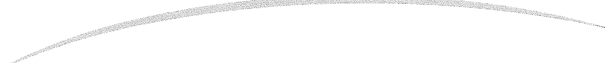
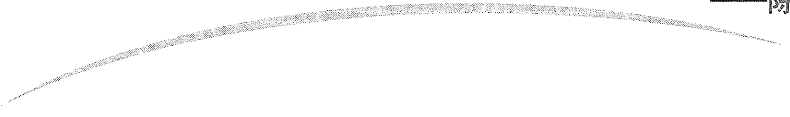

# 陈昌文讲师宝典：直播时代

## 写在前面 1

《陈昌文方法之讲师宝典系列丛书》缘起

这是一个移动互联网时代、视频直播时代、社群经济时代，也就是说这是个互联网个体经济崛起的时代，人人发声的时代。每一个人都可以是平台上的一个主角、主播、经济个体，利用自己的特长去经营粉丝，获得流量，进而变现，这是一个新的安身立命的生存方式。那么，说话，如何说话，就成了每一个人必须且急需具备的技能。说话，代表了一种价值观，而通过说话达到变现的目的，就需要有超强的营销思维能力，从这个角度来讲，人人都是讲师。

通过阅读《讲师宝典系列丛书》可以有以下收获：

- 1、你可以成为一个圈粉及变现能力超强的王牌主播；
- 2、你可以把讲师做为安身立命的终生职业；
- 3、依托此系列教程，你可以成为训练讲师的讲师；
- 4、通过陈昌文先生对讲师团队的训练和运营方法，你可以把这套管理经验嫁接到自己的企业里，搭建精英团队；
- 5、通过陈昌文先生对“陈昌文老板读书会”和“陈昌文老板社群”自己团队的运营，老板及企业家们可以搬运这种互联网企业的运营思维和模式。

## 《讲师宝典系列丛书》

- 1、以儒家思想《陈昌文解读〈论语〉》为价值观体系的根基；
- 2、以《陈昌文方法 72 大营销系统》为营销方法论；
- 3、以指导陈昌文老板社群内部、外部讲师教学为主线。

## 写在前面 2

学习《讲师宝典系列丛书》经营企业的方法

每个人都想获得财富，并守住财富。但如何做到呢？没几个人真正认真思考过。我们的儒家思想和陈昌文方法，就是解决这个问题的。陈昌文方法解决出单问题、营销方法论的问题。儒家思想解决财富安全问题、安身立命的问题。

一、粉丝经济时代，要搞清楚干啥，才能快速获取粉丝？我们推出这套《讲师宝典系列丛书》的目的，你只要学会演讲，你就可以日日不断的营销人。不断的发表观点，就有粉丝。不断的直播，有人听，这些人在某个时候深刻认可你了，就买单了。

二、不要让所有人满意。我们社群收人的定义，就是只满足老板、企业家、富人，知道投资大脑，投资演讲能力是非常重要的人。这些人不差钱、懂道理、明事理，知道跟着我们学习的重要性，就是我们的客户。你不可能让所有人满意，让所有人满意的最终结果就是你没饭吃。我们的选择是，只让老板满意，只让富人、牛人满意，让聪明人满意我们就行了。然后他们加入我们社群，跟我们学习一辈子就行了。彻底认可我们的老板满意就行了。不满意的，听外面的免费课，就行了。这就是我们的策略，被动营销，姜太公钓鱼：只在直中取，不在曲中求。

三、经营企业，做项目不要怕犯错，比如，你跟着我们学做直播，必须日日直播，日日搞 36 循环系统，不要怕别人嘲笑你，大胆讲出来。差异化营销、品牌化，让别人记住你。你自己本来就要找点与众不同、非同凡响的东西，别人才能记住你，这个过程，有人嘲笑你就对了，就怕没人嘲笑你。

我们都是是在别人的讽刺、嘲笑、谩骂、污蔑中成长的。慢慢的，就有人尊重我们了。我们的尊严，是靠我们的业绩来实现的，不怕犯错的人，才会有业绩。怕犯错的人，就跟鸵鸟一样，只会把头埋在沙子里躲避危险。

四、聚焦到极致，只做一个业务，一个点。我们的业务，就是卖陈昌文读书会、陈昌文老板社群，其他的不干。永远不开辟第二战场，其他地方无论多赚钱，我们都不去。我们学习任正非，只在通信领域干活。我们也只在老板读书会、老板社群这个领域干活。我们不断的培训互联网讲师，主要就是讲儒家思想 + 陈昌文方法。传统企业想转型互联网，想学网络营销，想做讲师，找我们学习就对了。

五、跟高手合作。你自己开辟一套理论、一个社群、一套方法论、组织一个团队，无论是网络，还是线下，都会非常难。你最智慧的选择，就是跟着高手合作。我们也算中国有一定影响力的社群，你们可以找我们合作，这是最智慧的路子。跟高手合作，高手的资源都是你的，是相互加持的一个过程。成功是站在巨人的肩膀上，而不是自己成长成巨人。

六、只做成本低的项目。商业的成功，不过是比谁的成本低，利润高而已。为什么我们做读书会、老板社群，培训讲师，因为这是贩卖智力，且是你需要的智力。我们社群都准备好了，我们会每个月出一本新书，以智慧＋财富＋婚恋为核心，你跟着学，跟着讲，跟着读就行了。我们希望大家用这种方式创业，是对你的老婆本的保护。你随便搞个其他小生意，亏损，可能都是几十万、几百万。

七、从一而终，坚持到底。一干就是一辈子。老虎伍兹、乔丹，几乎所有最成功的人，都具备这个品质，不断的在单个点上深挖，在一个行业深入。我们做读书会、老板社群，做讲师，就是一辈子，绝对不换。有低谷，也会有高潮，一直坚持，就会越来越好。我们见过很多人，习惯性三心二意，这些人，不会有什么前途。只有从一而终的人，才会有前途。

八、正心术，跟着我们日日学习儒家思想，日日修德，德行好了，财富自然来了。很多人不懂这个道理，比如，你天天讲儒家思想，你自然会发达，因为，以后帮你的人会非常多。这个道理，大家要是明白，在社会上做营销、赚钱，都是水到渠成的。你帮的人多了，社会就会回馈你，只是早晚的问题。为什么你不能赚钱？你帮的人太少了，不是不赚钱，而是积累太少，德行太薄。

九、人心就是天道。满足人心，靠良心结交人，帮助人，这是我们社群的宗旨。你如果完全认可我们社群的理念，想跟我们一辈子学习社群营销、做讲师，就可以跟着我们一起把儒家思想、陈昌文方法传播给十亿人，希望富人、老板、企业家、牛人加入。

陈昌文
2020.10.1

# 后记

# 第一章
## 讲师基本功

优秀自己的本质，是好好爱护自己；也好好爱护社群，爱护粉丝。

——陈昌文

### 1、师者，父母心

我们必须感恩那些真正帮助我们的讲师，这些讲师，就是我们的再生父母。我们不能乱说话，浪费大家时间。父母心啊，父母心啊。没有父母心的，就不能当讲师。有些人是挖掘别人，坑别人，忽悠别人。你把学员看成你的儿子，你教儿子，你耐心不？你传真东西不？你舍得乱讲不？用父母心、菩提心来讲课。这个道场，用好了，积德行善；用不好，就是罪恶。

我们的讲师，不仅仅是讲给学员听的，还要讲给自己听，你讲这些，是不是讲给你儿子听的？你舍得传给你儿子吗？你是不是在误导你儿子？

钱，是交换来的。先做朋友，把听众、粉丝当好朋友帮助，把听众、粉丝当儿子一样，不断的栽培他们，他们自然会给你钱。你讲的真的帮助你的听众提升思维了吗？佛祖为什么富有？真有用啊，所以富有啊，有香火钱啊。你不赚钱，本质是你不值钱，你不值钱，别人为什么要给你钱？为什么有些讲师，一天赚几万？因为他值钱，就这么简单。

么你不赚钱？因为你还没有讲值钱的话。

无良知，不是真心实意帮助人的人，没办法提高收入。再努力，学再多技巧，也等于零，或者，只是略微有改善。这种东西，能听懂，要靠慧根的，普通人无缘。因为靠良知，靠道德，靠境界，这个东西，你很难让一个不懂的人明白什么。大多数人，连基本的礼仪都理解不了，你更难让他懂什么是良知了。空说而已。做朋友，做父母，你把客户当成你儿子，你的客户就把你当父母，你自然有人孝敬。你坑蒙拐骗，技巧再高，你以为有人孝敬你吗？这点东西搞不懂，没办法成为一个好的商人。

我们讲师的模式是这样的，不是非要搞流量，是务实陈昌文方法整个系统，讲到极致，真对学员有好处，谁能抗拒给你付费？没人给你付费，就证明你对别人没有什么用。为什么有些人能出单，一天出上百单？不过是好处模式，真正的帮助到了客户。你是不是真心在帮助客户？还是只想问客户要钱？只想要钱，一无所有。真心帮助客户，则客户心甘情愿付费。有一个客户，就是因为我们的讲师天天讲课，讲得他不好意思再免费听了，于是付费了。你真的对客户好了，则，你不想收费，客户强行给。

我们所有讲师，想赚钱，就是不断的帮粉丝学习陈昌文方法，变现；不断的讲儒家思想，正三观。要是大家不赚钱，讲师就没价值，讲师没价值，讲师想赚钱，就变成了诈骗，唯独我们的老板们都富贵了，都牛叉了，

我们赚钱就水到渠成，否则就搞成诈骗了。

### 2、讲师是“教”，而不是“营销”

高明营销的真正手段，是不断的卖工具，你在教你的听众。记住，教，而不是营销，用“教”去代替“营销”，你的营销就出神入化了。

赚钱，不过是因为讲师们把课讲到极致了。世间万物，就是你付出了，观众多了，自然有收获。营销的深度思维，就是你真的服务好了粉丝，真有价值了，客户自动买单。算账给客户听，我们社群到底有哪些真实的价值，你算不清楚，则没什么收入。

营销就是算账，算给客户听。

- 1、付费学习，加入读书会的好处。
- 2、不付费的坏处。

营销就是算账。

- 1、加入我们高级老板圈子的好处。
- 2、不加入，有哪些亏损。

如此不断的算，你帮他把账算好了，他求着你买单。他为什么不买

你的单？就是你没有通过算账，让他认识到，他不买单是亏的，买单是赚的。

每个讲师就是要拼谁的课讲得好，有实用价值，是刚需，则自然成单，自然吸引人。你不修炼自己讲课的艺术，课讲得一塌糊涂，做不好服务，练习不好演讲，不认真备课，没人喜欢你，你自然无利润。

讲课，要实事求是，要信而好古，述而不作。要老老实实讲大师课程，讲圣人思维，然后，做好内部营销系统，就变现了。所有讲师，都要呕心沥血的帮助学员。你真的帮助了大家，你的粉丝就会多，就会有变现的机会。直播帮助，内部帮助，团结一致，相互取暖，相互帮助，就变现。

### 3、我们讲师讲什么

我们讲师讲什么？儒家思想 + 陈昌文方法。儒家思想解决人心、人性问题，解决活得好的问题；陈昌文方法解决营销问题，也就是赚钱问题。

我们专业帮助传统企业老板转型互联网，教老板学会做社群营销，

做讲师，开直播，做视频，提升其知名度和收入。我们也培养中小企业老板成为企业家，或者参与到我们社群的体系中。

讲师的核心任务：

- 1、呕心沥血的教会儒家思想，提升大家的三观、智力；
- 2、呕心沥血的教会大家陈昌文方法72大营销系统，赚钱；
- 3、照顾好读书会几十个群的粉丝心情，教会他们安身立命、赚钱；
- 4、照顾好陈昌文老板社群的人。

我们讲师团的一切任务，就是养好精神，为社群讲课，内部讲好，外部流量裂变出来。呕心沥血的释放《陈昌文解读《论语》》《陈昌文方法72大营销系统》里的干货，日日循环。

教学，首先是教学人的语言系统、思想系统。

- 1、学习儒家思想；
- 2、虔诚感恩，尊师重道；
- 3、低调谦逊；
- 4、踏实肯干，必须搞流量，出单。

儒家思想系统驾驭其它各大营销系统。

讲营销课，讲陈昌文72大营销系统，讲《陈昌文方法之老板心法》《陈昌文方法之老板兵法》《陈昌文方法之老板干法》本质上也是讲人性课，天天研究人性，包括《陈昌文方法之恋宝典》。天天盯着顾客，看顾客想要啥？天天述说我们群里有啥？

- 1、盯着顾客；
- 2、盯着同行；
- 3、复制改编优化；

我们所有讲师的目的，就是把陈昌文方法讲透彻，让大家有利润。大家没利润，一切都是空谈。经济社会，多赚钱，别扯犊子，这个陈昌文方法必须运用得犀利，必须变现，必须有流量，否则，就是空谈。《陈昌文方法72大营销系统》这本书，必须吃透彻，必须引用透彻。真正的对人好，就是教会大家变现，教会大家有利润，教会大家儒家思想，学习老祖宗的智慧，心理强大+经济强大。认认真真的为社群里的粉丝服务，所有人只要看我们的直播、视频，复制、抄袭，然后直播收单子就行了，就是这么简单。

社群讲的就是儒家思想、陈昌文方法，没有其他任何主题，无论是老板、企业家，情感、营销，落脚点都在儒家思想、陈昌文方法上，你们宣传的也是这个模式。在这个模式下，就不会出现学员进来不知道学什么，觉得我们讲得没用的现象，他们会觉得讲得很有用。儒家思想、陈昌文方法72大营销系统，辐射性的营销模式，本来就包罗万象了。也就是你们讲的一切，其实归根结底，都能在儒家思想、陈昌文方法里面找到根据。这样讲，你们就会非常快乐，收单，以及售后都会快乐。

儒家思想、陈昌文方法，本来就有很多分支，很多话题，很多系统，可以延伸辐射到老板、企业家、管理、营销、正三观等方方面面，发散出去，

又要归纳回来。如此模式，我们社群就是无敌的存在。大家按照这个思维模式去做视频、直播、演讲、朋友圈，功力会进一步大增。

每个讲师都要设计一句话打动客户，刺激客户，让客户做出条件反射。广告的本质，就是条件反射。不是说服，是说动，是用动词，进行命令。比如，下单进恋爱圈子，学恋爱。这种词语，都会增加销量。所有的话语，不是说服，而是说动。我们所有讲师，都是驱动型人才，好好体会，说服别人没什么意义，说动别人掏钱，才有意义。圣贤是行动派，而不是口嗨派。

我们的儒家思想为道，陈昌文方法求财，君子爱财，取之有道。

讲师是我们社群的核心资产、团队。我们社群专业培养德行好的讲师，这些讲师的每句话，都在为自己积累福德，也在带着社群正向发展。讲师首要条件，就是人品好，人格过关，道德素质高，虔诚、感恩、低调、奉献精神强；愿意一辈子宣讲儒家思想、陈昌文方法；永不中断，行日日不断之功。讲师本身就是企业家行为，讲师本身就在引导很多人奋斗、修养。讲师有格局，有判断力，才是真正的好。

讲师讲课的目的，就是提升大家的道德素质，不断的传播儒家思想，提升大家的赚钱能力，不断的传播陈昌文方法72大营销系统。我的一切目的，就是提升大家的智慧和收入，我不会再有其他的目的，当然，我们日日讲道德素质、法律风险，也就是儒家思想，要日日讲，反复讲。我们的目的，把儒家思想、陈昌文方法传给十亿人，我们必须让更多的老板获得福报。我们首先要在内部培养几千个照本宣科的讲师，这些讲师日日传播，就会对社会有正面能量，对社会做出巨大贡献，对民族做出巨大贡献。拥有儒家思想、陈昌文方法的人，就跟普通老板不一样了。

所以，当老师最可怕的地方，就是你要不断的提升自己，否则，学生成长了，他们就要搞你。另一个方法是，日日循环尊师重道，这样，他们搞你的概率就小点。但是也会有人搞你，所以一开始就要收到好人。

职业吊打。也就是不同职业有不同的优势。抖音视频、直播卖东西，也是这个逻辑。我们必须有职业吊打的视频、文案，然后有职业吊打的主播。不同职业，有不同的命运，不可强求。

对《陈昌文方法72大营销系统》倒背如流，配合《陈昌文方法1000问师生问答集》来学习，答疑解惑，解决学习、实践过程中遇到的难题；对《陈昌文解读《论语》》倒背如流，然后结合自己的故事、老板的故事、社群的故事，你自然能舌灿莲花。不熟悉，啥都讲不好。熟悉了，自然出口成章。

## 4、讲师的目的，是驱动所有人行动、赚钱

我们的课堂，是提升大家收入的，凡是偏离了这个商业目的，都不应该来讲课，都不应该浪费大家的时间。讲话，不能提升我们所有人的收入，你就是我们的敌人。讲话，帮助粉丝、帮助我们社群的人提升收入的，才是我们的朋友。

讲师，是必须讲有用的东西，是必须讲能帮人赚钱的，必须讲真正能立刻让大家做的事情。让大家立刻行动，能帮大家提升的事情，能操作的事情。不允许乱讲。我们这里的讲师，如果有人乱讲，大家直接让他走就行了。我这里，不允许扯淡。任何扯淡的人，大家都让他滚远点。我们这里，只讲大师的东西。一个脑子有问题的人，当然混不好，什么都没有。时间是很宝贵的。

你的每句话，必须让人赚钱，想办法给大家带去利润。所有讲师，要讲的，就是大家如何赚钱，如何提升道德素质，如何运用儒家思想修身赚钱。说话要实际，你说了这个，大家能拿去变现、赚钱吗？大家能搞到流量吗？不教这些，都是流氓。只要你说的话，没有让人收入增长，你讲话，就会下地狱，你在造恶业。我这里，给了讲师一个道场，你在这里乱讲，就会天打五雷轰。给你道场，让你们造福，积累福德，让你们种善因，而不是让你们在这里浪费所有人的时间。

所有讲师的目的是呕心沥血的带着大家做爆粉视频、直播变现，这是救命。也就是大家赚钱了，就是课程有用；大家不赚钱，就是课程没用。内部讲师，讲好内部课程，这些听众能赚钱，你就能赚钱，这个关系非常微妙。你让听你课的人都正当赚钱，你就能赚爆；听你课的人不赚钱，你想赚钱，抱歉。

我的理想，就是所有讲师都讲具体的干法。儒家思想、陈昌文方法，本质都是如何应用，如何干，如何赚钱的。可以解决家庭、生意，甚至恋爱问题。我们在外部讲课也是这个模式。我们主要用儒家思想、陈昌文方法，解决生意问题、爆粉问题。我们的客户群体，就是至少年纯利润百万以上的老板，只锁定这个区间，其他不搞。我们讲师的目的，是带着粉丝赚钱，带着学员赚钱。也就是讲课完毕，所有人都知道如何操作，如何赚钱，这就是社群的功德。要是大家没利润，我们就是谋财害命啊。

开口神气散，意动火攻寒。人的口，动乾坤，每句话必须赚钱。如果你讲话，让社群里的人收入不能提升，则，你就不适合对很多人讲话。因为，这是谋财害命。

讲师的目的，是驱动学员执行、赚钱；驱动执行，搞流量，搞变现。

讲师就是带着所有人搞流量。你的直播间、内部课，有多少人？你就要带多少人搞流量，搞变现，其他都是吹牛，都是佐料，都是辅助，而真正有意义的，就是流量来了，变现。我们的书籍，就是专业做流量、变现的，卖出去，收单子的。讲课，是讲具体操作步骤，如何搞到流量，如何变现，然后是干货，没这个，我们就会枯竭。讲师能发展的核心是，内部的人都有发展，付费的学员都有发展，铁粉都有流量、变现，则讲师自然强大，否则，累死你。讲步骤，讲具体操作，这是我们的生存之道。讲真正的干货，一定要教会大家搞流量，弄粉丝，变现，否则，你们生存不下去。

讲师说出的每句话，必须让人赚钱，提升收入，就这个目的。没有这个目的，且勿说话。

凡是不做正事的、不说正话的，都是脑子有问题的人。不要讲乱七八糟的话，不要做乱七八糟的事情。每句话，都要逼近目的，就是流量 + 变现。凡是不能锁定这个目的的，都不是我们社群里的恩人，否则，大家都会难受。有些话语，是麻痹人的体系。要聚焦到自己的业务上面。群里的兄弟，群外的粉丝，没有收入，这是要吓死人的。内部讲师要日日讲抖音如何爆粉，如何直播能出单，如何直播能卖出去读书会、陈昌文老板社群。要把抖音机制搞透彻。然后，日日收单子，自己收单经验推广给所有人。

什么是爱？就是讲师，必须带着大家爆粉、赚钱、直播。也就是真正的爱护群友的唯一目的，就是爆粉、赚钱，其他没有了。你不能让大家日收入过万，提升收入，你说你对这些老板有什么爱啊？没什么爱，都是恨，都是讨厌，都是荒废的人生。所有老师，都必须强迫所有人爆粉、赚钱，这是天经地义的事情，必须来之，富之，教之。大家跟着我们搞读书会，搞陈昌文老板社群，没有利润，则我们愧对大家，所以我们必须呕心沥血，还必须强迫大家赚钱，强迫大家爆粉，收单子。没有经济，则一切都是瞎扯。我们必须带着大家找到食物，吃饭。用棍棒打着搞，用语言激励大家爆粉，收单子。陈昌文老板社群，我们什么都搭建给大家了，大家为什么不呕心沥血的赚钱呢？

每个讲师的核心任务，就是带着大家爆粉＋变现。核心就是爆粉、直播变现，搞读书会＋陈昌文老板社群的营销。人的真正贡献，就是爆粉了，变现了。大家在富的过程中，我们讲儒家思想，道德提升。大家没钱，你说啥，大家都不听，人就是鸟人，大家都是鸟人。所以，爆粉、变现非常核心，是每个人必须学会的，道德＋赚钱，必须合为一体。核心就是利用我们的整体品牌势能，搞营销，搞粉丝，搞变现。要有组织，社群讲师团必须有组织，要自动去组织，有耐心，有毅力的，去组织这个讲师团。要一起组织，要有格局性的组织。现在社群里有些人没什么格局，格局不是嘴巴，而是做事。有些人以为格局是嘴巴说几句。

所有讲师的基本任务，就是要完成所有学员＋粉丝利用我们书籍里的内容，学会儒家思想＋学会营销赚钱。大家学会赚钱了，才是我们的成功，大家学不会，就是我们所有人的失败。做社群，做讲师，你都得呕心沥血的爱护学员，不断的爱。帮助他们提升智慧，日日循环儒家思想，日日循环陈昌文方法、《恋爱宝典》，他们都会变成神。他们都变成神了，你自然就是神了。注意道德风险 + 法律风险，日日循环。

要努力工作，要讲方法。有方法，才有未来；没方法，没有未来。每句话，必须是行动力驱动，必须是落地陈昌文方法，否则，毫无意义。各位，菩萨心肠，只是付出，是智慧的真心帮助。

我们得呕心沥血带着大家赚钱，请所有讲师发上等愿。也就是，我们必须呕心沥血传播陈昌文方法，教会大家爆粉、赚钱、营销。我们得呕心沥血提升大家的人格修养，教会大家儒家思想。请所有讲师发上等愿，我们必须把儒家思想、陈昌文方法传播给十亿人，提升十亿人的格修养、赚钱能力。

发上等愿，就是积累福德，各位，认认真真去做这件事。每一个讲师，都要立志做一个帮助几万人、几十万人、几百万人、十亿人，懂得儒家思想、陈昌文方法的人，必须让大家安身立命，必须让内部学员及外部粉丝等所有人赚钱，提升智慧。

## 5、人生就是干活

人生就是干活。

- 降低客户买单成本；
- 不断的给客户找买单的理由。

这两招用到极致，任何人都能发财。社群里的人，都要立志做一个好讲师，一个厉害的讲师。

生命短暂，我只求大家提升智慧和赚钱能力。一定要带着大家一起赚钱，要建立品牌及影响力，让大家跟着赚钱，这才是我们所有讲师要努力的方向。而且，我们讲的必须福泽大家。只求大家不要违法乱纪，认认真真赚钱就行了。有道德，有素质，所有老师如果你讲课不能让人不断的赚钱，则是犯罪。当然，你自己不赚钱，也是犯罪。你必须不断的卖社群，卖读书会。

赚钱不过是每天 36 篇文章、36 个视频、36 个朋友圈，发出去。36 个图片而已。赚钱是抠细节，是干具体的活，不是口嗨。一切目标，只是为了细节而已。只有下实在功夫，一直跟着实在点下功夫，搞账号，才能赚钱。

人性的情感模式是这样的，

1. 你不断的靠近，就会营销对方；
2. 你靠近成功者，就会营销成功者；
3. 我们不断的搞品牌营销，链接白富美，链接功成名就的企业家老板，就会拥有这些功成名就的企业家老板到我们社群里来。

我们做老板社群，只做白富美、成功老板、企业家的生意，反复循环这个事情。

传播的，只有一个内容，儒家思想和陈昌文方法，不断的传播。讲直播，讲视频，讲课的时候，要注意言辞，每句话都要是儒家思想和陈昌文方法，正等正觉。我们这个社群，是只干活的，学习是次要的事情。行有余力则以学文。你赚钱赚太多了，花不出去了，你就去学习、消遣，否则，就是干活。用这个模式，我们的收入会进一步提升。

## 6、讲师，不要吹牛吹得连自己都不认识了

做人做事，都老实点。玄学的东西，有几个人能懂呢？打坐3年以上的有吗？能双盘，不动 3 小时的，有几人？这些都是身体基本功，有几人能完成？能谈玄学的，都是真功夫，你假功夫，我听你几个字，就知道了。真假，区别非常大。故纸堆里有黄金，有几个人有耐心翻？故纸堆里翻出黄金的人？每个老师讲课都老实点，发善心，不要跑得连自己都不认识了。你们扪心自问，是不是在给听众带去财富？还是在造恶业？想学吹牛，《南怀瑾选集》看 10 遍，花 3 年，天下无牛可破。此人文案，学习十次，就算你是个傻子，也能年赚几百万。如果精通，则，世界上没有对手。

所谓修道，你的念头能 10 分钟入定，且不散乱，才算具备及格线。你们有谁能能有这个及格线？没有吧。不会修道，别在这里吹牛。没这功夫，非要装着有这功夫，就是诈骗。人格都坏了，还找什么感觉。凡是有如此定境的人，做啥都能做起来；凡是摸到道门的，早就不用挣扎了，都是活菩萨了。干啥，都能干成。入道者，成就不可限量。在我这里听课，讲课的，不可能有人摸到门。摸到门者，要么不理我，要么理我是另一种方式。

我们有些讲师，成天瞎说、瞎讲、瞎吹，按照自己的喜好乱整，还想赚钱，搞笑。社群的课程体系都是有章法的，儒家思想、陈昌文方法，没有其它内容，非要弄些有得没得的，你落脚点落不到这个上面，喜欢吹牛，本质是浪费所有人时间，也是浪费你自己的时间。

我这里是道场，什么道场？儒家思想道场，帮人正心术的道场，正三观的道场，三观正了，人生才能好。有了正确的三观，读了《陈昌文解读《论语》》，再学《陈昌文方法72大营销系统》。《陈昌文方法72大营销系统》是帮人直接赚钱的，养家糊口，安身立命的。所以，讲师必须老老实实做正事，不要吹牛，每句话都要力求有价值、有用、有意义，只讲儒家思想、陈昌文方法，讲应用，讲具体的干法，不允许扯淡。只讲真话、实话、教人向善的话。

讲师的任务是带着大家提升德行+流量变现，必须都要做，没德行不行，没变现、没流量，也不行。

## 7、嘴皮子就是乾坤

求真务实，说的每一句话，必须是善良的、正义的、实事求是的、有据可查的，不可以随意乱讲，讲话是要负责的。乱讲话是有罪过的，严重的会触犯法律。实事求是、有据可查，只讲真话，不讲假话，只讲善良、正能量的话，只讲济世救人的话。请所有讲师，做直播的人执行，否则，会给自己招祸。祸从口出，病从入口。有错误的，要立刻改正，每个讲师都要讲真话、实话，有利于社会的话，要不断的强调这个观点，而且要这样做。一句话都不能乱讲，引导错误，是要扯皮、要负责、要下地狱的。

社群是为品牌名字、陈昌文读书会、陈昌文老板社群服务的，为书籍里的理论服务的。严格按照我们写出来的理论去讲课，尽可能别信口胡诌，更不可以公报私仇，在直播间、课上乱讲。更不能引导学员跟平台，跟已有的理论体系做斗争。

各位讲师，嘴皮子就是乾坤。语言可以让人去地狱，也可以让人去天堂。讲对了、真了、善了，就是积累福德。讲错了、假了、恶了，不仅仅是别人会下地狱，你也会。言语之所以动天地也，可不慎乎？

所有人，都必须日日循环正能量，所有人都必须日日讲儒家思想、道德素质，不允许讲任何一句假话，这都是违法行为。所有人、所有讲师，都要传播这个，正能量，只讲真话，就是救命，否则违法。

讲真话，老老实实的讲话，下面都是白富美、高富帅、企业家，讲话之前，想想前面的对象，话语就变了，语言风格也就对了。常惭愧对天地、父母、客户之心，人就进步了。讲儒家思想、陈昌文方法的目的，做灵魂摆渡人。我们要是不能搞灵魂摆渡，我们就不收费。所有讲师，都必须是灵魂摆渡人，得把这人的魂收到社群里来。

我们社群的内容非常简单，儒家思想、陈昌文方法，就讲这个，不要脱离这个大纲，给自己招祸。每句话都是正能量，都是儒家思想道德标准。讲陈昌文方法，也只是为了商业。照本宣科，按照我给你设计的框架讲，你就不会出格。自己想当然的搞话题，很容易出格。如果你火了，观点不是正能量，你大概离死就不远了。没有道德，没有法律，你就等着死。

所有老师，要对我的文字反复阅读，而且执行到位，这是成长。

## 8、讲师团的一切核心就是，提升所有人的道德素质和赚钱能力

我们要干啥？

- 日日践行儒家思想；
- 不断的强大流量、品牌、影响力；
- 不断的修道德。

社群讲师团要日日循环道德问题，这是提升社群收入的唯一办法，提升自己伟光正的能量。社群讲师团、社群里所有人的一切核心目的，就是提升社群里的所有人的道德素质+赚钱能力。我写作的书籍，是讲师们的养料，拿着书籍去讲，让你们的谈话内容、质量、备课、直播，都碾压众生，为社群里的老板们想方设法赚钱。如果我不呕心沥血的帮助社群里的人成长，帮助我们整个粉丝圈里的人做粉丝、变现、成长，则我是绝对错误的。来之，富之，教之，这也是我们所有人、我本人要完成的。必须让粉丝极度认可我们的理念、我们的价值观。我们做的是价值观营销，大家必须真正的喜欢我们，我们才有出路，否则我们死亡。

讲师的目的，是组成讲师团。唯一任务，呕心沥血的培养内部讲师、外部讲师。唯一任务，不断的培养实习讲师、讲书人，讲书籍，变现读书会+陈昌文老板社群，日复一日的传播儒家思想、陈昌文方法，这也是所有讲师的核心工作。大家做好了这个核心工作，其他的工作才会好。

讲师团的目的，是带着所有人搞流量、变现，而不是讲偏了，没意义。讲师团的目的，是为读书会、陈昌文老板社群搞流量+变现，通过品牌口碑变现，日日循环。我要做的是管理好整个讲师团、整个社群，内容不能偏移。内容偏移，相当于定位偏移，相当于白干。要做的，就是传播儒家思想、陈昌文方法。讲书，就是锁定一本书，日日弄。目的是让老板们不断的爱我们的儒家思想、陈昌文方法，爱我们的思想、书籍、读书会、陈昌文老板社群，要赢得讲师的爱，赢得内部人的爱。讲师的核心任务，就是把所有人都教会做直播、视频、变现。

社群里的所有老师，都得呕心沥血的研究在抖音上赚钱，疯狂的赚钱，若是大家不赚钱，就会失去信心，道德+赚钱，不可偏废，必须得疯狂研究。社群讲师要做的是，呕心沥血的带着大家搞陈昌文读书会、陈昌文老板社群，赚钱+修德，齐头并进，双管齐下，循环品牌营销，循环道德提升，循环心灵美提升，循环智力提升，帮助所有人正心正念的赚钱。提升大家的收入，应该就是刚需性传播。大流量，加刚需性质的卖点，恋爱、营销、《论语》都是这样的卖点。我们本质是卖智慧的，我们卖的是生存价值、繁殖价值的智慧，这是我们的视频、直播要讲的。

社群老师，必须出能真正帮大家赚钱的方案，安全赚钱的方案、讲课方式、直播方式。社群讲师的任务，就是呕心沥血的培养讲师，呕心沥血的落地做视频、直播、搞流量变现，力求每一个伙伴在内部赚到钱，还走的是儒家思想的正道。社群讲师的素质必须非常高，要呕心沥血的教会大家爆粉、变现的招式。直播变现非常快，赚钱也是非常多的。

## 9、讲师必须是变现高手

所有讲师只有一个任务，带着大家做事干活。优秀自己的本质，是好好爱护自己，也好好爱护社群，爱护粉丝。必须做到早起早睡，锻炼身体，必须做到日日循环流量、变现，必须日日让各位干活。我本人只复制输出大师级的思维、智慧，其他的我不弄。社群只搞品牌营销，其他的营销模式我们不做。

有道德，有业绩，必须齐头并进。没业绩，就是错的，绝对不行。绝对不允许内部讲师没有业绩，常年没有业绩，这是天大的错误。内部讲师是社群的发动机，社群道德＋业绩的发动机，必须有业绩，有道德，少一条都不行。不允许没有业绩，玩抖音玩了这么久，我们的文案、直播都在这里，陈昌文老板读书会、陈昌文老板社群都在这里，常年没有业绩，百分百是思想、道德、人品、业务能力出了问题。不出问题，就一定有业绩，没业绩，怎么行？

没业绩的人，道德、思想、能力、人品、心性、业务能力都有问题，才会没业绩。这个人全面正能量，听得懂人话，就一定会有业绩。在当前陈昌文老板读书会、陈昌文老板社群的框架下，很容易有业绩，在这个框架下，居然还没业绩，这种人就应该反思一下自己的人品、道德、业务能力的问题了。

### 什么样的人业绩会好？

- 修炼道德，人品好；
- 虔诚感恩，尊师重道；
- 愿意听话、照做、执行；
- 谦虚，连这个也没有，不可能有业绩。很多人都是在骄傲中，一辈子不进步，非常可怕。

不出单，大概率都是做人出了问题。业务能力其实不是主要的，大概率都是做人出了问题。心性、品德、做人的态度有问题，就会导致学不到精髓。骄傲自大，就会按照自己的想法去干，然后进一步没有业绩，没有进步。人最可怕的，就是自以为是，自己不愿意进步，交往更多不进步的人。

## 讲师的任务与社群势能

讲师的任务，就是要对社群里所有人好。利用我们的陈昌文老板读书会 + 陈昌文老板社群 + 书籍内容不断的变现。所有讲师的目的：

- 1、自己是变现高手，每天几千、几万的变现；
- 2、所有听课的人都因听你的课成为变现高手；

别人变现跟我有什么关系？有的人说，他变现了，我不赚钱，跟我有什么关系？告诉你，社群势能变大，粉丝变多，更多的人也会找你买单。我们社群，不是靠哪一个人做起来的，本质是靠所有优秀老师努力的结果，千万不要以为你一个人就能干起来。我们必须日日研究爆粉文案、变现直播、收单子。社群里，必须要能力强的人，也就是有业绩的人必须排在前面。能会说道、无业绩的人，必须干掉；人品不好，也没业绩的人，必须干掉。社群里要留的是人品好、善于沟通、有业绩的人，不按照这个模式，社群就得倒闭，就会寒了真正有能力的人的心。

不要据天工为己有。不要以为财富就是你的，很多财富，都是大家共同工作，只是你持有而已。连这都理解不了的人，都不适合待在讲师团。随着读书会的发展，随着高级群讲师的增多，社群内部讲师某些人的财富还会进一步大增。道德素质不够，人品恶劣的人，就不应该获得所有人的传播影响力。日日必须斧正所有人的道德素质，日日讲习《论语》，日日提升做人的道德素质，这道德素质差，给所有人做坏榜样。

讲师讲课，不断的提升人的尊师重道能力、道德素质；不断的帮人赚钱；不断的驱动人搞粉丝，搞直播，唯有如此，我们的社群势能、品牌影响力势能才会越来越大。在社群势能、品牌影响力的庇护下，讲师的变现能力是水到渠成的事。

## 10、如何增加直播间的传播力、人气，拥有更多的粉丝

- 1、不断的在内部讲课，内部是铁粉，你能征服几百人？几千人？成为你的常随众。把社群内部课讲到极致，让内部几千人都会去看你的直播。也就是说，你是一个真好人，你在内部搞好了，把内部力量全部用到自己身上，其实你的直播间稳定过千人，都是正常现象，没什么难度。你对人好，别人才会对你好，你的直播间才会做起来。你对人不好，别人凭什么在你直播间呢？这个道理都搞不明白吗？常随众是非常厉害的，有了常随众，生意自然好做；
- 2、把陈昌文老板读书会服务到极致，让读书会几万人都传播你。读书会数万铁粉，好好对待。也就是每个付费粉丝，才是真正的传播力、影响力。好好对待这些粉丝，讲透彻儒家思想、陈昌文方法给他们，教会他们用我们的书籍搞问答营销变现，采取这个模式，日日不断的提升他们，则他们的单子会爆增，而你的单子也会爆增；
- 3、外部已经有的粉丝好好对待，外部铁粉服务到极致。

群众基础，不断的对大家好，要让所有群友、粉丝，都知道我们社群的价值，陈昌文方法、儒家思想的价值，这是要日日循环的。要集中优势兵力，不断的攻占抖音平台，每个人都要集中精力攻占抖音，彻底搞定抖音，在抖音里，粉丝、直播、视频都多。

总之，内部力量能服务好，才是真正的儒家思想。内部厉害了，然后外部铁粉再讲点干货，配合书籍，讲讲流量 + 变现，这样，读书会的单子、陈昌文老板社群的单子，自然能做起来很多。

大家如果彻底按照我说的这个模式去努力，你的日收入只会越来越变态，越来越高，而且极其稳定。

## 11、讲师提升收入的路径

讲师提升收入的路径：

1. 做内部讲师，对内部学员有极大的贡献。也就是你呕心沥血的在教，陈昌文方法之讲师宝典系列·直播时代这些人就会传播你。内部不断的讲课，内部人喜欢你，内部有几千人 都成为你的粉丝；
2. 对外部粉丝呕心沥血的教；
3. 数万读书会会员，彻底对他们好，日日对他们好，日日带着他们释放价值，教会他们赚钱、变现，并且带入直播间。现在读书会有很大的传播力，你们直播间的人数稳定，读书会会给你们贡献很大的力量，甚至出单力量；
4. 对铁粉，呕心沥血的讲书籍里的好内容给他们听；
5. 永远在教人儒家思想，永远在教人陈昌文方法 72 大营销系统，变现。这个就进入潜营销，不断的营销、变现；
6. 不断的爆粉。复制社群里的爆粉文案，不断的爆粉、直播收单子公司；
7. 找出社群里 2 个营销变现高手，日日循环他的直播间，收集术语，不断的变现；
8. 社群书籍里面的内容，谁看，谁做视频，做系列化，做干货，谁发财，这是大家变现的利器。采取这个模式去营销，把我们的书籍当成自己变现的工具、道具、内容军火库，不断的变现读书会 + 陈昌文老板社群；
9. 对读书会 + 陈昌文老板社群的付费会员具有强大的贡献，关心他们的收入、变现。你帮他们提升收入了，增加他们的能力了，他们赚钱了，你的传播力、影响力更大，更赚钱。

要在内部社群不断的讲课，内部粉丝有几千人 了，外部直播有几千人 都很正常。内部铁粉是读书会铁粉运营 + 陈昌文老板社群铁粉运营 + 外部铁粉运营，这个整体铁粉你 都对他好，这样不断的搞内生传播 + 外部爆粉式传播，你的单子自然就来了。比如，卖读书会，会循环往复的不断的收单子。

社群的核心特征，是不断的对内部粉丝好，不断的讲透彻书籍里的内容，不断的收单子，不断的爆粉。首先，需要内部不断的讲课，把铁粉、有钱人群体服务好，做到内生传播力 + 外部传播力 + 爆粉传播力，然后，不断的弄读书会收单子 + 陈昌文老板社群收单子，日日循环这个动作，就能让你的收入越来越高。

只要你们这样去做，你们的人气会越来越旺。赚钱的核心原因是你对内部的人足够好。近悦远来，内生力量营销系统自然就起作用了。内部讲课，天天讲，50 个听众听你的，他们都干到几十万粉丝、几百万粉丝，你想想，你的直播间人气、利润，是不是就做起来了？别老是觉得，我为什么要教他们？他们又不给我付费，这是傻瓜思维。这背后有强大的传播力，这都是利润。内生力量的开发、壮大，外部不断的爆粉，每天直播 4 小时，不断的营销读书会、陈昌文老板社群，不断的讲道德问题、儒家思想问题、陈昌文方法问题，不断的讲法律问题。这就是做流量和变现的过程，水到渠成。

真正的流量，就是内部的人都能做到几十万、几百万粉丝。每个人在抖音上都有几十万、几百万粉丝，这是讲师要呕心沥血教会每个人的，然后，直播，大家都会搞，都会变现，读书会会变现，陈昌文老板社群会变现，这个集团军规模完成，为这件事付出努力的讲师，就会被捧成几千人、几万人在线的大主播。也就是社群必须靠内生力量 + 近悦远来活下来。社群讲师努力的方向，是让社群内部的人做到爆粉＋变现，教会所有人这个基本动作。这是我们的生存之道，也是最好的道路，而且，我们必须这样干。

所有讲师，要呕心沥血的对读书会＋陈昌文老板社群的付费学员好，必须教会他们具体的变现、流量，然后把铁粉教会，这个是我们社群的生存之道。他们不能生存，我们就不能生存。得真正呕心沥血的带会、教会，要让所有人，都有几十万、几百万粉丝，这才是各位讲师不会死掉的核心。如果只顾自己，就会死掉。如果集团军活下来了，你想死，也死不了，集团军随便给你点流量，你都富了。

如何提升业绩？就是呕心沥血的对内部学员、粉丝好，对外部粉丝好，上干货，只影响富人，营销富人，不断的释放书籍里的价值，不断的讲书。永远都在循环儒家思想、陈昌文方法，其他的不循环。疯狂增长流量，宣传我们书籍里的内容，正直善良，良心别变，别被坏人影响。日日循环讲课，反复讲课。情感＋营销，一直是我们社群的模式。儒家思想《陈昌文解读《论语》》是根基，锁定一本书，一辈子锁定，讲成世界第一。

如果你天天都在琢磨着要结果，要成绩，就不会有结果了。你自己会越来越慌。我们要追求的是，我们的视频、直播、讲课，是不是极度具有干货，能把人气给带起来。听课的人获益了，维护自己的人多了，这个流量爆粉起来了，你就变现了。如果经常想要赚钱，想要结果，不会有结果的，你就心慌了。

结果是检验过程对错的标准。我们要有结果意识，但是我们的大部分精力，都应该在精益求精的研读我们社群内部的书籍上，复制优秀同行的东西，力求流量，流量大了，营销功底到位，也就变现了，道理其实非常简单。

越大爱，越有钱，别只会鹦鹉学舌，要学到根本。

无价值的事情别做，呕心沥血的服务读书会成员，服务陈昌文老板社群的人，是讲师的基本任务。只要你们呕心沥血的对读书会+陈昌文老板社群的人好，则你们赚钱很容易。

## 12、社群里的所有讲师都好了，你自然就好了

社群是一个整体，别的讲师讲课的人数多，你讲课的人数就会多。如果你攻击别人，希望别人讲课的人数少，你的讲课人数就会少。很多人愚蠢的非常可怕。无论是内部讲课，还是外部讲课，都必须真心实意的希望社群里的讲师讲课人数多，帮助他们讲课人数多。这样，会让你的直播间，你讲课的时候，人数变多。理解不了这个原理的，都是智力不及格、良心有问题的人。

社群里的所有讲师都好了，你自然就好了。社群里的所有讲师都不红，都不好，你想好，也好不了。这就是所有讲师必须理解的思维模式。每一个人都**在享受**社群的整体势能。整体势能强了，你跟着收单子就行了。可千万不要攻击其他讲师。要希望别人好，人气高。讲师是社群的门面，你的业绩是所有人共同努力的结果，并非你一个人**就能做**起来。你得理解，只有所有人好了，你才会更好。

我们每个老师，都要呕心沥血的带着大家赚钱。合法、合理、合德，日日搞免责声明、过渡营销系统。我们的所有行为必须伟光正，只影响富人。

所有讲师，都要呕心沥血的照顾好所有人，照顾好粉丝，帮助大家卖读书会，卖陈昌文老板社群，带着大家变现，而且要合法、合理、合德。我们帮大家赚钱，不断的传播儒家思想、陈昌文方法，给大家积累功德。

所有老师的信条是，跟着社群做读书会的人、做陈昌文老板社群的人，必须能变现，能有收入，合法、合理、合德，没有纠纷，做老板生意。这是我们所有老师，要呕心沥血实现的，提升大家的道德修养 + 财富，这就是各位的功德。

要全心全意为企业家老板服务，为社群里的讲师服务，为铁粉服务。不断的讲儒家思想、陈昌文方法给大家，《恋爱宝典》给大家，日日心思就是提升社群里的人的智慧、收入。只做这个事情，为社群里的人的成长、智慧呕心沥血。所有讲师都按照我说的这个去做。必须对大家绝对的好，不可有二心，一心一意为社群里的人服务，为铁粉服务，让他们疯狂成长，变得比其他人都智慧 + 有钱 + 健康。

## 13、以能者为师，以出单者为师

我们推出的任何讲师都必须日日不断、滴水穿石、绳锯木断，天行健，君子以自强不息。都必须奔着圣人人格去，如此，我们才能辉煌。财富，是水到渠成的。我们的讲师，都是人中龙凤，都是成功者。我们社群的能量非常强大，我总是希望这样的人，想做讲师的成功者、老板，来找我。

我们是积德行善，发善心的一帮人。讲师，就是要滴水穿石、日日不断、绳锯木断，从一而终，向死而生。逝者如斯夫，不舍昼夜，抱团奋斗。必须向已经有成绩的讲师，全面学习。其实，你们把某些有成就的讲师的内容，去讲一次，你看看有什么变化？

你为什么不变更？我们社群同样的几个讲师，成绩差距大得让我瞠目结舌。你们要反思，要总结，要前进。我受不了，你们有些人没成绩。

你们要老老实实的反思，然后前进。以能者为师，以出单者为师。你没出单，你不行，你就要老老实实的拜师，否则，你想闹哪样？我们社群的所有讲师，只担心自己的能力不够，不要担心赚不到钱。没能力，才是你们需要担心的。

要理解，社群里有些人一天上百单，大家都要去学，不服高人有罪。讲课必须有标兵，谁直播做得好，谁的视频做得好，有利润，就大面积复制。向高人学习，社群里有很多高人，短时间能干起来，而且能赚钱的，都是厉害角色，必须学习。

- 1、只跟正能量的人学习；
- 2、只跟有成绩的人学习；
- 3、要心里美，才学习，才宣传；
- 4、恶人直接拉黑。请勿学习，各位要有自己的判断力。

大方向是彻底正能量，不是正能量的，我们其他人要想尽办法让他走上正能量。

不是自己要做什么，而是大家有多优秀，直播间有多少粉丝？视频传播有多广？直播传播有多广？这是我们要努力的，希望所有老师迅速执行到位。每个人，每天在我们社群必须学会卖儒家思想、陈昌文方法，赚钱。所有人认认真真搞单子，每天都要有收入，所有人在社群都是力求进步的。不允许任何人后退。我们力求让社群的讲师、所有人都变得极其优秀，讲课，做直播，做粉丝，都变得极其优秀。在学儒家思想的过程中，我们的道德，也要变得极其优秀。

## 14、你得成为一个方面的专家，超级专家

永远都在想着要帮助客户。我们现在有书籍，书籍里的观点，我们讲给客户听。儒家思想帮助他们提升三观、思维能力；陈昌文方法，帮大家提供营销能力；恋爱宝典，帮大家提供谈恋爱的能力。永远都在讲，如何运用我们的观点，去经营自己的人生、自己的项目、自己的团队、自己的家庭。

所谓口碑，就是你讲的一切都对大家有利，大家在你的思想体系下获利了，大家就支持你。获利包括精神获利 + 物质获利。不断的对客户好，不断的讲我们书籍里的一切内容，不断的讲我们的品牌，不断的讲我们的定位，企业家老板，这样不断的循环单子到社群里来。

赚钱的本质，就是不断的帮富人，对富人好，于我们社群，就是不断的对老板企业家好。社群内部的价值、书籍里的价值，不断的复制给客户，不断的传播给客户，客户因为你获益了，因为我们的整体讲师团获益了，你就会赚到更多的钱。不赚钱，就说明思路错误，讲法错误。

还有一个，你得成为一个方面的专家，超级专家。会看的看门道，不会看的看热闹，你得搞清楚，别人的讲法为什么会赚钱，这样你就能赚钱了。在一个主题上帮助大家，比如只在营销这个主题，或者只在恋爱这个主题，成为这方面的专家，让所有人都知道你。讲话对别人没帮助，就别讲，因为是浪费时间。只帮助富人、企业家、老板、牛人，这些人受到帮助会回馈你，也会感恩你，不会辱骂、找事。我们给自己惹麻烦，往往是我们帮助错了人，服务错了人。

每个视频、直播、内外部讲课，都是不断的成长客户的。你内心里有的东西，你一定要拿出来帮客户。你自己没水平，水平有限，你就要推给社群讲师团，整体社群里的老师不要想着自己一个人扛，一个人服务。打造讲师团队的核心目的是，让每个讲师都成长起来，让每个讲师都可以在自己的角度服务客户，服务整体粉丝。社群里要不断的培养优秀的讲师，不断的培养新人，态度真好的人。

## 15、讲师的本质就是权力的传递

讲师的任务，是让大家有粉丝，有变现。大家的粉丝、变现多了，我们才能活好，否则，我们活不好。这是所有人必须深刻理解的。另外，每个讲师本质是社群领袖，并不是孤家寡人。虽然你只有一个人，但是你讲的话让整个社群、整个抖音都知道你。注意你的领袖行为，你必须为整个社群、整个陈昌文老板社群粉丝群体谋福利。这是格局，也是责任。

社群的每一个老师，本质是社群的领袖，也就是你们全部是社群的领袖。你们在讲课，本质都是代表着我，代表着整个社群。你的格局、言辞一定要伟光正，而且对所有人都益处。社群的每个老师都是管理者，都是领袖，都是领导。你们代表着社群在讲课、讲话，社群要整体发展，并且大家都有利润。

社群里所有讲师，都必须立志成为抖音第一知识付费主播，都必须是社群营销大师、读书会营销大师，我们必须是道德素质＋业绩第一。社群的所有老师，要为整个社群的所有影响力范围内的人做出贡献，要讲好课程，引导大家的精神＋物质进步。

讲师的任务，是带着大家搞钱，带着大家搞变现。我讲课的目的，是教会讲师做社群领导。每一个讲师，都必须是一定范围内的社群领导、圣王。这些圣王，必须内圣外王，带着大家发财。大家不发财，一切都等于零。讲师本来就是领导者，讲师就在领导我们社群的影响力、品牌、舆论流量。这些东西都是价值，都会变成现金。

讲师的本质就是权力的传递。讲课就是权力传递，讲话的权利就是话语权，就是权力本身。有几个讲师能理解？也就是说在本群讲话的人，就是有权利的人，不管你承认不承认，这都是事实。做直播，做内部讲课，就是奠定自己的权利，当然，你也得有人品和才能，否则走不长远。维护好自己的权利，造福人类。所以所有讲师，要绝对无私的讲话，所有讲师要绝对不能有一丝一毫自私自利，如此，社群才能做大。做好品牌营销，读书会、陈昌文老板社群，一心为公，公自然反哺你财富。

## 16、说好话，做好事，循环正能量

所有话语体系，必须是彻底的正，没有任何问题，才能讲。建立任何一个社群，都有法律风险，不要乱建立社群，严格按照我讲的一切道德、法律范围内来做。所有能量都必须是正能量，否则，会涉及到犯罪问题、道德法律、各种纠纷问题。

社群里的人，都是好人，社群发展的就好。有坏人，心胸狭窄、不是为社群发展考虑的、自私自利的人，就会把社群带偏。这样的人，就会阻碍所有人发展。人的智力、心理不对，就会导致所有人跟着倒霉。人的心理不对，所有策略、言论，都是把大家导入倒霉的阶段。

社群疯狂支持正能量的人，只支持正能量的人，不是正能量的，不支持。也必须支持正能量的，没跑偏的人。不断的搞品牌营销，收单子，不断的做读书会收单子。读书会，是社群的命根子，这个做起来，后面大家随便收单子。不断的支持社群里正能量、出单多的老师。不断的搞读书会，不断的搞品牌营销，日日循环。

我的目的是彻底扶持正能量讲师，聪明、智慧的讲师，让这些人发财。我的目的是彻底的带着大家搞陈昌文读书会，我的目的是不断的传播正能量讲师，道德素质高的、智慧的讲师。一切语言系统、心思、念头都必须彻底的正，然后，结合儒家思想、陈昌文方法去讲。陈昌文方法包括了《72大营销系统》《1000 问》《老板心法》《老板兵法》《老板干法》《恋爱宝典》，还有后续的书籍。所有言语、心思，都必须正，这样去讲，我们社群就会发展的越来越好。不断的干抖音，在抖音上搞品牌营销，搞读书会、陈昌文老板社群，不断的讲儒家思想，正能量，救命＋赚钱。

我们的读书会人数非常多。讲师团必须派正三观的人去讲课，读书会人非常非常多，多得狠。必须正能量的人去讲课。走正道，所有的道，所有的动作都必须是正的。不正的、假的全部去掉。否则，后果很严重的。讲课，就讲书籍上的，别瞎扯，你们很多东西都不懂，说白了，就是瞎讲。就按照书上讲，就很厉害了。你们没那个水平创作其他歪理邪说，没流量，也没变现，天天自以为是。

日日循环做好事，陈昌文老板社群就是用陈昌文方法、儒家思想，不断的教人做好事，不断的带人向善。全部是正心术的课题，读书会与陈昌文老板社群都是彻底的讲好话，做好事，搞布施这样一个过程，一个玩法。

陈昌文读书会，运营的是正能量的流量。我们的社群卖品牌，为流量服务，品牌是流量蓄水池，也就是“陈昌文”三个字会自带流量。我们循环的永远是流量+变现，循环的永远是品牌营销，读书会是我们的战略重心，也是我们的战术重心，只要这个做得好，就是无敌的。流量当然要不断的搞，挖空心思搞流量。但是，视频、直播，最后一定要正心正念。

## 17、在正能量的基础上，才能谈经济建设

社群最核心的，就是风气问题，社群必须用正能量的老师讲课，内部+外部，都必须是彻底正能量的。尊重我，这个个人都不尊重我，对我都不虔诚，要他干啥？提拔正能量的老师，内部讲课、外部讲课全部按照我书籍来，做内容、直播、视频。如要赚钱，就是搞陈昌文读书会，这个量会越做越大。陈昌文老板社群，要对客户的资产、公司、房产考察，杜绝任何一个个不合格的人加入陈昌文老板社群，给社群带来风险。

现在社群的的一切任务，就是团队必须正能量，提拔正能量人才到内部不断的分享。所有歪风邪气，全面打压，所有讲师团的成员，提拔人才，不断的培养人才，管理人才。必须打造正能量讲师团队，外部内部，都必须彻底的正能量。一个坏老师，会带坏一大群老师，非常可怕。发现坏的讲话，立刻驱逐。对于社群的经济损失、人才损失、人员损失，我不在乎，我要的是社群从此过后彻底的正，而且正能量的老师数量要急速提升，全面正能量驾驭整个社群。法律风险、道德风险、税收风险，全面搞定，不允许社群有任何不安全因素。

每个人的每句话，都必须是正能量，彻底的讲儒家思想。每个人的每句话，都必须是为了社会好，为了社群好。日日循环的就是尊师重道，孝敬父母，多做好事。传播儒家思想+陈昌文方法，讲讲营销。

讲师团的任务，提拔正能量的老师，心念正的人才允许发言，不是这样的人都应该拉黑，不给其发言机会。群里必须彻底正。每个人都有贡献，抓业绩，抓流量，多想想如何做视频，如何做直播。

人是靠智慧混社会的，人也要做正事。做品牌营销，做流量，做变现。要做榜样，也就是不断的做好事，做好儒家思想的传播，陈昌文方法的传播。有错误，人人喊打。没有错误，不要乱打。社群里的内部、外部讲师，都必须彻底的正。这个人不正，肯定是要被下掉的，而且是迅速下掉，要采取这种策略。

有事情做的人，一直在做事情，没事情做的人，就会非常闲。无事生非，就是这么回事。我最怕大家无事生非，没事就去做视频，开直播，赚钱吧。注意，你说的任何一句话，都必须是正能量的，对大家有利的，否则，别说话。道德败坏的人，绝对不允许在群里群外讲课，否则，会出大事。每句话都是正面的才好。任何话语，都是正面的，不允许有任何一句负面的话。有良知的人，就能做好直播，能听懂我说的话。

社群里一旦发现谁心术不正、唯利是图，将会全网公示，所有老师、所有粉丝，都必须知道这个人唯利是图，欺骗粉丝，请所有人明确。我们社群要玩的是人品营销，也就是我们社群的老师，每个人都必须是非常有人品的，我本人也必须非常有 人品，道德素质要极高。这样才能玩，否则不能玩的。人品大于能力，这是肯定的。希望所有人这样宣传，人品好，走得长远，而能力，只要不是傻子，愿意修炼，都会出来。说错话，就可能涉及到犯罪，公共平台要注意自己的言语，另外，别搭理黑粉，直接拉黑就行了。没任何意义，跟他们纠缠。注意，每句话都是为社会、家庭谋福利，搞营销，品牌营销。不要乱说话，不要出格，踏踏实实讲好书籍里的内容，做好读书会就行了。

法律法规、道德素质、语言系统最重要。这个存在了，我们才能谈经济建设。社群的风气肯定百分百要上档次，为了社群的风气上档次，讲的都是正能量言语，我们愿意经济缓慢增长。我希望所有人，都彻底地走正道赚钱。所有人的语言、视频、直播、朋友圈，都没有任何漏洞。大家的道德素质都提高了，我们集团化才安全。当然，我们也会通过法律、培训，强制筛选，做集团化。

## 18、不允许搞男女对立，不允许骂人

视频、直播，不允许骂人。所有讲话，必须是家庭美满，学习儒家思想，学习营销。讲干货，讲人性，讲人心，做视频是为了赢得人心，做直播不是骂人。

营销我们的品牌关键词，营销我们的陈昌文读书会、陈昌文老板社群。全面关注法律、道德问题，全面重视，不要只会辱骂结仇，不要搞男女对立。社群不是搞男女对立的。讲《陈昌文解读〈论语〉》，讲《陈昌文方法 72 大营销系统》，讲《恋爱宝典》。只讲给企业家、老板听，其目的就是传道 + 赚钱 + 幸福婚姻，不是搞男女对立，请所有人明白。我们讲课的目的是为了让男女恋爱更好，婚姻更好，防止被坑。我们讲课是为了让营销做得更好。我们讲课是为了让儒家思想传播得更广泛。

为什么大家喜欢骂人，就是脑子里没货，只会骂人。以为骂人是个性。没货就拿着我写的书，进行讲解、阅读，则一切都好了。

抵制在直播间、视频里，信口胡说，搞男女对立，搞成功学，不允许对社会输出垃圾思想。只允许输出儒家思想，堂堂正正的儒家思想＋营销＋正确的婚恋知识。每句话的结尾，都必须是祝福社会更美好的事情。诸恶莫作，众善奉行。

讲正能量是为了保护自己。讲儒家思想，讲道德素质，也是为了保护自己，当然这东西对社会也是非常有利的。

只要对粉丝没意义的话，我们就不讲。所有书籍里的内容，链接到赚钱刚需，以及繁殖刚需。再强调一次，赚钱不是宣传反社会，反家庭，也不是骂人，也不是搞男女对立，而是讲我书籍里的干货，日日循环，就能赚钱了。你骂人，只能证明你没有干货，只会骂人。而且增加你进监狱的风险，增加你倒霉的风险，增加别人举报你的风险。

社群要进入全面正能量前进阶段。要彻底正能量，百分百正能量，才能玩，否则倒霉。日日循环正能量，视频、直播间，不能有一丝一毫漏洞，祸从口出。循环我书籍里的内容，做视频、直播，规模化收钱完事了。没那么多想法。抖音上厉害的讲师，没有问题的文案，也可以改编，要有自己的判断力，没有判断力的人，都会死亡。

管理是有条理、强势的，但是也是有温度的，对于讲师、学员，我也是要修正的，否则，社群的方向会乌烟瘴气，在直播间骂人的请停下来，什么素质？严格按照我书籍里的内容来做视频、直播。这个就是大家的素材军火库，自己读了，在里面找观点，爆粉＋变现，垂直变现。

社群里的人，都必须是有温度、温情的。唯利是图的全部离开。我们是在温情下赚钱。营销老板企业家，营销成功者，各位老老实体会我说了什么。

**重剑无锋，大巧不工。**社群没有任何技巧、手段，全部是阳谋，讲的全部是儒家思想、书籍里的内容、完全标准、正能量，任何人都找不到我们的任何讲师视频、直播漏洞。进入这个模式。

## 19、严格控制道德风险、法律风险

跟人做生意，必须合法合规，不合法合规的立刻去除、整改。必须百分百合法。找律师，找专家，审核每句话，每一笔收款。没有任何漏洞。直播、视频、朋友圈，没有任何法律漏洞。跟客户确认这个事情没有任何法律风险，客户同意，双方自愿，达成交易，若是不自愿，则不达成交易。社群里的生意，以后就只有企业家老板圈子，以及赠送内部资料生意。按照这个模式，我们社群的影响力会增加，大家也会赚到钱财。

每个在社群里的人，都必须彻底理解法律、管理风险控制问题。我们越做越大，我们要从点点滴滴的去控制法律风险、道德风险问题。请所有人看我是如何规范社群的营销行为的，也请所有人保护自己的利益，保护自己的人生安全。本社群的任何人，都必须彻底的保护自己的人生安全。不讲出格的话，不给任何人把柄，一切行为都在法律范围内，讲证据，讲实事。不给任何人把柄。再重复一次，不给任何人把柄。

本社群，没有任何抄袭，全部是原创，不涉及知识产权问题，从一开始就是如此。所以，请大家放心大胆的在内部复制、改编、优化。请勿到外面复制，一不注意，就违法乱纪了。我本人特别注意法律风险、道德风险。所以，我一直都有律师为我保驾护航，出的所有策略请各位执行，不要听不进去，为自己带来法律风险，划不来。所有人不允许贩卖、在直播间播放我讲课的录音，否则，追究法律责任。愚蠢，会为自己付出惨痛的代价，另外，人渣比正常人恶毒得多。

每一分钱，都必须是应该的，都必须是客户求着给我们的，都必须是正正当当的，这是经营社群的核心。所有老师的道德标准必须极高。我也会要求我的道德素质、尊师重道、孝敬父母、早起早睡、锻炼身体。每个老师，必须严格学习《陈昌文解读《论语》》《陈昌文方法72大营销系统》，都要烂熟于心，我所有的书，都熟悉了，你们做直播、视频，甚至管理团队，就没什么问题了。

所有老师的每一个动作，都必须是正能量、正心正念，只讲好话，只给企业家老板讲话，所有人都要按照这个策略搞。时时刻刻琢磨我们的法律问题、道德问题，日日循环这两个问题，所有内容、直播，必须在安全边界内进行，不允许有任何安全问题。

## 20、免责声明，必须在法律和道德上都占理

大家赚钱，要有骨气，有逼格，有格调，这是我们社群的风格。任何人，全部随缘，全部进入缘分阶段，模式、营销全部随缘。万事随缘，随遇而安，不强求，只于“天行健，君子以自强不息”的事情。

收人的时候，要在直播间、视频里，包括微信里，私聊，反复确认对方是不是老板，是不是富人？大家骨头硬起来，明确告诉所有人，陈昌文老板社群，只要企业家、老板、成功人士，几万块无所谓 的角色、牛人，不是这样的，勿扰。这样去收人，你们也硬气，收到的人也好。赠送制，也就是所有加入社群的人，几万块是赠送的，不是销售，请各位执行我的策略。

你们虔诚执行，会让你变得非常厉害。不听指挥，我也没办法，苦哈哈的，何必呢？读书会+陈昌文老板社群的模式，只做富人生意，愉快得很。跟天人对接收，而不是跟妖魔鬼怪对接。

所有人，严格按照我的自愿申请书、免责声明、无偿赠送红包模式，而且，必须跟客户反复确认，进群后，无承诺，就是个圈子，千万别把人骗进来。你要审核好，然后给我我自愿申请书，在法律 + 道德上，都必须占理。只要读书会、陈昌文老板社群是有承诺，就属于诈骗。我们的社群，是没有任何承诺的，爱加不加。做视频、直播，永远别承诺，就介绍观点，否则是犯罪。

嘴巴乱说话，说大话，乱承诺，是违法乱纪，上天会让你死亡。祸从口出，你千万不能乱说，不能承诺粉丝，不能诱骗粉丝，这就是灾难。我们只是圈子分享、知识分享，无任何承诺。注意，任何承诺都没有，聪明人自己来学，笨蛋我也不想要你。我们不缺流量，也不会缺钱，我们主要是缺安全，也就是讲真话，否则，会倒霉。骗钱、承诺，就会倒霉。乱说话，会有牢狱之灾，会破财灭身。各位讲师，严格按照我书籍上的来讲，而且，必须要有回旋余地，别承诺，承诺就会死人。

我们讲课的模式是这样的，会做流量吗？会做讲师吗？会开公司吗？会经营团队吗？功成名就吗？不会的别来。我们只跟会的人玩。请所有人深刻领悟，我不教不会的人，我们只教已经很会的人，比我们厉害的人，才有资格加入我们的圈子。我们是做圈子的，没任何承诺，进来看到什么，是大家自己的事情，这也在免责声明以及直播话术中。

做读书会，做陈昌文老板社群，都是搞免责声明的。在外面讲课，要给粉丝讲，进来随便看看，随便听听，增加见识，几万块无所谓才来，有任何要求的，勿扰。我们只是做圈子，你进来随便看看即可。在外面做营销的时候，很简单，我们只是一个圈子，进来有文字、书籍、课程，你能学到啥，就学啥，别给我们提要求。想给我们提要求的，别来，我们这里是零承诺，只收红包的。

永远循环我们这里什么都没有，爱来不来，千万不要吸引弱者、低价值的人。我们只要本来就功成名就的人，本来就特别厉害的角色，凡是弱者，全部拒绝。

低层次的人，别引人社群，他们即便是学了我们的东西，也不会感恩，还会谩骂。即便是我们教育他们学会了年入几百万、几千万的本事，他们还是恨我们。我们这里赚钱的、提升道德的知识他不学，就是辱骂。所以，我们只要本来就年入几百万、几千万的角色，我们不帮助任何人，我们只收香火钱。我们只搞强强联合。社群应该找到那些本来就懂儒家思想、国学、营销的高手，正直、善良的老板加入。我们的视频、直播、社群，是寻找高手的，而不是弄些弱者进来教育。

自愿申请书上要加几条：
- 1. 恶意违反群规，会被踢出。
- 2. 违法犯罪，会被踢出。
- 3. 故意搞破坏，会被追究法律责任。

## 21、积德行善，也要选择性的积德行善

首先我们读书会和社群的定位是，只影响富人、牛人、老板、企业家。我们营销的人，必须是功成名就的人，我们也只带着这帮人学习积德行善、赚钱、提升思维。积德行善，也要收香火钱，也要收无偿赠送红包。

对社群里所有学员、所有粉丝、所有人的要求，就是让他们日行善积德，并且把这些东西拍成视频、直播、传播。我本人解读《论语》，教人赚钱，学习儒家思想，学习恋爱思想，本质也是积德行善。要对所有人塑造我们是一个积德行善的社群，我们是一个有道德的社群，我们要不断的激发所有人的道德，积德行善。这样我们的名声就会越来越伟光正。

你可以是“流氓”讲师，你可以冷血，你可以有缺点，但是你必须积德行善。我们不能全部给自己脑袋上套着枷锁，所以我们要污名化我们自己，比如，我们嫌贫爱富、脾气暴躁，这些污点，别人要找不到我们致命的缺陷。在这个基础上，我们再不断的宣传积德行善，并且传播我们的思想+行为，鼓励所有人跟着我们，理解我们的积德行善。这就很厉害了。

积德行善，这个名声传播出去过后，我们社群的影响力、营销力、品牌力会进一步加大。积德行善，当然也会吸引到很多头脑不清晰的、没事业的、没钱的人，这些人，全部拉黑，不跟他们交流，不赚他们的钱财，也不教育他们，避免给我们带来麻烦、反水、以及损失，辱骂我们。

积德行善也要选择性的积德行善，所以我们的客户群体，就是老板企业家。其他人，全部拉黑。

我们社群的早起早睡、锻炼身体、尊师重道、孝敬父母，以及积德行善，这些话语要日日循环到粉丝的头脑里，让所有人都知道我们的调性。

要表达我们的功业，比如，我们的《陈昌文解读《论语》》《陈昌文方法72大营销系统》《陈昌文方法之恋爱宝典》《陈昌文方法1000问师生问答集》《陈昌文方法之老板三法》……

要讲功德，我们是做功德的、积德行善的，写这些书，不仅仅是商业目的。我们的直播、内部讲课、外部传播、读书会+陈昌文老板社群，全部是用商业的模式做功德，这是我们要传播的理念。宣传儒家思想，是我们的功德。当然，功德必须赚大钱。采取这个模式宣传。所有人，内心里也必须积德行善，绝对善良。

要日日积德行善，要让所有人知道我们社群是积德行善的社群。所有人，行动。所有人拍视频、讲直播，日日循环积德行善。用儒家思想积德行善，一定要积德行善。让所有铁粉，都知道我们是积德行善的，要让群里所有老板都知道，我们日日循环的就是积德行善。

你不断的做好事，积德行善，你的力量就会增加。

## 22、道德不过关，则事业不发展

不断的向赚钱的人学习道德修养、能力修养。道德最重要，社群里不赚钱的人，大多都是没搞明白“道德”这两个字，只要你的德行，富人、牛人承认了，你自然来钱。社群的人、社群的讲师，都必须高尚，必须力求把社群的课程讲好。赚钱的人，全部都是心态好的人，心态出问题，努力也没什么用了。我们社群有大量心态出问题而努力的人，这些人不是真诚的人，故而赚钱特别难。

把团队经营好，把钱赚到，这是是目前要解决的。书籍解决了讲师人的讲课质量问题，这是所有人要重视的。部分人的思想，我是要纠正的，否则被一群垃圾给毒害了。垃圾的思想，自己没本事，专门毒害有能力、有道德的人，而部分有道德、有能力的人，他们恰好脑子不太好使，垃圾去找他理论，他就被同化了。所以，我就有责任给这些有道德、有能力的人讲讲，否则，他臭习惯了，闻不到臭了。

社群有社群的势能，几千人、几千人来做社群，则社群在抖音上的势能非常大。也就是你们每个讲师，都在享受社群势能、社群整体服务对你们的加持。所以，每个讲师都有必要维护社群的正能量，道德问题、法律问题，以及纠正其他错误讲师的思维模式、讲话模式。如此，你也会获益。不要只想着自己，整体社群更强，你收单就更有底气，你就变得更赚钱。

我的一切目的，都是让大家安全的在法律范围内赚钱，在道德范围内赚钱。我的一切目的，都是希望大家能够安全的安身立命，我不希望任何人惹到任何风险。我的行为，很多老师不理解，没关系，等你带着一帮人吃饭，他们有家庭，有孩子，有父母的时候，你稍微有点责任心，你就能理解我，并且爱护我了。当然，你现在实在理解不了，我也对你也没兴趣，不想教化。

蠢人会 Give 社群，给粉丝，给社会带来非常大的伤害，恶人赚钱越多，对社会的负能量就越多。你所做的恶，都会来找你；你所做的善，也都会来找你。别侥幸，我这里也只要按规矩办事的人。

社群要日日循环道德问题，所有老师日日讲道德。没这个，走不稳固，走不远。有些老师，就喜欢乱讲，自由发挥，说的狗屁不通。我给他们的弄好了稿子、书藉，他们也不照本宣科，你有水平吗？有水平，你随便摘。没水平，就照本宣科。不要让任何人犯错，道德、法律错误，否则，会变成大错。道德不过关，则事业不发展。修道德，才能有事业。各位讲师要深刻理解这个。事业停滞不前，首先就是道德、个人修养、素质出了问题。不反思，就倒霉。

所有老师，讲课的目的，认认真真帮大家提升收入，也就是学习陈昌文方法 72 大营销系统；认认真真帮大家提升道德修养，也就是学习儒家思想。所有人这样做。有些人乱整，走偏了的，我懒得纠正，自己作死。能听懂人话的，按照我这个模式去做。

道德素质天天讲，法律风险天天讲，尊师重道天天讲，日日讲，每节课必须讲，社群发展的越大，道德法律就越重要，尊师重道就越重要。我根本不担心赚不到钱，而是担心很多人是脑残，却因为为社群赚了很多，而且越来越狂妄。其他的不担心。每个讲师，日日讲道德。尊师重道，这个可以过滤掉很多人。

我们社群所有讲师，无论内外，任何地方，讲的都是儒家思想、陈昌文方法，话题唯一，不变；召唤的永远都是企业家老板，对象唯一不变；搞的永远是读书会、高级群，唯一不变。请所有人执行，不要有私心，跟社群唱对台戏。我们社群只讲儒家思想、陈昌文方法，没有其他任何内容，讲透彻，讲好就行了，什么都会有。所有地方，都是讲这个，不断的传播。我们所有人，讲的就是照本宣科的内容，照本宣科的演绎，不要扯其他东西。扯得稀里糊涂的，扯的课程没什么价值。

社群要发展好，讲师的个人素质要极高，道德素质要极高。老老实实 的讲儒家思想、陈昌文方法 72 大营销系统，好好演绎这个，内容都是固定的，演绎好，别成天瞎改，瞎弄。把社群固定内容领悟透彻，讲透彻，你就可以。讲课，要形成一个固定的道场。社会在发展，营销工具在发展。固定的内容结合变化的环境，就能生存。不要目无章法，说话颠三倒四的，都不知道你讲到什么地方去了。搞不懂，你们要传达的是什么意思。是想起哪里讲哪里？风言风语讲课？这样搞？没有规矩，不成方圆。无论你 怎么跳，你应该跳在儒家思想、陈昌文方法 72 大营销系统里面，而不是信马由缰，随便胡扯。我们社群，对内、对外，都是有固定的直播内容。 讲课内容、宣传内容的书籍都出来了，你们还要瞎讲吗？

我们读书会、高级群，传播的永远都是儒家思想、陈昌文方法，无论 是内部群，还是读书会，内部讲师、外部讲师，永远讲的都是儒家思想、 陈昌文方法，不要扯其他的，给扯出来法律问题、道德问题。

讲课的落脚点，不在社群卖点范围内，即是搞社群破坏的人。这点 大家明白了，就能区分出来什么人，是什么人了。我们得明确这个点， 要讲出来，要传播出来。我们不允许搞破坏，这是个基本立场。

道德素质不够，道德败坏，则财富就不够。社群最重要的是传播力、 影响力，读书会，以及陈昌文老板社群，整体影响力，这个是非常厉害的。 所以，我们的内部讲师必须一心一意为社群服务，必须真正在发展陈昌 文老板社群，以及读书会，好好理解，这是各位必须这样做的。如果连 这个都理解不了，算了，你这辈子就这样，不配跟我们玩了。

我们所有人，都得呕心沥血的带团队，带社群，带所有人进步，这样，我们的整体势能大，我们个人也会得利。所有讲师，**日日循环道德素质问题，这是千年大计，无论赚多少钱，都要不断的循环尊师重道、道德素质**。

社群所有讲师，要日日讲修德敬业，现在很多讲师不讲修德了，只顾赚钱，这是不对的。因为你们的道德在滑坡，随着你们收入的增加，你们不讲道德，就滑坡了，就不能驾驭财富了。我根本不担心赚钱的问题，我只担心你们的道德修养问题，这个道德修养好了，才能稳。现在我们社群的道德在滑坡，请所有人迅速循环尊师重道+孝敬父母+儒家思想。日日循环尊师重道、道德素质问题，所有老师日日循环这个，**非常重要。自己以身作则，道德是我们能立足的核心**。

**我们社群当然要赚钱，而且要赚很多钱。但是道德在赚钱前面。请所有讲师明确宣传，这是原则问题。不允许任何人把赚钱凌驾于道德之上**。有些人实在听不懂人话。非常奇怪。讲师要把握大方向的道德素质，以及法律风险，要把握大方向的儒家思想、陈昌文方法72大营销系统的讲解。整个社群的方向不能变，这是关键中的关键。有些细微的出入是可以的，但不能严重。只尊重真理，做社群，只找规律。任何人，都不允许违反规律。不允许任何人，违反真理。不允许任何人，用情绪化、个人私心，引导人的规律心理变成无理心理。

我们很多老师有才华，但不出单，就是道德素质出现了问题。道德

## 23、你对社群好，社群就对你好

素质教育必须是核心。也就是你必须把道德素质教育上升到一个高度，而且是你每天讲课的重点，其次，才是各种技巧方法。你按照我这个模式去讲，你赚钱速度会与日俱增，不讲这个，抱歉，你赚钱速度会下降，甚至等于零。道德素质，是调心的，既调粉丝的心，也调自己的心。心顺了，事业顺，财富顺。有些老师，不讲这个道德素质，只讲才华，导致自己苦瓜脸，导致粉丝对你有意见。修文德以来之，文化 + 道德。没人来，就是无文德。武备就是技巧。要有文德，要有武备。各位不能只搞征服人的武备，要顺人心。要修文德以来之，不是用武备抢来。

每个老师，必须日日讲尊师重道，孝敬父母，锻炼身体，早起早睡。必须日日讲，身体力行，道德问题、法律问题，所有老师日日讲，不允许有一天落下来。否则，内心出问题，扭曲，干坏事。

我为什么经常讲，儒家思想 + 陈昌文方法，我不提陈昌文方法 + 儒家思想？我不用这个顺序？为什么？就是让你们理解，修德行第一，然后，才是赚钱。只学营销，不修德，你就太坏了。忘记尊师重道，忘记师承，就是欺师灭祖。你想干啥呢？让你时时刻刻讲正能量，一切都是为了人好，不是让你拿着刀去宰杀人，教人干坏事。

只讲正道，不讲邪恶言论。一切必须符合道，必须伟光正，踏踏实实搞粉丝，搞精准粉丝，只讲精准粉丝言论。不讲反社会言论。

社群要拉标杆，也就是做读书会厉害的标杆，厉害角色，都应该让所有人学习。我们社群强调的是道德，不是其他地方，道德好了，什么都会好。道德败坏，做啥都做不好，还老是出事。没道德，有能力，出大事。

- 1、道德标杆。
- 2、业务标杆。

一个讲师对社会的影响是非常大的，人品、道德，非常重要。能力也非常重要。一环都不能缺。内部讲师是社群的标杆，不行的，必须下去，行的，捞上来，就是这么回事。必须彻底执行这个策略。

社群里正能量、仁义道德的老师必须找出来让大家学习。社群里的所有人，必须日日讲儒家思想、仁义道德、尊师重道。每个视频里都要讲正能量，每场直播都必须讲仁义道德，而且贯穿所有的语言系统。直播结束，必定讲儒家思想一篇。

社群里优秀的、仁义道德的老师，心术正的老师要宣传。心术不正的老师，要淡化，不关注。所有人都循环诸恶莫作，众善奉行，坏人必须清理。所有人都要日日循环正心术，社群内外都有些邪恶的人，这些人要淡化。

讲赚钱的前提就是仁义道德、尊师重道、孝敬父母。没本事的，全部述而不作，信而好古。现在存在一帮人，自己狗屁不懂，天天瞎讲，瞎创作，道德素质败坏，做人败坏，小人一个。这些人要匡正，要指出，不行的要淡化。

我们既要讲仁义道德，又要赚钱。这是合二为一的。我们不做坏事，我们的每句话都是伟光正的。按照这个模式去搞。用尽心思赚钱，也要不断的讲仁义道德，不可偏废。我并非唯利是图的，各位，你们也别宣传陈昌文老板社群是唯利是图的。非也，我们传播的是儒家思想、陈昌文方法而已，不是唯利是图。

社群里的内部讲师，必须彻底高尚，能配得上跟企业家说话。不要弄些乱七八糟的人在内部讲课。不行的，必须下，下的是道德、人品、智力、能力、德行。内部讲师必须彻底合格、高尚、有能力。外部讲师也是如此。讲师团，必须德才兼备，不要乱用任何一个人，任何人不行，就必须立刻下掉。讲师团必须正规、正能量发展。

社群的所有讲师，必须都做《陈昌文解读〈论语〉》视频、直播。日日循环，不准停下来。任何人每天的作业，就是做抖音账号、视频直播、《陈昌文解读〈论语〉》，做的视频直播越多越好。我每天写的古文解读，最好要传播到所有读书会和陈昌文老板社群，无论是做读书会，做社群，这对大家都非常有益处。我写的这些东西里面正心术的、谋略的东西很多，很多也是我谋略思维的升级。

要介绍所有道德素质高的老师，则所有流量都在我们的圈子里，我们的整个圈子会被传播。

社群内部讲师，必须是一心一意为社群发展的，否则，不配在社群里讲课。我们要取消不是一心一意为社群做贡献的人的讲课资格。我们社群的传播力，绝对不浪费在不为社群发展做贡献的人身上。社群是个平台，只为真正为社群服务的人做传播，其他觉得自己厉害的，赶快走。我们好安排一心一意为社群发展做贡献的人。

社群的讲师，必须为社群一心一意的做贡献、服务，如此模式，才能让你自己做好，才能让群友喜欢你，否则，非常难。我以前没提这个要求，不过现在社群发展一日千里，我们必须要道德素质高、个人素养高的人活在社群里，做内部讲师、外部讲师。我们要天天讲儒家思想、道德。我们对外零承诺，只吸收富贵老板。

社群的内部讲师，必须为社群做贡献。社群发展非常快，无论是高级群，还是读书会，都会有强烈的传播力，只要你在内部讲课，你本身就是受益者。若是还有二心，歹念，早日下课，我们也别说群起而攻之那种话，就是不希望我们社群的力量，去照顾那些垃圾，去帮垃圾传播，没必要。你对社群好，社群就对你好。你在社群里干坏事，有二心，乱整，瞎说，则早日下课。一心一意为社群做贡献，社群里几千个老板，自然反馈你，若是连这等道理都不明白，也不适合当讲师。

有部分讲师，以为自己讲课是施舍，赶快走。在这里讲好课，可以改变你的收入、命运。给你机会，让你好好发展，你不好好发展，要瞎搞，就赶快下课。要坚决打击在内部讲课，还不一心一意为社群做贡献的人。这些人下课了，我们好上一心一意为社群做贡献的。整个社群的力量，捧一个人，是很容易有流量，容易火的。社群内部讲师，就是让你接触整个社群，如果在这种情况下，还有二心，还不老实，还不是一心一意为社群做服务的，赶快走。社群根本不需要有二心的人，更不需要你施舍讲什么课程。不要浪费大家时间。

什么是真理，真理就是你必须为社群做贡献，而且一心一意的为社群做贡献，那么你这才配在内部讲课，否则，你不配。不是一心一意帮社群壮大的人，都不允许在社群内部浪费大家时间。我们以后做起来读书会，就是几万人、几十万人的影响力，随随便便讲课，都会有很多人。在这种情况下，还没业绩，我们要快速淘汰掉不愿意为社群发展做贡献的内部讲师，浪费整个社群传播资源，是非常不对的。

任何内部讲师，都是一心一意为社群发展做贡献的，不愿意、不想做、不能做的，都不应该在社群内部，浪费我们社群的资源。我懒得培养你，我这里是个平台，平台只会越来越厉害，长期不为社群做贡献，天天待在这里，就是可耻。长期没业绩，不能给社群交代，不能为社群发展壮大做贡献，就不允许在内部讲课。这是对所有人的时间浪费、生命浪费。

在社群内部讲课，本质就是整个社群都认识你，帮你做传播。而且我们的读书会人数增长的很快。这些人，最终都会对你进行传播。以后我们的读书会是一万人、几十万人。所以，必须淘汰掉没业绩的人。对于我们社群来讲，内部讲师，随便谁讲，都会捧红，才是基本逻辑。外部讲师无所谓，浪费的是你自己的时间。作为内部讲师，长期不出业绩，就是所有人负面引导。说明你讲的东西没有任何价值。如果内部讲师，在内部讲课，都捧不红，则，是绝对浪费内部人的所有时间。

社群内部讲师，要有考核机制，有业绩的，才允许在内部讲，没业绩的，要淘汰掉，不能占着我们整个社群的资源，长期不做业绩。不出业绩，对整个社群不好。

觉得自己是在施舍讲课给社群的，都可以下课了。我们社群，拥有强大的传播力，不需要任何人来施舍，我们经营6年，本身就具有一定的流量、影响力。心态高傲、没有谦卑之心的，觉得自己在施舍社群，社群必须要依靠你的，早点下课，看查社群需不需要你，能不能发展好。我们留下发心百分百正的人来扶持，来培养，这样，才有未来。心偏的人，都应该去除。

不为社群发展考虑，不听社群指挥，觉得自己很厉害的内部讲师，可以全部下课。我们扶持新人上来，扶持听话、照做、执行的人上来。我们重新打造内部讲师的道德规则、尊师重道规则，以免一些宵小之徒脑子不好使，把社群往偏的地方带。作为内部讲师，利出一孔，力出一孔，做不到的，都可以下课了。在社群范围内经营事业，觉得自己翅膀硬了的，都可以下课了。以前没有塑造这个方面的东西，现在开始塑造。一心一意为社群做贡献的留下来，不是一心一意为社群做贡献的下课。我们社群，现在是些个集团公司，有些人在社群内部不知好歹，得让他们下课，这样，真正好的人、真正为社群做贡献的人留下来干。这样，利益分配，适得其所。

不是一心一意为社群发展做贡献的人、有私心的人，要清出内部讲师团队。我们内部讲师团队以后是由读书会，以及陈昌文老板社群，整体传播、扶持。我们讨厌养白眼狼，这些白眼狼不为社群做传播，不为社群做贡献的，都应该退出，以免我们众位兄弟心血白费。我们社群做到这个程度，这个传播力，这个人气，是很多人的努力传播，是大家共同努力的结果，绝对不能让对社群三心二意的人来享受传播资源。所以，对内部讲师的个人道德、个人能力要求是非常高的。

爱社群，喜欢社群，真心想让社群发展好的人，才配在社群内部讲课。一心一意为社群发展做贡献的才配，否则下课。社群内部讲师，讲好自己的课程，慢慢的，大家都会传播你，你自然有发展。社群内部讲师，必须是钢铁般的意志，要过滤，道德人品过关的人在内部讲课。道德素质是第一，然后，锤炼自己的能力。

在社群里，狂妄的、觉得自己厉害的、是天王老子的，都赶快走，以免浪费我们社群资源。对社群来讲，社群里只需要对社群虔诚、低调、感恩的人，但凡谁觉得自己的能力强，有本事，可以脱离社群发展的，赶快走，以免狂妄的人，觉得自己厉害的，耽误了这些人的前途。我没有时间，社群也没有精力陪这种人。对社群不老实，赶快下课。我们要集中一批真正有责任心、有道德心的人，不集中虚伪的人在这里。

## 24、讲师如何提升能力

很多人很难受，说天啦，我就是不赚钱啊，我没有流量，不会变现啊，我已经很努力了。这些人，都是不懂能力营销系统。

人要追求的是能力，做流量的能力、变现的能力、直播的能力、搞朋友圈的能力、精准粉丝的能力，教会应用陈昌文方法、儒家思想、社群营销的能力，也就是你在我们社群学到的，你要会应用，并且日日教会粉丝应用。记住，你的目的，是教会粉丝应用的能力。教会铁粉去运用陈昌文方法、儒家思想，以及在我们社群学到的一切，去改变粉丝的行为、思想，这才能变现。否则不会变现，变现之路难。

我们不赚钱，没流量，是因为我们无能。不要忧虑，不要忧患，不要抱怨，不要难受，从现在起跟着社群，修炼关键能力。

关键能力是怎么修炼的？日日背诵我解读的儒家思想、写作的陈昌文方法，日日研究陈昌文老板社群的整体运营，而且把这个教会所有铁粉。这样，铁粉跟着学，想进一步学，就必然付费加入陈昌文读书会、老板社群，你也就变现了。

关键能力，是在你做视频、直播的时候，比如，理解了精准粉丝运营系统、精准粉丝干货定位系统，并且能解释清楚，能运用在视频、直播里的时候，就提升了。注意，一切能力，都是要采取赋能的，也就是你自己有了能力还不是最重要的，你最最重要的能力，是把你的能力赋能给铁粉，当铁粉拥有我们社群的能力越多，你的变现能力就越强大，因为他不得不付费来学更多的东西。

那么，我们社群的所有老师、所有群友，要修炼出来什么能力？对儒家思想精通的能力，而且知行合一。对陈昌文方法 72 大营销系统演讲并应用的能力。教会几千个、几万个粉丝，利用儒家思想、陈昌文方法 72 大营销系统赚钱的能力。也就是，你必须教会大家利用社群赚钱的能力，利用我们的思想赚钱的能力，还有卖读书会的能力。

能力，才是我们能安身立命的真相。无能力，抱怨老师，抱怨社会、父母、兄弟姐妹、其他人，毫无意义。

好好理解这个能力营销系统，你们就知道该干啥了。你们就不会抱怨了，你们就开始走向成功，开始知道自己要干点啥了。注意，是干点啥，不是空想。我们社群，只干，一切金钱来源于行动，它是干出来的。不是想出来的，也不是吹牛来的。

能力也是在干具体的、有用的活上提升的。这个活，就是视频爆粉的能力、直播的能力、演讲的能力、做广告的能力，对儒家思想、陈昌文方法72大营销系统利用得炉火纯青的能力，教会所有粉丝、学员利用儒家思想、陈昌文方法72大营销系统赚钱的能力，让大家靠社群赚钱的能力，靠卖读书会赚钱的能力。

最大的能力，就是教会所有人赚钱的能力。大家安身立命了，支持你的人就会变多。

我们社群的能力，必须解决企业家、老板的刚需。就是用儒家思想、陈昌文方法，如何赚钱？用社群营销如何赚钱？用儒家思想、陈昌文方法、社群营销，如何找对象？如何教育孩子？这是每个企业家、老板都想学的，而且想会的。我们就用儒家思想、陈昌文方法、社群营销去对应解决他们的刚需，注意，我们只谈论刚需问题，刚需问题就是生存、繁殖问题，只解决企业家、老板的生存、繁殖问题，其他问题我们不讨论，无意义。

注意，我们社群的思想、系统，只为已经成功的企业家、老板、美女老板服务。这些人道德素质高，有钱，感恩我们，喜欢我们，彻底的爱我们，对我们跪拜，服从，我们才教他们。对我们有二心，叛逆，奸诈小人，不跪拜我们，不爱我们的人，我们不教育，不交流，更不会收他们的钱财来让我们自己不舒服。失败者、不成功的人，他们往往有暴戾之气，易怒，容易怪罪我们，推卸责任给我们，没有契约精神。写了自愿申请书、免责声明，付费了，还要求退费，我们没精力跟这帮人交流。不要营销他们。只为成功者、人品好的老板服务，本质是在保护我们自己，我们不愿意跟胡搅蛮缠的人接触，也不愿意教会他们什么。

很多同学，不考虑自己对儒家思想、陈昌文方法、社群营销的理解，不考虑对精准流量的理解问题，不考虑过滤系统问题、直播演讲能力问题，就想赚钱，实在是连游泳都没学会，就直接想拿游泳冠军。肚子里没货，脑袋空空，啥也不是，啥也干不了，就想发财。

很多人一辈子不赚钱，他们就急躁，抱怨社会，抱怨父母，抱怨老师、同学，说别人无能，没本事，没教会他。他不赚钱，都是别人的错，总之，就是他对了，别人错了。这种人，就是巨婴，是干啥啥不行，抱怨第一名啊。

人能赚钱是因为对应的能力到位了。我们做抖音，短视频爆粉的能力修炼到位了吗？文案的能力、视频的能力到位了吗？日日不断的功夫有没有？坚持下去，永不放弃的精神有没有？我们做直播，是不是日日不断的直播？是不是准备够了内容？演讲的内容、儒家思想的内容、陈昌文方法的内容、社群营销的内容。对潜营销系统、黄金分割营销系统是不是都到位了？是不是理解了聚焦系统？你都不理解，怎么讲出去？怎么传达呢？

你首先要修炼自己的能力。广告的能力都没有，吸引粉丝的能力都没有，讲课的能力都没有，如何赚钱呢？靠做梦吗？靠抱怨吗？靠谩骂老师发财吗？巨婴们永远不找自己的问题，永远都在指责别人，这就是这些人为什么不断进步的原因。

能干什么，干好了什么，每天干了什么有用的工作，要修炼什么能力。这个才是我们每个讲师要关心、要做的事情。

所以，每个讲师、铁粉，都应该日日背诵陈昌文方法、儒家思想，以及我写出来的一些经典的语录。背诵就是套路学，套路多了，你脑袋里有货了，讲起来就容易了。能应用，能教会铁粉了，铁粉自然抢着给钱。

能，很重要，就是你能做到，而不是想到，而不是想来到，苦于求不得。能，就是我能做好什么，能把什么做到极致。

每个细节都做好，视频能系列化、干货化，讲儒家思想、陈昌文方法、社群营销，能系列化、干货化。我们不是搞表演的，我们是老师，求实际教学效果。你们每天问的最多的是，同学们，学会了吗？能运用吗？要得到直播间同学的肯定回答：老师，我会用了，学会了，感恩老师。

如能用如此至诚之心进行教学，则，你的变现能力会更好。滴水穿石，绳锯木断，永不放弃，执行 5 大锁定系统，修炼能力营销系统。

你不赚钱的根本，就是你无能。能力是硬核通货。所以，从现在开始，修炼对应的赚钱能力，不要抱怨任何人。想要修炼自己的能力，首先要尊师重道，否则，你看了这个文字，你又火冒三丈、不服气、反骨多，导致你进步缓慢啊。人要虔诚下来，修炼自己。尊师重道，其实是修炼自己的虔诚能力，这对你有好处。当然，你喜欢谩骂老师，不尊师重道，随便你，是你自己的事情。你的人生，你做主，无论天堂地狱，都是你自己迈开腿走进去的。

# 第二章
## 讲师自我管理

一切都是靠积累得来的，一切的胜利，都是时间的胜利。
—陈昌文

## 1、不见不相关的人，说不相关的话

不跟任何人说话，坐在那里就不动，就是赚钱，搞流量就行了。不跟任何人言语，就是流量，变现，就是学习，变成钱，我就是这样去做的。我在外面，基本也不跟人说话，不搭理任何企业家、老板，没有任何意义，就是默默的学习 + 赚钱。

社会上的朋友、企业家、老板，都没什么好交流的。一不注意，就是坑，特别是对于有钱男人，更是这样，我们要专注于自己的业务。不要见不相关的人，说不相关的话，我们的时间是用来做业务、赚钱的。否则，我们将浪费我们的生命。

创业也是如此，有的人天性善良，愿意好好干，长久走；有的人则不然，天性奸诈，他总是会找事，总是会自作聪明，总是会搞破坏、拆台，这些人，不要交往。切记，那些喜欢在背后诋毁人、说人小话、喜欢拆台的奸诈小人，大家不要交往。这种人，慢慢的遗忘就行了。

要珍惜每一个跟自己混的人，大家都不容易，相互理解，相互包容，然后，大家才可以走得更远。无论是线下，还是线上，多点包容，少点嘲讽、刺头。

要坚持原则，原则会自动筛选掉周围那些不懂原则的人。经常坚持原则，你就会生活在天堂中，反之，你打造了自己的地狱。永远不再跟某类人交往，他们原生家庭、原生文化、原生思维有问题。我们没必要去拯救他们。

老老实实求财，不要跟敏感的、智力低下的、找事的人合作。有些人的智力低，分不清楚好坏，分不清楚哪些是找事的，离开他们。做正常人的生意，不要做坏人的生意。

- 1、嚼舌根的；
- 2、找事的；
- 3、吵架的；
- 4、敏感的。

凡是会来麻烦的单子，统统不接。只接伟光正、没问题的生意。大家筛选客户的时候，就要筛选清楚，不要跟某些人有交际。有一种人，是有恶意的，勿要交往。我们只交往善良的人。不要去管别人，有这功夫，不如优秀自己，管其他他人干啥呢？

## 2、一天不收单子，就是“犯罪”

勤奋是一种天赋。大部分人不勤奋，就证明天赋差。智力低下的人不喜欢工作。智力高的人都知道，要努力工作，换取财富。好在，勤奋也是可以培养的。

- 1、加入一个勤奋的社群，受到老大的感染；
- 2、严格制定目标，日日洗脑自己；
- 3、不交往垃圾朋友，删除游戏。

大家必须刻苦努力，不断的奋斗，必须绝对认真的投入到工作中，投入到视频、直播、抖音中，投入到广告营销中，成交，成交，还是成交。竭尽全力的让自己的业绩、收入增长十倍以上。奋斗，奋斗，还是奋斗，十倍收入搞起来。谁的收入低，谁就是社会被淘汰者。优胜劣汰，适者生存，丛林法则，竞争社会。

年轻的时候，要珍惜时间，多赚钱。年纪大了，身体不行了，机能下降，精力不集中，就会累。然后你就废了。年轻的时候，就要多认真，否则，老大徒伤悲。你必须持续工作，一天都断不得。你不要觉得苦，赚钱的人都这样，雷军这些人，都是努力工作的人。李嘉诚依然是这样的人。他们那么富有了，也是如此工作状态。越穷，越喜欢找借口。越富有，越积极，而且拼命。不要想着度假，你看高人人度假？实际上，是财富到达一定时候的工作。其实不是度假。

就是干，别说那么多。所有人，都必须找到我们社群的卖点，然后，就是卖、卖、卖，而不是学。爆粉＋直播，收单子，一天不收单，就是“犯罪”。每个人每天必须出单，而且每个人都必须是冠军，只有冠军有意义，只有在抖音里当冠军有意义。不是冠军，就是垃圾。不允许有亚军出现，所有人必须是冠军，在抖音里，**我们必须是第一，在内部我们也必须是第一，只有第一名，会受到关注。财富，只会涌向第一名。**

要有第一名、冠军心态。我必须是冠军，每个高级群的群友都必须有这个心态。必须是冠军，不允许冠军不是我。

- 如何让收入翻十倍，是每个学员必须完成的事情。
  1. 必须做社群第一名；
  2. 必须缩小卖点；也就是只有一个卖点、唯一的卖点；
  3. 日日勤奋爆粉、直播；
  4. 日日传播儒家思想、陈昌文方法，与我微博做矩阵；
  5. 比如你现在日收入3万，你就要呕心沥血的实现日收入30万，为这个目标，继续缩小自己的攻击范围；
  6. 只定位企业家、老板，不要收穷人的钱财。

没有钱，不努力去变现，最终会让自己年纪大了，一事无成，还很痛苦。要实干的人，才能赚钱，只要你不实干，就是骗子。我们有些讲师，成天哗众取宠、投机取巧，正事完全不做，好像很聪明、很忙碌的样子。有什么用？流量没有，变现没有，自以为是。

任何人，都可以成功，只是大部分人不愿意成功，因为成功确实要付出代价。人是越努力就越好，越不努力就越惨。人在好的环境下，一切都会变好。人在恶劣的环境下，一切都会变恶劣。好的环境，人会容易走向好的道。坏的环境，人走向坏道。所以，营销是向上的，不要赚低级人的钱。

只要你绝对认真，你的单子就会越做越多，越做越大。一勤天下无难事。只要此人勤快，学透彻我们整个社群的思想体系，以及道术，然后弄个项目，死磕即可。但是勤奋的人，我就没见过几个。我经历了这 6 年，就我身边的人，我就没见过有比我勤奋的。其他地方的我不知道。我招聘的员工，以及合伙人，他们都是懒惰者。

我赚钱苦吗？苦得很。搞文案，搞广告，搞课程，指挥团队，我也想发呆，玩魔兽世界，啥都不管。问题是知道那样不行，我还得战斗，不断的战斗。我是一个苦命的孩子，但是我必须疯狂的战斗。很多事情，也缓不得，你必须紧跟着干，否则，你也会死。我每天都发很多微博，与很多人交流，做很多营销工作。我觉得，我的一切都是营销、营销故事。不做营销，我不知道干啥了。我带的人，凡是赚钱的也是这样的，一直在营销。但是，大多数人都懒惰，他们看着，而不是实践，因为赚钱确实辛苦，少有人能这样一直努力。

我也知道，一直干活痛苦，大家都是人，谁不想天天玩？谁不想出去溜达？谁愿意一直工作？但是，你是贵族吗？你是富二代吗？不是吧？不是，就老实点，奋斗吧。搞 36 循环系统，要不然，我们没有生存下去的机会。管理好自己的时间，管理好自己的合作伙伴，管理好自己的家人。开始，改变自己的命运吧。

人是应该不断的战斗、赚钱的，否则，你面对的是社会的疾风暴雨。如果你不努力工作，你的灵魂就会开始哭泣。你虽然表面上很爽，但你的灵魂很难受。你只要不努力工作，你就在折磨你的灵魂。你的收入也会变得非常低，你会痛苦万分。相反，你若聚焦，努力工作，你的生活会好起来，你的灵魂也会快乐起来，就是身体有点累。

人应该劳动、工作，努力工作，不要忽忽悠悠浪费时间。不赚钱，以及不工作，都是非常可耻的，别以为正常。君子忧道不忧贫，在道中，自然赚钱。认真工作，竭尽全力的工作，这是一个人的基本修养，一个人的基本素质。竭尽全力的战斗，我们为我们的生存而奋斗。人要为自己的现金着急，生于忧患，死于安乐。不要洋洋得意的，以为自己有利润了。每天搞 1000 单试一试？

## 3、工作就是反复弄，就是无聊的弄，最后爱上了弄

穷人喜欢听偷懒哲学。富人的干法是，聪明人下笨功夫。稻盛和夫这些人，从来都不是偷懒哲学。圣人从来不讲偷懒哲学。凡是有成就的大德，都是下苦功夫的高人。

越穷，越懒惰，懒得动脑，懒得动手，还想暴富，天天到外面听些离奇的理论，就是为了逃避真正的苦功夫哲学。曾国藩、稻盛和夫这些人，都是刻苦努力的结果。

为什么我们社群里的大多数人都很懒惰，不想做流量？每天就喜欢浪费时间，做些跟赚钱无关的事情，正事不做呢？这是人性导致的。人都喜欢在没有用的地方下功夫，因为这没什么竞争，不用动脑子，而去做36矩阵循环系统、多账号操作、干视频，搞品牌营销，是要费力的。大家都不想费力，只要坐那里吹牛，有几个老流量糊弄自己就行了。干活这事，大家是不愿意的，能混日子，就混日子，这就是大多数人的现状。

很多人只想赚钱，不想付出，看看这些脑子，我一言不发，他们不赚钱就对了，看看他们索取而一无所获的样子，丑陋不堪的灵魂 + 丑陋不堪的智商 = 丑陋不堪的收入。

努力工作最重要，其他的则不是很重要。努力做视频，做直播，工作就是反复弄，就是无聊的弄，最后爱上了弄。简单的事情重复做，重复的事情一直做。做到炉火纯青，做出工匠精神，量大的奇迹。没多少人能坚持去，有才华的人多。

只管正确的做事，做正确的事情。追求无上真理。我相信，爱护讲师，爱护粉丝，就会拥有一切。我相信做企业家、老板的生意有前途，我相信传播儒家思想、陈昌文方法给十亿人有前途。我希望你们都这样做。立刻去爆粉 + 直播变现 + 36广告循环系统，不要休息，白天就是战斗用的。

所有人，都必须认认真真搞单子，搞流量，不断的搞。所有人，立刻行动。所有人，必须疯狂工作，研究透彻抖音，研究透彻抖音模式，爆粉直播，不断的捞钱。去干，别等，别混日子，只要不混日子，就能跟上时代，否则，死亡。

流量自己去搞，聊天自己去聊，塑造价值，自己去塑造。告诉你，赚钱这件事，你必须亲自上。你不上？你在等谁呢？千万不要偷懒，偷懒的后果非常严重，将导致你一无所有。跟上，猛冲，收入提升。竭尽全力，争分夺秒，今天做做业绩，明天很多事情都会变化。所以，今天要努力。

你得爆粉，赚钱，收单子里。你今日不赚钱，你啥也不是。为什么有的人能爆粉、赚钱、收单子，为什么就你不行？别找借口。找原因，找方法，马上行动。

钱一直有。人是需要刺激的，团队也是需要刺激的，这就是真相。都懒惰，不想冲锋，什么都没有。变故几天就完成了。也就是你懒惰，不听指挥，变故几天就完成了，你就开始走下坡路了。

## 4、只要稍微认真点，钱就来了

要认真，认真，再认真一点，不要混日子。有起有伏的，但是我们一定要死磕，要努力。能努力赚钱，养活自己的人，就是神。不断的爆粉，不断的变现，不断的直播，不断的宣传儒家思想、陈昌文方法，不断的搞社群营销，一直前进。这是我对你们的基本要求。有些人很认真，赚的钱越来越多。有的人根本不听我的，他们赚不了什么钱。社会就是这样，认真的人赚钱，不认真的人天天发愁，我教育了他们几年，他们也没学会悲哀。长个脑袋，一点都不认真的人，什么都不懂、不知道，课也不听，群里有啥都不明白，做事稀里糊涂的。这些人，都是超级肉体脑袋啊。

人的愚蠢，就像个笑话，其实啊，只要稍微认真点，钱就来了。可惜，这些可怜的巨婴宝宝，只会不断的啊啊啊的叫唤。希望自己能赚钱，但从来不认真啊。

很多都不认真，他们只想赚钱。感觉非常奇特，流量不做，成交不做，什么都不搞，就想发财，感觉这些人非常奇怪。人能做到认真，就一定能赚钱，一定有前途。能规律生活，能管住自己，只做正事的人，都天下无敌。其他人，都不怎么样。

厉害的牛人，用工匠精神做好视频、直播，就能赚钱。也就是你追求极致，去做直播，去做视频，你就能赚钱。你追求极致的讲解儒家思想、陈昌文方法。知道如何能做好直播、演讲视频吗？你要用心思考你的粉丝、客户，你真心在帮助他们。

我写这段文字触电了，也就是头脑中、身上忽然很舒服，对接到了神。你们体会一下，这就是工匠精神，追求极致，也是扫除道精神。

时间是人的生命，异常宝贵。人活着，就是要折腾自己，越是折腾越牛B；越是怕折腾，越是被生活折腾。不断的吸收自己项目相关的资源，包括软性的资源，如技术知识等；硬性的资源，如设备等。留心去维护与自己项目相关的人脉。慢慢的，事情也就越做越顺了。周围的人、生活、大自然，都可以成为学习的对象。

## 5、一切胜利，都是时间的胜利

接受一切，然后把现在这些事情做好，你就拥有未来。大家认真点，认真点，再认真点，就有了利润。主要是时间长，一切胜利，都是时间的胜利。

做项目，一定要长期做，短期毫无意义。我们会走偏，但会修正，所以我们迟早做大做强。一旦开始，大家就老老实实干活，不要有情绪。每天思考什么？商业、赚钱、管理、效率、金融、投资、财务、降低成本。把失望、悲伤、沮丧统统化为奋斗的力量。没有人可以逃避责任，天网恢恢，疏而不漏。

我们每天都要君子上达，每个人都要拼命干活，我们社群要碾压一切。大家要拼命赚钱，别装清高，日日搞社群营销，不断的传播儒家思想、陈昌文方法，疯狂的干，日日干。有利润，有单子才是重要的，没利润，则一切错误。还是要赚钱，必须赚钱。穷是很傻的行为。要努力赚钱，而不是混日子，勤奋一点，别扯犊子了。我怕你们这些扯犊子的人。

要赚钱，而不是习惯性扯犊子，习惯性浪费时间，习惯性吹牛。我发现我不讲赚钱，大家就不赚钱。所以，我得督促你们有赚钱的意识，不要混日子，不要天天不做正事。我们讲儒家思想、陈昌文方法的目的，也是为了赚钱。我们收香火钱，我们必须赚钱。不赚钱，意味着消失。要相信坚持的力量，水滴石穿，绳锯木断！慢慢来，别急，但是每天都做一点点，一切随缘，努力赚钱。

所有人唯一的目的，日日爆粉，日日直播，日日收单，要么卖读书会，要么卖陈昌文老板社群，日日反复重复。

抖音要天天玩，疯狂的玩，日日不断的玩，玩多了，你就会了，然后，你就赚钱了。不要玩几天，就不玩了，那你什么都不会。每天必须直播4个小时以上，所有人不允许偷懒。每天照本宣科讲陈昌文方法，日复一日的干。成绩是持续做起来的。有些人不持续，故而没成绩，可怜。我们要搞的就是持续锁定一个点，一直弄。要积极的干，才有利润。大家非常积极，利润就非常高。

我比你们都积极，我非常积极，我数十年如一日，并非做陈昌文老板社群才是如此。我很积极，很刻苦，不断的发表，不断的搞流量，不断的搞内容，不断的打造讲师，日日循环。你不服气？你也学我这样拼命干，焉能没有一个满意的收入？

王阳明说的，一切靠积累而来。道德文章，都是靠积累而来，所以我们不要急。我们要每天积累。积累视频，每天都发些儒家思想、陈昌文方法的视频。积累文章、文案，每天都找些能爆粉的文案例文章发朋友圈、微博，以及做成视频，发表在抖音。积累直播，每天都要直播一下，练习自己的演讲能力。爆粉了，就可以收单子了。

任何事都是积累来的，包括粉丝，包括团队，包括管理人才，是一个个积累来的。在任何情况下，我们都应该去积累一些东西，我们都应该去做点品牌营销、潜营销。这样日复一日的，我们的品牌也就干起来了。我见过几个兄弟，为什么他们不行呢？他们总是干几天、干几个月就不干了，而我们一直在干，我们一直在积累，这就是我 跟他们的区别。

社群的所有人死磕内功，儒家思想内功、陈昌文方法内功，都是我们书籍上的内容。当你们内功死磕到位，收单子自然水到渠成。日日直播，日日视频爆粉，日日死磕内功，不断的循环卖。

要日日夜夜循环书籍营销系统、读书会、照本宣科营销、复制营销。要日日夜夜的搞直播，要日日夜夜营销陈昌文老板社群，日日夜夜搞品牌影响力营销。日日循环爆粉视频、爆粉文案，复制抄袭群里的就可以。本人能赚钱，就是本人的一切心思、神都在这上面。我希望你们把抖音的视频爆粉＋直播变现这个模式搞透彻，日日循环收单子。

成年人的世界，就是变现，说白了，就是赚钱。每天都要做视频，直播，日日不断，要不断的出精品，否则，一不小心就老了，还没赚钱。讲课、直播都要日日不断，一旦停下来，人数就会疯狂下跌。陈昌文方法，日日喊；企业家老板，日日喊；陈昌文老板社群、读书会，日日喊；

一本书，名字日日循环；一个课题，日日循环。锁定一套话术，永远不变，谁变，谁白痴。

日日循环《陈昌文解读《论语》》，日日多做好事，日日想办法赚钱。社群里必须有人日日在搞流量、变现，日日在应对社群里的整个危机。应对危机，才会变得更大，否则毫无意义。每个人都要积极向上，疯狂的学习，疯狂的搞流量、变现。

任何事发生，都是好事情，都要积极向上的去看待，每个人立刻去做视频、直播。业绩是拼命干出来的，不拼命干，就没有任何业绩。钱，就是拼命干出来的，不断的搞流量、变现。

必须赚钱，所有人，必须赚钱，前提是什么？搞好短视频、直播，工作做到极致，演讲做到极致，价值释放做到极致，日复一日的滴水穿石系统、持久战系统。反复锤炼抖音矩阵。有恒心、毅力做好这件事，辛苦劳作。如果你不想着努力赚钱，那么，你的钱都会消失，你会过上贫穷的生活。当你没有了战斗意志，你的生活就会越来越悲惨。

搞网络营销这么多年，能见到一直死磕的人，除了我，还有几个？大多数人，都是开始的时候，穷，没饭吃，拼命搞搞。有的人买了房子，娶了老婆，然后，就无所谓了，没有劲头了。又跑来问我，老大，怎么我现在不赚钱了？我问他，你当初的时候是什么工作态度？他说没日没夜的工作。我说，你现在是什么工作态度？他说，早早的就睡了，早上起不来，白天干了一会儿就不想干了，没劲。我说，人都是这样，认命吧。

我失去了鼓励人的心思，鼓励他们，还不如鼓励我自己努力干。不是市场不好赚钱了，而是你对工作的态度变了。

做事，要逼着自己前进，要快准狠。我写文字，就是这样，逼着自己写。你们做视频，做直播，收单子公司，也是如此，逼着自己上，就会越做越好。人一定要逼着自己上，慢慢的，都会好。管理自己这个机器，是最重要的，其他的皆不重要。

## 6、世界上有太多的美好，但这都要我们有实力

世界上有太多的美好，但这都要我们有实力。我们要时是实力，美好跟我们倒没什么关系。所有人，都必须极度优秀，都必须极度认真，都必须极度拼命。所有人，都必须竭尽全力的战斗、奋斗，赚倒钱才是真的。

不练功，自然没有真本事，自然没有人付费。高手苦练内功，梅花香自苦寒来。没内功的人，总是想倒人的问题。没人主动付费，是不是我们课程内容有问题？我们对社会的贡献是不是不够多？儒家思想没有讲到位？我认为，只要儒家思想、营销讲到位了，必然是有人求着付费。没人付费，就苦练内功，而不是抱怨，而不是说别人错了。不要急躁，十年磨一剑，你真的有本事，自然有人付费给你。

你的话术非常厉害，你的流量非常多，你能出单，你就够牛B。当你有了实力，别人都给你买单。高手都是苦练内功的。我见过一个小伙子，从 2017 年苦练内功，2018 年，还找我借钱，我借了他几十万，当然我也不想他还我。2019 年来了，他已经是 个高手，谈笑风生了。为什么？因为他不断的苦练内功，拉流量，搞自己的话术。流量、话术达到极致，日日出单，有时候，已经几万、几十万一天的赚了。

人就是应该苦练拉流量、话术的能力。苦练谈大单子、小单子的能力。当你每天有几千、几万的收入了，你就够牛B了。人都是先自己失败了，才会最终失败。没有别人会击败你。人的失败，是因为自己缺德。人只要不缺德，没人能搞死你。

名气、品牌，这些东西的运作方式，与实力的方式是不一样的。有些人可以很有名气、品牌，但是没什么实力；有些人可以有实力，但名气、品牌来得慢。品牌、名气的模式，在抖音上可以通过矩阵账号完成。大部分人没什么思考能力，会因为一个品牌、名气，就被收割。这些人，都属于没什么脑子的人。当然，这个社会上没脑子的人也可以赚钱，因为实力跟品牌、名气是两码事。只要你愿意收割，就能收割。

品牌与名气，是运作出来的。造星可以这样做，而实力不可以通过运作得来。对于讲师来讲，只需要真正去帮助粉丝，就行了。所谓实力，不过是心性比大部分人好就行了。

## 7、实干是一种性格，不能落地的东西就不是实干

其实在抖音赚钱，是要思考的，也要实干的，并非跟着混日子就能赚钱，并非跟着混日子就能爆粉，并非跟着混日子就能直播变现。你需要的是实干，实干精神，这 4 个字，大家都认得，但做到很难。

人总是希望骗自己，希望骗别人，甚至希望骗业绩，因为这样舒服啊。实干，是要专心致志的去做。建议不理解实干的人，在家里扫地、洗马桶，马桶要怎么能洗干净，自己去体会一下，可能你就明白了。

你们也可以有娱乐活动。可能对你们要求太高，你们干工作干的太枯燥，你们要娱乐就娱乐吧。不过我提前告诉你们，如果你习惯了娱乐，对工作就不会上心了。还有，如果你把工作与娱乐分开，则，你就很难爱上你的工作了。对我来讲，写儒家思想，写陈昌文方法，搞文案，讲课，本身娱乐。娱乐与工作结合，又玩又认真的态度，我们才能做得更好。

研究别人是如何爆粉的，能吸收的就吸收过来，用我们的儒家思想、陈昌文方法去解读，用社群营销去解读。争议性的东西，其实也可以正面引导，看你怎么说，灵活的人会把一切东西变成我们爆粉的资源、直播的资源。

实干是一种性格。比如，我现在从抖音里搜索 36 个爆款的视频，思考一下，我如何利用起来。文案写下来，我如何改一改。比如，我在直播中，讲点什么，对粉丝有利的话。其实我的做法很简单，就是教大家赚钱，教大家儒家思想的价值观。天下熙熙，皆为利来。天下攘攘，皆为利往。我们要做的，不过就是让听众、粉丝获得真实的收益，让粉丝爆粉，让粉丝也变现。就做这个动作，让大家得到真实的利益。

讲课，做视频，纯粹为了表演而表演，就没有什么意义了，就是不实干。但是，这种不实干的东西和这些实干的东西可以结合吗？我觉得也是可以的。哗众取宠的爆粉 + 实干的带着大家赚钱，修正观念，也是可以结合的。这样，我们的视频、直播是不是可以做的更好？只要是在法律范围内，不违法乱纪就行。

所谓实干的东西，是可以执行、可以带动的东西。也就是我们要求带着粉丝干点啥，能操作，方为实干；不能操作，不能落地的东西就不是实干。所以我们带着内部学员要做的，就是带着他们行动。每个老师天天要干的，就是带着大家实操、实干。视频如何做，直播如何做，儒家思想如何学，我们要有结论，有结果。也就是学儒家思想要量化考核，你是如何孝敬的，你是如何礼貌的，你是如何讲话的，你是如何对待工作的，量化考核。学习陈昌文方法，带学员，也是要量化考核的。没有量化，一切就变得那么虚假了。

**实干**后面跟着三个词语，**量化考核、量化业绩、量化行动**。有了量化，各位就不再成天吹牛了吧？我们现在的问题是成天谈论不能量化的东西，说些不实际的，大家说说笑笑，说完一乐，没用了。我们量化考核过后，我们的业绩才能量化出来。

领导者的目的是驱动所有人行动，讲师的目的也是驱动所有人行动。若是我们讲课，大家听了，就无所谓了，则我们讲课的内容是有问题的，所以，我们讲师要量化大家的行动。

没错，大家都是网络上的，有些人能行动，有些人不行动，那么我们也只能管理那些愿意行动的人，犹如我们做社群，不能说大部分人不好听话，我们就不做了。总是有少部分人能学习，能进步，能行动，能听话的，我们就照顾好这部分人，慢慢的，大部分人也行动起来了。

讲师是一个修德的职业，各位带好了学员，赚到钱了，思想提升了，也就积德行善了。

## 8、务实，调心就是调自己的经济

成功是心性的成功。一个厉害角色，他知道他会成功的，会在这个社会有一席之地，为何？因为他态度好，心态好，知道做事，是一步步来的。他知道他虽然不懂视频，但是玩一玩也就懂了；虽然不懂直播，但玩一玩也就懂了。

一个务实的人，你让他去找几十个、几百个同行，他就会去找。你让他搬运，他就会去搬运，比如，搬运社群的儒家思想、陈昌文方法、社群营销。他能听得进去，并且想办法把这个事情做好。他并不会找借口，或者嘲讽这个事情做不好。而务虚的，贡高我慢之人不是这样，他会说，这个东西做不好，这个东西不会火。其实，做火一个东西，做好一个东西，是一步步想办法，去向这个方向使用力量，去加进去一些会火的要素的。而一个态度不好的人，根本不会这么想，他们总是认为自己聪明，总是喜欢打击别人，不尊重别人。包括老师，他们也不会尊重的，傲慢之心喷涌而出而不自知。这样的人，就很难成功了。

## 8、务实拉流量，务实直播

务实拉流量，务实直播，务实每天做36个广告，在朋友圈，以及直播里循环。务实，就是要求我们必须完成一定的量，我们更关心自己的心态。所谓心外无物，你的一切财富、一切环境、一切遭遇，无论是欢喜还是不幸，都是你心的幻化。你遇见谁，谁爱上你，谁给你钱财，也是你心的幻化，调心就是调自己的经济。

大千世界，各色人等，虽然同处于一个世界，可看到的不是一个世界，感受到的也不是一个世界。就看你把自己的心调到一个什么境界。你调到什么境界，就吸引什么人，跟什么人在一起，这将体现在你的视频里、直播里、广告里、朋友圈里，以及你是否尊重老师，都会体现出来。

心不对的人，也理解不了尊师重道。心对的人，天生都能理解尊师重道。心不对，就调，调一调，你的世界就会变得越来越好。人不修心，心会进入自由散漫，越来越差，一切都是你修来的福分与恶报。

务实的人安静，他会自己去做好必须做、应该做的事情。他不会抱怨不赚钱，因为不赚钱就是不务实，工作没做到位，能力没练习到位，如何赚钱呢？急躁之人、满口抱怨之人、对老师、同学不满之人，大概都不会安静，也不会有什么未来，更做不好手上应该做的事情。

务实的人都在认认真真做事，知道水到渠成、功到自然成，知道自己应该把功夫下在什么地方。说实话，就这几句话，也有很多人一辈子理解不了。他们只是抱怨没有房子、车子，没有存款，却不理解，要务实才会有这些，而不是抱怨，而不是愤恨，更不是天天说些没用的话，就能拥有这些。一切都靠务实。

赚钱是个态度问题，是个心态问题，是个人格问题，是个道德问题，也是做人问题。会做人，视频、直播、广告、朋友圈、德行都能修好，财富自然流淌过来。不会做人，不会做事，不务实，这些话听都听不明白。所以我希望大家只招成功的企业家老板，有能力、聪明，具有慧根的人进我们社群。否则，他们看到我这些文字，以为我又在忽悠他们，而且会觉得毫无价值，我懒得解释。

不同人，境界不一样。有些东西，注定是某些人一辈子看着都烦躁的东西。而高人，有慧根、态度好的人，能调好心的人，自然看到我的文字沁人心脾。我希望你是一个能理解务实、做人、修行的人。

## 9、干法就是，为大于其细，为难于其易

如何做好视频、直播？是一点点的去干的。先干起来，形象差，慢慢补，慢慢调整，重要的是你要开始干。

我们要干的是流量，如何能吸引更多的流量，扩散更大的名气，这是我们日日要考虑，要琢磨，要行动的事情。矩阵、品牌化？还是说一些能爆粉的视频？还是精准定位？这是我们要慢慢靠近的。

人每天都要修改一些东西，向好的方向修改。不完美，但要不断的去调试、修正。我们不一瞬间到达罗马的，但我们得走，得一步步的走，慢慢走。

所谓干法，就是为大于其细，为难于其易。我们想要做，我们就先做起来，我们总是能做到的，我们总是能一步步做好的。

就说早起早睡、锻炼身体这件事，我们开始不想做，先一点点的调整，先早一点点试一试？先做一个俯卧撑试一试？我们总是能开始。我们总是能调整我们自己，我们总是能不费吹灰之力的去调整自己，慢慢的，我们的事业就会变得越来越好。重要的是，你愿意开始调整自己。

任何人，都有固化自己的可能性。任何人，都喜欢原地踏步。所以，我们要探索，要进步，要开始去调整自己。不懂抖音，不懂拍视频，先随便拍几个；不懂直播，直播不好，先弄点陈昌文方法、儒家思想，照本宣科。总之，我们先干起来。慢慢的，一切都会变好。

进入一个微调模式，天天都要想办法微调好。不断的进行微调的调整，你的生活，就会越来越好，这是润物细无声的模式。犹如拉筋一样，你不可能一开始就拉开，你要的是坚持下去，不断的拉，它就会被拉开。缓慢的去干，缓慢的去调整，重要的是每天都要调整，都要进步。

营销这件事，只要你坚持不懈的去努力，你就会获得一些东西。重要的是你坚持去微调，坚持去释放。

## 10、一个人专注到极致，他的直播、视频、宣传就与神对接了

一个人专注到极致，他的直播、视频、宣传就与神对接了。当与神对接了，工作做好了，他什么就都有了。

认真一点，再认真一点，我们的生活，就会变得非常美好。我们的生活不美好，主要是我们不够认真。专注力，会让你变得非常强大。我就是因为集中精力做事、干活，变得越来越强大的。

认真一点，生活就美好一点，我们一定要参与，而不是观望。当你集中精力的时候，你就会感到工作是快乐的。当你精力分散的时候，你就感到痛苦。人若不集中精力工作、赚钱，就会变成一个废物。专注是成功的唯一出路。禅定成佛，就是专注力为基础的发挥。不该关心的事情，别关心。集中精力，去做抖音，去爆粉，去赚钱，就是这样，日复一日的循环起来，就行了。

人应该彻底专注自己的流量、变现，人应该专注于优化自己的业务，人应该专注于做自己的事情，其他任何人的事情，没必要去管。有人黑我们，我们直接拉黑，别搭理。永远不要搭理任何无关的人与事情。当然，团队建设也很重要。我们要建立真正爱护我们的团队，我们的社群，相互支撑。

人的失败，就是精力分散到没意义的事情上了。成功的人，都非常善于运用自己的精力，永远都在做正事，做跟赚钱有关系的事情。跟一个人、一件事接触，首先判断这个人来坑我的？还是来帮我的？看一个人嘴里说的，还要看一个人手上做的。不一致，坑我们，要远离。

凡专精于一艺，必有动人处。我们现在就是做好读书会，演讲好书籍。

各位，我们都要赚钱，都要循环，不断的循环就行了。坚决不跟无关的人说话，一句话都不说。只做自己的单子就行了。其他的别管。

## 11、信念，世界是想象出来的

信念，会解决很多人赚钱的问题，也会解决很多人前途的问题，同样，会让仔细阅读的人理解为为什么自己忽起忽落，为什么有时候赚钱，有时候不赚钱？为什么一辈子有时候顺利，有时候不顺利？

任何生意都赚钱，你必须理解这个。捡垃圾都赚钱，而你去捡垃圾不赚钱，为什么？因为你不是真诚的相信捡垃圾会赚钱。当你真诚的相信，拥有绝对的信念，捡垃圾会发家致富，会发大财，你就会变成垃圾大王，你就会在这个道上建立一个商业帝国。

一个搞笑的商业帝国，是由你“搞笑”的信念完成的，所以gdg建立了相声帝国，中国仅此一人。米老鼠之于迪士尼，这个丑陋肮脏的老鼠是那么的可爱、漂亮，因为华特·迪士尼先生相信这个老鼠会给他带来一切，这个老鼠就是他的一切，所以，他建立了全球最大的娱乐帝国。一个巨无霸迪士尼商业帝国就是建立在这个丑陋肮脏的小老鼠身上，这就是信念的力量。

所有成为大商人、大领导者、大帝国、大扭曲世界的人，他们都有一个信念，这个信念或疯狂，或温柔，或者造福天下，或者屠戮世界。古今中外，上下几千年，这种人出现过多次。

我们做抖音的，我们做企业家老板生意的，世界很大，如果你在抖音里坚定的召唤这些人，这些人就会来。当你不坚定了，这些人就不会来了。

世界是由看法产生的，物理世界也扭曲着人的看法。这就是薛定谔的猫，也是波粒二象性。你的观察，决定着猫的死活。你想看粒子，粒子就出现；你想看光波，光波就出现。这盛世如你所愿，你想你的世界晴天霹雳，它就会晴天霹雳；你想你的世界风和日丽，它就会风和日丽。而且，当这个事情成为现实过后，还会强化你的观念。

比如，你的信念是收垃圾，可以变成巨富，你就不断的研究、学习收垃圾，而且开始招兵买马，你就会建立一个收垃圾的商业帝国。当你变成收垃圾的垃圾大王、巨富过后，你就会觉得，这个世界就是收垃圾好，收垃圾妙，收垃圾真是一个好生意。然后，你养了个儿子，他从欧美那金灿灿的学府里学成归来，他学的是金融管理。他的信念是，我的老爸老妈是傻瓜，天天收垃圾，我要搞商业帝国，要搞金融。于是，他就会把你的垃圾商业帝国，变成金融、证券商业帝国。在这个过程中，有的儿子信念足够强，他真的就能变成金融商业帝国、证券商业帝国，所谓转型成功。而有的儿子，只是混吃等死，天天在国外用爸妈收垃圾的钱买跑车、豪宅，泡妞，他的信念根本不是建立金融、证券商业帝国，于是老爸、老妈收垃圾的商业帝国就坍塌了。

我们是干抖音的，我们做企业家圈子、老板圈子，卖读书会、卖社群。当你绝对相信这个信念，抖音非常大，几亿人，我们收个几万人的圈子也是可以的，你能赚的钱，大概就可以达到几个亿。做做书籍衍生产品营销，可以建立一个几十亿、几百亿的商业帝国。

你相信这件事，你就真能干成。你不相信，你就干不成。比如，你教人传统行业转型，教人做讲师，也是一样的道理。你不需要分析这个里面的数据有没有企业家，有没有老板，你只要去做，就有足够的原料、资料，支持你完成这个梦想。

世界很大，世界也是想象出来的，你这样去定义你要做的事情，你的事情就会完成。当你的信念坍塌，你想说这些完不成的时候，你也总是能找到借口，强化你完不成这个目标。

外离相为禅；内不乱为定。外若着相，内心即乱；外若离相，心即不乱。重要的是你心里想干啥？你心里确定要卖读书会、卖社群，卖给企业家、老板，你就开始做这些视频，做这些直播，锁定这个目标去做就行了。外界的一切诱惑，你都不要管，我们只是根据抖音平台去调整一些流量策略就行了。

不赚钱，都是从内心乱开始，从虔诚度、尊师重道上出了问题，也就是信念出了问题。很多人的信念飘摇不定，所以事业飘摇不定，所以人生飘摇不定。信念坚定，阿里巴巴就诞生了。若是他们创始人信念不坚定，这个公司也就不存在了。

当你彻底相信一个卖点，一直在这个卖点上努力的时候，你就会变成神。当你开始找借口，动摇的时候，你的收入慢慢就下跌了。每一次走到低谷，你都得重新拾起来曾经的信念，然后你又起来了。当你走向高峰，你有了一些钱，或者有了一些粉丝积累、信用积累，你明明可以变得更好的时候，你丢失了信念，你就变得更差，于是你的收入下跌了。这个时候，你又需要重新拾起来信念。

我们社群有些新人，这些人没几个粉丝，却不断的出单，为什么？因为他们才来，很单纯，他们相信我们社群的中心思想，具有信念，于是他们能出单。等做上一段时间，他们会觉得什么都懂了，不过如此，他们手上有一些钱了，有些人就会开始趾高气扬，忘记真诚、虔诚、尊师重道。不太相信这个卖点了，思考力更多了些，他们就会进入心乱的阶段。心乱了，信念动摇，这个时候，他们粉丝多了，对视频熟悉了，对直播熟悉了，但是，他们不怎么出单了。有些人能调整过来，有些人不能调整过来。这就是人生。

当你谦卑、真诚、信念坚定的时候，你能听懂人话。当你高傲、牛B，你就能上房揭瓦，说什么也没用了。谦卑也可有傲骨，高傲也可有谦虚。人，两面三刀，阴阳不定，谓知鬼神莫测，人心难定啊。有人问鬼神，你们怕什么？鬼神说我们怕人。人问，为何？鬼神说人心难测。

## 12、痛苦与贫穷都来源于不自律，幸福来源于不断的搞自律系统

你必须自律。早起早睡，锻炼身体，尊师重道，孝敬父母，努力工作。如果你不自律，有理想，有想法，有工作，一切都是白搭。

高手是能管得住自己，去努力工作，去干活。低手，没有管理自己的能力，只想发财，这是不可能的。

给自己订好闹钟，该干啥就干啥。其实很多牛人、企业家都是有时间助理的，也就是助理定时提醒，这个人应该干啥，就必须干啥。不允许随意支配自己的时间，都是不断的工作、干活，或者锻炼身体，甚至跟某些人通话。

我们做抖音爆粉、做自媒体营销的，我建议你们每天都要搞自律的视频、图片、直播，扔给粉丝，每天都带着所有人做自律营销，其目的，不仅仅是营销粉丝，而是强迫自己成为一个高度自律的人。某些名人、牛人，都是采取这个模式，不断的做营销。在粉丝心目中，树立你是一个能管得住自己的人，你的成就来自于你的自律。能管理好自己的人，就是值得佩服的人；这样的人，大家就愿意跟你学习，愿意受到你的影响。

什么时间，就打什么卡；什么时间，你应该出现在什么地方；什么时间，你应该做什么。这些日程，都可以用来营销粉丝，都可以用来树立自己的正面自律形象。

自律这件事，这个活动，这个带动效应，是非常容易营销到很多粉丝的。因为人没有自律性，人都希望被强者带领。如果你有这个自律的营销系统，通过图片、直播、视频、文字，表现给大家。则，你个人就具备非常强的营销效应。

自律是一个活动。带着更多的人做，你就更能自律。粉丝都知道自律好，你讲自律，他们当然愿意学，愿意交往你。虽然他们做不到，但他们还是会成为你的忠实粉丝。

人最大的困难，就是管理不了自己，故而理想最终化为泡影。一个人只要能合理安排自己的时间，彻底管理自己，这个人，就算柔弱，也一定刚强，他一定会成就一番事业。至于一年赚几百万、几千万，都是小意思，能轻松实现。一个人要是管理不了自己，啥也别说了。理想只能变成幻想、妄想，最后死求了。

痛苦与贫穷都来源于不自律，幸福来源于不断的搞自律系统。出单、赚钱，人就会无限的快乐，可惜大家都不愿意严格要求自己，人生就会不断的收到痛苦。什么样的人赚钱？就是严格要求自己，找准客户，进入谈业务模式，日日谈，时时谈，天天找客户谈，高手真的是行住坐卧都在谈单。

我们社群学员的要求就是自律、自律、自律，干活、干活、干活，日日重复，永不停息，每天必须有进账，这是自律的最好答案。一旦松懈，收入会马上下降，你们会有明显的感觉，然而自律以后收入又会马上上来。

始终保持自律的方法就是低调，仰望高楼大厦没有一栋属于你，观看楼盘没有一栋属于你，再看市区商铺，还是没有你的，有什么理由不努力？不自律？不认真？一二线城市一个旺铺租金得有多少？有多少人拥有商铺？一栋楼的包租婆有多少？有多少小区？有多少科级干部？有多少千万富翁？豪车遍地都是，说到底我们穷的连渣都不剩，根本不算什么，一直存在在一个格挡室内，还敢买一个大的。

社群里的你们，一定要好好努力，相信自己，相信老师，我们一定会赚到很多很多钱。如果你自己做不好，则所有人都做不好。永远别想着别人能给你赚钱，而是你自己出单厉害，则所有人都出单厉害了。如果你自己不想干，老是想让别人干，抱歉，没用的。你必须是业绩最好、出单最多的那个人。

**赚钱的核心是自律**，你得管理好自己。早起早睡，锻炼身体，努力工作，尊师重道，孝敬父母，都需要自律的，你不自律，你就废了。要带动所有人一起自律，讲师要做自律方案，我们每个人要做自律方案，不自律，干啥都白干。

大家的任务，就是管得住自己，多赚钱，自律。在社群里，讲师要带头自律，带头尊师重道，带头锻炼身体。而且，要拍成视频、直播。如此模式，强迫所有人努力工作，早起早睡，锻炼身体，进入高度自律状态。

不自律，不工作，不睡觉，吃饭，啥都乱整，废物一个，想赚钱，也是心有余而力不足。精力好，是因为我们足够自律，否则，精力不好。饮食有节，起居有常，日出而作，日落而息。努力奋斗，不要天天就知道刷小姐姐。

在工作中，拿支笔，拿个笔记本，不断的总结工作方法、技巧，不断的优化工作方法、技巧。只有这样，才能干得更好，更有效率，更加有效果。大多数的进步都来自于反思后的总结，总结后的反思。取势、明道、优术。

做项目赚钱的方法非常简单，想好了马上去做，边做边想，犹犹豫豫的人做啥都做不成。果断豁出去性格的人，就算开始跌跌撞撞，但是每一次失败，都比上一次做的更好，最终走向成功。

我们社群里很多人，都可以有成绩，只是这些人管理不好自己，控制不了自己，不能自律而已，所以我们开发这个自律营销系统，希望大家听话、照做、执行，慢慢的，你就会好起来。

## 13、身体不行了，事业与爱情也就不行了

能管得住自己早起早睡的，都是神人。

能按规律做事的，都是神人。

身体不行了，事业与爱情也就不行了。

如果做不到早起早睡，锻炼身体，我们的身体就会恶化，进而不听指挥。能规律生活的，都是高手。我们要坚持规律生活。晚上不打电话，不聊天，所有聊天都在白天进行。所有工作都在白天进行。谁能养身、养神，锻炼身体，努力工作，谁就是神仙。人的精力好，才能赚到钱，早起早睡是关键，锻炼身体是关键，然后，集中精力赚钱，才能搞到钱，否则，没有任何意义。

赚钱主要是精力问题，精力好，什么都有了。精力不好，就不行。要保持好自己的精力，然后，努力工作。

健康才是最重要的。赚钱的同时，要关注健康。彭于晏就是一个非常非常努力的演员，你看他的身体，那么结实，那么优美。我们也要努力锻炼身体，把身体搞好。

人要是累了，就不赚钱了。人一定要精力好。所以，赚钱高手，都是早睡早起，吃得好，睡得好，锻炼身体的高手。那种成天非常疲惫的人，收入一定低。头脑不灵活，文章都写不好，自然不赚钱。

身体是极其重要的。你赚钱，要靠好的身体。累了，文章写不好，讲话不清楚。身体不好，你养育后代都成问题。高手，一定要锻炼身体，一定要保重身体。钱财是靠身体征服的。身体差了，钱财都会变得没意义，自信心也会受到打击。

早睡这个概念很重要，早睡，精神好，事情才能做好。能早起，能健身的，都是神人。

你必须做到早睡早起，锻炼身体，认真按规律工作，不熬夜，你可以做到非常好的业绩。而你把自己搞乱了，这样，结果就不会好。不按天地规律，劳财伤命，自己也没什么成绩。本来你可以很优秀的，结果不是太理想。社群里已经有更多的尊重规律的人超越你了。

晚上睡好了，白天才有劲干，有劲干，就有利润了。否则，就没有利润，一步步的，全部要做好。

每天睡够8小时，别瞎搞。睡好、吃好、喝好、早起早睡、锻炼身体、尊师重道、孝敬父母，别非要现在战斗成什么样子。不要自杀式前进，要根据自己的身体情况，有规律的前进。不要不睡觉，不要不保重自己的身体。头皮多、油腻、油多，大概率是精少的缘故，皮肤没有光泽，上面还生各种各样的皮肤病、暗疮，大概率都是精少，导致自己的抵抗力减弱。精气充足的人，皮肤就好看，也会少得病。

充分睡眠的诀窍是什么？是白天不乱睡觉，最多睡10分钟。其实我建议大家白天别睡觉。晚上，9点多钟睡觉，早上5点多起床，这是最好的睡觉模式。按照这个模式睡觉，你的精神就会非常好。

人如果乱睡觉，不能按照作息来，这个人的整个神经都会崩溃。只有少年，可以做到乱睡觉，而神经系统不崩溃，因为少年阳气足。所以，一个人在少年时期，若是没有功成名就，越往后，就越难。越往后，越需要尊重规律。少年时期，可以没日没夜的工作。

有些人喜欢熬夜。我也有些亿万富翁企业家朋友喜欢半夜找我，一弄就是晚上3点钟，我休息不了，第二天工作也就搞不好。强行起床，精力也跟不上。

这个世界上，确实有些人违背一些基本规律在玩。史玉柱也是这样，半夜干活。所以，史玉柱他们的高管，都是半夜还在开会。他们公司有个游戏，没日没夜的弄。

我还是劝大家，根据大势走。

人的精神不好，很难有成就。所以，人必须精神好。就要早起早睡，必须做到去健身房，或者游泳。按时吃饭。如果做不到，就会短命，就会身体变差。事业、家庭什么的，都会离开你。日常行用，必须做成一个普通人，一个好人。没钱，没身体，就没办法是一个好人。

健身也是为了谈恋爱，谈恋爱必须要身体好，后代才好，应该是这个结构。人要赚钱，要身体健康，还要繁殖后代，所以，这几个步骤，都得用思考、用思维去实现这个目的。不容易是因为思维错误。切记、切记，没任何人欠你的，就是你的思维能力低下、想法低下，故而难。内心痛苦，也是如此，希望各位深刻认识到这个问题。健身给人的帮助最大，无论是恋爱，还是工作，都应该健身。身体好，睡眠规律，则精神好。我认为，这是人生必修课。

健身的目的，是震开自己的灵魂。一个不锻炼身体的人，会变得猥琐。一个用尽全力冒汗的人、用力击球的人，会震开自己的灵魂。你猥琐的灵魂、猥琐的眼神，都会放开。你是一个宵小之徒，眼神游离、躲闪，

你这种状态是没办法打好球，没办法运动好的。在运动的过程中，你想战胜对手，你必须集中精力，你必须忘我的去击球，去放开你的身体。这个过程中，你的人格、你的心理状态都会放松。你没有办法带着狼狈、龌龊的心态取得胜利。凡是把球打成艺术的人，都是心理坦荡的人，至少，在运动的时候，你是坦荡的。我建议那些眼神游离、心怀鬼胎的人，去打打乒乓球、羽毛球、足球、篮球，或者跑跑步。

很多成功的企业家有两个习惯，一个就是保持每天运动，二是保持每天看书。运动，可以震开自己的灵魂，可以让自己与自然人道，感受到身体的缥缈，感受到灵魂、精神与身体的协作。我们脑力工作的人，经常用脑，有时候感到特别累，就应该去挥汗淋漓尽致，就应该去用心击球。你整个人用力击球的那一瞬间，你是与天地接通的，你是忘我的，你忘记了尔虞我诈，也忘记了人世间的尴尬。当你不断的运动，你的整个人也会感觉到舒爽。

生命在于运动，不仅仅是形体上的，更大的满足来自于精神。

如果你坚持做俯卧撑，比如，你一口气能做 200 个俯卧撑的话，你游泳就会比较厉害。我是建议大家都做做有氧运动。

对于有一定经济基础、有一定事业的人，一有空，就应该去健身。保证自己的身体健康，才是进步的必要条件。保证自己的身体各项机能都好，我们才能多活几年，赢得明天。

吃东西，还是尽可能清淡点。多吃素菜，吃荤对人不好。很多菜，是吃的时候爽，吃完身体就不舒服了，整个人都不舒服。不要为了满足口舌之欲而伤害身体。存天理，灭人欲。不要吃味道大的东西，那将给自己产生严重的痛苦。

人人皆可以变得很厉害，只是大家不愿意罢了。就说这个早起早睡，锻炼身体，你们都不愿意，你懂的。孝敬父母，尊师重道，这两点做到了，事业就飞黄腾达了，只是，你们也没人愿意，我这四句口诀，是核心秘籍，你们以为是随随便便说说的？包括我讲的陈昌文老板社群的六脉神剑，你们以为是我随便扯犊子的？我这个社群口诀，你们日日念叨，做到，就无敌。

做不到早起早睡，锻炼身体，尊师重道，孝敬父母，人生基本会废，这4个词，缺少一个，人生都会废，不信，你们试一试？

## 14、个人形象包装

形象必须好，人们买单，80%是买你的形象单子，20%才是买你的能力单子。大部分人看的都是表面现象，你的形象好了，再配合能力，大家就乐于买单了。能力要有，形象要强，不可以不注意自己的形象，这也是为什么我们愿意做美女老板的生意，也培养美女老板讲师的原因，美女老板们喜欢打扮自己的形象。

头发、耳环、妆容、衣服、配饰，都必须上档次，必须是奢侈品。

我不是要求你们所有物品都是奢侈品，至少，你展现在粉丝、客户面前的时候是奢侈品，你的背景图片也必须豪华。

人就是这么现实，人靠衣装，佛靠金装。若装饰品、服饰、背景不过关，你这个视频、直播做起来，就没什么给力的了。

你必须展现你的成绩、你的业绩，我们不利诱任何人，我们营销的是成功的、能赚钱的、有团队、有组织的老板企业家。我们要匹配这个圈子的人，匹配这个圈子的物质。讲道理，摆事实，不要弄虚作假，但是要展示自己是如何优秀的。

没有任何一个成功的明星、商人、政客不懂包装自己，包装自己是一个人成功的必要条件。不会包装自己的人，想成功，亘古未有。包装本身就是一种传播，一种信任度。你自己一看就是一个失败者，不修边幅，一看就一穷二白，鬼愿意跟你合作？

你们不注意自己的形象，就不会出单。我看到有个人，形象特别差，胡子拉碴的，你这样还能赚钱？形象好，才能赚钱，没形象，干啥都不行。把自己的形象搞好，出单量就会上升。不断的搬运我书箱里的东西，搬运社群里出单厉害的人的东西，直接搞流量，收单子就行了。

不要觉得自己穷酸是接地气，没人愿意跟你接穷酸的地气。你又不是某爸爸，谁跟你接地气，某爸爸是因为大家都知道他是超级富豪，所以，他接地气可以，但是你不行。越是成功者，越是势利，失败者不势利，理解不了势利的重要性，本质是智力低下的体现。所以，你必须看起来是一个成功者。

包装分为德行包装、外表的衣食住行包装。德行是我们日日强调的，我们要学习儒家思想，并且从直播间里体现出来，要体现，而不是仅仅学在心里，我们要教会大家应用儒家思想做管理、做人、赚钱。要体现在我们的语言、行为上。如果不会包装，请查看各位成功企业家、名流、名人、明星的衣食住行、言行举止。

人在这个社会上，就是这么难，你不做也得做，除非你不想提升收入，不想变得更好，你甘甘堕落，那随便你。

如果你的经济基础达到一定规模，你就应该有专业的形象设计师、工作室，这些人专门负责你的高大上的形象。每一个名人、成功企业家、成功的明星，都有专业的形象设计师、形象设计工作室。

个人形象非常重要。自己的形象要打造得非常帅气、美丽。自己看起来优秀了，别人才会觉得你优秀，出类拔萃。各位的形象必须无敌，也就是各位都是贵妇人，也就是你的穿戴、衣食住行必须有钱，没有钱，你这个人就不值钱，世俗是这样认为的，你也没有办法逆反。当然，如果你们是有钱，我建议你们买奢侈品，打造自己直播间形象，这也非常有必要，要有逼格，就是要贵，要有钱。我还是建议大家一身上下都是奢侈品，在直播间就是如此。至少你要有这样一身行头，别让大家看你一身很廉价。私下里可以廉价，建议在直播间，还是要穿戴一身奢侈品。建议社群里上档次、收入高的，全身上下几十上千万穿戴，一定要贵。

我本身在帮你们做品牌营销，你们就是专业卖奢侈品的。各位，去看奢侈品店员是怎么打扮的，你们就应该怎么打扮，必须是贵妇＋名媛，卖品牌。品牌营销的两个方向，陈昌文老板社群、陈昌文解读国学系列是品牌，各位的包装打扮、形象，也是品牌。

注意，品牌营销的根本是只有贵，才有意义，贵就是品牌，就是逼格。贵，就是品牌营销，品牌形象，不贵没有意义。最有价值的广告，就是贵，没有其他原因，贵就行了。贵很重要，真正的贵，真正的秒杀。学问＋智慧＋谦虚＋贵。有能力的，可以进入这个步骤了。互联网营销，要也是贵，真正的贵。各位，不是我们喜欢装蛋，而是需要。各种大佬，都需要，大佬的东西都很贵，要用这个去征服人，降服人，智慧＋物质。

人靠衣装，佛靠金装，佛都必须靠金装，靠金袈裟。社会是很现实的，我也不想说这些，但是没有办法。你必须得有个样子。你得美若天仙，社会就是这么现实，没有任何一个白富美，愿意跟一个丑陋穷酸的人交往，当然，你可以说自己很丑，但是有才华，那又如何？你自娱自乐，你高兴就好。

我讲的，就是现实，世俗社会，就是这样。人靠衣装，佛靠金装，你不玩这个把戏，随便你。

一般情况下，富贵美女交往的也都是富贵美女，富贵美女身边很少有丑女作为朋友的，这是社会现实。真相是，很多女人都是装的、垫的、假的，但是，他们通过这个确实获益了很多，窃取了财富与人脉，甚至粉丝。这么讲吧，很多人都不漂亮，都是靠这些假的东西，化妆术＋ps＋修图，修视频。这个你们会了，任何人都可以成为别人魂牵梦绕的主播，再配合我们的智慧，儒家思想＋陈昌文方法。我讲的只是现实而已。我能怎么样呢？

## 15、不断地发图片，建立个人品牌形象

社会的记忆，越具体越好记忆。我本人发的是大量文字、观点、文章，我打造的是IP，而各位搞直播，搞视频，搞图片，是打造的个人形象，也可以说是个人品牌。

要打造好自己的个人形象、个人品牌，你们就要每天大量的发自己的照片、视频。照片、视频包括，读书、工作、做直播、做视频、在陈昌文老板社群的学习状态，一切以图片、视频的形式展现在朋友圈、微薄、抖音里。

每日都要发布自己的图片、视频、直播。卖陈昌文老板社群，以及读书会，都是这个模式。没事就拍自己，就搞自己的形象发布。有空，就拍几百张、几千张，做视频，做讲座，发出去。发出去的东西，对接陈昌文老板社群，或者读书会。用如此模式，每天循环，则业务就自动推广，自己的个人形象品牌就建立了。

图片、视频、直播，不与业务链接，没有多大意义。一切目的都是*为了流量、变现。如果不能变现，这个人的一切才华都不如一头驴叫*。

任何营销高手，都是不断的在发图片、视频、直播的，*至少在当今这个时代是这样的*。希望所有人，每天都是几张，甚至几十张个人图片、视频、直播的发布。与家人、与名人合影，与工作伙伴合影的发布，更能增加自己的信任度。解决了信任度，你就更好变现了。

图片、视频、直播，**要做一个说明。说明文字、语言，就要与业务链接**。比如，与陈昌文老板社群链接，与读书会链接，与陈昌文方法 72 大营销系统链接，与《论语》链接，这样反复链接，则你的生意就会越来越好。

所有人的图片、视频、直播，**必须交叉营销变现。也就是直播、视频、朋友圈、微薄、微信，全部要链接起来**。甚至也要和社群链接起来，也就是读书会、陈昌文老板社群链接，用如此模式，各位都可以建立自已强大的个人品牌形象。这样，你们的成交率会变得更高。

## 16、各位进群，首先修心，把心修好、修善、修静了

人的一切都是靠自己，人必须不断的管理好自已，而不是天天去抱怨客观世界，天天去抱怨市场不好。人每天的一切动力，都是修好自己的身。把那些负面人物都拉黑，别关注。管理团队的本质也是管理自己，把那些不听指挥的都清理掉，不浪费时间在他们身上。营销的本质，也是营销企业家、老板，精准客户，把非精准客户都拉黑，删除。

各位进群，首先修心，把心修好、修善、修静了。主要精力，就是修身，身体修好了，身心修好了，社群就会做好，流量、变现就会变多。身体、身心修不好，什么都没有。

人永远是被自己打败的。我的目的，就是修德、修业，不断的带着大家搞流量、变现。我的书籍里面有真正的干货，把价值释放出去，带着学员读。每个人都必须低调，不断的低调，人低为王，不要骄傲。骄傲没什么意义。

彻底锁定自己的修身、修养、自己的语言系统、自己的成长问题。不是自己的事情、负能量的事情、负能量的人，无论是在营销，还是管理中，都是彻底的隔绝。专心致志的干流量、营销、修正语言系统。

一切始于修炼自己。一切问题，都是自己的问题，不要怪罪任何人。解决问题，靠自己，营销、管理都靠自己。是自己笨，导致营销不到位，管理不到位，利润低。永远都是这样。

多赚钱，多修身。修身是核心，其他都不是核心。我的一切任务，只是修身。其他任何工作，只辅助修身。自律 + 修身 + 带着大家爆粉 + 变现，爱护大家。对我来讲，修身是第一位的，另外，社群里的人赚钱是第一位的，用读书会、陈昌文老板社群、书籍营销系统变现是第一位的。讲师讲课的任务，就是带着大家利用我们的东西，不断的复制、变现。不变现，不卖，没有利润。

讲师的任务是为社群培养优秀的内部讲师，其次是外部讲师。本人主要干的是修身，我的身修好了，神调好了，心调好了，各位自然更有前途。本人素质有问题，内心状态有问题，身心不健康，故而要调。我正了，你们就正。我践行国学，修身、齐家、治国、平天下，所以我的主要工作，是修身。修身赚钱，做不到修身，后面一切都是空的。核心只是修身，后面的家、事业自然会起来。

早起早睡，锻炼身体，努力奋斗，不断的复制爆粉文案，不断的直播收单子，不耽误任何人赚钱，但是要用儒家思想规避骂我们的人。这是我们必须搞的道德与法律防火墙问题，做好这个东西，我们就会越来越好。不注意修身，一切都会失败，我要做的，就是带着大家修身+搞流量+变现，我希望大家根据一本书，不断的讲应用。这样，赚钱就会变得很厉害。

钱，到了一定的时候，一定要身体好，心态好。这就是我们必须要做的事情。我讲给功成名就的人、讲给有事业的人、讲给有现金的人，我讲给他们的话题，就是修身，就是《论语》，就是营销，就是男女关系。我们社群的知识，是过来人的知识，是已经上山的人的知识，没到这个级别的，全部拉黑。不是我们的客户群体。有人骂我们，我们就教他孝敬父母，尊师重道，这是我们社群的核心理念，用我们社群的核心理念去对付他。

财富+修身，才是我们要追求的，这个方式不断的追求，然后培养更多的人赚钱，做讲师，搞流量变现，才是关键。大家赚钱了，社群发展的更好。社群从早到晚都要讲课，优秀的人，要一波接一波的，不断的涌现。社群里要不断的培养优秀讲师，有些人的格局太小了。格局不是嘴巴，而是身体力行。有很多人的资格、人格都有问题，我通过文字调一调，能调多少调多少。

## 17、节约用钱，与努力赚钱，是一种天大的智慧

什么是美德？勤俭节约是美德，努力工作，是美德。可惜，我见过很多人，很多人既没本事赚钱，还喜欢铺张浪费。很多人并不勤奋，我是非常不愿意跟这种人有什么联系的。我只喜欢勤俭节约、努力工作的传统文化人。

节约用钱，与努力赚钱，是一种天大的智慧。很多人一辈子都不明白这个点，给自己造成了极大的麻烦。愚蠢的人，一旦赚到一点点钱了，就疯狂的乱花。结果，自己的系统一辈子也建立不起来。

存钱的人精明，连钱都不存的人，跟白痴基本就没什么区别了。赚钱其实不是最大的本事，能保护好自己的钱，才是最大的本事。能存钱的才是高手，银行卡里有现金的，才是高手。而会赚钱，又把钱花掉的，其实是没什么本事的人。只学会赚钱，而学不会节约钱的人，都没什么用。

会节约金钱的才是高手，不会节约的就是傻瓜。凡是进我社群的，第一招，学节约；第二招，学儒家思想和陈昌文方法。

节俭，把钱用在对自己有利的地方，绝不浪费钱。浪费钱，是极度愚蠢的行为。大多数人都有机会积累第一桶金，只是这些人把钱浪费掉了。勤俭节约比什么都重要，远离虚荣铺张浪费的人。钱不要乱花，钱是用来赚钱的，而不是乱花掉。严格管理自己的金钱，拒绝交往那种喜欢乱花钱的人，拒绝交往蠢货。节约钱财，不要装蛋，不要交往浪费钱财的人。踏踏实实赚钱，用心做自己的事情。放生一切阻碍自己赚钱的人。当然，花的每一分钱，都必须是正道上，回馈给你应该回馈的人，或者继续用钱来浇灌推广、营销，让自己更有钱。

我以前的收入也很高。我通过各种手段、消费，把钱花光了，心理压力就特别大。我现在节衣缩食，勤俭节约。每个月赚的钱，还有一大把，心里就开心了，压力越来越小。勤俭节约使人快乐，铺张浪费使人焦虑、难受。

每个人都应该不断的工作，不断的存钱。你的父母、家人，以及你自己，需要的钱都越来越多。我们要的是勤俭节约，要的是有安全感，没有风险。

想要致富，第一步是要学会不要乱花钱，克制自己乱花钱的欲望。做人要节俭，能用就行了。不要铺张浪费。财力节俭到了，有用的时候，就能用。平常铺张浪费，倒霉的时候，你就什么也没有了。

勤奋、努力、节约，这就是传统美德。

懂得节约的人，都是高手。我这个人，手上现金多了，我就会比较嚣张，就会乱花。不过，现在我经历过乱花的苦果过后，我比较老实际了。我要节约、节约、再节约，不要乱动。赚钱是不容易的，自己的精气神赚来的，不要乱花。

开公司，就是节约，不断的节约，压缩支出，老板的主要任务就是集中所有资源去搞营销。保存金钱，比赚钱更难，甚至，更重要。只是，这话是对成功过的人讲的，不是对都没有见过数百万的现金的人讲的。

## 18、讲师容易犯的几个误区

- 大量的时间应该是爆粉，而不是直播间没人，还在那里吹牛给自己听

我现在研究的，就是带着大家搞品牌营销。我们的品牌影响力非常强大，靠着品牌影响力变现。目前，有些人没粉丝，就在那里直播是非常可笑的。我们大量的时间，应该是爆粉，不断的爆粉。我们大量的时间，是研究如何利用我们书籍里的内容，不断的在抖音上传播，而不是直播间只有几个人、几十个人在那里浪费时间，有勇气可以，但是我们得先爆破人气。

我们要的是不断的爆破人气、粉丝，是多账号爆破人气，做品牌营销，卖读书会、陈昌文老板社群，而不是直播间没人，在那里忽悠。我们的功夫，是多账号、矩阵爆粉。爆粉过后，我们开直播，直接卖单子。我们的功夫，不是有勇气。没粉丝，每天坐在那里吹牛给自己听。

- 讲课不突出卖点、品牌营销、潜营销

各位讲师，讲道德，讲营销，锁定卖点，讲潜营销、品牌营销，日日循环，不要讲 3 个小时，都不讲卖点，浪费自己的时间。更不要情绪化，找别人原因，多找自己讲课的原因，备课的原因。部分讲师，又不研究营销了。我讲的道德 + 营销，双管齐下，不能停了。这卖点、潜营销、品牌营销，是几句话都要讲讲。如果不搞这个，就没有单子。各位要跟上节奏，多思考，别情绪化，别发脾气，别气馁，自己收入下跌是有原因的，多客观思考，而不是怪罪任何人。

我们部分讲师讲课，几个小时，没有卖点，讲完就讲完了。不卖品牌，不做潜营销，也没有具体、固定的卖点，导致自己白搞。一些老讲师也在犯这个巨大的错误。讲 3 个小时，无卖点、无品牌、无潜营销，就是讲。这种演讲，毫无意义，不会有单子的。部分讲师总想用人格魅力征服别人，这种思维模式，是你太高看自己了。你佩服一个人，就会给钱吗？这种荒谬的逻辑。你要做的是固定一个卖点，搞品牌营销、潜营销。基本上，每几分钟，就要突出卖点 + 品牌营销 + 潜营销，这根本不妨碍你讲干货。你 3 个小时，都不讲卖点，这是什么意思呢？

讲课不是感动。所有人要明确，自我感动没有任何意义，装蛋也没有任何意义，有些人走上一段时间，就开始装蛋，开始自我感动。我们的目的，就是爆粉 + 变现，其他事情我们不做的。所有人按照这个模式不断的干。

- 在直播间骂人，这有亏德行

各位直播的时候，别乱骂人，别人录屏，断章取义过后，到处发，对你不好。你看，你骂人，就传播到我这里来了。你想想，这个威力多大吧。你骂人，就会被人到处传播。你讲得再好，都没用，大家就记住你骂人了，你素质低，你是坏人。这就是你骂人过后，传递给所有人的影响。

不要在直播间骂人，这个素质是非常差、非常可怕的。在直播间骂人，这有亏德行。（讲师：好的，老大，以后一句都不骂了，就骂了一句。）你看，你就骂了一句，就到处传播了，奇怪吧？人要时时刻刻划道德，不要给自己找麻烦。告诉你们，如果一个大主播骂人，后果是非常严重的。

大家不要在直播间骂人：
1. 被举报、封号；
2. 举报到公安局、消协，说你是搞诈骗的；
3. 谩骂，导致自己的档次也变低了；
4. 举报多了，你的仇家多，你每个视频、每个直播、每个账号都会被举报，快速下播，可能封号；
5. 遇见傻吊，默默拉黑就行了，没什么意思。

（讲师：但是有些粉丝他讲话确实很让人生气的，讲的话太难听了，主播不骂她，她在骂主播。说主播是骗子，所以有些主播他脾气不好，他就要骂了。）

拉黑这些捣乱的粉丝就行了。如果跟这些粉丝对骂，会封号，还会越描越黑，属于蠢人。辱骂粉丝是非常愚蠢的行为，不允许骂人，就讲书籍上的观点、干货，就能很好的售卖读书会了。只讲对社会、对社群、对粉丝有益的话，不要乱说话，不要骂人，各位，安全比赚钱更重要。

直播间、视频，拒绝辱骂人，讲名人、明星案例，这明显是犯罪。不要提明星、名人的名字，这容易被告，被举报。

- 教女人问男人要钱、转账、虚构事实，是诈骗罪

我们一定要不断的卖品牌，我们一定要保护好自己，不断的讲道德素质、法律问题。所有讲师，不允许教女人问男人要钱，虚构事实要钱，就是诈骗。千万不要讲这种视频、话题。

教女人问男人要钱、转账、虚构事实，是诈骗罪，这是要被判刑的。如果这个女人向两个以上的男人用这个套路，并且不断的虚构事实，问男人要钱、转账，这就是犯罪，几千块，就可以立案。所以，各位，不要在直播间教女人问男人要钱，这是教唆犯罪。不允许任何人在抖音教育女人问男人要钱，这涉及到诈骗罪风险。教人撩汉、要钱的，注意，如果对方虚构事实要钱，就是板上钉钉的诈骗罪，你就是教唆犯罪。

撩汉式营销，发布当小三的技巧，在自己的群里，被人截图到处传播。这是会被定义成 pua、邪教。你们在给自己挖坑，讲这些被抓出来，这一辈子完蛋。你们愚蠢，想干啥干啥？想说啥说啥？我给了你们教科书，按照教科书上来，也很赚钱。你们智力低下、乱说话、乱喷，直播间、朋友圈、群里乱用词语。祸从口出，家破人亡，有牢狱之灾。

## 口无遮拦、信口雌黄，这会被定义成邪教

各位，注意你们每个人的措辞，否则会被认定为邪教、低俗。所有老师，日日循环相由心生，日日循环仁义道德。现在部分老师口无遮拦、信口雌黄，这会被定义成邪教，赶快自救，别以为什么话都可以说，找你们麻烦的时候会很快到来。

不要宣扬错误的观念，即便是吸粉、赚钱，也别宣扬，因为，你宣扬错误，这些错误，最终会应验到你自己身上。你洗脑的，首先是你自己，所以，必须是正确的观念。抖音上赚钱，要的是锁定牛人、厉害角色，去赚钱。锁定厉害角色的伤痛，赚钱最快，也是最容易爆粉的。

做社群，我只求安全，求法律，求道德范围内，这需要各位老师体会我的文字，按照我们是方略来。你们有些人不懂什么该讲，什么不该讲，惹事了，还不知道而已。按照书籍内容、我们具体的内容来做营销，所有人进入标准化营销阶段，我们的营销要标准化，没有坏的词语、句子、观点。最大限度的不要惹事，这是我们的营销模式。

所有语言不断的修正，讲课的内容，不断的修正。各位自己差劲的，不断的前进。希望老师讲课，多用心，不要自高自大，很自满。多看看我写了啥，说了啥，多做做正道的判断。不要被误导，不要讲任何一句歪理邪说。救命 + 赚钱。

- 永远不要去关心、搭理喷子

亲贤臣，远小人，此先汉所以兴隆也；亲小人，远贤臣，此后汉所以倾颓也。我们的目的，就是收集人才，运用人才，我们要远离一切负面人物，不搭理他们，没任何意义。负面人，只会浪费时间，不事生产。

永远不要去关心、搭理喷子。什么样的人没事当喷子呢？不要搭理喷子，我们用精力不断的传播儒家思想、陈昌文方法，不断的搞读书会，收单子，只帮助企业家、老板、有钱人，不断的干这个事情，搞流量，收单子就行了。不认可的直接拉黑，别搭理他们。没任何意义，我们走我们的路。

永远都在传播儒家思想的真理，《增广贤文》的真理，就讲这些。然后，不断的教人恋爱，或者营销，日日循环。永远要站在道德制高点上，服务富人。永远别搭理喷子。举报、拉黑即可。社会上总是有些无聊的、没什么用的人，脑袋分不清楚什么该做，什么不该做的人，智力低下。

他们总是没事找事，而我们跟他们不一样，我们关注自己的事情，别跟他们玩。别关注恶心的人，否则，你就会越来越恶心。

我们永远都在释放价值，永远都在帮助客户，永远都在攻克流量、单子。对于其他的事情，我没兴趣。社群的整体管理，是法律、道德、税务、安全问题。人首先是修身，每个人都修好身。我们只做自己的事情，只干自己的事情，只宣传自己的事情，而不搭理那些愚蠢的人。

别没事找事。只关心自己的流量、变现问题，关心自己的语言系统，其他没事做的人，全部拉黑，不跟他们交往。人要学会做自己的事情，而不是跟一些无知的人天天喷，天天辩论。现在有些人就是脑子不好使，天天没事找事。

只关注自己，优化自己，别关心其他人，没有任何意义。任何负面人物，喜欢搞负面的，全部拉黑。只关心自己的账号、流量，关注自己的收入。有些人，吃了饭没事做，就是喜欢关心没用的事情与人，这是非常严重的错误。我们只做自己的事情。

我们能不能彻底不搭理那些负面人物？我们能不能彻底拉黑你看到的一些负面信息？我们能不能多关注自己的事情？那么，没事做的人，他们喜欢干啥就干啥，别去传播他们。谁在 YY 里乱说话，乱引导，直接封 ID。谁在群里传播负面人物，直接禁言，或者踢出去。只允许关注正面，只允许讲《陈昌文解读〈论语〉》，陈昌文方法，堂堂正正做人，正正经经纪商，扰乱视听的，一律拉黑。永远不要搭理负面人，直接拉黑就行了。不要跟他们说话。

只要是负面人物，我全部采取这个操作。也请所有管理员采取这个操作。他们喜欢干啥就干啥，别干扰我们正常工作的人。

不允许传播负面人物，不允许跟负面人物打架。负面人物没事做，我们有事做，我们的精力是优化自己，而不是天天跟负面人物浪费时间。将军赶路，不追小鬼。

不传播任何负面任务，只做业绩，只做流量。凡是讨论其他事情的，直接拉黑就行了，没什么意义。只做正事，邪恶的事情，一件也不做；邪恶的人物，全部拉黑。

要讲具体的玩法，要讲具体的抖音做法，直播视频做法，如何出单。其他的没什么意义。我们只踏踏实实的搞儒家思想，踏踏实实的传播陈昌文方法，其他的跟我们无关。我们只做这个事情，其他任何事，都跟我们无关。永远都在做自己的事情，其他人的事情别管。永远都在优化自己，其他事情不管。永远都在搞流量、变现，其他事情不管。日日复制我的书，日日循环。谁喜欢跟负面人说话，我们拉黑就行了，没功夫搭理他们。

人生是隔离的艺术，没用的人，没有用的事情，全部隔离，不上当受骗，做好自己的工作就行了。直播间、YY、QQ群里，我们都不搭理任何喷子。任何黑我们的人，我们都是直接拉黑、举报。我们不愿意跟任何人有任何交锋、斗争、麻烦，我们要走我们自己的路，我们最讨厌浪费时间。

时间就是金钱，有些人一辈子都理解不了这句简单的话，他们愿意浪费自己的生命。

永远不要搭理那些没事做的人。我们的任务，是赶路、赚钱、搞流量、变现，其他闲杂人等，一律拉黑，他们喜欢干啥，就干啥。任何人，见到负面人物，直接拉黑，不关注就行了。负面人物，天天搞斗争，传播负面，我们要做流量、变现。我们非常注重法律、道德问题，所有人，都要做到无懈可击，跟律师做朋友。所有流程，仔细问几个律师，注意，不是一个。看有没有问题，没问题，就放心大胆的做；有问题，就改正。然后拉黑一切故意找事的人。我们只优化自己的团队、语言系统、读书会，我们只搞我们自己的事情。

精力是最宝贵的，

1. 黑人别看，别传播；
2. 负面人物全部拉黑；
3. 只做好自己的事情；
4. 用人，开除人。

好的人用，坏的人开除，识别牛人，这是我们社群要做的，也是我要做的。我如何做的好，我就如何做。我不关注任何负面人物。否则我们正事干不了了，天天跟那些无聊的人干仗了。我们只做正事，我们的正事，就是不断的研究直播、视频、营销、品牌营销。我只做这个动作。

凡是叫我们去关注负面人物的人，基本都是内奸、人渣，他们就是想浪费我们整个社群的时间。只要呕心沥血的想办法做视频、直播，就一定能做好，多账号操作。被人诋毁，别管他。人不知而不愠。别人喜欢批评，我们就找自己的问题，成长。我们不在乎别人，我们就做好自己的视频、直播、变现。永远不要关注、回复一个傻瓜。用律师介入，设计每一个方案、步骤。

### 小群收割，会引起严重的法律风险

相互倒流，收小群，一个客户在各位每个小群里都去付费，加入很多小群，这种属于联合收割，引起极大的犯罪风险。下面人积累怨恨非常深。你们只看到表面上有几个人夸你们，实际上，积累的怨恨非常深。这是非常恶毒的行为，这会引起严重的法律风险。

相互倒流，相互熟悉，相互做小群，相互联合收割。有些人加入了几个老师的群里，就在那里放着，这是积累怨恨，并非赚钱。粉丝是通的，整体粉丝就在这个圈子里混，这种联合收割行为非常不好。要避免各个老师都去收割一波，一个人被收割N个小群。每个老师上来，做起来人气，相互熟悉，就建立一个几千块的小群收割，讲的内容都差不多，这会导致什么呢？每个老师，都在我们这个粉丝圈子里，迅速崛起，迅速收割一波小群。这个数量蔓延起来，后果非常严重，大量不满的人员越来越多。

所以，要杜绝做小群。

### 凡是价值观错误的、讲可以骗人的、以利诱之的，都是我们社群的敌人

不要以利诱之，这是犯罪。讲儒家思想，讲陈昌文方法，讲观点的应用、方法的应用就行了。以利诱之吸引的都是低层次的人。实实在在的叙述我们社群是干啥的就行了。不要以利诱之。穷人思维，才需要以利诱之；牛人，只讲道理、方法，道义相交，这样，我们就只收到道义的人。

把价值观不对的人，全面拉黑，清理出去。不能只讲我们应该怎么做，还要讲我们不能做什么，否则，有些人听不懂。另外，大家要用我书籍里的文案，是 ok 的，而你们有些人脑子不够用，搞些把柄出来，搞些道德沦丧的文案出来。这样的文案、这样的讲座、视频，发现一个，全面拉黑一个，彻底清理。这个事情，要反复讲，所有老师，在课堂上讲。非常抱歉，这是犯了大错。我也不想如此，但是，你应该离开我们社群了。有些错误，是不可弥补的。你可以辩解、申诉，但是估计基本无效。

所有的话语体系，必须是有道德、有法律的。

要讲道德，讲法律。所有话语，必须是正能量的。有些人太笨，又蠢，理解不了什么是正能量，所以，我们要讲什么可以做，什么不可以做。日日循环。

社群不是骗人钱财，也不是教人骗钱，没有这种语言。这种语言，不知道是谁发明的，还广播，还宣传。把这样的人，给拉黑、清理出去，请所有人熟知，而且要每天在内部，外部课上讲。这种人，碰见一个，处理一个，全面拉黑一个。不跟这样的人有任何交往、交集，而且，请所有讲师要日日讲，不讲，大家不知道。

宣传骗人也可以的，要清理出去。请所有讲师知道这个事情，当事人，也可以在群里申辩，我们基本上会立刻清理你出去，留着妳，也是做反例的。因为这个东西是属于严重错误，不可逆的错误。这个错误，要反复在社群里讲，上几千人、几万人都知道。要杜绝下一次还有人犯这个错误。

赚钱不是骗人，骗人的言论是教人向恶，这样的人，不应该留在我們社群，更不应该出来宣传。蛮可惜的。思想不对的人，蛮可惜。

我们讲了很多正面言语，但是，还是有人讲这个负面言语，讲这个道德沦丧的话，我们有责任不断的宣传，杜绝这些道德沦丧的家伙跟我们玩，还有一部分迷途羔羊，我们要拯救。我们社群，就是要拿着反例说，要一直追着这个事情不放。必须把价值观彻底纠正过来。犯了价值观错误的人，不可饶恕。要反复讲这个价值观问题，连价值观智力都区分不出来的人，要彻底清理。

不骗人，讲真话，这是核心，道德＋法律是核心。乱讲话的人、要骗人，讲假话的人，做为反例，日日循环。

社群的所有言论、思想，都必须是真话，不骗人的，有利于社会的，有利于企业家老板的。不允许有一句话是假话，是骗人的。社群只有真善美的思想、言论，社群只发表有利于企业家老板、社会的话，符合正向价值观的话。谁的价值观错误，我们就要清理谁。骗人的话、假话，都不允许讲，社群的一些人、一切性格、一切观念、思想，都如实描述。

我们要讲道义，道德，后面才是赚钱。我们要赚钱；但不是以利诱之，是先讲道义、道德，认可了，我们再赚钱；不认可，我们就不赚钱。

讲赚钱，也不允许骗人。宣传骗人的，所有人全面拉黑，这个人就算开除了，清除师门，清除社群，清除读书会。而且，这个事情，要日日讲，讲十年。宣传骗人的，要全面踢掉，要隔绝出我们的圈子。这种人，发现一个清理一个，隔绝一个。必须跟这些宣传骗人也可以的人，划清界限，要全面隔离，不能让他们跟着我们学习、成长。要彻底隔离这些低智力的人。

凡是价值观错误的、讲可以骗人的、以利诱之的，都是我们社群的敌人。我们社群要把这些敌人，拿出来当反例，日日讲，日日循环。这些人都要清理出局。

### 为什么有人说我们是传销？

1. 我们收人的问题，没有收到年人几百万、几千万、几个亿的企业家老板；
2. 直播间没讲清楚我们是讲儒家思想、陈昌文方法的；
3. 以利诱之的语言，没有讲道德、道义；
4. 告诉所有人，你们只是进了一个圈子，自己默默学习，我并没有让你跟我合作啊？你可以不合作的，没人求着你合作；
5. 自愿申请书上，写明白，是红包赠送，法律讲的很清楚，赠送的钱财，没有权利要回；
6. 讲清楚，你要认为我们是传销，就别加入，拉黑我们就行了。我没功夫传销你。

如果有人骂我们是传销，就是我们的价值观讲的不够清楚，我们的过滤系统做的不够好。我们得努力。

内心微妙的变化，就决定你是什么人，你的发展方向。这个微妙的变化，就是善恶的萌芽。所有的言行必须全部是伟光正的，不允许有一丝一毫的私利，无私成其大私。越是伟光正，就越赚钱。私利表现在内心里，应用在直播间、视频里，就不会赚钱。

道德素质、道义，日日循环，用伟光正的理念，吸引人加入社群，这个儒家思想能做到。如果说赚钱，这就是最赚钱的模式。不允许讲一句假话，不允许诱骗、利诱，只允许讲真话，真实的表述社群。包括社群里的人的性格，能接受的再来，不接受的勿扰。

社群的主要目的，是学习儒家思想，其次是陈昌文方法，其他的没了。一切都是为了学习儒家思想，营销要学，因为大家要赚钱，但是，主菜是儒家思想，配菜是陈昌文方法。我们宣传的是什么？深恶痛绝的又是什么？

陈昌文老板社群里，会不断的批评人，指出人的错误，言论非常扎心，不会因为你是个企业家老板，在社会中有地位，就给你留面子，能接受的来，接受不了的勿扰。高人、心态好的，愿意成长的来；闲杂人等、低层次的人勿扰。

每个人都必须注意自己的语言系统，有人骂你是传销、诈骗，就是你讲话错误，吸引人错误。所有老师、所有粉丝、学员要注意，谁在外面乱传播，立刻发截图到群里，所有人共同指正。现在我们社群是品牌影响力运营，不能在外面乱讲话。后面我们是通过做社群品牌、读书会品牌，搞的是品牌影响力运营，大家开始做品牌营销，品牌出来了，我们的单子会更多。凡是发现有人毁灭我们品牌的、砸品牌的，我们都要及时纠正，清理。

不要以利诱之，这是犯罪。讲营销，就讲营销；讲恋爱，就讲恋爱。正心正念的讲。按照书籍目录、大纲讲，不要信马由缰。社群里出现了大量轻慢之人，其实什么都没学到，天天自以为是学到了，狂妄之徒越来越多。风气越来越坏，各位，咱们先把尖嘴猴腮修没了再说。

社群只对接高收入人士，功成名就的人，千万不要把低收入的人弄进社群，跟我链接。国学+营销+情感，是社群的知识结构体系。希望各位老实、虔诚点，现在膨胀的人越来越多了。从早到晚，张牙舞爪的人越来越多。

我这个地方是严厉教育，我觉得我没有严厉教育，导致很多人膨胀，自以为是学到了。社群里并没有任何一个人学到了道。社群里，没有任何一个人好好品味我说了什么。赚了几个钱，就开始膨胀，这才是真相。希望以后能够不断的传播我写的文章中的道，你还没有那么优秀，都是虚伪的，现在社群的风气越来越虚伪。

一个人的脸，就代表了一个人的心，这个人的脸尖酸刻薄，自然不赚钱，也挺倒霉的。努力有什么用？心不对。

社群走到这一步，各位也确实努力得很，也确实很积极了。不过真相就是，没见一个人学会的，做人做事，没见一个人真正学会，这就是真相。你们爱承不承认，膨胀不膨胀，这就是真相。社群里有人尊重人，也有人学了这么久，也理解不了虔诚感恩，尊师重道，这些人都是鸟人。学不会，没办法。没办法，也得教。希望大家真正用虔诚之态来学。实在是难搞。这点骨血，没办法传啊。实在是心寒、心塞，社群走到这一步，没见一个满意的弟子。

社群里的讲师，自以为是的人很多，没几个真正学道的，在明眼人眼里，一看都是笑话，这是我们现在讲师的不足之处，我们会不断的纠正、提升，也希望更多有能力的人来不断的提升。社群里自以为是成长太快的人确实太多了。这些人并没有学会一点点道法，一点点尊师重道，都在疯狂膨胀，我觉得，这可能就是种子问题吧，种子不对，确实难以培养出来栋梁、参天大树。不过各位讲师都特别的自以为是，非常飘飘然，没有一点虔诚之心，不过这些人，他们爱学好，就学，不学算术。

这或许是一种缘分，我尽可能做好我自己的事情，多传播一些善念，如果那么几个人愿意改正，真正提升，也算是我的功德了。不过我还是很感恩碰见这些人，以及所有现在这些并没有真正去领悟我说了啥的人。也就是说，整个社群，并未见到学到我边角料的人。

现在社群的风气是这样的，大部分有点利润的人、赚到点钱的人，都在有意无意的宣传，自己是牛人，超过了我。我实在搞不懂，你们就学了这么一点点，或者自己看了几本书，就开始这么嚣张了？

并非不赚钱，而是大家太嚣张，没有几个人能耐心听我在说什么。嚣张的人太多了，现在。可怕。你们这个傲慢气是跟谁学的？我老是批评你们不行，我不能吹捧你们，因为你们很多人已经自我感觉良好了。我必须批评你们，否则，你们尾巴翘得太厉害了。

建立社群，这个带头人、讲师，必须是非常善良，知道进退，知道什么是好，什么是坏，知道维护品牌的，要是这个人是个人，是个坏蛋，则整个社群吸引来的人就是坏蛋特别多，导致风气会越来越坏。讲师要维护社群品牌，要维护社群书籍、社群理论体系，不能够扭曲社群品牌，扭曲社群书籍，扭曲社群理论体系，这是基本素质。

所有人，必须正能量语言，讲正能量，没必要走任何邪路。全部正能量，依然能有粉丝、变现，不要牺牲道德、法律、风险，这是愚蠢。读书会、陈昌文老板社群，是呕心沥血的服务粉丝，讲正能量，讲书中干货，并非非要客户付费，当然营销要做，钱要赚，但不是主要目的，服务好了，他们抢着给钱。

原则上，只讲正面的东西，这个正面的东西其实讲到一定的境界，你能完全领悟负面东西的力量，也就能驾驭负面了。如果一个高手，日日循环负面手段，那是非常恐怖的，所以，高手即便是要战斗，也是用逆刃刀，很多人理解不了那个拔剑高手的逆刃刀。能用逆刃刀杀人的人，才是真正的大剑师。

社群里很多人并没有驾驭负面的能力，故而，我们只能全面伟光正的去规划我们的语言系统、讲师系统，希望各位全面正规化、正面化，对自己有莫大的好处。绝对不允许说日赚多少的话，绝对不允许利诱，这百分百被盯上，要出大问题。在外面讲利润分配的人，本质上是想诱骗别人。这个东西，不用讲。宗教的东西，不要碰，但是可以宣传正能量，否则，会被封杀。

不断的务实流量，务实爆粉文案，务实直播，其他的都是假的。所有讲师，不断的务实讲课功底，实读书会、陈昌文老板社群的功底，用文化卖出去，不要利诱客户，这是错误的。

# 第三章

# 流量变现

流量是生产力，而忘记了变现，就等于忘记了赢。
——陈昌文

## 1、成年人，少谈理想，多谈流量+变现，出单为王

永远都在搞流量，都在变现，这是生存的道理，除了这个道理，没有其他道理；有策略，带着所有人搞流量，搞变现，不断的出单，其他一切都是假的。必须不断的捞流量，必须不断的变现，这是我唯一要建立的模式。所有人，必须这样做，这是生存的唯一法则。

我们的目标是搞流量、变现，其他事情跟我们无关，切记、切记。

讲师必须赚钱，必须增长流量、流量，还是流量；必须夯实内容、内容，还是内容。然后内心要谦卑，尊师重道，要日日循环。日日讲道德素质。道德文章千古，道德文章永垂不朽。

我们都是很值钱的人，只是我们缺少了做流量的勇气，卖不出去，成了穷鬼，故而器官就闲着，了，人生就颓废了。有人给我讲，不要讲赚钱。成年人的世界，就是赚钱。要生存，就要出去打猎，是一个道理。讲道德，也是为了合法、合理、合情的赚钱。就是为了赚钱，不赚钱，大家都会灰飞烟灭。道德、法律是必要条件，赚钱更是必要条件。

每个人想办法搞流量，然后直播、赚钱，日日反复搞流量，然后反复更群里的信息，传播，反复教化儒家思想、陈昌文方法 72 大营销系统，教会每一个人，教会现在的人，这是生存之道。服务好现在已经有的社群成员，这是每个讲师要思考的。通过讲课、直播、粉丝、视频，去服务。这些人都做好了，社群自然进行裂变，你的粉丝也自然进行裂变。

讲课，就是教做营销、营销，还是营销；就是流量、流量，还是流量，就是营销逻辑，变现。一个人每天不能搞几百个单子，都不行，因为有人搞到一天上百单。我们赚钱的速度，取决于我们的流量、我们的变现，我们日复一日的拼命干。

成年人，少谈理想，多谈流量 + 变现，出单为王。得让几百个、几千个讲师，都有活路，有饭吃。能吃饭，就是搞流量、变现。讲干货，营销企业家、老板。我们的目的，就是营销企业家、老板。然后呢，你们顺手做读书会，读书会就会做的非常好。这个思路，就太厉害了，就是只做一件事。

所有讲师，唯一的目的，就是带着大家收单子，带着大家搞流量。所有社群的人，都在抠流量细节、爆粉细节、直播细节、聊天细节。讲儒家思想，讲道德，讲法律风险，不断的收单子。任何人，自己不能收单子，是废物；不能带着粉丝，带着学员收单子，是废物。我们必须教

## 1、格局与行动
会爱我们的人从早到晚收单子，一天收几十单、几百单，是我们起码的格局。努力奋斗，讲细节，知行合一。

到处都在搞流量。我们社群，只分享搞流量的细节、变现的细节，社群用高端企业家、老板变现，读书会变现，干起来就行了。每天都安排老师日日讲细节，讲操作，搞流量，赚钱，讲儒家思想、陈昌文方法，如此即可。

我对任何人，没有任何耐心，我们社群的任何讲师，只是传播儒家思想、陈昌文方法而已。就这样搞流量、爆粉、变现就行了。一定要不断的爆粉、变现，每天没有这两个动作的，都是傻子。我们的目的，就是赚钱、赚钱，变现、变现，还是变现，不断的变现，其他人、其他思维全部屏蔽。我们的目的，就是流量＋变现，别跟我们扯犊子，收单子为第一，生存永远是第一位的，不要幻想。不断的搞流量、变现，不断的爆粉、直播，不断的收单子，否则没出路的。

赚钱，就是搞流量，搞变现，大家老老实实的弄就行了。我们以后讲课，只讲这个方向，而且，我们的项目是固定的，永远都不会变，都不会换。每天就是变现、变现，还是变现，搞到流量，去变现。

## 2、赚钱就是搞流量

每个人，必须解决流量问题。解决了流量问题，就是解决聊天问题。而这些东西，在我的文章里、书里都有。搞流量，必须精通我的书籍《陈昌文解读《论语》》《陈昌文方法72大营销系统》。

你自己努力做流量，才会成单，你不能努力做流量，你当然就没有什么单子。做生意，最终比拼的，还是流量，还是成交。所以，每个人都要努力搞流量。有流量，才是爷爷，没流量，什么都没有。

只要你竭尽全力的努力，你就能做得特别好。只要你不断的工作，你就能做得特别好。流量是你的命，要珍惜。聊天、话术，直接搞成交。

赚钱就是搞流量。只要抖音、微博上有的流量，都要加到自己的微信里。然后在微信里直接推销，营销我们的业务，日复一日的干这个工作。等你日收入破万了，你就可以找你周围的人，跟着你混。

把流量搞到位，自然单子要多少有多少。赚钱才重要，其他的事情皆不重要。流量重要、塑造价值重要，你从早到晚都在谈单子，你就会变成神。争分夺秒，有流量，就有一切，没流量，什么都不会有。搞流量是第一位的，一个没有流量的人，一无所有，就是废物。人必须搞流量。人气，就是金钱，不知道为什么这么多傻瓜不懂。

立刻去拉流量，立刻去出单，立刻去谈单子，立刻、马上去干。不要吹牛，就是默默的干。想日收入几万，很简单，你朝思暮想的加流量，朝思暮想的优化你的业务话术。先持续3个月试一试？不行吧？你干几天就不干了，对不？

你在网络上乱看，拿着手机乱侃，跟人吹牛，这不会带来生产力，也就是不会带来流量、变现，你当然就没钱。有钱的人，犹如稻盛和夫讲的，深入投入工作，与宇宙相连。

人在这个社会上，会碰到很多事情，根本没有意义，比如，你刷抖音，浪费时间，你又在网络上闲逛，又浪费时间。每天几小时，进入了时间黑洞，没有产出。而真正的高手，是老老实实的做流量，做变现，每一分钟，都是为了工作。理解不了这个，想有一番成就，赚钱，就特别难。

成年人，所有的时间都应该用来不断的死磕内功。必须要做流量。很多人不愿意做流量。不做流量，什么都没有，做流量难受，但不做流量什么都没有。90%的时间都在弄流量。无论恋爱，还是客户，都是这样，你不想做流量，就没有优质的恋人+客户，然后，你就只有一辈子惨兮兮的。必须要克服做流量这个坎。

你必须喜欢上做流量，流量是生意的空气，没有空气，怎么活？必须做。做了流量，还要做直播成交，不然，你想如何？

几年前，我只谈论流量、变现问题，后来我谈了一些其他问题。现在，我又只谈论流量、变现问题了。我们永远都在做流量，永远都在做成交，否则会死掉。做流量是主动的，你必须做。不断的做，然后搞成交。你必须这样，不断的干，而不是等待。有两个小伙子，他们什么也不做，就是等待，于是，他们没钱，变成了屌丝。

我不理解，为什么大家不愿意做流量、复制、爆粉工作？做流量很苦，但我们必须做。没办法，不断的爆粉，你不弄这个，直播间没人，都是老粉，都是给你捧场的，你营销个鬼？有些人天天睡觉，天天做梦，就是不搞流量，这一点意义都没有。告诉你，你什么都懂，就是不搞流量，抱歉，你就什么都没有。

流量是核心根本，要不断的广告，让更多的精准客户知道你，然后，你的变现才有意义。巧妇难为无米之炊，一个合格的生意人，90% 的时间都在搞流量。我们的内容已经足够牛 B 了，流量来了，用我们的内容成交就行。

有流量，就有自信心，没有流量，基因没有传播能力、变现能力，就被别人变现了。所以，各位永远都在搞流量，扩散品牌影响力，收单子。我不教育任何人，我只带牛人、天才，他们看得懂我的言论，不断的弄高端流量，不断的变现，不断的扩散，不断的播种，搞吧，我们不搞，就被人搞。

神都是捞流量，然后变现。没有流量，一切变成灰飞烟灭，基因也灰飞烟灭。到处都是好流量、高质量的流量，我们捞到了，我们就能变现，就能繁殖，就能传播。我们不捞，就会枯萎，自己就死了。

一定要锻炼身体，一定要拉流量。身体好，有流量，一切都好，否则，一切都会变坏。早起早睡是核心，这个动作做不好，没有意义。讲师要讲的，就是做流量的细节、变现的细节，做不好这个，大家都饿死了。我们所有人，都得把我的好东西，社群里的、书籍里的，搬运出去贩卖，日复一日的循环这个动作。

喜欢真的，别喜欢假的，要真干。当真家伙的时候，就不喜欢假的了。当我们开始迈开腿，做流量，有收入的时候，就不喜欢假的了，不喜欢意淫了。我们喜欢真金白银，而真金白银来自于流量变现。所以，我们要真干，有勇气去干，想方设法找策略去干，才能干好。流量要不断的创新，才会来流量，否则，流量就枯萎了。所有的时间，都应该用来优化自己，优化流量，锻炼身体，不断的前进。不断的抱着书籍营销，学习社群里一天上百单的人。

基因能繁殖，能传播，全靠有流量，没流量，就不能变现。任何人都绕不开流量问题，谁想绕开，就得绝种。日日循环的，就是找流量、变现，弄流量、变现。生意，就是运营高端流量，低端流量拉黑。

## 3、流量如何增加

媒体能把没脑子的人玩成弱智。情绪调动，能让流量爆增，大部分人都好奇、无脑，而且愿意跟随，所以，搞流量的本质，是调动情绪。所谓扎，就是扎他的痛点。富人、企业家、老板、牛人的痛点是什么？

企业家的痛点是什么？
- 1、损失钱财，不懂辨认；
- 2、心理有漏洞，情感有漏洞；
- 3、方向性漏洞；
- 4、男人、女人都会被恋爱对象渣，这个漏洞，也是可以扎出来一大把富人的。

讲直播，讲视频，只讲企业家、老板、富人最痛的那个点，什么最痛我们讲什么。依托我们的书籍，去讲最痛的点。

比如《恋爱宝典》，婚姻、男女关系中最痛的点是什么？夫妻最痛的点是什么？我们就讲什么，这个最容易成交，最容易爆发，吸引来的都是精准客户。不痛不讲，不痛，客户没有买单欲望。要找些非常深刻的关键词去扎流量，扎精准客户。讲72大营销系统，也是如此，解决的就是流量问题、变现问题、营销逻辑问题。老板最疼的，就是没有流量，教育他如何做流量；不知道变现，就教育他营销逻辑问题，也就是只讲刚需。

只讲老板、客户最难受的那个点，难受的我们不讲。要清楚的定位企业家、老板这个群体，然后天天讲这个群体，打穿整个中国市场、抖音市场。只服务富人、牛人、有钱人。有钱人智慧，我们一说他就明白，而且知道我们的价值，这样我们才能安稳。

讲《恋爱宝典》，就是讲最疼的点，复婚、冷战、分手、追求，这里头有些关键词是最疼的。最疼就最有利润。越疼越有利润，不疼不讲，哪个关键词疼，哪个关键词就有巨大的流量、巨大的利润。

所以我们讲直播、讲视频的时候，首先想想，这个关键词是不是人性彻底的刚需，是不是痛彻心扉，然后帮客户节约钱，增加智慧，少走弯路，这样去赚钱。不要骗人，这样，利润就会疯狂增加。

抖音目前玩好直播间，是可以玩到几百单一天的。情感分支，全面面对富人引导到《恋爱宝典》读书会，全面引导企业家、富人、老板这个圈子，这是最凶猛的。哪块情感最火，我们就辐射哪个关键词。但是必须是《恋爱宝典》辐射，必须是依托《恋爱宝典》理论辐射。72大营销系统，是讲给老板做营销的，做营销必须依靠72大营销系统的理论。

我们不解决任何人问题，我们只是分享，做决定的事，客户自己判断。

我们不给任何人承诺，是用这个方式去做的。

《陈昌文方法 72 大营销系统》专业营销老板，《陈昌文方法之恋爱宝典》专业营销婚姻、恋爱市场，是这样一个营销模式。卖，永远是卖圈子，卖品牌，潜营销一直用，一直有铁粉，一直有利润。时刻延伸潜营销、品牌营销，到故事营销、理论营销，这样不断的营销。这样，才具有杀伤力。

讲故事，话题，只讲痛点，不痛不说话。被坑、破财、思维盲点、损失钱财来的粉丝是最精准的粉丝。还是那句话，呕心沥血的对待学员好，铁粉好，分享我们书籍里的观点，不断的释放价值。谁领悟了我这一段文字，谁的直播间、视频里，永远不缺富人，不缺流量了。

有很多事情，你要知道，要经历，你才更有全局观。多做好事，然后，就是不断的搞流量、变现。心态越正，讲话越有力，流量就越大，变现就越多。形式可以多种多样，开放式搞流量，我看有人读一次，然后只有文字跳动的那个模式，有人就搞了很多流量，当然也有人通过出境讲一个文案，流量也不少，有的人直播间 500 人，一天能搞几十单，也是很神奇。赚钱是个思维问题 + 心态问题。

生意的本质就是流量生意，要不断的爆破流量。好的流量语言、视频、直播，是不断的修改出来的。有一个模板，不断的想，也就是说社群里的任何人，都必须日日琢磨出来一个与众不同的流量视频、直播。否则，今天白过。让所有流量都感觉看你视频、直播有自豪感，智力优越感。关注我们的都是神人。喜欢儒家思想、陈昌文方法的，都是高智力老板、企业家，都是高阶层人士。

语言系统创新，是成本最低、效果最大的流量广告。
- 1、做好内容，也是为了流量；
- 2、讲好课程，是口碑流量；
- 3、打造影响力、品牌，也是为了流量；

不断的与众不同的搞流量，不断的差异化搞流量。没有流量，就没有一切，但是内容要好到极致。真理，就是我们必须得破圈，必须不断的搞优质流量，变现。有流量，才有变现，没流量就没有一切，什么时候不做流量了，什么时候就不赚钱了。

流量就是与显而易见的真理反向走。只要做好这个，流量就会彻底爆发。流量是一句话就能爆炸的，如果你们理解不了这个，都是蠢人，没有流量。讲一句与显而易见的真理反向走的话，流量就会爆炸，然后研究一个营销或情感的套路，流量就会大增。我们要的是流量、关注度，这个有了，利用精准流量变现模式，不断的变现。干抖音，在法律道德的前提下，一定要反向，所有讲师彻底理解我这个说法，也就是我们的话题、语言模式，一定要跟显而易见的真理反向走。

一切目的，都是运营流量变现。品牌口碑影响力，也是为了实现流量和变现。搞流量，不是违背道德，也不是违法，而是与显而易见的真理反向走，也就是与众不同，也就是差异化，也就是你搞了一个创新的想法，以及语言系统。比如，丑女说，她虽然很丑，就是要嫁给高富帅，清北毕业的年人几百万、几千万的，或者就是要嫁给奥巴马。比如，她说她熟读中国上下五千年，比如《故事会》《知音》，这就是超级槽点，超级营销点，这种话题，就是流量，大流量，流量制高点。大家可以根据这种模式创作很多牛B的流量高点、流量洼地。这种创作模式不违法，也没有道德风险，就是搞流量。

赚钱，就是捞富贵、牛B的流量。不断的捞富贵、牛B的流量，而且，社群只捞富贵、牛B的流量。而我们要的是人肉喷子，这些喷子给我们的流量喷起来，我们就有富贵流量变现。告诉你们，我的言论、语录体，更有肾上腺素，更激情。我希望你们身体好，不断的变现。请所有人激情澎湃，不断的变现。不断的撩，就会有流量，就会出单，就是这么简单。我说了，与显而易见的真理反向走，就是抢占流量制高点。只搞成本最低的变现，成本不低、没有利润，我们不做。全部采取这个模式搞抖音，搞社群。我们做富人生意，是因为成本低，另外，我的所有商业言论，全部师从天才的，师从大师的，师从领袖的，我拒绝原创。

要不断的搞流量，这是勇气问题，也是智慧问题。赚钱就是捞流量。品牌社交、品牌营销、品牌影响力，靠的是俯卧撑式疯狂的做，靠的是展示面，这样，朋友圈要搞变现，成交率也非常高。直播+朋友圈，一起收，一起交叉营销。我的文字都是人性文字，可以精准的帮助大家疯狂的搞流量。

讲视频、直播，要卖简单的错误。比如，要在简单的、大家都知道的地方，不如人。这是吸引评论、流量的方式。比如，一个简单的字，你居然读不对，或者写错。

要锁定一个关键词，一直捞流量。比如，美女老板，我们锁定了，就锁定了。永远不换。要锁定一个营销方向，比如，儒家思想、陈昌文方法 72 大营销系统，或者《陈昌文方法之恋变宝典》。这么说吧，你们看到的那种每天卖几十个读书会的人，都是锁定一个方向、一本书，一个关键词，一直做得系列化了，干货化了，精品化了，也就有流量了。这个流量是口碑流量。

人生只做一件事，大块时间做一件事，做到极致，利润才会来。这叫做集中优势兵力。

做流量的本质是，苦+方法。也就是勤奋+品牌口碑的做法。很多人只找方法，不勤奋，要饿死；很多人只勤奋，不找方法，累死，赚小钱。复制+抄袭大师，述而不作，信而好古，才是真正的效率，我只追求效率，追求有效果。

蚊子一巴掌就能拍死，就是要快。搞流量，也是一巴掌的事情，搞变现也是一巴掌的事情，就是要快。就是要迅速的去搞抖音视频，直播。行动要快，还是快，行动慢的人，什么也没有。流量拉不起来，就吃老本了。老本很快就会被吃光或者跑掉。拖延症，可以让一个人一事无成，做流量，做变现，都要快，越快越好。人只有流量、变现，单纯了，收入就提升了。

## 4、90% 的流量，来自于你开口说的第一句话，来自于标题党

标题，第一句话，代表 90% 的流量，这个做不好，一切都是徒劳。

90% 的流量来自于第一句话，来自于标题。做不到眼球经济、刺激经济，一切都没有任何意义。

追求极致化。在抖音我们讲课，矩阵极致化、内容极致化，流量的本质是与显而易见的真理反向走。要有绝对的炒点。比如，太阳是方的。

90% 的流量，来自于你开口说的第一句话，来自于标题党，所有人要重视这个。

抖音是注意力经济时代，我们的标题一定要具有爆炸性。反转、槽点、人性刚需、痛点，都要具备。我们不能讲有伤风化、不能讲道德败坏的话。

我们只是做营销标题党而已，否则，后面涉及到道德风险，与法律风险。

我们社群内部，本来就有很多厉害的文案，大家可以弄几百个，这个就是你们的文案库、标题党营销素材库。抖音里本来就有很多爆款文案，全部收集起来，有些不能讲的，就别讲了。一个人，有上百个爆款文案、标题党，他也能就能够一辈子需要的流量，不再需要新东西了。

所有的标题党，都是为了吸引流量。流量吸引进来，我们讲的是一定是正能量的事情。我们社群只讲儒家思想、陈昌文方法72大营销系统，流量进来过后，讲的就是这个。社群永远锁定企业家、老板这个关键词去做。其他关键词不要做，也不要锁定。

爆款文案，一定是抄袭+改编+扣准人性的结果。一个方法是抄袭内部文案，一个方法是天天收集文案，收集多了你直接去做视频，就能爆。

## 5、如何做精准流量

赚钱的关键，就是流量、变现。也就是我们每天早起早睡，锻炼身体，完毕过后，就是不断的搞流量，搞变现。白痴不搞流量，就想搞变现，或者，意淫着自己不弄流量，也能发财，避免搞流量的动作，这是愚蠢的。任何人，都要不断的扩散微博、抖音、朋友圈。

搞流量，要好的视频、直播。我们一直有个说法，每天的90%的时间，你都在搞流量，搞传播。

爆粉是关键中的关键，也就是吸引精准流量的爆粉，是你每天要花90%的功夫做的。10%的功夫搞营销、转化就行了。理解不了这个，这一辈子都是徒劳。这是搞抖音的关键。如果你们不花90%的功夫做爆粉精准粉的动作，不推出好的作品，只知道直播，那么，就是缘木求鱼。你最终浪费了你的生命，你会一无所有，或者只够活着。

做精准流量，就有前途，不做精准流量，再努力也等于零。只搞精准流量，就赚大钱，不搞精准流量，会累死人。找客户，搞营销，只营销精准客户。一切悲剧，都是因为泛滥。泥沙俱下，后果严重。只找金子，拉黑沙子。一切事情，只做精准事情，不精准的事情，绝对不做。

只搞精准流量。很多人说他成交率不高，是因为他从早到晚不做正事，乱讲话。你搞亿万富翁，搞微商头子，搞社群头子，搞老板的生意，你就日日念叨，定向输出视频、直播、朋友圈内容。定向精准，是每个想日日出单、多出单子的人必须学会的。定向营销亿万富翁、千万富翁、社群头子、组织老板，你必然出单。要是你又弄些哗众取宠的文案，抱歉，来的都是吃瓜群众，你就不出单了。精准、定向、系列化视频、直播。酒逢知己饮，诗向会人吟，理解不了这句诗歌，你就只能碌碌无为，忙碌而没什么收获。

搞流量的态度是有价值的东西，释放给粉丝，不断的培养铁粉，不断的释放最有价值的思想体系。比如，儒家思想，比如，陈昌文方法72大营销系统，教会老板赚钱。定位就是企业家、老板，不断的给企业家、老板讲儒家思想，讲陈昌文方法。我们这些东西都有书籍，可以照本宣科，也可以通过自己的努力把这些东西内化了，然后讲出来。

在一个方向上，一直用力。现在我们在卖读书会，也在卖社群，这是一件事，当然，你们也可以割裂开了做。在这个方向上，我们要持续努力一辈子。

一件事，开始的时候很难。做着，做着，也就做起来了。所有人，必须参与流量营销，公司不能养任何一个不做流量的闲人。任何人，都必须是生产单位、赚钱单位。任何人，都不能只吃饭，不干活。干活的根本，是这个人必须产生利润，而不是消耗。

企业、团队，不允许有消耗者。必须赚钱，必须搞流量，必须有朋友圈变现，微博变现，抖音变现。必须精准定位企业家、老板。不断的去吼，去喊，去爆破这方面的流量，去社交这方面的流量。

所谓精准流量，就是企业家流量、老板流量、美女老板流量。所有的文字、视频、直播、录音、内部课程，都围绕客户做贡献。想办法，释放价值，把整个微博、抖音的团队头子、社群流量，都搞到我们这里来，卖读书会，卖社群。

要从早到晚，自己一个人搞流量，团队模式搞流量。流量是不断的循环来的，不断的做，流量就会越来越多，是积累来的。要想尽办法，让周围的人一直去扩散你的产品信息，要卖出去，要分钱。这样，你的赚钱速度，就会更快。

我们社群的儒家思想、陈昌文方法72大营销系统已经很厉害了。就卖这个，这一辈子就够吃饭了。我们做视频爆粉的时候，最好是系列化去做。很多人做系列化的时候，感觉不爆粉，其实会爆粉的，慢慢做，就会爆。而且吸引到的都是精准流量。

我们只做精准流量，不精准的流量我们不做。也就是我们对应的客户是企业家、老板。我们的内容，就是儒家思想、陈昌文方法72大营销系统，我们不做其他的动作。

很多人特别急躁，也特别无脑。总是力求搞些稀奇古怪的东西，其实那些东西没什么价值，最多就是爆粉，爆一下。而真正有价值的东西，是一个系列化的干货，这样形成心理定位，也就是客户知道你是讲营销的，或者讲儒家思想的，或者讲儒家思想、陈昌文方法营销结合起来讲的。唯独这样，你吸引到的都是精准粉丝，这个精准粉丝会不断的裂变来更多的客户。

我们求系列化、干货化、精准化的粉丝。我们力求做的每一个视频、朋友圈、文案，都是一个系列的，都是精准的，都是一个理论体系的。这样，我们就更专业，在这个专业度的累积下，我们来的粉丝，都是慕名而来的。我们的粉丝，都是铁粉，我们的转化率就会更高。

我们社群，已经创立了自己的理论体系。我们的言行举止、我们的营销、我们的视频、微博、朋友圈，都在我们的理论体系下不断的发展。我们讲的任何事，最终都要落叶归根到我们的72大营销系统模型。都必须落叶归根到我们的儒家思想。这样去讲，我们就是一个门派。犹如下围棋一样，每一个落子，都是在谋求下一个落子更有优势。陈昌文老板社群，卖读书会，卖社群，讲视频，做朋友圈，做微博，做抖音的每一个落子，都是为了我们未来更有优势。你的每一个步骤，都必须是精准化、系列化、干货化，是一个体系的。

我们的精准定位是企业家、老板。我们要日日喊这个精准定位，让所有人都知道陈昌文老板社群的书籍以及社群，都是针对企业家、老板的。只要我们一直做一个点，进行饱和攻击，我们就能攻下来这个点。这就是我们未来的利润。

营销必须精准化定位，凡是不精准的，都是无用功。

我们只做精准流量，不做泛流量。也就是我们讲课，只讲给企业家、老板听，我们的视频、直播，以及所有地方，都是干货、系列化。问答营销，做内容，必须特别的有价值。这个抖音账号的视频、直播，要让人们知道，你就是这方面的权威，看了，还想看，一直跟着看，这就是最高明的。

要时刻记住我们的定位，就是企业家、老板。锁定这个关键词，把抖音上做老板的，全部挖掘到我们社群里来。要给社群打造精准化的标签、专业的标签，越专业，越精准，越好。

不做哗众取宠的文案、视频、直播。干货 + 趣味性，讲话的模式、案例、故事，可以趣味性，但必须有精准化的干货。我们的书籍，就是大家的观点、干货、系列化的内容。你必须告诉大家，这个观点，在这个书籍里，这样，这个读书会就卖出去了，这个陈昌文老板社群，就卖出去了。

一切，走精品化路线，这才会有真正的复利效应。对于我们社群来讲，我们已经有粉丝了，这些粉丝，我们能不能精准变现才重要。

要注意自己讲课的质量、视频内容、干货的质量。要求观点、系列化、干货、书籍内容演绎的质量。质量，才是我们打下天的必然趋势，当然，也要数量。要多翻阅我们的书籍，把我们的书籍都演绎成好的视频、直播，这样去圈企业家、老板粉丝、高端粉丝。

我书籍上有大量的干货，而这些干货视频、直播化过后，一定能圈到很多企业家、老板。这就是我们现在的追求。用精品内容，圈精准粉丝。做出来的视频、直播，要让人不断的回放。这才是真正的成功。

并非缺流量，而是我们的视频、直播，内容没价值。理解了这句话，我们就死磕我们自己的理论体系，把这个讲到极致，我们的单子就起来了。

我们现在的讲书人模式，就是纯粹运营精准流量的。讲书，讲视频，直播，每一个环节，都在运营精准流量。也就是说，我们说的永远是书籍上的东西。通过书籍的故事去表达自己的故事，自己的观点，自己的应用。每一个视频、直播，永远都在召唤精准流量。爆粉，搞流量，搞变现，就是挖掘我们已经有的文案财富、书籍财富、所有地方的财富、我们已经拥有的财富，在抖音上反复捞流量、变现，日日循环这个，我们的单量就会起来。

要彻底抄袭我书籍里的观点，做视频、直播，直接收单子，这才算高手。所有人必须彻底领悟我讲的模式。并且在社群里找到十个做得好的人，直接复制。注意，赚钱就是复制，搞流量收钱，其他没了。完全依照我书籍里的观点、知识，搞变现就行了。每个人都要积极的做改善自己生活的事情，这就是赚钱。

围绕书籍，围绕营销、恋爱，或者儒家思想给客户讲理论＋案例＋方法。只循环一本书，讲好一本书，彻底把一本书、一个主题给循环成世界级大师。不断的告诉粉丝、学员，你是干啥的。

比如，我是讲书人陈昌文，我讲陈昌文方法72大营销系统，我是给企业家、老板讲营销的，你们跟着我就是学营销的。同理，讲儒家思想、《恋爱宝典》，是一个道理，这样运营来的，全部都是精准流量。

只做精准流量、精准视频、直播，才会有品牌影响力。有了品牌影响力、口碑，才会带来收入，才会带来自动裂变。不做精准流量，只是粉丝数据大、人多，不会有精准的影响力、流量、口碑。

我们讲的每一个视频、直播，都要让客户反复看，也就是全部是干货、精品化、系列化的东西，才能带来彻底的精准流量、影响力。精细化视频、直播做多了，全部围绕书籍做，这个读书会、陈昌文老板社群自然就卖出去了。

我们只围绕我们的书籍做精准的视频、直播，做读书会，做陈昌文老板社群，我们不哗众取宠，讲些跟我们书籍内容无关的东西。

我们每个讲师讲课，讲直播、视频的时候，都要想着，我们能不能成为一个专业的人，我们能不能形成自己的专业口碑，我们能不能在营销领域变成大神，我们能不能在儒家思想、恋爱领域变成第一人，让社会上一切精准流量都自动来找我们，自动传播我们。

我只做不后悔的事情，只做尊重内心的事情，我现在要做的，就是把读书会干好。我现在要传播的就是流量复制思维，我想的是如何让大家更简单的获取流量+变现能力，只要大家更高效率的在抖音上搞到流量，变现，我们社群就会发展的更好。

## 6、为什么要搞矩阵化流量

永远不要去向别人赚线，想想自己为什么不能赚钱，自己哪里没做到位。不要去抱怨别人、竞争对手，谁谁谁弄的自己没饭吃了，这是愚蠢的思维。要想想自己的流量为什么没有，自己的变现为什么没有，自己的视频为什么不多。自己的品牌化宣传、矩阵为什么没有做好？砸了别人的饭碗又如何？自己就有饭吃了吗？并没有，反而导致自己树敌，也导致自己更没饭吃了。别人过好了，你才能过得好。想想自己的流量、自己的变现问题。

做抖音什么最重要？就是流量最重要，要日日做流量，天天矩阵做流量，每天几十个、上百个视频的传播，全网矩阵式操作，而不是只弄一个账号、一个视频传播品牌。品牌传播，要的就是量大。到处都在爆这个品牌，这个品牌也就更强大了，流量自然也就大了。当然，我们的目的是做精准流量，精准的企业家、老板流量。

做流量是重中之重，甚至比直播还重要。大家每天90%的精力，都在搞矩阵、视频爆破流量。这个工作是重复的，是日日不断的。你直播间都没几个人，你直播有什么意义呢？而不断的搞传播，跟着一个品牌不断的传播，会带来巨大的收益，看似今天没收益，但是日日坚持下去，收益就会越来越大。而你只会直播，直播间都没什么人，意义其实不大，相当于浪费自己的时间。

流量是生命线，问渠那得清如许，为有源头活水来。没有新的流量进来，没有品牌传播，就没有利润。大家蛐缩着不做流量，这将让各位的工作变得毫无意义。我们要搞的是抖音几百个账号、几千个账号的矩阵化流量。我们时时刻刻琢磨的都是流量问题，流量如何增加？如果理解不了这个，不执行这个，会让自己永远都是徒劳。

如果开始懒惰做流量，没有新流量，全部是老流量，会导致自己的业绩下滑，对直播也失去了兴趣。我们要照顾好老粉丝，但是没有新的粉丝是不行的。做互联网的战略制高点，就是流量问题。

我们讲儒家思想，其目的并非让大家不讲流量、变现问题，而是要结合起来讲，要讲这个流量运营系统，整体的流量如何增加。有些人的思维有局限，只顾自己，实际上，我们这个流量体系是一个整体生态，这个整体生态里，大家按照法律法规吃饭就行了。只要这个人没违背法律，这个人在我们的整体生态里吃饭，我们就应该鼓励、欢迎。大家都有饭吃，你才能吃饱，才能吃好。如果你只想你一个人吃饭，抱歉，你那一碗饭也没有了。要鼓励任何人，在我们生态里吃饭，要鼓励他们多吃，只要不违背法律就行了。

死磕抖音流量、变现问题，直播间要做到几千人规模，每天要上传几十个、几百个视频，最终，每个人都要做到几十、几百个账号在手里操作。要集团性质作战，只要这样，大家才能越做越好。做互联网，做流量，大家是没有休息时间的，永远都在赶路，忙得很，你若不忙碌，还想赚钱，差不多不可能。

一个高手，永远都在释放有价值的视频，记住，视频流量、矩阵、品牌宣传，比直播更重要。不是直播不重要，而整体矩阵宣传是根基，没了这个根基，直播就变得毫无意义。有了这个根基，直播间里有几千人看你，品牌影响力够大，我们的利润才会随之而来。

怎么强调流量都不为过。我强调价值观，并不是要放弃做流量。我们纠正了价值观过后，就要疯狂做流量。流量与价值观并重，所有人都要玩矩阵流量系统，矩阵越大越好。品牌矩阵营销，用这个模式来做。行动起来，没有流量，就没有未来，抖音这么牛B，你不搞流量，你就几个流量？你想干啥？混日子吗？品牌营销、矩阵营销，才是我们的未来。目前来看，世界上喜欢混日子的人还是很多，英雄毕竟是少数。

## 7、什么是 36 矩阵循环系统

为什么不赚钱？不舍得搞流量啊，始终不舍得搞流量，这是一个极大的悲剧。其实时间很紧张的，就是你一直得弄视频，发视频，搞账户。这个账号不爆，另一个爆，总是有一个视频爆的。这样，我们的品牌矩阵就宣传出去了。品牌矩阵开始宣传，最后，你就有效益，要是你不做这个动作，抱歉，你就什么都没有。

抖音是个大流量池，如果你只是一个账号，每天几百人听课，这是不对的，浪费抖音啊。不专心搞精准流量，不上 36 个账号，搞矩阵视频营销，就没有流量。要大量的账号、视频进行宣传，要发动所有账号、视频，给你自己搞宣传，你的宣传才会变得强大。36 个账号是每个人的基本配置，36 个视频是每个人的基本操守。

互联网的本质，就是流量游戏，赚钱就是一个流量游戏。我们讲儒家思想、陈昌文方法，卖读书会，卖社群，本质是为了流量。不要忘记了主要部分，大家不在主要部分上下功夫，就违背了商业。所以必须搞 36 矩阵账号循环，我们要流量，没有流量，就没有未来。

流量＋品牌效应＋矩阵传播，搞的就是社群营销，一切为了品牌效应、矩阵、流量传播，加大精准流量的传播。每个人日日夜想的是如何搞到精准流量。如果流量都没有，怎么玩社群营销呢？36 矩阵循环，搞起来。

36 矩阵循环系统，日日 36 个视频，搞传播，搞品牌效应。视频搞名气才重要，比直播更重要。大家的任务是搞 36 矩阵循环系统，用这个模式去搞抖音。

比如，一个语录体营销视频，一个《陈昌文解读《论语》》视频，就可能带来几千块。一个新手，一个账号一天搞 3 个视频。10 个账号，每天搞 30 个视频，不同的视频，上传。10 个手机，10 个流量卡，这就是矩阵视频赚钱法。有机会了，做一个直播账号，继续读书会搞单子。也就是每天拍摄几十个视频，每天搞几十个语录体营销，每天搞直播，日日循环《陈昌文解读《论语》》读书会，不用 wifi 共享，都用手机流量卡，弄起来。36 矩阵，就是 36 个帐号，36 部手机，36 个视频。或者一个账号 3 个视频，一天 108 个视频。这个可以根据熟练程度增加。但每天 36 个视频是个基础量，必须完成的。

- 1、不断的做精准视频，吸引精准粉丝；
- 2、90%以上的精力，都是搞流量的问题；
- 3、有了流量就做直播，就更新朋友圈，广告，搞营销。

如果大家不愿意做这些正确的工作，而只知道什么轻松干什么，混日子，抱歉，你自然没什么收入，就是混日子了。很多人就是混日子，天天混日子，不舍得下实际的功夫，就是混。天天不做正事，还想赚钱，直播间人都没有，没有新流量，就一点点老流量，在那里混日子，这样能混出什么？大家不愿意做真正有用的事情。

现在最厉害的，就是几十个账号，搞矩阵视频。拍视频，搞传播。用这个模式，先搞名气，然后，你在一个账号上直播。积累粉丝，精准流量，最后搞营销，成单。你啥都不想做为，非常懒惰。混日子，这样混下去，你会怀疑人生的。

很多事情，早点做非常重要，晚了，就会造成巨大的损失。比如做粉丝，做矩阵。大多数人都在逃避做流量这个环节。这是极其愚蠢的、无知的，这会导致这些人一无所有。做流量的方法，就是矩阵账号，每天 36 个视频，不断的扔，扔出名气、品牌效应来，则流量就大了。日复一日的扔，效果就会越来越好。并非只玩一个账号，实力不够的情况下，就是抖音多账号矩阵，实力够的人，其实是全网矩阵。

大家都想要美好的生活，但是能管住自己的时间、精力最重要。否则，就真的什么也没有。

为什么现代社会很多老板做生意困难？招的员工只能养着浪费钱？就是因为大家不愿意做流量。员工也不愿意做流量，都在公司混吃等死。流量是生产力，理解不了这个，就理解不了在抖音上赚钱厉害的人的思维模式、行为模式。

学习与释放是生产力，吸引流量，搞流量，是日日要做的。流量多了，随时随地搞搞转化也有单子子了。春风不度玉门关，要是死劲吹，天天吹，总会度过去的。这就是流量的重要性，流量小了，就吹不过去。流量大了，就能吹过去。赚钱也是如此。

利润都是一点点的做起来的，如果你们的利润下跌了，就赶快选择做视频，做矩阵，做流量。这是一场硬仗，谁在流量上输了，在矩阵上输了，谁就彻底输了。这要日复一日的做。去死磕吧。我觉得，什么时候忘记了死磕，什么时候，也就消失了。你不竞争，就会被别人竞争掉。

我们想要钱，我们的现实是，我们必须多做流量，多变现，我们必须日复一日的工作。

- 1、想要什么？
- 2、现实是什么？
- 3、我们要干什么？

搞清楚这几个问题，然后就是疯狂的执行了。大家不搞流量，天天吹牛，不发视频，不搞矩阵、品牌宣传，天天吹牛，没意义，不会赚到钱。

赚钱是实干，不是吹牛，你时时刻刻都要捞流量，否则，你就变成饭桶了。有人试图不搞流量，只搞直播赚钱，这人是痴人说梦。

产品重要吗？非常重要，但是，打磨产品，只是四分之一的步骤而已，最终要追求的是经济效益，也就是客户下单。客户下单，就是变现。所以我们始终要追求的是媒婆营销、介绍式营销、潜意识营销，这几个系统要日日用。

你们不要这么清高，你们要搞清楚，你们是用来变现的。我们讲儒家思想、陈昌文方法，确实是很高级，但高级并不意味着我们喝风可以养活自己。不赚钱可不高级，能变现，日日能有很大的流量，赚钱，才算真正的高级。大家的目的是卖出去读书会、老板社群，若是这个都做不到，那么就没有意义了。儒家思想、陈昌文方法，企业家老板圈子，以及我的所有文字，不过是辅助你们变现的。若是你卖不出去，则你一文不值。

要多账号、多矩阵的扩散名气，东边不亮西边亮，日日重复搞名气，搞流量，搞品牌效应，搞矩阵效应。一个人每天要搞 36 个视频，记住，36 个精准视频，熟练了，视频就是几分钟一个。你们成天不发视频，不多账号操作，就是混日子，天天混。混了日子，没有精准流量，假装直播一下。这是脑残行为。犹如钓鱼，在一个没什么鱼的地方钓，有什么意义？你讲经说法，你这个地方听众都没几个，你讲了又有什么意义？

要搞矩阵，品牌效应。凡是进了我们社群的人，都必须搞矩阵账户、矩阵视频、矩阵传播。当农民，要种田的，你们连田都不种，播种都不播，成天在那里收获，可能收获得到吗？人的进步，就是做些自己不愿意做的事情。我理解，你们都不想干活，不想播种，只想做些无关轻重的事情，混日子。

市场是检验真理的唯一标准。你们没有利润，没有流量，没有转化，就说明了一切，你们在混日子。

90%的时间在做视频，搞矩阵账号。36个帐号，日日更新品牌效应，这样不断的重复，先重复一年再说。然后，弄一个主账号，在主账号上直播。这样，流量越来越大，你的工作才有意义，否则，你这个人活着，直播，也没有什么意义，相当于毫无意义。

发广告，收钱，你广告都发不出去，没人接受，你收谁的钱呢？大家能不能务实一点？不要那么懒惰？虚伪？能不能干点实际的事情呢？有些人，混日子，不听指挥，都混了一年多了，还打算混一辈子吗？永远不做实际的事情？对着区区几百人，吹牛一辈子？我们能不能让精准流量变得多点？能不能做点矩阵账号，每天搞36个视频，甚至更多的去传播呢？还是准备养老？混日子？我们大多数人，都在混日子，混吧，你会什么都没有了。你只会白了头发，一无所有，没什么收入。因为你喜欢混日子，一年年的混。今年混了，明年继续混。无流量，如何变现，如何成交？你说？

大家要学会干实际的事情，就是搞流量，搞矩阵，搞品牌营销，每天要几千、几万的新人关注到你的视频。你的账号多，矩阵多，就可以到处曝光，这样，就会获得生机机会。懒惰的等待，只知道直播，不做流量，什么也没有。老的流量捞光了，就没有利润了。不想干活，不想干具体的活，真实而有效的活，市场就会搞死你。做人要认真点，你们已经很轻松了。

## 8、为什么要不断的聊天

只有流量、聊天、收单是有用的。真正的赚钱，就是会聊天。不听课，不学习，不去实践，都是无用功。想要赚钱，要把所有精力都投人在做流量、聊天、做成交上面。只专注一个点，你自然会赚钱。只做一件事，只加流量、聊天，你的收入自然会高。认认真真的做项目，争分夺秒的积累客户，不断的前进，就是这样，不断的前进。

你不断的聊，就会找到感觉。你会根据我们的价值塑造自动优化自己的出单能力、聊天能力。看似今天不出单，但你的聊天能力在增强。当你的流量，以及聊天能力都增强的时候，后面我再加大服务规模，你自然也就出单了。复刻效应，每一秒钟，都应该练习。十年磨一剑，霜刃未曾试。今日把示君，谁有不平事。你必须争分夺秒的加流量、聊天。

这磨剑、磨刀不费砍柴功。不要去做其他的事情，要聚焦、专注。有的人总是喜欢自己去搞些莫名其妙的事情，看似快，实际上慢。人总是自己把自己逼成了韭菜。

### 什么是重要的？

- 1、流量；
- 2、聊天。

聊天就是背诵价值塑造，交朋友。我就对这个感兴趣，至于你说其他的，抱歉，我不喜欢。赶快搞流量，出单第一。聊天、收单、塑造价值第一，其他的都不重要。别成天扯的鸡飞狗跳，不做正事。流量、流量，还是流量。单子、单子，还是单子。塑造价值，永远的对客户进行业务价值塑造，舌灿莲花，单子就多了。

集中精力赚钱，集中精力搞流量、聊天，其他事情，算了。就是聊天，收单子，这才是重要的。多赚钱。

### 如何才能迅速出单？

- 1、加流量要猛；
- 2、流量到了微信，就要塑造价值，聊天，直接直白的塑造价值，讲的越直接，越到位越好，客户自然会买单的；
- 3、客户只要不拉黑你，每 2 天给他塑造一次价值；
- 4、不要脸的进行价值塑造，面子没用，赚钱才有意义。

日日拉流量，日日聊天，日日价值塑造。打造自己高大上的形象。要相信熟能生巧，日日跟客户在微信里聊天，天天聊，你自然会变成神人。

只有不断的聊，你才会有感觉，然后单子就多了。切记，一切违法乱纪的事情不做，用词切记不要被人抓住把柄。

争分夺秒的研究，干活。

- 1、开启分分秒秒拉流量模式;
- 2、开启分分秒秒塑造价值模式;
- 3、开启追踪老客户，新客户成交模式。

争分夺秒的前进。拼命搞流量，每天可以加到几百个流量的，然后聊聊天，几十个单子就来了。你自己先加流量，有了钱了，让人帮你加流量。要聚焦，聚焦到极致，让自己的收入疯狂增长。赚钱才是王道，出单才是王道。不断的搞流量，聊天收单。搞流量才是王道，只有流量、流量，还是流量，话术、话术，还是话术。

精通流量＋话术＝高收入。

赚钱第一，流量第一，没有流量，一无所有，集中精力搞流量，什么都会有。不想搞流量的人，全部是废物，因为这个关键动作不做，其他的无从谈起。永远不要搭理傻瓜，你要做的，就是流量、流量，还是流量，几十个视频，几百个号，不断的搞品牌矩阵。记住，只有品牌矩阵有意义，只有品牌矩阵陈昌文老板读书会、老板社群有意义。除矩阵之外，其他毫无意义。

做营销，流量是必须要做的，不做就要死人。顶级流量没那么好当，顶级流量有道德压力，我们还是不要当顶级流量，当中上流量，长期、

## 9、忘记了变现，犹如参与战争，忘记了目的，忘记了赢

稳定的赚钱。这是所有人要做到的事情，我这一年，都在教大家筛选人。

所有人，都必须学会筛选人。这是人生大课题。

牛人只搞跟变现有关的事情，蠢人最喜欢搞跟变现没关系的事情。

社会非常魔幻，不会做生意的人开公司，会做生意的人，懒得开公司，直接搞变现。

如果下跪有用，如果哀求有用，如果白日做梦有用，我早就去干了，我还搞什么流量？搞什么变现？就是因为没有用，所以，我才日日奋斗，我才组织一个讲师团，带着大家赚钱。搞流量，搞变现，这是你们的二元动作，除了这两个动作以外，不会再有第三个动作。动作多了，你自己就迷糊了。

所有人的目的，就是搞粉丝，做转化，合法合理的搞单子公司，就是如此，大家只围绕这个干，不在这个周围，都是傻子。

所有人，都要讲儒家思想，提升道德，然后讲陈昌文方法，变现、赚钱。日日赚钱，日日变现。所有人，加油奋斗，努力赚钱，节日其实是一个流量高峰期，希望你们抓住，而不是休息、放假。不断的爆粉，收单子，每当放假的时候，就是我们收单的高峰期。

不断的在抖音里搞语录体营销，卖读书会，卖陈昌文老板社群，直播卖起来就行了。不断的搞爆粉文案，直接收钱。你们的唯一目的，就是变现、变现，还是变现，谁不变现谁是傻子，每天有单子才是高手，没单子，没收入，无论你说什么，都是个傻子。

精准变现:

- 内容固定化，才能形成精准流量、精准品牌效益。内容为什么要固定？这样，可以形成强烈的品牌化，可以形成常随众。
- 会做人，自然有流量，不会做人，没流量。把抖音搞透彻、打穿，我们就是神人了。
- 要搞好外包系统、合作系统、减法系统、聚焦系统，只做流量变现，只做最赚钱的环节，其他环节，全部外包。想赚钱，就是流量、流量，还是流量；变现、变现还是变现，其他全部外包。

大家要不断的搞流量、变现，收单子，赚到钱，买房子，买车子，丰富自己的人生，就是这么简单。不要跟我谈理想，我们的理想就是变现、收单子、搞流量。不能变现，一切都是假的，流量＋变现，才是核心，没有收入，一切都是假的。我们有些同志不努力变现，被淘汰了。可怜。

努力奋斗，赚钱；努力奋斗，传播。你要么在做粉丝，要么在直播变现，注意，各位永远都在修炼变现的能力。很多人一辈子都没变现的能力，太可惜了。我们社群的任何人都必须是变现高手，利用陈昌文方法 72 大营销系统不断的变现，利用《陈昌文解读《论语》》，不断的变现。

能变现才是真的，不能变现，就是假的，毫无意义。请各位成年人，理解这个逻辑，流量 + 变现。你要是每天没有进账，我说你是个屁，你又要反驳我。面子嘛。面子不如里子，面子不如变现。

所有讲师，做视频，做直播，你们的目的是变现、变现、变现。是利用读书会、陈昌文老板社群变现；是利用陈昌文方法、儒家思想变现；不断的用我们的知识、智慧、影响力变现。比如利用我的微博做影响力变现。我的微博，具有超级强大的营销能力，无论是大号，还是小号。这个结构利用起来，你们会变得非常强大。有些人忘记了变现，犹如参与战争，忘记了目的，忘记了赢，没有最终的结果，一切都是枉然啊。

我们只喜欢不断的搞流量、变现的人，没有这个觉悟的人，不适合在网络上混。你得不断的变现，你连流量、变现都不做，你的基因该灭绝了。存款翻倍了，我们的肉体才能生存，否则，我们的肉体就成了精神的牢笼。

我变成了一个老实人，只带着大家卖，卖书中的理论，变现。我认为，不变现就是罪恶，就是吹牛。很多人，在我们社群，以为学会了我的东西，自己提升了。别自欺欺人了。在社群真学会的，就是每天跟着变现，一天几千几万的日日变现。能变现的，才是吾徒也。不能变现的，还需要修炼修炼。不变现，基因会消失，别跟我谈长远策略，大家都是成年人，要养家糊口，要炫耀年收入的。虽然不在外面炫耀，但是你心里知道。所以，所有人，必须变现。

自己动手搞流量、变现就行了。我也要动手，再不动手就老了，就死了，就枯萎了。我们必须行动，必须动手，搞流量，搞变现。我们如果不睁眼看世界，不自律，该做的事情，不去做，我们的基因就会消亡，所以我们的任务，就是流量与变现，多出单，多赚钱。

你不直播了，你不发作品了，你不带粉丝玩了，粉丝就变成别人的粉丝了。

如果你真想赚钱，你必须呕心沥血的搞流量，爆粉，复制爆粉文案，直播变现。忘记变现，一无所有。利用社群的影响力不断的变现，利用社群的品牌势能不断的变现，变现的越多，你个人的影响力就越大，不变现，则无影响力。

现在社群里谈理想的多了，谈情怀的多了。为什么？大家手里有钱了，业绩好了，不慌了。告诉你们，只要你们开始谈理想、情怀，不爆粉 + 变现，不日日想着变现，收入马上下跌。你的情怀、理想又会变成狗屁，等需要钱了，你又慌了，又想赚钱了。

哪里有流量，就去哪里捞，捞了，朋友圈变现就行了。大家每天都要不断的变现、变现，还是变现，读书会 + 陈昌文老板社群变现，直播变现，微信变现。不变现的人都是傻瓜。注意，我们是品牌影响力变现，高质量的课程变现。

## 第四章

## 直播时代

最值钱的人，就是传播者。

——陈昌文

### 1、最值钱的人，就是传播者

赚钱，就是不断的宣传、传播。现在不赚钱不要紧，传播的够多，就会来钱，这当然是未来思维。大家要吃饭，吸收不了这个未来思维，也就是我希望大家每天都有单子，短视一点，没办法，穷人短视一点，容易活下去，英雄才看未来。我不是鄙视大家，就是这样的，人生不同的阶段，做不同的事情，先搞钱吧。这样，大家才心安些。否则，家里断粮了，就英雄气短了。

讲师，就是从早到晚的传播，不断的传播，从早到晚讲故事，讲价值观。我们社群及读书会就是从早到晚讲儒家思想的核心《论语》、陈昌文方法 72 大营销系统，直接销售社群，销售读书会。这就是讲师的任务，这就是做为一名讲师安身立命的根本，也是使命。

大家运营社群的名气、品牌、矩阵，是为了要把儒家思想、陈昌文方法普及给十亿人。不断的普及，不断的传播，日日不断，积累粉丝，多账号操作。这样，日复一日的做下去，你们以后会过上非常美妙的生活。去传播，认认真真的传播，不要有私心，要大公无私的传播我们社群的理念、思想、观点，而这些，都是中国，乃至世界级大师的经验总结，我们述而不作，信而好古，后面大家的福德不可限量。

传播的本质，就是要到处传播，而不是不让传播，不让骚扰。读书会、社群内部必须传播开，外部也必须传播开，我还得帮你们传播。人气必须上来，就会收获非常多的人的关注。真正的力量，是所有地方的力量都能用起来，团结一切可以团结的力量，而不是讨厌别人。

所有功劳都往别人身上扔，自己不要功劳。而不是说是自己搞起来的，这都是低级思维，愚蠢。思维必须升级，不是你高兴不高兴，而是思维必须升级。这种思维的升级，格局大，才能吸收所有力量。人气＋钱，传播力，都被你赚了，挨点骚扰，又算什么？这才是真正的天之道。你们格局小，境界低，扛不住一点点骚扰。这些骚扰你的人，你给他布置任务，还能进一步让自己强大。不遗余力的去传播。

想尽办法提高传播效率，降低成本。书籍抄袭，段子传播，我们自己就有语录体传播，一句话爆粉传播。自己所有的亲人、员工、同事、朋友的抖音号都利用起来赚钱，矩阵操作。别那么懒惰，一个人可以操作至少 10 个抖音号。我自己的员工，都是去电信一个人办理了 5 到 10 个手机号。我非常清楚，一个人可以操作多少个手机，弄多少个视频。你们是老板，效率必须比员工高。这是没有商量余地的，不必与自己讨价还价，自欺欺人。人的能量是要多大就有多大。要习惯性的挖掘自己的潜能。

自己对自己严格要求，不要老是靠别人，因为最终你会发现，效率最高的那个人是你自己。你想靠别人，抱歉，你的工作永远推进不了。这就是真相。

社群里的所有人，只做陈昌文老板社群的传播者，不断的传播、收单子就行了。述而不作，不断的传播，不断的收单子。生存与传播，给与与收获。一阴一阳，就是这么回事。

不断的搞正能量的单子，收正能量的人，不断的讲正能量的话术，不断的传播读书会，搞品牌营销。品牌营销，就是陈昌文读书会，疯狂辐射，疯狂收单子就行了。成本极低的传播就行了。

传播是日日传播，天天传播。也就是每个人必须做直播、视频，这样天天传播，利润就会越来越多多。我们每个人都必须成为厉害 的传播者，以后最值钱的人，就是传播者，谁传播得最厉害，谁的利润最高。

### 2、每天 100 个视频，是牛人必须要做到的事情

视频带来流量，没有流量，无法开直播。视频与直播，相辅相成，缺一不可。所谓视频营销系统，就是主要靠拍视频，不断的在微博、抖音、朋友圈传播。任何阶段，我们永远只攻最大的平台。最大的平台在更迭，但我们的这个原则永远不变。朋友圈也是可以上视频的，这个是大家容易忽视的地方。配上一段文案，吸引大家看你拍摄的视频，从早到晚，你都在讲视频，比如，讲个 3 分钟的视频卖书，讲个 2 分钟的视频卖社群。日日重复这个动作。做了就发到抖音，发到微博，发到朋友圈，多账号，短阵操作。

有人担心视频的质量，不敢弄，不敢传，我告诉大家，这是大错特错的。开始做的时候，根本不用管视频的质量，干起来就行了，干着干着，质量就上市了，不可能不上来。视频中，别人能看清楚你的人，能听清楚你的讲话就行，至于普通话标不标准，也不重要，有些口音也许更好，只要能让别人听清楚，看得清楚。然后，你不断的在视频中介绍陈昌文读书会、陈昌文老板社群就行了。

可以搞潜意识系统、媒婆式营销系统、介绍式营销系统，可以搞照本宣科营销系统。也就是你永远都在拍摄视频，在卖东西。这种模式，你一天大概拍摄 50 个以上的视频，然后传播到微博、微信、抖音。如果你方便，你每天就是 100 个视频的拍摄，全部是短视频。 1 ~ 3 分钟的视频，然后让你的助理在多个微博、多个抖音、多个微信上传。

这个时代，人们都喜欢看短视频，这个短视频前面配图。比如，我们就讲陈昌文方法 72 大营销系统，则我们写一个文案，1 分钟，讲透彻陈昌文方法的聚焦营销系统，然后视频里配上文字，最后，出现这个书籍，也出现我们社群视频。这个营销就很猛了。每个视频，能带来几千块利润，才是有意义的视频。卖读书记的，卖陈昌文老板社群的，达不到这个标准，都是乱拍，根本不理解营销逻辑。

视频、直播，不要背景音乐，直接开讲，不知道为什么有些人特别喜欢弄音乐上去，喧宾夺主。不要搞音乐，搞得人的耳朵嗡嗡嗡的，直接开讲干货。

视频里，有自己的微信联系方式。永远要通过潜营销，让人找到你的朋友圈。然后朋友圈里有产品广告，就是你视频里讲的读书会、社群，这样反复循环。熟练工，一天拍摄100个视频，抖音、微博、微信多账号曝光式上传。新手，第一天10个，第二天20个，一直循环到第五天50个。然后，循环十五天，开始每天100个视频、多个抖音、多个微博、多个微信不断的传播自己的视频。

用关键词模式、seo模式，不断的布局关键搜索，把营销关键词全部布局了，再把《论语》的相关关键词全部布局了，然后，把抖音、微博流量，都导入到朋友圈。

经常裂变自己的客户，也教他们做微博、抖音、朋友圈的视频营销、交叉营销。让粉丝、客户都关注你的微博、抖音、朋友圈的社群信息，不断的发。然后，所有人都泡在你的视频、抖音、朋友圈里，再让这些人也跟着你做，让他们复制我们的文字、视频、图片。

朋友圈，必须上视频。微博、抖音，全部上视频。这会让人有亲切感、信任感，觉得你可靠。视频营销效率、可信度都会比文字、图片高。

一旦开始视频营销模式，就要坚持一辈子，不要做3个月，就不做了。一直做，你就会变成大神，你就会变成厉害得不得了的人。你的被动流量、主动流量都会越来越多，而且都会自动变现。

每天100个视频，是牛人必须要做到的事情。就是一间屋子、一个手机，开始搞。有一本书卖，有一个社群卖，就行了。其他都不需要了，其他的都是耽误时间。弄视频，弄流量，弄变现。随时随地拍摄视频，活生生的把自己修炼成视频大神。凡是神，都是随时随地拍视频，卖起来。搞流量、变现，日复一日的循环。

你们真要看懂我这篇文字，循环1年，你基本上小有所成。循环3年，除了北上广深，其他城市，可以横着走了。循环10年，北上广深豪宅，你也可以吊打，请看清楚，"吊打"这两个字。问题是，你愿意循环10年，变成吊打之大神吗？各位，看懂我这篇文字，今天就开始做第一个循环，微博、抖音、朋友圈，视频交叉营销。开始搞吧。

### 3、语言金贵，会让你的粉丝不愿意错过你说的每一句话

讲话，必须讲真正对客户有帮助的，必须真。就是我讲了这个，你听了，必定对你有好处，我才讲，否则我不讲。是必定的，而且是立竿见影的，不要扯未来、很久很久以后。是你现在做了，就立竿见影。比如，复制、改编、优化、爆粉、做短视频、直播，立刻去做。有什么好处？怎么做？条条框框在哪里？讲话要让听众立刻听到好处，而且有钱赚。比如，你们直接复制我这篇文字，后面加上广告尾巴系统，卖陈昌文老板社群。如果你们做自己的生意，也是如此，弄个广告尾巴系统，天天发，到一定的时候，就会有利润进来。

你的直播间没人气，视频没人看，不赚钱，就是你讲的是废话。我们有的讲师，天天讲课，讲了很多废话，东拉西扯，不切实际的东西。自己不虔诚、不真诚、不思考，只会混时间。不做功课，不做笔记，不找干货，希望通过混时间，让别人付费，让别人崇拜，这就是我们有些讲师的现状。

语言金贵，会让你的粉丝不愿意错过你说的每一句话，而不是一看到你说话就跑了。你一说话，别人就跑了，就是你说话有问题，你对大家没利，而不是去怪罪别人跑了。别人已经用脚投票你不行了，你还有什么意见？说明你说话不聚集人气，说明你在浪费大家的时间，你没什么价值。你有能力，大家就听你的，你无能力，不能讲真正对大家有用的话，则大家不听你的。你这个人不值钱，是因为你的话不对，你并不是真人。不老实，不实在，对客户不虔诚，没有真货给大家，大家就跑了。

讲客户必须重视的话，讲话的水平是客户必须重视，不得不重视，**不重视则损失巨大，而且要让客户知道他不重视则损失巨大，慢慢的他能感受到他损失巨大，这才是讲话的境界。**

选定讲话对象，就是企业家、老板，这是我们帮助的对象，我们只讲对这些人有好处的话，形成品牌传播、复制效应，让这些人都到我们的直播间来听课。因为整个平台我们最真、最好，对老板、企业家最有利，他们当然不得不来听了。

很多人说，干货大家不听，大家就喜欢听废话，喜欢听莫名其妙的话，喜欢浪费时间。这是低层次思维，犹如说，黄金大家都不想要，大家想要的就是狗屎一样的奇葩。是你讲的话根本不是干货，你以为那个是干货而已，你把别人看得都很低，你就只配吸引低层次的人、扯淡的人、没什么成就的人。有成就的人，说话水平都很高。人家一见到你，就跑了。

**一个人想要讲好话，是要下苦功夫的，你得写草稿，列大纲，得准备，得收集，吸收有用的话。**有些人，一年、两年毫无进步，只是嚷嚷着嘴巴，重复废话，这样的人，本身就没价值，故而收入不会增长，还天天传播错误的观念，误导粉丝。

如果你讲课不累，也就是你不认为讲课、讲话也是要播种的、要耕耘的、要修正的。只是天天在讲，那么，你没什么成就，因为你从来没有进步。讲课、讲话是一项繁重的工作，需要你平常下很多功夫去找有价值的话，变成自己的话，然后讲出去。儒家思想里面当然有很多有价值的话，你都精通，而且运用到陈昌文方法里了吗？都精通，而且都运用到视频、直播里了吗？

如果没人重视你讲的话，就证明你毫无进步，是个废人。如果你讲话，不能聚集人气，别人用脚投票，就证明你毫无进步，甚至在退步。

不要幻想不做功课，不打草稿，不做准备，不收集，不练习，不思考，成天张着嘴一顿乱吹就能进步，就能赚钱。这是弱智思维。讲课、说话是一项辛苦的劳动，只有勤勤恳恳、真诚、虔诚、真努力的人才能讲好课，说好话，否则，你永远都是重复废话、抱怨社会，感觉自己怀才不遇。其实，你是一个废物，并非怀才不遇，而且是不求上进、碌碌无为的废物。你是废物吗？这是由市场、听众决定的，当然，也是由你自己决定的。

### 4、疯狂提升收入的方法不过是，开直播

我们社群，要打造几百人、几千人的直播团队。在外面没付费的粉丝，这些人，也让他们去直播，宣传我们的陈昌文方法，以及儒家思想。把儒家思想和陈昌文方法传播给十亿人。要矩阵营销，也就是这个圈子里有厉害的人，我们一定要把他们找出来，释放出来，讲他们，这样的好处，是形成了群体，矩阵品牌营销。

我的目的，是带着大家提升收入。营销一定是视频、直播、图片、文案、文章、书籍，结合矩阵营销。所有人都要做主播，做粉丝，做直播。利用我们的书籍做，利用图文账号、视频，教学所有人做主播，做《恋爱宝典》主播，或者 72 大营销系统主播，或者解读《论语》主播，或者《老板三法》主播，《1000 问》主播。日日依托我们的品牌，做营销。不断的卖品牌，提升收入。

老师的目的，就是呕心沥血的教会所有人去做主播赚钱。讲师们要讲的，是细节的爆粉模式、直播收单模式，意图让大家都有收入，因为这就是直播时代，我们要顺势而为。所有人都要成为直播、视频爆粉高手。力求任何人都能提高收入，这就是真功德，而不是吹牛。

疯狂提升收入的方法不过是，开直播。赚钱最厉害的，就是从早到晚搞直播、品牌营销、小黄车，或者朋友圈倒流。也就是一直死磕、摸索直播间，直播间一定有流量，一定能弄起来，一定有巨大的利润。直播赚钱是最快的、最猛的，所有人都必须会爆粉、直播，这是赚钱最厉害的方式，毋庸置疑。

多做视频，多复制群里的爆粉文案，每个人必须直播，每天 4 个小时以上，不能低于 4 小时。你不直播，别人直播，客户就看别人去了，就是这么回事，必须坚持 下去，你才会变得更强大。按照我的书籍，不断的卖读书会就行了，这是最赚钱的模式，可以干一辈子。

每天都琢磨视频爆粉、直播爆粉，直播卖读书会的单子，只琢磨这一件事，不要想其他事。每天都研究先进的老师、学员，直接复制内部赚到钱的人，这样效率是最快的。内部课程，每个老师都讲如何做视频爆粉，给文案，给视频形式、直播话术，力求手把手教会所有人卖读书会赚钱，这就是讲师存在的价值和意义。

从早到晚都在研究直播，做直播，都在发视频，不断的卖陈昌文读书会这个品牌。卖品牌是最赚钱的方式，我们一直干这个，就会有利润出来。所有人都做直播，卖书，卖社群。所有人，都要把我们接触到的所有流量，导入到直播间。在直播间，应用我们的潜营销、媒婆营销、黄金分割营销系统、介绍式营销系统、聚焦营销系统、定位营销系统，彻底的定位儒家思想、陈昌文方法、读书会、陈昌文老板社群、企业家、老板。什么时候忘记了这些，什么时候就开始走下坡路。

每天直播 4 小时以上。短视频、直播，摸一摸，多摸一摸，你就会了，会了你就有前途了。多摸一摸，你就会变成神，别混日子就行。直播的时候，你如果在我们社群，就在社群里通知，把社群的人也导流到你的直播间。没事的人，就去看你的直播。朋友圈的人也必须导流到直播间。只要你能接触到的人，全部导流到你的直播间。最后所有流量，必须导入到微信、微博，以及朋友圈，进行交叉营销。

做到日日不断，固定时间点。视频里告诉粉丝，什么时候直播，这样，他们就会来。一句话爆粉文案，也可以采取这个模式。也是比如，今天 7 点直播，直播 4 小时，你们来看。必须讲一个话题，比如讲恋爱，就一直讲《恋爱宝典》读书会，就卖读书会。讲营销，就一直讲营销读书会，

日日循环，不可间断。只有不间断才能形成复利效应。

做短视频、做微博，必须告诉别人，你在哪里直播，什么时间点有直播，直播什么内容。每一个视频，都要导入直播间，这样，你们的赚钱能力都会提升几十倍，就这一个动作，赚钱能力就可以提升几十倍。然后《恋爱宝典》爆粉，男女情感爆粉，解读《论语》爆粉，72大营销系统爆粉……这样，读书会的单子就会卖疯掉。一切爆粉，都是复制+改编出来的。注意法律+道德，没道德的人会被抓，不要乱说话。

直播时间必须固定，这样粉丝在固定的时候就来找你了，而且，你要经常播报，自己在某某固定时间段要直播。视频、朋友圈、微博、社群里，到处通知，你什么时间段直播。直播间也要讲，反复形成锚定效应，让他们想起你什么时间要直播，然后，你就可以变现了。

早上开直播也可以很猛，一天到晚，都在开直播，企业家、老板非常多，流量也大，赚钱也犀利，并非只要在晚上开。

做直播，就是搞约会。不断的约会粉丝来看你，直播、视频、朋友圈，就是展示面，他动心了，你就成交了。你的视频、直播、朋友圈，能让人动心吗？

直播过程中，最重要的是建立信任感、信赖感、依赖感。用朋友、家人、亲人、父亲、母亲的态度去待粉丝。粉丝会感觉到，自然就孝敬你，买单了。医者父母心。讲课的人，讲师也是父母心，菩萨心肠，你自然不断的收单子。

不断的卖、卖、卖，记住，你直播的目的是为了卖书、卖社群变现，而不是口嗨。没有利润，就是失败，你一天就是白干。

我们力求的是赚钱，赚钱是名气、品牌、影响力的变现。不变现就是错的。我们很多人现在习惯性口嗨，不讲实事，成天做些跟赚钱无关的动作，这是极度错误的。我们的目的，是变成钱，我的文字、书籍、我们社群的目的都是变成钱。如果不能变成钱，成为经济，你就会委靡，不高兴。就算你说得再高大上，你也会不高兴。你会越来越没有力量。

赚钱才是真正的修行。不赚钱，你会失去一切。

赚钱是天经地义的事情，不要觉得无耻。我们就是要赚钱。不赚钱的人才可耻。每天的任务，就是卖、卖、卖，卖得隐晦叫营销，卖得明显就是直接上广告了。平台当然不希望我们直接打广告，所以，我们就开发了潜营销、媒婆营销等这种更高级的营销手段。

没有利润的事情，我不做的，我只做有利润的事情，现在就是玩抖音，抖音视频、直播、复制爆款，不断的深挖、赚钱就行了，其他的想也别想，过去的已经过去了，未来的还没来。

我们现在有些人已经走偏了，搞得自己更“聪明”了，就是离变现更远了。不要谋划什么长远的想象，大部分人并没有长远的想象。我们要做的，就是短视，马上变现。我以前还不懂，“短视、马上变现”这个思维，当我经历了几个项目过后，我彻底理解了这个思维。就是要短视，立刻变现。我想，等你们真正读懂我这几个字的时候，你们已经是走过弯路、有过重大损失的人了。但是，我不希望你们读懂“短视、立刻变现”这几个字，执行这几个字。因为，我不希望你们走过一段路，然后说，后悔不听，结果导致了自己重大损失。

要么你被别人变现，要么你变现别人。如果你今天没赚到钱，就说明别人把你变现了。如果你今天赚钱了，你就变现了别人。这个社会，从来都不是钢筋水泥组成的文明社会，它从来都是弱肉强食的丛林社会。只是，大家在繁华中久了，已经麻痹了，他们以为，这个社会很温柔。其实，只不过是文明的温水煮青蛙而已。但底层逻辑就是丛林社会、弱肉强食，你看到我这几句话，颤抖了吗？告诉你们，这就是为什么我不愿意见到任何人的原因，我也不想跟任何人说话的原因。我只想带着大家，带着社群里的人，变现，赚钱，卖、卖、卖。卖书，卖社群，大家赚钱了，我就开心。

虽然我们社群里有很多价值，儒家思想、陈昌文方法、人性。但是，我还是希望大家拿去变现，还是变现。别扯长远规划，我要你就今天赚钱。

## 5、直播间人数起来了，如何做直播

直播间人数起来了，如何做直播？讲干货，也就是书籍里的干货，讲读书会。不要说口水话，你讲的是干货，客户就来听主题，也没有必要不断的跟粉丝沟通，这是浪费时间，没有任何价值。营销，是吸引式的，要用干货吸引到别人。

讲直播，预告有多少个知识点，比如有 10 点，依次排开去讲。一定要拿着书，让所有人看到这个书，书的名字，然后讲这个书籍的读书会。

“陈昌文读书会”品牌名字在屏幕上要加粗加大，顶满格。这样，卖起来才厉害。别人一点进你的屏幕就能看清楚，这样卖起来最厉害，销量最高。在视频屏幕里，在直播的时候，都要加大加粗这个品牌名字，这样销量会最高。用最大的文字、最粗的文字去卖，就是“陈昌文读书会”，这样去卖，最有杀伤力。

营销研发，对整个屏幕布局的研究，突出的一些文字，加粗、加大的文字，都会增加很多销量。销量提升几倍都可能。放大“陈昌文方法”这个品牌名字，让很多人进来，一目了然的看到品牌名字。只要大家能在屏幕中间，看到我们的品牌名字，则买单的几率又会增加几倍。也就是一个营销研发对了，销量就会增加几倍。投资品牌名字，放大“陈昌文方法”这几个字，加大加粗，让人进来看的最清楚，则单子会进一步增加。

下面应该放着“陈昌文读书会”，这个才是我们右下边应该出现的。我们卖的就是陈昌文读书会，“陈昌文读书会”应该在小黄车上放着。我们要叫的，就是“陈昌文读书会”这个关键词、这个品牌资产。我们以后，就投资这个词，这个词应该产生更大的效益。

**把“陈昌文读书会”这 6 个字，加大加粗，进行营销、销售，销量会提高几倍。**营销、销售是不断研发出来的。讲师应该日日循环营销、销售的研发。这也是潜营销。

永远都在用潜营销卖读书会，卖书籍里的厉害的知识、观点。围绕卖点讲课，而不是说跟卖点无关的问题。说跟卖点无关的问题都是浪费时间。

直播就是照本宣科，比如按照《恋爱宝典》上的观点，去延伸，去解决粉丝的问题。直播不要乱讲，也不要骂人，不要说脏话，不要谈论宗教。照本宣科，必须正面引导，每句话都是伟光正的，否则，有人拿着你的录音断章取义，打击你、诬告、举报你。

照本宣科，这样直播间的质量会非常高。到处乱扯，有风险，可能被封号，还会被举报。按照书上的内容讲，注意安全。讲直播，就按照书籍上的讲，一句句解释，又是干货，又不会出错，这样最好。而自由发挥，说错话，会导致封号。直播，照本宣科，讲读书会，讲书籍里的东西，最犀利、最厉害。直播，不照本宣科，不讲书籍里的内容，不会潜营销、品牌营销，会浪费非常多的钱。

除了照本宣科的讲课，不要做其他多余的动作。不要玩手机，也别收款，甚至不通过。就是讲好课程，讲完毕了收款，或者你有助理，让助理去收款，你只管直播，讲好直播。

不要跟黑粉抬杠，没意思。黑粉来了，让助理拉黑，自己别去点。不断的点，非常浪费时间。你要的是围绕自己的卖点讲课，而不是不围绕自己的卖点讲课，也不是不断的做各种奇怪的动作，浪费围观的人的时间。只管围绕我们的卖点，讲我们的干货，让所有人都进入我们的思维体系、我们的思想体系、干货体系，而不是被他们带动。

根据书籍讲，讲书籍上的观点，就是干货。这样，粉丝一般不会谩骂。对于故意找事的粉丝，直接拉黑，不要给他们机会，也不要装大度，让他们在这里乱喷。有人骂我们，有黑粉，不要跟他们对话，否则，你会被他们牵引，跟着他们说脏话，这样，你的形象出了问题，还会给人把柄，又要被人举报了、投诉了，说你是诈骗。总之碰到黑粉，默默拉黑，谁跟我们亲近、对我们好，我们才跟他亲近。不搭理低层次的人，是一个主播的基本素质。不断的重复“尊师重道，孝敬父母”这两句话。

讲直播，就讲直播，别东张西望。讲卖点，讲书籍里的干货、购买理由。别有各种小动作，讲课就是专心讲课，吸引高价值的人。厉害的角色、优秀的讲师，能把直播、视频都做好，不断的赚钱；能把朋友圈都做好，不断的赚钱。做视频、直播、朋友圈，都是教科书级别的。傻瓜，他们做啥都做不好。其中的差别，就在于谁更专注，谁更聚焦，谁更有持久力，谁更诚信。

直播、视频循环搞，一起搞，一起搞品牌营销出单。短视频的炒作模式，就是从早到晚复制我书籍里的内容，或者找优秀的同行，或者找自己感兴趣的东西，猛拍原创，然后稍微学点教程，不断的上传就行了。能吸粉，能到微信，就能赚钱。如要赚钱非常快，一定要开直播，做主播，做视频，卖陈昌文读书会，要日日循环，而且，开直播时间要长，这是讲师的主要工作。并且必须严格要求自己，学社群里厉害的老师，日日循环这个业务，卖 72 大营销系统，卖《论语》，这个最厉害，复购最高。卖《恋爱宝典》，变现最厉害，路径最厉害。各位自己选择。要来得快，一定是《恋爱宝典》，要来得多、来得久，一定是玩营销。

依靠我书里的内容，做短视频，各种表现形式，必须做到对营销、人心、恋爱，有深刻理解。然后，做直播，给粉丝讲知识，卖读书会，收单子。直播间要做到几千人，每天直播 4 小时以上，这样，日日循环，成为能赚钱、也对粉丝有贡献的人。

反复循环营销。

- 1、直播间营销，视频营销；
- 2、公开课营销，增加筹码；
- 3、金句、语录体、书摘营销。

这样不断的营销，收读书会的单子。

利润来自不断的做视频、直播，不断的卖品牌营销。每天所有的时间，都用来吸引粉丝、变现，自然会有利润。

我的意见是真人出境，不断的依托我的书籍出视频、直播，不断的收单子。每个人都必须真人出境。现在最赚钱的就是做视频，爆粉。而视频爆粉最快速的，就是真人出境。

我的意见，就是不断的搞品牌营销，不断的卖读书会，卖陈昌文老板社群，日日循环，绝对不停滞。可以有专门卖陈昌文老板社群的，也可以有专门做读书会的。这样去循环。

## 6、最厉害的营销，就是改变了一个人的行为方式

伟人说，精通的目的在于应用。我们的目的，就是如何应用陈昌文方法、儒家思想，解决企业家、老板的问题，解决他们的营销问题，也就是赚钱问题，解决他们的安身立命问题，情绪、精神、心理问题，也就是儒家思想的应用。要不断的教粉丝、学员如何应用我们的知识点、我们的价值观、我们的书本、我们的读书会、陈昌文老板社群去变现，或者解决问题。讲直播，讲视频，讲文案，讲的就是操作的具体步骤，你这样操作，这样讲话，目的是什么？套路是什么？

我们讲课、直播、视频的时候，必须讲，聚焦系统是用来解决什么问题的，我们的聚焦系统如何用在业务中、生活中、人际关系中；我们的36循环系统，是如何用在做抖音上的；过滤系统是解决什么问题的，我们如何操作；我们的《论语》这个价值观，是如何用来过滤人的；具体在工作上、视频上、直播里、语言系统里，是如何落地应用这个陈昌文方法，以及儒家思想的；《恋爱宝典》是如何用来指导谈恋爱、对待婚恋的。是采取这个步骤，采取这个行动来讲课。句句话要落在实处，不要来虚的。

讲应用的目的，就是改变粉丝、客户的具体行为，你只有改变他的行为了，才是真正的营销，彻底的记忆与营销。仪式化的改变、用词的改变、时间的改变，也就是什么时候搞抖音视频、直播，如何搞朋友圈，如何搞营销，如何讲话，如何用陈昌文方法 72 大营销系统去改变他们的思想、行为、营销行为、讲话行为。

儒家思想的近悦远来是如何用在生意上、与粉丝交流上的，这些都要讲给大家。我们的陈昌文方法，是一门实践科学，是用来实践的，全部是带具体操作的。我们的每一句话要么驱动粉丝干活，要么改变他的思维模式、行为模式、语言模式。

大家在社群里学习，不是只为了学习，而是为了传播、改变。也就是你必须拿起你的手机、电脑发表我们社群里的一切内容，做广告尾巴系统，赚钱。也就是你变现了，赚钱了，你就真学懂了我说的应用。

你要是只看，不变现，抱歉，你什么也没学会。我们必须强迫所有人学会、应用、能用。你必须会用，必须要干，比如广告尾巴营销系统是如何用的？媒婆营销是如何用的？潜营销是如何用的？如何讲道德素质？如何讲法律风险？这些都是应用。包括自愿申请书的书写，都是应用。

应用的本质就是教会所有粉丝去用，你教会的人越多，就证明你用得越厉害，学得越好。（讲师必须精通、会背陈昌文老板社群的两本基础课件，也就是书籍《陈昌文解读《论语》》《陈昌文方法 72 大营销系统》）和辅助理解前两本书的书籍《陈昌文方法 1000 问师生问答集》。因为讲师、粉丝、学员在学习的过程中不可能不遇到问题，那么所有的问题在《1000 问》里都已经给大家解答了。

一定要问粉丝，明白如何用了吗？实践了吗？要问学员，明白这个东西怎么搞了吗？要他回答，明白，且真的操作了，这个营销才是无敌的。只要各位按照这个模式去带粉丝、学员，这个粉丝、学员就会被彻底的征服，彻底的营销。因为你改变了他，让他动起来了，有收获了，得到了，而不是听到了，听过了，只是从嘴巴到耳朵，而没有到手脚，到腰包，到银行卡上，到生活中，到家庭的生活中。

每一场直播，都必须明明白白的让粉丝、学员、所有人都知道我们社群的一个价值观、一个方法，是会如何影响他的人生。当教会了他，他就会按照我们的方法、理论、价值观去做，他的人生就改变了。最厉害的营销，就是改变了一个人的行为方式。

改变一个人的思维方式不是最厉害的，行为方式一旦被改变，这个人就彻底被营销了，因为他知道，他受到了我们的影响，他迟早得买单。方方面面，思想、行为、赚钱模式、婚恋模式、价值观，彻底被我们的思想、方法所改变，这样的人，就全面变成我们营销体系下的人，那么我们的营销就是彻底成功的。

营销的最终结果是改变了这个人，是教会了他一些落地的、操作的步骤，并且他通过学习、听课、实践，彻底掌握了我们的思维、方法，而且他用起来了，他就完全忘不掉我们。听课的人，粉丝、学员，因为我们安身立命了，我们就重塑了他的人生。而这都是通过讲《论语》的应用，《恋爱宝典》的应用，陈昌文方法的应用，《老板三法》的应用完成的。以后还会陆陆续续出其他的书籍，都要传播给学员、粉丝。这就是我们社群的价值、读书会的价值、讲师们的价值。

真正厉害的营销，是改变人的价值观。所以我讲了价值观营销系统，塑造人的价值观，改变人的三观。这是一个思想方面的努力，而我们现在讲的应用，就是思维+行动方面的努力。价值观的改变+应用营销系统的结合，会让你的营销能力飞速提升。

切记，直播间不是用来扯淡、哗众取宠的，而是用干货、有趣的引导客户，让你的直播间成为价值释放基地，而不是吹牛皮的地方。各位真正这样去做，变现能力会变得非常强大。

## 7、视频与直播的本质是卖货

视频与直播的本质是卖货。读书会+陈昌文老板社群卖不出去，这个视频、直播本质上就是错误的，当然是有道德、法律为前提。广告的本质是卖货。不卖货，你想干啥？表演吗？

从早到晚，都是卖，都是变现，都是利润。要是思想糊涂了，讲话就糊涂了，认识了糊涂的人，说的都是糊涂话，办的都是糊涂事，结果收入不增加了。

很多人不理解我们最核心的东西是什么？其实就是卖。我们的一切目的都是为了变现。做抖音，做视频，做直播，搞流量，搞读书会，搞书籍营销系统，搞陈昌文老板社群，我们的一切核心目的，都是卖出去。你这个人，从早到晚的目的，就是搞流量，然后是卖出去，变现，找到一个点变现。你不赚钱？毫无意义。不要跟我说理想，也不要跟他谈未来，我们要看的是今天出了多少个单子，赚了多少钱。

我们社群里哪些可以卖掉？文字做成视频，找爆粉文案，爆粉，开直播，照本宣科卖读书会，照本宣科卖陈昌文老板社群，用经典的文案、句子，不断的吸引粉丝。我们永远要告诉客户，他需要买单。我们永远要精准描述、扩散我们的信息，我们要的是企业家、老板。

我们看到社群里的书籍、读书会、陈昌文老板社群、陈昌文的文字，都要想方设法拿去圈粉，利用势能、矩阵，甚至社群的千万大V身份去变现。能变现就是高手，不能变现，你就一文不值，就是这样简单。

任何人不赚钱，就会变得越来越堕落；任何人不赚钱，都会越来越没有信心。所以，我们必须鼓励大家，永远都在做广告，做视频，直播。一切文字内容、讲话，其目的都是为了做广告。利用社群的一切，合法、合理、合乎道德的赚钱。这就是高手。无论男女，你完不成这个动作，你就是对社会没什么价值的人，你不承认也不行。

社群里谁的道德过关，合乎法律，变现厉害，我们就要找出来，顶礼膜拜的学习，不要攻击赚钱厉害的人，但是要纠正大家的道德问题、法律问题。你的脑袋里永远要循环一个“卖”字，两个字，就是变现，还有两个字，就是搞流量。如此循环下去，你一定会成为牛逼透明人。

社群里有很多好东西，也形成书籍了，照本宣科卖就行了。卖读书会，或者陈昌文老板社群，反复售卖，反复卖实事求是的证明社群的强大，有势能。我们要的是能卖一辈子，天天赚钱，而不是弄几天就弄不了了。我们要做的是，跟妈妈、爸爸聊天一样，一直聊下去，卖下去，日日出单。

> 《论语》有一篇，子曰：“饱食终日，无所用心，难矣哉！不有博弈者乎？为之，犹贤乎已。”

人不能闲着，吃饱了饭，没事干，这样的人生就太难了。不是有博弈的游戏吗？下棋啊，去干啊，这样也比闲着好。人要干活，要么动脑，要么动手。也就是你必须一直干，而不是呆着等，闲着。

人的智力是在赚钱的过程中提升的，人的道德修养，也是在赚钱的过程中提升的。我们必须不断的做视频爆粉，传播给更多的人，开直播，更朋友圈，卖给更多的人。我们从早到晚，都在想着卖，想着成交，想着流量的问题。用如此模式，你的流量就多，成交就多。

除了想着赚钱，想着卖，其他的别想。什么东西有收益，我们就干什么，想什么。什么东西没收益，我们就不干什么。心里面一直想着卖，陈老师写的文字，我卖出去；社群里的故事，我卖出去；读书会，我卖出去；陈昌文老板社群，我卖出去。影响力、势能、品牌，我拿出去卖，变现。收入增加了，才是真的。这是生产力思维，这是创造者思维。反之，什么都不想干，闲着，等待，吃饭，睡觉，这就是寄生虫思维。

人干活，卖东西，赚钱，就能安身立命，就能有成就感，就会有自豪感，自利利他。而如果不干活，不卖东西，不赚钱，不知道钱是怎么来的，就会变成废物，变成寄生虫。

有的人日日训练卖的能力，越来越富有。有的人日日挖空心思想买点啥，就越来越穷。

所有的现金，都来自于卖、销售、营销，只有销售才会产生业绩。要喜欢上不断的卖，而且要执行这个动作。我以前读了很多书，依然是个穷鬼，那个时候我百思不得其解，我也算是满腹经纶了，为什么就是穷得叮当响？后来，我领悟了，原来我只买别人的东西。我学了这么多，我把我知道的都卖出去，不就变成钱了？如此思维模式，让我的收入不断的水涨船高。现在，我把“卖”字诀这个思想、这个思维模式，写成文字，普及给社群里的所有人，让社群里的所有人，再普及给天下人。凡是领悟“卖”字诀营销系统的人，都会变成社会栋梁、人中龙凤，自己的生活、家庭，都会越来越有钱，幸福。

大家要习惯性的卖、卖、卖，只有这个动作有意义，习惯性的卖出去，忘记了这个动作，会让你痛不欲生。

一个人的底气，就是看他卖出去了多少，赚了多少钱。卖东西，就是修心、修行。卖不出去，你可就惨了。日日实践自己卖的能力，提高自己卖的觉悟，希望你们都是“卖”字诀营销系统的执行高手。

## 8、你的视频、直播，为什么没价值

懒惰一定讲不好任何课程，没有流量，就没有收入。

视频、直播不能懒惰，读书不能懒惰，讲课不能懒惰，写提纲不能懒惰。要积极的列提纲，才能讲好课。要积极的让很多讲师讲内部课，讲外部课，

才能讲好，才能卖好读书会，有单子。我与任何人，都要积极，不积极则没有任何意义。

**如要赚钱非常快，讲课要备课。** 如对书籍、课件不熟悉，就属于乱讲，会倒霉的。

讲师是要备课的。我以前为什么从早到晚都在收单子？真的是备课，字斟句酌，把我知道的最好的东西，分享了。我为什么有很多铁杆？就是因为我真的在帮助大家，而不是乱讲，乱吹牛。

**赚钱，靠诚心。老老实实讲拼细节，把自己身上那点真东西分享出来，而不是忽悠，以其昏昏，使人昭昭，瞎讲。** 瞎讲，大家都明白，所有人都明白，没什么意思。有些人以为演讲，不要课件是本事。其实，演讲，就是要备课。要课件，要准备，而且是字斟句酌的认真准备。

不赚钱，不成交，就说明你讲课、直播、视频都是毫无意义的垃圾，没什么用。真正有用的课程、直播、视频，都是别人追着你付费的。在这种赚不到钱、没成交的情况下，各位还不懂得做演讲稿，太可耻了。

讲课，就是要备课，就是要照着稿子读。有些人以为讲课就是要脱稿，他们以为他们是表演系的。我们是专业“备课+讲课”的讲师。讲给企业家，讲给老板，我们不是表演系的，我们就要备课。

讲课，有目录、提纲，有稿子，有价值。

只问人要钱，没人给钱，而要有真正有价值的内容，有演讲稿。演讲稿也是一个营销，大家知道你讲什么，就会来看，然后这个演讲稿本来就有价值，发给他们看，这也是一个链接。

不要以为自己是高人，讲出来的都有意义，抱歉，我做不到，你也做不到。有些人喜欢装，不要演讲稿。这是因为长期讲，或者有腹稿，本质上，也难以进步。进步就是搞有价值的演讲稿、提纲，照着来，这样进步速度最快。

人啊，不需要很多演讲稿，只需要一篇，不断的优化，优化到极致，你就能发家致富了。人不需要讲太多，把一个点讲透彻，就无敌了；把一本书讲透彻，就盆满钵满了。人的一生，并不需要很多演讲稿，一篇，日日优化，日日精进，日日研究。天天研究一篇，就能无敌。

讲课要备课，否则，你自由发挥，你讲的没条理，就非常不好。有备无患，凡事预则立，不预则废。你一定要认真、认真、再认真。

我们讲课，只讲：

- 第一点，如何做？
- 第二点，如何做？
- 第三点，如何做？
- ……
- 一直讲到第十点。

如此模式，无论你讲公开课，还是写作，还是搞演讲，你都会吸引到精准粉丝，并且变现能力会极强。因为，大家都想知道如何做。

社群里的讲师讲课，必须做笔记。做视频，做直播，必须做笔记，必须有草稿。不允许自由发挥，自由发挥，上去就乱讲，这就证明这个人根本不受重视，不懂得礼仪。必须有草稿，必须有手稿。弄好过后，拍照发群里，所有人不允许偷懒。你们不进步，就是天天对自己没要求，我必须对你们有要求。

《陈昌文解读《论语》》《陈昌文方法72大营销系统》《陈昌文方法 1000 问》，这些，我们必须打造成非常有价值的精品视频、直播。我们的内部课必须根据我们的书籍，打造出来精品。

有些老师对自己毫无要求，讲课、做视频，做的很垃圾，随随便便的弄。

这很丢我们社群的脸。这是对自己、对社群不负责。

我们的作品、产品，必须彻底精品化。我们社群必须靠产品打天下，不断的打磨我们的课程、课件。而不是由着性子，想什么，就乱讲。得有理论＋方法的干货，任何老师讲课都必须言之有物，都必须超过我。

我们所有老师的视频、直播，必须在一开始，一接触，就征服所有的粉丝，也就是，我们社群讲师的视频、直播、内部课程，必须碾压抖音所有做内容的、做产品、做视频、做干货直播的老师。

社群里的每个老师必须求道，求第一，不允许随随便便的弄个视频、直播，混日子。社群里的老师必须惊艳。彻底的惊艳。不是比别人好 100 倍，而是 10000 倍。社群里的所有讲师做视频、直播、讲课，一开口必须征服所有人，这是赢得信任的第一步。不允许讲出来垃圾的话语。如果你要批评学员，先想想，你讲的真的合适吗？你讲的真的有价值吗？你问心无愧吗？真能讲给客户听吗？

讲师必须有工匠精神，彻底打磨产品，打磨视频、直播、演讲。打磨读书会、陈昌文老板社群。要出匠心级别的文案 + 视频 + 直播。出匠心级别的讲课、服务，这是我们能生存的根本。也就是在做社群这个领域，我们必须是尖峰，必须是巅峰。彻底的让社会、市场认可我们。

直播、视频，高度具有价值，客户自然会追着看，自然会付费。否则，难。我们要做的就是价值，我们要干的就是在书籍里找价值，也可以在同行那里找价值，糅合起来。我们社群就很有价值。大家不赚钱，本质是没价值，天天讲口水话，随着性子乱讲。

解决方案。

- 1、在我们书籍里找价值，形成演讲稿；
- 2、找同行有质量的东西，形成演讲稿；
- 3、按照演讲稿的模式，1 2 3 4 5 6，这样讲下去。

大家在直播间、在视频里讲口水话，还想通过没价值的直播、视频收单子，罪大恶极。所以，我们社群的讲师要解决的就是直播、视频质量问题、演讲稿问题，大家要重视这个东西。每天在社群里交演讲稿。大家都非常懒惰，导致视频、直播，一团狗屎，信马由缰乱讲，讲一辈子，也是个傻子，最多练成嘴巴流利的傻子。所以，我们的任务就是改变低质量的直播 + 视频。我们必须重视演讲稿，必须按照正规模式、正常手法来。不要学坏的。

不成交的问题，主要是“直播+视频”没价值的问题，主要是不做笔记、演讲稿，上去就以为自己是大师的问题，导致了直播内容、视频内容都没什么好的。这是由于不重视演讲稿、不重视质量的结果。不打草稿，都以为自己是高人。其实不是高人，是笨蛋。不仅仅要写演讲稿，还要把演讲稿发给所有付费学员，发到群里。采取这个模式，这个营销系统又升级了。演讲稿营销系统，必须做。每个人都必须做。这样，才能全面提升成交率。

有些人就是想显摆自己，结果长时间不进步，没有稿子，没有腹稿，没有计划，上去就是一顿乱说。一切皆可以用流程化、规则化来解决这个问题。要设计流程、规则、工具，来解决这个赚钱的问题，解决大家直播、视频干货的问题。实心用事，讲课、直播、视频，都必须实心为老板用事。

我们有自己的《论语》体系，有自己的营销体系，这里面都是干货。干货形成演讲稿+外部吸收干货形成演讲稿，这样的策略就会让我们的讲课、直播、视频非常有价值。有价值，有预告，有演讲稿的传播，社群牛牛B，都不可能。现在的情况是大家讲直播，都是上去就胡扯、口水话，这样再累，也没人付费，没质量。这个演讲稿，务必传播到所有读书会+所有社群，更要传播给所有粉丝。这样去做，各位一定强大。

建立演讲稿营销系统，这个演讲稿要不断的在网络上辐射，这个东西，也是一个营销，在内部群不断的传播我们的演讲稿。社群里有很多人不写演讲稿，不收集有用的价值内容。我书里＋所有大师，都有好的内容，这些人不学习，不写演讲稿，上去就讲口水话、乱喷，还希望别人付费。说什么自己没墨水，这些人，他们连简单的收集、复制社群都做不到，天天就是喷。连复制都理解不了，连社群里现成的价值搬运都理解不了，只想显摆自己。

社群现在的内容是非常强大的。社群已有的价值，做好备课讲出去就行了。直播备课，讲干货；视频备课，讲干货；内部备课，讲干货。我们已经有讲多干货的文章、书籍，为什么不讲？为什么要天天讲废话？还想赚钱？凡是做直播、做视频、不赚钱的人，全部都是讲废话的人。天天讲废话，毫无章法，日日循环垃圾，当然不赚钱。我们这里出去的人，必须讲课有章法，备课，非常有价值，有些人天天讲的跟狗屎一样，还想收单刀，这不搞笑？

什么最重要？讲透彻我们社群的赚钱知识点、营销知识点、儒家思想知识点，每天讲十个有价值的知识点，吸引精准粉丝。我认为这件事最重要。不断的备课讲干货，不断的搞价值观营销，不断的卖。必须要有质量，必须精品，必须营销，卖。内部课程、外部课程、视频，全部要高标准，严要求，必须做到备课，极度有价值。要对自己的讲课质量有极高的要求。实心用事。所有的语言体系，以及直播课程，都是精心准备过的。只有这样，才能有杀伤力。社群老师要考虑的是道德、法律问题，然后，全部是伟光正问题。

精益求精的内容、精益求精的文案、爆粉，精益求精的直播、演讲稿，是我们成功的路子。我们社群的讲课质量，要别人坐着火箭也追不上，我们社群必须以讲课质量取胜。要传播这个品牌影响力、品牌口碑，就是我们社群讲课质量全网第一，要塑造我们社群是全网最好的“商业干货＋情感干货”正能量社群。我们要做成讲课质量界的龙头老大，自带流量光环。

### 1、演讲稿。

讲师讲课都必须有演讲稿。可以用我的演讲稿，也可以用我书籍里的内容做为演讲稿，也可以自己总结、吸收大师级的东西作为自己的演讲稿。演讲稿 1 2 3 4 5 6 7 8 9 10，这样不断的循环，其目的是正规化、干货化、精准化、条理化。条理性在书籍里抄袭，利用我的稿子去改，利用世界级大师的稿子去吸收、去改。也就是我们社群的书籍、我的稿子、大师的稿子，就是你的底稿。日日复制、改编、优化。我们给你准备好了，你不提升自己，还成天乱讲。

### 2、预告。

这个演讲稿要预告给所有读书会成员，预告给所有陈昌文老板社群成员，预告给微信里的所有人，预告给抖音里的所有人。每天预告。这样，这些粉丝会根据需求来看，来听。告诉粉丝，这个课件来自于社群内部书籍，大家可以去查阅，如此读书会也卖了，陈昌文老板社群也卖了。高手全部是潜营销、媒婆营销，看似没有营销，其实全部营销了。粉丝会追着我们买。

### 3、重视。

要告诉所有粉丝，我们社群做直播，做视频，内部讲课，都是有演讲稿的。这样更正规，更有仪式化，更重视。没有演讲稿代表你不重视，你随意发挥，并非你能力多强，而是你不重视，你自以为是。很多人好的不学，没能力、没本事，还跟人学信口开河，随意发挥，这是自卑，是可耻。怕别人说有演讲稿，不如脱稿演讲，告诉你，脱稿演讲没什么了不起的，讲不出来干货，直播、视频、内部课程没价值，才是可耻的。

### 4、价值。

我们必须讲干货。凡是接触到我们社群的所有铁粉，我们要承包他们的学习世界、精神世界、价值观世界，接管他们的人生。力求每句话都有价值，客户追着我们听，反复追着看。做不到这点，就证明我们没价值，要被淘汰。

并非你成天乱讲，讲的时间长了，就有人付费。不是！你只是吸引到了另一帮区别不出价值的人。你的直播、视频、课程没有任何价值，吸引不到有钱的老板，大家也找不到付费给你的理由。真正有价值，就一定有人付费。

一定要有价值，各位，不备课，随口胡诌，很快乐；备课，要讲干货，就不太愉快，因为你要进步了。进步就逆人性。

### 5、定位。

有了演讲稿，这就是一个正式的课程、直播、视频，这就是一个用心的直播、视频、课程，也就是你真的用心了。我们是上课的，不是娱乐主播。注意，我们是给人上课的老师，这定位你们搞清楚。我们是给企业家、老板上课的老师，备课是应该的。并非那些娱乐主播，不要演讲稿，随口讲。卖什么，讲什么，不讲无聊的东西。

### 6、质量。

做高质量的陈昌文老板社群服务，做高质量的团队服务、讲师服务，是我们每个人要呕心沥血实现的，实现不了这个，其他都是假的。讲师讲细节，力求每个人学会短视频，直播；每个人聚焦做读书会、陈昌文老板社群；按照书籍，必须讲具体的观点。

这个课程如何有质量，就是具体的观点、细节，与落地，都在讲。而且观点不重复，都是高强度厉害的观 点、干货，只搞品牌营销。讲师按照这个模式去弄，自然成为高手。

我们要有质量，讲课有质量，就是不断的做演讲稿。演讲稿来自于我们书籍里的精华观点，讲完了，还可以营销读书会。

努力提升质量，广告给所有人，要让所有粉丝理解，我们社群的观点、讲课质量是全网最高的。读书会、陈昌文老板社群，服务要做到极致，我们对客户没有任何承诺。但是我们的服务，要是全网第一，这是真正讲课，要有趣，能调侃《恋爱宝典》，又能讲营销，还能讲国学、《论语》，这样穿插，然后做过滤营销系统，就是只给年人百万、千万、亿万富翁的人讲课。这种课程，质量就会非常高了。这样讲，在抖音里就能吸引到企业家、老板，生存得好。

要强迫自己进步，要强迫自己变成优秀的讲师。所有人的讲话，必须非常高质量，这全部来自于精心准备。而我们的书籍里，有很多高质量的观点、内容，大家每天在我的书里去挖掘，去衍生。

### 7、复制、抄袭。

要绝对理智，理解真相，这样才能变成神仙。讲课，要讲绝对对大家有利的，能利用我们书籍去做营销的方法、模式。卖读书会赚钱、卖陈昌文老板社群赚钱，是采取这个模式赚钱的，是采取复制账号赚钱的。这也讲给大家，让有钱的老板加入高级群，抄袭，看看我们是怎么玩的。不差钱的，进来随便看看。差钱的，千万别来，不是老板企业家的千万别来，这是要反复强调的。

### 8、改变。

每天的演讲稿结合自己的故事、社群里的故事，不断的举例应用。不断的讲社群里正在发生的事情，你每天要收集故事，我们社群里各位讲师的人物性格，这样就是卖。

每天的课程必须教会粉丝点什么。也就是粉丝听了我们的课程，会了什么，改变了点什么。对粉丝没改变，没提升的课程，都是垃圾课程。行为改变，收入改变，智力改变，思想改变。我们力求我们讲课后，粉丝的思想被我们改变了，同化了。他的人生被改变了。无改变，则课程无价值。

## 9、什么样的视频、直播能火

什么样的视频能火？什么样的直播、营销能有用？就是真正的干货，你要确定你讲这句话，是为了解决客户的根本问题、刚需问题。而不是发脾气，乱讲。对你的跟随者，对你的客户，要真正去帮助，讲真正有利他们的话，这样的营销才有意义。

什么是刚需？就是只讲这个人的切身利益。切身利益是什么？嫁个好男人，娶个好女人，营销、赚钱、流量问题、社群营销问题、儒家思想的问题、进步的问题。

老板关心啥？心心念念的是什么？他必须解决的问题，就是刚需。我们只谈刚需，可有可无的东西不谈，这就是真正的帮助。不是刚需的话，我们绝对不讲。陈昌文方法的72大营销系统，就是用来解决营销问题、商业问题、男人问题、女人问题的。儒家思想，解决价值观问题、家庭问题、安身立命问题。你说话，是不是真心实意的对着他们的刚需说的？不是，你就不及格，就没有学到我们社群的精髓。

盯着企业家、老板的刚需，不断的系列化问题，不断的引导到我们的读书会+陈昌文老板社群。内部讲课、外部讲课，开出干货性行动方案，注意，不是解决方案，也不是解释，而是驱动这些企业家、老板赚钱，收单字。一般情况下，一个人口袋里的钱增加了，他相对来讲，要高兴一点。注意，不驱动他们赚钱，我们就没什么复利效应。

我们每句话都要提问，企业家、老板需要注意什么，需要干什么，需要学习什么，是这个模式在讲课。真正的高手，根本没推销，全部都是推销，又是价值，又是推销，没有广告，全部都是广告。

可有可无的话不讲，哗众取宠的话不讲，围绕老板的刚需，狂轰滥炸。

一个人百分百有刚需。男人的刚需，百分百有女人与赚钱。女人的刚需，百分百有男人与赚钱。这是人类生存+繁殖的东西。

对着他生存、繁殖的东西，不断的营销，不断的帮助。切入这两个问题，这是基因的刚需。也就是，我们用儒家思想、陈昌文方法、社群营销，解决这些他们的生存问题、繁殖问题。他们就不得不听我们的直播，看我们的视频，进我们的社群。

美业的本质，就是解决女人的繁殖问题。

女人吸引男人，增加魅力，本质是为了生存与繁殖。这个世界上最火的行业，都是靠人的生存欲望与繁殖欲望而存在。房地产为什么这么火，你不买房，不嫁给你生孩子。这是解决繁殖问题的道具。儒家思想、陈昌文方法，每句话都只对接老板的生存、繁殖问题，只要不是这个问题，我们都不讲。

所谓艺术、成就，其本质也是为了自己的生存 + 繁殖，或者为了族群的生存 + 繁殖。我们提升老板的思想 + 营销能力，就是搞君子爱财，取之有道的模式。也是搞合法、合理、合德的摄取，安全的社群生存 + 繁殖资源。这是我们的儒家思想、陈昌文方法，以及所有书籍，对各位企业家、老板的贡献。

一个人的水平，是他真正的为社会去释放。一个人真正的水平，是真正的刚需、干货。是不讲废话，是真正的征服。儒家思想 + 陈昌文方法，是可以做到这个点的。当你绝对尊重粉丝，绝对帮粉丝，则你就会变得强大。

儒家思想、陈昌文方法、《恋爱宝典》《陈昌文方法 1000 问》，只对接人性刚需，企业家、老板的刚需，找对象的问题 + 赚钱的问题。提升的是人们的繁殖能力、情感能力、吃饭穿衣打扮的问题、育儿的问题。只要器官健全，就需要解决这几个问题，而我们的思想武器，就是帮助老板解决这几个问题，提升其智力 + 营销能力。一辈子提升。这是目的，语言要包装好，避免法律、道德问题，这样，你们就可以玩了。

## 10、文字、思想、语言系统能杀人，能救人

文字、思想、语言系统能杀人，能救人。真相也能杀死人，看怎么写，这就是刀笔吏。真实的故事写成书籍，写成案例，来得更有杀伤力，更有流量，更有未来。只是伤人，或者非常伤人。太多的文字，是不能写的，会造成恐慌性营销。

最厉害的营销，就是文字营销，然后是语音，然后是视频。文字是最高端客户，语音次之，视频、直播最后。文字是脑补营销，文字是自己头脑声控默认营销，也就是文字是自我说服营销，视频、直播是你主动说服营销。而对古文的掌控，直接能让你进入人的内心世界；对诗词歌赋的掌控，能让你的演讲、文字，呢喃都变成神。

词语的包装、文化的包装，能让人把黄金当狗屎，也能让人把狗屎当黄金。大多数人一辈子也不可能有独立思考的能力。你头脑里被植入什么观念，你就过什么样的人，富贵贫穷，不过木偶尔。能繁殖就行。唯独得道高人、开悟之人，能理解宇宙的真相。凡所有相皆是虚妄，若见诸相非相，即见如来。如来者，来了也没来，没来也来了，故而得名如来。需所相非相，就是要见到本性，然后这些词语、文化、思想、思维的包装，就没什么意义了。

文化、思想、词语不是这个世界，只是代表这个世界，自然就会表述失真。这些失真的东西，统治着这个世界，然后，大家就对真相并不关心了，因为假象也够我们活着了。我们给自己缔造了一个牢笼、一个帝国、一个乌托邦、一个能活得好的世界。最赚钱的事情，就是洗脑大众。文化、思想、思维的传播，本质上也是洗脑。有了这个意识，这样去做，你将拥有你想要的一切，我们要的也不多。就是个游戏，大家都是你和合作者而已，物质洗脑，精神洗脑。

你爱的人，爱你的人，只是一个程序，会坍塌。一个观念、一个词语、一个思维就会让你的世界幸福或者悲伤。诸恶莫作，众善奉行，就是召唤幸福的人生，人生是靠业力活着的。高明的人，不断的积累正向业力。也就是心心念念都修善。这几句话，改命，也让你明白你为什么拥有现在的生活。

我的文字、文章、微博、书籍，全部都是帮助大家营销的。营销分为文字、视频、直播营销，是天王盖地虎的全面营销。文字、文章、书籍、说说，进入的是人的心智。视频、直播，进入的是人的口耳。图文是自己进去的，视频、直播是灌输进去的。这是两种营销，要结合起来用。整个营销工作，是我们一起完成的，并非你一个人完成的，理解了这个，我们就会更厉害。精神世界，也是矩阵，并非单打独斗。我的言语千人千面，你们读了，每一次阅读，都会有不同的感觉。可以当利器，也可以当自证。

每一个词语都是有能量等级的。比如，积德行善，就是高能量等级的话语。比如，脑残、傻屁，就是低能量等级的话语。儒家思想体系就是高能量话语，市场上很多大师胡诌的很多营销课程，就是低能量的、以利诱之的话语。我们的营销是派生于儒家思想的。我们讲课、做视频的时候，要对接儒家思想、传统文化经典，这样，我们的话语体系就是高能量的。真诚、感恩、尊师重道、天道酬勤，这些词语都是高能量的。

我们要习惯只讲高能量词语。高能量词语形成的句子自动召唤高能量的人，低能量的词语自动召唤低能量的人。不同能量等级的人，财富、地位、智慧不一样。当你用高能量词语武装自己的语言系统，你的头脑、思想慢慢的也会变得高端。你的客户群体变得高端，则你的收入也会对应进入高收入模式。

大家不断的收集高能量词语，用一个提词器，放在直播间前面，收集几百个、几千个，天天讲这些高能量的词语，然后结合儒家思想、陈昌文方法，讲给粉丝听，你就会变成一个很有能量的讲师了。

我们的每句话，都对应召唤着一种能量等级的人群。我们要非常注意自己说了啥。有些讲师不注意，拍个视频，就召唤到了很多低层次的喷子，很多反对的声音。

美好的人，他从朋友圈、微博、视频、直播间的一切实地方，传播出来的词语，都是美好的。愚蠢的人、恶毒的人，他们从任何地方传播的都是恶毒的、愚蠢的东西。人的命运很大一部分是你的嘴巴里吐出来的词语决定的，归根结底是你的心性决定的。你嘴巴里的词语就是你的命运，也代表你的人品与收入。

在我们社群里，我每天发出来很多文案，你要筛选一些高能量的文案，然后结合自己的故事、儒家思想、陈昌文方法，做成视频，讲成直播。你在我们社群，在我这里，就是来收集素材的。

不要在抖音里搬弄是非，搬弄一些低等级人的文案去讲。要诚恳、真诚的讲话，比如，我有多少身价，我从来没说过，不要在直播间、视频里胡编乱造。只要自己不确定的，就不要说。要说什么呢？说百分百确定的实事。我们是卖社群的，卖读书会的，卖儒家思想、陈昌文方法，企业家老板圈子的，我们只卖我们知道的东西。我们的东西很值钱，是可以改变人命运的东西，是圈子。而且我们也只卖给成功的企业家、老板、善良的人，我们不喜欢、也不想教那些不善良好的，我们也不喜欢喷子、屌丝，我并非为了钱做这个圈子。我理解大家要养家糊口，但我希望你们不要眼里仅仅有钱，什么人的钱都赚，就是出卖灵魂了，没有意义。

做营销，是要真正的去帮助粉丝、学员应用社群营销，应用抖音赚钱，应用陈昌文方法、儒家思想、社群营销去管理他的组织。然后告诉他们，我们这里是企业家、老板的终点站，早来早学习，早享受，反正迟早都要来，与其心心念念的想着，不如早点来。再强调一次，我们社群，只要成功的企业家、老板，这是我们这个企业的定位，没有什么可以非议的，也不需要讨论，也不要道德绑架。清华、北大也是需要考够分数的，它不是什么学生都要。这是一个道理，不要被不正确的道德绑架。

## 11、为什么讲课要具体化

讲课，要具体化。不要谈宏观，谈些没什么用的东西，这些人本质是在浪费所有人时间，不断的说些没意义的话。以为自己很努力，这样的人不会赚到钱。

人要做具体的工作，非常具体，你要教给粉丝的，也是具体的话、具体的行为，要能驱动大家行动的话术，能做的事情，而不是成天乱吹牛。

何为具体化？比如，儒家思想里讲了一个什么观念？逝者如斯夫，不舍昼夜，如何落实？就是你要日日做短视频、直播，一直做，这个叫做不舍昼夜，永远在奋斗。这就叫做言之有物。

再比如，我们讲的聚焦系统，这是陈昌文方法里的一个系统。我们要做的是学习，应用聚焦系统，比如，我们只聚焦企业家、老板，传统行业转型，或者做美女讲师，或者做美业老板的生意，那么我们的所有视频，还有直播、朋友圈，都是聚焦这个事情在谈论。再比如，我们说，直播的语言结构是什么？讲一段儒家思想，讲一段陈昌文方法，讲一段自己故事的案例应用。讲一段社群营销是如何做的？这叫具体化。

具体化，就是我讲了，你能操作，能跟着做视频，做直播，能学习到儒家思想的哪一条，能立刻落实。这叫做具体化。而我们有些讲师，成天说些很奇怪的语言，完全不能落地，不做准备，不思考，就是混日子，浪费所有人时间，从来不进步，不能给学员、粉丝带去真正的价值。这样的讲课方式，导致自己不赚钱，导致粉丝不增长，导致大家不感恩。因为你讲的确实没价值，一点意义都没有，只是学员们、粉丝们，惯性听你的课而已。你想想，你这是多大的罪过？你在享受着其他讲师的余热，在享受着社群的余温。你想想，你的罪过大？这就是不具体化，不是真心为人民谋福利的结果。

具体化，就是具体能操作，任何人听你的课程，都知道你谈论的东西是非常落地的，而不是大而化之的东西。方向上的东西，根本不需要讲，为什么？还在找方向，方向都不明确的，都是笨蛋了，不给他们讲了。我们的具体化模式做出来，他们就在我们的方向上。

每句话、每堂课、每个朋友圈、视频，都必须有操作价值。操作的结果就是赚钱了，就是德行提升了。如此讲课，才有价值。

一切以赚钱结果衡量人的价值，不赚钱就没价值，当然我讲的一切赚钱都是有前提的，就是道德前提。在这个前提下，所有人的目标都是变现、出单、增加粉丝，释放有用的东西给铁粉、学员。你必须带着大家做视频，做直播，做朋友圈，做广告。所有的动作，都是围绕“爆粉 + 变现”来演讲，来说话的。而成天说些东西就是来嗨吹一天，然后跟塌粉、变现无关，这样的人罪大恶极。

为什么不赚钱？根本不围绕爆粉与变现去钻研。

课程是有大纲的，具体操作是有大纲的。比如，儒家思想，如何在企业里、组织里、社群里、直播、视频、朋友圈里应用？陈昌文方法，如何在企业里、组织里、社群里、直播、视频、朋友圈里应用？自己的故事、案例，如何结合儒家思想、陈昌文方法来讲？企业家、老板的刚需是如何通过儒家思想、陈昌文方法来解决的？企业家、老板的繁殖问题、经济问题，如何通过社群学到的知识在抖音上进行变现式解决？这就是具体的讲课大纲。

大家要务实，要落实，不要成天空谈。我们有的老师天天空谈，不务实。你不务实，所有学员、粉丝都知道你不务实，你讲的课程、话语天天在天上飘，典型属于糊弄鬼。你能把鬼糊弄了吗？天天糊弄，混吃等死，从来不进行深度思考。头脑无深度，讲话就不具体，成天混日子，对不起列祖列宗，也对不起各位学员，对不起各位粉丝。苟全性命于社群，不求变现于粉丝。罪大恶极，不知改正，碌碌无为。我们能不能稍微上点心，我们能不能听懂人话，干点人事？我们能不能做点真正具体的事情，空谈误国，实干兴邦。

这粉丝、学员、铁粉，是要一步步的教，一步步的教化的。我们这个社群本质上，跟玻璃厂、皮鞋厂是一样的，是要一板一眼打样的，一板一眼规模化的。我们讲课也是如此，得有个体的规划、具体的操作，然后听到的学员也才能具体的做视频，做讲座，做朋友圈。你讲课，有这个效果吗？

你必须通过讲课，让学员的视频、直播、朋友圈都进行规划性改变。君子务本，本立道生。君子务实，务实才有结果。否则，就是浑然不知的度日啊，可怕啊。你们很多人的行为真可怕。为什么我说了很多次，你们有些同志依然不改变？就是不虔诚，不老实，觉得自己了不起，自以为是，贡高我慢，看不起我说的，以为自己的脑子超越了我，可以自成一家，听不懂人话了。

我们能不能稍微谦虚一点，能不能稍微掂量一下自己的重量。我虽然是缺德之人，但我起码知道自己是缺德之人。你知道自己是缺心眼的人吗？

## 12、为什么说直播就是讲故事

直播，最好是讲故事，卖什么，就讲什么故事。比如，我们是做社群营销的，做企业家、老板圈子的，有哪些可以讲？我们的历史，我们干了 6 年社群了。为什么要做社群营销？是轻资产运营。为什么要做企业家、老板圈子？这些人有智慧，接触到我们的思想非常认可，并且感恩，不会胡搅蛮缠。有利润，好教育，无反骨，懂尊重，懂很多潜规则。

儒家思想几百篇文章、陈昌文方法几百篇文章，精通了都是可以讲的。把儒家思想结合管理来讲，结合家庭教育、挑男人、教育小孩子来讲，结合孝敬父母来讲。陈昌文方法用来做生意，做营销，搞组织，搞社群营销。

把社群里的一切文案、思想用来切己体察，以前不懂这些道理，是怎么为人处世的，后来懂了这些道理，是怎么为人处世的。比如，一个过滤系统，过滤低层次的人、负能量的人、抱怨的人，对自己的好处，没过滤的时候对自己的坏处。每一个儒家思想与陈昌文方法，都可以对比了讲。

在社群里学到了什么？是如何从排斥陈昌文老板社群，到爱上陈昌文老板社群的？又是如何从傲慢到尊重的，或者自己也当过反复小人，后来坚定在社群里学习的。这些都是故事。

讲自己跟社群的切身故事、情感故事与做生意的故事、营销的故事，改变了自己的价值观、人际关系，以及做生意的思维。

一般情况下，做营销都要围绕社群来构建故事，一切故事最终目的，都是为了营销社群。儒家思想本来就是讲切己体察的，一旦把所有思想、营销方法，用来切己体察，自己的变化、改变，就会有讲不完的故事。

讲其他老师的故事。一般自己的故事讲完了，自己知道的其他老师的确定的、不是骗人的故事就可以讲。但建议大家最好讲自己的亲身经历与社群的关系。

一定要让客户去看自己的朋友圈文字，比如陈昌文方法、儒家思想，然后后面每篇文案附上广告，成交的几率就比较大。

如果自己没故事，就记流水账，创造故事。比如，我今天洗衣服，做饭，我打扫书房，怎么打扫的，在儒家思想里学了敬天爱人，是怎么体现的。我是如何着装的，是如何做营销的，我是如何带人的。这就是立刻创造故事的做法。

找到社群里一个有价值的文案，用这个文案里的理论去印证自己的事业、自己的人生选择。这就可以有无数个故事出来。

## 13、为什么要做活动营销和驱动营销

活动营销是一种深层次的营销，会让人记忆深刻，而且大多数人没事做，他们就需要这种有意义的事情填充他的生命、时间。

很多人脑子不好用，以为活动就是减价促销，不是的，减价促销是自杀，不是活动。我们的活动是带着客户、群友、粉丝做一个共同的动作。比如，解读《论语》活动、情感分析活动、营销解读活动、做抖音活动、拍视频活动，直播活动……

搞活动的目的，是增加陈昌文读书会、老板社群、儒家思想、陈昌文方法的品牌效应、名气。同理，天天搞活动，参与的人多了，我们社群的势能加大，会产生自动营销。

人是需要参与感的，当他参与进来，获得了改变，他就有了主人翁精神，有了这个，大家一起来做，这个饼就做大了，利润就自然会来。

活动营销还可以挖掘很多视频、直播素材、故事，这个就是流水线故事营销系统了。可以给别人介绍，我们是如何举行活动的？我们社群的企业家、老板们都在干什么？也可以给客户讲，我们为什么要做活动营销？我们做活动营销对客户、粉丝有什么好处？也就是做活动的理由，这样，就能让所有人跟着我们的节奏来做活动。彻底让客户理解做活动的好处，他们自然就会参与进来。

我讲过，营销是要改变客户、驱动客户行动。只有客户参与行动了，我们才会越来越好。客户不参与行动，我们很难营销到客户。营销是让客户动起来，跟我们在做一样的动作。肢体行动、头脑行动，活动行动会比单纯的讲解更具有杀伤力。

活动营销的本质，是要大家跟客户参与同频共振的链接，每天跟大家一起玩。

我以前在一个小区，跟一群人跑步、做操，天天都在一起跑步、做操，大家就成了无话不谈的朋友，还有人邀请我们共同投资项目。所以，几千块、几万块的门槛费，也就无所谓了。这就是一起做活动的力量。

活动营销，是最强的互动营销，而且，这个互动还能带到课程以外，也就是你的影响力要传达到课程以外，并非只有直播的时候有影响力。你的影响力要穿透他的整个朋友圈、家庭，以及粉丝圈子，这个才是真正影响力的传播。而好的活动营销，就能起到这个效果。

活动营销会产生很多文字、数据、图片，这些东西，都可以发放到自己的朋友圈、直播间、视频里，进一步营销大家。

一个共同的、有意义的活动，日日不断的去做，就会辐射整个社群、整个内部课程、整个抖音视频、直播，以及朋友圈，以及微博。这个活动不断的辐射下去，就会成为我们社群的一个标签，这就是陈昌文老板社群。

比如，每日早上解读《论语》，解读来干啥？用来安身立命，养家糊口，建设团队，管理企业，搞好家庭关系、合作关系、业务关系、师徒关系，这就是我们要建立的每日早上《论语》解读活动的营销。

活动营销的目的是参与感，让所有人来参与。反思自己通过这段《论语》修正了什么？得到了什么？自己今后如何运用这段《论语》在家庭、企业、组织、生活、工作中，把社群对《论语》的解读、自己的心得体会，视频化、直播化。介绍群里谁淮谁，对这个《论语》是这么理解的。邀请群里伙伴参与解读，邀请内部课堂上的学员参与解读，邀请看到视频解读的粉丝参与解读，邀请直播间的粉丝参与解读。参与解读完毕，就让大家讲如何运用这段《论语》。

这就是参与感营销，运用我们的书籍、陈昌文老板社群的《论语》体系、陈昌文方法体系，让所有人参与运营。这个活动营销的目的，就是带着大家一起运用，活动营销要日日做。

一个人的力量是有限的，要玩的是整体势能营销。整体势能，就是所有人参与到我们的解读，运用《论语》。书籍营销系统，也是采取活动营销的模式，分享＋解读＋运用。拍一本书的内容，然后做视频讲解，做直播讲解。

书籍就是我们社群的教程，这就是教程营销系统＋活动营销系统，要告诉每个铁粉，这是我们社群的教程，我们社群的内容就是依托这个教程为纲要在讲解。我们社群，也是以这个教程做起来的。各位拿着我们的书籍，学习应用在自己的生意上。让他们买了书，看看觉得有趣、有料、有价值，就可以加入内部社群。然后，每天带着他们阅读、讲解、做视频、做直播。正能量的宣传，这个活动，就会越做越好。

把所有人都拖入活动中，他们才会真正的受益，当然，他们受益了，我们自然就受益了。通过活动，打造品牌影响力。只要这个人长期参与我们的活动，只要他有钱，基本都会加入我们社群，买我们的书籍。要明确告诉所有人，我们有这样一个活动。要把这个活动的发起，以及过程，以及对人的好处用故事形态表达出来。

我 03 年玩魔兽世界的时候，有一个 mt 老会长，教我做一个 500 人的公会，他给我印象最深刻的一句话就是，做公会，只要有活动就行，不管这个活动是简单，还是难，只要有就行了。日日坚持下去，你的公会就会日益强大。

所有老师、学员，可以参与到这个游戏中来，从此辐射到整个圈子，这个是普及《论语》的模式，是个好机会，也是我们的名声变得更好的机会，也是我们营销的核动力。

人只要参与，就会记住陈昌文读书会、老板社群。记住，营销这个品牌关键词：陈昌文老板社群每日《论语》解读应用。大家每天都来解读，这样，大家成长更快，而且，也是视频、直播的素材，也是我们共同创造了一项活动。而且，大家可以把这个陈昌文老板社群每日群体学习、解读的内容、方法，普及给粉丝，普及给全国企业家、老板。这就是活动营销。

活动营销系统，发起所有人跟进活动，组织活动。作业活动、社群内部活动、社群外部活动、朋友圈活动、视频活动、直播活动、学员活动、老师活动、内部课程活动，整个活动营销全部盘活。这个活动辐射整个社群、整个老师体系、社群群友体系、外部铁粉体系。这个活动发起过后，我们社群会有一个标签，而且会进入复制模式，辐射整个抖音，以及全国，成为一个知名活动，就是大家一起来解读《论语》。而且可以通过微博、抖音，全面辐射，也可以在我微博上解读、复制。由此模式，一定会搞的很大，很有营销效果。

我们社群有很多人，活动营销，要讲解出几十个、几百个老师的讲解与应用，这样势能更大。众人拾柴火焰高。

活动营销的主要战地，高级群里参与的人，群里所有的老板。抖音视频搬运，且要求粉丝参与。直播间，要求所有观看直播的人参与，打字参与，必须打字。内部YY课参与，所有人参与打字。活动营销在我们的主要战地，日日重复。记住，日日重复这个活动营销，而且让所有人都参与，营销陈昌文读书会品牌、老板社群品牌、陈昌文方法品牌。日日不断的搞这个活动营销，不出三年，我们就能打穿整个市场。各位受益会非常大，这个活动营销特别有意义，简直是战略重心。这就是核动力，是战略重心。这种几百人、几千人、几万人的滚动式品牌营销参与活动，会让我们社群的品牌影响力极大的增加。

况且，《论语》可以帮助大家心理健康、身体健康，以及管理，以及提升业绩，它就是有这个功效，我们不断的发掘《论语》的智慧，应用《论语》的智慧。由于《论语》太强大，所以我们要组织一个活动营销，辐射整个抖音视频、直播。

大家为什么要参与我们提出的活动营销？就是有好处。有了足够的好处，大家自然会来。对于老板有什么好处？学习《论语》，应用《论语》，会让身心健康、事业发展顺利、管理段位提升。塑造这个价值，他们必来。

活动营销是每天早上都要干的，每天下午的课程要干，每天晚上的直播也可以抽十分钟来干。日日有活动，有连贯，有帮助，一步步的教，这样，大家就会形成习惯，天天跟我们做应用《论语》智慧的活动。

一切有价值的信息，必须释放给更多的人才会产生更大的价值。所以我们要把活动营销辐射给十亿人。辐射整个抖音，当然，最开始一定是先辐射内部讲师、内部所有群友。

活动营销就是驱动人行动，驱动所有人跟着我们做这个活动。我们的驱动营销就是要教会大家做讲师，学习儒家思想、陈昌文方法，做抖音，视频，直播，让大家都行动起来，就叫做驱动营销。活动营销与驱动营销可以结合起来做。

人需要有组织感，需要有归宿感。而我们做这个活动营销，就会让很多人有组织感，有归宿感，他们无聊，就来找我们了。一起玩，一起玩一件有意义的事情，对社会有利的事情，则我们就会做强做大。

活动营销的目的，是驱动所有粉丝都去干这件事。这样品牌效应会日益增大。

活动，要定时定量的去完成。要让人活动起来，要让更多的人动起来。我们讲话的目的，一定是驱动人去行动。这句话不能行动，则我们就讲错了。有人说不落地？就是证明我们没有叫他干具体的活。我们定位的是企业家、老板，这群人有执行力。其实这个社会不太拼智力，拼执行力就行。当然，我们天天研究儒家思想、陈昌文方法一定是有智力的。

我们所有讲师的语言，都是驱动人去行动的。一切不能落实行动的事情都是意淫，不会产生任何价值。

老师是驱动专家，也是干活的领导者。人只有动起来过后，记忆深刻，才会彻底认你为老师。他不行动，他对你讲的不会形成深刻记忆，讲了就忘记了。只是当时听着有趣，他不动的。他动了，才会彻底成为你的铁粉，付费是迟早的事情。

力行近乎仁，不力行的人，是毫无意义的人。思想的巨人，行动的矮子，无意义。修之于身，其德乃真。这个“德”要想是真的，就要修到自己身上，自己这个身体、手脑必须并用，而且要驱动所有人干。否则，这个德就是假的。一个讲师、一个领袖，如果不能驱动人干活，驱动人行动，他就是毫无价值的讲师、领袖。

我们讲课，内部课程、外部课程，都是为了驱动粉丝做事。人只有做事才能改变，否则都是空想。所有人必须有抖音账号，必须做主播，做直播，做讲师，做视频。必须把陈昌文读书会书籍里的内容用各种形式演绎在视频、直播间。是干，不是想，必须行动，无论你做的多差，你都必须行动，所有接触到我们的人，都必须行动。

拿一个抖音账号，立刻拍视频，直播。你讲的差没关系，背景差没关系，只要你行动起来，就会越来越好。是先行动起来，再做改变，而不是准备好了再行动。只要你天天去做，就会进步，我们社群里很多人本来不厉害的，但是由于天天行动，就越来越好。

做直播，用直播去营销整个社群、所有粉丝，才会变得更好。所有人，必须从早到晚直播，做视频，做图文，传播陈昌文老板社群的读书会，以及思想。有能力的，都做社群的样板，做好样板，所有人复制，这样更好。切记：骂人、说名人案例，是犯罪行为。

- 我们的粉丝群体是什么？
  - 我们的朋友圈粉丝。
  - 我们内部群的粉丝。
  - 我们读书会的粉丝。
  - 我们所有直播的粉丝。

我们讲师干啥？督促所有人，发广告，收钱；搞流量，收钱。记住，你们的任务，我们所有人的任务，是督促大家行动，赚钱，变现。可以跟着我们讲陈昌文方法、儒家思想、免责声明、自愿申请书。

不是讲道理。社会是不讲道理的，是讲赚钱的。钱是怎么来的？钱是大家驱动所有人扩散信息来的。你认为你驱动大家扩散信息跟你无关吗？错误，你讲的任何一句话，只要驱动到更多的人，你就传播得更远。你的粉丝就在这个过程中增加，而你的收入就在这个过程中增加。也就是你每一次驱动我们整体社群前进，你每一次的收入就在增加。

日日不断的导入流量到你们的微信，这样，成交几率会变大。这个流量，没到微信的，都不是流量。流量只有到了微信，才是可以转化的真实流量。

活动营销，是用来扩充品牌效应的，是用来做影响力的。当我们的品牌效应、影响力大了过后，我们自然就成交了，自然就赚钱了。我的目的，就是通过微博、文案、抖音、社群，给大家做品牌影响力，品牌影响力大了过后，大家收单子，就会变得越来越容易。

《论语》是大智慧，做这个《论语》应用的活动营销，是利国利民的好事。是大功德，是传播中国传统文化，传播国学，有利国家发展的事情，有利于民族的事情，是合于大道的。只要我们认真做，我们就能做的更好。

记住，永远不讲政治，不讲有风险性的话题，只讲传统文化、国学、儒家思想、陈昌文方法，只营销企业家、老板。只做社群营销。不与任何人有过节，不跟任何人好勇斗狠，不跟任何人结仇。若是有人找我们麻烦，对的，我们吸收，并且感谢他；错误的、愚蠢的，我们直接拉黑，不解释，不针锋相对，不诋毁。我们没时间跟人浪费时间，我们只有时间做正事，做视频、直播、广告、搞流量、爆粉、变现，这是我们唯一要做的。我们的时间是用来生产品牌价值、赚钱的，并非用来跟傻子浪费的。

## 14、营销，为什么要仪式化

一切都要仪式化，仪式化是最能让人记住的。所有大公司、优秀的公司，都有一个仪式化的营销模式。卖豪车的、卖奢侈品的，你们去看，你们都会发现他们的服务人员、服务模式，最后都会仪式化。放鞭炮，拉彩带，各种仪式化。卖奢侈品的，带白手套，拿与放的模式，都会仪式化。服装打扮、言行举止都会仪式化。这样，你就会觉得，自己是顾客啊，付费这么多真是值得啊。所以，陈昌文老板社群的所有讲师、粉丝，必须学会仪式化营销系统，要有礼有节。

人们最喜欢、记忆最深刻的就是仪式化模式。不相信，你们回忆一下，在你们的人生中，你现在还能记起来的，就是曾经在商店或者哪个地方，有人对你进行了仪式化服务，或者仪式化营销。仪式化服务、营销，越有仪式，越有流程感，你的感觉就越好，就越有记忆力、传播力、冲击力。所以，陈昌文老板社群的所有粉丝，从直播间、内部讲课、朋友圈，以及视频里，方方面面都必须上仪式化。

仪式化是用来做传播与教化粉丝的。我们自己孝敬父母，我们养出来的子女，才会孝敬父母。我们自己尊师重道，我们带出来的徒弟才会尊师重道。我们虐待父母，我们欺师灭祖，天道好轮回，这些事情都会发生在我们身上，你服气不服气，都是这个模式。所以，行有不得，反求诸己，你想想，你为什么教出来了下不了肖子孙？你想想，你为什么教出来了欺师灭祖的徒弟？

仪式化必须表现出来，否则叫什么仪式化？不能说我只在心里孝敬父母，尊师重道，你得搞个仪式化，你得让你的粉丝、所有人都看到。

所有名人做慈善，做公益，他们都会表现出来，而且大肆宣传。必须这样，不断的宣传自己的仪式化，这样，会形成强烈的冲击力、营销力、传播力。有了这个仪式化，才能深刻加深粉丝的记忆，最终形成买单也值得，认为你值钱的心理状态。

不要觉得搞仪式化尴尬，习惯就好，人们都喜欢有一个仪式化、有被重视的感觉。你天天搞仪式化，大家也越来越尊重你。让更多的人看到你搞仪式化，而且要教育他们也有仪式化。

仪式化要的是参与感，让所有人都来参与你的仪式化，并且传播你的仪式化内容。产生上行下效的模式。开始的时候，有一些小的仪式化，慢慢的，把仪式化融入到自己营销的方方面面。

仪式化很重要，你能记得住的，全部是仪式化。有些人去拜佛下跪，有些人给父母洗脚。你能记得起赵本山、郭德纲的仪式化的东西在传播吗？这就是冲击力、传播力。你记住的名人、牛人的点，大概都是仪式化传播。

通过仪式化去传播儒家思想的美德，你就会形成强大的IP效应。只是吼，意义不大，而仪式化就是一种真正的传播智慧。仪式化是体现智慧、仁德、敬意的东西。这也是一个管理者、一个营销工作者的最高水平。什么时候学会，什么时候一日千里。

中国是个礼仪之邦，礼仪、仪式化是深入骨髓的。你重视别人，你就必须有仪式化，有礼仪，必须客气。

我们社群传播的是儒家思想、陈昌文方法，我们一定要传播尊师重道的文化，必须有仪式，我们是如何尊师重道的，一个手势都非常重要，一个动作也非常重要。

大家看过《将夜》，里面的修行者对夫子是有一个仪式化的动作的，你们也可以在网络上研究一下自己喜欢的仪式。

对粉丝，对老师，都要有仪式化的动作。要让粉丝强烈感觉到，看到这个仪式，然后告诉粉丝，你做这个仪式的每一步是什么意思，并且教会粉丝运用。这个意思，要在直播间人多的时候循环。

仪式化不是矫情，长期循环，粉丝就记住你了，知道你是一个真正重视他的人，真正有礼仪的人。而这种营销是深入骨髓的。做营销的本质是卖人品，卖诚恳，卖感恩，卖真心，你不是一个骗子，可信，则大家彻底信任你了，你自然就好了。

一切都要有仪式感。比如，我们高级群欢迎新老板进来，就有仪式感。有仪式感，晒出去，才牛B。有仪式感，客户才喜欢你。大家要把这个仪式感、礼貌、热情、好客的态度，展现给所有人，你的客户、你的朋友、你的群友、新的老板。一切对话，都要展现出来，对外、直播间，是一对多的。

儒家思想为什么讲礼？礼是一个人的起码修养，是一个人的基本素质，是你能成为一个君子，一个有教养的人的起码标配。礼是一种仪式感，证明你重视。一个彬彬有礼的人、一个重视礼的人，这个人的素质不会差到哪里去，这个人生也不会差到哪里去。

## 15、差异化，你必须跟别人不一样

一切必须有差异化。差异化就是传播力、记忆力、影响力、营销力，自动带来流量。做差异化一定要注意道德风险、法律风险，别过分了。

周星驰的无厘头，就是典型的差异化，是属于夸张的艺术手法差异化。你的笑声、你讲话的语气、你的声线、你的装扮，都是差异化可以下工夫的地方。Lady Gaga，就是典型的服装差异化、装扮差异化，吸引了大量的关注流量。

我建议大家在语气、笑声，以及自己独创的一句话口头禅上做差异化特征。娘娘腔，也可以是差异化，你的说话方式，能让人起鸡皮疙瘩也是差异化的模式。抖音上一些红人，就是用了明显的差异化去做的。

各位也可以打造一个合法的、合德的、一惊一乍的口号，特别夸张、扭曲的，好比：“oh, my god！”“我的天啦！”“五环之歌”。大家也可以在直播间唱一些走调的歌曲。

抖音上取名字也可以差异化，可以取文化名人，比如读书会曹操、读书会司马懿、读书会风清扬，这个取名法则根据马云对金庸小说的取名就行了。这种就是具有文化原型，而且具有记忆力、传播力的名字。

一旦形成风格，就要长期持续这种风格，你必须迥异，跟人不一样，与众不同，才能非同凡响。你跟大家不一样，明显的不一样，又能激起所有人的记忆。所有人都可以做到，只是他们没去做。我希望你们采取这种差异化模式。

我们讲的仪式化营销系统，仪式化本身就是一种差异化。为什么大家不做呢？大家觉得尴尬，大家觉得难为情。于是，大家就没什么前途了。大家就没有流量，没有未来，大家也不愿意坚持。太难为情了，太尴尬了，太娘炮了，太不好意思了，我怎么会这样呢？于是啊，流量就被那些大V、牛人、舍得出丑、舍得尴尬的人搞去了。抖音里，几百万、几千万的大V，几乎都是这种差异化模式。

在语言姿态上差异化，语气上差异化，口头禅上差异化，着装打扮上差异化，但是必须要长期做，还有就是笑声上有差异化，你也可以学习娘炮，女人也可以学习汉子。所谓霸气，不过就是男性的一种特征。这就是差异化的吸引力。

夸张的语言神态、神经病的风格、脑残的笑声、语气，都可以形成差异化，这会自动带来传播、记忆力。其实，你们每个人都会，只是你们智力不行，容易搞成违法犯罪、道德败坏。

**差异化本身就是记忆点，就具备槽点，就具备传播力。文案有槽点容易爆粉，而语言、语态、笑声、表情、仪式化，有差异化的进行视频、直播，一样容易爆粉，而且这种东西一旦有了固定标签，会进行持续的爆粉。**

我以前读书的时候，学大猩猩跳舞，大家都觉得很蹩促，很羞耻，但同时我也成了最火的人之一，全校最火的人之一。我扭着屁股，两只手向天上舞动，八字脚走着路，偶尔还捶胸顿足，我经常持续做这个动作。那个时候玩魔兽世界，玩着玩着，杀掉一个对手，我就可能从凳子上跳起来，然后搞一段大猩猩舞蹈给同学们看，大家就笑得前俯后仰。后来，他们就经常说，陈昌文来一段，来一段，我就给他们来一段。

释放天性，就是一种天赋差异化，但是，其实任何人都可以用手段，用一个模式语言、一个模式词汇，进行差异化。或者一个模式着装，坚持下去。

只要有一个奢侈的差异化营销，就能带来很快的传播力、影响力，而且能给人带去记忆力。

各位美女们，其实也可以这样做啊？好看的舞蹈到处都是，你能不能跳的丑陋不堪？这才是真正的传播。这就是差异化。

能掀起人的鸡皮疙瘩，能撞击人的灵魂的差异化，能唤起人婴儿般的内心，能通过语言、肢体动作、笑声、表情，让人有打死你的冲动，你就有了真正的差异化，你就学会了周星驰，小越越了。一个大男人，在直播镜头里，嗯嗯唧唧的撑懒腰，这就是牛B的差异化。

注意，我们是有绝对干货的，陈昌文方法 72 大营销系统+儒家思想。这是绝对干货。然后，这个差异化营销是里面的一个佐料。有它，犹如鸭汤放了盐，更美味可口；无它，传播力要弱很多。这个差异化，我希望每个讲师、每个学员都要学会，而且要持续化。抖音里的大V，基本都懂这个模式。

所有人都必须学习差异化营销、风格营销，也就是所有人在我们社群都必须有自己的语气风格、用词风格、造型风格，而且你必须坚持下去，固定一个风格，这就是差异化，这就是传播。

多想点办法，在书籍上做做文章；多想点办法，在语气上做点文章。

这样，你们的传播力就会加强。技巧就是长期差异化，你必须跟别人不一样，才会有流量，否则，没什么流量。

我们要做的是反差营销、差异化营销，就是必须有与大家与众不同的风格，一直持续，找到一个与众不同的风格，持续搞。反差，才能搞到流量，才能爆粉。反差的人，口吃、有毛病、结结巴巴……总之，你得有特殊的东西。这样，就可以吸引流量。

你们做得都太模板化了，没什么出路。必须有反差，有刺激，有槽点。流量来自于创新的差异化营销。锁定读书会、陈昌文老板社群，这个锁定了，创新流量的模式要变化。流量靠创新故事、语言系统出来的。不创新，没有流量，创新是有公式的，这个公式，就是与显而易见的真理反向走。这样，一句话就能爆粉。

不断的搞差异化，说项羽不懂打仗，本质就是差异化，是流量崛起的方法。说秦始皇是功臣，本质也是流量崛起的打法。你们看到别人的错误，岂不知，别人就是为了这样干，搞流量的。

搞读书会，要不断的搞微创新。微创新，才是利润，就是稍微创新一下，这个利润就会一波波的非常高。微创新，就能有流量；与显而易见的真理反向走，就能有流量。流量拉升过后，我们直播书籍里的内容，讲品牌营销。

## 16、最具杀伤力的问答体营销

所有的营销，都采取“为什么”来提问，然后回答“为什么要这样做”。这种问答模式，能勾勒客户听下去，并且得到付费理由。问答模式，就是不断的给客户找购买理由。

比如，为什么要加入读书会？为什么要加入陈昌文老板社群？为什么要读《陈昌文解读《论语》》？为什么要读《陈昌文方法之恋爱宝典》？为什么要阅读陈昌文方法？为什么要做读书会？为什么要跟一大群老板一起研究《陈昌文解读《论语》》？为什么要做视频？为什么要做讲师？为什么要做直播？

一直问，一直答。准备几百个问题，准备几百个答案，这个视频、直播都这样讲，这个视频、直播就很有杀伤力。

书中任何一句话、我的任何一段重要文案，都要采取这个模式。说，为什么书上这样讲呢？我想大概是因为什么。为什么陈昌文先生要发表这段文字呢？我想大概是因为什么。这样不断的在视频、直播间里讲这个为什么，可能是什么原因。

我们的《陈昌文方法 1000 问》，就是采取这个模式，就是为什么学员问这个问题，而陈昌文先生为什么这么回答。《陈昌文方法 1000 问》这样去录制，会带来大量的精准流量、收入。

每个人都必须养成问答的习惯，不断的搞问答营销，不断的搞观点问答、价值观问答，一切围绕读书会，围绕书籍，围绕陈昌文老板社群搞问答营销，这个读书会 + 陈昌文老板社群自然售卖出去了。

一直讲干货，一直一惊一乍的讲，一直真诚的讲干货，直白的讲干货，别人就会认为我们社群就是讲干货的。问答营销就是最直接、犀利的干货。不要哗众取宠，要高密度的知识，优秀的内容不断的释放。

问答营销就是不断的勾引客户的兴趣。我的一些内容，有些人采取了问答营销，一个月就吸粉几十万，月收入已经很高了。我希望所有人去执行这个策略。我希望社群里所有人，都要日日循环这个问答营销，因为这个杀伤力是真的大。你有 1000 个问题 +1000 个答案，你就能营销几百万人。你反复循环这 1000 个问题，1000 个答案，一辈子，你能变成世界名人。只是，你能坚定不移的循环 3 年吗？

视频、直播的一切形式都用问答营销的模式。一个问题，对应一个答案，我们的《陈昌文方法 1000 问》，就是为了给大家提供问答素材。所有的问题，都要呐喊出来企业家、老板的定位关键词。所有的答案，都是为企业家、老板准备的。

书籍里的所有经典观点、句子，全部采取设置问题答案的模式，去做视频、直播。整个抖音号，直播，按照问答的模式，做成垂直干货账号。这样做的好处是，我们社群释放的一切，都是干货，而不是哗众取宠。问答干货，照样爆粉，并非问答干货就不爆粉了。

大家拿着我的书籍，或者社群里已经爆粉的文案，进行问答改编就行了。想要立于不败之地，我们必须得不断的释放干货，用干货吸引我们的粉丝。真正有价值，客户自然会一直跟着我们。

问答营销，是穷尽企业家、老板的所有问题，而打造一系列垂直化的问题+答案，seo的本质就是问题+答案。互联网上的人，特别是搞知识付费的聪明人，跟那种随便找娱乐的人是不一样的，有智慧的人、高级的人，他们找的就是问题的答案。

所以我们搞问答营销，就是专业对应企业家、老板的大部分问题，并且进行有价值的解答。所有的问答围绕刚需，所有的答案围绕刚需的价值。问答营销，才是真正观点、价值观营销。大家的视频、直播，要做成粉丝追着看，这都是有方法、策略的。这个方法、策略，就是高质量，有干货的问答营销模式。

所有人，拿到书籍，把书籍里的每一个你喜欢的、犀利的观点，都摘成问答营销，都摘成视频问答营销，直播问答营销，采取这个模式，做读书会，做陈昌文老板社群。我希望所有老师传播这个东西。这个东西非常厉害，只要是问答营销，流量、利润翻几十倍起来，也没什么奇怪的。

在抖音这个时代，所有人都要学会问答营销，书籍的每一页都有很多金句，用金句进行问答营销爆粉。所有的问答，都依托书籍，这样，书籍自动销售，读书会自动销售，流量翻倍，以及陈昌文老板社群自动销售。问答营销，是最具杀伤力的营销，是 seo 的本质。

我们这个问答营销，会直接让流量几十倍的增长，读书会的影响力，几十倍的增长。我希望你们都领悟了，视频、图文，以及直播，全部采取书籍金句问答营销，问答式直播。说白了，这个东西，一旦大家领悟，流量＋变现都会倍增。

问答营销，就是围绕书籍找金句，然后搞问答营销，搞视频真人或者图文，或者直播问答。提出一个问题，然后回答，这就是观点、价值观营销，传播，然后系列化。每个问题，都是企业家、老板提的，然后在书上找答案，回复。这样，不断的循环，这个模式，最终会穷尽企业家、老板的所有问题，形成一套专门的解决方案。这就是干货系列化！这样来的，全部是精准流量，厉害的流量。

社群里每个讲师都必须学会利用书籍里的内容，不断的搞问答营销，进行读书会传播，陈昌文老板社群传播。用这个模式传播，流量爆炸，而且都是精准流量，成交会变得非常容易。

只要搞问答营销，百分百营销很多牛人，营销很多高端客户，让他们不得不买单。各位，问答营销是各种电视访谈节目的核心环节，他会让人非常上瘾。我们社群的内容，全部要以问答营销的模式展现。

问答营销是很牛 B，很有味道的，我们要带着所有人做问答视频、问答直播，不断的做读书会，做陈昌文老板社群。以书籍里的内容，不断的辐射，这就是商业机会。问答营销天生就是潜营销，而且是非常厉害的潜营销、代入营销、故事营销。真正的营销高手，能让人不得不买单。

问答营销的核心是好内容、精雕细琢，视频、直播根据书籍演绎得炉火纯青，全是干货，又特别有趣味，按照这个方式去搞抖音短视频、直播，去搞变现。

大家没事就搞问答干货视频、问答直播营销，不断的搞问答营销，观点、价值观营销，一定要围绕书籍来。这样，读书会就随便卖了，而且，后面的陈昌文老板社群，也随便卖了。大家的目的，是把粉丝搞到几十万、几百万。有粉丝是王道，没粉丝，狗屁不是。音频、视频、直播，都可以成交。音频简单，照着念，爆粉，就能成交。音频、视频，问答营销，搞到微信，一样成交。只要内容干货就行了。我们要追求的是面积大、效率高、复制能力强，还要简单。

不断的搞问答营销，不断的做视频，视频要日日循环多搞，搞得越多，账号越多越好，这个流量池会变得非常大。可以只靠搞视频、音频，就能赚很多，而且扩张力很大。想搞直播的，日日循环直播。追求的是效率＋简单。

首先告诉大家一点，做抖音赚钱，直接通过视频、音频问答，讲干货，讲书籍里的干货也能吸引到爆粉，变现。这个模式，可以规模化，效率高，速度更快，前提是，你要生产高质量的问答视频和音频。

干货化、系列化非常重要。我们的东西都是系列的，都是一集集不断的预告，不断的回答，形成一个完备的体系，要造成粉丝看了一个，还想看第二个，连续剧一样的追着看。这个抖音账号就有杀伤力了。

要把我们的书籍内容打造成热点，而不是我们天天追热点。热点要追，热度关键词、人心关键词、人性关键词，要围绕创作视频、音频。但是，必须与我们的书籍结合起来，不断的找书里的金句、观点、价值观。有价值的东西，不断的搞问答营销，自问自答，也可以找个人配合。全部变成问答营销的模式去搞视频、音频、直播。

每天的课程与视频、音频、直播，都在谈论企业家、老板的问题，婚恋的问题，然后给予答案。所有的定位都是企业家、老板。只解决企业家、老板，年赚几百万、几千万、几个亿的人的问题，只围绕高收入老板创造问题。

讲问答的语气非常重要，要有特殊性，有声调，抑扬顿挫，有重点。讲视频、直播，都必须要有足够的身体姿态，以及语气特色，必须区分于大众。

《陈昌文方法 72 大营销系统》要在问答营销中融会贯通，并非只用几个营销系统，而是很多营销系统融会贯通，你就会变成一个抖音视频、直播的营销之神了。

社群里永远都在搞问答营销，永远都在提问、回答问题。全部依托书籍的观点，这个书籍里为什么有这个问题，为什么有这个答案，直播、视频，全部采取这个方式搞。

## 17、视频、直播系列化，产生复利效应，形成精准粉丝势能

前面我讲了问答体营销，这篇系列化营销，是与问答营销结合起来的。我们只生产系列化的问答。比如企业家、老板的核心刚需系列化问答。我们的问答，只围绕企业家、老板刚需问题展开。

《陈昌文方法 72 大营销系统》《陈昌文方法 1000 问》《陈昌文方法之恋爱宝典》《陈昌文解读《论语》》《陈昌文方法之老板心法》《陈昌文方法之老板兵法》《陈昌文方法之老板干法》，包括《讲师宝典系列》……本身就是系列化的书籍、系列化的内容，而里面的东西可以拿出来，进一步系列化搞问答视频、直播。如果采取这个模式，不断的搞问答，直播，就会形成干货系列。也只有干货系列化，粉丝才会越来越精准，最终粉丝形成精准粉丝势能，有了精准粉丝势能，赚钱就容易了。

精准粉丝会一直看我们的系列化，并且有传播效应，所以，最终我们要做的就是视频、直播，以及文章、书籍的全部系列化。而大家要做的，就是在抖音里短视频系列化、直播系列化，而且全部采取问答模式。这样，别人会一直盯着我们看，看了一个视频，还想看下一个视频。形成一个系列干货体系，一套自己的行之有效的理论体系。

我们聚焦自己的精准客户，不断的生产系列化的东西，就会不断的产生复利效应。注意，只有干货化、系列化的问答，才会产生复利效应。所以，最厉害的营销方式，就是有人把我们的书籍里的内容，全部拍摄成系列化的视频、直播，播放在市场上，然后留下自己的联系方式，直接收单子就行了。

以书籍为依托，不断的推销读书会，就会变得非常厉害。抖音的本质是内容创业，也就是搞好非常多的、好的、干货的内容，不要今天讲这个，明天讲那个，而是要围绕一个关键词，一直讲。比如，老板《恋爱宝典》、老板《论语》、老板与陈昌文方法，反复循环这个主题。产出的视频，要让人有反复观看的味道，别让他人看了一次，就不想看第二次了，这就是干货能力的输出。

我们的书籍，已经是系列化的东西了，希望各位根据我们的书籍，去系列化自己的视频、直播，让人欲罢不能。我们永远在抖音上做干货系列化问答营销，视频、录音、直播，永远在循环书籍里的干货。大家拿着书籍，就应该知道讲什么了。一篇篇的，都会形成系列化风格，这些，都会给大家带去财富。

我们要弄成一系列的东西，让人追着听，追着看，这才是最厉害的营销。营销必须有复利效应，也就是客户彻底爱上我们的视频、录音、直播。会反复听，反复找里面有价值的干货。只讲干货，不讲废话，不哗众取宠，但可以幽默。把我们社群最精华的课程、语录、观点，集中到自己的抖音上，这个抖音就成了品牌，自动传播，自动成交。

要把自己的抖音，做成抖音最有价值的账号。注意，最有价值。力求每个视频都是精品，都是干货。力求每个直播都是干货系列化。大家拿着我们的书籍，目的就是做系列化的干货，这样吸粉，就会足够精准，足够有复利效应。

如果你自己的视频做出来，你不愿意反复听，反复观看，琢磨这个视频，这个视频就是失败的；如果你的直播，你自己不愿意听，不愿意反复琢磨，这个直播就是失败的，这就不是干货。

我们力求每一个视频、直播、音频都是绝对的干货系列化。没有极致的干货视频、问答系列化视频，一切等于零。我们必须要有极致的东西，否则，等于零，没有复利效应。重要的是精准干货的能力，而非胡言乱语的能力。重要的是讲出来地道的干货，力求每句话，都是有用的。只做精准流量。

照本宣科的模式百分百强大，因为，一张张的讲，对方想继续听，我们每天重复讲这个。我希望各位开始纯粹干货化。这样，我们的单子的单子会变多。成交少，就是直播间没干货，视频里没干货导致的，没有其他原因。

性格问题，导致亏损；性格软弱，导致亏损；没有主题，不知道如何做，导致亏损。社群，要严格干货化、系列化的做视频，做直播，做读书会，做陈昌文老板社群，严格按照这个模式去做。

得不断的赚钱，想着赚钱，想着讲干货，不断的吸引人，否则，就没有前途。所有人都要这样做。日日循环，得不断的做问答系列干货化的讲书人，不断的爆粉，不断的复制爆粉，不断的流行文案＋干货，不断的弄。否则没前途。

社群有了书籍，社群的一切理论体系，都是系列化的，都是干货化的，都必须是精准化的。社群的视频、直播，都是一场场有预告、有规矩的，所谓系列化，就是一章章，接着往下讲的。

社群的所有视频、直播，都是一个体系，根据书籍，根据社群的内容，一个体系来的。也就是听众、粉丝看到我们的东西，就是一个完整的理论体系＋方法体系。

并非说我们系列化了，就没趣了，我们依然很有趣。我们也要观察500个同行，把同行有趣的、能爆粉、能抓眼球的标题收集起来。这些标题能爆粉，糅合进我们系列化的干货内容里，这样更强大。

在书籍里不断的找干货，拼凑的是干货系列化，这样，我们自己的账号就是热点。当我们自己的账号就是热点过后，我们收单子，就会变得很容易。

我们要搞的是口碑传播，也就是陈昌文读书会 + 陈昌文老板社群的口碑传播。进行口碑传播过后，我们自然会不断的出单了。视频、直播，没有口碑传播效应，就证明我们的东西还不行。口碑传播，先把粉丝家里的人都给传播了，再把粉丝的朋友、同事、闺蜜全部传播了。

我们的目的，是把我们现在及以后的所有书籍，都做成精益求精的精品视频、直播，让粉丝围绕着我们，不断的学习书里的干货内容。我希望这些精品，还能专门有网站进行上传，其他视频平台，也可以推广。这样，我们才能更强大。

有些媒体平台，跟着更新就行了。我们的系列化、干货化、精品化的东西，变成郭德纲、单田芳，以及易中天那样厉害的作品集。我们社群就会突飞猛进的发展了。

按照中国以及世界级知名大师的手法，来做我们的系列化视频、直播。系列化、干货化是需要高人来做做的。我们既要爆粉搞流量，又要系列化口碑搞流量，双管齐下的前进，我们的读书会 + 陈昌文老板社群，就会做得很好。

我们有些女讲师非常漂亮，讲课的时候不断的讲废话，干货太少，这导致直播间没有价值。要讲我说的各种系统的应用，搞问答营销，搞应用营销。你们有些女人太漂亮，声音又好听，然后说废话，直播间几百人，大家都来看美女，听声音，并非来付费的。讲视频，直接讲我给你们的上的干货、系列化。讲直播必须列提纲，1、2、3、4、5……系列化，否则，你们天天在直播间讲废话，导致没人付费。

为什么大家做直播不赚钱？在直播间不断的讲口水话、废话，不打草稿。讲话随着性子乱讲，没什么价值，没条理。你不信你回放你们的直播，你自己看了，也不会给钱的，因为，你们的直播没价值，视频没价值。

讲直播、演讲，就是彻底讲价值，每句话都是干货。

## 18、犀利的矩阵翻录营销

一切都是翻录。你拿着书，在抖音视频号里翻录成视频、音频、直播就行了。一节节的讲，讲精华，就围绕这个书讲。我们爆粉，就爆围绕自己观点的粉丝，就爆我们自己的精准粉丝，全部是围绕书籍爆出来的粉丝，读书会就会卖爆。

一本书翻录几千个视频，直播就卖读书会。盯着一本书翻录，翻录完毕了，也可以翻录下一本。就做书籍讲解，拿着书翻录，让所有人看到这个书籍。吐字清晰，都讲干货。学大师、大家的风格。翻录，原原本本的表达书籍里的意思，然后，原原本本的做成视频，可以全网传播，也不一定要在抖音上传播，其他对应的视频平台，也有大量的流量。当然，我们的战略腹地在抖音。

一章章、一节节翻录，比如我们的问答营销，就可以一节节的翻录。提出问题，解答问题，下一个问题，这样日日循环。你翻录的目的，是卖读书会，卖陈昌文老板社群。在翻录过程中，潜营销、媒婆营销、介绍式营销都做了。

赚钱的过程，就是获取精准流量，不断的传播、变现的过程。学习中国最大读书会的卖书方法，卖读书会的做法。

搞清楚营销逻辑，我们是讲透彻书籍里的每一个理论＋细节，他是卖一本书，我们是卖一个理论体系，比如儒家思想、陈昌文方法72大营销系统、《陈昌文方法之恋爱宝典》《陈昌文方法1000问》……我们是卖每一页，我们是内容教学、翻录、传播。

告诉客户，你就是搞搬运，搞翻录的。你别抢戏，他就抢着买了。你就是卖读书会的，别表现自己多厉害似的。凡是不赚钱的人，都是讲课逻辑出了问题，营销逻辑出了问题，落脚点错误。没有落脚到读书会＋陈昌文老板社群，一切都是错的。没有落脚到书籍上，一切都是错的。

没有落脚到我们的内容上，一切都是错的。你说你懂了，则不赚钱了。你说社群里有很多老师、大神，别人才会好奇，想学，崇拜，进来看。千万不要往自己头上揽功劳。

翻录，就是把一本书一句句、一节节，讲透彻，讲精彩，告诉客户，这本书是讲《论语》的，这本书是讲恋爱的，这本书是讲营销的……你的主题就是《论语》，或者恋爱，或者营销……然后日日循环讲就行了。这就是翻录式营销。

翻录这个事情，要持续做，天天做，日日做。多账号，矩阵做。翻录＋直播＋视频号，要有耐心，一年、两年的干。会火的，火了全部是精准粉丝，变现读书会、陈昌文老板社群，非常容易。翻录就是彻底做精准粉丝的玩法。

彻底的翻录，认认真真的翻录，就能吸收几十万、几百万粉丝，日日循环这个，翻录成视频、直播。配上字幕，让人看得清楚。日日循环。

搞翻录营销来的全部是精准粉丝，很好变现。大家出现的问题就是在视频、直播间，说些模棱两可的话，跟业务无关的话，导致自己穷哈哈，不赚钱。

大量翻录，大量吸收精准流量，变现即可，这种模式，才是变现最快、最犀利的模式。翻录营销，是很厉害、很重要，可以规模化复制，到处传播的，而且极度具有杀伤力的营销模式。

翻录营销做到极致，做到炉火纯青，是最容易出单的，是完全符合营销逻辑的。矩阵搞翻录营销，不断的收单，没什么成本，就是手机+书本，不断的翻录就行了。翻录我们自己的书籍。

翻录营销，是傻瓜式的营销，但是自己也要演绎得炉火纯青。这样，单子才会起来。要坚持翻录，坚持爆粉。

## 19、如何做直播——陈昌文内部讲话

我讲一下怎么做直播，我讲了很多次了，你们都不会做。你们都不会做这个直播广告营销，都不会做，瞎干，每天瞎干也能赚到钱。我真的觉得你们特别的扯犊子，直播的目标是讲产品，直播的目标不是吹牛，不是证明自已了不起，直播的目标是为了讲产品，我们的产品就是陈昌文老板读书会和陈昌文老板社群。

你卖西瓜的，你不讲你这个西瓜里面的内容品质，你一会儿看手机，一会儿要拉黑黑粉，一会儿又说些废话，这都是脑子有问题。所以说，各位，你们讲直播都是属于脑子有问题，本质上你们都是一群猪，我说了不骂大家，但事实就是这个样子，其实你们现在就是一群猪。

李佳琦做直播，他讲的是口红的色号，涂到脸上是怎么样的，人家讲的是这个东西，他不会东拉西扯，一会儿要拉黑黑粉，一会儿要看会儿手机，一会儿要看有没有人给我付费。就你们是特别扯犊子，你们就像一只小麻雀一样，脑袋东张西望、手舞足蹈的，不知道自己要干啥。

你老想证明自己这个小脑袋很厉害，你们都属于这样的人。发现吗？你们很多人都是这种角色，成天到处乱喷、乱看，说话没有章法。我真的不知道你们想干啥。

我们做读书会，我们就是讲营销的，来，老板我教你怎么做营销，无论对谁都是讲营销怎么做，如何做营销，我们讲的都是这个东西。这个话我说了很多次，你们没有几个人学会，包括你们现在看到的一些很赚钱的主播，很赚钱的老师，他们其实也没有学会。你们是昏昏然让别人付费的。

别乱说话，每句话都是伟光正。别乱说话，讲的就是产品。陈昌文方法72大营销系统，这个产品怎么样，这个书怎么样，这个读书会怎么样？陈昌文老板社群是解决什么问题的，里面的内容是什么？

记住我们是卖产品的，叫产品思维，把知识当货卖，我们是卖货、卖产品的。控场可以控，你找个管理员去拉黑，你不要去参与，把这个黑粉给我拉黑，然后又跟那个黑粉对着喷。没有必要说这种话。

比如，罗某某在上面开会，那么下面有个人骂他，他这个时候跳起来了，把那个黑粉给我拉出去，然后他又讲了两句，然后又来了一个黑粉，然后他又跳起来，说把那个黑粉给我拉出去，然后坐下又玩一会儿手机，然后又有一个 人说了两句，然后他又跳起来，说把那个黑粉给我拉出去。可能吗？！对吧，然后那个黑粉不断的来，然后你一直在重复这个动作，然后下面真正的牛人跑过来一听，你讲了两个小时，都没有讲主题，一直都在把这个黑粉拉出去，把那个黑粉给我拉出去。

然后呢，直播间来了四千人，一分钱都没赚到。然后生气了，同样 的做直播，他不赚钱，他的经验就总结出来了：不赚钱，太难了，现在 都是穷屌丝，下面都是穷屌丝，没人付费，陈昌文方法不好卖，儒家思 想没人信。然后他最终总结了一句干货，他跑到课上来给大家讲，他说， 讲干货就没人听，我讲干货就没人听了。他总结出来了。

听懂没？他认为他讲的是干货，大家不听的。有没有听明白？他一 直在那里讲把黑粉拉出去，然后又有一个 人跑过来，他手机响了，他去 玩手机了，他说你付费398，不付费我一会 儿把你删了，然后过了一会 儿又说，你付费398，不付费，我把你删了，对吧？你是不是神经病？你 是卖啥的，对不对？人家都不知道你是干啥的，只知道你在那里说，你付 费398，把那个黑粉拉了，我要看一下手机，说的是什么鸟话呀？

这个讲课就是没有什么话术，你讲情感，就是这个男人把那个女人 渣了以后，我们怎么不被害，《恋爱宝典》上有，我来给你们读一段，《陈 昌文方法之恋爱宝典》上的一些东西，然后对于你这个问题是怎么解决的，

这样讲，别人自然去下单了。但你们不是那样的，你们是东拉西扯，我也不知道你们在说什么。就看你们的直播，一场下来两个小时什么都学不到。什么都学不到，他想让别人付费，你们讲课纯粹就是神经病，对吧？

我建议你们使劲卖读书会，因为读书会卖出去了，陈昌文老板社群一定能卖出去。读书会我们要做到几十万人、几百万人，我们要把读书会卖好。你讲课，你讲直播，你卖读书会，这个书一定是拿在手上的。你要让别人看到你是在讲这个《恋爱宝典》，还是在讲 72 大营销系统，还是在讲儒家思想，这个书是在晃的，随便你吹什么牛，这个书是要在他面前晃的。一定要让对方看清楚，因为这是你的产品，虽然是赠送的，你是围绕这个产品去讲的，围绕读书会，这个书是产品的一个代表。

你卖西瓜，你要让别人看到你的西瓜；你卖糖葫芦，你要让别人看到你的糖葫芦，而不是把糖葫芦藏起来，然后自己一个人跳出来敲锣打鼓，说了半天，对吧？说了半天什么？你加我付费 398，你是个黑粉，赶快滚，我不跟这个低等人说话。叫了半天，然后一大堆人围观你，人家也不知道你是卖糖葫芦的，因为你把糖葫芦藏起来了，你就知道玩你的手机，然后叫他付费 398，我不跟低等人说话，我是上等人，我是传道的。那些人在那里看多了，不知道你是干啥的。人家都不知道你是卖糖葫芦的，人家以为你肚子疼，有神经病，理解吧？

搞了一上午，一个糖葫芦没卖出去，然后有些聪明的人发现你在卖糖葫芦，就是他隐隐约约看到你那个布下面蒙了一个像糖葫芦的东西，

然后他就加了你的微信，然后你从旁边偷偷给了他一个糖葫芦，他拿了糖葫芦就走了。然后你又在那里吼，黑粉我要拉黑你们，你配不上听我的，加我微信付费398，我是上等人，不断的重复这些动作。然后偶尔有一个聪明的人又发现你的糖葫芦，然后又偷偷的给你点钱，然后你又偷偷的给他一个糖葫芦，然后他就偷偷的走了，对吧？

然后你累了好多天，后面来了几百个人、几千个人，那些人说你是神经病吧，你是个骗子吧，然后你给他们解释，你说我不是骗子，我是走正道，负责任，心中有别人，你说我是骗子，我把你拉黑。

你是干啥的呀？然后那些人围观了两个小时，终于走了。有一个人围观了一个小时，然后说了一句话，妈的，这个家伙是干啥的？老子看了半天，不知道他是干啥的，看了半天，他也没有进入主题，走了走了走了。然后就走走了。然后我们主播说了一句，我今天不跟你们讲主题，我等到明天人少了，大家都走了，我再讲。人多，我不讲，等到你们都走了，我再讲，你们明天来吧。然后明天人家又去了，你猜他怎么着，他又重复今天的动作，理解吗？

你首先得让别人知道你是干啥的。瞎猫碰到死耗子，这就是你们现在大部分人赚钱的方法，你们能赚到钱，本质上都是瞎猫碰到死耗子，你们能赚到钱就是守株待兔，兔子太多了，到处乱撞，你过几天能捡到一只，捡到一只就把你们养活了。

我再告诉你们一个方法，你们实在是改不了吹牛的毛病的时候，要

把书拿着晃，边晃边吹牛，这样也能卖出去很多。就是说，你虽然听不懂我在说什么，我给你们讲这个逻辑，你听不懂也没有关系，你吹牛，但把这个书拿在手上，在直播间这样晃，让别人看到这个名字，《恋爱宝典》《陈昌文方法 72 大营销系统》《1000 问》《陈昌文解读《论语》》《老板三法》《讲师宝典》……你这么晃，然后你其他的动作都可以不变，你说把那个黑粉给捧出去，你们配不上我，然后你也可以这样讲，把这个书也拿着晃，然后一只手在玩手机，赶快付费 398 加读书会，这样可以，理解吧？

就像那个卖糖葫芦的一样，虽然你在做其他跟卖糖葫芦无关的事情，但是你这个糖葫芦至少在手上晃，然后人家看了，这个傻子是卖糖葫芦的，也会有几个人过来说老板来串糖葫芦，我再继续围观。然后你就给他一串糖葫芦，然后你又继续装疯卖傻。你别把糖葫芦藏着呀，你们把糖葫芦藏着，还想把糖葫芦卖出去？

陈昌文老板社群、读书会，本质是货物，不断的推销我们的货，供货的功用。本质上，我们干的是卖货营销。谁能理解“卖货”这两个字，谁的单子会进一步增加。当然，理解了卖品牌的，单量都会疯狂增加。否则，都是在做无用功。这个世界上，总是有很多人喜欢做无用功，非常奇怪。

自己是个卖货的，卖黄瓜的，卖西瓜的，卖糖葫芦的，别搞错了。陈昌文读书会 + 陈昌文老板社群，本质就是黄瓜、西瓜、糖葫芦，卖好西瓜，别抢西瓜的戏份。

你们知道吗？你们天天都能逮到死耗子。你们是真的在吃这个时代的红利，最大的红利是什么红利，你们知道吗？是智慧的红利、思维的红利，你们都没有吃到，这个红利才是大红利。我免费讲给你们听了，你们又不去学习。吹牛的时候，把书拿起来晃，反正你要闭嘴。这个书是要一直显的，而且要有人知道是这本书，要以你的讲话方式是读书会如何如何，而不是那个黑粉把他拉出去。你说这句话没有用，你知道吗？因为这句话不产生效益。所以说送给给大家一句话，不产生效益的话都是没有用的。

怎么搞？这样搞，我们读书会赠送这本书给你过后，你就知道这些黑粉太多了，拉也拉不过来。你进到我们这个读书会学了我们这本书过后，你就知道为什么要把那个黑粉给我拉出去，理解吧，讲话是这样去讲的，那么你的销量就会很高，随便你扯什么。

我老公离婚了，我老公外面有女人了，怎么办？怎么离婚呢？是不是你不够温柔？是不是你在家里面把老公气着了？扯了半天扯不到主题，然后扯完了下面的人说老师讲的好，老师讲的真有道理，然后又在那里满足自己的虚荣心。哎呀我真有本事，我讲课讲得真好。屁用没有！

老师，我的老公出轨了怎么办？

你说，你进了读书会，把我们这个书读个 20 遍，你就知道了，我跟你讲一下你这个老公怎么怎么样，然后你就可以吹牛了，对吧？所以脑残也能发大财，你把我这个听明白了，你也会发大财，对不对？

三句话不离本行，一定要卖产品。各位，就你们这种水平也能年赚几百万、几千万，也能买房买车，我说中国的房价太低了，对不对？所以伟大的祖国好，房价还是太低了，就你们这种傻不拉叽的也能够活着，各位，你们都是靠运气活着的，你们能活着纯属是走狗屎运了。

你们没有做营销，你们没有产品，你们只是敲锣打鼓吹牛，这是你们喜欢干的，你们连沐猴而冠都算不上。

情感问题去把《恋爱宝典》读 100 次，营销问题去把《陈昌文方法 72 大营销系统》读 100 次，还有问题，把《陈昌文方法 1000 问》读 100 次，儒家思想问题去把《陈昌文解读《论语》》读 100 次。你说读 100 次，这个书的目标是要读 100 次。

我主要是太善良了，你们不理解。我这个人主要是一个善良的人，我要是毒辣一点就好了，我太善良了，所以我有时候特别同情人，特别的不愿意去做一些事情，导致这样一个结果。就是让他去读 100 次，这样他也不会找你麻烦，你问他，你有没有读到 100 次啦，当他读到 100 次的时候，他就知道这里面确实是有智慧的，他就服气了。听懂了吗？他做不到读 100 次，他也不怪你，他做到了他就很厉害了。

你们为什么赚不到钱？比如说，一个正常的人他会不会早泄？什么样的人人会早泄？什么样的人人会阳痿？你天天搞，它就会坏，能理解吧？你天天搞，坚持个三年它就坏了。是不是这样的？好，那么我们由此可以得出一个结论，这个结论叫阳痿早泄一定是有原因的，那么没有人买你的产品，它一定是有原因的。你直播的方法是错误的。

用进废退，你天天练肌肉，天天练，天天练，你会死得快。因为这个生命能量被消耗了，它只是变成更大的肌肉了。听得懂吗？因为这个生命能量被消耗了，它变成更大的肌肉。锻炼是要锻炼，但不能过分。也不是说不让你们锻炼了，锻炼是要锻炼的。这个精神能量都变成了肌肉。本来应该是让你延年益寿的，结果你把它变成了肌肉。我今天说的这个，你们好好琢磨一下。

讲情感问题，你永远是把《恋爱宝典》拿出来晃的。你永远不要讲废话，你永远在讲这个书上的东西在解决什么问题，你至少要说明你的产品。

我给你们讲过很多次了，你去看雷军的演讲，他到哪个地方就是小米怎么样，小米怎么样，你去看牛根生的演讲，他永远都在讲牛奶，你喝一口牛奶，每天一杯奶，强壮中国人，我们为什么要做牛奶，对吧？

你们讲课不是这样的，你们讲直播是，把那个黑粉给我撵出去，我要拉黑你了，我这个人很高贵的哈，我不跟下等人说话。你们永远在讲这些。你那个头像麻雀的头一样扭过来，扭过去，扭过来，又扭过去，东看看，西看看。麻雀的头总是东张西望的。

再比如马云，无论你问他什么，他都说我阿里巴巴怎么样？他是这样去讲的。他每一场演讲都在推销阿里巴巴这个产品，都在推销淘宝网、天猫。马化腾和马云他们即便是去做城市大脑，这种跟他们公司、跟他们产品没有关系的项目，他们也会说我们腾讯来做这个城市大脑会怎么样，我们阿里巴巴来做这个城市大脑会怎么样怎么样，他不会说“我”来做这个城市大脑怎样怎样，这句话就是没有意义的。马化腾和马云，他不会说哎呀“我”来做这个城市大脑，他不会说这句话的。说这句话是没有销量的，理解吧，这句话是不会带来流量和销量的。他永远都在卖他的企业品牌。

我们的人是怎么讲话的？我们的人讲话的方式是，穷人不要在我这里听，屌丝不要在我这里听，滚出去，上班族滚出去，不行，我要拉黑几个，大家等我一下。对，这就是你们的讲课方法。

你们可以这样说，你们进了我们读书会，看了我们这本《陈昌文方法 72 大营销系统》，你就知道我为什么要拉黑他们了，你看到我这本《恋爱宝典》，你就知道我为什么要让你们等一下，拉黑他们了，这个也是在推销产品。这种装疯卖傻也是可以赚到钱的。效率绝对比你们现在高多了，会高很多倍。

你们知道当老师他最痛苦的地方是什么？学生天天学，学了他就想搞老师。这就是当老师最痛苦的地方，他要把老师整下去，他要超越老师。当然超越老师是好的。就是你去教学生一招，学生就想在你身上试一试，搞死你。你教他营销，他就会觉得我营销的能力已经比老师强了；你教他恋爱，他就会觉得我恋爱能力比老师强了；你教他儒家思想，他就会觉得我的儒家思想能力比老师强了。人性就是这样的，这也是当老师的悲哀，但同时当老师的好处就是你不得不努力，所以我每天也在进步。

你们这些当老板的，不要把你们的小妹妹介绍给自己的老公，你们不要去把你们的员工介绍给自己的老公。只要一介绍，那个员工一定有想法，他的目标就是超过你。这就是人性。

你要学懂人性，你一定要去看《陈昌文方法 72 大营销系统》，一定要去看《恋爱宝典》，一定要去看陈昌文先生写的书。你要学懂人性，一定要进陈昌文老板社群。听懂了吗？这也是营销。三句话不离本行。

这就是你们讲直播最应该牛 B 的方法。陈昌文老板社群只收老板，你不差钱的，跟我们来玩，这是个圈子。

我告诉你，你学会我这招，再去讲直播，你知道会收成怎么样吗？我明确告诉你，收不过来。你们以后去做单子也是这样子，你把我这个学会了，你收不过来，而且你也不太希望这个业务做得特别好，因为它已经很好了，再多，你也吃不了那么多了，会出现这个情况。

你一定要去听陈昌文先生的课，你一定要去看陈昌文先生写的书，你一定要去进他的读书会和老板社群。你是老板，你就要去，对吧？你讲的每一句话都在做潜营销，或者说为了潜营销而去做的。要引导到我们的产品上，产品一定要拿起来晃。有人的时候一定要搞营销，而不是人走了再搞营销。你有四千人，你不搞营销，你要干什么？卖产品是人来了，给他做潜营销，还是人走了，让他第二天来卖产品？

坑钱，坑事业，坑时间，这是最恐怖的。那么我讲这个话，就是普通人之间不要合作，没什么好合作的，自己干。你的境界非常高了，我说的你都能听得懂，你才可以说进了合作的这个门槛了，但是我继续要给你们讲一句话，你们只是认为你们听得懂，我说啥，其实你们并不懂，这就是真相。就像我给你们讲了很多次直播怎么做，你们依然听不懂。听懂了，业绩再翻十倍都没问题，就我们这个社群业绩再翻十倍、二十倍都没问题，百分之百没问题，你们信吗？

人家为什么要说你是骗子？是因为你就是个骗子。人家不知道你在干啥，人家只能猜测你是个骗子。因为你就是个骗子，你的形象就是个骗子。你本来就是个骗子，人家才会说你是个骗子，不是别人冤枉你，不是别人是黑粉，而是你就是个骗子。理解吧？

人家为什么不去说苹果公司卖苹果手机都是骗子？因为大家都知道他在卖苹果手机，听懂了吗？所以黑粉自己都不知道他自己是黑粉，所以黑粉黑你说，你是骗子。你就告诉他，我是卖《恋爱宝典》的骗子，我是做读书会的骗子，不就行了？！理解吧，当然最好也不要去说自己是骗子，我的意思是你要让来了的四千人尽人皆知你是干啥的，但你根本就没有。

我都不知道你在干啥，大家都不知道你在干啥，不知道你是啥玩意儿，只知道你脑袋扭来扭去，只知道你脑袋东扭一扭，在拉黑人，然后再点手机。我告诉你们，你们连挂羊头卖狗肉都配不上。理解吧？你们没挂羊头，也没卖狗肉，你们在干啥？你们就是敲锣打鼓。这是你们做直播的模式。

我们永远都在讲《恋爱宝典》里讲的是什么，我们永远都在讲 72 大营销系统里面谈的是什么。我们永远都在提我们的产品名字。

我们小米手机的性价比好，我们小米不怕友商。你看这些营销高手是怎么说的？他说我们小米不怕友商，他为什么说是友商呢？你们懂吗？他说我们小米不怕跟友商斗。这就是营销高手，他在推销小米，但不提别人的名字。因为如果他说我们小米比华为好，一下就招了。就像你给自己打一份广告，也给华为打了几分广告，懂吗？

我们小米的手机很细腻，我们小米这个摄像头很好，我们小米的这个功能很强大，可以装两个微信。我们小米有高端机，也有低端机，我们小米也有折叠屏。你看人家是这样讲的，人家讲发布会是这样讲的。

如果让你们去开发布会，去讲讲直播，你们是怎么讲的，你们是讲，哎呀，你这个男人要离婚啦，哎呀不要啦，离了就离了吧。哎呀，要这个男人干啥呀？我真白，我真好看，把那个黑粉拉黑，你们这种人不要进我的直播间，你们这些人不配跟我玩。

我告诉你，我们群里还有一些人，他更扯淡，他要把书藏起来，他也不敢提我的名字，他怕我抢了他的粉丝，怕我抢了他的人气。

你们讲直播的模式是开口讲废话、口水话。你们全部是讲这种话的。你们只是为了围观而围观，什么都没讲，然后在那里就拉黑粉，然后东张西望的，骂了一会儿喷子，然后冒出来一句话，大家看看我这个老师有水平嘛，我讲的都是干货，你们在其他地方听不到。

你们讲直播的境界已经达到了围观的人也不知道他在围观啥，这是你们的上乘功夫。围观的人也不知道他在围观啥。这就是你们的境界。

娱乐主播知道自己在干啥，娱乐主播唱歌就唱歌，露大腿就露大腿。你们在干啥？你们抢不了娱乐主播的饭碗，你们太看得起你们自己了，你们根本抢不了娱乐主播的饭碗。

无论你讲什么，一定是我们的一本书籍，用儒家思想或陈昌文方法开头和结尾。好，我再教你们一下。我今天给大家讲如何做直播，那么我们陈昌文方法讲做直播的方法是一定要讲干货，讲书籍里的干货。我们是做读书会的，陈昌文方法要求我们不要说口水话，不要跟黑粉抬杠，这样没有意思。陈昌文方法讲做人，讲直播，只能讲干货，讲客户爱听的主题。这个陈昌文方法讲，如果里面有一个牛人提了一个牛 B 的问题，我们给他解答，陈昌文方法是怎么讲的，怎么解答的。

讲直播的时候不要玩手机，集中精力讲好直播，也不要让别人来加你。你可以让别人来加你，但是你不要去看，好好把直播讲完，讲完毕了收款。

这个陈昌文方法里面还讲，你要是有助理，就让助理去收款，你只管直播，讲好直播；这个陈昌文方法讲的就是，永远在用潜营销卖读书会，卖书籍里厉害的知识；陈昌文方法讲要这样直播，比如说我们要预告讲十点，第一点讲什么，第二点讲什么，第三点讲什么，第四点讲什么，依次排开，让粉丝知道我们要讲什么。这个是陈昌文方法教的，大家一定要做预告。

那么陈昌文方法还讲什么，讲我们讲直播，卖读书会，一定要拿着书让所有人都看到这个书，然后有这个书籍的读书会，大家可以进去。这个陈昌文方法还讲，围绕卖点讲课，而不是讲跟卖点无关的问题。说跟卖点无关的问题都是浪费时间。

这个陈昌文方法第九点讲了，黑粉来了，让助理去把他拉黑，自己别去点，不断的点是浪费时间，浪费自己的时间，也浪费别人的时间；陈昌文方法第十点讲了，你要围绕自己的卖点讲课，而不是不断地做各种奇怪的动作，浪费围观你的人的时间；陈昌文方法的第十一点讲的什么？讲了只管围绕我们的卖点，讲我们的干货，让所有人都进入我们的思想体系、干货体系，而不是被那些喷子带动，而你们讲直播被喷子带动了。陈昌文方法读书会这些人，我们要教你们永远不被粉丝带动，而是我们去带动粉丝进入我们的思想体系；陈昌文方法第十二点，讲课就是专心讲课，吸引高价值的人。

我这样讲这个陈昌文方法，卖出去几百本很正常。

《恋爱宝典》也是这样讲的，从头到尾都是《恋爱宝典》，或者从头到尾都是陈昌文方法。你无论问什么，我开头就是一句，你读了《陈昌文方法之恋爱宝典》，你就知道如何如何。

现在大家问我一点情感问题，我给大家展示一下。

> （学员：老大，爱情真的存在吗？）

如果你读了我们的《恋爱宝典》，前面几章关于生存价值和繁殖价值这个利益问题，你就知道爱情是不存在的。你没有读《恋爱宝典》之前，你为爱活，为爱死，你读了《恋爱宝典》过后，你就操控爱情。我们读书会就是研究这个《恋爱宝典》的。

（学员：还要不要结婚？）

如果你读了这个《恋爱宝典》，那么如果你是有钱人，那结婚不是特别重要，那么我们这个《恋爱宝典》还专门讲了一节，就是说如果你穷，那么你最好冒充自己是潜力股，潜力股先找个女人结婚，生几个孩子再说，不然的话你年纪大了，没有女人嫁给你了，对吧？你还很穷，这一辈子就要死翘翘了，所以你一定要早点读我们这个《恋爱宝典》，对吧？因为关于要不要结婚这个问题，在《恋爱宝典》里面有讲。

（学员：女方要彩礼二十万，怎么办？）

你不懂爱情，所以被女人坑，被女人要彩礼二十万还讨不到好，你非常有必要学一下《恋爱宝典》，进这个读书会，398 块钱对吧？398 块钱，你是愿意给二十万彩礼，还是愿意跟我们学一下《恋爱宝典》。

（学员：老公跟小姨子跑了怎么办？）

老公跟小姨子跑了，你不读《恋爱宝典》怎么行呢？你不进我们《恋爱宝典》读书会去学习恋爱，怎么行呢？你这个老公跑了，下一个老公还会跑。

（爱上闺蜜的老公怎么办？）

要多读一下这个《恋爱宝典》，如果你读通了，你想去抢她老公也可以去抢，但是我们不建议你这样做，你读懂了这个《恋爱宝典》，你可以有更好的女人，可以有更好的老公，对吧？

（学员：怎样获得长久的爱情？）

一定要好好读一下这个《恋爱宝典》，这个《恋爱宝典》搞通了人性。你搞通了这个人性，你知道吧？恋爱就是人性，搞通了，你自然就知道怎么获得长久的爱情。这个《恋爱宝典》你买回去读一百次，对不对？

（学员：彩礼到底重不重要？）

这个问题一定要读《恋爱宝典》，一定要进陈昌文读书会去学习这个问题，去解决这个问题。这个彩礼到底重不重要，你读了陈老师的书，你就知道彩礼重不重要，你不读，你根本搞不清楚，对不对？你读一百次，你就知道了。

（学员：老大，怎么防止老公出轨？）

你要读这个《恋爱宝典》，读了《恋爱宝典》你就能照顾好你老公，同时你也能看透这个男人了。

（学员：你怎么问啥问题，都说《恋爱宝典》？）

这本书好，彻底解决所有婚恋问题，读懂人性。这个书要读一百次一千次的，理解吧？我不是为了卖书，我不是为了卖这个《恋爱宝典》，我是做这个读书会的，你爱买不买。《恋爱宝典》是解决你恋爱问题的，你爱学不学。我这个厉害，你知道吗？你读了《恋爱宝典》，你就不会问我这个问题了。

千万条小河归大海。

（学员：老公和小三有私生子，到底要不要离婚？）

这个《恋爱宝典》里面也有讲过，你要权衡利弊，离婚划得来就离，离婚划不来就别离。对吧？我们《恋爱宝典》里面讲的，不要用情绪、面子解决问题。

还有个人说你这是诈骗，你告诉他我不是诈骗，我是卖《恋爱宝典》读书会的。我不是搞传销的，我是搞这个《恋爱宝典》读书会的，你来看看吧。

我告诉你，你这样讲，那些黑粉都要被你营销了，听懂了吗？黑粉也有情感问题。你不相信我，你就去把《恋爱宝典》读一百次。大家听明白我的语言模式吗？说白了，你爱信不信，但是我这样卖的单子肯定会很多的。这本书是唯一你需要读一万次的。对情感问题，就要读《恋爱宝典》，解决情感问题。

然后还有伟光正，你这样讲人家骂你是传销吗？你们之所以把这个课讲成人家骂你是传销，就是因为你们利用客户、欺骗客户、诱导客户、不讲干货，解决不了人家的问题，人家才骂你是传销。

我是搞《恋爱宝典》读书会的，什么叫传销？你把我们这个书拿过去读一百次，你看看我们是不是搞传销的？就不是搞传销了。

你们觉得我在给你们讲什么？给你们讲华伦天奴？给你们讲《恋爱宝典》？给你们讲晚饭吃得香？我给你们讲的是什么？像我这种讲课方式才是真正的寓教于乐。是分享，是给予，不是推销。演讲就是幽默地裹挟着观点讲故事。营销就是卖概念、卖理由。巨好听，也赚钱，还围绕主题一直在转。这个就是做营销的策略。而不是你们乱七八糟的讲了一圈，不知道你们在讲啥。

# 第五章

## 虔诚感恩，尊师重道

> 一辈子为你们提供智力服务、赚钱服务。少踩坑，节约时间。
> ——陈昌文

### 1、今天照一张相片，发现自己的面相真变了

**学员：**

尊敬的陈昌文先生，在此我深深给您鞠一躬，非常感谢您搭建这么好的一个平台，进群三个月时间，我的人生发生翻天覆地的改变了。十多年最苦逼婚姻解决了，孩子教育问题解决了，我更懂得了孝敬我的父母。关键是现在谁想来坑我，门都没有，特别爽的是有些昧着良心的人想来营销让我不要离婚，反而被我营销的目瞪口呆。这十多年的怨气终于出了。以前太善良了，总被人骑，今天照一张相片，发现自己的面相真变了。我给自己定位，我要把我的中医馆放利出去给别人做。我要做讲师传承老大的社群，帮助更多的人，给自己多积德。感恩陈昌文先生以及我恩师，还有为社群默默付出的老师，感恩有您们。

**陈昌文：**

书籍营销系统，大家去听课，找到厉害角色，去学，有的人一天几十、上百单，去学，去模仿。我们必须做好书籍讲述，以及书籍照本宣科营销系统。唯有此，我们才能在钱上解脱。

### 2、我不想感动任何人

**学员：**

做图文枯燥了的，来群里读这一段段，天，这一段段文字，我这笨拙嘴，我就能感受自己满满的力量在胸中翻涌。我的经历不多，但是从一个小小园所的毛胚框架，一无所有，到满园孩子欢笑玩闹声，老师们的喜怒哀乐，家长们围绕孩子的一点一滴，都是欢喜冤家的交流。日前的我太太太浅薄，一定加深对陈昌文方法的践行运用。感恩这个遇见。这辈子不负此选择。谢谢昌文先生！

**陈昌文：**

社群只要企业家、老板，功成名就的人进来，请所有人执行。社群不收创业者，不收一穷二白的人，不要想赚钱的、逆袭的，碰到这些没有基础的、笨的，都直接拉黑，我不想感动任何人，也不想帮助任何人，我只要企业家、老板、牛人，请所有人执行。

### 3、主要是您的诚信打动了我

**学员：**

是的，我想铺天盖地的送，因为您的书解读的很有水平。最主要您很诚信，实践、高度、水平和诚信打动了我，感恩遇见您。其实两年来，您一直在讲这些，只是解读的更细致，更精彩。是互联网让我们相识，感恩遇见陈总，跟你学习。

**陈昌文：**

感恩遇见您，我要更努力的做好读书会，讲好书籍，讲好儒家思想、陈昌文方法。

### 4、我想说这本书价值千万

**学员：**

书收到了，我想说这本书价值千万，做了 12 年的管理，创业 7 年，感觉自己白活了，感恩老大！感恩我的师傅。

**陈昌文：**

《陈昌文方法 72 大营销系统》讲透彻了，赚钱都不是什么难事；《陈昌文解读《论语》》，营销芸芸众生，讲透彻了，也是一样的。各位要励志讲好一本书，都变成单田芳。

### 5、大凡有点成绩的人，都会生活在失真

**学员：**

人有的时候，走着走着就又偏了，而且无意识，有的时候老大天天说，这耳朵会长茧，终于理解老大为什么要骂。我们需要疼的不爽的感觉，才能再次清醒，才能继续进步。

**陈昌文：**

人在有了成绩过后，会觉得功劳都是自己的，自己最聪明，别人狗屁不是。这个时候，最容易变成白眼狼，最容易忘恩负义。所以，大凡牛人，他们都会刻意低调谦虚，这不是为过场，而是通过刻意低调、谦虚、谨慎、感恩，来提醒自己，别人帮助过自己，别人有功劳。以免自己得意忘形，以免自己忘恩负义，以免自己变成了白眼狼。

当一个人有成绩过后，容易飘。世界上，现代有很多例子，古代也

## 第五章 虔诚感恩，尊师重道

有，这些人都会销声匿迹，您时刻提醒自己低调、谦虚、感恩、尊师重道、孝敬父母，提倡道德，您就会发现自己的缺点，终究不会走上背弃道德的路。那么，人为什么会飘？因为一旦您有了成绩过后，全部都是恭维您的话，您耳朵里听到的所有话都是恭维您有能力，有本事，道德好，牛 B。然后您就会被彻底洗脑。

其实真相不是如此，但是您被洗脑了。这就是浸泡的力量。所以，大凡有点成绩的人，都会生活在失真的世界，但他自己不会认为自己失真了，还以为非常正常，就是如此。所以，我们要时刻提醒自己虔诚感恩，尊师重道，时刻讲道德问题。否则，您已经失真了，狂妄了，走偏了，还要洋洋得意。

谦虚、低调、虔诚、感恩，并非手段，而是一剂让自己抛掉失真的良药。

### 6、坚持真理，坚持真相

学员：

感恩老大，日日不断在耳边提醒，进群这几天：

1. 我开始早睡早起，锻炼身体了，每次拖延晚睡，就想起老大那句话，一切影响你早睡早起的人和事都是你的敌人，然后立刻就扔了手机！
2. 我开始聚焦做减法了，一刻也不懈怠了。跟以前一些人，所谓的朋友，开始意识到是浪费我生命，我都懒的搭理他们了！这种力量太大了！

感恩老大，遇见您，我想我的福报真的来了。

陈昌文：

坚持真理，坚持真相。努力学习，努力前进。拉黑负能量的人，不断的变现，搞流量，赚钱，有利润好啊。没利润什么也不是。

### 7、永远不卖书，书籍永远是免费赠送

学员：

三天前了，我直播间里就留住他一个人，跟他在直播间里聊，他说我的真诚打动了他。然后是每天坚持直播，他过来都能看到我在，就照本宣科的读书，和跟他聊他的花园、两个种植基地，都是十几亩的园艺，又正在谈着一个三十多亩的展销场地。实业老板很需要互联网思维和方法。

做好陈昌文方法的传播者，快快成长起来，感恩昌文先生的引领！

晚安。

陈昌文：

坚持爆粉，坚持直播变现，不断的扩散陈昌文方法的影响力、《陈昌文解读《论语》》的影响力，做下去，一定复利效应，一定收单。注意，只卖读书会，卖陈昌文老板社群，永远不卖书，书籍永远是免费赠送。

### 8、我希望跟我一样发心的人、支持我发心的人，跟着我做社群

学员：

《论语》《恋爱宝典》收到了，打开包装，第一感觉，精致、美，内心顿时升起恭敬之心。第一时间就感觉自己手不干净一样，洗手，让自己干干净净的，才感觉配得上品读此书。

然后打开内包装，看着封面沉默了许久，才舍得打开（书签第一页最后一段写道：每一个阅读本书的读者、粉丝、老板，都能得到中国人修身齐家治国平天下的智慧箴言。）这句话的发心宏伟而又有力量，让每一位读者都能得到中国人的智慧，这句话太厉害，太厉害了。

读书会值得发扬光大走进千家万户，让每个人都懂得修身齐家……人人都把自己修好了乃中国太平，世界读懂了乃世界太平，多么宏伟的梦想和力量。骄傲、自豪、恭敬，然后品书，爱社群！

陈昌文：

我的发心就是把儒家思想、陈昌文方法传播给十亿人。我希望跟我一样发心的人、支持我发心的人，跟着我做社群。

### 9、yy 社群内部课让我眼前一亮

**学员：**

每天都有老师在 yy 课讲解《论语》释文，嚼碎了再分享给大家的，个人认为去到哪里学，也不可能学到这么高的、落地的智慧。可以留意下 yy 课，价值无价，讲的一点也不过份。我来了社群大概有半个月吧，yy 课社群让我眼前一亮，感觉捡到了宝藏一样，而且还能学一辈子智慧太幸福了。我是来学习的，至于能不能赚钱，一点都不重要。对于我来说最重要的，是先把做人智慧学好，钱自然就来了。感恩幸运遇见了所有正心正念的老师，陈昌文社群恩师，无法用语言来表达。

**陈昌文：**

日循环《陈昌文解读《论语》》等书籍里的所有内容，循环成视频、音频、直播，不断的传播，做读书会，收单子。

### 10、人的发展是多样性的

**学员：**

陈老师好，我有个问题现在不知如何解决为好，请老师指点。

我儿子去年考上了国防科学，现在就读高二，因为腰部有问题，不能做强烈的训练，现在学校老师的建议是要不去做手术看效果，要不就是这样呆着不能参加剧烈运动，前途不是很乐观，甚至是有可能拿不到毕业证书，现在我不知道是该让孩子退学呢？还是如何？请老师指点一下。

陈昌文：

人的发展是多样性的，这都不是什么事，不要单线看问题。毕业证也没什么用。混社会，安身立命的方法多着呢。

### 11、来的快，去的也快

学员：

老大，我去年搞金融被套进去了，跟着我的几个兄弟也被套了，心里老过意不去，有点影响底气，现在开直播，或者讲内部课都没有以前底气足。去年用陈昌文方法72大营销系统搞了一百多人团队，那时候也赚钱，精神头足，现在不温不火的心态就燥了，静不下来看书，我就抄您的《论语》调整心态，还是不能安安静静的学习。全靠您的音频撑过来了，去年那事搞的是真危险，我朋友都进去半年了。感谢您，老大，我赶紧调整好，继续搞。

陈昌文：

我做项目只求稳，不求快。

我有很多赚钱机会，医药、化妆品、各种炒币、投机，我都有一手信息，甚至在很早的时候，就有人找我早期入局，我都不去，统统拒绝。我不求赚钱多，只求赚钱稳，只求道德＋合法。我们的项目，是老老实实做，是可以做一辈子，进入复利状态，而且，也会赚到很多钱的。

来的快，去的也快。人没什么好急躁的，慢慢做，踏踏实实弄，这样来钱非常稳定，后期稳定到您自己都吃惊。也就是真正赚钱的人，他人账是非常稳定的纯利润。一天多少多少，特别稳定，而且毫无后顾之忧。如果赚习惯了快钱，心定不下来，一辈子会毁掉。要熬得住，然后找方法，找技巧，复制厉害的角色怎么做视频，怎么出单的，慢慢的，您找到对的路了，就会越来越厉害。

当务之急，就是抓紧时间，确定方法，不断的做。我认为，问答营销非常厉害，希望您依托书籍，做问答营销＋潜营销。只讲干货，形成精准粉丝群体，这样买单的人会变得多。我希望您能走出来，心态调整好，踏踏实实努力干。千万别干着干着就急躁，然后又换套路，则对自己不利。

### 12、不要好的不学，坏的一下就学会了

学员：

陈昌文老师，您好！今天注意到抖音里有一个女士，自称是老师您社群的人，她在直播间里问大家能不能接受说脏话，大家都说，不能，她就说不能的几个人直接拉黑了，我顿时怀疑她是不是您社群的人，还是专门来毁坏您的社会形象的。我觉得这个世界上应该没有人喜欢听别人用脏话骂自己吧？

陈昌文：

大家尽可能文明用语，骂人是不对的，说脏话，也不好。不要好的不学，坏的一下就学会了。社群里还有一些人，从早到晚怼人，不讲干货，什么都没学会，只学会跟屌丝对骂，对着怼，没有任何意义。希望，各位有则改之，无则加勉。

### 13、碰到任何事，先反思是不是自己的问题

学员：

好的，老大。跟你说个事，好几个家伙从火山那边过来在直播时老是闹事，说我们搞传销诈骗，说有人卧底到高级群，拉黑都拉不完，有的拉黑不了。

陈昌文：

能拉黑，下载火山版本，在火山版本找到他们的头像，拉黑就行了。另外，这些人过来，都夸奖他们，说他们聪明，也可以当着粉丝解释，感谢他们的支持，我们身正不怕影子斜。堂堂正正的解释就行了。

另外，我们要反思自己哪里做错了？为什么给人把柄，给人闹事的机会？给人闹事的口实？即便是脏水，我们也要反思自己的行为是不是有问题，然后防范，并欣然接受他们的谩骂、侮辱，而且温和，发自内心的鼓励他们继续谩骂与监督，时时刻刻提醒我们要走正道，感恩这些人，然后拉黑他们吧。一定有方法，只是你们没有去找而已。

如果有人举报我们，找我们的麻烦，我们就要想想，我们是不是哪里做错了，我们必须不断的修正自己。也就是日日讲儒家思想、讲陈昌文方法，提升我们自己的能力。我们的客户是不是定位成底层客户了？我们定位的是年赚几百万、几千万、几个亿的企业家、老板。这些人是不会骂我们是传销的，而且，也能认可我们的价值。

还有，你们在直播间是不是天天放屁、骂人、不讲正题？讲干货啊？一定要讲板上钉钉的干货，也就是对方没办法辱骂的干货。这就是我们的核心追求，碰到任何事，先反思是不是自己的问题。多夸奖他们，多说他们好话，说他们聪明，让他们随时随地指出我们的错误，谢谢他们的监督，希望他们提出帮我们改正的意见。

### 14、所有的情感、尴尬都必须化解掉

学员：

老大您怎么截图到群里了，老师会误会我的，我真的是发自内心的感恩老师啊，不想让她误会伤心。老师带我进社群，让我成长了很多，我学会了守财，不会再乱投资，学会了识人，这就是我最大的收获。所以心里特别感恩老师和您。

由于受原生家庭的影响，我的性格确实很弱，甚至有些自卑，我知道这是我自己的问题，行有不得，反求诸己。别人能做出那么好的成绩，我做不到，就是自己的问题，我一直在努力调整改变，一点点的进步，我真的很笨也很蠢，今生有幸进到社群是我的福气。

老大，我知道您是为我好，真的谢谢您对我的鼓励，让我有了前进的动力，我知道没有成绩，说什么都是废话。我会努力死磕自己的内动。老大多万不要再截图发群里了，我都不敢说话了，就算老师误会就误会了吧！我不想解释，越描越黑了，心里默默感恩所有帮助过我的人就行了，努力用成绩说话。

陈昌文：

这种情感的产生，让我们社群的错误会越变越多。说话不用小心翼翼的，该说就说，社群里，不用怕得罪任何人，也别怕得罪我，我也不怕得罪您，甚至，我愿意失去您，以及任何人。

如果你们理解不了这个的话，这会对社群造成更大的伤害。人的头脑是有限的，有些人的观念是错误的，只是我没有纠正，或者说我纠正了，大家也没当回事。因为人会成长，也会膨胀。有时候我觉得没必要。您不用唯唯诺诺，也不用胆战心惊。社群有社群整体的利益，也有社群整体的福报。个人有个人的福报，我会把这些发群里。你们能理解，就理解，不能理解算了。

有些人，搞了些莫名其妙的事情，有些莫名其妙的情绪，把整个事态往坏的方向发展。这些人的本质是内心不够善良，或者说，没什么智慧。这当然不会阻碍我行大道，包括您。我要做的是真正的正，而不是小范围的舒服。所以，我不会照顾您的情绪，也不会照顾社群里任何人的情绪，理解不了，就理解不了。我依然会这样做。你们的任务，就是在执行中理解。

我写过很多东西，有些东西，你们理解错误了。我没有纠正。但是整体在偏向错误，我就要讲一讲了。个别人的错误，其实可以让他再发展发展，也没什么大碍。您在意的是您的情绪、感情，而我在意的是，不要太偏了，太离谱。我需要往回拉一拉。至于回不回来，是当事人的事情，但是整体上，我得拉一拉，否则发展得太偏激。

您真的爱社群，爱老师，爱我，就必须接受，所有的情感、尴尬都必须化解掉，都必须发群里，让所有人知道。我讨厌情绪化的感情链接，因为这会酿成悲剧。这种情绪会越来越浓烈，阻碍社群的发展。你们所有人都必须理解我为什么要说这些，要发这些。我希望各位是真爱社群，真的爱护我给你们的这些观点，并且坦诚的讲出来。

求同存异，可以自己的想法、意见，但是力量必须是一个方向的。一些观点处于明显错误了。你们就都可以掂量掂量，反思反思，甚至改正改正了。包括我本人的错误，都要改正。而不是怕得罪人，怕跟谁关系不好了，就不说了。有了这种思想，会酿成大错。

没错，社群里确实有些人不受教育了，那就让他再飞一会。但是，大部分人，不能被不受教育的人影响。大部分人，还得走在正理上。只要正理在就行。社群不是哪一个人的功劳，更不是我一个人的功劳。没有你们，我屁都不是。正因为如此，我才不惜得罪人，失去人。因为，没有失去，没有得罪，社群就会垮掉。错误的理念，就会占领一切，我不是天生勇敢，而是不得不这样做。我并非喜欢得罪人，而是必须如此。

您是在成长？还是在膨胀？我不说，或许您根本不知道。我说了，会得罪您，得罪很多人，但是，我也得说。您是在成长？还是在膨胀呢？邪恶的种子在发芽？还是善良的心在普照大地呢？您还爱这个社群吗？还爱我吗？这些，都是我们走过一段路，就要回顾，就要反思的。首先来讲，我要担负起这个责任，即便是我无德无能，我也要担负起这个责任，在这个路上去修炼。难道其他人可以胜任我的位置？要是可以，我早就交出来了。免得那么累。问题是，我交不出来。

社群里，不要拉帮结派，不要相互强化弱智观念。我们是一个整体，得相互团结，相互支撑，相互解开心结，或者自己去融化自己的阴寒。愿您有一颗光明温暖的心，愿您有一个美好的前途，而不是小情绪，而不是自我尴尬，更不是仇恨我，以及社群。我付出了这些，值得你们爱我，一辈子为你们提供智力服务、赚钱服务。少踩坑，节约时间。

您用您的良心掂量，您就知道，我值得你们永恒的爱。如果不值得，你们就走吧。我懒得说服你们。相信30年后，您如果成长的话，您就知道，您曾经有一个真爱，但是，您错过了，世界上，再也没有另一个陌生人，会这样呕心沥血的对您好了。您面对的，就是尔虞我诈而已。幼稚的孩子，您还没理解我有多好，而你们有多么情绪化，多么愚蠢，多么的尴尬。

### 15、温文尔雅，中气平和，不怒自威，依然一方神人也

学员：

嗯嗯，知道了！谢谢老大，老师说我不够霸气，太弱了，容易营销屌丝，我有点学不来那种霸气，感觉自己特别违和、别扭。真的特别喜欢社群，每天都在看老大发的说说，每天都有新的领悟，几个月时间让我成长了很多。很感恩您，我会继续努力的，永不放弃。

陈昌文：

没关系，温文尔雅，中气平和，不怒自威，依然一方神人也。风格多变，气质万千，每个人的体貌、能量，有不同的发挥，总方向一样就行，营销企业家、老板即可。有贵气就行。

# 后记

我们的宴席从未散过，只是这一本书您合上了，或许偶尔还会重温，或者我们将要开启下一本书籍，下一个人生重要的课题。

感恩有缘人！

感恩**陈昌文老板社群**里所有的先进人士！

感恩**陈昌文老板读书会**的每一位读者！

感恩遇见！

感恩一路陪伴，一路成长！

余生，我们继续……

陈昌文
