# 陈海贤·亲密关系 30 讲

群友们好，这是小懒人给大家的《通才计划》更新的课程。

得到上 99RMB 的课程《陈海贤·亲密关系 30 讲》

已整理添加到专属群《通才计划》，几十份付费课程下载地址到咱们专属群*Q 群公告*自取。

通才计划目录：[`lazybook.fun/#/data/13\_course`](https://lazybook.fun/#/data/13_course)

懒人手册：[`lazybook.fun/#/`](https://lazybook.fun/#/)

懒人专属群：[`lazybook.fun/#/blog/group`](https://lazybook.fun/#/blog/group)

专属群更新记录：[`lazybook.fun/#/blog/record2`](https://lazybook.fun/#/blog/record2)

* * *

## 目录

陈海贤·亲密关系 30 讲  
 目录  
发刊词丨学习爱，趁我们还爱  
01 丨 “我”与“我们”：亲密关系对自我的限制与拓展  
 限制来自于相互影响  
 亲密关系拓展自我的三个方面  
 思考题  
 下节预告  
02 丨爱：什么让我们在一起？  
 爱是依恋本能  
 真爱的四个特征  
 爱让人在一起  
 思考题  
 下节预告  
03 丨怕：什么让我们貌合神离？  
 从悲伤到疏离  
 爱与怕的微妙平衡  
 思考题  
 下节预告  
04 丨融合：黏人的爱  
 融合的背后是怕  
 融合的两种倾向  
 思考题  
 下节预告  
05 丨物化：疏离的爱  
 物化源于被抛弃的恐惧  
 物化的三种表现形式  
 物化是特殊的心理防御机制  
 思考题  
 下节预告  
06 丨亲密关系：一场值得的冒险  
 “怕”会改变人的思维方式  
 迈进亲密关系的两条方案  
 思考题  
 下节预告  
我爱问海贤丨 10 个你最关心的亲密关系问题  
07 丨关系视角：如何透过事情看关系？  
 事实背后有关系的含义  
 事实事件和关系事件的三个差异  
 思考题  
 下节预告  
08 丨关系语言：如何听懂伴侣的“话外音”？  
 关系的信息隐藏在谈话内容中  
 亲密关系沟通的核心信息是“依恋”  
 好的回应是表达依恋  
 思考题  
 下节预告  
09 丨关系模式：好伴侣是如何配合的？  
 好伴侣是双方配合的结果  
 关系模式的特征  
 改变关系模式的关键：配合与循环  
 思考题  
 下节预告  
10 丨争吵：愤怒背后的悲伤  
 指责会变成无休止的循环  
 争吵源于用愤怒防御悲伤  
 停止争吵需要直接说出需要  
 思考题  
 下节预告  
11 丨 追逃：“爱太少”和“黏太紧”  
 追逃组成了伴侣的关系模式  
 追逃反映不同的矛盾防御倾向  
 沟通的责任需要两人共同承担  
12 丨冷战：无言的愤怒  
 冷战会变成控制对方的手段  
 回避型的交往模式会屏蔽亲密感  
 说出委屈让关系“热”起来  
 思考题  
 下节预告  
13 丨另类沟通：如何“正确”地吵架？  
 吵架是解决问题的尝试  
 “正确”吵架的三个特征  
 思考题  
 下节预告  
14 丨分享脆弱：如何创造情感联结？  
 承认自己需要对方是联结的开始  
 产生情感联结的四条沟通原则  
 思考题  
 下节预告  
15 丨情感账户：如何培养亲密感？  
 往情感账户“存钱”的三个诀窍  
 思考题  
 下节预告  
16 丨关系空间：为什么亲密关系会束缚人？  
 更大的束缚是情感表达的不自由  
 减少束缚感的两条建议  
 思考题  
 下节预告  
17 丨矛盾背后的一致：如何处理伴侣之间的差异？  
 差异是相互配合的结果  
 面对差异的两个常见误区  
 正确处理差异的两个原则  
 思考题  
 下节预告  
18 丨理想化：为什么你总想改变我？  
 放弃理想伴侣的假设很难  
 让改变发生的两条原则  
 思考题  
 下节预告  
19 丨悖论：左右为难的改变  
 “要求”和“自愿”的悖论  
 陷入纠结的三个原因  
 思考题  
 下节预告  
20 丨边界：如何在亲密关系中说“不”？  
 亲密关系中重要的三种边界  
 思考题  
 下节预告  
21 丨出轨：如何应对关系的最大危机？  
 出轨是对心理契约的背叛  
 出轨的可能原因  
 思考题  
 下节预告  
22 丨选择：出轨了，还能在一起吗？  
 修复关系的两个条件  
 思考题  
 下节预告  
23 丨出轨后重建：如何带着伤害靠近？  
 重建关系的四个原则  
 思考题  
 下节预告  
24 丨放下：如何走出关系的分离？  
 分离的三个心理阶段  
 从分离中发展出新的故事  
 思考题  
 下节预告  
25 丨新阶段：如何处理与前任的关系？  
 和前任的三个关系阶段  
 思考题  
 下节预告  
26 丨三角关系：夫妻矛盾如何影响孩子？  
 三角关系和三角化  
 孩子被三角化的三种情况  
 思考题  
 下节预告  
27 丨家庭角色：如何从固化到流动？  
 固化的角色影响家庭成员互动  
 施害者、受害者和解救者  
 思考题  
 下节预告  
28 丨家庭结构：什么样的家庭最适合孩子成长？  
 夫妻是家庭最重要的子系统  
 思考题  
 下节预告  
29 丨子系统：如何处理婆媳难题？  
 婆媳争吵的核心是家庭角色  
 解决婆媳难题需要夫妻统一阵营  
 思考题  
 下节预告  
30 丨结语：亲密关系，最艰难的创业  
 亲密关系经历的四个时期  
 思考题  
总结

* * *

# 发刊词丨学习爱，趁我们还爱

陈海贤

2019-08-07

发刊词丨学习爱，趁我们还爱

丨陈海贤亲述丨

懒人专属群的群友，，我是陈海贤。

我是一名心理咨询师，也是一名亲密关系的专家。每周，我都会接待几对来自全国各地的伴侣，和他们一起处理亲密关系的难题。

在咨询室里，我听到过：

**一个事业有成却不想回家的丈夫说：**

“我也想有一个温暖的家，可是每次想到回家要面对冷着脸的老婆，无休止的争吵，我就想找个借口呆在公司里。我每天都装作很忙的样子，别人看我，都觉得我事业成功，家庭幸福，他们怎么也不会想到，我是一个有家不能回的男人。”

**我听到过一个正犹豫要不要离婚的妈妈说：**

“有一天，我女儿忽然跟我说：‘妈妈，我们离家出走吧。’我说：‘傻孩子，为什么啊，这是我们的家。’女儿说：‘可是，我知道你不快乐。’”

**我还听到过一个难以从丈夫出轨的伤痛中走出来的妻子说：**

“我不想让他留在我心里的伤口痊愈。我知道如果我不去想，它也会慢慢过去。可我就是要不断去戳这个伤口。每戳一次，我自己也会很痛。可我就是想让他知道，他伤害了我。他一天不承认，我就要一天痛给他看。”

**我还听到过一个刚刚和伴侣复合的女生说：**

“那天他陪我走了很久，我们一路上都没有说话。走到楼底下的时候，我说你回去吧。他忽然握住我的手说：‘亲爱的，我们以后别吵了。我不要离开你，也不要你离开我，我要我们好好过！’”

我听到很多很多的故事。 **在这些故事里，我不是那种游离在他们关系之外指指点点的旁观者，我是他们关系的亲历者。**

我跟这些伴侣共同经历过相遇的快乐、争吵的痛苦、分离的失落和重逢的欣喜。我了解亲密关系对每个人意味着什么，也知道人们容易在哪里迷路。

有时候，看到终于找回彼此的伴侣，我会替他们高兴，有时候，看到再怎么努力也无法靠近的伴侣，我会惋惜地想：如果在关系还没有这么大裂痕的时候，他们就知道怎么爱彼此，也许结局就会不一样。

亲密关系是人生里最重要的事。我们每个人终其一生，都在寻找一个爱我们、懂我们的伴侣。找到了，我们的心就会安定，就像扬帆远航的船只，知道港湾在哪里。找不到，心就会乱，会在孤独中迷失自己，不知道人生的意义在哪里。

而最大的孤独，是明明你已经在一段亲密关系里，却找不到说话的人。因为你知道，你想说的话，他不想听，也听不懂。

**亲密关系是如此重要。可是与它的重要性形成鲜明对比的是，大部分人对怎么经营亲密关系却一无所知。**

人们凭着本能的冲动、想当然的应该，和从父母那里继承来的一些微薄的经验——有时候还是不好的经验，走进了自己的亲密关系里，就像一头大象闯进了装满古董的瓷器店。

很多痛苦的伴侣从来没有学习和了解过亲密关系。他们不知道，除了一遍遍重复让他们痛苦的方式，原来他们也可以换个方式相处，一个让彼此都获得滋养的方式。

**怎么换个方式呢？在咨询室里，遇到矛盾中的伴侣，我会做很多工作：**

我会让伴侣看清，两个人的行为是如何相互配合、相互影响，并变成了一种让彼此痛苦的循环；

我会让伴侣了解这些关系模式背后，他们内心深处的爱和怕，并感受对方的爱和怕；

我会尽一切可能创造新的联结机会，让两颗心能够重新靠近，并把这种靠近的温馨变成新的相处经验；

最后，我会和他们一起去发现和创造新的故事。从“我遇到的人不够好”的故事，慢慢转到“两个各自有缺陷的人，怎么共同面对关系难题”的故事。

这些咨询室里的经验，都凝聚到了《亲密关系 30 讲》这门课里。这门课要讲什么呢？

**按照亲密关系的发生逻辑，我把课程划分为五大模块，分别是：**

**第一模块，** 我会带你了解亲密关系背后的动力和阻碍，帮你做好进入亲密关系的心理准备；

**第二模块，** 我会教你用关系的视角看，用关系的语言去听和说，教你和伴侣有效沟通的方法；

**第三模块，** 我会告诉你该如何处理伴侣之间的差异，如何在亲密和自由之间找到一种平衡；

**第四模块，** 我会跟你讲讲如何应对关系中的背叛，如何重建关系，以及如何应对分离；

**第五模块，** 我会带你来到家庭的背景下，看亲密关系是如何运转的，我会给你关于教育孩子，以及处理婆媳问题的建议。

有太多的人带着爱和期待进入亲密关系，带来的却是困惑、伤害和痛苦。当问题发生时，人们总以为是找的人不对。其实并不是。亲密关系是需要经营的，而怎么经营亲密关系，却需要学习。

**我们的课程，就是想通过这五个模块，把亲密关系背后的秘密教给你。这门课，就是想要培养你爱的能力。**

这五个模块涉及到亲密关系的方方面面，但它紧紧围绕着亲密关系的核心和关键——“关系”。

“关系”不是你的事，也不是他的事，而是发生在你们之间的事。这是一门关于“关系”的课。

我想让你通过这门课，了解“关系”究竟是怎么回事。你的愤怒怎么变成了他的委屈，他的委屈又怎么变成了对你的伤害。这些事情究竟是如何演变，最后变成了人们心里的结，而人们又该如何解开这些结。

**在这门课里，你会学到“关系”的方方面面。而我希望你学到的最重要的东西，是如何依赖你对面的那个人。**

你要跟他一起商量，共渡难关，而不是把他变成你的敌人或者是猪队友。

在亲密关系里，伴侣是伤害你的毒，也是医治你的药。你对他也是。你不能把自己当作一个完全无辜的受害者，这除了增加你的委屈和愤怒，对你们的关系，不会有什么帮助。

我知道，这背后也有委屈和不甘心。也许你会想：“凭什么我学，他不学？”、“凭什么我改，他不改？”、“是他的不好，又不是我的不好。”这些想法当然有它的理由。

**但我想告诉你的是，不管你的亲密关系处在什么阶段，你都可以来学习这门课。把自己变成一个主动的学习者和改变者，这对你们的关系最有利。**

因为，在亲密关系的某些关口，你没有退路。你必须携手眼前的这个人一起往前冲。你不能后退，不能赌气，不能争输赢，也不能无所谓。因为能否冲过这些爱的关卡，关系着你、你的伴侣，和你的孩子的幸福。你退无可退。

**如果你正经历亲密关系的问题，你可以把这门课当成解决问题的工具。**

**如果你们的关系不错，或者你享受现在的单身生活，我相信你同样能从别人的故事里获得启发。**

除了一些理论和方法，这门课里，我还会讲到亲密关系里很多微妙纠结的地方。道理很多人都能讲，但这些关系里的小微妙，只有身在其中的亲历者才会知道。这些小微妙藏在我们心里，它们很难被讲出来，却真真切切地影响着我们的亲密关系。

我想，当我讲到这些小微妙的时候，你一定认得它们。因为这些故事不只发生在别人身上，也发生在你和伴侣身上。而最终我想讲的，还是你们的故事。

懒人专属群的群友，。让我们开始这一个月的亲密之旅，愿你拥有一段美好的关系。

下一讲，我们再见。

欢迎关注陈海贤的公众号，获取更多延伸阅读。

（微信搜索“陈海贤”添加关注，ID：haixiansalt）

* * *

# 01 丨 “我”与“我们”：亲密关系对自我的限制与拓展

陈海贤

2019-08-07

01 丨“我”与“我们”：亲密关系对自我的限制与拓展

丨陈海贤亲述丨

懒人专属群的群友，。你好，我是陈海贤。

曾有一个同学问我：

“既然你说，亲密关系意味着相互改变，我很在乎自己人格和思维的独立性，如果走进了亲密关系，该怎么保持自我呢？”

我想这位同学的问题代表了很多人对亲密关系的困惑。我见过很多年轻人，受过很好的教育，在不错的公司工作，有空了就背上包去旅游，也有很好的朋友。他们是很优秀的人，也有一些让自己快乐的办法。可是，他们还都单身着。

我采访过其中一两位，问他们为什么还没有发展自己的亲密关系。他们说：

“如果遇到了合适的人，我觉得有亲密关系当然也好。可是现在让我自己去争取，我就没那么大兴趣了。一来没有那么多时间，二来就算现在关系好，将来关系也有这么多不确定。两个人在一起有很多的麻烦，更别提结婚以后，还有两个家庭的事了。我现在也还不错，所以就宁可单身了。”

某种意义上，他们的选择是有道理的。他们看到了亲密关系的限制，也看到了亲密关系的不确定，所以不想去背负。

但是在我看来，他们太把亲密关系放到自我的对立面，误会了亲密关系对自我的含义。亲密关系是一段从“我”到“我们”的旅程。这个过程既是对自我的限制，也是对自我的拓展。

在这个模块，我会告诉你进入亲密关系之前，自我需要做哪些准备。这一讲先来说说，亲密关系对自我到底意味着什么。

## 限制来自于相互影响

首先，亲密关系对自我一定是有限制的。可是这种限制是什么呢？

想到亲密关系的限制，你很容易想到的是：有了固定的伴侣，就不能再随意喜欢别人了。对面的帅哥美女再有魅力，也跟自己无关了。同时，自己做很多事都没有那么随心所欲了，有时候，需要先为对方考虑，再为自己考虑，这是一种限制，对自由的限制。

可是亲密关系对自我的限制远不止于此。

在亲密关系里，人们常常把伴侣叫做“另一半”。“另一半”的说法，好像是说，自己一个人是不完整的，只有两个人在一起，才是一个更完整的系统。这并不是一种隐喻，而是一个事实。

当你进入一段亲密关系的时候，你就不再是一个人了。你进入了一个以爱联结的、超越个体的、有自己独立生命的系统，并成为了一个更大系统的一部分。  
**亲密关系意味着从“我”，变成了“我们”。**

当你从“你”变成“你们”时，你就不再是一个完全独立的人了。对方快乐了，你也会快乐。对方遇到危机了，他的危机也会变成你的危机。对方认可你，你就会充满自信，对方嫌弃你，你又会觉得自己糟糕透顶。

这种影响可以变成善意的体谅，相互的滋养，也可以变成恶意的武器、对彼此的攻击，而你还避无可避。

这种相互影响，才是亲密关系对自我最重要的限制。

## 亲密关系拓展自我的三个方面

也许你要问，既然亲密关系对自我会有这么多限制，那为什么还要走进亲密关系呢？

这是因为，亲密关系不仅是对自我的限制，更是对自我的拓展。

我有一个来访者，原来是一个很消极的姑娘，她工作以后一直和父母住在一起。父母总说她能力不行、脾气不好、不会收拾家务、处理不好单位的人际关系，等等。

父母一直在说却没有明说的是：你是一个长不大的孩子，需要我们父母照顾。她也觉得自己很糟糕，一无是处。

后来，她遇到了她的男朋友。她说：“我男朋友是一个很乐观、很阳光的人。在他眼中的我比我自己好太多，而他是唯一一个这么认为的人。尽管别人有时候也跟我说，你没有那么差啦。但别人都只是随便说说，只有我男朋友是真相信的。但是，很长时间我都不相信他说的。不是不愿意，而是不敢。我总觉得他不了解我，而我父母是了解我的。”

“可是后来有一天，我忽然觉得，我应该相信他。我答应了他的追求，从我和他在一起的那天开始，他的乐观在一直感染我。我自己的心态也开阔了很多，就好像他的乐观变成了我的乐观。我开始学做饭、整理家务，慢慢也觉得自己没有那么差。”

这位姑娘受到了男朋友的影响。男朋友的乐观变成了她的乐观，男朋友的能力变成了她能力的一部分。为了男朋友，她也愿意开发自己的潜能。这就是亲密关系对自我的拓展。

如果你在一段亲密关系中，你也可以找找。你一定会从自己身上，找到伴侣的影子。越是持久而深刻的亲密关系，这种影响就越重。但这并不是亲密关系拓展自我的全部。

亲密关系对自我有三种拓展：

**第一种拓展：适应亲密关系，让自我发展出新的品格。**

也许你听过一句话：进入一段亲密关系，就像为人生打开了一扇新的窗口。

对这句话简单的理解是，亲密关系可以是一段加法。对方挣的钱你也可以花，对方的经验和见识也会变成你的经验和见识。像上面的例子里，对方的乐观就变成了她的乐观。这当然是一种拓展，但这不是亲密关系拓展自我的全部。

亲密关系对自我更深刻的拓展是，当你有了一段对你而言至关重要的新关系时，你必须要改变自己，来适应这段新关系。

**而在适应关系的过程中，你会增加新的经验，长出新的自我。**

这种适应也包括对限制的适应。有了固定的伴侣，你不能再随意喜欢别人了，这是一种限制。但在适应这种限制的过程中，你同时获得了一种品质，叫忠诚。

有了伴侣，你做很多事都没有那么随心所欲了，有时候，你需要先为对方考虑，再为自己考虑，这是一种限制。但你同时也获得了一种品质，叫责任。

这种获得不是来自于限制本身，而是来自于对限制的“接受”。是这种“接受”把限制变成了一种爱和奉献，这是原来单身的你不曾有的。

接受亲密关系的限制，就是一种拓展自我的方式，它会让你的心理变得更成熟。

**第二种拓展：亲密关系让自我获得归属感。**

人需要归属于一个比自己更大的系统，否则就会陷入孤独和空虚之中。你越爱对方、越享受这段亲密关系，你获得的归属感就越强烈。

在被问到单身和恋爱有什么区别时，有个小伙子跟我说：

“最大的区别是，无论我在外面做得怎么样，我心里都知道，有个人会在家里等我。一想到有人在家里等我，我的心就变得很安定了。”

这种“有人等”的感觉，就是一种归属感。同时，由亲密关系开始，到组建家庭，到生儿育女，人们获得了更大的归属感。

**第三种拓展：亲密关系让人获得对抗时间的能力。**

怎么说呢？一个人的时候，我们是怕老的。两个人的时候，我们就不那么怕了。从两个人变成一个更大的家庭，我们对衰老的恐惧会减弱一些。

前段时间我在看一个纪录片叫《四个春天》，里面记录的是一对老年的夫妇是怎么度过一个个春节的。

其中有一段很让人伤感，就是家里的姐姐得了重病，不久于人世了。有一天，姐姐忽然从病床上坐起来，说：“我害怕！”

这个老妈妈抱着她安慰说：“不要怕。爸爸妈妈弟弟都在，亲戚朋友也都在。我们都爱你。”妈妈并没有说不要怕，你的病会好起来，而是说，不要怕，家人都在，家人都爱你。姐姐就慢慢安静下来了。

后来这个姐姐病逝了。第一年春节，妈妈给姐姐多留了一把椅子，跟大家说，这是给姐姐留的。以后每年春节，一家人又多了一样活动，就是到姐姐的坟头去上坟。在那边放鞭炮、种菜，有时候还会哼几句小曲。

看到这一段，我忽然明白了妈妈的话，也更理解了家的功能。

**家不仅是经济活动，也不仅是传宗接代，它是用来对抗时间的。** 人们用“在一起”来对抗个人难以面对的生老病死。

当你属于一个系统的时候，你就有了超越自我的存在。就算有一天你不在了，只要家这个系统还在，只要家里的人还记着你，那你就一直都会在。而家，是以亲密关系为核心的。

## 思考题

如果你已经在一段亲密关系里，你觉得自己受了哪些限制？又有了哪些成长？

如果你还没有在一段亲密关系里，你担心自己会在亲密关系中受哪些限制？你期待从亲密关系中获得哪些成长？

欢迎在评论区留言，和大家分享。

## 下节预告

究竟是怎么样的力量，把不同的两个人联结成一对伴侣的呢？下一讲，我来讲讲亲密关系中的基本动力：爱。

我们下一讲再见。

欢迎关注陈海贤的公众号，获取更多延伸阅读。

（微信搜索“陈海贤”添加关注，ID：haixiansalt）

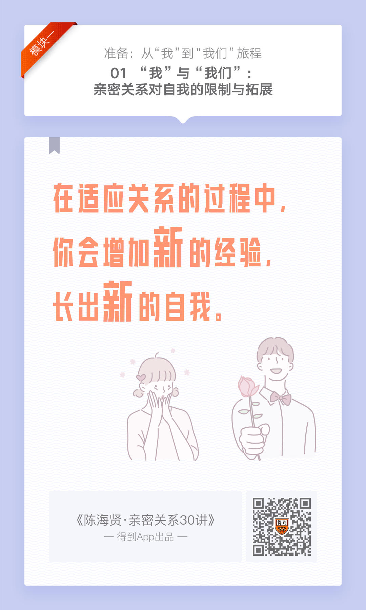  

* * *

# 02 丨爱：什么让我们在一起？

陈海贤

2019-08-07

02 丨爱：亲密关系的基本动力

丨陈海贤亲述丨

懒人专属群的群友，，你好，我是陈海贤。

我曾经去参观过一个失恋博物馆，里面陈列了很多恋人的纪念品：有相互赠送的生日礼物，有因为异地恋所产生的满满一筐的火车票和飞机票，有写给彼此的一沓沓情书……每件纪念品都写满了对爱的渴望、对恋人的思念和对于伴侣分离之后的悲痛。

为什么在分离以后，人们对恋人有这么强烈的思念和渴望？是什么力量把两个人牢牢绑在一起？

这一讲，我们就来讲讲亲密关系背后的动力：爱。

亲密关系是以爱为核心的，没有爱，两个人就会变成搭伙过日子。爱能给人带来最大的喜悦和痛苦。可是什么是爱呢？

千百年来，无数人曾发出这样的疑问，也有无数人给出了各种各样的答案：诗人可能会觉得，爱是浪漫的感觉；生物学家可能会觉得，爱是性冲动的衍生品，是吸引人繁衍后代的手段；经济学家可能会觉得，爱是一种情感的交换。

这些说法都有道理。但是，爱在心理学里有一个特别的概念，叫做依恋（attachment）。亲密关系中的爱，是人类的一种依恋本能。

## 爱是依恋本能

什么是依恋呢？让我从鲍尔比（John  
Bowlby）的依恋理论说起。很久以前，英国心理学家约翰·鲍尔比就发现，孩子和父母，尤其是母亲之间，有一种非常紧密的情感联系，叫依恋。

你是否还记得在妈妈怀里睡觉的场景？两个人呼吸连着呼吸，心跳连着心跳，就好像两人变成了不可分离的一个人。

在孩子很小的时候，只要在妈妈身边，就会觉得安心，如果妈妈不在，他们就会变得非常不安，就像生病了一样，会不停哭泣，喊“我要妈妈我要妈妈”。这种依恋，对婴儿的生存和发展至关重要。

**母亲和孩子之间稳定的依恋有四个特征：**

**第一：强烈的情感。** 在很多文学作品中，我们都看到当孩子被迫和妈妈分离时，孩子会克服千难万险去寻找妈妈。而与妈妈的离别会带来巨大的失落感。

**第二：彼此的回应。**  
我们都看到过这样的画面：妈妈抱着孩子，用温柔的目光看着她，对她微笑。而孩子会报以同样的微笑。如果孩子看妈妈的时候，妈妈正好忽略了，或者没有回应，孩子就会变得很失落，就好像跟妈妈失去了联系一样。

**第三：依恋关系的唯一性。**  
一旦依恋关系建立起来了，别的照料者都很难代替妈妈的角色，无论这个照料者有多好。同样，妈妈也很难随便找一个孩子来代替这个孩子。

**第四：依恋关系是最纯粹的情感关系，而不是利益关系。**  
虽然有养儿防老的说法，但是在依恋关系中，父母爱的是孩子本人，而不是孩子带来的用处。同样，孩子最看重的也是与父母的情感，而不是父母的养育功能。

## 真爱的四个特征

你可能没有想到，成人亲密关系中的爱，也来源于人类同样的依恋本能。

为什么这么说呢？因为这种情感，和母子之间的依恋情感不仅有相似的生理基础（多巴胺和催产素），还有相似的体验和特征。

为了说明这种相似的体验和特征，我想先请你来设想一下：

假如你正跟一个人交往，对方看起来对你不错，可也有些捉摸不定。你该怎么判断对方是真的爱你、是逢场作戏，还是人家只是想跟你做朋友，是你自己想多了呢？

**你可以通过四个特征来判断：**

**第一：你们之间是不是有很强烈的情感联结。**

你会想知道，对方是不是真的在乎你，有多在乎。他会不会记得你们在一起时说过的一些话、记得一些对你有意义的重要日子，比如你的生日；他会不会知道你喜欢什么，不喜欢什么；你们会不会“一日不见如隔三秋”；如果你们要分手，他会痛不欲生，还是会满不在乎。

这些都会提示你，你和他有没有强烈的情感联系。

**第二：当你们在一起的时候，对方是真的在回应你，还是在自说自话。**

你会想，跟他说话愉快吗？能说到一起去吗？这不只是意味着你们有相似的爱好、生活或者价值观，更重要的是，他能懂你，并对你说的东西有兴趣。

如果你想跟他分享一件高兴的事，比如你今天涨工资了，他会替你高兴，而不是说就这么点钱有什么好高兴的。如果你跟他分享难过的事，比如你昨天做了一个噩梦，他会关心地问你什么梦，而不是很不屑地说噩梦嘛，又不是真的。

你们可以聊天气，聊今天吃了什么，聊看过的电影，彼此的工作和心情。在这种细碎的回应里，你们在滋润彼此，你们开始变亲近。对彼此的有效回应，也是真爱的标志。

**第三：你在对方心里是不是特殊的、唯一的一个人。**

他对你的好，有没有同样对别人。他说过的感动你的话，会不会转头跟别人也说一遍。如果他对很多异性都很热情，而你只是其中一个，那你就会觉得被欺骗了，并觉得他可能不是真的爱你。

当情侣对彼此表达爱慕时，经常会说的是：“你是我心里最特别的一个人。”特别和唯一，就是真爱的标志。

**第四：对方爱的究竟是你这个人，还是你对他有用。**

如果他告诉你他很爱你，但坦陈这种爱是因为你有好的家庭背景、你有高学历，或者你对他的事业有帮助，你仍然会觉得不舒服，并怀疑他对你的爱是不是可靠。

如果他符合上面的四个特征，那你就有很大的把握判断他是真的爱你。

**真爱的四个特征，既是维系父母和孩子的情感纽带，也是维系亲密关系的情感纽带。**

孩子会跨越千山万水去寻找妈妈，恋人也会如此。当妈妈看着孩子的眼睛微笑时，情侣之间也在相视一笑。情侣会说：“你是我心里最特别的一个”。而孩子会说：“我只喝妈妈给我倒的奶！”“我的鼻涕只能妈妈来擦！”

女生和男生会介意，对方喜欢自己是不是只因为自己有钱或者长得好看。而孩子也会质疑是不是因为自己乖巧成绩好，才让爸爸妈妈喜欢。

其实，人终其一生，都在寻求跟爱人在情感上的联结，也渴望从爱人身上获得亲近和回应。

当两个人的情感足够强烈，有回应，两个人都把彼此当做特殊和唯一，重情感而不是重利益的时候，两个人就会对彼此的爱满意，而这种满意又会增加彼此的联结。如果不是这样，人们就会愤怒、伤心，觉得自己被背叛了，甚至想要离开。

## 爱让人在一起

为什么会有这样的设计呢？答案是，为了“我们”这个系统的稳定。

如果从系统的角度看，有什么样的力量能够把两个完全不同的人捏合在一起，让他们甘愿接受限制，甚至为“我们”去牺牲“自我”呢？

**首先，这个力量一定要足够大。** 大到如果两个人不在一起，就会彼此想念，如果要分开，就会痛不欲生。“直教人生死相许”、“不爱江山爱美人”。

**其次，为了让系统有效运作，这个力量要让系统的不同部分，畅通地交流信息。** 两个人要对彼此的需要、想法和感受足够敏感。要能够交流，愿意彼此回应。

**然后，这个力量可以粘合彼此的同时，也能划定“我们”和其他人的界限。**  
也就是说，系统里的人，不能随意属于另一个同质系统。所以，系统里的人必须认为彼此是特别和唯一的，否则系统就太容易崩溃重组了。

**最后，为了让这种吸引力足够持久，吸引必须要建立在对方稳定的内在基础上，而不是建立在可变的外在条件上。**  
也就是说，吸引对方的是你这个人本身，而不是你的外貌、财富、学历等等。

讲到这里，我想你已经明白了，这个吸引力就是真爱。真爱的特质，其实都是为了维持亲密关系这个系统的稳定有效而设计的。

**“爱，就是为了在一起。”** 如果这个系统不够稳定，人们就不会对系统有强烈的归属感。亲密关系也没法变成能够超越自我、对抗时间的东西。

## 思考题

爱上某个人，就是和这个人产生了依恋关系。而依恋的标志，就是强烈的想念。在什么时候，你曾对某个人有过最强烈的思念？这种思念怎么推动你们在一起？

欢迎在评论区留言，和大家交流。

## 下节预告

爱是让两个人走近的力量，可是有另一种力量让两个人远离，这种力量就是怕。下一讲，我们一起来聊聊亲密关系中的怕。

我们下一讲再见。

欢迎关注陈海贤的公众号，获取更多延伸阅读。

（微信搜索“陈海贤”添加关注，ID：haixiansalt）

  

* * *

# 03 丨怕：什么让我们貌合神离？

陈海贤

2019-08-07

03 丨怕：什么让我们貌合神离？

丨陈海贤亲述丨

懒人专属群的群友，。你好，我是陈海贤。

上节课我们学习了人们对亲密关系的渴望，来自人类的依恋本能。但是现实中，很多人抗拒进入亲密关系。为什么会这样呢？原因是：怕。

对关系的渴望不仅带来温暖，也会带来伤害。这一讲，我就来讲讲在亲密关系中，人们到底在怕什么。

## 从悲伤到疏离

曾有人说，爱一个人的时候，你有了盔甲，也有了软肋。如果说盔甲是爱给人带来的安全感和归属感，那软肋就是，当爱一个人的时候，也把伤害自己的权利给了对方。

而最大的伤害，是背叛和抛弃，是一个你深爱的人说不爱你了，要离开你。

提出依恋理论的英国心理学家鲍尔比，曾仔细观察过幼儿与母亲分离时的情绪反应。  
**他发现，孩子被迫跟母亲分离后，会依次产生三个不同阶段的反应：抗议、绝望和疏离。**

在抗议阶段，孩子会大哭，发脾气，时刻关注着妈妈回来的迹象，同时拒绝其他人的照顾。

经过了抗议阶段，如果妈妈还不回来，孩子就进入了绝望阶段。他们的身体活动减少了，就算哭也只是间歇性单调地哭，他们会变得退缩，失去活力，好像进入了很深的哀伤的状态。

再然后，他们就进入了疏离阶段。他们不再拒绝其他的看护者，他们会接受其他看护者带来的食物和玩具，甚至还会冲他们笑。

而如果这时候妈妈回来了，他们也会表现得漠不关心，不再黏着妈妈了，好像不管是妈妈还是其他人来照顾，他们都无所谓了。他们不再对任何人产生依恋，却对糖、玩具或者食物看得越来越重。  
**也就是说，他们不再依赖人，而开始依赖物了。**

从愤怒到悲伤到疏离，为什么依恋关系的破裂，能给人带来这样的情绪转变呢？

因为每个人都有保护自己的本能。和依恋对象分离是一种痛苦的创伤性体验。这种创伤性体验虽然不会像身体的伤一样留下疤痕，可是也会造成心理上的伤疤。

所以，人们总是会想方设法来避免这种痛苦，这就是人在亲密关系中的怕。

## 爱与怕的微妙平衡

怎么能让自己不经历痛苦呢？简单的答案，当然是不再爱了。有时候，被一个人伤过，就会不相信所有人；在一段关系中受伤，就会不相信爱情。

但更多的人不会这么做。因为就算一个人再冷漠，在他内心深处，仍然会有一种隐秘的渴望：渴望有一个真正懂自己的人，把自己从冷漠的壳里拉出来。有时候越是怕，对爱的渴望反而越强烈。

**所以，人们就开始在爱和怕之间寻找一种平衡。**

当怕占据主导时，人们会发展出两种平衡的模式。一种是外在的，不让自己进入一段真正的亲密关系，转而发展一些肤浅的、表面的关系。

另一种是内在的，进入一段亲密关系，却通过调动自己的心理防御机制，屏蔽爱的感觉，以此来屏蔽对怕的焦虑。

**怕的第一种形式：不让自己进入真正的亲密关系。**

我认识一个年轻的男孩子，人长得挺帅，工作也不错，可就是单身。他有一个爱好，就是去咖啡厅撩女生。有时候看到一个女生气质不错，他就会上去跟人聊天，并要人家的微信。可是，他从来不会真的跟她们交往。

有一次，在父母的要求下他去相亲，认识了一个非常漂亮的姑娘。这个姑娘各方面都符合他的要求，看起来也很喜欢他。可是他却害怕了。思考再三，决定还是不再交往。我问他怕什么？他说：

“我觉得我自己的事业还没打拼出来，她也许并不会真的喜欢我。”

于是他还是单身一人，偶尔到咖啡厅坐坐，见到某个不错的女生，去跟人家攀谈，继续着这个微妙的游戏。

在这个例子中，撩女生代表了他对亲密关系的渴望。不进入一段真正的亲密关系，又代表了他对亲密关系的怕。 **这种暧昧，是他在爱和怕之间找到的微妙平衡。**

有时候，这种平衡还会体现在对性的开放和随意上。我们处在一个奇怪的时代。在这个时代，性是容易的，爱却反而难。人们对性变得开放了，对爱却变得越来越封闭，越来越不敢投入。这背后也是爱和怕的微妙平衡。

还有一个词，叫“假性亲密关系”。说的就是两个人做很多恋人该做的事情，一样不少，看起来在表面上彼此是亲近的，但是在情感上，两个人都知道，彼此并不亲近。

“假性亲密关系”这个词很有意思。表面上的“亲密关系”代表了人们对爱的渴望，而“假性”这个形容又代表了人们对亲密关系的恐惧。

这些奇怪的平衡，没有办法让人们真的进入亲密关系，却把爱变成了对爱的模仿。

**怕的第二种形式：表面上进入亲密关系，却调动内心的防御机制，屏蔽自己的感觉。**

人的心灵像一个魔术师。当人没有办法适应外界的关系时，它会通过扭曲自己的感受，来达到内心的平衡。

其中一种扭曲，就是把自己的情绪情感隔离起来，让自己变得麻木，因而不会感觉到痛苦。就像前面的例子里，孩子因为离开父母，而变得冷漠和疏离。

如果真的能通过这种方式来屏蔽痛苦，那也挺好的。可实际上，人没有办法选择性地屏蔽一种特定的情绪。情绪的屏蔽像是一个玻璃罩子，当它罩下的时候，会把自己和这个世界隔离开来。让人感觉不到痛苦，也感觉不到快乐。当人感觉不到失去的焦虑时，也感觉不到爱了。

我来举个例子。

我有位来访者，他是一位相貌周正的小伙子，工作不错，很讨人喜欢。很多人给他介绍对象，他既不拒绝，也不反对。他对恋爱抱有一种特别无所谓的态度，从骨子里，他觉得恋爱是一件麻烦事，可是他觉得不恋爱也很麻烦。

他在大学里也谈过几段恋爱，没过多久就分手了。如果有人问起，他会说：“就这样吧。没有太大印象。”

后来，他通过相亲认识了一个女孩子。也说不上多喜欢她，也说不上多不喜欢，只是觉得条件合适，女孩子也不错，两个人就在一起了。

相处了一段，女孩子说，你考虑过跟我结婚吗？他想了想，是啊，也许该结婚了。于是在一天下班路上，他顺道到公司旁边的珠宝店买了个戒指。女孩子很感动，可是他自己倒是没太多感觉。接下来一周的某一天，他从公司请了假，跟这个女孩子一起去领了证。

他爱这个女孩子吗？他很少问自己这样的问题，因为如果不是这个女孩，他也会和其他女孩结婚的。好像不是对这个女孩，是对爱本身，他并没有那么大的兴趣。

后来，他和这个女孩离婚了。他难过了一段时间，可是好像很快又恢复了正常。他从来不跟人提自己离婚的事情，哪怕连自己的父母也很少提。只是别人再介绍女孩子给他认识，他就不太去了。

偶尔有一次，和一个朋友去电影院看电影《摔跤吧！爸爸》，看到某个片段的时候，他忽然就哭了，哭得泣不成声。朋友看到了，很震惊，问他怎么了。他也不知道自己怎么了，其实他也被自己吓到了。他只好说：“那个爸爸太傻了！”

在进入一段关系的时候，他对关系表现出了刻意的冷淡和不在乎。在一段关系里，他也是很难有情感投入，总是给自己留很多的空间和余地。哪怕分手了，他也会表现出淡漠。

只是，他也并非毫无情感。偶尔的情绪失控表明，他只是把这些情感压抑下来了而已。 **而这种压抑背后，有他对爱深深的悲伤和恐惧在。**

爱和怕是亲密关系背后的两种动力。爱所主导的亲密关系，让人能够自然地亲近爱人。而怕所主导的亲密关系，则会造成双方各种不恰当的亲近或者疏离，造成关系的扭曲和混乱，增加彼此的痛苦。

认识了这两种动力，你就会发现，很多奇怪的亲密关系中的行为，其实就是这两种动力的一种特别的平衡形式。

**因为渴望爱，我们想要亲近他人。因为怕，我们又想方设法让那个人不那么重要。**

从理智上，我们知道亲密关系该走的路，但我们心里的怕，却哄着我们走了相反的方向，还骗自己说，你正在路上。

## 思考题

你对亲密关系有哪些渴望，又有哪些怕？爱和怕的平衡，怎么发展出了你的关系模式？

欢迎在评论区留言，和大家分享。

## 下节预告

下一讲，我们继续讲讲，人会怎么在爱和怕之间，制造出更多奇怪的失衡。

我们下一讲再见。

欢迎关注陈海贤的公众号，获取更多延伸阅读。

（微信搜索“陈海贤”添加关注，ID：haixiansalt）

  

* * *

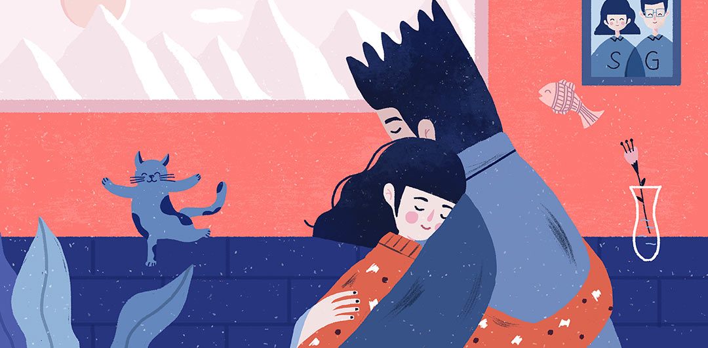

# 04 丨融合：黏人的爱

陈海贤

2019-08-08

04 丨融合：黏人的爱

丨陈海贤亲述丨

懒人专属群的群友，。你好，我是陈海贤。

不知道你有没有遇到过这样的关系：他对你好像有一种特别的依赖。他需要知道你每天做什么，时刻想要跟你在一起，如果你脱离了他的视野，哪怕只是很短暂的时间，他都会很警惕。他希望你随时随地跟他有一样的想法和情绪，如果你和他不同，他就会很生气。

也许你只是觉得这样的关系很黏人。但你不知道，这背后其实就是一种关系里的怕。这就是我们这一讲要说的——“融合共生”。

在亲密关系里，“我”和“我们”之间，存在着一种永恒的张力，让两个人相互牵引。这种张力是怎么产生的呢？

**爱是一种特殊的情感共振器，它会让人们对自己所爱的人感同身受，两个人变成一个共同的情绪单元。**

你的痛苦会变成对方的痛苦，对方的快乐会变成你的快乐，同样，你的喜怒哀乐也会影响对方。

这种感觉，会让人有强烈的归属感。而代价是，人会很容易被对方影响，受对方的限制。

从“我”到“我们”的过程像是自我交换的过程，一个人拿出一部分自我，来和他人的一部分交换。这本身就是爱的神奇之处。

可是，如果一个人对亲密关系感觉到不安全，让怕主导这段关系，那就很希望对方能跟自己更亲近，以确认对方不会离开自己。而让对方不会离开的最好方式，就是把自己和对方变成同一个人。

所以，渴望跟对方融为一体的感觉，就是融合。

## 融合的背后是怕

按照精神分析的说法，在婴儿期，婴儿和他的依恋对象——母亲，本身就是融为一体的。慢慢长大了，人们才意识到，自己和母亲不是同一个人。

自己的身体和母亲的身体、自己的需要和母亲的需要、自己的想法和母亲的想法、自己的感受和母亲的感受并不相同。这时候，分离就开始了，人会觉得孤独。这种分离一直伴随着每个人长大的过程。

有时候，当人们进入一段亲密关系后，这种融合共生的欲望会重新出现。

我就见过一对夫妻，丈夫的公司裁员，一边在家休养，一边找工作，他的情绪很低落。妻子尽心尽力地支持他，但也受了他情绪的影响，两个情绪低落的人，让家都变得很压抑，很没有活力。

有一天，妻子从工作中遇到了一件好事，她想回家告诉丈夫。本以为丈夫会为她高兴，谁知道丈夫看到她高兴的样子，反而有一些生气。问他为什么生气，丈夫说：

“我每天都这么不开心，凭什么你自己那么高兴！”

这就是融合。当丈夫自己陷入情绪低落时，他希望妻子也有和他同样的情绪。他需要一种特别的感同身受，让他觉得自己不是一个人。哪怕这种感同身受，会让他自己更难从低落的情绪中走出来。

**融合所要求的“你得和我一样”的感觉，也许缓解了孤独，却让两个人都死死绑在这样的关系中，失去了自我的空间。**

我曾经在商场里看到一对夫妻在挑窗帘。

丈夫说：“我觉得这种蓝色的窗帘好看。”妻子说：“这个也太土了吧。我觉得还是这种条纹色的好看一些。”

丈夫就很生气：“你的审美呢？你知道什么是好看，什么是难看吗？”妻子也很生气：“我审美怎么了？你去问问人家，有谁家里买蓝色窗帘的！”两人就开始吵起来了。

我相信这种争论挺多见的，仔细听他们的对话你会发现，这对夫妻很有意思。当出现差异的时候，他们不是正视和处理这种差异，而是否定这种差异，并因此否定提出差异的人。

这种否定的背后，其实是渴望融合，害怕分离。越是亲近的人，越希望对方跟自己一致。人们从这种一致里，找到了特别的安全感。相反，如果有不一致，人们就会有不安。

## 融合的两种倾向

**在亲密关系中，融合的需要会发展出两种倾向：一种是主动的融合，表现为控制。**

这种关系的逻辑是“因为两个人是一体的，所以对方应该听我的。对方应该符合我的想法，否则我就会生气，要用我的方式来纠正对方的行动、感受和想法”。

用这种策略的人会非常强势，容不得别人和自己不同。他们的本意是希望通过这种一致性，让两个人联结得更紧密，却经常因为这种强势，把对方赶走。

**另一种是被动的融合，表现为讨好和服从。**

因为两个人是一体的，我就都听对方的。我压抑自己的需要、愿望和想法，把两个人之间的差异当作是危险的事情，从而来保持两个人之间的一致性。

用这种策略的人，经常会有很强的依赖性。这种依赖不是指生活上的不能独立，而是情感上的依赖。这样的人会取悦别人，会回避矛盾和冲突，维持表面的和谐。

有时候，这两种融合的策略混杂在一起。讨好和服从也可以是一种隐秘的控制，像是在说“我都把自己放得这么低了，你就应该照顾我，不应该离开我”。通过内疚，来让对方跟自己一致。

无论是哪种融合，都会让两个人之间缺少空间，最终损害了亲密关系。

我见过一对情侣。恋爱的时候，男生对女生无微不至。每天骑自行车到公司门口来接女生下班。业余时间，也总是来找女生，想方设法地想要跟对方在一起。

在恋爱初期，这种依赖被解读成了恋爱的甜蜜。可是慢慢地，女生开始觉得有压力。那个男生总是帮女生做各种事情，全然不顾女生需不需要。每天出门的时候，他都会帮女生系好鞋带。女生说，不用了，我自己会系，可他还是坚持。

同时，有时候讨论事情，男生也觉得女生应该跟他想的一样。如果女生表达自己的意见，他就会觉得受了威胁一般暴跳如雷。

心平气和的时候，女生也会跟他说：“我们是不同的人，有不同的想法很正常啊，为什么一定要一样呢？”

男生却说：“我们在一起了，当然是要心心相印，否则怎么算在一起呢？”

有时候男生会给女生打电话，如果发现电话占线，他就会一遍遍不停地拨。有一次，女生刚挂断电话，男生就打电话过来了，很生气地质问：“你给谁打电话呢，我都记着时间，已经打了 26 分钟了！”

这让女生非常难受。她说，我需要一些个人空间，可是每次提，男生都会觉得不可思议，紧接着就是怀疑我是不是不爱他了。

**在这段关系里，男生既是控制的，也是讨好的。男生这种占有的欲望，让他们的关系变得越来越有压力。**

后来两人分手了，这个男生还不停地去找那个女生，给女生打电话，到女生的单位去。男生哭诉说：“我对你这么好，你怎么舍得离开！”“我这么关心你，你对得起我吗？”这个男生看不到的是，正是他这种融合的需要，让两人越走越远。

也许你会问，难道不应该和爱人更亲密一些吗？融合和亲密到底有什么区别呢？

让我用房子来作个比喻。如果你把亲密关系想象成两个人共建的一所房子，从某种意义上来说，房子当然也是一种限制。本来你的行动范围是无限宽广的，有了房子，活动范围就只能限制在房子里了。

人们愿意接受这种限制，一方面是为了遮蔽风雨，另一方面也是让自己有一个归属。可是，如果房子太狭小，一间屋半间炕，人在里面就会觉得腾挪不开，就会觉得难受。

如果你和家人的关系太过紧密，别人的感受变成了你的感受，别人的情绪变成了你的情绪，你就失去了自己的情绪和感受，你就会觉得这样的关系缺少空间，就像生活在一个狭小的房间里一样。

这时候，人们会想方设法走出狭窄的房间，离开这种融合的关系，重新去找回自我的自由。

讲到这里，你就知道了好的亲密关系的标准，那就是既亲近，又给彼此空间，而不是把彼此绑得密不透风。就像一个作家说的：“好的爱情，只会发生在两个独立自主的自由人当中。”

## 思考题

你是否见识或经历过这种“融合共生”的关系模式？你在其中的感受如何？你觉得这种关系模式是怎么发展出来的？

欢迎在评论区留言，说说你的想法。

## 下节预告

下一讲，我继续来讲另一种失衡的关系模式：物化。

我们下一讲再见。

欢迎关注陈海贤的公众号，获取更多延伸阅读。

（微信搜索“陈海贤”添加关注，ID：haixiansalt）

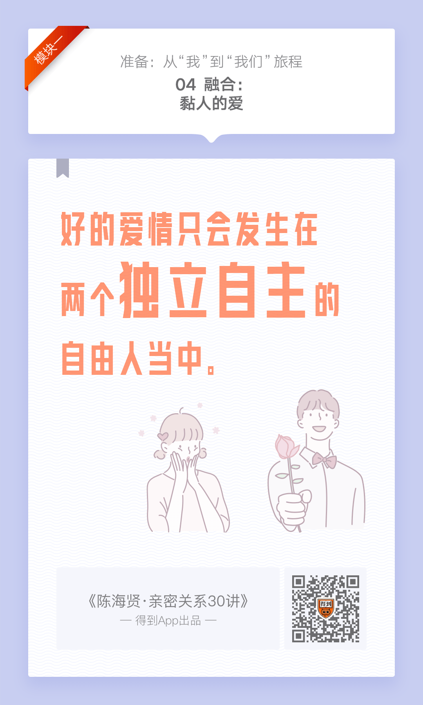  

* * *

# 05 丨物化：疏离的爱

陈海贤

2019-08-09

05 丨物化：疏离的爱

丨陈海贤亲述丨

懒人专属群的群友，。你好，我是陈海贤。

这一讲，我们接着讲一种亲密关系的失衡。有时候，我们会听吵架的人这样说：

为什么吵架里这些话这么伤人？在我看来，他们是通过把对方物化，来告诉对方，你不重要。

这就是我们这一讲要学习的，亲密关系中另一种失衡：物化。也就是把人当做物品一样看待，这也是一种由“怕”主导的关系形式。

人们通过情感的疏远，来让自己获得安全感。当人们在关系中感觉不安全的时候，会不自觉地来物化对方，告诉自己对方不重要。

## 物化源于被抛弃的恐惧

提出依恋理论的心理学家鲍尔比，他记录了孩子和父母分离的后期孩子的表现：

“如果这时候妈妈回来了，孩子也会表现得漠不关心，不再黏着妈妈了。是妈妈还是其他人来照顾他，好像都无所谓了。孩子不再让自己对任何人产生依恋，但是他对糖、玩具或者食物却看得越来越重。也就是说，孩子的愿望和感受不再指向人，而开始指向物了。”

为什么会有这样的转变呢？

当被抛弃的恐惧压过对依恋的渴望时，孩子就会表现出这种分离的态度： **对于可能得不到的东西，就疏远，就漠不关心。而对于能够得到的东西，就占有。**

成年人在亲密关系中其实也有类似的表现。如果一个人太担心会在亲密关系中被抛弃，他也会压制自己对依恋的渴望。

可是，对爱和依恋的渴望，当然还有性的需要会一直在，所以人就会有另一种折中的方案：还是跟人交往，但是把人当作物。

这样，就可以像占有物品一样占有对方，不用担心对方爱不爱自己、会不会离开自己。这就是亲密关系里的“物化”。

你有没有想过这样的问题：

**如果你有爱人了，你觉得你的爱人对你“有用”吗？**

**如果他对你有用，你是因为这种“用处”才跟他在一起的吗？**

在亲密关系中，这样的问题通常并不让人舒服。因为从本性上，人们都会变成爱的“原教旨主义者”，也就是渴望得到纯粹的爱。希望别人爱你，不是因为你有用，而是因为你本人。

相反，物化的爱是另一种爱：别人爱你，是因为你有用。也就是说，别人爱的是你的功能，而不是你本人。

当然了，在一个紧密配合的家庭里，每个人都是有一定功能的。无论是赚钱、做家务、带孩子。可是谁都很介意顺序，谁都希望彼此在一起首先是因为爱，而不是因为这些方便的功能。

我曾经讲过，亲密关系中的爱，本质上是为了让系统变得稳定而设计的。所以如果彼此爱的是对方本人，而不是外在的东西，那这种关系常常就更稳定。而物化，就是一种相反的模式。

**这种依恋模式常常是因为对爱的不安全感产生的。通过“物化”的方式，人既有了一段关系，又没了被抛弃的恐惧，通过把对方当作“物”而占有他。**

但是，这只是个人单方面的如意算盘。因为，物化的关系并不能真的满足人对亲密关系的需要。它把人封闭在自我之内，妄图让爱从两个人的关系，变成一个人的事。

当然了，这样对个人来说就更可控一些。而对关系而言，少了另一方的互动，两个人就很难真的走近。

## 物化的三种表现形式

在亲密关系中，物化常常有很多实际的表现：

**第一种物化的表现：经济。**

现在很多年轻人反感相亲。我有一个朋友去相了几次亲，回来以后说再也不去相亲了。问他为什么，他说：

“别人一打听我的工作、收入、有没有买房，我就觉得自己像是被放到了交易市场一样。”

这就是人对物化的抗拒。

当然也有一些人不这么想。曾经有个单身的钻石王老五，最终找了一个明显爱慕虚荣和钱财的姑娘。别人问他为什么跟这个姑娘结婚，他说：

“我知道她是为了我的钱。可是我觉得这样的婚姻才稳定。因为如果是为了我这个人，我是会变的。容貌会变老，才华会用尽。只有钱不会变，最可靠。她喜欢钱就最好了。只要我有钱，那我们的婚姻就是稳定的。”

听他这么说，我总是觉得这段话背后，有一些对爱的失望和对失去的恐惧在。也许他说得对，这样的婚姻关系是稳定的，但这不是我们讨论的亲密关系。

**第二种物化的表现：颜值和性。**

曾经有人热衷于给女性网友的照片打分。一些女性被简化为 7 分女、8 分女。这个打分的活动受到了很多男性的追捧，变成了一场“网络狂欢”。

为什么这个打分活动会受到大家的追捧？原因之一是， **当爱变得复杂而不可控的时候，人们宁可有一个简单的标准来衡量它。**

于是，颜值变成了可以打分的标准。不仅是颜值，自身所有的东西，包括毕业的学校、工作、收入、年龄，都可以变成一个分数。凭这些给自己打个分，给别人打个分，来确定自己和对方的交往是赚的还是亏的。

这样一来，亲密关系就变成了彼此定价的交易关系。这个交易系统听起来有道理，但却忽略了亲密关系中最重要的情感因素，忽略了亲密关系中真正的人。它只是人为了让关系可控，而作出的徒劳的努力而已。

关于这一点，我有个女性朋友是这么说的。她说：

“我以前在大学的时候，很多男生追我。那时候我长得很漂亮，家里条件也好。可我并不喜欢他们。我觉得他们是因为我的美貌来爱我，那不是真正的爱。就像我后来谈恋爱的时候，也没有在乎人家的条件。我觉得在爱里说这些很庸俗。”

我这个朋友当然知道，恋爱也离不开经济条件。但我想她真正反感的，是那种物化的爱。

**和容貌相关，性是物化的另一种表现。**

性关系非常特殊，它原本是两个人全情投入的关系。在性关系里，两个人合为一体，身体会分泌大量的催产素，来让彼此产生深深的依恋。

在理想的状况里，性是爱的产物，是爱的身体表达，也是爱的深化。可是有时候，性也会被从爱里面独立出来。这时候，人，尤其是女性，就会变成性的物化的工具。

**与性相关的，是生殖的功能。**

老一辈的人常常会说，“多生几个孩子”，但这些话经常让新一代的女性反感。

一些新妈妈刚生完孩子，会产生对自己的身份怀疑。如果这时候爸爸再置身事外，她们也会抱怨：“难道我就是一个生孩子的工具吗？”

这种抱怨的背后其实是在问：你到底爱不爱我？越是感觉到爱和关心不够，这种被物化的疑虑就会越重。

**第三种常见的物化表现：陪伴。**

把陪伴当作物化的一种形式有些奇怪。因为很多时候，人们都觉得陪伴是有情感属性的。毕竟恋爱的目的之一，也就是希望有个人陪。可陪伴有时候也是一种物化。

**再强调一下，物化的本质，是关注这个人的功能，而不是关注这个人的内在。**

设想一下：有这样一个人，他谈过很多次恋爱，每次失恋的时候，他都会很快再找一段关系。这段关系并不是因为他有多爱对方，而是他很难忍受一个人，尤其是在失恋这样一段特殊的时期。

虽然他需要的只是一种陪伴，是精神层面的需要，可那也是一种物化。

**这就涉及到需要和爱的区别：如果你只是需要某人的陪伴，而和他在一起，你就不是真的爱他。**  
因为你关注的，是对方陪伴的功能。从这个角度讲，你所关心的，也只是自己的需要。

这是陪伴的悖论：从长久来看，只有一个人真的爱对方，跟对方建立关系，亲密关系才能真的缓解孤独，陪伴才会真的有效。

可是，如果你只想获得陪伴而不想关心那个人的话，慢慢你就会发现，就算这个人在，也没法缓解你的孤独。

因为陪伴是爱的附属品，同时也因为，在这种物化的形式中，你走不出你自己。

## 物化是特殊的心理防御机制

讲到这里，我再来总结一下什么是物化。

物化是一种特殊的心理防御机制。为了避免可能的伤害，防御被抛弃的恐惧，人们把对方当作物一样看待。关注对方的某种功能，希望能够占有他。

物化只是满足自己的需要，而爱需要人愿意奉献自己，去满足伴侣的需要。

说到底，物化的爱都会演变成一种有条件的爱，而我们追求的，是那种“只爱我本人”的，无条件的爱。

## 思考题

你在亲密关系中是否有过被物化，或者物化别人的经历呢？欢迎在评论区留言，和我交流。

## 下节预告

下一讲，我来讲讲怎么解决因为怕，而不敢进入亲密关系的问题。

我们下一讲再见。

  

* * *

# 06 丨亲密关系：一场值得的冒险

陈海贤

2019-08-10

06 丨亲密关系：一场值得的冒险

丨陈海贤亲述丨

懒人专属群的群友，。你好，我是陈海贤。

上几节课，我们讲了“怕”所主导的亲密关系的各种形态。正是这些不同的怕，变成了从“我”到“我们”路上的障碍。这个模块最后这一讲，我来讲讲究竟该怎么带着这种怕，走向真正成熟的亲密关系。

## “怕”会改变人的思维方式

我曾遇到过很多孤独的年轻人。他们都渴望有一份感情，可也都好像习惯了单身。当我问他们：“既然你渴望一份感情，为什么不去找？”的时候，他们会给出各种各样的理由：

各种说法背后，都隐含着一层意思：爱情是他们想要，却又危险的东西。所以他们要慎之又慎。

当人们变孤独的时候，孤独会改变人的思维方式。它会强化人心里的怕，夸大亲近他人的危险和可能的伤害。

**当人们怕的时候，自己不会去找不要怕的理由，也不是在寻找出路，而是在寻找证据证明自己的怕有道理。所以越是孤独，人们就越会小心防范。而越是小心防范，人就越孤独。**

怕是有很多形状的。它会在人们心里构想出各种奇怪的想法，让人觉得两个人在一起是一件危险的事。

而这些形状归根到底，又只有两种。一种是自己不好，所以别人不会真的爱我。另一种是别人不好，所以并不值得自己投入爱。有时候这两种怕会交织在一起，让两个人想要接近却不敢接近。

但这些怕的理由是真的吗？也许是真的，也许不是。你只有在真实的关系里才能得出答案。

曾有一对年轻人来我的咨询室，他们试探着想在一起，但总是会被一些奇怪的阻力阻挡。

那个姑娘说：“我害怕你靠近我。我害怕你知道我正常的外表下面，原来有这么多奇怪的想法。原来真实的我，是一个这样的人。”

小伙子说：“这只是你自己的想法，也许你所谓不能让我看见的另一面，对于我来说，根本不是不能接受的。”

那个姑娘沉默了一会儿，接着说：“可是我也在想，也许你也不是我理想中的对象。我理想的对象，要更成熟一些，情商也更高一些。”

小伙子也沉默了。过了一会儿他说：“如果你觉得我不够好，如果我变成了你的烦恼，那我就从你生活中消失好了。”

我就对他们说：“我也不知道你们对彼此是不是足够匹配。我只是看到两个想接近又很怕的年轻人。你们所谓的‘我不够好’或者‘他不够好’，在我看来，都不过是害怕的不同形状而已。换句话说，你们想得太多，但没有行动。”

但是这些怕的理由是真的吗？也许是真的，也许不是。只有在真实的关系里，才能得出答案。

## 迈进亲密关系的两条方案

那么，究竟该怎么进入真实的亲密关系呢？我想给你两条行动方案。

**第一，不要把爱停留在理念里，而要把它放到实践中。**

爱是需要学习的。它不是一种感觉，不是一种状态，不是一个巧合，也不是一个现成品。它是一种能力，是通过爱别人，来超越自我的局限的能力。

既然是一种能力，它就需要在现实中学习，也能够通过学习提高这种能力。可是如果把爱停留在理念中，那你就永远都不会学到这种能力。

理念总是理想化的。我看过一些年轻人，沉迷于一些爱情的偶像剧，并把偶像剧中的爱情当作是自己爱情的范本。这样他们通常都会对现实里的爱情失望。

**当然了，“失望”也是怕的一种形状，也许人们就是通过这种失望，阻止自己进入一段亲密关系。**

和理念中的爱情不同，现实里的爱情，永远都不是纯粹的。有时候对方是爱你的，有时候对方又会有别的心思，甚至还会利用你。

所有的爱情背后，都有人性的复杂面在。欲望、需要、幻想、恐惧、权力和控制，这些人性的复杂面让爱情不是童话般的粉色，而是有大量的灰色地带。

理想中的爱情，永远都不需要处理这些事情，但现实需要。 **而处理这些事情，正是学习爱这种能力的路径。**

你需要面对和容纳对方的缺陷和不足，也需要容纳自己的缺陷和不足。你需要放下那些理想化的东西，去看看眼前这个真实的人。

有时候你需要宽容和退让，有时候你需要坚决和果敢。所有这些东西，都是在亲密关系的互动中逐渐学到的。

**第二，学习把某些重要的东西，交给别人。**

在我的上一门课《自我发展心理学》里，我曾说，改变的本质，是用新经验代替旧经验。在亲密关系中，我们需要创造一些新的经验。

可是，亲密关系中的经验最特别的地方是，你得学习依靠别人。这跟人们保护自己的本能是相悖的。人的本能是害怕自己受伤害，因而不敢把重要的东西给别人。

**但是，如果要走出“自我”，走向“我们”，就需要把伤害自己的权利给别人。这其实也意味着把保护自己的权利给了别人。**

学习把重要的东西给别人当然不容易，它是一场冒险。但也正是这场冒险行动，让人们获得新的经验。

我曾有一个来访者，有过很多次分手的经历。最近一次分手原因，是男朋友提起自己的前女友是一个公司高管，她忽然就觉得很慌。这种慌张感一直持续着，最后，当他们快要结婚的时候，她逃跑了。她说：

“男朋友提到前女友很成功。我不是生气，我就是觉得慌。我好像被放到了一个被相互比较的赛道上，而我注定是那个失败者。所以我一定要逃走，在比赛开始之前就逃走。如果在感情上，我有什么擅长，我很擅长离开。通常在别人抛弃我之前，我就先抛弃对方了。”

**可是，这种保护其实在不断强化“这段感情也会失败”的旧经验，让她失去了迈进真正亲密关系的机会。**

另一个相似的故事是，我的另一个女性朋友，她在亲密关系中也有过一些阴影。她总说男人都不可靠，每一段可能的亲密关系，都让她焦虑。

有一次她又这么抱怨了，我问她：

“是有很多男人不可靠，你也一定会有很多焦虑，那你还要不要找？”

她想了想说：“那还是要的吧。”

隔了很长一段时间，我再见她的时候，她要当妈妈了，挺着大肚子一脸幸福。我问她经历了什么，她说：

“我老公知道我的不安。哪怕我很焦虑，对他发脾气的时候，他也总会说：‘没关系，我不会离开的。’‘你放心，我们会很幸福的。’我老公好像并不厌倦安慰我，反而很享受这个角色。他说得多了，慢慢地，我就信了。”

现在，我这位女性朋友不再用警惕的眼光看身边的人了。她把所有的改变，都归功于自己碰上了一个好老公。

可我觉得，也许改变还发生在更早的时候，在她说“还是要找个老公”的时候。因为从那时候开始，她已经下决心要开始行动了。  
**她让自己的担忧在现实里发生，而不是在观念里发生。**

虽然还是小心翼翼的，但重要的是，她承认心里的害怕，也依然选择把自己重要的东西给别人。

关系里的伤，还是要靠关系来医治的。也许你会问，上面的例子，只是说明她运气好。万一她真的碰到不靠谱的男人，遇到新的伤害，那该怎么办呢？

我不能给你任何保证。没有人可以。你可以选择让这个故事开始，也可以选择不开始。

我想说的是，从“我”到“我们”的过程，就是一场冒险之旅。所有的冒险故事里都有危险，但这些危险不是重点，主人公藉由这些危险获得的成长，才是重点。

所以，所有的冒险之旅本质上都是成长之旅。更何况，这场冒险之旅，还不是你一个人走的，你有同伴。等走完以后你会发现，不知不觉中，“我”已经变成了“我们”。

## 思考题

回想一下，在进入一段亲密关系之前，你的怕是什么？最终你是怎么克服这种怕的？

欢迎在评论区留言，和大家分享。

## 下节预告

这个模块，我们都在学习进入亲密关系之前的准备。可是，亲密关系终究不是一个人的事。在下个模块，我们会把视角从个人离开，来看看亲密关系中的两个人，究竟在发生什么。

我们下一讲再见。

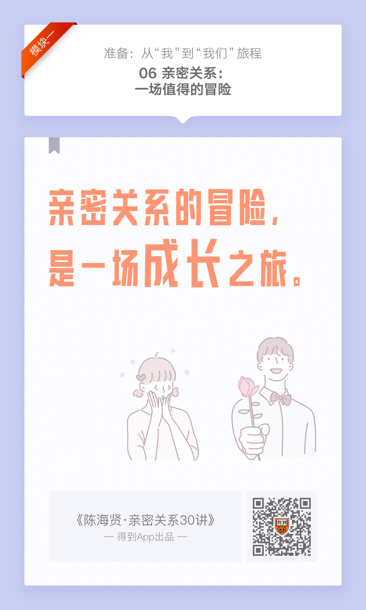  

set 限制解除

* * *

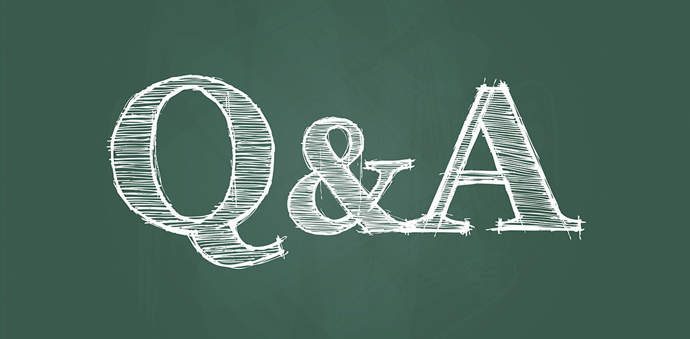

# 我爱问海贤丨 10 个你最关心的亲密关系问题

陈海贤

2019-08-11

陈海贤

懒人专属群的群友，，你好，我是陈海贤。

“我爱问海贤”是我们课程的问答版块，我将在这里定期分享近期同学关心最多的问题。下面，我就来回答以下 10 位同学的问题。为了保护提问者的隐私，已将姓名隐去。

**海贤答：**  
我觉得这些问题都是一个单身的人在没有进入亲密关系之前才会想的。找对象根本不是脑子里先有了很多条条框框，然后再按着这个条条框框去按图索骥。这又不是公司招聘，先弄个岗位说明书。

至于怎么才能判断你们能否长期相处、能否对彼此一直有兴趣，你同样不会知道。

这不是人的特性，而是你跟他相处的特性。相处意味着，未来你们对彼此是否还有兴趣，是你们在相处的过程中逐渐发展出来的。

**有人说，美好的爱情就是一次次爱上同一个人。而对一个人的兴趣，就是一次次去发现他的不同面。**

不过我理解这个问题。因为爱情太不确定，我们太想有一种确定感了。可是太想要有确定感，这也常常是我们没法进入亲密关系的原因。

**海贤答：**  
在亲密关系中，爱和自由之间，存在着一种永恒的矛盾和张力。有时候，当一方想要独立的空间时，另一方会将其解读为“你不爱我”、“不想和我在一起”。

而一方想要依赖时，另一方会将其解读为“你想控制我”。怎么能找到一个彼此都合适的空间呢？这就需要好好商量。

“好好商量”其实不仅是针对这个问题的回答，而是针对所有关于夫妻差异问题的回答。

夫妻之间有差异是正常的，差异本身并不是问题，怎么处理差异才会变成真正的问题。

好好商量的意思，是在开始的时候，不抱定自己不改，只是为了说服对方、改变对方立场的目的。好好商量就是要能听得进去彼此的话，两个人都有改变的意愿。不仅为了对方改变，也是为了自己改变。

**海贤答：** 如果是你的直男老公来问我，我会跟他说：你需要多看到老婆的付出，否则你会让她寒心和远离。

现在是你来问我，那我就会说：爱是没法强迫的。男人是很笨的，就算你提醒他没看见，他也不会变得更聪明点，更别提抱怨了。有时候，你指责他没看见，只会让他更远离。

你看，不同的人来问我，我的答案是不一样的。但是准则却是一样的：如果你要有所改变，你只能推动自己改变，而不能强迫对方去改变。

这并不是说我们不能改变对方，而是说，改变对方的途径跟我们想的不一样。我们只有用自己的改变，才能推动对方的改变。以及如果我们需要爱和看见，就只能先给对方爱和看见。

所以你可以问自己这三个问题：

1.  我对他是否有足够的爱和看见？怎么做才能让这种爱和看见更多一些？
    
2.  我确信对方心里有我吗？我怎么才能增加这种确信？
    
3.  如果我要跟老公商量，让他跟我一起参与家庭，怎么样的商量是有效的，怎么样是无效的？
    

**海贤答：** 这需要在尝试中获得新的经验。我的前一门课《自我发展心理学》中，专门讲过怎么去克服这种恐惧，去验证我们内心的假设。

你可以思考一下，你的恐惧是什么？这种恐惧从哪里来？它是真实的吗？

你可以在心平气和的时候跟你的伴侣讨论这种恐惧。你可以问他，在发生冲突时，如果你直接表达，他是否能接受？他会不会因此不爱你？如果他能接受，那就试着从一些你不那么恐惧的分歧开始表达。

事实上，在《亲密关系 30 讲》中专门有一讲讨论到这个问题——《第 13 讲 另类沟通：如何“正确”地吵架？》，希望等你学到那节课的时候，会有所启发。

**海贤答：** 一个秘诀是，不要把对方当作敌人，而要把不良的关系模式当作你们共同的敌人。

如果你把伴侣当作敌人，你就很容易想，都是对方的错。

可是如果你把不良的关系模式当作敌人，那你就会去想，你的哪些行为导致了伴侣的问题，伴侣的问题又如何影响了你的行为？你就会想，为什么两个明明想要好的人，却很难改善彼此的关系？

当你们这么想的时候，你们就站在了一起。把两个人都当作消极的关系模式的受害者，而不是一方是施害者，一方是受害者。

**海贤答：** 你感觉到自己的“自我中心”，这是不错的反省。意识到“自我中心”并且想改变，这就是调整的开始了。

其实任何一段亲密关系，都意味着人们需要做一些改变。如果没有改变，那就意味着他们其实并没有恋爱或者结婚，只是找了一个偶尔可以一起玩的伴而已。

至于你说究竟要从哪里开始着手，我觉得也许你可以从多问问对方的想法和感受开始。

理解对方的想法和感受，尊重这种想法，并愿意为对方的想法做出自己的调整，这就是改变的开始。

**海贤答：** 我觉得那个“又有人说”里的“又有人”挺讨厌的。他这么有主意，那干脆让他替你恋爱得了，你说呢？

感情是需要付出的。心甘情愿的付出，当然是爱的标志了。其实我们在亲密关系中是不害怕付出的。为所爱的人付出，我们也会觉得幸福。

我们怕的是，对方没有看到我们的付出，不感激我们的付出。我们怕的是，我们的付出不值得。而一旦我们觉得自己的付出不值得，我们就开始变得斤斤计较。

所以，问题不是你有没有付出，而是你的伴侣怎么看你的付出。

他看到了你的付出吗？他感激你吗？他心疼你吗？如果答案是肯定的，那你的付出当然没问题。祝福你们。

**海贤答：** 原生家庭对我们最大的影响，是塑造了我们的情感反应模式，也给了我们关系相处的经验。但这并不意味着它是不可改变的。

改变的要旨，就是新经验会逐渐代替旧经验。而你们自己的亲密关系就是你们的新经验，它是由你和你的伴侣共同塑造的。

所以，改变原生家庭的影响，就需要你走进亲密关系，在自己的亲密关系中去获得新的经验。

我在《亲密关系 30 讲》的课程里讲过一个故事：

有一个女生，她和你一样，来自一个不好的原生家庭，所以她对关系一直缺乏安全感。她总说，她自己最擅长的，就是在别人抛弃自己前先抛弃别人。

可是后来我见到她的时候，她已经要当妈妈了，挺着大肚子一脸幸福。我问她怎么做到的，她说：

“我的男朋友是一个特别有安全感的人。他知道我的不安，所以一直安慰我：‘没关系，我不会离开你。’而且他也并不烦，好像挺享受这种感觉，他说得多了，慢慢我就信了。”

这就是新经验塑造的过程。也是改变的过程。

**海贤答：** 就像自我的发展是分阶段的一样，亲密关系也是分阶段的。每个阶段有每个阶段的特点和需要完成的任务。

比如在恋爱阶段，最大的特点是两个人都充满了激情，对对方充满好奇和探索。而需要完成的任务，是能够对彼此和长久的关系做出承诺，并把彼此当作唯一；

到了结婚以后，亲密关系中需要完成的任务就变成了共同商量、处理差异、面对生活的难题。

到了有孩子的阶段，需要完成的任务就变成了如何在抚养孩子的时候仍然保持亲密，如何保持夫妻独立的空间。

而到了中年以后呢，如果发展得好，中年夫妻的特点是两个人已经培养出了足够的默契。而需要完成的任务，是重新寻找彼此的亲密感。

我的建议是，中年的夫妻能有一些孩子和家庭琐事以外的共同空间。两个人可以一起回忆共同走过的爱情道路，或者有一些共同的爱好。能够彼此说说话，就是两个人保持亲密的方式。

**海贤答：** 我在两门课程里都写过这个问题。

一个是《自我发展心理学》里的《第 39 讲 关系转变：如何处理关系中的失去？》，你可以先听听这一讲。

另一个是《亲密关系 30 讲》里的《第 24 讲 放下：如何走出关系的分离？》、《第 25 讲 新阶段：如何处理与前任的关系？》，在课程更新到这两讲的时候，记得来学习。

我倒是觉得，是否走出了关系的阴霾，有一些明显的区别。

没有走出阴霾的时候，你还活在那段已经逝去的关系里。曾经的温馨变成了你还想再续前缘的执念，曾经的伤害变成了你不敢再爱的理由。

走出阴霾的时候，那段逝去的关系就活在你心里了。曾经的温馨变成了美好的回忆，曾经的伤害变成了再爱的经验。而这需要我们去经历艰难的结束——迷茫——重生的过程。

关系的逝去会留下一个很大的空洞，而我们需要用自我其它部分的增长，比如友情、事业、精神生活的成长，来弥补这个空洞。

* * *

# 07 丨关系视角：如何透过事情看关系？

陈海贤

2019-08-16

07 丨关系视角：如何透过事情看关系？

丨陈海贤 亲述丨

懒人专属群的群友，。你好，我是陈海贤。

从这一讲开始，课程真正进入了“我们”的环节。你将学习在“我们”这个系统中，两个人怎么配合跳好双人舞。我会探讨关系的模式是怎样形成的，什么是亲密关系中的沟通密码，不良的沟通方式背后的原因是什么，并告诉你改变的方法。

首先，从“我”到“我们”，需要你换一个视角来看待发生在亲密关系中的事。从孤立的、个体的视角，转化成关系的视角。这一讲，我就来讲讲这种关系的视角。

## 事实背后有关系的含义

我曾在一个沙龙里，跟大家探讨怎么解决和伴侣争吵的问题。有一个年轻的朋友站起来说：“如果是我，我就背起书包去远方旅行，住个十天半个月，等把自己心情调节好了，再回来好好跟爱人说。”

我问他：“你是单身吧？”他就笑了，说是啊。

我为什么知道他是单身呢？因为和伴侣发生矛盾冲突，背包去旅行，找个地方静静这种办法，通常是单身的人才会想出来的主意。他们仍习惯从孤立的角度看事情，“既然外出旅游是调节心情的好办法，而调节心情又有利于问题的解决，那为什么不呢？”

可是实际上，当夫妻发生矛盾的时候，你是没办法一个人背个包去旅行的。哪怕是为了调节自己的心态，回来再好好相处也不行。

为什么不行？

**因为在一个人的时候，“背包去旅行”是个人的事。但是在亲密关系里，背包旅行就变成了关系的事，它不可避免地向伴侣表达一些东西。**  
比如“这段关系让我很烦”、“我很想一个人静静”。

伴侣也许会想：“你为什么要去自己处理自己的情绪，你是不相信我们能一起处理好吗？”、“你是不信任我，想要离开我吗？”

当对方这么想的时候，他也会用他的回应来影响你。他答应你、沉默、拒绝，对你的意义都是不同的。所以“一个人去旅行”就变成了关系里的事。

到底什么是关系的视角呢？

**就是不只看到事情本身，还要看到事情背后的关系。在关系里，任何一件事发生，都可以有两个层次的解读。**

**第一个层次：事实本身是什么，我们可以把它叫做事实事件。** 在刚才的例子里，就是“为了调节自己的心情，一个人外出旅行”。

**第二个层次，是这个事实背后所代表的关系，我们把它称为关系事件。** 就是外出旅行这件事向伴侣传达的意思，“这段关系让我很烦”。

每一段亲密关系，都有一段隐秘的关系事件的历史。它隐藏在大大小小的事实事件背后，有时候，连关系里的人自己也没意识到，却真真切切地挑动着人们的神经，影响着人们的喜怒哀乐。所以才会有情侣说：

“我也不知道自己为什么这么生气，但我就是生气。”

要获得新的经验，就需要用关系的眼光来看两个人之间发生了什么，不仅看到发生的事实事件，同样也要看到关系事件。

## 事实事件和关系事件的三个差异

**第一个差异：事实事件是孤立的。** 它要么是你的事，要么是我的事。而关系事件既不是“你”的事，也不是我的事，而是发生在你我之间的事。

是你的所作所为如何影响我，而我的所作所为又如何影响你。这种相互的影响，才是关系的实质。

有一个流行的观点是，人要活出真实的自己。好像只要摆脱关系的束缚，就能获得自由。可是如果从关系的视角看，活出真实的自己意味着什么呢？意味着无论自己做什么具体的行为，还是会影响关系的。哪怕只是喊这个口号，也许伴侣也会想：

“你没有活出真实的自己？那是我限制你了吗？还是你对我们的关系不满意？”也许你会辩解说：“不是啊，我只是想顺从自己的想法和感受生活而已。”那对方也会说：“哦，那是我的想法和感受对你不重要吗？”

这也是亲密关系最难的地方。在关系里，一个人的任何行为，都不只是一个人的事。这些行为就像一块投入湖面的石头，总会在关系中泛起很多的涟漪，这些涟漪就会变成关系新的材料，对关系产生新的影响。

**第二个差异：事实事件是客观的，而关系事件是主观的。**

一件事在关系里意味着什么，取决于当事人的解读。而这种解读，又受到他们过去经验的影响。这也是为什么，在亲密关系里，哪怕最亲近的人，也总会有很多的误解。

我见过一对夫妻，每当两人发生矛盾，丈夫就会沉默，而丈夫一沉默，妻子就会非常生气。为什么丈夫一遇到矛盾就沉默呢？

丈夫说：“我自己的原生家庭里，父母都是暴脾气，他们经常吵架，从来都不懂得退让。有时候吵得厉害了，我就会去做“和事佬”。能把其中一个人拉到旁边不说话了，那我这个“和事佬”就算成功了，至少家里不会爆发大战。”

所以在丈夫看来，沉默就代表了退让和妥协，这完全是善意的。

而妻子却说：“我的原生家庭，父母都很会冷战。我妈妈一不高兴了，就会冷着脸，谁都不理。每当这时候，家里人都会很紧张，猜测她为什么生气，是不是自己惹到了她。”

所以在妻子的语境里，沉默代表着冷战和惩罚，完全是恶意的。

沉默作为一个事实事件，却有了两种不同的关系的含义。谁的解读是对的呢？当然没什么对错，它需要平时的沟通，才能有更多理解。

**第三个差异：事实事件是对事不对人的，而关系事件是对人不对事的。**

事情只是关系的载体，是人们用来表达关系的工具。

我遇到过一对夫妻。老公一星期会有四五天晚上出去跟朋友喝酒，经常一两点才回家。老婆当然很生气，每天都打电话去指责他：“这么晚了，你都这么大人了，怎么还这么不负责任。你这些狐朋狗友没一个好的，你跟他们混没什么好结果！”可是老公不为所动。

从发生的事情上，你很容易解读成这就是“老公要不要按时回家”、“老婆要不要催老公回家”的事。你甚至可以根据这个事实，进一步解读出老公的贪玩、不负责任，或者老婆的强势、控制等等。

但是，如果用关系的视角来看，这件事就会有完全不同的含义。

在咨询室里，老婆哭着说：“其实他要不要见朋友，要不要早点回家都只是表象。我真正没法接受的是，他不在意我。我说什么他都不听。他不愿再回家陪我了。我觉得，他不再爱我了。”

老婆伤心的不是老公在外面喝酒、不回家，而是这件事所代表的关系的含义。也就是，她觉得老公去外面不回家，是冷落她、不在意她。这种冷落和不在意，才是她痛苦的原因。

可是老公却说：“其实我这一把年纪了，这些该玩的事情早就玩过了，我也没太大兴趣。她说我那些朋友是狐朋狗友，我也承认，有些只是酒肉朋友而已。我要去喝酒，只是不想让她控制我的生活。我也有自己的事业，凭什么家里事事都要听她的！我要她管这么多吗？”

老公平时很少说话，老婆无论怎么骂，他都默不作声。可是他知道老婆在意他回不回家这件事，他就是用不回家，来报复老婆的责骂。这才是关系里的事。

如果只是看事件，老婆是愿意老公跟朋友喝酒的，老公也愿意早点回家。在这件事上，两人并没有太大的矛盾。

可是从关系的视角看就不同了。在老婆看来，老公回家代表了对自己的在意和重视，而在老公看来，这代表了自己受了老婆的控制，任她摆布。

**这些关系事件里发生的东西：控制和反控制、在意和不在意、责骂和报复，才是真正让人受伤的东西。**

所以，在亲密关系中，事件所蕴含的关系的含义，要远比它表面的含义重要。

如果你能够学会用关系的视角看亲密关系中发生的事，你就会多一双特别的眼睛。用这双特别的眼睛，你会看到一个日常行为下的另一个世界。你会对伴侣，对自己，对你们的关系有更多的认识和理解。

## 思考题

想一想你和伴侣的一次闹矛盾的经历，这个矛盾的事实事件是什么，关系事件又是什么？

欢迎在评论区留言，和大家交流。

## 下节预告

下一讲，我们会学习在沟通中，怎么用关系的语言听和说。

我们下一讲再见。

欢迎关注陈海贤的公众号，获取更多延伸阅读。

（微信搜索“陈海贤”添加关注，ID：haixiansalt）

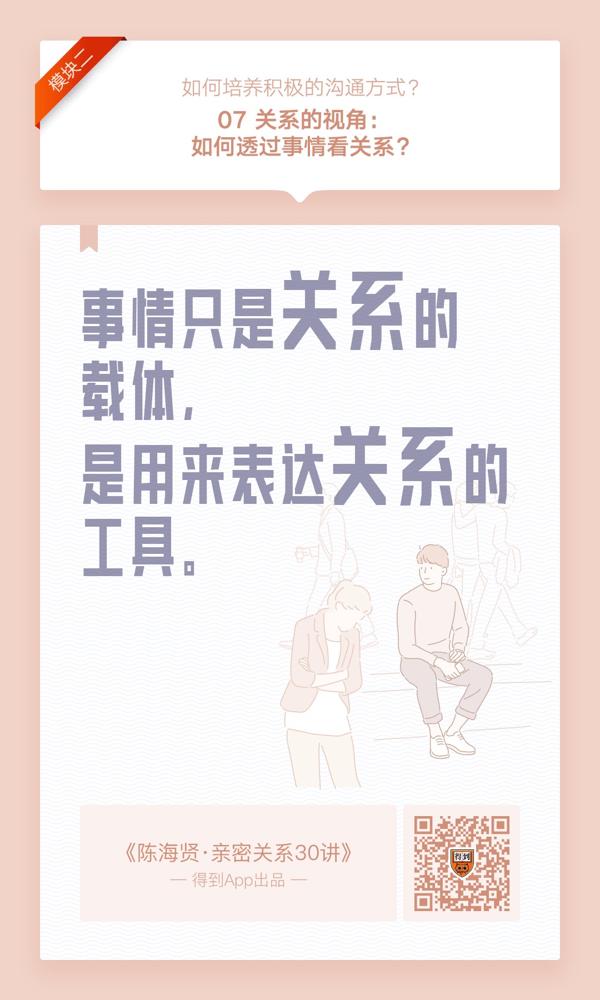  

* * *

# 08 丨关系语言：如何听懂伴侣的“话外音”？

陈海贤

2019-08-16

08 丨关系语言：如何听懂伴侣的“话外音”？

丨陈海贤 亲述丨

懒人专属群的群友，。你好，我是陈海贤。

如果说关系的视角是“看”，是帮助你看到事情背后的关系，那关系的语言就是“听”，是帮助你“听到”人们在沟通中，是怎么传递关系的信息的。

这一讲，我就来讲讲关系的语言。可以说，掌握了关系的语言，也就掌握了亲密关系中的沟通密码。否则，你就会遇到很多沟通的障碍。

## 关系的信息隐藏在谈话内容中

有一次，我在女儿的学校门口，看到一对父母在争论孩子的教育问题。妈妈说：“我觉得现在孩子应该去上奥数，别人家都在学了。”爸爸说：“我觉得孩子这么小不用太在意学习，应该去让他锻炼身体，踢足球。”

一般人会觉得，这对父母是在讨论孩子要不要学奥数，他们对孩子的课外教育有分歧。可是，如果你能从关系的语言上听这段对话，就会知道，他们其实都是在跟对方说：

“我比你更懂我的孩子，所以在这件事上，我比你更有发言权。”

这就是关系的语言。如果这个关系的矛盾没有解决，不只是争论孩子该学什么，在很多场景，比如孩子早餐该吃什么、穿哪件衣服好看、能不能跟同学玩，两个人都会有争论。

上一讲我们学习过，在亲密关系中，所有发生的事情都有两层含义：这件事的事实是什么，以及它在关系中意味着什么。

**同样，在亲密关系的沟通中，人们也一直在传递两个层面的信息：内容的信息和关系的信息。**

所谓内容的信息，是人们在表面上所说的话。也就是上面的例子里，孩子是学奥数，还是踢足球。而关系的信息，是这些内容背后所反映的两人之间的关系。也就是谁比谁更懂孩子，谁更有发言权。

所以，关系的语言不是表达谈话的内容，而是表达彼此的关系。

熟悉关系的语言，就能从两个人的只言片语中读出“谁在支持谁”、“谁在反对谁”、“谁在贬低谁”、“谁在生谁的气”。

关系的沟通是无处不在的，而亲密关系的沟通又有它的特别之处。亲密关系的核心是依恋，在亲密关系里，人们会变成依恋信息的敏感探测器。人们反复在寻找和表达的，其实就是这些信息：

如果接收到的关系的信息是肯定的，那人们就会很安心，会很心平气和地说话。如果关系的信息是否定的，那人们就会愤怒、失落和忧伤，就很容易与对方爆发争吵。

这也是为什么人们对爱人总是比对别人更苛刻，因为在亲密关系中，人们对依恋相关的信息异常敏感。

## 亲密关系沟通的核心信息是“依恋”

关系的语言有什么用呢？它会让你学会听和说。

**首先，了解关系的语言，你就能听懂争吵背后关系的故事，这远比争吵的内容丰富得多。**

举个例子。

我曾经遇到一对中年夫妻，丈夫很爱学习。他觉得自己在工作发展上已经到头了，就把精力用到了各种学习上。他经常看书、听课、去外地参加各种课程。这本来是一件好事。可是这却成了他们家里的矛盾。说起家里的矛盾时，丈夫说：

“我和我老婆的价值观不一样。我很热爱学习的，就想把自己的人生弄明白一点。可是我老婆总觉得这些都没有意义，她觉得过柴米油盐的生活就好了。所以她总是反对我学习。”

在丈夫心里，他和妻子的矛盾是一个常见的夫妻价值观不合的故事。

可是如果从关系的语言里，你又听到什么了呢？当丈夫说自己爱学习，而说老婆只关心柴米油盐的时候，他其实是在说：“我比我的老婆有追求。”爱学习和柴米油盐，在他眼里，显然是有高下之分的。

那他妻子认同这种说法吗？妻子说：

“我老公人一直比较单纯，不太擅长处理事情。在结婚后不久，我还经常在工作上帮他出主意。那时候他还听我的。可是现在他越来越固执了。就拿学习这件事来说，我经常跟他说，你不要学习得这么散，你要学一些真正对你有用的东西。可他却一点都不听。”

显然妻子讲了一个不一样的故事。从事情上看，她在说老公学得不够专一。可是从关系上看，她表达的意思是：自己比丈夫明智，所以丈夫应该听自己的话。

这是很有意思的现象。在伴侣吵架的时候，两个人总是会找一个特别的维度，把自己放到更高的位置，而把对方放到更低的位置。就像这个例子中，丈夫认为自己比妻子有追求，而妻子认为自己比丈夫明智。

为什么刚结婚不久的时候，丈夫听妻子的指导，后来又不听了呢？

这是因为，当两个人关系好的时候，“我指导你”所传递的关系的信息是：“我很关心你，我想帮助你。”这是丈夫能接受的。

可是当关系出现矛盾时，“我想指导你”所传递的关系的信息，就变成了：“我比你聪明，我不认可你。”而这是丈夫不能接受的。

有时候，妻子觉得是关心，而丈夫却感觉是否定和指责，这时候矛盾就产生了。

果然丈夫就说：“最近她管我越来越多，我觉得自己好像被约束住了一样，觉得越来越烦。”

到这里，这个故事从简单的“三观不合”的故事，变成了夫妻之间“谁该听谁的”这种权力斗争的故事。

可是，这也不是故事的终点。妻子接着说：

“我怎么管你了？我没支持你去学吗？你想想以前你去学习，我有说过你吗？可是你现在一回家就看书，从来不做家务，我们有什么事情叫你你也不应，孩子你也不管。我们现在连说说话都很难了。每次一说话，你都会说哪个老师是这么说的，哪个知识是这么讲的。你学这些有什么用呢？”

这个妻子在说什么？从内容上，她说的是丈夫只看书不做家务，可是从关系上，她说的其实是：

“我很需要老公关心我，和我好好说说话。”

“如果知识重要，我不重要了，那我就会生气。”

这就是亲密关系中的依恋信息。 **如果老公听不懂关系的语言，他就只会听出妻子的否定，然后反抗妻子。**

可是，丈夫为什么这么坚持学习知识呢？丈夫说：

“我一直觉得妻子比我聪明，以前我在她面前总是很自卑。所以我就想去学更多东西，学着学着，我的世界就慢慢打开了。可是她好像总看不到我的进步。从来没有说过我一句好。”

原来，这个老公学习知识最大的动力，是希望得到妻子的认可，希望妻子承认他在努力变成一个有知识的人。而他所反抗的，也是老婆的不认可。

所以，这个家庭的故事，从简单的夫妻“三观不合”的故事，到两个人“权力斗争”的故事，最后又变成了关于“依恋和爱”的故事。而后两个故事，只有那些熟悉关系语言的人能听懂。

## 好的回应是表达依恋

**除了听以外，熟悉关系的语言，你还能跟伴侣有效沟通。**

曾经有个丈夫请教我一个生活难题。他每周都会有两个晚上约朋友一起去打羽毛球，妻子不爱打球，对这件事就很生气。

每次丈夫去打球，妻子就会指责丈夫：“你怎么又去打球了？整天不着家！”丈夫也觉得自己很委屈：“我打球怎么了，又不是去赌博，我锻炼身体也不行吗？”于是两个人就吵起来了。他很苦恼，问我该怎么跟妻子沟通。

这是伴侣之间经常会遇到的矛盾：一方要求另一方改变生活习惯，而另一方则觉得这是侵占自己的私人空间。显然，劝妻子尊重老公的空间或者劝丈夫改变打球的习惯是不会奏效的，不然他们也不会吵这么长时间了。

什么样的回应是好的呢？

有人说：“你可以跟妻子做交易，告诉她我可以去打球，你也可以跟闺蜜去逛街。”

也有人说：“你可以心平气和地告诉妻子你的感受，也告诉她你需要自我的空间。”可是好像都不太奏效。

我教他的回应只有简单的五个字。我不知道他会不会去说，可是我相信，如果他去说了，会是有效的。

这五个字是：“老婆我爱你。”

这就是夫妻关系的真相。很多亲密关系中沟通的内容，都是在问对方到底爱不爱自己，在意不在意自己。

如果确认了这件事，自己是能为对方妥协的，很多事都可以商量。如果没有确认这件事，人们就会在很多事情上跟对方死磕到底，并怪对方为什么不能考虑自己的感受。

## 思考题

分析一段伴侣之间的对话。你能否从这段对话里读出三个不同的关系故事：三观不合的故事、权力斗争的故事、爱和依恋的故事？这些故事是怎么传达关系的信息的？

欢迎在评论区留言，和大家分享。

## 下节预告

下一讲，我们来学习隐藏在日常亲密关系背后的关系模式。

我们下一讲再见。

欢迎关注陈海贤的公众号，获取更多延伸阅读。

（微信搜索“陈海贤”添加关注，ID：haixiansalt）

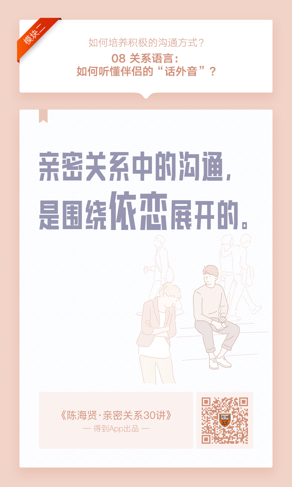  

* * *

# 09 丨关系模式：好伴侣是如何配合的？

陈海贤

2019-08-16

09 丨关系模式：好伴侣是如何配合的？

丨陈海贤 亲述丨

懒人专属群的群友，。你好，我是陈海贤。

当你学会了用关系的眼光看，用关系的耳朵听，你就会发现，夫妻之间的每一个互动、每一句对话，都有关系的含义在。

这些关系的互动隐藏在各种表面的事情背后，延绵不断，变成了一首夫妻之间长长的歌。虽然歌里的每一个音符都不太一样，可是听得久了，你就会发现，有一些旋律会在这首歌里反复出现，它代表了夫妻之间某种固定的相处模式，变成了这对夫妻的固有特点。

我们这一讲，就来说说关系模式。

## 好伴侣是双方配合的结果

我想先请你思考一个问题：在你眼里，什么样的伴侣，才算是一对好伴侣？

也许你最先想到的，是郎才女貌。可是郎才女貌只是外在的，是别人眼里的好，而不是这对伴侣自己感受到的好。

也许你又会想两个人都应该是好人。比如妻子要温柔体贴，丈夫要负责任、有担当。可是，两个好人在一起，也不意味着他们一定是一对好的夫妻。

有人说，好的伴侣，双方最好都不要太强硬。可是我也见过一些伴侣，妻子在外人看来很强势，丈夫却什么都听妻子的，好像有些软弱，但两个人仍然相处得很好。

也有人说，好的伴侣，双方最好能明事理。可是我也见过一些伴侣，双方讲话都特别有道理，两人在一起却怎么也相处不好。

所以什么是好的伴侣呢？要回答这个问题，你就必须脱开个体的视角，把亲密关系的两个人看作是一个整体的单元。

**好的伴侣不是看一方是什么样的人，另一方是什么样的人，而是看他们两人在一起的时候，是怎么配合的。**

有人把伴侣之间的沟通比喻为跳舞。跳舞有跳探戈的，有跳贴面舞的，有热烈的，也有安静的。单从他们跳的舞来看，没法判断他们是好还是不好。但是如果他们总是互相踩彼此的脚，或者把彼此绊倒，那肯定就是不好的舞蹈。

而伴侣之间的舞步，他们习惯的配合方式，就是伴侣的关系模式。好的伴侣，就是有好的关系模式的伴侣。

什么是好的关系模式呢？在给出答案之前，先给你讲个我的经历。

在一次沙龙上，有个妻子骄傲地分享他们夫妻的相处之道。她说：“我们在结婚之前就有一个约定，如果我们之间发生了争吵，我老公要先跟我说话，向我道歉。现在我们结婚已经 5 年了。到目前为止，他都做到了。所以我们每次争吵都很快平息了。”

他丈夫当时也在旁边。我开玩笑问他：“你乐意这样做吗？有没有受骗上当的感觉？”他说：“没有啊。我很高兴能哄老婆开心，这是我作为男人的责任。”

这时候旁边有个女士看不下去了，站起来说：

“我觉得这样根本不公平。凭什么女人要在婚姻里有特权，可以作啊？我觉得这是一种不平衡的关系，很难持久。”

幸亏这位女士不是一个咨询师。她只是盯着这个妻子，觉得妻子这样的要求不合理，但却没看到，  
**这个要求和道歉是这对夫妻表现恩爱的方式，也是他们解决问题的方式。这是他们的关系模式。**

当然了，在大家面前秀恩爱，也许也是这对伴侣的关系模式，而这个女士看不惯的可能是这个。可是无论如何，在他们所呈现的关系模式里，这对伴侣至少是配合得很好的一对。

## 关系模式的特征

那什么是好的关系模式，什么是不好的关系模式呢？

**好的关系模式常常有两种特征。**

**一种是积极对称。** 所谓的对称，是说一方的语言和行为激发了另一方相似的语言和行为。积极对称，就是互相激发出积极的语言和行为。

好的亲密关系中，都有很多对彼此的认可。这种积极的关系信息总是会相互激发，从而形成良性循环。

比如在回忆过去时，丈夫跟妻子说：

“这几年走过来不容易，谢谢你支持我。”而妻子也会跟丈夫说：“有你在我觉得很幸运。”慢慢地，夫妻就会对彼此有很多的感恩。

**另一种特征是有效互补。** 所谓的互补，是说一方的语言和行为激起了另一方完全不同的语言和行为，形成了一种相互补充。

妻子要求丈夫道歉，而丈夫接受了，这是一种有效互补。

在争吵中，妻子看丈夫火气上来了，就先停下来不说话，等丈夫气消了再说，这也是一种有效互补。

在养育孩子的过程中，一个人扮红脸，另一个人扮白脸，这也是一种有效互补。

有效互补的背后，是对彼此的了解和配合上的默契。

**与好的关系模式相反，伴侣之间糟糕的关系模式，同样有两种特征。**

**一种是消极对称。** 在消极对称的模式中，一方会从另一方的言行中解读出很多消极的关系信息，而一方的反应，又刺激另一方释放更多消极的关系信息。

比如妻子指责丈夫说：“每次你都这样，从来不考虑我的感受！”

而丈夫就会回击：“那你呢，你有想过我吗？”两个人越说越气，形成了一种恶性循环。

**另一种是无效互补。** 如果说有效的互补中，两个人之间是一种默契的配合，从本质上他们还是在交流的，而无效的互补会导致交流的中断。

比如，当妻子指责丈夫说：“每次你都这样，从来不考虑我的感受！”的时候，丈夫却默不作声。

妻子继续说：“你倒是说话啊！别像一块木头一样！”妻子说得越大声，丈夫就越沉默。丈夫越沉默，妻子就说得越大声，变成了一种恶性循环。

从不好的关系模式中，你会发现很多消极对称和无效互补的影子。

**好的关系模式会让一件不开心的事变开心，而不好的关系模式，则会让一件明明开心的事，变得不开心。**

我见过一对夫妻，两人经常吵架，总是很难和平相处。一次激烈的争吵以后，两人约定不吵了，一起去旅游来修复关系。因为丈夫工作忙，就让妻子来安排旅行的各种事。

最开始筹划旅行，两人都挺开心。到了酒店，丈夫坐下就说：“这个房间有点吵啊。”妻子当时就有点不高兴了，可是她没有说。

第二天他们包了一辆当地的车外出。丈夫又说：“这个车有点贵了。上次我一个朋友来玩，好像 500 一天就够了。”妻子不高兴了，就说：

“那下次你自己来安排啊。你自己什么都不弄，我弄好了，你还说三道四。”

丈夫急忙说：“我没说你啊，我只是说一下这车。你也太敏感了，怎么又生气了？不是说好不生气的吗？”

妻子就说：“你也太挑剔了，这样玩还有什么意思？”

妻子指责丈夫挑剔，丈夫指责妻子敏感，这是一种消极对称的关系模式。在陷入了这种惯常的关系模式后，两人越说越生气，最后都开始沉着脸，对外面的美景视而不见了。

## 改变关系模式的关键：配合与循环

说到这儿，你可以想想你和伴侣的关系模式。你们是积极对称的、有效互补的，还是消极对称的、无效互补的？也许都会有，可是关系的主旋律是什么呢？

也许你会问，如果陷入了这种消极的关系模式，该怎么改变呢？

改变个人的习惯并不容易，改变两个人的关系模式就更难。有时候，当双方陷入一种不良的关系模式之后，经常会有这样的感觉：“又来了。”、“总是这样。”因为模式总是不断重复的。这特别让人疲惫、沮丧甚至绝望。

可是改变也并非没有可能。 **从关系模式看两个人的相处，有两个关键词很重要，一个是“配合”，另一个是“循环”。**

“配合”意味着关系模式不是一个人的事，而是两个人的事。也许你会想：对啊，配合是两个人的事。万一我想改，而对方不配合，那我一个人努力有什么用？

我理解这种想法。很多时候，人们自然就容易把问题归为对方，而把自己当作是无能为力的受害者。会想：因为对方这么做了，自己也就只能这么做。

之所以会有这种想法，是因为没有看到自己对对方的影响，才会期待对方发生改变。而很少去想自己能改变什么，来改善这种关系模式。

两个人相处的另一个关键词，叫“循环”。也就是一个人的行为，是在另一个人的刺激下产生的。你的行为，是循环里的一个环节。这意味着，你的改变常常也会引来对方的改变。所以，当你陷入消极的关系模式时，你可以这样问自己：

“我到底做了什么，把他变成这样呢？”

“我又能做些什么，来打破这个无效的循环呢？”

## 思考题

你和伴侣的关系模式是哪种呢？这种模式是怎么形成的呢？

欢迎在评论区留言，和大家交流。

## 下节预告

接下来的三讲，我们会学习伴侣之间常见的三种不良的沟通方式，并探讨改变的方法。

我们下一讲再见。

欢迎关注陈海贤的公众号，获取更多延伸阅读。

（微信搜索“陈海贤”添加关注，ID：haixiansalt）

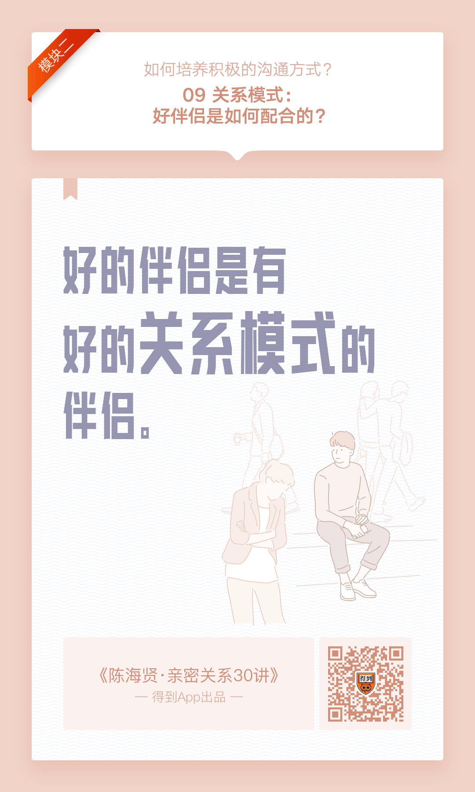  

* * *

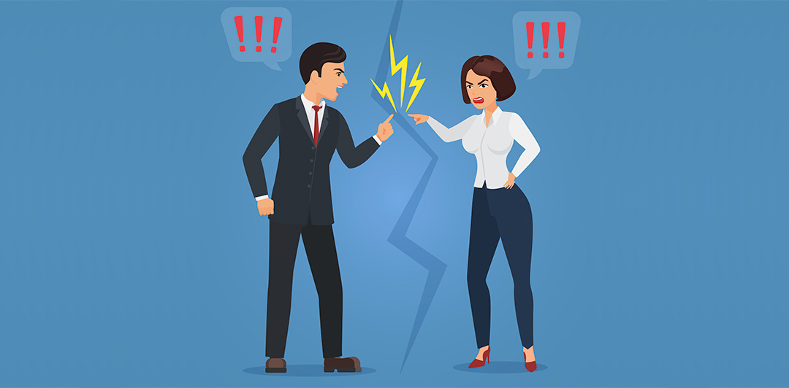

# 10 丨争吵：愤怒背后的悲伤

陈海贤

2019-08-16

10 丨争吵：愤怒背后的悲伤

丨陈海贤 亲述丨

懒人专属群的群友，。你好，我是陈海贤。

亲密关系中的沟通，总是围绕“依恋”这个核心议题进行的。如果沟通是以促进彼此亲密的方式进行的，两人就会进入一种良性的循环，他们的依恋关系会越来越巩固。

可是，如果沟通是以一种不恰当的方式进行的，两人之间就会产生很多的矛盾和误解。归纳起来，不良的沟通方式有三种：双方都主动攻击，就会争吵；一方主动，另一方被动逃避，就是追逃；两个人都被动逃避，就成了冷战。

这一讲，我们先来讲第一种不良的沟通方式：争吵。

## 指责会变成无休止的循环

我猜，你肯定有这样的经验：不知道为什么，总是会为一些很小的事情，跟伴侣吵架。比如，谁该倒垃圾、谁该洗碗、约会为什么会迟到之类。

吵着吵着，自己也觉得累了，想停却怎么也停不下来。难得不吵的时候，会跟对方说：我们要好好的，以后不要再吵了。可是没过几天，争吵又开始了。

在伴侣之间，引发争吵的事情是五花八门的。可是争吵的模式都是类似的：就是不停指责对方，谁也不肯让步。

我见过一对夫妻，在咨询室里，妻子对丈夫说：

“我也希望有个老公能陪我逛逛街，能陪我说说话。可是你呢，不是在外面跟朋友玩，就是回家对着手机玩游戏。你有一点对家庭的责任吗？”

丈夫也很生气，他说：  
“那你自己做得怎么样？我工作这么忙，压力这么大，你有体谅过我吗？那几天我加班，每天回到家都 11 点了。有时候连饭都没吃。别说给我弄点夜宵了，你有过一声问候吗？”

妻子冷笑了一声说：“人总是要有付出，才会有回报啊。”

丈夫就更生气了：“好，那这么说，日子就没法过了。都别过了得了，谁怕谁啊！”

这是典型的争吵模式。夫妻都觉得自己有很大的委屈，都在指责对方对自己不好。  
**妻子的每一句话，都变成丈夫愤怒和反击的刺激源，反之丈夫的每一句话，也变成了妻子愤怒和反击的刺激源。**

丈夫觉得妻子是争吵的源头，妻子觉得丈夫是争吵的源头，却看不到这是一个没有开始，也没有尽头的循环。

## 争吵源于用愤怒防御悲伤

怎么才能停止这个痛苦的循环呢？要想停止争吵，就要先了解争吵背后的原因。给你讲个我朋友的故事。

我这个朋友和她老公关系一直不错。有一天，她老公约了一个要离职的女同事一起吃饭，事先没告诉她，回来才跟她说。

她觉得非常委屈，可是这种委屈又很难表达，说出来就好像自己小气了。所以她说了两句，就躲到厕所里一个人偷偷哭。

这个举动既有她的伤心，当然也还有希望老公看到的意味。她原来的设想是自己在厕所躲了一会儿，老公应该发现，并来安慰才对。可是等了好长时间也没动静。再一听，好像卧室里传来了均匀的打呼声。出来一看，老公已经睡着了。

她心有不甘，就跑到客厅，把电视声音开大，可是老公还是没动静。最后她实在气不过，就跑到卧室，拉开老公的被子说：“醒醒！快起来！”老公睡眼惺忪地坐起来问：“怎么了？”

她说：“我都难过成这样了，你居然还能睡得着！”

这是夫妻交往的片段里最有趣的地方。在哭的时候，委屈是不想让对方看到的，只能躲起来哭，暗暗希望对方能发现。可是愤怒的时候，冲对方发火却容易得多。如果对方也不是一个包容的人，那愤怒的情绪也许就变成夫妻争吵的开端。

为什么向爱人表达愤怒容易，表达委屈和悲伤却难？

心理学里有一个情绪理论，是说像委屈和悲伤这种情绪，是出自本能的，叫初级情绪。而像愤怒这种情绪，是由悲伤这样的初级情绪引起的，叫次级情绪。

**先有了委屈和悲伤，才有了愤怒和指责。从这个角度看，人们用愤怒来阻止悲伤，愤怒是悲伤的防御。**

那亲密关系中的悲伤到底是什么呢？

是我的需要，你没有看见；是我想要得到你的认可，你却指责和批评我；是我知道你能平息我的悲伤，你却不肯安慰我；是我把你看作是我的药，你却没来医好我。

所以人会用愤怒表达抗议，并暗暗希望对方能看到自己愤怒背后的悲伤和需要。

可是在亲密关系中，悲伤和愤怒的功能是不同的。 **悲伤让人靠近，而愤怒却会把人推开。悲伤会引来安慰，而愤怒会引来同样的愤怒。**

当亲密关系中的一方用愤怒和指责表达自己在关系中受到的伤害时，对方也会陷入防御的状态，因为愤怒和指责会被对方解读为“你觉得我不好”。很有可能，对方也用愤怒和指责来回应。

这时候，伴侣就会陷入一种相互指责的模式，表现出来就是没有休止的争吵。

## 停止争吵需要直接说出需要

那怎么才能走出争吵的怪圈呢？

**答案很简单，回到依恋的源头。看到自己和对方愤怒背后的悲伤，并且能够说出这种悲伤背后的需要。**

以刚才说的这对夫妻为例。当妻子对丈夫说：

“我也希望有个老公能陪我逛逛街，能陪我说说话。可是你呢，不是在外面跟朋友玩，就是回家对着手机玩游戏。你有一点对家庭的责任吗？”

而丈夫说：“那你自己做得怎么样？我工作这么忙，压力这么大，你有体谅过我吗？那几天我加班，每天回到家都 11 点了。有时候连饭都没吃。别说给我弄点夜宵了，你有过一声问候吗？”

我没有评价谁说得有理，而是先让这对夫妻停下来。然后我问丈夫：“你听到你妻子在说什么吗？”

丈夫说：“我听到了啊。我听到她在指责我没有责任感。”

这时候我说：

“我听到的不是这样。我听到的是，你的妻子在说，她希望能有个老公陪她逛逛街，能陪她说说话。妻子，这是你的要求吗？”

当我这么说的时候，紧张的气氛忽然软了下来。这位妻子眼眶一红，说是的，这就是我的想法。我继续说：

“我知道这是你的想法。可是你也没有听到你丈夫在说什么。我听你丈夫说了这么多，其实他一直在说，我想有一个体谅我的妻子，我想有一个温暖的家。是这样吗？”

丈夫也频频地点头。这时候我会跟妻子说：

“好，既然你的需要是这个，那你能不能好好地，直接地跟你老公说出你的需要呢？”

刚刚还咄咄逼人的妻子，忽然就变得扭捏起来。她看着丈夫，不知道该怎么开口。最后她鼓起勇气说：“你能不能多陪我逛逛街，跟我说说话呢？”

我能理解她的扭捏。有时候人们会误以为，这种扭捏只是矫情，是老夫老妻了，不习惯再说甜言蜜语的话。其实不是，而是人们害怕一旦说出自己的需要，就会被拒绝，而拒绝会产生伤害。

**为了不让拒绝发生，人们很难说出自己的需要，而是习惯给自己的需要加上愤怒或者指责的包装。**

人们希望对方看见自己的需要，又因为对方忽略了自己的需要而生气，这就是发生争吵的开端。

当你因为对方的忽略而生气的时候，也混淆了一件事，那就是对方到底是不想满足你的需要，还是不想接受你的指责和愤怒。

有时候，当你鼓起勇气表达需要的时候，又会非常小心翼翼。如果对方说出“不”字，或者提出交换的条件，你又会受伤和愤怒，并告诫自己：“下次绝不能再这么傻了。绝不能再给他伤害我的机会了。”

有些人可能会这么说：“我需要你陪我。可是你肯定做不到！”

为什么要加预想中的拒绝？只是因为自己害怕失望，所以提前拿起了盾牌。可是你防守的盾牌会变成刺向对方的利剑。

好在在这个咨询里，妻子没这么说，丈夫也没这么说。丈夫说的是：“我当然愿意了。以后我一定会多陪陪你的。”

听到丈夫这么说的时候，妻子的脸笑成了一朵花。

从害怕说出需要会被拒绝，到用愤怒表达需要，亲密关系中的两个人变成了拳击台上冷酷无情的对手。明明是在自我防卫，却非要击倒对方，才肯放下拳头。

外表强硬，内心却期待对方能够看到自己真正的需要。这样的战斗不会有赢家，却一定会有一个输家，那就是双方的感情。

## 思考题

你和伴侣曾因为什么事争吵？这背后有你们各自什么样的需要？

欢迎在评论区留言，和大家交流。

## 下节预告

下一讲，我们来学习另一种消极的沟通模式：追逃。

我们下一讲再见。

欢迎关注陈海贤的公众号，获取更多延伸阅读。

（微信搜索“陈海贤”添加关注，ID：haixiansalt）

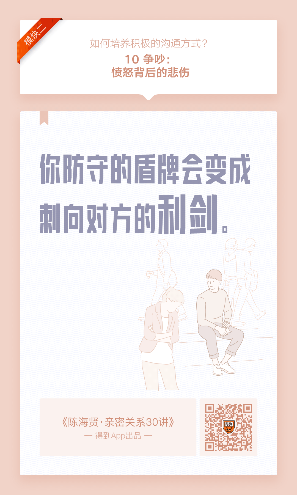  

set 限制解除

* * *

# 11 丨 追逃：“爱太少”和“黏太紧”

陈海贤

2019-08-16

11 丨追逃：“爱太少”和“黏太紧”

丨陈海贤 亲述丨

懒人专属群的群友，。你好，我是陈海贤。

当亲密关系出现矛盾的时候，如果双方都习惯主动表达指责和愤怒，就容易出现争吵的沟通模式。而如果一方倾向于主动出击，另一方倾向于被动逃避，那这两种人就会形成追逃的沟通模式。这一讲，我们就来讲这种不良的沟通方式：追逃。

你可能见过这样的场景：

妻子指责丈夫说： “为什么你总是忙忙忙，从来不关心我和孩子！”丈夫却默不作声。

妻子继续说：“你又来了，每次都这样，连说话都不会了吗！”妻子越说越大声，而丈夫却越来越沉默。

在这样的情境中，一方因为得不到对方的回应而指责他。而另一方通过沉默来逃避对方的指责。就好像在情感的赛道上，一个人在拼命追，而另一个人在拼命逃。两个人的耐心就这么被消耗掉。

如果你去问追的人为什么追，追的人会说，因为他在逃。如果你去问逃的人为什么逃，逃的人会说，因为她在追。两个人形成了一种相互加强的循环。这就是追逃。

## 追逃组成了伴侣的关系模式

在追逃的关系模式中，追的形式有很多种。比如粘着对方，希望对方多跟自己在一起；用批评和指责的方式让对方知道自己的需要；或者用沉默和眼泪让对方多关注自己。

无论哪种形式， **追的本质，就是希望对方能有更多的回应，希望能在情感上和对方更靠近。**

同样，逃的形式也有很多种。最常见的形式，就是回避和沉默。无论哪种形式， **逃的本质，是通过回避对关系的讨论，来回避情感的矛盾。**

不同“追”和“逃”的组合，形成了伴侣之间的关系模式。

我见过一对夫妻，丈夫在外面忙生意，妻子在家里照顾孩子。妻子平时在家里不开心了，就会默默流泪。看到妻子流泪，丈夫不会去安慰，反而会把妻子的眼泪当作是对他的指责。他会说：

“现在不都挺好的吗，你不要哭，你不要这么作。我工作很忙，你就不能自己找一些事情做吗？”妻子也默默地不辩解，就在一边哭。

我问丈夫：“你妻子在哭什么？”丈夫说不知道。妻子却说：“他总是忙自己的事，从来不关心这个家。”

丈夫为自己辩解说：

“你看我工作这么忙，也在为家努力操持。我的工作需要保持头脑的理智和清醒。你说我没有主动关心你，没有给你打电话。可是你也可以给我打电话啊，你给我打电话，我也会接啊。”

听丈夫这么说，妻子好像又不知道该说什么了。她好像觉得丈夫说得有道理，但心里又不是那么愿意接受，于是又默默地哭了。

**妻子的眼泪，就是一种追的方式。而丈夫看起来说了很多话，其实在情感中，他是逃的。**

很多丈夫用工作当挡箭牌，会说：“因为工作太忙，所以顾不到你。”、“我这么做，也是为了这个家。”这当然有道理。

可是有时候，我觉得相反的顺序也有道理：因为不愿意去面对亲密关系中的矛盾和冲突，才让自己这么忙，才可以有理由不用顾及对方。这也是一种逃。

## 追逃反映不同的矛盾防御倾向

追逃是怎么发展起来的呢？可以从两个角度分析原因。

**从个人的角度，“追”和“逃”反映了伴侣各自不同的防御倾向。**  
当情感出现矛盾时，一方希望离得更近，通过接近和融合来缓解关系带来的焦虑。而另一方希望离得更远，通过回避和疏离来缓解关系带来的焦虑。

**而从关系的角度，夫妻之间的追逃是两个人相互配合的结果。**  
正是因为一方的紧追和控制，才有另一方的不愿意回应、不敢回应。也正是因为一方总是不回应，所以另一方才要不停追问。

很多时候，追逃是从争吵的模式发展来的。一般刚恋爱的情侣或者新婚的夫妻，还有力气去争吵。吵着吵着，就有一个人怕了，觉得这样吵实在太让人心累了，于是就开始回避和沉默。

可是一个人越回避和沉默，另一个人就越会指责他。越指责，就越躲避，形成了恶性循环。

在这种恶性循环中，人们常常认为追的人是强势、控制、缺乏安全感，却忽略了他们是害怕失去这段关系。而同时人们常常认为逃的人是木讷、不体贴、不解风情，却忽略了他们心里怕的是“不被接受”、“没法成为一个合格伴侣”。

## 沟通的责任需要两人共同承担

怎么才能停止这种追逃的模式呢？答案很简单，可是要做到却不容易。那就是，追的人停止追，逃的人停止逃。

如果在亲密关系中，你是一个追的人，那你要明白，很多时候追其实是没法奏效的。因为你无论怎么追，都没有办法强迫对方变成你理想中的样子。而你的追，只会把对方推开。

而如果你是逃的人，那你也要明白，关系的难题是没法逃开的。你越逃，这个矛盾只会越大。

听起来简单，可做起来为什么难呢？是因为追逃背后，有人们更隐秘的愿望。

我见过一对新婚夫妻。在咨询室里，妻子就抱怨丈夫说：“你什么时候都是自己闷着，我想跟你说话，你却总是有话不肯直说。”这个妻子在用指责的方式“追”。

而丈夫特别配合地说：“好的，以后我要多跟你说说话。”

妻子继续说：“就像上次我跟你说我们公司里的事，你还给我提很多意见。我不是需要你提意见，我是需要你提供无条件的支持。你应该多站在我这边。”

丈夫欲言又止，想了想说：“好的，那我以后多支持你。”

看起来丈夫很配合，其实他一直在说的是：“不要讨论了，快让这个话题结束吧。”他在用他的配合逃。

看到这儿，我就问丈夫：“你怎么这么快就同意妻子了呢？如果你这么同意你妻子，你怎么又经常在家不说话呢？”

丈夫很无奈地说：“我是想配合我妻子。可是我也不敢说太多，如果说得不对，她又会不高兴。我都有点怕她了。”

我就问妻子：“你是想让老公怕你吗？”

妻子说：“当然不想了。我当然希望家里的气氛轻轻松松的。”

我又问：“可是，那如果你老公说的跟你想的不一样，你能接受吗？”

她又说：“我不能接受，他是我老公，我当然觉得他应该无条件支持我。”

妻子的回答，揭示了“停下追”很难的原因。表面的原因，是我们想要亲近自己的爱人，不想他远离。  
**可更深的原因，是人们放不下理想爱人的样子，很难忍受现实中的爱人跟自己想象的不同。**

这个妻子需要丈夫能敞开心扉跟她交流，可是她又希望丈夫跟她想的一样。她希望对方回应她，可是，她也希望对方能够按她想要的方式回应她。不然，她就会一直追着对方，直到对方给出她想要的回应为止。

但妻子没看到，这其实是一种悖论。这种相互矛盾的要求，让丈夫不知所措，他只好用假意的屈服和照顾来平息妻子的抱怨。

可是，妻子也分得清什么是回避矛盾的息事宁人，什么是真正的交流和关心。所以她就一直表达不满。就好像，她不仅是跟丈夫较劲，也在跟自己理想中的丈夫较劲。

也许你会觉得这个妻子是一个不讲理的人，这个丈夫像是一个受害者。可是换个角度想想，当丈夫说“我不知道怎么回应”的时候，他好像是把所有沟通的责任都推给了妻子。

丈夫的这种回应，也揭示了“不逃”很难的原因。  
**那就是人们太难面对不知道该怎么处理的矛盾了，有时候甚至更愿意自己有个不讲道理的伴侣，好证明“我实在没办法了”，逃了是很合理的选择。**

这时候，我就问丈夫：“那你想跟你妻子沟通吗？你需要有一个能跟你说话的妻子吗？”

他说：“我也需要啊。”

我说：“如果是这样，那你就要学着，不要那么怕你的妻子。不要怕说错话，不要怕她生气。你要心平气和地告诉她，我有我的想法，如果你总是这么生气呢，我就会缩回来。如果你想听我的想法，那你就要容忍有时候，我跟你会不一样。”

解决关系的难题，就需要两个人都承担起沟通的责任，而不是把责任都甩给对方。无论内心有多害怕冲突、多厌恶对方的指责，都要试着跟对方好好说。

停止追和逃，也许矛盾还在，但却为双方营造了重新对话的空间。一旦双方能够重新对话，那新的、解决问题的可能性就会被打开。

欢迎关注陈海贤的公众号，获取更多延伸阅读。

（微信搜索“陈海贤”添加关注，ID：haixiansalt）

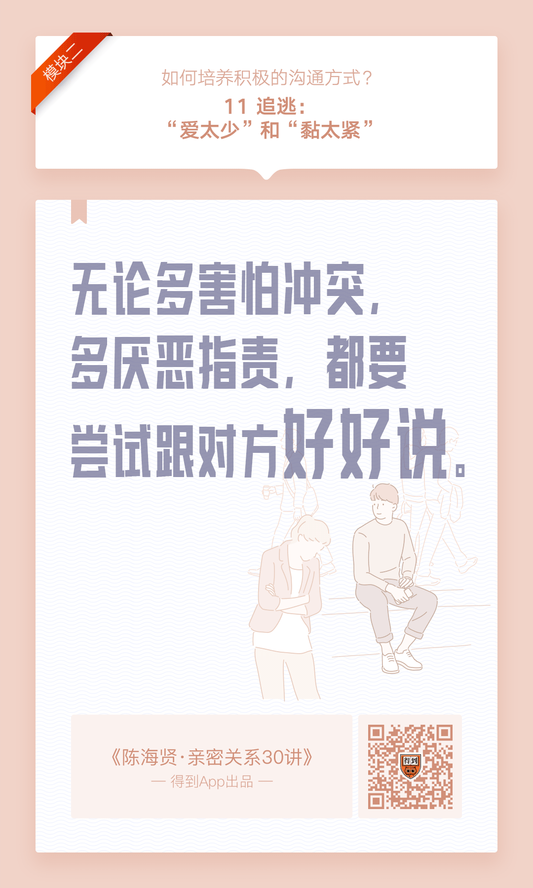  

* * *

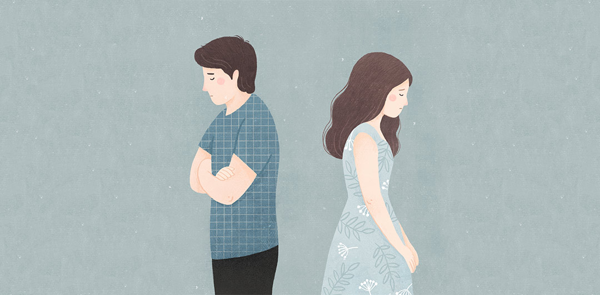

# 12 丨冷战：无言的愤怒

陈海贤

2019-08-17

12 丨冷战：无言的愤怒

丨陈海贤 亲述丨

懒人专属群的群友，。你好，我是陈海贤。

在亲密关系中，有时候伴侣会陷入一种这样的沟通状态：两个人都不再主动追求情感回应了，都选择被动逃避的时候，看起来既不吵架，也不追逃。语言的交流停止了，但是情绪的交流还在继续。这时候就进入了第三种不良的沟通方式：冷战。

这一讲，我就来讲讲冷战。

## 冷战会变成控制对方的手段

我猜你肯定经历过冷战。冷战的形式有很多种，但是说到底就只有一种：我不跟你产生情感的联结。冷战的双方不再有拥抱和亲吻，也会避免目光接触，避免任何情感的联结和沟通，甚至连吵架也不吵。

有时候他们会彼此都装作什么都没有发生，甚至会故意客套一下：“你吃了吗？”“吃了。”“今天过得怎么样？”“还行。”但是这些客套的话，也是为了刻意营造心理上的距离感，而正是这种距离感会更让伴侣难受。

为什么中断情感联结，刻意营造的距离感，会变成伴侣表达愤怒和敌意的工具？

**因为人们知道在亲密关系中，对方需要自己，自己也需要对方。这种需要有时候会变成一种控制对方的手段。**

在冷战里，人们是想通过中断情感接触来告诉对方：“不要惹我，否则我会通过不跟你有情感接触让你痛苦”，或者“你没那么重要，我没那么需要你”。

时间长了，两个人谁也不想先服软，会愤恨地想：“凭什么要我先跟你和好？凭什么要我来向你道歉？难道你就比我重要吗？谁怕谁？”

冷战的时间可长可短。一般来说，短的冷战虽然也让人不舒服，但它更像是生活的调料剂。在基调上，彼此都还是相互信任。在行事上，双方也有一套不让冲突扩散的机制。

我有一个哥们，平时晚上会跟我们一起玩。但有一天他就说：“我要早点回去，我正跟老婆闹不愉快。”

虽然他回家还是不跟老婆说话，但是按时出现在家里，表示自己绝无二心，也是他在这个“动荡”的时刻向老婆传递的重要信息。

**很多恩爱的夫妻在冷战的时候，都会时不时伸出一些只有他们彼此能够看懂的“橄榄枝”。**  
当这个橄榄枝出现的时候，对方往往会很默契地心领神会。比如，你为爱人盛一碗饭，或者在某个时候对她笑一下。

我记得有一次我跟爱人冷战了。那时候女儿把一个玩具掉到了沙发下面，所以女儿就拿东西去够。旁边的妻子说：“去外面拿晾衣棒。”我说：“拿妈妈的手机去够。”

那时候我爱人刚换了新手机，她很爱惜，她就笑着看了我一眼。这一来一回，就是一个关系修复的信号。好的夫妻不是不会冷战，而是有很多这样的“橄榄枝”让关系恢复正常。

小的冷战里，双方都抱着和好的期待，如果有什么怨，也是怨对方为什么这么拧，还不伸出橄榄枝。可是如果冲突持续很长时间，冷战又会变成另一副模样。

## 回避型的交往模式会屏蔽亲密感

讲追逃模式的时候我说过，当伴侣中的一个人得不到情感回应的时候，会紧追对方要求回应，而对方为了回避冲突就会逃。

但是，紧追的一方一直得不到情感回应的时候，他也会产生很大的挫折感。为了逃避这种挫折感，慢慢地，他也开始不追了。这时候，两个人就进入了一种深层次的冷战：回避式的交往。

与吵架相似，回避式的交往也是一种消极对称的关系模式：一个人越是不说话，另一个人也越不说话。沉默的对抗会相互加强，直到回避变成两个人的习惯，沟通反而变成一种不习惯。

**在回避型的交往里，夫妻双方不再对对方抱有期待。他们都想方设法，让对方变得不重要。**

回避的目的从警告和惩罚对方，变成了一种让自己内心安宁的自我要求。慢慢地，回避型的人会觉得：“我就是这样自在一点。”而另一方也常常默契地配合着。表面不吵了，但实际上谁的内心都不宁静。两个人开始疏远，并逐渐变得冷漠。

这种冷漠是很难忍受的。我遇到过另一对夫妻，有时候丈夫早下班，看到妻子在，就会冷冷地打个招呼，有时候连招呼都不打，就各自回到了各自的房间。

最开始的时候，如果丈夫不回家吃饭，会发个简单的短信：“我不回家吃饭了”，“我在加班”之类，妻子也会客套地说：“好。”慢慢地，连发短信说不回家也省了。

有时候妻子和丈夫还会一起出去，参加一些家庭或者朋友的聚会。在聚会里，他们也说话，可是回家面对彼此的时候，又是那种巨大而沉重的沉默。

后来他们离婚了。当说起这一段的时候，妻子说：

“离婚是因为我发现自己那时候真的没法接近他了。也不是讨厌，也不是恨。就是如果他在家，我整个人都会很紧张。我努力让自己平静，努力忽略这个人的存在。可是只要他一出现，发出一些声响，我就会跳起来。如果他不在，我就会很自在。我就是希望他消失。”

而丈夫也说：“那段时间，我能在公司加班就在公司加班。我尽量拖延着晚回家。一想到家，我没有觉得温暖，只是觉得烦。别人看我事业成功家庭幸福，却怎么也不会想到，我其实是一个有家不能回的男人。”

为什么会这样？在亲密关系中，每个人都像是一个接收情感信号的雷达。在关系里，他们会敏锐地接收来自对方的善意，并尝试情感联结。

**可是，如果双方的沟通一直都充满矛盾，或者双方争吵太久，人们就会把彼此当作是唯恐避之不及的压力来源。这种对焦虑的回避会压倒对联结的渴望。**

现实是，夫妻又总是生活在一起，没法分开。这时候，身体会出现一种特别的情感反应机制：对来自关系中的情感加以防御。好像身体有一个情感通道，而他们逐渐关闭了这个情感通道。这不是自我意识控制的结果，而是身体对关系适应的结果——身体会自然倾向于减轻自己所承担的情绪压力。

可是这种身体的适应让人们很难接受，就像一个人从自然放松的状态变成长期捏紧拳头的紧张状态，而这种紧张还只是为了应对可能的危险。更重要的是，关闭了情感通道，虽然屏蔽了焦虑和悲伤，但是也屏蔽了快乐、激情和亲密感。

这时候，人就会感觉到麻木、隔离、抑郁。这也是为什么一些伴侣之间如果有长久的未解决的矛盾，就很容易导致抑郁。

为什么伴侣会陷入这种习惯性的回避模式？

其实很多回避型沟通的背后，经常都有一些难以言说的委屈在。如果这些委屈不去处理，就会变成一个在心里隐隐作痛的伤口，提醒自己对面的这个人不可信任。然后就开始想要一个人去扛着自己的生活。

最开始这种对抗是有赌气的成分在。人们想告诉对方：没有你，我也可以。可是慢慢地，两个人的关系就会变得疏远，这时候重新接近就会变成一件小心翼翼的事。

埋在心底的委屈会变成怨恨，而提起它又需要巨大的勇气，甚至会引来激烈的争吵。双方都在努力回避，很多伴侣就这样越走越远了。

## 说出委屈让关系“热”起来

那怎么才能从这种回避的模式中走出来呢？

我自己的经验是，不要走到这一步，预防的效果是远好于治疗的。感情如果真的冷了，要再热起来就很难。

**但如果已经走到了回避的关系模式中，两个人想要重新开始，所要走的第一步，就是找个空间让彼此说出委屈。哪怕吵起来，也比一直闷着痛快。**

有时候，为了不让争吵过于激烈，我也会有些提醒。当一个人要说他的委屈的时候，我会跟另一个人说：

“看起来你的妻子或者丈夫有很多的委屈。你能允许他说吗？你想知道吗？”

如果对方说“想知道”，我就会继续说：“那如果他说的让你不高兴了，你能先忍着不反击吗？”

我也会提醒那个诉说委屈的人：“我知道你心里有很多委屈，可是你能只说你的感受，而不要把它变成控诉对方的批斗会吗？”

如果你也和伴侣陷入了回避式的关系，你可以试试找个空间，诉说彼此的委屈。如果你怕说着说着就吵起来，那可以约定让一方先说半小时，另一方只是倾听，然后再反过来。

我知道这很难，因为你不知道对方会有什么反应。有时候你甚至会想，算了，干脆别说了，反正对方也不会理解的。但如果你还希望你们重归于好，你就需要做这样的尝试。

如果你真的开始这么做了，常常会有新的发现。比如，也许你会发现，原来对方心里也有很多委屈，原来自己在某些不经意的地方也伤害了对方。或者你会发现，在你不好受的时候，原来对方也受着同样的折磨。

## 思考题

你和伴侣有过什么样的冷战经历呢？最终你们又是怎么和好的？

欢迎在评论区留言，和大家交流。

## 下节预告

下一讲，我们说说怎么正确吵架。

我们下一讲再见。

欢迎关注陈海贤的公众号，获取更多延伸阅读。

（微信搜索“陈海贤”添加关注，ID：haixiansalt）

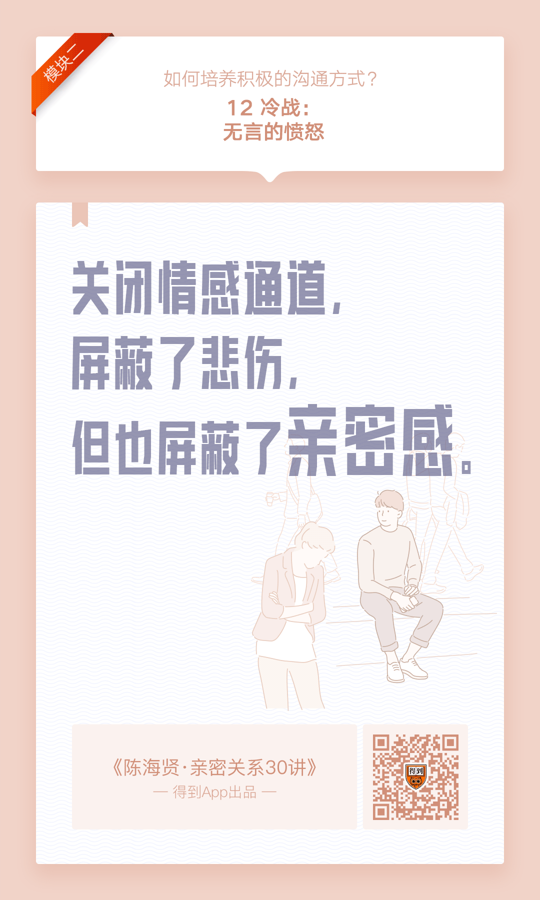  

* * *

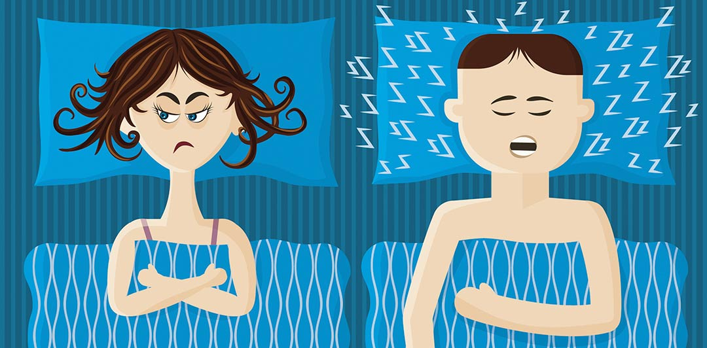

# 13 丨另类沟通：如何“正确”地吵架？

陈海贤

2019-08-18

13 丨另类沟通：如何“正确”地吵架？

丨陈海贤 亲述丨

懒人专属群的群友，。你好，我是陈海贤。

前面的课程里，我们学习了争吵、追逃、冷战，这三种不良的沟通方式，似乎给人一种印象：只有相敬如宾的夫妻才是一对好夫妻。是这样吗？

其实，夫妻之间经常发生一种特别的互动。这种互动非常激烈，充满激情和能量；在互动的过程中，伴侣不仅自己变得非常敏感，同时也去触碰对方的敏感点；他们会全神贯注；两个人都变得情绪激昂，会热烈地回应对方，且具有攻击性；在互动结束以后，他们会有一种激情褪去后的疲惫和平静。

这个互动形式是什么呢？别多想，我说的并不是性，而是吵架。

吵架和性有很多相似之处，难怪有些夫妻缺少性生活的时候，就会用吵架代替。这种说法并不只是玩笑。也许你听过，爱的反义词不是恨，而是冷漠。同样，在亲密关系中，恩爱的反义词也不是吵架，而是不交流。

## 吵架是解决问题的尝试

我见过一对夫妻，在外人看来，两人关系不错，几乎从来不吵架，但后来他们还是离婚了。

在说起离婚的理由时，妻子说：“我丈夫人不错。作这个决定，曾经我也很犹豫。在我说要离婚的时候，他总是问我，你到底想要什么？你希望我怎么做？我改行不行？可是我不想跟他说，我觉得他不会懂。要懂，早就懂了。”

为什么这对从不吵架的夫妻，会慢慢走向分离，而我见过另一些经常吵吵闹闹的夫妻，却还能把日子过得红红火火？这一讲，我就来讲一个有趣的话题：什么是吵架的“正确”姿势?

也许你会奇怪：吵架不是意味着这对伴侣的关系有问题吗？怎么还会有“正确”的吵架和“错误”的吵架之分呢？

有时候吵架确实是问题，但有时候却不是。 **觉得吵架是一个问题，是多数人根深蒂固的偏见，这种偏见源于人们害怕冲突。**

事实上，我见过很多恩爱的夫妻，但是没见过不吵架的夫妻，尤其在他们还年轻的时候。

吵架是伴侣之间的一种特别的沟通方式，它代表一种在乎，一种我愿意袒露自己的需要和心声，愿意跟你交流我最隐秘、最真实的想法的坦白。这背后，也有一种对关系的信任在。

吵架不是伴侣有问题，因为问题常常是出在吵架之前的。吵架是伴侣解决问题的一种尝试。

当然，这种尝试并不总是会成功。有些吵架会增加对彼此的交流，有些吵架只会让人觉得受伤，心神俱疲，甚至对感情本身失望，对彼此失望。

## “正确”吵架的三个特征

那什么是有效的吵架，什么又是无效的吵架呢？让我通过一个真实的案例来告诉你。

有一对夫妻，结婚已经 8 年了，他们还有一个四岁的儿子，这对夫妻的关系还不错。

有一天晚上，丈夫在沙发上玩手机，妻子说：“让我看一下你的手机。”丈夫没太在意，随口问：“要看我手机干吗？”丈夫这么一问，妻子倒是在意了：“怎么，我不能看啊？你有什么秘密？”妻子这么一问，丈夫也开始在意了，觉得好像妻子在查他，他就没给。

妻子下不来台，她就跟旁边的儿子说：“去，把你爸爸的手机拿来！”儿子以为是一个游戏，很高兴地就去抢爸爸的手机，一边抢一边说：“妈妈要妈妈要，爸爸赶紧给我！”

丈夫很不高兴，可是碍着儿子的面子，又不好发作，就把手机给了儿子。儿子很高兴，抢过去跟妈妈邀功。妻子拿着手机看，可是她自己也觉得无趣，看了一会儿就放下了。

过了一会，丈夫就说：“看完了吧？我出去一下。”就到外面躲清静去了。

晚上丈夫回来很晚，妻子也没问，两人都没说话。第二天，公公出差路过，到家里来看他们。妻子还是很不高兴，没太搭理公公。公公坐了一会，觉得气氛不对，就悻悻地走了。

这样，丈夫就更生气了，觉得妻子没礼貌。可是他也不想跟妻子说。两人继续暗暗置气。

听到这里，也许你会想：不就是让不让看手机吗？哪来这么多事。如果你这么想，那你就没有理解亲密关系里的这些小微妙。

亲密关系中的矛盾，开始的时候，都不是什么大矛盾，而是一些很难说出口的小委屈。  
**如果这些委屈没有变成争吵，那两人的互动会像放大器一样，把这些最初的小委屈不断扩大，甚至变成家里不可收拾的大矛盾。**

两个人就这么僵持着。越僵持，家里的气氛越紧张。终于在一天早饭的时候，争吵爆发了。

丈夫说：“你怎么回事？你一直这样冷着脸是给谁看？你不要老公，不要这个家了是不是？”

妻子的眼泪涌了出来，很多委屈涌上心头，她说：“不要就不要，反正儿子要归我。”

丈夫更生气了：“你怎么把自己看得这么重要？你是要以儿子的幸福做赌注你知道吗？”

妻子就说：“你动不动就离家出走。那天我想看你的手机，我明明没有别的意思，就是想看看你拍的儿子的照片。可是你就生气了。你现在总这样，动不动就离家出走，你能离家出走，我也想走啊。可是我能吗？我还不是得乖乖在家陪儿子？”

吵架的开始，两个人的情绪都很激烈。尽管这样，但是老婆还是说出了自己的委屈。

**这是有效的吵架的第一个特点：说出真正的需要、委屈和感受，而不是围绕着一些鸡毛蒜皮的小事绕圈子。**

很多时候，人们在吵的东西和真正生气的东西，常常不是一回事。这是因为在亲密关系中，人们总是会去回避让彼此难受的事情，而气一直都在。有时候逮到什么矛盾，就来发泄情绪。久而久之，人们自己也不知道在吵什么，要解决矛盾更是不可能。

这段夫妻的吵架里，虽然两个人的情绪张力都很大，可是妻子还是很快把吵架的话题带回到了矛盾的开始，她直接说出了自己的委屈：自己只是想看照片，丈夫却生气，而且还离家出走了。妻子的话让吵架一开始就有一个聚焦的中心。

说完自己的委屈，妻子就哭了。丈夫心里还有很多气，他想继续指责妻子，也想为自己辩解。可是他没想到的是，自己晚上出去这件事让妻子这么委屈。他光顾着自己的委屈，而没去想原来这么做也会让妻子不舒服。

丈夫想了想说：

“好，那是我错了。我不是想离家，我是没办法。我不知道还有什么办法来应对这种情况。那你就不能告诉我你就是想看看照片吗？而且我生气，不是因为你要看我的手机，而是因为你让儿子来拿。我拒绝了，你就让儿子出马，就好像儿子是你的帮手一样，让我觉得自己在家里一点地位都没有。而且我后来不是让你看了吗？”

妻子说：“我本来就不想看。谁想看你啊！我只是觉得你不信任我，觉得没意思，就不想说话了。”

丈夫又继续说：“可是那天我爸爸来我们家，他又不是经常来，你都不打声招呼，我心里怎么想？将心比心，如果是你父母来，你会怎么样？”

妻子也没想到，自己对公公的冷落伤害了丈夫，她想了想说：“这我要注意。我当时不跟他打招呼，是因为我还生你的气。”

**这就是让吵架有效的第二个特点：吵架的时候，要能够倾听和回应对方的话，而不是不停为自己辩护，两个人自说自话。**

无论情绪怎么激越，吵架也是一种交流。所以有效的吵架就要包括有效的回应。这也意味着，如果对方说得有道理，你就要承认。

就像在这段吵架里，妻子说丈夫动不动就离家，自己很生气，丈夫就认错了。而且丈夫也承认，是自己不知道怎么应对，而不是为自己辩护。同样，妻子也承认不跟公公打招呼是自己要注意的，因为当时她还生丈夫的气。

双方都没有一味地为自己辩护，而是很诚恳地解释了原因，这种交流可以增加彼此的了解。

听到对方这么说，两个人都开始逐渐缓和了。

丈夫说：“你可真是太固执了。你怎么能坚持这么久?”

妻子说：“我哪里固执了？这几天你倒是好，每天睡得呼呼响，你都不知道，我每天都睡不着的。”

丈夫笑了，说：“那你还不跟我说？你是我们家的冷战之王，应该给你带顶桂冠！”

妻子也笑了出来。

**这就是有效吵架的第三个特点：有效的吵架，总是一边吵架，一边修复。彼此都会抛出一些修复关系的“橄榄枝”，也会接对方的“橄榄枝”。**

就像这段吵架里，妻子揶揄丈夫每天睡得呼呼响，丈夫揶揄妻子是冷战之王。而无效的吵架，不仅没有和好的信号，两人还会不断把冲突扩大，最终矛盾没有解决，两人反而会越来越生气。

这段故事的结尾，是两人正在聊，儿子从另一个房间出来了。

他看到妈妈脸上挂着的泪珠，担心地问：“妈妈你为什么哭？”

妻子说：“我正生爸爸的气。”

丈夫说：“不是的。妈妈觉得爸爸不爱妈妈了，其实爸爸很爱妈妈。”

## 思考题

你和伴侣吵架之后，通常是怎么重新和好的呢？

欢迎在评论区留言，和大家交流。

## 下节预告

下一讲，我们讲讲怎么在沟通中，创造彼此的情感联结。

我们下一讲再见。

欢迎关注陈海贤的公众号，获取更多延伸阅读。

（微信搜索“陈海贤”添加关注，ID：haixiansalt）

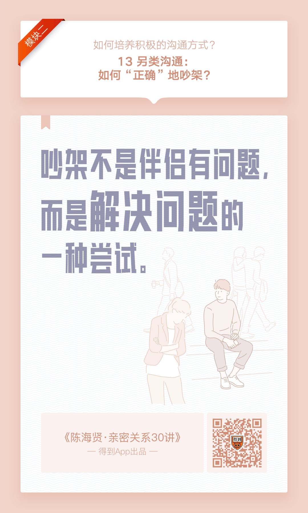  

set 限制解除

* * *

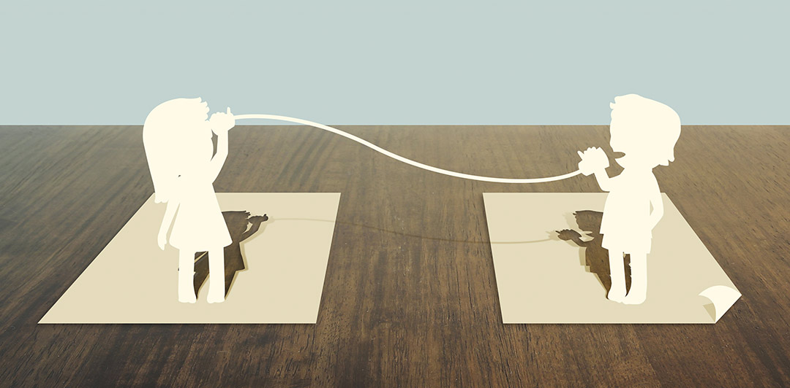

# 14 丨分享脆弱：如何创造情感联结？

陈海贤

2019-08-19

14 丨分享脆弱：如何创造情感联结？

丨陈海贤 亲述丨

懒人专属群的群友，。你好，我是陈海贤。

在前面的课程里，我们讲了亲密关系中不良的沟通方式，讲的是怎么解决问题。可是亲密关系不只是解决问题，还有培养感情。接下来的两讲，我们来讲两种增进感情的沟通方式，一种是创造两个人的情感联结，另一种是增加两个人的情感储备。

这一讲，我就先来讲讲， 怎么沟通，可以创造彼此之间的情感联结。

## 承认自己需要对方是联结的开始

我见过一些夫妻，在咨询室里吵得很激烈。当一方最终说出“其实我还是爱我老婆的”或者“我还是爱我老公的”时候，他的伴侣会忽然变成另一种神情，脸上会开始有神采。

说“爱”是很难的。我猜是因为，当你承认自己在心里需要对方、依赖对方、承认对方重要的时候，也就给了对方伤害你的权利。有时候，你宁愿提醒自己那个人不重要，也不愿意说自己其实很需要他。

**可是，承认自己需要对方，这就是彼此产生联结的开始。**

这确实意味着某种程度的失控，因为你不知道别人会怎么反应。而这种失控，又强化了人对关系的怕。

我们在前面的课程里学习过，对爱的渴望，让人想靠近亲密关系，而对被抛弃的恐惧，又让人想远离亲密关系。

当亲密关系中的一方对关系感觉到安全的时候，对爱的渴望让人想要向对方敞开心扉，寻求联结。相反，当亲密关系让人感觉到不安时，内心的怕就会让人陷入到防御的状态，封闭自己，以免再次受伤。

就像在咨询里争吵的夫妻，他们有很多消极的沟通方式，这些争吵都会导致联结的中断。

## 产生情感联结的四条沟通原则

**第一个原则：袒露自己的脆弱。**

每个人内心里都有很多的纠结和不确定。平时的时候，人们会把这些东西藏得很好，就像用完美的外形给自己做了一个漂亮的包装。人越是害怕关系，就越想把自己包装得好。

可是在亲密关系中，不能以真实的情绪和面目示人是一件很累人的事，这个难度不亚于在一个充满危险的地方当卧底。

很多人以为，脆弱是没用的东西，是弱小的表现。可是在关系里，能够袒露脆弱的人，反而是最勇敢的人。因为这样的人能够去面对那种“对方如何回应我和接纳我”的不确定。

不仅如此，在亲密关系中，脆弱是联结的信号，它代表了信任和接纳。有个女性在讲述自己对另一半的幻想时说：

“我希望他在外面英勇杀敌，像个盖世英雄，回到家能够跟我讲讲他的害怕，到我这里疗伤。”

其实这也是每个人对家的幻想。在外人面前，你需要表现得坚强，可是在家里，你需要表现得真实。

那什么是依恋关系中的脆弱呢？比如这些话：

当然，每个人表达这些脆弱的说法都不太一样。但是，当你能够把这些脆弱说出来的时候，你就已经准备好跟对方讲真心话了，你已经准备好了跟对方联结。

可以说，判断两个人有多亲密，是由在多大程度上，他们能够分享彼此的脆弱来决定的。

**第二个沟通原则：看到对方的脆弱，并能接纳这种脆弱。**

我经常开玩笑说，任何强硬的外表后面，都有一颗很怂的心。有时候，一个人越是表现得强硬，他背后越有很多焦虑需要防御。

我有一个朋友，他的妈妈总是会唠叨，可是爸爸几乎从来不还嘴不生气。有时候实在被唠叨烦了，也就嘟囔几句了事。

有一天他就问爸爸：“妈妈每天这么说你，你怎么受得了。”

他爸爸却说：“你别看你妈妈这人表面强势，她其实特胆小。她一紧张，就要开始唠叨了。我早就看出她胆小了，所以每次都让着她。”

能看到妈妈强势和唠叨背后的脆弱，就是这个爸爸的高明之处，也是他们夫妻一直很恩爱的秘诀。

在咨询室里，我也会鼓励夫妻分享他们在关系中的脆弱时刻。有一对夫妻，妻子总是抱怨丈夫不理解自己，平时跟丈夫说什么，丈夫都是没有回应。如果你学习了前面的课程，就知道这是一种典型的追逃的沟通模式。（推荐学习：《第 11 讲  
追逃：“爱太少”和“黏太紧”》）

丈夫听了妻子的抱怨，说：

“我不是不想理我妻子。每次妻子说我的时候，我都很慌乱，不知道该怎么回应。所以我只好默不作声了。其实妻子的每句话，我都记得的。”

我问丈夫记得什么，丈夫就开始历数妻子给他造成困扰的那些话。他说：“有时候妻子说完了，我整晚都睡不着，都在想我妻子的话。”

我问妻子：“你知道你老公这么苦恼吗？”

妻子的声音一下子软下来了，说：“我从来不知道。我还以为他一点都不在意我呢。”

后来妻子说，因为这次咨询，自己一下子对老公有了更多理解。想发脾气的时候，也有了更多顾虑了。这是分享脆弱所带来的联结。

**第三个沟通原则：直接告诉对方自己的需要。**

跟别人直接表达自己想要什么是不容易的。一方面是承认自己依赖对方，另一方面也冒着被对方拒绝的风险。

很多人不习惯直接提出需求，却习惯躲在抱怨的背后，指责对方不懂自己的心思，没有满足自己的需要。有个朋友跟我分享她的经验时说：

“以前我过节过生日，想让老公送礼物给我，但我总是不说，想等着老公自己觉悟。但是他每次都没什么表示，我就很生气。后来我慢慢学乖了，每次过节之前，我都会跟他说：喂，我过几天要过生日了，我还缺块表，你是不是要表示表示？然后老公就会笑笑，到时候就会帮我买。有时候不仅买我要求的，他还会买点别的，我就会更高兴。”

我就问她：“人家都是觉得老公主动送礼物才浪漫，你要求来的，不会觉得少了点味道吗？”

她说：“不会的。我要求了，他会记得、会答应，这就是在意我。”

像“要礼物”这些需要还是容易表达的，有些跟依恋相关的需要，就非常难表达。因为它太重要，人们太害怕被拒绝了，以至于很多人会提前摆出防备的姿态，来应对可能的拒绝。

我在前面的课里讲过一个例子，说的是妻子抱怨老公各种事情。可是当我说：“你真正需要的，是不是让老公多陪陪你？你为什么不能直接跟他说呢？”这个时候，这位妻子就变得非常扭捏。

**因为怕被拒绝，所以很多人选择用抱怨，包装自己的需要。**

另一些需要很难说出口，是因为它背后有人对关系更深的纠结。

张艾嘉导演的电影《相爱相亲》里有一段情节是这样的，丈夫给妻子买了一辆车，丈夫说退休之后带着妻子走天涯。

妻子坐在新车里，最开始还不相信。后来回忆起了他们的过往，妻子说：“我昨天做梦，梦见一个男人的脸，我怎么认也认不出来。后来我想起来了，那是年轻时候的你。”

说完妻子就开始哭，丈夫就在旁边乐。妻子说：“你每次都这样，我越难过，你越开心。”丈夫说：“你在乎我，我当然开心了。”

然后，妻子说：“以后不许让王太太坐这辆车！”

电影里这个丈夫是驾校司机，王太太是丈夫的学员，也是隔壁邻居，比妻子要年轻漂亮，所以妻子一直都很在意。可是这种妒忌也是一种需要，需要的是确认丈夫只对自己一个人好。但这也是很难说出来的。

你看，妻子表达这个需要之前，用了那么长的铺垫，妻子要很确信丈夫是在意自己的才可以。可是，如果把难以开口的需要埋在心里不说，或者借用其他容易说的事情来表达，都无法有效地创造彼此的联结。

**第四个沟通原则：不要把对方当敌人，而把不良的沟通模式当作共同的敌人。**

前面的课程，我们讲了三种不良的沟通模式。这三种沟通模式，都不利于伴侣建立联结。可是，当陷入这些不良的沟通模式时，两个人都会怨对方，把对方当敌人。

有时候，我会鼓励夫妻从他们的纠纷中跳出来，把不良的沟通方式当作两人共同的敌人。我会建议他们给不良的沟通模式取一个名字，讲讲这种沟通模式是怎么危害了他们的感情。

我这么做，是为了让夫妻有一种站在一起，同仇敌忾的感觉。一旦他们能把沟通模式当作外在于他们的敌人，那他们就能够相互配合解决问题，这反而能够增加他们的联结。

## 思考题

在什么时候，你感觉到你的伴侣和你是有联结的？当时你们做了什么？

欢迎在评论区留言，和大家分享。

## 下节预告

下一讲，我们讲讲怎么沟通，可以增加伴侣的情感储备。

我们下一讲再见。

欢迎关注陈海贤的公众号，获取更多延伸阅读。

（微信搜索“陈海贤”添加关注，ID：haixiansalt）

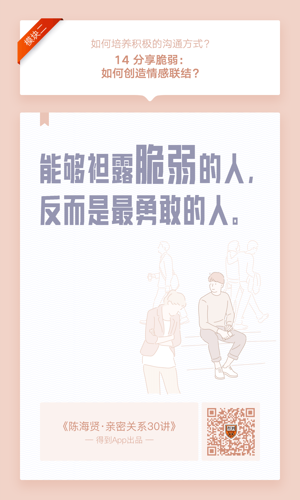  

* * *

# 15 丨情感账户：如何培养亲密感？

陈海贤

2019-08-20

15 丨情感账户：如何培养亲密感？

丨陈海贤 亲述丨

懒人专属群的群友，。你好，我是陈海贤。

上一讲，我们学习了在亲密关系中，增加两个人情感联结的沟通方式。这一讲，我们就来讲讲怎么沟通才能不断地增进两个人的情感储备。

在课程的开始，我想先问你一个问题：你和伴侣遇到问题了，通常怎么解决？

也许你会想，要好好沟通最重要。这没错，可是有时候，如果感情基础不好，再怎么沟通都不在一个频道上。

所以，好的感情才是一切沟通的前提。最擅长解决问题的伴侣，其实不是最擅长沟通的伴侣，而是感情基础最好的伴侣。

**关于这一点，美国婚姻和家庭专家约翰·戈特曼（John M. Gottman）曾提出过一个概念，叫“情感账户”。**

他把夫妻的感情比喻成一个账户，夫妻之间每一次增进感情的互动，都像是往这个账户里存钱。情感账户里的余额越多，在面对压力和冲突时能起的缓冲的作用就越大，两人就越可能渡过难关。

而如果情感账户里的钱很少，或者本来就有亏损，那本来很小的矛盾，也可能变成感情破裂的分水岭。

## 往情感账户“存钱”的三个诀窍

怎么样的互动，才算往情感账户里存钱呢？我总结了三个诀窍分享给你。

**第一个诀窍，是在日常生活中，增加两个人情感性的回应。**

什么是情感性的回应呢？就是在回应伴侣的时候，制造一种和他在一起的感觉。

在婴儿和母亲的依恋关系中，婴儿会用各种方式确认母亲是跟自己在一起的。比如，他会经常用目光搜索母亲的目光，如果母亲也看他了，他就会冲母亲笑。两人就在这样一次互动中完成了情感的交流。如果母亲没有看他，他就会很失落，会用哭声来吸引母亲的注意。

婴儿渴望被母亲看见。同样在亲密关系中，人们也渴望被自己的另一半“看见”。对于成人来说，目光并不是唯一的互动渠道，人们会发出各种形式的互动邀请。最常见的形式，就是谈话。

一个妻子跟丈夫说：“晚上我做了一个噩梦。”这就是一个谈话的邀请。

如果丈夫说：“不就是梦吗，每个人都会做，有什么关系。”那他就拒绝了这种邀请。如果他说：“什么梦啊，给我讲讲？”那他就接受了这种邀请。这就像孩子和妈妈的目光一样，两个人的情感互动就产生了。

在亲密关系中，一旦对方拒绝了互动的邀请，提出邀请的那方常常就会感觉失落，而他们会用生气的方式让另一半注意自己。也许以后遇到这种事，也就不再跟另一半说了，反正说了也得不到回应嘛。

**日常生活中，每一次情感性的回应，都会增加伴侣之间的情感联结，也都在往伴侣的账户里存钱。相反，每一次错失回应或者拒绝回应，都是在亏钱。**

关系良好的伴侣，几乎有一种本能，那就是会自然地对对方所说的话感兴趣，也会自然地回应对方说的话。他们的谈话，哪怕是闲聊，也是充满温馨的。

不仅如此，当一方用肢体语言作出情感回应的邀请时，比如把手搭在对方的肩上、拥抱，或者拿纸团丢对方，对方都会心领神会。可以说，他们是随时随地都在往情感账户里存钱。

那怎么才是好的情感回应呢？怎么知道你是在好好回应对方，还是不知不觉地拒绝了对方呢？

加州大学心理学教授雪莉·盖博（Shelly Gable）根据回应是积极的还是消极的、是主动的还是被动的，把回应分成了四种。

**第一种，是积极主动的回应。**

比如，你的伴侣跟你说：“我最近好像瘦了一些。”你会说：

这些就是积极主动的回应，特点是带有很多问号和感叹号。

当然，也许你和伴侣平时不太这么说话，但至少你可以学习这种回应背后的精神：带着赞许和认可，带着真诚和兴趣，并希望把这种交流继续下去。它所传递的关系信息是：“我欣赏你，并且对你有兴趣。”

**第二种，是积极被动的回应。**

比如，伴侣跟你说：“我最近好像瘦了一些。”你会说：

短短的一句话就结束了。它所传递的关系信息是：“我欣赏你，但对这个话题本身没太大兴趣。”

**第三种，是消极主动的回应。**

比如，伴侣跟你说：“我最近好像瘦了一些。”你会说：

这种回应有让话题继续的热情，但是是朝着挑刺和否定的方向。它所传递的关系信息是：“我不认可你，而且我对打击你有兴趣。”如果不是开玩笑，这样的对话常常会引来争吵。

**第四种，是消极被动的回应。**

比如，伴侣跟你说：“我最近好像瘦了一些。”你会说：

然后继续玩你的手机。这种回应是一种拒绝沟通的回应，它所传递的关系信息是：“我对你不感兴趣。”很可能伴侣以后也不会再跟你说这些了。

用情感账户的理论来理解，前两种回应是攒钱，这样的沟通能够让爱丰盛起来。而后两种回应，则是亏钱。

说到这里，我要请你想一想，你和伴侣的沟通模式，属于上面四种的哪一种呢？

**除了增加两个人的情感回应，往情感账户里存钱的第二个诀窍，是强化共同记忆。**

在咨询室里，我经常会问遇到问题的伴侣：

“你们当初怎么选择了在一起？”

“对方做过什么打动你的事？”

“什么时候，是你们觉得最快乐的时候？”

我发现，再有矛盾的伴侣，回忆起他们的共同经历和当初的感动，都会产生一种温馨的感觉。

有一对争吵不休的伴侣，说起他们最好的时光，是在刚恋爱的夏天。每天晚上，男生接女生下班回家，两人坐在出租房的地板上，点一大盘小龙虾，喝着啤酒，看着电视里的综艺节目。他们吃遍了城里的小龙虾店，还给每家店打了分，并把其中一家评为全城最佳。

我问他们：“那家店还在吗？”他们说：“已经很久没去了，早就关了。”

另一对正考虑离婚的夫妻，讲起他们的美好时光时，妻子说：“别看我丈夫现在这么凶，对我没好脸色，当初追我的时候，是一封封给我写情书的。每次收到他的信，我都会很感动。我会把这些信都收到一个盒子里，小心地藏起来。”

她丈夫在旁边听着，脸色也逐渐柔和了。我问她：“那你后来有读过这些信吗？”她说：“没有。后来就慢慢不再打开了。”

听这些伴侣回忆过去，我会和他们一样，有一种恍惚感。那些爱情曾经是如此美好和新鲜，它不该像现在这样，充满伤害，又让人厌倦。而回忆共同的经历，就像打开了另一个空间，让他们能够从曾经的温馨里，去寻找感情继续的火种。

如果你在亲密关系中也感觉疲惫，你也可以和伴侣一起翻翻老照片，念念以前的情书、听听老歌，一起回忆过去经历的那些难的事。也许慢慢地，你就会知道来时的路，并知道接下来要往哪里走。

**往情感账户存钱的第三个诀窍，是向对方表达认可和赞赏。**

恩爱的伴侣经常会表达对彼此的认可和感激。比如妻子帮丈夫收拾衣服，丈夫会在旁边说：“老婆幸亏有你，把我照顾得这么好。”丈夫加班回来晚了，妻子也会说：“老公辛苦啦，我们家现在蒸蒸日上，全是你的功劳。”而不恩爱的伴侣，就只有对彼此的蔑视和贬低。

如果你了解依恋理论，就会知道，这些认可和感激，并不是操纵对方的手段，更不是假浪漫。甜言蜜语之所以甜蜜，是因为它契合了人对依恋的需要。

爱的语言在不停重复的、人总是听不够的话，其实都是同一句：“你是我最重要的人，我爱你，珍惜你，很想和你在一起。”

而能够增进彼此的感情，让爱丰盛起来的沟通方式，也是用不同的语言和行动不断向对方传递这个简单却又重要的信息。

## 思考题

你觉得你和伴侣之间，有哪些增加情感存款的方法呢？

欢迎在评论区留言，和大家交流。

## 下节预告

这个模块的课程，我们就学到这里了。下一讲，我们会进入新的模块：如何拓展关系的空间？

我们下一讲再见。

欢迎关注陈海贤的公众号，获取更多延伸阅读。

（微信搜索“陈海贤”添加关注，ID：haixiansalt）

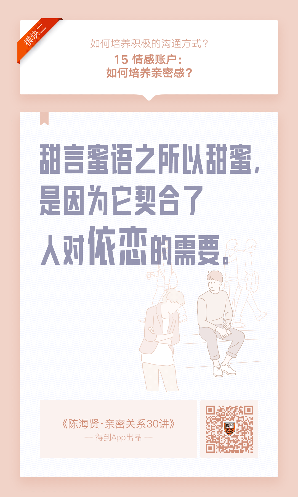  

* * *

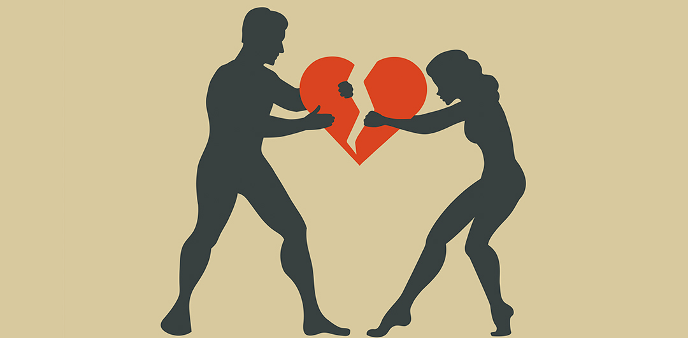

# 16 丨关系空间：为什么亲密关系会束缚人？

陈海贤

2019-08-21

16 丨关系空间：为什么亲密关系会束缚人？

丨陈海贤 亲述丨

懒人专属群的群友，，你好，我是陈海贤。

这个模块，我们来讲讲如何拓展关系的空间。 **所谓关系的空间，就是你在关系中感觉到的自由度和束缚感。**

如果关系的空间太大，彼此就会缺少联结，最终可能两个人自己过自己的，也就没有动力去解决亲密关系中的矛盾和问题。而如果关系的空间太小，人会感到不自由，就会有束缚感。

这一模块主要讲的是因为关系空间过小，造成的亲密关系的束缚。我会探讨三个主要的问题：不会处理双方的差异，总想改变对方，以及不会处理和伴侣之间的边界。

这一讲，我们先来说说关系中的束缚感是怎么来的。

我曾见过一对夫妻，为“老公要不要让老婆枕着自己的手臂睡觉”而吵架。

老公说：“她枕着我手臂睡觉，时间长了我就觉得不舒服，我想把手臂抽回来，可是我动一动她就要生气。”

老婆说：“你别以为我枕着你的手臂舒服，以前你让我枕，我其实也是不舒服的，但我觉得你一片好心，所以就忍着了。可是现在我都习惯了，你又要把手臂抽回来，我就觉得你没有像以前那么爱我了。”

老公说：“我哪里不爱你？我只是觉得这样累。”

老婆说：“你以前可以，现在为什么不可以？以前能忍，现在不能忍，那就是不爱我了。”

想到关系的空间时，我总会想到这对夫妻，他们就用这种让彼此都不舒服的姿势睡觉，过了很多年。  
**因为抽不抽胳膊背后，有他们最关心的问题：“你到底爱不爱我？”而正是这个问题，让他们不敢动弹。**

这种不敢动弹的感觉，就是亲密关系带来的束缚感。在一段关系中呆得久了，这种感觉可能经常出现。

比如，你想去看电影，可是老公等着你回家做饭；周末你想一个人静静，可是老婆要拉你去参加家庭聚会；你想买一样贵的东西，可是又担心对方会不高兴。有时候你会想，还不如单身算了，至少自由一点。

这种束缚感的背后，是每个人在亲密关系中相反却同样强烈的渴望：一方面，渴望能够跟对方亲密无间，渴望对方能够满足自己的需要和愿望。另一方面，又想有足够的自由，想要无拘无束、自由自在地做自己。

## 更大的束缚是情感表达的不自由

如何平衡这两种矛盾的渴望，是亲密关系永恒的难题。那么关系中的束缚感来自哪里呢？

**最简单的束缚感，是两个人都想自由自在地做自己，所以产生了想法上的冲突。**  
一个人想去东，另一个人想去西，俩人又不能各走各的路。不管谁先妥协，妥协的人都觉得自己被束缚了。

这种束缚感，也许你是知道的。但亲密关系中还有另一种束缚感，也许你不一定知道。 **这种束缚感给人的限制更大，更让人无所适从。它就是：情感表达的束缚。**

我曾经见过一对年轻的情侣，大学毕业后，两个人到同一个大城市工作。男生很快找到了一份工作，女生找工作却不太顺利。

找工作不顺利，又没有太多朋友，女生就希望男生能多陪陪自己。可是男生工作很忙，经常要加班，有时候还会把工作带回家。所以，平时女生跟男生说要不要去看电影，要不要去哪里玩，男生总是说：“等忙完这一段。”“你别来打扰我。”这样女生心里也有了疙瘩。

有一次，这个女生跟男生打电话说：“你什么时候回来啊？我买了很多菜，给你做好饭了。”

男生说：“哎呀，你自己吃吧，我今天要加班，实在走不开。”

女生说：“我今天感冒了，身体实在有些不舒服，你早点回来吧。”

男生说：“你自己去买点感冒药吧。”

女生有些生气了，就说：“我都发烧了你还不关心我。那随你吧。”

男生挂了电话，担心女朋友不高兴，就跟领导请了假。领导勉强同意了，但是说了句：“现在正是我们项目忙的时候，你怎么事情这么多。”

男生心里开始有气了，觉得是女生害得他被领导批评。回家以后，女生一开门，看到是男生回来了，很高兴。男生问：“你不是发烧了吗？怎么还生龙活虎的？”女生说：“早上有点烧，现在已经好了。”

男生就更生气了，说：“你知道吗，你这样有多打扰我！我刚到公司不久，人家老员工都在加班，我每次都这么早回来，别人会怎么看我！”

女生脸上的笑容逐渐就凝固了，眼泪慢慢流了下来。过了一会儿，她道歉说：“对不起，我不知道这么打扰你。以后我不会了。”

这个男生看着女生哭了，也觉得自己做得过了，也开始变得内疚。他就说：“是我不对，是我不对。”

从那天开始，他们俩都觉得，这段关系给了他们很多束缚。

这种束缚是什么呢？表面上看，是女生需要更多的陪伴，而男生希望把更多的时间和精力花在工作上，这是他们在想法和需要上的冲突。可关系里更大的束缚，是他们很难表达彼此的情绪和感受。

对于这个女生来说，她是委屈的。自己生病了，想让男朋友回家，这本身并没有什么错。可是男朋友却劈头盖脸说了她一顿。也许是担心失去男友，也许是害怕冲突，她没法述说自己的委屈，反而选择了道歉。

对这个男生来说，他也有他的委屈，可是因为女朋友的伤心和道歉，他也就没法表达自己的情绪了。

**这就是关系的微妙之处。委屈夹杂着对分手的恐惧，生气夹杂着对女友的内疚，让两个人都无法动弹，两个人都开始小心翼翼，只好把各种感觉都闷在心里。**

这个故事会怎么发展呢？

也许，以后就算这个女生想叫男友回家，她也不敢叫了，可是她心里还是会有怨，觉得男友并不重视自己。而男友呢，为了不让女生生气，他也会选择尽量早早回家，可是这也让他的心里有很多的怨，觉得女生妨碍了他工作。

如果两个人吵架了，女生可能会说：“我都不再叫你了，你还想怎样？”而男生可能会说：“我现在都尽量早早回家了，你还想咋样？”

关系的结就是这样，一个人心里有很多的委屈、愤怒、怨恨，可又怕表达出来让对方受伤害，所以只好说：“是我的错。”

可是，这些没法表达的委屈不会自动消失，它又真实地限制着两个人。如果这种情感的压力逐渐积累，又没法发泄，两个人都会觉得没有空间，会想通过疏远来逃避这种情感的压力。这最终会导致关系的破裂。

问题出在哪里呢？ **问题不在两个人没为对方考虑，问题在于，他们的“为对方考虑”，变成了对方表达感受的束缚。**

当女生忍着委屈说“对不起”的时候，她是想做一个好人。可是她没想到，这种“好人”的“好”，会变成关系里的一种束缚，让对方也没法变成“坏人”，痛痛快快地跟她吵一架。

可是正是这种束缚，让本该向外的能量变成了内心的冲突，关系的空间也因此变得狭小了。

## 减少束缚感的两条建议

怎么才能减少束缚，让关系恢复自由呢？我给你两个建议。

**第一，如果束缚感是因为两个人想法上的冲突，那两个人就需要来讨论和协商。事实上，想法的冲突并不一定会导致关系缺少空间，关键是，要给对方留下选择的空间。**

我见过一个年轻的妈妈，正在犹豫要不要辞职回家当全职妈妈。她老公说：“我希望你留在家里照顾孩子。但如果你想回去工作，我也尊重你的选择。”

后来，她选择了在家当全职妈妈。说起自己的选择时，她说：

“我并不是不想去工作。我只是觉得，孩子这么小，老公这么忙，我要照顾好这个家。毕竟对我来说，家庭是最重要的。”

你看，即便这个妈妈没有选择自己真正想要的，但毕竟自己能选择，她也不会觉得是束缚。

可是，如果当时她老公不是说“我尊重你的选择”，而是跟婆婆轮番来劝她一定要在家照顾宝宝，那她就会有被胁迫的感觉，她就会觉得关系在束缚她。

**第二，如果束缚感是来自情感表达的不自由，那两个人就不要那么怕对方生气，同时也不要那么怕自己难过，要勇敢地表达自己的感受。**

就像我在《第 13 讲 另类沟通：如何“正确”地吵架？》里说到的，有时候，冲突是拓展关系空间的手段。

有空间的关系，不是不能发火，而是“能发火，能和好”的。

相反，没有空间的关系，就是“不能发火，不能和好”。两个人在关系中都小心翼翼，结果反而越走越远。

所以，拓展关系空间的关键，不是去争取自己的空间，而是给对方足够的空间。

## 思考题

什么时候在亲密关系中，你会觉得有束缚？你是如何来应对和解决这种束缚感的？

欢迎在评论区留言，和大家交流。

## 下节预告

下一讲，我们来讲讲如何处理伴侣之间的差异。

我们下一讲再见。

欢迎关注陈海贤的公众号，获取更多延伸阅读。

（微信搜索“陈海贤”添加关注，ID：haixiansalt）

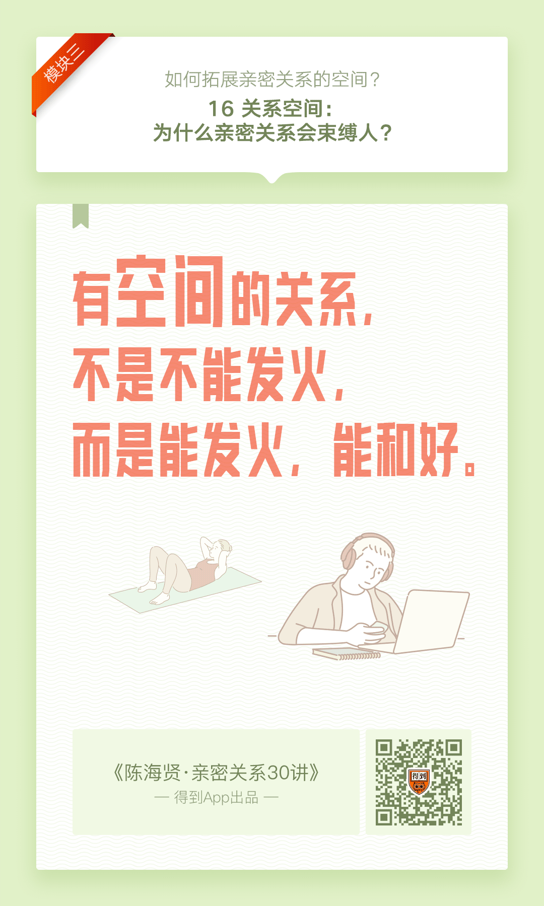  

set 限制解除

* * *

# 17 丨矛盾背后的一致：如何处理伴侣之间的差异？

陈海贤

2019-08-22

17 丨矛盾背后的一致：如何处理伴侣之间的差异？

丨陈海贤 亲述丨

懒人专属群的群友，。你好，我是陈海贤。

上一讲，我们学习了亲密关系的空间。让关系空间变小的主要问题之一，就是不知道该怎么处理伴侣之间的差异。这一讲，我就来讲讲这个问题。

曾有一个同学问我：

“我和妻子结婚不久，双方暴露了很多问题。比如一个喜欢社交，一个孤僻；一个大大咧咧，一个谨慎小心；在一起相处，一方觉得拘束，一方觉得操心、麻烦。感情逐渐在争执和不满中消磨掉了，怎么办？”

他觉得，他和妻子的感情问题是两人性格上的差异造成的。这是一个流传甚广的观点。在谈起彼此的矛盾时，很多伴侣都会说：我们爱好不同、性格不同、三观不合、我们成长的原生家庭不一样……这么多不同，所以我们就没法相处好。

是这样吗？其实并不是。差异并不是伴侣关系有问题的原因，很多时候，恰恰是伴侣在一起的理由。

## 差异是相互配合的结果

不知道你有没有发现，在刚开始恋爱的时候，伴侣和你的差异，往往是伴侣吸引你的点。在谈起为什么最初会被对方吸引时，很多人会说：

有些人渴望通过亲密关系，把伴侣和自己的差异，吸收扩展成自己的一部分。在这些差异上，寄托了克服缺陷、超越自我的希望。

可是慢慢地，随着摩擦的增多，这些曾经吸引人的优点，会变成让人讨厌的缺点。自信会变成虚荣，外向会变成鲁莽，谨慎会变成胆小，冷静会变成冷漠和不解风情。

为什么会这样？这是因为人常常既向往改变，又不愿自己改变。而适应伴侣的这些差异，就意味着自己要做一些改变，这是很多人不愿意接受的。

所以，讨厌差异的背后，是人不愿意改变的固执己见。至少在恋爱的开始，差异不是亲密关系的固有难题。

那随着关系的深入，它们会变成难题吗？也未必。

亲密关系要运转，总是需要彼此扮演不同的角色。越是相处时间久了的伴侣，这种互补的特征就越强烈。所以，伴侣之间有差异，不仅不是问题，有时候反而是双方相互配合的结果。

我曾遇到过一个家庭，妻子是这么埋怨丈夫的：“丈夫特别谨小慎微，对什么事都担心过度。我呢，喜欢尝试新鲜事物，喜欢带全家人去没去过的地方旅游。可是他呢，总想着会发生这样那样的危险，每次出去玩都要带一堆的药，有时候还给我泼冷水。跟他生活在一起我真的很累，有时候觉得很沉闷，死气沉沉。”

丈夫是这么埋怨妻子的：“我老婆特别粗心，什么都不管，什么都无所谓。有一次孩子发烧了，我去跟她说，结果她还嫌我打扰了她睡觉，说这点烧有什么关系。”

这对夫妻觉得，彼此的差异变成了他们的问题。 **可在我看来，差异恰恰是两个人在家里的合理分工。**

因为妻子容易粗心，所以丈夫就变得谨小慎微，这让他能负责家里的风险控制。反过来，正因为家里有丈夫的细致考虑，妻子才可以去尝试更多新鲜的东西，才可以去探索，为家里带来新的活力。两个人的差异，正是他们为了维护家庭运转，相互配合的结果。

## 面对差异的两个常见误区

既然差异不是问题，那真正的问题是什么呢？真正的问题不在于伴侣之间有什么差异，而在于两个人会怎么处理这种差异。有时候，正是因为不知道该怎么处理，差异才会变成矛盾的根源。

在我的咨询室里，我经常遇到为彼此的差异吵得不可开交的夫妻。

为什么他们这么不肯妥协？有两个原因。

**第一个原因是，他们把差异看作是对自己的威胁。并且担心如果自己在这件事上听了对方，那是不是以后都得听对方的。**

这种被支配、被改变的恐惧感牢牢抓住了他们，所以他们会像战士坚守阵地一样坚守自己的观点，容不得半点改变。

这跟自我的成熟也有关系。越是成熟的自我，其实越不会害怕改变，也越容易接纳别人的观点。而越不成熟的自我，越会担心被别人支配，所以会用更大的声音来说不。

**人们不肯妥协的第二个原因是，把差异看做是对方没有全心全意支持自己，理解自己。觉得只有对方跟自己一致，才是关心和爱自己的。**

我见过一对夫妻。妻子想脱产去学心理咨询。丈夫却担心妻子放下工作去学习了，家里的经济负担就会落到自己一个人身上。

丈夫对妻子说：“你也要想好，万一去学了，找不到工作怎么办？”妻子就很生气，说：“我要去追求梦想，你怎么就不能支持我呢？”丈夫说：“我就是担心而已。如果你实在想去，那我也是支持的。”

妻子说：“我不想你这么勉强。你勉强我就生气。”

这个妻子在生什么气呢？她其实就在气为什么在这件事上，丈夫跟她不一致。虽然丈夫也说了，如果妻子实在想去，他也会支持。但妻子觉得这样还不够，只要丈夫跟她想的不一样，她就会生气。

无独有偶，在另一个例子里，丈夫想要脱产去读一个硕士。妻子觉得这段时间家庭经济压力很大，表示不同意，丈夫接受了。可是，这好像成了两个人的一个心结。在咨询室里，妻子一直在抱怨丈夫冷着脸。

丈夫说：“我理解你的难处，我也接受了你的决定，可是我就不能难受一下吗？”

妻子就说：“我希望你是心甘情愿地为我们家着想。你难受，就是不心甘情愿。”

同样，这个妻子生气的原因，也是丈夫跟自己不一致。她想要的心甘情愿，就是丈夫要跟她想的完全一样。

## 正确处理差异的两个原则

那成熟的伴侣应该怎么处理彼此之间的差异呢？有两个处理原则。

**第一个原则是，要理解和接受这种差异，并寻找差异背后的一致性。**

举个例子，一对夫妻在争论孩子该不该学奥数。妻子觉得孩子应该学奥数，丈夫觉得孩子应该多运动。

如果是成熟的夫妻，丈夫就可以说：“好，那就先学奥数试试看，万一孩子不爱学，那就再回来。”妻子也可以说：“那先买些书让他接触接触，万一他有兴趣再去报班。”

这样的对话，就可以保留观念上的差异，可是在更高层次上却达成了某种一致。

其实，想法上有矛盾并不是一件多么可怕的事情。相反，知道各自坚持的只是某种看法，而不是不容置疑的事实。

无论有什么样的矛盾，不要让这种矛盾影响彼此的关系。只要有这种共识，就更能够容忍彼此的矛盾和差异。

**第二个原则是，要用一种商量的方式对话。**

请你看看下面这段对话是商量吗？

妻子说：“你看人家孩子都在报奥数，如果我们家儿子不报奥数，他不会落后吗？”

丈夫说：“小小孩子就这么焦虑，长大了心理素质就不好，更没有长久的学习动力，这叫涸泽而渔。”

这个对话就不是商量，而是在陈述彼此的理由，在解释和辩论。

这里强调一下，解释、辩论、指责、通知，它们和商量的区别在于，前一类沟通是封闭的，也就是在说理由之前，已经打定主意不让对方影响自己。而商量是开放的，也就是允许对方说他的理由，也允许对方影响自己。

**怎么把通知变成商量呢？有一个特别简单的做法，就是在每句话后面加个后缀——“好不好？”。**

比如，妻子可以跟丈夫说：“你看人家孩子都在报奥数，我们家孩子也去报个奥数，好不好？”

丈夫可以跟妻子说：“孩子现在还小，我们等他长大一些再报，好不好？”

这时候，两个人都在征询彼此的意见，而没有把彼此当作对立面。这就是商量。通常，会商量的夫妻才能找到创造性的解决问题的办法，而不是把差异变成彼此的矛盾。

## 思考题

在日常的沟通中，你是怎么处理和伴侣之间的差异呢？

欢迎在评论区留言，和大家交流。

## 下节预告

做到容纳差异很难，有一个常见的做法，就是改变对方。下一讲，我就来讲讲这个问题。

我们下一讲再见。

欢迎关注陈海贤的公众号，获取更多延伸阅读。

（微信搜索“陈海贤”添加关注，ID：haixiansalt）

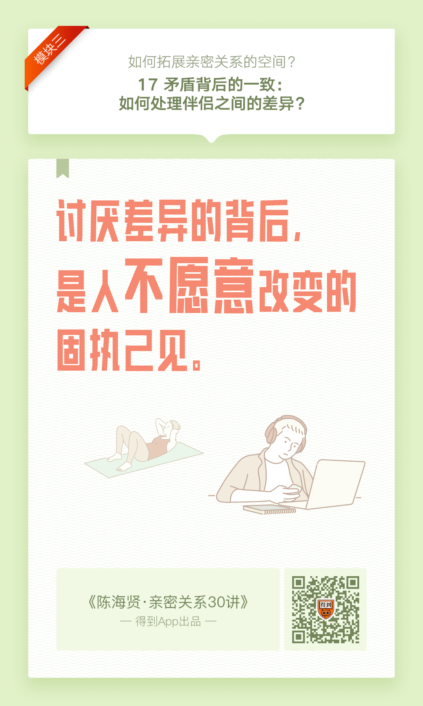  

* * *

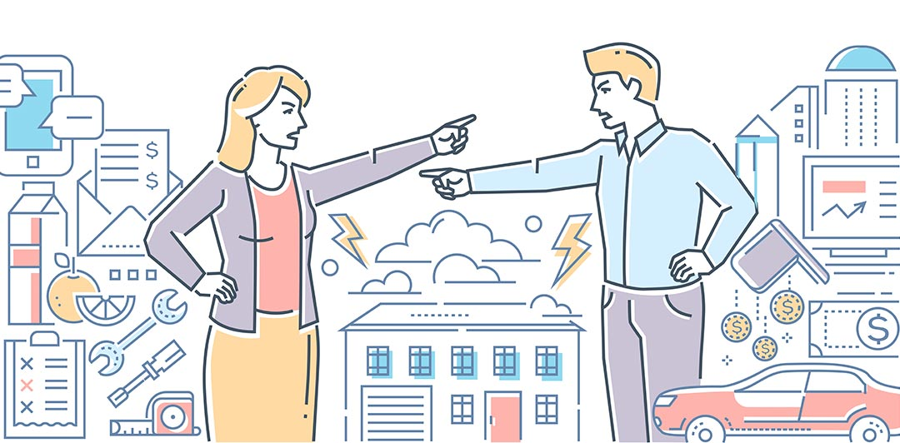

# 18 丨理想化：为什么你总想改变我？

陈海贤

2019-08-23

18 丨理想化：为什么你总想改变我？

丨陈海贤 亲述丨

懒人专属群的群友，。你好，我是陈海贤。

当伴侣之间存在差异时，一个典型的做法是，想要把对方改造成自己期待的那样，来消除这种差异。可是这么做，对方不仅没变，反而会缩小关系的空间。这一讲，我就来讲讲试图改变对方的这个关系难题。

有这样一个段子，说的是有本书叫 *How to change your wife in 30 days*  
。这本书一问世就很畅销，一星期之内卖出了两百万本。后来作者发现书名拼写错了，原来是 *How to change your life in 30 days*  
。书名改过来后，一星期只卖出了 3 本。

我相信，不只是“怎么改变你的妻子”会畅销，如果出一本书叫“怎么改变你的丈夫”也会同样畅销。如果我们课程的名字叫“亲密关系：如何改变你的伴侣”，说不定也会火。

这当然是个段子。可是，在亲密关系中，确实有很多人热衷于改变自己的伴侣，却很少有人真的成功。

## 放弃理想伴侣的假设很难

为什么人会一再重复这个明明无效的游戏呢？

**这是因为，每个人的头脑里都有一整套关于爱情和伴侣“应该如何”的假设。这一整套“应该”的假设背后，有人们自己的经验、需要、期待和欲望。**

当伴侣跟自己的设想表现不符时，人就会感到焦虑和失落。这时候，人不会想去质疑头脑中的假设，而是想着改造伴侣，让伴侣符合自己头脑中的假设。可是伴侣偏偏还不听话，这就变成了矛盾的根源。

这些头脑中的假设是从哪里来的呢？

有一些来自以往重要的人际经验。比如，“我爸爸特别勤奋，我觉得男人就应该像我爸爸那样”，或者“为什么不能像我妈妈那样温柔”。

有一些来自内心未完成的愿望。比如，“我一直希望自己嫁一个积极上进的老公，可是他不是，所以我就一直希望他变得上进一些。”

还有一些，是把对自己的不满意投射到了伴侣身上。觉得自己不够好，既然对方愿意和自己在一起，那对方肯定也不够好。所有这些假设，都变成了想要改变对方的理由。

从这个角度看，亲密关系中的一方想要改变另一方的本质是什么呢？

表面上看，是觉得问题出在对方身上，是对方不肯改变，才造成了关系的困局。而实际上，真正的问题却是人心中“爱情应该怎么样”、“伴侣应该怎么样”的执念。

这个执念的问题，不在于它是对的还是错的，而在于它一直在向伴侣发出这样的信息： **你并不是我理想中的伴侣。而正是这种不认可，成了伴侣反感的理由。**

我曾遇到一对夫妻。结婚的时候，妻子的条件很好，工作也不错。而丈夫的条件稍微差点。结婚以后，妻子总是嫌丈夫不够上进，挣钱太少，担心自己如果工作有变动，丈夫根本撑不起这个家。

于是她就跟丈夫说：“你应该更努力一点，你应该有自己的职业规划。你应该三年怎么样，五年怎么样……”丈夫就说：“我有自己的节奏和计划，我只是按部就班而已。”

妻子就说：“不行，你现在根本努力不够。我现在努力学习、读书、听各种课程。可是每次我要求你也跟着一起学，你就是不好好听。”

丈夫说：“你不要总强迫我干这干那，我有我自己的判断。有用的东西我自己会学，没用的东西，我当然不想看了。”

从他们的对话能听出来，这个妻子理想的丈夫，是一个热爱学习、努力上进的人。所以她就暗暗在心里给丈夫制定了各种 KPI。而这种改变的愿望，又符合社会的价值观，有了道义上的合理性。

所以妻子想：我提的要求明明这么合理，你为什么不接受？可是丈夫呢，不仅不好好完成妻子定的“KPI”，有时候连这个“KPI”本身都不认。这让妻子很抓狂。

我跟这位妻子开玩笑说：“我看到这个房间里有三个人，你、你丈夫，还有你幻想出来的理想情人。你丈夫不够上进，而你幻想里的那个情人比较上进，你现在是要选择这个理想化的情人呢，还是选择眼前这个丈夫呢？”

虽然是玩笑，可也说出了现实的悲哀。很多时候，人们不是选择了眼前的伴侣，而是选择了心里那个理想化的情人。

也许你会说，怎么会有人这么傻？理想化的情人，只是幻想出来的，而眼前的伴侣，才是真的啊。

虽然理想化的情人只存在于人们的幻想里，可是要放弃也是很难的。因为理想情人的背后，有人们深层的渴望。而放弃理想中的情人，就好像承认自己心里的一个梦碎了，自己的渴望再也没法满足了，这会造成很大的失落感。

可是，如果不放下幻想中的伴侣，你就很难真的去接近和了解眼前的这个人。

后来，这对夫妻的关系慢慢改善了。在提到自己的进步时，妻子说：

“陈老师，你那天说的选择让我想了很多。以前我好像是跟我心里那个理想的老公结婚了，而现实中的老公只是一个‘冒牌货’。现在我能把我的理想标准放下了，我才能真的看到他，才能跟他交往，真的开始接受他。”

而奇怪的是，当她真的接受了自己的丈夫，丈夫反而也愿意跟她一起看一些书，听一些课程，讨论未来的规划了。

当然，如果只把改变的困局归咎于那个想要改造对方的人其实也不公平。  
**有些人想要改变对方，不是因为放不下理想伴侣的标准，而是因为不满意夫妻之间的配合和家庭分工。**

有时候，家庭中的某个成员承担了太多的责任，希望伴侣也能帮自己承担一些。就像有个妻子说的：

“我也不想成天唠叨，如果我老公自觉一点，我也会乐得清闲的。可是他什么也不管，洗衣服、做饭、看孩子都是我来。他就每天回家，拿着手机往沙发上一躺。我说说他，他还不让我管。”

## 让改变发生的两条原则

那么，如果你希望对方改变，应该怎么做呢？有两条原则很重要。

**第一个原则是，不要从改变对方开始，而要从改变自己开始。包括改变自己脑子里“想改变对方”的念头。**

对于改变来说，你需要记住的是，你永远都没法强迫对方改变，除非他自己愿意。而有时候，一味要求对方改变，只会让两个人陷入相互较劲的状态。就像两头牛的牛角顶在一起，谁也不能放开。这样的关系，对每个人都缺少空间。

所以在咨询室里，我总是会让来咨询的伴侣各自从自己的角度想想，能做些什么来改变彼此的关系模式。

很多人会说：

通常这时候我会说：“你改了，对方也许会改，也许不会改。你自己改变，不是为了要一个确定的结果，而是你主动为彼此的关系探索新的可能性。不然像现在这种彼此顶牛的状态，显然不是你想要的。”

改变不是一个人的事，但改变确实常常是从一个人开始的。而伴侣之间的关系一直都存在着微妙的相互影响：如果一个人改了，另一个人也常常会有一些改变。

可是，大部分人并不愿意先改变自己。因为就算通过这种方式让对方改变了，先做出改变的人心里也不是那么心甘情愿。大多数人真正想要的，是在这种权力的较量中战胜对方。而这通常是不会成功的。

**改变的第二个原则是，想要改变对方，就先试着认可对方。**

前面我已经提到，很多时候，人们抗拒改变，其实是在抗拒对自己的不认可。如果你对伴侣是欣赏和认可的，那你提出的很多改变的要求，通常都能得到回应。

前段时间我看一对夫妻旅行的节目，节目里的这对夫妻交流起来特别有意思。在丈夫遇到难题的时候，他跟对讲机那头的妻子说：“你说句鼓励我的话，就说你太棒了，不愧是大师，假的也管用。”

妻子心领神会说：“你太棒了！”两个人都笑了。

这是一对很恩爱的夫妻，彼此的认可把对方都变成了很可爱的人。我想，如果这时候他们要求伴侣做一些什么，通常伴侣都会答应的。

这是一个悖论。如果自己这么认可对方，那为什么还要对方改变呢？可是反过来，如果要求对方改变只是在告诉对方：“我不认可你。”那对方也不会愿意改变。

这并不是自己的要求和期待不重要，而是在亲密关系中，人天生会反对这种不认可。

## 思考题

你有过改变对方的想法或者尝试吗？最后结果如何？

欢迎在评论区留言，和大家交流。

## 下节预告

下一讲，我们继续来讲改变背后的纠结。

我们下一讲再见。

欢迎关注陈海贤的公众号，获取更多延伸阅读。

（微信搜索“陈海贤”添加关注，ID：haixiansalt）

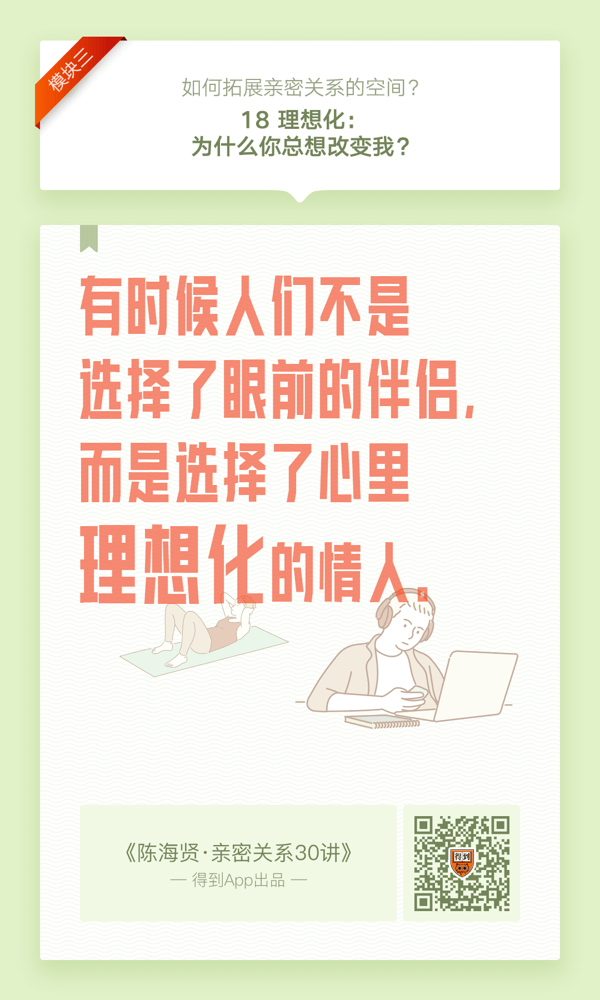  

* * *

# 19 丨悖论：左右为难的改变

陈海贤

2019-08-24

19 丨悖论：左右为难的改变

丨陈海贤 亲述丨

懒人专属群的群友，。你好，我是陈海贤。

上一讲，我讲到了想要改变对方这种关系难题，有时候我们不只想要改变对方的行为，还想改变对方的想法、状态甚至整个人，这会进一步挤压关系的空间。这一讲，我就来讲讲这个问题。

我认识这样一对夫妻。妻子自己有成功的事业，也是非常积极上进的人。相比之下，她的丈夫有些懒散。这成了他们之间的一个矛盾。

她经常跟丈夫说：“你一回家就躺在沙发上对着手机。现在社会变化这么快，新知识这么多，你不会看看书，多学习点东西吗？”

最开始丈夫还会反驳：“我上班这么累，我只是休息一下怎么了！”两人经常会为这事吵起来。慢慢地妻子说得多了，丈夫就想息事宁人。

他说：“这样吧。你下回监督我，我看手机你就提醒我。你看到好的书，就推荐给我看。”

丈夫心里想的是，“好，既然你让我改，那我改不就完了吗？”

可是妻子一扭头说：“这是你的事，我希望你有这种自觉，而不是让我监督。你看我什么时候让你监督过！”

这个妻子要求丈夫改变。可是她要求丈夫改变的是什么呢？ **不仅仅是行为上的看书，也不仅仅是重视和回应她的要求，而是希望丈夫变成一个更加积极主动的人。**

妻子说：“虽然他说要改，但我看得出来他心里不高兴。我觉得重要的还不是改变，而是怎么改变。我不希望他是为了我这么做，我希望他是真正认同，并且心甘情愿地想要上进。”

妻子的话透露出人们对伴侣的一种普遍要求。那就是，一方面希望伴侣按自己的想法改变，另一方面，又希望这种改变不是被迫要求下的产物，而是出于伴侣自己的想法，是主动的、心甘情愿的。

## “要求”和“自愿”的悖论

亲密关系中的一个人在要求对方改变时，到底在要求什么呢？其实有三个层次的诉求：

**第一个层次是行为的诉求，也是最简单、最表面的诉求，是希望伴侣作出行为的改变。**

比如多学点东西、多花点时间陪伴家人、多承担家务。

**第二个层次是态度的诉求，也就是希望伴侣重视自己的愿望和需要。**

所有的改变背后都有需要。当一个妻子要求丈夫多读书的时候，妻子想就算丈夫不想改变，他也不能忽略我的需要，或者认为我的要求是无理取闹。

如果只是这两个层次的诉求，两个人的关系还是有一定空间的。只要一方放弃了要求，或者另一方顺应了要求，两个人就能化解矛盾，相安无事。可是，改变还有第三个层次的诉求，正是这个层次的诉求，让两个人陷入左右为难的状态。

**第三个层次的诉求是心理活动的诉求，也就是希望对方的改变是心甘情愿的，而不是在要求和逼迫下产生的。**

为什么说这个层次的诉求会造成关系的纠结呢？因为这个诉求包含了自相矛盾的悖论。

如果对方真的是心甘情愿的，那你就要放弃改变他的想法和要求。而如果对方是按你的要求来做的，那就不会是自发自主。  
**“要求”这个动作本身，和“自发自主”本来就是自相矛盾的。**

别小看这个矛盾，它会变成现实中的困难，成为很多亲密关系纠结的原因。就拿刚才那对夫妻的例子来说，在妻子看来，无论丈夫看书还是不看书，她都不会满意。

如果丈夫不看书，那是不愿意改变，她当然不满意。如果丈夫想看书了，那是在她的要求下改变，她还是会不满意。而丈夫也会很生气：“我都按你的要求做了，你还要我怎么样？”

他不知道，妻子要求的，是既按她的要求做，又不按她的要求做。这时候，两个人的关系就纠结，就会缺少空间。

## 陷入纠结的三个原因

为什么亲密关系会陷入这样的纠结里呢？

**第一个原因是，双方对改变算不算是一种付出，有分歧。**

按道理来说，你希望对方改变，对方做出了改变，你应该心怀感激。但很多时候，要求改变的人，并不觉得对方做出改变是一种付出，而是本来就该这样。相反，要求对方改变，反而是自己在付出。

而对方显然不认同这种说法，这种相互不认同就会导致就算一方有改变，也不会改善他们的关系。

**第二个原因是，如果对方是被要求改变的，那提出要求的一方就会承担“强迫”、“控制”的责任，就好像是欠了对方。这会产生内疚和自责的情绪负担。**

为了回避这种内疚和自责，人们就会既要求对方改变，又希望对方是发自内心改变的，而不是被要求改变的。

**第三个原因，也是最重要的原因，是爱的两面性。**

爱的一方面是控制。它会让人希望对方按要求行事。越是重要的人，就越难忍受对方跟自己的期待不一样。这背后，是人对安全感的需要。

而爱的另一方面是放手。因为谁心里都清楚，被要求来的爱不是真正的爱。只有自发自愿的爱，才有意义，才是真正想要的。这需要给对方自由。

而这种爱的两面性，也变成了人们对“改变”的两个要求，并最终制造出了奇怪的纠结，也就是要求对方自发自愿地改变。

这种纠结会让人莫名其妙地烦躁。而多数人最终找到的出路就是埋怨对方：你为什么不跟我心里想的那样？

我在很多伴侣的关系里看到过这种纠结。

我曾见过一对夫妻，妻子因为抑郁，暂时在家休养。丈夫因为妻子的情绪问题，每次回家都很小心。

那段时间丈夫在工作中也有很大的压力，再加上妻子抑郁，所以他回来也很少跟妻子说工作中的事。妻子觉得丈夫说得少，就嫌他跟自己交流不够。而丈夫也想靠近妻子，却不知道怎么靠近。

当我问妻子：“你希望丈夫做什么”时，妻子说：

“我希望他能多跟我说说话。他好像从来不跟我讲他在公司的事情。回来我都不知道他发生了什么。我也不希望他每天冷着脸，一副不高兴的样子。”

丈夫就说：“我也不是不想跟你讲，我只是有时候在公司里也有很大压力，我怕影响你。”

妻子就说：“我也不是一定要你讲，如果你不想讲，我也尊重你。我就是希望你主动一点。”

听到这，我就问妻子：“你丈夫说他在公司里也有很大的压力，有时候也会有不开心的事。那你希望他讲还是不讲这些呢？”

妻子说：“我就是希望他高兴一点。”

说到这里，妻子也烦躁了起来。其实妻子的烦躁，正是因为她的要求里有很多矛盾，所以她才会这么纠结。

一个矛盾是，她既希望丈夫能跟她多分享，又希望丈夫跟她的分享是主动的，不是她要求的，甚至也不是照顾她的抑郁情绪，而是出于本心。

另一个矛盾是，妻子既希望丈夫能自由分享，又希望丈夫自己是开心的，也能多跟她分享开心的事。可是自由分享，就意味着既可以说开心的事，也可以说难过的事。而所有这些矛盾，都变成了他们关系里的纠结和冲突。

那怎么摆脱这种纠结呢？

**既然这种纠结的根源，是爱的两面，控制和放手，那也相应有两个办法：要么选择继续要求和控制，要么选择遵循对方的自发自愿。**

如果选择了要求和控制，那就应该只看对方的行为。无论对方眼神里流露出多少的不情愿，只要人家做到了，那你就应该高兴。

从某种意义上说，要求的事情对方做到了，这也是一种自发自愿的行为，只不过对方自发自愿地服从了。当然这种服从背后，是爱还是逃避矛盾的权宜之计，就不要再追究了。

可是，一旦选择要求和控制对方，那就需要小心，因为这种要求和服从有时候会变成一种固定的关系模式，提出要求的一方一直在扮演推动和主宰关系的人，另一个人永远在不情愿地应付，这让两个人都很累。

而如果选择遵循对方的自发自愿，那就需要面对一个事实：对方就是会有不一样的想法，而且不是你想怎么样，对方就能怎么样。你就要去放弃控制和要求的想法，能做的只有去爱对方，然后看看接下来会发生什么。

如果你问我会怎么选，我会选择后者。因为自发自愿的爱是最重要的，为了爱的可能性，也许就要学着去忍受“对方和我想的不同”的焦虑，放弃控制，去试着爱对方。

## 思考题

你有没有那种既想改变对方，又希望对方是自发自愿的想法？你是怎么处理这种矛盾的？

欢迎在评论区留言，和大家交流。

## 下节预告

下一讲，我们来讲讲伴侣之间的边界问题。

我们下一讲再见。

欢迎关注陈海贤的公众号，获取更多延伸阅读。

（微信搜索“陈海贤”添加关注，ID：haixiansalt）

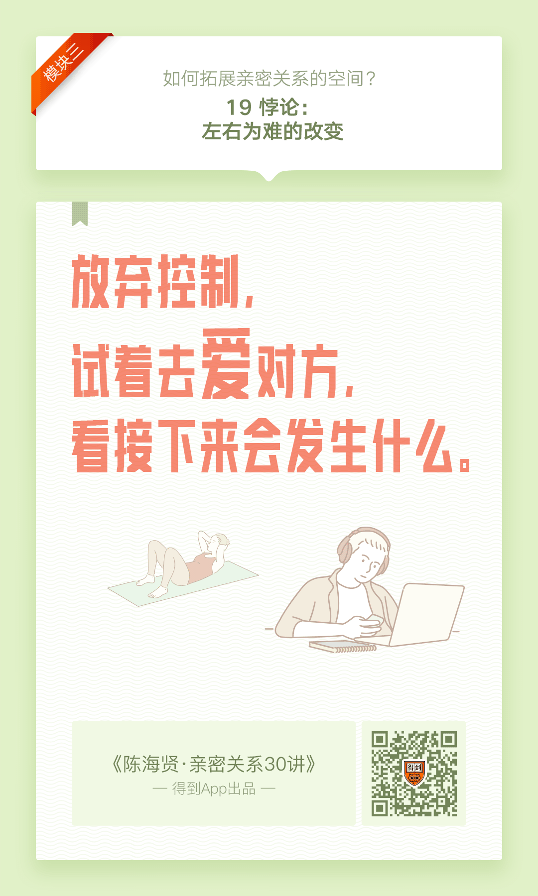  

set 限制解除

* * *

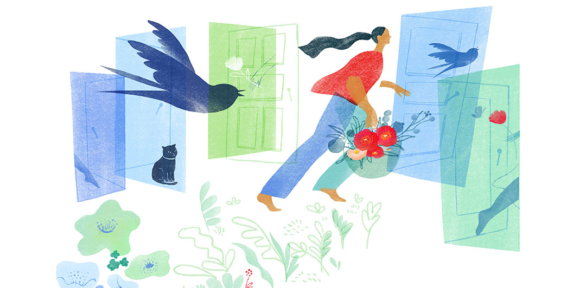

# 20 丨边界：如何在亲密关系中说“不”？

陈海贤

2019-08-25

20 丨边界：如何在亲密关系中说“不”？

丨陈海贤 亲述丨

懒人专属群的群友，，你好，我是陈海贤。

在前面的课程中，我们学习了因为不会处理双方的差异，让人们想要改变对方的情况，这会让两人关系的空间变小。在生活中，还有一种问题如果处理不好，也会让亲密关系的空间变小，那就是双方的边界问题。这一讲，我们就来聊聊如何处理伴侣之间的边界。

人与人之间是有边界的。这个边界通过很多微妙的标识，区分了你我，为彼此保留了自我的空间。

*   在身体上，你不会和陌生人接近，也不允许陌生人接近。皮肤就是你和他人的边界；
    
*   在经济上，别人不能随意花你的钱，也不能随意用你的东西。所有权就是你和他人的边界；
    
*   在心理上，有些你内心很隐私的事情，并不愿意跟人分享。隐私就是你和他人的边界；
    
*   别人的事就是别人的事，有时候你就算再想帮忙，也爱莫能助；
    
*   别人的情绪就是别人的情绪，你就算再感同身受，也不能替别人感受。情绪情感的独立，也是你和他人的边界。
    

这些边界是怎么形成的呢？除了法律和社会习俗，很多时候，边界是通过微妙的人际互动来维持的。

比如，有一个刚认识的朋友很热心地举起酒杯邀请我喝一杯；或者一个热情的同学问：“我能叫你海贤哥哥吗？”这就是一次商讨边界的邀请。这种邀请本身并不侵犯边界，因为我可以有选择。

如果我说“可以”，我就划定了更亲近的边界。如果我说：“不好意思，我不喝酒”，或者“哎呀，请你还是叫我老师，我听着自然一点”，我就划定了较远的边界。

可是，如果在我拒绝了以后，他非要说：“你不喝就是不够意思”，或者“我就是要叫你哥哥，这样亲切一点，别这么古板嘛”，那他就侵犯了我的边界。

**所以，所谓的边界并不是不靠近，而是在尝试靠近的同时，尊重了别人说“不”的权利。**

不过你可能会想，亲密关系中的伴侣不是应该亲密无间吗？为什么还有边界？事实上，亲密关系中仍然有很多微妙的地方，需要探讨彼此的边界。

比如，你和爱人是各自保管支配自己的收入，还是把收入统一上缴、统一管理？如果对方有什么心事，你允许他跟其他朋友说，还是一定要跟你来说？你允许他保有自己的秘密吗？允许他有自己的异性朋友吗？

这些问题都跟亲密关系中的边界有关。它的核心仍然是：尊重对方说“不”的权利，也能够维护自己说“不”的权利。

那么，在亲密关系中说“不”，会影响两个人的关系吗？如果两个人有边界，是不是意味着两个人对这段关系不够投入，甚至怀有二心呢？

不是这样的。 **在亲密关系中，边界并不是不能分享，而是有权利分享，也有权利不分享。**  
就像给自己的房间安了一个门，可以邀请对方进来，也可以不邀请。因为有了这扇门，对方想进来就得敲门。也因为有了这扇门，对方收到邀请进来，才会更觉得亲近。

## 亲密关系中重要的三种边界

在亲密关系中，该遵守哪些边界呢？没有固定的答案，这是伴侣共同探讨的结果。每对伴侣所达成的协议都不一致。但是，有三种边界问题如果纠缠不清，经常会给伴侣带来困惑，需要小心处理。

**第一个边界是，对方的心理活动。**

我就见过一对情侣，两人在商场逛街，女生忽然很不高兴，跟男生说：“刚刚你是不是看了那个女孩？”

男生说：“我没有啊。”

女生就更生气了：“你就是看了，我都看见了。眼睛都直了，恨不得跟人家走了。”

男生说：“我真没有啊，你到底说的是哪个？”

女生就说：“看了就看了，你还抵赖！”

如果你已经恋爱或者结婚多年了，也许你会觉得这样的场景很有趣。可是对于刚刚恋爱的情侣，这就会变成一个问题。在这个场景里，女生想要男生保证他在心理上也忠于自己，没有任何瑕疵。而男生呢，多少觉得女生侵犯了自己的边界。

当然，女生的担心也能理解。在恋爱中，人总是会对伴侣是否忠诚的信号异常敏感。

**可是，无论你多想跟伴侣亲近，伴侣的心理活动就是他们的边界。你既不能责怪，也没法控制。**

我见过另一对夫妻，丈夫觉得妻子不够理解自己，就帮妻子找了心理咨询师。这本来也是一件好事。可是每次妻子见完了心理咨询师，丈夫就会让妻子交待：你今天跟心理咨询师聊了什么？如果妻子不说，丈夫就会生气。

丈夫觉得自己有权了解妻子的所思所想，妻子却不同意，她觉得，这样丈夫就侵犯了自己的边界。

这个侵犯的背后是什么呢？是希望爱情完全纯净，没有任何杂质。希望伴侣的想法也完全经得起检验。可是，再恩爱的夫妻，他们之间的关系也会有一些灰度。

就像美国家庭治疗大师米纽庆说的：“结婚四十年，起码想过离婚两百次，捏死对方五十次。一段婚姻能维持，全靠渡过了这些难关。”

你看，如果米纽庆的妻子要求他把离婚的念头都原原本本告诉自己，那估计米纽庆想离婚的次数还得加两百次。

所以，觉得自己有权利随时知道对方是怎么想的，并觉得自己有权利判断对方该怎么想，哪怕是出于追求“纯洁爱情”的目的，也仍然是对边界的一种侵犯。

**第二个边界是，伴侣的情感历史。**

当你遇到一个中意的人时，你会自然想知道对方的情感历史。你会对这件事好奇，最重要的原因是想判断你在对方心里是不是最特殊的一个，想知道对方是不是真的爱你。也许，你还想通过了解他的情感历史，来判断对方在情感上是否可靠。

可是，如果对方说了“不”，那这就是他的边界。这不是对方不信任你，而是他在为自己保留空间。

我就见过一些情侣，一方总是会去询问对方过往的情史，甚至性经历。有时候，甚至会询问很多细节，而被问到的一方就会很犹豫。

一方面，他希望自己能够向对方保持坦诚，让对方知道他对这段关系是诚实的，是认真的。可是另一方面，真要讲这一些，又是他不情愿的。他也担心说自己以往的经历，会伤害现在这段感情。

当然不是所有的人都会说“不”。我猜，有时候你也愿意跟对方分享自己的情感经历，是因为你渴望自己能够完全被对方理解和接纳。

可是在很多时候，这么做仍然是一件有风险的事。也许在问的时候，对方会说：“没事没事，你就告诉我吧，我都接纳。”但你仍然要明白，你有权利说“不”。

也许你会想：这样会不会对他不诚实？

其实，我并不觉得在关系里，诚实是最重要的事。知道怎么去保护彼此的关系，比诚实更可贵。你守护的边界，不仅保护了你自己，也保护了你们的关系。

所以，如果你的另一半询问你的感情史，而你不愿意分享的时候，你可以跟对方说：“我爱你，但是你不需要去了解我的所有。你只要知道，我对你全心全意就好了。”

**亲密关系中的第三个边界是，对方的原生家庭。**

我见过很多对夫妻，是因为这件事产生了矛盾。这个矛盾还不是现实的婆媳关系这样的矛盾，而是他们会通过贬低对方的原生家庭，来贬低对方。

我见过很多夫妻，来找我咨询的时候，就会说：

每当夫妻这么说的时候，我就会替他们捏一把汗。我会偷偷看他的伴侣，而他的伴侣通常也都很生气。

因为忠诚于原生家庭是每个人的本能，即使是在亲密关系中，伴侣是比各自的原生家庭更重要的人，但说到原生家庭的问题仍然要小心。如果伴侣不希望被这么说，那这就是他的边界。如果突破了这个边界，那就是站在了伴侣原生家庭的对立面。

## 思考题

你知道在亲密关系中，哪些是你的边界？哪些是你伴侣的边界吗？

欢迎在评论区留言，和大家交流。

## 下节预告

这个模块，我们学习了如何拓展关系的空间。影响关系空间的主要问题，就是对彼此的差异和边界的处理方式。下一讲，我们将进入新的模块，讲讲亲密关系的分离。

我们下一讲再见。

欢迎关注陈海贤的公众号，获取更多延伸阅读。

（微信搜索“陈海贤”添加关注，ID：haixiansalt）

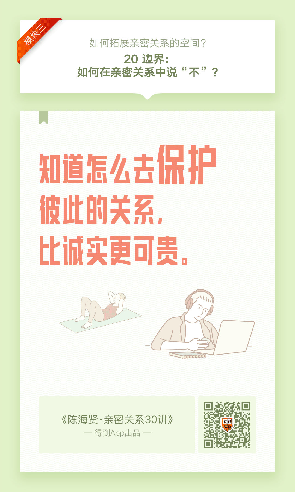  

* * *

# 21 丨出轨：如何应对关系的最大危机？

陈海贤

2019-08-26

21 丨出轨：如何应对关系的最大危机？

丨陈海贤 亲述丨

懒人专属群的群友，。你好，我是陈海贤。

从这一讲开始，我们会进入新的模块，学习亲密关系中的背叛和分离。我会讲到出轨的话题，会讲关系破裂之后如何重建，还会讲到什么是成功的分离，以及如何处理和前任的关系。

在前面的课程中，我讲了亲密关系中伴侣相处的种种难题。如果说那些难题像是感冒发烧的话，那这一讲要讲的危机，就像是亲密关系中的重病，处理稍有不慎，就会导致关系的破裂和瓦解。面对这样的危机，伴侣就像是驾驶一条小船面对大海的惊涛骇浪，充满了动荡和不安。这一讲，我就来讲讲出轨。

## 出轨是对心理契约的背叛

什么情况就算是出轨呢？比如：

*   伴侣有仰慕的异性，发生了情感依恋，但是没有发生身体接触，这算出轨吗？
    
*   和异性有搂搂抱抱的身体接触，但是没有发生性关系，算出轨吗？
    
*   发生了性关系，但只是寻欢作乐，算出轨吗？
    

有时候，伴侣也会为自己辩护：“我没有出轨，只是找了一个情感寄托。”“我没有出轨，只是玩玩而已。”他们的意思是，我只是犯了一个小错误，我并没有不爱你。

**纠结这些情形算不算出轨，其实并没有太大的意义。因为出轨的本质，是最亲密的人背叛了。**

当一对情侣走进亲密关系的时候，他们心里都会有一个隐形的契约。这个契约不像文件那样白纸黑字，但两个人都心知肚明。

心理契约的内容各不相同。比如有些伴侣能够接受对方有异性知己，有些不能；有些伴侣允许对方与其他女性有性生活，只要不投入感情，但另一些不能。  
**无论心理契约是什么，只要一方觉得被背叛了，那他们在亲密关系中遇到的事，就和出轨是一样的。**

当然对大部分伴侣来说，他们的心理契约是基于依恋关系的，也就是说，要求感情和性上都是唯一的。基于依恋的亲密关系中，人们会有一些非常稳固的信念，比如：

伴侣双方的依恋情感越牢固，这些信念就越坚定。人们在这些信念的基础上经营亲密关系，彼此牢牢地连在一起。同时，彼此都在无意识地维护这个信念。

在出轨前期，就算伴侣表现有异样，比如每次都回家很晚，对自己不太有兴致等等，他们仍会无意识地忽略这些信息，或者给伴侣找个合理的理由，比如他工作太忙，他最近心情不好，人们是用这些理由来维护他们内心的信念。

他们不是没想过出轨的可能，只是觉得那是很遥远的事，只会发生在别人身上。所以，当看到伴侣出轨的确切证据时，他们会感到极度地震惊。撑起亲密关系的信念基石坍塌了，伴侣开始变得陌生，看起来牢不可破的依恋关系，开始变得无法信任。

从发现伴侣出轨那一刻开始，很多人的亲密关系迈过了一条红线。线的这一端，是甜蜜和温馨，而那一端，是愤怒和悲伤。一切美好的东西都变成了谎言，以至于人们再也不敢相信真实。

就像一个来访者哀叹说：

“我从没想到会是他，也从没想到这样的事会发生在我身上。以前我总觉得自己是很幸福的人，他打碎了我的这个梦想。现在，我不知道自己是谁，不知道还有谁可以信任，甚至不知道生活的意义在哪里。”

另一个来访者说：

“这么多年，他从来没有对我有甜言蜜语，经常忘了我们的生日和结婚纪念日。我一直跟自己说，他就是这么一个木讷的人，我接受了他。直到我看到他发给别人的微信，我才知道，他原来会这些甜言蜜语，只是对象不是我。”

出轨常常会带来巨大的伤痛和被背叛的愤怒，让人怀疑对方是否还爱自己，怀疑自己的付出值不值得，以及是不是还要跟这个人走下去。

## 出轨的可能原因

**在遭遇出轨后，人们首先会想的问题是：他为什么会出轨？**

最容易得出的答案，当然是“他不好！”出轨的一方人品低劣、道德败坏、自私自利、无情无义。这个答案的背后，是人因为被背叛，产生了对伴侣的巨大愤怒。

“他不好”是出轨的原因吗？有些是，有些不是。出轨的人，自然有视感情如儿戏的，却也有情深义重的；有缺少责任担当的，也有踏实稳重的；有不顾家的，也有顾家的。你很难只是通过一个人在其他方面的道德品行，来判断他会不会出轨。

**所以就有了第二个答案：既然不是“他不好”，那是不是“我不好”？**

在发现出轨时，人经常忍不住把自己跟伴侣的出轨对象作对比。当发现对方身上有自己没有的优点时，常常会自惭形秽，觉得一定是自己不够年轻、不够有魅力、不够温柔体贴，伴侣才会移情别恋。这种想法常常会带来很深重的羞耻感，这种羞耻伴随着愤怒，觉得伴侣的出轨是对自己的羞辱。

“我不好”是出轨的原因吗？同样有些是，有些不是。一个普遍的现象是，出轨的人在别人身上发现了自己伴侣没有的特征，并被吸引了。可是深入交往以后，又会怀念伴侣有的，而出轨对象没有的特征。

所以，所谓的“好”或者“不好”，大多数时候，只是人们对于没有得到的东西的一种认知偏见。

**那既然不是“他不好”，也不是“我不好”。第三个答案，是不是两人的感情不好？**

有一些心理学家认为，人们之所以会出轨，是伴侣之间的关系本来就有裂痕，但我并不觉得。

确实，有时候外遇满足了一些人们在亲密关系中没法满足的需要或者欲望；也有时候，两个人的亲密关系本身就有很多的矛盾和问题，于是一方通过出轨来逃避这种矛盾产生的压力；另有一些时候，出轨是在无意识地提醒伴侣：“不要忽略我”，“再对我不好，我也可能会逃走”。甚至一方通过出轨，来增强自己在亲密关系中的权力和地位。

这些可能是出轨的原因，但不是可以为出轨辩解的理由。如果细究起来，所有的亲密关系，都会有自己的矛盾和问题。同样，任何一段亲密关系，哪怕再好，也没法满足人们所有的需要和欲望，这并不是出轨的理由。

那到底人为什么会出轨？它的原因很复杂，是各种因素交汇的结果。这些因素包括亲密关系的现状、未被满足的需要和欲望、所处环境的诱惑、对忠诚和风险的价值判断、自身所处的人生阶段、所处的关系和环境对出轨的容忍度、在什么样的情境下遇到的那个人、那个人又对出轨有什么样的作用。

**它是关系、个人和情境综合作用的结果。它有人们最根本的欲望和需要，以及最复杂和矛盾的内心冲突。**

在这里，我想对那些遭遇过伴侣出轨的人，说几句心里话——无论你想到的伴侣出轨的原因是什么，这些其实已经不太重要了。尤其你不需要因为对方出轨而贬低自己，或者否定你们的感情。这不是你的错，也不是你们感情的错。

并非只有感情有问题的伴侣才会出轨，有时候，那些感情深厚的伴侣同样可能会遭遇出轨。出轨不出轨不是区分伴侣感情好坏的标志。

**那感情好和不好的区别在哪里呢？区别在于两个人能否从这样严重的情感危机中恢复，重建对彼此的信任。**

那些恩爱的伴侣，因为在日常互动中建立起了依恋的信念，即使遭遇了出轨，仍然更容易相信对方是爱自己的，所以也更能重建信任；因为情感账户有更多的盈余，他们更能一起应对这样的危机；因为平时有一套成熟的处理问题的机制，他们更可能处理好这些问题。不是不恨，而是有时候，爱会战胜恨，但这同样艰难。

遭遇出轨后，除了找原因，还面临着一个重要问题，接下来怎么办？

这是一个艰难的选择。说实话，我也并不知道答案。我只知道，答案是开放的。

出轨并不一定要选择原谅，同样，出轨也并不一定要以分手结束。哪怕在没有遭遇出轨之前，一个人曾坚定地想过，只要对方出轨，我就一定分手。

只不过，在一起需要两个人的决定，而分手只要一个人决定就够了。如果决定要走关系重建的道路，就需要两个人的相互配合。

这是最难的配合，谁能去信任和依靠那个把自己伤得如此之深的人呢，又该怎么放下心里的恨，重新去爱呢？我们下一讲来讨论这个问题。

## 思考题

你和伴侣的心理契约是什么呢？

欢迎在评论区留言，和大家交流。

## 下节预告

下一讲，我来讲讲出轨后的选择，出轨后是否还能重新在一起？

我们下一讲再见。

欢迎关注陈海贤的公众号，获取更多延伸阅读。

（微信搜索“陈海贤”添加关注，ID：haixiansalt）

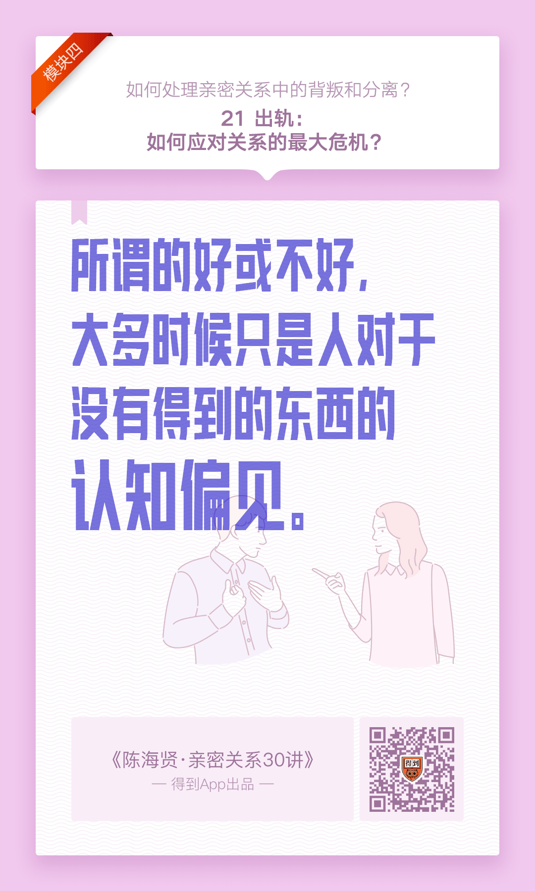  

* * *

# 22 丨选择：出轨了，还能在一起吗？

陈海贤

2019-08-27

22 丨选择：出轨了，还能在一起吗？

丨陈海贤 亲述丨

懒人专属群的群友，。你好，我是陈海贤。

当伴侣遭遇出轨后，无论多伤心，马上面临的一个难题是两个人还要不要在一起？这是一个艰难的选择。在一起吧，被出轨的一方得忍受背叛的伤痛和对关系的怀疑。不在一起吧，内心又有很多的依恋和不舍。很多人就会在这样的过程中来回撕扯。

这一讲，我就来讲讲怎么判断出轨后两个人还能不能在一起，重建关系需要哪些条件。

当出轨发生后，亲密关系常常会往三个方向发展。 **第一个方向当然是就此分开。**

在一起是两个人的事，分开只要一个人下决心就够了。如果出轨的人决定结束这段亲密关系，或者被出轨方决定不原谅，那这段关系也就结束了。这时候，两个人最重要的课题，就是如何医治关系结束的伤痛。

**第二个方向，是带着未治愈的伤痛，貌合神离地在一起。**

有些时候，因为一方在经济上依赖另一方，或者双方都想给孩子一个完整的家，或者因为家人、社会舆论的压力，两个人选择不分手，却不想，也不知道该怎么处理情感的伤痛。未被处理的伤痛就会变成两个人的巨大隔阂。

有时候伴侣为了维持表面的和谐，刻意不去讲出轨的事情。就像房间里放了一头大象，两个人却装作看不见。但越是不讲，这件事对关系的影响就越大。它会让亲密关系空心化，让两个人很难真正接近。

压抑的委屈也会变成关系中的定时炸弹。我见过一对夫妻，关系一直不好。问他们的矛盾在哪里，妻子咬牙切齿地跟丈夫说：“你自己想想，我刚生完孩子躺在病床上的时候，你是怎么对我的！你居然背着我跟别的女人打情骂俏！我当时也是没办法，孩子刚出生，所以就让你删了微信算了。但是你别以为这件事就过去了，我一辈子都记恨你。”

虽然这件事过去了好几年，可是因为没有处理，这个妻子就一直记恨着老公。他们从来没有认真地讨论过这件事，只是把它变成了日常生活中漫长的矛盾。

**第三个发展方向，是两个人修复了关系，把出轨变成了他们亲密关系中的一段插曲。**

这是最理想的状况。出轨是亲密关系中的重大创伤，但关系受了伤，并不意味着关系就要终结。有时候，一些伴侣反而能够从亲密关系的创伤中复原，觉得对彼此有了更多的了解，两个人的关系反而有劫后余生的亲密。

修复关系的具体方法，我会在下一讲告诉你。这一讲先来说说，要想修复关系，需要具备哪两个前提条件。

## 修复关系的两个条件

**第一个条件是，出轨的一方已经断绝了和出轨对象的联系，并想要回归家庭。**

如果出轨的一方还无法切断与另外一个人的关系，或者口头答应，但实际上并没有，那伴侣的关系就会一直处于不安全当中，双方也就没有修复关系的基础。

很多时候，从发现伴侣出轨到和伴侣分手，是一个不断拉扯的过程。这个过程包括：怀疑出轨，证实出轨，争吵，对方发誓回归，原谅，发现对方还在跟出轨对象联系，重新开始争吵，直到一方被伤透了心，彻底不再信任另一方，两个人才开始考虑分开。

出轨刚被发现时，出轨方常常会心怀侥幸。看着伴侣的纠结、难过、愤怒，他会想：也许我可以维持现状，同时跟两边保持关系，或者至少拖延一段。有时候，他也许会享受这种“我很重要”，被两边争抢的状态。

**可是他不知道，当他想维持现状或者拖延选择的时候，他其实已经做出了选择。关系常常在这样的拉扯中，失去了修复的最佳时机。**

当然，要断绝关系回归家庭，对出轨方也不容易。出轨并不像犯个小错误更正一下那么简单。有些外遇维持了好多年，和出轨对象也有很深的情感依恋。这时候要断绝这种依恋关系，对出轨方来说也会有很大的失落。

可是作为过错方，他的失落再深，也很少有人觉得他应该被安慰。就好像，他站到了全世界的对立面，可是没有人去认真理解他的孤独。这些情绪，都需要他自己消化。

而且有时候，看到伴侣激烈的情绪和不信任的眼神，他也会怀疑：是不是我和原来的伴侣再也回不去了？回归家庭真的是一个对的选择吗？这些失落和疑虑越多，他就越难有信心去跟伴侣重新走近。

这很痛苦，但是如果他想回归家庭，就需要克服这样的困难。

**修复关系的第二个条件是，被出轨的一方准备接受这个现实，并愿意重建感情。**

这同样需要被出轨方克服很多的疑虑。首先就是，对方出轨了，我们还能重新变成恩爱的一对吗？

很多人在结婚或恋爱时曾有过这样简单的信念：婚姻或者爱情应该是纯洁无瑕的，如果他出轨，那我一定不能原谅他。

而一旦出轨发生了，这种纯洁关系的假设就会被打破。

我的一个来访者跟我说：“虽然我想要原谅他，可是我内心总有一种不甘。在恋爱的时候我跟自己说，我以后绝对不会容忍对方出轨，如果出轨了，那我就毫不犹豫地分手。现在我也想咬咬牙忍了。”

我的另一个来访者跟我说：“我很想原谅他，可是我不知道我们的关系会变成什么样。我没法假装这件事没发生，没法把这件事从我们的生活里抹去。

就像我听过的一个故事，讲的是：一对情侣在花园里种树的时候挖到一具骷髅，他们吓坏了，赶紧把它重新埋好，装作没看见。看起来两个人以后的生活都没变，但是两个人心里都知道那里有一具骷髅。

我觉得，就算我们选择在一起，我们也只是那对知道花园里有骷髅的夫妻。以前别人说我们是恩爱夫妻的时候，我总是觉得很甜蜜。可是这件事以后，如果有人再说我们是恩爱夫妻，我就会很心虚，甚至觉得恶心。”

在遇到出轨事件之前，他们的心里都有关于纯洁爱情的假设。他们觉得爱情就像一张白纸，而出轨的事件给爱情抹上了污点，他们再也不可能回到从前，变成一对恩爱夫妻了。这个观点会一直折磨他们，让他们对修复关系充满疑虑。

出轨了，两个人的关系不会再回到从前了，这当然是事实。就像一件事你知道了，你就没法退回到不知道的状态。可是这不意味着就不能再成为恩爱夫妻了，只不过，可能会变成不一样的恩爱夫妻。

经历了出轨，会让人看到关系里更复杂、更真实的人性。可是，真实的人性也能长出爱情。如果说纯洁的爱情像是水里养着的水仙，那真实的爱情就是泥土里的玫瑰了。

出轨是夫妻关系的一个劫，渡过去了，关系也许会更坚实，如果渡不过去，也许缘分就此终止了。可无论如何，曾经的恩爱都应该是彼此渡过难关的资源，而不能因为它被污染了，反而变成一种负担。

被出轨方的另一个疑虑是，如果我这次原谅他了，他还会再出轨吗？

他真的愿意回来吗？我真的可以再信任他吗？不是说江山易改、本性难移吗？我可没法再承受一次伤害。

当然这些想法都有道理，原谅也确实是一种冒险，可是如果不想放弃关系，就只能去接受这样的冒险。对于这种冒险，悲观的理由已经很多了，我倒有一个乐观的理由：

**实际上，大部分人出轨的时候，其实并不知道出轨是什么样的。**  
他们只看到了外遇激情的一面，可他们并没有真正经历过在两段感情中纠结，并没有经历过偷偷摸摸的焦虑。他们也知道出轨会对家庭和另一半造成伤害，可这只是停留在理念上，他们并不知道实际的伤害多么难以承受。

所以，当出轨的人真真切切地经历这一切，感受到焦虑和痛苦时，他们也是会怕的。这也是为什么有时候出轨确实会让人更珍惜自己和伴侣的感情。出轨确实刺激，但并不快乐。

出轨后的重建是艰难的。要能够做出重新在一起的决定，需要两个人的决心，也需要小心翼翼的情绪处理。有时候我会对还犹豫要不要在一起的伴侣说：

“你们的爱情曾经是你们那么珍视的东西，现在它生病了，就躺在病床上。就像医生在动手术之前要找家属签字一样，现在如果你们要挽救这段关系，也需要你们俩共同签字。你们可以不签，让这段关系离去，也可以签，让你们一起尽最大的努力来挽救它。现在，是你们一起决定的时候了。”

这常常也是处理出轨最难的时候。那个最亲密的人，变成了那个伤害你最深的人，而要挽回这段关系，就需要跟这个伤害者通力合作，才能把关系中的这个病治好。

病是很痛的，但并不是所有的病都不好。有时候，病就是一种疗愈关系的方式。

## 思考题

你是否也曾有过纯洁爱情的信念？随着关系的发展，这种信念会有所改变吗？

欢迎在评论区留言，和大家交流。

## 下节预告

关系的重建是双方配合的结果。下一讲，我们讲讲伴侣双方如何配合，才能重建关系。

我们下一讲再见。

欢迎关注陈海贤的公众号，获取更多延伸阅读。

（微信搜索“陈海贤”添加关注，ID：haixiansalt）

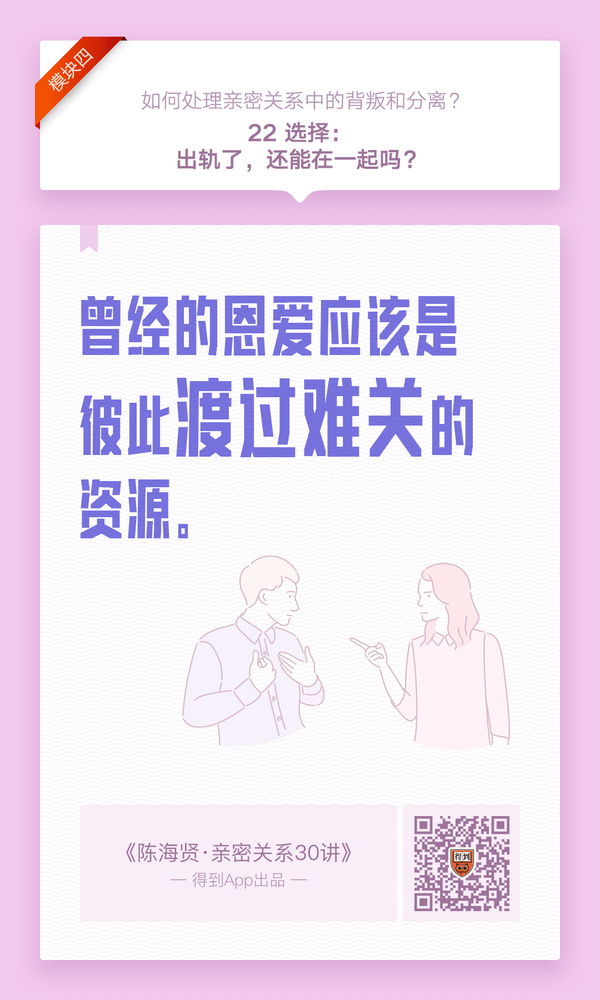  

* * *

# 23 丨出轨后重建：如何带着伤害靠近？

陈海贤

2019-08-28

23 丨出轨后重建：如何带着伤害靠近？

丨陈海贤 亲述丨

懒人专属群的群友，。你好，我是陈海贤。

谈到出轨，人们经常有一种错误的看法：认为只要出轨方认错，或者被出轨方原谅，两个人就能够重建关系。其实并不是。

出轨后的关系重建是两个人配合的结果。怎么在两个人关系出现裂缝的情况下，完成这个艰难的配合呢？这一讲，我们就来讲讲这个话题。

在遭遇出轨的那段时间，人们，尤其是被出轨方通常会变得非常纠结。就像我的一个来访者曾说：

“那段时间我处于完全混乱的状态。一方面­，我很怕他接近我，每次他在我身边，我都情绪暴躁，非常愤怒。一方面我又很怕他离开，一离开就会很没有安全感，很希望他在身边。所以我们在一起的时候，我总是喊他‘滚’，可是他不在，我又会哀求他回来。”

从依恋的角度看，出轨很容易让人陷入到焦虑型依恋，也就是既不敢靠近，又不想远离。对于动荡的情绪而言，对方既是毒药，又是解药。

在充满猜疑和伤害的时期，怎么才能相互走近呢？有四个原则：看到伤害、主动修复、设置底线，以及停止追逃。下面我来分别说说。

## 重建关系的四个原则

**首先，出轨的一方能看到对伴侣的伤害。**

出轨对关系的第一层伤害是背叛，“我这么信任你，你居然背叛我”。而比这个更严重的第二层伤害是，无视这种背叛，“明明我受了伤，你却看不见”。

委屈和痛苦是需要被看见的。否则，被出轨方就会一直用某种方式来让对方看见，比如吵架，比如也通过出轨来报复对方。

可是有时候，出轨的一方总是想大事化小，小事化了，这背后是他们对内疚的防御。他们可能会说：“这只是个意外”，“我只是玩玩，没有走心”。

当他们这么说的时候，本意也许是想安慰对方，希望对方尽快放下。但在对方听来，他们其实在说：“你受的伤害根本不值一提。”他们没有真正看到这种伤害。

另一些时候，出轨的一方已经表示想回归家庭了，也道歉了。可是看到伴侣还在生气，他会想：“我都已经回归家庭了。”“我不是重新选择了你吗？那你还想怎么样？”

**也许在心里，把选择回归家庭当作是一种“给予”，觉得对方应该感激他的这种给予，见好就收，赶快放下。这同样没有看到对方受的伤害。**

每当这时候，我就会对那个出轨的人说：“你不需要解释你的理由，你甚至不需要判断伴侣这么大的反应是不是合理，更不要先把它当作对你的指责。你只要看到她现在很受伤，很需要你的安慰就好。如果你看到了，你就告诉她。”

这时候出轨的人通常会承认：“是的，我看到她受伤了。我只是很怕她怪我。”哪怕当面表达这样的信息，也会对两个人关系的修复有所帮助。

看到并承认这种伤害，就是把选择原谅的权力交给了对方。这时候，人的内心会有很多失控的感觉。可是，只有把主动权交出去，对方才可能真的给予原谅。否则的话，承认伤害只是变成了要求原谅的条件，那真正的原谅就很难到来。

**第二个原则是，出轨方主动承担修复关系的责任。**

出轨方要掌握修复关系的主动权，而不能把这个责任抛给对方。愿意承担修复关系的责任，也是看到伤害和请求原谅的一部分。

当伴侣闹得很厉害的时候，出轨一方会有一些奇怪的说法。比如有个丈夫说：

“如果你想在一起，我同意，如果你想离婚，我也同意。我也可以把房子给你，就让我自己孤独终老好了。”

他把放弃修复关系的主动权，当作是对自己的惩罚，却没看到这同样是对对方的惩罚。另一些时候，这种说法里也隐含着对对方的一种隐秘的要挟，就好像是“我就这样了，你爱要不要”，尤其是当出轨一方知道对方离不开的时候。

为什么这样的说法看起来诚意满满，却有很大问题呢？

因为这个时候，表面上是被出轨方有了选择原谅和不原谅的权力，但实际上也被动承担起了修复关系的责任。而在这个时候，被出轨方最需要的，是对方对关系的承诺。他们更愿意听对方说的是：“我错了，但我不想离开你。”而不是：“我错了，随你处置。”

**第三个原则是，被出轨的一方为自己设置反应限度。**

无论出轨的人多可恶，被出轨的人多受伤，亲密关系的重建不能只靠出轨方一个人的忏悔和醒悟，需要两个人共同配合。

这并不是说被出轨方要很快原谅或者放下，原谅或者放下是长期的事。而是说，要下决心，把这件事控制在一定范围内。遭遇出轨，经常会让人有很大的情绪反应，会有很多报复的想法，这些反应会影响如果任其生长，就会影响关系的重建。

有时候我会问被出轨的人：“我知道你想报复他。可是你觉得怎么样是够了？然后你可以开始你们的新关系？”

一般他们会顿一下，因为他们也没有认真地考虑过这个问题。他们也觉得自己应该放下，可是如果真的放下了，内心又会有很多不甘。

有些人会提一些条件，比如：“我要他以后一下班就回家”或者“我要他以后少和异性单独见面”。

无论这些条件是什么样的，我都会问出轨方：“你觉得这些条件怎么样呢？你能答应吗？”如果两个人能够商量，至少这种仇恨就不会无限扩大。

也有一些时候，被出轨方选择了原谅，可总也控制不了自己的情绪。两人因为日常的生活琐事吵架，吵着吵着，就会把出轨这件事搬出来。然后就变成了一个人教训另一个人，而另一个人耷拉着脑袋被骂。如果是这样，我就会跟被出轨的那一方说：

“如果你真的因为这件事难受，你最好能在心平气和的时候跟他说。你可以告诉他你有多伤心和难受。可是在吵架的时候，你用出轨这件事压倒对方并不合适。人们经常说吵架的时候不能动刀子，其实出轨这个事，就像感情里的刀子。你再生气，也是不能轻易动的。否则就算你吵赢了，输的还是你们的感情。”

**不以出轨这件事来压人，不把它作为一种道德优势用到生活的其他方面，这也是被出轨的人该为自己设置的反应的底线。**

毕竟，当遭遇出轨，想要让对方回归家庭的时候，一个人想要的是能够爱、值得信任的伴侣，而不是一个一直被审判着抬不起头的伴侣。伴侣如果在关系中变卑微了，他也就失去了爱的能力。

而且，如果总是把出轨当作增强话语权的砝码，出轨这件事也会在关系中变得越来越重，最终，会越来越难放下它。

**第四个原则是，停止追逃模式。**

被出轨方在情绪动荡期，就算已经决定重新在一起了，要信任对方仍然很难。有时候，被出轨方为了应对心理的疑虑，就会紧盯着伴侣，查问去哪里了，去干什么了，事无巨细都要向自己汇报。

这时候，出轨的一方也会苦不堪言，觉得自己再也没有私人空间了，他也会想要逃开。可是又因为理亏，他逃无可逃。于是两个人陷入了一种特别的追逃模式，这会挤压两个人关系的空间，让人难以呼吸。

这时候，我会努力让被出轨的人别追，出轨的人也别逃。我会对出轨的人说：

“如果你想要让你的伴侣觉得你是可信任的，那你就不能总是逃开。你要告诉对方，你会一直在的。对方现在很不放心，你应该做点什么，来让她放心。除非你能让她放心，否则她会一直追着你。”

我也会问被出轨的人：“你觉得他做什么，你才能放心？还是无论他做什么，你都不会放心？”

如果她说起她的条件，那就可以商量。如果她说：“无论他现在做什么都没用，我现在就是放心不下。”那我就会跟她说：

“也许这种说法很难让你接受，可是既然你选择了信任他，那你就选择了冒这个风险。让自己不那么焦虑，就变成了你自己要做到的事。你要做的，不是追查他，而是重新开始依赖他。”

有时候，一方会说：“我要看他的手机他都不让我看，这里面肯定是有秘密的。”另一方会说：“我也要用我的手机啊，你每次都拿去反复检查，我也很烦啊。”

其实当一方提出要看对方的手机时，已经表达了一种不信任。而另一方无论答应不答应，都已经进入了这种不信任的循环。

这时候我就会提议，一方把手机的密码给另一方。这样，就不是被迫让对方检查，而是主动把检查的权力给对方，这代表了一种坦白和尊重。而另一方呢，虽然拥有这个权力，但是选择不要看，这代表了拥有这个权力，同时也选择了信任对方。

**一方选择了授权，而另一方选择了信任。这样双方都停止了追逃，重新学着彼此靠近。**

重建需要一段过程，这个过程通常是痛苦的，并伴随着一定的反复，但这是关系结束和重生的必经之路。正如一位情感专家对出轨的夫妻所讲的：

“在这个时代，经常有很多人会经历很多段感情或者婚姻。出轨就当你们上一段的感情或婚姻已经结束了，那么你们愿意跟眼前这同一个人，开始另一段感情或者婚姻吗？”

是啊，出轨意味着那段动荡的关系已经结束了。那么，你愿意跟同一个人开始一段新关系吗？如果愿意开始，那无论多艰难，都不要让爱的火苗熄灭，如果不愿意了，那两个人也要好好道别。

## 思考题

你觉得经历重建后的新关系，和原来的关系相比，会有哪些不同？

欢迎在评论区留言，和大家交流。

## 下节预告

下一讲，我来讲讲什么是成功的分离。

我们下一讲再见。

欢迎关注陈海贤的公众号，获取更多延伸阅读。

（微信搜索“陈海贤”添加关注，ID：haixiansalt）

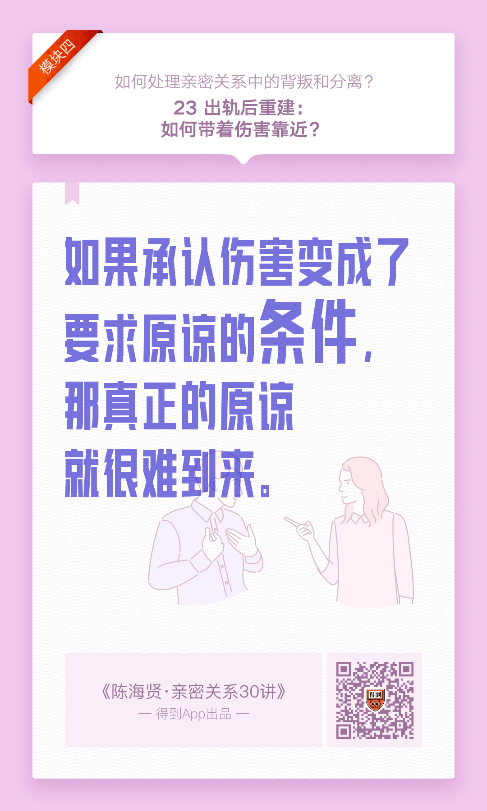  

* * *

# 24 丨放下：如何走出关系的分离？

陈海贤

2019-08-29

24 丨放下：如何走出关系的分离？

丨陈海贤 亲述丨

懒人专属群的群友，。你好，我是陈海贤。

伴侣之间的亲密关系，会有很多关口。过去了，两个人的关系还能继续，甚至可能变得更好。过不去了，两个人可能会就此分开，可生活还得继续。怎么能让分离的伤害降到最低呢？这一讲，我就来讲讲什么是成功的分离。

很多时候，人们会把分离看作是关系失败的结果。这当然是，但同时也不能忽略了，分离同样是处理关系难题的一种办法。这种处理方式最终的目的，是让两个人摆脱关系的纠缠，各自去寻找新的可能性。

**如果把分离看作是一种处理关系难题的办法，那你就会知道，有成功的分离和不成功的分离。**  
不成功的分离，会让人们在愤怒中继续纠缠，或者在失落中失去对爱的信心。而成功的分离，则会把曾经的美好变成回忆，曾经的痛苦变成经验，人能够放下过去，继续前行。

最常见的两种分离的形式是恋爱里的分手和离婚，二者并不是完全相同的。分手只是两个人分开，而离婚常常还牵扯到两边的家庭、身份变化、财产处理、孩子抚养等，离婚会遇到的困难要比分手多。不过，这两种分离的形式，要经历的情感历程是相似的。

这种情感历程是什么样的呢？

回想一下鲍尔比的依恋理论。孩子在与依恋对象分离时，会经历不同的阶段：从抗议和愤怒到绝望，再到最后的疏离。分离作为一种依恋的丧失，同样会经历三个心理历程：愤怒，悲伤或失落，接受和放下。除非能够慢慢接受心理上的分手，否则也很难重新开始新的生活。

## 分离的三个心理阶段

接下来，我分别讲讲分离的三个心理阶段。

**第一个阶段是愤怒。**

无论两个人曾经有什么样的矛盾，当真正面临分离的时候，两个人还是会产生很多愤怒。尤其是被抛弃的一方。这些愤怒的核心都是相似的：

就像我的一个来访者说：“结婚了，我一直以为自己可以好好过安稳的生活了。可是，我没想到她是这么自私和绝情的人！我在这段感情里摔得头破血流，觉得这辈子再也爬不起来了。”

虽然他已经离婚两年了，但说起自己的前妻，他仍然恨得咬牙切齿。这两年，他开始酗酒，工作不上心，生活也过得十分潦倒。他通过让自己过不好，来惩罚前妻，想让前妻自责和内疚。只是，这种愤怒往往变成了独角戏。

有时候，愤怒背后的原因更加复杂。我见过一对分离的夫妻，两个人在婚姻中就是那种互不相让的状态。后来一次吵架吵得厉害了，妻子就说离婚。以前丈夫总是不接这个茬，没想到那次丈夫也说：“好，那离就离，现在就来写离婚协议！”然后，两人就真的签署了离婚协议。

在那段时间，夫妻要见面处理一些共同的事情，每次见面两个人都会很紧张。有一次见面的时候，丈夫想缓和气氛，就玩笑似的说了一句：“你今天的裤子和鞋子没搭配好，没以前好看了。”妻子像是应激反应一样就说：“那你自己呢？你自己就好看了吗？”

**这些愤怒，是对委屈和悲伤的防御。** 彼此都摆出一副强硬的样子，等着对方来认输。很多时候，为了争这一口气的输赢，人们宁愿赔上自己的幸福，奋不顾身。

可是，愤怒背后还有另一种情绪，就是对挽回关系最无望的希望。因为对这个人还有期待，而对方却没法满足，愤怒才会产生。愤怒也是一种离不开，而要走出愤怒，也只有慢慢接受这个人无论跟自己有多大的爱恨情仇，都已经跟自己没关系了。

为什么人们宁愿一直对前任保持着愤怒，而不愿让自己平息呢？

**因为如果摆脱了愤怒阶段，人们就会进入第二个阶段：悲伤或者失落的阶段。** 而悲伤和失落要比愤怒更让人难以忍受。

无论和对方有多大的恨和纠缠，当人们真的意识到这个人不在的那一刻，这种失落会非常强烈。这种失落，有时候出现在夫妻真的拿到离婚证的那一刻，有时候出现在伴侣中的一个人搬出去的那一刻。

我有一个来访者说：

“那天我跟丈夫去办离婚证，办完以后我才忽然发现，彼此真的再也没有联系了。我老公问我，微信是留着还是删了？我说，我无所谓啦。心里想的却是，最好能留着，我还是很希望能跟他保持淡淡的联系。老公说，好。回来的公交上，我想起以前的点点滴滴，忽然想给老公发个微信：祝你幸福。打开微信，却发现信息发不出去，他已经把我拉黑了。然后我就靠着公交车的车窗，默默在那儿哭了好久。”

有另一个来访者跟我说：

“为了摆脱这段婚姻破裂带来的影响，我特地换了一个城市工作。那天出差，我回到了原来的城市，习惯性地想回家，却发现自己在这儿已经没有家了。”

曾经的亲密爱人变成没有关系的人，这是非常艰难的时刻，有的人宁可记恨对方，也不想承认已经失去对方的事实。因为他知道，如果真的放下了，那这个人也就真的离开了。

因为不愿意接受对方已经离开的事实，很多人就停留在悲伤和失落中，就算过了很多年，想起这段感情依然会难过。

**这当然是一种选择，但是也有另一种选择，那就是允许自己悲伤和失落，然后接受分离这件事。 这样就进入第三个阶段：接受和放下。**

在这个阶段，人们能够接受那个人已经离开了，接受自己有过一段不成功的感情的事实，不会为这件事有太多的情绪波动了。做到放下，是成功分离的标准。

这个过程需要承担失落带来的心理压力，如果是离婚，各方面的压力就会更多。

虽然我们这个时代，离婚率在不断攀升，但在社会价值里，人们仍然对离婚抱有一种偏见，觉得这是一种失败或者不光彩的经历。这意味着这个人没有经营好自己的感情或婚姻，这种偏见会给人带来很大的心理压力。

所以很多人在离婚以后，会把离婚当作一个很重要的秘密。这本身没什么，因为谁也不会轻易向别人透露自己的隐私。但问题在于，秘密本身就会成为一个很大的心理压力，消耗心力，也让人很难接近别人，以防被别人知道。而这样会让人变得更加孤独和封闭，虽然明明在这段时间，需要更多朋友的支持。

## 从分离中发展出新的故事

怎么才能克服这些压力，真的做到放下呢？

很多时候，分离在大众心里是一个充满抛弃、伤害、失败的消极的故事，但它也可能是一个更加积极的故事，一个关于重新寻找和发现自我，重新寻找和发现爱的故事。

**很多时候，放下就是我们从这段经历中发展出了新的故事。这个故事里有勇气，结束一段不适合自己的关系，是需要勇气的。**

就像我的一个来访者说的：

“我没离婚的时候，一直觉得胸口有一块石头压着，做梦的时候都会焦虑得惊醒。离婚了以后，我就感觉这块石头一下子没了，我整个人变轻松了。我很高兴自己有勇气去结束这样一段不合适的关系。”

慢慢地，她把离婚当作是自己所做的最有勇气的事。这帮助她从离婚中走出来，开始新的生活。

**这个故事里有对于自我的新的身份认同。**

在亲密关系里，伴侣常常是彼此生活中最重要的角色。很可能，你所有的思想、行为、目标、价值都是围绕着伴侣打造的。所以当人们失去关系的时候，也失去了自己在关系里的身份，很多人开始不知道自己是谁。可是也正因为如此，他们有机会重新寻找新的身份认同。

有些人聚焦自己的事业，发现了自己新的才能；有些人开始享受单身贵族的生活，并努力把自己的生活过得精致；另一些人开始拓展自己的精神生活。无论如何，在失去了关系的束缚之后，他们都发展出了新的自我。

**这个故事里有从痛苦中学到的经验。**

一个女生在分手以后说：

“分手后，我最大的领悟不是自己有多好，也不是对方有多坏，是我看清了自己，更明白了两个人在一起的意义。好的爱情，永远是两个人一起努力，而不是一个人一味付出，一个人委曲求全。”

后来，她开始了另一段感情，并把这些经验带到了下一段感情中。她变得更成熟了，也更知道怎么去处理感情中的纠结。

**这个新故事里，还有爱。**

我的一个来访者在结束了一段不快乐的婚姻以后，跟我说：

“那天下着雨，我一个人沿着山路走，一直走到那边的寺庙里。我和老公在一起的时候，我们也走过这条路，也经过这个庙，但是我们没进去，毕竟我们也没什么信仰。可是那天到这个庙门口，我就进去拜了。拜了以后我就想，该祈祷一些什么呢？保佑我们的关系？我们的关系已经结束了。保佑我遇到一个更好的人？我现在也没有这样的兴趣。后来我就在心里说：菩萨保佑。请你让我前夫原谅我对他的伤害吧，请你也让我原谅前夫对我的伤害吧。让我们各自安好。”

这是很奇怪的。分离通常意味着彼此都不爱了，可是成功的分离又是需要依靠爱的。不是靠对这个人的爱，而是靠对人性弱点的怜悯，靠对爱本身的信心。

## 思考题

你是否经历过亲密关系的分离？从最初的分离，到慢慢地放下，这个故事里发生了哪些变化？你从中获得了什么新的东西？

欢迎在评论区留言，和大家交流。

## 下节预告

下一讲，我们来说说如何处理和前任的关系。

我们下一讲再见。

欢迎关注陈海贤的公众号，获取更多延伸阅读。

（微信搜索“陈海贤”添加关注，ID：haixiansalt）

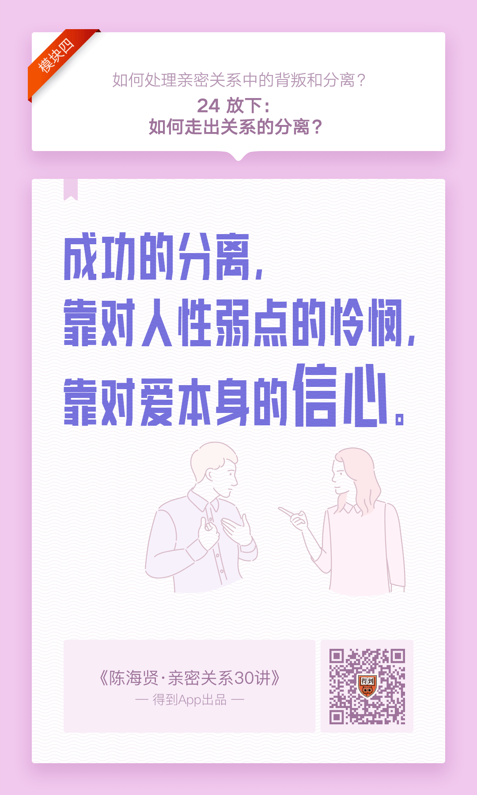  

set 限制解除

* * *

# 25 丨新阶段：如何处理与前任的关系？

陈海贤

2019-08-30

25 丨新阶段：如何处理与前任的关系？

丨陈海贤 亲述丨

懒人专属群的群友，。你好，我是陈海贤。

当一对伴侣分离以后，他们就进入了一种新的关系：前任。前任是一种特别的关系，两个人曾有过很深刻的依恋关系，都视彼此为最特别的人，但现在又变成了彼此“最熟悉的陌生人”。

某种意义上，前任代表了过去的那段感情，而走出过去的感情，与处理好前任之间的关系，其实是同一回事。这一讲，我就来讲讲如何处理和前任的关系。

有些人总是期待，所有的感情最后都有一个好归宿。有时候就算不复合，也会期待能够和前任保持联系，成为彼此的朋友、亲人，至少是特别的那个人。

但我不那么认为。我觉得，如果说亲密关系中好伴侣的标准是两个人在情感上足够近的话， **分手以后好前任的标准就是两个人在情感上足够远，最好没有关系。**

很多时候，分离不是因为两个人之间已经没有感情了，而是因为两个人之间的爱恨情仇过于浓烈，把两个人裹挟其中无法处理，所以不得不用分离来保护彼此。分离是为了获得情感的空间和自由，而要有这种情感空间，就需要和前任“没有关系”。

那什么算“没有关系”呢？

**它指的是两个人不再介入彼此的情感生活，不会再激起彼此强烈的爱恨情绪。**  
就算还有爱恨，爱变成了好感尚存，恨变成了有些讨厌。如果说在亲密关系中，两个人是彼此疗愈，在分开以后，两个人都需要独自疗伤。

可是，“没有关系”也并不容易。因为和前任的关系，不仅存在于物理空间里，还存在于心理空间。越是共同生活得久，前任的影响就越大。

## 和前任的三个关系阶段

怎么能够慢慢变得“没有关系”呢？通常至少需要经历三个阶段。

**第一个阶段，是敏感期。**

分手有三种情况。第一种是双方还有感情，因为现实的原因如两地分居、父母反对而分离。第二种是一方带着很大的恨意，另一方带着很大的歉疚。第三种是两个人在分开之前已经没有感情了，分手只是一个形式。

但无论哪种情况，分手通常都会带来一些伤害。而面对伤害，人们容易激起自我保护的本能。这时候，和前任有关的任何信息，也会变成激起情绪反应的应激源。所受的伤害越深，对与此相关的信息就会越敏感。就好像，前任的离开在生活中留下了一个巨大的黑洞，需要非常小心，才能避免掉入这个黑洞里。

我有一个女性朋友几年前离婚了，离婚的原因是伴侣出轨。他们有一个孩子，但即使这样，也没法修复她和前夫的关系。

这段关系成了她的创伤。她没有跟前夫争任何财产，只求速速离婚。离婚以后，她拉黑了前夫的微信。一些婚前共同的朋友，能不来往的就不来往了。有些一定要来往的，她也会说明：“不要说他，我不想听到任何关于他的信息。”

有一次，她去家附近的一个商场买东西，看到前夫的车停在那边，而人没在，她赶紧跑开了。以后宁可绕远道，也没再去过那个商场。

我问她为什么这么怕听到前夫的消息，她说：“我担心自己承受不住。听到他的任何消息，那些婚姻最后的恐惧、愤怒、龌龊、伤心就会把我淹没。我整个人会像燃烧起来一样焦虑不安。”

虽然很多人不会像她那么敏感，但是对前任的这种应激性反应仍然是非常普遍的。通常会有两种典型的应激反应，一种是逃开，也就是回避任何跟前任有关的信息。如果逃不开，人就会进入另一种应激反应，变得愤怒。

应激反应还会带来更深的心理影响。 **与其他创伤不同，关系创伤的特别之处在于，那个伤害你的人，同时也是你爱过，甚至可能还爱着的人。**  
这就带来委屈、不甘、依恋、失落等各种复杂的情绪，而这些情绪会留在心里，继续发酵。就像我那个朋友说的：

“虽然我不再接触跟前夫有关的任何信息了，但是我们离婚之前他否定我的声音，经常会在我耳边回响。这些声音变成了前夫在我心里的影子。有精力的时候，我会恶狠狠地否定它们，就像跟前夫吵架一样。没有力气的时候，这些骂我的话就会穿透我，让我觉得自己就是这样，一无是处。”

有时候，前夫的影子会投射到别人身上。离婚后不久，她交了一个男朋友。这个男友人很好，对她也很不错。可是她说：

“有时候，我会故意对他很冷漠。吵架的时候，我会把前夫伤我最深的几句话故意说给他听。我好像把对前夫的恨转移到了他身上，以此报复了前夫对我的伤害，这也会让我痛快一些。”

在这种敏感的状态下，他们很快就分手了。

该怎么从敏感期走出来呢？这就需要扩大感情以外的世界。  
**在亲密关系里，伴侣占据了很大的空间，而分离以后，这个空间就变成了一种空洞。你需要扩展自己新的空间，才能让这个空洞变小。**

我那个朋友原来是一个非常内向的人，但在那段时间，她开始交很多新朋友，尝试很多新的东西，一直在往外走。她原来有经营公司的经验，所以又开了一家新公司，把所有的精力都投入到事业上。慢慢地，婚姻以外的关系、事业，开始变成了“自我”可靠的基础。

我在前面的课里讲过，亲密关系是很多人的精神支柱。而走出分离的关键，就在于能够在亲密关系外，发展起其它支撑自己的精神支柱。

**随着时间的流逝，如果顺利的话，和前任的关系就会进入第二个阶段：陌生期。**

在这个阶段，前任离开所留下的巨大空洞，已经由工作、家庭、友情或新的情感弥补上了。在这个阶段，人们已经切换到并熟悉了没有前任的生活模式，前任已经不能激起心里的波澜了。

我那个朋友，是在三年以后才第一次联系了自己的前夫。那时候孩子要上一年级了，开学仪式里要求孩子的父母都加入一个家长群。那时候她对前夫已经没有这么敏感了，但就算这样，她还是做了整整两天的心理建设，不断告诉自己：“儿子需要父亲。如果你不去争取，你就是拿儿子的利益来为自己的懦弱买单。”

最后，她终于鼓起勇气拿起了电话。电话那头的人说“喂”。这是三年以后两个人的第一次接触。没有想象中那么激动，但还是很特别，有一种恍若隔世的陌生感。她告诉我：

“在离婚之前，我和他已经生活了 8 年。这 8 年有无数亲密的回忆。可是在打这个电话的时候，电话那头的那个人是很陌生的，我甚至无法把他和记忆里那个亲近的人联系在一起。我会怀疑自己的记忆，怀疑这一切是否发生过。”

这种陌生感意味着，前任在她心里的感情正在慢慢变淡。那个最特别的人，重新变成了普通人。那时候她才可以说，真的不爱了。

对于很多分手的伴侣而言，陌生期就是两个人关系的终点。从此形同陌路，相忘于江湖。但也有一些人因为孩子或者工作，需要和前任发展新的关系。这时候，他们的关系就进入了第三个阶段。

**在这个新阶段，两个人可以重新找到一种新的关系模式。他们不再以夫妻或者恋人的关系相处了，而会以新的身份配合。**

还是以我那个朋友为例。为了孩子，有时候他们需要一些配合，所以他们就把微信加回来了，但是关闭了彼此的朋友圈。平时孩子住在奶奶家，每周五，妈妈会把孩子接过来，周日爸爸再把孩子接过去。

有一天，她听孩子的奶奶说起前夫好像跟现在的女朋友分手了，就问前夫：“你是不是跟那个女孩子分手了？”前夫说没分啊。她“哦”了一声，这事也就过去了。

她的本意是希望孩子有机会跟爸爸多呆几天，既然没分，那不方便就算了。当她这么问的时候，完全是以孩子的妈妈的身份在打听，曾经自己这么在意的事，已经没什么波澜了。

从敏感到陌生到新关系，在这样的过程中，那些曾经的伤害变得不那么重要了，而两个人也能够各自开始新的旅程。

两个人不爱了，这算是成功吗？我不知道。也许生活本就没有那么多的成功。就像一句话说的：哪有什么胜利，挺住就是一切。经历了分离，人们会发现，让生活继续比什么都重要。

我们这个课程，是关于亲密关系的。但是讲到这里我必须要承认，亲密关系真的不是人生的全部。

在亲密关系里，人也需要发展关系以外的生活，爱好、工作、朋友、精神世界，而在分离以后，生命所找到的出路，也许不一定是重新拥有一份亲密关系，而是更多自我的发展和自由。在爱恨情仇之后，你会发现，有时候我们想要的，不过就是一份体面而已。

## 思考题

你觉得应该和前任保持什么样的关系？要保持这种关系，最大的困难在哪里？

欢迎在评论区留言，和大家交流。

## 下节预告

下一讲我们会进入新的模块，讲讲家庭中的亲密关系。

我们下一讲再见。

欢迎关注陈海贤的公众号，获取更多延伸阅读。

（微信搜索“陈海贤”添加关注，ID：haixiansalt）

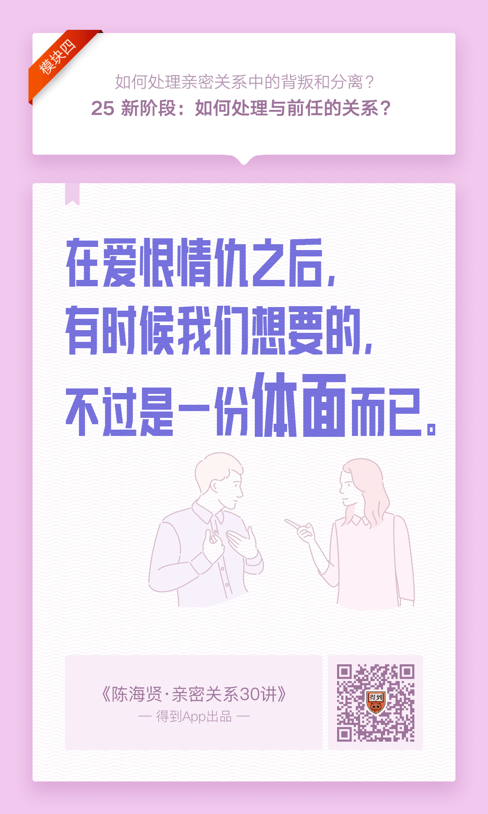  

* * *

# 26 丨三角关系：夫妻矛盾如何影响孩子？

陈海贤

2019-08-31

26 丨三角关系：夫妻矛盾如何影响孩子？

丨陈海贤 亲密关系丨

懒人专属群的群友，。你好，我是陈海贤。

从这讲开始，我们进入了新的模块——家庭中的亲密关系。当两个人的关系引入了孩子和原生家庭之后，亲密关系如何在更大的系统里运行呢？

这个模块，我们会学习如何处理孩子和伴侣双方的关系，家庭角色是如何形成的，以及婆媳难题的根源是什么。

这一讲，我会给你提供一个特别的视角，帮你看清家庭中亲密关系的运行逻辑。这就是三角关系的视角。

## 三角关系和三角化

家庭是亲密关系最重要的背景。我遇到过很多伴侣抱怨说：

“谈恋爱的时候，只有我们两个人，我们的关系是挺好的，刚结婚也还好。可是等有了孩子以后，两个人之间的关系就开始急转直下。到现在，家庭生活越来越沉闷无聊，两个人也开始越来越没话说了。”

为什么会这样？是因为家庭事务太多，导致夫妻之间的矛盾增多，还是爱情本来就有它自己的保质期，夫妻之间逐渐陷入了 7 年之痒呢？在我看来，这些问题都是没有看到家庭中亲密关系的一个事实，就是三角关系。

**什么是三角关系呢？就是关系中的两人，通过引入第三方，来减轻关系中的矛盾和张力。**

越是亲近的人，对彼此的反应越敏感。在亲密关系里，伴侣通常是固定的两方，如果两人没有学会怎么处理关系里的矛盾，时间长了，关系的张力就会变大。那他们很可能就会利用第三方，来缓解他们关系的张力。

三角关系不只发生在家庭里，它是一种普遍的人际现象。不知道你有没有发现，就算是最好的朋友，如果你要直接跟他讨论你和他的关系，也是一件不容易的事。

你很少跟朋友说：“你最近做的这件事，让我不舒服。”“你做的那件事，是不是对我有意见？”通常人们会谈什么呢？会谈第三者，会说：“某某最近怎么样了？”“某某最近做的这件事很不地道，我最看不惯的是某某某的这一点。”等等。

为什么会这样？不只是因为八卦，而是因为人对关系是很敏感的，所以直接讨论关系，会有很大的张力，会让人紧张。

**而谈论第三个人，既营造了一种“我和你在一起”的感觉，又不用去直面彼此之间的矛盾。**  
有时候，通过讨论第三个人，还间接表达了对彼此的态度，让人们在亲密和疏远之间维持着一个巧妙的平衡。久而久之，它就变成了人际关系的一种日常形态。

第三方可以是人，可以是物，也可以是一件事。现在，很多人把工作当成了两个人之间的第三方。

经常有夫妻在关系紧张的时候，一个人就开始频繁加班了。这时候，另一个人就可以从抱怨对方，改为抱怨对方的工作：“你做的什么工作，天天这么忙！”很显然，抱怨对方的工作，比直接抱怨对方不重视自己，张力要小一些。

而对方也可以通过工作来为自己辩护：“现在是工作正忙的时候，我有什么办法？”“我不工作挣钱，我们怎么买房买车给孩子交学费？”

这样，本来很难开启的关于爱和重视的对话，就被包装成了更容易说的关于工作的对话。

除了和工作组成三角关系，出轨也会构成另一种三角关系。有时候人们是借着出轨来告诉对方：“我觉得你不重视我。”“如果你不爱我，会有人更爱我。”“如果你不好好对我，我也有能力伤害你。”当然，这是一种非常有破坏性的三角关系，我在前面的课程已经讲过出轨的话题，这里就不多说了。

**除了刚才说的两种情况，有了孩子以后，家庭中又会出现一种父母和孩子之间的三角关系。**

孩子是亲密关系里天然的第三角，孩子跟两个人都有关系，而且父母在情感上又是亲近孩子的。所以，当父母之间出现难以解决的矛盾时，父母最自然的反应是转向孩子。

这时候，也许家里的丈夫会觉得妻子对孩子的关心多了，对自己的关心少了，也许他也会失落，可是他也能理解和接受。这样，孩子自然就变成了缓解夫妻关系的第三角。

我见过很多家庭，夫妻因为孩子的问题来找我咨询。当夫妻之间说起孩子的时候，两个人都会滔滔不绝。可是当我说：“我们先把孩子的问题放下，先来谈谈你们自己”时，很多夫妻就会说：

这并不是因为他们真的没问题，而是因为他们长久以来，已经把彼此的矛盾融入到孩子的养育中。他们习惯借着孩子来表达对彼此的需要和不满，而不习惯去直接面对和解决彼此的冲突和矛盾了。以至于当他们要谈自己时，都不知道从何谈起。  
**而他们所谓的孩子的问题，却常常和这种三角关系有关，或者说，孩子是三角化的牺牲品。**

什么是三角化呢？三角关系本身并不是问题，它是正常的人际现象。但是，如果在家庭的三角关系中，孩子总是被当作解决父母矛盾的工具，那就可以说这个孩子被三角化了。

## 孩子被三角化的三种情况

夫妻是怎么把孩子三角化的呢？有三种情况。

**第一种情况是，伴侣把孩子当作权力斗争的工具。**

我见过一个家庭，父母经常吵架，吵得累了爸爸就经常借着加班不回家。而妈妈呢，自然就转向了女儿。她总是向女儿倒苦水，埋怨爸爸种种不好。

女儿一方面很心疼妈妈，另一方面，妈妈对爸爸的种种抱怨，又让她难以承受。所以妈妈一抱怨爸爸，她就会沉默。有时候妈妈看到女儿沉默，也会抱怨女儿不理解自己的苦心。

当我问这个女儿为什么变得沉默时，女儿说：“我也希望爸爸能多照顾家里，但是我很怕自己说了什么话，妈妈就会拿来说爸爸。”

这个女儿就是用沉默来反抗父母把她三角化，可是妈妈不知道这些。女儿不说话了，妈妈自然就变成了她的代言人。妈妈向她爸爸解释女儿的心事，经常跟爸爸说：“你连女儿的这点心思都看不出来。”

而爸爸甚至都没法好好跟妈妈吵一架。他不同意妈妈的说法，可是也不想伤害女儿，他想到的办法就只有远离了。

权力斗争的后果，看起来是妈妈赢了。可是，爸爸变得越来越疏远，妈妈变得越来越孤独，女儿变得越来越沉默，每个人都输了。

**三角化的第二种情况是，伴侣把孩子当作沟通手段。** 如果说第一种情况是父母用孩子来反抗对方，那第二种情况，就是父母用孩子来拉拢对方。

一些夫妻出现了矛盾，他们自己不知道该怎么解决的时候，就会跟孩子说：“你去跟你爸说说。”“你去跟你妈说说。”他们知道如果自己去说，伴侣通常都不会听，搞不好还会再吵一架。可是孩子说话，另一半就会听。久而久之，孩子就变成了他们的沟通桥梁。

可是桥梁也有桥梁的苦。我有一个来访者，父母关系不好，他就是父母之间的桥梁。他说，他一方面不想承担这个角色，觉得很烦。有时候传话传得不好，自己还会被骂。另一方面，他又很担心家里，总觉得如果他离开了，父母就不知道该怎么沟通了。他已经大学毕业了，却还惦记着父母的事。我跟他说：

“桥梁最大的问题是，它是被固定的，没有办法去找它自己的出路。因为桥梁知道，如果它离开了，桥梁的两头就会变成两座孤岛。可是，也许正是因为有桥梁的存在，所以这两座岛，不会去寻找新的沟通方法。如果没有桥梁，两个人就必须去面对彼此的问题，他们反而能够找到一种解决冲突的办法，无论这种解决冲突的办法是和好，还是最终决定远离。”

后来他决定不管父母的事了，也跟父母说明白了。很奇怪的是，经历了一段时间的争吵以后，父母之间倒反而亲密了一些，沟通也更顺畅了一些。

**三角化的第三种情况是，伴侣中的一方在情感上亲近孩子，疏远伴侣。**

在有些家庭里，孩子会代替老公或者老婆的角色。久而久之，夫妻就不再需要对方了，两个人的感情也会变得越来越疏远。这一点，我们下一讲还会讲到。

听到这里也许你会问，如果我和爱人、孩子陷入了这样的三角关系，那该怎么办呢？

**答案是，两个人的问题两个人来解决。**  
无论两个人有什么样的问题或者矛盾，双方都需要尝试去沟通和解决。如果回避了矛盾，其实也回避了让彼此重新亲近的机会，而孩子就会卷入两人的矛盾，变成关系的牺牲品。

有时候，我会建议这样的夫妻每天专门留出半小时给彼此。他们在这半小时的时间可以聊任何东西，但就是不要聊孩子。最开始的时候，很多夫妻说不聊孩子就没什么好聊的。但慢慢地，他们会重新去了解和发现彼此。

## 思考题

在你的成长经历中，是否有被父母三角化的经历呢？你的感受是什么？

欢迎在评论区留言，和大家交流。

## 下节预告

下一讲，我来讲讲家庭的角色，怎么影响家庭成员之间的互动。

我们下一讲再见。

欢迎关注陈海贤的公众号，获取更多延伸阅读。

（微信搜索“陈海贤”添加关注，ID：haixiansalt）

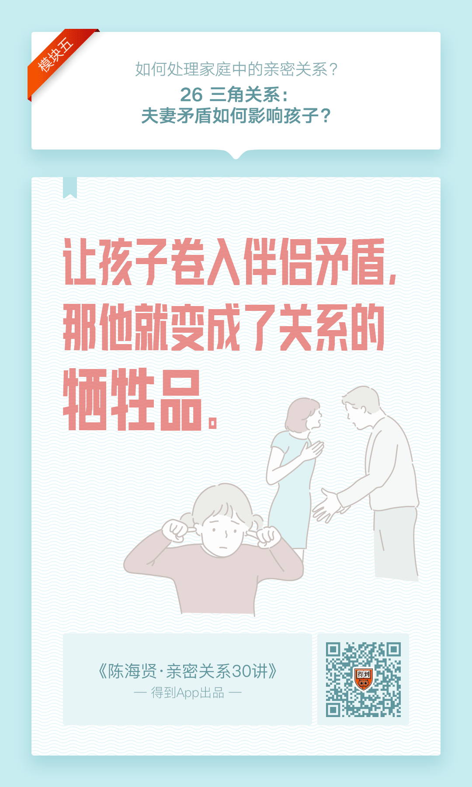  

* * *

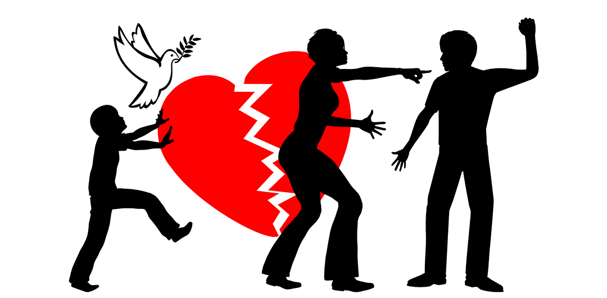

# 27 丨家庭角色：如何从固化到流动？

陈海贤

2019-09-01

27 丨家庭角色：如何从固化到流动？

丨陈海贤 亲述丨

懒人专属群的群友，。你好，我是陈海贤。

上一讲，我们学习了三角关系。三角关系是家庭系统运行的动力，运转久了，每个家庭成员都有了相对固定的角色和位置。矛盾越深，这些角色就越容易固化，无法改变。怎么打破这种固化的模式呢？这一讲，我就来说说怎样让家庭角色流动起来。

什么是角色呢？在一部戏里，有好人、有坏人、有英雄、有反派，这是戏剧中的角色。在现实生活中，角色的概念可以用来理解人和人之间的关系。

**判断别人的角色，也决定了你自己的角色。**  
毛主席说：“敌人的敌人就是我们的朋友，敌人的朋友就是我们的敌人。”什么意思呢？如果把这句话放到人际关系里，就是屁股决定脑袋。

角色的判断不仅决定你会站哪一队，还塑造了你对别人的立场、态度和情感。你对敌人的同情、亲近和好感会被压抑，而怨恨会被鼓励和保留。相反，你对朋友的同情和亲近会被放大，而怨恨就会被压抑。久而久之，副作用就是你对某个人的情绪和感受被你们俩的角色固化了，很难改变。

## 固化的角色影响家庭成员互动

我曾经遇到一个家庭，父母之间有很深的矛盾。妈妈总是跟女儿倾诉自己对丈夫的委屈和不满。女儿是在妈妈抱怨爸爸的声音里长大的，从小就帮妈妈出头反对爸爸。时间久了，妈妈和女儿之间的结盟就更巩固了。

这是一种典型的孩子被三角化的关系。在这种关系里，女儿的角色是代替爸爸，变成了妈妈情感上的伴侣。这个家庭里，父母的关系是对立的，这种对立的角色最初也许是因为夫妻矛盾，但却在长久的家庭情感互动过程中逐渐巩固了下来。女儿的角色是“妈妈盟友”和“爸爸反抗者”，直到长大以后，女儿回忆起自己的童年，才说：

“现在想起来，其实爸爸对我也不错。每次当我和弟弟闹矛盾的时候，比如争抢电视遥控之类，爸爸总是会站到我这一边。有什么好吃的，他也总是省下来给我吃。我想，他也是想接近我的。只是很长时间，我都一直看不到这一点。我没法接受他的好，他对我的好只会让我矛盾。只要他一天欺负我妈妈，我就一天恨他，甚至比我妈妈更恨他。”

为什么女儿小时候看不到爸爸的好呢？因为她一直扮演妈妈的盟友，这个角色让她只留意了爸爸很坏的一面，而忽略了爸爸的好。  
**角色塑造了她的眼光和记忆，让她没法对爸爸有好感。**

这种角色，不仅让女儿很难亲近爸爸，也让妈妈和爸爸的亲近变得困难。妈妈也不是没有想过改变。有一次，女儿又在激烈反抗爸爸，并说了一些类似“你不是一个合格的爸爸”这样的狠话，这时候，妈妈就站在爸爸这边，跟爸爸一起来指责女儿不懂规矩，不知道尊重长辈。

对于夫妻来说，这是正常的。就算他们有矛盾，他们也需要一起协作来管教孩子。但这个举动却引起了女儿强烈的反弹。她觉得自己被妈妈背叛了，伤心地控诉说：

“谁叫她每次都说爸爸不好。明明我是帮她，她自己却像没事人一样，跟着爸爸一起来指责我！”

为什么女儿会有被背叛的感觉呢？因为在这个矛盾重重的家庭里，谁和谁站在一边，就变成了一件很严肃的事。如果一个人站到了另一边，这就是背叛。

所以，成员之间就形成了一种固定的交往模式。 **久而久之，这种固定的交往模式，也固化了每个人的家庭角色，影响每个人对其他家庭成员的判断。**  
就算让每个人都痛苦，也很难改变。

就像这个例子中，女儿觉得妈妈当了叛徒，把她出卖了。这也让妈妈觉得非常内疚，所以又回到了和女儿结盟的位置，跟女儿抱怨爸爸的不好。于是，三个人就一直维持着这种不舒服的关系，无法动弹。

## 施害者、受害者和解救者

当家庭系统出现矛盾的时候，常常会出现三个典型的角色：施害者、受害者、解救者。当一家人陷入了这样的角色分配时，他们常常就变得很难亲近，而经常会相互指责，关系也会越来越僵。

我见过一个家庭，父亲在外面做生意，母亲辞职在家带孩子。孩子已经上初中了，不听爸爸的话，总是跟学校里的同学打架。

在咨询室里，这个爸爸说：“我在外面辛苦挣钱，结果妻子连孩子都管不好。我就是觉得她的教育方式有问题，太溺爱孩子了。”妈妈就在那边不说话，默默地流泪。而儿子呢，看到爸爸说妈妈，就开始帮妈妈反击，指责爸爸说：“你自己怎么样呢？你关心过我们吗？你除了指责我们还有什么？”

在这个例子里，就有施害者、受害者和解救者三个典型的角色。有意思的是，每个人从自己的角度判断，会有不一样的角色分配。

在父亲看来，自己赚钱养家，所以自己是解救者。因为妈妈没教育好孩子，才会让孩子变成这样，所以妈妈是施害者。孩子缺乏关爱，当然是受害者。

可是在妈妈看来，爸爸总是指责自己，把问题都推到自己身上，所以爸爸才是施害者，而自己是受害者。孩子是帮自己说话的人，所以孩子是解救者。孩子也同意妈妈的想法。

角色的判断也许来自人们以往的情感经验，也许有一定的现实依据。但是一旦陷入了固定的角色，人们就会在指责和斗争中找不到解决问题的办法，反而还会加剧角色的固化。

比如，当爸爸指责妈妈时，他觉得自己在解决问题，却没想到，在妈妈和孩子眼里，他变成了一个施害者。而妈妈用忍气吞声来回避问题，同样加固了妈妈受害者的角色。这样下去，家庭的矛盾也会不断升级。

而在一个宽松的家庭环境里，情况就有所不同，成员的角色就会有很多不同的面貌。

以我家为例，有时候我老婆冲女儿发脾气，我会把女儿抱到隔壁房间，并跟她说：“妈妈脾气真大！”我们俩会一起做鬼脸。这时候我和女儿是一伙的；

当我和妻子争论谁该洗碗时，女儿会说：“爸爸你去洗碗，妈妈最辛苦。”分桔子的时候，女儿会说：“妈妈吃大的，爸爸吃小的。”这时候女儿和妈妈是一伙的；

但更多的时候，是我和妻子作为父母站在一起教育女儿：“不能在这里拍球！”“快把自己的东西收拾好！”“再不听话爸爸妈妈要揍你啦！”这时候，我和妻子是站在一起的。

在这样轻松的家庭里，成员的角色是能够灵活流转的。别小看了这种流动，它很重要。重要在哪里呢？

**重要在，只有能够在不同的关系中扮演不同的角色，才会体会到更多不同的自我，才能接受对他人的各种复杂情绪，也能够更灵活地处理关系。**

当我和女儿联合起来反对妈妈时，女儿对我的爱和对妈妈的抱怨在这样的三角关系中就被表现和接纳了。反之，当她联合妈妈来反对我时，她对我的不满和对妈妈的爱也可以被接纳了。当我和妻子一起批评她时，她作为女儿的一面也被接纳了。

当角色不断流动时，女儿在每种关系中情绪会体验得更充分。这种情绪体验得越充分，她也就越能把很多矛盾和复杂的情感整合在一起，变成自己的一部分。换句话说，她就更能接纳自己。

那么，该怎么从固化的家庭角色中解脱出来，让角色在成员之间产生流动呢？有两个原则至关重要。

**首先，要有角色意识。**  
要想一想，家里的角色是怎么形成的？这个角色如何影响了家庭成员的沟通？如何影响了他们对彼此的看法和互动模式？如果陷入了施害者、受害者、解救者的角色中，要能跟家人挑明：彼此不是敌人，也不想站在谁的对立面。讨论每个人的角色，也许会比讨论表面的矛盾更重要。

**其次，重新回归夫妻和父母的角色。**  
有时候因为家庭运转的小剧本，让人忘了夫妻和父母本身就是同一种角色，这种角色规定了两个人应该站在一起，去共同解决家庭的问题。关于这一点，我们下节课还会再讲。

## 思考题

在你的家庭里，每个人有没有相对固定的角色？这个角色如何影响了你们的互动？

欢迎在评论区留言，和大家交流。

## 下节预告

下一讲，我会讲讲伴侣应该怎么处理和孩子的关系。

我们下一讲再见。

欢迎关注陈海贤的公众号，获取更多延伸阅读。

（微信搜索“陈海贤”添加关注，ID：haixiansalt）

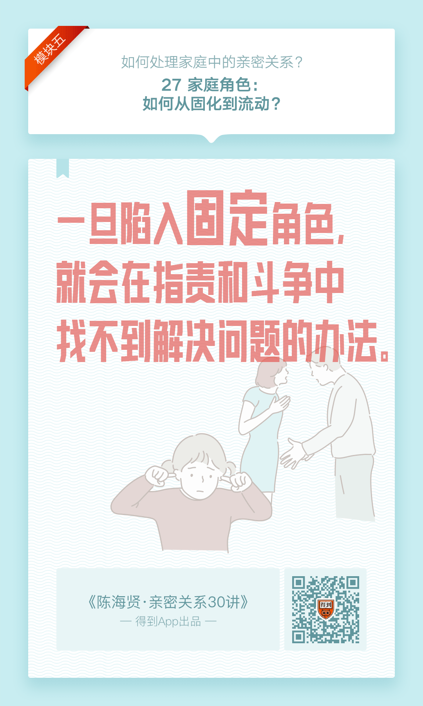  

* * *

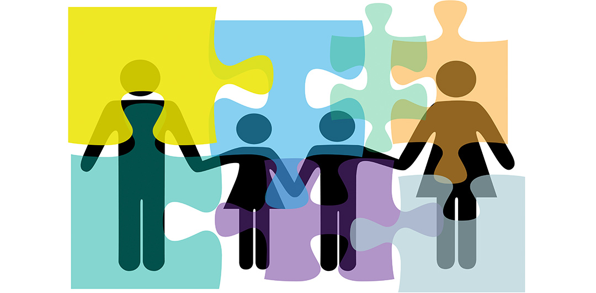

# 28 丨家庭结构：什么样的家庭最适合孩子成长？

陈海贤

2019-09-02

28 丨家庭结构：什么样的家庭最适合孩子成长？

丨陈海贤 亲述丨

懒人专属群的群友，。你好，我是陈海贤。

有一种说法叫“丧偶式育儿”，就是说通常在家里，一方成为主要的养育者，而另一方平时不参与或者很少参与。通常在中国家庭里，母亲承担主要的养育责任。

这种戏谑式的说法很容易被认为是父亲懒惰，不愿意参与家庭的工作。 **但更重要的原因是，母亲和孩子关系更近，造成了父亲被孤立的家庭结构。**  
如何避免“丧偶式育儿”呢？我们这一讲就来谈谈这个问题。

我见过一些家庭，母亲一直抱怨父亲不管孩子，但是当父亲要以自己的方式参与时，母亲却觉得很不习惯。

有的妈妈说：“我需要他帮我一起管孩子，但是需要按我的方式来，否则‘丧偶式育儿’就变成了‘诈尸式育儿’，还不如不要。”久而久之，父亲也乐得清闲。当父亲有一天想要去管教子女时，常常就会发现子女并不听他的话。这样，他就很可能变成一个只能指责和抱怨的旁观者。

## 夫妻是家庭最重要的子系统

在家庭系统里，夫妻关系永远是家庭运转的基石，也是最重要的子系统。夫妻需要有自己的空间，去表达亲密、处理冲突、商量事情。  
**要让夫妻子系统发挥作用，就需要夫妻站在同一边。**

在有孩子的家庭，如果家庭中的边界是划在父母和孩子之间的，那孩子就会知道，父母是一体的，爸爸批评孩子了，那爸爸的意见也代表了妈妈的意见。可是，如果父母的一方和孩子更亲近，就相当于在父母之间划分了边界，把父母一方和孩子划在一起，把另一方给划出去了。

就像“丧偶式育儿”，母亲和孩子一边，而父亲在另一边，那父亲会被排除在子系统以外，会逐渐失去父亲的功能。而母亲也会因为孤立无援，在情感上更加依靠孩子。

这种伴侣中的一方接近孩子，远离另一方的家庭结构，容易造成两个常见的问题。

**第一个问题是，把教育孩子，变成争夺孩子。**

我见过一个家庭，最开始夫妻因为儿子不听话的问题来找我咨询。他们的儿子刚刚上高中，总是顶撞父亲。而且一天到晚看手机，父亲叫他不要看，他也不听。妈妈也不希望儿子每天看手机，可是好像也没什么能做的，只是希望他们父子之间的关系能够改善，不那么紧张。

慢慢地，夫妻就讲到了他们养育孩子的矛盾。

在儿子小的时候，父亲对儿子的要求很高，总是希望儿子能够做到 100 分，可是妈妈觉得儿子做到 80 分就够了。两个人经常因为孩子教育的问题吵架，而这个孩子教育的问题，又夹杂着两人彼此之间的矛盾和冲突。吵着吵着，妈妈觉得吵得累了，就开始沉默了。可是矛盾并没有消失。她的沉默就好像在表达：“好，你总说我的教育方式没有用，那我倒是要看看你有什么办法。”

而这些孩子都看在眼里。很奇怪，当妈妈沉默了，孩子好像接过了妈妈的旗帜，开始反抗爸爸。事实上，儿子用反抗爸爸的方式，和妈妈形成了一个隐秘的联盟。而爸爸呢，越觉得自己在家里没有地位，不受尊重，就越是要通过教训孩子，来获得自己作为父亲在家里的地位。一家人就僵在这里了。

我对这个爸爸说：“你应该邀请你妻子，跟你一起来管儿子。否则你一个人，是不会奏效的。”

爸爸就问妈妈：“你愿意帮我一起管孩子吗？”

结果妈妈说：“我不愿意！”爸爸很震惊。因为妈妈已经很久没有表达过对他的不满了。

妈妈接着说：“我也想让孩子听话。可是你这么管孩子，我就是接受不了。除非你能改改你那些僵化的规则，什么几点之前一定要把澡洗好，周末一定要几点起床。否则我也不会愿意跟你一起管。”

丈夫很震惊，就问她：“你为什么不早跟我说？”

妻子就说：“我早就跟你说了，可是没用啊。说了你不听，说多了你又烦，干脆就不说了。”

虽然不说了，但是妻子知道儿子会替她发声，儿子心里也知道，妈妈是在背后默默支持自己的，自然就更加有恃无恐。这样父母对孩子的教育，自然就无从谈起。

也许你会说，问题出在爸爸身上，是爸爸对孩子的教育太严苛，妈妈才会反对的。 **可是我觉得教育理念没有这么容易分对错，更重要的是对错背后的关系。**

如果妈妈真觉得自己的教育理念更高明，那她也要问自己一个问题：为什么我的教育理念明明更好，可是丈夫却总是不听？

也许你会说，都是这个妈妈的问题，她怎么能不跟自己的丈夫站一边呢？可是你有没有发现，当丈夫在指责妻子时，表面上是指责妻子不管孩子，可他真正在意的是妻子和孩子的关系更紧密，自己争取不到孩子的爱。

这对夫妻把自己放到了争夺孩子的爱的位置上，这么看来，这个丈夫的做法跟妻子没什么不同，只不过他在这场斗争中失利了而已。

那真正的问题在哪里呢？问题就在于，这对夫妻没有站在一起。从家庭结构上，他们并没有变成有效的子系统。

很多父母都会焦虑，要怎么才能教好孩子？可是他们忽略了，要变成一对好父母，就要先变成一对好夫妻。只有他们站在同一阵营，才能有效处理孩子的问题。如果他们不去面对和处理彼此的矛盾，那他们就没法在感情上接近，也很难真的变成一对有效的父母。

**伴侣双方不站在同一阵营，这种家庭结构带来的第二个问题是，因为爱孩子，而疏远彼此。**

有时候，人们会以为，夫妻之间难以靠近，只是因为缺乏好的沟通模式。只要学会沟通，彼此之间就有机会亲近了。真的是这样吗？

我曾经观摩过一个个案。

咨询室里有一对夫妻带着一个孩子。丈夫说妻子没法控制自己的情绪，总是冲孩子发脾气。妻子却说：“每次我要教育孩子，孩子还没生气，你却总是很生气。你一生气就来骂我，这让我怎么教育孩子。我在孩子面前的尊严都没了！”

丈夫就说：“如果你能控制自己的脾气，我怎么会生你的气？你没看见自己发脾气的时候，连我都害怕，更何况孩子呢！”

两个人就在那边争起来了。而孩子呢，变得更难管教，最近还开始不去上学了。

在前面的课程里，我曾经讲过这种对抗的沟通方式（推荐学习《10 丨争吵：愤怒背后的悲伤》）。如果用指责的方式说话，对方是很难听进去的。咨询师也指出了这一点。丈夫很聪明，所以第二次来的时候，他就换了一种方式。

他轻声细语地跟妻子说：“老婆，我们还是要对孩子好一点，你说好不好？”

妻子笑了笑，把头别过去。她轻声说：“我哪有对孩子不好。我一说孩子，孩子还没生气，你就生气了。”

这个丈夫的心思，是用好声好语的说话方式，让妻子接受自己的意见。妻子享受了丈夫的好声好语，这是她喜欢的。可是她也听出了丈夫的弦外之音，就是：“你对孩子不够好。”这又是她不接受的。可是丈夫这么好声好语，她又没法大声反驳。

这时候咨询师说话了。她问丈夫：“你听到你老婆在说什么吗？”丈夫愣了一下。他也没觉得妻子讲的话有什么深意。

**咨询师说：“我听到的是，你老婆一直在说，你爱孩子比爱我多。”**

空气忽然安静下来了。妻子也没想到，这个长久的争吵背后，有自己对爱的纠结。而细细想来，这种纠结又是真的。她轻轻地说了声：“对。”

咨询师问丈夫怎么想。丈夫说：“听了这话我很愧疚。我一直觉得在我心里老婆和孩子没什么差别。”

妻子说：“肯定是不一样的。”说着说着，她就哭了。被丈夫放到对立面的委屈，涌了上来。

咨询师问妻子：“你为什么这么难过呢？丈夫爱女儿有错吗？”

妻子说：“他爱女儿没错。可是他把我当敌人，不再爱我了。”

丈夫赶紧插话说：“老婆不是这样的，我也是爱你的。”

这对夫妻背后，有很多家庭的影子。有时候，伴侣在教育孩子的事情上有矛盾，就会觉得是彼此沟通有问题。可是很少有人注意到，有时候没法沟通，不是沟通的方式不对，而是你把对方放到了自己的对立面。

所以，在有孩子的家庭，什么才是夫妻相处的根本之道？

**答案就是，把伴侣和自己放到一个阵营里，而把孩子放到另一个阵营。把边界划在夫妻和孩子之间，而不是相反。**

当你这么做了就会发现，自己看伴侣的眼光不一样了，会把伴侣当作伙伴，而不是对手。无论两个人有什么样的矛盾，都知道彼此才是最亲近的人，不用担心孩子妒忌或者被冷落。孩子是乐于见到父母恩爱的。而当一对好夫妻，守护夫妻和孩子之间的边界，也是做好父母的秘诀。

## 思考题

在你的家庭里，孩子和父母的边界是怎么划分的呢？

欢迎在评论区留言，和大家交流。

## 下节预告

下一讲，我来讲讲如何处理婆媳矛盾。

我们下一讲再见。

欢迎关注陈海贤的公众号，获取更多延伸阅读。

（微信搜索“陈海贤”添加关注，ID：haixiansalt）

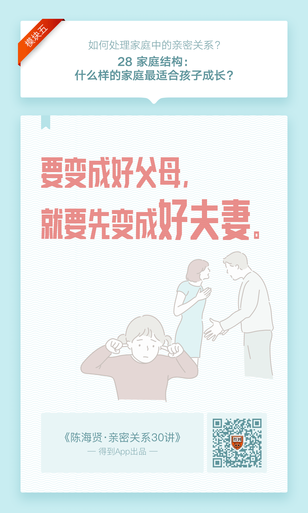  

* * *

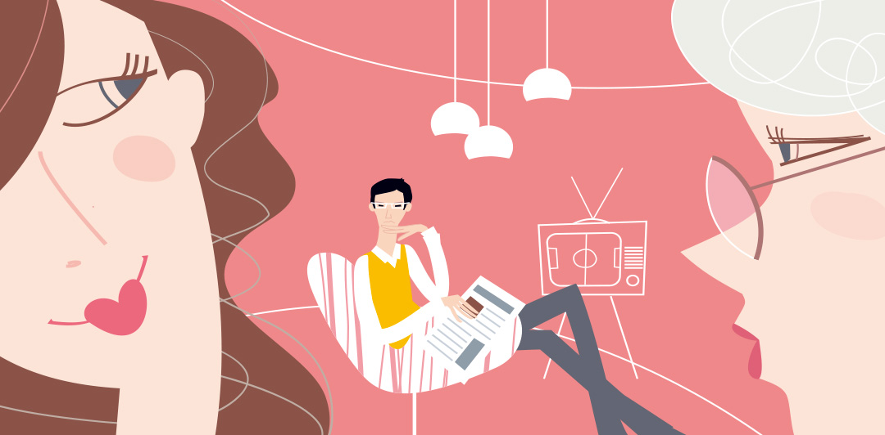

# 29 丨子系统：如何处理婆媳难题？

陈海贤

2019-09-03

29 丨子系统：如何处理婆媳难题？

丨陈海贤 亲述丨

懒人专属群的群友，。你好，我是陈海贤。

作家六六曾经写过一本书，叫《双面胶》，讲的是一个家庭的婆媳矛盾如何发展成了家庭的悲剧，本来恩爱的夫妻，因为一次激烈的冲突，儿子在婆婆的怂恿下杀死了自己的妻子。这当然是一种非常夸张和戏剧化的表达，但也确实说尽了婆婆、媳妇、老公三人相处的艰难。

为什么婆婆和媳妇之间的相处这么难？夫妻究竟该如何理顺与上一代的关系？这一讲，我就来讲讲这个家庭中的千古难题：婆媳关系。

婆媳的关系为什么这么难处理？表面的原因很简单：老公是自己选的，但婆婆不是，而是“买一赠一送的”。媳妇跟老公之间多少是有感情的，不然也不会结婚，可是跟婆婆却未必。很多女性是只爱自己的老公，并不喜欢老公的妈妈。而一旦两个不爱的人生活在同一个屋檐下，要配合着一起做事，自然就会有很大的问题。

有的人可能会想：一家人要相亲相爱才对，妻子如果不爱自己的婆婆，那就是妻子不对，是她不孝顺。

并非如此。如果说，夫妻之间是靠情感联结在一起的，是讲情不讲理的。那婆婆和媳妇之间，反而是讲理不讲情的。  
**婆婆和媳妇是要靠尊重和规则来维持的，即使彼此不那么喜欢对方，也需要保持一份表面的尊重，为了这个家和共同爱的人。**

可是，有时候保持这种表面的尊重也很难。这背后又有更深的心理原因。

## 婆媳争吵的核心是家庭角色

我见过一个家庭，最初婆婆和媳妇不住在一起，一家人都相安无事。后来有了孩子，婆婆就到家里来帮着带孩子，矛盾开始出现了。

媳妇对婆婆每次洗碗了有没有把碗晾干，孩子喂奶的频率，教孩子的方式都有很大的意见。而婆婆呢，听到媳妇的这些意见，就是沉默不说话，但暗地里却一点都不改。于是就变成了媳妇追着婆婆说：“我跟你说过多少次了！”而婆婆用沉默抵抗。家里的老公呢，看妈妈这么委屈，有时候就帮妈妈。妻子和丈夫的关系也开始不好了。

这个媳妇到底在说什么呢？

当一个家庭有另一个女人出现的时候，两个女人之间实际上是有一定竞争关系的。  
**除了竞争丈夫的情感之外，一个核心的问题是：这个家到底谁说了算？谁才是这个家庭真正的主人？**

从这个角度，你可以理解这个媳妇所做的所有的事情，都是为了告诉婆婆：我才是这个家里的主人，你得听我的。如果在这件事上没有得到确认，那么孩子的养育方式、家具的摆放、家里该做什么菜，以及老公应该听谁的，都会变成争论的议题。

有些婆婆愿意顺从这个规则，“听你的就听你的，我承认这是你家”。但并不是所有的婆婆都愿意承认这一点。

一来，家里的老公是自己这么多年拉扯大的，妈妈和儿子的感情恐怕不会比夫妻感情浅，儿子也不能娶了媳妇就忘了娘。二来，人们都说尊老爱幼，自己年纪比媳妇大，养孩子也比媳妇有经验，凭什么都听媳妇的？三来，自己是来帮着带孩子的，这么辛苦，媳妇连一句感激的话都没有，还到处埋怨，凭什么呢？

婆婆的抱怨也不是没有道理。这时候老公就左右为难了，该帮妈妈，还是该帮媳妇呢？有些老公马上会倾向于帮妈妈了，另一些老公呢，就会说：“看具体的事，谁有道理帮谁。”看起来很明事理，其实是逃避了问题。

**因为，婆婆和媳妇不是为具体的事情争吵，而是为事情背后的家庭角色，也就是谁是这个家里的女主人而争吵。**  
无论具体的事情是什么样的，老公必须在这件事上有所表态。

## 解决婆媳难题需要夫妻统一阵营

那究竟该听谁的呢？我的答案是，听妻子的。都说清官难断家务事，我为什么敢完全一边倒？

上一讲我曾经说过，在家庭关系里，夫妻是家里最重要的子系统，也是家里的支柱。如果夫妻中的一方和孩子结成了联盟，而孤立另一方，那这个家庭就会变得不稳定。同样，如果夫妻中的一方和各自的原生家庭结盟，而把伴侣孤立，那夫妻的子系统就会失去它的功能，这同样会导致家庭的不稳定。

**所以，当妻子和婆婆产生矛盾时，丈夫应该站在妻子这边来维护妻子的地位。**  
其实，这个原则放在女婿跟丈母娘家的关系也适用。这跟具体的事情无关，而跟家里的位置有关。

如果丈夫跟妈妈表态：“妈，你就别多说了，我觉得还是应该听我老婆的。”老婆就知道丈夫是站在自己这一边的，自己才是家里的女主人，她就会学会行使女主人的职责，维持这个家的和谐和稳定，包括怎么处理和婆婆的关系，才能让家庭运转得更好一些。她就能和丈夫相互扶持，一起来商量这件事。

相反，如果妻子不确定自己是在家庭女主人的位置上，她就很难去思考怎么去维持家庭的和谐和稳定，而只会思考怎么去争夺这个位置。

这听起来像是公司或者组织的运作：要先确定了这个组织的领导核心，这个组织才能有效运作，来处理事情。而夫妻永远是这个家里的领导核心。妻子需要的不是一个虚幻的权力，而是丈夫实实在在地在情感上支持自己，和自己站在一边。只有这样，他们才能一起处理家庭里的各种难题，包括该怎么跟婆婆相处。

所以，如果说当好父母的关键是处理好夫妻关系，那处理好婆媳关系的关键，也还是处理好夫妻关系。只有夫妻站在同一阵线，和上一代的家庭成员之间有一定的边界，这个家才能正常运转。

曾有一对家庭，因为家里的矛盾来找我。这两家的父母，轮流来帮这对夫妻带孩子。本来这是挺好的事，却成了夫妻矛盾的开端。丈夫觉得妻子不待见自己的父母，对自己的父母很不公平，所以总是想出面来维护父母的利益。妻子同样维护她自己父母的利益。

有一天，他们带着孩子到公园里散步，有邻居碰到了，就说：“哇，这孩子好可爱。你们是谁在带这个孩子呢？”妻子随口说：“是我爸妈。”

丈夫听了就很生气，回去就跟妻子说：“你凭什么只说你爸妈，不说我爸妈呢？他们这么辛苦，你怎么能提都不提他们呢？”

妻子也很生气，说：“你也太敏感了，我说的不是我爸妈，明明是我们爸妈。再说了，你爸妈带孩子的时间，哪有我爸妈多？”两人就吵了起来。

这个家庭的问题在哪里呢？ **在于当他们在为谁家的父母功劳大争吵的时候，他们其实不是一对夫妻，而是各自家庭的代表。**  
他们之间有一条明显的边界，把他们都归到了各自家庭的阵营。

这种错误的边界划分，在家庭生活的很多方面都会带来问题。比如，老公和他的父母在一起的时候，他们会用家乡的土话交流，而妻子听不懂这种土话。语言就是一种边界，把有共同语言的人划在一起，而把不懂这种语言的妻子划到了另一边。

每当这时候，妻子就会很生气。她觉得自己被排除在外了，可是又没法表达。她就会借孩子的理由说：“你们以后不要说土话，这样孩子以后混淆了，普通话就不标准了。”可是父母也会很生气，觉得媳妇是不可理喻，一家人就僵在那里了。

还有一次，妻子看到有一个很好的民宿在做团购，就问老公要不要去那边度假。老公说：“好啊！爸妈这么辛苦，带他们也一起去吧！”妻子当时就觉得很扫兴，就说：“那不去了。”老公也很生气，觉得老婆对自己的父母有成见。

其实这些矛盾的背后，都是边界的问题。表面上，这对夫妻一直在吵的，是对方该不该这样对自己的父母，可是他们不明白，他们真正应该关心的问题是：究竟谁和谁才是真正的一家人。

夫妻的子系统是需要边界来保护的。只有夫妻站在一起，他们才会有那种“我们是一家的亲密的感觉”。

可是，一旦亲密关系出现了矛盾，夫妻都习惯从自己的父母那边去寻求帮助，也都习惯去维护自己父母的利益。  
**当他们都跟自己的原生家庭更近的时候，夫妻的子系统就开始变得空心化了。两个人的关系，也会变得越来越冷漠。这是所有婆媳难题的根源。**

而克服这个难题最难的地方，是父母和子女有天然的亲近感，但是却要克制这种亲近。和伴侣站在一起，自然就要和自己的原生家庭保持距离。

父母总是疼自己的孩子的，甚至比自己的伴侣还疼爱一些。就像一个陷入婆媳矛盾的婆婆说的：

“我的儿子二十多年来，吃什么、穿什么、用什么，都是我把他照顾得好好的，没让他受过一点委屈，吃过一点苦。可是他老婆对他一点都不好。我怎么能忍受他结了婚，反而过得不如从前了呢？”

而这时候，儿子却要坚定地拒绝这种好，并跟妈妈说：“这是我们自己的问题，我们会处理好。”这很难，可是为了家庭的顺利运作，就必须做到。

## 思考题

你见过哪些相处得很好的婆媳关系？她们的相处有哪些特点？

欢迎在评论区留言，和大家交流。

## 下节预告

下一讲，是我们这门课的最后一讲，我们来讲讲应该用什么态度对待亲密关系。

我们下一讲再见。

欢迎关注陈海贤的公众号，获取更多延伸阅读。

（微信搜索“陈海贤”添加关注，ID：haixiansalt）

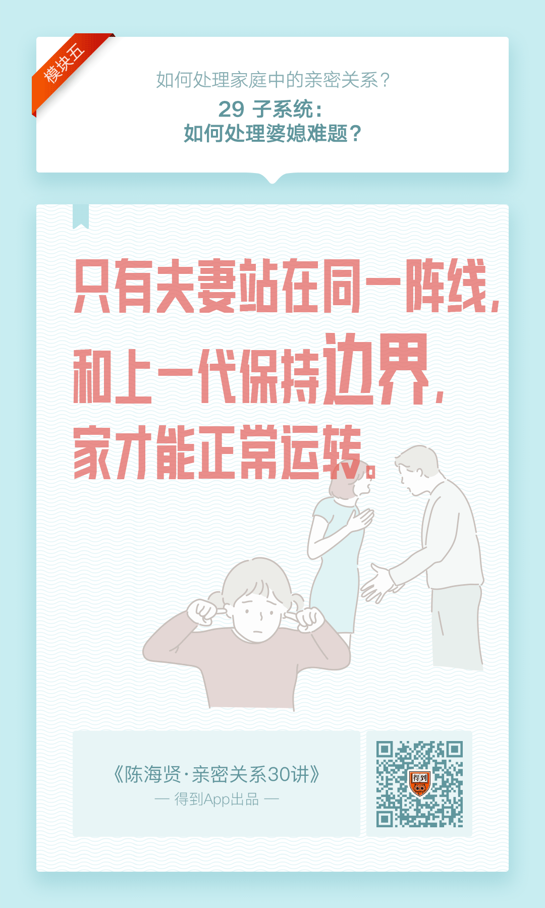  

* * *

# 30 丨结语：亲密关系，最艰难的创业

陈海贤

2019-09-04

30 丨结语：亲密关系，最艰难的创业

丨陈海贤 亲述丨

懒人专属群的群友，。你好，我是陈海贤。

我们的课程从亲密关系的准备、关系的沟通、关系的空间、分离和背叛，讲到了家庭中的亲密关系，到这一讲已经接近尾声了。在课程的最后一讲，我想跟你谈谈，人应该用什么态度对待和经营亲密关系。

美国知名剧作家斯蒂芬·松德海姆（Stephen  
Sondheim）曾经写过一个音乐剧，叫《公主走进黑森林》。音乐剧的第一幕，是我们熟悉的童话故事：灰姑娘嫁给了王子，长发公主被从塔里拯救出来了，小红帽从大灰狼的口中逃脱。所有的故事，都有了完美的结局。

可是故事的第二幕，每个角色都开始不满，都希望得到别的东西。在嫁给王子以后，灰姑娘感到空虚，想通过策划一个节目来寻找生活的意义。她对白马王子的幻想破灭了。而王子对她和她的欲望感到厌倦，希望自己当初追逐的是睡美人。长发公主变成了母亲，原生家庭带给她的影响让她变得歇斯底里，而她的王子开始对她感到恐惧，渐渐疏远了她。小红帽更是对祖母的死深感绝望。她们都漫无目的地在森林里游荡，希望能找到新的故事线索。

如果说，亲密关系的开始，像是人们所熟悉的童话，王子和公主幸福地生活在一起了，那么随着亲密关系的发展，人们也会进入人性最真实的黑森林。

**这里有爱的甜蜜，也有背叛的痛苦；有成长的喜悦，也有迟到的领悟；有难言的委屈，也有意外的感动；有欲望和挫折，也有平静和失落。唯一没有的，就是一个既定的剧本。**

它不是任何书本的故事，也不是任何别人的故事。它是你和你的伴侣的故事，是你们在每一次的互动中共同写成的亲密故事。只有你们才能决定这个故事是怎么样的，也只有你们才能决定，你们最终会在这个黑森林里找到怪物还是宝藏。

但无论如何，亲密关系是一个发展的故事。它不是一蹴而就的，也没什么理所应当，关系是在不断发展的。原来确认过眼神是对的人，慢慢也会变成不对；原来是不那么对的人，慢慢也会变对。好的感情需要两个人经历很多事，跨越很多难关，才能获得。

**这其中的关键在哪里呢？在于你用什么态度对待和经营你的亲密关系。**

如果用经济活动作类比，人们对亲密关系一直有两种态度。 **一种是投资者的态度。**  
你可以把自己当作投资人，努力选对项目，也就是伴侣，投入资源，通常是在一起的感情和时间，然后等着收益。

如果你对这个创业者不满意，或者这个项目黄了，你可以换个项目重新开始。当然，投资人跟创业者也有配合，但总体来说，投资人是置身事外的。

**而另一种态度，是创业者的态度。**  
创业也包括了选择项目。但这只是公司能否经营好的开始。创业还要经历无数的事情：与合伙人的磨合、应对市场的变化作出策略调整、员工管理……它一直在对创业者的能力提出挑战，是一个不断变化的、连续的过程。

用投资者的态度来思考爱情，我们会觉得亲密关系好不好，是人的问题，而不是相处或磨合的问题。所以，你会等着对方把他的事做好。

你会考核对方，看看他是不是合格。如果他没做好，你就会责怪他，甚至威胁要撤资，换一个项目再投。当然，对方也会反抗这种考核，他会想：“我也投入了感情，怎么就变成一个被考核的人了呢？”一个不断考核，另一个厌烦、抗拒、逃避考核，于是形成恶性循环。

可是，如果用创业者的态度来思考爱情，那你就会知道，要让一个项目成功，你必须倾其所有。你不会因为遇到问题而觉得当初选的项目不对，因为创业就是遇到问题解决问题。你也没有什么人可以怪罪，也不会等着别人来救你。  
**它是你的事，你就是那个最终为项目的成败负责的人。**

一行禅师曾说：“当你种莴苣时，如果它长得不好，你不会怪那棵莴苣，你会去找它长得不好的原因。它可能需要施肥、浇水或者少晒点阳光。但是，如果我们和爱人产生了问题，我们却会归咎于对方。”

这可真是奇怪。人们总觉得爱情是一种特质，当关系出现问题的时候，就会责怪对方缺少这种特质。可是，爱情其实是一种能力，一种在亲密关系的经营中逐渐培养出来的能力。但前提是，你用一种创业者的态度，在努力经营它。

家庭治疗大师米纽庆说：“一个理想的家庭，其实就是一个有修复能力的家庭。并没有一个家庭是没有冲突、没有问题的。只要这个家庭具备了修复冲突、解决问题的能力,  
那它就是一个足够好的家庭。”

在我的咨询室里，在解决了夫妻之间当下面对的问题以后，他们经常会问我：“老师，别的家庭都是什么样的？他们会不会遇到像我们这样的问题？”我说当然会。

事实上，我从来没遇到过没有问题的家庭。像是做家务怎么分配、在教育孩子上有分歧、怎么处理婆媳关系这类问题，几乎在所有的家庭中都存在。  
**区别不在于有没有这类问题，而在于有没有解决问题的能力。**

他们也会问：“那我们这个问题解决了，接下来还会遇到问题吗？”我说当然啦。

投资者只看到公司的利润，只有创业者知道这个利润是怎么来的。同样的，有些夫妻只看到别的夫妻这么恩爱，抱怨自己的爱情不够好，却没有看到别人的恩爱是怎么来的。好的爱情，都是在经营中发展来的。

## 亲密关系经历的四个时期

英国心理学大师杰夫·艾伦（Jeff Allen）在他的著作《亲密关系的秘密》里说，亲密关系会经历四个阶段：蜜月期、权力竞争期、死亡期和伙伴期。

在蜜月期，人们会被爱情冲昏头脑，为找到彼此满心欢喜。可是这段时间并不长。当蜜月的光环褪去，伴侣就慢慢进入了权力斗争的时期。在一次次徒劳的斗争中，他们越来越发现伴侣的面目可憎，无法容忍。他们开始变得倔强，非要说服对方变成自己心目中的样子才会甘心。这背后，有他们心里最深的渴望，他们希望伴侣来满足它。

权力斗争久了，两个人也累了，关系就会进入死亡期。这时候，两个人已经失去了争吵的动力。他们放弃了去寻找自己的亲密关系，而学着模仿亲密关系的范本来经营。内心最真实的需要和感受被忽略了，取而代之的，是怎么样做才是得体的、恰如其分的，像是一对恩爱夫妻的样子。

人们进入了一段假性的亲密关系，他们努力表现出应该成为的样子，可是他们心里的某些部分，又知道这不是真的爱情。对方的魅力已经丧失殆尽，自己也不再能吸引对方。这时候很多人会出轨、离婚、想要逃离家庭，重新找到爱的激情。

如果幸运地跨越了这个阶段，亲密关系就进入了一个新的阶段：伙伴期。人们会重新找到跟彼此的相处方式，重新跟彼此联结。人们会找到一个好的位置，相依相伴，独立又亲密地在一起。

究竟靠什么能穿越死亡期，来到伙伴期呢？ **我想，也许是对自己和伴侣的重新发现，以及对人的重新发现。**  
正是这个重新发现，让自己和自己、和伴侣、和世界和解了。有人说，好的爱情，就是一次次重新爱上同一个人。就是这个道理。

既然这一讲以童话开始，那我就以童话来结束。这个童话你可能听过，名字叫《老头子总是没错的》。

故事讲的是乡村里有一对贫穷的老年夫妻，老太婆让老头子把家里唯一值钱的马拉到镇上换点东西。结果老头子先用马换了一头母牛，又用母牛换了一只羊，再用羊换了一只鹅，又用鹅换了一只母鸡，最后用母鸡换了一大袋烂苹果。老头子扛着一袋烂苹果到一个小酒吧歇脚的时候，遇到两个有钱的英国人。英国人听了他的经历哈哈大笑，说他回去一定会被老婆骂一顿。老头子说：“肯定不会。我老婆肯定会很高兴地夸我，老头子总是没错的。”于是英国人就用一袋金币为赌注，一起跟老头子回家。

回到家以后，老婆婆看到老头子回来很高兴。老头子每跟老婆婆讲他的一笔买卖，她都由衷赞叹老头子做得好。最后讲到烂苹果的时候，老婆婆说：

“太好了！我知道你今天要回来，本来想给你做香菜鸡蛋饼。我这里没有香菜，就问隔壁的老师太太借。可是那个老师太太说，‘我连一个烂苹果都不会借给你。’现在我们不仅不用借她的，还可以借给她十个，甚至一整袋的烂苹果，这事想想可太好笑了。”说着就吻了老头子。英国人一看，只好输了一袋金币给他们。

以前看这个童话的时候，只觉得这一对老夫妻真傻，后来见到不幸福的夫妻多了，才知道他们是聪明的。可是现在我会想，这对夫妻究竟经历了什么，才能变成现在这样？

他们也许也经历过王子和公主式童话的幻灭，妻子也许也为丈夫的无知愤怒和懊恼过，丈夫也许曾想过要逃开自己的妻子。他们一定是经历了很多事情，才发现了亲密关系真正的秘密。故事里的那袋金币，其实不是英国人给他们的，是他们在亲密关系中自己创造的。

## 思考题

这门课对你最有启发的三个点是什么？你会怎么把这些点应用到生活中去？

欢迎在评论区留言，和大家交流。

愿你和你的爱人，也能在你们的黑森林里，找到宝藏。再见！

欢迎关注陈海贤的公众号，获取更多延伸阅读。

（微信搜索“陈海贤”添加关注，ID：haixiansalt）

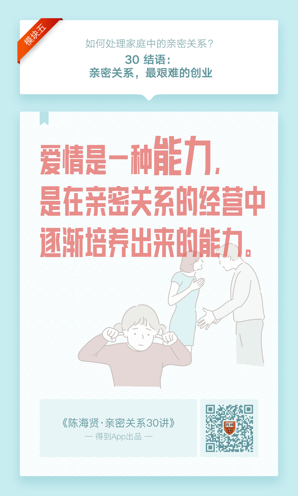  

* * *

# 总结

更多内容，见咱们*懒人专属群*的群文件和群公告！

懒人专属群介绍：[`lazybook.fun/#/blog/group`](https://lazybook.fun/#/blog/group)

专属群更新记录：[`lazybook.fun/#/blog/record2`](https://lazybook.fun/#/blog/record2)

懒人通才计划：[`lazybook.fun/#/data/13\_course`](https://lazybook.fun/#/data/13_course)

懒人手册：[`lazybook.fun/#/`](https://lazybook.fun/#/)

