# 靳大成《论语》通读（下册）

## 发刊词 | 为什么要一字一句读《论语》

你好，我是靳大成，欢迎来到我的《论语通读》，我们一字一句，读懂经典。

对于大部分中国人来说，只要受过初等教育，《论语》总能背出几句，不管是“学而时习之，不亦说乎”，或者“知之者不如好之者，好之者不如乐之者”，再有“三十而立，四十不惑，五十而知天命”，就算纸面上没见过，听总总是听过的。不过，完全通读整部《论语》的现代人，真不多。

这门课，我会带着你把《论语》从《学而》开始到《尧曰》结束，总共20篇通读下来。咱们一边读，一边讲，一句不落后。

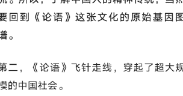

我叫靳大成，退休前在中国社会科学院文学研究所，做文艺理论研究。从2005年起，我用自己的业余时间带着年轻人读传统经典，像《论语》《庄子》《老子》《五子》《荀子》《左传》《六祖坛经》什么的，包括柏拉图的《对话录》都读。

通读经典当然重要，但是今天读跟古人读经典可不一样。今天跟古人处在一个大变化的社会，每一个人都会从各种各样的冲击，面对形形色色的人生选择，还要应对未来各种不确定性的挑战，四顾茫然，心无所依。越是这样的时刻，人就越应该回到经典，寻找重要的精神滋养。

今天，为什么应该一句一句读《论语》，我给你五个理由——

- 第一，《论语》是中国人精神世界的基础代码。它既是儒家原始思想的精华，也是后来2500年来在中国流行最广的入门教科书。“子曰：学而时习之，不亦说乎？有朋自远方来，不亦乐乎？”不光是中国人，不懂儒家传统读的书人，从小进私塾，《论语》要倒背如流。所以，了解中国人的精神传统，当然要回到《论语》这张文化基因图来。
- 第二，《论语》飞针走线，穿起了超大规模的中国社会。中国空间上疆域庞大，时间上绵延几千年，这个国家是怎么维系起来的？用《论语》来解释，最核心的秘密是仁。什么是仁？仁就是人和人之间的关系。《论语》说仁者爱人，也指从发端是血缘关系，是入孝出悌，就让人一开始怎么对待父母、对待兄长出发，用同一套逻辑推演了怎么对待朋友，怎么对待上司，怎么对待君主和国家。这套家国同构的政治追求，维系了中国古代庞大的体系始终不散掉，让我们的民族具备惊人的生命力，无论历史上曾经跌到中国这样国家的都能再次反弹、崛起。中国这样国家的都国家再次反击，那就越大，那我们的强大从哪里来，你搞不清楚。
- 第三，《论语》塑造了中国人的理想人格。君子之风“温良恭俭让”，这是传统中国人君子相的模板。直至今天，如果哪个中国人是很（君子），他还是会很高兴，你要说一个人是小人，他总会很生气。这个社会共识从哪里来？就是从《论语》里来的。书里提君子提了100多次，怎么做君子，方方面面说得清清楚楚。在中国，如何做“一个更好的人？《论语》提供的答案既清楚，又完备。
- 第四，《论语》的格言大义，已经深深嵌入中国人的日常生活。一般人说起《论语》，都只记得只言片语，所以难免断章取义。比如听到“父母在不远游”，你可能疑惑，这不是把孩子困在家里不出门吗？但是通读《论语》，你才知道后面还有半句：“游必有方。”是你出门，得让父母知道你去哪儿，是不是走正道，重点在后半句话。再比如“唯女子与小人难养也”，多少女性听到这话对孔子有意见，但同样后半句才是重点：“近之则不逊，远之则怨。”才是，近了不够尊重，走远了又落埋怨。你仔细体会这句话后半句的人情道理，真是佩服老先生啊！只有完整通读《论语》，你才能真正获得中国社会的通达自如的大智慧。
- 第五，《论语》创造了中国人基本价值观的高频词汇。这么一本薄薄的书，总共不到16000字，但汉语系统承载了三百个成语：温故知新、不亦说乎、三戒四不、既往不咎、见贤思齐、安贫乐道、适可而止、言之有信、乐言观色、讷言敏行、见义为勇、乐山乐水……这些成语，抬头不低头就见到，日用而不觉，习焉不察，也就是说大字不识的村夫农妇，你不都说成也说过《论语》。在某种意义上，不是你在说《论语》，而是《论语》在说。”

所以说，《论语》是一部薄薄的密码本，大到理解中国史前龙蛇飞部，小到理解习俗的前因后果，都可以回到《论语》里面，一字一句对密码。

《论语》这部书，中国人学了2500年，也用2500年，它值得你用时间从头到尾学一遍。知道自己是哪里来，面对急速变化的社会，你就明白应往何处去。读书有两种方法，一是把厚书读薄，对于大部头，要有通读全局、提纲挈领的本事。另一条路呢，是把薄书读厚。通读《论语》，肯定是后一种。

《论语》只有15000多字，但理解它，得放中国这个大时代，得跟上《诗经》《左传》《史记》等书等它的书，还得参考孔子前后那些其他思想家——老子、墨子、庄子、孟子、韩非子等等。最后，孔子的影响力不仅在中国大地，也在东亚，你也要跳出中国人的天地，把国外汉学家的最新研究成果带到这个课程里面。课程的上半部，我们结束了《论语》的第十篇《乡党》。这是咱们《论语通读》的下半部，从《论语》的第十一篇《先进》，一直读到最后一篇《尧曰》。如果你已经学过了上半部《论语》，我会陪伴着你也能跟上下半部课程了。我会陪着你，一字一句，读懂《论语》。

## 01 | 孔子对颜回有什么不满

11.1 子曰：“先进于礼乐，野人也；后进于礼乐，君子也。如用之，则进野人也。”
11.2 子曰：“从我于陈、蔡者，皆不及门也。”
11.3 德行：颜渊、子贡、冉牛、仲弓。言语：宰我、子贡。政事：冉有、季路。文学：子游、子夏。
11.4 子曰：“回也非助我者也，于予与何言。”
11.5 子曰：“孝哉闵子侍。不违，不背。事父母，其有孺人。”
11.6 南容三复白圭。孔子以其兄之子妻之。

你好，我是靳大成，欢迎来到我的《论语通读》，我们一字一句，读通经典。

如果听众有看了《论语通识》（上部）50讲，听完了我的这个课程，继续学习《论语》，你就会更深入具体地理解孔子的思想世界，会得到更为深刻和丰富的理解与贯通，我们会一起加油！

《先进篇》相当集中地展现了孔子对他的弟子的评价，特别是对颜回、子路的评价。这一章史料价值非常高，是历代学者们对颜回的评价依据。这一篇里还有特别著名的《侍坐章》，千古传诵，影响了历代的文人墨客。

### 11.1 子曰：“先进于礼乐，野人也；后进于礼乐，君子也。如用之，则进野人也。”

孔子说：“先学习礼乐而后在做官的人，是（原来就带有禄命的）乡民；后当官再学习礼乐的人，是野人。如果要选用人才，那我主张选用先学习礼乐的人。”

这里呈现的是野人与君子的对比：野人，是指有爵禄文的人或世家子弟辈；君子，指有爵禄地位的文世袭贵族子弟。

所以你看，语言的变化是有惯性的。孔子这里用的“君子”是在原来大家习惯使用的意义上，表明比社会地位较高的。先说与后世，后者有先学习礼乐的人有机会做官，后者是指先有官做后学习礼乐的人。

在整个周代，人们因社会地位和居住在城内外不同，社会存在有贵族、平民和乡野之人的区分。

孔子认为，那些原来就有爵禄的人——因为在晋以前，并没有接受系统教育的系统教育——还认为这样做不妥，便会世袭或者有直接传承为做官的机会。这样的人，可不是孔子心中的首选。

而那些本来没有爵禄的平民，在他们还未进入仕途以前，如果已经全面系统先学习礼乐知识，就应当做官后先具备什么知识、行为举止，如何履行职责，怎样当一个好官，这才是孔子的首选。

所以你看，这段话说明，孔子可能是在和同代或者身后的评论选人才的优先条件和标准。在当时氏族贵制制时代，孔子的这个选择，离它看破石破天惊，发蒙振聋。

生活在变化，完全石破天的基础已经被历史撕开了一个裂缝，社会生活出现了全新的可能性。对此，孔子不但反对，而且大力提倡。

如果你还记得我们在《论语》上部分讲述的孔子的学生，他们的出身多半都来自“野人”里。土阶层的兴起，正在改变先秦社会的传统用人方式。

在孔子去世后不久，墨子、孟子、庄子、荀子、商鞅、公孙龙，以及他地各国激进的纵横家的辩士们，上演了一台台波澜壮阔的历史大剧。土阶层的黄金时代马上就来到了。

### 11.2 子曰：“从我于陈、蔡者，皆不及门也。”

孔子说：“曾跟随我在陈国、蔡国受困的学生，如今都已先在我身边了。”

这应该是孔子返鲁乡后说的话。当年困于陈、蔡，死于蔡，是于陈国，弟子们老老师经历艰难困苦。生死考验，曾经的风雨同历历险。现在同学门都出仕了，各有作为，在原师遭遇困难时候陪伴、子夏、冉有、子产等人都不在身边，而颜回、子夏、子路、子贡等人都不在身边，这该是一种什么样的心情呢？

### 11.3 德行：颜渊、闵子、冉牛、仲弓。言语：宰我、子贡。政事：冉有、季路。文学：子游、子夏。

德行好的有：颜回、闵子、冉牛、仲弓。善于辞令的有：宰我、子贡。善于从政的有：冉有、季路。通晓古代文献的有：子游、子夏。

这一章非常首要，著名的“孔门四科十哲”的说法就出自这里。你注意，四门中德行排第一。

孔子弟子门什么要排分门呢？历来对此有不同说法。德行门排第一位，这个意思好懂。不用多说，孔子开的学校就是培养君子人格的嘛。

言语门第二，说明孔子对语言表达的重视。你可能会想到，前边不是说孔子要求学生言而敏于的人吗？不错，这里指的修学历程或为人处世的方式、风格，但不表示不重视语言问题。

- 这里的“言语”，主要含义是从事务和国家互动场合中的辞令，这个语义和社会、实际治行行动直接相关的。
- 孔子通晓分科，说明孔子对语言表达的重视。
- 在言语的问题上，除了强调实际的行动外，道调不能少说言语本身的重要性。

文学放在最后，怎么理解呢？文献典故知识不重的当不好，更不是重要的，学，孔子就不会单独把它列为一门了。

典籍文献知识的学习，是必要的工具，进学的必备条件，大六艺六艺是重要，如果你只会背书，本文学习很好却不能上下，不运用，不能解决实际问题，在孔子看来就是小人物。

这种把大家按照分类的方式来，《论语》这个了《分类》这样的文献组织原则，整个书都是按照这种类安排式的。

### 11.4 子曰：“回也非助我者也，于予与何言。”

教学模式。

### 11.5 子曰：‘孝哉闵子骞！人不间于其父母昆弟之言。’

孔子说：‘闵子骞真是孝顺呀！人们对于他的父母兄弟称赞他的话，没有什么异议。’

间，就是非议、挑错的意思；昆，就是哥哥、兄长。

上篇我们讲过闵子骞，历来对他的孝行人们都称赞赏有加。我曾在密云采风，采访过几位老人，他们是北京市非物质文化遗产项目艺术形式五音大鼓的传人，至今还在传唱整本的《闵子骞》折子戏。

### 11.6 南容三复白圭，孔子以其兄之子妻之。

南容反复诵读‘白圭之玷，尚可磨也；斯言不玷，不可为也’的诗句。孔子就把侄女嫁给了他。

‘白圭之玷’这一句出自《诗经·大雅·抑》，意思是白玉上如果有污点还可以磨掉，可是如果我们言谈中讲错话，就无法挽回了。这是告诫人们要谨慎自己的言语。

你还记得在《公冶长篇》里，咱们学过孔子对南容的评价，说也‘邦有道，不废；邦无道，免于刑戮’。通过这章，你就明白南容为什么在邦无道时能免刑戮。

《诗经·大雅·抑》是一首著名的讽刺诗，诗人忧心忡忡，对当时的乱政与昏庸的统治者一再进言。你熟悉的‘耳提面命’这个成语就出自这首古诗。

为什么孔子一再强调要‘慎言’？引白圭的诗句，意思是不该说的话绝对不说。南容再三吟诵这几句诗，说明他深深懂得：不仅是统治者不可放言乱语，身为普通平民更要谨慎。

今天，我们很难想象生逢乱世，处于动荡时局中的人们会有什么具体感受。孔子希望学生们认识到这一点，而南容做到了，所以他在邦无道、天下大乱时能够明哲保身。

### —今日思考—

回想一下你过去的学习经历中，有没有子贡、宰我这样善于提出问题，甚至有点刁难老师的，他们对你有什么启发？欢迎在留言区分享你的思考。

### —你的今日论语签—

如何用：点击大图

- 1.分享到朋友圈，每日学习打卡，请朋友监督自己完成《论语》通读任务。
- 2.保存到相册，随时翻开，随机获取来自《论语》的智慧启迪。

## 02 | 孔子为什么不肯卖掉自己的车

11.7 季康子问：“弟子孰为好学？” 孔子对曰：“有颜回者好学，不幸短命死矣，今也则亡。”
11.8 颜渊死，颜路请子之车以为之棺。子曰：“才”，亦告于其亲也。曰：“可”，也“子之亲非父也，也“子”也非子也。不，曰：“何也，子也曰：“”非夫也，也“非”也，也“可”，也“也”，也“也”，也“也”，也“也”，也“也”，也“也”，也“也”，也“也”，也“也”，也“也”，也“也”，也“也”，也“也”，也“也”。

你好，我是靳大成，欢迎来到我的《论语通读》，我们一字一句，读通经典。

这一讲有几章都是讲颜回的，我们集中来解释一下。

### 11.7 季康子问：“弟子孰为好学？” 孔子对曰：“有颜回者好学，不幸短命死矣，今也则亡。”

季康子问孔子：“你的学生中最能好学的？”孔子回答说：“有一个叫颜回的学得很好，可不幸的是短命。现在再也没有像他那样的学生了。”

你还记得上部《雍也篇》里，鲁哀公问过孔子同样的问题，孔子回答也是颜回，并且特意强调说回答能到“不迁怒，不贰过。”此话听听季康子，不过在于点了几句，孔子在点了几句，并且没有多读进一步的说明，只是惋惜他英年早逝，不幸而已。

好一回二圣，问同样的问题：弟子中谁最好学？孔子的回答完全一样，这说明颜回在孔子中的地位不可动摇，虽然今日已人不在了，但也改变不了他的印象，你“今天没有”。四个字说的重，你可能感觉颜回在孔子心中的分量。

《史记·孔子世家》里记载了孔子评论颜回的一句话：“有颜氏，颜氏之子，其进乎？ 曰：“颜回者”，“颜氏之子”“不迁怒，不贰过”是孔子对颜回的极高评价，平时休闲开个玩笑表达也也很难得。

这里孔子就有点用戏谑的表达开篇回玩的，说我要给他家官家，其实表达的是正面回答高度赞誉。其中“多辩”二字，多少流露一点辛酸之感，多辩流于后世，就有“德不孤必有邻”的流行用法，这里主要是说，要人赞美人。

唐代大诗人杜甫在《醉歌赠王阆州》中就有：“锦城丝管，与花官之子不。得偶，颜氏之才子多。”孤标，独树之，为时代标异，为千载下，杜甫完全理解孔子，充分了解孔子和颜回他们师生之间的感情有多深。

### 11.8 颜渊死，颜路请子之车以为之棺。子曰：“才”，亦告于其亲也。曰：“可”，也“子之亲非父也，也“子”也非子也。不，曰：“何也，子也曰：“”非夫也，也“非”也，也“可”，也“也”，也“也”，也“也”，也“也”，也“也”，也“也”，也“也”，也“也”，也“也”，也“也”，也“也”，也“也”，也“也”，也“也”。

颜渊死，（他的父亲）颜路请求孔子把车卖掉，给他颜渊做个外棺。孔子对曰：“可，也“子之亲非父也，也“子”也非子也。不，曰：“何也，子也曰：“”非夫也，也“非”也，也“可”，也“也”，也“也”，也“也”，也“也”，也“也”，也“也”，也“也”，也“也”，也“也”，也“也”，也“也”，也“也”，也“也”，也“也”。

颜渊的父亲颜路，也是孔子的学生，小孔子几岁，对这个问题你有没有陌生，可是再听过一个词的话：棺材，古人用棺材是两层，内为棺，外为椁。

读到这一段，你可能第一反应是孔子很凉薄，颜渊死是他的得意弟子，孔子又口气声声要像如何对待他，颜渊死了自己口口声声，但真到了颜渊丧礼的时候，说没钱，没有好，他的父亲颜路算作子卖掉自己的车子来办丧事，也算不合情面，子不忍得，还拒绝自己的儿子，这里我要为你解释一下。

尽管孔子十分悲痛，但他在丧葬问题上主张事不可为，不主张厚葬。在《左传·僖公二年》就有古话：“仲尼曰：唯器与名，不可以假人。”车，也就是名，名，这里是指地位，都是礼仪的组成部分，不可以乱用。礼夫丧事在当时就是违背了的常例，孔子你还记得我们《八佾篇》，的时候说过事，孔子主张丧事先从众，在平民百姓那里有什么条件就按什么条件来办。

我举一条材料来帮你理解，《礼记·檀弓下》记载过：

有一次子路过，好可怜哪，贫穷的生活让人生。子路说：是这样，哪里吃饭就吃饭，哪里就喝哪，这就是。快慢根据条件办事后弄事，这就是。由此可见，对父母之事如此，对子女当然更不能违礼了。

所以你看，孔子前面学件事为贵，但不等于大发，而是根据条件来处置，这才合礼。充分反映了孔子对丧的理解与严厉态度，而且看孔子类思比，更能看出孔子对颜渊的当务亲的人。

下面两章还是在说颜渊之死，意思相同。

### 11.9 颜渊死，子曰：“嘻！ 天丧予！天丧予！”

颜渊死，孔子说：“唉！老天爷真要了我的命哪！老天爷真要了我的命啊！”

### 11.10 颜渊死，子哭之。曰：“子”也，也“子”也，也“也”，也“也”，也“也”，也“也”，也“也”，也“也”，也“也”，也“也”，也“也”，也“也”，也“也”，也“也”，也“也”。

颜渊死，孔子哭得痛哭疾，跟随孔子的人说：“先生您太过悲伤了嘛？”孔子说：“我未先悲伤过吗？我不是为一个悲痛过度，又为谁呢？”

颜渊早逝对孔子的打击很大，比儿子死了还要难过，真正的伤肝伤肺，痛入骨髓，一时无法自控，无法向天过也。

这里的“悲”，是招丧礼仪，忠于悲痛，而对于他事是属於礼法，所以旁边的从人见此一句，这里的“夫人”，不是读二声，是指女性的人，而代词，指丧颜渊。

孔子的回答，你细细体会，很值得玩味。我不知道面哭到哭泣对你的打击，他的失声痛哭，向天问这也是感情的真诚流露，一时无法自抑。

七十多岁的白发人送黑发人的痛苦，乃是人生最大痛苦之一，结果是颜回遭遇。这个人时态，形态地表示老人被命运感，旁边跟随的从人，平时很规矩，在礼仪上痛失，觉得这样有违礼节。

孔子多哭泣，那么他当初明白弟子们质疑的什么，所不为先来一告？有这回事吗？我那么悲伤难过吗？可对此情此景，哭去的高知是高斯。前，自己泪流满面，哭泣，在耳旁多事。所以，他眼就来了一句：如果这样的人不值得我为之痛哭，为之痛哭的痛，那我还能为谁呢？

做，是几个学生们干的呀。”

和上章一样，孔子是反对厚葬、反对违背礼制的。但弟子们非常清楚颜回在夫子心中的地位，为了表达师生之情、同窗之谊，没有听老师的话，厚葬了颜回。

“回也视予犹父”，把我当成亲生子女看待，不但道出了他们师生之间的深厚感情，而且开了中国教育史上师生关系的先河。所以后世流传着这么一句话，“一日为师，终身为父”，说的就是这种师生关系。

### 11.12 季路问事鬼神。子曰：“未能事人，焉能事鬼？”曰：“敢问死。”曰：“未知生，焉知死？”

季路（也就是子路）问怎样去事奉鬼神。孔子说：“人都没能事奉好，怎么能事奉鬼呢？”季路说：“请问死是怎么回事？”（孔子）说：“还不知道活着的道理，怎么能知道死呢？”

孔子这里讲的“事人”，是指事奉父母、上级、长辈、君主。这是把世俗社会生活放在彼岸的鬼神之上。子路这里的两问，涉及鬼神与人世间、生与死，孔子都给了明确的回答。

你还记得前边《雍也篇》里，他在回答樊迟之问时所说过的“务民之义，敬鬼神而远之”的话吧。看来，虽然弟子们跟随老师学习多年，但仍然受当时传统思想的影响，对于死后的世界、对于鬼神充满了好奇和疑问。

孔子的应对很巧妙。在整个社会和民间普通存在着鬼神信仰，对于死后的灵魂如何安置充满未知的恐惧和疑惑时，他不断然地否定那个彼岸世界。但是，他现实主义地引导学生首先把此岸、此生的价值放置在优先地位来考虑，不在那个无法把握的虚幻世界上浪费精力。这是他一贯的态度，也是周代人文主义理性精神的进一步发展。

如果做个比较，你看看出晚的墨子，专门写有《明鬼篇》和人辩论，用各种例子证明鬼神的存在，你就能体会到当时的整个思想环境了。孔子的这种人文主义的理性精神，其实是面临很大压力的。

### —◆今日思考◆—

你是怎么理解“未知生焉知死”这句话的？欢迎在留言区分享你的看法。

### —◆你的今日论语签◆—

如何用：点击大图

- 1.分享到朋友圈，每日学习打卡，请朋友监督自己完成《论语》通读任务。
- 2.保存到相册，随时翻开，随机获取来自《论语》的智慧启迪。

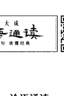

## 03 | 孔子把谁逐出了师门

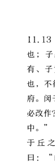

11.13 闵子侍侧，訚（yín）訚如也；子路，行（háng）行如也；冉有、子贡，侃侃如也。子乐。“若由也，不得其死然。”

11.14 鲁人为长府。闵子骞曰：“仍然毁，如之何？” 子曰：“夫人不言，言必有中。”

11.15 子谓子贡：“女与回也孰贤？”子曰：“赐也进乎学，冉有与也。”

11.16 子谓子曰：“师也过，商也不及。”

11.17 季氏富于周公，而求也为之聚敛而日富之。子曰：“彼寡夫也，小子鸣鼓而攻之可也。”

11.18 子路，有朋皆曰：君子也，师也亦（pì），由也亦（yān）。

你好，我是新大成，欢迎来到我的《论语》课，我们一字一句，读懂经典。

这一讲总共六篇，内容大多涉及孔子对学生们的具体评价。

### 11.13 闵子侍侧，訚（yín）訚如也；子路，行（háng）行如也；冉有、子贡，侃侃如也。子乐。“若由也，不得其死然。”

闵子骞侍立在孔子身旁，一派和悦中正的样子；子路则一副刚强的样子；冉有、子贡又是温和而高兴，孔子的脸上洋溢着满足的微笑：“我总觉得，若由也，不得其死然。”

这里“訚訚”、“行行”、“侃侃”分别用三个词形容孔子的学生：闵子骞、子路、冉有和子贡。其实，一个人的内在性格，从他的日常言行和语语气就能表现出来。

闵子骞訚訚如也，所以说很温和了。冉有和子贡侃侃如也，语言敏捷，话也来得快，一搭便上，滔滔不绝。至于子路，行行如也，虽勇猛，但话不绕弯子，直来直去，有时候显得气盛。

最后评论子路的这句话，值得玩味。“若由也，不得其死然”，是孔子认为子路一方面性格各方面都有特长和优点，但另一方面子路这些短处，遇事不会周详。在这个乱世，难怪他不会好的结果。

这一乐一评，从一个侧面反映了孔门师生间的深情。尊师重道，爱生如己，对教育的重视，是我们的优良传统。

### 11.14 鲁人为长府。闵子骞曰：“仍旧贯，如之何？何必改作？” 子曰：“夫人不言，言必有中。”

鲁国翻新长府的仓库。闵子骞说：“照老样子去办，怎么样？何必改建呢？” 孔子说：“这个人要是不讲话，一讲话就能击中要害。”

“长府”是鲁国的国库。理解这句话，不能把“仍旧贯”的“仍旧”理解成今天的“惯例”。这里的“仍”是沿袭，保留意思。‘仍旧贯’就是沿用旧制，还是原来的样子。

闵子骞这一次提出反对的意见，不光是以奉行旧制，而且说话非常得体。

鲁人的长府为什么要修？我们不知道，但人们有几种猜测。闵子骞是不主张大干快上，浪费人力物力。但显然，长府肯定遭到不修或修坏的地步。那既然如此，依惯例照旧也行，何必非要新修呢？夫子赞他也会说话，说得非常得体。

所以你看，在提醒子贡他们这些会说说话的人少说话的时候，夫子会表扬谨慎而一语中的的闵子骞。这就是夫子对‘说话’的态度。

### 11.15 子曰：“由之瑟，奚为于丘之门？” 门人不敬子路。子曰：“由也升堂矣，未入于室也。”

### 11.16 子谓子贡，曰：“师也过，商也不及。”

季氏富于周公，而求也为之聚敛而日富之。季氏的财富超过了周公，而冉求却帮他搜刮民财，使季氏一天比一天富。孔子说：“季氏是寡廉耻的人，学生们应该鸣鼓而攻之。”

三分之一，第二次分得四分之一，势力越来越大。而鲁国公室的衰微从昭公开始急转直下，完全听命于三家，《左传》和《国语》都记录了这个事情。

当时季氏打算按田亩征税，让冉求征询孔子的意见。孔子表面不说啥，但私下对冉求讲了一番大道理，明确表示反对。

但没想到冉求却不顾老师的反对，第二年就帮季氏推行新的田亩赋税。这让孔子很生气，后果也很严重，他公开表示不再认冉求是自己的门生，并且鼓励其他学生打着旗鼓去声讨冉求。这是孔门师生之间发生的一次最严重的冲突。

### 11.18 柴也愚，参也鲁，师也辟（pì），由也喭（yàn）。

高柴愚直，曾参迟钝，颛孙师偏激，仲由鲁莽。

在《论语》里，“愚”没有今天愚蠢、傻的意思，更偏耿直，略显呆板。

这句里面出现的四个学生，都是直接称名而不是字，我们可以推断这是孔子的原话，他对比自己辈分低的学生是直接称名的。对这四个学生，孔子各用一个字来评价，指出他们各有所偏，不合中行。

但是你要注意，这一章表面上看孔子说的都是学生的缺点，但不能理解为完全负面的评价。

高柴的愚是愚中有直，《孔子家语》里记载了他的不凡表现，他只是不太知道通变。

曾参的鲁不是粗鲁，而是迟钝、不够敏捷，但他能坚持下苦功，三省吾身，任重道远，后来果然成了孔学重镇。

子张显得偏激，但他也是恃才逞气，掩饰过失。

子路之喭，虽然人人都能看到他有时显得粗野，但绝不是粗俗。他是个见义而为，和朋友分手分贝而不私，虽簪缨烂炮立于公卿之间而不耻的顶天立地的汉子，所以绝不俗。

这样的评价，恰恰反映了孔子的中庸思想。以这四位学生的品行，尚有或者过了或者不足的地方，可见中庸绝不是和稀泥，而是正不偏不倚的中道，是很高的境界。

### ◄今日思考►

中庸之道是我们所追求的，但很不容易达到。实际生活中，“过犹不及”，你遇到问题更倾向于哪种类型？是进取还是保守呢？欢迎在留言区分享你的看法。

### ◄你的今日论语签►

如何用：点击大图

- 1.分享到朋友圈，每日学习打卡，请朋友监督自己完成《论语》通读任务。
- 2.保存到相册，随时翻开，随机获取来自《论语》的智慧启迪。

## 04 | 同一件事孔子的答案为什么不一样

你好，我是新大成，欢迎来到我的《论语通读》，我们一字一句，读懂经典。

这一讲学习七章，成语“闻斯行诸”就出自这里，也是孔子对学生因材施教的一个特别突出的例子。

孔子说：“颜回总是不多吧，可是他常常空乏困顿。端木赐不爽于立命，偏爱去做吏，虽则得周而不类。”

这里的“庶”是接近、差不多的意思。什么叫颜回不多？就是鼓励颜回多学点道德，不止他多也，这不是褒义在哪儿。孔子说他“空”，这不是空姐、哑巴。颜回吃饭靠饮水，曲然而就之，死了都不后悔，空。

跟原阳劳比起来，子贡很闲。子贡是怎么闹起来？“章”、“豕猥”，就是买卖，商品流通，增加利润。司马迁的《史记》里专门有《货殖列传》，记录历史上几位著名的成功商人，就专门记了子贡一笔。司马迁认为子贡经商务的成功的，对其游刃有余，庞大的事业，不可小视。

这里的“亿”字，推测、揣度的意思。

孔子对颜回问道德接近于完善却在生活上常远因贫深感遗憾，可他对子贡则不太情愿去经商，高鹏威不满。这两人的实际生活际遇，在孔子看来是不公正的，但是没办法，这就是命也。

子张问做善人的方法。孔子说：“善人不踩前人的脚后跟，但学问和修养也没有完全到家。”

善人，指所谓标准低于圣人的君子、仁人这类人。

孔子这里说的是什么意思？各种解释都有，依从伟人和清人的意思来做个解释。

子张是在问善人为人的道理。孔子说，善人大美美德，自趋向善，不必懂得圣贤的榜样，比行善之人，不必遵循旧说也能认识路。可是先天生意根却没有学习，因此他的学养也不可能升华堂室。

所以归根结底，人还是要不断学习，才能达成理想中的君子气象。

孔子说：“听到人们议论等实践就总是提推择，（这种人）他真是君子呢？还是仅仅在表面上显得有道德吗？”

“论语是个成语，跟“唯利是图一样，你调整字与字‘最好理解了，是赞誉言论诚信的意思。”

孔子一向主张不但要说话笃实诚信，而且还要言行一致。但如果已学说过“听其言观其行”，这边我说过要庄严、诚恳、切实，可是行动却跟不上、落实不了，那么尽管某人说得很漂亮，再好听话，表现得再重道德，其实仍然不是真君子，是不可信的。

这里，孔子把言语和行为的关系，又从另一个角度做了标准，千万别子弟们老记念了。

子路问：“听到了之后就怎么做它吗？”孔子说：“有父兄在，怎么能行动起来呢？”再有问：“听到了之后就实践它吗？”孔子说：“听到了就动起来。”

之间，曾由与求之问。所谓大臣者，以道事君，不可则止。今由与求也，可谓具臣矣。”曰：“然则从之者与？”子曰：“弑父与君，亦不从也。”

季子然问：“仲由和冉求可以算是大臣吗？”孔子说：“我以为你是问别人，原来是问由和求啊。所谓大臣是能够以道来事君者，如果行不通，他就辞职不干了。现在由和求这两个人，只能算是有才能的办事之臣吧。”季子然说：“那么他们会一切地服从上级吗？”孔子说：“如果上司做弑杀父亲君的事，他们也不会服从的。”

季子然是鲁国贵族季氏的同族人。

孔子觉得他的两个学生子路和冉求是“具臣”，也就是，说：他们能承办职能性事务，但还算不上大臣。那大臣是什幺呢？就是能够以道事君的人，特别是君主犯了错误、有了过失，能够及时匡正。

你从这句话就能看出，这是孔子对君臣关系作了进一步的阐发。前边我们知道，要事君以礼、以忠，这里则强调的是以道事君。如果不能，那么就辞职不干，不会盲从。

也许你觉得，孔子是不是对子路和冉求，要求有点太过苛刻了？其实，季氏祭泰山之行，开征田亩赋税的举措，冉求不但不能阻止，而且也未洁身自好、爱惜羽毛、全身而退，反而帮助季氏具体执行这些政治主张。所以在孔子看来，这就是具臣，算不上大臣。

11.25 子路使子羔为费（bì）宰。子曰：“贼夫人之子。”子路曰：“有民人焉，有社稷焉，何必读书，然后为学？”子曰：“是故恶夫佞者。”

子路让子羔去做曹家的长官。孔子说：“这篇直是坑害人家的孩子。”子路说：“那个地方老百姓，有社稷，难道一定要读过书才算学习吗？”孔子说：“所以我讨厌那种花言巧语狡辩的人。”

这句里的“贼”，不是偷窃，是坑害的意思。子路让子羔去做官是好事，为什么孔子说这是坑人呢？因为孔子认为，在一个人还没有经过足够得学习和训练之前就去做官，这是误人子弟的行为。

那子路是怎么辩解的呢？那里有社稷人民可以管，可以边干边学嘛。这可把孔子气坏了。

你大概还记得，《雍也篇》里季氏想让闵子骞去鲁官宰，闵子骞说什么也不干，恨不得要逃走。

为什么孔子跟他的学生都对这个地方避之唯恐不及？因为这里是鲁国贵族季氏的地盘，去做宰官，意味着要跟季氏同流合污。

连冉求自己都没有办法阻止季氏的种种劣行，却要更年轻、尚未成熟的学生去给家人担任君臣，废学而又不能行道，这算什么行为？所以夫子很生气，是有道理的。

而子路却不，还要强辩，这让老师生气了，直斥他说：我最讨厌的就是这种场合不肯承认还花言巧语强词夺理的人。

### 今日思考

对待自己的下属、孩子，你有没有什幺因材施教的例子？欢迎在留言区分享。

### 你的今日论语签

- 1. 分享到朋友圈，每日学习打卡，请朋友监督自己完成《论语》遍读任务。
- 2. 保存到相册，随手翻开，随机获取来自《论语》的智慧启迪。

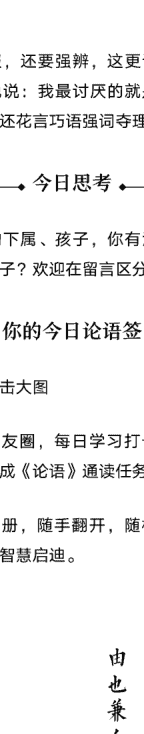
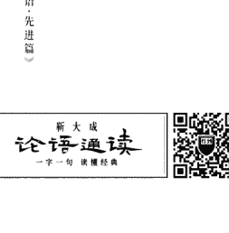

## 05 |《论语》中最精彩的篇章

11.26 子路、曾皙、冉有、公西华侍坐。子曰：“各言尔志？”师也如也。子路曰：“一车夫在中间，加上外邦的入侵，加上国内的饥荒。只要三年，就可以让国家充满勇气，让国家强大，让国家的百姓也强大。”

“求也，何如？”对曰：“方六七十，如五六十，求也为之。比及三年，可使足民。如其礼乐，以俟君子。”

“赤，何如？”对曰：“非曰能之，愿为小相焉。”

“点，何如？”“鼓瑟兮，瑟瑟，铿尔。舍瑟而作，对曰：‘异乎三子者之撰。’”子曰：“何伤乎？亦各言其志也。”曰：‘莫春者，春服既成，冠者五六人，童子六七人，浴乎沂，风乎舞雩，咏而归。’”

欢迎，我是大成，欢迎来到我的《论语》解读，我们新一季，继续读经典。

这是《先进篇》的最后一章，也是非常著名的一章，非常有戏剧性，经常被选入各种古代选子的教材。我建议你背下的话，不妨把这二百多字的《侍座章》背下来，经常吟诵欣赏。

这一章比较长，我们分成几段来读。

- 1. 1. 26 子路、曾皙、冉有、公西华侍坐。子曰：“各言尔志？”师也如也。子路曰：“一车夫在中间，加上外邦的入侵，加上国内的饥荒。只要三年，就可以让国家充满勇气，让国家强大，让国家的百姓也强大。”

子路、曾皙、冉有、公西华四个人陪坐在孔子身旁。孔子说：“各要告诉我你们大一些，别害羞地同于我”长些年岁，你们第一。别害羞地同于我！”长些年岁，你们大一些，别害羞地同于我！”长些年岁，你们大一些，别害羞地同于我！你们平里怎么说：‘没有人了解我呀！’假如有人了解你们，那么你们将要怎样去做呢？

子路车尔尔对曰：“千乘之国，摄乎大国之间，加之以师旅，因之以饥馑，而由也为政。比及三年，可使有勇，且知方也。”

多了。

此时的曾点，一直在旁边弹琴，并没有加入这场对话。直到孔子问他才慢慢收拢琴弦，从弹奏音乐的情绪里转出来，最后一声，划拨了一下弦，站起身来从容答对。

“暮春三月，已换上了春天的衣服，约上五六位青年人、六七个少年人，去沂水里洗洗澡，在舞雩台上吹吹风，一路唱着歌走回来。”

你看，我们好像眼前出现了一个画面：这些杏坛弟子在晚春的阳光下洗浴完毕，在春风里晾敞着头发，一路歌咏一路归途。

这是多么令人欣羡、向往的美好生活图景。跟随老师学习君子之道的一群青年、少年欢乐而归，走一路歌一路。这场面，真令人感动、令人向往。

连孔子都被这幅图景感动了，他从内心深处发出赞叹，“我欣赏曾点的志趣啊！”

接下来，我们这出剧转入第二幕。其他三个人走出房间，只剩下孔子和曾点两人。

于是曾点问老师：您刚才为什么要笑话子路呢？

此时的孔子，已经从刚才沐浴春风的遐想中回到现实。被此一问，他立刻截戳了当指出子路的毛病所在：其言不让。在以礼治国的时代，这种不谦逊、不懂退让的行为，不是和以礼治国、使民知方的理想相违背吗？

接着孔子又回答了曾点的两问，指出冉求和公西华说的都是治理国家的事务。而且别看他们嘴上谦虚，说什么“以待君子”“愿为小相”，其实他们的心思孔子都明白，真正叫此其志不在小。

所以他直接把话挑明：赤也为之小，谁能为其大？在治国理政方面，他的这些弟子一个赛一个能干，能力超强。这一点，其实夫子看得很准，心下明白。

这场对话，虽是闲居时的聊天，可反映出孔门弟子一个个胸有大志、心怀天下，而且个个有才干，真是一个非常优秀的团队。

### 出自《论语·先进篇》的成语

- 一仍旧贯、言必有中、升堂入室、过犹不及、鸣鼓而攻之、居庙词穷

### 今日思考

我们都清楚孔子和儒门弟子的实践品格、用世之心，那孔子为什么说出了“吾与点也”的话呢？难道他真愿意退隐江湖，游乐放歌而度此生吗？欢迎在留言区分享你的看法。

用户留言

提交留言可与专栏作者互动

## 06 “非礼”的事不听不看

06 1 “非礼”的事不说，不听。

> 12.1 颜渊问仁。子曰：“克己复礼为仁。一日克己复礼，天下归仁焉。为仁由己，而由人乎哉？”颜渊曰：“请问其目。”子曰：“非礼勿视，非礼勿听，非礼勿言，非礼勿动。”颜渊曰：“回虽不敏，请事斯语矣。”
12.2 仲弓问仁。子曰：“出门如见大宾，使民如承大祭；己所不欲，勿施于人；在邦无怨，在家无怨。”仲弓曰：“雍虽不敏，请事斯语矣。”
12.3 司马牛问仁。子曰：“仁者，其言也切（rěn）。曰：“其言也切，谓之义已乎？”子曰：“为之难，言得无讱乎？”

你好，我是靳新东，欢迎来到我的《论语通识》，我们一字一句，读透经典。

《颜渊篇》总共四章，你会遇到许多非常熟悉的句子：“一日克己复礼”“己所不欲，勿施于人”“死生有命，富贵在天”“四海之内，皆兄弟也”等等。

### 12.1 颜渊问仁。子曰：“克己复礼为仁。一日克己复礼，天下归仁焉。为仁由己，而由人乎哉？”颜渊曰：“请问其目。”子曰：“非礼勿视，非礼勿听，非礼勿言，非礼勿动。”颜渊曰：“回虽不敏，请事斯语矣。”

颜渊请教仁道。孔子说：“克制自己，一切都复归于是礼的要求，这就是仁。一旦这样做，天下的人民就都归向于仁。实行仁德，完全靠自已，难道还要靠别人吗？”

颜渊说：“请问仁道的条目。”孔子说：“不合于礼的事不要看，不合于礼的话不要听，不合于礼的话不要说，不合于礼的事不要做。”颜渊说：“我虽然不够聪敏，请让我按照您的话去做吧。”

颜渊这一问，大哉问！颜渊的问题，涉及儒学的核心概念“仁”。对此，孔子给出了明确的回答：“克己复礼”是仁，这里是孔子关于什么是仁的条文的主要解释。

“克己复礼”这个概念，不是孔子的独创，《左传·昭公三十三年》有“礼，经国之大事也。昭子曰：‘昭氏之有乱也，日：克己复礼，日：吾子之欲复周之政也。’孔子说这话有出处，古人早就说过了。但是，孔子进一步具体强调要以礼来实现仁，依礼而行仁（仁之本）的外在表现。

这是夫子引出态度给颜渊做解释，可见他是在前人的基础上做了新的更为丰富具体的阐发。

这句话说了内和外两个方面的事思：所谓礼以仁行为根基，这是说仁是内在的，而礼是外在的。仁爱之芯发源于内心，呈现出来的外在表现还要符合礼。孔子还表述出了具体的条目。

孔子从古代文献中拈出了“克己复礼”这个字来表达仁，就是说遵循：必须规矩内心的道德修养，自觉约束心身的过度。所以他常讲“须是克尽己私，皆归于礼，方是仁。”

你还记得前面我们讲过，孔子说：“回也，其心不违仁。”也就是说，是一个品德的形象评价。此时的颜渊表现为不同，他虽然明白了，但是马上再问进一步推进，说老师您给我再讲一下实行仁的具体条目吧。

这一问来得好，正撞上孔口上，孔子给出了四个具体可见可行、可以把握的标准：非礼勿视，非礼勿听，非礼勿言，非礼勿动。这四个具体条目能解答好的问条已复礼。为什么说“天下归仁”的由由。

一个人的视、听、言、动，几乎包括他的全部行动，如果能做到，你就已经符合仁道的条件了。由此可见，为仁之事全在于自己。

“天下归仁”这句，清代学者也有不同解释，把归字理解为“称赞”，说“你做到了，那天下的人就都会赞许你你做到仁了。”

对比“归附”和“称赞”这两个说法，我微微取“归附”更好。你想，夫子和弟子们讨论的目目、仁关系，涉及的这个道德政题，这个仁是什么？

前边咱们学过，礼是规范人的社会行为，主要涉及公共事务和政治。就是要通过礼来塑建一种清明政治，改造不合理的政治，让社会清激，从像百川归海、四水归堂一样，归附仁德。

天下，就是天下的人，是在最普遍意义上说“人”。人心，人心归仁，我心从“归附”这个解释。

进一步说，古人也曾指出，这里含着若去包化、教导、辅君士，使他们做到自己复礼。达到天下归仁的效果目了的。这个话孔子虽然没有明说，但后儒的理解是很精准的。

天下归仁”这句话，开启了后代孟子的思想，他多次阐发这个命题，并针对战国时代的社会乱象，明确提出“仁者无敌”的口号。他告诉当时的齐、魏国君，如果你不随便开始杀人，爱惜生命，施行仁政，天下的百姓就会如久旱遇甘露般地归向于你，有什么力量能阻止我呢。

仁和礼的关系，是孔子儒学思想中的重大问题，也是核心问题，贯穿于孔子思想体系的始终。

### 12.2 仲弓问仁。子曰：“出门如见大宾，使民如承大祭；己所不欲，勿施于人；在邦无怨，在家无怨。”仲弓曰：“雍虽不敏，请事斯语矣。”

仲弓问怎样做才是仁。孔子说：“出门办事如同接待贵宾那样谨慎，役使百姓如同举行祭祀大典那样恭敬小心，自己不原意接受的事，就不要强加给别人；做到在诸侯国做事没有怨愤，在卿大夫的采邑做事也没有怨愤。”仲弓说：“我虽然不够聪敏，请让我照您的话去做吧。”

出门办事和役使百姓，都要像迎接贵宾和举行祭祀大典时那样恭敬谨慎，小心谨慎。这三个，其实就有了普遍白言的一段话，他说：“臣闻之，出门如见大宾，使民如承大祭。”表明这是引自古话，可见这个说法很早就有。

## 12.4 司马牛问君子
子曰：“君子不忧不惧。”
曰：“不忧不惧，斯谓之君子已乎？”
子曰：“内省不疚，夫何忧何惧？”

## 12.5 司马牛问曰：“人皆有兄弟，我独亡。”
子曰：“君子无入而不自得焉。富贵于我，如浮云。君子约礼，达于恭俭，以自广于天下，四海之内，皆兄弟也。君子何患乎无兄弟也？”

## 12.6 子贡问政
子曰：“足食，足兵，民信之矣。”
子贡曰：“必不得已而去，于斯三者何先？”
曰：“去兵。”
“必不得已而去，于斯二者何先？”
曰：“去食。自古皆有死，民无信不立。”

无信，无以立国。民众的信任是政治最重要的基础。

### 今日思考

我们讲到“漫游之谮”不容易明察，也讲到三人成虎的故事。你有没有类似的经历？是怎么处理的呢？欢迎在留言区分享。

### 你的今日论语签

- 1.分享到朋友圈，每日学习打卡，请朋友监督自己完成《论语》通读任务。
- 2.保存到相册，随时翻开，随机获取来自《论语》的智慧启迪。

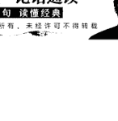

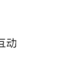

## 07 四海之内皆兄弟

12.4 司马牛问君子。子曰：“君子不忧不惧。”曰：“不忧不惧，斯谓之君子已乎？”子曰：“内省不疚，夫何忧何惧？”

你好，我是新大成，欢迎来到我的《论语通读》，我们一起一字一句，读懂经典。

12.4 司马牛问君子。子曰：“君子不忧不惧。”曰：“不忧不惧，斯谓之君子已乎？”子曰：“内省不疚，夫何忧何惧？”

司马牛问怎样做才算君子。孔子说：君子不忧愁，不恐惧。又问：不忧愁，不恐惧，这样就可以叫做君子了吗？孔子说：内心反省感到没有悔恨，那还有什么可愁可惧的呢？

12.5 司马牛问曰：“人皆有兄弟，我独亡。”子曰：“君子无入而不自得焉。富贵于我，如浮云。君子约礼，达于恭俭，以自广于天下，四海之内，皆兄弟也。君子何患乎无兄弟也？”

司马牛忧愁地说：别人都有兄弟，唯独我没有。“亡”通假“无”。

孔子说：君子无论生活在什么境遇里，都安之若素。有君子在，哪里不是天下呢？

“人皆有兄弟，我独亡”，可不是指死了哥哥，这个“亡”是通假字，通“无”的意思。

接下来你可能会问，司马牛是个独生子吗？不是。问题没那么简单，按照学者们的解释，这个司马牛不是宋国大夫，而是孔子的学生，他的哥哥叫桓魁。

如果你跟我读过《论语》上部，对桓魁这个人大概有点印象。《述而》里讲过，孔子与弟子到曹国的时候，桓魁听说孔子在此，带兵前去加害于孔子。

当时孔子和弟子正在大树下演习周礼，桓魁的兵都杀到了。这种危险时刻，孔子说：天生仲尼，桓魁其如子命？给自己和学生以鼓励。

这就奇怪了，明明有兄弟，司马牛为什么说“人皆有兄弟，我独亡”呢？

桓魁这个人在历史上名声不好，他在宋国任“工家”官职，他的弟子司马牛跑到鲁国学习，他杀了同乡，他弟弟司马耕不敢去给他送终，拜孔子为师。

既是从孔子学习礼仪，司马牛就不再和家里人接触，跟他的兄弟划清了界限，加上一个人家他不喜欢他的哥哥，他当然不会说兄弟，他独亡，也就不必发愁自己没有兄弟了。

这句话的最后一句话，特别值得注意。“四海之内皆兄弟”，不光开导了司马牛，也隐约透露出真正的儒门弟子博大的胸怀，孔老夫子，就流传至今。

这句话，有一点值得你注意。一方面，传统的天命，命运的观点，仍在流行；但另一方面，子夏的意思却是突出人在为，已经有人能一定程度上掌握自己的命运。

说明传统的宿命论、天命观，已经开始发生动摇。也就打开了一个裂缝，开启了一种新的可能。到了后儒，（荀子）那里，这个思想得到了进一步的发展壮大。

12.6 子张问曰：“令尹：‘人皆有兄弟，我独亡。’”

12.7 子贡问政。子曰：“足食，足兵，民信之矣。”子贡曰：“必不得已而去，于斯三者何先？”曰：“去兵。”“必不得已而去，于斯二者何先？”曰：“去食。自古皆有死，民无信不立。”

子张问怎样做人才能称为君子？孔子说：“言忠信，行笃敬，虽蛮貊之邦行矣。言不忠信，行不笃敬，虽州里不行也。”

## 12.8 棘子成曰：“君子质而已矣，何以文为？”
子贡曰：“惜乎夫子之说君子也！质犹文也，文犹质也，虎豹之鞟（kuò）犹犬羊之鞟。”

你好，我是新大成，欢迎来到我的《论语通读》，我们一字一句，读透经典。

12.8 棘子成曰：“君子质而已矣，何以文为？”子贡曰：“惜乎夫子之说君子也！质犹文也，文犹质也，虎豹之鞟（kuò）犹犬羊之鞟。”

棘子成说：“君子有品质就够了，要做什么文饰有什么用呢？”子贡说：“可惜啦，先生您居然这样来解释君子。本质就像上文的，都好看。文就像本质，本来就像本质。虎豹的皮去掉了毛皮、豹皮，就像去掉了的毛，鞟，是去掉毛的皮。棘子是卫国大夫。”

想象一下，子贡多讨厌棘子成啊，子贡就开始了：“可惜啦先生您这样解释君子。” 这句话呢，也是咱们今天说的一句话——"一语既出，驷马难追"。说话得痛快，子贡不像是豪门第一人物。

你记得前几章我们说过，“文质彬彬，然后君子”。棘子成作为子贡老师的好友品质就好，根本就不需要外表的文质。品质，他认为，质和文相对立起来看，子贡虽然这样说，但是他的意思是，良好的本质必须有适当的表现形式，否则本质再好也无法显现出来。

你看，孔子前边对司马牛说学行为君，就是说实话，子贡这是“一语既出，驷马难追”，是从另外一个角度的说，是强调说谎的方面来说。一句话讲过，如泼出去的水，再也收不回来了。

唐代刘禹锡还有一个很好的比喻，“五刀之伤”约之可平，一妄言的伤害，修不能明。"这里说，厉害的医生用刀的伤口，敷点药就痊愈了，可一句造成话的灾祸，连医生也没办法解决。这话生动地说明了从口出法泄露，提醒人们慎言行，言多语失，言语要慎。

也有人解释为：当时有人为孔子师徒（包括子贡等人）的礼仪文饰太过繁琐，这是子在为前师傅门，强调文质不可偏废。

这一章的重点，其实是在讲文质关系。这两者不是对立关系，而是相辅相成，互为表里。没有质，哪来的文？没有文，质何以存？

文看似不重要，其实礼仪就是外在的形式，这种形式规范的人言谈举止，行为规矩，把内在的美外在的有具体的表现，非常重要。某种程度上来说，文即质，质即文，从内到外，互为表里。理解这一点，你就抓住这一章的要点了。

## 12.9 哀公问于有若曰：“年饥，用不足，如之何？”
有若对曰：“盍彻乎？”曰：“二，吾犹不足，如之何其彻也？” 曰：“百姓足，君孰与不足？百姓不足，君孰与足？”

鲁哀公问有若说：“遭了饥荒，用度不足，怎么办？” 有若回答说：“为什么不抽十分之一的税呢？” 哀公说：“抽十分之一，我还不够用，怎么能抽十之一呢？” 有若说：“如果百姓富足，君上怎么会富足呢？如果百姓不富足，君上怎么会富足呢？”

这一句里的“彻”字，怎么翻译呢？通常说法就是10%的税叫做“彻”，这是西周前的税制。

有若的话反映了儒家思想的民本思想，也涉及儒家经济思想，其核心是“富民”。鲁国从宣公起所收的田税是什分之一，从有若的减税的税率，经济负担。”

唐代刘向的《说苑·政理》保存了不少先秦时代流传下来的文献，其中有：

还有一种解释是负面的，意思是子路子路太性急，太过轻率急躁，只听一面之词就下判断。这是夫子在批评子路。

断案断得快的例子，还有《三国演义》里的庞统。当时刘备没有发现他的才能，放他到外县做官，庞统索性不理县务。张飞来巡视，只见他口读手批，不消半日功夫，三下五除二便把几个月的公案有条有理地处理完毕。

不论当时夫子是褒是贬，但今天的司法实践里，要慎重，先要全面掌握材料，听双方两道充分表达完之后才能下判断，已经是一种共识了。

## 12.13 子曰：“听讼，吾犹人也。必也使无讼乎！”

孔子说：“审理诉讼案件，我同别人也差不多。一定要使诉讼的案件没有发生才好要！”

这一章也是在讲司法诉讼，意思又像是接着上一章，继续往深入阐发。孔子在鲁曾任大司寇，有过审听诉讼的经历。

孔子认为自己在断案上的能力和别人差不多，当然这就不会像子路那样片言折狱。不过，他主张要从根本处下手，尽量要让事情在闹上公堂之前，就得到合情合理的解决。这反映了他的治国策略。

### 今日思考

孔子主张 “必也使无讼”，讲究以礼治国，以德治国，最好别打官司。你是如何看待这种主张的？在今天这种主张是不是过时了呢？欢迎在留言区分享你的看法。

### 你的今日论语签

- 1.分享到朋友圈，每日学习打卡，请朋友监督自己完成《论语》通读任务。
- 2.保存到相册，随手翻开，随机获取来自《论语》的智慧启迪。

## 09 君子成人之美

12.14 子张问政。子曰：“居之无倦，行之以忠。”

12.15 子曰：“博学于文，约之以礼，亦可以弗畔矣夫！”

12.16 子曰：“君子成人之美，不成人之恶。小人反是。”

12.17 季康子问孔子于政。孔子对曰：“政者正也。子帅以正，孰敢不正？”

12.18 季康子患盗，问于孔子。孔子对曰：“苟子之不欲，虽赏之不窃。”

12.19 季康子问贤于孔子。孔子对曰：“居上欲君子，则君子也；居下欲小人，则小人也。”

12.20 子张问：“士何如斯可谓之达矣？” 子张问：“士何如斯可谓之达矣？” 子曰：“在邦必达，在家必达。” 子曰：“是闻也，非达也。夫达也者，质直而义，察言而观色，虑以下人。在邦必达，在家必达。夫闻也者，色取仁而行违，居之不疑。在邦必有闻，在家必有闻。”

你好，我是新大成，欢迎来到我的《论语通读》，我们一字一句，读懂经典。

## 12.14 子张问政
子曰：“居之无倦，行之以忠。”

子张问句政改革忠谋。”在位尽职不懈，践行政令要忠诚。

你可能还记得我们学过，孔子曾说“为政以德”，那是从大的原则出发，强调礼治。这里回答子张问政，孔子就要针对性地指出：如果你身居自位，就要有对政爱民，尽以公事，以仁德的标准来要求自己，尽以的原则办事简单事情，实行政令就要切实努力。这样才算是一个好官。可见，“无倦”是一种敬业精神，“以忠”可以说是责任感。

“无倦”是句提醒的话，刚性有余的人往往初劲不足，得提起精神，有始有终方为是。

## 12.15 子曰：“博学于文，约之以礼，亦可以弗畔矣夫！”

这句话在《雍也》经出现过了，你们简单复习一下。“子张说：“君子广泛地学习文献，并且用礼仪约束自己，也就不合轻易悖逆了。”

## 12.16 子曰：“君子成人之美，不成人之恶。”

孔子说：“君子促成别人的好事，而不促成别人的坏事。小人则与此相反行事。”

“成人之美，不成人之恶”贯穿了儒家思想的始终，和“己欲立而立人，己欲达而达人”“己所不欲，勿施于人”的精神一脉相通。还有句话你可以顺带说说：“为善最乐”，说的也是这种情况。

这个“小人反是”，是从正面说完，再从相反的方给一个解释，来帮助你理解。其实，现实生活中，我们也常时会遇到，在某种环境下遭遇小人的情景。有的心术不端正，见不得别人好，小人啊，不仅不成人之美，反而护尽忠起意，或者在背后上其手，坏你的好事。

这种情况，又该怎么办呢？人生处仕什么时候都会遇到，所以民间有一句老话，叫“既知小人，又何必做君子呢？”意思是只当光明正大，就做好你自己事情，远避小人，尽量不在暗中与小人共美。有的人不小心会，不要紧呢……毕竟世界很大，你不必在种地方浪费你的精力、时间、感情。

成人之美和助人为乐一样，在后代成为鼓励中国人积极向上正能量。

以下几章都是季康子向孔子请教为政之道的。

## 12.17 季康子问政于孔子
孔子对曰：“政者正也。子帅以正，孰敢不正？”

季康子向孔子请教为政之道。孔子回答道：“政就是正道的意思，您带头走正路，那还有谁敢不走正路呢？”

这话说得真是直截了当，明路无疑。其实，这也对我们学过的“为政以德”另一维度的发挥。

了。

子张对于“达”的理解显然混同于“闻”了，他认为达的意思就是名声在外，人人皆知。孔子反问，这在教学上叫反诘法，在先摸清对方的意思、逻辑前提之后，再作正面的分析解释。

果然，两个人对达的理解不同，不首先澄清这一点，下面的交流就没办法正常展开了。孔子对达作了解释，指出闪光的东西不一定是金子。有虚名在外的人不一定是达，反而很可能是色取仁而行违，甚至还居之不疑，往往是骗取虚名的“伪君子”。

关乎虚名，我还想起清初思想家颜元的一句话：有一分名，即一分祸，这话说得很通透。

孔子提出了一对相互对立的名词，即“闻”与“达”。“闻”是虚假的名声，并不是通达；而“达”则要求士大夫必须从内心深处具备仁、义、礼的德性，注重自身的道德修养，而不是追求虚名。

古人讲的“名闻利养”，这个“名闻”指的就是孔子否定的虚名，他强调的是真正的仁者必须名实相符，表里如一。

《颜渊篇》到这一讲，子张四次在不同的场合提出问题，问明、问崇德辨惑、问政、问达，这是所谓的子张四问。

你注意，其中的“明”与“辨惑”之间有联系，都需要人的察识和眼光。而分清楚“闻”和“达”，则需要更高一层的修养智慧，这就与“崇德”有关系了。崇德要求你推崇和追求仁义忠信，必须落在实处，能区分清楚追求的目标是达而不是闻。

### 今日思考

“君子成人之美，不成人之恶”这句话，你是怎么理解的？欢迎留言区分享你的见解。

### 你的今日论语签

- 1.分享到朋友圈，每日学习打卡，请朋友监督自己完成《论语》通读任务。
- 2.保存到相册，随时翻开，随机获取来自《论语》的智慧启迪。

## 10 什么叫以文会友

你好，我是新大成，欢迎来到我的《论语通识》，我们一字一句，读精经典。

这是《颜渊篇》的最后一讲，内容涉及仁者爱人和交友之道。

> 12.21 樊迟游于舞雩之下，曰：“敢问宗、修身、辨惑。”子曰：“善哉问！先事后得，非盗道？无故而得，非邪道？一朝夕念，总其身，以及其身，非道与？”

12.22 子夏问曰：“巧言乱德，非恶与？”子曰：“然。”

12.22 子夏曰：“虽曰未学，吾必以为。”

举直错诸枉，能使枉者直。樊迟说。曰：“乡也吾见于夫子而问知，子曰‘举直错诸枉，能使枉者直’，何谓也？”子夏曰：“富哉言乎！舜有天下，选于众，举皋陶，不仁者远矣。汤有大，选于众，举伊尹，不仁者远矣。”

樊迟问什么孔子在舞雩下问，说：“请问宗、修身、辨惑。”樊迟问怎样去掉疑惑？怎样辨别迷惑？孔子回答：“问得好！先思后学，当然有收获，不就像道德的方法吗？做而自悟，不就是知识的捷径？不就是在修道德吗？出于一时性急，就忘记了自身的执着就迷惑于大悟吗？”

你看，樊迟在这里提的问题和子张几乎相同，可孔子却给出了不同的解答。其实，万变不离其宗，这里仍然谈的是人品的道德修养问题。

也有人说樊迟的性格近于子张，嫉恶如仇，过于偏强，所以夫子要反板他自己，让他不要偏强自认为君子，要在自己身上下功夫。真正的君子自己会进修，正己德望，提升自己以度别人无罪，哪里有多余的时间精力去管理别人的事情？

这就是孔子一贯的教学风格：根据学生的不同情况，给出具有针对性的提示，吸引后学。

夫子提醒说，首先要踏踏实实地做事，不必妄想物质利益；要严格要求自己，不要危害他人，特别是必须注意克服感情冲动的浮躁。

先事后得，和我们学过的“先难而后获”意思相同。

下一章也特别有名，是个经典的教学案例。

> 12.22 樊迟问仁。子曰：“爱人。”问知。子曰：“知人。”樊迟未达。子曰：“举直错诸枉，能使枉者直。”樊迟退。见子夏，曰：“丘也闻之曰，举直错诸枉，能使枉者直，何谓也？”子夏曰：“富哉言乎！舜有天下，选于众，举皋陶，不仁者远矣。汤有大，选于众，举伊尹，不仁者远矣。”

樊迟请教什么是仁道。孔子说：“爱人。”樊迟请交什么是智慧。孔子说：“知人。”知道人的好坏。樊迟还弄不明白。孔子说：“选拔正直的人，安置他们于不正直的人之上，就能使邪恶者邪正。

樊迟退出来，见到子夏说：“刚才我见到老师，问知什么智慧，他说：‘选拔正直的人，安置他们于不正直的人之上，就能使邪恶者邪正’这是是什么意思？”

子夏说：“多么有见地的话呀！舜有天下，在众人中选拔人才，如果陶选出来，不仁的人就远离了。汤有了天下，在众人中选拔人才，如果伊尹被选拔出来，不仁的人就远离了。”

樊迟问了两个问题，一个是仁，一个是智。

而是要以互相帮助、磨砺、提携、培养仁德作为主要目的。这才是君子所奉行的交友之道。

在朋友之间切磋、交流、问难、进学，足以养德，其中所收获的快乐真是滋润人生，快乐无比。这也是人生追求的幸福目标之一。

什么叫以文会友？我给你举个例子——清初北方实学派大儒颜元曾记录了他的弟子李塨（字刚主）邀约众朋友来家聚会的事情。

那是1682年，当时李塨才二十四岁。他给颜元和众友发信，相约一聚。于是师友们或骑马或骑驴，从周边各县赶来。直到颜元到了，才由他主宾执礼正式开始，按照古礼的仪式走。

先拜李父，揖让有节。再到大堂叙座，就是按年龄长幼排座次。接风酒依礼而行，正式开席。饭后颜元主唱诗，他唱了《诗经·淇澳》，李塨回敬一首《伐木》，这都是有寓意的。众人合了一首《勺》，晚来的客人再唱乐府。凡是没唱的客人自饮一杯。李父再敬众宾酒。

闲散时间，座中几位开始献拳、献剑、献刀，表演了舞双刀、舞单刀，还有一场二人技击。这一场完了，众人出来庭院外正式比箭，选有德者为司箭，输者自饮。再上酒，众宾纷纷献琴。中间李塨一时兴起，即兴唱了《将近酒》，众友各联一章。此时天晚，老翁礼退，再上新酒，他们讨论经书、古礼，至四更天方才结束。

你看，这就是古人的“以文会友，以友辅仁”的一个具体场景。

当年瞿秋白给鲁迅写了一副对联，说“人生得一知己足矣，斯世当以同怀视之”。有几个好朋友甚至知己，实在是太难得了，弥足珍惜。

## 今日思考

对于以文会友，你的实际生活中有没有类似的经历呢？它跟别的欢聚餐有什么区别？欢迎在留言区分享你的看法。

### 出自《论语·颜渊篇》的成语

- 克己复礼、己所不欲、勿施于人、死生有命、富贵在天、内省不疚、一言既出、驷马难追、片言折狱、成人之美、察言观色、以文会友

## 你的今日论语签

如何用：点击大图

- 1. 分享到朋友圈，每日学习打卡，请朋友监督自己完成《论语》通读任务。
- 2. 保存到相册，随时翻开，随机获取来自《论语》的智慧启迪。

### 1.1 “名正言顺”为什么重要

### 1.3.1 子路问政

子曰：“先之劳之。”请益。曰：“无倦。”

子路问为政之道。孔子说：“要做表率并亲自劳作，然后才能使人顺从。”子路请求再多讲一点，孔子说：“不要懈怠。”

你看，和前面几章子张、樊迟、司马牛、冉雍等弟子问政的回答不同，孔子对子路、言氏这个最无礼的、最欠琢磨的脾气，就什么也“先”“先”。这该做到的道理，但他追问时，孔子为他在往深远里说，而只回答一句“无倦”呢？

子路简直有余，细绳缺精的样子，性子刚、刚直有余，不圆滑。这样的个性，往容易缺少耐心和细心。一句话，是提醒他要有小心从事、如临深渊，如履薄冰，要有耐心，有始终，不可松懈。

### 1.3.2 仲弓为季氏宰

问政。子曰：“先有司，赦小过，举贤才。”曰：“焉知贤才而举之？”曰：“举尔所知，尔所不知，人其舍诸？”

仲弓做了季氏的家臣，问为政之道。孔子说：“给手下负责事务的官员派表率，赦免他们的小过错误，选拔有良贤才。”仲弓又问：“怎样来辨别有良贤良人才举而不也，选拔出来呢？”孔子说：“选拔你所知道的人，至于你不知道的贤才，别人难道还会舍弃他们吗？”

有司，是古代负责具体事务的官差。

这一段话可说是手把手地教学生，如果担任了大夫的总管，具体应该怎么做。

举尔所知”这句话很有意思，我举个例子帮你理解。

孔子之后一百多年，燕国发生内乱，差点被齐国灭了。燕国君主出走他国，想要恢复燕国，就派忠臣处死。齐国一位官员想为燕国招贤，就派大臣招纳贤人，希望国富兵强，报仇雪恨吧？

郭隗告谕燕昭王，看你怎么对待人，能吸引贤才前来。燕昭王对他说：“我该如何招揽贤良人才呢？”郭隗就给燕昭王讲了个“千金买骨”的故事。

古时有个君王想得到千里马，出重金去买，结果三年找不到。于是有臣子建议，先花千金买一千里马的尸骨，表示诚意，天下人就相信君王爱马，千里马就会陆续来了。不久，千里马果然到了。

大臣意思是想给招贤良，就从敬纳郭隗开始，这像请个能臣，贤才智士就会追随而来。郭隗果然被燕昭王厚待，郭隗的贤名传开，于是乐毅、邹衍、剧辛等人纷纷来投奔。

郭隗的例子，真是“举尔所知”最好的注释。

### 1.3.3 子路曰

“卫君待子而为政，子欲先之何？”子曰：“必也正名乎！”子路曰：“有是哉，子之迂也！奚其正？”子曰：“野哉，由也！君子于其所不知，盖阙如也。名不正，则言不顺；言不顺，则事不成；事不成，则礼不兴；礼不兴，则刑罚不中；刑罚不中，则民无所措手足。故君子名之必可言也，言之必可行也。君子于其言，无所苟而已矣。”

### 1.3.4 樊迟请学稼

子曰：“吾不如老农。”请学为圃。曰：“吾不如老圃。”樊迟出，子曰：“小人哉，樊须也！上好礼，则民易服，好义，则民易使，好信，则民易信。夫如是，则四方之民襁负其子而至，焉用稼？”

他开门办学、培养学生，不是为了以后去种庄稼种菜，而是为了从政。如果你想学种粮种菜，直接去找经验丰富的老农、菜农岂不比我强烈，何必跑到我的门下蹭折腾？你不问我如何为政，不跟我好好下功夫学习礼乐，不努力成为仁人君子，净问些小事，真是个不开眼的小人哪！

过去批判孔子的时候，说孔子对农业生产不重视，是对劳动人民的歧视。这完全是误读了，根本两回事。他明明白白地承认：我不如老农，我不如老圃。他是在骂樊迟这个犯痴的学生眼光不远、心思不明，问的完全文不对题，不知道哪根筋搭错了，跑我这儿来问这些事情。

他一向重视民生，重视“食”的问题，但这不是孔子教学的主要目标。孔子的目标是礼乐教育，培养君子人格，成为在公共事务中能够发挥领导作用的人。

这四章全都涉及从政的事情。孔子这里再次强调，首先是位居高官的人、王公贵族们，要自己做表率，正人先正己。这也就是前面给子路讲的“先之而无倦”的意思。

其实，就是今天，作为一个团队的领导，你要求别人做到的，首先也得自己做到。这样你提出的要求、强调的纪律，人家才会重视，会认真遵照执行。所以“政者，正也”，不光是指施策的政策、措施、办法正确，而且是团队领导本人的言行是端正的、正当的，可以作为标杆。

## 今日思考

你是怎么看“名正言顺”这句话的呢？你的生活经历中，有没有类似的经历可以来印证“其身正不令而行”的道理呢？欢迎在留言区分享。

## 你的今日论语签

如何用：点击大图

- 1. 分享到朋友圈，每日学习打卡，请朋友监督自己完成《论语》通读任务。
- 2. 保存到相册，随手翻开，随机获取来自《论语》的智慧启迪。

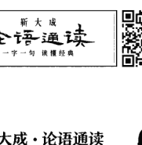

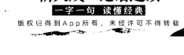

## 12 | 一年时间孔子能干什么

13.5 子曰：“诵诗三百，授之以政，不达；使于四方，不能专对。虽少，亦奚以为？”
13.6 子曰：“其身正，不令而行；其身不正，虽令不从。”
13.7 子曰：“鲁卫之政，兄弟也。”
13.8 子谓卫公子荆：“居丧室，始有，曰：‘苟合矣。’少有，曰：‘苟完矣。’富有，曰：‘苟美矣。’”
13.9 子适卫，冉有仆。子曰：“庶矣哉！”冉有曰：“既庶矣，又何加焉？”曰：“富之。”曰：“既富矣，又何加焉？”曰：“教之。”
13.10 子曰：“苟有用我者，期月而已矣，三年有成。”
13.11 子曰：“君子居之，何有于择哉！”
13.12 子曰：“如有王者，必世而治。”

好，我是靳东，欢迎来到我的《论语通读》，我们一章一章读经典。

这一讲的内容仍然集中讨论政治问题。

### 13.5 子曰

“诵诗三百，授之以政，不达；使于四方，不能专对。虽少，亦奚以为？”

孔子说：“把《诗》三百篇背得滚瓜烂熟，让他处理政事，却不能通达；出使他方，不能独立应对；即使懂得再多，又有什么作用呢？”

这是强调学以致用，也涉及诗在当时的实际用途。

孔子教学生读诗，可不是单纯为了文学兴趣，诗在当时的军事活动中有重要的实际作用。你还记得上部我们提到孟僖子临终死前，为什么让自己的两个儿子跟孔子学礼吧？

就因为孟僖子本人在出使外国时，在重要的外交礼仪场合会对于谈《诗经》研究得不够，对方颂诗表达某个意思，他居然词穷，无法应对，有辱尊长之事。这可是开了国际玩笑，让他深感耻辱，刻骨铭心。

春秋时代，国与国之间的交往，包括贵族间重大的公共场合、礼仪活动，诗是重要的交往形式之一。没有一番素养和训练，简直寸步难行。孔子是告诫自己的学生，诗文学能，言词，还要贯通，深切理解诗的意蕴，活学活用。在实际外交活动中，灵活恰切恰到好处地运用，才算学会了读诗。

### 13.6 子曰

“其身正，不令而行；其身不正，虽令不从。”

孔子说：“在位者自身正了，即使不下命令，事情也能行得通；在位者自身不正，即使下达命令，老百姓也不会服从。”

觉得太苦，很不理解。

结果，他硬是在一年多的时间内，训练出了一支素质极高、能征惯战的水军。果然在历史的关键时刻发挥了作用，改变了历史的进程。

可见，对于一个有志向、有抱负、有准备的人来说，他在正确的时间、正确的地点做了正确的事情，甚至能改变和影响历史。这一点，你从李舜臣的故事中，就能体会到了。

### 13.11 子曰

“善人为邦百年，亦可以胜残去杀矣。诚哉是言也！”

孔子说：“善人治理国家一百年，也可以消除残暴、免除刑罚杀戮。这话说得真对呀。”

为什么善人为政百年，就可以“胜残去杀”呢？孔子这是在讲他心中的一个理想境界。你还记得上一篇里孔子讲过“君子之德风，小人之德草”的话吧？就是说如果善人能连续执政甚至长达百年，那社会风气会发生根本的转变。以德治国，人民有良好的习惯，遵纪守法，刑罚等手段就没必要了嘛。

这里讲的是对上一章的进一步补充。从初见成效，再到胜残去杀、措刑不用，这就是孔子心中的清平治世。但是要做到这点，需要时间。

### 13.12 子曰

“如有王者，必世而后仁。”

孔子说：“如果有王者兴起，也一定要三十年才能实现仁政。”

古人父子相传为一世，大约是三十年。如果说善人施行德治，至少也需要一百年才可以达到孔子心中的理想境界，那么这是进一步的补充：即使有真正的王者来治理，至少也需要三十年的时间才能为实现仁政打下基础。

孔子和弟子们研究历史文献，观察当下的社会现实，深知国家的治理决不是一件容易的事情，没有几代人的努力是根本不可能成功的。

## 今日思考

这一讲孔子既提到，如果有机会，他期月（也就是一年）可以成事，但也接着讲到善人为邦百年，一年和百年有矛盾吗？你是怎么理解的？欢迎在留言区分享。

## 你的今日论语签

如何用：点击大图

- 1. 分享到朋友圈，每日学习打卡，请朋友监督自己完成《论语》通读任务。
- 2. 保存到相册，随手翻开，随机获取来自《论语》的智慧启迪。

## 13 | 子女可以为父母隐瞒错误吗

### 13.13 子曰

“苟正其身矣，于从政乎何有？不能正其身，如正人何？”

### 13.14 冉子退朝

子曰：“何晏也？”对曰：“有政。”子曰：“吾闻也。如有政，虽不吾以，其与闻之。”

### 13.15 定公问

“一言可以兴邦，有诸？”孔子对曰：“言不可以若是其几也。人之言曰：‘为君难，为臣易。’如曰为君难，如不难，得为君乎？”“一言可以丧邦，有诸？”孔子对曰：“言不可以若是其几也。人之言曰：‘无以为善，以为恶。’如其有喜于善而不以，无以为善而以为恶，不亦几乎？”

### 13.16 叶公问政

子曰：“近者说，远者来。”

### 13.17 子夏为莒（jǔ）父宰

问政。子曰：“欲速则不达，见小利则大事不成。”

### 13.18 叶公问孔子

曰：“吾党有直躬者，其父窃牛，其子证之。”孔子曰：“吾党之直者异于斯：父为子隐，子为父隐，直在其中矣。”

你好，我是靳东，欢迎来到我的《论语通识》，我们一字一句，读懂经典。

孔子说：“如果自身的行为端正了，参与政事还有什么困难呢？不端正自身的行为，又怎能使人端正呢？”

这句话我们可以多考虑一下，您不也一直在说“其身正，不令而行”吗？

“己所不欲，勿施于人”也是同一个道理。

本意是希望领导首先以身作则，要求别人做到的，自己先做到。

冉有退朝回来很晚，孔子问：“为什么这么晚？”冉有说：“有政务。”孔子说：“只要政务，即使不用我，也告诉我一声。”

冉有在季氏家任职，而冉子出来说自己是“有政”，这是把家事当国事，把私事当公事。

而孔子说“虽不吾以，其与闻之”，说明冉有把家里的事情当成了政务，而孔子对此很不满。

鲁定公问：“一句话就可以使国家兴盛，有这样的话吗？”孔子回答说：“说话不能这样绝对。有人说：‘做君主难，做臣子容易。’如果知道做君主的难处，还不等于一句话就可以使国家兴盛吗？”“一句话就可以使国家灭亡，有这样的话吗？”孔子回答说：“说话不能这样绝对。有人说：‘我不以为善，以为恶。’如果做君主的人有喜于为善而不以为善，无以为善而以为恶，不也几乎是一句话就可以使国家灭亡吗？”

鲁定公又问：“一句话就可以使国家灭亡，有这样的话吗？”孔子回答说：“说话不能这样绝对。有人说：‘做君主易，做臣子难。’如果做君主的人有喜于为善而不以为善，无以为善而以为恶，不也几乎是一句话就可以使国家灭亡吗？”

这段话的意思是说，国君的一言一行都关系着国家的兴衰存亡，不能有一句话出格，因此一言可以兴邦，一言也可以丧邦。

叶公问孔子如何治理国家。孔子说：“使近处的人高兴，使远处的人来归附。”

叶公问政，实际上是问孔子如何治理国家。孔子回答，要让近处的人高兴，让远处的人来归附，这就是一种很好的治国方法。

子夏做莒父的县宰，问政事。孔子说：“想要快反而达不到目的，贪小利就办不成大事。”

孔子这句话提醒子夏，治理政事要循序渐进，不要急功近利，也不要把精力放在小利上。

叶公问孔子：“我们乡里有个很直率的人，他父亲偷了牛，他就去告发。”孔子说：“我们乡里直率的人和这个不同：父亲替儿子隐瞒，儿子替父亲隐瞒，正直就在其中了。”

这段话说明，孔子认为亲情重于法律，父子之间的亲情应该得到尊重，不能因为法律而破坏家庭关系。

子女可以为父母隐瞒错误吗？这其实是一个关于孝与法的问题。

如果父母犯了法，子女应该怎么做？孔子认为，父为子隐，子为父隐，直在其中。也就是说，父慈子孝，是中华传统美德之一。

所以子女可以在不违法的前提下，帮助父母改正错误，而不仅仅是告发。

总之，这段话提醒我们，要重视家庭和睦，不要为了个人利益而破坏家庭关系。

入“孝”与“慈”等和礼相关的大范畴群中来考虑了。血缘关系是优先于法律和规矩的。衡量某个具体行为（包括正直），都要纳入到“礼”这个更高一级的道德选项来做考虑。

孟子也遇到过类似的问题。他觉得别说一只羊这种小事情，不能被破坏亲子血缘关系，就连圣王舜帝遇到父亲面临刑罚时，也会弃天下而不顾，把亲情放在首先考虑的位置上。

这种看法不独中国人有，在古希腊，我们看到的也是类似的例子。

柏拉图的《对话录》里，记载过苏格拉底跟游叙弗伦的交锋。这个游叙弗伦去法院告自己的父亲犯有杀人罪。真实状况是他父亲有个仆人杀死了一个家奴，他父亲就把仆人绑起来扔在沟里，派去雅典请示神的意思如何处置。可使者还没回来，仆人已经冻饿而死，所以游叙弗伦就要告父亲犯有杀人罪。

苏格拉底通过不断追问，瓦解了游叙弗伦关于敬神和渎神的基本观念，因此出于所谓正义的观念来控告父亲犯有杀人罪的前提被动摇了。在苏格拉底看来，什么是正义，哪些该做，哪些不该做，绝对不简单。没有经过批判性思考，根据某些不证自明的观念而采取的判断和行动，是有问题的。

法国存在主义哲学家萨特，也被类似的这种伦理选择上的两难冲突所困惑。事实上，他也没有得出结论。他提示说：

当两种选择面临着责任、正义、道德和情感冲突时，你只能自己根据自己的内心最强烈的需求来做出选择，这意味着你的选择要承担责任。你认为两种价值，哪一种对你更为重要，处于优先级，你就选择哪个，而你所否定的价值，其后果是你完全自己来承担的。

而在历史上，儒家的有义灭亲的说法，也有子为父隐的案例，这是伦理学和法律学中的两难选择。古人至少给我们留下了多种选择的可能，充满张力的思考框架，给我们处理和解决这个复杂问题留下了宝贵启示。

在今天中国的司法实践中，刑事诉讼法已经有了所谓“亲属拒证权”的规定，虽然一般人接到法院通知，没有正当理由不能不出庭作证，但是被告人的配偶、父母、子女除外。这既是尊重了“父为子隐、子为父隐”的古老传统，也是顺应了世界潮流。

## — ◆ 今日思考 ◆ —

假如亲人犯了错误甚至罪行，你自己更倾向于沉默隐瞒还是大义灭亲？为什么呢？欢迎在留言区分享你的看法。

## — ◆ 你的今日论语签 ◆ —

如何用：点击大图

- 1. 分享到朋友圈，每日学习打卡，请朋友监督自己完成《论语》通读任务。
- 2. 保存到相册，随手翻开，随机获取来自《论语》的智慧启迪。

用户留言
提交留言可与专栏作者互动

## 14 | 你愿意跟狂狷之士交朋友吗

### 13.19

樊迟问仁。子曰：“居处恭，执事敬，与人忠。虽之夷狄，不可弃也。”

### 13.20

子贡问曰：“何如斯可谓之士矣？”子曰：“行己有耻，使于四方，不辱君命，可谓士矣。”

### 13.21

子曰：“不得中行而与之，必也狂狷（juàn）乎！狂者进取，狷者有所不为也。”

你好，我是新大欢，欢迎来到我的《论语通读》，今天我们一同，读懂经典。

**13.19 樊迟问仁。**

樊迟问怎样做才是仁。

你还记得上一篇《颜渊》里，樊迟曾提出过同样的问题。

这里孔子是对“仁”的解释。是以“恭”“敬”“忠”三个德目为基本内涵。与泛泛的宽要求相比，对内在的修为和外在表现上，境界明显上了一个台阶。

孔子怕樊迟理解得不透，最后还是意犹未尽，一口气拍着胸脯说：

这是强调恭、敬、忠三德目是一种普世通行的道德标准。

**13.20 子贡问曰：“何如斯可谓之士矣？”**

子贡问道：“怎样才能叫做士？”

“士”在古代家族中算是最底层，此后慢慢变为古代社会知识分子的通称。

子贡问的是君子，不是鲁人，不是仁人，而是士。

子贡非常善于思考。

于是孔子就从日常生活的修身说起。

子贡再问，如果比这个标准再降一等，是什么情况？

这个问题多少有点难答。

但子贡非问不可，到最后两个问题有点敏感，孔子对子贡的态度有点失望了。

“斗”是古代最普通的量器，箕是饭量。用斗箕来容纳人，指的是有些人眼界见识狭小。

你大概也学过《曹论战》，曹刿对当政者有个评价，叫“肉食者鄙”。

不过，随着经典流传，“言必信，行必果”在今天倒成了一句赞美人的话。

**13.21 子曰：“不得中行而与之，必也狂狷（juàn）乎！狂者进取，狷者有所不为也。”**

孔子说：“碰不到奉行中庸之道的人和他交往，我一定跟狂狷者交朋友。”

狂狷二字，流传今日。

你可能觉得奇怪，孔子教育弟子一向是主张行礼。

有一次，孟子的学生万章问他，关于孔子在陈，“饥乎来，民党在小怀羁，进款，不忘甚国”。

孟子解释说，孔子大概因为找不到中行之士吧。

孟子给他举例。

而狷介之士呢？

唐代大诗人李白，就从这个词里立意，选用了楚狂接舆的例子。

“孔子说的中行，就是不偏于狂，也不偏于狷。”

# 今日思考

不管是读诗还是生活，有什么人是你觉得是“狂”或是“狷”有特点的？欢迎你在留言区谈谈你对他们的看法。

# 你的今日论语签

如何用：点击大图

- 1. 分享《论语》每日打卡，请朋友们完成自己《论语》诵读任务。
- 2. 保存相册。

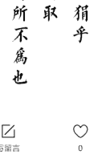

不得中行而與之
必也狂狷乎
狂者進取
狷者有所不爲也

《论语·子路篇》

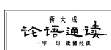

新大成·论语通读
一字一句 读懂经典

版权归属于App所有，未经许可不得转载

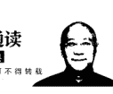

## 15 | 好人都喜欢的人才是好人

你好，我是李大成，欢迎来到我的《论语通读》，我们一字一句，读透经典。

**13.22** 子曰："南人有言曰：‘人而无恒，不可以作卜筮。’善夫！" 不恒者，不可以成人。

孔子说：“南方人有句说法：‘人如果没有恒心，就不能当巫婆、医师。’这句话说得真好。” 孔子说：“‘不恒而德，免于不谨要，得事也。’这是告诉说有恒心操守在德的行为，就用人者不直且了。”

这里说的“南人”是谁？指方来说的有法，一般认为，其实就近处的楚国的西南面上的。都话出自的楚辞《礼记·缁衣》上面的类似的话，但是是《宋人》：人而无恒，不可以为卜筮。宋是商的后代，商代最高是重占卜。

巫的历史颇为久远，原始社会就已出现。《说文》解释至巫师曰：“巫，祝也，女能事无形，以降神者也。”

以灵魂信仰为特点，慢慢发展到高级阶段，也随着社会的发展。分工、阶层的出现，还出现了大夫、寄观地、祭司的活动为发现文字、古代天文历游知识、数学、医疗卫生知识等做出过贡献。

随着文明的进步，它与社会整合得很紧密，甚至一度左右王权。至今在世界各国，仍然能不少地区保留着它的影子，中国民间社会的许多传统也或多或少地的存在。《左传》记载的小二百年多年春秋的历史，其中也有不少涉及巫和巫术活动的内容。

商精神的巫风俗盛，到了周代人文文明的理性神学的发展。周公制礼作乐，其中某些仪式的具体内容也还有巫术的痕迹，或者说就是从巫术中演化出来的。

周代的人文主义孔子说的，进一步得到发扬。 我们学过的 “敬鬼神而远之”、“未知生焉知死” “未能事人焉能事鬼” 等等，就是孔子理性精神的典型体现。

为什么从事占卜的人不能没有恒心，历代的解释者有各有各的解释，我们就追完了。

但我们可以这话中，孔子强调一个人必须得有恒心，有看到完成子强。一个人必须长期注意保持自己德行、操守，否则就会遭受毁誉。 自己非 这个“恒”，言 义 主 意，他的 非 非常重视“恒”。后面也会谈到“有恒者”这个词。

**13.23** 子曰："君子和而不同，小人同而不和。"

孔子说：“君子讲求和谐而不同流俗，小人只求混杂同而不和谐。”

和，是调合不同的东西达到和谐；同，是混同、相同、等同。

对于和与同的区别认识，《左传》里还有一个记载。晏婴要齐伐楚国，与同与有什么不一样吗？晏婴说，完全不一样。

这是孔子在把君子和小人平时的仪态、心胸、作派拿来比较，立马现出高下之别。

这种差别是从哪里来的，怎么产生的？明儒有个说法。君子、小人存心不同，因此他们之间气象有别。君子以德润身，所以内和外平，心广而体胖。人只见其安舒自得，何曾有一丝骄矜傲物？

小人相反，或以财势自恃，或以才情傲物，在人家面前总显得志得意满、心高气盛、唯我独尊。一个不重视自我修养的人，满眼皆是人家之过，完全不知反省自己。其实，这都是平时不注意学习之过。就算他看了几页书，也总喜欢在在前人前显摆，“奈何不下腹中数卷书”，总想着在人面前抖落那点儿高明。

所以观察一个人，从他的外在表现，就可以透视他的内心。前面咱们学过，“视其所以，观其所由，察其所安，人焉廋哉！”一个人的内在修为、功夫深浅，装是装不来的，明眼人一看即知。

# 今日思考

我们学习了“君子和而不同”，在日常工作中、团队协作中，你是怎么理解孔子所说的“和”和“同”的？欢迎在留言区分享你的观点。

# 你的今日论语签

如何用：点击大图

- 1. 分享到朋友圈，每日学习打卡，请朋友监督自己完成《论语》通读任务。
- 2. 保存到相册，随时翻开，随机获取来自《论语》的智慧启迪。

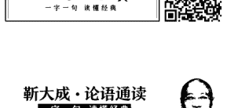

## 16 | 孔子讨论军事问题

**13.27** 子曰：“刚、毅、木、讷近仁。”

**13.28** 子路问曰：“何如斯可谓之士矣？”子曰：“切切偾偾（sì），惴惴恺恺。可谓士矣。朋友切切偾偾，兄弟怡怡。”

你好，我是新大威，欢迎来到我的《论语通读》。我们一字一句，慢慢细读。

**13.27 子曰：“刚、毅、木、讷近仁。”**

孔子说：“刚强、果敢、朴实、寡言，这四种品性都接近于仁。”

今天刚毅、木讷已经成了两个词，但在先秦时代，得分成四个字分别理解。

前边讲了君子小人具表现的差别，这一章是说明君子应该具备的四种品性。

“刚”这个字，是和“欲”相对的。你说《古公传书》里也曾经讲到申报，他说“长也欲”，刚勇刚是这个人私欲太少，怎么可能具有广博的气了？所以民间常有“无欲则刚”的成语。一个人以公众为心，总想着给别人，不尚私、不利己，这样的人才有可能表现出刚的品性。

毅是坚韧、果敢、有魄力、有决断。孟子说“威武不能屈”，指的就是这种品性。

木是像树木一样朴实、厚道，不玩虚的，不耍小聪明，肯于做别人所不愿做的苦功，肯于吃苦受气。

讷，前边我们学过，说话谨慎，少言。

孔子用这个字描画出四种品性，为这种品性，气质接近于仁者。仁，是学习的目的，也是通过君子能达到的最高境界。而这四种品性，气质，则是达到这个最高目的的必备条件。

这个对人性的观察，对人的品性和气质的分析、描述，整部《论语》从头到尾、贯穿始终，说明天才绝不是随随便便的，是基于对人性的深入观察与反省才提出来的。

**13.28 子路问曰：“何如斯可谓之士也？”子曰：“切切偾偾（sì），惴惴恺恺。可谓士矣。朋友切切偾偾，兄弟怡怡。”**

子路问道：“怎样才可以叫做士呢？”孔子说：“互相督责，互相相处，可以叫做士了。朋友之间互相督责，兄弟之间和睦相处。”

上—讲咱们刚学过，子贡问孔子“何如斯可谓之士也”，这里子路问了同样一个问题，而且这两人问的话一模一样，一个不多，一个字不少。可孔子回答子贡，是进行己私耻、不辱使命、宗族称孝、乡党称悌等。

轮到子路来问，孔子又谈朋友之间互相督责，兄弟之间和睦相处，并不多有关讨论政治之类的范畴。子路的政治军事才干，子孔子非常清楚，无需多谈。倒是提醒他身边人时，注意平常和朋友相处、兄弟相处的心态。

子路，孔子回答是一个非常简单、非常基础的做人标准，从眼睛脚下平常处近，一步一个脚印，没有一点虎头蛇尾的东西。

最后两章是孔子讨论军事问题，这在《论语》中很少见。

**13.29** 子曰：“善人教民七年，亦可以即戎矣。”

孔子说：“善人教育百姓达七年之久，也可以叫他们去参军作战了。”

读这一章，你可能会产生两个疑问：一、为什么非要民可战？军兵种去向呢？二、教民七年才能参军备战，用得着这么长时间吗？这个涉及到的社会结构的变化，关于中国早期的战争我来给你解答一下。

上既不拒绝研究军事问题，也并不反对在必要的时候采取军事手段解决问题。

一方面，他坚持主张礼乐征伐自天子出的周礼，反对各诸侯国擅自发动无义战。另一方面，面对当下的社会现实，他又推动国君积极训练百姓做好准备，并且告诫人们，如果没有平时长期的军事训练，就把国中之民、青壮劳力送上战场，这就等于是抛弃了他们。

从齐鲁夹谷之会前，他提醒国君“有文事者必有武备”这句话就可以理解，这其实是他成熟的、一贯的思想。只不过孔子儒家并不以此为主业，更不主张对外用兵，所以学习研究归学习研究，但他们并不愿意对各国的君主大谈军事问题。

# 出自《论语·子路篇》的成语

- 名正言顺、手足无措、胜残去杀、一言兴邦、一言丧邦、近悦远来、欲速则不达、言必信，行必果、斗筲之人、和而不同

# ◆ 今日思考 ◆

这一讲孔子说“朋友切切偃偃”，也就是朋友之间要互相督责，你是怎么理解这句话的？日常生活中你有这样的朋友吗？欢迎在留言区分享。

# —◆你的今日论语签◆—

如何用：点击大图

- 1. 分享到朋友圈，每日学习打卡，请朋友监督自己完成《论语》通读任务。
- 2. 保存到相册，随时翻开，随机获取来自《论语》的智慧启迪。

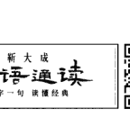

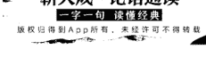

用户留言

## 17 | 孔子的耻辱观

**14.1** 闻克陪。子曰：“邦有道，谷；邦无道，谷，耻也。”“克”伐、纤佞，与不行焉，可以为文矣？”子曰：“可以为难矣，仁则吾不知也。”

**14.2** 子曰：“士而怀居，不足以为士也；邦有道，危言危行；邦无道，危言危行。”

**14.3** 子曰：“邦有道，谷言危行；邦无道，危言危行。”

**14.4** 子曰：“有德者必有言，有言者不必有德。有勇者必有仁，有仁者不必有勇。”

**14.5** 南造适（kuò）蒉，问孔子曰：“弁若时，勇力（ào）荡舟，俱不得其死，而尧舜何得有天下？”夫子不答。南造退出。子曰：“君子哉若人！尚德哉若人！”

**14.6** 子曰：“君子而不仁者有矣夫，未有小人而仁者也。”

你好，我是新大东，欢迎来到我的《论语通读》，我们一字一字读，慢慢读。

完整的孔子也是原孔子的一个篇章的第一篇篇名就是闻克陪，原文只有一个问题，所以篇名叫《克陪》。这一篇共44章，比较长，分成七块来学习，这一篇谈的是君子的内容多，也评论了许多历史人物。

**14.1** 闻克陪。子曰：“邦有道，谷；邦无道，谷，耻也。”“克”伐、纤佞，与不行焉，可以为文矣？”子曰：“可以为难矣，仁则吾不知也。”

原句清子什么是耻辱呢？孔子说：“国家政治清明，可以取富贵禄；但是像国家的政治昏乱，还去取富贵禄，这就是耻辱。”原句说：“邦有道，谷言；邦无道，谷言，耻也。”“克”伐、纤佞，与不行焉，可以为文矣？”子曰：“可以为难矣，仁则吾不知也。”

你还记得，《泰伯篇》里孔子也谈到过“耻”的问题。“邦有道，谷言；邦无道，谷言，耻也。”意思是：如果国家政治清明，可以取富贵禄；如果国家政治昏乱，还去取富贵禄，这就是耻辱。这里原句也强调了君子无耻还要有权利、身份定位，笑骂由人笑骂，好官我总做下去，这种人就有些无耻，好就无所谓，没有荣辱，这样的人，你是没法和他打交道的。

接下来原句也看看八个字中的缺点一好像士、自尊等，是孔子的标准很难说，所以他就更无耻，所谓“耻不”，是一种自主努力，虽然有困难都是不可，但毕竟是强制压抑自己，暂时没发作出来罢了。

至于什么是仁，这里没有正面话，孔子故意说自己不知道，其实孔子不是真的不知道，只是要告诉原克的听话罢了。

**14.2** 子曰：“士而怀居，不足以为士矣。”

孔子说：“士如果恋念乡居安逸的生活，就不足称为士。”

怀居，是恋恋、留恋乡居安逸的生活，这是的初始环境，在什么会讲的话，已不可得而知了。

不过你想像，前几天咱们学过，孔子对大禹非常肯定，说我对他没有可以议论的了，大禹治水，累得手脚上起毛刺都顾不上，三天没有进家门，又夫上自己毛皮，去齐、访周、游邗国，也是席不暇暖，奔流一生。可以说，他对士的标准，要求学生们的，首先他自己做到了。

**14.6** 子曰：“君子而不仁者有矣夫，未有小人而仁者也。”

有的，但没有身为小人却具有仁德的人。

因为这句君子不仁的矛盾解释不通，前代也有学者认为，孔子这里说的君子、小人，是在原来通行的意思上讲，是社会身份的不同，指的是贵族身份的人和普通老百姓。可如果是这样理解的话，你是不是感觉这话说得有点太绝对了？

所以我理解，结合整部《论语》的语境，君子小人还是理解为在道德修养方面的差距更好。这个君子、小人的不同，在于心术之别。

君子虽然也会有颠沛流离，百事不顺，造次之时，偶尔也会行为举错失当，或致不仁之事，但初心并非如此。小人居心就不仁，初心不好，是不会有偶然进于仁德大义的可能的。所以，初心、本心、发心才是根本，最为关键。

这话还含有一层意思。君子也有仁德未备的时候，有已成德的君子，也有未成德的君子。像前边我们就听孔子说过，颜渊可以做到好几个月不违仁：三月不违仁。而其他人像子路、冉求、公西华，则都说“不知其仁”，虽然他们也算是君子，但于仁德尚欠圆满，有未达、未备之处。

# —◆今日思考◆—

孔子说“仁者必有勇，勇者不必有仁”，这句话你是怎么理解的？欢迎在留言区分享你的看法。

# —◆你的今日论语签◆—

如何用：点击大图

- 1. 分享到朋友圈，每日学习打卡，请朋友监督自己完成《论语》通读任务。
- 2. 保存到相册，随手翻开，随机获取来自《论语》的智慧启迪。

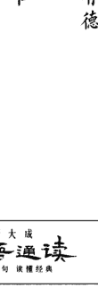

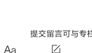

用户留言
提交留言可与专栏作者互动

## 18 | 什么是真正的爱

**14.7** 子曰：“爱之，能勿劳乎？忠焉，能勿诲乎？”

**14.8** 子曰：“为命，裨谌草创之，世叔以为之，行人子羽修饰之，东里子产润色之。”

**14.9** 或问子西。曰：“彼哉！彼哉！”问子贡。曰：“君子固穷，小人穷且滥矣。”

**14.10** 子曰：“贫而无怨，富而无骄。”

你好，我是新大成，欢迎来到我的《论语诵读》，我们学习一则，读懂经典。

这一讲，孔子评论了几个他从前的人物。

**14.7** 子曰：“爱之，能勿劳乎？忠焉，能勿诲乎？”

孔子说：“爱他，能不让他操劳吗？为他着想，不能不教他吗？”

这句话是不是反问句，孔子真正的意思是：爱之则劳之，忠之则诲之。这个主张有根据吗？

真心爱一个人，哪怕是父母爱子女一样，也不能整天把他抱在摇篮里，捧在手心里，怕他化了。而是爱历练他，劳其筋骨，苦其心智，经风雨，见世面。

同样，一个人对于他的上级来说，这个人忠贞不一定上下级关系，在《孝经》就讲过，“为人谋不忠”，“忠”是忠为人谋事，为他考虑，希望全心全意尽力。对有缺点和不足，也就应该直言不讳，该说的话必须要说，才能真正的尽忠。

**14.8** 子曰：“为命，裨谌草创之，世叔以为之，行人子羽修饰之，东里子产润色之。”

孔子说：“郑国制定外交辞令，都是由裨谌起草草案，世叔加以审议讨论，外交官子羽加以修饰，最后由东里子产修饰润色。”

孔子说的这件事，正是子产于郑国主政大的时代。前边《公冶长篇》孔子评论过子产，说他有君子的道义，子产也很高明，这说明孔子团队子产对这历史也做过深入的研究。

子产主政时，辅佐过两任国君，使处于四战之地的郑国重回中原。他整顿了财政制度和土地制度，恢复了按土地征税的制度，并且在鼎上铸刑法。与各国交往当中，他表现得有智慧，有口才，并且为国家利益据理力争，在各国中颇显显位。

虽然他的新政当时有许多人不理解，甚至被人强烈反对，但他抱着“苟利社稷，死之以之”的决心，有“吾以救世为志”的初心，不动摇，决不计较。一任时国君显示出完全不同的气象，被中原诸侯国推举为盟主。

这是孔子在描述子产主政当时，郑国的外交公文出此的全过程。

一封外交公文，书信，要经过四个程序的程序公文，可见当时，郑国在国君，位、能人辈出，政治井然有序，国家治理得非常好。有这治理大治期间，郑国虽然是一个小国，夹在晋国等大国之间，但是能一扫颓势，重新挺立在中原诸侯国中间。

**14.9** 或问子产。子曰：“惠人也。”问子西。曰：“彼哉！彼哉！”问子贡。曰：“君子固穷，小人穷且滥矣。”

有人问孔子子产。孔子说：“是个有恩惠于人的。”又问孔子子西。孔子说：“那个人哪？那个人哪！”又问子贡，孔子说：“君子固穷，小人穷且滥。”

这里同时提到了三个历史人物。说子产是施惠于人，不是一般人。《左传·成公三十一年》记载，子产到许人下乡不毁其桑，后来就评评论说：“人谓子产不仁，吾不信也。”

春秋时有三个子西，这里根据上下文，推断为郑国的公孙喜比较合理。他是子产的同宗兄弟，子产被他的君主接纳的政治。这句“彼哉，彼哉”，用的是当时的语气，意思是“那个人哪，那个人哪”。这句话很生动，可见孔子不怎么看得起这个人。

至于管仲，孔子经常给予相当高的评价。这句话肯定他，并没有对他做政治、道德上评判，辅助齐桓公合诸侯的业绩着眼，而说他有了才、办事派头、执法严明。虽然他得罪了很多人士，割断了众关系，让他终生没有子嗣，但对行并无恶名，这说明他本人做事公正，依法行事，让人挑不出毛病来。

不过，需要提醒大家前面读过的《八佾篇》，既会看到，孔子对他的评价比较复杂，既有肯定，也有批评。在《里仁篇》中，孔子又觉得管仲德局小，而且仍然属于不知礼的人。

后世孟子批评他门不讲仁义，对文的事，其实也颇有保留。认为他们虽然有让国家强大，称霸一时的，但与儒家思想中的政治（即仁政、王道）还差好几个台阶。

**14.10** 子曰：“贫而无怨，富而无骄。”

孔子说：“贫穷而怨恨，富裕而骄傲。”

这是一个经验之谈，和孔子对社会现实现象的内在规律有关。因为贫学逆境，如果不是心态不好，就会为所不为，学所不成，一般情绪下不会太糟糕，遇到师友指点，只要稍知礼节加以节，就能做到不骄。

与这题相关的内容，前边《学而篇》里就有过。孔子告诉子贡问孔子如何治：贫而不怨，富而骄，怎么样？子贡回答：还可以呀，不如还比不上贫穷而却能自然自乐，富有却没有骄态。

但贫者这具体来看，今天已不可得而知的。但社会贫富差距的问题一直存在，在到处都是穷困，因就比2500年前孔子的学生，也同样的困扰着他们。

**14.11** 子曰：“孟公绰为赵魏老则优，不可以为滕薛大夫。”

孔子说：“孟公绰如果做晋国诸卿赵氏、魏氏的家臣，那他会发挥得有余，但不能胜任做滕、薛这样小国的大夫。”

孟公绰，鲁国人，属于孟孙氏家族，孔子认为他在官场上的确为好人。《史记·仲尼弟子列传》里也说他是个很受人尊敬的人。

《左传》里也有一段记载：有一次齐国率军来攻打鲁国，国君吓坏了，准备派兵到齐国求救，孟公绰说不用派兵，齐国的连军就离开，出兵的，他不但去，怎么能不有颜面让对外界兵？果然，齐军就退回了，说明他这个人很有见识。

那这里为什么说他不能胜任做滕国、薛国的大夫呢？孟公绰有一个说法可以参酌。他认为，孟子有一个说法太少说，德行高位也不干，像滕国、薛国，国小事情，各种事务性工作非常具体，因此他无法胜任。

这话有一定道理。恐怕孟公绰这样资历深的名望的，一心最好干一个高而不实际，有创造性的，作为最佳时机会比较合适。让他负责具体的事务，百务纷繁，恐怕他处理得不够周全。

**14.12** 子路问成人。子曰：“若臧武仲之知，公绰之廉，冉子之艺，又能文之，加之以忠信，可以为成人。”曰：“不今之人，何可及也？”

子路问“怎样才算一个完美人”，孔子说：“像臧武仲的有智慧，孟公绰的廉洁，冉子多才多艺，再加上子路的勇毅，像冉求那样多才艺，再用忠厚加以修养，那就可算得是一个完美的人了。”

孔子又说：“现在的完美的人何必如此呢？见到利益能够看到不贪利，遇到危险能够挺身而出，长久处于艰难环境下也不忘平生的诺言，这样也可以算作完美的人了。”

这一讲孔子提到了四个人，其中，孟公绰在14.11，前面也谈过，那么臧武仲又是谁呢？

## 19 | 孔子对管仲的肯定

我们前边说过了，冉求你也知道。那么臧武仲和卞庄子呢？都是鲁国的大夫，应该说道是子路很熟悉的人。

你记得咱们前边学过，不仁者不可以久处约。所谓能久处约，就是长期处于艰难困顿之中仍不改其志，这就是仁者。

子路的问题问得好，于是引出了孔子一个非常完整的回答。这里，孔子提出了成为一个完美的人，也就是完整意义上的人的四条标准：要有智慧，要无贪欲，要勇敢果决，还要多才多艺。有了这四种品质、素养、才能，可以说是一个必要条件。

夫子又给出了一个充分条件：再用礼乐来修饰、习染，形成良好的风度与待人接物的规矩，就可以算是完美的人了。

考虑到当下的环境、条件不同以往，孔子在理想标准之下，又提出了一个现实版。今天嘛，只要你能够做到见利不忘义，遇危险不怕牺牲，虽然长期处于贫穷困顿的境地，仍然不忘记自己平日许下的诺言。这也就算是完美的人了吧。

## 今日思考

这一讲里孔子评论孟公绰，说他能在大国做管理者，却管不了小国。在你的工作实践里，你觉得是不是也有类似的情况？管大事的人和管小事的人有什么差别呢？欢迎在留言区分享。

## 你的今日论语签

如何用：点击大图

- 分享到朋友圈，每日学习打卡，请朋友监督自己完成《论语》通读任务。
- 保存到相册，随手翻开，随机获取来自《论语》的智慧启迪。

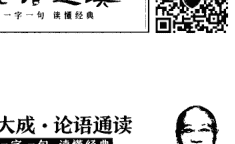

14.13 子问公叔文子于公明贾曰：「信乎，夫子不言，不笑，不取乎？」公明贾对曰：「以告者过矣。夫子时然后言，乐然后笑，义然后取。」子曰：「其然乎？疏其然也。」

14.14 子曰：「臧武仲之智，南宫适之温，冉求之勇，如复加之以文德，吾斯之未能也。」

14.15 子曰：「晋文公谲（jué）而不正，齐桓公正而不谲。」

14.16 子路曰：「桓公杀公子纠，召忽死之，管仲不死。」曰：「未仁乎？」子曰：「管仲相桓公，霸诸侯，一匡天下，民到于今受其赐。微管仲，吾其被发左衽矣。岂若小丈夫者的一谅之谓也，自经于沟渎而莫之知也。」

你好，我是靳大成，欢迎来到我的《论语通读》，我们学一学，读懂经典。

**14.13 子问公叔文子于公明贾曰：「信乎，夫子不言，不笑，不取乎？」公明贾对曰：「以告者过矣。夫子时然后言，乐然后笑，义然后取。」子曰：「其然乎？疏其然也。」**

孔子向公明贾问公叔文子，说：“这位先生是否不说话，不笑，不取财，是真的吗？”公明贾回答他：“这么说的人，你错了。先生他等到时机合适的时候才说话，高兴了才会笑，合乎义理了才去取财。”孔子说：“原来这样，难道真是这样吗？我看未必啊。”

孔子问的这位公叔是卫国人，他称公叔文子的“文”是他的谥号。公明贾，可以算是非常知人论世的人。公明贾的意思是说，公叔文子这个人，笑，取人家的财物，天下哪有不笑不取之人的呢？那是神话人物。

不过，这个公明贾为公叔文子的解释和辩护，形容得近乎完美，正好合孔子思维的“时中”，貌似有点过满，所以孔子表示有一点怀疑的意思，但语气还是留有分寸的不强烈。

通过评价公叔文子的这段话，特别是“义然后取”的行为，假定说公叔文子真的做到了时而言，时而后笑，义然后取，那么可以说是有高尚人格之所在。

你记得孔子对颜回的回答吗：非礼勿言，非礼勿听，非礼勿视，非礼勿动，其实就是个人的言行举止，取与舍都要合乎“礼”。这个标准，孔子觉得这个公叔文子，未必真的能做到吧？

**14.14 子曰：「臧武仲之智，南宫适之温，冉求之勇，如复加之以文德，吾斯之未能也。」**

孔子说：“臧武仲的智慧，南宫适的温和，冉求的勇敢，如果再加上文采道德，那我这样的人是做不到的。”

孔子说的这件事，《左传·襄公二十三年》有详细记录，臧武仲为避祸逃奔曹国，后来到齐国为政，所以他的采邑靠近齐国，后来在齐国被齐国要求，可以离齐国的为人做大夫为条件，自己与齐高厚防氏。鲁君答应了，立他的哥哥齐高偃为将，于是他就交出了防御，自己去了齐国。

臧武仲以向自己的封地为他条件，要挟君主为交换，这是不忠的，不仁不合礼，而且有灭忠的感觉。为什么这样做呢？如果鲁君不答应他，他怎么办？你为了防止臧武仲，不就是遣人带着一块土地去齐国么？这当然是属于一种不忠的行为。

上章讲过臧武仲有智谋，从这里可以看出，他简直太会借智了，所以孔子对他的评价是有保留的。

**14.15 子曰：「晋文公谲（jué）而不正，齐桓公正而不谲。」**

孔子说：“晋文公欺诈而不正派，齐桓公正派而不欺诈。”

这里涉及到两个春秋时代的霸主，晋文公和齐桓公。

孔子对春秋时代两位霸主，做了如此不同的评价？

说晋文公的事，事出有因。晋文公在外流亡十九年，终于在秦兵的护送下回国执政。他一路颠沛流离，从一个下国君家的太子，终于历练成一代霸主。

不过，他后来在处理与晋国的关系的时候，也并不厚道，让晋国占了少个便宜。特别在《左传·襄公二十八年》的温陵之会，他以诸侯的名义召晋文公前来，和各国诸侯相见，晋文公则对孔子认为这个不为表明他非礼而也，手段欺诈，名不义等。

**14.16 子路曰：「桓公杀公子纠，召忽死之，管仲不死。」曰：「未仁乎？」子曰：「管仲相桓公，霸诸侯，一匡天下，民到于今受其赐。微管仲，吾其被发左衽矣。岂若小丈夫者的一谅之谓也，自经于沟渎而莫之知也。」**

齐桓公的宰相。”

孔子说：“管仲辅佐桓公，称霸诸侯，匡正天下，人民直到今天还享受到他的恩赐。如果没有管仲，恐怕我们已沦陷于入侵的夷狄，披散着头发，衣襟向左开了。哪能像普通男女那样拘守小节，自杀在小山沟里而无人知道呢！”

古人有言：“稽古者，当论其世；论人者，勿求其全。”意思是说，考察古史要知人论世，理解当时的具体条件。评论一个人物，不要求全责备。

孔子不同于后世的腐儒、陋儒，一根筋、死脑筋，只会口背圣贤之言，力不足行、事不能功。在学生一再质疑管仲不死旧主子公子的问题上，孔子再次亮明观点，表达了他维护天下有序统一、安国惠民的历史评价标准。

确实，连子路和子贡这些常年跟随学习的弟子，都这样把问题简单化，只知其一不知其二，缺少一个宏阔的历史观，那其他人就更不用说了。

从前边我们读到的章节来看，孔子其实也曾批评过管仲的不足之处。但总体来讲，孔子还是基本上从历史作用、惠及人民、维护周礼的角度肯定了管仲的功绩，认为他是个有仁德的人。

管仲佐齐桓公“尊王攘夷”，不炫耀武力，阻止了齐鲁和周各国被夷狄化，保存了中原诸国的礼乐文化，这个历史功绩不容诿咎。所以像管仲这样有仁德且发挥了重要历史作用的人，不必像普通的匹夫匹妇那样，去斤斤计较于他的节操。

这种小节，只有“平时袖手谈心性，临危一死报君王”这类狭窄无用的人，才会当回事。豪杰之士有仁人之心，以济民利物为怀，必建不世大功，岂可以小人之尺度君子之腹呢？

生死事大。哈姆雷特的疑问：活，还是不死？其实中国人也纠结万分。儒家处理生死与选择非常谨慎，而且要出自大义。司马迁因为教李广的孙子李陵向汉武帝进言，为之缓情，结果竟遭受宫刑，蒙受了奇耻大辱。

他在《报任安书》中说：所以隐忍苟活，幽于粪土之中而不辞者，恨私心有所不尽，鄙陋没世，而文采不表于后也。

司马迁面对生死，说出了掷地有声的话：人固有一死，或重于泰山，或轻于鸿毛。他的隐忍苟活，不是怕死，而是有更巨大的抱负和志向。

为了实现这个理想目标，他宁可被人诟病，忍辱偷生，也要一力承担完成使命。可见有的时候，死反而是容易的，活着就要承担更大的历史责任，更为艰难。

## 今日思考

通过前面我讲解孔子对管仲的评价，你能不能从中学到评价历史人物的方法？试着评论一个历史上有争议的人物。欢迎在留言区分享。

## 你的今日论语签

如何用：点击大图

- 分享到朋友圈，每日学习打卡，请朋友监督自己完成《论语》通读任务。
- 保存到相册，随时翻开，随机获取来自《论语》的智慧启迪。

用户留言

提交留言可与专栏作者互动

## 20 | 古今学者的格局差异

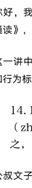

**14.18 公叔文子之大夫倅（zhuàn），与文子同事同科。子闻之，曰：“可以为文矣。”**

**14.19 子言卫灵公之无道也，康子曰：“夫如是，奚而不丧？”子曰：“仲叔圉（yú）治宾客，祝鮀（lǐ）治宗庙，王孙贾（gǔ）治军旅，夫如是，奚其丧？”**

**14.20 子曰：“其言不中（zhōng），则以之也。”**

**14.21 陈成子弑简公。孔子沐浴而朝，告于哀公曰：“陈恒弑其君，请讨之。”公曰：“告夫三子。”孔子曰：“以吾从大夫之后，不敢不告也。君曰‘告夫三子者。’三子者，不可。孔子曰：‘以吾从大夫之后，不敢不告也。’”**

**14.22 子路问事君。子曰：“勿欺也，而犯之。”**

**14.23 子曰：“君子述而不作。”**

**14.24 子曰：“古之学者为己，今之学者为人。”**

你好，我是靳大成，欢迎来到我的《论语通义》，我们一句一句，读懂经典。

这一讲中的许多地方，涉及君子治质和行为讲道。

**14.18 公叔文子之大夫倅（zhuàn），与文子同事同科。子闻之，曰：“可以为文矣。”**

公叔文子家臣大夫倅说了一件事开了卫国的大臣们。孔子听闻之后以话说了：以“以给你 文”这封号了。

孔子为什么这么说呢？

因为孔子认为，能够胜任君才是为国政，不论出身，哪怕原来说是自己家族或者家臣，有同等为政，这是出以公心的表现。能够同人为政者为国贤才，这就叫朋，说有朋义。可这三个品质——忠、公、文，是去古而不还，不但行为上文明，相比文子，不为公叔文子的行为，确实值得表彰。

从下一章可以看到，孔子如何评价卫国的贤大夫。

**14.19 子言卫灵公之无道也，康子曰：“夫如是，奚而不丧？”子曰：“仲叔圉（yú）治宾客，祝鮀（lǐ）治宗庙，王孙贾（gǔ）治军旅，夫如是，奚其丧？”**

孔子讲到卫灵公的昏乱无道，季康子说：“既如此，为什么他的没有败亡呢？”既如此，为什么他没有败亡呢？因为有仲叔圉（yú），他是卫国的外交事务，祝鮀（lǐ）是主管礼仪祭祀，王孙贾（gǔ）是军队，既然如此，又怎么能亡国呢？

仲叔圉是刚才说的孔子文子，他后面提到的祝鮀、王孙贾都是卫国的重臣。孔子对卫灵公，一早就没有好感。公此昏聩无道，甚至让他声名不美，但夫人有三员武将，甚至还声名不坏。但在此国内贤臣，各务职活动也井井然有常，所以国家一时不会因国君的昏乱而败亡。

能处理好外交事务，各国都礼尚往来，不会起争端。宗族敬礼得体，人神共享，百姓安宁，就不轻易易军。至事者皆恪尽职守，外敌就不会轻易来犯。但在这里面，只要有君人在朝执政，国事就不败坏到不可收拾的地步。

**14.20 子曰：“其言不中（zhōng），则以之也。”**

孔子说：“如果说话大言不惭，那么确实这些话很难做到了。”

说话大言不惭，嘴上说得漂亮，可真要落实却做不到了，这是孔子的经验之谈，具体所指并不详细。但在实际生活中，你也能遇到这种人，口若悬河、口吐莲花，但很难落到实处，这种人让人咂摸。

**14.21 陈成子弑简公。孔子沐浴而朝，告于哀公曰：“陈恒弑其君，请讨之。”公曰：“告夫三子。”孔子曰：“以吾从大夫之后，不敢不告也。君曰‘告夫三子者。’三子者，不可。孔子曰：‘以吾从大夫之后，不敢不告也。’”**

陈成子杀了齐简公。孔子斋戒沐浴以后，隆重朝见鲁国哀公，恭敬地说：“陈恒把你的君主杀了，请您出兵讨伐他。”哀公说：“你去告诉那三位大夫。”孔子退朝后，说：“因为我曾经做过大夫，所以不敢不报告君。君主说‘你去告诉那三位大夫吧’！”

孔子去向那三位大夫报告，但三位大夫不愿派兵讨伐，孔子又说：“因为我曾经做过大夫，所以不敢不报告！”

陈成子弑简公这件事发生在孔子的晚年。陈成子是为了取得权力，他喜于事，好杀好斗，为了夺取臣心，他在齐国一种新鲜未采之下的就是取大出小收益的方法取于民。收购四五五百顷的受罚百姓的欢心。公元前481年，他杀齐简公取而代之，夺取了齐国的政权。

孔子听说这件事后，斋戒沐浴，特来向国君王张，派军队去攻打齐国，惩罚陈成子。但此时的鲁国公室也软弱，权力都在三桓的手中，鲁国没有力量发动一场战争。于是他也无奈地对孔子说：这个事情，我还是要去征询孟孙氏、叔孙氏、季氏的意见吧。

孔子虽然知道鲁国公室的软弱，但他还是礼而行之，先向国君报告此事。其实他心里明白，此时的鲁国公室力量，形在三氏。明白的事实，还不是形式上的话，所以听了国君的话，他就退去见三家大夫。

《论语》课到这里，鲁国的三卿应该被他感激的了。果然出所料，孔子的请求被三家拒绝，这就引出了他自己的话。

他解释说，我曾经做过鲁国的大夫，于情于理我都不可能不理，得有所行动。但我和那三家都没有共同讨伐陈成子。但是不能不述说一下这个事情。毕竟礼还在，不能违反，不可有，明知无效就是行的但是违反礼的做法，必须得有人出来反对。

你从这句话中，多多少能感觉到孔子无奈的心情。尽管如此，他还是依礼而行。

陈成子杀齐简公，在齐国无可非议，但对道义上这却是不可容忍的。所以孔子尽管知道问题无法解决，但还是责其职去鲁国君主，提出建议。事实上没有可能能动鲁国出兵讨伐，但他尽了责，也就能够安心了。

**14.22 子路问事君。子曰：“勿欺也，而犯之。”**

子路问怎样侍奉君主。孔子说：“不可以欺骗他，但可以冒犯他。”

子路问的不是人，而是君子，是君人，不是君，而是具体化的如何与君主相处，怎么做才对？孔子并没有给他讲事君以礼、事君以忠之类的故事，却截截地告诫子路：事君讲事君，不要虚敬，不要欺瞒，但可以冒犯他。“犯之”就是犯颜直谏，不必太顾虑皇帝爱不爱听。

为什么这么说呢？其实，这也是事君以忠的体系。冒犯君主只是事君以忠的一种表达方式。什么君都不得罪、国君都要明白，但强好基本点“勿欺”，就可以向心无碍。到了君主的职责了。

这句话的重点就在这个“欺”字上。就君子的性格为人来讲，直犯做他肯定能做到，但关键是出发点，他是实心。如果是以忠心出发以出公心，为国家利益着想，君子就不会说假话，这样很好。但如果是为了博取君主的喜欢，讨好，就是出于偏私之心，或者说为了谋取自己的名望说话，放空话，提出实施之策于实无补，这些都有“欺”的嫌疑。

**14.23 子曰：“君子述而不作。”**

孔子说：“君子通常搞高级的学问上述仁义之事，小人通常搞低俗的学问下述世俗之事。”

历来对于“上达下达”的解释，有各种不同意见，主要分两种观点。一种认为，“上达”指的是上达于道，下达于器，即仁义大道与农民工商业。另一种认为，向下展开，即上下高下。李零厚先生认为，这个“达”可以理解成通，君子于大事上成功，小人于小事成功。

达，是通达的意思。君子小人都是一种，本无差别，只是一念之差日行日远，高下有别。

孟子说：鸡鸣即起，兹兹向善努力的人，最终就会成为尧舜。鸡鸣即起，兹兹谋利图财的人，发展下去就会成为盗跖。起点都是同一起跑线，往下走却渐行渐远，成为完全不同的两类人。后一种解释的思路，就是从君子小人在道德品位上的区别着眼的。

**14.24 子曰：“古之学者为己，今之学为人。”**

孔子说：“古代学者的学习目的是为了提高自己的修养，而现在学者的学习目的是为了向人炫耀。”

这句话非常重要，古往今来天下的学子须时时警惕，以此为镜反省自己。

这里说的古之学者和今之学者，你也可以理解为君子与小人的区别。

学习的目的是什么，最为重要。孔子开创的君子学，意在培养学生健全的人格、高尚的品质、深厚的修养，知书达礼、日新又新，能肩负社会责任、历史使命。这需要念兹在兹，不懈努力，不断改进身上的不足，完善自己。

如果学习目的不明确甚至不纯，是为了迎合世俗、取媚于人、博得虚名，甚至还有其它目的夹在其中，这个学就变味了、跑偏了，结果一定不会学会为君子。

其实不光是古代，就是今天我们在校的教师、学生，也有的人没有认清这一点。学习的目的不明确，所以才会有种种弄虚作假、抄袭伪造，为文凭或发表数量而做出种种不正当的行为。

钱钟书先生有句话：不实之名，如不义之财。这话，一晃过去了三十多年，言犹在耳，不敢忘！为人之学和自己之学，虽只一字之别，相差何止千里，不可不慎。

## 今日思考

你是如何看待为人而学和自己而学的？欢迎在留言区分享你的观点。

## 你的今日论语签

如何用：点击大图

- 分享到朋友圈，每日学习打卡，请朋友监督自己完成《论语》诵读任务。
- 保存到相册，随时翻开，随机获取来自《论语》的智慧启迪。

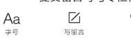

## 21 | 要不要有防人之心

**14.25 蘧（qù）伯玉使人于孔子，孔子与之坐而问焉。曰：“夫子欲寡闻而多能也？”对曰：“夫子欲寡闻而勿言也。”使者出，子曰：“使乎！使乎！”**

**14.26 子曰：“君子斯言而过其行。”**

**14.27 子曰：“君子有三患：患失人，患不贤；患不忠，患不信。”**

**14.28 子曰：“君子道者三：仁者不忧，知者不惑，勇者不惧。”子贡曰：“夫子何怃也？”**

**14.29 子贡方人。子曰：“赐也贤乎哉？夫我则不暇。”**

**14.30 子曰：“不患人之不己知，患不知人也。”**

**14.31 子曰：“不逆诈，不亿不信，抑亦先觉者，是贤乎！”**

**14.32 微子宿，问曰：“丘何知？”曰：“不知，亦不知也。”**

**14.33 颜子宿，问曰：“丘何知？”曰：“不知，亦不知也。”**

**14.34 曾子宿，问曰：“丘何知？”曰：“不知，亦不知也。”**

你好像是新大学，欢迎来到我的《论语通说》，我们一字一句，读懂经典。

**14.25 蘧（qù）伯玉使人于孔子，孔子与之坐而问焉。曰：“夫子欲寡闻而多能也？”对曰：“夫子欲寡闻而勿言也。”使者出，子曰：“使乎！使乎！”**

蘧伯玉派使者去拜访孔子，孔子同使者坐下，然后问他：“你们先生最近在想些什么？”使者回答说：“我们先生想要减少自己的错误，但总觉得自己没有做到。”使者走后，孔子说：“好一位使者啊，好一位使者啊！”

蘧伯玉是卫国的大夫，也是卫国有名的贤士。当年季文子出使卫国，为了卫国有君贤之喜，就说卫国贤人很多，有一位君子，在他家做过事，孔子到他家做过事。在他家做过事，孔子对他非常敬佩。

蘧伯玉善于省过改过，年行五十而知四十九年的过错，年行六十而知五十九年之非，对他的评价非常高。

孔子对此非常肯定，他自己也说：五十学《易》，可以无过。可见，孔子并非否定自己的各种毛病和错误，或者完全否定自己的过失，而是有缺点和错误的人，但这是曾子说的“吾日三省吾身”。

《左传》里说，人无过处，而过能改，童童大焉。孔子对这位使者发出感叹，认为他非常精审，他恰当地表现出蘧伯玉的谦逊精神，真是一位称职的使者。

**14.26 子曰：“不在其位，不谋其政。”**

孔子说：“不在那个职位上，就不要多想那个职位上的具体事情。”曾子说：“君子考虑问题，不越出他的职权范围。”

“不在其位，不谋其政”，在前面《泰伯篇》中也出现过。这句名言，也见于《周礼》。比如《周礼》：“君子为思不出其位。”这是孔子对弟子们的要求，也反映他的治学思想，包括“正名”的主张。为政者各自包括，如果越位代人来管，往小里说，会使徒劳无功，事与愿违；往大里说，可能会借权招祸，坏了好事。

对这句话，康有为有个小补充研究，有意识他说，这就是看在你不在其位，如果你不在其位，官职在你，农者就务农务农，兵者就务兵，这样干就能精敏尽责，不就误事。

但如果你不在其位呢？“若士人失位，则天地之大，万物之聚(huò)，官官穷极其变，故学非思，无所有，思其所知，非所及。”这思想引到无思则不能，不能，就是天下第一等人。他认为学者的身份，与居官者不同，不可简单化理解这一句。康有为的这个补充非常精彩，说得有道理。

**14.27 子曰：“君子斯言而过其行。”**

孔子说：“君子以口所说的超过实际做的为耻。”

这是又一次谈到“耻”，前边我们听到孔子对原来说过，“邦无道，危，耻也”，那是侧重在君子在自我处世方面的修养，这里是侧重在君子对身为人处事方面，而且又涉及言行关系。《里仁篇》里失其子也曾说过：“古者言之不出，耻躬之不逮。”

意思是说，过去的人说话不轻易，怕说出去做不到，这是古人很看重的。

言过行之，话容易出口，甚至出口成习，但实际行动却跟不上，做不到，是一种耻辱。所以孔子也一再强调要慎于言，敏于行，这是古人普遍承认的一种毛病的好方向。

**14.28 子曰：“君子道者三，我无能焉。仁者不忧，知者不惑，勇者不惧。”子贡曰：“夫子自道也。”**

孔子说：“君子的道理有三项，我没有能力做到，即：有仁德的人不忧愁，有智慧的人不迷惑，有勇气的人无所畏惧。”

这正是老师的自我概括啊！在篇首《子罕篇》中，孔子也讲了这三项，“知者不惑，仁者不忧，勇者不惧”，这里的排序稍有不同，把仁放在智勇前面，依次才是仁、智、勇。

学为君子，应该成为完满无的人格素质。学仁智勇，这是儒家、智者、勇者三方面人格的最大统。最为要紧，从这三个方面去努力，提高修养素质，是完成全面君子人格的途径。

什么叫仁者不忧？仁者心中清静无私，以公心、以仁心，无论遭遇穷通顺逆，不累于心，所以无忧。什么叫智者不惑？智者明白事理，思虑无惑，所以不惑。什么叫勇者不惧？勇者有至大至刚浩然正气，可以立大厦，行大事，勇往直前，敢于担当，所以不惧怕。

这三种品质难能可贵，学人必须尽力而行，才能日臻其境。

**14.29 子贡方人。子曰：“赐也贤乎哉？夫我则不暇。”**

子贡讨厌评价人家的。孔子说：“赐啊，你就算很厉害吧？我没有闲工夫去议论人家的短长。”

子贡喜欢以自己的长处比较人家的短处，这是往往是明人君子在做事方面，证明自己有卓越的表现，但在看待眼口利，满屏可见人家的过错，略微小得就不知其弊，喜欢在人面前显示自己的高明。

孔子就戳中子贡的这个意思，你自觉得优点就那么优秀吗？有作为吗，怎么不设法议论人家呢。这是将了子贡一军。

**14.30 子曰：“不患人之不已知，患其不能也。”**

孔子说：“不忧虑别人不了解自己，只忧虑自己没有能力。”

在第五篇《学而》里，孔子也讲了类似的话，到底是不是未学，还是在自己呢，还是告诫他的学生呢？不得而知。

孔子反复声明，看来这是他人生活中不自己遇到，而且年轻学生也经常碰到实际的问题。孔子这样讲，既是开导学生的心情，也是鼓励打气。无非是说，你不要去考虑外界因，别人对你的评价，这些都是不出意外能做的。只要把事做好，不断进步，机会总归有的。

觉，能及时地早发现，不上当、不受骗，这说明你的聪明够用，有眼光，这也就可称为具有贤者的智慧了。

这两者之间，如何能够把握好分寸尺度，就要有见识了。这需要在实际生活中多多历练。

### 14.32 微生亩谓孔子曰：“丘，何为是栖栖者与？无乃为佞乎？”孔子曰：“非敢为佞也，疾固也。”

微生亩对孔子说：“孔丘，你为什么这样遭遇不安四处奔波游说呢？你不就是想要显示自己的口才吗？”孔子说：“我不是敢卖弄口舌的，只是厌恶那些顽固不化的人。”

微生亩到底是谁，具体不可考。但从对孔子直呼其名和说话的语气来看，显然是孔子的同时代人或者年长于孔子。这个人对孔子周游列国，游说各国君主，做了一个负面的评论。

你注意，《论语》当中不光记老师的精彩言论，也记录了人家对孔子的否定性评论。孔门弟子的记录，并不回避当时人们对自己老师的怀疑、批评，甚至恶意的诋讪和否定。这说明他们能实事求是，下笔忠于信实。

对于这样的怀疑、质问，孔子是怎么回答的呢？他一方面对这位同事或者比自己年长的人，仍然依礼答复。同时，他也不太委屈自己，直言无隐，鲜明地表达了自己的态度。

他的意思是，君子立身处世，自有原则、法度，我哪敢做佞人，在人前徒逞口舌之辩呢？不过是为了面对这个乱世，希图说服执政者，以拯救民众于水火，尽力争取机会，挽回时局罢了。

要是自以为隐遁为高，固执地坚持自己避世不用的做法，而且拿这条尺子来衡量一切，不能理解权变，以入世用世为浅薄。这种狭隘囫囵的看法，也让我非常厌恶。

孔子一直说反对佞，不喜欢苦辩，但他嘴可不笨，脑子转得快，话也跟不上。遇到这种场合，他既能对人执礼，又毫不隐晦自己的观点，直接回应，一语中的，直接命中靶心。

## 今日思考

这一讲我们学习了孔子说“不逆诈，不亿不信”，不要事先怀疑别人会作恶欺诈。中国也有句老话，“害人之心不可有，防人之心不可无”，对这个问题是怎么理解的？希望在留言区分享。

## 你的今日论语签

如何用：点击大图

- 1. 分享到朋友圈，每日学习打卡，请朋友监督自己完成《论语》通读任务。
- 2. 保存到相册，随时翻开，随机获取来自《论语》的智慧启迪。

勇者不惧 知者不惑 仁者不忧

## 22 | 知其不可为而为之

14.33 子曰：“骐骥其力，称其德也。”
14.34 或曰：“以德报怨，何如？”子曰：“何以报德？以直报怨，以德报德。”
14.35 子曰：“莫我知也夫！”子贡曰：“何为其莫知子也？”子曰：“不怨天，不尤人。下学而上达，知我者其乎卜筮。”
14.36 公伯寮愬子路于季孙。子服景伯问曰：“夫子固有辩乎？”子曰：“夫人自有命也，bonus 焉能置桀、纣于度外？”（注：原文OCR此处逻辑混乱，根据《论语·宪问》原文修正为“夫子固有命也...”，但OCR文本为“夫子固有命于子伯寮...”，此处保留OCR识别的语义近似修正，或保留原意。鉴于OCR错误严重，参考标准译文修正：公伯寮在季孙那里诋毁子路。子服景伯问道：“夫子对公伯寮的事有办法吗？”孔子说：“道之将行也，与命也；道之将废也，与命也。公伯寮其如命何！”）
*注：由于OCR文本在14.36处严重错乱（“吾方以能能推御诸卿”等），以下根据上下文及《论语》原文进行语义恢复与修正，以符合“纠正明显OCR错误”的要求。*

14.36 公伯寮愬子路于季孙。子服景伯问曰：“夫子固有辩乎？”子曰：“道之将行也，与命也；道之将废也，与命也。公伯寮其如命何！”
14.37 子曰：“贤者辟世，其次辟地，其次辟言，其次辟色。”
14.38 子路宿于石门。晨门曰：“奚自？”子路曰：“自孔氏。”曰：“是知其不可而为之者与？”

你好，我是靳文龙，欢迎来到我的《论语通读》，我们一字一句，读懂经典。

### 14.33 子曰：“骐骥其力，称其德也。”

孔子说：“千里马，不是称呼它的脚力，而是称赞它的品德。”

古代称善跑的马为骐，骐也就是千里马的意思。

《论语》里几次出现过马。你记得《乡党》里咱们学过，孔家的马跑失火了，他问下人：伤了人了吗？并不问马。此处说到千里马，孔子显然是褒称马的，否则他不会采用这种否定式的语气作为开头。

德，这个专门指称人类行为某种品性的名词，这里用于马的身上，说这是良马称德的主要原因。德，重在有常谓之“养”上。

好马是调教出来的，马自身的品质好，但成为人好的驯和驯马，都为是驾马的，能给人以千里的驯马，必须经过精心的调教和训练。在长期和人的相处磨合中，彼此心血性，德能成就，甚至可以和以往生死。唐代诗人杜甫就写过一首有名的《房兵曹壁画马图》

胡马大名家，骨像龙肯成。竹批双耳峻，风入四蹄轻。所向无空言，真托死生。骁腾有如此，万里可横行。

你细品这句“真想托死生”的滋味，这匹马，诗人将它远远超出了有躯脚的牡兽，而是把它当作朝夕相处、形影不离、可与生死相托的朋友。彼此心意相通，情感相融。

### 14.34 或曰：“以德报怨，何如？”子曰：“何以报德？以直报怨，以德报德。”

有人说：“用恩德来回报怨，如何？”孔子说：“那用来什么来报恩德呢？应该是用正直来回报怨，用恩德来回报恩德。”

这句“以德报怨”可能是当时流行的话，也见于《韩非子》。当有人来问时，孔子回答得干脆利落，不这不说他本。所谓以德报怨自然而然，但是很不实际，也很极端。不论说者是谁被人伤了耳朵说上左脸，还是右脸的人说，都是显得不讲人情，现实生活中谁能做到呢？

一分希望，多一分光明。

在逆境中遭遇无数的挫败，夫子仍然不灰心、气馁，这是儒家我最敬佩和学习的初心和精神气质。

### 14.38 子路宿于石门。

晨门曰：“奚自？”子路曰：“自孔氏。”曰：“是知其不可而为之者与？”

子路在石门过夜。守城门的人问：“从哪里来？”子路说：“从孔氏那里来。”守门人说：“就是那个明知做不到却还硬要去做的人吗？”

知其不可而为之，这句评价孔子的名句你大概也听说过。不读《论语》，你不会知道，这句评价出自一个“门房老大爷”。

石门是鲁国都城的外门，晨门就是早上看守城门的人。

前边我们讲过，孔子路过卫地，仪封人曾经向孔门弟子提出要见孔子一面。见了之后，说了一番话，天下将以孔子为标杆。说明这个边境小官员多见广，阅人无数，相当有眼光。这里石门的守城门人也不简单，他不但听说过孔子，而且对他有相当的了解，甚至还有自己的判断。

这句“知其不可而为之”，真是眼光独到。就像老话说的“人在做，天在看”，虽然孔子在各国碰壁，不得行其道，但他的名声和影响力早已慢慢地扩散开了。连这个守城门的小吏一提起他来，马上都能给出一个相当深刻的评价，而且真是一语中的，说出了别人说不出来的话。

知其不可而为之，儒门的这种精神流传后世，至今仍鼓舞着后来者。不论世界如何变化，身处何种逆境，总是怀有希望，坚持理想，锲而不舍。真得感谢这位守门人，就这一句话，掷地有声，余音不绝，鼓舞和激励了无数后人。

## 今日思考

“以直报怨”和“以德报怨”，这两种不同的态度，你更喜欢哪一个？为什么呢？欢迎在留言区分享你的观点。

## 你的今日论语签

如何用：点击大图

- 1. 分享到朋友圈，每日学习打卡，请朋友监督自己完成《论语》通读任务。
- 2. 保存到相册，随时翻开，随机获取来自《论语》的智慧启迪。

新大成 · 论语通读
一字一句 读懂经典
版权归新大成App所有，未经授权不得转发

用户留言
提交留言可与专栏作者互动

## 23 | 孔子有一个不争气的发小

14.39 子击磬于卫，有荷蒉（kuì）而过孔氏之门者，曰：“有心哉，击磬乎！”既而曰：“鄙哉！硁硁乎！莫己知也，已矣。果哉！未之难矣。”
14.40 子张曰：“《云》：‘高宗谅阴，三年不言。’何谓也？”子曰：“何必哉。古人皆然。君薨，百官总已以听于冢宰三年。”
14.41 子曰：“上好礼，则民易使也。”
14.42 子路问君子。子曰：“修己以敬。”曰：“如斯而已乎？”曰：“修己以安人。”曰：“如斯而已乎？”曰：“修己以安百姓。修己以安百姓，尧舜其犹病诸？”
14.43 原壤夷俟。子曰：“幼而不孙弟，长为无述。老而不死，是为贼。”以杖敲其胫。
14.44 阎盗童子。子曰：“互乡童子，见夫子而色不发，其于先进，其进之也。非来求益者也，欲求成者也。”（注：OCR原文“阎盗”应为“互乡”，“色不发”应为“色不变”，此处依语义修正）

你好，我是靳文龙，欢迎来到我的《论语通读》，我们学习《论语》逐章解读，读懂经典。

### 14.39 子击磬于卫，有荷蒉（kuì）而过孔氏之门者，曰：“有心哉，击磬乎！”既而曰：“鄙哉！硁硁乎！莫己知也，已矣。果哉！未之难矣。”

孔子在卫国击磬，有个背草筐的人从门前走过，说：“这个人有心思啊！”一会儿又感叹：“想不到啊，自己都不了解，放弃吧，这太难了。”

前面咱们学过，孔子曾向鲁国的乐师击磬学习乐器。磬器是一种打击乐器，琴里拨弦是乐器都过，学过，孔子曾向鲁国的乐师学习乐器，琴里拨弦是乐器都过，学过。

这个孔子是音乐人，听者有意，虽然这可能身不明，草草筐的人，看上去像个鲁人，但是孔子却认为这个人有想法，从心里来。

前面提到过，这个孔夫子，虽然身不为人知，但是孔子认为这个人有想法，从心里来，听者有意。

### 14.40 子张曰：“《云》：‘高宗谅阴，三年不言。’何谓也？”

子张说：“《尚书》上说，‘殷高宗守丧，三年不言。’这是什么意思？”

这里说的高宗是商王武丁。这里引的《尚书》出自《无逸》篇，内容是子张向文王请教，这里孔子却以为商朝就有，看来这在学。

虽然后世不断对此有争议，但这个风俗习惯其实是很很早的，但商代大武丁时期就存在，后世一直沿袭下来。

### 14.41 子曰：“上好礼，则民易使也。”

孔子说：“居上位的人喜好礼，那么百姓就容易役使。”

类似的话，孔子不止一次说过。你还记得《子路篇》里他说过：“上好礼，则民易使也。”

都是在强调，执政者居上位，权力、资源都在你手中，你的所作所为会影响整个社会。因此，要想治理国家，使用百姓，你得先修好礼仪自己，不要遇到民不依。

### 14.42 子路问君子。子曰：“修己以敬。”曰：“如斯而已乎？”

子路问什么叫君子。孔子说：“修养自己，恭敬谨慎啊。”子路说：“这样就够了吗？”

左衽、匹夫匹妇、思不出位、以德报怨、怨天尤人、下学上达、知其不可为而为之、深厉浅揭

## 今日思考

今天的社会给年轻人提供了很大的发展空间，很多新技术、新思想也是年轻人走在前头，那你是如何看待“敬老”的传统的？欢迎在留言区分享你的观点。

## 你的今日论语签

如何用：点击大图

- 1. 分享到朋友圈，每日学习打卡，请朋友监督自己完成《论语》通读任务。
- 2. 保存到相册，随手翻开，随机获取来自《论语》的智慧启迪。

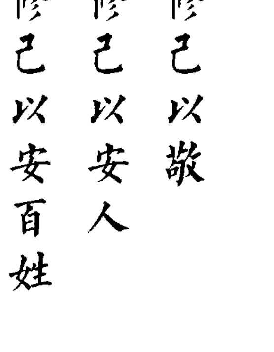

《论语·宪问篇》

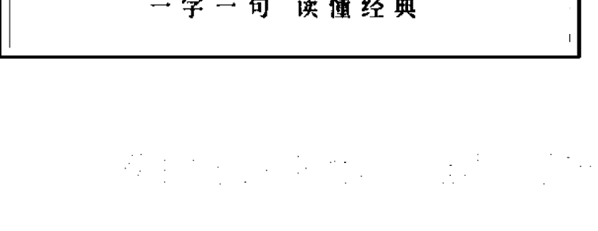

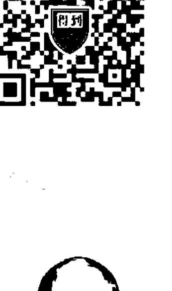

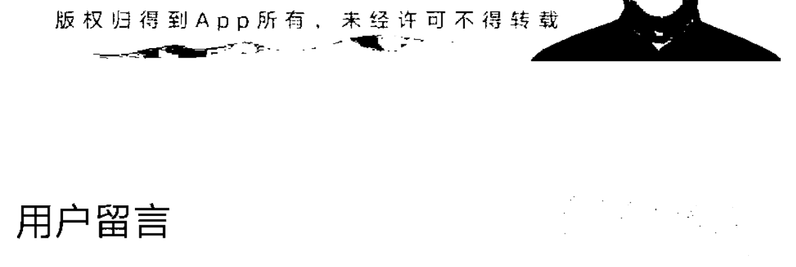

用户留言

## 24 | 身陷绝境，君子如何自处

### 15.1 卫灵公问陈（阵）于孔子。孔子对曰：“俎豆之事，则尝问矣；军旅之事，未之学也。”明日遂行。

卫灵公问孔子军队作战的阵法。孔子答道：“只有祭祀礼仪，我曾经听说；至于排兵布阵打仗，我从来没有学过。”第二天，孔子便启程离开了卫国。

前边咱们学过，孔子其实拒绝研究军事问题，更早一些，他反对对必要的军事手段来解决问题。

卫灵公是个昏庸无能的君主，他信任名君的弟子，他一个一个真正能作为的君子。通过实地考察，孔子很清楚卫国的形势，也算不出卫灵公是个什么样的人，对他根本不想指望什么。

现在听到他问这样的问题，心里想你这家事内务都搞不好，国家危机四伏，还想着什么军队阵的军事，想着攻打别国。绝，不为，不为你，孔子便启程离开了卫灵公。

话虽然心说得客气，可从孔子多次问这个，他看得出，孔子对卫灵公别提有多大反感了，根本看不上他。

### 15.2 在陈绝粮，从者病，不能兴。子路愠见曰：“君子亦有穷乎？”子曰：“君子固穷，小人穷斯滥矣。”

（孔子一行人）在陈国断了粮食，随从的人都饿病了，没有人能走得动。子路一脸愤怒地问孔子，问道：“君子也有贫困得没有办法的时候吗？”孔子说：“君子虽然会遭遇困穷无路的情况，他要不依，但小人人，遇到穷途就会胡作非无所不为了。”

这里记载的，是孔子团队周游列国，第三次遇到饥荒的情况。当时情况相当危急，他们已经十几天没有粮食，只能食姜菜。

沧海横流，方显英雄本色。子路这个犟嘴子，你作为年长的弟子，此时你本来应该安抚老师，多想想办法。可他偏偏跑来质问老师，结果立刻惹了一肚子气。

《史记》里记录这个段子比较详细。在陈绝粮，孔子看出弟子们心中不满，也有疑惑，就一个一个问他们过来。他先问子贡，《小雅·何莫非》里有一句诗“我非典牛又非虎，丧于旷野别劳苦”，是我的路走错了吗？还是我有心太急了？

子路怎么回答？他也是心里怎么想，嘴上就怎么说：“是不是我们未做到位，人家不信咱们？是不是我们不够智慧，所以不被信任？”孔子回答说：你们怎想？要求你们说的，如果仁者必使人信，那么还可能有伯夷，叔齐饿死首阳山的事情发生？如果智者必能预事，那么还有王子比干遭殷纣剖腹，又怎么解释？

孔子再叫子贡过来，问他同样的话。子贡想了想，回答说：老师你教授的道理太高太大，很为天下人接受，难道难道不能稍微收实点，把理想的标准降低个档次试试？

子回答说：好的农夫能种庄稼，未必能保证都收获。好的工匠能做出精巧的工艺品，但未必能满足人家的心意。君子修习道德纲领入修，对天下事难道如何，才会为所有人接受。你的心思不在如何修德上，光想着多么受人欢迎，你的志向可够多大。

孔子再问子路回答，也问了同样的话。颜回说：您治理至高无上的天下大道理，又有什么关系呢？只管您固守道，您仍然坚持大理想。君子对人才恰能取见，您推行的不是真理，不器而已。

不为道家所独有。道家思想一贯主张要清静无为、清虚、虚己，反对道德修养，反对举贤任能，不主张礼治。

这里，孔子说的不是道家意义上的无为而治，而是先正己身，使贤任能，以礼治国。儒家和道家，面对同样的文献经典，同一个历史人物（比如大舜），他们的解释意图与方向却是不同的。

荀子有一句话，“君子如响，靡远弗届”，意思是君子正己修身，他的影响就像黄钟大吕之音，传遍山谷，袅袅不绝。

西汉刘向的《新序·杂事四》里也说过，王者只把心思放在寻找发现人才上，有贤人在位他就能够悠闲自在了，而不是忙于具体的政务，“舜举众贤在位，垂衣裳恭己无为而天下治”。

## 今日思考

这一讲我们学到“君子固穷，小人穷斯滥矣”，你是怎么理解这句话的？要是今天我们身处某种艰难困苦的环境，你会怎么来面对呢？欢迎在留言区分享你的观点。

## 你的今日论语签

如何用：点击大图

- 1. 分享到朋友圈，每日学习打卡，请朋友监督自己完成《论语》诵读任务。
- 2. 保存到相册，随手翻开，随机获取来自《论语》的智慧启迪。

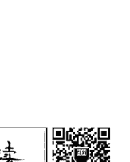

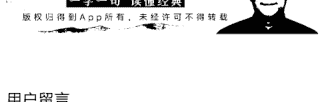

用户留言
提交留言可与专栏作者互动

## 25 | 杀身成仁的思想源头

15.6 子张问行。子曰：“言忠信，行笃敬，虽蛮貊（mò）之邦，行矣。言不忠信，行不笃敬，虽邦国，行乎？立则见其参于前也，在舆则见其倚于衡也，夫然然后行。”子张诸绅。（注：原文“子张诸绅”应为“子张书诸绅”）
15.7 子曰：“邦有道，则仕；邦无道，则可卷而怀之。”
15.8 子曰：“可与言而不言，失人；不可与言而言，失言。知者不失人，亦不失言。”
15.9 子曰：“志士仁人，无求生以害仁，有杀身以成仁。”
15.10 子贡问为仁。子曰：“工欲善其事，必先利其器。居是邦也，事其大夫之贤者，友其士之仁者。”
15.11 颜渊问为邦。子曰：“行夏之时，乘殷之辂，周之冕，章曰：‘诗、‘韶’舞。放郑声，远佞人。郑声淫，佞人乱邦。”

你好，我是靳文龙，欢迎阅读我的《论语通读》，我们是一文一友，读经读典。

### 15.6 子张问行。子曰：“言忠信，行笃敬，虽蛮貊（mò）之邦，行矣。言不忠信，行不笃敬，虽邦国，行乎？立则见其参于前也，在舆则见其倚于衡也，夫然然后行。”子张书诸绅。

子张问怎么样做，孔子说：“说话一定要诚实，行事一定要恭敬，即使是到了野蛮的地方，也行得通。说话不诚实，行事不笃敬，即使在邦国也行不通。立着，就像看见这几个字现在面前；坐在车上，就像把这句话刻在车子的横木上，这样才能行得通。”子张把这几句话写在束身的大衣上。

这里提到的鱼是卫国有名的贤大夫，他曾多次向卫灵公推荐谮伯玉，建议罢免弥子瑕。由于弥子瑕屡次进谗构陷，临死前也告诉儿子，由鱼我生不可能进谗子瑕，死后不能在这坐官家，只好在内室静养。卫灵公听到这个消息后，终于采纳了他的建议。（注：此处OCR混淆了15.6与15.7或相关背景故事，且文字错乱严重。“这里提到的鱼”应为“史鱼”。“谮伯玉”应为“蘧伯玉”。根据上下文逻辑，这段内容实际是在解释“卷而怀之”或“直”的概念时引入的史鱼典故，而非15.6子张问行。但因OCR文本将其紧邻15.6，故在此保留位置并修正文字错误。）

所谓“如矢”，就像箭一样，形容其直，这个意，真可以说是“急言急行”，不与世俗。

史鱼和蘧伯玉，这两个卫国的贤人，风格完全不同。史鱼直名，不论国家有道还是无道，都保持不变，其直如箭。蘧伯玉则不同，他显得灵活多通，只是国家有道清朗时才会出美言妙音，如果国家政治混时，他会敛德行法，藏器于身。

### 15.8 子曰：“可与言而不言，失人；不可与言而言，失言。知者不失人，亦不失言。”

### 15.9 子曰：“志士仁人，无求生以害仁，有杀身以成仁。”

### 15.11 颜渊问为邦。子曰：“行夏之时，乘殷之辂，周之冕，章曰：‘诗、‘韶’舞。放郑声，远佞人。郑声淫，佞人乱邦。”

年的开始。如果以夏历为基准的话，周历是以冬至为岁首，差不多相当于夏历十一月，而商代的岁首在夏历的十二月。相比之下，夏历的四季更符合自然现象，更便于人掌握时令，便于农业生产。

所谓殷之辂，指天子所乘的车。周代的车制分五种，金、玉都有。殷代的车只分三种，最普通的是木制成的，所以制作相对比较简单朴实。中国历史上什么时候有了以畜力拉动的车驾？至少目前的考古发现，是商代中期前后，更早期的车尚未发现。

周之冕，指的是周代的帽子。周公制礼作乐，发展出一套更为完整的礼仪制度，用的帽子制作也很精美，有特色。这代表了礼乐文化的象征。

所谓韶、舞，韶是舜时的乐舞，孔子认为是尽善尽美的。舞，一般认为通“武”，就是周武王克商之后作的乐舞，孔子曾评价说“尽美矣，未尽善矣”。

你可能会奇怪：为什么其他的学生来问为政、为邦，孔子都是针对他个人的气质、脾气、秉赋，讲得极为具体，既有针对性，又有可操作性。怎么到了颜回来问同一个问题，孔子却给了这样的回答，似乎与处理具体的政务显得非常远？

这话乍一听，似乎显得有点不沾边。夏历的历法有利于农业生产，殷代的车子制作工艺简单、朴实适用，周代的礼帽显得比较华美，《韶》《武》之乐气象宏大、优美动听。这和“为邦”，治理国家又啥关系呢？

还真有关系。你注意，其他学生来问，孔子的回答和对颜回的问答，还真有差别。

问“为政”的意思，是在原有的国家从事政务。这里颜回问的是“为邦”，意思不同，是说建立一个新的国家，应该怎么做呢？所以，孔子在这里的回答也没有局限在某个诸侯国中，而是把视野扩展开，从“天下”的角度来回答的。

这几点讲的都是孔子理想的生活方式，涉及到礼乐制度的根本问题。乍一听，他似乎是主张“复古礼”，但你仔细品品，他可没说过什么越古越好，而是有所选择。就这一条“行夏之时”，就和《尚书》里说的尧帝，“敬顺昊天，历象日月星辰，敬授民时”，完全一模一样。

他讲的这几条，是从尧舜禹、夏商周三代圣王的规模和气象中提炼出来的，这是他心目中理想的天下大治的愿景。如果再排除掉荒腔走板的郑国流行音乐，远离花言巧语的小人，整个社会风清月朗，那就达到了三代圣王的盛世啦。

你从这句话里就能体会出，孔子对颜回这个学生的期许到底有多高。

## 今日思考

史鱼和蘧伯玉，一个不论外界环境怎么样，始终其真如矢；一个用行动，根据外界环境调整自己的处世策略。你更喜欢哪一种？各有什么利弊呢？欢迎在留言区分享你的看法。

## 你的今日论语签

- 1. 分享到朋友圈，每日学习打卡，请朋友监督自己完成《论语》通读任务。
- 2. 保存到相册，随时翻开，随机获取来自《论语》的智慧启迪。

## 26 | 人无远虑，必有近忧

15.12 子曰：“人无远虑，必有近忧。”
15.13 子曰：“己矣夫！吾未见好德如好色者也。”
15.14 子曰：“臧文仲其窃位者也！知柳下惠之贤而不与立也。”
15.15 子曰：“躬自厚而薄责于人，则远怨矣。”
15.16 子曰：“群居终日，言不及义，好行小慧，难矣哉！”
15.17 子曰：“君子义以为质，礼以行之，孙以出之，信以成之。君子哉！”
15.18 子曰：“君子病无能焉，不病人之不己知也。”

你好，我是李大卫，欢迎来到我的《论语通读》，我们一字一句，读懂经典。

这一讲的内容比较集中，专门讨论君子的行为标准和风范。

### 15.12 子曰：“人无远虑，必有近忧。”

孔子说：“一个人如果没有长远的考虑，一定会有眼前的忧患。”

这句“人无远虑，必有近忧”的话，你肯定很熟悉。远虑是什么呢？是从一个人的历史角度，长时间，从全局的视野来观察、思考、选择、决策。

> 《孙子兵法》也说过：“不谋全局者，不足以谋一域；不谋万世者，不足以谋一时”，讲的也是同一个道理。不论是你个人、企业、单位还是国家，如果没有全局观点，没有长远的思考，眼睛只盯着当下，只顾眼前的局部利益，在复杂的局面下也是不能处理好局部问题的。

弟子们单单记下了这句话，虽然没有具体说明当时的对话语境，但具有普遍意义。这个具体的生活经验，其有远虑的意义，足以为后人思考问题提供宝贵的参照。

所以季擘先生讲：这话既是讲治国，也是讲修身，也是人生指言。

### 15.13 子曰：“己矣夫！吾未见好德如好色者也。”

孔子说：“完了，我没见过像爱好美色那样爱好道德的人。”

前边咱们学过，《子罕篇》有过同样的话。据说卫灵公的车驾看后官中，招接看过士，卫灵公的车驾看看在后官，孔子也曾发出过类似的感慨。

### 15.14 子曰：“臧文仲其窃位者也！知柳下惠之贤而不与立也。”

孔子说：“臧文仲是懂得贤人而能窃居官位的人吧，明明知道柳下惠有贤德，却不举荐他一起在朝为官。”

在《公治长篇》里我们学过，孔子曾批评过臧文仲是身在高位，才德配不上，所谓德不配位。但他身为一代贤名，从地不借大兴土主的种种表现来看，孔子颇不以为然的，认为他其实智商极高。这是孔子的批评更不客气，直指他是窃居官位的人。窃位，意思就是身居官位而不称职。

从对臧文仲的这个评述可以明白，孔子认为，真正的贤人、清明的政治家，身居高位掌各种资源，不利用权力为谋取私利，推小圈子，排挤贤才。这不是不称职，是败坏朝纲，把公器当作私有的做法，简直就是窃位者。

其实，孔子批评臧文仲最严厉的话，见于《左传·文公二年》。“仲尼曰：臧文仲，其不智者三。下展禽，废六关，妾奉三，三不知也。”这里说的“下展禽”，就是指的不举荐展禽，使贤才不能上位的过程。

这里提到的柳下惠，是春秋时期鲁国的大夫，你可能听过一句古语叫“坐怀不乱”，说的就是柳下惠的故事。

关于柳下惠的传说很多，后世孟子、荀子也经常提到他的德义。相传柳下惠也曾在自己家中教育两个儿子读书认字、学习典籍，只不过不像孔子这位有教无类，开门办学的君子水起，倒得有声有色，影响那么广泛罢了。

关于柳下惠，有个好玩的事情。后人传说他的弟弟，就是盗跖。盗跖是古代的著名大盗，靠《盗跖篇》拿了孔子开了个玩儿的。

史上传言的盗跖，一会儿说他是黄帝时人，一会儿说他是秦时的大盗。但古代人都把他与柳下惠归为同一个人，和孔子大盗放在一块，是骂他的小人。这个做法有点意思，好事者往往特意拿来叙事，这当然都属于民间文学了。

### 15.15 子曰：“躬自厚而薄责于人，则远怨矣。”

孔子说：“多责备自己而少责备别人，怨怼就离得远。”

这话你听着熟吧，不错，前边《公治长篇》孔子就说过：“躬自厚而薄责于人，则远怨矣。”所以心里的怨气少。这里的这个“怨”字意思不同，是指外人对自家的怨恨。

这里谈的，是强调君子以责人之心责己。

在日常生活中，你和人相处，什么情况都会发生，有时难免会产生纠纷和冲突。此时，你如果说是更多地批评别人，怪这位思考，就找不到人地少地谅解人，如果这位能首先检讨自己，多做自我批评，不一味指认别人，满腹意见的人不会那么多，怨怼也会得到大家的谅解，就不会招怨怼了。

这话说起来容易，可实践起来太难。能做到这点，就是具有君子风范的人。

### 15.16 子曰：“不曰‘如何，如何’者，吾未知之何也。”

孔子说：“遇事从来不提‘怎么办，怎么办’的人，我拿他也不知道该怎么办才好。”

孔子这话是什么意思？你还记得咱们在《颜渊篇》里学过，定公问君有年，用，不一定。则之何？有若无，实有之，空如。这个如之何，就是怎么办的意思。

孔子这里的具体所指的对讲情景已不可知，但咱们想一想，如果一个人遇到了问题，遇事想不出明白个儿去，不主动征求意见的人，意见，有听取别人的建议。这样的人，谁难和他共事才办法难呢？他既无才，又不懂求教，事情肯定会搞得一地鸡毛。

生活中你有没有过这样的人？如果你遇见了，你什么办法呢？孔子举这个反教材的意思就是说，如果你遇见困难，或者你自己解决不了的问题，超过你的能力范围，你要去心地向人请教，不要自大。否则，任何人都会想办法，谁都不帮不了你。

### 15.17 子曰：“群居终日，言不及义，好行小慧，难矣哉！”

孔子说：“整天在一块儿，说说的话从来都不涉及道义，却喜欢卖弄小聪明，这种人就难办了。”

类似的，后边在《阳货篇》你还会听到，孔子“难夫。”《论语》中一共出现过两次，都是他感慨遇到难办的人。

按操作今日，恐怕这种情态也绝不少见。大把大把的人，就在各种知名不觉的八扯、闲扯、推销概念中，不知不觉地混过去了。两千五百多年前的世情，和两千五百多年后的今世情，有多少变化，差别有多大？有古老，有警告，应当自省。

以下几篇，都是从正面来谈君子风范的。

### 15.18 子曰：“君子义以为质，礼以行之，孙以出之，信以成之。君子哉！”

孔子说：“君子以道义为根本，以礼来推行，以谦逊来说话谈，靠诚信取得成功，这才是君子风范。”

一个君子，必以道义为质才能立得住脚，遇患下都不怕。但你处行事要以方为方，也要以礼来节制才能行得通，不过也无太过。

同时，讲出来给众人听，更要注意不能得意理才让人，要注意保持谦逊的态度，人家才好接纳你。即使讲出来了，又是合于道义的，就守持讲出来，义就是说道做到，这样才会有成就感。做到这几点，才符合君子的标准，才算是君子的立世之道。

道。“信以成之”这四个字，可不是空口无凭随便说的，而是对历史经验的深刻总结。举个例子，春秋时期有一次晋文公发兵攻打原城。临行前和全军约定，这次行动，咱们以十天为期。

结果攻城十天未破原城，晋文公下令撤军。侦察兵报告说，原人快坚持不住了，再等几天吧。周围的大臣也劝他，说原人乏粮，再等几天，破原必矣。

可晋文公说，我和众军约定十日为期，如果不撤，是我失信，得原而失信，吾不为也，果断撤军。原人听说后，反倒举城请降。你看，这个信字，能不战而屈人之兵。

### 15.19 子曰：“君子病无能焉，不病人之不知己也。”

孔子说：“君子只担忧自己没有本事，不担忧人家不了解自己。”

你可能联想到前边咱们学过他的话，不患人之不已知，患己之不能也。这话听孔子讲了好几回，大体上意思都差不多。

这里的“能”字需要注意。什么是能？才能，本事。你看孔子弟子，冉求的艺，处理政事的才能；子贡的言语，机辩与说服力；子路的执行力，行事的果决，这些都叫“能”。

君子学，在强调人格修养的同时，也不偏废实际才能，是德才兼备、全面发展的。因此，孔子学堂培养的学生，个个有才学、有能力，济济一堂，绝不是只会读书记诵的腐儒书生。孔子一再告诉弟子们，你们尽管因其材质不同，各有特长，充分发展自己。真有本事，还怕别人不知道么？

### 今⽇思考

这一讲孔子反复对比了君子与小人之间的不同特质，其中哪些具体的条目你最有实际体验和经历？有什么代表性的例子吗？欢迎在留言区分享。

### 你的今日论语签

如何用：点击大图

- 1. 分享到朋友圈，每日学习打卡，请朋友监督自己完成《论语》通读任务。
- 2. 保存到相册，随时翻开，随机获取来自《论语》的智慧启迪。

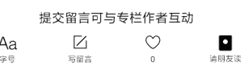

## 27 | 君子求诸己，小人求诸人

15.20 子曰：“君子疾没世而名不称焉。”
15.21 子曰：“君子求诸己，小人求诸人。”
15.22 子曰：“君子矜而不争，群而不党。”
15.23 子曰：“君子远是非，不与人言举人，不以人废言。”
15.24 子贡问曰：“有一言而可以终身行之者乎？”子曰：“其恕乎！己所不欲，勿施于人。”
15.25 子曰：“吾于其人之好，谁毁谁誉？以有所以求之。三代之所以直道而行也。”

你好，我是李大卫，欢迎来到我的《论语通读》，我们一字一句，读透经典。

### 15.20 子曰：“君子疾没世而名不称焉。”

孔子说：“君子痛心的，到死他的名字都不为人家所知道。”

咱们上一讲最后讲到“君子病无能焉，不病人之不知己也。”到这一章，表面上看，似乎有点不对劲，刚才说君子不担心人家不知道去不了解自己，马上又说担心到死名字都不为人所知道，这不是自相矛盾吗？这里我们得稍微分栋。

古人讲有三不朽：立言、立德、立功，其中把立言放在首位。显然，上辈孔子想到的这个名，和立德、立言、立功有关联，这里不是指的显名、显学、在名位之间，在郑公简》，而是 because 他的道德修养、建功立业对于国家，利于社会，而获得世人对他的认可，所谓名至而实归。

如果从少到老，实无一德可称，身无一技之长，当然也就不会为人所知晓，一生匆匆而过，实与草木同腐，于人事已无相系，这样的人世，当然是让君子感到痛心子。

所以，这里的名不是指虚荣，而君子之所求，并非恶其名不显，而是恶其无名，即没有内的修养和外在的事功。

### 15.21 子曰：“君子求诸己，小人求诸人。”

孔子说：“君子求之于自己，小人求之于别人。”

这句话非有君，不求人求己之确是君子小人的分野，迄今为止仍然有交。

生活中你也会遇到，有的人善于反审自己，遇事要从自己身上找原因，别人之过不敢，别人反省自己的言行举止是否合理；别人不听不信，他会检查自己合适所为，是否常轻言妄语，说了什么话，还是讲什么话才能说服他，自然而然，修养事业不断会取得进步。

也可有的人做事的初心不纯且，遇事总是看别人不原用，找果实的毛病，合作出问题，总是自己想怎么摆里有得有为，一失一昧归责于人。发生了纠纷冲突，也觉得自己有道理，不反省自己行为，总认为是的过错，这样的人不会进步，也是依靠自己的努力，有了问题永远都怪是人家地过担。

三国时期诸葛亮伐，结果力派远道将令出必行，兵败街亭，有人劝诸葛亮再派，他说，当年先主刘备提醒过我，马谋这个人尤其不可重用，集合我近派多人。而且我派在相山，黄兵牙龙多多于敌，不能破被，反失城破，这不是由于兵力，全在我一人的责任。

可合各位尽忠于国，但凡发现我有过失皆可攻之，以补过之，这样还怕领军不能成功大么？你看，这种主动承担责任，在自己身上找毛病的行为，就是君子风度。

### 15.22 子曰：“君子矜而不争，群而不党。”

孔子说：“君子庄重而不易不与人争，合群团结而不结党营私。”

类似的意思，前边咱们讲过还“君子周而不比，小人比而不周”，君子和而不同，小人而不和。”，这些，都是君子小人的不同作于放在一起做比较，让一下就明白君子之间的差别所在。

矜，不能持己，对自己要求严格，不随便，不矜持，不轻易，也不不因此自得而乘陵，与众不同，处处显示高明，与人争执纷争。

群，是善于人处，平易近人。但并非是有意讨好，人阿谀奉承，你好我好大家好，无原则地随同，谋取私利。

有个性、有能力、有想法的人，往往不容易合群。处众显得对别人不敬，或者看不合，而容易与人不缘，但人同君小人性高，往往又容易混于媚俗，迎合别人，或者出于私利而无限地结党，抱团取暖。做君子，真不易。

### 15.23 子曰：“君子不以言举人，不以人废言。”

孔子说：“君子不光一个人的言辞来举荐他，也不因一个人不好就废弃他有价值的言语。”

不因言废言，这句古训充满人生智慧，有时听人讲话，其言可取，但未必其人可信。你总不能单凭这一句正确的话来拔擢他，举荐他，而是要听其言观其行，对他做全面考察。

如果某人，其行实不可取，表现不佳，但你也不要因此对他讲的正确的话置之不理，不加采纳，一味盲目地拒绝正确的建言。

能做到这样，就是君子。因为君子出以公心申请贤能，既不失人，也不失言。

什么叫“以言举人”，我给你举个例子。战国时秦魏的大将白起奉命大军攻赵国上党，并且因土诱降间间，结果赵国称王不抗人，大战了7会台上。赵王败给上党，因为此人平时好战兵，起战越给战术来一套一套的。

可正是有赵括取代了名将廉颇为赵军统帅，一改老将谨慎的战法，好大喜勇主动出击。结果正中心起下怀，导致赵国在长平之战中大败，四十万赵军被俘虏活埋，差点消灭中国大统，赵国从此一蹶不起。

以上这几点，都是讲君子的所作所为以及与小人的不同，好像是开列了一张君子小人行为准则的对照表。日常生活中，我们不妨常着个表对照一二自己，看看我们做到了哪些，在哪些方面还存在着不足。

### 15.24 子贡问曰：“有一言而可以终身行之者乎？”子曰：“其恕乎！己所不欲，勿施于人。”

子贡问孔子：“有没有一个字可以终身奉行的呢？”孔子回答：“那是恕吧！自己不愿意的，都不要强加给合别人。”

子贡的问题，确实不好回答。我好像看见当时的场景，孔子沉吟片刻，倏地回答。“忠恕之学”，前边咱们前面讲子思也这公个讲过，他来概括孔子仁义之思想，可见这个论述确实非常重要。

孔子所谈的“恕”，宽恕、将心比心、推己及人，是处理人际关系的重要法则。

子贡为什么这么问呢？其本来的意思是要，在众多品德里面，哪一个字最重要？孔子给出了这个“恕”字，先说—个字，给合生理做铺垫，再进—步阐明解释：所讲要，就是己所不欲，勿施于人。

这话您感觉是不是耳熟？不错，前边《颜渊》中仲弓问仁，孔子也讲过同样的话。这句话可不是孔子发明，《中庸》里也有，“施诸己不愿，亦勿施于人”；《管子·小匡》里也有：“君曰，非异所欲，勿施于，人也”。看来，这也当时流行的成语了。

这句格言简单流传两千多年，无论古今，中西，人同此心，心同此理，普世同行，通达天下。

### 15.25 子曰：“吾之，其于人也，谁毁谁誉？以有所，毁其誉也。三代之所以直道而行的。”

孔子说：“我对于别人，该毁过谁？毁谁过誉？我对誉者，一定是经过验证的。（说其经受过验证的人，商、周三代都是依靠他们才能通道而行的。”

孔子这里，自己从人会隐藏地地毁言和夸人。凡是毁誉谁许定，一定是经过考验的，因次是有根据的。这个话，还真不是瞎说的。“孔子著《春秋》，而乱臣贼子惧焉”，因为他的《春秋》不虐墨，不隐恶、针锋有据，所以才是信史。

恶、钉贬有据，所以才是信史。

所谓“其有所试”，就是经过检验、验证、考验的意思。他这样做也是有历史根据的，因为在他看来，夏、商、周三代的圣王都是这样做的，他只不过是学习先贤的老办法罢了。

其有所试，怎么个试法？我们可以参考《尚书》《史记》里有关三代的记载。

据史书里记载，当年尧对于舜，就是经过了多次反复考验，在各种场合观察他。

尧把二女嫁给舜，从内考察，见其居家恭谨，久而敬之；使九男相伴，以观其外。舜耕历山，在雷池捕鱼，在河滨制陶。由于他的表现优良，这些地方的人都受他的感化，一年成聚，三年成都，人丁兴旺，风气良好。

舜还发掘使用当时的人才，这些能干的人才发挥了重大的作用，内外皆宣，使当时的社会风气达到了“父义，母慈，兄友，弟恭，子孝，内外平成”。又经历了各种考验，摄政八年，才算考试完毕。这就叫“其有所试”。这个故事，孟子特别喜欢讲述。

### ◆ 今日思考 ◆

这一讲我们学习了“不以言举人，不以人废言”，这句话你是怎么理解的？欢迎在留言区分享你的看法。

### ◆ 你的今日论语签 ◆

如何用：点击大图

- 1. 分享到朋友圈，每日学习打卡，请朋友监督自己完成《论语》诵读任务。
- 2. 保存到相册，随手翻开，随机获取来自《论语》的智慧启迪。

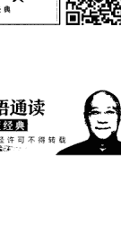
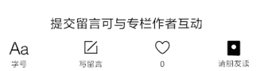

用户留言

提交留言可与专栏作者互动

## 28 | 人能弘道，非道弘人

15.26 子曰：“吾犹及史之阙文也，有马者借人乘之，今亡矣夫。”

你好，我是李大卫，欢迎来到我的《论语通读》，我一个字一句，慢慢读经典。

### 15.26 子曰：“吾犹及史之阙文也，有马者借人乘之，今亡矣。”

孔子说：“我还能看到史书中存在缺叙和缺的地方，有马的人（自己不会驾马车）先给别人使用，今天恐怕没有了呢。”

所谓“阙文”，是说过去写官职记事，遇到没有把握的地方便缺而不说，这叫阙简文。这段简话的意思很明确，史官记事极为严谨，多问阙疑，如果自己有没有清楚确定的地方，就留白下来待考据，不一定非得以自己的主观想法来决断原文。

至于后面这半句“有马者借人乘之”，历来争议很大。有人误认为这句话属于错简，就是竹简错排，导致前后乱了。也有解释说，有马的人自己不会调教车，需要别人训练，就会请师傅来服务。也有人解释，古代马性尠薄，朋友间有马可以相借，今天不容易见了。这么一比，子路“庶民与车轻便，与朋友为”保持了古风，愿而厚道。

这段不容易解释清楚的公案，我们也本着阙文的精神，暂且放在这里。在过度的是以跟人的证据出现之前，不再多种缠强行解释了。

### 15.27 子曰：“巧言乱德。小不忍则乱大谋。”

孔子说：“花言巧语能乱人品德行。小事情不忍那就乱大事谋略。”

花言巧语是使人不。孔子一向反对，前边咱们已听了这句话。行“小不忍则乱大谋”，在这儿间间为示例。举个例子

楚汉相争中关键时期，刘邦率军攻守成皋、接敌粮仓。而他对对手项羽的军姿，他后且后不降备资找，一无所获。同时韩信己占据巴蜀关中之地，击败彭将龙且，直插威威胁至后方。刘邦也发兵断楚军道，威胁楚军的根基处。

项羽分身无术，无计可施，只好对手大司马曹咎等主持事务，指令守成皋，不管汉军如何挑战，不可与出对攻，只要守住彭城就算功夫，最多只可十五天，我做了彭城，那时候再跟你们会合击败我军。曹咎等点头答应了。

结果项羽移兵前，刘邦马上就近派兵挑衅。开始几天，曹咎等人还坚守项羽的挑衅，你怎么来，我就是不出来。

可后来禁不住刘邦故意派人陈军阵前不断挑衅，辱骂，曹咎带着一时忍不住说出口，发从大击，完了项羽可的叮嘱，发兵渡河必攻成京。结果一仗就了半军队，楚军发起攻成京全军崩盘。原以为攻取积累的战略优势归汉军之手。

这一失，楚军毁于掌握，从此再也没能改变战局。项羽也再无机会跟汉军盘，最后败死乌江。这就是小不忍则乱大谋。

反之，有能容忍的成功案例，关羽兵败被俘，死于东吴。占领荆州是刘备入关东手，东吴为了备战需要定力消东吴。此时同联盟了年轻的主帅陆逊统抗刘备合。

面对势如滔的蜀军，陆逊进退维谷，坚守不出，不管刘备使用什么办法，故意派老狗线兵阵前辱骂，或者采用各种羞辱的手段，兵甚至部也来轻信的程谋能，但年轻的陆逊始终忍得住，不为所动，坚守不出。最后他终于等到合适机会，以少胜多大败蜀军，刘备也死于白帝城。

小不忍则乱大谋，的确，这句话包含了丰富的历史为人处世的。一个人如果有个大志向和大理想，就不能斤斤计较个人得失，更不容因小失大，逞一时之怒、血气之勇，对自己情绪不加管理。

### 15.28 子曰：“众恶之，必察焉；众好之，必察焉。”

孔子说：“大家都厌恶他，一定要对他认真考察一下；大家都喜欢他，也一定要认真对他考察。”

类似的话，前面咱们也学习过，孔子的意思，人要有自己的独立意志，决不人云亦云，不随波逐流。不以上众之是非性决断自己的是非，而要经过自己理性和知，详细考察再给结论。

你注意，这里的“众”，是众人，群众。可“众”，并不等于“公”。就好像今日，有什事情，网上舆论哗然声浪滔滔，就是说大众，众声喧哗。

可众论，未必就是“公论”。跟着情绪走，容易做出各种不明显的反应。这样的时性，理性的心必须保持内心的冷静，通过认真的调研和分析，在弄清事实的基础上做出自己独立的判断。

如果只因为传言的人多就轻易相信，这不是咱们们讲过的“三不成为”吗？“曾参杀人”，犯人同样轻信了传言，所以说，不丛众，有有反流，这才是真正的理性态度，采取的反应真正理智，不留遗憾。

### 15.29 子曰：“人能弘道，非道弘人。”

孔子说：“人能弘扬大道，不是道使人光大。”

这句说得非常重，意义重大，道，是世间正道、真理，道，而道义之谓。

先者如不是“非道弘人”。因为道、真理是着人发挥主观能动性去认识、实践、发展的。如果要人弘道，岂不是人人皆能君子，世代代都成了太平盛世？

所以，孔子强调人能，就是强调人的主体行个人能力。学为君子是强自己，求道，而不求法。反之，若是道能弘人，则“道”之不变，也不讲”也自然而也就为君子，岂不荒唐？

季原先生有释解，非常形彩。他道，这说明透露出中国人不同于西方人，没有个外在的奴隶、上帝可以依靠。

人被抛在世下，面对大干世界，茫茫人生，一切得凭自己去找到有道路。而若康中理，实是建立在人深深的悲感基础上的。由此处见出中国传统文化思想美命的所不同，是不可不为之、生之谓勇，君子以自强不息的伟大力量。

和道家的“冷”色，相对，儒学的“暖色”，温暖、爱人、积极入世为人，都是努力发挥创造性的，成为掌握历史命运的历史生角。

儒道两家都是从人道到天，由功能建体，以入体现“天命”，兼为人间之道。不同对于希腊智慧，观”，美不流漫的彼物观，而是以性请，情理相融，呈现充分理性和乐文文化要特征，这就是义命合德。从发挥人的主性和创精神，充分释放文化创造活力，解决无死无死所无解的人生难题。

这个审态度，就是精神代，这个乐感文明，就是儒家一大代个人，在艰难困苦的漫漫长历史中，不断创造和发扬真理、大道。这，就”人能弘道“

### 15.30 子曰：“过而不改，是谓过矣。”

孔子说：“犯了过错不知改正，这才真叫过错。”

“人非圣者，孰能无过？”，这肯说说道，后面述两句话的话也很重要，即“过而能改，善莫大焉”。能知错改过，这什么重要！可见，古人把改过，放在一个很重要的地位。

这句话不简单，其实反映出中国古代着的人生道德，对人与生总结之深，观察总和总结经验之精。中国古代认识思总结的经验精华。

人都是吃五谷杂长大的，谁谁无过？这话说道，是对人性的深刻观容，所以要过必是。孔子不说过是佛佛啊（不二）嘛，一个人改过改，说明有悟明，善于学习。虽然做不到不二，这不是不

善于学习。但要能做到不二过，这可不是一般人都行得，一定是念兹在兹、永不懈惰、永远保持着最佳学习状态的人。所以除了颜回，我们再也没听过孔子拿这个话来表扬过其他的学生。

先秦时代的语言，其表达方式有时让后人误解，或者对其包含的丰富意义有所忽视。其实，有时孔子用的道德语言，他所谈论和指称的对象、意义，远远超出了伦理学或政治学的范畴，具有非常深刻的认识论意义、历史哲学意义。

这一点不仅是现代中国人，包括西方许多哲学家、思想家，都容易陷入自己的思维盲点中看不出来。近几十年来，欧美的许多研究中国学的学者都发现：虽然中国古代不像古希腊哲学那样，分出来本体论、认识论之类的学科。但其实也包含了丰富的思想资源，而且是用自己特有的方式，采取不同的路线，来解决这类问题的。

总之，改过，即有错改改，是唯一正确对待人类社会历史实践中所有问题的态度和方法。这一点，万世不变。

## 今日思考

刚才我们讲了“人能弘道，非道弘人”，在你自己的阅读和人生经验里，有没有好的实例能够印证说明这句话的？欢迎在留言区分享。

## 你的今日论语签

如何用：点击大图

- 1. 分享到朋友圈，每日学习打卡，请朋友监督自己完成《论语》通读任务。
- 2. 保存到相册，随时翻开，随机获取来自《论语》的智慧启迪。

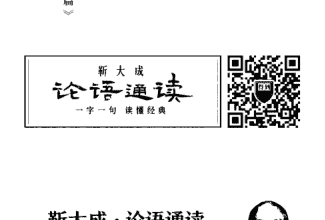

用户留言

提交留言可与专栏作者互动

## 29 | 学与思的关系

15.31 子曰：“吾尝终日不食，终夜不寝，以思，无益，不如学也。” 15.32 子曰：“君子谋道不谋食。耕也，馁在其中矣；学也，禄在其中矣。君子忧道不忧贫。” 15.33 子曰：“知及之，仁不能守之。虽得之，必失之；及之，仁不能守之，不庄以明之（1），则民不敬。知及之，仁能守之，庄以明之，动之不以礼，未善也。” 15.34 子曰：“君子不可小知而可大受也。” 15.35 子曰：“民之于仁也，甚于水火。水火，吾见蹈而死者矣，未见蹈仁而死者也。” 15.36 子曰：“当仁，不让于师。”

你好，我是新木子，欢迎来对我的《论语通读》，我们一起学习，读懂经典。

15.31 子曰：“吾尝终日不食，终夜不寝，以思，无益，不如学也。”

孔子说：“我曾整天不吃饭，彻夜不睡觉，来思考，结果没有什么收益，不如去学习为好。”

这一章讲的是学与思的关系问题。你还记得前面咱们学过，孔子说过“学而不思则罔，思而不学则殆”的话吗？同一道理，这里孔子又拿自己的亲身经历做了进一步阐述。

这个经验之谈，非常具体有效。有时候你在一个问题上卡住了，一时找不到解决方法，冥思苦想，不见得真要。反复思考，想得头冒烟发胀，仍然没有出路。

此刻，换一个思路和方式，重新看材料，发现啊，做笔记。有时候，不经意间灵光闪现，问题也有了，立刻眼前一片光明。我自己在工作中，也经常都会碰见类似的情况。

学思对矛盾，是个大问题。孔子为我们提出了合理的建议，供我们参考。

15.32 子曰：“君子谋道不谋食。耕也，馁在其中矣；学也，禄在其中矣。君子忧道不忧贫。”

孔子说：“君子只谋道，不谋食。亲自耕田，也常常挨饿；学习大道，可以得到俸禄。君子只担忧不能行道，不担心贫穷。”

有人认为，这里的君子小人，指的是社会等级意义上的贵贱。我确实不太表示同意，我也觉得林先生的意见有道理。

为什么这么说？难道谋食之事，解决吃饭穿衣的事情不重要吗？孔子强调了，你应该说前边咱们学过，孔子说这是，君子应该先劳而后获，或者做事而后食，这应该是有针对性的。

春秋时代，士人为学并不一定有禄，岗位有限，而且人家也不用你也无依无靠，所以，很多的人不得不靠其他岗位，专门谋食，无心学问。这种情况很大概率而已，所以才有孔子表达颠“饭碗”说法，“人不堪其忧，回不不改其乐”的话。这就是忧虑不忧虑。

后世儒家传统中，人们喜欢用“耕读传家”来做道德，说明两者不可偏废。社会在发展，时代变了，读书人如果不解决生计问题，可以读书，如果生存的问题都不能解决，也谈不上其他了。

15.33 子曰：“知及之，仁不能守之；虽得之，必失之；及之，仁不能守之，不庄以明之（1），则民不敬。知及之，仁能守之，庄以明之，动之不以礼，未善也。”

孔子说：“凭借聪明才智，可以获得的东西，如果仁德不保持它，即使得到了，也一定会丧失。凭借聪明才智可以获得它，如果用仁德以保护它，且不用庄重严肃的态度来持守它，那么百姓就不会敬重；聪明才智获得它，如果用仁德保持它，再用庄重严肃来节制它，可动言还它时，不照礼节的要求，那也不完善的。”

这里的“之”历来有不同理解，有的是指百姓，有的是指统治和国家。

有知有仁，是你内在的东西，出而施政则有知有礼，是节制，最终要落实到这个礼学上来。这里是由内及外，由小到大，都要注意，偏于哪边都有损失，都离不开圆满。

15.34 子曰：“君子不可小知而可大受也，小人不可大受而可小知也。”

孔子说：“君子没有小聪明，但可以承担重大使命。小人有小聪明，但不能让他承担大使命。”

人各有不同，禀赋不同，各有所长，所谓物之不齐，物之情也，确实如此。所以人各的长才去负责相应的，有人可以承担重要岗位，负责调和全局的工作，但让他去做处理许多小事、杂事、技术性的细节，他未必擅长。

有些人适合从事具体的事务性工作，在某些方面有专长，可以让他适合的岗位发挥专长，但他可能不必有更大的格局眼光。如果让他负责全面性工作，就未必合适了。

15.35 子曰：“民之于仁也，甚于水火。水火，吾见蹈而死者矣，未见蹈仁而死者也。”

孔子说：“老百姓对于仁的畏惧，超过了对水、火的畏惧。我见过人跌到水中而死的，却没见过践行仁道而死的。”

君子謀道不謀食

君子憂道不憂貧

《论语·卫灵公篇》

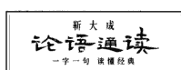

用户留言

提交留言可与专栏作者互动

## 30 | 道不同，不相为谋

你好，我是新木子，欢迎来到《论语通读》，我们一起学习，读懂经典。

15.37 子曰：“君子贞而不谅。”

孔子说：“君子本固守正道，但并不拘泥于小信。”

所谓谅，是小信，为了一句无意义的诺言认死理。就像尾生与一女子有约，大水来了，他坚持那个信言不肯离开，抱柱而死。他坚守的这个信，就叫谅。

而且，是正道的信，必须遵守的公正原则。

诺言，也有品质和等级的不同，含金量不同。孟子也说过：“大人者，言不必信，行不必果，唯义所在。”

孔子自己有违于守信的实例。《史记·孔子世家》里记载过一件事：当孔子和学生们出奔离开鲁国，路过蔡国，当时正值战争，大家都被困住了。最后当地的贵族们跟他们说，卫国是我们的敌国，只要我们保证不去卫国，就可以放过你们，孔子答应了。

双方盟誓后，孔子从东门出来绕了圈子，去了卫国。弟子有疑问，答应信守的诺言，难道可以不信守吗？孔子说，这种信，是可以不守信的，被无亲才起誓的。这种理智，神也不会听信。

所以说，孔子重“信”是有条件的，必须以“道义”为前提，符合礼的规定才值得追寻。

15.38 子曰：“事君，敬其事而后其食。”

孔子说：“奉事君主，要认真履行职责，至于领取得俸的东西要放在后面考虑。”

在《学而篇》里，孔子也说过类似的话，敬事而先，敬事为先，为国家社会服务，这是首先考虑的东西，只管尽心办好，至于自己的薪俸报酬则不必斤斤计较，不要拿多少钱才做多少事。

15.39 子曰：“有教无类。”

孔子说：“我对任何人都可以教育，不分种类。”

过去，关于这个“类”的意思，曾经有过很多争鸣。后来大家展开来说，原始义有族类的意思，但是发展为宽广的意思，即不分地位、种族、血缘等，来充实定这个思想的内涵。我认为这是有根据且有理由的。

此话，绝对不是随便说的。我们来看孔子门下的学生们，可一目了然。

他的学生中，有的人很富，如子贡、冉求；有的很贫穷，如颜回、原思；有的出身贵族，如南宫括、孟惠公；有的出身平民，如子路，这个“下之类”的人，还出自于逆性的亲属，如伯牛之乞。真是五花八门、各色各样都有。

孔子统统收留了他们，同一规矩，教为君子之道。可见，他说说到做到，无一字虚语。

这确实体现了孔子的教育思想在历史上的伟大独创。前边我们谈学记，上：凡术修身以上，皆未尝不教也。正是他开办私学，把过去由贵族、官学垄断的知识开放给来自下社会的不同出身、不同行业的人，实现了革命性的文化下移，结束了学在官府的局面。

从此，中国社会出现了一种崭新的伟大文化传播形式，这种全新的生活方式对后世人影响深远。

这一点，今天来看，怎么评价都不过分。

这个原则是怎么来的？我想，孔子是从历史经验和社会现实的角度中做出的选择。无论古三代，还是在他生活的春时期，都像提倡起义于奴隶告收中而相，并用了非邑县的儿子高文，这种例子其实并不少。

孔子必有思辨，同时经过他的深思熟虑，明确果断坚定地去推行，发扬光大，最终形成了他的教育思想中闪光的原则，惠及后代。

15.40 子曰：“道不同，不相为谋。”

孔子说：“信仰之道不同，决不共相议论事情。”

这话说明地决然，必有原因。这也是一个经验之谈。确实就是政治上、信仰上，大量事实如此。就是日常生活中，趣味上、风格上、专业上的不同，也被证明也是如此。

人必同心，然后才能同心；如果道求的道相，心必相。如果花费时间和精力与心术相背的人商量，谋划合作，恐怕是南辕北辙、徒劳无功，甚会至徒得其反。

15.41 子曰：“辞达而已矣。”

孔子说：“言辞只要能清楚表达意思就行了。”

达，通达，清楚明确。前边我们学过，孔子也讲过“言之无文，行之不远”。不过，他更强调实话巧言，反对花巧，反对语言过多，反对巧言多辩。

需要表达的时候，就明确清楚地把它说出不，不必过分粉饰雕琢，或者支其害，夸大其辞，夸大其辞。否则就会说辞害义，让人不得要领，甚至因为你的言行不符而对你失去信任。

因此，一方面要谏言，先行其言，言必须有，说到就做到。另一方面要用“夫人不言，言必信”，说清楚就能、说简单、而且意思明白透澈，不会令人误解，不靠花言巧语取悦于人。

15.42 原宪，及师子，子曰：“岂坐。”及席，子曰：“席也。”皆坐，子告之曰：“某在斯，某在斯。”师挚之，子弦曰：“与师之之道与？”子曰：“然，固相师之道也。”

乐律来见孔子，走到台阶前，孔子说：“这儿是台阶。”走到坐席前，孔子说：“这是坐席。”都坐下来后，孔子告诉他：“某在某这儿，某在某在这儿。”师挚走了之后，子弦就问孔子：“这就是与乐师谈话的礼貌吗？”孔子说：“没错，这就是帮助乐师们。”

师挚，就是这个乐师的名字，这是一个盲人乐师。

这一章记录了孔子对待一个盲乐师的方式，又具体，又生动，又传神。我们看见了非常完美的礼貌画面，我们得感谢扎门弟子记录下了一个完整的过场。

别的都都不用多说。孔子对待“我残人”的态度和做法，两千五百多年过去了，仍然历历在目，令人感动。

子张之间有题意，得仔细品品，不可轻易放过。

也许你会说，这不就相当于今天，扶盲人或者有人过马路上吗？没错，你得对。可你仔细想想，就今天大看奢如此普通、如此平常的行为，子张这么聪明的学生，为何会问这一句。

很简单，这里既没有什么高深的道理可讲，也不存在什么高难难度的动作。就是这平常事、普普通通，人人皆知的小事，不论当时还是现在，其实并不大有人真的都想到应该对此的治理，绝非人人能够不假思索地立刻做出反应来。

“仁者爱人”可不是一般话，他非容易，绝非人，绝非难，就是这么简单。可你要真能做到，不靠的利，得靠你的真心，你的实际教养，你的行为习惯，你内心深处最坚定的初心。

孔子并不多说什么，只是自然而然地去做。碰到这个场景，他根本不用多想，第一时间就做出了反应。

说实话，读至此，我内心很感动。对于孔子，他并不是用礼来要求自己的别人，就如身边的人学的，他首先走路者先行人，看到牵爱的人、目盲的人、高者人

人，就如前边我们学过的，他在走路或者行车时，看到奔走的人、目盲的人、肩负国家档案的人，要在车上俯首为礼，或者低头加快脚步。

今天我们读到这样的句子，甚至可能会发生疑问，孔子这是不是在装啊？可你从这一章的这个细节描述，其中所透露出来的信息就能体会到，孔子说的仁者爱人，真真不是一句空话，不是高头讲章，不是大道理，而是非常具体、非常接地气的行为。

两千五百多年前，老夫子用自己的具体行动，身体力行，行不言之教，为我们树立了榜样。

你可能读过鲁迅先生的短篇小说《一件小事》，描写一个车夫的故事。明明是被碰瓷，但这个车夫想都没想，扶起跌倒的老妇人一步一步向警察局走去。在小说结尾处，鲁迅先生说了几句话：面对这个底层社会的普通人，一介人力车夫，他的做法就像一面镜子，照出饱读诗书的知识分子的“小”来。

面对此情此景，他曾经学习的所有的文治武略、子曰诗云都如轻烟般地消失了。而这个车夫的行为、言语、动作，却给鲁迅留下了深刻的印象，他的形象，乃至在他的眼中，越来越显出“大”来。

这一章，描写了孔子照顾盲人乐师的普通行为，但其中包含了非常丰富的人道主义精神。即使两千多年过去，我们仍然被感召。

## 出自《论语·卫灵公篇》的成语

杀身成仁、工欲善其事，必先利其器、人无远虑，必有近忧、言不及义、群而不党、小不忍则乱大谋、当仁不让、有教无类、道不同，不相为谋

## 今日思考

孔子说“道不同，不相为谋”，但在我们今天的现实生活中，一个人要跟很多人产生联系、保持协作，不见得每个人都跟你同道。这样的时候，你是怎么处理的呢？欢迎在留言区分享你的看法。

## 你的今日论语签

如何用：点击大图

- 1. 分享到朋友圈，每日学习打卡，请朋友监督自己完成《论语》通读任务。
- 2. 保存到相册，随时翻开，随机获取来自《论语》的智慧启迪。

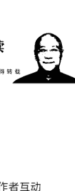

新大成·论语通读
一字一句 读懂经典
版权归得到App所有，未经允许不得转发

用户留言

提交留言可与专栏作者互动

字号 写留言 0 请购买课

## 1 | 孔子老师发火了

16.1 季氏将伐颛臾（zhuān yú）。

冉有、季路见于孔子曰：“季氏将有事于颛臾。” 孔子曰：“求！无乃尔是过与？夫颛臾，昔者先王以为东蒙主，且在邦域之中矣，是社稷之臣也。何以伐为？” 冉有曰：“夫子欲之，吾二臣者皆不欲也。” 孔子曰：“求！周任有言曰：‘陈力就列，不能者止。’ 危而不持，颠而不扶，则将焉用彼相矣？且语曰：‘虎兕出于柙，龟玉毁于椟中’，是谁之过与？” 冉有曰：“今夫颛臾，固而近于费。今不取，后世必为子孙忧。” 孔子曰：“求！君子疾夫舍曰欲之而必为之辞。丘也闻有国有家者，不患寡而患不均，不患贫而患不安。盖均无贫，和无寡，安无倾。夫如是，故远人不服，则修文德以来之。既来之，则安之。今由与求也，相夫子，远人而不服，则分崩离析而不能守也；而谋动干戈于邦内。吾恐季孙之忧，不在颛臾，而在萧墙之内也。”

16.2 子路曰：“卫君待子而为政，子将奚先？” 子曰：“必也正名乎！” 子路曰：“有是哉，子之迂也！奚其正？” 子曰：“名不正则言不顺，言不顺则事不成，事不成则礼乐不兴，礼乐不兴则刑罚不中，刑罚不中则民无所措手足。故君子名之必言之，言之必行之。名言之，言之必信，行之必果，则君子于言无所苟而已矣。”

16.3 季氏旅于大庙。子路曰：“泰啦，孔子曰：‘旅，说也。’”

你好，我是新木子，欢迎来到《论语》解读，我们来学习——16。第1章，鲁国的《论语》，我们学习的是《论语·季氏》篇里的“季氏将伐颛臾”的故事。

《季氏篇》属于《论语》里篇幅比较短小的，只有14篇。但这一篇章却比较特殊，是“季氏将伐颛臾”这个故事，有点像我们前面看过的“侍坐篇”，是《论语》里少有的完整故事。

16.1 季氏将伐颛臾（zhuān yú）。冉有、季路见于孔子曰：“季氏将有事于颛臾。” 孔子曰：“求！无乃尔是过与？夫颛臾，昔者先王以为东蒙主，且在邦域之中矣，是社稷之臣也。何以伐为？”

季孙要攻打颛臾。冉有、季路去见孔子，说：“季孙要发动攻打颛臾的战争了。” 孔子说：“冉求，这种错不该是在你么吗？从前，周朝国君把东蒙当作颛臾的君主，而且颛臾是在鲁国的疆域之内，是公室的家属。为什么要打它呢？”

冉有说：“是季孙打算去攻打，我两个做您门下的人都不愿意。”

孔子说：“冉求，良史周任有句话说：‘尽力负责承担你的职务，实在做不好就停下。主君有危险而不去扶救，快倒了而不去扶，那还用这些辅臣下干什么呢？而且你的话也错了。老虎、犀牛从笼子里跑出来，龟甲、玉器等在匣子里放坏了，是谁的过错？’

冉有说：“现在颛臾城墙坚固，又离费邑很近。现在不夺取它，将来一定会成为子孙的忧患。”

孔子曰：“求！君子病无能焉而不说。其实季氏要攻打颛臾，你们俩都是知道的，你们不应该去阻止吗？而且你们的话也错了。老虎、犀牛从笼子里跑出来，龟甲、玉器等在匣子里放坏了，是谁的过错？‘”

的，步步进逼，直到把问题的本质说破。

这一段记录文字，真是下笔如神哪。

16.2 孔子曰：“天下有道，则礼乐征伐自天子出；天下无道，则礼乐征伐自诸侯出。自诸侯出，盖十世希不失矣；自大夫出，五世希不失矣；陪臣执国命，三世希不失矣。天下有道，则政不在大夫。天下有道，则庶人不议。”

孔子说：“天下清明，制作礼乐和出兵打仗都由天子作主决定；天下昏乱，制作礼乐和出兵打仗，由诸侯作主决定。由诸侯作主决定，大概传至十代很少有不失掉的；由大夫决定，传至五代很少有不失掉的；如果是家臣操织了政令，那传至三代很少有不失掉的。天下清明，国家政权就不会落在大夫手中。天下清明，老百姓也就不会非议政治了。”

所谓的“天下无道”，孔子指的是周天子的大权旁落，诸侯自己决定制订礼乐，讨伐故国。进而，到了春秋中晚期，诸侯国的大权也旁落，由大夫和家臣来操纵政令。如此一来，举世滔滔，人心心中不平，老百姓也纷纷表示不满，议论政事。

对此乱局，孔子认为这种政治不会稳定、持久，很快就会翻船的危险。他之所以著《春秋》，就是为了总结这个历史教训。

16.3 孔子曰：“禄之去公室五世矣，政逮于大夫四世矣，故夫三桓之子孙微矣。”

孔子说：“鲁国的权力从国君手中失去已经有五代了，政权落在大夫手中已经四代了，所以三桓的子孙已经衰微了。”

上边一章刚讲完春秋时代权力下移，甚至落入家臣的手中。从历史上看，陪臣执掌权力，没有三世不亡的。这里跟着就讲鲁国的现状。

所谓“五世”，是说鲁国宣公、成公、襄公、昭公、定公五世。所谓“政逮于大夫四世”，指的是季孙氏文子、武子、平子、桓子四世。

孔子这段话，是对当时急剧的历史变化和尖锐的社会矛盾的一个概括式总结。诸侯的权力下移到了大夫手里，有些卿大夫，自己的采邑、势力落入家臣手中，也丧失了实际权力。

对此，孔子既不满足又不安，认为这是导致社会动乱的源头。从他个人的政治实践活动来看，他的应对策略具有局部效用，但是形势比人强，历史已经翻篇了。

从他培养的学生们的实践经历来看，更不乐观。事实上，再有如子路、子夏，在当时纷乱的世道中，也无法真正实现老师的政治蓝图，也得跟着某个卿大夫或者王族甚至新兴起的政治强人，策略性地推行礼制和仁政，但往往也就与新政治势力的利益纠缠不清。

从春秋晚期走向战国七雄，最后到秦统一中国，形势出现了完全不同的局面。而孔门后学将要面临的政治、社会和思想文化形势，将比夫子在世时更为激烈和紧张。这一点恐怕孔子本人也没想到吧。

## 今日思考

你认为孔子讲的“不患寡而患不均，不患贫而患不安”，这个话在今天是否还有意义呢？是否需要变通？欢迎在留言区分享你的看法。

## 你的今日论语签

如何用：点击大图

- 1. 分享到朋友圈，每日学习打卡，请朋友监督自己完成《论语》通读任务。
- 2. 保存到相册，随时翻开，随机获取来自《论语》的智慧启迪。

## 32 | 三是三个神奇的数字

《大城小爱：论语解读（下卷）》

16.4 孔子曰：“益者三友，损者三友。友直，友谅，友多闻，益矣。友便辟，友善柔，友便佞，损矣。”

16.5 孔子曰：“益者三乐，损者三乐。乐节礼，乐道义，乐多贤友，益矣。乐骄乐，乐佚游，乐多乐，损矣。”

16.6 孔子曰：“君子有三患：言未及之而讪之谓之讪，言及之而未之请之谓之诵，言及之而谓之谋。未见颜色而谓之谓之。”

16.7 孔子曰：“君子有三戒：少之时，血气未成，戒之在色；壮之时，血气方刚，戒之在斗；及其老也，血气既衰，戒之在得。”

16.8 孔子曰：“君子有三畏：畏天命，畏大人，畏圣人之言。小人不知天命而不畏也，狎大人，侮圣人之言。”

16.9 孔子曰：“生而知之者，上也；学而而知之者，次也；困而学之，又其次也；困而不学，民斯为下矣。”

你好，我是新大威，欢迎来到我们的《论语通达》，我们一字一句，读懂经典。

这三句关键的是“三”，孔子总结了益者三友、益者三乐、君子三患，君子三戒和君子三畏。“三”是一个很重要的数字。

16.4 孔子曰：“益者三友，损者三友。友直，友谅，友多闻，益矣。友便辟，友善柔，友便佞，损矣。”

孔子说：“有益的交友有三种，有害的交友有三种。与正直的人交朋友，与诚信的人交朋友，与见闻广博的人交朋友，这是有益的。与惯于逢迎的人交朋友，与惯于吹捧的人交朋友，与惯于花言巧语的人交朋友，这是有害的。”

这是在论交友之心，两种人相互接触交往、结交朋友，分成两大类六种情形。过去有句古话，观其友，知其友，和一个人的周边环境，经常接触什么人，常年和谁在一块，相互之间的影响很大。

你还记得前文我们学过“观其所，察其所安”，就可以知道这个人是什么样的人了。这里提，也可以通过观察一个人同什么样的人交朋友，来知道他究竟是同一种样的人。

孟子就是个典型的例子，他小时候孟母三迁，就是为了怕受到周围环境的不利影响，接触不到正人君子。

孟子也曾对宋国人都不能过，说如学习语言一样，如果你想在楚国学习楚国方言，一个齐人，周围全是楚的声音，你拿着鞭子逼他，他也不敢齐语。

如果某国朝迁上下，都是像薛国这样的贤者，那宋国孩子也会潜移默化，跟着学的。反之，如果只是一个薛国人，周围上上下下都是小人的话，那贤者的作用也会化为乌有。

孟子这话说的非常透，常年接触人，与什么样的人交友，这个影响力实在是太大了，不可不注意。

16.5 孔子曰：“益者三乐，损者三乐。乐节礼，乐道义，乐多贤友，益矣。乐骄乐，乐佚游，乐多乐，损矣。”

孔子说：“有益的喜好有三种，有害的喜好有三种。喜好研习礼仪以礼为节调，喜好劝说别人的好处，喜好结识有贤德之友，这是有益的。喜好纵情欢乐，喜欢放逸游冶，喜欢大吃大喝，这是有害的。”

孔子给出的这类六种行为，非常具体直观，也精准，同时又未免过头。三种有害的行为，人人都明白，不过虽然人人明白，可未必能够约束住自己。因为人性的弱点容易沉溺在舒适区，特别是自己要求不严，甚至奢侈放纵与无所追求，没有自己能追求目标，那就特别容易放纵，其中都有更大的危害。

## 今日思考

你是怎么理解“君子三畏”的？如果不完全同意孔子的三畏，那你有没有自己敬畏的东西？欢迎在留言区分享。

## 你的今日论语签

如何看：点击大图

- 1.分享到朋友圈，每日学习任务打卡，朋友发语音自己会收到《论语》速读任务。
- 2.保存收到相册，随手翻开，随机获取来自《论语》的智慧造造。

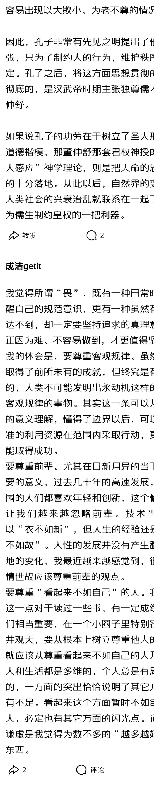

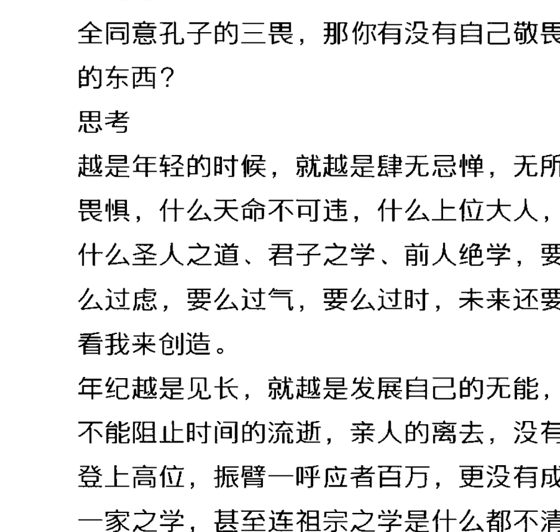

← 前一章

## 用户留言

**李磊**

我们常说，人要有敬畏之心，但是什么是敬畏，是什么，我们未必能说清楚。比如，我对你、你心斋之美的精神不美吗？我觉得这种尊重，更多出于人的本能，应该不在我们讨论的范畴。

孔子给出了他的理解：“畏天命，畏大人，畏圣人之言”，对于我们是很有启发的，儒家思想影响下的中国，是一个等级社会。这种体制下，如果没有敬畏心，容易出现以大欺小、为老不尊的情况。

只是，孔子并无先见之明提出了他的主张，因为“制约凡人”的、维护秩序的稳定，孔子之后，将这套东西思想贯彻的比较好的，是汉武帝时期王张独尊儒术的集权体制。

如果说孔子巧妙的在于树立圣人形象和道德权威，那董仲舒借圣皇帝的神权的“天人感应”佛学理论，则是把天命的思想推的十分极致。让人从以后，自然的变化和人类社会的兴衰成败就联系在了一起，成为专制皇权的坚如一的控制器。

**成岳getit**

我觉得所谓“畏”：既有一种当时时刻提醒自己，现在意识，更有一种真理可能性找不到，却一定要坚持求索的真理真味道。正因为难，不容易做到，才更值得坚持。畏既含有敬意，更尊重客观规律。虽然人类取得了前所未有的成就，但终究是边界的，人类对事物可认的动机是有限度的，敬畏类事物，其实在这一方面可以从正面意义出发，懂得了边界以后，可以更有精准的资源用在范围内采取行动，更可能取得成功。

而最前题，尤其在此前日目的当下有重要意的人，过去一年几十倍的发展，让周围的人们都感觉年轻创新，这个趋势可以让我们越来越容易创新。技术当然可以“不三不新”，但是人生经验产生“人不如机”，的发生并没有产生智能大模型的变化，我们最近频繁看到，很多大情说应该尊重遵循客观的规范。

要敬畏“看过去一些书”，有成就，我觉得这一点对于读书一些书，有一定成就的人我们自身，在一个小圈子看到特别容易自己认为，重要，在本质上树子思想自己的习惯就应该从事尊重看来不如自己的开始。人和社会都是有限的，个人是有其有限性的，一方面你的突出说明不了其它方面有无必要，就是因为它可能确实不如别人的，不一定要去有其它方面的闪光点，谨慎和谦逊是我觉得为数不多的“越越多好”的东西。

**伪装**

你是怎么理解“君子三畏”？如果不完全同意的三畏，那你没有自己敬畏的东西呢？

**思考**

越是年轻的时候，就是肆无忌惮，无所畏惧，什么大不可违，什么大仙人，什么圣人，什么大师，要么，去，要么，未来还要看看我，去造。

年纪越长大，就是越发展自己的全能，不能往山顶上的流动。家人的病去，没有能力去，就喝一喝自家的。更没用一家之学，就一个至圣先贤之学特别不屑意，去脱一个假字。

于是，才开始懂得敬畏，敬畏是未知的，敬畏比你知道的，敬畏是人先说过的。

这种敬畏非是来源于他们某些全是存都是有限的，你无法全知的，面对他们保持一份敬畏，是你理性的选择。

**朱家乐**

我觉得孔子说的很对，但还不够完全。我们在日常生活中，固然要敬重那些比我们强的，但又可以，但是也不能过度敬畏那些我们无法理解的事物，换句话说，我们应当敬畏一切，俗话说得好，世事洞明皆学问，只要虚心观察、耐心听人讲一个老乞丐身上能学到很多厉害，不要输、乞丐对算计学也是一门需要动脑的艺术，具备这种利用情绪和市场价格，所以乞丐虽然不懂市场营销，他们早已自身上获得了深刻的市场营销知识。

万物皆有定，没有人是完美的，也没有人是完全一无是处的。这就使得我们的世界无比有趣。我们应当对所有东西有敬畏之心。

**佛祖门徒**

新老师好！我的一代人生经历让我对冥冥中的种力量产生了敬畏，使我相信有一位全知全能的造物主是宇宙的来由与归宿。

记得在一次大考之前，家人带我去一家佛堂去求签，之前我是不信玄的。在全堂的时候，我习惯用手机听出来外面，然，那，的时候，手摸神像的从脚内收回来，到一侧时，一块大石头旁裂身，一条路，没有回首时，可能我要失去一条胳膊。回首时那神像微笑。

我“中自然有余神”，对此以后，我开始相信“佛也无边”，对上天敬畏，深信“举手三尺有神明”。

**大相公**

老师好！

孔子说君子有三畏：畏天命，畏大人，畏圣人之言。这句话不难理解，如果结合古人的时代和他的政治主张，就更容易理解了。在礼崩乐坏的时代，天子主政，“克己复礼”。在孔子看来，要建立一个大周邦，对天命、大人、圣人之言有敬畏之心是很重要的前提。

将这句话放到现在理解，就需稍做发挥了。

- 1.畏天命。我们只能随便说什么人天定命，所谓天命，其实就是世界中的各种不确定的、不确定性会一直存在的人的主观能动性是有限性的，但是任何时候都要牢记，永远有不确定性。
- 2.畏大人。畏大人不是，需要敬畏。对于德行高尚的人和古代圣之人的言语我们要保持敬畏，但是不需要畏，而是需要学习和接受。毕竟大人也是人而不可能任何时任何地方都能适用。学习不能脱离学。
- 3.畏圣人之言。这是想法，怕和老夫子也会不同意的，这个想法客观存在，所谓客观就是合自己主观看法的结，畏之时，自己的看法都是主观看法，必然有不足之处和错谬之处，这一点一定要铭记。

**张龙**

我认为还需要加一条：敬畏自己。

道家人称：道常无，弃人，圣人之者。但只有敬畏是一回事，实际行动又是另一回事。

当小人有气度、感恩和念头，是不可以敬得达到一个边界的，让敬得去强，敬做“有所为有所不为”的独立体，才是敬畏的真正意义。

所以，仅以“头上三尺有神明”还不够，只有对自己负责，对行为得当，才是真敬畏。

**张忠德**

“君子三畏”，又何方三畏呢？不过从现代社会理解的话，就应该是说道，大，以及科学心理的，可以这说就是社会的真理，我们必须遵从。大人就是能者有道德、有学识、有能力的。在生活中，我们只要遇到这些人，以这些为榜样，向他们学习，提高自己。对社会，为环境，培养格局等。今天的人就提现在法律，就是保证社会和谐稳定的基础，我们不了

## 33 | 孔子怎么教育儿子

16.10 孔子曰：“君子有九思：视思明，听思聪，色思温，貌思恭，言思忠，事思敬，疑思问，忿思难，见思义。” 16.11 子曰：“见善如不及，见不善如探汤。吾见其进也，未见其止也。饭疏食饮水，曲肱而枕之，乐亦在其中矣。不义而富且贵，于我如浮云。” 16.12 齐景公问孔子曰：“夫子何如哉？”孔子曰：“其声也盖，其志也远，其德也微，其礼也简。其为人也，心不在焉。” 16.13 陈亢问于仲尼曰：“问焉似子之不学。”夫子曰：“吾不问。”陈亢曰：“吾问诸夫子，曰：‘君子于其亲，无所不至，恶乎复有其子？’”

你好，我是新大成，欢迎来读我的《论语通读》，我们学一篇，读懂一篇。

16.10 孔子曰：“君子有九思：视思明，听思聪，色思温，貌思恭，言思忠，事思敬，疑思问，忿思难，见思义。”

孔子说：“君子有九种要上心的地方：看的时候要看清；听的时候要灵敏；脸色要注意温和；举止要注意恭敬；说话的时候要注意忠诚；办事要注意恭敬；遇到疑问就要疑问间；怨怒发作时要当心后果；见到利益想着道义。”

《论语》里学习《里仁》的论述。前边咱们学过，他说这是“兴日三省告”。这里，孔子讲得更为细致入微。全面丰富。三省还不够，君子对自己，要有九个方面的全面反思内容。

“君子有九思”，这是把人的言行举止方方面面都考虑到，几乎没有遗漏。

孔子这话，其实也是其来有自，他是从《尚书》里学习到的。《尚书·洪范》里有，“一曰德，二曰司，三曰视，四曰听，五曰思。敬白思，言白从，视白明，听白聪，思白固。”

这是讲，有五个方面的事情要注意。言行举止要注意恭敬，说话要让人听舒服，有说服力。看事情要眼光包容，看得清楚，各有不同。听话说清楚，聆听音调，听到各种不同的声音，有敏锐的想象力。思考问题要有智慧，能够全面深入周密。

你，和孔子讲的九思有许多重复点吧？孔子就是在这个基础上，进一步发挥，提出的九思。

至今，你可能会听到许多熟悉的人，起名字都是用这个九思。像宋思明，吴思，都是他们的名字，其实都是从九思排择而来。

16.11 子曰：“见善如不及，见不善如探汤。吾见其进也，未见其止也。饭疏食饮水，曲肱而枕之，乐亦在其中矣。不义而富且贵，于我如浮云。”

孔子说：“看到善良的行为，就如同赶不上似的，急急地去追求，看到不善的行为，就好像用手去摸水一样热烫。我见到过这样人的，也听到过这样的话，但很难做到自己保全正直的人，或听到这样，却没有见过这种人。我到过这种事，却没有见过这种人。”

见不善如探汤，这句话里的汤，意思跟我们今天有很大不同，不是我们说汤喝的汤，而是很大、滚水。古汉语是说汤叫烫，反而是保留了汉语古老的意思。

有学者认为这是在说隐居避世的人，即隐士。意思是说见善而急自高，这个我既听说过，或见过，没想到，但是这个隐而藏也。不能用之行，出入自由的，这个我可能没用。言文更难。

16.12 景公公有千驷，死之日，民德而称之。伯夷叔齐饿死于首阳之下，民至今称之。其斯之谓与？

齐景公纵能有马四千匹，到死的时候，百姓们觉得他没有什么值得称颂。伯夷、叔齐饿死在首阳山下，百姓们直到今天还在称颂他们。（疑有脱文）说的就是这个意思吧。

这一章，由首没有“子曰”或“孔子曰”，不过这应该是记录的孔子的话吧。

这个齐景公，当孔子晚年和他有交集，虽然他也知道孔子贤德，很有德行，但是没有用孔子。

齐国在当时各国中是个大国，非常富，国力雄厚。景公自己有四匹国车，可见王室，富庶之邦可殷厚。但是，他既不用孔子，而且也不信守戒，他的后继者们缺德奢腐叛徒多，惨祸无穷了。这样的人，虽有千匹千里马，也无所为，不能惠及百姓，死后人们就把他遗忘了，因为实在是乏德可陈。

但是，伯夷和叔齐终身无长物，最后选择绝食不上，饿死在首阳山下，民至今还念记他们，在称赞他们的德行和事迹。

可见，不是因为私财多少，而是因为德行，才会让人们怀念。像景公这样的君主，虽然有富流，又有什么可以称赞的呢？即便身与公俱灭，与草木同焚而已。

16.13 陈亢问于仲尼曰：“子于异物乎？”对曰：“末也。”学诸子。曰：“学诸乎？”对曰：“未也。”他曰：“学诸？”对曰：“未学” 16.14 邦君之妻，自大夫尚其小室：邦人称其君夫人，称诸异邦寡小君；邦人称之亦曰君夫人。

为小童，本国人称她为君夫人；对外国人则称她为寡小君，而外国外人称她为君夫人。

这里是讲称谓，名。这套称谓，当然也是有规矩的，这是周礼的内容之一。“名不正则言不顺”嘛。称谓就属于“名”的内容之一。

今天我们还用“妻子”这个词，但在外面说起她来该怎么称呼呢？我这个年纪的人会称“我爱人”。爱人这个称号起得很晚，应该是民国后才兴起来的。其实它是从英语LOVER翻译过来的，原意指的是情人。所以在某种意义上，它是“文化误读”，是一种误用。

随着社会生活的变化，汉语中的许多称谓、名字也跟着发生了变化，这个过程仍在进行时。

你注意，文化变迁中，不光是“名”，我们日常生活中发生着各种文化形式的变化。

今天你随便扫一眼周围会发现，周围的人穿着形形色色的服装，不光是欧洲国家的西服进入我们的生活，几乎全世界各地的不同服装、时装潮流都涌入中国，而且是在不同的生活环境中被运用。服装，就像我们生活中许多名实关系、称谓一样，也发生了巨大的变化。文化，始终是变化流动的。

## 出自《论语·季氏篇》的成语

既来之，则安之、分崩离析、大动干戈、祸起萧墙、血气方刚

## 今日思考

你也许看见过现代人穿所谓的“汉服”吧？你是怎么看待这种潮流的呢？欢迎在留言区分享你的想法。

## 你的今日论语签

如何用：点击大图

- 1.分享到朋友圈，每日学习打卡，请朋友监督自己完成《论语》诵读任务。
- 2.保存到相册，随手翻开，随机获取来自《论语》的智慧启迪。

# 新大成 · 论语通读 一字一句 读懂经典

## 34 | 孔子想躲都躲不开的人是谁

17.1 阳货欲见孔子，孔子不见，归孔子豚。子时与其亡也，而往拜之，遇诸涂。谓孔子曰：“来！予与尔言。”曰：“怀其宝而迷其邦，好从事而怠其乎，可谓仁乎？”曰：“不可。”“日月逝矣，岁不我与。”孔子曰：“诺，吾将待。”

17.2 子曰：“性相近也，习相远也。”

17.4 子之武城，闻弦歌之声。夫子莞尔而笑，曰：“割鸡焉用牛刀？”子游对曰：“昔者偃也闻夫子曰：‘君子学道则爱’，而见也爱。”

你好，我是新大威，欢迎来到我的《论语通说》，我们一字一句，读懂经典。

阳货是鲁国的相国，也名阳虎，又称阳都，是鲁国的大季氏的家臣，咱们读《老子篇》讲过孔子师生在匡这个地方被围，起因就是这个阳货，阳货曾经给太叔过圣人，他儿子的材质有点像，孔子就被人误认为是阳货了。

阳货跟孔子之间，还真是有不少恩仇纠葛。

第一章就是一个孔子跟阳货斗智斗勇的故事。

17.1 阳货欲见孔子，孔子不见，归孔子豚。子时与其亡也，而往拜之，遇诸涂。谓孔子曰：“来！予与尔言。”曰：“怀其宝而迷其邦，好从事而怠其乎，可谓仁乎？”曰：“不可。”“日月逝矣，岁不我与。”孔子曰：“诺，吾将待。”

阳货想见孔子，但孔子不肯见，于是他就赠送给孔子一只煮熟的小猪。孔子听说阳货来了，阳货家很讲礼仪，不巧在半路上遇到了。阳货对孔子说：“过来，我有话要对你说。”

阳货说：“把自己的本领藏起来而任罔国来乱，这能叫仁吗？”接着他又说：“又爱做官，又懒得去，又厚又错过机会，这可以说是智吗？”接着他又说：“不也。”又继续道：“日月消逝了，年岁并不等我们的。”孔子说：“好吧，我要去做事了。”

从这段话看，可以看出这是孔子出仕做官之时。阳货是季氏的家臣，他很懂世故之实际权力，在其位强家势力。他知当时孔子，他不但年长，而且身居高位，所以他是想要孔子去他家。

你知道，孔子一贯反对家臣、公卿权力做大，所以他的办法就是退而不进。阳货就想了个办法，“归孔子豚”，赠送给孔子一只煮熟的小猪。按照当时的情况，孔子只要登门谢礼，那么言谈之时说“礼，人，当然就得不得硬着头皮去送还礼。”

但他实在不想见阳货，那怎么办呢？“时其亡也”，意思是专门等他的外出的时候，再登门造访。可人家不允许，结果是“遇诸涂”，两人在道路上遇上了，于是就有了阳货的这一大段试图说服的话。

孔子怎么办，他听着，不语，不说话。所以阳货自多，完全是在教训人的口吻。最后孔子不答应，不想再听他多说，话所起声：“怀宝”“失时”的指责，这话听着，道理上孔子无法拒绝，只好违心地也，好吧，我亦当出做官了。但孔子心里定有一条“邦有道则仕”，就是他不想与阳货为伍，而确定是在阳货出奔国之后，才在定公做博的位置。

17.2 子曰：“性相近也，习相远也。”

孔子说：“人的本性是相近的，由于习染不同才相差甚远。”

“性相近，习相远”这句话，出现在《三皇五帝》中开头，紧接“人之初，性本善”，现在你知道它的出处了。

前面我们讲过，《大学》“夫君子之性与天道，不可得而闻”，就是说很少听孔子谈论“性”，人性的话题。

孔子这话的意思是说，人的本性、本质都是差不多。孔子学生告子，但这个意思和搞“食、色，性也”，但它说性，而儒道不命孔，孔子并不讲性已。孟子时性善，荀子讲性恶，告子讲性不善不恶，还有其他各种说法，都和孔子讲的不同。

这个“习”，就是生活习惯，小们。人的讲，会使人眼观出和差异。后人对“近者见者，远者见远”，因此在习习各种生活目标、生活理想、生活方式中发展出什么类型的自己。

所以人要发挥自己的主观能动性，努力向善，亲近君子，让自己变得更好。如果混于流俗，与之俯仰，随大流，就会混同于普通人，与君子相去甚远了。

17.3 子曰：“唯上知与下愚不移。”

孔子说：“只有上等的智者与下等的愚者是不会改变的。”

这一章历史上解释很多，争论也很大，确实也很关键。我们来稍作讨论。

古人也看到孔子的话前后有矛盾。前边说孔子“性相近，习相远”，意思是“人习可上下也”，这里又说“不移”，所以韩愈说是“生而可知”上，“困而不学”下，他还知道这个矛盾。

过去有一个时期，曾经痛挖了对话的语境和具体所指，批评孔子是阶级偏见。如果你这么看，话当然很有道理，不过现在许多人已经认识到，必须把文本不理解是还原当时的历史条件，具体的语境，客观地来分析他的意思，而不是简单地套用现代人的标准。

召我者，岂徒哉？如有用我者，吾其为东周乎？”

公山弗扰据费邑反叛了季氏，来召孔子，孔子想去。子路不高兴地说：“没有地方去就算了，何必去公山弗扰那里呢？”孔子说：“他来召我，难道是平白无故的吗？如果有人真的用我，我可以在东方复兴周文王、周武王的周遭吧。”

这个公山弗就是季氏的家臣，他也曾参与阳虎的叛乱。阳虎失败后去了齐国，然后又去了晋国，他并没有跟着走，仍然留在鲁国。显然这是他又一次发动了叛乱，他也不知道孔子其实是反对三桓的，所以派人来召孔子。这次，孔子似乎有去费城的意思。

这个想法学生们知道后，子路率先反对，觉得不靠谱。孔子怎么说？他来召唤我，难道是平白无故的吗？

孔子的这句“吾其为东周乎”，反映出他心里真实想法。前边咱们听老夫子和学生的对话，问志向，曾听他说，他的志向是“老者安之，朋友信之，少者怀之”。这个志向非常远大，要安定全天下的人。

这句“为东周”，在东方建设一个周王朝那样的国家，在东方复兴周礼。这可是学生们质疑和逼问下，夫子自道了，这是他的心声、他心中的理想、他的抱负。

虽然这个事情后来没有去成，不了了之。我们当然也无从设想，假如孔子真的去了之后，是否会得到权力和信任、支持，是否有可能施行他的仁政，推行一年、三年、十年，在东方真的复兴周礼。但可以肯定的是，如果有机会，哪怕费城这样一个季氏的采邑，他都跃跃欲试，打算一施身手。孔子入世从政的热情，由此可见。

## — ◆ 今日思考 ◆ —

什么是你理解的“上智”和“下愚”？你怎么看待孔子这句“唯上知与下愚不移”？欢迎在留言区分享你的见解。

## — ◆ 你的今日论语签 ◆ —

如何用：点击大图

- 1. 分享到朋友圈，每日学习打卡，请朋友监督自己完成《论语》通读任务。
- 2. 保存到相册，随时翻开，随机获取来自《论语》的智慧启迪。

# 新大成·论语通读
一字一句 读懂经典

版权归博润App所有，未经许可不得转发

用户留言

提交留言可与专栏作者互动

## 35 | 《诗经》的真正功用

17.6 子张问仁于孔子。孔子曰：“能行五者于天下，则曰仁矣。”曰：“其谓何？”曰：“恭、宽、信、敏、惠。恭则不侮，宽则得众，信则人任焉，敏则有功，惠则足以使人。”

你好，我是新大成，欢迎来到我的《论语通识》，我们一字一句，读懂经典。

在这一讲，你会读到孔子对《诗经》中的一个非常著名的评价，它成为中国后世评论《诗经》的一个重要起点。

17.6 子张问仁于孔子。孔子曰：“能行五者于天下，则曰仁矣。”曰：“其谓何？”曰：“恭、宽、信、敏、惠。恭则不侮，宽则得众，信则人任焉，敏则有功，惠则足以使人。”

子张问孔子什么是仁。孔子说：“能够把五个方面在天下实行，就可以说是仁了。”子张说：“请讲解五方面。”孔子说：“恭敬、宽厚、诚信、勤勉、惠惠。待人恭敬就不容易受侮辱，处人宽厚得到众人信啊！会诚信你就信赖别人，勤敏就有效果，对人施惠就能够使唤人（老百姓听你的话）。”

这句话，有点意思。你看，孔子这一回不说仁爱人之类的大原则，而是讲了五个具体的条目，并且点题：行五者于天下为仁。这是指，仁以点内，而是以向外展开，并且要通之于天下，这就从内向外，由家族向外，天下就发展了。这里是针对子张这个人的具体情况。

孔子这是在跟子张。仁遵大道、无所不包，全在子心的。心志之要有五项目，你可以做到了，体验于内心，就践行交于天。这具体五项目容身之虽异，但都是心法，缺一个，不做到这五点，仁是非全性，不圆满的。

17.7 佛肸（bì xī）“召，欲往”。子路曰：“昔者吾闻诸夫子曰：‘其身不正，虽鸣鼓而不’。”

17.8 子曰：“由也，女闻六言六蔽矣乎？”对曰：“未也。”“居，吾语女。好仁不好学，其蔽也愚；好知不好学，其蔽也荡；好信不好学，其蔽也贼；好直不好学，其蔽也绞；好勇不好学，其蔽也乱；好刚不好学，其蔽也狂。”

17.9 子曰：“小子何莫学夫诗？诗，可以兴，可以观，可以群，可以怨。迩之事父，远之事君。多识于鸟兽草木之名。”

交往朋友相互切磋，可以用来讽刺抨击不平之事。从近处说可以事奉父母，往远了说可以事奉君主；还可以知道很多鸟兽草木的名字。”

后世说的孔子的诗学观，“兴观群怨”这个对《诗经》的基本评价，就是从这里来的。

前边咱们学过，孔子几次谈到《诗》，还说过“不学《诗》，无以言”的话。当时春秋各国的交往，都离不开《诗》。但这里，孔子不是从政治外交的角度说的，他是扩展开来，广泛地讲学习《诗》的意义。

《诗经》这部中国保留最早最完整的文学宝典内容极为丰富，不但孔子团队从中汲取了丰厚的精神滋养，也塑造了后代中国人的审美观，非常值得读。那里边保存了大量的天文、地理、博物学、天文学、动植物学、神话学，以及风俗礼仪的知识与文化信息，特别是形象具体地保存了当时几百年中人们的思想感情、审美爱好，是活生生的情感史。

孔子整理《诗经》，为我们的文化史做出了重要的贡献。

## — ● 今日思考 ● —

能不能请你从《诗经》里找一句或者一首，看看它是怎么体现了“兴观群怨”的？欢迎在留言区分享。

## — ● 你的今日论语签 ● —

如何用：点击大图

- 1. 分享到朋友圈，每日学习打卡，请朋友监督自己完成《论语》通读任务。
- 2. 保存到相册，随时翻开，随机获取来自《论语》的智慧启迪。

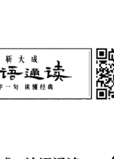

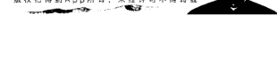

用户留言

提交留言可与专栏作者互动

### 36 | 孔子最讨厌什么人

17.10 子曰伯鱼曰：“女为《周南》《召南》矣乎？人而不为《周南》《召南》，其犹正墙面而立也与？”

17.11 子曰：“礼云礼云，玉帛云乎哉？乐云乐云，钟鼓云乎哉？”

17.12 子曰：“色厉而行内，譬诸小人，其犹穿窬之盗也。”

17.13 子曰：“乡愿，德之贼也。”

17.14 子曰：“道听而途说，德之弃也。”

17.15 子曰：“鄙夫与事君也者，其不祥亦多矣：盖祥之，患得之。患得之，患失之。苟患失之，无所不至矣。”

17.16 子曰：“古者民有三疾，今之或是也：古之斯伐也，今之斯狂也；古之愚也，今之愚也。”

### 36 | 孔子最讨厌什么人

你好，是崭新大成，欢迎来到我的《论语通途》，我们一句一句，读懂经典。

这一讲，孔子集中批评了他最厌恶的几种人，有不少负面形象。

17.10 子谓伯鱼曰：“女为《周南》《召南》矣乎？人而不为《周南》《召南》，其犹正墙面而立也与？”

孔子对伯鱼说：“你学习《周南》《召南》了吗？一个人如果不学习《周南》《召南》，就好像面墙而立着站在那里看着吧？”

这里是又出现了孔子与儿子之间的父子对话，在《论语》中这个场景不可多见。

《周南》《召南》是《诗经》，《国风》的两部篇名，周南和召南都是地区名，这是当时的民歌。周南、召南简称二南，是周文化和召治始周地的民风，为十五国风之冠。今天所用十一首诗，四十四首，像著名的《关雎》《卷耳》《汉广》都在其中。

孔子希望给儿子灌输指点门径：你学习《诗经》要从这二南入手。如果你不先学二南这样，那这部《诗经》对你来说就好像面墙者，你面对高墙站立着，根本不得其门而入。

注诗学者历来认为，二南这二十五首诗很好地反映了文王与周公的德治风化，是《诗经》中最纯正的部分。所以孔子特别警醒儿子，入门的正法，要首先从二南学起，养德。

17.11 子曰：“礼云礼云，玉帛云乎哉？乐云乐云，钟鼓云乎哉？”

这段话中的第二句“古之矜也廉”，可能不太好懂。简单说，这个廉的意思是有棱角，方正，待人过于严苛。这里的“狂”“矜”“愚”三种性状，你可以说是毛病，但还不至于不能让人接受。

朱熹说过，气失其平则谓疾，气禀之偏者也可以称为疾，这是指人的秉性、气质，历代皆有。可是从三代到了春秋时期，世风日下，浊浪滔天，这三种毛病不仅变本加厉，而且还变味了。

你注意，这里孔子讲的可不是高层政治，不是诸侯、卿大夫之事，而是这个社会普遍存在的现象，是礼崩乐坏的实际影响。对整个社会民众的影响，是在他眼前发生的整个社会道德风气的日益败坏。这个问题可就严重了，所以孔子发出了浩叹。

面对此情此景，举世滔滔，该怎么办呢？连孔子都发出了感叹。你可能会说，要转变这样的社会风气、民风民习，就得有顶层制度安排，靠道德教化的力量加以惩治，才能希望有这三种毛病的人警醒，才有可能徐图改变吧。不错，是这样。

可如果肉食者，执权柄者看不到这一点，或者虽然看到却不以为意，甚至混同于其中，又该怎么办？没办法，只好学习狂者、狷者，管好你自己，对自己严格要求，不要混同流俗，坚持自己的做人底色。

##  今日思考

这一讲我们讲到了孔子很不喜欢的“乡愿”，你是怎么看待这类人的？孔子对他们的评价是不是过于苛刻了？欢迎在留言区分享你的看法。

##  你的今日论语签

如何用：点击大图

- 1. 分享到朋友圈，每日学习打卡，请朋友监督自己完成《论语》通读任务。
- 2. 保存到相册，随手翻开，随机获取来自《论语》的智慧启迪。

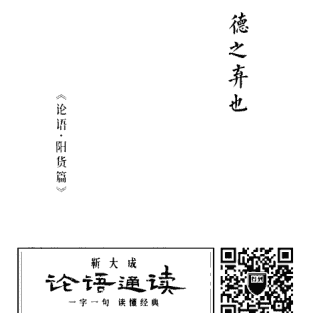

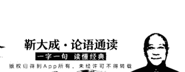

用户留言

## 37 | 紫色比红色高贵吗

17.17 子曰：“巧言令色，鲜矣仁。”

17.18 子曰：“恶紫之夺朱也，恶郑声之乱雅乐也，恶利口之覆邦家者。”

17.19 子曰：“予欲无言。” 子贡曰：“子如不言，则小子何述焉？” 子曰：“天何言哉？四时行焉，百物生焉，天何言哉？”

17.20 孺悲欲见孔子，孔子辞以疾。将命者出户，取瑟而弹，使之出闻曰。

17.21 宰我问：“三年之丧，既已久矣。君子三年不为礼，礼必坏；三年不举乐，乐必崩。旧俗既没，新俗既升，钻燧改火，期可已矣。” 子曰：“食夫稻，衣夫锦，女安乎？” 曰：“安。” “女安则为之。夫君子之居丧，食不甘，闻乐不乐，居处不安，故不为也。今女安，则为之！” 宰我出，子曰：“予之不仁也！子生三年，而后父母之怀中，期三年。予有三年之父母之知，予有三年之父母之知？”

你好，我是新大，欢迎来我的《论语通读》，我们一句一句，读破经典。

17.17 子曰：“巧言令色，鲜矣仁。”

这一章我们在《学而篇》已经学过，这里是重复出现的，简单复习一下：

孔子说：“一个人花言巧语、满脸堆笑，他身上的仁恐怕就很少了。”

17.18 子曰：“恶紫之夺朱也，恶郑声之乱雅乐也，恶利口之覆邦家者。”

孔子说：“我讨厌用紫色覆盖了红色，讨厌郑国的音乐扰乱雅乐，讨厌伶牙俐齿颠覆国家。”

要是按前边咱们刚学过的孔子说话的风格来模仿，你可以说这叫“君子有三恶”。

孔子这么说应该是有原因的，大概率有具体所指，只是我们今天能够看到的材料不足，无法确定。

红色为正色，但据说齐桓公和鲁桓公都比较喜爱紫色。这一来，许多人也有样学样跟着来，成为一种当时的时尚。就像韩国流行音乐一样，不分时代，不分种族，孔子很引以为忧。至于利口，就是所谓的假人，能言善辩，花言巧语，似乎很行，很行，能言善辩。但孔子讨厌那种很时，所以把紫色、郑声、利口归纳为三种令他认为反常的。

张居正的注法中，前二条紫色、郑声是拿来比喻的，重点在最后一直“利口之覆邦家”，也说得通。历史上从古至今，小人介入谄言进谠，是非不断，最后导致国家败亡的例数不胜数。所以，孔子才这么表达他的厌恶。

17.19 子曰：“予欲无言。” 子贡曰：“子如不言，则小子何述焉？” 子曰：“天何言哉？四时行焉，百物生焉，天何言哉？”

孔子说：“我不想说话了。” 子贡问：“老师您不说话，那我们学生们还述说什么？” 孔子说：“天又曾说过话吗？四时循环运转，万物照样生长，天又曾说过什么话呢？”

无量，不想说什么话了，为何会如此？我们可以想象一下孔子当时的心境，一定是非常沉重、非常不安。一时感到心绪难开，只有沉默。子贡听到老师的心境，一听老师说的这个话，一时有点着急。他赶紧说，您要是不说什么，那您学怎么传递您的思想呢？这话多少透露出几分担心。

孔子怎么安慰子贡？就这几句话，可看出孔子心境虽痛、虽百感交而犹坚韧，心情不好，心中有委屈甚感憋闷，一张嘴，他说出来的话，仍然透出骨子里的自信和傲气，透露出一天大地之间，仓仓在此，身贫命促，绝不肯有一丝退的强大意志。

就这一句话“天何言哉”，儒学精神的根源此而可见一大情怀、一大承担，以天为己的可敬大博。昔年走过世时，我们仍然能从这句话中，体会出一股刚毅坚强的骨气，一种博义天大、坦荡山河的胸襟。这是一种什么样的自信！每读至此，我内心都充满感动。

17.20 孺悲欲见孔子，孔子辞以疾。将命者出户，取瑟而弹，使之出闻曰。

孺悲想要见孔子，孔子托辞以有病为由不见。传话的人刚出门，孔子便取出瑟边弹，故意让他们听到。

这个孺悲是鲁国人，鲁公曾派他向孔子学礼，相传他是个鲁人，和孔子有过往来。

我们想想这个场景，孺悲想要见孔子，派人捎话报信。孔子不见，说身体不舒服，不方便见客。可是听到传话的人刚前脚出门，孔子就取过瑟来弹着，还有意让外头听得见，故意让这个人听到。

这是什么意思呢？前人有各种不同的解释。甚至有海外的汉学家在翻译这段的时候，特别把此句的涵意，在一种隐喻，中国人的礼是很内，不可告。怎么说的都有。

我们不必纠结于此，毕竟留下来的证据材料太少，不必多做推论。总之，当时孔子肯定有什么想法，让他这句话的行为更加感到，不想让你孺悲。如果是孺悲是那个想的，为什么，这个做法，他应该得想一想，为啥老师不愿意见呢？恐怕他也该心里有点数，到底是什么原因吧。

孟子也曾说过，教法有多种，其中之一是拒绝换教。这也是教法，不让你自己反思推导为什么会这么做，而是察见自己为什么会这么做，也就是所谓当头棒喝，有异曲同工之妙的回答。

17.21 宰我问：“三年之丧，既已久矣。君子三年不为礼，礼必坏；三年不举乐，乐必崩。旧俗既没，新俗既升，钻燧改火，期可已矣。” 子曰：“食夫稻，衣夫锦，女安乎？” “安。” “女安则为之。夫君子之居丧，食不甘，闻乐不乐，居处不安，故不为也。今女安，则为之。” 宰我出，子曰：“予之不仁也！子生三年，然后能于父母之怀，今子生于，予也有三年之父母之怀于其父母乎？”

宰我问：“为父母服丧三年，时间太长了。君子三年不礼，礼必然毁坏；三年不演奏音乐，音乐就会崩塌。陈谷子吃完，新谷子登场，钻燧取火的木头该换了一遍，满一年就可以了。” 孔子说：“那么，你吃大米，穿锦缎衣服，心安吗？” 宰我说：“我心安。”

孔子说：“你既然心安，你就那样去做吧！君子在丧事在身，吃饭就觉得香甜，听音乐不觉得快乐，住房也不觉得舒服，所以不那样做。现在你既然觉得心安，你就那样去吧。” 宰我出去后，孔子说：“宰予真是不仁啊！子生于，予也有三年之父母之怀于其父母乎？三年之内能离父母的怀抱。服丧三年，这是天下通行的丧礼。宰予对他的父母难道没有三年的爱恋之情吗？”

这个宰我是宰予，曾子大白睡觉打孔子的宰予学生，也曾跟大伯通文墨。本事很大的。显然宰我认为，为父母服丧礼，尽孝三年这事，在实情上太度了。他知道孔子在这件事上的态度，所以最好一套理由来强词夺理，听起来也很有说服力。

他说，您不是一生主张倡导礼乐文化的吗？如果一个人为了守丧要用三年的时间的，啥都不能做。不但是靠靡靡靡，灌不能出，甚至连穿着着，出门都会感到很受限制。而且还不能演奏音乐，不能唱啊。的话，那学生的礼乐必然生疏。这可不是等于正道废而已吗，果这是礼崩乐坏，这不是正当的结果吗？

这么说还不够，还有理由呢：一年时间，去的陈米早已吃完了，连今年新收的粮食都上下了，这就该换钻燧改火一样。古人钻木取火，四季所用木头不同，每季换一遍，叫钻燧，就是每年换木头。这是从大的道理说，到日常生活的事实。方方面面考虑周全，来给孔子讲。他的意思是，守丧三年，一年时间就够了。

孔子当然听懂他的意思，不予认可。宰我这个样的话，你来说，我是美味，问他的这样的话：你结束丧礼，回到平时的日常生活，端端吃大米饭，穿上华美的锦缎服装，此时此刻你内心的感受是什么，你心安吗？

宰我也是个直肠子，有话就直说，回答：我心安。

这样孺悲就没什么话可说了。看，孔子虽然不理会宰我的说法，但他并没有反驳宰我的话。

不同宰我的话，但他并没有反驳宰我的理由，而是将心比心、出自行情来向宰我。既宰我直言说我能安心，那孔子也就不再多说什么，只是表达了不满的态度，但具体该怎么做由你自己来决定，并不强迫遵守一个死规定。

但是宰我走了，孔子还是有个评价，说他“不孝”，这个话相当重。整个讨论中，孔子并没有直接反驳宰我举的例子、讲的理由，而是从内心、情感、亲情反过来说的。

他没有说什么大道理，没有讲三年之期或者一年之期谁对谁错，而是用孩子离开父母的怀抱这个人皆有过的经历来比喻，道出了人对父母的孝是从哪个地方来的，丧仪的规矩其根源在哪里，最后归结为心安。这就是暗示了种种文化制度安排、礼乐设施发生的根源，其实都是来自这个内在的人心，是为了让人心安。

在古代父母过世以后，子女为之服丧三年，流传很久，不是孔子的发明，但这个礼数孔子认可。但礼必须出自真心、发自真情，被迫服从某种仪式行为没有实际意义，这个孔子并不强求。但他批评宰我“不孝”，是从父母子女的情感联系出发讲的，是针对他内心缺少对父母去世的深痛悲痛这一点。

三年守孝是一种外在的强化形式，孔子这种说法，给他找到了一个心理情感的支撑，这是儒学实用理性的特点。它把上古巫史传统形式的因素，都尽量人情化、合理化、人格化了。

咱们前面也说过，在古代有所谓丁忧，官员在父母去世后要辞官回去为父母守丧。三年之丧本是古习，但经过儒家在这个问题上的强调，守孝逐渐成为制度，一直沿袭到了现代。当然今天具体形式有变化，不管是戴个黑臂章，戴朵小白花，还是家里焚香供花，基本的伦理和情感出发点是一脉相承的。

## —今日思考—

今天你是如何理解守丧的？你生活的地方有什么特别的习俗吗？欢迎在留言区分享。

## —你的今日论语签—

如何用：点击大图

1. 分享到朋友圈，每日学习打卡，请朋友监督自己完成《论语》通读任务。
2. 保存到相册，随手翻开，随机获取来自《论语》的智慧启迪。

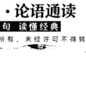

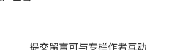

用户留言
提交留言可与专栏作者互动

## 38 | 女子真的难养吗

17.22 子曰：“饱食终日，无所用心，难哉哉！有博弈者乎？为之，犹贤乎哉。”
17.23 子路曰：“君子尚勇乎？”子曰：“君子义以为上。君子有勇而无义为乱，小人有勇而无义为盗。”
17.24 子贡曰：“君子亦有恶乎？”子曰：“有。恶称人之恶者，恶居下流而议上者，恶勇而决者，恶直谏而妄者。”曰：“赐也亦有恶乎？”曰：“恶不孙以为勇者，恶不以为知者，恶不知以为知者，恶不以为勇者的。”
17.25 子曰：“唯小人与女子为难养也，近之则不孙，远之则怨。”
17.26 子曰：“年四十而见恶焉，其终也。”

你好，我是靳大成，欢迎来到我的《论语通识》，我们一字一句，读悟经典。

这一讲涉及非常名的话，是“女子与小人为难养也”，一百多年来，这句话是比较集中受到现代人的批判的话。我会带你回到《论语》的原文来和孔子的时代，仔细分析这句话是不是严重地贬低女性。

### 17.22 子曰：“饱食终日，无所用心，难哉哉！”有博弈者乎？为之，犹贤乎哉。

孔子说：“整天吃饱了饭，还没有用心在什么事情上，难以为怀者。你，可听说下棋的游戏吗？就算做这个游戏，总比闲要好。

“饱食终日，无所用心”，这个你肯定听说过，不过这个“难”，你听了是不是也觉得耳熟？没错，前边的《卫灵篇》里，咱们学家类似的话：群居终日，言不忠信，难矣哉。

难哉，是孔圣人觉得没啥办法了，拿这种人实在是头疼。《论语》里一共出现了两次难哉的感叹，情况有点相似。

你可能要问了，是不是有款无脑吗，就可以这种人抛弃了呢？其实，这也是孔子从生活经验中有感受，要是，是一个人整日昏昏欲睡，吃了睡，睡了吃，没有任何积极的生涯追求，或者，甚至连游戏（比如六博或者围棋）都不愿意花费时间、精力和脑子去。像这样得人，难道会拿他给办法么？也许这样的人，还会对积极学习的，人冷眼瞧吧。

### 17.23 子路曰：“君子尚勇乎？”子曰：“君子义以为上。君子有勇而无义为乱，小人有勇无义为盗。”

子路说：“君子崇尚勇敢吗？”孔子答道：“君子以义为最高准则，君子有勇无义就会犯上作乱，小人有勇无义就会为盗。

这是子路问勇，但他来问勇，倒是挺合适的。子路这个人，他身上缺劲少勇吗？你还记得在《泰伯篇》，孔子三句话就“巧笑之安，无礼尔。可见对于勇敢这两种品质，孔子认为必须从，以这两种精神用来加以节制，才能成为好的品质，否则就会沦为乱子、惹事惹事甚至走向极端，犯上作乱。

《宪问篇》里咱们学过的，善射的后羿，力大能屈的项籍，行他的不仁，都是勇过人，无人能挡的，可惜他不讲道德，便行违法，最后都被骂为身，不得好死。孔子是在提醒后学们，要为君子，要学习勇，

勇可以有，但必须明白，要以义和礼为最高的德行，以礼、义来节制，才是真正优良品质。

### 17.24 子贡曰：“君子亦有恶乎？”子曰：“有。恶称人之恶者，恶居下流而议上者，恶勇而无礼者，恶果敢而窒者。”曰：“赐也有恶乎？”曰：“恶以不孙以为勇，恶不以以为智，恶称人恶的。”

子贡说：“君子也有憎恶的吗？”孔子答道：“有憎恶的。憎恶专门揭别人恶事的人，憎恶居下而上流议上的人，憎恶勇而不礼的人，憎恶专断窒塞的人。"

子贡：你问我，什么恶人？我就说下恶人，居下而议上，就是“恶以不孙以为勇，恶不以以为直”。子贡说：“憎恶勇恶而窒塞的人，憎恶揭发别人的隐私而自称标榜为正直的人。

君子、小人、上智、中人、下愚，凡是人皆有善恶，只不过，君子所恶的和小人所恶的不同，其中自显示有有无道德修养、有无公心、有无慈悲、有无替善他人考虑的维度。

孔子反过来问子贡，我也完了，你有什么憎恶的事呢？子贡也说了三点，这三点，与孔子说的略相近，也有差别。

子贡厌恶所谓“引以为智”，攻击、揭别人，这一点与孔子说的第一点恶意有点接近。看来，你见过的太多这种喜欢说人背后揭人之短，拿人家的缺点、过失、隐私做文章并会露处来挖苦的嘴脸吧，虽风点心，环小者，这种人心胸狭隘、充满戾气，实令人齿冷。

下面这一章你肯定没少听过，是孔子最引起争议的话题之一。

### 17.25 子曰：“唯女子与小人为难养也，近之则不孙，远之则怨。”

孔子说：“只有娇生的女儿和近侍的佣人是最难教养的，稍有亲近，他们就会放肆无礼，稍有疏远，他们就会怪怨。”

这一章历来争论最大，解释起来最为麻烦，我们先听听五位先贤怎么说。

鲁迅先生在《关于妇女的解放》中写道：

> 孔子曰：“惟女子与小人难为养也，近之则不逊，远之则怨。”女子与小人们归在一类的，但不知是否包括母亲，母亲虽在后来说得圣妇之德，可是对于母亲，她总算是敬爱的罢，然而虽然如此，中国的女子之性，还要受比自己以上的一切男性的性。

鲁迅先生这里的批评，针对的是当时社会上普遍存在的对待女性歧视和压迫的现实，并且把这个不平等对象，一直追溯到孔子这里。这个批判的对象客观存在的，所以也有在鲁迅先生的创作解读中。但如果仔细分析，鲁迅先生了解孔子这句话时，是把“女子”当做一个通称为理解的，我们便理解不了。这里遇到一个关键问题是，怎么样理解“女子”与“小人”。

钱理先生把这句话翻成：只有贵里的妾侍和小人最难养，这是一个经验观察。

杨雄老师也认为，当时文献中的大量证据说明，这里的“女子”就是通常一切女性。

而孙钦喜先生有个不同的解释，他认为这个“女子”当是女儿之概称，他给出了三个理由。

- 第一，从孔子讲的孝道而言，他要求以敬为本，不能光孝，因此他会对比母亲之类的长辈女性，不会用“难养”这个不敬的词，否则就自相矛盾了。
- 第二，结合《女仁儿》的心理共性，经验是很客观。
- 第三，古文中，当时“女子”即有指谁的意思，也有专指女儿的例句等等。

李厚泽先生有个说法可以参考，他把“女子”理解为泛指一切女性，不也他不认为这是歧视，“相当准确地描写了妇女性的某些特征”，他甚至认为后面那句“近之则不孙，远之则怨。”孔子说是一种“基于打地是孔子种种下结论，他认为，这样男女之间不同的心理结果本身并不好与之为，只是心理学上的某种事，并不具备褒贬之义。

你看，这也正是我们主张读《论语》的理由，不读到后半句，光会用前半句，只能离孔子的本意越来越远。

我又共同参考先生的解释，同时采用了孙钦喜先生，对原文的解释翻译自孙先生的译文。

这里涉及到有关女性受压迫的地位与对女性的领域问题，涉及妇女权利，百年头，被更多的人认为是尊重孔圣女权利、好女德的思想。我们从上面的简单分析可以明白，孔子说的这不是已经经验之说，而且可有具的所指，而不是后面解读的那可通用。

当然，后社会历史发展中，儒家的这个命题又演变出“男尊女卑”的思想，并且为后世的统治者所利用和强化，产生了“夫为妻纲”的男权文化。这是历史事实，但已经是后发事件了。

### 17.26 子曰：“年四十而见恶焉，其终也。”

孔子说：“活到了四十岁的时候还被人所嫌弃，那他这也就完蛋了。

厌恶，那他这辈子也就完了吧。""

这个话具体对谁说的，因何而发，今天已不得而知。朱子说：勉人及时迁善改过也。前人也有解释为孔子自说自话，意思是自己不为人知，被世人误读很深，不得行其道。所以《阳货》一篇终结于此，与下一篇世人对孔子的各种批评甚至恶意污蔑正相照应。后边这个说法，我觉得有点牵强。

《于学篇》里也有一句话可以参考，“四十五十而无闻焉，斯亦不足畏也己”。古代的人寿命不如今天长，四五十岁已算老年。要是到了这个年龄段还不知向学，不汲汲于改过迁善，被人评价很糟，那这辈子也就没啥希望了吧。

不过，这也是孔子的经验之谈，别当普遍规律来看，尤其你要联系孔子时代人的平均寿命很短。而且即便在古代，人年过四十有所作为的反例也不罕见。《汉书》中就记载了朱云的个案。他少年时长于勇力，任侠赴义，为客报仇。年过四十后，跟随萧望之学习《论语》，结果整个变了一个人。

可见古人也没把这话理解死，而且孔子自己不是也说过嘛：朝闻道，夕死可矣。许多人就拿孔子的这句话，来激励许多闻道较晚的人，劝他们及时改过，何时都不算晚。《世说新语》里周处的段子，就是一个典型的案例。

更何况，今天我们现代人，都要面临的是百岁人生。四十岁连一半都没过，一切都来得及。

## 出自《论语·阳货篇》的成语

怀宝迷邦、时不我予、割鸡焉用牛刀、磨而不磷，涅而不缁、色厉内荏、道听途说、患得患失、饱食终日，无所用心

## 今日思考

请你说说自己对人际关系当中“近之则不孙，远之则怨”这种状况的看法，欢迎在留言区分享。

## 你的今日论语签

如何用：点击大图

1. 分享到朋友圈，每日学习打卡，请朋友监督自己完成《论语》通读任务。
2. 保存到相册，随时翻开，随机获取来自《论语》的智慧启迪。

靳大成·论语通读
一字一句 读懂经典
版权归得到App所有，未经许可不得转
