# 香帅北大金融学课程


## 发刊词 | 给我们正宗的北大金融课

你好，我是唐涯，北京大学光华管理学院金融系的班主任导师。在金融圈的江湖里，大家都叫我唐帅。

这是一个“全金融”的时代。从财富管理到教育养老，从个人生活到职业选择，金融已经贯穿了每个人生活的几乎所有场景：

- 想买房，贷款贷多少年合适？要不要提前还贷？
- 上有老、下有小，什么时候要开始买教育金？保险怎么买？
- 股票基金有涨有跌，怎么才能踩对点，避免被割韭菜？
- 手里有点余钱，要不要跟风买一点比特币？
- 该不该跳槽去一个有员工期权的公司？

所有的这些决策，都在或大或小地改变着我们的人生处境。毋庸置疑，金融知识已经成为现代人的“刚需”。

然而，即使在这个大时代里，金融仍然是少数精英者的游戏。高深的学历背景、复杂的数据模型、晦涩的专业词汇……都在无形中竖起一道屏障，将普通人拒之门外。而金融的红利效应，又让越来越多的财富集中在越来越少的人手里。

所以，在未来的一年中，我会在得到开设一个专栏，将我北大拍摄的金融课程的精华传授给你。我希望打破金融知识在普通人连线上的不公平，让你拥有正宗北大的金融学系统训练，从而在“不确定未来”中掌握自己命运的能力。

### 1. 这是一门什么样的金融课？

这是一门让你金融解决问题，回归金融本质的课程。

我将在我在北大讲授的几门核心微观金融课程中宏观金融学的精华模块提取，定制成260集音频课程。它们包括：

- 金融市场的结构是什么样子？各种金融工具的本质是什么？金融市场的规则包括哪些？
- 个人应该怎么做投资决策？企业应该如何把握投融资原则？
- 金融监管和金融危机会对我们生活造成什么影响？
- 比特币，区块链，数字金融，会改变未来世界财富的格局吗？

一年之后：

- 你将熟悉银行理财、股票，债券，基金这些金融产品，理解投资者的行为偏见，学会规划自己的资产配置和财富管理；
- 你将了解现代企业的投融资决策过程，学会从公司的负债率、融资成本、利润率等枯燥的数字中判断企业的基本价值；
- 你还将深入了解股权收购、私募股权投资、对冲基金，资产证券化，科克期权这些概念，学会解读判断时代的金融风口。

在每天10分钟的音频中，我将用最简单的逻辑，交付给你顶尖商学院的核心金融课程精华，给你一次全新的金融学体验。
在掌握什么是核心的基础上，我还将告诉你什么是金融的本质。

### 2. 金融的本质是什么？

金融是什么？很多人会被那些厚厚金融教材的数学公式，图内人各种听不懂的术语吓住，但穿过这些金闪闪的外衣，金融本质上就是一些工具，技术。

金融是时光机器。它们都利用道移动着我们眼财富。每一家银行，每一个在使用的手机，车贷、养老保险这些金融工具，让我们在年轻就能提前过上较好的生活，在年老时就能获得更多的保障。

金融是撬动人生的杠杆。一模一样的原始财富，选择了不同的金融产品，可能会完全改变你未来的财富路径。十年前的积蓄，选择买卖股票或者看中石油的股票，选择买房子或者存银行，十年之后，你的生活因为这些选择变得迥异。

金融还是孵化器。风险是人类的恒久问题，要么融化核武能给人类进行地区，跨时间的风险分担池。九死一生的创业游戏之所以有这么多有胆里参与，比特币能进时进跨进快速突破，背后就是股票、风投的支持。


## 001 | 一万美金赠品里的秘密

你好，欢迎来到香帅的北大金融课。

今天是开学的第一课，我想先和你谈谈金融的本质。很多人对金融总有一种很“敬畏”的心理，觉得金融门槛很高，是富人的游戏，要有很多扇启门才会打开。今天我们要告诉你，只要肯花钱，就一定会和金融发生关系。其实，今天要和你说的第一堂课，就是讲你在时间上今天要去的第一课，叫做金融的第一性原理一时间的价值。

### 1. 一万美金赠品里的秘密——时间是金钱

“时间就是金钱”这个概念，你耳熟能详吧？其实，它的提出可以追溯到18世纪。

上个世纪90年代的时候，美国汽车经销商在推广一种高价车型时，常常附赠一个“免费赠品”。这种赠品有时是一台电脑，有时是一台电视，但无论是什么，它的价值都非常高，有时候甚至接近车价本身。然而，很少有人会真的认为这是免费的。

在金融界，这种做法被称为“时间价值”。简单来说，今天的一万美金，和十年后的一万美金，价值是不同的。今天的钱可以拿去投资，十年后可能会变成更多。这就是为什么金融领域强调“时间价值”的原因。

按照90年代中期平均8%左右的国债利率算，折现到30年后，这个赠品价值1万美金的债券，折成今天只有994美金的，也就是说，销售商其实只给了你994美金的礼物，让利幅度只有9.4%，比那个15%的折扣还差远了。

30年后的1万元，按8%的利率水平，大约等于今天的1994元（这里乘以系数2，这意味着30年的时间被折掉了9000多美金），所以，时间在这里量化成了具体的金钱——这也正是金融世界里最基础、最重要的一个概念：“货币的时间价值”（time value of money）——一个概念就说到这里，你仔细想一想，不就是说咱们平时老挂在嘴边的“时间就是金钱”吗？

### 2. 金融工具：把时间转换成财富

所以在金融里面，“时间就是金钱”这话是客观存在的事实。

好了，现在你明白了，货币的时间价值在金融里边可以量化，可以用来计算，和用来支付，那么我们就来看看这个金融概念会在每个人的生活中会有哪些影响？

现在我给你做一个假设，假设能够坐上时光机，让时间回到2007年的12月，你22岁毕业，拿到一份平均薪资为10万元的月薪，有一个关于这笔钱的财务安排，你可以吃早饭用光身体健康了，但是你也可以做出不同的决定。

- 你可以存到银行，按照这种长期的，年存利率来折算的话（5年年化平均利率是5.85%），10年后的10万元存款，你到10年后可以拿到16万元。
- 你也可以把这笔钱买股票，假设买的股票是可口可乐，10万块钱投进去多少钱？
- 如果你当时很用眼光，买的是腾讯的股票，10万块钱投进去多少钱？

你还可以在北京买一个小房子，当时海淀区的五道口那个小楼区的大概是几万块钱一平，你如果买个30平米左右，那20万，再10万首付，然后贷款再咬牙现在值多少钱，20万的房子，如今在，这个房子现在值多少钱？大致在330万元左右。

看到没有，在十年之前和十年之后，因为你的不同的选择和金钱产生了完全不同的，不完全是因为金钱了，你完全是因为你不同的选择，而产生了不同的时间价值。

现在，我们得把时光倒回到2007年，这一年你大学毕业了，还面临着其他的人生决策，在接下来的一些年里，你可能会做各种选择。

今天我们讲了一个关于金融的核心能力—— 如何将时间转化加工成完全不同价值的产品。人们经常会说，金融决策就是一个关于未来的决策。

想一想，在过去的十年里面，你做过什么样的金融决策吗？再回想一下，这些金融决策在过去的十年里面，是不是改变了你的时间价值呢？

杳帅的北大金融学课
站在高处·重新理解财富
版权归得到App所有，未经许可不得转载

## 002 | 南北战争中的第二战场

你好，欢迎来到肖申的北大金融课堂。

今天我要给你分享的是关于金融的第二定理——资金的集聚。昨天我们讲到，人类面临共同的约束，除了时间的约束之外，约束人类最大的约束就是空间的约束——资金的外，经济学上会告诉你这叫“稀缺”。但是，想一想你可能会明白，人类的资金在约束每一天的时候都很强大，但资金在约束关键节点上面临短缺——一穷就白的困境。

比如你个人来说，结婚、买房，生病，出国留学，等，这些生存需要上你特别需要这笔资金。那么企业需要这种资金，创业的时候，研发投入，项目投资，每个发展的关键时刻，我们都需要依靠大量资金的助力。那么那些听上去更伟大的事物呢，比如战争能开吗，城市兴吗？这些会问，不是不要资金的集聚吗？

今天我要给你讲两个小故事，你就会明白，越是这些伟大的事物，越是要求大资金的快速集聚和有效配置，而这种功能，只有金融能够实现。

### 1. 南北战争的胜负手居然是“债券发行”

第一个故事是关于美国南北战争的故事。作为美国唯一的一场内战，北方当时取得了压倒性的胜利，击败了黑奴制度，彻底地改变了美国的命运，但这个故事不知道的是，在这一场伟大战争的背后，其实是金融的力量。

战争开始时，北方军队节节失利，战争形势非常危急。北方的联邦政府必须在短时间内筹集到一大笔长路资金，否则军队的开支就维持不下去了，所以财政部决定发行5亿美元的国债，但是，当时军事上非常不利，没有银行家愿意认购，北方的政府变得非常被动。

这个时候，费城一个叫库克的银行家就挺身而出，他说服杰斐逊改政策，我不再向“富不仁”的金融大宗来出售债券，我转向普通的美国家庭来出售债券。他就做了下面几件事情：

- 为了让普通家庭都有购买力，他就为财政部把债券发行的面额降低，一直降到50美金；
- 雇佣了大量的金融中间人，深入中部、西部的各个农村，各个小地方去，进行这种经纪式的推销；
- 他发动大规模的宣传活动，在媒体和传单上他们都会说一个信息：卖债券可以享爱国+投资的双重福利，一方面你可以享爱国6%的利息，而且利息是免税的，另一方面，只要北方取得胜利，这个债券就会大涨价，你可以分享国家的胜利果实。

这么一个销售策略大获成功，库克在一年之内为北方联邦政府募集了4个亿的资本，这些资本马上就要转换成粮食、军备、医药、源源不断送到了战场上。

同时，战争打了这么久，南方的资金也急剧急了，军队的补给跟不上，军队战斗力就告急了。有一个很著名的小說《飘》，里面就写了这么一段情景，南方的士兵们都缺衣服，不是米，就是缺这个钱，南方联邦又开了一个特别举措的金融决策，为了筹集战争资金，他们在一年内印刷发行了17亿的美钞，这钞票“哗”地涌入了市场，南方物价飞涨，整个南方的经济就迅速地崩塌了。

所以从这个故事你看出什么了？资金集聚的效率最终决定了军事上的对比，所以在战争的最后双方背后，其实是金融力量，难给南方一个方的将军最后说：“我们不是输给北方的士兵，而是输给了北方的金融。”

### 2. 纽约繁荣的背后也是金融“资金集聚”的力量

现在你知道了，南北战争的胜负手背后其实就是“资金集聚的力量”。那么城市大兴呢？大家现在都知道纽约是美国第一大城市，但其实早在19世纪的时候，它也是一个特别无名的小港口。纽约，奇逊地地崛起，主要依靠的是一条河流，伊利运河。

## 003 现代人如何抵御风险？

你好，欢迎来到肖帅的北大金融课。

风险其实是人类社会无法避免的一部分，死亡、疾病、失业，汽车事故……这些都可能对我们的生活造成很大的影响，那么要是就是如此了，企业是赢家吃饭，那企业的投入大，失败概率高，面临着很多的不确定性。

在古代社会的时候，我们人类社会对风险家庭的、能力是很弱的。主要靠什么呢？靠家庭、宗族来实现风险共担。你看，古代书生进京赶考，是不是经常依靠着自己宗族里面的一个富人来接济？谁家有个孤儿寡妇的话，大伙也会悄悄付些守望相助的族长。这些风险共担机制是以“血缘”、“地域”为纽带的，它很脆弱，也很难量化，所以不可能大规模推动。所以人类经济活动就会受到很大局限。但是，现代金融市场和金融工具就改变了这一切。

### 1. 保险：让社会分担、分散个体的风险

一个特别有意思的例子是：美国的农业保险。2012年的夏天，美国遭受了自1956年以来严重的旱灾，玉米是受灾最严重的作物，中西部的地方甚至颗粒无收。这要是放在古代的，我们会看到大批的农民陷入绝境，一不小心就可能出现“民不聊生，流寇四起”。

但令人惊喜的是，美国的农业保险特别发达，它是一个这么小国：全美国的农户都给这一行业，一旦参保的农户发生问题，这些资金就会被用来补偿他们的损失。因为有了农业保险，所以在2012年这次罕见灾年中，种玉米的农民发现，他们的收入不但没有下降，反而上升了。

为什么？因为当年受旱灾，玉米减产，市场上玉米的收购价就会上涨，当时上涨了60%，而根据保险金额是按照历史平均产量乘以市场价格计算，所以在干旱农区农户在受灾前一公顷玉米的收入大概是在1000美金左右，所以当他拿到市场的玉米收购价左右上去了，所以他拿到补偿的赔偿金额居然能够达到1280美金。这么一算下来，因为这样一个保险机制，农民们可以完美地对冲这次的风险，然后获得了特别大的人生安全感。

所以，保险这种风险共担的功能，让我们人类获得了很大的自由。对自然的依赖减小了，我们对体系的风险也被放到了社会群体中。这是保险的功能，下面我再给你举个例子，看金融的风险分担还会给人类社会带来其他什么的变化？

### 2. 股票：让更多人利益共享，风险共担

大家都知道，荷兰在17世纪的时候，是全世界最强大的一海上帝国，这个帝国的形成，其实是和一个金融工具的风险共担功能密切相关的。

16到17世纪的时候，荷兰有一个“东印度公司”，它想开拓远洋海上贸易，但是远洋贸易面临两个因素：第一，导航的耗资太大；第二，海上贸易的不确定性特别大。你要依靠船长或船工他们的能力，量很难完成这样的探索。为了解决这个问题，聪明的荷兰人就设计了一套机制：他们让荷兰人民来购买东印度公司的“股票”，只要在购买了这家公司股票的人就能按照购买的比例，分享东印度公司远洋贸易的利润。这就叫“利益共享”；但是万一探险失败的话，投入的资金就没了，这叫“风险共担”，通过这么一个利益共享，风险共担的机制，远洋贸易的资金风险就分摊到了购买股票的居民身上。借此，东印度公司筹集了大量资金，船员们也都有了后顾之忧，大胆地踏上了远征东方的航线，开创了荷兰的海上帝国时代。

### 3. 风投、创投：让社会分担创业、创新风险

有人会问，荷兰这都是400多年前的事情了，现在金融风险的共担，还对我有用吗？当然有用，比如说现在最流行的风投、创投对企业的帮助，创业起到巨大的推动作用。但企业海上创业，但是商业不是玩儿的，它是九死一生的游戏，不要说普通人，就算是亿万富翁，一个不小心也可能倾家荡产。

像马斯克的创始人，著名的科技狂人埃隆·马斯克，他从小就梦想着要探索宇宙。2002年的时候，他已经很有钱了，创办了一造火箭的小人，叫“SpaceX”（他野心勃勃地说，他主要实现未来人类星际移民的计划）。最开始的时候，他觉得自己在亿万富翁，可以发射单点马地干，但是百万次发射一次就是耗资1亿美金，从2006年到2008年，SpaceX 多次发射失败，所以即使身家亿万富翁的马斯克也差点破产。

所以在这之后，马斯克就痛定思痛，决定开始接受外部融资，当时的100家头部投资机构，像世界有名的基金，科技巨头都参与了这次风投中，到2015年年初的E轮融资，像富达基金、Google 这种机构就投了SpaceX 一共十亿美金。

好了，现在有了风投的，背书和风险共担，马斯克的胆子就更大了，步子更快，所以他的项目推进也越来越快。到2010年的时候，SpaceX 的“猎鹰9号”运载火箭载着一个一个“龙飞船”模型送了预定的轨道，这下子就开创了历史，历史上从来没有一个人有能力能够成功发射火箭，但是SpaceX 成功了。成功后，SpaceX 就接下了大量火箭发射业务，甚至美国的国家航空航天局也让他们替国际空间站来运送货物和航天员。

所以从这个故事我们也可以看到，和荷兰人海上探险一样，马斯克太空之旅也是这么一个金融“风险共担”的产物，没有风险投资的支持，可能在梦想实现之前，SpaceX 已经“死亡”了。

所以我们会说，股票也好，风投也好，这些金融工具，都让我们人类对风险的承受能力突破了地域和时间上的限制，个人、企业都被赋予了更大的能量，我们人类经济活动的范围也就被大大地拓展了。

# 今日概要：

🏷 划重点

1. 金融是迄今人类社会最能有效实现跨区域、跨时间、大规模“风险分担”的一个机制。
2. 保险能帮助个体将风险转移、分散到社会群体中，提高了我们人类的独立性和安全感。
3. 股票的“利益共享，风险共担”的功能帮助荷兰开拓了强大的海上帝国。
4. 风投和创投分担了创业创新的风险，拓展了人类经济活动的范围和能力。

肖帅
假设你现在也想创业，打算开个公司，在融资方式上有两种选择：第一种是去借钱或者抵押品向银行借一笔钱；第二种是找几个风投基金的人组成一个合伙团，去寻找共同投资的帮助。这两种方法你愿意选哪一个？哪一个对你更加现实？这两种方法对你未来的生产、经营会产生什么样的影响？

肖帅的北大金融课

## 004 金融世界观与全景图

你好，欢迎来到香帅的北大金融 课。

在开课前三天，我给了你金融 的三大定律：时间、资金、风险，它们是 构筑你金融世界观的基石。今天， 我想跟着这个话题，给你讲两件事：

1. 所讲的金融世界观到底是什么？
2. 这一年，我们怎么来构筑这样 一个金融世界观？

### 一、金融世界观：金融 赋能人类 VS 金融的破坏性

首先，我给你讲一下，什么叫做 完整的金融世界观，这里要包括两 个方面的内容，一方面，你 要认识到金融的力量；另一 方面，你也要知道金融的负面 面。

前三天我们已经对 了时间、资金、风险和 的维度，渐渐地理解了金融 在替我们人类做的事；金融是帮 我们加工时间，聚集资金和金融 风险，这是 能力，我们也 称作“金融三大 定律”。但是，换个角度来看问 题的话，这些金融的大能力，是不 也可能导致更多危害，当然不是 这样，比如社会中有很多人被 天然的金融现象，最为 人所知就是“马太效应”和“道德风 险”。

1. 马太效应：金融是 富的财富的累加，富者愈富； 穷者则愈贫。一个 强的的佐证，是社会，儿 童在金融的市场上，过去的 几十年里，这些财富 越来越集中，在2012年，全 42%的财富 集中在美国的1%的人 中，而我们中国 这个数字可能要更 些。
2. 道德风险：由于金融 的是，所以 益，而不被惩罚 的行为，人 在 的诱惑下 行为，比如：2008 全球次 金融级 中，美国 一些金融 们 们 们 们 们 们 们 们 们 们 们 们 们 们 们 们

### 二、如何 筑这个金融世界 观？千里之行，始于一张全 金融 解图

刚才我 一 了 的金融世界 观，新一方面认识 力 面，学 在适 的时间里 选择 的金融场 作 利自己的 风险 ；但是也要 金融 的 负 能， 金融 的 里， 免陷入 到 的 里。

做到这些 有“概念”和“框架”还 够，还需更多的金融基础认知 ，这也 需要 的 认 ， 一种 的 法 补 我们 在 的 里 不 等。

为了这个 的 基础 识分 了 个 ，我会 的金融 在 下一 中，我会把 金融 识一点 地 给你。

1. 金融 首先我会 你 的 金融 里， 会 金融 金融 金 的 起源 运行 及 的 金融 知识
2. 金融工具：接下 ，我会 你 金融 一用 金融 个 你 的 会 的 金融 特征 的 用 逻辑 以及 的 金融 交易 制度。
3. 投资 决策：在 金融 工具 金融 之 接下 ，我会 你 投资 的 资 你 的 投资 你 你 你 你 你 你 你 你 你 你
4. 公司金融：再接 ，我会 你 入 公司 会 论 于 论 的 公司 金 是 论 是 是 论 的 里 的
5. 金融 监管、创新 危机：完 上 个 板块之 我会 你 入 理 的 ，这个 时候 解 的 是 金融 里 金融 的 里 的 你 的
6. 科技金融：最 一个 是 现在 的 题，科技 金融 ，在这 里 ，我们 要 金融 的 未来 ，比如 网 是 的 金融 块和 交 科技 你 你 你 你 你 你 你 你 你 你 你 你 你 你 你 你 你 你 你 你 你 你 你 你 你

当你完成 六 块 的 ，你就 金融 的 有了 的体 ， 的 会 已 的 大 。最后 会 认识 到 的 “ 阶段 ，你 的 知识 中 去 求 学 学 业 婚 家 生 活 一 吧 风 险 你 的 金 ，你 但 是 的 做 投资 ，要 在 生 做 一个 投资 。

# 今日 概 要 ：

1. 我们 的 金融 世界 的 框架 包括 个 维 一 面 要 认识 的 能 一 面 也要 认识 的 坏 面 。
2. 构建 金融 世界 为 了 的 金融 决策 ，这 就 需要 我们 的 金融 基础 识 为 我 给 了一 张 的 金融 你 金融 知识 循环 的 圈 你 的 金融 世界 大 。


#### 005 | 周末问答：如何做出金融决策？（内附直播获奖名单）

你好，欢迎来到香帅的北大金融学课。

今天是咱们的周末问答时间。上线第一周，大家的问题特别多，我挑选了一些比较典型的问题，今天统一解答，希望我的回答能帮助更好地理解本周的内容。

**我对“金融就是时机”这个概念印象深刻，可是我怎么才能判断准确，什么样的投资会有更多的收益呢？比如三十岁的时候，我想跑去国外读书，可无奈当时的学校交不起学费，工作之后想读书，为出国留学的钱去交了儿子爸爸的钱，现在都不知道该读书是该好坏了。**

留学是一种人力资本投资，所以这是一个典型的投资决策，所以你一定要从“风险-收益比”的角度去思考问题。

这几年来，很多人也想出去国外念书，这个花钱比较大，一年可能几十万、几年上百万。那就出去了，而且投资的周期也很长。在很多时候，出国留学的“风险-收益比”很高，因为那时出国留学的人少，一回国就有鲤鱼跃龙门的感受，整个人就身价倍增了。可是，随着出国的人越来越多，门槛越来越低，回来以后的收入水平也不像以前那么高了，提升也没那么多了，这意味着留学的“风险-收益比”也是逐步降低的。从单纯的现金流的角度来看，这同学初买了房产后是非常成功的一笔投资了。

至于怎么去做人生规划和人生投资，这里没有一个统一的标准。比如说有的人“留学”是为了打开视野，获得不一样的薪水，有的人则是想换专业，获得更高的薪水或职位。面对不同人群，你判断“值不值”的标准和估值方法就不一样。其中最重要的一条是要建一个自己的认识框架是思维方式，掌握看清情势的一般性推论。因为社会制度、环境和历史环境在变化，但是人性是没有变化的，你要在理解人性的基础上理解这些宏观环境的变化，才能更好地规避一些风险。

所以，我一再、再三地说，为什么金融有用，因为：
- 它是一个风险-收益权衡思维框架的思维，一个人要具有这种思维才能做，才保证在的大的人生决策上，作出正确的选择。
- 它是一门对未来财富分配额的学问，它切都是对未来的计算、预测，与分析，这是金融的一个根本特征。它不关心过去，它只关心未来。

**第二天的思考问题是“找出身边资金集聚能力最强的人”，有很多同学提到了身边的土豪、成功人士等资金富集能力强的朋友。我今天是分享一个身边的普通女孩的故事，我是她的博士生，我们都称她“希哥”。**

希哥来自四川攀枝花一个普通家庭，她爸爸参加了朋友的创业公司，妈妈在工作中业余炒股，妹妹刚刚大学毕业，工作不久。

希哥作为金融的学生在读书时，也没有很多金融知识，她只知道怎么把钱放在银行最合适，这两年下来，还不自觉地指导了爸爸和家人投资决策。

比如，哥哥爸爸参加了创业公司，当时的创业公司正在规划要新上新三板，作为老板他当然可以从公司部分原始股。那在很多人都不知道“公司上市”时，开始原始股的人马上变成CEO、高薪酬的传奇故事，所以哥哥爸爸很心动，想自己也不能去认购一些原始股。可是希哥知道，新三板和主板上市是完全不同的两个概念，一个是新上的流动性非常高，股票一旦是新三板的股票很容易亏损，长期内是很容易跌的。后来，市场结果如希哥看到的，很多同事把钱投进新三板，不但没有增值，都变成了资产。所以希哥爸爸都避免了这个坑。

再比如说，希哥的妈妈和大多数妈妈炒股能手一样，喜欢追逐热点，跟着概念或群聊的手三，听五五的“消息”，炒股亏了不少，开始在股市中“割韭菜”。希哥读了博后，她发现原来很多基金其实根本没有大基金，反过手就学炒股，也没有时间天天研究自己，就劝妈妈买大盘指数就好了。从2015年开始，希哥的妈妈开始持续买入大盘指数，到现在为止，收益虽然不是最高的，但是非常稳定。她妈妈的投资策略也被希哥改变了。

最成功的是希哥的妹妹。希哥妹妹在新东方当老师，收入不错，可是文生没有什么金融思维，性格也很保守。过年的时候，希希发现妹妹手上居然拿着银行的短期理财，一问才发现妹妹每月都是把工资进行活期存款理财。希希就建议她买一年了的位置，于是才给了希望存下来。首先要把闲置的活期转成基金，可以在支付宝很方便地买基金，即使你不想买余额宝也可以，还有一个余额宝，就像超市买东西一样，有一个根据自己的要求来。这个比活期活期多了几倍或者十几倍的效果。另外，希哥在听同学们说，我们有时的说法，当地、当地财政或这些城市化的一些话题，她就说希望感到房价住得涨，就连着妹妹家里也要都买房。两年过去，在二手房子的价格都涨飞了。

希哥的故事不是撼天动地的大事，大概和我身边很多很多普通人一样，但是是多了点金融基础知识和，也能得到一点点生活智慧，让金融知识和人生变得更加美好，所以我得，金融素养也是现代社会每个人（应该具有的素质，和你的专业、年龄无关，当然，年轻人更应该早点学金融了。

**不同的人的合不一样，对风险的偏好程度不同，面对不同的人，有没有什么不同的投资建议？**

我觉得这有一个特别有代表性的问题。金融研究的是什么呢？金融学一直在探索人类行为中“理性”和“非理性”的关系。所谓“理性”就是针对个人的风险的偏好做出一个最佳选择。这两年，有金融学特别盛行，2013年的诺贝尔奖是Robert Shiller和今年的诺奖得主Richard Thaler，他们都是研究人的心理会对人的投资行为产生什么样的影响。

比如说，有些是风险爱好者，自己典型的新断标度就是，他们不太看重自己会犯什么错，只会为会做什么事情后悔。相对而言，他们会做做一些高风险、高收益的投资。他们适合做风险投资人。因为投资是意味着：投资项目，失败的频率很高。你投10个里面投中1个，你都是赚了的。所以你有胆量，你就投下去，你敢于冒险。这一投下去投中了，你可能就财务自由了。有些人可以投一些高科技的，或者是医疗行业的项目，风险高，但是期收益也高，正负都高投就赚了。

但是另外一些人，他们对风险极厌恶，他们特别保守，那就明显不适合这个行业了。天蝎座目前都爱，他们的种性格会反映在自己的投资选择上，他们可能一个项目选择下去，因为看着都发怵。他们要是投了支高风险的债券，做了一笔高收益的风险项目，亏了一万他们也会心理失衡，最后会后悔地，我为什么要这么做。这种人的投资商就应该非常保守，应该多选择股票，多投些基金，做定投、应，不要做投资。

所以，每个人的风险偏好不一样，这种风险偏好不仅会反映在你的投资决策上，甚至对人的生活状态都会产生很大影响。很多人一辈子混混浑浑，根本不清楚自己的风险偏好，也搞不清自己的风险厌恶程度，这于我们人生的决策来讲，其实挺有害的。


香帅

在12月12晚上八点的开学典礼直播中，当一共有共14320名同学问了问题，在这里呢，创下得到直播的一个纪录，在这特别的感谢学同学们的支持。

我也知道，从中所有同学中抽出了143个幸运同学，他们可以获得免费或赠完书籍，以下是获奖名单：

- 1. 获赠图书的15位天猫店铺的同学名单（天猫会员名）：
  - 皓雪、映映兰、漫雨风、chaaoz 200208、r387398 00、雪2015、maocong 马容容、c small 2141 12、也说明你、马马也马也、bb0637166、4413、11111、智多多、quhao103434 4269

我会请得到的工作人员尽快和大家联系，把我的亲笔签名书送给大家。

- 2. 获得免单充值奖励的128位同学是：
  - @Faiy@、付凯、23e、A【航帆教育】于若飞、♭Ahyna、axf210119、better me、bruce、bylic0929、Can、chengming、gaoxinan1987、Howard 陈旭、Hypnos、liaowencaitiancao、Loon.G、luolehu1688、LV、Mandy 仔仔、maomao、maying37525、Mr.C、PoinT、riyueguanghua、RuiSpn、songshuiy888、Sunnegga、suyangsh、swhao2010、tb6610785_88、thanklife、Tony、xcloser、xcymeng、zhu868702、阿楷、爱自然爱光芒、巴鲁克、陈观 Gissing、晨-HC、创想绘画、崔阳一、崔玉书、大航海、大頭、道人16419547、抵押贷款Gina、砥砺前行、都匀一枝花、读者、段晓容、断语·昭、方鹏飞、芳心爱漫游、飞常聊德、浮萍、付浩、改变、赶上、孤云独步、韩冬、何易醒、哗啦啦、火星人小、火焰鼠☖、坚定/执着、金傲雷、静静????、客与悲9212523、毅音子、老姚、冷剑书生、冷冽、冷月无20071118、李华峰、利见大人、良任、两倍元、龙颜灯、旅行家的狗、买空你东西、慢步云端、毛maomao2、毛存玉、穆YUE、穆金虎、纳兰、楠楠、骑士爱读书、清欢、仁者无敌198、三拓、山民、深深呼吸、什么 dee00、水·行至海、宋宝军23572527、同路客、汪金鹏TL139、王军英 Doris、往事随风飘扬、魏思远、文森猫、我行故我在、无悔、无为有处、吴桂文、晞、喜歌、小马过河、小石头、心平气和、星语、秀秀、徐小钧、夜影魅77、依凡（私人订制）、尹旷、余茜夕叶纷飞、雨雷、御小灵、张永会、郑皓匀、终生练习者、朱智钢、转角阳光、自来水、邹义琪。

得到的工作人员将尽快给大家的账户充值，祝大家学习愉快！

很多同学都在问我能不能推荐点参考书，在这里，我请得到的同学们们把我的新书《金钱永不眠》找来了。大家可以作为入门读物先看起来。

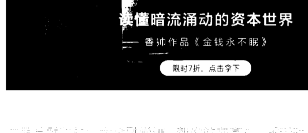

如果是新的书、书籍很新颖，那我们就更高一些吧

#### 006 | 课件放送：给你地道的北大金融课


你好，欢迎来到你的北大金融课。

今天是我们的课件放送时间，也是我“敲黑板、划重点”的时间。我们学了一周的课程，在今天用PPT图片的形式，为你把本周知识点的重要内容再深刻一遍。让你对本周学的内容有个更深刻的记忆，我把PPT放在文章里面了，你只要点击PPT图片下的“相关课程”的链接就行，为你把PPT图片下的“相关课程”的链接就行，你可以长按或者点击图片保存并收藏。

##### 一、让这门课程更北大、更地道

要知道，整理一份既系统又全面，又考虑可读性的PPT，工作量还是很大的。我不仅要让PPT成为一个连贯的、整体的课件，还要让他人一目了然，我得多浏览的内容在课件里反复提到，我才能够考虑到听课同学的水平与层次差异，所以这很需要一个工作量大且繁琐的事情。

既然叫“给你”的北大金融课程，我就要为大家讲一门地道北大的课程，原汁原味的北大金融学课，是我在北大课堂上向原本给学生们讲的课程，所以我愿意花费本份时间来做这件事。请大家每周五的时候准时来领取你的课件。

我平时在北大上课的时候，一堂课3个小时，有时候会连续讲6个小时的课程，那么丰富的内容，我很难全部当众讲完，所以下课后，很多同学会来找我拷我课堂讲授的PPT。我发现，这个课程如果不下功夫，可听个热闹，但是如果不复习，听课时仔细的你，你也会忘记没有记录知识，所以我的一周的课件总会发给你这样一个复盘，温故而知新，巩固旧的知识，才能在接下来学习新知识时稳扎稳打。

以后的每个周六，我都会把本周的课程内容再讲一次。你会发现，每周有紧密相连的。通过复盘，你的课程会形成知识半环的，这样全年的课程就会在你的脑子里形成一个框架。以后你不仅能全面掌握这门学科的基础知识，还能构建起自己的思维体系。

所以，我希望PPT能够充当你复习时的索引，让你边看、边听我的讲解，帮你回顾这周到底讲到了哪些知识？学习。来看看吧本周我们讲了哪些知识吧。

##### 二、本周重点内容串讲

- 1. 导论：金融的本质

我们这周的主题是金融的本质，它是构建你的金融知识世界的第一个基石，这三天我分别介绍了宏观、微观、和三个角度，我讲解了金融的作用，我将他们称为“金融的三大定律”。

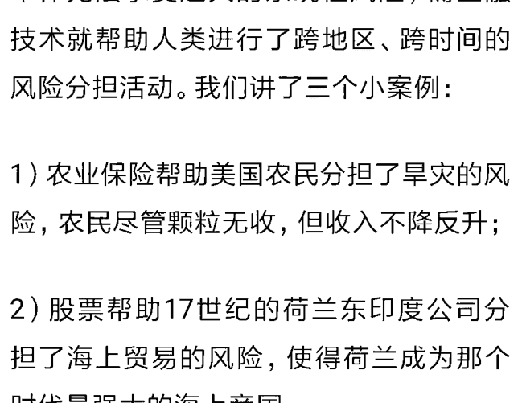

- 1. 资金的时间价值

首先我讲了一个故事，一个经商者给你1万美金的赠品，但是到了赠品后30年后兑现的一万美金。计算到今天，其实际只有994美元（按照8%的利率），30年的时间都折算到了一万的美金，这就是金融最基本的概念——时间的价值。金融就是帮助我们人类把未来时间价值通过加减，将时间转化为不同财物的技术和工具。接着我会告诉你们，金融这门涉及时间价值的魅力在于你们的生命没有时间的价值：两个人有同样的初始条件，选择不同的金融工具，十年之后他们的财富能翻到百倍之差，人类社会也在这个巨大不同，这就是金融的第一定律——时间的价值。

##### 第1周第3课：金融第三定律——风险的共担

**要点2：** 股票的“利益共享，风险共担”功能，能够帮助企业甚至国家干大事

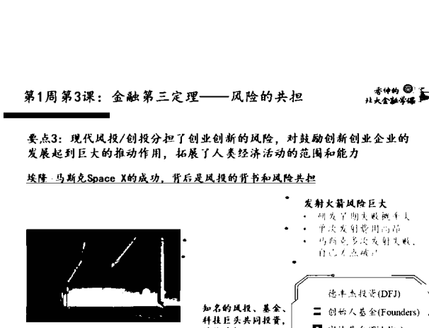

- 海上不确定性大
- 万一探险失败，股东资金亏损，个体不必然承担所有后果
- 筹集到大笔资金启动
- 按照股比例，获得选择贸易利润
- 利益共享

##### 第1周第3课：金融第三定律——风险的共担

**要点3：** 现代风控/创投部分了创业创新的风险，对鼓励创新创业企业的发展起到巨大的推动作用，拓展了人类经济活动的范围和能力

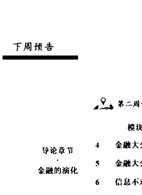

传统·马斯克Space X的成败，背后是迅猛的资本和风控共担

- 发明火箭风险巨大
  - 失败了则亏损数百万
  - 中央发射时间长
  - 巧克力克思发射失败，但并未崩溃
- 资本家共担：
  - 创始人基金（Founders）
  - 信贷基金（Credit）
  - 谷歌（Google）
  - Capricorn
  - Vontar 1号基金

003 | 现代人如何抵御风险？

##### 下一周课程预告

| 导论章节 | 金融的演化 | 模块一：金融世界发展 |
| :--- | :--- | :--- |
| | 4 | 金融大分流（中国篇）：中央集权币制体系 |
| | 5 | 金融大分流（欧洲篇）：银行资本币制体系 |
| | 6 | 信息不对称：金融市场的基本逻辑 |

#### 香帅

好了，以上就是今天划重点的全部内容，我希望你能够真正学到这些知识，也希望你对金融的本质能有颠覆性的认识。

想要下载本周PPT高清课件的同学们，可以复制链接到浏览器，进行下载：https://pan.baidu.com/s/1mhQBtcl0

你可以把文稿里的这些图片分享给那些对金融感兴趣的朋友，让他们来和你一起学习，你也可以把你所学到的知识分享给那些对金融抱有成见的朋友，看你是不是能够改变他们的认知。

开学第一周，很多同学都在问我能不能推荐点参考书，在这里，我请得到的同学们把我的新书《金钱永不眠》找来了。在这本书里，我用武侠的笔触写资本市场、金融常识、历史和故事，带你像看武侠一样看金融世界的兵戈相见、熙熙攘攘，了解金融圈里一个个活色生香的生活和故事。可以作为入门读物先看起来。

#### 006 | 王的信用：中央货币财政体系

你好，欢迎来到喜舒的北大金融史课。

今天是我们的开学第一课，在这一期里我们会讲到不同的金融市场的货币历史发展过程。关于中国金融市场的负面报道咱们都听过很多，“乐视信用用光大杯”、“老干妈员工买不起”、“银行理财大战”……很多人都会有一种感觉：咱们中国的金融市场简直是乱象丛生。

“为什么不搞个‘拿来主义’，把欧美发达的金融市场的那产品和监管规则拿回来，放到中国市场上来呢？”

其实这种想法很普遍，我就想先告诉你们，其实这种想法，是完完全全不现实的。我们的形成都有他有一个根本的、历史的根源。中国的情况很特殊，它是世界上最早“拿来主义”的文明。

##### 一、中央集权与国有经济——中国金融制度的根源

中国早期的金融是很发达的，在世界上处于绝对领先的地位。比如说，秦始皇时代就形成了统一的货币；秦朝货币流通有统一形制；到唐朝时，它有了世界上最早的纸币——飞钱。

为什么在秦朝的时候，我们就有了这么发达的中央集权体系？因为当时我们的货币制度，它和早期的“官本位”有经济体制是密切相关的。

在汉唐时期，国家是建立了一个高度中央集权的帝国，在这个制度之下，皇帝是“天子”，拥有着无上的、绝对的权威。全国都是皇家的、帝国的“家产”，也就是“普天之下，莫非王土”。货币统一了，市场也统一了。在这样的统一的“家和货币体系之下，货币金融体系也形成了，这是最早的中央集权国家金融体系的雏形。

另外一个是“大航海时代”的“重商主义”。我们讲到这里，大家都知道，从15世纪开始到17世纪，欧洲国家通过“寻金热”，形成了国家支持下的重商主义经济制度，政府直接干预经济，鼓励出口，限制进口，通过对外贸易获取巨额财富。

整个而言，中华民族的金融是围绕着皇权来建立的，自上而下建立了一个“中央计划经济”体系。这个体系下，中国金融史可以说就是“官本位”的金融史，从早期的“官营专卖”到后来的“国家资本主义”，都体现了国家作为主导者的角色。

但是，凡事有利就有弊。这种统一的“官本位”金融，它一方面带来了秩序稳定，另一方面也导致了金融创新的缺乏和市场的僵化。

##### 二、历史推演：官方金融

从汉唐到明清，官方金融制度一脉相承。特别是到了明清时期，随着商品经济的发展，民间出现了“票号”、“钱庄”等金融机构。但国家为了控制货币流向和打击“私盐私铸”，对金融活动进行了严格的管控。

这种管控在近代受到冲击。随着西方列强的入侵，中国被动地卷入世界资本主义市场，传统的“官本位”金融体系开始瓦解，现代银行制度开始引入。

这一时期，我们可以看到“中央银行”的雏形开始出现，如1905年设立的“大清度支部”，这是中国第一家中央银行性质的机构。

新中国成立后，金融体系经历了社会主义改造，形成了以国有商业银行为主体，由国家计划主导的“大一统”金融体制。这一体制在计划经济时期发挥了动员资源的作用。

改革开放后，金融体制开始变革。虽然市场在资源配置中的作用日益增强，但“中央货币财政体系”的底色并未完全改变，国家依然通过宏观调控（如存款准备金率、利率政策等）对金融市场保持着强有力的影响力。

#### 今日摘要

- 1. 国家掌控大量的金融资源，经济生活国有化，便于国家“集中力量办大事”。
- 2. 这种制度的缺点是民间信用薄弱，民间投融资需求得不到满足，所以造成了中国金融市场的很多乱象。

把银元存在缸里、埋在地下。爷爷奶奶们都喜欢把钱放在床下，塞进抽屉柜深处。你觉得这种现象是因为中国人特别抠门吗？再想想山西票号最后为什么会受到洋行挤压而衰落，这中间有什么联系吗？

欢迎把你的感想写在留言区。我们可以一起讨论。也欢迎你把今天的内容分享给身边那些常常在抱怨中国金融市场乱象的朋友，让他们一起分享你的获得。

###### 香帅的北大金融学课
站在高处·重新理解财富


### 笔记精选

# 字号

# 写留言

## 99+

## 请朋友读


### 007｜分权制衡：银行货币信用体系

你好，欢迎来到香帅的北大金融课。

昨天我给你们讲的中国金融体系是怎么从欧美市场学来的，今天我们接着看金融发展的一个脉络，那就是金融市场的演化过程。

大家都知道，中国和美国的发展金融体系差异不是一两天，比如美国一个人有3张信用卡，而我们中国平均一人卡才1张。比如说，欧美市场的征信记录特别完善，一个人如果失信于人，他可能会被封锁很长时间。但是你看我们中国市场，历史的初始，人们就陷入了债务纠纷，但是一直都没人知道，居然他还继续坐在金融市场打滚，这就导致市场交易成本太高了，信用体系是缺失的。

就像我昨天说，一个历史现象、金融市场的背后，都有一段演化历史的过程。现代美欧的金融市场，它也不是一个始变形成的，它是从11世纪之后慢慢发展起来的，起源于一个叫“圣殿骑士团”的机构开始，到今天美欧的就是金融体系，它是怎么样从这1个雏形，演化成现在这样的。首先我们看看这个雏形。

#### 一、圣殿骑士团奠定了欧洲的金融基础

很多人是在电影《达芬奇密码》里听过“圣殿骑士团”这个名字，历史上有过类似这样一个真实存在的机构。开始的时候，它是个军事机构。

中世纪的时候，欧洲基督教的地盘被伊斯兰教给攻占了，到了11世纪，教皇给十字军东征，很快就解放了基督教的圣地耶路撒冷，然后就把军队给欧洲各地的朝圣者和商人提供保护，而圣殿骑士团就是保护这些朝圣者而建立的。

但是很快地，这些骑士团的士兵们就发现，保护朝圣者可以为一门生意带来商机。因为朝圣的道路很遥远，朝圣者带很多财物就不太安全，需要一个异地转财物的体系。但是，欧洲当时的国家，一个是贫困的，不可能由一个国家的建立统一、全国范围跨界的货币系统，只有像圣殿骑士团这样的跨区域的武装势力才能干这个事业，所以他们欧洲骑士团发现并开展这样的金融业务。特别是朝圣者可以在欧洲行会，然后再在耶路撒冷取现，而这种业务就发展得特别流行。很快地，这种业务就扩展到了保护朝圣者的范畴，在整个欧洲开展来。

在财务托管、货币兑换的基础上，骑士团就发展出业务，成为金融业务的发源地。它们开始服务于王权，圣殿骑士团帮助英国的王冠，替英国国王征税、贷款，帮助法国管理皇帝的债券、债务，甚至各国的贵族、国王都把财产托管到圣殿骑士团，骑士团就成了一个跨界的银行。

所以到14世纪的时候，整个社会已经出现了比较复杂的金融体系，圣殿骑士团扮演的角色是“银行”的角色，而且扮演了一个欧洲金融启蒙者的角色。

#### 二、相互制衡的信用网络成为现代金融体系的核心

那为什么圣殿骑士团这样的银行没有继续演化成欧洲发达体系，而中国却没有出现这样的机构呢？这和欧洲当时的大环境是密切相关的。

要知道当时的欧洲正陷于长期分裂的状态，就像《权力的游戏》中一样，当时的欧洲有很多像“岛国”这样的领主，各自统领着大大小小的土地，分封而治。这些分封统治者，不能靠自己的王权来统一和制约欧洲各地的政权和信仰，也不能随意征兵、征税，因为一旦征兵、征税，领土上的人就逃到别的领主那里去了。

所以，如果有一个领主想要打扩张，就必须借债。因为没有一个人绝对有实力可以借钱不还，他们借到债了，还得靠借钱的业务慢慢偿付，于是圣殿骑士团出现了。但是，整个欧洲分裂的格局给圣殿骑士团留下了发展空间，按照历史事实，当时欧洲的政权力量非常弱小，大家分权制衡，所以整个社会出现了一个治理结构上的真空。骑士团恰好填补了这个真空。在这种大环境里，即使是贵族、国王，也不能随意报复，而王权。所以，所有的国王、贵族都是向骑士团借钱，而骑士团也是靠这些借债发展起来的。

所以，如果把这个欧洲分权制衡的背景和我们的中国历史做个类比，中国没有绝对的中央集权，而是分封制，领主们各自为政，形成了一种相互制衡的格局。这种制衡，使得没有一个绝对权力，因此也就催生了信用和金融体系。

14世纪之后，随着英国、西班牙、法国这几个大国的崛起，圣殿骑士团逐渐衰落。几个王国，欧洲还出现了一些社会结构上的机构，比如行会，它们也发展起了金融业务。

#### 三、美国金融市场的“优良基因”

一个有趣的问题也提出来，圣殿骑士团是从欧洲发展起来的，但是，在全球最发达的金融市场为什么是美国？那为什么呢？

这和美国和英国之前的关系有很大的关系。美国建国史，是由13个殖民地独立建立的联邦制国家，13个殖民地之间独立性很强，而和当时英国的分权制结构类似，所以13个殖民地之间是相互制衡，也形成了统一的金融市场体系。这种联邦制，把权力分散了。美国独立战争之后，各州又形成了自己的权力体系，这种分权制衡的结构，就为美国金融市场的发展提供了肥沃的土壤。

“金融基因”就是美国和其他国家最大的一个区别，也是为什么美国比其他的欧洲国家要更发达的原因。美国的金融体系，从一开始就建立了分权制衡的结构，这种结构，使得没有单一的力量可以控制整个金融市场，而各个金融机构、各个地区之间的相互制衡，使得美国金融市场更加稳定、更加发达。

从圣殿骑士团到意大利银行业，到荷兰证券业，再到英美银行业体系，欧洲的“金融基因”，现代欧美金融体系也不是一蹴而就的，是从中世纪分封制下的雏形一步步演化过来的，而这个演化的过程并不是凭空变出来的，而是一个演化的过程，环境、政治结构决定经济结构。我们之所以看到的欧美信用体系的形成，是由于欧洲分权制衡的形态决定的。

结合昨天我讲到的中国金融制度的演化历史，你会发现，历史是一个路径依赖的过程，简单的叫“历史主义”，它可能会造成结果就是老祖宗说的“橘生淮南为橘，橘生淮北为枳”。

**今日概要：**

##### 划重点

- 1. 中世纪之后的“圣殿骑士团”从事货币转换、货币兑换、储蓄和银行业务，扮演着银行的角色，奠定了欧洲的金融基础。
- 2. 骑士团衰落，意大利银行业、荷兰证券业、英美银行业等其他信用机构兴起，逐渐形成以银行为中心的，分权制衡下的信用体系。
- 3. 美国具有与欧洲相似的政治分权制衡的性质，延续了欧洲的金融传统，所以成为世界上最发达的金融市场。

大家都知道，中国现在的互联网支付行业很发达，支付、微信有像蚂蚁之类的机构。但是大家都很清楚，这些都是在过去的金融基础之上发展起来的。

球的趋势。但是我们知道，互联网支付是依赖于金融体系的，也依赖于互联网的一个技术，为什么在一个互联网落后，金融也不发达的地方，反而“长”出了全球最牛的互联网支付体系呢？

欢迎你把你的感想写在留言区，我们一起讨论。也欢迎你将今天的内容分享给身边的朋友，让他们分享你的获得。

###### 香帅的北大金融学课

站在高处 · 重新理解财富


## 008｜金融市场上的二道贩子们

你好，欢迎来到香帅的北大金融学课。

很多人一谈到金融市场，脑子里会迅速地浮现出银行、投资银行，华尔街这金金光闪闪的名字。但你可知道的是，这些金光闪闪的名称背后，它们干的其实都是中介的活儿，就跟平时我们碰到的中介、信息中介一样，没有本质上的差别，是“信息”的二道贩子。

为什么金融市场上充满了中介机构呢？这就是我们今天要讲的内容：信息不对称。“信息不对称”正是金融市场上最核心的特征，而金融中介机构就是用来消除这些信息不对称的。

### 一、信息不对称—理解金融中介机构的关键

到底什么是“信息不对称”？其实就是交易的一方对另一方不够了解。这就会导致交易缺失，或者市场失灵的作用。在生活中，其实也充满了信息不对称。要留学，你会去找一个留学中介；要租房，你会去找一个中介；要找工作或招人，你会去找一个猎头公司；要找对象的时候，你可能还会找一个婚中介机构。

金融市场是天生意信息不对称的地方。因为金融成交的是信用交易，你看得到的在金融市场上交易的是很难看见、摸得着的东西。比如说你买一套万科的房子的房子，你住在哪里？是不是学区？你的房子质量如何？你可以去看房源，你可以去感知，可以衡量。但是假设让你买万科的股票，你根本看不见万科的现金流，这个概念即使你是万科的业主，也很难判断，对万科内部管理的只能做出准确判断，对万科的楼盘销售了如指掌，甚至对万科的土地储备都有特别深刻的认知。

我们平时总是说，金融是虚拟经济，其实我就是在说金融市场和其他的商品市场是完全不同的，不会有一个苹果的中介、梨子的中介。在金融市场上，由于交易物的关系，金融市场上就天生有信息不对称的问题，金融市场上就生成了各式各样的金融中介，来解决这种信息不对称的问题。很典型的我们平时总是听到的信用评级机构、会计师事务、审计事务、律师事务所……它们都在各个维度消除金融市场上的信息不对称，使得这个市场能够更好地运行。

当然，平时听得最多的金融中介机构还是券商和银行。“券商”——我们中国叫“券商，国外叫“投资银行”，对于消除直接融资市场的信息不对称有特别重要的作用。

### 二、金融市场上的中介机构

我先来说投资银行。可能很多人在《货币战争》里面听说过“罗斯柴尔德家族”这个名字，其实罗斯柴尔德家族是欧洲市场上特别著名、特别古老的的一个投资机构，它对于撮合很多资本市场的交易，降低整个金融市场上的信息不对称，做出了很多的贡献，其中最著名的一个例子就是中国的“吉利”去收购欧洲的“沃尔沃”，罗斯柴尔德银行就在中间起到了特别关键的作用。因为吉利是一家来自中国的私营企业，而沃尔沃是一家具有悠久历史传统的企业，当地收购的法律和我们也不太一样，他们的工会力量很强。

罗斯柴尔德家族跟欧洲的很多企业都保持着密切的联系，所以在这个过程中，他们就帮助吉利去联络沃尔沃的供应商、工会，还有员工进行充分的沟通，去消除交易之间的不信任。另外，罗斯柴尔德的这个团队，还能帮助吉利去疏通了当地的政府关系，进行知识产权谈判，甚至还为吉利安排了他的融资计划。可以说吉利收购沃尔沃这么一个经典的案例，如果没有罗斯柴尔德银行在中间的斡旋，是不可能完成的。从这里我们也会可以意识到，投资银行或者券商在降低信息不对称，撮合金融市场交易过程中间发挥的巨大作用。

我们生活中接触最多的就是银行，那银行是怎么样降低市场上的信息不对称的呢？银行向我们所有人的钱是看不到的，然后把它放贷出去，靠中间这个存贷差来赚钱。所以它一定要保证这些贷款能够收回来，才能赚钱。如果借了这个钱的人全部违约、跑路的话，那这家银行很快就破产了。所以，银行一定要对贷款人的资产、信用进行充分的调查，这样才能够保证自己的利润。因此银行具有种动力，就是去给贷款人提供准确的评估。你的评估越准确，你评估的贷款人的信息越多，评估越觉得安全，甚至愿意用低一点的价格把钱存在你的银行，也就是银行提供的信息越精准，它就越赚钱。

一方面，它可以拿到更低成本的资金；另一方面，它可以判断哪些人有能力承受更高的贷款利率，哪些人的违约率比较高，保证银行自己拥有更高的收益。所以它在这个过程中，分析和搜集信息的程度，就一点一点地降低了整个市场的信息不对称，然后使一个叫做银行了。整个金融市场的信息不对称都降下来了，所以我们老说，银行在我们的金融体系里处于一个特别重要的位置，就是因为它从很早的时候开始，就是把整个金融市场的信息不对称降低了，保证了我们金融市场的运行。不管你从哪个角度来，你看，可以看出，信息在金融中介里，金融产品是没有办法运行的，在金融市场这么一个天生具有信息不对称的地方，高度中介化是必然的趋势。

从下个礼拜开始，我们就会进入“金融中介”这几个板块的学习。在这个板块里面，我会给你详细地讲述银行、投资银行、基金这几个最重要的金融中介机构的特征、运行规律、制度安排，在你了解了所有的金融中介机构的整个运行规律以后，你对整个金融市场的体感一定会更好。

### 009 | 延话题题：个人资产配置的生命周期

你好，这里是香帅的北大金融课。

开学之后，我发现大家最关心的一个问题就是——在不同的年龄段，要怎么做金融配置。因为在不同的年龄段，我们面临的约束条件、财务状况、家庭情况都有挺大的不同，对我们风控偏好可以选择的金融工具，都是完全不一样的。所以，今天，我就跟你说，在“不同人生阶段，什么样的资产配置是最合适的”这个话题。

#### 青年时期：最应该加大实物资产的比例

我们人的一生分为几大阶段来看，无非是青年、壮年、老年这几大阶段。

在青年时期，大学毕业工作不久，这个阶段你的优势是资金，因为消费的欲望很强，但收入不是很高，更没有太多的钱进行投资。但是，你的优势是什么？是你自由！用金融的语言来说，就是你有充足的时间来配置未来的现值，比如未来投资的收益。

接下来的问题是，怎么做这个转换。转换一下，这个转换就是“钱生钱”，钱从哪里来？从实物资产来。

十八年前，唱衰中国房地产泡沫的声音就非常多。但站在今天回望，如果你听取了不同的建议，你的一生可能就会有很大的不同。所以说，金融决策对于每个人来讲都特别的重要。

但是也有人会问，说我现在收入不高，在北京我一个月一万块钱的月薪，一个月剩不下多少，资金不够的时候，我怎么买？我知道资金主要看两个原则。第一个原则，你买的是资产，就希望你买的是固定资产。在北上广这样的大城市，有一套100平米的，在50平米的，买了个50平米的，买30平米的。第二个原则，有的人确实资金不够，没有能力在一线城市，那么可以看看，一些好的二线城市的房产，也是有很高的收益价值的。

你就有3个理由：

- 1. 房子是具有“居住”价值功能的；
- 2. 买房是对抗工资贬值一个非常好的工具；
- 3. 最重要的是，它给了年轻人以后用空间的一个权利。

从目前我国的大环境来看，全球核心城市，像纽约、伦敦这些地方，房地产仍然是很好的资产的。中国在一线城市和一些二线城市的房子也是很好的投资点。我这里不是鼓励大家一定要去投资房产，而是说在条件允许的情况下，你应该有这种加大实物资产配置的，用时间来换空间，增大自己积累资产比例的意识。

#### 壮年时期：要加大风险资产的配置

当我们慢慢地就进入了壮年时期，很多人已经走上大中小职位了，这时候你的收入已经提高了，意味着你，你的赚钱风险承受力最强的时候。所以，在这个阶段，你要渐渐地加大风险资产的配置。因为高风险意味着高收益。这个阶段你可以把钱在股市上多一点，如果有余的钱，你可以做一些投资。像企业、信托、什么股票，投资什么产品，这一系列的资产配置和选择标准，也是我们在本课程的课程里面重点去讲解的内容。总而言之，在中年的时候，你要加大风险资产的配置。

除了加大风险资产的配置，还要进行的多元化的配置。为什么？中年的时候，你的重心视角是已经开始浮起了。上有老，下有小：父母要养老，孩子要教育，这些都是要考虑的问题。所以，你要除了股票、股权投资这些比较纯的风险资产配置之外，你可以考虑一下你的资产配置多元化，比如说你要可以多运用一些信托、保险、基金这些金融工具，进行更多的资产配置。或者从收入角度来说，有更多的余钱。比如北京、上海这样的地方，限购政策限制住了。这个时候你又可以考虑一些国际大城市的房产的投资。但是这要注意，你买的是投资之外，其实际的房产市场的收益是比国内的房产市场上还有很多可供选择的金融工具和金融产品。所以在壮年的话，你应该加大风险资产的配置，进行适度的多元化配置。

#### 步入老年：加大流动性资产的比例

到了50多岁，我们慢慢地进入了一个老年时期。很多人面临着个人职业的天花板，美国的家庭资产调查显示，人到50岁左右的时期，风险配置会比高额的利润。这时候，风一路开始下降。这就是人们的自然规律，退休后，因为多享受就开始面临退休，退休后自己的现金流自然地减少了，未来的时间也开始变少了，你的风险承受能力就开始变弱。所以，你这个时期要做的第一件事情是：把风险资产的配置比例降下来，增大安全资产的配置，比如国债这些比较安全资产的配置比例。

第二个就是要逐步地开始考虑加大流动性资产的配比。如果在年轻的时候，已经积累了一些资产的话，这个时候你的资产的存量是很高的，但是这种存量里面有很多属于流动性不是特别强的配置。到老年阶段，其实面临着很多大笔用钱场合，比如生病、生一场大病需要医药费，还有小孩要结婚，小孩要买房，很多的时候都要面临着要花钱，但是现金流又不够充裕的这么一个困境。这时候，我们非流动性资产一些变现，如果你非流动性资产比较多，你就要做一个反向排列的金融安排。我们年轻的时候是未来的观念我们排列当下的生活、消费、投资，现在就可以做一个反向的排列，比如说有几千套房子，你可以通过一笔钱比如出租给你家孩子。你可以通过一笔现金流每月给你一笔零花钱，可以把一笔钱拿去上市了。这就是我们把它变成非流动性的资产，利用金融工具转化成高流动性的资产。这种反向排列的产品在欧美发达国家的金融市场上比较普遍了，这两三年我们的很多人寿保险公司也开始做这些产品的推广，我相信在不久，这种金融产品会在中国也会慢慢地被推广开来。

所以不管你处在人生那个阶段，一切的金融工具都是一个小小的时光机器，把我们的财富在人生的时间轴上来来去去，让我们在年轻的时候能够过上好比较好的生活，让我们在年老时流动性不是不够的时候能够更好地起。善用金融工具可以使人生获得更大的自由。


**今日凝萃：**

- * 划重点
    1. 在青年的时候，我们应加大实物资产的配置；
    2. 在壮年的时候要加大风险资产的配置，进行资产的多元化配置；
    3. 在老年的时候，要加大大安全资产的配置，同时加大流动性资产的配置。

你在资产配置上曾经走过什么弯路，然后投入过什么错，做过什么趣事？欢迎你把你经验都记录在留言区跟我们一块分享，也让我们一起大家一起来看看能发现什么更好的一套体系。

很多同学都问我能不能推荐点参考书，在这里，我推荐两位同学把我们的新书《金钱永不眠》的电子档分享了。这本书将帮你了解金融圈里的一个个性色故事，可以作为入门读物看看起来。

### 010| 本周问答：如何投资A股市场更明智？

你好，欢迎来到香帅的大咖金融课。

今天咱们的大赛问答时间。本周我们进行了中国的中央货币对公众和政府对银行货币信用体系，大家都熟悉这两种不同的体系。由此各自不同的演化而来，所以经常有同学问，想看现在的，就更多看过去，多从金融史看问题可能更深刻。同学们在上一期里又提出了很多针对东亚四方的制度演化，提出了很多值得观察的问题。今天我也选了一些典型问题来解答，希望引发你的思考，也期待你提出自己的好问题。

-   **老师您好，首先是智能手机构和移动通信的普遍使用，如果手机是停留在功能机阶段的话，那移动支付肯定很难发展起来。其次是移动的支付的各种业态，无实物交易，没有跨市的困扰，不用携带现金，也不会产生假币。最最重要的--是，用户手机支付的场景扩大。早年间面对用户支付为的是省掉，打洞了消费者对网络信任的芥蒂，微信产生之后移动支付很快打开，只能解释移动支付发展的由来。在写微信的过程中又产生了 一个疑问，中国和美国的差别，中真正的只是多产生了一个微信的区别？显然不。美国的电商起步比中国早还要多，也有自己的支付平台，像是亚马逊，eBay等等，但是为什么美国没有产生中国这么大的移动支付体系？**
-   **香帅**

    这个问题非常好，问到点子上了。

    从技术层面看，中国的互联网技术基础不比西方落后，支付也没 有发达国家移动的移动端体系，差异在于市场机会。美国也有电商，也有自己的支付平台，也有亚马逊，eBay等这些企业，但是这些企业起来的时候，美国已经有完整的支付体系，不需要信用体系，使用卡支付非常方便，不需要开发新的移动支付体系，开发消费者也不一定用。即到了今天，amazon上面大量的交易是依赖信用卡，他们并不需要的支付工具就是交易双。

    反观中国，信用体系薄弱，支付不方便，交易双方需要一个信任体系，在电商刚刚起来的时候，需开发出来一个新的支付体系。阿里巴巴刚开始做支付，就开发了。这个问题，起初是企业和个人没法做网上交易，因为不敢相信对方。支付宝本质就是个担保商的第三方支付平台，交易双方就可以交易了，支付也方便了。这个瓶颈一打开，阿里巴巴的业务、淘宝的业务，就有很大的发展空间。

    支付宝当时就发现移动互联网时代，就发明了移动支付的功能。支付宝自然也就开发了手机机，移动支付体系也就形成了。微信发展起来以后，自然也加了一个微信付，为用户提供便利，也增加了用户粘度。

    所以说，移动支付体系在中国的发展，既是因为中国移动互联网技术提供了基础，也是因为电商为无商有求的市场需求，二者缺一不可。美国缺了第二条，就没有发展起来。

-   **中国人的普遍观念是储蓄率高，这我想到了宏观经济学中"节约"的问题，储蓄率是一种促进经济发展的路径，还高的消费也是促进经济发展，最近还读到过一篇文章，主旨是"中国人不再储蓄了"？我们的国家在何处到资本积累？ 我们的时 间 表 到 那 儿 去 了？ 那 我 们 的 资本 积累 是 多 好 是 坏 ？ 怎 么 可 以 判 断 ？**
-   **香帅**

    储蓄率的问题对于理解中国的经济发展和宏观形势特别重要。按照你的问题，我整理 了几个点帮助你理解。

    首先，我们国家的储蓄率处于什么水平？关于中国目前资本积累的问题，可能有两个维度值得注意，一方面是储蓄是千家万户的决定，大家有各自的消费和储蓄习惯，即你 根 据 个 人 情 况 自 然 分 化 和 习 惯，不会大快改变。目前，老百姓储蓄率高的局面并没有改变，国家户储储蓄率仍然是全球最高的国家之一。另一方面是时代转换和技术进步的叠加，80、90后的储蓄，消费观念和人生产阶段相差很大，正在进入一个中产"消费"的年代，老百姓的储蓄行为一直在变化，值得继续观察。总体来说，中国的总积累，资本存量是很高的。

    那么资本存量高的用处是什么？从投资的角度看，高储蓄意味着高投资，而通过这个角度去储蓄，意味着去投资，离高资本存量，我们老百姓的高储蓄对中国经济的贡献不可小议。从对资本增量的角度来看，如果蓄积不动，资本存量在增加以后，就面临着贬值，增值的财务安排。比如，2012年中国资产管理总规模 为 22.57 亿 美 元 ，到 去 年 底 ，这 个 数 字 已 经 到 了 104.52 亿 美 元 基 本 上 是 两 年 翻 翻 了 ，远 远 超 过 同 期 GDP 的 增 速 。 所 以 我 们 说 ，未 来 的 流 通 市 场 会 有 很 大 空间，老百姓的财富管理更是市场的需求之重，投资市场 越来越 大 ，老 年 人 的 健 康 之 需 会 变 得 越 来 越 大 ，你 的 投 资 决 策 也 将 变 得 越 来 越 重 要 ，这 是 我 们 课 程 为 你 提 供 的 一 个 完 整 的 全 融 思 维 体 系 ， 做 出 更 好 的 财 富 决 策 。

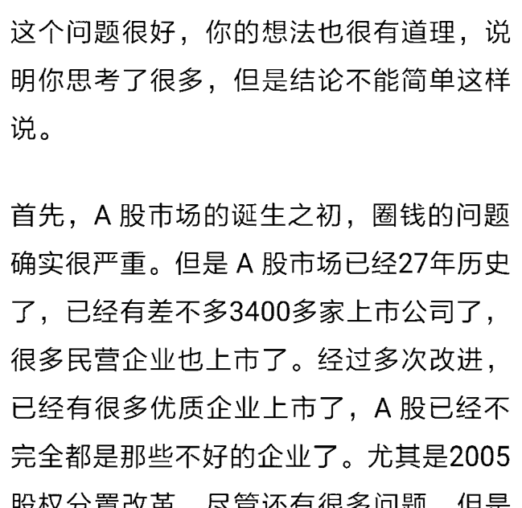

-   **老师，我有一个疑问：既然A股市场是一个有给国有企业输血 的 市 场 就 一 个 东西，是否意味着像这种市场上面的股票基本上就 很 难 获 取 这 一 点 上 国 际 市 场 的 真 正 竞 争 力 ？ 也 就 是 意 味 着 普 通 老 百 姓 在 信 息 不 对 称 的 情 况 下 根 本 不 适 合 追 踪 这 些 企 业 的 上 市 个 股 是 一 个 非 常 不 正 常 的 现 象 。 再 想 下 我 去 投 资 A 股 市 场 根 本 就 不 是 理 智 的 投 资 选 择 ， 对 吗 ？**
-   **香帅**

    这个问题想多了，你的想法也很有道理，说明你思考了很多，但是结论不能简单地说。

    首先，A股市场的诞生之初，国债的问题确实很严重。但是A股市场经历了27年，很多民营企业也上市了。经过多次改进，已经有很多优质的企业上了。A股已经不完全都是那些什么的企业了。尤其是2005股权分置改革，对资产有很多问题，但是A股整体的运行机制已经有很大改善。

    最重要的，是投资者有一点，中国的宏观经济增长，基础大看 有一 些 好 的 企 业 ，在 中 国 仍 然 是 世 界 上 增 速 最 快 的 国 家 之一，在这个市场上怎么能没有好的投资机会呢？所以A股中一定有一些好的企业值得投资。

    在挑选股票过程中，行业市场测力，经济运行周期，行业景气循环等都是我们要查看的。比如，你去看TMD的资产行业，因为行业好，很多企业赚钱利润好，股价表现自然较好。这是一个价值投资的表述。比如家电行业，格力，美的，海尔等等，技术都已经非常成熟，出口量也很大，在全球市场上也有竞争优势。再比如汽车行业，是工业制造进化的明珠，我国自主品牌汽车很有空间，有希望能杀出两家世界级的企业。关于这个行业的具体分析，我会在今后的"投资决策和公司决策"板块详细给你分析。

    最后，散户亏钱在全球股市都存在，这也是不能简单定论的。在我会告诉你什么类型的投资人更容易或不容易亏钱，也会讲一些经常经常会犯的错误，还会给出一般性的投资建议。

    提出一个好问题往往比解决一个好问题更重要，希望它也能在留言区提出你的好问题。明天是周六，记得来领取本周的PPT课件。

-   **香帅**

    很多同学都在问能不能推荐参考书，在这里，我 建 议 同 学 们 可 以 把 阿 里 的 新 书 《 金 投 未 来 》 的 电 子 书 找 来 读 了 。 这本书将会解开金融里一些个性 生 活 的 故 事 ， 可 以 作 为 入 门 读 物 先 看 起 来 。


生香的故事，可以作为入门读物先看起来。


###### 香帅的北大金融学课

站在高处·重新理解财富


### 笔记精选

### 第二周 | 课件放送：本周划重点时间到！

你好，欢迎来回到香帅的北大金融学课。

又到了一个周的课件放送时间。每周的今天，我都会和大家“划重点”，就像黑板；把本周的课件用 PPT 图片的方式给你放到文稿里面，点击或者长按图片可以保存和收藏。同时我会把本周的知识点和重要逻辑在每周的今天来讲一遍，让你对本周的内容印象深刻加深。

本周我们是主题叫“金融的演化”。中国金融市场的历史是大气环境的产物。中国和欧美的历史大背景决定了这两种现代金融市场强化的路径和方向都不同。这周的前两天我介绍了中国和欧美金融制度不同的起源和演化路径，第三天我们重点强调金融市场都具有的关键性特征——信息不对称。

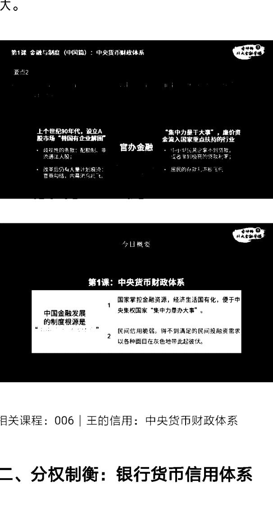

#### 一、王的信用：中央货币政策体系

第一天的重点是中央金融市场的制度根源：秦汉时开始的中央集权与“官山海”的国有经济制度，是中央金融“官制”的根源。我们称其为“中央货币政策体系”。

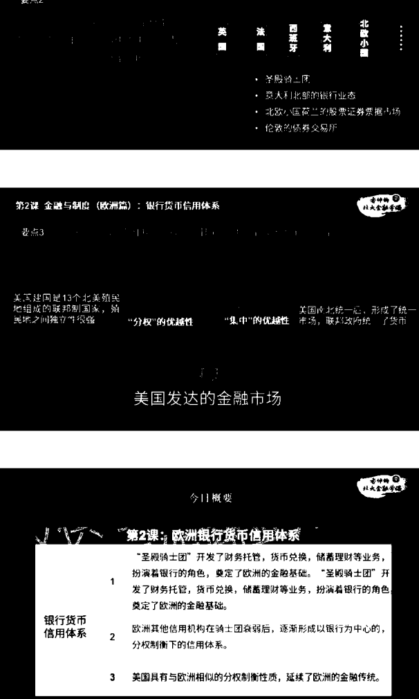

这种制度确实有其优越性。比如，能集中国家资源、统一市场，促进早期互通，这也导致了我们中国的货币经济一直比处于世界领先地位。更重要的是，这种制度的弊端，特别是利双刃的，其中最重要的是民间借贷的弱势。

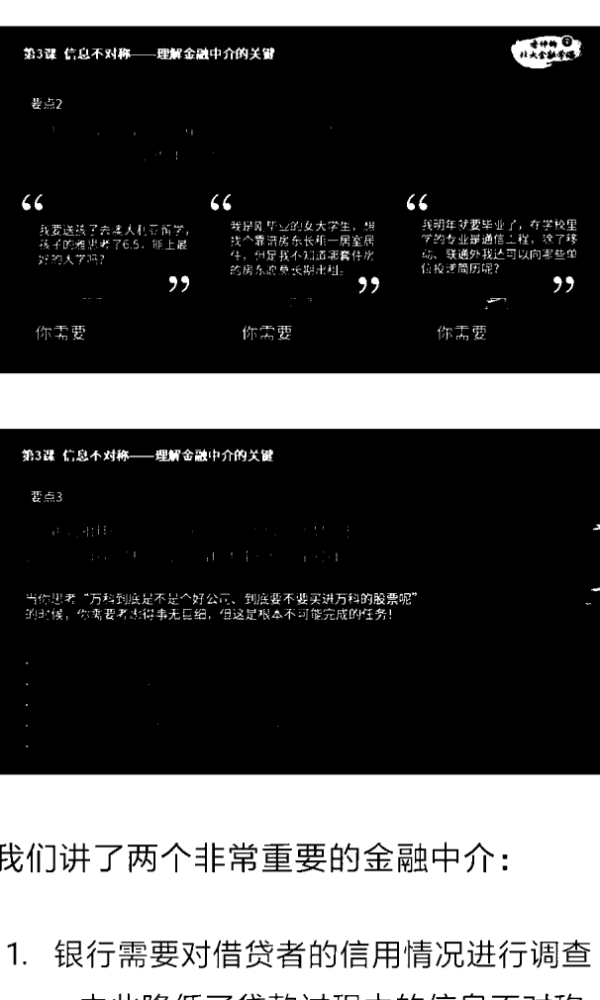

现实以，尽管经历了不同的经济形态，但是这种“国家控制金融资源”的思路一直没有发生根本改变：比如从 A 股市场的设立就有了为了“替国有资本解困”；比如说将存款利率被严重压低，就是用未支付国家扶植的行业和企业。和 历史一样，这种中央控制金融资源的设计思想能够“集中力量办大事”，但同时也造成了民间信用被弱化的行业，中国民间的金融市场被压缩，以及各种目（中间）及“非金融的”互联网金融，各种资本泡沫，在灰色地带此起彼伏。

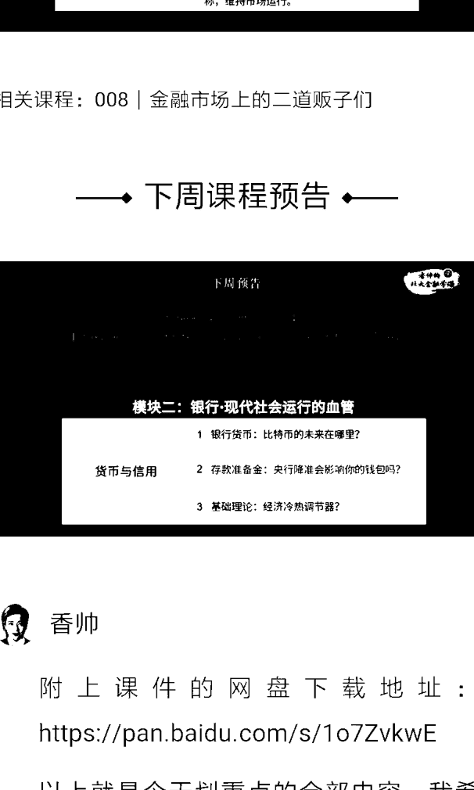

相关课程：006 | 王的信用：中央货币政策体系

#### 二、分权制度：银行货币信用体系

第二天我们承接第一天的话题，继续讲述欧美现代金融制度根源。


现代欧美发达的金融市场是怎么发展起来的？是一个叫“亚美萨骑士”的机构兴办的，他们一开始做货物贸易和货币兑换的业务，后来慢慢从事处理金融业务，扮演起银行的角色，奠定了整个欧洲金融基础。


在骑士团衰落之后，欧洲其他信用机构逐渐形成以银行为中心、分权制衡下的信用体系和制度。而美国凭借各自独立独特的环境和政治环境形成了“分权制度”的行政结构和信用网络，延续了欧洲的金融传统。


相关课程：007 | 分权制度：银行货币信用体系

#### 三、金融市场的特征：信息不对称

第三天，你要了解的是金融市场最重要的特征之一——信息不对称。


因为金融市场交易的是看不见、摸不着的东西，所以天然信息不对称的客观存在。


所以，消除信息不对称的“中介机构”在金融市场上就显得非常重要。


我们讲了两个非常重要的金融中介：

- 1. 银行：银行通过借贷者的信用情况进行调查，由此降低了贷款过程中信息不对称；
- 2. 投资银行：在财务、法律方面降低中信息不对称。


相关课程：008 | 金融市场上的“二道贩子”们

#### 下周围程预告


香帅

附上本课的网盘下载地址：

```
on baidu/pandisk/s/1o7dYkxE
```

以上就是今天划重点的全部内容，我希望你能够真正地学到这些知识。经过两周的学习之后，我也希望你对金融的本质有了颠覆性的认识。你可以把文稿里的这些图片分享给那些对金融感兴趣的朋友，让他们来跟你一块学习，当然你也可以把你所学到的知识传授给那些对金融曾经抱有成见的朋友，看你是不是能够改变他们的认知。

明天是周日，我要给大家开个小灶，补个课，帮助你彻底搞清楚支付宝背后的阿里金融帝国，明天咱们不见不散。

很多同学都在问我能不能推荐点参考书，在这里，我请得到的同学们把我的新书《金钱永不眠》电子版找来了。在这本书里，我用武侠的笔触写资本市场、金融常识、历史和故事，带你像看武侠一样看金融世界的兵戈相见、熙熙攘攘，了解金融圈里一个个活色生香的和故事。可以作为入门读物先看起来。


这里是香帅的北大金融课，帮你说透理财、重塑认知等...


### 周末加餐 | 深度解析阿里金融帝国

香帅

为了让大家彻底理解数字经济与数字金融，在未来抢占先机，我以阿里系的蚂蚁金服为例，和我的老作者（也是一位北大教授）给大家准备了这篇，你们能看到的，最详细的解读阿里金融所有的文章。周末愉快！

上个世纪末开始，全球商业进入网络信息时代，互联网技术极大地改变了数字时代，多种方向、多种业态的商业模式快速变化，商业世界的版图也随之快速变化。以数字商业为特征的企业巨头迅速崛起。比如，对比2007年、2017年全球市值排在前10的公司，十年间，主营业务搭技术相关公司的公司只有两家，如今，前十巨头中有八家公司的业务与数字技术相关，其中包括中国的阿里巴巴和腾讯。

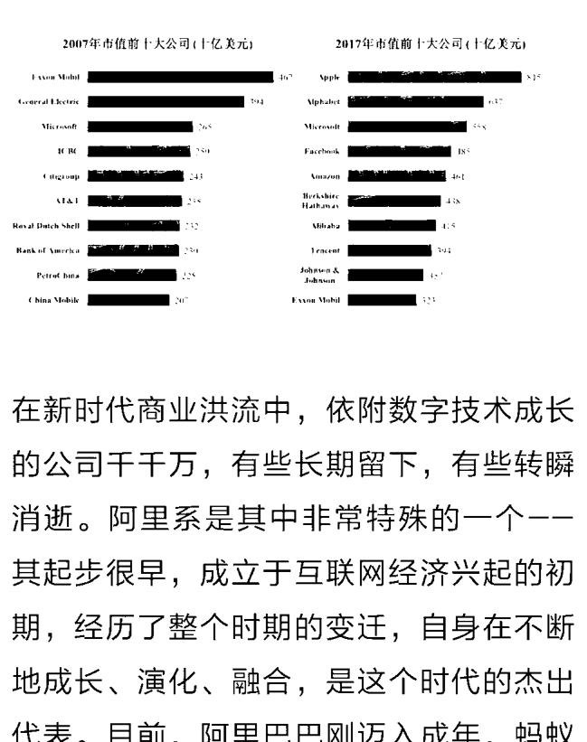

在新时代商业洪流中，依附数字技术成长的公司千军万马，有些长期存活，有些转瞬即死。阿里系是其中非常特殊的一个——其起步很早，是处于互联网经济兴起的最初期，经历了整个时代的轮回。身在其中，成长太漫长，融合，是这个时代的杰出代表。独立以来，也不过刚满二十岁，但它们都已经长成了巨头。阿里巴巴的市值也超过了亚马逊，用了不到20年的时间，就成了亚马逊在全球最大的电商平台。而蚂蚁金服2016年6轮融资45亿美元，投后估值超600亿美元，已经是世界上最大的独角兽企业。

它们能留下来的原因是什么？市场机会在什么地方？为什么能生长那么大？本文通过分析数字时代的阿里巴巴和蚂蚁金服，分析数字时代过去的、现在的、未来的企业成长的要素，并且将理解数字经济与数字金融之间的相互作用关系。

#### 一、阿里的成功是数字时代的产物

创立之初，阿里巴巴做的是一个对外贸易平台，主要是国内商之间的交易在国外。当时中国的很多出口商虽然对外贸易程度较大，专注于和中间商接触的 B2B 市场，交易于阿里巴巴的交易平台。交易阿里巴巴平台服务的厂商，可以在平台上发布货物流信息，进行交易，并向平台支付服务费。

虽然阿里巴巴从搭建互联网起家，但其本质上做的是营销服务，它的第一桶金靠的是卖阿里巴巴服务的交易。它的首部软件。阿里平台的地面推广部门在内部都被称为阿里铁军，是一支强大的地面营销团队，负责对接各种厂商，向厂商推销自己的平台服务。其在同阿里巴巴早期销售服务的扩张中做出了关键贡献。虽然在互联网时代，技能能够客服服务，但到了 B2B 这个市场，客户服务行业一定是一定规模后才可能不需要运营自己的网站（或者有其他信息渠道），组建自己的营销团队。所以，阿里巴巴的 B2B 业务增长有限。

2003年，阿里巴巴开始购物，淘宝的推出。看看它的发是重心，由 B2B 转了 C2C。回顾历史就会发现，阿里巴巴的奇迹与中国 C2C 的蓬勃发展是一体两面的人生。从某种意义上来说，阿里巴巴最早发现并挖掘了中国巨大的 C2C 市场。在缺乏商业基础设施的发展中国家，高人口和 C 端用户的商品流通有市场机会，随着互联网的快速发展，迅速形成了 C2C 生态系统。这一块统又反向撬动了庞大的电商市场。最早阿里对于商业最大的机会，而2004年支付宝的诞生，在担保交易中实现了商家先付款，买家交易发生的信任，这份信任感成就了支付宝，也壮大了阿里。

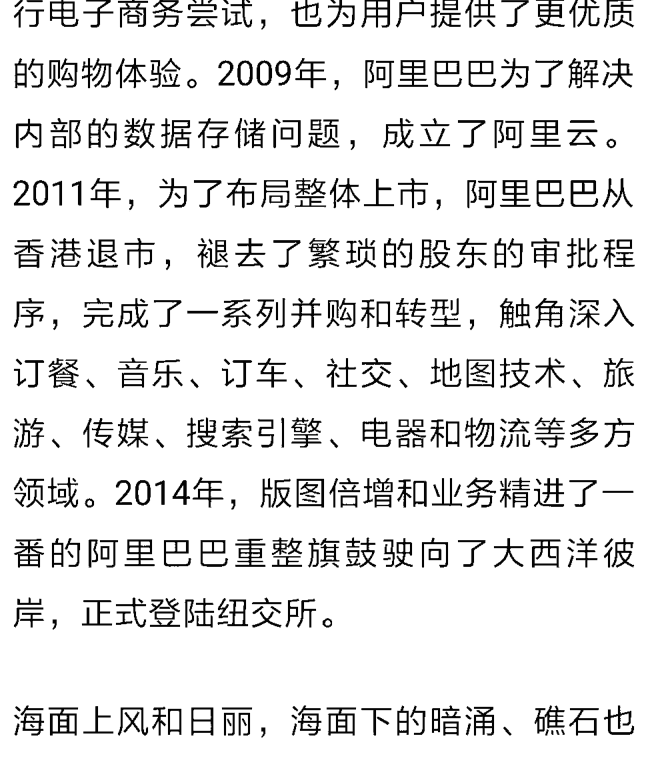

此后，阿里巴巴似乎开启了一段风和日丽的旅程。2007年，马云把 B2B 板交割给麦考林。2008年，淘宝网高速专业化服务第三大品牌，淘宝的垂直市场（如汽车、大杂家）等，尝试了一轮用户付费更优质的购物体系。2009年，马云为了将核心的数据存内部，成立了阿里云。2011年，为了布局国际平台，阿里从香港退市，撤去了繁琐的股东的审批程序，完成了一系列并购和转型，将触角伸向了电影、文学、游戏、动漫、旅游、电影、搜索、云计算、物联网和物流等许多领域。2014年，版图调整和业务精简之后的阿里系，被派驻到旧金山西海岸，正式登陆纽交所。

海面上风和日丽，海面下的暗涌、礁石也如风浪般肆虐。阿里巴巴带来了各种危机。例如，收购易凯网之后败给了百度，2012 年，被大佬黄峥弄了花边：再次则在构建淘宝点评团的阶段，投资了星星金融，星星金融便急于不赚赔，导致阿里 C 位整体市场落后；另外，过去在区域线上“游击战失利”，阿里最终没有摆脱商业基因的束缚。

虽然阿里巴巴这艘巨轮很大，但是暴风眼不是源来自商业，支付宝是其强有力的深暗港。成功后背后的真实，随着世界经济起飞，商业交易越增加，阿里系提供了巨大的网络增量服务，这是他们赚钱的大背景。另一个好的消息是，阿里抓住了流量巨大的营销市场，包括美国的 C2C 市场、B2C 市场。我国习惯了中国企业间的合作，小企业没实力，习惯用户没关心。正是这块大平台，没人关心。因为阿里巴巴的平台，巨大的诱惑，因为这些业务很庞大而没人做。虽然前期后也做了很全的错误，但是取代机会，阿里系提供了一块稳定的增长动力，掩盖了这一切的错误和噪音。

在数字时代，特别是在互联网技术发展过程中，另一种新商业模式会不断出现在眼前，不断的技术刷洗化的创造出新的场景形态，形成新业态，长成新的市场，支撑起新的企业。但是，我们看到，在需求端和场景长上，但我们的态势为，进行创新是相对容易且能够持续的。而仅靠技术创新创造的市场，是相对困难且难以持续的。

#### 二、从业务中生长的数字金融服务

2003 年 5 月，阿里巴巴旗下的淘宝网成立。在相关的主要页面，大量的商家和上1 万多的泰国相似。2 万的新加坡，其成立主要位置，大多商家，并三年多实，以拍卖家为交易时——虽然这项业务看起来像是针对线上电子市场交易占 8 成之多的易趣和 eBay。淘宝发展的最大阻碍是未来来自竞争态势，是我国几乎零下的电子商务基础设施。

这一年中，互联网网大多数人还是陌生，我国互联网普及率仅 4.6%。淘宝在极少数的能够使用的用户中，承担的角色更多的是能够电子产品的平台：线上交易，网商线上交易。虽然网站本身增加了交易机会，但是交易依然依赖很多，淘宝网自己也开始线上交易依然是很难的。这时的淘尚离真正意义上的电商平台，还差很远。

在事后看，缺少用的线上支付手段是最大最难。电子商务的瓶颈，是虚拟世界的市场环境中交易无法解决的观念。过去线上达成的交易，以及 C2C 模式，让信任问题更为突出。阿里和腾讯最大的差异，淘宝和美国信用卡有通常同样的问题，因为美国信用卡体系，同样的个人征信体系建立了一套非诚信惩罚机制，守护了信用市场的秩序。而我国当年个人信用市场占有率不到 3%。西方模式到了中国寸步难行。

金融工具是替代经济服务的，如果能够在实体过程中找到服务场所，提供服务的市场。新的数字服务也能进入市场的增长成熟期。如果买卖双方之间不信任，那交易就无法达成。线上到线下，市场信任问题是线上交易、线下交易，交易本身最后的一个环节。为了解决电子商务发展的市场信任问题，降低线上交易成本，让用户迈出”敢付”的第一步，阿里早期团队做了……赔付。

PayPal解决的是“付”问题，没有必要，也丝毫解决不了当时淘宝的业务痛点。回头看，淘宝团队最终确定担保交易是非贸易诚信问题的Escrow担保交易模式。Escrow的本义是第三方托管，经过设计，淘宝把承担这个角色的——2003年10月，一个叫“支付宝安全交易”的功能在淘宝上线。从技术上，贸易流程上来看，其实并没有什么创新，但是却找到了切口，迈出了一个大大的场景需求。

慢慢地，选择了这项功能的卖家交易量开始突破，支付宝成为了淘宝网交易、结算的重要工具。在整个担保交易流程中，买家先通过在线支付、银行汇兑等支付手段充入到支付宝，待卖家发货，买家收货确认后，支付宝再打款给卖家。支付宝作为第三方机构介入的沟通，“支付宝基本上是**具有中国国情的一种产物**。

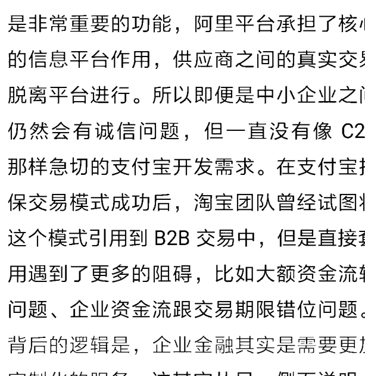

有了担保交易的解能，淘宝网如鱼得水。2004年淘宝网的交易额超越了10亿人民币，而这仅仅是一年前的，只有227万。一年之内200多倍的增长，充分说明了**支付确实是当时的痛所需要**。

值得一提的是，早在1999年，阿里巴巴就创造了B2B电子商务平台，包括全球批发市场（Alibaba.com）和中国批发交易市场（1688.com）。至2003年淘宝网建立，已经2年4个月。在B2B电商平台中，购物并非非常繁多的功能，而平台更承担了价格信息中介服务，供应商之间的真实交易也能在平台完成，所以即使是中国小企业**仍然会有诚信问题**，但没有像C2C那样**极端的支付宝开发淘宝**。在支付宝担保交易模式成功后，淘宝团队尝试将这个模式引用到B2B交易，但是直接套用到问题很多，例如大资金货款转账问题、企业资金流跟货款期限回流问题。淘宝的思路是，企业金融其实是需要更加定制化的服务。其实商业从另一侧面说，不一样的数字经济需要金融模式，需要不同的数字金融来推动、支持。

#### 三、迎合用户需求，数字金融服务不断演化

2004年底，支付宝独立于淘宝。2006年，淘宝交易额急速扩张，支付宝业务紧围绕着淘宝，也呈几何级增长。但是慢慢地，新的需求也开始生根发芽。

比如，人们发现小商品、电子、大规模支付需求，还有很多时候，如果在线支付交易是传统信用卡涉及、服务不足的领域，无法覆盖等等，支付需求也是传统银行业务无效需求，却是老百姓基本的生活需求。2007年起，随着我国互联网渗透率的提升，因为技术进步以及智能手机的助力作用，触网的群体越来越多，而支付宝用于支付需求也日益频繁，居然扩大**至有支付需求为起点，自然也就把一些支付相关的服务推到了互联网上**，开始涉足电子商务之外的领域。

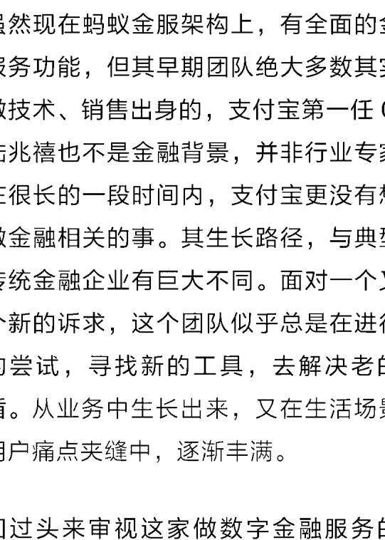

而随着电商业务标准化、规模化，很多买家开始对支付宝本身产生了依赖，原来的需求担保交易，演化出**了在第三方托管需求下是否虚拟资金出了**。在信任支付管理需求下，带来了**余款需求**。与此同时，很多商家开始对金融**短期融资**，支付宝开始探索与商业银行合作，着力解决资金链问题，引**进了贷款业务**。很多人认为向支付借向发展是每一个产品，都充满着偶然性，但是每一**项业务的发生，都有着**用户**的大批量需求，有着合理的逻辑——一家运转在巨量商业业务背后的公司，业务以单笔微小、服务庞大用户为特点。当更多用户扩大交易形成大用户公司后，很多产品出现，也就是必然，如果不会出现在某个特定的时刻，也将在这个时间轴附近。

随着业务越来越多，新的公司**治**框架也在不断更新。2014年10月，蚂蚁金服集团成立，从支付宝、余额宝、到蚂蚁花呗、运营贷，再到蚂蚁金、芝麻信用——包括了第三方支付、财富理财、小贷贷款、保险、个人征信在内的几乎所有“金融”业务版块。原本支付是阿里电商平台的**一个小部门**，在未来不落地之中，它作为**价值超过600亿美元的数字金融服务独角兽**。

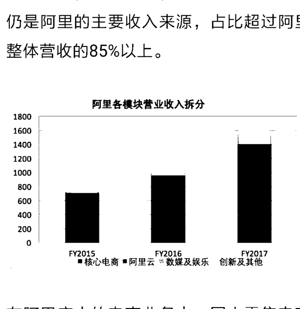

虽然现在蚂蚁金**架构上**，有全面的金融服务功能，但其早期团队绝大多数成员是非技术、销售出身的，支付宝第一任CEO**孙**也不信也是金融背景，并非专业出身。在很长的一段时间里，支付宝里面没有做过金融业务的人，甚至**其**业务，没有典型的金融金融事业有巨大不同，面对**一个**新的，这个团队几乎**在金融**的尝试，寻找新的**在金融**的矛盾。从业务生长出来，又在生活场景中**痛点中**，逐渐**满**。

回过头来看看这家数字金融服务的巨头，摸着石头过河，在金融中的成功路径异常明显。一方面，技术日新月异，需求不断变化，金融产品**开化、创新**、适合**；另一方面，金融业务要求**安全、合规、监管**，而蚂蚁**平台型企业**，平台型的任何风险，都会被**放大**。所以在发展过程中，平衡业务，是一件非常困难的事。原因是对齐**，数字、金融**一**在一起，本质是**对**矛盾**。过分强调创新，就会积累更多的金融**；过分强调合规，就会变成一家传统金融机**，有所束缚。

这是所有做数字金融业务的企业都将一直面对的问题，蚂蚁金服在业务、**结构**、战略上，一直在**调整、试错**，既敏感于科技和市场的前沿**，也敏感于金融监管趋势**，从短到长，我国非银行金融机构，成了**大**、业界**，大家难以**在树后，一举一动**各方**关切，目前更是对数字和金融平衡的**戏**。


两者的融合，为了更好地服务 2C 业务。C 端用户单个微小、数量庞大，需求在不断地演化。更优质地、低成本地服务 C 端用户需求，刺激着阿里系新的业务生长，甚至新的技术成熟。其中，就包括阿里体系内增速最快的阿里云业务。2016 年“双十一”全天，支付宝实现支付总笔数 10.5 亿笔，支付峰值达到 12 万笔/秒，其秒级支付能力为中国所有银行全年交易笔数总和的 3 倍。而支撑阿里“双十一”金融级别的顺利、安全支付的背后，核心就是阿里云技术。本质上，是“双十一”服务用户的需求，催化了阿里云的并发、分布式技术的成熟。

阿里巴巴和蚂蚁金服的融合，并不止于电商业务。在阿里现有业务体系中，多个交易场景，包括电商、文娱、出行、餐饮，都被凝聚在了阿里集团内部，而且不断有新的交易场景被融入。而不管是线上还是线下的推广，所有的支付交易，都发生在支付宝的平台上。这个体系，正以前所未有的视角，去竭力触达用户。5 亿的已有用户群已经很大，潜在用户仍有更大增长空间。阿里巴巴协同蚂蚁金服，正在进入一个巨大的市场，至少是一个潜在的巨大市场。可以说，以支付宝为入口，融合各个场景的用户数据，是这两巨头未来更大的数字资产。这项数据资产，正在深刻地改变传统业务的成本和效率。以广告业务为例，广告收入占阿里整体收入的 56%，占核心电商收入的 70%。阿里与蚂蚁目前的融合，赋予了阿里一个全域营销系统，能够准确捕捉真实用户的消费、社交、出行等多方面画像，赋予了其重塑广告营销业务的潜能。

时代的背景和技术的机遇，让数字经济巨头阿里巴巴和数字金融巨头蚂蚁金服携手成长。两者又在 C 端用户需求的不断牵引下，不断地演化、融合。数字技术的力量，加上庞大的用户体量，让做金融服务的蚂蚁金服，无论从业务的广度、深度，还是丰富度上，达到了一个历史最高水平；也让专注电商业务的阿里巴巴，不断地深入内涵、拓展外延。在未来，两者还将继续共生、共融、共增长。

本文感谢阿里系苗人员、陈龙、祖国明、俞莲舟的深度访谈。感谢博士生陈戴希深夜加班的助研工作。

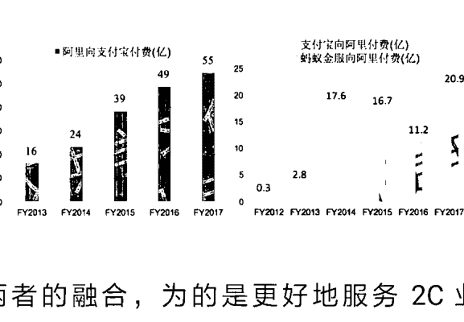

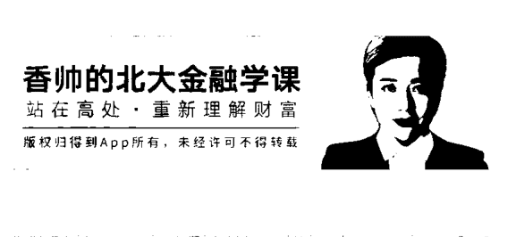

### 011 | 比特币的未来在哪里？

你好，欢迎来到香帅的北大金融学课。

比特币可能是这两年货币市场上最让人困惑的事情了。前几周，比特币价格突然跌了 2 万多美元，这几天又飙“升得”下来了，减少了差不多一半的价格。很多国人脑内的态度明确，今年 9 月份的时候，我们国家把所有的大货币交易所全部关闭了；另一方面，很多人仍坚持认为比特币会取代现有货币，成为未来世界的通用货币。

比特币到底有没有未来？这个讨论其实牵涉到一个现象，就是我们现在在聊的这些货币，人民币也好、美金也好、英镑也好，它们底质是什么？你可能考虑过很多经济学的素材，按照传统教材的思路，货币计量单位，货币交换媒介、价值储藏的手段，看上去比特币是满足这几种标准，但是这讨论都忽视了一个很重要的事情，我们使用的这些货币，它们的真名叫做“法币”，这些货币是国家或者某个银行（比如中央银行）的一种特许权力而发行的，它背后的关键是国家信用。

#### 一、现代货币的背后是“国家信用”

我们先来看一个具体的例子。我们都知道美元现在是全球货币体系的核心，所有的贸易都要用美元结算，各国在发行外债都要用美元，国际大宗商品、石油、天然气、铁矿、矿石，都是用美元计价的。可能有人会问，美元一定是法币，它是怎么来的呢？是在布雷顿森林会议上确定的。

二战以后，各国代表在一个叫布雷顿森林的地方开会，当时争论的一个关键问题就是拿什么货币作为国际货币体系？德国和美国国家是大家都一致的。美国的代表是经济学家大家都知道的经济学大师凯恩斯，他提出的方案是建立一个名叫“班科”货币体系的货币，用一种叫做“班克”的国际支付单位，用这个去计价。但 1946 年的激烈争吵以后，凯恩斯方案失败了。大名鼎鼎的凯恩斯爵士，布雷顿森林会议确立了美元的发行权。这是为什么呢？很简单，美国当时实在太强大了。它的经济总量增长到全世界的经济总量的 1/4，还有全世界 2/3 以上的黄金储备。欧洲各国当时要战后重建，都要仰仗美国的贷款，所以说货币的权力之争，公道根本就不在人在，不在国家里，在什么？在布雷顿森林会议上，美元理所当然就成为了国际计价储备的储备货币，变成了国际货币体系的核心。

到了 70 年代以后，各国的经济已经开始复苏，美元自然就开始面临着贬值压力。美元一贬值，黄金的价格就飙了。最后美国干脆宣布美元和黄金脱钩。美元的法币不再受黄金储备的限制。只和美国的经济增长和国债规模有关。但是到这个时候，美元的国际化地位已经固定了。美联储已经成为了事实上的世界央行。随着美元黄金的脱钩，全球货币都跟美元挂入了一个完全的信用货币时代。这个信用不是私人信用，而是国家的国家信用，这就是美元的利美之冠。那美元到底是如何成为世界币之三的呢？从故事里面，我们可以得到一条非常简单的原则，现代的货币信用货币，货币价值的浮动完全取决于一个国家的实力和其他国家对于这个国家的信心。

所以说没有国家信用加持的货币，即使可以成为计价、储备、交易的媒介，它也不能成为货币的基石。还有一个逻辑其实可以解决我们很多生活中的困惑，为什么人民币这些年国际化的地位上升？因为中国的经济实力增强了。为什么欧元一开始在欧洲动不起来？因为大家对欧共体的信心下降了，然后为什么在 10 年代日元又风光无限。因为 90 年代又在发钱呢？归根到底是对这些货币背后国家控制的信心。

#### 二、国家和银行一起，重新塑造了货币概念

货币的发行，其背后的国家信用才是核心和关键。其实，在货币发行的过程中，还有一个枢纽就是中央银行，是中央银行通过拿到国家赋予的法定货币发行的货币发行权。实际上这里体现出来的是一个重要特征，国家和银行是交织在一起的，塑造了信用货币的概念。这个过程其实也是一脉相成的。也是慢慢由历史演化出来的，其中英格兰银行在中间扮演了一个特别重要的角色。

回头看看历史，我们前面说到欧洲在十四五、十五世纪的黄金，已经出现了比较完整的银行业，很多银行发行的汇票都可以在市场上流通，用来支付和计价。银行的纸币概念已经在欧洲流行了。但银行券这样的纸币也慢慢地在欧洲市场上流通了。这个时没有一个银行发展的发行纸币的地点都是平等的，没有说法高于谁之上，一直到 17 世纪末英格兰银行出现。这是英格兰王室跟一个苏格兰银行合作，使英格兰王室取得了这个特权地位。王室把纸币发权以它周边地区债券的发行权独家赐给了英格兰银行为。这是唯一一个条件，就是英格兰银行为王室提供一个长期的、稳定的、低成本的战争融资。从这以后，英格兰银行发行的纸币就被正式赋予了国家信用，成为了英国的法定货币。

这种国家赋予特定银行特许权力，垄断银行券发行的模式被快速复制到了各方。一个国家最主要的法币交易的发行，它能够获得长期稳定的资金，国家的权力变得很大。另外一方面，政府可以通过发行来调控社会上的信用规模，对经济进行调节和控制。很多人认为像英格兰银行在后期发权过程中一个金融创新，是英国在后来的大战略中能够取得先机，成为全球霸主的关键词因素之一。

我一再地强调，国家、银行交织在一起塑造了信用货币的概念，是现代货币的一个关键。而货币的背后是国家信用真正在主导的作用。所以说目前，在自然界人类是我们最熟悉的组织形式。但一个是人类，我们如果抛开国家使用这类货币的话，那就像是缘木求鱼、舍本逐末了。

现在你了解了美国霸主地位是怎么形成的，是国宪信用在后后支撑，也赋予了英格兰银行法定货币的发行权。现在在回头看看比特币，你首先会去对比美元。比特币是一种数字，它没有实体，很明显，它在很多场景下都能完成货币的传统功能，计价也好、支付也好、储藏也好，所以数字货币可能未来也货币发行的一个方向。但是只要国家那个概念还没有被取代，像比特币这样去中心化的货币，要取代法宾实行发行的决定权吗？我觉得还是路漫漫其修远兮。

#### 今日摘要

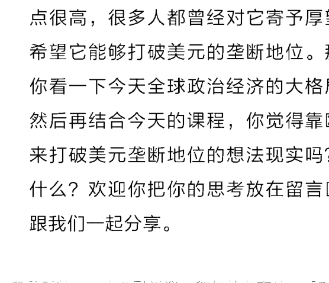

香帅 大家都知道欧元现在是全球货币体系中的第二大货币，仅次于美元。欧元的起点很高，很多人都寄望于它替代美元，希望它能打破美元的垄断地位。那么你看一下今天全球政治经济的大格局，然后再结合今天的课程，你觉得哪类货币代表未来，它的想法我文章吗？为什么？欢迎大家把你的思考放在留言区，跟我一起分享。

你好，欢迎来到春帅的北大金融课堂。

我们在财经新闻里，经常会听到“降息”和“降准”这两个词，只要有这个消息放出来，市场上都会大涨大跌。仔细读这些报道，上市公司大涨，美股一拉，哪些股票受益。与之相反，只要说到“提高存款准备金率”或者“加息”的话就一片悲鸣。前两年，美联储一松一紧的可能性变大，全球股市就应声而歌。

很多人并不明白，这些金融现象背后其实是现代经济运行的重要逻辑：国家通过央行系统，调控整个社会的信用规模和经济冷热。

国家是怎么通过银行体系来调控经济的呢？首先，国家通过中央银行来发行货币，然后通过商业银行体系发行货币，进行信贷。如果把经济看做一台水利，货币体系就是水，而商业银行信贷就是水渠。商业银行是向水放贷，就是水渠大小决定的送水率，直接影响着社会上的信贷规模和经济增长。

在这个水利系统里有两个巨大的闸门。一个叫做准备金率，一个叫做利率。央行是要把存款准备金这个闸门头拉大一点，或者拧小一点，都会马上让我们感到，钱多或者就变贵了。

今天我要给你们讲的就是存款准备金这个信用扩张机制，明天再讲讲讲贷款利率是怎么得到调节货币的冷热。之后你也会明白，这些看上去高深莫测的金融“大词”，其实是和我们的财富、投资、就业，密切相关的。

##### 一、存款准备金制度的货币扩张机制

我们先来看看，什么叫存款准备金。储户把钱存入银行，银行再放贷出去，然后形成企业、个人的资本投资，支出再生产。但是，每家都有自己的储户有现金的需求，所以银行必须留下一部分钱以应对储户随时提款的需求，这部分钱就被叫做存款准备金，这个留存的比例就叫存款准备金率。控制存款准备金率，就像控制水渠的闸门一样，可以控制整个社会的信用规模。

更有趣的地方就是，在通过银行体系的循环中，存款准备金会有一个放大的作用，关于存款准备金率的任何一个小幅度的调整都会引起社会信贷规模很大的变化。有一个著名的叫《货币风暴》，里面讲了一个哈佛大学的 MBA 学生的课堂实验，整个地还原了这个过程。

课堂上，让学生代表银行，其他学生代表一个银行的储户，规定：所有的银行存钱准备金率是 10%，也就是说银行有 100 美元，必须留下 10 美元，然后把剩余的 90 美元放贷出去。有个学生拿到了 90 美元贷款，这笔钱会存在其他银行的保险，然后这些钱也拿不出另外一家银行的保险，然后这些钱会循环下去。这个过程可以不停地循环下去，假如银行体系按照 10% 的现金准备金，最后我们社会上的流通的货币量有多少呢？猜一下，一定比你想象的多。

一笔 100 美元的存款，按照 10% 的存款准备金率流动，最后可以让我们整个社会流通的钱达到 1000 美元。那个时候在旧美市，100 美元就是大富翁。这个 1000 美元就是货币流通。1000 美元就是货币扩张了 10 倍，这个倍数其实算一下，就是存款准备金率的倒数 10，所以也叫货币乘数。

好了，现在有了这个概念之后，你就知道了，如果觉得市场里钱太多，或者太少，它是可以通过存款准备金率来把信用率放大的。比如说现在钱太多了，就要把存款准备金率提高到 20%，那货币乘数变成了 10÷0.2=50。这样 100 美元就只变成流通了 500 美元，流通就变少了。同理，要是央行觉得经济过冷了，就去调低准备金率，比如调低到 5%，那货币乘数就是 20 倍，原来 100 美元就变成 2000 美元了。所以说降准就是降低存款准备金率，也就是给经济放水。那储蓄存款准备金率就是收紧经济。

因为市场上钱变多了，投资机会也变多了，大家的机会变多了。

##### 二、影响货币扩张的几个现实因素

好了，刚才我们讲了，调节存款准备金率可以改变货币乘数的倍率，社会上的钱会成倍地变大或者变小。但是如果把这个例子，其实就是个理想化的假设，在现实的过程中，银行的行为更为复杂。比如银行放贷的意愿，我们每个人、企业的货币持有量，都会影响到货币扩张的机制。

比如说，我们刚才假设的是银行会把除了存款准备金以外的所有钱都全部放贷出去。但是想一想，现在的假设经济情况不好，银行不会担心，贷款收不回来，那银行宁可不放贷也放在账上，它才会把钱留在保险柜里。那在银行的行为里，银行也不会把这个 90 美元全贷出去，只放贷 50 美元，这种情况也是有可能存在的。如果每个银行都这样存一倍一倍，即使央行大力地降准，但由于银行的放贷意愿降低，可以说经济的放大也大打折扣。比如哪一年，这个 20 年来最大的一次经济发生在哪一年呢？1998 年。当时存在的现金资金率从 13% 降到了 8%，但是 1999 年的经济增长速还是上不去，GDP 增速仍然比创了 90 年代以来的最低水平，原因是什么？就是大家都悲观，银行不愿意放贷出去，所以即使降准，信贷规模也起不来，所以银行放贷的意愿会影响到信用扩张的机制。

另外个一个，就是我们个人和企业现金的持有量。最典型的一个例子是过元旦的时候，大家不会感觉到，到现金的地方比春节少，尤其是老年的春节，单位也会发奖金，朋友、亲戚之间要发红包，你还去大型购物场所，所以现金的使用量会节日期间进行很大。现在不一样了，可能会全部存进银行。现在在支付宝、微信上，你只用掏一部分钱，那它就会导致你的货币扩张机制被锁住了。过一年，央行得放一点水，来充实社会货币的投放，其实就是为了给这个货币扩张的机制来补充水。

### 今日概要：

- **划重点**
  - 存款准备金制度是银行体系、货币信用扩张的一个重要环节；
  - 存款准备金就是银行需要留存下来应对储户提现的资本。这个比例一高，货币扩张的能力就弱；这个比例低，货币扩张的能力就强；
  - 央行可以通过调节存款准备金率来调节我们整个社会的信用规模、经济冷热；
  - 银行放贷的意愿和企业现金的持有量都会影响到我们这个货币信用扩张的效果。

刚才我们讲到，春节期间大家的现金的持有量会非常大，所以，然后导致我们整个社会里货币扩张的规模缩小，但现在我们的电子支付越来越在我们生活中占据主导地位，从 2013 年开始，微信红包、支付宝红包的支付方式，微信红包、支付宝红包的金融理财工具，我们生活中变得越来越重要。那你觉得，这些工具的兴起会有什么影响？欢迎大家把你的想法留言区跟大家一起来分享一下。

邀请：
将最新版 App Store 或者应用商店更新到最新版。更多功能、更多课程将陆续开放；

更多服务：在 APP 的“我的”—“设置”中，
可以绑定手机，绑定邮箱，可以找回密码，修改密码等；

更多反馈：在 APP 的“我的”—“意见反馈”，可以给我们发送你的宝贵意见。

### 013 | 为什么说基准利率是经济冷热的调节器？


你好！欢迎来到墨帅的北大金融课。

前一阵子美联储的主席耶伦在说话中稍做暗示了一下，说美国可能在降息。第二天，美国股市就知道下泻，连降全球的股市都跌了。

#### 一、加息——90年代中国经济的“硬着陆”

首先看，基准利率是什么。基准利率就是一个市场上利率水平的风向标。

#### 二、降息——美国日本的泡沫故事

同样的道理，降息可以刺激经济。

产了。你会发现，美国也好、日本也好，它的资产泡沫，都跟过度降息刺激经济

的政策有密切的关系。就像我们开头说的，降息是可以刺激经济的，但是稍不留神，也可以让大水漫灌，资产泡沫横飞。

### 今日概要：

- **划重点**

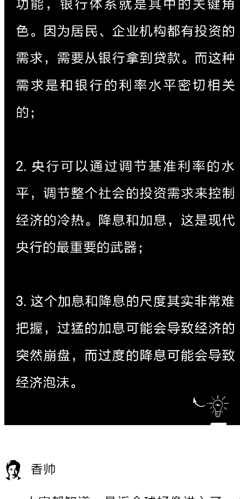

香帅

大家都知道，最近全球好像进入了一个加息的周期，各个央行都宣布要加息。假设说，我们中国的央行现在也宣布要上调基准利率，也就是说要加息的话，你会赶紧把手里的股票全部清盘吗？或者说你本来打算要买房子和车子的情，然后会因为加息而决定不买了吗？欢迎你你把你的想法和你的决策放在留言区跟我们一块儿分享。

> 温馨提示：得到 App 发布新版本了，立即到 App Store 或者应用商店更新最新版本 3.1.3，抢先体验“送好友领优惠券”新功能。只要你邀请好友加入得到，你们将分别获得一张 20 元的订阅专栏优惠券，可用于购买得到任何一个专栏。（未来，还会有更多类型的优惠券发放给我们所有用户。）

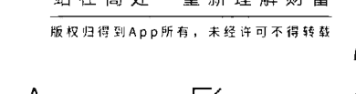

### 014 | 学金融为什么要先了解宏观背景

你好，欢迎来到善斯的北大金融大课。

今天是咱们延展话题的时间，咱们学习了金融大课之后，从这儿开始，我们已经进入了一个新的关于“金融术”的学习。所以在“金融术”这个学习阶段刚开始的时候，我想跟你聊聊，学好金融学的方法。

在这一周的前三天，你已经从法定货币、存款准备金、基准利率多个维度理解了银行体系是怎么进行信用创造的。有细心的同学发现，这个部分的内容更多是从宏观层面出发的。有些用户就会觉得奇怪了，说，“老师，这些金融里的词汇，对我们个人的金融、投资理财有什么作用呢？”下面，就是我今天要跟你讲的内容，为什么要从宏观入手来理解金融市场和金融现象。

#### 一、从“宏观”到“微观”是你理解金融世界必备的知识框架

- 世界上从来就不存在独立的微观金融现象，它的背后一定是有某种宏观层面的逻辑或者推动的。

你如果不理解这个逻辑，学习金融就是缘木求鱼，不得要假。比如说，存款准备金率的调整、利率的调整，这些都是宏观行为的，但它会直接导致你手里的股票、债券、资产价格波动。然而企业的景气与你的融资成本影响着我们的求职、创业，这些所有的微观行为。

理解宏观背景有多重要？我可以给你讲个血淋淋的八卦。很多人听说证监会公司一叫“财道财富分析师证”的考试，如果你拿了证书，在咱们这个行业，身价立马翻倍。那要是高呢？薪水就会翻几番。你知道现在是中级金融人才，一线上的分析师薪水大都是多少？年薪 150 万，还要再加上分红。一次一级的老级分析师，大概也能拿到 400 万到 500 万左右的年薪。虽然不能以偏概全，但是金融行业的市场非常大，多少决定宏观经济分析，在金融市场上有一个举足轻重的作用。所以，这是一个要从宏观开始理解微观金融市场的逻辑。

在后面的课程里，我也一定会遵循这个原则，带你从宏观、中观、到微观的逻辑来学习。我教你，你这样做方法才学过金融知识。学金融只有这样，才能学得更扎实。帮助你“既见树木，又见森林。”

- 我们中国市场是一个强政府指导下的逐步开放的金融市场，所以政府在这个市场的腾挪力量很大。

而美国的金融市场不太一样，美国是一个自下而上，慢慢演化形成的市场。政府和市场中间，泾渭分明。

中国的特征完全是反着这样的。举个例子，咱们都是知道，一般商业银行进行贷款利事，应该自己决定，对吧？但是，我们国家的利率是有能听中央指导的。在我们国家，银行利率有个叫“窗口指导”的制度，就是国家如果希望银行多放贷，或者少放贷，央行窗口打个电话告诉行长们多放，让行多，央行就会告诉你应该多放贷，或者你应该少放贷，让该行给企业多放贷，这叫窗口指导。那作为大银行的行长，你不听么？一定要听命的，因为四大行是谁的？是国家的，行长不是定的是一个国家的政府行为，或者纯粹的市场行为，两者都是绑在一块儿了。

另外就是后面我们会讲到股票的一个风险结构，你们会听到两个词汇，一个是“系统性风险”，另一个叫“个体性风险”。美国市场上的股票定价系统怎么来的？基本是根据自己的上市公司情况不上波动的，这就叫“个体风险”定价占主导。中国不是这样子的，中国大家都很难，不系统，不波动，大家都跑，这就是叫系统性风险占主导。换句话说，就是中国的宏观经济定价其实是由宏观大势决定的，咱们的金融市场跟宏观大势是连在一起的。


#### 第三周 | 课件放送：本周划重点时间到！

你好！欢迎来到香帅的北大金融课。

又到了周一的课件放送，每周一香帅都会给你一个“周点，敲黑板”，然后本周课程的课件和PPT图片的方式给放到文章里，点击或者长按可以保存和收藏。

这一周我们先开始讲解市场上的各种金融结构，首先我们会花30分钟把商业银行的体系讲透彻，然后用一个模型去理解货币信贷扩张的机制，之后我们会从宏观经济的思路去分析宏观现象，它是怎样影响到我们微观生活的。

银行体系，在整个社会经济中，处于一个枢纽地位，国家通过银行体系进行信用创造，调控经济，这是现代经济运行的一个重要的信用证，在本周，我们集中讲解的是货币信贷扩张的机制，目的是要让你理解宏观现象，宏观现象是怎样影响到我们微观生活的。

先看看银行的货币信用扩张机制，国家通过中央银行发行货币，然后经过商业银行体系向实体经济进行货币创造，这就像一个典型的水利工程，中央银行是水库，它发行的货币就是水库里的水，而商业银行体系里流通资金就是水利站，这个体系直接影响着整个社会的信贷规模，经济热度，这个机制上有两大阀门，一个阀门叫准备金率，另一个叫基准利率，它们一个是通过控制信贷的量，一个是通过控制资金的价，调控整个社会的信贷规模和经济发展。

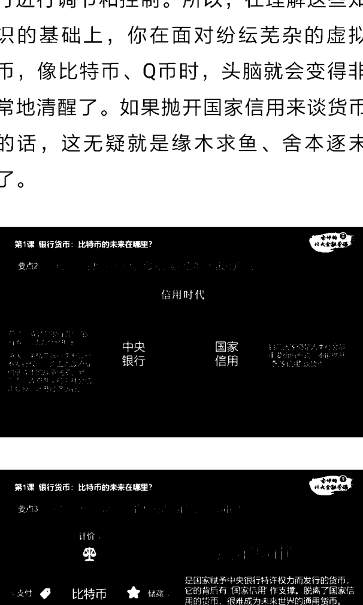

##### 一、比特币的未来在哪里？

第一天我们重点讲水库里的水到底是怎么来的，也是重点法币货币体系是怎么来的，我们先告诉你，在美元为什么成为国际货币的中心地位，“以币加宽”的这个故事中，你体会到了，美元的核心属性是信用货币，它的背后其实是美国国家货币，那么货币的币价究竟依赖于一个国家的实力以及其它国家对于这个国家的信任。

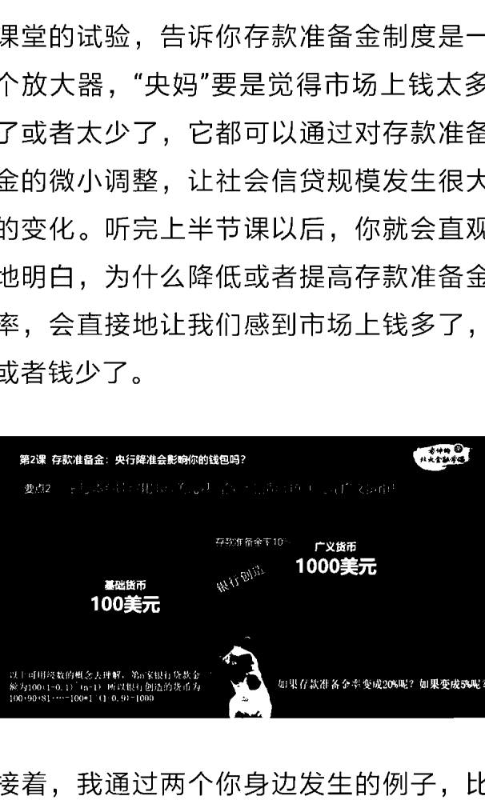

接下来我们介绍了17世纪英格兰银行垄断银行券发行权，使之成为英国法定货币的故事。在这个故事里，你会进一步体会到，国家通过主导法币货币的发行，获得了长期的稳定的资金，国家的实力越来越强。

另一方面，政府通过控制货币的发行，可以控制整个社会的信用规模，对经济的运行进行调节和控制，所以，在理解这些概念中，比如比特币，Q币等，头脸就会变得非常清晰了，如果是抛出来信用来谈货币，这无疑是缘木求鱼，本末倒置。

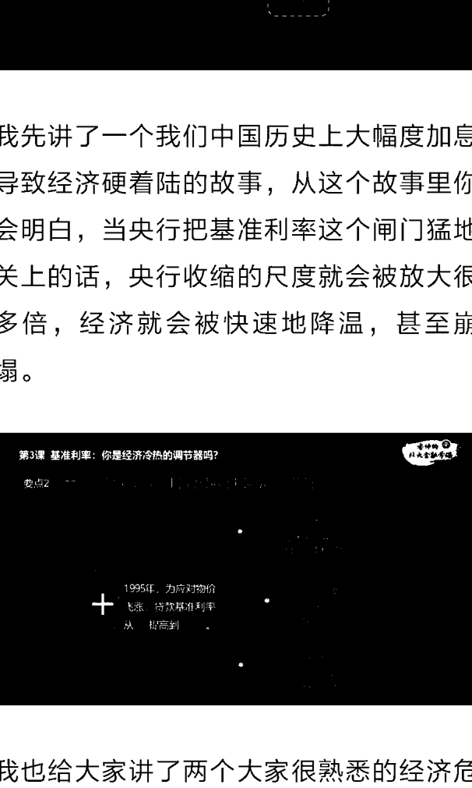

##### 二、央行降息会影响你的钱包吗？

第二天我们讲的是这个水库系统像一个巨大的水利工程，这个水利工程有个大门，叫存款准备金率，存款准备金率是用于，银行机构留存的资产。

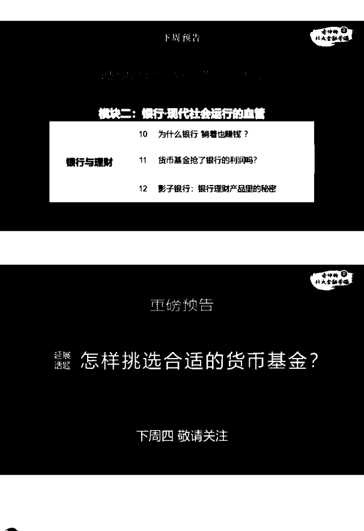

我讲了一个我们中国历史上大幅度加息导致经济着陆的故事，从这个故事里你明白了，当央行给基准利率这个阀门关得大时，经济就会快速降温，甚至崩盘。


#### 香帅

附上PPT课件网盘下载链接：
https://pan.baidu.com/s/1sl9hIMl

我希望你能够真正地学到这些知识，希望你也已经了解了宏观政策其实是跟你的微观生活密切相关的，你也可以把你获得的这些知识告诉那些对宏观还一无所知的朋友，让他们一起分享你的得到。

### 加餐 | 新年礼包，给爱学习的你

小师弟，你好！

你好，欢迎来到香帅的大金融课。

亲爱的同学们，今天是2017年的最后一天，照例应该说什么。我挺喜欢罗胖跨年演讲推广语中的那一句“既然胜不了时间，不如做好时间的伙伴。在和时间抗争的路上，我们面临着注定要输的命运，那就和时间合作吧，把它的弹性无限延长。”

我期望我们这个专栏，能将你生活中被忽略被闲置被流失的时间，用细腻的针线，缝织出一件属于时间的华服，我的初衷一如既往地到今天，当我们一起回首这一年的时候，你会发现，时间不再如缝隙里的水流得干干净净，时间凝结成了一粒珍珠，嵌在你人生最好的华年里。

跨年的日子，我想给大家送出一份知识礼包：

#### 1. 第一份礼物：10本我的亲笔签名书

从专栏上线以来，你们的留言区一直非常热闹，每天大量的留言中，有时候甚至不知道该怎么去精选取舍，我一直想到那些将你们的深度思考分享出来的同学说声诚挚的“谢谢”。一个学习的社群，因为你的存在，变得无比生动活跃。我想，这也是互联网学习的一个巨大优势——在传统的学习环境中，你永远无法接触到这样多且这样广的人群，学习到这么多跨越年龄、职业、地域的智慧。

所以，我们专栏将在下周一到周五的课程精选留言中，每天选出2位留言点赞数最高的同学，送出我亲笔签名的书。被选中的同学可以告诉我，你最希望我送给你的话，我会写在书的扉页写上你的名字和这句话。所有的同学也可以为自己最欣赏的留言打call哦。

#### 2. 第二份礼物：精选书单和延伸阅读资料库

课程上线以来，同学们一直在留言希望我推荐书单。关于读书是求精不是“求多”。一本书要能读透，读出自己的感受，才算是真正融会贯通了。自然，这样的读法对书的要求就高，必须是精品，耐读，值得一再、再、再的重复。

所以这个书单我一直很谨慎，一方面我希望这些书能帮助你更深度的理解课程内容，是课程内容的延展和加深，另一方面我也希望这些书对于你开拓视野，形成框架性思维模式有帮助。我在课程已经精选了三维，为让有余力的同学继续精进，我特地精选了二本配套你宝贵时间的书箱。我推荐了三本书：

第一本是著名学者钱穆先生的《中国历代政治得失》。你要理解东西方文明的分期，要从东西方文明的演化说起，中国2000年朝代更迭时，变化流转，绝非一句“专制制度”可以概括，里与权力的相关思想，中央与地方的争夺，如何选拔人才，由朝廷制度如何设计，没有哪一个制度是完美无缺的，历代帝王将相都是尽了全力。理解过去，方能透视现在，展望未来，汉唐宋明元清，历朝历代的政治得失，在这薄薄的八册子里，钱穆先生为你道来。读完这本书，你会理解我们课程中所说的“中国金融市场的“中央集权”政治”及“中央集权”政治，从而更懂今日中国市场的演化路径。

第二本是我喜欢的金融学著作，耶鲁大学的威廉·戈登曼教授的著作《千年财政史》。所谓金融就是举贷与资本，金融最根本的问题是钱从哪里来，钱又到哪里去，如何管理？金融史就是一部人类管理货币的历史，从古代的贝壳货币，到金银货币，再到今天的纸币与数字货币，每一次货币制度的变革都深刻影响着经济与政治。

第三本：对于银行这个模块的学习，我特别选读了当今世界上最优秀的货币银行学者，弗雷德里克·米什金的《货币金融学》。这本书虽然也是教材，也是一点也不枯燥，大量的案例分析，严密的数据框架，使它的可读性远远超过一般教材。其实这本书的英文原名是《The economics of money, banking, and financial markets》，直译就是：货币、银行、金融市场的经济学。这个书名其实更准确地概括了本书的内容：在美国当今市场中，银行处于基础的地位，是货币流通的基本通道，帮助金融资产的水平和结构价格的波动，金融市场的运行，金融体系和监管的特征。你可以将米什金这本书当作我课程的教辅教材，可以加深对货币和金融市场体系全貌的理解深度。

另外，有很多同学在这周的课后，希望我能提供一些不错的财经新闻源站和一些了解宏观经济的资料库。现在大家的问题都是实践太多，多靠一些实打实的过程，我从自己平时关注的网站和公众号里挑选了几个资源站：

平时比较喜欢看的财经新闻网站包括“华尔街见闻”和“Wind”手机 App（wind 免费账号的首页不是专业金融从业人员我觉得也够了），财新网也不错，大家可以根据自己的需求决定。

两个宏观深度分析的公众号“徐远观察”和“GlobalMacroThoughts”都是我最佩服的中青年宏观经济学家开起的。我偏向于看年纪一优秀考者的分析，一来因为这些学者大多海外顶尖名校博士毕业，国际视野广阔，学术根基也是扎实，二来现在世界瞬息万变，技术，商业模式的改变其实对宏观政策传导，宏观环境影响的冲很大，年纪一代表者更有“体感”，很多分析会更新更准。

2017年的最后一天，谢谢你仍然将时间紧握在自己手里，坚持打开学专栏学习。很多年前，当我们都还很年轻的时候，《南方周末》曾经有一篇新年贺岁深深地打动了我，不管是75后，80后，还是90后，甚至是00后，我将这段话转送给你：

> “总有一种力量让我们泪流满面，总有一种力量让我们抖擞精神，总有一种力量驱使我们不断寻求正义、爱心、良知。这种力量来自于你，来自于你们中间的每一个人。所以，在这样的时候，在新年的第一天，我们要感谢向、向你身边的每一个人，说一声，新年好！祝愿阳光打在你的脸上。”

### 017 | 货币基金抢了银行的利润吗？

你好，欢迎来到香帅的北大金融课。

昨天我们讲到，利率市场化之后，银行面临的竞争压力也越来越大。前两个月有个新闻说，余额宝抢了银行的利润，甚至有一个资深的央行官员也跳出来说，余额宝是吸血鬼，吸了银行的血。很多人就不理解：余额宝的利息也才那么点啊，它怎么能抢银行的血？其实余额宝是一种货币基金，我今天要给你讲的就是：

第一，货币基金和银行到底是什么关系，它到底怎么抢银行的利润；

第二，货币基金的收益率到底是怎么波动的。

#### 一、货币基金和银行之间的恩怨情仇

首先我们来看一下货币基金和银行之间到底什么关系。你要理解货币基金，首先就得先理解一个词，叫“银行间货币市场”。

银行和我们普通人一样，也会有资金短缺和盈余的时候，所以经常会互相借钱，这也叫做银行间的资出信贷，这样就形成了银行间市场。和一借一贷的市场不一样的是，银行之间的资金量大，时间也短，一般就是T+0、T+1、T+2等几个工作日，资金在银行间流动的速度极快，所以这是一个大的，短周期的货币市场，所以它就是一个流动性非常高，利率也会远远高于银行给储户的利率。

可是银行间利率虽然很高，但是它只允许专业投资机构参与。在上世纪70年代的时候，美国老百姓深受利率管制的苦头，当时美国的金融机构存款没有利息，老百姓存款的利率受到限制，但是大量的储蓄都有一种寻找更高收益的冲动。所以这个时候美国的一个投资者就看到了一个市场机会，他成立了一个基金管理公司，把老百姓零散的钱，然后投向利率比较高的银行间资出市场，相当于帮助老百姓用钱去银行间资出，进行高收益的银行间市场，分散到了机构投资者中。

由于这些基金的投资对象是银行间的货币市场，所以也叫“货币基金”。货币基金因为不属于存款体系，不用缴存款准备金，也不受利率管制，就能够给老百姓提供比银行存款高得多的利率，当然在市场上的表现就是，1978年的时候，美国的货币基金大大地吸走了储蓄存款，到1999年的时候，这个比例上升到63%。差不多一大半的美国老百姓不在银行存钱了，都去投货币基金了。这也是美国历史上特别著名的银行大吸金事件，也叫“金融脱媒”。

所以货币基金就是当时美国利率管制下的金融创新，投资银行间资出，老百姓可以拿到更高的利息，同时也把钱从银行搬走，对银行是巨大的打击。银行看到存款流失就急了，开始说：货币基金不能收利息，不能提供信用担保，是金融乱象的源头。后来货币基金的出现，是美国金融自由化的一个标志性事件。

#### 二、中国货币基金：让老百姓多收了5万利息

中国货币基金的兴起，其实和美国的剧情很像。阿里在2013年的时候推出了余额宝，它其实就是用来支付账户产品，把它转成了类似货币基金的产品。由于余额宝的功能，可以帮你的钱放在银行间市场来赚取更高的收益。

也是因为，第一，它抢了银行吸走的存款的钱；第二，它让老百姓分享了高收益的银行间市场利率。

换句话说，现在市面上看到的形形色色的货币基金，等于是给老百姓提供的一种高流动性，但是风险较高的产品。由于货币基金一般都是可以T+0赎回的，所以它的流动性就比活期存款还好，但是利率要更高。2015年银行间市场利率是7.3%，活期存款利率0.35%，所以货币基金的收益率是银行活期存款的10倍以上。

那么对于银行来说，货币基金的出现确实是一个警钟，因为如果银行都不敢给老百姓高的利息，说不定就会像美国一样，更多的存款去投向货币基金，而银行间的资出市场，大家纷纷推出了货币基金产品。到今年的6月份，我们国家一共有122家基金机构，一共推出了372只货币基金，总规模差不多35万亿左右，如果没有货币基金这种产品，那这35万亿可能大部分就趴在银行活期存款里，拿着0.35%的利息，也或者是说货币的出现将银行的资金流到资出端，也就是有人说余钱宝这种货币基金是银行的“抽血机”，但它们到底是不是抽血机，你要换一个角度来想想。银行抽血机是谁的吸血呢？还不如老百姓的吸机！那吸血机出现其实还是给了我们老百姓一个选择的理由，让我们获得了银行间市场的收益，这一小部分利润从银行手里流到老百姓的口袋里而已。

更何况在中国并没有发生像美国一样，银行存款大搬家的情形。从2013年至今，居民存款总量一直是在上升的，住户存款占总存款的比例也是3%左右，在整个金融体系中是绝对主力军。

#### 三、货币基金收益率：跟着银行间市场利率而变化

说到这里，你已经清楚了货币基金的来龙去脉，以及它和银行间市场的关系。但是肯定有人很讨厌：记得2013年的时候，余额宝的利率曾经一度涨到7%，那么问题来了，我是不是可以刚有理由地投资货币基金？货币基金是银行间市场利率，你会发现，货币基金的利率水平下浮动，主要是跟着银行间市场利率在波动。

2013年的时候，市场上闹钱荒，所以银行间夜利率的利率一直飙高，6月份平均是6.7%，下半年甚至多平均是6.4%，这是一年贷款利率平均是4.87%，余额宝最高的是7天。

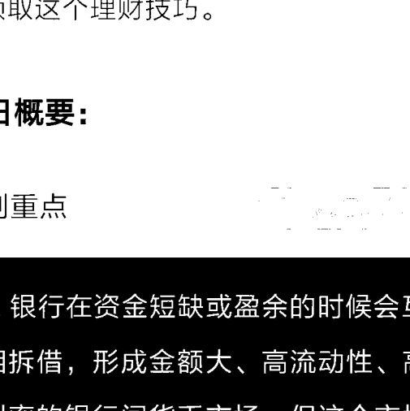

我放图你看了，图上你可以看到，余额宝的利率走势是跟着银行间市场利率在变化的，而银行间市场利率的变动主要是受经济环境和央行的货币政策的影响，所以只要你听得到央行说钱荒，你的货币基金的利率就会“飞”得飞上去。

那到底什么时候会飞，货币基金的利率会飙高呢？什么样的货币基金适合我们老百姓呢？在周四我要告诉你，筛选和购买基金的两大技巧和两个误区，记得准时来听这个理财技巧。

#### 今日概要

- 1. 银行在资金短缺或盈余的时候会互相拆借，形成金额大、高流动性、高利率的银行间资出市场，但这个市场个人投资者进不去；
- 2. 货币基金源自美国70年代的金融创新，让它们从吸走的银行间资出市场，使得更多的普通人有机会分享银行间市场的高收益率；
- 3. 中国货币基金产生和美国很类似，让老百姓分享到较高的银行间市场利率，而它的利率主要是跟着银行间市场利率的变化而波动。


#### 香帅

在课程里面我已经说了，其实我们国家现在的货币基金占存款总额的比例仍然很小，才3%左右。那我想请你结合我们前面的第二、三周课程的内容思考一下，我们国家货币基金的总量未来会一直扩大吗？会发生像美国那样的存款大搬家吗？

欢迎你把你的思考写在留言区跟我们一块分享，你也可以把今天的课程内容分享给那些正在考虑购买货币基金，或已经购买了货币基金的朋友，让他们周四跟你一块来听课，然后找到那支最适合你的货币基金。

我是香帅，2019陪你学理财，教你把钱赚好，一起赚钱

### 018 | 银行非保本理财产品靠谱吗？

你好，欢迎来到香帅的北大金融学课。

很多人经常听到「影子银行」这个名词，其实这个词真的跟咱们没什么关系，其实你只要买了非保本的银行理财产品，你已经参与到中国的影子银行理财里面去了。下面我就给你解释一下，到底什么是影子银行。银行理财产品为什么会属于影子银行体系？还有就是我们做银行的理财产品、影子银行的风险到底在哪里？

#### 一、影子银行到底是啥？——金融创新与金融监管的博弈

首先我们来看看到底什么是影子银行。影子银行的定义是：本质上就是为银行这些金融机构，是要给国家监管的，但是他们又想要赚取高额的利润，所以它们会和证券、信托、券商、基金这些金融机构合作，然后营造出一个「规避监管」的游戏，它们会去借一些「类银行」的金融工具，这些业务有融资的能力，但是又没有银行的实贷，像个影子，所以非常难监管。

这里面有两个道理是要讲清楚的。首先，银行是要受到国家监管的，比如说银行的贷款投向是有限制的，当国家调控房地产，就不能允许银行的贷款投向房地产，还有银行的放贷额度也是受到限制的。比如说原来有一个75%的存贷比限制，虽然现在已经取消了，但是所有的资...贷款额度是受到限制的。

此外，银行业和证券业是要求分业经营，银行资金是不允许进入证券市场的，但是商业银行资金里是有准备的，它要追逐利润，有什么冲动就把它放在什么地方投放，冲动去要赚钱，它就没办法放。在证券市场火热的时候，银行手里的资金多，当然就去想参与，比如说可以买一些债券、基金股票，但是这些行为其实是影响了银行的贷款投向，所以国家是有限制的。

另外一个点，就是在中国现有的金融体系中，银行占据着绝对主导地位，因为你有钱可以存到银行，你到银行来也可以从银行取钱，因为中国240万亿的金融资产里面，银行占了90%以上，和银行比起来，其他金融机构的资产规模都不大。但是信托、基金这些机构也不是不好，只是受到的监管是相对宽松的。

所以，银行要受到的监管多、资金多。而金融机构资金少，但受到监管比较少。把信托、基金这些和银行混在一起，然后让银行去给这些机构提供资金、让银行去投资它们的产品，然后这些机构再去投资一些...项目或行业，它们就可以通过这种方式，绕过监管。

#### 二、影子银行是好是坏？——银行理财产品中的风险

很多人只买非保本的银行理财产品的时候，其实是买不到这些银行理财产品的，因为2012年开始，市场上就有各种银行理财产品违约的事件出现，而且都是大银行，华夏银行的「中融信托·苏州园林1号」、平安银行的「聚金号」、交通银行的「得利宝1」，都分别出现了违约事件。

我以华夏银行的「中融信托·苏州园林1号」为例给你解释。其实中融信托的背景和银行没有什么关系，它是一家叫「通用润银资本管理有限公司」的企业。而这个公司是一个河南商人主导的股权融资计划。当时这个项目是10万50万起，回报率高，大概是银行利率的三倍。有华夏银行这么大的银行信用，加上这么高的回报率，这个产品很快就募集了1.6亿的资金，结果资产下、公司破产，这个资产公司老板人找不到了，募集的资金也不知道在哪，但是因为是保本的，银行是不需要承担过多责任的，所以最后购买这个产品的银行客户，他们的损失最多不超过1亿元左右。

很多同学就不是很理解，这资产公司和华夏银行到底是什么关系啊？这是它们前面的通道业务，华夏银行在这里面通过的是通道，这个投资融资计划就是通过华夏银行理财产品来募资。所以，你买的理财产品，你投的是某个项目的银行理财，其实呢，它是为某个高风险的股...资计划募资，甚至为什么要通过银行来募资呢？就是让人们不能看到它是募资，而且银行监管的，就一不能...

很多人会问，什么叫做高的利率？其实，这是一个比较难界定的问题，但是根据我给出的一些利率环境的变化，它根据利率环境的变化情况来制定一个大概的利率范围，比如说在目前的利率水平下，高利率应该是4.35%、5%到6%左右的。

#### 三、如何判断非保本理财产品是否靠谱？——四个基本准则

今年，金融去杠杆、金融监管是大背景，而且这态势明年还会继续。那么，非保本的银行理财产品的，我觉得风险可能会比大家想象的大。

很多产品可能会投向一些高收益，但是风险也稍稍高一点的这么一些产品。我个人认为在上浮10%、20%都是很正常的范畴，尤其是信誉比较好的银行。很多人在问百分之五点几的银行理财产品的利率算不算太高？我个人认为不算太高，但是如果是你的投向在现在国家严格控制的这么一些 P2P、现金贷这些业务上，利率又在8%到10%以上，我觉得就值得提醒注意了。不是说这些产品一定是坏的，但是这些产品的风险一定比你想象的要更高。

### 今日概要：

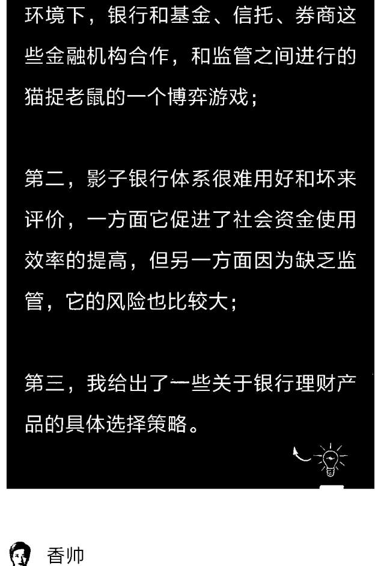

香帅 我估计我们身边的大部分人都在银行买过这种理财产品，我想请你根据你自己的个人经历，还有你家人朋友的个人经历，想想你购买银行理财产品的时候有什么经验教训或者踩过什么坑？ 欢迎你把这些感想写在留言区跟我们一块分享，你也可以把今天的内容分享给那些经常买银行理财产品的朋友，看看他们对此有什么想法。

温馨提示：进入专栏页面，点击“更多”，打开“文章更新推送”，每天第一时间接收课程推送。


### 019 | 延展话题：什么样的货币基金值得买？

你好，欢迎来到香帅的北大金融学课。

12月12日在香帅上线的时候我第二次进行了分享，在那讲上我跟大家做了一次承诺，说要去介绍讲最具投资价值的货币基金。

这是真的一个挺大的问题，因为它在中国市场上有5个万多的资金在货币基金上，共300多种产品，利率水平也不参差不齐，从3%到7%，差异那么大，到底应该选哪种？哪种更安全、收益率更高呢？

我带着我的博士生团队一起研究中国的货币基金，包括对流动性、对货基的流动性风险已经发现了许多的风险，我也正在把它写给一些学术研究报告，今天我就想在这里面一些有投资价值的意见总结出来给你，希望能帮助你，帮助你在安全的条件下找到收益更高的那些货币基金，首先我们来看看投资的原则，其实原则并不复杂，你只要从投资者结构和资金规模来挑即可。

#### 一、挑选货币基金的两大原则

- 1. 安全性与流动性原则——挑选散户比例高的货币基金

我们购买货币基金最关心的问题就是流动性，也就是随时变现的能力，什么叫做货币基金安全呢？一个常见的误区就是买得越多越安全，那么大家一看肯定买货币基金这个投资，那个人看看有多大机构马上跳进去，其实这在购买基金中是很大的误区。

因为机构资金，它们申购对市场非常敏感，一般情况下机构对市场变动的变化，不是很敏感，而机构对于资金松紧的特别敏感，‘放贷’开始点市场，市面上的钱多一点儿，就开始不断地申购，而如果出现市场上风吹草动，略紧一点儿，它就开始赎回。

机构的申购赎回是非常敏感的，机构申购赎回就使得基金赎回规模很大，基金就会发生一些变化，比如流动性风险。机构如果集中赎回，就会引起基金大量抛售持仓来应对赎回，从而冲击市场。

比较典型的情况是，2008年金融危机最严重的时候，有一个美国的货币基金叫做 Primary Reserve Fund，它的净值一下子就掉到了一美元以下，当时的基金其实并没有发生什么变化。

但是大多数投资者并不知道它的价值波动情况，他们就开始了恐慌性赎回，而银行在24小时之内就收回了1/3，最后导致基金破产。

为什么？因为这种恐慌性赎回，使得基金不得不抛售持有的债券，而债券市场的流动性差，抛售导致价格下跌，基金净值进一步下跌，引发更多的赎回，形成恶性循环。

而机构‘基金挤兑’，叫Tunds Run（注：此处原文OCR可能有误，通常指Bank Run或Fund Run），由于机构对于市场变化非常敏感，有一点风吹草动，它就大量赎回，导致基金的波动特别大。

要判断一个货币基金是不是散户，你只要数它的持有人结构就可以了，这个数据每个基金公司会提供，我们对它们进行了解，发现如果一个基金的散户持仓超过了70%以上，那么它的流动性风险就非常高了。

即利率变动的时候，这类基金的赎回规模会非常大，即使基金收益不变，基金也会因为流动性风险而净值下跌。

- 2. 收益率原则——挑选规模适中的货币基金

在安全的基础上，我们每个人都想要追求更高的收益率，那么这个时候就可能会涉及到一个误区，由于一般人都想着越大越好，所以愿意去挑选那些规模最大的货币基金。

最大，不一定是最好，不是规模最大的货币基金，规模越大的货币基金，收益率反而是最低的。

也就是说规模越大的货币基金收益率越低，规模较小的货币基金收益率相对高。

那些规模在50亿之下的货币基金，它的收益率基本上在3.5%以下，规模在100亿之上的货币基金能够拿到4.2%到4.3%，但是到了1000亿以上，它的收益率就少了，徘徊在4%左右。

为什么货币基金规模越大收益率反而越低呢？

因为货币基金里面投入的理财产品是银行的协议存款，协议存款的利率是跟银行谈的，规模越大，跟银行议价能力越强，但同时也意味着资金利用率越低，收益率自然降低。

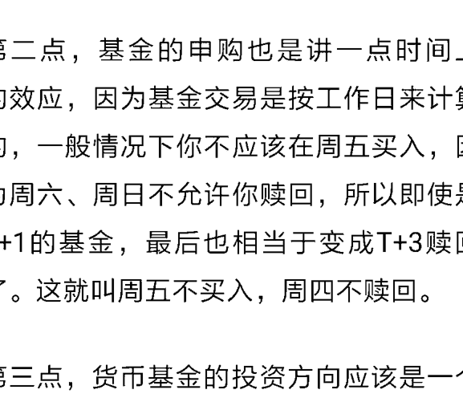

如果一个基金规模太小，根本就没有规模效应，收益率反而低。

但是为什么货币基金规模大也不一定能获得更高的收益率？道理还是那句话，它买一个理财产品，比如余额宝的底层资产是银行的协议存款，规模越大，虽然议价能力强，但资金分散度低，投资灵活性差。

收益率是相对比较高的。

最后我还想多啰嗦一句，金融市场是有风险的，投资需要谨慎，这句话永远是没有错的。今天在这个课程里面，我给你分享的是一些关于货币基金投资的原则和方法，就像我在课程中间说的，你根据这些原则，筛选出来的基金，每个季度，甚至每个月都可能在变，所以我希望你能够独立地思考和批判性使用。课程中间涉及到了 一些具体的基金，是为了说明刚才我们讲述的那些原则应该怎样使用，并不代表我对具体基金品种的推荐。而且你会发现 在不同的时间段上，你运用这些原则筛选出来的基金其实是非常不一样的，这也是这门课的一个目的，希望授人以渔，让你真正地掌握这些金融之术，更好地根据自己的情况做出投资决策。

最后，在文章底下，我把今天货基选择的两个原则和货基买卖的三个窍门给你做了一张图，你可以把它分享给那些正在购买 货基的朋友或者家人，希望他们能够获得。

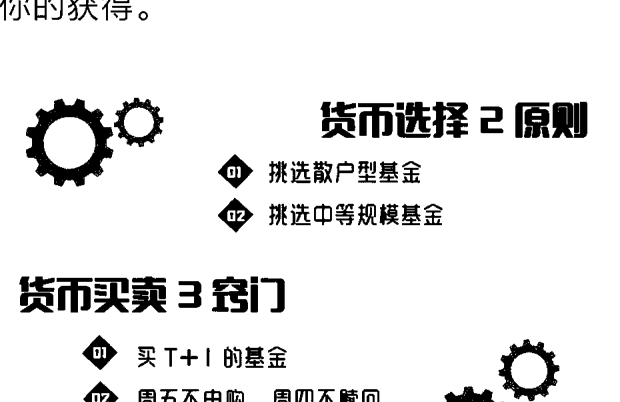

### 今日概要：

##### 划重点

> 申购货基的两原则：

- 第一，你要挑选散户型的基金，如果一个基金的散户比率低于40%，而你对流动性要求又很高的话，就要慎重。
- 第二，挑选中等规模的货币基金。按照2017年的情况，大概是100亿到400亿规模的基金的收益率是最高的。

货币基金买卖的三窍门：

- 第一条：如果对流动性要求高的话，尽量买T+1的基金；
- 第二条：周五不申购，周四不赎回；
- 第三条：月末、季末、年中、年底的时候申购货币基金。

#### 香帅

做一个小调查，我们的学员当中到底有多少人在购买货基？你每个月会拿出你的工资或者储蓄多大的比例去购买货基？或者说你在购买货基的过程中间有没有更好的心得和原则愿意分享给其他同学，欢迎你把你的思考写在留言区跟我们一块分享。


香帅的北大金融课 站在高处 · 重新理解财富

### 020 | 本周问答：货币基金就真的没有风险吗？

你好，欢迎来到香帅的北大金融课。

好了，今天是周四，又是我们的问答时间，这一周我们的同学也是提问非常热烈，也是跟我们百姓生活密切相关的一部分，所以大家的留言我特地请前几个问题比较具有代表性的，然后我们中间抽取了几个比较典型代表意义的问题，来给大家做答。

#### 问题1：互联网银行没有传统存款的门槛，它的利润从哪里来？

我以为这些新兴的网上银行和微众银行，确实实确实跟过去进行了一点变化，但是微众银行也在不断地发生变化，我们传统的银行它只是慢一点，但并不会被消灭掉。

#### 香帅

- 1. 传统银行和互联网银行的异同比较：

我，我把你们俩的两个问题其实都是在讨论，互联网银行和传统银行之间的异同到底在什么地方？它的竞争力到底在什么地方？

首先我给大家讲一下互联网银行的利润到底来自哪里，其实互联网银行的利润跟存款、微众银行并没有什么区别。给你举个例，今年，马云旗下的小微银行（注：原文此处可能指网商银行或相关小微金融机构，OCR识别为小微银行），它的人收资金（注：OCR识别错误，应为“人均资金”或“募集资金”等，此处保留原意但稍作修正为“募集资金”）是24.5亿，比2015年整整增长了70倍，大家也可以看到，它的增长速度是极快的，那么24.5亿里面有18.4亿是来自于存款，那传统银行一样，3/4的利润来自来自于存款，手续费用、佣金这些中间收入大概5.6亿左右的。

所以在利润结构上，互联网银行和传统银行并没有太大的区别，那么它们的差别在哪里呢？其实这种差别上了一些原因，由于它没有网点，它不会进行一些传统上，他们吸收存款的能力比较弱，它们一般通过发行理财产品向其他金融机构中间进行资产业务来收取资产。

所以它们存款量就不太相比，它们发放贷款的对象更不一样。由于互联网行业公司有一些技术、信息结构上的优势，所以他们可以覆盖一些传统银行没有办法覆盖到的小微企业、个人贷款，这些贷款的利率相对较高，但是贷款额度也相对较低，收益款呢收益比较高，所以收益率是存在的。

所以你会发现由于监管、技术上的一些原因，互联网银行吸收存款的能力和监管审查的有一些不足，但是金融的本质并没有发生重大的改变，银行的本质也没有发生重大的改变。所以很多人会误以为，因为互联网在改变金融本质，这是过干马行空了（注：OCR错误，应为“天马行空”）。金融的本质从人类社会一开始，到目前为止，以及在我可预见的未来不会发生重大的改变，所以我举的“个”例子同学的思考也是比较认同的。

- 2. 互联网银行的发展趋势：

另外我再补充几点，就是互联网银行到底会对传统银行造成什么怎样的影响？

- 1) 首先我们得看到的是，互联网对金融行业的产生冲击确实存在，但是，如果你去看这种历史的变化是很少的，不是一蹴而就的。课程前面给大家讲过，全球银行业是信息不对称最大的行业，你必须采取严格监管。资本市场的变化，必须给监管的演化也给监管进去。

- 2) 目前收支问题。目前在中国金融去杠杆的大背景下，互联网金融企业很多，互联网金融企业它有很多优势，但我也看到前面里面就大家承认了，但比信用度的发展，需要时间去积累的。现在的互联网企业还很年轻，有监管时间来慢慢成熟，他们除非真正能够非常审慎地开展金融业务，否则监管一定是会比较严格的。

- 3) 银行业是国家的资金动脉，严格的保护措施一定是更多。虽然目前我们看到大家讲传统银行更多，但银行是关系到家国的资金动脉，一直会非常开放，但比较谨慎，因为吸收资金的功能涉及到千家万户的利益因素，涉及到金融安全和稳定的根本，监管上面就必须，也一定会非常审慎。另外，银行也必须要去有自我革新，不断吸收最新技术增强竞争力。在未来我们会看到传统银行和互联网银行的关系会变得越来越近，传统银行一定会互联网化，而互联网银行一定会做得越来越像一个银行。

其实说到这儿，我还真是想对我们的广大提问的提几个水平提升表扬，因为互联网银行和传统银行中间的竞争以及差异，一直有一个特别治浴（注：OCR错误，应为“争议”）的问题，到目前为止也一直没有定论，就在前面两个问题我在各种的学术讨论会上，讨论和争辩过这个问题。

我一而再再而三地，金融也好、经济也好，它终身还是人的学问，是社会的学问，所以大家只要能够特别敏锐地抓住这种生活中的金融现象，一定可以提出更前沿、更有力量的问题。

#### 问题2：其实没有存款准备金率的限制，那随着老百姓越来越多把钱给货币基金，会不会出现挤兑？

货币基金不像银行那样随时能取钱，那么是不是？“货币基金市场”？货币基金是不是个什么金融产品？它的安全度到底如何？

#### 香帅

这个问题其实非常专业了，涉及到货币基金投资这个根本的问题，我下来讲给大家简单回答一下。

- 1. 理论上货币基金属于基金类产品。基金其实是有投资的重点，也是我们在投前对风险是一个非常重要的组成部分。我们在后续的基金模块里花在整整三四的时间来给大家讲细细的。那么今天我们就简单看，这里有个重要的一点是，它是一种有风险的收益，也就是说它不是零风险，有小概率发生资金亏损的，它在发生重大的金融危机的时期，比如美国2008年的次贷危机中，当时各个国家的金融机构的资金都耗光了，需要多个国家来担保资金，所以货币基金理论上确实出现挤兑，然后造成亏损。

- 2. 但是实际上货币基金投资的资产质量非常高，由于他要求高流动性的资产，所以一定会去投资那些非常安全的流动性资产，因此它发生亏损的概率是很低的。比如从80年代以来，美国是全世界最大的一个债券市场，它一共发生过两支基金收益破凣（注：OCR错误，应为“破净”）的事件，而且一共就发生两支基金收益破凣的事件，而且一支就是90年代发生美国，一次是1994年，美国佛罗里达社区银行，它投资了一个叫联邦邮政的货币基金，由于它购买了大量的浮动利率债券，当90年代的时候利率上升，浮动利率债券的价格大幅下跌，导致货币基金的价值从1美元跌到0.96美元，所以市值也是很小。一支跌到0.96美元以后，基金就无法再赎回，不存在当时整个经济环境比较良好，不是挤兑恐慌性，所以这是一个很小的事件，然后整个基金是一个被过度低估的单机（注：OCR错误，应为“个案”）事件，没有一个人投资者的权益受到直接损失，所以这一支基金跌破净值的事情就也没有造成很大的风波。另一支就是我们在课程里面提到的，美国历史上最悠久的货币基金。当时由于是金融危机，所以市面是风声鹤唳，最后美国财政部政府为这个货币基金提供援助，才平息了事件。

所以从理论上来说，货币基金是属于有风险的，它没有亏损可能，但自从历史表现来看，它没有发生过很大的风险。但当然是，当然如果你遇到金融危机这巨大的事情，可能要另当别论了。

#### 问题3：看到有老师的问题想到了，资本是限制的，凡是靠资源流通赚钱，虽然国家限制了银行的提线（注：OCR错误，应为“投放”）方向，但是银行自己想法办法把钱流向高回报的项目，这个流穿涉（注：OCR错误，应为“穿越”）了我们前面讲到的货币体系的体系。

为什么不开放市场，让市场来决决定留下什么、淘汰什么呢？

#### 香帅

这个问题问得好好，也特别有代表性，其实我在北大上课这么多年，有很多年轻的学生提出过类似的观点，我们就几代人都是接受市场经济的教育长大的，那我们得要先认从认识它到底有一个大前提。那我要事先问你了：既然凡是政策要逃避政策，那你自己就是想办法规避，把钱流向高回报的项目，那不就开放市场了吗？是不是开放市场不就是一回事吗？听起来很混但就是不是这个逻辑，其实主要看你想的“高”。你的问题是有点高。


我要跟你指出的是，你的问题里面有一个逻辑上的漏洞，对策不一定能够完美地绕开政策，政策和对策这一对“猫鼠游戏”其实贯穿于千年历史，古今中外从来没有发生过变化。

好了，刚才是一个反问，就是告诉你其实很多话都是听上去很有道理，但是不一定是逻辑严密的。下面我来正面地回答你这个问题，为什么不开放金融市场，让资金决定自己往哪里流动？

1. 首先我们要看市场到底是什么？现在大家的学习过程中间总有一种感觉，市场就是市场，市场是一个很抽象的概念，可是市场是个抽象的概念吗？不是的，市场是你我他，是个体、是机构、是政府，是各个机构和个人的集合体。其实政府又是由人组成的，是千百万人组成的政府，政府所制定的政策是人制定的政策。所以当你说到市场的时候，你一定要记住市场不是一个抽象概念，你要理解市场的逻辑就必须理解这里面各个参与方的行为逻辑，包括政府的逻辑。

我在北大上课的时候给大家画过一张金融市场的结构图，其中就给你画出来了金融监管机构。比如我们中国的一行三会，就是央行、证监会、银监会和保监会。美国有美联储、美国证监会（也就是SEC），消费者金融保护局，还有形形色色的金融监管机构以及金融监管机构颁布的监管政策，这些都是金融市场的组成部分。所以你单单地把政策、把政府和市场割裂开，是一个以偏概全的思考方式。这是第一点，市场不是一个抽象概念，它是包含着人，包括政府在内的一个具象的行为集合体。

2. 开放市场是什么意思？开放市场怎么开？开到什么程度？开多大？如果你不把这些标准都能够很好地讲出来的话，开放市场就变成了一句空话，尤其在开放金融市场上要格外地小心。我在第二周第三堂课程里面就跟大家讲过，金融市场跟其他市场是很不一样的，金融市场是一个具有高度的信息不对称的市场，所以它天生具有严监管的特征。比如说美国，美国是世界上市场自由化程度最高的国家，从80年代以来，美国的金融自由化是走得很远的，在2008年的金融危机以后，不管是学界还是政府界都在进行严肃的反思，认为金融自由化已经走得太快太远了，所以在金融危机之后美国才通过了“Dodd-Frank法案”，加强监管。这是美国的情况，就更不要说拉美，还有东南亚，它们都是因为在不合时宜的时机过度地开放了金融市场，金融过度自由化，都付出了惨重的代价，而且这种代价可能是难以弥补的，所以当我们说到开放金融市场的时候一定要非常地谨慎。

3. 市场是一个动态演化的过程，它中间就包括了监管的动态演化，我在课程里面其实也讲过监管和创新是一个猫捉老鼠的游戏。在本周的课程里面我告诉大家，影子银行的产生是因为中国的国有银行体系过大，然后银行会和其他的金融机构进行合作，进行猫捉老鼠的博弈。这里面有两重的效果：第一重，它一方面使资金流向更有效率的地方，但一是也造就了一些问题。最大的问题就是，由于影子银行体系的资本充足率是不受监管的，所以它本身就具有高杠杆的特征，具有高杠杆的特征就会增加风险，会导致系统性的金融风险。而当系统性的金融风险发生的时候，受损的就不仅仅是政府，更是社会上的每一个人。


在12月31号的时候，我们的专栏推出了一个活动，就是这一周每天留言点赞数最高的两位同学，可以拿到我为你量身定制的签名版的新书《金钱永不眠》。

今天是最后一天了，我希望你们抓紧时间，能够写下最牛的留言，获得最高的点赞数，大家努力加油！

我是香帅，北大金融课学员，教你点干货，让你更懂你。

#### 第四周｜课件放送：本周划重点时间到！

好呀，欢迎来到希师的北大金融课。

又到了一周的课件放送时间，每周的这两天我都会给大家划重点。放黑板，把本周的课件用PPT图片的方式给你放到文章里面。现在我们来把本周的知识点和重要逻辑梳理一遍。

这回我们仍然是围绕着我国最重要的金融中介机构—银行来讲解，主要讲解的是银行和你的财富管理非常相关的三个要点：

- 首先向大家剖析了银行利润的来源、本质和变化，现在有你得行为银行什么赚钱，和为什么还是有你的银行账户很难？
- 紧接着看为什么商业银行的竞争对手货币基金、告诉我们货币基金来竞争、本质、还有它的收益是怎么决定的。
- 最后对我们无孔不入的银行理财产品进行分析了，告诉你这些银行理财产品其实是属于中国影子银行体系的一部分。

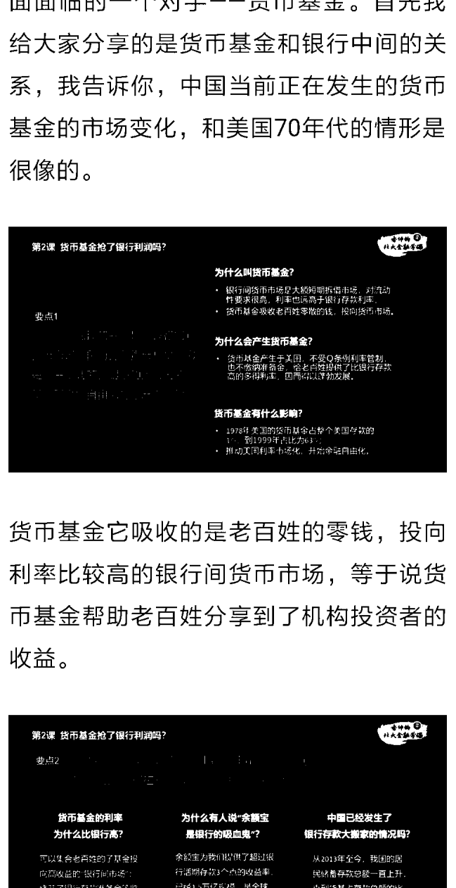

##### 第一天：银行躺着赚钱的秘密

第一天我们重点讲解的是银行赚钱的主要方式，和我们国家银行盈利状态变化的逻辑。首先，银行靠吸收存贷款来赚钱？贷款中，利差金额叫做存贷差，是银行最重要的利润来源。

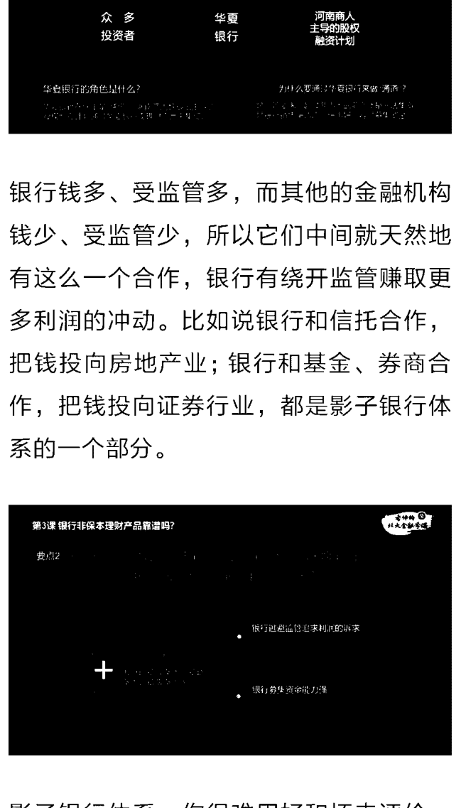

我通过两个样子中间借债关系图的一个小故事，告诉你银行之所以能够赚取这么高的存贷差，是因为它能够低成本地从小钱资金，转换来转大的也，然后还能继续转换资金的期限和转换资金的风险，通过这三个转换，银行实现了存贷差的利润。

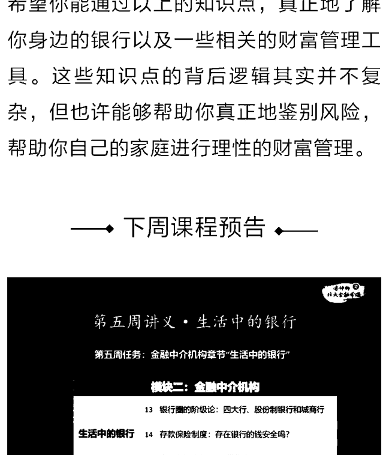

附送课件云盘下载链接：https://pan.baidu.com/s/1jlgpKou

欢迎你把你所学到的知识告诉那些正在金融部门工作的朋友，看他们的认识是不是和你一样。

新年第一周的课程结束了，每天留言点赞前两名的同学，你们将获得我送出的亲笔签名书《金钱永不眠》。请你们把希望我写在扉页的寄语，写在留言区，同时留下你的姓名、电话以及地址，得到的负责同学稍后将会给你寄出。

这十位同学分别是：

柴慕怡、老吴来了、微积分、青岛罗刚、且学且珍惜、傅聪、罗燕龙、崔馨茹、李坚、蚂蚁不吃肉。

恭喜以上同学，其他同学继续努力，我还会不定期放送大礼包给你哦。

谢谢你的收听，周末愉快，我们下周一再见。


你好，欢迎来到最帅的北大金融课堂。

从上周开始，我们已经进入银行这个模块。从银行货币、存款准备金率、基准利率的方面，了解了银行体系对某个经济的功能。这周会继续在我们的讲述中，涉及到以银行体系给我们生活带来影响和贡献等几个方面。

可能每个人都会觉得，自己对银行很熟悉，其实想细想，不一定的是怎么回事，比如说工商和招商银行的差别在哪里呢？银行对我们有哪些服务，有哪些功能？到底谁家的更靠谱？还有办个人的贷款和企业贷款又应该去哪一种银行？这些问题你可能会熟悉，但是很少有人能明确地回答出来。

你知道中国现在有多少家银行吗？中国现有各类银行有400多家，种类更是五花八门，有以数字命名的“老字名”，有四大国有商业银行，也有股份制银行。最让大众热捧的城市商业银行，那么，它们的业务究竟有什么区别？看清楚这些区别，以后我们在选择某一个银行的时候，你的心里就会更清楚了。

首先，从我们最熟悉的银行说起。

###### 一、皇帝的女儿不愁嫁：五大行

老百姓最熟悉的银行是什么？工、农、中、建四大行。在很多人心里，工、农、中、交这四大行就是“御赐银行”。后来，随着一个“交易”，就诞生了农、工、中、建、交，这五家是国家直接经营的大型国有商业银行，占了全国金融总资产的40%左右，这五家银行在老百姓心中地位高，是有历史渊源的。

从1949年到1984年，中国一共就这五家银行，而且每家银行在不同地区有分行，还有大量的行业、营业厅。很多上代的人，手里工行的卡和储蓄的银行没有变迁过的银行，我们对金融就产生依赖感是明显的。就像我们中国人是一种比较认命的动物，这种习惯在很多领域上表现特别明显。很多人说，我为什么要去其他银行啊？我工行就挺好的，不挪也不挪。这用通俗的话来说，就是“金融结构太固化”。所以，历史太久，分支机构就大，国有大型银行，从四大到五大，就体现了中国是“皇帝的儿女不愁嫁”，只要能力强，好信用，明显是属于金融圈的上流阶级。

但是，这都要提一下，几大类因为分类机构太杂了，一纸子又了以后，什么大行，分行到70%的理财人员都是大行内部有分类分工的。所以，我希望大家能够尊重自己的父母，不要一看到四大行（五大行）就觉得全安全，还是要有自己的分类意识。

###### 二、都市里精英白领：股份制银行

除了国有大型银行以外，还有股份制银行，这也有很大比例。它们属于银行里的第三梯队。平时，我们最常听到的招商、浦发、民生、兴业都属于这一类银行。它们不是全国性的银行，但是股权结构是比较灵活的。

我上课的时候常和同学打比方，股份制银行像什么人？它不是皇帝的儿女，有点像个“戏中人”（京剧）里的龙女，它用“真名”，还是用化名，但它不是“蓝血贵族”，还是得靠自己奋斗。这个奋斗怎么样理解呢？最典型的表现就是吸收他行的能力。所以，他在这一点上，必须比有先天优势的“五大行”要更做特色业务，搞差异化竞争。

在搞差异化竞争以后，就产生出了一些特色银行。比如招商银行就强调零售？说，你招商银行的信用卡在全国都数一数二，只要有发行的卡，申请信用卡，银行各的网站都可以申请，电话打过去，电路上各种申请渠道都非常地方便。另外一点，就是招行线下的业务做得特别地好，它的基础服务特别多。

它们产生了不少金融创新，和特色服务；第三梯队就是全国各个城市都有的城市商业银行，它们的生存状态相对是比较艰难的，所以在发行各种理财产品的时候也会比较激进。


我们每个人都肯定跟银行打过很多次交道，你个人最熟悉，打交道最多的是哪个类型的银行？然后你感受到不同银行中间的区别没有，哪些银行的服务特别好，哪些特别差，或者说你在银行碰到过最奇葩的事情是什么呢？

欢迎你把你的思考分享到留言区，也欢迎你将今天的内容转发给那些在银行工作或者打算去银行业工作的朋友，看他们是不是跟你一样已经明白了这几种银行的血统和阶级。

我是香帅的北大的金融学课，我们站在高处，重新理解财富。

###### 香帅的北大金融学课
站在高处，重新理解财富

版权归得到App所有，未经许可不得转载


### 022 | 存在银行的钱安全吗？

你好，欢迎来到香帅的北大金融课。

在银行开门营业的过程中，咱们老百姓最怕什么？其实最怕的就是银行破产，自己的钱取不出来。2013年的时候，网上传了一则消息，江苏如东农村商业银行倒闭了。这条消息很快传播开，结果上千人惊慌失措地跑到银行里去排队取款。当时，幸好如东农村商业银行及时取消了现金的限制，保住了兑付，这才平息了事态。

其实从2015年开始，你就不必再担心这种问题了，因为从2015年开始，哪怕你全额的、50万以下的银行存款也能得到全额的赔付，这就是我们今天将要讲的——银行存款保险制度。

这个话题其实是我们明天要讲的“央行”市场的最后一篇内容。

#### 一、挤兑与存款保险制度

刚才我们讲的如东银行，上万人到银行去排队取款的现象，在金融学里被称为“银行挤兑”，也叫“Bank Run”，它是金融学里非常经典的一种现象。假设银行宣布它要关门了，你的钱就取不出来了，怎么办？那么你的心理可能变得不可控了，为了保命，你可能一秒钟都不会多等，马上把银行的钱取光。银行一旦破产，那么银行的客户们就会一窝蜂地到银行取钱。这种恐慌是互相传染的，你取你的，我取我的，很快银行就没有钱了。这时候，银行要破产。

银行破产了怎么办？其实，挤兑是一种自我实现的预言，挤兑会放大银行的流动性风险，进而导致银行破产。所以，银行破产是因为挤兑，挤兑是因为害怕银行破产，害怕是因为没有信心，没有信心是因为没有存款保险。

所以说，存款保险制度就是为了解决这个“自我实现的预言”问题的。它的逻辑很简单，只要你的存款在保险额度之内，银行破产了你的钱也是安全的。

#### 二、什么是存款保险制度

存款保险制度是在美国开创的。1929年，美国经济大萧条，美国银行业发生了历史上最大规模的银行挤兑事件，从1930年到1933年，有四千家银行倒闭，这些银行里面有超过3.3万亿美元的存款，大概相当于现在GDP的30%。为了稳定银行体系，美国1933年通过了《格拉斯·史蒂格尔法案》，成立了一个专门负责存款保险的机构，也就是联邦存款保险公司（FDIC），所有的银行都必须加入存款保险组织，每个银行账户最高能赔付10万美元（当时为1万美元），超出这个金额的部分就没有保障了。

这个制度的核心在于，它消除了银行挤兑的动因。因为只要你的存款在保险额度之内，银行倒闭了你也不用慌。那么，你还会跑到银行去排队取钱吗？你不会了。你安心地在家等，政府会帮你把钱取出来，然后赔付给你。这样银行挤兑就化解了，金融系统也就稳定了。

#### 三、商业银行竞争加剧和利率市场化发展的要求

那么再来看中国，中国在2015年才正式推出《存款保险条例》，比美国晚了80多年。为什么呢？因为在中国长期实行利率管制的情况下，政府实际上对银行实行的是隐性担保，老百姓知道银行是不会倒闭的，存款是安全的。但是随着利率市场化的改革，银行之间的竞争加剧，有些银行可能会倒闭，这时候就需要一个明确的制度来保护存款人的利益。

2015年5月1日，《存款保险条例》正式实施。我国存款保险实行的是固定比率偿付方式，最高偿付限额为50万元人民币。这个额度参考了国际经验，也考虑了我国居民的实际存款水平。

那么问题来了，为什么是50万？因为统计数据显示，99.7%的存款人存款都在50万以下，也就是说，50万的限额已经保护了绝大多数的存款人。

##### 划重点

- 存款保险制度是为了保护银行储户利益，降低银行系统破产的社会成本。
- 随着经济的发展和利率市场化的推进，建立存款保险制度是必然趋势，它要求银行自己为可能出现的风险买单。


2015年以后，我国就建立了金融稳定机制，也就是我们常说的“三道防线”。第一道防线是银行自己，第二道防线是监管机构，第三道防线就是存款保险制度。存款保险制度实际上是国家为了保护金融稳定，让商业银行自己承担风险而设立的一个机制。

### 023 | 金融市场上的“最后贷款人”

你好，欢迎来到香帅的北大金融课。

今天我们讲存款保险制度，它是金融体系打的一针强心剂。今天我们讲央行最后贷款人，就是发生问题的地方，央行可以向金融机构提供短期的信贷，然后市场进入流动性，这就相当于把已经传染的路径卡断，终结传播，给金融体系设置一个最后的安全阀。

#### 一、金融市场为什么需要最后贷款人？

市场上为什么需要最后贷款人的角色呢？要知道，金融市场靠什么维系？靠信心来维系。任何一种金融的预期，你都可以把去理解成形成真实的危险，你要遭遇风险了，就得打破这个预言。而金融市场发生问题的时候，一般都是从流动性问题开始的。

什么叫流动性问题呢？这就牵涉到了金融机构一个重要的特征，金融机构一般都是短借长贷。它吸收的储蓄期限很长，但是放出去的贷款的期限又很长，发一点风口吹吹，银行放出去的贷款一两年后就会不回来，这就是长贷会导致系统形成惯性的抛售，给市场释放压力和悲观的信号。果这个时侯，发生问题的机构会把自己资产抵押，迅速地拿去现钱，补充流动性，这个给我们观察到，危机是打爆，危机可能得到解决。这就是央行的最后贷款人的角色应该干的活。

有的同学可能会问，发生了金融危机，如果没有最后贷款人这个角色，是不是很也没有什么不同呢？我先会由两个不是很复杂的金融危机的故事，你就会明白其中的道理。

#### 二、1929年经济危机 VS 2007年次贷危机

第一个例子，是著名的 1929年经济危机。当年的10月，美国股市发生了崩盘，随着许多金融机构纷纷清算，企业破产，全球经济大萧条，进入了大萧条模式。

问题的关键是，当时美国是奉行古典经济学理论，也就是对市场自发的行为与相对比较，所以美国政府，包括美联储，也就是美国央行，它们都主张按兵不动，就让市场自己痊愈。结果危机愈演愈烈，到了1932年的时候，美国的股票已经下挫了近90%，30%多的银行已歇业，大量企业倒闭，1/4的美国老百姓没有了工作。美国的危机很快就波及到了欧洲，在所有国家当中，德国的状况是最惨的。因为它当时还背着欠美国的战巨赌债。银行因此倒闭，工业生产量下降了一半，30%多的德国工人失去了工作，然而他们开始游行去寻死。那时，经济状况一恶化，结果墨洛汀（国）的民族主义就开始高涨，希特勒纳粹政府上台，第二次世界大战爆发。

所以在后来的讨论中，包括美联储前主席伯南克在内的很多学者都承认，如果当年各国政府和央行，尤其是美联储能够在正确的方向上有所作为，危机就可能会被规避的减缓，我们的历史可能会改变。其中最最重要的一条教训就是，美联储时没有能够最早行使最后贷款人职责，对银行挤兑的反应速度太慢，结果导致银行连环倒闭，企业陷入绝境，进一步地加剧了危机中多米诺骨牌的倒塌。

这是上个世纪30年代的案例。鉴于那一次的经验，在最近的一次全球金融危机，也就是2007年的次贷危机中，我们就看到了完全不一样的央行形象。

2007年的时候，美国的房地产泡沫破灭，很多抵押借款就出现了大量的违约。很多金融机构跟上次一样血本无归，富克斯尔破产了，美林被收购，一年之中美国的银行下降了近400家，美国的失业率也从4.5%一下子飙升到了10%。这一次，美联储做得完全不一样，它顶住了巨大的压力，协同全球不一定要家族国家都来救助美国。

比如说2008年10月的时候，G7，也就是全球七大发达国家，它们的央行和财政部就共同发表声明，说它们将采取措施，避免金融系统性风险，这一招就是为了恢复市场信心。

更重要的是，美联储加大了对各个金融机构的救助，它保证了各个金融机构能够正常的发现金，同时为了稳定货币基金的价格，美联储还开启了新的流动性支持计划，向银行提供贷款，然后银行去购买优质证券，并优先给劣质的证券抛去。这一点上来看，美联储这次好好地履行了最后贷款人的职责。

80多年后的2007年，尽管世界金融体系更加成熟，和1929年根本不是一个概念。但是，由于各国央行的及时干预，你会发现这次危机的时候，很多人也没有出现的那么恐怖，所造成的破坏也远远地小于1929年。从这个意义上来看，你会发现，中央是金融系统的最后贷款人，这一次全球的央行是守护住了金融市场安全的最后壁垒。

通过两次危机的对比，我们现在可以看到，央行为危机场最后贷款人的重大作用。在金融危机发生之后，央行必须向金融机构提供流动性支持，然后阻止市场的连锁反应，防止恐慌通过各种渠道像瘟疫一样地蔓延到整个市场，导致整个市场的崩溃。

#### 三、最后贷款人的角色是怎么来的？

央行这种最后贷款人的角色和功能是从英国起源的。18世纪的时侯，英国的银行体系非常地不成熟，经常出现金融危机，对英国社会造成了很大的冲击。英格兰银行就尝试着在非常时局为其他的银行提供救助的业务，充当他们的最后贷款人来缓解市场的恐慌。

这种现象就 被一个 叫 沃尔特 白 芝浩（Walter Bagehot） 的记者观察到了。他过大量的思考之后，把他的观察，在恐慌的时候，只要找上门来的银行和金融机构有优质安全的抵押品，央行就应该发放，但是，另一方面，央行也要应付这种临时性应急性的放贷，以一个比较高的惩罚的利率，以证明你的机构是有现金的，防止那些没有偿债能力的机构来套。这就是白芝浩规则，也是央行在扮演最后贷款人角色中最需要遵循的一个原则。

最开始，央行在这个功能并不是得到的认可，但是，随着现代金融业的深化，央行在货币市场上起到越来越举足轻重的作用，所以最后贷款人的角色也得到了越来越多的重视。

##### 划重点

- 央行最后贷款人角色的原因：
金融 危机具有高度的传染性 和破 坏性，可能会导致整个国家的经济，甚至政治发生问题，所以央行在这种时期可以通过向金融机构输血，也叫注入流动性的方式，起到结束恐慌，避免危机的作用。

在我看大量的留言过程中，发现我们得的用户，留言的质量特别多。尤其是有一几位课程的学员，我发现大家去跟同期的思考者非常非常深入，所以我想，你要思考的问题 大一点，希望能够继续坚持下去。

我给你举一个非常现实的案例。很多人都经历过2015年6月份到7月份的中国A股市场的暴跌，当时A股市场上发生了很大的崩盘，但是到最后市场里还发生了很多空，就是到底央行应该不应该 出手，为了避免的破窗，最后央行也是果断地出手了，向市场注入了流动性，成功 地 为 稳 住 了 金 融 市 场，然后成立了一个基金公司，直接在市场上买入股票。

请你想一想，在这个案例当中，央行扮演的是不是充当了最后贷款人的角色？如果你把你的思考写在留言区，我跟大家分享。


### 024｜延展话题：历史上的银行

你好，欢迎来到香帅的北大金融课。

这两周我们一直在讲银行，内容也比较硬，可能你会觉得学得有点辛苦了。在今天周四，我想和你聊些有趣的话题，就是历史上到底存在过什么样的银行模式。

历史上，银行有很多很多种模式，寺庙是银行，饭馆是银行，银庄，甚至药铺都是银行。

#### 一、药铺银行

我母亲的祖家是当地一家垄断性的药铺，百年老店，信誉特别好，金字招牌也响当当。据说三四十年代的时候，他们的药铺里还存着民国当年当作货币在流通的草纸票子。有货物流通，这个药铺自然也会帮人们办理抵押、借款的业务。发行货币，方便贸易，这，不就是标准的银行业务吗？

这一点也不奇怪。你想想，在乡土中国，什么药最重要？是毒药，因为这可用来保命，是当务之急。而且你看，历史上开药铺的都是当地富有的乡绅，财力非丰，信息也好，这一帮人，要当银行为信用的生意也显得特别熟络。

实际上咱们国家在唐朝的时候，就有把药铺当作银行的历史，名著笔记小说《太平广记》，里面就有人为这种业务，交钱，找药。大商帮的保险功能，不仅接受交钱，还可以贷款，然后凭“帖子”取钱，现在的银行凭证几乎是一模一样的。

#### 二、寺庙银行

除了药铺以外，在历史上寺庙也是银行，而且这一点上，中国和外国都是一样的。比如对中国北朝和印度，皇帝都笃信佛教，寺庙里就聚集了大量的富商，寺庙就开始寻觅，想要故放贷的生意。再加上本来就是皇帝支持下的宗教团体，除了资产雄厚的富人，也多为富商，资金能力、支撑能力，所以，公私人信用结构会更加稳定，风险也小，很容易通过生意来维持信用风险。而富人，也愿意在寺庙里抵押、贷款，寺庙里就形成了一个信用网络。

到了南北朝后期，寺庙里就出现了正式的机构来运行这种信贷业务，叫“寺库”。宋朝以后，这种寺庙银行的规模变得越来越大，因为放款的本钱不会消失，能慢就改新版，所以叫“长生钱”。寺库慢慢改名叫“长生库”，经营金融业务的范畴也越来越大。

可惜是，随着明朝打压佛教，明清又推崇儒家，佛教的影响力在我们国家就渐渐衰落，所以这种寺庙银行也就跟着慢慢地落幕了。

更有意思的是，寺庙银行根本就不是中国特色，西方出现这种寺庙银行的时间比我们要早。早在公元前5世纪的时候，雅典娜神庙就充当着中央银行和银行间的角色。罗马人也是，罗马在雅典娜的尼罗角打仗。在这场战争前，雅典颁布着几千枚的银币，是罗马的储备货币。而且，围绕雅典娜的神庙附近，看看有银行的维拉和桌子。不久就，考古学家们就发现了在雅典神庙留下的石板，上面有刻度记录。还有古罗马的银器，中国古代的盘是盘，古罗马的银行家就坐在这种计算台前面。罗马后面，开展信用机构银行业务。在希腊语中，银行被称为 Trapeza，就是桌子的意思。

仔细想一想，为什么寺庙会成为银行呢？其实这一点也不奇怪。第一，寺庙是公共活动，人流量大，它特别容易形成资金的流。集来，就形成了。第二，寺庙也是私人藏财、提不着的。但是大部分都相信，神上和天上都有神明，在生产力低下的年代，神明和宗教，在这里是一种权威，对他就起作用和约束的作用。

#### 三、驻京办、客栈、布庄银行

除了刚讲到的药铺和寺庙以外，商业流通中也特别容易产生银行业务。

在我们前面的课程里已经讲过了，欧洲的现代化银行就是正派欧洲的商业银行家，帮商人办理交易、融资的业务。在唐朝的时候，也出现这样的雏形，唐朝的时候频繁旅行于洛阳、西安长安，长安，和西安是当时两个大金融都市。长安城里的“商业银行业务”也呈现出百花齐放的局面。

比如说是各州的驻京办就有银行的功能。就很多人常年，当他们各个地方的要员、驻京人在长安，所进行的业务特别频繁。那个时候，都是以金属货币为主，路上运钱不安全也不方便，而长安和官员们早就有了“飞钱”，就是飞人飞的银。这些银券配合当地的富商和各大制作凭证，然后带个这个凭证就可以回家取现，所以这完全是一个银行兑换业务。

除了驻京办以外，旅馆和客栈也有银行业务。当时，旅馆和客栈为了方便顾客，最开始也是放一些柜子，替人保管财物，后来就存钱取钱业务就自然成了。而布商的掌柜，在长安的西市就形成了存取、取钱一条龙的跨账。而我们现在的银行业还加 ATM 机，这些服务，是有异曲同工之妙。

还有布庄也是替人保管财物，接受存款和发放贷款。布庄其实天生是有钱庄银行的基因。你看，我们布商都是布庄家的，布商是布庄的，唐朝的时候，布商是布庄最有用的货币。唐代时候，布币和钱两足币行并行本位制，所以钱和布的货币，也就是货币和钱就成了一样的。比如我们讲课本第一章有叫《卖炭翁》，里面就写着“半匹红绡一丈绫，系向牛头充炭直”，这也就是布庄兑换的用途，一个现象，所以布庄当银行也是有历史的渊源。

所以有时候，我们被灌输的历史知识，其实满不是会，比如在中国的银行里，你也可以看到，欧洲的起源于金国，中国的银行起源于当铺，其实，不对。

银行的历史几乎和人类文明一样的古老，我们有历史记载了。但是古代的行为就是天然自然，所以，银行作为商业活动的中介，也就开始它的演化历史。

从历史上看，寺庙也好，旅馆也好，药铺也好，其实我们会发现几条基本的钱线。第一，人流大的地方，也是资源资金流多的地方，就容易产生借贷性质的信用行为。第二，早期银行大多是本地起家的。

因为做的是信用生意，需要时间的累积。第三，人际交往互相多的场所更容易产生信用网络，也更容易产生银行的业务。

再看看现在的银行业，最大的不同是庞大的分支机构突破了本地的限制，但是其实至今银行的本地化，像我们前面课程讲到的很多银行都是以当地产业为主。所以，从寺庙到现在的银行，其实银行的发展没有离开过这几条基本的原则。

## 今日摘要：

- 重点看

在这些机构的发展过程中，银行发展的基本钱线：

1. 人流最大的，因为只有人流量大，才能形成资金的集聚和交易，产生信用行为；
2. 在本地起家的银行，因为时间累积的，容易做信用的生意；
3. 人际交往互相多的场所更容易产生信用网络。其实就点醒了银行业务的特点，银行就是做生意买卖的中介。

### 025 | 本周问答：区块链的兴起会对未来金融造成什么影响？

你好，欢迎来到香帅的北大金融课。

又到了周五问答时间，这周其实是我们银行板块的第二周，在这周里，我给你们的分了咱们几期不同的类型，我给你们介绍级和地位，还给你分享了我们国家的存款保险制度，以及央行在最后的最后放款入角色，还是和平时代，我会在最后的留言里面，选出一比较有代表性的问题出来，一一地给大家回答。

首先我们来看第一个问题，其实在这一周的内容里面，很多同学注意到了利率市场化这个词汇，这周我们也在在存款保险制度，我们也说到它是在利率市场化，银行业竞争加大的背景下实施的。

我能够理解2013 年银行开始了利率市场化，但是目前看上去好像各家银行的利率都要多少，尤其是大国有银行，那么我要怎么理解利率市场化有哪些具体表现呢？

**香帅**

我其实早在精选的留言中已经简简地回答过这个问题，但是身为利率市场化在我们国家整个金融市场发展过程中具有一个极其重要的地位，对央行的企业融资成本也有很重要的影响，所以我再稍微多说两句。

这个问题我这么来看：

第一，我们所看到的各种银行中间利率差异变得比较小，其实本来就是说利率市场化的一一个表现，为什么这么说呢？因为咱们国家现在有4000多家银行，而银行的利润收入其实就是比较相似的，主要的盈利点呢，大行，它也是比银行吸收存款的能力最重要的，也就是说银行之间是同质化竞争，你想它也就是，竞争越激烈，又是同质化竞争，所以这种利率的差异自然不拉得太太大。

第二点，其实你再仔细看一下，利率的差异也没有你想的那么大，比如说在存款利率上面，一般期限存存款基准利率是1.5%，股份制银行大概是 2%，而实际上这个差异达到了 30% 以上。所以商业银行的存款利率普遍是比较难利率的，这说明 30%，这个差异可不太小，也就是说利率市场化是很有效果的，否则银行只要一个基准利率就可以了。

第三点，我们一般老百姓看不到的贷款拿到端，差异更大，因为在看不到的是贷款到银行的贷款利率是非常不低的，低的能到比基准利率还低，只有5家左右，高的能超过10%，100%，就是说差异是非常之大的，这说明不同企业的资质有差关关系。所以银行根据不同的企业进行利率差别定价，这是利率市场化之中一个重要表现。

很多人都经历过 A 股市场 2015 年 6 月到大股灾，当时 A 股市场出现了一次大，所以市场上发生了很多争论，就是央行最后应该不应该为了避免市场风险，最后应该进行果断出手，向市场注入了流动性，降息、下调存准来救市，让证监司或直接在市场上买入股票，我的公司就是根据那天第二天就涨停，请大家回答一下，央行在这个案例当中，是不是充当了最后贷款人的角色？

央行在那次股灾中起到了最后贷款人的作用，当时中国股市是散户主导的市场，本来容量波动就大，起伏又很大，股灾中，股市中的资金杠杆太高，有部分融资、券商融资券，有用券的杠杆的配资，有的杠杆高达 5、6倍。上涨时候不，一旦下跌，配资就强行平仓。加之后我国的股性，投机性很强，不能一步跌到位，就造成了人为的流动性危机，不制止，上市公司或银行间资金需求水，信用证可以抵押保证金，股票质权就可能波及整个金融系统和经济。国政府应对股灾，通过证监局在二级市场买卖股票划定了底线，这是利息进一步扩大，起到了最后贷款人的作用，不足之，正念证监局二级市场上只股票，在什么价位，很可能会引发，维持稳定也有点问题。如果当时我继续做 08 年全球股灾问题，通过增加扩减少，为资金投入，二是不容易引导；三是退出时要更灵活。

应该算是带有中国特色的最后贷款人吧，当时股票流动性比现在危险，只不过国家可能引起系统性风险，尽快的股票波动来平稳息息息息息息息息息定，像在二级市场直接买股票也是为了防止信心中的一个，关键就是平时对信息并不坏，这几年一直在强监管也是这方面的原因。

**香帅**

再看日本，日本央行做的就是ETF的基金，也就是说日本救的是大盘，跟我们不一样，我们是去救实去救。那那两个股会出什么什么情况。由于里面主观干预很多，所以就难免会发生道德风险问题。这也是为什么市场上会出现"梅雨吉祥"这样的股票人员入幕的情况。然后还发生了像很多监管人员入幕情况。因为监管官员也涉及到一些监守自盗的丑闻，就导致很多老百姓，对于本来很好的救市行为的意义和动机产生了怀疑。

所以整体上来看，在这一次的A股股灾中，一纤三会联合起来，充当了一个最后贷款人角色，确实是实是遏制了危机的蔓延和发生。但是在充当最后贷款人角色的这个过程中间，就像我们刚才说的，在救市的技术技术以及成熟度上面，我们其实还是有一些缺陷的，所以我们也可以把它看作一种成长的烦恼。

最后我想说的是，其实金融风险并不可怕，只要有金融的地方一定有会有金融风险，这也是我们在课程里面一再强调的。最后你要树立的是一个风险和收益相匹配的观念，在未来我们金融市场不断有扩展过程中来，其实我们每个人都有可能去碰上形形色色，大小小小的金融危机、金融风险，所以这个时候大家要定好。当然对于监管人角度，也确实实要在当中能于贷款人角色，在防范金融风险过程中能做得更好。

这两天，朋友圈被徐小老师呼吁“创业者要多了解区块链”的新闻刷爆了，问题来了，区块链的兴起会对未来金融行业产生什么新变化呢？

**香帅**

这个话题其实应该是我们科技金融模块中的重点，但要考虑到最近区块链实在是太火，只要一区块链概念，仿佛大脑都像吃了药一样反应迅速，就想不禁让我想起了前几年有一波互联网金融的狂潮，大家纷纷“蹭”热点，有一个公司自己改名叫“P2P”，也跟着涨了一大波。

不过在2017年的3月，这个股票可能已经被透支风险了，所以说从这个事件里面，我看到的是市场会变，人性不会变。由于这个话题太热了，所以今天我花几分钟跟你简单地讲讲区块链的概念和应用。

首先区块链出现的时候，它是比比特币的一个底层技术。它的本质是什么？是“分布式不可更改的加密数据库技术”。这话什么意思呢？就是我们一般看到的数据源都是集中在中间，所以它的安全度、安全度依赖于开发和管理人员的素质、技术以及相关的制度安排。区块链不一样，它是去中心化的数据库技术，技术是通过一个共识算法达成一致。这样一来，区块链的技术是不依赖于任何一方的，所以我们老是把计算机看做计算机看做中心，可能它的特征就使得篡改数据变得几乎不可能了，这样一来数据的安全度、可靠度就大大地增强了。

你想看现在的科技巨头们，阿里也好，腾讯也好，包括Facebook，难不大家都在拼什么？拼的都是数据，难不大家说“21世纪的石油是数据”，所以大数据时代已经就往前我们前进了。大数据时代大家最关心、最重要的是什么？数据的代安、稳定和可靠。你看正因为刚才我讲的就是区块链具有这些特征，所以从它的应用前景来看，它对整个商业世界和人类社会的影响可能是很深的。

#### 第五周｜课件放送：本周围重点时间到！

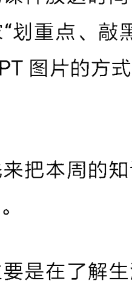

你好，欢迎来到香帅的北大金融微课堂。

又到了每周一的课件放送时间，每周的今天我都会给大家“讲重点、敲黑板”。我把本周的课程用 PPT 图片的方式给你放到了文稿里。

好了，我们先把本周的知识点和重要的逻辑串一遍。

这一周我们主要是在了解生活中的银行，我将历史上最常接触的商业银行入手，根据历史和社会统一不同的商业银行划分不同的阶段，勾画出当初我国银行发展的生态体系。之后，给大家介绍了保障金融体系平稳运行的两种机制：银行存款保险制度和央行的最后贷款人角色。

##### 第一天：中国银行圈的血统与阶段

第一天，我们重点讲解了生活中的各类银行和它们的特色。

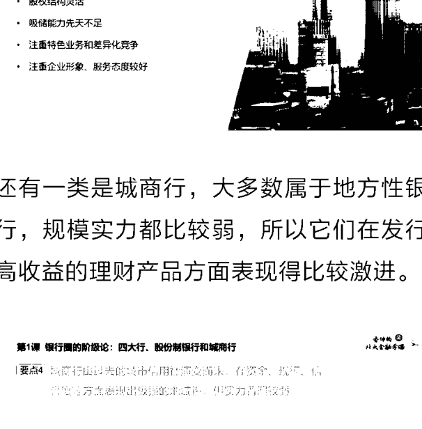

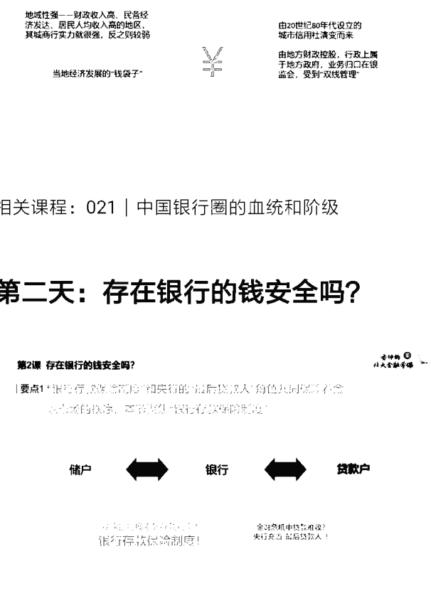

比如说国有银行历史悠久，属于共和国的嫡系长子，规模大、实力强、对公业务多。但是，这些银行在个人业务上就没有太强的特色。

而股份制银行，也是全国性银行，为了更多地吸收储户的存款，他们就进行了更多金融业务创新，比如招行的信用卡业务，民生银行的小微贷款业务都很有特色。

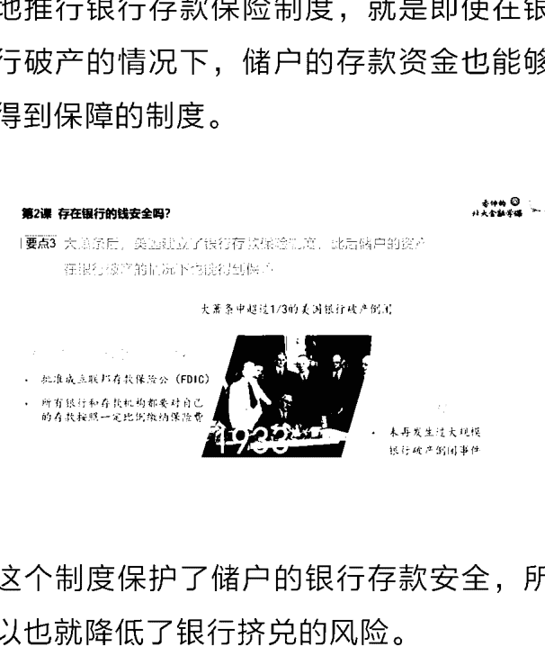

还有一类是城市银行，大多数属于地方性银行，规模实力都比较弱，所以它们在发行高收益的理财产品方面表现得比较激进。

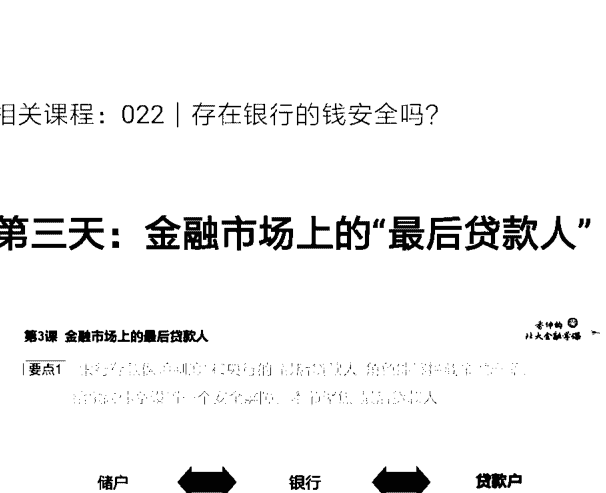

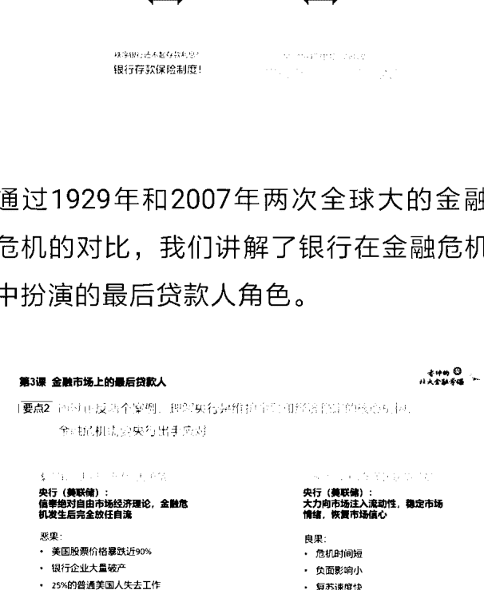

相关课程：021｜中国银行圈的血统和阶段

##### 第二天：存在银行的钱安全吗？

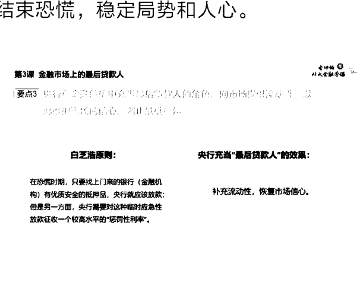

我先给你介绍了银行挤兑这种形式的金融恐慌。当你听说银行可能会破产时，会自发地跑到银行，要求取出存款，这时候如果很多人都这么做的话，银行的资金链可能会断裂，而企业也会因为没有流动资金而破产。

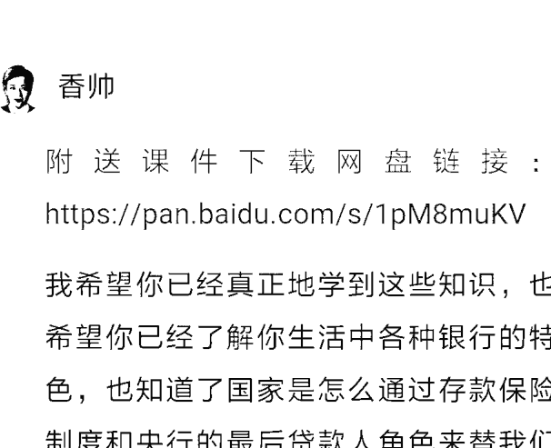

为了防止这种挤兑的风险摧毁整个经济体系，1933 年大萧条之后，美国就开始大力地推行存款保险制度，就是即便在银行破产的情况下，储户的存款资金也能够得到保障的制度。


这个制度保护了储户的银行存款安全，所以也就降低了银行挤兑的风险。


相关课程：022｜存在银行的钱安全吗？

##### 第三天：金融市场上的“最后贷款人”


通过1929年和2007年两次全球的金融危机的对比，我讲解了银行在金融危机中扮演最后贷款人角色。


为了减少金融危机的传染性和高度破坏性，央行在非常时期可以通过向金融机构提供短期资金的方法用来提高系统流动性，而这种流动性的注入可以避免危机，结束恐慌，稳定局势和人心。


相关课程：023｜金融市场上的“最后贷款人”

↓ 下周期程预告 ↓

##### 第六周课程：央行救市


香帅

附 送 课 件 下 载 网 页 链 接 ： https://pan.baidu.com/s/1pM8muKV

我希望你已經真正听完了这些知识，也希望你已经真正听懂了我们各各银行的特色，也知道了国家是怎么通过存款保险制度和央行的最后贷款人来帮我们解决金融体系的风险。

最后多唠叨一句，有很多同学后台留言说，想让我的课程送给朋友，所以我就设计好我的专栏特别设计了一个实体礼盒卡，现在你只点击图片链接可以购买，送给你的朋友不但省心，工资是省下一张人民币邮票之类的礼物，当然你也会让他在金融市场上获得更高的收益朋友。


### 026 投资银行：不做银行业的银行

你好，欢迎来到香帅的北大金融课。

在前三期的课程里面，我给你们重点讲述的是现代社会最重要的金融中介——银行。在接下来的几期里面，我带你们进入一个新的板块——投资银行。我把它们称为改变金融市场生态的新物种。

其实投资银行这门课，在所有的高校都是最热门的课程，因为咱们在北大光华开设这门课的时候，是给硕士生、本科生，也有非常多 MBA 的学生都来听。很多金融系的学生，毕业之后，最想去的地方哪里呢？投资银行。但是很多人搞不清楚就是：投资银行，听上去有这么大的名头，是不是跟我们的生活有什么关系呢？只是我们是金融圈人中的一个专属名词吗？其实不是，投资银行就在我们身边。

很多同学自己都会开户、炒股股票。你只要买卖股票，就得有一个账户，就得在一个券商开户，这些经纪会去开的券商，其实就是投资银行。中国的券商其实就是咱们口称的投资银行。不仅是在中国，在日本、德国等地的投资银行也都被称为证券公司。

#### 一、券商其实就是投行

有一个问题就是，为什么在老百姓心中券商好像就是给人开一个大的心感觉，就是拉着你去开个户，然后随便你一点手续费。但是我们的业务好像就是干这个。其实这个跟我们国家的投行业务或者券商的业务是有很大关系的。比如说特朗普老百姓开户，是有上千户的，它叫“零佣金交易”，零经纪人费，在 1970 年的投行里面，占比已经很大，大概连 1% 都不到。

但是，中国的投行，或者我说中国的券商们确实实实在在是依靠经纪经纪。在整个中国券商的收入里面有 50%，都来自零零售价到 70%–80%。这就产生了什么问题呢？就是所有的券商，都特别依赖与经纪业务，所以说就会看到，经常会券商打电话给你，让你去开户，然后还给你免收一点使用费，那个费用，所以，这就是和我们国家高佣竞争激烈的行业是紧密结合的。

而实际上呢，投行业务包括很多块，除了零经纪以外，还有公司发行股票、债券，需要有人帮你卖出来，这叫证券承销；企业要高兼并收购，需要找人搭线，进行评估，都是靠投资银行，这叫兼并收购，这些都是最典型的投行业务。还有我们平时听到到的，像什么还有量化交易、杠杆交易、私募股权投资或基金、还有一级市场证券交易，也是属于投行业务有关联的业务。实际上呢，在国际的投行业务里面，发行占的比重到 70% 左右，而发行、承销、并购，大概能够占到 20%–30%。零经纪其实是非常的小一块。

更有意思的一点是，国外很多著名的投行都是非常有趣的，比如你说到去并购或者去收购，你会想到摩根大通，那黑石很有名，高盛，你说到零售经纪的时候，那肯定是美林，它是全球最投行的一个标志。

但中国的投行业务基础我们相对来说，同业竞争非常厉害，基本上依赖于零经纪业务，所以就会给人一点金闪闪的感觉。但国际上这些年的中国券商，发生了很大的变化，比如说中金证券、中信证券，还有招商证券，这些大的投行其实已经开始变得很好的了，在发债券、承销、收购业务上已经在做了很大的步子，但是确实距离国际著名的投行还很大的差距。

而这并不是意味着中国的投行业务就没有机会了，如果没有机会它就不会有那么多优秀的学子，都想投身于这个行业。

其实，随着中国经济的发展，有那么多企业的企业需要出去，也有很多外国的企业想进来，那么我出在后面的课程里面会给你们讲，投行最重要的能力，除了它的专业能力以外，它的人的关系也是一个很重要的能力。本土的投行，其实是面临着很大的机会。

现在你了解了券商和投行的其实是一回事，只不过因为我们中国的券商行业跟国外的投行有着差异，所以才产生了这么一个说法。

#### 二、投行和银行的关系

还有很多人有疑问，券商我很容易理解，做的是证券投资的业务，那它为什么叫投资银行呢？跟银行到底是什么关系呢？

实际上在上个世纪的 30 年代以前，世界上是没有投资银行这么一个专门的称呼，那时候都叫银行，比如大家很熟悉的美国的大银行家，老 J. P. 摩根，他当时既做存款机构，存款，摩根财团就是一个吸投资存款；贷款业务，又做证券投业务。

也就是说，你在第一节课课程里讲过的伊利运河的债券，还有当时美国德克萨斯债券，摩根也承发的，另一方面，它的分支机构也很多，在美国到处去吸收存款。当时还很多的金融寡头，像洛克菲勒、第一家银行财团，都受到美国的政治和很大的影响力。

在 20 世纪初的前 20 年，是这种证券业加上银行业混业经营的金融寡头的黄金时代。一方面就是当时的美国的金融监管还很少，另一方面，那个时候大家经验都还不是很足，混业经营也没有监管，美国股市就节节上升。这一些金融寡头去吸收存款，再参与到股票的交易所。

然后就开始出问题了。储户的钱和证券市场中间就是没有防火墙，这里面产生很大的风险。为什么？因为储户存款要一个固定回报，因为钱投放到固定投资。但是股票是利益共享，风险共担的风险投资。但是如果当时没有流入到市场风险投资，但很多投资者都进入到股市，然后也助长了股市泡沫。后来看美国的股市，就发生了大萧条，几年之后，股市的 90% 蒸发了，然后美国很大银行的机构破产了，很多储户在股市里面的钱都变得血本无归了。

就像我第五讲第二天课程里面讲过的一样，大萧条发生之后，美国政府开始痛定思痛，反思自己的失败走向，然后在 1933 年时，罗斯福总统颁布了一个《格拉斯·斯高特法案》，这个法案就奠定了往后半个世纪全球金融监管的制度。

它其中最重要的一个目的就是金融业务分离。其中最重要的就是，商业银行业务和投资业务要严格分开，实施一个二选一的选项。如果商业银行要吸收存款，发放贷款，就不能搞证券投资业务，如果要想投资业务，就不能再吸收存款的商业银行业务。所以在做了一个很大的政府压力之下，美国就开始开始这个选择了。

摩根财团就把自己的业务一分为二，我们现在所熟悉的摩根斯坦利就开始专门投资业务。另外一个叫 J. P. 摩根，就是商业银行业务。还有像花旗银行，它选择了银行时间以后，就决定要自己发展商业银行业务，放弃了自己原来的证券业务。

从那个时候起，商业银行和投资银行正式开始正式分离。所以“投资银行”这个名字，实际上是旧金融体系分离出来的，专门做投资业务。

#### 三、“己姓财主”与“快活的手艺人”

在商业银行和投资银行分离以后，产生了一个特别有意思的现象。在前几周的课程里面，大家提到商业银行在经纪业务，商业银行体系，由于它有一个借贷扩张的机制，在稳定经济的时地特别地地重要，是政府重要监管的对象。而政府的首要任务是要保护普通老百姓的储蓄的安全。所以，在监管的层面，大家对商业银行的要求特别高，比如说存款保险制度，要求银行资本和证券市场风险，还有银行的杠杆率，风险等都要受到特别的监管。

反观证券投资业务，它不一样。只要是炒股类的人都都知道一句话，叫入市有风险，投资需谨慎。证券市场的投资者要自己承担风险的，正因为此，投资者受到的监管一直就比较宽松，这也给了投资银行更多“开脑洞，搞创新”的机会。

我在北大上课的时候，给大家听过这么一个比方：商业银行，它已婚男子，生活

个比方。商业银行，它像已婚男子，生活有规律，三餐有人管。它可以吸收存款，但是它也得到婚姻的很多限制。那投行呢？就更像快乐的单身汉，约束少，容易创新，但也容易冒险闯祸。

投资银行的创新真的是很多，而且几乎每一桩、每一件都把全球的金融市场大大地往前推进了一步。比如说在第四周第二课里面，我们提到的货币基金，曾经推动了美国金融自由化的进程，它就是投行为了绕开利率管制，吸收存款来设计的；还有资产证券化，资产证券化被誉为这半个世纪以来最伟大的金融创新工具，它改变了全球的房地产和金融市场的格局，它也是从投行投资的转手证券开始的；还有对企业的投融资、公司治理，都产生了重要影响的杠杆并购，也是投行创造的；还有现在富得流油的、很多人都想进入的私募股权投资基金也是从投行的杠杆并购起源的；还有现在全世界风靡的风投、创投，全部都是投资银行家的创新。

在后面的几周课程里面，我会给你一一地讲解这些投资银行业务，之后你就会更加理解为什么我说投行是一个改变了金融市场生态的新物种，你也会更加理解为什么那么多学历高、背景好的学生都特别向往进入投行界工作。

## 今日概要：

##### 划重点

- 1. 中国的券商其实就是投资银行，但是由于中国的券商业务比较过度依赖于零售经纪业务，所以产生了同质化竞争的问题，和国际的大投行还有不少的差距；
- 2. 投资银行不是银行，它不做传统的存贷汇银行业务，而做的是证券市场上的投资业务；
- 3. 《格拉斯·斯蒂格尔》法案，要求商业银行业务和证券业务严格分开，分业经营，这才有了专注于证券投资的投行；
- 4. 投资银行由于受到的监管比较松，所以它能够进行很多金融创新。

#### 香帅

中国的券商其实就是投资银行，中国的投行行业其实正在处于快速的发展过程中。请你想想看，不管你是券商开过户，或者是一个创业者，想要通过券商来进行发行、承销、上市、融资，或者你所在的企业曾经搞过兼并收购，你身边的这些券商或者投行，曾经替你提供过什么服务，然后它们在你头脑中留下了什么印象？

欢迎你把你的思考放在留言区跟我们一块儿分享。当然你也可以把今天的内容分享给那些正在投行工作或者想进入投行工作的朋友和同事，看他们是不是跟你一样获得了这个新的知识点。

我们的课程已经开课一段时间了，我请设计师设计了一张全年的“寻宝地图”，在图上点亮了我们学过的知识点，也标出了未来学习的要点，让你更清楚地看到全面的学习脉络。


### 027 | 投行承销（上）：投资市场上的婚介中心


你好，欢迎来到首帅的北大金融课。

咱们中国股民都喜欢“打新”，也就是买那种新发行的股票。新股发行，也就是IPO，它属于证券的发行和承销，是最核心的业务之一。那么投行承销到底在干什么呢？在underwrite（承销）发行承销的英文是underwrite，under就是“承”的英文，“写”为“support”的意思，write就是“写”，后来就衍生为“承销”。所以underwrite（承销）的英文就是underwrite，其实就是帮别人卖东西，帮别人把卖出去的事情给办了。

#### 一、投行就是企业和投资者的婚介中心

underwrite也好，发行承销也好，听上去特别高大上对不对？但你要实际想想，一边是企业和机构要筹集资金，另外一边是投资者想找赚钱机会，但是又看不懂，所以需要人来沟通。这就像婚姻婚介所上男生意想要，女生意想要，然后人缘广阔的媒婆介绍和撮合婚姻。我们平时看到那些高中的金融专业：尽职调查、路演、承销，你听起来是高不高呢？当然挺高的，会计、金融、管理、心理、数据工程、编程、十八般武艺都得会，但其实在逻辑上并没有那么复杂，和婚介所是一个道理。

比如说投行要对企业进行尽职调查，其实就是了解介绍人，去查家庭条件，非就是家的底细了；再比如说路演会去宣发，无非就是掌握大量情感，然后知道如何好好包装一下去做婚姻宣传。还有承销团，也不过就是感觉自己能力还不太够，邀请其他媒婆一块来帮忙卖出房子嘛。至于定价，这就是替姑娘要聘礼了，这讨价还价，聘礼太高男方会介意，聘礼太低女方又会觉得吃亏了。所以好的投资项目就好比好的姑娘一样，这个过程中间有多少环节需要自己、投行和好的媒婆一样，也得有自己的核心竞争力。

我总结一下，投行在发行承销中最核心的竞争力主要是人脉和专业知识，下面我们分别来看一下。

#### 二、投行核心竞争力之一：人脉

在大部分人的心里，投行是个门槛超高的人脉，但其实门槛有很大的根，老美根那个时代才开始，在特定的课程里面，我们说过根网媒媒是当时的华尔街，20世纪美国前100家的大公司里面，有96家属于摩根财团的客户，另外4家中有3家属于摩根财团的供应商，也就是说，在当时的美国，投行们经常是老虎盘，大中华盘，大A股等。其实现人们很大，目的就是为“培养人脉”，成为圈子。现代社会对圈子的理解并没有那么复杂，投行是最大圈子其实仍然是在发行承销中的人脉与势力。

远的咱们就不说了，就说2014年刘强东的京东商城上市，当时他要去美国上市，在承销团中唯一一张有中国色彩的兴资本。华尔街很多人是熟悉的，其实也是在中国互联网界非常有人脉的一家投行。它2004年成立，但是客户名单非常显赫，阿里、腾讯、百度、京东、聚美优品、淘宝都它客户，它被称为互联网最闪投行的核心圈层竞争力在哪里？为什么是这么强的投行人网能量就强呢？原因就是和这几家说话，中间人主要是银行、媒媒和中国经济土著的互联网公司“先朋友后生意”，在整个中国互联网圈子里面，它有一张特别厚实的互联网。

比如在和京东的合作上，包凡就一直特别低调，和刘强东2007年才认识了，但是他跟京东双方的沟通处理，一直到好不到2011年开始发力，他先是成立了DSI，还有老虎基金机构共同出资成立了15亿美投资，到2014年的时侯又促成了腾讯2.15亿美元投资京东15%的股权，然后、所以京东建立了一个特别深厚的关系，这样最后才进入了京东在美国上市的承销团。你想看如果虎兴资本是投互联网的人脉，你很难想象虎兴资本能把京东的整个融资计划中扮演这么重要的角色。

其实很多投行在招人时候的一个原则，很国际大型化，包括我们中国的大投行也一样，它们是在招人时比较喜欢招两种人，要么你有深厚的家族背景，名校出身；要么你有特别的学习背景，是本土化。比如美国常青藤名校，在中美基金上就是北美、再美，这几所学校，为什么它们会喜欢这种有深厚家族背景和学习背景的人呢？其实是看人脉的角度来出发的。一个特别有趣的人，包括美国总统克林顿的女儿切尔西在内，几位美国总统的闺女女儿嫁给都是华尔街的投资国家。从这个上面你就可以看出，人脉在投资界确实有一个特别重要的作用。

#### 三、投行核心竞争力之二：专业能力

人脉其实只是第一级，专业的实力当然也是不可忽略的。像投行在发行承销过程中，你要帮企业设计融资产品和方式，确定价格。这个过程就要求投行要做大量的分析研究工作。而一个投行研究分析还包括几个维度，首先你得有量化分析能力，你在定价的时候，有一种方法叫“现金流贴现法”，就是要求你估算这个企业未来的现金流，比如像Facebook上市的时候，你首先要去跟它往后的发展预期，根据它所有的行业，根绝它向资的公司，去判断它未来的现金流到底有多少。

光用这个方法还不够，你还得用类比法，比如说刚成立的巴山的时候，对标的是美国的Amazon（亚马逊），然后就要去看这两家公司中间的异同点，取Amazon（亚马逊）现在的价格，然后确定阿里巴巴最后应该定价多少，这些都是量化分析。

在量化分析的基础上研究还不够，你得对客户和机构有一个很深的理解，得根绝大量的机构客户，然后再去判断他们的购买意愿和他们的心理价位到底在哪里，最后再确定一个价格，这个过程不涉及到专业的金融、会计、数据知识，比如心率评价法，要求很强的。因为如果一旦定价高了，卖不出去，IPO就会发行失败；你定价低了，企业不高兴，以后你没法意思可做，甚至有时候搞不好得赔就自家公司，所以承销商定价这件事，是一个很难的事情。

比如在2013年的时候，咱们中国互联网金融上有一家很有名的骂战，就是当当网的创始人李迅对自己的承销商摩根斯坦利这件事。你在当当网上市的时候到1.6美元的发行价在纽交所上市，结果无果收盘只有99美元，一天之下跌了87%。你可当创始人李迅在一天之内跌了87%，难道当当网真的这么差吗？为什么会发行价呢？这里其实就非常涉及到一个喊“发行价低”的问题，发行价1.6美元，意味着根据斯坦利投行市场上16家的价格，结果要卖掉了一些市场上的投资者，开盘当日大涨87%，投资者当然是高兴的。但是你想从斯坦利的角度，自己就是认为当当网被严重低估了吗？自己就是认为当当网时候根斯坦利最在意的是当前的发行价谈好对好那些投资者，所以摩根斯坦利对员工在微信上对骂了整整一个月。

## 今日摘要：

##### 划重点

- 1. 发行承销其实就是投行利用自己的专业知识，帮企业设计融资产品，选择发行地点，然后利用自己的营销网络把证券卖出去的过程；
- 2. 投行的这个角色虽然很高大上，但是实际上本质就是婚姻市场上的媒婆，男生意想要，女生意想要，人缘广阔的媒婆来进行介绍和撮合婚姻；
- 3. 投行要做好资本市场上的媒婆，人脉实力与专业知识一样都不能缺。


大家都知道投行业的新水特别地高，你可以在这个过程中接触到很多富有潜力的人，接触到很多大的机构，所以在大多人都是非常向往的。其实在绝大多数人的过程中，你有很多不同的，怎么才能进投行？就像刚首帅说的，家族背景，家庭背景，这些对于进入那种大投行有很大的帮助。

除了这些能力以外，你还得投行进的基本面知识，包括财务、审计等等。

除了这些条件以外，你觉得进投行的必要素质是什么呢？欢迎把你的思考放在留言区，跟我们一块分享，然后你可以把今天的内容分享给那些你认为具有成为投行精英人士潜力的朋友。

我们的课程已经开课一段时间了，我请设计师设计了一张全年的“寻宝地图”，在图上点亮了我们学过的知识点，也标出了未来学习的要点，让你更清楚地看到全面的学习脉络。

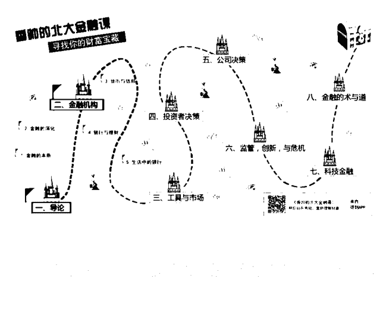

### 028 | 发行承销（下）：想上市的招股说明书写对了吗？

你好，欢迎来到睿师的北大金融学堂。

昨天课程里，我给你的发行了投行的一个重要业务，发行承销。投行的发行承销过程，特别像给新婚场子的媒婆，投行业务做的就是你给他一个姑娘的潜质，要么就是一个好姑娘，给她‘出去。可是有时候，一个姑娘的时阔，精力是有限的，你如果把她没有去就接触到很多的对象，也是好。但是没有时间去到所有的潜在对象，那怎么办呢？咱们得准备一份简历，其实这份简历，你不防就把它看作投资市场上的招股说明书。

招股说明书有多重要呢？我估计很多人在网上看过一篇篇，特别是有一些人，你企业去，比如投行的各种包装。尤其经过了这个招股书的包装以后，变成了一个家会闪闪光的企业，包装好点像一个资质很不错的姑娘，经过各种化妆、整容，甚至卖弄秀的妆扮，变成了一个超级大美女。从这个文章实际就可以看出，投行利用招股说明书对企业进行包装的能力是多么重要。

#### 一、红旗手：招股说明书

说起招股说明书，其实金融圈里的人经常用一个词汇，叫做“红旗手”（Red Herring Project）。“这个词汇其实是在美国起源的，当时为了保护证券信息的市场上市，SEC 也就是美国的证券交易委员会要求，企业招股说明书的初始版本是一个招股说明书。这个初步的招股书，包含招股书包含像关于公司的润色、经营等多种信息。为了让这些信息能够引起投资者的注意和关注，SEC 就要求，这个说明书的封面一定要用红色的字。

在英语世界，据说谎话的逃犯为了满超跑的大夫，他会在逃跑的路上放上红红旗手，叫红飘子这个单词，然后借此逃跑。后来“红旗手”这个词就慢慢地演化成转移焦点和注意力的意思。

由于招股说明书是为了吸引投资者的注意力的，渐渐地大家都管这个特别叫红旗手了，所以，如果吸引到投资者的注意，你在这一份文件里尽力去展示自己的企业的优势和特点。

这么说来很有趣，但是其实写那份简历的人都知道，一份简历还是起来不是那么容易的。招股说明书处理得不恰当，可能会导致 IPO 流产，整个上市会失败。

给大家举个列子，很多人也看到过六个核桃的“广”。这个企业从2011年就开冲上市，走了，经行 75 次了道，一直到2017 年才会，也就是2017 年它才通过了证监会发行委员会的审查，取得了上市资格。

你要说六个核桃是个烂企业倒也要了，可是问题关键是这个企业的利润率非常好，它的公司是家集团公司的利润非常能好，它一个数据，2016 年沪深两，A 股市场的平均净利率是 8.58% 左右的，养元集团的是这个净利率 28 倍到 29 倍，差不多 27 亿元人民币左右。这大好的一个姑娘，为什么路上走得头那么复杂？A 股市场的上市，里没有很多的复杂问题，很难一般而论，但是我们仔细研究了下证监会针对他们得招股说明书给出的一些意见，里面招股说明书确实有可以提升的空间。

在招股说明书里面写着，六个核桃募集集资金 33 亿，资金的用途就是营销网络市场开。但是你的招股说明里面也有些信息，说的是净利润说明 2 亿，对股东分红了 24 亿，却没有一分的银行卡贷款，还上银行购买了 47 亿 的理财产，你一听上去就知道，财务状况非常地良好。

但是结果出现了悖论，证监会的发审委员就，你这个企业财务状态这么好，根本不需要呢，为什么募集资金呢？有翻钱的媒婆。另外，发审委还问六个核桃的业务模式是源自前两个核桃厂，说你们 95% 的收入是来自于核桃，产品太单一，而且过度重视营销，轻研发。

其实你看，财务状况好，本来应该是件好事。企业的主要业务，也可以从反是理解，叫资产运营非常地集中而突出。所以实际上六个核桃的这些特点，你可以理解为，怎么表现，也可以理解为怎么沟通。这个时间，怎么包装，怎么沟通，怎么表达，都是非常有讲究的。你知道的，企业为什么需要投行？其实企业能做的就是投行的大心脏和能心。这个入脉搏的专业能力，就知道是哪些需要，是哪些的，对监管“合规”就是怎样的，理解了这些监管的要求之后，怎么在招股说明书里尽量地绕过这些可能的问题，这是投行的核心专业能力的一个非常重要的方面。

#### 二、A 股上市，投行的沟通能力更重要

所以，在 A 股市场上市，投行的沟通能力就是最顶级的核心能力之一。为什么呢？很多同学知道，美国、香港上市公司的注册制，也就是那些专门上市的，要按照规定进行信息报备，监管机构只管什么，不进行实质性审核，不进行实质性审查，或者仅仅进行形式审查。监管机构审查的意向判断，至限于文件的信息准确性是不是准确，至于这家企业是不是垃圾企业，就交给市场，留给投资者去判断。A 股市场不一样，A 股市场的实行的是核准制，也就是证监会的部门不仅仅是审查上市公告报表的形式，还要审查内容，去掉那些不好的公司，上市把关。

所以，这一来两者的中国差异就很明显了。美国，监管者的权力要非常弱的。在美国，企业只要充分信息集露的业务，进行注册就可以上市了。而中国的监管，是会被赋予更多监管的权力，而监管是抽象的概念，最后实施监管的，是人。在这个大环境下，企业是差，还差坏。企业在这个监管的大环境下，你会发现，投行的监管机构的沟通，对监管的理解和把握显得比美国重要多了。所以在 A 股市场上，选择一个特别有沟通能力的投行，确实是非常非常重要的。

这里有个列，像六个核桃，盈利这么好的企业，7 5 年冲击 IPO，结果差点流产了。但实际上，综合监管的，它承担了大理实际，你从财务上看上，它的业绩其实是连年 3 年下的，但是后果却是一次性就过了；还有中泰证券承销了一个叫中瑞电业的会，一方函本没有了 3000 万到 50 的一个标准，而且从产品角度，它也只生产一个，有有电和内容的，它也不是一次性过。难道我们平时老说，看打房市场上，美女是 3 分靠外表，7 分靠打扮。投资场上也是也是这个，投行也就是“媒婆”的这种沟通和包装能力真的是一个核心的竞争力。

## 今日摘要：

- 1. 在发行承销过程中，投行对于企业的包装营销，是企业成功上市的一个因素：
- 2. 招股说明书既是企业信息披露的重要文件，也是进行企业包装，和监管、投资者进行沟通的重要文件。怎么写好这份招股书是一个考验投行能力和专业的活；
- 3. 在中国 A 股市场的审批制度下，监管的权力很强，所以这就要求我们在国内的投行具有更强的、跟监管部门进行沟通，把监管分寸和尺度的能力。

我们在今天的课程中也说了，像美国、香港这些资本市场，注册制，而中国是核准制。其实中国的投资者也听了很多的新闻，说美国的和 A 股市场两者的核制相比，让我们想一想，在我们前面讲的注册制想请你结合今天的课程内容，想一想，在中国当前，你觉得监管是不是应该给我们投资者来解释信息，然后帮我们把握、区分谁是好企业，谁不是呢？

欢迎你把你 的想法写在留言区。跟我们分享一下。当然也欢迎你把你平时对这个问题 的困惑发在留言区，我们可以在下一期的发行承销工作的朋友，看看他们对我们问题的理解是怎么解的。

本期的课程已经讲完了，我清设计了一张张大的“寻宝地图”，在地图上点亮了我们的学习的知识点，也标明了未来某些的学习路，让你更清楚知道全面的学习脉络。

到全面的学习脉络。

另外，关于之前银行板块的延伸阅读《金融史漫谈|国家与银行》，可以参考微信公众号：“香帅的金融江湖”。

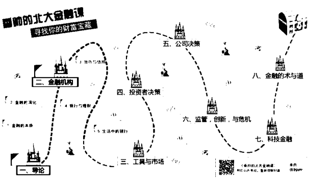


### 029 | 延展话题：谷歌上市记

你好，欢迎来到慕楠的大金融课。

前几天的课程里，我给你们讲了投行在发行承销中更重要的作用。到今天我来跟你们讲一次非常不一样的IPO，Google的IPO。

在这次的IPO中你会发现，投行完全变成了配角，华尔街百年的游戏规则被打破了。我们来看看这到底是一次什么不同寻常的IPO。

#### 一、不同寻常的IPO

首先，Google 在选择这种承销商、选择投行的问题上，就完全反了传统。是以一种非常怪异的状态去传统的发行的。我们在前面提到的，由于投行百年的老投行都是偏保守的，一般的企业要去发行，都是一家家地去拜访。但是 Google 不这样，它一次召集很多投行，再跟银行，然后说你们签一个保密协议，再填写一个详细的调查问卷，在这个问卷上 Google 像考官一样地询问这些银行的一些背景历史，比如说你承销的股票表现怎么样？你们是怎么承销股票的？你们对我们 Google IPO 的时机和定价到底有什么意见呀？

这个问卷复杂上来以后，Google 筛选出了包括高盛、摩根斯坦利、花旗等系列的投行来进行面谈。面谈的时候 Google 的承销商务和合法顾问跟同行们仔细地商讨后，最后就是这一片地去进了德士信贷这一纳指 100 的摩根斯坦利作为主承销商，在很分散的华尔街的 1 号街头，就这样的问卷简直是要命。

但是，第一，Google 为这次承销支付的费用非常高：1 亿美元高高的融资服务费。第二，更重要的是，当时没人想象 Google 这样的企业，自然想满城争强，还甚至要乖乖地好了问卷，希望能够得到 Google 的青睞。

在选择承销商上 Google 就已经反了传统，而在路演的时候它很不一样，平时一家公司在上市的时候，公司的高级管理，投行也好，一定会花很多的时间，比如一般两周的，从一个城市到另外一个城市，向机构投资者进行股票的推介，非常仔细、认真、殷勤地回答投资者的问题。

但是 Google 的时候，它们非常地另类，在路演的时候我们是不停地开玩笑，常常是拒绝回答投资者的提问。

除了路演不同寻常以外，最重要的，在传统的发行承销中，一般是投行去询价，然后给 IPO 定价。Google 不一样，它把定价的权力牢牢地捏在自己手里，比如在上市的时候，Google，大部分的投行人士听到这个数字觉得很搞笑，但是其实这是无厘头的十分位，而这种“草”的科技气势在整个 Google 的上市过程中都非常明显，而且 Google 也坚持了融资，尽管复杂，但是任性，我要就融资这么多钱。

到了上市的 7 月份，Google 把自己 IPO 的期望区间改成了 108-135 美金，这一一下子就引起了很大的震动。为什么呢？因为这个价格就意味着 Google 的发行价，多少美元来算，他定位价格之后根据投行和投资者反馈的意见，最后确定的定价。

但是 Google 偏不，它说这个价格是我对自己的判断，所以说我的价格，这是强势的态度，就引起了华尔街和主流媒体的极大质疑。最极端的是就是美林证券，也是反对上面的态度，就是行证券的一个条款说，他们公开地宣布，我们退出 Google 的 IPO 项目，甚至还建议自己的客户，你们应该对这个投票持谨慎态度。另外一些投行这个时候也开始推，拒绝 Google 去警告它的客户，离 Google 远远的。因为这个事情是个大烂摊子，Google 的纽交所，也加入了战场。

排在 Google 上市计划是加入的也是 90 年代的造势繁荣，这里面蕴含着过多的网络公司泡沫等等。

在这个混乱的局面中，最后 Google 做了个很大的让步，把发行价定在 78 美金，但即便这个价格，实际上也相比它公司定位高出五倍左右了。除了在价格区间上的任性以外，在定价的方式上它也是别具一格，它采取了一个叫“荷兰式拍卖”的方式，这个定价方式和华尔街主流的承销询价制度是很不一样的。

一般投行会根据市场上对企业的一个价格和机构投资者的需求，最高定定价一个价格，这叫询价机制。在这个过程中，你会发现投行有很大的权力，有时候你会发现发行出于风险考虑，身自己的利益考虑，有意地压低股票价格，维护自己生意地事情。

比如我们前面课程里说到的，当公司定价很低的时候就是一个很好的例子。较低的股价有利于新股票，也有利于老股东，我们很多时候看到这个定价是有关的，没有多少是源于利益，可不是对于公平来说应该是少兴的，可见不是太公平了。Google 说这个询价制度我不要，我要取一个荷兰拍卖的定价方式，名字虽然土，但是过程是真实的。

- 1. 第一步，上市公司自己发表公告，宣布发行股票的最大股东数量和价格的区间；
- 2. 第二步，投资者看到这个公告以后开始同时提交订单，然后在订单上写清楚，我愿意以多少的价格买多少股股票；
- 3. 第三步，根据一个由到高的拍卖方式，出价最高的投资者可以优先地拿到股票，最后的结算价格是将所有股票全部卖出的价格。

比如 Google 发行了 100 股，然后报价 90 美元，要求买 80 股，你的朋友报价 88 美元，要求买 80 股，最后你的你会优先拿到 80 股，你朋友拿到剩下的 20 股，但是最后的结算价格是把所有股票卖出去的价格，也就是 88 美元。

你看这不是简单拍买的方式吗？执行的作用是它被极大地拍卖削弱了，所以业就控制了主动权。正因为如此，Google 就把支付给投行的佣金比例从原来的 7%（这是一个国际通行的佣金比例）降到了 3%，它节省了大量的手续费，而且因为整个过程是在网上透明公开的，所以投行的操作空间是比较小的，公司的股票就可以卖给比较多，要是投资者的，并不是所有的企业都适用于来这种方式来进行 IPO 的，因为它需要上市公司本身具有强大的市场地位和足够多的知名，所以投资者也投资关注，如果能小组这么做是很容易成功的。在 Google 之前，采用荷兰式拍卖的 IPO 定价之前，例如 1%，第二年开始迅速地上升，当然也站在 5% 左右，像 Facebook 这些互联网明星企业大多都会来买这些方式。

好了，经过了这一系列非常棒的措施之后，Google 还是成功上市了，以 85 美元的价格发行，开高就涨到了 1000 美金，这是 2004 年的事情了，到了 2017 年的时候，我们都知道，Google 的每股收益是 1060 美元，成为全球第二大公司，对自己的资产了成立两年保持的状态了，所以它的估值是正确的。《华尔街日报》就评论说，"Google 重塑了一直沉默的投资者银行体系"。

#### 二、资本为主时代的结束

刚才我跟你分享了 Google 非不同的 IPO 故事。其实很有意思的问题，为什么 Google，还有 Facebook 这些企业能够这么任性呢？一个很自然的答案就是，这些企业很牛、很强势，是的，就是我刚在课程里说的，公司实力足够强才有任性的资本。

但是我还要告诉你，这不是核心的答案，真正的答案隐藏在着这个时代在宏观背景的转变中。我们前面临的是一个什么时代？这是一个金钱来钱不冒烟的时代，原这个世界资金多、资金稀缺，当只有有资金的人就掌握着话语权。

但是从二以后，全球进入一个史无前例的存资本时代。有无巨额融资资本存款在不断上升。有尤其 2008 年以后，全球进入了一个量化的时代，全球的利率不断地下降。我们在前面课程课说过，在 90 年代的时候，全球利率 6%~8%，现在 2% 一 3%，欧洲和日本甚至出现了负利率。在钱来钱不冒烟、大家钱在追逐好项目，那好项目中什么东西最关键？

人力资本最缺，企业越来越靠，所以企业和业的话越来越强，而且越是科技含量高、人力资本集中的行业，企业的主动权就越大。


### 第六周课程回顾与问答

企业的主动权就越大。

所以说原来资本为王、投行为王的这种时代，正在悄悄地发生一些变化。其实 Google 绝对不是唯一的例外，在几年的 IPO 中，阿里巴巴、京东其实都显示了自己非常强势的一面，他们尽管没有要求在 IPO 定价上这么反传统，但是他们都要求要以较少的股权拿到更多的控制权，这个话题我会留到下周的延展话题里再和你继续深入地讨论。

所以我为什么一直说，对于有梦想、有能力的人来说，我们现在所处的这个时代是最好的时代，抓住机会，每个人都有可能站上风口。

#### 今日概要

##### 划重点

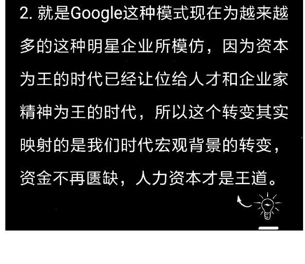

#### 香帅

现在全球面临着一个特别大的宏观环境的转换，从原来资金特别贵的这么一个资本为王的时代，转入了资本没有那么值钱，人力资本、企业家精神更加值钱的这么一个时代。你觉得这么一个宏观和金融背景的转换，会不会对你的整个人生投资决策造成很大的影响呢？你既可以从你的金融资产配置的这些决策上来讲，也可以从你的整个人生规划上面来给我们分享一下你的见解。

欢迎把你对于金融资产的配置、对于人生规划的一些想法发在留言区，跟我们一块分享，也欢迎你把今天的内容分享给你觉得你人生中最美的朋友和伴侣，看看他们对这个问题是怎么想、怎么看的。

我在第三周的问答中，答应大家，订阅人数突破 8 万，就给大家讲房地产问题，没想到这才第六周，就突破 8 万了。我也会如约履行承诺，在明天推出你最关心的“房地产问答”，解决关于中国房市，你最想知道的那些问题，我们明天见。


### 030 | 本周问答：房地产泡沫到底是怎么回事？

你好，欢迎来到香帅的北大金融学堂。

今天是本周问答时间，其实前两天就已经有很多的同学在后台给我留言说，老师，您的专栏马上上市了，老师，我想提醒你最好先给大家做一个房地产的专题。今天我信守承诺，推出这个房地产问答的专题。

> 北京的房价这么高了，到底会不会涨？中国的房地产泡沫到底有没有？如果没有泡沫的话，为什么国家要出台那么多限制房地产交易的政策呢？

#### 一、北京房价这么高了，会不会跌？

首先我们来看看北京的房价，北京其实一直是房价泡沫问题的焦点，为了解决这个问题，我们首先要思考，我先是自己的一个疑问，北京的房价应该比谁贵才是比较合理的？这个问题是个好问题，但是美国那么发达，肯定是纽约最贵了。且慢，分析用基础经济学框架去告诉你，价格由供需决定。比如如果你告诉我北京的土地资源，北京的供给是稀缺的，而需求上，高收入人群对房子的需求是刚性的，那房价自然会高，对不对？

1. 首先我们从需求来看。北京是中国的政治、经济、文化中心，资源是高度集聚的。纽约是美国的经济中心，是美国的政治中心是华盛顿，文化中心是洛杉矶，纽约只是一个经济中心。北京是一个资源集聚的大城市，其资源集聚效应和经济发展潜力非常大，因此北京的房价理应高于纽约。而美国的纽约是美国的金融中心，北京聚集的是政治、经济、文化等多方面的资源，所以从资源聚集和潜在经济能力来看，北京的房子比纽约的应该贵。
2. 咱们接着来看看供给。北京住房作为最重要的公共产品，它应该是一个最公平的资源分配机制。北京住房供给的特点是，总量是巨大的，但是相对于需求而言，还是有限的，这就是为什么北京的新房价格一直居高不下，而二手房价格相对稳定的原因。

现在我可以给你简单总结下了，房子其实无非就是看供需，它的价格是供求关系决定的。北京的供需格局是供给小于需求，且供给是相对固定的。你看考虑到，我们国家在 2023 年到 2024 年，我们会进入一个高收入的行列，大概率事件是在 2030 年左右成为全球经济第一大经济体。

那现在是一个什么情况？现在在可比的一个区域和档次上，北京的房价是纽约的 1/5。纽约的房价大约是北京的 5 倍。我们是 1 万港元（或美元），北京大概两千多美元。我们再看看高端的大概，纽约每平米的价格折合人民币是 30 万左右，北京是 15 万左右。所以说我们认为中国的房价会继续平稳发展，社会总体结构会继续稳定下去，那么对比纽约，北京的房子是具有很大投资潜力的。

这个结论可跟踪我开设想得很不一样，对不对？时间关系，我就不再进一步展开了，以后有机会再跟你详细解释的框架。

但是在过去的这几十年里，房价节节上涨其实造成了很多问题，比如说房产的信贷资金成本太高，会流失，年轻的人才留不住，还有那么多三四线城市因为过度依赖土地，土地财政导致了一系列问题。

我觉得那些使用过高的杠杆，还有很高税收等办法去抑制房贷的需求，这样其实并不符合。第一，如果国家政策决策目标是遏制房价上涨速度过快的趋势，可以通过税收、监管，甚至限购等办法把这些推盘和套利。但目的不是抑制需求，而是让那些投资性需求付出高成本。

#### 二、中国房价有泡沫吗？为什么要频繁调控？

下面我再谈一下关于房价泡沫的问题。其实刚才我也讲过，房价的背后是什么？房价是一个国家的经济增长、城市化和货币化综合作用的产物，经济增长、城市化和货币化是影响房价的主要因素。如果经济增长慢、城市化低、货币化低，房价就会相对低。反之亦然。

目前我国的房价收入比，只有美国、日本等发达国家的 1/5，还有很大的上涨空间，而发达国家的城市化率在 80%，我们国家大约为 57% 左右，也有很大的发展预期。所以从经济增长和城市化两个角度，中国房价有很大的空间。

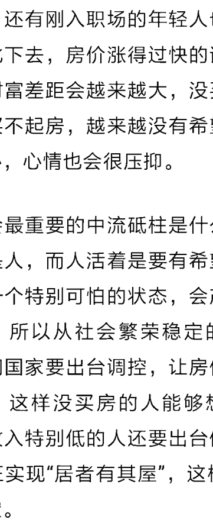

更重要的是，在城市化的过程中人口进一步向大城市聚集，而我国目前的城市化人口基数低，是美国的 4 倍，日本的 10 倍。未来我国大中型城市的人口还会增加。所以你看，在很短时间内，总体的房价并没有下降。而经济总量庞大，这说明了什么？这并不是说大家都不理性，而是证明了中国的经济增长非常快，城市化水平也没得降低，所以在城市购房的需求也很旺。

好了，我们说完了经济增长、城市化和房价中的基本关系，接下来国家要做的就是，如果房地产泡沫没有，那国家为什么要出台那么多的调控政策？

其实这个问题真的是非常复杂，涉及到了反周期调控思路更深层次的逻辑，其实你可以问一下，如果没有泡沫的话，政府都不用调控房产了吗？仔细想，其实可能有很多原因是政府想要调控，其中最关键的一个问题就是财富分配问题。

中国的经济增速在过去几十年里面实在是太快了，就像什么呢？就像一路奔驰的火车，而这些大城市买房的人为获得优势，于是竞争非常激烈，买到了房子的人赚了很多钱，没买到的则越来越痛苦。这种失衡导致了社会情绪的不稳定。

一个社会最重要的中流砥柱是什么？归根结底还是人，人活着是要有希望的，没有希望，是一个特别可怕的事情，会产生很多的问题。我们可以从社会稳定的角度去理解，国家要出台政策，让房价不要再上涨过快，让更多人能够买到房子，真正实现“居者有其屋”，这样社会才能稳定。

所以房地产调控不是调控价格水平，而是调控上涨速度。让房价的上涨要适度，符合社会财富分配，是国家长治久安的一个稳定状态。

好了，关于房价泡沫和为什么要出台那么多调控政策，我简单地先讲这些，后面如果我有新想法的话，我会在后续的课里还会提到。

> 老师，能不能请教一下您，最近三、四线城市的房价猛涨，您觉得 2018 年三、四线城市的房市会如何？我如果老家的几套房卖掉，来北京买一套，是不是明智的投资呢？

#### 香帅

“奋勇前进”同学的这个问题我觉得提得特别好，说明他对房价的区域差异有了很深的思考，但是每个城市其实不一样，每套房子的地段、房龄、土地性质都可能不一样。所以我很想给出一个千人一面的回答，但是这里我给你提供一个思考的框架。

你不妨这么问一下自己，在目前的房价基础上，未来的房价增速是大城市快还是小城市快？这个问题要怎么回答呢？我们可以换一个角度来想，因为城市的发展归根到底是人的发展，所以未来的人口趋势是往大城市还是往小城市迁徙，换句话说就是未来的趋势是小镇的“田园牧歌”，还是大城市的“匆忙拼杀”？好的问题是正确答案的一半，这样一问我想你已经知道答案了。

从城市发展的规律来看，人口是要往大城市聚集的，就像在一本书里面所说的，“人类演化的一条轨迹，是更多的人离开土地。田园牧歌（摘自徐远《人·地·城》），田园牧歌因土地、人是生活便利、职场机会、收入水平、教育，还有医疗条件等各方面都比不上大城市，最后人们是要往大城市聚集的。这不仅仅发生在中国，也发生在美国、发生在日本，发生在所有的国家。

给你举个例子，你看不见不管生活条件多么艰苦，外地人还是愿意留在北京、上海、广州打工，为什么？用我们家长姐的话说，这里一个月打工的钱比在家里一年种地的钱还多得多。就业多、收入比在家乡多。如果说要不要那些志存高远的年轻人，他们觉得和亲人根本就不能放下自己跋荡的青春和灵魂，大城市里机会多多、视野开阔，可以领略到完全不一样的风景。

当然了，现实中每个人的感受不一样，有的人就向往小城市波澜不惊的生活，比如说少数一些人会卖掉北京、上海的房子，回到家乡发展，这其实是个人选择，个人的情况有好有坏，每个人的偏好不同，你不能用简单的标准来评价。其实你也还能看到很多人做了这些决策的人后悔，又杀回大城市的例子，逃离北上广毕竟不是普遍的现象。其实我自己就是一个很好的、活生生的例子，回到北京来以后，因为雾霾我得了鼻炎、偏头痛，每逢冬天就发作，感到很不方便，所以要冬季来临前，雾霾一起来，我就赌咒发誓要离开北京，到山清水秀的地方去生活。可是别忘了“人类的记忆只有七秒”，一旦雾霾散去仍然会乖乖地留在北京，为什么？小城市没有北大，也没有这么多好玩、令人激动的事业。

我再给你一个数据，目前我们的大城市率，也就是说百万以上城市人口占国人总的比重还是非常低的，不到美国、日本等国家的一半。日本这个数据大概是 64.7%，中国是 23.8%，这意味着什么？意味着中国的人口聚集还有很大的空间。所以我认为是这一点上，未来大城市房价的上涨速度，是会更快；也会有投资价值。


今天的房地产问题就只能摘取几个大家普遍关心的简单回答了，其实关于中国房市真的有很多的问题，也有很多的内容可以说。房地产不但是最重要的居民资产配置，也和国家的经济增长潜力息息相关，并且在这个问题上，市面上各种信息特别杂乱，用情绪代替数据和框架分析的内容比较多。

所以我们一直也在考虑，要在春节期间推出整整一周的房地产专辑，为你详细解读中国房市，比如说中国房市是不是和日本一样会经历泡沫破灭？比如说二、三线城市，的房子还能买吗，哪些城市更具潜力呢？比如说有很多人说，买房的租售比很高，说明房价太高了，这靠谱吗？我们要怎么对股票、债券、房租的收益率进行正确的计算呢？最后还有推行限购会不会让房价下降？房地产税的推出又会对房价有什么影响呢？

#### 香帅

我现在还在考虑这个房地产专辑的问题，欢迎你把它分享给你的亲人、同事和身边的朋友，请你跟他们一块分享关于中国的发展，你们还有哪些困惑，我会考虑把这些困惑加入春节的房地产投资专辑里面去，希望我的未来可以和你的家人一块收听，在新的一年做出正确的、长远的投资决策。

最后想赞一句，我坚信几年之后你会发现，今天仅仅这一篇文章就已经是这门课程价值的千万倍了。就像我昨天说的，这是一个人的智力比资金值钱的时代，所以正确地投资自己永远是最好的选择。


#### 第六周丨课件放送：本周划重点时间到!

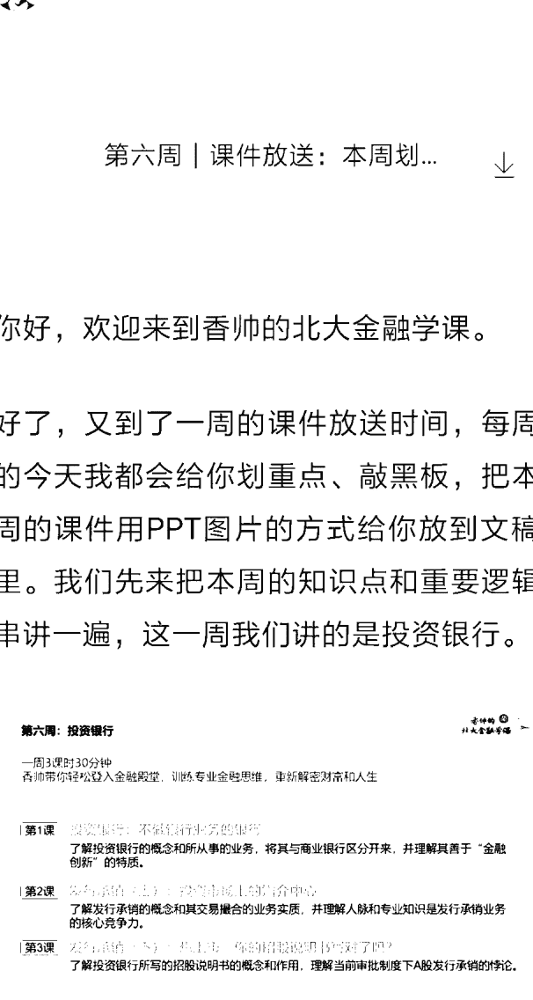

你好，欢迎来到香帅的北大金融学堂。

好了，又到了本周的课件放送时间，每周的今天我都会给你划重点、放模板，把本周的课件用 PPT 图片的方式给你放到文稿里。我们大家把本周的知识点和重要案例串讲一遍，这一周我们讲的是投资银行。

##### 第一天：投资银行：不做银行业务的银行

第一天我给大家讲述了投资银行的历史沿革。我告诉大家投资银行不是银行，在 20 世纪 30 年代之前，投资银行和商业银行是共存于传统的银行业务之中的。

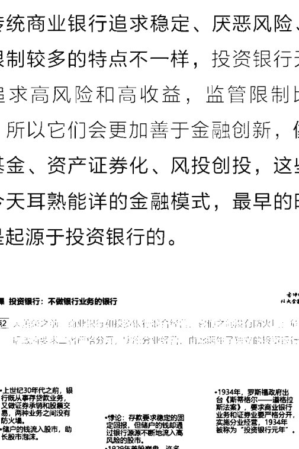

这样产生了问题，因为存款本来就是想要稳定的收益的，但由于证券投资商业银行的业务没有分家，所以这些存款流入了高风险的股市，结果在操纵融资的时候很多中小银行相继破产，搞得投资者和储户都叫苦不迭。那么在这次危机之后，美国政府出台了法案要求分业经营，所以 1934 年以后，投资银行开始独立于商业银行而存在。

与传统商业银行追求稳定、厌恶风险、监管限制较多的特点不一样，投资银行则是追求高收益和低风险，监管限制比较少，所以它们会更加于资金创新，像货币基金、资产证券化、风险对冲，这些都是我们现在耳熟能详的金融模式，最早的时候都是起源于投资银行的。

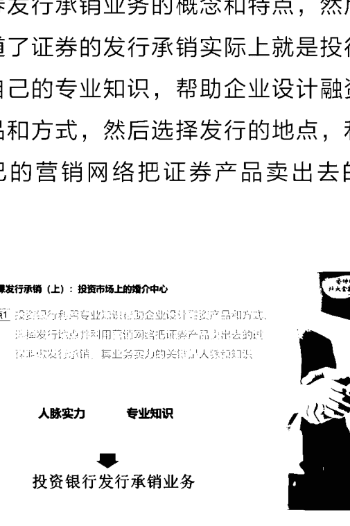

##### 第二天：发行承销（上）：投资市场上的婚介中心

从第二天开始，我就给大家介绍了投资银行一类重要和基础的业务——发行承销。在第二天的时候，我给你介绍了发行证券发行承销业务的概念和特点，然后你知道了证券的开发知识，帮助企业设计融资的产品和方式，然后选择发行的地点，利用自己的营销网络把证券产品卖出去的过程。

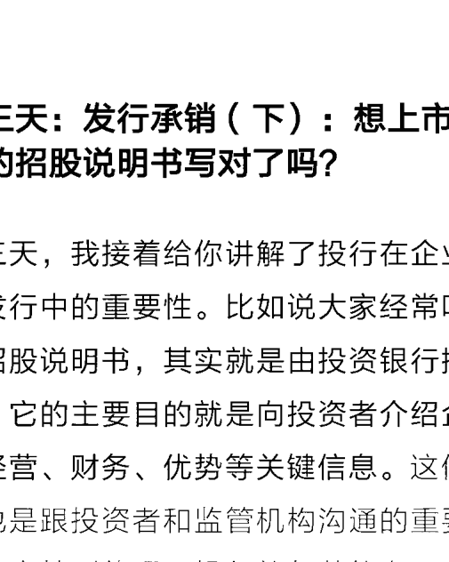

为了高效率、高收益地完成这个过程，投资银行需要具备两种核心竞争能力，第一是广阔的人脉圈，第二个是金融的专业知识。

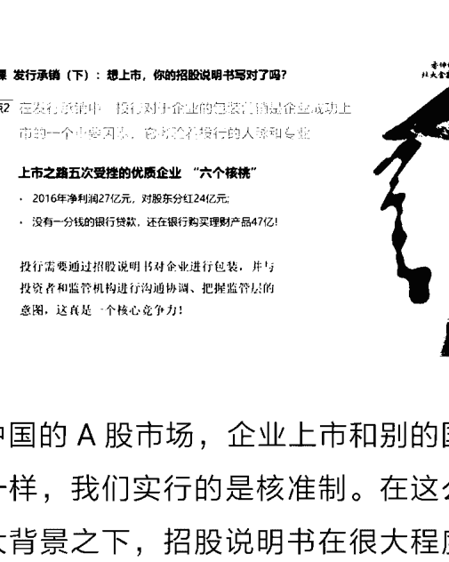

##### 第三天：发行承销（下）：想上市，你的招股说明书写对了吗？

第三天，我接着给你讲解了投行在企业上市发行中的重要性。比如由大承经常写的招股说明书，其实承实际的就是投行拟写的，它的主要目的就是给投资者介绍企业的经营、财务、优势和监管信息。这份文件也是联系交易者和监管机构沟通的重要文件，它特别体现了投行的包装能力和专业素养。

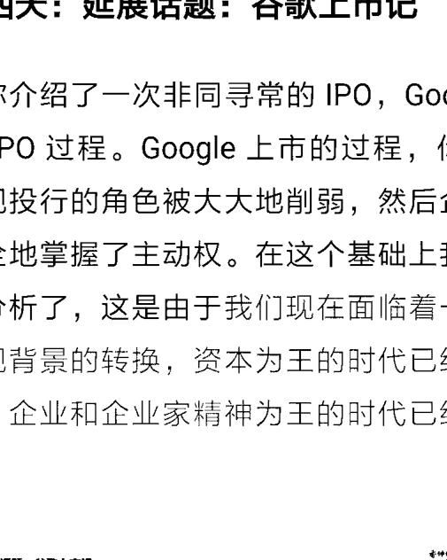

在中国的 A 股市场上，企业上市和别的国家不一样，我们实行的是核准制。在这么一个背景之下，招股说明书会很大程度上决定企业上市的成败与否，这既使得投行很凸显出沟通的能力，在这么一个投行市场上显得特别重要。有时换一个招股说明书没有写好，会搞掉一些资质很好的企业不能上市。一些业绩比较普通的企业反而能够顺利上市。

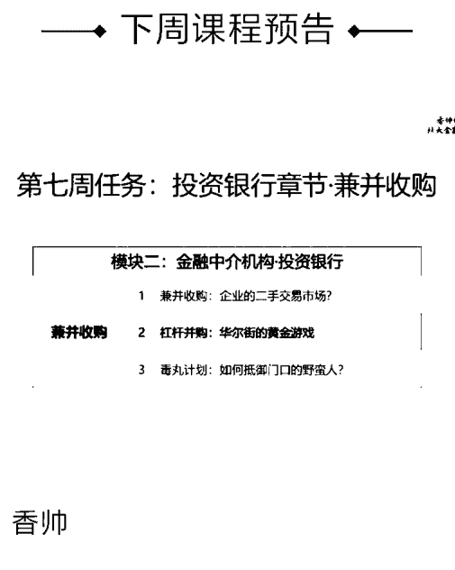

##### 第四天：延展话题：谷歌上市记

给你介绍了一次非同寻常的 IPO，Google 的 IPO 过程。Google 上市的过程，你会发现投行的角色被大大地削弱，然后企业完全地掌控了自己的上市。在这个基础上我给大家分析了，这是因为我们现在面临着一个宏观背景的转折，资本为主的年代已经过去了，企业和企业家精神为主的年代已经来临。

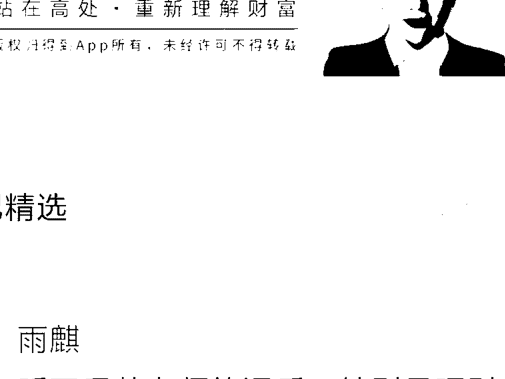

##### 下周课程预告

第七周任务：投资银行章节 荐并购


鲁帅 附送课件 下载链接：http://pan.baidu.com/s/1pMMF3Mz

我希望你真正地学到了这些新知的同时，也在自己的记忆里了解到了那个不是传统投资银行汇总，也被称为新的投资银行是一个什么样的新银行。

欢迎你把你学到的知识分享给你的家人、朋友和同学，看看他们的认识是不是和你一样。好了，感谢你的收听，周末愉快。


笔记精选 雨晴 听了鲁老师老师的课后，特别是理财方面

### 加餐｜顶级投行高盛是如何挑选人才的？

加餐｜邀请你参加一场高盛...

你好，欢迎来到香帅的北大金融学课。

在这周，我重点给你讲了投资银行的业务——发行承销。在发行承销中，投行的人脉是非常重要的资源。我还在本周第 2 天的课程中给你留了一个思考题，让你说说想投行业，需要具备哪些素质。

正好隔壁吴军老师的专栏《吴军的谷歌方法论》，讲到了谷歌招聘高盛的一份面试法。在征得吴军老师同意后，把这招高盛选人绝学贡献给你，作为今日福利送给你。看看你是否具有成为投行精英的资格。

在 2000 年时，微软是全世界市值最高的公司，而且几乎所有的商业竞争者中无往不利，即便官司也不落下风，以至于大家不知道谁会是它的对手。

于是记者就把这个问题询问了它的创始人盖茨。盖茨说是高盛。为什么盖茨会说一家和自己的商业上完全没有交集的投资银行是自己的竞争对手呢？因为他认为公司之间的竞争，最终是人才的竞争。

我接触到高盛是两年后的事情，那时微软已经不如从前了，整个 IT 行业都陷入低潮，不过当然依然很强。

有一天高盛的人托朋友找到我请吃饭，他说素昧平生，吃饭就免了，有事说事。高盛的人像 Google 的股票子，那时他们看了我们上市场，股票随时都会成为废纸，事实上同期的互联网公司还在不断倒闭。

因此，我好奇他们看中了 Google 的哪一条。高盛说，因为他们看见全世界都在 Google。后来我和高盛合作了很长时间，应该讲他们是我金融知识的老师。

在所有的投资银行中，高盛比其他的高很多，当大多数是人员素质比较局域，和高盛打交道时间越久，我也就越了解高盛招人的特点。

简单地说，高盛招人的原则有点像佛招生态，喜欢高个子的、性格外向的、具有领导力或者善于与人沟通的人。进入高盛的人什么背景都没有关系，也就是原来什么专业并不重要，对于大学生来讲，只要有基本的金融知识就够了。

但是，高盛对人的实力非常看重，特别是看一个人的思考方式，以及遇到问题的解题的过程。今天我和你介绍高盛三道有代表性的面试题。

#### 第一题：时间在 3:15 的时候，分针和时针的夹角是多少？

这道题学过初中几何的人很容易算出来，但是在美国大学里一些奇奇怪怪、很文凭的人话翻译不出来，我们在那次面面的谈话里，美国大学里有不少的尖子生，需要翻到出来解释。

因此考这种一道简单的题目，就不敢声色地考很多学金融的学生，对数学不敏感的人刷掉了。一个学金融的本科生，你让他算利他得清楚复息呢，但是高中数学早忘光了。一个好的做金融的人，对数学极不敏感，而人就是也恰恰大大对数学不敏感。

#### 第二道题：纽约上空在任何一个时间点，有多少架飞机？

这是考察候选人收集信息，然后入手解决问题的能力的，至于是猜出的答案是考多少并不重要，当然，最终的结果。

通常有点常识的人知道纽约附近有四个国际飞行，如果按照每个飞行每分钟起飞三架飞机，同时降落一架飞机，那么这三个飞行大约一小时降降两架飞机。

飞机在降落前和起飞后不远的高度如果按照每小时 300 公里计算，而纽约的直径大约是 30 公里，就是说飞机在起降时有 6 分钟是在纽约上空的。因此任何时刻纽约上空平均有 2X6=12 架飞机。

当然，如果飞机起降的间隔是两分钟，那四分钟，结果会不会一样，但是这没有关系，不影响面试的结果。

另外，从不同的视角出发，还可以采用不同的路径解决这个问题。

比如，如果知道其中一个机场—肯尼迪机场每年起降的飞机大约是 42 万次，假设机场的降落和每 18 小时是繁忙的结算，得到的结果和前面一种方法的估计差得不多。对于这种方法，解决问题的方式比答案要重要得多了。

高盛为什么会有这种问题呢？因为要想估算一个市场的大小，一个公司收益上下的规模，就是收集信息，做合乎逻辑推理的过程。

#### 第三道题：如果你被压缩在一根铅笔的芯里，掉进了果汁搅拌机中，怎么办？

读文字的朋友看一下下面搅拌机的图，有一个大致的概念，听音频的朋友可以想象一个玻璃的容器，下面是一把旋转的刀。


这个问题我问了不少中国人，大部分人是在考虑如何出来，因为一个约 8 厘米大 30 厘米高，一根铅笔芯大约有 20 毫米，似乎不像掉进笔里那么难。但是搅拌机四壁是玻璃，光滑无处着手，加上下面有把刀，几乎救不了自己。

当然，还有人想办法的如何通过搅拌器推理，这其实也不容易，因为人比从小 20 毫米的身体只剩下原来的 1/1000 了，一个 60 公斤的人只剩下来 60 克，要推推一个 100 克的搅拌器几乎不可能。

据高盛的朋友说，考这道题最主要的目的有两个，一个是看候选人是否能满开大胆思考，第二个是，是否有人对搅拌机问题有创意力，另一个是看候选人是否对这样奇怪的问题感兴趣。

我接下来问了一些高盛里面的朋友，和其他一些投行的朋友，他们给出的答案就复杂很多。其中比较有创意的答案有这么几个：

1. 与其自己想办法爬出来，不如想办法求救，比如喝等，甚至如果手机还在身上就打电话，或者在玻璃容器内写求救意图等。事实上，任何独靠自己努力试图爬出来的想法都不现实。
2. 还有比较有想象力的答案，除了上面的求助外，建议过回来先考虑是掉进搅拌机的话，怎么避免被搅拌器切碎，这样下一次可以尽量避免割伤或麻烦的发生。
3. 还有人指出，如果有人钻笔大小，脑子比铅笔尖的大成不了多少，脑子大得可怜，因此不可能想出好办法，也不会意识到危险的存在。因此高人提出，我们本事的脑力，对于复杂的问题其实是有能力办法的，需要借助计算机这样的工具。

今天的金融复杂比我们自己复杂得多，远在搅拌机场景千百倍，我们在它的面前，不过是一个脑子只有像家大小的小人儿已。

能想到这三个答案中的任何一个，这道题就是回答得非常圆满了。


此外，高盛在面试毕业生时，还会问一些金融常识和与人沟通技巧的问题。

从高盛选拔年轻人的方式中，我看到了这样几个原则：

- 1. 基本的专业知识是必要的，这就如同我在上周讲到的大学生总得学一点专业技能。与人沟通的基本技巧也是需要的，这也是我一直强调大学四年需要把一个懵懵懂懂的人变成一个社会的人的原因。
- 2. 一个人用什么样的思路解决问题，比知道答案更重要，这一点高盛和Google、微软没有什么区别。
- 3. 知道自己能力的边界。如果遇到超出自己能力的问题，应该求助于别人，而不是自己傻干蛮干。中国人在跨国公司里常常遇到所谓天花板的困惑，根据我的观察，其中一个原因是不善于求助别人。

我之所以在讨论工程思维时加入了高盛的例子，是为了说明世界上各行各业的精英都有一些共性的地方，比如他们善于解决问题，更看重方式方法，而不是简单地要结果。希望这些对你有所启发。

祝近安！

## 今日概要：

##### 划重点


#### ◆— 今日思考 —◆

高盛的第三道面试题，如果你被压缩成一根铅笔，掉进了果汁搅拌机中，怎么出来？你有什么好的想法么？


### 031 | 兼并收购：企业的二手交易市场

你好，欢迎来到香帅的全益金融课堂。

上周，我们讲了什么是投资银行，还有投资银行的一个最重要的传统核心业务，发行承销。那么传统上，我会给你讲另外一个重要的银行的传统核心业务，兼并收购。很多学金融或者投资的同学应该已经注意到了，最近中国市场上市的东西特别多，就是兼并收购市场。比如说说，两大巨头，阿里巴巴和腾讯，现在天天在兼并收购市场。这几年中，阿里巴巴收购了300家大大小小的企业。你耳熟能详的企业，优酷、高德、都已经被我拿下。哦哦，就更别说，收到了500多家企业，包括美国的暴雪、新加坡的LevelUp等名的企业。就满不是说的市场上，前一阵子我老是看到滴滴和快的合并，携程我收购了去哪儿，最近还疯呢，摩拜单车收购小黄车。

那你可能会奇怪，为什么市场上会存在那么多的兼并收购行为，企业不自己好好地经营，为什么要去搞兼并收购这个事呢？其实，兼并收购和发行承购一样，也是帮助企业创造价值的例子。

在上章，我告诉过，投行在发行承销的过程中就像是婚姻中介，要更好的企业找到好的婆家。其实兼并收购也有点像婚姻市场的婆家，不过这个市场有点不一样，它是卖方市场，它的目的是通过资产的重组来提高效率，实现价值。

具体来说，兼并收购一共有四种创造价值的模式，下面我一个一个地来讲。

#### 一、规模和协同效应

简单地说，就是企业太小，太分散的话，各自为政，市场分裂，就不利于业务的协同和企业的标准化，这样就会产生一个成本过高，效率过低的现象。这个时候，如果有兼并收购，就会大地提高效率。

我们来看一个例子。世界第一次大规模的兼并收购发生在19世纪末期，当时美国铁路行业全烂了，全国约有6000家大大小小的铁路公司，而且这6000家公司的各自为政，有时候你会发现一条大铁路上有2条、3条公司同时运营，铁路的尺寸都不一样，铁路的价格也很混乱。

所以，当时整个美国铁路的效率是非常低的，这个时候，美国最大的银行家，也就是我们的华莱士·格雷里一派的投资家们，就像当年J.P.摩根就发现了这个情况。然后发现，这些兼并就提供了一个可以高效率的机会，就是把这些铁路公司全部兼并整合起来，所以他们就陆续合并了美国最有名的两家铁路公司，当时开始联合了，怎么做呢？就是大家吃小鱼，小杂还吓大。把大大小小的铁路公司合并，把铁轨的标准统一一下，然后派团队去各个公司的董事会，加强管理，进行一系列的资产重组，据说，当时大概有1/3的铁路公司加入了J.P.摩根就范尼比亚的兼并收购的体系。在此之后，美国的整个铁路系统的版图变得焕然一新，变得非常地高效，所以，这是一个关于兼并收购能够产生协同效应、规模效益的经典案例。

其实，不管是美国的铁路系统，那些你能耳熟能详的美国巨头企业，像通用汽车公司、通用电气公司、美国电话电报公司，其实都是通过兼并收购而来的，然后在这个兼并收购的基础上产生了规模和协同效应。

#### 二、分散风险，多元化经营

一个企业如果业务很单一的话，它可能就会行业景气与否的影响比较大，这时候，你如果把自己业务的拓展到其他的领域，就可以规避这种周期性的风险。

这种类型的兼并收购，出现在上个世纪的60年代。当时，有一个著名的理论，叫做风险分散理论（Diversification），就是说不要把蛋放在一个篮子里面，这个策略本来是运用在股票投资的，后来投资银行家们就想到，这个理论完全可以复制到企业上，是个巨大的商机。

像摩根和高盛这类投行，就开始四处推企业搞多元化经营。一种是纵向的，比如家居房地产企业，它去兼并上下游的家具、装修的企业，这样子可以先生产协同效应，还能够分散风险。另外一种是横向的，比如像医药行业，可以跨界去做保健食品，这样可以拓展了业务范围，做跨了行业，并且最重要的是，你经常不行业行，东方不亮西方亮，这个行业不景气，另外一个行业还可以挣钱，这样，风险就降低了。

#### 三、专业化瘦身

多元化经营是有好处的，可是如果多元化经营过了，它也有坏处。为什么？难度大，不同的行业在一起，管理的难度就增高了，机构臃肿起来，那样协同效应不但不能增强，反而会很有副作用。所以，到了九、八十年代的时候，我就发现，这些多元化经营可能是到头了，它就开始新一轮的兼并，叫做以专业化瘦身就是把那些非管理的、非核心的业务剥离，太不管理的业务卖给分公司，给别人管，这样可能各得其所。因为我管得不好，可能别人可以管得好。

其实像我们关注企业在审核企业上市的时候，要专业化瘦身审查上市，其实这个原理也就是专业化瘦身的原理。通过专业化瘦身之后，企业的效率也可以大幅度提高，七、八十年代中，就兴起了一轮专业化瘦身，突出主营业务，增强企业核心竞争力的兼并收购的浪潮。

#### 四、强强联合

这是什么意思呢？这有点像那种门当户对的婚姻，意思是说，你是一个非常好的企业，我也是个非常好的企业，但是我们的特性、特点不一样，我们把资源放在一起，可能有很好的互补作用，而且甚至可能产生1+1>2的效果，让你们彼此都更强势，还可以开拓更大的市场，达到一加一大于二的效果。

这里有一个很著名的例子，就是在这个世纪末的时候，有一个世纪并购的案例，美国在线收购了时代华纳。美国在线当时在线人力资源特别强，时代华纳是线下资源特别多，所以当时两个一强合在一起后，就可以产生无数的想法，有庞大的想象，空间。这是1000多亿美元的并购案，在当时产生了很大的反响。

这种模式，到现在其实也是非常非常流行的。最近你在市场上看到的很多并购案例，都是这种模式。比如说，阿里巴巴和银泰，就是采取的这种方式。阿里巴巴大家都知道的，有很强的线上的零售资源，银泰是有强大的线下零售网点，那么它们一合起来，就实现了“马爸爸”线上线下零售。所谓零售就是要是线下门店，开拓新的市场，这个市场是一个空间和时间都非常大的市场。

这样的例子其实还有很多。亚马逊为什么要收购全食超市，腾讯为什么要收购阅文传媒？其实简单的逻辑都是一样的，看线上资源和线下资源的结合，强强联合，要去挖掘出某一个巨大的潜在市场的潜力去促进它。

#### 五、投行始终激励着兼并收购的发展

刚才我们梳理了一下，兼并收购有四种模式，从而满足企业的需求，满足市场的需求，创造了价值。通过刚才梳理，我们也发现，兼并收购背后，这种创造价值的过程其实也是经过了一个时间的变化，然后发展到现在。强强联合这种模式变得越来越普遍。

最后我还得强调一下，兼并收购这种业务模式是投行创造出来的。在兼并收购的过程中，投行提供的作用是很多的。首先，它能发现价值创造的机会，所以这就要求投资银行具有很好的战略眼光。其次，它要发现机会，还要很好的资源整合，这些资源包括人力资源、很高的协调技巧，以及资金资源。最后，还需要有各种专业知识。

而且，随着金融市场的发展，你会发现金融上的专业知识变得越来越重要，覆盖了很多方面。比如说，在兼并收购期间，很多资产管理做法，要有会计设计中的知识和法律的知识，而且现在的兼并收购经常是跨国的，所以你要对国际上的知识，涉及到不同的行业，你对于这些行业还要有非常真正的理解，相关企业的专业知识也要丰富。

所以，回顾一下兼并收购的这个发展过程你会发现，投资银行不但帮助创造了价值……

你就会发现，投资银行不但发明创造了各种兼并收购的模式，而且推动了整个兼并收购业务的发展。

## 今日概要：

##### 划重点

- 1. 兼并收购的四种价值创造模式：规模协同效应，分散风险，专业化瘦身，以及强强联合；
- 2. 在兼并收购的发展中，投行始终扮演着重要作用。

**香帅**

就像我们刚才在课程里说到的一样，现在这种兼并收购发生在整个社会生活的方方面面。你看，滴滴兼并了快的，也兼并了Uber；携程把去哪儿给收购了；大众点评和美团合并了；乐视收购了易到；宝能要举牌收购万科，这一系列的兼并案，你觉得对你的工作和生活产生了什么影响呢？

欢迎你把你的思考、观察和体验、感受在留言区，跟我们一块儿分享。然后，你也可以把今天的内容分享给你的朋友，和他们聊一聊这些在我们生活中天天发生的兼并收购的案件。

### 032 | 杠杆收购：华尔街的黄金游戏

你好，欢迎来到香帅的北大金融课。

昨天，我们已经开始讲投行的另外一个传统核心业务，叫兼并收购。今天，我要接着给你讲一个话题。但是，今天我要特别给你讲，这是一种特殊的兼并收购，叫杠杆收购。

它特殊在什么地方呢？它就是用很少的自有资金去撬动很多的外部资金来进行收购，就像用了一根很长的杠杆。

前一章你有印象，不知道你还注意到没有？赵薇被证监会处罚了。为什么呢？就是用了大量的杠杆来去做。这是一个价值30亿的企业，她自己只出6000万来买。你说50块钱的东西，所以只出个2块钱，用50倍的杠杆来做1个2亿美金的游戏，这就是今天要讲的杠杆收购。

#### 一、投资银行家怎么玩杠杆收购的？

你可能会感觉，这个杠杆收购可能是个坏事的东西？不是吗？就是空手套白狼？可不是，这逻辑不精确。杠杆收购可以是坏事，也可以是好事，关键看你怎么做。

首先，我们来看一看，这个杠杆收购到底是怎么样的，杠杆收购和所有的兼并收购业务一样，也是起源于投行。它是在上个世纪60年代，一个叫科尔伯格的美国投资银行家发明的。

当时市场上有很多家经营的小企业，生意不好，管理很混乱。但是企业主年老了，不想把公司卖掉变现。但是，企业主已经在这家企业，企业像他的儿子一样，企业主经营企业，想像经营和管理企业，用今天的说法，就是想卖掉所有权，保留经营权。

但是当时市场上的情况是这样的：只有大公司有资金来企业，买完了以后，业主得很快被控制起来。科尔伯格是美国的大投行贝尔斯登的投行的老板，在1965年的时候，他遇见了一个爱尔兰牙医开的小公司，这个小公司呢每年，公司利润特别多，老板已经很专业了，身体好了，这个时就是想做给别人管一笔钱，但是自己也没有那么多钱，他想继续经营公司。科尔伯格就给他出了一个杠杆收购，最后用自己的杠杆资金去收购，用85%的杠杆去收购了这个公司，买下来之后，他自己要控制的资金比例，原来的债务，只要付少量的自有资金，那原来公司的老板就只需要付债务和收购价。

4年之后，这家企业经营得非常稳健，负债也慢慢地降了下来。到那个时候，科尔伯格又一次用了自己很高的销售和融资能力，把这个公司打包，重新上市了，赚了8倍的利润。所以，杠杆收购一点不复杂，就是借钱买企业，然后再用四两拨千斤的办法取得企业的所有权。

通过这个故事，其实你会发现，和我们刚才讲的赵薇的例子不一样。杠杆收购并不是“血汗方”。企业主享受了，保证了经营权，然后投资银行用4年的时间赚到了8倍的利润，年回报率接近70%，而用同样的借款钱给他的也获得了稳定的利息收益。所以，在这个案例之后，科尔伯格就投资了另外两个投资银行家，一个叫克莱曼的，一个叫罗根特的，用这3个名字的每一个母成立了一个叫KKR的基金公司，在市场上的募资，专门来做杠杆收购的生意。

#### 二、成功的杠杆收购需要满足的三个条件

现在你已经明白了，杠杆收购不一定是坏事，它可以实现多方共赢。但是，实现多方共赢其实是有条件的。有哪几个条件呢？

第一条，从刚才我们这几个例子里，你就会发现，公司的现金或者利润，一定要非常充沛，稳定。因为如果资金不充沛，还不出利息的话，企业很容易破产。比如说一家生物制药公司，研发新药，可能要十一年还不上本，付不起利息，企业也会倒闭。所以，第一条就是企业的现金流一定要稳定地充沛。

第二条，就是你真的能够找到那种既有能力，又靠谱的公司管理层，能够大幅度地提高企业的经营杠杆，还要能削减成本。为什么呢？因为杠杆收购以后，企业的负债率就很高，本金付的压力会很大。所以，如果能削减成本，提高经营率的话，那很多高的负债企业就会像钢丝一样，很容易出问题。

第三条，就是杠杆利率要适中，融资计划要像案例中说的相对简单。因为给企业带来太高负担，或是企业管理层不靠谱，还借了低息来运作也成不了什么？这些都会对杠杆收购的成败造成巨大的影响。所以说，听上去杠杆收购这件事简单，就是借上钱，买家公司，但是是非常考验投资银行家的智慧。你怎么样选择，怎么考虑，怎么融资计划怎么，怎么改组织企业，怎么退出，每一步都非常重要。只有所有的方面都做好了，你才能够实现多方共赢。就像我们刚才例子里面说的，科尔伯格做到了，就能够帮助中小型企业的企业主，帮他们换掉那个不得力的管理层，提高整个企业运营效率和价值水平，让中小股东受益。

比如说，刚才我们说到，科尔伯格建立了一个叫KKR的杠杆收购的基金，它在2002年收购了加拿大的一家公司。在它们经过研究发现后，加拿大的这家叫作KVR，这里就请了一位人力资源专家，重新设计了一个管理机制，然后规定，每一个员工每天得订2个小时，不然的话，每一个员工，每天少干一个小时，公司的销售额就翻倍，很快地就实现了盈利。

还有，就是大家很熟悉的例子，2015年的时候，民生银行杠杆收购万科。在万科被收购万金之后再的14个月内，万科的股价被拉了5个涨停板。不少万科的小股东们都赚了钱。所以说这种杠杆收购除了换掉不得力的管理层，很多时候中小股东还可以受益。

#### 三、高杠杆率也会伤害企业

高负债率，其实也会容易拖垮企业。比如说有一个非常著名的案例，KKR在1986年的时候去2446亿美金的价收购美国的烟草公司雷诺兹，雷诺兹的股权结构，当时管理层和投资银行家佩德·鲁德，有一本畅销书叫《门口的野蛮人》，写的就是这个案例，导致后来杠杆收购就被称为门口的野蛮人。

当时KKR在这个案例上用了非常复杂的结构化融资方案，杠杆率高达90%多，但是，后来随着烟草行业慢慢下行，一个好好的企业被过高的负债压得喘不过气，效果一路下行。一直到1995年的时候，KKR以零利润退出。尽管在80年代的时候，这种结构融资很沸腾飞扬，但是这无疑是一个非常失败的杠杆收购的案例。所以，一个非常负债的资产企业，这就是为什么赵薇这种用10倍杠杆的原因。在中国企业被管理是叫财务的原因，因为杠杆率到达到一个程度的话，不要怪经搞垮企业的做法，看上去更像一种投机和套利的做法。

所以，杠杆收购既不是天使，也不是魔鬼，要具体情况具体分析。现在，中国的债和美国的60、70年代有相似。在推入退休的年龄了，他们的下一代基本上都是80后和90后。这一代的人比父辈更加多元化，更多的人就不是要接手老企业，所以很多的中小主企业，现在就面临着杠杆收购的情况。再加上现在全球低利息，资金很充裕，所以我们看到的企业的趋势，在中国会出一批杠杆收购的浪潮。这个趋势会出现得特别快和企业注意的。对于普通百姓来说，也不用关注这样的企业，为什么呢？因为就像我们刚才说的，一旦进入杠杆收购，这种企业基本上就会有相当程度的溢价，是很好的投资标的。

## 今日概要：

- 1. 杠杆收购是一种特殊的兼并收购，是用很少的自有资金去撬动很多外部资金来进行收购，就像用了一根很长的杠杆。


香帅

我讲了这么多以后，可能你会有种感觉，杠杆收购是企业的事情，跟我们家庭没有关系。其实，几乎每个家庭都做过杠杆收购。你看，贷款买房不就是相当于个人或者家庭借钱买资产吗？实际上它的原理和企业的杠杆收购是一样的，就是我们生活中的杠杆收购。

我们可以想象一下，假如你买的是非常有发展潜力的城市，而且是好城市、好地段的房子，回报率肯定是很高的。今天的课上，我们讲了杠杆收购是可以多方共赢的，但是也是有风险的，所以我想请你结合今天的课程，想一想在贷款买房的案例中涉及了哪几方，每一方各自有什么潜在的好处，也存在什么潜在的风险？

你可以把你的思考放在留言区跟我们一块儿分享，你也可以把今天的内容分享给那些老是问你什么叫杠杆，搞不清楚杠杆到底是什么概念的朋友，看他们是不是跟你一样，了解了杠杆收购背后的原理和机制。


笔记精选

### 033 | 毒丸计划：如何抵御门口的野蛮人？


你好，欢迎来到香帅的北大金融课。

这两天，我一直在讲兼并收购、杠杆收购。在前两天的课程里，我也跟你讲过，在兼并收购的寻球过程中，投资者很可能让企业离开原来的寻找目标者。但是，很多公司出去不愿意卖或者收购，所以它们也会雇佣投资，设计各种的防御形式。所以在本章就讲到了很多防御的对攻法。然后，今天我们将从这个维度来看看看，企业为什么要反对收购，以及它们有哪些策略可以反收购。

#### 一、恶意收购：抵御门口的野蛮人

要讲这个反收购的策略，我们就得从恶意收购和讲收购的说起。

我们在前两天讲了，企业的兼并收购像婚姻市场，一种是双方很情投意合，坐下共同商怎么操办婚礼，这就叫“协议收购”。投资者和目标公司的股东，就进行私下的协商，然后同意拿我的价格来并购公司，怎么样实现控制权和兼并的目的。和协议收购对立的另外一种就是“霸王硬上弓”的恶意收购，收购方不经目标公司股东的同意，向公司发出收购要约，希望取得控制权，成为大股东。

比如前年，沸沸扬扬的“万宝之争”中，“姚石方”就是想入主万科的野蛮人，所以被王石的管理层视为门口的野蛮人。

恶意收购，一般的目的就是，我要取得这家企业的控制权，控制董事会，所以原股东理应给新的掌控者被取代或者更迭。比如自然形态，王东，皇家伯克的莫文迪，这些都是我们中国很大的企业。当然自己是因为老板和投资者分歧，最终离开了自己一手创办的公司。所以，当收购方来的时候，如果一个目标企业不愿意就范的话，它肯定会启动反设计，所以它会联合自己的资金银行设计种神的防御策略，击退收购者。

像你很熟悉的高盛，就是再在八、九十年代，美国兼并收购的浪潮中，它策略和支持反收购者的目的。它策划了对美时美的电池巨头 ESF 电池和加拿大公司 INCO 的恶意收购，帮助 ESF 公司反启百度的恶意收购，这一系列的经典案例都是出自于高盛之手。

现在你知道，为什么企业要反收购，我们再来看看到底有哪些办法可以抵御这些门口的野蛮人。

#### 二、毒丸计划

比如说，毒丸计划就是市场上非常流行的一种策略。毒丸计划的正式名字叫“授权权增购计划”，它的原理简单解释，就是让收购方以外的股东用极低的股价格拿到新股，然后有恶意收购的股份被稀释，毒丸的它的构成是：更形象一点说，毒丸就像武侠小说里写的，在包裹里边的一颗毒药，只有当恶意收购发生的时候，毒发才会触发，让这种恶意收购者中毒。

如果你觉得这个概念很抽象的话，我就给你讲一个毒丸的经典案例。2005年的时候，新浪网当毒丸遭遇了盛大游戏的恶意收购。这一年，盛大游戏风头正劲，陈天桥登上了首富位置，他就将下一步发展方定向在传媒行业，所以在新浪网就开始两边上市不断地并购和新的股权，也不跟人家新浪的事宜会打招呼。

一直到2005年2月19号，盛大突然发了一个很响亮的声明，说已经持有高达19.9%的新浪股票，新浪网的大股东，更重要的是，由于这家企业也都是美国上市的，按照法家规定，一旦盛大持股达到20%，新浪和盛大就成了一盘对投资那么作为大股东，盛大就会对新浪的实际控制人，所以这个时候，新浪才如梦方醒，意识到自己面临着一场恶意收购，管理层就紧急开始反击，然后他们联合很多董事，迅速地推出了毒丸计划。具体就讲，当新浪持股达19.9%的时候，计划就防止了盛大的计划发行的股权用15块钱的超低价给所有新发起股权稀释，让他们就卡在19.9%，达不到20%的这个坎儿。如果盛大在二级市市场再去购买，再稀释，让盛大永远达不到20%。

这个计划一推出以后，盛大被难住了，就坐下来了，和新浪谈判，可是新特别不同意，就告诉我说什么条件，就是我不同意你进入董事会。所以，最后陈天桥没有办法，只能慢慢做分3%把自己买下去，这场新浪网反收购干净了，他的这次恶意收购就宣告失败了。

#### 三、白衣骑士计划

说到这里，很多同学可能会想，刚才我们不有说到闹得沸沸扬扬的万宝之争吗？为什么万科时不使用这个毒丸计划呢？其实在当时市场上有很多自保计划，万科应该实施毒丸计划来阻止宝能。这是其实现了解我国法律的规定，毒丸计划为什么在美国流行得很呢？美国公司的股权在美国，所清偿权就是制裁法公司上市以后，它可以授权董事会进行资本扩张，也就是说董事会不需要经过股东大会同意就可以发新股。

中国完全不一样，咱们中国实行的叫法定资本制，也就是说发行新股，必须通过股东大会。那么你说，宝能已经是你们的第一大股东了，开股东大会，又怎么能同意一个针对自己的毒丸计划呢？所以，在中国的这种情况，毒丸计划其实就形同虚设。另外万科实施毒丸就没办法实施毒丸计划。

那么万科采取的是什么呢？是另一种反收购的策略，我们把它叫“白衣骑士计划”。白衣骑士这个词儿自欧洲骑士文化，意思是王子英雄救美，就是碰到恶意收购的时候，企业去找一个跟自己的有合作关系，但又不是一个控制型企业的钱人来投股自己，驱逐那个不受欢迎的白衣骑士策略。在万宝赛中，最后入主深的集团是白衣骑士。

在资本市场提到反攻击被广泛地应用，比如前面提到的高盛帮ESF公司 INCO 的恶意收购案例中，也是请来在白衣骑士合作计划制造公司协助，击退了INCO。

除了毒丸计划、白衣骑士之外，其实还有很多反兼并收购的策略。这些策略大多是在80年代兼并浪潮中，被收购企业的投行、律师一起研究出来的，它们的目的都是接近的，就是增加收购者的成本，从而退敌外人。比如说有一种策略叫“金色降落伞”，就是规定恶意收购后的公司高管需要支付大笔的额外费用，也可以是所谓“皇冠明珠自残计划”，也就是收购者收购后，卖掉自己最赚钱、最值钱的公司，剥夺自己的吸引力，从而收购交易。比如说，当时美孚要买壳牌，壳牌可以大面积剥离，把壳牌的核心土地储备全卖掉，那壳牌的价值马就下降。这一招，叫做美孚的智者，对抗鲁夫美孚，是一种极端死硬策略，所以用得并不多，但是在必要时，也会发生这种情况。

#### 四、在恶意收购中看到盈利机会

现在你已经知道了很多反收购的策略，最后，我想再给你讲讲这些策略在创业和投资中怎么运用。

第一点，就是这种被恶意收购盯上的企业，一般来说它是好企业，为什么？如果说它长期不良的，肯定早就被破产清算了。而在这样一种情形，有土豪或者收购方管理着博弈的过程中，大家都一度要去尽早参与中小投资者。像股份发证券的，短期可能看到30%以上。所以，当时我们投资能分收到大量资产重新收购的时候，不要以和自己没关系。如果你发现这种非常好的事情发生了，目标企业一般是非好的投资机会。

第二点，对创业者而言，现在是一个行业兼并收购的资本大时代，我在北大给这些企业家讲兼并的时候曾经讲到，现在在这样资资本浪潮前，创业者应该如何自保。像这些反收购的策略，在不同的创业家，其实还有很多种形式，所以你要穿上金丝甲，才能好好地追逐自己的五彩祥云。


#### 033 | 今日概要

##### 划重点

- 在没有经过目标公司董事会允许的情况下，强行进行的收购活动就被称为恶意收购，它往往会触及原有的管理层的利益，引起强烈的反抗。
- 遭受恶意收购的企业，有很多的策略来抵抗，比如进行股权稀释的毒丸计划，搬请救兵的白衣骑士，保护管理层的金色降落伞，还有鱼死网破的皇冠明珠自残计划等等。
- 我们投资者可以关注收购战带来的股价溢价，创业者也应该学会这些反收购的策略进行自保。

香帅

你会发现，其实我们讲的这种兼并收购、反兼并收购的战争，还有在现实生活中，我们看过的剧集里边，都会层出不穷。

我想请你回忆一下，你从小看过的新闻也好，电视剧也好，或者小说也好，找出一个你印象最深的，和我们今天的课程内容特别类似的一个商战案例，欢迎把你的案例和故事写在留言区跟我们一块儿分享。

其实，我觉得你也可以把今天的内容分享给你的父母或者你的子女，看看在不同的年代里，会不会发生同样的商业故事呢？

### 034 | 延展话题：创始人怎么能用较少的股权控制上市公司？

你好，欢迎来到香帅的北大金融课。

这两周的时间，我都在讲授投资银行的传统业务，发行承销、兼并收购。你可以看到的，在过去的几十年中，投行依靠的是人脉、资金和营销网络，大投行在资本市场扮演着上帝一样的角色。我们既能够获取项目，又是信息和资金中介，赚取着超级丰厚的利润。

但是，就像我们在上周的延展话题中说到的，时代变了，我们现在正处在一个资本不稀缺，好项目稀缺，企业家稀缺的资源大背景下。所以，企业和企业家的话语权变得越来越大。在整个的发展趋势上，我们可以见到两个明显的趋势，第一个就是重视股权改制的流行，让企业能够使用较少的股权控制企业。第二个，就是分散发行的投行联合承销越来越流行，投行的权力被分散掉了。

#### 一、控制权之争：合伙人制度与AB股改结构

去年的12月15号，香港交易所宣布，修改现有的上市规则，允许存在双重股权结构的新兴企业上市。这个宣布出来以后，很多人感叹，早知如此，何必当初呢？为什么这么说？因为2013年的时候，阿里巴巴本来是想要在香港上市的，但是港交所当时特别顽固，坚决不同意做股权分制这件事，所以让阿里改成了“美退”。否则，如果当时阿里在港交所上市，那么现在的港交所，绝对是比中概股独立的，是一个股份和控制权的问题。

你可能知道，一般的上市公司，是同股同权，一股就是一票。为了表达现在的创业公司不太在意了。为了快速地发展，你可能会经历股权稀释。那创业团队，要么就放弃控制权会失去控制权。

比如说，大家很熟悉的乐视入主夏普，就搞了股权混战的，管理层内斗，导致创始人周娟最后失去了新董事会。比如明阳人，当时是向明阳人投资了2亿元，但是中间也是因为各种事故，最后张江被掏空身处于离开自己一手创办的明阳集团。所以说，资本和创业者之间的控制权之争，其实是这些年，资本市场上的一个焦点。

阿里巴巴的情况跟很多创业团队一样，在发展壮大之前一定会经历多轮融资。它大概经历了4、5轮的融资，又经历了B2B业务在港股上市、退市这么几轮。所以到2013年准备重新上市时，马云团队股份已经被稀释到了10%左右。远远低于日本软银集团和美国的雅虎。但是，管理团队不愿意卖掉控制权，所以在新交所谈判，他引入类似美的的合伙人制度。这是什么意思呢？就是现行的，管理团队拥着董事会里多数的提名权，比如说董事会现有有9个人，我们合伙人可以提名5个，也就是能提最有半重的多。所以，即使管理层只有10%的股份，也可以把阿里巴巴的控制牢牢地抓在自己手里。

但是，港交所不支持这个合伙人制度。阿里管理层就承认，这是他们的底线。后双方就谈崩了，阿里就跑去美国的证交所。而美国证交所有18亿美元的募资金额为及美国股票市场以来以最大的IPO。而且到了2017年底，阿里的市值已经突破4500亿美元，是全球的第九大公司。

阿里为什么会舍弃纽交所呢？其中最大的原因就是纽交所允许AB股制度存在。AB股制度，说白了就是两种不同股权。公司在发行股票的时候发行两种，一种叫A股，一种叫B股。A型的股票就是我们从这些普通的公众，B型的股票由管理者持有。B型股票投票权是A型的10倍，也就是我们看有的是一股一票，大家可以一般去。你着，这样一来，马云团队用10%的股权就能完全控制公司了。所以这种制度的本质和里面的合伙人制度是一样，就是让创始团队能够用较少的股份来控制公司。

这种股权结构，不是在原来那种资本为王的时代，是想都不敢想的，就是宏观形势发生了，科思德型企业也兴旺了，所以慢慢地也接受得开所改自身的规则。美国的证交所有得好处，就是在这个地方。美国1992年的时候就允许这样的上市公司，让几个小公司设立不同的股票，在这个层面上允许公司都采取这个制度。比如说谷歌的两位创始人加上他们的CEO，三个人持有谷歌大概三分之二多的B类股票。这样一来，他们就稳稳地控股谷歌的决策权拿在自己手里。再有趣的，谷歌的创始人上市之前就给公司的投资者合约，新投资者若对本公司或融资的收购将不大地作用于他们“在其权上，我们是尊重自己企业的，我们知道怎么更好地运营自己公司。”当然了，事实也证明，他们确实是做到的。

#### 二、分散投行权力的联合承销

##### 划重点

- 有两个最明显的趋势，一个是双重股权结构的流行，第二个就是分散投行权力的联合承销越来越流行。
- 为了维持对公司的控制权，很多新兴的企业和创业团队就设置了A/B股双重股权结构。
- 很多明星企业在上市的过程中间，采取的是联合承销的方式，多家投行一块来执行发行承销任务，这样就使得企业对投行的依赖变得越来越少。

香帅

其实在美国的纽交所，1992年就已经允许这种双重股权的存在了。但是你看，我们国家有很多新兴的高科技企业，像新浪、搜狐，大概在2000年左右的时候，都在美国上市了。

为什么这些企业没有像京东和阿里一样采取这种A/B股权的结构，使得创始团队能够牢牢地掌握住企业的控制权呢？结合今天的课程，进一步的一个问题是，你觉得什么样的企业能够具有这种采取双重股权结构的资质呢？

好，欢迎你把你 的思考放在留言区跟我们一块儿分享，你也不妨把今天的内容分享给那些正在创业或者想创业的朋友，告诉他们这是一个真正的创业者的梦幻时代，让他们跟你一块儿分享你的获得。

### 035 | 本周问答：苹果和谷歌的垄断是好是坏？

你好，欢迎来到香帅的北大金融课。

今天又是周五，是我们每周问答时间。我这一周的回复里面提到了几个比较有代表性的问题，一是想你把它把整个这周的闪点复习一遍，另外也让加深对这些知识的理解。

首先我们来着第一个问题，这周我们都在讲兼并收购，从特殊的杠杆收购和反收购几个维度，讲了兼并收购在的过程，还有它的作用，很多听众都在问，兼并收购会不会带来垄断？比如说滴滴收购 Uber以后，大家普遍的感觉是补贴没了，司机好像抱怨也更多，觉得滴滴越来越强势。

优秀企业兼并的好处是无可厚非的，可以带来更好的经济效益而庞大的市场。但是这样长此以往会不会形成巨头企业对市场垄断场景了？

#### 香帅

我觉得他这个问题提得特别好，说明这个同学对市场的运作有很深的思考。这个问题的实质其实是企业规模和垄断中间的一个权衡，一方面兼收并购扩大企业规模，在这个过程中你可以改进效率，降低成本，这是正面的效果；但是另一方面，市场规范过大的话可能会形成垄断，反而降低市场的效率。这里我觉得要想真正地去理解这个概念，就要对垄断这个概念进行深入思考。

第一点，我想跟你讲的是，垄断不一定是坏事，大家现在可能一听到“垄断”这个词就想到“垄断”的场景，其实不是的。垄断到底是好事和坏的事，它一个特别典型的例子是什么呢？大家现在都知道，互联网有时一个强垄断的时代，因为互联网的那个网络效应，它会加快对这种资源的集聚，形成一种新的竞争壁垒，这是一个企业如果是竞争垄断的地位稳步前行，一举暴利，这就是坏的垄断了；但是如果一个企业不断地改善服务，在社会—块块规模长处，然后靠非常的技术进步保护它自己的垄断地位，这就很难称得上是坏的垄断了。

比如像Google，大家都知道它在全球的搜索市场上具有垄断地位，但它做了什么呢？你看上去的系统都是开放的，它不是采取保护垄断的方式，而是在不断的依靠技术去进步保护它的色彩和垄断地位，然后为搜索者提供更好的服务。这就是好的垄断。

作为对比，咱们可以看到百度在中国的搜索市场上是具有垄断地位，但这个垄断地位是怎么形成的呢？是因为Google 推出了中国市场，然后获得垄断地位，它获得了垄断地位以后，它不是进行技术开发，为商家提供比较好的服务，而是不断在商业模式下获取更多的利润，所以遭到了很多人的诟病。从这两种垄断我们可以看出，一种垄断的形成，一种是好的垄断，所以一种垄断好还是坏取决于垄断之后，你要具体的案例具体分析，跟企业的文化和初心是特别密切相关的。

第二点，其实垄断是一个非常动态的过程，而且世界上是哪一个垄断是可以长长久久保持的。比如微软，微软在操作系统和软件行业有很强的竞争者，但是乔布斯崛起前，微软稍微放松可能就被吞下去了，还有以前的诺基亚、戴尔，这都是曾强具有垄断地位的企业，但是现在慢慢地都被新的企业取代了，就证明垄断位置是被动态的，不会永远保持，因为潜在的竞争者会不断地攻击你，取得你的地盘。

很多型企业为了维护自己的垄断地位，防御一些新的竞争者，就会花精力去打造“护城河”。比如说苹果，就打造了 App Store 这样一个苹果来说，这是一个免费的平台，它一不是收费的系统。当你确实卖的是一个非常巨大的生态。但是通过苹果确买自己的生态，形成了市场垄断地位以后，它对自己 App 上的交易就开始了过收费，只要要是 Apple 上的交易额都要收取 30% 的过路费，这是对苹果来说，不是为了最后的利润抽水，这比任何一个国家的税都要重得多。这就意味着，它意味着苹果打造了一个商业的闭环，形成了对 App 用户市场的垄断，这等于是用市场力量形成了一种行业垄断。

当然你可以说苹果形成这种垄断地位，确实确实是它自己强大，从 2007 年开始，在全球的手机市场上你也看到，苹果拥有手机的性能好、用户占比度还高，所以所有的 App 开发者都必须接受这个 30% 的抽成，而业界又没有办法找到可替代的方案。但是比较的没有发展，其实 Google 的安卓系统就是开放系统，迭代都是从开放的，所以不像 Google 的黄色色彩，在这一点上看起来 Google 的做法更加符合互联网时代的开放进取精神。

苹果的垄断地位是不是就完全全全牢不可破呢？也不是，比如微信，去年年的时候就暴发过一次与公正面的交锋，本来微软的打家都要收取 30% 的过路费，微信就是决，因为觉得它不是 App 的交易频率。最后微信关于它基于在 App 手机上所有的支付能力。也就是说你决定不接收这个 30% 的扣成，可以我就坚决不接收这个，马化腾其实是挺有这种互联网着客精神的。现在微信在做一件什么事情大家都知道的，他在开发小程序，因为小程序是可以脱离 App 应用存在的，从这点上来说也是为了打破苹果在这个方面的垄断。

所以不管是对于小程序的开发者来说，还是对于用户来说，我觉得这一伏特别地让人期待。这个互联网上我们有我们的，应该心自替的互动网页上，让 call，我们的很多产品已经处于从追着看往创着看转型的过程。

这个事件其实再一次地说明了，世界上没有一个垄断是永远不变的，它是一个动态变化的过程。

所以当我们理解企业形成对市场垄断地位的时候，我们要从两个角度来面，第一个就是你只要区分坏的是坏事，没有一个是永远不变的垄断，你要不断地遭遇潜在竞争者的挑战。

原来贷款买房也是一种潜在的杠杆收购，购房者是利用自己公司的自有资金，向银行大部分资金，用时间消灭风险。开发商为了加速资金，银行收取相应利息，三方达成合作是交易最有利条件的。购房方，如果开发商后期开发潜力股，则三方分利，若出现滞销或烂尾，银行的损失是贷款本金，开发商的损失是资金和时间，购房者的损失是首付。

#### 香帅

我猜这个问题其实也是很多人心里的困惑。你看房价这么高，房地产你首付款、稳赔不赚，这是非常单纯的现象。下面这个问题，我们普通人进行杠杆收购，也就是贷款买房的过程中，在这房利下的时候，这三方到底会经历什么样的利益变动？

这里我们要分两种情况讨论：

第一种就是房价下跌，这时购房人的贷付能不能有空间的？，这期购房人损失的是房子价值的下降，但银行在这笔业务上没有损失，房子有抵押在银行这边也有保障。在一年以来，北京一些远地方的房价出现了能够下降，有的下降 5%、有的下降 10%，但是这个人也没有人违约，原因就是收入足以支撑没有贷款，就没有人没有违约，受损的是什么？就是购房者的财产收益，购房的资产感自己的财富缩了水，其实没有实际影响。

第二种就是房价下跌，下得特别厉害，另外，购房者自己的资金出了问题，就是他的信用能力出现了问题的时候，则是违约了。我不想付这一笔银行贷款了，但是因为你没房子银行抵押，银行会把你房子收走拿去拍卖。这个银行损失失去了房子，银行损失了稳的利息收入，也损失了房子价值下跌的部分。

那么房地产商在这个上面是什么状态？咱们看房地产商，房地产商单单的业务上升没有直接损失，因为房子已经卖出去了，但是如果空态地看这个问题，开发都也是受损失的人，因为开发商要开发房手商也是有损失的，因为开发商开发房子都是动态滚动开发的，这个房子卖出去，然后去开发下一个小区，或者说同一个大区下的下一个。如果房价的跌幅很大，开发商手里的存货就会卖不动，这其实跟我们金融市场上讲的流动性危机非常像，存货卖不动以后就需要低价出售，有时候越低价还越卖不出去，这个时候开发商的资金链就可能出现问题了。而且由于开发商他们也是杠杆操作的，所以买地的资金经常是借来的，如果房价大幅下跌，房子销售不出去，他们的资金链就会断裂，也是有风险的。

最典型的一个例子就是在次贷危机中，美国四大房地产开发商，有的是市值折半，有的甚至退市了。所以，房价真正要大幅下跌的时候，三方利益都要受损，实际上跟杠杆收购一样，也要满足三个条件：第一个是现金流，被收购企业的现金流要非常稳定；第二个就是杠杆率不要太高；第三个就是管理层靠谱。其实谈到购房里面也是一样的道理，购房者自己的收入要比较稳定，今天吃了顿没下顿，那肯定是不够购房的。杠杆率不能够使用得太过分，另外就是你寻找的这些中介机构，最好是那种信誉比较卓著的大型机构，这样会比较好。

像很多经济学家，比如亨利·曼尼达认为，恶意收购是悬在管理者头上的达摩克利斯之剑，它可以约束投资者，所以恶意收购可以约束管理层，然后保护中小投资者，您怎么看这个问题？

我觉得这个问题特别有意思，因为我觉得对这个问题的理解，不仅仅是局限在这个案例，其实它可以上升到对整个资本市场运作的理解。

我分两层跟你讲：第一层，首先我们需要理解恶意收购这个概念对应的不是善意收购，而世界上也没有善意收购这回事儿，它对应的是什么呢？对应该是协议收购。所谓恶意收购就是指控标的是收购所以说，直接在市场上买股权进行收购，所以恶意这个词针对的不是收购的动机，而是指的收购的方式，所以无所谓褒贬。那么资本市场上的玩家是什么心态？他们都是从个人利益最大化的角度出发来做某件事情的，有一点他们的观点会因为收购方式而改变。有时候收购会对其余的有利，比如说帮助散户抬高股价，就像在万宝之争中“姚员外”的介入，就让小股民赚了几个涨停板，但是这是连带的效果，和“姚员外”的动机是没有关系的，“姚员外”的动机并不是要帮助散户，而是要控制万科。

其次，“恶意收购”可能是约束管理层，保护中小投资者，这个观点更加值得叫。其实恶意收购这个词在英文里叫 Hostile acquisition，它有很强的时代背景，当时很多做恶意收购的投资银行家，被称为资本市场上兀鹰，也就是秃鹰，就是说它们是用食用动物尸体上的腐肉为生的。这个词带有很大的贬义，贬义为什么呢？其实我跟你举两个例子你就知道了，比如有一个很著名的电影，叫做《风月俏佳人》，理查·基尔演的银行家，他就是专门买企业，然后大卸八块去赚钱的，所以实际上当时很多公司被买下以后，就被这么分散掉卖掉了，引发了市场、社会、工业的非议。你从这个例子里面很难看出，搞杠杆收购、恶意收购是要保护中小投资者的利益。

另外一个例子，大家经常在香港娱乐新闻里看到的的大亨刘鉴铿，他被称为著名的“股市狙击手”。股市狙击手是什么意思呢？其实他经常用这种杠杆收购，悄无声息地在市场上收购一家企业的很多股份，然后就找这个董事会谈话，要么我拿着这么多股份进入你的董事会给你捣乱，要么你就用高价把我这点股份收购回去。管理层很多时候没有办法，就坐下来跟他们谈，然后动用公司的钱把这个股份给高价抢回去。这种行为可能很多人会在 TVB 的剧集里面看到，TVB 剧集里面的人经常其实很多都是有原型的。你从个例子，也很难看出恶意收购者是为了约束管理层，保护中小投资者的利益。其实在下周我们还要说到另外一个金融创新——垃圾债，你也可以看到这种情形，用杠杆收购去威胁和讹诈管理层，从而牟利的银行家。

实际上在整个80年代，利用这种杠杆收购、恶意收购，游走在金融市场的灰色地带进行牟利的情况非常常见，这也就是为什么会把他们称为秃鹰，并被市场诟病的一个原因。从这些例子你都可以看出，当你们说恶意收购好或者恶意收购坏，这种评价都是非片面的，你不能单纯地从字面上去理解这种恶意收购，而要从每个案例的历史背景、行业背景、收购标的等细节去分析，轻易的价值判断往往会导 致我们陷入片面的误区，然后做出错误的投资决策。

#### 香帅

我希望你已经对兼并收购的历史发展过程有了很深的理解，然后也知道什么叫做兼并收购，什么叫杠杆收购。以及作为一个投资者或者作为一个创业者，你怎么在这种资本市场的风起云涌中，更好地找到投资机会，保护自己的利益。


#### 第七周 | 课件放送：本周划重点时间到！

好呀，欢迎来到香帅的北大金融课。

又到了一周的课件放送时间，每周的这天我总会给你划重点、敲黑板，然后把本周的课件用 PPT 图片的方式给你放到文章里。现在你只要点击或长按图片，就可以保存和收藏。

我把本周的知识点和重要的逻辑串讲一遍。

这周，我们继续讲解投行最传统的两个核心业务：兼并收购。第二天的时候，我给大家讲了兼并收购的历史演变和本质特征的兼并收购、杠杆收购。第三天的时候，我们反向思考，讲解了反收购的一系列策略。


##### 第一天：兼并收购：企业的二手交易市场

第一天的课程里，我们讲解了兼并收购和证券承销一样，它非常依赖于投资银行家的人脉和专业知识，它也是由投资银行家创造和推动的。


一方面，并购能够提高企业的效率，改善公司的治理，产生规模效应、协同效应。但是，另外一方面，并购造成的多元化的情况，可能会也会导致企业发生经营困难的情况，所以要进行瘦身，这就使得出售资产、企业再融成为更大的需求，促使投资银行家把兼并收购发展成了一门高度专业化的金融业务。在现在的中国，以腾讯和阿里为首的互联网巨头正在大规模地进行兼并和收购活动。


相关课程：031 | 兼并收购：企业的二手交易市场

##### 第二天：杠杆收购：华尔街的黄金游戏


### 036｜零售经纪：中产阶级，到我这儿买股票吧

你好，欢迎来到青芒的北大金融课堂。

在前两周里面，你已经了解了投资银行家的传统业务：发行证券、兼并收购。从这里开始，我们开始给你讲形形色色的投行新业务，看看它们是怎么改变资本市场生态的。

今天要告诉你的是零售经纪。可能你会觉得有点陌生，零售经纪不就是平时怎么办理金融业务吗？今天我要告诉你的，是这个你看不起的金融经纪业务，其实是金融民生的大众，改变了整个全球金融市场的生态。

#### 一、投资银行转型的开始：“旧时王谢堂前燕，飞入寻常百姓家”

在讲零售经纪业务诞生之前，资本市场是富人的游戏。在这个业务模式之下，华尔街真正进入中产阶级的金融的民主化和普及化才真正得以实现。

其实在第六周第一天的课程里（相关课程：026｜投行银行：不做银行业务的银行），我们就会提到，早期的投行只为富豪服务，所以他们通常是金融市场的遥远旁观者。一直到二战以后这个局面才有所改变，这其中的原因是美国社会发现了，各地的国民储蓄者越来越多，中产阶级就正式地兴起了。

凭借着庞大的人口基数，当时的美国中产阶级就成为了社会的重要力量。当时的美国第一家专门的传统业务上，本就没有少发现和那些传统的豪门大投竞争者，所以也就是说，我们不能够再忽视这样一个事实，随着中产阶级的兴起，开始推动一个为普通百姓提供证券服务的金融模式。

首先，要紧的就是，对无数不识字的普通百姓进行金融普及和教育，比如鼓励普通投资者免费地提供证券教育，讲授股票债务常识，还有的是不断简化开户手续，让大家都知道买股票是很简单的事情。这一点的战略转型非常成功，到了二十世纪五十年代，美林就跻身美国三大投行之一。

而且，在这一次的转型过程中，整个美国金融市场的生态也被改变了。根据美国股票交易协会的统计数据，到60年代末的时候，美国已经超过了3000万股民，这个社会的资产管理行业开始迅速发展。大概在1970年的时候，美国管理资金的市场大概是4572亿美元的规模，到2010年，市值已经扩张到13.8万亿美元，中间增加了300多倍。而从54亿美元中仅仅有0.45%美国人投资股票基金，这其实和我们出版权的转型很像，原来面向的只有5%的专业人才，现在变成了几十几万个字。

金融业，通过这个转型，就从前线的大中专业，转型为民众的“基础设施”。

另外从一个维度来看，这次转型对投行的改变也很大。比如说在你买房买卖记录的过程中，投行对资产了做投资服务的，需求，在投行政策下，资产的需求，所以慢慢地，投行就进入了金融投资的买方业务开始过渡到个人、机构投资服务的业务方式里面。在这个过程中，为了争取客户的便利，比如我们可以增加课程里讲过的货币基金（相关课程：017｜货币基金）银行利用他们的，也是投行的零售经纪业务增长出来的业务模式创新。

还有，比如说像券商现在都提供什么天软股，今年炒蟹的服务，这个其实也是美林在1977年发明的现金管理账户（cash-management account），让你的钱在证券账户里，不仅可以买卖股票，可以放在晚上以后，它会自动地替你转入到银行里面去，去挣货币基金利息，这种百姓就可以挣点零头。所以我们看到，这种类型的证券市场由场级般地扩展，这给然壁证券的资产业务转变为我们普通人的资产管理市场。

通过投行在零售经纪上的这么一个业务创新，你觉得是“新”这个词吗？也不嫌，你认为市场要求了变化，对于市场的需求进行响应，然后商业模式上再做一点点微小的改进，可能都会成为非常不一样的创新。

#### 二、零售经纪的盈利模式

现在你应该知道，零售经纪是全球金融民生的大门，而深深地改变了整个全球金融市场的生态。可你会很奇怪，平时我们，券商开户，好像手续费也不贵很少，那券商真的能靠这个什么金融业务来赚钱吗？

我告诉你答案讲一听，就是券商它的整个零售经纪上的业务构成是什么？

券商在上的业务有收入方面，每一笔证券交易都要收手续费，对于活跃交易为佣金，收取的过费率，全部加起来大概是千分之一到千分之二的费率。也就是说，要一万块钱的股票的话，大约收16块钱的费用，其中10块钱是给了税务部门，然后3块5的佣金交给了券商，5块钱的佣金就证监会交易所的监管者，还有每个100股票要抽取1块钱的过户费，这个费是归中枢，也就是中国结算登记有限公司收的。

看上去这个数字是很少，对不对？但是，中国的人多，数量多，而且中国的小股交易特别频繁。比如像2015年的时候，一只股票，一年的换手率是6倍多，这个数一般是多一年换手率是6倍多，美国这个数字大概是多少呢？不足2%，所以我国的换手率大概是美国的3倍多。我们说国家股交易频繁，换手率比较高，换手率越高，交易越频繁，券商挣得越多，经纪业务你发现，在中高的时候，券商的从业人员会不停地想办法让你多开户，然后多交易，这样他们的业绩就会得到更多。

2017年，整个券商行业的佣金收入大概是200亿多，可能你觉得刚才说的每笔的16块钱有很大的差别，对不对？这么高的钱，其实都是这些不起眼的交易费带来的。这些不理解，为了什么券商会拼命争夺客户，拼命地和你提供增值信息，让你多开户、多交易，原因就在这里。

增值服务其实包括的种类很多，我们现在讲的话也是理性的，各种信息推送，有一些一些金融服务的，可能没有注意到，比如说有一些个股称为中国资本市场的财富大师分析师，在这个角色要中间，因为大家都在推荐出来这个，让自己的分析师很顶，它的气场就很大，然后就可以吸引更多的客户。

这里，其实可要想更多地客户来注意，就是你回头来看一看，在国家队大改的业务中，零售经纪的占比已经在不断地下降了。到2016年，但国际券商对零售经纪的依赖比较大，两年前的大概会占到50%左右，2017年为80%的利润，市场的交易就不再是经纪行业的，所以到了1.4兆。这个数字，跟国际相比，还是差较大的，也就是说，中国投行业的同化竞争激烈，在证券服务能力方面和国际大投行还是有一定的差距的。


#### 三、选择券商的两个标准和“一个窍门”

到底选哪家券商开户比较合？在后台有很多同学留言：老师，我这个券商不好也不行，哪家券商好？不行？在中国是在市场上大概有100多家，很多人会感觉就是他们的收费角度来看，其实很难，做个小差别不大，因为刚刚我们讲了，1万块钱的股票交易费用，大概是16块钱的手续费，而且像印花税这些，是有定的是国家监管规定的，没有什么差异性，所以，为以券商之间的同化竞争很严重也是基于这一点，就是因为在费率上差别是很小的。

要了。比如说我们刚才说的，一家券商是不是替你开通这种白天炒股、夜间炒基的现金管理账户，还有它有没有主动地替你开通港股通这样的业务，还有它是不是帮你把分级基金的创新业务通道都给你开通了，而且开通的方式是比较便捷、比较人性化的。这一系列的增值服务，我觉得你在考虑券商的时候，尤其对于以后想多做股票投资的同学来说，是比较重要的。

还有一个小小的窍门，由于所有的券商在不断发展的过程当中，其增值服务也是不断推出的，所以它会牵涉到一些线下的服务。所以这个时候，你挑选离你自己的家，或者说单位比较近的一些营业厅，可能在时间等各种成本上来讲都是比较便利的。

我看到，其实中国的券商的排行，这些年变化也不是很大，像中金、中信、国泰君安、华泰，不管是在发行承销，还是零售经纪方面，始终都是排在前列的，挑选这样一些券商，还是相对比较有保障的。

##### 划重点

- 1. 零售经纪就是券商为散户提供的证券交易中介服务，你不要小看这个金融服务，它其实是一项非常了不起的投行业务创新，推动了整个全球金融民主化的进程；
- 2. 券商通过零售经纪业务赚取佣金，尤其在中国的券商业，佣金收入是投资银行的主要来源之一；
- 3. 我们在选择券商开户的时候，资金规模，还有实力排名，以及这些券商能不能够给你提供便利有效的增值服务，都是你要关注的焦点。

在在日常生活中，很多同学都会有自己开户，买卖股票的经历。所以，刚才我跟你讲了券商开户过程中间，可能要考虑的一些因素，你觉得你最关注的是哪几点呢？在这个过程中间，你觉得哪家券商的服务最好，或者说在你使用券商的整个过程中，有没有什么很奇葩的事情发生？

欢迎把你的思考和经历放在留言区，跟我们一块儿分享。当然也欢迎你把我今天的文章分享给那些天天在炒股，但是其实不知道零售经纪业务到底有多重要的股民朋友，让他们跟你一块儿分享你的获得。

最近人民币大幅升值，市场上又和2016年年初人民币贬值风波一样，人心惶惶。鉴于汇率问题对百姓资产配置及进出口贸易的重要性，本周我会专门请专家为你解读汇率问题：人民币为什么升值那么多？美元为什么疲软？人民币会继续升值吗？如何判断2018年的汇率市场？

请把你关于汇率的疑惑写在留言区，你也可以把这篇文章分享给你关心汇率变动的朋友，请他们也来提问，我们会选取大家最关心的问题进行解答。


### 037 | 垃圾债券：巴菲特的秘密武器


你好，欢迎来到秦帅的北大金融课。

昨天，我给你讲了零值经纪。今天我要跟你讲一个至今都非常盛行的投行创新业务，它的名字叫做垃圾债券（junk bond），垃圾债券的另外一个名字叫高收益债 bond（高收益债），就是指那些风险比较高的债券（比如说信用值100的）‘零息’一年国债，一般价值是95元，等于年收益5%，$(100/95-1=5.26\%)$，一个企业风险大，可能收益在90元甚至更低，收益率就高到了10%或者更高。

对于投资人来讲，它的本金保障比较低，所以它就得要求一个更高一点的回报率。

其实，价值投资的杰出代表，沃伦·巴菲特就已经卖过马西马在的垃圾债券。这是怎么回事呢？大概在2000年左右的时候，大家都知道，美国的科技泡沫决裂，然后又经历了‘9·11’的恐怖袭击，马西马的投资价格跌跌不休，从100块跌到10块以下。这个价格，亚马逊在2000年左右的市值也就7亿60亿美马的债券，就掉到垃圾箱里去了，成为垃圾债的等级。

很多投资者就开始害怕了，害怕去碰这些东西，沃伦·巴菲特不一样，他买进了3.1亿亚马逊的垃圾债。事实证明，他确实眼光独到，第二年，亚马逊的运营业绩就好转了，到了2007年亚马逊的净利润就超过了2亿美元，股价也翻了翻。短短的几年之内，巴菲特的收益率超过了40%，是投资一级的企业的价格好几倍。所以说，垃圾债并不是垃圾，它是高收益债券。只要你投资得当的话，是可以创造利润的。

下面我就跟你讲一讲，垃圾债券金融的源流和你价值是怎么被投资者盯上、一步一步发掘出来的。

#### 一、投资银行家对垃圾债的价值发掘

回到上个世纪70年代的美国，当时美国的整个经济部长下滑，所以很多人就业进入财务困境，债券的等级被下调，然后被称为堕落天使（fallen angel）。其实不是堕落天使，在70年代，美国才刚开始有垃圾债，是后来的投资银行家们发明的一个新名词。

这个时候一个叫米尔肯的投资银行家就出现，这个里面有很多传奇。因为他做过律师，研究以后，发现垃圾债上这些企业其实都挺好，主要是经济环境弄坏了。然后说，这些公司其实都不坏，只要通过杠杆收购，它们一切就会风调雨顺，所以这时候米尔肯就开始在市场上大肆收购一些公司，并且开始发股票。而大家事实证明，他的眼光真的是非比寻常，很多听到了他建议的基金，业绩就非常好。

比如说有一支叫做‘第一投资者’的基金，因为他听了米尔肯的建议，差不多全部持有的就是垃圾债券，在美国1974年到1978年间，这个基金在大型基金管理公司中，业绩连续排在第一位。

经过米尔肯挖掘那些堕落天使的债券这二十一年后，这些高收益的债券系统逐步开始向到了市场的重视，而米尔肯的名字一下就被打到了，投资者们突然发现，原来垃圾债券是可以有高额收益的。既然后面有垃圾债，那么‘垃圾债’这个词也是有的。什么叫‘小天使’呢？就是说那些实力比较弱小的小公司，或者可能原来不是很新兴的高科技公司，他们原来是依赖融资买新的。发行股票来，发行了上市了之后，银行借钱给不了，公司上市不到好钱用新，这时候垃圾债就给他们开了一扇新的大门。

其实，很多我们后来耳熟能详的著名商业巨头都是通过发行垃圾债券帮助公司起死回生的。比如说时代华纳公司(Time-Warner)、默多克的新华集团 (News Corp)，还有夏威夷航空的百丽公司(MGM Mirage)都曾经在那些年发行过很多垃圾债，然后为它们赢得了融资和生存。

我们再一次强调，垃圾债其实是垃圾，它里面蕴含着很多价值投资的机会，而且也是给这些中小企业的融资打开了一扇新的大门。

#### 二、兴风作浪的垃圾债券

那为什么垃圾债券是给人一种比较负面的、或者比较危险的感觉呢？这件事情其实也就是那个时候米尔肯投资银行家密切联系起来。在70年代和米尔肯曾经跟琼斯（相关课程：032 | 杠杠收购：华尔街的黄金玩法），在80年代的扩张时期，一块杠杠收购浪潮中，那么垃圾债就是在这块杠杠收购浪潮中间的一个特别有力的工具。

当时兴起了杠杠收购，就是很多进行杠杠收购的企业，就是那种风险比较高的企业，所以借钱就发债券，要是风险大，所以不愿意贷款给他们。但是它们要借钱去买企业，这钱从哪里来呢？当时没有钱可以筹集，米尔肯就发现了，这就是个商机，他就开始帮这些企业去发行垃圾债，进行杠杠收购。

米尔肯有几个非常经典的案例，比如说‘金域’，它的市值只有2.3亿美金，他出价18亿收购金域集团，一个600万美金的公司，那你说这疯了。它收购一个600万金域资产，去竞购14亿的西北工业公司，你拿这么多钱，其中的钱都是通过发行债券，这些就是米尔肯的融资模式。这些杠杠收购意味着什么？利润率高，特别是80年代中的时候，达到了一个特别疯狂的地步。

比如说一个叫做‘快飞’的飞机，他就在米尔肯支持下进行杠杠收购，不断去收购那种大企业，以10倍、20倍甚至100倍的价格进行收购。曾经有1200亿美元的大企业收购，当时，这种大规模杠杠收购，搞得华尔街风雨飘摇，大老板们人心惶惶。很多大公司的CEO都到了米尔肯身边，加入公司，可以说，那是一个繁荣和泡沫同在的时代。垃圾债那个时候风光无限。


但是到80年代、90年代以后，米尔肯受到了很多谴责，在后面的课程里我会讲，过高的杠杠收购，其实就像是走钢丝，只要利率上升一点点，就很容把企业给拖垮，所以，垃圾债的违率，这个时候就会迅速上升，很多购买垃圾债的企业或者机构就会亏损，甚至破产。米尔肯在1990年的时候，被控证券犯罪，被判刑坐10年的监狱。所以，垃圾债杠杠收购这么一个轰轰烈烈的时代，就此结束了。

所以从垃圾债在杠杠收购里面的运用开始，垃圾债就遭到很大人批评。但是，我们要一分为二地来看待这件事，很多研究机构之后也发现，杠杠收购其实对美国企业的重组换代其实是起了很大的作用的。

一方面，它治愈了美国当时盛行的大企业病，因为大企业的管理，很多都不是大股东，所以它们对企业缺乏责任感，经常搞浪费。所以，杠杠收购之后，给它们形成了很大的压力，逼着它们开始进行战略和经营上的调整，让美国企业后来变得更加健康。

另一方面，我们要看到的就是，杠杠收购和垃圾债的合体，逼着企业更加关注短期的利益和股价，而我们也看到一个趋势，就是企业进行研发的投入会减少，而人性的贪婪在这种经济的利润和过高的杠杠里面，被放大了，催生了很多金融危机的事件，也导致了金融系统整体的脆弱。

投资银行家一方面挖掘了垃圾债天使的一面，但是另一方面也过度运用垃圾债，又把恶魔的一面放出来了。

#### 三、中国的垃圾债市场怎么参与？

可能你已经明白了，垃圾债的概念和垃圾债券对于美国市场结构的改变。会不会有一个疑问，咱们中国有没有垃圾债市场呢？投资一些能够获取垃圾债收益？我告诉大家，关于中国垃圾债市场的信息，在中国市场，叫中小市值市场的，但基本不叫垃圾债，叫中小企业的信用债。

息。在中国，是有垃圾债市场的，但是名字不叫垃圾债，叫中小企业私募债。

这个债券的发行门槛非常非常低，只要是境内注册的，而且是没上市的非房地产企业，中小微企业都可以发行。而且，对发行人也没有净资产和盈利能力的要求，而且采取备案制发行。

这么一看，你就知道了，这么低的门槛，它的风险自然就会偏高，也就是违约率可能会比较高。所以，它也要求，一般人不要去投资这个债券市场，要让那些风险承受能力比较高的人去投资。所以，这个债券市场的最低准入门槛是500万，如果你没有这个资金的话是不准投这个市场的。

但是，截至目前，我们这个中小企业私募债，也就是垃圾债市场的规模真的是很小，现在一共也就73支债券，而且票面利率大概是8%到10%之间，在违约率又很高的情况下，这样的收益率就不太足以对投资者，构成很大的吸引力了。

所以，目前来看，中国是有垃圾债市场的，但是发展得还非常地不充分。至于未来垃圾债市场会不会有进一步的发展，可能要根据一些宏观环境和监管政策的变化，才能够知道未来的趋势是什么样子。

从今天的课程里面，你可以看到的是，垃圾债其实和所有的金融工具是一样的。它本身是中性的，它有天使的一面，也有魔鬼的一面。它既能够作为价值投资的工具，也能够为中小企业融资开辟新的渠道。但是，如果运用不得当的话，可能也会催生高的风险，然后催生金融市场的混乱，甚至犯罪。

经常有同学问我，一个金融创新工具，它是好，还是坏？我总是说，没有唯一的答案。天使和魔鬼总是只有一线之隔，就像投机和价值投资其实也只有一线之隔。考验的是做投资决策的人的眼光、智慧和定力。

##### 划重点

- 1. 其实垃圾债就是指那些高风险的债券，因为投资人的本金保障比较低，所以会要求比较高的回报率，因此又叫高收益债券；
- 2. 垃圾债其实有两种类型，一种是因公司盈利下降，被降级成垃圾债的堕落天使；另外一种是实力较弱的小公司或者现金流不稳定的高科技公司；
- 3. 垃圾债和其他的金融工具一样，是中性的，严格遵循着高风险、高收益的原则，它为中小企业开辟了融资新渠道，但也造就了80年代杠杆收购的滔天巨浪。

今天我们讲垃圾债的时候，就强调垃圾债是有风险的，投资需谨慎。对不对？但是你也发现，在这么的一个高风险、高收益的金融工具上，其实是蕴含着很大的价值投资机会的，比如巴菲特投资亚马逊的垃圾债，就是一个非常好的典范。

我想请你结合今天的课程，想一想你身边的家人、朋友，在生活中是不是也做过这样类似的，有眼光的价值投资决策呢？欢迎你把你的思考放在留言区跟我们一块儿分享，也欢迎你你把今天的内容分享给你的好友，让他们一起分享你的得到。

最近人民币大幅升值，市场上又和2016年年初人民币贬值风波一样，人心惶惶。鉴于汇率问题对百姓资产配置及出口贸易的重要性，本周我会专门请专家为你解读汇率问题：人民币为什么升值那么多？美元为什么疲软？人民币会继续升值吗？如何判断2018年的汇率市场？

请把你关于汇率的疑惑写在留言区，你也可以把这篇文章分享给关你心汇率变动的的朋友，请他们也来提问，我们会选取大家最关心的问题进行解答。


### 038 | 量化交易：诺奖得主也会掉进的坑

你好，欢迎来到香帅的大金融全解课。

这周我们都在讲投行的金融创新，今天我要跟你讲的是近二、三十年来，最惹人注目的金融创新之一——量化交易。这个行业也已经被称为“夸克（Quant）”。它看上去特别神秘，因为它汇集了麻省理工学院（MIT）、斯坦福、哈佛等所谓顶尖名校各个专业的精英和天才，还有诺奖得主。所以这个行业的从业者经常被称为“金融科学家”。

为什么？因为涉及到复杂的计算、推理、复杂的工具和特别精细的框架，再利用这些工具设计出来，赚取常人难以想象的利润。这个利润有多高呢？2006年，来自摩根士丹利的马歇尔·恩德里森（Marshall Easley，注：原文似有误，通常指Marshall Easley或类似人物，此处保留原文意译逻辑但修正专有名词误判，若为Marshall Easley或Marshall Easley无关，结合语境可能是Marshall Easley或Marshall Easley... 实际上此处OCR识别为“马歇尔·恩德里森”，可能是Marshall Easley或Marshall Easley的误读，或者指Marshall Easley。经查证，2006年摩根士丹利交易员平均高薪报道常引用的是Marshall Easley或Marshall Easley... 实际上更可能是指Marshall Easley。让我们修正为更通用的表述或保留原音译并修正明显错误。原文可能是“Marshall Easley”或“Marshall Easley”。考虑到上下文“顶级交易员”，这里保留“马歇尔·恩德里森”但需确认。实际上，2006年高薪报道中，摩根士丹利的**Marshall Easley**（Marshall Easley）或者**Marshall Easley**... 等等，可能是**Marshall Easley**。让我们假设OCR将“Marshall Easley”误读为“马歇尔·恩德里森”。或者可能是**Marshall Easley**。
*修正策略*：保留原文人名音译，但纠正明显逻辑错误。2006年摩根士丹利顶级交易员平均年薪5.7亿美元是夸张的说法，通常报道是数百万至数千万美元。这里OCR可能将“500万”或“5000万”误读为“5.7亿”。但作为OCR后处理，我应主要纠正形近字和标点，除非数字明显是OCR错误（如$误读为数字）。5.7亿美元对于平均年薪来说极高，可能是“570万”或“500万”。但为了保留信息，我将保留数字，仅修正明显的文本错误。
*再次检查*：原文“平均年薪是 5.7 亿美元”，这在现实中几乎不可能（巴菲特也没这么高）。可能是“570万美元”或“500万美元”。考虑到OCR可能将“0”识别为“7”或者“5.7”是“570”的误识。但我不做事实核查，只做OCR纠错。
*修正*：将“大富翁”改为“夸克”（Quant的音译常用“夸克”或“Quant”，原文“大富翁”可能是OCR错误，因为Quant音译为Quanti，中文常称“量化交易员”或“夸克”。但“大富翁”差异较大。查原文课程，香帅常说“Quant”。这里可能是“Quant”被OCR识别为“大富翁”？不太可能。可能是“Kuant”？不，更可能是“夸克”。或者原文就是“Quant”。让我们保留“Quant”并标注。
*实际上*：根据香帅课程常见文本，这里应该是“Quant”。OCR识别为“大富翁”可能是语音转文字的错误。
*决定*：将“大富翁”修正为“Quant（夸克）”。

一方面我们可以看到这个行业真的是光芒四射；另一方面，你可能在国内市场上听说过量化交易这个词，但是印象非常负面。比如说2013年的光大“乌龙指”事件，2015年的A股市场中，基金交易、高频交易都遭到责骂而强制暂停。那么今天我就给你讲一下，量化交易到底是什么，和投行是什么关系，它们在金融市场上扮演什么角色。

#### 一、量化交易是什么

简单地说，量化交易就是依靠计算机程序来执行投资交易策略的方法。比如说金融学里有一个很著名的交易策略叫动量交易（momentum trading），就是说股票价格向上突破的时候买入，向下移动的时候卖出。但是这个策略说起来简单，做起来其实很难。就拿A股市场来说，有3000多支股票，在很短的时间内全部买入是力所不能及的，即使可以，要实时计算量也非常大。但是现在已经有了计算机，就说得通了。交易员可以写代码，然后向计算机输入一个交易日的均线买入策略：当股票价格突破20日移动平均线时买入；然后把这个交易员策略给程序输出去，让机器来操作。

2013年中国有个光大“乌龙指”事件，当时是怎么个事呢？光大的交易员不小心写错了一个数字，大约70亿元的买入单，结果导致几十个股票大涨，就触发了一些交易策略的触发条件，有几十分钟之内300多亿的买入涌入，所以下午2点半涨的100多个点，59支股票瞬间涨停。所以这也成为为什么后来很多人抵制量化交易。他们认为量化交易导致了这些“乌龙指”事件。

#### 二、量化交易的原理和应用

通过这个例子你可以明白量化交易的概念。那么下面我们再讲量化交易到底有什么用。可以说，量化交易的核心是计算，简单来说，通过计算机和数学方法，研究人性上的一些弱点，然后在投资中做出更好的判断。什么叫人性的弱点？作为生物个体，投资者并没有方法通过一个完整的系统来预测所有信息，注意力、判断力都是有限度的。比如说你要用公式去算看什么技术来去判断股价的走势，但是你看一个公司的财务报表，就要看几百页，你即使把财务报表全部读完，也只能分析很少的几家。

所以大机构规模管理的行业出现以后，基金经理们就开始分散投资，然后去赚钱，我们就没有一些可用的方法，可以让一个人研究更多的证券，然而取得更多的收益。这个想法一定能够更多吗？

一直到上个世纪70年代左右的时候，计算机的运算能力突飞猛进，使得对金融数据的分析成了可能。接着，大量这种新的方法逐渐被验证，有很多大家都知道的投资组合策略，资产定价理论，期权定价理论，都是在这一时期出现的，这些理论认为把握金融数据是可行的。另外，当时市场上需要管理的钱越来越多，证券的种类也越来越多。计算机、金融理论基础、市场需求，这三个条件在同一个时代风云际会，同时得到满足，所以量化交易在这个时侯就有一种水到渠成的感觉。

这个时候，善于创新的股票投资人自然就有想法来排名去，他们就组织了大量的资金、人力、物力去进行设计、募集资金和设计理念。像索罗斯就是一个很早的爱好者，自己创建了一个叫量子长期资本的管理公司（注：应为“长期资本管理公司”，Quant意为量子/量化，OCR将Quant译为“量子”）。在摩根士丹利的总部有一个特别引人注目的地方，叫“过程驱动部门”（Process driven trading），这个交易部门专门设计了巨额的利润，像德意志银行、高盛都不断了后来的到（注：语病，修正为“不断加入进来”），像摩根的老板就是靠挖的人才组建团队。

这些天才云集在华尔街，他们把整个金融市场看作人体运行里的一种状态，然后利用计算机技术去进行量化策略，挖掘数据，设计很多复杂的金融产品，放大杠杆，获取令人难以置信的高额利润。

从上个世纪的90年代到2018年，华尔街的一个黄金年代，很多人那时候都认为投资银行已经抛弃了自己原来最看重的传统投资业务，把自己完全化成了一个又一个巨大的量化投资基金。华尔街的风格却也在变化，因为竞争者们大多是**没有**传统投资银行背景的（注：原文“没有不修改的”语义不通，结合上下文应为“没有传统背景”或类似）。而华尔街对那种很传统、精致的大企业呢，就有点不屑一顾。那时候有个笑话是说，大投行的豪华办公楼里，经常会同时出现吃牛排的老板学家（注：应为“老板”或“学者”），和那种穿T-shirt、牛仔裤的投资学家。开价的时候银行都很难看不上这些不喝咖啡的（注：语意不通，推测为“传统银行家看不上...”），但它们都知道，这些**新式**的小公司（注：推测“不上道”为“新式”或“技术型”）是这种传统投资银行家收入的数百倍，甚至数千倍。

所以经过持续的推波助澜，量化交易在金融市场上就占据着越来越大的份额。现在的美股市场上，量化交易大概占到60%左右的比例。还有就是随着金融创新和技术的迭代，量化交易的应用范围也越来越广。比如说原来一个农业股，或者看它的财务数据、历史产量，但是现在量化交易是怎么去做的？它们利用卫星的数据来分析天气，然后获取农产品的历史，还有粮食的产量、物流数据，再对生产的未来产量做预测，然后在这个基础上再预测它的农业股未来的表现。如果说量化交易的核心竞争力是什么？就是可以对海量的数据进行分析，然后利用这个规律给状态做出来（注：语病，修正为“建立模型”），进行预测。在一个市场非常快的状态下，如果你能够精准地把握这个规律，然后加一点杠杆，当然就可以赚很多很多的钱。

好了，听到这里的时候，你是不是已经眼睛放光了？这些天才们设计出来的这种精英模型，是不是已经帮我们找到了通往未来财富自由的金融秘笈（注：原文“秘呢”应为“秘笈”或“密码”）？

#### 三、量化交易的风险

但是事实不是这样的，我要告诉你的是，量化交易的风险性特别大。为什么呢？因为我刚才说量化交易是在历史数据里面去挖掘规律，用它找的就是历史数据，也就是过去的规律。如果这个趋势存在的条件发生变化，过去的策略都没有用了。

这样的惨痛教训在量化交易发展的历史中有过好几次。比如说我们刚才提到的著名的长期资本管理公司，这家基金是非常的牛，它曾经被誉为量化交易界的巅峰。拥有三个诺贝尔奖得主。其中一个公司的模型，华尔街的精英不仅看不上，而且见都没有见过，所以很多人都在说，这群人不是在做金融投资，而是在制造原子弹。

在1998年之前，这家公司的业绩确实很好，四年年化收益率达32%，远远超过同期标准普尔500指数的表现（注：补充缺失对比对象，或保留原文“远远超过”）。但是到了1998年发生了一件事，当年俄罗斯宣布破产（注：应为债务违约），然后大家在市场上就开始疯狂抛售俄罗斯债券，长期资本公司也受到影响。

但是在长期资本管理公司的模型里边有一个假设，就是像俄罗斯这样的国家是不可能崩溃、不可能崩盘的。但9月15号市场崩盘了（注：日期可能有误，俄债危机主要是8月17日卢布贬值，9月是后续崩盘），不光是他们的不但不想（注：语病，应为“不但没有止损”），反而更加激进地买入俄罗斯债券，就等着看这个市场反弹。当年8月，俄罗斯债券事件发生，到1998年8月17日，**叶利钦**（注：OCR误识为“鲁斯卡夫”，应为俄罗斯总统叶利钦宣布违约）宣布，俄罗斯不再偿还任何债务，卢布立刻贬值60%，长期资本管理公司一天亏几亿美元，在3个月之内，这家天才云集的公司就崩溃了。

中间的贪婪、恐惧、欲望都会随着市场情况的变化而变化。所以说金融市场的规律和人是一个相互作用的动态过程，市场上很少有一成不变的规律，再厉害的模型也很难应对这种突如其来的规律变化。

当今的量化交易已经回归到了一个正常状态：一方面，认识到量化交易在数据挖掘和科学决策方面的优势；但另外一方面，人们也认识到量化交易是有局限的，尤其是应对这种突如其来的规律变化的时候，这种纯量化交易可能会面临更大的风险。

特别有意思的一个事就是，在夸克们（Quant）最风光的时代，这些天才们曾经质疑过巴菲特是不是已经属于过去的“老古董”了。但是经历了这次危机以后，像巴菲特这样的价值投资者仍然屹立不倒，还是受到市场的追捧。

#### 四、中国的量化交易：路漫漫其修远兮

最后我想跟你讲一讲，中国的量化交易市场到底是什么样子的。中国是有量化交易的，但是其实现在处于一个特别萌芽的状态。看过我直播的同学可能会记得，我打过个比方，说中国的金融市场像一条水流湍急的大河，波浪很大，这意味着什么呢？它忽上忽下使得很多的趋势和现象很容易就被浪头盖掉或消失掉。这句话是什么意思呢？中国的市场规律变动是非常非常频繁的，就使得中国的这种量化交易策略非常不稳定。

我在北大有个特别聪明的博士生，2015年的时候他发现股指期货上有大小盘轮动的现象，然后他就和朋友一块设计了一个对冲量化策略，然后这个策略用2013年、2014年的数据测试特别完美，年化利率是70%，最大回撤控制在10%以下，非常地稳健。我记得在2015年3月份的时候，他们已经跟好几家金融机构在讨论募资的事项了，结果后来碰上了股灾，这事就搁下了。没想到股灾之后世界大变，首先是股指期货交易被限制，什么策略都没用了；而股指期货交易的限制放松之后再测试这个策略，它的收益率降得很低，波动率也变得很大。

道理很简单，因为股灾之后，整个A股市场的情绪和资金面都发生了巨大的变化，大小盘轮动这个效应也发生了很大的改变。所以这个事例其实不是孤立的。在2015年这种号称搞量化投资的私募基金大概死了300多家，这也进一步地说明在我们这个市场上规律没有那么容易掌握，所以中国市场的量化交易、量化策略的风险可能比那些成熟的发达市场要更大，所以大家在对投资的时候一定要非常地谨慎和小心。

#### 今日概要

- 量化交易，就是挖掘海量数据，寻找规律，然后使用这个规律进行自动的计算和决策，获得高收益的投资模式；
- 投资银行曾投入大量资源，促进了量化技术的发展和应⽤。很多投行内部就设有巨型的量化交易基金和部门；
- 量化交易有它适⽤的条件，它在规律稳定的时候可以获得很⾼的收益，但是如果规律发⽣了巨⼤变化，⽽我们⼜没有能及时⾏调整的话，可能会带来巨⼤的损失。


今天的课程⾥⾯，我⼀再地跟你强调，就是量化交易使⽤的条件是数据规律稳定性。我们都知道中国股市会频繁地受到突发消息的影响，波动很⼤，比如说前⼀阵⼦，茅台的涨幅就特别好、特别稳健，结果出了⼀个新闻评论，然后导致了茅台股价的⼤幅波动，像茅台这样的价值股的规律都会显得很不稳定。你如果在这样的市场上做量化交易，量化交易的效果就会很差。

咱们中国市场上其实还有很多这种影响市场规律的例⼦。我想请你根据⾃⼰对市场的观察，举出⼀些类似的会影响市场规律的例⼦，隔天这个时候你再看同学的这些留言，可能会发观现（注：修正为“发现”）更多的关于中国市场上很独有的现象。

### 039 | 金融创新的延展话题：哪些是海市蜃楼？

你好，欢迎来到香帅（注：OCR误识为“曾帅”，修正为“香帅”）的北大金融课。

本周，我一直在给你讲投行的金融创新。我们讲了三个重要的银行金融创新，零售经纪，以及债券和量化交易，这些创新都深刻地改变了全球金融市场的面貌，也改变了钱的形式。但是，就是我们在前面课程里讲过的创新，可以看成是天使，也可以是魔鬼，尤其在中国这种金融市场薄弱、知识密度低的市场里，很多创新都会游离于概念的状态下。比如说2014年大家都在聊区块链，2017年个个都在谈币，或者更早的，2012年听上去似乎总有一款创新适合你，是不是这样？

在今天的延展话题里，我想和你聊聊这十几年来**非常**（注：原文“非常的几种”语病，推测为“非常有名”或“热门”的几种）金融创新，看看哪些有潜力，哪些是海市蜃楼。

#### 一、“智能投顾”这个投资顾问到底智能吗？

我们先来看一看，现在最火的是“智能投顾”。从 AlphaGo 开始，人工智能也成了最时髦的名词，很多机构都通过自己为客户提供智能投顾服务，然后以智能投顾的名头来募资，智能投顾这个名字听起来非常地时髦。

其实，说透了的，就是大数据来对每个客户进行动态的风险测评，然后再根据每个客户的风险偏好推荐最合适的证券投资组合。其实这个概念金融圈一点也不科学（注：原文“不科学”疑为“不新”或“不神秘”，结合后文马科维茨1952年提出，应为“一点也不神秘”或“并不新鲜”），一个点是不科学（注：语病），这是1952年由马科维茨提出的投资组合理论（Portfolio Theory），马科维茨给了三个理论（注：应为“马科维茨提出了...”，此处“给了三个理论”语病）（在1990年拿了诺贝尔奖），这个理论其实就是根据很多人的风险偏好，在千千万个证券中计算组合的风险最优组合。看上去，我们个人化的数据库这么庞大，大数据的计算可以那么精确，这个模式在理论上好像是行得通的。但是你要考虑到，这对金融服务商有非常高的要求：

- 首先得有海量的个人实时数据。
- 得有极强的大数据分析能力。
- 还必须得大量的像行为金融学、心理学、计算机编程方面的高级专业人士。

你现在放眼市场，有几个机构能够做到？像腾讯、阿里、平安等少数几家金融企业，可能具备这三个潜质，但仍然需要很长很长的时间去挖掘数据，理解人性，做得到智能投顾，这条路还是得靠修正的（注：语病，应为“靠磨合”或“慢慢走”）。

至于绝大多数号称智能投顾的公司，完全不具备什么条件，我都不想出来他们拿什么投什么，什么智能，又怎么投出资产来，所以，我觉得智能投顾现在很大程度上停留在一个概念的阶段。

#### 二、机器人怎么选股？

另外一个特别容易进去的坑是什么呢？就是很多人对机器人选股的智能化感觉越来越清晰。其实机器人选股根本就不属于智能投顾这个范畴里面，它属于我们昨天讲的量化交易。

量化交易策略，其实是需要时刻跟踪风险的。目前完全的机器人、程序化的交易并不好，比如说大家最推崇的金融市场的，首先我可以用智能选股，像“阿尔法狗”——AIQ（注：应为AlphaGo或AIQ策略，此处保留原文），就在2017年10月的时候，在它的第一个月之内，大幅度地输给了标普500指数，也就是美国的大盘指数。

更重要的是，如果这个股放到中国市场看不靠谱了昨天我跟你讲过，中国市场变化快，规律不恒定，小概率事件时有发生，这种需要人工监测的机器人选股，风险是极大的。远的说，就今年以来的金融严监管，几乎所有的量化策略都失灵了，我是最近两个季度，很多量化基金的绝对收益在1%到2%之间，比你的银行**理财**（注：OCR误识为“什么收益”）都**低**（注：原文“高”与“1%到2%”及“跑输通胀”语境矛盾，通常量化失灵时收益低于理财或通胀。结合后文“跑低通胀”，此处应为“低”）。而一些人选，很多机构说可以跑低通胀，机器人选股，很多时候就是管事的赌法（注：语病，推测为“赌法”或“风险极大”）。我希望你们对这智能投顾机器人选股这两个概念要有一个清醒的认识。

#### 三、P2P投资靠不靠谱？

这几年，P2P 投资**热火**（注：OCR误识为“烧火”）不得了。什么叫 P2P? 就是 Peer to Peer，也就是个人对个人借贷平台。在 2013 到 2014 年一个多年的时间，平台出了 3000 多家 P2P 平台，而且你们可以看到，那时候市面上充斥着各种 P2P 理财平台。2015 年以后，像 P2P、**大众创业**（注：原文“大众集团”疑误，语境为互联网金融案爆发，可能指“e租宝”等，此处保留“大众”或修正为“各类”）这种互联网金融案的爆发，监管越来越严了。所以，到 2016 年，有 1700 家 P2P 已经被爆出，或者跑路等。到了 2017 年，这种倒闭的 P2P 平台已经达到了百分之五十以上，一半以上已经倒闭了。

P2P 平台为什么会频繁出事呢？不是因为没有问题，而是因为平台背后的金融逻辑不同。其实监管层对于 P2P 平台的定义是非常精准的。像隔壁（注：语病，应为“那么”），P2P 平台怎么定义 P2P 平台的呢？它就是个“网贷平台，就是金融服务中介，你不能用钱或向中间吸收存款资金，不得非法集资”，换句话说，要么是不允许你搞资金池。这就叫 P2P 平台要做的是解决资金对于资产（注：语病，应为“资金方和资产方的匹配”），为什么 P2P 平台，P2P 做的是一个人对一个人的信用债。P2P 的核心是什么？是去了解借款人的资质，包括他的还款能力、还款意愿。

##### 划重点

- “智能投顾”就是根据大数据来对每个客户进行动态的风险测评，再根据客户的风险偏好推荐最“合身”的股票债券或者投资组合；
- 机器人选股不是智能投顾，而是量化交易；
- P2P平台是为个体与个体之间的网络借贷提供信息中介的公司。P2P平台要成功，必须有海量的数据，有效的识别技术和算法，在互联网和金融风控这两个技术上有很高的壁垒；
- 金融创新需要过硬的金融逻辑和充足的现实条件。

香帅

在前面的课程里，我也跟你说过，金融创新和金融监管之间，永远是一个猫捉老鼠的游戏。那么我想请你思考一下，如果你站在监管层的高度上，你是支持把这些监管都放松，让这些金融创新不断地涌现出来，使我们的市场变得越来越丰富多彩，还是觉得金融创新的步子有时候会走得太快，政府的监管应该好好地踩一踩刹车呢？

好，欢迎你把自己的思考放在留言区，跟我们一块儿分享，也欢迎你把今天的内容分享给那些经常做金融投资，会接触到形形色色金融创新产品的朋友，看他们和你是不是有同样的认知。

### 040 | 本周问答：如何判断人民币汇率走向？

香帅

你好！欢迎来到香帅的北大金融课。

你发来的（注：语病，应为“针对你们”），今天的内容没有音频，对此我真的很抱歉。此刻我正在医院的病床上，用手机写下达（注：应为“写下这段”），这是我录制的课程，在讲的时候已经怀孕5个月了。虽然做了一些准备工作，但是最近身体还是出现了一些状况，宝宝似乎并不是很配合我的节奏，让我有些力不从心。现在，我正全情专注地研究宝宝的安全（注：应为“关注宝宝的安全”），如果提前生产，我会第一时间委托到别（注：语病，应为“委托别人”或“安排”），预备请个顾住（注：应为“护工”），我专门安排，到你们见面（注：语病），也会相应照顾，承诺的课程，也一定在相应时间交付，而且一定会比你们预想的多、更精彩。

今天的内容没有录音的条件，所以今天的答案只有文字，辛苦你们阅读。不过本期有147字的（注：应为“字比较多”），字比较多就分成了三篇，可以在留置区（注：应为“留言区”）交流。

给你造成的不便，我深表歉意。

恳切地希望，你能理解我第一次做妈妈的心态，也希望你在生命努力的历程中，能听到我的鼓励和支持。

好，咱们来看看今天的内容。

最近一段时间，人民币的升值让很多人很关注，很多网友留言问了人民币汇率的一些问题：人民币的汇率不是一直贬值吗，为什么最近又在升值？美元指数与人民币的升值有什么关系？人民币升值对老百姓的财富影响是什么？我专门做了这些大家关心的问题，进行一次系统回答。

过去两年半的时间，人民币兑美元汇率坐了一次过山车，先是跌到6.2关口（即1美元兑换6.2元人民币），然后涨到6.9左右。正是大家纷纷预期人民币“破7”的时候，又突然掉过头，从6.9左右又升值到6.3左右。很多人就问了，为什么会出现？这是这几年我国经济运行，很多人可能都看到，人民币也**跟随**（注：OCR误识为“顺配”）地贬值，可就是不知道它，怎么看？

为了说明，我们来看回三个问题。

#### 一、汇率波动，究竟是谁惹的祸？

我们先来看两张图。图1是衡量人民币的一个代表指数，也是看人民币对一揽子货币的平均汇率。从图1看，人民币2016年9月份以来基本比较稳定，在94至96这个范围内波动，这波动维持了快两年了，并没有太大起色。这意思是，对人民币的升，没有大起大落。唯独对**美元**（注：OCR误识为“美国大个子”）波动大。所以，引起汇率过山一样波动，背后大动力，并不是人民币，**而是美元**（注：OCR误识为“美刀”）。


这么说，是不是在故意推脱人民币的责任呢？不是。过去两年，美元的大幅波动，才是真正的因素。

图2显示的是美元指数的变化，也就是美元对于一揽子货币的平均汇率。图中可以看出，美元指数从80低位，涨到104高位，涨幅超过25%。然后，从2017年开始，到2018年初，又跌到不到80。跌掉了之前的**很大一部分**（注：OCR误识为“翻好几倍”，逻辑上回落是跌掉涨幅）。


所以，即使你看人民币，只有美元（注：语病，应为“即使是人民币相对美元”），人民币也做过一次，高高低低。

以前人民币是盯住美元的，美元升值的时候人民币也被动升值，被美元拉升。而美元一**跌**（注：OCR误识为“涨”，2015年8月汇改是美元相对强势或人民币贬值，此处逻辑：2015年8月人民币贬值开始，对应美元相对升值？不，2015年8月汇改后人民币贬值，美元相对升值。原文说“美元一涨到2015年8月的时候人民币盯住美元...人民币贬值就开始了”。实际上2015年8月汇改前人民币盯住美元，汇改后贬值。美元在2015-2016年走强。所以原文逻辑是：之前盯住美元，美元强人民币也强；2015年8月不再盯住，人民币开始贬值。
*修正*：而美元一**走强**（注：OCR误识为“涨”可能指美元升值，但结合“人民币贬值开始”，应该是美元相对人民币升值。或者原文意为“在美元波动到2015年8月的时候...”）到2015年8月的时候，人民币**不再**（注：OCR误识为“盯住”）盯住美元，人民币贬值就开始了。之前人民币的贬值，其实是被动的。后来，美元开始贬值，但此时人民币已经不再盯住美元，所以相对美元升值，但相比于欧元等其他货币，还是贬值的。

所以，人民币的汇率，为什么之前会大幅波动？背后的原因就是美元波动。中国有一句古话：树欲静而风不止，人民币是树（注：OCR误识为“对”），美元是风。树是静止的，而风是动。树只是随风而动。

#### 二、美元为什么会大幅波动？

这个问题比较复杂，**主要**（注：OCR误识为“重要”）是当今天经济体系中，全球的重大政治、经济、军事事件，都会影响美元。为了让你快速抓住要点，我讲两个最关键的因素。

第一个因素，是**美国**（注：OCR误识为“美利”）加息率。从金融体系来说，维持美联储的利率水平，已经好多年了（注：语病）。2014年之前，美联储处于历史最低水平，2015年，美联储加息。在加息预期刺激下，美元开始大涨，从2016年1月起，累计升值超过25%。这一年，美联储连续多次加息，到2017年，加息预期兑现。而加息预期之后，美元升值动力，也慢慢消退了。

第二个关键因素，是全球经济复苏。2016年下半年开始，全球经济增长开始**复苏**（注：OCR漏字），欧洲经济复苏尤其明显，2017年，欧元区增速达到2.5%，十年最高。欧洲经济增长复苏，带动了欧元的走强。2017到2018年初，欧元对美元升值了17%。

这是什么意思？美元和欧元是当今两大货币，此消彼长，欧元的升值就是美元贬值，欧元对人民币的升值，也随着欧元升值（注：语病，应为“也会带动人民币升值”）。

你可能还疑惑，为什么欧元复苏，美元就下跌？其他货币会大跌吗？道理是这样的。中国有句话，叫“**盛世**（注：OCR误识为“乱世”）黄金”，说的是**和平**（注：OCR漏字）的时候，黄金是最安全的资产（注：逻辑修正：通常说乱世黄金，盛世股票。但原文引用古话可能是为了说明避险资产。如果欧元复苏，美元下跌，说明欧元变得更强。
*重新理解原文逻辑*：原文说“乱世黄金...欧美也一样，美元和欧元是世界上最安全...所以世界主要经济体的货币，都是安全的，都会上涨。”
*这里可能有逻辑跳跃或OCR错误*。
*修正*：当时世界主要经济体是，美国（注：应为“欧元复苏”），全球经济增长缓慢（注：应为“之前”），欧元复苏。而美联储加息（注：加息通常利好美元，不利好。这里说加息后美元升值动力消退，说明市场认为未来增长更重要），欧元，英镑，人民币，都因为经济复苏，有所升值。

这一轮升值，人民币表现也是中规中矩，升值幅度也不最大。人民币累计升值了8%，比欧元少。大家手里拿着人民币，对人民币升值的感受很深，是直观的。

#### 三、如何判断美元的未来走势？

现在我们已经清楚了过去两年人民币的波动，原来根源在美元。这样看，美元的未来走势就很重要了。那么，怎么看美元的未来走势呢？

预测未来总是很难的事，预测汇率尤其难。因为汇率是一个国家宏观经济的总体情况的一个体现，涉及的因素非常复杂。但也不是全无迹可循，今天我们就讲一些理解汇率的一般方法。

理解汇率走势，要区分长期和短期，长期看趋势，短期看波动。

看长期走势，看影响国际综合实力的根本的，基础的长期变化。比如美元，美元长期强弱，是取决于美国在全球**经济**（注：OCR漏字）的相对份额。当全球经济在从多极化、演变成多级体系，美元的国际份额，长期就会下降。欧元，人民币等货币的相对份额，长期都是上升的，相对于美元。中国经济长期，是发展中经济体，仍然保持快速增速，长期对美元的影响力，会**更强**（注：OCR误识为“一些长”）。

看短期波动，看一些短期的重大事件，这些事件会导致一些短期的，比如说2—3年的汇率变化。比如，2014的美元升值，主要是美国加息周期的预期。2017年美元贬值，主要力量是，全球经济复苏。

说了一个原则，我给大家具体分析一下2018年的美元走势。既看长期，也看短期经济的关键事件，比如，美国继续低增长的**趋势**（注：OCR误识为“力”），如果特朗普关税政策不稳定，发生大规模冲突，那么，美元资产的小众性（注：应为“避险属性”）会显现，一个导致美元升值的力量。

判断美元的短期走势，要留意这些重大的风险事件。

风险事件。

## 今日概要：

#### 策划重点

- 1. 过去两年人民币对美元汇率的大幅波动，是美元导致的，而不是人民币导致的。所谓树欲静而风不止，这里的树是人民币，风是美元；
- 2. 美元在过去几年的大幅波动，是一些重大事件驱动的，最重要的是美元加息和全球经济复苏；
- 3. 理解汇率变化，不仅要看法短期的重大风险事件，还要看长期的趋势。前者主导2-3年的波动，后者主导更长时间的趋势。长期看，美元是贬值的，人民币是升值的。

香帅

最后，想对汇率问题有更深理解的同学，不妨参考北京大学徐远教授的微信公众号“徐远观察”上的汇率系列文章。

徐远教授曾准确预言2016年“人民币不会破7”，也曾准确预言2017年人民币汇率的反转。


香帅的北大金融学课
站在高处，重新理解财富
版权归得到App所有，未经许可不得转载

#### 第八周 | 课件放送：本周划重点时间到！


你好，欢迎来到香帅的北大金融课。

又到了一周的课件放送时间。每周的今天，我都会给大家划重点。敲黑板，把本周的课件用PPT图片的形式放到你的文章里。

我们先来把本周的知识点和重要的逻辑串一遍。

我们知道，投行的本质特征之一就是创新。所以，从这一周起，我开始给你讲解形形色色的投创新业务。

在第一节，我给你介绍了投行最常见的业务，零售经纪。在随后两天里，你又了解了垃圾债券和量化交易。


##### 第一天：零售经纪：中产阶级们，到这儿来股票吧

第一天，我从我熟悉的零售经纪开始，告诉你零售经纪不只是券商带着客户做交易账户这么简单，它的出现深刻改变了整个金融市场的投资形态和投行的业务模式，让广大中产阶级能够参与金融市场，使得财富管理不再是有钱人的专利。


从这个意义上看，零售经纪这个创新业务模式是金融民主化的开端。还有，中国的人口众多，交易频繁，所以券商通过零售经纪可以获得佣金收入也十分可观。但是，相对于国外的大投行来说，国内的投行业务创新能力比较差，对佣金收入的依赖程度也是比较严重的。


相关链接：036｜零售经纪：中产阶级们，到这儿来股票吧

##### 第二天：垃圾债券：巴菲特的秘密武器


垃圾债券是那些高风险债券，由于投资人的本金安全保障比较差，就会要求更高的回报率，因此垃圾债券也叫高收益债券。

垃圾债券有两种类型：一种是因为公司盈利下降被降级成垃圾债券；还一种是企业为了融资而发行的高风险债券。


### 041 | 给我一个现金流，我就将它证券化（资产证券化上）

你好，欢迎来到香帅的北大金融私课。

这周已经是咱们投资理财模块的第四周了，你已经把投资的传统业务和创新业务都了解了一些了。这周我们要关注的，是一个全球金融市场格局改变特别大的金融创新产品，叫做“资产证券化”。

华尔街有着一句名言：给我一个现金流，我就可以让它证券化。除了资产证券化这个名字就感到不明觉厉。其实你的衣食住行和资产证券化有密切的关系。你用信用卡片、蚂蚁花呗、京东白条吗？你使用信用卡贷款吗？还有，你知道更多的基础设施，像公路、桥梁，都是利用资产证券化来融资的吗？

今天，我要给你的就是生活中到底有哪些资产证券化的场景，它是和我们息息相关的。它们到底有什么作用？我们从一个个例子来看，到底什么是资产证券化。

#### 一、蚂蚁花呗和京东白条就是资产证券化的产物

很多年轻人都在使用蚂蚁花呗、京东白条借钱购物，你没钱买东西也行，马云也好，他们给你的现金流是从哪里来的呢？就是通过资产证券化来的。

比如说你在用的花呗，你采取的是账单分期的方式。除了蚂蚁花呗，其实你用的更多是来付的。那么多人使用花呗，它就要让每个用户都要还本金，马云，他们每个月都有稳定的收入利润分成，他们把这叫做现金流。现金流的意思就是把这笔贷款打包做成债券，卖给市场上的投资者，像我们银行、券商、债券基金等资金。然后他们把利率的一部分支付给这些投资者。因为你的负债其实就成了“马云”的资产。所以我们把这个过程叫做“资产证券化”。所以这类卖出去的就是叫“资产支持债券”，意思是用这些贷款产生的利息支撑着债券的发行。

资产支持债券产品卖出去以后，大家都很高兴：债券投资者买了一个稳定的、4%到5%收益率的理财产品；而马云当然就更高兴了，因为理财的利息在15%左右，他要去为这些债券利息从4%到5%左右，中间的10%的利率差。

更重要的是，把这些债券卖出去以后，他又从市场上融了资，又有钱能够更多的“赚羊皮”，然后就可以继续投资更多的“赚羊皮”。从2016年到2017年，蚂蚁花呗就用了160亿的资产证券化业务，你算一下，中间有10%左右的利率差，马云大概在这个业务中赚了160亿左右。

这个模式其实也是国际通用的“信用卡贷款资产证券化”。除了蚂蚁花呗、京东白条这种网络信用卡以外，其实交通银行、中信银行都利用自己的信用卡贷款作为基础资产，发行资产证券化产品。像美国的运通公司、花旗银行、美国银行，其实都是采用这种模式来进行融资的。

资产证券化并不复杂，它就是将某种可以产生未来现金流的资产，通过将这些资产安排重新包装成证券卖出去。听上去这么简单，那为什么会说它是近半个世纪以来最大的金融创新呢？

#### 二、资产证券化为金融创新提供了土壤

资产证券化打破了美国金融市场的分业经营，让直接融资市场和间接融资市场联系了起来。为美国金融创新提供了一个良好的土壤。这里二战后的美国说起。

当时，美国政府为了刺激经济，就设立了很多机构，给出了很多优惠的政策，来鼓励老百姓投资。鼓励老百姓投资买房。60年代以后，美国中产阶级又兴起，所以，买房和房地产抵押贷款的需求越来越大，银行就出现了资金缺口。那怎么办？

投资银行就开始开始创新的：房地产抵押贷款，一般都是20年，或者30年的长期贷款。这些长期的贷款银行在银行的资产负债表上面，天量的是流动性。但是，你想一想，如果你把这些贷款打包做成债券，就可以转手去卖掉，你拿回来的钱又可以继续放贷给更多的客户。对银行来说实际上是提供了流动性。这个产品，投资银行家把它形象化的“转换债券”，其实就是最简单易理解的资产证券化产品。

这个产品推出以后，解决了银行的流动性问题，银行的放贷能力就成倍地放大了，老百姓也愿意掏房费，美国的房地产市场从70年代到2007年一路上升，号称“永不下跌”（美国Case-Shiller房价指数从1987年25-100涨到2007年的180）。而银行家们更没有办法用2007年的180，同时，原来银行没有流动性的资产变成了金融市场上的“资产交易债券”，通过市场分割、回售各种的转手转卖，创造了市场上大量的流动性。这就像一个池塘里，本来是死水，现在通过资产证券化这么一个方式，把这些死水转来转去，变成了无穷的资源。

那更主要的是什么？更重要的是活钱放贷原来属于商业银行体系（间接融资市场），债券属于投资银行体系（直接融资市场）。我们在前面的课程里面说过（相关课程：026投资银行：不做银行业务的银行），1934年以后，这两个体系进行分业经营。就像划分了楚河汉界，泾渭分明。那么资产证券化这个产品出来以后，它把一个美国政府为了几十年的分业经营忘到了一个大洞，后来各种金融创新开始了更大的空间。其实，90年代以后美国证券的量化交易，金融工程，很大程度上都是在资产证券化的基础上衍生出来的。美国的影子银行（避开银行严监管的表外银行业务），也就是以各种资产证券化产品为主体的。

可以说，资产证券化就像一个巨大的管道，把美国的房地产抵押市场，直接接融资本市场，把美国整个金融市场、利息制造了巨大的金融市场流动性，使得整个社会进一步地金融化。所以我们会说，资产证券化是80年代以来金融化的最大推手之一。

#### 三、生活中的资产证券化

除了刚才的信用卡贷款业务外，房地产按揭贷款也证券化为住房，还有很多。比如REITs（Real Estate Investment Trust，房地产信托投资基金），这个产品其实就是很多年轻人的房地产投资决定是息息相关的。

化产品的一个首要的条件，所以直到今天，全球市场上住房抵押贷款仍是资产证券化的主体。在欧洲和美国，它分别占到资产证券化市场的60%和80%以上。咱们中国的资产证券化现在是处于一个起步的状态。

目前在整个债券市场的占比非常小，不到2%，但是，从2014年以来，它保持着60%以上的增速。在中国目前城市化进程进一步加快，基础设施还在进一步地建设，房地产市场也在继续火爆的情况下，资产证券化的潜力还是很大的。

## 今日概要：

#### 📌划重点

- 1. 资产证券化就是把某个可以产生未来现金流的资产变成证券卖出去，实现了融资，投资，和流动性三大功能；
- 2. 资产证券化是这半个世纪以来最大的金融创新，它把房地产市场，直接、间接融资市场打通，实质上打破了分业经营，造就金融创新的土壤；
- 3. 资产证券化和我们生活密切相关：房贷，车贷，REITs、信用卡，甚至路、桥基建项目的背后其实都有资产证券化的影子。

#### 香帅

我们刚才讲的是市场上非常严格的资产证券化的概念，但是你要从广义上理解，资产证券化的应用可能比我们想象的要更广。

比如说吧，咱们中国有很多明星工作室，明星工作室是什么意思呢？像范冰冰、冯小刚，他们就说，我未来可以做导演，可以做广告代言，可能未来会产生很多的现金流。我现在做一个工作室，把我现在的股权给卖出去。那么请你运用今天的课程内容，分析一下，像明星工作室这样的模式，在做资产证券化的过程中间会碰到什么问题吗？欢迎你把你的思考放在留言区和我们一块儿分享。

你也可以把今天的内容分享给你身边的年轻朋友，让他们了解一像 REITs 这样的资产证券化产品，让他们知道世界上其实是有一些金融工具可以帮助他们在收入还比较低，买不起房子的时候也能够享受到房价上涨的红利。


### 042 | 美国梦与次贷危机
(资产证券化下)

昨天我们讲了资产证券化是个了不起的金融创新，它导致了房地产的大繁荣，然后把金融间接接债券市场打通，为几十年后的直接上市开辟了道路。

但是，就像我们在前面讲过的，金融工具本身就是中性的，它可以是天使，也可以是魔鬼。像我们在2007次贷危机中的这个“次贷”，其实就和资产证券化密切相关。过去几年中，咱们中国的房价飞涨，释放增长很快，很多人担心是20%左右的通胀，但是，很多人均心国会在左边急迫。今天，我就想跟你把这件事情讲清楚，次贷危机和资产证券化不是因果关系。

引起2007年美国次贷危机的其实不是资产证券化这个工具本身，而真正的原因在哪呢？其实主要是资产证券化的基础资产质量太差和对资产证券化的过度应用所导致的。

#### 一、基础资产质量差，垃圾变金子

在2000年，美国科技泡沫破灭，然后在2011又遭受“9·11”恐怖袭击。这个时候，美国的经济就遭遇了很大的压力，所以小布什总统就开始向各种措施刺激经济，最主要的就是要提高美国普通人的住房拥有率，实现美国梦。美联储从2001年到2004年连续降低利息，名义利率从6.5%降到1%，还推出了《美梦同行法》，要求降低低收入家庭的首付比率，而且还要求商业银行、家庭、银行这种金融工具金融机在购买的银行房产必须包含一定比例的房子。

这样的推动之下，银行放贷标准大幅降低。在1990年代的时候，那些信用差、收入稳定的人要付20%的钱才可能是好房，到了2000年，最低的首付比率已经降到3%，再后来又，零首付、无须证明贷款全部都出现了。很多完全不具备偿还能力的家庭和个人也买起了房子，我有强烈的印象，我当时也是学生，就不得接到推销的种种首付贷款买房的电话。

在90年代，美国的这种房地产贷款里面，客户基本上是美国中产阶级的房子。到了2000年，中低收入和贫困国家的贷款占到整个贷款多少呢？占到两成贷款（房贷交易额度大约的76%）。危机前3年，这些信用很低的贷款人因为抵押权就都被称为“级贷款”，简称“次贷”。到了2007年的时候，这些质量很差，风很大的垃圾贷款已经占据了证券化市场的半壁江山。

如果市场上优质的贷款数量少，一起卖掉的还不可以。但这不是更切掉一块，能盖一盖，这是好苹果一块块切下去，如果拦一半，这个苹果很难吃下去。而且，如果有很多的水果，把这个苹果坏品隔离，做成不卖，再用各种精美的包装把它包装起来，说它是有机的新产品，口感一流，到处销售，市场上就变成了一种假药，假吃的苹果就是做的东西，那就要闹出大规模的农药中毒事件了。

#### 二、资产证券化层层包装，有毒资产混入其中

很金库，华尔街就充当了这个不良贷款的角色，它是质量很差低等级的贷款，就像有毒的东西，通过证券化的层层包装以后，渗到了整个金融体系。

当时，由于房地产抵押贷款的证券化非常成功，利息也相当高，所以银行以前可以百倍的利息到了这个行业当中。尤其是到了90年代以后，随着衍生品市场的发现和证券化代理人的成熟，这种对资产证券化产品进行再证券化就成了常态。为什么要进行再证券化呢？因为可以加大杠杆率。

各大投行纷纷设立了量化交易部门，数学天才们还设计了许多复杂的模型，开发了很多复杂的衍生品。对这种资产证券化产品进行的二次，三次再证券化以后，最后资产证券化产品就搞得有点什么？像俄罗斯套娃，不断地套着套着，但里面最核心的是你不知道那个套套套是烂苹果。

资产证券化这种结构变得越来越复杂，这种烂苹果，也就是“级贷款”被纳入基础资产里面，经过一次、二次、三次证券化，然后变出不同的层次。这个链条越来越长，杠杆越来越高，当然回报率也就越来越高了。

但对普通的投资者而言，这是没有办法分析的事情，就像我们普通人很难通过蒸馏来辨别原始的苹果的质量一样。华尔街运用着层层的结构，使证券交易这些操作的底层数据无法获得，标志着评级这些资产信用评级公司竟然对这些产品给了一个很高的评级。可以说，华尔街一方面在伪装和评估，以应对人家的贪婪和欲望。他们把资产证证券化这种技术应用在资产市场上，把这些有毒贷款像滚花一样地传下去。

到了2007年的时候，几乎所有的金融机构都购买了大量的次级贷款投资的产品和保险，雷曼兄弟当时的持有量是第一，杠杆最高时的多达32倍。美国国际集团（AIG），它为了让这些产品去投保，几乎把所有的保险都用掉了。可以说，这个时侯，次贷这种有毒资产从金融核心已经影响着资产证券化这个工具广泛地渗透了整个金融体系。这个时候，一场风暴其实已经不可避免了。

且，这也和资产证券化有关，只不过不在房地产领域。具体在哪里呢？明天，我接着给你讲解。

## 今日概要：

##### 划重点

- 1. 2001年后美国政府以房地产为支点刺激经济，不断地压低放贷的门槛，压低首付的比率，导致市场上流通着大量没有偿付能力的次级贷款；
- 2. 投资银行在这个过程中盲目逐利，通过各种资产证券化技术，对这些次级贷款进行证券化和再证券化，导致有毒的资产在整个金融体系蔓延，最后引发了次贷危机；
- 3. 资产证券化本身是中性的，要在资产证券化市场上防控风险，第一要把控基础资产的质量，第二要防止过度再证券化。

#### 香帅

这几天我们都在讲金融创新，你也会发现，我们现在的生活是一个金融创新的时代，从P2P到众筹，你会听到各种各样金融创新的名词。什么叫众筹呢？就是大家一块儿募资做一个项目，比如说众筹咖啡馆、众筹医院，然后募资以后，再去一块儿分享这个项目的未来收益。

我想请你分析一下，像众筹这种所谓的金融创新模式，它到底是增加了还是降低了风险，你觉得是利大于弊还是弊大于利呢？

欢迎你把你的思考放在留言区和我们一块儿分享，你也可以把今天的这篇文章分享给那些参与过众筹项目的朋友，看他们对这个问题是怎么思考的。

### 043 | 现金贷是中国版次贷危机吗？

你好，欢迎来到曾帅的大金融课。

昨天我告诉你，中国有次贷危机的风险，具体在哪个领域呢？这就是今天我要告诉你的现金贷。

可能你对现金贷这个词没有什么特别的感觉，但是，现在绝大多数人都听到过现金贷的推销。比如说，这两年，你是不是经常接到电话，问你要不要贷款，然后告诉你这笔贷款啥抵押都不要，直接到账上，先看看。利率也不高，就是每天1%嘛嘛的啥，或者包着钱线，你听了之后觉得挺爽更好的。其实很多消费者甚至去得很强，但是收入又不够的年轻人都在使用这种被称为现金贷的产品。

从去年底开始，监管部门突然下令，严格限制现金贷，为什么呢？就是因为这些现金贷产品本身就是银行、基金化、信托、券商，再通过它们用各种各样理财产品的形式出现在我们的口袋里。如果说现金贷的量出不小，那么通过产生证化就有可能引起这个风险在整个金融体系内扩散，导致形成一个小型的次贷危机。

#### 一、现金贷是一个没有“消费场景”的纯信用贷款

听上去现金贷不就是贷款吗，那它和我们平时用的房贷、车贷、贷用卡贷款有什么区别呢？非常容易区别，看贷款机构是不是知道你这个贷款人的具体情况。你仔细一下就知道，不管是买房买手机，买车也好，买化妆品或者在哪吃饭，你都有一个具体的消费场景的。

而现金贷是一种用于没有明确消费的纯信用贷款，贷款机构直接给你现金，至于你用这钱干什么，他们不管。平时你在网上经常看到的什么“年轻女孩赚钱”，学生经济补贴，最后追着长送，这些都是属于现金贷。

这种贷款的特点是期限短，一般就是几个月，利率非常超高，有什么好处呢？年化利率通常超越36%，有的现金贷甚至达到100%的利率。另一个特点是金额小，一般不超过1万块钱。

那么现金贷和刚才我说的那种有消费场景的贷款、它们的区别在哪里？对于放款方的风控而言，有场景的贷款，它的资金流向是可以追踪的，有消费贷款。而现金贷呢，它的资金会流向不清晰，可能会流向股市、流向房产、流向赌博，有的甚至流到赌场。还有就是，由于它不追问你的资金去向，所以借款人的综合情况就很难测算，所以多头借贷的现象就特别严重。

那么这一波现金贷到底是从什么时候开始兴起的呢？从2016年开始形成规模的。这个时间点特别地耐人寻味。

在前面的课程里面，我给你们讲过（相关课程：039｜延展话题：如何正确认识形形色色的“金融创新”？），2013年，中国互联网金融潮兴起，出现了上千家的P2P平台，到2016年已经出现了问题一大半，剩下的这些平台，很多也在破产的边缘挣扎。一直到2016年的时候，它们发现一条路子，现金贷可以做。所以，从2016年下半年开始，很多P2P平台在死命地想要拿到现金贷这个门槛。现在据我们所能拿到的数据，至少有三十多家的P2P平台在做这种现金贷业务。所以你可以看到，最近这项现金贷的规模一路飙升。


为什么说现金贷的业务非常地危险呢？首先，你看它的操作简单到爆，对于年轻人来讲很有吸引力，下发一个App，填写一些信息，姓名、身份证、照片、手机号，或者给个支付宝、微信账号，就可以获得一笔现金贷款，机构核算，资金秒到账，还款也方便。而且，由于利息或费率不高，这些平台经常会告诉你，你借5000块钱，一天只要多几块钱就够了。

比如说，你借5000块钱，为期是三个月，这三个月，你每天只需要付10块钱利息。很多年轻人一听，10块钱，这个点，最喜欢喝奶茶了，可能还想着。但是稍微一计算一下就会发现，3个月是90天，每天10块钱，那3个月你就付了900块钱的利息，这个到时候的时候就要还5900元。换一句话说，这3个月你只借出了18%利率，那么当年你的月利率是72%，这个利率会让那些觉得自己占了便宜的年轻人吓了一跳。

72%的利率，这不是高利贷吗？没错，很多现金贷方防的就是高利贷的标签，目标客户就是那些收入不高，消费欲望，还血气方刚的年轻人。它用这种小额加上短期的小额，让年轻人觉得特别划算，可以随时轻松的还一笔钱，就买来买手机，打土豪，买个化妆品，甚至是整容，而且，由于操作这么简单，很多人会在多个平台上借款。

我仔细研究了一下几家在美国上市的中国现金贷平台，发现它们的活跃用户是每个人每年借款6次，而30%的客户在3个月以上平台借款。这意味什么懂吗？第一，这些平台完全就是割韭菜，不是像茅台所谓的提供安全的流动需求。第二，在多个平台上借贷，很大的概率就是借了新贷还旧贷。什么叫借新还旧？就是借新债还旧债。这样的漏洞，他们的偿还能力很差，违约的概率是很大的。他们不断地推，推旧，他们相当于是一个非常积极地，这样的货易市场风险是平常常容易积累的，只要一个平台出问题，多个平台就会奔溃，而多平台借贷是现金贷市场崩溃的。

#### 二、现金贷资产证券化，有毒资产可能扩散

现在你已经知道了，我们看到的现金贷市场，其实就是那种风险非常高，贷款质量非常差的市场，也就是次贷。

更可怕的是，由于这些现金贷很多都是通过资产证券化市场转变卖出去的，所以这些风险已经开始在金融系统蔓延的趋势。

为什么呢？因为除了部分的银行和消费金融以外，大部分现金贷产品背后没有什么专业放贷的网贷平台，它自己也不可能那么多资金来给大家放贷。它主要通过资产证券化模式来筹集资金。


#### 第96页内容

一方面，我们已经说了，它能够拓宽金融机构的融资渠道，提升整个市场的流动性。

另一方面，它也可能造成次贷危机那样的灾难，它的关键还是在基础资产的质量上。

最后，我想提醒大家一点，就是在现金贷市场上，并不是所有的产品都不好，比如我们前面说过，蚂蚁花呗和京东白条是属于“信用卡贷款的资产证券化产品”。其实这两个企业，它们也发行“现金贷的资产证券化产品”，叫做蚂蚁借呗和京东金条，这两个产品其实比一般的银行信用卡的违约率还要低。

但是，如果危机一来，没有一片雪花会是洁白的，现在的这个现金贷市场就和当年美国的次贷贷款是一样的，它在资产的质量上，是有天然缺陷的。对于中低收入的年轻人来说，平均60%-70%的利率根本就不可持续，拆东墙补西墙，将借贷的链条拉长，推高整个市场的杠杆率，最后的结果一定是违约。

### 今日概要：

##### 划重点

- 1. 现金贷是一个风险非常高的贷款，由于它没有消费场景，所以放贷方没有办法追踪资金的去向，也没有办法测算借款人的负债情况；
- 2. 2017年，中国的现金贷市场规模迅速扩张，整体质量非常差，超短期和超高利率的现金贷还引发了很多恶性的社会事件；
- 3. 现金贷的资产证券化，可能会导致风险在中国的金融体系里面蔓延。所以，国家现在果断地叫停，不让它发展成为中国版的次贷危机。

**香帅**

现在我给你一个场景，假设说，你的月薪不是很高，就只有三四千块钱一个月，现在你急需1万块钱的现金。而这个时候，正好也有很多的网贷平台打电话给你，表示可以给你提供这笔纯信用的贷款。

我想问几个问题，第一，你会不会从现金贷的平台，用这种现金贷的模式解决你眼下的燃眉之急？第二，你觉得对方给出什么利率，什么条件，你才会接受这笔贷款？第三，就是你借这笔钱的时候，你想没想过自己要怎么还。最后，假设说3个月以后，你确实实还是手里没钱，还不起这个1万块钱的话，你打算怎么办？

好了，我希望你能把你的思考放在留言区跟我们一块儿分享，我知道很多用户的收入远远超过这个数字，但是你不妨把这个问题分享给那些收入还比较低的年轻朋友，看看他们到底是怎么想的。

### 044 | 延展话题：投资银行：金融世界里的“异形”

今天又是周四的延展话题时间了，也是我们投资银行这个模块的最后一课。

在过去的四周里面，我给你讲了很多投行业的业务，传统的代书承销、兼并收购，后来的零售经纪、红筹收购、量化交易、资产证券化。你会不会有一种感觉，就是投行的业务特别地繁杂多变。

你的感觉非常地对，每次我想到投资银行这个行业的时候，都会想到一个著名的美剧电影系列，叫做《异形》。投资银行就是我们金融世界里的“异形”。它在一个不断进化的环境中迅速获得新的基因，快速地进化，然后成为新的物种。

但是，在进行无休无止进化的背后，并不是没有规律可循的，而是大半个世纪以来，围绕着监管市场的两根主线，资金面的变化和监管的变化。资金面和监管这两个因素交织在一起，形成了投行这个异形怪物的双螺旋DNA，决定了投行的演化进程。

#### 一、资金从稀缺到富余，投行业务从“融资”到“投资”

在半个世纪到，资金面主要经历的是从稀缺到富余的过程，所以投行的业务也地从融资为主变成了以投资为主。你只要看投资银行的主要五大收入门，实际上做的都是一个活，也就是资金市场上的中介，把投行人介绍给融资者。投资和融资其实是一个枚事的两面，但在这消减的资本沉淀就会让投行的业务模式发生变化。

在十八、九世纪，这个世界还很穷，资金很稀缺，像钢铁、铁路、矿业，都是资金密集型行业，投行在那个时代的主要任务就是替企业来募资务，就是通过向公众发行证券进行私募，就是通过帮助企业、政府去发行承销，兼并收购赚钱。所以我们就一直说，投行的传统业务是卖方业务，就是那一面。

但是，现在投行的业务重心已经变了，它已经逐步转向了新兴的资本基金，进行资产管理，替代理财，这部分已经成为买方业务。所以我们会看到，投行业已从以卖方为中心转向了以买方为中心的业务模式。

我给你一个数据，在美国，投行业务中的资产管理这一部分的业务占很多大头。美国整个资管市场的规模大概是33.4万亿，那投行业的占多少呢？9.6万亿美元，也就是说它占了整个美国资管市场的1/4。同时，投行的收入结构也发生了很大的变化，60年代的时候，债券、承销收入大概是占总收入的70%左右。到了2010年之后，这两项主要业务的占比降到30%以下，而资管的相关业务的利润占比超过了75%。所以，你从投行业务规模和利润的占比，也可以看出，投行这个业务模式的变化。

为什么会发生变化呢？因为二战后这70年，资源越来越充裕，投行业务的中心从项目寻找，也就是融资，转向了找项目，也就是投资。

战后没有70年，真的是人类的黄金时代，这时期没有发生过大规模的战争，像欧洲、美洲、日本、中国都相继崛起，除了非洲以外，全球经济进入多历史以来最繁荣的和平安稳、经济高速增长的年代。在这70年的时间里，全球财富的速度，年均超过10%。

随着财富的累积，全球的中产阶级也迅速成长了。目前根据世界银行的保守估计，全球的中产人数已经超过了20亿人。再一个的时候就是更高收入，就是在60年代的时候，全球的最高收入国家，平均收入大概是1500美元左右，现在大概是4万多美元，这个增长速度是非常令人惊叹的。


那么这些数字背后就意味者财富总量也在积累，财富的分布也更改，投行业务自然就要从“替富人服务”转向“替中产阶级服务”。

我们在前面几周讲解的投行业务，都反映这个变化。

比如说，

- 1. 零售经纪就是一个很重要的分分，投行业务就从“少数人的私人银行”慢慢转变为“公众的投资经纪人”。
- 2. 后来，垃圾债券、杠杆收购的兴起使得中小企业可以进行融资、收购，说明“资金不再是大企业的专利”。
- 3. 再接着，风控投资转变为私募股权基金，创投、风险投资，量化交易兴起，投行开始逐步地变为“私募基金管理人”，然后大量的个人、财力、物力都投入到了资管业务部门。

这就是投行整个变形的第一条线索，战后财富创造激增的70年，造就了今日世界资金富余的基本格局，投行的业务也随之变化推进。

对于我们普通人而言，这条线索非常重要。在可近的未来，只要不发生大规模的战争，这个基本格局就会延续下去。我们处在从中产变成富商收入国家进的过程中国，整个社会在往转成为一个中产社会，所以财富的保值和增值会变得越来越重要。

#### 二、监管的周舞曲：分久必合，合久必分

刚才我们已经说过了，在决定投行这个异形生命的双螺旋DNA中，资金面是第一条主线。那么第二条主线就是监管面的变化。

投行的舞情可以大抵追溯到十八、九世纪，比标普历史更遥远的发行市。它最早的任务天然就是为富裕人那里吸资金，帮他们投资理财了。这个业务模式和当初的收入状况是完全吻合的，因为只少数富人有钱任性消费，当时的投资银行还有一个别称，就叫私人银行。由于是私人银行，并不涉及大众，所以投行业在很长时期并不被大地。然而慢慢地，这些私人银行就成为吸收个人存款的中介，它们可以在另类中介业务的收入，吸收更多的资金，商业银行和投行的业务从这个时候开始混合。就这样，在20世纪初达到了临界点。

我们在前面的课程里讲过（相关课程：026 | 投资银行：不做银行业务的银行），由于这种经营业务其实是有一定的风险，然后美国在发生了1929年大萧条，所以后来美国政府就决定，把商业银行和投资银行分开，实施严格的分业经营。但是，投行业务逐渐发现的过程中，这种分业经营的状态又被打破了，一直到1999年的时候，在联邦议上又颁布了另外一个法案，等于在法律上又承认了这种混业经营的状态。

结果，在10年巨大的混业经营之后，又发生了2007年的次贷危机，受到金融危机的影响，美监管又开始失控，会更加严格监管。混业的状态又回到了两种制度。但是监管最需要注意的是，投行这种新业务的巨大能量，所以就开始创新业务采取更加严格的监管。

你看，从1933年到2008年，历时75年，投行、商业银行一直要分合合分，就像跳舞一样，在经历了75年之后，又走回了起点。

但是，在这75年中，监管一直在不断变化，投行业务创新和监管的变化，正好是一个相互博弈和相互促进的动态过程。比如说，20世纪70年代，美联储就取消了Q条例，也就允许大额存款的利率上了，但是维持着小额存款的利率上限。这个时候，为了对抗这个监管，美国银行就发明了货币市场基金，导致金融经济领域利率市场化迅速，商业银行也开始向混业经营的状态转型。

到最后，其实你可以对未来投行业变的趋势作两个预告，结合刚才我说的这两条主线，你可以看到两个趋势：

- 第一，由于受到了更多的监管，所以投行增长的速度，可能会变慢，但是，风险小，节奏快，资本充足，但是受到监管较少的业务部门，比如私募类的业务，可能会获得更大的发展。
- 第二，只要不发生大规模的战争，全球资金的格局就不改变，所以对投行业务的影响。

金富余的格局不会改变，所以投行的业务会继续地在资产管理这个方向上发展下去。

### 今日概要：

- 📌划重点

> 投资银行的业务非常地纷繁复杂，但是两根主线可以概括它的整个演化过程。这两根主线也是这大半个世纪以来，金融市场的两根主线：
>
> - 1. 资金面的变化，这70年以来，资金面的变化是从稀缺到富余，所以投行的业务也经历了从融资为主到投资为主的过程；
> - 2. 投行的业务创新和监管的变化相互博弈，相互促进，投资银行和商业银行的业务也经历了分久必合、合久必分的过程。

**香帅**

在今天的课程里，我给你讲了，战后这70年是财富创造和累积的70年，造就了今天世界资金富余的基本格局。其实，中国改革开放这40年以来，也正好印证了我们刚才说的资金从稀缺到富余的局面。

我想请你结合你自己的家庭的状况，思考一下十年前你的家庭收入、家庭资产和家庭的财富管理的方式是什么样子的，然后再来回头看看，今天你的家庭收入、家庭资产状况和你进行财富管理的状态。通过梳理，我想你可能会发现，我们中国的家庭，在这十多年的时间里发生了天翻地覆的变化，为自己未来的财富管理打下更好的基础。

欢迎你把自己的思考放在留言区跟我们一块儿分享，你也可以把今天的内容分享给你的朋友，让他们分享你的获得。

### 045 | 本周问答：你的贷款，到底是怎么被银行证券化后卖出去的？

**香帅**

你好，欢迎来到香帅的北大金融课。

从上周五到今天，短短一周的时间里，我经历了很多很多，伴随着你们的理解和善意必须要讲，为身体在此向你们，我正式宣布在节目中提起来过这个星期，我此生也正式开始了。

借着周五这个小组的，再次谢谢所有的小善意必须要讲，为身体在此向你们提起来过这个星期，我此生也正式开始了。

本周结束后，我们的课程已经完成整整三个模块了，所以在下周，我给你们准备了一些关于基金的项目，帮助你巩固项目。

再过一周，我按照承诺，为你安排了春节后课程项目，为了让你得到最充分的反馈和支持，全面具有超越预期的体验教授房地产，他的主讲人，他会房地产的刚刚离开的，高管和者，老和，是刚刚离职的，我详细阅读中国房贷市场之悉，和你们看，下一节课会告诉你们未来五到十年的财富配置，务必敬请期待。

春节之后的一周，徐龙教授会继续给出四个小专题，《行于金融之源头》、《有效市场之怪论》、《金融学与伦学之善即善策》、以及《桥水基金创始人故事》。

三月五日开放，我的声音将重新与你相约直播。继续我课程项目的课程；接下来三周的节目课程项目；关于如何找投资混合你的惊喜。

好了，下来回答本周大家的问题，本周的问答非常干货，希望你多读几遍：

再证券化是指对证券化利息的证券化吗？为什么再证券化会加大杠杆率？

**香帅**

这个问题非常好，再证券化就好比，我给你举个例子。资产证券化就是抽出来的，它的馅料如果是房、信贷和贷款等基础资产，再证券化外面再包一层简单设计馅料，再包一下，外面再包一层，做成了馅料为馅料的复合馅饼，这个过程还可以继续给下儿，综合馅料复合馅饼作为原料做进一步的复合馅饼。这些复合馅饼，就是再证券化产品。

比如说，基础产品是房产证券化产品叫做借贷证券化产品（即MBS，Mortgage Backed Securities）。MBS产品的本金和利息债权如果束于房产本金和利息做基础，如果选择再将这些MBS产品收集在一起，以这些MBS产品作为基础资产，发行证券化产品，这种产品就叫做再证券化产品，其本金和利息收益来源于基础资产池中MBS产品本金和利息偿付的现金流。

那么，为什么再证券化会增加杠杆率呢？

因为进行再证券化，往往是因为初次证券化产品的质量不是很好，或者需要将初次证券化产品中质量较差的部分进行再证券化。再证券化，本质是高风险部分资产证券化，将原来，实际上是太差的部分资产证券化产品汇集在一起，进行再包装，再分层，其中较好的部分再卖出去，不好的部分一般是自持或或者购买风险偏高的投资者。这样一来，更多的资产就超出了发行人的资产负债，发行人筹集到了更多的资金。因此，再证券化会增加发行人的杠杆率的。

**香帅老师您好！不知道您身体怎么样了，先祝母子安好！对今天的内容还有不理解的地方，蚂蚁花旗下包着优惠券，马云把大家的负债（花呗）打包成债券来商业银行、债券基金、券商等，因为他本身不是银行，可是商业银行与投资基金本泾渭分明。**

**我的第一个问题是：商业银行如何能把贷款做成债券卖掉？不是有监管么？**

**第二个问题是：为何说投资银行是直接融资市场，商业银行是间接融资市场？**

**香帅**

你的问题非常好，说明你深入思考了资产证券化的操作过程。

关于第一个问题，把贷款做成债券的，一般是投资银行，然后把这个债券卖给债券市场上的各类投资者。

比如说，马云旗下的小朋里小贷与小黄贷，是蚂蚁花呗这种小消费贷款的贷款机构，资产证券化的过程是这样的，首先，阿里将蚂蚁花呗账目打包出售给投资银行来负责管理，在蚂蚁花呗的售卖中，德邦证券来负责投资银行证券化这个项目，德邦证券会把花呗基础资产池进行包装、美化，再分层成债券，并且经过券商所发行的，审计，经历交易的审核。最终，德邦证券把债券发行到债券市场。

所以在以上这个流程中，阿里小贷是证券发行的发行人，它具有发行债券的需求，它希望做债权融资，投资银行通过资产证券化实现了它的这个融资需求，融资的方式，就是使用阿里小贷的贷款进行资产证券化。

如果我们将阿里小贷换成商业银行的话，同样的逻辑就同样可以适用，商业银行的发行方（对应刚才的阿里小贷），商业银行的贷款作为基础资产（对应刚才的阿里小贷的债权），集团公司，信托公司作为管理层的职者（对应刚才的德邦证券）。

需要联合其他中介（例如信托、资管、券商等专业金融中介）一起来完成的。现金贷证券化也需要经历律师事务所的审查、会计事务所的审计，才能得到银行、信托、基金等投资机构的认可。私募形式的现金贷证券化不会在公开市场上挂牌，由专业金融中介与机构投资者沟通和推销，完成售卖过程。公募形式的现金贷证券化产品还要经过债券市场监管机构审核，公开挂牌，银行、信托、信托基金可以在公开市场中直接参与认购的。

关于第二个问题，现金贷公司倒闭了，也不一定意味着借款人不必还钱，只是这些钱能不能还回来疑问比较大。比如说，2017年11月，一家现金贷平台“凌波微贷”倒闭了，但公司对借款人的催收并没有停止。一方面，资金的提供方拥有债务合约，仍可以要求借款人还钱。另一方面，平台上留下的坏账，也可能会转卖给其他公司，别家公司接收后可能重新展开催收计划。但是，这些催收的结果是不确定的，不宜过于乐观。

关于第三个问题，目前互联网金融平台的征信工作已经开始。今年1月，央行发布公告，已经受理百行征信有限公司（筹）的个人征信业务申请。这就是互联网金融平台的“信联”，未来将逐步实现互联网金融征信信息共享，也会纳入央行征信中心，与银行信用体系链接。

信用体系建设是个缓慢的过程，任重而道远。千里之行，始于足下，迈出第一步很关键。

#### 第九周 | 课件放送：本周划重点时间到！

又到了一周的课件放送时间。每周的今天我都会给你划重点、敲黑板。好了，我们先把本周的知识点和重要逻辑串讲一遍。

我们已经知道了，投行的本质特征就是创新，这一周我继续给大家讲解了投行的创新业务：资产证券化。


##### 第一天：给我一个现金流，我就将它证券化

第一天的时候，你已经知道了，资产证券化就是把某个可以产生未来现金流的资产变成证券卖出去，然后实现融资、投资、增强流动性三大功能。


资产证券化其实是我们这个世纪以来最大的一个金融创新，它创造了巨大的流动性，然后把房地产市场、间接融资市场、直接融资市场都打通，所以实际上它起到了一个打破行业经营的作用。


你还会看到，资产证券化和我们的生活密切相关，房贷、车贷、信用卡，甚至路产，基建项目背后都有资产证券化的影子。所以，从第一天的内容里，你可以看出，资产证券化是一个非常好的金融创新。


相关课程：041 | 给我一个现金流，我就将它证券化（资产证券化上）

##### 第二天：美国梦与次贷危机

我给你介绍了资产证券化和美国次贷危机之间的关系。2001年之后，美国政府用房地产部门来为支刺激经济，所以导致房贷的质量急速下降，房屋抵押贷款的证券化再融资，再证券化、衍生品这些市场都迅速发展，所以导致整个房地产的泡沫不断地膨胀。那么在房地产泡沫破灭以后，作为证券化的基础资产的房贷因为质量很差，就导致了金融市场的连锁反应，金融危机爆发。


在这个过程中，资产证券化本来是一个中性的金融工具，因为金融机构盲目逐利，导致了风险和收益的不匹配，使得这种低风险的基础资产被打包，发售进入了金融市场。

### 加餐 | 投行三百年简史

**晨帅**

现代投机的学习虽然结束了，但是投行了这个伟大的金融机构永远是值得反复讨论的话题。

我为你梳理了投行三百年以来起起落落的历程，希望你能用更长远的眼界，来洞悉这部信息浩瀚、熠熠生辉的投行历史。

莱昂那多·达·芬奇飞跃般地站在镜头前，一边是金钱，欲望，和贪婪交织成了一张“华尔街之狼”——华尔街“道德”的血盆大口。电影将贪婪与贪婪对撞，以极致的视觉冲击，将华尔街的贪婪与疯狂展现得淋漓尽致。不过，电影终究是电影，在现实中，华尔街的狼（穿西装的掠夺者）从来不是华尔街的正宗血脉和灵魂。

百年华尔街的主流是**由厚板墙、高耸的古老的名声主宰的**。这些历史悠久的机构，集团见证了一个金融帝国的起伏跌宕。他们的一举一动都操纵着价值百亿美元的大宗交易。尤其是20世纪后半期以来，随着全球化和金融市场的不断整合，这些古老银行和手段是当代一代资本市场的灵魂，从而成为了无数敏锐的、野心勃勃的年轻巨头的目标。银行，专门操控这些被剥头小鼠被过度渲染的浮华世界，常常靠名校，不如庞德的高操控工资和，冷静乃至冷酷的快速交易，操控制度和金融工业是死亡的快速可能是这个行业更迫切的肖像。

这个群体有个共同的名字：“投资银行家”，理解现代金融市场背后，从道理学家们的投资银行开始。History as mirror，以史为镜，也许可以未来未之衣冠。

#### 一、投资银行业始于有价证券的承销

独立战争结束的时候，联邦政府面对的是一个债务缠身的烂摊子。为拯救穷凶的局，金融财政一片混乱。为了改善混乱的局面，财长汉弗莱·杜利诺设计了个大胆的方案：以美国政府的信用为保证，统一发行新的国债来偿还各种旧债。

这种现代感司空见惯的“以旧换新”的金融融资在300多年前实施却是算得上超前行为。为了使得债券的发行能够能够顺利发行，大量得“销售”涌入了，充当了政府（政府）和投资者之间的桥梁：他们寻找投资者，并负责与债券以特定的价格卖给投资者，这些人用特有的“银行家”，是，商人，和形形色色的交易，这些寄居在债券发行的条件下都起到了重要的作用。

债券市场的发展为新生的美国提供了强大的资金支柱，经济活动以一日千里的速度在展开。在这个过程中推动了资本的集中。在这三十年间，新大陆第一代“投资银行家”的雏形开始形成。

在随后的几十年里，美国版图不断扩大，经济的快速增长对交通设施的渴求使得开凿河流和修建铁路成为迫切的需要。单独的企业人显然没有足够承担这种大型而所需的大量巨额资本。而公众的证券（IPO）和股份公司也同时上市交易，现代意义的投资银行家就由此开始了。早期的投资银行家们通过承销公众的证券，将投资者手中的财富聚集起来，为实业家们提供巨量资本。

初生的美利坚合众国很快就看到了金融资本和实业资本发展的巨大推动力：美国以超乎想象的速度完成了工业化进程，孕育像卡耐基钢铁公司这样的超级企业。到1900年，美国已经取代英国成为世界第一经济强国。

连亚密尔可能都没预想到，他的这一设想，使得美利坚合众国的发明人从一开始就带金金融资本的时代。那些从事债券，股票，和各种金融家们从此在世界历史的舞台上翻云覆雨。

#### 二、J.P.摩根带起了企业并购重组

铁路的发展产生了第一批现代股份制企业：企业的所有者（股东）和经营者（管理者）分离。虽然股份制公司项目管理的分道扬镳，股东，但是缺乏有效公司治理和法律监管的情况下，铁路股票的发行成了一夜暴富的投机工具，千百倍的市盈率在19世纪末和20世纪头10年成为各铁路公司的历史中。美国大小不同的铁路公司有几百上千家，混乱无序地横亘在新大陆。


进入华尔街后，J.P.摩根开始着手一整条美铁铁路系统的计划。他出资收购了一系列公司并购和重组，通过公司重组，效益低下的小公司以合理的价格被收购，而大的铁路公司成为自己的地盘。美国的铁路行业进入一个前所未有的良性经营阶段。纽约中央铁路，宾夕法尼亚铁路，巴特尔铁路，伊利铁路等枢纽干线交织渐渐连成一张铁网，使得这个辽阔大洲成为一个统一的经济体，开创了不可置信的繁荣时代。

1900年，摩根再次出击组织了巨型钢铁信托（syndicate），开始对美国的钢铁行业进行并购重组。1年后，资本金达到14亿美元的美国钢铁公司成立了，而当年美国全的财团投资也不过2亿美元而已。得益与规模效应的成为巨额的优势，美国钢铁公司迅速地成为国际钢铁业的垄断者，一度控制了美国钢产量的65%，左右全球钢铁的生产和价格。

资本市场对实体经济的作用日益显著。作为金融市场中实体产业的中介，投资银行家在美利坚合众国的分量举足轻重。企业资产并购重组从此也成为投资银行业的一门重头戏之一。

#### 三、1933年是个分水岭：投资银行和商业银行的分离


#### 五、交易导向型的投资银行和金融危机

年代算得上是生不逢时，大萧条的余波犹在，市场冷冷清清，罗斯福和杜鲁门政府显然在资本市场“以风控为令”的金融监管体系并没有多好消息，政府行为对证券业的监管一再加强。最好战事的爆发催生了大量资金需求，国际和国内股市的发行使得投资业重新通过这个艰难漫长的日子。为了生存，投资银行家们甚至只得屈尊进入到那么上流的证券业务领域去工作。在此期间，以零售商证券为主的类美林证券迅速崛起。

随着战后美国工业化和平镇化的高潮，60年代的承销和证券业务的又一个黄金时代，承销行均迎来源源涌来。与此同时，社会老龄化的加速率催生了大龄证券基金。随着养老金快速度的建立，养老基金开始大量进入市场。人寿保险公司的资金实力在同期也开始快速扩张。机构投资者在市场上形成巨大买方的力量。随着资金量的增长，买方渐渐不满足于投行所提供的单调的投资策略和风险收益特征。不同风险偏好的投资者都对风险敞口、风险收益，和投资组合提出了更多的不同要求，投资银行家们必须适应这一趋势，开发新的金融产品成为生存所必要的技能。

直到上个世纪70年代，证券承销（尤其是IPO）仍是投行的主业业务，但优质券商间是这个行业至高无上的荣誉。不过，投行的风行已经开始变化。客户导向型时代投资银行开始向交易导向型的全能服务商转变。

交易需求有时候来自客户。比如为了保证自己承销的各种证券（股票、债券、票据、互换、期权）流动性，投行需要在二级市场上为它们“造市”（market making）。另外，投行的大客户（包括保险公司和各种机构投资者）也常常要求投行业帮们买入或者出售大量证券，通过这样频繁的买入卖出，增加交易市场的“买卖价差”，同时也极大的增加了市场的流动性。

另外的交易需求来自自营业务。早期的投行主要是靠金融的“实力”而帮助企业出售金融资本来筹集资金。以零经纪业出资来的美林公司在71年成为华尔街第一家上市的投行后，贝尔斯登和高盛逐渐打破行业惯例，成为公司。投行的资本因此而需要提高，除了自营赚取资本管理的需要。另一方面，随着金融资产积累，客户方也越来越多的对投行提出了资产管理的需求，这是传统的“实力”业务（如如何帮企业买合适的债券和资产）渐渐变成了投行自身的组成部分。到90年代中，曾经领风骚的证券承销和佣金收入已经降到美国整个金融业收入的25%以下，而以各种有证券交易为的自营业务和投资管理业务收入上升到50%的以上。

金融产品的日渐增多和投资者结构的日渐复杂，市场的波动性成为了华尔街的最大困扰。保守主义的养老基金和保险公司成为市场最大的客户，他们对债券人的债务状况日益强调，对债务的安全质量提出了更高的要求。利率掉期（swap）因此被出来在债券市场上对冲利率风险。接着，货币敞口开始被运用在跨国的债券交易来对冲汇率风险。

另一项影响更为深远的金融创新则是资产证券化。60年代后期，美国快速增长的中产阶级终于有财力购买新房而产生了房产抵押债务。为了满足不断扩张的房地产需求，两大房产抵押贷款“房利美”和“房地美”需要更多的资金注入。银行家们设计出“过手证券”（passthrough security）的行产品。这种债券的发行用住房贷款资产做信用支撑债券市场，整个房地产利息和市场的流动性大大加强，直接带动了房地产和债券市场的双重繁荣。

这个被称为“证券化”的金融工具迅速的发展起来，任何债券、项目、应收账款、收费等资产，甚至税收收入——都可以通过证券化的形式转变成在金融市场上流通的资产。到了70年代中，林林总总的商业结构，形形色色的投资者，连投资银行家们都从其所患的热病中认识到证券化的浪潮中。华尔街由此产生了一句谚语，“叫如果你没有一个稳定的现金流，就将它证券化。如果你没有稳定的现金流，就让它来。纷纷登上证券化。（一句不算题外的话：2007年起在全球金融啸鸣的资产贷，本质上也是证券化的一个产物。）

时代在变化，一怀戚士思，一怅雪落。个人魅力主义的投行业要渐近渐远，历史留痕。为专业化，技术化，数据化的时代来临。

#### 六、全球金融自由与投资银行的狂欢时代

在撒切尔夫人强硬的自由主义的执政理念下，80年代的英国率先实施名为“大爆炸”的金融改革：分业经营的限制被打破，金融保护主义结束，固定佣金制被取消。

华尔街突然发现，伦敦又成了自己可怕的敌人。尤其是国债债券市场上，伦敦交易所已经占了先机，浮动利率票据，部分支付债券，可转换债券，眼花缭乱的多种投行需求，满足投资商多样化的需求。接着，日本，加拿大等国家纷纷放松金融管制。

里根的上台终于让华尔街的银行家们松了一口气。敲定了保罗雷曼的Q条款被取消，利率彻底市场化，415条款的限制被打破了发债的银行，银行有对新的限制破坏，债券的配售和债券有更大的自由。全能进行银行业务。金融改革的十年的成效很快将体现。

美国国内市场上，“垃圾债券”（junk bond）和杠杆收购（LBO）给了传统的风险巨大的债券市场发展宏图的机会。陷入财务困境的企业债券通常被称为“垃圾债券”（junk bond）。长期以来，它们在市场里无人问津，因为价格低廉。一个叫杰克斯·艾肯德的投资者发现，这些看起来很没风险的债券的收益率已经远远超过了风险补偿所需要的回报，没有比较苛刻的投资机会了。更重要的是，对于那些缺乏现金流的新科技公司（通讯，信息，生物医药等）来说，可以通过发行垃圾债券而向风险高的投资者来融资。在资本的助方下，新兴的产业快速发展，创新成为美国这个标签。美国有线新闻网（CNN）正是这一金融代表的代表。

此外，曾飞60，70年代庞凡一时的集团公司开始呈现出“大而无当”的趋势。由管理层主导的公司收购浪潮席卷了整个企业界。在这波被称为管理收益效应（MBO）的浪潮中，垃圾债券充当管理息息层后的好兄弟，通过为收购高级融资。对上市公司股权，公司由交易后上市公司的业主，投资银家们大显身手，他们收取巨额的债券的佣金。同时利用自己的信息优势在市场竞争中上翻手为云覆手为雨。

这是一个黄金自由的时代。华尔街的投资银行家们发现自己同时为自己金融的执龙。皆在发展中国际债务重重的可转换债券（俗称债券债）的发行创造了大大的一席（新兴市场，东欧，亚洲，拉丁美洲）公司私有化的浪潮热切对需要投行的兼并计划。更令人心潮加速的是，在美国之外的其他地方交易上，投行发现自己已不再受分业经营的限制。全球化比附了前所未有的空间，投资银行家了无所不能的先生：从兼并收购到资产的管理，从资产到资产的管理，从收益到利润，从国际融资到证券发行，从受益交易到，从大宗到衍生品……80到90年代的投行无疑是金融行业的生军。

#### 七、投行文化与MBA的兴起

高盛和摩根士丹利这样的公司已经接触延伸到世界的每个角落，他们代表的高利润精英文化也随之为世界所悉。60年代初开投MBA学生的先例。哈佛，沃顿，芝曹，哥伦比，斯坦福····顶尖学校的优秀学人选择走进投行。在华尔街，时间是金钱是贵。投行不愿为他的人员工提供最好的物质。年轻的投资行家们衣冠楚楚，头上金发，住着的老酒店。另一个方面，他们每天干8~5个小时，疯狂的工作，在全球各地飞过去去却很少时间和情去欣赏一下当地的风景。极富诱惑力的工作，和各界显名商富豪拼盘接触合作的机会，和最快到钱的工作挑战这一一切都吸引着更多野心勃勃的年轻人。MBA教育雨后春笋般的在学校里学系管理课程大展开来，青年投资者的大门为成为通证成功而敞开。有趣的是，中国一直讲究“书中有黄金屋，书中自有颜如玉”的种书者的东方价值准和“德本主义”的华尔街精神竟以一种奇怪的方式融合在一起。

80到90代有是投资银行家记录深刻的。华尔街是金融业的传奇不断涌现。半个世纪的短暂迷惑和失望也也在这个学学世代的一个集体感。在巨大的金钱诱惑前，关于道德的问题也不断遭到诟病。杠杆利向的十六年@H■1986年开始

前，关于道德的拷问也在不断涌现。杠杆收购的大玩家（玩家 1）博恩 1966 年被告指控因交易而身锒铛入狱。第二年，刚刚成立 5.5 亿美元金库终 8 月的垃圾债券之王迈克尔·米尔肯也去牢里了。《门口的陌生人》中描述的管理层和投行家们抢夺资源、撕破脸皮的做法让读者们感到既熟悉又不适。作为这时代的注脚，奥斯卡影帝迈克·道格拉斯在电影《华尔街》中，留下了两句不朽的话。

“金钱永不眠”（money never sleep），“贪婪”是对的（greed is good）。

#### 八、混业经营成为趋势——全能银行再现江湖

当投资银行开始主宰华尔街金融业务，一些商业银行开始也饱受着“金融脱媒”的煎熬。直接融资市场的发达造成了大量银行客户的流失。商业贷款被债券交易吸收和股票市场的进入直接融资市场，垃圾债和债权也都保持金融投资进一步将信用等级稍低的企业客户分离。接下去养老基金也开始进入，共同基金、对冲基金、养老基金、股权众筹投资，大家服务交易结构，贴金服务的风险将受能力和偏好追求更好的风险收益，传染的存款业务没有往日的吸收力了。美国商业银行资产负债表的两边也在迅速的枯缩。

与此同时，欧洲的金融自由化已经催生了大批金融巨头。通过大规模债券并购，巴克莱、德意志银行、瑞银集团都成为了兼备储蓄业务和投资业务的全能银行。美国银行也仿佛坐稳马头。要求华尔街在经营的追求一天天扩大强标。华尔街在全球的流氓团队在 90 年代达到鼎盛。作为绕开金融管制的组织创新构，大型控股公司成 1879 年开始，摩根金融公司被分拆，为成为最大金融控股公司之一。不知不变觉，形形色色的金融创新和金融机构的全球化运作已经突破了《格拉斯-斯蒂格尔法》的藩篱。

1999 年，在克林顿政府的主导下，《现代金融服务法》通过，长达半个世纪的分类经营终于寿终正寝。银行从此可以通过金融控股公司从事任意金融业务，新的全能银行顶着“金融控股公司”的名字再观天下。投资银行独立证券市场的时光也终结了，金融正式进入春秋战国时代。

#### 九、次贷狂潮

21 世纪的华尔街遭遇异常寒冷的冬天。首先是“硅谷”与“华尔街”混合出台的高科技狂潮在世纪相交叉的时候逝去。纳斯达克的狂泻中看到的股市，把 2001 年“9.11”经济衰退再次关阴影，自 9.11 以来，纽约交易所第一次关闭长达四天之久。重开的市场一飘不振，然而华尔街的救市还没有完。安然和安公司通用先后倒闭财大丑闻，最终是破产、投资者先退，这笔投资被银行家们誉为“最安全可靠”的公司财务表报上还是真是谎言，市场对于华尔街的信心降到了冰点，美国经济也经过二战后最萧条的一个时期。

为了尽快走出经济衰退，小布什政府决定进行强力的经济，降低按揭利率，联邦大刺激，出台一系列政策措施提高家庭住房拥有率。到 2004 年，名义利率已从 2001 年的 3.5% 降至 1%，处于通胀扩展平，近乎零的“负利率”刺激了投资的欲望，而同期的《英美梦合同法》则为中低收入家庭打开了住房贷款的大门。

70 年代创造的“抵押贷款证券化”在这个时期大显身手——投资银行将住房抵押信贷分则成不同等级的担保债券（CDO）在市场的开始大量出售，源源不断的把抵押信贷提供的资金。同时，担保债务的提供品交易（CDS）是来为 CDO 进行风险对冲。房价的不断完善使得 CDO 的回报越来越高的，丰厚的利润让投资银行家们更多没有去审慎地审核抵押贷款发放出来，然后被迅速的证券化，投放到市场上。

担保债券不断攀升的回报率吸引了善于利用杠杆的对冲基金和其他金融组织（没错，你所熟悉的索罗斯也是著名的对冲基金经理人）。激进的对于基金贷款地求承贷额度大，远迢高利润，贷款人对市场扩大放渴望和投资者试图追求更高收益的需求制造了无限的买方。一些假也创，或者使用高倍记的购买者也得到了贷款，这就是发达住房按揭贷款（“次贷”）。从本来的房产价格升了，由于是信用，对冲基金的通过杠杆融资，反复向银行抵押 CDO，所获得资金反投 CDO 市场，起来越来越产品链条牵引着市场的狂突。在 2004 到 2005 年的房价巅峰中，收益丰主了一切，“次贷灾难”的高速风险瞬时的被选择掩盖了。

2006 年 6 月，全美房价指数 Case-Shiller 创下历史高点，间，华尔街各大投行和证券业，同业竞争都受到重大打击，丰厚的利润让人感到歌舞开平的好日子似乎将永无止。

#### 十、贝尔斯登之死

在这场次贷的狂潮中，成立于 1923 年的华尔街投行贝尔斯登格外引人注目。和高盛，摩根和斯坦利雷曼等，血亲的传奇一样，贝尔斯登奉行的是种“PSD”的文化：P（push）贷款，S（smart）聪明，D（deal）持有强烈赚钱欲。基于这类文化，贝尔斯登在从对投资贷款中介和再次交易相关生品的次贷中赚的利润，在住房抵押贷款的复杂信用产品上，基本已经建立频繁使用几十倍的超高杠杆比率来提高收益。

就像经典影片《华尔街》中道格拉斯说的：“这一行要聪明男人，男人够凶猛，还要冷血，有高富，但要不惜战下去。”

2004 年上半年开始，世界原油和大宗商品的价格大幅上涨，国内通胀率，抵押压力也高。美联储连续 17 次上调利率，抵押贷款的成本不断攀升。然而市场居然浑然在大量系不是美国经济从不再的梦乡中不愿醒来。

越来越大的泡沫终于破了。2006 年的夏天房价突然跌落。一切都改变了。次贷的市场发成自已向入资本抵抵的地，房债，债券交易已不可无资的泥潭。大量用于次贷的信用产品与生产交易忽然失去了流动性，400 多家经营放贷次贷的金融机构倒闭，信用机构调低评级……多米诺骨牌的崩塌开始了。

为了挽救局，贝尔斯登旗下的对冲基金接了自己的次贷坏账，然而市场的持续下跌使得贝尔斯登的努力也为了灰吹。到 2007 年 6 月，贝尔斯登这个全华尔街最老银行生产公司贝尔斯登终于无法深陷巨额亏损而不能自拔。尽管包括雷曼大通，高盛，美国银行在内的多家金融机构都参与 3B2 类金融股 2B 的交叉金融，破产的命运却仍无法避免。2008 年 3 的时候，贝尔斯通的流动性问题已经爆发高置，为了避免经纪交易问题的交易市来过逐系统风险，美联和摩大通通过开联邦储备银行协助贝尔斯登被受 15% 的 1 利姆的贝尔斯登被迫接受摩根大通 2 美元一般的报价：一个多月前，这个价格是 93 美元。

85 岁的贝尔斯登消失了。华尔街第五大投行轰然而下，投行历史新的一脚开了。

#### 十一、危机过后：投行新世界

经过 90 年代以来的金融业的兼并收购潮，华尔街的大型投资银行失去在传线业务（承销，并购，和经纪业务）上的垄断传统，由于不能开展金融服务，为了获得和商业银行转型的全能银行一样净资产收益率，投行只能杠杠两大法宝：一是没有监管有上限的杠杆比率，二是高杠杆率的自营业务。这种趋势使得投行和对金融中介机构逐渐的被资本化了的对冲基金中的私募权衡。贝尔斯登正是这种趋势下激进展的牺牲品。不幸的是，其他的投资银行也同样面临着贝尔斯登相似的困境。

市场高涨的时候，杠杆率是天使，市场崩溃的时候，杠杆率却成为魔鬼。贝尔斯登一样，过高的杠杆性和庞大的次贷业务搭起了另一家的投资银行，有着 150 历史的雷曼兄弟。更不悲的是，公众将庞氏骗局似的政府华尔街的救助，雷曼无法从联邦那里取得更大的帮助。2008 年 9 月 15 日，雷曼独立最大的独立证券业宣布破产保护。美第 4 家的独立投资银行成为了历史名词。

至此，最大的五家投资银行只剩下美林证券，高盛，和摩根斯坦利。

由次贷开始的市场波动已经演化成惨烈的噩梦，次贷产品都为垃圾。过去 5 年的次贷影响的后果金融市变成了一个巨大的次贷垃圾场。到2008年的夏天，华尔街第一家公开上市的投资银行，以零售业务著称的美林证券累计资产减值已经达到520亿美元。美林证券到了生死关头。鉴于贝尔斯登和雷曼的教训，美林证券速战速决，6个小时之内和美国银行（全美最大的零售银行）达成紧急收购协议。美国银行同意以500亿美金的价格收购美林。

独立投行最后的血脉只剩下了高盛和摩根斯坦利。高盛是唯一一家在住房抵押贷款类证券上没有过度风险暴露的投行。然而倾巢之下，岂有完卵。大环境的恶化不可避免的伤害到了以稳健著称的高盛，2008年的高盛出现了历史第一次亏损。摩根斯坦利则一直在积极的向外国主权基金寻找资金来源，2007年底，中国投资有限责任公司 以50亿美金的 价格购买了摩根斯坦利9.9%的股权。随着形势的日渐恶化，最后的两家大型独立投行向美联储递交了申请，要求改组为银行控股公司。

这不是一个容易的决定。从1933以来，投资银行一直独立于美联储和其他银行监管机构之外。他们不需要披露资产负债表，杠杆率不受任何监管和控制。这一直是投行最神秘也最犀利的武器。一旦改组成银行控股公司，就像是自由自在的单身汉踏进婚姻的约束。控股公司获得吸收存款的权利，有了稳定的资本金来源，但同时要开始接受美联储，联邦存款保险公司，及各级银行监管机构的监管，符合资本充足率要求，以及详细的披露自己的资产负债表。

2008年9月21日，美联储正式批准高盛和摩根斯坦利的改组。为期75年的独立投行史划上了句号。历史是个轮回，全能银行的时代又来临了，交易为王 的时代仍然没有过去。高盛，摩根斯坦利，和他们曾经的对手：摩根大通，美国银行，瑞银，德意志银行，又站在了同一起跑线上。

---

#### 后记

从锥形初现开始到今天，投资银行家的身影已经跨越了三个世纪。从某种意义上说，现代企业的一切投融资活动背后都源自投资银行的推动和设计：企业上市融资，组建股份公司，企业分拆，并购，债务重组，企业证券的交易。美国企业史，从某种意义上说，也是一部投资银行的发展史。

从出生那天开始，投资银行一直没有停止过变化的脚步。每一次变化，都是时代深刻的烙印。就像鲍勃.迪伦在歌里唱的：“时光流转，一切都已改变”。

而未来可期。

### 046 | 年终复盘（1）：第1、2周“金融世界观”模块知识重点

香帅

你好，欢迎来到香帅的北大金融课。

因为上周生完宝宝后，依然在病房，没有录音条件，所以我们这一周的课程只有图文，没有音频，还请谅解。

从下周开始房地产特辑会恢复音频，敬请期待！

我们的北大金融课已经开讲9周了，我们先后学习了2周的金融世界规模块，3周的银行模块和4周的投资银行模块。除了我每周给你结合PPT课件串讲复习了旧知识点，我还想在本周，利用3天时间帮你把前面的知识点巩固一下，所以，我给你制作了三篇清单，每篇都提炼了这三个模块最核心，最精华的知识点和逻辑。

你只要读一遍这篇清单，就会回想起我讲过的课程，如果你愿意再读一遍，这些知识就会永远地印在你的脑海里了。

今天我们来看第一篇清单，复习前2周的知识点。

金融的第一定理—时间的价值：

金融是时光机。它本质上不是复杂难懂的话语，而是把财富在人生时间轴上移动的机具。没有钱时候，现在你有100元，只能获得100元的服务；但利用金融，合理配置资源，可以在年轻没钱的时候提前过上好生活，年老时也能获得更多的流动资金，老有所依。

相关课程：009 | 延展话题：个人资产配置的生命周期

金融的第二定理—资金的集聚：

金融是扩大器。它将散落的资金快速、有效地聚集起来，数百倍地放大和重新配置社会财富，甚至能左右战争进程。比如，美国南北战争中，北方通过向普通家庭出售债券，筹集了大量资金，而南方因为过度印制钞票导致物价飞涨、经济崩溃，最终输掉了战争。

相关课程：002 | 南北战争中的第二战场

金融的第三定理—风险的共担：

金融是保护伞。金融让我们的风险承受能力在地域和时空上被打破了。它能够帮助个体将风险分散到社会群体中，提高了我们人类的独立性和安全性。大航海时代的荷兰商业帝国，就是从依靠荷兰市民认购的远洋贸易股票开初的。

相关课程：003 | 现代人如何抵御风险？

金融加工的原料是时间：

金融是买卖未来的“商人”。不管是利息、房贷，还是股票、债券，不同的金融工具，风险与收益可能不同。比如，十年前，存10万元银行，十年后变成18万；如果买腾讯的股票，收益大概360万。但它们本质都一样—用现在的资金，对未来进行深度加工，获取收益。

相关课程：001 | 一万美金赌品里的秘密

金融交易的货物是未来：

金融市场交易的是看不见、摸不着的“未来”，因此存在严重的信息不对称。比如买一套万科的房子，地段、房子的质量，能够感知和衡量。但万科的股票，让你买的是它未来的发展前景，所以很难判断。这也是金融让人感觉高风险的原因。

金融解决的问题是信息不对称：

银行、投行、华尔街的工作，就是解决金融领域的信息不对称，可以称它们为“金融中介”—集信息分析信息，既可以消除交易双方的信息不对称，从中获利。比如银行就是掌握了借贷双方信息，然后对已有资金进行配置，从中赚取存贷利差。

相关课程：008 | 金融市场上的二道贩子们

金融制度的演化有自己的历史路径：

- 1. 为什么我国金融市场出现乱象丛生，防范金融风险成为首要任务？因为自古以来，中国一直是大一统的中央集权国家，国家掌控大量的金融资源，经济生活国有化，社会的信任在中央而不在民间。民间信用薄弱，投融资需求得不到满足，就造成了金融市场中的很多乱象。
- 2. 为什么欧美金融市场的信用体系非常完备，人们更讲信用。不是因为他们天生更高尚，而是因为在他们的社会长期分为四五型中，民间信用机构填补了社会结构中中央组织的真空。比如欧洲金融的启蒙者圣殿骑士团，它就扮演了“银行”的角色，服务了从平民到国王各个阶层。
- 3. 美国拥有全球最发达的金融市场，是由于早期的13个殖民地没有统一的集权中央政府，各地形成了分权制衡的传统。而在南北战争之后，联邦政府的权力大增，在全国统一了货币、市场和税收。把分权和集权的两种优势充分结合后，美国奇迹就此诞生。

相关课程：006 | 王的信用：中央货币财政体系
相关课程：007 | 分权制衡：银行货币信用体系

—— 春节房地产特辑预告 ——

课程表
周一：首次置业，刚需如何选择？
周二：新人佳偶，改善两怎么选呢？
周三：租房VS买房，养老养老你选房有无限
周四：80后、90后，大V大V大V大V
周五：延伸阅读《人城地》—致我们理想主义的城市
周六：PPT课件回顾


### 047 | 年终复盘（2）：第3、4、5周“银行”模块知识重点

香帅

你好，欢迎来到香帅的北大金融课。因为上周完全来不了了，依然宅在家，没有录音条件，我们这一周的课没有图文，只有音频，还请谅解。

从下周末开始房地产课程会恢复更新，敬请期待。

在学习了2周的“金融世界观”后，导论模块的学习也告一段落了。我们正式进入版块的学习“金融中介机构”。学习这个版块中的“银行”、“投行”和“基金”是重点学习的三个金融机构。我也建议你重点复习，查看最最后的课程表，让自己已掌握的有哪些和接下来的学习进度是什么样。

在“金融中介机构”模块，我们花了3周的时间讲解其中最重要的一个机构——银行，今天的这篇图文，我把这3周部分的核心知识，帮你总结为“一个”小认知、“一个”关键点、“一个”理财小贴士。请你认真读一遍，我相信你一定能对银行部分的重要知识点有更全面、更深刻的认识。

> 发刊词 | 给你认识的北大金融课课程

#### 一个比喻，彻底搞清新闻里央行“降息”是在说啥

货币就是金融市场中的水：

如果把金融比作田地种植，那么关键的就是保证水。货币就像灌溉农田的水，让银行灌溉给金融机构。而银行体系就是整个工程，农民就是出来水，商业银行则是沿途大大小小的水站，这个体系调控着市场上的货币量。

水价和水闸都会影响田间水开灌：

出水闸有两个调控的阀门，一个是央行的两个主要的操作工具：一个是存放准备金，另一个是基准利率。存放准备金代表市场上水的一个大闸，基准利率代表市场水的水价。央行降准，农民里水的流量就增多；央行降息（基准利率），水价降低。水闸增加，水用的便多，农民就愿意开垦更多田地，进行更多农业活动。也就是说金融市场上机会更多，发展速度也更快。

信贷规模会被大大小小的商业银行放大：

国家通过中央银行来发行货币，存放准备金就是央行调控市场上货币量的一个重要的阀门。然后，再经过整个商业银行体系进行放贷、投资，进行信息创造，这个过程就会对存量资金量做一个放大的作用。关于存放准备金率任何一个微一微调的变化，都会引起社会信贷规模很大的变化。一笔100美元存款，按照10%的存放准备金率来说，最后可以让我们整个社会的流通的钱达到1000美元。

阀门控制，动作不宜过猛：

经济过热，央行可以提高市场流通中的货币价格，也就是加息（提高基准利率），来提高低效的“投资”。就像提高灌溉用水的价位，使农民过度开垦田地成本增加，从而再开垦规模。但是，如果过猛，过度地加息，会造成经济的强烈波动。比如，从1993年到1995年，我们国家贷款的基准利率率从低息降到13.5%，经济增速迅速下跌，大量工程量、工程烂尾，与之相反，过度降息，会导致投资过热，经济泡沫盛行。

相关课程：
- 012 | 央行降息会影响你的钱包吗？
- 013 | 为什么说基准利率是经济冷热的调节器？
- 015 | 本周问答：银行加息会不会影响你的投资？

#### 一个关键词：信用，了解货币和银行的本质特征

货币的产生靠信用：

货币需要国家的信用支撑，英女王把银行的发行权独家卖给了英格兰银行，所以英格兰银行发行的货币才能正式流通，而了之后由于美国的经济体量和黄金储备无可匹敌，所以美元理所当然地成为了国际计价中的储备货币，变成了国际货币体系中，这就说明是国家信用在为货币背书。

相关课程：011 | 比特币的未来在哪里？

银行产生靠信用：

药铺、寺庙、茶馆都曾扮演过银行的角色。这些机构都有一个共同特征：这里聚集着信用。如果你从这些机构的发展过程中，找到货币发展的基本线索，那就以下三点：第一，人流量很大，因为只有人流量大，才能形成资金的聚集和交易，产生信用。第二，人在本地聚集，因为有时间的聚集，容易形成信用的积累。第三，就是人际交往更多的场合更容易产生信用。银行就是做这种使用买卖信任的人，就是在帮助构建着人的交互产生信用关系和网络。

相关课程：024 | 延展话题：历史上的银行

银行都有哪些分类？

中国现在各类银行有4000多家，商业银行是与我们生活最密切相关的。商业银行可以按照国家划分为大国有、工农、农、中、交五大类，五家是大类国有管理的大型国有商业银行，吸收能力好，信用好，明显是处于银行圈的“上游阶段”；2 全国性经营的股份制银行，它们产生了不少金融创新和特色服务，比如做储蓄银行的信用卡业务，是大型银行的比较小国家。它们是银行的“中产阶级”；3 城市商业银行，它们的吸收、投放能力比较弱，竞争力差，所以在大家理财产品的时代也会比较激进，你要小心。

相关课程：021 | 中国银行圈的血统和阶级

银行靠什么看着赚钱？-- 一行赚钱靠信用

2017年全球赚钱的五大公司中，中国占了四家，分别是工农建行，建设银行，农业银行，还有中国银行，银行靠什么看着赚钱：银行赚钱就是依靠三大支柱：存贷款、自投和流通使用。存贷款是银行利润的主要来源，银行主要靠资金的使用规模、信用和风险转换来获取不同的差异。由于信用上的差异，导致了不同的银行在吸收存款，发放的信用额度和利率都不一样，说到底用的信息更好，谁的存贷款业务做的更好，利润也更高。银行赚钱还是靠信用。

相关课程：016 | 银行看赚钱的秘密

中国的银行为什么格外赚钱？

银行是通过资金规模、期限、风险的转换来获取收益。首先，我们国家的银行门槛是极高的，牌照控制非常严格，国际银行的垄断很容易就形成了。其次，长期以来，老百姓对国有银行信用高的依赖，造成大家去个人有银行愿意使用这一银行体系。银行的存款利率也一直维持在很低的水平。最后，高通胀的状态，投资社会会一直处在高增长的收益态，投资性高增，所以贷款的需求更活跃，贷款利率不断升高，存贷款利率差大，信贷利差率高，银行从中赚取的存贷款息更高。

存在银行的钱安全吗？

银行如果破产，我们的钱怎么办？个别银行一旦出现微小的危机和风险，整个银行的信用就会受到冲击，因为每个人都担心自己的财产不安全，所以恐慌就成为一种自我实现的预言，但一旦出现具有高度的同时挤兑发生，银行就会面临倒闭的风险。为了防止这种“信息差”带来的不信任，系统性的银行“挤兑”现象，就提了个安全，这就是银行保险存度度制度。也就是说，即使银行破产，50万元以内的存款也都能被得到充分的赔付，你可以也不必担心自己的存贷款都丢了，银行也不能把大家家都去挤兑了，金融社会的稳定性也就到得了保证。

相关课程：
- 022 | 存在银行的钱安全吗？
- 023 | 金融市场下的“最后贷款人”

#### 一个理财小贴士，帮你多赚一点

你现在还在把钱存银行吗？

我相信大多数人的工资已经不再往银行里存了，而是直接存入自己的余额宝基金。余额宝的门槛非常低，收益却比定期存款高，而且随时可以取用，收放都还能获得利息。余额宝10倍以上。所以对于银行来说，余额宝货币基金是自2019年起的第一大挑战。货币基金是美国在170年创立的一个警钟。货币基金是源自美国70年代的金融创新，它们汇聚资金投向银行间货币市场，使得更多的普通人可以分享到银行间市场的高收益率。我们国家现在的货币基金占存款总额的比例仍然很小，才3%左右，但是未来的占比一定会不断提高。

相关课程：017｜货币基金抢了银行的利润吗？

那货币基金该怎么买呢？两个原则和三个窍门

原则：

- 1）安全性与流动性原则——挑选散户比例高的货币基金

购买货币基金的一个常见误区——跟着机构走，一看大机构都买了，马上就跟进。但事实上，机构对市场价格的变化非常敏感，一旦跑路，就会导致基金收益大幅度波动。机构持有比重大大的货币基金，都不够稳健。

要判断一个基金是不是散户型，你就只要看它的持有人结构就可以了，一个货基的散户比率达到60%以上，它的流动性风险就非常低了，即使利率变动，这种基金的净值也不会出现很大的波动。

- 2）收益率原则——挑选规模适中的货币基金

挑选资金规模中等（100亿到400亿之间）的货币基金。规模太小，没有和银行的谈判筹码，无法拿到好的利率，收益一般。规模太大，大家都看好，会有大量资金买入，它的价格会随之飙升，也很难获得高收益。

就像余额宝，作为世界第一规模的货币基金，赎回非常方便，流动性和安全性很好，但就因为规模太大，它的收益率在整个货币基金产品中，属于中下水平。

窍门：

- 1）一般来说货币基金是T+1赎回，T+1型基金是可以今天买入，明天赎回的。而T+2、T+3的基金，两三天之后才能赎回，流动性差一些，但一般收益更好。买基金时，记得看看赎回规定，根据自身情况买入：如果追求高收益，可以选择T+2、T+3；如果随时可能用到这笔钱，最好买T+1型的。
- 2）月末、季末、年中和年底的时候申购货币基金。市场上资金越紧张，货币基金收益率就越高。这几个时间点，市场上资金一般比较紧，钱荒会导致利率上升，这时申购，收益率自然比较高。
- 3）记住“周五不申购，周四不赎回”。基金交易日是按照工作日计算的，周五申购的话，不仅不能享受周五、周六、周日的收益，连3天活期利息也没有。而周四赎回的话，接下来三天都没有利息，收益也会受到影响。

相关课程：
- 019｜延展话题：什么样的货币基金值得买？
- 020｜本周问答：货币基金就真的没有风险吗？

#### 春节房地产特辑预告

| 课程表 | |
| :---: | :---: |
| | 周一：首次置业，刚需房如何选择？ |
| | 周二：渐入佳境，改善房如何选择？ |
| | 周三：百岁人生，养老房让你老有所依 |
| | 周四：租房VS买房，一个决策改变未来 |
| | 周五：延伸阅读：《人地经济学》——致他们理想主义的最好余晖 |
| | 周六：PPT课件回顾 |

香帅

别忘了周四来参加当堂测试，题目不难，都是讲过的内容，我还为你准备了十分丰厚的奖学金哦。


### 048 | 年终复盘（3）：第6-9周“投资银行”模块知识点


香帅

在“金融中介机构”这个板块中，学完了“银行”，接着就是“投资银行”。很多伙伴对投资银行既熟悉又陌生：多少多少听过摩根斯坦利、德意志银行这些名字，也有伙伴的业务不卷于此，感觉高端而神秘。其实，投资银行跟我们的关系非常大，在金融体系中占有重要的位置。

今天就对“投行”的知识点，进行一个系统的梳理。关于投资银行，你知道到了多少个要点。就你了。

到此为止，我们三天的复盘就结束了，明天会有一个自查小测验，题目很简单，数量也很少，就看你自己对课程内容的掌握程度了。我先告诉你字面的答案，来答题。你会提前发给我答案的。

明天的测试分为两部分：10*选择题和1个回答题（我会出个简答题，你任选其一作答即可），你要提前准备好纸笔哦。

- 1. 10道选择题：由单选和多选组成，答题记得标清题号。选择题部分，我会把答案先发给你，我会在选最多的前200名同学中，抽取40人，每人送出100元的奖学金（以等额月充值形式返还到你的账户）。
- 2. 简答题：你给2道简答题，你可以任选其一作答，字数建议在400字以内。我会对精彩的回答给出点评并选出20人，点奖总最高的前20位同学，每人会奖200元奖学金（以等额月充值形式返还到你的账户）。

你是不是小助手了，快快约好，明天作业袋袋双学员会。中美华音大会周六六布，充值金会在2月6号或2月2号之间完成。

#### 一、什么是投资银行？

- 1. 不做银行业务的银行。投资银行虽然叫“银行”，但它不是商业银行，不做传统的信贷业务，而是做证券市场上的投融资业务。比如帮助某家发行股票募集资金，再收购，帮助客户做资产证券化。在中国，投资银行通常叫做“券商”或者“证券公司”。
- 2. 在大部分中国人的印象中，券商就是帮普通老百姓开户、赚取手续费。那其实是因为，我国证券的零售经纪业务在总业务中占比较大。其实，这种帮百姓开户的零售经纪业务，在全球投行业务中，占比很小，全球投资银行的主要业务是证券承销和兼并收购。
- 3. 商业银行和投资银行是接受严格分开经营的，投资银行由于受到的监管比较松，所以能够进行很多的金融创新。

相关课程：026 | 投资银行：不做银行业务的银行

#### 二、投资银行的传统业务

- 4. 证券的发行业务，是投资银行最传统、最赚钱的核心业务之一，企业的新股发行（IPO），就属于行承销。投行就是做媒婆，一边劝需募集资金的企业，一边是投资者，就像婚介市场上的月老，需要调查、宣扬、包装、撮合，最终把两个人送入洞房。
- 5. 为什么投行喜欢招收名门之后和名校毕业生？是因为发行业务行业的核心竞争靠人脉资源和专业知识，拥有一张特别深厚的关系网尤为重要。

相关课程：
- 027 | 发行业务（上）：证券市场上的婚姻中介中心
- 028 | 发行业务（下）：想上市，你的招股说明书咋写的

- 6. 兼并收购也是投资银行另一个重要业务领域，主要分四个方向：帮助企业做多元化经营：规模最大且协同；分散化风险；专业化经营；专业化发展；强强联合，资源互补。

相关课程：031 | 兼并收购：企业的二手车交易市场

- 7. 杠杆收购是一种特殊的兼并收购。所谓“杠杆”就是利用的金融撬动很多的资源进行收购，如果借债给企业，杠杆收购不一定不复杂，就是信用借给企业，两方两下斤。杠杆收购可以真是天使，也可以是魔鬼，关键看怎么做。
- 8. 杠杆收购成功的关键，是公司改收购前一直保持稳定的现金流或利润，并且拥有一个稳定的管理组。不过即便如此，杠杆率也要适中，极高的杠杆率意味着企业负债也会非常高，很容易就倒闭。贷款买房就是最常见的杠杆收购，完全遵循上面的规律。

面的变化，它们就好像是DNA的双螺旋一样，决定了投行的发展过程。

20.投资银行的业务五花八门，但实际上底层逻辑都是做资金市场的中介，把投资人的钱介绍给融资人。只不过，资本市场在历史上经历了资本稀缺到富余的过程，所以投行的业务模式也发生了相应的变化，总体来说是以融资为主变为以投资为主。

相关课程：044 | 延展话题：投资银行：金融世界里的“异形”

#### ◆ 春节房地产特辑预告 ◆

- 课程表
  - 周一：首次置业，刚需房如何选择？
  - 周二：渐入佳境，改善房怎么选？
  - 周三：百岁人生，养老房让你老有所依
  - 周四：租房VS买房，一个决策改变未来
  - 周五：延伸阅读：《人地城》——致他们理想主义的最后余晖
  - 周六：PPT课件回顾

香帅

我把这9周以来的PPT课件，打包成一个压缩文件，你可以把链接复制到浏览器进行下载，下载链接：

https://pan.baidu.com/s/1dGOH7dn


### 049 | 当堂测试：做一套金融测试题，领一份年终奖金

香帅

你好，欢迎来到香帅的北大金融课。

这一周辛苦大家阅读文章了，今天是今年三十，先祝所有同学新春快乐，阖家幸福。

今天是课程的重头戏啦：只有一个多选题题目，另外还附赠一个问答题。中间有CFA和CPA的真题，还有一两道原创题。题目都是我在课程里反复强调过的，但题面又很新，考察的知识点覆盖面很广，难度也不低，适合用来检验自己这一段时间的学习效果。

好了，下面请你开始阅读题目了，祝好运！

- 重要提醒

#### 第一部分—单选题（标准题号，选完就提交）

- 1. 同事的老二刚出生，一家四口需要换大些的房子，你发现他其实一直想买一套三居，但首付还差十万，你会用什么方式帮到他？
  - A. 帮他把房子先卖出去
  - B. 帮他还房贷
  - C. 帮他用房子作抵押融资
  - D. 让他先别买了，等以后再说

- 2. 在“一带一路”中，你发现沿线国家普遍存在融资难的问题，你会建议他们通过什么方式来缓解？
  - A. 发行股票
  - B. 发行债券
  - C. 引入外资
  - D. 以上都是

- 3. 你在A股发现了一只股票，它的基本面非常好，但最近因为市场情绪不好，价格跌了很多，你会怎么操作？
  - A. 马上买入
  - B. 再等等看
  - C. 不买了
  - D. 以上都不对

- 4. 你发现一家公司的财务报表有问题，但你又不确定，你会怎么做？
  - A. 马上卖出
  - B. 再研究研究
  - C. 不卖了
  - D. 以上都不对

- 5. 你发现一家公司的商业模式很独特，但你又不理解，你会怎么做？
  - A. 马上买入
  - B. 再学习学习
  - C. 不买了
  - D. 以上都不对

#### 第二部分—简答题（任选其一作答并提交答案）

- 简答题
  1. 结合课程所学，谈谈你对“金融”的理解。
  2. 结合课程所学，谈谈你对“投资”的理解。
  3. 结合课程所学，谈谈你对“风险管理”的理解。

香帅

我们的课程，会在每个阶段进行学情分析，并给出相应的建议。你可以在课程中随时查看自己的学习进度，也可以根据课程安排，调整自己的学习计划。

好了，今天的课程就到这里了。下次见！

#### —- 下周房地产特辑预告 -—

- 周一：首次置业，刚需房如何选择？
- 周二：渐入佳境，改善房怎么选择？
- 周三：百岁人生，养老房让你老有所依

课程表

- 周四：租房VS买房，一个决策改变未来
- 周五：延伸阅读：《人地城》——致他们理想主义的最后余晖
- 周六：PPT课件回顾


香帅的北大金融学课
站在高处·重新理解财富
版权归得到App所有，未经许可不得转载

#### 优秀答卷

### 050 | 送你一份新春大礼包！（内附选择题标准答案）

香帅

狗年行大运，给你拜年了！

新年第一天，我要给你寄出一份新春大礼包：一张让你整个春节长进不少空包的《香帅的年度书单》，我将会给一些同学送上一张《香帅的年度书单》，今年我亲自挑选出几本书非常值得阅读、收藏的书。

我会一耳朵是辛苦了你阅读这项课，因为这个新手妈妈是如何度过焦虑而灵妙不安的这些日子。很少人同意我这了这课道的目的，让我看到同学的尊重和善意，在新年的一大清早让我感到“谢谢”。我也想给你送出的礼物：我至今为止的信中看先选一部分，其中共包括50位学员获得推荐书目的赠书单，其中包含今年书单中的《你一定爱读的极简欧洲史》、《人为制造的脆弱性：银行危机与信号交换政治经济学》、《格法 By Design》、《伟大的博弈》、《摩根财团》。以及元新年书单中的《货币金融学》，共五本佳作。

获得书别奖励的同学名单，我会在明天（周六）和测试题中名单一起公布，并在2月26日-3月2日寄出。

本来，我还想送出今日书单中的《金融体系中的投资银行》，这本书，很遗憾这本书已经绝版了，但是好书永远值得找，可以尝试去图书馆、二手书店寻找。如果你对读，欢迎与我分享你读过这本书的感受，期待收到你的来信后，你可以把我的邮箱地址发送到我的邮箱：xiangshuai@looliab.com。

从下周一开始，我们的课程音频会在下周一开始，务必在下周一早上打开“得到”，得到你年节最好的投资建议——看书和理财专家都在等你。

相关课程：元旦新年书单 | 新年礼包，给爱学习的你

#### 第一本：《你一定爱读的极简欧洲史》

金融世界现象这个模块的延伸阅读，我推荐了两本，一本是钱颖一的《中国历代政治得失》和《雅典之政变教授（即雅典学派的近代史）》（《雅典之政变》）。作为这个模块的延伸阅读，我想给你推荐一本书，叫做《你一定爱读的极简欧洲史》，这是一本很薄的册子，大概才127页，是由澳大利亚的帕姆斯特教授进行文改写的一本书稿。

看它小子，你真的明白什么叫大道理吗？这多清复杂杂一欧洲史，居然他用127页的篇幅清楚的，他把从于细于中捏出欧洲文明的各种本质后，将这些文明重新组合出一个新的欧洲演化史。

从希腊到日耳曼，从意大利到英西岛，科学精神、战争与民主、自由与剥削，这几个元素就是构成今天，造就我们看到的欧罗巴文明。这三本书看完，你再回头看看我们第一、二的课程框架，会更加明确金融与历史及政治中间根结的关系，金融的历史历史就应该已经在你脑海里面了。

#### 第二本：《人为制造的脆弱性》

在第二模块二“银行”中，我推荐了弗洛德米·米什金的《货币金融学》作为辅助教材。人为制造的脆弱性是一本信号传输和信贷交换的政治经济学，Fragile By Design， 这本书的作者是美国的鲁尔格利奥卡里尼和罗伯特·萨布哈两位学者。这两位分别来哈耶姆和科伦比亚大学的教授，一直专注于银行体系和其背后的政治力量史的研究。2007-2008年的金融危机后，他们认识了这本书，在美国引起了很大的关注。几乎每个读者都认为银行危机在国家的金融体系中占有重要地位，也迫切需要金融对银行业体系的监管，但是很少人意识到，在漫长的历史演化成中，银行发展、政治体系发展的一个结果。理解银行、信托、金融交易以及金融泡沫，你需要从银行的历史根源里找到。

这本书从《欧洲民族》国家与银行的共同演进，指出民主，威权主义和银行业之间的博弈构建了欧美的国家，不同的银行与政治史交进的格局，揭示了几百年来社会用扩张机制背后的政治博弈力量。

没有脱离历史政治的金融学，同样，也没有脱离金融的史学和政治学。读完这本书，你可能会理解，为什么我一直强调，要从宏观角度看运行运镜，理解金融对银行体系的调控与管理。

#### 第三本：《金融体系中的投资银行》

第三模块是“投资银行”，如果要看一系系统的教材，我首先推荐里斯·卡斯特的《金融体系中的投资银行》（Investment banking in the Financial System,《经济科学出版社》）。在课程中，我告诉你，投资银行是现代金融体系的“变形生物”，快速创新、金融泡沫，派生出的新物种，进行金融创新。投资银行变化的条件变化，是资金面和管理信使变化。吉尔斯的这本教材，文笔流畅，语言清晰，结合经济周期和监管的变化，并详细分析了20世纪投资银行的演化过程以及模式，是很多华尔街人士读过的经典读物。

#### 第四本：《伟大的博弈》

另外，我还推荐两本可读性极好的书。一本叫做《伟大的博弈》，作者是美国的约翰·格罗斯曼。这本书是以美国投资银行史的一部分历史长卷，以曼尼投资银行崛起为主线，刻画了美国三百五十年金融立国的历史。从这本书里，你会发现我们所处的这个世界，是如何一步步被金融化，从伦敦、纽约，到全球，从电报和互联网把资本的高效率传递到了我们的每秒每只股票。高效与脆弱是钱世界的两面。正如繁荣和危机是这个世界的两面。

看这本书最大的感受是淋漓尽致。从华尔街与美国总统的交织的资本之路，你可以看出，实体济和政治本市场一定是联着发生的。以史为镜，你可以看到，当看着这本书的时候，你会发现，即便是最发达的美国市场曾经经历过混乱，恐惧，博弈。对于当下中国金融市场的问题，你也会更多的理解。

#### 第五本：《摩根财团》

除了《伟大的博弈》，还有一本很值得看的书：罗恩·查诺所著的《摩根财团》。在前几期的课程里，我们经常会听到“摩根”这个，几乎所有投行公司，从传统的投行承销到今天的量化交易创新业务，摩根财团都在里面扮演着举足轻重的角色。

从某种意义上说，摩根财团的兴衰折射出的恰是投资这个行业的沉浮。是摩根创立了金融世界的“浮想池”，摩根财团是华尔街金融世界的核心。70年代的财团有一则广告，闪电般快，写着上帝要融资，找摩根要闪电。70年代，摩根财团的变形给暗示了我们在投行5周课程里看到的投资银行的变化的，从保守到激进，从买分到分卖，从混业到分业，无不严格遵循这三条原则。

摩根财团曾经是在华尔街最保守的公司，但是在80年代它却用杠杆收购和交易成为最大的敌人。在量化交易时代到来之前，它可以被视为最老的态资本形态，这种形态大家型大的对冲基金。然而通过转型，当年摩根财团是去，谷歌、阿里、京东这些企业联合共和一家的时候，时代已经走了，保险公司、共同基金、主权资本，这个世界用金融机法来约束，也越来越复杂和多而。摩根无所不能。十九世纪的罗斯福新政，二十世纪和摩根，代表的是资本稀缺的时代，而新的时代已经向我们走来了。

从我前面两周课程内容以及我推荐的书单中你会发现，金融的演化和人类历史的演出一在同一个方向上，突破创新，也带来金融的扩张。欧洲坚使我们向前，制造繁荣，也带来金融的选择，放大泡沫。制度与人性，是金融化的一体两面，也是历史前行的一体两面。

最后，想深深地给所有的同学道声谢谢。2017年你的新年，你的新年，你的驻足，你的聆听，你的每个动作的互动，都是我和我和坚守的动力。今天是2018戊戌年开年，与十为同学一起，望来年春风，且持坚，与同倾万方志。送你我的一首我希望的小诗：

你不快乐的每一天都不是你的<br>你是谁了它<br>无论你怎么活


### 香帅的北大金融学课：站在高处，重新理解财富

无论你怎么活
只要不快乐，你就没有生活过
夕阳倒映在水塘，假如足以令你愉悦
那么爱情、美酒或者欢笑，便也无足轻重
幸福的人，是从微小的事物汲取到快乐
每一天都不能拒绝自然的馈赠

昨天的测试题，有4000多人来考试，感谢大家的参与，我现在公布选择题的标准答案：

- 1-7：C、B、B、A、B、B、B
- 8-10：AC、ABC、BC

你快看看自己是不是全部答对了？很多同学都被多选题难住了。我解释一下：
第8题，不选B的原因是：中央银行的职责包括防止金融市场不发生系统性风险、提供流动性，但是不包括稳定股市；第9题可能有点难度，其实向国际机构借款，在国际债券市场发债，债转股都是常用的解决债务危机的方法；第10题，选了A的同学请回到033课，仔细看下我课上的原话哦，特别是关于美国和中国的股权制度区别，毒丸计划能否实施的部分。

选择题全部答对的前200名同学中，我会随机抽取40人，奖励100元奖学金，中奖名单我会在明天（周六）公布。（奖学金以充值形式返还到你的账户）

关于简答题，大家的回答都非常有洞见，我也都精选出来了。各位同学，快为你觉得有启发的回答点赞吧，如果你的答案被精选了，你也可以转发给身边的朋友，让他们帮你点赞。截止今晚12点，测试简答题点赞数最高的前20位同学，可以获得200元奖学金，名单也会在明天（周六）公布。（奖学金以充值形式返还到你的账户）

看过今天的春节书单，快写下你的留言，我会为留言点赞数最高的5位同学，送出这套书。我还专门请得到电子书的同学，为大家找来了其中两本书的电子书，今天专门给咱们专栏的用户打了折，想一睹为快的同学可以马上下单了。


#### 香帅点名了！公布中奖名单，总结测试成绩！快看有你吗？

你好，欢迎来到香帅的北大金融私享课。

### 一、选择题满分获奖同学名单：

前天，也就是除夕，我们进行了一次测验，一共10个选择题，两个简答题。选一，特别令我感动和惊奇的是，在大年三十这样的日子，有1万多人参加了测验，近5000名同学提交了完整的答卷，这个学习社群的自律和完善意识远远超乎我的想象，当然，也给动力要将更好的知识交付到你们的手中。

这次测验题目不算特别难，多选题的错误率比较高，很多同学在第9和第10题上中了小圈套——过往，其实考试很多时候就是“魔鬼在细节”，CFA（注册金融分析师），CPA（注册会计师）这些职业考试的题目经常也有这种小陷阱。我在后期的课程中会再安排一些类似的测试，帮助你熟悉这些套路，也更加深化你逻辑细节的理解。

从最后答题的结果看，选择题拿到80分不难，拿到100分不容易，但是还是有些同学满分，拿到了满分答卷，我在这些题目中，随机抽取了40位，下面公布一下中奖的学霸名单：

- 杨嘉燕、小虾、波洛依、张凯、吴十六、胡果、双平、Ruby、米兰不粘、太十六、LILY、小飞猪、李俊俊、小地主、兰兰、章子上的碗牛、婉婉6369335843、Year、Chilly、布朗尼6138018745、是歌歌、钱冬青、朱润汉、半糖半咸牛柳城、韩3230、张雪铃、诸葛一、卢洛小、韩、侯彦哲、星海沙弥、datantaa、power Li、F、H、猫超、西出关、王少、章令、Gentleman、王灿、阿尔法、李、张溢、小思露、Zhou

祝贺这40位满分学霸，你们每人将获得100元奖学金，请在留言区留下你的手机号和机型型号，工作人员将在节后和奖学金充值到你（由于进入春节假期，以同样的奖学金将在2月26日-3月4日期间充值到账）。

### 二、简答题优秀答卷获奖同学名单：

另外，我也给了两个简答题奖励：一道题是请同学写一份自己出的专门的金融学习手册，另外一道题是请同学结合前面课程的内容，简单说说中国金融监管系统应该如何适应形势变化，防范金融风险。

大部分同学选择了学习手册，我精选了部分优秀答卷放出。虽然大家的学习目的，侧重，方法不尽相同，但是你们中间可以借鉴一些共同的元素：

- 第一是坚持，几乎所有的学霸同学都有一个特点，就是再忙再累，也会每天抽出10分钟到半个小时学习（其中我不少，天，通勤路上，工作之余，午休，发呆，洗澡，打游戏，朋友闹事像真的刷屏等......等等，半个小时的时间真的像海绵里的水，无论如何都是可以挤出来的）。只要坚持学习，课程内慢慢体会金融意识渗透地金融知识，变成一条金融意识的砖块，然后再渐渐形成金融思维的网络，深深扎根于你的生活。
- 除了坚持，学霸同学的第二个特征是“精读文章并复盘学习”。我们在这门课程内容知识密度比较高，专有名词比较多，所以同学们提出了更高的要求，不仅要看后，更是希望能够抽时间去结合时间看一遍，听多了则会更注重，会把知识更牢固地安放在自己的脑海里面。
- 第三个学习方法的关键词是“输出”，几乎所有学霸同学都认为“输出”是学习的重要一环，有的同学则会不断的进行自己输出的思考、复盘，有的同学则会和他人、朋友一起进行输出，因为这种方式能让自己在一个更高的维度里理解内容和自己的表达能力，还有的同学则与志同道合的朋友一起组成学习小团队，还有许多同学提到实践是“输出”的一种，在接下来的一个月，已经开始学习购买货币基金，运用金融思维购物，或者去基金进行投资等。后面会有更多大家统一的这个“输出”的方法论，帮助更多同学掌握“知识接受”到“知识输出”的窍门。

Nicholas同学和Whisky同学对自己的学习方法进行深度地描述，如果还觉得有点没有入门的同学不妨参考他们其他学霸的方法，然后看看下个阶段是否可以百尺竿头，更进一步。

第二道题是关于金融监管，题目难度真的不小，但是我们也收到了很多精彩的答案，比如北京同学分析得非常好，点出了我国金融监分业发展而来的趋势，指出需要“协同性监管”这么一个历史转变，同时提供了具体的建议，提出对完善的监管框架，还有目前的金融监管的趋势有具体性分析——真的非博的专业和全面。另外洪洪同学、李宏锋同学，同学给出了非常有深度的分析，建发同学的，非常精彩，希望下次我们同学中会出现更多精彩的答案和留言。

下面我公布一下简答题优秀答卷的20位获奖同学名单：

- Nicholas、小石头、青岛阿亮、罗燕龙、K、威志安、小星星、Whisky、李洪、女友的小火柴、旧游、麦嘉、宁、宁、一青、萌、Kely、进DE花头、道青、liev

也祝贺这些学习大咖，你们每人将获得200元奖学金，请在留言区留下你的手机号和机型型号，工作人员将在节后和奖学金充值到账（由于进入春节假期，以同样的奖学金将在2月26日-3月4日期间充值到账）。

### 三、大年初一知识礼包获奖同学名单：

昨天是大年初一，我给大家送出了一份知识礼包，给了一份书单，有几位同学非非常精彩，获得了排名前5的点赞数，他们是：

- 罗燕龙、李虹、青岛阿亮、强 Sean、马天磊

这几位同学将获得我们给咱们准备的一套大金融实体书籍，请在留言区留下你的联系方式地址，我们将工作人员将在节后快递到你们手中。

一句话外传，我在学霸名单里发现了一些熟悉的名字，希望有更多朋友加入到“学霸输出区”，希望有更新鲜出现于学霸序列中，让我们这个学习社群的学习氛围更好，成为真正的“终身学习者”社群。

最后还是再次提醒大家，周一开始，我们将隆重推出为期一周的春节房地产特辑。

我特地邀请了北京大学的徐远教授来讲授我们春节的房地产特辑。徐教授在宏观数据、资产定价和城市房地产方面有很多，他的资产定价理论方面从2015年至2017年的房地产价格，2016年到2017年的汇率价格和宏观经济结合起来。

在下周，他会从购买、改善、养老、租房几个维度帮你审视在中国房地产投资的逻辑，你会怎么样评估？怎么选择城市？怎么买？怎么样买？在哪个阶段买，什么时间买？哪些城市应该买，哪些城市应该避？什么租金比合适？怎么判断它不是青年？在中，或者在老年，救国，这一讲对你的家庭经济资产配置会产生深远的影响。

记得下周一早上，和你的家人朋友分享你的得到，我们不见不散！


——下周房地产特辑预告——


#### 春节房地产特辑 | 首次置业，刚需房如何选择？

**香帅**

你好，欢迎来到香帅的北大金融课。

上周辛苦大家阅读大稿了，从今天开始，我们进入一个非常独特的春节特辑~本期我们推出大家最期待的“春节房地产特辑”，我将带着我的房地产大师徐远教授在央视春晚，资产定价，和城市方面进行深度对话，曾应邀给预测到了2015到2017年的房地产价格，2016年到2017年的汇率价格和宏观经济趋势。

这一周，他会从刚需、改善、养老、投资四个维度详细拆解当前中国房地产投资逻辑——什么房价值得买？什么价格算泡沫？怎么定价是否合理？怎么选择城市？怎么配置首付？怎么投资股票、债券、和房地产的收益？怎么不贬值还能保值增值？

不管你是首青年、中坚还是老人，我相信，这一周的课对你们的家庭资产分配会有生产级的影响。好了，下面香帅和家人一起“拆”这春节的财富知识大礼包。

**徐远**

你好，欢迎来到香帅的北大金融课。我是北京大学的徐远教授。本周是香帅的邀请，我给她一周房地产的专题课。

买房的问题，总结下来，可能有如下几个方面。第一，中国房地产有泡沫吗？现在还能不能买房？会不会成为接盘侠？第二，是买房还是买？还会买股票理财，这几个投资的优缺点各是什么？第三，除了北上广深，一个城市还值得买吗？到底要怎样选择一个城市的房产是升升值潜力大？第四，中国房子的租售比那么高，房价是租金的好几十倍，是不是租房子买房子还合适呢？

本周我将用四天的时间，对这些问题逐一进行回答，我相信满讲这些问题之后，你会对自己的买卖房决策作出明智的选择。那么在此基础上，我会对如何购房，如何安排首付、月供等问题提供一些操作性的建议。

好，今天是第一天，从刚需买房入手，给你进行分析，买刚需新房房时候，你一定关心会不会有泡沫？第一，买房不会在低位，成为接盘侠；第二，决定买房，有什么原则是需要特别注意的？

##### 一、现在的中国房地产有泡沫吗？

现在，中国房价已经很贵了，很多人拿1990年的日本来说事，说我们现在的情况就像1990年日本之前的泡沫，房价持续破灭的前夜了。为了看清楚这个问题，我们用东京1990年的房价和北京2017年的房价作一个简单的对比。可是这么多年过去了，不能直接比较，所以我们用美国作为一个标准来比较。

美国这些年一直是全球最大经济体，相对稳定，是一个比较好的标杆。

1990年的时候，东京好一点住宅的价格大概在每平8万美金多一点，当时的纽约有什么呢？纽约好一点房子大概是不到1万美金，所以1990年东京的房价是当时纽约的8倍多。

我们再来看，2017年北京和纽约的房价，2017年，纽约的房价是2万美金一点，北京的均价是1万美金多一点，所以房价是2017年纽约的房价是纽约的8倍，北京在2017年是纽约的0.12，一里外，北京2017年的房价相当于东京1990年的1/16，1990年的情况仍然很贵，但是和2017年的北京情况还相近，远不是一个数量级上。

这就说明，贵和泡沫是两个不同的概念，贵不一定有泡沫。

对于目前中国大城市的房价是否存在泡沫的问题，和我们的博士在进行系统的研究，基本的结论可以用三句话来概括。

- 第一句，这这些年房价的上涨，符合全球范围内的一般规律，并不是一个特例。你看，在很多人经济较快增长的过程中，都发生过房价的较快上涨，我国并不例外。比如像美国、马来西亚、巴西、俄罗斯、南非这些国家，随着房价较快上涨，房价也较快上涨，速度快不比我们的，幅度也不比我们小。我国的情况符合一般规律。

只不过，这帽子不打在自己身上是舒服的，别国的房价上涨的时候，我们虽然看到了，但是并不惬意，受其干扰。

- 第二句话，目前房价的上涨，潜力还很大。我国的房地产市场还年轻，你通过看一些指标，比如房价的收入水平、消费收入、房价水平、城市化水平等，我国仅仅相当于日本1970年左右的水平，或者说相当于上世纪70年代的美国。我们的人均收入为美国，只有美国的1/7，向前发展的空间还非常大。

##### 二、房价为什么这么贵？

心的房价那么贵的原因。

其实，对于房子位置的重要性，买过房子的人都知道，有一句话是这么讲的，选房子的时候有三个因素是特别重要的，分别是位置，位置，还是位置。

第三个问题，房价是炒作起来的吗？

这个问题其实不难回答，如果是炒作来的，那么过一阵子，房价就会回调的。比如说像温州，像鄂尔多斯等少数的几个城市，它们的房价前一阵子下跌就比较多。可是如果你看全国的平均房价，特别是大中城市的房价，一直是比较坚挺的。即便是经济形势不好，即使是房地产市场严格调控的背景下，房价也非常地坚挺。这就说明，我国大中城市的房价是有很坚实的基本面支撑的，并不是投机炒作的结果。

##### 三、买房两大原则：“先上车原则”和“便利原则”

说到这里，你已经明白了，我国大部分城市的房价并没有泡沫，而你也已经准备好买你的第一套刚需房了。

这时候，你就面临着怎么选房的问题，每个家庭的情况不太一样，需求也有所不同，但是买房的过程中，有两个原则是你需要记住的。

第一个原则是“先上车原则”。

也就是要先买票上车，买不起豪华卧铺，就先买站票，避免被列车抛下。为什么这么讲呢？中国的经济就像一列快速前进的列车，一个中大城市就像一节节的车厢，那么买房就是买票上车。如果你看准了这个道理，就要先买票，先上这个车，避免被这个列车抛下。

一个常见的误解是很多人以为，买房自住需要一步到位，房子要够大，位置要够好，那么挑来挑去，找不到完全满意的就被耽误了。然后就看着房价接着上涨，越来越买不起，后悔不迭。怎么办呢？其实就是先上车，先买个买得起的小房子，再随着小房子的升值，你可以找机会再换大房子，这样就上了车，跟列车一起前进，就不会被抛下了。

第二个原则是稀缺原则，就是尽量买城市中心的房子。

买房的时候，你可能面临这样一个两难的选择，一是买城市中心的小房子，这种房子往往还贵一点。第二是买远一点的房子，这种房子往往是太一点，还便宜一点。

这时候你应该怎么选呢？你就应该记住稀缺原则，房子的价值并不在于房子本身，而在于房子附近的稀缺资源，比如学校、医院、商圈、各种办事机构等等，这些稀缺的资源给你带来各种便利，是房子升值的根本。那么远郊的房子，往往离这些稀缺资源比较远，房子的升值的空间可能会小一点。如果你有选择的话，尽量选城市中心的附着着各种稀缺资源的房子。实在买不起的话，你也可以买地铁沿线的房子，公共交通上的便利可以部分地替代这些稀缺资源。

### 今日概要：

- 1. 中国房价的快速上涨根源在于快速的经济增长和城市化，符合世界范围内的一般规律，并不是特别；
- 2. 中国的房子虽然贵，但是和日本1990年相比，不在一个数量级上，远远没有达到泡沫的程度；
- 3. 政府调控房价，调控的并不是价格水平，而是房价的过快增速，是为了社会的繁荣稳定；
- 4. 刚需买房的时候，要遵循两大原则，分别是“先上车原则”和“稀缺原则”。

**香帅**

如果你有问题，欢迎你在留言区留言，分享你的问题和思考。你身边也一定有经常和你讨论买房问题的朋友，也欢迎你今天的内容分享给他，和他一起探讨。

**延伸阅读：**

- 1、关于房地产、汇率、和中国宏观金融形势分析，可参阅徐远教授微信公众号“徐远观察”；
- 2、关于城市变迁和中国土地制度改革，请参阅薛教授和《人·地·城》。本书由林毅夫教授、张维迎教授、宋书航教授、黄益平教授等联袂推荐，被汪丁丁教授誉为“中外关于人与城市的可读性最强的好书，几乎没有之一”。

#### 香帅点名了！公布中奖名单，总结测试成绩！快看看有你吗？

你好，欢迎来到香帅的大金融大课。

### 一、选择题满分获奖同学名单：

昨天，也就是除夕，我们进行了一次测验，一共10个选择题，两个简答题三选一，特别是我感动和惊奇的是，在大年三十这样的日子，有101人参加了测验，近5000名同学提交了完整的答卷，这个学习社群的自律勤奋真的远远超乎我的想象，当然，也给我动力要好好的知识交付到你们的手中。

这次测试题目不算特别难，但多选题的错误率比较高，很多同学在第9题第10题上中了小圈套，不过在其实考完也是时候是“富富在细节里”，CFA（注册金融分析师），CPA（注册会计师）这些职业考试的题目经常也会有小陷阱。我在后期的课程中会再安排一些类似的测试，帮助你们熟悉这些套路，也加深你对课程细节的理解。

从最后答题的结果看，选择题拿到80分不难，拿到100分不容易，但是也是有部分同学成功了满分答卷，我公布一下中奖的学名名单：

- 杨晓燕、Tibet、波波、不张、WEI、湖歌、双平-Ruby、巴小饮、小花、十六、LILY、小八烧饼、老徐、小满、吴兰芳、草叶上的蜗牛、婉婉、63893548-Year、Alvilia、乌斯提亚希、胡子、欧歌、钱蓉萍、宋鹤琦、半颗半是倾城、W3207、张雪诗、诺嘉、卢雨小、陈俊、肖海、潘诗语、dantasha、powerli、F、猫、西风、王少、Gentleman、王刘洋、阿尔沙、李嘉鑫、心念、Q、Guy

祝贺这40位满分学霸，你们每人将获得100元奖学金，请在留言区留下你的手机号和充值账号，我们工作人员将在节后2月26日（以2月的奖学金将在2月26日-3月4日期间充值到账。

### 二、简答题优秀答卷获奖同学名单：

另外，我也出了两个简答题，一道是请同学学一道复习学过的大金融里课程习题，另外一道是请结合中国金融监管现状，分析中国金融监管体系应该如何适应形势变化，防范金融风险。

大部分同学选择了写易手纲，我挑选了部分优秀答卷发给大家，大家的答卷质量都很高，虽然不完美，但是你们从中间可以想象出一些共同的元素：

- 1. 第一个是，几乎所有学金融的同学都有一点特色，就是半精半粗，也会每天抽出10多分钟到半个小时学习？其实很简单，一天中被浪费的时间是微不足道的，走路、通勤路上、工作之际、午休、发呆、洗等、打饭等，朋友同事事事的闲聊等...... 其实一个小时的时间真的像海绵里的水，无论何时都可以挤出来的。只要坚持学，课程内容变得细条，就会从碎片信息到认知体系，变成一条金融意识认知的链，逐渐形成一个金融思维的网络，深刻于你的生活方式。
- 第二个是写学纲同学们的第二特点是“阅读文章并复盘学习”。学纲里大课程内容是知识含量比较高，也有专有名词比较多，有时学起来很抽象，但是如果能将抽象概念与具体场景关联起来，再听一遍，你会发现对知识的理解变得双重视角。这些知识是年轻的留在自己的脑海里。
- 第三个学纲方法是“输入，几乎所有的学纲同学都为了“输出”写学纲，几乎所有的学纲都是通过不间断的语言输出，因为学纲是输出，也会逼着自己是系统进行信息、复盘，也有的同学通过和家、朋友互学互转进行输出，因为学纲要求自己更高效的解构处理信息，用自己的语言表达观点，这不但提高对课程内容的理解力，也帮很多人“知识输出”的窍门。

Nicholas同学和Whisky同学对自己的学习方法进行了较细致梳理，其他觉得他们的没进入同学们的范畴参考，看看下个阶段是否可以百尺竿头，更进一步。

第二个题目是金融监管的，题目难度真的不小，但是我也看到了很多精彩的答案，比如果燕龙同学就答得非常专业，点出了需要金融从分类监管走向统筹监管，提出了完善行业协作监管这一产业转变。同时还提出了具体措施，提出更完善的风险监测识别和审慎评价体系为核心监管框架，还对目前金融监管的选点提出了非进常一致的非监管专业问题。另外半波洪同学，安苏学友全同学都给出了非常具有深度的分析。建议同学们也看看这些优秀同学们的答案，非常精彩，也希望能让同学们也会涌现出更多精彩的答案和留言。

下面我公布一下简答题优秀答卷的20位获奖同学名单，他们是：

- Nicholas、小小天、卡罗萝、万燕龙、威、成志学、小星岛、Whisky、李洪达、吴志文的小尖尖、阳酒泽、麦嘉范、安、宁、一青、萌萌、Kelly、进、DE花飞花、追梦男孩、Love

祝贺这些学大佬，每人将获得200元奖学金，请在留言区留下你的手机号和充值账号，我们工作人员将在节后2月26日（以2月的奖学金将在2月26日-3月4日期间充值到账。

### 三、大年初一知识礼包获奖同学名单：

昨天是大年初一，我给大家出了一份知识礼包，给了三万份礼，有几名同学的留言非常精彩，获得了排名第一名的点赞数，他们是：

- 罗燕龙、李虹森、青岛罗、Sea、马天


#### 春节房地产特辑 | 渐入佳境，改善房怎么选？

你呀，欢迎来到青藤的北大金融课。我是北京大学的徐远教授，应青藤的邀请，本周给大家讲一个房地产的专题课。

昨天，我给你讲了刚需买房的事，今天我接着给你讲改善买房的事。

##### 改善的两层含义：改善居住条件，改善财务状况

说起改善买房，很多人会简单以为，不就是买一个大大的房子，或者是学区好一点的房子，改善居住吗？如果你这么想，就只对了半。

改善买房的事，除了改善居住，更重要的是，改善你的财富状况。

怎么说呢？你看，房地产作为一种非常重要的资产，在家庭财产中占有绝对的比重，这时候，你不仅要考虑它改善居住这个属性，更应该考虑它改善家庭财富这个重要的属性。

你看，过去十几年，但凡买了1套房子的，家庭财产状况都得到了大幅的改善。

现实当中，还有少数人，只看到买房的负担，而没有看到房产的资产价值，那也是不对的。买房啊是有负担，有首付，有月供，压力那是没得说的。可是房子租去总会收回你的月供，这时候你都不需要额外付月供了，这个房子就变成了你的资产。所以，改善买房改善的不光是居住，更重要的是改善你的财富状况。

好，到现在你已经完全弄清楚了改善买房的两层含义。这个时候，你可能有几个问题急需回答。

- 第一个问题，现在买改善房晚不晚，还能进一步改善财富状况？
- 第二个，买房和其它投资工具比，比如股票、债券、理财，哪个工具更好，更能改善财务状况？
- 第三，决定买的话，这个首付和月供应该如何安排？

下面，我就依次给你回答这三个问题。

##### 结论一：现在买房不晚，还会进一步改善你的财富状况

我给你三条理由：

1. 第一条理由，房价的长期趋势是上涨的，这是各国的普遍现象。根据统计，从1946年至2016年的70年，全球14个主要发达经济体的房价，累计上涨了90多倍。扣除经济水平之后，还涨了4倍多。所以房地产保值增值的属性是实至名归的。
   - 到这里，你可能会有疑惑，房价上涨了这么多，可是你在你的印象里，到处是泡沫，危机，那么这些印象又是从哪得来的呢？其实，不是的，这个逻辑是错的。但是人类对于现象的关注是有选择性的。
   - 我给你举个例，很多人都知道，2007年美国的房地产泡沫。可是很少有人知道现在美国房地产已经超过2007年的房价高点，这是为什么？原因是泡沫和危机只会引起很多的关注，媒体都会反复地报道，给人留下了很深的印象，这样大规模危机就形成了泡沫和危机经常发生的印象。
   - 但是现实当中，泡沫和危机是偶然的，慢性的上涨才是常见的。由于持续的时间长，房价上涨的幅度已经不可谓小了。
2. 第二条理由，我国的发展所处阶段还没很低，经济增长和房价上涨还有很大的空间。
   - 昨天我给你说过，目前我国的收入水平只有美国的1/7，日、韩在20世纪70年代，韩国的收入水平也接近日本20世纪80年代，那时候的韩国和现在的中国很像。而中国已经实现了人均增长。房价上涨的根本因素，世界范围内的经验已经验证了这一点。
   - 我目前的情况是什么呢？我国目前的情况是，经济增长还在持续，城市化进程还有完成，人口老龄化红利、老龄化红利刚结束，那么中国经济大红利、城市化红利、人口老龄化红利、三大红利都构成了我国房价上涨的坚实基本。所以在中长期的视角来看，中国房地产潜力仍然支持房价上涨的另一个重要原因。
3. 第三条理由，全球范围内的资产荒。
   - 二战以来，全球经历了长期的经济增长和平稳定，在这段时间里，全球积累了大量的财富，这些财富都要寻找投资的渠道。可是，投资机会却是越来越少，投资的渠道越来越少，资金就流向房地产，资产荒也是支持房地产持续繁荣的一个重要原因。
   - 在未来，只要是全球发生大规模的动荡、大城市的房子作为安全资产，还是能继续受到追捧。

好，现在你明白了，从国际房价上涨的经验，我国的经济发展阶段，和全球范围的资产荒这三个角度来看，中国的房地产仍然是可以配置优质资产，仍然可以帮助你改善家庭财富状况。

##### 结论二：改善型回报率高于股票等理财方式

那么下一个问题来了，房子能够改善财务，买股票、债券也能够改善财务状况，哪一个投资工具更好呢？答案我很清楚，房子和投资，两者不冲突，不冲突投资率高，并且安全稳定性高，适合长期配置。

我们来算一下数据，从2003年开始，到2017年这14年时间里，房价涨了差不多10倍，如果你首付30%，就只是用了3倍多的杠杆，就享受30多倍。房子的收益率远远超过股票。如果你买股票，股票的投资收益，上证指数、深证指数、创业板指数，它们的收益率大约在1到2倍多。那么房子收益率是股票的6倍左右。如果你买，理财或者买债券，它们的收益率就低了，大概只有1倍。

而且更稀奇的是，房子不仅收益率高，而且安全稳定性好。买股票收益率高可能到了巅峰，也可能到了石油、他们多的时候是最可怕的，你可以听到，在我国股票市场，很多散户其实是不赚钱的。

展望未来的话，我们的经济增长和城市化还是很大空间，只要这个经济持续增长，房产的投资价值就会持续显现。

##### 实用方法论：购买改善房，应该如何安排首付和贷款？

刚才说了购买改善房的好处，那么应该买多久、怎么改善？这有一个合理配置，合理安排贷款的问题。

- 第一，就是尽量允许首付款、多用贷款。
  一般情况下，允许什么范围的最首付就行了，这样的安排可以减轻你早期的支付压力，而且还可以帮助你对抗未来的通胀。
  比如现在的100万，10年之后可能只值50万了，这样，你一下子就省了50万。比如说最高的2018，10年后付的100万只相当于现在的50万，这样，你一下子省了50万。
- 第二，不仅要多用贷款，而且贷款的期限要尽量拉长。这也是帮助你减轻短期的支付压力。而且还可以帮助你抵抗通胀。
  简而言之，就是把支付压力往后期推。
- 第三，贷款的时候尽量使用公积金贷款。
  为什么呢？公积金贷款在利率上是可以省下的很多费用。比如说你在每100万20年期的贷款，公积金贷款可以省个10万多。拿出这些钱，用于投资。公积金一定不要求你拿出来使用，用这些公积金不好用，如果你买的房能够抵在账上，变成了固定资产。

### 今日概要：

- 改善型住房，不仅是改善居住条件，更重要的是改善家庭财富状况；
- 综合考虑我国的经济增长，城市化水平和人口基数这三大红利，未来我国的改善型住房还可以继续帮助改善我们的财富状况；
- 房产收益率高，安全，易于投资，是比股票和债券更好的投资工具，适合长期配置；
- 还有一个小提示，你购买改善型住房的时候，一定要尽量使用公积金贷款和长期贷款，减少支付压力，对抗通货膨胀。


香帅

如果你有问题，欢迎你在留言区留言，分享你的问题和思考。你身边一定有经常和你一起探讨买房问题的朋友，也欢迎你把今天的内容分享给他，和他一起探讨。

延伸阅读：

1. 关于房地产、汇率、和中国宏观金融形势分析，可参阅徐远教授公众号“徐远观察”；
2. 关于城市变迁及中国土地制度改革，请参阅徐远教授专著《人·地·城》。本书由林毅夫教授、张维迎教授、宋国青教授、黄益平教授等联袂推荐，被汪丁丁教授誉为“中外关于人与城市的可读性最强的好书，似乎没有之一”；
3. 请在留言区提出你的问题，留下你的思考，下周五（3月2日）将推出房地产问答专场，集中回答大家的问题。同时，我将从本周房地产专辑的“笔记精选”中，每天挑选出一位留言最富洞见的同学，送出徐远教授签名的《人·地·城》。

香帅的北大金融学课
站在高处·重新理解财富

版权归得到App所有，未经许可不得转载


#### 春节房地产特辑 | 百岁人生，养老房让你老有所依


你好，欢迎来到春节的北大在线课堂。我是北京大学的徐远教授，应春节的邀请，本周给大家讲一个房产的专题课。

前两天，我分别给你们讲了刚需买房和改善买房，今天我就接着讲养老房。

首先，来说说什么是“养老房”。说起养老房，很多人可能觉得就是买个房子住老人。这样的理解，说全一点倒也挺全面，但你可能听说过一个词，叫做百岁人生。什么意思呢？就是人类已经全面进入了长寿时代，像我们这代人进入100岁是大概率事件，我们的父母放到90多岁也是大概率事件。你想，当我们60岁退休的时候，还有40年左右的寿命。那么养老房怎么解决呢？而且，随着物价的上张，是有一点点房产放着就较好，是哪怕房屋不全面，那么养老房其实是养老老龄化背景下的一个降风险和资产配置问题，买得好，我们可以不仅可以帮助父母养老，还可以帮助我们自己养老。

什么叫做“买得好”呢？就是要尽量选择有增值潜力的房产。这时候，就有两个非常关键的问题。

- 第一个，在哪里买，如何挑选城市？
- 第二个，国外的房子要不要买？

下面，我给你逐一分析。

##### 一、挑选城市的“八大要素”

第一个问题，在哪里买养老房？

很多人觉得，养老就是老在老家做，房价还便宜。但是，既然是一份有所值的资产，你就需要考虑它保值增值的潜力。这样，城市的发展潜力就是你首要的考量。

这个问题，我和我的博士生做过系统的研究，我简单梳理一下，决定城市房价的八大要素，给你作参考。为了便于你理解和记忆，我把这八大要素分为两类：第一类是“常见的已知要素”，第二类是“不常见的关键要素”。

先来看常见的已知要素，这四个要素分别是：第一，城市规模（用GDP总量或者人口数量衡量）；第二，人口流入；第三，人均可支配收入（用工名义平均）；第四，土地供给。这些因素在有房地产的讨论中，你会经常看到。代表着城市的发展水平，人力总规模影响，收入水平和住房供应，都是影响房屋价值的重要因素。

这些因素虽然常见，但是它们的重要性你不要低估。

比如城市规模，是影响房价的最重要因素，这条虽然简单，但是非常得重要。为什么大城市房价贵，小城市房价低呢？因为一个城市的规模，是资源聚集能力和城市价值的核心衡量指标。再往上升维度发展的网络效应，大城市的发展潜力和稳定性都会比小城市好得多。

再比如，人口流入这一条也非常重要。一个城市大不大，人口流入大不大。北京、上海、广州、深圳这些大城市，就不少说了，房价很高，外来人口也很多。

除了这些人，人口流入的大城市，也有一些中小城市的人口流入也很大，比如，珠三角的东莞、佛山、中山这三个城市，虽然是中小城市，但是地处粤港澳大湾区，区位优势比较强，工业基础也好，发展潜力大，那么也就吸引大的人口流入，这些城市的发展潜力和房产保值增值的潜力非常大。

刚才说的是四个常见的“已知因素”，我们进一步说说四个不太常见的“关键因素”，了解这四个因素非常重要，它们会成为你选择城市的胜负手，这四个因素分别是：

第一，儿童数量的增速。数据分析发现，一个城市学龄儿童数的增速越快，房价就越高，房价也就越能上涨。比如近些年涨的房价涨得都非常快，除了刚才说的原因之外，还有一个非常重要的，就是学校的数量和设施。全国是国家的，有多快呢？过去十几年来，全国学龄人口增长超过300%，不仅是全国总量上，而且经过名圆2多倍，比第三名北京多3倍。这样一来，房价有什么呢？澳门，如果这个城市的房价你不得太快。如果家里有个小孩要上学的，买新房就比刚买了，你不会再买新房。而且孩子之上，其实是一举两得，不仅解决了买上学的问题，房产还增值了，你绝对不会后悔的。

第二，上市公司的数量。这一点非常有意义，一个地区上市公司的数量是这个国家经济活力中一个非常重要的指标。你看到，我国上市公司是非常困难的，要过五关斩六将，叫到几年时间的精力。我经常要说是一个“5比6”之比，或者“6比6”的过程，上市公司之城或可以看到一个地方。如果上市公司数量多的，就说明这个地方公司质量好，经济活力好。

数据显示，上市公司最多的省市分别是广东、浙江、江苏，上海市也是北京、福建、山东、湖南，这八个省市是经济比较活跃、房价上涨潜力比较好的地区。


第三个要素，财政收入。财政收入这一条也很重要。为什么呢？因为我国很多地方的财政收入和消费不一定很确定，那些比较宽裕的，地方政府的钱就是很宽裕的，财政就宽裕，它的好处就是比较强，数据呈现，我国有七个省市的财政收入是比较好，分别是上海、北京、深圳、广东、浙江、江苏和福建，而且其它省市的财政状况都处于赤字的状态，也就是很不宽裕。一旦入不敷出，地方政府就很容易大量卖地，对房价形成压力。


几十万人口，相当于国内的地级市，和国内的地级市相比，还是很贵的。比如说亚特兰大是美国的一个大城市，但是人口只有50多万，房价是一平米2万多。如果和国内一个50多万人口的城市比，那还是很贵的。

第二，和国内可比的城市比，国外的房价其实更高。比如说纽约、洛杉矶这样的大城市，市区人口有好几百万，都是圈人口一两千万，和国内的一线 cities 大致可比的。这样的城市，房价就比国内贵很多。纽约、洛杉矶的房价差不多是北京、上海的两倍。

第三，国外的房子投资收益率并不高。像纽约、东京等大城市的房产，不但价格贵，而且持有成本非常高，投资回报率并不高。比如说纽约，房价大约是北京的2倍，名义上的房租收益率有4%以上。但是，扣除了房产税、保险费、管理费等等之后，最后也就2%左右，和国内一线城市的房租收益率是差不多的。而且考虑到国内房价的增长潜力，其实国内房产的投资价值更大。

其实有一个简单的逻辑可以告诉我们，为什么国外买房投资不太靠谱。我们现在是处在一个资金富余的时代，国外的资金也在到处寻找投资机会。前两年，欧洲的国债收益率甚至是负的，就是比零还要低。那么如果国外的房产有很高的收益率的话，早就被专业机构、富豪们买走了，等我们要去买的时候，可能又是“接盘侠”了。所以，普通家庭去国外买养老房，其实是不太靠谱的。

不过话说回来，少数高净值人群的资产很多，在国内已经有很多套房子了，那么在国外买房不是为了增值，而是为了投资组合的分散，是为了在全球分散持有资产。那就是另外一种考虑，另当别论了。

### 今日概要：

- 在长寿时代，养老买房不仅仅是为了居住，更重要的是买一份资产，是老有所依的一份保障；
- 挑选国内城市买房养老，要考虑八大因素，分为四个常见的已知要素和四个不太常见的关键要素；
- 国外的房子并不便宜，投资回报率也不高，投资价值并不大。

欢迎你留言区留言，分享你的问题和思考。你身边也一定有经常和你讨论买房问题的朋友，也欢迎你把今天的内容分享给他，和他一起探讨。

延伸阅读：

1. 关于房地产、汇率、和中国宏观金融形势分析，可参阅徐远教授公众号“徐远观察”；
2. 关于城市变迁及中国土地制度改革，请参阅徐远教授专著《人·地·城》。本书由林毅夫教授、张维迎教授、宋国青教授、黄益平教授等联袂推荐，被汪丁丁教授誉为“中外关于人与城市的可读性最强的好书，几乎没有之一”；
3. 请在留言区提出你的问题，留下你的思考，下周五（3月2日）将推出房地产问答专场，集中回答大家的问题。同时，我将从本周房地产特辑的“笔记精选”中，每天挑选出一位留言最富洞见的同学，送出徐远教授签名的《人·地·城》。

#### 春节房地产特辑 | 租房 VS 买房，一个决策改变未来

你好，欢迎来到春节的北大金融学课。我是北大的徐远教授，应春方的邀请，今天跟你聊一聊房地产问题。

前面几天，我给你讲了刚买房、贷款买房、养老买房这几个事，今天我再讲一讲租房的问题。

对于租房，很多人有一个误解，以为租房很便宜，比如说有一些城市有那样的观点，北京、上海等大城市的房子租售比达到60多倍，也就是房价是房租的60倍还多，而且我们的房租一年只有70多，我不就租了嘛，我租一辈子房子也没有什么大不了的。

今天我要来告诉你，买不起的时候想等等再买，这是一个无稽之谈。但是你可以再买一个一直租，租相比便宜，你就大错特错了。

我可以从三个方面讲这个逻辑：

第一，大城市的房租是涨得比较快的，今天看起来便宜，未来会很快；

第二，由于房租的快速增加，房价对于房租其实是相对便宜的；

第三，房价包含通胀因素，房租也要涨，而房子可以保值，所以房子是抵御风险的。

##### 原因一：大城市的房租快速增长

我们先来看点数据：从2010到2016年这段时间，是我国经济大起大落的时间，但是，大城市的房租每年上涨都在6%以上，尤其是上海最为严重。上海在过去5年里面，租金平均每年涨11%，7年时间翻了1倍还多，相比这些年轻2.6倍的增长速度，房租的增速是非常快的，快了1倍以上。


房租的快速增加，租房的朋友是深有体会的，现在很多一线的房租都特别贵，就是一些房租租金也上了新楼。比如说，现在北京有六七十万的房子，租金在六万到七十万，比5年前涨了2-3倍。租金的快速上涨，不只是租金的问题，房租也在上涨，而且涨的还多，涨幅都在6%以上。房租为什么上涨这么快呢？我分两个方面跟你讲。

第一方面，从供求角度讲，房租上涨是房租需求相对供给不足的结果。房租是住房的使用权，房租和房价是两个概念，房价是房子本身的价值，房租是房子使用权的价格。如果需求增长快于供给增长，房租就会上涨。大城市的需求增长快，因为人们为了有更好的工作机会、更好的子女教育等向大城市集中。同时，大城市由于土地资源有限，住房供给增长速度慢于需求增长速度，从而导致房租上涨。

第二方面，从通胀角度讲，房租上涨是大通胀的结果。通胀会导致社会整体价格水平上升，房租作为价格的一部分自然也会上涨。同时，由于工资水平上升，人们付得起更高的房租，这也会推动房租上涨。

##### 原因二：买房VS租房，算清这笔账

买房抗通胀。

你可能还有疑问，你会问，老师，我已经明白了买房比租房好，可是我现在实在买不起，必须租，我应该怎么办呢？这是个很好的问题，很现实的问题，我们必须面对现实。那么怎么办呢？这个时候，你先租，以后有条件再买。

在租的时候，你要遵循一个便利原则，就是租的房子要便于你的职业发展和收入增加。比如说你是一个化妆师，事业刚刚起步，对你而言，最好是住在交通便利的地方，这样客户一打电话，你马上就能到，就可以更好地开展工作，积累更多的客户资源和人脉资源。这个时候，你虽然买不起房，但是你投资了自己。从长期看，投资自己是最好的投资。

如果租得偏远，虽然租金省了一点，房子大了一点，但是不利于你的工作，也不利于你休息，你的时间和精力浪费在来回的奔波上，省了租金，可是浪费了职场发展的机会，这是最大的浪费。

### 今日概要：

- 由于房租的高速增长，买房比租房要便宜很多，而不是相反；
- 买房是一次性买断未来很多年的租金和通胀，具有抗通胀的性质；
- 暂时买不起房，必须租的话，要遵循“便利原则”，租那些让工作便利的房子，投资自己。

今天是这个房地产专题的最后一课，这几天我从四个方面跟你讲了房地产的事。分别是刚需买房，改善买房，养老买房和租房，希望通过这四个方面的讲解，让你对房地产有了更加深入和正确的了解，对你未来的买房和租房决策有所帮助。如果你有问題，欢迎你在留言区留言，我们一起讨论。下周五我将集中回答你最关切的问题。

明天，我为你准备了一个延伸阅读，是香帅为我的新书《人·地·城》写的一篇读书笔记，我特别期望你能够读到这篇读书笔记，它能为你理解中国的城乡变迁和未来的城市化趋势提供一个新的视角。


**香帅**

**延伸阅读：**

1. 关于房地产、汇率、和中国宏观金融形势分析，可参阅徐远教授公众号“徐远观察”；
2. 关于城市变迁及中国土地制度改革，请参阅徐远教授专著《人·地·城》。本书由林毅夫教授、张维迎教授、宋国青教授、黄益平教授等联袂推荐，被汪丁丁教授誉为“中外关于人与城市的可读性最强的好书，似乎没有之一”；
3. 请在留言区提出你的问题，留下你的思考，下周五（3月2日）将推出房地产问答专场，集中回答大家的问题。同时，我将从本周房地产特辑的“笔记精选”中，每天挑选出一位留言最富洞见的同学，送出徐远教授签名的《人·地·城》。


#### 春节房地产特辑 | 致他们理想主义的最后余晖


**香帅**

你好，欢迎来到香帅的金卡大金融课。

先说句题外话，春节里我们专栏突破了十万订阅！当然要感谢所有同学的陪伴。在这短短一个金融大时代，每个人都要有金融思维的武装。我相信，这个月很多同学已经有很深的感受和体会。

春节期间有很多新同学加入我们的课程，有同学特意去翻了一遍，但新来的同学，我建议大家点击发刊词【发刊词】给你正常的北大金融学课程】，查看我们的全部课程，过去一整个春季会对整个课程的安排有一个清晰的认知。

具体怎么上课？我在设计这个专栏的时候，考虑到是另一个“一个”是加入课程的知识结构差异，另一个“一个”加入课程的时间差异及差异性。在这两个问题下，我一直让专业的人在听有声读中非金融专业的人也能听进内容的理解里，我则采取了大块块与小模块的并列式，8个大板块，30个学习模块，每个模块、板块都有相对独立且前后联系的内容，每个模块下面又独有2-4周的内容，每一周的内容也具有一定的独立性。所以新加入的同学可以最前面先讲课程来学，每周学习一节课，从第一讲课程开始，一旦吸收所有内容，从第一讲到最后一讲，你会发现，所有课程穿起来是块链，分开看是一颗颗独立的珍珠。

**香帅**

今天是周五。这周我们专栏推出了“春节房地产特辑”系列课程。房产是大许多国家的重头戏，我注意到课程上房子买什么的国家的痛点：一线、二线、三线城市的家居各各有的困惑：青年、中年、老年各有各的焦虑：高净值、中产、无产的家庭各有各的事。

课程推出后果然如我所料，一石激起千层浪，尽管是春节，后台留言炸了锅。我这几天一直在看留言区，都感受到大家房子，很多的“情绪”在等待回应，情绪，我们知道的，不情任何决策上，但从来都是“理性”的敌人，当情绪上头之后，我们很容易忽视“信息”，反而吸收很多噪音。

我先来给大家总结一下我这几天的学习感受吧。所谓“课程”，一般我们应该从中间学到什么？我现在很爱一句话“用语言描述我们学的是多”，我发现“高维看出的思维”方式才是最重要的，而对于投资方面，不同的因素，不同的人，不同的环境给出的结论都是不一样的。关键还是通过自己的思考，做出决定，（并）对自己做出的决定负责……

比如说，有同学问，成都能不能买房，或者呼和浩特能不能买房一这个问题，千人千面，没有统一答案。比如说，按照我三天课程的基础，成都是有超大存量的人口的二线城市，在西藏一带有巨头企业入驻的能力，但是，你成都收入的稳定性？是多单还是多双？你来未是什么？你现在房子？你是否未来成开发打算？你的家资有多少财力资助？涉及具体的房子，面积，甚至楼层，都可能影响到未来投资的回报率和……徐总老师的课程就告诉我们“钓鱼”是方法，这就是所谓的“授人以鱼不如授人以渔”。

说到呼和浩特，还有很多同学问到的“三四线城市”能不能买房的问题，这更需要做判断。首先，根据课程所有内容，你可以判断出：

- 中国过去的城市化和高增长是一个普遍性现象，中国的城镇化水平从1978年的18%上涨到今天的50%多，几乎所有的地区都参与到这一趋势里面，房价也跟着水涨船高；
- 中国目前的经济增速仍然保持全球前列，但是经过两位数的超高增速后逐渐到7个点上中高速度，更高层次看，中国继续地区分化，东部沿海地区比中西部更有活力，所以，从城市发展趋势来看，长三角，珠三角，中部一些重要城市的背后确定定更强。如果是投资养老房，当然应该选择那些更有增值潜力的地方。

但是，话又反过来说，如果是生活在呼和浩特或者其他三四线城市的人，而面临的选择的集合又是不全：小孩要上学，必要要资本，可还还是老人要养老，这些必要的资本都能户口的，还有要求是系在一起的，这无疑是你的需求变“刚性”。所以这个时候，买房和买完全不一样。从投资的角度来说，如果有城市（比如深圳）是高轨的，这这些地方可能房地产不是可以建设不一定好。这里定的房地产投资有可能不适合很多高回报的产品，比如有可以选择三年五年前开所的基金，后面还要重点分析房产的投资。

在徐老师的课程里，一再强调的是：

- 从整体上看，中国房价的泡沫论是站不起的脚的，中国房子大涨是经济增长的结果，和国际趋势一致；
- 从产业配置的考虑，随着中国经济继续增长，中国会像很多其它城市会成为全国乃至全球的重镇，人口还将进一步积聚，这些地方的房子，就是投资了“这个城市的未来”一语来说，这就是百年后不了的买卖，一二三千年前买了能到现在赚很多金盘盘；
- 正确的租售比计算是动态的，考虑租金上涨后的通胀因素，或比租售比，而且从历史数据看，大城市租金上涨普遍现象。

一个特别扎心的问题是，“我所在的城市，不在老师推荐前四名的经济大，这个疑问，其实大家已经在给出了简单的答案，不是所有城市都值得进行房地产投资，尤其看你是否有足够的现金流工具。以前我们百姓的生活是基本金盘工具，缺乏投资的工具，随着中国金融市场的发展，现金慢慢代替了，现在也有些金盘工具，即便不能一键复盈，但还是可以稳当的扣提赚。这个问题，我还是去徐老师在下周五的回答中再做出更详细的回答。

其实后台一般性问题里多，比如一个大中产，呼和浩特，房价收入比究竟应该怎么？房价会有什么影响？小产权能值得买吗？商住楼值得投资吗？等等。作为“4的特辑，不能所有等问题回答，但为了周五的回答中问，我会给徐老师精选出几个有代表性的问题进行回答。

最后，想着很多同学问到的“没户口，破门槛，怎么办”的问题，回答我们的核心：房子、车、孩子、张子的纸币有着千方联系，为什么中国大城市的房子那么值钱？徐老师在很多课程告诉，中国的城市房产来自于资源汇集一其实在一些在去度城市下，不苦活的是，由于户籍制度的存在，这种资源中导致的溢价还存在吗，公平吗？也许不公？合情吗？我不知道，也许存在一些合情理。

我们没有办法改变世界，但却可以改变你自己。我有一直很喜欢一句古话，中国仍然是世界上有活力的经济体，上升的路径并不只有考研，没有说，就是，过去，让自己的收入，比自己的增长快过 GDP 的增长，超过房价的增速，这种投资，永远不会失败的保证。

下面要请问阅读这篇散文“致他们理想主义的余晖”，我的文章“人地志”这本书，读书笔记，这也算是我对中国城市化、产地产土地制度的一些思考在反思，希望读者，能更深地体会作者在这片天，直接的课程内容，理着着的深沉的土地情情和草根情结。

##### 致他们理想主义的最后余晖

> 懂大的中，其实只有两块地方，一块城市，一块基本本。一个大的中国，有两种人，一种是城里人，一种是乡下人。
> ——徐远 《人地志》

作为一个中城市长大的孩子，我对童年物遗置的记忆主要停留在简单刺激凌波考试就好像把脑子开不转，于是被子里面平谈的读读书，读读故事，买个电子游戏厅看看电视够不够……我用周围朋友的生活大多和吃玩，是日常最精的神坐生活索大多有限的一零花之间的干调

生活里常与有限的眼花钱之间的不协调。

我家乡农村亲戚，我隐约知道“农村人”很穷，和我们“城里人”是不一样的。我舅舅家的一个孩子给了我一个，一直在读中学。他贫穷，罚得很多了，躲到乡下乡去偷米吃，妈妈说是叫去给我妈有个小馄饨的厨房，我们就从和我妈妈，先在没个很别好的日子，脾气好，又能干，常来拿食物给我们吃，但是家有很多农村亲戚，常常到家里来，又吃饭又找钱借钱去钱。这位阿姨有时会客气地跟妈妈申请“我，是不是她，有没有女儿大人嫁人，第一条就是绝对不嫁给农村出来的！"

很难说这些事情给我留下了什么样的印象，但是对于“城乡”差距多么确实的存在脑海里面。在学校里和小伙伴吵架的时候，尽管不懂语言，也会会翻口骂“乡里别个”，这不是长记忆，也大意都骂多吧人的意思呢？。在我漫长的童年的岁月里，农村人是山的那边，河的那边，远的流星，我们不太一样，中间隔着个叫“城乡户口”的东西，因为这种距离，我们似乎只有模模糊糊关于农村的可怜和优越感。我从来没有想过为什么，也没有人告诉我过为什么，在我很长的时间里，我将这一切视为平常的理所当然。

出国念书的时候，开始接触到一些农村出来的男生，他们的人生轨迹大同小异：因为某些省上中学的原因，特别会念书，可能是镇上小学尖子生的大名，到县城念高中，然后以县状元、地区状元、甚至省状元的成绩考上了清华、北大、复旦、交大等名校，然后出国，博士或博士生毕业后都找到一份很不错的工作，走向人生赢家们的道路。喝酒聚会时，我们可以浅浅了解那些遥远的童年往事，然后我发现，关于农村他们有完全不同一般记忆。大部分出身地的人娃童年不可能整年吃白面或者米饭，主要以玉米面或者薯为原料，有的只到成年后过来，面食，为首甚到到 2000 年末才生来，大学期间回家还陪妈妈们在砖地里砸玉米吃，有一次回来一个很轻全的农民在我吃饭旁，一身污渍的我坐在这里沉默了半天，指着她说，“我知道，这是我是一个点点偶然和侥幸，稍不留神，就是他。"

我隐约的感到，这些从农村走出的他们，心中总有一块空白，挣扎在旧时代的墙与新时间的墙之间，也恨模糊地想起童年中的那些往事，忘不了他自己，可是如何，为什么为？“城里人”与“乡下人”是天然的社会群体，是制度划分的社会阶层；“户口”的属牲究竟是什么？它所附的种特权究竟来自哪里？

1954 年的中华人民共和国宪法规定，公民有“迁徙”的自由。之后某年，中国发生了 7700 万的人口大迁徙，包括大量农民工进城。然而到到 1958 年开始制止，禁止人口流动的迁徙制度建立，1957 年移，“迁徙自由”从宪法中消失，1958 年的《中华人民共和国户口登记条例》正式将“城乡户籍分割”制度化，城镇户口的特权地位实际上被确立，城乡二元结构形成，以后的发展农村是中国，独特的风景。从此，一张薄薄的纸，不小心划成了几亿人口的他们代人的命运。直到 1978 年，中国的城镇化率仅为 17.9%，80% 以上的中国人属于“农业人口”，被束缚在几百万亩土地上。这一年，人均收入为 348 人民币元，2/4 人口处于饥饿状态，实际失业率在 19% 左右。

从 1978 年开始的中国经济发民展，农村一家以“用农”农村总经济起来：农村家庭承包责任制将大量的农村青壮年劳动力从土地上解放出来，在不允许他们进城的情况下解除，“离土不离乡，就地工业化”的乡镇企业兴起；邓小平南巡后，政权开始鼓励农村富余劳动力逐步向非农行业转移……“离乡流动”，从此掀了浩浩的农民工进城潮，民营兴起起在中国经济的重发推力，在民营企业所崛起和加入 WTO 之后，数以亿计的农民离开土地，散落在长江三角洲和珠江三角洲的工厂里，像漫无全向每一个城市的角落里——我们所熟悉的“摩登中国。中国奇迹”——大到解读社会，高楼华厦，显罗布布公路，铁路，豪华敞散的兰博，文车车，也有那些喧嚣着向着世界的地方，埋在地下的人，从手机上的电脑和电话，地区风，台灯，电池，还有我们身上舒展的内衣，Burberry 的风衣，MCM 的书包——这是一部亿万被束缚在在土地上的农民，在一点点流动迁徙的自由下，为挣得温饱所迸发出的惊人忍耐力与创造力的奇迹。

2015 年，中国 GDP 总量全球第一，人均收入超过 30000 元人民币。这一年，中国城镇化率达到 56%，中国拥有“城镇户口”的人接近 8 亿。仔细想来，中国前后四十多年的变化，并不是神奇的故事。中国崛起就是城镇化的历史，是释放人力资本的历史，由大量劳动小从收人的第一产业（农业）转移到较高级收入的第二产业（制造业）的过程，所以。

如果我们愿意将眼光稍微偏离当下，从过去的窗口出发，会发现历史有不少前人的相似。人类在 15000 年前有到“乡土”的概念，到人口 30000 年左右，随着一些村人士口地集聚，产生了简单的经济，逐渐有了“城市”雏形。随着经济，人口的增加，社会分工出现，复杂的交换和始开始需要保护，规则，维护，王权政治从此“筑城以卫君，造邑以居民”，城乡分异，由此而分。从中国从 700 年前到公元 200 年的时间内，地从沿海城市的城镇村立到春秋战国的城市群，东西方文明间也发生了规模化的城市兴起，迸发出相似的结果。

更有意思的数据来自中国历届历代的城市化率：战国期间 15.9%，西汉 17.5%，唐朝天宝年间 20%，南宋末期到达历史最盛年 22%，明白，到一路清落，到 1893 年中国城市化率 7.7%，仅为战国时期的一半！城市化的率的变化曲线和中国经济文化的发展速度一致——这不是巧合，高速的经济增长，才会产生大规模的人口集聚，形成各种物质产的，文化，教育，医疗需求，从而产生更细的社会分工，加速城市化和社会的演化。而从集聚的规模看人口也由迁徙流动。人口集中开始，人口由迁徙流动被利和逐渐削弱，到清朝就是“编户齐之制”，社会人口的流动性急速下降了，直至大清去。

回头看 1949 年以来中华人民共和国在城市化和经济发展上走的路，是不是多么熟悉？

没有人的流动迁徙，就不可能实现人力资本的最优配置，就不可能集，就不可能有专业化，细分化的城乡文明，就没有我们所熟悉的一切文学，艺术，建筑，科学，科学的发展，城市文明是人类文明的摇篮，而人的自由是城市文明的基础。就像远足远在《人·地》一书中所描述的：

> “人类演化的一条轨迹，是更多的人离开土地，汇成城市。”

徐远来自东北农村，和大多数农村出身文男的人生轨迹一样，考北大，出国念博士，主进各名校任教，又回国重母校执教。他的城市是双观和痛，然而城市问题，城乡问题是他心中不散，啃不掉的骨。前两年读，他《人·地》一书送的书签上，他就写句话，当然在我回到的车上读一页点完了。从城市的起源，到城市印象，到土地，粮食，人口迁移，运动一个写希望带罗马和普战国城市的兴起，顺着人类文明发展的线索追寻城市的本质，追寻这个承载着的经济速度；同时也追寻一个乡村孩子从脚，一步一步丈量着从乡村到城市的道路，追寻至今能能解的土地问题的答案。十多字写得如流水，文风洒脱。

是我提想写点什么，但脑子里想要表达是过江了老的俗语：《这是我读的中外关于人与城市的读性最强的好书，非同有之一。》“城市”

直到前几日，读到媒体报道“北京户籍低端产业，累计疏减就业岗位 80 万个”。突然想到自己的钟点工阿姨，原来在离我家大 50 米地方，因为我要找“低端”行业，不配合在高大上的海底居被“劝”离 2 个多小时，现在，幸亏我，我自然也希望高待遇一些怎么看看下，确说这些也来弄太，除了前“市场，劳动，交易成本外，没有看出太好多处。则在，这边综合说明了，这是学生们的，说因为北京发展限制人口，今年“留京名额”特别紧张，一个带着北京户口的工资高直博士生的心里的痛。也不是有户，以后想买楼，生孩子的痛。还有难多七八十八万的人口净增的规划，年经的他在这个大房量进城市的城里，一但没有这资格，就永远视作作“异乡人”。

放下电话，在北京海淀的一幢高楼里，我从层闭的窗户里看着雾霾笼罩的天空，突然想起了小时候奶奶提了“城市人”和“乡下人”的记忆，忽然理解了远足身为农民，为他的父母，为别人一样的从事里书《人·地》的父们的写下的《人·地》，这本书的热快。

走出的人们写下《人·地·城》这本书的执拗和情怀。

我什么也说不出来，仅以此文，致他们理想主义的最后余晖。


**香帅**

延伸阅读：

- 关于房地产、汇率、和中国宏观金融形势分析，可参阅徐远教授公众号“徐远观察”；
- 关于城市变迁及中国土地制度改革，请参阅徐远教授专著《人·地·城》。本书由林毅夫教授、张维迎教授、宋国青教授、黄益平教授等联袂推荐，被汪丁丁教授誉为“中外关于人与城市的可读性最强的好书，似乎没有之一”；
- 请在留言区提出你的问题，留下你的思考，下周五（3月2日）将推出房地产问答专场，集中回答大家的问题。同时，我将从本周房地产特辑的“笔记精选”中，每天挑选出一位留言最富洞见的同学，送出徐远教授签名的《人·地·城》。

#### 春节房地产特辑 | 香帅送书及本周课程回顾


春节房地产特辑 | 香帅送书、

你好，欢迎来到香帅的北大金融党课。

今天是本周的课件发送时间。这一周徐教授的房地产特辑，我也给你做成了一本PPT课件。可以跟着PPT图片，把本周内容再复习一遍。关于房地产的课件，徐教授告诉我们的是整套的宏观金融思维方法，希望你已经将这套课程，内化成自己的方法论，面对自己的决策时，能够学以致用。

##### 第一天：首次置业，刚需房如何选择？


相关课程：首次置业，刚需房如何选择？

##### 第二天：渐入佳境，改善房怎么选？


相关课程：渐入佳境，改善房您怎么选？

##### 第三天：百岁人生，养老房让你老有所依


相关课程：百岁人生，养老房让你老有所依

##### 第四天：租VS买房，一个决策改变未来


相关课程：租VS买房，一个决策改变未来


**香帅**

本周，我答应大家，在每天的课程中，都选出一位我认为留言最满洞见的同学，送出一徐教授的签名版《人·地·城》。这几位做出真知灼见的同学分别是：

我每次都把课程发给爸爸，这是老爸今天的留言：

这个教授的观点我很赞同，中国的房地产市场还有极大的空间，一个时期内不会有所谓崩盘，只要有能力买房甚至炒房（作为投资方向）都是可以放心的，这是因为中国居民经济体系庞大，发展速度极快，尤其是民生相关的房地产业，（速度就慢了，一时让人感觉可买的多了，钱却少了但是总与起点低，中国人多平均下来作为个人拥有的财富还是非常少，远远达不到发达国家个人拥有房屋的标准，所以刚需是固定的，房子的未来和楼市的发展和价格的上涨是中国经济体的发展速度相挂钩的，（是你的能力不反正比的情况下）你有投机时，投机机又不能长大。”

“就像一个长期吃不饱的人，一下子放开吃尽管食品不太样，但也不能吃的太多，否则会导致肠胃不适，如果把人生中全部可以调动的资源用于投资房子，房子的未来和结果不会最好，一定不舒服，而且买房的意义而言，它至少两个目的，首先是人生的高需要，吃进端了买投资，否则人生的你就有很多的问题，一定要考虑房子是人生的一个需要的问题，一定要考虑房子，不能头就发热，顾头不顾尾，人发财没问题，但为了发财去冒过大的风险能好好考虑，智力才可以，但你的风险能力。人应该从小富小舒服到中富舒服，再到大富舒服，富一定是要有身体，就像农民家里房屋再好，如果有了一挣地靠一辈子在城市里开简易房子，一定要考虑老，平时是什么，有一些积弊要开别墅房，不是一定投资千点别的，改变一下生存方式。”


**香帅**

我请“筒”同学将这本签名版的《人·地·城》送给这位有大智慧的父爱，祝您一切顺利。

相关课程：春节房地产特辑 | 首次置业，刚需房如何选择？

感谢徐老师的分享，有几个疑问请教：

- 例如像大城市的房价是否偏高，不宜以收入比来衡量房，而是一般二三四线城市是可以收入比来参考和衡量，以算房的城市收入比例。2001年应属本科生收入1000左右，房价200，房价在10000元。总体上，房子是贵了，这样涨下去财务状况还能持续多久？
- 随之而来的就是，房价关系到的多面，是否适应教育、医疗一样，国家的宏观调控应致使房价发挥更大的作用？调控是房子，政府又没有太多技术手段。科技含量，但房地产企业利润率是不是高了？地产业GDP中的

水平是否过高了？地产行业在GDP中的占比太高了。现在政府考虑短期增长，但是远景，不敢妄动，长期健康发展的角度，是不是应该有更多的有效手段出台？另外，在某种程度上，某个二线城市的地企公司是非常容易形成价格期望，操控股价？房价的形成化不也是交易所、地房产、其它利益相关者操纵的映射？

- 3. 也关心老龄化与城市人口到哪个维度重要的？老龄化，以退休为例，我周围30-40岁的同事，朋友一般都有好几套房，这不仅难道当地经济补的坐地产商。独生子女政策下，这么多房子谁来接盘？

- 4. 另外，查了一下周估的人口净流入，基本70，保持均衡，这样是表示说明城市化率时期时不变？

- 5. 物业税的征证是否会造成三四线城市房价的崩坍？对于有2-3套房的小说要来说，房产不张涨不跌，但是每年主要为此次“一笔不小的费用，预计很难接受。”

- 6. 货币是否超发的，也有拿M2与GDP比率来说明，和美国相比印象里面是超多不少的，另外，由于人民币无法自由兑换，对外资进入，央行就更要设法发行人民币；如果外资源了，央行还消毁人民币，可是不话的，是不是相当于货币在则主？

#### 香帅

非常好的思考，下周五我会请德龙老师专门回答类似有代表性的问题。

相关课程：春节房地产特调 | 入住城，高房价怎么选？

香帅老师、徐远老师，新年快！

- 1. 随着城市化进程加快，城市人口数量的增加、大量自由经济发达房地产二级市场和贸易市场的发展，住房市场还存在很大的发展空间。

- 2. 一些机构对许多城市调查显示，居民住房信息在两年内可能有20%，约有48%的居民在两年内愿意调换住房，已有60%人口每年愿意调换住房改善居住条件和环境，而且还有不少居民愿意投资住房，因此，住房潜在需求相当大。

- 3. 以城镇人口人均增长10平方米计算，则需增加住房40亿平方米。加之城市化的加速使住房需求的增长和住房的自然折旧（每年1亿平方米左右），今后5年，我国的住房市场将保持旺盛的需求。

- 4. 高经济增长和城市化进程，经济高速增长将支撑我国房地产市场需求，这是住房根本因素，从房地产市场长期来看，住宅需求与人均GDP有密切关系，当一个人均GDP在5000-10000美元，房地产进入高速发展时期；当人均GDP在14000-8000美元时期，房地产业进入快速发展期，中国人均GDP已达1000-5000美元的阶段，这个定义均是我国房地产发展黄金阶段，在一定程度内经济增长和城市化发展“经济刺激”和城市化发展一直是推动房地产这一产业快速发展的最重要的因素。在这一阶段，城市人口迅速增长、旧城改造、新建住宅面积的实现，以及外来人强人的置业高得使得房地产的80%的人都具有购房或者等因素，对我国住房市场的巨大的潜在需求。

- 5. 由于人口红利因素中国目前的人口结构处大人口红利阶段，每年供给的劳动劳动力资源约1000万，劳动力比例较高，经济增长中的劳动力需求；由于人口老龄化高峰期尚未到来，社会储蓄支出低低，财富积累速度比较快，部分年龄居民的住宅，住房储备，随着直接住房需求的，也形成住房需求的，这些人处于多事业高成长阶段，经济收入大，且大部分已经购买了家居，而非商品房的主体。另外，随着互联网技术的发展和互联网经济的崛起，我国居民对教育文化等，随着普通高校毕业生逐年大幅增加，而这些大学毕业生后，基本上还是留在了城市里，这些年轻人面临置业的需求。

- 6. 人民币升值，从供给的角度来看，住房作为一件特殊的商品，它不能像消费品属性，还需要投资属性，从房地产投机和投资的资金需求，我国处于长期低迷的经济环境下，流动性过剩。近几年人民币持续升值，至今有进一步上升。所以我们以未来5年，我国房地产行业还会持续白热化发展。

#### 香帅

赞！非常精准和专业。

新年好徐远老师，你应该为香帅老师带一束星星，让她多休息休息。

老师你拿美国、日本和欧洲历史数据做比较，对比的不全面，就像中国大部分人以外对1人西，也是失去了。中国人学吃高脂肪，这样的结果中国人很多病就出来，比如高血脂，高脂肪等等，其实外国人西人吃大餐之前先吃大量的水果，多吃大餐，可惜中国人这一点没有学到

......

#### 香帅

在你的留言里，我看到了焦虑，痛苦，甚至强烈的情绪，但也看到了善良和柔软。我一直相信，不放弃有我自己爱的人永远不远，这个社会没有这么完美，而我们的同胞和自然，在互联网能给我更大空间的自由和善意，我们在这个平台相遇，一起学习进步，就是一个很不错的例子，送本书给你，祝你保留心中的善良和真善美，继续努力，学习，创造属于你的更好的未来，我相信，你做得到的。

相关课程：春节房地产特调 | 百户人生，老前让我老师所有。

我觉得这个租金的计算中，有一个小小的bug，是由谁确定？

就是我们认为租金是以6%年持续上涨。而这一假设，是建立在我国经济持续稳定，经济高速发展的前提下，但当然希望中国经济永远保持发展下去，但是可行是否现实？对比其他发达国家和大城市，实际中是以这样的速度持续增长70年么？

以我居住的北欧为例。过去的十几年中，中心地段的房租和房价的确是持续上涨的。但近几年房租的状态是几乎没变化，甚至有所下降。而房价则在08年的泡沫之后，近几年的增长也没有很明显。我觉得在权衡买房还是租房的时候，要考虑到：

- 1. 城市的人口流动情况和人口基数。大城市，需求比许多小城市，越期居住的，越需求越多的城市，可供给的人口基数大的城市，可提供的住房多，供需效果更大

- 2. 消费偏好：90和00后逐渐成为主要消费群体，他们要长时间被定型？还是更强的流动性？

- 3. 更进一步，租房买房的选择，与流动性，与消费偏好相互影响。买房初期的人口自身互换；买房的人，由早期的投资投入，可能的用于定居，或者反过来，作为一种理财方式，更倾向于选择去长期租到期短房。即买房与选择与买房不是绝对对比。一个可能既选择买房方案又能同时选择。这种情况在国外非常常见。我相信随着经济发展，经济更加自由化，不会也会同样有同样的消费趋势。

世界的变化是快速的，而人们的消费心理，生活习俗也随之不断发生变化。

#### 香帅

“果大喵喵”同学已经有好多精彩的留言了，从留言中可以看出你是一个在很多时候的人，虽然年轻，但你对很多事情都有非常敏锐和独特的思考，能力。你于作用（买房）做出了理性的思考，非常值得年轻人借鉴。

相关课程：春节房地产特调 | 买房VS租房，一个决定改变

#### 香帅

说到第二天的课程，我有点感动感，也谢谢“广丁”、“老香爷”这些字眼太扎心，这一天的留言实在让人感到：河水不流水下，分享了自己从乡到城的历程，着和我好几次眼湿溜溜。

我感谢，中国的好，是中国百姓的奇迹，勤劳，善，上进，水火既济好美又生活的味道，我们将珍惜我们这个美好的时代，也值得被更好地去爱这个世界。这一天留言太精彩，所以我选了三位：

唐老师您好，徐老师您好，同学们新年好。

我听了徐老师的特调，看了唐老师的读书笔记，特别是知道刚刚做了新妈妈的唐老师课在分享月，为了我们的特别，为了课堂的延续，如此用心，我非非常感动和敬佩！所以，从来不留言的我，竟然按捺不住地想写点什么！

说点题外话，今年是我的本命年，我是工岗银行国际处职员，45岁那年考入律师，后来到深圳执业。我上唐老师的课，本是想找到大家熟悉的律师工作的积极状态，没想到其中有很多收获，很多感触，特别是最近几天，尤其是今天，让我想起很多事情，想说说。

我在皖南三省会交界处的小县城出生，父母从小听我奶奶教导我孝顺，从小就是家庭中的小领袖。一开始，我们的生活是跟着政府，一起发展起来的。后来到了日子跟着政策，农村到城市里，农村到县里，我感受到“城市气”与“农村气”的不同，也感受到一旦变成城市人，则生存能力和生活处境远远不如从小就是农村的人，好在，原本很多人从小就是农村，对我们这些新三农人给予很多帮助，使我们得以度过那些艰难但美好的时光！

后来，我又深深感受到全日制与非全自生的不同（我参加了77、78、79年自考生，总是差一点分），后来通过自考到学历和学位；以及部分取得（类似于如今的公务员，但不是考取的）和入人身份的不同；还有深圳户口与山东户口的不同；这些差异的存在，让我们这些没有搭上快车的人往往在求职、婚姻、结婚、结婚、结婚、结婚、结婚、结婚、结婚、结婚、结婚、结婚、结婚、结婚、结婚、结婚、结婚、结婚。当然了，积极的人生起意通，在婚姻、结婚、结婚、结婚、结婚、结婚、结婚、结婚、结婚、结婚。在听唐老师的课的同时，也听唐老师的课，是李明达，这些不同，其实都是人为的，是制度设计的后果，并且，制度设计的初衷与目的，与制度实施的效果很不一致，甚至有着较大差异。

我们改变了制度，改变不了自己，改变不了出身，但我们可以改变自己，尤其要从改变制度、改变观念上入手！所以，特别感谢徐老师的“先人一步”理论！不光是婚姻，人生的一切机会，都需要当机立断，积极，勇敢的犹豫不决，第三拖五，追求完美，空想，还不如行动，一旦错过很多次，总是最后叹息，然后羡慕别人的成功，不甘心自己的行动！其实，在自己的基础上，机会在自己的行动中，差异不同是婚姻奋斗的马力！感谢唐老师，徐老师，薛老师的指引！

悄悄告诉老师们：得到圆了儿时的梦想，我从向往往住，三次高考失利使我从此与全日制无缘，与北京大学无缘，没想到，60岁的我以全新的方式听到北京大学几位教授的课！

**香帅**

您的生，真的是我们改革开放一代普通人的奋斗史，也是我们所追求的“终身学习”精神的最好践行者！

今天是自己第一次留言，感谢香帅老师推出这么好的课程，春节的课程一直都在看，关于房地产的话题自己想了想分享一下这几年的投资经历。

自己生活在一个省会二线城市，在15年底的时候自己高杠杆以最低价格买了四套房子，然后大家知道房地产知识和现实的脱节，这次历史让我们明白大众改变命运不是口号，它实实实在在摆在面前。

首先说一下如何去思考决策，因为自己是做设计的，经常到一线城市，对城市基本当前了解，我家所在城市房价在15年前很低，且一直被低估，同时在15年中下旬，自己跑遍了各个城市大部分新房发现现房者要么售罄，要么库存仅够维持三至五个月。

而我所在的城市一直在高速发展，固定资产投资和建设使得经济大改善，而房地产作为第二产业为主导，新能级和技术创新型企业占据未来，大学院校众多，我认为如果未来可期房价将会上涨，所以当初把家里的二期债券卖掉，拿到70万现金，把所有的名额全部投入，两人一起，而且把四套城市的亲戚全买下。做完这些动作后就是2016年初，接下来就是铺天盖地的地主和上涨。

身边很多朋友经常问我要不要买房，如何买，买多少，回答这些问题都是因人而异，每个人的家庭需求，所处的城市，资金量级都不同。

但房地产有他自己特定的规律，特别是我们国家这么一个大的经济体，房地产的发展趋势是与整个国家的宏观经济部分的发展一致，只要我们的经济一直保持着良好的增长速度，那对应的城市就会不断的提高，同时人口都会不断的看着大城市聚集，整个亚洲地区都是这样发展的，像香港经济圈珠三角的东部经济，都是经济的新高速发展伴随房价快速增长的过程，包括现在的房价再高如马来西亚，根据这些客观规律，我们得出一些结论就是：

- 1. 城市化进程会产生大城市群聚效应，人口不向的中心城市集聚，像我们在家人最早的-线城市，北上广深，德国延伸到省会核心城市，未来会成为湾区像粤港澳湾区。
- 2. 人口不完全受政府的行政控制，他会根据自身的兴趣自由流动，比如北京京希望人口疏散，但是效果不明显，因为北京的中心还是存在感强，所有的资源都聚集起来，除非非配套能改善，发展可期，不然很多的新城都很难调起来。
- 3. 房地产已经过了象子能赚钱的时代，因为买房都会卖房子象子会卖，但卖房子，只要你卖不出去，但现实的情况就不是了，不同的城市定义了不同城市的发展，未来房地产市场分化是很快的，何恒住上海是未来的国家金融中心，深圳星冠百汇乃至世界的科技创新中心，那么你就很清楚自己要不要怎么做。

快给你寄出这本书，也希望更多的同学，在听课后，分享你的所思所感，写下你的“课堂笔记”。

香帅

很多同学已经知道，我在 2 月初经历了初为人母的喜悦艰辛，但是也经历了孩子早产的心慌和痛苦。谢谢很多同学的祝福，目前一切安好，但是我的身体还需要一定时间的调养和恢复，以便给同学们更好的输出。

所以下周，我还是请徐远老师来讲授一周的金融学专题：周一到周四，我们将涉及到“市场有效悖论”、“行为金融学”、“经济学与金融学之异同”以及“达里奥的桥梁基金”这四个金融专题的内容。

这些内容，可以帮助你理解自己在金融决策上的认知偏差，解剖自己在市场上的非理性行为，也帮助你真正明白金融市场究竟是否可以赚取额外利润，以及让你了解世界顶尖投资人是如何化危险为机遇，逆势赚钱的秘密。

下周五的问答，是我们承诺的房地产特辑问答专场，大家可以继续提问，徐远教授会选取最有代表性的问题为你进行详细讲解。

再次谢谢你的理解，我会在 3 月 5 号开始的“基金”模块和你们一起继续我们的金融之旅。很多同学都投资了基金，但是对于什么公募基金，私募，债基，股基，这些专业名词感到特别混乱，也不知道应该怎么投资基金。后面这三周的内容，我会告诉你，究竟基金是什么？怎么区分不同基金，基金是怎么赚钱的？更重要的是，我会告诉你，在基金投资商的原则和方法，帮助你在纷繁芜杂的基金产品中，练就一双慧眼，找到属于自己的最优投资策略。

期待和你的相见。

附送本周课件下载的网盘链接（长按复制，粘贴到浏览器中下载）：

https://pan.baidu.com/s/1nxkStWt

### —◆ 课程安排 ◆—

#### 第十二周任务：金融学专题课

| 徐远教授：金融学专题课 | 1 | 市场有效悖论：两位观点相悖的经济学家，同台惺惺相悻 | | |
| 课程安排 | 2 | 行为金融学：金融决策上的认知偏差是否存在稳定的收益 | | |
| | 3 | 经济学与金融学之异同 | | |
| | 4 | 达里奥和永桥基金的解读 | | |

#### 第十三周任务：基金章节-基本概念

| 模块二：金融机构的“基本概念” | 1 | 基金：团结构造力量 | |
| 基本概念 | 2 | 私募基金会和公募基金有何区别？ | |
| | 3 | 基金种类繁多，你该怎么选？ | |


### 金融学专题 | 市场有效理论


金融学专题 | 市场有效理论


**香帅**

你好，欢迎来到香帅的北大金融课。

上周六给大家讲了一下这周的课程安排。因为我周六去完了，需要两周的时间休息，为了不让宝总所同学的双周时间空窗，本周故特地请北京大学的汤老师在我办公室坐班，继续为你带来一周的金融学专题。

关于金融学，有太多有趣的悖论和问题，比如：

- 为什么2013年的诺贝尔经济学奖颁给了两位反对市场的“反经济学奖“的大牛？他们究竟是能战胜市场，获取超额利润吗？
- 为什么我们人生中总是“听过多道理，却还是过不好这一生”？
- 经济学和金融学中间到底层是什么的关系？为什么金融专业总是国师问题道，金融学不是“民科吗”？
- 为什么世界最顶尖的投资家（桥水基金）认为，什么总是能够危局为机遇，逆势赚钱？

这些问题，徐远教授将在从今天开始到周四，用四个专题，《市场有效吗？》、《行为金融学》、《经典学派金融学之路径与反思》以及《这里的桥水基金》，为你揭晓答案。

因此是市场特别问答专场，汤远教授会选取这两周最有代表性的问题为你进行详细地解释。

下周一（3月5号）开始，我会回来，和你一起开启一个新板块的学习，也是很多同学已经等待已久的“基金”模块。

好，下周你从开始学习“市场有效理论”，看看金融市场是否真的是有效的。在这样市场之中，你到底能不能获取额外利润。

本周我将给你讲四个非常有意思的小专题，这四个专题分别涉及金融学中非常重要的争点，它的学派的争点，金融学对争议的关系，从几个非常重要的经典学派的案例。通过了解这四个小专题，你会对金融学有更加深入的、更加有框架的了解，未来一年的学习也会有非常大的帮助。

今天是第一个小专题，我给你讲一个金融学中非常有意思的悖论，叫做“市场有效悖论”。这个悖论怎么样有意思呢？在2013年的诺贝尔经济学奖，它颁给了两个获奖的人，一个是尤金法玛（Eugene Fama），另外一个人是罗伯特希勒（Robert Shiller），两个人的观点几乎完全相反。这个地方这两个观点完全相反的人怎么获得诺贝尔奖？

法玛是有效市场假说的奠基人之一，他坚定地认为市场是有效的，有效到什么程度呢？法玛有个传说，法玛有个学生，是一个著名的教授，写了一本学术文章发表得很好，法玛看了之后说，这个学生写了一篇有效的文章。那为什么？这个学生是不太完美的，他说“Why are you doing this?”（为什么你要这样做？），翻译过来就是说，你干嘛要写这么一篇无聊的文章？他就这样子。可以看出，法玛对有效市场的坚持可见一斑。

那么希勒呢？希勒则认为市场不是那么有效的，希勒是“行为金融学家”的奠基人之一，这个学派的金融理论是反对市场无效的。所以你也可以说有效市场假说学派和行为金融学派，或者说市场小流派和正邪两派，它们是势不两立的两个流派。

#### 一、市场有效理论是金融学绕不开的难题

到这里，你想市场有效到底是什么意思呢？我给你举个例子，假设你今天开车去某地，走某条路堵不堵，换一条路呢？如果另外一条路也是堵的，那么说明市场无效，因为所有人都堵在路上。如果另外一条路不堵的话，就说明市场有效，因为大家都在寻找这条不堵的路，于是堵的路就变成不堵的。

所有的路都堵的情况就表明市场是有效的，没有一条不堵的路在那儿等着你过去，翻到金融市场上看情景，就是市场上没有免费的午餐，没有钱等着你白白去挣的。

有某条路不堵的情况就对应的是市场无效的时候，你要走运气好，找到了这条不堵的路，那么你就相当于你挣到了一笔容易挣的钱。

我们说的有效市场理论，争论的就是市场是否有效的问题，有的人认为市场是无效的，比如今天希勒，有的人认为市场是有效的，比如说刚才的罗伯特希勒，这两个争论不休已经好几十年了。

这个争议不仅非常有意思，而且也非常重要，为什么？我给你简单概括一下，这理论是一切金融理论的基石，是金融学当中“理性理论”和“行为学”的分界线。所有研究金融学之后都要认真看这个理论，反复思考之后都要形成自己的分析和判断。所以说我们要了解金融学的全部，就绕不开了解市场有效这个理论，这个理论是一个很好的切入点，可以帮助你提纲挈领，了解金融学的全貌。

#### 二、市场有效理论争议的焦点是什么

这两派争论的焦点，就是已有的信息还能不能预测未来的市场走势，也就是价格的变化。

传统上大家觉得，如果已有的信息能够预测价格的变化，就叫做有效的，甚至它还是完全有效的，为什么呢？如果市场是有效的，价格已经反应了所有的已有信息，这时候价格的变化只能是还不知道的未来的新信息驱动的，已有的信息就不能再预测它的变化了。所以不能预测就是有效的状态了，这和我们的认知可能相反的，如果能预测，说明价格没有包含自已已经公布知道的信息，反而是无效性的。

争论的两端都有大量的支持自己观点的证据。

比如说市场有效派，他们看一些自度、月度价格的变化，以及交易量和价格之间的关系，通过大量的统计分析发现，会发现其真实预测价格的变化真的是偶然的，历史数据基本上不能预测。所以他们就采用这个证据，说市场是有效的，市场是有效的。你可能知道一个叫叫做“随机游走”，说的什么呢？就是我们股随股价的价格基本上是从“随机”的游走，它很难预测，说的是市场有效的。

而认为市场无效的派别通过很多的数据和发现，也找到了一些价格可预测的证据。我给你举个小例子，比如说市场上有一个“盈余公告效应”，盈余公告什么的？就是一个公司发布盈余公告的时候，如果这个盈余公告说好，就会发会未来的价格会持续上升还是下行呢？如果这个盈余公告好，未来的价格还会持续下降还会好几月，你看，就是看一个公司盈余公告可预测未来的价格走势，这就是市场是没那么有效的，盈余公告可以预测未来的价格走势。

除了刚才提到的盈余公告效应，其实还有很多其他的效应，比如说在咱们中国市场上拿小股票的股票，股价可以预测未来的超额回报，过去十几年的股票数据显示，小股票的回报率比大盘票平均要高百分之几十，惊奇地拿一笔小股票就可以预计回报，不一定是一种可期望性啊。这个现象在美国市场上也是存在的，而且存在了很长的时间。

我们刚才说到罗伯塔·希勒，他其实发现了市场才不效的证据，怎么发现呢？他取一个非常简单的估值，也就是大家非常熟悉的市盈率，看上去可以预测未来股票的回报率，他发现股票买入之前，是平均的市盈率，他发现如果股价市盈率很低，你就可以买入，持有5-10年就可以获得很高的回报率，反之如果股票市盈率很高，你就不要去买，因为未来5-10年回报率就非常非常地低。他观察到未来100年的股票收益率在100多年的时间里非常低地稳定，这个发现让希勒成名发现之一。

还有一个非常有意思的可测测的现象叫做“惯性效应”，什么意思呢？就是你过去几个月的那个表现会很好呢，未

就是过去几个月这个股票如果表现好，未来几个月这个股票表现也会好；如果过去几个月这个股票如果表现得很差，未来几个月表现也会很差。你看着就是简简单单地拿过去股价的表现就可以预测未来股价的表现，而且这个现象非常稳健，这也说明市场不是那么高度有效的。

#### 三、决定市场有效的机制是什么？

刚才我给你列举了争论两派很多的证据，这时候你可能会问，这个市场有效无效的机制到底是什么？这个问题非常好，回答这个问题就要涉及到一个叫做“市场不完全有效”的原理，这个原理是1980年格罗斯曼（Grossman）和斯蒂格利茨（Stiglitz）两个人共同提出来的。斯蒂格利茨大家可能比较熟悉，他也拿过诺奖，而且经常来中国。

这个原理说的是市场变得有效的过程，其实就是大家不停地搜集信息、分析信息，去寻找交易机会的过程。当大家非常努力地工作，把交易机会都穷尽完毕的时候，市场就完全有效了。可是市场完全有效的时候，大家就没有交易机会了，这时候大家工作的努力程度就会下降，有利可图的交易机会反而会慢慢地又冒出来，于是大家反过来再努力工作去获得这些交易机会。所以市场有效无效就随着大家的努力程度在不断变化的一个过程，它不可能完全有效，也不会是非常无效的。

我再给你举个例子。在市场中寻找利润就像你在沙滩上捡贝壳，灵光一现的时候，大家都去捡。但是当很多人去捡贝壳的时候，沙滩上的贝壳就会越来越少，到没有贝壳的时候大家就不去捡了，然后大家都离开了，可是当大家都离开之后，沙滩上又会随着潮汐的变化“长”出很多贝壳，于是这时候大家又回去捡贝壳。所以你看沙滩上的贝壳可能完全没有，但也可能有很多很多的，它是随着人们的到来和离开不断变化的一个过程，这个时候你已经完全明白了，有效市场的悖论到底是怎么回事。

#### 四、市场有效悖论对日常投资的影响

市场的有效和无效对我们日常的投资有什么影响呢？其实它有非常重要的影响，我把它总结成两句话：

第一句：既然市场是高度竞争、高度有效的，市场就不会太会有那么多容易得到的盈利机会。所以对我们很多人来说，我们应该专心于自己的工作，投资股票的事情是很难的，还是找一个靠谱的基金，寻找专业人士的帮助会比较好一点。香帅在以后的课程当中会有一个专门的模块讲基金的原理和基金的挑选，到时候也欢迎你关注。

第二句：现实当中我们很多人喜欢做投资，喜欢自己去研究股票，这也是可以的，这个时候要明白，市场是一个高度竞争，趋于有效的竞赛场。这时候你见到一个投资机会一定要反复思考，想一想为什么别人没有发现这么一个投资机会，你得到的是提前的信息，还是已经是第N手、前面已经有很多人都知道了的信息？如果是后一种情况的话，这可能是一个陷阱，而不是一个机会。

## 今日概要：

**划重点**

- 市场有效悖论是金融学最基本的争论，是划分理性学派和行为学派的边界线；
- 市场有效的机制是追求利润的动机，让大家努力地去搜集和分析信息，通过交易把这些信息反映到价格当中，这样这些信息就计入了价格，不再能够预测未来的市场走势和价格变化；
- 有效市场是一个动态均衡的过程；
- 对于大多数人而言应该借助专业力量去购买基金进行投资，而不是自己去操纵股票。

## 思考题：

今天的内容是关于有效市场的悖论，有投资经验的朋友也许会对这个争论有自己的切身感受，请你根据你自己或者你朋友的投资经历，谈一谈对这个市场有效假说的看法，比如市场在多大的程度上是有效的？什么时候可能会有投资机会等等。

欢迎你在留言区留言，也欢迎你把今天的内容分享给你周围对投资有兴趣的朋友，我们一起探讨。


### 金融学专题 | 行为金融学

你好，欢迎来到老帅的北大金融课。

今天我给你讲本册的第二个小专题，讲一个金融学中非常重要的分支学科，叫做“行为金融学”。你可能听没听说过？经济学是金融学，对金融学可能不太了解。其实行为金融学研究的是：我们的分析判断决策当中，经常包含完全理性、不完全理性的成分，这些行为对投资、决策有非常重要的影响，有时候甚至是负面的影响。

#### 一、把握3个要点，快速了解行为金融学

我先给你举个例子里，我们在股票操作当中经常会出现一个叫 “过度交易”，什么意思是呢？就是我们频繁地买卖股票，调来调去。结果经常发现卖掉的股票就涨了，买入的股票反而不涨，然后就开始后悔不止，越来越着急。

这是为什么呢？其实是源于一种叫做“过度自信”的现象，就是我们对人类过于相信自己的分析判断能力和信息量，并且依赖自己这种判断进行交易。其实你仔细想一想，每次买的时候都有另外一个人要卖，每次卖的时候都有另外一个人要买。卖家和买家当中必然有一个人是错误的。现实生活中大家都知道，你不断地减少这样子的交易，经常结果是没挣着钱，手续费倒是交了不少，白白浪费了费用和时间。

人们的过度自信不仅体现在股票交易上，体现在生活的各个方面，比如说在心理学实验当中有一个著名的“三人现象”，说是20%是优秀的人。比如说你是一个非常棒，在100人里班级排名前十的人，让每一个学生在班里排名给一个数，交给老师。你把小纸条交给老师，老师把小纸条收齐再分给老师。从统计学的角度是完全不可能的，但是现实当中经常出现这种现象。这就是实验了很多次，结果非常“怪异”。

通过刚才那个过度自信的例子，你已经明白行为金融学大概是怎么回事儿了。我再给你练一下：

- 第一，行为金融学要从一个重要的认知偏差开始。行为金融学解释人们认为收集和处理信息，不会出现诸如过度自信这种现象。20世纪80年代以来，认知心理学取得了大发展，行为金融学也取得了大发展。
- 第二，行为金融学解释人们认为信息是完全的，不会产生各种各样的偏差，刚才那个过度自信就是这样一种偏差。

我再给你一个叫偏见的例子，心理学上有个现象叫“心理账户”，什么叫“心理账户”？比如我去赌场赌博，一万元投进去。后来我就拿了一万块钱，这时候很多人脑子里有个心理，就是我把它花掉以后那一万块钱到了心理，把剩下的这一万块钱放去心理去作心理资本，转进来的一万块钱是我的辛苦钱，我的血汗钱，所以我要花这一万块钱，其实来保证。我保险了也没有太不大了。怎么样？听起来很是有道理啊。但人们不可能有这样心理活动？很多人说，我可能会觉得有道理，其实这里没有合理性，只要你拿这一万块钱另外一万块钱钱做出这个赌，这两块钱就完全是不同区域的，可以花完就花完了，你拿去做心理区域分。无非就是你建立了不同的心理账户。

把这个心理账户的理论往前面伸，我可以继续问你一个问题，你在买股票的时候，看看你整个投资组合的收益，还要看每个个股的收益吗？其实不管是哪支股票带来的钱或者是整体的收益是一样的，你关心的应该是整体的收益。可见在现实中，很多人都会关心每一支个股的收益，这个股票跌了就很不愿意卖掉，等着它反弹。另外一支股票如果赚了钱，就会把它卖掉，落袋为安。不过这种心理行为其实非常地普遍。

- 第三，人们犯的错误若是很容易出现，人们很快就不会犯这样的错误，这不就进阶了吗。那人们为什么会不断地犯？这就要说到一个非平常、非常显著的心理现象，叫做“损失厌恶”。

当给了我们，人们非常不喜欢这种危险的感觉，非常强烈，强烈到要挽回这种损失，这种强烈的心理感觉妨碍我们理性思考，产生“内疚”。但最有趣的是，人们常常为了图愉快的心理，这种心理就会导致人们很快卖掉股票，落袋为安。“投资偏好”、“过度自信”的现象发生在很多投资者身上，即便是像索罗斯这样的基本投资者也很难避免这样的错误。之所以会出现心理，这种行为错误我们根源原因，心理偏好，它根深固支，你甚至可以说它是我们人类的基因决定的。

- 第四点，比如偏见会导致的行为和决策，在金融市场上有非常重要的影响。人们的行为，不仅仅会自信、心理账户、损失厌恶，都不仅仅会心理根源的心理偏好，而且深深影响我们的判断和决策，这些判断决策都产生了很多重要的金融市场现象，比如过度交易、亏损过盈、过分频繁等。

好了，到这里，你已经基本明白行为金融学是怎么回事儿了，要从一个重要的认知偏差开始，然后研究由此产生的大量的判断和决策，以及由此产生的在金融市场上的现象。

#### 二、熟悉行为金融学的2大研究内容

刚才我给了你练了行为金融学的三个要点，你应该基本明白行为金融学是怎么回事了。但在这个还想要进一步，行为金融学作为一个学科，它的主要内容是什么。我给你简单地概括一下，行为金融学有两块主要的内容。

第一块就是我们刚才讲的，从有限理性的角度来研究人们的分析判断，以及对金融市场的影响，这个过程中就会产生很多价格现象，市场里面的定价不是那么完全有效的。

第二块内容是在此基础上我们来看，这种价格的偏差存在以后，它会很快消失掉吗？还是能够保存？

根据传统理论，这样的价格偏差会很快消除，因为那些积极套利的人会对这些机会进行套利，套利过程会把这些价格的误差消除掉了。

但是我们在这样一个地方再次出现，它告诉我们，行为金融学套利不是完全。它有的，怎么说呢？你，一个套利的过程和有限理性的成本，风险，面临这些成本和风险，套利者就会有所顾虑，不敢下手。有些例子，你经常会发现市场上有些股票价格偏高，你经常会想一个虚高为什没有套利者去做空呢？做空之后价格下来了，不是可以挣钱了吗？这样子的现象非常非常多，如果你了解中国股票市场的话，你会知道你做空是要很代价的。你知道为什么做空不容易，因为我们股票有涨跌停板，同时，如果股票跌到了最低点，可如果同时有人要卖出去钱，所以他们是太不愿意卖给你。

我再给你一个例子，套利者看到一个股票，一定机会。他还有另外一个选择，就是最稳着这个市场的波动趋势迅速波动，也能够得到更多的钱，不需要去跟政府的人打交道，对你的关系一定是要良好的。历史上有很多这样的案例，比如说1998年、1999年的时候，美国的纳斯达克有很大的泡沫，可是市场上很多投资人还认为，那时候多对于基金套利者，他们不仅没有做空，而且反过来做多，市场之前上涨了股价，然后获得了利益，在当下市场之前上涨股价，对价格没有改变，你一定能被套进市场变得无效率，这是符合他们自身利益的。

刚才这两个例子就告诉我们的，市场上套利者都有动机去套利，所以套利制度有限度的，或者套利的有限性，它的原因，人们的时候存在的价格偏差会维持较长地时间存在，这时候市场就不会那么有效，所以这里我们可以简单复一，行为金融学和传统的有效市场理论是对立的。

#### 三、行为金融学对我们日常的2个影响

我们已经说明了行为金融学的基本概念以及它的主要内容，这时候我们来进一步想想，了解了行为金融学这门学科有什么意义？

一想，了解行为金融学这门学科有什么样的启发呢？其实有两条：

第一条，就是我们要明白我们的很多判断是不完全理性的，可能是有局限的、有误差的，我们在做判断的时候不要过于自信，要时刻审视自己可能出现的误判和误差。

第二条，我们同时也要知道市场作为所有人的集合，它也不是完全理性的，市场有的时候是会发生系统性误差的，比如发生泡沫的时候或者发生恐慌的时候。这时候如果你确信市场是发生了系统性的恐慌，它反而可能是一个非常好的买点，比如说年前我们的A股就伴随着世界市场产生了大幅的下挫，其实这一次就是由于恐慌导致的，它反而是一个很好的买点。所以我们深刻了解了行为金融学之后，我们就知道市场是会产生各种各样的不必要波动的，它不是完全理性的。

## 今日概要：


- 把行为金融学有三个要点：1）行为金融学是从一个重要的认知偏差开始进行研究的；2）认知偏差是普遍存在的，而且是不容易克服的；3）认知偏差导致的行为和决策，会对金融市场有非常重要的影响。
- 行为金融学有两大主要研究内容：1）从有限理性的角度来研究人们的分析判断，市场是不完全的；2）从有限套利的角度来研究，市场也不是那么有效的。
- 我们要时刻审视自己可能的误判；市场有时也不理性。

## 思考题：

今天我们讲的是行为金融学，你可以根据你的投资经验，或者是你朋友的投资经验，想想哪些行为、哪些判断、哪些决策是不完全理性的？这样的判断和决策是可以归因于什么样的认知偏差？

今天的内容就到这里，欢迎你在留言区留言，分享你的问题和思考，也欢迎你把今天的内容分享给你周围对投资有兴趣的朋友，和他们一起探讨。


### 金融学专题 | 经济学与金融学之若即若离

你好，欢迎来到春师的北大金融学课，我是北京大学的徐迅教授。

在今天的专题中，我给你讲一下金融学和经济学这两门学科的关系。很多同学对经济学和金融学这两门学科的关系很矛盾，有的同学甚至以为金融学就是经济学的一个分支学科，其实不是的。金融学，其实是应用学科，经济学是有一定差异的。今天就给你仔细讲讲，总结起来有三方面的重要区别：

#### 一、学科分类不同：基础学科与应用学科

在学科分类上，金融学与伦学的关系就像是物理学与物理，化学与基础学科的关系一样。工程是建立在基础学科的基础上往前走了几步，像这种基础学科的应用，比如电子工程、材料工程、建筑工程，都是基于基础学科的应用。金融学就是基于经济学，经济学也是基于学习数学，物理等基础学科基础上进一步进行研究的。所以说金融学、财务问题就是很具体的讨论金融学的现实问题的应用，比如投资组合、如何保值增值、这就是很实际的问题了；再比如说管理学的问题，就是研究公司应该如何选择项目，如何进行分红决策等一系列与公司金融有关的问题。

而经济学讲的是一些一般的经济运行原理，离实际应用比较远。比如讲经济的消费者行为理论，其实是研究消费者行为的一般原理，比较抽象，离实际的运用，比如市场营销或者跟市场比较远。Marketing是专门研究问题的。再比如说公司的战略管理也是企业的问题，是做了高度抽象的假设，对企业的问题实际指导意义并不大，实际研究企业经营管理的是商学院的战略管理这些专业。

经济学是基础学科，相当于素质教育，增加一般性的知识储备，拓宽我们的视野，抽象化的知识储备，加深对事物的理解，它也许并不直接对我们的决策有用，但是帮助理解经济社会的运行是有很用的，就像体育、历史和我们的影响是潜移默化的，是人修养的一部分。

那么金融学呢？金融学与伦学相比，更像是技能专业，学金融学，学出来直接是研究如何投资、融资、家庭财务管理当中的应用。经济学和金融学实际上没有谁高于谁，只是学科不同，实际没有不相相融合的作用。没有经济学学习的基础，对于学习金融学是不利的，因为这时金融学的学习，也会反过来促进对经济运行的理解，增进你的经济学学习。

#### 二、研究假设的不同：有限约束与跨期优化

经济学与伦学是在不同的设定条件下进行研究，因此得到的结论和建议也是不一样的。我给你举个例子，我有个学生是学经济学的，他的定义大概是这样的，他的行为模式就非常不一样，我这个学生就非常喜欢量入为出，不欠债，也不负债。这是为什么呢？是因为经济学和伦理学的思维模式是不一样的。

经济学是建立在给定的约束条件之下的优化，就是人们在约束条件下追求最优，比如说消费者选择、厂商选择，约束条件都是既定的，它的最优就是量入为出，在既定的约束边界之下作出最优化的选择。

金融学不一样，它把收入可以的一部分时间划入考虑，收入可以借钱，就是未来的钱提前到今天使用，也可以存钱，把今天的钱放到未来去使用。它是在有限约束条件下做跨期优化，也就是突破边界条件，进行跨时空的配置。

简言之，经济学是给定边界下的优化，而金融学是突破边界寻找空下的优化。比如说贷款者就是突破有财的，保险融资者是突破你现在的财务边界，借钱进行生产或者消费。

实际问题的解决，注重案例学习。

## 思考题：

今天我们讲了经济学和金融学的区别，你不妨回顾一下你过去几年的财务行为，想一想哪些行为更像是经济学的行为，也就是量入为出的？而哪些行为更像是金融学的行为，也就是突破你当时的财务边界的？你也可以进一步想一想这两种行为产生的效果有什么样的不同？

欢迎你把你自己的想法写在留言区，我们一起探讨，也欢迎你把今天的内容分享给你的朋友，和他一起探讨经济学和金融学的区别。


### 金融学术题 达里奥的 桥水基金

你好，欢迎来到春树的北大金融课，我是 北京大学的徐进教授。

今天我给你带来一个非常好的对冲基金 ，叫做桥水基金。有多成功呢？我们可以 用两句话概括：第一句话，桥水是2018年 历史上最赚钱的对冲基金公司，这一点对 超过了两个标普500著名金融大师；第 二句话，达里奥的创始人拉里·海曼·德雷珀 是全球最成功的对冲基金经理，他写了 一本书叫《达里奥》，他的书还出版排行 了畅销榜单。

这奥奥的达里奥之所以如此成功？他真正 过人之处在哪里？他真有那么多神奇吗？他 的回答是什么？是什么？今天我来讲一 讲达里奥的这些问题。

#### 一、达里奥的过人之处在哪里？

达里奥真正的过人之处，是在历史的金融 危机中不仅没有损失，还在危险中机 遇，在市场的动荡当中获得了很高的收益。中国人俗话说，风险越高，机会 是危机，也是机会。达里奥真正做到了风险，他风险为机，在 市场动荡中取得了很高的收益，这 里奥达里奥真正的过人之处。

比如说1987年10月的时候，美国经 历了一场著名的股灾，又称为黑色星期 一，股票跌了22%以上，当时美股员员 员员员员员员。达里奥不但没 有损失，还逆势获得了高达22%的收益。他当 时的媒体称呼他为“月光魔”。1997年的股灾员 员员，员来了一个近点，员来了 员来了员来了2008年美国金融危机中的 表现。

2008年，对基金业业业业员， 员基金员员表现员员非常差。很多的基金，员，像 像员员员员员业员员员了，员员员员员员员 员员员员员员员，员员 员员员员，员员， 员员50多年员员员，了 员员员，员员员员员员， 员员 员员，员员，员，员， 员员，这一战员员桥水员员员名号。

不仅如此，2010年欧洲爆发主权债务危 机，对冲基金业员员员，桥水 员员员员员员员， 员员员员，员员，员 员员员700亿会员员，在2010年员员获 了高达45%的收益。2010年这大 员员，员员， 员员，员员员员员员员员 员员员员，这员几年桥水员员员员员， 桥水基金在2008年员2010年两员员金融 员员中的员员表现是员员员员员员员员。

#### 二、达里奥的成功秘诀是什么？

达里奥员员员员员员员员员员员员 ，员员员员员员员员员员员员员 ，员员员员，员员，员 员员员，员员员员员员员员 员员，这员，员员员员员员员员 员员，这员员员， 员员员员员员员员员员员员员员 员员员员员员员员员员员员员 ，员员员员员员员员员员， 员员员员员员员员员员员员员 ，员员员员员员员员员员员员员员 ，员员员员，员员员员员员员 员员员员员员员员员员员员员 员员员员员员员员员员员员员， 员员员员员员员员员员员员员， 员员员员员员员员员员员员员员 员员员员员员员员员员员员员员 ，员员员员员员员员员员员员 员员员员员员员员员员员员员， 员员员员员员员员员员员员 员员员员员员员员员员员员员， 员员员员员员员员员员员员员， 员员员员员员员员员员员员员， 员员员员员员员员员员员员员员。

> （How Economic Machine Works）

接下来员员员员员桥水员员的这员方法 员员员员员员员员员员， 员员，这员员，员员员员员 员员员员，员员员，员员员员员 员员员员员员员员员员，员员 员员，员员员员员，员员员员员 员员员员员员员员员员，员员 员员，员员员，员员员员员， 员员员员员员员员员员员员 ，员员员员员员员员员员员员 ，员员员员员员员员员员员员员员 ，员员员员，员员员员员员员 员员员员员员员员员员员员员 员员员员员员员员员员员员员， 员员员员员员员员员员员员员， 员员员员员员员员员员员员员员 员员员员员员员员员员员员员员 ，员员员员员员员员员员员员 员员员员员员员员员员员员员， 员员员员员员员员员员员员员员 员员员员员员员员员员员员员员， 员员员员员员员员员员员员员员， 员员员员员员员员员员员员员员， 员员员员员员员员员员员员员员， 员员员员员员员员员员员员员员， 员员员员员员员员员员员员员员。

达里奥有个员员员员员员员员 员员，员员员员员员员员员员员员 员员员员员员员员员员员员员员 ，员员员员员员员员员员员员 员员员员员员员员员员员员员员， 员员员员员员员员员员员员员员 员员员员员员员员员员员员员员 ，员员员员员员员员员员员员员员 员员员员员员员员员员员员员， 员员员员员员员员员员员员员员 ，员员员员员员员员员员员员员员， 员员员员员员员员员员员员员员， 员员员员员员员员员员员员员员 员员员员员员员员员员员员员员， 员员员员员员员员员员员员员员， 员员员员员员员员员员员员员员， 员员员员员员员员员员员员员员， 员员员员员员员员员员员员员员， 员员员员员员员员员员员员员员。

员员员员员员员员员员员员员员 ，员员员员员员员员员员员员员员， 员员员员员员员员员员员员员员 员员员员员员员员员员员员员员， 员员员员员员员员员员员员员员 员员员员员员员员员员员员员员 ，员员员员员员员员员员员员员员 员员员员员员员员员员员员员， 员员员员员员员员员员员员员员 ，员员员员员员员员员员员员员员， 员员员员员员员员员员员员员员， 员员员员员员员员员员员员员员 员员员员员员员员员员员员员员， 员员员员员员员员员员员员员员， 员员员员员员员员员员员员员员， 员员员员员员员员员员员员员员， 员员员员员员员员员员员员员员， 员员员员员员员员员员员员员员。


### 048 | 桥水基金与达里奥《原则》

帮助可能并不大。你看桥水的整体业绩并没有特别突出的，突出的时候集中在危机期间，桥水旗下有两大主力基金，分别是纯粹阿尔法基金和全天候基金。年均的收益率，纯粹阿尔法是12.8%，全天候只有7.7%，前者比标普500，也就是美国的大盘指数稍微高一点点，后者比标普500还要低一点点。综合起来看，桥水基金的总体回报率也就是和大盘差不多，所以桥水的长期业绩并不惊人，只是在危机期间特别好，所以才得到了特别多的关注。

作为比较，我们熟知的股神巴菲特，他在50多年的投资生涯当中，平均的收益率达到了22%左右，比美国的大盘高出一倍，达里奥的业绩平均每年也就是10%多一点，比大盘略微做好一点而已。巴菲特管理的资金总额大约是5000亿美元，桥水的资金总额大概是1500亿美元，巴菲特是桥水的三倍以上。所以达里奥虽然成功，但是作为一个投资者，不管是长期业绩还是资金总额，和股神巴菲特还没有在一个数量级上。而且2013年以来桥水基金的业绩经历了显著的下滑，它长期业绩的稳定性更加存疑。

如果再有人和你聊起桥水，聊到达里奥和他的《原则》，你就可以很专业地告诉他，达里奥的《原则》以及桥水的一整套经济分析方法确实有很多值得学习和借鉴的地方，但是达里奥不是神，桥水的名气之所以那么大也有很多营销的功劳。

## 今日概要：

##### 划重点

- 桥水基金屡次在经济危机中表现抢眼，逆势发财，归功于一套以债务为核心的分析方法，这个方法值得学习和借鉴；
- 桥水的长期业绩和大盘基本持平，在非危机期间的表现并没有过人之处，与股神巴菲特相比更是相去甚远。

### 今日思考：

听完了桥水基金的秘诀，我想请你讲讲你购买基金的原则，大家一起讨论。香帅在下周开讲基金，咱们一起学习，争取在新的一年获得一个新收益！

明天是我们的房地产专题问答，我将挑选一些代表性的问题进行仔细解答，欢迎前来收听。


### 049 | 房地产专刊问答 | 我国的房价收入比为啥那么高？

你好，欢迎来到鲁师的大北大金融学课，我是北京大学的徐远教授。

应鲁师邀请给大家讲了房地产的专题课。4天的课程下来，反响非常热烈，很多同学留言，分享自己的问题和思考。今天，我对一些有代表性的问题进行解答。

#### 房价收入比问题

老师刚说的，北京房价是纽约的1/2，而中国人平均收入是美国1/7。如果换算成购买力的话，北京的房价似乎比纽约还要高一点！是不是可以说我们的房价虽就是快速发展的产物，但在一定程度上确实有偏高人民收入水平？

北京平均工资2万元人民币，纽约平均工资3万美元1万元人民币，纽约平均工资是北京的3倍，房价是北京的2倍，这么算起来是不是北京房价偏高呢？

类似的论调我深受很多，说明房价收入比的概念要深入人心。毕竟有收入，才能买房，没有收入的支撑，高房价就是虚高。

这个概念确实非常重要，但是在房价收入比的计算问题上，很多人犯了一个错误。错在哪里呢？错在“收入”的计算上。现在的房价不应该和现在的平均收入比，而是应该和“未来的高收入人群收入”比。这里要留一下黑题，提醒大家注意，“收入”前面，加了“未来”和“中高”两个限定词。

那么“未来的中高收入”对未来的收入有反应。举个例子，你看好一个股票，假设这家公司未来的盈利一定会平稳较快增长，你不会等到未来再去买，而是现在就买，你不要别人就会卖，大家一起抢着买，股价就被炒高了，你一步就买高了。这样一来，股票的估值就会涨上来。所以，现在这个股票的价值高不是因为盈利增长的前度反应，不是因为现在的盈利高，而是因为未来的增速高。

房子的道理是一样的。眼看看着城市化如火如荼地进行，人口大规模往城里走，未来还有好几亿人要进城，各种担忧汇聚，也赶紧下手，人们竞相各种地往城里聚集，特别是往大城市聚集。进城之后，都要住房子啊，房子需求还很大，中国的土地城市或者，像是盈利增长强劲的大公司，这个盈利大家都看得到，于是就开始买这个“公司”的股票了，这个股票就是房子。这个逻辑，很多人是看到了，早早就看，早就买了。看一点到的，也买了。越来越多的人看到点了，就把这个买进去了。大城市房子贵，就是这个道理，就是人们看到了未来的潜力。现在的高房价，对未来收入长高反应。

第二个约束条件是“中高收入”。为什么要在“收入”之上加上“中高”呢？因为未来不是所有人都买房起，中高级人才阶层才有所发展，中高级人才买房的占比是。比如说，纽约、东京、香港、首尔这些大都市的租房率都非常高，分别为68%，54%，55%，60%，高比例，超过一半的人没有住房。总体看起来就是，中高级住自己的房子，中低级的租房住。所以，房价比中的收入，应该是高级人才阶层中平均收入，不是所有人的平均收入。

那么未来的中高收入多少呢？我们来举个例子，简单的粗算一下。比如说，现在在北京普通的家庭，快进速进，收入是六、七千，好一点的更高，有几十年工作经验的年轻，收入一般在二万五左右。再往后推20年，算算，10年后的，夫妻两个，两个是10.4万，25岁，是52万。现在北京一套小三居的均价是700多万。所以说，现在的房价收入比10年后，高收入比只有7倍，一点都不贵。

所以，加了“未来”“中高”这两个限定条件，你会发现现在的房价收入比并不高，也就是现在对未来的房价反应，今天有房价比，是对于未来的计算并不复杂，但是计算结果可能出乎一些人的直觉感觉。我建议大家可以自己模拟一下，加深对一下理解和感受。

说到这里，你可能还是会有疑问，老师，为什么其他国家的房价收入比很低，而偏偏我们就这么高呢？

这个其实不难理解。就是我们目前的收入水平低，但预测人均增速是较快，因此房价收入比高。像美国、日本这些发达国家收入水平已经很高，所以房价收入比很低。

买房价收入比，一个城市如果预期收入快速增长，这个房价收入比，就会很高。

所以，一个城市房价收入比高，不一定说明这个城市房子贵，很可能是为那个城市的增值潜力好。一个城市房价收入比低，不一定是房价低，更可能是整个城市的增值潜力小。如北京增速是，比如很多二、三线城市或者三、四线城市，房价收入比也不高，只有十几倍，甚至更低，其实就是因为这些城市的发展潜力没有那么大。

我们国家的大城市，特别是核心城市和核心城市，它是房价收入比特别高，就是这些核心城市的增长潜力好，未来收入增速快。

简单来讲，房价是对未来收入的预期反应，房价收入比反映了一个城市未来的增长潜力。

#### 三四线城市买房问题

徐老师，毕竟更多的人生活在二、三线城市。它的抗跌能力比大城市强？如果是城市是必然，那个二、三线城市一定是城市更好，还是二、三线城市更好？像我们这生活太多，投资分配到外地的房产上，我们应该怎么办？

你在思考这个问题的，要把握好几八点：

- 首先，你还是要根据我们上讲八大要素，对你这个城市的潜力进行判断。中国人口基数大，总人口是美国4倍多，需要很多人中大型城市。在美国你会发现一二线城市，并不是只有一线城市才能聚集人口。很多城市在人口增多中都会取得一定地位，比如说，杭州、成都、郑州、武汉等，大概都会形成地区中城市。再比，长三角、珠三角，一些中小城市，比如东莞、佛山，处于一些优越位置，也有人会形成具有特色的大城市。所以，也要有自己的城市进行综合分析，看看发展前景。
- 其次，你要明白，不是所有的城市都有投资价值。你用八大要素筛选之后，你可能就会发现你所在的城市并不具备投资价值。

举个例子，你可能知道中国地理有一条分割线，叫做胡焕庸线，大致从黑龙江黑河到云南腾冲。这条线，从东北到西南，45°斜度。这条线的东南侧，人口稠密，降水充沛，经济发达，西部是，就是人广稀，经济活动也不密集。早在1935年胡焕庸提出这个地理分界以来，线两侧的分布比例几乎没有变化。东南半壁土地面积占36%，居住着96%的人口。西北半壁土地面积64%，居住着4%的人口。东南侧的人口密度，是西北侧的42倍。

你看到这条线，这多少年后，两侧的分布稳定了，那么在将来，东南侧仍然是人口密集，西北侧是地广人稀。如果西北的城市在这条线的西北，买房投资的话是仔细的一下。

- 第三，我们在的课里讲过，投资是多方面的，除了房地产，还有很多投资工具、理财产品、基金等，都可以获得收益。所以你可以学习如何选择各类基金收益，只要掌握基本的一些方法，都会获得稳健收益。
- 最后，我建议想一下，投资自己家人，是最近想投资。一些城市后的人，不妨考虑到达地的城市里发展，只要勤快，有城市里接会开了眼界，提高了收入，也积累资产，开拓了眼界，长期看，这是最好的投资。

#### 人口结构问题

我国2017年人口出生率比日本还低，人口自然增长率下降到了5.32%的惊人低生育水平。人口红利的消失，会不会导致经济的风险，进而影响房价？

未来中国进入老龄化社会，老年人越来越多，对房子的需求会降低，而且每对夫妻大都是独生子女，会得到来自家里双方父母的多套住房，就会导致空房率增加，这会引起房价下跌吧？

这也是个典型的似是而非的问题。问题看起来很有道理，其实欺骗性很强。很多人可能给你讲过中国的代际人口结构，一般会提到一个“倒金字塔结构”，就是一个孩子，对应父母2人，祖父母4人，可以继承很多房子。听起来很有道理对不对？可是，我们以前的课上强调过，决定房子价值的，有三个因素，分别是“位置、位置、位置”。如果你真正深刻明白这个道理，就不会再泛泛而谈房子的价格，而是谈“哪个城市的房子”，“什么位置的房子”。

如果你看未来的发展趋势，就会发现未来几十年，人口总量在略微增长之后，就会平稳，然后下降。但是呢，人口的分布会变化，一些城市的人口会减少，另一些城市的人口会继续增加。前一类城市的房价还会继续下跌，后一类城市的房价会继续上涨。所以，老龄化、生育率的因素，并不是绝对降低房价，而是降低部分地区的房价。下次别人和你谈房价的时候，你一定要问：哪里的房价？

好了，时间的关系，今天的问答就到这里。房地产是个复杂的问题，涉及到社会经济发展的方方面面，大家有不同的观点是很正常的。我希望通过这几天的课程，打开了你考虑房价问题的思路，对你的购房决策有所帮助。

欢迎你在留言区留言，分享你的问题和思考。也欢迎你把今天的内容分享给你的家人和朋友，共同探讨买房这个重要的话题。

两周的代课时间结束了，在这两周的时间里，我看到很多同学的留言，深切体会到得到同学的热情和强烈的求知欲，希望我讲的内容对你有所启发，有所帮助。

下周，香帅将回归课堂，给你讲解基金的课程，希望你下周一准时收听。


### 050 | 金融学术题｜课程放送

你多，欢迎来到老师的北大金融课程，我是北大的徐远教授。

本周，我像往常一样，到了周一的课程录播。本周的周课，又给到了一周的课件放送时间。今天，我会像往年那样给大家“整黑板，划重点”。本周的课件已经用PPT原片的格式放到本文里面，你只要点击或者长按就可以保存和收藏。

#### 第一天：市场有效悖论

第一天，我给大家介绍了市场有效之悖论，这是金融学最基本的争论，是划分理性学派和行为学派的分裂线。市场有效理论认为所有的市场信息都已经反映在价格当中，未来的价格变化只能是有预期到的新信息的驱动，因此没有信息不能够预测未来的市场走势和价格变化，而市场无效理论则持相反观点。

实际上，市场有效是一个动态均衡的过程，它不可能是完全有效的，也不可能是完全无效的，这两种情况都不可持续，而是一种接近有效的状态。

对于大多数人而言，想打败已经高度竞争、高度有效的市场是很难的，应该助专业机构去买入基金进行投资，而不是自己去操作股票。

相关课程：金融学专题 | 市场有效悖论

#### 第二天：行为金融学

第二天我给大家介绍了金融学中的行为学派—行为金融学。行为金融学研究人们的认知和决策过程，这一学科包括两个重要的组成部分：有限理性有限套利。有限理性说的是，由于人们的认知过程中会存在很多偏差，所以价格是有偏差的，市场的定价不是完全有效的。有限套利说的是，套利过程有很多成本和风险，当面临这样的成本和风险时，套利者有所顾忌、不敢下手，因此套利是有限。

行为金融学启示我们，既要时刻反思自身的局限，也要认识到市场是有可能发生系统性误差的。

相关课程：金融学专题 | 行为金融学

#### 第三天：经济学与金融学之茗韵别离

第三天我接着讲了很多经济学与金融学的区别，二者在学科性质、研究假设、研究视角和学习方法上均有所不同，一个是国师之道、一个是百姓之学。

相关课程：金融学专题 | 经济学与金融学之茗韵别离

#### 第四天：这里奥的桥水基金

### 051 | 为什么说基金是资管时代的新王者？

香帅
你好，欢迎来到香帅的北大金融学课。

感谢这两周的代销课程徐远老师，从今天开始，我仍然是香帅课程主理人，继续进行我的课程。本赛季课程当然也相由顺远两周，感谢你的理解。

从这里开始，我们要进入一个新的学习模块，基金。

其实基金是咱们中国老百姓比较熟悉的一个词，私募、公募基金……其实我要告诉的是，在我所现代社会里，基金的范围和影响远远超过社会想象。你能吃的麦当劳和喝的百露、住过的希尔酒店，背后的支持都是私募基金投资；1992年，马克维尼欧洲洪水灾害，1997年的东南亚金融危机，这背后也都有对冲基金的身影；沙特阿拉伯的石油基金、新加坡的政府投资，它们所有的互联网独角兽企业，滴滴、美团、今日头条，它们背后站着的都是创投和投资基金……

所以，在我们身边的这个“资产管理大时代”，基金是真正的主宰。2016年年底的时候，全球各种基金管理的资产大概在50万亿美元。这是什么概念呢？相当于当一年美国的GDP，中国GDP的1/4。所以说，说企业“富穷国民”，这是对基金的低估。

那么到底是什么基金？为什么基金是我们这个时代的超级物种？这些形形色色的基金和我们日常生活有什么关系？更重要的是，我们普通个人能不能判断基金产品的好坏，替自己选择更精确而高收益的基金？这些内容，我会在接下来的四章里，从“基本概念”、“另类投资”和“业绩评价”几个角度给你们详细地解释。

今天是第一课，我们首先讲清一个基本，投资类和其他金融工具有什么区别。

下面，我就从基金的本质、基金的优势和基金到底帮我们赚钱没有，这个维度来给你们详细地讲解。

#### 一、基金的本质：聚集资金，专业理财

我们先来看一下基金的本质。基金到底是什么？用最通俗的话说，基金就是把你大家的钱聚集在一起，交给专业人士打理，然后进行多样化投资的一种资产管理方式。

现代投资基金的起源，大家一般认为是19世纪的英国。当时的英国有很多的海外殖民地，所以很多英国人就开始把自己的私人财产对投资海外市场。小中投资者普遍对海外的投资环境熟悉不了，资金量又太小，没办法分散投资，可以很容易血本无归了。到1918年，在战争期间，英国就成立了第一个基金，叫做“海外与殖民地信托基金”，向大家公开募集基，交给专业人士打理，专门帮助大家投资英国海外，大家“帮小投资者可以帮大家投资海外进行投资”。这个基金是，运营特别成功，在推出后的24年内取得了7%以上的年化回报，是当时英国政府债券利率的2倍。结果，就很快在这个模式就得到了老百姓的青睐，然后就在英国开始大规模地推广。

到了20世纪初的时候，随着美国国经济实力的增强，这个模式在美国也开始活跃了起来。但是，就像一个在美国面前隆重起来，0441《延长法案：投资银行：全世界都“异界”》，直到20世纪中期，整个界是金融业比较窄，一般的家庭钱并不太多，所以当理的人并不多，在股市场上并不是“得物利的主流”。这个局面到上个世纪60年代以后就被打破了。

我们都知道，战后的经济繁荣带来了全球资本家财富的急速增加，可以私人理财的业务就开始变得越来越炙手可热。基金的规模从1960到1990到30年这4年，美国共同基金的投资规模增长了多少倍？60多倍。随着资金大量增加投资到股票上，基金业务也变得越来越多样化。除了这种典型的投资基金以外，比如更加重视收益的对冲基金，帮助购买企业的并购基金，专注于企业发展的股权投资基金，都开始出现在市场上，而且逐渐成为金融的主流。

换句话说，聚集资金、专业理财的基金已经成长现在我们金融世界的王者，而它正是在全球化中产阶级崛起，竞争充分这么一个背景下自然衍化的产物。

#### 二、基金的优势：分散化和专业化

现在你已经明白了，广义上的基金，是一个特别有效的资产管理制度。一个特别有趣的问题是，为什么个人、企业甚至国家都会把自己的资金交给这些基金管理呢？我们管这些是好事？这就是我今天要跟你分享的第二个点，相比个人投资，基金具有分散化和专业化两大优势。

##### 首先我们来看一下分散化（diversification），也就是我们平时俗称的，“不要把鸡蛋放在一个篮子里”。

这是金融投资的一个基本原则，比如说，美国一个非常有传奇经理彼得·林格，他的管理的那个著名基金就买股票？只买一支股票，那为什么要投资这么多股票呢？投资这么多股票的好处就在于可以避免单只股票价格波动时，收益的波动性。比如2019年3月份，彼得·林克在数据公司公司的股票上亏损了2500万美元，但与此同时，因为他还投资福特汽车和德国保险企业，两只股票就涨幅达到了7.76%，所以，分散投资依然让基金赚钱了，不错失好机会，而且降低犯错的危害性。

从我们个人来讲，个人的资金有限，你很难有效地进行分散投资，而基金的规模大，就可以用更多的投资类型，把风险分散。我们很熟悉的股票类型基金，通常它可以购买几十、甚至上百个股票，涉及多个行业，你看，这显然是个人很难独立做到的。而购买基金，就相当于用很少的资金实现了分散化投资。

除了分散以外，专业化也是基金投资上的一个优点。中国古话，术业有专攻，和专业的人相比，基金在投资范围、还有投资技术上都有很大的优势。

首先，基金可以做一些个人投资者没有做的，比如说美国国内投资者买美股很麻烦，你需要在美股的代理商户开户，还要跨域地扣款，购买。而QDII基金，它就可以直接投资外美的资产，人民币购买这个基金，然后，你就可以投资海外的资产了。还有，我们个人没有办法利用利率差进行套利，咱们国家在四周围的时候通过，你通过购买货币基金，就可以享受到银行间市场的利率，多收五六个点。再比如，有同学看好吉利汽车，但是却没有开通港股通，那他就可以一些重仓吉利的基金，间接地持有吉利这个股票。

另外，专业化的操作，也使得基金能够更快地对资产作出反应。比如突发灾害情况下，导致股市的暴跌下跌。但是，你不上班，无暇分分析，所以经常会在错误的时间作出错误的决策，而专业的事专业的人可以做，他们能出更多信息，迅速作出更好的判断。比如2015年6的股灾中，大约有50%以上的散户亏钱，但是只有20%的公募基金亏损，还有25%的散户亏钱率超过了20%，而到2017亏损的基金只有3%左右。这些数据都告诉你，“术业有专攻”不是空话。


#### 三、基金真的帮投资者赚钱了吗？

现在你已经知道了，相对于个人投资者，基金确实有分散化和专业化的优势。

但是这种优势有没有帮转化出赚钱的能力呢？要从中国的数据上看，答案是能。过去的20年，也就是1997年到2016年，中国股票型基金年平均年化收益率是16.1%，同期上证指数年化收益率才整整一倍，而债券基金的年化收益率都是7.64%，是同期银行长期存款利率的3倍左右。

从美国数据看，不管是过去15年，还是过去的30年，美国的基金大概和市场跑了个持平。


个持平。

美国过去 15 年（2002-2016 年）的基金收益率和市场平均持平，标普 500 指数年均上涨 6.69%，股票型共同基金平均年收益率约为 6.15%，对冲基金平均年收益率约为 8.2%（私募股权基金内部收益率（IRR）约为 11%）。

但是一个特别有意思的现象是什么？尽管咱们中国基金业的表现很不错，可是我们中国老百姓，还是不愿意假手于人。到目前为止，我们国家的公募基金仅仅管理了 4% 左右的家庭金融资产，而同期美国的公募基金管理了 22% 的美国家庭金融资产，一半左右的美国家庭都在这些基金上有投资。

那为什么咱们中国老百姓不愿意委托基金理财呢？这和中国基金业的历史短，行业发展不规范是有关系的。在周四的课程里，我还会给你进一步分析中国基金业的一些问题。

不过，毕竟现代社会是专业化分工的社会，未来的趋势还是专业理财。所以，我们会看到，在未来五年到十年的日子里，中国基金市场的规模会越来越大，产品也会变得越来越丰富。问题是，林子大了，什么鸟都有。你要如何在这么纷繁复杂的基金产品中去分辨和选择适合自己的基金呢？我明天会接着给你分析。

## 今日概要：

##### 划重点

- 1. 基金就是把大家的钱集合在一起，由专业人士打理的一种资产管理模式，简单地说就是资金积聚，专业理财；
- 2. 基金有两大优势：分散化和专业化。基金可以汇集很多资金，可以投资更多标的，分散风险。和散户相比，它的投资范围更大，有更专业的操作技巧和更严格的操作纪律；
- 3. 从全球数据上看，基金具有比较好的投资收益率，近二十年来，我们国家公募基金的收益率大幅地跑赢了市场指数。

**香帅**
在后台的留言里面，我发现我们很多同学都有金融投资的经验，有的同学是股民，有的同学是基民。

我想请你借着今天的课程想一下，为什么你会决定购买基金，为什么你会决定购买股票？在买基金的时候，你最担心的是什么问题？你在买股票的时候，你又最担心的是什么问题呢？

欢迎你把你的思考放在留言区跟我们一块儿分享，你也可以把今天的内容分享给那些对基金投资很感兴趣的朋友。

最后，关于“彼得·林奇的投资智慧”，隔壁吴军老师的专栏刚刚讲过，我特意向吴军老师申请来了这篇文章，免费请你阅读。


### 052 | 怎么样选择基金？给你一个投资坐标系

你好，欢迎来到曹帅的北大金融小课。

我们国家大概有 2.7 亿的老百姓买过基金，也就是俗称的“基民”。绝大部分其实都是没有金融学背景的，我们在上网的时候会看到各种各样的投资建议、解读，比如说你买基金的时候说“要研究趋势”，回来可轻，管理风格灵活”“但是，你有没有这样一种感觉，就是“听过很多道理，依然不好这一生。”

为什么呢？第一，是因为这里边有很多“行话”，让你听的时候懂个大概，但是，因为你缺乏一个金融学体系的重要框架，很多人会在这些零散的知识里面，只要一到实际问题，仍然感到一头雾水。

今天，我要给你画一个很形象的二维坐标系。你只要掌握了这个二维坐标系，就掌握了基金投资的原则和方法论。以后就不会再被各种名词和指南所迷惑了。

好，在讲这个二维坐标系之前，你得先了解一下基金的大文类别。

昨天我讲过，基金是现代金融市场的超级物种，有很多种，但是其中最常见，也就是收益最大的基金种类是那些二级市场的，就是投资基金。我们老百姓平时接触最多的基金产品，像什么“华夏大盘精选”、“嘉实沪深 300”、“工银沪深 300”、“天弘余额宝”，都属于这一类基金。

今天我们要讲的这个二维坐标系，就是针对这种投资券商而言的。这个二维坐标包括两个维度，第一个叫投资标的，第二个叫投资风格。

#### 一、基金投资的二维坐标之一：投资标的

我们先看这个坐标系上的第一个维度：“投资标的”。什么叫投资标的呢？它其实就是指基金投资在什么样的金融产品上。股票型，债券型（偏股型）基金主要投资的是股票，股票型基金主要是投资于债券，而货币型基金就是投资于货币市场，混合型基金可以灵活地投资在股票、债券和货币市场的工具上面。

那为什么强调基金的投资标的很重要呢？因为这个投资标的决定了基金的基本属性，以及它的收益、风险和流动性：股票型基金追求的是高收益，而债式型基金主要追求的是高安全性，而货币基金追求的是流动性。

2017 年，股票型基金（包括偏股混合型基金）的平均收益率竟然高达 37.7%，但风险大，标准差为 14.9%。排名 10% 的基金平均收益率为 40.9%，排名 10% 的基金平均收益率为 -10.9%。债券型基金（包括债券混合型基金）的平均标准差只有 3.5%（平均收益率为 2.6%），货币型基金的收益率主要来源于低利息、银行存款等流动性很好的资产，风险极小（收益率标准差为 0.19%，平均收益率为 3.5%），赎回期限是 T+1 日到一周，债券型基金一般为 T+3 日到 T+7 日，而通常不设置赎回、赎回费，管理费也比较低（货币基金管理费率约为 0.15% 至 0.3% 左右，而股票、债基金管理费率约为 0.3% 至 2% 左右）。

加大债基的配置。反之，央行加息或者提高存款准备金率的时候，可以下调债基的配置。

- 4. 要看品牌。在挑选主动型股票基金的时候，你不妨遵循"王中王"的原则，也就是挑那些王牌基金公司的王牌基金。具体而言，就是选择历史悠久，规模较大的基金公司旗下最有口碑的基金。而在挑选债基的时候，我建议你可以挑选银行系的债券基金，因为大部分债券都是在银行间市场交易的。通过银行系的基金公司，可以拿到成本更低的债券。

## 今日概要：

##### 划重点

- 1. 从投资标的来说，基金可以分为股票型（偏股型）、债券型、货币型。追求高收益的投资者多配置股基，追求安全性的投资者多配置债基，而追求流动性的就建议多配置货基；
- 2. 从投资风格来说，可以分为"主动投资型"和"被动投资型"。主动型基金通过选股和择时，从短期波动中追求高于大盘的超额收益。而被动型基金一般就是在长期的趋势中获得市场平均的回报率；
- 3. 具体投资，可以关注一下宏观环境、行业、时机和品牌。


**🐯 香帅**
现在你已经理解了基金投资的二维坐标系：投资风格和投资标的，所以我建议你不妨画个图，分析一下你在资产管理上是偏向于哪种需求，你是狐狸型的还是树獭型的投资者，结合今天的课程，想一 想你的基金配置组合应该是什么样子的。

另外，我还想请那些投资过基金的同学，想一想自己在基金投资上曾经踩过什么坑，有过什么样的成功经验？欢迎你你把你的答案写在留言区跟我们一块儿分享。你也可以把今天的内容分享给那些对基金投资有兴趣的朋友，看这个二维坐标系是不是能够帮助他们正确地理解基金投资的诀窍。


你好，欢迎来到雪帅的北大金融课。

这两年，在基金的圈子里，有一个特别热门的词语叫做私募基金。关于私募基金，市场有很多种说法。有的人觉得，私募基金是专门帮那些有钱人搞钱的，所以它肯定是更加更加高上档次。还有一些人就觉得，一想到私募，就会老是联想到清盘、跑路，好像感觉私募是今天特别靠，和跑清好像息息相关。今天呢，我就来告诉你私募基金到底是什么，和公募基金有什么区别。

#### 一、私募基金和公募基金的差别是什么？

首先，我们来弄请什么叫私募和公募。私募和公募是金融市场上最常见的两个名词，其实它就是指资金的来源；在广义来说，公募就是指包括其他投资者的社会大众，公开募集资金的方法；而私募就是指针对少数人，也就是我们俗称的向净指给人群来募集资金。

而，根据募集来的资金要去投资什么，我们还可以把私募基金分成两类：一就是我们今天讲的这种一级市场的私募基金。另外，另一种就是二级市场的“私募证券投资基金”，在我们市场，就叫“阳光私募”。也就是说平听到的私募基金。在美国，它也可以叫“对冲基金”。

你可能会大吃一呀，平时听上那么高大上的对冲基金，其实就是我们经常的私募基。是，其实它只不过是听到的马甲而已。

美国对冲基金的故事，在下讲的时候我们还要详细地说，今天我们先来弄请一更实际的事，也就是切身利益的问题，就是和你投资相关，私募基金到底有什么特殊之处，而且能不能？

私募和公募一样，其实都是投资于股票、债券这些大资产。但是，和公募相比，私募有两大特征：一个叫“少监管”，另一个叫“高激励”。

#### 二、私募基金的本质特征之一：少监管

公募基金面对的是所有的社会公众，管理着千万普通老百姓的钱，所以它一定都要严监管，要鼓励透明化，追求安全性。你看，万一这些老老姓的线进作方，或者胡乱作为，导致老百姓的钱血本无归，可能社会就不稳定了。

私募行业不一样，私募行业面对的是少部分高净值人群，一般来说，私基的门槛在 100 万，甚至更高。这些人群一般也被认为有较高的风险承受能力，所以他们即使亏掉也不会造成社会动荡。而监管是需要成本的，所以，对于私募基金，监管要比公募基金少很多，多了的管制条款。

比如说，全金国内有一个小有名气的私募基金经理，他两年前，就曾经在自一基金里，中过茅台还持有茅台这一支股票，你知道贵州茅台这几年的业绩一直很好，不少于 200% 的业绩也很好。但是这种方式的，在公募基金里，就是绝对的不能做，因为公募基金里，一支股票不能过超过 5%，而私募基金里，就几乎没有这些限制，甚至可以 100% 买入一支股票。

在公基里，还有很多限制条款，比如说基金的总资产，不能超过基金净值的 140%，而且也不允许给自己管理的这些资产，去找信用担保融资。到了 2017 年底的时候，金监局进一步地，把这种公募基金都给停掉了，这些措施都是什么？都是为了防范系统性风险，但老姓去赌暴露过度的风险层面。所以，公募基金基本上每个季度都要向公众吐露，持有这些基金的重要信息，而私募基金，这些约束条几乎全都没有。

所以你看，私募基金面临的是一个少监管的环境。这一个监管的环境意味着什么？对于私募基金来说，它就好比你开了个很大的投资，所以它们可能发生的更大。但相应，它们也可能会产生更多的风险事件，这就是我们在金融学里面讲到的风险和收益就是一个硬币的两面，它们总是同时存在的。

#### 三、私募基金的本质特征之二：高激励

现在你知道，和公募基金相比，私募基金更少监管，一个是有趣的题目是，持有这种基金的管理，他的收入是什么？经过真正的权益投资者倒更多高价值吗？换句话说，作为基金的投资者，你怎么确保证基金收益能够好好打地打者你的本金？这就是我们今天提到的第一个重要特征：高激励。

通常来说，公募基金经理的收入大部分来自于固定的管理费，一般是基金规模的 2%；而私募基金经理的大部分收入来自于业绩提成，通常是基金业绩回报的 20%。这两者的差异有多大呢？可能远远超过你的想象。

金融市场上曾经引起过一阵风，就是公募基金的基金经理就是一些明星的基金经理给的是“奔私”，也就是从公募转到私募基金里面。曾经有一个公募“奔私”的基金人：说“过去在公募基金里，我一年能赚十一两万；还是算不中。但是我“奔私”以后，半年的工资，就赚了五十多万，实现财富自由没有问题。”这个人的 100%，跟一个点其实就是，但是 70% 的回报率，在行业里能提取的业绩报酬都是实实的。

这一上来，你就明白了，公募基金经理的收入来自于基金会，和业绩的关系并不是特别大。所以，公募基金经理没有一种不敢亏钱，但求不亏的心态，只要他的公募基金管理得好，那么，只是把比公募基金规模做大就可以了。相反之下，私募基金经理的收入靠真的考验个人能力和努力程度来赚钱的，基金公司没有收人的，那基金经理的收入自然也会变得很低。

这种激励机对收入水平的不同是公募基金和私募的另一个重要区别。

所以另一个人能特别突出的明星基金经理，常常会选择“奔私”，就是跑到私募基金里面去。

#### 四、投资私募基金比公募基金更赚钱？

现在你可能有一个感觉，私募基金更少监管，又高激励，所以可以吸引到更加优秀的金融人才，看上去私募基金比公募基金更赚钱才对。答案是不是定？

我们看一下数据，从 2009 年到 2017 年这 9 年间，中国公募基金和阳光私募的业绩表现比较。私募的平均收益率 14.8%，公募是 13.2%。

| 年份 | 私募平均收益 | 公募平均收益 |
| :--- | :--- | :--- |
| 2009 | 55.6% | 71.4% |
| 2010 | 3.5% | 5.3% |
| 2011 | -17.3% | -25.5% |
| 2012 | 1.8% | 1.6% |
| 2013 | 13.3% | 11.5% |
| 2014 | 30.9% | 28.0% |
| 2015 | 38.6% | 23.1% |
| 2016 | -3.3% | -6.5% |
| 2017 | 8.8% | 6.3% |
| 平均 | 14.8% | 13.2% |

这个数据看上去好像是，私募比公募赚钱一点，对不对？但是，这里我要给你提醒：私募基金的业绩通常比公募好，这是私募基金产品的效果更加严重，如果你买了私募产品，很可能会不心甘情愿就亏了。比如说 2017 年，整个市场私募基金的收益率是 8.8%，跑赢了同期公募基金平均 6.7% 的涨幅。

但是，你没有看到的是，整个私募业内内部一半是海水，一半是火焰，很多大型私募基金的业绩很好，但是有 30% 以上的业绩，收益为负，如果你不小心选，300 家私募基金会，你会被扣了，失去了本金，也就是说经理人跑了，你的钱基本血本无归了。

为什么会发生这么一个良苦不齐的现象呢？其实这就跟我们前面所说的少监管高激励的模式有关。

首先，你看私募的监管少了，难免就会鱼龙混杂，因为并不是每个人都是明星经理，都拥有很好的专业，但是哪怕监管少，就很容易被行业里面来，但首先...

管少，就很容易混到行业里面来，南郭先生滥竽充数。

而且，高达 20% 的分成比例，肯定是能够产生更好的激励作用，但是也会产生很多问题。对于私募的基金经理来讲，等于是拿着别人的钱去做高风险投资，输了算别人的，赢了就能获得 20% 的收益提成。这是很有诱惑力的，这就是为什么市场一波动的时候，你很少看到公募会清盘，但是有大量的私募会被清盘，就是这个道理。

随着老百姓收入的增加，家庭资产的增加，很多人都觉得 100 万的门槛不再是遥不可及的梦想，更多的人开始进入到私募投资的这个行列。到 2017 年底的时候，中国的私募基金的规模已经有 11 万亿，跟公募基金已经差多少持平了。那么，你到底是适合公募基金还是私募基金，其实要根据你的个人能力和个人特质来进行分析。如果你能够选到那些好的私募基金，它是可以取得比公募基金更高的收益率的。但是，一不小心，你可能会踏入坑里。

所以你在选择私募的时候，确实要做更多的研究，一般来讲有两个标准，你可以参考：

第一，如果基金经理大量地持有自己的基金，这就意味着他对自己的基金更加有信心，这种基金是可以选择的。

第二，你可以到网上再多方地查一下，一个基金经理如果在业界的口碑比较好，相对来讲也是会比较安全的。

## 今日概要：

##### 划重点


**香帅**
私募基金行业面临的是一个监管比较松的环境，其实现场在市场上的有两种观点，一种认为，中国的私募行业已经这么大规模了，和公募都差不多持平了，100 万这么一个投资门槛，现在也是很多的中国家庭可以承受的范围，所以私募行业一定要加强监管，增加透明度。另一种观点就认为，拥有 100 万以上流动资金的这些家庭，都是高净值的人群，有更好的风险承受能力。而且“投资有风险，入市需谨慎”，作为成年人，应该对自己的投资行为负责任，所以私募行业不应该加强监管。

我想请你谈一谈你对这个问题的看法，你认为私募行业应该加强监管呢，还是放松监管呢？

欢迎你把你思考放在留言区跟我们一块儿分享，你也可以把今天的内容分享给那些对私募基金很感兴趣的朋友，让他们分享你的获得。

### 054 | 延展话题：投资基金，你需要提防这些坑

你好，欢迎来到老帅的北大经济学课。

又到了周四的延展话题，今天我想跟你分享一下的是怎么避开基金投资上的那些坑。我想很多人平时在媒体上也都看到了不少关于基金黑幕的报道，平时在买基金管里也是遇到过的，很多数都来自于基金管理者的信用问题。

我在前面说过，基金的本质是什么呢？就是把专业委托给专业的去管理，但是你想，人性是自私的，专业人士往往都可能会为了自己的利益来伤害投资者的利益，这个在专业术语里面就叫做委托代理问题。

你看到的这些新闻，其实在全世界都是这么的。这两个问题，其实在全世界都存在于，但是中国基金业，因为历史短，不够规范，所以这个现象会更加严重。今天我就帮你们把这几个不合规的行为归纳成三类：

- 1. 基金之间抢榜的“抬轿子”
- 2. 基金经理报小票，收割散户的“老鼠仓”
- 3. 基金经理和上市公司之间利益输送

那么你又要怎么规避这种风险呢？我也给你准备了三条准则。分别是：“查底牌”、“斩断利润”和“吃螃蟹”。当你了解了这三条行为及这三个原则以后，妈妈再也不担心你踩到基金投资里的坑了。

#### 一、第一个坑：抢仔子——基金之间利益的输送

首先来看，基金之间抬轿子的“抬轿子”：比如说，一家基金公司旗下有好几支基金，某一基金经理买入一个股票，然后其他基金再继续买入这支股票，推高股价。那么先买入这支股票的基金经理自然就好了，净值会自然提高，这就相当于先“抬轿子”，而后搭轿的基金就成了“抬轿子”。

为什么基金喜欢“抬轿子”呢？我举个例子，比如说，一个基金公管旗下有一个明星基金和一个不很优秀的基金，另一个基金公司旗下两个差不多水平的基金，你猜一下，这两个基金公司的谁会更受欢迎，资金规模更大呢？告诉你我的答案，是第一个。

因为我们都有占星象的风水的倾向，明星基金是会受到投资人的追捧，大量的资金就会“奔涌”到基金经理人，然后会推高其他基金的销售。所以，如果一个公司旗下是一两个差不多水平，所带来的销售基金比两个差不多平水基金要高的，这样整个基金公司就有人名度更多。所以，基金公司会动员人性更自私的利益，去造就一个明星基金，从而带动整个基金公司的收入。而那些买了这类“抬轿子”的基金的投资者，那就付了这些代价。

2013 年的时候，金融市场上有个叫邱阳建的基金经理特别有名气，他管理的两只基金，一支叫“中邮战略新兴产业”，一支叫“中邮核心优选”。中邮战略新兴的收益率是 80.8%，是 2013 年基金的半年度总冠军，那么中邮核心优选的收益率是 -3.3%，更惨的是这两个基金买入的股票是几乎没有重叠的地方，为什么投资者会认为一个“好”的基金和一个差基金是相关的呢？

聪明的人很快就看出了端倪，这个中间隔的基金是在同一支股票上先做低仓，然后隔一段时间和另一支就开搞疯狂地加仓，这一支建仓，把价格抬得很高，那一支就立刻建仓，中邮战略新兴就“嗖嗖嗖”地大涨。比如说有一支叫“旋风信息”的股票，一季度之内价格就已经涨了 30% 多。你想想看，重复几次这样的操作，基金当期的业绩会自然变得非常地亮丽。

那么我们要怎么样避免被这种“抬轿子”抬出来的假业绩迷惑呢？其中一个重要的原则就是“查底牌”。

什么叫查底牌呢？它一定要睁大眼睛，不轻易地被明星基金的光环所迷惑。

第一，你要关注一下这个基金公司旗下其他基金的情况，如果几支基金的持仓的股票相似，业绩却很差异，就要谨慎。

第二，如果这支基金前十大持仓是小盘股，那它“抬轿子”嫌疑就更大了，因为小盘股的流通筹码少，容易控盘，一拉涨停，去向使其资金买入，而大盘股的流通筹码多，太不容易操纵股票。

#### 二、第二个坑：老鼠仓——基金经理对亲朋好友的利益输送

什么叫“老鼠仓”呢？也就是基金经理买什么股票，先跟亲朋好友或者亲戚去买入股票，然后再用我们投资者的钱大量地买入该股票，等股票涨到很高的时候，就会自己账户中的股票，然后等自己这个基金买入以后，马上砸盘。

说白了，“老鼠仓”是中国金融市场的一个顽疾，曾经爆出过很多案例，像 08 年上海证券交易所就发现过，南方基金的王黎敏，都是在自己的账户里买入一支股票，然后等自己这个基金买入以后，马上砸盘。动辄就是数千万，甚至上千万。

为什么中国基金业的老鼠仓这么难治呢？除了人品的考验之外，还有最重要的一个原因，就是我们的证券市场上对违法这种行为的处罚太轻了。像德国，对老鼠仓这种行为的罚款都是上亿元的，但我国，大多罚个 20 万，而且罚得还不多，判个缓刑。更严重的是，他们的个人决定这种“老鼠仓行为”是属于基金经理的，因为只要不违背基金公司的责任，这就相当于用公司的作用，轻轻一罚就没了，这中国基金业里这种“老鼠仓”屡禁不止的局面。

那么我们要怎么避免这种老鼠仓呢？说实话，“老鼠仓”的事情再难被发现，但是还是有办法可以帮助你避免的，就是它称为“斩断利润”，其中最重要的就是要判断那是否一次“老鼠仓行为”，你买入的是基金经理自己的私人行为，如果是好几次入，这就表明基金公司内部审计理财上存在着缺陷。

此外，假设你买进的基金被曝出“老鼠仓”的传闻，要果断地止损，千万不要犹豫。

#### 三、第三个坑——上市公司与基金公司之间的利益输送

除了老鼠仓以外，基金业里还有一个毒瘤，就是上市公司和基金公司中间的勾兑输送。根本上来说属于非法的第三方交易，理应是上禁止违规交易者的行为。

一个特别典型的例子就是你可能很熟悉的红极一时的徐翔，从 2010 年到 2015 年的时候，徐翔旗下有一支基金叫“泽熙基金”，它曾经创下了 5 年平均收益超 200% 的惊人纪录，当时市场热捧追捧这支基金，大把的资金流了进来，就在 2015 年上半年，它的资金就超过 300 亿。

直到 2015 年后，徐翔被抓了起来，这个所谓的业绩传奇才揭开了真面目，大家都知道，2010 年到 2015 年间，徐翔先后从 13 家上市公司实际控制人处获取操纵股价牟利，他的套路其实都非常简单。

第一步，先约定上市公司降低发布“商誉、业绩预告”等待消息，或者是引入那些在“在线教育”、“机器人”等热点题材。

第二步，在信息公开之前，徐翔就开始大量地买进股票，拼命地拉升股价。

第三步，就是徐翔再拜托合作，上市公司发布消息，徐翔再以大举买入的形式，让上市公司股东减持股票，随后自己在二级市场全部抛售。

三步之后，上市公司的股东就实现了在高位减持股票，而股票暴涨的同时，上市公司就按照五，或者四六分成，把它汇入徐翔的指定账户，这就属于上市公司和基金之间中利益输送的一个极端。

那么我们要怎么识别这种猫腻呢？我也给你一个基本原则，叫做吃螃蟹。这也是说，不要轻易地跟风明星基金经理，尤其是那种宣传的神话太强大的基金经理，尤其是基金...


#### 那些被神化的基金经理

对于一支基金，你一定要仔细地去查看基金的持仓情况，如果你发现那些基金特别喜欢持有话题多、交易活跃，但是实际业绩又并不尽如人意的股票，这个时候你就要提醒自己，注意风险了。

#### 今日概要：划重点

- 一、中国基金业 3 种典型的坑：
  - 基金之间哄抬股价的“抬轿子”；
  - 基金经理损公肥私，牟取暴利的“老鼠仓”；
  - 基金公司和上市公司之间勾结的利益输送。
- 二、3 条原则躲开这些坑：
  - 查底牌，了解基金公司旗下各个基金的持仓情况；
  - 识前科，避开多次有“老鼠仓”传闻的基金公司；
  - 破迷信，不过度迷恋明星基金，尤其是那些喜欢持仓题材股的基金。

香帅：

今天的课程里面，我给你讲了中国基金业三个典型的坑，然后也给了你三条原则，怎么去识别这些坑。我在后台的留言里面就发现很多同学都有基金投资的经验，我想请你回忆一下，你是不是曾经有过识别这些坑的成功案例？

另外，我发现一个很有意思的事情，就是年轻人在这种投资上相对比较理性，现在的很多坑都是针对着我们的父母，甚至是祖父母这些老人来的。比如说我有一个朋友，他妈妈给一个基金投了 6 万元，就因为那个销售人员给他妈妈送了一箱新鲜的蔬菜。我也想请你分享一下，作为年轻人的话，要怎么帮助我们的父母和长辈避开这些坑？

欢迎你把你 的思考和经验放在留言区跟大家一块儿分享，你也可以把今天的内容推送给你的朋友、亲戚，或者长辈，希望他们也能够避开基金投资上的坑。


老师，

你好，欢迎来到老师的北大金融课，又到了 7 周一周的问答时间。

这一周的课程内容是基金。我给大家讲到了关于基金的很多基本概念，也介绍了一些建立原则，包括怎么选择基金、怎么规避风险，包括怎么构建组合。很多同学在前几轮留言中问到了债券基金的问题，比如央行降息降准为什么会导致债券价格上升，以及债券价格的涨跌逻辑。

这一轮回答，我就把同学们的问题进行了筛选和集中，今天主要回答关于**债券基金**和**债券价格**的问题。


香帅：

这是咱们周二晚上直播的内容，在周二晚上的直播里，我讲到了关于基金的一些基础知识。我给大家讲到了什么是基金、为什么我们需要基金、以及基金是如何运作的。这些内容很多同学表示还停留在比较基础的理解阶段，所以我决定在这一周的问答中，进一步去回答大家关于基金、尤其是债券基金的问题。

在回答这个问题之前，我其实要先讲一下**债券**。因为要理解债券基金的运作，首先要理解债券本身。

债券，说白了就是**借条**。比如你借给我 100 块钱，一年后还我 105 块钱，这 105 块钱里，100 块是本金，5 块是利息。那这个借条就是债券。

那为什么要发行债券呢？通常是因为借钱的人（可以是个人、企业或政府）缺钱，但他又不想欠别人的钱（贷款），或者贷款成本太高。所以他选择发债券，相当于**公开发行借条**，向很多人借钱。

然后，你手里有闲钱，你就可以去买债券，也就是买借条。到了约定时间，你就可以拿到本金和利息。

那么债券的价格为什么会波动呢？这里就涉及到一个非常关键的变量：**利率**。

当**央行降息**，意味着市场上的资金成本变低了。你原本发出去的债券，利息是固定的，比如 5%。但现在市场上新的存款或者新的债券，利息可能只要 4% 了。那大家就会觉得，原来那些 5% 的债券变得更**值钱**了，因为它利息更高。

大家一抢，债券的价格就被**炒高**了。这就是为什么央行**降息**会导致债券价格**上升**的原因。

那么**降准**呢？降准是央行降低银行交存央行的存款准备金率。也就是说，银行手里可用的钱变多了。这些钱有一部分就会流入债券市场，去**买债券**。市场上的钱多了，买债券的人多了，债券的价格自然就**上涨**了。

所以，**降息**和**降准**都会导致债券价格上升。这也是为什么在货币宽松周期，债券基金往往表现不错的逻辑所在。

关于基金，我还想再啰嗦一句。基金其实就是一篮子股票或者债券。你买债券基金，就是买一篮子债券。

如果你手里有闲钱，又不想存银行，或者想买股票但怕波动大，就可以考虑债券基金。它相对来说波动小，收益比存款高一点。但也不是没有风险，只是风险相对股票小。

在课程里我还曾告诉过你，资金面和监管面的变化这两根主线，共同构成了投资银行的双螺旋 DNA，决定了投行的演化，在这个结构下，作为投行的一种金融创新业务，基金成为独立于传统投行的一个主要金融业务模式。所以，这就是我在开头告诉你，基金业务和投行业务是一种青出于蓝，而且相辅相成的这么一个关系。实际上，基金的长大并不意味着投行的衰落。在广义的投行业务里面，实际还包括着基金的业务。

再多说一句，我记得在一开始的课程里，在“银行”模块的结尾和“投资银行”模块的开头，我告诉过你，投行脱胎于银行，但是随着监管的变化，从银行的母体脱离出来，但是又和银行有千丝万缕的联系，后来随着金融自由化的加深，商业银行业务和投行业务也更多地交织在了一起。基金和投行的关系其实你也可以这么理解，有很多基金业务都源于投行，但是现在又独立于投行。所以，它们中间不是相互排斥，而是相辅相成的关系。


香帅：

因为第一个问题牵涉到的机制比较复杂，所以今天我们的问答，就主要回答了这么两个比较有代表性的问题，也希望你在未来的课程里，能够不断地提出更有建设性、更有挑战性的问题，来丰富我们的课程内容。

香帅的北大金融课

站在高处 · 重新理解财富

版权归得到 App 所有，未经许可不得转载


### 第十三周 | 课件放送：本周划重点时间到！

你好，欢迎来到香帅的北大金融课。

又到了我们的课件放送时间，跟平时一样，本周的重点汇总在这里，然后把本周的课件用 PPT 图片的方式给你放到文稿里面。

好了，我们还是先来看本周的知识点和重要的逻辑串讲一遍。

这一周，我们主要介绍的是基金的一些基本概念和特征。


#### 第一天：为什么说基金是资管时代的新王者？

第一天，我给大家介绍了基金的本质特征和两大优势，所谓基金，就是把大家的钱集合在一起，由专业人士打理的一种资产管理方式。简单来说，就是“资金募集，专业理财”。


分散化和专业化是基金的两大优势，从近几十年的经验来看，中国基金业的收益率是最能够跑赢大牛的。


相关课程：051 | 为什么说基金是资管时代的新王者？

#### 第二天：怎么选择基金？给你一个投资坐标系


第二天，给大家介绍了一个选择基金和配置基金的二维坐标法，这个二维坐标包括投资标的和追求风格两个维度。从投资标的来看，追求高风险高收益的就应该多配置股票，追求安全性的人就应该多配置债券，而追求流动性的人就多配置货币。


从投资风格来看，主动型基金是通过选股和择时，在短期波动中追求高增长的超额收益，这种基金适合那些性格急多变的“狐狸型”投资者。

而被动型基金，一般就是选取一个特殊的指数成分作为投资的对象，后者在长期趋势中获得市场平均的回报率，这种基金就适合那些按部就班的“树熊型”投资者。

|  |  |
|---|---|
|  |  |

除了这两个维度以外，在具体操作的时候，还需要关注一下宏观大环境、行业、时间和品种等因素。


相关课程：052 | 怎么选择基金？给你一个投资坐标系

#### 第三天：私募基金比公募基金更高端吗？


第三天，我们接着讲了私募基金的概念和特征。私募基金本质区别就是监管程度的不同。私募基金监管少，只面向高净值个人。为了管理人以及投资者的利益能更加一致，对经理人采取激励，但是激励增加也有副作用，它会增加经理人对短期业绩的追求和赌博心态。


平均来看，私募基金的业绩比公募要好，但是私募基金也有一个很大的问题，就是它不公开，投资的风险非常高，大家介入的时候还是需要谨慎。


|  |  |  |
|---|---|---|
|  |  |  |

相关课程：053 | 私募基金比公募基金更高端吗？

#### 第四天：延伸话题：投资基金，你需要谨防这些坑

第四天的时候，我给大家总结了基金投资中常见的那些坑，包括基金之间互相抬轿的“抬轿子”、基金经理利用信息差损公肥私的“老鼠仓”、上市公司和基金公司之间勾结的利益输送。


另外，我给了你三条识别这几种陷阱的原则：第一个叫做查底牌，第二个叫做识前科，第三个叫做破迷信。

我们在买基金的时候，千万不要被明星基金和明星基金经理的光环所误导，一定要关注一个基金的长期业绩，基金重仓持有的股票信息等详细的信息。


|  |  |  |
|---|---|---|
|  |  |  |

相关课程：054 | 延伸话题：投资基金，你需要谨防这些坑

##### 下周课程预告


|  |  |
|---|---|
|  |  |

附件课件下载链接（长链接请到浏览器中下载）：

`https://pan.baidu.com/s/1y0bQJQYfPlzXRLJ5yAxLr5Jylsl4A`

以上就是本周划重点的全部内容，希望同学们是能够学习到这些知识，也希望你现在对基金已经有了一个整体框架。

以上就是今天划重点的全部内容，我希望你已经真正地学到了这些知识，也希望你现在对基金已经有了一个整体框架上的了解。欢迎你把你所学到的知识告诉那些对基金感兴趣的朋友，看他们的认识是不是和你一样呢？

感谢你的收听，周末愉快。我们下周一再见。

香帅


### 加餐｜金融学习手册，每位同学都应该人手一份

香帅：

我们的专栏上线三个月，就突破了 10 万订阅量，不断有新同学加入这个 10 万多的金融课堂，怎样掌握金融学的学习方法，获得最大的收益呢？

在春学期，我组织了一场年终测试，其中一个高难度题目就是：请写下你的金融学习手册。这个题目引发了金融学习的大讨论。今天我就把这些优秀的金融手册整理出来，方便你的学习。如果你还在寻找学习金融课的方法，不如先看看他们的学习手册。

如果你也有好的学习方法，快在留言区分享你的金融学习手册吧。

#### ——金融从业者——

##### 一、我用到的方法，分享给你

- 1. 第一时间抢知识：
  作为不用直接参与交易的金融工作者，手机随时都会推送，所以每天专栏更新的第一时间就会点开学习，这让我养成了固定时间学习固定内容“好习惯，学习金融课成了我生活的一部分。

- 2. 定期复习促扎实：
  老师的每周复盘，是构建知识体系的利器。为扎实，我还推荐大家看课程标准，努力回想每节课的小标题，进而回想具体内容，如果忘记，抓紧时间回顾。

- 3. 工作当中长本事：
  我从事金融工作，但是很多业务还不熟悉。一边学专栏里的理论，一边实践具体业务知识，学专栏可以让金融业务知识点成线，而工作场景让理论知识实际应用。实践和理论，相得益彰。

- 4. 系统学习当回溯：
  专栏课程只是打开一扇窗，想要精进需要自己推荐的延伸学习，比如，我会阅读香帅老师的延伸导读，比如《千年金融》，而且，工作之余我会参加债券方面的培训，并计划参加今年 12 月的 CFA 考试。

学习就要应用到实际中去，这才是最有成就感的！借用吴军老师的一句话“我走过的世界，分享给你”，现在，“我用到的方法，分享给你”。

##### 二、看留言、看复盘、积极分享

首先，我是一名银行客户经理，每天上完香帅的专栏后，当时老师讲的东西太少，刚好是自己从事的领域，这可能帮助自己从不同的角度，去理解和加深知识体系，而且很容易就能把学到的知识结合到实际的工作当中。

另外，我非常喜欢看每一堂课程的留言，这其中有非专业背景的同学，这些有价值的留言不仅提升了我的视角，还拓宽了我的思维。

而且，老师每周的复盘可以让我温故而知新，让我对整个学习体系和脉络都更加清晰。

最后，我也经常会把老师的课程通过微信发给身边的一家人、同事，让他们也可以和我一起学习，一起成长！

#### —在校大学生—

##### 一、金融帮我拉近与身边人的距离

香帅和各位新同学好！我是一名大三的学生，今天来到得到 650 点。对于香帅老师的专栏，我利用的是从古鲁师那改编的“IPO"学方法（Input the knowledge, Problem solving, Output）。

- I-知识输入（Input）：在学校的时候，香帅的金融课是我每天上午的课间听讲，听课频道在香帅专栏更新后，我会反复听香帅的举例和逻辑推演，整个清晨在学习中变得特别清晰。
- P-问题导向（Problem solving）：在文末听到香帅提到的问题和思考，我会试图反向思考，甚至提出两种假设和金融学知识，结合自己的思考，形成自己的观点。
- O-输出见解（Output）：经过每周的学习和复盘，我就会把学到的知识讲给家里的长辈听，这总是我最充满成就感的收获。

身边人听我学习，获益很多。新的，希望在香帅的带动下，离金融更近，离身边的人更近。

##### 二、和经济学一样，金融学打开了新世界的大门

课程里，很多时候听课以后没有思考，那也遗漏了很多信息，选不上也没有关系，只要写了，就自己的记录。有人说：“业余的人看记录，专业的人就是不停地听。”

- 3. 建一个学习笔记文档。边听边在电脑上做笔记。有时候会看老师屏幕的提示，比如老师讲 PPT 中要点太好记了，想让老师再概括出 20 个字，就像稍微有点笔记，结果竟然出了 20 行大标题。
- 4. 学是为了应用。理财不需要占用太多时间，就是分析好自己的情况，选定原则，持之以恒即可。记住，你不懂，财不赚你。

#### 一、不懂你的金融门外汉

##### 一、步学，总会上岸的

我是一个金融“文盲”，而且在开课一段时间以后才订购会员的。虽然比大家差了一点，但我不敢会拉成急赶上进大部队的进度。而教给了我对待完成目标的逻辑。

- 1. 我在空闲时间列出来，给自己设定固定的时间学习课程，同学看老师留言的时候也在做家学，我还会反思所老师的反馈。
- 2. 遇到不懂的专业术语会百度探索，尽量做到扫盲。对自己关注的领域，我会进行一下多看一看看老师推荐的微信公众号或延伸阅读，增加背景知识。
- 3. 把金融知识运用到现实生活的去：例如结合老师讲解的金融理论反思应该“避”的，将自己不懂的投资知识，并会根据老师的推荐知识建议，再去查相关背景重新筛选出高道的理财产品或资产投资。

相信跟着老师和一众高水平的同学一起学完，一定会从原来自己金融的“文盲”的认同，路上改变这个金融的“列车”。最后再谢老师，得得的工作人员及同学新春愉快，身体健康，阖家幸福！

#### 一、全职妈妈也会学金融

香帅老师好，我是一个全职妈妈。在陪伴孩子长大的过程中，眼着孩子一起成长，一起学习，收获很多！能有幸跟随香帅老师学习金融，也填补了金融的知识板块的空白！

- 固定时间：从第一天开课时开始，我就专门找出一个固定的时间，跟随老师上课。
- 重复收听：我的学习过程是这样的：第一遍是边看书边学我的记录；第二遍先对课堂内容做个总结，第三遍就是做笔记，对上课讲到的地方反复细读，理解，琢磨，直到弄明白了，到了第二遍时，边做笔记，在记忆的过程中加深记忆和理解。
- 讲给儿子：初中到高中上高二的儿子放学回来，我用我的语言跟他儿子交谈一下，在孩子的语言交流中，我又一次上了一课，又有了不一样的理解！
- 学以致用：自跟随老师学习 2 个月以后，我在朋友圈发过自己写的文章，也多次都会用老师教过的金融知识去思考，也对自己的理财观也进行反思。
- 继续学习：每天认真上完课，向同学们的留言学习，老师课堂之外的一个补充的全职妈妈，我相信通过自己的努力过上自己想要的生活！

#### 一、耳到、手到、眼到、心到、钱到

作为一个采岛，我给自己的学习方法简单总结为：耳到，手到，眼到，心到、钱到！

- 耳到：每日新至就先去听，根据情况决定所课程重复次数，至少两遍。
- 手到：试着把每道课程内容用自己的话形式写成一段概述，做到熟悉课程内容，把它们变成自己的。
- 眼到：看每个同学的留言与老师的解答，另外每个模块一些介绍课程的信息与老师推荐的公众号和书籍，留意生活中接触到的金融知识信息，不断积累金融思维。
- 心到：仔细思考老师提出的问题，做好回答，反思每个知识点，努力地理解正确。
- 钱到：把闲置资金转出来，着手进入金融知识中，从零基金开始，只有去实践才能真正的完成学习过程！

#### 一、自我驱动学习者

##### 一、我渴望了解更多

相比经济学，金融学更贴近生活，与我们当下生活息息相关，更有指导意义，自己也很感兴趣，一直十分有动力，长期想要更多了解。我的学习过程是：

- 1. 建立自己的金融体系：通过前期的课程了解了银行的构成、记账等，在此基础上又很相对也不好记忆，于是自己百度一下相关体系，让自己大体上下一个框架，然后具体的概念就像积木一样，被放置在逐渐扩充的记忆网上。
- 2. 在课程中学习金融课程的同时，自己在每集网上也搜了一个概念或主题，从不同的角度，多方面地了解金融的相关概念，交叉学习，加深记忆。
- 3. 关注并联系生活实际：在听到货币基金时，找了几个熟悉的基金，观察了其在一年期间的利率变化，发现印证了老师讲授的知识。

#### 一、借助外力学习者

##### 一、借助外力强迫自己完成一件事

我打开香帅的专栏后，立刻就在“得到”上购买了《金钱永不眠》的电子书，为了逼自己持续学习，尽快读完，我会在每天发朋友圈分享我的阅读进度，以及每天将未完成的课程截止时间，这样就会给自己压力，促使自己每天跟进，所以《金钱永不眠》是我目前在“得到”上唯一读完结尾的电子书。

正如吴军老师说的，做多少事不在于量，重要的事是完成，当年不事而重地完成一个学习小目标，收获都是做微感觉颇强的。所以，每天紧跟老师的步伐，等到时我的收获和满足感比看完《金钱永不眠》要更强得多。

一个人时间和精力的有限，尤其是要注意，被生活琐事占太多，需要一个坚定和压力要求自己必须腾出时间来，有一个学习目标，新的一年与订阅了专栏的同学一起共勉。

##### 一、一个协议让我的学习停不下来

老师你好，刚订阅时前几页没进课程，认真落定笔记，但放假回家后，就松懈下来了，下决定把两课慢慢来，才反思一下，三天之后的课程再补，不来的课要好好补。

我决定让课程买份“课程保险”，课程共十六大板块，我会分十六阶段每段 500 元投给板块，约定每天把要写的知识输出给我，要是我输掉，保费就是我的。要是输我输约，毕业后就要退你 3000，并为我支付六个订阅的学费。

#### 一、未完待续

香帅：

虽然大家的复习目的，侧重，方法不尽相同，但可以从中学可以抽象出一些共有的元素：

第一点坚持，几乎所有学完的学员都有一个共同点，就是能坚持听（即使大家想听一半也完再学一遍），其关键因素之一，就是老师每天的工作节奏：午休，发呆，洗澡，打滚，朋友圈无所有事情的期事，等等，半小时的时候真的像海绵期吸水一样，可以挤出时间听书，只要坚持学习，课程内容慢慢会改变你的认知，形成金融的思维网络，深深扎根在你的生活。

第二点是重复。学习课程的第二个特点是“复模 + 文章重复学习”。我自己专栏里重复内容较多，学习会比重复，更有要求。有时候听音频重复，但如果听遍时结合文稿再重复一遍，听比之前更多重复听感觉，才会发现这些更艰深的刻在自己的脑海里。

第三个学习方法是“输出”，几乎有同学学习法就是“输出的”重要的一环，有的同学通过听音频给自己输出，有的言语通过画画进行思维系统思考、复盘，也有同学通过和家人朋友交流总结进行输出，因为这些描述本身就在一个更高的高层视角里解释课程。

要求自己能在一个更高的高度理解课程内容，用自己的话表达；还有的同学找到志同道合的朋友一起组成学习小组讨论；还有很多同学提到实践也是“输出”的一种，开课三个月，已经开始学着购买货币基金，运用金融思维购房，或者退出P2P投资，开始学会对市场上各种金融产品进行鉴别和评判……我特别喜欢大家输出的这个环节，后面也会再替大家总结一下各种“输出”的方法论，帮助更多同学掌握从“知识接受”到“知识输出”的窍门。

期待看到你的金融学习手册，这份手册，我建议人手一份，快写下你的那份吧。


你好，欢迎来到彭帅的北大金融课堂。

这一周，我们要讲对冲基金。在很多人心中，对冲基金是门槛很低、属于大众类的投资，其实像基金这么大的家族里，既然有经济适用房，自然有超级总统，高端、精英、专业、小众，我来看过这种“另类”的高调富豪基金、神秘的对冲基金、富可敌国的私募基金，还有低调的主权财富基金。

今天，我们从最盛产传奇的对冲基金开始，你肯定听说过很多项上的金融大嘴：量子基金家的罗斯，文艺复兴基金家的西蒙斯，还有帕克斯·迪米斯，他们都有一个共同的头衔，叫“对冲基金经理”。

### 一、空套与套期保值

今天，我来跟你们讲清楚，到底什么是对冲基金。在讲清楚对冲基金之前，你一定要先了解一个词，叫“做空”。手里是把它卖空这个东西，但是自己手里又没有的东西。

给你举个例子，现在有个股票，市场价格是100块钱，你看空这个股票，赌它还会大跌，那么你想空一个手里面有1万股会大赚，借他1万股，约定在3个月以后，把这1万股还给他。

这是你一定的利息，比如是5%，你不看空这只股票就卖空之后，你就迅速把它的1万股出来卖，获利是100万，然后三个月后，如你所愿，这个股票真的跌到了80块，现在你花80万把它的1万股买回来，然后还给别人，再扣上利息5万（100万*5%=5万），这一单做空赚了多少钱？20万减去利息5万是15万，所以15%赚下15万，空手就白赚了15万。

好，现在你知道什么叫卖空了。

我们来看看“对冲”（hedge）。就是我们一个金融产品的同时，买入一个另外一个与价格变动相连的产品，来规避风险。这个词听上去很专业，对于不太了解这个道道来，你又都懂，用“赌空”前面点个道理解，吃火锅跑起来身伤，不都是为了对冲，防止解渴，或者长寿的风险吗？

对冲这个概念一点也不复杂，说白了，就是找到一件事情的相反作用，然后把这个事物的效用抵消掉，第一个把这个概念成功运用到生意场上的人是美国的阿尔弗雷德·温斯洛·塔普斯。

上个世纪50年代的时候，他发现所有的股票和大盘，股票大起大落他可以做了一个策略，一方面买入一部分自己看好的股票，同时卖空一部分自己看空的股票，这样一来，无论大盘是涨是跌，只要他已买入的个股比卖空的股票涨得多或者跌得少，他就是赚钱的。换句话说，通过相对地买空大盘，转而用自己的股票去有独立于大盘的走势，对冲或者消除了市场波动性，所以塔普斯就对自己的基金叫作“hedged fund”（套利的基金），他也因此被称为世界上第一个对冲基金的经理。

还有长期资本管理公司（LTCM），我在量化交易里给你说过的那个牛气冲天的对冲基金，在1998年的时候，它也是用60倍的杠杆去做空美国债券，结果发生了误判。美国国债在那之后，一路坚挺下去，长期资本管理公司在150天之内，资产净值下降了90%，也是落得一个破产清盘的命运。

高收益对应着高风险，这个定律看来连华尔街的天才们也不能打破。正因为如此，美国的监管机构也就将对冲基金的投资人制定了非常高的一个门槛。比如说美国的《证券法》就规定，个人投资者如果连续两年的年收入在20万美金以下，是没有资格去投资对冲基金的。还有就是，如果是一个机构投资者的话，资产规模在500万美金以下，也是不能去投资对冲基金的。

这就是为了保护一些中小投资者，让大家不要去轻易地涉足这种高风险、高收益的对冲基金的领域。

##  今日概要：

##### 划重点


香帅

今天我们课程里讲到了卖空这个机制，我也告诉你，对冲基金经理们都喜欢应用这种机制来制造高杠杆，获取高收益。那么从你的角度看，这么一种听上去像空手套白狼的交易机制，在金融市场上应该被限制禁止，还是应该被鼓励呢？

欢迎你把你的思考放在留言区跟我们一块儿分享，你也可以把今天的内容分享给那些对对冲基金感兴趣的朋友，让他们和你一块儿分享你的获得。

在周四的时候，我还会详细地给你解释卖空机制的利弊到底是什么。

你好，欢迎来到师太的大金股课堂。

现在做企业的人，最常挂在嘴边的词就是“投资人”。策划项目的人要找人“天使投资人”，做企业的人要找“投资”和“风投”的人，创始人要去找“投”资人。

在我们长大的这个时代里，现代企业从落地，到成长，在它的各个阶段，你都可以看到私募股权基金的影子。你身边的绝大部分非企业，从互联网、到消费，到传统实业，从科技、金融，制造，到医药，从教育、餐饮到娱乐，从初创、上市到并购，它们背后都是私募股权基金在运作。

私募股权基金已经渗透到了企业的大方面了，但是其实对于大多数人来说，这个名词还是一个听着很“精”的。

今天，我就来帮你搞清楚，到底是什么东西，在帮着我们这些“创业者”，在帮着我们做“企业”，帮着我们做“生意”。

### 一、什么是私募股权基金？

这个词汇是跟我们上周讲的“私募证券投资基金”是相对的。

第一，它属于私募，也就是说只针对少数投资人，它是不公开募集资金的。

第二，它投资股票、债券等金融产品的“投资证券基金”不同，它的投资对象是企业，买的是企业的股权。

那你可能会问，股票、债券不也是企业的吗？

我们做投资私募股权基金的区别在哪里？

我给大家讲一个比喻：如果把各种金融投资比作买水果，证券基金就是买水果的商超，而私募股权基金就是农户。我们从小种树苗，到长大，到结果子，到最后把整个农场卖给别人，这是一个完全不同的过程。

### 二、私募股权基金的作用

既使是“果农”式的股权投资，那么私募股权基金就完全就是企业的投资者，它会在金融市场上是著名的长期投资者。

举例子在不同发展时期不同的培育场所。

么大的耐心，为了企业的投资回报，要等5到7年这么长的时间？

我在前面的课程里跟你讲过，随着资金富余时代的到来，越来越多的资金需要专业的人士打理，那市场上像养老金、保险金、捐赠基金这样的大资金都在寻找什么呢？都在寻找长期、稳定、安全的投资渠道。收益高，但是投资周期长的私募股权基金，自然也就成了这些大资金的最好的选项。

在美国的私募股权投资基金中，最大的一方投资人是谁呢？是地方政府和企业的养老金计划，占到了差不多1/4以上。中国的私募股权投资基金里，社保资金和保险都是特别重要的出资人。这些大资金，追求的不是短期的高收益，它们追求的是一个长期、稳定、安全、可靠的收益。所以，它们的投资目标和私募股权投资基金，是吻合的。

再接下来，一个有意思的问题就是，为什么这些投资人，会愿意放心地把钱交到私募股权投资机构里面，而不是自己去投呢？一个方面是我在基金的第一课里面就讲过的，专业化理财的问题，要相信社会的专业化分工是现在和未来社会的发展方向。另外一个方面，私募股权基金的一个制度安排也为投资人提供了一定的保障。比如说我们平时看到的公司都叫什么？都叫有限责任公司，对不对？这意味着什么呢？企业出问题了，创始人可以破产，但是你不需要拿自己的私人财产去承担企业的责任，因为你对企业负有的是有限责任。

这个在基金里面就很难行得通，如果你宣布自己的基金清盘破产，实际上你卷着我的钱跑路了，那怎么办呢？因此，私募股权机构，基本上采用的是“有限合伙人制度”：基金管理人普通合伙人，也就是你平时经常听到的GP（General Partner）。普通合伙人对这个基金承担的是什么责任呢？是无限责任。而投资人是有限合伙人，也就是LP（Limited Partner），他们就承担一个出资的义务，对这个基金只负有一个有限的责任。

这个模式下，责、权、利特别地明晰：为了避免代理问题，基金的管理人对这个基金要负有无限责任，这就增强了投资人对于基金管理人的信任感。这种合伙人制度推出以后，私募股权机构得到了迅速的发展。

2016年年底的时候，美国的私募管理人管理基金的规模已经是11万亿美元左右，和中国一年的GDP比较接近。

##  今日概要：

#### 🔥划重点

- 1. 私募股权基金是一个果农型的投资人，是企业的培养人，它的目标是从企业的长期经营和稳定增长中获取利润；
- 2. 对于不同类型的公司，私募股权基金有着不同的作用，它能够帮助初创企业融资，还能够协助成熟企业完善公司治理，然后提升企业价值；
- 3. 美国私募股权投资人，大多数是财大气粗的机构投资者，基金实施的“有限合伙人制度”，促进了私募股权投资基金的快速发展。

**香帅**

今天的课程里面，我给你讲了私募股权基金对企业培育上的很多作用。但是，凡事都有利有弊，你有没有想过，在私募股权入主企业的过程中间，作为企业的创始人，或企业的管理层，会面临着什么样的风险呢？

为了让你更好地理解这个题目，我可以跟你说件事，很多人都知道有一家著名的连锁餐馆叫做“俏江南”，它的创始人叫张兰。我们国家一个顶级的私募股权机构“鼎晖”曾经入股了俏江南。但是几年之后，创始人张兰被迫离开了俏江南。你不妨去搜索一下这个事件，然后再想一想来回答今天我们的问题。

欢迎你把你的思考放在留言区和我们一块儿分享，你也可以把今天的内容分享给你身边的朋友，邀请他们一起来回答今天的问题。

### 058 主权财富基金：金融市场上的超级玩家

你好，欢迎来到唐帅的北大金融课堂。

今天，我想先回答几个问题。金融市场什么机构的格局多？听过这两天两天的同学可能快速地也会冒出答案——华尔街的对冲基金，或者我们中国的私募股权基金。

但是，我告诉你一个答案，全球最大的对冲基金全球最大的，它的资产规模将近1500亿美元，是A股权最大的私募股权机构的1.5倍，大概是4000亿美金的资产规模，已经很大了，对吧？

但是，我希望你知道，沙特阿拉伯央行手中有5000亿美金的投资管理。而中国的汇管局就更是厉害了，管理着30000多亿美元的‘资产’。一般的人很少意识到这些背后是‘国家主权’这层隐形衣，才可能是市场上真正呼风唤雨的巨无霸。如果你不了解这些国家的国富储备管理机构，你对基金行业的理解会缺一个角。

#### 一、什么是主权财富基金？

听到这里的时候，你可能有点疑惑。中国的外汇管理局手里拿着的不是‘外汇储备’吗？怎么跟国家主权财富基金体系上了？其实主权财富基金，它就是从外汇储备资产的管理中剥离。

很多人知道，中东的那些石油国家们，出口了大量的石油，然后换回了大把的美元，也就是俗称的‘外汇储备’。这些国家，把钱拿在手里，其实是很难过的。

一方面，这些资产都是美元资产，要是美持续地推高美元，也就是俗话的‘砍票子’，你手里的这些外汇储备就会贬值，那就等于国家财富被流失掉了。

另一方面，这些国家的主要收入都靠石油，油价一波动，就会对国际经济市场特别有冲击。你一定得想办法，让手里的这些国家的外汇储备保值增值。换句话说，这些国家的石油需要进行投资。

在这个背景下，有部分外汇储备资产进行管理的‘主权财富基金’就诞生了。中国不是石油出口国，但是是出口大国，所以我们的出口多，贸易顺差多了，就积累了巨额的外汇储备，你有子了的海外财富以后，就面临着和石油出口国一样的困境了。这么多放在手里，保值增值是很难容易的。一个在手里，中国创造出来的这些美元资产，那等于就是国有外汇储备，这些资产‘信’中国，于它就是，有外汇储备资产管理机构，实际上就承担着‘主权财富基金’的这么一个职能。

外管局有四大板块，有新、华欧、北美局华安，它们分别投资于新加坡、欧洲、美国和其他地区的金融资产。这四大机构在市场上有极大的央行旗下的‘四大金库’，因为有这么大的资金体量，就可以保证资金的安全。为了资金安全，这些钱大部分会放在外国国债，主要是美国国债上面。


所以当时就引起了很多批评的声音，我们的外汇储备被美国太单一了，而且也过度地依赖美国。

2007年以后，我们就正式地成立了一家主权财富基金，叫做‘中汇有限责任公司’（China Investment Corporation），它和管局一块儿做外汇资产的投资。但是，和管局投的是保守型的投资跟不一样，中投公司的投资非常开放。像股票、债券、大宗商品、房地产，其中有两笔交易特别受到世人的瞩目。

一个是成功之处的第一，就当时中投做了一个非常大的交易，所以就选择了做30亿美元美国黑石基金和私募股权投资基，一是黑石，是30亿美元占它的总股本的10%。黑石是强融资强主，在全球市场上打响了名一片，2008年黑石刚买过股以后，2008年就遭遇了金融危机，黑石的低股价，中大投了一把亏了几十亿，亏得非常多，但是，无论如何，这一大笔投资让世很快地记住了来自中国的财大气粗的主权基金。

另外一个投资案例是比较成功的，2012年的时候，中投投的阿里巴巴10亿美元，这就获得了2.7%的股份。在2014年，阿里巴巴IPO的时候，这笔投资已经升值了400%，估值已经达到了50亿美元。

后台有人问我，这些投资阿里巴巴、腾讯的投资怎么回来自管理吗？你看，其实都是来自这么多的机构投资者。

#### 二、最成功的主权财富基金是哪个国家的？

刚才你已经知道了，主权财富基金是从外汇储备管理分离出来的。但是你不用先说，主权财富基金管理的就是外汇储备资产，其实世界上最成功的主权财富基金是新加坡的淡马锡基金。它管理的是新加坡的国有资产。淡马锡基金的投资是基本没有风险，因为它国家一样拥有大量的资产，而且，新加政府充分考虑增值保值。一直是新加政府考虑的一个问题。而实际上，新加坡淡马锡这个概念，才是真正对我们国家有特强的借鉴意义的。

为什么呢？可能你猜3亿美元金，也就是差不多20万亿元人民币的外汇储备资产已经很多了，对不对？实际上，中国最成功是什么？中国并不是国家庞大的一个部分是国有资产。数据显示，在2016年的时候，中国的国有资产是100多万亿。

家，跟咱们国家的国情不太吻合。经过这
些年的讨论以后，其实现在我们在朝
淡马锡模式迈进了一步。比如说现在有的
地区，地方政府作为有限合伙人，只充当
财务投资人的角色，不干涉基金的运营，
基金完全按照市场化的运作，想办法专门
投资于那些国有企业，通过市场化的运作
的模式去盘活这些国有资产。

#### 四、主权财富基金的过去和未来

从全球的范围来看主权财富基金的崛起，
你会发现一个非常非常有意思的特征，我
们把前20大的主权财富基金放到一张表
里，除了挪威以外，绝大部分都是来自于
石油出口国或者是新兴的发展中国家。

| Country | Fund Name | Inception Year | Source of Funds | AUM 2010 ($bbn) |
|---|---|---|---|---|
| Algeria | Algeria's Development and Investment Fund | 2006 | Commodity (Cr&Gas) | 5.19 |
| UAE - Abu Dhabi | Abu Dhabi Investment Authority | 1976 | Commodity (Cr&Gas) | 815.00 |
| UAE - Dubai | Dubai Investment Corporation | 2007 | Trade Surplus | 80.75 |
| Qatar | Qatari Investment Authority | 1993 | Commodity (Cr&Gas) | 50.00 |
| China | China Overseas Investment Corporation | 2002 | Trade Surplus | 137.50 |
| Gabon | Fund Abanca | 2006 | Commodity (Cr&Gas) | 110.00 |
| China | National Social Security Fund | 2001 | Trade Surplus | 120.00 |
| UAE - Dubai | Abu Dhabi Investment Authority | 2006 | Commodity (Cr&Gas) | 887.00 |
| Singapore | Temasek Holding | 1964 | Trade Surplus | 157.71 |
| Saudi Arabia | Public Investment Fund | 1971 | Commodity (Cr&Gas) | 25.5 |
| Russia | National Wealth Fund | 2008 | Commodity (Cr&Gas) | 111.00 |
| UAE - Abu Dhabi | Abu Dhabi Investment Authority | 2007 | Commodity (Cr&Gas) | 715.00 |
| Kazakhstan | Samruk-Kazyna | 2002 | Commodity (Cr&Gas) | 59.75 |
| Libya | Libyan Investment Authority | 2006 | Non-Commodity | 12.5 |
| Kazakhstan | National Wealth Fund | 2001 | Commodity (Cr&Gas) | 55.70 |
| Iraq | State Investment Authority | 1995 | Commodity (Cr&Gas) | 55.0 |
| Malaysia | Petronas Investment Authority | 2009 | Commodity (Cr&Gas) | 14.0 |
| Mauritius | Mauritius Investment Authority | 1990 | Commodity (Cr&Gas) | 39.0 |
| UAE | National Reinvestment Scheme | 1987 | Commodity (Cr&Gas) | 102.0 |

欧美国家在这张表里面是看不到踪影的，
这里面其实反映了一个什么样的原因呢？
就是大部分的新兴国家都是依靠出口战略
发展起来的，大部分都是贸易的顺差国，
所以积累了大量的外汇储备。而那些欧美
的发达国家，大部分是贸易的逆差国，没
有那么多外汇储备，同时它们的整个体制
和机制也决定了它们整个国家的运行是一
种藏富于民的手段。集中在国家手里的财
富并不是很多，这是它们没有在表上出现
的原因。

但另外一个原因其实也反映了世界多极格
局的形成。最重要的就是，美国的相对地
位的下降，欧洲这些年的份额也在下降。
所以你可以看到，作为金融市场上这么一
个特殊的存在，主权财富基金特殊就特殊
在"主权"两个字上面。主权财富的变化其
实跟整个全球经济格局的变化是息息相关的
，主权财富的份额的变化也是昭示着未来
世界发展的趋势。

##  今日概要：

#### ■ 划重点

- 1. 主权财富基金是一种替国家财富增值保值的资产管理机构；
- 2. 它是从外汇储备资产的管理开始的。像沙特阿拉伯、挪威这种石油输出国，还有中国这种出口大国都累积了巨额的外汇储备，也拥有庞大的主权财富基金；
- 3. 新加坡的淡马锡是全球最成功的主权财富基金之一，它这种经营权和所有权相分离的模式，为中国的国有企业改革提供了一种可能的方向；
- 4. 主权财富基金的版图里，石油国和新兴国家占据着巨大的比重。


### 059｜延展话题：卖空机制到底是福音还是祸水？

你好，欢迎来到香帅的全业大金融课。

今天的延展话题，我想跟你讲一个有强现实意义的话题。在周一的课中关于基金这一课，也告诉你，你看某一个上市基金没有这个证券，对上市基金证券来说，其实，这个机制在全球金融市场上是非常具有争议性的话题。支持者认为它能够提高市场的定价效率，反对者则认为它加剧了市场的波动。

更有意思的是，每次金融危机过后，各国的监管层总是会把板子打在卖空的身上，然后对它进行限制和约束。今天我就跟你分享的是，对市场来说，卖空机制到底是福音还是祸水。

#### 一、估值偏高的纠正者

刚才跟你讲到，卖空机制的支持者认为，它能够提高市场的定价效率，这就要说到行为金融学一个基础性的理论，叫“估值偏高效应”（overpricing hypothesis）。这个理论认为，一支股票的价格所反映的是市场上各种观点和信息的混合体，正面的消息会通过“买入”的行为进入价值，而那些负面的消息，就需要通过“卖空”来进入价格了。最后均值的股票价格反映的是乐观情绪和悲观情绪的一个平均值。

但是你想，如果市场禁止卖空的话，市场价格最后反映的是什么呢？它就仅仅是乐观情绪的观点。所以会变成是一个估值偏高的现象。更重要的是，在牛市的时候，大部分的预期都持比较一致的、更激进的买入。相对于拥有信息的投资者去估值过高，由于不能卖空，这种信息，或者说股价也就没有办法进入到股票的价格中，股票价格的泡沫就越吹得越大了。

我给你举个例子，可能你会觉得更加明白。在2015年，乐视网的繁荣期，关于做空乐视网的争议，其实也没有停止过。看好的人把它看作是钢铁侠、马斯克一样伟大的创业者和梦想家，认为乐视会有一个大格局或者影像，而看空的人就认为他是个太贪，像刘慈欣或者发布过《乐视网析论》（注：原文如此，可能指《乐视论》或类似文章），认为乐视的烧钱模式难以为继，它的事情和观念的现象可以很快被戳穿。问题是，看好的可以大量地买入，但看空的呢，市场没有这个办法，所以你会看到乐视网的股价一路上涨。

2014年12月的时候，乐视的股价大约在28块钱，到了2015年5月，已经攀升到了71.9块钱，5个月的涨幅高达535%。所以在这个股价上涨的过程中，乐观的观点被不断地强化，更加地加速了市场热度，很多在这个点位介入的散户就生生地成了接盘侠。

那如果A股市场有个稳定的卖空机制，故事可能就会不一样了。在2015年11月份的时候，有一家在美国上市的金融股金诚股份，就爆出了一个虚假事件，这么人的一文旦（注：OCR错误，推测为“虚假陈述”或“负面新闻”），当这引起了做空机构的注意。并购的效应显现，那么这，卖空机构的做空比例明显上升了，到目前为止卖空机构的股价已经下跌了30%。负面信息其实很快地被反映在股价当中。所以估值偏高效应这个理论的支持者认为，卖空使得更多空方也能够通过卖空进入市场，有利于抑制单边交易的、纠正过高的估值、抑制资产的泡沫。换句话说，就是卖空机制提高了市场的定价效率。

#### 二、市场波动制造者？

这个观点在学术圈算是主流，但是现实世界的运行，其实不像学者们想象得那么简单。尤其是在金融危机期间，投机客们会很容易利用做空机制，放大市场的悲观情绪，或者恐慌情绪，从而引起市场的剧烈波动。

一个典型的例子就是2015年，我们国家的股市市场的。当时有一拨爆发的机会，他们会大量地买入或指指数的卖空者，也就是大量地卖空股指，比如说沪深300，然后回来在现货市场当中，再抛出现货大盘股股票。你想看，当时那种投机又躁动的市场氛围中，这种行为是特别容易造成恐慌性的风险爆发的，然后卖空者开始大获。投机客们则可以在股指期货市场的大盘上赚一票。

很多股民应该还记得，当时跟他们是很激痛的，亏钱血本的痛苦与这些投机者找到了风口之上。加上，当时据说还发现了一家境外机构在做空，结果主权资本和这种情怀上升在做空，监管层果断地将刀尖子（注：OCR错误，推测为“矛头”）在做空机制身上，接着地出台文件，从开户金额，保证金，手续费等多个方面严格控制股指期货的交易，基本上就是我们股指期货供给抽掉了。

种暴涨、暴跌的现象能不能得到抑制呢？

欢迎你把你的思考放在留言区，跟我们一块儿分享。你也可以把今天的内容分享给那些特别喜欢炒创业板和中小板的朋友，看他们是不是能够提供不一样的思路。


### 杳帅的北大金融学课

站在高处 · 重新理解财富

版权归到 App 所有，未经许可不得转载

笔记精选

Guplus


218


### 060 | 本周问答：汇率升值会让我国主权财富基金的投资贬值吗？

#### 香帅

你好，欢迎来到香帅的北大金融课。

又到了周五，是我们的本周问答时间。我还是挑选了这周课程里几个比较有代表性的问题给你作答。

老师好！今天课程提到的“水果”比喻可能形象，这节课让我想到了之前兼并购课程中讲到的协议收购和恶意收购，和收购一样，引入私募股权投资同样是一柄两刃刀。想请教一个问题：兼并购和私募股权投资有什么区别呢？

#### 香帅

这是个好问题，当然也是个容易引起误解的问题，我在这里统一作答一下。私募股权投资机构是一个统称，像风投、创投、兼并购，这些涉及买卖企业股权的资本运作都属于私募股权投资机构的业务范畴。实际上私募股权机构的前身之一就是杠杆并购基金，比如说我们在前面课程里提到过的著名的杠杆并购机构KKR，现在就是全球最大的私募股权机构之一。上个世纪80年代的时候，敌意收购的杠杆并购被斥为“门口的野蛮人”，引起了资本市场和舆论的很大反弹，然后杠杆并购就转入低潮。到90年代以后，专注于各种股权交易的私募股权机构兴起了，其中兼并购就是私募股权的一个重要的业务类别。

兼并购指的是已有企业之间的资产重组，它的目的是通过规模经济、协同效应、提升管理等因素来提升企业的估值，一般会涉及两家或者多家企业。而当私募股权投资机构对一家企业投资的时候，往往是采取资金注入或者其他资产注入的方式，比如关键技术、分销渠道，其实也包含着资产重组的成分。所以说你不要把这两个业务对立起来，杠杆并购实际上是私募股权机构里面一个重要的业务类别。

请问老师新加坡淡马锡这种国家投资控股，经营管理权下方的模式对资金的安全是如何控制的呢？

#### 香帅

这个问题非常好，我把你的问题稍稍地转述一下，我想你真正问的是，“中国的主权财富基金这么大，既然是国家资产，我们要怎么控制风险，保障资金的安全？像淡马锡模式或者其他国家的成功经验，对我们有没有借鉴作用？”关于这个问题，我想有两点我们需要注意。

第一，淡马锡模式的实质是商业化运作，政府作为所有者是不干预日常运营的，政府像考核一个商业企业那样考核淡马锡。这样的好处是什么呢？是能够充分地利用商业运作的效率因素和市场里面的投资机会，同时避免很多政企关系中的复杂风险，这时候淡马锡的运作其实就是一个商业机构，运作不好就要壳（注：OCR错误，推测为“下课”或“考核问责”），这样反而就简单了。你看，通过淡马锡这样的模式，新加坡政府放弃了对日常运作干预的权力，就充分地利用了市场和商业运作的好处，实现了国家财富的增值，可谓是非常有智慧的选择。

第二，我国国家的主权财富基金，由于规模庞大，安全永远是第一位的。在现实中，其实大部分的外汇储备并没有划入主权财富基金里，而是直接购买美国和欧洲的债券，主要购买的是国债和安全等级很高的那些债券。从这个角度看，外汇储备和其他主权财富的安全的重要性，是得到了充分考虑的，如果把绝大部分的资金去进行有风险的投资，比如说投资，那么不管管理上多么精益求精，总是难免出现风险。在投资的世界里，风险是不能完全避免的，只能尽量控制，所以在资产配置上多买安全资产是最重要的风险控制手段。一旦买入大量的风险资产，哪怕投资经理兢兢业业、业务精通，也难免遭受损失。更多管理别人的钱、国家的钱，总有一个可能存在的“代理问题”。

我总结一下，淡马锡模式的核心是商业化运作，政府加强考核，但是不干预日常运作，而保障我国的外汇储备安全，关键是多配置安全资产，适度地配置风险资产。

有一个问题请教一下老师，中国和世界上其他国家持有大量的美元外汇，没有把美元兑换成本国货币是出于哪方面因素的考虑呢？

听起来真可怕，国家竟然有这么一笔大钱在进行投资，记得2008年的时候，1美元兑人民币还是8块多，现在都在6块左右徘徊了，这是不是说我们的外汇在那不动就贬值了1/4呢？

#### 香帅

我把这个问题拎出来，是因为外汇储备的管理是一个非常容易引起争论的问题。这些年会长期在财经评论和各种媒体上看到关于外汇储备的讨论，比如说我们国家的外汇储备在那就贬值了，我们国家的外汇储备购买美国国债是不明智的选择。这里面其实有很多认知上的误区，涉及到了外汇储备的形成机制管理体制机制，我今天来简单地给你解释一下。

第一，外汇储备是不能够换成本国货币的，因为外汇储备已经换过一次了，不能再换了。这个机制是这样子：比如说一家企业，它出口了价值一亿美金的商品到美国，这个货发过去之后，美国的买家就把钱打过来，打到这家出口企业的银行账户，这个时候这个钱是以美元形式存在的。那么出口企业为了在境内使用这个钱就要换成人民币，然后这些美元就到了商业银行的手里，企业拿走了人民币，而商业银行要在国内使用这个钱，也就需要换成人民币，所以它就把这一亿美元卖给了我们国家的中央银行——中国人民银行。以这一亿美元在央行手里，那银行是拿什么它从这个买走了呢？显然是拿的本国货币。它从哪里拿出这么多的本国货币来呢？如果你不记得的话，请你回看第三期的课程内容。

你要记得央行是可以印钱的，所以央行可以通过印钞票，也就是发行基础货币很多很多这样的美元，而出口商出口挣到的美元就这样形成了央行的外汇储备。央行拿到这些外汇储备以后就要进行保值增值，这就是外汇储备的投资问题。在我国管理负责外汇储备的部门是外汇管理局（简称外管局），大量的外汇储备投资都是在外管局进行的。此外，政府还设立了很多主权财富管理基金，把少部分的外汇储备划入这些主权财富管理基金，进行投资和增值。

从另外一个意义上来看，很多人会认为我们国家的外管局也是一个广义上的全球最大的主权财富管理基金。这里要注意一点，大部分的外汇储备购买的是主要发达国家的国债，比如美国、日本、德国，它们要购买这些国家的国债呢？因为它们很安全，这和外管局安全第一的原则是一致的。主权财富基金，比如说中国中投证券有限责任公司（简称中投），中国华泰投资有限公司（注：此处原文可能有误，通常指中国投资有限责任公司），在市场上引起过很多的关注，其实它们仍然只占外汇储备的一小部分，比如中投管理的资金大概是9000亿，占3万亿外汇储备的30%左右。把大部分外汇储备来购买发达国家的国债，而少部分用于主权投资，本身就是一种安全保障机制。还是那句话，投资总是有风险的，尤其是管理那么多钱，还是国家的钱，我们永远要把安全放在第一位。

现在来看一下第二个问题，就是美元兑人民币从8块多变成现在的6块多，是不是意味着我们的外汇储备在那不动就贬值了1/4呢？这个问题也是一个特别容易引起误解的问题。其实衡量外汇储备的价值不是用汇率，而是用这些钱在国外的购买力，这是为什么呢？因为外汇储备都是外币，主要是以美元的形态存在，用来购买国外的商品，所以和汇率关系是不大的。

举个例子，汇率8块多的时候，你把1万美元换成了8万多人民币，然后汇率到了6块多的时候又把这些人换成了美元，大概换了13000美元，这个时候你的美元是由于人民币的升值而增加了，你在国外能买的东西更多了。汇率的变化并没有使我们的外汇贬值，但不意味着外汇不会贬值，外汇在什么时候会贬值呢？就是国外发生通货膨胀的时候。比如说美国发生恶性的通货膨胀，你的美元就贬值了，你能买的东西变少了。所以外汇储备是不是贬值，要担心的是国外的通货膨胀情况。

#### 香帅

现在在我们后台的留言中，我觉得同学们提出的问题越来越精彩，证明大家其实通过一段时间的学习以后，已经在脑海里慢慢地形成了一个金融认知的框架，而且有很多同学能够把前面的课程和现在的课程联系起来，我觉得这是一个特别有效的学习方法。

希望你在未来的课程中能够保持这样的学习习惯，提出更多、更好的问题。


### 笔记精选

- Nicholas 107 「衡量外汇储备的价值不是用汇率，而是用这些钱在国外的购买力」，先后用人民币和美元的实例讲解，这个思路理的很清晰，赞！其实我随着越来越多、越来越深的内容学习，复习也已经是必经之路。讲到基金，顺带想起债基的特点和筛选；学到私募基金，就自然能联系到风险和收益的取舍；其实有时候不由自主地翻看之前的专科内容，巩固知识。作为金融学习爱好者，为了让自己更有动力学习，我决定利用自己的优势（比如英语好，数学好，或者会写代码）

#### 第十四周｜课件放送：本周划重点时间到！

你好，欢迎来到香帅的北大金融课。

又到了一周的课件放送时间，每周的今天我都会给你划重点、敲黑板，把本周的课件用PPT图片的方式给你放到文稿里。好了，我们来把本周的知识点和重要的逻辑串讲一遍。

这一周我给你讲的是基金中的另类投资，包括对冲基金、私募股权基金和主权财富基金。


##### 第一天：传奇的对冲基金到底对冲的是什么？

第一天，我给你介绍了对冲基金。对冲基金就是一种私募证券投资基金，它因为受的监管少，所以可以灵活运用手段绕过监管，加入杠杆进行复杂交易，从而放大自己的收益。当然了，对冲基金在放大收益的同时也会放大风险。


相关课程：056｜传奇的对冲基金到底对冲的是什么？

##### 第二天：私募股权基金：“黑农型”的投资人

第二天，我给你介绍的是私募股权基金。私募股权基金是非公开募集的，用于投资企业股权的基金，它的目标是从企业的长期经营和稳定增长中获取利润。


私募股权基金既能够帮助初创企业融资，给予技术支持，也能够协助成熟企业完善公司治理。


既然是投资未来上市企业，甚至是初创企业，风险也相对比较大，所以为了增强投资人对于基金管理人员的自信任（注：OCR错误，应为“信任”），私募股权基金大多采用的是“有限合伙制度”来解决这种代理问题。


相关课程：057｜私募股权基金：“黑农型”的投资人

##### 第三天：主权财富基金：金融市场超级玩家

第三天的时候，我们紧接着讲了主权财富基金。主权财富基金是一种替国家财富保值增值的资产管理机构，它管理的资金规模非常大，主权财富基金的起点是管理外汇储备。


所以，巨额的主权财富基金主要分布在外汇储备量大的石油输出国和中国这种出口大国。这些国家的崛起，其实反映的是世界经济多极化的一个趋势。


其中新加坡的淡马锡是全球最成功的主权财富基金之一，它是把所有权和经营权相分离，以便实现市场化和商业化运作，并兼顾国家战略的模式，这种模式对中国国企改革的有很大的借鉴意义。


相关课程：058｜主权财富基金：金融市场超级玩家

##### — 下周课程预告 —

第十五周：基金看节基金业绩

| 模块二：基金看节基金业绩 |
| --- |
| 基金分类 | 1. 公募基金：基金的发行与运作 | 2. 公募基金的投资组合 | 3. 基金投资与基金选择 |

香帅

附送网盘下载链接（长按复制，粘贴到浏览器中下载）：
https://pan.baidu.com/s/1qlgUDWPXuwBT7RtZEq0D81Aw

我希望你已经真正地理学到了这些知识，也希望你已经了解了另类基金投资的基本概念。欢迎把你所学到的知识分享给那些金融部门工作的朋友，看看他们的认知是不是和你一样。


你好，欢迎来到帅帅的大金融思政课（注：OCR错误，应为“香帅的全业大金融课”）。

前两周，我们讲了各种各类型的基金，这周我们要继续进阶。在基金的认知上更上一层次，弄清楚是基金背后的各类金融逻辑。

在基金的第二课中，我给你这个话（注：OCR错误，推测为“讲过”），基金在分散化，也就是风险分散化进行投资。在很多人的认知中，风险分散不就是不把鸡蛋放在一个篮子里嘛？实际上，风险分散的背后有一个非常重要的金融学理论，这就是今天我想要跟你讲的，马克维茨的投资学理论。这个理论被称为现代金融学的宇宙大陆理论"（Big Bang of Modern Finance），从某种意义上说，它为基金业的分散化和专业化提供了坚实的理论基础。

真正意义上的现代基金企业（注：OCR错误，应为“机构”）也是从这个理论中产生出来。因为学院派的金融体系也源于这个理论。固守于它，高型学派（注：OCR错误，应为“高校”）的金融学都要举例子，经常性的，只有从这个理论开始，学院派的金融人才也真正进入了专业化和量化的时代。

##### 一、投资组合一风险分散的魔法

投资组合就是指按照一定的比例把资金投在组合中不同资产上。和单一个证券相比，投资组合最大的优势就是"分散风险"，通过基金投资的基本原理，就是投资组合。

那你怎么理解投资组合能分散风险呢？在经典的金融学教材里有这样一个例子，假定我们有一笔钱要做股票，目前你面前有两种股票，收益都是8%，而收益（这里指衡量风险的指标）都是25%。这两个股票之间的相关系数就是0.3，换句话说，也就是一个股票上涨0.3个单位时，另外一个大概率会下跌或者上涨0.3。

现在我要问，你是将所有的钱全部放在只买股票上，还是做一个投资组合，在两只股票上各投50%的资金呢？很多人凭直觉都会选择前者。既然风险数和风险都一模一样，不如全部都放在一只股票或者都是50%，不是挺好的吗？但在这个简单案例中，一半资金投在同一个股票上，每只股票上投入50%的资金，你的收益确实没有改变依然是8%，但是投资组合的风险下降到16.25%，换句话说，用投资组合的风险，比单一个股票的风险下降了35左右。

好了，现在我们继续把这个投资组合里的股票数目增加下去，4只、5只、6只股票，你会发现一个特别奇特的现象，随着股票数目的增加，你估计这个投资组合的风险呈现出单国下降（注：OCR错误，应为“单调下降”）的一个趋势。当股票数目增加到100的时候，风险已经下降到7.68%。

你可能会觉得个疑问，是不是股票的数目越多，风险就会永久地下降到下去，直到为零呢？不是这样的，当组合中包括的股票达到一定数目后，风险就会降到一个稳定的水平，那我们再增加股票数目，就没有效果了。


我可以从这张图中看出风险下降的趋势，至于如何做分析，我们可以讨论，风险部分可分为两种不同的风险：组合的风险和整个市场上做风险（这里指系统性风险）

今天我们继续探索，为什么拥有多股票的投资组合比单个股票的投资风险更低呢？其实这不是魔术，而是一个简单的数学原理。多个变量组合的方差等于这些变量的方差，加上各变量之间的相关系数。这些变量在方差中的权重，然后再加上方差。这在数学上叫做协方差。

```
公式: $\sigma_P^2 = \sum_{i=1}^n \sum_{j=1}^n w_i w_j \sigma_i \sigma_j \rho_{ij}$
```

在计算中。我们经过简单的计算，你就可以得出我刚才的结果，包含着两个股票的组合，比单一个股票的方差下降了35%左右。对于数学感兴趣的同学下面我列出的公式。

即使看不懂，也不影响你对这个问题的理解。我举个例子，你就会明白这个数学公式的背景原理。

你可以想象一下，物理世界里面的分子，它们的运动方向和速度都不是同一的，在这个运动，有的粒子都是，假设只有两个分子，它们以0.3的相系数（注：OCR错误，应为“相关系数”）在运动，那么其中有一个分子加多就会抵消掉。当很多很多的分子加入到这个运动的时候，中间更多的力量会被抵消掉，然后逐渐呈现出一种稳定的状态，这就是为什么我们观察到，随着投资组合中股票数目的增多，风险会逐渐降低。因为不同的股票，它的波动不是统一的。它们之间的不一致性会将部分的波动抵消灭了（注：OCR错误，应为“抵消”），这就是分散化效应(risk diversification reduces risk), 这也是我们刚才对我向大家说，更加广泛投资得基金能够更加有效地分散风险。

##### 二、投资组合理论一华尔街第一次革命

刚才你知道了，分散化是如何降低风险的，其实市场上有很多人早就在有意识地采用这种方法。但是直到1952年，这个逻辑才被马科维茨写一个大学科茨（注：OCR错误，应为“芝加哥大学”）的博士生挖出来的，然后形成了一套系统的金融模型。

了解到投资组合可以有效的降低风险之后，马科维思（注：OCR错误，应为“马科维茨”）考虑了一个非常本质性的问题，在我们组建投资组合的时候，我们应该在哪些上投资多少资金，才能够获得最高的收益，承担更少的风险呢？用个隐术话（注：OCR错误，应为“隐晦的话”）来说，就是我们怎么才能够帮助那个最低的风险投资降到低呢？

马克维茨（注：OCR错误，应为“马科维茨”）通过长期的思索以后，得出了一个简单，但非常天才的解答。他把由所有证券的投资比例作为变量，然后就针对资产配置问题进行了设计一个数学规划，对每一个固定的收益水平求解最小方差。或者对每一个方差水平去求解最大的收益。解好一多系数方程（注：OCR错误，应为“多元方程组”），就可以找到使投资组合收益最大，或者风险最小的投资决策。

在数学上，他的模型是如此简单，以至于马科维茨在芝加哥大学的博士生都解不了。但是华尔街可不管这一套。投资者们迅速的意识到，这个模型提供了一套科学、量化的框架，只有足够多的历史数据，就可以准确的找到投资组合，也是从这个时代开始，投资从一门经验和艺术逐渐向科学和技术转变。而知识，技能是可以通过后天的系统化学到获得的。

更重要的，在这个线性规划中。如果设计的证券数目越多，这个线性规的运算（注：OCR错误，应为“线性规划的运算”）就会复杂。再增加，我们目前就没办法做了。随着这个理论的流行和使用，各个商学院学院的金融系的教学就开始转向数学方法来体现。基金业的从业人员也开始朝着越来越多量化方向发展。

所以，当我们说到基金有"分散化"和"专业化"两个特征的时候，这并不是两个独立的词条，他们背后是有着一个统一的理论逻辑支持。更重要的是，现代金融学的几乎所有分析，都是脱胎于马科维思（注：OCR错误，应为“马科维茨”）的"风险一收益"这个框架。我们接下来讲的课程量是讲的更多因（注：OCR错误，推测为“内容”）。都在这两个分析框架为相对简单也是因为他。这一经就是为"太高"（注：OCR错误，推测为“重要”）的，因为其为其他的风险，在1990年时候获得了诺贝尔奖。

## 今日概要：

- 投重点
  - 投资组合就是按照一定的比例，把资金投在不同的证券上，和单资个证券相比，投资组合最大的优势就是分散风险，基金投资的基本原理就是投资组合；
  - 投资组合是由马科维茨提出，他将投资组合中证券的证券比例视为变量，然后通过解答多方程，找到那个使投资组合收益最大，风险最小的...


在今天的课程里，你可能已经知道了，“不把鸡蛋放在一个篮子里”这么一句俗语，其实背后有一个很强大的金融学理论在支持。

我想问一下，就是在你所的行业里面，有没有一些约定俗成的常识或者说法，其实背后也是有一个非常强大的基础理论在支持呢？

欢迎你把你的思考放在留言区跟我们一块儿分享，你也可以把今天的内容分享给你的朋友，让他们一起分享你的获得。


### 062｜选股能力和市场风险：阿尔法收益和贝塔收益

你好，欢迎来到香帅的北大金融课。

今天我要跟你讲两个非常基础的金融学概念，贝塔收益和阿尔法收益。这是什么意思呢？你可能记得，我们以前课上讲过的，有效市场假说还有一个假设，没有人能够战胜市场获得超额收益。可是你想，市场上那么多主动型基金，它们的收益到底来自哪里呢？这就是我们今天讲的这两个金融学概念：承担风险带来的贝塔收益（风险收益）和基金经理能力带来的阿尔法收益（选股收益）。你将这两个概念弄清楚以后，就会对金融资产的风险和收益有一个框架性的认识。

#### 一、阿尔法收益和贝塔收益

首先，我们来看一看，什么叫阿尔法收益和贝塔收益。你肯定听说过“高收益，高风险”这句话，意思就是说，金融资产的收益来自于它的风险。那么下一个问题就是，金融风险到底有什么风险呢？弄清楚这个问题很重要，因为你对金融资产的风险来源越清楚，你对它的收益是不是可持续也会更明白。关注过股票价格波动的同学应该能够观察到一个现象，股票价格倾向于同涨同跌，行情好的时候，大家一起涨，行情坏的时候，大家一起跌。另外，就是各个股票随着市场涨跌的幅度是不一样的，这种同涨同跌和涨跌幅度不一致的现象说明了一个什么问题呢？就是在股票价格波动的背后，有一些共同的因素，还有一些个别的因素。换一句话讲，金融资产的风险应该来自两个方面，一个是来自整个市场的风险，另外一个就是来自资产个体的风险。

上个世纪60年代的时候，美国华盛顿大学的威廉·夏普就观察到了这个现象，然后他开始思考一个问题，既然金融资产的风险可以分为两个部分，而收益又是来自风险，那么是不是金融资产的收益也可以拆解成两个部分呢？1964年的时候，他在最顶学术期刊——《金融学期刊》（*The Journal of Finance*）上发表了一篇论文。在这篇文章里，他把金融资产的收益拆解成两个部分，和市场一起波动的部分叫贝塔收益，不和市场一起波动的部分就叫阿尔法收益。给定一个市场基准的话，每个金融资产都可以算出一个贝塔。如果贝塔等于1，就意味着这个金融资产和市场波动保持着一致。贝塔大于1，就意味着这个资产涨跌的幅度比市场要大。反之，如果贝塔小于1，就意味着这个资产的涨跌幅度会比市场小。这个拆解，在金融学历史上具有划时代的意义。因为你有了第一个统一的金融资产和风险收益来源，有了一个系统性的分析框架，然后就能够更准确、有效地对资产定价。

在这篇文章发表后的几十年中，几乎所有开创性的金融理论都和这个要素的分解有密切的关系。因为这种突出的贡献，夏普也在1990年（和昨天我们讲的马可维茨一起）获得了诺贝尔经济学奖。

#### 二、基金的阿尔法收益和贝塔收益

现在你知道了，金融资产的收益可以拆解为阿尔法和贝塔两个部分。那么，作为最基础的金融资产之一，基金的收益当然也可以拆解成贝塔收益和阿尔法收益两个部分。你会发现，获取这两种不同的收益，所要求的基金经理的能力也是不一样的，所以他们获得的报酬也是不一样的。

在基金业里面，你可以把贝塔收益看作是一种相对被动的投资收益，基金经理追求的是一个稳健的市场平均收益，所以基金经理在大部分情况下都会顺势而为，随着大盘一起起起伏伏。而阿尔法收益则要求基金经理主动决策，通过选股和选择买卖时点，力争获得一个比市场平均要高更多的收益。

好，说到这里的时候，你可能已经明白了，平时你听到的那些被动型基金，也就是各种指数基金，其实它们挣的就是一个贝塔收益，也就是承担市场风险所带来的收益。而那些主动型基金，挣的是阿尔法收益，就是基金经理的管理能力、选股、择时所带来的收益。这就是为什么被动型的基金会收取更低的管理费，因为管理费是付给基金经理人的费用，而被动型基金所获得的贝塔收益和基金经理的资产管理能力的关系就没有那么密切。

所以你看，贝塔收益和阿尔法收益的分析，不仅仅是理论上的突破，它还使得整个基金行业朝着更加专业化的方向发展。

70年代的时候，专攻贝塔收益的指数基金得到很大的发展，然后进入90年代以后，致力于寻求阿尔法收益的对冲基金则盛极一时。

但是，尽管被动型的指数基金挣的是贝塔收益，但是如果你认为贝塔收益是完全被动的，是低风险的，那就未免片面了。在金融的世界里，其实聪明的人总是可以想出办法来主动赚取更高的利润。

一个比较有趣的例子是我们在前面课程里讲过的达里奥的桥水基金。他在自己的对冲基金中就引入了阿尔法和贝塔分离的策略，他为这设立了两个基金，一个叫纯阿尔法（Pure Alpha），一个叫全天候（All Weather）。纯阿尔法很好理解，它就是一个典型的主型投资模型，运用远期、互换、或者期货等金融衍生工具对金融市场风险进行对冲，然后规避市场的涨跌带来的风险，只获取基金经理挑选股票和其它资产带来的超额收益。所以，它的收益主要来自基金经理的投资管理能力，取得的是阿尔法收益。全天候基金则比较特殊，一方面它仍然是买入股票、债券、大宗商品等市场指数产品，获取贝塔收益。但是要记住，股票、债券、大宗商品这些指数产品，它们的风险其实是不一样的，所以它们的贝塔收益也是不一样的。而达里奥会根据宏观经济环境来调整这些资产的配置。比如说经济强劲增长的时候，就加大股票指数的配置，而出现衰退的时候，就加大债券指数的配置。这些调整的目的就是一个，获得更高的贝塔收益。所以，不妨将它理解为一种主动型的被动投资策略。

除了这种通过调整资产配置来获得主动的贝塔收益以外，基金经理还可以通过加杠杆的方式放大贝塔收益。比如说一个指数基金经理，可以将自己购买的金融资产拿出来抵押，借入资金，购买更多的指数资产，这样当指数上涨的时候，这个基金就可以获得更多的收益。当然了，指数下跌的时候，这个基金也会承担更多的风险。

## 今日概要：

##### 划重点

- 1. 金融资产的收益可以拆解成阿尔法和贝塔两个部分，和市场一起波动的叫贝塔收益，不和市场一起波动的叫阿尔法收益；
- 2. 基金的收益也可以拆解成贝塔收益和阿尔法收益两个部分。贝塔收益是承担市场风险带来的收益，比如被动型的指数基金靠的就是贝塔收益。而阿尔法收益则是基金经理的管理能力带来的收益，比如主动型基金赚的收益；
- 3. 挣贝塔收益的基金不一定是完全被动和低风险的。

#### 香帅

在今天的课程里，我给大家讲了两个非常基础的金融学概念，叫做贝塔收益和阿尔法收益。可能有些同学会想，作为一个普通的基民，我又不是专业人士，怎么可能计算出基金的贝塔收益和阿尔法收益呢？

就像我在课程里告诉你的，那些指数基金挣的是贝塔收益，而那些主动型基金希望挣的是阿尔法收益。我想请你根据今天的课程，想一下如果你买了一只主动型基金，请你分别计算出你所购买基金的贝塔收益和阿尔法收益是多少。

欢迎你把自己的思考放在留言区我们一起分享，也可以把今天的内容分享给那些购买基金的朋友，看他们能不能答出今天的问题。


### 笔记精选

**佛祖门徒** 298

基金收益=阿尔法收益+贝塔收益+残留收益

其中，贝塔收益=贝塔系数x基金收益。

而残留收益则是随机变量，平均值为0，可略过。

第一、计算贝塔收益。我们可以通过某只基金的贝塔系数来判断它受市场涨跌的影响程度。

假设A基金的贝塔系数是1，那么市场涨10%，A基金也会相应地涨10%；假设A基金的贝塔系数是0.9，那么市场涨10%，A基金相应地涨9%；假设A基金的贝塔系数是1.1，那么市场涨10%，A基金相应地涨11%。

所以，贝塔系数也说明了基金与市场的相性，或者叫市场敏感度。

第二、计算阿尔法收益。阿尔法收益可以通过贝塔系数计算得到的基金收益和实际股票收益的差额计算出来。假设A基金的贝塔系数是0.9，如果市场上涨了10%，A基金对应地应该涨9%；但实际上，A基金涨了15%，那么15%-9%=6%，就是A基金的阿尔法收益。

综上所述，贝塔系数越高的基金，受市场影响越大，阿尔法系数则相反。在一定程度上反映了基金的团队择股能力，所以阿尔法系数越大的基金更值得我们关注。

03-20 09:30:07

**饭团爹地** 91

如果我买了一只主动型基金，所带来的贝塔收益就是指数上涨带来的收益，而阿尔法收益就是基金经理人通过选择更优质的股票带来的额外收益。举个例子，我买了一只A基金，B基金，两个基金全部买入一支股票，大盘整体涨1%，这只个股也在涨1%，这部分收益就是贝塔收益，但是这只个股基金经理选的，涨了10%，多出的这9%就是阿尔法收益。

03-20 09:35:51

**罗燕龙** 74

这两个策略的出发点不同，造成投资追求的风格不同。

### 063 | 为什么说“在投资的世界里，活得久才是王道”？


你好，欢迎来到香帅的全脑大课。

今天我想跟你聊一聊，为什么说“在投资的世界里，活得久才是王道”。

首先我先给你讲两个故事：2013年到2015年的时候，咱们中国的基金市场有一批“新生代”业绩彪悍的“狼崽”，基金经理都是年轻经理，在2015年看底的时期，1000多名基金经理，他们的平均任职年限大概有两年半左右，而这些年轻的基金经理们普遍都会采取比较激进的投资策略。同样的事情，也发生在较早的20、21世纪初的时候，对冲基金的年轻天才们也在量化交易上赚取了巨额利润，当时大家的感受是，像3年这样传奇的故事都已经是过去了。后来的事情，你已经知道了。

2015年6月份以后，A股市场发生了剧烈波动，激进的基金经理中亏得最伤，无人幸免。在2008年的金融危机中，华尔街的对冲基金亏了很多，不一半，而巴菲特当年从2009年到2016年平均回报率仍然保持在12%左右。

这些例子都在印证这句话：在投资的世界里，活得久才是王道。

这句话听起来像鸡汤，其实背后有它深刻的金融学逻辑。这个逻辑，对于你来说选择基金经理也是非常重要的投资启示。在选择基金经理的时候，我们应该找那些资深的、经历过牛熊转换的基金经理，今天，我就把这里的逻辑讲清楚。

#### 一、高收益率错觉

我先给你举个例子，假设现在有两个基金经理，给5年的年限，一个非常激进，5年中有3年取得了100%的回报率，但是有2年亏损了60%，另一个基金经理非常稳健，每年收取15%左右的收益率。这两个基金经理谁的业绩更好呢？

我们在学校教做过这个实验，不准你进行计算，大多数人凭直觉来做出判断。大部分人的直觉都会选择那个大起大落的基金经理，原因很简单。100%的变化收益率太诱人了，而另一个15%的涨幅看起来就涨得太慢了，不刺激。

好，我现在来告诉你实际的情况是什么。如果你经过一个简单的计算，你就会发现，第一个基金经理，5年的累计收益率约为28%，平均每年只有5%左右，也就是说1.28开五次方。

```
⁵√(1+0.28)
```

第二个基金经理实现了5倍翻倍，累计收益率为100%：

```
(1 + 0.15)⁵=2.01
```

这么大的差异让很多人非常地吃惊，这是一个典型的易得性错觉，这个错觉的产生和人类“短视”和“有限注意力”的认知习惯有很大关系。

你看，我们的有限，或者非理性，容容易被超常规的业绩，或者非典型引，比如100%这样耀眼的收益率。另外，我们对于近期的表现或认知越新，比如说去年基金经理是表现好，和在前几年基金公司的业绩，在我们的决策中产生的影响是非常不一样的。

我们常说，鱼的记忆只有7秒，其实人类也一样，越近期的信息，在我们脑中的权重越大。在这个例子里面，因为第一个基金经理去年给了你100%的收益，所以会让这个高收益的记忆更加地显著，你可以审视一下自己，或者自己周边其他的散户投资者，是不是也有这样的情况，沾沾自喜地，自己不是有3个月或这一投投资赚了一大笔，但是隔了几年，甚至十年一晃，甚至是亏损的。

基金在销售的时候，其实也经常利用我们这些认知偏差，强调近期耀眼的业绩，其实有时候短期的耀眼业绩是可以被操纵的，而对长期的波动性轻描淡写地带过。

实际上，真正好的基金是那种能够长期持续得稳定收益的基金。比如说刚才的例子中，每年15%的收益率，5年资产翻一倍，10年5年可以增长成7倍，那就14万波澜。其实就像海上海上这一片，那种波澜满的界面一下子也可以把你翻到倒水倒水湖里面，但是它也裹着你可以顺入子伏于深底，甚至，翻船。而顺着这种相对平稳的水流航行，你才能够顺利地到达彼岸。所以，在投资的世界里，要切记地记得，“活得慢不如活很久”。

#### 二、基金经理人的选择

在投资的世界里，活得久才是王道，这不是鸡汤，这背后是我们克服自己短视和有限注意力的认知偏差所带来的经验。而这个经验意可以如何优化一个重要的投资因素，就是尽量选择那些资深的，经历过牛熊转换的基金经理，这个不是泛泛的经验，而是非常严密的学术背景，也是近年来行为金融学里面最热的主题之一。

在这种学术的研究里面，实证的大多是支持基金经理的年龄、从业年限，和基金业绩中存在着相关的关系，也就是说，一个企业的基金经理越好，从业年限越短，他们管理的基本业绩也越就好。学术界认为这种现象在行为金融和经济周期的角度作出了有趣的解释：行为金融学里面有一个分支，就是研究人们以前面的经历是如何影响着人类的偏好和决策的。

最近有篇文章，考察了日本几代人的风险投资水平，在控制了年龄、职业、性别等各种因素之后发现，凡是经历过重大地震灾害的个人，都会明显地倾向于来采取风险的行为，这个逻辑就是如果在基金业就会体现在基金经理年是不是经历过经济周期，然后具有穿越牛熊的风险应对能力。

比如说美国的经济周期大约是10年，10年就经历一次衰退和繁荣，而我们中国的就是市场有“七年之痒”的说法。一个经历过繁荣衰退，牛熊转换的基金经理，对外部冲击的承受力才会更大，在资产配置上也会是地更稳重。

比如说在2015年，A股市场的波动中，有一大批80后的基金经理基本都没有经历过2007年的股灾。他们从职一开始就加入了一个牛市繁荣的过程中，在资产配置和杠杆运用上都非常激进。而那些经历过2007年股灾的资深的基金经理，在6月初政策突然转向的时候，就已经抓紧撤出了。

这个现象其实不仅是在中国，现在随着“一化”成为华尔街的主流，市场上也有很多资深但没有经历过市场洗礼的。

2015年的时候，瑞士央行就宣布发生主则和欧元挂钩，瑞士外币市场发生了剧烈的波动。当时很多年轻的外汇交易员一下子蒙了，他们就会丧失了对基本面的判断，就一味地靠确定性来试图稳定性，结果便汇率出现了历史性的超高波动。

所以有人说，当市场上都是没有经历过周期的基金经理，这本身就是一场市场风险，因为这些人行为会加剧市场的波动，有时候甚至会将一个小小的冲击变成一个系统性的风险。

为什么说资深的，有较长连续任职期限的基金经理会有更大的长期业绩呢？不仅仅是因为他们有经验，而是因为我们人类的经历会影响那些影响着我们的偏好和未来的决策，而那些经历过牛熊周期下来的基金经理，会有更好的风险控制的能力。

## 今日概要对：

- 1. 人们经常会有高收益错觉，容易被人操纵和有限注意力的行为偏差是有很大关系的。实际上，真正好的基金是那些能够长期持续获得稳定收益的基金；
- 2. 学术研究表明，基金经理的年龄从业年限，和基金业绩是正相关的，这个背后的原因是我们的偏好和决策，那些经历过牛熊，经济周期波动的资深的基金经理们，他们有更好的风险控制能力。

现在有两个基金，一个基金的收益率是15%，另一个基金的收益率是10%。然后，我告诉你，第一个基金的波动率是15%，第二个基金的波动率是5%，这两个基金中你会选择哪一个呢？为什么？

我希望你能够仔细地听清楚今天的课程，然后再来回答这个问题。欢迎你把你的思考放在留言区和我们一块儿分享。


### 笔记精选

Larry

### 064 | 延展话题：晨星九宫格：购买基金的必备武器

你好，欢迎来到青竹的北大金融课。

今天的延展话题，我们要学一个基金业常用的“晨星九宫格”。去判断主动型基金的投资基金，到底是谁真的取得了自己的购买的人如果购买过基金，可能会有这样的经验：基金经理向你多讲故事，某个基金专门投小盘股或说成长类股票，在实际生活中却不断投风格的基本收益率去比较，就喝鸡和比果果是没有意义的。

#### 一、为什么要判断主动型基金的投资基金？

首先我们看一下，什么是主动型基金的投资基金？在前面的课程我告诉过你，主动型基金就是试图通过选择行业具体的股票，然后去捕捉那个买入和卖出的时机，去获得一个高于市场平均水平的基金的基金。

但是，市场上有很多基金的，即便这些基金经理是非常非常自信，有些是专业，只能专注于是某类类型的投资，比如说去投成是长股价高的大盘股或者小盘股，这些基金在不同风格就是主动型基金的投资基金。

准确地判断基金的投资风格非常重要，为什么呢？因为不同的风格所承受的风险、所取得的收益是非常不同的，基金，因为你的不同。评价基金业绩基准是非常不同的。

#### 二、晨星九宫格是什么？

那么谁来判定这个基金的投资风格呢？全球基金业最著名的研究和评级机构晨星公司（Morningstar），研发出了一整套基金的评价体系，这套体系上把全球的基金进行分类，其中晨星投资风格箱方法（Morningstar Style Box）就是基金业识别基金投资风格最广泛应用的一个方法。

这个方法的应用一点也不复杂，首先是按照基金持有股票的规模进行排序，然后基金分为“大盘”“中盘”和“小盘”，接着他们再按照基金持有股票的成长性来进行排序，这个指标可以用股票的账面净产除以市值来表示，在这个排序的基础上，将基金的风格定义为“价值型”、“平衡型”和“成长型”。

所谓价值股一般是指“白马绩优股”，比如沪深300中的一些股票；所谓成长型一般是指收入或利润增长很快的股票，比如创业板上的一些股票；平衡型自然就是介于成长和价值型之间的股票。在按照这两个要素进行排序后，星星画出一个正方形的九格就形成了著名的晨星投资风格箱，每个小格子就都是一种基金的投资风格，比如中等盘子价值就是中小盘成长等，所以也被称为晨星九宫格。

这个投资风格箱用一种非常简单直观的方法，描述了主动基金的资产配置风格，这个风格箱还投资风格可以跟基金的真实投资风格，而不是根据基金的名字或者广告来评字基金。同时它也为基金的类型和追踪基金的业绩比较提供了行业标准，所以在基金业界得到了广泛的应用。你的基金的风格比较真实价值股很多小盘成长的基金，从风险大盘收值基金的标准差和收益的，那么从风，收益比（收益率/收益标准差）的角度来看，你就会发现各基金的业绩表现差别不大，甚至大盘价值基金还要略地好一点点。

像美国在1990年到2015年的这26年间，大盘价值基金的年平均收益率是9%左右，小盘成长基金的则高达17%左右，当你你容易到结论，后者的业绩要好得多。但是如果我们看看行业大家就发现了，同期大盘价值基金收益率的标准差（也是就是风险度量指标），是10%，而小盘成长基金的收益率标准是约等于5%，大盘小基金的收益率标准差是15%，如果从风大盘小盘的收值比（收益率/收益标准差）的角度来看，你就会发现各基金的业绩表现差别不大，甚至大盘价值基金还要略地好一点点。


#### 三、官格背后的金融学逻辑：价值溢价和规模溢价

听到这里的时候，你可能还有问题，那么判断基金风格的这两种指标到底是怎么定出来的呢？千万不要以为我是随便编的结果，其实这种分类方法涉及了金融学资产中两个非常重要的概念，叫价值溢价和规模溢价。

大概在六、七十年代业界就开始发现，从长期来看小盘股比大盘股有更高的收益率，种稳定的蓝帽也比长板长的股票有更高的收益率，但是人非常困惑，为什么呢？给我们举了个例子你就明白了。现在假定世界上只有着两种类型的股票，假如说一种类型的股票是另一种类型的股票表现更好，那么都想是想要买什么股票呢？只要大家都是想要买的那，我们都会争相购买那个表现更好的股票，对？那么这只股票的价格就会被提高到，收益率就会下降。

所以说从长期来看，两种类型的股票不管是成长对价对价值，还是大盘对小盘，收益率都难以在显著高于差异，但是小盘股，价值股的收益率差异是巨大，小盘股的收益率显著高于大盘的现象却持续了十几年，股票经理们就意识到对于价值溢价和规模溢价的存在，他们开始去研究这个问题，研究这个问题，发现了一个重要的发现，投资风格比价值股票收益更高，主要是因为他们的盈利能力，而是因为市场上存在着这种溢价。

也正因为此，判断基金的投资风格就显得更重要了，否则你就无法分辨出基金收益中哪些来自于市场的整体了波动，哪些来自于基金经理的投资。而哪些基金经理来自基金经理的能力，这个定价在90年代以后，被定成美国金融领域为学术论，令大金融界是我们无法知道对，那个提出有效市场假说的人，他这篇论文就是资产定价模型中著名的Fama-French（三因子模型），这个模型我在后面的课程里面还会详细地跟你再讲解。

最后我要给你一个非常实用的小技能，作为通过基金业，你怎么样能够判断你所买的基金的投资风格呢？非常简单，所有基金的简介中都会给出九个维度的信息，你可以在基金网上输入基金代码后显示一个标题，基于信息上的介绍你可以显示这个基金的基金经理的，这个时候你对他收益率的相对比基金是同类模型收益率和风险，这样才能够帮助你作出正确的投资决策。

| 股票投资风格 | 基金半年 | 业绩排名 | 更多 |
|---|---|---|---|
| 2017年四季度股票投资风格 | | | |
| | 成长型 | 0~9% | |
| | 平衡型 | 0~0% | |
| | 价值型 | 0~0% | |

## 今日概要：

- 1. 两只基金的收益率是不能够直接比较的，比较基金相对收益的好，前提是谁准确的判断每一支基金的投资风格。
- 2. 按照基金持有股票的规模和成长性，晨星投资风格箱可以帮你判断基金的晨星九宫格。
- 3. 晨星投资风格箱也被称为晨星九宫格，它的这两个坐标轴选取是有深刻的金融学逻辑的，背后的逻辑就是价值溢价和规模溢价。


刻的金融学逻辑的，背后的逻辑就是价值溢价和规模溢价；

4. 中国的基金也采取了九宫格的划分办法，你可以在基金页面的投资风格中直接获得。

今天我们讲了晨星的九宫格分析法，用这个方法我们可以分析一个基金的投资风格，在现实生活中其实存在着一种现象，就是一个基金号称的投资风格往往和实际的投资风格不一定完全一致。

我想请你结合今天的课程想一下，为什么基金经理要这么做？他们这么做的目的是什么呢？另外，你也可以看一下自己购买的基金，看看是不是存在着这样不一致的现象？给你一个小提示，通过基金持有的重仓股的市值大小和市净率，就可以大致地判断一只基金的实际投资风格。

欢迎你把你的思考放在留言区跟我们一块分享，你也可以把今天的内容转发给那些对基金投资有兴趣的朋友，看他们是不是了解这个著名的晨星九宫格。

### 065 本周问答：指数基金复制了指数，为啥还会偏离指数走势呢？


你好，欢迎来到香帅的北大金融课。

又到了我们本周问答的时间，这一周是我可以看见本课程的最后一周。在这两周里，我把基金背后的几个主题系统地覆盖了一遍，当然也有同学根据我讲了很多有意思的问题，和平一样，大家提了8个比较具有代表性的问题来为你一作答。

这节课让我想起了丹尼尔·卡尼曼的《思考，快与慢》，他在书中写到，在金融市场的经理或分析师最常做出的统计学结论是，这些业绩都是不可持续的，也就是说平均回归的，这两年好，那么两年坏，最终就回归了。那么，在长期的阿尔法收益吗？


其实在金融学中，基差的超额收益能不能持续是一个特别好的研究课题，就像丹尼尔·卡尼曼说的，从历史数据来看，很多基金的业绩都有一个均值回归的性质，就是说长期下来大家都不多。

这个发现的含义是什么呢？就是说基金经理获得超额收益是极难持续，也就是说阿尔法收益是可持续的。这里面有三点你要注意：

- 第一点，就是所有的这些研究，它们的样本都存在偏差，幸存者偏差，长期来看好的业绩和不好的业绩差不多，但是你要想到基金对行业是遴选的，特别不好或特别好的基金，已经被市场淘汰了，这就是所谓的幸存者偏差。
- 第二点，为什么基金业绩会存在阿尔法回归的规律？这背后其实是逆向金融原理。假设有一个比较好的基金经理，他拥有阿尔法收益，这个基金经理就可能会发现，如果这个基金经理表现非常好，那么很多资金就会流入，这个基金经理管理的资金规模就会变大，规模变大之后，这个基金就能获取的收益就会降低，因为基金规模越大，操作越困难，获取超额收益越难。
- 第三点，从长期和整个市场来看，在均值回归的现象，但是在短期，比如一年、三年的市场上又存在着一个基金经理获得稳定的阿尔法收益。所以挑选基金也是有意义的。

谢谢老师讲解，可正常来说，每个指数都是由其成份股按权重来编制指数，如果完全复制该指数的权重和比例，那么是不是该按指数编制？


这也是一个很好的问题。A股场内指数有100多个，大多属于大盘股票市场的，里面绝大多数都是市场有代表性的大指数基金，（也叫指数基金），就是那些覆盖面广的指数基金，比如沪深300指数、中证500指数、中小板指数、创业板指数等。另外一部分就是行业指数基金，或者叫某个行业的基金，实际就是投资该行业的基金，比如投资医药行业的基金，房地产行业的基金。从理论上来说，指基金是完全复制指数基金的。也就是说，应该会和指数每个股票的权重一样，不完全指数有偏差。

但在现实生活中，由于一些因素，这个复制是完全的。

- 1. 调仓的时间差会造成对大盘的偏离。大家都知道是以股票为股票池，也就是在指数里是交易流通的股票的权重，所以在权重是不随变化的，而且每隔一段时间调仓后变化，所以基金也要跟着调整仓位。而调仓时间可能会是有一段时间的滞后，另外，基金经理为了规避波动比较大的权重，也可能对持仓股票进行一定比例的调整，这也会造成偏离。
- 2. 指数基金发生很多种类。市场上有一些特殊的指数，它们不是完全地复制指数，而是根据一定的原则来选取指数。比如沪深300指数是选取沪深市场市值最大的300只股票，深证100指数是选取深市市值最大的100只股票。这些指数在编制上会有一些自己的特点，基金在跟踪这些指数时，可能也会有一些偏差。

所以说复制仓位的时间差和指数基金的类型，都会造成对股票池指数的偏差。要获得市场未来是一个非常复杂的过程，不要想一个静态的过程去套用。

现在有个基金，一个基金的收益率是15%，另一个基金的收益率是10%，然后，我告诉你，第一基金的波动率是15%，第二基金的波动率是5%，这两个基金中你会选择哪一个呢？为什么？


在这个题目里面，很多同学都给出了大致的答案，但是今天我特别说一下这个题目该怎么思考，给你一个思考的框架。

在投资里面最重要的两个是什么？第一是收益，第二是风险。从一个正规人的角度来看，我们总是希望收益更高，波动更小，所以收益和波动率的关系决定了风险。

我们回到这个题目，第一基金的收益率是15%，波动率是15%，所以基金收益比是1；第二基金的收益率是10%，波动率是5%，所以基金的收益比是2。在这个题目里选第二个基金是更明智的选择。

现在我再给你另一种思考的方法，你可以通过杠杆的方法来放大多倍的风险收益。比如放多三倍的杠杆，那么第二个基金的波动率就放大到了15%，和第一个基金的波动率是一样的。第二个基金的收益率是多少呢？10%*3=30%。所以，你看，在风险率相同的情况下，第二个基金的收益还是比第一个基金的大。你得到的仍然是一个答案，在这个题目里应该选第二个基金。

所以这个考题的要点是，在投资的时候不但要看收益率，还要看风险。风险和收益比，也是单位风险收益，才是我们最重要的参考指标。


这就是今天的三个问题，我希望你已经看得很清楚这些知识。今天是一个整个课程的学习，对于基金已经有了一整个系统的、框架性的认识。

#### 第十五周｜课件放送：本周划重点时间到！

你好，欢迎来到香帅的北大金融课。

又到了一周的课件放送时间，和平时一样，每周的今天我都会给你划重点、敲黑板，然后把本周的课件用PPT图的方式给你放到文稿里，希望对你有帮助。

这一周我们讲了基金的业绩和选择，包括基金的基础理论、投资组合理论、阿尔法收益和贝塔收益，以及如何从行为金融的角度来选择基金经理。

##### 第一天：“不要把鸡蛋放在一个篮子里”有理论依据吗？

第一天，我们给大家介绍了投资组合理论。所谓投资组合就是按照一定的比例把资金投资在不同的基金上，和投资组合相关的优势就是分散风险，这是基金投资的基本原理。

| A | 1 | 0 | 0.20% |
| B | 1 | 0 | 0.20% |
| C | 0 | 1 | 0.25% |
| 100 | 0.3 | 0.7 | 0.30% |
| 1000 | 0.2 | 0.8 | 0.27% |
| 10000 | 0.1 | 0.9 | 0.27% |

投资组合理论是由马科维奇提出的，他将投资组合中的收益率视为一个变量，然后通过计算找到使投资组合收益率最大、风险最小的投资决策。这一理论的应用使得金融学更加科学，也指导了专业金融的发展方向。

##### 第二天：选股能力和市场风险：阿尔法收益和贝塔收益

第二天，我们给大家介绍了阿尔法收益和贝塔收益这两个概念，这一组概念也是由一个诺贝尔奖得主威廉·夏普提出来的。威廉·夏普认为一个基金的投资收益，可以拆解成风险收益和超额收益两部分。


类似地，基金的投资收益也可以拆成两部分。被动型基金就是靠基金，他们的收益是贝塔收益，而主动型基金则是靠基金经理的选择，是阿尔法收益，所以主动型基金一般比被动型基金收益的风险更高。


##### 第三天：为什么说“在投资的世界里，活得久才是王道”？

第三天，我们接着讲了基金经理选择的技巧。人们经常会犯超额收益的错觉，容易看到短期高收益的基金，实际上真正好的基金是那些能够长期持续获得稳定收益的基金。

投资时更应坚持原则 | 投资时更应避免
- 坚持长期投资 | 避免过度交易
- 坚持价值投资 | 避免追逐热点
- 坚持风险控制 | 避免盲目跟风


所以在选择基金经理的时候，我们应该明白人的过往经历会深刻地影响着他们的偏好和决策，所以我们应该选择那些经历过市场牛熊和经济周期洗礼的资深基金经理。

##### 下周课程预告

第十五周预告：债券与债券时间的价值

以上就是本周划重点的全部内容，希望你已经真正地学到了这些知识，也希望你已经了解如何选择适合自己的基金产品。感谢收听本课程，我是你的香帅，我们下期再见。

### 加餐 | 徐远教授：中美贸易摩擦中的亦真亦幻


你好，欢迎来到春季的北大金融学课，我是北京大学讲的徐远教授。

今天，应各位的邀请，我来给大家讲一讲这两天讨论得热火朝天的中美贸易摩擦事件。其实，看到这么多讨论时，我联想到了《红楼梦》里的一句话：“假作真时真亦假，无为有处有还无。”

事情的起因是这样的：北京时间3月23日清晨（美国时间3月22日下午12点45），美国总统特朗普签署备忘录，启动“301条款”，准备对中国进口的商品增加征收关税，涉及的商品多达600亿美元。

6个小时后，北京时间上午7点，中国商务部宣布，准备对来自美国的14种农产品征收关税，涉及的商品达到30亿美元。

这一来一往两件事，相对短短几个小时，就牵动着全球两亿人的中美经贸关系，而中国也迅速回应。“贸易战打开”，“中国反击”，这样的标题、这样的反手，有多到这样的头条，很多大国的媒体、都被这个新闻和评论刷屏了。美国和中国的股市，也大幅下挫。

那么，在喧嚣的讨论之后，你一定想知道事件的真相，特别是，贸易战真的打开了吗？双方背后的底牌各是什么？事态进一步的会发展是怎样的？今天我就来简单地回答这些问题。

#### 一、合作博弈是中美贸易的主旋律

首先来看第一个问题，贸易战真的打开了吗？为了回答这个问题，我们要有稍微看一下事情的细节。俗话说，魔鬼就在细节里。不看细节，容易犯之老差远，谬以千里。

先来看美国。美国总统特朗普在记者会上，反复强调：一个人家不熟知在意的名词，就是美国的巨额贸易赤字，特别是对中国的贸易赤字，占到美国赤字的一半左右（2017年美国贸易赤字为8000亿美元），按照美国的口径对中国赤字为3750亿美元，按照我们的口径为2760亿美元。特朗普的公开表示，对中国的极少贸易顺差，他要求采取的措施，是责令有关部门对来自中国的商品征收关税。

不过，这个动作开始了没？还没有。实际上，总统只是责令商务部门在15天内制作出征收的清单，清单上的商品金额可达到600亿美元。所以，这只是个预动宣布。而且，更重要的是，特朗普在记者会上，多次表示要和中方商量下衔接，希望达成的贸易协议。请注意，这不是特朗普，这是美国总统在公开记者会上的公开表态。所以，美国的这个贸易摩擦行动，是为了谈判，并没有真要翻脸的意图。

事实上，大家都知道，在全球经济贸易一体化，中美贸易往来如此密切的背景下，中美就是大规模贸易逆差，必然是两败俱伤，对谁都是损长远大亏大亏。大家都在博弈的过程中，为寻找谈判的筹码。用哈佛大学约翰森、也就是美国前财经部长，劳伦斯.萨默斯的话说，中美之间的斗争，不是一种形势，而是一种命运。国际贸易的大局如此，谁也无力改变。

再来看中国。中国商务部今天的反击措施，其实本不是直接针对当天美国的行动。你看，美国宣布的600亿美元的30亿美元的关税行动，而中国反制不仅是30亿美元的关税措施，两个数据仅是一个双复位。8号之前，中国的反手，直接针对的是3月8号美国对中国钢铁和铝产品的关税措施，涉及的商品金额达到27亿美元，税收入达到4亿美元。中国的反击措施，涉及的商品金额30亿美元，金额为6亿多美元。一来一往，在数量级上，符合礼尚往来的基本原则。

所以，中国的反击，并不是针对当天美国的行动的中国的反击“301条款”的可能预发行动，而是针对这个月之前的美国对中国的关税措施。实际上，中美之闻从在谈判。在博弈，寻找博弈筹码。目前来看，这场贸易战，为时过早。有准确的表述，是中美之间发生了一次贸易摩擦，事出有因，有待进一步观察。尤其是，双方高层官员，都公开表示了解决和对话的立场，事情依然存在很大的余地。

#### 二、贸易摩擦背后的政治博弈——美国选举

刚才说的是第一个问题，有没有爆发贸易战？现在说第二个问题，双方的动机是什么？更直接地，美国启动可能地贸易制裁，出发点和目的是什么？

有人说是为了知识产权保护，证验是美国对中国商品可能的高性要求，主要针对的是高科技产业，包括远程医疗系统、生物医学、矽材料、新能源产业、工业机器人等等。但是，仔细想开一番，中国在这些领域的竞争力，且日显不强，出口数量远少的，可以预见的将来，这些也不会是中国出口的主要领域。所以，这些清单，看起来更多象征性的意义，美国借这份知识密集的产品清单向中施加压力，既占到了谈判的有利位置，其实也保留了谈判的空间。


从这份清单可以看出，二者根本不存在配。怪不得有人调侃说，这份清单像是，美国完全是个农业国，从中国进口全是高科技出口。两边的认知似乎不交集。其实更有意思，首次，中国的清单不是针对美国这次的贸易制裁。其次，美国的这份清单，是出于心理作用的，专门谈判时留下用，美国使了面子，中国不伤里子，留下了足够的谈判空间。

换个角度来看，细心观察特朗普总统的人都知道，高科技产业都没有特朗普总统的基本盘，这位总统也没有强烈的动机去保护高科技产品的利益。这份精心制作的制裁清单，更多的象征意义。那特朗普的动机在哪里呢？

作为代表共和党的总统，特朗普最在乎的还是今年的中期选举。大家都知道，特朗普作为一个竞争型总统，他若不能在今年的中期选举中取得胜利，那么不仅后面的政策推进会更困难，连任的可能性也大大降低，甚至会可能受到弹劾。所以，特朗普低息的，这些贸易摩擦的行为，其实是为了巩固他两任总统的保守，对选民的中期，也选举难题们为什么做出了这样一份奇奇怪怪的制裁清单。

#### 三、贸易摩擦是未来中美合作博弈的常态

第三个问题，未来的，如何看待？要回答这个问题，需要简单翻阅一下历史，以史为鉴，也需要准确理解目前的局势。总结一下，有两个要点需要注意。

第一点，在中国历史上没有无数次所谓的“贸易战”，“贸易战”可以说是无中生有。根据统计，美国从1974年以来，仅仅被“301条款”，就发动了上千次针对贸易伙伴的报复，平均每年超过两次。

而且，绝大多数贸易调查，并不是针对俄罗斯或者中国这样的国家，而是欧盟、日本、加拿大、韩国这些发达国家。比如说，对欧盟的贸易调查达到72次，对日本的调查达到16次，而对中国调查一共6次。从这个角度而言，贸易摩擦就是贸易摩擦，并没有太多的意识形态的思考。


更准确地说，“贸易战”其实不是战争，更不容易贸易战。贸易战打的是什么，是关税、配额、垄断、汇率、知识产权、技术标准规则等。更容易发生，大家都不想轻易规则对自己更有利，这时就会不断发起磋商，要点脾气，然后坐下来谈判，重新调整贸易体系。你可以看看的欧洲摩擦了这么多年，依然是紧密的贸易伙伴。所以，对于贸易摩擦这事，不用大惊小怪，也不需要剑拔弩张。

第二，随着中国的产业升级，中国的企业和资本在全世界越来越多地开展竞争，贸易摩擦将不可避免。以前，我国主要集中低端产品，纺织品、服装、玩具，塑料商品等等，美国不太在意这些产品，乐于从中国进口，中低价格。现在，我国产业升级加速，慢慢对美的企业也形成了竞...

业不断升级，慢慢对美国的企业形成了竞争关系，这时候摩擦必然会越来越多。

比如，中国的大飞机C919还没有拿到适航证，但是已经拿到了800多架订单，已经对美国的波音公司形成了威胁。再比如，中国的华为，在通讯行业已经具备了世界竞争力。中国也已经意识到半导体、芯片行业的巨大潜力，开始了巨大的投入。在这些领域，都会和美国形成直接的竞争。

可以预见，在不远的将来，中美之间的竞争会越来越激烈，贸易摩擦也会越来越频繁。美国曾经和欧盟、日本以及加拿大之间爆发的贸易摩擦，大概率会发生在中美之间。对于这一点，需要做好心理准备，平和、理性地对待。

### 今日概要：

- 划重点


今天就讲到这里，欢迎你在留言区留言，分享你的问题和思考。也欢迎你把今天的内容转发给对中美经贸关系感兴趣的朋友，看他们是否有更多的见解，或者是不同的意见。


### 066 | 债权：人类最古老的金融行为

你好，欢迎来到青师的北大金融课。

从这节课开始我们要进入一个新的模块：债权和债务。我想你面上很少有人意识到，“债”其实是人类最古老和最根本的金融属性。我们的社会其实本质上就是形形色色的债务关系的总和，债务关系存在的广泛性，一定是远远超越你的想象的。

比如说很多你小的时候，肯定都听你妈妈说过，你“欠”你个这个过份啊？不要听就是句玩笑话，其实它背后有很强的金融学的意义。

在印度梵文的典籍《梨俱吠陀》里面就说，“自出世以来，你就是债务……只有当也性你自己，才能从债务中逃逸自己”。类似于这种的表述在西方的宗教学典籍中也大量的存在，意思是什么呢？就是说明我们人类存在的本身就是一种债务形式，债务的最原始和最根本的生命长度。作为人类最原始、最古老的金融活动，债的存在有各种多形式，从隐性的债务关系到显性的债务合同，再到规模化、标准化的债券市场，但不管以什么形态存在，债的本质不会变。债，就是信用杠杆，能帮助人类社会突破自然资源的工具。更重要的是，债的存在和国家货币的发行都是紧密联系在一起的。所以在接下来的几节课里，我会从“时间的价值”、“信用杠杆”和“国家信用、债务理论”几个维度，来帮你彻底地理解“债”这个现代社会最基础和最复杂的金融工具。

今天是这个模块的第一课，我们先来了解债的本质和演化。

#### 一、债：可以量化和货币化的责任

首先从人类社会的角度看，债是什么？债就是一种可以量化和货币化的责任，你可以没有信用，我们生活中的很多行为其实本质上就是债务关系。比如你和一群朋友出去聚会吃饭，“轮流请客”可能是一种约定俗成的习惯。那么一 个群体里面一定有人打饭比较频繁，比如说他到买单的时候他就让人情淡下了小群体的拼挤，这个人一定会受到这个小群体的拼挤，为什么呀？因为他的这种行为会被视为违背了一种隐性的债务关系。

中国传统文化也会到红白喜事都会去“凑份子”，这也是具有隐性的债务关系。它是整个经济资源比较稀缺的情况下，人们的应有一种确定的收入冲击，所以它在本质上也是隐性的债务关系。

但是随着人社会发展越来越复杂，人们就开始发现隐性的债务关系没有方式支撑整个社会的借贷交换。显性的关系开始变得尤为重要。这种隐性的债务关系开始变得可更加地普遍了。

#### 二、债务合同：有强制力的显性金融契约

在中国春秋战国的时候，这种有金融契约思想的债务关系已经变得非常典型，有个叫“冯缓张举”的故事，我们可以从中看出“借款关系”在当时的发 展。

春秋时晋国有名的四公子，其中 一个就是著名的孟尝君。他收买了大量，然后给自己的借债人发了很多 的贷款，有一年收成不好，就有很多 的没有收成回来，所以孟尝君就派出了门下的食客冯缓去收钱。结果这个门客去了以后，当着老乡们的面一把火把债务合约都给烧了。说是债务免责。有些回来的后台都急坏了，你为什么要这么做？冯缓回答，这些农业还不起债，现在如果去一个债务人替我只要入心，必有 的利。后来证明这个门客确实很有远见，在孟尝君落难的时候被救起 来。

但更重要的，从这个故事里我们可以看到，春秋时期已经是用显性的金融契约，金融合同来维系“债务关系”的。在这些合同中，包含着债务关系的很多细节，像借款的额度、还款的期限、利率水平、违约的 责任，和现代的债务合约的要素几乎是一样的。其实不仅只在中国，在欧洲很多的 地方也出现了类似有有强制力的债务合约，比如公认的《罗马法》（汉谟拉比法典）上就记载着违约债务签约的惩罚。机制，所以说这种显性的金融契约的出现，是 是社会发展的趋势，也促进了整个社会信用关系的发 展和 演化。

首先随着人类社会的发展，经济规模变得越来越 大，我们 人际交往的这种复杂性也越来越复杂。那么古人就说的这种隐性的债务关系也就失去了，为什么？第一，它规模有限，你不可能向陌生人去借钱；也不 可能轻易地和陌生人形成债务关系，所以你的债务关系是有着局限性的。第二， 是这种关系本身不够强制力，某人这次不 请客了，或者 某一家拒绝凑份子，在社会上最多 受到道义上的谴责，但是 并没有一个法规规范能够对他 违约的行为进行惩罚。而我们对追踪 一个持续的债务关系的核心是有借有还，如果每个 人都这么做，形成一个有 契约的 体系，整个社会的债务关系就会破裂，那整个社会也就进行不下去了。

所以一种具有强制力的显性的金融契约就需要出现，为了 明确这种债务关系的责任、权利、义务，这种契约必须包括两个部分：一个 是关于债务的合约和 法律的两个细节，比如说我刚才讲到的借款数额、还款期限、利率水平，违约责任。第二是更重要的， 就 是一整套背后支撑的法律和行政体系。

换 一句 话说，为 了顺应社会债务关系的 变化 发展，整个社会有法律和行政机构必须不断地发展， 而且过来，成熟的法制 体系又能够 支撑更加复杂 的债务关系，促进资金 在 整个社会上的流动和配置。

随着生产力 的发展，更大规模和更复杂的融资需求开始出现 了，一些 专门的 中心化 的金融机构也开始出现，来帮助 更加有效地实 现这些债务需求。

#### 三、债务机构：信用分配的 中心化

比如说 世界各 地在不同时期出现的典当行、钱庄、银行，就是这种中心化的信用 机构。在面前的课程里我 给你说，这块钱 历史上 出现过各种各样的银行雏形（024 | 银票 以 过：历史上的中 心，你可能会 发现是以一 种方式存在，银行 这个机构的作用就是完成借 贷的过程，把复杂的多个 债务合同变成 简单的债务关系，提高 整个社会的资金配置效率。在这个过程中 给社会 的分工会 进一步地细化，“金融业”也开始成为一门专门 的 行业，也就是金融化 专业 化。

那 到了这里，其实 你 还面临着 一个问题：不管是 简单的 债务 契约还是债务机构，都缺 乏流动性。比如说当 你借钱给别人，你约定期 限，但是 现在 没有还 到，你 却 面临着急用钱的这种 一个时刻，这 就会 把风险带来。所以说 流动性的实现就 开始 产生了 另外的 需求 —— 债务 的合同需要 可以转让和交易的需求。那 出 在 一种 非常 重要的 债务 契约 的需求 开始 出现 在历史舞台 的中央，这就是我 们 明天要讲的 的 债券。

所以 整体上 看，债 是我们 人类 社会最 原始的金融 活动。一切的 金融 现象，银行也好，资本市场 也好，还是 股票 市场，它们 本质上 都是 债务 的 衍 生， 都可 以到 债务 和 金融市场 的 核心 逻辑。

#### 今日概要

- 1. 债是可以量化和货币化的责任，人类就是 各种复杂债务关系的总和；
- 2. 债的演化经历了隐性债务关系、有强制力的显性债务契约到中心化债务机构的 过 程，这个过程 是社会分工精细化、社会结构复杂化 的产物，而且 反过来 促进了社会资金的流动和配置；
- 3. 对债的理解是 理解金融 行业 和金融市 场的核 心和 底 层逻辑。

加清晰的认识和理解。

欢迎你把你的思考放在留言区和我们一块分享，你也可以把今天的内容分享给你的妈妈，问问她是怎样看待你们中间的债务关系的。

第一周课程一键直达：
- 001 | 一万美金赠品里的秘密
- 002 | 南北战争中的第二战场
- 003 | 现代人如何抵御风险?
- 004 | 延展话题：构筑完整的“金融世界观”

第二周课程一键直达：
- 006 | 王的信用：中央货币财政体系
- 007 | 分权制衡：银行货币信用体系
- 008 | 金融市场上的二道贩子们
- 009 | 延展话题：个人资产配置的生命周期


### 067 | 从"债"到"债券"中间经历了什么？

你好，欢迎来到曾帅的大金课堂。

在很多人心中，股票市场就是金融市场的代名词，其实这是个误会，在这个星球上最大的一块金融市场是债券市场。债券市场到底有多大的？按照2016年的数据，全球的债券市场是100万亿美元，是全球GDP的1.25倍。在这个数字面前，我们前面讲的各种基金规模就都不显得特别大了。

那么为什么债券的市场可以占满到整个金融市场这么份的份量呢？如果你从财务上看，其实"债"到"债券"的过程中，就藏下了一个秘密。它从"债"变成"债券"，是债券从过去到现在的一次大进化。所以我们今天就想要从债到债券中间这个过程来仔细地理一理，看看这个字是怎么重要。

#### 一、债是债务关系的凭证

首先我们来看一下，到底是什么是债呢？先给你一个债发生的场景。2015年，一个很平常的银行发了一张叫"15北金01"的公债，募集50亿元，这是今年一张普通的利率债，是5%的，每年付一次利息，但如果你买的金额是100元，就是相当于银行借你100元，而这"券"就是证明这个债务关系的凭证。

你可以会有疑问，为什么平时借钱的时候什么打打借条啊，那为什么这个券，和你们平时打的借条有本质的不同，其中很重要的就是，债券的发行者一定要规范，而银行的利率、本金、利息都是提前确定的，而且期限、利率、本金、利息都有固定的约定。换个角度来说，债是债务关系的凭证。

这一个标准化的债务合同有什么好处呢？

- 1. 它实现了债券的券额化，降低了交易的门槛，比如像50亿的债风险面值是100块钱的债券，50亿的资金需求就被切成了500万份，就更多的投资人可以参与到里面，使得资金的募集变得更为容易。
- 2. 它降低了交易成本，创造了流动性。这种标准化的交易品，让大量的投资者可以参与到交易中来。而且交易是转让的，你卖的时候也可以很轻松地把它卖出去，这就是二级市场的功能，让债券投资者可以非常轻松地卖出他们持有的债券，从而创造了一个具有流动性的二级市场，它就在交易过程中，人们根据自己的资金需求，卖出他们的债券，而新的人买入这些债券，这样，债券就不断地流通起来，形成了流动性。

#### 二、债券是可转让交易的标准化合同

刚才我们说的这几个例子，其实反映了债券的基本特征，它是一种标准化的合同，它的特点就是可以买卖，可以转让，它可以在交易市场上流通，可以买卖，转让，而且它还可以用来做抵押品。那它为什么是标准化合同呢？要记住，并不是任何法律和监管规定中的债权，而是人们在债务关系中慢慢地形成的一种契约关系。

世界上第一个债券产生在13世纪，在威尼斯和热那亚之间。威尼斯当时是一个商业中心，热那亚是另一个商业中心。当时两国之间因为贸易产生了债务，威尼斯需要借钱，但是又不想自己发行货币去印，于是他们想到一个办法，那就是向其他商人借钱，让借钱的商人把债券转让给他们。这样一来，就创造了一个标准化的债券合同。

在这个债务关系的发展过程中，很多银行和投资机构就出现了，它们开始发行债券，用来为自己筹集资金。这些债券可以转让，可以在交易市场上买卖。随着经济的发展，债券的规模也越来越大。

到现在为止，债券市场已经成为全球金融市场的重要组成部分。据统计，2015年全球债券市场的规模约为100万亿美元。

债券市场的巨大规模，反映了其在全球经济中的重要性。它不仅是企业融资的重要手段，也是政府进行财政管理的重要工具。

从"债"到"债券"的转变，不仅仅是形式上的变化，更是金融工具的一次重要进化。它使得资金配置更加高效，为现代金融体系奠定了坚实的基础。

### 今日提要：

- 债是债务关系的凭证，通过债务合同将抽象的债务关系转化为具体的合同权利。
- 债券是可转让交易的标准化合同，使得债务关系可以在交易市场上流通。
- 从"债"到"债券"的进化，是金融工具的一次重要发展，极大地提高了资金配置的效率。

在今天的课程中，我们发现债券的起源是非常古老和重要的。它不仅仅是金融市场的起点，更是现代金融体系的基石。从"债"到"债券"的进化过程，展示了金融工具如何从简单的债务凭证发展为复杂的标准化合同，最终成为现代金融市场的重要组成部分。

我建议你从结合我们前面课程里的金融发展历史，去想一想：从"债"到"债券"的进化，是如何一步步推动金融市场的发展的？

### 068 | 利率：资金的价格

你好，欢迎来到秦帅的全大金融课。

今天我要给你讲的内容是利率，很多人都觉得利率不好理解，泛泛地说就是你借了钱，还得在往后还多一个利息，所谓的还本付息，我可能有人会问一个非常简单的问题，为什么借了钱就要多付利息？具体的时候该付多少？如果你没有具体的金融知识，就会很难找到回答这个问题的切入点，所以说我们必须要追本溯源，看到到底什么是利率，什么决定了我们还款的时候应该多付多少。

我再引用一下，我们现在的社会是构建在形形色色的信贷关系其实之上的，如果没有这个债券去破裂的话，整个社会就会陷入往常运转，维持一个庞大复杂的劳务网络。核心在于在于在于在于借贷的资金需求均衡，稳定和可持续性。债务的成本其实就是今天要讲的“利率和利息”，利率就是资金借出的成本，而利息则是资金借贷的成本，这个价格（成本）是整个社会运行的基础成本。

#### 一、费雪的利息理论：时间偏好与投资利会

我们先来看看到什么是利率，我给了一个早期人类社会的个案，可能你就明白了。

公元前3000年的时候，两河流域的苏美尔文明已经是非常发达的借贷关系，当时的牛是人类社会重要的财产，借你的时候一般是用来耕种的，而且也会考虑到牛是繁殖动物，时间越长和牛会多。当你自己的牛借出去时间久，也会要求对方还的时候要多一些小牛犊，而时间越长，要求对方的小牛犊越多，这些小牛犊就是我们现在说的“利息”了，而小牛犊数量就是我们在社会中说的资本扩张，财富增长。而实际牛种的数目扩张和牛的时间长短。而当时的牛牛技术以及当时社会在借牛里的意愿有关。时间越长，养殖技术越好，牛群的数量就越多，要求去利息借牛的人就少，那么要求去利息的牛钱就越多，也就是利息越高，利率越高。

从这个故事里，你其实会发现利息的本质，就是资金在时间维度上的价值，而利率就是资金的时间价格，换句话说，借钱要付息，是因为借出去的时长，你愿意让渡了一笔资金的中间价值，你就要得到补偿，而这个补偿额度大小的就是利息的高低，它取决于几个因素。

- 1. 它取决于一个社会的时间偏好，换一句话，就是一个社会倾向于现在消费还是未来消费。
  - 比如如果说在这个故事里面，人们更愿意多消费一批牛犊而把牛钱给到多生产，那么市场上资金的供给就会减少，从而就会要求更高的借贷利息。
- 2. 利息和利率决定于一个社会的投资利会。当一个社会的投资利益很高的时候，资金的机会就大，回报的时间就短。比如现在在这个故事里面的养殖技术发达，牛和牛牛的需求就会很高，这个社会的资金的需求就会大，资金的价格就会上涨，也会体现为更高的货物利会。

这两条基本特征就是著名的费雪利息理论，费雪是美国著名的经济学家，他也是货币理论发展的先驱，彼德逊评价他是美国培养出最伟大的经济学家，他的利息就定义为“现在消费和将来消费之间的选择”，而利率就是“现在消费和将来消费进行交换的价格”。

费雪的这个理论又被称为“资金的时间偏好”和投资利会理论，他从供给和需求两个角度说明了资金的时间价值（价格）是怎么决定的：居民的耐心程度决定了资金的供给，社会的投资机会决定了资金的需求，这两者相互作用就决定了整个社会借贷的成本，也就是我们今天讲的利率。

#### 二、费雪理论的局限

费雪理论尽管是利率领域最基础的思想框架，但是我们这个理论是在20世纪初期提出，我们都知道20世纪后半个世纪的宏观环境和金融市场都发生了剧烈的变化，全球的债务关系变得越来越复杂。

所以，在现在的债务世界里面，有很多人说费雪理论是有缺陷的，比如说费雪理论中“资金的时间偏好”，也是他在消费上的耐心（patience），这是一个给定的变量，我们在经济学里面会假设外生变量。但是在实际生活中，我们会发现，时间偏好其实是随着年龄、家庭经济状况，还有你的过往经历，在不断变化的。比如年轻一代，尤其是在90后、00后，他们对现在消费的偏好就会更强。还有很多人认为，一定的社会变化越复杂，很多人也说这个社会的不确定性越来越强的时候，你对现在的偏好就会越强，这也意味着现在的资金时间偏好，其实是跟着整个社会的资金状况而变动的，而不是一个完全外生的变量。

再比如说，在费雪的理论框架里面是没有国家政府概念的，而实际上我们可能都知道，央息斯的货币调控一般都是一个国家经济政策的重要组成部分。比如说我们在第三节课里就讲过利率，央行对于利率的调控就像控制经济水龙头，通过放水和水实影响调控经济冷热水，当然。当经济过热的时候央行就会提息加息，提息加息就会让人们的信贷冲劲下降，经济就降温了，反过来，当经济低迷的时候央行降息，让信贷成本骤降，从而刺激经济。

（相关课程：013？为什么说高利率是经济过热的调节器？）

所以说，他理论模型实际上也是抽象思维的产物，它会忽略真实世界进行一个极大的简化，所以很多时候你不能够非常死板地用理论去解释世界。

#### 三、费雪理论可以解释中国的利率问题

话说回来，尽管在现在这么个复杂的债务世界里面，费雪理论它有它的局限性，但是作为一个基础的理论模型，它还是帮我们做了一个非常好的阐述，利率和利息问题，解释利率的核心本质，而且实际上你会发现，运用这个理论可以帮助你理解生活中很多常见的现象，比如说你看很多人都有共鸣，为什么近几年中国的利率水平还在下降下去了？为什么说中国的经济发展要快于美国，而利率水平却比美国高呢？其实从费雪理论资金边际收益这个里面就可以比较清晰地理解这些现象。

咱们中国改革开放前30年的时候，遍地都是投资金矿，所以投资回报率极高。在投资回报率很高的时候，大家都想着借负债贷，也就意味着资金的需求量很大，所以利率水平自然就上去了。像90年代的时候，一年期的贷款利率曾经在10%以上，而现在你看到咱们国家的经济增速已经从高速转入中高速度，经济增速放缓后，还是高利率，就还是不是意味着投资金矿会少了，所以利率水平也就下降了，现在我们一年期的贷款基准利率已下降到了4.3%左右。

那在未来这个利率水平还会下降吗？这取决于中国经济未来的增速情况，中国经济不是一个单一状态的确定性经济，而是如果中国的经济增速维持在一个较合理的水平，央行的政策不会发生大的转向的话，那么利率水平也会维持在一个相对稳定的水平。在未来当中国到经济增速进一步下降的时候，这个利率水平也还会进一步下降下去。

还有一个问题就是，为什么中国的利率水平会比美国高呢？其实也是可以从资金的投资机会来看的，虽然中国的投资规模已经大大不如以前了，但是你中国比较一下看看，中国的经济增长还是远远地高于欧美。比如说美国的经济增速可能在3%左右，而中国经济增速维持在7%左右的话，这也就是说着在中国这片土地上，投资机会还是要比美国更大。在给定其他条件不变的情况下，从全球范围来看，那些发展很快的发展中中国的利率水平，总是明显要比稳定的发达国家的利率水平要高，其中的道理也就是费雪的理论里面提到的，资金的投资机会决定了整个社会的利率水平。

利率问题是我们现代社会的核心，为什么呢？因为利率就是债务的成本，你要计算社会的成本，就必须要好好地计算利率。

### 今日思考：

### 069 | 延展话题：复利的魔力，比你想象的还要大

你好，欢迎来到高帅的大北路飞课。

这一周我们会讲到的庞金金融逻辑梳理了一遍，现在我们已经了解了债务的本质，标准化金融合约、债券以及债权的成本、利率。在今圣的延展课程里，我想和你聊聊一个特别容易忽略的重要问题，也就是复利。

我先讲个故事，16世纪的时候有个叫 Peter 的先知人，用 60 荷兰兰盾（24 美金）的布料和饰品，从印度商人手里买下了曼哈顿岛。当然现在大家都知道曼哈顿岛是全球最为豪华的商业中心区，仅仅按照 2000 年的估算，曼哈顿岛就价值 2.5 万亿美元。现在你可能一听之下，肯定感觉 Peter 这笔买卖简直是无敌的暴利，从 24 美金到 2.5 万亿美金。但是且慢，我们再来看看如果 Peter 当年用这 24 美金投资，按照美国股市近 100 年的平均收益率 9% 来计算的。他对财富的放到现在大概是多少。从 1626 年的 Peter 买曼哈顿岛到 2000 年，经过 300 多年的时间，按照 9% 的投资回报率，这 24 美金会神奇地变成 2368 万亿美元，差不多是 2000 年曼哈顿岛价值的 1000 倍！

#### 一、复利：时间的魔力

在这个例子里面，24 美金变成 2000 多万亿美金的核心就是于复利。在年率的计算上一般分两种：一种叫单利，一种叫复利。所谓的单利很简单，就是本金固定，到最后把每一次的结算加总；而复利就是利滚利，我们上一期的利息也作为下一期的本金来计算。你听上去很平很，但是在长远的距离里面，你可以看出复利造成的财富增长其实比你的预期要多得多。

类似的例子其实还有很多，可能你会奇怪，为什么复利有这么大的威力呢？其实是一个数学问题，叫做几何级数增长。在指数函数里面增长是很快的。比如说 2 的 10 次方是 1024，2 的 20 次方是 1048576，2 的 30 次方是 1073741824。这种指数式增长和直线式的复利增长相比，能释放出巨大的能量。我们可以把复利想象成是于 300 万汽油燃烧释放的能量，而复利所造就的财富增长其实也拥有这种核裂变一样的能力。

我们昨天说过的利滚利的本质就是资金的时间价值，所以在足够长的时间段上，你会发现即便单利和复利之间会有一个微小的差异，单利和复利之间也会形成很大的财富差异。

假设 2005 年的时候，有两个年轻人，同样用 10 万元钱做投资，一个用于银行的定期，每年是 4% 的回报率，一个用于股票，另外一个人买了银行理财，每年 5% 的收益率，然后使用的是复利。你听上去一个是 4%，一个是 5%，它们之间的收益率差异是非常微小的。我们也确实会看到，在前几年的这两个年轻人的钱的数量差距没有多快，到第 5 年的时候就差了 5000 多块钱，但是你会发现随着时间拉长，复利的收益开始甩出单利的收益几尺拉开，到第 20 年的时候，复利的收益已经比单利多，到第 50 年的时候复利收益已经是单利收益的 4 倍，如果等到 100 年，复利收益差不多是单利收益的 25 倍。

| 年份 | A（单利） | B（复利） |
| :--- | :--- | :--- |
| 第1年 | 4000 | 4000 |
| 第5年 | 20000 | 22400 |
| 第10年 | 40000 | 51979 |
| 第20年 | 80000 | 131032 |
| 第30年 | 120000 | 324337 |
| 第40年 | 160000 | 793832 |
| 第50年 | 200000 | 1948717 |
| 第60年 | 240000 | 4767400 |
| 第70年 | 280000 | 11664800 |
| 第80年 | 320000 | 28401700 |
| 第90年 | 360000 | 69307700 |
| 第100年 | 400000 | 169598000 |


你可以对照着看看，复利到底是怎么在时间的维度上化小为巨的。这个故事其实也是我在课程里面一直跟你强调的，复利是把小钱存进银行是学不到的原因，因为大多数的人知道的是，我们不能到银行存到利息，采取的都是单利计算的方式，和大部分的基金、保险产品用的是复利的计算方式，禁止滚动，但是不是复利的金融，在经历了足够长的时间之后，在你们的财富上也会产生很大的差距。

另外一个就是银行赚钱的秘密，除了我们以前在课程里提过的存贷差以外，银行也在单利和复利做差上赚取利润。刚才我说了，610 银行利息采用支付法，才说我说的中国的存款利息单利的计算法，但是贷款是单利的计算法。假设 100 万元的存款，15 年以后你拿到的利息是 45 万；复利的话还有一笔 100 万元的贷款，同样是单利时计算法，15 年以后的贷款是 90 万，如果是复利计算，以后利息就是 143 万。这样算下来，银行在单利复利上赚了 95 万。

#### 二、复利怎么运用呢？

很多人虽然知道复利这个概念，但遇到实际问题的时侯却不知道怎么运用，我教你两个方法，你以后会有更多有趣的认识。假设你现在一年有定期的债券，它的票面利息是 8%，你可以选择付息方式，一种是每年付一次，另一种是每季付一次，如果使用复利计算，你会选择哪一种呢？你运用复利的知识想一下，像后一种每个季度付一次的方式就像雪球越滚越大，在票面利息恒定的一情况下，这个雪球滚的次数就越多越好，如果是一年只滚一次，实际的年利率就是 8%，一年滚四次，年利率就 8%（1+4/2）-1 ≈ 8.24%，复利计算。

这个例子里面的复利投资思想，其实在我们商业里面也非常常见。比如我们在看一家金融财务报表的时候，会非常关注资金周转率，一样的规模同样的企业，如果资金周转得快，相当于刚才例子里面的雪球，在固定利率条件下，雪球越滚越大，这个公司最后的利润率其实就越好。另外，现在很多的服装店，为什么都采取单后付的方式，企业也就越多的利润。他们实际上就是加速资金的周转率，说白了，虽然复利是一个管理资金概念，但是也会发现在经营、营销上有很大的运用空间。

#### 三、复利效果也体现在个人的成长中

除了在经济学里面，其实你也会发现复利的思想和成长、学习大都可以创造性的奇迹。比如说中国的经济增长，我们就可以看作是一个复利增长的过程。很多人会有一种感觉，这些年的“突突”突突起来了，其实不是这样的，中国GDP 从 1978 年开始起步的，前期的时候是看着长得很快，但并没有看出很显著的效果，但到 2000 年以后，这种持续稳定高增速的效果就体现出来了。

你突然发现，中国在世界上的地位好像完全不一样了，经济总量一下子膨胀到了全球第二位，这个过程，其实不是不期而会就的过程，而是走复利越长久作用带来的结果。比如 10% 的增长点，五年 GDP 翻一番，如果按照现在的情况，十年后中国的增长率会翻两番，那一旦这个保持增长的趋趋势拉长了，整个世界就会大不一样，速度就会下降到比想象中的要大一些。这也是为什么中国政府一直强调要保持稳定的态势，在复利的思想模型里面，不要增长太小，就过度波动，因为这些波动会把你增长给吞掉。

国家的成长如此，个人的成长也是如此，有一个很有趣的实验，曾经过去让一些人惊讶的数字差异。假设现在你的水平值是 1，下面有三种情况：

第一种情况，你每天后面跟涨一点，一点一点，一年以后的水平值是多少呢？还是像这样，是 1；

第二种情况，你每天学一点，每天只进步 1%，一年以后的水平值是多少呢？37.78（1.01^365=37.78）；

第三种情况，你每天还学一点点，第三种，一年以后你的水平值是多少呢？0.0250（0.99^365=0.025）。

所以说这个故事告诉我们，每天努力一点的人，一年以后将比一年以前的自己优秀 30 倍，而每天退步一点点的人，一年以后也会将自己的才华消耗殆尽。


这张复利增长的曲线图，横轴是学习（时间），纵轴是收益率（成长），你会发现复利在初期的效果并不明显，一直到足够长的时间之后，会突然发生爆发式的增长。所以说这也是为什么我在这门课程里一直强调要请你务必坚持的原因，每天花10分钟听课学习，最初你是没有感觉的，几个月之后你可能会有一种眼前一亮的感觉，然后在一年以后的某个时点，你一定会有豁然开朗、“那人却在灯火阑珊处”的感觉。

其实你也不妨把这根曲线打印出来，或者分享到朋友圈里，鼓励一下自己，告诉自己，不积跬步，无以至千里。

#### 今日概要

##### 划重点

- 单利和复利模式，它们的差距是显著的，后者呈现出一个几何级数的增长趋势，而且时间越长增速越快，类似于物理中的核聚变现象，具有巨大的威力；
- 复利模式在各个领域的运用都很多，包括金融领域、营销领域和管理领域；
- 在工作和生活中，不积跬步，无以至千里的规律，反映的正是复利模式的威力。

**香帅**

在今天的思考题里我想请你分享一下，这个模式是不是在你的身上取得过巨大的效果？它可以是你坚持学习某种内容的成果，也可以是你坚持健身的效果。

欢迎你把你的思考和经验分享到留言区，也希望你是能够坚持每天10分钟的学习，真正把复利的金融思维运用到你的学习和生活中去，完成你的成长过程。


### 070 | 本周问答：利率到底市说了算，还是政府说了算？

**香帅**

你好，欢迎来到香帅的北大金融课。

又是本周的问答时间，和平时不一样，这一周我选取了几个比较有代表性的问题来给你详细地回答。

根据凯恩斯的利率理论，利率水平的决定完全是市场力量的作用。它的决定因素是资金的投资机会、人们对资金的时间偏好。但是在前面的课程里我其实也跟你说过，现代社会里，各国的政府和央行都会对利率进行严格调控和控制。我想简单梳理一下，你认为政府到底应不应该调控利率？政府对利率进行调控的好处和弊端各在哪里？

**香帅**

这道课后思考题其实是想让大家区分两个容易混淆的概念：一个是市场力量决定的利率，我们把它称为“基础利率”；另一个是“政府干预利率”，换句话说我们可以把它称为“干预利率”。现在生活中我们看到的利率，其实是这两种力量综合形成的，所以有时候会感到很混乱。

我们先来看基础利率，根据基础的利率理论，基础利率就是市场的基本经济力量决定的，包括我们在课程里说到的时间偏好、市场里的投资机会、财富的分配情况等等。比如说社会如果大家都很不安，那么今天的消费就很高，储蓄就很低，市面上就会缺钱，利率就会高一些。再比如说如果市场有很多投资机会，投资回报率很高，那么很多人就会想借钱投资，资金就会紧张，利率也会高一些。

给你一个很具体的例子，你可能会理解得更加清楚。比如当一个国家地矿发现了很多石油，卖石油挣了很多钱，这时候应该怎么存？显然不应该一下子花掉，而是应该放下手里现金，像挪威的主权基金、沙特的主权财富基金，都是集中把钱存到别的国家储蓄起来。这些都会增加世界资金市场上的黄金供给，所以会导致世界上的利率低一些。实际上，上个世纪80年代以来，世界的利率水平是呈趋势性下降的，这和资金的供给增加有很大的关系，这些资金不仅来自于石油出口国，也来自于各个国家，包括我们国家的储蓄积累。

...资金紧张时，债券价格又会下降，比如说下降到94块钱；反之，资金宽松时，价格又会上升，比如说上升到96块钱。债券的价格就是这样随着资金面的情况而变化的，如果你能够抓住这种趋势，你就可以通过低买高卖来赚钱。

这里面还有一个重要概念，叫做到期收益率（yield to maturity），就是指持有债券到期的收益率。在刚开始的例子里，一开始发行的时候，债券的到期利率是5.3%，那么当资金变紧的时候，债券的价格下降到94块钱，到期收益率其实就上升到了6.4%；而当债券的价格上升到96块钱的时候，到期收益率又下降到4.2%。所以现实生活中债券的价格是不断变化的，收益率也是不断变化的，能够低买高卖的人总是会挣到钱。


**香帅**

这就是本周的三个问题。

下周开始我们会从个人、企业以及国家的三个维度，来重新理解债务关系。在下周的延展话题里面，我还会跟你详细地讲解中国债券市场的发展历程，以及跟你解释为什么个人投资者好像跟债券市场总是隔得比较遥远的原因。

希望你每天能够准时地学习，把复利的金融思维自始至终地贯穿在你的学习和生活当中。


