# 高建华·给决策者的战略课(公众号懒人找资源)

# 高建华·给决策者的战略课

> 公众号懒人找资源,懒人专属群分享

群友们好，这是小懒人给大家的《通才计划》更新的课程。

得到上 199 RMB 的课程《高建华·给决策者的战略课》

已整理添加到专属群《通才计划》，几十份付费课程到咱们专属群 Q 群公告自取。

通才计划目录：[`lazybook.fun/#/data/13\_course`](https://lazybook.fun/#/data/13_course)

懒人手册：[`lazybook.fun/#/`](https://lazybook.fun/#/)

懒人专属群：[`lazybook.fun/#/blog/group`](https://lazybook.fun/#/blog/group)

专属群更新记录：[`lazybook.fun/#/blog/record2`](https://lazybook.fun/#/blog/record2)

* * *

## 目录

高建华·给决策者的战略课  
 目录  
发刊词｜生意为什么越来越难做了？  
 战略能帮企业解决什么问题？  
 工具：企业战略水平“体检表”  
 解决企业家普遍困惑的问题  
 对未来迷茫  
 赚钱难  
 身心累  
 案例：雷士照明战略规划  
 这门课怎么讲？  
 这门课有什么不一样？  
01 导论（上）：战略不是定目标，而是找路径和方法  
 战略设计就是把变量转化为常量  
 案例：伊利乳业战略设计  
 中小企业不打进攻战和防守战  
 模型：市场竞争的四个阶段  
 战略是企业经营的核心  
02 导论（下）：怎样从零开始设计战略？  
 企业战略规划流程  
 哪些人该参与战略设计？  
 工具：战略会的“游戏”规则  
 工具：机会与实力的平衡点矩阵  
 本讲小结  
学习之前，来领取工具手册（仅限已购用户）  
 学习之前，来领取工具手册（仅限已购用户）  
03 资源有限，怎样进行战略聚焦？  
 市场细分  
 消费者细分  
 案例：选定细分市场流程  
 案例：客户分堆流程  
 案例：客户分层流程  
 中小企业为什么没做大做强？  
 本讲小结  
04 怎样在目标用户群中建立领先定位？  
 对不同客户要“区别对待”  
 案例：照明企业客户关系水平分析  
 案例：惠普挖掘客户需求流程  
 案例：显微镜企业挖掘客户需求  
 案例：云南白药怎样使用客户反馈  
05 怎样看透所在市场的竞争格局？  
 发现“看不见”的竞争对手  
 找到所在市场的竞争格局  
 6 层竞争分析  
 工具：市场泄漏图  
 案例：佳能协同竞争  
 工具：竞争对手分析图  
 本讲小结  
06 怎样靠产品差异化战略取胜？  
 完整产品的三层概念  
 案例：万科的服务体验设计  
 案例：中国惠普的参观体验设计  
 站在客户的立场上思考产品  
 案例：星火教育的价格策略设计  
 案例：宜家的场景化展示设计  
 本讲小结  
07 怎样通过“完整产品”创新，实现突围？  
 完整产品设计前提  
 完整产品开发 6 步流程  
 完整产品定义  
 案例：太原锅炉  
 案例：星巴克  
 案例：西贝莜面村  
 打造完整产品要有组织保障  
 案例：万华化学的人才引进策略  
 本讲小结  
08 怎样通过产品价值诉求，塑造品牌差异？  
 案例：茅台酒讲故事  
 怎样跟感性消费者沟通？  
 怎样跟理性消费者沟通？  
 提炼产品价值工具：FAB 模型  
 案例：家纺企业  
 案例：房地产公司  
 案例：工业照明公司  
 案例：威固太阳膜  
 本讲小结  
09 怎样制定五年战略目标？  
 从四个方面定五年目标及衡量标准  
 业绩倍增机制  
 工具：员工满意度调研  
 工具：管理人员预算执行报告  
 愿景使命价值观水平测试  
 愿景  
 使命  
 价值观  
 本讲小结  
10 怎样建立竞争优势？  
 竞争优势来源  
 壁垒意识：怎样阻止对手蚕食  
 主导意识：怎样掌握游戏规则制定权  
 案例：美国西南航空以小博大  
 竞争的最高境界：不战而胜  
 案例：电子零部件企业借势  
 案例：联想、小米、童装企业怎样降维打击  
 联想电脑  
 小米  
 童装企业  
 建立竞争优势的难点  
 本讲小结  
11 怎样进行商业模式创新？  
 双边市场的新玩法  
 案例：中小企业怎样以弱胜强  
 扩张的三种模式  
 案例：全球蛙怎样搭建生态系统  
 本讲小结  
12 怎样用蓝海战略摆脱同质化竞争？  
 工具：蓝海战略框架  
 工具：差异化定位图  
 案例：九阳豆浆机、蒙牛  
 销售的结束是营销的开始  
 案例：个人怎么实施蓝海战略  
 本讲小结  
13 怎样找到企业成功的关键要素？  
 公司成功的八个要素  
 公司成功主要面临的八个挑战  
 工具：潜在问题与风险分析表  
 工具：跨部门支持需求表  
 成为一个五好企业  
 品牌力：裂变式增长  
 销售力：把个人智慧转化为集体智慧  
 产品力：产品创新流水线，把偶然变成必然  
14 怎样调整架构，提高组织效能？  
 传统的企业组织架构  
 以市场为导向的组织架构  
 案例：装备制造企业组织调整  
 实线管理和虚线管理的权责设计  
 职级体系：让员工看到未来  
 工具：全面薪酬设计体系  
 工具：员工满意度调研  
15 怎样保证战略落地实施，提高执行力？  
 战略任务的来源  
 战略落地顺序，要“走之字”和“打拍子”  
 工具：各部门年度实施细则模版  
 工具：公司经营管理状况检查表  
 定期会议制度  
 开什么会  
 怎么发通知  
 案例：惠普建立广播机制  
 注意事项：防止滥用职权  
 本讲小结  
16 经典案例串讲：万科企业战略规划回放  
 战略设计 9 步流程  
 第一步：目标市场的选择  
 第二步：客户需求挖掘  
 第三步：竞争对手分析  
 第四步：完整产品设计  
 第五步：价值诉求提炼  
 第六步：五年目标设定  
 第七步：成功要素分析  
 第八步：主要挑战分析  
 第九步：年度计划制定与落地实施  
 做战略，9 大注意事项总结  
 本讲小结  
结尾

* * *

# 发刊词｜生意为什么越来越难做了？

你好，我是高建华，欢迎来跟我一起学习战略设计。

先介绍一下我自己，我是 1986 年 3 月份进入中国惠普公司的。我的第一份工作叫市场开发助理工程师。然后是工程师、高级工程师。1990 年，我成为中国惠普市场部的经理。1992 年，我开始接受了一项任务，就是做我所在事业部的战略规划。

其实那个时候，对于什么是战略，我基本上脑子是一片空白。后来经过一次一次地做战略，我慢慢理解了战略到底是什么。那之后，我就一路在惠普做上去，做到市场总监，再做到最后的首席知识官、助理总裁。当然，中间我还有两年，出去到苹果公司做了中国市场总监。

## 战略能帮企业解决什么问题？

我们这门课程叫企业战略设计。这是应得到 CEO 脱不花的邀请，让我跟更多企业家和管理人员分享：

战略设计到底是什么？能帮企业解决什么问题？

我从目前大家普遍关注的一个现象入手。

不久前，有一个老板跟我讲了这样一件事儿。他说，高老师，我 10 年前是躺着赚钱，基本上不费劲，把一些关系搞定了，单子就来了，舒舒服服挣钱。5 年前不行了，得自己亲力亲为，到处跑，玩命干。但是只要我努力，生意还不错。但最近这一两年，我已经使足了劲，生意还是越来越难做。

我问他，难在哪里？他说，第一是对未来何去何从没有感觉，非常迷茫。第二是现在因为竞争激烈，利润越来越低。第三就是团队越来越难带，身心非常疲惫。我就接着问他，你知道为什么吗？其实他不知道。他就说，我想听听高老师怎么说。

其实这里有个非常重要的观点。那就是

过去的市场叫增量市场

。什么叫增量？就是市场在持续上升阶段，每年的市场规模都在扩大。只要你赶上了这一波市场红利，你就能赚钱。只要不偷懒，比较勤奋就没有问题。因为整个市场在不断变大，你分其中的一块就可以了。所以在增量市场上，想吃饱没有问题。

但是，

现在整个市场转向了存量市场

。什么意思？每个细分市场的规模不再成长了，甚至有些市场规模在掉头向下。比如说汽车，比如说房地产，比如说各种各样的家电，市场规模都不再上升，而是逐渐下滑。因为该买的都买了，这个市场快趋于饱和了。

在这种情况下，竞争就会变得越来越残酷，越来越激烈。因为大家在抢蛋糕，这就变成了一个你死我活的争斗。所以说在这个时候，一个非常残酷的现实摆在了我们面前。也就是昨天成功的原因，会成为明天失败的根源。为什么这么说？因为一路走来都这么做，好像是对的，但过去这么做是对的，将来再这么做就错了。因为市场变了，如果认识不到市场的变化，就注定会被淘汰。

我记得在 2006 年的时候，我跟一个合作伙伴做战略设计特训营，是针对成长型的民营企业。为了把这个特训营做好，我们就先做了一次市场调查。我们就设计了这样三个问题。让他们的员工，去拜访以前他们接触过的很多老板和高管。

第一个问题，你的企业有战略吗？大家知道，很多老板都不会说自己没战略。但答案让人非常惊讶，99%的老板都说当然有战略，非常理直气壮。只有一两个老板说，我觉得我们没有清晰的战略。  
第二个问题，你的战略是什么？这个时候答案就五花八门了。有人说我几年以后要进入行业前六名，有人说要走多元化发展的道路，有人说希望进军什么市场。总而言之，都是想法，都是目标，都是追求。  
我们接着问他第三个问题，你的战略到现在为止执行的好吗？这个问题一出来，大家都傻眼了。结果 99%的老板说不好，只有 1%的老板说还可以，到目前为止还不错。

大家想一想这个落差，从 99%的人认为有战略，到 99%的人认为没有落地执行。问题出在哪？

\*

我们就沿着问题继续深挖，就问战略没有执行好，主要表现在哪些方面？

好，这会儿答案就五花八门了。

第一，说企业执行力太差，因为在 2006 年的时候，正好是执行力这个概念流行的时候。  
第二个现象，就是现在公司越来越大，好像是越来越规范了，但实际上员工变得越来越自私了。 第三个就是好多能干的员工不服管，刺头。 第四个，很多优秀的员工跑路。  
第五个，就是很多一起合伙创业的人，当时还同甘共苦过，好像没问题。但是随着公司做大了以后，就开始四分五裂。  
第六个，就是公司的经营在过去这几年开始徘徊，不再是过去那种每年成长 30%-50%，突然遇到瓶颈了。  
第七个，就是随着公司规模扩大，老板感觉到自己越来越孤独，周围没朋友了。  
第八个，就是很多员工犯了错误，不承担责任，反而找一堆借口，说这不是我的事儿，是谁不配合导致的。  
第九个，就是很多人认为这么小一个企业，要是做什么正规的战略，好像还不是时候，就做一个简单的战略就行了。当然，他说的战略更多是想法，是目标。  
最后一个，就是很多老板认为自己太忙了，没有时间去做战略。

这就是大家在回答我们问题的时候，展现出来的一些表面现象。

那我们来看看，这些现象背后的原因是什么？

第一，为什么没有执行力？是因为没有主人翁精神。员工没有主人翁精神，哪来的执行力？ 第二，那为什么制度越多越自私呢？因为制度跟人性较劲，不是人性化的制度。  
第三，为什么能干的人、有本事的人不听话？当然了，员工能干、有本事，就有主见，就要有话语权，就得尊重他的想法才行。  
第四，为什么优秀的员工跳槽很容易？因为想找他的人有的是。他在市场上是香饽饽，很多人都在挖他。  
第五，其实很多企业的老板都没有搞清楚，分配才是第一生产力。为什么呢？合伙的时候，大家为什么在一起干？是为了一个美好的未来。为什么会散伙？是因为在分配上出了问题。  
第六，企业的业绩徘徊不前。大家想过背后的原因是什么？是找不到突破口。因为没有战略，不知道往哪里使劲，所以业绩就徘徊不前。  
第七，老板为什么感到越来越孤独？因为公司没有平等的氛围，老板变成了孤家寡人，谁都不愿意挨近，自然就感觉到很孤独。  
第八，员工在工作中之所以找借口，是因为公司没有建设起责任文化。如果这家公司建设起了责任文化，那承担责任的就是好员工，找借口的是不好的员工。如果有这样一种文化，我相信每个人都会主动承担责任。  
第九，其实很多小老板之所以认为企业太小，还不到做战略的时候，是因为对战略有误解。他不知道战略真正意义上是什么。  
当然，第十，如果有些老板认为他没时间，我们就会问，你的时间都去哪了？其实，大多数老板的时间都用来救火了。当老板整天忙着救火的时候，肯定没有时间去做战略思考。这就是必然，这就是问题，这就是现象背后的根本原因。

那如果我们把这些原因再归拢一下，再拔高一下，你会发现，都指向了同一个地方，那就是一个企业没有真正意义上的战略。因为

当你有了战略，员工的归属感就出来了，员工就会有主人翁精神

。因为大家看到了未来，知道企业的前景，就能齐心协力往前冲。

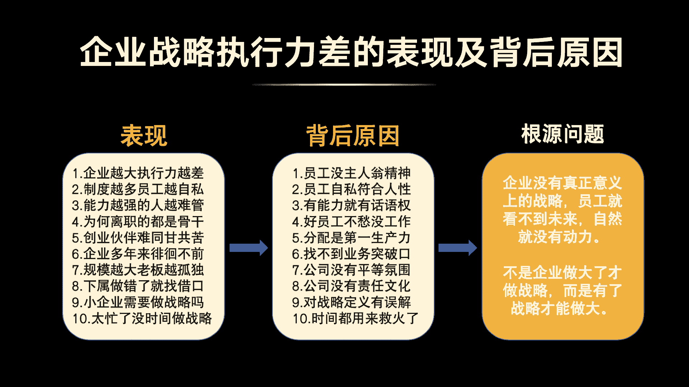

所以说，我们所有的现象都要找到背后的原因。而所有背后原因，我们要找到它都指向什么地方。

所以说，我们做战略设计的目的，就是基于根源的问题、本质的问题去做文章。这样的话，才能从根上解决问题。

## 工具：企业战略水平“体检表”

其实说到战略设计，很多老板都不以为然，就觉得我们企业有战略，只是可能跟你说的不一样而已。那我就在这儿挑战大家一下，你不妨按照这个

企业战略设计水平体检表

，让你的员工参与打分。不能老板一人说了算。这里面涉及到 4 类人，老板、高管、中层干部和核心员工。要让这 4 类人一起参与来打分，就回答这 8 个问题。问问这 4 类人，你认为我们公司在这 8 个方面做得怎么样？

哪 8 个方面？

第一，我们企业有明确的目标市场概念，也就是我们为谁服务很清楚。 第二，客户未被满足的需求我们很清楚。 第三，如何战胜竞争对手我们很清楚。  
第四，我们知道客户心目中最完美的产品是什么样子。 第五，是我们公司的完整产品，有独到的差异化价值。 第六，我们公司有清晰的五年发展目标。  
第七，我们有非常落地的走向成功的路径规划。 第八，我们知道，要想实现我们的目标，就要把哪些事情做好了，就一定成功。

具体打分的标准，我也都写了。如果你认为你们在某一个方面是全行业遥遥领先，就打 5 分。如果你觉得你比大多数人都强，就打 4 分。如果你觉得你跟行业的平均水平差不多，就打 3 分。如果你觉得还没达到行业的平均水平，就打 2 分。如果你自认为是全行业最差的，就打 1 分。这样，你就用一个科学的方法论，能够验证你们自己的认知，看看你们企业的战略设计，到底是一个什么样的水平。这是一个非常实用的工具，希望大家可以把它用好。

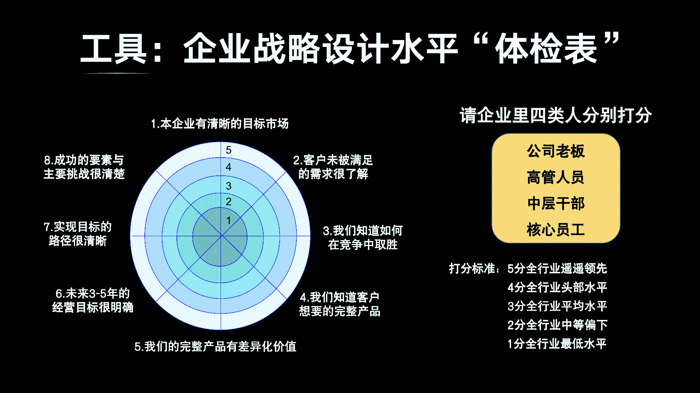

## 解决企业家普遍困惑的问题

## 对未来迷茫

我们前面已经讲过了，很多老板都对未来感觉到迷茫，我们就来仔细拆解一下，到底是什么原因导致对未来迷茫？

首先，是对未来没有预判，对市场的走向、行业的趋势，心里没底，所以说就会迷茫。

另外，是把想法当成了战略。因为没有实现目标的路径，所以说不知道从哪里走，心里就发慌、发虚。

第三个，是过去习惯了机会主义的成功。看市场上什么畅销，就跟着去做什么，并没有自己的主见。随着竞争加剧，现在老板开始变得越来越迷茫，因为没有主见，就没办法做出准确的判断。这样一来的结果，就是大家熟悉的那句话，总感觉计划赶不上变化。其实很简单，只要做了战略设计，对未来迷茫的问题就会迎刃而解，因为有了战略设计。

为什么呢？

第一，有了前瞻性的思维，看到了未来 5 年所在的行业，每一个细分市场将会何去何从。

第二，是计划性。我们有了 5 年的规划，先做什么，后做什么，就变得从容不迫了。

第三，是逻辑性。做这些事情之间，是正相关的，是强相关的，互相之间是有逻辑关系的。

最后一个，有了战略，就变得可控，因为很多事情有了检查节点，我们就能够根据这些节点往前推进。一旦做到了这一点，我相信这就是很多老板想要的那种境界，叫“工作生活两不误”。

## 赚钱难

那么老板们普遍困惑的第二个问题，就是赚钱难。因为原来赚钱太容易了。

市场竞争只会越来越加剧，而市场竞争一旦加剧，利润率就肯定会下滑。为什么？因为做的是同质化产品，就必然面对激烈的竞争。怎么办？就是通过战略设计，要走出大众化误区。

什么意思？过去是一个增量的市场，大多数人都是跟在别人后面走。别人做什么我也做什么，产品是一模一样的，这叫大众化产品，也叫同质化产品。要想摆脱这种赚钱难的困境，就要走产品的差异化，与众不同。跟竞争对手错位竞争，而不是正面冲突。另外，有了小众化的思维，我们就可以做精细化运营与管理，通过这种方式，才能够掌握竞争的主导权。

## 身心累

第三，老板们普遍感觉到痛苦的就是身心累，觉得越做越累。甚至很多老板都想要放弃了，但是面子上又过不去，又不肯放弃，就硬撑着。结果导致自己整天疲于奔命，忙于救火。为什么？

很简单，你的下属不会为你分忧，都是自己当一天和尚撞一天钟。

其次是，下属没有执行力，老板有很多好想法，但是最后都不了了之。

第三个，是因为老板的很多想法员工看不懂。因为老板没有战略，老板的想法没办法变成员工听得懂的语言。所以老板就觉得这帮人太笨，明明已经想清楚了，也说明白了，这帮人就是听不懂。怎么办？

解决之道很简单。你要想提高这个企业的组织智商，就一定要做战略的设计，变被动为主动，不再是被这个市场拖着走，而是我们走在市场的前面。

那么一旦你有了这个战略，就把任务都分派下去了。不同的职能部门，不同的层级，负责不同的事情，每个人都不再有借口。当然了，最重要的是我们有了战略，就可以把战略进行分解，就可以到月、到周。我们就可以去检查，一旦有了检查就有了纠偏，我们的进度就可以得到保障。那这样一来，这个企业才能够实现可持续的发展。

现在很多老板都感觉到自己的压力越来越大，很多员工其实并不知道。我经常跟他们开玩笑说，当老板不是人干的活。员工老觉着，你看我们老板，要钱有钱，要时间有时间，还可以经常迟到早退。我说这是你看见的，你知道他在背后付出了多大心血吗？你不知道，你们只看见贼吃肉，没看见贼挨打。因为大多数的老板其实都不愿意在员工面前显得很累，显得很焦虑，都要硬撑着。

其实我接触最多的就是老板，一旦到了私下，到了我们两个人的时候，他敢跟你讲真话的时候，你才会发现这是一个弱势群体，真的很辛苦。因为要处理的事情太多，这就意味着变量很多。你想，各种各样的职能，内部的、外部的，这个变量太多了。

那这跟我们谈的战略设计有啥关系？其实我们说，做战略的目的就是减少变量，把一些看似变化的东西转化为不变的东西，也就说它不再是一个变量，它变成了一个常量。

我们说人之所以感觉到有压力，是因为变量太多。而这个压力一旦不能有效释放，就会转化为焦虑甚至抑郁，这是对人的健康伤害非常大的一件事情。所以说老板也好，高管也好，要不想让自己焦虑，一个非常重要的工作，那就是做好战略设计。

我们是每年做一次，每次看五年，这叫滚动式的。一开始的时候误差可能很大，但是随着一年一年调整，我们对一个事物本质的把握就越来越精准。

第一年做的时候，可能有百分之 30%-50%的误差很正常。我希望大家有这个思想准备。但第二年你再做，可能就变成了 15%左右了，到第三年可能就 5%了，三年以后你的误差就是 3%左右了。这对一个企业的经营管理来说已经非常准确了。也就是说，我们对市场的了解，我们对员工的了解，我们对运营的了解，都会随着时间的推移变得越来越准确。

## 案例：雷士照明战略规划

20 年前，我曾经帮雷士照明做过战略规划。

那个时候，整个照明市场可以说是鱼龙混杂。而我们通过做战略就梳理出来，我们未来五年往哪里走。这里再强调一个概念，战略是要把你走向成功的路径找出来，先做什么后做什么。

其实大多数企业在那个时候是什么市场都做，什么产品都做。总觉得每增加一个产品，就会增加一个销量。每进入一个行业，就会多了更多客户。这是非常朴素的想法，但不是战略的思维。

做战略，跟这个朴素的想法正相反。我们要单点打穿，一定要在一个市场上成为全中国无可争议的老大。所以这就是我们做战略之前，和做战略之后最本质的区别。

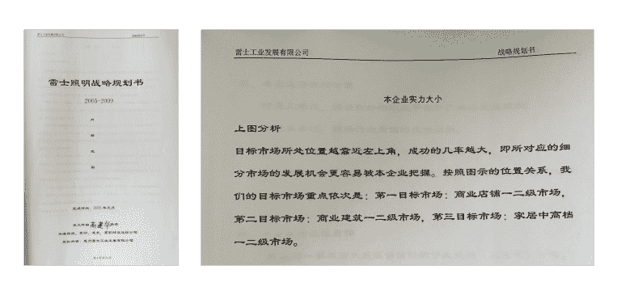

做战略之前，雷士照明是什么市场都做，什么产品都做，什么地域都做。但是我们做了战略以后就明确了，未来三五年我们必须把第一市场以遥遥领先的姿态拿下，也就是一二线城市的商业店铺照明，各种服装店首饰店里边用的那个照明。因为这个照明要的不是节能，而是色彩的还原。比如你去买服装，你看绿色很漂亮，但是买出来在太阳光下一看，怎么不一样了，客户就会投诉。这是因为灯光的还原性不好。

所以这就是这个市场的特性，这也是雷士照明第一个拿下的重点市场，要在这个领域成为无可争议的老大。

这一步做下来以后，我们才能做第二市场和第三目标市场。也就是说有了战略，就有了优先级，有了时间的先后顺序。

后来，雷士照明成为了商业照明领域无可争议的老大。

有记者采访他的创始人、董事长，问他是什么原因让你走向了成功？他三次提到了战略设计这几个词。后来那个记者就追问他说，你反复讲这个战略设计，这个战略设计到底对你有什么用？他就讲了两条。第一，他说战略设计让我学会了从后往前看，也就是先看到未来，再迈出这一步，这叫从后往前看，也叫以终为始。第二，他说因为我有了战略设计，始终领先对手半步，这很重要。

这个结论很重要，叫始终领先对手半步。为什么是半步而不是一步？因为一直让别人在追你，但是一直又追不上，这是最好的。所以说这就是一个企业做战略和没做战略的本质的区别，它让你看到了未来，不再着急了。

那怎么设计一个好的企业战略，能让你从偶然成功走向必然成功？这就是我们这门课要带给大家的一套方法论。希望大家通过学习战略设计，把这里边我讲的方法、工具、思路都落到实处。

## 这门课怎么讲？

我就简单给大家讲一下，我们这个课的提纲，我把这个课程分成了六大板块。

第一个板块，叫企业战略的概述。我们首先谈的就是为什么要做战略。环境变了，不做战略你就会被淘汰。

第二个大的板块，就是目标市场的选择。我们知道，在市场经济环境中，每个企业的资源都是有限的，我们不可能同时做所有的事情，必须先集中兵力在重要的市场上去深耕。所以我们要先选择目标市场，去挖掘这个市场上的客户需求，再去分析在这个市场上我们跟谁去竞争。

目标市场选择完了，我们地基就打好了，我们就知道了市场，知道了用户，知道了竞争。接下来，我们就要设计我们这个大楼了，也就是我们完整产品的概念。

第三个，就是当你设计好了完整产品，要跟客户去沟通，把你的价值传递出去，所以我们就要提炼这个完整产品的价值诉求（

完整产品包括三层，第一层是核心产品，指的是产品的功能与性能；第二层是外围产品，指的是附带的服务与配套设计；第三层是外延产品，指的是产品给用户带来的体验和感觉

）。所以说同样一个产品，光会做不行，还得会说，消费者才能够听得懂你在讲什么。

第四个大的板块，叫企业战略的设计。这是核心部分。也就是说，我们未来 5 年想做成什么样？当然我们的目标不仅仅是经营目标，还有管理目标、客户目标、员工目标，均衡发展才行。有了目标，我们还要想靠什么制胜？我的竞争优势从哪里来？凭什么比竞争对手做得好？一个企业必须有竞争优势。

最后一个，我走向市场的路径是什么？这就是商业模式的设计。我是跟别人走一样的路，还是另辟蹊径？还是颠覆式创新？这都是不同的商业模式。

战略设计做完了，接下来就是路径规划，这就是我们的第五个板块了。

首先我们要谈一个概念，就是蓝海战略。尤其是对中小企业来说，没有规模经济效益，打不过市场上那些比你大 10 倍、大 100 倍的大企业，这种情况下怎么办？唯一的出路就是实施蓝海战略，错位经营，差异化生存。明确了蓝海战略以后，接着就是倒推，这是顶层设计非常重要的概念。我们大多数人都是摸着石头过河，说我有什么资源，做什么事情。战略正好相反，是我想做什么事情，去整合什么资源，它不是基于现有的资源去做，而是基于我的目标去配置资源。第三部分就是组织的配套，要想实施战略，一定要有人，要有组织。怎么排兵布阵才能够实现你的战略目标？这也是非常关键的一个环节。

那么第六个板块，就是战略的落地实施。我们说战略不能做好了，就束之高阁，放在书架上了。这个战略必须落地到什么地步？公司里所有的人都必须知道，我们的战略是什么。当然，我们这里边有很多具体的方法论。比如说怎么写这个年度计划，比如说怎么来分解这个动作。

所以这就是我们整个战略课程的结构。

## 这门课有什么不一样？

我相信，很多人可能从很多老师那儿都听过关于战略设计的课程。那么我的战略设计课程，跟其他人的战略设计课程有什么不一样？我总结了一下，有这样四个大的方面。

第一，叫正本清源的理念。因为我在企业里边做了十来年的战略。我从企业出来以后，又帮助国内接近上百家企业做了战略。我是亲自做过来的，所以我们有正本清源的理念。

第二，是有行之有效的方法。其实战略设计最核心的，就是一套方法论。它是有步骤的，有具体的方法。只要是方法就可以复制，就可以学习，就可以掌握。

第三，我们有很多经典实在的案例。我希望在每一节课里边，都有一个具体的案例，便于大家去理解。

最后第四，一定要给大家简单实用的工具，能让你带回家，用到你的实际工作当中去。大家知道，有了工具就可以事半功倍，不用再自己去开发了，拿过来就能用。

所以这是我这个课程的 4 个特色。

如果你是一个成长型企业的老板，或者是职业经理人，那么我就正式邀请你来加入这门课。我们一起来探讨，战略设计怎么做能够让你赢在顶层设计。

我是高建华，我们课程中见。

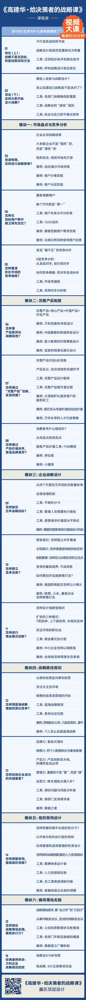  

点我查看官方留言

发布留言

0/ *500*

确定

* * *

# 01 导论（上）：战略不是定目标，而是找路径和方法

你好，我是高建华，欢迎跟我一起学习战略设计。从这一讲开始，我们就正式步入了战略设计的旅程。

我想从我第一次做战略设计的故事开始讲。那是 1992 年，我当市场部经理已经一年多了。我的上司，也就是我们事业部的总经理，扔给我一摞别的地方做战略设计的一个版本，说小高你去研究研究，一个月以后我们也要做事业部的战略设计。

那个时候，没有人教我，就给了我本人家做过的战略设计。我就用了一个月的时间，去看人家的结构是什么样。后来，我们整个团队，事业部的总经理以及各个销售区域的经理，应用工程部的经理，还有市场部的经理，一起从北京飞到了广西的北海，到了一家五星级酒店，用了五天时间做战略设计。然后又回到了北京。

但是你们说，我们为什么这么折腾？有一个很重要的原因，就是要远离你的公司。为什么？在公司里就有各种各样的干扰。有人来找你，有人要签字，有电话等等，没办法专心。

做战略一定要专心致志。

我们大家用了五天的时间，就是基于人家这么一套东西，我们照猫画虎，吭哧吭哧做出来我们最基本的战略规划。其实那个东西你们能想象，水平很一般，不过这是一个好的开始。我们到了 1993 年又做了一次。

我 1994 年去了苹果做苹果的中国市场总监，就用我在惠普学会的这套做战略的方法论，做了苹果的第一个战略，叫“DTP 桌面出版市场（DTP 即 Desktop  
Publishing）”的战略。

那个时候，苹果在中国的第一个市场就是桌面出版。凡是跟色彩有关的，各种各样的广告公司、影视公司，各种出版都跟色彩有关。所以这是苹果当年在中国市场拿下的第一个细分市场。第二个市场就是教育，中小学用的电脑。所以我到了 1995 年又做了一个教育市场的开发战略。

1996 年，我又被惠普给挖回来了。这个时候我就去了一个面向世界市场的机构。

于是，我就提了一个要求，跟当时我们分部的总经理说，战略设计我已经做了 4 次了，但始终觉着好像少点灵魂。他说那怎么办？我说你能不能从总部找一个做战略的高手，给我找个师傅，让他来带着我们再做一次，我觉得我就能找到感觉了。没多久，他就从惠普总部找来了一个专门做战略设计的高手。他是在惠普内部做咨询师，就是帮助各个有需求的分部去设计战略。

他来到北京以后，跟我们一起待了一星期，把整个战略设计的全过程走了一遍。这个时候，我才彻底明白了这套方法论背后的逻辑是什么。没有这个师傅带很难成功。因为有很多小的诀窍，他如果不点就悟不出来。

所以说经过这次以后，我是彻底明白了战略到底是什么。很多人都误以为战略是一个方向，是一个目标，是一个追求。其实不是。

那么战略是什么呢？

战略是实现目标的路径和方法。

比如说，我 5 年以后要长到多大？怎么做到？战略探讨的是如何才能做到，它是一个路径，它是一个方法。经过这么几轮以后，我才彻底明白了，战略跟我以前想象的不一样。过去说的是我们要成为什么，就以为这是战略。现在知道了想成为什么，那不叫战略，那最多就是一个追求，就是个梦想，甚至是一个理想，都不是战略。

## 战略设计就是把变量转化为常量

明白了战略的定义，我们再来讲一下，为什么非得做战略？没有战略不就不行吗？有的企业过去一直没战略，不也过得好好的吗？为什么到了这个时候非要做战略？

如果你的行业不是增量市场，如果你想成为行业的头部企业，你就必须有战略设计。

大家都知道一句话，叫选择比努力更重要，为什么这么说？因为选择错了，努力是没有用的。

对于一个企业来说，第一个问题就是选择。选择什么行业，选择什么市场？一旦这个选择完了，对手得是谁就清楚了。因为我们选择目标市场，其实就等于选择竞争对手。你要从谁那儿抢市场，你要跟谁去竞争，这就是你必须做出的选择题。

那么为了做好这个选择题，我们就把战略设计分成了三段。第一先谈终点，第二再谈起点，第三再谈路径。这是跟常人的思维逻辑不一样。

我们每个人都以为是，我现在在哪儿、我要去哪儿、怎么过去，是这样一个顺序。但是做战略不是这样的顺序，

是先想清楚我要去哪，再看看我今天在哪，再看从今天走向未来，我怎么走能走过去？

\*

说到这儿，我就想起来我 1990 年刚刚当经理的时候，参加中国惠普公司的新经理特训营。当时，中国惠普总裁给我们做培训，就讲了这样一段话。他说，看书看电影一定是从前往后看，要剧透了，知道结果了，是不是就没意思了？但是经营企业不一样，必须从后往前看，如果你不知道你的结果，你就迈出第一步，这叫赌博。

后来，10 年以后，我写了一本书，叫《赢在顶层设计》。

顶层设计好像是个新名词，其实并不是个新概念。上百年前就有顶层设计的概念。大家想想，盖大楼、修桥梁是不是一定要先有图纸？这个图纸就叫顶层设计。用现在时髦的话来说，就是绘制一幅蓝图。就是我要先知道未来变成什么样，然后再想我现在有什么。哪些资源我已经有了，哪些资源我没有，然后缺什么补什么。这叫战略驱动，这叫目标导向，是根据目标去配置资源，缺什么补什么。

所以这就是有战略跟没战略的本质区别。没战略的时候，是看目前手上有什么人、有多少钱、有什么关系就做什么。而有了战略不一样了，是该做什么就做什么，该找谁就找谁，该去哪找钱就找钱。

\*

那么战略设计到底能给企业带来什么价值？

第一，培养人才。

通过战略设计，整个团队有了共同语言。我们一起分析市场、分析用户、分析竞争，一起设计完整产品，一起制定目标。你会发现，这个团队的思想是高度统一的。这个很重要，劲儿往一起使。

第二，经过整个全流程，什么是职业经理人就很清楚了。

职业经理人不是靠经验，职业经理人也不是靠小聪明，他是懂得章法的。什么叫职业？就是按照规定动作去做。他懂得所有的规定动作，知道什么时候该做什么，他就叫职业经理人，所以这是人才建设。还有管理水平，因为通过战略设计，我们自己问了自己很多问题，为什么是这样？客户为什么需要这个？我们什么情况下会赢？通过这些反问，来逼着我们整个管理团队提升我们的水平。

第三个好处价值，就是形成了一种分工合作的文化。

我们的战略设计需要所有职能部门的头参与，因为它不是一个部门可以完成。就像打仗，有作战部队，有侦察部队，有保障部队，但还得有兵工厂，要所有的配套才行。这就是一个分工合作的文化。当然了，战略设计是一个马拉松比赛，它不是百米赛跑。所以说要希望大家能够有一个长期主义的一个认知。它不是一日之功。

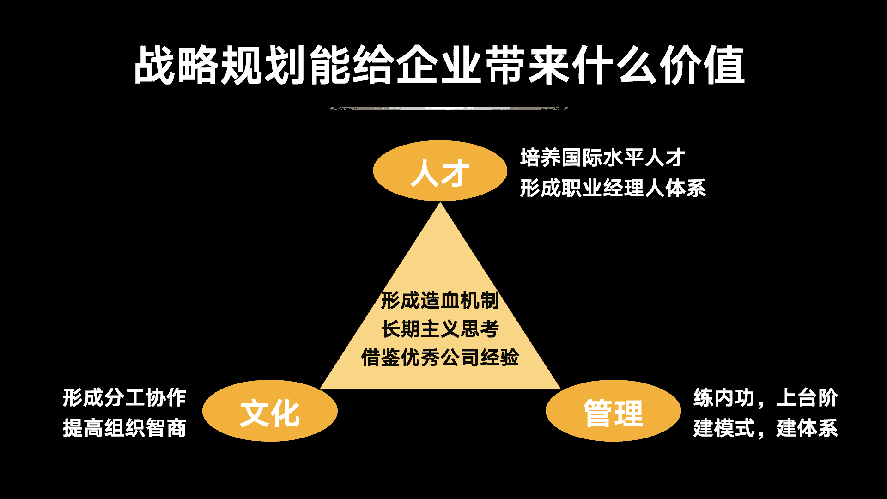

一般来说，快速变化的行业，我们做三年规划。比如说，服装企业。我曾经帮一个服装企业做战略，他说看五年太远，我们就只看三年。但是传统企业我们一般就做 5 年的战略设计，这对一个企业来说等于是跑马拉松。

通过做战略设计，其实整个团队实现了一个升华，就是

从不知道自己不知道转化为知道自己不知道

。这是第一次做战略设计，大多数老板和管理者的一个突破。他以前不知道自己的盲区在哪里，不知道自己不知道什么。但是我们用这样一个方法论，不停地反问他一堆问题，他就发现了，这个我还真不知道。

其实，战略设计是整个企业顶层设计的一个环节。一个企业的顶层设计，通常来说会涉及到这么 6 个方面，战略是其中的一个环节。我们管它叫导航系统。当然了，还有控制系统，那就是商业模式。还有什么？还有硬件系统，就是产品创新。大家知道的企业文化，它是一个平衡系统。人力资源是一个动力系统，给员工一个好好干的理由，加满了油玩命去往前冲。

所以一个企业的顶层设计，它其实涉及到很多方面。战略设计是整个顶层设计当中的一个环节。

## 案例：伊利乳业战略设计

所以我们接下来，就重点谈战略设计。我想从我第一次给客户做战略设计的案例入手。这是 1998 年，是我在惠普之外做的第一个案例。

做战略之前和之后最本质的区别是什么？其实每个企业的不同点都不一样。

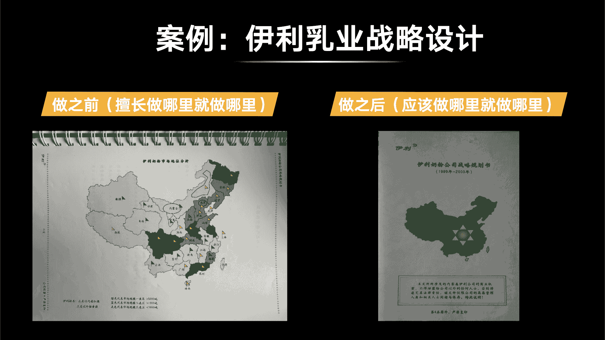

伊利以前是什么地方挨它近它做什么，什么地方有关系做什么，什么地方有资源做什么。这是大多数企业朴素的选择。那个地方我认识一个人，我就进去了。那个地方我有我的资源，我就进去了。这个地方我有关系，我就进去了。

于是，我们就做了这么一件事儿，拿了一张中国地图。

第一，我们按照产品的消耗量，这叫市场规模，把全中国 30 来个省分成三大类，一类市场、二类市场、三类市场。当然这跟咱现在的一线城市、二线城市不一样，我们是按省来划分。这个地图上出来了，有绿色、有蓝色、有灰色。这就是大家可以做的事情。首先拿一张地图，根据客观存在的事实，就哪个地方买这个东西的多、使用量多、消耗量多，哪个地方就是你的主战场。这是第一张图，先画出来。这是个作战地图。

第二件事儿做什么呢？把自己的数据放进去，看看我们企业在这 30 来个省份里边，在哪些省是前三名？在哪些省是第一名？在哪些省是前三名以外的？三种颜色的旗子，把它插上去。这一来，一幅画面展现在他们面前。发现什么？市场规模大的地方，往往不是第一，甚至不是前三。

你想，那时候在内蒙也好，河北也好，天津也好，辽宁也好，山东也好，就是北方的生活水平不如东南沿海地区。市场的需求量没那么大，但是市场地位比较稳固。这就被发现错位了。

伊利乳业是很厉害，但是市场本身不够大。那市场大的地方，我在那儿没占到第一名，或者是不是前三名？这样一来，大家一下子就恍然大悟。接下来做是不是就简单了？不是我们擅长什么就做什么，也不是会做哪里就做哪里，而是应该做哪里才做哪里。

后边的组织架构设计，既然有了这些数据，比如说南方的某省需求量很大，是不是就可以成立一个分支机构？是不是可以有个销售大区？我就可以在当地开拓。

目标也很简单，我们要占有多少份额，用几年的时间成为这个领域的前几名。这样的话，整个路径规划就出来了。在不同区域的未来 3 到 5 年，在不同区域的打法也就出来了。

我如果是前三名，我就想办法成第一。我要是第一的，我就要稳固我的地盘。我不是前三名的，我想办法进前三名。所以这个逻辑就清晰了。

其实这个战略规划给伊利带来的最大的质的变化，就是让伊利意识到了，

要从一个区域性的品牌变成一个全国性的品牌

。因为在我给伊利做战略的时候，是 1998 年，它是在北方以内蒙古为核心，半径 500 公里范围内的领导品牌。但是 5 年之后，到了 2003 年，就成为了全中国无可争议的老大。

这就是有战略和没战略的区别，因为这个企业实现了质的飞跃。从地方性品牌、区域性品牌变成了全国性的品牌。

## 中小企业不打进攻战和防守战

那可能有人会说了，现在大多数市场都已经被这些企业都占有了。如果我是一个中小企业，我还有机会吗？就算我想做战略，还有机会吗？答案是肯定的，一定有机会。

为什么这么说？

因为整个中国市场现在正在发生转型

。一个是从增量到存量，我们前面讲过了，这是一个转型。第二个就是从大众化转向小众化。什么意思？市场在分化，分化地越来越细，比如说咖啡不再是一种咖啡，而是有很多种咖啡；奶粉也不再是一种奶粉。未来 10 年，是中国市场全面进入小众化的十年。

也许在你看来，今天市场上的成功者都是百亿级、千亿级的大企业，未来不是这样。未来在中国市场上，一定会出现 1 万个、10 万个专精特新的好企业。每个都不大，从十几个亿到几十个亿，这是一个最佳区域。

所以说，对中小企业来说，千万不要参与主流市场去竞争。大市场看似很大，当成千上万的企业都去争的时候，你最后都会死得很惨。在增量市场的时候，大企业不在乎你，当寄生虫也就不在乎了。但是等市场掉头向下的时候，大企业的日子也不好过了。这个时候连苍蝇蚊子也是肉了，就开始清理门户，要把所有小企业赶尽杀绝，因为只有这样才能维持它的增长。

大家看过去房地产行业这 5 年的洗牌，从成千上万家迅速变成了几百家，用不了几年只剩下几十家。这就对了。大的越大，其他退出市场，这就是主流市场必然的结局。

那中小企业没资格参与主流市场的竞争怎么办？就是做次主流市场，做小众化市场。这会儿的打法就不一样了。

所以这里头就讲到了，

企业战略的四个方法论

。

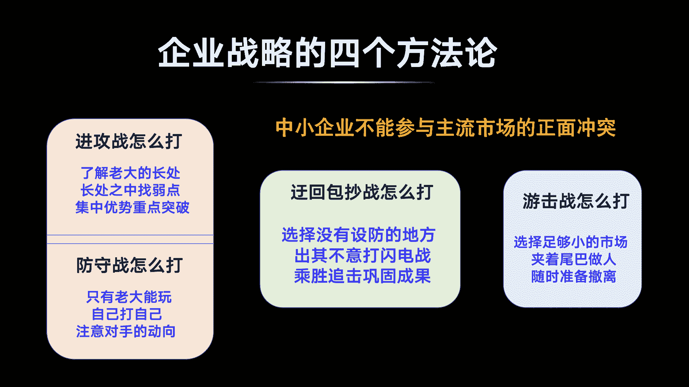

进攻、防守，这是主流市场，希望中小企业不要再争了，跟你无缘，跟你无关。作为中小企业，你只需要学两个打法，迂回包抄战和游击战。迂回包抄什么意思？不跟对手正面冲突，找一个没有设防的地方。这个地方大企业没来，属于市场空白地，别人还没看上，我赶紧把它拿下，然后建立壁垒。

当然这需要很多企业的老板要调整心态，不要再一味追求大。其实一个企业要想活得滋润，最好就在 10 个亿到 30 个亿之间。这些年我见了无数个不同规模的企业，活得最滋润的就是这个档次，是某个细分市场的老大或者是老二。同时，这个市场又不足够大，竞争没那么激烈，利润相对比较高。是不是活得就可以滋润了？

你的目的就是做一家好企业，而不是做一家大企业。所谓的好企业，就是经营管理得好，厚利经营利润非常好，有市场控制力，我说了算，这就叫好企业。

当然了，如果你有绝活，你可以打游击战。就是我拥有一个绝活，别人谁都超不了，或者垄断了某种特定的资源。这个时候的规模更小。可能就是几千万、几个亿就不长大了，但是利润奇高，这也是一种活法。这种目前还是比较少，毕竟有这种稀缺资源的人还是非常少的。

对大多数的中小企业来说，可能你的选择就是迂回包抄战，也就是咱们前面说过的蓝海战略。

对于中小企业来说，我如何能够成为一个细分市场的头部企业，如何能迅速长大？这就要借助外部的力量，要学会借力。你如果不借力，这条路很漫长，甚至在你走的路上就被别人给干掉了。如果你想避免这个问题的发生，那就要想办法借力。

我举一个例子，比如说大家都坐过滴滴。滴滴的创始人，管人力资源的一个副总管，市场营销的副总，还有另外一个一起创业的人，跟我们分享了他的创业经历。怎样在五年之间迅速地从零做到上百亿？这是很多企业做不到的。当然这也是互联网企业有这么一个特点。我想强调的是，滴滴为什么能做到这一点，其实关键是有风投在助力。如果没有风投，自己一点点去打，可能十年二十年都打不来。但是有了风投，有源源不断的枪炮弹药供应，就迅速从初级竞争变成了垄断竞争。

## 模型：市场竞争的四个阶段

这个模型我想对大家很重要，任何一个市场都是四个阶段。

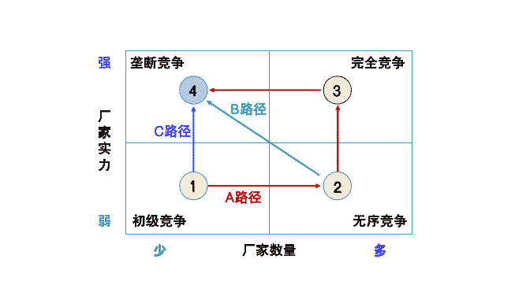

最早刚刚出现的时候叫初级竞争。没几个人做，买的人也不多，这叫初级竞争。

随着市场起来，越来越多企业开始加入竞争，叫无序竞争。就像当年做电视机有几百家企业，做 VCD 机有几百家企业。后来做家电、手机，都经历过这个阶段，就是从初级竞争到无序竞争。

到了无序竞争，就开始玩命打。经过三五年活下来的就 10 来家，进入到完全竞争。中国的家电市场到今天都是完全竞争，到今天都没有实现垄断竞争。比如说彩电，如果只活下来 3 个，就垄断竞争了，但显然现在不止 3 个。比如说电冰箱，如果 3 个就垄断竞争了，现在也不止。所以现在整个家电行业就僵持在了完全竞争，这是最惨烈的。都是大企业，都有装备，这不是拼刺刀了，都有重火力，打得非常惨烈，大家都微利经营。你什么时候听说，哪个家电企业当过首富？没有一个。规模很大，但不赚钱。所以说这个市场持续了 20 年了，稳定在完全竞争，微利经营。

只要有企业做了战略设计，只要有企业借助外部的资源，就能进入垄断竞争。垄断竞争就是任何一个行业和市场的终极状态。它的定义是，“有限选择，各有特色”。大家知道，对消费者来说，选择多了不是好事，那叫选择焦虑。对消费者来说，想买一个汽车，就三五个，这是最好。你看现在，甭管想买几十万的车，选择余地其实就是三五个。

比如你想买 100 万的 SUV，有三五个。轿车，有三五个。你想买 200 万的，还是 SUV 有几个，轿车有几个。都是这个逻辑。因为汽车行业早就进入了垄断竞争。

但是现在，新能源车又再一次把市场拉回到了无序竞争。现在又是有几十家，在你死我活的竞争。也许过几年，会进入完全竞争。

那什么时候能进入垄断竞争？谁也不知道。但只有到了垄断竞争，大家才能够赚钱，企业才能过上好日子。在完全竞争阶段，往往就是就像摔跤一样，你卡着我的脖子，我卡着你的脖子，咱俩谁也不认输，谁也不痛快。你想，是不是都很痛苦？这叫僵持。只有有人率先使了一招，破了对方的功，才能一下就赢了。

所以这就是我们说的，四种不同的竞争状态。

当你知道了你的终极追求是什么，你才会有了这样一个顶层设计的思维，也就是我们战略的目标，如何成为垄断竞争者当中的一员。

## 战略是企业经营的核心

为什么我们这么强调战略的重要性？因为战略是承上启下的关键，在整个企业的经营管理当中处于核心地位。

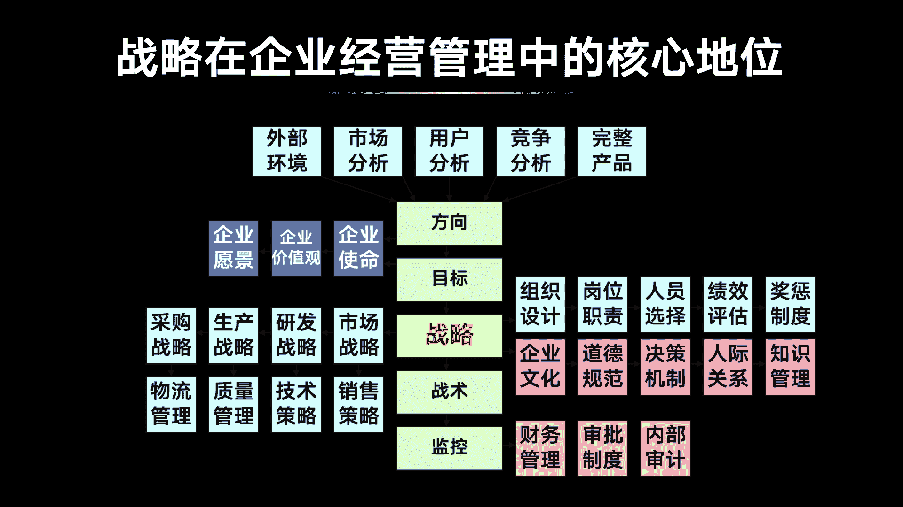

我们说一个企业要想做好，最关键的十个字儿，就是“

方向、目标、战略、战术、监控

”。把这十个字搞明白了，这个企业就不会出事儿。只要这个企业经营得不好，管理得不好，一定是这十个字儿当中某个环节出了问题。

方向是说，我们往哪里走，选择什么样的市场去参与竞争？目标我五年以后走到哪里？战略是什么情况下能做到，它的路径是什么？战术就是分解成年度的、月度的，每周的工作计划，变成动作，这叫战术。最后一个是监控，就是必须监督检查。分解到周就要周检查，分解到月就要月检查。这样的话企业才能长治久安。

\*

好，那这一讲到这儿就结束了。

我是高建华，我们下一讲见。

点我查看官方留言

发布留言

0/ *500*

确定

* * *

# 02 导论（下）：怎样从零开始设计战略？

你好，我是高建华，欢迎跟我一起学习战略设计。

接下来，我们谈一谈企业战略规划的流程，也就是从哪里开始到哪里结束。当人们看到我这个战略规划流程的时候，很多人都觉着有点奇怪，说你这个战略设计怎么从市场分析入手？我们看到的战略规划书不是这样的。

做战略的过程和呈现战略的顺序是不一样的。

## 企业战略规划流程

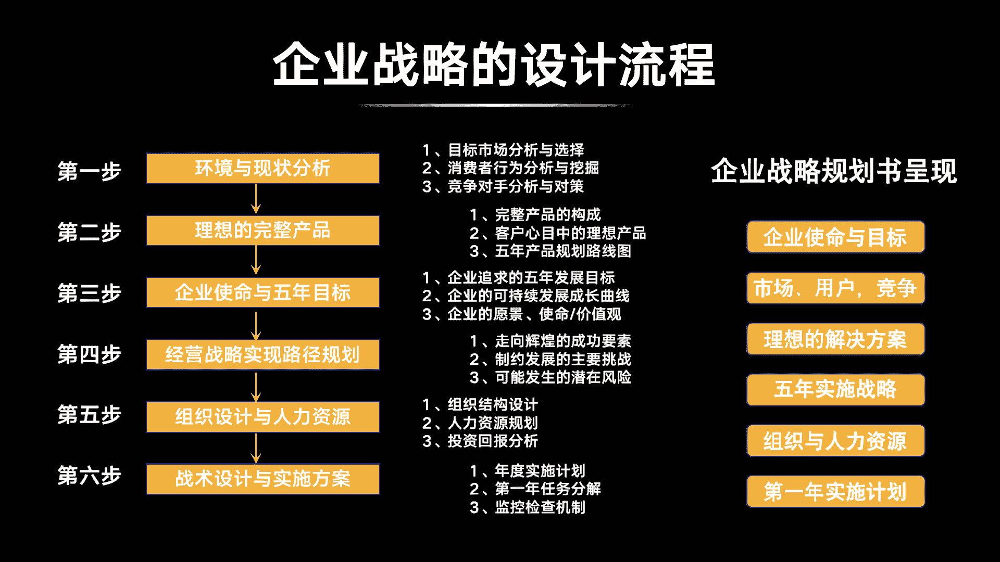

我们先看呈现式顺序。企业的使命愿景价值观、目标，往往一开篇就给别人先看这个。再接下来，才是市场、用户竞争分析。但是我们做的时候不是。做的时候我们得先打地基。你想，盖房子是不是要分三个阶段？打地基、盖房子、精装修。做战略设计也一样。

打地基就是环境与现状分析，做市场分析、用户分析、竞争分析，这叫打地基。我们做完整产品的设计，做企业目标的制定以及成功要素的分析，这叫盖大楼。我们落地实施的步骤分解，叫精装修。把所有的细节都做到，就把装修做到位了。这么一讲，大家都很容易理解。因为盖房子一定是这三个环节，缺一不可。如果不先盖地基，你们想想这个大楼会是什么样？肯定不结实。

但整个战略设计的流程，我们是从市场分析、用户分析、竞争分析开始，然后站在客户的立场上去讲客户最希望的完整产品什么样。这也是个倒推的过程。又是一次从后往前看。客户心目中理想的方案什么样？接下来就是我的五年目标是什么？我实现目标的方案是什么？全部都是倒推。

要实现这个方案，我需要什么样的组织，我需要什么样的人才，我需要什么样的激励，这都是配套措施。这些东西都有了，我们再把它分解成第一年的实施计划，再落实到月、落实到周，战略规划就变成了一件很简单的事儿。所以这是整个战略规划的流程。

我接下来就简单讲一下，流程里边的各个环节，它是一个什么样的逻辑关系。

\*

我们从市场开始入手分析，先把这个大蛋糕切成若干个小蛋糕。因为任何一个行业，任何一个市场都太大。哪怕你是百亿、千亿级的企业，你也没地方下嘴咬。

企业做市场也一样，先把这个大市场切成若干个小市场，这叫市场细分。

为什么要这么做？是因为我们要找共性、找差异。我们把这个市场一切开，就会发现，小康的、温饱的、中产的、富裕的，他们的需求不一样。所以这个蛋糕，要切成若干块。比如说这个行业用的和那个行业用的，需求不一样，我们也得把它切成若干个蛋糕。

我们的目的是什么？看这个市场有没有什么共性，这个共性足够强，我们才能为这个市场服务。这个共性越强，就意味着市场需求越大。所以这就是市场细分的概念。

那有了市场细分的概念，我们才能够给我们定一个目标，成为小池塘当中的大鱼。一个企业最可悲的，就是大池塘当中的小鱼。它参与的市场很大，但是它是一条小鱼，随时有可能被大鱼给吃了。

但如果你是一个小池塘当中的大鱼，是你吃别人。我们说对于广大中小企业来说，你们的追求就应该是争做小池塘当中的大鱼。

\*

那怎么做市场细分？在这儿给大家讲一个实用的工具。

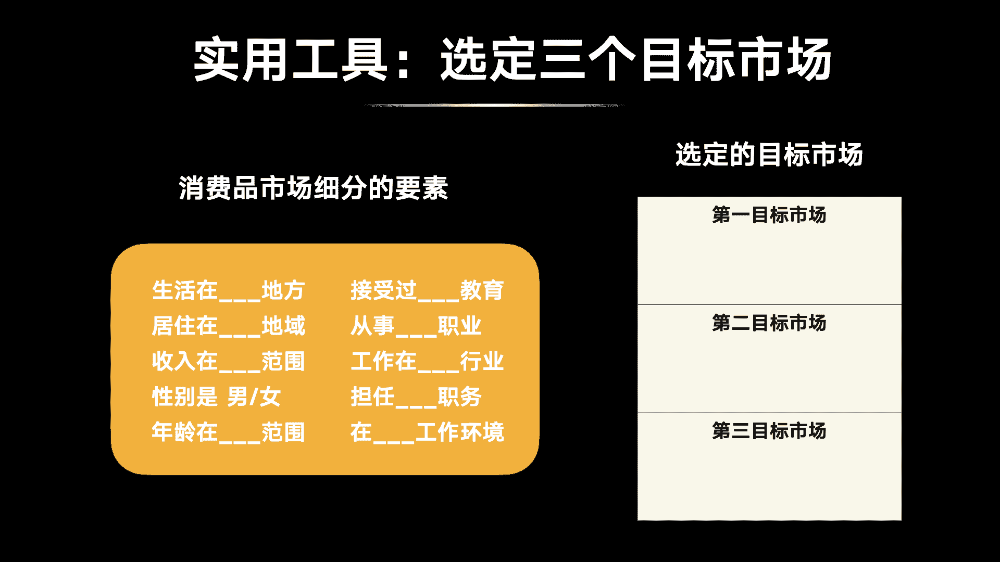

比如说你做的是消费品，那怎么切分这个市场？

首先，按照地域。一线城市、二线城市，发达、欠发达。

还得看这个产品是男的用、女的用，什么年龄段，什么收入，什么学历，什么职位。这些对一个产品的需求都不一样。比如说衣服，那年轻人穿的跟年纪大的人穿的，是不是一样？儿童穿的童装跟年轻人穿的衣服又不一样了。所以说同样一个产品，因为不同群体的需求是不一样的，首先就要把它切分开，根据这几个方向去选，什么年龄段、什么城市、什么教育水平、什么收入的人，作为第一目标客户群体。

这其实就是个组合，通常用 4-5 个。比如说大城市，白领，收入在年薪 10 万到 20 万之间，受过良好教育的人，是我们的一个细分市场。大家脑子里是不是就开始有个画面了？这叫客户成像，也叫客户画像。

我们就把这几个客户画像，贴在墙上，就出来了我们的第一目标市场是这种人，第二目标市场是这种人，第三目标市场是这种人。整个公司看到这几个画面是不是都很清楚？以后见到一个人就看，这是属于哪个群体里边的？是，就把他变成我们的目标客户。不是，就不用理了。

你知道在市场经济环境中，企业是有权利选择客户的。这一点在中国是很多人的误区。有人就骂这家餐厅，一个馒头卖那么贵，凭什么？这就是不懂市场经济。人家不是逼着你吃这个馒头的，人家也没有逼着你去买。不同层次的人是不同的细分市场。有人要两毛钱一个，有人要两块钱一个，有人要 20 块钱一个，这都很正常。

企业有了目标市场以后，只为目标市场服务，就能找你的供应商。市场经济就是这样。我为这三个服务，你为那三个服务，总之有需求就有供应。所以自然就形成了这样一种模式，不同的企业为不同的客户群体提供产品和服务，

我们做市场细分的时候，一定要基于人性去理解客户的需求。

什么是人性？大家都看过马斯洛的那个模型，就是一个人随着最低需求的满足，它会一层一层地往上走。

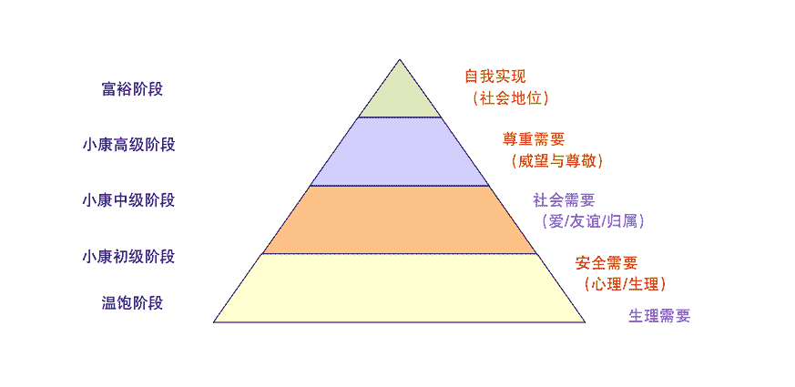

第一层，是最基本的衣食住行的需要，也就是生理上的需要。然后需要有安全感，比如住在小区有保安，不会担心别人来抢东西，别人来偷的东西。要有安全感。这层有了以后，还有社会需求，是什么群体的，有个归属感。再往上走，就要追求受人尊敬，仅仅有钱不行，不受人尊敬，活着也没个意思。

当然，最高境界是自我实现，不为自己，为社会做贡献。当一个人的财富达到一定程度，必然应该走向那儿。但遗憾的是，很多已经有了巨额财富的人，没有按照这个人性往上走，还在追逐钱，这就麻烦了。

我经常跟我的一些学员讲，中小企业创业千万别讲情怀。很多人说，高老师帮我咨询一把，我是有什么样的情怀，做什么事情？我说你要想基于情怀去创业，你麻烦就大了，因为你不现实。所以我就劝中小企业的老板，创业阶段千万别是情怀，一定是帮客户解决一个头疼的问题。是基于利他的理念，为市场上提供了一个好产品，提供了一个好服务。必须是市场导向。

你的产品能得到客户的认同，这是比什么都重要。

不要谈情怀。

但是当你企业做大了，到了上百亿，如果你不谈情怀，这个企业一定有问题。所以只是很多人搞反了，说小的时候有情怀，大了没情怀。正好反了，应该是小的时候不要有情怀，大了一定要有情怀。你看这些世界上有名的一些企业家，最后一定是做一些对人类有贡献的事情，做一些长期投入，甚至是不求回报的东西。这就是因为情怀才驱使的。因为有资格了，因为有资本了。但遗憾的是，很多人走向了反面。

\*

细分市场做完了，细分市场选好了，知道为谁服务了，才能回答第二个问题：你的竞争对手是谁？生产同类产品未必是竞争对手。

你们说奔驰和丰田是对手吗？根本就不是，因为覆盖的是不同的群体。所以衡量谁是你的竞争对手，不是看生产同类产品。你们说农夫山泉和依云矿泉水是竞争对手吗？不是，它们面临完全不同的群体，不是竞争对手。所以一定要理解这个概念。

谈竞争对手是站在客户的立场上，当他买一个产品的时候，他在哪两个产品之间做选择、做取舍，这才叫竞争对手。

如果你的产品在他的清单上，竞争对手的产品也在他清单上，你就知道他是你的竞争对手。

比如说，摩托车和汽车可能是竞争对手，为什么呢？因为有一个人假如想买代步工具，可以买电动车，可以买摩托车，也可以买那种很便宜的小汽车，也可以买个正常价格的汽车。其实这几个都是竞争对手。空调也好，风扇也好，扇子，都是竞争对手。

所以说，看谁是竞争对手，不是看产品，而是站在客户的立场上，看他在哪些产品之间做选择、做比较。所以我们叫分析竞争，看这个市场有多大，在这个市场里边有哪些参与者。所以一定要看竞争。

\*

市场分析、用户分析、竞争分析完了，接下来就是做完整产品的设计了。

完整产品的设计也是站在客户的立场上。

这个时候我们说客户就要首先分层了，小康、中产、富裕。我们先笼统说。一个产品我们说分三层，核心、外围、外延。任何一个产品，只要是实物都可以分为这么三层。核心产品是它的功能和性能，外围主要就是服务，外延是感觉和体验。不同的群体，它的侧重点不一样。

一般来说，小康阶层在完整产品的选择的时候，他更在乎你的核心产品，因为讲究实惠，要追求物美价廉。包装可以没有，好用就行。但是要卖给富裕阶层的，正好相反。包装不好，产品再好我也不要。你看洋酒，光瓶子就得好几十块钱，甚至上百块钱，包装很贵。所以说不同阶层的人，对完整产品的需求是不一样。

中产阶层最看重的，其实是外围产品服务。我希望你对我态度好，我也没太多钱，我又希望买名牌，还又希望能够打折。

所以说这是三个不同的群体，他们对完整产品在乎的方面不一样。

## 哪些人该参与战略设计？

我们说做战略设计，不是老板一人做，也不是某个什么战略总监一人做，

它是团队一起做，叫“群策群力，达成共识”。

我在这给大家讲一下这个方法论，这也是我们做了几十次一直在做的一件事情。

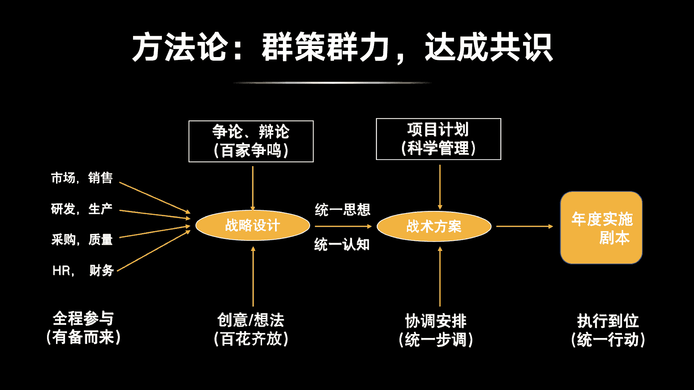

首先，我们要把公司的、市场的、销售的、研发的、生产的、采购的、质量的、财务的、  
HR 的......所有职能部门的头都要全程全员参与。很多公司做战略，可能 HR 和财务都不参与，这就是因为他们没有认识到，

战略是一个全员参与的过程。

否则如果他不参与，财务卡什么？卡你花钱，  
HR 干嘛？卡你加人，这就麻烦了。他们就成为一个管卡压的部门。如果这两个部门参与了战略设计，他们就变成了一个赋能的部门，一个支持的部门，一个服务的部门。因为他知道了整个公司的战略，我们需要怎么做，他就多了一份理解。

我们来看看，这些不同部门的人都扮演什么角色。

首先，战略谁来主导？老板必须亲力亲为做战略。 谁来主导这个全流程？市场部的头儿，市场总监、市场经理。必须是他牵头来做这件事，这叫主导意识。  
那么在这里边，跟市场部最密切的是销售和研发。一个是把产品做出来，一个是把产品卖出去。这两个部门的头，是至关重要的两个分支，一个是前台，一个是后台。他们要有责任意识。我们公司要成功，要靠产品力，要靠销售力。这就像踢足球，左边锋、右边锋。这是两个关键。  
第三个层次，是生产总监和采购总监，他们要配合。咱们要把产品做成什么样？达到什么样的质量标准？按时交货，产品不出质量问题，我的原材料采购要有保障等等。要配合研发部门，把我们想做的产品完美地做出来，所以必须有这个配合意识。  
那 HR 也好，财务也好，要有服务意识。HR 在你需要人的时候给你储备人才，五年规划有了，就知道什么时候需要加什么人，需要提前去招募，需要放到我们的人才库、蓄水池里边，需要让他达到相应的技能，要给他相应的培训，这要 HR 的人来想。  
而财务，要知道随着公司的发展，钱从哪来？现金流是去融资还是找投资者？还是去银行借钱？整个公司的资金规划是必须他来做的。

所以这样一来，整个公司才是一盘棋。所有人都知道，我在整个战略设计里边扮演什么样的角色。

所以这就是为什么要他们全员参与。尽管我们是以市场牵头，但是这些人都要参与。然后我们百花齐放，不停争论战略规划，绝不能一团和气，

一定要争论

。因为是非不辩不明。

我们不希望在没有达成共识的情况下就做一件事，事后争论就麻烦了。一定要事先争论，达成共识以后不再争论。就是做一个事之前，一定要反复论证。一旦决定要做，不允许保留意见。

很多人跟我说，我可不可以保留意见？要保留意见，从这个团队里出去。你可以选择离开这家公司。在这家公司，就必须不折不扣地执行。但是，下一年我们可以复盘，我们可以反思我们当年做的这个战略对不对。我们一年一次做出修正，但是在这一年之间必须不折不扣、全力以赴地去执行。

这也是很多公司没有形成的一种公司文化，就是该说话的时候不说话，不该说话的老在下面瞎嘀咕，这就坏事儿了。

## 工具：战略会的“游戏”规则

不过，做战略设计，有很多企业一开始都不适应。比如说我当时帮一家企业做战略的时候，我们要求大家旗帜鲜明地发言。没有对错之分，每个人都要畅所欲言。如果做战略规划，这个人说话，那个不说话，这不行。每个人都必须旗帜鲜明的发言。

结果有一次，老板一听大家说的不对劲。他就站起来说，不对，不对，你们这么瞎掰，这个市场不是这样的，我认为是怎么样的。老板一定调，立即鸦雀无声，都不说话了。我一看，这不坏事了吗？我说咱们先休息一会儿。我就把老板叫到一边去。我说你千万不能再这样说，作为老板，你一旦做了结论性的发言，别人也都不说话了，咱这个战略设计就进行不下去了。

为了防止类似问题发生，从此以后我就写在一张大纸上，凡是每次做战略，先让大家从头到尾的念一遍。要大家必须按照这个游戏规则去做。

第一，老板不能做结论性发言，但可以要求你澄清：你说的什么意思，你再解释一下。老板不能带有倾向性引导。  
第二，不能批评别人，说你说的不对，不可以。每个人都不可以说别人说的不对，但是可以说，我有一个意见，我的想法是这样的。要对事不对人，不能说你们部门有问题，或者说你这个人有问题。不可以。只能说这件事儿这么做是不是不合适。先把游戏规则给定下来。  
当然，最后我们还要求大家要有格局，要有一盘棋的意识。所有人发言我们都问他，你是站在你这个部门讲话，还是站在公司的立场讲话？一开始的时候都是为自己部门牟利，让自己所在的部门做得更轻松。但最后大家都改了，会站在公司立场上发言了。  
其实，这就是制定政策的部门最容易陷入的一个误区，先考虑自身利益，先考虑自己舒服。这麻烦就大了。如果每个部门都这样做，最后就变成了一个个的山头，互相给别人制造障碍，麻烦就大了。

所以我们做战略设计，首先把这个山头都给削掉，

所有人都必须站在公司立场去思考问题。

\*

其实说到这儿，我给大家讲一个我自己的亲身经历。那时候我们事业部开会的时候，我是市场部经理。我面对的是四五个销售的区域经理，还有应用工程部的一个经理。这是我们这个核心团队。

那么销售部呢，人多，他们就开玩笑说风凉话，说你们市场部就是乱花钱，我也没看你干点什么好事。这话就把我惹急了，那个时候年轻气盛嘛，就跟他们急了。我说你们要这么说，我就不玩了，你们爱找谁找谁去，我不干了。

当时我的这个上司也没当着别人面批评我，开完会把我叫到一边，说小高你觉得你今天这么做合适吗？我说是不咋合适，但他们太欺人太甚，仗着人多势众欺负我，凭什么呀？他也不回答我，他就说，小高你还想往上走吗？我看了看说，想啊。他说，你将来有朝一日想坐到我这个位置是吗？我想了想，当然想。他说，如果你想往上爬，今后再说话，一定站在我的立场去思考问题，站在公司的立场去说话。如果你每次都站在市场部的角度去说话，你就永远待在市场部，你明白这个道理吗？

那一刻我就明白了。我说我懂了，从此以后我就改了。我这个人就是听话照做，一旦有一个人点醒了我，不需要说第二次。

从此以后，我每发表意见，首先要想我是站在公司立场的，每次我都做到了站在公司立场去思考问题，所以在职场上才能够平步青云。因为所有上级领导都喜欢这样的经理人，这样的经理人不再是自私的，不再是为了小部门利益去思考问题。这才是你上司心目中的好部下。

\*

那么，什么样的企业在什么时候做战略比较合适？

我们首先说，不管是大企业、中企业，还是小企业，都应该有战略，但是战略的版本不同。

如果你是一个中小企业，营业额还没超过 2 亿

，我就建议你做一个简化版的战略，就是以最小的配置来做一个战略，至少不会犯小儿科的错误。

如果你是一个超过 20 个亿的企业了

，我就建议你把它分成事业部去做。这个时候它是相对笼统，没办法做集团的战略，应该把它分细。每一个细的你可以做一个浓缩版。其实做到 20 个亿了，企业已经有一定的章法了。这个时候不需要再像我们做广播体操一样，一二三四二二三四了，其实已经是融化在血液里了。我们可以做一个浓缩版，就把最重要的关键点罗列出来就可以了。

而真正做战略最佳的时候，是 2 个亿到 20 个亿这个阶段。

因为不同的企业利润率不同，有些利润率很高，它 2 个亿就可以做。有的企业的利润率不高，可能到了 5 个亿、10 个亿才有能力去做战略。

这是从企业的规模的角度来说。

另外就看老板的追求，你想把这个企业走向规范化吗？你想做一个正规化的企业吗？如果你有这个愿望，那战略就是你的一个载体。如果说不想操心那么多，这叫先乐后不乐。如果你花了半年的时间，把企业战略搞清楚了，你至少 5 年舒舒服服。如果你不花这半年，你未来 5 年天天都在救火。

这就是我们每个人的选择。当然有些老板就喜欢救火，很有成就感。今天又解决了一个什么棘手的问题，他觉得很爽。有人就好这一口。我们也不要剥夺他的权利。

## 工具：机会与实力的平衡点矩阵

我们在这个阶段时候，最终要达成的共识是什么？就是选择目标市场。也就是说，在资源有限的前提下，我们在未来 3-5 年重点拿下哪几个市场。这是我们在这个阶段最最重要的一项工作。

那有人说了，我怎么知道我选对了？我认同你说的，选择比努力更重要，我应该花时间选择。那我怎么知道我选择的市场是对的还是不对的？这就有方法论了。我在这也给大家看一个实用的工具，这就是我们真实做战略规划的时候用过的一个工具。

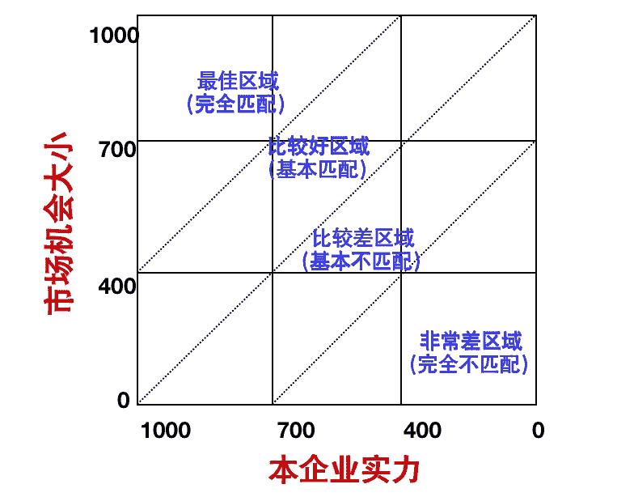

首先，我们要分析市场机会。

我们有七八个维度来分析市场机会，比如说规模、成长率、利润率、进入的难度、竞争的强度......我们就用这些要素去分析。看这个市场机会大吗？有的企业喜欢看规模，有的企业喜欢看利润，有的企业是喜欢看门槛高，有的喜欢看门槛低。所以机会不是标准化的，是因人而异的。对这个企业来说是机会，对那个企业来说就不是机会。

那么除了机会分析，我们还要分析本企业的实力。

我有能力把握这个机会吗？我的人、我的技术、我的产品、我的服务体系支撑吗？你想走向全国，你有全国的销售渠道吗？你有那么多优秀的人才吗？所以就要做实力分析。目的很简单，就是没有金刚钻，别揽瓷器活。不要看着那个市场很好就想进，你得先看你有资格没有。我们选择一个市场，一定要看我们能驾驭它吗？如果驾驭不了它，就算我选来也不是你的，将来你一定还会失去它。

我们说有了这样一个工具，有了这样一套方法论，我们大家一起来打分，最后就知道哪个市场的机会分别得了多少分。我们最高分是 1000 分，它会得出一个分数来。再看看我们这个企业做哪个市场的能力强。这也不一样，做每个细分市场的实力得分都不一样。然后出来这么一张图，你看它是斜的，在 45 度线左边，上边就是匹配的区域和比较匹配的，也就是说这个市场我能驾驭，凡是在 45 度线右下角的一定要放弃。

所以做企业第一件事要做的就是明确放弃什么、不做什么，从此以后不再惦记了。这时候你才能义无反顾地把精力花在你的目标市场上，去努力经营我们的目标市场。

所以这一步做完了，整个企业不再摇摆，至少 3-5 年之内，我们铆足了劲去做这个目标市场，其他的都不再去想了，义无反顾。这样才能够迅速地在目标市场上取得成功。

## 本讲小结

好，接下来我们就总结一下，这一讲我们都讲了什么。

我们谈了什么是战略，我们谈了战略的定义，战略不是想法，不是目标，不是追求，而是实现目标的路径和方法。

那么为什么做战略？我们也讲了，它是让你从偶然成功走向必然成功，能够把成功背后的逻辑能够梳理出来。

这一讲我们把怎么做战略也给大家讲了。我们怎么打地基，怎么盖房子，怎么做内装修，这是一步一步的过程。

如果你认同我们讲的这些战略的意义、战略的价值以及战略的方法，我们就打开了一扇走向成功的大门。

好，这一讲到这儿就结束了。

我是高建华，我们下一讲再见。

点我查看官方留言

发布留言

0/ *500*

确定

* * *

# 学习之前，来领取工具手册（仅限已购用户）

## 学习之前，来领取工具手册（仅限已购用户）

欢迎你加入这门《给决策者的战略课》。

学战略，咱们就是要真学真练，所以，我为你准备好了一份工具手册。

听完一讲，就拿出手册练起来，学习效果马上就看得见。

你点击下面这张图片，就可以领取咱们的工具手册。

让咱们迅速操练起来！

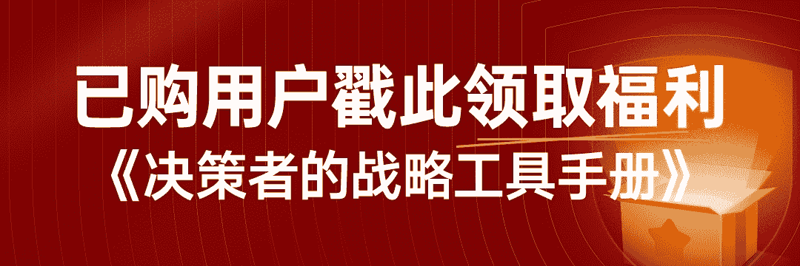  

点我查看官方留言

发布留言

0/ *500*

确定

* * *

# 03 资源有限，怎样进行战略聚焦？

你好，我是高建华，欢迎来跟我一起学习战略设计。上一讲，我们介绍了整门课程的学习地图。这一讲我们来看看战略设计的第一步，选择目标市场。

## 市场细分

我想从一个案例开始讲起。几年前，我帮一家饲料企业做咨询。我就问他们，我们的产品卖给谁？他们一开始就笑了，说高老师这个问题还用问吗？我们是做猪饲料的，那当然是卖给养猪的喽。我接着就问他，那养猪的企业分大小吗？这时候他们都不乐了，说好像分。那怎么分呢？都“傻”了。

接着我说，咱们分组讨论。分成三个小组，每个组拿出一套方案，把养猪场什么情况下叫大，什么情况下叫中，什么情况下叫小，拿出方案来。最后经过讨论达成了共识。3000 头母猪以上的养猪场叫大企业，500 头母猪以下的养猪场叫小企业，500-3000 的叫中型企业。

这就是我们做市场细分，做目标市场选择的第一步，先把这个市场分成若干个类型。

都混在一起，你会发现不同规模的企业需求是完全不一样的，根本就不是一个市场。

那我接着就问他们第二个问题。我说大的养猪场有多少个？他们都“傻”了，说不多。我什么叫不多，多少个？有人说估计 10 个、8 个的肯定有。我说有具体的数据吗？他们说没有。

虽然这是一家上市公司，已经做了很多年，但是他们从来没从这个视角去看问题，根本就没有具体的数字。所以我说这样吧，现在你们也拿不出来，你们用一个月的时间去市场去了解情况，一个月以后把数据告诉我。

结果一个月以后，数据一出来，大家一下子都被震惊了，有 110 多家。也就是说，他们误以为市场上只有十几家，结果其实是有上百家。因为他们看到的十几家是跟他们有生意来往的，但其实一大半他们根本就不知道客户在哪里。

你想，这是不是意味着它的生意的空间还很大？但是在它原来的雷达上根本看不见。那么我再问他们，中型的养猪场有多少？他说这个数据一个月都拿不出来。所以他们又花了差不多半年的时间，才把养猪场的分布、大中小的数据搞清楚。

那么通过这样一个例子，我想让大家明白的就是，

目标市场不是指某个行业，而是要把它进行细分

。因为企业的资源有限，我们不可能同时做所有的市场。那怎么办？我们只能是聚焦重点突破。

当然还有一个原因，就是客户的需求和企业匹配吗？比如说销售找大养猪场，人家马上就问的是，你打算在我这个养猪场旁边建厂吗？如果你不打算建厂，连谈都不要谈。因为大的养猪场不可能说拿车拉到我这来，就在旁边随时供应。

你想，3000 头母猪加上小猪，这一天要吃多少饲料？你离这 10 公里以外他都不接受，就必须在他的厂旁边建厂。所以说大企业根本不是销售人员可以去谈的。人家一问有权利建厂吗？你想销售人员咋说？最后才发现需求不一样，跟客户对接的人也不一样。

所以后来我们就专门成立了一个大客户事业部，由公司的副总裁亲自挂帅，这才行。如果你是公司的副总，你去跟客户谈，你能做决策，人家才跟你谈。这就是大企业的需求。

而小养猪场是说，你要想把这个饲料卖给我，可以，但是你得派技术人员给我驻场。因为小养猪场不懂技术。怎么养猪？怎么给猪治病，打防疫针？所以说企业的人得来教他们，把先进的经验带过来，能签这个协议，这待上半个月就进货。后来我们就发现，做中小企业必须有一支售后服务的技术团队，没有这个游戏就没法玩。

你看，不同市场的需求完全不一样。

以前，是顾了这个顾不了那个，同一拨人得既做这个又做那个。结果发现就很抻得上，因为会做这个的不会做那个。我们现在分开。愿意做技术服务的，专门去做中小企业的帮扶；能够做大客户顾问式销售的，就去大客户事业部。把整个公司的组织结构也跟着做调整。

这就是我们为什么要做目标市场的选择，因为通过这种选择我们才能看出来，如何把客户服务好，是要根据不同群体的需求做配套。

## 消费者细分

说到群体的选择，我们就要再回到原点，来看看在不同的市场上，消费者是怎么分化的。

比如说，咱们现在市场上，消费者的主力消费有温饱型的、有小康型的、有中产型的、有富裕型的。对于消费品来说，这是一个非常重要的维度，因为消费者的收入水平决定了购买力。

但

发达国家往往是一个橄榄型的市场

。什么意思？就是中产占到了最大的一块，有 70%-80%，而小康和富裕加起来是另外一小部分。这是一种更稳定的市场结构。什么时候我们也到达这个阶段了，市场就会是一个比较规范的、成熟的市场了。你也能看到，在橄榄型市场，中产阶层占据了最大比重。

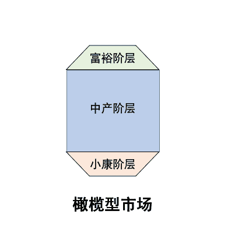

那中产阶层标志是什么？

第一，独立思考，理性消费，不信忽悠。

广告一多了就不买了。明星代言、某个网红推的，绝对不买。因为很简单，这个产品你买来的更多是广告费。因为厂家把大量的钱给了明星、广告公司，产品的实际价值就下降了。所以中产阶层就有这个认知，广告做得越多越不买。当然，在发达国家就会见到有些企业反其道而行之，叫“本企业从不做广告宣传”。如果目标客户是中产，就喜欢这个产品，就要知道，中产不是什么有名买什么，而是看谁的东西好才会买一个试试，试了以后好就继续买。所以这是中产阶层的第一个特点。

第二个特点是讲究平等。不能居高临下，也不能觍着脸求他，应该是平等的。这两种方式他都不接受。但是他更不相信忽悠，因为他不想当韭菜被人收割。

那么第三个，中产阶层追求的不是物美价廉，他讲究的是品味，讲究的是价值。他相信的，是一分钱一分货。如果中产阶层是你企业想重点关注的市场，那么我希望大家能多多去研究中产阶层的消费习惯、买产品的时候的选择标准。这样的话你就能贴近客户，理解这个群体需要什么。

说到这儿，我们再反复强调一下，为什么非得做市场细分？为什么一定要做目标市场的选择？

因为资源有限

。尤其是中小企业，人才有限、资金有限、资源有限、时间有限，这就是四个有限。那既然有限，就一定要聚焦，好钢用在刀刃上，把有限的兵力在一个局部的市场上，把它做好。很多企业做着做着就死了，就是因为膨胀。它没有战略的自律，觉得无所不能，什么都想去，做着做着就死了。

所以说在企业咨询圈，有这样一句话，叫“大多数企业都是撑死的，极少数企业是饿死的”。大家回忆一下，看看那些如日中天的企业为什么倒掉了？无一例外都是撑死的。太狂妄了，太自大了，觉得自己什么都行，结果做着做着大厦轰然倒塌了。你看你身边，凡是谨小慎微的，认认真真做企业的，有几个死了？都没死。所以说死的都是被撑死的，很少有人是饿死的。

## 案例：选定细分市场流程

接下来我给大家讲一个工业品案例。这也是我的一个学员，他们是做传送带的。

我们去他那给他做东道主咨询的时候，就做了第一件事，把他产品可能的应用领域通通罗列出来。这个动作叫穷尽。就是把所有可能的客户在哪里，都罗列出来。但很多企业都没这么做，反而是逮着什么做什么，哪有关系就做哪个。

这个工业品企业，之前就没有做过罗列的这个动作。我给他们做战略咨询的时候，就让他把所有的客户都罗列了出来。所以这是第一步，先穷尽。

那么第二步，是根据穷尽的结果把客户进行分类。比如说，这家企业过去只在一个市场上做得非常成功，就是烟草，因为做卷烟需要大量的传送带。但是光做这一个市场，不行。还得发展。往哪里去发展？我们就在穷尽的基础之上进行分堆，看看哪些应用规模大、利润高。规模大就是用得多，利润高就是客户赚钱。

我们就选了俩。比如机场，大家都去过飞机场，要托运行李，出来的时候是不是都有传送带？那就是他们做的一样东西。还有一个，是轮胎。这些年汽车行业突飞猛进，轮胎的需求也非常大，这也需要。这都是市场，规模又大，企业的利润也高。

另外一个是规模没那么大，但是利润很高，就是生物制药。因为做生物制药的企业数没那么多，规模没那么大，但是做药的都比较赚钱。那么如果你再看其他的，做粮食的、做建材的、做煤炭的、做物流的，也都需要用到传送带。虽然规模很大，但这些企业的利润率不行。那利润率不行，就不舍得买好的。但这家企业做的是相对高端的传送带。

那么这么一罗列，答案就出来了。

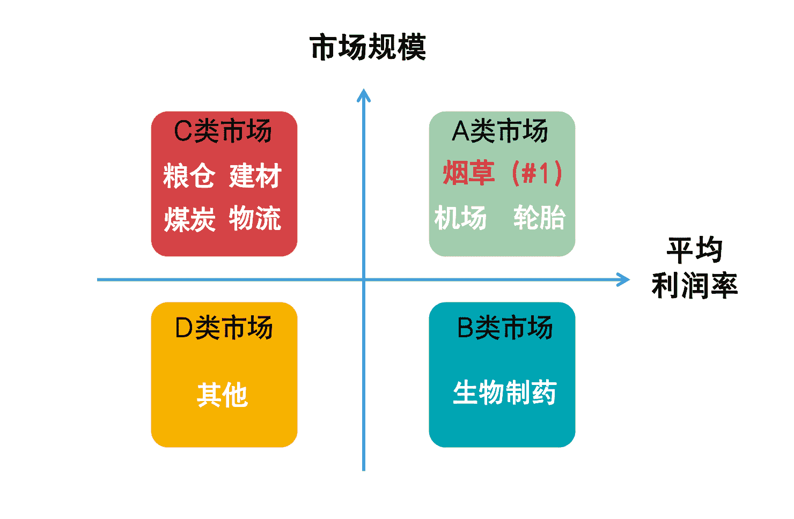

先做什么？

一定是先做规模大，利润高的

。我们就罗列出来了前三名，第一个就是机场，第二个生物制药，第三做轮胎。我们说做战略，首先就是要选定我们重点进攻的市场。如果其他行业有人来找我，不是不卖，但是不重点进攻，这就是战略的价值所在：我们重点进攻什么？把有限的资源用在什么地方？

明确了机场是我们的第一目标市场以后，老板的问题马上就来了，上哪去找人？谁负责做这件事？那我就问他，谁能把这个机场的生意拿下来，一定是做过机场生意的人。我说那你就去找，他说去哪里找？我说这个我没办法告诉你，需要你自己去找。

结果过了半个月，他告诉我，这样的人找到了。因为这个人是原来向机场卖廊桥的一家公司的资深销售人员，年龄也比较大了。但是人家这个人不愿意来他这当员工，但是有兴趣帮他引荐一下，问他行不行。后来我们一商量，说没问题。与其搭建自己的团队，不如找一个人跟着外部的顾问去跑，这样的话效率更高，效果更好。于是这个老板就让他弟弟，跟着这个外部顾问去跑相关的机场。结果没过半个月，正好赶上这个机场有一个订单，当然是修修补补的订单，是个小订单。但就是因为赶上了这个小订单，他们进入了机场的这个市场。

所以这个案例其实说明了几个问题。

第一，你要先知道你的目标是谁，哪些市场机会大，应该进入。

第二，这个市场怎么进入？你一定要找到明白人才能进去，这个明白人在哪里？他为什么会帮你？这都是你要思考的问题。

人家决定跟你合作了，那怎么对接让人家才很舒服。因为对他来说就是给你牵线搭桥，工作量并不大，也能得到一些回报。但对企业来说，有了这一层关系，就有了一个敲门砖，很容易跨入一个新的行业，一个新的市场。这样这个企业就拿下了这样一个市场。

## 案例：客户分堆流程

刚才讲的是一个工业品的案例。接下来我们讲一个快消品的案例，如何进行客户分堆。

这是我几年前在广西帮一家企业做的一个豆奶的案例，帮他们做战略规划。大家都喝过豆奶，对不对？他们家的豆奶非常好喝。但是一开始的时候我就问他，你的产品都卖给谁了？他说所有的人都喝，凡是爱喝豆奶的都喝。我说这玩意没法玩。就是所有的人都是你的客户，那就意味着所有人都不是你的目标客户。

我说能不能分堆？我们就带着他的团队开始分。后来发现有小学生市场，中学生市场，还有旅游景点的市场，还有餐馆的市场，还有打工仔的市场。在一个上千人、上万人的那种制造业大工厂里边，有很多打工仔，里边有很多小卖部，这也是一个市场。还有在写字楼里边有一些白领，也会喝豆奶。

所以我们就把所有的市场都罗列出来。这家企业在南宁小学生市场上已经做得非常成功了，另外一个就是家庭购买也很成功。

后来他们发现，有一个市场竞争不激烈，想进入，就是

打工仔市场

。你知道，一个企业上万人，这个量比一个超市的量都大。因为超市来的人是五花八门，目标客户很少。但是在一个大厂里边，那一下子上万人，这个需求量很大。所以说就把这个当作一个目标市场。

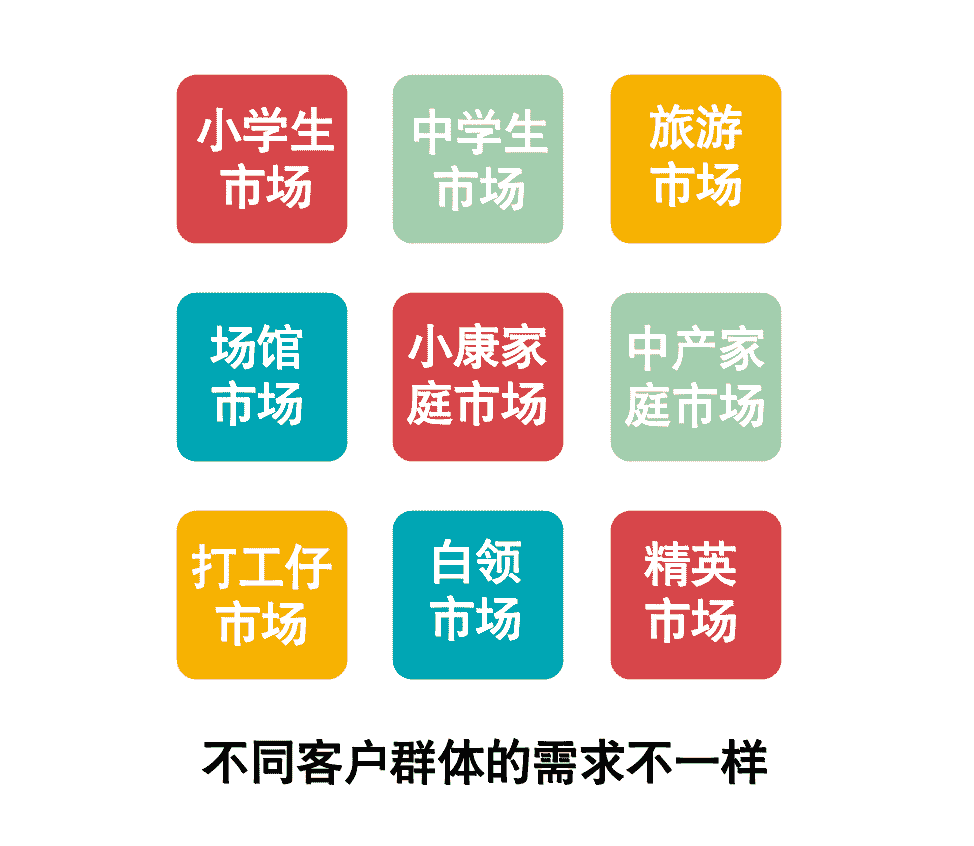

有了目标市场的概念就简单了。这些大厂在哪里？无非就是广东一带、浙江一带，有很多就这种大厂。那怎么办？

后来他们就跑到杭州开一个分公司，我还去参加他的开业典礼。也就是说，渠道布局、人员安排，一定要跟着市场走。那么在杭州的分公司，重点开拓的就是这些大厂。所以说它的产品不能是高档的。

你知道，打工仔市场一定是物美价廉，拿便宜的产品贴近客户，想办法把这个产品卖到厂区里边的小卖部。因为那些工人大多数时间是不能出厂区的。因为里边有很多小卖部，他们日常的生活基本上都在厂区里边。所以这个消费量非常大。

所以说一定要根据不同群体在哪里，需要什么，来做我们的产品规划和渠道布局。

所有这一切都取决于你要做好市场细分，做好目标市场的选择。

## 案例：客户分层流程

我们再来看一家耐用消费品的案例。这是一家木门企业，也是 7、8 年前，我帮他做战略规划。过去买门，都是谁都来买，只要你们家装修就来买，也是个大众化的思维。

我们一去就先做切分。我们的门都卖到哪里去了？我们先分成若干个群体。

小康之家，往往就是经济适用房或者是便宜的公寓。

中产都是改进型的住房，花园洋房，一些面积比较大的，这叫中产。

那么成功人士往往就是大平层或者是小别墅。那富豪阶层就是大别墅、豪宅。

那我们首先要做取舍，我们的产品适合谁？

首先，因为这家企业做的木门是相对高档的木门，所以说温饱型的肯定不能要，这家企业做不了那么便宜，最低也是小康，而且是小康里边的中等偏上的。同时又做不了富豪的，因为富豪要的那种实木的、高级木料，那个不是批量生产的。

最后我们就把市场分成了三个：小康之家、中产阶层和成功人士。

我们要用三个产品来满足这三个群体的需要。最后我们就做叫

4 系、6 系和 8 系

。4 系产品针对小康之家，6 系产品针对中产阶层，8 系产品针对成功人士。

那这样一来，产品的划分就很清楚了。4 系比如说 2000 块钱，那么 6 系就可以 4000 块钱，8 系可能就 8000 块钱。这意味着什么？这意味着价格在翻番。

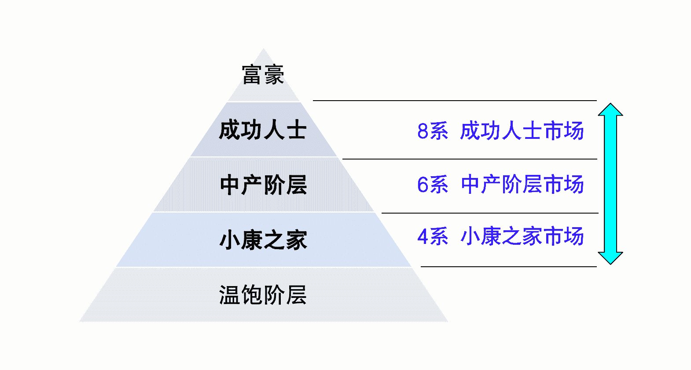

那怎么让高端的人士接受这么贵的价钱呢？

我们就做了一件事情，把一个门的右上角切下来，可以拿下来给客户看。切到哪个地方？一直切到内芯那个地方。

我们在展厅里放上三个门，然后让客户看：来，请你来看一看这三个门有什么区别？只要是一个普通的消费者，绝对看不出来区别。因为喷了漆了，客户看来看去，也是看不出来区别的。然后把价签翻开看看，我们一开始把价签是盖着的。翻开后，一看 2000、4000、8000，为什么同样的东西差别那么大？我们就把右上角切下来的这个三角拿给客户看，就说这三个不是一样的东西。

小康之家，看到的 4 系是全板材，都是压缩板、密度板的，没有木头，所以说便宜，因为就压缩成型的。

然后中产的框是木，内芯是板，这叫板木结合。

而这个 8 系的呢，内芯和框全是实木的。

这样三个产品就出来了。

如果这个客户是一个成功人士，我们的销售就很容易给人家推荐，建议买纯实木的，看着一样，其实不一样。因为这是真实木的，这是高端产品。如果他住的是别墅，一听没错，买最贵的。

那如果是一个小康之家呢？就会说看着都一样，买便宜的最合算。根本看不出区别来，是不是越便宜越好？所以小康一听没错，买了一个名牌的门，同时还看不出来谁，是不是自己有面子。

而如果是一个中产，我们就说框是实木就够了，芯儿是板没问题。这种要品牌有品牌，要品质有品质，还比那个便宜。

所以说有了目标市场的概念，你会发现跟客户沟通的方法都不一样，就是见什么人说什么话。我们没有欺骗消费者，我们是引导消费者做出客观理性的选择，让客户对号入座。作为这个群体的人，客户最在乎的是什么？你要理解。

\*

谈完了产品结构以后，这家企业的导购员又提出来一个问题，说老师，我们在跟高端客户沟通的时候，始终觉得抬不起头来，不敢正眼看人家，总是心里发虚。我说为什么？他说人家都是住大房子的，都很有钱的人，我们是社会的底层，总觉得心里发虚。我就问他一个问题，我说你知道这个住大房子的人多长时间装修一次吗？他说不知道。我说我告诉你，每 6 年到 8 年一次。这是这个社会上的成功人士换房的频率。

这是一家著名房地产公司做的调研，就是成功人士每 6-8 年换一次房。所以如果你每 6-8 年换一次房，反过来证明你就是成功人士。

我再问他，我说你们一个月能卖多少个门出去？能接触多少客户？他说我们一星期一般能成两单，一个月 8-9 单。我说好，你们一个月做 8-9 个，一年就是 100 来个，你 6-8 年就是 600 个到 800 个。我说，谁更懂门？谁更懂装修？我说应该是你们。这些成功人士 6-8 年装修一次，他对装修的很多东西很快就忘了，但是你们天天跟装修打交道，你应该比他们更有话语权。

这么一说，他们觉着，好像是。他说，不过我们没有看过到底是怎么装门的。我说那就去看。我说你们一定要深入一线，到装修现场，看这个门是怎么装的。跟装门的师傅在一块聊，跟客户在一块聊，你慢慢就会懂得门怎么鉴别，怎么安装，怎么使用。你就会成为专家。

最后我让他们把胸牌改了。他胸牌上过去写的是导购员，我说改成装修顾问。一开始他们说，我们还顾问呢？我说对，你懂得了装修那点事儿就是顾问。后来我们就做了这么个小册子，就叫《装修那点事儿》。我们要告诉客户，装修当中哪些陷阱、有哪些问题，是装修公司不告诉你的，是设计公司不告诉你的。如果你想知道，我们可以跟你聊。当然前提是你买我们家的门，就送你一本，让你少走很多弯路。如果你不买，我们也不能给你。因为我们是按照客户来的，做一个单给一本。

我就教他们的导购学会这样一套话术，能够成为客户心目中的顾问，帮客户省钱，避免客户掉到坑里去。你想，客户会不会感激你？你是不是个装修顾问？你能把装修过程中的哪些坑、哪些问题，说得头头是道。所以说在这种情况下，再跟高端客户沟通，有问题吗？一点问题都没有。这就是从导购员到装修顾问的升华。

我们说有了目标市场的概念，我们就能够聚焦，就能够重点突破。

我记得很多年前有一个高考的作文题，就是这样一幅画面。有一个人拿着个铁锹想去挖井，把水挖出来，结果挖了好几个都没挖到。因为这个地方挖了几下，发现没水，就走了又到别的地方又挖。你看他一共挖了 5 个坑，都没挖出水来。其实只要在任何一个地方再多挖一会儿，都会出水。这就是当年的一个作文题。

其实这个画面特别适合我们今天谈目标市场的选择。一旦你选择了目标市场，就要想尽一切办法把它挖透，把水挖出来，不达目的不罢休。其实大多数企业缺的都是这个韧劲。

花了不少时间，花了不少钱，结果都“撒芝麻盐”了，这个地方做一做，那个地方做一做，结果哪个都没成，这是最可悲的。没少花钱，没少耽误时间，但是因为没有深耕，结果最后都不了了之。

## 中小企业为什么没做大做强？

其实，中小企业的老板之所以没有做大做强，总结来说就是三点，叫“贪快、逃避、偷懒”。

贪快呢，是老想快。

很多人问我问题，10 个有 8 个都是，高老师我想快速成长怎么办？我想快速开发一个产品怎么办？我说，先把快速二字去掉。只要你想快，你就快不了。快就是慢，慢就是快。你能听懂我说什么吗？他一般都会懵，啥意思啊？我说只要你贪快，你一定跑得慢，这就是它的哲学，快就是慢，慢就是快。你看起来这一次快了，但是每一次都没做到位，最后时间一久了发现，你其实是慢下来了，所以这就是贪快。

什么叫逃避？比如说一个企业做了一个产品，卖了一段时间以后，发现到瓶颈了，卖不动了，就想换产品，就想换赛道。

其实这就是逃避。你要想办法，一定要把这个产品做成市场上的爆品，不达目的不罢休。但是大多数企业是在一个地方一旦没有取得成功，或者没有继续成长，就逃避了，不敢啃硬骨头。

最后一个是偷懒，很多老板才做到几千万，或者是一两个亿，就想当甩手掌柜。

他自己当董事长，从外面聘来一个总经理。结果大多数情况都走向了反面。要么是这个总经理被架空了，要么被这个总经理挥霍了很多钱，或者是被这个总经理把很多客户给拉走了。所以我跟我的徒弟、企业学员讲，没做到 10 个亿以前，作为创始人、老板，不可以把单子交给别人，必须自己继续亲力亲为，把企业做到 10 个亿。如果你做到 10 个亿以后，有机会上市了，这个时候再找一个 CEO，找一个总经理，才没有问题。在没达到 10 个亿之前就想偷懒，往往就会出问题。

## 本讲小结

好，总结一下，这一讲，我们主要是讲了如何选择目标市场。

具体说来，主要注意这样几点。

第一点，不要贪婪。

因为资源有限，我们要把好钢用在刀刃上，先把第一目标市场拿下，单点打穿。

第二点，选择了目标市场以后，就要配套相应的人员，一定让懂这个市场的人去开拓这个市场。

很多企业在招人的时候都容易陷入一个误区，老跑到同行那儿去找，去竞争对手那挖人，这是最不应该选择的一条道路。那去哪里选？我们说到客户旁边去选。什么意思？就是可以把从客户公司离职的人挖过来，因为他就在客户的公司工作，所以懂客户。

比如说我想做医院的生意，我就找医院里离职的医生。比如说你去找给医院供货的供应商，他过去是卖医疗器材的，他跟医院已经建立了联系。你找这样的人来，他就有相应的渠道，有相应的关系。他见客户就不陌生，他对这个市场很熟悉。

所以说一定记得不要到同行那儿去挖人，而是到客户附近挖人。当然还可以到客户的竞争对手那儿去挖人，这也是很多客户喜欢的。你把客户的竞争对手的高手给挖来了，等于你的客户就少了一个比较厉害的对手。所以这是第二个。

第三个就是，找到了目标市场，招到了人，我们就要想办法深耕。

不达目的不罢休，一定要咬住牙。一个企业只要能在一个市场上取得成功，整个团队都有了自信，这一点非常重要。一定要取得阶段性的胜利。我能把一个市场拿下，整个团队都会相信，我如果打第二个，我也会拿下。因为我已经形成了套路，我知道怎么把一个市场从无到有开拓出来。

好，这一讲到这儿就结束了。

我是高建华，我们下一讲见。

点我查看官方留言

发布留言

0/ *500*

确定

* * *

# 04 怎样在目标用户群中建立领先定位？

你好，我是高建华，欢迎来跟我一起学习战略设计。上一讲我们讲了如何选择目标市场，这一讲我们来讲如何挖掘目标市场客户的需求。

重新理解客户

我们说客户的需求首先分三个维度，功能需求、心理需求和经济需求。什么意思？

功能需求，就是这个产品能帮我解决什么问题？我买它来干吗用？这个要说得很清楚；  
心理需求，是买这个产品有面子吗？当我跟别人说我买了个什么东西的时候，我有自豪感；  
经济需求，就是这个产品实惠吗、便宜吗，价格是多少？

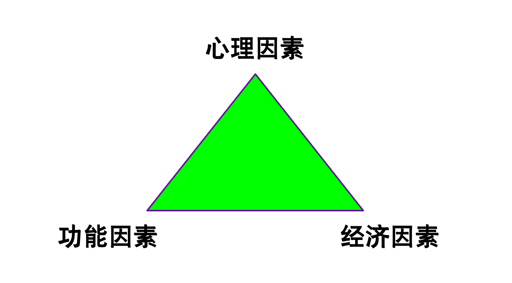

但是不同的群体，对这个三个需求的关注点是不一样的。

中产阶层最关注的是功能，然后是心理，再其次是经济因素。富裕阶层最关心的是心理需求，其次是功能，再其次才是价格。小康之家最关心的是价格，其次是功能，最不在乎的是面子。所以说三个不同的群体，他们的关注点其实是不一样的。

很多企业都在喊一个误导的口号，叫“用户是上帝”，这是一个大错特错的理念。我希望听了我课之后，所有的企业经理人从此以后不要再喊这个口号。

首先，客户不是上帝，也不应该是上帝。

那客户是什么？客户是你平等的伙伴，你的产品一定能帮上伙伴，你才有价值。你的产品没有价值，客户就不会跟你做伙伴。因为市场经济讲究的是利益的平等交换。大家想一想，你买了漂亮的衣服，是开心还是痛苦？肯定是开心。你买个房子肯定回家要庆祝，开上个新车肯定要去炫耀一下。这是因为你买了你想要的东西，谁也不欠谁，大家是都开心的。所以说是平等的，是互利的，是双赢的。客户怎么可能是上帝呢？

所以记得客户永远都不是上帝，这是一个非常误导人的口号。

那如果我想对客户特别好，可以把客户定义为恋人。恋人需要追求。想去追求，就整天揣摩需求。想对他好一点，就去揣摩他的心理，在他没提出想要什么之前就给他。这是不是会打动对方？比如说，你们在一块逛街，他在某个橱窗里看到一个东西，盯着看了一会儿，你第二天就买了送给他，你说这是什么感觉？肯定一看，你太懂我了，我就看了一眼，你就把它给我了。肯定会被感动的。

这就是对待客户的方法。你想对客户好，就去挖掘他没有说出来的需求。你感受到了，他想要这个，但是他不好意思说。但是你把这个搞清楚了，你就赢了。

所以说客户不是上帝，是伙伴。

## 对不同客户要“区别对待”

还有一个概念，要区别对待不同的客户。

很多企业都在想，我对客户一视同仁。不是。优质客户一定要善待，给特殊的对待。而对非客户，一定要说不，我不想向你提供产品和服务。

比如说，我是国航的终身白金卡会员，我已经飞了几百万公里，我每次坐飞机，乘务长一定会过来给我打招呼。因为这是他们的规定动作，对所有终身白金卡的会员要善待。

换句话说，我是给他创造了价值的优质客户。不管发生什么情况，虽然广播里不讲，但他都会悄悄告诉我：为什么要等一会儿？我们现在排在第几？路上有什么情况？天上有什么情况？他都会悄悄跟我讲。

你说，我的感觉是不是就很好？

这就是对客户要区别对待。因为不区别对待，谁都不想成为高价值客户。

我举一个相反的例子，当年我帮一家大的央企石油公司做培训。他们就讲了一个案例，说我们过去有一个客户就从我们一家买，我们也不给人打折。后来这个客户一生气，就从另外几家分别买。他们一看坏事了，不行了，如果再不打折，这个客户留不住了，然后就给他打折了。这个客户以后每年从这买百分之几十。

他就问我这事怎么办？我说这是你制度上的缺陷，你应该给独家从你这儿买的人最大的优惠，他才愿意待在你这。你想，你们的政策就是鼓励大家脚踩两只船、脚踩三只船，这是制度设计出了问题。其实你们搞反了，你应该是鼓励客户货比三家，让他从其他家也买，但他从你这才能得到优惠。

所以说，一个企业有了战略以后才能明白这个道理。

我们把客户先分堆，再分层，然后对他们区别对待。这样的话，你才会发现好客户、优质客户最喜欢你，那些劣质的客户、不好的客户连要都不要。要去设置各种各样的门槛，把那些劣质客户都赶出去。因为你只能为部分人服务，你就要想好我为哪部分人服务。

那么对于工业品的客户来说，就不是一类人了，涉及到 4 类人，决策者、购买者、使用者和影响者。很多企业是派一个销售人员去搞定这 4 种人，难度太大，基本上不可能。因为我们每个人的能力都是有限的。所以说在一个公司里边，我们要用 4 类人去覆盖客户方的这 4 种人。

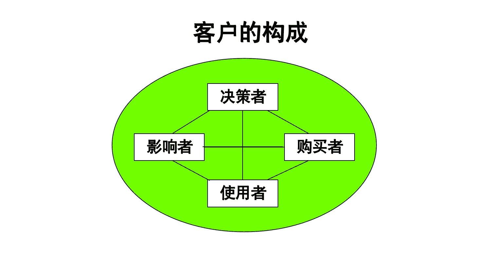

## 案例：照明企业客户关系水平分析

当年我帮一家照明企业做咨询，他们这家企业最厉害的就是把使用者关系做得非常好。他们的销售人员不去自己公司上班，都去客户单位上班，一星期回一趟公司，做辅导、做沟通、做汇报就完了，平常就是去客户那儿打卡。

为什么呢？因为都是大客户，每个客户都买了很多东西，有可能会换灯，会维修，他就待在客户那干活。跟使用者关系搞得非常好，像哥们一样，跟客户叫同吃、同住、同劳动，天天在一块吃饭，大家混得非常好。

但是有时候也会发现他的客户被人家抢了，为什么呢？

因为竞争对手把客户的领导搞定了。这样的事情越来越多。尤其是从这家公司出去的人，比如一些离职的高管，这些高管自己没有这么多兵，就自己一个人，所以就从上往下推，找对方的高管、老板、决策者去做工作。这就对这家照明公司构成了威胁。

所以很多人就反映说，高老师这事咋办？我就用这个方法论教这家照明公司怎么样扭转乾坤。那个时候，这家照明公司已经有了 2000 多名销售人员，分布在全国各地。

我说你们就做这样一项工作，让每个销售人员，把他负责的那个客户单位的决策者是谁、购买者是谁、使用者是谁、影响者是谁，统统罗列出来。

我们先讲一下，我们这个工具叫客户关系水平的分析。各位拿回去都可以马上去做。让你的销售人员把所有客户，这 4 类人是谁罗列出来，把跟客户的关系水平打分。

5 分，是“铁哥们儿”，说啥就是啥，客户 100%听你的；

4 分，是好朋友。客户基本上会给你面子，但是不是 100%；

3 分，你跟客户就是正常的交易，也不亲，也不远；

2 分，客户对你有点反感

1 分，根本不想见你，讨厌你。

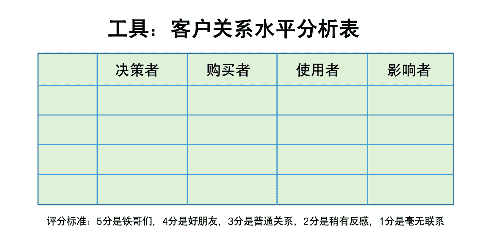

这一步工作他们用了 3 个月，因为他们只认识使用者，都是那些上班族里边的。他们认识不到公司的这些高层。但是经过 3 个月的时间，我们得出来一个统计数据。

这个数据很可怕。为什么？我们通过客户关系分析发现，使用者得分很高，决策者得分很低，购买者得分一般。这就是问题所在。

我们通过做战略设计，首先是问客户你知道吗，他才发现我知道我自己不知道，这是我们的一个目的。通过问这些问题，他发现，我们跟决策者的关系出现了问题，以前不知道是问题，现在知道是问题了。我们跟购买者的关系也不到位，这也是问题。实际上所有的人都惊醒了。

后来我们就让这家照明公司全员做了一次统计分析。这家照明公司是分了十来个事业部。每个事业部先分析自己这个事业部，把所有客户全加起来。最后的结果是什么？

决策者得分在 1 点几分，不到 2 分。什么概念？就是企业和客户的关系，在反感和不想见你之间，很恐怖。而购买者是 2 点几分，在反感和一般之间，这也是问题。使用者是 4 点几分，都是好朋友、铁哥们。

这个数据一出来，就相当于给企业做了一次体检。后来，我们用了半年的时间让大家去做工作。怎么做？

决策者由各事业部总经理亲自负责。比如说我这个事业部 100 个大客户，总经理要用大半年的时间，自己去磕这 100 个大客户。半年，你想，是 180 天，100 个客户走遍了应该不难。一天可以走访两个，上午一个，下午一个，还有其他的事情可以干。

购买者，销售人员搞不定。大家知道，搞采购的都是些老油条、老滑头，一般人搞不定。他们由各大区的主任，负责本大区这几十个客户的购买者。

销售人员继续做使用者的工作，而把影响者的工作交给市场部去做。大学、设计院、研究所、媒体，这些都是影响者，就是会影响老板做决策的一些因素。

我们这样分门别类去做工作，经过半年的时间，这幅画面就好看了。

后来，我们又做了一轮调研。决策者的得分已经大于 3 分了。购买者的提高不多，因为那帮人不好搞定，但是比以前好了一点，过去是 2 点几，现在变成了 3 点几。使用者没有变化，已经 4 点几了，想再提高不可能。然后影响者达到了 3 分。

这个时候这个企业的发展就相对均衡了，企业业绩就实现了突飞猛进的发展。第一年 5 个亿，第二年 11 个亿，第三年 18 个亿，就是非常高速地在发展。其实就这么一个动作就解决了问题。因为把客户覆盖好了，这个问题就解决了。

你知道，这 4 类人里边有一个人说不就会有麻烦，因为都是 B2B 的生意。如果有人反对，剩下几个人就得想一想要不要较这个劲。所以最好的模型就是有一个人提议买谁的，剩下 3 个人都说还行、不错，不亮红灯就可以。

## 案例：惠普挖掘客户需求流程

那么接下来，我再给大家讲一下我亲身经历过的挖掘客户需求的案例。

那个时候，我从苹果回到了惠普。为什么呢？就是惠普给了我一个机会。

第一，开拓国际市场，这是我想要的一个技能。

第二，能够做面向国际市场的产品，我过去是把已有的产品卖出去、推向市场，现在是去做一个产品。

当然，为了这个技能我损失了很多的钱。因为那时候我在苹果的时候，已经年薪 60 万了。 1996 年我已经年薪 60 万了。但是回到惠普只给我 30 万。惠普就这个本事很厉害，你要看的是钱来，那我不要；你如果是图着事业来，我就要。这是一个试金石。我不知道有多少老板有本事让一个人降薪跳槽，这就是最高境界。

那我为什么会降薪跳槽？是因为惠普给我描绘了一个美好的未来。这两项技能对我这一生都非常重要，我就愿意投资。当然，他当时答应了一个条件，说如果你表现好，能做出成绩，两年以后会恢复到现在的薪资水平。最后就做到了。

那么我就冲着开拓国际市场、做新产品创新，就从苹果回到了惠普。在国内就跑天津摩托罗拉、北京诺基亚爱立信，南京富士通、NEC（NEC 平台公司，全球 IT 与互联网络供应商）。全世界这些做通讯设备的、做电子产品的大公司，都是我们的目标客户，我们就到处去跑。

去人家那干吗？这是关键点。就是挖掘客户未被满足的需求。

这是很多人不会做调研的关键点。我们去客户那儿，不是谈我们的产品怎么好，要卖给人家。我们去跟客户谈，尤其是前几次，我们是跟各个部门的人谈，他们的工作中最头疼的是什么，我们想看看我们能不能帮上你。

这是非常重要的一点，做市场调研必须带着利他之心去做调研，必须是内心深处想的就是我想帮你。包括我现在做所有的咨询前的沟通，我就这么一门心思想我看我怎么帮你。人都很聪明，谁也不比谁差。你脑子里怎么想，你言谈话语之中就会流露出来，你骗不了人的。你心里不是这么想的，别人都知道。所以一定要基于利益他的理念去拜访客户。

那个时候生产的总监就说了，现在我们最头疼的问题就是供不应求。在 97 年、98 年那会儿，是中国移动通信大发展的时候，大家都开始买手机。那个时候的三大家，摩托罗拉、诺基亚、爱立信，这三大家每一家的供应都不足，无法按照客户需求快速生产出手机。那怎么办？他说我们已经是一天三班倒， 24 小时连轴转了，还是供不应求。

那我们就问为什么产能不足呢？他说当初设计的时候没想到需求会这么旺，现在已经到了极限。我们说能不能让我们到生产线上去看看？他说没问题。因为我们跟他是长期的合作伙伴，他们对我们也不防备，也知道我们不会干什么有损于他们的事情。

我们就到车间上跟各个环节的人聊，你这块的瓶颈是什么？最后发现，瓶颈在测试那个地方。8 条车道、8 个机器手，在这儿装载元器件，咣咣咣咣把机器件都装上了，然后切成一个个电路板，放到手机壳里去。但是最后要一个一个测试，手机不像别的，它必须带电测试，证明这个能通信号。它不像一个杯子，不需要测试，看着差不多就行了。但是手机不行，一定要做测试。那八车道生产，一车道测试，麻烦就来了。你们想一想，是不是堵车了？那边八车道，到这儿就剩一车道了，可不就挤了吗？

我们一看这个，我们当时挺得意，就给人家生产部的头儿说了，问题找到了。他们问什么问题，我们就建议说再买 7 个测试台，让 8 个车道一起跑，不就上去了吗？人家就笑了，对，那样的话你们就高兴了。因为我们惠普是做测试台的。他们说到时候我们还没挣钱呢，先砸几千万买测试台，怎么可能？不可能。我们一听，不行，那我们再继续转，前前后后去了三四次。

有一天，突发奇想发现个机会。因为他们是先用一个 A4 纸那么大的电路板，把手机切成了 8 块，把元器件都装上以后切开去测试。

我们突然想，那要提高效率，能不能直接测 8 个、测 16 个？他们一听，好像有道理，这怎么能实现呢？我们就说，你只要觉得有道理，我们去尝试，我们做一个电子开关，就是测完 1 测完 2，嘟嘟嘟、嘟嘟嘟。你知道，电子开关是毫秒级的，是千分之一秒级的，但是过去的电子开关只有 10 个通道， 20 个通道到 40 个通道撑死了。

但是这一个电路板上边有十几个管脚，如果是 8 个的话，你想想这是不是 100 多个？所以说原来的电子开关都不管用了。所以我们说我们设计 200 个通道和 400 个通道的电子开关，这一个板子上所有的管脚都够了，我一次直接连接这几百个点，同时测。

当我们把这个想法说给客户的时候，客户的眼睛就发光了，说我们从来就没有想过还有这么个办法，那现在怎么能做到呢？于是，我们回去就用了两三个月的时间，用电脑把概念模拟了出来。做出来后，我们就拿给客户看，证明这个想法是跑得通的。客户一看说行，抓紧时间做。我们又用了一两个月，把我们的 Alpha 版本（内测版本，供测试人员使用）的第一个做出来了，拿给客户用。

那个时候他们一天三班倒，每半个月停机检修一次，所以他们就利用这个时间点，把我们做出来的东西放上去做测试。测完了以后，他们特别认真地给我们反馈，哪儿好哪儿不好，要怎么改。这就是客户参与。客户参与不是为了我们，是为了他得到一个更完美的产品。

所以说有了这几家重点客户的参与，这个产品怎么改就变得非常简单。因为我们是帮他解决他最头疼的问题，所以客户特别卖力气帮我们。

很快 Beta 版本（公开测试版本）就出来了。这个时候就可以上线进行小批量测试了。一试还不错，这个产品就大规模生产。当时我们这个分部只有 60 多人，这一个产品卖向全世界，一年就是将近 3000 万美金，2 亿多。60 多个人的一个小分部，一年能做 2 亿多人民币的生意，那个时候是 8.3 的兑换率。

而且利润也提高了，高到什么地步呢？ 60%的利润。为什么？因为它有壁垒。

因为测试台是我们家的，如果别人做电子开关，它就牵扯到开关软件和硬件，有个客户就被竞争对手说动了，你们家开关贵了，你看人谁家便宜。我说，如果你死机了，是开关的事，是软件的事，还是那个测试台的事儿，你就不担心吗？到那个时候你停机一星期，那个损失可就不是这点损失喽。客户一听，对。直到后来 5 年，竞争对手都进不去，因为这有壁垒。

当然，我想通过这个案例，更多传递的信息就是，基于利他的理念，去帮助客户解决他最头疼的问题。你就给了客户非买不可的理由，因为他买你的东西不是为了帮你，是帮他自己。

这是非常重要的一个理念，这就叫贴近客户，聆听客户的声音，可能 3 次、5 次才能找到感觉。

## 案例：显微镜企业挖掘客户需求

那么接下来我再谈一个案例，这是差不多 10 年前，我帮一家做显微镜的企业做咨询的案例。

他们的显微镜过去都是用在医学院，学生做实验用，因为比较便宜。那么好的显微镜呢，被世界上的四大家，两家日本、两家德国给占有了。所以说这家企业的东西卖不到大医院去。

我就问他们为什么卖不进去？他们当时说的是这帮人都崇洋媚外，另外大医院不差钱，什么好买什么。我说是这样吗？他说是。我说咱们的产品比人家差在哪？他说差不了多少。我说性能差不多是吗？他们说是。外观呢？他说外观差一点，他说客户不在乎外观，这又不是家里的家电。我说好，那咱们就去客户那做做调研，因为我没办法直接反驳他们。

最后，他们事业部的总经理、研发总监、销售总监，我们一起到北京人民医院病理科，因为医院用显微镜最多的是病理科做切片。

然后我们就去到医院，结果发现连个坐的地方也没有，因为那个房间很小。我们调研的是一个退休的老主任，这个老主任就说这地方太小了，要不然换个地方聊，看看病理科做切片究竟是怎么回事。

我说好，我们就到了旁边一个假日酒店，到了那个大堂里边，坐在那聊。这家显微镜企业的销售总监也好，事业部总经理也好，更多的关心的是你们当初是选择的谁的？老主任说我选择的是尼康的。他们就问为什么呢？人家老爷子已经退休好几年了，就对这样的问题根本不感兴趣，问着问着，我看他有点烦了，他觉得找我来就聊这个玩意儿太商业了。我一看这会儿不行，要再不说话就麻烦了。

我就说，老主任，我想问个问题，在医院病理科工作，最头疼的是什么？

他一听这个来劲了。他说现在大学生来到医院，最不愿意去的就是病理科。我说为啥？他说这个工作是最辛苦的，一天到晚盯着显微镜，看得头晕眼花。第二，没红包，大家知道化验都是窗户里进、窗户里出，没有人给化验科的、给病理科的塞红包，收入很低。怎么解决问题呢？只好说，本来是 8 个人的编制，我雇 6 个人，把另外 2 个人的钱给大家发点奖金。没有额外的收入，这是他们很头疼的问题。一个是没钱，一个是很辛苦。我说就这两个吧？

他说还有一个，那更要命，他说我们的“脑袋拴在裤腰带上”。我说这啥意思？他说我们是有风险的，我就给你讲一个故事。

当年我在这当主任的时候，新来的一个小伙，把切片判断错了，人家不是癌，他给人判断是癌，结果给人家都剌了。剌完以后，等到复查的时候才发现不是癌。

那是一个二十几岁的一个小姑娘。结果这个小孩父亲不干了，说这是谁干的坏事，一定要得把他砍了。这个父亲说我们家闺女还没结婚呢，你就剌了这么一个过去，你想人家将来精神上会受多大的影响？还好病理科是窗户里进，窗户里出，不知道是谁。

所以说为了防止出事，连夜把这个人更名唤姓，改了身份证，弄到外地去了，要不出人命。那个人就打电话叫家里的人、叫朋友，幸好他们处理得快，总算是把这个事儿妥善解决了，赔点儿钱算了。

老主任就说，你说我们容易吗？万一做错了，那个时候就有医闹，是医疗事故。这不光是赔钱的问题，这是要命的问题。

我听完他一说，我说为什么会出现这样的事情，为什么没有人把关？他说过去都是这样，每个人自己看自己的。然后我就让那个服务员给我拿张纸来，拿一支笔，我就在现场画了这样一张图。因为我是学工科的，学无线电的，对这些图像处理略有所知。工科的人会画逻辑图，会画框图，我就邦邦邦把这一画。

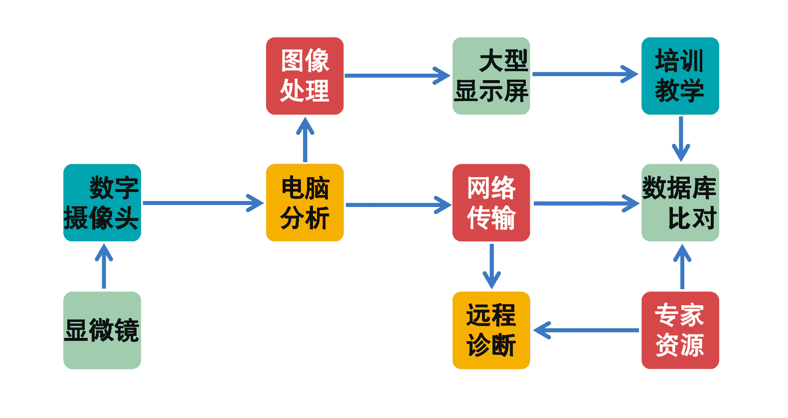

我就跟老爷子，也就是这个老主任说，假如按照这样去做，你看可行吗？我说，显微镜上来是个数字摄像头，然后把它进行变换，把模拟信号变成了数字信号，后边电脑分析，投到屏幕上可以看，然后我们可以进行教学。另外，电脑分析完了，我们可以把这个信息传递给别人。同时给全国各地的数据库做比对，我看的这个图像，如果我吃不准，用计算机做比对。其实这就跟人脸识别、指纹识别，都是一个道理，就是看看这个切片跟数据库里哪个最接近？用人工智能帮助病理科工作人员做判断。

同时，我们为了把关，我说如果是疑难杂症，这个计算机也不好判别，我说能不能咱们成立一个专家委员会，找全中国最有名的几十个专家来会诊。他说这可以。我说全中国搞这个病理研究的大咖有多少个？他说我们专门有个委员会，30 来个人。

我说你想一下，我一个人给你一个 iPad，如果有疑难杂叮咚叮咚一提醒，你看一眼，我说对你们来说是不是不难？他那肯定。他说我从大学毕业就在这个医院，一直到我退休，那是看了无数个这种案例，平常的切片一看就知道这是癌还是不是癌，对我们这些人来说都很轻松。我说那你就回答两个字或者三个字，是癌、不是癌，然后就给你一个小小的回馈。这就是知识付费。只不过那会儿连这个词还没有出现过。

老爷子一听马上放光彩了。我说甭管你在哪儿休假，在沙滩上都可以。只要你带着你这个 iPad，有什么这个疑难杂症，到你这一来，你一看，回两个字，回三个字，这个问题就解决了。他一听，这太棒了。

同时我说，每个医院如果没有大医生，有了这么一个专家赋能，是不是就有了保障了？以后再遇到疑难杂症，我每次发给 10 个专家，如果 8 个专家判断是癌，2 个判断不是癌，我们就跟患者家属去说，你看全国顶级专家 10 个，8 个认为是癌，2 个认为不是癌，你说剌还是不剌？这就解决了这个医患纠纷的问题。

另外，这也解决了收入问题，这些老专家过去看了那么多病患，东西都可以被复用，这就是知识付费。我说如果一个人看你的片子，每看一个给你 5 块钱，怎么样？他说那我就发了，立即就发了。他这么多年已经看过了成千上万个案例，只要有人把切片传过来，他稍微一看就知道是什么情况。那他看完就可以收钱，这不就行了吗？这跟今天的知识付费是一模一样的，只不过那个时候还没有这个概念，因为那个时候还是 10 多年前。

通过这样一个设计，我们说不要再盯着那个显示器看了，就那个显微镜的那个小显示器，我是盯着大屏看。他说不行，国家规定必须看显示屏。我就问他什么时候可以改这个规定？他这不可以随便改。我说老主任什么情况下这个规定可以改？他说这可复杂了，得整个委员会开会，这里边包括有院士这些大咖都同意了，这个诊断的流程才能改。我说是不是有这个可能？他说有，因为他也是其中的一个大咖之一。

这就是我们做顶层设计的思维，始终问他什么情况下能。当客户跟你说不行，当合作伙伴跟你说不行，未必是真的不行。你问三遍什么情况下能，你就会发现海阔天空。

所以这个方案一出来，这个老主任马上就问，你这个东西啥时候能出来？我说咱们现在就是一张草图而已。这个案例是 10 年前我做的，其实直到今天，我相信对大家依然有借鉴的意义。

当你拜访客户的时候，能不能去挖掘客户最头疼的问题？能不能站在客户的立场上去思考，帮他去解决问题？当然这需要一定的功力，需要你反复训练，你才能掌握这个本领。

## 案例：云南白药怎样使用客户反馈

好，再接下来我们讲一个被动挖掘的，刚才讲的都是我们主动出击去挖掘的，我再给你讲一个快消品的被动挖掘的，这是云南白药的一个例子。

云南白药牙膏怎么出来的？其实很偶然。

就是有一位老人，他牙龈出血，用什么样的牙膏都不好使。有一天他突发奇想，那既然云南白药止血，我把白药撒到牙膏上试试。他就自己把云南白药的药粉撒到牙膏上，然后就这么刷，刷了一段时间以后发现，管用。

他就写了一封信，跟云南白药集团说，我每天都在自制云南白药牙膏，你们能不能把白药和牙膏合在一起，我就省下了，否则我弄得到处撒的都是药粉，同时那个药的味还不好闻，弄到嘴里漱半天口才行。

云南白药集团一听，这还不简单吗？不就是把白药跟牙膏混在一起吗？结果就把云南白药牙膏给做出来了。当然，一上市就取得了成功。

除了这个客户的需求，还有一点，云南白药牙膏做得非常好，就是高端切入。那个时候，高露洁、佳洁士都是 4-5 块钱一管，而云南白药牙膏直接 20 块钱，为什么？因为用的全世界最好的膏体，成本非常高，但用起来感觉非常圆滑，非常舒适。

所以这是我非常喜欢云南白药牙膏的一点，这一步非常对。很多人都是从低端切入，想做一个比人家便宜的，那你赢不了。要想颠覆现有的市场格局，你要把现在的市场的老大、老二拉下马。最简单的方式，就是高端切入，做一个比它更好的产品，你才有机会。这是非常重要的一个原则，高端切入。

我第一次买云南白药牙膏，是在北京的北辰购物中心。因为我办公室离北辰购物中心不远。我本来一直都是用高露洁、佳洁士的，那天去超市一看，这个牙膏怎么 20 多块钱一管，这是什么牙膏，试试吧。一试发现，它很细腻，很舒服，味道也不错，我就开始买了，从此以后就变成它的客户了。我相信无数的人可能都跟我一样，试着试着就变成了它的客户了。所以因为你贵，才给别人一个理由，让别人去选择你。

很多企业陷入的一个误区，就是总想以物美价廉著称。关键看你针对的是什么群体。如果你这个产品想针对中产阶层，一定是中高端切入，从上往下打，你才能成功。

工具：1230 法则

接下来，我给大家谈一谈方法论。因为没有方法论回去没办法做，你就会觉着，我说得很有道理，回去就不会玩了。就是听着什么都有道理，一做就傻眼了。但是有了方法论就很简单。

什么方法论？叫 1230 法则，这是市场调研的一个基本原则：1 对 1，2 小时，30 人。掌握这个原则就可以。

去谁那儿调研呢？

第一，走访“消费了以后对现有产品不满意”的人，找 10 个人问问就行；

然后再走访“看不上现有的产品、还在观望还没消费”的人。问他你有需求为啥没消费？他又会告诉你，现有的产品哪不好，我为什么看不上；

再去找 10 个，自认为自己没需求，说买那玩意干吗？没用。你就问他，你为什么觉得他没用？

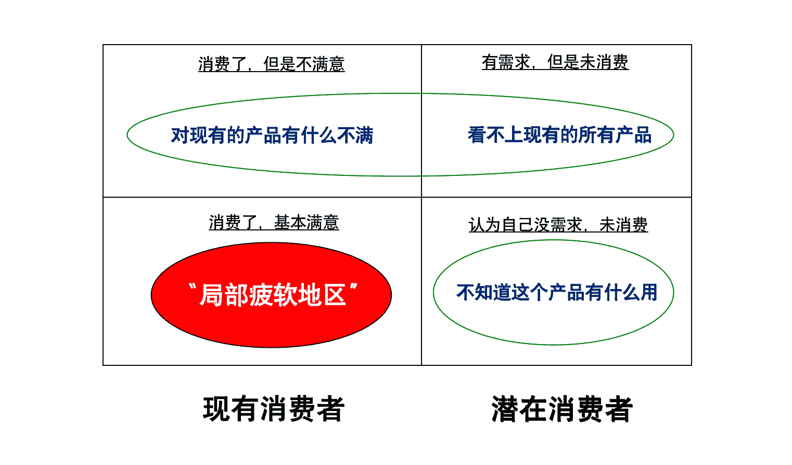

你只要把这 30 个人调研做完了，你就会发现，会恍然大悟。你就知道了，买了以后用着不舒服的地方是什么？

因为 3 个问题，也就是那些观望不想买的 3 个问题找出来了，3 个顾虑也知道了，认为自己没需求的 3 个原因也就知道了。你会找到这 9 条。把这 9 条一整合，你就知道了我从哪里入手，做一个产品，这 3 类人都会买。

现有产品的不满，我给你解决了。现有产品的顾虑，我做得比他好。认为没需求的，现在告诉你应该有需求。这样一来，这个企业就会走上快车道。

你说容易吗？其实很容易。我讲的这些方法论都不是什么高深莫测的东西，都是非常的简单。1230 法则是不是很容易理解？分别找人去谈，问人家 3 个问题，是不是也很容易？把这些问题拿回来一汇总，答案就很清晰，新产品应该长成什么样出来了。

本讲小结

好，总结一下。这一讲，我们主要讲了挖掘客户未被满足的需求，具体说来就这样几点：

第一，基于利他的理念，真想帮助别人去做调研，这是你的心态，这是你的初心；

第二，按照我讲的原则，1230 法则，1 对 1，2 小时，30 人。为什么要 2 小时？因为要深度沟通，要做问卷调查，3 分钟、5 分钟不管用，一定要 2 小时，这样你才能谈出点东西来。当你把 30 个人、2 小时的调研做完了，就能够找到产品创新的源泉。也就是说，我只要做一个什么样的产品，就一定能畅销，就一定能成功。

好，那这一讲就结束了。

我是高建华，我们下一讲见。

* * *

# 05 怎样看透所在市场的竞争格局？

你好，我是高建华，欢迎跟我一起学习战略设计。上一讲我们讲了如何挖掘客户的需求，这一讲我们一起来探讨如何做竞争格局的分析。

## 发现“看不见”的竞争对手

说到竞争格局，我们就要先看一看，在我们周围都有些什么样的竞争对手。换句话说，是谁在跟我争夺同一个目标客户群体？

比如说，我看上了某个市场，另外一个竞争对手也看上了这个市场，那我们就是竞争对手。并不是说生产同类产品就是竞争对手，而是争夺同一个客户群体才是竞争对手。比如说你去一个客户那儿投标，你看看参与者还有谁？那就是你最典型的、直接的竞争对手。

那么谈到竞争对手，我们会有几个不同的维度去探讨。

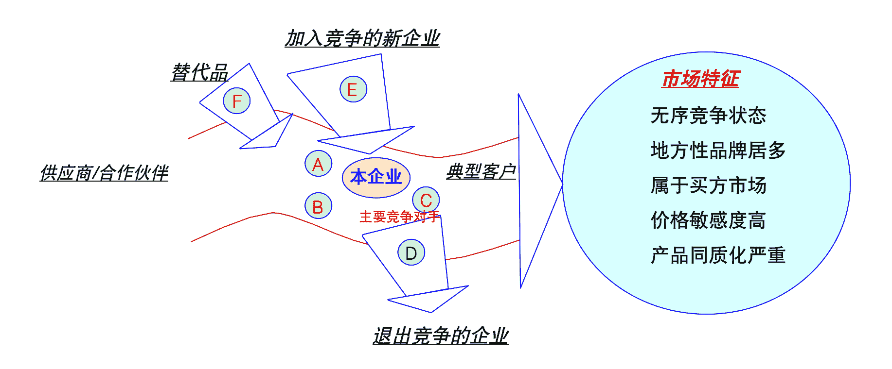

第一，叫

现有的竞争对手

，是看得见的，到哪都有正面冲突。

还有一类，往往是很多人没有在意的，或者是忽视的，那就是

加入竞争的新对手

。这是一个最要命的问题。很多企业往往是基于现在的竞争格局来做出战略判断，想要不要进入这个市场？比如一看目前市场上就 5 家企业，他会想说我要进去就成了第 6 家，至少能分一杯羹。

我记得大概 20 多年前，中央电视台曾经采访过一个企业老板，他是做维生素的。这个企业上马以后一直就没盈利。后来记者就问他，你们为什么做出这样的判断？

他就讲了这样一个故事，说当初想进入这个市场的时候，其实市场上参与者不多，所以哪怕能拿 10%的份额这个生意也蛮好，他就照着这个目标去设计产能，找投资。可是等产品要上市的时候，他才发现同时冒出来了几十家，让他大吃一惊。本来是只有几家，他再加一家还好分那个市场，但是当几十家同时进来的时候麻烦就大了。所以说这家企业从进入这个市场的第一天开始就没赚过钱。

这个案例就在提醒我们，要看到视线之外的东西。可以说真正的危险都在视线之外，就是没想到、没有预见到的。

很多人总说计划赶不上变化，比如说我怎么知道竞争对手什么时候进来？错了。你就得知道谁在什么时间会进来。这才是我们做战略的目的，把变量变成常量。你只要能预见到哪一类会进来，我们就能够采取措施把他们挡在门外。

比如当年我们是做测试系统的，是卖给各个移动通信的厂家。后来我们听说其中一个手机企业想自己做，这很正常，叫上下一体化。因为既然我是用户，那我干脆我把上游的卖给我的东西自己做了，自给自足。这样做，看似企业的蛋糕做大了，但其实不是。后来我们一听说他们在做，我们就主动出击去找他们谈，说你做了只能你自己用，你不可能卖给你的竞争对手，对不对？他们一听，对。

接着，我说，但是我们做了是卖给你所有的竞争对手，是卖给整个行业。如果你开发一个产品花 300 万，我们开发一个产品也花 300 万，你们说谁的成本高？但我能卖给 100 家企业，那每家就只是 3 万的成本，而你一家就是 300 万的成本。他们一听，有道理，就打消了这个念头。

这就是我们做竞争分析的一个原因。当你知道了谁有可能做，我们就要提早去做准备，打预防针。他如果已经做出来了，你想让他退出，不可能。因为谁也不愿意承认我的决策是错的。一旦投入了人力、物力，把产品开发出来了，再想让他退出是非常难的，所以一定要在之前把他挡在门外。

这就是我们为什么要做“加入竞争的新对手”分析。因为我们先分析哪一类企业会进来，然后看这一类企业图什么、怕什么，就知道怎么谈能让他打消这个念头，所以就要主动出击才行。

另外一个竞争就是

替代品

。

就像短信被微信给替代了，过去的很多电商被现在的直播带货给替代了。这看似是不相干的两个赛道，但是确实有互相的替代性。这就为什么电商起来以后实体店就下来了。这些都是互为替代品。

其实，做战略设计就是要预见到所有的可能性，能有相应的对策。

那么除了这两个新进来的，我们还有一个维度，

就是要看谁会出去

。也就是哪些企业活不下去了，它可能会退出。那我们就要列出来。都有哪些呢？

第一，利润不好的、市场份额很低的。这个企业本身不行了，都可能会退出。

所以说我们就要知道市场是动态的，它是不停有人进来，不停有人出去的。我们要做出动态的判断。当然了，你要想做好动态判断，就要看到图上右边这个，市场特征的分析。

这个市场目前是无序竞争？还是初级竞争？还是完全竞争？还是垄断竞争？如果已经是垄断竞争了，你最好打消这个念头，不要再往里钻了。

第二个，我们要看的就是，你这个行业是全国性品牌一统天下；还是军阀割据，各地方都是各自的地方性品牌。

比如说，超市有全国性的品牌，也有各地的品牌。有的品牌就在这一个省、这一个市很厉害，这也是一种市场特征。

另外，这个市场目前处于什么状态。

是买方市场还是卖方市场？是垄断的市场还是竞争的市场？这都会导致我们竞争格局不一样。在这个市场上用户的价格敏感度高不高？有的产品，其实客户对价格并不敏感，但是有的产品涨一点价销量就下来了。所以这些都是属于市场的特征。当然，还有产品是同质化的还是差异化的？如果产品是同质化为主导的，你做了差异化，你就能够切下来一块很大的蛋糕。

那么在这张图上，还有两个要素，一个是上游，一个是下游。一张图能够看清我们是为谁服务的，我们的上游是谁，谁为我们服务。

所以说这些跨国公司有一个非常好的方法，就是用图来说话。我在跨国公司工作了 17 年，也养成了一个习惯，任何事情咱们画图，因为只要能画出图来，就说明你看懂了。因为图是一个结构化的思维。它是有上下游，有前后左右上下，它就有了结构，一旦有了结构，你就很容易理解，因为它是一种图像化的沟通，而不是一个文字的沟通。

在这个竞争里边，我有一句话希望大家能记住，那就是

追求暴利等于自杀

。

很多行业为什么有那么多的竞争者？就是因为在初级竞争阶段，最早进来的那几个企业太贪婪。在别人没有这个产品的时候，他赚的钱太多了。只要是赚钱多，就等于向市场发了一个信号，说大家快来这儿，可以赚大钱。

虽然你心理边不想这样，但实际的结果就是这样。一旦你追求暴利，就意味着别人看在眼里，急在心里，肯定会眼红，会想尽一切办法进入。就比如说现在各行各业为什么老是一拥而上，重复建设，恶性竞争？就是因为最早的那几个企业太贪婪，追求暴利。如果一开始不追求暴利，就把很多企业挡在了门外，尤其是跨行业的竞争对手就不会进来了。

\*

那么接下来，我们就看看，一个企业从哪里去获得市场。有三种方法。

第一种，自己做一个新产品，开辟一个新赛道。

没有竞争，这是你创造的一个新市场，那你就是这个市场的祖师爷。这是第一种方案。

第二种，是在一个增量市场上，跟着市场同步成长。

什么意思？市场份额不增加，但是整个蛋糕变大，你也跟着变大。这是过去这二三十年，大多数企业收割的市场红利。就是市场的蛋糕变大了，每个企业的市场份额都是固定的，但是因为总蛋糕变大，它的营业额也上升。

那么第三种，就是瓜分市场份额。

这是在一个存量市场上，蛋糕不变了，甚至蛋糕会缩小。在这种情况下，你唯一的出路就是抢夺别人的市场。这就变成了一个零和的博弈了，就是你多了，竞争对手就少了。

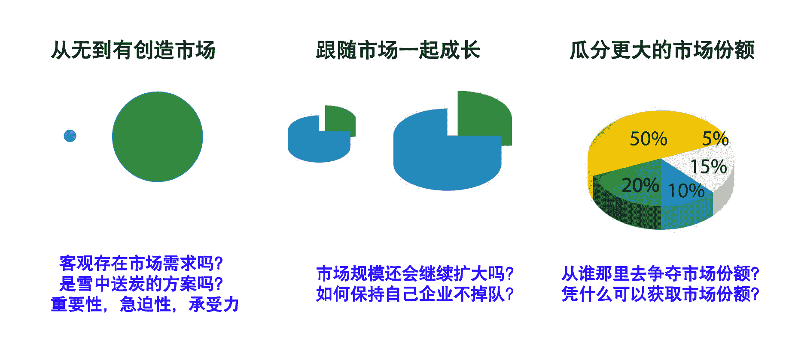

所以这就是看你这个市场目前属于一个什么样的状态。是一个从无到有的状态？还是一个高速成长的增量市场？还是一个趋于饱和的存量市场？

不管你想做什么样的产品，进入什么样的市场，

一定要想清楚目前这个市场上的格局处在哪个状态。

## 找到所在市场的竞争格局

我们说市场的竞争格局就四种状态，初级竞争、无序竞争、完全竞争、垄断竞争。我们在前面也曾经提到过这个概念。

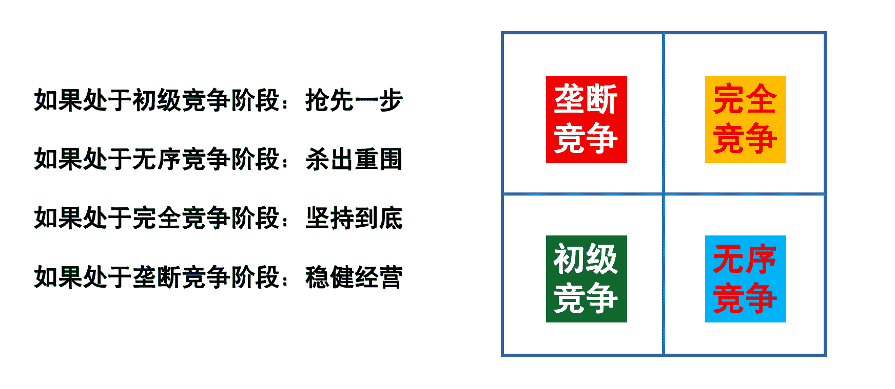

什么叫初级竞争？

一个新产品刚刚问世，这一个新品类刚刚出来，没有几家参与竞争，因为大家都在观望，不知道是死是活。所以大家都在等着看你能活过来还是会死掉。在这个时候如果你要进入，那就要想办法建立壁垒，阻止别人来蚕食你的市场。也就是说当我开发一个新产品的时候，不仅要考虑我自己怎么卖出去，还要阻止竞争对手加入竞争。

其实大家看看，你们企业战略里边是不是反复提到竞争对手？如果你通篇战略里边就没有竞争对手的概念，这就不叫战略。因为战略的前提条件就是有一个明确的竞争对手。

如果你是在初级竞争阶段进入，这个先机非常重要。一定要抢先一步占据这个市场，迅速地成为这个品类里边的头部企业。

如果你已经错过了先机，到了无序竞争状态了，这个时候怎么办？

一定要通过产品的差异化杀出重围。

因为在无序竞争阶段，就意味着成百上千企业都在做这个产品。那凭什么你能赢？这就要有一个好产品杀出重围。那如果这个机会你也错过了，中小企业就 Game Over，  
已经没戏了。

但如果你是个大企业，你可以在完全竞争阶段切入。

因为大企业财大气粗，可以不掌握先机。比如说，有的手机企业一开始在初级阶段他不玩，无序竞争也不玩。等到进入完全竞争了，他哐哧砸几千个亿进来了，就起来了，因为他有钱。所以说竞争阶段只适合大企业玩。如果你不是大企业，千万不要到这个阶段的市场去混，否则会死得很惨。

最后一个阶段是垄断竞争。

比如说这个市场上已经是三五家企业，占据了 80%以上的市场，这个市场就叫垄断竞争。在这种情况下，如果你没有什么杀手锏，绝对不能进一个垄断市场。因为市场已经被瓜分完了，每家企业都有各自的特色，在不同的消费群体当中占据了不同的心智。

比如说，原来的汽车从 20 万到 200 万，每个价格段其实都有三五十个品牌。然后来冒出来个黑马特斯拉，因为它开辟的是个新赛道，所以它就冲击了原来传统的汽车市场。虽然汽车市场本身是一个垄断市场，但是它用了一个全新的概念来杀入，就一下子又起来了。那么等它起来以后，你看有无数个做新能源汽车又加入了。

所以说现在的新能源汽车市场其实就到了无序竞争。也许两三年，也许三五年，就会进入完全竞争。因为大多数的新能源汽车企业都不是小企业，它初始的投资要求都比较大，都是有一定规模的。所以说用不了多久就会进入垄断竞争的状态。

## 6 层竞争分析

说完了竞争格局，我们来看怎么分析竞争对手。一共有 6 个层次。

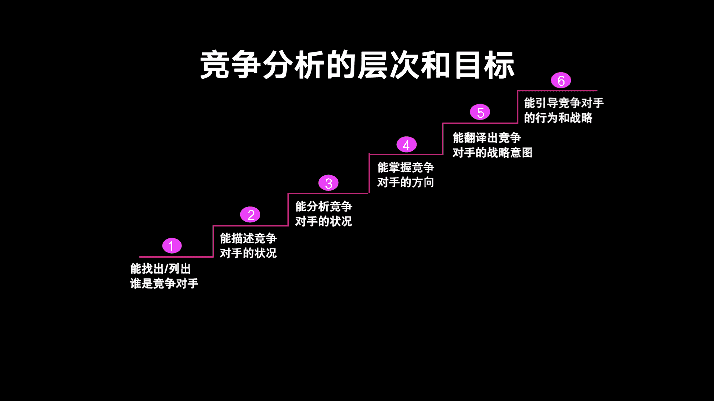

第一，你知道谁是竞争对手，至少说得出他的名字来。

第二，你能简单描述这个竞争对手长什么样，有些什么特点。

第三，你知道这个竞争对手在市场上活得怎么样，它擅长什么、什么不行，它的优势和劣势你都知道。

第四，你知道他的战略方向。

到第五个层次就很难了，你替对方写一本战略规划书。

我在惠普做了那么多年，也只做过一次做到第五个层次。因为有一个竞争对手，它就是颠覆式的创新。我们过去的仪器都是一个盒子的，他突然把电脑加进来了。我们原来叫硬件为主，它变成了一个软件为主的，而且变成了模块式的。它是在一个盒子里边可以插很多不同的东西。这就颠覆了以前，我们是一个产品做一个用途。它现在变成了三合一、五合一、十合一。那个竞争对手的出现让我们大吃一惊，于是我们就花时间去研究它，看它到底想干吗。我们就从它市场上发布的信息、发表的各种文章，反推他的战略意图，最后替他做了一本战略规划书。

但是最高境界绝大多数企业都做不到。什么意思？我让竞争对手去哪，他就去哪，我可以引领竞争对手的行为。这就要有谋略了。这是我们说竞争分析的最高境界。

大家可以对照看一下，你们企业目前竞争对手的分析处在哪个阶段，你就知道可以给你自己打多少分。

## 工具：市场泄漏图

接下来，我再讲一个非常实用的竞争分析的工具，这个工具叫市场泄漏图。

这个逻辑很简单，任何企业都不可能拿到 100%的市场份额。那就反问自己，我们的份额去哪儿了？我们的生意被谁抢走了？这时候就分成了 4 个维度。

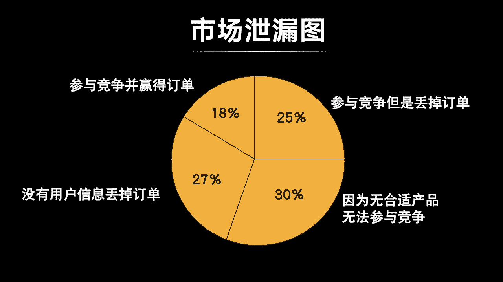

第一，我们参与竞争赢了，这就是我们的市场份额。比如说我们赢了 18%，这就是我们的市场份额。那就是整个市场比如说 100 万，我们得了 18 万，就是 18%的市场份额。

另外我们要看一看，我们参与竞争、参与投标了，客户也告诉我们了，但是后来没拿下。如果这个是 25%，那就证明参与竞争，但是丢掉订单占了 25%。

还有两大块是绝大多数人在没见过这个工具之前根本不会想到的。这才是这个图最重要的两个方面。

第一个，就是没有合适的产品无法参与竞争。比如说我做的是个中档的产品，客户邀请我去了，跟客户一沟通，发现客户要的是高档的产品，我没有；或者客户要的是低档的，我也没有，就不得不放弃。这叫没有合适的产品参与竞争。还有一种是说我们企业的定位就定位在高端，不是我没做低端，而是我永远都不会做低端。

这是一个是主动的放弃，一个是被动的放弃，这是从产品层面上。

最后一个，你不知道客户在哪，客户不知道你。就是因为没有客户信息而丢掉了订单。

我到现在都记得当年我们做的一个调研，但是有一个小小的失误。我们当年一个目标客户群就是电视机的制造厂，彩电企业。那个时候中国引进了 113 条日本的彩电生产线，这 113 个在哪？我的名单上全有，我们都挨家挨户地敲门了。  
但是过了五六年，在一次展会上，有一个客户来到我们展台就说，你们家也有这玩意儿？我说有，我说你是哪一家？他说他是辽宁的一家什么无线电厂。我一听，我说你们也做电视机？他说对啊。我说坏了，在我的这个雷达上面居然没有他的名字。  
过去 30 年了，我到今天还耿耿于怀，就是因为这个原因丢了一个客户。那为什么他不知道我？我不知道他。为什么？  
第一，我做的市场宣传活动没有送达到他那里。人家没参加过我们的活动，人家也没看过我们的广告，也没有接触过我们的产品。所以根本就不知道我们是谁，同样我们也不知道他们是谁。  
而这张图的价值，就是让我们发现，那儿还有一个目标客户。发现我们没有客户的信息后，说明我们的市场覆盖有了问题，那怎么样通过更多的市场宣传活动能够触达客户？能够让客户知道？这就是这张图展现出来的信息。

我们通常是一个产品做一个市场泄漏图。比如说今年要力推三个产品，就把这三个产品的市场泄露图做出来，那要做出这张图，就要有客户的数据、竞争的数据，不是想的那么简单。很多人听着就觉得，这个东西好像很好做。我告诉你，一定要充足的思想准备，不是你想的那么容易。因为你如果对竞争对手的信息不能够了如指掌，这张图就做不出来。

\*

我们说企业与企业之间的竞争，它的焦点是在不断变化的。

一开始的时候，是我有你没有我就赢。等到你也有我也有了，那看你的和我的各有什么特色，用户更喜欢什么。到了第三阶段是我有啥你也会做了，我原来有点个性化优势的你也追上来了，个性也没了，这时候干吗？拼成本，看咱俩谁便宜。

到了第四阶段呢，咱们俩产品价格一样，产品性能一样，什么都一样。大家想一想，这个时候你怎么选品牌？你更喜欢哪个品牌？这个时候品牌的形象在你脑子里开始起到至关重要的作用。因为那个品牌过去给你留下了一个好印象，同样的东西自然选一个喜欢的牌子。

最后就是体验之争。什么意思？你也有我也有。比如说这个杯子，这家商店也卖，那个电商也卖。有一个就是一手交钱一手交货，另外一个人告诉你选杯子怎么选。你是喝茶用还是喝咖啡用？他给你讲如何选杯子，他教你学会了怎么去识别一个好杯子。什么样的材料做的更适合你喝茶？什么材料做的更适合喝咖啡？你们想一想，一个是卖产品的，一个是给你讲了很多你以前不知道的东西，你告诉我你会选哪一家？很简单，这就是体验之争。

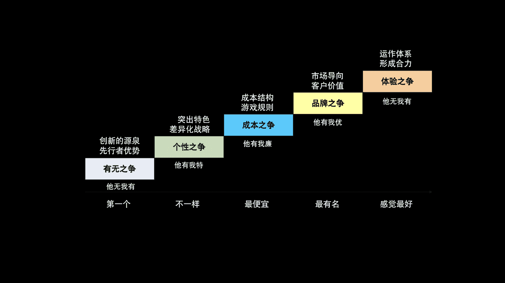

所以说大家想一想，你们公司靠什么赚钱？在一个供不应求的市场上有份额就能赚钱，但是在供大于求的市场上，要么靠价格战比别人便宜，要么靠品牌形象好，才能赢。

当然，最终一定是走向体验之争。

看谁给客户留下了一个好印象，一个好的感觉，我就去谁家。

\*

其实，对于很多中小企业来说，必须要面临着一个战略的选择，就是我能长大吗？我怎么能长大？

以前我遇到一个企业的老板，他就跟我讲说，高老师我现在是在行业的前六名以外，我是想通过三年的时间进入到行业前三，你觉着我该怎么办？  
我说你去设计战略。他说我需要注意什么？我说我没办法告诉你注意什么，我只问你个问题，你要想进入前三名，你要把现在前 3 名的哪一个拉下来？他一下就愣了，他问拉谁啊，哪个都不好拉。我说他们三个不拉下来，你怎么能进前 3 名呢？他一下就卡在那了。

这是他的思维的误区，就老想着自己进入前三名。那你想进去前三，是不是原来前三有一个就掉下来了？那谁会掉下来，就意味着你选谁当竞争对手。你把谁干掉，你才能够成为头部企业。

有的行业前三名是头部企业，有的行业是前六名是头部企业，这要看不同的行业的特点。总而言之，你得想清楚，你凭什么能成为头部企业？有什么绝活？是产品好、服务好还是体验好？总之能后来居上。你得知己知彼，你如果都不知道别人的情况，你就愣往上冲，就说有决心要进入头部。

这没有用的，天天喊口号是不解决问题的。因为你根本就不了解竞争对手都是什么样的，你从哪些方面进攻，能把谁拉下马来。

\*

过去这些年，有一个非常要命的口号，就是“风口来了猪都能够飞上天”。这是当年互联网思维盛行的时候非常流行的一句话。我不知道你们谁见过天上有飞着的猪，反正这一辈子我从来没见过。但是这是一个常识问题，真的有台风来了能把猪飞上天吗？有可能就被龙卷风卷到天上去了。

大家想一想，用脑子想一想，这个龙卷风不会一直刮下去？这一阵风过后，你们告诉我，被龙卷风吹到天上的猪会怎么样？肯定会摔下来，死得很惨。所以我就给他写了一个横幅：台风来了猪都能飞上天，台风过后猪肯定会死得很惨，横批就是过把瘾就死。这是很正常的现象。

但是很奇怪，一个违背常识的理念，却在我们这个市场上流行了很多年。直到今天很多人还在谈追风口，你看网上有多少人都在谈未来几年的趋势是什么？未来几年哪个行业好？凡是谈这个的都是违背市场经济规律的。什么意思？

你想，敲锣打鼓地在喊，所有人都听见了，所有人都知道了，这个时候还是好市场吗？大家都去，那就挤破了头。

我小的时候，我父母经常提醒我一件事，千万别去人多的地方，因为人多的地方就危险。那个时候经常会出现各种踩踏、各种事故。所以我从小就记住了这个原则，千万别到人多的地方去。

但是现在很多企业都忘了这个教训，总喜欢扎堆跑到热闹的地方去，以为追风口才是最好的选择。 我告诉你，这个思维已经过时了。

## 案例：佳能协同竞争

接下来，我给大家讲一个竞争的案例，这个竞争的名字叫协同竞争。

什么叫协同竞争？既合作也竞争。它是把合作和竞争这两个英文单词合在了一起，叫协同竞争。

这个故事说的是复印机的故事。早年的复印机大家知道是施乐发明的。施乐发明了复印机以后，申请了很多的专利，建起来很高的壁垒，阻止了竞争对手向他发起进攻。这条走得非常对，也就是保护了自己的投资，保护了自己的市场地位。

但是大家知道，专利是有失效期的。等到专利快要失效的时候，有人开始来琢磨它了。那么这个企业就是日本的佳能公司。专利是一把双刃剑，申请的专利越多，技术细节披露的也就越多。因为施乐把各个方面的专利都给申请了，所以说拿过来就很清楚玩的这是个什么游戏。

然后，佳能公司就开始拆解整个施乐的复印机。拆解完了以后，就做了一个非常重要的工作，做市场调研。

我们前面已经讲过挖掘客户未被满足的需求。走访谁？

走访已经买了施乐复印机的客户，问他用了这么多年的施乐复印机，在哪三个方面不满意。一打听很简单。

第一，叫拥有成本太高。因为那个时候施乐是个大型复印机，是固定资产，拥有成本太高。

第二，还要雇专人操作，因为那是个专业性的，一般人不会玩。我们现在普通人用的都是现在的叫傻瓜式的复印机，我们随便一个人都会用，但是那个时代不行，复印机需要专人操作。

第三，就是一个大公司买了一个复印机，比如说我在十几个小楼上，或者是几十层的楼上，我就想复印一张纸，我要跑很远的路，很不方便。这就是买了复印机的人提出来的三个最主要的问题。没有什么高深莫测的，都是非常朴实的问题。

然后佳能公司就去问那些，跟买了复印机行业规模都差不多的企业，问他们，你看你的同行都买了复印机，你们家为什么不买复印机？最后也出来三个。

第一，说使用率太低，我们偶尔需要复印，我干脆就委托别人帮我复印，不想自己买一台这个东西，因为在美国公司里边最讨厌的就是固定资产，这跟我们的价值观不一样，因为对他们来说固定资产越多越不好。

另外一个他说这个大型复印机质量太好，印的太清楚了，单页成本太高。说我就印一个东西，自己看看，不需要达到出版物那个水平，差不多就行了，就算不太清楚，够用就行。说他那个指标太高了。

另外说雇一个专人，我多花一份钱，我觉得不合算，这就是很简单的道理。

基于这 6 个问题，佳能就设计了一个小型傻瓜复印机。

第一不需要专人操作，第二把它从多少万美金变成了几千，这样一来很多公司不是买一台，是一个楼层买一个，部门买一个，这样一来方便性的问题又解决了。另外把它的那个成像的东西，把质量拉下来，把成本降下来。

你就这么想，原来是专业相机的镜头，现在变成了傻瓜相机的镜头，我不需要那么高清晰。另外这个速度也不要那么快，我不需要每分钟印多少页，慢慢印，按一张哇，过去了，再按一张又过去了，够了。他就针对施乐复印机的缺点做了改进。那这样一来，就给了原来已经买了大复印机的企业和没有买大复印机的企业一个非买不可的理由。这首先说产品的定位是对的。

接下来一个战略问题出来了，有了一个好的产品想法，怎么上市？

大家设想一下，如果这个产品它做出来的很好，它一上市，别人会怎么样？一看这个产品好，又便宜又好，抄袭模仿，因为没有了专利对不对？因为它都是从施乐那拿来的专利，没有了壁垒，所以大家都可以抄袭模仿，最终可能全世界几百个上千个复印机都有可能。

所以想到了这一点，佳能说不行，这个游戏不能这么玩，如果这么玩必死无疑。

于是佳能就找日本很多同行，做精密机械的、做照相机的，比如美能达、理光、东芝、夏普。凡是现在有复印机的，当时都是从佳能这儿拿的，这个设计方案其实都是一家人，核心都是一样的。

这就是佳能挨家挨户地跟这些企业去谈的，说你看我有了一个好的产品创意，这个产品上市以后能把施乐拉下马来，这一定是未来复印机的主流。对方说那你跟我们说啥意思？我们想合作，你们愿意不愿意合作？你们只需要出 10%的开发费用，这个产品马上就给你，我们产品同时上市。对方一听，省事，自己开发要 10 倍的代价，可能还需要半年、一年，而现在马上就给我，没有不要的道理。这是日本企业最大的一个优势，能合作绝不竞争。

那佳能就这样挨家挨户地跟这些企业去谈，都谈妥了，最后十来家公司一起推出小型傻瓜复印机，同时上市，一起把施乐拉下马来。

最后，施乐的复印机就变成了专业复印社用的大型设备，而办公用的复印机都变成了佳能的系列。所以这个案例就是协同竞争，

如果你没有足够的壁垒，你不能阻止别人加入竞争，最好的方法就是协同竞争。

其实当年我曾经去一家电视机企业做培训，就给他讲到了这个概念。

他们的高管们一听，对呀，我们电视机行业有十来家企业，为什么不玩这个游戏？ 我说，对呀，我说你们不要问我，去问你们老板，你们为什么不玩这个游戏呢？  
他们说不知道为什么，直到今天我们的电视机行业都是各自为战，窝里斗，从来没有联合起来过。  
假如所有的电视机企业联合起来，统一采购，买芯片一致对外，买显示屏一致对外，让全世界的供应商来投标，这个时候你想想是什么结果？肯定是又便宜又好。因为它一旦失去了这个订单，就失去了世界上一半儿的市场，没有哪个企业能承受得了。

所以全世界的供应商都会拿着又便宜又好的产品来求我们，到今天我们各行各业都没有把协同竞争玩好，变成了我们自相残杀。

我希望能有一些有识之士通过我讲的这个协同竞争，能意识到这个问题，能联合你的同行，我们一致对外，只有这样你能得到最好的供应商的产品，最好的服务，最低的价格。当然了他们自己之间要达成协议，叫“一家开发所有家享受胜利成果”，大家分摊研发费用，分享胜利成果，产品同时上市。

那这个时候比拼的是什么？

服务、体验。

因为外观一样了，核心成本一样了，但服务不一样、体验不一样。这样一来就形成了一个良性的互动，把同行变成了合作伙伴。

## 工具：竞争对手分析图

好，刚才我们讲了协同竞争的这个案例。接下来给大家看一个实用的工具，这是我们做竞争对手分析的时候经常用的一个方法。

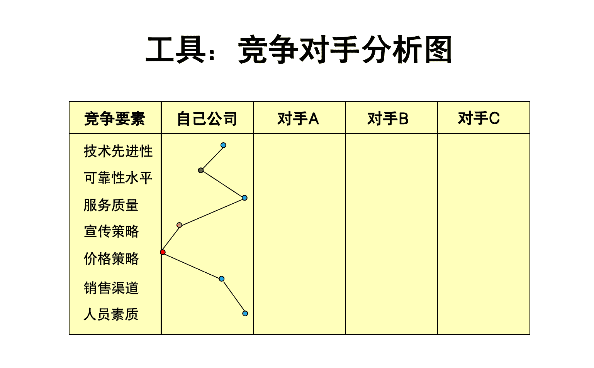

我们首先要把在这个市场上靠什么竞争罗列出来。我们争的是什么？技术、可靠、性能、功能、服务宣传、品牌价格还是人员素质等等。先把我们争什么给它罗列出来，这就变成了一把一把的尺子。

那么接下来做什么？接下来看看在每一个方面，我们公司哪些方面是 5 分遥遥领先，哪些方面稍微有优势，哪些方面跟别人一样，哪些方面稍微欠缺一点，哪些方面最差。我们把这个点一连起来就出了这么一条曲线。

以此类推，给我们的 3 个竞争对手也给他打分，打完了分就出来一幅画面。我们就知道在哪几个方面我们比他们三个都强。

我们通过这种图形化的分析，可以让我们一目了然。知道我们最强的竞争优势是什么，我们最差的弱点是在什么地方，这样就能够做到知己知彼。就像中国有句古话，是“知己知彼方能百战百胜”。

## 本讲小结

好，总结一下，这一讲我们讲了怎么样分析竞争的格局，有这样几个关键点：

第一，我们要分析目前市场处在什么竞争阶段，是初级无序、完全竞争还是垄断竞争；

第二，我们要知道这个市场上谁是参与竞争的，主要对手已经在这儿了，再知道将会进来的替代品、要出去的，才能有一个动态的格局；

第三，就是凡是自己无法制胜的，一定要想出办法跟同行一起合作，走协同竞争的这条路。这样的话有钱大家赚。不能太贪婪。你如果想自己独吞这个市场，最终的结果是你什么都得不到。

好，这一讲就到这儿结束了。

我是高建华，我们下一讲见。

点我查看官方留言

发布留言

0/ *500*

确定

* * *

# 06 怎样靠产品差异化战略取胜？

你好，我是高建华，欢迎来跟我一起学习战略设计。上一讲我们讲了竞争格局分析，接下来我们回到公司内部来看，一起来谈谈完整产品的设计。

## 完整产品的三层概念

什么是完整产品？首先给大家介绍一下，任何一个硬件产品其实都包括三层。

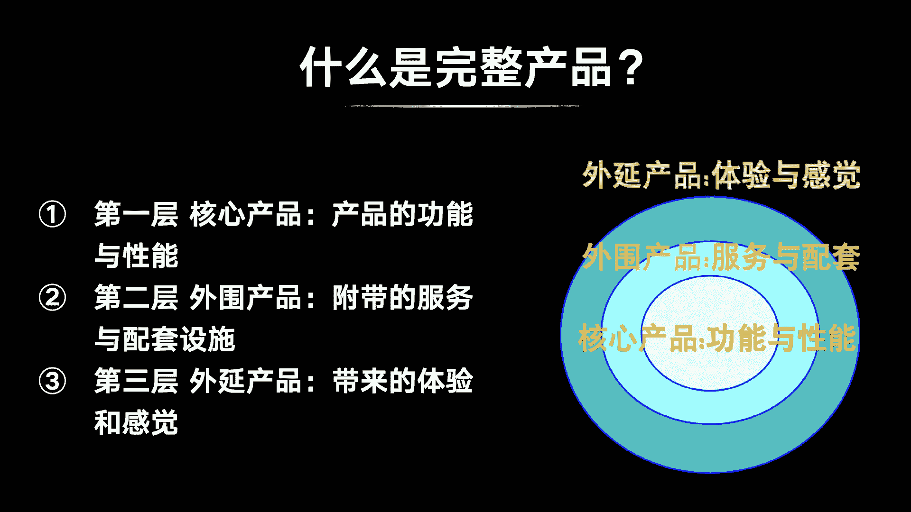

比如汽车，除了第一层的功能与性能外，是不是还有服务？像售前服务、售后服务、保修维修等。这就属于第二层，我们叫服务。

第三层是体验，比如说你去试驾汽车的时候，跟你谈的销售、汽车品牌的展厅等等，都会影响你的体验。大家可能去看过车展，其实车展就是一个体验的场所。为什么会有那么多车模？很多人会因为喜欢车模而喜欢上车。车模影响的不是车本身，而是带给客户的整体的体验。所以说第三层也叫外延层，是感觉与体验。

## 案例：万科的服务体验设计

我想用一个真实的案例给大家讲一讲。就是 20 多年前我帮万科地产做战略规划，当时我们就设计了这样一个完整产品。

其实，完整产品的设计就是站在客户的立场上，问我们自己客户都关心什么、在乎什么？

大家想想，你买房子的时候你都关心什么、在乎什么？你得看户型、房型、楼的外观，还要看小区的内部环境、绿化、景观，小区外面还要看配套。还有那个时代所说的，买房子就是看位置。因为那个时代就是谈位置，位置决定了房子的升值空间。比如你在二环里边买的，和五环买的，是不是不是一个价钱？而且将来的价值也不一样。

除了这些以外，你还看什么？你肯定还要看物业，还有你的付款方式，像一次性付款大多数人都受不了。还有就是小区的人文环境，有没有人情味儿？再一个就是开发商形象好不好？是不是一个比较廉洁、比较正向的品牌？

最后就是销售人员的素质，这是大多数人都没想到的。其实人买房子这个销售人员非常重要，因为大多数的房子都是期房。你们看的都是样板房，凭什么买这个房？其实就是你相信了这个销售人员跟你说的话。

当时我们在做的时候就问大家，这些是消费者关心的，那消费者最关心的是什么？我们可以排个序吗？然后就一二三四五六七八九十就排出来了。

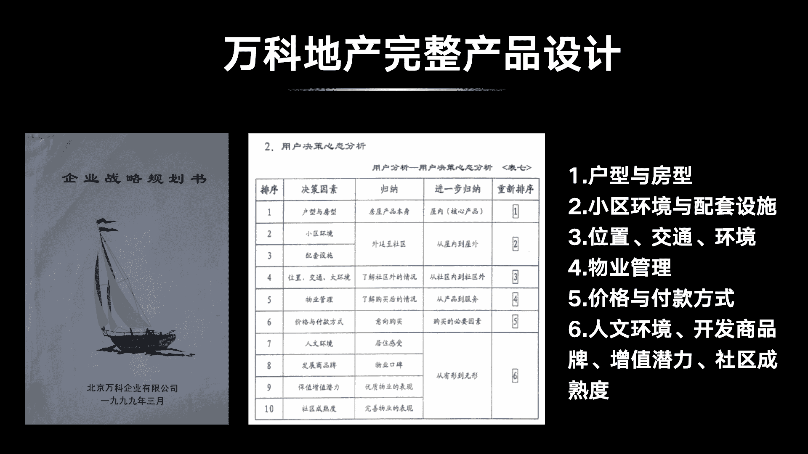

排完序以后，我就引导大家思考一个问题：五年以后，客户住进来了，同时有钱了，想换房了，那个时候他们在乎什么？我问第一遍的时候，大家的回答还是这些。我说不一定，你们再想一想，现在我是买房还没入住，假如 5 年以后我想把这个房子卖了，我会在乎什么？他说那可能会在乎能不能升值。比如说买的时候是 40 万，如果五年以后我卖能变成 80 万就赚了，等于白住了。诶，他一听，对，升值很重要。

那我们就倒推，什么情况下会升值？

第一，你得买的是个好牌子；  
第二，这个小区的物业管理得好，如果物业不好，楼很好，去了天天吵架，业主都纷纷逃离，这个小区一定贬值。因为大家都不想去，不就贬值了吗？

通过这一点，我把大家引导到

客户的需求是动态的

。一个人没买房子之前，想不到物业，还没体验过。但是买了以后感受最深的就是物业。一会儿家里哪个东西坏了，要让工程部来修；一会儿在小区里哪乱了，要让物业收拾，要打扫。

其实我们入住以后，最大的感受就是物业。另外那个时候，都是卖期房。我们说决定胜负的就是销售人员那两片嘴。这个人能不能让人觉得可信，不是满嘴跑火车的那种，说话很实在，跟客户的沟通也很理性，问什么都能答什么，这就能提高销售的成功率。

通过这样的引导，大家的关注点发生了变化。一开始认为说，客户关心的顺序就是 123456。但是我们这么一引导，顺序变了，变成了 643215。

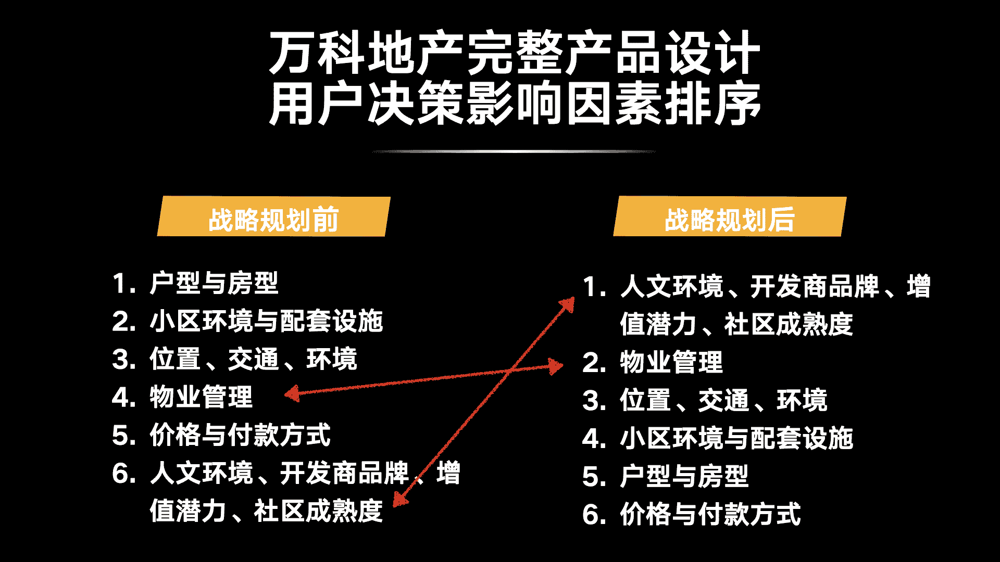

这都是真实的案例。二十多年前，我们就预见到了这一点。最后拿出来三条，作为万科主打的重点。

我们说完整产品的设计，就是要

明确我们这个品牌以什么著称，在哪些方面我比同行做得好

。如果你在乎这些方面，我就是你的首选。这就是做完整产品设计的一个初衷。通过完整产品的设计，知道我们在哪个地方去发力。可能我们要用几年的时间，才能把完整产品打磨到我们想要的那个地步，然后集中优势兵力，重点突破。

当时，万科就定了这三条。

第一，物业管理要好。

什么叫好？全行业第一。万科接着就改名，把物业管理公司改为物业服务公司。因为那个时候大家投诉最多的，就是这个物业公司总管着业主，让很多业主都不爽，说我掏了钱雇他来，本来是为我服务的，结果三天两头管我。因为在大多数人的认知里边，管理就是我管你，但是服务就是我照顾你。所以他们干脆把公司的名字就改了，叫物业服务公司，强化这些人的服务意识，这是物业升值的一个保障。

第二个，就是要把销售团队的素质拉成全行业第一。

要经过专业的训练，知道怎么跟客户去沟通，有理有据，理性地沟通。大家知道，卖房子不可能像快消品一样，直接喊个口号就卖出去了。因为这毕竟是少则几十万，多则几百万、几千万的东西。所以大家都是非常谨慎，非常理性。所以说销售人员要会跟客户沟通，就要了解整个行业，了解房地产市场，了解一个房子的好坏怎么判断，然后还要跟客户去推荐，能够达到顾问式的销售。根据客户需求，推荐应该选择什么样的房子，成为客户心目中的顾问。所以这是一条。

第三个，就是要打造一个非常好的品牌形象。

你知道那个时候，大多数的房地产公司都是拉关系、拿地皮，要想拿到好地皮就得拉关系。万科那会儿是非常有骨气，不拉关系，也不搞歪门邪道，就从市场上买。虽然地盘偏一些，虽然价格贵一点，但是造出来好房子就能卖出去。所以万科在北京的前三个房子，没有一个是在好位置的，因为那时候拿不到好位置。但是就是因为这个缺点，后来变成了万科的优点。虽然很偏僻，但是万科打造了一个小城，有了相应的配套。诶，人们住在这儿就感觉很爽。那时候，我们提出来叫住宅的郊区化。因为在发达国家，大多数中产阶层都不住在市中心，都是住在相对不太远的郊区，又安静，环境又好，同时离市区又不是特别远。所以说基于这样一个理念，万科把这个品牌形象打造成一个非常正派的、积极向上的形象。不行贿、不搞歪门邪道，就是实实在在地做产品，有骨气。这种品牌形象跟当时买房子那些人，正好达成了共鸣。

所以说，没用几年时间，万科就成了无可争议的房地产领域的龙头老大。不仅仅是营业额，其实很大程度上是管理水平。

大概几年前，我的一个客户，是做绿化的。这个副总原来在一家房地产公司工作，来北京的时候就问我：“高老师，我知道你给万科做过战略规划。我现在也不做房地产了，可不可以让我看看当年你给他们做的战略规划书？”我说可以，然后我说只能在我眼皮子底下，不能拍照，不能复印，在这看可以。他说没问题，就在我办公室里，我干我的活，他看这个。  
看完以后，他说了一段话。他说我离开原来的房地产公司已经好几年了，但我离开那一刻，水平还不如 15 年以前的万科。就是因为我们做的详细的分析，尤其是完整产品的设计，让他震惊，说人家在 20 年前就已经做到这个水平了，但是我们是 5 年前，也就说跟万科有 15 年的差距。

这才是万科长盛不衰的根本原因，就是职业经纪人的素质非常高，整个公司的管理水平跟跨国公司是一样的，达到了跨国公司的管理水平。

\*

说到完整产品的设计，其实我们每个方面不是几个字，而是

每句话都要再拆分成几段，每一段再有很多字来表达

。我举一个例子，比如说销售人员素质。什么叫销售人员的素质？我们分成了四大类，敬业精神、专业素质、诚信为本、技巧为辅，分了这么四个板块。每个板块又有详细的描述。

比如说敬业精神，你积极吗？你主动吗？你的工作效率高吗？

比如说专业素质，你会不会用销售的工具，是否按照销售流程去做？是否能知道我们产品跟其他竞品相比有什么不同？能不能掌握统一的话术？这些都是专业素质。

诚信就是客观公正，既不能夸大自己，也不能贬低别人，要帮客户做出理性的选择。

最后一个叫技巧，那就是把握人性，察言观色，懂得消费心理。

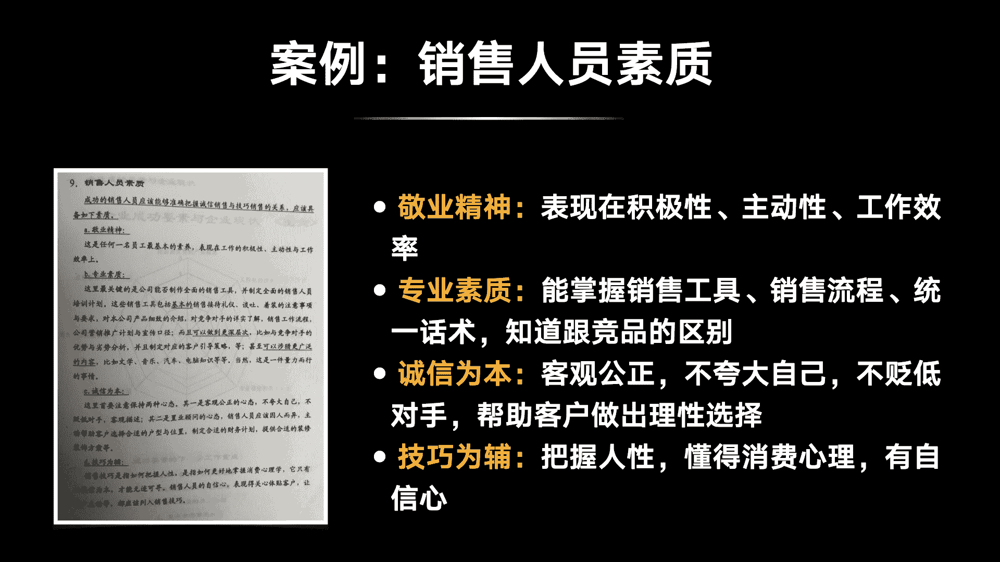

这就是我们说的销售人员素质。把一个概念用一篇纸、几百个字、上千个字来描述，这样才能让每一个员工都懂得这六个字背后说的是什么。

## 案例：中国惠普的参观体验设计

刚才我们讲到完整产品，其实销售人员素质是属于外延，是留给客户的印象和感觉。物业管理是外围，是人们能够感受到的一种服务。接下来，我就讲一个客户体验方面的案例，这是我在中国惠普公司的时候做的一件事情。

有一天，我的老板，中国惠普的总裁扔给我一本书，叫《体验经济》。就给我布置了一个任务说，看看这本书，看能不能用体验经济的方法论，提高我们公司的品牌形象。他就给我讲了这么一段话。然后我回去开始仔细琢磨这本书，越看越带劲。这本书上讲的很多东西，非常有启发，直到今天我依然认为如此。大家有兴趣，不妨再重新读一读这本经典的《体验经济》。

看完这本书，我们就做了一件事，

设计中国惠普的参观路线

。我们每天都有无数的各行各业的客户来到我们公司参观，看什么地方、给客户说什么、希望客户记住什么，过去从来没考虑过。我相信现在大多数公司也都是这样，客户怎么想的、怎么看的都不可控。

那个时候，我记得我跟我上司一起楼上楼下到处检查，就发现有人带着客户讲的时候，根本说不到点子上。比如说，我们有若干个事业部，我了解我这个事业部，我并不了解其他的事业部。当我走到其他楼层的时候，我就没办法说得那么地道。我只能说这是什么部门，他们是干什么的？其实就发现，根本不对路。

那怎么办？我们就把各个部门抽一个人，成立了项目小组。我们来说每个客户到我们这儿，我们希望他留下什么印象。差不多花了半个月的时间，我们达成共识了。基于中国惠普的几个特点，我们总结出来三句话，到现在我都记得，倒背如流。

第一句话，培养国际一流人才。 第二句话，提供全面创新服务。 第三句话，与中国共同成长。

这三句话提炼出来了，很抽象，客户怎么能感知地到？

首先，我们把这三句话印在我们纸杯上。

因为客户来了，第一件事是不是先倒一杯茶，一杯咖啡，或者倒一杯水？大多数公司杯子上，最多就有个公司名儿，但是没有价值诉求，没有跟客户沟通的语言。大家想象一下，你们公司的杯子上有 3 句话吗？有你希望客户记住的 3 句话吗？大多数都没有。

如果客户喝水，看到了上面这三行字，他就有了三个问号，为什么这么说？

我们一会儿就带客户去参观。

我们先带客户去看惠普商学院和领导力培训中心，到这儿看，都是国内顶级商学院的配置，有案例教室，有演播大厅。所有人一看，在那个阶段，没有哪个企业能做到这个份上。企业商学院、企业大学，就是从中国惠普开辟的先河。大家一看，这真是下了血本来培养人才。所以大家公认的就是，惠普是 IT 圈的黄埔军校，特别注重员工的培训。新员工、老员工、新经理、老经理，公共培训，再加上各种各样的专业培训、技术培训，是非常重视培训的一家公司。客户一看到这些东西，口服心服。

接着，我们再带客户看关键业务支持中心。

我们专门有个机房。我们告诉客户，所有大客户的计算机都跟我们这个机房是连着的。客户那一旦出问题，我们这就会先报警。这个屋常年有 4 个人值守，一天 24 小时。一旦报警，两个人在这做远程诊断，两个人直接下地库开车奔客户那儿去。因为我们给客户签的是 5 个 9 的服务，就是 99.999%的时间保证计算机不死机。这是一个非常高的标准，所有的竞争对手只敢承诺 4 个 9，99.99%，唯有惠普一家 5 个 9。就这一条，很多高度依赖 IT 的企业都变成了我们的客户。因为对他们来说，多花钱买保险至关重要。客户一看见这些硬件设施，还有服务体系，就相信我们了。当然，这个服务只限于有知识中心的地方。如果客户在一个小城市，我们没有办法服务，我们就不卖这种服务。

然后，我们再带客户去看我们的荣誉展厅。

带客户看看，给大家讲中国惠普的由来，为什么有中国惠普这个名字。再看历届的领导跟惠普创始人在一起的合影，各种活动的照片。让大家看到我们是一家根植于中国，为中国市场提供优质产品和优质服务的企业公民。就把这个道理给大家一讲。大家一看，你们真棒。

这样一来，参观完了，脑子里就记住了这三条。客户走出这个大楼，其实就记住，惠普商学院牛，惠普的那个服务体系牛。一看，惠普在中国还是做了很多有意义的事情，这就是我们希望他留下的印象。这句话叫管理客户的期望值，管理客户的印象。来之前是管理他的期望值，来之后是管理他的印象。否则就变成了一个自由震荡，客户怎么想的根本不知道，也管不了，那麻烦就大了。

我讲了完整产品的概念，其实很多老板说，听着有道理，但是不好做。我说怎么个不好做？他说不容易，我说容易的事情都没有意义。这个世界上凡是容易做的，你容易做，别人也容易做。

因为竞争是个相对的游戏，你容易，别人也容易，就没有意义了。

我就会反问他一个概念，你认同不难不做这个原则吗？大多数人不认同，但有少数人说认同，但是没时间，不会做。说不认同的，我们就不理他了，因为这是价值观不一致，谈就不要谈。但有人说了，我没时间。那我就问他，你的时间去哪了？这么重要的事情你不做，你把时间用来干什么。

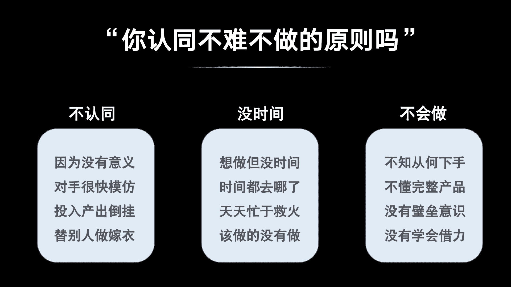

那有的人说了，我有时间，我想做，但是我不会做。那我就问他，你找明白人带你了吗？没有。我们每个人都不会无师自通，我们都需要有教练，有老师带着我们做。你自己不会做，为什么不会借力？这个时候他们一听，觉得有道理。所以我首先让他们认同，然后让他们重视，花时间让他们学会借力。一旦在这三个方面打通了，就不会再有问题了。

其实有很多人经常跟我强词夺理，说高老师我真的认真想过了。我说好，你就回答我一个问题，你想了多久？他说我想了好久。我说告诉我一个时间，有 100 小时吗？他说那没有。我问那有 10 个小时吗？说好像也不到，我想过几个小时。我说如果你比爱因斯坦还聪明，你想几个小时可能有答案。如果你不比爱因斯坦聪明，你就老老实实按我说的去做。我就把这张图给他看。

大多数人或者说叫绝大多数人，90%以上的人经常都有好多好想法，不超过一小时，脑袋一发热，想的天花乱坠，很快就忘了，这一辈子再也不想了。这种人是 90%以上。有一些人觉得这个事我值得做，我稍微花了点心思，能想 10 个小时，这也就是少数人，也就说他反复琢磨这件事，只有极少数人，1%的都不到，能想 100 个小时，不想明白不罢休。

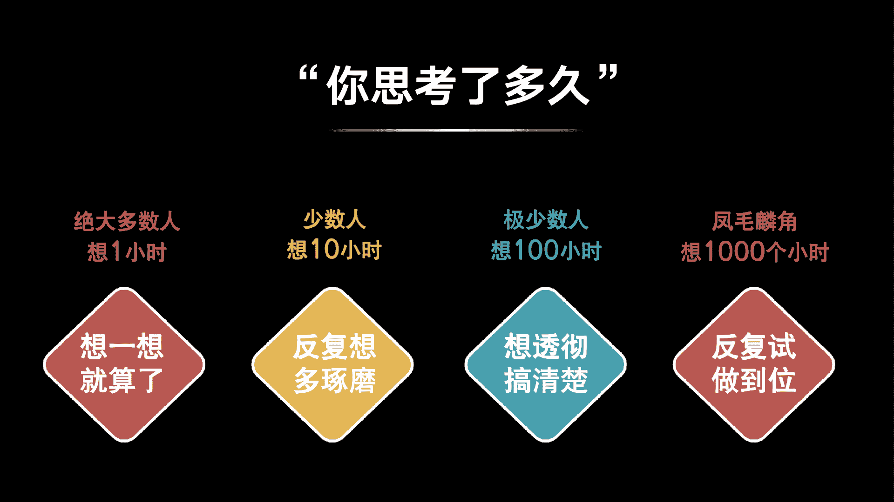

大家想一想，你们想什么事情花过 100 个小时？你凡是用心花过 100 个小时的，这件事你一定会做了。什么时候你花 1000 个小时，就是凤毛麟角了，已经是得心应手了，非常熟练。什么时候做到 10000 个小时，就成精了，在这个领域可以在全中国遥遥领先。

比如说我讲这个课，从开始讲课到现在已经是几千个小时了。我做市场营销、做战略设计，这已经是几万个小时了。因为做了 30 来年了。所以说才能把一件事彻底搞透。

大家就对照着去想一想，不要说想了想不通，是没有用心去想。俗话说，磨刀不误砍柴工。当你真的用心去思考了，很多问题都会事半功倍。我们说人与人之间的区别，

其实就是思考的能力

。不是动手，是思考。为什么思考那么重要？因为他的认知会局限。

## 站在客户的立场上思考产品

我给大家讲一个故事，这是真实的一个案例。10 来年以前，我去一家做微波炉的企业，给他们做培训。这家企业的老板非常上进，我一共去了两次给他做培训。

后来相处熟了，他就问了我这样一个问题。他说，在我们公司内部不同产品之间也是互相竞争的，我就一直竞争不过电磁炉。我说为什么呢？他说电磁炉是做饭的，微波炉是热饭。做饭的几率大于热饭的几率。我马上就反问他，什么情况下微波炉能变成做饭的？他说不可能。我说为什么不可能，他说很少有人拿微波炉做饭。我说你想过为什么吗，你去国外看过吧，国外的超市里边有几个大冰柜，都是专门的微波炉专用食品。他说那是国外，生活习惯不一样，东西也不一样。

我说这不是国内国外的问题，这是一个认知的问题。如果你根据中餐的特点开发一系列的产品，适合用微波炉来做，你的微波炉销量就上去了。他接着说了，高老师，我们是做家电的，不是做食品的。

我说对了，这就是你的认知误区。你是站在企业的立场上说，我是做家电的。但是站在客户的立场上，我希望享受一餐美味。至于是电磁炉来做还是电饭锅来做，还是微波炉来做，那是手段和方法。我说你没有站在客户的立场上去思考。

他又说了，但是我们是一家电公司，我们公司不允许我们做微波炉食品。我就说了，其实不是说你们要去做微波炉食品，你可以建立战略联盟，你可以找一些企业做食品的，根据微波炉的特点设计很多菜。哪些适合微波炉？我相信几十道菜，上百道菜，分分钟就能想出来。

关键是你有这个认知吗？你能站在客户的立场上想吗？

让客户吃上一顿好饭，5 分钟一个菜出来了。

这就是为什么今天开始有预制菜出来了。我不知道你们买没买过，我已经买了很多预制菜，比如自嗨锅，几分钟就好了。所以这就是说你理解不理解消费者在想什么？随着现在年轻人越来越不愿意进厨房，这种预制菜一定会越来越多。当然预制菜出来以后，一定有各种各样的工具。有的适合拿电磁炉来做，有的适合拿电饭煲来做，有的适合拿蒸锅，有的适合拿微波炉。

所以说，作为一个微波炉企业，如果不站在自身立场上去思考问题，你能站在客户的立场，去理解完整产品，就会不一样。

\*

下一个案例，讲的是一个彩电企业的。

有一次我去这个彩电企业给他们做培训，我就讲到了完整产品的概念。我说，消费者看电视的时候经常拿手动的是什么？大家说的，都是遥控器，没有人过去摁电视机。因为电视机一直在那儿插着，不用动，每天开关全是靠遥控器来做，这就是看得见摸得着的，是这个遥控器。而遥控器要不好，直接影响电视机的口碑。因为遥控器是这个电视完整产品的一个重要组成部分。

这么一说，老板也在场，说对，高老师说的有道理。然后我就问，我说咱们公司遥控器采购成本多少钱？老板不知道，就回头一看，叫那个采购总监回答。那家伙就站起来了，说现在采购遥控器的成本，是 5 块钱。我接着说，好，你坐下。我说，你们知道不知道像索尼这样的企业，遥控器成本大概是多少钱？那家伙就站起来说，我知道，因为他干这个行嘛，就说大概是 20 块钱的采购成本。我说，好，你坐下。

这就意味着，你省了 15 块钱。你通过你的努力给公司省了 15 块钱。我说你想没想过你的电视机，比如说你少卖了 1500 块钱。大家立即鸦雀无声。为什么是这样？当一个人用遥控器不好用的时候，当遥控器上面的字都磨没了的时候，这个客户会说什么？他不会说这个破遥控器，他说这破电视机不好使，按了半天不反应。他不是说遥控器不好，会说电视机不好。

我说，这就是问题所在。

因为你不理解完整产品的概念，你不知道站在用户的立场上去思考

，老想着省钱了，殊不知这个遥控器是至关重要的一个环节。后来我也给大家开玩笑说，我们去很多酒店住店的时候，如果是一个国产的电视机，拿过遥控器来一看，上面一个字没有了，都磨没了。因为在酒店里，利用率非常高。我就说了，凭着我们的聪明智慧，大概知道哪个是哪个频道，哪个是 123456789。大家就都乐了。我说你们不要乐，这就是现实。他的采购说是的，如果我花 20 块钱，我们也能做到 20 年不会磨掉。

我说完了这个，总裁一说，马上解决这个问题。过了没两年，这家公司的遥控器就升级换代了。因为这家企业意识到了这个问题。你想想，省了 15 块钱，赔了 1500 块钱，值不值？肯定不值。

\*

谈到完整产品有无数的案例，我再讲一个关于中式快餐的。

我们知道，有很多中式快餐在跟洋快餐竞争。当年曾经有很多企业想较劲。那中式快餐能打败洋快餐吗？其实很容易打败。但是大家用的方法不对。

比如说，有一个企业它的产品强调蒸的更有营养。你们说现在还有多少人缺营养？满马路上都是小胖墩，对不对？现在是营养过剩。所以说才练瑜伽，才跑步，才打球。所以说，应该是蒸的更健康。

大家都知道，很多人管洋快餐叫垃圾食品。那人们为什么喜欢吃垃圾？因为好吃。这跟抽烟一样，大家都知道抽烟有害健康，那为什么很多人还抽呢？这就是人的一些习惯。所以说我们要认识到这一点，你就可以在健康上做文章，就是我们做的这种方法，比洋快餐更健康。这是一个点。

第二，洋快餐有的你也要有。比如说卫生间，洋快餐针对的目标客户就有小孩，它的洗手池子一定是两个不同的高度。但是有的中式快餐餐厅，小孩够不着水池子，得他妈把他抱到台子上，蹲在这个台子上洗。你想想，这是什么样的体验和感觉？你说做两个不同高度的洗手池子，就那么难吗？增加不了多少钱的成本，但是却给我们的目标客户带来了很好的体验。

第三个，洋快餐本身就是定位低端，在国外都是最低端的。但是进入中国市场以后，大家一开始把它当成是高端产品，现在已经逐渐地变成了中低端，还不是最低端。因为还有很多比它便宜。但是中餐也往往跟着他学单一价位，这就是不会举一反三。

其实我去很多次中式快餐，每次吃，我都想为什么不做三个不同的档次。做一个便宜的，物美价廉；做一个中档的，比较精致；再做一个高端的，让大家好好享受，有机米，有机菜，有机肉，最好吃的，但是很贵。针对谁？就针对中产阶层。这一份快餐五六十块钱，有问题吗？没问题。你是为不同的群体服务的。那中档的可能就二三十块钱，便宜的可能就十几块钱。

现在所有的中餐快餐基本上都没有按照档次进行细分。当然，这就要就有目标客户的概念，给客户选择权，再有完整产品的概念，才能够打败洋快餐，才能超越竞争对手。首先在完整产品上更好，能让客户感觉到比洋快餐好，洋快餐有的我有，洋快餐没有的我也有，只有这样才能够战胜洋快餐。其实我们不能凭着一腔热血去竞争。在市场上竞争靠的是方法论，靠的是战略思维。

## 案例：星火教育的价格策略设计

说完了中式快餐，我们再谈一个耐用消费品，是一个叫教辅材料，这是十几年前我帮一家企业做的咨询，帮他们做战略咨询。

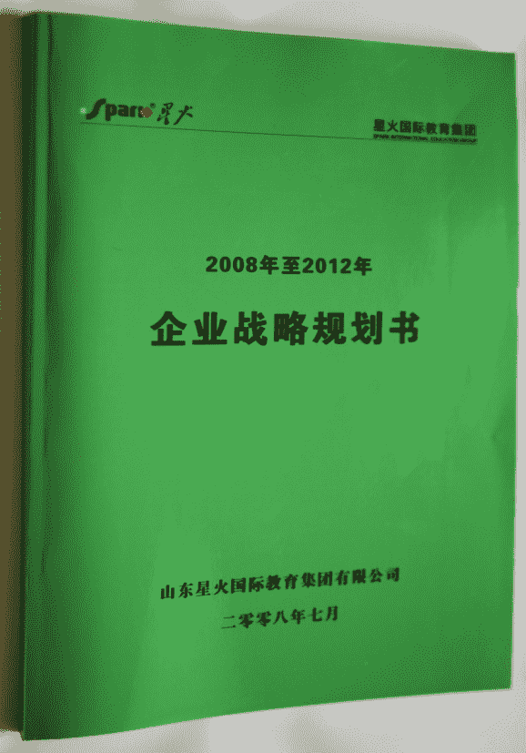

过去，它的教辅材料就一个档次。有人买不起怎么办？买二手的，买师哥师姐的。但是对于很多在职的人来说，这个教辅材料档次又太低了。所以说两个市场它都够不着，高端的够不着，低端的也够不着。他们就很纠结，又想降低成本，又想提高质量，天底下没这样的好事，所以就左右为难。

其实我们做完了战略，很简单，就是不要做一个产品。同样的内容，做成三个版本。

高档的、彩色的铜板印刷，每张纸都很漂亮，很贵。给什么？就给在职的白领和在职的经理人，还想学一些课程，买这种书拿出去也不丢人，非常漂亮的一本书。

然后我们再降一档，用最便宜的纸，不白没关系，只要能看清字就行。降低成本，千方百计把成本拉下来，把这些卖给谁？卖给那些家庭生活条件不好的学生。

最后，三个产品给客户，让客户来选。结果半年以后，老板那时候请我吃饭，说高老师，说这招太好使了，半年新增利润 600 万，不是营业额，是新增利润 600 万。你知道，高端版本的，内容是一样的，不需要再创作新的内容，只是高端的印刷，利润率就高了。同时，低端的又覆盖了很多低层的学生，销量又上去了，半年新增利润 600 万。这就是差异化生存，这就会使巧劲。

当你有了完整产品的概念，你就知道怎么做能让目标客户开心。

## 案例：宜家的场景化展示设计

我不知道各位有没有去过宜家家居，如果你去过，就会发现宜家家居跟红星美凯龙、居然之家有两个区别。一个区别，就是宜家有一个非常大的餐厅，里边的东西又便宜又好吃，所以逛的时候可以边逛边吃，吃完再逛，还有它的冰激凌非常便宜，大肉丸子也是，很便宜，很好吃。很多人就冲着这个去了。当然吃完不可能扭头就走。把车都停在这了，顺便一逛，就消费了。

所以这是宜家的一个特色，这是客户体验，也是一种客户的服务。

还有一个，就是有个儿童娱乐区。比如说两个大人带着一个孩子来了，孩子对逛街没兴趣，走一会儿就不耐烦了，怎么办？宜家认识到了这一点，专门有个儿童娱乐区。家长去了把孩子寄存在那儿，给一个条，什么时候逛完了，凭这个条领走孩子，还有专人看着，不会出问题。

当然，宜家还有一个与众不同的地方，就是场景化展示。你看我们的建材城，都是卖桌子就是卖桌子，卖床就是卖床，卖沙发就是沙发，卖瓷砖就是瓷砖。但是宜家不一样，它是按照卧室、会客厅、书房、餐厅按照这个来布置，是站在客户的立场上，让客户能够感受到，我家餐厅放一个这个不错，我家卧室放那个这个不错。这又是一种换位思考。几十年了，没有一个人能学了。

到今天，我没看到一家接近宜家这种玩法的本地企业，就是因为没有完整产品的概念，不知道站在客户的立场上，去思考客户是怎么思考的。这就是一个非常实在的问题。如果你能在这三个地方做文章，你们想一想，客户的感受是不是就不一样了？

## 本讲小结

好，讲到这儿，完整产品我们就讲完了。

简单总结一下。

第一，完整产品是由三层构成的，核心产品、外围产品、外延产品。核心就是功能和性能，外围就是服务，外延是感觉和体验。这是第一个概念；

另外，完整产品需要站在目标客户的立场上去思考问题。首先客户不是一类人，客户要分层，要分档。先把客户分开了以后，再看这个特定群体关心什么，在乎什么；

第三，需要看到客户现在关心什么，将来关心什么。因为我们做产品需要有时间，要想把品牌形象打造得更好，不是一日之功。我们一定要预见到，客户在完整产品方面未来的需求是什么？未来的关注点是什么？这样的话，才能提前做好准备。等这个产品做好了，消费者的需求正好被赶上。

好，这一讲我们就讲到这儿。

我是高建华，我们下一讲见。

点我查看官方留言

发布留言

0/ *500*

确定

* * *

# 07 怎样通过“完整产品”创新，实现突围？

你好，我是高建华，欢迎跟我一起学习战略设计。上一讲，我们讲了什么是完整产品的概念，这一讲我们来看看如何做完整产品的设计。

## 完整产品设计前提

要想做好完整产品的设计，一个前提工作就是

市场调研

。

我们要去聆听客户的声音，就要贴近客户，理解客户，看看客户想什么。这个时候，就有一个很有趣的话题了，客户知道他要什么吗？

有人说，我经常去做客户调研，但是客户说不清楚他要什么。我说这是很正常的，绝大多数客户其实都不知道他要什么。你要问他有什么需求，都问到卡壳了，他都说不知道有什么需求。因为对于大多数的需求，第一客户不知道自己有需求，第二有需求不愿意说出来，第三他自己觉察不到有这个需求。这是很正常的。

那怎么办？我们就要通过深度访谈，站在客户的立场上跟他去聊天。我们不是问他有啥需求，而是问他工作生活当中有什么不如意的地方，有什么不方便的地方。这个时候就多了去了。每个客户都会告诉你，他对这个产品在哪些地方不满意。这个时候就打开了对话的大门。

\*

当然了，我们要遵守一个原则，叫

1230 法则

。意思就是，1 对 1，2 小时，30 人，这叫 1230。

为什么要 1 对 1？因为只有 1 对 1 时，客户才敢说真话。面对很多人的时候，大家首先要想说这句话正确不正确。只有 1 对 1 的时候，可以敞开心扉。

为什么要 2 小时？是因为 2 小时才能谈透彻。

为什么 30 人？因为有很多人谈得不着调。问了半天，发现样本没用。

大家可以看到旁边这张图。这是个权威机构的调研，意思是如果你做市场调研的时候，跟 12 个有效样本谈了，你能够知道 70%多的信息。如果你把有效样本量提高到 20 个，准确度会提高到 95%左右。你再增加，哪怕增加到 100 个，你会发现边际效应下降。那么这张图的意思，就是告诉我们有效样本在 12 个到 20 个基本上就可以了。

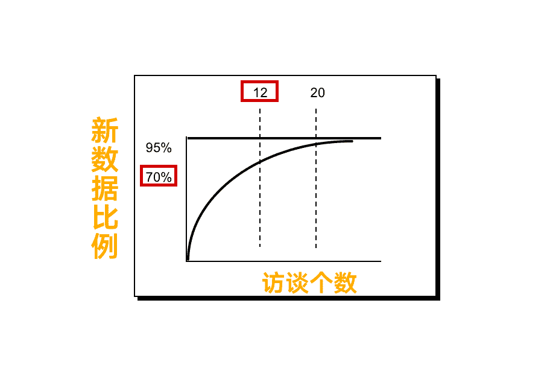

所以在调研这件事情上，想追求完美不可能，能有七八成就可以了。

## 完整产品开发 6 步流程

那怎样能够设计出一个好的完整产品？有这样几个考虑。

第一，必须贴近客户。因为不贴近客户需求，远远地看着，不管用、不准确、不真实。

第二，要换位思考。你得站在他的立场上去思考。不是想我怎么把这个产品卖出去，而是想客户买这个产品能给他带来什么意义，这是换位思考。

第三，做完整产品一定要有方法论。没有方法论就会懵，今天做了，明天又不会做了。必须有一套可以重复的方法论，才能知道从哪里开始到哪里结束。

第四，是一定要有明确的目标。这个产品要做成什么样才一定能赢，它是一个倒推的过程。

接下来，我给大家讲一下这个方法论。

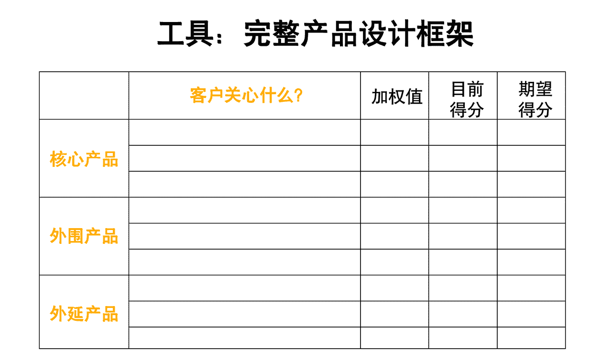

我们一般来说，在做客户调研的时候，不会明确分开核心、外围、外延。我们会沿着客户的思路去聊，但是跟客户每聊出来一个观点，我们就会写到相应的地方。也就是客户并看不到，但我们自己会分为这么三类，核心、外围、外延。比如客户说特别希望有个人上门服务，我们就在外围产品写，客户关心的是上门服务。

在跟客户聊的过程中，我们就把客户关心的问题都罗列了出来，一般会列十几条，然后进行合并同类项。再接下来，就是在这三大类里（核心、外围、外延），各选出来三条放上去。

做完这一步，我们做下一步，叫加权分析。假如满分 100 分，现在只有 9 条，一共 9 项，怎么把这 100 分均匀地放上去？我们就会想，站在客户的立场上，这 9 个方面他最最在乎的是什么？如果说是产品质量，那 20 分。如果是其他，客户没那么在乎，那得分就是有的 5 分，有的是 10 分，有的是 15 分。所以就是说，客户关心的这 9 个因素得分不是一样，而是有先后顺序，也有重要性差别。

加权分析这一步做完了，我们再看看每个方面，我们企业目前得分如何？

如果产品质量我们全行业遥遥领先，5 分；

如果是比别人略微强一点，4 分；

跟别人一样，3 分；

比别人略差，2 分；

全行业最差，1 分。

这就要根据自己的实际情况，客观地打分，这叫目前得分。

好，接着再想，我要想在市场上取得成功，我期望得分是多少？换句话说，我在这 9 个方面如果改进到什么地步，我就一定能赢。这又是一个倒推的过程，这叫产品层面的顶层设计。

那么这步做完了，我们会再去掉一个最低分。比如说有一个 5 分的发现不太重要，就把它拿掉了。剩下 8 个，我们做一个蜘蛛图，就像蜘蛛网一样。我们就把 8 个得分重新展示出来。

里边这个图是现状得分，就是现在得了几分，有的 2 分、有的 3 分、有的 4 分。那么外圈就是期望得分，期望得分可以做两个，一个是两年以后，一个是五年以后。当然这每个企业不一样。期望得分也可以是一年以后，三年以后，企业自己来决定。总之可以是两个不同的期望值。所以说我们要分别标注出来，把这 8 个要素分别写在放射线每一端，一共 8 个方面。

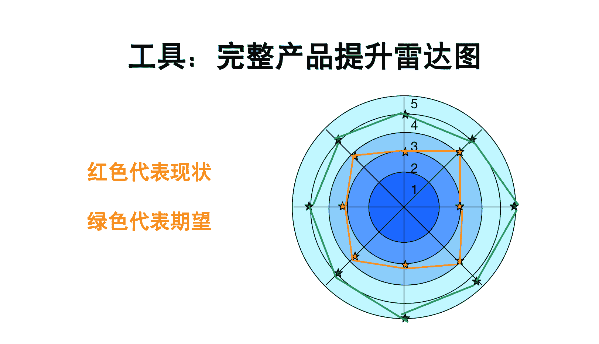

然后接下来，指定专人。比如说提高产品质量，要从 3 分提高到 4 分，后边写上一个人的名字，这件事由谁来负责。再比如说外观设计现在可能就是 3 分，要达到 4 分半，这事儿谁来负责。

每一个要素都要有一个责任人。

我们刚才说了，有一年、两年、三年或者五年的时间段，那么这个负责人就知道了，要在多长时间内把负责的这件事儿从多少分拉到多少分。

## 完整产品定义

如果有了完整产品的概念，接下来就要做完整产品的定义。也就是说，性能到什么地步是客户喜欢的，跟竞争对手相比哪些地方要比竞争对手好。

这些东西都要白纸黑字地写到一本儿小册子里边。这个小册子就叫产品定义。

一个新产品的开发大概可以分成六个阶段。

第一个阶段叫产品概念，也就是一个好的想法，想做一个什么东西，能帮客户解决什么问题，这是个概念。

第二个阶段叫产品定义，就是把它所有的一切纸上谈兵地描述出来，比如目标客户群是谁？客户未被满足的需求是什么？竞争对手是谁？怎么定价？未来几年的销售预测，利润率，总利润......都要在产品定义里边说清楚。

这些东西不是说清楚了就完事了，还要过关。这时候我们会召集公司各个职能部门的头，一同来参与审核产品定义，看看这个产品定义做的有没有漏洞，是不是完美。这个工作花多少时间？短则三个月，多则一年、两年。但这个工作是必须要做的。

大家想一想，你们公司这么做了吗？我敢说 90%的企业都没有做这件事，都是想好了就做，做出来就上市了，然后接受市场的检验，90%都不成功。我们之所以这么做，是因为我们相信先慢后快。

我们相信

产品定义做好了，产品就能够成功

。虽然这件事只花了我们 20%的时间和精力，但是决定了这个产品 80%的成败，这也是二八法则。

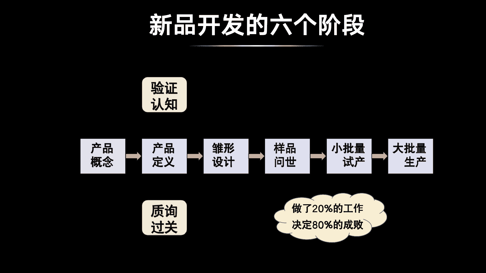

## 案例：太原锅炉

好，讲了这个完整产品的定义，接下来还是讲几个小的案例，告诉大家怎么做出来让客户梦寐以求的好产品。这是 20 多年前的一个案例，也是我做的第一个咨询的客户。那是我第一次做咨询，因为那个时候之前没做过咨询，都是讲课。

有一天，一个客户给我打电话，他说我们是太原锅炉二厂的，我们老板看了你的一套光盘，觉得你讲得很有道理，我们想找你做咨询。那个时候我还在惠普当经理人。我说找我咨询什么，我也没做过呀。他说这得我们老板跟你谈才行，你有这个服务吗？我说可以。他们问多少钱，我说我也不知道要多少钱，你们看着办。

后来老板就带着几个高管一起来到了北京，利用周末的时间，就在我家附近的一个酒店住下来了。然后老板就给我们讲了企业的背景。这家企业叫太原锅炉二厂，在太原当地属于小品牌，因为上面还有个太原锅炉厂。太原锅炉二厂呢，接不到大订单，也没有实力。

因为国家锅炉是国家队，像哈锅（哈尔滨锅炉厂）、东方锅炉，这都是国家队。而且各省还有省队。太原锅炉二厂等于省下边再一层，所以是第三层。

太原锅炉的老板就说，我们这样一个中小企业怎么才能成功？我听完他们的介绍，我说你要想成功只有一条路，

就是走完整产品的差异化。

他说你说得有道理，那我们怎么能做差异化？我就说，第一不能跟在大企业后面，第二不能针对那些大客户，大客户不是你的，不能跟在大企业后边做产品。他说，好，这个我都接受，那我该怎么办？我说，你做中不溜的客户和小的客户。但是他说，这个竞争对手也很多。我就说，那你要用产品的差异化来取胜。

他说怎么能差异化？我说要想做差异化，先得去找高手，先得找到好的设计师，你才能设计好产品。他就跟着我的思路走，说好，说的有道理，但好设计师在哪？我说这个我不知道，因为我以前对锅炉行业一点都不了解。我说你们应该知道，哪个大学，哪个研究所，哪个设计院，有这样的人才是专门设计锅炉的。

老板一听，有道理。他说把人要弄来了，接下来怎么做？我就跟他讲完整产品的概念。

核心产品层，你看看你怎么能比别人做得好？你的质量要好，可靠性要高。

因为锅炉最重要的是安全。这是 10 公分厚的钢板，要爆炸，会引起安全隐患。所以安全性第一重要。那要安全，工艺、质量就要好，必须做到全优工程，全 5 分。如果能做到全行业领先就没问题。老板说，好，这个能做到，只要认真对待，应该不难。还有呢？

我说那你这个产品怎么样做能跟别人有差异化？其实那个时候刚刚谈节能减排，刚刚在萌芽阶段。我说你这个产品要想体现差异主要体现在哪里？

燃烧效率高，等于是吃得少，效果好，还要垃圾少。

因为这个煤如果没烧完冒黑烟，烧完了冒白烟，如果都烧完了以后变成了灰，是白灰就没有浪费。这就是锅炉最重要的一个特点，就是说尽量充分燃烧，谁燃烧得好谁就是好样的。

这个老板回去就开始找人，没多久就找到了清华教授，专门研究燃烧效率的，在国际上也算是小有名气。然后他就去跟人谈合作。你想，一个小小的太原锅炉二厂，跟一个清华大教授谈合作，人家凭什么理会？这就是功夫不负有心人。这个老板亲自去跟人家谈，说我有志向，要做一个差异化的好产品，我们希望在什么地方入手，能够做出来一个在市场上非常有竞争力的产品。这个教授一看他很有追求，就说好，怎么合作呢？太原锅炉的老板说我给你建一个实验锅炉，你的研究生都可以到我这做实验，这样就解决了你光研究没有实验的场所。因为不能在大学里建一个锅炉。所以说双方一拍即合，就建立了一个实验锅炉。

这个教授研究的主题，就是不同地方各种酶，它的含量和杂质是不一样的，成分不一样。那么怎么能让它们充分燃烧呢？就需要因地制宜。于是就专门开发了一套软件，根据这个酶的特点去让它充分燃烧。过了多少年以后，我就又问他，他说研究成功了。我说这个教授主要在哪方面有真功夫啊？他就说，这个煤块是在锅炉里边跳舞，吹风机在顶上吹着，在火里边跳舞，这个舞姿有华尔兹、有探戈。我一听我说这我理解。他说这些煤块的舞姿不一样，高度不一样，最后充分燃烧了。

他又说他们已经研究了全中国各地的煤，根据每一种煤的特点去做实验，就是跳什么样的舞步，最后做出来一个软件。如果是阳泉煤，一摁阳泉煤这个键，按照这个程序执行；如果是大同煤，一摁大同煤，就按照这个去执行。这是不是很简单？我一听，我说这会儿懂了，就在里边跳舞，跳到最后变成灰就结束了。

他还给我看，原来普通锅炉出来的灰的颗粒很大，是黑的，但太原锅炉的灰非常细，像面粉一样，全是白的，就是黄白那种颜色的，就把煤烧成了黄白色了。你想，这真的是充分燃烧了。

后来他们还告诉我，这样一个好产品设计出来以后，还得生产，因为要保证它的质量。后来他们就搞了一个叫全优工程的项目。他说我带你来看，旁边有个玻璃柜，里边放着三块钢板，有焊缝。他说，高老师你虽然是外行，你看看这三个哪个焊的好？我一看最右边这个，特别平滑整齐，我说这个好看。最左边这个跟狗啃似的，我说这个不好。他说这就是 3 分、4 分、5 分的区别。我们每一个焊工每天干完了活，就把这个东西拿过去做对比，然后跟他的领班说，我今天的活全是 5 分的，给领班看拍的照片。如果是 5 分，他拿到的薪水就是 4 分的一倍。如果是 4 分，就是 3 分的一倍。换句话说，5 分是 3 分的 4 倍。

他说，你想一想，这个工人焊了一天，他是想赚 500 块钱，还是想赚 100 多块钱？这很简单，每个人都想多赚钱，这就是符合人性的。所以太原锅炉每一个都是全 5 分交货。这个口碑一出去，后边就排队了。他说，你看我这墙上已经排到 6 个月以后了。那次我去太原锅炉二厂跟他们见面，正好是国庆节，他们都不休息。我说为什么，他说赶工。一个重工业的企业，国庆假期还供不应求，订单排队排到 6 个月以后。当然了，还有一条，加价 15%，它比同类产品同规格贵 15%。

为什么呢？因为它的产品获得了国家科技进步一等奖。这不是闹着玩的。一等奖是最高的荣誉，是清华大教授设计的，而这个大教授后来变成了院士。换句话说，他们家的锅炉是院士设计的。你看看，是不是有差异化了？跟别人不一样了，起点高。而且，这个锅炉是获得过国家科技进步一等奖的，是不是又有差异化了？

另外，这家锅炉燃烧效率高，排放少，效率提高了 20%，排放减少了 30%，价格只加 15%。所以说，就这样它形成了一个良性的循环。因为它可以加价 15%，还实现了厚利经营。

而加价赚来的钱，就给了这些干活的员工，用来改善他们的生活，让他们拿到高薪。他们的员工，比当地一般企业的薪酬都高。比如当地别的企业一个月拿 4000，他们拿 8000。别人家拿一万，他们拿二万。在当地是收入最高的一个非煤炭企业。

其实你要想做好完整产品，企业要有好的氛围，完整产品需要创新，创新就需要人才，人才就需要心情舒畅。我去了太原锅炉这家公司，大吃一惊。你们想象一下，一个锅炉制造厂是不是应该破破烂烂的？但太原锅炉是花园式的厂房，像一个公园。里边还有一个巨大的、几千平方米的职工之家，像植物园，天上飞的，水里跑的，地上跑的，还有树，什么都有。白天鹅、黑天鹅，全有，鸟语花香的。

国庆节的时候，别的地方好多树已经没有那么鲜艳了，但是这里春意盎然。而且，所有的员工和员工家属都可以到这个地方来享受。有很多家属，在里边咔嚓咔嚓拍照。里边也有咖啡厅，也有休息的地方，也有玩的地方。你想，员工在这工作是不是心情很舒畅？薪水比别人高一倍，这还有个职工之家，可以一家人在这儿，工作日、周末可以在这放松，就像小公园一样。

图：太原锅炉的职工之家

而且，那儿的研发大楼一看就是个商学院。我就，这个研发大楼怎么看着像商学院呢？老板说这是请一个专门设计商学院的人来设计的。这是因为，研发工程师都是大学毕业的，好多可能是硕士，他们特别喜欢大学的环境，离开了学校，到了这个地方，就感觉到好像还是在校园里。

后来他发给我一张照片，是太原市政府办公厅发的，号召当地企业向太原锅炉学习，学习他们锐意进取的创新精神。能做到这一步真的不简单。

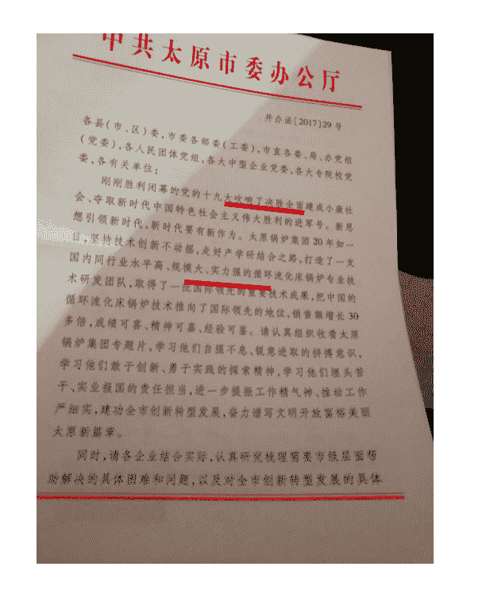

这个企业在我心目中确实是非常好的一家企业。善待员工，有产品竞争力，得到了市场的认同，从各个方面来讲都是非常好的一家企业。

## 案例：星巴克

最近这些年电商兴起，很多做实体店的企业都感受到了压力。很多人都问我这样的问题，说高老师，实体店还有未来吗？我说肯定有未来，关键是定位。很多人都误以为实体店是传递价值的，这就大错特错了。实体店如果停留在传递价值层面，必死无疑。

如果你是一个实体店，那一定要创造价值。创造什么价值？很多人说了，杯子不是我做的，衣服不是我做的，怎么创造价值？这就是因为不懂完整产品。如果懂完整产品，就知道有服务，有体验，价值创造不是核心。只要理解了完整产品的概念，就知道要在服务和体验上做文章。

大家为什么去星巴克，而不是在网上买一杯？因为星巴克有小资调调。其实在我脑子里，什么时候去星巴克？我自己从来不去，都是别人约我，说高老师咱们谈点事，不值得去公司，也不想那么正式，我脑子就出来了星巴克，约我们家附近的星巴克，几点在那见。因为那个氛围不吵，也比较轻松，谈一些比较轻松的话题，好像比较对路。所以这就是星巴克给大家创造了一个小资情调的氛围。

还有一个，可能大家没太注意。

星巴克这家公司最在乎的是员工满意度

，这跟惠普一样。因为我们有一种信念，没有满意的员工就没有满意的客户。如果这个员工对自己的工作非常满意，充满了激情，一定会感染客户。因为它想让客户满意，所以说星巴克是把它的着重点放在了咖啡师身上。

当年有个笑话，说有一个富婆到了这个星巴克里边，就喊服务员、服务员。结果谁都不理她，于是这个富婆急了，就跑到前台去，说你们耳朵都聋啊，我喊了半天服务员怎么都没人理我，你们在干什么呢？结果服务员非常客气地说：“不好意思，我们这儿没有服务员，只有咖啡师，你有什么需要可以请我们的咖啡师帮你。”这一句话就让这个富婆熄火了。这是我们那一代流传的一个笑话。

不知道大家看没看过星巴克的老板写的一本书。这本书我仔细看了。其实这本书很有意思，叫做《星巴克  
一切与咖啡无关》。你想，一个卖咖啡的人，说星巴克是跟咖啡无关，这背后的逻辑其实就是完整产品的概念。

咖啡只是一个载体，星巴克真正营造的是一个氛围，是一个环境，让大家愿意待在这个地方。

它不是因为咖啡好喝把你留下了，而是这个完整产品把你吸引来的。

## 案例：西贝莜面村

接下来，我们再讲另外一个实体店的案例。这个案例我相信很多人都去过，就是西贝。

其实我跟西贝老板的渊源是 20 多年前了，最早我在内蒙讲课的时候，他听过我的课，后来就基本上按照我讲的尝试着去做。西贝老板进入北京以后，开了第一家店，请我去做客。我还以为有什么事，他说没啥事，就是因为当年听了你的课，现在跑北京来开店了，希望跟高老师再聊一聊，就请我吃了一顿大餐。

我从那会儿开始关注西贝。其实西贝最初那几年并不火，但是现在不一样了，已经是非常火爆了。我们家基本上每周都去一次，因为家里很多人都喜欢吃西贝的产品。西贝的产品做得很讲究，正好适合中产阶层去享受。

大家下次去西贝的时候，注意看看它空调的出风口，都有挡风板，不会吹到顾客。大家知道，空调口直吹是不舒服的，感觉会不好。

而且，西贝的热菜下边都有一个蜡烛，一直烧着，基本上吃 20 分钟，这个蜡烛才烧完。所以菜不会凉了。因为吃菜，尤其是中餐，最怕的就是凉了。热的好吃，一凉了就不好吃了。大家注意看看这些细节，这就是客户体验。

另外，西贝所有的员工都是笑脸相迎。顾客一喊，马上过来，特别热情，而且还跟顾客聊天。这就是完整产品的概念，销售人员的素质很重要，服务人员的素质很重要。

还有就是西贝后来做的中央厨房，产品的质量不再依赖于厨师，而是在中央厨房用工业化的方法来做产品。这就使得中式餐饮达到了西式快餐的管理水平。第一，上菜的速度快；第二，质量有保障。所以说，西贝在管理上、在产品上也是下足了功夫。

我看西北的老板经常就是满中国到处跑，看着哪有好吃的，然后亲自去琢磨，一个菜一个菜地推出来，过一段时间就推出来一个好产品。所以说，西贝能赢得中产客户，不仅是因为产品本身多么好，而是用整个完整产品给客户留下了一个好印象，所以赢得了一批稳定的客户。

就比如说，我们每个星期去一趟，假如这个餐厅容纳 200 人，假如说一天翻台 3 次、5 次或者是 8 次，乘上相应的数量，这个客户就够了。如果是忠诚客户，每个人每个星期去，客户数量不需要太多，就能够让这个餐厅永远都是处在一个满负荷的状态。

\*

说完了这个西贝的案例，我们再讲一些制造业、实体店经常谈到的问题。就是做完整产品，想做但是不会做。

我从一个小故事开始谈。记得很多年前，在一个论坛上，有一家手机企业想挑战苹果，就跟苹果来参会的人开了一个玩笑，说有朝一日我一定能超越你。然后苹果的这个人就回了一句，  
Easy to say， Hard to do。什么意思？说容易，做起来很难，但是直到今天，也没有几家企业能够做出超越苹果的这样的产品。

后来很多人就问我，什么情况下能做到让别人追求超越我？什么情况下我在这个行业能有苹果那样的地位？我就问，你真的想学苹果吗？他说真的。我说好，回去先做一个横幅，挂在你们公司，挂上这个横幅再来找我。这个横幅写的是什么？就是“做跟别人一样的产品是一种耻辱”。我说这就是苹果的哲学。

我在苹果干过两年，对我影响极其深刻。在苹果工作的经历，让我养成了一种思维，就是

我永远不会做跟别人一样的产品，我的产品一定要有足够的差异化

。因为在我心目中，我谁都不学。别人经常跟我说，高老师你看看谁怎么做的。我说不要给我看，我不会跟别人学，我一定是走我自己的路。

所以说要想达到苹果这样的江湖地位，首先要认同这样一个理念，就是做跟别人一样的产品是一种耻辱。那就意味着抄袭、模仿，是丢人现眼。

所以说，做产品创新首先要在哲学层面上有这样的认知，就是不能跟在别人后面走。跟在别人后面，哪来的产品差异化？大家看看，苹果推出 iPad，我们接着就出来一堆，这个 Pad、那个 Pad。但是你再看看三星，它叫 Note。你再看看索尼，它叫 Tab。总之没有一家叫 Pad。

## 打造完整产品要有组织保障

其实，要想做一个好的完整产品，首先要有组织上的保障。什么叫组织上的保障？就是必须有三类人的组合，叫艺人、商人和匠人。

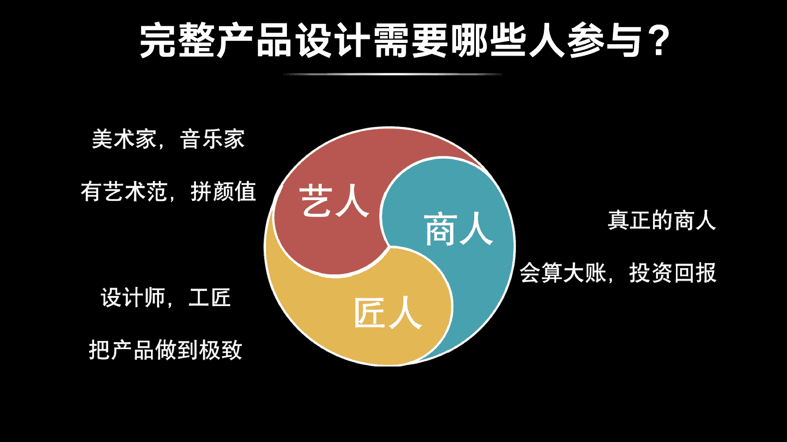

如果是做工业品的，如果是做家电的，大家只需要看看你们公司有扎小辫的男人吗？大多数企业都没有。扎小辫男人是什么意思？就是搞艺术的，比较另类的，这是一个形象的比喻。所以说，一个企业要想设计令人惊艳的、有颜值的、让人追捧的好产品，必须要有艺人。其实很多好企业里，都有这样的艺人存在，只是看不见而已。

当企业有了艺人，才能够实现重要升级，那就是从产品到作品。大家知道，所有的艺术品，我们都称它为是作品，不叫产品。你说一幅画，这叫一个作品。一个古典音乐，这也是一个作品。它们都不是产品。产品是工业化的，可以大量生产的。而作品就属于有艺术品位的，有颜值的，值得收藏的。这样的我们称其为是作品。

商人大家都有，这个不是问题。

另外一个就是匠人。匠人不是工人，是有匠心精神的人，也就是说要把这个产品做到尽善尽美。就像前面讲到的太原锅炉那个案例，需要有一套利益机制，才能够做出来全优工程。所以说，匠人是利益驱动的结果。换句话说，员工好好做了，认真做了，有什么回报？如果这个问题回答不了，这个企业不会培养出匠人。像太原锅炉，它培养的都是匠人，因为只有匠人在这能赚到大钱，能过上体面的生活。这就用利益驱动的方式，把人引上了一条做善事儿的、正确的道路。这就是善有善报，恶有恶报。

所以说，如果一个企业真的想把完整产品做好，一定要有这三种人的组合才行。

如果你认同了完整产品的概念，你就愿意在这地方花功夫、花时间，然后找人。

那有人经常跟我说，高老师我这儿没有优秀的人才，我也不知道去哪里找优秀的人才，怎么办？我就会问他这样几个问题。

第一，你舍得吗？你要找优秀的人才，你就得花大价钱。其实一问这个问题，一半都不舍得。我说你肯花三倍、五倍的价钱去找高手吗？他马上回一句，我怎么知道他是高手？我给了这么多钱，他要干不出来，怎么办？我说你要这样想，这事儿就不用再谈了，因为你根本就不相信。你不相信他，他就不会来你这儿做，这是一个舍得的问题。

第二个，优秀的人才在哪里？你得搞清楚。

## 案例：万华化学的人才引进策略

我就拿万华化学这个作为一个案例讲。万华化学在世界上面对的对手是两个，德国的拜尔（拜尔能源集团）和巴斯夫，这两个都是世界巨头。你们说，这个行业最优秀的人才在哪里？一定是在这两家公司。如果你去这两家公司挖人，好挖吗？当然不好挖。如果是在职员工，只要是优秀的人才，一般都签了竞业禁止的协议，所以是挖不动的。那怎么办？

后来，万华化学想了一个办法，搞了一个银发工程。比如说 60 岁退休，竞业禁止 5 年，65 岁以后不再受竞业禁止的限制了。老板就跑到欧洲，去德国找这些退休 5 年的老科学家、老工程师，然后登门拜访，问他们想不想发挥余热。

你想，65 岁，其实很多人很健康，还愿意干点事情，关键是要给他一个充分的理由。我为什么要继续干？我为什么要给你干？万华化学就讲，我们是一家成长型的企业，我们有远大的理想和追求，如果你愿意，你就可以帮我们。当然，你可以一年只在中国工作一段时间，你也可以在德国工作一段时间。你也可以带着你的家人一块去。每年还会给你多少假期。

总之，开的这个条件，对方一看，很好。假如说一个季度去一趟，待一段时间就回来了，然后还可以带着家人到中国到处去看看，这不挺好吗？来一次，旅游一个地方，同时还额外赚了那么多钱。

比如说，上班的时候赚了一二十万欧元，现在我再给你一二十万欧元，你说谁会拒绝？没人拒绝。不需要坐班，不需要天天盯在这，万华化学要的是这些人的智慧。所以通过银发工程把很多科学家和高级工程师都给引过来了。而一个人一来，就会像葡萄一样，变成了一串。因为一个人一来，如果想把自己活干好，就要找一帮我熟悉的、配合比较好的人。

最后，就形成了一个生态。在这家公司里，一堆老外在这里，这些老外都在为着万华化学的发展做着杰出的贡献。因为万华化学把世界级的人才都引进来了，结果就做出来了世界级的产品，获得了世界级的利润，税后纯利在 17%-21%之间。这是绝大多数制造业企业很难达到的境界。

当然，万华化学的员工也获得了非常好的收入。万华化学的员工，在当地比其他企业普遍薪水都高一倍。

最后一个，就是尊重人性规律。万华化学从来不搞 996，也不搞加班的文化，但是每个员工都为了个人的利益而努力工作。为什么？因为他有非常厉害的一招，这是跨国公司都没做到，就是研发人员终生提成制度。

如果你是个研发人员，你开发了一个好产品，只要这个产品卖得好，你终生提成。换句话说，你做了一个好产品以后就躺着赚钱了。这样一个政策，就激励了所有研发人员都想开发好产品、畅销产品，开发爆品。因为只要这个产品一成功，对研发人员来说，就是无穷无尽的财富。

所以说，万华化学是用机制，把研发人员的积极性给调动出来了，让大家玩了命地去努力工作，去做一个征服世界的好产品。

## 本讲小结

好，讲到这儿，怎么设计完整产品我们就讲完了。

我们简单总结一下。

首先，完整产品的设计，要基于市场调研的结论，要有明确的目标客户群体，要把关注点放在外围和外延上面。不要以为硬件产品不能差异化。一定要知道这一点，才能做好完整产品的设计；

另外，要想做好完整产品的设计，必须有组织上的保障，要有艺人、商人和匠人的组合。这三个人组成一个群体，才能共同开发一个畅销的好产品。

好，这一讲我们讲到这儿就结束了。

我是高建华，我们下一讲见。

点我查看官方留言

发布留言

0/ *500*

确定

* * *

# 08 怎样通过产品价值诉求，塑造品牌差异？

你好，我是高建华，欢迎来跟我一起学习战略设计。上一讲我们讲了完整产品设计，这一讲我们来谈谈如何做产品价值诉求的提炼。

## 案例：茅台酒讲故事

我下面给大家讲一个关于茅台酒的小故事。

当年日本人想偷茅台的技术，结果就以参观学习的名义，派了很多人到这里。来抓一把这个，拿一点那个，回去进行化验。但是日本人回去做了很多尝试，就是做出不来茅台酒。他们就在想，卡在哪里了？我们该拿的都拿了。  
突然有人说，没有，我们没有拿空气。于是日本人又派了另外一批人来，专门拿收集空气的瓶子，就趁别人看不见的时候，把茅台车间里边的很多空气收藏起来，拿回去了。结果一化验发现，闹了半天，空气不一样。因为空气里边有很多微生物，他们化验没多久，这个微生物就死掉了。  
最后得出来的结论是，因为这些微生物参与发酵，所以才出来了茅台。茅台需要微生物，微生物需要茅台，它们是互为依存的。离开了这个环境，微生物活不了。没有这些微生物参与发酵，出不来茅台酒。最后只好放弃了。

所以说一个企业一定要学会跟客户讲故事。

你说这里边，有多少是真的，多少是假的，这个不重要。关键是你这个故事很有趣儿，让客户听了以后觉得好像有道理。

这就是为什么我们强调销售人员见客户的时候，拿一本故事书，拿一个计算器。这个故事书就是讲我们的成功案例，讲我们的品牌故事，这比强调你的性价比、强调你的产品的特性要好很多。因为这种软性的宣传更容易被客户记住。

也许没完全经过科学的验证，也许这个东西是有一些演绎、有些夸张，但是这个并不会有影响。因为大家在正式的广告上不这么说，是私下里、茶余饭后聊天的时候讲了这么个小故事。所以你也不能说人家，因为人家也没说一定是真的。但是分寸一定要把握好。

## 怎样跟感性消费者沟通？

其实谈到产品的价值诉求，目标客户很重要，你得看跟谁讲。

跟不同的人要用不同的方法。

比如说，感性的消费者往往是比较盲从的，他是看别人说什么，看别人买什么，他就跟着去做什么。

大家可能都看过小罐茶的广告，叫做“小罐茶，大师作”、“贵客到，小罐茶”。它是一个典型的铺天盖地广告开路的玩法，这种玩法就特别适合感性的消费者，盲从的消费者。因为大多数人没有鉴别能力，也不知道一个东西的好与不好，他不会寻找科学的答案。

那么他买东西的依据是什么？别人是不是都买。

如果别人都买，我买就是安全的，我就可以放心。所以对感性的消费者，你就要用这种感性的方法去沟通。

当然了，也有一些就玩过头了。比如说“我对天发誓我卖的是什么东西”，后来被别人发现，这并不是真的。只能当作是演的，是一出戏，不是真的。

所以说，跟感性消费者沟通，也要把握好分寸。要是一个策划，就要告诉消费受益者，这是纯属虚构。

\*

那在这儿呢，给大家讲一下快消品，如果你针对的是感性消费者，是盲从的消费者，它是有一套逻辑体系的，也就是有方法的。

就是三板斧，断言、重复、传染。

什么意思？

断言，就是用 5 个字到 9 个字，先喊一个口号。不要质问、不要讲道理，直接断言。

告诉消费者一句话后，反复做广告，这叫重复。消费者可能第一次不信，没当回事，但听得次数多了，慢慢就接受了。

而且随着越来越多的人接受，就到了第三个状态，叫传染。就像传染病一样，大家都被传染了。

所以说，很多策划公司用的都是这一招，就是这三板斧：断言、重复、传染。它针对的就是感性的、盲从的消费群体。所以对这些人不要试图去讲理，否则你就找错了对象。

像当年曾经风靡市场的很多快消品，都是用的这套方法论，断言、重复、传染。然后再大规模地靠广告进行轰炸，让消费者都觉得这个产品不错，一来是自己用，二来就变成了送礼用。

## 怎样跟理性消费者沟通？

那么我们再看另外一种类型。

如果你面对的是理智型的群体，你就不能用那个办法了。大家一定要记得，策划不是万能的，对于快消品来说，策划是最好的选择。但是对于一些耐用消费品，尤其是工业品，仅仅用策划的方法就不行。

这个时候需要摆事实、讲道理。

那么，对于理性的消费群体来说，首先产品要好。光忽悠，光炒作，光宣传，消费者买了以后、试了以后，发现不是那么回事，照样离你而去，不会持久。

第二个要服务好。这就是我们前面讲的完整产品，服务要足够好，客户才觉得这个产品我能把它用好。

最后一个就是体验好。对于理性的消费群体来说，你如果对我的态度不好，让我的感受不好，我也不会买你们家东西。

当然了，还有另外三个“出来”。就是我们经常讲的，

算出来、测出来、展出来。

你说你们家东西好，你先有公式给我计算出来，有理论依据；

还要测出来，拿仪器、拿仪表、拿各种东西，总之我眼见为实，能看得见；

还要展出来，能让我亲身感受到。

我们前面讲过一家木门企业的案例，他们在现场把木门削一个角给客户看里面的材质，这就是为了展出来，让大家能够感受到这个东西，因为一看就明白了。

这就是为什么很多房地产公司在样板间里，展示一些洁具、电缆、各种管道。其实就是告诉大家，我用的都是好材料。尽管有些好材料可能你看不见，都埋到墙里了，但我要让你看见我用的是好材料。

## 提炼产品价值工具：FAB 模型

提炼产品的价值诉求其实有两套方法论。

策划人用的叫

USP

（Unique Selling Proposition），叫独特的销售主张。它强调的是卖点，即我这个产品哪儿好。另外一套方法论叫

FAB

（Feature、Advantage、Benefit），谈的是产品的买点，就是消费者买了有什么好处。这就是两个不同的立场。

所以一般我们咨询用的是 FAB，策划一般用的是 USP。没有对错之分，只是不同的场合适应不同的人。所以说，不要纠结哪个好，哪个更好，不存在这个问题。

比如说，我有一个学员，他们就找了一家策划公司，做了一个策划，花了 600 万，给了 6 个字：选什么，找谁谁。这就是非常典型的策划的思路，5-9 个字之间，五六百万。  
我就问那个老板，你花这 600 万换来 6 个字值吗？老板说，值。我说，为什么？他说我自己提炼不出来，另外这个口号朗朗上口，我觉得挺好，这样我们传播变得更方便。  
我说，只要你喜欢就好，只要你觉得花这 600 万值，那就好。

那么，另外一种方法，你不用花那么多钱，但是你需要花时间，需要自己去认真思考。你这时候就可以用我教你的这个工具，叫 FAB。

F 是属性，是一个产品固有的属性。什么人设计的，用的什么材料，用的什么标准，都属于属性，叫客观存在的事实。

A 是相对于竞争对手的优点和优势。我比竞争对手好在哪儿？一定是我比竞争对手哪里更好，是个比较的概念，就是我要强调我的优点是什么。

B 是站在客户的立场上，给客户带来了什么价值。

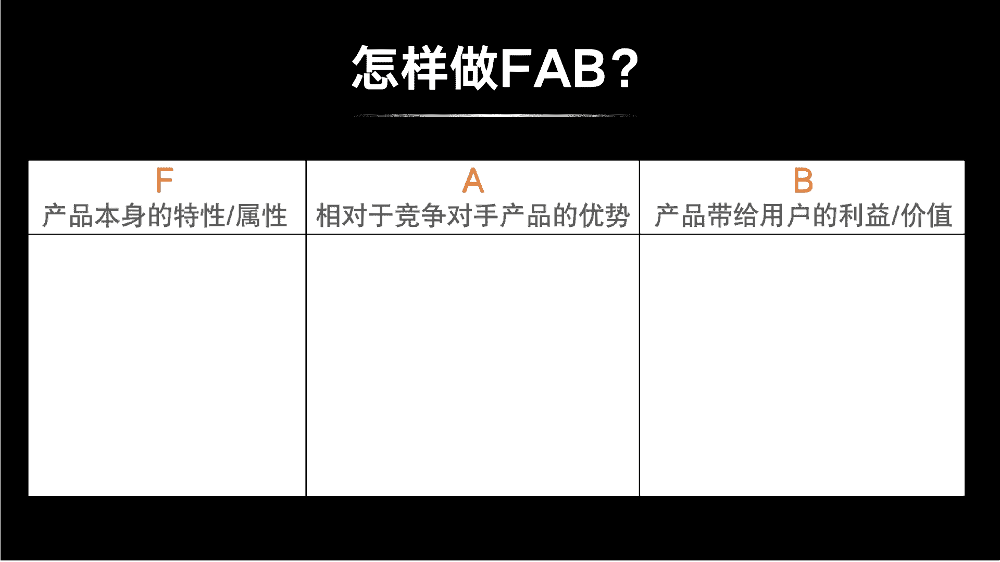

所以这就是 FAB 方法论。这是我给企业做咨询都会用的一套方法论。也就是说，我们用的是什么环保材料，遵循的是什么样的国家标准，我们的产品比竞争对手好在哪里，我们给客户带来了什么独到的价值......我们都是用这样一套方法论来提炼产品的价值诉求。

我们会跟企业团队一起，把产品的属性列出来，把产品的优势列出来，把产品的价值提炼出来。然后我们再交给广告公司，让他们做艺术加工。这就是企业和广告公司之间的分工。

但实际上，很多公司都搞错了。要么是从提炼价值诉求到设计都交给广告公司，要么是老板自己喜欢内容，自己提炼， 自己搞设计。这两条路都不对。

那正确的道路是什么？

是企业管内容，广告公司管展现形式

。我把核心内容给你，具体用什么词儿，怎么说，画面长成什么样，企业尽量不要干预，要相信广告公司的眼光。

但是，很多老板喜欢一竿子扎到底，什么都管。尤其是像选代言人，各个公司的都是老板亲自选，他喜欢谁，他就找谁来代言，而不是说这个人跟产品相关性最大。

接下来，给大家看几个案例。这都是我们真实的做过 FAB 提炼的案例。

## 案例：家纺企业

首先，看一个床单儿的企业。这是十几年前，我帮这家企业做咨询，那个时候为了了解市场的需求，我们从北京出发，到了石家庄，到了郑州，后来又到了山东的临沂，最后到南通。因为这家家纺产品的大本营在南通。这一路走了一两千公里。

我们每到一个地方都去看几种业态，大卖场、店中店、批发市场、街边店......我们都去看。看完了以后就发现，绝大多数商店都是“哑巴店”。直摆产品，没有价值诉求。你想，客户去了翻一翻，看一看就走了。因为没有沟通。客户进来看到，摆得满满当当的，全是床单。

像有些批发市场，一般一个房间差不多百十平米，三面墙挂着全是床单，每一个床单就露了这么一小溜。因为产品太多了，只能都挤在一起。顾客进来打眼一看，好像挺好看，但是很多人转了一圈，什么也没选就走了。为什么？因为展现形式和客户想要的完全不一样。客户要铺在床上，但店里就露这么一小溜，完全看不出来完整的效果。同时，除了产品，墙上啥都没。

后来，我们到了南通就开始进行分析。因为这一路走来，走访了几十家经销商，也跟很多客户访谈，就发现了客户最在乎什么。我们提炼出来，叫

不起球、不褪色、不缩水

。这其实是很基本的需求。你想，你买了个床单，一起球，是不是硌得慌，不舒适？一褪色，把你身上都染了。一缩水，本来一米八的床，变成了一米七的了，这就麻烦了。

所以说，我们就站在客户的立场上，做了这么几幅招贴画。这就是一个企业的价值诉求。当时，我们做了六幅，我只拿三个来给大家看。

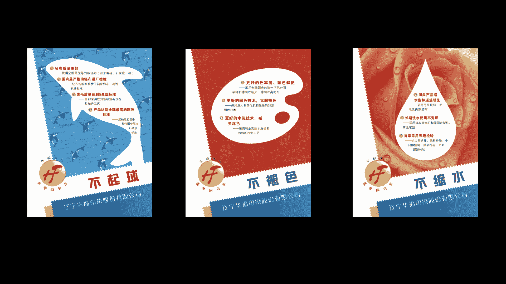

这三个干吗用？就是挂在这家床单企业所有店里边。你们想象一下，别的店里边只有床单，其他什么都没有。而这个店挂着这么六张图，那客户进来就会看这六张图，然后就会问，凭什么你们家不起球？这就有了机会跟客户解释。而且，招贴画上都写了，不起球是有理论依据的，就是在于工艺、染料、各种制作的各种过程。

我们再说不褪色，不缩水。这是为了激发客户的兴趣，激发客户的疑问。凭什么？为什么？让客户跟你对话。

一个实体店最怕的，就是一个人进来了，逛了一圈，一句话不说又走了。这是很多实体店天天都在发生的事情。因为没有抓住跟客户沟通的东西，也就是我们谈的产品的价值诉求，所以客户进来看了一眼没啥意思就走了。

所以这是非常重要的，这个店一定不能是“哑巴店”。

## 案例：房地产公司

另外一个案例，是一家房地产公司。这家公司准备建一个新的小区。在上马之前，因为我教了他完整产品的概念，我们就开始做测试，也就是这个产品怎么设计能受客户的欢迎。我们也是设计了 8 张招贴画，我这就拿出来 3 张给大家看。

因为这个小区的目标客户群，当时全都是年轻的父母。不是要住什么豪宅，就是普通人，两个大人带着一个孩子。大家都知道，这两个人肯定是上班族，也没钱去雇保姆，雇阿姨。那这种人最在乎的是什么？

我们就提炼了这样几个概念。第一，他希望接送孩子，最好有人帮忙接送。第二，孩子如果接回来，到了小区，我不能下班，最好有人帮忙照看，否则这个妈妈得整天迟到早退，这是很多人都不好意思的事情。还有呢，工作了一天都很累，大家不愿意做饭，我们就说能不能做一个社区的小食堂。

我们根据这个原则，一共是写了 8 张招贴画。然后去找我们的目标客户，都是有孩子的，孩子在 3 岁到 12 岁之间的妈妈来跟我们一起探讨，这些是你关注的点吗？最后，从这 8 个里边儿挑出来客户最关注的 3 个点，作为我们完整产品设计的主要因素。

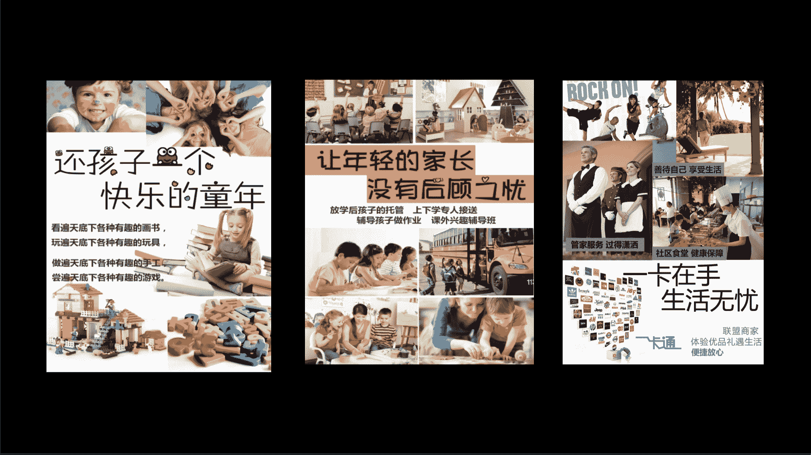

这就是在产品没有问世之前，我们在做产品设计的时候要做的事情。

先提炼产品价值诉求，然后跟客户去验证，客户验证了以后才能证明我们的理解是对的，然后再把这个完整产品给它做出来。

## 案例：工业照明公司

另外一个完整产品的价值诉求，是一家做工业照明的企业。

我们当时也是找了两家广告公司，做了两套版本，最后选出来一家。本来我说找一家就行，这家企业说还是对比一下，因为这家企业比较有钱，同时也不怕耽误时间。所以我们就先从两家公司里边，挑选出来比较好的话题，然后再进一步论证，最后做出来这么 6 张招贴画，这里还是给大家看 3 张。

一张强调节能省电，这是用照明的人都关心的；

另外一个是可靠性非常高，多少年都不修一次，这也是客户关心的，好用，皮实，不坏；

还有一个就是服务到位，招之即来，来之能战。这就是他们提炼的几个价值诉求。

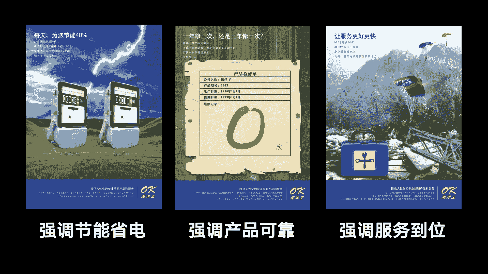

价值诉求出来后，我们也需要找客户做一些测试，去验证。有些客户一看不以为然，说这个价值点对我来说意义不大，那个价值点好。我们就把客户说好的几个重点拿出来，然后设计到产品里边去。

你们知道，服务是完整产品的一部分。所以客户需要什么样的服务？多长时间到达客户那儿？多长时间给客户修好？这都是一个服务的承诺。

他们的产品那时候就可以主打保修 5 年。你想，有多少企业敢给客户保修 5 年？保修就是一旦坏了，我给你换个新的。就是因为他们对自己的可靠性非常有自信，所以说通过这种方式得到了客户的认同。

## 案例：威固太阳膜

刚才我们谈到过跟不同的人要用不同的沟通方式。如果客户是理性的，我们一定要让他眼见为实，坚信不疑。比如说威固太阳膜。我曾经给这个团队做过多次培训，他们给我讲了很多，他们是怎么样赢得客户的。

首先，它的每一个店都有这样的热功率计。

所以如果顾客是从别家店看过，再来到他们家店一看，会觉得很贵。因为它的产品比别人贵一倍，别人卖 5000 它卖 10000。那有的顾客肯定会说，你怎么比别人家贵一倍？威固他们会说，对啊，没错，你都去谁家店看了？你说去了哪家店后。威固的人会问你看了哪一款，会把那一款拿过来，因为所有竞争对手威固都有样品。

接着，威固把竞争对手的太阳膜一放，灯一开，让顾客自己看有多少热量过去了，有多少热量被反射回来了。然后顾客看完，就记住了这两个数。接下来，威固再把它的膜往上一放，一看，透射过去的热量是对方的 1/4。

因为太阳膜的目的，不就是为了阻挡太阳光进来吗？所以说，答案很简单，威固比别的贵一倍，但是质量好四倍，所以威固的性价比肯定更好。

那有的顾客说，这俩个表是不是作假了？威固的工作人员会说，没关系，把这两个表调过来，再把这个反复调几次。顾客一看，果然如此。这就是理性语言的力量。

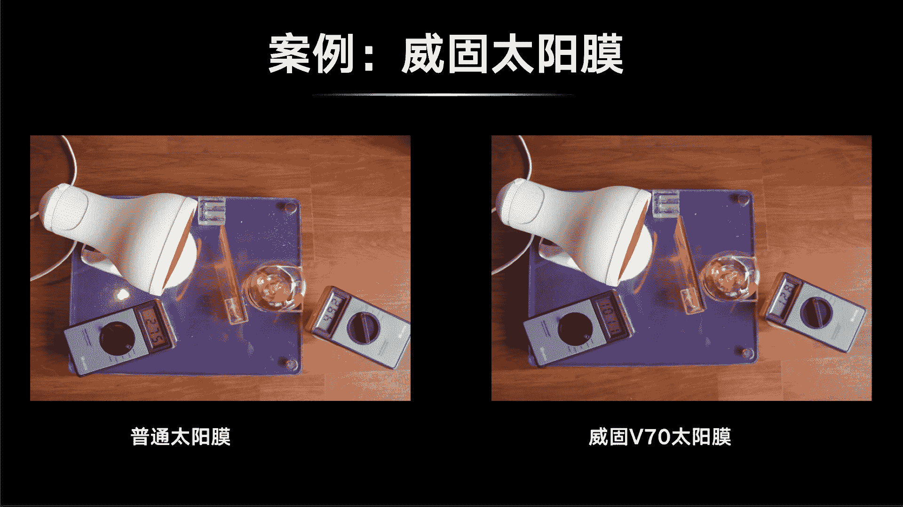

另外，威固还会把顾客领到墙边，墙边全是灯。顾客站好后，威固的工作人员一开灯，顾客的本能反应是躲，因为一股热浪过来了。威固的工作人员会说，你看过的别家是这家对不对，我把它三张膜拿过来，先挂上一张，顾客还躲；挂上第二张，顾客不用躲了，但是还有点热；挂上第三张，顾客基本感觉不到热了。

好，接着，威固的人把这三张揭下来，然后拿过他们自己的膜，往这张上一加，顾客一体验，一点也不热。威固的工作人员就说，他们这一张顶别家四张。

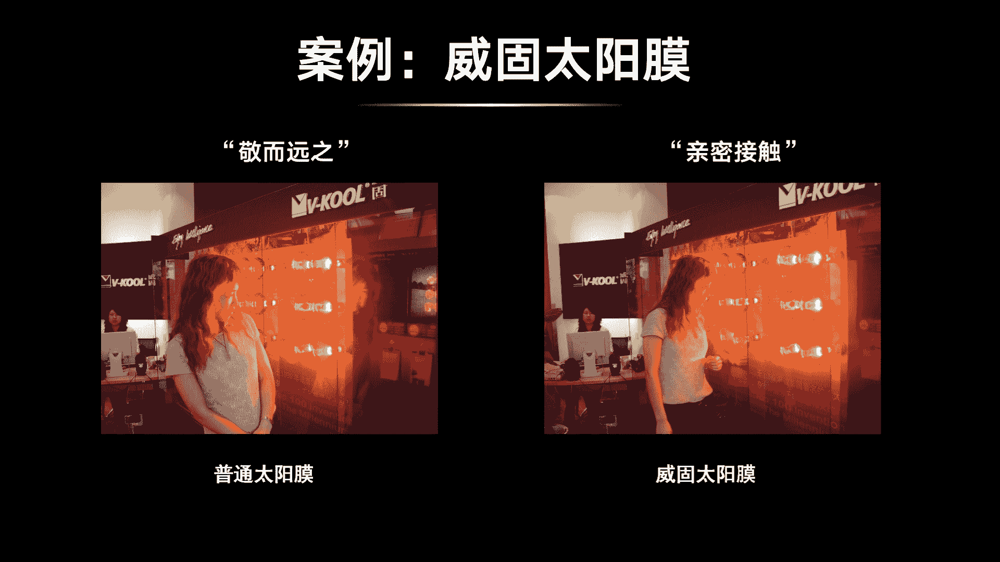

你看，威固在让客户感觉到产品价值时，一方面是理性的，让顾客看到了真实数据。另一方面是感性的，让自己亲身感受了这种热量。而且，这变成了威固的标配，所有的店都有这样一套配置。只要顾客来了，按照这个走一圈就行了，基本就能感受到威固产品的价值。

## 本讲小结

好，讲到这儿，怎么提炼产品的价值诉求，我们就讲完了。

在这一讲，我们主要讲了几个关键点。

第一，要针对不同客户群体去提炼价值诉求，面对感性的群体和理性的群体，“套路”完全不一样；

第二，我们讲了两套完全不同的方法论，一套叫 USP，一套叫 FAB，你要根据你的目标客户群是什么样的人，来选择相应的工具；

第三，提炼出来价值诉求以后，一定要做客户测试，要让目标客户来评价一下，看看你的理解跟客户的认知是否一致。

好，这一讲到这儿就结束了。

我是高建华，我们下一讲见。

点我查看官方留言

发布留言

0/ *500*

确定

* * *

# 09 怎样制定五年战略目标？

你好，我是高建华，欢迎来跟我一起学习战略设计。上一讲我们讲了如何提炼产品的价值诉求，从这一讲开始，我们谈企业战略目标的设定。

谈到企业的目标，很多人第一想到的是什么？可能是营业额，三五年之后要把企业做到多大？但这只是一个方面。

## 从四个方面定五年目标及衡量标准

我们定企业目标的时候，首先分 4 大类目标，叫

业务方面、用户方面、员工方面、管控方面

。

在业务目标里边，我们通常会定 3 个小目标。第一是营业额，这是跑不了的；第二是利润率，也是跑不了的；第三，不同的企业不一样，有的企业设置的是市场份额，有的是新市场的开发占比，这个不一样。总之这都是业务方面。前两个一定要有，第三个你们自己根据行业的特点定一个目标。

用户方面，一定是有一个用户满意度指标，就是客户用了你的产品满意吗？还有新客户的开发数量，老客户的流失率等等，这都是客户方面的指标。

员工方面也一样，除了员工满意度，还有一个优秀员工流失率。什么叫优秀员工？我们评价员工，分 1、2、3、4、5 分，凡是 4 分和 5 分的我们都称为优秀员工。因为我们特别在意的，就是 4 分和 5 分的优秀员工不能离职，所以优秀员工跟普通员工的离职率是有不同的要求。

管控方面，更多的就是应收账款、内部审计、各种管理流程等等。这是看你这个公司想在哪些地方进行管控。

你理解了这 4 个大方面，以及每个里边这 3 项，其实你就懂得了什么叫平衡积分卡。

我不知道大家听没听说过平衡积分卡？

平衡就是这 4 个方面，我们做生意既要让公司满意、股东满意，还要让用户满意、员工满意，所以要做到综合的满意。如果用户不满意，你早晚会失去他们；如果员工不满意，你这个企业也不会持久；如果你管控方面没做好，早晚翻车。

所以说这是从平衡的角度来给企业定目标，这样的企业也叫“五好企业”，或者叫“四好企业”。总之要全面发展。

那很多人说，我想定目标，但有时候我定得很大，有时候定得很小，这个依据是什么？很多老板都懵，说我不知道我明年定多少目标是合理的？我们一般就从这儿入手，告诉他，

你想没想过你的企业成长靠什么？

这里边涉及了一个概念，叫成长曲线。我一般给企业做咨询都会画这样三条成长曲线。

比如说我给一家做中医科普的公司做咨询，我们首先要明确第一成长曲线能支撑到什么时候。刚刚开始起来的时候，业务一定是往上涨，但是喜欢学中医的人数量是有限的，早晚有一天会达到瓶颈。

所以说一定在没达到瓶颈之前，就启动第二成长曲线。

那第二成长曲线是什么？叫中医养生。大家知道，学中医是为了治病，那个范围是很窄的，对中医感兴趣的人也是很窄的。但是养生不一样了，我相信各位都喜欢养生的话题，而且是中医养生，不是野路子的养生。如果你把关注点从中医转到养生，客户群体就放大了很多倍，同时你的话题、你的内容也要发生变化。所以这就是这家中医科普公司的第二成长曲线。

但是养生到一定程度，该知道的都知道了，也会掉头向下。这时候就要有第三成长曲线。那时候干吗？我们说做相应配套的养生产品、养生茶、养生粥等等。因为用户接受了养生理念，是不是要给他一些相应配套的产品？不能让用户自己到处去找、去配。所以这个时候，如果有第三个产品线跟上，就可以继续保持成长。

因为在每个时间点，企业的总业绩是三条成长曲线之和。第一条成长曲线往下走了，第二条曲线起来了；第二条往下走的时候，第三条起来了。这样一来公司才能实现可持续的发展，业绩才可以一直往上走。当然，之后还可以第四、第五、第六条成长曲线。这个逻辑是一样的。

## 业绩倍增机制

我们还有一个工具可以帮助老板和高管们一块来定目标，那就是一个三维的成长机制，也叫倍增机制。

很多企业老板都希望业绩倍增，这不是梦，但是你得想清楚这个梦沿着哪些路去走才能梦想成真？其实有很多不同的维度。

比如说我在这儿举的例子。

第一，有一个地域轴。

比如最初刚创业的时候在某个城市，但可以往周边城市、往全省扩张，也可以往全国扩张，最后可以到达世界。这是沿着地域轴的扩张。如果有了这样一个扩张，就知道从地域扩张的角度最终能做到多大。也就是说，这个产品只要得到这一个城市人的喜欢，就假定也能得到周边人的喜欢。那周边人能喜欢，就能覆盖全省。这是一个裂变的机制。

另外一个轴就是产品轴。

比如现在只开发了 1 个产品，将来可以开发 10 个产品，这个时候营业额会上去。就是客户不仅买 1 个产品，他会买 10 个产品，这就提高了亩产。一个客户的消费量从买 1 个到买 10 个，这是不是变成了 10 倍？

还有一个轴就是应用领域。

这个产品原来是用在这个领域的，现在换了一个地方。比如说我们的产品最早是研发用，后来到生产用，再到了计量用、教育用、维修用，这都是不同的应用。随着应用的扩展，营业额也会持续上升。当然，它可能外观会变，因为便携式的适合在野外用，而实验室用的要比较大块头的。所以这就是它需要做变种的地方。

明白了这个倍增机制，就知道最大的极限规模是多大，这不是说你能达到多大，但至少脑子里有个概念：这个产品有前途吗？它最大的前途能到多大？接下来才能谈在这个市场里边能达到多大份额。比如说占 10%就满意了，那如果市场有 1000 亿，10%就是 100 亿，就出来了。

所以说，定目标首先要从这几个宏观的维度进行思考。

当然，从微观的维度就是看过去的历史数据、做市场盘点，以及现在这个团队能够在多长时间内进行复制和裂变。因为做指标设定是一个非常复杂的事情，既要看历史也要看未来，既要看外部的数据，也要看自己公司现有的人才能不能迅速地复制，才能把市场驾驭得了。

\*

刚才咱们谈的是业务方面的指标设定，接下来我们来看看用户目标设定，怎么提高客户满意度？每个企业都想把客户的满意度要提升，但是怎么提升呢？

首先要有一个工具和方法论，

就是每年必须做一次客户满意度调研。

这个调研结果绝对不是为了吹牛用，也不是为了在媒体上宣传用。  
其实很多企业都搞反了。这是我们内部用的，是为了知道我们的客户跟去年相比、跟竞争对手相比，我们企业的一些点是优点还是缺点？

我在这儿给大家讲一个案例，就是如何提升客户的满意度。

那是当年我帮一家照明企业做咨询的时候。有一天我去早了，我是早晨飞过去，没去酒店直接去客户公司了。结果上午的会议拖堂了。我到了会议室把东西往那儿一放，他们的人还没走，我就听到客户研发部的头在那儿嘀咕，说这不是要人命吗？这不是逼着我跳楼吗？我就说这怎么了，跟霜打了似的。

他说，老板提了一个不切实际的要求。过去我们这个产品的开发周期是 180 多天，现在老板愣要让我们压到 80 多天。这怎么可能？ 我说，为什么不可能？  
他说，高老师我给你算算账，我们这个产品立项大概一般多少天、做预研多少天、出来以后做测试多少天，然后小批量试产多少天？你看，一加起来，180 多天很正常。况且这里边有个不定因素，就是拿去外面做检测。人家什么时间给结果，我们不可控。  
我就问他，什么情况下能变成 80 多天？ 他说，想不出来。 我说，好，拿一个白板来。然后我就在旁边画了一个灯的示意图。

画完这个他们全乐了，说高老师你画得还挺像。我说我是学工科的，会画图。我说一个灯是不是就这么 5 大块？一个外壳、一个反光板、一个光源、一个电路、一个电源，任何灯都是这五个构成的。

我说，你们为什么开发时间长，是不是一个人要干这 5 件事儿？因为当时中国没有专门的照明学院，所以说这家客户公司有人是学机械的，会设计外壳但不懂电子；有人是学光学的，会设计反光板但是不会设计电源。这样导致的结果就是，每一个产品不是这方面不行就是那方面不行。因为每个人都得去找别人帮忙、协调，所以速度就慢下来了。

我就说，你们这个开发机制错了。他们一听，那怎么办？

我说，你们应该分成 5 个组，不是现在开发这个产品一个组。做电源的组就只做电源，做电路的组只做电路，做反光板的组只做反光板，做外壳的组只做外壳，做电源的组只做电源。他们一听，就问这怎么玩？

我说如果你做外壳，就专门找做机械设计的人来做，设计若干个外壳，大家公用。设计反光板的，学光学的，就设计各种各样的聚光的、散光的，有探照灯、有聚光灯，还有散射灯，就专门设计反光板，最后进行搭配组合。

这样一来，你的开发周期就快了。比如说做电源的，从几十瓦到几百瓦、几千瓦全有，拿一个过来，一组合就完了。这就把每一个产品从头开发，变成了根据客户的需求拿不同的模块搭配组合，这就叫大规模定制。

比如说外壳就这么 10 种规格，必须在这 10 个里边选；反光板，就 10 种光学的属性，在这里边选一个；电源根据功力大小选一个，这样一来整个玩法就不一样了。

他们的研发总监一听，太棒了，开阔思路了。虽然他们做了十几年，但是没有外行打开思路，这就是我们经常讲的，一定要外行指导内行。我们做企业战略的时候，一定要找一些外行人来做。为什么？因为没有包袱，没有固化的东西，敢想敢干。当然，也不能完全跑偏了，必须是外行跟内行合在一起做这件事儿。

那个研发总监一听，马上就乐了，说高老师你们几点开会？我说，快了，还有 20 分钟。到点了他说咱能不能加一个会，我把我们所有技术人员叫来。我说，这我说了不算，你去找老板去，如果老板同意把我们原来的会延后半小时，你就可以加在前面。他说好。他直接跑去跟老板说，高老师讲了一个非常好的办法，能够让我们大大缩短产品的开发周期，咱能不能把下午你们原来的会往后拖半小时，我们召集公司技术委员会的所有人，中间加这么一个会。

老板一听，好，没问题。结果大家就来了。大家来了以后，我就把这个故事从头到尾讲了一遍，所有的人都“傻了”。然后董事长就问那个技术委员会的主任，按照高老师这个玩法，你觉得产品开发周期多少时间？技术委员会的主任马上说，一星期就够了。老板说，好。

你看，从 180 多天到 80 多天，他们本来觉得不可能，鸡飞狗跳。但是换了一个思维，马上就变成一周两周了，这就是外行的价值。

那通过这样调整，有什么结果？就是开发周期大大缩短，开发成本大大下降，整个管理都变得很简单了。因为它是一个排列组合的问题了。根据客户的需求，马上一组合就可以交货了。所以说，开发周期缩短了，交货周期缩短了，客户满意度提升了，产品的稳定度也提高了。因为每一个模块都是成熟的，不需要从头再去开发了。

## 工具：员工满意度调研

谈完了客户满意度，咱们再来谈员工满意度怎么做？我们也是每年要做一次员工满意度调研，我也希望大家能够认识到这件事情的重要性，每年做一次。

我们一般是通过第三方公司来出这个问卷，如果你想偷懒，最简单的就是按照我这张图上讲的，在这 8 个方面去做，这就不用花钱。

简简单单做一下，你就知道你的员工对公司在这些方面满意吗？

比如说，对薪酬福利满意吗？对公司环境满意吗？对个人成长满意吗？这已经是少到没法再少了。如果这 8 个要素的评估你都不愿意做，企业很难做大做强。

我记得当年在中国惠普做的时候，首先我们要做企业愿景，让员工感受到这是一家非常有前景的好公司。那个时候我们的愿景叫“创造更美好的明天”。那时候，我们的市场开拓刚刚开始，我们的市场地位也没啥，我们的营业额也不高，但是我们有一个美好的未来。这就是我刚刚进中国惠普的时候，看到的愿景图，让每个人对未来产生了期许，有了一个憧憬。

后来过了没几年，那一任的总裁就提了一个概念，叫“五子登科”。他说我在这儿工作 5 年，希望各位都能“五子登科”，有车子、有房子、有票子，当然另外两个很容易，有妻子、有孩子。因为那个时候我们都是一帮刚刚毕业的人，所以他就用了这样一个家喻户晓的概念，重新演绎了“五子登科”。

结果，5 年以后果然如此。我们那帮人是全北京最早一批拥有自己商品房、私家车的人。最后大家就都相信，这就是用一个很美好的未来引领大家。

那再用员工满意度的测试来看看，我们做的这些事情员工满意吗？当然，为了提高满意度，我们一直是给员工强调 4 个机会，做事的机会、学习的机会、赚钱的机会、晋升的机会。如果你能给员工这 4 个机会，员工满意度一定会非常高。

\*

那么我们再来看看，靠什么达成有效的管控？

首先，得有计划、有预算、有检查。

我们每个部门都必须在年初定好年度计划，落实到每个月和每一周，根据计划来确定我们的预算。做了多少事，花多少钱。然后每月检查一次计划执行情况，以及预算执行情况。这是一套方法论，或者说叫一套制度，用制度来实现管控。

另外一个，

就是设立监督机制，当时惠普就有几套这样的监督机制。

一个是决策委员会，防止老板一直做决策容易出问题。各个职能部门的头和公司的重要岗位的人，是我们决策委员会的成员，那时候我也是决策委员会的成员之一。  
决策委员会就是公司所有的重大决策必须在这个会上讨论，得到大家的认同才能发布。这是决策委员会。我们每个月开一次会，每次开一天。

另外一个会，叫运营委员会，就是日常的运营检查。按区域、按大区域、按产品线，我们一个月一次进行对标，看你这个产品线完成任务了没有？凡是没完成任务的就是黄色跟红色，完成的就是绿色。  
凡是黄色跟红色，不是领导说话，也不是领导批评这个部门的负责人，而是由这个部门的负责人给大家讲我这个月为什么是黄的。先讲主观原因，再讲客观原因，就是先检讨自己，然后再找其他原因。  
最后，他要告诉大家下个月怎么把黄的变成绿的，也就是能够纠偏，回到正轨上来。这是一套非常行之有效的方法。

所以这是我们的运营委员会，是非常数据化的。就是用数字让整个公司里边各个大区、各个产品线进行内部竞争。表现好的我们就恭喜他，表现不好的我们不用批评他，让他自己在上面跟大家讲我哪儿不好，这种方法比领导批评还管用。

你如果是连着三个月都没有把黄的变成绿的，肯定就卷铺盖卷走人了，没面子了。因为经理人是为荣誉而战。如果一个高管上去说这个月因为特殊情况没完成，第一个月还可以，第二个月还说啥？第三个月还说啥？只能走人了，这种威慑力其实非常大。

## 工具：管理人员预算执行报告

除了监督机制，我们还有一个更大的威慑，就是内部审计。

惠普当时是一年一次，专门请一帮高手到公司内部做内部审计，我也被审计过两回。都是被直接抽查到，然后审计人员就开始问，今年的计划在哪？监督检查的方法都是什么？这个花这个钱的依据是什么，要给数据。我们都必须拿出相应的东西来做支撑。只要有一个环节一掉链子，生意就过不去。审计会搞突然袭击。这些审计的人不是专门做审计的，它是从惠普全世界的分部、各个分公司抽调上来的。

什么意思？做财务总监的审财务，做市场总监的审市场，做研发总监的审研发。也就是说，你那点小心思他都懂，他也是过来人。我们让明白人去审。

而且，我们这个是一年换一回，这些人都不固定。所以说你想去做点工作，不可能。这个人一旦指定他来中国做审计，好了，从那一刻开始，他不可以跟中国机构里边的任何一个人有电话、有邮件的沟通。这都是用制度来约束，不能够串通一气。这就是为了实现有效的管控。

刚才我们谈到了，我们每月都要检查预算执行情况。我们是每月一次，财务部门给我们每一个管人的部门一张表，本月计划、本月实际、本月偏差，本年度至今计划、实际偏差。我们每个月看到这么一张表，这张表就是我们真实的一张表。

那么我们每个部门的经理看到这张表，就知道花超的部分在哪里，下个月得想办法控制了。因为我们不要求每个月都必须严丝合缝地达到预算要求，我们一个季度差不多就行了，全年控制在正负 5%就可以，就是不要有太大的误差。因为我们每个部门没有误差，其他部门合起来整个事业部一般就没问题了。

## 愿景使命价值观水平测试

接下来，我们就谈大家非常喜欢的叫三大件，“愿景、使命、价值观”。这是很多老板整天都挂在嘴边上的。

## 愿景

我们先来看看愿景。愿景是什么？英文是 Vision。它其实都跟视力、眼界有关，是看得见的东西。但是绝大多数企业做的愿景都不是画面，而是文字，这就从根上违背了愿景的定义。愿景必须是一个能成像的东西，看到的是一幅画面才行，得让员工向往那个东西，这才叫愿景。

当然，愿景是给谁看的？

愿景是给员工看的

。很多企业搞反了，把愿景给客户看去了。这就错了。一定是给员工看。一定是一幅画面。企业谈的是未来，是员工想达成的一个状态。

怎么想把愿景设计好？

第一，得看得远，不能看当下。

一般愿景至少 5 年，可能多则 10 年、20 年。

另外，

让大家看了以后很兴奋，这就是我想要的未来。

但是光仰望星空不行，还得脚踏实地、还得实在，愿景要转化为我能获得什么？你像惠普的“五子登科”就是很实在，票子、车子、房子是不是很实在？

最后一个，是每个人都想要的一种梦、一种理想、一种追求。

所以这几个方面合在一起，就能做一个好的愿景。

我在这给大家一个工具，大家不妨都回去做一下测试。因为我是希望既给大家方法论，也给大家工具。因为有了工具，你回去就可以做测评。

这个工具怎么使？把你的员工分成高管、中层和员工三个组，因为每个组打分是不一样的，你要得出三个不同的结论来。你让员工看和让管理者打分，同样一个东西，结果是不一样的。所以说要分成三个组，然后让每个人根据自己的理解，在这 8 个方面给本企业进行打分。

这个分打完了，你就知道这个愿景接地气吗？是员工想要的吗？能让员工兴奋吗？就知道你的愿景设计的水平如何。

## 使命

愿景做完了，我们要做使命。使命是什么？就是我这个团队，我这个公司想达成的目标是什么？我存在在这个市场上，是否有我自己的使命？我们每个人也有一个使命，就是我想改变什么？我想做点什么事情？这就叫使命，是想奋斗的一个具体的目标。

使命一定要有个时间段，是 5 年的使命，还是 3 年的使命，还是 1 年的使命？一定要有一个时间概念。另外，它一定要很具体。完成一个任务，一定是可以衡量的、很具体的、可以实现的。这就是一个使命的衡量标准。

大家看看，你的使命包括这几个因素吗？如果不包括，这个使命设计就错了。

做完了以后，我们就要进行测评。给大家一个工具，你们还是分成三个组，高管、中层、员工，给我们的使命进行打分，从这 8 个维度去打分。打完了分，你一统计就知道，我们的使命设计的是员工想要的那个使命吗？

## 价值观

三大件的最后一个是价值观。其实很多企业都把价值观也搞歪了。价值观非常简单，是对错的标准，就是一个人在一家公司，怎么做事是对？怎么做事是错？这就是价值观。

所以你要有一个公认的行为准则和规范。比如说可以犯错，不可以撒谎，这就是我们的价值观。也就是说一个人把工作搞砸了没问题，但是不能骗人，这就是价值观。

我给大家看一下，2001 年之前惠普的价值观，其实就是这么 5 条。这个价值观大概持续了几十年，惠普所有的经理人都必须按照这个价值观来校对自己的行为。

第一条，我们信任与尊重。个人强调的是信任，所以我们不打卡、不考勤。我们从来不怀疑员工，我们的所有的元器件，所有的办公用品，员工随便拿，我们相信他们不会胡来。这首先第一个是信任和尊重。

第二条，我们追求卓越的贡献，就是以贡献来作为衡量的标准。我们不是任劳任怨，也不是说没有功劳有苦劳，不是的，你必须给公司做出贡献。我们是以贡献大小、成就大小来衡量一个人的价值。

第三条，在经营活动中必须正直。不能搞歪门邪道，不能搞桌子底下的东西，必须为人正直。

第四条，我们靠团队合作达成目标，不鼓励个人英雄主义，做什么事情大家一起来。

最后一个，我们追求创新和创造性，不墨守成规，做什么事情勇于尝试。

这就是惠普当年的价值观。那么我们来看看，我们是怎么做配套的。如果看过我的《笑着离开惠普》那本书，就会看到那里边讲了很多具体的例子。

比如说惠普从来都不考勤，但是我们从来都不会迟到。因为越是这样你越不好意思，因为别人信任你，你要对得起别人对你的那份信任。惠普还有弹性办公时间，工作时间从早晨 6 点到 9 点，每隔半小时，你可以自己选择上班时间，什么时候上班做够了就下班。有人喜欢早来早走，有人喜欢晚来晚走，这是给员工选择权。

再比如说，我们每个月一次要开员工大会，报喜也报忧。公司所有的机密的数据都要跟员工讲，否则员工说你信任我但啥也不告诉我，那不是骗人吗？

另外，我们走的时候不会有保安在旁边盯着，我们打包的时候也不会有人检查。你知道很多公司都这样，一旦要离职，往家拿东西的时候，有人站在旁边看。

那价值观也可以通过这样一个实用的工具进行测评。你们还是分成 3 类人，让他们在这 8 个方面去打分。你就知道你们公司的价值观设计目前是个什么水平，是及格良好还是优秀？大家自己做完了，不用给别人看，这是给自己看的。

## 本讲小结

好，讲到这儿，怎么设定战略目标就讲完了。

接下来，我简单总结一下这一讲的要点。

第一，战略目标的制定不只是业务方面，而是必须考虑到业务、用户、员工和管控这 4 个方面。

另外，战略目标的制定要根据企业的实际情况，要明确怎么提高客户满意度，怎么提高员工满意度，怎么提高管控水平，要有具体的方法论和制度做支撑。

最后，战略目标要有配套的愿景、使命、价值观。愿景一定是给员工看的，使命是既可以给员工看也可以给客户看，价值观一定是给员工看。所以大家不要把它的对象搞错了，否则愿景、使命、价值观就变成了一个高高在上的、上墙的东西。

好，这一讲到这儿就结束了。

我是高建华，我们下一讲见。

点我查看官方留言

发布留言

0/ *500*

确定

* * *

# 10 怎样建立竞争优势？

你好，我是高建华，欢迎来跟我一起学习战略设计。上一讲我们讲完了如何设定战略目标，这一讲我们来看看如何建立竞争优势。

## 竞争优势来源

我们说，

竞争优势从哪里来，就取决你这个企业所面临的压力

。一个企业所面临的压力越大，你的竞争优势就越弱。

那么这个压力从哪里来呢？其实来源于四个方面：上游的供应商、下游的客户、加入竞争的新对手以及替代品。这是一个企业在建立竞争优势的时候，需要考虑的四个方面的压力。

比如说，有的产品被上游控制商控制，像芯片。做电脑的不挣钱，做手机的不挣钱，但是做上游芯片的挣钱。这就说明，做手机的企业，它的竞争压力主要来源于它的上级供应商。

如果产品的同质化很严重，客户的选择余地就很多。所以这个时候呢，压力主要来源于客户。

那么如果市场的利润太高，加入竞争的新对手就会很多，企业就会感觉到压力越来越大。为什么很多行业现在越来越卷呢？就是因为对手太多了。

当然还有一个竞争压力是很多人容易忽视的，那就是替代品。也就是我们前面讲过的，做着做着，突然自己公司的奶酪不见了。为什么呢？大多数都是被替代品给拿走了。就像当年我们都在用短信，所以短信的收入是整个运营商最大的一笔收入。但是一夜之间微信起来了，大量的用户开始转向微信，结果短信就变得非常非常少，一个人一个月都用不了几次短信。只有特殊情况，比如发什么验证码，才会用短信。大多数情况下，沟通都已经转到微信去了，所以微信就是短信的替代品。

那么，如果一个企业在竞争对手没有出现之前，在替代品没有出现之前，你率先走出一步，你就可以开发自己的替代品，这叫“自己”打“自己”。

那在这种情况下，虽然可能你牺牲了一点利润，因为新产品可能比老产品的利润低，但是你还能保住你的江湖地位。如果你“自己”不打“自己”，等着别人来打你，一旦拉下马，那就是彻底失败了。

## 壁垒意识：怎样阻止对手蚕食

我们说什么叫竞争优势，咱们来看看它的定义，简单来说就是一句话，“一个企业经过长年的积累而形成的专长”。这里有两个关键词，一个是长年积累，一个是专长。

长年积累就意味着有很长的学习周期，花了很长时间学习。别人要想抄你、要想防你、要想追你，也需要很长的时间，这就是一个壁垒。所以像长城、护城河、吊桥、地雷阵，这些东西都叫壁垒。  
壁垒是阻止对手向你发起进攻的。如果你没有长期积累，老想做“短、平、快”的东西，恰恰就违背了竞争优势这个原则。  
因为你学的越快，你的对手学的也越快。这就意味着你不会有竞争优势。所以与其是做短平快，你一定要倒过来思考：这个项目是否要花很长的时间我才能学会？是不是很费劲？是不是很难？是不是要投入很大？就叫投入大，见效慢，技术门槛高。

这就是万华化学当年建立竞争优势的一个基本原则。万华化学就是什么事情太容易了就不做，一定要投资大，见效慢，技术门槛高，人才要求高。他说，任何项目都是先判断这 4 个是不是同时满足。如果同时满足，这就是好项目。而一旦万华化学进去了，别人就进不来了，因为门槛太高。

什么叫专长？就是你会别人不会。也就说你有两把刷子，你有诀窍，你的这点本领别人花很长时间都学不会。就像医生也一样，比如外科医生，人家有专长。这个专长不是一般人可以掌握的。

## 主导意识：怎样掌握游戏规则制定权

所以说这时候你就可以主导这个市场的游戏规则，也就是你说了算。你是游戏规则的制定者，别人都要向你靠拢。这才证明你有竞争优势。

同时，要建立竞争优势，一定要有非常重要的几个优势点，也叫与众不同的擅长点。就是说你以什么著称，你必须想清楚。你说我什么都好，不可能。一定是要想清楚我在哪几个方面让对手望尘莫及，我遥遥领先，我以什么著称。没有这几个著称就会麻烦。

前面第 6 讲，讲完整产品的时候，我讲过万科的案例。万科最后就是以物业服务著称、以品牌形象著称、以销售人员的素质著称。这就是它完整产品打造的三个点，也是它的专长。

所以说大家看到了吗？完整产品设计好了，竞争优势往哪里使劲就知道了。比如说我们做完整产品设计的时候，说好了要在物业服务上做文章，我们就用三五年的时间，把整个物业服务的体系搭建好，这就是我们的竞争优势。

换句话说，建立竞争优势的前提是明确企业的完整产品，以及在完整产品中企业以哪几个产品去制胜。

刚才说到专长，企业一定要想清楚你靠什么制胜。比如说，我靠产品的设计著称，我的设计漂亮、颜值好。还有呢，是靠技术著称，“我会你不会”，这是我独有的技术，我可以“卡你的脖子”。还有呢，就是以服务著称，还有以体验著称，还有以功能著称等等。你想以什么著称都可以。

当然了，你想的这个著称点必须跟完整产品挂钩。完整产品是站在客户的立场上去思考问题，看客户最关心什么。客户关心的你知道了，再经过多年的努力，就可以在这几个方面遥遥领先。

有竞争优势的企业，就意味着你在这个市场上有了立足点。你不可能什么方面都比人强。比如说你服务好，但有的客户就不在乎服务，就要价格低，那在乎价格低的就不是你的客户。

所以说，竞争优势的建立一定是针对某个特定的群体。

你不要想着把所有的人都变成你的客户，企业一定是只为部分人服务。

那就意味着你一定有优点，也一定有缺点，这没有什么可怕的。

## 案例：美国西南航空以小博大

接下来，我想通过一个案例来给大家讲，中小企业如何以小博大，以弱胜强，怎么样能够建立竞争优势。

面对比自己大 10 倍、100 倍的大企业，中小企业能建立竞争优势吗？这是很多老板经常问我的，说你看我们这个行业的巨无霸有几个，比我大的、中不溜的还有很多，我怎么办？

其实这个案例一定会对大家有启发，这是个非常经典的美国西南航空公司的例子。几十年来美国西南航空都坚持着它的原则。

比如说，它所有的飞机都是 737 这 1 种机型。这意味着什么？它的飞行员是一种，机械是一种，零配件是一种，单一机型，就成本很低。

第二，它只选二流机场，不跟别人扎堆。当然，这是美国国情。像美国的一些大城市，一个城市差不多有 8-10 个机场，比较多。所以说它不选最大的机场，它选二流机场。什么是二流机场？有什么好处？第一是不繁忙，第二是价格低，第三是离市区近，这对它的目标客户来说都是非常有吸引力的。

好，讲到这，我们就讲到了美国西南航空公司的目标客户是谁。它有两个群体。你不要以为坐飞机的都是一个群体，坐飞机的其实有五六个不同的群体。只不过我们现在所有的航空公司根本没有这个意识，既没有按照客户分，也没有按照群体去定价，反正就是稀里糊涂的，爱买不买。这怎么挣钱？

那美国西南航空针对的两个群体，第一是自费旅游的人，第二是中小企业出差的人员，就是这两个目标客户群体。

大家知道，一定有很多大公司商务旅行的人，但也有远程旅行的人，像北京到三亚这种，这类客户美国西南航空都不做。它所有的飞机，都是点到点飞行，不转机，而且都在 50 分钟左右。它做的是 50 分钟左右的航班，不跟大公司正面冲突，因为大公司一般都是一个半小时以上。

所以说，

美国西南航空争的，根本就不是航空公司的市场，而是汽车的市场

。但是因为美国大多数地方都没有高铁，所以说它争的主要是自己开车的那个市场。因为自己开车出行，6 个小时也能到，但是有点辛苦。坐飞机 50 分钟就到了，关键是准时，离市区很近，所以说下了车回家很方便。

这样一来，美国西南航空就给它的目标客户带来了独到价值。

而自费旅游的人呢，在美国没有黄金周，但是有大周末，一年有 10 来个大周末，就是 4 天，周五、周六、周日、周一。4 天的话，大家想一想，跑不远。如果路程太远，时间都会浪费在路上。每个人到了大周末都是到周边的地方去玩，就形成了无数个小循环，同时不是 2 个黄金周，而是 10 来个大周末，就把峰值摊开了，这就是它的旅游市场。

那么美国西南航空公司呢？是在美国得克萨斯州为核心的，最早就是在达拉斯、奥斯汀、休斯敦，这几个主要的城市之间，点到点飞行。1997 年，我为了体验生活，专门坐了一次这家公司的航班，一体验发现这家公司真的与众不同。

首先，没有旅行社卖票。

在网上等地方，那个时候都买不了票，得打电话买。那个时候是 1997 年，一打电话告诉工作人员，把信用卡一说就好了，非常简单。

然后到了机场以后呢，

没有机票

，如果你要想要个报销凭证，他会专门手写一个。

然后呢，没有登记牌

，只有硬塑料做的一个牌。我后来才注意发现，这个牌是 20 个人一种颜色、一个字母。比如，红色的是 A，绿色的是 B，蓝色的是 C。一开始我也不知道这啥意思。因为在国内坐飞机，是要打印登记牌的，上面有你的名字。但美国西南航空没有这一说，啥也没有。一进去，有工作人员问我姓什么？我说高。又问怎么拼？我说 gao。一查里边有我，直接递牌就走了。

然后我就坐在旁边等，等到一上飞机了，广播里说了，现在请拿红色 A 牌的上飞机，20 个人过去了。其他人不用着急，排队也没有用，不到你不让你上。红色 A 牌快上完了，又喊了请拿绿色 B 牌的上飞机。我一看该我了，我就上去了。这家公司的飞机上没牌号没座位号，上去随便坐，就跟咱们坐公共汽车似的。为什么呢？因为没有登机牌，没有座位号，节约了很多钱。有了登记牌的话，就那一张纸，就要有打印机，还要有后边的整个数据库。看似简单的一张纸，其实拽出来是一串的成本。

另外呢，想选座位就别在乎时间，在乎时间不要选座位，这就给了消费者选择权。

如果你想选好座位，早点去机场，在那儿等着，随便坐哪。如果赶时间，无所谓，到最后 5 分钟还让你上飞机。

你看，我们的机场都是提前 30 分钟不让上飞机了，人家是提前 5 分钟还可以上，为什么呢？因为是小机场，离得近，办票的和登机口都是看得见的。这边一摆手，好了不再办票了，那边就停止办票，这就是小机场的优越性。

我现在特别怀念小机场，因为每次出差，面对越来越大的机场，我从下了汽车到走进去，没有 30 分钟不可能。大家想一想，这个机场很大，这个机场很漂亮，跟我有关吗？跟我无关。给我带来的都是麻烦，都是负担，都是时间的浪费。

这就是站在什么样的立场上去看问题。你如果真站在客户的立场上想，就是让他缩短门到门的旅行时间，不要把时间都耽误在路上。这是消费者最关心的。

所以这家公司呢，通过一系列的措施，把成本降下来了，同时价格也就下来了。

那个时候，如果你买美国其他航空公司的航班，在这两个城市之间，一般都是 160-200 块钱美金，买这家公司才 80 多块钱。这还是提前两天买，如果提前一周以上，最便宜可以 60 多块美金。

美国的票价是根据计划性来定的。如果你半年以前买票，1/10 的价格就能买到；如果三个月，可能 1/5；如果你到了一个月，可能 1/3；到了一星期，就是正价了。一星期以内，开始提价 150%-200%。到最后一天，甚至到 300%。为啥？我们刚才说了，这是不同的群体。

能提前半年买的，都是旅游的，家庭旅游。一家人早早计划好了，跟单位请好年假，提前买就便宜。那航空公司有了这部分人，至少这架飞机已经填满了 1/3，保底的有了。

那么 3 个月到 1 个月呢，大多数都是有计划出差的人，这个时候也便宜。

到了一星期，都是临时出差的人，所以就开始加价，因为这些人是非去不可，是临时的。

那还有什么特色？就是没有餐饮服务，不管吃不管喝。因为就 50 分钟，你可以上飞机之前喝，你也可以下飞机之后喝，但你要在这上面要一点东西，奇贵无比。

那没有了餐饮带来了什么好处？第一，热饭的设备没有了，送饭的小车没有了，从波音一出场就省了一大块成本。

同时，因为这个地方空下来了，又多安了 6 张座位。一天时间，别的飞机在两个城市时间飞 6 班，它能飞 8 班。为什么呢？周转快。不需要地面服务人员上去，没有打扫卫生的，没有来上餐盒、下垃圾的过程。所以说门到门的旅行时间就缩短了。而且，因为不送饭还省了服务员。

另外呢，它所有的 737 都没有头等舱，不为商务客户服务。所以说，就把 8 个头等舱，原来是 2 排 8 个，变成了 3 排，3x6，18 个。那这样，又多了十个座位。没有餐盒多了 6 个，去掉头等舱又多了 10 个，就多了 16 个座位。那么一天飞 8 班，你算算，一架飞机的载客量就出来了，钱就是这么赚出来的。

因为没有头等舱，不需要有专人负责头等舱。飞机上面就是俩乘务员，别的航空公司最低配是五个。

像国内大多航公司都是 6 个，头等舱是 2 个，后面是 4 个。送饭的时候前面 1 个车，2 人往后推，后面 1 个车，2 人往前推。我想大家都能够有这个印象，所以说这家公司就是把优点和缺点交织在一起。它的周转速度很快。到了一个机场，落下来，50 分钟再起飞，然后再落，飞 50 分钟再落下来，再 50 分钟。

但是现在，你看大多数航空公司，从落下来到再起飞至少一个半小时。有的为了保证时间点，甚至得两个小时。结果呢？这个飞机的利用率大大下降。

大家知道，航空公司里，飞机是最大的固定资产。这个固定资产用率不高，成本一定高。

就像西南航空，别人飞 6 班，它飞 8 班，一天就多赚了 2 班飞机的钱。它就把赚的钱又通通给了客户，买别人 160 买我 60，买别人 180 买我 80。你想，他的生意是不是很好？

所以说，曾经有一段时间，这家公司的市值是美国前 3 大航空公司市值之和。它的营业额跟这 3 大航公司没法比，但是它很值钱。为什么呢？因为有竞争优势。在国外看一家公司是不是值钱，不是看营业额，而是看竞争优势。大家对照想一想，我们的股市上看的是什么？大家自己去想一想。

## 竞争的最高境界：不战而胜

其实西南航空这个例子，就是中国老祖宗说的，“战争的最高境界是什么？就是不战而胜。”我是 1997 年坐的这个航班，到了 1999 年我就写了一本书，就叫《不战而胜》。因为我亲身感受到了，一个中小企业如何能够错位竞争，走自己的路，建立自己的竞争优势，不跟在别人后边，不管别人怎么做？我做我的。

所以这个案例，给了我深刻的认知。当然了，很多老板看了我这本书，尤其是在 2000 年那会，就说“高老师整天打都打不赢，你还告诉我不战而胜”。我只能一笑了之。那是因为你没看懂。

因为你选择了战争，你就不可能赢。如果你选择了和平，你不跟别人打，就没有战争，你就一定能赢。

所以说，直到今天，西南航空公司都是盈利水平非常稳定的一家公司。

## 案例：电子零部件企业借势

讲完了国外以弱胜强、以小博大的案例，我们把视角再转回到国内。这是我的一个高徒，他是做电子零部件的，在温州，属于中小企业，一年就几个亿的规模。但是在这个行业，大多数供应商和用户都是一些巨无霸，都是这个世界上的知名品牌。他的客户也主要是面向欧美日市场。

在这种情况下，如果单打独斗根本没戏。后来我们就给他设计了这么一个建立竞争优势的方法，就叫“傍大款”，寻找保护伞。就是通过跟世界上比较优秀的大企业联盟，形成一个利益共同体，借着别人这艘大船走向世界。也许你会觉得，那我亏了，把一块利润给了人家，但是你知道，借船出海比自己出海要容易得多。

所以说，一个企业要根据企业的规模和实力来做出判断，不能一味自己单干，自力更生。

很多人可能都听说过“降维打击”这个词，降维打击不是只有大企业才可以玩，中等规模的企业其实才是最重要的。要想变大，不是整天盯着行业的龙头老大去打，而是盯着那些比你弱小的对手去打，因为比你弱小的对手才不堪一击。

所以大家一定要记着，要选比你弱的对手打，而不是选比你强的对手打。你要天天盯着老大去打，整个策略就错了，一定是打那些“软柿子”。有句话叫“柿子要捡软的捏”。

你天天要跟石头去碰，那就是鸡蛋碰石头。所以从战略上来讲，一定要明白，中等规模的企业一定不要盯着老大去打，要想办法去找比你弱的对手。

## 案例：联想、小米、童装企业怎样降维打击

## 联想电脑

我举几个例子，这些例子都是大家曾经经历过的，但是很多人并没有意识到他们是这么玩的。

20 年前，联想的电脑是怎么成功的？大家想过吗？不是打败了惠普、IBM、康柏、戴尔，它是打败了自己攒机子的那些人，打败了中关村那些个体户。

大家知道，刚刚有电脑的时候，都是些发烧友在玩电脑。你要想买个电脑，就到中关村去找一个商家，他根据你要的配置给你攒一个，当时用着没问题，第一次出问题，商家可能还愿意理你，但是一旦反复出问题，麻烦就来了，就爱答不理的，最后干脆拉黑不理了。

你上哪去告？你去那个地方一找，店已经关门了。

所以联想敏锐地看到了这一点，推出了品牌机。

第一，因为有规模经济优势，价格低；第二，有品牌；第三，有售后服务。有了这三样东西，那些攒机器的就没有了生存的空间。联想把那些人一赶出市场去，联想就成了龙头老大。这就叫降维打击。

## 小米

如果这个案例离你太遥远，那我们再讲一个。10 年前，小米是怎么实施降维打击的？

大家知道，在 10 年前，国际级的品牌在中国占据了大量的市场。同时，华强北成了手机攒机器的大本营，各种各样的山寨机应运而起。那山寨机呢，就把人家品牌其中一个字母改改卖，但是经常出问题，这个着火了，那个爆炸了，经常出点小事。

后来，小米做了一个小米的机器，价格比山寨的还便宜。

但是，有了品牌，有了服务，有了品质，有了保障。当然，小米还有一个更聪明的做法，就是给大家一个非常有面子的理由，五个字，“为发烧而生”。

你知道，人们买便宜东西的时候是觉得不好意思的。但是呢，小米给了大家一个充足的理由可以拿出来，这是叫“为发烧而生”。小米每个上面都多了几个功能，是大牌子没有的，让买最便宜手机的人有了面子。这是小米成功的两个关键点。一个是降维打击，不是跟国际级的大品牌去打，而是跟华强北攒手机的人去打，就赢了。

## 童装企业

再讲一个案例，我的一个学员是做童装，女童的，口号就是“每个女孩都有一个公主梦”，专门做公主裙。

在那个时候呢，他们话里话外全都是盯着行业老大，要跟人去拼，跟着人家去学，贴在后边打。我去了以后跟他们说不可以，一定不要再盯着行业老大去玩，找比你弱的。到网上去看看，有哪些企业跟你做的是同类产品，但是比你小 5 倍、小 10 倍，盯着他们打。你要把这个小的都收编了，你才能有资格变大，你才有资格去挑战老大。

这就是改变你的主战场，改变你的竞争对手。这都是降维打击的思路。

所以希望大家，尤其是中等规模的企业，面对市场上有比你大的企业的时候，最好的战略就是降维打击。

## 建立竞争优势的难点

我们讲了竞争优势的概念，那么竞争优势的建立难在哪里？

首先，

必须基于完整产品来打造

。如果你没有完整产品的概念，你建立竞争优势就是空中楼阁，你根本就没有基础。

那有了这个基础呢，接下来，

就得领导重视

。公司的老大要想清楚，他一定要想清楚靠什么建立竞争优势，这个品牌主打什么，要想清楚。

想清楚以后，

要指定一个专人去负责

，谁管这事？也许这一件事分到三个责任人身上，分别做三件事。这三件事合起来，我们的目的就达到了。

有了专人负责，接着就是持之以恒

。我们说了，专长需要长年的积累，如果没有 3、5 年的打算，不可能有竞争优势。现在大多数企业都是快快快，很多老板问我的问题，10 个有 9 个就是，什么情况下我能快速赚钱？什么情况下我能把团队快速带起来？

我说，只要你想快，你就一定快不了。

因为快就是慢，慢就是快

。你先把这 8 个字琢磨明白了，你就真快起来了。那就用 3、5 年的慢，换来 3、5、10 年的快，看你要哪个？

最后一个，要想建立竞争优势，要有方法。这不是你脑袋发热就行，你再聪明也只是一个方面，因为你只是在你专业领域聪明，而建立经济优势呢，需要在不同的高度、不同的维度去思考问题。一定要找明白人教会你方法论，你才能做好。

## 本讲小结

到这儿，怎么建立竞争优势我们就讲完了。

接下来呢，简单总结一下几个关键点。

第一，要建立竞争优势必须有长远打算，因为这是经过长年的积累才能形成；

第二，不走寻常路，明确你这个企业在哪几个地方去发力，逐渐形成你的专长，也就是与众不同之处。这几个地方就是你要刻意打造的地方。

如果你是一个中等规模的企业，你还可以考虑降维打击。通过降维打击来建立竞争优势。总之，根据你企业的规模，你要想清楚我凭什么可以以小搏大，以弱胜强。

好，这讲到这儿就结束了。

我是高建华，我们下一讲见。

点我查看官方留言

发布留言

0/ *500*

确定

* * *

# 11 怎样进行商业模式创新？

你好，我是高建华，欢迎来跟我一起学习战略设计。上一讲，我们讲了如何建立竞争优势。这一讲，我们来看看，如何进行商业模式的创新。

谈到商业模式，很多人觉得这是个非常高大上的东西，好像一般人触及不到。其实没有那么复杂。商业模式就是一个企业走向市场的模型。什么意思？就是企业生产的产品，从生产端到卖给最终客户经历了哪些环节。这就是商业模式的设计。

那传统的商业模式是什么？是生产企业卖给了总代理、总经销，然后再卖给批发商，批发商再卖给零售商，零售商再卖给客户。这就是最传统的商业模式。

但是后来，很多人对这个传统的模式提出了挑战。为什么？就是因为链条太长。而链条一长，成本就非常高。现在还有少数几类产品在沿着传统的模式在做，这中间至少有 3 层链条。所以说，一个几块钱的东西，卖到消费者手上就变成了几十块甚至上百块钱。

正是因为过去中间环节太长了，才有了

去中间化

的概念。什么是去中间化？就是把中间这些不创造价值的人剔除掉，直接让供应端和客户见面。

## 双边市场的新玩法

在这儿，我先给大家讲一个我十几年前做过的案例，中国银联。我想，大家手上可能都有信用卡，那信用卡上面一定都有一个 Logo，就是中国银联的 Logo。

最初我给中国银联做战略设计的时候，其实前两个月都找不到感觉。为什么？因为他们的产品是什么定位，连他们自己都说不清楚。除了信用卡上的 Logo，老百姓见不着银联。你想，信用卡不是银联发的，是银行发的；消费者拿到卡后，去商户刷卡，也看不着银联的影子。因为银联是躲在后边的。

那银联卖的是什么呢？这也是当时我们问自己的，就是银联到底是干吗的？经过两三个月的时间，我跟银联上上下下的人都进行了沟通、深度访谈，再一起讨论目标客户，最后才看明白。

我们来拆解一下，银联是干吗的？其实，

银联做的是一个双边市场

，一边是商户，一边是持卡人。

大家知道，这种模式下，商户越多持卡人就越便利，持卡人越多商户就越多。这是一个跷跷板。这就叫双边市场，我们也管这种模式叫爬梯子。

找到银联做的是双边市场后，问题就来了。这个市场是从哪头开始的？

你想，如果先让商户装 POS 机，商户会说都没人有卡，让我装 POS 机、让我掏钱，我不干。所以要先让持卡人办卡。 但持卡人会说，办这个卡有什么用？  
所以这就变成了一个非常诡异的局面。双边市场难就难在如何启动。

那银联是怎么做的呢？

它是先在持卡人端做文章。

他们跑到公司、大学里面，让大家办卡。我还在中国惠普公司的时候，中国银行出了长城卡，跑到惠普说我们给你们这几百号员工一个人办一个卡。我们说这玩意里有什么用啊？他们说将来出差可以刷卡。惠普的财务一看，这办法好，这样的话将来至少有一个周期不用再拿现金出差了。所以我们这帮人就办了。你想，随着越来越多的人办卡，持卡人数据是不是越来越好看？

另外一端，开拓商户的人就可以去找酒店，说现在很多商务人士都已经有卡了，如果不能接受信用卡这些客户就流失了。对方也能看到，装了银联 POS 机的有客户来，没装的没客户来。那商户也会愿意装 POS 机。

这样的话，就形成一个互相促进的过程。这个跷跷板也就越翘越高，越翘越高了。

当年我给银联做战略的时候，终于把事情弄明白了，银联做的就是双边市场。其实现在互联网时代的玩法，更多的也是这种双边市场。

\*

讲完银联的案例，我再讲一个家喻户晓的电商案例，那就是淘宝。大家知道，在淘宝上入驻的，都是商家、店家。而去淘宝上购物的，都是普通的消费者。这是一个 B2C 的市场。淘宝就是搭建了一个双边市场，也就是建了一个平台，让所有的商家都可以入驻，所有客户都可以来这儿购物。

结果，就形成了一个互相带动的局面。商家越多产品越丰富，买家越多就能吸引了更多商家过来。蹭蹭地就起来了。

但淘宝在早期的时候，也出现了一些问题。

第一，有假货怎么办？找谁去仲裁？

淘宝的做法，是做了一个支付宝，有了一个信用担保，也就是一个制约机制，解决了诚信不足的难题。其实这才是阿里巴巴最大的贡献。有了支付宝的延迟支付，商家把货给了消费者，消费者先验货，验货满意了，过了多少天了再把钱给商家。所以商家不敢胡来了，他知道如果卖假冒伪劣产品，消费者是可以退货的，那他就拿不到钱了。同时，消费者感到放心了，因为拿了货看了以后觉得不错才付钱。这才是最最重要的一个关键点。因为有了支付宝，大家不用再担心诚信的问题。

另外一个，就是促进了物流。

大家都知道，现在满大街的快递小哥，就是有了第三方物流。过去，都是卖家自己把商品寄过去，成本非常高。现在，有了大量的第三方物流，就有了规模经济效益，整个成本降下来了。这也是淘宝带给全社会的一个有益的尝试，使得物流成本大大下降。

接下来，我再给大家讲一个双边市场的案例。这也是十来年以前，在杭州有一家专门做后勤托管的平台。其实那个时候他自己都不知道做的是平台。但因为我做过银联的项目了。所以这个我一看就是个双边市场。因为这头是供应商，那头是客户，它是中间的一个平台。

当时，我一画这个图，大家马上豁然开朗。从乱七八糟的一堆信息里，看清楚了这是个什么游戏。

大家看到这张图后，我们就说到了互联网的三个关键词：

聚合、过滤、筛选

。淘宝最早是聚合，京东后来是进行过滤，把假冒伪劣都过滤掉。当然淘宝那边又出来个天猫，也达了这个水平。但是直到今天，绝大多数电商都没达到第三个境界，就是筛选，帮客户把关，帮客户推荐。尽管现在有一些短视频的平台，还有很多网站，通过大数据会推送些东西，但是离着更精准的筛选还有十万八千里。

所以当时呢，我们就把这个后勤托管平台定位在要做筛选。

我们首先做的第一件事就是过滤。过去，他找供应商是谁给钱他要谁。我说不可以，每个品类只要前 6 名，最好前 3 名，这才能给客户有个交代。这样的话，凡是这个平台上出现的，都是优质供应商。客户不用担心。所以这个过滤必须做。

然后在客户端，把小客户放弃掉，只做大客户，否则名单拿出来不好看。

这个动作，一下子就把两头的销售人员都得罪了。因为他有两个团队，一个是找供应商，一个是找客户。管供应商的就说，我好不容易费了半天劲把供应商拉进来，我才刚刚开始拿提成，说砍就砍了；客户端也一样。但是我就强推，说不可以，为了长远大计，我们必须断腕，把该舍的都舍掉。经过一段时间的僵持，总算完成了这一步。

完成了这一步以后，我们再往后走就变得简单了。为什么呢？因为有话可说了。为了更好地和利益相关者沟通，

我就建议他们做四个小手册，分别对应着供应商、客户、投资者、员工

。这样能够把商业模式的核心讲清楚，也能把这个商业模式给这四类人带来的价值说清楚。

为什么要做四个小手册呢？你要知道，这四类人关心的不一样。

供应商关心的是，我怎么样通过你这个渠道把我们的产品卖出去。那我们就说，你通过其他渠道，可能要付出 30%的成本以批发价给人家，但你给我们可以省 10%。你说供应商能抗拒吗？通过我们的渠道来卖，能让供应商多赚 10%。

对客户来说，如果自己去买会比在这个渠道买贵 10%，那我们这个渠道就让客户省了 10%的钱。客户一听，这好啊。

那么一来，还怎么挣钱呢？其实就是薄利多销。别人 30%的空间都消耗掉了，而这家后勤托管平台只剩下 10%的空间，虽然它也大量消耗掉了，但是只要有一点它就够了。比如一般企业追求 10%的纯利，这家后勤托管平台只需要追求 1%的纯利就够了。为什么？这就是营业额和利润的一个权衡。

因为我们已经说清楚了，五年以后这家后勤托管平台可以做到 1000 个亿。我第一次去这家后勤托管平台的时候，他是 15 个亿，我给他一规划，五年以后一定可以做到 1000 个亿。最早的时候所有人都不信，连老板也不信。老板说这个牛可不能随便吹，我这有好多投资者，一旦吹出去了兑现不了，那我就没法交代了。后来我把背后的逻辑一说，大家一听，果然如此。

最后，他们搞了一次大型的活动，就叫“千亿九好，邀你共享”。而且是我上去做主题发言。老板说让我上去讲“千亿九好”是怎么来的，凭什么能做到。我讲完了以后，底下一听都说太棒了。底下坐着的都是大客户和大供应商，直接现场签约，真的是非常神奇。

为什么？就是因为我们把这些事情简单化了。我们专门找了四个人，分别负责四件事，一个是去找供应商，一个是去找客户，一个去找投资者，还有一个负责开分公司。每个人都是按照自己的计划齐头并进。比如说，开分公司，明年开 3 个，后年开 8 个，大后年开 16 个，就以此类推。结果很快就超额了。三年以后，他就远远地超过了最初设定的任务量，这个开分公司的开够了。供应商这边，是不停地往里拉新的供应商，最后也超额完成了。客户方也超额完成。这几个力量一块使，就把整个企业拖起来了。

\*

那商业模式创新的难点在哪里？我们讲了好几个不同的商业模式创新案例。这里需要大家注意的就是，一定是缺什么补什么。

商业模式的创新是基于客户的痛点、经销商的痛点、厂家的痛点而做的，一定是基于一个痛点。

比如说，过去这个成本特别高，或者这个事特别麻烦，这都是痛点。

另外呢，得有资金。因为做商业模式的创新，在最初一定会烧钱。所以说一定要先想清楚，然后再去找投资。找完资金，一定要有魄力，要敢打敢干。

做商业模式的创新，如果你不敢冒险，是绝对不可以的。

因为你在走前人没走过的路。这条路以前没人走过，你敢不敢走？这就是商业模式创新的一个难点。

还有一个难点就是要“不走寻常路”。换个方向就是第一，做一条反方向游的鱼，这是我个人的信念，是我个人的座右铭。这些我不是今天才这么想，而是 20 年前就这么想了。我一定不走寻常路，做一条反方向游的鱼。别人往东我往西。这就跟追风口截然相反。永远不要追风口，而是走一条与众不同的路。换个方向，因为没有竞争，所以不战而胜，所以你是第一。这就是我们整个的商业逻辑。

\*

在一个增量市场时代，如果你没有商业模式的创新，你还能凑合着活。为什么呢？因为整个市场高歌猛进，市场在不断扩大，只要你能分一杯羹，你就能活下来。但是随着整个市场从增量转向存量市场，如果这个时候你没有创新的商业模式，你不可能长大，也不可能成功。

几年前，我写过一篇文章，就是谈市场大洗牌。面对这种情况，我的预判就是有三种不同的结局。

第一，脱颖而出。

如果你能成为行业或者细分市场的头部企业，你就是佼佼者，你可以成为指数型的组织，快速成长，年年翻翻。

如果你不是这样的企业，你还有一个机会，

就是被这些脱颖而出的头部企业并购

。把自己打扮好一点，我们说傍大款，“嫁一个好人家”，这也是一种活法。这个群体大概能占到百分之二十左右。

如果连这点也做不到，

大多数人面临的结局就是被迫退出市场

。今天很多企业都活不下去了，就是因为各行各业都太拥挤了，鱼龙混杂，所以只有通过市场大洗牌实现优胜劣汰，才能完成行业的集中度提高。不知道大家听说过没一个概念叫马太效应，强者越强，弱者越弱。这就是必然的结果。

## 案例：中小企业怎样以弱胜强

因为咱们这门课程的目标用户更多的是中小企业，所以我就再多讲一个中小企业以小博大的案例。这个案例不是在中国发生的，而是在印度。

大家知道，立邦漆在亚洲非常成功，在很多国家都是第一品牌，在中国市场上，很多企业都是看立邦漆做什么他就做什么，立邦漆用什么颜色他就用什么颜色，立邦漆玩什么游戏他就跟着玩什么游戏。这是我们大多数企业的套路，跟随、抄袭、模仿，这就注定赢不了竞争的游戏。

但是在印度有一家中小企业，想跟立邦漆较劲，它走的路完全相反。

首先，印度这家中小企业走访了立邦漆的经销商，问他们做立邦漆的代理有哪三个不满意的地方。同时走访立邦漆的客户，问他们买了立邦漆刷了墙有什么不满意的地方。一调研，结果很简单。

立邦漆的经销商说，立邦漆处处放光彩，一共百十种漆，我作为代理商必须全线代理。结果导致很多产品积压卖不动，因为真正畅销的就十来种。就这样，利润就被摊薄了。  
另外，买立邦漆占用的库房很大，占用的资金很大。

而买了立邦漆的客户就一个问题，说刷在墙上看不出来，我不会得到面子上的满足。

于是，印度这家中小企业又去走访了那些没有代理立邦漆的小代理商，问为什么不代理立邦漆呢？他们说，我们没资格，也没资金没库房，压不了这么多货，所以说立邦漆不带我们玩。

这么一看，答案是不是很简单？

所以基于这几点，

印度这家中小企业就决定，把立邦漆卖得最好的前五种拿出来，只做这五种漆。

不像立邦漆一样，处处放光彩，不做一百种漆，就做五种。

然后呢，

靠规模经济效益，让每个小门面都可以代理

，一种存五桶，五种才二十五桶。这样一来，印度这家中小企业的代理商的数量，是立邦漆的十倍。

通过这样一个大量的渠道覆盖，然后再把价格降下来，因为规模经济效益，它的价格比立邦漆便宜 1/3。你知道，比如说买矿泉水，一个三块一个两块，便宜 1/3 没用。因为面对一个有名的牌子和一个不知名的牌子，人们肯定会选那个三块钱的。

但是涂料不一样，这是三万跟两万的区别，差了一万块钱。很多人就要想一想，这俩真的一样吗？所以印度这家公司的人就说了，刷到墙上一验，看起来完全一样。我们有样品，权威机构检测的结果完全一样，我们有数据。也就是说，印度这家公司用的是一套理性的方法跟客户沟通。

我们可以看到，中国大多做涂料的公司，都把涂料当成了快消品，用的是感性的宣传方式，就是玩命儿做广告，铺天盖地，高举高打。这跟这个玩法完全不一样。因为印度这家公司作为中小企业，没资金、没人才，不可能那么玩。所以这个企业就凭的这几个优点，给了经销商一个理由代理它，也给了客户一个理由来买它。

结果，就用了三五年的时间，它就进入了印度涂料市场的头部企业，成了前三名。这是一个典型的以小博大、以弱胜强的案例。

那它的核心是什么？

就是优势之中找弱点。

什么是立邦漆的优势？品种多，处处放光彩，这就是立邦漆的优点。但这个优点带来的弱点就是库存成本、积压成本、资金周转成本高。这些问题就导致了立邦漆产品成本相对就比较高。希望大家能理解这个概念，优势之中找弱点。

## 扩张的三种模式

讲完了中小企业以小博大的案例，我们再来看看中等规模的企业，如果想扩张该怎么玩？

首先，叫 T 型战略，也叫 T 型延伸。

沿着横轴，就是客户的方向去扩张，比如客户买了我一个产品，我还可以给他提供其他产品。就像苹果的全家桶，你买了一个手机，就想买 iPad、买电脑、买手表、买耳机。这就是沿着客户去扩张。

另外一个是纵轴，是沿着技术去扩张。比如说过去做的产品，是民用的、军用的，或者专用的，就可以沿着用途，同样的技术或者稍微修改一点，就可以用到不同的地方，这叫应用的扩张。这个时候都是稳扎稳打，因为有一个支点。这种扩张基本上都不会出问题。

第二种扩张叫，上下游延伸。

比如说过去是做服装代理的，做着做着发现代理别人的东西不好，就自己做品牌去了，开始自己往上游跑。这个时候绝大多数都会出问题，看起来好像挺简单，但是整个管理方法、所需要的人才、思维逻辑完全不一样。看似能往上游延伸，或者往下游延伸，但是真正想延伸成功，都非常难。因为做代理商和做生产商完全不一样。同样，有些企业会往下游延伸，把经销商的钱拿过来自己赚，最后往往也不成功。

还有一种，叫非相关领域的多元化。

这个更要命。比如本来是做空调的，结果去做汽车、做手机，可想而知，会是什么样的结局？这样做的结果，市场是增量的时候大家都好，但一旦进入存量，大多数都血本无归。所以说，要搞多元化经营不是不行，但一定是相关领域多元化，而不是非相关的多元化。如果非要搞非相关领域的多元化，一定是通过兼并整合去多元化，把那个行业玩得好的企业直接买过来，这你得舍得。你以为买过来贵，自己玩便宜，大错特错。你看硅谷的企业，凡是长大了都是靠买。买谁呢？买这个领域做得最好的，世界第一，把它拿过来。苹果在买，FACEBOOK 在买，谷歌在买。当然，中国很多互联网公司，不是买，而是直接砸死，或者直接挖人。这都是不同的套路。

回到 T 型战略，我就举我老东家的一个例子。

惠普最早是做仪器的，做了仪器卖给很多工业客户，尤其是军工国防系统的、电子通讯领域的。后来发现，不仅要仪器，还要输出结果。所以惠普就开始做了打印机，开始有了绘图仪。再往后，需要对数据做处理，就开始做了工程计算机。再往后，进入信息化，就开始有了小型机。再后来，PC 端进入千家万户，惠普又做了 PC 机。

其实，它所有的延伸都是沿着客户在延伸。你喜欢了我的仪器，可能就会喜欢我的打印机。喜欢了我的打印机，可能就会喜欢我的小型机。喜欢我的小型机，可能就喜欢我的家用电脑。因为不陌生。因为惠普的产品、惠普的服务给客户留下了好印象，所以惠普出什么客户就买什么。

## 案例：全球蛙怎样搭建生态系统

那么接下来我再讲一个商业模式创新的案例。这是一家太原的超市。大家可能知道，在山西太原，美特好是最有名的一家超市，基本上处于绝对的主导地位。

有一次，我去见美特好的老板，他就给我讲了这么一个故事。

十年前，超市的日子非常好过，但是后来日子一天不如一天。尤其是从五六年以前开始，生意就开始下降了。大家都在思考，这是怎么了？于是，就有几家公司跟美特好的老板说，是电商抢走你的生意。现在是电商的时代，如果你不玩电商，就是死路一条。老板一听，好，那你帮我做。结果，老板投了几千万搭建了自己的电商平台，亏得血本无归，根本没有用。老板就开始想，我的生意没被电商抢走，电商也做不起来，那问题出在哪里？所以还是回到了最原始的方法。

美特好的老板就开始坐着车，大街小巷地到处去看，到底人们是怎么消费的？转了一段时间他发现，在太原到处都是便利店。每一家小区下面，都有十来个便利店。

然后，他就进便利店去做调研，开始跟这些人沟通。后来发现，一般的产品，只要楼底下有便利店，顾客就不愿意再去大超市买了。

所以说，过去顾客可能每周去一次超市，现在变成了一个月去一次超市，买重要的、大的东西才去。因为好多小东西楼下就有了，不用去超市买了，而且在楼下买还不用考虑停车、路上堵车的问题，省了钱，还方便。

结果，美特好的老板恍然大悟，

他的生意不是被电商抢走了，而是被便利店抢走了。

那怎么办？只能要么自己开便利店，要么化敌为友，把便利店变成你的朋友。

于是，美特好的老板就找了一帮人，专门搞了一个跟便利店相配合的平台，叫做全球蛙。其实，全球蛙这个平台，就是把电商、便利店、大超市，所有优点都集合起来了。

比如说，你在逛大超市的时候，就会有人跟你说，可以下载一个全球蛙的 App，下载以后当天就能打多少折，你看今天本来买了几百块钱，但马上就省了多少钱，不要白不要。这首先就给了你一个理由下载这个 App，跟当年滴滴帮助司机下 App 是一个道理。

全球蛙在超市里雇了一批这种人员，让超市的顾客下载 App。那这些人为什么愿意干呢？因为从你这儿下载的终身受益，只要以后有人买东西，这个让我下载的人就会有分成。

所以很多人愿意干这个活，在整个超市里到处都是全球蛙的人，看起来像是志愿者，但是他在非常热情地帮顾客拿东西、选东西，目的就是让顾客下载这么一个 App。

然后呢，全球蛙的人再去找便利店说，你这个便利店的产品是有限的，比我那超市小几百倍，但是你只要下载了这个小程序，客户在你这儿买东西时，没有的东西我直接给你补货，让客户还到你这儿来拿，或者还从你这儿给客户送到家里去。

但是，这相当于你的仓库无限扩大了。而且，你的客户是从你这儿下载的这个程序，那分成永远是你的。你想，便利店的积极性是不是调动起来了？

而且这么一来，客户的积极性也调动起来了，整盘棋就活了。美特好超市就有了成千上万个触角，深入到了每一个小区。是不是覆盖变大了？而便利店呢，后边有了个后台，有了更大的一个库房来确保，想要什么就能有什么，只不过要稍微等几个小时等补货。

所以，通过这种方式，美特好超市就把电商、便利店、大超市的优点合在了一起，重新搭建了一个生态系统。这就是商业模式的创新。当然，它这个商业模式很难走向全国，因为它的大超市主要是在山西。如果到其他地方去，要想从头再玩这个游戏，就会非常难。

## 本讲小结

好，到这儿，怎么进行商业模式的创新我们就讲完了。

接下来，我们总结一下。

第一，商业模式的创新一定要不走寻常路，不能跟在别人后面。之所以叫模式创新，就是不走寻常路；

第二，你要明白以小博大靠什么，必须有一个支点。你往哪里跑？你怎么走这条路？必须得想清楚；

最后，你要想办法搭建一个生态，把若干个商业模式的模块组合在一起。就像搭积木，重新排列组合。这都是商业模式的创新。

总而言之，别跟着别人后面走，而是走一条与众不同的道路，才是商业模式创新的核心。

好，那这一讲到这就结束了。

我是高建华，我们下一讲见。

点我查看官方留言

发布留言

0/ *500*

确定

* * *

# 12 怎样用蓝海战略摆脱同质化竞争？

你好，我是高建华，欢迎来跟我一起学习战略设计。上一讲我们讲完了怎样进行商业模式创新，这一讲我们来看看如何实施蓝海战略。

说到蓝海，我相信很多人能够想象到蔚蓝的大海。说到红海，大家想到的就是血流成河。那什么是蓝海？什么是红海？怎么样能走蓝海战略？我们就从最简单的概念开始谈。

所谓的红海就是残酷的竞争，跟在别人后面，别人做什么，你也做什么，用同质化的产品去参与竞争，这就是典型的红海思维。

什么是蓝海？正好相反，不走寻常路。我不做同质化产品，我做差异化的产品，我敢为天下先，我第一个做这件事，我不跟着别人后面。

所以这是一个策略问题，你首先要明白你选择哪条道路。你要想清楚，你如果想选择走蓝海，那就按照蓝海的游戏规则去玩。

大家知道，很多人都是跟同行学，都是说看人家怎么做，我也跟着怎么做。因为咱们的习惯就是“向谁谁学习”，这已经是几十年来的习惯，已经融化到血液里了。现在时髦的是谁，大家张口闭口就都是谁。等过两年这个企业倒闭了，就又换一个，又向谁学习。

这个轮回已经轮回了 30 年了，一直在这轮回，为什么？就是因为是红海思维，老以为这样做省力，其实这样做最痛苦。

## 工具：蓝海战略框架

在第 10 讲，讲怎样建立竞争优势的时候，我们曾经讲过美国西南航空公司的例子。其实这个公司还有一个与众不同的地方，就是蓝海战略。它本身走的是一条蓝海的道路。

这是一个方法论，大家拿回去都可以用。如果你想走蓝海战略，先画这么一张图，大概就知道了。

这张图一共分了三栏，最左边就是：我要想在市场上取得竞争优势、取得成功，我必须在哪三个方面比别人强？这里要写三个着力点，也就是企业三个与众不同的地方。

那这三个与众不同的点从哪儿来的？

是完整产品来的，是竞争优势来的，也就是消费者最关注什么。消费者不关注的，你比别人强没用，一定是消费者关注的地方，这是你的完整产品设计。如果你也打算在这个地方，明确说我要打造竞争优势，好，就把它放在这里，经过多年的努力，把它变成无可争议的、遥遥领先的优势，以什么著称就出来了。

就像西南航空这个例子。它比竞争对手强的方面，也就是三个与众不同的点是：

第一，减少了门到门的旅行时间。这是消费者最关心的，因为消费者不想把时间耽误在路上。

第二，体验轻松活泼的旅途生活。你想，自费旅游和小公司出差的人，在旅途上都很乏。所以说西南航空的乘务员都有一个共性，会逗乐。他们招乘务员的时候，不是说含着筷子露出你的第八颗牙笑，那玩意都是糊弄人的，都是骗人的。  
他们要的是实打实的会逗乐，比如面试的时候来给大家讲个笑话，你讲了笑话大家都不乐的话，对不起，我们不要这样的员工。整个公司这几千号乘务员都是会逗乐的。他们的任务就是在飞机上给大家逗乐，因为他们不送水不送饭，你说他干吗吧？就是逗乐。这样的话，整个飞机上就看着笑声一片，不是前边笑就是后边笑，整个旅途特别愉快。

最后一个，它的优点叫价格低廉。别人卖 180、200，它卖 60、80，它比别人便宜太多了，所以有了绝对的竞争优势。

那么在这张图上，中间这一栏就是，跟竞争对手一样的方面。那西南航空跟竞争对手一样的，就是安全。它怎么保证安全？就是用新飞机，机龄短。

那最右边这个，才是西南航空制胜的关键。很少有公司愿意告诉客户我的缺点是什么，因为没有自信。但一个有自信的人，不怕别人批评，不怕别人评论，也不怕告诉别人我的缺点是什么。因为有自信，不是玻璃心，所以不怕说，他是我欢迎所有的人给我提出意见，有则改之，无则加勉。让你看，这家公司的缺点，比优点多。

第一，不提供餐饮服务。是缺点吗？是缺点，但也是优点。

第二个，不提供行李转机服务。是缺点吗？是缺点，也是优点。因为有的顾客不需要转机服务，就不掏这个钱。

第三，没有头等舱，是缺点吗？是，但是有的顾客本来就不需要坐头等舱。那这就不是缺点。

第四，不确定座位，没有登机牌，降低了成本，是缺点吗？是缺点，也是优点。

第五，不通过旅行社卖票。是缺点吗？好像是缺点，但是也变成了优点。因为旅行社赚的那块儿没了，把所有的利益都给到了最终消费者。这就是去中间化。

这就是一个蓝海战略的设计框架。所以请各位按照这个模板，根据你所在行业和企业的特点，一定要做这样一个作业。只要你做上三五次，慢慢就能找到感觉。

当然，你比别人差的地方，一定要是客户不在乎的。这个客户是你的目标客户，而在乎的人就不是你的目标客户。

大家一定要知道，要敢于向非目标客户说不，说我不向你提供服务。企业有权利向用户说不，因为客户不是上帝。人不可以给上帝说不，但企业可以对用户说不，因为你不是我的目标客户，我就不向你提供服务。

\*

接下来，我们看一个非常实用的工具，这都是《蓝海战略》那本书里边的，是非常宝贵的工具。《蓝海战略》这本书我之所以喜欢，就是因为它有工具、有方法。我讲课也是希望给大家有工具、有方法。因为只有这样你才可以学习，你才可以落地。

这就是把刚才我们那张表变成图，你只要一画出一张图来，很多东西一目了然。

我们先看横轴，是客户坐飞机在乎的因素。比如说在乎旅途愉快，价格便宜，旅行时间短，安全，购票方便。我可以有订座，我可以吃得好，我可以转机，这是一个人坐飞机所要考虑的所有的因素。但是西南航空公司的目标客户是两类人：自费旅游的人、小公司出差的人员。

那企业有“目标客户”的概念后，就知道自费旅游的人、小公司出差的人员，不会转机，一趟旅程就 50 分钟，不在乎吃饭。  
而且，对于自费旅游的人，吃饭不吃饭都是自己的钱，不吃也掏了钱，那还不如不掏。 至于订座，也无所谓，自费旅游的人不想为此付出代价。  
而不通过旅行社卖票，也没关心，因为打电话不也挺方便。 所以对目标客户来说，西南航空公司所有的缺点都不是事儿。

那目标客户在乎的是什么？旅途愉快，价格便宜，旅行时间短，西南航空就在这三个地方遥遥领先。

你就看到了，西南航空这三个地方全是 5 分，遥遥领先。但是在其他地方，它得了 1 分，就是遥遥落后。

但是你看其他交通工具、其他航空公司这两条线，都是比西南航空在几个关键点上有很大的劣势。但是大航公司转机服务非常很好，5 分对目标客户来说没有意义。

大家也可以试着去画这样一张蓝海战略布局图，学会用视觉化的语言去沟通蓝海战略。

## 工具：差异化定位图

还有一个工具也非常好，就叫差异化定位图。

就是我跟别人不一样在哪，我在什么地方比别人强？一定要去强化。比如说我做咨询，强化的是实战，是我干过的，不是理论。

第二个我强化的是授之以渔，是我教你，不是我替你做。我弱化的就是我给你写报告，我给你做很多市场调研，这我都不做。

所以说，每个公司一定要想清楚你在什么地方与众不同，要强化什么，弱化什么。

当然，还可以把很多东西干脆就删除，把不要的东西都能都去掉。因为浪费资源，增加成本。

当然你还可以创新，可以增加一些同行都没有的东西。

我们为什么要谈蓝海战略？

如果你是一个中小企业，可以说你别无选择，你只能是走蓝海之路。

中小企业规模不够大，想跟在大企业后边，在红海里去竞争，最后一定是“作死”。

因为微利经营到一定程度，大企业微利能活，小企业微利活不了，因为红海市场上就是同质化的竞争。

所以说要走蓝海战略，做成世界第一，然后再按照我们说的 T 型战略，一点儿一点儿地去蚕食它们。

这个东西急不得，快就是慢，慢就是快。也许需要 10 年、20 年，甚至 30 年、50 年，你才能从次主流市场把整个主流市场包围了。一开始，挖主流市场一点墙角，这次挖一点，那次挖一点，对方也不疼不痒，一开始也没感觉。逐渐把这个市场分化，逐渐把它争取过来，这才是中小企业的玩法。

## 案例：九阳豆浆机、蒙牛

刚才我们讲了国外企业的蓝海战略，我再讲一个国内企业的蓝海战略的案例，九阳豆浆机。我想，很多人可能都买过它的产品，我也去给这个企业做过培训。

大家知道，在没有豆浆机之前，人们喝豆浆是两条途径：要么去饭馆里边，比如早餐店买豆浆，就像我小的时候，每天早晨拎着一个暖水瓶，去打豆浆喝；后来有了豆奶粉，不用出去了，尤其是天冷的时候，可以拿点豆奶粉，自己一冲一煮就好了。

但是这两个都有问题。去餐厅买的豆浆好喝，但是不是卫生不知道，而且也不方便，花时间；豆奶粉是方便，不花时间，但是口感、新鲜度都不行。这就是消费者未被满足的需求。

九阳就做了一个豆浆机。

首先，卫生自己可以把控，豆子可以自己把控。可以自己买高品质的豆子，新鲜，现做现喝。所有的缺点都没了。但是带来了另外一个缺点，就是洗豆浆机很麻烦。如果家里没有保姆，一般很多年轻人不愿意用这个豆浆机，是因为每做这么两杯豆浆，要花很多时间去洗这个滤网，这就是它的缺点。

我去九阳豆浆机做培训的时候，就给他们讲，这就是你们的缺点。那怎么办？做一个中型豆浆机，深入到每一个小区，深入到每一栋大楼，在底楼装一个中型豆浆机，让大家可以去那打豆浆。只要找一个人，顺便看着就行了。这个时候，豆浆机就从一家用变成了几十家、甚至上百家用，洗豆浆机就不是问题了。

同时，还是新鲜的豆浆、卫生的豆浆、有品质保障的豆浆，优点还保留下来了。

后来，九阳又二次开发中型豆浆机。现在你到很多小餐厅去吃饭，都有豆浆供应，很多用的就是中型豆浆机。

我们来看看九阳豆浆机的蓝海战略布局图。

它在品质、口感、新鲜度、营养卫生这 5 个方面遥遥领先，但是在方便性、价格上没有优势，但是没有关系，只要是中产以上的家庭，价格不是问题。有一些人家里有阿姨、有保姆，方便不方便也不是问题。

所以说这样一来，九阳豆浆机就有了一个必然成功的逻辑。所以这么多年以来，日子一直过得非常好。这就是一条蓝海之路。

大家知道，国外尤其是西方国家是不喝豆浆的。所以说九阳豆浆机就不会面对欧美企业的竞争，最多就是日韩企业。但是到现在，我们也没有发现日韩企业在豆浆机上发力，他们更多做的是咖啡机，而很少有人去做豆浆机。

所以说，蓝海思维就是一定要错开竞争，不要正面冲突。

\*

在这儿再给大家讲一个蒙牛的案例。大家知道，蒙牛有一个非常重要的战略，叫“一线插旗，二线飘红”。当初，他们就是想错位竞争，不在伊利最厉害的地方发起进攻，就是不往上打。因为往上打很难打，伊利和蒙牛等于都是内蒙古出来的，优点都差不多。

所以蒙牛如果跟伊利打，对蒙牛来说，那就是鸡蛋碰石头。那怎么办？

就是躲开伊利最强的地方，找伊利不是老大的市场去打。后来，蒙牛就选择了像北京、上海、深圳等这些地方，先把这 4 个市场拿下，拿下来以后就证明了自己。

我们前面曾经讲过单点打穿，就是在一个局域市场、一个区域市场，一个城市市场，先把它打穿，成为无可争议的老大。所有人都看在眼里，客户看在眼里，经销商看在眼里，说这个企业厉害，一飞冲天。那个时候大家就说蒙牛，“老黄牛跑出了火箭的速度”。

那么你想，蒙牛如果是在几个城市打下来了，成为了第一，他是不需要招商的。他做的是什么？招标。

比如说河北，一看北京这么厉害，河北也想做蒙牛的代理，可以。那就找 6 家公司一块来投标，打算投入多少钱？投入多少人？打算怎么干？就能把蒙牛做出去。你们 6 个给蒙牛投标，竞赛。

第一轮淘汰了一两个，营业额、承诺不够高，资金实力不够强，淘汰了。然后就层层加码，这个说我一年给你做 5000 万，投入多少兵力；另外一个说我做 6000 万。好了，那就可以告诉 5000 万的，说对不起，现在要出局了，因为有人出 6000 万。这个时候原本出 5000 万的就说不行，那我 6500，对方又说那 7000。就这样交错上升。

这就是从招商到招标。凭什么？凭的是你已经在某个市场成功了，凭的是这一点经销商相信你。这个时候市场的竞争格局发生了质的飞跃，我们就从买方市场变成了虚拟卖方市场。

过去都是厂家求着经销商，为什么要开招商会？要好吃好喝好招待。但是现在倒过来了，不是厂家求着经销商，是经销商求着厂家。为什么呢？因为经销商知道只要拿到经销权，就一定能赚钱，就跟汽车的 4S 店一样。最早的 4S 店都赚钱了，后来大家才削尖了脑袋，要做这些国际知名品牌的 4S 店。

所以说，要想实施蓝海战略一定不走寻常路。跟在别人后面，别人怎么玩你也怎么玩，没有赢的可能。

## 销售的结束是营销的开始

好，接下来我们再谈一下，实施蓝海战略的前提条件。不满足这个前提条件，光想没用。

大家知道，很多企业都叫研产销一条龙。研发出来、生产出来、销售，然后销售，看着什么好卖，告诉我们的研发部再继续研发。这是传统企业的套路，研产销一条路。

但是，一个市场导向的组织，是在研产销之前有一个市场，研产销之后有一个市场，然后中间有个战略设计的环路。

研产销之前的市场干吗？给研发部门指引作战方向，叫“指哪打哪，精密指导”。

而研产销之后的市场干吗？这就是琢磨消费者买了我们产品之后，背后的道理是什么？有句话叫“销售的结束是营销的开始”。

因为没做成生意之前，客户不跟你讲实话。但是一旦他成了你的客户，我们是不是可以问他：你当初选我们的时候还看上了谁？你看上了他们什么了？他们哪几个方面让你不满意？我们哪几个地方让你满意？我们有哪几个地方你还不太满意？

如果你能把这几个问题找到答案，你就能从偶然成功转向必然成功，你就会恍然大悟：原来是这样，闹了半天他们都喜欢我这一点，好，以后我去强化。但是，人家虽然买了我们的东西，其实对我们有不满，好，那我赶紧把它改了。

缺点、短板都弥补了，优点、优势继续强化。同时，竞争对手的优点，看看能不能我也给它补上？竞争对手的缺点，我们千万不要去犯错误。

这就是建立以市场为导向的组织，这就是两个市场部门，一个叫前端市场，一个叫后端市场。这两个工作我都做过，我做前端市场做了 10 来年，做后端市场做了 3-5 年。所以说把整个市场营销完整的链条才都搞清楚了。

## 案例：个人怎么实施蓝海战略

其实，蓝海战略不仅可以用在企业，也可以用在个人。

我在这儿给大家讲一下我自己在个人职场上是怎么玩蓝海战略的。其实前面几步是懵懵懂懂，不是有意的，但是后来就开始有意了。

大家知道，我上大学的是工科，电视工程，属于无线电类的。那个时候的英语都是“哑巴英语”，这一辈子就学了两年英语。但那个时候都想出国看看，所以我就开始利用业余时间去补习英文。经过一段时间去面试、去应聘，发现自己哪不行，最后用了两年的时间总算达到了最低标准，考上了惠普，进入了中国惠普公司。

那么这个时候我就变成了一个懂技术的人，英语基本过关的人。我开始学什么？学经营。因为我的第一个工作叫市场开发助理工程师。这个时候我就会发现，跟我有同样能力的人在市场上不多，大多数要么懂技术、不懂英语，要么就算懂技术、懂英语但不懂经营。

后来进到惠普以后，我开始有了师傅，有了上司，一天到晚拿英语交流。半年以后，我的英语变得非常流利。又过了几年，我变成了管理者，我开始学管理，怎么带队伍，怎么去面试，怎么去辅导，怎么去考评，怎么去激励，我就变成了一个懂管理的人。

你知道，每个人都一样，当你加上了一项专业技能，你的竞争对手减少一个数量级，就是 10 倍。最早懂技术的人有百万，加上英语只剩下几十万了，加上懂经营就只剩下几万了，加上懂管理就只剩下几千了。所以你每增加一个技能，你在职场的竞争对手都会下降一个数量级。

好，接下来我又增加了一个技能，国际化经验。为了这个国际化经验，在 90 年代，我付出了将近上百万的代价。我降薪从苹果回到了惠普，就是为了补这个国际化的经验，因为我相信这个国际化的经验对我的未来会很有帮助。

所以说这个时候，有了国际化的经验，我的竞争对手在全中国只剩下几百人。懂技术、懂英语、懂经营、懂管理，有国际化经验，全中国就几百号人。

后来我又开始做咨询，才发现做咨询我很擅长，我就变成了懂技术、懂英语、懂经营、懂管理、有国际化经验、会做咨询的人。这时候我的竞争对手只剩下几十个人。

大家看，后边还有两个加号，这张图不是我今天画的，是我 10 年前就画了。

这个加号代表了什么？代表了我还有两个需要增加的技能。一个就是过去 5 年来我一直在做的事情，自媒体。

因为这是个自媒体的时代，这是一个知识变现的时代。你有一肚的水儿，如果不能通过自媒体传播出去，那也没用。所以说，我用了到现在，应该说已经整整 6 年时间琢磨这个自媒体，我自己的打算是一共用 10 年时间，能够把自媒体这件事儿彻底搞明白。你看，这样我在全中国的竞争对手只剩下几个人。

最后还有一个加号，是投资者。等我把自媒体这摊搞清楚了，你想想，当我有了几百万的粉丝，或者上千万的粉丝，有了几十万的学员，这里边就有无数好企业，我就会去筛选出来，然后参与投资，用智慧投资。

这个时候，我就完成了整个人职场的蓝海战略。我如果把最后一个加号再补上，全中国我就是唯一，没有竞争对手。

所以这就是个人职场的一个蓝海战略。大家不妨按照这个逻辑做一下自己个人职场的顶层设计。

## 本讲小结

好，到这儿，企业怎么实施蓝海战略我们就讲完了。

我们简单地总结一下。

第一，蓝海战略首先是要躲开主战场，选择一个没有竞争的或者是没有人关注的小市场去深耕，首先是要选择。

第二，从完整产品、竞争优势那儿推导出来，我们要力图打造与众不同的点。你擅长什么？要把它遥遥领先，就是要比别人好，不是一点半点的，要好很多才叫遥遥领先。

最后，你要学会用图形来描述，画一张蓝海战略的布局图，画一张差异化定位图，你把图一画出来，就知道了你的努力方向，从此以后不再纠结，义无反顾去玩命做。当然，要有耐心，如果没有 3-5 年的时间，甚至没有 10 年、8 年的打算，不可能实施蓝海战略。

所以这就是一个人也好，一个企业也好，要想实施蓝海战略，一定要调整自己的心态，先把自己变成是一个长期主义者。

好，到这儿这一讲就结束了。

我是高建华，我们下一讲见。

点我查看官方留言

发布留言

0/ *500*

确定

* * *

# 13 怎样找到企业成功的关键要素？

你好，我是高建华，欢迎来跟我一起学习战略设计。上一讲，我们讲完了怎样实施蓝海战略，这一讲我们来看看如何分析企业的成功要素。

什么叫成功要素？这是一个顶层设计的思维，就是从后往前看。换句话说，我要想实现我的五年目标，必须把哪些事情做好，这是个倒推的过程。很多人都习惯了，有什么做什么，那肯定做不大。互联网公司之所以能够快速发展，是因为想做什么我就去做什么，根据目标去配置资源，缺什么补什么。

一般来说，我们会从两个方面入手。第一个方面，正向地说，只要把哪些事儿干好了，就一定成功，你就会选出来，这件事儿至关重要，这件事儿不做就没戏；另外一个方面，就是我要想实现目标，有没有拖后腿儿的地方，也就是我面临的主要的挑战和障碍是什么，也要罗列出来。比如是人才不行，还是资金不够，还是存在一些客观政策的限制等等。总之，我们要把所有负面因素也都罗列出来，这样才能够一目了然。

## 公司成功的八个要素

我给大家看一些真实的例子。

你们每个企业都可以根据自己企业的情况，把这 8 个维度重新写下来。当时我给一个企业做战略咨询，他们写了 16 条，有公司层面的，也有产品线层面的，甚至还有各大区层面的，这都没关系。你可以做公司层面的、产品线层面的，也可以做一个销售大区层面的，逻辑和方法是一样的。

从公司层面来说，要想成功，首先，它必须建立以市场为导向的产品开发体系。过去很多公司的产品开发都是老板想干啥就干啥、某个研发人员想干啥就干啥，而不是以市场为导向的。它没有按照我们的方法论一步一步地去推演，从产品的立项到产品的概念到产品的定义，缺少一套市场导向的体系，所以说它不成功。一旦一个企业有了一套以市场为导向的产品创新的体系，它的新产品就可以源源不断地推出，所以这是第一个成功要素，我得有枪炮弹药。

第二，要建立一个可复制的经销商管理体系。经销商是我的渠道，是把我的产品送到客户手上的一个中间环节。如果你没有一套完善的体系，包括从招募、培训、服务到考核到奖惩，经销商不听话的。很多公司都说“这个经销商我管不了”，尤其是他们把经销商当成客户了，经销商要啥，他就答应啥。这个理念就是错误的，我首先就要纠正他。第一，经销商永远都不是客户，他是你的渠道伙伴。第二，你需要去管理经销商，而不是他要啥你就答应啥。

第三，要有一套完善的现场安装标准。这个标准是当年给一家木门企业做的，不能让每个工人想怎么干就怎么干，必须有标准化的操作流程，这样才能把一个好产品安装上去，严丝合缝，不会因为安装环节出问题而导致客户感觉不好。

第四，要建立一套实用的信息化系统。什么叫实用的？其实很多企业搞的信息化系统太过复杂。

我记得当年有个在企业负责信息化的总监来找我，他拿了一个非常大的一张框图。我一看就傻了，我虽然在 IT 公司工作了很多年，但是这个系统实在是太庞大了。

他说：“就得这样。”我拿过一个白板，在上面画了一个简单的矩形，然后画了若干个小方块。我说：“如果我是你的客户，我只关心我需要定期向这个信息化系统输入什么、我希望从这个信息化系统提取什么。”

所以说，你要做的事情是去跟每个职能部门谈信息需求。比如去找市场部谈，你希望从这个信息化系统每周、每月、每季、每年得到什么数据？尽管提要求。而有了这个数据，市场部的工作就能够顺利地完成。这又是个顶层设计，从后往前推，让每个部门都尽管说自己要什么。比如，销售部门想要每周、每月的销售的统计数据，卖到哪个区域，哪些产品卖得好。再比如，人力资源想知道这个月进来多少、出去多少、流失多少、开除多少。

第五，要建立一套有市场竞争力的人力资源激励制度。员工凭什么好好干？好好干的人跟不好好干的人有什么区别？这就是激励机制。你要设计一套制度，不能让好人吃亏，而且好人得到的回报要比一般人多一倍、多两倍；而一般人要比表现差的又多一倍、两倍，这是绝大多数人都没有拉开的距离。这个激励机制必须跟每个人的贡献和表现挂钩，表现越好，晋升越快，加薪越多，这才能形成一个正向的激励。当然了，激励不仅仅是钱，还有名誉，还有尊重，还有上司的重用，这些都是激励。

第六，要建立一个完善的采购管控体系。很多公司的采购都存在一个问题，叫采购腐败，拿好处。那为了避免这个问题，老板往往就会选一个亲戚朋友来干采购，但是，你不要以为亲戚朋友就不拿回扣，只是他觉得“肥水不流外人田”。做采购就得靠制度来约束，只要没有制度来约束，采购腐败就很难避免。所以说，我们搞采购会分成三部分，叫战略采购、技术采购、商务采购。这三个部分是互相制衡的，是不同的人，所以最大限度地保证了采购管控体系的健康。

第七，要建立一个全方位的品牌宣传体系。什么叫全方位？线上、线下，空中、地面。有无数个媒体可以用，比如电视、广告、杂志、网络、直播、自媒体等等，现在的传播方式五花八门，要根据你这个企业和产品的特征，从中选出三五个作为主要的媒体方向，如果你想什么都“撒芝麻盐”去干，没意思，一定是主打几个板块，想清楚，专人负责，去把这个东西给它建设起来。

第八，要建立多渠道融合的价格体系。

有个企业曾经发生过一个问题，就是线上线下打架，直销跟代理打架。为什么？因为价格不一致，所以很多实体店抱怨说：“我们成了展厅，客户来我们这儿咨询，我们说完了，客户却跑到电商下单去了。”就像很多书店一样，人们去那儿就是为了选书，然后在网上下订单，因为网上便宜，最后书店都关门了。

这就是你的价格政策出了问题。后来，我们就采取了措施，电商上卖的和线下卖的有两种方式。第一种方式，同址同价，也就是说，线上线下统一价。苹果就是这么玩的，你在哪儿买这个产品都是一样的价钱。这个时候，线下就有竞争力了，因为线下有服务。第二种方式，线上线下产品区隔，因为系列不同、品质不同，所以价格不同，这样一来，客户就没办法对比了。总之，你一定要有一个价格体系。

当然，我们这边有很多做成功要素的参照物，这都是供大家借鉴用的，你可以根据你自己企业的情况，看看在哪个方面使劲，企业就一定能成功。或者倒着说，只要把哪些事情做好了，就必然成功。

## 公司成功主要面临的八个挑战

刚才讲的是正面的、积极的、向上的。接下来，我们看看公司面临的主要挑战和障碍。这是从负面角度去考虑问题了，但是它跟成功要素不能重叠，不能一方面说我要把人才梯队建好，另一方面说我没有人才，这就是一件事情的两个方面。这个问题是正向的，就放在成功要素；这个问题是负向的，就放在主要挑战。

第一，整个公司都缺乏对完整产品的认知。不懂得服务和体验的重要性，这是这家公司目前存在的一个很严重的问题。

第二，各个细分市场没拳头产品，产品很多，但是没有爆品，这是一个挑战。

第三，人才储备严重不足。公司发展得太快了，人跟不上趟儿，这个时候整个销售团队的战斗力就会下降。你想，本来是连长带队打仗，现在变成了班长带队打仗，那遇到强劲的对手，你打不过人家，麻烦就大了。这是人才梯队出了问题。

第四，没有成功的样板工程。全国各地各忙各的，但是好的典型没有树立起来，没办法让别人去参观、去学习。

第五，在一二线城市，高端客户的开发不到位。它在三四线城市非常成功，但是在一二线城市就打不过竞争对手，因为投入的兵力和关注不到位。

第六，部门之间没有握手关系，经常扯皮、推诿、抱怨，公司氛围没有那么友好，大家之间不是积极配合，而是互相推卸责任。

第七，交期不稳定，质量不稳定，经常会出错。

第八，售后服务的水平和高端的定位不匹配。客户花大价钱买了一个产品，他的期望值就会比较高，他希望你的售后服务是尽善尽美的，但是在这方面也不够完美。

## 工具：潜在问题与风险分析表

除了成功要素和主要的挑战，还有一个事情是整个公司内部所有职能部门的头儿都需要考虑的，那就是潜在的问题和风险。这里是一个实用的工具，也是我们做战略咨询的时候真正在用的工具。

我们要求每个职能部门写出来，在未来三年你预见到什么事情可能会发生，但是过去从未发生过。每个职能部门选 3 个就行了。比如，人力资源部门可以写“我们担心竞争对手成建制地挖我们的人”，把一个大区的人挖走了，把一个产品线的人挖走了。因为挖走一个不可怕，整个连头儿带兵一块挖走，这就要命了。这就是它的一个风险。

写出来之后，我们就要看看，这个风险在未来一年出现的可能性大不大？这个问题急迫吗？这个事情一旦发生，会给公司带来什么伤害？这叫有备无患，有了这个东西，每个部门才能制定应急预案、寻找应对措施。就像那会儿我们每年都要搞消防演习，虽然从未着过火，但是一定要进行练习，防止这个问题的发生。潜在问题与风险就是这个意思，防患于未然，把所有可能发生的事情提前想出来，然后提前做好应急预案，一旦发生，不用再商量，已经有预案了，马上可以采取对策，这样就能够争取到宝贵的时间。

## 工具：跨部门支持需求表

一个部门要想把自己的工作做好，做到完美，一定需要其他部门帮助，这就是顶层设计的思维。

要想把我这个部门的工作做到完美，我需要哪些部门给我提供什么样的支持？我们要敢于开口，提出需求。如果每个部门都能这样向其他人提出需求，整个公司就变成了一盘棋。

比如，我希望财务部给我跑出来我整体的费用情况、预算执行情况，我希望每个月能够给我一个报告，确保我花钱没有花超。比如，我希望研发部给我一个研发进度的通报，每月一次，让我知道哪些产品目前到了什么阶段、预计什么时候完成。再比如，我希望生产部能够告诉我新产品的生产速度，什么时间能上市，老产品有多少库存。

这些东西都便于我作出决策。所以提给对方的需求一定要非常具体、非常明确，要讲给对方听，对方同意了以后，我们就要签一个握手协议。

我曾经帮北京的一家服装企业做战略咨询，做完以后，这家公司就养成了一个习惯：凡是跨职能的交接都签一份握手协议。我帮你做事，协议我一张、你一张，公司的总裁办公室再留一份。如果我帮你做的事按时完成，这张协议就没事了；如果没按时完成，你就可以拿着这份东西来找我，要是找我不管用，就去找总裁办，把老大搬出来。

自从有了这么一个握手协议，扯皮、推诿的事儿就再也没有了，因为谁也不想在老板面前出丑，不想让老板介入，问到底是咋回事。而且人都有面子，都要脸，只要我签过字的，我就会说话算数，我不想等着别人拿着协议过来找我说，你看着了吗？你答应我的事没做完。

好，这是非常重要的一个方法，通过签署握手协议，让每个部门都履行它的诺言。

除了我向别人提出要求，我们还可以做一件事，我能帮别人做什么？

比如说，我每个月可以按照地域、按照产品线给你一份市场分析报告。那时候我做的是剪报，让我的秘书负责剪行业动态、竞争动态、产品信息、投资信息、客户信息。其实就是用剪刀和糨糊，从各种报纸杂志往下剪，然后汇总粘到一起。那会儿还没互联网，我们就手动地每半个月出一期剪报，这是我能提供给大家的。因为每个人都非常忙，没有工夫看那么多报纸、看那么多杂志，所以我自己看的时候会剪下来，我让市场部的人谁看到有什么都剪下来，汇总到我的秘书那儿，半个月出一期，然后发给大家。这就是我能给大家做的。后来我就说了，我能帮你们做战略设计，你们谁愿意用我，我就去帮忙。这就是你要主动地告诉别人，我在什么地方能帮助你们。

其实帮助别人就是帮助自己，我帮助的人越多，我感觉到对我自己的帮助也就越大。第一，帮我理清了思路，因为你要想说清楚，你必须自己想得很明白。第二，通过帮助别人换来了别人的好感，以后他们的配合度会提高。第三，通过帮助别人，奠定了你自己的江湖地位。所以后来我就坚信这一点，帮别人就是帮自己。

## 成为一个五好企业

一个企业要想在市场上长盛不衰，能够实现它的五年战略目标，它必须成为一个五好企业。哪五好？

第一，要有品牌力，你的这个品牌要受人尊敬。请注意，品牌和知名度不是一个概念，品牌更多的是关心你有没有忠诚的客户，有没有忠诚的粉丝或者是铁粉。他们处处维护你的声誉，帮你说好话，帮你介绍新客户，这才是有品牌力的表现。

第二，销售力，你要有一支销售铁军，打遍天下无敌手，能向客户提供顾问式的销售，帮客户解决问题。

第三，产品力，你得有爆品。这个好产品，你做得出来，别人做不出来，你的东西确实比别人好，你才能长治久安。

第四，管理力，也就是说，你的管理要比较顺畅。不久前，我跟一个老板谈培训的事，他看到我有几个不同的课程，一个是《经营有方》，一个是《管理有道》。他说：“这俩有什么区别？”在很多老板的心目中，经营和管理是一码事。我就告诉他：“经营谈的是怎么赚钱，管理谈的是怎么健康。”也就是说，经营谈的是怎么开拓市场，把生意做起来。而管理谈的是怎么把员工调教好，能够激发员工的主人翁精神，让大家积极向上，充满活力的去努力工作，营造一个好的氛围，这是一个企业的健康的保障。所以这俩有本质的区别。

最后，运营力。运营和管理有什么区别？运营是为了防止掉链子，关注的点是效率和质量，所以更多是通过流程让公司的运营像一个个齿轮一样咬合好，不出事，高效地运转，从而提高效率，保证质量。这是决定一个企业胜负的关键要素。

当然了，这不是一日之功，你首先要明确我这一年主打什么。就像 1998 年我去万科做培训的时候，正好那一年叫职业经理人年。万科那会儿是每年一个主题年，跟谁学的？跟中国惠普学的。中国惠普就是每年一个主题年，比如说今年是客户满意年，我们就要把客户满意做到全中国、全行业遥遥领先；明年叫产品创新年，就要把产品创新这个体系建立起来，做到全行业、全中国遥遥领先。所以 1998 年，万科叫职业经理人年，要在职业经理人建设方面做到全中国遥遥领先。经过一年的努力，万科整体的职业经理人的素质有了质的飞跃，后来相比其他的房地产公司，万科在职业经理人方面遥遥领先。我也曾经问过其他公司，你们觉得跟万科有多大的差距？大多数人都不得不承认，至少 5 年的差距。这就是因为万科花了巨大的代价，一年重点打造一个方面。

## 品牌力：裂变式增长

前面我们谈了很多中小企业怎么打造竞争优势、实施蓝海战略。那么接下来我们再谈谈一个大企业该怎么玩，因为有些听课的同学，他们的公司在这个行业里面可能已经是很不错了，是龙头老大的位置了。这个时候就面临着很多选择，比如，很多人在动员他们把大公司拆成一堆小公司，美其名曰：“让每个人都是有创业精神，能快速反应。”听起来都是对的，但是等他们做完了以后，这个大企业的实力就再也没有了。说句难听话，这种方法只会把大企业给肢解了，但是很多人浑然不知，还乐在其中。

我们来看看当年惠普是怎么玩的。惠普的口号是“The Power of One, The Best of Many”。Power 是实力，是能量。一个大公司的实力和能量，就像一把大伞一样，罩着很多小的分部。The Best of Many 就是很多敏捷型的组织，每一个组织大概就是几百号人，一年做几亿美金的生意。这是惠普的两个创始人设计的一套非常巧妙的组织形式，既有大公司的品牌实力，同时又确保了每一个分部的高效灵活。

比如说，我们每一个产品就一个分部来做，当这个产品大到一定程度，就把这个产品分部拆成两个，再各做一类产品，不停地拆。它们在一个集团下边，然后拆成若干个分部。当然，这里需要澄清一个概念。在美国，所有的大公司都是公司下面有集团，公司大，集团小，而集团下面是分部，这是它的三级架构。

一个公司一定要有一个宏观的大的战略，有一个宏观的中央的研究机构，把产品技术研究出来以后，让大家去使用，然后不停地去裂变。比如说你这个分部做到 5 亿美金了，给它拆成两个，只要一拆，皆大欢喜。为什么？出来了新的总经理，出来了各个部门的职能总监。所以，大家都愿意把我们这个分部做大，因为做大了以后，每个人都升官发财，这是符合人性的。这就是为什么我们说惠普的这套管理是非常人性化的一套管理体系，因为每个人都看到了未来，看到了希望，他就可以不断地去奋斗，做大了，每个人都升官发财。

所以说，一个企业一定要想清楚哪些东西是共用的、哪些东西是各自去做的，千万不要把一个大企业拆成若干个小企业，让它们各自为战，那就完蛋了。

## 销售力：把个人智慧转化为集体智慧

刚才我们讲了，一个公司的品牌力一定要靠整个大公司来推动。接下来我们谈第二个，销售力从何而来？销售力取决于你能不能把个人智慧转化为集体智慧。

我给你讲一个我的亲身经历。那个时候，我在惠普做首席知识官，我的任务就是把个人智慧转化为集体智慧。当年知识管理的三个宗旨还是我提出来的，提高组织智商，减少重复劳动，避免组织失忆。直到今天，这三个宗旨都不过时。

那我是怎么做的？我去找了最好的销售人员、最好的销售经理和最好的销售总监，每个人谈半天，而且是深度访谈，问他们：你是怎么想的、怎么说的、怎么做的？你有什么成功的经验？你为什么比别人做得好？每个人都给我讲了很多，我就都记录下来。

把这三个不同职级的人的思维、做法、说法一整合，一个优秀的销售人员的画像就提炼出来了。一个人要想成为一个优秀的销售，心态上要怎么调整？做事的方法上应该怎么样？跟客户的沟通该是怎么样？去客户那儿之前干什么？到了客户那儿做什么？回来之后做什么？我们就把它总结成套路。

这个套路一出来就简单了，我们让最优秀的销售经理和优秀的销售人员来给大家分享经验，我是怎么成功的？我为什么超额完成任务？我为什么能挣到钱？是因为我这么想、这么说、这么做。大家一看，恍然大悟。所以，我们把这些人称为叫知识大师（knowledge master），你要给人家名誉。第一，我们要给他一个名誉，知识大师；第二，凡是这么做的人，加快晋升，还会给他额外的股票期权。有了这几样东西，做得好的人才心甘情愿地把他的个人智慧总结归纳出来，变成集体的智慧。

当然了，通过跟这些优秀的人员一谈，你就会发现，这些人都有个共同点，叫成功者心态。什么叫成功者心态？正向思维、乐观积极，什么事情他都相信一定有办法，只要我们想，就能想出来办法。另外，他会倒着想，什么情况下才成？我要把这个事做成，我需要谁帮忙？他会倒推我需要哪些资源，我不行，我找我的领导，我领导不行，找大领导，总之，他是到处去挖资源，不达目的不罢休。还有，这些成功者都会把复杂的问题简单化，找到窍门，用最省力的方式去做事，这就是所谓的聪明之处，他时时刻刻都知道解决问题的方法。这个世界上有两种人，一种是遇到问题就讲原因；另一种是遇到问题想办法，因为他相信办法总比问题多，这就是成功者的心态。

## 产品力：产品创新流水线，把偶然变成必然

看完了销售力，我们再来看看产品力从何而来。产品力来源于你是否抓住了客户未被满足的需求。客户未被满足的需求从哪里找呢？只要跟客户有打交道的都可能，市场部、销售部、售后服务部、商务部、生产部、研发部都有可能，谁都可能会遇到客户。客户会给你提出来，你看你们这个产品这地方做得不够好，还有我对现在市场上哪个产品不满意，这都是客户未被满足的需求。最难的就是把零散的客户需求给它整合起来，让我们能够做一个新产品的立项。这是一个企业最难做的一件事。

我曾经帮很多企业做咨询，就是打造产品创新的流水线，其实最难的就是第一步，以什么标准来立项。你如果不是基于客户未被满足的需求，如果你没有各个部门的人的全员参与，你这个立项就会出问题。

比如说，我们在立项当中有一个非常重要的环节，那就是财务的测算，很多公司说这个产品很好做的，一定有市场。啥叫很好？啥叫有市场？我们需要量化，我们要有个最低起订量，要求每个产品线拿出来这类的产品如果销量不达到几千、几万不能做，这叫最低起订量。

那么如果销售部门说了，我们做这么一个产品，我能给你卖得不错，我们说好，你能卖多少？6 个月、9 个月、12 个月，告诉我答案。如果这个数达不到要求，我们就跟销售说：“对不起，你去团购，你把你想要的这个东西找其他销售区域问问，他们有没有类似的需求。”如果大家有类似的需求，就像团购一样，像众筹一样，大家觉得凑在一起达到最低起订量了，我们才正式去立项。

很多企业都是在这个地方出了错，结果做的产品 10 个里面有 8 个都不畅销，你们想一想这个成本有多大？与其是把这个产品做出来了，到市场上去试水，不如在做之前把该回答的问题都回答好，这样你才能做出来有产品力的好产品。

管理力：重要的不是“管”，而是“理”

接下来我们再来看看管理力，什么是管理力？激发员工的善心，激发员工积极向上的意识。著名的惠普之道其实就是这样一段话，这是惠普的创始人在几十年前定义的，什么叫惠普之道？这是一套管理哲学。

他说，我们相信每个员工都有把工作做好的愿望，只要公司提供一个合适的舞台，员工必定全力以赴。这句话的核心是假定人性善。其实每个人都有善的一面，也都有恶的一面。如果你假定人性善，这个人、这个群体会变得越来越善。如果你假定他人性恶，他会变得越来越恶，这就是人性。

什么叫人性化管理？懂得了人性，才能搞人性化管理。

这张照片是我在惠普获得的荣誉，叫先进职工，全中国惠普只有 10 个人能获得，这就奠定了我是一个好员工。我喜欢这家公司的文化，特别卖力气地努力工作，无怨无悔。当然我们不提倡加班，而是动脑筋，努力地去工作。我一个人干的活，后来四个人干都达不到那个效果，因为一方面是人多了，协调出了问题，另外还有方式方法的问题。总之，管理是为了激发人的善心。

我觉得我在惠普待了这么十几年，它把我的很多缺点都给我改掉了，当我有那个念头的时候，我自己会谴责自己，所以说逼着你变得越来越善。

我举个例子，这是惠普的公司文化，说你出去吃饭的时候，花公家的钱要跟花自己的钱一样，这就是我们的尺子。简单吗？很简单，没有指标。如果你花公家的钱，你就玩命造，你这时候就会自己谴责自己。但是如果我在家每天都这么吃，我出去也这么吃，这是花公家的钱，跟花自己的钱一样。

另外，惠普有一句话影响了我一生：让身边的人尊重你。其实很多大领导、很多大老板在外面很风光，但是知道他底细的身边人都非常鄙视他，知道他是一个什么人、有哪些不良的嗜好、干过什么坏事儿。你想想，你能赢得你身边人的尊重吗？这些小例子其实就构成了一道防线，让我们愿意去做一个好人，这就是管理力。

运营力：降本增效从哪入手？

我们再来看看运营力从哪里来。这就是现在时髦的那四个字，降本增效。很多人都在谈降本增效，其实都是瞎掰，为什么呢？因为他连降什么本、增什么效都没想清楚。

首先，降什么本？在我看来，企业最重要的、最可怕的成本是看不见的成本。哪三个成本看不见？你们回去看看，在财务报表上一定不会出现这三个成本，沟通成本、试错成本、决策成本。你们的财务报表能看得到吗？肯定看不见，但是这三个成本是企业最大的三个成本。

我们再来看看增什么效。第一个是员工的绩效，工作效率、工作质量，我们管它叫员工的绩效。第二个是协同的效应，部门与部门之间的配合就跟跑接力一样，配合得好，协同效应就出来了。第三个是杠杆效应，花小钱办大事儿，找到关键点，把这个企业给它撬动了。这其实是企业的软实力建设。

不久前，有一个培训公司的老板给我打电话说：“高老师，有个大客户想找你讲降本增效，你看你能不能讲？”

我说：“你先去问问客户，他说的降本增效是什么定义？他想降哪些本，想增哪些效？”

结果一问把客户就问住了，到最后也没有给我一个答案。客户说我们也不知道，他说老师应该知道，所以你就让老师觉着该降什么本，该增什么效，来给我们讲讲就行了。

你看，大家只是赶时髦而已。

所以，我希望你能够有一个清醒的认知，培训不要赶时髦。你要清楚地知道，你们这家企业目前看不见的成本到底是哪几个。你要是连这个都不知道，那何谈降低成本呢？

本讲小结

好，讲到这，我们企业成功的关键要素我们就讲完了。

我们简单来总结一下。所谓的成功要素就是从后往前看，我把哪些事情做好了，我就一定能成功。这是一个倒推。所谓的主要挑战就是看哪些是制约我走向成功的主要障碍，我要扫清障碍才行。

另外，我们讲了五个力，就是一个企业要想走向成功，必须有品牌力、产品力、销售力、管理力和运营力。你要五项全能，变成五好企业，你才能成功。

在成功要素和主要挑战那两个图里边，都有两条线，是两个不同的颜色。什么意思？一个是现状得分，一个是期望得分。这就要求我们整个管理团队一起来看，这八个方面里，每一个方面我们目前能给自己打多少分，一定要客观公正，不要自己骗自己。两年或三年以后，我希望它达到多少分，这就叫期望值。有了这两张图、有了这两个数，整个图上你看到的就是两幅画面，一个是现状的面积，一个是期望的面积。对于成功要素来说，面积越大越成功，而对于主要挑战来说，面积越小问题越少，这就是怎么来做。

好，那么这一讲到这就结束了。

我是高建华，我们下一讲见。

* * *

# 14 怎样调整架构，提高组织效能？

你好，我是高建华，欢迎来跟我一起学习战略设计。上一讲，我们讲完了企业成功的关键要素，这一讲，我们来看看怎样设计组织架构。

一个企业有了战略，一定要靠人去实施，这个时候就要有组织上的保障。必须有一个好的组织，才能推动战略的落地实施。那么我们来看看几种典型的组织架构。

## 传统的企业组织架构

传统的组织架构大多是总经理下边带着一堆部门经理，这是小企业普遍采用的一种组织架构。

规模大了以后，就开始有了董事长、总经理、常务副总、分管副总，再有了各种各样的部门经理，这就是官僚体系开始变得越来越复杂，大多数的大企业今天都变成了这个样子。

这里有个很有趣的话题：为什么要设置专职的副总？为什么设置常务副总？很多民营企业也都是跟着国企这么玩儿，你又不是啥机构，你也没有行政级别，为什么要整这玩意儿？这就不可思议。

所以我跟很多民企说，不要整什么常务副总，也不要整什么分管副总，就是总经理负责制，然后下边是总监负责制。当这个总监把工作做好了，当他的工作范围变大了，他可以挂副总裁、高级副总裁和执行副总裁。

比如说惠普的人力资源总监，他名片上就两个头衔，一个是 HRD，另外一个是公司高级副总裁。这个副总裁是一个级别，而不是一个职务，他在这个岗位上可能看不到，但是他在这个级别上是有的。

那设置专职副总，有什么不好之处？因为他一个人就管两三个人，没事就得找事干。这时候，层级多了，成本就上去了。同时，你说他负责？他负责。你说他不负责？也不负责，因为真正干活儿的不是他。

所以这样的官僚体系只会把企业的效率拉低，把成本拉高。

还有一个很严重的问题，那就是变成了一个个的钻井，英文叫 SILO。就是当一个公司有了这么几套系统的时候，会发现部门之间老死不相往来。

我曾经帮一个大的企业做咨询，最后发现部门与部门之间完全无法协调，每个部门的分管的副总裁都是高手，我跟他单独一谈，很有思想，谈完了这五六个以后才发现，都是高手，但是都互相看不上。每个人都有自己的势力范围，你别碰我这个地盘，我分管的这一块儿你永远不要插手。最后就变成了一个个的钻井。

大家都知道，钻井打下去几千米，直上直下。这个地方有什么毛病，在这一个职能部门里边好解决，但一跨职能部门就完蛋了，最后很多问题不得不到老大这里来解决。你想想，这个效率、这个成本都是很大的问题。

所以说，如果你不想变成这样一个个的钻井，最好要有各个层级的沟通渠道。

我建议大家，如果你是小型企业，也就是小于 1 个亿，有三层结构，总经理、部门经理和员工就够了。

如果你是 1 个亿到 10 个亿，加一层，基层员工、部门经理、职能总监、总经理。

如果你是 10 个亿到 100 个亿，基层员工、部门经理、大区经理、职能总监，然后各个分部的总经理、公司的 VP，最上面是集团的老大，你可以分成这么六层。

如果你是大于 100 个亿的，这个时候就可能加了 VP，就副总裁、高级副总裁、执行副总裁，它其实只是级别增加了，岗位并没有增加。

我们以中国民企为例，集团公司总裁下边有很多子公司、分公司，他一定是总经理。在这些公司里边，谁做得足够大，达到什么档次挂公司的执行副总裁，达到什么档次挂高级副总裁，达到什么档次挂副总裁，这就是跨国公司的套路。比如说你一旦做到了 50 亿美金，我就给你挂高级副总裁；你如果做到了 500 亿美金，我就给你挂执行副总裁。一定是跟销量、职责、贡献挂钩，但还是那个分公司的总经理，只不过级别待遇有所不同。

\*

另外，做组织架构设计，一定要有管理跨度的概念。

如果你是高层经理，你管的是经理，你可以扩大到 8-10 个人，因为他们不需要你亲力亲为去教他们了，所以范围可以适当扩大。如果你是一个百亿千亿级的企业，这个老大能管理的可能达到 15 个人，再多也不行。这是个管理跨度的概念。

我见到的很多公司都是一个官带着俩兵，这就是管理跨度不达标。你想，他就俩兵，那他自己就不得不亲力亲为地去干。怎么解决这个问题呢？最好就是兼着。

比如说有个公司，人力资源俩人，行政部仨人，你就把他变成人力资源加行政经理，既管人力资源，也管行政。那这样的话，一个经理管了 6 个人、7 个人，这就没问题了。所以一定要符合管理跨度。

再比如说，我们开一个分公司或者开一个办事处，一定是一个当官的带着 6-8 个人，这是一个最合理的分配，成本最低、效率最高，大家还有归属感。

## 以市场为导向的组织架构

刚才咱们谈的都是传统的组织架构。

我给企业做咨询，从 1998 年开始，我们给企业设计的组织架构都是以市场为导向的组织架构。什么意思？不是领导在最上面，而是客户在最上面。

大家看看你们公司的组织架构，是领导在上边还是客户在上面？我相信 99%都是领导在上面。这就是传统的思维，一眼就能看出来谁在你们公司最重要。

我们把客户放在最上面，谁跟客户打交道，谁就是一线员工。那销售就是一线员工。过去，我们传统的思维是生产线上的人叫一线员工，在我们这儿，生产线上的人叫四线员工，销售是一线。

谁是二线？为销售配套服务的，比如市场部、商务部、售后服务部，跟销售密切配合，帮助销售把客户照顾好。

跟订单客户，这是商务部；客户买了以后有什么不满意，产品需要维修，这是我们的售后服务部；而市场部，帮着销售去跟客户做沟通，做市场开发，做销售支持。所以这是二线。

谁是三线？研发部、采购部，这些都是三线。根据市场部的需求，我们要开发好产品，它才能以市场为导向。采购也一样，采购是为研发服务的，根据研发的要求去找来合适的、上游的元器件、零部件，研发设计好了，委托给生产部门，生产部门就是四线员工。

谁是五线？后台、人力资源、行政、财务等等，这些为大家提供服务的叫五线员工。

一个企业一定要把你的员工分成五层，才能建立内部客户制度。什么叫内部客户制度？所有人为销售服务，销售部有权利考评后边这四线的人。如果没有这个机制，大家不会拧成一股绳帮助销售。就像现在网约车，会有差评、有好评，有了这样一个机制，这个司机就会对客户好，因为你给他一个差评，对他伤害很大。

企业里有了内部客户制度，我们在考评的时候就要听内部客户的意见。比如说我是市场部的，我下边的员工表现如何，不是我说了算，我要征求销售部门的意见，他在跟你配合的时候表现如何？我会抽取一些人做 360 度的测试，听取他们的反馈意见，这叫 360 度反馈。很多公司搞歪了，把它变成了 360 度考评，不是让别人打分，而是让别人验证你的认知。

我举个例子来说。

我的老板会找两个比我级别高的，两个同级的，两个比我级别低的。具体找谁？我永远不知道，他每年都会换人。所以说我不知道哪块儿云彩会下雨，所以能帮别人就帮别人，希望抽到的那个人到时候能说我两句好话。

他抽到那个人时，不是问对方觉得我怎么样这么笼统的问题，而是问得非常具体。

比如你觉得在“勇挑重担、敢于担当”这件事上，小高做的怎么样？都是非常具体的。再比如说他能不能仗义执言，面对一些不好的行为，他能够见义勇为，你有这种感受吗？你觉得在这方面他做得怎么样？其实我老板问的问题，都是在他脑子里有一个初步的印象。他觉得我在哪几个方面做的不是十分好，但是又拿捏不准，就要找这 6 个人，从不同维度来看一看，来验证他自己的认知，

这叫 360 度反馈。不能把这个推给别人说，不是我不想给你打高分，是别人打分都打得很低，那叫讨好部下，不负责任。

我们说有了五层的这个制度，很简单，财务部也好，人力资源部也好，服务意识会非常好。因为他的上司给他做考评的时候，一定会问公司其他部门的人。如果他的服务态度不好，他麻烦就大了，考评分就低，加薪就少，晋升就慢。

大家想想，如果你是一家服务机构，有了这样一个考评机制，每个机构的客户满意度都会提高。只可惜，大多数公司、大多数机构都没有这样做。

## 案例：装备制造企业组织调整

我们说做战略一定会调组织，因为组织是为战略服务的。

我就举一个例子，当年我帮一家装备制造业的企业做咨询，这家企业的产品卖到了各行各业，比如说龙门吊、电梯、工程机械、纺织机械等等十几个行业，都会用这家企业的产品。

在没做战略之前，它是全国分了几个大区，华北区、华南区、华东区、西南区。它是按照地域来划分的，每个大区有一个头儿，他就负责在这个大区里边服务这十来个不同行业的客户。

后来我们做了战略以后，就告诉他不可以这么设计，因为这个大区的头儿懂这个行业，但不懂那个行业，总有短板。另外，在这个地盘上就“东方不亮西方亮”，这个客户丢了就丢了，无所谓，反正还可以去服务其他客户，不会被逼到绝路上。

我给他们的建议就是做调整，成立工程机械事业部、电梯事业部、纺织机械事业部，以此类推。因为有了工程机械事业部，这个部门的头儿是负责全国工程机械市场的开发，要全国一盘棋。我们接着就做出一张市场地图来。

然后根据这个地图再去排兵布阵，把兵放在什么地方。这个兵只有一类客户，那就是工程机械。每个地方的市场地图都很清楚，这个客户志在必得，必须拿下。我们的份额，可能要从小到大，从备选到优选到首选，这是我们的三个努力的目标，但是必须得进去。这样一来，整个企业就变成了深耕，各个事业部之间就变成了友好的竞赛，看看谁跑得快，看看谁的营业额高，然后再有冠军、季军，这就简单了。

当然我们做了这个战略的变革，很多大区经理强烈反对，有几个人甚至对我很不友好，因为我把他的利益给剥夺了。

最后有好几个人就退出了。老板问我怎么办？我说该走就走。

当然走了以后他也不想离开这个行业，已经做了十来年了，怎么办？后来我们就想了一个办法，让他做代理商，覆盖小客户。我们做了战略以后，专门成立了事业部做大客户，然后再通过代理商做中小客户，这样就错位竞争了。我们做的大客户，代理商不可以碰；我们不做的客户，由各地的代理商去做。这样就形成了两个不同的战略模式，两个不同的战略组织。这就是之前和之后的转变。

一旦你把这个组织结构变成了行业侧重的，销售团队的转型就简单了，它就可以实现从打猎到种田，从做订单到做客户。什么意思？过去是听到哪要招标了，他们就过去了，当然不是一个人，是十来家竞争对手都过去了，那成功率大概就是百分之十几，撑死了就到此为止。

但是我们按照行业划分以后，就要求大家去深耕。做工程机械客户的，今年不买，明年不买，必须要经常跑，早晚有一天客户会买。这个时候，我们叫从做订单到做客户，改变了他们的思维方式。每个地方就负责死磕这个客户，有没有生意都要经常去拜访，经常把我们公司的新产品的信息发布给客户，有些什么动态也要给客户。这就像做朋友一样，你不能三年不理我，遇到事了来找我，你说那是做朋友吗？你平常就要维持一个好的关系。这都是组织结构变更以后带来的行为上的转变。

## 实线管理和虚线管理的权责设计

说到组织架构，还会遇到一个问题。我们刚才说了有矩阵式的组织，当你实施矩阵式组织的时候，每个人都会有两个上司，一个叫实线领导，一个叫虚线领导。

像我那时候在惠普做的最后一个工作，是兼并与整合办公室，我的实线领导是中国惠普的总裁，我的虚线领导是亚太区兼并与整合办公室的主任。

这两个人给我做考评，实线领导为主，由他来写我的考评，决定我的升迁，决定我的薪水，但是他会征求虚线领导的意见。虚线领导往往从专业的角度、从具体工作的角度，说我干的活怎么样、按时完成了吗、质量如何、他满意吗，他是提供反馈意见的。

所以说，所有的人力资源方面的事情由实线管理的上司负责。其他业务方面的、具体工作方面的，由虚线领导提供反馈意见。当然可以有一个比例，可以五五开，也可以四六开或者三七开。我们一般给企业做的时候，就建议三七或者是四六，实线领导占大多数，虚线领导占少数，这样比较公平合理。

一般的虚线领导，他更多是在具体工作上，提出专业的指导意见，但是他不是直接的顶头上司。所以这个时候他不会管业绩、薪酬这些东西。他只管咱们把这个事儿怎么办好，把这个表格设计好，把这个流程设计好，他谈得更多是做事儿。

## 职级体系：让员工看到未来

一个组织架构设计好了，接下来要做的是什么？是员工的薪酬体系，薪酬体系背后是什么？是级别体系。

我们给每个企业做战略规划，最后一定要出来十几级的组织结构。比如说我们的工程师是 8 级，助理工程师 7 级，高级工程师 9 级，部门经理 10 级，然后 11 级、12 级都是经理，13、14 级都是总监，15 副总，16 高级副总，17 可能是总经理、总裁。

一个公司一定要有这样一个职级体系，让每个人一入职就能看到：我如果好好干，我下一个台阶是什么？

就像我刚刚进了惠普，是 7 级助理工程师。我的上司就跟我说：“你只要产品通关了，只要把什么工作做好了，只要把什么技能掌握了，就可以到八级。一旦到八级，你的工资就会加很多。”我说多长时间能从 7 级到 8 级？上司说取决于你，你想快就好好学习，尽快地产品过关，你想快就赶紧地掌握这个技能。换句话说，我们每个人的晋升节奏是可以自己掌控，这就是人性化管理的公司。我们的升迁速度和薪酬提升不是看领导的脸色，这就变得非常科学、非常公平。

当然，级别到了一定程度就会分叉。比如到了 10 级，如果再走专业线，撑死到 12 级就上不去了，资深的工程师、科学家就到头了。这个时候你如果不想做管理，你就只能一辈子做一个普通员工。如果你想做管理，一跨过管理线，又有了很多级成长的空间。

其实在这一点上，万华化学做得比所有的跨国公司都好，万华化学给专业人士提供了更多的空间。比如说他们的首席科学家跟公司副总裁一样级别，这个外企都做不到，技术上再强，只要没有行政职务都不可能到那么高。

所以万华化学有首席科学家、科学家，加了很多层。毕竟万华化学是一个创新驱动的企业，搞化工的，需要很多科学家，如果这些级别不够，就招不到好人。就跟咱们现在科学的最高级别是什么？最高级别就是院士，因为院士享受部级待遇。这样的话，很多技术上的大咖不追求做官，而是追求做院士。这个道理是一样的。

## 工具：全面薪酬设计体系

我们说组织架构设计好了，这个级别体系和薪酬体系设计好了，我们就要设计全面薪酬制度，这是一个方法论。

谈到全面薪酬，不仅仅是工资，我们有基本工资，我们还有可变的薪酬，我们还有期权的激励，我们还有奖励、认可等等，这是非常好的一套体系。为什么？让员工变成长期主义者。

比如说期权三年、四年以后才兑现，当期并没有花钱；比如说奖励和认可，给了我们一个牌子，让我很开心，给我披红戴花，还让我们见大领导。当年我得了年度先进员工，我们的特权就是跟公司的 CEO 有一次吃晚饭的机会，全球的 CEO 来北京，就跟我们 10 个人一起吃晚饭，给我们每个人几百块钱的差旅费，让我们可以休假，还给我们每个人做了一套西装，有领带、有衬衣。

在那个时代，80 年代末期，这是了不起的，是一种奖励和认可。当然还有福利，我们所有的福利都比国家规定的要好很多，不是好一点半点。就像所有员工去任何医院花多少钱，100%报销，家属老婆孩子只要交几百块钱也是全包。我们有退休金，我们有购房基金，都比国家规定的要高好多倍，这就是好企业。

好企业不是达到最低标准，而是比一般的标准高好几倍。当然，只有这样才能把这个社会上最优秀的人给吸引过来。优秀的人来了，才能干出最好的业绩，公司才能挣钱，挣了钱自然就能做这些事儿，这就是良性的循环。大家不妨按照这个小房子回去做一下，你们这个企业的全面薪酬包括哪些部分？一旦有了这个全面薪酬制度，员工眼里就不仅仅盯着每个月的那点薪水，而是从长计议，看到了更美好的未来。

怎样做和战略相配套的人力资源规划

组织设计完了以后，我们就接着开始做人员的落地。组织架构有了，那每个部门需要多少人？我们要做人力资源的规划。每个职能部门都填，在未来 5 年，每年是多少人。有了这个东西，人力资源提前储备人才就有了依据。但是大多数公司根本就没有这个东西。

这东西哪来的？根据五年的销售目标来的。比如说今年两个亿，五年以后 20 个亿，我靠什么支撑？一个人能做多少生意，这是固定的，就算水平再高，它也是一个线性的成长，不可能倍增。那怎么办？就要有更多的人才行。根据公司的营业额目标来搭建团队，每个部门都需要根据公司的营业目标来搭，但是每个部门的成长速度都必须低于营业额的成长速度，否则这个公司就会利润越来越低。

这是什么概念？这就是我们要大家算投资回报，要算运营利润。如果业绩增多少，人也增多少，最后发现没多赚钱，因为都消耗掉了。所以我们每年都会计算运营利润，逐年增高才行。假如营业额翻了一番，那人可能只增加了 70%；营业额到最后翻了十番，整个人员可能增加了六番或者是七番。这样一来，这个公司才会变得越来越挣钱。

我记得我当年帮一家照明企业做组织架构设计的时候，有一个小插曲很有意思。我让大家把人力资源的规划做出来以后，我又让他们做了一件事，做人均成本分析，再做人均效益分析。过去都是一对一做的，我做完以后让 11 个事业部都挂出来。

然后我就问大家，现在你们看看自己，再看看别人，你们这个事业部的人均效益，谁是第一，谁是垫底的。我们就把最后垫底的那三个挂到醒目的位置。这一招很好使，把谁挂上去，那个事业部经理就给摘下来了，说高老师给我点时间我去改，就回去改了。他一改完，他就不是最低的了。我们又把另外一个挂上去了，那个一看不行，又回去改。

结果那个财务总监就来找我说：“高老师，这是我过去每年一次的最头疼的时刻，让他们减人，不干；让他们降低成本，不干。你就用这一招，这两个问题都解决了。”是骡子是马，拉出来遛遛。

每个人都看到了自己的人均效益、人均成本，大家都不好意思了。我雇了那么多人，人均效益很低，丢人。我就把人降下来了，最后直接降到了不能再降为止。就像刚刚那个财务总监说，过去让他少加点人，不干；让他少做点预算，不干。你看就用了这一招，他说困扰我多年的问题彻底解决了。这就是用制度让人向善。

## 工具：员工满意度调研

我们再来看看如何激发团队的主人翁精神。组织架构设计好了，人也都安排好了，每个部门多少人也都固定了，那接下来就是怎么把大家搞活。

首先提供 4 个机会，做事的机会、学习的机会、赚钱的机会、晋升的机会。你如果不给员工这 4 个机会，他不可能有主人翁精神。

另外，你要把公司的前景说清楚。为什么很多小公司招不来好人？是没把公司的前景说清楚，所以好人不来。还有，工作环境不好，尔虞我诈，氛围不好，不轻松，在这干太累。再有，不平等，大家见了领导低三下四当孙子，人际关系太复杂，天天得拍马屁，很多人不愿意干。

所以说，要善待员工，尊重员工。公司里边能不能有这样一种氛围，大家互相尊重，不会说因为你是官儿，你天天就给我甩脸色。

那你可能会说，我怎么知道我的员工有没有主人翁精神呢？告诉大家一个方法论，叫员工满意度调研。

我们是每年做一次，通常我们会出 100 道题，都是第三方公司做的。关于你这个大部门，关于公司，关于你的福利待遇，关于成长机会，关于工作氛围。每一个方面都有很多小题目，我们每个人都去做一遍，然后把这个卷子放到一个邮筒里边，封装以后拿到第三方公司做分析。最后得出来一个结论，我们的员工在哪儿满意，在哪儿不满意。这个东西就是照妖镜。

每个管理者都很害怕这个结果，如果不善待部下，如果给部下的成长机会不好，在这个地方都能体现出来，就证明作为一个管理者不合格。要想证明是合格的，一定是真心实意地关心部下，他们才会在员工满意度调研上打一个比较高的分数。

如果你觉得 100 道题太麻烦了，你就按照我讲的这几个方面，就做这 8 道题。

很简单，如果你这个部门有 6 个人，让他们分别在这 8 个方面打分就可以了。最后每个人有一个总分，每一个方面有一个平均分，这就出来了。你就能够看到你的短板是什么，是学习的机会不够多，还是晋升的机会不够多，你就能够做出来这张图。现状是多少？期望是多少？就能够派下去指定专人来负责，把这个分数在规定的时间内拉升。

我们以前做这个都是一个简单的方法。每年都要从这 8 个方面里面，挑出来得分最低的 3 个，指定 3 个责任人，用一年的时间把这 3 项拉到平均线以上。同时，再挑出降分最低的三项，指定 3 个人限期整改，每年都要做。如果这 3 项最后没有高于平均分，那负责的人就要直接下岗。

当然，我们是在 100 来个题里边，挑出来得分最低的三项，降分最低的三项，指定专人去改善。通过这种方法，我们的短板在不断提升。你想，每年 6 个，久而久之，我们所有的问题就都解决了。

本讲小结

好，到这儿，怎么设计组织架构我们就讲完了。

接下来，我们简单总结一下。

首先，组织架构要以市场为导向，不要把领导放在最上面，而是把客户放在最上面；

第二，要有内部客户的意识，知道在一个公司里边谁为谁服务，这样的话大家才知道我该怎么样善待其他部门的员工，大家能够互相配合；

另外一个，有了组织架构，你要想办法把积极性调动起来，激发大家的主人翁精神，我们就要有配套的职级体系、薪酬体系，这样的话才能够让员工像打了鸡血一样玩命去干；

最后一个，建议大家每年做一次员工满意度调研，复杂的话可以做 100 个题，简单的话就做 8 个题，至少让你明白我们员工在哪些方面对公司不太满意，从而指明改进的方向，变得更好。

* * *

# 15 怎样保证战略落地实施，提高执行力？

你好，我是高建华，欢迎来跟我一起学习战略设计。

上一讲，我们把怎么设计组织架构已经讲完了，到这儿整个战略设计就全部完成了。但是，很多人可能会面临这样一个问题，就是怎么把战略落地？所以，这一讲我们就来看看，如何把前面设计的战略落到实处，有什么具体的步骤和方法。

## 战略任务的来源

首先，要把战略任务分解成一个个动作。我们来梳理一下，战略任务都有什么。

第一大类，是我们市场泄漏图以及相应的结论。咱们前面讲过，市场泄漏图就是我赢了多少，输了多少，为什么输，是哪两个原因。我们要基于这个指定专人做出来整改计划。

第二，我们要基于我们的完整产品，站在客户的立场上想，我们分别表现如何，期望如何。要把它分解成任务，比如张三、李四，要写清楚。用多少时间，从多少分到多少分，要去做一个落地实施的方案。

第三，就是成功要素和主要挑战。成功要素有 8 个，主要挑战有 8 个。这就意味着，要有 16 个人分别负责这件事儿。我们上面就写了几个字儿，负责的人要把这几个字儿变成完整的方案。

最后一个，每个职能部门都有一个可预见的潜在的问题和风险。每个部门 3 个，如果 10 个部门就是 30 项。

这样一来，整个公司的战略落地大概是有 50-60 项工作。如果成功要素和主要挑战再翻倍，那这个工作任务自然也就会不断增加。

那这个任务怎么分解？我曾经遇到过一家企业，给这家企业做战略咨询。做到最后一次，这家企业找了个理由说不做了。我说奇怪啊，咱们前面战略都完了，这个落地实施咋不要了呢？后来我就跟他下面的人员说了，他说老板说了，咱们已经学会 99%了，最后这个咱不花这笔钱了，咱就省了这笔钱吧。

后来他们就自己去搞了。过了一段时间我问怎么样，他说不行，还是没整明白。最后这个公司也没补。我就告诉那个人，你们没有敬畏之心。你们以为我把表格给你，把方法给你，就会做了。我说给你一本菜谱，也成不了大厨师，贪这个小便宜，省这点钱，其实没有意义。

从那以后，我一定要跟客户说好，不可以。不可以做到 80%了，最后这 20%不做了，这肯定不可以。这个时候我们就要强调落地实施的重要性。

## 战略落地顺序，要“走之字”和“打拍子”

当然，后来开始大谈特谈执行力。很多老板都知道了，

要想提高执行力，就要把任务分解到很细的层次。

比如说，这个表是一个工具，每个部门，假如说我是市场部门，我今年重点工作是三项，我就要写上工作目标是什么。

其实你们现在说的 OKR 等等，都是跨国公司玩了几十年的东西。只不过用了这么一个名词，觉得很新鲜，其实我们几十年前就是这么做的。

首先，要有工作目标。

你的 Objective 是什么？至少有三个。而且这个任务一定要有一个具体的责任人，要明确。

还要有什么呢？

评估标准。

这项工作做到什么份上是几分，比如做到什么份上是 3 分，做到什么份上是 2 分，要把标准写清楚。然后还要把实施的计划表拉出来，哪个月启动，到哪个月结束，要有一个时间安排，这是最高层次的一个计划。接下来，就要有实施细则。

第一个工作目标，要把它拆成多少个工作任务，具体的实施细则，先干什么再干什么。一会儿我会给大家讲，怎么拆分成 16 步、 17 步或者是 20 步。不拆细了没办法落地。

这里教大家一个方法论，一个叫“走之字”，一个叫“打拍子”。

大家都知道什么是“打拍子”，那什么叫“走之字”？

我们在设计这个战略任务的时候，每一个动作的结束是下一个动作的开始。这是一个“之”字。一定要一环扣一环，这样才行。  
比如说，我第一步是走访客户做市场调研，这一步的结果是什么？要完成一个市场调研的报告。第二步，就是将市场调研的报告发送到公司内部，征求大家的意见。这一步的结尾是什么？得到大家的反馈。再下一步，基于大家的反馈，要做什么样的计划。  
简单吗？就是每一步的结论是下一步的开头，一环套一环，这叫“走之字”。

那么，一个动作完成了，我们还会有下一个动作。比如说，我们第一个群体是平级，这是“打拍子”，先横着走，这是第一个。为什么？

我们做了一个计划，不是先给领导看，是先跟有握手关系的同级看。

因为会涉及到他，我打算做这么件事儿需要你配合什么，我的步骤是什么，我要先让他知道。他看了以后，会给我提供反馈意见。我根据他的反馈意见调整方案。调整完了方案，再上去给领导看。

这时候，你给领导看的时候，其实已经征求过同级的意见了，这非常重要。为什么？

我给你举个例子，有一家企业的老板就遇到了这样的挑战。

某个部门的人跟他说，我们应该这么做，他一听不错，同意，就去干了。结果过了没多久，另外一个部门的人来说，老板，咱们现在遇到这个问题应该这么干，老板一听说得也有道理，好，同意，去干吧。  
结果没多久，这俩人一块来了。一个说，老板你这么答应的我，我去做了，你为什么要答应他？他这么做是跟我较劲儿，我们俩是相反的作用力。老板就傻了，因为这是不同时间答应的事，结果就乱套了。  
老板怎么办？只好和稀泥，说当时我答应他的时候没想那么多。现在怎么办？让两个人商量商量吧。往往，这时候商量不到一起去。都说我是老板批的，我是老板同意的，互相之间是较劲儿的。  
为什么？就是缺少了给同级看的这个动作。所以，我们作为一个管理者，面对部下提交上来的方案，我们就先问他：“你这个方案征求了相关人的意见了吗？”他说征求了，再签字，再点头，就没有毛病了。

这就是为什么要“打拍子”，先平级再上级。上级同意了以后，我们才能向下传达，我这个已经得到了上级的批准。现在按照这个计划落地实施，多长时间以后做监督检查。这就又回到了原点，你看到了吗？先横，再上，再下，再回来，就在不断重复“打拍子”的过程。

任何一个人物，任何一个任务，至少转三圈。先给平级、上级、下级，第二轮再平级、上级、下级，第三轮再平级、上级、下级。至少转三圈，这个任务才能够真正落地实施。

## 工具：各部门年度实施细则模版

接下来，给大家一个实用的工具，你们拿回去都可以用。

比如说，我们把一个任务分解的时候，第一个动作一定是

了解现状

。通过谁，通过什么方式，是电话也好，面对面也好，听取谁的意见也好，做一个市场调研也好，第一个动作一定是先了解现状，不要领导让你干吗你就干吗，而是先把现状什么样先去做盘点。大家要先就现状达成共识，这一点至关重要。我们了解现状大概需要两周的时间。

了解清楚了，我们就要把这个现状分析的报告做好总结，发给相关的人员。

下一步，

是做总结

，做完调研就做总结，做完总结把报告发给相关的人，征求意见。然后根据大家的意见，做出来一个实施计划，再把实施计划发给相关部门。

第一次给相关部门看的是现状，第二次说打算怎么做。大家觉得这个计划没问题了，再跟上司说，已经征求大家意见了，我们打算这么干。上司同意以后，我们落实，人财物开始实施。

经过一段时间，也许几个月，也许半年，我们把这个实施一段时间以后，我们要干什么？

就是再做总结

。要总结第一阶段的实施情况。总结完了，要把这个报告给那些当事人。让大家都知道，我们做了这么一段时间以后，取得了什么成效，发生了什么问题，让大家都知情。然后问大家，你们看到这个报告有什么意见？再收集大家的反馈意见。

根据大家的反馈意见，我们要对第二阶段的实施计划做出调整。我们又会改变了我们很多东西，打算第二阶段这么做。接下来，又是把第二阶段的计划发给平级的人，征求意见，说我第二阶段基于你们的意见，打算这么改、这么做，大家同意吗？大家同意了，再去跟领导说，我们第一阶段总结的问题是这样的，发生了什么事情，现在打算整改这个计划，得到了大家的认同，您看行吗？这个时候，就不会把领导放到不仁不义的位置上，他就可以非常简单地签这个字。好了，领导签字，又再一轮去实施。实施完了一轮，又是做总结，又是做分享，又是做优化。

如果这一轮完了就结束了，最后就总结经验教训，形成一道文件。有的公司可能要再转一圈才能变成规定动作，到最后这件事都“照方抓药”这么干。

所以这就是一个非常实用的工具，把复杂的问题简单化。你们想一想，就像什么？广播体操。刚开始学的时候，是不是一二三四，这叫分解动作。学跳舞也一样，一二三四，分解着做才能掌握要领。一旦掌握了要领，就能够出神入化。

当然，这有一个小窍门需要大家注意，实施细则模版上每句话的开头一定是动词。

比如说走访谁，提交什么东西，完成什么东西，进行什么东西，必须是动词开头。没有动词开头，就没有执行力。

其实，我们看很多公司的战略，上面都缺少动词。都是我们一定要干什么，我们想要什么，我们打算什么。这都没有动作，哪来的执行力？其实，很多领导讲话讲的都是大道理，但是都没有动词。今后大家可以注意一下，看一个人讲得好不好，能不能落地，就看他讲了多少动词。动词才能变成动作。

比如说，举起手来，举没举很容易判断。但是如果你说，希望你有一个很好的心态，这怎么整？心态好不好，别人怎么知道？这都没有动词。

## 工具：公司经营管理状况检查表

我们说，当我们把这个任务都分解下去了，每个人都是按部就班地去做，每个季度或半年看一看它的结果。

咱们前面讲过，我们定指标的时候，会有四个大方面的目标，业务方面、客户方面、员工方面和管控方面。这个时候要进行检查。不能光把目标定了，大家做得怎么样，一定要看到才行。

当然这个不要太频繁，看你公司的规模。公司小的时候一个季度一次，公司非常大的时候可能就一年一次就行。这是个体检表，就像我们人做体检，用不着每个季度都去做体检，一年做一次体检就够了。

所以每个部门根据负责的内容，每个季度汇报一下进展。我们汇报进展的时候用红绿灯，绿色表示圆满完成任务，黄色表示出了一点偏差，红色表示出大事了。我们只要把红绿灯一放，结果就简单了。

比如说，每个季度一次，每个部门都把自己的体检表亮出来给别人看。如果全是绿的，就相当于咱们体检表上全是减号，大家鼓掌感谢，不用说什么。如果这个人上来，有好几个黄点儿，大家就开始问了，你一言我一语。

为什么这儿黄了？出了什么事儿了？你做了什么努力？为什么最后还是黄的？这时候就脸色不好看了。我们管它叫质询机制。这时候还是友好的，但是会让你很痛苦。别人都会问你为什么，你解释完了以后别人还可以追问，问到你哑口无言为止。最后不得不承认，我自己在哪些方面考虑不周，盯得不紧，做得不到位。

然后告诉大家，下个季度怎么从黄变成绿。如果是一片红，大家所有人都瞪着眼睛看，失控了。如果你这个体检表上全是红，就相当于你这个人已经病入膏肓了，麻烦就大了。这时候要给大家解释为什么是这样，如果解释不通，如果纠偏措施不通，这个人用不了多久就下岗。如果这是一个体检表，就会下病危通知书了，这是一个道理。

## 定期会议制度

谈到执行力，我相信每个公司都会开会。会议要检查各种进展，讨论一些事情。但是大多数公司其实都不会开会。

因为大多数公司的会，都是事件触发的。也就是发生了什么事，把大家召集在一起谈，这麻烦就大了。

好公司没有这种突发的会议，或者是极少这种突发的会议，

它们的会议都是时间触发的。

就像我们每月一次的决策委员会，每月一次的运营委员会，每月一次的员工大会，每月一次的咖啡时间，全部都是时间驱动。每月必须做一次，而且是提前一个月就已经固定好了时间。

如果一个公司，一天到晚地开救火会议，这个公司一定好不了。因为有时间有计划的会，我们每个人都可以提前标注好，从容不迫，不会打乱节奏。如果是事件驱动的，一到救火的时候，正干着什么事呢，被抓去开会了，而且这个会是什么意思、解决什么问题，事前一无所知。

这是很多公司的现状，不会开会。怎么办？

## 开什么会

首先，公司要把会议制度固化下来。

除了我刚才说的每月一次的会，惠普还有产品审核会。新产品创新，不是你哪天想弄就弄，而是一个月就一天可以过关。赶不上这个月，赶下一个月。所以这就给了每个项目小组一个时间节点。就像坐火车，火车不会等你，这趟没赶上只能赶下一趟。所以节奏一定是一月一次。

我们每次开完了决策委员会，紧接着就是开员工大会，传达决策委员会的精神，时间就隔一天。我们决策委员会的成员会到全国各地的分公司，给大家做宣讲。一定是参加会的人做宣讲，这样才能把会议精神传达下去，同时也能回答大家的问题。

惠普每年还会有很多会，比如说春节联欢会、战略规划会、管理者大会、经营准则会、新年启动会，这都是少不了的。

新年启动会是什么？比如说我们的财年是 11 月 1 号，往往就是在 11 月 5 号到 8 号之间，第一周，找一个周末开新年启动会，看看这一年的目标是什么。

管理者大会一般是在中间。我们做政策的调整、制度的调整、薪酬的调整、福利待遇的调整，都需要人力资源和财务给大家做汇报，征求全体管理者的意见，接受大家的质询。做得合理吗？有依据吗？为什么这个级别涨得多，那个级别涨得少？有市场调研的数据吗？这都是管理者大会上要做的事情。

战略规划会是每年一次，每次五天，每次做五年规划。这是雷打不动的。每年必须做一次，才能够养成这样一个习惯，有战略思维。

春节联欢会大家都知道，是干了一年了，最后要乐呵乐呵，给全体员工发奖、抽奖，搞一些文艺活动，让大家高高兴兴地去过大年。

还有我们的经营准则宣讲会，其实就是讲职业道德、职业规范，哪些事不能干，一年讲一次。不要以为把制度定下来了，签字就算完了。不是的，制度相关的规定必须一年讲一次，什么事能干，什么事不能干。要提醒大家，不要碰触红线，不要犯错误。

## 怎么发通知

你也知道，开会一定要给大家发通知。其实很多公司就是一句话：几点到什么会议室开会。很多人都不知道开啥会，也不知道目的是啥。所以建议大家按照这个表格，去做一个会议通知。

其实，你只要做了一个模板，每次就写几个字就可以了，并不复杂。有了这么一个模板，每次填上内容发给相关人员，这是一个什么会，我们想解决什么问题，谁来参会，时间地点都说清楚。一旦大家都养成了这个习惯，公司的运营会非常高效。

## 案例：惠普建立广播机制

除了会议以外，公司一定要建立广播机制。什么意思？其实就像收音机，不打开的时候听不到广播，一打开，能收听到很多台。这就叫广播机制。

大家可能都听过一个概念，叫看板管理。其实看板管理就是广播机制。我们把我们每个月的结果呈现出来，让别人去看。比如那时候我是惠普的市场总监，我就把大家关心的事情，做成了 9 张看板图。每个月的数据一跑出来，就放到图上去，免得别人老来问你，这叫主动推送。当时我就放在我办公室的外面，别人不用再问我，省了很多事儿。

如果每个部门都这样，比如研发部门把研发进度告诉别人，销售部门把销售的进度告诉别人，生产部门把生产进度告诉别人，每个人都不需要再去问，这就是一个广播机制。

当然，随着各种通讯工具越来越发达，现在做这个变得越来越简单，经常通过各种各样的手段推送给大家就可以了。

## 注意事项：防止滥用职权

在落地实施的过程中，还有一个事情是需要注意的，就是防止各种腐败、防止滥用职权。因为只要没有制度，腐败就是正常的，就是必然发生的。靠自觉、靠说教、靠威慑都没用，一定是用制度让大家不犯错。

这才是制度设计的本质，有了制度就没有犯错的空间。

我给大家讲一个例子。那时候我帮一家企业做咨询，有一个经销商做得特别好，公司每年都奖励他几百万。我就问其他人，你们为什么不向他学习？你们为什么不那么卖力气？其他人后来私下跟我说，高老师，这个学不来，那个老板每个月都跑到总部去，拎着一兜子钱，去给这些跟单员和相关的人钱。

你想，这个老板的目的是什么？就是为了让跟单员把他的订单往前排，他都打点好了。其他人就说，你说这个我们能学得来吗？如果我也学，别人也学，这么做就没用了，目前就这个老板一人这么做，他就赚了。所以他业绩做得好，公司也奖励他。而公司奖励他的几百万，他都用来发奖金了。

这就是一个跟单员的权利，能把经销商的订单往前排。你想，这样的话，这个公司是不是开始产生内部腐败了？如果你想把你的产品往前排，就得给钱，不给钱就不行。那有的经销商说了，不愿意走这条路怎么办？他们有一个很无奈的选择，就是挂羊头卖狗肉。

因为这家企业是一家知名品牌，很多客户本来都是奔着这个品牌来的。但知名品牌，价格就比较高。经销商跟客户谈的时候，如果发现有客户对价格很敏感，就马上引导客户，说其实还有一些产品跟它质量差不多，但是价格便宜了 1/3 到 1/2。接着，经销商就开始卖别人的东西了。这么一来，名义上是某个知名品牌的专卖店，实际上成了为竞品服务的代理商。为什么？因为卖品牌的不挣钱，就只好卖别人的。通过卖别人的，把该挣的钱挣回来。

那你可能会说，如果都这样，完不成品牌的任务怎么办？完不成任务，这些经销商就会想办法搞定销售人员，让销售人员编一个理由。比如很努力，但因为经济原因，或者宏观环境的影响，而没有完成任务。只要给销售人员一点儿好处，这帮人就把这事儿挡过去了，这一年就安全了。

那企业面临这种情况怎么办？

一定要用制度来解决问题，不能靠自觉。

## 本讲小结

好，到这儿，企业战略怎么落地，我们就讲完了。

我们简单总结一下。

首先，战略任务的来源分四大类，来源于市场泄漏图，来源于完整产品，来源于公司成功的 8 大要素，来源于公司面临的主要挑战以及潜在的问题与风险。

第二，要把每个战略任务按照 16 步、17 步或 20 步进行分解，每个动作都是动词开头。这样的话，才能把一个大的任务拆分成很多具体的动作。我们管这个叫写剧本，要把小说变成剧本。有了剧本，人们就知道什么时候上场，做什么事情，因为有了动作。

第三，就是要学会通过会议进行监督检查。任务布置下去了，不会自然而然就完成，必须有一个体检表，必须有一个定期的会议制度，到点儿就检查。这样的话，大家才知道在什么时间必须完成。管理者如果完成得不好，会受到大家的质询，会很没有面子。

好，那这一讲到这儿就结束了。

我是高建华，我们下一讲见。

点我查看官方留言

发布留言

0/ *500*

确定

* * *

# 16 经典案例串讲：万科企业战略规划回放

你好，我是高建华，欢迎跟我一起学习战略设计。

这是我们整门课程的最后一讲了。听完前面的课程，我相信你对企业战略是怎么设计的已经有了大致了解。接下来，我想通过一个真实的案例，从头到尾再给大家串一遍。让大家知道，战略设计是怎么一步一步出来的，每个环节的重点是什么，需要注意些什么事情。

我就以 1998 年帮万科做的战略规划，作为今天的案例来进行回放。我们是从 1998 年 10 月到 1999 年 3 月，大概用了将近半年的时间，完成了战略规划书。

## 战略设计 9 步流程

## 第一步：目标市场的选择

那么，战略设计的第一步是什么？一定是目标市场的选择。

我们要首先选择谁是万科的目标客户群体。当年我就问了他们这样一个问题：万科的客户里面什么类型的人最多？结果大多数人说，演员、大律师，这些人我们称其为自由职业者。其次，他们说，估计是官员，还有国企的一些高管。我说，你们能够确信吗？他们说不确信。

那怎么办？我说，回去以北京万科城市花园为例，然后进行统计分析。结果出来后，大家大吃一惊。自由职业者不是第一群体，外企白领是第一群体，然后才是自由职业者，接着是民企的老板。国企的高管、公务员，民企的白领都不是主力客户。

这就是通过目标市场的选择，通过市场盘点，看看以前的客户都是什么人。这就把客户进行了分堆，分成了几类，贴上一个标签，然后再进行分析。经过市场机会分析，还有本企业的实力分析，我们最后就出来这张图。

最后一看，做这三个市场成功的机率很大，就是外企白领、自由职业者和民企的老板。所以这就是万科的三个目标市场。选定之后，我们从此不摇摆了，就针对这三个市场去发力。

## 第二步：客户需求挖掘

目标市场选完了，接下来要做客户需求的挖掘。

这个时候已经不是乱挖了，而是只挖这三个群体。所以这个时候，我们就把万科的管理团队分成了三组，一人带一组，每组一个领导带着。

如果研究外企白领的小组，就研究外企白领是一个什么样的状况，他们的生存状况、工作环境如何，他们在乎什么，沿着这个思路开始深耕。如果研究自由职业者，就研究自由职业者去上班吗？是什么样的工作方式？是什么样的生活方式？你也知道，每个群体的差别都特别大。

当然，我们会给大家自主权。每个参与战略规划的人都可以选择自己要做哪一个小组，大家是双向选择的。这是第二步。

选择结束后，我们把大家分成了三组，每个小组都去深挖对应客户的需求，也就是客户在乎什么。然后，把所研究的群体在买房子时候都关注什么，写下来。

然后就是打分了。在这十来项里面，哪一项是客户十分关注的，就打 10 分；哪一项客户非常关注，就打 8 分；哪一项客户正常关注，打 6 分；客户不太关注的，打 3 分，以此类推。用 1-10 分把客户的需求分层。

这是第二步，客户需求的挖掘。

## 第三步：竞争对手分析

客户需求挖掘完了，我们做第三步，竞争对手分析。

这个时候还是要基于每个细分市场去做，因为外企白领市场、自由职业者市场，面对的竞争对手不一样。所以一定不要笼统地说谁是竞争对手，一定是一个市场一个市场地去看，我争夺这个群体的时候，客户还会有哪些选择。

这时候我们有一个方法论，就是进行相关对比。

比如说，客户有这个需求，我要满足这个需求，需要具备什么能力？我们就进行对比。比如客户在乎品质，那品质跟谁有关？跟我们的设计有关，跟我们的施工有关。但是跟品牌有关吗？可能就关联度不大。首先第一位数出来了，相关，打个 1。

第二位数是什么呢？在这个地方，我们跟竞争对手相比，我们的实力如果比竞争对手强就是 1，比竞争对手弱就是 0。第二位数就出来了，有 11，有 10。

后面这位数是什么？是变还是不变？比如说，111 就意味着这两个因素相关，我们比竞争对手强，而且会继续强下去，这叫持续性的优势；如果是 101，这叫持续性的劣势，因素相关，我们比竞争对手弱，这个弱会一直持续下去，这叫持续的劣势；如果是 110，就表示相关，我们比别人强，但是这个优势保持不住，这叫暂时性的优势；如果是 100，就表示我们比竞争对手弱，但是不会持续弱下去，我们有可能会改变。

这样一来，我们就能画出来图。

从图中就能看出来，我们企业在哪几个方面比竞争对手强，在哪几个方面不如竞争对手。竞争状况就看得非常清楚。

## 第四步：完整产品设计

市场分析、用户分析，竞争分析完了，我们才能设计完整产品。把客户关心的要素罗列出来，然后进行分析：我们打算在哪些方面超越对手？我们在哪些方面领先？我们想以什么著称？这是完整产品设计的关键。

当然，做完整产品设计有几个要素。

第一，必须站在客户立场。

不是你认为的，是客户认为的。

第二，考虑理想的完整产品。

不要考虑能力，不要考虑技术，不要考虑资金，我们先把理想状态描述出来，这是一种顶层设计。否则一考虑，现在不行，没有人，没有钱，做不出来。不是这样想，一定是客户最想要的是什么，要先描述清楚，再看看我去哪找人、找钱，把这个东西做到消费者满意。我们做完了完整产品设计，其实就明确了我们以什么著称。当然，当初万科选择的就是三个，物业服务要全国领先、开发商品牌要全国领先、销售人员素质要全国领先，这就是它的着力点。

明确了完整产品，不是明天就能做到，而是要用 3-5 年的时间，你才能够在这三个方面，在全行业、全中国遥遥领先。而提前知道了在什么地方使劲，经过一段时间的努力，变成了在客户心目中最好的一个品牌，这是我们做完整产品设计的目的。

## 第五步：价值诉求提炼

完整产品设计完了，我们就要跟客户去沟通，我们的价值体现在什么地方。

其实当时我们做的时候，还不像我现在做得那么系统。当时我们就提炼了一下，万科到底是一个什么样的品牌。你看，选择万科的业主很多都是理想主义者，而万科也是一个具有理想主义色彩的一家企业，公司想通过住宅这样一个产品，向社会提供一种全新的生活方式，也就是要有配套、要有氛围。

在那个时代，这是遥遥领先的一种诉求。它传递给客户的是，万科不是只有房子盖得好，而是能够演绎一种全新的生活方式，包括万科当年提出的住宅郊区化，有配套。这样的话，人们住在这儿才能够心情舒畅。

万科强调的是有文化、有内涵，还要强调这个小区需要业主和开发商共同去打造，这在那个时代绝对是超前的。

那个时候万科就意识到了，买万科的人一定是一个特定的群体。因为大家相信物以类聚、人以群分，买万科房子的人一定是有相似的嗜好、相似的品味、相似的素质、相似的追求。大家想想，有几个房地产公司盖房子的时候是考虑了这些问题的？

这个相似性很重要，因为你只有相信物以类聚、人以群分，你才能针对某个群体做文章，才会去考虑这些人都关注什么、在乎什么。比如，万科要打造独特的人文环境，小区要有调调，要有品位，它不只是一个住的、睡觉的地方，还得住得心情舒畅，客人来的时候自己有面子。

所以这才是一个企业带给客户的价值所在。这就是我们经常说的，“卖什么不吆喝什么”。

卖房子的不再吆喝房子，吆喝的是：这是一种生活方式，这是一种生活的品味，你需要跟那些跟你类似的人在一起，你才能心情舒畅。

## 第六步：五年目标设定

第六步是做五年目标的设定。这一步其实我们耽误了很多时间。我到现在还记得，写企业的使命，我们写了无数版，就是过不了。为什么？找不到关键词。到底以什么著称？到底追求什么？用了整整半天时间，这么 10 来个人写了无数版本。

这个怎么写？我有个小技巧。每个人写一个，写在一张 A4 纸上，贴到墙上。然后让这十几个人，每个人拿着一支笔，上去看除了你自己的以外，其他的哪几个关键词好，在下边画横线。如果别人已经划了，你可以再画一道。这是一个非常具体的操作方法。

通过这个动作我们会发现，大多数人都觉得某个人写得好。我就把大家写的这个东西里面，画横线比较多的内容整合在一起，写了一段话。再让大家基于这段话进行推敲，最后才出来这么一段话：

秉承专业精神，以先锋型的理念向北京地区的中产阶层家庭提供人性化的住宅产品，从而引领人们的生活方式，改善生活品质。

你看到了吗？这里的几个关键词，专业精神，我们做事要专业；先锋，走在别人的前边，理念要先锋；目标客户是中产家庭，我们提供的产品要人性化，这么做的目的是为了引领人们的生活方式，改善生活的品质。

大家可以照着这个方法，写你们公司的使命。你看，有几个公司的使命，能把目标客户是谁写清楚？能把我们强调的重点说清楚？能把我们给客户带来的价值说清楚？大多数企业的使命，都是高大上的口号。

我们再来看看，未来五年的目标设定。

业务方面、用户方面、员工方面和管控方面，万科他们分别设定了若干个参考因素。在衡量标准上，有的是误差可以 10%，有的是误差可以 20%。

所以这就是一个企业要设定的目标。到几年以后，在四个大的方面，在每个小的方面，希望达成什么目标，包容度有多大，也就是误差有多大，都要写清楚。

未来五年的目标是怎么定出来的？它其实是一年一年的目标推出来的。比如说，我现在是 3 个亿，那我做哪些事，明年能到 6 个亿？好，我要有相应的人，有相应的产品。再到后年，从 6 个亿可能到了 11 个亿，它是一年一年推出来的。

这个误差，就是衡量你的管理水平，也就这个金箍咒要戴多紧，这个很考验职业经理人团队的自律。你愿意严格要求自己吗？比如说，有的人每天称体重，超一斤都要控制，你想这种人是不是绝对自律？所以这里的正负百分比，其实就是这个团队的自律意识，咱们对自己的要求有多高。

如果是 10%，其实这个要求很高；20%，还可以；大于 30%，这就要求得太松了。这就是我们的标准，能够要求 10%的都是优秀的企业，20%正常，30%有点宽松，就误差太大了。所以这是自律的表现。

因为他们做了，还有领导看，还有老板看。那老板一看，这个误差太大了，太马虎了。如果这样，就不得不在老板的要求下，再给自己加码。一个好的团队，应该是不等老板说，自己已经严格要求自己了。等老板一看，已经可以了，也就罢了。

我们说假如营收今年 3 个亿，把明年的目标定在 6 个亿，这个目标是哪来的？首先，我们做了市场调研，有市场分析，是市场前景、市场规模足够乐观。比如说我现在有 5%的市场份额，我可以追求有 10%的市场份额，这也是合理的。首先市场有那么大，空间有那么大，我去努力一下能拿到，这个指标一定要合理。当然，也需要挑战，伸手就能够着的不是好指标，努力奋斗跳起来够着的才是好指标。

我们每年的实施计划都是只看第一年。也就是说，我们做五年的战略，但做计划只看一年。比如说从 3 个亿到 6 个亿，做了哪些事，就一定能够完成 6 个亿的任务。因为我们是年度滚动，到下一年再做的时候，就看怎么从 6 个亿到 11 个亿，又分解到每个月、每个周，是怎样实现的。

当然了，再具体一点，就是看销售漏斗。我们现在的客户，一年已经做了多少？我新增的客户能有多少？现有的怎么能提高亩产？这就出来了。如果现有的客户提高亩产，每个人的消费量、客单量提高 30%，这是可行的；我再开发 50%的新客户；我还可以开发一个新市场，做一个新产品；过去没有客户，我重新创造一批客户。这些都必须先明确了指标，才能明确团队，而明确了团队，才能把任务分解下去。

## 第七步：成功要素分析

那么战略设计的第七步，就是成功要素分析。我们经过分析挑出来了 8 个主要要素，一般选 3 个重点，万科当初是选了 4 个重点。也就是说，这 8 个要素不可能齐头并进、一起使劲，因为企业没那么多资源。

所以说，要先选这里边的 3 个或者 4 个重点突破，同时，让这 3 个重点任务的责任人知道，你肩负着非常艰巨的任务，一定要把它拿下。这样大家就会觉得，我一定好好干，我一定要努力，我才能够把这个目标实现。

## 第八步：主要挑战分析

第八步，就是主要挑战。我们要尽快把瘸腿儿的东西补上，把障碍清除掉。

同样，也是从 8 个里面选出来 3 个，然后把这 3 个重点讨论。

随后，大家齐心协力地帮助这个责任人，看怎样做能把事情解决了。这个人虽然是责任人，但并不是他自己一个人干。

大家一定要知道，主责人是主导者，他承担  
100%的责任，但是一定还有配合的人，还有参与的人，其他人也必须承担相应的责任，也必须配合他去做，才能把这些事情圆满地解决。

## 第九步：年度计划制定与落地实施

第九步，就是制定年度计划和落地实施的方案。战略目标是五年，但是路要一步一步地走。每个人在五年战略里面领了任务，先说第一年怎么干，只要第一年做到什么份上就可以了。

比如说市场调研，这就不可能一下子全部搞透了。我们要知道的是，至少先达到一个什么水平，比如我们的目标客户在哪里、有些什么基本的需求，这些要先了解到，然后一步一个脚印地往前走。

所以说，我们落地实施的计划就看一年。千万不要做一个五年的实施计划，那不可能。

很多人说了，我怎么知道五年以后发生什么事啊？所以说“计划赶不上变化”这句话，有时候有道理，有时候没道理。如果你的战略做好了，我们能预见到五年可能发生什么变化，但我们做年度计划的时候几乎没有变量。

这时候，每一个计划都有一个责任人，都有一个考评的标准，都有一个考评的时间。每个人就带着这个任务开始去做剧本分解。先把任务搞清楚了，看目标是什么、想达成什么目的。第二，分解成各个细则，最后再分解成各个动作。这是三层，就是目标变成细则，再变成动作。大多数公司都是没有变成动作就分下去了。

## 做战略，9 大注意事项总结

刚才我们把一个企业做战略规划的全过程给大家回放了一下，最后我想提醒大家，做企业战略都有哪些注意事项。

首先，一定是站在客户立场思考。

我每次给一个企业做咨询，光是“站在客户立场思考”，就会强调不下 50 次，要反复重复。一旦他们说了一句话，我就说你这要站在客户立场思考，要不停地校对大家的出发点。

第二，有了客户立场就可以换位思考。

是你这么认为，还是客户这么认为？是你觉得差不多了，还是客户觉得差不多了？引导他们换位思考。

第三，引导他们有利他的意识。

你做这件事，是为了你自己，还是为了帮助客户？

这三点是我们的前提条件，需要反复强化，要不厌其烦地去提醒大家，大家才能够慢慢地转变思维、转变认知、转变考虑问题的出发点。

另外还有几个需要注意的点。

第一，战略规划是一把手工程。

战略设计如果老板不参与、老板不重视，一定不成功。所以一定是一把手工程。

第二，战略规划最好别摸着石头过河。

做战略设计最好是找一个明白人带着。我一开始是先摸着石头过河，直到找了一个明白人带着我去做，我才真正掌握了这套要领，才能事半功倍。所以说最好找一个有实战经验的人带着你去做，这是第二条。

第三，各个职能部门的总监必须全程参与，建言献策，不能偷懒，包括人力资源和财务都必须参加。

第四，光有了战略的框架和任务不行，一定要花大量的时间进行分解。

分解这个动作非常慢，所需的时间非常长。你想，你要把一年要干的事都想好，是不是在脑子里要过电影？所以这个动作不能着急，更不能偷懒。

第五，战略做完不能束之高阁，必须是落地实施监督检查，至少每个月检查一次。

看看这个月要完成的动作，我们都完成了吗？要把结果展示出来让大家知道，只要我没做好，我就拖了公司的后腿。

最后，战略设计是滚动式的，每年做一次，每次看未来五年。

经过几年的时间，你就掌握了整个战略设计的灵魂。不做没有用，做三五次以后，你就有感觉了。

\*

好，最后，很多人说有梦想就会有希望，但我在这要给大家泼一个冷水，有梦想未必能变成现实。

为什么那么多人都有梦想？我想当大科学家，我想当大明星，最后都没有当成。是因为只有梦想，没有逻辑。

什么叫逻辑？就是实现梦想的方法论是什么、路径是什么、措施是什么。如果没有这些东西，永远都是想想而已，白日做梦。

大家想想，嫦娥奔月，是不是上千年前就有这个想法？但直到现在，科技发达到一定程度，才能够把探月的卫星放上去。探月的卫星靠的是什么？不是梦想，是有了现代的科技，有了技术，才能实现这个梦想。

所以说，一个企业要想梦想成真、实现目标，就必须做战略设计。没有战略设计，梦想永远只是一个梦。

## 本讲小结

好，到这儿，整个企业战略设计的步骤和注意事项我们都讲完了。

接下来，我还是简单地来总结一下。

战略设计，一定是一把手重视，全体管理人员参与，然后把任务要分解到位，还要监督检查，这是绕不过去的。如果不这么做，战略设计好了以后可能就只是放到书架上，是给别人看的，表示我们公司有战略，但是落不了地。

所以说，我希望大家一定要记住：战略不是目标，不是方向，更不是梦想，它是实现目标的路径和方法。战略探讨的是如何达成目标，而不是要做什么。

这是很多人没有真正理解战略的地方。他们以为只要定一个目标，几年后变成什么样，这就叫有战略了。只要通过什么多元化经营进入新的行业，这就叫有战略了。都不是。

要有实现目标的路径和方法，才是真正的战略设计。

好，那企业战略设计的课程到这里就全部结束了。

如果你在设计企业战略的时候遇到了哪些问题，可以在课程里面给我留言。

希望大家在学习了企业战略设计的课程以后，能够发挥出企业战略设计的重要作用，赢在顶层设计。

我是高建华，咱们课程留言里见。

点我查看官方留言

发布留言

0/ *500*

确定

* * *

# 结尾

更多内容，见咱们*懒人专属群*的群文件和群公告！

懒人专属群介绍：[`lazybook.fun/#/blog/group`](https://lazybook.fun/#/blog/group)

专属群更新记录：[`lazybook.fun/#/blog/record2`](https://lazybook.fun/#/blog/record2)

懒人通才计划：[`lazybook.fun/#/data/13\_course`](https://lazybook.fun/#/data/13_course)

懒人手册：[`lazybook.fun/#/`](https://lazybook.fun/#/)

