# 黄碧云的小店创业课

> 公众号懒人找资源,懒人专属群分享

群友们好，这是小懒人给大家的《通才计划》更新的课程。

得到上 99 RMB 的课程《黄碧云的小店创业课》

已整理添加到专属群《通才计划》，几十份付费课程到咱们专属群 Q 群公告自取。

通才计划目录：[`lazybook.fun/#/data/13\_course`](https://lazybook.fun/#/data/13_course)

懒人手册：[`lazybook.fun/#/`](https://lazybook.fun/#/)

懒人专属群：[`lazybook.fun/#/blog/group`](https://lazybook.fun/#/blog/group)

专属群更新记录：[`lazybook.fun/#/blog/record2`](https://lazybook.fun/#/blog/record2)

* * *

## 目录

黄碧云的小店创业课  
 目录  
发刊词-绝世高手在民间  
 发刊词 | 绝世高手在民间  
 黄碧云的加盟对我们意味着什么  
 这门课，我们讲什么  
01 设定目标：撑过生死年，活过稳定年，直奔扩张年  
 选择赛道和规模  
 拆分阶段目标  
02 筹措资源：筹钱有顺序，筹物要备份  
 筹钱  
 盘点资金开支性质  
 多渠道贷款  
 选择合伙人  
 寻找供应渠道  
03 选址：增大小店在目标客群的曝光机会  
 选城区  
 选商圈  
 选位置  
04 商品结构：从单点突破看消费者习惯  
 单点突破法  
 商品结构模型  
05 动线布局：给消费者营造自在感  
 营造自在感  
 案例  
06 选品：总是能满足，常常被吸引，偶尔很惊喜  
 总是能满足  
 常常被吸引  
 偶尔很惊喜  
 礼物挑刺法  
07 货架陈列：品类链接法  
 色彩搭配法  
 美陈  
 品类链接法  
08 定价：敏感商品天天平价，生鲜商品动态定价  
 价格带模型  
 天天平价法  
 动态定价法  
 均一定价法  
09 分工：谁管钱，谁管店  
 明确分工  
 控制人数  
10 培训：提要求不如给反面清单  
 基础工作：给工具包  
 服务工作：提供反面清单  
11 库存管理：保证不缺货，争取没滞销  
 没滞销  
 不缺货  
12 财务管理：让数据提供决策依据  
 掌握实际经营情况  
 为经营发展提供决策依据  
13 竞争：遇强对手以围代打，实力相当声东击西  
 遇强对手以围代打  
 实力相当声东击西  
 隐性竞争盯暗哨  
14 营销：营造氛围比活动本身更重要  
 营造氛围  
 寻找时机  
 掌握节奏  
15 促销：切记让消费者“等”促销  
 线下促销  
 线上促销  
16 控制损失：一减一加一不要  
 空间：店内布局  
 时间：商品流转  
17 扩张准备：看内部，盘资源  
 固定资产  
 财务经营状况  
 品牌资产  
 人才资产  
18 扩张准备：看外部，定模式  
 三种方向  
 结合内外部信息定模式  
19 锦囊：零售店里的两个关键变量  
 顾客：了解  
 商品：灵活  
20 研发者手记：我从黄碧云身上学到了什么  
 让自己活在问题里  
 把别人的问题当作自己的课题  
 用观察替代看

* * *

# 发刊词-绝世高手在民间

## 发刊词 | 绝世高手在民间

发刊词 | 绝世高手在民间

脱不花亲述

你好，我是得到的 CEO 脱不花。

今天我非常荣幸地要为你介绍一位得到老师，她叫黄碧云。她是一位零售行业的专家。而她要讲的这门课，叫《黄碧云的小店创业课》。

黄碧云这位老师的加盟，对全体得到同事来说，对我们的得到用户来说，意义重大。

为什么这么说呢？我想给你讲个故事。

2019 年的时候，有位赤峰市的用户，在得到的某个课程留言里，提出了这么一个问题：

我家住在县城附近的公路旁边，有一块小菜地，我怎么才能把我自己种的菜卖出去呢？

你看，这个问题，是这位用户最真实的挑战，而且还可能关乎他一家人的生计。但这样的问题，上哪儿去找答案呢？教科书上没有，商学院里没有，互联网上也没有。

但幸运的是，这个留言被另外一位得到用户看到了。于是，热心的她，就在留言下面回答了这个问题。

她说，你的菜地，规模不大，所以如果你要把菜送到市场里去卖，你就没有规模优势，也没有价格竞争力。所以我建议你还是在你们家附近的公路旁边卖。

但是请注意，县城附近的公路旁边，表面上看车流量很大，但是，这些车都是呼啸而去的，你很难吸引他们停下来买你的菜。所以，如果你要在公路旁搭个棚子卖菜，请注意以下几个点：

第一，在这条路上，进城去办事、看亲戚的人比较多，那你就可以选一个外观不错、还不贵的菜篮子，把菜分门别类地组装到一个篮子里，这样就变成了一个蔬菜蓝。然后在摊位上挂一条横幅，横幅上，我送你一句话，写上“进城走亲戚，带篮农家菜”这样的宣传语。大白话，好懂，又接地气。更关键的是，加上这样一条的宣传语，你就不是卖菜，而是卖礼品了。

第二，你要把价格的牌子做得大一点，让人坐在奔驰的车上远远也能看得见。而且要用对比显示出便宜。比如，“城里卖 10 块，我只卖 5 块”。

第三，定价的时候，不要定好几个价格。开车赶路的人没时间挑选和比较，你就干脆提前搭配好，一个价，顾客下车，买两篮马上就能走。

第四，你在搭棚子的时候，棚子上的塑料布，一定要注意用暖色调。写字，要用红底白色的正楷字。这样最显眼。

第五，卖菜的顺序，是先进先出。因为菜容易坏掉，先进先出可以降低损耗，提高盈利。

## 黄碧云的加盟对我们意味着什么

你可能也猜出来了，这个回答问题的热心人，就是黄碧云。这段故事，我们在多个场合上讲过，给用户讲，给得到老师讲，也给我们自己的同事讲。为什么？

我们一直说，得到要做一所服务终身学习者的大学。因为我们每一个人，二十多岁大学毕业，顶多学到博士博士后，有人手把手教你的学习生涯就结束了。剩下的几十年岁月，只能靠自己摸索。

但是，我们每天在真实世界遇到的挑战，就像赤峰这位用户提出的问题一样，具体、真实，但谁都没有现成答案。

自从得到成立以来，我们就致力于帮大家解决这样的挑战。得到的使命是，让每个人都能从知识中获得力量。但我也知道，还是有很多人在质疑我们提供的服务，学了这么多道理，能过好这一生吗？听点课，能解决我真实的问题吗？我真的能从知识中获得人生的力量吗？

当黄碧云的这条答案出现的时候，我特别激动，因为，从那天开始，我可以很自豪，也很坚定地告诉每一个人，能！你能从知识中获得力量。

我们越来越发现，知识不仅仅存在于教科书上、学校里、网络上，更存在于那些正在一线，具体干事的人的头脑里。

他们头脑中的解决方案，是因为他们曾经经历过和提问者同样的无助、痛苦、纠结和困惑，不断地挣扎，无数次地努力，最后才摸索出来的宝贵经验。

所以，哪怕你没有卖过菜，但只要你买过菜，你就能感知到，黄碧云这几条答案的价值。

后来，黄碧云还跟我说，她在零售行业已经工作 18 年了。在这 18 年里，她看到过各种各样的小生意人，他们没有学过经济学，也请不起专业的营销顾问，但他们在面临真实的生存问题时，被逼出来的生存智慧，是在商学院的课堂上，教授们仅凭数学和推演，永远想象不出来的东西。

而黄碧云本人，也一路奋战在帮助同行们解决真实挑战的路上。她曾经花了 1 年时间，帮一家销售额不到 8000 万的零售企业，做到了 1.5 个亿的销售额，也帮助过一家一百多平的小店，一天就卖出过近一吨的核桃。她的那些小妙招儿，我听完真的是拍案叫绝，没有真实战斗经历的人，是绝对总结不出那些方法的。这也让我不得不感叹，绝世高手在民间。

所以，这就是我们努力邀请和动员黄碧云在百忙之中，成为一名得到老师的原因。

我们希望有越来越多像黄碧云这样的实战派，来给你，给我们，给更多像赤峰这位用户一样的同学们，讲一讲现实生活中的解决方案。

基于以上原因，你就看到了今天这门课，《黄碧云的小店创业课》。

## 这门课，我们讲什么

这门课，我们会从设定目标开始，一直讲到小店能够盈利为止。把开小店从 0 到 1 可能会遇到的所有问题，都给你讲透。

不过，你可能也会好奇，开小店充其量只能算是个小买卖，跟创业离得好像有点远吧？

那接下来我就跟你说说，为什么我觉得小店生意恰恰是一名有野心的创业者最好的练习场。

先来做一道选择题：一个是大企业副总，一个是小饭馆老板，如果两个人同时决定创业，你赌谁更有可能成功？

如果是我，我会赌小老板赢。

为什么呢？

道理很简单，或许在某些方面，大企业副总无论是见识，还是能力，还是学历，都比小老板厉害。但创业，是一个极其复杂的商业循环，任何一个环节的缺失，都不可能成功。

小店虽然小，但哪怕是五百强的大生意会用到的人力资源管理、财务管理、渠道管理等等，在这个小闭环里都会有所体现。那真是麻雀虽小，五脏俱全。所以，真要开始创业，走过完整商业闭环的小老板，大概率就比只擅长某个专业的大企业副总，要更有手感，更能打。

这个能打有多重要呢？

通过这门课，你会看到，从有一个好的想法到把这个想法落地成一个生意，成为一个能赚到钱的生意，这中间有多难。

有想法的人很多。就拿开店来说，读书人幻想自己能开个书店，爱美的小姑娘想开个花店，即使是功成名就的大佬、明星，也经常觉得我应该开一个咖啡店，享受下生活，招待点朋友。

但结果怎么样呢？

你会发现，真到了落地的时候，每一件小事，都可以让你左右为难，无法决策。

我举个例子，比如你开了一个小零售店，鸡蛋，到底是摆在门口卖，还是藏在小店最里面？

在想法的世界里，鸡蛋是我们一日三餐的刚需产品，摆在门口，可能吸引顾客来我店里买鸡蛋，但是这还不够啊，如果藏在最里面，那些想买鸡蛋的用户，会不会因为要到最里面去找鸡蛋，把我整家店都逛一遍呢？这两个想法都有道理，但现实生活中，究竟哪个才有效呢？

只有真干过的人才知道。黄碧云告诉我，别想了，把鸡蛋放门口。

为什么？如果你把鸡蛋藏在小店最深处，的确，顾客为了找它，就必须走到最里面，但是，这样做的话，你可别再想着，让他顺手买点别的了。因为他心里眼里都在想着找鸡蛋，对其他东西，他就会视而不见。

这样的真实挑战在小店业务里比比皆是。要不要跟对门的竞争对手打价格战？一个人看店太辛苦了，要不要找合伙人？选址的时候，到底是选新兴的新商圈，还是人流量更大的旧商圈？

你看，这些问题，如果你只停留在想法里，你可能有 100 个答案，每个答案都有道理。但是回到现实的挑战中，你必须要做出一个非黑即白的决策。而这样的决策，即使是开个小店，你可能都要面对成百上千个。

这也是为什么，很多看起来有见识、有创造力的人，到了落地这个环节，那做得是一地鸡毛。

怎么把自己的想法在看似鸡毛蒜皮的具体执行中落地，这是创业成功必须跨过去的第一道坎。这也是小店生意能磨练人的第一个地方。

还有一道坎，就是从落地到盈利。一家店开起来好像很容易，但你要盈利，那可不容易，中国有近 37%的便利店企业，利润都不到 2%。

更可怕的是，你好不容易在家门口把小店开起来了，但过两天旁边可能就开出了像永辉、盒马鲜生这样的大商超，力量这么悬殊，你拿什么竞争？光想想，都觉得惊涛骇浪。

说到这，你是不是觉得，太吓人了，我可不开小店，开小店根本挣不到钱，根本干不成。但是我提醒你，冷静一下，回到现实世界，你再观察一下。你发现没有，很多两口子，白手起家，可能就是在县城里开个店，但一样买了房、养了娃，还供娃上了大学，这是很多中国人都已经实现了的致富之路。

哎，你不是说很难吗？怎么又说很多人又挣钱了呢？为什么想法和现实好像很矛盾？

其实不矛盾，这正是黄碧云这门课想跟你强调的，商业社会从来都不是静止的，机会一直都有，在小店的世界里，更是有无穷无尽的阶梯，你可以不断地向上攀援，找到自己的抓手，一点点往上走。

举个例子。小店跟永辉这样的大巨头怎么竞争？黄碧云跟我讲过一个真实案例，她有个客户，小店的街对面就是永辉，那这家店生意是不是就黄了？没有！这家店是怎么做的呢？他把小店靠向路边的部分，全部装成了落地玻璃窗。

作用是什么呢？很多打算去永辉超市的顾客，经过橱窗看到这家店的商品，蔬菜很新鲜，还有不少新品饮料，那他可能就会走进去逛一逛。这家小店，没有选择硬刚，反而依附着大巨头，偷吃大巨头带来的客流量。

所以对这家店来说，永辉不仅不是它的竞争对手，反而变成了帮它吸引客流量的工具。你看，这就是现实世界干事的魅力。

我还可以给你一个更有趣的数据，那就是小店老板可不会永远都是小店老板，很多大佬都是从小店开始做起的，比如马云就是从上义乌批发小商品开始的，海底捞的张勇也是从四川简阳的一个串串店干起来的。更别说国外的巨头，沃尔玛、星巴克、麦当劳，最初都是一家家不起眼的街边小店。

到了今天，这张名单还在继续，薇娅是不是在开一家小店？李佳琦是不是也在开一家小店？

所以，你不要小看小店生意，看懂，学会甚至试着去操盘一个小店的生意，实际上是实现更大创业梦想的思想练习场。

而我们这门课，其实就是帮大家打造一个最简单的创业思想练习场，让你感受下，在最小商业闭环里，是怎么实现从想法到落地，再到盈利的这两次艰难飞跃的。

说了这么多，其实，我就想跟你们掏心掏肺地说一句话，这么好的一门课，这么珍贵的经验，一共才 99 块钱。99 块钱，买不了吃亏，买不了上当。

现在，就加入《黄碧云的小店创业课》，加入这个思想的练兵场。

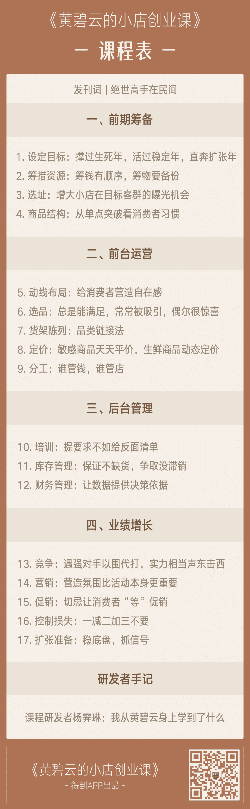  

* * *

# 01 设定目标：撑过生死年，活过稳定年，直奔扩张年

你好，我是黄碧云，欢迎来到我的得到课程《黄碧云的小店创业课》。

现在，很多家庭都已经步入小康，手里也都有了一些积蓄，很多人就想做点事、创个业，但一提到具体做什么、怎么做，就有点蒙了。

这门课，我要给你推荐一门小生意——开一家零售小店。

什么是零售小店呢？就是你经常在社区内、街道边看到的，满足你日常需求的小杂货店。说简单点，就是缩小版的超市。

我为什么要推荐你开这类店呢？

首先，它足够稳定。零售小店满足的都是居民生活的日常刚需，不管是供货渠道还是日常收入，都相对稳定。

其次，它的门槛足够低。不需要你拥有什么专业技能，也不需要有什么特殊资源，只要有足够的本金，就能开起来。

第三个，也是我最主要的一个推荐理由，就是开小店，大概是做生意这件事的极简闭环了。做生意要用到的人力、财务、供应链等等管理，都会在这个小闭环里有所体现。你可以感受到，所有经营环节是怎么完成运转的。

好，有了开小店这个创业想法之后，那第一讲，我们就来看看，怎样设定目标。

## 选择赛道和规模

你可能会说，开店目标还需要讲吗？肯定是赚钱啊。

当然，我们开店的初衷，肯定是为了增加收入、提高生活质量，不过，我要提醒你的是，你要意识到，你的资源是有限的。

做生意，当然都想赚钱，但每个人手里的资源不一样，那在做选择的时候，就会受到资源制约。回到开小店这件事上，首先受到制约的，就是你对赛道和小店规模的选择。

零售小店的赛道选择，主要分两类，一种偏民生型的，就是店内更偏重卖米面粮油、蔬菜瓜果这类民生商品，我们叫它民生小店。第二种是偏休闲型的，店内更偏重卖零食小吃、饮料酒水这类休闲型商品，我们叫它休闲小店。这是两个不同的赛道。

规模选择就比较好理解了，就是你打算开店的店面积大小。

这两个选择，是严格受到资源限制的。

首先是财务资源。财务资源限制的是你对规模的选择，因为各地房租物价各不一样，我没法给你一个精确的计算方式。但这里我教你一个快速验证的方法，就是一家零售小店的日均收入，不能低于月租金。

比如，月租是两万，那日均就不能低于两万的销售额。如果低于这个数，那大概率是规模选得过大了。

所以，你可以在选择规模前，对目标区域里已有的小店收入做一次详细的市场调查。

第二项是人力资源，限制的是你对赛道的选择。

民生小店，商品都是刚需，所以现金收入稳定，从小店第一年的存活率来看，也相对较高。但它的劣势也很明显，民生类商品毛利很低，商品的损耗很高，虽然销售频次高，但对应的人工成本就高。

所以如果你们家并没有太多人力能够投入，而所在城市雇佣成本也比较高的话，开这类店就比较吃力，尤其像生鲜商品的采购工作，经常要日夜颠倒，非常辛苦。家里没有人有足够精力投入，不建议你开。

而休闲类小店，这类店的优势是前期固定投入少，而且毛利高、用工成本少。平时人少的时候自己看店，过年过节再请临时工或者家人一起帮忙就能应付。劣势也非常明显，现金流水少且不稳定。如果你们家并没有太多精力投入，就可以选择这类小店。

不过，如果你的人力资源充足，是不是就一定要选民生小店呢？也不一定，这个时候，你还可以想想自己有没有附加资源。比如你们家附近有没有哪些突出的农业特产、商品集散地，或者你本身有没有相应的商品供应渠道，如果有这些资源，那对你来说，就是个加分项，能多个选择。

我举我同事开小店的过程，看看她是怎么在资源限制的情况下锁定目标的。

我这位同事是一位刚生完二胎的妈妈，想兼顾赚钱和照顾孩子，就来问我，要开个什么店，我就帮她分析。

首先，她当时刚来长沙，没什么亲戚朋友。开民生小店，店员要用得多。这一点，她肯定是满足不了的。而且她平时还要照顾孩子，精力会被分散，所以民生店风险很大，我就建议她选择休闲小店。

但这个目标还不够明确，开休闲店，具体卖哪些休闲商品呢？

这个时候就要看加分资源了。因为她原来在超市里面上班，对食品比较熟悉，她就重点对长沙的食品批发渠道做了调查，发现供货资源是非常丰富的，特别是休闲食品，那我就建议她在休闲的大分类里，选择了休闲食品小店。

那具体开多大规模呢？

我的同事盘点了下自己手里的资金，差不多是 11 万，这是实际可用资金，当然了，肯定不是有多少钱，就按多少钱来算，你还需要筹措一部分资金，这个我下一讲会跟你讲。

一般来说，总投入是自有资金的 2~3 倍。如果你不愿意去冒风险，就按照 2 倍去计算。如果敢冒险，你就可以设置到 3 倍。我这个同事相对冒险，她按三倍也就是 33 万来找合适的店面，根据当地的房租物价算下来，大概是在 100 平方米左右。

经过这样一番测算，我这个同事就选好了自己小店的赛道和规模。

## 拆分阶段目标

但选好规模和赛道，就算是定好目标了吗？还不够，资源限制决定了这个目标能不能落地，但我知道，你肯定也特别关心能不能盈利。

这也是我重点想提醒你的，开店是一个慢生意，如果急于求成，就会多走很多弯路，甚至有倒闭的风险。所以，你要把赚钱这个模糊的目标，拆分成具体的阶段性目标。

我把小店从有想法到能盈利这个过程，大致分成三个阶段。

第一个阶段，大概率也是开店第一年，我把它叫做“生死年”。这一年，倒闭风险非常高，就是因为很多人一上来就想着赚钱，但其实，这个阶段最重要的，是吸引顾客上门，把他们变成你的老顾客。这样，你才能在这个区域站稳脚跟。

不仅如此，因为开店前期的投入资金比较大，只有吸引到足够的客流，增加销售额，加快现金的回转，才能覆盖掉前期投入的成本。

所以，这个阶段你所有的行动和经营策略，都要围绕着吸引客流、培养老顾客这个目标来进行。

那什么时候这个目标就算是达成了呢？就是你能在第一年年末的时候，前期投入基本能回本，那就说明你的客流量基本已经有了保证。

到了开店第二个阶段，我把它叫做“稳定年”。这个阶段的目标是尽可能提高净利润率，也就是说，这个阶段不能只看销售额多就行，很多人在这个阶段容易犯的错误就是，明明销量很高，但账面上却没有钱，这是为什么呢？就是因为你没有把控住净利润率，造成了现金溢出。什么意思呢？就是现金流较多的时候，人就容易大手大脚，作决策的时候，也就比较冒进，很多利润就这么被消耗掉了。

所以这个阶段，主要的侧重点是降低成本，提高净利润率。提高到什么程度呢？

你每天的利润占到了销售的 15%，这就说明你的利润率相对较高了。

好，过了这个阶段，你基本上就到了第三个阶段。这个阶段，你的主要目标是提高利润额，请注意，这个时候就不仅仅是利润率了，你要储备足够的利润额，来准备扩张。

零售是一个低门槛的行业，所以竞争从开店开始就不可避免。这也就是说，不发展就会落后，落后就会挨打。一家小店如果不发展，随着固定成本增加，就会慢慢降低收入。

所以，开小店求发展是必然的，那这个阶段，我们就要想方设法通过营销等各个方面来提升业绩增长，增大利润，为扩张作好准备。

你看，这就把赚钱这个模糊的目标，拆分成了三个具体的阶段性目标。而且，每个阶段都有它各自要完成的目标，不能前后错位，否则也会影响小店发展。

我举个例子。我有个客户，在河南一个小县城里开了一家小超市。当时，他选的店面属于新楼盘的配套商业。他觉得能买得起这个新楼盘的人消费水平肯定不低，就理所当然地把提高利润当成了第一年目标。

所以，一开始他就把商品价格定得比较高，而且对于那些别家没卖过的新品，他又进一步地提高了商品毛利率。

结果，开店不到一年，他已经追加了两次投入，店里的生意一直处于赔本状态。问题出在哪呢？就出在他太急于求成了。

确实，周围住户的消费水平不低，但他作为一家新店，还没有培养起顾客信任，就把价格提得特别高，那周边的老住户是不会买账的，而这个新楼盘的新住户呢？

虽然支付能力不低，但一个小县城里，新住户和老住户相熟的概率是很高的，这家店价格高的印象很快就会从老住户传给新住户。

所以，开店第一年就把提升利润当成第一目标，一旦客户不买账，就会出现现金流断裂的风险。商品毛利再高也没有用，没有客流，销售总额就不可能高，只有拥有了稳定的客流量，才能通过毛利高的商品品类，来提高利润。

也就是说，从落地到盈利，中间还有很长的路要走，我们还得稳扎稳打，分阶段前进。具体怎么做，在后面的课程里，我会详细跟你拆解。

本讲小结

好了，这一讲我们讲了怎样设定开店目标，你要根据你的资源限制，来具体选择开店规模和赛道。

一般来说，追求收入稳定，家里也有足够人力资源支持，可以选择民生类小店；投入精力有限制，或者有相应的商品资源，就可以选择休闲类小店。但设定好这个初始目标之后，你还要在心里存着一个分阶段目标，先求生存，再求稳定，最后再考虑扩张盈利。

思考题

如果让你现在去开一家小店，根据你的限制，你是会选民生小店，还是休闲小店？为什么？

欢迎你在留言区分享。

选定目标之后，下一讲我们来看看，怎样筹措资源。

1\. 如果你追求收入稳定，家里也有足够人力资源支持，可以选择民生类小店；投入精力有限制，或者有相应的商品资源，就可以选择休闲类小店。 2.  
开店的第一年重点不在盈利，而是要吸引顾客上门，把他们变成你的老顾客。这样，你才能在这个区域站稳脚跟。 3.  
开店的第二阶段侧重点是降低成本，提高净利润率。当你每天的利润占到了销售的 15%，就说明你的利润率相对较高了。

* * *

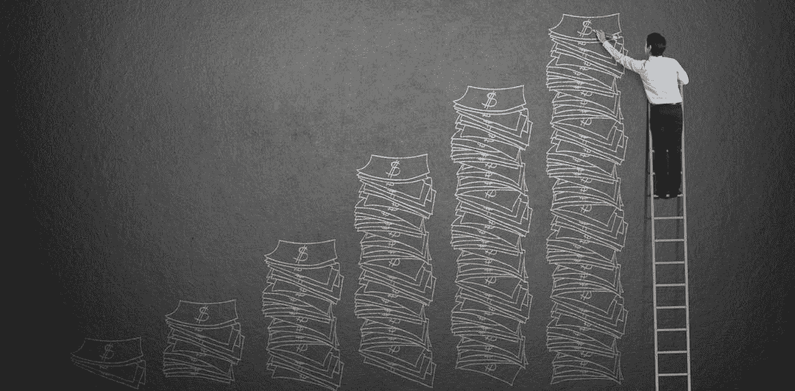

# 02 筹措资源：筹钱有顺序，筹物要备份

你好，我是黄碧云，欢迎来到我的得到课程《黄碧云的小店创业课》。

上一讲，我们讲了怎样根据资源设定目标，这一讲，我们来看看，如果资源不够怎么办。

一般来说，开店需要的资源就是人、财、物。人可以通过雇佣完成，也就是说，人的问题，也是钱的问题。那这一讲我们就来看看，怎么筹钱和怎么筹物。

## 筹钱

说到筹钱，你可能也能想到一系列措施，最直接的就是家里凑一凑，不够就找亲朋好友借一借，再不行就抵押贷款，或者找个能出钱的合伙人。但这里我要提醒你，这种凑钱的方式，一旦出现纠纷，会直接损害你小店的发展。

那到底应该怎么筹钱呢？当然了，筹钱的方式，自古以来都是那些，我不可能凭空变个新方式出来。但我要强调的是，不同方式的顺序非常重要，顺序不同，结果完全不一样。

我建议的顺序是：先盘点资金开支性质，优先通过多渠道贷款，比如抵押固定资产贷款；其次可以变卖部分资产；再次是借钱；最后实在不够，再考虑找合伙人。

为什么是这个顺序呢？我还拿上一讲提到的开休闲食品小店的同事来讲，看看她是怎么凑齐开店启动金的。

## 盘点资金开支性质

当时我这位同事，手里可用的资金是 11 万，预计总投入是在 33 万，但她发现了一个特别好的店面，但预计投入就要达到 40 万，而她实际手上的钱，离 40 万差着 29 万。那怎么办呢？

首先，我劝她不要着急借钱，先把预计要投入的支出，按照性质盘点一下。

我们在算投入成本时，那些必须支出的成本，其实还可以进一步分为三类：预付支出、分期支出和滞后支出。

预付支出，就是在开业前必须要用的现金支出。主要有现金进货款、品牌加盟费、前期装修预付款、1 个月的房租押金和 3 个月的租金、设施设备的预付款等。

除此之外，开店也一定要留一定额度的应急现金流，大概是在总支出的 10%，也就是 4 万。

这两项加起来，一家休闲食品店在这一部分的开支，总额在 22 万左右。这些钱，你必须要先支付，才能让项目运转起来。

第二类是分期支出。比如说装修付款、硬件设备这些大笔资金投入。大概在 15 万左右，但这些支出，其实是可以和对方协商分期来付款的。假设分 3 个月付完，平均每月 5 万，那在开业前就还需要支付 5 万。

第三类是滞后支出。主要是指在营业后才会发生的费用。比如，定期补货、工资、工商水电、物流费用、包括房租等，也就是常说的运营成本。这部分每个月的支出，大概在 3 万左右。

这也就是说，把预计支出按照三类性质盘点一下，你就会发现，开店前所必须的支出，从原来的 40 万，变成了 27 万。而剩余的部分，未来开店后，只要现金流水大于支出，基本就能保障小店先生存下来。那我这位同事实际上要筹的钱，变成了 27 万减去 11 万，也就是 16 万。

## 多渠道贷款

好，那这 16 万从哪来呢？这个时候就需要去外面筹集资金了。但我仍然劝她不要着急借钱，而是优先考虑银行小额贷款。

为什么不找亲朋好友借钱？  
其实道理很简单，因为有太多的情感牵扯，一不小心就会闹出家庭矛盾，这对你的时间精力损耗更大。而且，找亲戚朋友借钱，期限很难定死。假如你店刚开起来，对方有急事要催着你还钱，这个时候你该怎么办呢？为了省这一点利息，我认为不值得。

所以，如果你是第一次开店，我建议你优先选择小额贷款，像我同事的 16 万空缺，就是通过各个渠道的小额贷款凑够的。她先去了自己最常用的、产生交易流水最多的银行咨询，有 9 万的低息贷款额度。

接着她又去看了网上的贷款平台，以支付宝的网商银行为例，只要开通支付宝，有一定的流水，就可以借到 1~3 万不等的低息贷款。因为我这位同事的平时信用度比较高，她在网商银行借到了 1 年 3 万的低息贷。

也就是说，她在小额贷款上总共筹集了 12 万的现金。现在，离开业总投入，还差 4 万。

还有什么渠道可以筹集到贷款呢？我们看了下她的信用卡额度，总共有 10 万，还有一个 5 万 55 天的免息期。这笔钱刚好可以用来我们上面提到的第一笔分期支付，甚至在未来 3 个月，都可以用这个办法，把信用卡这 10 万额度用掉。

请注意，这可不是教你套现，而是给开店后现金的积累争取一些时间，反向能够节余出现金流。

好，到这里，我这位同事所有的空缺都已经补齐，在没有向别人借一分钱的情况下，顺利把店开起来了。

## 选择合伙人

当然，这种情况相对理想，如果到这一步，甚至你已经向身边能借的人借了钱，还没有凑够怎么办呢？

你还有一个选择，就是找合伙人筹款。你可能会疑惑，为什么要把找合伙人放到最后呢？多一个人一起来分担成本和风险，不是很好吗？

这里我要提醒你，小店刚开始，利润肯定是不高的，找合伙人，就要在不高的收益上再分摊，到每个人手里，钱就更少了。钱少，但事可不少，尤其开业初期，琐碎的事是最多的。事多钱少，合伙人投入的热情就会大受打击，开始互相指责推诿。所以，不到万不得已，尽量不要着急找合伙人，等到开分店的时候再考虑。

不过，如果你已经筹不到钱，又非常想现在就开店的话，那合伙人也是一个选择。这种情况下，我对你也有几点提醒：

第一个，你最好选那些能出钱但不出力的人。因为这类合伙人，一般是想多个渠道多点收益。他对你小店的依赖程度并不高，就不会过度关注店里经营状况、干扰你的管理。你要做的，就是定期主动发送经营状况给他。

那要不要找亲戚做合伙人？这是很多人的第一选择，因为天然存在信任关系，但风险就在于，经常有亲戚合伙做生意，最后连亲戚都做不成。

我想提醒你的是，找亲戚做合伙人，也不是不可以。但首先还是要符合我们刚说的标准，手里有足够余钱，不会因为投资了你的小店，影响到他家里的财务状况。

还有一点，就是你一定要判断亲戚家里的财政是由谁做主。如果没有经过那个人同意，就很容易引起家庭矛盾。特别是如果开店开到一半的时候爆发，那可就进退两难了。

我第二个提醒是合伙人人数，最多不要超过三个，原因就是前面提到的，合伙人一多，分钱更少，投入的热情度降低，很多时候就会开始互相推诿。

第三是我要提醒你，合伙人的分工，虽然我建议尽量选择只出钱不出力的，但有时候情况未必那么理想，那就要提前明确好分工和股份分配。尤其注意，一家店只能由一个人来负主要责任，不能每个人都有平等的决策权。

这是我对找合伙人的几点建议，到这里，你基本应该就能筹够钱了，接下来我们来说怎么筹物。

## 寻找供应渠道

筹物关键就是要解决商品资源的问题。一般来说，开店初期，可以找的供应渠道主要有两个：线下批发城、线上批发网。

选哪一个呢？这也跟你的实际情况密切相关。

如果你是第一次开店，而且资金实力有限，那我建议你就近选择线下批发城，这个方式虽然传统，但比较实用。

但到线下批发城，也不是盲目地找供货渠道，你要重点考察的是，资源最强势和最弱势的品类。比如，长沙的强势品类就是散装休闲食品，那包装食品就相对弱势。

强势品类本身竞争激烈，那各个渠道商之间的差别就不会太大，价格也都差不多，你随便选一家就可以，能帮你节省不少精力。而研究区域最弱势的商品，要是你能找到好的供应渠道，就容易和其他竞争对手拉开差距，降低竞争压力。

这是选择线下商品城来进货，当然，相应地还有线上批发渠道。目前最主流的线上进货渠道就是阿里批发通、京东掌柜宝。优势就是商品足够全，而且上新率比较高，有很多小众的新商品。

这也就是说，如果你的资金实力相对较强，觉得线下供应不足，可以通过线上渠道，来做一些商品资源的补充，提供区域里其他竞争对手没有的差异化商品。另外，线上平台价格相对透明，你也可以把它当作进价比对器。

不过，在搭建供货渠道体系的时候，我还有一点提醒，就是对一些重点商品或者畅销商品，你一定要遵循一品多商的原则，也就是一个主供应商+两个备选供应商+大零售终端。

一个主供应商，是说你要选择一个主要的供应商来长期合作，目的是为了积累信用。长期合作，供应商才有可能给你提供额外的支持。

两个备选供应商，这个原因也很简单，零售行业里有一句话：缺货就是犯罪，而缺货的商品往往是卖得好的商品。缺货的损失可不是收入少了，更重要的是，一旦顾客来两次都发现他想要的商品缺货，那他就很有可能再也不来了，所以一定要有备选供应商，保证重要或者畅销商品不断货。

那大零售终端是什么意思呢？就是零售卖场。这就相当于，当你实在没货的时候，可以在别的零售卖场拿到货，然后再平价卖出去。

有人可能不理解，有必要一分钱不赚卖货吗？有必要，你还记得我们第一阶段目标吗？保障畅销商品的不断货，这是提升顾客信任度，培养高粘度顾客的基础。

本讲小结

好了，到这里，我们就已经做好了开一家店的前期准备了。

首先是筹钱，顺序非常重要，我建议你可以先盘点资金开支性质，然后优先考虑通过多渠道来贷款，再往下走，才是借钱或者找合伙人。

筹物这部分比较简单，你可以根据自己的情况，选择线下商品城、线上渠道，但要注意一品多商的原则。

思考题

你会通过哪些渠道来筹钱筹物？如果你发现了不同的渠道，也欢迎你在留言区和大家一起分享。

准备好了钱和物，下一讲，我们来看怎样选址。我们下一讲见。

1\. 我建议的筹钱顺序是：先盘点资金开支性质，优先通过多渠道贷款，比如抵押固定资产贷款；其次可以变卖部分资产；再次是借钱；最后实在不够，再考虑找合伙人。  
2\. 合伙人分收益，而不是分决策权，一家店只能一个人做主。合伙人最好找只出钱不出力的，他就不会干扰你的经营决策。 3.  
重点货品的渠道，要遵循一品多商原则：一个主供应商+两个备选供应商+大零售终端。

* * *

# 03 选址：增大小店在目标客群的曝光机会

你好，我是黄碧云，欢迎来到我的得到课程《黄碧云的小店创业课》。

上一讲，我们拿到了开店所需要的资源，这一讲，我们就要开始选择店面地址了。

你可能经常会听到这么一句话，选址对了，那开店也就成功了一半。从这句话，你就能想象选址有多重要了。

但不只是零售店，对所有的店来说，选址都很重要，你会发现大家公认的好店址，租金贵到离谱。他们为什么愿意掏这么贵的租金呢？毕竟酒香也怕巷子深嘛。

也正是这个原因，一提到选址，很多人第一反应，就是要找人流量大的地方。这个想法，如果放在十年前，没有问题，但现在，就已经不适用了。因为十年前，你的竞争对手就是隔壁店，但今天，你的竞争对手你根本都不知道在哪，可能是隔壁店，也可能是淘宝京东，还可能是楼梯间的自动售卖机。

这就对选址这件事，提出了更高的要求。

以前，只要顾客够多，和隔壁店竞争，总能分到一点流量，但现在，你要和不知道隐藏在哪的对手竞争，那机会在哪？就是你能不能更方便地满足顾客需求。说白了，更重要的，不是你离顾客的距离最近，而是要离他们的需求最近。

这也就是说，选址的时候，你一定要区分两个概念，一个是人流量，一个是客流量。注意，这是两个完全不同的概念，千万不能画等号。人多，不一定都会到你的店里来消费，你要把握的，是你的目标客群。

那选址的时候，增大小店在你目标客群中的曝光机会，才是你努力的方向。

那怎样才能选到一个合适的店址呢？

你要严格遵照三步走，先选城区，再选商圈，最后选具体位置。

## 选城区

第一步，选城区。

这一步主要衡量的是一个区域的发展性，其实也就是要考虑未来的客流量。毕竟，一个区域如果活力不强，即便现在生意还行，未来就很难支撑了。

所以，很多客户来找我做选址咨询的时候，多数人都会倾向于选新城区，原因很简单，城市里公认的黄金地段，也就是相对成熟的商圈，已经挤不进去了，租金还很高。那老城区呢，大家都在往外搬，看着就没有未来。所以，新城区就变成了热门首选。

但这里我要提醒你，新城区确实更拥有未来，但你也不能不考虑现在。

一般来说，人的搬迁和流动肯定不是在一个时间点集中完成的，而要经过一个流动周期，一般会在 2~3 年，如果你太早进入一个新城区，而城市人口流速并不是很快的时候，那前两三年都会持续亏损。有些小店，可能撑不过这三年就倒闭了，那还不如先待在老城区，开个两三年，等时机差不多了，再慢慢迁到新城区或者开分店。

那什么时候时机就差不多了呢？

有个数据可以作为参考，就是当新城区周边楼盘的入住率超过 25%的时候，你就可以选择进驻新城区了。

为什么是 25%呢？

这是我和团队多年收集数据总结的经验。一般来说，一个新楼盘里，最早入住的人群，一定会有一些特殊情况，比如老城区拆迁，不得不着急搬新家，再比如有了孩子，要请父母来照顾，不得不换一个大房子等等。这类“非搬不可”的人群可能会占到 25%~40%，而随着商圈越来越成熟，顾客也越来越多，而 25%这个节点，刚好就是个临界点。

这个时候，商圈里各个开发商都已经进入，他们也在想办法吸引商家，这样才能吸引更多的客流。借着这个机会，你还可以跟房东商量个免租期，但更重要的是，25%的入住率已经能基本覆盖你的日常营业成本，维持小店生存。而一旦超过 40%，人口流入速度一般就会逐渐加快，而到那个时候，小店的生意肯定就更好了。

不过你要注意一个问题，从第一家住户搬进来开始算起，如果 25%的入住率，是花了 8 个月以上的时间才达到的，这说明人口流速特别慢，肯定是有些特殊原因的，那你还得再等等，等到入住率超过 40%的时候再考虑开店。

举个例子，2016 年，我要去湖南衡阳开个分店。当时我发现，虽然新城区房子建得挺快，但人口往内迁移的速度特别慢，在周边房子建成已经 60%~70%的情况下，人口迁移率也不过 20%左右。但当时房东开出了一年免租期的条件，要不要进驻呢？我的判断就是，先不急。

要知道，当地人很少依山建房，而这个新城区是挖山建出来的，这也就导致城内就算很拥挤，大家都不愿意搬，过了一年，入住率勉强才超过了 25%的这个保底线，如果开店，就很可能亏本。

那现在过了 25%，我该不该进呢？我的判断，还是再等等。因为它的人口流速太慢了。

一直等到 2018 年 3 月，情况开始发生变化，因为农村人口不断往城市涌入，有一部分人就被挤到这个新城区，流速一下子就比前两年快了很多，入住率很快就超过了 40%。这个时候我才判断，这个店今年可以开起来了。

所以，在选择城区的时候，你一定要综合考虑开店的时机和城市人口搬迁的流速。

## 选商圈

好，划定好大致区域，接下来就是选商圈了。

商圈，就是以小店所在地点为中心，辐射顾客的范围。简单地说，也就是来你家小店的顾客，他们居住、活动的区域范围。

这里我还是要再强调一遍，很多人选商圈的时候，倾向于选人流量大的商圈。先不说租金会更贵，关键是，有没有考虑到目标客流量是否足够，注意，我说的是目标客流量。所以，选商圈的时候，一定要根据你的开店目标来决定。

如果你想开的是休闲类的店，那你一定要选择年轻人或者小孩多的区域，而民生类的店，选择范围相对广一点，只要周围能有 1000 家以上的住户，就能支撑 150 平方米左右的民生店，而且，一天收入基本能达到 15000 元左右，要是你经营得好，还能活得更好。

不过，怎么判断一个商圈里住的都是哪种家庭结构呢？

我教你一招，你可以根据一些细节来判断，比如幼儿园聚集的地方，一般就是年轻夫妻比较多，而社区门口有麻将馆，或者十块钱就能剪一次头发的简易理发馆，那说明这片区域里老年人比较多。

还有一个细节指标，你要重点关注，就是这片区域早上和晚上的亮灯率。

如果晚上天一黑，亮灯率就挺高，一般是三代同堂的多，也就是小孩多；晚上 8 点过后，亮灯率才会逐渐高起来，那基本上说明小两口、单身的人多。而早晨天蒙蒙亮时，亮灯率就高，那显然就是老年人多。

上一讲，我们已经明确了开店目标，那现在就可以通过这些细节判断，你的目标群体在哪。

## 选位置

选定了商圈，再往下走，就要选择具体位置了。一般我们都想开在社区大门口，但这里的租金高，位置又有限，如果抢不到，怎么办？

那这种情况，你就可以试试路线交点法。

具体怎么用呢？每一类消费群体，居住在一个区域内，经常去的地方都是相对固定的。比如一个典型的中国大妈，她早上会去买个菜，或者送孙子上幼儿园，下午接孙子回家，晚上去跳个广场舞。那把她每天经过的点连起来，就能掌握她的必经路线。

用这个方法，你把所有目标人群的路线都画出来，这些路线一定会产生交点，而经过路线最多的那个交点，就是你目标人群汇集的中心点。你就可以把店址选在这。

好，我们说回大妈。

我举个简单的例子，大妈们接孙子放学的路上，看到了一家小超市，孙子吵着想吃雪糕，那她可能就会顺便在这里买点蔬菜瓜果、家庭日用，而不一定非等到去小区门口了。而这家小超市店如果刚好还在小区和健身房的必经之路上，那年轻人健身回来，也可能会顺路进来逛一逛。你看，这个位置，就是大妈和年轻人路径的交叉点。

好，一般按照我这三个步骤，店址不会选错。最后，我再给你一个简单的验证标准，能帮你进一步判断选址合不合格。

你可以看看店址周围的早餐店，看它生意好不好。因为早餐店，是一个社区最顽强的生意，如果这个区域连早餐店的生意都不好，那你一定选错址了。

本讲小结

这一讲我们讲了选址。选址的时候，千万不要只看人流量，关键是客流量。

怎样选址呢？所有的方法，都是为了增加小店在目标客群的曝光机会。

首先，你要选择一个有活力的区域，这个区域一定要兼顾现在的客流量和未来的客流量。

其次，你要根据你的开店目标，选择一个你目标客群聚集的商圈。

最后，你再根据目标客群的行动路线，选在他们日常的必经之路上，这样他们才有机会走进你的小店。

思考题

我给你留个小作业，你观察下小区附近有几家零售店？你平时最爱去哪一家？为什么你会选它？

欢迎你在留言区，说说理由。

下一讲，我们来看看怎样选择商品结构。

1\. 选区域的时候，要兼顾现在的客流量和未来的客流量。 2. 选商圈的时候，要选择目标人群聚集的地方。 3.  
选具体位置的时候，可以用路线交点法，画出目标人群必经之路的交点，增大小店在他们面前的曝光机会。

* * *

# 04 商品结构：从单点突破看消费者习惯

你好，我是黄碧云，欢迎你来到我的得到课程《黄碧云的小店创业课》。

上一讲，我们选好了店址，这一讲，我们接着来看，怎样选商品结构。

先解释下什么是商品结构，简单来说，就是一家零售店里，不同消费层次的商品占比。这反映出了你家零售店是偏高端，还是偏低端，还是相对均衡。

你可能会说，超市的商品结构不都差不多吗？多卖多赚。你要这么想，那咱们前面选址的工夫，可就白费了。如果你是菜市场门口的小店，顾客都是大爷大妈，你却卖的是进口红酒，那肯定就吸引不了他们。上一讲我就讲了，小店一定要离你目标消费人群的需求更近。

所以，在零售小店里，不同档位商品搭配要有侧重点。

你可能觉得，这个问题不难，我看看周围房价就好了，房价高，我的店自然就走高端路线。但有一种情况你要注意了，左手边可能是高档小区，右手边就是城中村，两边顾客的收入水平，可能差异非常大，你根本没办法通过房价来准确判断消费水平。

所以，要想选对商品结构，你要做更有效的调查。

## 单点突破法

我给你介绍一种调查方法，叫做单点突破法。你要去找个对标的店，不是让你去找直接竞争对手。

举个例子，你的目标客群是年轻女性，你就可以看看周围的花店。用这家花店的销售情况，来判断你目标客群的消费状况。

找对标店千万别找连锁店，我推荐你找家宠物店或者干洗店。因为这些行业目前连锁企业少，都是个体经营。所以干得好的，肯定是瞄准了附近顾客消费的需求，你就跟着它选，基本错不了。

对标店找好了，怎么用它来分析出周边客群的消费状况呢？我用宠物店来说，你去看宠物店的服务项目。

如果宠物店服务项目丰富，不仅有基础的洗澡，还有宠物医生，甚至还能拍照、美容，卖的商品也很丰富，这就说明这个商圈的消费相对比较高。你如果在这个地方开店，高端商品就会卖得比较好。比如，你可以在店内进一些进口水果，像酱油、醋这种日常用品，你可以尝试卖一些酿造级别比较高的品牌。

这其实很好理解，愿意为宠物多花钱的人，手头相对宽裕。你在配置商品结构的时候，就可以提高高端商品的比例。至于提高到多少，后面我们展开来讲。

如果附近宠物店，只是卖一些简单的宠物用品，服务项目也比较单一，那其它店也比较亲民。你如果在这里开民生小店，像米面粮油之类的基础品类，就会卖得比较好，店内的商品也可以相对平价一些。

还有一个有意思的问题，你去问问宠物店的服务，是以猫为主，还是以狗为主。如果答案是狗，那么就按照上面两点来做商品的结构配置，如果是猫，我就建议你多卖啤酒、鲜切水果，而且销售高峰期一般会在晚上的 8 点过后。

为什么我敢下这个判断？因为养猫的人多，说明这附近住了很多年轻人、或者独居的人。水果买多了吃不完，他就会喜欢选择小份的商品。

你看，把宠物店作为突破点，就可以对周边的消费群体，有一个相对清晰的了解。

## 商品结构模型

那了解之后，我们怎么根据这些人群的消费需求，来安排商品结构呢？我总结成了三种模型：金字塔模型、擀面杖模型、均等分模型。你可以直接根据这些模型，来配比商品组合。

第一个我们来说金字塔模型，这类商品结构，适用于大众消费。

金字塔顾名思义，就是下大上小：一般就可以按照 6:3:1 的比例来分配，6 成是平价的商品，3 成是中高端的商品，1 成是高端的商品。

我以酱油这个小分类为例。如果说总配置是 10 支，大众品牌要配置 6 支，功能性的要配置 3 支，再更高端的酱油就配置 1 支。

你可能会好奇，为什么要保持 6:3:1 的比例呢？

一方面，任何一个商圈，都会有消费水平相对较高的人，你要兼顾他们的需求。

另一方面，你这家小店给周围人群的印象，不能只是廉价，这不利于你未来的发展。如果你给人的印象是低端，未来想通过提价来提升利润，就很难了。

销售虽然主要来源于相对平价的商品，但金字塔模型一定要有塔尖，用 6 个字来形容就是：接地气，不土气。

第二个模型就是擀面杖模型，就像它的形状一样，中间大，两头小。同样是酱油，中端商品占比就可以到 60%，低端和高端各占 20%。这一类商品结构模型，适用于中产家庭和年轻白领集中的商圈。

经常有人问我：中产家庭消费能力不错，为什么不加大高端商品的比例呢？这样利润不是会更高吗？

原因很简单，这类人群时间成本高，一般不会用太多时间去挑选日常用品，一旦选好一家店，就会长期认准，所以客流相对稳定。相应地，他们做第一次选择就会比较“挑剔”。如果你一上来就加大高端商品的比例，顾客的第一印象就是贵，那以后可能就都不来了。所以，我建议你中端商品多，高端商品占比不用太大。

第三个是均等分模型，典型代表就是进口超市。

第一次开店，我不建议你开这种小店。但如果你已经开了这类店铺，那我建议你中高端商品，占比得均等分布，大众品牌基本就不要出现了。同样拿酱油来说，你要以进口酱油为主，有机酱油必不可少，中高价位平均分配。

好，认识了这三种模型，也明白了它们的适用范围，是不是直接套用就可以了呢？一般情况下，是的，但还有不少特殊情况。

我拿一个真实案例来讲。

前两年，我有个客户想开家小超市，发现了一个交叉型商圈，有年轻人，又有三代同堂的家庭，结构很丰富。我去看了他们准备选的店，周围社区开发得真的很不错。唯一的问题就是，这个商圈已经有很多不同类型的小店，容易同质化扎堆。

那怎么办呢？我还是先用了单点突破法，来观察这个商圈的消费状况。这一次，我选择的突破点是快递驿站。

因为快递驿站就在他们店址的隔壁，同时也连接了这个社区大部分群体。连着几天我们在快递驿站旁边观察，我们发现，晚上 6、7 点是取件高峰期。他们大概率都是上班一族。

我们发现很多人网购买的都是休闲食品、水果、纸巾、洗衣液……这个信息告诉我，线下的零售店并没有满足他们。那怎么更方便地满足这部分人的需求，就是一个很好的切入口。

习惯网购的上班族，都相对年轻，消费能力也比较强。那适合这类人群的商品结构模型，就是擀面杖。

但刚才我刚也提到了，这个商圈的竞争已经比较激烈了。你要想让上班族们放弃线上购买，这个习惯是要花时间培养的。如果只做上班族的生意，一开始是很难支撑这家店的。这个时候，就不能生搬硬套，只局限在擀面杖模型里。

我当时给这个客户的建议是，考虑两种模型并存。上班族一般只会在晚上六七点之后消费，但白天这家店不能完全闲着。白天就可以利用金字塔结构，来抓住习惯赶早市、午市的中老年人群。

怎么让一家店两个模型并存呢？我们主要商品结构还是擀面杖模型，但是白天面向老年人的时候，是金字塔模型。这个转换靠的就是蔬菜和水果，这类相对便宜的生鲜商品了。你可以用下午四点为临界点，四点之前主要卖蔬菜水果这类亲民的商品，吸引中老年客流。上班族回来之后，进店看到的还是中端商品为主。

这样，既能满足不同人群不同时段的消费需求，也能让这家店慢慢站稳脚跟。所以，一家店的商品结构，要根据周围商圈的实际情况，进行灵活调整。

本讲小结

这一讲我们讲了三种商品模型：金字塔、擀面杖和均等分。

你可以用宠物店这样的单点，来调查出商圈的消费状况，找到合适你的商品模型。

如果你周围的客群结构比较复杂，可能你就得参考刚才我讲的例子，根据这三种结构，灵活做调整了。

思考题

我想请你做个小调研，去看看你常去的那家民生店，他的结构模型是什么样的？是我们讲的哪一种模型？

请你在留言区里，跟我分享你的调研成果。

另外，如果你有任何开小店的问题，请你在知识城邦或者留言区向我提问。

选完了商品，开店前要做的选择就做完了。下一讲，我们就要来讲筹备开店的事了，我们下一讲见。

1\. 通过单点突破法，可以判断出商圈的消费状况，找到合适你的商品结构。 2. 三种商品结构模型：  
金字塔模型，适用大众消费。按照 6:3:1 的比例来分配，6 成是平价的商品，3 成是中高端的商品，1 成是高端的商品。这类商品结构，适用于大众消费。  
擀面杖模型，中端商品占比就可以到 60%，低、高端各占 20%。这一类商品结构模型，适用于中产和年轻白领集中的商圈。  
均等分模型，中高价位平均分配，适用进口超市。

* * *

# 05 动线布局：给消费者营造自在感

你好，我是黄碧云，欢迎你来到我的得到课程《黄碧云的小店创业课》。

前面四讲，我们讲了开店前的几个重要选择。都选好了，从这一讲开始，我们就要开始说开店的筹备了。筹备的第一讲，我要先来给你讲，门店里消费者动线的设计。

消费者动线的设计，就是要设计两件事：一个是动线，一个是布局。动线，就是消费者进店后行走的路线。我们平常逛超市，最宽、最明显的那条主干道，就是这家超市给你设计的主动线。而布局呢，就是沿着动线两边的商品品类分布。

你是不是有过这些经历，想找的商品找不到，或者原本没想买的东西却买了很多。这些行为背后，都是动线布局在影响你。动线如果设计得不到位，店里就会有销售死角，销售量也会受影响。但如果设计得好，顾客不知不觉就多买了。

每次提到这，我的客户就会说：“ 哦，我懂，就是把那些顾客经常购买的刚需商品，放到小店的最里面，吸引顾客走完全场。”

这么想，可就错了。跟顾客“捉迷藏”，这是设计动线布局的大忌。因为当顾客心里存在一个目标时，他会直接奔向目标，买完之后，你想让他再调头回来，那可就难了。但相反，如果你把他想买的目标商品摆在入口处，只要不赶时间，大部分人就会觉得，来都来了，那就逛逛吧。

这个“逛”字，就是设计消费者动线布局的关键词。逛，就是要让顾客充分感受到自在感，不用费劲寻找，想买什么，下一刻就能看到。

用华与华创始人，华杉老师的话来说，好的店面布局，应该是让顾客一路滑到收银台的。

## 营造自在感

那怎样才能营造出这样的自在感呢？

我先带你逛一家不超过 500 平方米的小超市：松青超市。这家超市有什么特别之处呢？在动线布局上，它很符合顾客的购买习惯。更重要的是，这是家低成本投入的超市，比较适合我们新开的小店学习。

好，现在我就邀请你跟我一起走进这家超市。你可以对照这家超市的平面图来看。

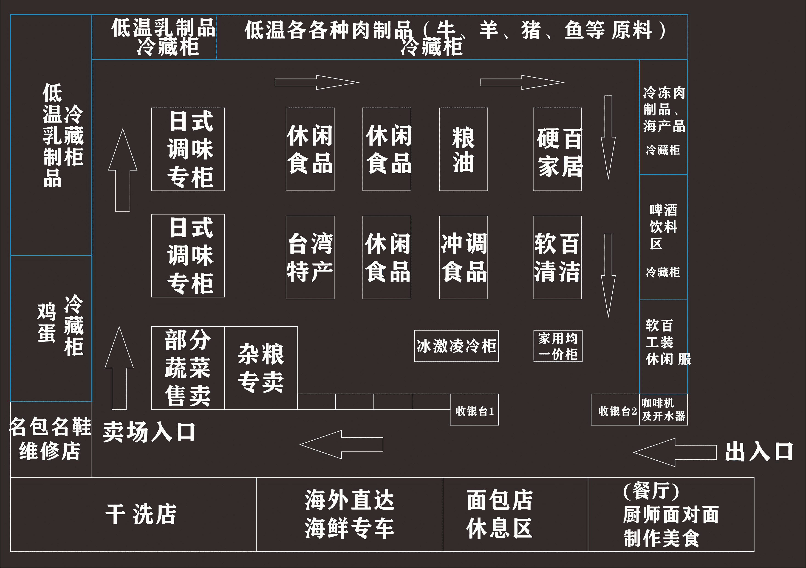

第一脚踏进去，先看到的是门口左侧的蛋品、水果、蔬菜、乳制品等民生必需品。扫视一周，你会看到，右侧第一块区域是新品推荐区，专门用来定期推荐新品。现在推荐的是一些进口蔬菜，推荐区后是各类调味商品。这些商品都是在满足你的一日三餐所需。

买完生活必需品，你今天来超市的基本目标就已经达成了。但来都来了，那就接着逛逛呗。

我们接着往下走，看到了休闲食品和饮料。你可能会想，好久没吃零食了，顺手买一点吧。你看，像这类休闲食品，除了有朋友聚会，一般是看到了才会想买。

再往前走，就到了冲饮区，上面挂了一个牌子：“门口有开水可免费冲泡”，于是你又顺手拿了一杯速溶奶茶。

接着往前走，到了家用百货区，看到纸有优惠，想着家里的纸也用得差不多了，就随手拿了一提放到了购物车里。

最后，我们来到了收银台，你看到了冷冻柜，你又挑了一些雪糕冰淇淋，然后结账出来。

想象一下，逛这样的超市，是不是不知不觉就会买很多商品？也不会出现在超市里转三圈都找不到目标商品的情况。

怎么才能产生这样的效果呢？

我们大多数时候，都是家里缺了生活必须品，才想着要去超市。松青超市的动线布局，抓住的就是“民以食为天”。食材、烹饪商品、零食饮料，这些食物是按必要性来排序的，再到日用小商品，最后就是怕化掉的冷冻食品。

为什么把冷冻食品放最后呢？这不也是吃的吗？因为它容易化。如果放在里面，顾客买了冷冻食品就会想着赶紧结账，也不会轻松地慢慢逛。

这里的动线布局，就是符合顾客的心理购物清单。你想想，你列清单的时候，也会先列必须要买的商品嘛。一家超市，如果按照这个顺序来安排布局，可不是顾客想买什么，下一秒就能看到什么嘛。

除了排布的顺序重要，松青超市还有一点值得我们借鉴的，就是入口要放在最左边。

这是什么讲究呢？大部分人的习惯是，进门先迈左脚，同时向右看，所以顾客一般会顺时针在店里转。不信你可以观察观察。当年我师父指点我的时候，我也不信，我就天天泡在超市门口，盯着人家脚看。结果 10 个人里，有 9 个人是这样。

因为这个习惯，我们要把民生必需品放在左边，他看不见就会去找。把零食、饮料这些看到才会想买的商品，放到他视线的右边。我还真就做过实验，同一种休闲食品，放在左边和放在右边，购买率要相差 7%~10%。

## 案例

这些年，我拿这个原则帮学员做调整，效果也很明显。

举个典型例子，2019 年初，有个学员找到我，他们有一家新开不久的超市，位置好、装修也很下本，可是销售却一直低迷，让我去看看。

我到店里走了一走，就明白了，为什么投了这么多钱，销售还不好，他们在动线布局上，犯了大错误。我在下方放了张图，你可以看看最初的设计。

首先，这家店本来可以左入的，但装修时被硬砌了一道隔离墙，变成了右入线，还把顾客一日三餐必买的生鲜放在了最里面，就为了能强制顾客走完全场。

但事实上，逆时针转会让顾客逛得特别别扭，而且，一些目标性特别强的顾客，会直奔里面的生鲜区。

但这家店又把休闲食品和熟食区放到了最角落，那些直奔生鲜区的顾客，很容易会忽略角落的东西，买完生鲜直接就出来了。也就是说，这家店实际有效的销售面积只有一半。

还能不能补救呢？当然，最好的调整方法，就是按我们前面说的原则重新装修，但是费用很高，还得闭店装修。这家店当时开业才 3 个月，脚跟还没站稳就重新装修，别人肯定觉得这家店不行。

那怎么办呢？虽然动线不能调了，但布局几个晚上就能改过来。我们像松青超市一样，把那些米面粮油、纸巾这些必需商品，放在四周围成一圈。其他锅碗瓢盆、休闲食品这些非必需品包在中间。这种动线，中间的货架高度要降低到 1.5 米以下，为的是不挡住一个成年女性的视线。

这种布局方式，我们叫它“竞技场布局”。它原来是百货商场里用的，我只是把它挪到超市里了。它像体育馆一样，周围高中间低。好处是能保证顾客视线通透，在店里的任何位置，都能看到周围高货架上的必需品。这就引着你，围绕超市走一整圈。我放了调整后的布局图，你可以对比上一张看看。

我还有一个小细节，特别值得告诉你，我把酒水区调到了收银台前。这么调的好处是顾客一定会看到，但也有可能他着急结账，快速走过去了。怎么让他停到酒水货架前呢？

我用了斜形布局来解决这个问题，倾斜大概 30 度角就可以了。这也是从百货里学的，很多化妆品柜台就是斜着的，你去屈臣氏看看也是这样。斜着放肯定更占空间嘛，所以过去超市不怎么用这种排列方式。原来能放 10 排货架，斜着只能放 9 排了。但我为什么要这样用呢？正着放，我只能看到货架顶端那节货架的商品。但斜着放展示面积就更大了，我至少能多看到一节货架。像酒水这种，要先让顾客看到，才有想买的动力。

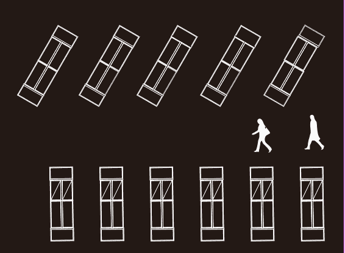

你看，这么调整下来，改动并不大，但效果很明显。我帮他们整体调整了之后，这家超市的日均销售额从 10 万，涨到了 17 万。不仅销售涨了，毛利涨得更多。差别就在于我让顾客看到了更多商品。这个店址，如果一开始就让我设计，成绩会更好。

本讲小结

好了，这一讲我们讲了动线布局，关键是要营造“逛”的自在感。动线布局，就是我们做零售人的语言。我们能做的，其实就是引导顾客看到更多的商品。左入右出，顺时针布局，斜形布局，这些都是为了增加商品的曝光。商品曝光多了，购买几率就会增加。

思考题

我给你布置一个小作业，你去逛逛附近的超市，来给我分享一下，它的动线布局是怎么设计的？

请你把观察到的细节写在留言区。如果你有任何关于动线设计的问题，也可以向我提问。

设计好动线，我们就要往货架里填东西了，下一讲，我们来讲怎样选品。我们下一讲见。

1\. 设计消费者动线布局的关键是要让顾客充分感受到自在感，想买什么，下一刻就能看到。 2.  
小店的入口要放在左边，因为大部分人的习惯是，进门先迈左脚，同时向右看，所以顾客一般会顺时针在店里转。  
3.把货架斜着放，能够让顾客看到更多的商品，增加购买几率。

* * *

# 06 选品：总是能满足，常常被吸引，偶尔很惊喜

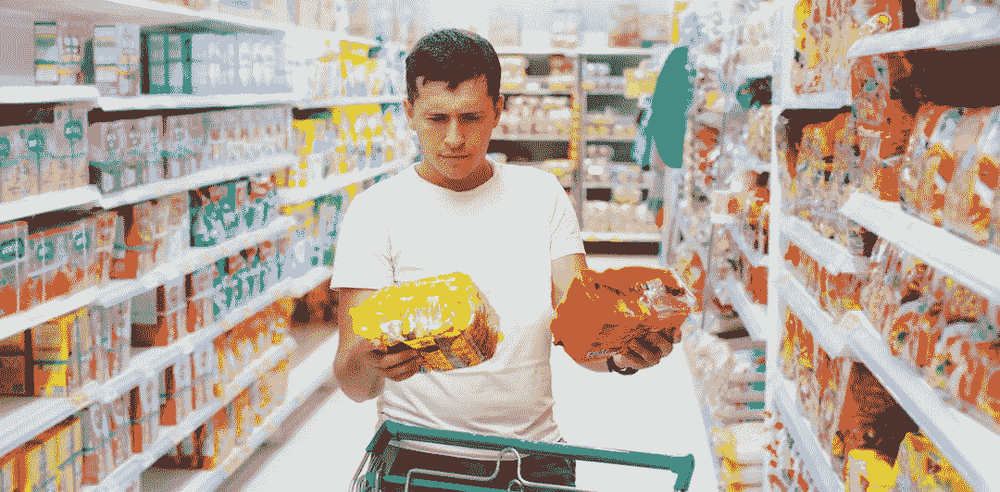

06 选品：总是能满足，常常被吸引，偶尔很惊喜

黄碧云亲述

你好，我是黄碧云，欢迎来到我的得到课程《黄碧云的小店创业课》。

上一讲，我们设计完了消费者的行动路线和店里的品类布局，为的就是能让顾客逛完全场，看到那些购物清单之外的商品，也能顺手放到购物车里。

但这仅仅是让顾客看到，看到了最终会不会购买，还要看你的选品功力。也就是说，在零售行业，商品就是你的子弹，选品要做的，就是要找到那些能瞬间击中顾客的商品，让顾客看到就想买。怎么才能做到这样的效果呢？

很多新人经常会陷入两个极端，要么是追求全，我们家的店啥都卖，总有一款适合你，要么是追求新奇特，用新品来吸引顾客注意力。

在我看来，这都不对。一家小店，面积是有限的，货架也是有限的，只求全或求新，都会让你过多关注那些冷门或者新奇的商品，就必然会挤掉那些更日常，但需求频率更高的商品，那小店的销售总量就会受到影响。

不追求全也不追求新，那选品应该追求什么呢？我总结成一句话就是，让顾客总是能满足，常常被吸引，偶尔很惊喜。

怎么做到呢？我们一个个来说。

## 总是能满足

总是能满足，就是顾客来你的店里，十次至少有九次都能被满足。要做到这一点，可不是要你求全，把小众品类都凑齐，而是那些日常所需的商品，你绝对不能没有，也不能缺货。这些商品才是一家零售小店的基本盘。我在文末给你附了一张基本品类选品的清单，供你参考。

不过，我刚刚也说了，小店货架面积有限，并且每家店面积都不一样，装不下这么多种类怎么办呢？

这个时候，你得先知道，一家店到底能放多少种类的商品，然后再根据总数分配比例，来保证日常需求不缺货。

要计算总数，方法也很简单，根据上一讲我们设计的动线布局，你就能拿到小店的平面图了，那能摆放多少货架，数一数就知道了。不过，不同商品的表面积不一样，比如一提纸巾占的陈列面就要比一盒牙膏大得多，那一节货架可以陈列多少种类的商品呢？

根据我这么多年跟商品打交道的经验，我可以告诉你现成答案，虽然纸巾和牙膏陈列面差别很大，但一家店里，大大小小的商品统一算下来，平均每一个单品，会占到 25 公分左右的陈列面。

有了平均数，那剩下就是做数学题了，一共能放多少货架，货架有几层，每一层有多少个 25 公分，用乘法一乘就知道了。比如一米二长的货架，大概就能放 5~6 支单品。

知道了总数，接下来就要根据需求来分配比例了。

从商品类型上说，如果你要开的是民生店，那民生性的商品比例就要超过 60%，次民生的商品占 30%，休闲类商品占 10%。什么是次民生商品呢？就是民生性商品里需求相对较弱的品类，比如同样是酱油，生抽是强民生商品，但老抽就属于次民生商品。

反过来，如果你要开休闲类小店，比例就要倒过来。这是不同品类之间的比例，具体到每一个品类里，你还要根据我们前面定的金字塔、擀面杖和均等分模型，来确定不同消费档位的商品比例。

套用这些比例分配，就能保证把小店空间优先留给需求强度更高的商品，那也就能做到总是能满足了。

## 常常被吸引

这是第一步，接下来怎么让顾客看见商品的时候常常被吸引呢？

其实，顾客看到某些商品被吸引，然后决定要不要购买，背后都是受商品要素影响的。比如食品，主要起作用的要素就是制作工艺、品牌、包装、规格、口味等。非食品，主要要素就是色彩、尺码、材质、包装、版型等。

不过，不同要素，对消费者选择的影响力度不一样，那些让顾客下意识愿意靠近的要素，我叫它第一要素。

举个例子，比如毛巾的第一要素是什么呢？

这个问题，我经常拿来问我的客户，几乎所有人都告诉我，毛巾的第一要素当然是材质，摸着舒服，顾客肯定愿意购买。其实不对，对毛巾这样的产品来说，颜色才是顾客下意识靠近的第一要素。假设你选品的时候，选的毛巾里没有他喜欢的颜色，除非着急用，要不然他根本都不会靠近，就减少了摸的概率，也就减少了购买的概率。

这个答案很多人都不相信，甚至你去做市场调查，当面问顾客，他都会告诉你，我刚买这条毛巾是因为摸着舒服。

所以，为什么我说第一要素是顾客下意识靠近的要素？就是因为下意识，所以顾客自己都感受不到，卖家也就容易弄错。

但把所有毛巾销售数据调出来，你就能发现，素色的毛巾卖的就是比花色的毛巾好。所以，在选品的时候，你一定要找到这些连顾客自己都会忽略掉的第一要素。

你可能会说，我买毛巾看的就是材质啊。这是因为你搞错了第一要素和第二要素，第一要素是让顾客下意识靠近，但决定要不要购买，看的是第二要素。对毛巾来说，材质就是第二要素。剩下的其他要素，也会对顾客选择产生影响，但就只是锦上添花了。

第一要素隐藏得那么深，怎么分清第一要素和第二要素呢？我已经帮你总结好了，对于食品来说，越是目标性商品，也就是经常会出现在顾客必买清单上的商品，品牌肯定是第一要素，比如酱油，大部分人都会有自己喜欢的品牌，而影响购买的第二要素，就是工艺，你是选精酿酱油还是配置酱油，看的就是第二要素。

而越是随机性购买的商品，口味是第一要素，包装是第二要素，比如说话梅，很多顾客是直奔口味去的，其次就是包装，选袋装还是罐装，这是决定购买的第二要素。那剩下的品牌、工艺、规格就是锦上添花的要素了。

但对小百货来说，主要包含两种，先说小针织品，指的是袜子、手套、内裤等等。尺码，在小针织品里面，是决定购买的第二要素。那第一要素呢？要分不同情况。像袜子手套这种穿在外面的，决定购买的第一要素，是看颜色，这跟毛巾是一样的。那像内衣，属于穿在里面的，就不一样了，决定购买的第一要素是看版型，比如内裤里经常说的四角裤和三角裤。除了小针织品，还有一类是不需要看尺码的小百货，比如饭盒、碗筷等等，第一要素是色彩，第二要素是材质。

注意用好商品的第一要素，就能让顾客常常被吸引了。不过我也要提醒你，在选品时，还要避免商品同质化。

这个时候，我建议你使用 T 型选品法，你想象一下这个形状，长横代表的是品类，尽量要拉长，就是涉及的商品范围要广，避免同质化。但短竖代表的是每一个细分品类里，单品数量要少，也就是这个竖尽量要短。防止小分类区别又不大，选项太多反而增大顾客的选择难度。

就拿洗手剂来说，2020 年初的疫情下，洗手剂是一个热销品类，长横就代表不同的洗手用品品类，有香皂、普通洗手液、便携式免洗洗手液、家用免洗洗手液、消毒洗手液等，你要尽可能全一些。但每个小种类下的单品数要少，比如香皂，不同品牌规格，不要超过三种到五种。用这种 T 型选品法，就是为了避免只选最常规的洗手用户，造成商品同质化后减少销售的机会，也会增大库存压力。

## 偶尔很惊喜

那怎么能让顾客觉得偶尔很惊喜呢？有两类商品你可以选择。

一类就是流行性商品，就是某一段时间流行起来的爆款商品。

前几年，单身狗这个网络词突然爆红，就有商家推出了一款薯片，叫单身狗粮，这款商品就突然流行起来。如果顾客能在你家店看到这类商品，就会觉得有一些小惊喜。

不过你要注意，这类商品的生命周期短，一定要快进快出，等到别人都在卖了，你才开始引进，那就很容易砸在手里，就算你引进得早，那一般半个月之后，如果销售开始下滑，你就可以减少进货。因为一般来说，流行性商品的生命周期就只有 3~6 个月左右。

还有一类商品也能让顾客感到惊喜，就是那些销售频次并不高，但需要它的人又非它不可的商品，叫做转身点商品，就是顾客到店后，有这类商品他就会留下来，没有就会立马转身走。

比如像纸巾这个大品类里，产妇专用纸巾就属于转身点商品，平时需求量很小，但真需要的顾客又是刚需，如果顾客跑了好几家店都没货，只有你们家有，那顾客是不是会很惊喜？

## 礼物挑刺法

最后，我还想提醒你，很多新人在选品的时候，容易以个人喜好来选品。我在培养新手采购的时候，会先让他们用“礼物挑刺法”，就是假设这个商品你要拿来送人，你会怎么想？

在我看来，优秀的采购都是戏精上身，要能做到快速变换角色。比如看到一双拖鞋，你就开始问自己：送给我奶奶会不会喜欢？呀，鞋底好像防滑性有点差。那我的妈妈会不会喜欢？这个颜色有点太鲜艳了，我妈妈应该也不喜欢，那只有我觉得还行，这个受众面就太小了，可以进，但要少进一点。

你看，用这种礼物挑刺法，就能照顾到你店里不同需求的顾客，同时还可以避免以自我为中心的乱进货，降低库存积压的风险。

本讲小结

好，选品我们就讲完了。

在选购商品的时候，你一定要注意顾客下意识靠近的第一要素和决定购不购买的第二要素，其次，在结构上要做到 T 型选品，最好也能补充一些流行性商品和转身点商品。另外，在选品的时候，用好礼物挑刺法，避免被自己的喜好所误导。

思考题

你在逛超市或者小店的时候，有没有发现选品特别符合你需求的店？

欢迎你在留言区，和大家一起分享。

如果你身边也有对小店生意感兴趣的朋友，也欢迎你把这门课分享给他。

选完品之后就要摆放了，下一讲，我们来看怎样陈列。

附：选品清单

*   **蔬菜：**
    

新鲜蔬菜（叶菜类、根茎类菜、结球类、花菜类、茄果类、瓜类、豆类、食用菌类、调味类）、加工蔬菜（酱菜类、包装蔬菜、豆制品类）。

*   **水果：**
    

国产仁果类（苹果、梨）、国产核果类（桃、李、芒果、枣）、国产瓜果类（西瓜、香瓜、哈密瓜、木瓜）、国产柑橘类（柑、橘、橙、柚、柠檬）、国产浆果类（葡萄、柿子、荔枝、龙眼、猕猴桃、香蕉、椰子、石榴）、国产干果类（栗子、柿子、蜜饯）、进口仁果类（苹果）、进口梨类、进口核果类（芒果、李）、进口柑橘类（桔、橙、柚、柠檬）、进口浆果类（葡萄、龙眼、猕猴桃）。

*   **肉禽：**
    

鲜杀禽畜类（鸡、鸭、羊、牛）、冻品类（鸡类、鸭类、猪肉、羊类、牛类）、鲜猪肉（肉类、骨类、内脏）、鲜猪肉（肉类、骨类、内脏）。

*   **干货：**
    

杂粮、面粉、面制品  
（面干）、肉制品（腊制品类）、豆制品（腐竹类）、米制品（粗粉丝）、糖类、调味类（椒类）、食用菌类（菇菌类）、休闲类（花生、瓜子、核桃、坚果类）、海鲜类（目鱼、鱿鱼、鱼类、虾类、贝类）、蛋类（散装鸡蛋、散装鸭蛋、盒装鸡蛋、盒装鸭蛋）、米类、粥类  
。

*   **酒水饮料：**
    

碳酸饮料、水饮、茶饮、果汁饮料、罐头/龟苓膏、啤酒、白酒。

*   **冲调食品：**
    

麦片粉糊类（即食麦片、燕麦片）、奶粉、无糖食品。

*   **休闲食品：**
    

饼干、糕点（手撕面包）、糖果/巧克力/果冻布丁、休闲小肉食（鸡爪）、散装休闲食品（散装糖果/巧克力）、进口食品。

*   **粮油食品：**
    

大米、面粉/杂粮、食用油（花生油）、厨房调料品、常温小菜类（榨菜）、常温蛋类（皮蛋）、即食面类/米粉类（方便面）、煮食面/粉类。

*   **日配食品：**
    

冷藏肉制品（腌肉/腊肠）、冷藏发酵乳制品（冷藏原味酸奶）、冷藏饮品、常温肉制品（袋装火腿肠）、常温纯奶、常温加味奶（优乳酸）、豆奶类、水饺、馄饨/云吞、汤圆、包子/馒头、冰淇淋。

*   **洗护用品：**
    

洗浴用品、洗发用品、淋浴用品、保养品、婴幼儿沐浴露/孕产妇用品、香水/花露水、口腔清洁用品、剃须用品。

*   **家居清洁用品：**
    

地板家具清洁（比如地板清洁保养品、家具清洁保养品、玻璃清洁剂、消毒液/空调消毒清洁剂、家用湿巾类）、浴厕厨房清洁用品 （洗洁精）、洗衣用品（洗衣粉）。

*   **纸品：**
    

无芯短卷纸、有芯短卷纸、长卷纸、抽取式卫生纸、卫生巾。

1\. 商品第一要素，是顾客下意识靠近的要素。第二要素是影响购买的要素。 2. 选品结构应该遵循 T 型选品法，最好也能补充一些流行性商品和转身点商品。  
3\. 选品的时候，最好用礼物挑刺法，避免被自己的喜好所误导。

* * *

# 07 货架陈列：品类链接法

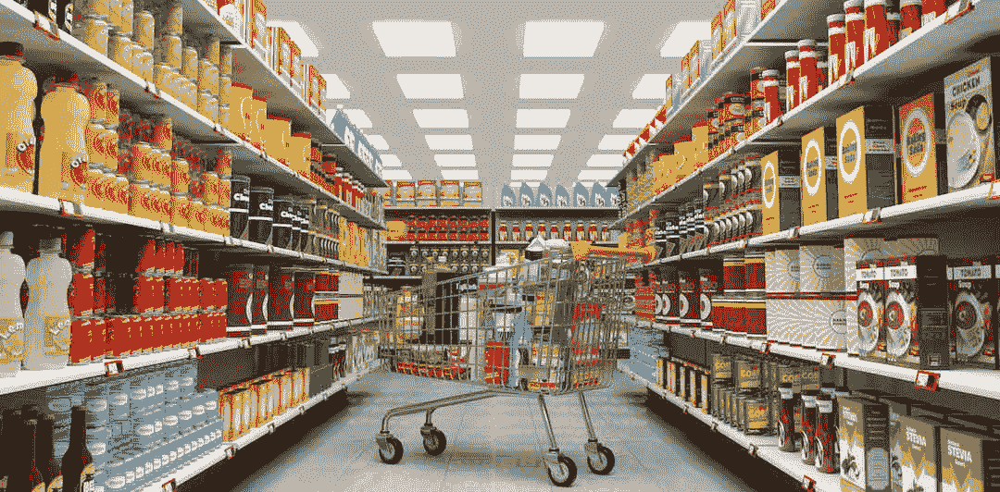

你好，我是黄碧云，欢迎你来到我的得到课程《黄碧云的小店创业课》。

上一讲我们说完了选品，这一讲，我们就要把这些商品摆进货架了。

在做陈列计划的时候，我们就要把前面在动线设计和选品上花的心思，全都展示出来。但这事难就难在，好位置是有限的，零售店商品种类又实在太多，所以很多零售店都倾向于把自己想主推的商品放在显眼的地方。

但这样做的结果就是，整个店里陈列显得特别乱，顾客很难快速找到自己想买的商品。但要是按照品类按部就班地陈列，又不能有效地抓住顾客的注意力，让他看到更多的商品。

那怎么在保证有序陈列的前提下，还能吸引顾客注意力呢？

有个大原则是，按照商品的第一要素来陈列。

我们在上一讲选品的时候提到过，顾客在选品的时候有下意识选择的第一要素，比如颜色是毛巾、小针织品等的第一要素，那就要把同色系的商品陈列在一起，让颜色一下子抓住顾客的眼球。如果品牌是第一要素，那就要把同品牌陈列在一起，让顾客一眼能看到。

这是大原则，但具体来说，有三个方法你可以试一试。下面我们一个个来说。

## 色彩搭配法

第一个方法是色彩搭配法。

颜色确实能抓人眼球，现在很多商品厂家也非常明白这个道理，包装也都很花哨，不仅如此，还会借助各种流量 IP，在包装上印上各类形象。

但这里要注意，要善用色彩搭配，大红大绿的颜色，确实抓人眼球了，但一节货架就像打了一个花式马赛克，顾客无论从远处看，还是近处看，都没办法聚焦。所以，色彩搭配法，重点在后面的搭配两个字上。有这么几种常用且有效的搭配方法，分享给你。

*   **第一个办法是撞色。**
    

在色彩中，我们都知道最刺激顾客视线的是红色、橙色这样的暖色调，但更吸引人的其实是冷暖色调对拼，也就是我们俗称的撞色。像红+绿，橙+宝蓝，黄+草绿色，还有经典的黑+白，都是我们在商品陈列中比较常用的撞色搭配。

*   **第二种色彩搭配，就是渐变色。**
    

这种颜色搭配法特别适合在小家居、针织这一类的商品上，因为这样的陈列在视线上远看有层次，近看眼不花，能让顾客把更多的关注度集中在商品上。

*   **第三个，用色彩搭配也能传递商品的卖点。**
    

比如，深紫色、浅紫色、蓝紫色，这三个颜色的商品拼到一起，就自带浪漫气息。那像女生常用的商品，比如护肤洗浴用品，用好这三个颜色就能搭配出浪漫的品质感。相应的，糖果、甜食还有那些能让少女心爆棚的毛绒玩具等商品，就可以多用粉色系来搭配。这样搭配下来，要是用得好，能立马唤起顾客的购买欲，用到极致，还可以用来盘活死角、增加营收。

我举个例子。有一家超市的店，因为卖场的地形是长方窄条形的，而且柱子很多，这样在卖场的深处就形成一个大死角，而且这个角还在阴面，不管陈列什么商品，都很难卖。

我接手这家店之后，就想把这部分区域给盘活。用什么办法呢？我刚开始想的是，在这块区域陈列里，尽量用颜色比较跳跃的品类，这样能更大程度地吸引顾客注意力。于是，我就引进了一系列五彩缤纷的造型糖果，就拿它试了下，看能不能盘活这块区域。

开始，这些糖果卖得只是比其它品类相对较好，但也只是好一点而已。后来有一次六一儿童节，我们做了一个粉色系列的糖果节，结果一下子吸引了好多人，不仅有儿童，还有很多年轻人。哎，我发现这是个思路，于是就尝试了很多用商品颜色来营造的主题节。

比如我们做了一次动漫节，用的是撞色系搭配的儿童礼盒，还做过用蓝色系来营造清凉的啤酒节，用暖橙和红色来营造温暖的火锅节等等，一下子带动了整个店里的销售，尤其休闲食品类的销售比同期增长了近 40%。

## 美陈

善用色彩搭配是一种方式，还有一种比较常见的陈列方法，叫做美陈，就是在超市零售店里，用商品搭出来的陈列堆。一方面会搭出来各种各样比较好看的视觉效果，另一方面，也会用来做商品促销。我在下方放了张美陈图片，你可以看一看。

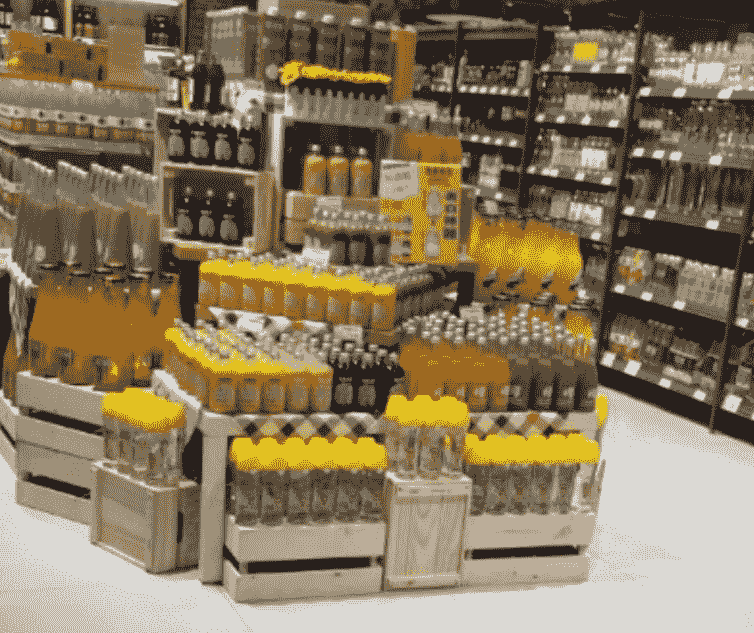

这里我要提醒你，美陈可不仅仅是因为好看，更大的作用是降低新品的滞销风险。很多零售新人，都忽略了这一点。

过去，很多新品刚上市的时候，想要吸引顾客尝试，都会选择做促销堆头，我们也叫做量陈，就是把大量的商品堆在一起，如果是堆在主通道上，就能增加商品的曝光率。

这里就存在一个矛盾，量陈要求你要有足够的量堆起来才有效果，但新品刚上市，没有人能判断好不好卖，如果要满足传统的量陈条件，就要加大订单量，无形就增加了商品的滞销风险。而且新品刚上市，即便做了堆头来促销，顾客接受也要有一段时间，你就没有办法判断，顾客对这个商品的接受程度到底怎么样，是正常的培养期，还是顾客根本就不接受这个新品。

但美陈的区别是什么呢？一方面当然是更好看，能吸引顾客注意力，但另一方面，能提高经营效率。为什么这么说呢？

按照量陈，一个堆头只能陈列一到两种商品，但美陈堆头上，可以把十几个单品一起陈列，一次多展示几种商品来推荐，什么商品好卖，再补什么商品，就能降低新品滞销的风险，也能快速测试出这家店周围顾客的喜好。

不过，美陈就是把不同商品搭在一起，搭好看一点就可以了吗？当然没这么简单，我主要提醒你三点：

*   **第一，定主题。**
    

组合式美陈，虽然是不同单品组合起来的，但一定要有一个主题，至少要有关联性。比如前面我们提到的糖果节、动漫节等等。这样，就算组合起来的商品有十几个单品种类，看起来也有统一性，顾客选购的时候不会觉得这是个杂货堆，也能吸引到这个主题的目标客群。

*   **第二，打底座。**
    

美陈不是用商品随便堆出来的，最好先用桌子柜子之类的道具先搭一个底座，商品不用费心摆，直接放在底座上就是一个错落有致的美陈堆头。这样做的好处是，这个底座可以反复使用，员工补货也会非常方便。

那底座怎么搭呢？核心原则就是不让商品落地，把不同形状的道具叠加起来，就产生了错落有致的视觉效果。

具体怎么做呢？我在下方放了一张特别简单的美陈图片，我们对照着来看。

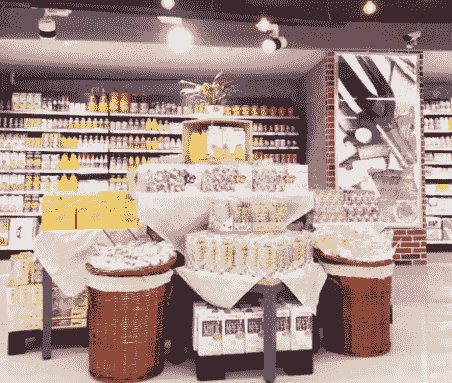  

你看这张图片里的美陈底座，其实就是用几个形状的桌子和柜子搭起来的。前面先用一个菱形桌子，摆出来一个尖角，上面再搭一层长方形桌子，再往上走，也是方形小柜子，不过要注意的是，相同形状的底座朝不同方向摆放，不同形状的朝同一方向叠加，这样，自然而然就产生了错落的效果。然后两边再加上两个圆形来柔化，一个非常简单的美陈底座就出来了。

*   **第三，最好能加一个点睛品。**
    

比如刚才这张图里，桌布就是一个非常好用的点睛品，选择素色浅色系的桌布，垫在商品底下，既能增加美感，又不会抢商品的风头。

你也可以加一些像小假花、小玩具这样的点睛品。花比较百搭，颜色能搭得上就好，玩具适合放在卡通包装的商品上，而啤酒或者其它酒类商品的美陈堆头，就可以用绿植来搭，效果更好。

总的来说，美陈的作用就是提升商品的视觉效果，吸引顾客注意力，更重要的是，还能降低新品培养的滞销风险，让商家能快速判断出新品效果。

## 品类链接法

设计完美陈堆头，我们也要考虑下正常货架。

正常货架的陈列，我建议最好还是按照咱们前面设计动线时讲的，按照需求强度来依次陈列。不过，为了更好地促进销售，你还可以用品类链接法，利用端头货架来引导顾客走进货架。

什么是端头货架呢？你把货架形状想象成一个拉长了的字母 H，那左右的两竖，就是端头货架。我们去店里的时候，往往最先看到的是摆在通道中间的堆头，然后，大概率就会看到靠近主通道的端头货架。

所以端头货架也是小店里比较重要的黄金陈列位，一般陈列的也大多是促销商品。顾客进店后，只要商品的价格合适，从堆头和端架上买走商品的概率会比正常货架上高。这样，商家达到了促销的目的，顾客也得了实惠，皆大欢喜。

看起来很合理，但如果只是这样的话，其实就浪费了这个黄金陈列位。端头货架，还应该担负一个非常重要的作用，就是要吸引顾客走进正常货架里。

在小店里正常货架里陈列的商品数量更多，而且不是促销品，毛利更高。要增大销售额，当然得让顾客更多走进正常货架，但怎么做到呢？

其实也很简单，一个是在摆放堆头的时候，就要靠近正常货架。第二个是，端头货架上的商品，要陈列和正常货架里同品类或者强关联的商品，比如这排货架里是液体调味品，那端架上就可以陈列促销酱油。

端架货架在这里起到的作用，其实就是预告，预告它对应的正常货架里，都有什么商品，如果你感兴趣的话，就转进来看看。这就像一部电影的预告片一样，直扣主题，就会吸引你继续看下去。尤其是顾客在进入小店之后，视线只能看到货架的一个面，另一个面，如果不回头或者走进去，是看不到里面陈列了什么商品的，那端头的商品，就一定要和正常货架上陈列的商品强关联，引导顾客走进货架通道里。

虽然听起来只是一个小改变，但从超市的数据统计来看，以一周的促销期来说，一种是在端架上摆和货架相关联的商品，一种是摆和货架完全无关的商品，这两种情况，正常货架上的商品销售率会相差 10%左右。效果很明显，你可以试试看。

本讲小结

好，这一讲我们主要讲了怎样陈列，我给你介绍了色彩搭配法、美陈法和品类链接法。

思考题

你在平常逛超市的时候，你还发现过哪些比较妙的陈列设计吗？

请你在留言区和大家一起分享。如果你有什么问题，也可以在课程下面给我留言。

下一讲，我们来看定价策略。

1\. 陈列的时候，善用色彩搭配法，撞色、渐变色和能传递信息的搭配，都能有效吸引注意力。但切忌做成花式马赛克。 2.  
美陈不仅是为了美，关键在于，要降低新品的滞销风险。 3. 堆头和端头货架的作用是预告片，引导顾客走进正常货架，所以陈列的时候，要注意陈列相关联的品类。

* * *

# 08 定价：敏感商品天天平价，生鲜商品动态定价

你好，我是黄碧云，欢迎来到我的得到课程《黄碧云的小店创业课》。

上一讲，我们设计好了陈列，在陈列过程中，有一个动作肯定少不了，那就是贴价格标签。那这一讲，我们就来看看怎样定价。

说到定价策略，你大概也知道一些常见的定价方法，比如尾 9 定价法，就是价格都是以 9 作为尾数，19.9 元，听起来是十开头，就比 20 元要便宜点。再比如锚定定价法，就是在你想主推的某款商品旁边，放上更贵的商品，就能让人感觉另一个商品便宜。这些都是零售店应用较广的方法。

很多人都特别热衷学习各种定价策略，希望通过定价来赚取更多利润。但这里我要提醒你，零售店不像某些旅游景点，定一个超高的价格，骗过一个算一个。零售店做的是回头客生意，顾客要是觉得亏了，下次就不会再来了。

那零售店是不是就不需要定价策略了呢？一定是需要的，不过追求的目标不一样。

零售店的定价策略，要让顾客在感觉上觉得这家店里的东西便宜，这样他就更愿意选择去这家店购物。不过，这就又会产生另一个极端，很多店老喜欢做促销，短期内肯定有效果，但零售店本身就是捡钢镚的生意，长期看，又会影响收益。

那怎么才能既不欺骗顾客，又要让顾客觉得这家店价格便宜，同时还能兼顾销售利润呢？

下面我就给你介绍四种能给顾客留下便宜印象的定价策略。

## 价格带模型

我要给你介绍的第一个定价策略，是搭建价格带模型，这个模型能让顾客对小店有一个总体的低价印象。

什么是价格带呢？就是一个品类商品，不看具体的单品，从最低价到最高价横跨的价格范围。

价格带也就奠定了你对一个品类商品的印象，比如薯片，从最低到最高，也就是几块到几十块不等，假如一家零售店里的薯片，定价全部都是二三十块，那你就会觉得，贵了。

所以，什么是价格带模型呢？这个模型里有这么几个组成要素：起卖价、封顶价、主卖价格带和大众心理价。听起来很专业也很复杂，但其实很好理解，我带你一起过一遍。

先来说大众心理价。它指的是，一个品类的商品，在大部分人的模糊印象里，最便宜和最贵的价格。比如说扫把，大众普遍认为最便宜的价格大概是 10 元左右，最高价差不多是在 50 元左右，那这两个价格就是大众心理价。

那怎么才能知道一个品类的商品大众心理价是多少呢？

大众心理价其实具有很强的普遍性，所以你只要把家庭成员、朋友凑够一个 20 人的小群，这个群里最好要覆盖到不同年龄层，然后你调研下这群人对某个商品的心理价，取个平均数，一般就是大众心理价。当然了，这个小群里的人都得是普通工薪阶层才行。

了解了大众心理价之后，你就可以定起卖价和封顶价了。

起卖价和封顶价指的是一个品类在一家店里最低和最高的售卖价格，在这中间横跨的价格区间，就是主卖价格带。

起卖价和封顶价，是顾客最容易记住的两个价格，所以要想让顾客觉得商品便宜，就在这两个价格上下功夫。

比如还说扫把，大众心理价中，最低价是 10 元，最高价是 50 元，那你实际定价，最低价就要从 10 元下调到 7.9 元，最高价就要从 50 元下调到 47.9 元。其他价格不变，只改变起卖价和封顶价，顾客就会觉得便宜了很多。

这个定价法，用在年节性的高单价礼盒商品上效果更好。就拿春节卖得比较好的坚果礼盒来说，大众心理价中，最低价一般在 99 元左右，最高价在 300 元左右。那降两个阶梯，起卖价就是在 79~89 元左右，封顶价就是 279 元。

有没有发现，在这个价位里，我们一个阶梯就算了 10 元，为什么有这个区别呢？其实你也能感受到，在这个价位上，如果起卖价降到 97、98 元，顾客其实是感觉不到便宜的。所以，不同的价格带，间隔距离是不一样的。

这也是很多新人容易踩坑的地方，很多时候商品采购回来，就是用固定的加价率，但这往往会造成价格间隔太密或者太宽。

如果价格间隔太密的话，比如一包薯片，10 元一个规格，10.5 元一个规格，11 元又一个规格，这些规格的区别有多大？哪个性价比最高？这会让顾客非常纠结。但价格区间太宽也不行，如果太宽就会出现断层，就会流失一部分顾客。

所以，不同价格带，价格间隔也是要提前设计好的。

一般来说，10 元以内的商品，1 元一间隔，比如 1.9 元、2.9 元、3.9 元。10 到 20 元之间，2 元一间隔。20 元到 50 元之间，5 元一间隔。50 元到 100 元的商品，10 元一间隔。100 元以上的商品，20 元一间隔。

你看，这么设计完，价格带之间的间隔距离适中，起卖价和封顶价都比大众心理价低两个间隔，那小店给顾客的印象，就是这家店的价格总体上都更便宜。

## 天天平价法

这是总体印象，你还可以在一类商品上下功夫，只给这类商品降价，顾客能马上觉得你们家很便宜。

哪一类商品呢？就是那些顾客购买率最高的商品，我叫它敏感性商品。举个例子，比如牛奶、纸巾，你可能每天都买，你对它的价格记得就会比较清楚。

针对这一类商品，定价当然不能比别的店高，因为顾客对它们的价格非常敏感。不过，很多人会把这类商品拿来做低价促销，但我劝你最好不要，为什么呢？因为这类商品，顾客每天都要买，长期促销，你的毛利就会降低，但如果你只促销几天就调回原价，也起不到你最初想要的效果。

所以，这一类商品的定价可以用一个比较折衷的方法：天天平价法。

一般来说，做促销会比正常价格要低 30%左右，要不然顾客感受不到降价。那天天平价，就可以比市场价格低 10%~15%，但又比起低价促销高 10%~15%，取了一个中间值，但是，一定要每天都保持这个价格。

这样，顾客能感受到你家这一类商品价格比别的店要便宜，并且天天如此，他就不怕你会调回原价了，你也能比促销价多赚一点。

## 动态定价法

不过，在敏感性商品里，有一类商品比较特殊，就是生鲜。

生鲜类商品总体都属于敏感性商品，但这里就不能只给某一种商品用平价法，因为我们的一日三餐，肯定要换着花样做，但如果你只给土豆降价，顾客就会有一些小纠结，想吃点别的吧，土豆又便宜，但老吃土豆也会腻，所以，生鲜类敏感性商品，你要换着花样做平价促销。

不仅如此，生鲜还有一个特性，就是保质期特别短，所以对于生鲜商品，你还可以用动态定价法，也就是在保质期内，生鲜商品的价格要随着它新鲜度的变化而降价。

我以葡萄为例。

一家零售小店，刚进了一批黑葡萄，进价是在 5 元左右，总共进了 200 斤的货。早上开门的时候，葡萄晶莹饱满、颗颗诱人，因为这一批的葡萄品质好，市场普遍卖 10 元一斤，那我们降个阶梯，定价 8.8 元，就能卖得很不错。

到了下午 5 点前，当天进的货 60%都已经卖出了，但货架上还有一些卖相一般的货，这个时候，你就可以把价格改成 6 元每斤，这样，在晚市的 20:00 高峰期前你又卖出了 30%。

最后，留在货架上的商品卖相已经不是很好看了，因为反复挑拣的关系，很多都已经掉粒了。这时候，你就要把烂掉的挑出来报损，价格也要改成一斤 2 元钱，尽快清仓卖出去。

当然，最后不可能把剩余的 10%全部卖完，有部分变质一定是会产生损耗的，一般会损耗 3%，那总体就是卖出去了 97%。

你看，虽然后面有损耗和促销降价，但因为随着商品的质量变化而变动价格，及时处理掉了库存，还是实打实地赚到了 400 多块。

这就是动态变价法的作用，一方面它能降低损耗，另一方面，是根据商品质量在实时调动价格，顾客就会觉得这家店特别实在，不占顾客便宜。

你可能会问，那我怎么确定动态变价的比例呢？我在下方放了一张商品质变的曲线图，按照这个曲线走，基本上是 3 个小时就可以变动一次价格。

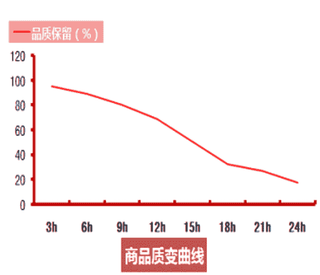

其实，不只是生鲜商品，流行性及季节性很强的服装、拖鞋，清仓时都可以用到动态变价，只是时间的间隔要拉长而已。

## 均一定价法

另外，这类清仓商品，还可以用一个定价策略，叫做均一定价法。就是不管什么款式、规格、品牌，都统一定一个价，比如名创优品就经常用这种定价方法。

这类定价法适用于那些数量比较多，且更新比较快的商品。这是因为如果每个商品都定一个价，一是特别占陈列位置，二是不利于顾客的挑选。但均一定价，在一个价格里能覆盖到更多商品，店里只要将同价格的商品陈列在一起，就能降低陈列难度。最重要的是，这样能让顾客有一种“淘”东西的感觉，自然就会多买几样。

所以，这个定价法也特别适合像袜子、饰品、收纳包这样的小百货，还有休闲食品中小包装、低单值的商品，也可以用均一定价法。

有一点要提醒你注意，这个方法，我们的目标还是要让顾客感受到便宜，所以在统一价格的时候，就不能把原来价格低的商品反而定高了。

一般来说，你可以按 5:3:2 的比例来设计，50%的商品，现价一定要比原价低很多，30%的商品，现价要比原价便宜一点，那剩下 20%，现价要比原价高，用这 20%的商品就是来补充利润的。

本讲小结

好，这一讲我们讲了让顾客感觉商品便宜的几种定价策略，分别是价格带模型、天天平价法、动态定价法和均一定价法等方法。

你还听过哪些特别好用的定价策略？欢迎你写在留言区，和我们一起分享。

如果你身边也有对小店生意感兴趣的朋友，也欢迎你把这门课分享给她。

下一讲，我们来看怎样分工。

让顾客感觉商品便宜的 4 种定价策略： 1.价格带模型：起卖价和封顶价都比大众心理价低两个间隔，顾客会觉得这家店的价格总体上都更便宜。  
2.天天平价法：像牛奶、纸巾等敏感性商品，可以一直保持比市场价格低 10%~15%，顾客会觉得你比别家店便宜。  
3.动态定价法：生鲜类商品，随着新鲜度的变化调整价格。 4.均一定价法：对那些数量比较多，且更新比较快的商品，可以统一定一个价，减低顾客挑选难度。

* * *

# 09 分工：谁管钱，谁管店

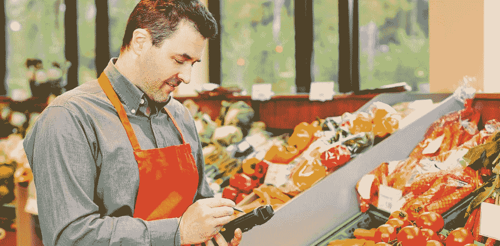

你好，我是黄碧云，欢迎来到我的得到课程《黄碧云的小店创业课》。

上一讲我们定好了价格策略，这一讲，我们就要开始营业了，但在开业前，我们还要明确好分工。

听到这，你可能多多少少会有些疑惑，一个零售小店，还用得着分工吗？

如果你这么想，就是把分工这件事看得太表面了。它不是简单的活多活少，谁有空谁多干点的问题，它背后其实是权力分配问题，到底谁能做主、谁为这家店的经营结果负责。

你可别小看这些问题，即便这家店里就只有夫妻两个人，也必须先明确好分工。为什么？从近看，这会影响销售利润；从远看，它会给小店长期发展埋下隐患。为什么这么说呢？

## 明确分工

你大概也知道，零售店就是个小生意，钱挣得不多，事还不少。越是起步阶段，店里的事情就越繁琐。如果分工不明确，决策就会乱，还会发生中空的问题，双方都以为对方做了，可实际上谁也没做。

更关键的，店在初步阶段，竞争力本来就弱，那应对竞争的反应速度就要快。如果说，人家都打到你家门口了，两个人还要互相说服，迟迟不能达成一致的话，这就不仅仅是影响利润了，甚至还可能直接威胁到小店的生存。

往远了说，小店肯定会发展，如果现在不明确好分工，将来更是一笔糊涂账，越到后面越不好明确。

我跟大家分享一个真实的故事。

我有一个客户，就是因为在初期的时候分工不明确，导致企业错过重要的发展机会，创始人夫妻俩差点还反目成仇。具体怎么回事呢？

当时，这家超市处在经济比较富裕的华东区域，也因为开得早、位置好、竞争也小，再加上夫妻俩也非常勤快，开店后不到三年就赚得盆满钵满。只有一家店时，夫妻俩就不分彼此，虽然有些意见不合，但也还能过得去。

可就在开了五六家店后，因为管理精力跟不上，就成立了总部，想着接下来要好好大干一场。结果，早期夫妻分工不明确的矛盾就演化成了大问题。

最开始的引爆点，说起来就是芝麻一样的小事。就是在成立总部后，老公管业务，老婆管后勤。看着分工很合理，但因为在初期开店时，俩夫妻谁都做主，谁都管钱。比如老公去采购货品时，就直接从账上拿钱去采购。成立总部后，老公依然觉得这个企业我说了算，还是按原来的老习惯直接拿钱给采购去进货。可是，老婆管着财务，会计多次和她说这样账目不好做，老婆就要求老公要按流程办事，要不就不让财务人员给采购批钱。

你看，说出来你可能都不相信，就这么一些小事，引发了夫妻俩的争权战。两个人都觉得公司是共有财产，凭什么要听你的，谁都不服对方的决定，矛盾越积越深。

最严重的时候，门店的货架上一度出现大面积缺货，而且，请来的中高层管理人员，也纷纷离职。因为想做一点事情特别难，要分头向夫妻两人申请才能推进，每次还都是长期拉锯战。

而留下来的人呢？一般会出现两种状态，一种就是站队，利用夫妻矛盾，选择支持对自己有利的一方。另一种就是当左右摇摆的海草了，谁吵赢了就听谁的。可想而之，这样的情况下，原来经营红火的几家店迅速衰败下去，年净利润下降到不到原来的十分之一。

这样的情况，一直到了这家公司的净利润彻底降到负数线以下，这时候，夫妻俩终于不吵了。

在找到我后，一直问我怎么提升销售和利润。我做完调研，给的第一条建议就是，你们夫妻俩其中一个人必须离开公司，另外找别的事情做。

他们问我，能不能不离开公司，重新分工，以后坚决不吵了。我说如果在总部成立以前，还有可能，但现在公司里已经形成了立场分明的帮派，就算是你们俩分清楚了，下面的管理人员已经没法分清楚了。所以，必须要有一个人离开公司。

他们最终决定由女方来经营，丈夫另外寻找别的投资。虽然错过了重要的发展时机，但因为只有一个人做主，站队形成的帮派自然就瓦解了，经过了一年的内部整顿，关闭了无法拯救的门店，又开了一家新店，在第二年就扭亏为盈了。

所以你看，真实的商业世界比电视剧还要精彩。对于初开店的店主来说，一开始就要明确好分工，不要给后期发展埋下隐患。

不过，你可能会问，如果夫妻俩贡献都一样，本金都是共同财产，非要明确分工的话，到底谁来管呢？

不管是夫妻也好，还是合伙人也好，在初开店阶段，一定是谁管钱，就谁管店。要是财政大权也没有分得很清楚的话，那就是两个极端，要么是特别能干的人管，要么是没事干的人来负责经营。

## 控制人数

在这里我要特别提醒你注意，不管是特别能干的，还是没事干的，也还是要严格控制人数。甚至在我们课程开始，我就跟你强调过，合伙人最多不要超过 3 个，一多就容易出现矛盾。

我说说另一个真实的故事。

我原来有四个同事，平时关系不错，后来就一起合伙开了一家 200 多平方米的小超市。因为 4 个人都很有经验，股份和 4 个人的分工设计都很不错，但问题恰恰就出在 4 个人挤在了一家店里。

开业初期，每个人各自分管一块，干得还不错。但到第三个月的时候，在扣除了经营开支后，发现连工资都发不出来了。为什么呢？这 4 个人都是按管理层的工资来计算的，整整比普通员工多出了 2 倍，再加上雇了 3 个员工。这家店相当于花了 11 个人的工资。

这样一来，4 个人都觉得付出了那么多，却根本赚不到钱，而且这种“事多钱少”的周期不会短，干活的热情一下子就受到了打击，很多事就都不愿意管了。

这种状况没多久，4 个原来关系不错的同事，就开始互相指责其他人不干活，最后闹到其中两个人退了股走人，另一个人没退股，但退出经营自己去上班，全部交给 1 个人来经营，这家店才算慢慢缓过来。

为什么会出现这样的情况呢？

一方面，就是我们前面说的，合伙人太多，虽然分工明确，但没有人有主导权，最后就变成互相推诿，谁都不愿意为经营结果负责。

另一方面，他们对刚开的小店，投入大、利润少的情况没有找到平衡点，每个合伙人都是按连锁超市管理层的薪酬标准来发工资的，那最后肯定会亏损。

所以，在开店初期，一定要明确主导权，并且要控制用工人数，避免经营成本过高，拖慢了小店的发展。那多高算高呢？

对零售小店来说，盈亏平衡点要看两个关键指标，就是人效和坪效。人效就是一个人平均每天所能创造的零售额，坪效就是一平方米店面积平均每天创造的销售额。

在零售小店这一行，人效平均指标是 1200 元~1800 元每天每人，坪效要到 40~80 元每天每平方米，才能基本平衡收支，开始盈利。

按这个标准，我原来同事那个店，坪效达标了，一平方米每天能有 50 元销售额，但人效因为要摊到 11 个人身上，只有 900 元左右，远远低于 1200 元的底线，这就导致后期根本不赚钱，利润全都发成工资了。

所以刚开始开店，一定要注意控制人数。即便零售店里事多且杂，也不要一下子雇太多人。这个时候，你可以用一岗多职的方式，来跟员工明确好分工。

一岗多职，简单来说，就是一个员工身兼数职。一家零售店里主要有这么几种职责：

第一个是现场管理，就是维护店里的卫生、环境舒适、购物安全等。

第二是商品管理，包括从商品的陈列、摆放、价签、补货，到检查商品品质及保质期等。总的来说，就是保障让顾客选购商品时没有阻碍。

第三是后台管理，从商品的进货开始，到搬运、仓储、二次打包及分拣等，这是保障商品状态的工作。

第四个是销售管理，比如不同渠道的宣传，像社群运营和微信的商品推广销售。另外，针对一些商品，经过了相关的技能培训后，就能让商品的销售大增，比如剥菠萝蜜、削凤梨等技能。为什么培训这些技能能让销售大增呢？我们下一讲讲培训的时候，再详细介绍。

总的来说，前三类工作都是基础工作，而第四个销售技能，就是附加职责。一岗多职中的多职，主要就是产生在这个工作内容中。

很多人会觉得，我们就是这么干的啊。但我要强调的是，分工一定要明确，只要没有明确到人，就容易出现职责脱钩，或者多做多错的情况。

所以身兼数职也要提前明确好，最好是一个主要职责配两个次要职责。比如一个店员的主要职责是商品的上货和收银等基础工作，但因为她能言善道，她的副职就可以加上新品推广员和社群管理员。

主职和副职之间要有明确的职责说明和目标分配，并且也要配备相应的薪资补贴。这就是一薪多补了，就是拿着基础岗位的工资，多一个技能，就多一份补贴。

本讲小结

好了，这一讲我们主要讲了分工。很多初开店的人不重视这件事，但实际上，后期发展的好多隐患，都来自于前期人的问题没有解决好。所以，在开店前期，一定要明确好分工，不给未来埋雷。

思考题

我也想问问你，关于分工问题，你有没有什么经验教训？

欢迎你在留言区，和大家一起分享。如果你身边也有对小店生意感兴趣的朋友，也欢迎你把这门课分享给她。

下一讲，我们来看怎么做好员工培训。

划重点： 1.谁管店，谁管钱。 2.合伙人最多不要超过 3 个。 3.员工分工，可以设置一岗多职，同时配备一薪多补。

* * *

# 10 培训：提要求不如给反面清单

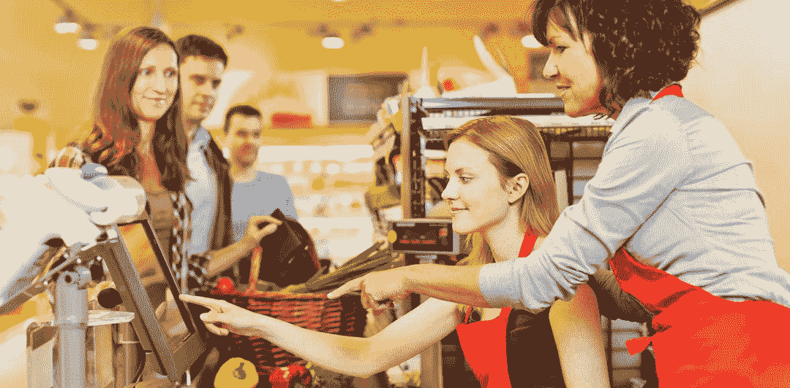

你好，我是黄碧云，欢迎来到我的得到课程《黄碧云的小店创业课》。

上一讲，我们讲了小店怎样分工。这一讲，我们来看看小店怎么做培训。

很多人看到这个题目，可能会觉得，一个小店，可能总共就两三个人，还需要什么培训？

其实，越小的店，为了提升经营效率，越需要培训。为什么呢？因为对大超市来说，经过长时间的积累，各方面管理制度都已经规模化和流程化了。很多动作规定得很清楚，所以效率是有基本保障的。

但小店就不一样了，正因为店小、人少，所有的标准都没形成起来，那效率可就全靠人了。假如某个员工特别靠谱，那效率就特别高，但如果不靠谱，那不要说效率，可能顾客稍微多一点都会手忙脚乱，忙中出错，这样的情况出现个两次三次，顾客就不愿意来了。

所以，越小的店，越要注意培训，只有建立起最起码的服务标准和培训体系，才能让小店的运营效率和质量有基础保障。

不过，这里我要提醒你，小零售店的员工，不像大公司的招聘标准，有明确的及格线，所以员工的水平大概率是参差不齐的。如果像大公司那样，搞个入职培训，发本员工守则，提一大堆要求，你稍微想想，都知道是不管用的。

这一点不只是小店，很多大超市也一样，他们在给员工做培训的时候，老师对着 PPT 侃侃而谈，说实话，也没什么用。

这是因为，一方面是零售一线的员工，文化水平确实不高，另一方面，零售面对的问题，都非常具体，比如怎样剥好菠萝蜜，怎样捆好一把菜等，对着 PPT 讲，其实解决不了问题。那怎么办呢？

## 基础工作：给工具包

我总结了一个方法，给工具包。找到那些道理好懂，但是做不好的工作，把操作步骤拆解出来，做成一个个小的清单工具包，直接给到员工，马上就能上手干。

什么是懂但做不好的工作呢？

零售店的工作，其实很基础，很少有什么工作是员工完全不知道的，但知道和做得好中间就有很长一段距离。明明懂，却做不好。

比如，零售店把卫生打扫干净这是最基本的，但是什么叫干净，每个人的定义却不一样。老板的要求可能是要把货架擦到发亮才叫干净，员工觉得我把货架擦了，没有灰尘就是干净。

你看，这个时候，就产生了一个矛盾，店主觉得员工偷懒，可员工却觉得很委屈，甚至因此而离职。很多零售店离职率高的原因就是，店主总说加油干，但从来说不清楚怎么干。

这个时候，工具包的重要性就凸显出来了。你需要把步骤都清晰地规定出来，做成一个个有针对性的小工具包。

比如还拿打扫卫生这个基本工作来说。

我们得先定出干净的标准，比如戴着白手套擦货架，不能看到灰尘。那对应的拆解步骤就是：

*   工具：要有两块抹布，一块吸水性强的棉抹布，另一块是能防静电的纤维抹布。一把专门铲货架粘条的小铲刀。
    
*   流程：先用拧干净的棉抹布，把货架擦一遍，再用干净的防静电的纤维抹布擦一遍。如果货架上有粘条等不明物，用小铲刀轻轻地铲下来后，再重复一遍流程。
    
*   周期：一周两次。周一一次，周四一次。
    
*   检核期：次日早晨。
    

你看，这么规定出来之后，怎么干，员工很清楚，干得好不好，老板心里也有把握。

不过，这里我还要再说明下，一个小项的步骤尽量不要低于 3 个步骤，也不要多于 5 个步骤。少了做不好，多了员工也记不住。

很多人会说，我们培训也是这么做的啊，把动作都规定清楚。如果你真的是这么做的，那恭喜你，不过，这里我还是要跟你再强调下，动作要清楚到什么程度。

我举个例子。

零售店里有一个工作岗位，就是生鲜蔬菜的捆扎员。这个工作很简单，但也很重要。菜如果捆好了，门店就能直接上货，不仅提高效率，还能降低损耗。

有些人的培训，可能也会按动作拆解一遍。但他们可能是这么写的：

*   题目：蒜苗捆扎的正确方法培训。
    
*   蒜苗捆扎的方法：先充分晾干，取 250 克左右的标准量，再按蒜苗的大小均匀摆放，不符合售卖标准的剪掉，再叠三次后捆扎。
    

从字面上看，写得简单也清晰。但真到了实际操作的时候，就会有疑问，比如，充分晾干是晾干到什么程度？250 克是每把都要过秤吗？如果过秤，左右是能超过多少？怎么算均匀摆放？叠三次后捆扎是怎么个捆扎法?

你看，很多事都是这样，说起来很容易，实际干起来就全是漏洞。

但能直接上手的工具包是什么样的呢？就是要有实际场景描述，每个步骤都可操作，可量化。比如还是蒜苗捆扎，可能就要这么教：

*   第一步：蒜苗先要铺在地上晾干，用手摸着没有水珠就可以。
    
*   第二步：数 15 根蒜苗，多两三根也可以，少两三根也可以。头小的放在下面，头大的放在上面。烂的、黄的坚决剪掉。
    
*   第三步：再从尾巴开始往里折三次，最后用绿色的胶带绕两圈。
    

你看，这样的工具包，是不是就清晰多了？所以在零售小店的培训，最好是有清晰步骤的小体量工具包，直接发给相关的员工，马上就能上手干。

## 服务工作：提供反面清单

不过，对于服务类工作，可就不能规定动作了。

跟人打交道的工作，如果提要求，会非常抽象。比如经常我们会看到，有些店会把“顾客永远是第一位”作为要求员工的服务标准。但做到什么程度算是第一位？那可真的是一千个人有一千个做法了。

对于这样的工作，那培训什么不能做，就比培训怎么做更有效。

举个例子，零售门店都会要求员工向顾客问候：“您好！欢迎光临。”“谢谢惠顾，欢迎下次再来。”这类礼貌用语。但在具体执行过程中，就可能会出现不同的状况。

比如几个员工在顾客面前聚众聊天，说家长里短的事情。这个时候顾客进来了，员工也遵守规定了，领导让我问好，那我就完成任务式地问顾客：“您好！欢迎光临。”然后转身就继续和旁边人聊着家里的八卦。如果你是顾客，这个时候你会是什么感受？对我来说，这样的问候不如不问。

所以，这类工作，我的方法是，给一个反面清单，我不要求你怎么做，但我要直接告诉你不要做什么。比如在有顾客的时候，不要当着顾客的面聊天。这样就比让员工主动去问候更好执行，员工也不会觉得老板要求太多。

像这样的反面清单，你可以提前列出来，我强烈建议你先加上三条，不要问顾客“买不买”，不要紧跟着顾客，不要把商品推到顾客的面前。

为什么呢？很多零售店，在培训的时候，都会倾向于培训员工怎么主动出击，怎么背话术去吸引顾客购买等等，但我必须提醒你，这是会起到反作用的。因为你只要一问到顾客需要什么的时候，顾客的戒备和排斥心会立马建立起来。你一问他需要什么，就在提醒他，你们是买和卖之间的对立关系。

我们在前几讲也强调过，在零售店里，是开放式自选购物，店员就不要去打扰顾客购物了。

听到这，你可能心里开始打鼓了，啥都不管，我怎么提高销售啊？别着急，不打扰，可不是说让你完全不理睬顾客。

想吸引销售，你不能直接冲上去对顾客说，这个商品好，你买这个。那顾客肯定都要被吓跑了。这个时候，你可以培训员工的是，展示商品怎么吃、怎么用，把购买后的画面展示给他看，那他想买的欲望比你直接说有用得多。

尤其是在培养新品的时候，这一点就特别重要。比如你是在内陆城市，想推荐海鲜给顾客，那你更多就是要给顾客展示怎么吃，而不是告诉他这东西如何新鲜。

我举个例子，我有个朋友的店，在四川一个比较偏远的地区，当地并不经常吃海鲜。但我这个朋友，去过好几个优秀的零售企业参观之后，发现水产其实是一个非常有竞争力的品类，他就想引进到他的店里去。

但在店里试推广的时候，就发现这些海鲜，一直没有办法得到顾客的认可。关键是，海鲜的损耗很大。他心里就很着急，觉得是不是自己的员工没有销售技巧，于是准备了一套标准话术，想要吸引顾客购买。

有一次，我这个朋友就亲自在店里盯这部分的销售。他发现，其实来问的顾客不少，顾客都会问：这是什么？店员也会按照话术回答说：这是什么什么，很新鲜，在海边城市有多么受欢迎。

但每次这么介绍完，顾客听后还是走了。后来，这位朋友实在坐不住了，就追上去问顾客为什么不想买。顾客的回答是：不会煮。

原来是这样，我这位朋友一下子想通了，于是，他再也不给员工培训销售话术了，而是培训员工掌握简单的海鲜烹饪。员工培训好了后，就把海鲜拿到现场做烹饪示范，而且，没有一上来就做罕见的海鲜，而是从辣炒花甲和粉丝蒸扇贝开始。随着顾客的认知度越来越高，再推广其他海鲜产品。你看，对商品本身的熟悉度，经常是比话术更有效的销售技巧。

一年下来，海产品就变成了这家店的特色品类，很多顾客甚至是为了海产品专门跑来这家店，顺便买点其他东西。

本讲小结

这一讲，我们主要讲了培训。

对小店来说，员工水平参差不齐，流动率还高，那就要注意两件事：

一个是，在培训怎么做的时候，要找到那些“懂，但是做不好”的工作，并且要给到颗粒度足够细的工具包；

第二个是，服务类的工作，培训员工不做什么，比怎么做更重要。

思考题

请你有时间的时候，观察下周边小零售店哪家店员工效率最高，他的服务给你印象最深。

欢迎你观察后和我们分享。

最后，如果你身边也有对小店生意感兴趣的朋友，也欢迎你把课程分享给他。

下一讲，我们来讲库存管理。

1.小店的员工培训，要找到那些员工懂，但是做不好的工作，拆解成一个个小体量的工具包，让员工拿到手就能用。  
2.每个工具包，要有实际场景描述，每个步骤都可操作，可量化。 3.服务类的工作，培训什么不能做，就比培训怎么做更有效。

* * *

# 11 库存管理：保证不缺货，争取没滞销

你好，我是黄碧云，欢迎来到我的得到课程《黄碧云的小店创业课》。

上一讲，我们讲完了培训，接下来我们就来讲讲开小店中，最硬核的库存管理。

过去我经常遇到客户，店里生意明明很好，但一算账，就是没有利润，钱都不知道去哪了？百思不得其解。

我一看到这种情况就知道，大概率是库存管理不到位。为什么呢？生意很好，说明前台管理没什么问题，那问题就出在后台。

我们前面反复说，零售就是个捡钢镚的生意，如果你的库存有问题，比如商品大量积压，那就相当于在用利润去付仓储费，账面上当然就不剩什么钱了。所以，库存管理其实是很多第一年开店的人最关键，也特别容易忽略的一个环节。

说到这，你可能觉得，库存管理，不是只要及时出货进货，保证没有积压就可以了吗？

当然没这么简单，一家零售小店，面积不大，但商品数可不少，而每一类商品多久能卖完，这是存在很大偶然性的，要做到及时这两个字，其实挺难的。

但更关键的问题在于，大部分人做库存管理，看的是库存周转天数。库存周转是指商品从入库开始，到销售出去为止，所经历的一整个周期。天数越短，说明这个商品品类的变现速度就越快。一般来说，零售行业的平均库存周转天数大概是 20 天~28.5 天左右，如果是生鲜民生性小店，就会更短，大概在 13 天~17 天左右。

但是请注意，因为商品种类太多，你不可能盯着每个商品的周转，所以，这个周转天数，实际上计算的是一个平均数。

这就给库存管理埋下了个隐患。如果一家店的库存周转天数高于平均标准，那库存管理当然就是有问题的，但如果低于平均标准，就没问题了吗？

其实不一定。

我打个比方，假设有两家店，张三家的店和李四家的店。张三家小店库存周转天数是 14 天，这个天数，和一般标准比起来是相对较低的。但实际上，他家有两类商品比较特殊，影响了这个数据的准确性。比如他家的水果卖得特别好，别人家可能是两天周转一次，但张三家是一天周转两次，那这个品类就会极大地缩短平均周转天数。但是，张三家的进口牛奶卖的特别差，大量积压的牛奶可能已经快要过期了，但从库存周转天数这个数据上，其实是看不出来的。

再来说李四，李四是什么情况呢？他是个特别谨慎的人，因为担心库存积压，每次等到快卖光了，才去进货，这样他们家的库存周转天数也不会很高，但小店的销售额肯定会受影响。

所以，库存管理，不能只看库存周转天数，那接下来我们就来看看，如果你是张三或者李四，刚才说的这两种情况怎么处理。

## 没滞销

我们先来看张三家的情况，怎么发现有没有滞销商品呢？

有个重要指标，可以帮我们把目标缩小到每个供应商提供的商品里。这个指标叫做款库比，就是用应付账款余额除以库存金额得出来的比例。

这个比例为什么能反映某个供应商的商品有没有滞销呢？

我简单解释下，我们跟供应商结货款，有些是不会付现款的，而是约定一个期限，叫做账期，比如我们约定 1 个月结一次款，那我们可能在这中间会进两三次不等的货，那到了我们约定结款的时候，我们就有一个应付账款余额，而在这个过程中，货物是在不断销售的，但库存里还剩的货物折算成货款，就是库存金额。

这个时候，用应付账款余额除以库存金额，如果大于或者等于 1，说明库存剩得不多，那这个供应商提供的货物基本在正常销售速度范围内。但如果款库比小于 1，那就说明，货物有积压了。而且，这个积压的货物，如果转换成货款的话，就算不给供应商钱，那都还有一部分砸到了自己手里。

所以，监测款库比，可以对库存状况及时预警，不至于到商品过期很久了才发现有商品滞销。

我说一个我自己真实经历过的例子。

2014 年的时候，我刚接手一家新公司。当时刚上任，配送中心就向我报告，我们的仓库里有大量库存商品，并且有一大半都过期了。这里面不乏像旺仔牛奶、爱仕达等这些大品牌的商品。

当时我就非常纳闷，这家公司已经是有几十家店的连锁企业了，怎么还会出现这样的状况呢？

于是，我就一路查下去，等查到了财务部后，才发现对于供应商的库存管理，根本没有定期的款库比报表，就没法对供应商的库存状况及时预警。

更不可思议的是，很多采购在对账的时候，看供应商交情就把字给签了。结果就是，大量商品全砸在了自己手里，甚至有些供应商就一直在按原来的订货频率在继续发货，这就造成了库存的压力越来越大。

当时，我们把所有的供应商全都排查了一遍，也不得不终止了跟很多供应商的合作。费了好大力气，才把库存理顺。但给我们造成的直接损失就是七八十万。

所以，光看库存周转天数是远远不够的，一定要及时查看供应商的款库比。你可千万别觉得，这是大企业才需要看的指标，供应商是要长期合作的伙伴，你最好从一开始就监测和管理起来，就像我刚才说的那个例子一样，等到中途再变，那可就是伤筋动骨的大调整了。

所以，就算是刚开始开店，就应该使用信息化管理系统。很多人不重视这一点，不想花这个钱，觉得自己记得也挺清楚的。尤其是只有夫妻两人的小店，觉得进账出账反正都在自家店里，也不涉及其他风险。但实际上就是咱们上面说的，如果所有的库存都是一笔糊涂帐的话，你很难发现有些商品，可能 1 年都没有卖出去过了。

所以，我会特别建议你从一开始就用信息管理系统，现在网上有很多专门为零售设计的 ERP 系统，你可以买一个来使用，而且价格也不高。

这些系统，大部分都已经很成熟了，基本的商品分类都会有，不过有两个点要注意，一个是要看线上渠道的对接功能，看能不能把电子会员、小程序这些渠道的信息也能对接进一套信息系统里。

第二个是看看这个系统能不能实现不同单位的转换功能，比如鲍鱼按斤进，按个销售，或者是水果按斤进，但可能切成果盘来售卖等等。

有了信息化管理系统，那就能根据相关数据随时监测店内的商品情况了。

## 不缺货

不过，保证店里没有大量滞销商品就够了吗？也不够。我们还要关注一个重要指标，就是不能缺货，也就是我们前面说到的李四家的情况。

根据我的经验，一家小店，缺货率不能高于 5%。前面我们说了，零售店商品特别多，也特别复杂，消费者什么时候买，买多少，这个速度是没法完全控制的，但等到真的快卖完了才补货，那就来不及了。

我们需要算好订货周期来协调可能缺货的情况。什么是订货周期呢？从下单时间算起，到商品到货结束，这叫做一个订货周期。比如今天下单明天到货，这个订货周期就是两天。

那怎么调整订货周期，可以保证商品不缺货呢？

主要看三个方面，一方面是自己店里的仓储条件，第二个是看供应商的供货速度，第三是看供应商每次的供应量。

一般情况，你根据供应商的供货速度和供应量来算订货周期就可以了。道理也很简单，商品好卖的要缩短送货期，不好卖的加长周期。供应商距离近的缩短周期，远的要拉长周期。供应商实力强的可以缩短周期，实力弱的要加长周期。

但还会遇到一种特殊情况，就是再怎么调整订货周期，供应商供货速度也来不及，比如过年过节的时候，属于销售旺季，你能保证不断货，就等于赚钱。那这个时候，你就要大量备货。但问题就是，仓储不够怎么办呢？

一般来说，大型商超因为规模优势，临时找仓库相对好找。但对小店来说，临时找仓库就比较难。但也不可能为了几个年节假日，就长期租用库房，那成本太高了。

这个时候，如果你们家小店的高度比较高，那就可以搭建一个小阁楼，然后配上自动的楼梯，这样就能多出一部分空间用来存货。

但如果你们家小店的高度不是特别高，你还有一个办法，就是把视野放大，去找找当地零售旺季的时候，哪些行业正处于淡季，那就能借用他们的仓储设备来解决问题。

举个例子，我当年在外省开第一家店的时候，当地供应资源还不是很强。因为是第一家店，库存条件也有限。

但当地的春节期间，冰冻红虾非常好卖，却没有多余的库存来大量存货。当时，我到处找库房都没有合适的。后来，发现当地的货运公司已经进入了休息期，于是我就和对方商量，以一天一平方米 10 块钱的价格租了他们 3 个制冷的集装箱。而超市只要先卖掉库里和店里的货，再提前一天去通知货运公司，把货送到超市的冻库里就可以了。再后来随着量越来越大，这个方法就更适用了，除了解决了春节的仓储压力，还节约了大量的租金。

同样的道理，我们还发现了一个刚好在淡季的行业，就是建筑工地。一般春节前后，建筑工地上有很多空置的活动板房，这种活动板房，可以临时搭建租用，简单又便宜，也可以缓解短期库存暴涨的压力。

本讲小结

这一讲，我们讲了库存管理。

库存管理不能只看库存周转天数，还要关注款库比和订货周期，最好用商品信息系统来帮你统计数据。另外，如果有临时的短期库存压力，一定要学会用错峰的空置资源。

思考题

如果你也有应对库存管理的小妙招，欢迎你在留言区，跟大家一起分享。

另外，如果你身边也有对小店生意感兴趣的朋友，也欢迎你把这门课分享给他。

下一讲，我们来看看财务管理。

1.库存管理首先看库存周转天数，行业平均水平在 20 天-28.5 天左右，如果是生鲜民生性小店，就会更短，大概在 13 天-17 天左右。  
2.可以用应付账款余额除以库存金额来计算款库比，款库比小于 1，就说明这个供应商提供的商品里有滞销商品。  
3.要及时调节订货周期来防止缺货。好卖的要缩短送货期，不好卖的加长周期。近的缩短周期，远的要拉长周期。供应商实力强的可以短周期，实力弱的要长周期。

* * *

# 12 财务管理：让数据提供决策依据

你好，我是黄碧云，欢迎来到我的得到课程《黄碧云的小店创业课》。

上一讲，我们讲了库存管理。这一讲，我们来看财务管理。

首先，我得说明一下，我不是专业的财务人员。如果你想学习更专业的财务知识，你可以去隔壁贾宁老师的《财务思维课》。我这里想跟你分享的，关键在后两个字——“管理”上，就是怎么通过财务数据，来促进店里的经营管理。

很多人不重视这一点，小店嘛，觉得只要账记清楚，没有错漏就可以了。但实际上，错误的记账方式，可能会导致财务数据不能真实地反映小店经营情况，就会误导你作出一些错误决策。

换到我们熟悉的公司制度里你就明白了，任何一家公司，如果只追求记账不要算错，那只需要会计和出纳就可以了，但显然，更重要的角色是财务总监，财务总监需要从经营现状和财务角度出发，给总经理的各项经营决策提供建议和依据。

也就是说，零售小店虽然不需要专门设一个财务总监，但在财务管理上，你至少要做到两件事，一是掌握小店的实际经营情况，二是让财务数据为小店的经营发展提供决策依据。

## 掌握实际经营情况

我们先来说，怎么通过财务管理掌握小店的实际经营情况。

很多人觉得，小店的经营状况，不就是收入减支出等于利润吗？道理很简单，但实际记账的过程中，很多人记的却是一笔糊涂账，自己也说不清自己一年到底赚了多少净利润。

为什么会出现这种情况呢？

对于很多刚开店的人来说，特别是那种夫妻小店，店主觉得，反正店是自己家的，家里的钱和店里的钱都一样，所以就经常从营业款里直接拿钱出来，用作家里的开销，比如顺手拿零钱付个快递费。时间一长，家里的账和店里的账就算不清了。

同样的道理，很多夫妻小店还会经常拿店里的东西来招待客人，比如来个亲戚家的小朋友，拿点糖、送点玩具。吃和送其实本身都没问题，但关键是有没有经过收银机来减库存。

很多时候就是因为这种随意，钱亏得莫名其妙的。因为账目没有分开，最后只能年终再结算。比如一家店今年收入 20 万，开支 16 万，还剩下 4 万，就觉得自己赚钱了。但实际上呢？这一年里有没有从家里再拿钱，什么品类赚的钱多，明年还能作哪些改善，什么都不清楚。

这就是财务管理的大忌，家店不分离，看着好像有利润剩出来，但实际上都是“虚数”，很多钱可能是从家里挪到了店里，左口袋装到了右口袋而已。

我说一个真实的故事。

我原来有个朋友在上海的郊区开了两家小店，因为没什么财务经验，就一直混着记账。在这样的情况下，第一年，每家店能看到近 10 万块钱的利润，他觉得自己赚钱了，总是美滋滋的。但后来，因为个人原因，想回家乡发展，就把这两家店挂出来转让。

转让前，他开始清点剩余资产和商品，但总和原来以为的利润对不上。他百思不得其解，找了好久的问题，终于才想起来当初要买冷藏设备，从家里临时拿了 5 万元到店里，后来零零散散地又拿了不少钱。所以，其实每年看到的利润，有一部分是家里的钱，还让自己空欢喜一场。直到现在，他都说不上自己到底赚了多少钱。

所以，小店就算是自己的，也要做好家店分离，让现金流在一条水管里流进流出，才能评估出小店的实际经营状况。

不过，做到了家店分离还不够，即使在一家店里，账目也不能混杂着记。为什么呢？我还是拿一个实际发生的例子来说。

前一段时间，我一个朋友问我，他开店快了一年了，生意不错，商品的利润也不薄，库存也没问题，为什么就是看不到钱呢？

在我们近一个小时的通话中，我终于弄明白他的现金流不够的原因是什么了。

他在开店时，总投资是 70 万，但他把装修、硬件设备、中介费、预交房租等所有开店前的支出，全都放到了一个类目里。这就出现一个问题，开店后的很长一段时间的营收，都要先平衡掉这一大笔投资开支。

所以他在开始的一年，看起来每个商品的利润应该都挺丰厚的，但却看不到实际的钱。这就像是一锅乱炖，煮出来虽然好吃，但吃的时候，却分不清原来是些什么东西。

那正确的记账方式应该是什么样的呢？

首先，账目类别要分清楚，从刚开店的支出来说，主要分为两类，一类是固定支出，固定支出分为投资分摊和经营费用的固定支出，比如硬件设备、装修等。

另外一类叫做变动费用，就是有销售才会产生的费用支出。比如店里用的标价签、采购的物流费用、打包袋等因为销售产生的成本。这些账目都应该分门别类记账记清楚。

其次，所有的固定支出，全都要分摊到月。像前期投入的装修、设备等，能用的时间比较长，那用多长时间，就要把这笔投入分摊到实际使用的每个月里，比如店里买了个立式冷藏柜，花了一万，这个冷藏柜能用 5 年，那每年就分摊 2000 元，再分摊到每个月上就是 167 元。

对于变动费用，比如房租、人工成本，包括店主自身的工资、水电费等，也一定要按月计算。房租是前置付的，像有时候集中一下子交了三个月，记账的时候，也要分到未来的三个月中。但有些费用是先使用再交钱，比如人工费用、水电费用，就像你这个月发给员工的工资，其实结算的是上个月的，那你记账的时候就要记到上个月的开支中去。

为什么一定要再三强调分摊到月呢？

很多人为了尽快回收成本，前期经营就会勒紧裤腰带，但这样反而会拉长回收期。你想，要是资金紧张，那你在经营上就会过于谨慎，选品进货时，就会比较克制，但我们前面几讲就讲过，前期是培养顾客的阶段，如果过于谨慎，销售就会一直处于不温不火的状态。

相反，一旦前期投入成本回收完，利润一下子多起来，你可能又会手太松，拿去投资或者多进货，产生很多不必要的开支。

所以，最好让现金流保持在一个比较稳定的状态，不要像水龙头一样，一会儿太急一会儿太缓，都会有问题。

不仅仅是平衡前期投资，跟供应商结款也是一样的道理，可以尽量让现金流平稳一点，把一个账期分成三个账期。比如原来一个月结一次款，可以分成三次跟供应商来结算，好处就是，能保证现金流在一个比较平稳的状态，避免大开大合，经营决策反而要受自家的现金流影响。

同样的，假如你第一家小店发展得差不多了，打算明年开家新店，那你就要零存整取，提前为这笔大支出定期储备专项资金，就不会等到要开新店的时候，一下子要拿出那么多钱，又得追加投资了。

## 为经营发展提供决策依据

这是对财务数据的记录，那怎么通过记录财务数据，来为经营发展提供决策依据呢？

我强烈建议，你从现在开始使用财务一体化报表。

什么是一体化报表呢？很多人在记账的时候，收入是一张表，支出是另一张表，账是记清楚了，但如果要对经营状况作出判断，就比较困难。而一体化报表就是把收入、支出、利润的整体情况，都呈现在一张表上，经营情况一目了然，就能帮助你作出合理决策。

一体化报表具体是什么样呢？我在下方放了一张示意图。

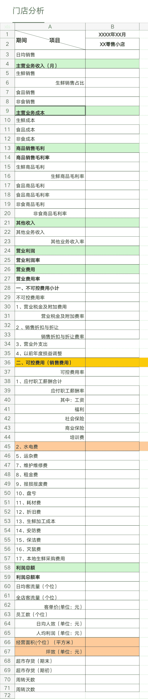

简单来说，就是先统计销售额。这里我要特别提醒下，在计算收入的时候，如果你们家有生鲜商品，那这部分的收入就需要单独拿出来计算。

为什么呢？因为生鲜蔬菜会有损耗，这是正常的，但在计算毛利额的时候，就需要把这部分单独地考虑进去。

记录完收入，下一项记录的就是成本了，同样的，生鲜品要单独提出来。收入减去成本，自然就得出了利润。

这是最基本的三项数据，但是再往下走，还可能会产生一些其他的收入，比如进回来的商品，拆掉的纸皮，卖给回收站，也是一笔不小的收入。

加上其他收入后，还要再减去营业费用，比如销售折扣、员工薪酬、水电费等等，最后就能算出一个净利润总额。

这样，在这张表里，所有的收入、成本支出、毛利额和净利润都一目了然。但这还没完，你还可以在下面记录下日均客流量、员工数、经营面积、存货数等等，这样就能算出人效、坪效和库存周转天数。

你看，这样一张表，你可以清晰地看到整个店的经营状况，就可以对小店的经营方案及时作出调整。

我举个例子，我之前有个同事，她开了一家 500 平方米的小超市。店里主要的商品分为食品、非食品和生鲜蔬菜，但她发现，在一体化报表上，食品的销售和毛利都比非食品要高出一个量级，但在店里，食品和非食品的陈列面积是一样的。

通过这个数据，她就去仔细观察了一下店里的销售情况。原来这家店来的大多是周边居民，对非食品的需求量没有那么大。在观察了几天和询问了一些老顾客后，她决定把非食品部分陈列面积压缩，扩大了食品的陈列面，结果就是整家门店的销售又提高了 10%。

本讲小结

我们这一讲主要讲了财务管理。

财务管理，不仅仅要把账记清楚，关键是，还要能为小店接下来的经营提供决策依据，我强烈建议你从第一家店开始就详细记录财务一体化报表，为之后的经营发展做好准备。

思考题

你有没有做过财务的管理，你都遇到过哪些坑？

欢迎你写在留言区，和大家一起分享。

到这一讲，小店整个基本运转就讲完了，从下一讲开始，我们来看小店怎么发展壮大。

1.小店的财务管理，必须做到家店分离。 2.要保证现金流稳定，所有的支出都应该分摊到月，大笔支出要零存整取，提前准备好专项基金。  
3.建议使用财务一体化报表，根据财务数据，对经营管理随时作出调整。

* * *

# 13 竞争：遇强对手以围代打，实力相当声东击西

你好，我是黄碧云，欢迎来到我的得到课程《黄碧云的小店创业课》。

上一讲我们讲了财务管理。到这里，一个小店的基本运转我们就讲完了。但零售店不是一个孤立的个体，周围一定还有各种各样的竞争对手。

不瞒你说，一提到竞争，我就下意识地坐直了身子，进入了战斗状态。这是我在一线零售这十几年训练出来的结果，要能随时进入“战斗”状态。因为零售行业是一个低门槛行业，从进入那一刻起，无论你愿不愿意，都要面临无数竞争。所以，对刚开始开店的人来说，一定要让自己的竞争意识先于竞争行动。

不过，这里我要提醒你，很多刚开店的零售新人，一想到竞争就只能想到打价格战，这个策略不是不行，但伤敌一千自损八百，而且，不同的情况，我们也要有针对性的策略。

下面，我们就来看看对一个新开的小店来说，几种常见的竞争局面分别应该怎样应对。

## 遇强对手以围代打

第一种竞争局面就是你的竞争对手比你强，甚至很可能是像永辉、华润、大润发这样的大巨头。

这几年，我的很多客户都遇到了这个问题，他们本来在当地活得挺滋润的，但现在好多的零售一线品牌都在做下沉市场，像永辉、大润发这样的大巨头，带着更强的供应链、更广泛的知名度，雄赳赳气昂昂地来到了下沉市场。这个时候，你不得不打起精神来应对。

那怎么应对呢？

其实，如果你开的只是小店的话，你和大巨头根本不是正面竞争对手，小店是就近提供一日三餐和常用的商品，图的是方便快捷，那去大超市的人，一般都是集中采购商品。还有很多大超市，会在门口单开一个 24 小时的小便利店，就是为了做不同人群的生意。

第二，大巨头和小店销售高峰期也不一样，小零售店一般做的就是工作日的生意，而去大超市的更多是在周末。

所以，如果你只是一个特别小的小店，其实不需要担心和大巨头的竞争，你需要做的，恰恰是以围代打，围绕在巨头周围，蚕食原本属于巨头的客流。

什么意思呢？

因为大巨头所在的区域，一般都是一个城市人流量大的商圈，更重要的，大巨头本身是会吸引流量的，如果一家小店能在大巨头身边做出特色，那原本要去大巨头的人群，就可能被你吸引。

我举个例子，我有个客户，他们家店的街对面就是永辉，那这家店是怎么做的呢？他把小店靠向街边的部分，全部装成了落地玻璃窗。然后把商品双面陈列，就是在同一个货架上，靠近橱窗的商品，正面朝外，靠近店内的那一列，也是正面朝外。

这样做的好处是，很多人可能是打算去永辉超市的，经过橱窗看到这家店的商品，蔬菜很新鲜，还有不少新品饮料，那他们可能就会走进去逛一逛。

所以面对大巨头，零售小店就可以牢牢抓住方便这个优势，做不同人群、不同时段的生意，还能想办法蚕食大巨头的客流。

不过，如果你面对的大巨头可能是 711、全家这样的全国连锁店，它们做的也是社区生意，甚至是 24 小时营业，那我们又该怎么办呢？

这个时候，还是同样的策略，就是以围代打。这个时候的围，就不能是简单地吸引不同人群了，还要引入一些伙伴，和你一起共同吸引客流。

举个例子，在长沙，像全国连锁便利店，客流就不如当地的零售店，为什么呢？虽然这些连锁店在各地也会照顾本地人的喜好和口味，但毕竟是全国连锁，提供的商品更多是标准化的产品，比如这些连锁店卖的可能是饭团、好炖，但本地零售店卖的就是米粉、口味虾，那周围人群，肯定会优先选择本地的零售店。

当然了，这些连锁店也会设置一些本土化策略，来争取当地居民。但这就像过去老话说的，强龙压不过地头蛇。为什么？就是地头蛇对当地的情况和资源更熟悉。用在零售店也一样，就算是他们也想卖米粉，肯定还是比不过当地小店正宗。

所以，对待大巨头，小店的策略是要善于利用本地资源，以围代打，做差异化竞争。

## 实力相当声东击西

不过两家实力差不多的时候那又该怎么办呢？这种情况下，更容易产生价格战，但价格战的结果，除了互相斗气牺牲掉一大堆毛利外，还会被第三方捡了漏。

我举个例子，在湖南一个小城市里，有两家实力相当、面积也差不多的超市，店和店的距离不到 30 米，两家店的老板，一个叫张三，一个叫李四。因为离得很近，所以张三和李四每天都安排员工去对方店里市调，然后回去之后就调低自己家的价格。

这样一来二往的，积怨越来越深，李四今天大白菜卖 1 元，张三就卖 9 毛。张三卖 9 毛，李四就卖 8 毛。最后，一轮价格战下来，你可能都不相信，白菜一斤只要 1 毛钱。

从那天起的大半个月里，可忙坏了顾客和小摊贩们。谁家的菜更好更便宜，就进谁家的店。后来蔬菜的价格比批发价还要便宜，那些小摊贩都不去批发城了，只要张三和李四每天一开门，他们就会冲进去，把最新鲜的蔬菜抢购走，然后再拿到别的地方加价卖掉。

按理说，出现了钻空子的第三方，张三和李四总该停战了吧？但这个时候，两个人已经打红了眼，停不下来了。

那最后是怎么停下来的呢？这一场两家的价格战，引发了周边一个大连锁超市一起加入，变成了价格混战。一直到被人举报到当地物价局，几方都因为恶性竞争被罚了款，这场价格恶战才算是结束了。

最后一盘点，张三家的超市，蔬菜净利润从正常的 10%打到了-3%。于是，张三找到我，希望能改变这种局面。

这个时候，怎么改变？

像这样正面刚的价格战，也不是完全不能打，但要学会放烟雾弹。

我先让张三把竞争商品的范围从蔬菜这个大品类缩到几个敏感度比较高的菜品上，比如包菜、茄子等，只对这些蔬菜降低价格，让对方跟价。

但这只是烟雾弹，我真正的目标其实是在新品上，我们抽调了前台生鲜部的人员，转战到后台，成立生鲜新品买手团。然后加大激励机制，开发一个新商品就给奖励，而且是当月兑现，激发采购开发新品的热情度。

不到一个月的时间，他们就引进了一大批新品，然后我们就在店里放大堆头陈列，还在现场设计了试吃的互动，每天变着花样来推荐新品。而牺牲掉的那几支蔬菜，照样天天低价。

但这样一来，给顾客留下的印象就是，虽然李四家的商品便宜，但张三家的老商品价格也便宜，而且还有很多新品，那当然就会优先选择张三家的店。所以，我们把蔬菜的净利润控制到了 7%，但不到半年，整个店的日均销售额，从 10 万增长到了 14 万。

这就是声东击西策略，降低几类敏感性商品的价格，假装要打价格战，但这只是烟雾弹，实际上靠推出新品来取胜。

当然，这个策略争取的是时间差和顾客的印象分，假设后来有一天李四反应过来了，也开始上新品了，但等到那个时候，顾客心里的印象已经建立起来了。所以，实力相当的时候，抢占先机很重要。

## 隐性竞争盯暗哨

刚才说的是实力比你强或者实力和你差不多的。但在这个时代，竞争渠道无处不在，比如朋友圈微商、团购社群等等，这些看不到的竞争对手更可怕。怎么应对隐性的竞争对手呢？

这种情况下，你要学会的是，盯暗哨。就是要想办法立几个暗桩，随时了解你所在商圈里的消费结构变化。

怎么盯暗哨呢？最直接的办法就是要主动加入各种类型商品团购群里。这里要注意，可不是为了让你去拷贝它们的做法，因为简单复制没有竞争力，盯暗哨的真正意义在于，找到可以跟自己店里产生连接的点。

举个例子。我在广州乡镇开店的同行，专门让一位同事在各个社群里去采集信息。发现他们当地各种群里推荐的东西虽然不同，但只要是草莓味的食品就都卖得好。后来，这个同事在群里一聊，发现更愿意买草莓味食品的，基本都是家里有上幼儿园的小朋友。

那知道这个信息了，是不是就是把这些商品直接进回店里呢？这是比较直接的做法，但更重要的，是你要找到这个信息和你小店的连接点。

后来，他们找到附近的草莓园，购买了 200 盆新鲜的草莓搬到了店里。在某个周末专门搞了一次活动，给小朋友讲解草莓是怎么长出来的，然后在现场亲自摘草莓，这个活动吸引了大量的小朋友参加，而且家长还在旁边不停地拍照发朋友圈，就有了一波免费的自传播宣传。

从那之后，他们还增多了草莓口味的食品，在儿童商品的陈列区域，把有关草莓的商品集中化展示。这样，周末的时候特别吸引小朋友围观购买，也就吸引了愿意为小朋友花钱的大人。

本讲小结

这节课我们讲了几种不同情况下怎么制订竞争策略，用三句话总结就是，遇到强对手以围代打，实力相当声东击西，隐性竞争对手就要学会盯暗哨。

思考题

你有没有看到过哪些有意思的竞争小妙招？

欢迎你写在留言区，和大家一起分享。

另外，如果你身边也有对小店生意感兴趣的朋友，也欢迎你把这门课分享给他。下一讲我们来讲营销策略。

1\. 遇到强对手，不能正面硬刚，要学会以围代打，利用复合业态，做差异化竞争。 2.  
实力相当，可以考虑声东击西，用一小部分敏感性商品来打价格战，但把真正的竞争点放在挖掘新品上。 3.  
面对隐性竞争，要学会盯暗哨，暗哨的功能不在于复制别人的打法，而在于发现消费者的习惯跟自己小店的连接点。

* * *

# 14 营销：营造氛围比活动本身更重要

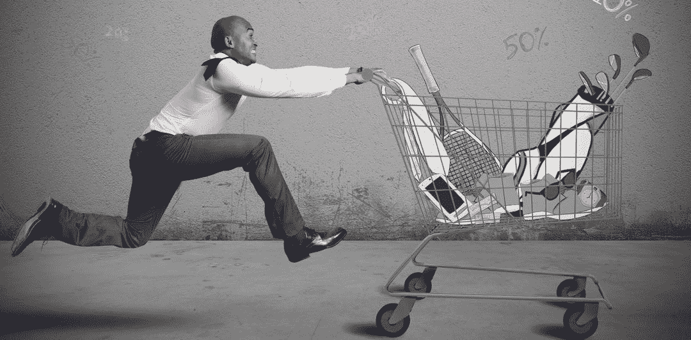

你好，我是黄碧云，欢迎来到我的得到课程《黄碧云的小店创业课》。

上一讲我们讲到了竞争策略。说到竞争，就不能不提营销，这是竞争的一个重要手段。那这一讲，我们就来看看零售店怎么来设计营销活动。

你肯定也见到过各大超市的营销活动。逢年过节的时候，很多超市都会推出打折满减这样的活动，很多电商平台除了逢年过节做活动以外，还会没节造节。

但你千万不要以为，营销策略就是找个时间或者借口打折来冲销售。对线下零售店来说，营销，其实是要通过设计一些活动来营造氛围，争取更多的顾客进店，进店的顾客多了，那购买概率自然就增加了。

但是，要营销肯定会先产生费用，大型商超每年都会有一定预算来做广告、搞活动。对小店来说，没有足够的成本，也没有相应的广告资源，怎么用低成本的方式来设计营销活动呢？

## 营造氛围

我拿我自己做过的营销方案来说。

那是一次三八节的营销策划。一般到了这类节日，很多商家推出的活动都很类似，比如线上和线下都会做卫生巾促销。后来就变成一个怪圈，一到三八节卫生巾就打折，很多女性顾客在这一天大量囤货，平时就会减少这个品类的购买。从长期看，整个品类的毛利都变低了。但如果你不做，别人也会做，每年都不得不陷入这个循环中。

所以当时我们在看了好几个企划方案后，都觉得很难起到带动销售的作用。

有一天，我看到朋友圈里江西的朋友在转发，当地油菜花开了。当时，这个视频突然点醒我，对啊，三月最有代表性的不就是油菜花吗？而且，每年的朋友圈，一到油菜花开的时候，都是女生最爱拍油菜花自拍照的时候。能不能想办法把这两个点结合起来呢？

说干就干。我们从近郊农户手里买到了大量油菜花。再把它们移植到花盆里，放到店里的各个主通道上。我在下方放了一张图片，你可以看一下。

这样一摆放，每天顾客进店后，都因为好奇而忍不住拍照。那一年的三八节就凭借油菜花创造了营销氛围，讨好了女性顾客，带动了不少商品的销售。

所以，设计营销活动，不能盯着商品看，更不是盯着商品价格看，而是要通过营销活动制造出促进顾客购买的氛围。我把这个叫做暖场营销，就是通过活动烘托氛围，那增加购买就是自然而然的了。

## 寻找时机

当然，除了氛围之外，时间点和频率也很重要。一般来说，节日是一个非常强大的文化共识，在这个时间点上推出营销活动，有事半功倍的效果。

不过，这一点你知道，所有人也都知道，每逢节假日，几乎所有的地方都在做活动，那竞争就比较激烈，所以，我们需要找到被大部分人忽略的营销时机。

怎么找呢？我的经验是，在开店的第一年，就要学会建立品类销售指数。

什么是品类销售指数？就是把某个品类的年销售数据全部调出来，用当月销售金额除以平均月销售金额。如果超过 1，那说明这个品类在这个月销售数据很好。

算这个有什么用呢？

我举个例子。我们在统计销售指数的时候，发现果冻和布丁这两类商品的销售指数在 4 月底和 5 月底的时候都很高。为什么呢？因为 4 月底活动销售量高是很多顾客为五一假期出游准备的零食。而五月底就比较好理解了，六一儿童节嘛。

发现这个数据之后，我们在第二年的 4 月底，就做了一次果冻节，提前采购了市场上很多果冻品牌，做成美陈堆头。果冻本来就是亮晶晶的糖果色，用堆头摆放在一起，就吸引了很多顾客的购买。

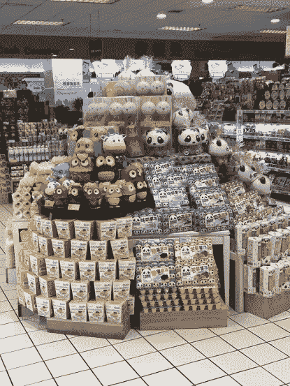

到了五月底的时候，我们又调整了下，专门做了一次布丁节。同样还是用美陈堆头来陈列。

这次为什么选择布丁呢？布丁和果冻都是小朋友喜欢的零食，但布丁的口感更软，价格也更贵。六一儿童节，节日的氛围更重些，无论是家长还是幼儿园，都会精心布置、准备礼物。

所以，五一前的果冻节，更多以散装果冻为主；六一前的布丁节，可就要以卡通包装为主了。这样，也能提高利润。这两个小节日连续下来，就能拉动零售店里很多跟小朋友相关的商品。

你看，这就是我们从数据中发现的营销时机。所以，如果你是刚开店的店主，我特别建议你从一开始就积累数据。这些数据会慢慢告诉你很多原来忽略掉的营销时机点。

当然，还有一个时机点，是规划营销方案时不能错过的，那就是店庆。对小店来说，这是不需要费心找理由就能设计的营销时间点。

我经常会劝我的客户一定要把店庆放在七月，很多人不理解，跟我说，我们家店不是这个时候开业的呀。这个时候，我都会告诉他，这个重要吗？消费者关心吗？消费者更关心的是，这家店庆有什么活动，能有什么样的优惠。

但为什么一定要放在七月份呢？

七月份是零售行业的淡季，前半年有三八节、端午节、五一等等各种节日，后半年有中秋、十一、春节等等，但七八月份就没有什么节假日能带动销售了。我从经营者的角度来说，为什么七月份来做店庆。七月份正是大夏天，店里的空调要从早开到晚，要不然店里太热了，没人愿意进来。这就给店里增加了一项不小的开支，大到什么程度呢？我测算过，会比平时的电费增加 7~10 倍。

所以，每年把店庆放在七月，就是为了最大化地拉动客流，来增加销售，能平衡一部分高昂的电费成本。

那店庆活动应该怎么设计呢？我说下我的做法。

我会把店庆活动分成三周来做。

第一周，就是我们经常容易看到的店庆优惠活动。在这个阶段，我们优惠的商品主要集中在两类，一类是高敏感商品，比如纸巾什么的，一有优惠，顾客能迅速感知到。另一类是大品牌、高客单价的商品，比如米、面、油。这部分虽然会有优惠折扣，但它本身是高单价的商品，能冲击下销售总额。

这是第一周，第二周我们干什么呢？

第二周我们会做个均一价的海淘活动，就是集中一部分低单价的商品，一般是 10 元以内的商品，你还记得我们在定价那一讲的内容吗？你可以根据均一价定价策略，做个海淘专区，设计几个价格带，比如 1 元、5 元、10 元，每个价格带里包含的商品，要尽量丰富，让顾客感受到海淘的乐趣。

到了第三周，消费者被优惠勾起的消费意愿，已经被前两次消耗得差不多了。这个时候，你就需要想个新花样。

什么花样呢？我经常会采用的是美食节，或者啤酒节等等，具体做什么活动节，你可以根据你们当地顾客的消费喜好来确定。关键只有一点，就是带有互动性质的活动，消费者能现场试吃试用。把结果让消费者提前享受到，就更容易让他产生购买的欲望。

三周的活动搞下来，店庆月就差不多要结束了。不过，千万不要再多，三个小冲锋打下来，是消费者的极限了。再做活动，就已经疲了。所以，这里我还要提个醒。设计营销活动，也需要注意掌握节奏。

## 掌握节奏

具体怎么做？这跟你所在商圈的流动性有关。

如果一家零售店所属区域是相对封闭的区域，比如校园区、工厂区、远郊的社区等这样的商圈，营销活动的频率是要加大还是减少？

很多人直觉觉得，相对封闭的区域，竞争不大，那当然可以少做营销活动。如果你也是这么选的，那就说明，你对顾客的消费习惯还不够了解。

在相对封闭的商圈里做生意，营销和商品的变化都要快。为什么呢？因为，相对封闭也代表着生活圈子小，那你做的其实是存量生意，如果说营销活动做得少，销售的商品很容易固化，就会降低顾客的购买频次。

另外，在相对封闭的商圈，居民日常生活也会比较无聊，那多样性的营销活动，可能会成为他们休闲的一种方式，你就有了很多产生效益的机会。

但刚好相反，在人口流动量大的地方，营销的方式和时间反而就要固定下来。这又是为什么呢？

因为流动商圈，顾客的流动是随机的，你想培养老顾客，那就要给他固定的信号。比如每周二或者每月的 8 号，你的店里全场 8.8 折优惠。这样顾客能很快记住。当然了，那些全民习惯购物的日子，像春节、三八、双十一等，你也不能错过。

但有一点，只要确定某一个固定日子是活动日后，就要一直坚持下去，不能中途断掉不做。这种方式“涨粉”速度很慢，但只要一停掉，那“掉粉”的速度是非常快的。

本讲小结

这一讲，我们就讲到这。所谓的营销策略，最终的目标是要把商品卖出去，但要达到这个目标，可以先通过制造氛围来吸引客流，顾客愿意进到店里，那购买就是一件自然而然会发生的事。

思考题

你都见到过哪些有意思的营销活动？这个活动是怎么影响你的购买决策的？

欢迎你在留言区，和大家一起分享。

定好了营销策略，下一讲我就来说一说，我们如何把商品卖出去的促销方法。

1.设计营销活动的本质是要营造销售氛围，通过氛围来促使顾客进店购买。 2.除了固定的节假日，还可以通过销售指数来寻找新的营销时机。  
3.不同的商圈，要掌握不同的营销节奏。一般来说，相对封闭的商圈，营销活动需要更多样。相对流动的商圈，那营销活动反而就要固定下来。

* * *

# 15 促销：切记让消费者“等”促销

你好，我是黄碧云，欢迎来到我的得到课程《黄碧云的小店创业课》。

上一讲，我们讲了怎样设计营销活动，这一讲我们来看看怎么做好商品促销。

这两个概念，大部分时候我们是混着用的，那它们的区别到底是什么呢？

上一讲我们提到，营销是通过活动来制造氛围，吸引客流进来，那促销其实就是聚焦到某个单品上，想办法怎么把它卖得更多。

促销的好处，当然是能提升和稳定客流，也能带来销售的增长。但是，很多零售店经常会陷入一个陷阱，就是让周围消费者养成了“等促销”的情况，不促销不上门，有促销了才上门买东西。

怎么避免这种情况呢？这一讲，我们就来看看，零售店怎样做好促销。

## 线下促销

我的促销经验是从一次失误中总结出来的。

很多年前，我在一家超市中任职，当时我们公司刚好扩张，跨区域开了第一家新店。筹备了很久，这家新店终于开业了。

但就在这时候，我的助理给商品补单的时候，一不小心把 200 箱软包装抽纸多按了一个 0，变成了下单 2000 箱。当时，因为开新店，也是刚合作的新供应商，彼此还不是很了解，供应商也不知道我们的销售状况，一下子接到这么大订单，高兴坏了，连夜帮我们去调货。

第三天，这 2000 箱的抽纸就像高山一样出现在了我们店的收货口，我的助理当场就傻了。一直和供应商商量说，能不能再拉回去。供应商就跑来跟我说，这货没法退，他们也是因为接了这么大单，连夜去别处调过来的货，要是退货，他们也没办法处理这么多货。

那怎么办呢？我当时马上表态，不能退。不仅是为供应商负责，而且我们在这个区域是第一家店，如果退了，我们在这的信用就会受损。我立马签字，把货收了。助理知道自己闯祸了，一直急得问我怎么办。我安慰她，多想想办法，没有什么卖不掉的东西。

话是这么说，但我当时根本没想好怎么卖掉这么多货。那一天，我每天在卖场转了好几圈，到了当天晚上，我心里大概有谱了，召集了现场的管理人员，制定出了这 2000 箱软抽的促销方法。

我当时主要是从两个方面考虑的，一个是改变售卖的方式，争取多个方式去促销。另一个就是扩大顾客多看到的机会。

从这两个方向出发，首先，我在转圈的时候发现，我们当时店里的入口处，有一面大空墙。也因为在售卖区外，就没有堆货，我们就打算把这面墙利用起来，打造成一个单品促销墙。放在这里的纸巾只按整箱卖，当然，整箱买要比我们平时单提买的时候要便宜很多，这叫做折上折。

显然，一般整箱买的顾客，大概率都是开车来的，那我们就在旁边备着两辆小拖车和打包绳，只要顾客一买单，就直接放上小拖车，帮他送到车上去。如果顾客是骑电动车来的，就用打包绳帮顾客打包好，让他没有任何顾虑放弃购买。

第二，我们在店里的纸巾陈列区，促销的是单提的抽纸，价格比原价便宜，但比整箱要略贵。并且，我们把纸品区的货架通道拉宽，货架两边的最底层货架各拉宽了 30 公分，专门做了延伸陈列。这样就增加了顾客看到软抽促销的机会。

单提纸巾的促销，主要是卖给那些走路过来的顾客。还有一点是我们要注意的，当时很多顾客看到整箱便宜那么多，心里多少有些不平衡。于是，我们加了一条，只要买两提纸巾，我们就送手帕纸。

第三，我们在收银台前，撤掉了几个口香糖架，打了几个小的纸巾堆。并且，在每个小堆上，都会打开一包纸巾样品给顾客免费使用。这是为了让顾客在买单的时候，有些生鲜商品上可能还带着水之类的，那顾客把购买的商品递给收银员后，就会顺手抽张纸擦擦手。那再顺手买一提的概率，也会大大提高。

就通过这样的方式，多区域陈列，让顾客更多看到；设计更多售卖方法，来符合不同人群的需求。你猜，最后这 2000 箱纸巾卖掉了没有？在这个事之前，我自己都想象不到，不到 3 天，2000 箱纸巾就卖光了。

经历过这件事，我就发现，促销确实能在短期内增大销售。但同时，你还得克制住自己走捷径的心态。

当时，我们 2000 箱软抽不到 3 天卖完，现场的管理人员马上就想申请加单，这就像金融市场上的追涨杀跌一样。但我当即就制止了她，因为短时间内卖出去这么多量，顾客且得消化一下，短时间内对纸巾的需求都会减弱。并且如果持续加货，那以后纸巾的价格就再也提不回去了。

后来，我也慢慢总结出线下促销的三大原则，就是短、平、快。

短是要时间短。

按照我们过去在大型商超的经验，促销一般是 14 天的周期，但对小店来说，这个周期太长了。前面我们也说到，零售店做的是老顾客的生意。所以，一支商品的促销周期基本 3 天就好。特别是食品，像韭菜猪肉馅水饺做个 14 天，顾客看都看腻了。所以生鲜商品的促销期要更短，一天就可以是一个循环，每一天都要变。

这是短，第二个是平，就是促销价格要平稳。

这里的平稳指的是，促销的时候，不要原价很高，促销价断崖式下跌。很多人觉得很奇怪，商品降价幅度大，顾客不就能感到促销的力度了吗？

这个对，也不对，从短期上来看，这个效果确实是这样，从长期来看，却会引起反效果，因为价格差异太大，顾客会觉得，你的真实成本很低，促销价才是商品的真实价格，原价是虚涨上去的价格。如果顾客有了这个想法，那就可能会变成，不做促销，不进门。

这是平，第三是快，这指的是选择促销商品时，要选择能快速周转的商品。比如米、油、生抽、纸巾这些民生商品，还有就是可以挑特别应季节的商品，比如夏天的西瓜等等，因为不是什么商品都适合用来做促销的，场地有限，一定要保证商品的快进快出。

## 线上促销

这是在线下设计促销活动时需要遵循的三个原则，短、平、快。但现在，设计促销活动，不能不提的就是社交媒体促销。很多零售店都做了自己家的公众号，或者通过朋友圈来运营私域流量。这里我有几点提醒：

第一，想要用好微信成为门店销售的延伸，店里就要专门用配一部公用的手机，用一个专用的号码来申请微信号。

为什么要强调这一点呢？因为如果用私人号，不要说是员工，连经营主都不一定愿意在自己朋友圈里发这些信息。更重要的是，用员工私人微信加顾客，一旦员工离职了，也就带走了店里的老顾客。

第二，朋友圈里要怎么发促销信息才不会被拉黑呢？

我总结了三个不要和三个要，三个不要就是：

*   第一不要发长文或者链接，宣传文案最好不要超过 30 个字。
    
*   第二个不要，是文案里不要放过多表情包。为什么呢？很多人觉得发表情包是为了软化语气和强调某些内容，但如果发得太多的话，反而一看就让人觉得是广告文案，不会把注意力放在文字上。
    
*   第三个不要，就是不要发超过两张以上的图片。很多人特别喜欢发 9 宫格，这会让信息传递太分散，顾客无法聚焦。你想想，有多少人会真的点开 9 宫格一张张去看呢？
    

这是三个不要，那又是哪三个要呢？

*   第一个，就是图片要清晰明亮，主推的商品信息、价格一目了然。
    
*   第二个要就是要定时发，早上 10 点左右，中午吃饭时段、下午 3 点左右、晚上 7 点左右，这些时间都是大部分人有空闲看朋友圈的时候，你就可以在这几个时间段定点发。
    
*   第三个要是要固定数量，但注意一天最多不要超过 10 条，多了就会被屏蔽掉。
    

第三个提醒，是朋友圈选哪些商品来促销比较合适呢？

和我们线下店里选的促销单品正好相反，朋友圈适合促销的，最好是新品或者相对比较高端的商品。

为什么呢？因为朋友圈能用图片和文案来描述新品亮点，比线下推销要有效果得多。所以用朋友圈来培养新品，是个不错的选择。

我举个例子。我在我原来一家超市门店，通过朋友圈促销形式，把原来店里同时期只卖不到 2 万的车厘子，卖到了 20 万的销售额。

那是 2016 年快春节的时候，当时车厘子虽然很受欢迎，但因为单价高、损耗大，零售店都不敢大批量进货，不敢进货就不可能卖出大的销售额来。当时我们也是刚刚开始去建立店里的微信号，我们就想着要不就先把车厘子的文案发到朋友圈里试一试。

因为是线上促销，我们采取的是预售。越早买，越便宜。同时，我们也做了售后承诺，货到后顾客可以到店里当面验收，如果觉得品质不佳可以直接无条件退款。

在预售一周后，预售金额就已经达到 8 万了。这个时候，我们才去跟供应商谈判，因为要的量多，就谈到了一个更优惠的价格。

差不多过了一周，车厘子就到货了。我们在约定提货的前一两天就加大陈列位置，并在扩大的位置旁边也立了促销牌，不过价格要比预售要高出 10%。同时在陈列周围放上好几个客服号的二维码。

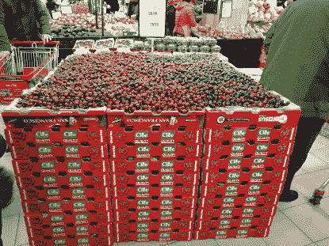

在取货的前一天，我们在扩大的陈列的地堆旁边，开辟出一个专门的车厘子取货区，并且挂上了明显的标识。线下进店的顾客看到后就会问预售的价格，预售比店里要便宜啊。很多人就会很心动，也就更愿意扫码加客服号。而来店里取货的顾客，看到店内的价格比他们预售的确实要贵，自然也就觉得很值。

就通过这样线上线下相结合的方式，我们谈到了更低的进货价，也降低了库存风险，最终，把车厘子卖到了 20 万销售额，差不多是原来销售额的 10 倍。

本讲小结

这一讲，我们讲了线下促销的三个原则短、平、快，也讲了在线上，在社交媒体上做促销时，你应该注意的三件事，我再强调下，就是微信和手机最好都备一个公用的，朋友圈发促销信息时要遵循三要三不要原则，最后，线上用来培养新品或相对高端的商品，效果最好，促销信息就可以优先选择这些商品。

思考题

你遇到过哪些有意思的促销活动，让你不停地买买买？

欢迎你在留言区，和大家一起分享。

到这里，我们的零售小店就发展得差不多了，下一讲，我们来看看在扩张前，你还需要做哪些准备。

1\. 设计线下促销要遵循短平快的原则，促销时间要短，促销价格要平稳，要选择能快速周转的商品。 2.  
朋友圈发促销信息要遵循三要三不要。三要是图片要清晰明亮，时间要定时，数量要固定；三不要是，不要发长文或链接，不要发过多表情图标，不要发两张以上的图片。

* * *

# 16 控制损失：一减一加一不要

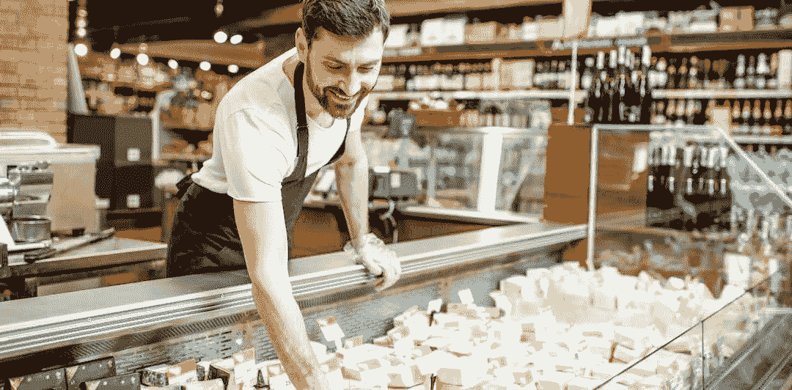

你好，我是黄碧云，欢迎来到我的得到课程《黄碧云的小店创业课》。

这一讲，我们来讲讲怎样控制损失。听到这个主题，你可能也会觉得奇怪，我们前面讲了竞争、营销、促销，全都是为了业绩的增涨，提高利润，为什么现在又回过头讲控制损失呢？

这就是我这一讲，想要重点提醒你的。小店开到第三个阶段，业务慢慢步入正轨，生意也会越来越红火。这个时候，很多小店店主就容易忘记一件事情，不管怎么样，小店始终是个捡钢镚的生意。越是在扩张前夕，越要开源节流。

前几讲我们说的都属于开源，那接下来，我们就从空间和时间这两个维度，说说怎么通过节流来多赚取利润。

## 空间：店内布局

先来看看空间维度。整个小店的空间布局，分为前台和后台。

在前台的损耗，有一些是正常的经营损耗，而有一些就是属于人为的损耗。比如说，商品的丢失。对于大超市来说，有 360 度的摄像头，也有很多员工在现场巡视，这个问题就没有那么严重，但对于小店来说，一个人可能要身兼数职，就很难照顾到每个角落。

这种情况下，小店的布局一定要用咱们前面说过的竞技场布局，也就是中间低，周边高。这样布局的好处是，在小店的任何一个角度，都能看到顾客的走动。

但除了竞技场布局，还有一个小改动，就可以减少损耗。什么改动呢？就是把原来收银台从半封闭改成自由进出。

那很多人就会问，这样收银台安全吗？现在在一家店里，交易支付，大多都是用移动支付，用现金的概率是非常小的。

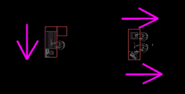

同时，你还可以把收银台调整一下方向。原来我们的收银台，都习惯和大门垂直，但在小店里，你就可以调整成背靠大门的方向。这样，收银员就能看到更多顾客的情况。关键是，收银台可以自由进出后，有异常状况收银员就能够马上走出来。

再进一步，你还可以在收银台放置一个称重台。这种处理方式，还能提高人效，在人不是很多的时候，收银和打秤可以由一个人完成。但在店里低峰期的时候，收银员还能随时从柜台出来，做些上货或整理的工作。我有一个客户，100 平方米的小店，本来是要用 4 个员工，调整后，店里只要 3 个人就够了。

这是前台。那后台布局也很重要。我总结了三个原则，叫做“一减一加一不要”。什么意思呢？

一减，就是小店的仓库区要小，越大会带来更多的损耗。

这是因为，仓库的空间越大，自然就会多存货，除了增加库存周转天数外，还增加了商品过期的风险。

所以，一家小店的后台面积，占比一般控制在 15%左右，最多不要超过 20%。也就是 100 平方，后台的面积控制在 20 平方米左右。

这是一减，仓库要减。那一加又是什么呢？如果一家零售店里有卖需要二次分拣的商品，比如冷冻肉品和蔬菜捆扎。那就要增加一个 3 平方米左右的操作间。这样增加，又是为什么呢？

在 2019 年的时候，我去一个客户的店里巡店。正在四处观察的时候，突然就听到店里员工大喊一声：“大家让开，我要开始砸冰鸡腿了！”接下来就是把一箱冰冻鸡腿，重重地摔在了地上，整个店里立体环绕的都是嘭、嘭、嘭的声音，严重地打搅到了顾客的购物。这个时候，如果后台有一个操作间，就不会产生这样的尴尬了。所以，这个空间不能省。

这是一加。一不要呢？就是小店不要设立办公区域。

设置办公区域，不仅会浪费店面积，还会让很多员工在一起扎堆聊天，影响工作效率。所以，可以把办公区直接转换到收银区，在低峰期完成系统中的下单和补货的工作。当然了，还是要设立一个简单的轮流就餐区，一次最多可以坐两人，这样能够保证员工休息又不至于扎堆聊天。

## 时间：商品流转

刚才是从空间维度，接下来我们看看时间维度，从商品的进、销、存整个流转环节，看看还有哪些地方可以控制损失。

先来说进货。进货的时候，要拉一条红线，就是卡死什么商品不能进。

什么商品坚决不能进呢？我列了张清单：

第一，临近保质期结束的商品不能进。

保质期只有 5~30 天的商品，剩余保质期低于 75%的，不能进，也就是假设 20 天的保质期商品，还剩下不到 15 天，就不要进了。保质期超过 30 天的商品，低于 70%的商品不能进。不过，如果是进口商品，这个期限就可以稍微放宽一些，但也不能少于 50%的保质期。

第二，商品包装上的标识不符合，不能进。这个主要是看产品质量检验合格证明符不符合要求。最低标准的要求是：中文标明的产品名称、生产厂名和厂址。根据产品特点和使用要求、需要标明产品规格、等级、所含主要成份的名称和技术含量，并要有相应的标明。

第三，商品所贴条码不符合本公司要求，不能进。有些商品看着有条码，实际上，如果你去查的话，可能就是“查无此人”，建议你用 ERP 系统的查验功能核查下。

最后，还有一点要特别提醒，就是一定要注意商品的生产日期。

这个问题，在年节性很强的商品中容易出现，比如说月饼。很多商家为了赶中秋的时间节点，会提前送货，甚至送货时间比商品上标的生产日期还早，这就属于欺诈行为，一定要及时退回给厂商。你想，要是顾客在 8 月看到的生产日期是 9 月，他会对你这家店所有的商品，都会产生质疑。

这是商品进货，进完货之后，肯定要把商品放到仓库里。我们来说说商品的存放环节，有哪些地方可以降低损耗。

在储存商品的时候，要根据轻重和销售的快慢来分配储存区。一般是商品轻的在外面，重的在里面，在仓库拿货是从里面往外拿，重的先拿，放在补货车的下面，就不会压坏轻的商品，要不就会出现上面是盐，下面是薯片，就容易造成损耗；不好卖的放在下面，好卖的放在上面，方便拿。

这是一些大原则，但还有一些小细节，提醒你一定要注意：

*   **第一个是，仓库商品的摆放，不要直接接触地面，最好在下面垫一个小架子。**
    

这样做的好处就是，放在底下的都是比较重的商品，而且多半是纸箱打包的，上面没有抓手，箱子抬起来就特别的费劲。但如果下面有架子的话，挪动箱子，箱子就悬空出来了，手就直接接触到了箱子底部，能马上把箱子抬起来。不要小看这个动作，能有效地减轻员工的工作强度。

*   **第二个，如果是民生性零售店，那就要特别注意生鲜产品的存货流程。**
    

生鲜商品在收货的时候，要先抽检，然后再运送到小店或者仓库里。存入低温安全区之后，还要再加大抽检的力度和范围，因为生鲜商品一旦变质，就特别容易传染。

另外，生鲜商品入库的时候，一定要扣除包装的重量，我们平常叫它“皮重”。比如一箱苹果 30 斤，“皮重”占到了 3 斤。那这一箱苹果的批发价是 90 元，每斤的净成本就是 90 元除于 27 斤。这样做的价值就在于，只有知道精确的成本，才能准确地定价，要不然可能就会出现定价比实际成本低的情况。

*   **第三个，存货的过程中，还要尤其注意的是，生鲜商品的保鲜。**
    

一般来说，干货类的生鲜品，比如香菇木耳，储存的要求是室内常温，如果是海干货，那就要存放在低温区。一定要注意的是，冷藏商品需要装袋扎紧后装箱再入库，干货一定要注意的是防潮。

蔬果类的商品，存放的要求一般是低温、湿度高。但如果你店里没有冷藏库，你就可以这样做：像叶菜类，你就可以喷点水来帮助保鲜，瓜类、长豆类，你就可以用冰水来保鲜。这样，就能够有效地减少水分的流失。

比较容易变质的还有肉类。在售卖区，展示的陈列柜里，温度要控制在-1℃～-2℃，这样才能有效地保证肉品的鲜度。

还有一点要特别提醒，就是猪、牛、羊、禽类在储藏和处理的时候，一定要分开处理，包括刀具、砧板、加工机器都要分开使用，避免交叉感染。

这是存放和处理。按照时间顺序，接下来就是销售环节了。这个环节需要注意哪些关键点呢？

第一，零售行业，最基础的原则，就是“先进先出”，就是先到的商品要先卖出去，再卖后来进的商品。店员上货陈列的时候，就要特别注意这一点，避免商品过期。

第二，价签条与商品一一对应。

你可能会说，这不是废话吗？当然要对应了。但在实际操作中，没有做到的小店，大有人在。这恰恰是造成商品损耗的隐性因素。商品再好，没有价格签也很难卖出去。还有放错价签的，顾客在买单的时候，就会退单。一来一去的，全是折损。

第三，“孤儿商品”及时回收。

什么是“孤儿商品”呢？有些商品顾客挑选后，半途中又不想要了，就随手放置在别的货架里。如果是包装的商品还好，没有变质的风险。但如果是低温或者生鲜商品，就像肉品，随便被放到一个货架上，如果没被及时发现，只要温度一高，两个小时后就会发黑，根本无法销售。

所以在店里增加巡店，及时回收“孤儿商品”，也是控损的重要工作。尤其是重大节假日，店里客流量大的时候，不及时回收就会造成商品的损耗剧增。

第四，陈列生鲜商品的时候，可以垫假底。

什么是假底呢？就是比如，用一个篮筐来陈列樱桃，如果真的全都装满的话，就容易变质，但装半篮的话，卖相就不好看了。所以，在篮子底下，可以先用一块泡沫板把假底垫高，方便你随时补货。

第五，及时盘点，本身就是有效的降损。

生鲜商品，本身就会有自然的损耗，这是正常的，但是一定要及时盘点，最好是一个月两次。这样，经营数据才会准确，你才能掌握真实的毛利状况，然后进行调整。这样可以锁定高损耗的商品。一支单品一个月的损耗率只要超过了 8%，就是高损耗，要列入重点控损的品项清单里。

本讲小结

这一讲我们讲了控制损失，从空间和时间两个维度，拆解一家小店可能涉及损耗的方方面面。你可千万不要小看这些零碎的细节，如果这些环节做得好，损耗就能够降一半。

比如一家小店，生鲜商品一年卖到 100 万，损耗高一点就是 12%，但这些细节做得好，就能降一半，那你就相当于多了五六万的净利润。

思考题

你还观察到过，哪些细节可以降低损耗？

欢迎你在留言区，和大家一起分享。

如果你身边也有对小店生意感兴趣的朋友，也欢迎你把这门课分享给他。

下一讲，我们来看扩张前的准备。我们下一讲见。

1\. 从小店的空间上减少损耗，前台可以采用竞技场“中间低、四周高”的布局，后台要遵循“一减一加一不要”原则。 2.  
从小店的时间上减少损耗，可以从商品的进货、储存、销售的商品流转环节入手，避免商品过期。

* * *

# 17 扩张准备：看内部，盘资源

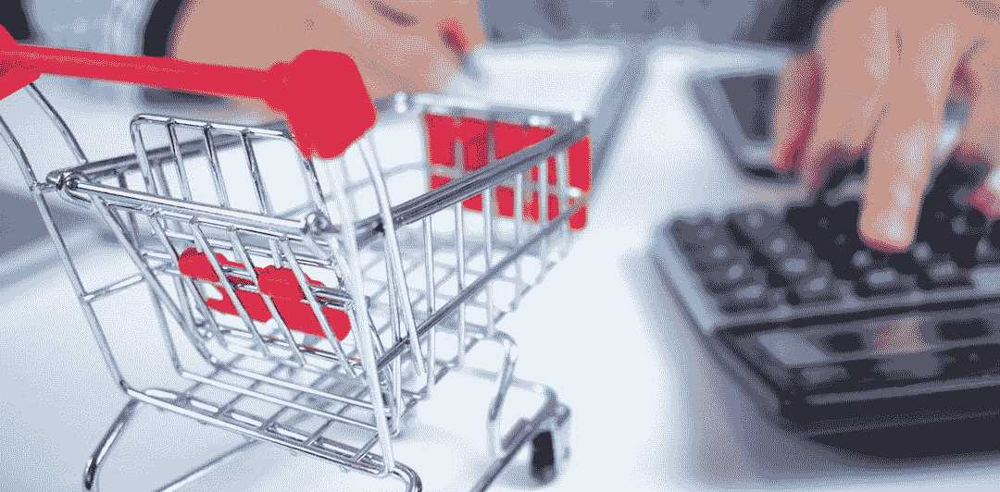

你好，我是黄碧云，欢迎来到我的得到课程《黄碧云的小店创业课》。

我们前面讲的内容，无论是开源还是节流，都是在为将来做准备。那这一讲，我们就来看看，小店发展到了第三个阶段的扩张，都需要做哪些准备。

听到这，你可能会说，我能不能不发展啊，我就做一家小而美的小店，就可以了，一定要扩张吗？

一定要。为什么呢？不发展就一定会反噬利润。

首先，成本是在不断上涨的，尤其是每三年差不多就涨一轮房租。再加上通货膨胀，手里的钱也会越来越不值钱。所以，不发展，赚的只会越来越少，那还不如去上班，上班的话，工资还会随着能力的增长而增长。

不仅如此，如果一家店体量有限，那跟供应商的合作也就会受限。随着进价的上涨，竞争的加剧，会双向挤压店里的利润。只有规模发展大了，才能跟供应商争取到更好的合作条件。

还有，如果不发展，员工没有上升通道，留存率也会变得很低。员工一离职，转过头就有可能到你的对面开家新店，这样就会带走一批老顾客，成为你的竞争对手。

所以，发展，是一定要发展的。但问题是，什么时候发展，怎么发展？

这毕竟是一件大事，我分为两讲来跟你详细说说。这一讲，我们先来看，小店到什么程度，我们就可以准备扩张了。

第一点，就是我们要先来做一个盘点。那到什么程度，就能扩张呢？

第一步，还是跟开第一家店一样，先盘点一下手上的资源，够不够开新店的条件。这部分我们第一讲详细介绍过，你可以再回头复习一下。

当然，除了第一讲我们讲到过的几个资源限制，扩张的时候，还需要衡量一个重要的因素，就是你第一家店的实际运营情况。

这个情况，我们可以分成四个部分来看：固定资产、真实的经营状况、品牌资产和人才资产。

## 固定资产

固定资产，一般包括店里所有的设备，比如冷藏柜、空调、货架还有办公桌椅等，甚至是装修的新旧程度，还有我们后台一直在运行的信息系统。这些固定资产，你最好是要找专业的人来折算一下，实际有多少余额。

你可能会疑惑了，盘点现金就够了，固定资产我又不打算卖，为什么还要盘点这个呢？

这是为了盘点你自己手上到底有多少真实资产，是不是能够承担新店的开支。更关键的，是盘点下老店还需要哪些投入，比如盘点的时候，发现制冷设备已经即将要更替了，那老店还需要大笔资金投入，你就必须要考虑到这一点。

很多人不做这一套工序，开新店后，所有的投入都在新店上，如果这个时候，老店需要更换新设备，就得临时增加投入。那之前算好的资金就不够了，这样一来，不仅对新店有影响，连老店也要受牵连。

所以，在你打算扩张前，一定先盘点一下固定资产。幸运的话，还能翻出一些老店没用到的设备工具，也能给新店省一点钱。

说到这，有一个特别重要的我要提醒你，就是固定资产里的废旧资产。那些已经没有任何价值的资产就必须要清理掉，比如生锈坏掉的货架。这些体现在财务账面上，就是虚价值。这次盘点，就要把这样的资产处理掉，才能清晰地知道第一家店里的真实利润，你也才能推算出，自己的经营能力到底怎么样。

另外，小店发展到第三个阶段，也就是扩张年的时候，要慎重投入装饰性的资产，最好是投入那些能提升经营效率的设备。比如要装质量好的射灯，但要少装那种装饰性的吊灯。好的射灯，可以随意转方向，提亮商品，吸引顾客的眼光。但吊灯就是中看不中用，吸引顾客看吊灯，只会减少顾客对商品的关注度。

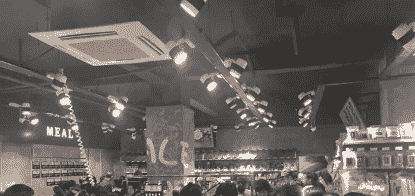

好，这是固定资产，第二个要盘点的是财务经营状况。

## 财务经营状况

这里主要是看小店这两年的增长，有没有跑过通货膨胀。同时，你最好还要做一个统计工作，盘点下开店后的亏损月，找找亏损的原因。在发展后，要避免亏损的原因带到新店。

同样的道理，也要盘点一下盈利状况。主要看看盘点后真实的净利润，确定现金流是不是健康。

健康的标准是什么呢？就是除了固定的店面开销外，老店的现金流能不能支持 80%的新店投入。

当然，这样的盘点我们平时也都在做，但区别在哪呢？这一次的盘点，你要注意和固定资产结合分析。比如前面说的，固定资产折旧，或者需要重新装修，那就需要一大笔的资金，那减去这个窟窿后，你的现金流还能不能支撑起开一家新店？这就是你需要去核算的。

## 品牌资产

第三个要衡量的，是评估一下，你的小店在商圈里面，有没有积累出品牌资产。

你可以去线下做一个调查访问，看看顾客对你商品和服务的认可度。

零售离顾客非常近，顾客的认可至关重要。就像新乡的“胖东来”，在老店关闭后，退出了新乡区域。后来，当地居民联名申请，要求“胖东来”开回新乡。这就是强大的品牌信任度。第一家小店很难达到这样的品牌认可度，但至少开了新店后，会有老顾客愿意帮你宣传。

不过，如果只是在店里发一发调查问卷，顾客多半都是应付着填的，怎么才能拿到真实的反馈呢？

我经常会用的方法，是去小店周围的社区，找一个要开新店和活动的理由，支个摊子，然后准备几种不同颜色的小球：比如，问有没有去过这家店，去过，就往“去过”箱子里扔一个小球，没去过，在另一个箱子扔一个小球。同样的，我还会问的问题是，商品好还是不好？便宜还是不便宜？就这三个问题。所以你对应的一定要准备三种不同颜色的小球。

为什么这么做呢？

首先，顾客到你店里来买东西，毕竟你是主场，顾客是客场，那即便是有些小意见，他也不好意思当场说出来。但如果你进入到社区，那他是主场，你是客场，他的顾虑就会少一些。

其次，我们平时老被拦住填问卷，就容易敷衍，看到问题就打勾，但是扔小球这个动作，特别像一个小游戏，就能激起顾客的兴趣。但即便如此，调研完，你还是要给所有的数据打个 8 折，剩下的大概就是顾客内心的真实想法了。

其实，在这样的过程中，你能发现很多问题。

比如第一个问题，去没去过，如果没去过的人特别多，你就要反思了，你的路径选择是不是丢掉了一部分的目标客户？是忽略了什么因素，还是周围人群结构发生了新变化你却不知道？比如说，搬来了很多新的年轻住户，那你还在用金字塔模型，那自然就做不到他们的生意。

再比如，小球数据显示，你的商品还不错，但是价格大家不满意，那就说明你的性价比不高，接下来就要从这个方向去改变。最直接的解决方法，其实就是扩张发展，扩张之后，规模上去了，成本就能降下来，那商品的性价比就能提高。

但是，假如代表价格的小球，觉得贵的人特别多，甚至超过了 70%，那你就赶紧要去重新调研市场的整个价格体系，是不是自己定价太高了。那如果开新店的话，第一件事就是要把老店新店的价格降下来。

还有种情况是，社区人群对你的价格满意，但是对商品不满意，这种情况，要么是你的商品结构不匹配，可能是金字塔模型中，金字塔最底层的东西太多了，要么就是这个商圈的人群结构发生了变化，那你就要重新去调整调研了。最直观的就是从金字塔上升到擀面杖。

你看，通过这样的方式，就能调研出顾客对一家小店的感受和满意度。更关键的是，你要从这些反馈中，去反推自己的经营能力。发现问题，老店当然要及时更改，但你也要记录下，开新店之后，自己大概率会犯哪些错误，哪些是自己的盲区。这些问题都要在这次盘点中想得清清楚楚。

## 人才资产

好，刚才是说品牌资产，第四个要衡量的是人才资产。

你可以统计下近两年的离职率，分清好、坏离职率。好离职率就是指干得不好的员工走了，相反，坏离职率就是指优秀的人走的多。

那就算前面三项一切顺利，但坏离职率大于好离职率的话，那你可能还是要暂停开店计划。因为零售以人为本，无人可用，是最阻碍发展的因素。这时候，你要先重新思考自己的用人问题。

从哪些方面思考呢？其实就是薪酬、激励机制和上升通道。这个时候，你要做一次全面的市场调查，调查一下所有服务业的薪酬水平。

是的，你没听错，不是零售业，而是服务业。因为服务业没有什么技能门槛，如果其他行业薪酬高的话，员工是不在乎到底是做零售店的员工，还是餐饮店员工的。所以，你的薪酬体系应该对标整个服务业。

说到这，还有个不得不提的，就是分工。开了分店之后，意味着要有两个店长。如果是合伙人，哪怕是夫妻两个人，应该怎么分工呢？

我的建议是，如果两家店在同一个商圈或者相邻商圈，那就垂直分工。合伙人还是按照原来的专业分工方式，管财务的就管财务，管供应链的就管供应链。毕竟，按专业分工，管理的效率会更高。

但是，如果这两家店没有那么近，那还是得按店去分工，你可以选一个相对沉稳的人留在老店，更具开拓性的人去管理新店。

这样，这四个部分，我们就盘点完了，其实就是算一算，自己有没有足够的钱开新店，自己有没有足够的人支撑起新店和老店的运营，以及自己的真实运营能力到底怎么样，顾客愿不愿意买单。

我建议，你在盘点的时候，找出纸笔，把这几项情况写下来，就算不发展，你也可以做个整体回顾和反思。

本讲小结

这一讲，我们主要讲了扩张前的盘点，我们从内部做了详细的盘点，也就是说，你在准备扩张前，至少需要盘点自己的现金流、供应链能力和附加资源，这是我们在第一家店时就需要考虑的。

现在，你还需要盘点固定资产、人力资产、品牌资产和财务的经营状况，这当中，也包括了你对自己经营能力的反思。

总的来说，任何一项能力不具备，我都劝你先缓缓，先修内功，再求发展。

但如果这几项资源和能力你已经具备了，那下一讲，我们就来看看怎么结合外部信号，来选择发展的模式。

思考题

你在盘点的时候，你觉得哪些指标能反映出你的真实经营状况？

欢迎你写在留言区，和大家一起分享。

如果你身边也有对小店生意感兴趣的朋友，也欢迎你把这门课分享给他。

我们下一讲见。

1.盘点固定资产，就是盘点自己的真实资产，能否承担新店的开支。 2.盘点经营状况，是看小店近两年的盈利状况，有没有跑过通货膨胀。  
3.盘点品牌资产，可以去线下做调查，了解顾客对商品和服务的认可度。 4.盘点人才资产，可以从薪酬、激励机制和上升通道考虑用人问题。

* * *

# 18 扩张准备：看外部，定模式

你好，我是黄碧云，欢迎来到我的得到课程《黄碧云的小店创业课》。

上一讲，我们盘点了小店的整体情况，我假设你已经有了扩张能力，那接下来我们就来看看，具体怎么扩张呢？

很多人觉得，这还不简单吗？从 0 到 1 很难，因为从 0 开始没经验；从 10 到 100 也很难，因为到了一定的规模量级，量变产生质变，很多事 hold 不住。但从 1 到 10，复制一下，那还不简单吗？

还真不简单。我先分享一个真实的故事，你再来判断。

2019 年末，我到一个县城的超市考察。在看完这个城市的外围环境、商圈里客群结构、城市的人口密集度后，我感受到这个区域的城市基础极好，无论是民生，还是休闲的发展空间很大。

但我考察的那个超市非常可惜，发展已经 10 年了，却只有两家店，新店还是 2019 年上半年开的，但因为投入过大，业绩又一直不温不火的，整个店就处于亏损状态。而老店连续十年净利润增长，在 2018 年到 2019 年间也出现了下滑。

这两家店的店主叫老李，他跟我说，明明已经很努力了，为什么就是不赚钱呢？

当时，我把商圈市调的结果，和这两家店的财务经营报表做了一个比对。

我发现，他们家的老店，在县城最中心的黄金位置上，所以在前几年的时候赚了不少钱，还有了不小的名气。也正是因为这样，周边县的商业区就向他们发出了开新店的邀请。

结果到了周边县这个商业区，因为是跨区域经营，供应链跟不上，出现了一系列的经营问题，开了三家新店倒了三家，前前后后亏损高达上千万。这个时候，老李才发现，原来老店生意红火，不是因为自己经营能力有多强，单纯只是位置好而已。

跨区域开的新店亏损也就算了，最可惜的，是当他把大部分精力放在外面的时候，本地开了很多社区自营的小零售店，还有专门开社区小店的区域连锁店。他家老店的规模虽然大，但因为周边这些星星点点的竞争对手，拦截了大量的顾客群，对这家店的冲击就比较大了。

在这样的合围下，老李又做出了一个要在一个新区域开豪华版大店的决定，觉得这样能聚拢更多顾客。确实，刚开店的时候，有一波图热闹和新鲜的顾客，来店里逛了一圈。但是，后来就不怎么来了。

为什么不来了呢？

主要原因就是，社区店的优势在于就近购买的便利，能给顾客节省时间资源。而大超市定位不一样，抢占的是顾客的休闲时光。

在这样的县城里，老李原来中心区的老店，因为周边的商圈配套比较齐全，顾客的休闲时光不全是去超市买东西，还有对娱乐、餐饮的需求。这时候，这些商业肯定是越集中越好。但新店没有老店的位置优势，周围商圈配套还没跟上，就变成了一个豪华版的生活店，既没有满足就近购买的便利，顾客也不能顺便打发休闲时光，日均销售根本无法支撑起投入的成本。

你看，老李就是因为错误地判断了发展战略和时机，把刚开始的一把好牌打得稀烂。

这也就是说，从 1 到 10，表面上就是复制扩张，但其实没那么简单，它是定发展方向的关键阶段，一旦判断错误，就可能功败垂成。

## 三种方向

那怎么选择合适的发展模式呢？我们先来看看都有哪些发展模式。

主要有三种模式。

第一种是复合型组合。就是老店新店都在同一个区域里发展，但要打好配合战。

我有个客户，他们家的店生意很不错，后来，他们店的背面开发了一个新楼盘，有个门面在招租。我这个客户怕有竞争者进入，就把这个门面也租了。但两家店挨得特别近，如果做一样的业态，就会自己打自己。

我当时给他的建议就是，两家店做一个错位，小一点的老门店，不用重新装修，只做强民生性商品，早上早一点开门。大一点的新门店，要好好做下装修，同时加强休闲性商品的配置，加长晚上的营业时间。因为，我这个客户地处温暖的广州城，所以晚上的生意还是很有得做的。这样打个配合战，总体上的效果就是 1+1 大于 2，那复合型业态就达到了目的。

第二种模式是小圈内的多样化组合。

有人开了一个店，并不想在全城开店，但也想着发展。这样的话，就画一个商圈，在这个商圈里进行多样化的业态组合。

比如主业是超市，但在同一个商圈里，可以根据顾客的需求，开水果店、洗护用品店、零食店等。从原来一个单店，扩大成服务于社区不同需求的生态圈。

第三种，就是我们平常能想到的复制连锁了。但是，我还是要强调，复制连锁不是简单的 1+1，而是要在原来的基础上发展。

怎么就叫在原来的基础上生长了呢？

复制连锁，表面上看就是一家家开店，但新店不是随便开的，首先要考虑的就是供应链，能不能覆盖。其次，新店一家家开起来，要能产生点和点的连接，形成合围。

什么意思呢？就是你在开新店的时候，肯定不是随便看哪个地方好，就在哪开，你还要考虑的是，供应链的响应速度和成本。所以，选择新店店址的时候，最好是以商品配送中心为起点，所有的新店，都在同一条路线上。这样效率最高。

## 结合内外部信息定模式

好，这是小店可以发展的三个模式，但选哪一个呢？这个时候，就要结合内外部信息来判断了。

内部情况反映的是你的经营能力，和保证你扩张时没有硬伤，但外部环境，就是你生意的跳跳板。跳对了，就更上一层楼，跳错了，就会摔个鼻青脸肿。

那如何结合内外部信息，才能选出一个既没有硬伤，又能帮你往前跳一步的发展路径？

就拿老李的店来说，他的老店位置很好，而且，他所在的这个区域，城市人口密集度很高，很适合发展民生性连锁，这就是外部环境的优势。但老李的选择，没有巩固住自己的优势。他选择了跨区域经营，对供应链的要求就更高了，显然老李并没有做好准备。

所以，如果我是老李，我会选择复合型业态模式。为什么呢？因为区域发展性好，那就值得深耕。而且，老李在他所在的区域，已经积攒下了品牌资产，有很多忠诚用户，那就应该用复合业态，扩大这种优势。

但为什么不选多样性呢？这是因为老李除了民生商品的供应链，其他方面的供应链并不强。

所以，老李选错了方向，白白错过了原来区域的发展机会，还在跨区域里丢了很多老店的利润。这真的是一件很可惜的事。

不过，你可能会说，我这是事后诸葛亮，老李在选择的时候，难道不知道自己的优劣势吗？

还真不一定。很多人老店经营得好，觉得是自己经营能力强。但其实，很可能仅仅只是选址选得好，或者仅仅只是因为你先到了这个区域，有先发优势。所以，在扩张前，你要把那些外部环境赋予你的，定义出来。

但很多时候，我们可能会像老李一样，身在局中，判断不了到底是外部优势，还是内部能力。那你就在心里存着一个事，随时警醒，第一家分店有问题，就要重新校准评估，不要像老李，开了三家店亏了三家店，还没有意识到问题所在。

但这些信息，我是怎么判断出来的呢？对于外部环境，你可以看这么几个指标。

第一个是通过几个数据来看城市区域的发展性，比如人口、交通、产业结构、经济增速等。

很多人觉得，我就开个小店，怎么还需要考虑那么宏观的东西？要的，宏观环境，那是牵一发而动全身。大环境变了，那这个环境里再小的生物体，命运都会跟着变化。

所以你要特别关注这个城市的发展动态。比如看这个城市有没有新的产业结构变化，或者有没有像高铁修建这样的重大项目等等。这些动态，反映的是这个城市有没有吸引人才来发展的理由，也就反映了城市的发展性。

比如贵阳市 2017 年的 GDP 增长率，在全国省会城市里排第一，最主要原因就是阿里云的迁入，比亚迪分工厂的创办，吸引了大批人到贵阳。人多了最直观的，就是和民生息息相关的业态有了更多的发展。

第二个是看城市劳动力性质，这个是用来判断业态方向。

比如劳动力输出城市，年轻人都出去了，那城市里剩下的大多都是老人和小孩，那小店做好民生就足够了，发展方向就可以选择生鲜加强型社区店。

相反，如果是劳动力输入的城市，年轻人多，那就要关注多业态的多头发展。比如轻食和超市结合的复合业态。

其实，还有个数据，能特别好地反映一个城市的劳动力现状，就是儿童留守率。这个数据，你在城市的政府报告或者新闻网站里都可以找到。如果留守儿童率持续增高，尤其是夫妻双方都出去打工了，那你扩张开店的计划就要谨慎一些。

第三个外部信息，是可以看看交通。

我有个客户，他在广州最北端，他所在区域是个温泉小镇，当时是他所在的区域，跟市区的地铁要开通了。他得知这个信息之后，马上去地铁线附近开了新店。因为地铁一旦开通，房租各方面肯定都会上涨，提前进去就能抢占先机。

但是，我这个客户，可不是看到这个信息就贸然扩张的，他是在分析了自己的优劣势之后，才决定扩张的。他的优势是什么呢？刚才我们也说了，他所在的这个区域是广州的一个小镇，而且是温泉小镇，周末会有很多人来泡温泉。如果地铁开通，那这个优势就会被放大。

而从内部来说，我这个客户，供应链整合得很强，他的供应链能力也可以被便利的交通放大，而且，广州周围的小镇，每个镇之间，距离虽然有近有远，但各方面结构都很相似，那他就选择了连锁店模式，跨区域发展，在各个小镇间复制同一套模式就可以了。

结果怎么样呢？近两年时间，他迅速开到了十来家连锁店，业绩增长近 40%，净利润增长了 50%。

本讲小结

总的来说，选择发展模式，要结合内外部信息，综合考虑。

我的建议是，外强内弱，那还是要练内功、等发展。外弱内强，慢发展，但可以多维投入，走复合业态或者多样化组合。外强内强，那就抢占先机，趁势扩张。但如果外弱内弱，那你可能就得考虑要不要跨区域发展了。

思考题

你有没有发现哪些外部指标，可以迁移到小店经营决策的？

好了，一家小店，从开始设定目标，到扩张前的准备，整个从 0 到 1 的过程，我就已经讲完了，希望我的这门课能真正帮到你。

下一讲，我准备了一讲锦囊，跟你说说小店里比较重要的两个变量。

1\. 不要盲目开分店，你要区分第一家店的成功，多少是因为你的外部先天优势，多少是你的内部真实能力。能力到了，再开分店。 2.  
开分店有三种模式：复合型、多样型、复制连锁。 3.  
选模式要看自己的情况，内功不够尽量别开分店。外部环境不到，可以慢慢来，走复合业态或者多样化组合。内外条件都满足，才适合强势扩张。

* * *

# 19 锦囊：零售店里的两个关键变量

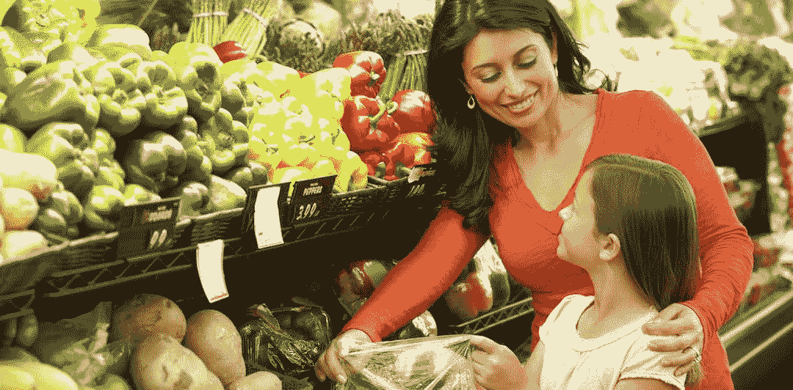

你好，我是黄碧云，欢迎来到我的得到课程《黄碧云的小店创业课》。

我在得到大学毕业的时候，学的最后一节课，就是下山锦囊。当时，得到大学的教研长蔡钰，给我们即将下山的同学们准备了一些简单实用的锦囊妙计。

所以，在我这门课的最后一讲，我也把这些年我用得比较多、立等可用的小妙招，分享给你。希望在你遇到经营难题的时候，打开锦囊看一看，说不定可以启发你的新思路。

在整个课程中，我们是按照实践顺序来展开的，但有些变量是贯穿始终的。这一讲，我就把这两个变量拎出来，单独敲个黑板。

这两个变量，一个是顾客，一个是商品。这也是一家零售店里最重要的两个关键变量。

## 顾客：了解

我们先说顾客。对一家零售店来说，毫无疑问，顾客是最重要的。对待这个变量，你要做的是，了解。了解他们的偏好，了解他们的习惯，了解他们的想法。只有了解了他们想要的是什么，才能提供合适的商品和服务。

但怎么了解呢？我提供一个思路，就是所有的信息都是可以互相验证的。你永远可以通过其他信息，去推导和验证另一个信息。

比如，我前面的课程里，提到了用单点突破法来找到目标消费人群。但一个商圈里，如果没有宠物店怎么办呢？那还有这么几种业态，可以为你提供信息。

*   **第一种是外卖单。通过外卖单，你就可以看到周围社区商圈里，什么品类强，什么品类弱。**
    

你打开外卖平台，点到自己想开的小店类目。比如想开超市，就点开超市便利店。主要看附近外卖单里，是食品多还是生鲜品居多。加上距离这个参考值就可以知道，这个商圈里什么品类还没有满足顾客的就近需求。比如说，食品多+距离远，意味着这个商圈里的食品竞争力弱，那这就是你可以满足的需求。

*   **第二类能提供信息的业态是牙科诊所。**
    

一家小店什么商品好卖，和商圈周边的家庭结构有着非常密切的关系。那怎么从牙科诊所判断出家庭成员结构呢？

重点是看用来引流的服务项目，比如一家牙科诊所主推的项目是“窝沟封闭”，那这个诊所周围，肯定有很多是 6-12 岁的孩子。因为窝沟封闭这个项目，主要就是帮 6~12 岁小朋友避免蛀牙的。还有，洗牙项目特别优惠的，那周边年轻群体，特别是上班族的占比就高。

*   **第三个能传递信息的业态是干洗店，从干洗店就能看出周边居民的消费能力。**
    

一个是看洗鞋的项目，特别是白色的鞋子，在干洗店洗一次白鞋的价格大概在 40 元左右，如果是一百到两百元的鞋，洗两三次就能买双新鞋了。

所以，一般愿意放在干洗店的，鞋子和干洗费至少也要有 10 倍左右的差异。皮包类的保养也是这个道理。也就是说，如果一家干洗店里，这两个项目的生意很好，那就能看出来附近居民消费能力强的人群占比就不会小。

你看，这些信息都是可以互相推导、彼此验证的。那以后，不管你的区域里有没有宠物店，甚至以上业态统统都没有，你也可以通过这个思路了解相关信息。

## 商品：灵活

好，这是顾客。接下来我们来看商品。

对待商品这个变量，你一定要掌握的，是“灵活”。因为对零售店来说，商品种类实在太多了，顾客的需求也一直都在变，不同商品，就要灵活对待。

比如，季节性商品怎么提升毛利？

一家小店里，应季的商品是必不可少的。像这类商品，核心的经营原则就是，提前上市。那怎么把握提前上市的时间点呢？我告诉你一条特别好用，但又特别容易忽略的时间经营线。就是中国传统的 24 个节气。

24 节气，本质上是为了提醒季节和天气变化的，刚好，零售业的销售是最容易受天气影响的。

不仅如此，在几个重大节气，各地民风民俗也有不同的庆祝方法，通用的可能就是清明、冬至，但在湖南省，大部分地区立夏也是一个特别大的节气。当地居民会煮立夏粥，这中间可能会用到糯米粉、豆苗、豆芽、猪肝等等，那立夏前，这些食材就会卖得特别好。

那怎么利用 24 节气来提高毛利呢？

掌握三个点：上架点、促销点和清仓点。

我用生鲜商品中的羊肉来说，很多地方冬至的时候会吃羊肉，那你就要在冬至前 14 天提前上架，这也就是上一个节气结束的时间。这个时候，热卖期还没到，大部分商家都没上架，你提前上架，作用主要是预告，同时也是提高毛利，因为季节性商品，刚上的时候，价格都会比较高，那你就能多赚点毛利。

这样，7 天之后，就到了冬至前的前 7 天，这就到了促销点，也是别的商家认为的热卖期。这个时候，别的商家打算赚毛利的时候，你就可以开始促销了。那在价格上，你就有了优势。

这样，再过去几天，就到了冬至的前一天或当天。这个时间点就是清仓点，因为错过今天，销售就会骤减。所以，到了清仓点，就可以进一步把毛利放低，尽可能地把货销出去。

你看，在整个过程中，你通过做大销售量，多赚了很多毛利额，但同时，还赚了低价的口碑。这就是对 24 节气的实际应用。包装食品也是同理，只是时间可以放宽到两个节气合并来用。也就是一年 12 个周期。

我们刚才说的，是比较应季的商品，那非应季的商品怎么办呢？也就是冬天的雪糕，夏天的棉袄，这种反季节性的商品是不是就不卖了？

过去，每当我问到这，很多人就会回答我，那就选几个便宜的，大众都习惯吃的品牌备着呗，万一有人买呢？

大部分人都会这么想。非应季，说白了，就是过季了嘛。

但在实际操作的时候，恰恰相反。

比如冬天到了，雪糕的销量肯定会爆减，这个时候我们会卖更贵的雪糕。为什么呢？这个时候还想吃雪糕，那就是真爱粉了。而且，都冒着那么冷的天吃雪糕了，真爱粉们会甘心只吃便宜的吗？这个时候，他们肯定想吃点好的。

所以，反季节的商品应该卖客单价更高的单品，来提高毛利。但要注意，要以中小包装为主，量太大，也会给人压力，毕竟还是在大冬天嘛。

同样的道理，夏天吃瓜子的人少，卖的也少。所以，在夏天店里，我们会少卖瓜子，但会选择一些高端品牌，比如像瓜子中的爱马仕——三胖蛋这种品牌，也是同样的道理，以中小包装为主。

除了季节性商品，还有一类商品比较特殊，就是进口食品。现在，进口食品的认知度越来越高，在一家零售店里，也是提高毛利和销售的重要品类。

那进口商品怎么选和怎么卖呢？

我总结了 9 个字：抓爆款，多花样，分开放。什么意思呢？

我先来说抓爆款。进口食品一旦成为爆款后，销量的波动就不会太大，这主要跟它成长起来的背景有关。在早期，进口食品是随着很多国际零售巨头进入国内的，一般来说，这种进口食品能够成为爆款，大多是这个分类在国内还没有成熟的产品。

等到国内也有相关产品的时候，进口食品已经培养出自己忠实的粉丝了，所以一旦成为爆款，销量都不会忽高忽低。

比如芒果干在国内还没有大面积产出的时候，就数菲律宾进口的 7D 芒果干独领风骚。等到国内开始大面积做的时候，很多顾客都已经认准这个品牌。

所以，选择进口食品的时候，抓爆款，选知名度和销量同时最高的就错不了。

再来说多花样。

虽然进口食品爆款销量稳定，但随着进口的食品种类越来越多，顾客就会有个尝新心态，喜欢少量多次，多种口味搭配。所以，在小店的货架里，同品类的食品，进口食品在一节货架上，种类就应该比国产多两倍。

像啤酒这个品类，国产啤酒的销售，主要是靠单品的销售量，但进口啤酒的销售就是靠品类的花样多了。就是平均每一种商品的销量并不高，但每一样都能卖一点。

最后说分开放。

很多早期的店主，想的是进口食品单价高，习惯把进口商品集中陈列。但随着顾客对进口食品的认识度增高，国产的商品也越来越精细化了，那就不需要把进口和国产分开，更好的方法是把进口啤酒和国产啤酒搭配，进口薯片也就直接放到国产薯片区去。这样做最大的好处就是能够起到互动的作用，还让品类里的商品看起来更加丰富。

你看，这就是对不同类型商品的不同处理方式。里面的打法，可能是无穷无尽的。

总结

这一讲，我们讲了顾客和商品这两个关键变量。这些方法都是亲测有效的，但更重要的，我想提供的是思路，这两个变量都是不断在变化的，希望你能通过这些思路，找到更适合自己的打法。

一家小店，从开始设定目标，到扩张前的准备，整个从 0 到 1 的过程，我就已经讲完了，希望我的这门课能真正帮到你。

同时，也感谢你加入我的得到课程，尤其感谢很多同学的踊跃留言，你们的分享，也让我学到了很多。

熟悉我的同学都知道，我是从得到知识城邦成长起来的得到老师，课程就算结束，我一样也会在课程留言和知识城邦里，继续答疑和分享我在零售业的一些小心得。

在这里我也想提个小请求，我希望你也能把你看到的、听到的、观察到的新鲜事分享给我，我们一起帮助这门课继续生长，持续为更多人提供实用价值。

最后，祝要开小店的，小店的生意红红火火；不开小店的，也能从小店生意这个极简闭环中得到一些启发。我们有机会再见。

顾客和商品是零售店里的两个关键变量：  
对待顾客，要充分了解顾客的习惯和需求。比如，通过外卖单，你就可以看到周围社区商圈里，什么品类强，什么品类弱。通过附近牙科诊所的主推项目，可以判断主要消费人群。  
对待商品，要灵活采用不同的策略。比如可以利用 24 节气设计促销活动。

* * *

# 20 研发者手记：我从黄碧云身上学到了什么

你好，我是杨霁琳，也是这门课的课程主编。

在打磨课程的过程中，我跟黄老师学到了很多东西，她的经验之丰富，相信你在课程内容中也已经感受到了。你可能也好奇，为什么她解决问题的能力这么强呢？

在跟黄老师的接触中，我从她身上学到了三个训练方法，现在也分享给你。

## 让自己活在问题里

第一个方法是，让自己一直活在问题里。什么意思？

我还记得黄老师讲过一个例子，她们当时在跨区域开第一家店的时候，因为助理的失误，本来要进 200 箱软包装抽纸，结果多按了一个 0，变成了 2000 箱。

当时那家店刚开业，又是刚到一个新区域，怎么消化得了这么多抽纸呢？现场所有的人都劝她，这货不能签收，还是退给供应商吧。

但是黄碧云老师当时的想法是，这是跨区域的第一家店，如果这批货强退给供应商，那信誉就全完了。所以，货不能退。

但这么多软抽，怎么办呢？黄老师当时说了一句话，她说，我就不相信，还有卖不出去的东西。然后咬咬牙，把字签了。

后来，她想了一系列方法来做促销，结果怎么样呢？不到 3 天，就把这 2000 箱软抽卖光了。这对她自己来说，都是没想到的事。

但你看，这就是一个做具体事的人。她每天遇到的问题，可能都是没有既定解法的新问题，但她的第一反应，永远不是，这事太难了，我没有资源，这不可能。而是，这事一定能解决，我要想想办法。

在这个过程中，你就能解决自己之前可能都想象不到的难题。

所以，让自己活在问题中，遇到问题，就解决问题，那解决问题的能力自然而然就会提高。

据我所知，黄碧云老师就是这么训练自己家孩子的。

黄老师有两个孩子，大女儿十一二岁的时候，就被她“勒令”去超市打工，从最零碎的活开始干起。小儿子现在才七八岁，也经常被她怂恿，去参加义卖，摆个小摊，卖点零食玩具。

为什么要让孩子做这些事呢？黄老师说，她当然不是想真让孩子以后干零售，但是，从她自身经历来说，她自己是从 6、7 岁开始，就跟着小姑姑一起摆摊卖海鲜。在这个过程中，会遇到无数个细碎的、具体的新问题，必须逼着自己去解决。这对她的成长，帮助很大。

所以，她也希望自己的孩子，从小去接触真实世界，去接受问题的锤炼。

## 把别人的问题当作自己的课题

这是第一个方法，我跟黄老师学到的第二个方法，是把别人的问题当作自己的课题，训练自己能瞬间进入别人困境的能力。

你可能已经听了脱不花讲了黄碧云老师回答赤峰用户那个故事，但这件事，还有详情。

有一次，我跟黄老师聊起这个事。

她说，其实当时她看到这条留言的时候，第一反应是，联系下自己的客户，也就是内蒙古当地的零售商超，看能不能和这位赤峰用户合作一下。

所以她在评论区先是问了这位同学的具体地址。结果一搜，离最近的客户，也有着七百多公里。

黄老师心想，可能没法直接帮到他了，那我给他支两招吧。

但这个用户具体是啥情况，也不能瞎支招啊。

于是，她就点开百度地图，详细看了这个用户周围的环境，她发现，这位用户所在的公路，非常笔直，没有拐弯，也就是说，车速会非常快，要吸引顾客停下来，很难。

紧接着，她又看了下，这位用户所在的地点，就在公路和县城快临近的地方，那有没有可能拉到县城去卖呢？她又留言问了问这位用户的菜地情况，得知这位用户卖的都是像小白菜这样的叶菜类，这类菜失水特别快，如果拉到城里，不仅没有规模优势，路上损耗还特别大。

综合了以上这些具体情况，她才给出了脱不花讲过的那几句建议。

除了这个故事，如果你熟悉她，你可能也知道，她在知识城邦经常帮人回答问题。而且，你会发现，大型连锁商超，她能回答，村门口的小卖部，她也能回答。为什么？

黄老师告诉我，她入行几年之后，就开始有很多人向她求助，问一些问题。后来问得多了，她就想，她能不能每年就研究一个课题，把这个题研究透。比如第一年，她研究的就是传统超市如何通过电商平台选品。因为那几年，电商平台刚刚兴起，她经常被问，这会不会颠覆线下零售？于是，她就把这个问题作为自己一年的研究课题，详细做了研究，研究结果当然也就应用在了自己的实践中。

你看，她这是在做什么？

她是把别人的问题当作自己的课题在练习，这让她练就了一身能瞬间进入别人困境的能力，也让她能在遇到问题时，比别人更快地想到解决方案。

## 用观察替代看

我从黄老师身上学到的第三个方法，是用观察替代看。

什么意思呢？我先讲个小故事。这个故事是关于福尔摩斯的。

华生曾经问福尔摩斯，为什么你总能发现那么多证据？ 福尔摩斯反过来问华生，“这个楼梯你走了几百次了，你能告诉我，它有几级吗？” 华生说，“不知道。”  
福尔摩斯说，“十七级。” 然后福尔摩斯说，“你看，这就是看和观察的区别。

在这几个月的接触中，黄老师每天让我感受到的，就是这种区别。

举个小例子。黄老师来录音的时候，我们去公司楼下的便利店买水。

对我来说，水可能就分两种，我喜欢喝的，和我不喜欢喝的。

比我分得细点的，可能就是矿泉水、果汁、碳酸饮料、牛奶等等。

但在黄老师的世界里，仅仅是无色无味的水，就有十几种区别。

你听我给你转述下。

从加工手法来分，无色无味的水分为毫无加工的天然水，和经过加工的非天然水。

天然水，又细分为像农夫山泉这样的普通天然水，还有像百岁山这样的天然矿泉水，还有一种，叫做天然含气矿泉水，就是水里天然含二氧化碳，不是后天加进去的，你可以上网搜一搜，圣碧涛天然矿泉水、波多天然含气矿泉水，价格一般都在 70 到 100 多元一瓶。对，就是这么贵。

而非天然水，就是后天有处理过的水，根据处理方式的不同，又分为屈臣氏的蒸馏水、今麦郎的凉白开，怡宝纯净水，还有像巴黎水这样的非天然含气矿泉水。

听着是不是已经晕了？这还没完，黄碧云老师还会搜集这些所有水的数据，软硬度，酸碱值、含钙、含镁、含钾率。而且，她都会一个个试口感，软硬度到底怎么样，甚至统计精确到了喝上一口，需要吞咽一次，还是两次。

为什么要了解这么细呢？黄老师说，因为在陈列的时候，把品类、水质口感、品牌等商品要素，展示出来，才能方便顾客选购，而且，不同的水质，用途不同，比如矿泉水适合泡茶，天然含气矿泉水，可以用来给香槟调味等等，那摆在旁边的商品，也就不一样，而这些所有要素，对标到顾客身上，目标人群就不一样。

我被黄老师做事的颗粒度震撼到了，你想，这可是我每天都要去的超市，但黄老师给我呈现出来的，是一个被高清放大镜，放大了数百倍的世界。在每一个极其细微的小颗粒度上，在那些我们视而不见、习以为常的地方，她都精确计算过。

所以，等到再遇到的问题的时候，我就会问问自己，我真的观察了吗？这件事，还有哪些细微颗粒度是被我忽略了的吗？

思考题

好了，以上就是我从黄碧云老师身上学到的一些收获，那你呢？你在这门课程中，收获到了什么？欢迎你在留言区和我分享。

怎样训练解决问题的能力？ 1.让自己一直活在问题里，遇到问题，就解决问题，那解决问题的能力自然就会增长。  
2.把别人的问题当作自己的课题来练习，就能训练出瞬间进入别人困境的能力，也能在遇到问题时，比别人更快地想到解决方案。  
3.用观察去替代看，调高自己的分辨率，观察到更细微颗粒度的细节。

* * *